# RTEMS 和多核处理器实时系统开发（嵌入式系统）

- 前言
- 作者
- 第 1 章 引言
- 第一部分 操作系统基础
- 2.3 GNU Make 和 Makefiles
- 2.4 RTEMS 及其配置系统的概述
- 第 3 章 并发编程与调度算法
- 第 4 章 调度分析与中断处理
- 4.2.1
- 4.2.3 实时调度算法
- 4.3
- 5.4
- 7.1.4
- 7.4 RTEMS 共享内存 API
- 7.4.2 POSIX API
- 第 8 章 IPC、执行与调度
- 8.2.1 死锁定义与示例
- 第 9 章 基于消息传递的 IPC
- 第四部分 网络通信
- 10.2 协议栈组织
- 第 11 章 POSIX 套接字 API
- 11.8 非阻塞 I/O 与同步 I/O 多路复用
- 第 13 章 多核并发：问题与解决方案
- 13.4 多核同步设备
- 13.4.2 O(m) 独立保持协议
- 13.5.1 基本原理与定义
- 参考文献
- 索引

# 前言

本书是数十年来在实时操作系统以及应用于控制系统和其他类嵌入式应用的通信领域，积累的研究、教学和咨询经验的结晶，这些工作通常是与工业界和学术伙伴紧密合作完成的。在此，我们受到了许多接触过的人的积极影响。他们多到无法逐一提及，但我们对他们对我们的知识和专业成长所做出的贡献深表感谢。

特别感谢我们的大学学生，他们首先使用了作为本书基础的讲义。多年来我们收集的建议和意见使这本书变得更加清晰、易读。我们还感谢 CRC Press 的出版、编辑和营销人员，特别是 Nora Konopka 和 Prachi Mishra。没有他们的宝贵帮助，这本书可能永远无法问世。

# 作者

Gedare 于 2013 年在华盛顿特区的乔治华盛顿大学获得计算机科学博士。2019 年加入科罗拉多大学斯普林斯分校计算机科学系担任助理教授。在此之前，他于 2015 至 2019 年担任霍华大学计算机科学助理教授，并在 2013 至 2014 年担任乔治华盛顿大学的研究科学家和博士后研究。他的研究专长是计算机系统安全，特别关注用于汽车、航空、工业控制和关键基础设施领域的实时嵌入式系统。他用于解决软硬件接口问题的技术涵盖了体系结构、计算机安全、密码学、操作系统和实时分析。Bloom 教授体系结构、操作系统和系统安全的本科及研究生课程。Bloom 为这些课程引入了新内容，涵盖了实时嵌入式系统，并为学生提供了实践练习，通过直接与硬件交互来积累经验。他的卓越教学获得了系和大学的认可。

自 2011 年以来，Bloom 一直是 RTEMS 开源实时操作系统的维护者，该系统用于机器人框架、无人车辆、卫星和航天、汽车、国防、医疗设备制造、工业控制器等。他对 RTEMS 的主要贡献包括 RTEMS 的第一个 64 位架构、现代线程调度基础设施的设计与实现、支持将 RTEMS 作为航空电子虚拟机监控器的私有内核运行，以及为了符合 FACE 航空技术标准的 POSIX 服务实现。此外，他还指导和引导学生在基于 RTEMS 的世界中进行学习和开发。

Bloom 博士积极服务于专业社区。他是 ACM 高级会员（M'09, SM'19）和 IEEE 高级会员（M'09, SM'19），并是 ACM SIGARCH、SIGOPS、SIGBED、SIGACS 和 SIGCSE 特别小组，以及 IEEE 计算机学会和 IEEE 计算机学会实时系统技术委员会的成员。他曾担任实时嵌入式系统领域顶级会议和期刊的程序委员会成员、评估委员和技术评审员。

Joel Sherrill 于 1999 年在阿拉巴马大学亨斯尔分校获得计算机科学博士。1989 年加入 On-Line Applications Research Corporation，目前担任研发总监。他是免费实时操作系统 RTEMS 的原始开发者之一，也是目前的项目负责人。Sherrill 博士将 RTEMS 移植到了多种处理器架构，并负责许多 RTEMS 功能的开发。自 2008 年以来，他还一直支持 Google Summer of Code (GSoC) 和 ESA 空间之夏 (SoCS) 等计划中的学生指导活动。他的重点之一是确保 RTEMS 在部署于关键系统时满足严格要求，同时确保符合 POSIX 等开放标准。

自 2011 年以来，Sherrill 一直是 FACE 技术标准的主要作者（美国陆军战斗能力发展司令部航空与导弹中心，隶属于 Open Group）。此外，他还指导和引导学生在基于 RTEMS 的世界中进行学习和开发。

# 第 1 章 引言

多核处理器如今在桌面计算中无处不在，并在许多其他应用领域也变得日益流行，范围从手机到硬实时嵌入式系统。然而，如何借助嵌入式实时操作系统有效地使用它们，对于许多从业者来说仍然知之甚少。在开源领域，由于科学技术文献缺乏全面的学习材料，问题变得更加复杂。因此，潜在用户很容易面临误用多核处理器的风险，或者未能从正确的视角考虑其优缺点。

本书的第一部分将向读者介绍嵌入式软件开发。首先，它描述了用于编译和链接应用软件的基础工具，以及如何对 RTEMS 操作系统进行配置。随后，讨论将进入并发编程基础、实时调度和调度分析的领域。该部分包含的章节：

- 第 2 章，交叉编译工具链。本章首先描述了基于 GNU 的交叉编译工具链的主要组件，特别关注了链接器命令语言和常用于协调和自动化软件构建的 GNU make。本章的第二部分讨论了 RTEMS 操作系统的编译时配置。

- 第 3 章，并发编程与调度算法。本章的首要目标是建立并发编程的理论基础。讨论涵盖了至关重要的进程（或任务）概念，以及任务状态随时间推移如何在操作系统内部表示。本章的第二部分向读者介绍了单处理器系统上的实时调度方法和技术，而多核系统的调度算法讨论将留给第五部分。

- 第 4 章，调度分析与中断处理。本章的主题是调度分析，这是一组预测实时系统最坏情况时间行为的数学工具。讨论从系统的底层视角开始，将系统抽象为任务集，然后展示了中断处理如何融入调度分析框架。本章最后以一种流行的微处理器架构为参考，对中断处理的一系列实际考虑因素进行了总结，并有助于说明 RTEMS 如何实现包括上下文切换在内的关键活动。

> GNU 代表 GNU's Not Unix！

# 第一部分 操作系统基础

# 第 2 章 交叉编译工具链

## 2.1.1 编译器驱动程序

图 2.1 C语言工具链工作流的简化视图。

- **GCC 编译器**。它翻译 C/C++ 源文件（该文件可能包含其他头文件或源文件），并生成二进制格式的对象代码。这通常涉及多步骤的代码生成过程，尽管它通常被称为“编译器”，但 `gcc` 程序实际上是一个编译器驱动程序，它可以根据通常从文件名扩展名派生的输入类型，执行涉及其他工具链组件的不同操作。编译器驱动程序的行为可以通过命令行选项进行自定义。根据目标架构，可以为特定架构的编译提供不同的选项。例如，可以使用 `-march` 选项来识别 ARM 家族的特定架构，如针对 ARMv8-A 架构的 `armv8-a` [2]，或针对 ARMv7-A 的 `armv7-a`。`gcc` 执行的操作通过 `specs` 字符串或文件进行进一步配置。编译器驱动程序及其 `specs` 将在 2.1.1 节中进行详细讨论。

- **库管理器（libr）**：其名称过去被称为“archiver”（归档器），将多个对象模块收集到一个库中。该工具还对库执行若干维护操作。例如，它能够从中提取模块。

其他工具，如 `make` 和 `objdump` 执行与对象模块、可执行镜像内容及符号相关的更具专门的操作。由于空间限制，下文将不再讨论这些工具。感兴趣的读者可以查阅它们的文档 [3] 获取更多信息。

- **链接器 `ld`**（见第 2.1.3 节）根据命令行选项或（更常见的）通过一个或多个链接脚本将对象模块与库进行链接。它解析交叉引用以最终构建可执行镜像。在特殊的嵌入式系统中，链接阶段通常会将应用程序以及各种系统代码带入可执行镜像中。

链接时使用了几类系统代码：

- 启动对象文件——`crto`——它们在可执行镜像启动时首先执行。在独立执行文件中，它们还包括系统和硬件初始化代码，通常称为引导加载代码（bootstrap code）。
- 编译器支持库 `libgcc.a` 包含代码生成器提供的实用函数，但由于体积太大/太复杂，无法单独实例化。例如，在没有硬件支持的处理器上进行整数乘法/除法或浮点操作。
- 标准 C 库，`libc` 和 `libm`。
- 可能还有操作系统本身。大多数实时操作系统属于此类情况，RTEMS 也属于这一类。

工具链中通常存在的另一个组件属于自成类，它不直接操作源文件、对象文件或可执行镜像，而是负责协调和自动化整个软件构建过程。最广泛使用的工具之一是开源的 GNU make 程序。在图 2.1 中，它被显示为一个涵盖了其他工具链组件的灰色背景，并将是 2.3 节的主题。

构建工具链是一项复杂的事务，首先由于其巨大的规模和复杂性，而且由于工具链组件本身是用高级语言编写并以源码形式分发的。例如，用于 C/C++ 语言的 GNU 编译器驱动程序本身是用 C/C++ 编写的，为了构建它，需要一个工作的 C/C++ 编译器。解决这个“鸡生蛋”问题有多种方法，取决于要构建种种编译器。

此前，嵌入式软件开发中最频繁使用的工具链类型是交叉编译工具链。这种工具链为特定架构（目标、开发系统或主机）生成代码。这是因为由于内存容量和处理器速度的限制，嵌入式系统通常无法编译自己的代码。

在这种情况下，引导加载问题变得更简单，因为可以使用主机上的原生工具链来构建交叉编译工具链。原生工具链的可用性通常不是问题，因为大多数开源操作系统发行版已经提供了一个即插即用的工具链。在使用 RTEMS 时，由于可用一个名为 RTEMS Source Builder (RSB) [106] 的全面工具，过程进一步简化，它能够以完全自动的方式从源码构建完整的开源交叉编译工具链。

为了区分交叉编译工具链组件与其原生工具链对应项，它们的名称带有一个总结目标架构的字符串。例如，针对 ARM 架构和 RTEMS 操作系统 4.11 版本的 C 编译器驱动程序被称为 `arm-rtems4.11-gcc` 而不是简单的 `gcc`。在后续为了简洁起见，我们将继续使用短名称。

### 2.1.1 编译器驱动程序

图 2.2 描绘了编译器驱动程序工作流的总体轮廓。根据上一节给出的高层视图，当使用编译器驱动程序编译 C 源文件时，理论上它应该执行以下步骤，通过为每个步骤调用一个工具链组件：

1. 使用 C 预处理器 `cpp` 对源码进行预处理。
2. 通过 C 编译器 `cc1` 将源码编译为汇编代码。
3. 使用汇编器将其汇编，以产生输出对象文件。

编译器驱动程序的内部结构值得写一本书。感兴趣的读者可以查阅 [121] 获取全面指南，并查阅官方文档 [117]。在下文中，我们将关注基于 gcc 的工具链偏离抽象视图的一些特殊之处。

首先，如图所示，预处理器集成在编译器中。C++ 编译器 `ccplus` 也采用相同的方法。相反，汇编器作为一个独立的程序进行的，gcc 分发版 [96] 也包含了链接器。

基于 gcc 的工具链的一个特点是编译器驱动程序是可编程的。它由包含在 `specs` 字符串或文件中的一组规则驱动。`specs` 字符串可用于自定义编译器驱动程序的行为。它将通过几个示例提供 `specs` 字符串表达能力的概述，以及借助它们的帮助可以实现什么。关于 `specs` 字符串语法和使用的详细文档可见 [117]。基本上，`specs` 字符串中的规则规定了编译器驱动程序应该运行的程序序列及其参数，取决于提供的文件类型。当未提供自定义 specs 时，编译器驱动程序会构建默认 specs。

编译文件所需的步骤顺序可以根据文件后缀指定。与某些命令行选项相关的其他规则可能会更改传递给调用程序的参数。

```
*link: %mbig-endian:-EB
```

在示例中，上述 `specs` 字符串指定了如果给了编译器驱动程序命令行选项 `-mbig-endian`，则必须带有 `-EB` 调用链接器。该规则的预期效果是，当编译器配置为大端序操作时，它必须将此信息传递给调用的所有程序（示例中的链接器），以确保它们工作一致。正如示例所示，由于不同的程序由不同小组在不同时间设计和编写，概念上类似的选项以不同的方式列出。

让我们考虑另一个 specs 片段：

```
*startfile: crt0%s crtbegin%0s new_crt0%s
```

在这种情况下，`specs` 字符串指定了无条件在链接开始包含哪些对象文件。对象列表存储在 `startfile` 变量中（位于字符串的左侧），而列表本身位于冒号（:）之后的右侧。有时修改默认对象集合是有用的，以便添加语言相关或操作系统相关文件，而无需强制程序员在链接可执行镜像时显式地提到它们。具体来说，在这个简单的示例中：

- `*startfile:`：规范覆盖了内部规范 `startfile` 并赋予其一个新值。
- `crt0%s`：C 语言程序默认的初始化对象文件类型。在这些字符串中，`%0` 代表默认的对象后缀（默认在 Linux 宿主机上扩展为 `.o`），而 `%s` 指定该对象文件是系统文件，应在系统搜索路径中查找，而不是用户定义的目录。使用 `%0`、`%s` 和其他指令使得规范在具有不同文件命名规范的主机操作系统之间具有可移植性，并允许编译器安装在文件系统的任何位置，而不会以任何方式影响顺序。
- `new_crt0%s`：替换 `crt0%s`（C 编译器的标准初始化函数之一），用于提供特定操作系统、语言或机器的初始化函数。

### 2.1.2 预处理器

预处理器在基于 GNU 的工具链中称为 `cpp`，它执行三项主要活动，这些活动至少在概念上是在传递给正式编译器之前完成。它们是：

1. 文件包含：通过 `#include` 指令调用。
2. 宏定义：通过 `#define` 指令进行定义和展开。
3. 条件包含/排除输入文件的部分内容：取决于某些宏是否已定义（例如使用 `#ifdef` 或 `#ifndef` 时）以及它们的值（`#if` 指令）。

根据语言规范 [7]，预处理器通过纯文本替换工作。然而，预处理器和编译器的语法在词法（标记/token）层面上是相同的；在基于 GCC 的工具链中，会对输入文件进行标记化处理作为一种优化。它为编译器提供的是标记流而不是纯文本。

标记 [3] 是一种数据结构，除了包含标记文本（字符序列）外，还包含关于其性质的信息（例如，标记代表的是数字、关键字还是标识符）以及调试信息（它从哪个文件和哪几行读取）。因此，标记相对于其对应的纯文本部分传达了额外信息。编译器需要这些信息来进一步处理输入。

图 2.3 包含了预处理器工作流的简化视图。非正式地说，由于它划分输入文件，预处理器会检查所有内容并执行三种可能的操作之一。

图 2.3 简化的 C 语言预处理器工作流。


# 预处理器

## 1. 预处理器关键字处理

当输入标记是预处理器关键字（如 `#define` 或 `#include`）时，预处理器分析其后续标记以构建完整的语句并遵循它。

例如，在 `#define` 之后，它会寻找一个宏名，后面跟着（可选的）宏体。宏定义语句完成后，预处理器会将“名称 → 实体”的关联记录在表中供以后使用。

在这种情况下，预处理器关键字或后续标记（示例中的宏名和宏体）都不会传递给编译器。只有当宏体被展开时，宏体才会对编译器可见。

名称 → 体的表在预处理开始时初始化，在结束时丢弃。因此，宏定义不会跨编译单元保留。

## 2. 宏展开

当宏被调用时，预处理器执行宏展开。在简单的情况下（即对象类宏），宏展开是通过在源码中遇到宏名触发的。

通过将宏名替换为宏体来展开宏。然后，再次检查展开结果以确定是否可以进行进一步的宏展开。当没有进一步的宏展开时，预处理器获取的标记序列将传递给编译器，而不是触发宏展开的标记。

## 3. 未知标记传递

预处理器未知的标记将直接传递给编译器而不进行修改。预处理器和编译器的语法在语法层面非常不同，许多种类的标记对预处理器没有意义，尽管后者在词法层面完全能够构建标记本身。

## 4. 预处理器语句语法

预处理器语句的语法非常简单。它们始终以第一列的 `#` 字符开头。在 `#` 和语句其余部分之间允许空格。语句的主要类别有：

- 宏定义：`#define`
- 文件包含：`#include`
- 条件编译：`#ifdef`、`#ifndef`、`#if`、`#else`、`#elif` 和 `#endif`
- 其他：例如 `#warning` 和 `#error`

接下来，我们将重点关注宏定义和展开过程。感兴趣的读者可以参考随 gcc 编译器自带的完整预处理器文档 [118] 以获取更多信息。

## 5. 宏的分类

宏有两类：对象类宏和函数类宏。对象类宏是最简单的，预处理器对其的处理可以总结为以下两点：

（此处内容已根据原文逻辑进行了去重整合）

---

# 链接器 (LINKER)

链接器的主要目的（在 [34] 中详细描述）是将多个对象文件和库组合成可执行的映像。为了实现这一点，链接器通过从库中按需提取模块来解析模块间的符号引用，并重定位代码和数据。

如所述，在 GNU 工具链中，执行原生编译时，可能直接调用 `ld` 作为链接器，或者调用 `<cross>-ld`，其中 `<cross>` 是表示目标架构、交叉编译的前缀。然而，如第 2.1.1 节所述，通常情况下是编译器 `<cross>` 根据需要自动调用链接器。在这两种情况下，链接过程都是由用链接编辑器命令语言编写的链接器脚本驱动的。

在详细描述链接器如何工作之前，我们对常用的通用链接器选项进行简要回顾，这些选项对于嵌入式软件开发特别有用。

- `-Map <file>` 将映射文件写入 `<file>`。当使用额外的 `-cref` 选项时，映射文件中还包含交叉引用。由于空间限制，此处不会提供关于它的更多信息，但链接映射包含了大量关于链接过程结果的信息。感兴趣的读者可以参考链接器文档 [34] 获取更多细节。

- `--format=<format>` 设置输出文件的格式，仅限 `ld` 识别的格式。能够精确控制输出格式有助于将可执行映像成功上传到目标平台，因为上传工具只支持有限的文件格式。参考文献 [4] 包含了支持的输出格式完整列表，取决于目标架构和链接器配置。

- `--strip` 和 `--strip-debug` 选项从输出文件中移除符号信息，只留下可执行代码和数据。这是可执行上传工具正常工作所需的，它们可能无法正确处理可执行文件中存在的额外信息。符号信息主要用于在可执行映像中存储调试数据，例如源代码行号与机器码之间的映射。因此，除非在目标机上运行调试器，否则将这些信息上传到目标内存在大多数情况下是没用的。

当通过编译器调用 `ld` 时，链接器选项必须以前转义序列 `-Wl` 开头，以将其与编译器驱动程序的选项区分开来。用逗号分隔转义序列与传递给链接器的字符串，且不允许有中间空格。例如，`gcc -Wl,-Map=f.map -o f f.c` 编译并链接 `f.c`，并将 `-Map=f.map` 传递给链接器。

作为最后的介绍，对于链接器而言，回顾对象模块、库和可执行映像之间的主要区别也是重要的。这些差异将在后续章节中进一步解释和强调。

- 对象文件不包含在最终的可执行映像中。对象模块位于库（通常称为库模块）中，仅在需要时才使用。具体来说，只有当链接器在解析待处理的符号引用时需要这些模块时，链接器才会包含它们。

- 库是由归档器（archiver）或库管理器（librarian）将未修改的对象模块组合成单个文件的集合。

- 可执行映像通过绑定对象模块（独立的或来自库的）形成。然而，它并不像库那样仅仅是一个集合，因为链接器在此过程中执行了大量工作。

## 符号解析与重定位

大多数链接活动都围绕符号操作展开。非正式地说，符号是一种以抽象方式引用对象地址的方便方法（通过人类可读的名称或数字），甚至在它在内存中的位置确定之前就可以被引用。

符号的使用在编译器生成代码期间对编译器非常有用。例如，当编译器为循环结束的反向跳转生成代码时，存在两种情况：

1. 如果处理器支持相对跳转——即跳转目标地址计算为当前程序计数器加上存储在跳转指令中的偏移量——那么它本身就知道了跳转指令与其目标之间的“距离”。在这种情况下，链接器不参与其中。

2. 对于大多数情况，编译器可能会使用绝对跳转——即在跳转指令中直接指定跳转目标地址——编译器可能会在生成的代码中留一个“空白处”。它可能知道相对于其正在生成的代码起始位置的相对地址，但它并不知道代码最终位于内存中的最终绝对地址。正如后面将要更详细解释的那样，这个空白处将在链接器执行符号解析和重定位时被填充。

另一个关于数据地址而非代码地址的直观例子是，它是用一个名称（即符号）来表示的——当编译器生成代码时，它可能需要通过“空白处”来引用变量，随后符号会被放置在实际内存中。与之前一样，编译器生成的代码将是不完整的，因为它完全不知道该变量的地址。

一方面，当链接器收集对象文件以产生可执行映像时，可以通过名称匹配过程（或重定位术语）将符号与相应的引用关联起来。另一方面，当链接器重定位对象内容以便在内存中布局时，符号值和机器指令的精确地址变得已知。只有在此处，链接器才能“填充”编译器留下的“空白”。

作为符号解析如何进行的例子，让我们考虑图 2 中的简单源文件：

- 当编译器为 `f` 生成代码时，它不知道 `i` 定义在何处。因此在 `f.o` 中，`i` 的地址留待链接器填充。
- 这是因为编译器一次只处理一个单元，尽管传递给编译器的源文件集在命令行上是同时出现的。
- 在符号解析期间，链接器观察到 `i` 定义在 `g.o` 中，并将该定义与 `f.o` 中的引用关联起来。
- 在链接器重定位 `g.o` 的内容后，`i` 的地址变得已知，并最终可以用于完成 `f.o` 中的代码。

```
File f.c                          File g.c
extern int i;                     int i;
void f(void) {                    }
    i = 7;
}
```


同样值得注意的是，当初始值必须在非易失性内存中时，初始化数据需要特殊处理。在这种情况下，链接器必须与启动代码（提供内存布局）协作，以便这些数据在应用启动时正确初始化。关于此点的进一步信息将在第 2.2 节给出。

---

# 2.2 链接器脚本 (LINKER SCRIPTS)

如前所述，链接过程是由链接器脚本指定的命令集驱动的。链接器脚本可以分为三个部分，将在后续章节中描述。这些部分共同定义了链接器的整体行为：

1. **输入和输出部分**：选择链接器必须考虑的输入文件（对象文件和库），并引导链接器输出到指定位置。
2. **内存布局部分**：描述目标系统上可用内存（也称为 bank）的位置和大小，即链接器可以用于布局可执行映像的空间。
3. **段和内存映射部分**：指定了划分并组织成段的输入内容必须如何映射并重定位到内存中。

如有，链接器脚本可以拆分成多个文件，然后通过合并指令绑定在一起。`INCLUDE <filename>` 指令定义了一个文件名，如果该文件的内容出现在指令中，则引导链接器包含该文件。链接器支持嵌套包含，`INCLUDE` 指令可以同时出现在主链接器脚本和被包含的脚本中。这当链接器脚本变得复杂或由于或其他原因方便划分时特别有用，例如区分架构或语言相关的部分与通用部分。

## 2.2.1 输入和输出序列

输入和输出链接器命令指定了：

- 链接器将处理哪些文件（对象文件或库）。这是通过一个或多个 `INPUT` 命令实现的，这些命令以输入文件名作为参数。
- 链接器扫描它们的顺序以执行符号解析和重定位。序列由输入命令在脚本中出现的顺序以及参数从左到右的顺序隐含建立。
- 处理特定文件或文件组的特殊方式。例如，`STARTUP` 命令将文件标记为启动文件而非普通对象文件。
- 当给出库名时去哪里查找库。这通过 `SEARCH_DIR` 命令指定一个或多个路径来实现。
- 输出（包含可执行映像的文件）将通过 `OUTPUT` 命令处理。

大多数这些命令都有对应的命令行形式，通常常用。例如，`-o` 选项充当 `OUTPUT`，在命令行上提到对象文件名与将其放入 `INPUT` 链接器脚本具有相同效果。脚本中给出的文件顺序取决于命令行上提到了哪个链接脚本，尽管存在特殊的链接脚本来覆盖默认。

可执行映像的入口点——即必须首先执行的指令——可以通过链接器脚本中的 `ENTRY <symbol>` 设置，其中 `<symbol>` 是一个符号。然而，重要的是，`ENTRY` 的唯一作用是在可执行映像本身中记录所需的入口点；然后，加载可执行映像的程序（在链接器术语中称为加载器）负责遵守请求。

当不使用加载器时——即可执行映像是由位于开发主机上的上传工具上传的，然后在目标机的“裸机”上运行——入口点由硬件未定义。例如，大多数处理器在上电时从复位向量指示的位置开始执行。在这种情况下，可执行映像中设置的任何入口点都会被忽略。

链接器按照输入序列确定的顺序对输入文件进行一次扫描，该顺序定义为：

- 文件在 `INPUT()` 命令中出现的从左到右的顺序。在这种情况下，b.o 在输入序列中紧跟在 a.o 之后，e.o 紧跟在 d.o 之后。
- 如果链接脚本存在多个 `INPUT()` 命令，将按照它们在脚本中出现的相同顺序进行考虑。

因此，在我们的示例中，链接器按顺序扫描文件：a.o, b.o, c.o, d.o, e.o 和 libf.a。如前所述，对象文件和库也可以在链接器命令行上指定。在这种情况下：

- 命令行可能包含一个选项 `(-T)` 来引用链接脚本。
- 命令行上指定的输入文件将与链接脚本中提到的文件合并，具体取决于链接脚本被引用的位置。

例如，如果命令行为 `gcc ... a.o -Tscript b.o` 且链接脚本包含 `INPUT(c.o, d.o.)` 命令，那么输入序列为 a.o, b.o, c.o, d.o 和 b.o。

启动文件（startup file）指定的输入文件是一个特殊的对象文件，因为它包含了低级硬件初始化代码，并为应用程序代码设置执行环境。因此，它相对于其他对象模块的内存位置可能会受到硬件启动程序的限制。

如前所述，`START(<file>)` 强制 `<file>` 成为输入序列中的第一个对象文件，无论该命令出现在哪里。例如，链接脚本片段：

```
INPUT(a.o, b.o)
START(s.o)
```

导致输入序列为 s.o, a.o 和 b.o，尽管 s.o 是最后提到的。

让我们描述链接器如何将输入序列转换为最终用于构建可执行映像的对象模块输出序列。我们将通过一个示例，结合图 2.5 来。在我们的示例中，输入序列由对象文件 g.o 组成，紧接着是两个库 liba.a 和 libb.a，顺序如下。它们列在图顶部，从左到右。为了清晰起见，库被描绘成浅灰色的矩形。相反，对象文件包含函数定义和引用，图中也有显示。

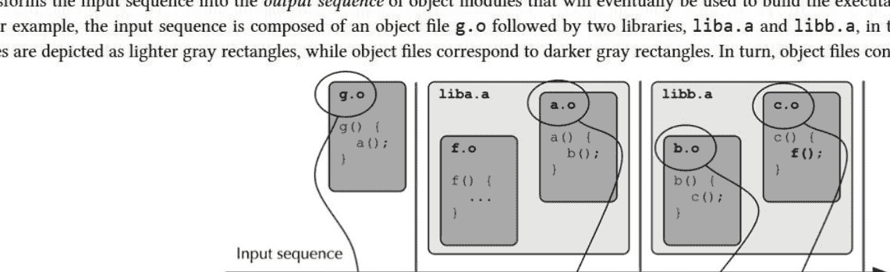

**图 2.5 链接器对对象文件和库的处理。**

对象模块 g.o 无条件地放在输出序列中。在序列中，此操作用向下的箭头表示。因此，在函数 g() 体中引用的符号 a 在点 1 处未定义。

- 当链接器扫描 liba.a 时，它在模块 o 中找到 a 的定义，并通过将 a 放入输出来解析它。这使得 b 在点 2 处未定义，因为 a 的体包含了对 b 的引用。
- 由于文中只定义了 a，因此只有模块 o 被放入输出中。具体来说，模块 f.o 没有被放入，因为链接器没有感知到与其相关的任何未定义符号。
- 当链接器扫描 libb.a 时，它找到了 b 的定义并将模块 b.o 放入输出中。此时 c 变为未定义。由于 c 在 o 中定义（即同该库中的另一个模块），
- 模块 c.o 包含对 f 的引用，因此 f 变为未定义。由于链接器只扫描一次输入序列，它在此时无法引用 liba.a。即使 liba.a 中定义了 f，也不考虑此定义。在点 3 f 仍然未定义。

换句话说，当库包含循环交叉引用时，扫描输入序列的默认是有问题的。具体来说，当库 A 的对象模块包含对 B 的引用时，我们说库 A 包含指向 B 的交叉；对称地，B 的一个模块包含回库 A 的一个模块的引用。也存在更复杂的引用，涉及两个以上的库。

如图所示，当 A 的对象模块包含对 o 的引用时，默认扫描库 B，对称地，B 的一个模块包含回库 A 的一个模块的引用。

当这种情况发生时，无论库 A 和 B 在输入序列中的出现顺序如何，链接器可能无法解析对符号 a 的引用，尽管其中一个库包含了该定义。这在符号 f 的示例中发生了。

为了解决这个问题，可以将库分组合。这是通过 `GROUP()` 命令实现的，该命令接受库列表作为参数。例如，`GROUP(liba.a, libb.a)` 命令将库分组在一起，链接器将它们都视为一个整体。

回到示例，`GROUP(liba.a, libb.a)` 的效果是引导链接器回溯该集合，找到 f 的定义并将模块 f.o 放入输出中。

```
INPUT(a.o, b.o)
GROUP(liba.a, libb.a)
INPUT(libc.a)
```

链接器将检查 a.o，然后是 b.o。之后，它将 liba.a 和 libb.a 作为一个整体进行处理。最后，它将单独处理 libc.a。

下文将清楚说明，对库使用 `GROUP()` 是有意义的，因为对象文件的处理方式不同。

---

## 2.2.2 内存布局


# MEMORY

`MEMORY` 命令用于描述目标的内存布局，即一组内存区域，通常称为块或存储。其通用语法为：

```
MEMORY
{
  <name> [(<attr>)] : ORIGIN = <origin>, LENGTH = <len>
}
```

其中：

- `ORIGIN` 和 `LENGTH` 是关键字。
- `<name>` 是分配给块的类可读名称，以便链接脚本的其他部分可以引用它。
- `<attr>` 是可选的。它提供了有关内存类型的信息，并影响链接器被允许存储到其中的哪种信息。例如，`R` 表示只读，`W` 表示读/写，`X` 表示该块可能包含执行代码。
- `<origin>` 是内存的起始地址。
- `<len>` 是块的长度，单位为字节。

例如，以下 `MEMORY` 描述了 LPC1768 微控制器的 Flash 存储和主 RAM 存储，如其用户手册 [90] 定义。

```
ram (rx) : ORIGIN = 0x00000000, LENGTH = 512K
ram (rwx) : ORIGIN = 0x10000000, LENGTH = 32K
```

从链接器的角度来看，内存中的对象可能有两个地址，这些地址通常（并非总是）重合。为了更好地描述它们，让我们现在考虑 C 语言中一个初始化的全局变量定义，例如：

```c
int a = 3;
```

- 在链接器分配变量 `a` 之后，它位于 RAM 内存的某处，例如 `0x1000`。需要 RAM 内存是因为在程序执行期间必须修改 `a` 的值。然而，由于掉电时 RAM 内存内容不会保留，`a` 的初始值（在本例中为 3）必须存储在某些非易失性内存中。
- 反之，在嵌入系统中通常采用更简单的方法，将初始值直接存储在 Flash 内存中。继续我们的示例，初始值可能存储在 `0x0020`。
- 为了初始化 `a`，必须将值 3 从 Flash 拷贝到 RAM 内存。在独立系统中，此拷贝可能由引导加载程序或启动代码完成，但整个过程在主 C 程序启动之前总结在图 2.7 中。

## 初始化变量的加载地址 (LMA) 和虚拟地址 (VMA)

为了正确设置初始化的全局变量，链接器必须为已初始化的全局数据关联两个内存地址。地址 `0x0020` 是变量的加载内存地址（LMA），因为这是其初始内容存储的内存地址。

第二个地址 `0x1000` 是变量的虚拟内存地址（VMA），因为这是处理器在运行时引用变量时使用的地址。

通常情况下，对象的 VMA 和 LMA 是相同的。例如，存储函数的地址与 CPU 调用该函数时使用的地址是同一个地址。当两者不一致时，则需要进行拷贝，如前文所示。

有时可以通过使用 C 语言的 `const` 关键字来避免这种拷贝，使得只读数据仅分配在 ROM 中。然而，语言规范并没有严格保证此点，因为 `const` 只在语言层面确定数据的属性，但并不一定会影响其在内存布局层面的分配。换句话说，数据属性表达了数据在程序中如何可以被操作，这与它们在内存中的位置没有直接关系。因此，在工具链生成目标代码期间，这两个概念之间的关系可能会保持，也可能不保持。

此外，在任何情况下，链接器都不会在其中交叉任何额外的内存对象。因此，存储初始值的 ROM 区域与相应的 RAM 区域的布局是相同的。它们的起始地址不同。

从实践角度来看，重要的一点是，链接器在 RAM 中为初始化变量分配内存以及在 ROM 中存储其初始值时，遵循相同的顺序。因此，启动代码并不是一个一个地拷贝变量，而是一次性拷贝整个区域。用于初始化变量的 RAM 和 ROM 区域的基地址和大小，通过第 2.2.3 节所述的链接器中定义的符号提供给启动代码。

值得注意的是，在链接器术语中定义的“虚拟内存地址”与虚拟内存系统语境下的“虚拟内存地址”之间存在令人遗憾的术语冲突。

## 符号与赋值

如前所述，符号的概念在链接器的操作中起着核心作用。符号主要在目标文件中定义和引用，但也可以在链接器脚本中定义和引用。无论定义在何处，符号都属于同一大类，即：

- 在目标模块中定义的符号可以在链接器脚本中引用。通过适当定义符号，目标模块可以修改链接器脚本的内部工作机制，并影响段映射和内存布局。可以从某个目标模块设置可执行镜像栈的大小。
- 反之，在链接器脚本中定义的符号可以被目标模块引用，因此链接器脚本可以决定目标模块行为的某些方面。例如，如第 2.2.2 节所述，链接器可以将用于初始化变量的 RAM 和 ROM 区域的基地址和大小传递给启动代码。

在链接器脚本中，赋值由通常的 `=` 运算符表示，赋予符号一个值。该值的计算是赋值右侧表达式的结果。该表达式可能包含 C 语言的算术运算符和布尔运算符。它可能涉及常量和符号。下文详细介绍，表达式的结果取决于表达式本身的内容（使用 `ABSOLUTE()` 函数）以及该表达式在链接器脚本中的位置，结果可能是绝对的，也可能是相对于输出段起始位置的。

特殊（且广泛使用的）符号 `.` 是位置计数器。它代表链接器在扫描链接器脚本时即将填充的绝对或相对输出位置（取决于上下文）。除某些例外外，位置计数器通常出现在任何允许普通符号的地方。例如，它出现在以下示例的赋值右侧：

```
_stack = .
```

此赋值将 `_stack` 设置为位置计数器的值。给 `.` 赋值会移动位置计数器。例如，以下赋值：

```
. += 0x4000
```

从位置计数器当前指向的地方开始分配 `0x4000` 字节，并在预留区域后移动位置计数器。

赋值在链接器脚本中可能有三个不同的位置，其位置影响链接器如何解释它。

1. 独立成行。在这种情况下，赋值的值是绝对的，与前述概述的通用规则相反，不能使用位置计数器 `.`。
2. 作为 `SECTIONS` 命令内部的语句。赋值的值是绝对的，但与上一种不同，允许使用 `.`。它代表一个绝对位置计数器。
3. 在输出段描述内部，嵌套在 `SECTIONS` 命令中。赋值的值是相对的，代表位置计数器相对于输出段起始位置的相对值。

举个例子，让我们考虑以下链接器脚本片段，它总结了刚刚介绍的概念。关于输出段的更详细、正式的信息见第 2.2.4 节。

```
{
  . = ALIGN(0x4000);
  . += 0x4000;
  __stack = .;
}
```

第一个赋值将位置计数器对齐到 16 kbyte 的倍数（`0x4000`）。

第二个赋值将位置计数器向前移动 16 kbyte。也就是说，它为栈分配了 16 kbyte 的内存。

第三个赋值将符号 `__stack` 设置为栈顶。启动代码将引用此符号来设置初始栈指针。

# SECTION AND MEMORY MAPPING

每个目标文件的内容被编译器划分为几类，例如：

- 代码 (`.text`)
- 已初始化数据 (`.data`)
- 未初始化数据 (`.bss`)

每个类别对应其自己的输入段，其名称如上所示。例如，编译器生成的代码被放在 `.text` 段。链接器脚本中用于段映射的部分告诉链接器如何填充输出段。它具有如下语法：

```
SECTIONS
{
  <sub-command>
}
```

其中：

- `SECTIONS` 命令包含一组由大括号分隔的子命令。
- 子命令可以是：
    - `ENTRY` 命令，用于设置可执行镜像的入口点，见第 2.2.1 节。
    - 符号赋值，
    - 覆盖规范（现代程序很少使用），
    - 段映射命令。

段映射命令具有相当复杂的语法，如下所示。

```
<section> [address] [(type)] : [attribute]
{
  <output-section-command>
}
> <region> [AT] <lma_region>
[: <phdr> ] = <fillexp>
```

段映射命令的大部分组件（括号内的都是可选的）在段映射命令中，输出段命令可以是：

- 符号赋值，见第 2.2.3 节。
- 直接包含在输出段的数据，主要用于填充。
- 特殊输出段关键字，本书将不再进一步讨论。
- 输入段描述，识别要映射到输出段的输入段。

输入段描述必须按照下面的语法编写，并识别哪些输入段需要映射到输出段。

```
<filename> ( <section_name> ... )
```

它由：

- 指定输入序列中的一个或多个文件。允许通配符，最常用的是 `*`，它匹配输入序列中的所有文件。也可以排除某些输入文件，通过 `EXCLUDE_FILE(...)`，`...` 是排除的文件列表。这通常与通配符结合使用，以完善通配符本身产生的结果。
- 一个或多个 `<section_name>` 规范，识别位于 `<filename>` 指定的文件中的输入段。

输入段出现的顺序是重要的，因为它定义了输入段放置在输出段中的顺序。例如，下面的输入段将输入序列中所有文件的 `.text` 和 `.rodata` 段放在输出段中。段的顺序与它们在输入中的顺序相同。相反，这种稍不同的描述：

```
* (.text)
* (.rodata)
```

首先放置所有的 `.text` 段，然后是所有的 `.rodata` 段。

让我们逐一了解段映射命令的其他主要部分。段映射命令的第一部分指定输出段的名称、地址和类型。具体：

- `<section>` 是输出段的名称，是强制性的。
- `<address>`，如果指定，则是输出段的 VMA。如果未指定，链接器将根据输出内存块 `<region>`（如果指定）或当前位置计数器自动设置它。它考虑了放置在输出段中的输入段所要求的最严格对齐约束，以及输出段本身的对齐方式（对齐方式可以通过可选的 `[attribute]` 指定，将在后文中解释）。
- 最常用的特殊段类型 `<type>` 是 `NOLOAD`。这表示该段在程序运行时不会被加载到内存中。如果省略，链接器将根据指定的段名创建一个普通的输出段，例如 `.text`。

紧接着，可以按照以下语法指定一组输出段属性：

```
[AT(<lma>)]
[ALIGN(<section_align>)]
[SUBALIGN(<subsection_align>)]
[[<constraint>]]
```

- `AT` 属性指定输出段的 LMA 为地址 `<lma>`。
- `ALIGN` 属性指定输出段的对齐方式。
- `SUBALIGN` 属性指定放置在输出段中的输入段的对齐方式。它覆盖了输入段本身指定的“自然”对齐方式。
- `<constraint>` 通常是空的。它可以指定在什么种约束下创建输出段。例如，可以指定输出段必须是只读的 [34]。

内存块映射规范是段映射命令的最后部分，位于输出段命令列表之后。它指定输出段必须放置在哪个内存块（称为 region）中。其语法为：

```
[> <region>] [AT> <lma_region>] [: <phdr> ... ] [= <fillexp>]
```

其中：

- `<region>` 指定输出段 VMA 的内存块，即处理器引用它的地方。
- `AT> <lma_region>` 指定输出段 LMA 的内存块，即其初始内容所在的地方。
- `<phdr>` 和 `<fillexp>` 分别用于将输出段分配到输出段并设置在输出段中使用的填充模式。

段是某些可执行镜像格式引入的概念，例如可执行与链接格式 (ELF) 格式。简而言之，它们可以被视为一组被当作单一单位并由加载器统一的段。

# GNU Make Makefile

GNU make（在 [116] 中详细描述）管理软件组件的构建过程，即以尽可能高效的方式执行正确的命令序列，将其源代码模块转换为库或可执行程序。由于（特别是对于大型组件）每次都重新构建整个组件会迅速变得不可行，因此 GNU make 实现了一个广泛的推导系统，允许它能够：

1. 根据依赖关系，在某些源模块更新后，决定组件的哪些部分需要重新构建，然后
2. 自动执行相应的命令序列以完成构建。

依赖关系和命令序列都由一组规则指定，其语法将在后文中进行更好的描述。这些规则可以在 GNU make 输入文件中显式定义，按照惯例称为 Makefile。此外，make 还带有一系列广泛的预定义规则，除非在 Makefile 中被覆盖，否则它们会被隐式应用。GNU make 还可以从其他源检索用户定义的规则。主要的有：

- 如果当前目录下存在 `GNUmakefile`、`makefile` 或 `Makefile` 文件中的其中一个。第一个找到的文件优先于其他文件，其余的被默默忽略。
- 由命令行上的 `-f` 或 `--file` 选项指定的文件。

可以通过 `include` 指令将一个 Makefile 包含另一个 Makefile 中。为了找到包含的文件，GNU make 在当前目录以及命令行上提到的任何其他目录中查找（使用 `-I` 选项）。`include` 指令接受任何文件名作为参数，甚至是由 GNU make 动态计算的。因此，它允许程序员使用任意文件作为 Makefile 的一部分。除了选项外，命令行还可能包含额外的参数，指定 GNU make 必须更新的目标。如果行上没有给出目标，GNU make 将追求 Makefile 中定义的第一个目标。

## 显式规则

Makefile 中显式规则的通用格式如下：

```
<target> ... : <prerequisites>
<command line>
```

在显式规则中：

- `<target>` 通常是规则应用时重新生成的文件。
- `<prerequisites>` 是 `<target>` 依赖的文件，当它们被修改时，会触发目标的重新生成。
- `<command line>` 序列是 GNU make 为了重新生成目标必须执行的操作。
- 每条命令行都必须以制表符开头，并在其自身的 shell 中执行。

非常重要的是注意命令执行的最后一点，这一点有时会被忽略，因为它可能会产生重要的后果。例如，下面的规则没有列出目录的内容：

```
all:
	cd somewhere
	ls
```

这是因为尽管 `cd` 命令更改了当前目录，但在 shell 创建时，当前目录的位置丢失了。

如前所述，prerequisites 列出了依赖关系。GNU make 判断目标是否会重新生成。更具体地说，当一个或多个 prerequisites 比目标新时，GNU make 应用该规则。例如：

```
kbd.o: kbd.c defs.h command.h
	cc -c kbd.o
```

这指定当至少一个文件 `kbd.c`、`defs.h` 或 `command.h` (prerequisites) 被修改时，必须重新生成目标文件 `kbd.o` (target)。为了重新生成 `kbd.o`，GNU make 在 shell 中调用 `cc -c kbd.o`。

命令行选项必须出现在执行的命令文本的最前面，并且不会传递给 shell。此外，当命令行发生错误时，GNU make 会放弃当前规则的执行（取决于其他命令行选项），可能会完全停止。GNU make 支持如 `--silent` 和 `--ignore` 等选项。

| GNU Make 命令行执行选项 | 描述 |
| :--- | :--- |
| `@` | 抑制 GNU make 通常执行前的命令回显。 |
| `-` | 当此选项存在时，GNU make 会忽略命令行执行期间发生的任何错误并继续。 |

## 变量

Makefile 中定义的变量代表文本字符串。该字符串是变量的值。某个 `VAR` 的值（按照惯例，GNU make 变量名通常大写）通常通过 `$(VAR)` 或 `${VAR}` 结构检索。为了在 Makefile 某处引入美元符号而不触发变量扩展，是使用表示单个美元符号的转义序列 `$$`。

在 Makefile 中，变量在读取文件时动态展开，除非它们出现在命令行中或赋值运算符 `=` 的右侧。变量扩展的这一方面特别重要，我们将在后文中进一步阐述，因为 GNU make 的行为显著区别于大多数其他语言处理器（例如编译器）。

与其他编程语言的另一个区别是 `$()` 运算符可以嵌套。使用 `$($(VAR))` 是合法的且通常很有用。通过这种方式，变量的值（如 `VAR`）可以用作变量名。例如，考虑以下 Makefile 片段：

```
MFLAGS = $(MFLAGS_$(ARCH))
MFLAGS_Linux = -Wall -wno-attributes -wno-address
MFLAGS_Darwin = -Wall
```

- 变量 `MFLAGS` 根据变量 `ARCH` 内容设置为不同的值。在示例中，假设该变量在别处设置为操作系统（示例中为 Linux 或 Darwin）。
- 这是一种将不同操作系统编译器标志放在 `MFLAGS` 变量中的紧凑方法，无需条件指令或为每个操作系统编写多个独立的 Makefile。

变量可以通过多种方式获取值，按优先级递减排列如下：

1. 在调用 GNU make 时，通过直接在命令行赋值语句指定。例如，命令 `make VAR=v` 调用了将 `VAR` 设置为 `v` 的 GNU make。
2. 通过 Makefile 中的赋值，将在后文中进行进一步解释。
3. 通过 shell 环境变量定义。
4. 某些变量在规则应用期间被自动设置为有用值。
5. 最后，某些变量也有初始值。

### 递归展开变量

递归展开变量通过运算符 `=` 定义。赋值右侧的评估以及其可能包含的对其他变量引用的扩展都延迟到被定义的变量本身被展开时进行。然后递归进行评估和变量展开。

### 简单展开变量

简单展开变量通过运算符 `:=` 定义。变量的值在执行赋值时一次性确定。赋值右侧的表达式立即求值，展开对其他变量的任何引用。

### 追加赋值

值得提到，赋值的“追加”变体在可能的情况下会保留它所操作的变量类型。具体而言：

- 如果 `VAR` 未定义，则等同于 `=`，因此，它定义了一个递归扩展变量。
- 如果 `VAR` 已经定义为简单扩展变量，则它会立即展开赋值的右侧，并将结果追加到之前的定义中。
- 如果 `VAR` 已经定义为递归扩展变量，则它将赋值的右侧直接追加到之前的定义中，而不进行任何扩展。

### 表格 2.2 GNU Make 赋值运算符

| 运算符 | 描述 |


| --- | --- |

| `VAR = ...` | 定义一个递归扩展变量 |

| `VAR := ...` | 定义一个简单扩展变量 |

| `VAR ?= ...` | 仅在 `VAR` 仍未定义时定义递归扩展变量 `VAR` |

| `VAR += ...` | 将 ... 追加到变量 `VAR`（见正文） |

为了更好地理解变量延迟扩展的效果，让我们考虑以下两个例子。

```
X = 3
Y = $(X)
X = 8
```

在第一个例子中，`Y` 的最终值为 8，因为其赋值的右侧只有在 `Y` 使用时才被展开。现在让我们考虑一个简单扩展变量。

```
X = 3
Y := $(X)
X = 8
```

在这种情况下，`Y` 的[最终]值是 3，因为赋值的右侧在赋值执行时立即被展开了。从之前的示例可以看出，递归扩展变量的延迟扩展具有不寻但通常非常有用的副作用。让我们简要说明延迟扩展的两个主要优点：

- 赋值中的前向变量引用（即使是对尚未未定义的变量）不是问题。

- 当变量最终被展开时，它将使用其所依赖变量的“最新”值。

## 2.3 模式规则与自动变量

通常，属于同一组或类别的文件（例如对象文件）遵循相同的生成规则。在这种情况下，与其为每个文件提供显式规则导致 Makefile 难以阅读和维护，不如定义一个模式规则（pattern rule）更为合适且方便。

如下面的代码示例所示，正如其名称所示，模式规则适用于匹配特定模式的文件，该模式在规则中替代了目标（target）。

```
%.o : %.c
cc -c $<

%.o : defs.h command.h
```

具体而言：

- 非正式地说，在模式中，字符 `%` 代表任何非空字符字符串。

- 相同的字符也可以用于前提条件，以指定它们与目标的关系。

- 与模式规则相关的命令行，可以根据该规则所适用的特定目标，通过类似示例中的 `$<` 等自动变量进行自定义。

- 正如示例最后所示，可以通过不带命令行的显式规则，按目标逐个增强模式规则的提示条件。

更准确地说，目标模式由三部分组成：*前缀*（prefix）、一个 `%` 字符和一个*后缀*（suffix）。如果前缀和/或后缀以模式前缀开头并以模式后缀结束，则匹配该模式。前缀和后缀之间的非空字符序列被称为*主干*（stem）。

正如之前提到的，由于规则目标通常是文件名，模式中的目录规范经过了特殊处理，以便更容易编写适用于不同目录下的目标文件的紧凑且通用规则。具体而言：

- 如果目标模式不包含任何斜杠——这是文件路径规范中分隔目录名的字符——在与模式比较之前，从目标名称中移除所有的目录名。

- 匹配成功后，目录名将恢复在主干开头。此操作在生成前提条件之前执行。

- 前提条件是通过替换规则右侧部分（即冒号 `:` 后部分）的主干来生成的。

- 例如，文件 `src/p.o` 满足模式规则 `%.o : %.c`。在这种情况下，前缀为空，主干是 `src/p`，前提条件是 `src/p.c`，因为在与模式比较之前从文件名中移除了 `src/` 目录，然后又将其还原。

当应用规则时，GNU make 会自动定义几个自动变量，这些变量在相应的命令行中可用。表 2.3 包含了这些变量的短列表并描述了它们的内容。作为一个示例，表格的最右侧列还显示了如果应用上述规则重新生成之前示例提到的 `kbd.o`（因为 `defs.h` 已修改），自动变量将获得的值。

### 表 2.3 主要 GNU 自动变量

| 变量 | 描述 | 示例值 |

|---|---|--|

| `$@` | 规则的目标 | `kbd.o` |

| `$<` | 规则第一个前提条件 | `kbd.c` |

| `$^` | 规则的所有前提条件列表，用空格分隔 | `kbd.c defs.h command.h` |

| `$?` | 比目标更新的前提条件列表 | `defs.h` |

| `$*` | 规则的主干（仅用于模式） | `kbd` |

为了继续这个例子，让我们假设 Makefile 包含以下附加规则。每当文件（`main.o`, `kbd.o`, `command.h`）中的任何一个被更新时，该规则就会通过 `ar` 工具更新 `lib.a`。

```
lib.a: main.o kbd.o command.h
```

变量可能包含引用：

-   变量，例如：`$(subst a,b,$(X))`。此语句调用了 `subst` 函数并带有 3 个参数：`a`、`b` 以及变量 `X` 展开后的结果。

-   嵌套函数调用，例如：`$(subst a,b,$(subst c,d,$(X)))`。在这里，外层 `subst` 的第三个参数是内部嵌套 `subst` 的结果。

至于指令，我们即将仅讨论在 Makefile 中常见的几个 GNU make 函数。感兴趣的读者应该参阅 GNU make [47] 的完整文档以获取深入信息。

-   函数 `$(subst <from>,<to>,<text>)` 将 `<text>` 中的 `<from>` 替换为 `<to>`。`<from>` 和 `<to>` 均必须是简单的文本字符串。例如：

```
$(subst .c,.o,p.c q.c) -> p.o q.o
```

-   函数 `$(patsubst <from>,<to>,<text>)` 与 `subst` 类似，但它更强大，因为 `<from>` 和 `<to>` 是模式而非文本字符串。`%` 字符的含义与模式规则中的相同。

-   函数 `$(wildcard <pattern> ...)` 返回匹配给定模式之一的现有文件列表。例如，表达式 `$(wildcard *.c)` 结果为当前目录下所有 C 源文件的列表。`wildcard` 通常用于将变量设置为一组具有共同特征的文件名（如 C 源文件）。然后，可以在其他函数的帮助下对列表进行进一步处理，并将结果作为目标，如下例所示。

```
SRC = $(wildcard *.c)
ELF = $(patsubst %.c,%.elf,$(SRC))
all: $(ELF)

%.elf: %.c
	$(CC) -o $@ $<
```

-   函数 `$(shell <command>)` 执行 shell 命令 `<command>` 并将其输出捕获为返回值。例如，当在 Linux 系统上执行时：

```
$(shell uname) -> Linux
```

通过这种方式，可以将变量设置为依赖于操作系统的值，并让 GNU make 根据其运行的操作系统执行不同的操作（如第 2.3.2 节所示），而无需为所有系统提供独立的 Makefile，后者维护起来更加困难。

## RTMS 及其配置系统的基础描述

在本节中，我们描述了与为特定应用程序配置 RTMS 相关的高级概念。此描述适用于 RTMS 4-5 版本，但预计从 RTMS 6 版本开始将发生巨大变化。RTMS 配置的完整细节可以在《RTMS Classic API Guide》的“配置系统”章节中找到。

操作系统设计和实现中的一个具有挑战性的方面是如何配置其管理的资源。GP 在操作系统构建过程中指定配置，例如 Linux 的 KConfig 文件和相关工具运行以生成示例的 `.config` 文件，用于制作命令和配置内核子系统。配置是由专家开发者根据基础镜像以及用户在各种应用程序可能需要的加载模块集完成的。

RTOS 配置面向终端用户，用户希望根据其应用程序定制资源配置，并更好地自定义操作系统。RTOS 配置通过直接或间接配置完成。直接方法在编译或链接阶段将 RTMS 资源交付给应用程序。间接方法为应用程序开发者提供了 API 和数据结构，以便其创建自己的配置，例如在 XML 文件等结构化文档中指定它们所需的资源。间接方法的优势在于它为配置提供了额外的结构和支持；而直接方法实现起来较简单。

RTMS 的配置分为两个阶段。第一阶段在 RTMS 自身编译之前完成，目的是配置编译器选项以构建 RTMS 基础镜像。第二阶段在应用程序编译阶段完成，此时将其链接到 RTMS 基础镜像，并填充 RTMS 用于管理资源的若干数据结构，特别是与内部对象分配相关的结构。我们将在下文中详细描述这些每个阶段。

### 4.1 RTMS 编译时配置

RTMS 的系统构建依赖于 autotools 框架来配置调用 make 的构建文件。`automake` 和 `autoconf` 程序均用于为终端用户可能需要的不同选项定制编译。`Autoconf` 选项包括：

- `--target=`
- `--enable-rtms=`
- `--enable-smp`
- `--enable-tests`
- `--enable-rtmsb=`
- `--enable-smp=`
- `--enable-tests=`

其他选项还包括：

- `--target=`
- `--enable-rtms=`
- `--enable-smp`
- `--enable-tests`
- `--enable-rtmsb=`
- `--enable-smp=`
- `--enable-tests=`

## 2.4 应用程序编译时配置

应用程序可能从 RTMS 需要的资源通过一组预处理器宏进行静态配置。例如，考虑位于 `testsuites/hello/init.c` 中的 hello 配置：

一旦包含此文件，RTMS 就会完成配置。

-   本章重点关注基于 GNU 的工具链中两个从实践角度来看非常重要但经常被忽视的方面：即第 2.2 节中的链接器命令语言和第 2.3 节中的 GNU make。

-   它还从通用的工具链行为转向了与 RTMS 操作系统更相关的方面。

### 2.5

它提供了两个主要操作系统配置机会的总结，这两个机会分别发生在 RTMS 自身为特定目标平台编译时，以及当应用程序针对操作系统进行编译和链接时。

## 3 并发编程与调度算法

## 目录

- 3.1 并发编程的基础

    - 3.1.1 从中断处理到多道程序

    - 3.1.2 协作顺序进程

- 3.2 调度策略、机制与算法

    - 3.2.1 任务交织与时序

    - 3.2.2 任务控制块与任务状态图

    - 3.2.3 实时调度算法

- 3.3 总结

本章阐述了并发编程的理论基础，从至关重要的进程（或任务）概念开始。接着，引入了用于表示进程状态以及描述其随时间演变的基本工具，即任务控制块（TCB）和任务状态图。

本章的第二部分介绍了单处理器系统上基于任务的实时调度的主要概念和技术。适用于多核系统的调度算法讨论将留到第五部分。

## 3.1 并发编程的基础

### 3.1.1 从中断处理到多道程序

从历史上看，最早的计算机是完全顺序的。指令执行通常沿着内存地址递增的方向进行，对顺序控制流的偏离只能通过同步方式完成，即通过嵌入指令流中的分支或调用指令来实现。在那些机器上，用户感知异步事件（如按下键盘按键）的唯一方法是周期性重复地轮询输入/输出（I/O）设备，在我们的示例中就是键盘控制器。

本质上，每次单独的轮询操作都包括：查询所需的设备寄存器状态信息、分析状态以判断是否发生了事件，并根据条件跳转到事件处理函数。反之，事件处理程序会进一步与设备交互，以检索与事件相关的信息并对其处理。

然而，尽管这种方法看起来非常简单，但很快就变得明显：随着附连接到计算机系统的 I/O 设备数量和复杂性的不断增加，要妥当地交织轮询操作与普通程序变得越来越困难，以确保所有 I/O 设备都能在可接受的时间范围内得到服务。具有不同时序要求的 I/O 设备连接到同一台计算机上加剧了这一问题。

一方面，在单次轮询操作中查询每个设备需要应用程序频繁地调用该函数，以满足要求最严格的设备；另一方面，根据时序要求将设备分类并为每个类别引入多个轮询函数，将导致应用程序代码中“轮询点”的泛滥。

从编程的角度来看，这种方法的另一个缺点是内在缺乏模块化，因为程序员被迫处理用于许多不同目的的紧密交织的代码片段。反之，这使得应用程序代码更难以理解和维护，特别是随着其复杂性的增长。

为了缓解这一点，计算机设计者旨在通过一种已被称为“中断”的机制，赋予设备在需要时引起处理器关注的能力。在未被中断时，处理器继续执行下述操作，而不执行任何其他操作。当中断请求到达且满足某些条件时，处理器会在两条指令之间的边界处暂时放弃顺序执行，并通过调用的中断处理程序来实现。反之，处理程序负责检查中断并妥善处理事件。

当处理程序通过执行特殊的“从中断返回”指令结束时，处理器将从接收中断时的地方恢复执行。尽管不同计算机之间的细节可能不同，但中断处理的一个重要特点是从被中断代码的角度来看是透明的。换句话说，在执行某些代码时接受一个或多个中断请求不会以任何方式改变其功能语义，而且从更高层次的抽象来看系统，它产生了一种程序执行与中断处理正在并发进行的错觉。

这是通过在接受中断时保存处理器上下文的相关部分（包括其程序计数器和通用寄存器计数）实现的，通常在组织为栈的专用内存区域，并在中断处理程序最终返回时恢复。相反，这是实时系统中一个极具意义的方面：中断会影响被中断代码的时序。中断处理程序的执行必然会导致被中断代码运行得更慢。

关于这一点存在一些争议，并借此，基于中断的设备处理策略首次被引入，但也许最早的文献记载之一发现于 [120] 中。作者们描述了他们如何修改一台 Remington Univac 1103 以支持中断，使用的方法随后在 1103A 型机上变得通用。该提议追溯到 1958 年，也包含了现代计算机架构的大多数元素，将在第 4.2 节中进行详细讨论：

1. 能够通过适当的指令选择性地启用和禁用来自特定设备的中断请求。

2. 支持特定设备的中断处理程序，以便处理器可以根据中断源方便地执行不同的代码。

3. 设备之间的优先级层次结构，当多个设备同时提交中断请求时该结构生效。

4. 一种自动机制，防止在执行中断处理程序时接受新的中断请求。

关于最后一点，较新的架构采用了一种更复杂的方法，称为中断嵌套，它允许在执行中断处理程序时接受中断，这取决于输入中断的优先级。当这种情况发生时，中断处理程序相互嵌套并以后进先出的方式执行。以其复杂性为代价，这种方法降低了高优先级中断的延迟，因为中断处理程序不再保证以严格顺序的、先进先出的方式执行。同时，这项工作也凸显了并发执行的两个陷阱，这些陷阱在今天仍然极具代表性：

- 当应用程序代码和中断处理程序共享数据（如 I/O 缓冲区）时，必须采取适当的锁机制以防止数据损坏。根据直觉，如果应用程序在 I/O 设备填充缓冲区之前就读取它，可能会发生数据损坏。在这种情况下，应用程序代码可能会使用之前 I/O 操作留在缓冲区中的新旧混合数据。

- 任何与锁的问题都可能导致与时间相关的错误。也就是说，一个错误的程序可能多次运行良好无误，但仅在程序特定的不幸位置接受中断时失败。例如，在没有适当锁机制的情况下访问 I/O 缓冲区注定会产生问题。

作为旁注，还必须说基于轮询的设备管理并不值得，特别是在硬实时系统中，其中整体效率相对于外部设备施加的严格时间要求是次要。

随着时间的推移，人们发现中断允许计算机显然同时执行两个不同且独立的活动——正常执行和中断处理，这促使该概念被引入用户层，通过被称为多道程序的技术。

## 理想化的任务执行

## 实际执行

执行流

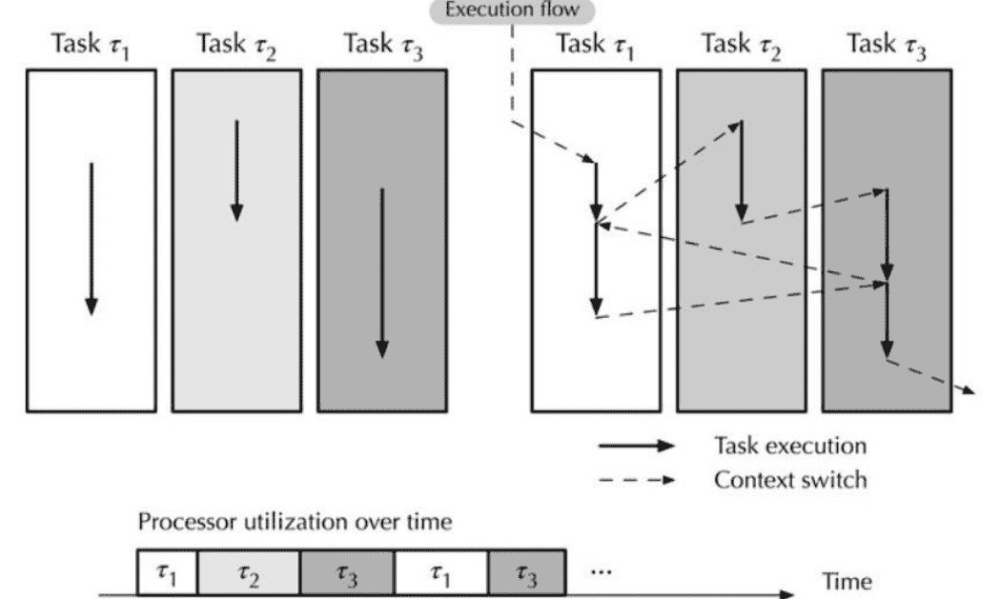

图 3.1 多道程序中的理想化与实际任务执行流。

操作系统经常使用*线程*（thread）作为任务（task）的等效术语。根据上下文的不同，这两个术语在下文中将交叉使用。从历史上看，在 3.1.2 节中引入的*进程*（process）一词，最初被用于表示并发系统中的一个活动。

然而，正如第 6.3 节关于 POSIX 标准所解释的，现在*进程*（process）和*线程*（thread，或任务）这两个词通常以分层的方式被定义和理解。在极少数例外 [2] 之外，进程是一个或多个线程的容器，不同的进程不仅没有自己独立的并发控制流（每个线程一个），而且具有不同的内存地址空间。相反，位于同一个进程中的所有线程（或任务）隐式地共享内存。

更重要的是，围绕多个任务的并发执行来设计和组织软件已被证明是一种非常有用且通用的抽象。特别是，它可以随时适用于任何情况，即使它对应于硬件层面的真正执行并行。多处理器和多核系统就是这种情况，这些系统将是本书“多核”部分的主题。

每个处理器或核心都能独立于其他核心执行其自身的顺序指令流，并处理中断和执行上下文切换。特别是在对比单核系统与多核系统时，有时会使用*伪并行*（pseudo-parallelism）一词来强调，尽管存在多道程序，单核计算机在任何给定的时间时刻仍然以严格的顺序方式执行恰好一个活动。

### 3.1.2 协同顺序进程

任何并发系统，无论其性质和复杂性如何，都可以设计为一组并发执行的操作系统顺序活动，这一构想最早是在 Dijkstra 的一项开创性工作 [42] 中提出的。根据 Dijkstra 的原始命名法，这些活动通常被称为进程。正如之前提到的，特别是在实时操作系统的背景下，它们也经常被称为任务。为了保持一致性，我们在书中也将它们称为任务。

每个任务在并发执行的事务上都是自主的，并持有表示一个随时间演变的顺序程序执行所需的所有信息。根据直觉，这些信息必须不仅包括程序指令，还包括程序状态（程序计数器、寄存器）和内存（变量）。

换句话说，每个任务可以被视为由其“自己的”处理器执行的顺序程序，尽管如图 3.1 所示，取决于系统上可用物理处理器和核心的数量相对于待执行任务的数量，操作系统可能会将核心从一个切换到另一个。即使我们将注意力限制在单核系统上，原则上讲，操作系统也可以使用许多不同的策略来执行任务，例如，根据上下文切换点发生的位置。

在光谱的一端，那些在循环执行器（cyclic executors）[18] 中使用的策略，在任务激活或自愿停止执行时确认调度决策。为了从定时角度提高系统性能，任务可能会被分成多个部分；在这种情况下，任务拆分决策是固定且预先定义的。通过对任务的结构、周期性做出适当假设，所有的调度决策将一次性提前完成。

相反，策略——即本章使用的策略——位于光谱的另一端，调度决策是在运行时根据任务属性做出的。有时，这些属性可能是固定的，并且像任务优先级一样简单，非正式地说，它们表达了任务在系统中的相对重要性。在更复杂的策略中，它们可能会随时间变化，以指示例如任务违反其任何一个时间约束的接近程度。

## 3.2.2 任务控制块与任务状态图


在深入研究操作系统如何处理和管理任务之前，对“任务”究竟是什么以及它表征了哪些信息给出一个更精确的定义是非常重要的。为了在运行时表示一个任务，操作系统会将该任务的所有相关信息存储在一个数据结构中，这被称为**任务控制块（TCB）**。根据任务的通用定义，它必须包含表示顺序程序随时间演进的执行过程所需的所有信息。

如图 3.3 所示，有四个主要组件直接或间接地与 TCB 相关：

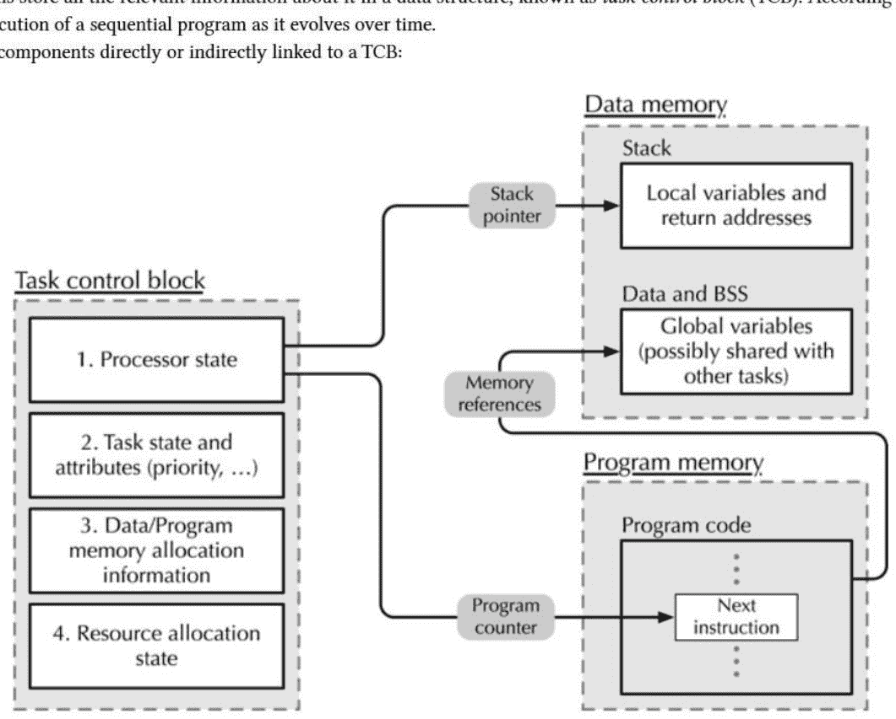

图 3.3 任务状态与任务控制块 (TCB)。

TCB 包含了处理器状态的完整拷贝。操作系统使用这些信息来实现其上下文切换方法，即将处理器从一个任务切换到另一个任务。

事实上，上下文切换的大部分工作是将上一个任务的处理器状态保存到其 TCB 中，然后从下一个任务的 TCB 中恢复处理器状态。操作系统可移植性的一个关键点是上下文切换方法与调度策略之间的清晰分离：后者的实现决定了上下文切换如何执行（通常包含依赖架构的方面），而之前提到的调度策略是与架构无关的，决定了何时发生上下文切换。

在处理器状态中，两个重要的实体是**程序计数器**（它指向处理器在任务程序代码中将执行的下一条指令）和**栈指针**（它记录任务栈中的每一个元素）。两者在图中都描绘为箭头。从上述描述可以推断，处理器状态是 TCB 的不可或缺部分，无论什么操作系统，它始终存在。操作系统在处理器状态存储位置的细节上可能有所不同。概念上讲，如图 3.3 所示，处理器状态是 TCB 的一部分并应该保留其中。某些操作系统遵循这种方法，而另一些将处理器状态的部分或全部存储在其他地方，并通过指针从 TCB 访问。

当底层处理器提供硬件协助来将处理器状态保存/恢复到预定义的、依赖于架构的位置时（该位置通常无法通过软件更改），第二种选择同样既方便又高效。例如，ARM Cortex-M 处理器 [9] 在开始处理中断或更通地说处理异常时，会自主将其部分状态保存到当前任务中。将上下文切换实放在底层异常处理机制之下（在异常处理程序内执行上下文切换）的操作系统可以高效地在相同的位置保存处理器的其余状态。然而，RTEMS 遵循这种方法。尽管硬件可能会导致上下文切换，正如 4.2 节所述，RTEMS 在任务内部执行所有上下文切换。

任务状态和属性由操作系统本身管理，用于调度任务并以有序的方式支持任务间的同步和通信。后续将给出关于任务状态及其调度器使用方式的更详细描述，而任务间同步的信息可以在第 7 章和第 9 章找到。

TCB 中持有的数据程序内存分配信息记录了分配给任务的内存区域。这些信息的范围和复杂性很大程度上取决于操作系统的水平。

一方面，非常简单的操作系统可能只支持固定数量创建的任务，并且可能完全不需要保留这些信息。因为数据和程序内存区域是在链接时分配给任务的，且分配不会随时间改变。另一方面，当操作系统支持在运行时动态创建任务时，代码和数据已预加载到内存中，它通常会从内存池分配 TCB、任务栈以及可能的其他数据结构，并保留分配记录。此外，如果操作系统还能从海量存储设备加载可执行镜像，它还应该记录程序代码和数据被放置在内存中的位置。

4. 当操作系统负责资源分配和释放时，任务控制块还包含相应任务的资源分配状态。这里“资源”一词的意义非常广义。它显然包含了连接到系统的所有硬件设备，但也可能指软件资源。让操作系统在任务和资源之间的分配与释放方面充当调解者，是几乎所有通用操作系统的通用且广为人知的特征，因为这类操作系统的目标是支持由众多程序员开发的多个应用任务共存。由于此原因，资源共享和分配必须处于严格控制之下。

在实时嵌入式系统中，尤其是小型系统，情况非常不同，因为要执行的任务集通常是预先知的。任务与资源之间的关系也可能不同，导致任务之间资源使用的争用减少。例如，在通用操作系统中，应用任务之间竞争使用图形协处理器是非常常见的，而以适当方式共享这种资源至关重要。

相反，实时系统中的资源通常用于单一目的，并由单个任务直接使用。例如，模数转换器通常由数据采集任务管理。访问设备本身对其他任务没有意义，因此在实时系统中，资源通常是永久且隐式分配给某个任务或任务组的，操作系统本身仅参与参与管理。

对 TCB 包含信息的正确定义不仅有助于彻底理解什么是任务，还有助于理解如何管理任务。事实上，很容易注意到操作系统必须保存和恢复来实现上下文切换，以便透明地将处理器从执行一个任务切换到另一个任务。

理解操作系统如何管理任务执行的另一个基本部分是对任务状态如何随时间演进的精确理解。任务状态本身由于是数据结构，只给出了静态描述。描述任务在整个生命周期内可能处于的所有状态的常用方法是定义一个有向图，称为任务图（有时缩写为 TSD）。任务状态图的组织和布局因操作系统而异，但核心概念是通用的。图 3.4 描绘了一个简单的任务状态图作为示例。首先，在任务状态图中：

- 节点表示任务状态，
- 弧表示从一个状态到另一个状态的转换。

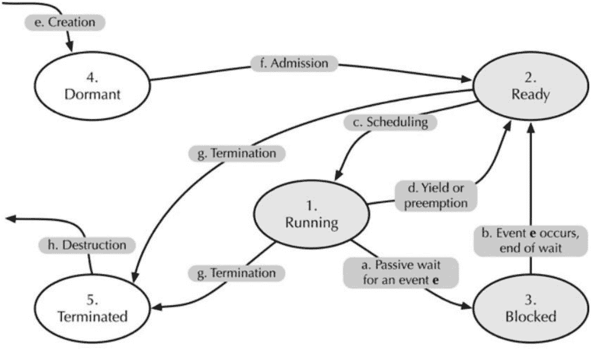

图 3.4 任务状态图 (TSD) 的抽象视图。

对于任务调度和同步而言，最重要的三个状态是灰色所示的状态。具体而言：

1. 当任务正被核心积极执行时，它处于**运行状态**，因此它正在取得进展。运行任务的数量受系统中可用核心总数的限制。
2. 当某一时刻系统中符合执行条件的任务数量超过了可用核心数时（这是非常常见的情况），只有部分任务可以进入运行状态并实际执行。其他任务留在**就绪状态**，暂时不进展。
3. 任务通常需要等待外部事件发生。例如：
   - 周期性任务在完成当前周期的活动后，必须通过执行时间相关的等待来等待下一个周期的开始。
   - 向设备发出 I/O 请求的任务通常需要执行 I/O 等待，直到操作完成。完成事件通常通过中断请求发出信号。
   - 更通用地说，还需要等待来满足优先级约束，并确保任务之间进行有序的通信。

在所有这些情况下，任务都会移动到**阻塞状态**并停留在那里，而不会与其他任务竞争执行资源，直到它们所等待的事件发生。

需要强调的是，任务状态图中通过“阻塞状态”实现的的等待形式，与第 3.1 节描述的基于轮询的等待有很大不同。在执行轮询周期时，任务通过反复检查感兴趣事件是否发生来等待事件的发生。例如，任务可能通过反复查询相关的 I/O 设备来等待 I/O 操作的完成。这通常被称为**活跃等待（或忙等，active busy wait）**，因为任务在等待期间会积极执行指令并消耗核心周期。

相反，阻塞状态下的任务执行的是**被动等待**，在等待期间不消耗任何执行资源，因为调度器不会分配任何核心来执行它们。正如后文将描述的，它们一直处于阻塞状态，直到另一个代理使它们重新回到**就绪状态**。只有在那个时刻，它们才开始竞争执行资源。

回顾图 3.4，任务状态中有两种状态转换：

- **自愿转换**是在发生该转换的任务的控制下进行的，是由于其执行了某个显式操作的结果。
- **非自愿转换**不受受影响任务的控制。相反，它是另一个任务、操作系统所采取的操作或外部事件发生的结果。

如果我们暂时将转换限制在目前为止讨论的主任务状态图状态之间：

a. 从**运行状态**到**阻塞状态**的转换是自愿转换的示例，因为它始终受受影响任务的控制。特别是，它是在任务调用第 5、7 和 9 章将讨论的同步原语之一以等待特定事件 $e$ 时执行的。

b. 相反，从**阻塞状态**到**就绪状态**的转换是非自愿的，因为它发生在事件最终发生时。根据 $e$ 的性质，负责唤醒等待任务的代理可能是另一个任务（当任务需要进程间同步时）、操作系统的定时设施（当任务等待时间相关事件时）或中断处理程序（当任务等待外部事件，如 I/O 操作时），但它绝不受受影响任务的控制。

在直觉上，等待的任务被返回就绪状态并开始与其他任务竞争执行，但它不会直接进入运行状态。然而，这符合操作系统组件之间模块化和职责分离的通用概念。同步机制负责判断任务是否符合执行条件（通过将其置于就绪或阻塞状态），而调度器则决定在任何时刻应该实际执行哪些任务（通过让它们在就绪和运行状态之间来回移动）。

c. 如所述，操作系统调度器负责根据其调度算法的结果，当有代码可用时，从就绪状态选取任务进行执行并将其移动到运行状态。这通常被称为**任务调度**，是另一个非自愿转换的示例。

d. 从运行状态到就绪状态的转换更为复杂，因为它可能是自愿的也可能是非自愿的。运行任务可以通过一个名为 `yield()` 的操作系统请求来表示其愿意放弃正在执行的核心，从而将任务带回就绪状态。反过来，这会导致操作系统运行其调度算法，并从就绪状态的任务中选择一个来运行。取决于调度算法以及就绪状态中其他任务的特征，选择可能落在刚刚让出的任务上。换句话说，`yield()` 的效果仅仅是要求操作系统重新考虑它之前做出的决定。

另一种可能性是操作系统本身决定运行调度算法。取决于操作系统，这可能会定期发生，或者在每次发生状态转换时发生——从直觉上看，这可能是当任务变为就绪状态时，从调度算法的角度来看，它可能比运行任务中的某个“更重要”。

当这种情况发生时，操作系统会将运行状态下的其中一个任务移回就绪状态，这种操作被称为**抢占**。然后，它将从就绪状态中选择一个任务并移动到运行状态。在多核系统中（正如本书其他部分更详细描述的那样），选择也会受到任务**亲和性**的影响，即任务被允许运行的核心集合。

从实际角度来看，操作系统尽可能少地做出任务从一个状态移动到另一个状态的决策，以提高效率。RTEMS 仅在可能改变之前决策结果的事件发生时进行调度，即使在这种情况下它仅执行了实现所需调度算法所需的最少工作。从这个角度来看，最复杂的事件发生在任务阻塞时，这比 `yield()` 要复杂得多。

除了目前介绍的基本状态和转换外，现实世界的操作系统还实现了额外的状态。最常见的额外状态总结如下。


通用操作系统通常在创建新任务后直接将其移入就绪状态。例如，如果任务创建是通过 POSIX API 完成的，就是这种情况。操作系统的另一种常见选择（RTEMS 也采用了这一点）是将任务创建与启动分离。在这种情况下，新创建的任务被置于休眠状态。

当任务删除自己或另一个任务删除它时，它立即停止执行，但某些操作系统可能不会删除其 TCB。在这些情况下，被删除的任务进入**终止状态**。直到操作系统完成与任务终止相关的清理操作，它将一直保持在该状态。例如，Linux 任务默认会进入“僵尸状态”。更通用地说，当任务状态图中存在额外状态时，还需要额外的转换将它们与主任务状态图连接，如下：

- e. **创建转换**初始化一个新的 TCB，描述正在创建的任务。如前所述，取决于操作系统，该转换可能会将新任务引入休眠或就绪状态。
- f. **准入转换**启动休眠任务的执行，通常由系统中正在执行的任务发起。由于任务在不存在或未启动时无法执行任何操作，因此此转换和上一个转换都是非自愿的。
- g. **终止转换**意味着任务执行。由于大多数操作系统允许任务自终止或终止另一个任务，该转换可以是自愿的也可以是非自愿的。在后者的情况下，转换可能源自运行状态或就绪状态。
- h. 最后，**销毁转换**从系统中永久移除任务并销毁其 TCB。

### 3.2.3 实时调度算法

在之前的章节中，我们以非正式的方式引入了调度算法的概念。同时，我们也暗示了任务（及其优先级）的重要性，这是实时调度算法在任何给定时间选择将哪些任务带入运行状态时所采用的主要准则之一。

现在，让我们更深入、更正式地观察两种最广泛使用的算法的工作原理。讨论将从最简单的算法开始，这些算法将优先级定义为在任务创建时分配给任务固定值，因为这是实时操作系统所提供的，也是大多数应用程序所使用的。无疑，更复杂的算法与简单算法相比具有优势，但它们很容易违背实时操作系统实现者至关重要的要求：即在实践中可实现的算法。

由于空间限制，讨论将处于介绍性水平，目标是为感兴趣的读者提供足够的背景信息，以便通过更高级的书籍（如 [26, 31, 36, 85]）进行进一步研究。关于 RTEMS 算法实际实现的更多细节可以在其文档 [105] 中找到。此外，文献 [108] 是关于实时调度算法领域、历史和演变的权威综述。

最后但同样重要的是，在讨论中我们将仅介绍针对单核处理器的调度算法，将多核调度的讨论推迟到第 13 章。

首先，我们观察到在 3.2 节中，对任务顺序的某些约束是必要的，以确保应用程序产生的结果在所有情况下都是正确的。事实上，尽管有这些与正确相关的约束，应用程序仍然会表现出大量的非确定性。

也就是说，任务的执行可能仍然以不同的方式相互干扰，而不违反任何这些约束。回到图 3.2 的示例，交织 (b) 和 (c) 从功能正确性的角度来看是等价的。然而，如果任务对完成所需的时间有截止日期，这种约束被称为响应时间截止时间，那么在从正确性角度来看是可以接受的交织方式中，只有一部分能够满足这些额外的约束。

因此，在实时系统中，必须在保证功能正确性的必要限制之外，进一步限制非确定性，以确保任务执行序列在所有情况下都能产生正确的结果，而且让任务准时满足截止日期。这正是实时调度算法所完成的。

在使用这些算法之一时，在适当的假设下，在 `real_time_scheduling_analysis` 节中简要介绍的调度分析技术能够确定系统中的所有任务能否满足其截止日期，并且可以使用更复杂的技术计算每个任务的最坏情况响应时间。

事实证明评估任意并发应用的时间行为是非常困难的。因此，首先有必要引入一个简化的任务模型，该模型对考虑分析的应用程序结构施加了限制。最简单的模型也称为基础任务模型，具有以下特征：

1. 应用程序由固定数量的任务组成，该数量是预先知的。所有任务都在应用程序整体开始执行的同时创建并启动。
2. 任务是周期性的，具有固定且已知的周期，因此每个任务可以被视为无限实例或作业序列。每个任务实例在规律的时间间隔准备好执行，即在每个任务周期的开始。
3. 任务之间完全独立。它们不以任何方式进行同步通信，也不等待外部事件。
4. 正如下文所述，对给定任务强制执行时间约束，截止日期代表了其实例响应时间的上限，必须始终被满足。在基础模型中，每个任务的截止日期等于其周期。换句话说，任务的上一个实例必须在下一个实例准备好执行之前始终完成。这种截止日期通常被称为隐式截止日期。
5. 每个任务的最坏情况执行时间——即任务在孤立执行时完成其任何实例可能需要的最大处理器时间——是固定的，并且可以离线计算。
6. 所有的系统开销（例如上下文切换时间）都可以忽略不计。

尽管基础任务模型非常直观且简单，但它对理论调度分析具有非常重要的结果。此外，它是速率单调分析（RMA）的基础和起点，它非常广泛。同时，它也有一些限制其在现实场景中应用的缺点，必须对其放松才能使调度分析在实践中有用。具体来说：

- 关于任务独立性的要求排除了第 5、7 和 9 章中描述的时间相关等待和任务间通信。这在实践中是不可接受的，因为这违背了当前并发系统的设计方式——即一组运行的任务，并因此必然会相互作用。
- 任务的截止日期并不总是与其周期相同。例如，短于周期的截止日期——通常称为约束截止日期，对于频繁执行但必须在紧凑时间约束内完成的任务具有特别意义。这是典型的，例如必须对系统的异常状况做出并处理的任务。
- 某些任务是非周期的。这可能发生，例如当任务的执行是由系统外部事件触发时。再次，这是报警和许多形式的网络通信的典型特征，在其中输入帧的到达本质上几乎是周期性的。
- 现代硬件架构包含硬件组件（例如缓存），在这些组件中平均时间可能与最坏情况时间不同。

接下来，还需要引入一些贯穿本书的符号。尽管没有完全的标准，但表 3.1 总结的图 3.5 所示的符号是大多数教材和出版物采用的。特别是：

### 表 3.1 实时调度与分析符号

| 符号 | 含义 |
| --- | --- |
| N | 系统任务数量 |
| $\tau_i$ | 第 $i$ 个任务，$1 \le i \le N$ |
| $T_i$ | 任务 $\tau_i$ 的周期 |
| $D_i$ | 任务 $\tau_i$ 的相对截止日期 |
| $C_i$ | 任务 $\tau_i$ 的最坏情况执行时间 |
| $R_i$ | 任务 $\tau_i$ 的最坏情况响应时间 |
| $\varphi_i$ | 任务 $\tau_i$ 的初始相位 |
| $\tau_{ij}$ | 第 $i$ 个任务的第 $j$ 个实例 |
| $r_{ij}$ | $\tau_{ij}$ 的发布时间 |
| $d_{ij}$ | $\tau_{ij}$ 的绝对截止日期 |
| $c_{ij}$ | $\tau_{ij}$ 的执行时间 |
| $f_{ij}$ | $\tau_{ij}$ 的响应时间 |
| $hp(i)$ | 优先级高于 $\tau_i$ 的任务索引 |
| $B$ | $\tau_i$ 遭受的最坏情况阻塞时间 |
| $K$ | 系统信号量数量 |
| $S_k$ | 第 $k$ 个信号量，$1 \le k \le K$ |
| $usage(k,i)$ | 若 $\tau_i$ 使用 $S_k$ 则为 1，否则为 0 |
| $Q_i$ | 任务 $\tau_i$ 中的自挂点数量 |
| $P_i$ | 任务 $\tau_i$ 的最坏情况自挂起时间 |


# 符号与任务模型

符号 $\tau$ 之前已经介绍，代表系统中的第 $i$ 个任务。如果 $N$ 代表系统中的任务数量，则有 $1 \le i \le N$。除非另有说明，任务按优先级从高到低进行枚举。换句话说，如果 $i<j$，则 $\tau_i$ 的优先级高于 $\tau_j$ 的优先级。

## 周期性任务

周期性任务 $\tau$ 由无限次重复或实例组成。当需要区分 $\tau_i$ 的某一个实例与另一个时，我们使用符号 $\tau_{ij}$ 表示 $\tau_i$ 的第 $j$ 个实例，这些实例按照其时间顺序进行枚举，因此如果 $j<k$，则 $\tau_{ij}$ 在时间上于 $\tau_{ik}$。$\tau_i$ 的第一个实例是 $\tau_{i1}$。

根据定义，周期性任务 $\tau_i$ 的各个实例在固定的时间间隔内释放，即就绪准备执行。相邻释放之间的距离是任务的周期，表示为 $T_i$。

符号 $D_i$ 代表 $\tau_i$ 的相对截止时间，即相对于该实例本身释放时间的截止时间。根据该模型，相对截止时间即为约束条件 $D_i \le T_i$。

$\tau_i$ 的最坏情况执行时间标记为 $C_i$，而 $c_{ij}$ 代表其第 $j$ 个实例的执行时间。考虑到 $C$ 有时可能是保守估计，我们可以将 $C$ 写为当任务在系统中孤立执行（即系统中不存在任何任务）时，完成其任何实例所需的处理器时间的上界。值得注意的是，任务的执行时间不能与下文描述的响应时间混淆。

$\tau_i$ 的最坏情况响应时间标记为 $R_i$，它是当任务与系统中所有其他任务共同执行时，完成其任何实例所需时间的上界。此外，$R_i \ge C_i$，因为其他任务的存在只会恶化 $\tau_i$ 的完成时间。例如，高优先级任务 $\tau_j$ 的出现可能导致调度器在 $\tau_j$ 就绪执行时抢占 $\tau_i$ 以优先 $\tau_j$。这种现象被称为干扰。

由于任务 $\tau_i$ 的实际响应时间 $f_{ij}$ 取决于该特定实例所到的干扰量，它会在不同实例之间变化。仍然满足 $f_{ij} \ge c_{ij}$ 和 $C_i$。

符号 $r_{ij}$ 用于表示任务 $\tau_i$ 的释放时间，即：

$$r_{ij} = \varphi_i + jT_i, \quad j = 0, 1, \dots$$

其中 $\varphi$ 代表 $\tau_i$ 的初始相位，即第一个实例 $\tau_{i0}$ 的绝对释放时间。

同样，$d_{ij}$ 代表任务实例 $\tau_{ij}$ 的绝对截止时间，其给出为：

$$d_{ij} = r_{ij} + D_i$$

(3.1)

(3.2)

$D_i$ 和 $d_i$ 之间的重要区别是前者是一个相对量——相对于每个实例 $\tau_{i,j}$ 的释放时间测量——并且适用于所有实例。相反，后者是一个绝对量，代表了任务实例 $\tau_{i,j}$ 必须已经完成以满足其时间约束的时间。因此，$d_i$ 对于 $\tau_i$ 的每个实例都是不同的。

## 干扰与响应时间

- 如果在 $\tau_{i,j}$ 释放时 $t$ 有高优先级任务正在执行，它不会立即转换到运行状态。相反，它保持在就绪状态，直到高优先级任务完成或由于其他原因离开运行状态。这对应于图3.5中最左侧的干扰。

- 如果在 $\tau_{i,j}$ 释放时有一个高优先级任务正在运行，它可能会暂时停止执行以让位于高优先级任务，这种动作被称为抢占，并在稍后恢复。这通过图中右侧的条形引起了进一步的干扰。

结果是 $\tau_{i,j}$ 的响应时间 $f_i$ 可能会显著长于其执行时间 $c_i$。定义满意的实时调度算法以及对其进行适当分析的方法非常重要的目标是确保对于 $\tau_i$ 的任何实例 $\tau_{i,j}$，$f_i$ 都是界的。

## 调度算法

### 速率单调（RM）调度

由 Liu 和 Layland [84] 的速率单调（RM）调度算法为系统中的每个任务 $\tau_i$ 分配固定优先级，该优先级与其周期 $T_i$ 成反比。然后根据优先级选择执行的任务，即在每个时刻，操作系统调度器都选择优先级最高的就绪任务。当高优先级任务就绪时，会发生对低优先级任务的抢占。

速率单调优先级分配只考虑周期 $T_i$，而不考虑它们的最坏情况执行时间 $C_i$，倾向于周期较短的任务。直觉上说，这是有意义的，因为我们假设的基础任务模型是 $D_i = T_i$，因此，周期较短的任务在错过截止日期之前完成其工作的时间较少。相反，较长的周期可以负担得比更紧急的任务以及在考虑基础任务模型的单核处理器任务更高的优先权。特别是，在以下假设下：

1. 我们考虑一组固定的独立任务。
2. 每个 $\tau_i$ 都是周期性的，周期为 $T_i$，并具有已知的最坏情况执行时间 $C_i$。
3. 每个任务的相对截止时间等于其周期——即 $D_i = T_i$。
4. 所有任务在 $t=0$ 时同时释放，即 $\varphi_i = 0$。
5. 任务根据固定优先级进行抢占式调度。
6. 只有一个执行核心。

已经证明 [84]，如果一组固定优先级的任务可以通过某种算法进行调度以满足其截止日期，那么速率单调算法也能做到。

### 最早截止时间优先（EDF）调度

证明中所使用的优性定义与速率单调（Rate Monotonic, RM）算法采用的相同。也就是说，该证明表明：如果任何任务集在定理的假设下可以被任何调度算法调度，那么它也可以被 EDF（最早截止时间优先）算法**调度。尽管 EDF 已被证明具有优性，但它在常见的实时操作系统中很少被实现。在这方面，RTEMS 是一个值得注意的例外，因为它提供了 EDF 选项，并且该选项在多核核心上是默认使用的。

### 截止时间单调（DMPO）优先级分配

即使采用固定的优先级分配，为了利用其低实现复杂性，还有其他方法可以放宽对任务特征的一些限制，并设计出更适用于现实场景的算法。例如，前面已经提到过，$D_i = T_i$ 的假设（即假设所有任务的相对截止时间等于其周期）可能有时是不符合实际的。

如果我们把基本模型扩展到涵盖更通用的情况 $D_i \le T_i$，Leung 和 Whitehead [82] 能够证明，截止时间单调优先级顺序（Deadline Monotonic Priority Order, DMPO）优先级分配在以下假设下是最优的：

- 1. 我们考虑一组相互独立的任务。
- 2. 每个 $\tau_i$ 都是周期性的，周期为 $T_i$，并具有已知的最坏情况执行时间 $C_i$；
- 3. 每个任务的相对截止时间不超过其周期，即 $D_i \le T_i$；
- 4. 所有任务在 $t = 0$ 时同时释放，即 $r_i = 0$；
- 5. 任务根据其固定优先级进行抢占式调度。
- 6. 只有一个执行核心。

截止时间单调优先级分配在概念上与 RM 非常。它为每个任务分配一个固定优先级，该优先级与其相对截止时间成反比，正如 RM 所做的那样。再次，对“最优”一词的理解必须与 RM 和 EDF 相同。

## 非周期与突发性任务

这种扩展特别适用于处理本质上不是周期性的任务，因此被称为**非周期任务（aperiodic tasks）**。这类任务仍然由相同实例的无限序列组成。然而，它们的释放并不是以规律速率发生的。例如，非周期任务可能由以下因素触发：

- 需要系统响应的用户成员。
- 在不可预测时间产生的外部事件，如警报。

在许多具有实际意义的设置中，可以确定非周期任务的最小到达间隔。在这种情况下，我们称之为**突发性任务（sporadic task）**。例如，由于人类固有的速度限制，可以安全地假设用户生成的事件具有最小到达时间。机械设备（如按键和继电器）在经过适当去抖处理后，也会产生具有保证最小到达间隔的信号。

扩展基本进程模型以限制速率的一种简单方法是：确保一个突发性任务被触发后，在 $\tau$ 的最小到达间隔通过之前，不会再次被触发。这显然是一个保守的选择，因为突发性任务 $\tau$ 的实际释放频率可能远低于 $T_1$，但它仍然保证了任何应用于任务集的调度分析技术，如果成功，就能确保系统能够维持 $\tau$ 的最大释放速率。虽然存在更复杂的处理突发性任务的方法，但它们的描述超出了本主题的范围。关于该主题的全面处理可以在参考文献 [29, 31, 85] 中找到。

对于突发性任务，$D_i = T_1$ 的假设通常变得变得合理，例如当它们可能封装一个实例时。在许多系统中，当它们发生时，必须在短于其周期的截止时间内完成处理，即 $D_i < T_1$。这正是截止时间单调优先级顺序 $T_1$ 设计用于处理的场景。

同样也可以观察到，假设 $\phi_i = 0$（即所有任务在 $t=0$ 时同时释放定义了一个同步周期系统）并不总是满足的，从实践上说这可能是一个挑战。类似于第 7.5 节将讨论的屏障通常可以用于此目的。

尽管如此，以某些 $i$ 的 $\phi_i > 0$ 为特征的异步周期系统也具有实际意义。在这些系统中任务永远不会同时释放，并且证明截止时间单调优先级分配对它们不再是最优的 [82]。然而，存在最优的固定优先级分配，它是 Audsley [15] 提出的，被称为**最优优先级分配（Optimal Priority Assignment, OPA）**。

尽管 OPA 比截止时间单调优先级顺序或 RM 复杂得多，但它的复杂性限于优先级分配算法。一旦分配了任务的优先级，它们就是自由的，并且可以通过截止时间单调优先级顺序和 RM 使用的某些低级调度机制来实现。换句话说——在某种程度上 EDF 也是如此——OPA 的复杂性不会影响在任务图的就绪态和运行态之间移动任务的关键性能操作系统组件的效率。

# 3.3 总结

本章包含了并发编程的基础。它首先定义了协作模型、任务控制块和任务状态图等关键概念。然后，描述了单内核系统常用的调度算法，即速率单调（RM）和最早截止时间优先（EDF）。关于这些算法向多处理器的扩展如何影响其优性性的讨论被留给了本书的第五部分。

# 调度分析与中断处理

## 目录

- 4.1 调度分析基础
- 4.1.1 基于利用率的可调度性
- 4.1.2 响应时间分析
- 4.1.3 任务交互与自悬挂
- 4.2 中断处理的实际考量
- 4.2.1 Cortex-M 处理器中的异常处理
- 4.2.2 异常优先级与进入/退出序列
- 4.2.3 RTEMS 上切换与异常处理
- 4.2.4 调度分析中的中断

## 4.3 总结

本章的第一部分包含了调度分析的介绍，这是一组用于预测任务最坏情况定时行为的工具。由于空间限制，只能讨论最基本的技术，但为感兴趣的读者提供了参考文献。

在本章的第二部分，我们转向中断处理的更多实际考量，并将微处理器架构作为参考。还提供了 RTEMS 系统如何实现该领域的关键活动，特别是任务切换。这些信息对于充分理解第 3 章提出的理论概念和论点至关重要。

本章以讨论中断处理如何融入调度框架结束，这是一个非常重要的课题，因为大多数实时系统都包含不可忽视的中断源。

## 4.1 调度分析基础

在上一节中，已经指出几种调度算法在基本任务模型范围内是最优的，并且可能经过各种扩展。重要的理论结果在关于调度算法特性、任务优先级和底层系统的某些假设下是有效的。

然而，它们仍然没有回答实时软件应用设计过程中出现的一个重要实际问题。也就是说，软件设计人员想要知道他们正在处理的某个任务是否可以由他们选择的操作系统所提供的某种调度算法成功调度。

引入形式化任务模型的结果使得能够精确地定义“成功调度”或用更正式的术语说是“可调度性”（schedulability）。

在简单的情况下，对于可调度性问题，一个直接的“是”或“否”的答案可能是不够的；通常情况下，设计人员还需要确定集合中的所有任务是否都能满足其截止限时间，并可能想知道 $R_i$ 的实际值。这些信息使他们能够判断例如任务距离截止限时间有多远或多近，以防执行过程中出现某些意外的额外延迟。

在本章中，分析范围将限制为在单核处理器上运行的同步系统的固定优先级调度算法，例如 RM 和截止日期优先顺序。对于 EDF、OPA 和其他调度算法，也存在类似但更复杂的分析方法。读者可以参阅其他出版物，例如 [15, 29, 31, 36, 85]，以获取关于这些方法的完整描述。

## 4.1.1 基于利用率的可调度性测试

调度分析方法最简单的函数可以应用于单核系统，它基于一个量——*利用率因子*，通常记为 $U$，并定义为：

```
$U = \sum_{i=1}^{N} \frac{C_i}{T_i}$
```

(4.1)

其中，根据表 3.1 中出的符号，$C_i$ 代表任务 $\tau_i$ 的最坏情况执行时间，$T_i$ 是它的周期。

根据直觉，分式 $C/T$ 代表在最坏情况下执行任务 $\tau$ 所占的处理器时间比例。因此，利用率因子是衡量给定的任务集对其执行的内核所施加的计算负载。相应地，当任务的最坏情况执行时间 $C$ 增加和/或其周期 $T$ 减少时，与任务相关的计算负载也会增加。

尽管 $U$ 派自于非常简单的计算，且其值可能受前面描述的 $C$ 的不确定性的影响，但它仍然对其所指的任务集的可调度性提供了有用的见解。更重要的是，本章讨论的方法可以在系统设计期间随时应用。因此，它们可能对设计本身的合理性提供重要的早期警示，并节省宝的时间。

首先，一个重要的理论结果识别了确定*不可调度*的任务集。也就是说，如果对于给定的任务集 $U > 1$，无论使用何种调度算法，该任务集都无法由单核处理器调度。与此处讨论的其他结果不同，这一结果还可以扩展到多核系统，以证明在 M 核系统上，如果 $U > M$，则任务集确定是不可调度的。

该结果的基本证明证明（可以在 [84] 中找到）是相当直观的。基本上，它指出，给任务分配一个超过所有处理器总时间的处理器时间比例 $U$ 是可能的，即在单核处理器上。还应该注意的是，这一结果代表一个必要条件，当 $U \le 1$ 时，它本身并不提供关于任务集可调度性的任何有用信息。

对于 RM 优先级分配，一个*充分*测试提供了更多见解，使得任务集尽可能同步并符合第 3.2.3 节引入的基本任务模型。更具体地说，可以确定 $U$ 的一个阈值，使得如果 $U$ 低于该阈值，则任务集在单核处理器上确定是可以调度的，取决于其所有其他特性。也就是说，在 [40, 84] 中已证明：

```
$U = \sum_{i=1}^{N} \frac{C_i}{T_i} \le N(2^{1/N} - 1)$
```

(4.2)

当使用 RM 优先级分配时，任务集确定是可调度的。必要充分调度性测试总结在图 4.1 的底部和中间部分。同时，该图强调，当处理器 $U$ 落在 $(N^{1/N}-1)$ 范围内时，基于利用率的测试没有提供确定答案。

| EDF | 可调度 | 不调度 |
|---|---|---|
| RM | 可调度 | ? | 不调度 |
| 任意算法 | ? | 不调度 |

 图 4.1 用于单核处理器的基于利用率的调度测试。

[20] 中描述的 RM 双曲边界产生了一种调度性测试，其计算复杂度与 (4.2) 相同，并使用了相同的假设，但更不悲观。也就是说，如果：

```
$$\prod_{i=1}^{N} (\frac{C_i}{T_i} + 1) \leq 2$$
```

(4.3)

使用 RM 优先级分配时，任务集确定是可调度的。然而，这仍然是一个充分测试，即任务集即使不通过测试也可能是可调度。在这种情况下，需要像 4.1.2 节描述的更复杂的技术来准确评估调度性。但必须考虑到额外的计算复杂度可能会使这些技术失效。

在相同假设下，对于 EDF 也存在类似于 (4.2) 的调度性测试。在这种情况下，$U$ 的阈值恰好为 1，使得测试既是必要的也是充分。也就是说，$N$ 个周期同步任务的任务集是可调度的当且仅当：

```
$$U = \sum_{i=1}^{N} \frac{C_i}{T_i} \leq 1$$
```

(4.4)

如图 4.1 上部所示，对于 RM 的相应测试，EDF 的基于利用率调度测试没有不确定区域。

## 4.1.2 响应时间分析

在上一节中，我们观察到，对于某些 $U$ 值，基于利用率的测试对于 RM 优先级分配的任务集的可调度性没有提供足够的信息。因此，研究人员开发了更复杂的测试来提供确定答案。其中，我们将关注被称为响应时间分析 (RTA) [16, 17] 的方法，这是一种精确（必要充分）调度测试，可以应用于单核处理器上的任何固定优先级方案。

该测试不仅对调度性问题给出“是”或“否”的答案，还为每个任务单独计算最坏情况响应时间 $R_i$。因此，可以将它们与相应的截止时间 $D_i$ 进行比较，判断它们距离截止时间有多远或多近。根据响应时间分析，同步系统中任务 $i$ 的最坏情况响应时间 $R_i$ 可以通过以下关系计算：

```
$R_i^{(k+1)} = C_i + \sum_{j \in hp(i)} \left\lceil \frac{R_i^{(k)}}{T_j} \right\rceil C_j$
```

(4.5)

其中 $\lceil \cdot \rceil$ 是大于或等于其参数的最小整数，$hp(i)$ 表示优先级高于 $\tau_i$ 的任务索引。对于 RM，约定设置所有周期 $T_j < T_i$ 的任务索引 $j$。如果我们遵循任务按优先级递减顺序枚举的约定，则 $hp(i) = \{1, \dots, i-1\}$。

俗称 $w_i^{(k+1)}$ 和 $w_i^{(k)}$ 分别是 $R_i$ 的 $(k+1)$ 次和 $k$ 次估计值，方程 (4.5) 提供了一种从上一个开始计算 $R_i$ 估计值的方法。$R_i$ 的首次近似 $w_i^{(0)}$ 是 $w_i^{(0)} = C_i$，这是 $R_i$ 的最小值。已经证明由 (4.5) 定义的序列 $w_i^{(0)}, w_i^{(1)}, \dots, w_i^{(k)}, \dots$ 是单调不减的。可能有两种情况：

- 如果序列不收敛，无论 $D_i$ 的具体值如何，都存在一种调度场景使得 $\tau_i$ 不能满足其截止时间 $D_i$。
- 如果序列收敛，它收敛于 $R_i$，因此对于某个 $k$，将满足 $w_i^{(k+1)} = w_i^{(k)} = R_i$。在这种情况下，$\tau_i$ 在所有可能的调度场景下满足其截止时间，当且仅当响应时间分析提供的最坏情况响应时间 $R_i \le D_i$。


与 4.1.1 节讨论的基于 U 的调度测试不同，该方法不再假设相对截止时间 $D_i$ 等于任务周期 $T_i$，并且能够处理 $D_i \le T_i$ 的通用情况。此外，该方法适用于任何固定优先级排序，只要 $hp(i)$ 定义得当，所使用的抢占式调度器符合基本任务模型并在单核处理器上执行即可。

## 4.1 任务交互与自挂起

响应时间分析的另一个有趣特性是，它比基于 U 的测试更灵活，并且易于进一步扩展，例如，考虑任务交互的影响。这些扩展旨在消除目前为止所使用的基础任务模型的一个局限性，并使其更接近真实世界中任务的行为。

为了简单起见，在书中，讨论将仅涉及以下两类主要的交互：

1.  由于互斥而引起的任务交互，这是在处理共享数据时无处不在的必要性，如第 7 节所示。
2.  任务挂起，当任务被动等待任何类型的外部事件时发生。

关于该主题的更详尽、更全面的信息，请读者参阅 [31, 86]。

第二种交互非常重要，因为它发生在许多输入/输出操作中。在这些情况下，设备内的任务通常通过正确编写设备控制寄存器来启动操作，然后被动等待结果。反之，设备通过产生中断请求来指示请求的操作已完成，其处理程序会唤醒等待中的任务。

其他示例仅涉及任务而不涉及设备，包括第 7 节概述的基于信号量的任务同步，以及第 9 节中讨论的同步消息传递操作。

无论交互的性质如何，任务都将不可避免地由于交互产生阻塞，无论这种交互是基于本书这部分将描述的基于等待和锁的同步方法。这些同步方法以及任务使用它们的方式的合理设计，其作用是确保每个单独任务 $\tau_i$ 承受的最坏情况阻塞时间是有界的。然后可以计算最坏情况阻塞时间，并将其用于完善第 4.1.2 节讨论的响应时间分析方法，以确定最坏情况响应时间。

还存在无等待和无锁同步，它们在多核并发的背景下特别有用，尽管它们在设计和实现复杂性方面可能有显著缺点。将在第 13 节中进行详细讨论。

当采用更传统的同步方法时，$B_i$ 的值可以用于扩展响应时间分析，并考虑最坏情况响应时间实现中的阻塞时间。即，基本递归关系 (4.5) 可以重写为：

```
$w_i^{(k+1)} = C_i + B_i + \sum_{j\in hp(i)} \frac{w_j^{(k)}}{T_j} C_j,$
```

(4.6)

已经证明，新的递归关系仍然具有与原始相同的属性。特别是，如果序列 $w_i^{(0)}, w_i^{(1)}, \dots, w_i^{(k)}, \dots$ 收敛，那么对于适当的 $w_i^{(0)}$ 选择，它仍然提供最坏情况响应时间 $R_i$。另一方面，如果序列不收敛，则 $\tau_i$ 肯定不可调度的。在此之前，设置 $w_i^{(0)} = C_i$ 为序列提供了一个合理的初始值。

主要的区别在于，这种公式可能是悲观的，而不是必要且充分的，最坏情况阻塞时间的边界 $B_i$ 可能并不紧密。任务在实践中可能永远无法产生等于 $B_i$ 的阻塞时间，并实际经历通过 (4.6) 计算出的最坏情况响应时间。

正如第 8 节中更详细说明的那样，使用简单的信号量互斥设备不足以确保 $B$ 是有界的，由于一种被称为“无界优先级反转”的众所周知现象。然而，已经设计了信号量语义的适当扩展（也称为协议，同样在第 8 节中介绍）来解决这个问题。如果我们考虑由 Sha、Rajkumar 和 Lehoczky [110] 提出的优先级继承协议——已经证明，如果每个任务 $\tau_i$ 实例由于任务交互而承受的最坏情况阻塞时间是有界的，且边界由：

```
$B_{\tau_i}^{PI} = \sum_{k=1}^{K} usage(\tau_i, i)C(k).$
```

(4.7)

在上述方程中，$usage(\tau_i, i)$ 是一个函数，如果信号量 $S_k$ 被（至少）一个优先级低于 $\tau_i$ 优先的任务使用，并且被（至少）一个优先级高于或等于 $\tau_i$ 自身优先的任务使用，则返回 1。否则，$usage(\tau_i, i)$ 返回 0。$C(k)$ 是与信号量 $S_k$ 相关或由其保护的所有临界区中的最坏情况执行时间。

应该注意的是，(4.7) 提供的边界在应用于真实场景时通常是“悲观的”，因为：

- 它假设如果某个信号量可能阻塞某个任务，它确实会阻塞它。
- 对于每个信号量，$\tau_i$ 所遭受的阻塞时间始终被认为等于该信号量保护的最长临界区的最坏情况执行时间，尽管被阻塞的任务实际上并没有在该区域内停留。

然而，即使是悲观的，这在其计算的边界紧密性与其计算复杂度之间也是一种可以接受的折中。存在更好的算法并能够提供更紧密的时间边界，但分析的复杂性也变得更高，这对于大型任务可能会出现问题。

第 8 节中预见的另一种可能性是使用相同作者提出的优先级上限协议。在这种情况下，可以证明每个任务 $\tau_i$ 实例由于任务交互而承受的最坏情况阻塞时间是有界的，且边界由：

```
$B_{\tau_i}^{PC} = \max_{k=1}^{K} \{usage(\tau_i, i)C(k)\}.`
```

(4.8)

其中，$usage(\tau_i, i)$ 如果信号量 $S_k$ 被（至少）一个优先级低于 $\tau_i$ 优先的任务使用，并且被（至少）一个优先级高于或等于 $\tau_i$ 自身优先的任务使用，则返回 1。否则，$usage(\tau_i, i)$ 返回 0。$C(k)$ 是与信号量 $S_k$ 相关或由其保护的所有临界区中的最坏情况执行时间。

应该注意的是，(4.8) 提供的边界在应用于真实场景时通常是“悲观的”，因为：

- 它假设如果某个信号量可能阻塞某个任务，它确实会阻塞它。
- 对于每个信号量，$\tau_i$ 所遭受的阻塞时间始终被认为等于该信号量保护的最长临界区的最坏情况执行时间，尽管被阻塞的任务实际上并没有在该区域内停留。

然而，即使是悲观的，这在其计算的边界紧密性与其计算复杂度之间也是一种可以接受的折中。存在更好的算法并能够提供更紧密的时间边界，但分析的复杂性也变得更高，这对于大型任务可能会出现问题。通过比较 (4.7) 和 (4.8)，我们可以很容易地看到 $B_i^{PC} \leq B_i^{PI}$。这是因为优先级上限协议比优先级继承更灵活。

### 任务挂起

这里对挂起的分析处理了实时任务的可调度性。与直觉相反，挂起的影响并不总是局部的。高优先级任务的挂起可能会增加低优先级任务的最坏情况响应时间。

然而，最坏情况阻塞时间可以高效地计算为：

```
$B_i^S = P_i + \sum_{j\in hp(i)} \min(C_j, P_j)`
```

(4.9)

在上述公式中：

- $P_i$ 是任务 $\tau_i$ 的最坏情况挂起时间
- $hp(i)$ 表示高于 $\tau_i$ 的任务集合
- $C_j$ 是任务 $\tau_j$ 的执行时间

根据 (4.9)，任务 $\tau_i$ 遭受由于挂起的最坏情况阻塞是由 $P_i$ 加上属于 $hp(i)$ 的每个高优先级任务的贡献组成的。任务 $\tau_j$ ($j \in hp(i)$) 对 $B_i$ 的单独贡献绝不会超过其执行时间 $C_j$。

当考虑互斥和挂起产生的影响时，事实证明这两个阻塞源并不是相互独立的，因为任务的挂起会影响它与其他任务的交互。有不同的考虑挂起和互斥对最坏情况阻塞时间影响的方法。最直观的一种（见 [85, 102]）使用了任务段的概念——即由挂起点划分的任务部分。如果任务 $\tau_i$ 在执行过程中执行 $Q_i$ 次挂起，它就有 $Q_i+1$ 个段。

任务段在涉及互斥时被认为是完全独立的。然后，分析以保守的方式进行，假设在每次挂起后任务都会回到最坏的互斥阻塞场景。遵循这种方法，通过类似 (4.7) 或 (4.8) 计算的由于互斥导致的 $B_i^{PI}$ 或 $B_i^{PC}$ 变成了每个单独任务段承受的最坏阻塞时间。

因此，任务 $\tau_i$ 由于互斥的最坏情况阻塞时间 $B_i^{TI}$ 给出：

$B_i^{TI} = (Q_i + 1)B_i^{PI}$ (优先级继承协议)，或

(4.10)

(4.11)

$B_i^{TI} = (Q_i + 1)B_i^{PC}$ (优先级顶协议)。

通过结合 (4.9) 和 (4.10)-(4.11)，$\tau$ 的最坏情况阻塞时间 $B_i$ 考虑了直接自挂起及其对互斥阻塞的影响，可以写为：

```
$B_i = B_i^{SS} + B_i^{TI}$
$= P_i + \sum_{j\in hp(i)} \min(C_j, P_j) + (Q_i + 1)\sum_{k=1}^K usage(k, i)C(k),`
```

(4.12)

对于优先级继承协议，或：

```
$B_i = B_i^{SS} + B_i^{TI}$
$= P_i + \sum_{j\in hp(i)} \min(C_j, P_j) + (Q_i + 1)\max_{k=1}^K usage(k, i)C(k),`
```

(4.13)

对于优先级顶协议或立即优先级顶协议。在下面的公式中，$C_j$ 和 $C(k)$ 的含义不同，尽管符号相似，但不应混淆，即：

- $C_i$ 在此情况下是特定任务 $\tau$ 的最坏情况执行时间，而
- $C(k)$ 是任何受 $S_k$ 保护的临界区域内任何任务的最坏情况执行时间。

所描述方法的一个明显优势是它非常简单，且对任务内部结构所需的知识非常少。例如，有必要知道每个任务中有多少个自挂起点，但不需要确切知道它们在何处。这种信息随着软件随时间的推演，容易收集和维护。然而，使用极少信息的缺点是该方法极其保守。因此，根据 (4.12)-(4.13) 计算出的边界 $B_i$ 绝对不是紧的，在某些情况下可能会严重高估实际的最坏情况阻塞时间。

确实存在复杂且精确的方法，例如参考文献 [77] 中描述的那种。然而，正如我们在其他几种情况中看到的，获得更紧上界的代价是需要收集更多信息，可能重要的是，随着软件的演进需要维护更多信息。例如，在 [77] 的情况下，我们不仅需要知道每个任务中有多少个挂起点，还需要它们在任务中的确切位置。也就是说，我们需要知道每个单独任务段的最坏情况执行时间，而不是整个任务的最坏情况执行时间。

## 4.2 中断处理的实际性考虑因素

虽然前面的章节提供了中断处理更具理论性的视角，但在这里我们将关注三个更具实际意义的方面，即现代处理器如何在硬件层面处理中断请求，以及 RTEMS 操作系统是如何管理中断和上下文切换的。最后，我们还将提供关于如何在调度性分析中考虑系统中断负载的提示。

## 4.2.1 Cortex-M 处理器中的异常处理

与许多现代处理器类似，Cortex-M 处理其他类型事件（如故障）的方式与中断相同，即以一种统一的方式。所有这些事件统称为异常（exceptions）。由于这个原因，在本节中我们通常讨论异常处理，而不是中断处理。

所有异常共同具有的一个属性是，它们的发生可能会中断主指令流，并引导处理器执行与它们相关的代码片段。

`HardFault` 是一种故障类型。它可以由两种不同的原因产生。首先，处理器在处理异常期间检测到错误时会产生 `HardFault`，导致正常的异常处理无法进行。产生 `HardFault` 的第二个原因是被称为“故障升级”（fault escalation）的机制。该机制的详细描述超出了本书的范围，广义地说，在某些条件下，故障升级会将某些其他异常转换或升级为 `HardFault`。

当处理器已经在处理另一个异常时又发生了新异常，就可能发生这种情况。由于底层处理器架构支持异常嵌套（如第 4.2.2 节所述），处理器可能会立即接受并处理传入的异常——通过一种类似于函数调用的机制将其嵌套到之前的异常中——或者将其推后处理，这取决于两个异常之间的相对优先级。

然而，某些异常必须相对于代码执行同步处理，也就是说即使在正在处理高优先级异常的情况下，也必须在处理器继续执行下一条指令之前处理这些异常。一个典型的例子是 `UsageFault` 异常，如前所述，它指示当前指令无法执行。

在这些情况下，如果传入异常的优先级不足以对其进行处理，处理器会自动将传入异常的优先级提升到 `HardFault` 的优先级，这是系统中最高的优先级之一。如果优先级升级仍不足以使传入异常激活（因为处理器已经在以 `HardFault` 优先级或更高的优先级运行），该架构的通用假设是新异常的发生是不可恢复且致命的。


在大多数情况下，处理器的反应是完全挂起指令执行并进入锁定状态。尽管某些条件可能导致处理器放弃此循环并恢复指令执行，但在大多数情况下，离开此状态的唯一方法是执行重位。

## 管理器调用 (SVC)

此异常通过执行 `SVC`（管理器调用）汇编指令产生。它是同步异常的典型示例，因为它是在处理器在指令流中遇到该汇编指令的精确点产生的。`SVC` 自成一类，因为它通常用作进入操作系统内核并请求其执行某个功能。

然而，如第 4.2.3 节所述，在 RTEMS 中，内核是通过普通函数调用进入的，`SVC` 仅用于恢复保存到任务栈上的部分处理器硬件上下文，因为在这些任务执行时接受了异常。

## 重位 (Reset)

此异常由处理器上电序列或热重位产生。处理方式与其他异常类似，但会执行一些额外操作，以确保处理器以一致的方式开始执行代码。例如，重位异常初始化了主栈指针（`MSP`），它是处理器中的两个栈指针之一，也是处理器在重位后立即实际使用的指针，并设置了初始程序计数器，代码执行将从此处开始。处理器的执行模式也不同。此外，如果重位异常在处理器已运行时发生（热重位），则指令执行可以在任意点停止。

### 4.2.2 异常优先级与进入/退出序列

如第 3.1 节所提到的，过去接受和处理来自特定源的中断主要取决于中断源是否启用以及处理器是否已经在处理另一个中断。中断优先级划分仅用于区分在同时发出的多个中断请求。尽管这在今天仍然部分正确，但在 Cortex-M 决策中，一个传入的异常请求是否应该变为激活（即处理器是否应该立即开始处理它），还取决于其他因素。

- 如表 4.1 半部所示，每种异常都有自己的异常优先级，这是一个整数值。在优先级层次结构中，数值越小，优先级越高。优先级值可以是固定的，也可以是可编程的。

| 表4.1 Cortex-M3 处理器中的异常和执行优先级 | 优先级 p |
| :--- | --- |
| 异常 Reset | -3 |
| 不可屏蔽中断 (NMI) | -2 |
| HardFault | -1 |
| UsageFault, BusFault, MemManage, SVC | $0 \le p \le 255$，或 $-1$ |
| 中断（包括 SysTick 和 PendSV） | $0 \le p \le 255$ |
| 执行 | 优先级 $q$ |
| 基础级 | 256 |
| 激活异常 | 激活异常中的最小值 $a$（如果有） |
| BASEPRI | 如果 $b > 0$，则寄存器值为 $1 \le b \le 255$ |
| PRIMASK | 如果掩码位设置则为 0 |
| FAULTMASK | 如果掩码位设置则为 -1 |

- 受优先级升级影响

例如，`NMI` 请求的优先级始终为 -2，而中断请求的优先级可以单独设置为 0 到 255 之间的任何非负值 p。取决于处理器的实现，优先级值的某些高位可能具有意义，因此，如果不同的优先级值仅在某些低位上不同，数值不同的优先级值可能对应相同的实际优先级。

当有多个同时传入的异常时，优先级最高（优先级值最低）的异常优于其他异常并决定传入的异常。如果有两个或多个同时传入的优先级相同的异常，则数值上最低的异常号（一个由处理器架构定义的唯一且固定的数字，与其他异常相关）具有优先权。

同时，处理器还跟踪其当前的异常优先级 e。执行优先级的计算方法为表 4.1 半部所示的几个值的最小值：

- 异常的基础级，即处理器支持的最高优先级值，在这种情况下为 256。
- 所有已激活且仍在处理的异常中的最小优先级值（如果有）。可能存在多个此类异常，将在处理部分进行描述。
- 如果 `BASEPRI` 不为零，则 8 位寄存器的值 1~255。如果 `BASEPRI` 为零，则不考虑其值。
- 取决于 `PRIMASK` 和 `FAULTMASK` 是否设置，分别为 0 和 -1。

然后比较 i 和 e 的值以确定传入异常是必须激活还是保持挂起状态。特别是：

- 如果 i < e，则传入异常激活且处理器立即开始处理它。结果是如果处理器已经在处理另一个异常，则新异常的处理嵌套到旧异常中。换句话说，处理器临时停止旧异常以优先处理新异常，并在以后返回它，机制类似于普通函数调用。
- 否则，如果 i >= e，则异常保持挂起。每当 e 变化并在数值上高于 i 时，处理器将重新评估将其激活的可能性。

重新评估仍如上述所示进行，并将在此期间到达的任何进一步异常请求考虑在内。例如，当激活异常的处理终止时会进行重新评估，因为这增加了 a 的值，进而增加了 e 的值。

此外，程序员可以通过设置 `BASEPRI`、`PRIMASK` 和 `FAULTMASK`，通过降低 e 的值来屏蔽并推迟某些异常的处理。例如，将 `BASEPRI` 设置为非零正值 t 将阻止处理器接受任何优先级值 i >= t 的异常，除非发生优先级升级。

两个异常之间的相对优先级决定一个异常的到达是否可以抢占另一个异常的处理。需要注意的是，这一方面即 i 和 e 的比较可能会受到名为“优先级分组”（priority grouping）的处理器功能的影响。

尽管深入讨论超出了本书的范畴，但通过优先级分组，可以指示处理器在比较 `i` 和 `e` 时忽略优先级值中的某些低位，从而使得原则上不同的优先级级别在比较时“看起来是相同的”。结果是，优先级仅在这些低位上不同但在其他位上相等的异常，将不会相互嵌套（nesting）。

在详细讨论处理器在接受异常请求时会发生什么之前，有必要简要介绍处理器执行模式的概念。从这个角度来看，Cortex-M 的方法比其他架构要简单得多，它只有两种执行模式，称为线程模式（thread mode）和处理模式（handler mode）。

## Thread mode

线程模式是正常的任务执行模式，也是处理器在接受并处理复位异常时进入的模式。`CONTROL` 寄存器的 `PSSEL` 位决定了处理器在线程模式下使用的栈指针。有两个选择：主栈指针（`MSP`）和进程栈指针（`PSP`），它们通常指向内存中不同的栈。确切知道在任何时刻正在使用哪个栈指针，对于完全理解操作系统异常处理和多任务机制的工作原理至关重要。

## Handler mode

顾如名义，该模式用于处理器执行除复位处理程序之外的所有异常处理程序。无论 `PSSEL` 位的设置如何，在处理模式下执行的代码都会使用 `MSP`。当处理器在线程模式下执行、接受异常请求并响应时，它会自动进入处理模式。相反的转换（从处理模式返回线程模式）发生在异常返回、没有其他活跃异常，且处理器是在其处于线程模式下执行时开始处理当前异常的。

一种特殊的模式转换发生在运行在线程模式下的代码执行 `SVC` 指令时（如第 4.2.1 节所述），由于该指令会无条件地发出异常请求。该异常相对于当前指令流是同步的，并通过由操作系统实现的受信软件例程——异常处理程序——授予对处理模式的受控访问。

对于任务执行和异常处理程序执行分别使用两种不同的执行模式，这在现代处理器架构中非常常见，尽管不同架构之间的名称可能有所不同。事实上，RTEMS 假设其支持的所有架构都具备这两种模式。正如第 4.2.3 节将更好地解释的，它始终在线程模式下执行上下文切换以增强可移植性。

## Exception entry sequence

构成异常进入序列的主要阶段（即处理器在激活异常并开始处理异常时执行的动作序列）如图 4.2 所示。

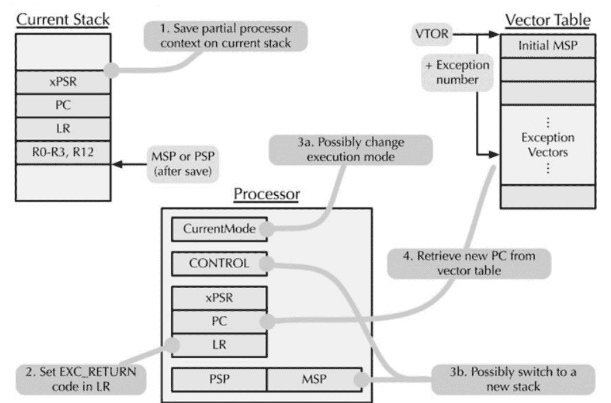

图 4.2 ARM Cortex-M 处理器的异常进入序列。

1. 第一动作是将当前执行的一部分保存到当前栈上，即处理器在接受异常请求时使用的栈。保存到基础异常帧（exception frame）中的最小信息包括寄存器 `R0` 到 `R3`、`R12`、链接寄存器 `LR`（也称为 `R14`）、程序计数器 `PC`（`R15`）以及程序状态 `XPSR`，共32 字节。

当处理器实现可选的浮点扩展时，部分浮点上下文也会保存到扩展异常帧中。然而，要保存在栈上的浮点上下文部分相当大，需要额外的 68 字节。尽管如此，RTEMS 会尽可能避免保存和恢复浮点上下文。

该架构还支持延迟上下文切换策略 [10]，即一种机制，只有当通过执行浮点指令要修改上下文时，才自动推入浮点上下文。这种方法只能用于单核系统，因为它在多核系统上无法正常工作。为了简单起见，接随的讨论将不再进一步探讨浮点上下文的管理。

在两种情况下，处理器都会相应地更新 `PSR` 或 `MSP`，使其指向异常的基地址。根据配置和控制寄存器 `CCR` 中 `STKALIGN` 位的值，处理器还可能调整栈指针以确保异常对齐到 8 字节的倍数。

保存执行上下文之所以是因为接受和处理异常不应阻止处理器稍后回到其当前活动。相反，由于第 3.1 节所述的原因，所有异常的处理对于其到达时恰好正在执行的任何代码都应该是透明的。这对于中断尤其如此，而且通常对于任何与当前处理器活动异步发生的其他异常也是如此，因为它们往往与这些活动无关。

对保存内容的选择源于一个关键目标：使生成的栈布局与 ARM 架构过程调用标准（AAPCS）[12] 兼容。特别是在进入异常时，处理器保存了整数上下文中的调用者保存（caller-saved）部分。如果异常处理程序使用了上下文的其他部分，则由其负责正确防止上下文被覆盖。

通过这种方式，任何符合 AAPCS 的函数都可以作为异常处理程序，当异常处理程序用高级语言编写时，这是一项特别重要的特性，因为编译器默认生成符合 AAPCS 的代码。因此，它们也可以在不将其视为特例的情况下生成异常处理代码。

总而言之，当处理器硬件准备调用另一个程序时，其保存上下文的方式与符合 AAPCS 的软件过程完全相同。结果是，由硬件执行的异常处理程序调用，从被调用过程（通常命名为 callee）的角度来看，与普通的软件启动的程序调用是不可区分的。这是在所有架构上都要实现的通用模式。在 Cortex-M 情况下，硬件在进入异常时会自动在栈上保存上下文，但在其他架构上可能需要汇编指令来补充这一操作。

2. 将链接寄存器 `LR` 设置为相应的异常返回码 `EXC_RETURN`。当异常返回码被加载到程序计数器 `PC` 时，作为函数尾尾程序的一部分，它被设计为执行异常返回序列，而不是普通的程序调用。

再次，异常处理程序通过将 `LR` 中保存的值同步存回 `PC` 来实现返回。

`EXC_RETURN` 提供的信息允许处理器定位要恢复的异常帧，正确解释它，并将处理器带回接受异常时的执行模式。具体来说，`EXC_RETURN` 的低 5 位指示：

- 创建异常帧时处理器使用的是 `MSP` 还是 `PSP`；
- 要恢复的异常帧类型（基础还是扩展的）；
- 处理器必须返回的执行模式。

`EXC_RETURN` 的高 4 位始终设置为 `0xF`，以指示加载到 `PC` 的值确实是必须特殊处理的 `EXC_RETURN` 码。其余位目前未使用。

需要注意的是，处理器仅在特定情况下（在 [8, 9] 中详细说明）将加载到 `PC` 的值解释为可能的 `EXC_RETURN` 值。其他情况下，例如当处理器处于线程模式并加载 `PC` 时（此时没有活跃的异常处理程序），该值被字面视为内存地址。为了避免将 `EXC_RETURN` 值错误加载到 `PC` 导致不当行为，事实上硬件保护 `0xFF000000–0xFFFFFFFF` 地址不受指令执行。

3. 如果处理器在接受异常时处于线程模式，则切换到处理模式。如果处理器已经在处理另一个异常，它将保持在处理模式。正如之前所述，由于模式切换，处理器可能开始使用一个新的栈。该规则的一个显著例外是返回异常，它在处理器自动配置为使用 `MSP` 时在线程模式下处理。

4. 处理器进入异常时执行的最后一个动作是从异常向量表中检索目标 PC——即异常处理程序的入口点——并跳转到那里。异常向量表包含称为异常向量的内存地址。更具体地说，表中第 $i$ 个条目持有第 $i$ 个异常处理程序的入口点。由于异常号是固定的，且与优先级不同，每个异常号都是唯一的，因此不会产生歧义。

架构规范仅定义了前 16 个异常。向量的总数不是固定的，取决于 Cortex-M 家族特定成员支持的异常数量，以及配置和实现细节。第一个条目（索引为 0）有特殊用途，因为没有异常会被分配异常号 0。相反，该条目包含进入异常时加载到 `MSP` 中的初始值。

向量表的起始地址存储在向量表偏移量寄存器（`VTOR`）中。`VTOR` 的低 7 位被保留，并始终被解释为 0，因此向量表的最小对齐单位为 128 字节。在某些情况下，取决于表中条目的总数，可能会产生更高成本的对齐要求。

当处理器接受异常并在处理它之前，`VTOR` 寄存器会被置零。结果是，在接受异常时 `PC` 和 `MSP` 的初始值不是从向量表中检索的，而是从零。在所有情况下，`VTOR` 寄存器决定处理器访问向量表的地址。在特定设备上，这可能是内存中向量表的物理地址，可以通过地址重映射进行更改。

例如，在 NXP LPC17xx 微控制器中，可能位于地址 `0x00000000` 处的引导 ROM（通常位于物理地址 `0xFFFF000`）镜像，而不是片上闪存内存（通常位于 `0x00000000`）。重映射由设备 `MEMMAP` 寄存器的第 0 位控制。

嵌套异常遵循通用规则，即处理器使用活动栈指针将当前异常处理程序的执行上下文推入当前栈，以实现后入先出的异常帧保存和恢复，这与普通调用处理栈帧的方式相同。

## 从异常返回

如前所述，当异常程序结束并将 `EXC_RETURN` 代码加载到 `PC` 时，处理器开始异常返回序列，最终目标是透明地恢复异常发生时正在执行的活动。为了实现这一点，处理器必须还原图 4.2 中描的所有栈帧。

1.  首先，处理器检查并解释 `EXC_RETURN` 代码，以确定使用哪个栈指针（`MSP` 或 `PSP`）来定位要还原的异常帧，评估异常帧的内容，并决定还原后的处理器模式（handler 或 thread）。

2.  然后，处理器执行若干完整性检查（如 [8, 9] 所示），以确保从异常返回是合法的。例如，正在处理的异常在进入异常时记录，处理器必须当前以 handler 模式执行，如果准备返回 thread 模式，则 `IPSR` 还原为零。任何检查失败都会触发 `UsageFault`。

3.  最后，处理器还原如步骤所述的异常帧内容。其他内容包括接受异常时在 `xPSR` 中记录的异常号和 `PC`。

上下文恢复的结果是，在嵌套异常的情况下，处理器从之前被中断的地方恢复执行，且 `IPSR` 包含异常号。

相反，如果返回的是嵌套异常链的最后一个异常处理程序（完全没有异常），则还原的异常栈中的 `IPSR` 为零，这也是在异常返回时必须加载到寄存器中的值。

### 4.2.3 上下文切换与异常处理

在 3.2.2 节中，我们引入了任务控制块（TCB）的通用概念，它在多任务操作系统，特别是上下文切换机制中起着关键作用。因此，图 3.3 以抽象的方式描述了 TCB 内容。在本节中，我们将详细讨论 RTEMS 如何实现 Cortex-M 架构上与上下文切换相关的 TCB 部分。

为了展示上下文切换和异常处理，我们还将 RTEMS 如何利用软件触发的异常在中断后重新调度内核。然而，RTEMS 利用这些异常来简化上下文切换，仍然在任务上下文中执行所有上下文切换。这种方法使得设计更加一致和统一，因为由任务自愿行为（例如当它阻塞时）触发的上下文切换与由准备高优先级任务的中断引起的强制上下文切换之间不再有区别。

如图 4.3 所示，RTEMS TCB 由 `Thread_Control` 数据结构表示，它嵌入了一个名为 `Context_Control` 的体系相关子结构。该结构包含了 Cortex-M AAPCS [12] 指定的所有调用者保存寄存器（callee-saved registers）。调用保存寄存器（caller-saved registers）未存储在其中，因为负责上下文切换的 RTEMS 函数 `CPU_Context_switch` 是一个符合 AAPCS 的 C 函数。因此，当任何高层函数调用它执行上下文切换时，由编译器负责在之前保存这些寄存器（通常在任务栈上），并在 `CPU_Context_switch` 返回后还原它们。总结来说，在上下文切换期间：

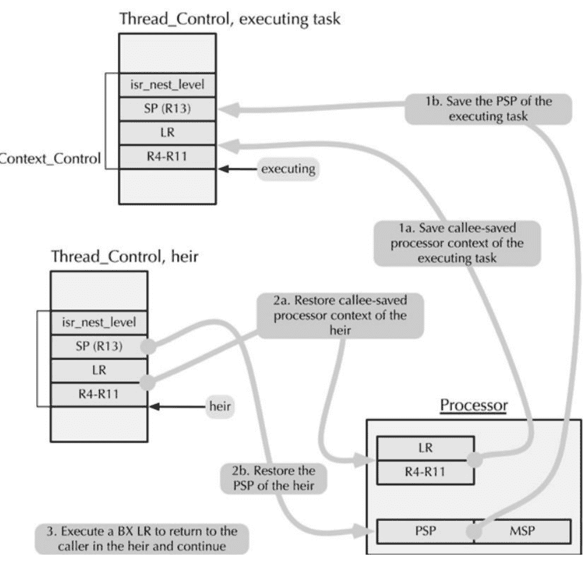

图 4.3 ARM Cortex-M 处理器的 RTEMS 上

- 如果调用函数需要保留执行任务某些调用者保存寄存器的上下文，则其责任是在调用上下文切换函数 `CPU_Context_switch` 之前通过编译器生成的代码将它们存在任务栈上。
- 此函数接收两个指针作为参数：`executing` 和 `heir`。第一个指向正在执行的任务的 `Context_Control`，第二个指向下一个执行的任务的 `Context_Control`。在 RTEMS 文档中这被称为 `heir`（继承者），引用下一个哪个任务将坐在处理器的“宝座”上。
- 上下文切换通过将执行任务的 `Context_Control` 保存所有调用者保存寄存器以及 `PSP` 来保留它们。
- 为了恢复 `heir` 的上下文，即 `CPU_Context_switch` 从 `heir` TCB 内部的 `Context_Control` 加载所有调用者保存寄存器以及 `PSP` 并返回调用者。
- 编译器生成的函数调用代码将在调用者保存寄存器在调用时处于活跃（live）的情况下还原它们。由于 `CPU_Context_switch` 将 `PSP` 指向 `heir` 栈，还原将从那里发生，正如预期的一样。

图 4.3 总结了 `CPU_Context_switch` 执行的主要步骤。图中显示的一个为了简单起见尚未讨论的方面是，`Context_Control` 包含一个 `is_next_level` 字段。该字段不是进程上下文的一部分，对应 RTEMS 在每个核心数据结构 `Per_CPU_Control` 中维护的同名字段。它从数据结构保存到执行线程的 TCB 中，并从 `heir` 的 TCB 还原到数据结构中。这是一个表示每个核心当前中断服务程序（ISR）嵌套层级的整数。

到为止，我们描述了当执行任务通过同步方式显式调用 `CPU_Context_switch`（直接调用或更多地通过高层函数调用）触发上下文切换时是如何实现的。这通常发生在执行任务自愿让出处理器，或执行阻塞同步原语进入任务状态图中的阻塞状态时（如 3.2.2 节所示）。


```c
void _ARMV7M_Interrupt_service_leave( void )
{
    Per_CPU_Control *cpu_self = _Per_CPU_Get();

    --cpu_self->thread_dispatch_disable_level;
    --cpu_self->isr_nest_level;

    /*
     * 如果需要线程调度，则乐观性地激活一个可挂起的服务调用。
     * _ARMV7M_Pendable_service_call() 会检查是否允许
     * 调度。
     */
    if ( cpu_self->dispatch_necessary ) {
        _ARMV7M_SCB->icsr = ARMV7M_ICSR_PENDSVSET;
    }
}
```

首先，`_ARMV7M_Interrupt_service_leave` 在离开异常处理程序时被调用，它通过检查每核心标志位 `dispatch_necessary` 来判断是否需要任务调度。当高层同步原语检测到优先级高于当前执行任务的任务被唤醒时，就会设置此标志位。在 RTEMS 中，任务调度是由两个独立活动组成的序列，组织在管理函数与工作函数之间：

- 调度算法的执行决定了下一个要执行的任务，并承担管理角色。调度算法的实现也是可移植且与架构无关的。
- 在管理器指定了继任者后，上下文切换执行从当前执行任务到继任者的上下文切换。这段代码是工作者，并且完整地嵌入了任务调度的所有架构依赖。

当任务自愿阻塞且操作系统必须选择其继任者时，也会发生同样的职责划分和操作顺序。如果需要调度，`_ARMV7M_Interrupt_service_leave` 函数会触发第 4.2.1 节描述的 PendSV 异常。RTEMS 配置此异常为整个系统中最低的优先级。因此，它将保持挂起状态，并在没有其他高优先级异常正在处理时才被处理。

在图 4.4 的左上部分，PendSV 异常变为激活，处理器根据图 4.2 所示的通用异常机制，在任务栈上保存一个异常帧。该异常帧中的 PC 指向被 PendSV 异常处理中断的任务指令。这也是当前任务执行最终必须从此处恢复的 PC。

# 任务栈

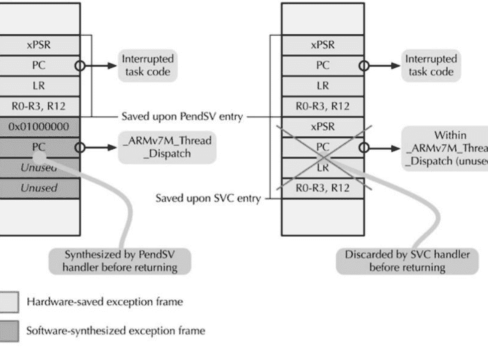

图 4.4 在 IRQ 后调度时的 RTEMS 任务栈图。

```c
void _ARMV7M_Pendable_service_call( void )
{
    [...]

    _ARMV7M_Exception_frame *ef;
    cpu_self->isr_nest_level = 1;
    _ARMV7M_SCB->icsr = _ARMV7M_SCB_ICSR_PENDSVCLR;
    _ARMV7M_Trigger_lazy_floating_point_context_save();

    ef = (ARMV7M_Exception_frame * ) _ARMV7M_Get_PSP();
    --ef;
    _ARMV7M_set_PSP((uint32_t) ef);

    /*
     * 根据《ARMv7-M Architecture Reference Manual》B1.5.6 节
     * “异常进入行为”，返回地址是半字对齐的。
     */
    ef->register_pc = (void *)
        ((uintptr_t) _ARMV7M_Thread_dispatch & ~((uintptr_t) 1));
    ef->register_xpsr = 0x01000000U;
}
```

处理器执行 `_ARMV7M_Pendable_service_call`，该 C 函数被注册为 PendSV 异常处理器，在 handler 模式下运行。确保允许任务调度（通过前述省略的代码段），此函数合成了一个由 `ARMV7M_Exception_frame` 类型表示的新异常帧，通过减小 PSP 将其推入栈并返回。这对应于图 4.4 左下方的深灰色异常帧。

异常帧的 PC 指向 `_ARMV7M_Thread_dispatch` 函数，并包含设置为 `0x01000000` 的默认 XPSR。为了节省时间，异常帧的其他字段没有显式设置。当 PendSV 异常处理器返回时，LR 寄存器仍然包含硬件存储的 `EXC_RETURN` 代码。因此，处理器恢复软件合成的异常帧，并在 thread 模式下从 `_ARMV7M_Thread_dispatch` 函数恢复执行。

这是一个关键点，因为结果是：在一次或多个触发重调度的中断被处理后，被中断的任务*恰好是*通过普通函数调用执行了 `_ARMV7M_Thread_dispatch` 函数，尽管这是通过这种特殊的异常处理形式完成的。原始异常帧进入栈，以便在最终回到运行状态时，可以恢复普通操作。

```c
static void __attribute__((naked)) _ARMV7M_Thread_dispatch(void )
{
  _asm volatile (
    "bl Thread_dispatch\n"
    /* FIXME: SVC, binutils bug */
    "short 0xdf\n"
    "nop\n"
  );
}
```

`_ARMV7M_Thread_dispatch` 函数极其简单，由两条汇编指令组成：

- 首先，它调用调度函数。该 RTEMS 函数以完全架构无关的方式执行调度算法以计算当前执行任务的继任者。如果需要，该管理操作随后是之前描述的通过调用 `Context_switch` 完成的上下文切换。
- 由于这些操作都是在 thread 模式下执行的，处理器的行为与之前讨论的同步上下文切换一致，且上层保持感知。

如果发生了上下文切换，当前任务不再在 `Thread_Dispatch` 中执行，直到另一个上下文切换将其带回运行状态。其次，当 `Thread_Dispatch` 返回时，它执行 SVC 指令触发同步异常。结果是硬件在栈上推入一个新的异常帧（如图 4.4 右下角所示），该帧的 PC 指向 `Thread_Dispatch` 内部 SVC 之后的指令。

顺便说明，汇编语言编码 SVC 是因为某些版本的汇编器（binutils 工具链的一部分）存在 bug，导致其无法正确识别 SVC。

```c
void _ARMV7M_Supervisor_call( void )
{
  Per_CPU_Control *cpu_self = _Per_CPU_Get();
  ARMV7M_Exception_frame *ef;

  ARMV7M_Trigger_lazy_floating_point_context_save();
  ef = (ARMV7M_Exception_frame *) _ARMV7M_Get_PSP();
  ++ef;

  ARMV7M_set_PSP((uint32_t) ef);

  cpu_self->isr_nest_level = 0;

  if (cpu_self->dispatch_necessary) {
    ARMV7M_Pendable_service_call();
  }
}
```

然后，处理器在 handler 模式下执行 SVC 处理器 `_ARMV7M_Supervisor_call`。该函数丢硬件推入的异常帧，相应地调整 PSP，除非在此期间需要其他调度，否则返回。在这种情况下，LR 寄存器也包含 `EXC_RETURN` 代码（进入 SVC 异常处理器时计算出的），硬件确定是从异常返回并恢复 PendSV 期间保存的异常帧。

另一方面，如果需要新的调度——在此期间处理了其他中断且更高优先的任务被唤醒——则通过再次调用 PendSV 异常处理器重复整个过程。

在这两种情况下，硬件推入特定异常帧计算出的 `EXC_RETURN` 代码用于恢复不同的异常帧。具体而言：

1. 进入 PendSV 异常处理器时计算的 `EXC_RETURN` 代码用于恢复软件合成的异常帧。
2. 进入 SVC 异常处理器时计算的 `EXC_RETURN` 代码用于恢复硬件保存的帧。

整个机制仍然有效，因为 RTEMS 确保了异常格式始终是相同的，因此它们之间是不可区分的。最后说明，我们可以确认 RTEMS 在抢占时保存了所有处理器寄存器（包括调用者保存的调用者保存的），使其变得完全透明。这是因为：

- 调用者保存的寄存器在进入 PendSV 异常处理器时由硬件保存在异常帧中，如图 4.2 所示。
- 调用者保存的寄存器由上下文切换函数在任务 TCB 的 `Context_Control` 结构保存，如图 4.3 所示。

`Context_Control` 结构还包含 PSP。恢复时，它允许处理器正确地从任务栈检索并恢复异常帧的内容。

## 4.2.4 可调度分析中的中断

如果我们对比现代优先级异常处理机制（如第 4.2.1 节所述）与第 4.1 节列出的可调度分析假设进行比较，我们可以发现一些重要的异常。

首先，中断处理器可以被看作一种突发伪任务，其激活由相应的中断源触发。然后，中断请求的到达是一个外部事件，将相应的伪任务移动到任务状态图的就绪状态。该伪任务的优先级由中断源的优先级决定且是固定，但始终隐含高于系统中的任何其他常规任务，因为中断请求的到达立即抢占任何正在执行的常规任务。

其次，不同中断源的优先级决定了新中断的到达是否会抢占正在执行的中断处理器，产生中断嵌套。如果没有嵌套，中断请求将保持，直到处理器执行优先级允许其被接受并激活。这种机制等于普通任务在高优先级任务执行时留在任务状态图的就绪状态，直到调度器将其移动到运行状态，区别在于决策是由硬件而非软件做的。

因此，原则上上，第 4.1 节描述的一些可调度分析技术（最著名的响应时间分析）可以用于评估中断处理对任务响应时间的影响。这证明了计算、测量或估计每个中断处理器的最坏执行时间（这随后成为相应伪任务的 C$_i$）并满足了其他若干实际需求。

突发任务（sporadic task）定义中的一个重要假设是其最小到达间隔是已知的。这一假设使我们能够保守地将突发任务视为周期任务，其周期等于它们的最小间隔。这个假设是隐含表述的，因为设备要么只对某些软件发布的命令做出反应时产生中断，要么在忽略信号抖动（bounces）的情况下，本身就保证了最小到达间隔。

作为第一类设备的示例，硬盘控制器在接收并处理了来自其设备驱动程序的数据传输命令后，会产生一个传输结束中断。此外，除非驱动程序向其发送另一个命令，否则它不会产生相同类型的的中断。

因此，对于周期性任务，中断产生速率（决定了中断处理程序的最小间隔时间）不能超过设备驱动程序向设备发送命令的速率。如果是这样，我们可以安全地使用 $T_i$ 作为中断处理的突发性伪任务的最小到达间隔。除了对调度性分析有用外，这对于限制某些设备对系统施加的最大利用率也很有用，因为我们可以通过选择 $T_i$ 作为设备带宽与系统负载本身之间的合适权衡。

遗憾的是，这在所有情况下都是不可行的，因为某些设备可能会独立于任何软件操作产生中断请求。这是很典型的，例如大多数网络控制器，它们在接收到入站帧时会产生中断请求。反，入站帧的到达对于任何本地任务操作来说都是不可预测且不可控制的。这同样是典型的，例如时分复用访问（TDMA）范式，其中入站帧的到达是时间触发的或根据计划的。

总的来说，让中断速率不受控从几个角度来看都是不方便的且往往是危险的：

- 如前所述，调度性分析变得极具挑战（此处原文可能为“变得困难”）。这不仅从理论角度来说令人担心，从实际角度来说也是，因为最坏情况的任务响应时间只能通过测试系统来评估，而需要假设某些场景确实可以重现系统在实践中面临的最坏中断负载。
- 即使系统的其他物理特性可能作为副作用将中断到达率限制在一个相对适中的速率上，但产生的负载可能高到无法维持。例如，即使是速率为 1 Mb/s 的局域网（CAN）接口，仍然可能每 47 μs 接收一个帧，并在最坏情况下以相同的速率产生中断请求。这是因为在此类网络上，最小帧长度（包括帧间隙）是 47 位。
- 重要的是记住，中断处理程序的优先级高于系统中的任何普通任务。因此，中断处理伪任务 $\tau_h$ 的执行时间 $C_h$ 对系统中所有普通任务的响应时间有直接影响。通过回顾主响应时间分析方程 (4.5) 可以清楚地看到，并观察到对于所有 $i$，$C_h$ 都在 $hp(i)$ 中。
- 因此，当系统被中断淹没时，它可能没有多少时间执行“实际工作”。此外，中断对缓存性能有负面影响，这会减慢其他活动。由高速设备引起的相关问题是内存带宽饱和，它会减慢处理器发出的内存访问。
- 最后，未受限的中断大小帧可能会为拒绝服务攻击打开大门。例如，如果攻击者可以访问之前提到的 CAN 网络，它可以轻松地用最小帧“淹没”系统。这是否会导致任何中断取决于系统在多大程度上能够忍其尚未经过设计和测试的中断到达速率。

限制中断到达速率的技术范围可分为大类：基于硬件和基于软件。

- 根据其复杂性，设备本身可能提供一种减少并对其中断产生速率设置上限的方法。例如，某些 CAN 控制器对标识符（CAN 消息中唯一标识其内容的部分）实现了相当复杂的过滤器，并可以根据其标识符自动将入站帧存储到不同的设备或内存驻留邮箱中。
  一方面，这减少了总中断速率，因为控制器在经过适当编程后，可以自主丢弃对软件无用的入站帧，而无需产生任何中断。通过这种方式，它也限制了最坏的中断速率，因为对于每个邮箱，这些控制器可以采用自动消息替换和中断保持策略。例如，当软件无法处理所有消息时，它们可以保留指向特定邮箱的最新消息，并在上一次中断发生后的可编程保持时间过去之前不再产生新中断。
- 类似的机制也适用于以太控制器，特别是那些运行在 100 Mb/s 或更高速率的控制器。通常，网络接口往往更复杂，卸的器的负载更多。例如，它们通常能够存储入站帧，并直接从与驱动程序共享的内存驻留缓冲区获取出站帧。在这种情况下，可用带宽成为需要考虑的因素。例如，一个带有新协议栈（见第10章）的先进嵌入系统 RTEMS 可以在 30-40% 的处理器利用率下维持 1Gb/s。
- 大多数处理器允许单独启用或禁用每个中断源。因此，中断处理器可以在设置定时器后禁用自己的中断源。在定时器过期之前，不会产生并保持后续的中断。定时器过期后，中断再次被启用，从而缓解了前述的硬件保持机制。关于关于保持保持机制，有两个值得注意的缺点。首先，基于软件的方法由于定时器的存在额外的开销。其次，如果未及时处理，某些设备可能会进入错误状态。取决于情况，这可能导致数据丢失。

解决这些问题的另一种方法是将关键性活动分为两个部分：

1. 关键性活动仍在中断处理程序中执行，可以建模为伪任务 $\tau_i$。
2. 任务 $\tau_d$ 优先级低于 $\tau_i$，并以延迟的方式处理关键性活动。

总体而言，两级中断处理可以建模为解耦的任务 $\tau_i$ 和 $\tau_d$，每个任务具有相同的周期 $T_d$，等于最小间隔时间，且最坏的执行时间 $C_i$ 和 $C_d$ 可以很容易计算。总时间 $C_i + C_d$ 与之前讨论的一级中断处理相同，但由于中断处理程序和普通任务之间额外的同步开销可能更大。然而，这种方法更灵活，允许程序员（在某些限制）在高低优先级之间做出最合适的权衡，即在 $C_i$ 和 $C_d$ 之间。

让我们假设，程序员希望使用 RM 分配，但 $\tau_i$ 的最小中断优先级对于相应的 $T_d$ 来说太高。虽然他们不能降低 $\tau_i$ 的优先级，但他们可以设置 $\tau_d$，通过将大部分处理移动到 $C_d$，可以使 $C_i$ 尽可能小。在这种情况下，$\tau_d$ 被合理地放置在 RM 优先级层次中。$\tau_i$ 则不是，但通过减少 $C_i$，对系统的负面影响已经减轻。在许多情况下，可以缩小中断处理程序直到它调用同步原语唤醒 $\tau_d$，从而导致非常小的 $C_d$，并由 RM 带来的系统行为。

## 两级中断处理

在 2.3 中，我们看到对于中断处理，$\tau_i$ 的优先级高于系统中的任何普通任务。因此，任务被分为两个子集。当系统被中断淹没时，它可能没有多少时间执行“实际工作”。此外，中断对缓存性能有负面影响，这会减慢其他活动。由高速设备引起的相关问题是内存带宽饱和，它会减慢处理器发出的内存访问。

限制中断到达速率的技术范围分为两大类：基于硬件和基于软件。

对于周期性任务，中断产生速率（决定了中断处理程序的最小间隔时间）不能超过驱动程序向设备发送命令的速率。如果是这样，我们可以安全地使用 $T_i$ 作为中断处理的突发性伪任务的最小到达间隔。除了对调度性分析有用，这对于限制某些设备对系统施加的最大利用率也很有用，因为我们可以选择 $T_i$ 作为设备带宽与系统负载之间的合适权衡。

遗憾的是，这在所有情况下都是不可行的，因为某些设备可能会独立于任何软件操作产生中断。这是很典型的，例如大多数网络控制器，它们在接收到入站帧时产生中断请求。反，入站帧的到达对于任何本地任务操作来说都是不可预测且不可控制的。这同样是典型的，例如时分复用访问（TDMA）范式，其中入站帧的到达是时间触发的或根据计划的。

总的来说，让中断速率不受控从几个角度来看都是不方便的且往往是危险的：

- 如前所述，调度性分析变得极其困难。这不仅从理论角度来说令人担心，从实际角度来说也是，因为最坏情况的任务响应时间只能通过测试系统来评估，而需要假设某些场景确实可以重现系统在实践中面临的最坏中断负载。
- 即使系统的其他物理特性可能作为副作用将中断到达率限制在一个相对适中的速率上，但产生的负载可能高到无法维持。例如，即使是速率为 1 Mb/s 的局域网（CAN）接口，仍然可能每 47 μs 接收一个帧。
- 上重要的是记住，中断处理程序的优先级高于系统中的任何普通任务。因此，中断处理伪任务 $\tau_h$ 的执行时间 $C_h$ 对系统中所有普通任务的响应时间有直接影响。通过回顾主响应时间分析方程 (4.5) 可以清楚地看到，并观察到对于所有 $i$，$C_h$ 都在 $hp(i)$ 中。
- 因此，当系统被中断淹没时，它可能没有多少时间执行“实际工作”。此外，中断对缓存性能有负面影响，这会减慢其他活动。由高速设备引起的相关问题是内存带宽饱和，它会减慢处理器发出的内存访问。


- 最后，未受限的中断大小帧可能会为拒绝服务攻击打开大门。例如，如果攻击者可以访问之前提到的 CAN 网络，它可以轻松用最小帧“淹没”系统。这是否会导致任何中断取决于系统在多大程度上能够忍受其尚未经过设计和测试的中断到达速率。

限制中断到达速率的技术范围分为大类：基于硬件和基于软件。

- 根据其复杂性，设备本身可能提供一种减少并对其中断产生速率设置上限的方法。例如，某些 CAN 控制器对标识符（CAN 消息中唯一标识其内容的部分）实现了相当复杂的过滤器，并可以根据其标识符自动将入站帧存储到不同的设备或内存驻留邮箱中。

一方面，这减少了总中断速率，因为控制器在经过适当编程后，可以自主丢弃对软件无用的入站帧，而无需产生任何中断。通过这种方式，它也限制了最坏的中断速率，因为对于每个邮箱，这些控制器可以采用自动消息替换和中断保持策略。例如，当软件无法处理所有消息时，它们可以保留指向特定邮箱的最新消息，并在上一次中断发生后的可编程保持时间过去之前不再产生新中断。

- 类似的机制也适用于以太控制器，特别是那些运行在 100 Mb/s 或更高速率的控制器。通常，网络接口往往更复杂，卸载的负载更多。例如，它们通常能够存储入站帧，并直接从与驱动程序共享的内存驻留缓冲区获取出站帧。在这种情况下，可用带宽成为需要考虑的因素。例如，一个带有新协议栈（见第 10 章）的先进嵌入式系统 RTEMS 可以在 30-40% 的处理器利用率下维持 1Gb/s。

- 大多数处理器允许单独启用或禁用每个中断源。因此，中断处理器可以在设置定时器后禁用自己的中断源。在定时器过期之前，不会产生并保持后续的中断。定时器过期后，中断再次被启用，从而缓解了前述的硬件保持机制。关于保持机制，有两个值得注意的缺点。首先，基于软件的方法由于定时器的存在额外的开销。其次，如果未及时处理，某些设备可能会进入错误状态。取决于情况，这可能导致数据丢失。

解决这些问题的另一种方法是将关键性活动分为两个部分：

1. 关键性活动仍在中断处理程序中执行，可以建模为伪任务 `τ_i`。

2. 任务 `τ_d` 优先级低于 `τ_i`，并以延迟的方式处理关键性活动。

总体而言，两级中断处理可以建模为解耦的任务 `τ_i` 和 `τ_d`，每个任务具有相同的周期 `T_d`，等于最小间隔时间，且最坏的执行时间 `C_i` 和 `C_d` 可以很容易计算。总时间 `C_i + C_d` 与之前讨论的一级中断处理相同，但由于中断处理程序和普通任务之间额外的同步开销可能更大。然而，这种方法更灵活，允许程序员（在某些限制）在高低优先级之间做出最合适的权衡，即在 `C_i` 和 `C_d` 之间。

让我们假设，一个示例，程序员希望使用 RM 分配，但 `τ_i` 的最小中断优先级对于相应的 `T_d` 来说太高。虽然他们不能降低 `τ_i` 的优先级，但他们可以设置 `τ_d`，通过将大部分处理移动到 `C_d`，可以使 `C_i` 尽可能小。在这种情况下，`τ_d` 被合理地放置在 RM 优先级层次中。`τ_i` 则不是，但通过减少 `C_i`，对系统的负面影响已经减轻。在许多情况下，可以缩小中断处理程序直到它调用同步原语唤醒 `τ_d`，从而导致非常小的 `C_i`，并由 RM 带来的系统行为。

## 4.3 总结

本章介绍了两种流行的调度分析技术，使用了基于利用率的测试和响应时间分析。在响应时间分析方面，它还展示了如何精炼和扩展分析，从基本的周期性任务模型开始，然后转向包含交互、自挂起和中断处理的更复杂模型。

从理论转向更多实际考虑，本章讨论了在实践中如何处理中断，以及更广泛地如何处理异常，以 RTEMS 为例。

## 第二部分

## 任务管理与时间计时

## 5.1 任务管理基础

任务管理概念涵盖了通过其整个生命周期控制任务的所有操作系统函数和接口，总结在图 3.4 的任务状态图中。更通俗地说，我们可以说任务管理代表了 RTEMS 对第 3 章中讨论的并发编程概念的实际体现。

在某种分层次的结构中，顶层是用于创建新任务并使其具备执行条件的操作系统函数。这些函数还允许用户指定调度参数，这些参数反过来又驱动操作系统的调度算法，如第 3.2 节所述。在所有其他操作系统中，都有另一组 RTEMS 函数用于在任务创建后检查和更改其调度参数。此外的顶层函数用于临时挂起和恢复任务，以及终止任务。

在表层之下，一组用户无法直接访问的 RTEMS 模块实现了各种实时调度算法 [15]。其中，为单核系统设计的算法将在本章第 5.2 节中介绍，同时还有调度器管理器，它是 RTEMS 中负责管理调度的组件，在多核系统上，它负责维护调度与其所管理的内核之间的关联。

这些算法在概念上与第 3 章和第 4 章中讨论的算法相似，但提供了额外的功能以增强其实际适用性和用处。相反，多核调度算法将是第 13 章的主题之一。

在层次结构的底部，一组部分依赖架构的 RTEMS 函数负责通过任务分发和上下文切换将调度决策付诸实践。这是根据通用方案实现的，例如在第 4.2 节中针对 ARM Cortex-M 架构。

RTEMS 通过两个主要的应用程序接口（API）提供对层次顶层的访问，分别命名为 Classic 和 POSIX 接口，位于 RTEMS 源码中的 `cput/rtems` 和 `cput/posix`。第 5.3 节总结了这两个 API 之间的共同点和区别。本章的其余部分将关注用于任务管理和时间计的经典 API，而第 6 章将完全致力于 POSIX 接口。

## 5.2 调度器管理器与单核调度算法

RTEMS 的标准发行提供了表 5.1 中列出的现成单核优先级调度器。此外，得益于 RTEMS 模块化、基于插件的调度器框架，用户如有必要可以实现自己的调度算法。

| 表 5.1 RTEMS 的单核调度算法 |
| :--- |
| **配置宏** | **默认值** | **描述** |
| `CONFIGURE_SCHEDULER_PRIORITY` | "UPD " | 确定优先级调度器（默认）[84] |
| `CONFIGURE_SCHEDULER_SIMPLE` | "UPS " | 简单优先级调度器 [84] |
| `CONFIGURE_SCHEDULER_EDF` | "UEDF" | 最早截止优先调度器 (EDF) [84] |
| `CONFIGURE_SCHEDULER_CBS` | "UCBS" | 恒定带宽服务器调度器 [1] |

正如第 13 章中将更详细地描述的那样，相同的框架也支持多核系统上的多个调度器实例，每个实例可能使用不同的调度算法并管理可用内核子集。

在单核系统上，通过在 RTEMS 配置中定义表格左侧列列出的宏来选择要使用的特定调度器，这遵循第 2.4.2 节描述的通用步骤，例如，定义配置宏 `CONFIGURE_SCHEDULER_EDF` 选择了最早截止优先 (EDF) 调度器。选择确定优先级调度器 (DPS) 不需要定义，因为它是默认开启的。

DPS 是一个抢占式调度器，适用于实现速率单调优先级分配 (RM)、截止单调排序 (DMPO) 和最优优先级分配 (OPA)，这些在第 3.2.3 节中都有描述。

关于其实际实现，它使用了图 5.1 所示的抽象数据结构：

- 一个先进先出 (FIFO) 队列数组，每个优先级级别一个，用于跟踪该级别的就绪任务。
- 一个位图，每个优先级级别占一个位，用于告知该级别是否有任务。


*图 5.1 确定优先级调度器 (DPS) 的数据结构*

DPS 是一个抢占式调度器，适用于实现速率单调优先级分配 (RM)、截止单调排序 (DMPO) 和最优优先级分配 (OPA)，这些在第 3.2.3 节中都有描述。

关于其实际实现，它使用了图 5.2 所示的抽象数据结构：

- 一个先进先出 (FIFO) 队列数组，每个优先级级别一个，用于跟踪该级别的就绪任务。
- 一个位图，每个优先级级别占一个位，用于告知该级别是否有任务。


*图 5.2 简单优先级调度器 (SPS) 的数据结构*

在单核系统上，通过在 RTEMS 配置中定义表格左侧列列出的宏来选择要使用的特定调度器，这遵循第 2.4.2 节描述的通用步骤，例如，定义配置宏 `CONFIGURE_SCHEDULER_EDF` 选择了最早截止优先 (EDF) 调度器。选择确定优先级调度器 (DPS) 不需要定义，因为它是默认开启的。

DPS 是一个抢占式调度器，适用于实现速率单调优先级分配 (RM)、截止单调排序 (DMPO) 和最优优先级分配 (OPA)，这些在第 3.2.3 节中都有描述。

关于其实际实现，它使用了图 5.3 所示的抽象结构。


*图 5.3 最早截止时间优先 (EDF) 调度器的抽象结构*

红黑树类似于二叉搜索树，但其插入和删除操作会保持树的平衡，因此树上所有主要操作（搜索、插入和删除）的复杂度都是树节点数量的对数函数，而节点数量即系统中的就绪任务数量。空间开销与节点数量成正比。

RTEMS 对 EDF 调度器的实现支持两类任务：声明了截止期的任务（前台任务）和未声明截止期的任务（后台任务）。对于后台任务，EDF 调度器会回退到固定优先级调度器，并根据它们的优先级进行执行，这与 DPS 的工作方式完全相同。

调度器在这类任务之间强制执行严格的层级关系，即所有后台任务重要性都低于任何前台任务。换句话说，只有当当前没有前台任务就绪，才会选择后台任务执行。

该调度器的截止期是通过 RTEMS 速率调度管理器声明的，其 API 将在 5.5 节中描述，且截止期总是隐式的，即假设等于任务周期。当一个任务使用速率调度管理器声明了截止期时，该任务属于前台类。如果任务的截止期被取消或从未声明，它则属于后台类。

通过对比图 5.1 和图 5.3，我们可以看到 EDF 相比于 DPS（见第 4.1 节）在总处理器利用率方面的额外灵活性和优势，是以增加调度操作的复杂性为代价的。

最后，恒定带宽服务器 (CBS) 调度器 [1] 是 EDF 调度器的扩展，它能够感知分配给每个任务的执行时间预算并对其进行强制。通俗地说，CBS 调度器的主要目标是确保任务不会因为其他任务消耗了更多的处理器时间而错过截止期。

因此，它避免了 EDF 调度器在瞬态过载条件下典型的“多米诺效应”。关于该调度器的 RTEMS API 的详细描述超出了本书的范围。读者可以参阅 RTEMS API 手册 [105] 以获取更多信息。

## 细粒度调度器控制

基于几种基于优先级的调度算法以及在时间和空间开销之间有不同权衡的实现进行粗粒度选择（这会影响特定调度器管理的所有任务），RTEMS 还提供了三种更细粒度的行为控制方法，并以任务为单位进行选择。

第 3 节给出的理论定义规定，RTEMS 的所有调度器都是抢占式的，也就是说，当高优先级任务变为就绪且没有其他可用合适核心时，它们会立即从执行中夺取一个核心。第 4 节介绍的调度分析方法假设底层算法支持抢占。

除非另有说明，RTEMS 调度器确实会根据需要抢占任务。然而，可以通过 5.4 节将概述的某些 RTEMS 接口在任务模式中设置 `RTEMS_NO_PREEMPT` 标志，从而按任务来禁用抢占。

在两种情况下，结果都是：当调度器为一个设置了 `RTEMS_NO_PREEMPT` 标志的任务调度执行时，即使随后释放了由同一调度器控制的高优先级任务，该任务也无法被抢占。根据图 3.4 所示的任务状态图，这种转换不能非自主地发生。任务仍然可以通过阻塞或让出来自愿放弃执行权。

尽管抢占控制从实际角度来看在某些情况下非常有用，但有几个值得注意的缺点：

1. 非抢占标志仅影响任务开始后的执行。它不会以任何方式影响是否执行该任务的决策，该决策仍然根据调度算法和任务优先级完全由调度器控制。

2. 同样，如果任务在调度器选择其执行后自愿阻塞或让出，该任务的非抢占标志无法阻止其他任务的执行。程序员应该意识到，这种约束也包含了隐藏在库中的深层阻塞——例如，为了避免竞态条件——这些阻塞可能不会显而易见。

3. 抢占控制有时被用作确保单核系统中任务间互斥的一种非常高效的方法。在多核系统中，这种方法通常无法正常工作，见第 12.3 节讨论硬手工优先级执行时列出的某些原因。

调整调度器基本行为的另一种方法是为任务实现时间片。时间片与抢占是正交的，是在具有相同优先级的就绪任务之间划分可用资源的一种非常公平的方法。默认启用时间片，因此，运行中的任务将继续执行——即使有其他相同优先级的就绪任务——直到它阻塞或让出，或者在启用抢占的情况下被高优先级任务抢占。当运行中的任务启用了时间片时，任务模式中的 `RTEMS_SLICE` 标志被设置，RTEMS 将限制该任务在核心被交给另一个具有相同优先级的就绪任务之前可以执行的最长时间，并以轮询方式调度另一个任务。

最大执行时间被称为时间片，并在 RTEMS 中有相应的测量。如果时间片结束时，没有与运行任务相同优先级的就绪任务，RTEMS 将授予运行任务另一个时间片并继续执行。否则，它将该任务放在相同优先级队列的末尾并调度另一个任务。


- 非抢占标志仅影响任务开始后的执行。它不会以任何方式影响是否执行该任务的决策，该决策仍然根据调度算法和任务优先级完全由调度器控制。

- 同样，如果任务在调度器选择其执行后自愿阻塞或让出，该任务的非抢占标志无法阻止其他任务的执行。程序员应该意识到，这种约束也包含了隐藏在库中的深层阻塞——例如，为了避免竞态条件——这些阻塞可能不会显而易见。

- 抢占控制有时被用作确保单核系统中任务间互斥的一种非常高效的方法。在多核系统中，这种方法通常无法正常工作，见第 12.3 节讨论硬手工优先级执行时列出的某些原因。

调整调度器基本行为的另一种方法是为任务实现时间片。时间片与抢占是正交的，是在具有相同优先级的就绪任务之间划分可用资源的一种非常公平的方法。默认启用时间片，因此，运行中的任务将继续执行——即使有其他相同优先级的就绪任务——直到它阻塞或让出，或者在启用抢占的情况下被高优先级任务抢占。当运行中的任务启用了时间片时，任务模式中的 `RTEMS_SLICE` 标志被设置，RTEMS 将限制该任务在核心被交给另一个具有相同优先级的就绪任务之前可以执行的最长时间，并以轮询方式调度另一个任务。

最大执行时间被称为时间片，并在 RTEMS 中有相应的测量。如果时间片结束时，没有与运行任务相同优先级的就绪任务，RTEMS 将授予运行任务另一个时间片并继续执行。否则，它将该任务放在相同优先级队列的末尾并调度另一个任务。

如所述，调度器主要通过 RTEMS 配置进行静态选择和配置。此外，调度管理器提供了一组原始可以在运行时修改初始配置。它们在表 5.2 中汇总，并在节的剩余部分进行讨论。

### 表 5.2 RTEMS 调度管理器 API

| 函数 | 目的 |
| --- | --- |
| ident(1) | 根据名称获取调度器标识符 |
| ident_by_processor | 根据处理器索引获取调度器标识符 |
| ident_by_processor_set | 根据处理器集获取调度器标识符 |
| get_processor_maximum | 获取系统中配置的处理器总数 |
| get_processor_set | 获取由调度器管理的处理器集 |
| get_maximum_priority | 获取调度器的任务优先级 |
| add_processor | 向由调度器管理的集合中添加处理器 |
| remove_processor | 从由调度器管理的集合中移除处理器 |
| (1) | 所有 API 函数名称均以 `rtems_scheduler_` 前缀开头 |

另一种通过该调度器管理的内核之一来检索调度器标识的方法。该函数：

```
rtems_status_code rtems_scheduler_ident_by_processor(
    uint32_t cpu_index,
    rtems_id *id
);
```

该函数向 `id` 指向的位置存储负责索引为 `cpu_index` 的内核的调度器标识符。内核索引（在 RTEMS 术语中称为 CPU index）是一个唯一标识系统中某个内核的整数。它的范围从 0 到内核总数减 1（包含边界）。在单核系统中，唯一有效的 CPU index 为 0。函数 `rtems_scheduler_get_processor_maximum` 返回系统中配置的内核总数。

`rtems_scheduler_ident_by_processor` 的可能返回值为：

- `RTEMS_SUCCESS` 表示函数执行成功，且 `id` 所引用的位置包含一个有效的调度器标识符。
- `RTEMS_INVALID_ADDRESS` 表示函数失败，因为 `id` 为空指针。
- `RTEMS_INVALID_NAME` 表示作为参数传递的 CPU 索引 `cpu_index` 无效。
- `RTEMS_INCORRECT_STATE` 表示 CPU 索引 `cpu_index` 有效，但相应的内核当前未分配给任何调度器。

同样，该函数：

```
rtems_status_code rtems_scheduler_ident_by_processor_set(
    size_t cpusetsize,
    const cpu_set_t *cpuset,
    rtems_id *id
);
```

该函数向 `id` 指向的位置存储负责 `cpuset` 所引用的 CPU 集（CPU set）的调度器标识符。参数 `cpusetsize` 指定了 CPU 集的大小（字节字节）。集合中编号最大的在线内核被作为识别调度器的引用。

CPU 集由数据类型 `cpu_set_t` 表示，并且始终通过引用方式传递。应使用表 5.3 中列出的函数set来操作 CPU 集，而无需深入实现细节。

### 表 5.3 用于操作 CPU 集的 RTEMS 函数

| 宏 | 目的 |
| :--- | :--- |
| CPU_ZERO | 初始化一个空 CPU 集 |
| CPU_FILL | 初始化一个包含系统中所有内核的 CPU 集 |
| CPU_COPY | 将一个 CPU 集复制到另一个 |
| CPU_SET | 根据给定的 CPU 索引向集合中添加一个内核 |
| CPU_CLR | 根据给定的 CPU 索引从集合中移除一个内核 |
| CPU_ISSET | 根据给定的 CPU 索引检查某个内核是否属于某个集合 |
| CPU_COUNT | 返回属于 CPU 集的内核数量 |
| CPU_EMPTY | 如果 CPU 集为空（且仅当为空时），则返回 true |
| CPU_EQUAL | 如果两个 CPU 集相同（且仅当相同时），则返回 true |
| CPU_CMP | CPU_EQUAL 的别名 |
| CPU_AND | 计算两个 CPU 集的交集 |
| CPU_OR | 计算两个 CPU 集的并集 |
| CPU_XOR | 计算属于两个 CPU 集之一但不同时属于它们的内核集 |
| CPU_NAND | 计算不属于两个 CPU 集交集的内核集 |

第二组函数允许用户根据标识符查询调度器的某些特性。具体来说，函数：

```
rtems_status_code rtems_scheduler_get_processor_set(
    rtems_id scheduler_id,
    size_t cpusize,
    cpu_set_t *cpuset
);
```

返回当前与由 `scheduler_id` 标识的调度器关联的内核集。该集合存储在 `cpuset` 引用的 `cpu_set_t` 类型对象中，其字节大小由 `cpusize` 指定。可以通过表 5.3 中列出的函数检查集合内容。

函数：

```
rtems_status_code rtems_scheduler_get_maximum_priority(
    rtems_id scheduler_id,
    rtems_task_priority *priority
);
```

该函数向 `priority` 指向的对象中存储调度器 `scheduler_id` 的数值上最大的任务优先级。需要注意的是，根据 RTEMS 内核使用的优先级编号方案，数值大的优先级对应的优先级越低，而在 POSIX 中，数值越大的优先级对应的优先级越高。

## 修改调度器管理的内核集

表 5.2 中列出的第三组（也是最后一组）函数提供了一种动态更改调度器管理的内核集的方法，从而更改原始静态 RTEMS 配置中指定的集合。该组中的两个函数是：

```
rtems_status_code rtems_scheduler_add_processor(
    rtems_id scheduler_id,
    uint32_t cpu_index
);
```

```
rtems_status_code rtems_scheduler_remove_processor(
    rtems_id scheduler_id,
    uint32_t cpu_index
);
```

这两个函数都以它们必须操作的调度器标识符 `scheduler_id` 以及要从调度器管理的内核集中添加或移除的内核索引 `cpu_index` 为参数。成功时返回状态代码 `RTEMS_SUCCESSFUL`。此外，函数 `rtems_scheduler_add_processor` 可能由于以下原因失败：

- `RTEMS_INVALID_ID` 调度器标识符 `scheduler_id` 无效。
- `RTEMS_NOT_CONFIGURED` 由 `cpu_index` 指出的内核未配置供 RTEMS 使用。
- `RTEMS_INCORRECT_STATE` CPU 索引 `cpu_index` 有效，但相应的内核当前未分配给任何调度器。

同样，函数 `rtems_scheduler_remove_processor` 可能由于以下原因失败：

- `RTEMS_INVALID_ID` 调度器标识符 `scheduler_id` 无效。
- `RTEMS_NOT_CONFIGURED` 由 `cpu_index` 指出的内核未配置供 RTEMS 使用。
- `RTEMS_RESOURCE_IN_USE` 该内核已分配给调度器。

## 5.4 任务管理

用于任务管理的 RTEMS 函数（通常称为指令）由 RTEMS 任务管理器实现，并总结在表 5.4 中。主要函数允许调用者动态地创建新任务并删除它们。其他函数允许调用者查询和修改任务的最重要运行时属性，例如其优先级。该组中的最后两个函数在概念上非常简单，并实现了定时等待。

### 表 5.4 RTEMS 任务管理器

| 函数 | 目的 |
| --- | --- |
| create | 创建任务，但不启动 |
| start | 启动任务，即使其进入就绪或执行状态 |
| restart | 重启任务并从其入口点重新执行 |
| ident | 根据任务名称返回任务标识符 |
| ident_self | 返回调用任务的标识符 |
| wake_after | 阻塞调用任务，在指定的一段时间后唤醒它 |
| wake_when | 阻塞调用任务直到指定的时间 |
| suspend | 挂起任务 |
| resume | 恢复之前被挂起的任务 |
| is_suspended | 检查任务是否被挂起 |
| delete | 删除任务 |
| exit | 删除当前任务 |
| mode | 更改当前任务模式 |
| set_priority | 设置任务的优先级 |
| get_priority | 获取任务的当前优先级 |
| set_scheduler | 设置负责任务的调度器 |
| get_scheduler | 获取当前负责任务的调度器 |
| set_affinity | 设置任务的亲和性掩码 |
| get_affinity | 获取任务的亲和性掩码 |
| iterate | 在系统中所有任务上调用用户指定的函数 |
| (1) | 所有 API 函数名均以 `rtems_task_` 前缀开头。 |
| (2) | 换句话说，`rtems_wake_after` 执行相对于调用时间的相对等待，而 `rtems_wake_when` 执行绝对等待。 |
| (3) | 仅在多核系统中有效，某些调度器可能会对合法的掩码设置实施限制。 |

## 创建任务

在 Classic API 中，创建一组任务的核心调用是 `rtems_task_create` 和 `rtems_task_start`。这些 API 调用足以创建一个适用于实时分析的多任务系统。`rtems_task_create` 调用为新任务分配资源并初始化其任务控制块。在 `rtems_task_create` 期间还会调用可选的任务用户定义扩展，该扩展可以为新创建的任务分配额外资源。

`rtems_task_create` 指令定义如下：

```
rtems_status_code rtems_task_create(
    rtems_name name,
    rtems_task_priority initial_priority,
    size_t stack_size,
    rtems_mode initial_modes,
    rtems_attribute attribute_set,
    rtems_id *id
);
```

`name` 是任务的用户定义的四字符助记符，在任务创建后很少更改。`initial_priority` 是调度器用于该任务的值，该值可能会根据负责该任务的调度器所实现的调度算法而改变。在多核系统中，可以通过 `rtems_task_set_scheduler` 函数（后文将描述）在稍后更改调度器，最好在启动任务之前更改。

默认情况下，新创建的任务继承其创建者的调度器。在单核系统中，可能只有一个调度器负责系统中的所有任务，且没有方法更改它。

可以指定 `stack_size` 来增加或限制分配给调用栈的内存，但不能小于硬件处理器架构指定的最小值或应用程序配置的最小值。`stack_size` 还有可能取两个值：

- `RTEMS_MINIMUM_STACK_SIZE` 表示栈大小至少必须是 RTEMS 开发人员为底层处理器架构推荐的最小建议栈大小。如果系统由用户配置了更大的栈大小，则以用户配置为准。
- `RTEMS_CONFIGURED_MINIMUM_STACK_SIZE` 表示栈大小必须等于用户配置的最小栈大小，无论其是大于还是小于 `RTEMS_MINIMUM_STACK_SIZE`。

在所有情况下，栈大小在任务创建后都无法更改。`initial_modes` 定义了任务应该启动时使用的执行模式，下文将进一步解释。`attribute_set` 定义了任务属性，这些属性之后无法更改。属性集通过表 5.5 中列出的属性常量的按位“与”或“或”操作构建，并包括任务是否使用浮点处理器（如果存在），以及任务是对于执行中的 RTEMS 内核是局部的还是全局的（即在多处理器设置中，可以从运行不同 RTEMS 内核的远程节点访问）。

### 表 5.5 RTEMS 任务属性常量

| RTEMS 任务属性常量 | 含义 |
|---|---|
| RTEMS_NO_FLOATING_POINT | 任务不使用浮点处理器 |
| RTEMS_FLOATING_POINT | 任务使用浮点协处理器 |
| RTEMS_LOCAL | 任务仅在本地节点内可访问 |
| RTEMS_GLOBAL | 任务可以通过多处理器系统的其他节点访问 |

任务的执行控制了它是否：使用（资源）、时间切片、接收异步信号，以及在执行期间启用了何种级别的中断。`RTEMS_DEFAULT_MODES` 常量作为 `initial_modes` 启用一组默认模式，该模式允许启用抢占、禁用时间切片、启用异步信号并启用所有中断。模式的任何其他设置需要在创建任务的调用中显式指定，或者稍后使用 `rtems_task_mode` 指令更改，该指令也可以用于获取任务的当前模式。

任务模式是通过多个值的按位“或”操作构建的，每个值单独控制模式的某个特定方面。RTEMS 定义了一系列常量（列在表 5.6 中），帮助用户操作任务模式。更具体地说，它提供了：

- 一个掩码，用于从任务模式中隔离特定方面，例如抢占控制。
- 每个掩码都是一组用于该模式特定方面的有效值。例如，在抢占控制中，定义了两个值：

### 表 5.6 RTEMS 任务模式掩码

| 掩码 | 值 | 方面 |
|---|---|---|
| RTEMS_PREEMPT_MASK | RTEMS_PREEMPT | 启用抢占 |
| | RTEMS_NO_PREEMPT | 禁用抢占 |
| RTEMS_TIMESLICE_MASK | RTEMS_TIMESLICE | 启用时间切片 |
| | RTEMS_NO_TIMESLICE | 禁用时间切片 |
| RTEMS_ASR_MASK | RTEMS_ASR | 启用异步信号 |
| | RTEMS_NO_ASR | 禁用异步信号 |
| RTEMS_INTERRUPT_MASK | RTEMS_INTERRUPT_LEVEL(0) | 启用所有中断 |
| | RTEMS_INTERRUPT_LEVEL(n) | 设置级别(n) |

(1) 在多核系统中不支持。
(2) 中断级别取决于架构，见 4.2。

尽管 `rtems_task_create` 分配了新任务，但调用者不会被抢占，因为新任务尚未被添加到可调度的任务集中，这是 `rtems_task_start` 指令的工作，该指令定义为：

```
rtems_status_code rtems_task_start(
    rtems_id id,
    rtems_task_entry entry_point,
    rtems_task_argument argument
);
```

该指令通过任务标识符 `id` 对现有任务操作，`id` 是之前调用 `rtems_task_create` 的输出。`entry_point` 参数指定任务的入口点，即任务执行开始的函数地址。

执行时，入口函数将接收一个参数 `argument`，类型为 `rtems_task_argument`。这种 RTEMS 定义的数据类型是不透明的，但保证具有以下实用的属性：

- 它是一个指定宽度的无符号整数类型。
- 任何有效指针在转换为此类型后再转换回指针时都不会丢失信息，即结果将等于原始指针。

理想情况下，`rtems_task_start` 的调用者可能会被新启动的任务立即抢占，这取决于系统中的核心数量、两个任务的相对优先级，以及调用任务中是否启用了抢占。除了表示任务启动成功的 `RTEMS_SUCCESSFUL` 之外，`rtems_task_start` 可能会返回以下状态之一来报告失败：

- `RTEMS_INVALID_ID` 作为参数提供的任务 id 无效。
- `RTEMS_INVALID_ADDRESS` 任务 `entry_point` 无效。
- `RTEMS_INCORRECT_STATE` 任务未处于休眠（dormant）状态。
- `RTEMS_ILLEGAL_ON_REMOTE_OBJECT` 任务 id 指向一个远程任务，但任务只能在本地启动——即在创建它们的同一个节点上启动。

`rtems_task_restart` 定义如下：

```
rtems_status_code rtems_task_restart(
    rtems_id id,
    rtems_task_argument argument
);
```


该重启通过除休眠状态以外的任何状态来识别，并使用任务最初启动时指定的相同 `entry_point`，且可能带有新的参数。与许多其他任务相关的原语一样，可以使用特定的任务标识符 `RTMS_SELF` 来表示该指令将在调用任务上操作。例如，在这种情况下，任务可以使用 `RTMS_SELF` 作为 `id` 来重启自己，以防在 `rtms_task_restart` 永远不返回的情况下。

`rtms_task_restart` 可能的非正常状态码为：

- `RTMS_INVALID_ID`：作为参数提供的任务 `id` 无效。
- `RTMS_INCORRECT_STATE`：任务之前从未启动过，因此其 entry point 未知。
- `RTMS_ILLEGAL_ON_REMOTE_OBJECT`：任务指向一个远程任务，但任务只能在本地启动——即在创建它们的同一个节点上启动。

关于任务创建主题必须回答的最后一个问题是：当系统首次引导时，系统中最初存在哪些任务？一个 RTMS 应用从两个任务开始：`init` 和 `idle`。`idle` 任务在系统中的优先级最低，当没有其他任务就绪时，它作为回退方案执行。`init` 任务由 RTMS 创建并在应用程序配置的函数入口点启动，该入口点由 `Init By` 调用。

实时应用程序将通过循环一系列调用来创建所有应用程序任务，从而完成自初始化，然后通过另一个循环启动它们，最后由 `init` 任务进行删除或自我挂起。内存受限的应用可能会重用 `init` 任务作为应用程序任务之一。第 7.5 节描述的屏障（Barriers）对于确保新创建的任务在最开始时以有序方式执行之前完成同步非常有用。

## 识别任务

为了对任务进行操作，大多数管理函数都需要一个 RTMS 任务标识符，用数据类型 `rtms_task_id` 表示。任务标识符在创建时由 `rtms_task_create` 指令返回，但之后也有其他方法可以获取它。该函数为：

```
rtms_status_code rtms_task_ident(
    rtms_name name,
    uint32_t node,
    rtms_id *id
);
```

### 表 5.7 RTEMS 特殊节点

| 节点 | 含义 |
| --- | --- |
| `RTEMS_SEARCH_LOCAL_NODE` | 仅搜索本地（调用者）节点 |
| `RTEMS_SEARCH_ALL_NODES` | 从本地节点开始搜索所有节点 |
| `RTEMS_SEARCH_OTHER_NODES` | 搜索本地节点以外的所有节点 |

如果名称在搜索范围内不是唯一的，该函数将返回具有该名称的一个任务的标识符。调用任务可以使用特殊名称 `RTEMS_SELF` 来获取其自身的标识符。当成功时，函数返回 `RTEMS_SUCCESSFUL`。否则，它返回以下状态码之一：

- `RTEMS_INVALID_ADDRESS`：函数由于 `id` 为空指针而失败。
- `RTEMS_INVALID_NAME`：作为参数传递的任务名称无效，或未找到具有给定名称的任务。
- `RTEMS_INVALID_NODE`：给定的节点号无效。

任务获取其自身标识符的更简单方法是调用：

```
rtems_id rtems_task_self(void);
```

此函数也可以从中断处理程序中调用，但具有不同的含义。在这种情况下，它返回被中断任务的标识符。

## 任务状态、定时延迟和挂起

图 5.5 提供了 RTEMS 任务状态图 (TSD) 的简化视图。该图是图 3.4 所示抽象图的特化，并在第 3.2 节中进行了注释。尽管图 5.5 更好地捕捉了真实操作系统的底层复杂性，但它仍然是高度简化的，省略了例如与任务终止和删除相关的细节。

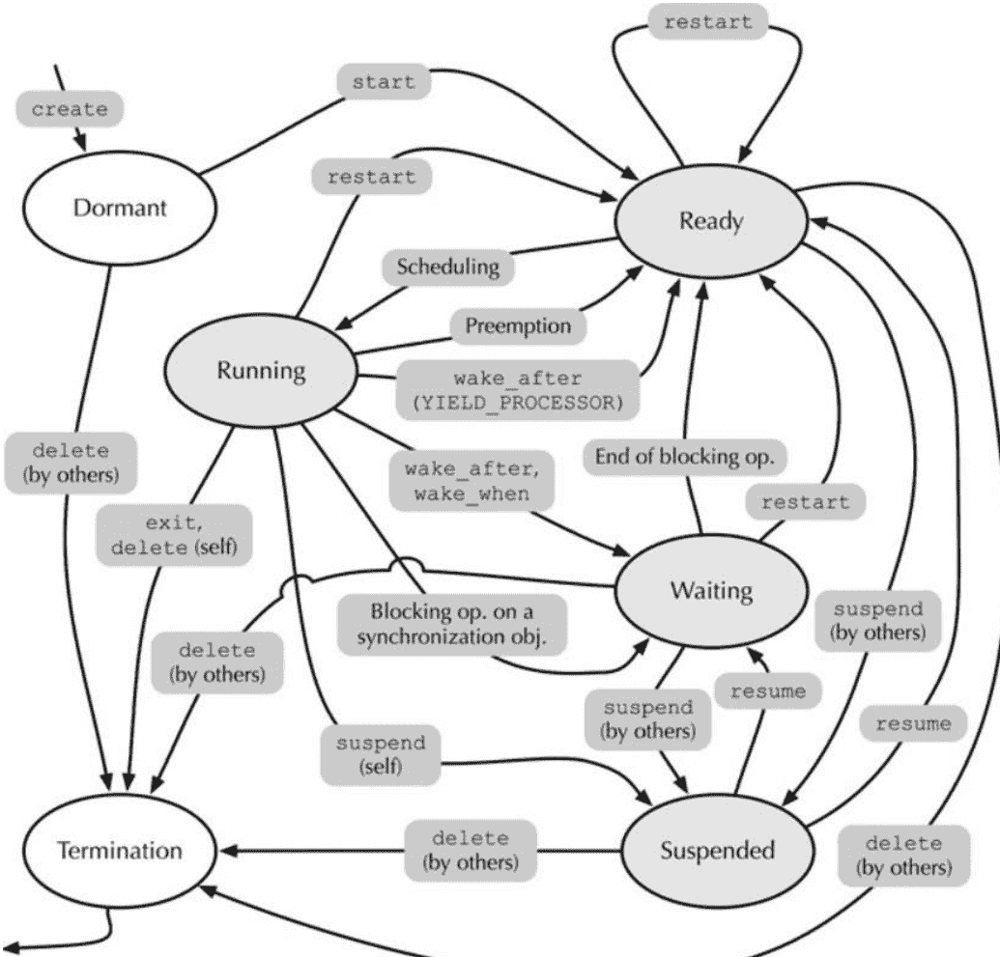

图 5.5 RTEMS 任务状态图 (TSD) 的简化视图。

在图中，标签用等宽字体编写的转换是由执行本节描述的同名任务指令触发的。用普通字体编写的转换是由其他操作系统的事件触发的。

任务启动后，它从休眠状态移动到就绪状态。然后，调度器可能会将任务调度到处理器上运行，将任务从就绪状态移动到运行状态。当任务运行时，它可以通过两种可能的方式自愿阻塞：

1. 通过调用 `rtms_task_wake_after` 或 `rtms_task_wake_when` 指令，这些指令分别指定了调度节拍（scheduling ticks）中的相对阻塞间隔，或 `rtms_time_of_day` 格式的绝对超时间隔。
2. 在同步对象上执行阻塞操作。每当任务必须以有序且极其明确的方式与其他任务交互时，就需要这种形式的自阻塞。它将是第 7 和第 9 章的主题。

传递相对间隔到 `rtms_task_wake_after` 指令会导致任务让出处理器，并进入就绪状态。这种节拍的长度由宏 `CONSECONDS_PER_TICK` 决定。

相反，`rtms_task_wake_when` 指令阻塞调用者直到达到某个时间。时间通过引用 `time_buffer` 参数指定：

```
rtms_status_code rtms_task_wake_when(
    rtms_time_of_day *time_buffer
);
```

`rtms_time_of_day` 类型是表 5.8 所示的结构，表示日历时间。此函数忽略 `ticks` 字段中的秒部分，因此实现一秒的精度。

### 表 5.8 rtms_time_of_day 字段（日历时间）

| 字段 | 内容 | 范围 |
| --- | --- | --- |
| `year` | 年 | ≥1988 |
| `month` | 月 | [1,12] |
| `day` | 日 | [1,31] |
| `hour` | 时 | [0,23] |
| `minute` | 分 | [0,59] |
| `second` | 秒 | [0,59] |
| `ticks` | 以节拍表示的秒分数 | [0,99] |

① 所有字段均为 `uint32_t` 类型，即无符号32位整数。
② 假设默认 RTEMS 时钟节拍长度为 10ms。

`rtms_task_wake_when` 调用任务并在成功时返回 `RTEMS_SUCCESSFUL`。否则，它返回以下状态码之一：

- `RTEMS_INVALID_ADDRESS`：`time_buffer` 指针为空。
- `RTEMS_INVALID_TIME_DAY`：`time_buffer` 指向结构的内容无效。
- `RTEMS_NOT_DEFINED`：系统数据时间和未按照第 5.6 节进行设置。

`wake after` 的调用者被置于等待状态，直到间隔过期或达到超时。更改系统当前日期时间不会影响后 `wake`，但会影响 `when`，并且如果修改的时间超过了它，可能会导致等待的任务取消阻塞。

任务可以通过 `rtms_task_suspend` 指令挂起自身或其他任务，该指令由 `rtms_task_resume` 指令撤销。如图 5.5 所示，挂起状态与其他阻塞互补（例如，先通过 `rtms_task_wake_after` 自挂起或在同步对象上阻塞），被恢复的任务可能保持在等待状态，如果它被阻塞。`suspend` 和 `resume` 指令都接受单个参数，即要更改状态的任务标识符 `id`：

```
rtms_status_code rtms_task_suspend(
    rtms_id id
);
```

```
rtms_status_code rtms_task_resume(
    rtms_id id
);
```

主体函数返回以下状态码之一：

- `RTMS_SUCCESSFUL`：目标任务已成功挂起或恢复。
- `RTMS_INVALID_ID`：作为参数传递的任务标识 `id` 无效。
- `RTMS_ALREADY_SUSPENDED`：尝试挂起一个已经挂起的任务。
- `RTMS_INCORRECT_STATE`：尝试恢复一个当前未被挂起的任务。

最后，该函数：

```
rtms_status_code rtms_task_is_suspended(
    rtms_id id
);
```

检查由 `id` 标识的任务是否已挂起。如果任务当前未挂起，则返回 `RTMS_SUCCESSFUL`；如果已挂起，则返回 `RTMS_ALREADY_SUSPENDED`。此外，它可能会失败并返回以下状态码之一：

- `RTMS_INVALID_ID`：作为参数传递的任务标识 `id` 无效。
- `RTMS_ILLEGAL_ON_REMOTE_OBJECT`：该函数无法用于远程任务。

## 删除任务

通过调用指令可以删除任务：

```
rtms_status_code rtms_task_delete(
    rtms_id id
);
```

将其任务标识 `id` 作为参数传递。任务可以使用 `RTMS_SELF` 作为任务标识符来删除自己。在这种情况下，`rtms_task_delete` 不返回，系统将选择任何任务来执行。

如果目标是另一个任务，则 `rtms_task_delete` 在成功删除目标任务时返回 `RTMS_SUCCESSFUL`，或者在失败时返回以下状态码之一：

- `RTMS_INVALID_ID`：作为参数传递的任务标识 `id` 无效。
- `RTMS_ILLEGAL_ON_REMOTE_OBJECT`：该函数无法用于远程任务。换句话说，任务必须由位于同一节点上的任务删除。

当任务被删除时，它将经过一系列状态，在此期间，分配给它的大部分但不是全部资源将被回收。所有这些状态都包含在图 5.5 所示的终止状态（termination state）中。从程序员的角度来看，该过程的两个主要方面非常重要：

1. RTEMS 与其他操作系统一样，无法回收与任务相关或由任务所有的所有资源。对于同步设备来说尤其如此：让任务删除自己（在释放其所有资源后）比从另一个地方突然删除它要好。
2. 从这个角度来看，除非要删除的任务无法执行或发生了其他类型的严重故障，否则让任务删除自己（在释放其所有资源后）比从另一个地方突然删除它要好。

删除后，RTEMS 可能会为新创建的任务重用相同的任务标识符。同样，如果在删除后创建了同一任务的新实例，操作系统可能会给它分配一个不同的标识符。同样，这与其他操作系统的做法一致，并且类似于类 Unix 操作系统重用进程标识符（PID）的方式。

应用程序代码中可能需要特别注意以正确处理这种场景，因为如果代码继续使用之前缓存的任务标识符，可能会很容易引用错误的任务。

此外，正如在第 10 章中将更好地讨论的，使用 POSIX API 创建的任务的上下文部分，如果该任务是可连接的（joinable），可能会管理其存活，直到另一个任务对其执行连接（join）操作。

任务任务删除自己的一种更简洁的方法是调用指令：

```
void rtems_task_exit(void);
```

该函数返回给调用者。由于使用 Classic API 创建的任务从指定为其入口点（`entry_point`）的函数返回被视为错误，因此此类入口点的最后一行代码通常会被调用以执行 `rtems_task_exit`。此外，值得注意的是，使用 POSIX API 创建的任务规则是不同的。在这种情况下，从入口点返回将正常终止任务。

## 修改任务模式和其他属性

如前所述，任务在创建时被赋予一组初始属性和模式。属性在任务生命周期内无法更改。相反，任务可以通过指令 `rtms_task_mode` 查看并更改其模式：

```
rtms_status_code rtms_task_mode(
    rtms_mode mode_set,
    rtms_mode *previous_mode
);
```

该指令隐式地针对任务，因此它不接受任务标识符。它可以通过两种方式使用：

- 当 `mode_set` 是特殊值 `RTEMS_CURRENT` 时，它只获取当前模式。
- 否则，掩码指定要更改的属性，未被掩码覆盖的保持不变。掩码由表 5.6 中的列组成。在多核心系统中，`mode_set` 指定了新值。根据掩码，该指令在成功后，它会将之前的模式存储到 `previous_mode` 指向的位置。除了 `RTEMS_SUCCESSFUL` 外，该指令可能会返回以下状态码：
  - `RTEMS_INVALID_ID`：任务标识符无效。
  - `RTEMS_INVALID_ADDRESS`：`previous_mode` 指针为空。
  - `RTEMS_INVALID_PRIORITY`：`mode_set` 无效。
  - `RTEMS_NOT_DEFINED`：任务没有定义。

默认情况下，新创建的任务继承创建它的任务的调度器。如有必要，可以通过以下函数稍后更改调度器：

```
rtms_status_code rtms_task_set_scheduler(
    rtms_id id,
    rtms_id scheduler_id,
    rtms_priority priority
);
```

该函数将任务 `id` 的调度器设置为 `scheduler_id`，并赋予新任务优先级。在启动前更改任务的调度器通常是法的。取决于特定的任务状态，在其他场景下尝试更改调度器会导致 `RTEMS_UNSATISFIED` 错误。在多核心系统中，有两个函数允许查看并修改任务的优先级。它们是：

```
rtms_status_code rtms_task_set_priority(
    rtms_id id,
    rtms_priority new_priority,
    rtms_priority *old_priority
);
```

```
rtms_status_code rtms_task_get_priority(
    rtms_id id,
    rtms_id scheduler_id,
    rtms_priority *priority
);
```

`rtms_task_set_priority` 将任务 `id` 的优先级设置为 `new_priority`，并将之前的优先级存储到 `old_priority`。默认情况下，优先级范围从 1（最高优先级）到 255（最低）。RTEMS 支持的优先级数量可以更改。根据第 8.1 节讨论的优先级继承协议，任务的优先级可能会被延迟。

`rtms_task_set_priority` 在成功时返回 `RTEMS_SUCCESSFUL`。否则，它返回以下状态码之一：

- `RTEMS_INVALID_ID`：标识符无效。
- `RTEMS_INVALID_ADDRESS`：`old_priority` 指针为空。
- `RTEMS_INVALID_PRIORITY`：`new_priority` 无效。

`rtms_task_get_priority` 将任务的优先级存储到 `priority`。与 `rtms_task_set_priority` 不同，它只能用于本地任务。它可能由于以下原因失败：

- `RTEMS_INVALID_ID`：任务标识符或调度器标识符无效。
- `RTEMS_INVALID_NULL`：`priority` 指针为空。
- `RTEMS_ILLEGAL_ON_REMOTE_OBJECT`：指令无法用于远程任务。

`scheduler` 目前负责将任务调度到由 `scheduler_id` 指向的位置。除了 `RTMS_SUCCESSFUL` 之外，该函数可能返回的状态码还有：

- `RTMS_INVALID_ID`：任务标识符无效。
- `RTMS_INVALID_ADDRESS`：`scheduler_id` 指针为空。

默认情况下，多核系统负责在所有在线核心上执行，且调度器可以在它们之间自由选择。正如第 13 节详细描述，某些多核调度器通过亲和掩码（affinity mask）允许用户对这组核心进行更细粒度的控制。任务的亲和掩码是由数据类型 `cpu_set_t` 表示的 CPU 集合。仅当核心属于该集合时，调度器才允许使用该核心来执行任务。与其他情况一样，用户可以通过表 5.3 列出的函数操作 CPU 掩码。该函数：

```
rtms_status_code rtms_task_set_affinity(
    rtms_id id,
    size_t cpusize,
    const cpu_set_t *cpuset
);
```

设置任务的亲和掩码。`cpuset` 参数指向 `cpu_set_t` 类型的实例，该实例持有 CPU 集合，`cpusetize` 表示其以字节为单位。

该函数不会改变负责任务的调度器，亲和掩码可能包含未分配给调度器的核心。在任何情况下，任务可能执行的最终核心集合是亲和掩码中指定的核心集合与分配给调度器的核心集合的交集。因此，为了执行任务，此交集不为空至关重要。

用户应该考虑到，第 13 节描述的某些多核锁协议可能会临时将任务运行在未亲和掩码中指定的内核上。最后，如果底层调度器不支持任务亲和性，则将亲和掩码保持为尽可能宽设置，掩码应包含系统中的所有核心。

`rtms_task_affinity` 原语在成功时返回 `RTMS_SUCCESSFUL`。否则，它将在不接触亲和掩码的情况下返回以下状态码之一：

- `RTMS_INVALID_ID`：任务标识符无效。
- `RTMS_INVALID_ADDRESS`：`cpuset` 指针为空。
- `RTMS_INVALID_NUMBER`：亲和掩码无效。
- `RTMS_ILLEGAL_ON_REMOTE_OBJECT`：指令不能在远程任务上使用。

最后，指令：

```
rtms_status_code rtms_task_get_affinity(
    rtms_id id,
    size_t cpusize,
    cpu_set_t *cpuset
);
```

`cpuset` 亲和性参数必须指向指令将掩码的位置，`cpusetize` 必须指示其以字节为单位的大小。`RTEMS_SUCCESSFUL` 指令可能返回以下状态码之一：

- `RTEMS_INVALID_ID`：任务标识符无效。
- `RTEMS_INVALID_ADDRESS`：`cpuset` 指针为空。
- `RTEMS_INVALID_NUMBER`：`cpusetize` 中指定的尺寸对于任务的亲和掩码来说太小。
- `RTEMS_ILLEGAL_ON_REMOTE_OBJECT`：指令不能在远程任务上使用。

# 对所有任务的操作


这里讨论的最后一个任务管理器指令 `rtems_task_iterate` 允许调用者对系统中存在的所有任务的任务控制块 (TCB) 应用用户定义的函数：

```
void rtems_task_iterate(
    rtems_task_visitor visitor,
    void *arg
);
```

该指令接受两个参数：

- `visitor` 是指向用户定义函数的指针，且
- `arg` 是除了任务控制块外传递给 `visitor` 的额外参数。

`visitor` 函数会为系统中的每个任务被调用一次，并接收两个参数：

- `pointer` 指向任务控制块的指针（数据类型 `rtems_tcb`），以及
- `arg` 初始传递给 `rtems_task_iterate` 的用户定义参数，可以用于向 `visitor` 函数传递上下文信息，并将其从一次调用传播到下一次。

`visitor` 函数返回一个布尔值（数据类型 `bool`），如果为 `true`，则提前终止迭代。设计此函数必须非常小心，因为 RTEMS 任务控制块 (TCB) 通常对用户不可见，修改它们很容易引起问题。RTEMS 任务控制块内部的完整描述超出了本书的范围。

## 5.5 速率单调管理器

第 5.4 节中的任务管理器允许我们动态创建新的“通用”任务，其内部行为对操作系统是完全透明的。特别是，此类任务的时间模式和需求没有向系统提供任何信息。这类似于通用操作系统对进程的了解程度，进程仅被视为准备好执行并消耗 CPU 时间的实体，以某种方式实现有用的目的。

然而，在第 3 节和第 4 节中，我们提到大量的理论工作致力于分析特定任务——最重要的是**周期性任务**——以便准确预测它们对时间响应的最坏情况行为，以及系统满足其时间约束（通过截止日期）的能力，从而保证它们的调度性。这样做是因为每种任务对实时系统确实具有特殊的关联性。

正如第 3 节和图 3.5 所示，周期性任务由无限的作业序列组成。每个作业在规律的时间间隔内发布（即变为就绪执行状态），并更隐含地在每个任务开始时有一个截止日期。

在最简单的情况下，作业只是运行并运行，它消耗操作系统调度器分配给它的 CPU 时间，直到达到某个总执行时间。作业结束，周期性任务作为一个整体不再就绪，直到下一个作业在周期开始时发布。当涉及到整个任务的时间约束时，最简单且自然的处理方法是建立隐含截止日期，规定作业必须在任务下一个作业发布之前结束。

在更复杂的场景中，作业可能会阻塞——例如，与其他任务同步和通信，以及执行输入输出操作——规律时间间隔内无限作业序列的任务级分配保持不变。在某些情况下，考虑约束截止日期（短于任务周期）可能是方便的，特别是对于必须紧急处理异常情况的任务。

这些更复杂任务和约束的结果已在 4.1.3 节关于调度性分析进行了讨论。然后，第 7 节和第 8 节将提供更多关于任务间同步和通信机制的信息。

对于周期性任务的实际实现，实时操作系统和 API 可能支持两种互补的方法：

1. 留在 RTEMS 任务管理器的抽象级，将所有负担留给程序员。作为回报，程序员可以自由以最有效使用应用程序的方式来实现这些任务，但也可能在此过程中出错。这种方法被 POSIX API [68] 采用，并在第 6 节中描述。不希望从开始自己实现周期性任务的程序员可以求助于额外的库，就像 Linux 的 [30] 一样，这些库从底层操作系统 API 提供了更高层次的周期性任务概念，具有不同程度的复杂性和深度。

2. 提供一个通用框架，帮助程序员以更少的努力（并可能更正确）的方式实现任务，即使他们可能无法掌握框架内部的所有微妙之处。同时，这种方法允许操作系统自动收集更多关于周期性任务的信息，并用其驱动其调度算法。这是 RTEMS 通过其速率单调管理器采用的方法，该管理器是本节的主题。

例如，知道某个任务是周期性的且具有隐含截止日期，而不是未知特征的通用任务，允许 RTEMS 在没有进一步程序员帮助的情况下驱动第 5.2 节描述的最早截止日期优先 (EDF) 调度算法并获得准确的数据。

表 5.9 汇总了速率单调管理器用户可见的函数。

| 表 5.9 RTEMS 速率单调管理器 API |
| --- |
| 函数 | 目的 |
| `create` | 创建周期对象。 |
| `ident` | 给定名称获取周期对象的标识符 |
| `delete` | 删除周期对象 |
| `period` | 标记一个周期的结束并等待下一个周期 |
| `cancel` | 取消周期 |
| `get_status` | 获取周期对象的当前状态 |
| `get_statistics` | 获取周期对象的执行统计数据 |
| `reset_statistics` | 重置特定周期对象的执行统计数据 |
| `reset_all_statistics` | 重置所有现有周期对象的执行统计数据 |
| `report_statistics` | 打印所有现有周期对象的执行统计数据 |

- (1) 所有 API 函数名称均以 `rtems_rate_monotonic_` 前缀。
- (2) 创建后尚未执行过至少一次周期或统计数据未被重置的周期对象除外。

### 创建和删除周期对象

如前所述，周期任务的两个主要顶层阶段是*活动阶段*（active phase）和*非活动阶段*（inactive phase）。在活动阶段，其中一个作业已经释放但尚未结束；在非活动阶段，当前作业已结束，另一个作业将在下一个周期开始时释放。

RTEMS 通过*周期对象*（period object，在 RTEMS 文档中也称为周期控制块 PCB [105]）重复地驱动任务通过这两个阶段。RTEMS 的周期控制块不应与其他操作系统（以及许多理论教科）使用的进程控制块（Process Control Block，PCB）混淆，后者表示操作系统必须管理和维护以表示进程的信息。任务可以通过以下函数创建新的周期对象：

```
rtems_status_code rtems_rate_monotonic_create(
    rtems_name name,
    rtems_id *id
);
```

与其他类型的 RTEMS 对象一样，周期对象具有 4 个字符的、可能是人类可读的名称。成功后，此函数会将刚刚创建的周期对象的唯一标识符存储其中并返回它。每当需要引用周期对象本身时，必须使用周期对象标识符。如果失败，函数将返回以下状态代码之一：

- `RTEMS_INVALID_NAME` 传递的参数名称无效。
- `RTEMS_INVALID_ADDRESS` `id` 指针为空。
- `RTEMS_TOO_MANY` 系统中的周期对象最大数量已达到，目前无法创建更多。

在创建周期对象时，`rtems_rate_monotonic_create` 函数会将调用任务的标识符记录在其中。这是因为周期对象只能由创建它的任务用于计时目的。任何尝试使用另一个任务的周期对象、或检索其状态或统计数据、或将其删除的操作，都会导致错误 `RTEMS_NOT_OWNER_OF_RESOURCE`。对于相似的周期，周期对象是非全局的。

函数：

```
rtems_status_code rtems_rate_monotonic_ident(
    rtems_name name,
    rtems_id *id
);
```

在 `id` 指向的位置存储通过名称确定的周期对象标识符。由于某些对象不保证是唯一的，如果存在具有相同名称的周期对象，函数将返回其中一个，具体是哪一个是不指定的。函数在成功完成后返回 `RTEMS_SUCCESSFUL`。否则，它将返回以下状态代码之一：

- `RTEMS_INVALID_ADDRESS` `id` 指针为空。
- `RTEMS_INVALID_NAME` 未找到使用给定名称的周期对象。

当不再使用时，可以通过将其标识符 `id` 传递给函数来删除周期对象：

```
rtems_status_code rtems_rate_monotonic_delete(
    rtems_id id
);
```

函数成功时返回 `RTEMS_SUCCESSFUL`，或返回状态代码 `RTEMS_INVALID_ID` 表示周期对象标识符无效（例如在系统中未找到）。在周期对象被删除后，分配给它的存储、所有系统资源以及其标识符都可以被 RTEMS 重用。

与其他 RTEMS 对象一样，必须注意在相应对象删除后不要使用该标识符，因为该标识符可能会失效，甚至糟糕的是指向错误的对象。周期对象可以由创建它的任务删除，也可以由另一个任务删除。后种方案对于强制回收已中止并因此无法继续执行的任务所分配的所有资源非常有用。

在最简单的形式，RTEMS 周期任务是根据图 5.6 中的模板构建的。在模板中，除了与周期任务计时相关的检查外，对 RTEMS 指令返回值的绝大多数检查和错误处理都省略了。这显然违背了良好的编程习惯，但在这种语境下，保持列表简洁具有优势。代码可以分为三个部分：

1. 在第一部分，任务初始化自身，分配所需的所有资源，并为周期性执行做准备。这在模板中用伪函数 `init()` 表示。然后，它利用速率单调管理器创建周期对象，该对象将在第二部分控制其计时。
2. 在第二部分，任务对 `while` 循环进行错误处理，在循环中，任务通过 `rtems_rate_monotonic_period` 指令反复等待直到下一个作业释放的正确时间到达，然后执行它。作业代码由伪函数 `job()` 表示。当速率单调管理器通过 `RTEMS_TIMEOUT` 状态报告计时失败时，任务进入第三部分。正如将要详细说明的那样，该状态代码意味着作业错过了截止日期。
3. 在第三部分期间，任务删除周期对象，释放它拥有的所有资源，并最终删除自己。资源释放在模板中通过伪函数 `fini()` 以抽象的方式表示。

```
#define PERIOD_IN_TICKS 500
rtems_task Periodic_task(rtems_task_argument arg)
{
    rtems_id period;

    /* init(); */
    rtems_rate_monotonic_create("PERIOD", &period);
    while (1)
    {
        if(rtems_rate_monotonic_period(
            period, PERIOD_IN_TICKS) == RTEMS_TIMEOUT)
            break;

        /* job(); */
    }
    rtems_rate_monotonic_delete(period);
    /* fini(); */
    rtems_task_delete(RTEMS_SELF);
}
```

*图 5.6 RTEMS 周期任务的典型结构（省略了状态检查和错误处理）。*

周期执行部分的关键指令是：

```
rtems_status_code rtems_rate_monotonic_period(
    rtems_id id,
    rtems_interval length
);
```

利用周期对象 `id` 建立并维持周期长度的周期执行模式。

如图 5.7 所示，当此周期任务在非活动周期对象上（即创建后尚未被使用的周期对象）被调用时，它会立即向调用者返回 `RTEMS_SUCCESSFUL` 状态代码，从而允许其继续并执行第一个作业。

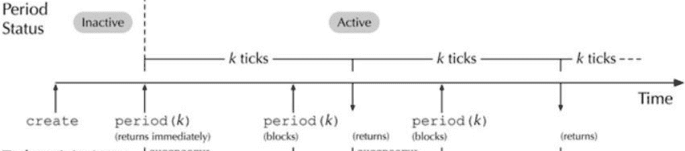

同时，该函数还会将周期对象标记为活动，记录调用时刻，并在未来 $k$ 个刻度处设置一个时间，其中 $k$ 是长度参数的值。此间隔的宽度是调用任务的名义周期，而间隔本身代表分配给第一个作业完成的最大墙钟。

在正常情况下，当任务不会错过截止日期时，作业将在间隔结束前完成执行，任务将开始下一次 `while` 循环，并再次调用 `rtems_rate_monotonic_period`。此调用将发现周期对象处于活动状态，并阻塞调用者直到自上次调用以来过去了 $k$ 个刻度。然后，它将在未来新的 $k$ 个刻度处设置新标记并返回 `RTEMS_SUCCESSFUL` 状态代码。

图 5.7 RTEMS 速率任务的正常时间线。

这确保了无论上一个任务完成花费多长时间，下一个任务都会在在上一个任务释放的恰好 k 个 tick 后释放。图 5.7 展示了这样的情况：尽管第二个任务的完成时间比第一个任务短，但所有三个任务恰好都在 k 个 tick 后释放的。

值得注意的是，定时机制对这些变化的原因并不敏感。正如我们在前面的章节中看到的，这些变化可能归于以下几个原因，例如：

- 任务执行时间的固有的变异性，例如，因为任务包含执行时间不同的数据相关代码路径。
- 来自其他高优先级任务的中断处理程序的干扰。虽然干扰本身不会影响任务的执行时间，但它确实会增加响应时间。
- 阻塞时间的长短，如果任务需要访问共享资源、与其他任务同步或执行同步输入/输出操作。

让我们讨论一下周期对象如何响应截止日期错过（deadline miss）场景，即当自当前任务释放后再次调用 `rtems_rate_monotonic_period` 已经过去了 k 个 tick 时。如果任务设计得当——即其最坏情况执行时间和阻塞时间不会导致其超过周期——这通常是由瞬时系统过载引起的，也就是说干扰量超过了可调度性分析中的预见量。

如图 5.8 所示，周期对象在这种场景下执行了两个不同的动作：

- 当到达截止日期时，周期对象的状态变为*过期（expired）*，并标记当前任务已错过了其截止日期。
- 同时，周期对象设置了未来 k 个 tick 后的新时间，这表示如果下一个任务（图中的 2 号任务）是在预期时间释放的，那么它的截止日期将是。

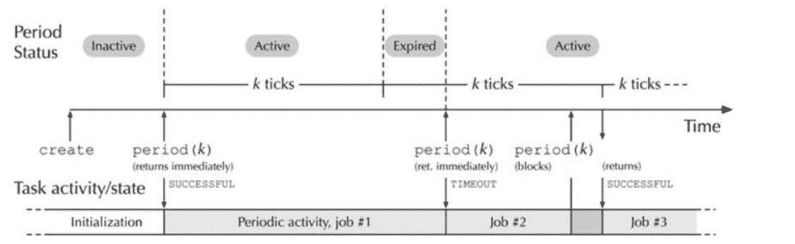

图 5.8 RTEMS 速率单调调度任务在错过截止日期时的时间线。

当任务最终调用 `rtems_rate_monotonic_period` 时（在图中，在 1 号任务延迟完成后），周期对象已处于过期状态。因此，该指令立即返回给调用者，以便尽快开始第 2 号任务，并且周期对象的状态回到活动状态。调用者还会收到异常状态代码 `RTEMS_TIMEOUT`，用以指示刚刚完成的任务（图中的 1 号任务）错过了其截止日期。

如果截止日期错过是因为偶然过载而非系统性问题，周期性任务可能会恢复。也就是说，如图所示，第 2 号任务可能在启动后但在其截止日期之前完成，并且在到达下一次时间之前 `rtems_rate_monotonic_period` 可能会再次被调用。如果发生这种情况，周期对象将开始像正常情况一样再次运行，即：

- 它阻塞调用者直到到达时间标记。
- 它在未来设置一个新的时间标记 k。
- 它返回给调用者以释放第 3 号任务。
- 它的状态码为 `RTEMS_SUCCESSFUL`，以反映 2 号任务没有错过截止日期的事实。

通过比较 5.7 和 5.8，我们可以观察到这种处理截止日期错过的方法的一个非常有用的结果是：从瞬时过载中恢复后，第 3 号任务释放的瞬间与在完全没有发生过载且 1 号任务没有延迟完成时释放的瞬间完全相同。

到目前为止，我们检查了最简单的恢复情况，即周期性任务在发生过载后立即回到其正常定时，即在受过载影响的任务之后的下一个任务执行期间。这并不总是可能的，由于这个原因，速率单调管理器采用了比我们目前描述的更复杂的策略来跟踪截止日期错过。

如图 5.9 所示，每个周期对象都关联着一个延迟计数器（postponement counter）。计数器的值在周期对象初始化时设置为零，如果没有截止日期错过，它将保持为零。它的值在两种情况下发生变化：

- 当调用者请求下一个周期后到达时间标记时，延迟计数器的值加 1。在图中，这发生在初始调用 `rtems_rate_monotonic_period`（该调用激活了周期对象）后的 k、2k 和 3k 时间单位处。
- 当由于截止日期错过，`rtems_rate_monotonic_period` 立即返回 `RTEMS_TIMEOUT` 以尽快释放新任务时，延迟计数器的值减 1。在图中，这发生在第 2 号、33 号和 4 号任务被释放时。

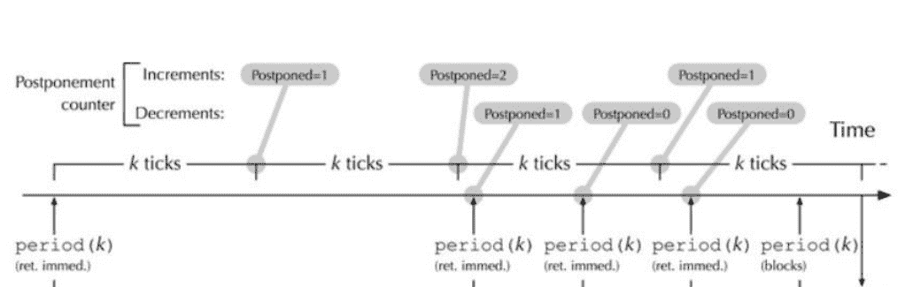

延迟计数器的值代表了当前由于截止日期错过而被推迟的任务数量。如图 5.9 所示，操作系统使用它来决定在从截止日期错过中恢复时应该立即释放多少任务。

在我们的示例中，在使用图 5.8 所示的逻辑立即释放第 2 号任务后，调用 `rtems_rate_monotonic_period` 后，第 3 号和第 4 号任务也被立即释放，因为对它们来说开始已经太晚了。当在第 4 号任务结束、在其截止日期过期之前调用 `rtems_rate_monotonic_period` 时，周期对象恢复到如图 5.7 所示的正常行为。我们可以看到，即使在多个截止日期错过的更复杂且通用的情况下，由周期对象管理的周期性任务具有非常有用的属性：

- 在发生一次或多次截止日期错过后，尽可能释放新任务以帮助周期性任务恢复。
- 当恢复完成后，任务在未发生截止日期错过时完全相同的时刻释放。

与此同时，通过 `rtems_rate_monotonic_period` 的 `RTEMS_TIMEOUT` 状态告知周期性任务截止日期错过。通过这种方式，任务可以通过减少恢复期间的执行需求来加速恢复。感兴趣的读者可以参考 [35] 了解关于该方法的更多信息。

除了用于限制周期性任务并控制其释放正如我们所见的那样，`rtems_rate_monotonic_period` 还可以带有特殊值 `RATE_MONOTONIC_PERIOD_STATUS` 被调用。在这种情况下，指令会阻塞调用者，并向调用者返回状态摘要。具体来说，指令使用以下状态代码表示状态：

- `RATE_MONOTONIC_NOTDEFINED` 周期对象未定义。
- `RATE_MONOTONIC_SUCCESS` 周期对象已活动。
- `RATE_MONOTONIC_TIMEOUT` 周期对象已过期。


# 周期对象的详细信息

周期对象的详细信息可以通过 `rtems_rate_monotonic_get_status` 函数获取，该函数将在后续讨论。无论如何使用 `rtems_rate_monotonic_period`，它都可能失败并返回状态代码 `RTMS_NOT_OWNER_OF_RESOURCE`（调用任务不是创建周期对象的任务），或者 `RTMS_INVALID_ID`（指示标识符无效）。

最后，重要的是周期对象的两个重要方面：

- 尽管在之前的示例中，所有对 `rtems_rate_monotonic_period` 调用的任务周期都是恒定的 k，但它的值确实可以更改，例如实现变周期任务。在这种情况下，新周期从调用 `rtems_rate_monotonic_period` 后第一个释放的任务开始生效。
- 任务也可以创建并使用多个周期对象，当其任务结构为子任务序列，且每个子任务必须在主任务释放后的某个固定偏移处释放，无论子任务完成花费多长时间。RTMS 文档 [105] 包含了关于该方面的更多信息。

## 取消周期对象

周期对象可以通过以下函数取消并恢复到创建后的初始非活动状态：

```c
rtms_status_code rtms_rate_monotonic_cancel(rtms_id id);
```

该函数接受要取消的周期对象的 `id`。然后，可以通过 `rtems_rate_monotonic_period` 激活周期对象。使用 `rtems_rate_monotonic_delete` 删除周期对象时，如果它正在运行，会自动取消它。一样，`rtms_rate_monotonic_cancel` 在成功时返回 `RTMS_SUCCESS`，在失败时返回以下状态代码之一：

- `RTMS_INVALID_ID`：标识符无效。
- `RTMS_NOT_OWNER_OF_RESOURCE`：调用任务不是创建周期对象的任务。

## 获取周期对象状态

用户可以通过以下函数获取比 `rtems_rate_monotonic_period` 更详细的周期对象状态信息：

```c
rtems_status_code rtems_rate_monotonic_get_status(
  rtems_id id,
  rtems_rate_monotonic_period_status *status
);
```

该指令的参数是周期对象的标识符 `id` 以及一个指向数据结构的指针，该指令在成功执行后将该结构中填充状态信息。表 5.10 列出了该数据结构的字段。其中：

- `rtems` 包含的信息本质上与指令 `rtems_rate_monotonic_period` 在周期长度等于 `RTEMS_PERIOD_STATUS` 时调用时返回的信息相同。
- `postponed_jobs_count` 是之前讨论的延迟计数器，表示为 `uint32_t`，即 32 位无符号整数。该计数器采用饱和算术递增，因此它将保持在 `uint32_t` 的最大值，即使在（极少数可能的）延迟任务超过 40 亿个的情况下，也不会溢出。

### 表 5.10 RTEMS 速率单调周期状态字段

| 字段 | 含义 |
| --- | --- |
| owner | 拥有周期对象的任务标识符 |
| state | 周期对象的当前状态(1) |
| postponed_jobs_count | 未能及时释放的任务数量 |
| since_last_period | 自当前周期开始以来经过的墙上运行时间(2) |
| executed_since_last_period | 自当前周期开始以来消耗的 CPU 时间 |

(1) 可能的值：`RATE_MONOTONIC_INACTIVE`、`RATE_MONOTONIC_ACTIVE` 和 `RATE_MONOTONIC_EXPIRED`。

(2) 当前周期的开始由最近一次执行 `rtems_rate_monotonic_period` 指令进行标记。

此外，如果周期对象不处于非活动状态，`since_last_period` 和 `executed_since_last_period` 字段提供了该任务自当前周期开始以来经过的墙上运行时间和消耗的 CPU 时间。在每个任务结束时使用 `rtems_rate_monotonic_get_status`，这些信息对于理解周期性任务的实际行为与其设计参数之间的接近程度（或遥远程度）特别有用。此外，除了下一次调用 `rtems_rate_monotonic_period` 提供的“是”或“否”答案外，它提供了关于任务错过截止日期前剩余多少时间裕量的价值见解。

在 RTEMS 的最新版本中，墙时间和 CPU 时间都以秒的整数部分加上纳秒的小数部分表示并存储在 `struct timespec` 中，这种 POSIX 数据类型将在 6.6 节中讨论。

函数在成功完成时返回 `RTEMS_SUCCESS`。否则，它返回以下状态代码之一：

- `RTEMS_INVALID_ID`：周期标识符无效。
- `RTEMS_INVALID_ADDRESS`：状态指针为空。

## 收集执行统计

即使用户没有显式收集周期对象的状态信息，它仍然被用于计算执行统计。通过以下函数获取这些统计信息：

```c
rtems_status_code rtems_rate_monotonic_get_statistics(
  rtems_id id,
  rtems_rate_monotonic_period_statistics *statistics
);
```

该函数的接口与 `rtems_rate_monotonic_get_status` 非常相似。它接收要对其操作的周期对象的标识符 `id`，以及指向一个结构的指针，该结构将填充统计信息，其字段在每个周期结束时更新，并包括：

- 到目前为止执行的任务总数（`count`）和错过截止日期的任务数（`missed_count`）。
- 目前为止执行的所有任务所消耗的最小、最大和总 CPU 时间（`min_cpu`、`max_cpu` 和 `total_cpu`）。
- 目前为止执行的所有任务所消耗的最小、最大和总墙上时间（此处对应字段）。

### 表 5.11 RTEMS 速率单调周期统计字段

| 字段 | 含义 |
| --- | --- |
| count | 目前为止执行的任务数 |
| missed_count | 错过截止日期的任务数 |
| min_cpu | 目前为止执行任务的最小 CPU 时间 |
| max_cpu | 目前为止执行任务的最大 CPU 时间 |
| total_cpu | 目前为止执行任务的总 CPU 时间 |
| min_wall | 目前为止执行任务的最小墙上时间 |
| max_wall | 目前为止执行任务的最大墙上时间 |
| total_wall | 目前为止执行任务的总墙上时间 |

> （注：根据上下文逻辑，表格中的字段名应与代码结构体对应，此处翻译保持了逻辑一致性）

# 5.6 计时：时钟与定时器

RTEMS 中的计时围绕着两个相关概念：时钟和定时器。定时器是一个对象，当经过特定时间（相对时间）或到达指定的日期时间（绝对时间）时，它会触发对用户服务的调用，根据上述时钟维护的时间概念。定时器可以通过以下两种方式调用，取决于用户初始化时的选择：

- 直接从时钟处理程序调用，即在中断上下文中执行。
- 通过 RTEMS 中定时器的介入调用。在这种情况下，定时器服务的执行发生在任务上下文中。

在图 5.10 中，在中断上下文中执行的模块显示为深色矩形，而在任务上下文中执行的模块显示为浅灰色。这些执行定时服务的方法之间有几个值得注意的区别：

- 在中断上下文中运行的定时器服务在两个重要领域具有很大的限制。首先，许多操作系统设备无法从该文中被调用。其次，禁止任何形式的阻塞，任何时间延迟必须通过活动等待循环合理实现。
- 中断处理程序被隐式赋予高于系统中任何任务的优先级。由于 4.2 节所述的原因，由于系统的整体可调度性，在中断文中花费的时间必须尽可能少。
- 定时器服务器任务的优先级可以在启动时由用户自由选择，以保护高优先级任务不受定时器例程序的干扰。
- 这种额外灵活性的代价是，如果通过定时任务间接调用而不是直接由时钟处理程序调用，定时服务例程序的调用延迟通常会更高。

为了减少操作系统开销，RTEMS 不会自动启动定时器服务任务。因此，用户在启动任何使用的定时器之前，必须显式调用专用操作系统原语来启动定时器服务任务。

![image_142]

**图 5.10 时钟和定时器的概览**

时钟和定时器都受 RTEMS 时钟管理器（Clock Manager）控制。表 5.12 汇总了它的指令。

### 表 5.12 RTEMS 时钟管理器 API

| 功能 | 用途 |
| --- | --- |
| set (1) | 设置当天 |
| get_tod | 以 `rtems_time_of_day` 对象的形式获取当天 |
| get_tod_timeval | 以 `struct timeval` 对象的形式获取当天 |
| get_seconds_since_epoch | 获取自 RTEMS 纪元以来经过的秒数 |
| get_ticks_per_second | 获取每秒滴答数的时钟分辨率 |
| get_ticks_since_boot | 获取自启动以来的时钟滴数 |
| get_uptime | 以 `struct timespec` 对象的形式获取自启动以来的时间 |
| get_uptime_timeval | 以 `struct timeval` 对象的形式获取自启动以来的时间 |
| get_uptime_seconds | 以秒获取自启动以来的时间 |
| get_uptime_nanoseconds | 以纳秒获取自启动以来的时间 |
| tick_later | 返回未来的滴计数器（以滴答为单位的时间间隔） |
| tick_later_use | 返回未来的滴计数器（以 $\mu$s 为单位的时间间隔） |
| tick_before | 如果给定的滴计数器在未来，则返回 true |

(1) RTEMS 时钟管理器 API

## 设置和获取当天

当 RTEMS 启动时，在使用之前必须初始化其“当天”的概念。初始化可以由板级支持包（BSP）在启动时完成，如果它管理着硬件设备（通常称为实时时钟 RTC），该设备能够在即使操作系统未运行、且可能其他硬件组件已断电的情况下跟踪当天时间。用户代码也可以通过以下函数在任何时间执行当天初始化：

```c
rtems_status_code rtems_clock_set(
  rtems_time_of_day *time_buffer
);
```

参数 `time_buffer` 指向一个 `rtems_time_of_day` 数据结构，其字段如表 5.8 所示，包含了要设置的当天时间。RTEMS 仅支持其纪元（epoch）之后的时间，纪元是一个过去定义的定义点，即 1988 年 1 月 1 日午夜。为了避免混淆，值得注意的是，POSIX API 也定义了纪元的概念（如第 6.6 节所述），但参考点是不同的。

然而，在大多数情况下，只要用户不将存储在不同数据类型结构中的当天时间混合使用，这种差异对用户是隐藏的。这是因为，一方面，从 RTEMS 特有数据（如 `rtems_time_of_day`）加载或存储当天时间的 RTEMS 函数使用的是 RTEMS 的纪元概念；另一方面，使用 POSIX 数据结构（如 `struct timeval`（见第 11 章）和 `struct timespec`（见第 6 章））的函数则遵循 POSIX 的纪元定义，其唯一的限制是无法表示 RTEMS 纪元。

`rtems_clock_set` 在成功设置当天时间时返回 `RTEMS_SUCCESS`，或者在失败时返回以下状态代码之一：

- `RTEMS_INVALID_ADDRESS`：`time_buffer` 指针为空。
- `RTEMS_INVALID`：`time_buffer` 所引的数据结构内容无效，例如，因为它们代表了 RTEMS 纪元之前的时间。

以下函数以不同的格式检索当前的当天：

```c
rtems_status_code rtems_clock_get_tod(
  rtems_time_of_day *time_buffer
);
```

```c
rtems_status_code rtems_clock_get_tod_timeval(
  struct timeval *time_buffer
);
```

```c
rtems_status_code rtems_clock_get_seconds_since_epoch(
  rtems_interval *time_buffer
);
```

所有函数都接受一个 `time_buffer` 来填充当前的当天时间。对于第一个函数 `rtems_clock_get_tod`，类型是 `rtems_time_of_day`；对于第二个函数 `rtems_clock_get_tod_timeval`，类型是 `struct timeval`；对于第三个函数 `rtems_clock_get_seconds_since_epoch`，类型是 `rtems_interval`，返回自纪元以来的秒数。

`rtems_clock_set` 在成功设置当天时间时返回 `RTEMS_SUCCESS`，失败时返回以下状态代码：

- `RTEMS_INVALID_ADDRESS`：`time_buffer` 指针为空。
- `RTEMS_INVALID`：`time_buffer` 所引的数据结构内容无效，例如，因为它们代表了 RTEMS 纪元之前的时间。

## 启动以来的时间

除了当天时间，许多系统的另一个重要参考是启动时间。对于那些使用 `struct timespec` 类型的 RTEMS 系统，函数：

```c
rtems_status_code rtems_clock_get_uptime(
  struct timespec *uptime
);
```

填充 `uptime` 指向的 `timespec`（也称为 uptime）。返回的分辨率不取决于滴答频率，而取决于 RTEMS 板级支持包（BSP）支持的硬件定时器的分辨率。

POSIX 定义的 `struct timespec` 类似于 `timeval`。两者之间的主要区别（也是常见的混淆和编程错误来源）是，`timespec` 的秒部分是用纳秒表示，而 `timeval` 用微秒表示。第 6 章包含了关于 `timespec` 数据类型使用的更多信息。

函数

```c
rtems_status_code rtems_clock_get_uptime_timeval(
  struct timeval *uptime
);
```

与上一个函数非常相似。它在成功时返回 `RTEMS_SUCCESS`，如果 `uptime` 指针为空。主要区别是：

- 它需要 `struct timeval` 而不是 `struct timespec` 缓冲区。
- 它不检查 `uptime` 指针是否为空。

指令

```c
time_t rtems_clock_get_utime_seconds();
uint64_t rtems_clock_get_utime_nanoseconds();
```

也返回启动以来的时间，但分别以秒和纳秒表示。使用这些函数时，考虑到涉及的数据类型，溢出的可能性变得极低。例如，自启动以来的纳秒是用 `uint64_t`（64 位无符号整数）表示的。因此，返回值将在系统启动约 584 年后才会溢出。

## 未来时间标记与忙等

函数 `rtems_clock_tick_later` 和 `rtems_clock_tick_later_usec` 计算并返回与当前时间未来指定距离的时间点对应的滴答计数器：

```c
rtems_interval rtems_clock_tick_later(
  rtems_interval delta
);
```

```c
rtems_interval rtems_clock_tick_later_usec(
  rtems_interval delta_in_usec
);
```

它们的区别在于时间距离的测量单位：`rtems_clock_tick_later` 使用滴答（ticks）作为单位，而 `rtems_clock_tick_later_usec` 则使用微秒（microseconds）作为单位。

可以将返回值作为参数传递给函数，以便与当前时间进行比较：

```c
bool rtems_clock_tick_before(
    rtems_interval tick
);
```

该函数将作为参数提供的 tick 值与当前的 tick 计数器进行比较，如果该 tick 仍在未来，则返回 true。例如，以下代码段：

```c
rtems_interval future = rtems_clock_tick_later(10);
while(rtems_clock_tick_before(future));
```

将使任务陷在忙等待循环中，持续 10 个滴答的时间。

## 创建和删除定时器

任务可以通过调用指令来创建一个新的定时器：

```c
rtems_status_code rtems_timer_create(
    rtems_name name,
    rtems_id *id
);
```

该指令的参数是要创建的定时器名称，并将其存储在由唯一标识符指向的位置，必须使用该标识符通过其他定时器管理器函数对定时器进行操作。定时器是本地对象；它们只能在创建它们的节点上使用。此外，在多核系统中，调用任务当前所在的内核将决定操作系统使用哪个内核来在内部管理该定时器的整个生命周期。表 5.13 显示了定时器管理器中可用指令。

### 表 5.13 RTEMS 定时器管理器 API

| 函数 | 目的 |
| --- | --- |
| create | 创建定时器 |
| ident | 根据名称获取定时器的标识符 |
| delete | 删除定时器 |
| fire_after | 在时间间隔后执行服务例程 |
| fire_when | 在指定时间执行服务例程 |
| cancel | 取消激活的定时器 |
| reset | 重置相对间隔定时器 |
| initiate_server | 启动 RTEMS 定时器服务器 |


| server_fire_after | 类似于 `fire_after`，但通过定时器服务器执行 |
| server_fire_when | 类似于 `fire_when`，但通过定时器服务器执行 |

所有 API 函数都以 `rtems_timer_` 为前缀。当函数成功完成时，返回 `RTEMS_SUCCESSFUL`，或者返回以下状态码之一：

- `RTEMS_INVALID_ADDRESS`: `id` 指针为空。
- `RTEMS_INVALID_NAME`: 传递的参数定时器名称无效。
- `RTEMS_TOO_MANY`: 已达到系统最大定时器数量，无法再创建。

也可以通过以下函数根据定时器名称在稍后获取定时器的标识符：

```c
rtems_status_code rtems_timer_ident(
    rtems_name name,
    rtems_id *id
);
```

该函数的参数是现有定时器的名称，并将其标识符存储到 `id` 指向的位置。对于其他类型的 RTEMS 对象，定时器名称并不保证是唯一的（尽管标识符是唯一的）。因此，如果存在多个同名的定时器，此函数将提供其中一个的标识符，但具体是哪一个是不确定的。该函数在执行成功时返回 `RTEMS_SUCCESSFUL`，或者返回以下状态码之一描述失败原因：

- `RTEMS_INVALID_ADDRESS`: `id` 指针为空。
- `RTEMS_INVALID_NAME`: 传递的参数定时器名称无效或未找到该名称的定时器。

当不再需要定时器时，可以通过以下函数将其删除：

```c
rtems_status_code rtems_timer_delete(
    rtems_id id
);
```

该函数的唯一参数是要删除的定时器的标识符 `id`。如果该定时器当前处于激活状态，该函数会自动将其去激活。由任务创建的定时器可以由同一节点上的另一个任务删除。建议删除未使用的定时器，因为分配给它们的资源将返回给系统并重用于新的定时器。在成功调用 `rtems_timer_delete` 后，作为参数传递的标识符将失效且不再应再次使用。该函数在成功时返回 `RTEMS_SUCCESSFUL`，如果 `id` 无效（例如未对应任何现有定时器），则返回 `RTEMS_INVALID_ID`。

### 启动、取消和重置定时器

可以通过不同的指令激活定时器，取决于过期时间是以相对方式还是绝对方式表示，以及定时器服务例程是直接从时钟处理程序调用，还是通过定时器服务器任务间接调用。

对于直接调用服务例程，使用指令：

```c
rtems_status_code rtems_timer_fire_after(
    rtems_id id,
    rtems_interval ticks,
    rtems_timer_service_routine_entry routine,
    void *user_data
);
```

激活一个定时器使其在经过 `ticks` 时间后过期（或触发）。换句话说，`ticks` 代表相对于调用 `rtems_timer_fire_after` 时间的相对时间间隔。如果定时器已处于激活状态，则会在再次激活定时器之前自动取消之前的激活。`routine` 参数指定了用户指定的定时器例程，其签名如下：

```c
void (* routine)(
    rtems_id id,
    void *user_data
);
```

它将在定时器过期时被调用，并将过期的定时器 `id` 和用户提供的 `user_data` 指针作为参数。该函数在成功时返回 `RTEMS_SUCCESSFUL`，或者返回以下状态码之一：

- `RTEMS_INVALID_ID`: 定时器标识符无效。
- `RTEMS_INVALID_ADDRESS`: `routine` 指针为空。
- `RTEMS_INVALID_NUMBER`: 时间间隔 `ticks` 无效。

另一个指令允许调用者激活定时器，使其在指定的日期时间触发，即当达到某个绝对时间时：

```c
rtems_status_code rtems_timer_fire_when(
    rtems_id id,
    rtems_time_of_day *wall_time,
    rtems_timer_service_routine_entry routine,
    void *user_data
);
```

除了 `routine` 和 `user_data` 参数（其含义与 `rtems_timer_fire_after` 相同），该指令还接收一个指向 `rtems_time_of_day` 结构的指针 `wall_time`。它包含了定时器触发的绝对时间。该指令在成功时返回 `RTEMS_SUCCESSFUL`，或者返回以下状态码之一：

- `RTEMS_INVALID_ID`: 定时器标识符无效。
- `RTEMS_INVALID_ADDRESS`: `routine` 或 `wall_time` 指针为空。
- `RTEMS_NOT_DEFINED`: 日期尚未设置。
- `RTEMS_INVALID_CLOCK`: `wall_time` 所引用的数据结构内容无效，例如它们代表 RTEMS 纪元之前的时间。

可以通过函数取消定时器：

```c
rtems_status_code rtems_timer_cancel(
    rtems_id id
);
```

其唯一参数是定时器 `id`。被取消的定时器将不再过期，除非再次激活，否则其服务将不再被调用。取消未激活的定时器不是错误。该函数在成功时返回 `RTEMS_SUCCESSFUL`，在给定无效定时器 `id` 时返回 `RTEMS_INVALID_ID`。

最后，函数：

```c
rtems_status_code rtems_timer_reset(
    rtems_id id
);
```

提供了一种在不需要每次显式指定的情况下多次重置和激活相对定时器的方法。如果定时器处于激活状态，它会被取消。然后使用上一次调用 `rtems_timer_fire_after` 时指定的间隔和定时器服务立即激活。对未激活的定时器使用此函数不是错误；在这种情况下它只是激活它。该函数在成功时返回 `RTEMS_SUCCESSFUL`，或者返回以下状态码之一：

- `RTEMS_INVALID_ID`: 定时器标识符无效。

由于 `rtems_timer_reset` 和 `rtems_timer_cancel` 也可以用于服务例程由定时器服务器调用的定时器，我们将在后续讨论。

```c
rtems_status_code rtems_timer_server_fire_after(
    rtems_id id,
    rtems_interval ticks,
    rtems_timer_service_routine_entry routine,
    void *user_data
);

rtems_status_code rtems_timer_server_fire_when(
    rtems_id id,
    rtems_time_of_day *wall_time,
    rtems_timer_service_routine_entry routine,
    void *user_data
);
```

它们的参数分别与 `rtems_timer_fire_after` 和 `rtems_timer_fire_when` 相同，但定时服务例程将由定时器服务器调用，而不是时钟处理程序。这些函数返回与其直接调用对应版本相同的状态码，含义相同，但额外增加了：

- `RTEMS_INCORRECT_STATE`: 定时器服务器尚未启动，因此这些函数无法使用。

## 5.7 抢占与中断管理

在第 5.4 节中，我们看到在单核系统中，通过恰当设置任务模式可以禁用任务抢占。这种方法可以作为一种非常高效的方法，用于确保此类系统中任务之间的互斥。

通过 RTEMS 中断管理器提供的一系列函数（如表 5.14 所示）以及其他主要的中断管理器函数，可以将互斥域扩展到中断处理程序。然而，在描述它们之前，必须再次强调，由于第 12.3 节概述的原因，这种互斥方法仅在单核系统中有效。RTEMS 管理器提供了额外的同步方法，以保证多核系统中任务与中断处理程序之间的互斥。这些方法列在表 13.3 中，将在第 13 章中进行讨论。

表 5.14 RTEMS 中断管理器 API，基本函数

| 函数 | 目的 |
| --- | --- |
| `catch` | 将处理程序与中断源关联 |
| `disable` | 在单核系统中禁用中断 |
| `enable` | 在单核系统中恢复中断级别 |
| `flash` | 恢复中断级别 |
| `local_disable` | 在调用核心上本地禁用中断 |
| `local_enable` | 在调用核心上本地启用中断 |

(1) 与自旋锁相关的中断管理器函数列在表 13.3 中。
(2) 所有的中断管理器函数都以 `rtems_interrupt_` 开头。

该指令：

```c
rtems_status_code rtems_interrupt_catch(
    rtems_isr_entry new_isr_handler,
    rtems_vector_number vector,
    rtems_isr_entry *old_isr_handler
);
```

为中断源安装一个中断处理程序——在 RTEMS 中称为中断服务例程（ISR）——由 RTEMS 中断管理器进行干预。中断源通过中断号向量识别。向量数与中断源之间的对应关系取决于平台，并通过平台的板级支持包（BSP）建立。

该指令为给定的向量安装新的中断处理程序 `new_isr_handler`，并将同一向量的上一个中断处理程序存储在由 `old_isr_handler` 指向的位置中。中断处理程序是类型为 `rtems_isr_entry` 的 C 函数，并且必须遵循以下原型：

```c
rtems_isr new_isr_handler(
    rtems_vector_number vector
);
```

它们接收向量数作为参数，以便能够识别中断源。通过这种方式，同一个处理程序可以恰当地处理来自不同源的中断。在某些架构上，中断处理程序可能会接收额外的与架构相关的参数，例如用于处理中断而创建的异常帧的指针。返回类型 `rtems_isr` 目前定义为 `void`。

RTEMS 中断管理器在调用用户指定的中断处理程序之前和之后的干预，对于确保中断本身和处理器调度得到恰当处理起着至关重要的作用。特别是：

- 在调用中断处理程序之前，RTEMS 负责保存被中断任务的所有未被硬件或 C 调用约定自动保存的寄存器（如第 4.2 节所示），并允许中断处理程序运行。
- 在调用中断处理程序后，RTEMS 恢复被中断任务的中断级别，以确保中断和调度得到恰当处理。

# 任务管理与计时，POSIX API

# 目录

- 6.1 属性对象
- 6.2 线程的创建与终止
- 6.3 线程调度
- 6.4 强制终止线程（取消）
- 6.5 信号处理
- 6.6 计时
- 6.7 总结

用于任务管理和计时的 POSIX 应用程序编程接口（API）比第 5 章介绍的 RTEMS Classic 对应部分更为复杂。因此，其描述被分为几个部分：

- 本章首先讨论了属性对象，这是 POSIX 用于配置和自定义其所管理的线程和其他实体的行为的主要机制。
- 随后，我们使用了主要的线程创建和终止函数（这些函数几乎用在所有的 POSIX 并发多线程程序中），并介绍了 POSIX 调度模型及其策略，这些策略定义了线程如何执行。关于多核调度的典型函数的讨论将推迟到第 13 章。
- 本章涉及的另一个主题是 POSIX 如何支持线程取消，即根据另一个线程的要求强制终止一个线程。
- 信号是 POSIX 支持向线程发送软件执行中断的方式。这是通知线程外部异步事件（如定时器超时和消息到达）的主要机制。
- 本章以对通过时钟和定时器实现的 POSIX 计时函数的讨论作为结束。

## 6.1 属性对象

在详细描述任何 POSIX 对象之前，讨论属性对象是至关重要的，属性对象被用于确定线程和其他 POSIX 对象的某些行为层面。通过属性，可以以可移植的方式支持 POSIX 对象的未来扩展，而无需更改操作它们的函数的 API。

此外，我们还提供了一份关于 POSIX 对象可配置的（有时是固有的不可移植的）方面的清晰列表。例如，线程的栈地址属性（即用作线程栈的内存区域的地址）是线程的一个特征，因为使用某种类型的内存会显著影响线程的执行速度。然而，它很少能以可移植的方式表示，并且当软件从一个系统移植到另一个系统时必须进行调整。将其表示为线程的属性并存储在属性对象中是有意义的，这样可以将其与软件的其他部分隔离开。

由于同一个属性对象可以用于创建多个相同类型的对象（如线程），设置这样的属性对象也提供了一种以集中方式定义一类线程共同特征的方法。图 6.1 显示了如何管理属性和属性对象，仍然以栈地址属性为例。随后的描述指的是属性对象，但相同的概念也适用于其他类型的属性对象，只是数据类型和函数名称不同。

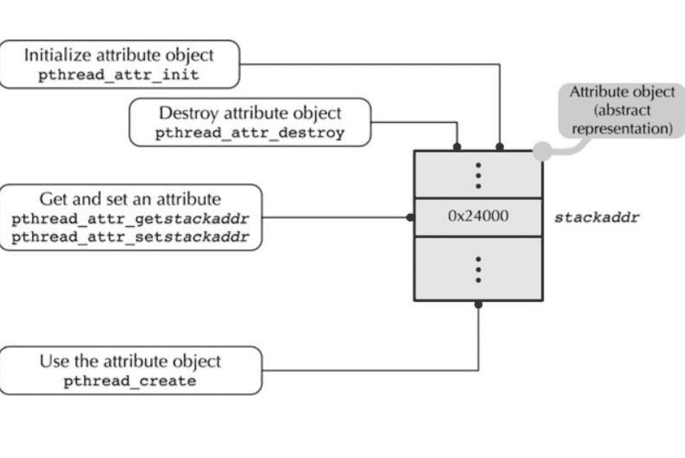

图 6.1 POSIX 中的属性对象。

属性对象必须在使用之前进行初始化。对于线程属性对象，初始化函数为：

```c
int pthread_attr_init(pthread_attr_t *attr);
```

该函数的唯一参数是一个指向 `pthread_attr_t` 类型对象的指针，该对象表示属性对象。成功时，该函数会初始化对象，将其包含的所有属性设置为其默认值，并返回零。如果失败，它返回一个非零状态码。标准规定的唯一状态码是：

- `ENOMEM`: 由于内存不足，无法初始化属性对象。

连续初始化同一个属性对象会导致未定义行为，尽管标准建议 `pthread_attr_init` 检测到此错误并返回状态码：

- `EBUSY`: 由 `attr` 指向的属性对象已经初始化。

当属性对象不再需要时，应该通过函数将其销毁：

```c
int pthread_attr_destroy(pthread_attr_t *attr);
```

为了释放 `pthread_attr` 可能为其分配的动态内存，当该函数检测到 `attr` 不指向一个已初始化的属性对象时，可能会返回以下非零状态码：

- `EINVAL`: 参数 `attr` 未指向一个已初始化的属性对象。

属性对象在销毁后不应被引用，但同一个属性对象可以通过再次调用 `pthread_attr_init` 重新初始化并再次使用。

如图 6.1 所示，属性对象可以看作属性的“容器”。每个单独的属性可以通过一对函数获取并存储到属性对象，这对函数的名称通常为 `pthread_attr_get` 和 `pthread_attr_set`，后跟属性的名称。例如，`pthread_attr_getstackaddr` 和 `pthread_attr_setstackaddr` 函数设置栈地址属性。不过，也有一些例外。例如，获取和设置线程范围的函数被称为 `pthread_attr_getscope` 和 `pthread_attr_setscope`。

这些函数始终将其必须操作的属性对象的指针作为第一个参数，随后是额外的参数，其数量和类型取决于具体的属性。它们在成功时均返回零，在失败时返回非零状态码。

此外，还存在一些便利函数，能够一次获取和设置多个相关属性。这些函数将与它们操作的属性一起进行详细讨论。

## 6.2 线程的创建与终止

与线程创建及其自愿终止相关的函数总结在表 6.1 中。在 POSIX 中，线程由线程描述符表示，即类型为 `pthread_t` 的对象。它们通过以下函数创建：

```c
int pthread_create(pthread_t *restrict thread,
    const pthread_attr_t *restrict attr,
    void *(*start_routine)(void *), void *restrict arg);
```

表 6.1 RTEMS 线程创建与终止原语，POSIX API

| 函数 | 目的 |
| :--- | :--- |
| `pthread_create` | 创建并启动新线程 |
| `pthread_exit` | 自愿终止线程 |
| `pthread_join` | 等待直到线程终止 |
| `pthread_detach` | 分离线程 |
| `pthread_equal` | 检查两个线程标识符是否相等 |
| `pthread_self` | 返回调用线程标识符 |

该函数的参数指示了它必须将新创建的线程描述符存储在哪里（由 `thread` 指向的位置）以及线程属性（保存在 `attr` 中）。参数 `start_routine` 是新线程必须执行的函数名称，它是它的入口点，`arg` 是指向它的指针。与 Classic 任务不同，通过 POSIX API 创建的任务在创建时就已准备好执行，如果它们的优先级足够高，可能会立即开始执行。

当 `pthread_create` 无法创建线程时，会返回非零错误：

- `EAGAIN`: 系统资源不足，无法创建新线程。
- `EPERM`: 线程没有足够的权限创建线程。

表 6.2 建议如果 `attr` 不是正确初始化的属性对象，则返回 `EINVAL`。标准列出了（对于与 RTEMS 不同支持多进程的操作系统）这些属性的默认值：

- `detachstate` 是一个整数，决定了新线程是否是可连接的。其可能值为：
  - `PTHREAD_CREATE_JOINABLE`（可连接的，支持 join）
  - `PTHREAD_CREATE_DETACHED`（分离的，不支持 join）
- `schedpolicy` 是一个整数，控制新线程从哪里获取其调度策略和参数：
  - `PTHREAD_EXPLICIT_SCHED`（显式指定）
  - `PTHREAD_INHERIT_SCHED`（从调用线程继承）
- `inheritsched` 是一个整数，控制新线程如何获取其栈：
  - `PTHREAD_EXPLICIT_STACK`（显式指定）
  - `PTHREAD_INHERIT_STACK`（从调用线程继承）
- `contentionscope` 是一个整数，决定新线程与谁竞争。总之，如果竞争范围是 `PTHREAD_SCOPE_SYSTEM`，它与所有其他线程竞争；如果范围是 `PTHREAD_SCOPE_PROCESS`，它与同一进程内的其他线程竞争，这取决于进程级别的调度策略和参数。


- `schedparam` 是一个 `sched_param` 类型的复合属性，包含了线程的优先级。对于大多数调度策略，这些属性是根据创建后可以修改的。

- `addstack` 是一个 `void *` 类型的属性，允许调用者设置所谓的应用程序管理的栈。具体而言，该属性值指向用作栈的内存区域。通过这种方法，新线程将使用的栈内存由调用者手动分配和管理，而不是由操作系统自动管理。这样就可以准确确定栈在地址空间中的位置，例如通过使用某种特定方法。这是以增加软件复杂性和不移植性为代价的。许多问题是因为实现对 `addstack` 的对齐要求比 `malloc` 提供的更严格，且标准未规定。因此，`malloc` 返回的指针可能无法直接用于设置线程的栈。

- `stacksize` 是 `size_t` 类型属性，指示新线程栈的大小（字节）。该值必须大于或等于 `PTHREAD_STACK_MIN`。获取和设置 `addstack` 和 `stacksize` 属性的普通函数 `pthread_getstack` 和 `pthread_setstack` 可以方便地同时操作它们。

- `guardsize` 也是 `size_t` 类型，指示保护区域的大小。保护区域是位于栈末端的预留内存（即处理器将项目推入栈时的最后一个位置之外）。它被用于检测栈溢出，通常由内存管理单元（MMU）协助。特殊值零表示不应提供保护区域。当应用程序管理的线程栈处于状态时，此属性被忽略。

`affinity_np` 扩展允许定义非可移植的特性和实体，这些特性通过其名称中的 `_np` 或 `_np` 后缀以及与之相关的函数来标识。这是一个非可移植属性的示例，因为它没有被 POSIX 标准规定，并且代表了允许新创建的线程运行的核心集合。其类型为 `cpu_set_t`。该属性是第 5.4 节中描述的操纵任务 Affinity 码的经典 API 指令的 POSIX 对应项。

### 表 6.2 RTEMS 线程属性，POSIX API

| 函数 | 目的 |
| --- | --- |
| `pthread_attr_init` | 初始化线程属性对象 |
| `pthread_attr_destroy` | 销毁线程属性对象 |
| `pthread_attr_getdetachstate` | 获取 `detachstate` 属性 |
| `pthread_attr_getschedpolicy` | 获取 `schedpolicy` 属性 |
| `pthread_attr_getschedparam` | 获取 `schedparam` 属性 |
| `pthread_attr_getinheritsched` | 获取 `inheritsched` 属性 |
| `pthread_attr_getscope` | 获取 `contentionscope` 属性 |
| `pthread_attr_getstackaddr` | 获取 `stackaddr` 属性 |
| `pthread_attr_getstacksize` | 获取 `stacksize` 属性 |
| `pthread_attr_getstack` | 同时获取 `stackaddr` 和 `stacksize` |
| `pthread_attr_getguardsize` | 获取 `guardsize` 属性 |
| `pthread_attr_getaffinity_np` | 获取（非可移植的）`affinity_np` 属性 |
| `pthread_attr_setdetachstate` | 设置 `detachstate` 属性 |
| `pthread_attr_setschedpolicy` | 设置 `schedpolicy` 属性 |
| `pthread_attr_setschedparam` | 设置 `schedparam` 属性 |
| `pthread_attr_setinheritsched` | 设置 `inheritsched` 属性 |
| `pthread_attr_setscope` | 设置 `contentionscope` 属性 |
| `pthread_attr_setstackaddr` | 设置 `stackaddr` 属性 |
| `pthread_attr_setstacksize` | 设置 `stacksize` 属性 |
| `pthread_attr_setstack` | 同时设置 `stackaddr` 和 `stacksize` |
| `pthread_attr_setguardsize` | 设置 `guardsize` 属性 |
| `pthread_attr_setaffinity_np` | 设置（非可移植的）`affinity_np` 属性 |

### 表 6.3 线程属性默认值，POSIX API

| 属性 | 值 |
| --- | --- |
| `detachstate` | `PTHREAD_CREATE_JOINABLE` |
| `schedpolicy` | `SCHED_FIFO` |
| `schedparam` | 调度优先级 2 |
| `inheritsched` | `PTHREAD_INHERIT_SCHED` |
| `contentions` | `PTHREAD_SCOPE_PROCESS` |
| `stackaddr` | 设置线程创建 |
| `stacksize` | 设置线程创建为可能的最小值 |
| `guardsize` | 0 |
| `affinity_np` | 启用所有核心 |

线程从其入口点返回时隐式终止，即从传递给 `pthread_create` 的 `start_routine` 返回。它也可以*显式地*终止，通过从代码中的任何地方调用以下函数：

```
void pthread_exit(void *value_ptr);
```

在两种情况下，终止的线程都可以在 `void *` 值中总结其状态和终止原因，该值分别是 `start_routine` 的返回值或传递给 `pthread_exit` 的参数。这两种终止方式是等价的：从 `start_routine` 返回与调用 `pthread_exit` 并将返回值作为参数的效果相同。`pthread_exit` 函数根据定义返回给调用者，因此对其无需进行错误处理。

如果终止线程的 `detachstate` 属性被设置为 `PTHREAD_CREATE_JOINABLE` 值，另一个线程可以通过连接操作（将在下文中讨论）等待其终止，并访问其最终状态。否则，与线程相关的所有信息（包括最终状态）在终止时都会被丢弃，且在其他地方无法访问。

在所有情况下，线程在终止之前仍会执行两类清理操作。特别是：

- 它执行由 `pthread_cleanup_push` 函数注册的清理处理程序（将在第 6.4 节讨论）。执行遵循后进先出的顺序。
- 它调用与该线程关联且指针不为 `NULL` 的所有线程特有数据项的终结器。线程特有数据由于空间限制在书中未讨论，是每个线程的结构，在线程终止时可能会被释放。

到目前为止，终止线程终止方式都是自愿的，也就是说线程本身主动采取终止。标准还规定了一种非自愿终止机制，即一个线程请求终止另一个线程。这种机制被称为取消（cancellation），将在 6.4 节中详细讨论。

函数：

```
int pthread_join(pthread_t thread, void **ptr);
```

等待参数 `thread` 所表示的线程终止。该线程必须是在将 `detachstate` 属性设置为 `PTHREAD_CREATE_JOINABLE` 时创建的。如果参数 `value_ptr` 不为 `NULL`，该函数还将线程的状态码设置到 `value_ptr` 所引的位置。

最终状态码是线程本身在自愿终止时提供的值，或者如果线程被取消则为特殊值 `PTHREAD_CANCELED`。在成功连接后，系统可以释放销毁与终止线程关联的信息。由于此原因，不允许多次连接同一个线程。

如果成功，函数在线程终止后返回零。否则，标准建议函数检测以下错误条件并返回相应的非零错误代码：

- `EINVAL`：线程描述符未指向一个可连接的线程，即指向一个分离属性为 `PTHREAD_JOINABLE` 的线程。
- `ESRCH`：线程描述符指向一个已经是连接目标的已终止线程。
- `EDEADLK`：线程描述符指向调用线程。否则，执行连接将导致死锁。

连接机制的定义意味着系统必须保留有关可连接线程的一些信息——即从其线程描述符可以访问的数据结构，至少在线程终止后直到线程被 `pthread_join` 目标。如果一个线程被创建为可连接的，但不再需要或想要该功能，建议将其分离，以避免通过让其分配不确定时间而浪费系统资源。此外，系统性地省略连接操作可能会导致系统面临因已终止但尚未连接的线程过多而超过 `PTHREAD_THREADS_MAX` 的风险，因为标准未规定这些是否计入该限制。可以通过使用相应的线程描述符调用 `pthread_detach` 函数来分离线程：

```
int pthread_detach(pthread_t thread);
```

如果 `pthread_detach` 函数返回零。否则，标准建议函数检测以下错误条件并返回相应的非零错误代码：

- `ESRCH`：线程描述符未知。

## 6.3 线程调度

在通用形式，POSIX 标准规定软件系统按层次结构组织成一组进程，每个进程包含一个或多个线程。每个进程都有自己的地址空间并包含大部分资源。然而，高效实现多个具有各自独立的受保护地址空间的进程需要硬件支持，形式为全功能的内存管理单元（MMU）或至少是内存保护单元（MPU）。在没有这些资源且没有执行确定性的情况下，标准允许实现通过许多单用户、单进程（SUSP）方法来支持多任务处理。在 RTEMS 支持的执行环境中，系统启动时会创建一个单进程，其一个线程将继续执行 `main()` C 语言入口点。这个初始用户线程随后可以按照 6.2 节所述动态创建其他线程，但所有这些线程始终位于同一个初始进程边界内。因此，在下文中我们将主要关注线程级调度，并尽可能减少对进程层面描述的描述。只有在进程和线程之间的关系变得至关同时才会进一步提及。

抽象的 POSIX 调度模型定义了一个适用于整个系统的全局优先级范围，以及每个级别一个有序线程列表。该列表包含了当时所有具有该优先级的就绪线程。全局优先级范围由图 6.2 右侧的矩形表示。

### 全局优先级范围

### 本地优先级范围

每个优先级对应一个有序线程列表

`SCHED_FIFO`

优先级范围可能会重叠

### 本地优先级范围

`SCHED_RR`

本地范围与全局范围之间的映射是固定的或在配置时定义的

运行状态

由调度器选择最高优先线程

线程在让出（yield）或抢占时返回到线程列表，受其调度策略的控制

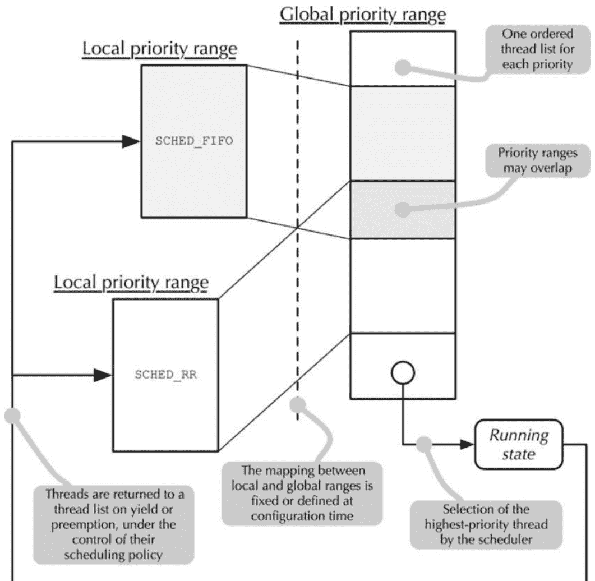

图 6.2 POSIX 调度模型和策略概述。

值得注意的是，POSIX 标准中定义的所有与调度相关的数据结构和算法都是概念性调度模型的一部分。它们被刻意保持得尽可能简单，以使规范更加清晰，并不对该模型的实际实现提供任何建议。实现可以自由地将它们替换为其他内容（它们通常为了效率考虑会这样做），只要保留了模型语义即可。

使用空闲核心读取就绪线程的算法非常直观。调度器只需选择最高优先级非空线程列表头部的线程。被选中的线程从列表中移除并移动到任务状态图的运行状态。在图中，此操作由右下角的箭头表示，它从全局线程列表指向运行状态。

其他被称为“调度策略”的组件负责决定运行中的线程是否应该被抢占，即是否强制从运行状态中移除并返回到其中一个线程列表中。此外，调度策略还决定了再次就绪的线程（例如通过临时转换到阻塞状态）如何被插入到线程列表中，以及线程如何在列表之间移动，从而动态地改变它们的优先级。

在某些情况下，对同步对象执行的操作会触发优先级变化，以保留系统某些实用的实时执行特性。第 8 章将给出一个示例，描述优先级继承和优先级上限协议。

更具体地说，调度策略负责在以下情况下确定线程顺序：

- 当线程正在运行时，被高优先级线程抢占，回到任务状态图的就绪状态，因此必须插入到其中一个就绪线程列表中。
- 当线程被另一个线程解除阻塞时，它从任务状态图的阻塞状态变为就绪状态，因此必须插入到其中一个就绪线程列表中。
- 当运行线程更改自身的调度策略或优先级，或更改另一个线程的优先级时，因为这可能需要运行线程移动回其中一个就绪线程列表中。
- 在调度策略本身定义的其他情况下（例如，按固定时间间隔）。

换句话说，线程的调度策略影响图 3.4 所示任务状态图中的所有转换，但从就绪到运行的转换（调度器始终选择最高优先级非空列表头部的线程）以及从运行到阻塞的转换（由线程本身执行）除外。

系统中的每个线程在任何给定时间内受单一调度策略的控制。该策略在线程创建时，通过第 6.1 节和 6.2 节概述的线程属性机制设置，并在之后可以通过后文讨论的函数进行更改。为了做出决策，调度策略利用与与其控制的每个线程相关的一组调度参数。这些参数可以以调度策略相同的方式进行设置。

单个调度策略在本地优先级范围内工作，该范围至少包含 32 个不同的优先级范围。本地优先级范围在全局范围内的映射是固定的或在系统配置时建立的，但之后无法更改。相反，存在适当的原可以在运行时检索映射信息。更具体地说，`sched_get_priority_min` 和 `sched_get_priority_max` 函数接受策略标识符作为参数，分别返回该策略可能的最小和最大优先级。

如图 6.2 所示，属于不同调度优先级的优先级范围可能会重叠。在范围重叠的地方，多个调度策略竞争将就绪线程插入到同一个列表中。本节开始介绍固定优先级线程选择机制最终负责解决竞争并选择哪些线程将实际运行，无论它们受何种策略的控制。

标准明确指定了表 6.4 列出的调度策略。它也允许实现提供额外的策略，前提是任何使用这些策略的应用程序将无法从一个 POSIX 系统迁移到另一个系统。

### 表 6.4 RTEMS 线程调度策略，POSIX API

| 策略 | 说明 |
| :--- | :--- |
| `SCHED_FIFO` | 先进先出调度（不带时间分片） |
| `SCHED_RR` | 轮转调度（优先级级别内的 FIFO 加时间分片） |
| `SCHED_SPORADIC` | 突发性服务器调度 [115]（可选，RTEMS 未提供） |
| `SCHED_OTHER` | 实现定义的调度（不一定是实时的） |

在这些策略中，我们不再进一步讨论 `SCHED_OTHER` 策略，因为它是一种通用策略，标准将其行为定义完全留给实现。如果实现如此，该策略可能与 `SCHED_FIFO` 或 `SCHED_RR` 重合，但它不必提供任何实时执行保证。

在标准中显式定义的主要目的是允许程序员以可移植的方式指定特定线程不需要任何特定的实时调度策略。`SCHED_SPORADIC` 策略是可选的，并实现了……的变体（等待，OCR 文本在后面的页面似乎重复或中断，我将根据提供的内容进行重构）

时间量子长度（也称为轮询时间间隔）是每个进程的一个信息项，它是固定的或属于系统配置的一部分。虽然可以使用 `sched_rr_get_interval` 函数来检索它，但它不能在运行时更改。在 RTEMS 中，它由操作系统配置表中的 `ticks_per_timeslice` 项给出。它以滴答（ticks）为单位表示，默认值为 50。鉴于默认滴答长度为 10ms，因此在当前操作系统版本中，默认的 RTEMS 时间量子为 500ms。


在对 POSIX 调度模型进行了这一总体概述后，我们现在可以深入查看与其相关的其他一些函数，以及第 6.2 节中讨论的线程创建和终止函数。它们列在表 6.5 中。前三个函数允许软件在运行时查询调度策略是如何配置的。具体来说，这些函数：

```
int sched_get_priority_min(int policy);
int sched_get_priority_max(int policy);
```

返回由 `policy` 指定的调度策略允许的最小和最大优先级。如果失败，这两个函数都应返回 -1（一个无法表示有效优先级的负值）。在这种情况下，它们还应将 `errno` 设置为提供更多关于失败原因信息的错误号。标准规定了以下错误号：

> ENVAL `policy` 参数的值不代表系统中定义的有效调度策略。

| TABLE 6.5 RTEMS 线程调度原语， POSIX API |
|---|---|
| 函数 | 目的 |
|---|---|
| sched_get_priority_min | 返回给定策略允许的最小优先级 |
| sched_get_priority_max | 返回给定策略允许的最大优先级 |
| sched_rr_get_interval | 返回 SCHED_RR 策略的时间量子 |
| pthread_getschedparam | 获取线程的调度策略和参数 |
| pthread_setschedparam | 更改线程的调度策略和参数 |
| pthread_setschedprio | 更改线程的优先级 |
| sched_yield | 放弃 CPU 让其他线程执行 |

该函数：

```
int sched_rr_get_interval(pid_t pid,
    struct timespec *interval);
```

将由 `interval` 指向的数据结构中存储分配给进程 `pid` 及其包含的所有线程的时间量子。成功完成后返回 0。如果失败，它应返回 -1 并将 `errno` 设置为：

ESRCH 系统中未找到由 `pid` 指定的进程。

`timespec` 是一种专门用于表示时间及时间间隔的 POSIX 数据类型。它将在第 6.6 节中详细描述。

如第 6.2 节所示，在创建线程本身时可以设置线程的调度策略和参数。之后可以通过以下函数检索它们：

```
int pthread_getschedparam(pthread_t thread,
    int *restrict policy,
    struct sched_param *restrict param);
```

此函数在给定线程描述符 `thread` 的情况下，将线程的调度策略存储到 `policy` 指向的位置，并将调度参数存储到 `param` 指向的位置。

`pthread_getschedparam` 函数在成功时返回 0。否则，它应返回非零错误代码。标准建议该函数应该检测并报告错误：

ESRCH 参数 `thread` 指向系统中不存在的线程。

通过调用以下函数也可以在运行时更改线程的调度策略及其调度参数：

```
int pthread_setschedparam(pthread_t thread,
    int policy, const struct sched_param *param);
```

对于线程描述符 `thread`，此函数将线程的调度策略更改为参数 `policy` 的值，并将调度参数更改为 `param` 指向的数据结构的内容。`pthread_setschedparam` 函数在成功时返回 0。否则，它将因以下原因失败：

- EINVAL `policy` 指定的调度策略或 `param` 指向的数据结构中的某个调度参数无效。
- OTSOP `policy` 指定的调度策略或 `param` 指向的数据结构中的某个调度参数是有效的，但实现不支持它们。
- PERM 调用线程没有权限更改目标线程的调度策略和/或调度参数。

（注：由于原文中存在大量重复和乱码，已根据逻辑流进行了清理和翻译。）

该函数在执行成功时返回零。否则，它应返回一个非零值以报告错误。标准并未规定任何特定的错误检查，但建议如果作为参数的线程描述符无效，`thread_cancel` 应该失败并返回：

ESR 参数线程指向的系统中不存在的线程。

线程对指向它的取消请求的反应方式取决于它的可取消性。此信息由线程本身通过以下取消控制函数设置为表 6.7 中列出的三个设置之一：

```
int pthread_setcancelstate(int state, int *oldstate);
pthread_setcanceltype(int type, int *oldtype);
```

表 6.7 线程可取消状态与类型， POSIX API

| 线程可取消状态/类型 | 含义 |
|---|---|
| (带有 PTHREAD_CANCEL_ 的宏) | 取消禁用 |
| 类型 | 禁用 到达取消点时 |
| DISABLE | 启用，立即（异步） |
| ENABLE | DEFERRED |
| ENABLE | ASYNCHRONOUS |

它们分别根据参数 `state` 和 `type` 将调用线程的可取消状态和类型设置为对应的值。同时，它们分别将 `state` 和 `type` 的旧值存储在 `oldstate` 和 `oldtype` 指向的位置中。可取消状态和类型的有效值为：

- 可取消状态为 `PTHREAD_CANCEL_DISABLE` 或 `PTHREAD_CANCEL_ENABLE`，以及
- 可取消类型为 `PTHREAD_CANCEL_DEFERRED` 或 `PTHREAD_CANCEL_ASYNCHRONOUS`。

这两个函数在成功完成后均返回零。当检测到以下错误时，它们应返回非零错误代码：

EINVAL `state` 的值（对于 `pthread_setcancelstate`）或 `type` 的值（对于 `pthread_setcanceltype`）无效。

线程的三种可能的取消设置通常影响它对指向它的取消请求的反应：

1. 如果可取消状态为 `PTHREAD_CANCEL_DISABLE`，可取消类型设置无效。发送到线程的任何取消请求都不会产生立即效果，但将保持挂起状态，一旦线程将其可取消状态更改为 `PTHREAD_CANCEL_ENABLE` 将会被处理。

在编程时应仔细考虑这种内存效应，因为可能导致线程在更改可取消状态后，由于很久以前发送给它的取消请求而导致意外取消，而且标准目前没有规定任何在发布取消请求后撤回请求的方法。程序员还应该考虑到，当可取消状态为 `PTHREAD_CANCEL_DISABLE` 时，除非线程自愿，否则没有办法终止它。这使得线程免受外部无法管理的所有数据一致性和资源丢失问题的影响，特别是当它陷入处理器密集型循环中时。

2. 如果可取消状态为 `PTHREAD_CANCEL_ENABLE` 且类型为 `PTHREAD_CANCEL_DEFERRED`，线程以延迟方式尊重取消请求，即指向它的取消请求保持挂起状态，并在线程到达取消点时生效。

换句话说，这种设置允许线程尊重取消请求，这是一个理想特性，但通过受控制的方式来对抗数据不一致和资源丢失的可能性，因为程序员预先知道代码中某个线程何时可能被取消，无论其与请求取消的线程之间的确时间关系如何。书中描述的几个函数是取消点，表 6.8 总结了它们。此外，许多此处未显式讨论的其他 POSIX 函数（例如输入输出函数如 `open` 和 `printf`）也应或可能是取消点。

## 表 6.8 取消点， POSIX API

| 任务管理（第 5 章） | |
|---|---|
| pthread_join | pthread_testcancel |
| 信号处理（第 5 章） | |
| sigwait | sigwaitinfo |
| sigsuspend | 基于共享内存的任务通信（第 7 章） |
| sem_wait | sem_timedwait |
| pthread_cond_wait | pthread_cond_timedwait |
| 基于消息传递的任务通信（第 9 章） | |
| mq_send | mq_receive |
| mq_timedsend | mq_timedreceive |

读者应参考标准 [2] 获取完整列表，但如果标准说某个函数可能是取消点，编写代码时应假设它真的是取消点。这是为了防止线程取消在某些实现而非其他实现中意外发生，这很容易导致严重的平台特定问题。

通常情况下，在某些例外之外，表 6.8 的原理是任何可能导致调用线程阻塞长时间或无限制时间的函数应该是取消点。通过这种方式，延迟取消模式的线程在参与此类等待之前会尊重任何挂起的取消请求。需要时，也可以通过调用以下函数在代码中显式引入取消点：

```
void pthread_testcancel(void);
```

3. 如果可取消状态为 `PTHREAD_CANCEL_ENABLE` 且类型为 `PTHREAD_CANCEL_ASYNCHRONOUS`，线程将在请求到达时立即尊重请求，即异步地。

虽然异步取消模式下执行线程的优势——对取消请求的快速响应——可能很有吸引力，但必须仔细权衡其缺点。除了前面提到的数据一致性和资源丢失风险外，线程在此模式下执行时不得调用任何 POSIX 函数，此处列出的函数除外。

表 6.9 异步取消安全的函数，POSIX API

| 函数 | |
|---|---|
| pthread_cancel | |
| pthread_setcancelstate | |
| pthread_setcanceltype | |

作用域嵌套仍然有效，例如，`g()` 被外部函数 `h()` 调用，而 `h()` 已经在禁用了取消的情况下运行。在这种情况下，无论是 `g()` 执行的 `pthread_setcanceltype` 调用，还是 `f()` 执行的 `pthread_setcancelstate` 调用都不会产生任何影响，整个代码都在禁用取消的情况下执行。这是正确的，因为这是 `h()`、`g()` 和 `f()` 可以调用的最保守的取消状态和类型。

在终止之前，线程拥有所有手段可以以非常直接的方式执行其可能需要的任何清理操作。然而，当线程由于取消而被迫自愿终止时，情况并非如此。因此，POSIX 标准规定线程注册一组清理处理程序，这些处理程序将在线程终止之前自动执行。为了保持一致性，当线程通过调用 `pthread_cleanup_exit` 或从其入口点返回而自愿终止时，清理处理程序也会执行。

清理处理程序由一个函数组成，该函数接收一个 `void *` 类型的指针作为参数并返回 `void`。`pthread_cleanup_push` 函数将清理函数例程及其参数推入栈中：

```
pthread_cleanup_push(void (*routine)(void*),
void *arg);
```

终止时，清理处理程序从栈中弹出并一个接一个地执行，也就是说最后推入的处理程序首先执行。每个处理程序接收到的 `arg` 与推入该程序时给给 `pthread_cleanup_push` 的参数相同。清理处理程序也可以通过调用函数手动弹出，并可选地执行：

```cpp
pthread_cleanup_pop(int execute);
```

其参数 `execute` 是一个布尔标志位，当它不为零时，表示除了被弹出外，还应执行该清理处理程序。为了确保 `pthread_cleanup_push` 和 `pthread_cleanup_pop` 具有定义良好的语义并允许其作为类函数宏进行实现，它们受到若干条用法的限制。最重要的限制是：

- 在语法上，它们必须作为语句出现。
- 它们必须成对出现，位于相同的词法作用域内，并用于正确地括起需要清理处理程序的代码块。
- 过早放弃被括起的代码块（例如通过 `return`、`longjmp` 或 `goto`）会导致未定义行为。

程序员在编写代码时应参考标准 [68] 作为参考，以意识到所有这些限制，因为编译器可能无法检查它们在编译时是否遵循了这些限制。

## 6.5 信号处理

信号是 1989 年 ISO C 标准 [69] 已经指定的某种机制，在大多数通用操作系统上广泛可用。信号提供了一种机制，在进程或线程并不一定在等待输入时向其传递信息。

信号机制具有深厚的历史底蕴。例如，它最初设计于多线程尚未广泛使用的时期。因此，自诞生以来，其接口和语义经历了许多调整和扩展。最初，信号的主要目标是赋予进程能够对相对于被通知进程异步发生的外部事件（这些通常是致命的）做出正确反应的能力，例如：

- 在进程执行期间发生的某些硬件检测错误，例如通过无效指针进行的内存引用。
- 各种系统和硬件故障，例如即将发生的断电故障。
- 显式生成信号，通常目的是强制目标进程终止。

例如，当用户在由 POSIX 兼容 shell 管理的终端上输入 `intr` 控制字符（默认为 Control-C）时，shell 将采取什么操作向当前运行的进程发送信号 (SIGINT)？除非前景进程设置了某种处理信号的特殊方式，否则会导致进程终止，以便使用户重新获得终端的控制权。

目前，信号机制的大部分复杂性源于需要与历史实现保持兼容性，例如由各种版本的 Unix 操作系统所实现的机制。

在本书中，为了清晰简洁，将讨论兼容性接口，并尽可能将其限制在，以展示信号在 RTEMS 支持的单用户、单进程 (SUSP) 环境中如何工作。读者应参考 POSIX 标准 [68] 以获得对整个机制的更详尽描述。

POSIX 标准进一步扩展了信号机制，使其适用于实时异步事件处理。特别是在本书的其余部分中，我们将讨论如何使用信号来传递：

- 与时间相关的事件，即让进程或线程感知时间流逝的事件。这些事件由 POSIX 计时器产生，将在第 6.6 节讨论。
- POSIX 标准预见的进程间通信机制之一——消息队列中的数据可用性，该内容将在第 9 章描述。

关于 ISO 信号行为，POSIX 标准引入了两个对实时程序员感兴趣的主要增强：

1. 在 ISO 标准中，各种类型的信号由一个整数标识，在大多数情况下，该整数应用符号常量表示（如 `SIGINT`），以提高应用程序的可移植性。当有多个不同类型的信号处于等待状态时，它们以不指定的顺序被处理。

    POSIX 标准继续使用信号编号以向后兼容，并规定在允许范围的一个子集（值 `SIGRTMIN` 和 `SIGRTMAX` 之间）信号之间存在优先级层次，使得最低信号具有最高的服务优先级。

    该范围必须包含 `RTSIG_MAX` 个不同的信号编号。此值是运行时常量，如果在编译时已知，则必须在头文件 `limits.h` 中定义为符号常量。如果该值在编译时是不确定的（例如因为它是操作系统配置的一部分），则省略定义，可以通过 `sysconf` 函数获取该值。在任何情况下，`RTSIG_MAX` 至少为 8。

2. 在 ISO 标准中，没有提供信号队列。当多个同类信号在目标进程有机会处理之前被产生时，只保留最后一个生成的。相反，POSIX 规定系统必须跟踪多个信号。信号总是入队并按照它们产生的顺序处理。这种策略无法由用户更改。

    此外，POSIX 还增加了为每个信号报告附加有限信息的能力，以便区分具有相同编号的信号。信息必须放入 `sigval` 类型的对象中，该对象能够持有一个整数（在 `sival_int` 字段中）或一个指针（在 `sival_ptr` 中）。

如前所述，每个信号都关联有一个信号编号，唯一标识其类型。例如，shell 在用户在终端输入 字符时发送给进程的中断信号关联为 `SIGINT`。`sigval` 类型的对象与每个信号关联，其内容在产生时由应用程序持有，有助于区分同类信号。

对于某些类型的事件（如第 6.6 节描述的定时相关事件），POSIX 标准规定，如果应用程序选择，可以通过在单独线程中执行事件处理函数来完成通知。这种机制显然比基于信号的通知更直观，但需要更多的操作系统资源并产生更高的开销。此外，由于它涉及在不可预测的时间动态创建新线程，它可能会在实时执行环境中引入其他缺陷，如果系统被事件淹没，可能会演变成拒绝服务。由于这些原因，这种通知方法目前在 RTEMS 上不可用。

图 6.4 描述了信号从产生到交付的生命周期。根据其类型和来源，信号可以被指向进程中的特定线程，也可以指向整个进程。对于后一种，属于进程的每个线程都是信号交付的候选者，遵循下述规则。

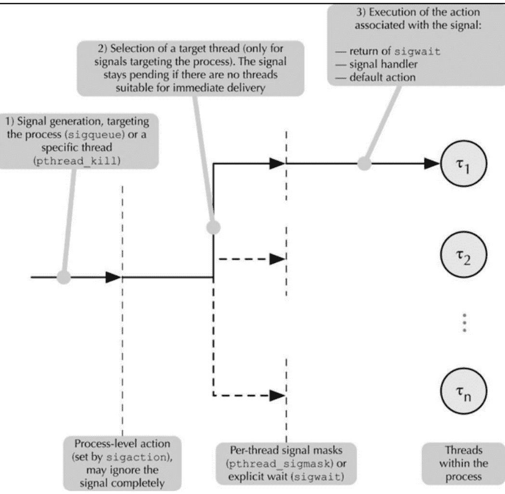

**图 6.4** POSIX 信号处理机制示意。

### 信号的生成

在生成信号时，必须决定目标是某个特定线程还是整个进程。对于由系统生成的信号（而非由线程执行显式操作生成的信号），POSIX 标准规定，关于信号是必须定向到整个进程还是进程内的特定线程的决定，必须尽可能地指示信号的来源。

具体来说，如果一个信号归因于特定线程执行的操作（例如内存访问违规），则信号应发送到该线程而不是进程。如果这种归因要么无法实现要么没有意义，则信号应发送到进程。例如，`SIGINT` 就属于这种情况。此外，与实时事件处理相关的信号应始终发送到进程。线程还具有通过两个主要接口合成信号的能力，具体取决于目标：

- `kill` 函数，通过接收进程标识符和信号号来生成信号。一个类型为 `union sigval` 的额外参数允许调用者与信号关联有限的信息，前提是该信号设置了 `SA_SIGINFO` 标志。
- `pthread_kill` 函数生成一个定向到调用线程所属进程内特定线程的信号。无法生成定向到另一个进程的信号。其他接口可以生成定向到一组进程的信号，例如 `killpg`。然而，这里将不会讨论它们，因为它们没有针对实时性进行扩展，且缺乏与信号关联任何额外信息的能力。此外，在只有一个进程的环境中，它们的用处有限。

### 进程级操作

对于系统内核定义的每种信号，对于每个有效的信号号，进程可以通过 `sigaction` 函数设置一个操作。通常情况下，该操作可以是：


- 完全忽略信号。在这种情况下，信号的递递对进程没有影响。如果在调用 `sigaction` 时信号已处于挂起（pending）状态，则该信号会被丢弃。

- 由操作系统代表进程执行的默认操作，可能带有进程级的副作用，如终止进程。

- 执行程序员指定的信号处理函数。

然而，某些意图是确保进程无条件终止的信号（如 `SIGKILL`）是无法被捕获或忽略的。此外，忽略由于致命错误（如内存访问违规）产生的信号会导致未定义行为。

此外，`sigaction` 函数允许调用者设置与信号相关的标志。在 POSIX 标准指定的大量标志中，以下标志对程序员特别感兴趣：

- `SA_SIGINFO` 标志，设置后，允许为每个信号关联有限的信息，这些信息将传递给接收信号的进程或线程。如前所述，信息存储在类型为 `siginfo` 的对象中。如果与信号关联的操作是执行用户指定的信号处理程序，设置此标志将扩展传递给信号处理程序的参数列表，包含关于信号生成原因以及信号传递时接收线程上下文的额外信息。

- `SA_RESTART` 标志，设置后，允许在系统调用被信号中断时自动重新启动。如果设置了此标志，被信号中断的系统调用将以错误 `EINTR` 失败，并且必须由应用程序显式地重启。

- `SA_STACK` 标志，设置后，命令通过 `sigaltstack` 函数切换到备用栈来执行信号处理程序。如果没有设置此标志，信号处理程序将在普通栈上执行。

需要注意的是，每个信号关联的操作设置是在进程级进行的；也就是说，进程内的所有线程共享同一组操作。因此，例如，无法针对同种信号安排不同的信号处理程序。

另一个需要考虑的方面是，信号处理函数能做的事情受到很大限制。更具体地说，可移植的信号处理函数只能直接或间接地调用 POSIX 标准中显式标记为信号安全（signal-safe）的函数。当然，如果已知其他函数在使用的操作系统是安全的，信号处理函数也可以调用它们，但这使其在其他 POSIX 系统上变得不可移植。

非常重要的是，`malloc` 和 `free` 都不是异步安全的（async-safe），这排除了内部的动态内存分配。同样，`setjmp` 和 `longjmp` 都不安全的，从信号处理函数进行非局部控制转移在 POSIX 系统间是不可移植的。

此外，即使是异步信号安全的 POSIX 函数仍然可能更改调用线程的 `errno` 变量的值，这种属性即使在从信号处理函数中调用它们时依然有效。如果信号在线程检测到其调用的 POSIX 函数失败之后、但在其能够调用 `errno` 收集更多关于失败的信息之前中断了该线程的主代码，可能会导致不一致的行为。这是因为被中断的线程将在信号处理完成后最终检查 `errno`，并发现设置的是错误代码，而不是最初失败的那个 POSIX 函数所设置的错误代码。

回到图 6.4 中的信号生命周期，系统在信号生成后会立即检查目标进程中与信号相关的进程级操作，如果操作被设置为忽略，则丢弃该信号。否则，将将检查信号是否也可以被立即处理，或者信号应该保持挂起状态。

### 信号的递递与接收

只要进程级与信号关联的操作没有指定忽略该信号，信号就会递交给进程内的线程或被线程接收。

与每种信号关联的操作（所有线程共享）不同，每个线程都有自己的信号掩码。通过信号掩码，每个线程可以根据其信号号选择性地阻塞信号传递。`pthread_sigmask` 函数允许调用线程检查并更改其信号掩码，掩码表示为类型为 `sigset_t` 的信号集。可以通过函数进行设置和操作：

- `sigemptyset`：初始化信号掩码，使其排除所有信号。

- `sigfillset`：初始化信号掩码，使其包含所有信号。

- `sigaddset`：给定信号掩码和信号号，将指定的信号添加到信号掩码中。如果信号已经在掩码中，则没有作用。

- `sigdelset`：给定信号掩码和信号号，从信号掩码中移除指定的信号。如果信号不在掩码中，则没有作用。

- `sigismember`：给定信号掩码和信号号，检查该信号是否属于该掩码。

### 目标线程的选择

系统在进程内选择线程来传递信号的方式，首先取决于信号的去向：

- 如果信号指向某个特定的线程，则只有该线程是递送或接收的候选者。

- 如果信号指向一个进程，则属于该进程的所有线程都是接收信号的候选者。

在第二种情况下，系统会在进程内寻找一个具有适当信号掩码（用于递送）或正在执行合适的 `sigwait`（用于接收）的线程。可能出现三种情况：

- 如果没有线程等待接收信号或可供递送信号，则该信号将保持挂起（pending）状态，直到其递送或接收变得可能。在此期间，如果与该信号相关的进程级操作被设置为忽略，系统将忘记关于该挂起信号的所有信息，以及所有其他相同类型的信号。

- 如果恰好有一个线程等待接收信号或可供递送，则信号将发送到该线程。

- 如果有多个线程可以接收或递送信号，系统将使用未指定的算法从中恰好选择其中一个。

### 与信号相关的 POSIX 原语

表 6.10 列出了主要的与信号相关的 POSIX 原语，分为四组。前三组包含了分别用于生成信号、设置进程对信号的响应、以及确定进程内单个线程如何接收或等待信号的函数。表格底部的第四组包含了一些用于初始化和操作信号集的实用函数。

| 函数 | 目的 |
| --- | --- |
| `sigqueue` | 生成指向进程的信号 |
| `pthread_kill` | 生成指向特定线程的信号 |
| `sigaction` | 设置与信号相关的进程级操作 |
| `sigaltstack` | 设置一个用于信号处理的备用栈 |
| `pthread_sigmask` | 设置调用线程的每线程信号掩码 |
| `sigwait` | 等待接收属于给定信号集的信号 |
| `sigwaitinfo` | 类似于 `sigwait`，但会返回关于信号的额外信息 |
| `sigtimedwait` | 类似于 `sigwaitinfo`，但对等待时间有上限限制 |
| `sigemptyset` | 初始化一个不包含任何信号数的信号集 |
| `sigfillset` | 初始化一个包含所有信号数的信号集 |
| `sigaddset` | 向信号集中添加一个信号数 |
| `sigdelset` | 从信号集中删除一个信号数 |
| `sigismember` | 检查一个信号数是否属于一个信号集 |

回到第一组，函数：

```
int sigqueue(pid_t pid, int signo,
const union sigval value);
```

将信号 `signo` 发送到进程 `pid`。此外，取决于目标进程选择如何对信号做出反应（通过后文讨论的 `sigaction` 函数），它还可能附加信息值（有时称为信号值）。即使在成功完成后，该函数在队列信号后也会立即返回给调用者。换句话说，它没有以任何方式同步调用进程和目标进程。

为了避免在队列信号时消耗大量且可能无限制的系统资源，标准规定属于特定进程的线程总共最多可以队列 `SIGQUEUE_MAX` 个信号，即使它们的目标是不同的进程。`SIGQUEUE_MAX` 的值必须至少为 32。对于 `RTSIG_MAX`，如果可以在编译时已知，则必须定义为符号常量；否则必须通过 `sysconf` 创建。

`sigqueue` 函数在成功完成后返回 0。如果失败，它将返回 -1 并将 `errno` 设置为以下之一：

- `EINVAL` 信号数无效或对应于系统不支持的信号。
- `ESRCH` 进程不存在。
- `EAGAIN` 资源不足以队列信号，可能是因为进程尝试超过 `SIGQUEUE_MAX`（当前已队列信号的最大数量）或超过了系统级限制。
- `EPERM` 由于缺少权限未执行操作。

关于权限检查和 `EPERM` 错误码，决定进程是否可以向另一个进程发送信号的规则相当复杂。然而，后续将不再进一步讨论，因为它们不允许 `SUSP` 执行环境。事实上，在这种环境中，只有一个进程，且进程始终允许向自己发送信号。

```
int pthread_kill(pthread_t thread, int signo);
```

该函数的目的与 `sigqueue` 相同，但更具体，并允许某个特定进程的线程向同一进程的另一个线程发送信号。目标线程通过其线程描述符标识。以这种方式发送的信号跳过了目标进程内的线程选择。与 `sigqueue` 不同，此函数允许调用者指定信号数 `signo`，但不能指定信号值。

与 `sigqueue` 的另一个区别是，发生错误时，`sigqueue` 返回 -1 并使用 `errno` 提供更多关于错误的信息。相反，`pthread_kill` 直接返回错误码：函数 `pthread_kill` 因以下原因失败：

- `EINVAL` 信号数 `signo` 无效或对应于系统不支持的信号。

此外，该函数可能会检测到尝试使用对应于不存在线程的线程描述符（例如因为它已终止），并用代码报告此错误：

- `ESRCH` 给定的线程不存在。

为了检查和设置进程级操作，任何线程都可以调用：

```
int sigaction(int signo,
const struct sigaction *restrict act,
struct sigaction *restrict oct);
```

该函数执行两个不同的操作：

- 如果 `oct` 指针不为空，则将当前的进程级操作存储其中。
- 如果 `act` 指针不为空，则更改与 `signo` 相关的进程级操作。

函数在成功完成后返回 0。否则，它将返回 -1 并将 `errno` 设置为以下之一：

- `EINVAL` 信号数无效或对应于系统不支持的信号。
- `ENOTSUP` 设置了 `SA_SIGINFO` 标志，但该信号不支持此选项。在 `SIGMIN` 到 `SIGMAX` 范围内。

### 表 6.11 struct sigaction 的字段

| 字段 | 目的 |
| --- | --- |
| `sa_handler` | 指向“简单”信号处理函数，或保留值 `SIG_IGN`（忽略信号）或 `SIG_DFL`（使用默认处理器）。 |
| `sa_sigaction` | 指向“增强型”信号处理函数，签名格式 `void (*)(int, siginfo_t *, void *)`，当 `flags` 中设置了 `SA_SIGINFO` 时替代简单信号处理函数。相对于 `sa_handler`，它接收两个额外的参数。第一个是 `siginfo_t` 对象的指针，第二个是 `void *`。这两个参数在文中有详细讨论。 |
| `sa_flags` | 该字段包含一组标志的位或，这些标志会修改信号的行为。其中 `SA_SIGINFO`、`SA_RESTART` 和 `SA_ONSTACK` 在文中讨论，而 `SA_NODEFER` 在下文描述。 |
| `sa_mask` | 该字段是一个信号集（类型为 `sigset_t`）。它包含了在信号处理函数执行期间必须阻塞的额外信号数，除非 `flags` 包含 `SA_NODEFER`，否则会自动阻塞。 |

- `sa_handler` 字段指向在未设置 `SA_SIGINFO` 标志时使用的信号处理函数。它接收一个整数参数，即信号数。

- 相反，`sa_sigaction` 字段指向在设置 `SA_SIGINFO` 标志时使用的函数。除了信号数，它还接收一个指向 `siginfo_t` 对象的指针（提供关于信号为何以及如何生成的更多信息）以及一个 `void *`。

`sa_handler` 字段除了指向信号处理函数外，还可以设置为以下保留值之一：

- `SIG_IGN` 完全忽略信号，尽管忽略某些与致命错误条件相关的信号会导致未定义行为。
- `SIG_DFL` 回到信号的默认处理操作，在大多数情况下这会终止进程。

### 表 6.12 siginfo_t 的主要字段，POSIX API

| 字段 (Field) | 用途 (Purpose) |
| --- | --- |
| `si_signo` | 信号编号。此信息有时是冗余的，因为它与传递给信号处理函数的第一个参数（用于信号传递）以及 `sigwaitinfo` 的返回值（用于信号接收）一致。 |
| `si_code` | 信号码，提供有关信号信号源的更多信息。实时应用特别感兴趣的代码包括：`SI_QUEUE`，表示信号是由 `sigqueue` 发送的；`SI_TIMER`，表示定时器超时（见第 6.6 节）；以及 `SI_MSGQ`，表示信号是由消息队列发送的（见第 9.4 节）。 |
| `si_value` | 信号联合，包含信号值，即信号产生时与信号关联的额外信息。 |

当设置了 `SA_ONSTACK` 标志时，信号处理将在备用的专用栈上执行，而不是在信号递送线程的常规栈上执行。该函数：

```
int sigaltstack(const stack_t *restrict ss,
stack_t *restrict oss);
```

可用于更新备用栈和或获取当前设置。`sigaltstack` 函数使用与 `sigaction` 相同的底层逻辑。它可以获取当前的信号处理栈信息（并将其存储在 `oss` 指向的数据结构中，如果它不是 NULL 指针），和/或设置新的信号处理栈（根据 `ss` 指向的数据结构的内容，如果它不是 NULL 指针）。此函数仅在操作系统支持 XSI（单份 UNIX 规范）POSIX 选项时才存在。RTEMS 未实现此函数，因此不再进一步讨论。

该函数：

```
int pthread_sigmask(int how, const sigset_t *restrict set,
sigset_t *restrict oset);
```

允许调用线程检查和/或操作它自己的信号掩码。在这种情况下，函数同样使用与 `sigaction` 相同的底层逻辑。具体而言：

- 如果指针 `oset` 不为 NULL，则函数将线程的当前信号掩码存储到其所引用的信号集中。
- 如果指针 `set` 不为 NULL，则函数在可能使用 `oset` 按照上述描述进行存储后，还会修改信号掩码。

当 `set` 不为 NULL 时，函数执行的具体操作取决于 `how` 参数的值：

- 如果是 `SIG_SETMASK`，则新的信号掩码将根据 `set` 引用的信号集进行设置，并且当前掩码被直接丢弃。
- 如果是 `SIG_BLOCK`，则新的信号掩码被设置为当前掩码与 `set` 引用的信号集的并集。换句话说，`set` 所指示的信号编号被添加到调用线程阻塞的信号集中。
- 如果是 `SIG_UNBLOCK`，则新的信号掩码被设置为当前掩码与 `set` 引用的信号集补集之间的交集。换句话说，`set` 所指示的信号编号将从调用线程阻塞的信号集中移除。

函数 `pthread_sigmask` 在完成后返回 0。否则，它将不修改信号掩码并返回一个说明失败原因的错误代码。标准：

- `EINVAL` `how` 参数无效，因为它不具有之前提到的任何值。

线程可以通过调用以下函数显式地宣布它愿意接收一组特定的信号，并可能等待其中一个信号被发送到它所属的进程：

```
int sigwait(const sigset_t *restrict set,
    int *restrict sig);
```

参数代表线程愿意接收的信号编号集。该函数将等待直到这些信号中的一个变为挂起（pending），接收它，将其信号编号存储在 `sig` 引用的变量中，并最终向调用者返回 0。如果在调用时其中一个信号已经处于挂起状态，则函数将不等待直接接收它。

如果失败，`sigwait` 函数必须返回 -1 并将错误代码存储到 `errno` 中。函数可能由于以下原因失败：

- `EINVAL` `set` 引用的信号集包含无效或不支持的信号编号。

再次强调传递给 `sigwait` 函数的信号集与调用线程信号掩码之间奇特的关系。为了有效地等待一组信号，相应的信号编号必须位于调用线程的信号掩码中，以阻止这些信号递送给该线程。尽管这初看起来看起来可能违背直觉，但确实是必要的，否则信号递送将优先于接收。

同样，如果一个线程通过 `sigwait` 等待某个信号编号，那么进程中的所有其他线程都必须阻塞该信号编号，且没有任何一个线程使用包含相同信号编号的信号集调用 `sigwait`。这是因为当操作系统发现多个用于信号递送或接收的候选线程时，它实际上会选择哪一个候选线程是未定义的，从而导致不可预测的行为。

`sigwait` 有两个更强大的变体。第一个除了信号编号外，还向调用者返回有关所收到的信号的额外信息：

```
int sigwaitinfo(const sigset_t *restrict set,
siginfo_t *restrict info);
```

该函数将额外信息存储在调用者提供并由 `info` 参数引用的 `siginfo_t` 类型对象中。这与为信号编号设置 `SA_SIGINFO` 标志时传递给信号处理程序的信息相同。表 6.2 总结了该对象的内容。

`sigwaitinfo` 函数在完成后返回接收到的信号数量，保证是非负的。否则返回 -1。`sigwaitinfo` 函数可能由于以下原因失败：

- `EINTR` 函数被信号递送中断。

第二种变体进一步限制了 `sigwait` 的等待时间：

```
int sigtimedwait(const sigset_t *restrict set,
siginfo_t *restrict info,
struct timespec *timeout);
```

`sigtimedwait` 函数的行为类似于 `sigwaitinfo`，但在超时后返回给调用者。因此，它可能由于以下原因失败：

- `EAGAIN` 在超时前没有接收到信号。

总结来说，在使用 `sigwait` 或其变体时，必须考虑编程中最重要的几个方面：

1. 所有这些函数必须用于等待被阻塞的信号，即属于调用线程掩码的信号。相反，`sigwaitinfo` 和 `sigtimedwait` 返回它们接收到的数量或 -1。
2. 这三个函数的返回值有细微差异。具体而言，`sigwait` 返回 0。
3. `sigtimedwait` 使用错误代码 `EAGAIN` report 超时。POSIX 标准还定义了更具体的错误代码 `ETIMEDOUT` 用于相同的目的，其他函数使用它。

## 计时


在 POSIX 中，时间的流逝通过一个或多个时间基准（即时钟）来表示和测量。每个时钟都有已知的分辨率和一个值，该值随时间演变，并可以在请求时读取。某些时钟的值可以更改，前提是调用线程具有足够的权限。尽管时钟测量的时间通常与真实的挂钟时间有关，但并不一定如此。特殊的时钟还可以测量与某些系统事件相关的表观时间流逝。例如，正如我们在后文中看到的，它们可以测量执行任务消耗了多少处理器时间。

标准显式地定义了几个时钟，这些时钟保证在所有实现中都具有一致的行为，并允许实现引入额外的、不可移植的时钟。RTEMS 实现了标准定义并列在表 6:13 中的所有时钟：

### 表 6:13 RTEMS 时钟，POSIX API

| 时钟名称 | 描述 |
|---|---|
| `CLOCK_REALTIME` | 系统级时钟，测量真实时间 |
| `CLOCK_MONOTONIC` | 类似于 `CLOCK_REALTIME` 但不会向回跳跃 |
| `CLOCK_PROCESS_CPUTIME_ID` | 进程级时钟，测量分配给进程的 CPU 时间 |
| `CLOCK_THREAD_CPUTIME_ID` | 线程级时钟，测量分配给线程的 CPU 时间 |

- `CLOCK_REALTIME` 是系统级时钟，也就是说它是系统中所有进程和线程的时钟。它测量真实时间，其值代表系统对挂钟时间的概念，表示为自过去某个明确定义的点（称为“纪元”，Epoch）以来所经过的时间。反之，纪元被（某种程度上是任意地）定义为协调世界时 (UTC) 1970 年 1 月 1 日 00:00:00。

为了保持真实时间，系统可能会自动调整此时钟以补偿漂移。结果是，线程可能会观察到其值发生跳跃——即值突然向前或向后变化。

- `CLOCK_MONOTONIC` 类似于 `CLOCK_REALTIME`，但它保证永远不会向回跳跃，即使系统对其进行调整也是如此。在这种情况下，向后调整通常通过减慢单调时钟来实现，使时钟逐渐达到所需值。

时钟向后跳跃是不理想的，因为它们很容易破坏基于时间的应用程序的逻辑。当发生此类跳跃时，某些已经处于应用程序时间线的事件会被投射到未来。向前跳跃的后果通常较轻，因为会让应用程序意识到自己落后于其时间线。

作为单调性的一个副作用，`CLOCK_MONOTONIC` 从过去一个未指定的点开始测量真实时间，而不一定是从纪元开始的。此外，线程可能无法设置其值。

与之前的时钟不同，`CLOCK_PROCESS_CPUTIME_ID` 是进程级时钟，也就是说，系统中的每个进程都有该时钟的一个实例，尽管所有线程仍使用相同的标识符来引用它。当线程访问此时钟时，它隐式地获取了属于所属进程的时钟实例。

时钟的值是该进程到目前为止消耗的处理器时间量。

`CLOCK_THREAD_CPUTIME_ID` 也测量处理器时间，但在线程粒度上。与线程关联的时钟实例的值是该线程到目前为止执行所消耗的处理器时间量。与之前一样，当线程访问此时钟时，它会隐式地访问它自己的时钟。

在这些时钟中，只有 `CLOCK_REALTIME` 必须存在所有 POSIX 实现中，其他的存在取决于实现支持的 POSIX 选项。在第 7 章和第 9 章中描述的几个定时 POSIX 服务隐式地使用 `CLOCK_REALTIME` 作为它们的时间基准。

时钟的绝对值编码为 `struct timespec`。该结构具有以下两个字段：

- `time_t tv_sec` 代表秒数，
- `time_t tv_nsec` 代表纳秒数

自时钟参考点以来（例如 `CLOCK_REALTIME` 时钟的纪元）。相同的数据结构也用于存储相对时间值，以秒和纳秒数的形式表示。

例如，相对时间值可以作为参数传递给 POSIX 函数。它们也被编码在 `struct timespec` 中，并且它们仍然使用时钟作为参考来测量时间，但结构体的内容是根据调用时参考时钟的值解释的。

时钟的一个重要特性是它的分辨率，即它能测量的最小时间间隔，也是时钟两个不同且连续的值之间的时间距离。POSIX 时钟的分辨率在运行时无法更改，尽管它通常取决于实现时钟本身的底层硬件特性。

标准规定，`CLOCK_REALTIME` 时钟的分辨率（唯一在所有情况下都是强制要求的）至少必须是 `POSIX_CLOCKRES_MIN` 纳秒。在标准的当前版本中，该宏的值为 `200000000`，对应于 20 毫秒。

选择此值是为了允许由交流电源线频率（世界上某些地区为 50Hz，其他地区更高）驱动的时钟符合标准。时钟的实际分辨率可以通过下定义的函数进行查询。

对时钟的操作函数非常简单，列在表 6.14 的顶部。特别是，函数：

```
int clock_gettime(clock_t clock_id, struct timespec *tp);
```

将时钟的值存储在 `tp` 指向的位置。`clock_id` 必须是表 6:13 中列出的标识符之一或定义的标识符。

### 表 6.14 RTEMS 计时原语，POSIX API

| 函数 | 目的 |
|---|---|
| `clock_gettime` | 获取时钟的值 |
| `clock_getres` | 获取时钟的分辨率 |
| `clock_settime` | 设置时钟的值（如果可能） |
| `timer_create` | 创建定时器（初始为未激活） |
| `timer_delete` | 删除定时器 |
| `timer_settime` | 激活/禁用定时器，并设置其值 |
| `timer_gettime` | 获取定时器的值 |
| `timer_getoverrun` | 获取定时器的溢出计数 |
| `clock_nanosleep` | 阻塞调用者直到经过特定时间 |

函数 `clock_gettime` 在成功完成后返回 0。否则，它返回 -1 并将 `errno` 设置为以下内容之一：

- `EINVAL` 标识符无效或相应的时钟不存在于系统。

同样，函数：

```
int clock_getres(clock_t clock_id, struct timespec *res);
```

将 `clock_id` 的分辨率存储在 `res` 引用的位置。返回值和可能的错误代码与 `clock_gettime` 相同。

最后，函数：

```
int clock_settime(clock_t clock_id, struct timespec *tp);
```

允许具有足够权限的线程更改时钟的值。具体来说，它将 `struct timespec` 指定的时间设置为 `clock_id` 的值。

与其他函数一样，如果时钟值已更改，它返回 0。否则，它返回 -1 并将 `errno` 设置为以下内容：

- `EINVAL` 此代码用于报告各种错误：
  - 时钟标识符 `clock_id` 无效。
  - 相应的时钟不存在于系统。
  - 时钟存在但无法更改（例如 `CLOCK_MONOTONIC` 时钟）。
  - 给定的时钟值本身无效（例如 `tv_nsec` 字段小于零）或超出 `clock_id` 允许的值范围。

实现也可以检查调用线程是否具有执行请求操作的权限，如果没有，则报告：

- `EPERM` 调用线程没有权限设置时钟。

除了提供时间值外，可用时钟的一个子集还可以定时器的计时参考。此子集必须包含 `CLOCK_REALTIME`，如果实现支持 `CLOCK_MONOTONIC`，也必须包含。

定时器是一个进程级对象，能够向进程发送定时信号。它的特征是当前值以及可选的周期（也称为重载值）。

图 6.5 抽象地显示了定时器的设置和更新。该图显示了定时器值（在垂直轴上）随时间（在水平轴上）演变的情况。感兴趣的主要方面有：


图 6.5 POSIX 定时器更新原理。

- 定时器的初始值和周期通过 `timer_settime` 函数设置，图中左侧用向上的箭头表示。
- 系统以其时钟为参考，对每个具有非零值的定时器进行递减。定时器与其参考时钟在创建时建立关联，创建过程通过调用函数 `timer_create` 完成，图中未显示。
- 当定时器的值趋于零时，它将过期，系统将通过标准指定的通知机制之一通知所有者进程，这些机制将在后文中讨论。通知的最终结果是拥有该定时器的进程中的一个线程执行某些定时器处理代码。
- 如果定时器周期为零，定时器的值在过期后将保持为零，直到采取显式操作通过再次调用 `timer_settime` 来重新设置并启动。周期为零的定时器有时被称为单次（one-shot）定时器；它恰好产生一次通知。
- 如果定时器周期不为零（如图 6.5 所示），定时器在过期时会从其周期重新加载值。非零周期的定时器也称为重复定时器（repetitive）或周期性定时器（periodic），如图所示，它会产生连续的通知流直到被关闭。
- 重复定时器产生的通知间隔完全相等，其间距等于定时器周期。相反，定时器设置到第一次通知之间的延迟由定时器的初始值决定。它可能与周期重合，也可能不重合。

每个定时器不能有多个等待通知，否则在重复定时器的情况下，跟踪这些通知所需的内存量可能是无界限的。因此，如果定时器在上一个通知仍在等待递送时过期，新到达的通知将直接丢失。

然而，重复定时器通常用于让进程处理“过期时间”的概念，以及这种行为如何恶化该概念的准确性。换句话说，丢失的通知会使受影响的进程落后于定时器，并认为相对于现实的时间已经流逝。

为了应对这种不准确性，POSIX 标准规定每个定时器都有一个溢出计数器（overrun counter），可以通过 `timer_getoverrun` 函数读取。在处理某一个通知期间，定时器的溢出计数器的值等于自该通知产生以来来自同一定时器丢弃的额外通知数量。图 6.6 通过几个示例更好地说明了这一点。

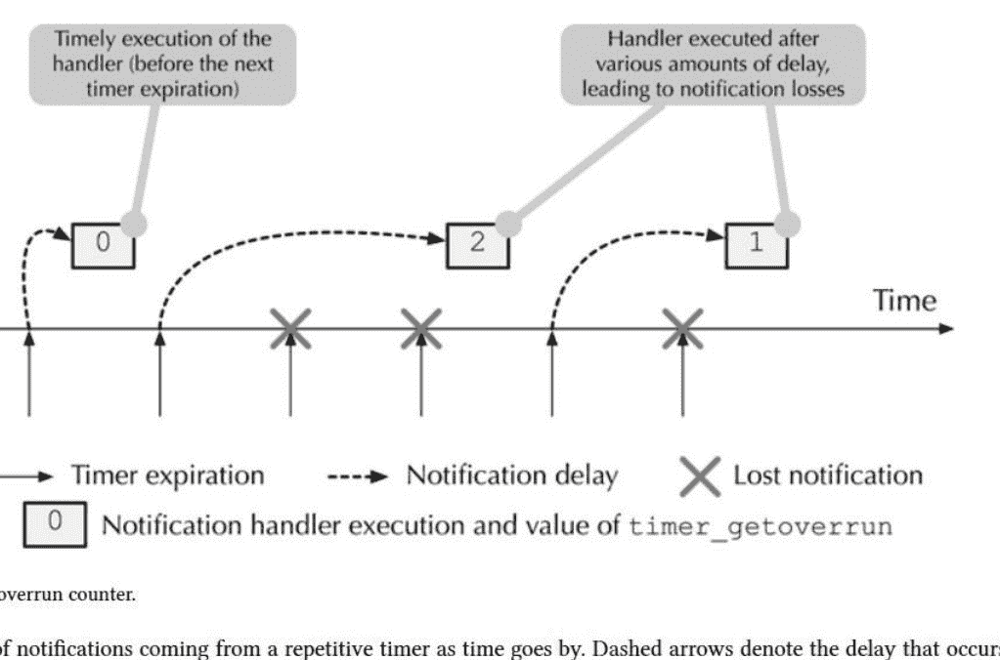

图 6.6 POSIX 定时器溢出和溢出计数器的值。

在图中，向上箭头表示随着时间推移从重复定时器产生的通知流。虚线箭头表示通知与其处理之间的延迟。定时器处理代码的执行由灰色矩形表示。矩形内的数字显示了定时器溢出计数器的值，由处理程序本身执行 `timer_getoverrun` 调用返回。被划掉的通知是被系统丢弃的通知。

- 图片左侧部分显示了正常情况，即在定时器产生下一个通知之前，通知可以被递送并处理。在这种情况下，溢出计数器的值为零，因为在最左侧通知到递送的延迟期间没有产生额外的通知。
- 在下一个示例中，在通知被递送和处理之前产生并丢弃了两个额外的通知。在这种情况下，溢出计数器的值为二。第三个示例说明了类似的场景，其中产生了一个额外的通知。
- 总的来说，图片显示定时器处理代码可以使用其在执行开始时获取的溢出计数器来补偿丢失的通知。例如，如果我们假设定时器处理程序想要跟踪产生了多少个通知，它在每次执行时都应该将计数器加 1 以及溢出计数器的值。回看图形，结束处理程序将获得计数 6（来自 3 次处理程序执行，加上来自溢出计数器的 0 + 2 + 1 = 3），这精确对应于定时器产生的通知总数，尽管其中一些实际上并未被递送。

操作定时器的 API 总结在表 6.14 底部。具体而言，该函数：

```
int timer_create(clockid_t clockid,
struct sigevent *restrict evp,
timer_t *restrict timer);
```

创建一个新定时器，使用 `clockid` 作为参考时钟，并在过期时按照 `evp` 所引的数据结构中指定的规范通知调用进程。成功完成后，该函数将新定时器的句柄存储在 `timer_id` 描述符的位置中并返回 0。定时器不能在进程间共享，但可以被创建它们的进程的所有线程使用。创建后，新定时器处于非活动状态，必须通过 `timer_settime` 函数进行激活。

当 `timer_create` 失败时，它返回 -1 并将 `errno` 设置为适当的状态码。函数可能因以下原因失败：

- `EINVAL` 时钟标识符 `clock_id` 无效，或系统中不存在相应的时钟。
- `ENOTSUP` 由 `clock_id` 标识的时钟不能作为定时器的参考时钟。
- `EAGAIN` 系统缺少创建定时器或设置其通知机制所需的资源。

如前所述，`evp` 指向的 `struct sigevent` 类型结构指示了定时器如何产生通知，并提供了执行这些操作的额外信息。其字段列于表 6.15。标准规定了三种可能的通知方法。具体的用法方法由结构的 `sigev_notify` 字段决定。

### 表 6.15 POSIX API struct sigevent 字段

| 字段 | 目的 |
|---|---|
| `sigev_notify` | 通知类型：`SIGEV_NONE`、`SIGEV_SIGNAL` 或 `SIGEV_THREAD` |
| `sigev_signo` | 要生成的信号编号（针对 `SIGEV_SIGNAL`） |
| `sigev_value` | 传递给信号处理程序的参数（针对 `SIGEV_SIGNAL`） |
| `sigev_notify_function` | 在线程中执行的函数（针对 `SIGEV_THREAD`） |
| `sigev_notify_attributes` | 创建新线程使用的线程属性（针对 `SIGEV_THREAD`） |

`SIGEV_NONE` 值表示不产生任何通知，这在定时器中很少使用。`SIGEV_THREAD` 意味着定时器处理代码由 `sigev_notify_function` 字段引用的函数组成。每当通知递送到拥有定时器的进程时，该函数就会在其所有者线程中执行。`sigev_notify_attributes` 指向系统用于创建该线程的线程属性数据结构，见 6.2 节。由于 RTEMS 目前不支持，后续将不再讨论 `SIGEV_THREAD` 通知方法。

第三种通知方法是 `SIGEV_SIGNAL`，如果设置了配置选项 `RTEMS_SCORE_COREMSG_ENABLE_NOTIFICATION`，则 RTEMS 支持该方法。在这种情况下，通知触发向递定时器的进程发送定时处理代码必须放在相应的信号处理程序中。`sigev_signo` 指定要生成的信号值，`sigev_value` 类型为 `sigval`，是传递给信号处理函数的参数。递送后，信号将按照 6.5 节讨论的标准方式处理。

可以通过调用函数 `timer_delete` 删除现有的定时器，无论其当前是否处于激活状态。唯一参数是定时器描述符 `timerid`：

```
int timer_delete(timer_t timerid);
```

函数成功完成后返回零。在检测到以下情况时，标准建议函数返回 -1 并将 `errno` 设置为适当的状态码：

- `EINVAL` 定时器描述符 `timerid` 无效。

该函数：

```
int timer_settime(timer_t timerid, int flags,
const struct itimerspec *restrict value,
struct itimerspec *restrict ovalue);
```

根据由 `value` 指向的数据结构，设置由 `timerid` 标识的定时器的值和周期。原子地，它还将将之前的值和周期存储到由 `ovalue` 指向的结构中，除非 `ovalue` 是空指针。这两个数据结构的类型均为 `struct itimerspec`，不应与 `struct timespec` 混淆：

- 正如前所述，`struct timespec` 持有一个绝对或相对时间值，以秒的整数和纳秒（秒的分数）的形式表示。
- `struct itimerspec` 具有两个字段，每个字段都是一个 `struct timespec`。具体来说，`it_value` 字段持有定时器的值，而 `it_interval` 字段持有其周期。

将定时器的值设置为零将使其停用，无论周期如何。将定时器的值设置为非零值将激活该定时器。激活的定时器的值随后将如图 6.5 所示演变。

参数 `flags` 决定由 `value` 指向的结构的 `it_value` 字段中指定的定时器值是绝对还是相对。特别是：

- 如果 `flags` 中没有设置 `TIMER_ABSTIME` 标志，则 `it_value` 被解释为相对于调用 `timer_settime` 时的时间。也就是说，它代表了从调用时刻到定时器第一次过期为止应经过的时间。
- 如果 `flags` 中设置了 `TIMER_ABSTIME` 标志，则 `it_value` 被解释为绝对时间，代表定时器第一次过期将发生的绝对时间。换句话说，从调用 `timer_settime` 时到定时器第一次过期之间应经过的时间将是 `it_value` 与调用时与定时器相关的时钟值之间的差值。

函数 `timer_settime` 在成功完成后返回 0，否则返回 -1 并将 `errno` 设置为错误代码。它应当检测到以下错误情况：

- `EINVAL` 指向的数据结构内容无效。

此外，标准建议检查并报告以下附加错误情况：

- `EINVAL` 定时器描述符 `timerid` 无效。

如果一个线程想要在不改变的情况下获取定时器的值和周期，它可以调用函数：

```
int timer_gettime(timer_t timer_id,
struct itimerspec *value);
```

其参数为 `timer_id`（一个定时器描述符）以及指向函数将其中存储定时器值和周期的 `struct itimerspec` 指针。与 `timer_settime` 一样，此函数可能会检测到 `timer_id` 无效并在 `EINVAL` 错误代码失败。

最后，函数：

```
int timer_getoverrun(timer_t timer_id);
```

返回由 `timer_id` 描述的定时器溢出计数器的当前值。使用无效的 `timer_id` 调用此函数会导致未定义的结果。

有时使用定时器的唯一理由是为了实现周期性任务，即在固定的、预定义的时间间隔内执行某些操作的任务。一个产生均匀间隔通知流的周期性定时器足以满足此目的。然而，还有一种不基于信号的更直接的替代方案。函数：

```
int clock_nanosleep(clockid_t clock_id, int flags,
const struct timespec *rqtp,
struct timespec *rmtp);
```


阻塞调用线程，直到根据时钟 `clock_id`，由 `rqtp` 指向的数据结构中指定的时间过去。参数 `flags` 与具有同名的 `timer_settime` 参数类似，它决定了该数据结构的内容是被解释为相对的还是绝对的，具体即：

- 如果 `flags` 中没有设置 `TIMER_ABSTIME` 标志，则 `rqtp` 指向的数据结构的内容被解释为相对于调用 `clock_nanosleep` 时的时间。也就是说，它代表了从调用时刻到 `clock_nanosleep` 返回给调用者为止应经过的时间。

- 如果 `flags` 中设置了 `TIMER_ABSTIME` 标志，则 `rqtp` 指向的数据结构的内容被解释为绝对时间，代表由时钟 `clock_id` 衡量的 `clock_nanosleep` 返回的绝对时间。

1. 在 `clock_nanosleep` 成功后，根据 `rqtp` 的时间，调用线程实际恢复执行的时间可能比 `rqtp` 中指定的要晚。这有两个原因：

2. 此外，`clock_nanosleep` 仅在 `rqtp` 指定的时间过去后将调用线程移回就绪态。调用线程是否也移动到运行态并恢复执行取决于处理器的调度。在单处理器系统中，向运行态的转换可能会被延迟，例如当其他高优先级线程也准备好执行时。

`clock_nanosleep` 函数也可能比计划早返回给调用者，当等待由于信号到达并执行相应的处理程序而被中断。在这种情况下，为了让调用者补偿提前返回，函数在数据结构中存储了 `rmtp` 指向的未花费等待的时间，即 `rqtp` 指向的请求时间与实际等待时长之间的差值。在两种情况下不会执行此操作：

- 当 `rmtp` 为 `NULL` 时，意味着调用线程对该信息感兴趣。

- 当 `flags` 参数请求绝对值时，因为在这种情况下调用线程显然不需要该信息。

`clock_nanosleep` 函数在成功时返回 0。失败时返回 -1 并设置 `errno` 为错误代码。

# 第三部分

## 任务间同步与通信

## 基于共享内存的任务间同步与通信 (IPC)

# 目录

- 7.1 竞态条件与互斥
- 7.1.1 竞态条件的示例
- 7.1.2 临界区
- 7.1.3 基于锁的互斥
- 7.1.4 正确性条件
- 7.2 信号量
- 7.2.1 定义与属性
- 7.2.2 互斥信号量
- 7.2.3 同步信号量
- 7.2.4 生产者与消费者
- 7.3 监器
- 7.3.1 定义与属性
- 7.3.2 条件变量
- 7.4 用于共享内存 IPC 的 RTEMS API
- 7.4.1 经典 API
- 7.4.2 POSIX API
- 7.5 屏障
- 7.5.1 通用定义
- 7.5.2 经典 API
- 7.5.3 POSIX API
- 7.6 事件
- 7.7 总结

本章的重点是经典的任务间同步与通信方法，特别是依赖共享内存进行任务间数据交换的信号量和监器。讨论中还包括了两种更特殊的同步对象——屏障和事件，尽管从理论角度来看它们可能并不那么有趣，但在实践中仍然非常有用。

在深入研究之前，本章引入了竞态条件、临界区和基于锁的互斥的基础概念。本章还介绍了两个极其重要的问题：优先级反转和死锁，这些问题可能会影响任何基于锁的任务间同步与通信机制。

为了帮助读者更快速地上手他们最感兴趣的话题，在本章及后续章节中，我们将通用的理论讨论引向实时执行概念，以及通过 RTEMS 经典 API 和 POSIX API 对其具体实现。

# 7.1 竞态条件与互斥

## 7.1.1 竞态条件的示例

如果一组任务必须协作来解决某个问题，那么在几乎所有情况下，它们都需要交换某些信息。为了这一目的，使用一组共享变量——即多个任务可以并发读写的变量——这是顺序编程中常见做法的一种相当直接的扩展。

用高级语言编写的顺序程序通常被组织成一组函数和过程，每个过程都有明确定义的目的。它们共同实现了程序必须提供的功能。这些函数通过程序中定义的一组全局变量方便地交换数据。在编程语言作用域规则设定的限制范围内，所有函数都可以访问这些变量，并可以根据它们所实现的特定算法的要求获取并设置这些值。

在函数调用期间也会发生类似的情况：调用者计算函数参数并将其存储在某个内存区域中，该区域的结构对于调用者和被调用者都是已知的（通常分配在栈上）。被调用者从中读取参数并根据需要使用它们。函数的返回值也以同样的方式处理。尽管编译器可能会通过使用某些处理器寄存器代替内存来优化交换（前提是参数和返回值放入这些寄存器中），但总体思想仍然相同。

遗憾的是，将相同的思想应用到执行者是并发执行任务的系统中，即使在看似微不足道的场景下，也会产生微妙而深刻的问题。例如，我们假设想统计顺序程序中发生了多少次特定事件。

如图 7.1 所示，可能最直接、直观的解决方案是定义一个初始化为零的全局变量 `k`，以及一个将其加一的函数。使用 C 语言编程时，该函数可以为 `void inc(void)`，并包含一条语句 `k = k+1`。

```c
int k;
void inc (void) {
  k = k+1;
}
```


图7.1 单处理器系统上的变量递增。

实际上，如图所示，至少当代码被编译成普通汇编指令时，没有任何真实世界的处理器能够以单个不可分割的步骤递增 `k`。相反，基于冯·诺依曼架构的典型计算机 [52] 会执行三个不同操作序列：

1. 从内存中将 `k` 的值加载到内部处理器。在简单的处理器上，这个寄存器很可能是累加器。从处理器的角度来看，这是一个外部操作，因为它涉及到处理器之外的内存。这两个单元通过内存总线通信，另一个单元（另一个处理器）可能也连接在该总线上。加载操作不会改变内存内容，也就是说，在执行后 `k` 保留其原值。

2. 将刚从内存加载的包含 `k` 值的寄存器加一。与上一个不同，此操作完全是处理器内部的。内存甚至无法观察到它，因为它执行不需要任何内存总线周期。在简单的处理器上，结果被存回累加器。

3. 将现在包含更新后的 `k` 值的寄存器存储到内存。这又是一个涉及内存总线事务的操作，与第一个操作类似。只有在这一点，`k` 的新值才从处理器外部变得可见。换句话说，如果我们观察内存内容，在这一最终步骤完成之前，`k` 保留其原始值。

尽管现在的真实处理器架构比图 7.1 所示的复杂得多，且它们在访问内存时的实际行为也比简单的复杂得多，但大多数从高级编程语言角度来看是不可见的操作——即使是像之前考虑的这种简短语句——在指令执行层面检查时，实际上对应于一系列低级基础步骤。

这一方面经常被忽略，因为只要所考虑的代码在单处理器上按严格顺序执行，它就不会产生实际后果。相反，当多个任务、核心或处理器并发执行相同代码时，它变得极其重要。

为了继续这个示例，让我们想象两个任务想要并发递增 `k` 的情况，因为它们都在统计同一类型的事件。它们都调用 `inc()` 函数来执行递增。如图 7.2 所示，我们假设每个进程运行在自己的物理处理器上，两个处理器通过内存总线连接到单端口内存。然而，即使我们考虑两个核心，或者通过第 3 章介绍的多处理技术共享同一个物理处理器的两个任务，结论也不会改变。

在前面的陈述中，“共享对象”（shared object）一词具有相当广泛的含义。在简单的情况下，它可能指的是一个共享变量，例如示例中的 `k`。在其他情况下，它可能指其他更复杂的对象类型，例如文件和设备。由于竞态条件（race conditions）会破坏并发系统的正确性，任何设计良好的进程间通信（IPC）系统的主要目标之一必须是消除它们，可能需要通过第 13 章讨论的特殊方法来实现。

另一个相关概念是竞态条件区域或窗口。它被定义为由于任务调度方式导致可能发生竞态条件的时间范围。在我们的示例中，当递增操作开始时，抢占两个任务之一的决策启动了一个竞态条件窗口，在这个窗口内，如果另一个任务被执行并同样增加了同一个变量，就会发生竞态条件。当调度器返回执行第一个任务时，该窗口即结束。

当使用简单形式的调度时，例如循环执行器 [18] 或任何非抢占式任务调度算法，竞态条件可以更容易地被控制，因为调度器可以从一个任务切换到另一个任务，从而可能只在任务内的特定位置启动竞态条件窗口。例如，非抢占式调度算法仅在任务执行阻塞同步原语或通过其他方式自愿放弃处理器时，才会从一个任务切换到另一个任务。

这些点对程序员来说是广为人知的，他们可以组织代码以避免出现跨越任务访问共享变量的语句。唯一的例外是中断处理程序，根据定义，它们可以在任意点中断普通任务。然而，这是一个更局限的问题，可以使用特殊方法解决，例如第 3 章将讨论的无锁（lock-free）、等待-同步以及通信方法。

相反，采用抢占式任务调度算法（如本章中分析的算法）使得竞态条件区域的范围和位置几乎无法预测，特别是当任务数量增加时。这是因为任务切换点现在是由操作系统调度器自主选择的，而不是被硬编码在代码中。

由于这一事实，切换点也很可能从一个激活过程变为另一个激活过程。因此，需要的是一种独立于所使用的特定调度算法的避免竞态条件的方法。这确实是本章和下一章将讨论的 IPC 机制的主要目标。在书中，关于竞态条件以及如何避免它们的描述尽可能保持在实践层面，主要关注它们从并发编程角度的影响。对更正式和理论讨论感兴趣的读者可以参考 Lamport 的著作 [80, 81]。

## 7.1.2 临界区域 (CRITICAL REGIONS)

即使在较小的软件系统中，在寻找可能的竞态条件时，必须检查整个任务代码也会迅速变成一项艰巨的任务。幸运的是，以下最初源于 Hoare [59] 和 Brinch Hansen [25] 的考虑允许我们将精力集中在任务代码中较小得多的部分。

- 任务花费部分执行时间执行其内部操作，即执行不需要或不访问任何共享数据的指令。根据定义，所有这些操作都不可能导致任何竞态条件，当我们从并发编程的角度查看代码时，相应的代码段可以安全地忽略。

- 在其他情况下，任务执行了一段访问特定共享对象的代码区域，例如上一个示例中引入的 `inc()` 函数。这些是必须识别和审查的代码区域，因为它们确实会导致竞态条件。出于这个原因，它们被称为与对象相关的临界区域（critical regions）或临界区（critical sections）。

此外，可以确定发生竞态条件的两个一般必要条件。

- 必须并发执行两个或多个任务，其执行方式允许它们之间发生上下文切换的可能性。换句话说，它们必须处于第 7.1 节定义的竞态条件区域内。

- 当上下文切换发生时，这些任务也必须在同一个共享对象上进行工作，即它们必须处于临界区域内。

上述条件尚不足以导致竞态条件，因为上下文切换通常发生在临界区域内的特定位置，才能真正损坏共享对象。正是所有这些条件的结合，使得对象损坏成为一个低概率但可能被重现的事件，并使得竞态条件难以检测、分析和修复。

考虑到之前给出的临界区域定义，在访问共享对象时避免竞态条件的一种方法是：在竞态条件窗口内，一次只允许一个任务进入该对象的临界区域。由于在抢占式任务调度中，很难预先判断竞态条件区域在哪里——特别是在跨越一系列操作系统时，正如之前解释，这可能取决于调度算法的特定细节——一种更通用的解决方案是：在任何时候强制对同一个共享对象的所有临界区域之间执行互斥，而完全不考虑竞态条件。

回到图 7.2 所示的竞态条件示例，我们可以看到两个进程都有与共享变量 `k` 相关的临界区域，即 `inc()` 函数的体，因为它递增加了 `k`。即使临界区域在一次由一个任务执行时是正确的，竞态条件也源于允许两个不同的任务同时处于它们的临界区域。

## 7.1.3 基于锁的互斥 (LOCK-BASED MUTUAL EXCLUSION)

临界区域之间互斥的最直接的实现是使用基于锁的同步协议。通过这种方法，想要访问共享对象的任务必须获取某些锁。获取锁后，允许任务自由地使用共享对象。此时可能仍发生上下文切换，但不会导致竞态条件，因为任何尝试进入临界区域的其他任务都将被阻塞。当任务完成操作并离开临界区域时，它必须释放锁。

在简单情况下，可以通过实现锁的特殊机器指令来确保互斥。例如，当指令带有 `LOCK` 前缀时，处理器在多处理器或多核系统中原子性地执行整个序列。具体来说，处理器在执行该指令时不接受中断，并且缓存一致性和内存总线协议确保了操作相对于内存是原子的。

特有的低级解决方案是复杂同步机制极有用的构建模块。然而，它们并不通用，无法直接应用于所有架构。例如，`LOCK` 前缀无法强制执行一条指令以上的原子操作，而频繁更新共享对象的临界区域包含较长的指令序列。

通常情况下，临界区域必须由两个辅助代码包围，通常称为进入退出代码，负责获取和释放锁。对于某些类型的任务同步技术（如本章描述的技术），进入退出代码必须由任务本身调用，因此代码的整体结构很容易让人想起此类实例。对于其他情况，例如使用第 9 章讨论的传递原语，临界区域及其进入/退出代码可能隐藏在进程通信原语中，对程序员不可见，但概念仍然是相同的。

当临界区域较短时，可以将进入和退出代码直接复制到临界区域前后。否则，可以通过适当的函数调用执行它们以产生相同的效果。这强调了临界区域的内容是由代码执行的动态概念定义的，而不仅仅是函数调用内部包含的某些代码；整个函数体也必须被视为临界区域的一部分。

尽管基于锁的互斥目前是避免竞态条件最常用的方法，但也存在其他不同的方法。例如，确实可以在不使用任何锁的情况下，通过无锁或等待自由技术实现有意义的任务间通信和同步。这些方法将在第 13 章进行更详细的讨论，因为它们对多核系统特别重要。

## 7.1.4 正确性条件

回到基于锁的互斥，理论分析表明，为了获得一个可接受的解决方案必须满足四个条件 [119]：

1. 它必须按照预期工作，也就是说，在任何时刻只允许一个任务在与同一共享对象相关的任何临界区域内执行代码。另一方面，出于效率考虑，“过度”互斥是不希望的。例如，如果一个任务已经在一个临界区域内，而这两个区域关联的是无关的共享对象，解决方案不应阻止另一个任务进入另一个临界区域。

2. 内部操作不应产生影响。换言，任何正在执行某些内部操作的任务（因此目前没有在临界区域内执行）都不应阻止任何其他任务进入它们的临界区域（如果它们决定的话）。

3. 如果一个任务想要进入临界区域，它不能永远等待。该条件保证了任务最终能够在执行中取得进展。

4. 解决方案必须忽略硬件或软件架构的任何低级细节，这些细节对程序员可能是未知的，并且可能随时间而变化。例如，解决方案的正确性不应取决于系统中的任务数量、物理处理器或核心的数量，或它们的相对速度。

在下文中，我们将介绍几种基于锁的任务间通信方法，并利用这些条件来评估它们的正确性。

## 7.2 信号量

### 7.2.1 定义与属性

*信号量*作为一种通用任务间同步机制的定义归于 Dijkstra [42]。虽然最初的提议基于忙等待，但现在大多数操作系统已将其替换为被动等待，且没有以任何方式改变信号量的语义。

尽管严格来说，信号量的强大不足以解决每一个可以想象到的并发编程问题 [76]，但它们已成功用于解决各种并发编程领域中许多具有实际意义的问题。受欢迎的另一个原因是它们很容易以高效的方式实现，以至于几乎所有的操作系统都提供信号量作为一种任务间同步方法。

根据其抽象定义，信号量是一个包含两项信息的对象：

- 一个非负整数值，`V`。
- 一个任务队列 `S`。

对于某些类型的信号量，程序员在创建它时选择初始信号量值。其他类型的信号量则具有预定的固定值。对于新初始化的信号量，队列总是空的。它的作用是持有等待信号量的任务，将在下文中解释。初始化后，与信号量交互并可能修改其值和队列的唯一方法是调用定义在其上的原语。某些实现允许获取信号量的当前值，但在任何情况下，初始化后都不能直接操作值和队列。

关于信号量原语的一个重要假设是它们是*原子性*执行的，即作为不可分割的单元。这取决于实现如何通过底层机制来保证该假设的真实性。例如，在单核系统中，可以通过第 3 章中禁用中断来确保原子执行。在多核系统中，需要更复杂的方法来实现跨所有核心的原子性，如第 13 章所述，可能使用之前描述的硬件辅助锁作为构建块。

两个信号量原语根据 Dijkstra 的原始命名 [42] 被 `P()` 和 `V()`，工作原理如下：

1. 原语 `P(s)` 以信号量 `s` 为参数。它的行为取决于 `s` 的值是否严格大于零。
   - 如果 `s.v` 严格大于零，`P(s)` 将 `s.v` 减 1 并返回，而不阻塞调用任务。
   - 否则，它将引用插入 `s.q`，并将任务移动到第 3.2.2 节讨论的状态图的阻塞（Blocked）状态。
   在第二种情况下，只有当任务在稍后再次回到运行（Running）状态时，原语才返回给调用者。

2. 原语 `V(s)` 同样以信号量 `s` 为参数，其行为取决于 `s` 的队列是否为空。
   - 如果 `s.q` 为空，`V(s)` 将 `s.v` 加 1。根据构造，加后 `s.v` 将严格正。
   - 否则，`s.v` 为零。在这种情况下，`V(s)` 从 `s.q` 中选取一个任务，从队列中移除引用，并通过将其移回状态图的就绪（Ready）状态来解除任务阻塞，使其具备执行条件。

调用 `V(s)` 本身永远不会阻塞调用任务。然而，调用任务可能仍然停止执行，例如，`V(s)` 解锁了另一个任务，而操作系统调度程序选择了抢占，因为新解锁的任务具有更高的优先级。

值得注意的是，虽然同步原语规定如果 `s.q` 不为空，`V(s)` 在 `s.q` 中恰好选取一个任务，但它没有指定是哪一个。选择不影响同步原语的正确性，但会影响它们的时间行为，正如第 8.1 节所述。


# 相同的信号量原语也有其他名称

相同的信号量原语也有其他名称，取决于 API 以及在某些情况下取决于所考虑的信号量类型。例如，在 Classic API 中，原语 `P` 被称为 `obtain`，而 `V()` 被称为 `release`。在 POSIX API 中，情况更为复杂，因为原语名称取决于信号量的类型。操作通用型信号量的原语分别称为 `wait` 和 `post`，而用于互斥信号量（后将在文中讨论的特殊类型信号量）的原语称为 `locked` 和 `unlock`。

## 信号量原语与任务状态转换

信号量原语的执行与某些任务从一个状态到另一个状态的转换有关。我们可以扩展第 3 章定义的抽象状态图，以更明确地说明信号量原语的作用。图 7.3 是图 3.4 所示抽象状态图的细化，它特别突出了信号量操作涉及的转换，即从运行到阻塞状态的转换，以及从阻塞到就绪的转换。


**图 7.3 由信号量操作触发的 $\tau_1$ 任务状态图转换。**

- $\tau_1$ 从运行到阻塞的转换发生在任务本身对值为零的信号量 `s` 调用信号量原语 `P(s)` 时。
- $\tau_1$ 跳出*阻塞*状态的转换是非自愿的，必须由另一个任务触发。这是因为根据上阻塞的任务无法执行任何指令，包括同步原语。具体来说，它发生在另一个任务（例如 $\tau_2$）在信号量 `s` 上执行 `V(s)`，操作系统在 `s.q` 中找到 $\tau_1$ 的引用并决定解除阻塞。

参考图 7.3，需要注意的是，当 $\tau_1$ 被解除阻塞时，它进入的是就绪状态，而不是运行状态。现在处于就绪状态的 $\tau_2$ 再次具备执行条件，但这并不意味着它会立即恢复执行。这是一个非常有用的设计选择，因为它确保了操作系统两个不同实体之间清晰的职责分离，即：

- 同步机制（特别是本例中 `s.q` 的队列策略）决定了哪个任务作为 `V(s)` 的结果可以继续执行。这种选择的主要目标是确保同步本身是正确的，例如，在用信号量强制互斥时避免竞态条件。
- 调度算法决定在所有具备执行条件的任务中，哪个任务在任何时刻实际执行。正如第 3.2 节所述，这一决策根据其他标准做出，例如任务优先级。

## 7.2.2 互斥信号量

信号量提供了一种简单方便的方法，可以在任意想要访问特定共享对象的任务之间强制执行互斥。如图 7.4 所示，在这种情况下，信号量以标准化的方式使用，遵循以下步骤：

- 每个需要受保护的共享对象都关联一个独特的信号量（图中的 `s`）。无论该对象的内部结构有多复杂，只需要一个信号量。互斥信号量的初始值始终为 1。
- 所有访问特定共享对象的临界区都由相应信号量 `s` 上的原语操作 `P(s)` 和 `V(s)` 包围。换句话说，这些原语被用作每个临界区域括号，分别构成了它的入口和退出代码。

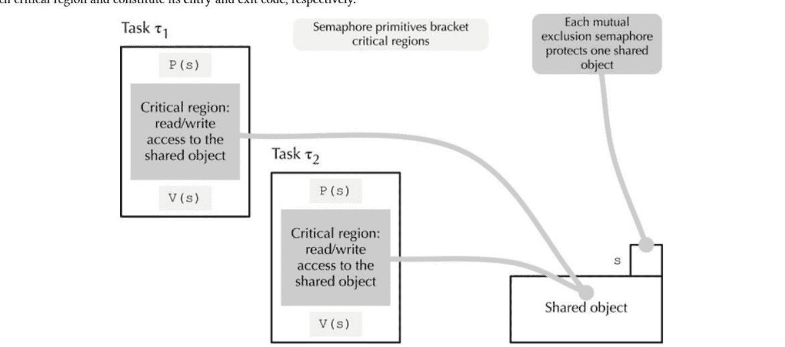

**图 7.4 互斥信号量的典型用法。**

在图中，我们假设 `s` 已经通过某种方式被正确初始化。在实践中，取决于所使用的 API，通常需要一个或多个显式的初始化步骤。第 7.4 节提供了关于这方面的更多信息。

虽然正式证明超本书的范围，但我们可以根据直觉观察到，描述的方法显然符合第 7.1.4 节中提出的第一个正确性条件。当一个任务 $\tau$ 想要进入它的临界区时，它必须先通过临界区入口代码 `P(s)`。根据 `s` 的值，该操作可能有两种不同的结果：

1. 如果 `s.v` 为 1，`P(s)` 的效果是将 `s.v` 减为 0 且不阻塞 $\tau$，允许任务继续进入临界区。这是正确的，因为 `s.v` 为 1 意味着没有其他任务在临界区内。
2. 如果 `s.v` 为 0，$\tau$ 在临界区入口代码处被阻塞，即在临界区边界。这是因为，如果 `s.v` 为 0，说明另一个任务被允许进入其临界区且尚未退出。

结果，如果两个任务 `t` 和 $\tau$ 进入由同一个信号量 `s` 控制的临界区，只有它们中的一个——例如 $\tau$——被允许立即，因为它发现 `s` 为 1。另一个任务 `t` 在 0 处等待，在 `s.q` 上队列并被阻塞。同时，这不会阻止其他任务进入它们的临界区，它们属于不同的对象，并由另一个信号量控制。这一属性符合第一个正确性条件的后半部分，该条件不允许“无用”的等待。

当示例中的任务 `t` 到达临界区入口代码并调用 `V(s)` 时，可能会发生两种不同的情况：

1. 如果至少有一个任务在 `s` 上阻塞，`s.v` 不会变化（保持为 0），并且阻塞的任务中恰好有一个（在我们示例中的 $\tau$）被取消阻塞。结果，当调度器决定执行时，它被允许进入临界区。互斥执行仍然得到保证，因为在取消阻塞的任务离开其临界区并调用 `V(s)` 之前，没有其他任务进入任何由 `s` 控制的临界区。此外，如果另一个任务等待通过相同的信号量 `s` 进入临界区，它将被阻塞，因为 `s.v` 仍然为 0。
2. 当任务通过执行 `V(s)` 退出临界区且没有其他任务在 `s` 上等待时（在我们示例中是 $\tau$），`s.v` 回到 1（其初始值），使得未来恰好有一个进程被允许立即进入临界区而不被阻塞。

在执行 `P(s)` 和 `V(s)` 过程中不可能出现竞态条件，因为正如第 7.2.1 节所述，这些原语的实现必须保证它们的原子性。

至于第二个正确性条件，很容易观察到，互斥信号量阻止任务进入临界区的唯一情况发生在另一个任务已在受由同一信号量控制的临界区内时。根据构造，执行内部操作的任务不应执行任何互斥信号量，并且无法阻止其他任务进入它们的临界区。

互信号量是否满足第三个正确性条件取决于它的实现，特别是其队列的调度策略。如果策略是先入先出（FIFO），可以很容易满足该条件，使得原语始终释放在信号量上等待时间最长的任务。

然而，在第 8.1 节中我们看到，这在实时系统中通常是不够的，因为这使得系统容易受到无界优先级反转的影响并阻碍调度可用性，正如第 4.1.3 节暗示的那样。另一方面，当使用不同的队列策略时，某些进程原则上可能会面临无限等待，这种可能性可以通过其他手段排除。例如，成功的调度分析意味着所有任务都能在不违反截止日期的情况下完成，它也意味着没有无限的、无界的等待。

要非正式地检查是否满足第四个（也是最后一个）正确性条件，只需观察到信号量及其原语的定义完全抽象了关于系统的任何架构细节，并且不包含对任何任务或处理器特征的引用。同样，信号量的实现也要求不引入此类依赖关系才能被认为足够可用。

## 7.2.3 同步信号量

除了互斥，信号量还有助于实现任务间的同步，例如，当我们想要执行先验约束并阻塞任务 $\tau_2$ 直到另一个任务 $\tau_1$ 生成的特定事件发生。在这种情况下，信号量通常被称为同步信号量。

如图 7.5 所示，当任务 $\tau_1$ 使用共享对象将数据传输给 $\tau_2$ 时，我们必须确保 $\tau_2$ 在 $\tau_1$ 完全更新它之后才从共享对象读取。在最简单的情况下，这种先验约束可以通过初始化为零的信号量 `s` 来强制执行。然后，任务 $\tau_2$ 在从共享对象读取执行 `P(s)`，而任务 $\tau_1$ 在更新后调用 `V(s)`。通过这种方式，$\tau_2$ 执行：

- 当 `s.v` 为零时，$\tau_2$ 在 `P(s)` 处阻塞；
- 当 $\tau_1$ 完成更新并执行 `V(s)` 时，取消 $\tau_2$ 的阻塞。

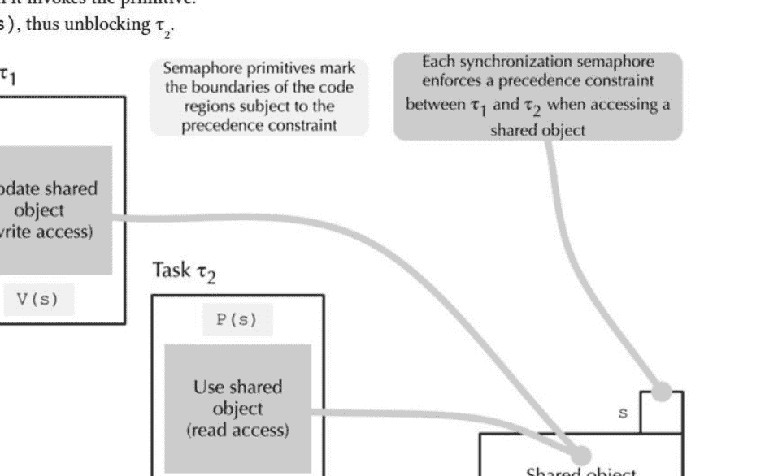

**使用同步信号量执行先验约束。**

这样，$\tau_2$ 拥有共享对象的一致视图，其中包含了 $\tau_1$ 写入的所有新数据，当它最终执行时。此外，在 `P()` 和 `V()` 完成后，`s.v` 仍然为零，因此信号量准备好进行下一个循环。

示例还强调了信号量的值在记录和跟踪过去事件中的重要作用。如果我们分析当 $\tau_2$ 在获取机会之前运行时会发生什么，将变得显而易见：

- 当它执行 `V(s)` 时，它发现 `s.q` 是空的。因此，它将 `s.v` 加到 1。
- 当它最终调用 `P(s)` 时，它发现 `s` 为 1，意味着它等待的同步条件已经满足。相应，它立即继续而不阻塞，并将 `s.v` 回到零。

值得注意的是，这是单向同步。换句话说，它防止 $\tau_2$ 消费 $\tau_1$ 产生的数据，但不能防止 $\tau_1$ 在 $\tau_2$ 获取它之前运行多次并覆盖它。正如下一节将变得更清晰的，每个程序必须遵守的单向同步都需要一个信号量。

## 7.2.4 生产者与消费者

在本节中，我们探索使用互斥和同步信号量来解决由 Courtois [38] 概述的经典生产者-消费者问题。在这个问题中，一组任务（调用者）生成数据项并通过 `prod()` 函数使另一组任务（消费者）可用。消费者使用 `cons()` 函数检索数据项。

为了解决这个问题，我们必须首先定义实现缓冲器的适当共享对象。最自然、直接的方法（同时也满足 FIFO 访问顺序要求）是 N 个整数元素的数组，如图 7.6 所示，这种缓冲区由三个元素组成：

1. 一个包含 `N` 个整数元素的共享数组 `int buf[N]`。在不失通用性的情况下，我们假设图中 `N=8`。
2. 一个共享索引 `int in`，指向缓冲区中的空元素，即下一个填充的元素。
3. 一个共享索引 `int out`，指向缓冲区中最旧的满元素。

```cpp
void prod(int d) {
  P(empty);
  P(mutex);
  buf[in] = d;
  in = (in+1) % N;
  V(mutex);
  V(full);
}
```

```cpp
int cons(void) {
  int c;
  P(full);
  P(mutex);
  c = buf[out];
  out = (out+1) % N;
  V(mutex);
  V(empty);
  return c;
}
```

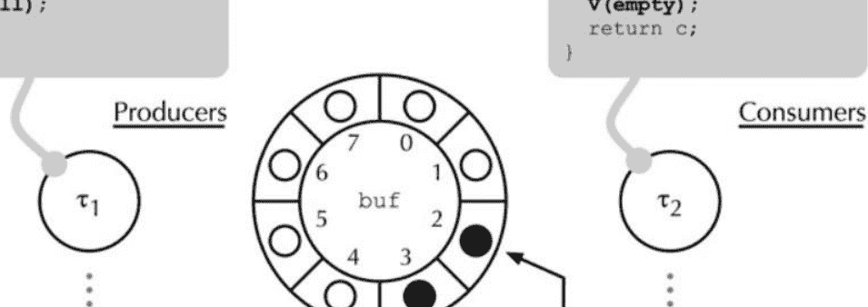

**图 7.6 用于协调环形缓冲区访问的同步和互斥信号量。**

| 下一个要填充的空元素索引 | 最旧满元素的索引 | 存放空元素数量的同步信号量 | 存放满元素数量的同步信号量 |
| :--- | :--- | :--- | :--- |
| `in` | 4 | `empty` | 6 |
| | `out` | 2 | `full` | 2 |
| | | | 互斥信号量 `mutex` | 1 |

`in` 和 `out` 都从零开始，分别在插入和移除缓冲区元素时递增。为了使缓冲区变为环形，它们对 `N` 取模递增，即当它们超过 `N-1` 时会回到零。

例如，图 7.6 显示了在初始化后插入了 4 个数据项并删除了 2 个数据项后数据结构的状态。`in` 的值为 4，意味着在向环形缓冲区插入下一个元素时必须填充 `buf[4]`；`out` 为 2，表示 `buf[2]` 包含缓冲区中最旧的元素。满元素用实心圆表示，空元素用空心圆表示。

除非环形缓冲区永远不会完全充满，否则为了留出一个所谓的“守卫元素”始终为空，其状态存在固有的歧义性。也就是说，`in == out` 的条件可能表示缓冲区完全空（如初始状态），也可能完全满。在我们在这里描述的解决方案中，这种歧义是在任务同步层面而非数据结构层面解决的，因此不需要守卫元素。

根据问题描述和刚给出的环形缓冲区定义，为了从环形缓冲区插入和移除元素，我们分别在 `prod()` 和 `cons()` 函数中使用以下代码段：

- 如果 `d` 正要插入的数据项，且我们暂时假设缓冲区未满，通过以下方式执行插入：
```
buf[in] = d;
in = (in+1) % N;
```

- 对称地，为了从缓冲区移除数据项并将其存储到 `c` 中，假设缓冲区未满，我们需要执行：
```
c = buf[out];
out = (out+1) % N;
```

这些代码段是临界区，因为它们都访问了共享对象——环形缓冲区。根据第 7.2.2 节，它们必须关联并受同一个互斥信号量（称为 `mutex`）的保护。具体来说：

- 如图所示，`mutex` 必须初始化为 1。
- 两个临界区必须被临界区的进入和退出代码包围，即分别为 `P(mutex)` 和 `V(mutex)`。

在此之后，两个临界区变为：

- `prod()` 函数中的元素插入：
```
P(mutex);
buf[in] = d;
in = (in+1) % N;
V(mutex);
```

- `cons()` 函数中的元素移除：
```
P(mutex);
c = buf[out];
out = (out+1) % N;
V(mutex);
```

现在是关注同步问题了。首先，当缓冲区完全空时，我们需要阻塞任何想要从共享缓冲区获取数据项的消费者。一旦生产者向缓冲区放入新的数据项，被阻塞的消费者必须立即解阻塞。然而，这并不是我们感兴趣的唯一同步条件。对称地，当生产者尝试向已经完全满的缓冲区插入数据项时，我们也需要阻塞生产者，以避免覆盖现有数据。

如第 7.2.3 节所述，对于并发程序必须遵守的每种同步条件，我们需要一个信号量。在这种情况下，我们有两个条件，因此需要两个信号量：

1. 该信号量计算缓冲区中有多少个满元素。它的初始值为 0，因为在最开始时环形缓冲区是空的。消费者在从缓冲区移除数据项之前执行 `P(full)`，如果缓冲区中没有数据则可能会阻塞。另一方面，生产者在向缓冲区存储额外的数据项后执行 `V(full)`。通过这种方式，它们解阻塞一个等待的生产者或增加满元素计数。
2. `empty` 信号量计算缓冲区中有多少个空元素。它的初始值为 `N`，因为缓冲区开始是完全空的，所以它的所有 `N` 个元素确实都是空的。生产者在缓冲区放入更多数据之前执行 `P(empty)`，以更新空元素计数（如果缓冲区未完全满）或阻塞（反之）。在从缓冲区移除一个数据项后，消费者执行 `V(empty)`，以解阻塞一个等待的生产者或增加空元素计数。

如图 7.6 所示，`mutex` 信号量必须初始化为 1。两个临界区必须被临界区的进入和退出代码包围，即分别为 `P(mutex)` 和 `V(mutex)`。

遗憾的是，这种推理是不正确的，因为它有时会导致死锁。具体而言，当生产者试图将一个元素存储到完全满的缓冲区时，可能会发生以下序列的事件：

- 生产者通过执行非阻塞的 `P(mutex)` 成功获得了对共享缓冲区的独占访问权限。从这一点起，信号量 `mutex` 的值变为零。
- 由于缓冲区是满的，`empty.v` 为零，因为该信号量计算空闲元素的数量。因此，`P(empty)` 在其临界区域内阻塞了生产者，因为它在阻塞之前没有释放互斥信号量 `mutex`。

此之后，解锁生产者的方法将是从另一个任务执行 `V(empty)`。唯一可能执行此原语的任务是消费者，但为了实现这一点，它们必须首先通过由 `mutex` 控制的临界区域。这是不可能的，因为 `mutex` 的当前值为零。因此，整个生产者-消费者系统都停滞了，原因如下：

- 任何进入的生产者都会阻塞在 `P(mutex)` 上，因为 `mutex.v` 为零。
- 第一个进入的消费者执行非阻塞的 `P(full)` 并最终将 `full.v` 变为零，但无法从缓冲区中检索任何数据，因为它们阻塞在 `P(mutex)` 上。
- 如果有更多的消费者到达，它们甚至无法到达 `P(mutex)`，因为它们阻塞在 `P(full)` 上。

这个例子也提供了一个再次指出，死锁与其他并发编程中的问题一样，发生的概率通常较低，很容易被忽略。很容易看出，当生产者和消费者交替执行而没有完全填充缓冲区时，就会死锁。

为了解决这些缺陷，Brinch Hansen [26] 和 Hoare [6] 提出了一种更结构化、更高层次的 IPC（进程间通信）机制，称为监控器。Mesa 语言 [5] 定义并开创了机制的第三种变体，直接影响了 POSIX 监控器。监控器是一个复合对象，包含一个共享对象和一组在该对象上操作的方法。根据定义，监控器必须具备以下两个属性：

- 信息隐藏。监控器内部的共享对象只能通过属于该监控器的方法进行访问，不能通过其他方式。同时，监控器方法不允许访问任何属于其他监控器的共享对象。只有监控器方法是公共的，可以从监控器外部自由调用。
- 互斥。监控器的实现必须保证在任何时刻，任何监控器方法中只有一个任务在活动执行。这一属性与互斥信号量对于其控制的临界区域的作用相似，但更为宽松，因为它允许多个任务处于监控器方法中，只要在任何时间最多有一个任务在执行即可。

如果监控器是编程语言的内置组件，并最初由该语言规定，那么在实践中实现这些属性是相对容易的。在这种情况下，编译器确切知道哪些方法与监控器相关，并在强制所讨论的信息隐藏规则的同时，可以适当标记错误，并为这些方法添加必要的互斥代码。同样，编译器也可以从源码中获取其所需的所有信息。

在其他情况下，例如在 C 语言中，编译器并不知道监控器的概念。尽管 POSIX 国际标准 [68] 提供了监控器的所有构建模块，但在某些领域需要编程规范来正确地实现它们，因为编译器在这方面无法提供太大的帮助。具体来说：

- 程序员负责为每个监控器定义一个互斥信号量，在处理监控器时，程序员还必须正确地将每个方法与其所属的监控器关联，并在进入和退出所有监控器方法时调用 `P()` 和 `V()`。
- 同样，程序员必须使用语言提供的底层机制之一来实现信息隐藏，并接受其所有的局限性和缺点。例如，在 C 中定义静态共享对象使其仅在编译单元内可访问而不是全局访问，这部分隐藏了它。

## 7.3.2 条件变量

上一节中讨论的两个属性避免了监控器方法与其所属共享对象中的竞态条件。特别是，互斥属性与互斥信号量的相似之处在于，需要引入互斥信号量来强制执行，正如在 POSIX 中发生的那样。


然而，在 7.2.3 节中我们也讨论了同步信号量，到目前为止监控器框架尚未引入它们的对应物。这种对应物确实存在，被称为条件变量（condition variable）。条件变量受信息隐藏规则限制，因此相同监控器的方法之外，不能以任何方式引用。对于共享对象，如果编程语言感知监控器，则由程序员负责适当隐藏条件变量，以防止它们被误用。在条件变量 `c` 上定义了以下两个原语：

- `wait(c)` 阻塞任务并释放监控器，允许其他任务进入并执行其方法。这两个步骤以原子方式执行，通过单个不可分割的动作完成。
- `signal(c)` 唤醒阻塞在 `c` 上的一个任务（如果有的话）。如果没有任务阻塞在 `c` 上，则没有影响。

非正式地说，如果一个任务在执行某个监控器方法时发现它无法立即完成工作，它就会对条件变量调用 `wait`。通过这样，它被阻塞并给其他任务进入监控器并履行职责的机会。当这些任务中的一个发现第一个任务可以继续时，它就会对条件变量调用 `signal`。

由于任务可能有许多原因导致条件变量被阻塞或取消阻塞，我们可以为每个原因引入一个不同的条件变量。通过这样，阻塞的任务可以分组，或者根据解锁它们的条件来选择合适的条件变量。

尽管 `wait` 和 `signal` 的定义直觉上似乎已经令人满意，但仍然是不完整的。也就是说，我们必须对条件变量引入额外的约束，以保证互斥不受阻碍。这样，如图所示：

1. 假设监控器最初是空闲的，任务进入监控器，如图所示：
2. 解决这些问题的最简单方法是由 Brinch Hansen 提出的。
3. 当这些任务中的一个发现第一个任务可以继续时，它就会对条件变量调用 `signal`。

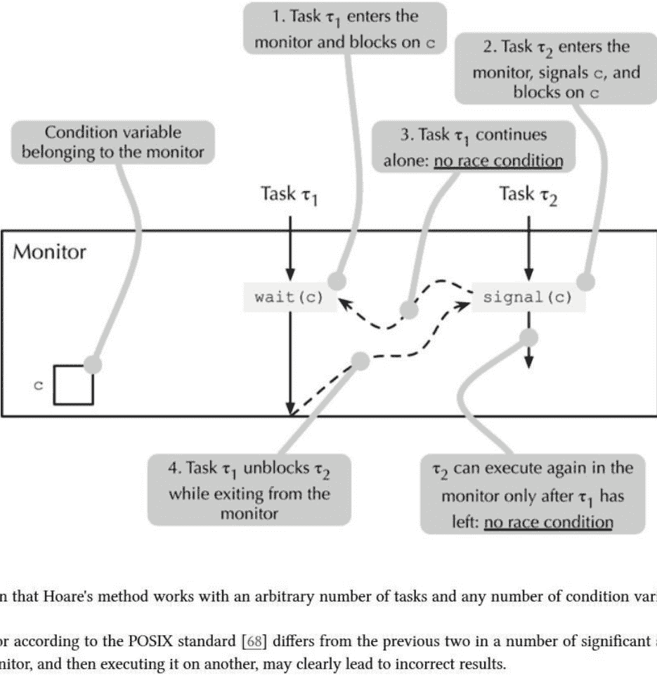

**图 7.9** Hoare 监控器中的阻塞信号。

与 Brinch Hansen 的建议一样，可以证明 Hoare 的方法适用于任意数量的任务和任意数量条件变量，尽管我们在图 7.9 中描述的示例非常简单。

根据 POSIX 标准 [68] 避免监视器竞态条件的方法与前两种方法在许多方面显著不同。程序员在编写特定类型的监视器代码时应记住这些差异，否则在执行时可能会明显导致错误的结果。

- 1. 正如之前概述，监视器不是 C 语言的一部分。因此，程序员负责为每个监视器定义一个互斥信号量——在图 7.10 中称为 `m`——并对其进行适当初始化。如图所示，他们还负责使用 `P(m)` 和 `V(m)` 原语正确地封装所有监视器方法，这些原语在 POSIX 中被称为 `lock(m)` 和 `unlock(m)`。此外，他们确保 `m` 仅对监视器方法可见且可访问。

属于监视器的条件变量

1. 任务 $\tau_1$ 进入监视器阻塞在 $c$ 上，释放 $m$
2. 任务 $\tau_2$ 进入监视器，信号 $c$，并继续执行
3. 任务 $\tau_1$ 在 $\tau_2$ 离开监视器后重新获取 $m$ 并继续

监视器互斥，POSIX 中的显式表示

任务 $\tau_1$

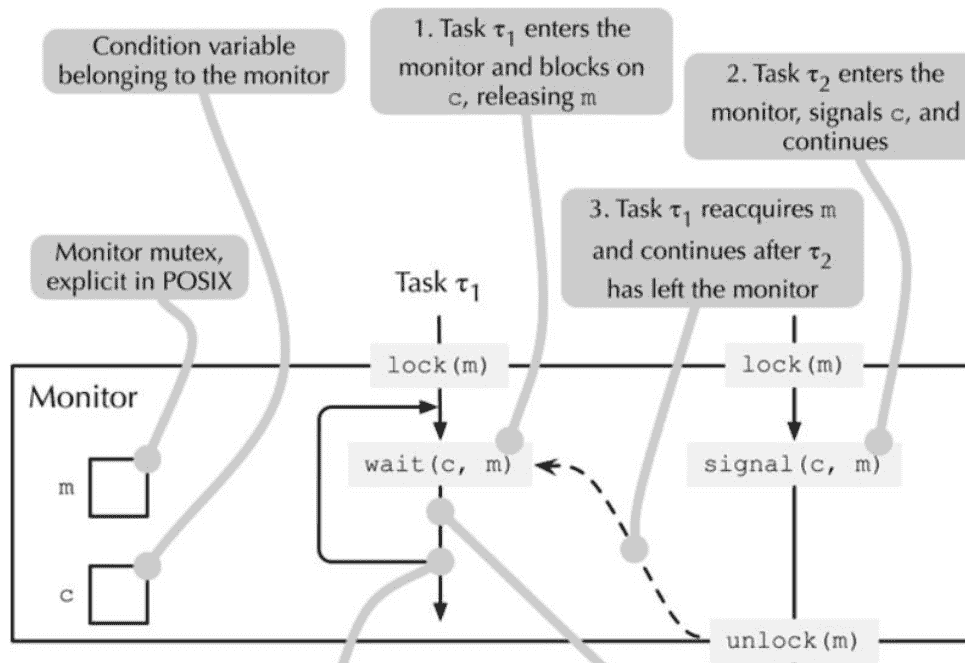

注意：$\tau_2$ 本身（或在此期间进入监视器的任何其他任务）已使 $\tau_1$ 一直等待的条件：可能需要新的等待

$\tau_1$ 只有在独占时才能在监视器中再次执行：没有竞态条件

图 7.10 POSIX 监视器中 wait 和 signal 的语义。

- 2. 缺乏语言支持监视器的另一个重要后果是，POSIX 中的 `wait` 原语有两个参数而不是一个。由于编译器无法将条件变量与其所属的监视器相关联，它可能无法自主推断出 `wait` 应该释放哪个互斥信号量。因此，程序员必须将正确的信号量作为额外的参数传递。
- 3. POSIX 方法背后的逻辑是，调用 `wait` 后刚解除阻塞的任务（如图中的 $\tau_1$）在继续之前必须重新获取互斥信号量。这是在 `wait` 原语内部隐式完成的。相反，发送信号的任务（图中的 $\tau_2$）立即继续。换句话说，POSIX 方法以与 Hoare 相相反的方式避免竞态，因为它延迟的是被信号的任务而不是信号任务，这与 Mesa 编程语言 [51] 的方法相同。
- 4. 当当前在监视器中执行的任务退出或在 `wait` 中阻塞时，它会释放持有的互斥信号量，通过显式调用 `unlock`（如果正在退出监视器）或隐式调用（作为 `wait` 的一部分）。结果，它解锁一个等待恢复或开始在监视器中执行的任务（如果有的话）。更具体地说，该任务可以是：
  - 在解除阻塞后等待重新获取互斥信号量，如图中的 $\tau_1$，或
  - 等待从外部进入监视器，被 `lock(m)` 阻塞，
  并且决定取决于互斥信号量 `m` 的队列策略。如果没有任务在等待，`m` 的值将回到一，以记住监视器已空闲且当前没有任务在执行。

总结，如果我们假设除了 $\tau_1$ 和 $\tau_2$ 之外没有其他任务尝试操作，我们可以描述图 7.10 中简单的 POSIX `wait`/`signal` 序列的行为：

- 任务 $\tau_1$ 通过 `lock(m)` 获取互斥信号量 `m` 并进入监视器而不阻塞。
- 在监视器中执行时，$\tau_1$ 通过 `wait(c, m)` 等待条件 `c`。结果它通过执行隐式的 `unlock(m)` 释放监视器。根据 `wait` 的定义，这两个操作是原子单元执行的。
- 示例中的另一个任务 $\tau_2$ 在监视器边界处的 `lock(m)` 阻塞，现在被允许继续。
- 任务 $\tau_2$ 执行 `signal(c)` 并继续，因为这是一个非阻塞原语。任务 $\tau_1$ 无法立即继续，因为它必须重新获取 `m`。
- 当 $\tau_2$ 离开监视器时，它执行 `unlock(m)`，从而允许 $\tau_1$ 继续等待。
- 任务 $\tau_1$ 现在可以在监视器中继续其执行。

从实际角度来看，这种方法最重要的副作用是，正如示例中所强调的那样，当任务 $\tau$ 因为必须等待条件满足而阻塞在条件变量上时，它无法完全确定它所等待的条件在最终在监视器中继续执行时仍然会被满足。

这是因为其他任务（例如信号任务 $\tau$ 本身或在此期间允许进入监视器的任何其他任务）可能使该条件失效。可以通过确保任务在退出监视器之前不使它们信号的条件失效来避免第一种情况。

相反，没有通用方法可以避免第二种情况。如前所述，互斥信号量 `m` 的选择决定了监视器的行为。

## 7.4 用于共享内存 IPC 的 RTEMS API

### 7.4.1 经典 API

#### 信号量的创建与属性

RTEMS 操作系统通过其信号量管理器提供了信号量，作为其主要的同步设备之一。如表 7.1 所示，可以通过以下函数创建信号量：

```
rtems_status_code rtems_semaphore_create(
  rtems_name name,
  uint32_t count,
  rtems_attribute attribute_set,
  rtems_task_priority priority_ceiling,
  rtems_id *id);
```

表 7.1 RTEMS 信号量原语，经典 API

| 函数 | 目的 |
| :--- | :--- |
| `rtems_semaphore_create` | 创建信号量 |
| `rtems_semaphore_ident` | 根据名称查找信号量的标识 |
| `rtems_semaphore_delete` | 删除信号量 |
| `rtems_semaphore_obtain` | 在信号量上执行 P 操作 |
| `rtems_semaphore_release` | 在信号量上执行 V 操作 |
| `rtems_semaphore_flush` | 解除所有等待信号量的线程阻塞 |
| `rtems_semaphore_set_priority` | 设置信号量针对调度器的天花优先级 |

该函数根据给定的名称创建一个信号量，如果成功，则将其唯一标识符存储在 `id` 指向的位置中。随后必须使用该标识符通过除 `rtems_semaphore_ident` 之外的所有信号量原语来引用该信号量。与所有 RTEMS 对象名称一样，`name` 参数是一个 32 位的值。用户可以在 `rtems_build_name` 函数的帮助下合成它，该函数接受 4 个 ASCII 字符作为参数，使其更具人类可读性。

`rtems_semaphore_create` 函数最重要的参数是 `attribute_set`。它决定了在 RTEMS 支持的信号量中创建哪种特定变体。它是表 7.2 中列出的常量的位或结果。每种类型都代表了信号量实现效率与表达能力之间不同的权衡点。

表 7.2 RTEMS 信号量属性，经典 API

| 属性 | 含义 |
| :--- | :--- |
| `RTEMS_LOCAL` | 本地信号量 |
| `RTEMS_GLOBAL` | 全局可访问信号量 |
| `RTEMS_COUNTING_SEMAPHORE` | 普通计数信号量（如第 7.2 节） |
| `RTEMS_BINARY_SEMAPHORE` | 支持递归锁的二进制信号量 |
| `RTEMS_SIMPLE_BINARY_SEMAPHORE` | 不支持递归锁的二进制信号量 |
| `RTEMS_FIFO` | 使用先进先出 (FIFO) 队列策略 |
| `RTEMS_PRIORITY` | 使用基于优先级的队列策略 |
| `RTEMS_NO_INHERIT_PRIORITY` | 不使用优先级继承协议 |
| `RTEMS_NO_PRIORITY_CEILING` | 不使用立即优先级天花板协议 |
| `RTEMS_NO_MULTIPROCESSOR_RESOURCE_SHARING` | 不使用多处理器资源共享协议 |
| `RTEMS_INHERIT_PRIORITY` | 使用优先级继承协议 |
| `RTEMS_PRIORITY_CEILING` | 使用立即优先级天花板协议 |
| `RTEMS_MULTIPROCESSOR_RESOURCE_SHARING` | 使用多处理器资源共享协议 |

两个属性 `RTEMS_LOCAL` 和 `RTEMS_GLOBAL` 决定了在多节点系统上创建的信号量的可见性和可访问性。也就是说，信号量始终创建在调用线程所在的本地节点上。然后，带有 `RTEMS_LOCAL` 属性的信号量只能由执行在相同节点上的线程使用。相反，`RTEMS_GLOBAL` 信号量的信息会被广播到系统的所有其他节点，因此远程线程可以访问它。

考虑到创建全局信号量比创建本地信号量意味着更大的开销，且远程信号量操作效率较低（因为它们是通过本地节点上的代理代理执行的），除非有绝对必要，否则信号量应保持在本地。

表 7.2 中列出的第二组属性与信号量的表达能力有关。更具体地说：

- `RTEMS_COUNTING_SEMAPHORE` 是 RTEMS 支持的最强大的信号量类型，符合第 7.2 节中给出的信号量理论定义。`count` 参数是信号量的值，可以是任何用 `uint32_t` 类型表示的非负整数。
- `RTEMS_BINARY_SEMAPHORE` 是一种信号量的值只能为 1（未锁定）和 0（锁定），这使其在实现互斥时特别有用。此外，这种信号量支持递归锁功能，允许线程对同一个信号量上执行多次嵌套的 `P()` 操作而不会发生自锁。操作系统会记录线程执行的嵌套 `P()` 计数，并在线程执行的 `V()` 数量等于该线程执行的嵌套 `P()` 数量时删除信号量。
- `RTEMS_SIMPLE_BINARY_SEMAPHORE` 更加简单且不支持递归锁。如果一个线程对它已经拥有的信号量执行 `P()`，它将发生自锁。作为交换，这种信号量的效率更高，并且可以在锁定状态下被删除。

此外，RTEMS 信号量支持两种队列策略：

- `RTEMS_FIFO` 策略按照先进先出的顺序对阻塞在信号量上的线程进行排序。
- `RTEMS_PRIORITY` 策略则根据优先级对线程进行排序。

选择 `RTEMS_PRIORITY` 策略是启用优先级继承或立即优先级天花板的前提。这通过以下属性实现：

- `RTEMS_INHERIT_PRIORITY` 指定信号量使用优先级继承协议。
- `RTEMS_PRIORITY_CEILING` 指定信号量使用立即优先级天花板协议。

相应的对应属性 `RTEMS_NO_INHERIT_PRIORITY` 和 `RTEMS_NO_PRIORITY_CEILING` 分别指示不使用这些协议。此外，RTEMS 实现了两种专门为对称多处理 (SMP) 设计的协议：多处理器资源共享协议 (MrSP) 和 OMIP 协议。

MrSP 协议必须在创建信号量时通过指定 `RTEMS_MULTIPROCESSOR_RESOURCE_SHARING` 属性显式选择。内部，当指定 `RTEMS_INHERIT_PRIORITY` 属性时，OMIP 在多核系统中会自动替换优先级继承协议。两种情况下必须设置 `RTEMS_BINARY_SEMAPHORE` 和 `RTEMS_PRIORITY` 属性。

`rtems_semaphore_create` 函数返回状态码以报告操作结果。`RTEMS_SUCCESS` 状态码表示信号量创建成功。如果失败，函数返回以下状态码之一：

- `RTEMS_INVALID_NAME`: 参数中的信号量名称无效。
- `RTEMS_INVALID_ADDRESS`: 参数为空指针，因此没有指向可以存储创建的信号量标识符的有效位置。
- `RTEMS_NOT_SET`: 参数 `attribute_set` 包含未定义或无效的属性。
- `RTEMS_INVALID_NUMBER`: `count` 参数中的信号量初始值对于创建的信号量无效。例如，使用 MrSP 协议的二进制信号量不能在锁定状态下创建。因此，这种信号量的数量必须为一。
- `RTEMS_TOO_MANY`: 无法设置新信号量，因为达到了系统中本地或全局信号量的最大数量。
- `RTEMS_MP_NOT_CONFIGURED`: 给全局信号量的属性，但系统配置未启用多节点支持。

成功调用 `rtems_semaphore_create` 后，可以使用直接获取的信号量标识符操作信号量。也可以通过调用以下函数从信号量名称获取信号量标识符：

```c
rtems_status_code rtems_semaphore_ident(
  rtems_name name,
  uint32_t node,
  rtems_id *id);
```

该函数在 `node` 节点上查找由 `name` 参数指定的名称的信号量，并将标识符存储在 `id` 所指向的位置中。如果 `node` 为特殊值 `RTEMS_SEARCH_ALL_NODES`，该函数将搜索系统中的所有节点，从本地节点（即调用线程所在的节点）开始搜索。

如果多个信号量具有相同的名称，该函数保证返回一个具有给定名称的信号量的标识符，但具体是哪一个未指定。失败时，该函数返回以下状态代码之一：

- `RTEMS_INVALID_NAME`: 函数在搜索范围内没有找到任何请求名称的信号量。
- `RTEMS_INVALID_NODE`: 节点标识符无效。

该函数：

```c
rtems_status_code rtems_semaphore_delete(
  rtems_id *id);
```

删除作为参数传递的标识符 `id` 对应的信号量。在成功调用此函数后，该标识符将不再被使用。该信号量可能由另一个线程创建，但不能与调用线程位于同一个节点上。`rtems_semaphore_delete` 的返回值在成功完成时为 `RTEMS_SUCCESSFUL`，或返回以下状态代码之一：

- `RTEMS_INVALID_ID`: 信号量标识符无效。
- `RTEMS_ILLEGAL_ON_REMOTE_OBJECT`: 无法删除该信号量，因为它不在调用线程所在的同一节点上。
- `RTEMS_RESOURCE_IN_USE`: 该信号量实际上是一个互斥锁，由于当前正处于锁定状态而无法删除。

#### 信号量操作

参考表 7.1，`rtems_semaphore_obtain` 和 `rtems_semaphore_release` 函数是 7.2 节讨论的抽象 `P()` 和 `V()` 操作在 RTEMS 中的对应实现。具体而言，该函数：

```c
rtems_status_code rtems_semaphore_obtain(
  rtems_id id,
  rtems_option option_set,
  rtems_interval timeout);
```

对由 `id` 标识的信号量执行 `P()` 操作。额外的参数 `option_set` 和 `timeout` 决定了调用线程是否可以阻塞以及阻塞多久以完成信号量操作，导致了三种可能性：

- 如果 `option_set` 设置为 `RTEMS_NO_WAIT`，则忽略 `timeout` 参数。如果信号量操作无法立即完成（即无法阻塞），函数将向调用者返回状态代码 `RTEMS_UNSATISFIED`。
- 如果 `option_set` 设置为 `RTEMS_WAIT` 且 `timeout` 设置为特殊值 `RTEMS_NO_TIMEOUT`，函数可能会无限阻塞调用者，直到信号量操作完成或发生错误。
- 如果 `option_set` 设置为 `RTEMS_WAIT` 且 `timeout` 设置为以节（ticks）表示的超时值（见第 5 章），函数可能会阻塞调用者最多 `timeout` 节。如果在信号量操作完成前超时过期，函数将返回状态代码 `RTEMS_TIMEOUT`。

失败的其他原因体现在 `rtems_semaphore_obtain` 可能也会返回的以下状态代码中：

- `RTEMS_INVALID_ID`: 信号量标识符无效。
- `RTEMS_OBJECT_WAS_DELETED`: 调用线程阻塞在该信号量上时，该信号量被（另一个线程）删除。
- `RTEMS_UNSATISFIED`: 信号量是一个 MrP 信号量且检测到了死锁条件。此外，当尝试从同一个任务中多次获取 MrP 信号量而在中间没有释放它时，也会返回此状态代码，因为 MrP 信号量不支持递归锁定。

`V()` 的对应函数是：


```c
rtems_status_code rtems_semaphore_release(
  rtems_id id);
```

如果信号量释放成功，它返回 `RTEMS_SUCCESSFUL`，或者在失败时返回以下状态代码之一：

- `RTEMS_INVALID_ID`: 信号量标识符无效。
- `RTEMS_NOT_OWNER_OF_RESOURCE`: 无法释放该信号量，因为它是一个互斥锁且调用线程在此没有获取它。
- `RTEMS_INCORRECT_STATE`: 操作失败，因为信号量是一个 MrP 信号量，且调用任务没有遵循预获取和释放顺序。使用此协议的信号量必须按照获取顺序的相反顺序进行释放。

RTEMS Classic API 支持的最后一个信号量操作没有直接的理论对应物。该函数：

```c
rtems_status_code rtems_semaphore_flush(
  rtems_id id);
```

解锁所有等待该信号量的任务，从而清空其等待队列，而不改变信号量的值。每个任务都将从其参与的 `rtems_semaphore_obtain` 接收到一个 `RTEMS_UNSATISFIED` 状态代码，以强调该信号量未被正确获取，因此通过执行 `P()` 操作几乎可以保证的某些属性（例如互斥锁情况下的互斥性）可能不再成立。

除了 `RTEMS_SUCCESSFUL` 外，`rtems_semaphore_flush` 函数还可能返回以下状态代码：

- `RTEMS_INVALID_ID`: 信号量标识符无效。
- `RTEMS_ILLEGAL_ON_REMOTE_OBJECT`: 信号量是全局可用的且位于远程节点上。在这种情况下不支持 flush 操作。
- `RTEMS_NOT_DEFINED`: MrP 信号量不支持 flush 操作。

# 调度器级天顶值

Mrsp 协议要求每个互斥锁关联一个调度器级天顶值。在创建使用该协议的互斥锁时，这些天顶值最初设置为 `priority_ceiling` 参数的值。对于普通的天顶值，可以通过函数单独获取和设置这些值：

```c
rtems_status_code rtems_semaphore_set_priority(
  rtems_id semaphore_id,
  rtems_priority new_priority,
  rtems_priority *old_priority);
```

该函数将 `semaphore_id` 的优先级设置为 `new_priority`，并将之前的优先级存储在 `old_priority` 中。两种情况下，该函数仅操作位于同一节点上的信号量。`rtems_semaphore_set_priority` 在成功时返回 `RTEMS_SUCCESSFUL`，或返回以下状态代码之一：

- `RTEMS_INVALID_ID`: 信号量标识符或调度标识符（或两者）无效。
- `RTEMS_INVALID_ADDRESS`: `old_priority` 指针为空。
- `RTEMS_INVALID_PRIORITY`: `new_priority` 值对 `scheduler_id` 无效。
- `RTEMS_NOT_DEFINED`: 信号量未使用 Mrsp 协议，且调度器级天顶值仅定义此类信号量。
- `RTEMS_ILLEGAL_ON_REMOTE_OBJECT`: 信号量不在线程所在的同一节点上。

## 二进制信号量

RTEMS 还提供了专门的二进制信号量实现。与由信号管理器提供的、通过 `rtems_id` 引用的普通信号量不同，这种二进制信号量的存储由用户提供，并通过信号量指针进行引用。信号量的拷贝不是有效的信号量且不用于同步。此外，它们无法从多节点的远程节点访问。

表 7.3 总结了二进制信号量提供的原语。与普通信号量相比，它们提供了精简的接口，使得用户代码更简单高效。该函数：

```c
void rtems_binary_semaphore_init(
  rtems_binary_semaphore *binary_semaphore,
  const char *name);
```

初始化由 `binary_semaphore` 指向的信号量并分配指定的名称。名称可以为 NULL，但如果不是，则由用户负责确保其所引用的字符串在信号量的生命周期内有效，或者直到信号量被更改。用户还负责在调用此函数之前分配 `binary_semaphore` 指向的 `rtems_binary_semaphore` 类型的对象。二进制信号量也可以通过宏 `RTEMS_BINARY_SEMAPHORE_INITIALIZER` 进行静态初始化。具体而言，

```c
rtems_binary_semaphore binary_semaphore = RTEMS_BINARY_SEMAPHORE_INITIALIZER(name);
```

等同于调用 `rtems_binary_semaphore_init`。值得注意的是，在这情况下，信号量的初始值均为 0 而不是 1。因此，如果二进制信号量用于互斥，则在初始化后必须执行一次孤立的 `V()` 操作。

| 表 7.3 RTEMS 二进制信号量原语，经典 API |
| :--- | :--- |
| 函数 | 目的 |
| `rtems_binary_semaphore_init` | 初始化用户分配的二进制信号量 |
| `rtems_binary_semaphore_destroy` | 销毁二进制信号量 |
| `rtems_binary_semaphore_wait` | 对二进制信号量执行等待 |
| `rtems_binary_semaphore_try_wait` | 等待的非阻塞变体 |
| `rtems_binary_semaphore_wait_timed_ticks` | 定时等待变体 |
| `rtems_binary_semaphore_post` | 对二进制信号量执行释放 |
| `rtems_binary_semaphore_set_name` | 设置二进制信号量的可读名称 |
| `rtems_binary_semaphore_get_name` | 获取二进制信号量的名称 |

当信号量不再被使用时，可以通过以下函数进行销毁（并且应该销毁）：

```c
void rtems_binary_semaphore_destroy(
  rtems_binary_semaphore *binary_semaphore);
```

销毁信号量后，除非重新初始化，否则不应再次使用相应的 `rtems_binary_semaphore` 对象。在信号量在使用时销毁它会导致不可预测的结果。

以下函数对由 `binary_semaphore` 引用的二进制信号量执行 `P()` 操作，从而可能阻塞调用者。线程按照优先级顺序插入信号量等待队列。

```c
void rtems_binary_semaphore_wait(
  rtems_binary_semaphore *binary_semaphore);
```

对于全功能的信号量，该函数的非阻塞变体和定时变体也是可用的：

```c
int rtems_binary_semaphore_try_wait(
  rtems_binary_semaphore *binary_semaphore);
```

```c
int rtems_binary_semaphore_wait_timed_ticks(
  rtems_binary_semaphore *binary_semaphore,
  uint32_t ticks);
```

与不会失败的 `rtems_binary_semaphore_wait` 不同，这两个函数都返回一个 `int`，其值表示是否成功完成。具体而言，返回值为零表示成功，而以下非零值之一表示失败：

- `AGAIN`。函数 `rtems_binary_semaphore_try_wait` 无法立即获取信号量。
- `TIMEDOUT`。函数 `rtems_binary_semaphore_wait_timed_ticks` 在指定的刻度数通过之前无法获取信号量。

由于它永远不会阻塞调用者，`rtems_binary_semaphore_try_wait` 是该组中唯一可以从中断上下文调用的函数。

该函数：

```c
void rtems_binary_semaphore_post(
  rtems_binary_semaphore *binary_semaphore);
```

对由 `binary_semaphore` 引用的二进制信号量执行 `V()` 操作。它可以从线程或中断上下文调用。

表 7.3 中的最后两个函数允许调用者检索并修改与二进制信号量关联的可读名称，该名称用于调试目的：

```c
const char *rtems_binary_semaphore_get_name(
  const rtems_binary_semaphore *binary_semaphore);
```

```c
void rtems_binary_semaphore_set_name(
    rtems_binary_semaphore *binary_semaphore,
    const char *name);
```

在设置信号量名称时，调用者必须确保 `name` 所指向的存储空间在信号量的整个生命周期内保持有效，或者直到信号量名称再次更改为止。`name` 参数也可以是 `NULL` 指针。

# 互斥设备和递归互斥设备

除了通用和二进制信号量外，RTEMS 还提供了更专门、更高效的同步设备，专门为互斥而设计。它们自动使用优先级继承（在单核系统上）或 OMIP 协议（在多核上）。与二进制信号量一样，它们是独立对象，也就是说它们所需的存储空间完全由用户分配和管理。互斥锁和递归互斥锁是 `rtems_mutex` 和 `rtems_recursive_mutex` 类型，它们通过表 7.4 中的函数进行管理。在互斥锁销毁后它将不再被使用，除非重新初始化。在使用时销毁互斥锁会导致不可预测的结果。

| 表 7.4 RTEMS 互斥锁原语 |
| :--- | :--- |
| 函数 | 目的 |
| `mutex_init` | 初始化互斥锁 |
| `mutex_destroy` | 销毁互斥锁 |
| `mutex_set_name` | 设置互斥锁的可读名称 |
| `mutex_get_name` | 获取互斥锁的名称 |
| `mutex_lock` | 对互斥锁执行锁定 |
| `mutex_unlock` | 对互斥锁执行解锁 |
| `recursive_mutex_init` | 初始化递归互斥锁 |
| `recursive_mutex_destroy` | 销毁递归互斥锁 |
| `recursive_mutex_set_name` | 设置递归互斥锁的可读名称 |
| `recursive_mutex_get_name` | 获取递归互斥锁的名称 |
| `recursive_mutex_lock` | 对递归互斥锁执行锁定 |
| `recursive_mutex_unlock` | 对递归互斥锁执行解锁 |

(1) 静态初始化 `RTEMS_MUTEX` 可用。(2) 静态初始化 `RTEMS_RECURSIVE_MUTEX` 可用。

```c
rtems_mutex mutex = RTEMS_MUTEX(name);
```

```c
rtems_recursive_mutex mutex = RTEMS_RECURSIVE_MUTEX(name);
```

当互斥锁或递归互斥锁不再需要时，必须通过以下函数销毁：

```c
void mutex_destroy(rtems_mutex *mutex);
```

```c
void recursive_mutex_destroy(rtems_recursive_mutex *mutex);
```

这两个函数都接受指向要销毁对象的参数。互斥锁在销毁后将无法使用，除非重新初始化。如果在任务等待互斥锁时销毁它，结果是未定义的。

互斥锁的可读名称在创建后可以通过以下函数更改：

```c
void mutex_set_name(rtems_mutex *mutex, const char *name);
```

```c
void recursive_mutex_set_name(rtems_recursive_mutex *mutex, const char *name);
```

对称地，也可以在给定互斥锁对象通过以下函数检索名称：

```c
const char *rtems_mutex_get_name(const rtems_mutex *mutex);
```

```c
const char *rtems_recursive_mutex_get_name(const rtems_recursive_mutex *mutex);
```

这些函数：

```c
void mutex_lock(rtems_mutex *mutex);
```

```c
void recursive_mutex_lock(rtems_recursive_mutex *mutex);
```

对由 `mutex` 指向的互斥锁或递归互斥锁执行锁定，必要时会阻塞调用者。因此，这些函数必须在启用了中断的任务上下文中调用。在互斥锁上阻塞时，任务将按照优先级顺序被唤醒。`rtems_recursive_mutex_lock` 函数作用于递归互斥锁，并能够检测调用任务是否已经拥有该互斥锁，即它在没有解锁的情况下锁了互斥锁。如果是这种情况，该函数将立即返回给调用者。

锁定的互斥锁可以通过调用函数进行解锁：

```c
void mutex_unlock(rtems_mutex *mutex);
```

```c
void rtems_recursive_mutex_unlock(
  rtems_recursive_mutex *mutex);
```

与互斥锁函数一样，这些函数也必须在开启中断的任务上下文中调用。如果调用任务在调用时未拥有该互斥锁，则结果是不可预测的。同样，尝试再次解锁也是非法的，并会导致不可预测的结果。`rtems_recursive_mutex_unlock` 函数实际上只有在当前解锁操作与同一任务执行的外部 `rtems_recursive_mutex_lock` 匹配时，才会解锁递归互斥锁。否则，它将立即返回给调用者。

### 7.4.2 POSIX API

POSIX API 提供了三种主要的任务同步对象：通用信号量（称为 mutex）、互斥信号量（也称为 mutex）和条件变量。通用信号量非常紧密地遵循了第 7.2 节中的抽象定义。此外，所有同步原语都具有非阻塞和超时计数器。这两者都有助于确保实时任务在参与同步后，无论软件组件运行是否正常，总有一种方法能够在定义的时间内退出。

互斥信号量是特殊的信号量，其值只能是 1 或 0，表示信号量的锁定或未锁定。此外，互斥信号量上的 `P(m)` 和 `V(m)` 被限制按照标准的互斥信号量范式进行操作（见第 7.2 节）。

作为这些限制的交换，互斥信号量的实现可能比通用信号量更高效，并提供额外的功能。例如，它们包含了一些用于解决无界优先级反转的协议（见第 8.1 节）。此外，POSIX 递归锁功能允许任务多次锁定同一个互斥信号量而不会发生自死锁。虽然从理论角度来看这并不是强制要求的，但这一功能可能对于简化软件实现非常有用。互斥通用信号量也可以与条件变量配合使用以实现监控器（见第 7.3 节）。

最后，但不是最后，跨任务的同步对象可以被声明为私有的，即仅对单个进程可见，或者在多个进程之间共享。尽管声明不影响对象的语义，但它为 POSIX 实现提供了更多优化机会，可能使私有对象比共享对象更高效。在接下来，我们将详细描述私有对象。由于 RTEMS 实现了多任务执行环境但不是多进程环境，因此私有对象是经典 API 对象的直接对应物。

## 通用信号量

表 7.5 总结了通用信号量的主要 POSIX 原语。这些信号量有两种类型：*无名*和*命名*，它们在创建和销毁方式上不同，但在其他方面的使用方式是统一的。

| 表 7.5 RTEMS 信号量原语，POSIX API |
| :--- | :--- |
| 函数 | 目的 |
| `sem_init` | 创建无名信号量 |
| `sem_destroy` | 销毁无名信号量 |
| `sem_open` | 创建/打开命名信号量 |
| `sem_close` | 关闭命名信号量 |
| `sem_unlink` | 标记命名信号量待销毁 |
| `sem_wait` | 对信号量执行等待 |
| `sem_post` | 对信号量执行后操作 |
| `sem_trywait` | 非阻塞 |
| `sem_timedwait` | 带超时的变体 |
| `sem_getvalue` | 获取信号量的当前值 |

作为一个性说明，使用所有 POSIX 函数（如表中所列的）都需要包含一个或多个头文件。由于本书的目标不是成为 POSIX 标准的参考手册，在后续我们将只对 POSIX 函数进行分类和总结，而不深入探讨这些细节。读者应该参考标准本身 [68] 获取权威信息。无名信号量通过 `sem_init` 函数创建，定义如下：

```c
int sem_init(sem_t *sem, int pshared, unsigned value);
```

该函数初始化由 `sem` 指向的 `sem_t` 类型数据结构，该结构代表信号量且必须由调用者预先分配。信号量具有指定的非负初始值。`pshared` 参数如果不为零，则表示信号量可以在多个进程之间共享。否则，信号量只能由属于调用线程同一进程的线程使用。由于 RTEMS 实现了第 6 章概述的单用户单进程 (SUSP) 执行环境，它忽略了这个参数。

与 POSIX 中常见的一样，`sem_init` 函数的返回值在函数成功时为 0，失败时为 -1。在后者的情况下，变量 `errno` 被设置为状态码，提供有关失败原因的更多信息：

- `EINVAL` 表示值无效，即它为负数或大于 `SEM_VALUE_MAX`。在所有 POSIX 实现中，`SEM_VALUE_MAX` 的值保证至少为 32767。
- `ENOSPC` 表示系统缺少创建新信号量的资源，因为达到了系统范围的最大数量限制 `SEM_NSSEMS_MAX`。


# 信号量

信号量的最大值像 POSIX 中的其他运行时不变值一样，当在编译时固定且已知时，必须在头文件 `limits.h` 中定义为符号常量。如果值在编译时是不确定的（例如，因为是可配置的或取决于可用系统资源数量），则省略定义，进程可以检索它。

## 无名信号量

通过 `sem_init` 函数创建无名信号量：

```c
int sem_init(sem_t *sem, int pshared, unsigned int value);
```

该函数初始化由 `sem` 指向的 `sem_t` 类型数据结构，该结构代表信号量且必须由调用者预先分配。信号量具有指定的非负初始值。`pshared` 参数如果不为零，则表示信号量可以在多个进程之间共享。否则，信号量只能由属于调用线程同一进程的线程使用。由于 RTEMS 实现了第 6 章概述的单用户单进程 (SUSP) 执行环境，它忽略了这个参数。

正如 POSIX 中常见的那样，`sem_init` 函数的返回值在函数成功时为 0，失败时为 -1。在后者的情况下，变量 `errno` 被设置为状态码，提供有关失败原因的更多信息：

- `EINVAL` 表示值无效，即它为负数或大于 `SEM_VALUE_MAX`。`SEM_VALUE_MAX` 的值在所有 POSIX 实现中保证至少为 32767。
- `ENOSPC` 表示系统缺少创建新信号量的资源，因为达到了系统范围的最大数量限制 `SEM_NSSEMS_MAX`。

通过 `sem_destroy` 函数删除无名信号量：

```c
int sem_destroy(sem_t *sem);
```

`sem_destroy` 的作用是销毁 `sem` 指向的信号量。调用者负责确保没有线程阻塞在该信号量上。

## 命名信号量

命名信号量是系统中的全局对象。使用唯一的名称（字符字符串）来访问它们。此外，为了确保两个进程在使用相同名称时引用同一个信号量，名称必须以斜杠 (`/`) 开头。

```c
sem_t *sem_open(const char *name, int oflag, ...);
```

在成功调用此函数后，调用进程获得代表信号量的 `sem_t` 结构指针，属于调用进程的所有线程都可以使用它。如果发生错误，函数返回特殊值 `SEM_FAILED` 并设置 `errno` 为状态码。

`flags` 参数是以下两个标志的位或组合：

- `O_CREAT` 设置时，此标志允许 `sem_open` 在信号量不存在时创建它。在这种情况下，`sem_open` 接受两个额外的参数：
    - `mode_t mode` 决定新创建信号量的访问权限，
    - `unsigned value` 是其初始值。
- `O_EXCL` 此标志应与 `O_CREAT` 一起设置。设置时，当尝试创建已存在的信号量时会导致 `sem_open` 失败。存在性检查和创建相对于执行相同操作的任务是原子的。

`sem_open` 可能通过 `errno` 报告的最常见状态码是：

- `ENOENT` 信号量不存在，但标志未包含 `O_CREAT`。
- `EEXIST` 信号量已存在，但标志中设置了 `O_CREAT` 和 `O_EXCL`。
- `EINVAL` 给定的名称不是有效的信号量名称，或者与 `O_CREAT` 一起指定的信号量值大于 `SEM_VALUE_MAX`。
- `EACCES` 由于权限问题无法访问或创建信号量。

其他代码如 `EMFILE`、`ENFILE`、`ENOMEM` 和 `ENOSPC` 表示系统缺少创建信号量所需的各种资源。

命名信号量的 `sem_destroy` 对应项是 `sem_close` 和 `sem_unlink`。`sem_close` 函数调用方式如下：

```c
int sem_close(sem_t *sem);
```

表示调用进程不再打算使用信号量 `sem`。对于 `sem_destroy`，在成功执行 `sem_close` 之后，不允许再对 `sem` 进行任何操作。唯一可能的状态码为：

- `EINVAL`: 参数 `sem` 未指向一个有效的信号量。

`sem_close` 的成功执行不会销毁信号量，除非它之前通过 `sem_unlink` 被标记了删除：

```c
int sem_unlink(const char *name);
```

`sem_unlink` 的执行有两种可能的结果：

1. 如果没有进程打开该信号量，它将立即销毁该信号量。
2. 否则，它会将信号量标记为稍后销毁并返回。

在第二种情况下，一旦打开该信号量的进程数量减少到零，信号量就会被销毁。在此期间，任何进一步打开信号量的尝试都将失败，仿佛该信号量不存在，且创建一个相同名的信号量将创建一个与之前不同的新信号量。`sem_unlink` 以信号量的符号名称作为参数而非其描述符的指针，这使得进程能够在没有打开信号量的情况下销毁或标记删除信号量。

函数 `sem_unlink` 在成功时返回零。否则，它返回 -1 并将 `errno` 设置状态码。失败的可能原因包括：

- `ENOENT`: 系统中不存在名为 `name` 的信号量。
- `EACCES`: 调用者缺乏销毁信号量的权限。

虽然无名信号量和命名信号量可以与大多数其他原语互换使用，但它们的创建和销毁函数不能错用。例如，不应使用 `sem_destroy` 销毁命名信号量，因为这会导致未定义的结果。

## 信号量操作

对于这两种信号量，一组函数实现了抽象 P() 和 V() 原语的几种变体。

### P 操作变体

函数 `sem_wait` 对信号量 `sem` 执行 P() 操作，在必要时阻塞调用者：

```c
int sem_wait(sem_t *sem);
```

与其抽象的对应项不同，`sem_wait` 可能会失败。在这种情况下，最常见的状态码是：

- `EINVAL`: 参数 `sem` 未指向一个有效的信号量。
- `EDEADLK`: 操作未执行，因为执行会导致死锁。

函数 `sem_trywait` 是 `sem_wait` 的非阻塞变体，具有相同的原型：

```c
int sem_trywait(sem_t *sem);
```

因此，如果 P() 无法立即完成，它将失败并报告以下状态码：

- `EAGAIN`: 信号量 `sem` 的值为零，因此操作无法立即完成。

还有一个定时等待变体，其接口稍为复杂：

```c
int sem_timedwait(sem_t *restrict sem, const struct timespec *restrict abstime);
```

额外的参数 `abstime` 表示由函数发起的任何等待必须结束并向调用者返回的绝对时间点，即使 P() 无法成功完成。在这种情况下，函数报告以下状态码：

- `ETIMEDOUT`: 在 P() 结束之前，由 `abstime` 指定的超时已到。

`sem_trywait` 和 `sem_timedwait` 也可能报告与 `sem_wait` 相同的状态码。在 `sem_timedwait` 的情况下，`EINVAL` 的含义被扩展，也表示 `abstime` 参数无效。

超时时间用类型为 `timespec` 的结构体表示，其中包含时间值规范，已在第 6.6 节中引入。在 `sem_timedwait` 的情况下，参考时钟是 `CLOCK_REALTIME`，即测量从纪元（Epoch）以来经过时间的系统实时时钟。

### V 操作

V() 操作由 `sem_post` POSIX 函数执行：

```c
int sem_post(sem_t *sem);
```

该函数没有变体，V() 本身是一个非阻塞操作。`sem_post` 的唯一参数是它将操作的信号量 `sem`。传递一个未指向有效信号量的参数可能会导致函数失败，并在 `errno` 中设置以下状态码：

- `EINVAL`: 参数未指向一个有效的信号量。

### 获取信号量值

最后一个与信号量相关的 POSIX 函数是 `sem_getvalue`：

```c
int sem_getvalue(sem_t *restrict sem, int *restrict val);
```

与其他与信号量相关的函数一样，向 `sem_getvalue` 传递一个未指向有效信号量的参数可能会导致函数失败，并在 `errno` 中设置以下状态码：

- `EINVAL`: 参数未指向一个有效的信号量。

该函数将信号量 `sem` 的当前值存储到 `val` 所指向的变量中。然而，它并没有看起来那么有用，因为其无法相对于任何其他同步原语以原子方式执行。例如，尝试像下面这样组合使用 `sem_getvalue` 和 `sem_wait` 并不是一个好主意：

```c
sem_t sem;
int sval, st;
...
st = sem_getvalue(&sem, &sval);
if (st == 0 && sval > 0) st = sem_wait(&sem);
...
```

这段代码片段并不等同于 `sem_trywait`，因为没有什么能阻止另一个任务在调用 `sem_getvalue` 和 `sem_wait` 之间更改信号量的值，可能导致 `sem_wait` 阻塞调用者，即使 `sval` 大于零。

# 互斥信号量

互斥信号量（在 POSIX 标准中称为 mutex）是一种特殊的信号量。正如其名称本身暗示的那样，它们对互斥进行了优化。因此，与之前描述的通用型信号量相比，它们有几个重要的区别。

## 互斥锁属性

与其他 POSIX 对象一样，每个 mutex 都以一组属性为特征，这些属性存储在类型为 `pthread_mutexattr_t` 的属性中。表 7.6 列出了与属性相关的 POSIX 函数。通常，必须通过以下函数对属性进行初始化：

```c
int pthread_mutexattr_init(pthread_mutexattr_t *attr);
```

### 表 7.6 互斥锁属性函数

| 函数 | 目的 |
| :--- | :--- |
| `pthread_mutexattr_init` | 初始化互斥属性 |
| `pthread_mutexattr_destroy` | 销毁互斥属性对象 |
| `pthread_mutexattr_getpshared` | 获取共享性 (pshared) |
| `pthread_mutexattr_gettype` | 获取类型 |
| `pthread_mutexattr_getprotocol` | 获取协议 |
| `pthread_mutexattr_getprioceiling` | 获取优先级顶值 (prioceiling) |
| `pthread_mutexattr_setpshared` | 设置共享性 |
| `pthread_mutexattr_settype` | 设置类型 |
| `pthread_mutexattr_setprotocol` | 设置协议 |
| `pthread_mutexattr_setprioceiling` | 设置优先级顶值 |

该函数初始化由 `attr` 指向的互斥属性，并将其包含的所有属性设置为表 7.7 中列出的默认值。其返回值的含义和所返回的状态码与第 5 章描述的 `attr_init` 函数相同。

### 表 7.7 互斥属性的默认值

| 属性 | 值 |
| :--- | :--- |
| `pshared` | `PTHREAD_PROCESS_PRIVATE` |
| `type` | `PTHREAD_MUTEX_DEFAULT` |
| `protocol` | `PTHREAD_PRIO_NONE` |
| `prioceiling` | 调度器支持的最大优先级 |

对称地，函数 `pthread_mutexattr_destroy` 销毁 `attr` 指向的互斥属性并释放可能为其分配的动态内存。返回的状态码与 `attr_destroy` 相同。

```c
int pthread_mutexattr_destroy(pthread_mutexattr_t *attr);
```

### 共享性属性

共享性属性可以通过以下函数设置为 `PTHREAD_PROCESS_PRIVATE`（默认值）或 `PTHREAD_PROCESS_SHARED`：

```c
int pthread_mutexattr_getpshared(const pthread_mutexattr_t *restrict attr, int *restrict pshared);
int pthread_mutexattr_setpshared(pthread_mutexattr_t *attr, int pshared);
```

这两个函数都接受初始化互斥属性对象的指针作为第一个参数。对于 `getpshared`，第二个参数是指向 `int` 变量的指针，函数将从属性对象中获取的值存储其中。相反，`setpshared` 的第二个参数是一个表示必须设置属性值的 `int`。正如后续讨论的大多数获取和设置属性的函数一样，`getpshared` 和 `setpshared` 在检测到 `attr` 无效时可选地返回一个非零状态码。

- `EINVAL`: `attr` 参数未指向一个初始化的属性对象。

此外，如果其参数 `pshared` 不是共享性属性的合法值之一，`setpshared` 也可能会失败：

- `EINVAL`: `pshared` 参数既不是 `PTHREAD_PROCESS_PRIVATE` 也不是 `PTHREAD_PROCESS_SHARED`。

当互斥锁的 `pshared` 设置为 `PTHREAD_PROCESS_PRIVATE` 时，互斥锁应仅由创建该互斥锁的线程所属的进程使用，否则结果是未定义的。相反，如果该属性设置为 `PTHREAD_PROCESS_SHARED`，则任何访问互斥锁对象存储内存区域的线程都可以对其进行操作。

通常情况下，增加的灵活性可能会带来性能开销，因此仅在需要时使用 `PTHREAD_PROCESS_SHARED` 是非常重要的。在 RTEMS 的特定情况下，支持设置此属性，但没有效果，因为操作系统支持多线程单进程的执行模型。

### 类型属性

如表 7.8 详细所示，程序员选择的互斥锁 `type` 属性允许在不同的错误检查级别之间进行选择，最值得注意的是，它可以启用之前提到的递归锁功能。可以通过以下函数从属性中获取或设置它：

```c
int pthread_mutexattr_gettype(const pthread_mutexattr_t *restrict attr, int *restrict type);
int pthread_mutexattr_settype(pthread_mutexattr_t *attr, int type);
```

### 表 7.8 互斥锁 type 属性的可能值

| Value | 含义 |
| :--- | :--- |
| `PTHREAD_MUTEX_DEFAULT` | 递归锁和错误时的行为未定义 |
| `PTHREAD_MUTEX_NORMAL` | 递归锁时发生自死锁，错误时行为未定义 |
| `PTHREAD_MUTEX_RECURSIVE` | 为递归锁和解锁启用锁计数 |
| `PTHREAD_MUTEX_ERRORCHECK` | 启用额外的错误检查，也针对条件变量 |

### 协议属性

另一个相关的属性是 `protocol`，其可能值列在表 7.9 中。可以通过以下函数访问它：

```c
int pthread_mutexattr_getprotocol(const pthread_mutexattr_t *restrict attr, int *restrict protocol);
int pthread_mutexattr_setprotocol(pthread_mutexattr_t *attr, int protocol);
```

并允许启用优先级继承协议或即时优先级顶协议。这两种算法已在第 8.1 节中讨论。对于适用于多核的协议，无法通过 POSIX 接口选择 MRAF，因为该接口没有提供设置所需的每个调度器顶优先级的方法。相反，RTEMS 在多核系统上自动使用 OMIP 代替优先级继承。

### 表 7.9 互斥锁 protocol 属性的可能值

| Value | 含义 |
| :--- | :--- |
| `PTHREAD_PRIO_NONE` | 禁用所有防止优先级反转的协议 |
| `PTHREAD_PRIO_INHERIT` | 优先级继承协议 |
| `PTHREAD_PRIO_PROTECT` | 即时优先级顶协议，见 `prioceiling` 属性 |

### 优先级顶值属性

在选择即时优先级顶协议时，必须将 `prioceiling` 属性设置为所需的优先级。可以通过以下函数设置和检索此属性：

```c
int pthread_mutexattr_getprioceiling(const pthread_mutexattr_t *restrict attr, int *restrict prioceiling);
int pthread_mutexattr_setprioceiling(pthread_mutexattr_t *attr, int prioceiling);
```

## 互斥锁操作

在 POSIX 中，互斥锁由数据类型为 `pthread_mutex_t` 的对象表示。表 7.10 总结了操作它们的主要函数。

### 表 7.10 RTEMS 互斥锁 Primitive

| 函数 | 用途 |
| :--- | :--- |
| `pthread_mutex_init` | 初始化互斥锁 |
| `pthread_mutex_destroy` | 销毁互斥锁 |
| `pthread_mutex_lock` | 锁定互斥锁 |
| `pthread_mutex_unlock` | 解锁互斥锁 |
| `pthread_mutex_trylock` | 非阻塞锁定互斥锁 |
| `pthread_mutex_timedlock` | 定时锁定互斥锁 |
| `pthread_mutex_getprioceiling` | 获取当前优先级顶 |

函数 `pthread_mutex_init` 使用 `attr` 参数指向的属性初始化由 `mutex` 参数指向的互斥锁。如果默认互斥锁属性合适，可以将 `attr` 留为 `NULL`，或者更简单地，互斥锁也可以静态分配并借助宏 `PTHREAD_MUTEX_INITIALIZER` 进行初始化：

```c
pthread_mutex_t a_mutex = PTHREAD_MUTEX_INITIALIZER;
```


# 互斥锁

在 POSIX 中，互斥锁由数据类型为 `pthread_mutex_t` 的对象表示。表 7.10 总结了操作它们的主要函数。

## 互斥锁初始化

函数：

```
int pthread_mutex_init(
    pthread_mutex_t *restrict mutex,
    const pthread_mutexattr_t *restrict attr);
```

使用 `attr` 参数指向的属性初始化由 `mutex` 参数指向的互斥锁。如果默认互斥锁属性合适，可以将 `attr` 留为 `NULL`，或者更简单地，互斥锁也可以静态分配并借助宏 `PTHREAD_MUTEX_INITIALIZER` 进行初始化：

`pthread_mutex_t a_mutex = PTHREAD_MUTEX_INITIALIZER;`

## 进程共享属性

当互斥锁的 `pshared` 属性设置为 `PTHREAD_PROCESS_PRIVATE` 时，互斥锁应仅由创建该互斥锁的线程所属的进程使用，否则结果是未定义的。相反，如果该属性设置为 `PTHREAD_PROCESS_SHARED`，则任何访问互斥锁对象存储内存区域的线程都可以对其进行操作。

通常情况下，增加的灵活性可能会带来性能开销，因此仅在需要时使用 `PTHREAD_PROCESS_SHARED` 是非常重要的。在 RTEMS 的特定情况下，支持设置此属性，但没有效果，因为操作系统支持多线程单进程的执行模型。

## 互斥锁类型属性

如表 7.8 详细所示，程序员选择的互斥锁 `type` 属性允许在不同的错误检查级别之间进行选择，最值得注意的是，它可以启用之前提到的递归锁功能。可以通过以下函数从属性中获取或设置它：

```
int pthread_mutexattr_gettype(
    const pthread_mutexattr_t *restrict attr,
    int *restrict type);
```

```
int pthread_mutexattr_settype(
    pthread_mutexattr_t *attr, int type);
```

### 表 7.8 互斥锁 type 属性的可能值

| Value | 含义 |
| --- | --- |
| `PTHREAD_MUTEX_DEFAULT` | 递归锁和错误时的行为未定义 |
| `PTHREAD_MUTEX_NORMAL` | 递归锁时发生自死锁，错误时行为未定义 |
| `PTHREAD_MUTEX_RECURSIVE` | 为递归锁和解锁启用锁计数 |
| `PTHREAD_MUTEX_ERRORCHECK` | 启用额外的错误检查，也针对条件变量 |

## 互斥锁协议属性

另一个相关的属性是 `protocol`，其可能值列在表 7.9 中。可以通过以下函数访问它：

```
int pthread_mutexattr_getprotocol(
    const pthread_mutexattr_t *restrict attr,
    int *restrict protocol);
```

```
int pthread_mutexattr_setprotocol(
    pthread_mutexattr_t *attr, int protocol);
```

并允许启用优先级继承协议或即时优先级顶协议。这两种算法已在第 8.1 节中讨论。对于适用于多核的协议，无法通过 POSIX 接口选择 Mraf，因为该接口没有提供设置所需的每个调度器顶优先级的方法。相反，RTEMS 在多核系统上自动使用 OMIP 代替优先级继承。

### 表 7.9 互斥锁 protocol 属性的可能值

| Value | 含义 |
| --- | --- |
| `PTHREAD_PRIO_NONE` | 所有防止优先级反取的协议 |
| `PTHREAD_PRIO_INHERIT` | 优先级继承协议 |
| `PTHREAD_PRIO_PROTECT` | 即时优先级顶协议，见 `priorityceiling` 属性 |

## 优先级上限属性

在选择即时优先级顶协议时，必须将 `priorityceiling` 属性设置为所需的优先级。可以通过以下函数设置和检索此属性：

```
int pthread_mutexattr_getprioceiling(
    const pthread_mutexattr_t *restrict attr,
    int *restrict priorityceiling);
```

```
int pthread_mutexattr_setprioceiling(
    pthread_mutexattr_t *attr, int priorityceiling);
```

## 互斥锁操作函数

在 POSIX 中，互斥锁由数据类型为 `pthread_mutex_t` 的对象表示。表 7.10 总结了操作它们的主要函数。

### 表 7.10 RTEMS 互斥锁 Primitive

| 函数 | 用途 |
| --- | --- |
| `pthread_mutex_init` | 初始化互斥锁 |
| `pthread_mutex_destroy` | 销毁互斥锁 |
| `pthread_mutex_lock` | 锁互斥锁 |
| `pthread_mutex_unlock` | 解锁互斥锁 |
| `pthread_mutex_trylock` | 非阻塞锁互斥锁 |
| `pthread_mutex_timedlock` | 定时锁互斥锁 |
| `pthread_mutex_getprioceiling` | 获取当前优先级顶 |
| `pthread_mutex_setprioceiling` | 设置优先级顶 |

如果在互斥锁上有线程被阻塞，则将根据调度策略选择其中一个线程获取互斥锁并允许其继续执行，否则互斥锁将变为解锁状态。对于递归互斥锁，只有当调用线程对互斥锁执行的未完成锁操作次数减少到零时才会执行此操作，否则该函数除了减少锁计数器外，没有其他作用。与 `pthread_mutex_lock` 和 `_trylock` 一样，建议 `_unlock` 函数返回：

- `EINVAL` 互斥锁指针无效。

当它检测到指向的对象不是有效的、已初始化的互斥锁时。

表 7.10 列出的最后两个函数仅适用于启用了立即优先级上限协议的互斥锁，即协议属性设置为 `PTHREAD_PRIO_PROTECT` 的互斥锁。它们允许调用者在创建后检索和设置互斥锁的上限，原型如下：

```
int pthread_mutex_getprioceiling(
    const pthread_mutex_t *restrict mutex,
    int *restrict prioceiling);
```

```
int pthread_mutex_setprioceiling(
    pthread_mutex_t *restrict mutex,
    int prioceiling, int *restrict old_ceiling);
```

函数 `pthread_mutex_getprioceiling` 将互斥锁的当前优先级上限存储在 `prioceiling` 指向的位置中。

相反，函数 `pthread_mutex_setprioceiling` 必须首先锁定互斥锁（如同 `pthread_mutex_lock` 所示），但并不一定遵循立即优先级上限协议。然后，它必须将互斥锁的当前上限设置到 `old_ceiling` 指向的位置，并将其更改为新值 `prioceiling`。最后，它必须解锁互斥锁并返回给调用者。

当这两个函数检测到相应的错误条件时，应返回非零状态码：

- `EINVAL` 给定互斥锁的协议属性为 `PTHREAD_PRIO_NONE`。
- `EPERM` 调用者没有足够的权限执行请求的操作。

此外，当内部 `pthread_mutex_lock` 失败时，`pthread_mutex_setprioceiling` 也会失败并返回相同的状态码。根据 POSIX 标准，实现在通过 `pthread_mutex_setprioceiling` 锁定互斥锁时，可以遵循或不遵循立即优先级上限协议。在第一种情况下，程序员必须小心避免出现以下失败原因：

- `EINVAL` 互斥锁使用了 `PTHREAD_PRIO_PROTECT`（立即优先级上限）协议，实现在通过 `pthread_mutex_setprioceiling` 锁定互斥锁时遵循该协议，且调用线程的优先级高于互斥锁的当前上限。

# 条件变量

POSIX 条件变量是类型为 `pthread_cond_t` 的对象。它们与互斥锁配合使用以实现监视，如第 7.3 节所示。条件变量可以通过通常方式配置，即通过存储在类型为 `pthread_condattr_t` 的属性对象中的属性来实现。如表 7.11 所示，此类属性对象分别通过 `pthread_condattr_init` 和 `pthread_condattr_destroy` 函数进行初始化和销毁。它们与作用于互斥锁属性对象的对应函数类似：

```
int pthread_condattr_init(pthread_condattr_t *attr);
int pthread_condattr_destroy(pthread_condattr_t *attr);
```

### 表 7.11 RTEMS 条件变量属性， POSIX API

| 函数 | 目的 |
| --- | --- |
| `pthread_condattr_init` | 初始化条件变量属性对象 |
| `pthread_condattr_destroy` | 销毁条件变量属性对象 |
| `pthread_condattr_getshared` | 获取 `pshared` 属性 (1) |
| `pthread_condattr_setshared` | 设置 `pshared` 属性 |
| (1) 在 RTEMS 中未使用。 | |

编写此时，RTEMS 支持（但忽略）的唯一条件变量属性是 `pshared`，它的含义与之前讨论过的为互斥锁属性定义的同名属性相同。

表 7.12 列出了与条件变量相关的原语。函数：

```
int pthread_cond_init(
    pthread_cond_t *restrict cond,
    const pthread_condattr_t *restrict attr);
```

初始化由 `cond` 指向的条件变量，并按照 `attr` 指定的设置设置其属性。对于互斥锁，如果默认属性适用于条件变量，则 `attr` 可以留空为 `NULL`，此时静态分配和初始化也成为可能的：

```
pthread_cond_t cond = PTHREAD_COND_INITIALIZER;
```

### 表 7.12 RTEMS 条件变量原语， POSIX API

| 函数 | 目的 |
| --- | --- |
| `pthread_cond_init` | 初始化条件变量 |
| `pthread_cond_destroy` | 销毁条件变量 |
| `pthread_cond_wait` | 在条件变量上等待 |
| `pthread_cond_timedwait` | 类似于 `pthread_cond_wait`，但带有超时 |
| `pthread_cond_signal` | 信号条件变量 |
| `pthread_cond_broadcast` | 解除所有阻塞在条件变量上的线程 |

对于互斥锁，条件变量的副本不是有效的条件变量，且不应使用。函数 `pthread_cond_init` 在成功完成后返回零，或在检测到错误时返回非零状态码。如果发生情况，函数将失败：

- `ENOMEM` 由于缺少内存，无法初始化条件变量。
- `EAGAIN` 由于缺少其他资源，无法初始化条件变量。

在不先销毁的情况下两次初始化同一个条件变量将导致未定义行为，尽管实现可能会检测到这一事实并使 `pthread_cond_init` 返回以下状态码：

- `EBUSY` 条件变量已初始化。

同样，实现可能会检查 `attr` 是否指向一个已初始化的条件变量，如果检查失败则报告错误：

- `EINVAL` 条件变量未初始化。

函数：

```
int pthread_cond_destroy(pthread_cond_t *cond);
```

销毁 `cond` 指向的条件变量。条件变量销毁后，对它的任何引用都将失效，直到通过再次调用 `pthread_cond_init` 重新初始化。

此外，当某些线程处于条件变量上时销毁条件变量将导致未定义行为，尽管 `pthread_cond_destroy` 的某些实现可能会执行更彻底的检查并带有以下状态码失败：

- `EBUSY`

函数：

```
int pthread_cond_wait(
    pthread_cond_t *restrict cond,
    pthread_mutex_t *restrict mutex);
```

在 `cond` 指向的条件变量上阻塞调用线程，并在原子操作中释放互斥锁，从而执行第 7.3 节描述的抽象等待的 POSIX 对应操作。

调用线程必须拥有互斥锁，假设该互斥锁保护 `cond` 所属的监视器。否则将导致未定义行为，除非互斥锁是 `PTHREAD_MUTEX_ERRORCHECK`，此时函数将失败并报告非零状态码：

- `EPERM` 互斥锁为 `PTHREAD_MUTEX_ERRORCHECK` 且调用线程未拥有互斥锁。

此外，建议函数也检查 `cond` 和 `mutex` 对象的有效性，如果检查失败则报告错误：

- `EINVAL` `cond` 参数未指向有效且初始化的条件变量，或 `mutex` 参数未指向有效且初始化的互斥锁对象。

当调用线程最终被另一个线程成功解除时，`pthread_cond_wait` 函数必须重新获取互斥锁（必要时再次阻塞），然后返回。按照常例，函数应返回零表示执行成功。实现还应检测以下错误并返回非零状态码：

- `ETIMEDOUT`（注：原文为 ETIM，推测为 ETIMEDOUT）

该原语的定时版本有一个额外的参数 `abstime`：

```
int pthread_cond_timedwait( ... above);
```

与 `pthread_cond_wait` 不同，当达到 `abstime` 指定绝对时间而在调用线程因信号或广播而解除之前，此函数将失败并返回给调用者。然而，实际返回可能会晚于预期，因为函数仍然必须获取互斥锁，这可能需要额外时间。

除了之前列出的 `pthread_cond_wait` 的原因外，此函数还会因以下原因失败：

- `ETIMEDOUT` 在等待成功结束之前，`abstime` 指定的超时过期。
- `EINVAL` 指向 `abstime` 的结构无效。

函数：

```
int pthread_cond_signal(pthread_cond_t *cond);
```

对条件变量执行抽象信号操作的 POSIX 对应操作。参数 `cond` 是要信号条件变量的引用。

除了第 7.3 节已描述的抽象操作与其具体 POSIX 对应操作之间的差异外，POSIX 标准明确指出可能会虚假唤醒。也就是说，单个 `pthread_cond_signal` 可能会唤醒多个阻塞在条件变量上的线程。

标准留下了这种可能性，允许在多处理器和多核系统上实现更高效的条件变量。同时，它不会阻碍基于条件变量构建的软件上层结构的效率。这是因为虚假唤醒发生的概率较低，而且由于第 7.3.2 节所述的原因，在 `pthread_cond_wait` 后继续执行的 POSIX 线程必须检查其等待的条件是否满足，这在任何情况下都是。

标准没有为函数 `pthread_cond_signal` 定义任何失败原因。然而，它建议函数检查参数的有效性，如果检查失败则返回状态码：

| 状态码 | 说明 |
| :--- | :--- |
| `EINVAL` | 参数未指向有效的、已初始化的条件变量。 |

如果实现选择不执行建议的检查，则对无效条件变量上进行操作的结果是未定义的。

`pthread_cond_signal` 的一个变体会解除所有正在等待由以下引用的条件变量的线程：

```
int pthread_cond_broadcast(pthread_cond_t *cond);
```

该函数可能返回的状态码与 `pthread_cond_signal` 相同。

尽管之前给出的监控器抽象描述并不包含这样的函数，并且可以通过 `pthread_cond_signal` 来实现，但从实际角度来看，每当线程知道它已经让当前阻塞在同一条件变量上的多个线程能够继续工作时，使用这种函数仍然更高效且非常方便。它们之间的互斥性仍然有保障，因为它们在从 `pthread_cond_wait` 或 `*timedwait` 返回并开始操作监控器数据之前，必须重新获取保护监视器的互斥锁。

# 7.5 BARRIER（屏障）

## 7.5.1 通用定义

屏障是一种同步对象，允许若干的任务等待，直到所有任务都达到了执行过程中程序员定义的里程碑，然后并发继续。这在不同的上下文中都很有用，例如：

- 一组协作任务可能需要在开始正常操作之前，通过一个相互独立执行的初始化阶段。屏障可以确保在任何一个任务进入正常操作之前，所有这些任务都已完成初始化——即它们的里程碑。
- 特别是在多核系统上，将一个耗时的、计算密集型的作业拆分成若干块，由运行在不同核心上的 N 个任务并发执行，可能是很有益的。屏障可以保证所有任务在继续后续处理之前都已完成了它们负责的那部分作业。

如图 7.12 所示，屏障像所有其他同步对象一样，在使用之前必须先创建。由于屏障使用系统资源，也建议在不再需要时将其销毁。为了同步一组 N 个任务，必须在每个任务中插入适当的屏障等待函数调用，应紧接在它们到达里程碑之后、执行任何后续操作之前。


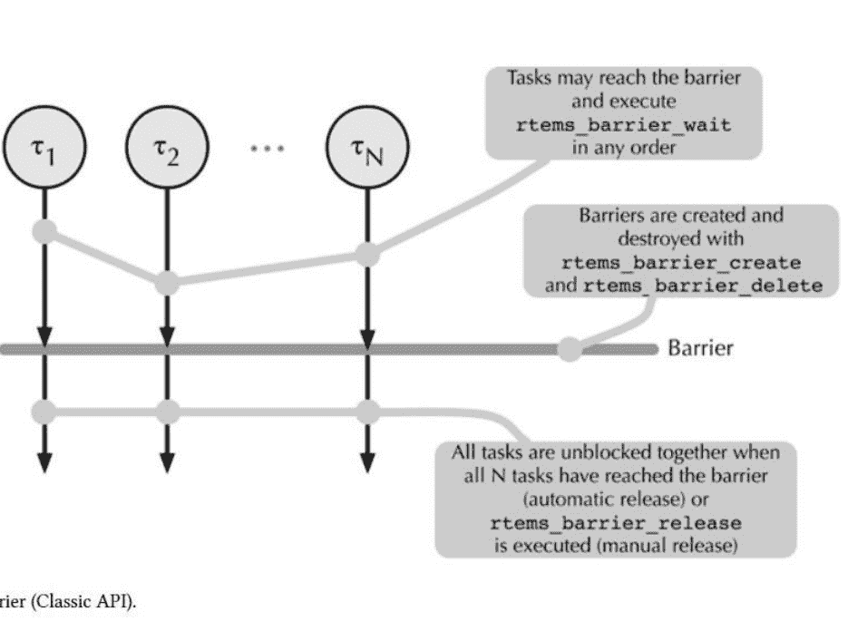

图 7.12 通过屏障进行任务同步（经典 API）。

如果要同步的任务数量 N 是固定的且预先已知的，那么在创建屏障时，*自动释放*（automatic-release）屏障可以在最后一个任务（即第 N 个任务）到达同步点时，自动解除已阻塞在屏障上的 N-1 个任务的阻塞。换句话说，使用这种屏障，先到达屏障的前 N-1 个任务会被阻塞。当第 N 个且最后一个任务最终调用屏障等待函数时，它完全不会阻塞，并且解除所有其他任务的阻塞。

另一方面，如果要同步的任务数量可能随场景而变化，或者在创建屏障时未知，则可以通过显式调用 *屏障释放*（barrier release）函数来打开*手动释放*（manual-release）屏障。这会解除当前阻塞在屏障上的所有任务，无论有多少个。

## 7.5.2 CLASSIC API（经典 API）

操作屏障的经典 API 函数如图 7.12 所示并列于表 13。以下函数创建屏障：

```c
rtems_status_code rtems_barrier_create(
    rtems_name name,
    rtems_attribute attribute_set,
    uint32_t maximum_waiters,
    rtems_id *id);
```

### 表 13 RTEMS 屏障原语

| 函数 | 目的 |
| :--- | :--- |
| `rtems_barrier_create` | 创建屏障 |
| `rtems_barrier_ident` | 查找屏障的标识符 |
| `rtems_barrier_delete` | 删除屏障 |
| `rtems_barrier_wait` | 在屏障上等待 |
| `rtems_barrier_release` | 手动打开（释放）屏障 |

对于 RTEMS 对象，当屏障在关闭状态下被删除时，在屏障上的所有任务将被解除阻塞。`attribute_set` 参数指定屏障是自动释放还是手动释放，具有以下值：

- `RTEMS_BARRIER_AUTOMATIC_RELEASE` 意味着屏障自动打开，在屏障上的任务将被解除阻塞。
- `RTEMS_BARRIER_MANUAL_RELEASE` 意味着屏障必须手动打开，通过调用 `rtems_barrier_release` 直到 `maximum_waiters` 达到里程碑。

`rtems_barrier_create` 函数在成功时返回 `RTEMS_SUCCESS`，失败时返回以下状态码：

- `RTEMS_INVALID_NAME` 屏障名称无效。
- `RTEMS_INVALID_ADDRESS` id 指针为空。
- `RTEMS_TOO_MANY` 系统允许的屏障最大数量已达到。

#### 工具函数

```c
rtems_status_code rtems_barrier_ident(
    rtems_name name,
    rtems_id *id);
```

根据名称查找屏障并将标识符存储在 id 中。除了 `RTEMS_SUCCESS`，它可能返回以下错误：

- `RTEMS_INVALID_NAME` 未找到该屏障。
- `RTEMS_INVALID_NODE` 屏障只能本地访问。

当屏障不再使用时，应该销毁它以释放相关资源。通过函数完成：

```c
rtems_status_code rtems_barrier_delete(
    rtems_id id);
```

此函数可能失败：

- `RTEMS_INVALID_ID` 给定的屏障标识符无效。

如果在某些线程阻塞在屏障上时被删除，它们将被解除阻塞。在这种情况下，它们的等待操作 `rtems_barrier_wait` 将失败并返回 `RTEMS_DELETED`。

线程通过调用以下函数信号它已到达里程碑并等待其他任务：

```c
rtems_status_code rtems_barrier_wait(
    rtems_id id,
    rtems_interval timeout);
```

该函数阻塞调用线程，直到屏障手动打开（对于手动释放屏障），或者达到创建时指定的 `maximum_waiters` 数量。因此，对于手动释放屏障，调用线程总是阻塞的，而对于自动释放屏障，它可能阻塞也可能不阻塞，取决于到达屏障的目标线程数。

`timeout` 参数指定了函数在失败前允许阻塞的最大时间。特殊值 `RTEMS_NO_TIMEOUT` 表示调用线程愿意永久等待。`rtems_barrier_wait` 在成功时返回 `RTEMS_SUCCESS`，失败时返回以下状态码：

- `RTEMS_INVALID_ID` 给定的屏障标识符无效。
- `RTEMS_TIMEOUT` 给定的超时时间不是 `RTEMS_NO_TIMEOUT` 且在屏障被手动或自动打开之前过期。
- `RTEMS_OBJECT_WAS_DELETED` 屏障在仍关闭时被删除。所有阻塞在其上的任务已提前解除阻塞。
- `RTEMS_UNSATISFIED` 在线程队列等待逻辑中检测到死锁，调用线程无法等待屏障。

自动和手动释放屏障都可以通过调用函数打开（释放）：

```c
rtems_status_code rtems_barrier_release(
    rtems_id id,
    uint32_t *released);
```

参数 `id` 是要打开的屏障的标识符。函数在 `released` 指向的位置存储在屏障上等待并解除阻塞的线程数量。函数在成功时返回 `RTEMS_SUCCESS`，失败时返回以下状态码：

- `RTEMS_INVALID_ID` 给定的屏障标识符无效。

对于手动释放屏障，这是打开屏障的唯一方法。对于自动释放屏障，屏障可以手动或自动打开。在后一种情况下，等待屏障的线程无法区分这两种场景。

## 7.5.3 POSIX API

POSIX 标准规定了一种比 RTEMS Classic API 提供的更简单的屏障，基本上对应于自动释放屏障。操作屏障的 POSIX 函数如表 7.14 所示。

### 表 7.14 RTEMS 屏障原语，POSIX API

| 函数 | 目的 |
| :--- | :--- |
| `pthread_barrier_init` | 初始化自动释放屏障 |
| `pthread_barrier_destroy` | 销毁屏障 |
| `pthread_barrier_wait` | 在屏障上等待直到其打开 |

该函数：

```c
int pthread_barrier_init(
    pthread_barrier_t *restrict barrier,
    const pthread_barrier_attr_t *restrict attr,
    unsigned int count);
```

`rtems_barrier_init` 的 POSIX 对应函数。在 POSIX 中，屏障被实现为 `pthread_barrier_t` 类型的对象，其存储必须由用户分配和管理。`pthread_barrier_init` 函数初始化由 `barrier` 引用的屏障。当 `count` 个线程执行屏障等待操作时，屏障将自动打开。在后续屏障操作中，必须使用由 `barrier` 引用的屏障，即屏障对象的拷贝本身不是有效对象，不应被使用。

与 `rtems_barrier_init` 直接接受屏障属性作为参数不同，`pthread_barrier_init` 的参数 `attr` 是指向一个独立屏障属性对象的指针。屏障属性的类型为 `pthread_barrier_attr_t`，并且必须通过表 7.15 中列出的函数对其进行初始化和设置。如果需要默认属性，`attr` 可以为 `NULL` 指针。`pthread_barrier_init` 函数在成功完成后返回 0。如果失败，它将改为返回以下非零状态码之一：

- `ENOMEM`：没有内存来初始化屏障对象。
- `EAGAIN`：系统缺少除内存之外的某些资源来初始化屏障对象。
- `EINVAL`：`count` 的值为 0。该值无效的，因为屏障将始终处于打开状态。

### 表 7.15 RTEMS 屏障属性，POSIX API

| 函数 | 目的 |
| :--- | :--- |
| `pthread_barrierattr_init` | 使用默认属性初始化屏障属性对象 |
| `pthread_barrierattr_destroy` | 销毁屏障属性对象 |
| `pthread_barrierattr_getshared` | 获取 pshared 属性<sup>(1)</sup> |
| `pthread_barrierattr_setpshared` | 设置 pshared 属性<sup>(2)</sup> |

(1) 在 RTEMS 中未使用。

尝试初始化一个已经初始化的屏障对象会导致未定义行为，无论是否有线程阻塞在其上，尽管鼓励实现层进行更详尽的错误检查，如果这些检查失败，则返回以下附加状态码之一：

- `EINVAL`：`attr` 参数不为 `NULL` 但它没有指向一个已初始化的屏障属性对象。
- `EBUSY`：`barrier` 参数引用一个已经初始化的屏障对象，可能有其他线程阻塞在其上。

屏障属性对象在使用前必须通过以下函数进行初始化：

```c
int pthread_barrierattr_init(pthread_barrierattr_t *attr);
```

该函数初始化由 `attr` 指向的屏障对象并用默认属性值填充它。如果 `attr` 指向一个已经初始化的屏障属性对象，则结果未定义。该函数在成功完成后返回 0。如果失败，它将返回：

- `ENOMEM`：没有足够的内存来初始化屏障属性对象。

建议在屏障属性对象不再使用时销毁它们，以回收系统为它们分配的资源。通过调用以下函数实现的，该函数接受屏障属性对象的引用作为参数：

```c
int pthread_barrierattr_destroy(
    pthread_barrierattr_t *attr);
```

`pthread_barrierattr_destroy` 强制检查 `attr` 参数的有效性，但鼓励实现这样做，并在检查失败时返回以下状态码：

- `EINVAL`：`attr` 参数未引用一个已初始化的屏障属性对象。

同样，屏障对象在不再使用时应通过以下函数进行销毁：

```c
int pthread_barrier_destroy(pthread_barrier_t *barrier);
```

调用此函数后，由 `barrier` 引用的屏障对象不再应被使用。通常情况下，销毁一个未初始化或在某些线程在其上阻塞时的屏障的结果是未定义的。然而，鼓励实现层执行额外的检查，并可能返回以下状态码：

- `EINVAL`：由 `barrier` 引用的屏障未初始化，或在调用此函数之前已销毁。
- `EBUSY`：`barrier` 引用一个正在使用的屏障对象，即某些线程阻塞在其上。

在第二种情况下（这与 RTEMS Classic API 采用的方法相反），屏障对象不会被销毁，阻塞在其上的线程也将继续。

线程通过调用以下函数信号其已达到里程碑，并等待直到屏障打开：

```c
int pthread_barrier_wait(pthread_barrier_t *barrier);
```

函数的唯一参数是 `barrier`，一个用于同步的屏障对象的指针。它的语义比其 Classic API 对应函数 `rtems_barrier_wait` 更简单，因为 POSIX 标准仅规定了自动释放屏障。因此：

- 如果在同一屏障上调用 `pthread_barrier_wait` 的线程数（包括调用线程）少于创建屏障时指定的数量（`pthread_barrier_init` 中的 `count` 参数），则该函数会阻塞调用者。
- 如果达到了指定的 `count`，该函数将释放调用者。


在同一屏障上调用 `pthread_barrier_wait` 的线程数（包括调用线程）少于创建屏障时指定的数量——，该函数会阻塞调用者。

（注：翻译完毕。）

严格来说，在未初始化的屏障上调用 `pthread_barrier_wait` 会导致未定义行为，标准鼓励实现层检测此错误并返回以下状态码：

`EINVAL`：由 `barrier` 引用的屏障未初始化，或在调用此函数之前已销毁。

## 7.6 事件

相对于信号量和监视，事件提供了一种低级、高性能的任务间同步机制。事件可以通过 Classic API 发送和接收，表 7.16 所示。

表 7.16 RTEMS 事件，Classic API

| 函数 | 描述 |
| --- | --- |
| `rtems_event_send` | 向任务发送事件 |
| `rtems_event_receive` | 接收并可能等待事件 |

每个任务有 32 个事件位，编号从 0 到 31。当另一个任务向任务发送事件时，相应的事件位被设置并变为待挂状态。如果发送的事件位已经是待挂状态，则新事件将被忽略。也就是说，事件本身不携带信息，除了事件编号。

`rtems_event_send` 直接向任务发送一组事件：

```c
rtems_status_code rtems_event_send(
    rtems_id id,
    rtems_event_set event_in
);
```

任务通过其唯一的 `id` 进行标识，该 ID 在任务创建时返回，并在以后可以检索。特殊值 `RTEMS_SELF` 允许任务在不明确指定任务标识符的情况下给自己发送事件。要发送的事件集由 `event_in` 表示，其类型为 `rtems_event_set`。事件集通过之前讨论的宏进行位或运算构建。例如，`RTEMS_EVENT_0 | RTEMS_EVENT_4` 是包含 0 和 4 的集合。宏 `RTEMS_ALL_EVENTS` 是包含 32 个事件的事件集。

向任务发送事件可能会解锁该任务（如果它正在等待这些事件且其到达满足了等待条件）。这可能导致调用 `event_send` 的任务被抢占，如果目标任务没有等待正在发送的事件，或者其到达不足以满足其等待条件，这些事件将变为待挂，并在未来满足接收操作。`rtems_event_send` 指令向调用者返回以下状态码：

- `RTEMS_SUCCESSFUL`：事件已成功发送。
- `RTEMS_INVALID_ID`：由于任务 ID 无效，事件未发送。

任务通过调用 `rtems_event_receive` 指令接收事件。事件接收的附加标志和参数允许调用者请求非阻塞操作（仅轮询事件位）或设置阻塞时间的上限。根据调用者的选择，事件接收会阻塞调用任务，直到集合中的所有事件或至少一个事件变为待挂状态。此时，指令会清除其收到的事件对应的事件位，并返回给调用者。调用者获取收到的事件集的信息并进行相应处理。中断处理程序没有向任务的事件。

```c
rtems_status_code rtems_event_receive(
    rtems_event_set event_in,
    rtems_option option_set,
    rtems_interval ticks,
    rtems_event_set *event_out
);
```

`event_in` 参数定义了任务感兴趣的事件集，而 `option_set` 指明要执行的接收操作类型。`option_set` 参数通过对代表所选选项的宏进行位或（bitwise OR-ing）操作来构建。两个相互互斥的选项决定了 `event_in` 的解释方式：

- `RTEMS_EVENT_ALL` 表示当 `event_in` 中的所有事件都已发送给调用任务时，接收指令即满足。
- `RTEMS_EVENT_ANY` 意味着当 `event_in` 中的一个或多个事件已发送给调用任务时，接收指令即满足。

有两个选项决定了接收指令是否应该等待直到满足条件：

- `RTEMS_NO_WAIT` 表示如果接收指令无法立即满足，则将返回错误。当设置此选项时，`ticks` 参数被忽略。
- `RTEMS_WAIT` 表示接收指令将等待最长由 `ticks` 参数指定的时间以满足条件。如果 `ticks` 设置为特殊值 `RTEMS_NO_TIMEOUT`，则指令可能会永久等待。

默认选项可以通过使用 `RTEMS_DEFAULT_OPTIONS` 请求，它们是 `RTEMS_EVENT_ALL` 和 `RTEMS_WAIT`。

当被调用时，`rtems_event_receive` 指令会检查调用任务的事件标志，以检查由 `event_in` 和 `option_set` 指定条件是否已经满足。如果是这种情况，指令将成功并立即返回。否则，如果 `option_set` 指明指令应该等待，它将阻塞调用任务，直到新事件的到达满足等待条件，或 `ticks` 参数指定的时间过期。

成功后，该指令会清除其报告给调用者的事件的事件标志，并将这组事件存储在由 `event_out` 指向的输出参数中。在所有情况下，`rtems_event_receive` 都会向调用者返回一个反映其执行结果的状态码。可能的状态码有：

- `RTEMS_SUCCESSFUL`：指令成功结束，并将收到的事件存储在 `event_out` 指向的位置。
- `RTEMS_INVALID_ADDRESS`：`event_out` 指针无效，指令失败且没有接收到任何事件。
- `RTEMS_UNSATISFIED`：`option_set` 指定指令不应等待（设置了 `RTEMS_NO_WAIT` 选项），且在调用时的挂起事件集不足以满足指令。
- `RTEMS_TIMEOUT`：指令等待了 `ticks` 指定的时间，然后失败，因为调用时的挂起事件加上之后发送给任务的事件不足以满足指令。

最后，特殊值 `RTEMS_PENDING_EVENTS` 可以用作 `event_in`，指示 `rtems_event_receive` 将立即返回挂起的事件集，而不清除相应的事件标志。这允许调用者“窥视”（peek）事件标志，而不影响未来操作的结果。

# 7.7 总结

本章描述了基于共享内存进行数据传输的任务间通信和同步方法。本章从第 7.1 节介绍竞态条件（race conditions）开始，并解释了基于锁的互斥如何解决这个影响几乎所有并发软件系统的普遍问题。

接下来的两个节，第 7.2 节和第 7.3 节提供了关于信号量（semaphores）和监视器（monitors）的信息，它们可能是最经典的任务间通信和同步方法。然后，本章在第 7.4 节讨论了与信号量和监视器相关的 RTEMS API。

本章在第 7.5 节和第 7.6 节介绍了两种更特殊但在实践中仍然非常有用的任务间通信和同步方法：屏障（barriers）和事件（events）。虽然本章仅关注任务间通信和同步的机制，但它们对任务执行的影响将是下一章的主题。

图中展示了任务随时间演变的过程。每个任务都有自己的时间轴。如前所述，当一个任务正在运行时，时间轴上会出现一个相应的矩形。任务就绪但未运行的时间间隔用实线表示。虚线表示任务正在等待的时间间隔，因为其下一个实例尚未释放，或者被信号量阻塞了。

为了便于起见，我们还假设 $\tau_1$ 和 $\tau_2$ 共享内存对象 $O$，并受互斥信号量 $\sigma$ 的保护。相应地，$\tau_1$ 和 $\tau_2$ 在特定的临界区域内通过 `P(s)` 访问 $O$，如第 7.2 节所述。$\tau_1$ 的唯一关系是其优先级低于 $\tau_2$ 的优先级，但高于 $\tau_3$ 的优先级。

在更复杂的系统中，这种奇特的优先级关系可能被编写 $\tau_1$、$\tau_2$ 和 $\tau_3$ 的程序员所熟知。在系统的不同部分设计和实现过程中，当不同的任务就绪时，根据速率单调（RM）分配的优先级，优先级仅取决于其周期。此外，由于多个任务在不同时间被组合在一起，属于不同系统的任务优先级很容易交织在一起。

参考图 8.1，发生了以下事件序列：

- 在图的左侧，$r_1$ 之前，系统处于空闲状态，没有任务在运行。
- 在 $r_1$ 时，$\tau_3$ 的第 $j$ 个实例（低优先级任务）就绪了，而 $\tau_1$ 和 $\tau_2$ 仍在等待下一个实例释放。此时，$\tau_3$ 是唯一的就绪任务，调度器将其移至运行状态并开始执行。
- 在 $\tau_{3,j}$ 执行 `P(s)` 尝试进入临界区域的边界处，`P(s)` 被阻塞了。因此，$\tau_3$ 被允许立即继续并在临界区域内运行。没有其他任务访问对象 $O$。
- 在 $t_1$ 时，$\tau_1$ 的第 $k$ 个实例被释放，而 $\tau_{3,j}$ 仍在临界区域内。结果，调度器抢占了 $\tau_3$，将其放回就绪状态，并将 $\tau_1$ 移至运行状态并执行。
- 在 $r_2$ 时，$\tau_2$ 的第 $m$ 个实例也被释放了。调度器将其移至就绪状态，但这对 $\tau_{1,k}$ 的执行没有影响。由于 $\tau_{1,k}$ 的优先级高于 $\tau_2$，它继续执行而未被抢占。
- 随着 $\tau_1$ 继续执行，它像之前的 $\tau_3$ 一样通过执行 `P(s)` 尝试进入临界区域。在这一点，$\tau_1$ 阻塞了，因为信号量 $\sigma$ 的值为零。这种行为完全正确，因为 $\sigma$ 的目的是在访问共享对象 $O$ 时强制互斥，而 $\tau_3$ 仍在与 $O$ 相关的临界区域内。
- 由于 $\tau_1$ 现在被阻塞，调度器必须选择另一个任务执行。在 $\tau_3$ 和 $\tau_2$ 这两个候选任务中，调度器选择了 $\tau_2$，因为它的优先级高于 $\tau_3$ 的优先级。因此，$\tau_2$ 被带入运行状态并执行。

从图 8.1 中的 $t_{ps}$ 开始，发生了优先级反转区域，因为 $\tau_3$（系统中优先级最低的任务）阻塞了 $\tau_1$（优先级最高的任务），而系统执行了 $\tau_2$（另一个优先级低于 $\tau_1$ 的任务）。该区域在图中用浅灰色背景突出显示。尽管优先级反转区域的存在取决于共享对象 $O$ 的互斥机制是如何设计的，但确定它可能持续多久至关重要。

首先，我们可以观察到，与直觉相反，优先级反转区域的持续时间并不取决于直接负责它的两个任务 $\tau_3$ 和 $\tau_1$ 中的任何一个，因为：

- 任务 $\tau_1$ 被阻塞了，根据定义，它无法自行执行任何后续操作，直到 $\tau_3$ 通过退出临界区域并执行 `V(s)` 将其解阻塞。
- 任务 $\tau_3$ 已就绪但在调度器决定运行它之前无法继续执行。随后，它可能无法通过其临界区域并最终到达边界处的 `V(s)`。

优先级反转区域的持续时间取决于 $\tau_2$ 以及任何优先级低于 $\tau_2$ 但高于 $\tau_3$ 优先级的其他任务运行的时间，只要至少有一个这样的任务就绪，调度器就会运行 $\tau_2$。

通过这种推理，$\tau_1$ 所经历的阻塞并不取决于 $\tau_2$ 的基础优先级，主要取决于 $\tau_3$。

## 8.1.2 优先级继承协议

观察前节提出的无界优先级反转示例，我们可能会注意到问题源于两个关键系统机制之间，即同步和调度。到目前，这些机制被定义为完全独立的。

根据直觉，我们可以想象可以通过让这两种机制协作来解决该问题。这种协作可以通过允许互斥机制根据需要临时提升优先级来实现。这正是 Sha、Rajkumar 和 Lehoczky [110] 提出的优先级继承协议的工作方式。

优先级继承协议的通用思想是在当任务阻塞某些高优先级任务时，动态地增加其优先级，直到它不再阻塞它们为止。例如，只要一个任务（图 8.1 中的 $\tau_3$）阻塞一个高优先级任务（同一图中的 $\tau_1$），它就会继承其优先级。

通常情况下，当一个任务阻塞一组高优先级任务时，它会继承这些任务中最高的优先级。这防止了中优先级任务抢占低优先级任务，从而导致高优先级任务所经历的阻塞不必要的延长，甚至变得无界。

更正式地说，优先级继承协议依赖于对所考虑系统的以下假设：

- 任务优先级的概念变得更加复杂，因为现在需要区分调度算法赋予任务的初始优先级（基础优先级）和当前的优先级（活动优先级）。
- 基础优先级用作活动优先级的初始默认值，但当任务阻塞某些高优先级任务时，优先级继承协议可能会增加后者。
- 所有任务都受固定优先级调度器的控制并运行在单核处理器上。调度器根据活动优先级工作。

优先级继承协议本身由以下规则组成 [126]：

1. 当任务 $\tau_i$ 尝试进入一个“忙碌”临界区域时（因为其控制信号量已被另一个任务 $\tau_j$ 占用），它会被阻塞。同时，如果 $\tau_i$ 的活动优先级高于 $\tau_j$ 的自身优先级，则 $\tau_j$ 将继承 $\tau_i$ 的活动优先级。
2. 结果是，$\tau_j$ 以至少等于 $\tau_i$ 优先级的活动优先级执行其剩余的临界区域。通常情况下，$\tau_j$ 继承它所阻塞的所有任务中最高的活动优先级。
3. 当任务 $\tau_j$ 退出临界区域且不再阻塞任何任务时，它的活动优先级将回到基础优先级。
4. 否则，如果 $\tau_j$ 仍在阻塞某些任务——这可能发生在临界区域相互嵌套时——它将继承这些任务中最高的活动优先级。

尽管这不等同于形式的正确性证明，但我们现在可以分析优先级继承协议在图 8.1 所示的简单示例中的表现。结果如图 8.2 所示，并在后续进行了注释。

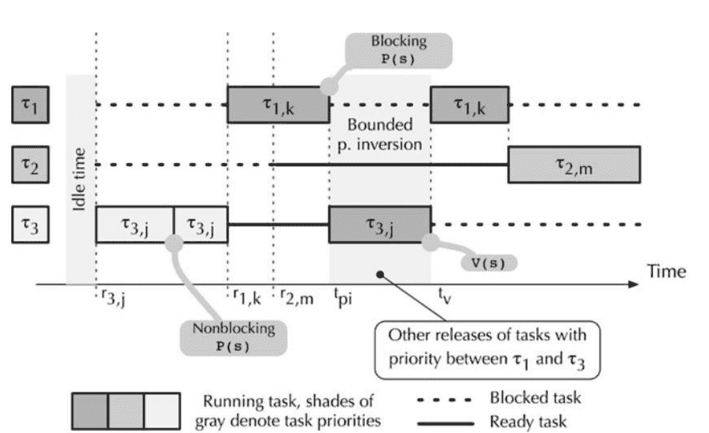

图 8.2 优先级继承协议中的有界优先级反转。

- 系统在 $t_p$ 之前的行为与之前相同，因为在该点之前任务没有阻塞任何其他任务。所有任务都根据它们的初始或基础优先级进行调度。
- 当 $\tau_1$ 在 `P(s)` 上被阻塞时，优先级继承协议在 $t_p$ 处激活。此时，$\tau_3$ 继承 $\tau_1$ 的优先级，因为它通过信号量 $s$ 阻塞了 $\tau_1$。
- 因此，无论是否存在其他中间优先级任务（如 $\tau_2$），调度器都会恢复 $\tau_3$ 的执行，因为它是根据就绪任务的活动优先级运行的。相应地，$\tau_3$ 执行的这部分在图中被涂成了较深的灰色。
- $\tau_3$ 在 $t_s$ 时从其临界区退出并通过 `V(s)` 释放互斥信号量。该原语的第一效果是解除阻塞 $\tau_1$，使其获取信号量 $s$ 并返回就绪状态。
- 第二效果涉及优先级继承协议。由于现在 $\tau_3$ 不再阻塞任何高优先级任务，它的活动优先级回到它的基础优先级。结果是调度器立即抢占 $\tau_3$ 以执行 $\tau_1$。
- 在 $\tau_3$ 继续执行直到它再次被阻塞后，在此点，中间优先级任务（如 $\tau_2$）获得了执行的机会。

该示例表明，优先级反转区域的长度由图中突出的 $t_1$ 和 $t_2$ 之间的间隔限制。这是因为：

- 任何优先级低于 $\tau_3$ 基础优先级的任务都无法抢占 $\tau_3$，因此无法增加 $\tau_1$ 在其临界区域内停留的时间。
- 任何优先级高于 $\tau_3$ 基础优先级但低于 $\tau_1$ 基础优先级的任务也无法抢占 $\tau_3$，因为继承协议赋予了它优先级提升。

优先级高于 $\tau_1$ 基础优先级的任务仍然可以抢占 $\tau_3$。这可能是由于两个不同的原因：

- 如果它们的基础优先级高于 $\tau_1$ 的基础优先级，它们在任何情况下都会干扰 $\tau_3$ 的执行，无论优先级继承协议如何操作，但可调度性分析考虑了这一点。
- 如果它们的基础优先级低于 $\tau_1$ 的基础优先级，但它们当前的活动优先级更高，这是由于优先级继承协议所致，而且在这种情况下，也可以证明 $\tau_3$ 在其临界区域内花费的额外时间是有界的。

如果不存在此类任务，优先级反转区域的最坏情况长度等于 $\tau_3$ 在其临界区域内可能花费的最长时间。在一般情况下，最坏情况的阻塞由 4.1.3 节中的公式 (4.7) 给出。

然而，相同的示例还强调了，在优先级反转区域 $[t_p, t_s]$ 内，$\tau_3$ 现在阻塞了 $\tau_1$ 和 $\tau_2$，而在上一个示例中它只阻塞了 $\tau_1$。这一事实使我们观察到，优先级继承协议——与任何处理无界优先级反转的算法一样——在两个相反的目标之间进行权衡：

- 确保优先级反转区域的长度有一个有限的上界，以及
- 在系统中引入额外的阻塞。

具体来说，对于优先级继承协议，我们识别出两种不同类型的阻塞：

1. **直接阻塞**（Direct blocking）发生在高优先级任务尝试获取互斥信号量，而该信号量被低优先级任务持有时。影响 $\tau_1$ 的这种阻塞是不可避免的互斥阻塞。
2. **通过阻塞**（Push-through blocking）发生在高优先级任务被中间优先级任务阻塞，而中间优先级任务又被持有信号量的低优先级任务阻塞。影响 $\tau_1$ 的这种阻塞是由于优先级继承协议导致的。

## 8.1.3 优先级上限协议

回到图 8.1 所示的示例，我们可以观察到优先级反转的一个根本原因是 $\tau_3$ 在执行临界区域期间被 $\tau_2$ 抢占了。

在单核系统中，解决优先级反转问题的简单方法是在执行临界区域时完全禁止抢占。这可以通过临时禁用调度器，或者更极端地关闭中断来实现。结果是，任何成功进入临界区域的任务都会隐式地获得系统中最高优先级，因此没有其他任务可以抢占它。任务在退出临界区域时恢复其常规优先级。

这种策略的主要优势是实现简单。此外，人们很容易说服它确实有效。非正式地讲，如果没有任何任务在持有互斥信号量时永远不会丢失处理器，那么它们就无法直接阻塞任何高优先级任务。

出于这个原因，这种处理方法仅适用于非常短的临界区域，因为它会导致无处不在且通常是不必要的阻塞。此外，它几乎无法应用于多核处理器，因为全局禁用中断是一项复杂且通常耗时的工作。这并不意味着底层思想是无效的。事实上，我们将看到，讨论的方法只是优先级上限协议的稍微简化版本，该协议将在后面介绍。

即使 8.1.2 节描述的优先级继承协议为高优先级任务 $\tau_i$ 可能遇到的阻塞数量和持续时间提供了上界，但它仍有几个缺点：


## 链阻塞与优先级上限协议

在最坏情况下，如果 $\tau_i$ 尝试获取 $n$ 个被 $n$ 个低优先级任务占用的互斥信号量，它将被阻塞 $n$ 个临界区域，每个区域对应一个低优先级任务。这种现象被称为**链阻塞**（chained blocking）。

优先级继承协议本身不能防止死锁。因此，必须通过其他手段解决，例如通过对系统中的信号量实施并遵守总顺序，如 8.2.3 节所述。

所有这些问题都可以通过优先级上限协议及其直接变体解决，正如 Sha、Rajkumar 和 Lehoczky [110] 所示。它们具有一个重要的属性：高优先级任务在执行期间最多只被低优先级任务阻塞一次，而且它们还能防止死锁。

### 优先级上限协议

优先级上限协议（priority ceiling protocol）的基础概念是扩展优先级继承协议（priority inheritance protocol），增加一条额外的规则，该规则控制任务是否可以立即获取空闲互斥机制。附加规则的目标是确保：如果任务 $\tau$ 已经获取了信号量，并且由于它可能会阻塞一个高优先级任务 $\tau$，那么没有其他信号量会导致一个高优先级任务被阻塞多次。

结果是，任务被阻塞仅是因为它尝试获取信号量（这在所有类型的互斥机制中都是如此），但在获取空闲信号量时，优先级上限协议用某些属性换取了另一种在优先级继承协议中不存在的阻塞形式。优先级上限协议引入的新种阻塞，除了之前提到的直接阻塞（direct blocking）和通过阻塞（push through blocking）之外，还被称为**上限阻塞**（ceiling blocking）。

原始优先级上限协议的底层假设与 8.1.2 节列出的优先级继承协议假设相同。此外：

- 假设每个信号量都关联有一个固定的上限值。在软件设计和实现期间，通过查看应用程序代码可以很容易计算出来，因为它被定义为使用该信号量的所有任务的最大初始优先级。

与优先级继承协议一样，每个任务都有一个当前（或基准）优先级，该优先级大于或等于其初始优先级，取决于它是否正在阻塞某些高优先级任务。优先级继承规则在两种情况下完全相同。此外，优先级上限协议根据以下附加规则运行：

1. 当任务 $\tau$ 尝试获取信号量时，会将其活动优先级与所有当前忙碌信号量的上限进行比较，但 $\tau$ 过去已获取尚未释放的信号量。
2. 如果 $\tau$ 的活动优先级高于所有上限，则 $\tau$ 可以继续信号量操作，如果信号量忙碌则可能被阻塞。
3. 否则，$\tau$ 将被阻塞直到该条件成立，无论它尝试获取的信号量是空闲还是忙碌。之后，$\tau$ 可以继续信号量操作。

### 立即优先级上限协议

立即优先级上限协议（immediate priority ceiling protocol，也称为优先级上限仿真）采用更直接的方法。也由于这个原因，它在 POSIX 标准 [10] 中与优先级继承一起规定，并在 RTEMS 中广泛使用。具体而言，立即优先级上限协议在任务获取信号量时立即将其优先级提高到与信号量相关的上限，而不是仅在任务实际阻塞一个高优先级任务时。更正式地说，在每个时刻，任务的活动优先级等于其基准优先级与其目前已获取且尚未释放的所有信号量上限之间的最大值。

可以证明，在单核系统上使用立即优先级上限协议时，任务可以在执行的最开始阶段被阻塞，即一旦它被释放就会阻塞。与原始优先级上限协议的额外区别是：

- 立即优先级上限协议更容易实现，因为不需要监控阻塞关系。
- 平均而言，它需要更多的优先级移动，因为这发生在所有的信号量操作中，而不仅仅是在一个任务实际阻塞另一个任务时发生。

为了结束本节，让我们回到图 8.1 所示的简单场景，并分析立即优先级上限协议在上面的行为。如图 8.3 所示：

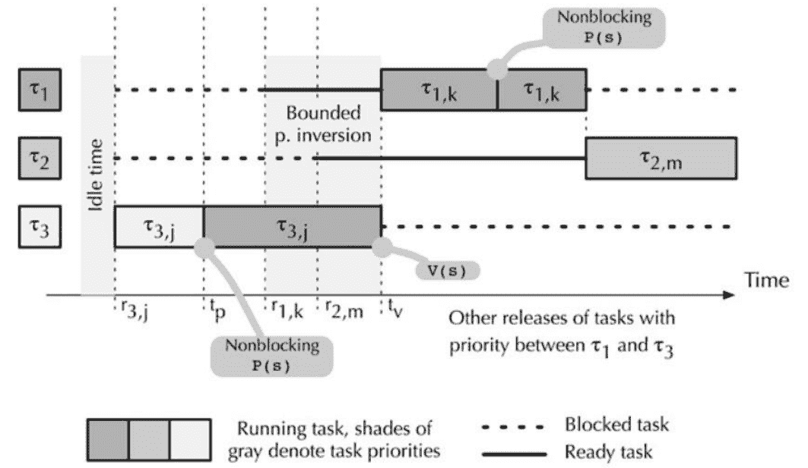

**图 8.3 立即优先级上限协议中的边界优先级反转。**

- 任务 $\tau$ 在 $t$ 时执行 `P(s)`，立即假设活动优先级等于 $\tau$ 的基准优先级。`P(s)` 像以前是非阻塞的，$\tau$ 以增加的优先级在临界区继续执行。
- $t_{1,k}$ 释放 $\tau_{1,k}$ 或 $t_{2,m}$ 释放 $\tau_{2,m}$ 导致 $\tau_s$ 被抢占，因为这两个任务的基准优先级都高于 $\tau_s$。
- 结果是 $\tau_{1,k}$ 和 $\tau_{2,m}$ 被 $\tau_s$ 阻塞，直到它在 $t_s$ 执行 `V(s)`。注意，正如之前提到的，这些任务实例确实在执行的最开始就被阻塞，即一旦被释放。
- 在 $t$，任务实例 $\tau_{1,k}$ 回到其基准优先级，从 $r$ 开始的优先级反转区域结束，调度器选择 $\tau_{2,m}$ 执行。从这里开始，$\tau_s$ 不再被 $\tau_{1,k}$ 阻塞。相反，由于基准优先级顺序，它遭受了来自 $\tau_{2,m}$ 的普通干扰。
- $\tau_{1,k}$ 在稍后执行的 `P(s)` 是非阻塞的。这进一步证实了事实：在立即优先级上限协议下，任务只能在执行开始时阻塞一次，而 $\tau_{2,m}$ 已经遭受了这样的阻塞。
- 最终，$\tau_{2,m}$ 运行并完成执行。

原始优先级上限协议的其他变体也在实际中使用。例如，Linux 实时扩展之一的 RAI 使用了**自适应优先级上限协议**（adaptive priority ceiling protocol）。它与刚刚讨论的算法有很相似之处，但在方法的有效性和实现复杂度之间涉及了不同的权衡。

## 8.2 死锁

任务执行始终需要并依赖于数量资源的可用性，例如用于存储的区域和执行输入输出操作的设备。资源通常在任务之间共享，因此必须相互竞争以获取它们。

获取资源的概念不仅适用于上述物理对象，还适用于软件实体，只要它们需要以互斥的方式访问共享对象。

以不受控制的方式等待释放是危险的，因为它可能导致一组任务无限阻塞并阻止它们完成工作。这在 7.2.4 节末尾描述的生产者-消费者问题中发生过。即使这种现象（通常称为死锁）的概率较低，必须得到妥善处理。

### 8.2.1 死锁的定义与示例

死锁可以用最通用的方式定义为：任务正在等待由同一组内另一个任务产生的事件。当关注资源时，当一组任务等待其他任务获取的资源时，就会死锁。死锁的后果有两点：

- 死锁的任务将不再进展，也就是说它们将永久阻塞。
- 分配给它们的资源将永远释放，因此对其他任务不再可用。

由 Havender [55] 和 Coffman 等 [37] 提出的四个条件对于死锁的发生既是必要的也是充分的。这些条件具有理论和实践的双重意义。从理论角度来看，它们以通方式定义了死锁，抽象了任务和资源的任何无关特征。从实践上来说，它们被用作死锁预防算法的基础。这些算法基于这样一个事实：如果应用了适当的策略来防止满足任何一个四个条件，则系统中就不可能发生死锁。这四个条件是：

1. **互斥**（Mutual exclusion）：每个资源每次只能由一个任务使用，在任何给定时间资源要么空闲要么分配给一个任务。如果任务尝试获取当前分配给另一个任务的资源，它必须等待。
2. **持有等待**（Hold and Wait）：参与死锁的任务已成功获取了至少一个资源，并在等待资源时尚未释放它。换句话说，它们必须持有某些资源并等待其他资源。
3. **非抢占**（Non-preemption）：参与死锁的任何资源不能从分配给它的任务手中夺走，除非该任务自愿释放。
4. **循环等待**（Circular wait）：参与死锁的任务和资源可以排列成等待操作的环。也就是说，可以排序使得第一个任务等待分配给第二个任务的资源，第二个任务等待分配给第三个任务的资源，以此类推，直到最后一个任务等待分配给第一个任务的资源。

另一个用于推理死锁用的工具是 Holt [61] 提出的**资源分配图**（resource allocation graph）。它具有双重目标：以严格的方式捕捉给定时刻资源分配的状态，并协助检测死锁条件。

如图 8.4 所示，资源分配图是一种具有两种节点和两种弧的有向图。在最常用的表示法中（例如 Tanenbaum 和 Woodhull [119] 以及 Silbersatz 等 al. [112]）：

- 圆形节点代表任务，
- 正方形节点代表资源。

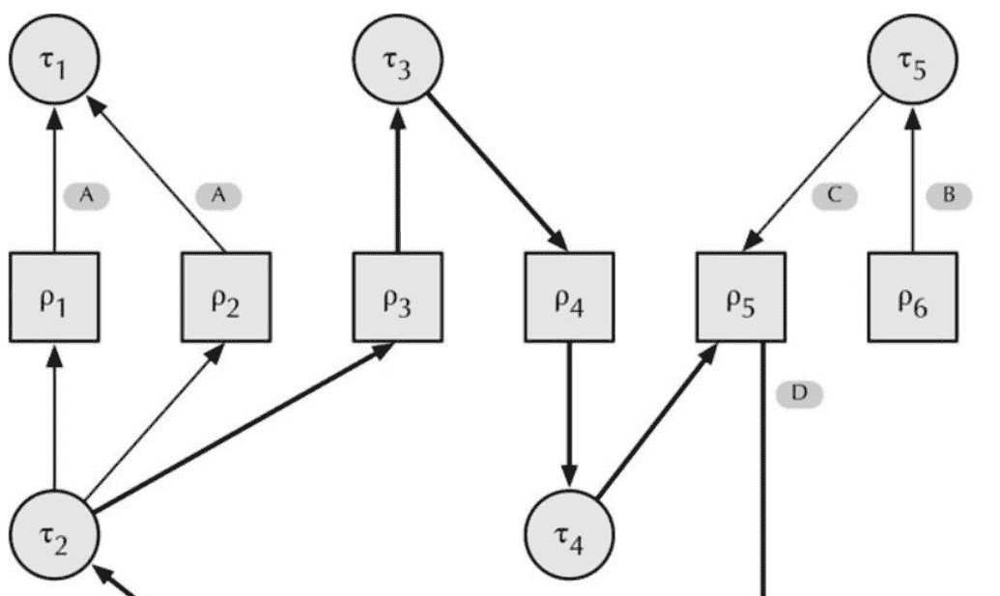

**图 8.4 资源分配图的一个示例。**

两种类型的弧线分别传递了任务与资源之间的*请求*和*所有权*关系。具体而言：

- 从任务指向资源的弧线表示该任务*请求*了该资源且目前处于阻塞状态，等待获取该资源。
- 反方向的弧线，即从资源指向任务的弧线，表示该任务当前*拥有*该资源，因此可以使用它。

禁止连接两个任务或两个资源的弧线，因为它们将产生实际意义。换句话说，资源分配图相对于任务和资源必须是二分图的。

与请求弧线不同，所有权的存在并不意味着相应的任务处于阻塞状态。那些现在没有等待任何资源的任务，以及空闲资源，通常不会显示在资源分配图的图形表示中；这些节点既没有入弧线也没有出弧线。此外，用于表示任务和资源的几何形状显然是不重要的。事实上，在最初的 Holt 地图 [61] 中，符号表示完全完全相反。

图 8.4 所示的资源分配图表示了一组 5 个任务和 6 个资源。例如，通过观察图表我们可以看到：

- 任务 $\tau_1$ 拥有资源 $\rho_s$ 和 $\rho_t$（如标记为 A 的两个弧所示），并且没有等待任何额外的资源。
- 相反，$\tau_2$ 拥有 $\rho_r$（弧 B）但处于阻塞状态，它还需要 $\rho_j$ 才能继续执行（弧 C）。它的请求目前无法被满足，因为 $\rho_s$ 被 $\tau_2$ 拥有（弧 D）。

总的来说，所有至少有一个出弧的任务都是阻塞的，因为它们缺少继续执行所需的某些资源。从资源分配的角度来看，没有出弧的任务可以继续执行。在图中，资源最多有一个出弧线，因为它们一次只被分配给一个任务。出弧线的存在意味着资源正忙碌，其缺失表示资源是空闲的。入弧表示任务正在等待该资源，并且意味着存在一个出弧线，否则任务将会在不当的情况下阻塞。

操作系统可以使用此数据结构来跟踪系统不断演变的分配状态。在这种情况下：

- 当任务 $\tau_i$ 请求资源 $\rho_j$ 时，操作系统检查 $\rho_j$ 是否存在所有权。如果没有此类弧线，它可能立即将资源分配给 $\tau_i$，添加一条从 $\rho_j$ 到 $\tau_i$ 的所有权弧。否则，它会阻塞 $\tau_i$ 并添加从 $\tau_i$ 到 $\rho_j$ 的请求以记录待处理请求。注意，第 8.2.4 节讨论死锁避免算法可能会强制任务等待，即使它请求的资源是空闲的。
- 当任务 $\tau_i$ 释放资源 $\rho_j$ 时，操作系统删除从 $\rho_j$ 到 $\tau_i$ 的所有权弧。该弧线必须存在，因为 $\tau_i$ 在释放之前必须已获取 $\rho_j$。这一事实也赋予了操作系统检查其尝试执行的操作 $\tau$ 是否合法的能力。
- 如果 $\rho_j$ 刚刚被释放且有入的请求弧，操作系统现在可以从在 $\rho_j$ 上阻塞的任务中选择一个，并反转相应的请求弧的方向，将其转换为所有权弧。同样在这种情况下，如果存在死锁避免算法，它们可能会影响操作系统将选择哪个任务。

已经证明，资源分配图中环的存在是死锁发生的充分必要条件。由于这一属性，该图可以用于检查一系列资源请求和释放是否会导致死锁。为了实现这一目的，系统必须如前所述那样跟踪请求和资源，然后在每一步中检查是否存在环。

例如，图 8.4 所示的资源分配图表示存在死锁，因为 $\tau_2 \to \rho_2 \to \tau_3 \to \rho_3 \to \tau_4 \to \rho_4 \to \tau_5 \to \rho_5 \to \tau_2$ 是一个环。相关的弧线在图中用粗体画出。与任何其他图一样，在寻找环时必须考虑弧的方向。由于这个原因，$\tau_2 \to \rho_1 \to \tau_1 \leftarrow \rho_2 \leftarrow \tau_2$ 不是环。

除了通性地标记死锁的存在外，资源分配图中的环还提供了额外信息：如果图中有一个或多个环，则死锁涉及环中的资源以及至少属于环的所有任务。具体来说，死锁的任务是环中的任务，加上所有阻塞在环中某个任务所持有的资源上的任务。在图 8.4 的示例中，资源 $\rho_p$ 和 $\rho_q$ 以及任务 $\rho_s$ 和 $\rho_r$ 直接参与了死锁，因为它们属于该环。此外，$\rho_s$ 处于死锁状态（由于顺序 C），因为它将无限等待 $\rho_p$，而 $\rho_p$ 被 $\rho_q$ 持有。

如果不是像目前这样考虑个别资源，而是将资源分为类，那么处理死锁将变得更加复杂。在这种情况下，我们允许每个类中有多个资源，并且资源请求必须指向一个类而不是特定的资源。这种场景具有实际意义，例如在分页内存系统中，当任务动态请求页面来存储数据时，任何空闲页面都可以。

资源分配图的定义可以扩展到处理资源类，产生**通用资源分配图** [61]。然而，正如文献 [61] 所证明的，环与死锁之间的定理变得弱化了。也就是说，环的存在仍然是死锁发生的必要条件，但不再是充分条件。尽管如此，该定理在实践中仍然有用，如果资源分配图中没有环，它仍然可以否定死锁的存在。

### 8.2.2 生产者-消费者问题中的死锁

我们现在可以分析在 Section:monitors 开头讨论的生产者-消费者问题中发现的死锁条件。相应的代码位于图 8.5 顶部，生产者代码中的可疑语句用粗体标出。为了根据之前述的 Havender–Coffman 条件分析系统，我们首先要识别系统中所有的资源：

- 访问操作缓冲区临界区域的权利。由互斥信号量控制。
- 至少一个空缓冲区元素的可用性，由空信号量决定。
- 至少一个满缓冲区元素的可用性，由满信号量决定。

#### 生产者

```c
void prod(int d) {
  P(mutex);
  P(empty);
  buf[in] = d;
  in = (in+1) % N;
  V(mutex);
  V(full);
}
```

#### 消费者

```c
int cons(void) {
  P(full);
  P(mutex);
  c = buf[out];
  out = (out+1) % N;
  V(mutex);
  V(empty);
  return c;
}
```

循环 $\tau_1 \xrightarrow{B} p_2 \xrightarrow{C} \tau_2 \xrightarrow{D} p_1 \xrightarrow{A} \tau_1$ 的存在表明存在死锁。该死锁涉及 $p_1$ 和 $p_2$，因为它们是循环的一部分。此外，由于 $\tau_3 \xrightarrow{E} p_3 \rightarrow \tau_1$，它还涉及所有如 $p_x$ 的任务；由于 $\tau_4 \rightarrow p_1$，涉及所有如 $p_y$ 的任务。这两条路径都表示这些任务正在等待 $p_i$ 拥有的资源，而 $p_i$ 是死锁循环的一部分。

相反，也很注意到，如果我们重新排列生产者代码中的 `P(mutex)` 和 `P(empty)`，并将它们放在正确的顺序 `P(empty)` 在前，`P(mutex)` 在后，循环就不会存在。这是因为弧 B 的存在（作为已获取互斥的生产者，之后不能等待空闲）以及 P，反之亦然（因为等待空闲的生产者不能持有资源）。

### 8.2.3 死锁预防

通常情况下，根据 Havender [55] 最初提出的观点，可以通过确保系统在第 8.2.1 节中确定的必要条件中至少有一个永远无法满足来防止死锁。这一约束通过建立适当的软件设计和实现规则来强制执行。

#### 1. 互斥条件

互斥条件无法通过直接操作涉及的资源来消除，它通常依赖于资源本身的某些硬件特性。例如，打印机无法轻易地修改以允许多个任务并发打印，即使这是可能的，输出也将是不可读的。然而，通常可以通过在任务和设备之间放置一个额外的软件层（通常称为**池化程序**，spooler）来实现相同的结果。

在最简单的形式中，池程序是一个任务，它在这一侧对设备具有永久的、排他的所有权，例如我们示例中的打印机。很容易证明，如果资源被永久分配给一个任务，那么涉及该资源的循环等待可能不会发生，因为其他任务可能不会等待它。因此，池化程序的设备侧可能发生死锁。

在另一侧，池程序从系统的其他任务中收集打印请求，并逐个执行。如果池程序仍逐个向打印机发送文档，以满足打印机的互斥要求，它也必须接受多个并发的打印请求，因为它利用了其他资源（如内存缓冲区或磁盘存储）来收集和临时存储要打印的文档。最终结果是，从请求任务的角度来看，互斥约束已经受到限制，死锁可能在该处发生。

尽管如此，池程序内部仍可能发生死锁。例如，如果池程序必须与其他任务竞争，并可能等待获取其用于临时存储的内存或磁盘缓冲区。因此，除非池程序设计得当，否则极可能仅仅是将死锁风险从系统的一个部分转移到另一个部分。池化技术的另一个更重要的问题是它们可以应用的设备范围有限。例如，在显卡上使用池程序可能是不可能的。

#### 2. 持有等待条件

我们可以通过处理持有和等待条件的任一部分来打破该条件。例如，我们可以通过在任务创建时，就从范畴中分配它们在执行期间可能需要的所有资源，来防止任务等待资源。在通用系统中，这一目标可能很难实现，因为很难预先知道任务在执行期间将需要什么资源。例如，文字处理器需要的内存量在很大程度上取决于用户当前正在处理哪份文档，这是很难提前预测的。

即使可以在任务创建时确定要分配的资源集，这种方法的资源利用率通常也会很低。这是因为系统设计者是基于*预测*或潜在需求而非事实来请求资源值的。例如，遵循这种方法时，文字处理器将立即请求足够处理其能处理的最大文档的内存，而实际上用户只是想写一封一页的信。结果是，大量的内存可能处于闲置状态，但在文字处理器终止之前，这些内存是不可用的。


在相对简单的实时系统中，这些缺点不再是限制因素，因为资源（如硬件设备）自然地绑定到某些任务上。例如，在任务创建时将模数转换器（`ADC`）分配给需要、验证和过滤该数据的任务，很可能是完全准确的。在一种情况下，早期分配和低利用率不是问题，因为系统中的其他任务任务能够使用该 `ADC`，即使它是可用的。此外，接受任务在实时系统中可能会等待，可能涉及到在任务创建时建立一个队列，这在许多情况下是一项不小的代价。或者，可以限制任务在请求新资源之前释放所有资源，从而使该条件中的“持有”部分失效。请求的新一组资源可以包括某些资源，如果它们仍然被需要，任务必须接受临时失去资源的所有权。虽然这在理论上是正确的，这种方法在实践中很少使用，因为许多资源是有价值的。如果它们丢失然后被重新回，资源状态也会丢失。

- 3. 为了满足非抢夺条件，我们引入了资源抢夺机制，这是一种强制从任务中夺走资源的方法。与互斥一样，抢夺资源的可能性在很大程度上取决于……且通常是不行的。例如，在章节中显示抢夺资源是简单的。

- 4. 攻击循环等待最流行的方法是定义资源的一种总序，并要求任务遵循该顺序。具体来说，如果有 $N$ 类资源，我们为每个类唯一标记为 $\rho_i$，$1 \leq i \leq N$，合适的总序是按索引排序。然后我们可以规定资源分配规则为：如果任务已拥有类 $\rho_i$ 的资源，则仅当 $i < j$ 时它才能请求另一个资源 $\rho_j$。可以通过反反法证明系统中可能发生死锁。

假设所有任务都遵循了规则，但存在死锁。在不失一般性的情况下，让我们也假设该死锁涉及 $M$ 个任务 $\tau_1\dots\tau_M$ 和 $M$ 类资源 $\rho_1\dots\rho_M$，使得：

$\tau_1$ 拥有 $\rho_{q_1}$ 资源并等待 $\rho_{q_2}$ 资源，

$\tau_k$ 拥有 $\rho_{q_k}$ 资源并等待 $\rho_{q_{k+1}}$ 资源，$1 < k < M$

$\tau_M$ 拥有 $\rho_{q_M}$ 资源并等待 $\rho_{q_1}$。 (8.1)

如果任务 $\tau_1\tau_{M-1}$ 遵循了规则，则必须 $q_k < q_{k+1}$，$1 \le k < M$，因为这些任务中的每一个都拥有类 $\rho_{q_k}$ 的资源并等待类 $\rho_{q_{k+1}}$ 的资源。如果 $\tau_M$ 也遵循了规则，则必须 $qM < q_1$。因此我们可以写出以下不等式链：

$q_1 < \dots < qM < q_1$。 (8.2)

由于不等式的传递性，我们得到了矛盾 $q_i < q_j$，从而证明了死锁的存在。

在复杂系统中，该方法的主要缺点是难以执行资源分配规则，并验证它们是否被遵循。例如，`FreeBSD` 操作系统内核使用这种方法，即使在经过多年手工改进后，内核代码中仍然存在大量的“锁顺序反转”（即实际上以错误的顺序请求锁的情况）。为了解决这个问题，专门设计了一个工具来帮助程序人员检测它们 [19]。

## 2.2.4 避免死锁

在上一节中，我们看到死锁预防算法最重要的特征之一就是它们运行在**系统设计阶段**，这既是优势也是缺点。从积极的一来说，死锁预防方法不会产生任何直接的运行时开销。另一方面，它们施加了一些设计规则，这些规则可能难以或不方便遵守。

死锁避免算法采用了不同的方法，因为它们完全在运行时运行，而不是设计阶段。其核心思想是在任务提交请求时，逐个检查资源分配请求，并判断这些请求对于死锁来说是否安全。为了这一点，死锁避免算法必须存储和维护某些表示系统当前资源分配状态的数据结构，并提供预测其未来演变的方法，因为资源的分配和释放会不断到来。此外，大多数算法还需要关于任务可能行为的先验信息才能正常工作。

不安全的请求（即可能导致系统进入死锁的请求）即使在请求的资源实际上空闲的情况下也会推迟，请求的任务会被阻塞。推迟的请求会在稍后重新考虑，并在算法能够证明其安全性时最终被授予。根据直觉，这通常发生在其他任务释放系统资源、使系统进入更有利的资源分配状态时。

在所有死锁避免算法中，我们将详细描述银行家算法，该算法最初由 `Dijkstra` 为单类资源提出 [42]，后来由 `Habermann` 扩展到多类资源 [54]。

在下文中，我们使用大写字母表示矩阵，使用粗体字体表示向量。此外，我们有时会将矩阵 $M$ 的第 $j$ 列视为列向量并写为 $m_j$。为了表示这种记法，我们还引入向量之间引入了弱序关系。特别是我们规定，给定两个长度相同的向量 $v$ 和 $w$：

```
v < w \Leftrightarrow v_i \le w_i.
```

(8.3)

通俗地说，一个向量 $v$ 小于等于另一个等长度的向量 $w$，当且仅当它的所有元素都小于或等于另一个向量的对应元素。类似地，严格不等式定义为：

```
v < w \le v_i \le w_i \vee v_i \neq w_i.
```

(8.4)

如果系统中有 $n$ 个任务和 $m$ 类资源，银行家算法必须维护以下数据结构：

- 一个长度为 $m$ 的列向量 $t$，表示系统中初始可用的每类资源总数：

```
t = \begin{pmatrix} t_1 \ : \ \vdots \ t_m \end{pmatrix}
```

(8.5)

$t$ 的第 $i$ 个元素记为 $t_i$，表示系统中初始可用的第 $i$ 类资源数量。假设向量 $t$ 是常数，因此意味着（在某种不现实的情况下）资源永远不会损坏，也不会因为任何其他原因变得不可用。

- 一个具有 $m$ 行 $n$ 列的矩阵 $C$，即每个任务有一列，每类资源有一有一行：

```
C = \begin{pmatrix} C_{11} & \cdots & C_{1n} \\ \vdots & & \vdots \ C_{m1} & \cdots & C_{mm} \end{pmatrix}
```

(8.6)

矩阵 $C$ 的元素表示当前的资源分配状态。更具体地说，元素 $c_{ij}$ 表示当前分配给第 $j$ 个任务的第 $i$ 类资源的数量。因此，列向量 $c_j$ 汇总了当前分配给第 $j$ 个任务的每类资源数量。初始时，$c_{ij} = 0$，因为假设系统启动时没有分配资源，然后 $C$ 的内容随着系统的演变而变化。

- 一个同样具有 $m$ 行 $n$ 列的矩阵 $X$：

```
X = \begin{pmatrix} x_{11} & \cdots & x_{1n} \\ \vdots & & \vdots \ x_{m1} & \cdots & x_{mn} \end{pmatrix}
```

(8.7)

该矩阵代表了此类算法所需的任务行为辅助信息，因为它指定了每个任务在整个生命周期内每类资源可能需要的最大数量。换句话说，假设每个任务 $\tau$ 会通过列向量 $x_j$ 提前声明其最坏情况的需求：


总的来说，矩阵 $X$ 可以通过并排放置任务 $\tau_j, j=1, \dots, n$ 提供的向量 $x_j$ 构建。此外，除非它们当前没有被分配资源，否则不允许任务改变其需求，除非 $c_{ij}$ 为零。

对 $x_j$ 值的进一步限制是它必须满足 $\forall x_j \le t$，否则 $\tau$ 即使在系统中单独执行也永远无法获得它所需的所有资源。矩阵 $N$ 代表任务的最坏情况未来需求。它与 $C$ 和 $X$ 大小相同，并且很容易计算为：

$N = X - C$

(8.9)

由于 $C$ 随时间变化，$N$ 也会。此外，由于 $C, X$ 和 $N$ 相互依赖，银行家算法的实际实现可能只显式地存储它们中的两个以节省执行开销。列向量 $r$ 表示给定时刻系统中剩余的资源：


(8.10)

$r$ 的元素可以通过其他数据结构计算如下：

$r_i = t_i - \sum_{j=1}^{n} C_{ij}, i = 1, \dots, n.$

(8.11)

对于 $N$，这种情况，实现提供了不显式存储 $r$ 的选择。通俗地说，方程 (8.11) 意味着 $r_i$（剩余资源数量）由 $t_i$（资源总数）减去分配给所有任务的资源。为了确定请求是否安全，银行家执行以下算法：

当收到请求 $q_j$ 时，银行家检查应该立即授予请求还是任务必须等待：

- 1. 它验证请求是否合法，即任务没有尝试超过声明的最大需求 $X$。由于 $N$ 的第 $j$ 列代表最坏情况的需求，该测试可以写为：

$q_j \leq n_j$

(8.13)

如果测试通过，银行家进入下一步。否则，向任务返回错误。

- 2. 它比较资源可用性，以检查每类是否有足够的资源立即满足请求。鉴于 $r$ 表示当前空闲的资源，该测试可以写为：

```
q_j \leq r
```

(8.14)

如果测试不通过，请求无法立即授予，这不是因为死锁原因，而是简单因为目前没有足够的资源。在这种情况下，银行家会阻塞任务，直到系统变得更有利。否则，银行家继续算法的下一步，在下一步中它将检查授予请求是否会给系统带来死锁风险。

- 3. 此及后续步骤的总体思想是银行家模拟当前请求对资源分配状态的影响，然后检查模拟状态对于死锁来说是否安全。为了执行模拟，银行家计算一个新状态，特别是新的特定资源分配信息 $c'_j$ 和需求 $n'_j$，以及一个新的资源可用性向量 $r'_j$：

```
$c_j := c_j + q_j
$nj_j := n_j - q_j
$nr_j := r - q_j$
```

(8.15)

- 4. 为了评估上一步计算的模拟状态的安全性，银行家尝试构建一个任务的安全序列。为了确保安全，序列必须包含系统中所有的 $n$ 个任务，并允许每个任务轮流达到其最坏情况资源需求，从而成功完成工作。为了构建安全序列，银行家临时使用两个额外的数据结构：

    - 一个具有 $m$ 个元素的列向量 $w$，每类资源一个。它初始被设置为当前可用资源（即 $w-r$），并在构建安全序列时跟踪可用资源的演变。

    - 一个具有 $n$ 个布尔值元素的行向量 $f$。向量 $f$ 的第 $j$ 个元素对应于任务 $\tau_j$。当且仅当任务 $\tau_j$ 尚未插入安全序列时，元素 $f_j$ 为假。在开始，$f$ 的所有元素均为假，因为安全序列仍然为空。

安全序列的构建按照以下步骤进行：

- a. 尝试寻找一个适合追加到正在构建的安全序列末尾的任务。为了成为合适的候选者，任务 $\tau_j$ 尚未包含在安全序列中，并且给定当前可用资源能够达到其最坏情况下的资源需求。也就是说，它必须：

```
$f_j = false \quad (\tau_j \text{尚未在安全序列中})$
n'_j \le w \quad (\text{有足够的资源满足 } n'_j)$
```

(8.16)

如果找不到合适的候选者，算法将进入第 4c 步。

- b. 将候选任务 $\tau_j$ 添加到安全序列中。在此时，根据定义，$\tau_j$ 的正确终止是有保证的（因为它能够获得完成工作所需的所有资源）。在终止时，$\tau_j$ 将释放它持有的所有资源，银行家（`banker`）可以在扩展安全序列时更新其对可用资源的理解：

```
$f_j = true \quad (\tau_j \text{ 现在属于安全序列})$
$w := w + c'_j \quad (\tau_j \text{ 在终止时释放其资源})$
```

(8.17)

然后，算法回到第 4a 步，用额外的任务进一步扩展序列。

- c. 在此阶段，安全序列已尽可能地扩展。如果 $f_i = true$，则所有任务都属于安全序列，安全性验证通过；否则失败。安全性验证失败并不意味着一定会发生死锁。这是因为算法考虑了每个任务陈述的最坏情况资源需求，因此它是保守的。即使根据银行家的定义系统是不安全的，但例如，如果所有任务从未实际请求过它们所希望的最大数量资源，所有任务仍然能够完成它们工作而不会发生死锁。

需要注意的是，上述算法可以在第 4a 步中任意选择任何合适的任务，并且在某些步骤存在多个候选者时不会进行回溯，但它所构建的安全序列并不包含所有任务。在文献 [54] 中证明的一个定理保证了，在这种情况下，不存在安全序列。该属性最重要的结果是它显著降低了算法的计算复杂度。

- 5. 如果模拟状态被确认是安全的，则授予该请求，并将模拟状态变为系统新的实际状态：

```
$c_j := c'_j$
$n_j := n'_j$
$r := r'$
```

(8.18) 模拟状态被丢弃，请求的任务必须等待，尽管它请求的资源实际上是可用的。

银行家可能会在任务请求额外资源时（上述算法的第 2 和 5 步）强制任务等待。这可能是因为没有足够的空资源来满足请求，或者授予请求会导致系统进入不安全状态。

因此，我们应该解释银行家何时以及如何再次评估它们的请求，并可能授予其中某些请求。从直觉上，这样做是没有意义的，因为银行家会授予其他任务的进一步资源分配，在这种情况下，从等待任务的角度来看，系统状态变得更加糟糕。实际上可以证明，如果银行家推迟了某些资源分配，那么在系统资源更少的情况下对请求进行重新评估会导致相同的结果。

相反，当任务释放资源时，银行家会返回检查等待任务的情况。当任务 $\tau_j$ 释放它拥有的部分资源时，它向银行家提交一个释放向量 $I$。该列向量对每个资源类有一个元素，其第 $i$ 个元素表示第 $j$ 个任务想要释放多少第 $i$ 类资源。与资源请求一样，如果任务不想释放给定类别的任何资源，它会将 $I$ 中对应的元素置为零。收到来自 $\tau_j$ 的资源释放请求后，银行家执行以下算法：

- 1. 它检查请求是否合法，即任务仅尝试释放它在过去合法获取的资源。更具体地说，必须满足 $I_j \le c_j$，否则银行家将向调用任务给出错误指示。

- 2. 它更新状态变量，以反映 $I_j$ 中的资源已释放：

```
$c_j := I_j$
$n_j := n_j + I_j$
$r := r + I_j$
```

(8.19)

令人的是，这种更新与 (8.15) 中为了模拟资源分配的更新是对称的。唯一的区别是，在这种情况下，更新直接且立即执行在状态变量上，因为不需要进行安全性检查。

- 3. 在这一步中，银行家重新考虑在资源分配算法第 2 步（由于资源不足）或第 5 步（与死锁相关的安全性考虑）中被阻塞的任务的请求。为了这样做，银行家遵循与新到达请求相同的算法，但第 1 步除外，因为等待请求已被证明是合法的。

在资源释放算法第 3 步中考虑等待请求的顺序只会影响涉及任务的时间属性，先入先出（`FIFO`）策略是一种常见的选择，它保证任务永远不会被强制等待无限的时间。

银行家算法的复杂度为 $O(mn^2)$，其中 $m$ 是资源类的数量，$n$ 是系统中的任务数量。它的复杂度由安全性评估（资源请求算法的第 4 步）主导，因为需要多达 $n$ 次迭代，每次迭代由若干向量操作组成，而所有其他步骤都是对长度为 $m$ 的向量执行固定序列的向量操作，每个操作的复杂度为 $O(m)$。这种开销发生在每次资源分配和释放释放时，在后者的案例中，银行家必须考虑任何等待请求，这是通过再次执行大部分资源请求算法来实现的。

在安全性评估中，银行家一次构建一个任务，且不进行回溯。为了做到这一点，它必须在第一步检查最多 $n$ 个候选任务，在在第二步检查最多 $n-1$ 个，依此类推。序列的最大长度为 $n$，因此，最坏情况下的检查次数为：

$n + (n - 1) + \dots + 1 = \frac{n(n+1)}{2}$

每次检查 (8.20) 都是标量之间的比较，对于银行家算法而言，它是长度为 $m$ 的向量之间的比较，导致 $O(m)$。这是 $O(m)$。

### 8.2.5 死锁检测与恢复

在下文中，我们将描述一种与银行家算法以及 Doshano 和 Coffman [12, 2] 类似的算法。该算法利用了以下数据结构：

- 矩阵 $C$，表示当前的资源分配状态。与银行家算法一样，$C$ 的第 $j$ 列（记为 $c_j$）表示 $\tau_j$ 目前持有每类资源的数量。

- 列向量 $r$，表示系统当前可资源数量。

- 对于系统中的每个任务 $\tau_j$，列向量：


表示 $\tau_j$ 目前正在等待每类资源的数量（如果有的话）。如果 $\tau_j$ 完全不等待资源，则 $s_j$ 的元素为零。

当任务请求、接收和释放资源时，所有数据结构都必须更新；它们在任何时候都对资源的等待和分配状态给出忠实的表示。然而，所有的死锁检测算法都基于以下步骤：

- 1. 定义一个辅助列 `w`，每个资源类对应一个元素，并用表示当前可用资源的向量对其进行初始化，即 `w := r`。

- 2. 定义一个辅助行向量布尔值 `f`，每个任务对应一个元素，并将其元素初始化为 `false`。该向量的作用与银行家算法中同名的向量相同，即它记录了哪些任务已成功完成了算法处理过程。

- 3. 找到一个尚未在 `f` 中被标记且其待处理资源请求可以被满足的任务 `τ`，即：

```
f_j := false (τ_j 尚未被标记)
^
s_j ≤ w  (有足够的资源满足其请求)
```

(8.21)

当前没有等待资源的任务其 `s` 为 零。对于这些任务，无论 `w` 如何，条件 `s` 总是满足的，它们总是可以被选中的。

- 4. 标记步骤 3 中选取的任务 `τ_j`，并通过将资源归还可用资源池来模拟其成功终止：

```
f_j := true (标记 τ_j)
w := w + c_j (释放其资源)
```

(8.22)

然后，返回步骤 3，直到没有更多任务可以被选取为止。

可以证明，当且仅当在算法结束时存在未标记的任务时——换句话说，`f` 中至少有一个元素仍为 `false`——时，才存在死锁。该算法与第 8.2.4 节介绍的银行家算法的状态安全性评估部分非常相似，并且具有相同的计算复杂度。尽管如此，有两个重要的区别：

- 死锁检测算法针对的是任务在执行过程中执行的实际资源请求，这些请求由 `s` 向量表示。相反，银行家算法依赖于任务在通信其 `x` 向量时对最坏情况资源需求所做的先验估计（或预测）。


- 结果，银行家算法的结果是保守的，而且取决于 `x` 向量的准确性，可能会悲观地将某个状态标记为不安全，即使死锁并不一定会发生。

- 虽然银行家算法和死锁检测算法的执行复杂度相同，但存在一个至关重要的区别，从实践角度来看非常重要。每当任务请求和释放任何资源时，必须调用银行家算法，而银行家算法调用的频率仅取决于任务行为。相反，死锁检测算法的执行频率可以随意选择。

因此，可以调整它以在冲突的系统属性之间获得最佳平衡，例如可能影响系统的最大死锁检测开销与死锁系统的响应能力（即从死锁发生到检测到之间可能经过的最长时间）。

检测到死锁后的主要问题是如何从中恢复。在参考文献 [37] 中提出的一种非常简单的恢复原理是终止陷入死锁的任务。不那么激进的策略是依次终止一个任务，直到通过这种方式释放的额外资源允许剩余任务退出死锁为止。更复杂的算法（在 [37, 111] 中给出了一个示例）则根据代价函数强制从死锁任务中移除资源。

在这两种情况下，为任务的终止或资源的强制移除分配代价都是一项艰巨的任务，因为这取决于多个因素，如任务在系统中的角色和重要性、它与资源的关系以及从资源抢占恢复的能力。

其他技术作用于资源请求。为了从死锁中恢复，它们拒绝一个或多个待处理的资源请求，并向相应的任务给出错误指示。通过这种方式，它们强制 `s` 向量变为零，并将系统带入相对于死锁更有利的状态。选择最合适的请求进行拒绝仍然取决于上述讨论的代价考量。

相同的技术也可以用于死锁避免。在这种情况下，仍然通过死锁安全性评估算法逐个请求地检测潜在死锁，而不是在授予请求会把系统带入不安全状态时强制任务等待；它们会立即收到错误指示，将对潜在死锁的响应负担从作为操作系统一部分通用算法转移到应用程序逻辑中专门设计的。这是 POSIX 标准 [68] 采用的方法，其中某些原语在检测到执行原语会导致死锁时，可以选择性失败并向调用者返回 `ELOCK` 错误。

死锁避免在阻塞等待和自动死锁恢复方面的另一个方面是，这些方法对任务的及时性具有难以预测的负面影响，并可能导致其违反截止日期。此外，某些死锁恢复策略——例如在任务执行的任意点终止所选任务的可能性——在实时系统中可能是完全不可接受的。在 POSIX 中，基于错误报告的死锁避免从这个角度来看更有利，因为每个任务都有明确的、定义良好的死锁恢复策略，且其对任务计时可以被准确地预测和测量。

## 8.3 总结

在本章中，我们讨论了当基于锁的任务交互在设计或实现不当时可能出现的两个重要问题，即**无界优先级反转**。这在实时系统中特别相关，因为其可能会以一种微妙且依赖于时间的方式影响及时性，并且应该通过引入称为协议（protocols）的临时方法来妥善管理参与临界区域的任务的优先级。

死锁也可以通过各种方法进行预防、避免或至少进行检测，这些方法在运行时开销与增加的设计复杂度或编程纪律之间提供了权衡。操作系统本身也可能为某些类型的同步设备提供检测和恢复现有死锁的机制。

# 基于消息传递的 IPC

# 目录

- 9.1 统一同步与数据交换
- 9.2 消息传递同步模型
- 9.3 直接与间接命名
- 9.4 RTEMS 消息传递 API
  - 9.4.1 经典 API
  - 9.4.2 POSIX API
- 9.5 总结

本章通过介绍*消息传递*（message passing）完善了上一章，这是一种不隐含假设存在用于数据传输的 IPC 机制。消息传递原语除了同步之外还提供了任务间的数据交换，但其发生的细节留给了底层实现，对用户是透明的。

原则上讲，这种方法为统一的 IPC 技术开辟了道路，该技术适用于各种系统架构，从可以认为存在共享内存的相对简单的单处理器集中系统，到通过实时网络连接的、通常无法使用共享内存的大型分布式系统。

正如书的其他部分一样，在从理论角度介绍机制后，我们描述了编程人员如何在 RTEMS 中使用它们。尽管本章重点关注消息传递作为一组紧耦合的核心或处理器上任务之间的 IPC 机制，但这里介绍的理论概念同样适用，并作为第 10 章和第 11 章（详细讨论网络通信）的通用引言。

## 9.1 统一同步与数据交换

第 7 章中引入的任务间同步和通信方法能够将同步信号从一个任务传递到另一个任务，但必须依赖共享内存进行数据交换。数据传输之所以具有意义，是因为一组信号量确保了图 7.6 所示的生产者和消费者能够从共享内存缓冲区向该缓冲区读写信息，并在适当的时间执行读写操作，但这些信号量在数据传输中不起任何其他作用。即使是信号量的值（这可以看作是任务间共享的一个小项信息），通常也无法直接访问。即使可以，在 POSIX 信号量中，任务也只能读取该值而不能随意更改它。换句话说，这些方法依赖于两种不同的机制：

- 信号量，用于将同步信号从一个任务传递到另一个任务。
- 共享对象，用于数据传输。

消息传递通过一种完全不同的方法来实现任务间同步和通信，它提供了一个单一机制，同时使用同一组原语实现同步和数据传输。通过这种方式，该机制在更高级的抽象上工作并变得更容易使用。更重要的是，在无法使用共享内存系统中（例如在通信任务可能由通过网络连接的不同计算机执行的分布式系统中），只需少量更新即可采用。正如第 10 章和第 11 章讨论，几乎所有的网络协议栈都通过消息传递接口导出它们的服务。

在最简单、最抽象的形式下，消息传递机制基于两个基本原语，定义如下：

- 发送原语（`send`），将消息从一个任务传输到另一个任务。除了控制外，消息包含了发送者提供的一定量的数据。除了数据传输，发送操作可能会阻塞一个同步动作，阻塞发送者直到数据传输可以发生。
- 接收原语（`receive`），允许调用者检索另一个任务发送给它的消息内容。在这种情况下，如果调用者寻找的消息没有立即可用，该原语可能会阻塞调用者，从而同步接收者与发送者。

尽管这仍然缺乏本章后面将讨论的许多低级细节，但很清楚，消息传递原语最显而易见的结果是从发送任务向接收任务传输一定量的信息。同时，消息传递原语也处理了同步，因为它们在需要时会阻塞调用者。

此外，消息传递不需要担心互斥问题，因为消息永远不会在任务间共享。相反，消息传递机制的工作方式“就像”消息是从发送者原子地传输到接收者一样——尽管实际实现尽力避免复制消息以提高性能。对于消息内容，当消息传递发生时，消息的逻辑所有权也会从发送者传递给接收者。通过这种方式，即使发送者在发送后修改了其本地副本，也不会影响它发送的消息。对称地，接收者可以修改消息而完全不影响发送者的本地副本。

现实世界的消息传递方案包含了围绕目前概述的基本主题的许多变体。我们的总结描述中留出的并在后续几节中讨论的主要设计选择是：

1. 同步模型，即在通信任务进行消息传递时，在什么情况下应该被阻塞，以及阻塞多久。
2. 操作系统应提供（如果有的话）多少个缓冲区来存放已发送但尚未接收的消息。
3. 在发送时如何识别消息的预期接收者，对称地，在接收消息时如何指定预期的发送者。换句话说，必须为消息传递定义合适的命名方案。
4. 消息传递系统是否应该在传输过程中感知并保留消息边界，或者将消息视为要逐个发送的字节序列。

## 9.2 消息传递同步模型

消息传递在同一个通信原语中结合数据传输和同步。数据传输机制是直观的，始终通过将消息从源任务移动到目标任务来完成。然而，同步方面更为复杂且存在多种变化，产生了几种不同的同步模型。

最基本的同步约束（总是被支持的）规定：如果消息尚未可用，接收原语必须能够阻塞调用者并等待消息到达。在异步模型中，这是唯一生效的同步约束。这产生了两种可能的情景，如图 9.1 所示：

### 在发送前接收

如果没有可用消息，则接收者阻塞

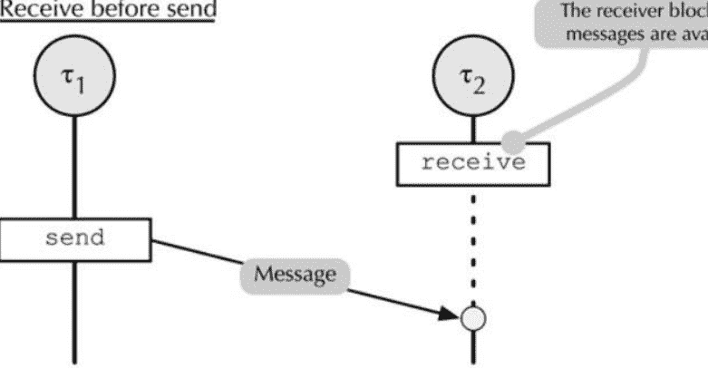

### 在接收前发送

发送者从不阻塞

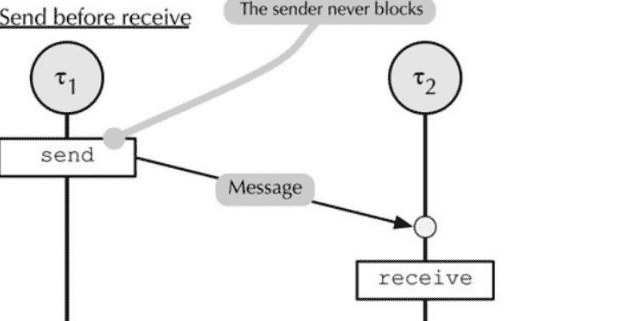

- 阻塞的任务
- 就绪或执行中的任务
- 可供接收的消息

图 9.1 具有无限缓冲的异步通信模型。

- 如果接收任务 $\tau_2$ 在发送任务 $\tau_1$ 发送消息之前执行 `receive`，它将阻塞并等待消息到达。当 $\tau_1$ 最终发送消息时将发生消息传输，$\tau_2$ 将返回继续执行。
- 如果发送任务 $\tau_1$ 在接收任务 $\tau_2$ 执行 `receive` 之前发送消息，系统会缓冲消息——即临时存储它——$\tau_1$ 立即继续。消息变得可供，$\tau_2$ 随后的接收将得到满足。

在该图以及本章的其他图中，时间从上向下流动，粗垂直线描述了任务的演变，即实线表示任务就绪或运行状态，虚线表示任务被阻塞。矩形表示消息原语，箭头描绘消息流。小圆标记消息可用的瞬间。

在使用异步模型时需要记住的一个重要方面是，当 $\tau_2$ 从 $\tau_1$ 接收消息时，它无法获取关于 $\tau_1$ 的任何重要信息。这是因为由于发送操作的异步性质，发送者可能已经执行了很久，并且原则上甚至可能有多条消息被系统妥善缓冲。换句话说，消息传输可能会向接收者传递过时信息。由于同样的原因，$\tau_2$ 也无法获取关于 $\tau_1$ Timing 的信息。

尽管异步模型从理论角度来说非常有用，因为它被用作更复杂通信模型的构建模块，但它有一个重要的缺陷，阻碍了其实用性。也就是说，它的实现可能需要大量且可能无界的缓冲区，这几乎是不可行的。

为了可视化这一场景，只需回到图 9.1 并想象发送者 $\tau_1$ 定期执行发送，而接收者 $\tau_2$ 完全不执行接收，或者更微妙地，系统地以较低速率接收和消耗消息。为了满足异步通信模型的要求，系统需要数量随时间无限增长的缓冲区。作为副作用，随着时间的推移，$\tau_2$ 接收的消息将变得越来越过时，可能也越来越无用。

由于原因，如图 9.2 所示的有限缓冲区异步模型变体是 RTEMS 提供并 POSIX 标准指定的版本。与原始模型相比，最重要的区别是：

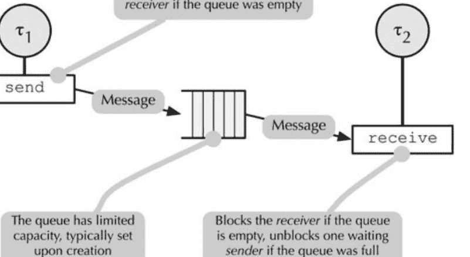

图 9.2 带有有限缓冲的异步通信模型。

- 在发送者和接收者之间插入了一个队列。系统使用该队列来缓冲已发送但尚未接收的消息。其容量是固定的，并在创建队列时定义。
- 与原始模型一样，当没有可用消息时，接收者（图中的 $\tau_2$）在执行接收操作时仍会处于阻塞状态，即队列为空。
- 此外，如果队列完全满额，发送任务（图中的 $\tau_1$）也会在发送操作中处于阻塞状态。当队列中出现可用空间时，系统将解锁该任务，以便使正在发送的消息能够成功入队。

尽管刚刚引入了额外的同步限制，但如果我们考虑队列既不为空也不满的情况，消息仍然从发送者异步地流向到接收者。此时并没有发生实际的同步，两者都没有被其调用的消息传递原语所阻塞。

在大多数真实世界的实现中——包括 RTEMS 提供的和 POSIX 标准规定的——也存在接收和发送的非阻塞变体。非阻塞接收仅仅检查是否有可用消息，如果是这种情况，则检索该消息，但绝不会等待。如果不可用，则非阻塞发送在被要求向完全满的队列中入队消息时会立即返回失败。尽管这些变体可能从软件开发的角度来看可能有用，但我们在这里将不再进一步讨论它们，因为它们消除了某种同步限制。

另一种广泛使用的变体（特别是在实时系统中）是发送和接收的超时版本，在这些版本中，可以指定这些原语在失败之前允许调用者阻塞的最大时间。如果操作无法在指定的时间内完成，它们将解锁调用者并返回一个错误指示。

在需要时，可以使用异步模型作为构建基，实现更复杂的同步形式。如图 9.3 所示，一组向相反方向传输的两个异步传输可以用于实现一种同步通信模型，称为“会合”（rendezvous）。

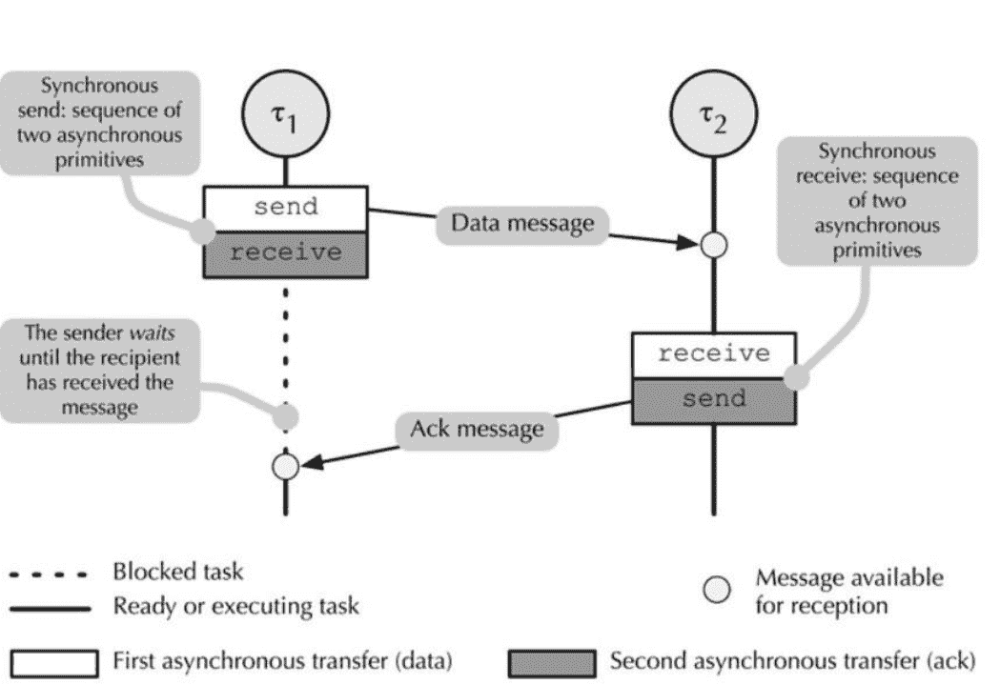

图 9.3 同步通信模型。

- 在同步传输的第一部分，发送者 $\tau_1$ 通过异步传输向接收者 $\tau_2$ 发送其数据消息。如前所述，$\tau_1$ 不会因为这次传输而阻塞，而 $\tau_2$ 可能会或可能不会阻塞，取决于其 `receive` 操作是否先于匹配的 `send`。图中说明了第二种情况。
- 在同步传输的第二部分，$\tau_1$ 等待来自 $\tau_2$ 的*确认*（ACK）消息。如图所示，$\tau_2$ 在接收数据消息后立即发送此消息。

在同步传输中，发送数据消息的任务 $\tau$ 将一直阻塞，直到消息接收者 $\tau'$ 接收到消息。此外，在异步传输中，接收者是

第二个同步传输的特殊之处（对应于图 9.3 中的深灰色原语）在于，它实际上并没有在任务之间移动数据——传输的消息可能是——即它是空的——但它对于其同步语义至关重要。它的目的是保持 $\tau$ 直到 $\tau'$ 成功接收数据消息并发送确认消息。

异步模型与同步模型之间的差异在消息缓冲和性能方面具有重要的副作用影响。因此，由于在会合中发送者被强制等待直到接收者收到消息，系统不能提供任何形式的临时缓冲区来处理传输。消息可以简单地由发送者保留，直到接收者准备就绪，然后从发送者复制到接收者的地址空间，从而节省一次内存到内存的拷贝。由于某些编程语言（例如 Promela）的原因，同步通信模型被表示为零大小缓冲的异步通信模型。

远程调用传输（也称为扩展调用）在通信任务之间强制了更严格的同步限制。具体来说，当 $\tau$ 向 $\tau'$ 发送远程调用时，它会被阻塞，直到从 $\tau'$ 向 $\tau$ 发送回复。对称地——这里与同步传输的区别在于——$\tau'$ 被阻塞，直到该回复被 $\tau$ 成功接收。

顾名思义，这种同步模型使用消息传递模拟了函数调用或方法调用。当任务 $\tau$ 需要执行时，它将其封装成一个请求消息，并将请求任务的参数发送给 $\tau'$，由 $\tau'$ 负责执行请求的函数。然后，$\tau'$ 顺序执行两个操作。第一个操作是接收来自 $\tau$ 的 ACK 消息，并确保 $\tau$ 已成功接收请求，而第二个操作则是阻塞直到函数结果可用。

与此同时，当 $\tau'$ 接收到请求并通过本地计算执行请求的函数并最终生成某些结果。当结果准备就绪，$\tau'$ 将它们封装在消息中，发送给 $\tau$ 并解除阻塞。随后，$\tau$ 被阻塞直到它收到来自 $\tau'$ 的第二个 ACK 消息，这通过 $\tau$ 发回给 $\tau'$ 的消息进行确认。

尽管如所示，异步消息传输可以被用作构建最复杂传输的“构建块”——并且在现实操作系统中非常灵活且强大——但它们也有缺点。正如所指出的，例如在文献 [29] 中，最重要的问题可能是异步消息传输给程序员留了“太多的自由”，有点类似于“goto”语句。

虽然异步消息传输可以被用作构建最复杂的传输的构建块，在现实操作系统中非常灵活且强大，但它们也有缺点。

（此处由于原文存在重复段落，翻译逻辑已对齐）

## 9.3 直接命名与间接命名

图 9.1–9.2 中的消息传递留下了两个重要问题：发送者和接收者如何识别彼此，以及这些原语是否是对称的。

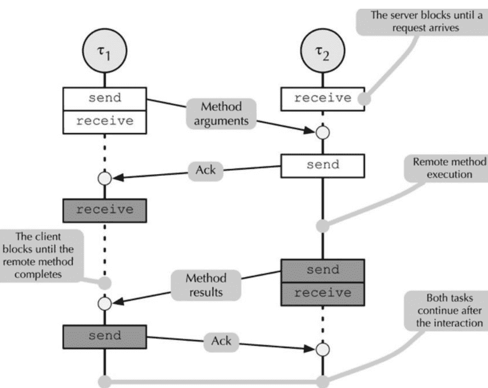

图 9.4 远程调用。

对于第一个问题，最直接的方法是由任务命名接收者，如图 9.5 上部所示。使用直接命名，如果任务 $\tau_1$ 想向 $\tau_2$ 发送消息，它必须知道 $\tau_2$ 的身份。这是图 9.5 下部的情况。在直接命名中，发送者不仅依赖 B 的接口，还取决于内部设计。例如，如果 B 的内部架构发生变化，模块 A 必须相应更新。

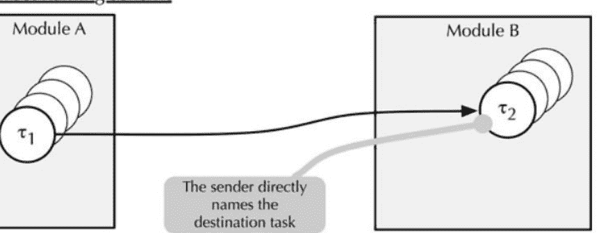

图 9.5 消息传递中的直接命名与间接命名。

有时，用于命名任务的唯一标识在任务创建后才已知，并且无法保证某个任务的标识符保持不变，例如在重启后。在这种情况下，模块 B 负责以某种方式发布其他模块需要的标识符。相反，当使用间接方案时，模块 A 及其任务 $\tau$ 只需要知道 B 用于输入消息的消息队列名称。消息队列可能会随时间改变，除非模块的外部接口经过根本性的重新设计。

更复杂的命名方案也是可能且用的。特别是如果软件变得复杂，采用间接命名可能更方便，因为已经存在以下关系：

1. 一对一关系，如图 9.1–9.4 所示，一个任务向另一个任务发送消息。
2. 多对一关系，即多个任务向单一接收者发送消息。

通过间接命名，由于多个任务可以从消息队列中接收消息，一对多关系也是可能的。在这种情况下，一个任务向一组任务发送消息，所有任务都从同一个消息队列接收，而不关心或指定其中哪一个实际收到消息。进一步的泛化（包含多个潜在发送者）导致了多对多的关系。

这在客户端-服务器通信范式中处理服务器端的并发处理非常有用。例如，服务器可以实现为一组工作任务，每个任务一次处理一个请求。这使得工作的内部结构保持简单，因为它们不需要考虑并发性。

所有工作者通过从同一个消息队列执行 `receive` 来等待请求。当请求到达时，其中一个工作者将获取它并进行处理，然后向客户端提供适当的回复。同时，其他工作者仍在等待额外的请求，并可能开始并发处理这些请求。只要请求之间是相互独立的，就不需要工作者之间的通信，从而避免在请求之间引入不必要的时间关系。

命名方案的另一个重要方面是它们的对称性或非对称性。

- 在对称方案中，发送者命名接收者任务或目标消息队列，这取决于命名是直接的还是间接的。对称地，接收者命名发送者任务或源消息队列。
- 在非对称方案中，发送者仍然命名任务或目标消息队列。然而，接收者不以任何方式命名消息的来源。相反，它接受来自任何源的消息，并且通常由系统告知它接收到的消息来源。

非对称方案更符合客户端-服务器范式，因为在这种情况下，服务器通常愿意接受其任何客户端的请求，甚至可能事先不知道它们的身份。

## 9.4 用于消息传递的 RTEMS API

### 9.4.1 经典 API

#### 消息队列的创建与属性

负责实现消息队列的 RTEMS 组件是消息管理器（Message Manager）。表 9.1 汇总了它提供的原操作。函数 `rtems_message_queue_create` 创建一个新的消息队列：

```
rtems_status_code rtems_message_queue_create(
    rtems_name name,
    uint32_t count,
    size_t max_message_size,
    rtems_attribute attribute_set,
    rtems_id *id);
```


#### 表 9.1 RTEMS 消息队列原操作，经典 API

| 函数 | 目的 |
|---|---|
| `rtems_message_queue_create` | 创建消息队列 |
| `rtems_message_queue_ident` | 根据名称查找消息队列的标识符 |
| `rtems_message_queue_delete` | 删除消息队列 |
| `rtems_message_queue_send` | 发送消息，在队尾入 |
| `rtems_message_queue_urgent` | 同上，在队头入 |
| `rtems_message_queue_broadcast` | 向所有阻塞在消息队列上的任务发送消息 |
| `rtems_message_queue_receive` | 接收消息，可能阻塞调用者 |
| `rtems_message_queue_flush` | 从消息队列中移除所有消息 |
| `rtems_message_queue_get_number_pending` | 获取消息队列中的消息数量 |

此函数根据给定名称创建一个消息队列，如果成功，则将其唯一标识符存储在 `id` 指向的位置。在除 `rtems_message_queue_ident` 之外的所有后续对队列的操作中，必须使用此标识符来引用该消息队列。消息队列可以存储最多 `count` 条消息，每条消息最多包含 `max_message_size` 字节。参数 `attribute_set` 允许调用者选择创建消息队列的某些方面，它由表 9.2 中列出的常量通过位或逻辑运算组成。

#### 表 9.2

| 属性 | 含义 |
|---|---|
| `RTEMS_LOCAL` | 本地消息队列 |
| `RTEMS_GLOBAL` | 全局可访问的消息队列 |
| `RTEMS_FIFO` | 接收时使用先进先出（FIFO）队列策略 |
| `RTEMS_PRIORITY` | 接收时使用基于优先级的队列策略 |

前两个属性 `RTEMS_LOCAL` 和 `RTEMS_GLOBAL` 是互斥的，决定了消息队列的可见性和访问性。它们与第 7.4 节中描述的相同信号量属性具有相同的含义。

属性 `RTEMS_FIFO` 和 `RTEMS_PRIORITY` 也是互斥的。它们确定了等待从空队列接收消息的任务的队列策略，因此决定了它们在消息到达时获取消息并被解锁的顺序。

具体而言，`RTEMS_FIFO`（默认值）表示任务按照它们在消息队列上执行阻塞接收操作的顺序入队，并按照先进先出（FIFO）的顺序解锁。相反，`RTEMS_PRIORITY` 规定任务必须根据其优先级入队。当有多个任务阻塞在同一个空消息队列上时，发送到该队列的消息将由优先级最高的阻塞任务接收。

如果函数 `rtems_message_queue_create` 能够正确创建消息队列，则返回 `RTEMS_SUCCESS`。否则，它将返回以下状态代码之一表示失败：

- `RTEMS_INVALID`: 参数中给出的消息队列名称无效
- `RTEMS_INVALID_ADDRESS`: `id` 参数为 `NULL` 指针，因此没有指向存储消息队列标识符的有效位置
- `RTEMS_INVALID_NUMBER`: `count` 参数中指定的消息数量无效
- `RTEMS_INVALID_SIZE`: `max_message_size` 参数中指定的最大消息大小无效
- `RTEMS_TOO_MANY`: 无法创建新消息队列，因为已达到系统中本地消息队列或全局对象的最大数量（取决于所创建的消息队列类型）。这些限制通过 RTEMS 配置系统进行设置，如第 2.4 节所述。例如，`RTEMS_CONFIG_MAXIMUM_MESSAGE_QUEUES` 的值决定了本地消息队列的最大数量。
- `RTEMS_UNSATISFIED`: 无法创建消息队列，因为系统无法分配消息缓冲区。
- `RTEMS_NOT_CONFIGURED`: 为全局消息设置了属性，但尚未启用多节点支持。

尽管消息队列创建函数将标识符存储到了 `id` 指向的位置，但之后可以通过消息队列名称通过以下函数检索标识符：

```
rtems_status_code rtems_message_queue_ident(
    rtems_name name,
    uint32_t node,
    rtems_id *id);
```

该函数在 `node` 上查找名为 `name` 的消息队列，并将其标识符存储在 `id` 指向的位置。如果 `node` 是特殊值 `RTEMS_SEARCH_ALL_NODES`，则从本地节点（即调用线程所在的节点）开始搜索所有节点。如果消息队列具有相同的名称，函数保证返回匹配名称的标识符，具体是哪一个尚未指定。

如果失败，`rtems_message_queue_ident` 返回以下状态代码：

- `RTEMS_INVALID_NAME`: 函数在搜索范围内未找到指定的消息队列
- `RTEMS_INVALID_NODE`: 节点标识符无效
- `RTEMS_INVALID_ADDRESS`: `id` 参数为 `NULL` 指针，因此没有指向存储消息队列标识符的有效位置

函数：

```
rtems_status_code rtems_message_queue_delete(
    rtems_id id);
```

删除标识符为 `id` 的消息队列。该队列可能由另一个任务创建，但必须位于调用线程所在的节点上。不支持删除远程消息队列（即位于远程节点上的队列）。成功调用此函数后，标识符将失效且不应再次使用。

当消息队列被删除时，任何由于等待接收操作而阻塞在其上的任务将被解锁并接收 `RTEMS_OBJECT_WAS_DELETED` 状态代码。如果队列为空，其中包含的所有消息都将被删除。在这两种情况下，系统都会回收之前分配给消息队列及其消息缓冲区的所有内存。

除了表示队列已成功删除的 `RTEMS_SUCCESSFUL` 之外，`rtems_message_queue_delete` 可能返回以下状态代码：

- `RTEMS_INVALID_ID`: 消息队列标识符无效
- `RTEMS_ILLEGAL_ON_REMOTE_OBJECT`: 无法删除消息队列，因为它不在调用任务所在的节点上。

# 消息队列操作

第 9.2 节描述的抽象发送和接收操作的具体对应对象为 `rtems_message_queue_send` 和 `_receive`，以及表 9.1 中列出的几个实用的 RTEMS 特有变体。该函数：

```
rtems_status_code rtems_message_queue_send(
    rtems_id id,
    const void *buffer,
    size_t size);
```

将由 `buffer` 引用且由 `size` 字节组成的消息发送到由 `id` 标识的消息队列中。

如果队列当前为空，或者如果至少有一个任务阻塞在接收操作上，该函数将根据创建消息队列时确定的队列策略选择其中一个任务，将消息拷贝到该阻塞任务的缓冲区中，并解除该任务阻塞。

否则，它将消息拷贝到消息缓冲区并将其放置在消息队列的末尾。如果消息队列已满（即它已经包含了创建时声明的最大消息数量），则 `rtems_message_queue_send` 失败并立即向调用者返回一个适当的状态码。该函数可能返回 `RTEMS_SUCCESS` 或以下状态码之一：

- `RTEMS_INVALID_ID` 消息队列标识符无效。
- `RTEMS_INVALID_ADDRESS` 缓冲区参数 `buffer` 为 `NULL`，因此无法引用内存中的有效消息。
- `RTEMS_INVALID_SIZE` 消息的大小无效，例如，它超过了创建消息队列时声明的最大消息大小。
- `RTEMS_TOO_MANY` 消息队列已满，即它已经包含了创建时指定的最大消息数量。

该函数：

```
rtems_status_code rtems_message_queue_urgent(
    rtems_id id,
    const void *buffer,
    size_t size);
```

其函数签名与 `rtems_message_queue_send` 相同（注：原文为 `rtms_message_queue_send`，已修正为 `rtems_message_queue_send`），具有相同的可能状态码和相似的语义，唯一的区别在于它将消息放置在消息队列的前部而不是末尾。

尽管 RTEMS Classic API——与接下来要讨论的 POSIX API 不同——确实提供了为单个消息分配优先的能力，但在同一消息队列上谨慎地使用 `rtems_message_queue_urgent`（发送高优先级消息）和 `rtems_message_queue_send`（发送低优先级消息）是实现双优先级消息传递方案的一种直接替代方法。

发送操作的另一种变体是将同一条消息的副本广播给所有等待消息队列上的的任务：

```
rtems_status_code rtems_message_queue_broadcast(
    rtems_id id,
    const void *buffer,
    size_t size,
    uint32_t *count);
```

与目前为止描述的其他函数一样，它标识目标消息队列，而 `buffer` 和 `size` 则定位到包含要发送消息的缓冲区及其以字节为单位的长度。成功时，函数返回 `RTEMS_SUCCESS`，并将解除阻塞的任务数量存储在 `count` 指向的变量中。

如果此时消息队列上没有任务被阻塞，该函数将在 `count` 指向的位置存储 0，并且不会将消息存入消息队列以供以后使用。失败时，`rtems_message_queue_broadcast` 返回以下状态码之一：

- `RTEMS_INVALID_ID` 消息队列标识符无效。
- `RTEMS_INVALID_ADDRESS` `buffer` 或 `count`（或两者都）为 `NULL` 指针，因此无法引用有效的内存位置。
- `RTEMS_INVALID_SIZE` 消息的大小无效，例如，它超过了创建消息队列时声明的最大消息大小。

值得注意的是，`rtems_message_queue_broadcast` 永远不会返回 `RTEMS_TOO_MANY` 或 `RTEMS_UNSATISFIED`，因为它从未将消息存入消息队列中。

该函数：

```
rtems_status_code rtems_message_queue_receive(
    rtems_id id,
    void *buffer,
    size_t *size,
    rtems_option option_set,
    rtems_interval timeout);
```

从由 `id` 指定的消息队列接收消息。成功完成后，它将消息存储在 `buffer` 指向的缓冲区中，并将以字节为单位的大小写入 `size` 指向的位置。缓冲区必须足够大以容纳最长的消息，即创建消息队列时在 `max_message_size` 参数中指定的长度。

当消息队列为空时，函数的行为由 `option_set` 和 `timeout` 参数控制，如表 9.3 所示。详细信息如下：

- 如果 `option_set` 设置为 `RTEMS_NO_WAIT`，函数将立即失败，不阻塞调用者，并返回状态码 `RTEMS_UNSATISFIED`。
- 如果 `option_set` 设置为 `RTEMS_WAIT` 且 `timeout` 设置为特殊值 `RTEMS_NO_TIMEOUT`，函数将永久阻塞调用者，直到成功接收到消息或发生错误。
- 如果 `option_set` 设置为 `RTEMS_WAIT` 且 `timeout` 设置为以刻（ticks）为单位的 `k`，函数仅阻塞调用者最多 `k` 个刻。如果在超时过期前没有成功接收到消息，函数将返回状态码 `RTEMS_TIMEOUT`。

#### 表 9.3 RTEMS 消息队列接收阻塞规则，Classic API

| option_set | Argument | 含义 |
|---|---|---|
| `RTEMS_NO_WAIT` | - | 永远不阻塞调用者 |
| `RTEMS_WAIT` | `RTEMS_NO_TIMEOUT` | 阻塞时间没有上限 |
| `RTEMS_WAIT` | `k` | 阻塞调用者最多 k 个刻 |

当消息队列为空时，入队顺序由创建时的属性决定，即 `RTEMS_FIFO`（先进先出）或 `RTEMS_PRIORITY`（优先级顺序）。

除了表示成功的 `RTEMS_SUCCESS` 外，`rtems_message_queue_receive` 可能返回以下状态码：

- `RTEMS_INVALID_ID` 消息队列标识符无效。
- `RTEMS_INVALID_ADDRESS` `buffer` 或 `size`（或两者都）为 `NULL` 指针，因此无法引用有效的内存位置。
- `RTEMS_UNSATISFIED` 消息队列为空且 `option_set` 指定为 `RTEMS_NO_WAIT`。
- `RTEMS_TIMEOUT` 在 `option_set` 指定为 `RTEMS_WAIT` 前未接收到消息。

以下函数从 `id` 标识的队列中冲刷所有消息：

```
rtems_status_code rtems_message_queue_flush(
    rtems_id id,
    uint32_t *count);
```

成功完成后，函数将移除的消息数量存储在 `count` 中，并返回 `RTEMS_SUCCESS`。冲刷空队列不是错误，并在 `count` 指向的位置存储 0。`rtems_message_queue_flush` 返回以下状态码：

- `RTEMS_INVALID_ID` 消息队列标识符无效。
- `RTEMS_INVALID_ADDRESS` 参数 `count` 为 `NULL` 指针。

以下函数查询消息队列并返回等待消息的数量（即等待接收的消息）：

```
rtems_status_code rtems_message_queue_get_number_pending(
    rtems_id id,
    uint32_t *count);
```

将 `id` 标识的消息队列中的消息数量存储在 `count` 中。如果消息队列为空，它将在 `count` 指向的位置存储 0。除了表示成功的 `RTEMS_SUCCESS` 外，该函数可能返回以下状态码：

- `RTEMS_INVALID_ID` `id` 无效。
- `RTEMS_INVALID_ADDRESS` 参数 `count` 为 `NULL` 指针。

### 9.4.2 POSIX API

与信号量不同，POSIX 标准仅规定了一种消息队列 `mq`，它根据 9.2 节讨论的带缓冲的异步通信方案工作。消息队列是命名全局对象，由不透明数据类型 `mq_t` 表示，其处理方式类似于 7.4.2 节介绍的命名信号量。然而，与命名信号量有一个重要的实际区别：

- 命名信号量由数据类型 `sem_t` 表示。`sem_open` 返回信号对象的指针，即 `sem_t *`，而 `sem_init` 初始化一个 `sem_t` 类型的对象。初始化后，必须使用该对象的指针来引用信号量。
- （命名）消息队列由数据类型 `mq_t` 表示。`mq_open` 返回该类型的对象，在所有其他消息队列相关函数中必须使用对象本身而非指针。

### 消息队列的创建与销毁

RTEMS 中提供的 POSIX 消息函数总结如表 9.4 所示。该函数：

```
mq_t mq_open(const char * name, int flags, ...);
```

用于访问现有消息队列或创建一个新的。在这两种情况下，消息队列都由 `name` 参数引用的唯一字符串标识，并在成功完成后，函数返回一个 `mq_t` 类型的值表示该消息队列。`flags` 参数是表 9.5 中列出的标志的按位或结果。它们影响函数的行为以及后续在消息队列上发送和接收操作的方面。

#### 表 9.4 RTEMS 消息队列原语， POSIX API

| 函数 | 目的 |
|---|---|
| `mq_open` | 创建/打开消息队列 |
| `mq_close` | 关闭消息队列 |
| `mq_unlink` | 标记消息队列待销毁 |
| `mq_getattr` | 获取消息队列属性 |
| `mq_setattr` | 修改消息队列属性 |
| `mq_send` | 发送消息 |
| `mq_timedsend` | `mq_send` 的定时版本 |
| `mq_receive` | 接收消息 |
| `mq_timedreceive` | `mq_receive` 的定时版本 |
| `mq_notify` | 请求对消息到达的异步通知 |

#### 表 9.5 RTEMS 消息队列标志， POSIX API

| 标志 | 含义 |
|---|---|
| `O_CREAT` | 如果队列不存在则创建它 |
| `O_EXCL` | 如果消息队列已存在则失败 |
| `O_RDONLY` | 仅用于接收消息打开队列 |
| `O_WRONLY` | 仅用于发送消息打开队列 |
| `O_RDWR` | 同时用于接收和发送打开队列 |
| `O_NONBLOCK` | 使发送和接收操作变为非阻塞 |

前两个标志 `O_CREAT` 和 `O_EXCL` 决定了 `mq_open` 在消息队列不存在时是否应该创建它，以及在尝试创建已存在的消息队列时是否应该失败：

**`O_CREAT`** 该标志在设置时，允许 `mq_open` 在消息队列不存在时创建它。新消息队列初始为空的，也就是说，它们不包含任何消息。当设置了 `O_CREAT` 时，`mq_open` 取两个额外的参数来代替原型中所示的 `...`：

- `mode_t mode` 决定新创建的消息队列的访问权限，以及
- `struct mq_attr *attr` 指向一个包含消息队列属性的数据结构，这些属性将在稍后进行讨论。

**`O_EXCL`** 该标志应仅与 `O_CREAT` 一起设置。当设置时，它会导致 `mq_open` 在尝试创建已存在的消息队列时失败。存在性检查和创建是以原子步骤执行的，其他任务也会执行相同的操作。

第二组标志（包括 `O_RDONLY`、`O_WRONLY` 和 `O_RDWR`）决定了调用线程想要在消息队列上执行的操作类型。更具体地说：


- `O_RDONLY` 仅用于接收消息打开队列（即从消息队列中“读取”）。
- `O_WRONLY` 仅用于发送消息打开队列（即向消息队列中“写入”）。
- `O_RDWR` 同时用于接收和发送消息打开队列。

最后一个标志 `O_NONBLOCK` 控制了从空队列执行接收操作以及向满队列执行发送操作时，是应该阻塞调用者还是立即失败。设置时，它使这些操作变为非阻塞状态。

- `struct mq_attr` 包含了表 9.6 中列出的字段。`mq_open` 在创建消息队列时使用的字段是：

  - `mq_maxmsg` 消息队列可以存储的最大消息数。
  - `mq_msgsize` 每个消息的最大大小，以字节为单位。

| 字段 | 含义 |
|---|---|
| `long mq_flags` | 消息队列标志（`O_NONBLOCK` 标志是可读写的） |
| `long mq_maxmsg` | 队列可以包含的最大消息数（创建后只读） |
| `long mq_msgsize` | 单个消息的最大大小（创建后只读） |
| `long mq_curmsgs` | 队列中的消息数（只读） |

调用 `mq_open` 可能由于各种原因而失败。失败时，函数返回特殊值（`mq_t`）-1 而不是有效的消息队列描述符，并将 `errno` 设置为状态码，提供更多关于其所遇错误的信息。最常见的状态码是：

- `ENOENT` 消息队列不存在，但标志未包含 `O_CREAT`。
- `EEXIST` 消息队列已存在，但标志中同时设置了 `O_CREAT` 和 `O_EXCL`。
- `EINVAL` 给定的名称不是消息队列的有效名称，或者标志包含 `O_CREAT` 且结构体 `attr` 中指定的 `mq_maxmsg` 或 `mq_msgsize` 值为零或负数。
- `EACCES` 无法访问或创建消息队列。

其他状态码，如 `ENFILE`、`ENOMEM`、`ENOSPC` 表示系统缺少资源。

`mq_open` 成功时返回消息队列描述符，失败时返回 -1。当它失败时，将 `errno` 设置为状态码。失败的可能原因包括：

- `ENOENT` 消息队列不存在，但标志未包含 `O_CREAT`。
- `EEXIST` 消息队列已存在，但标志中同时设置了 `O_CREAT` 和 `O_EXCL`。
- `EINVAL` 给定的名称不是消息队列的有效名称，或者标志包含 `O_CREAT` 且结构体 `attr` 中指定的 `mq_maxmsg` 或 `mq_msgsize` 值为零或负数。
- `EACCES` 无法访问或创建消息队列。

`mq_close` 成功时返回 0，失败时返回 -1。当它失败时，将 `errno` 设置为以下状态码：

- `EBADF` 消息队列描述符无效。

`mq_setattr` 成功时返回 0，失败时返回 -1。当它失败时，将 `errno` 设置为以下状态码：

- `EBADF` 消息队列描述符无效。

`mq_unlink` 从系统中移除消息队列名称。如果消息队列已打开，它会被标记为待销毁。当引用计数归零时，消息队列将被销毁。`mq_unlink` 成功时返回 0，失败时返回 -1。当它失败时，将 `errno` 设置为以下状态码：

- `ENOENT` 系统不存在消息队列。
- `EACCES` 调用者没有销毁消息队列的权限。

## 消息队列属性

如 `mq_open` 的描述所示，表 9.2 中列出的某些消息队列属性在消息队列创建时设置。之后可以通过以下函数获取它们：

```
int mq_getattr(mq_t mqd, struct mq_attr *attr);
```

`mq_getattr` 函数根据消息队列描述符获取消息队列属性并将其存储在指向 `attr` 的结构中。成功完成后返回 0。失败时，函数返回 -1 并将 `errno` 设置为：

- `EBADF` 消息队列描述符无效。

除了之前讨论过的、在消息队列创建后无法更改的 `mq_maxmsg` 和 `mq_msgsize`，`struct mq_attr` 还包含以下字段：

- `mq_curmsgs` 是队列中当前的消息数。与 `mq_maxmsg` 和 `mq_msgsize` 不同，该属性会随着队列发送和接收消息而改变。
- `mq_flags` 是创建消息队列描述符时赋予 `mq_open` 的标志集，随后可能通过 `mq_setattr` 函数进行修改。

与其他所有属性不同，`mq_flags` 与消息队列描述符关联，而不是消息队列本身。`mq_setattr` 函数获取由描述符 `mqd` 标识的消息队列当前属性并将其存储在指向 `old_attr` 的结构中。此外，它根据指向 `new_attr` 的数据结构指定的修改属性：

```
int mq_setattr(mq_t mqd,
const struct mq_attr *restrict new_attr,
struct mq_attr *restrict old_attr);
```

在当前版本中，只有 `mq_flags` 中的 `O_NONBLOCK` 标志以及其他实现定义的标志可以被修改，而 `new_attr` 的其他字段会被忽略。由于 `mq_flags` 是与消息队列描述符关联的属性，它对后续在描述符 `mqd` 上调用的消息队列操作生效，而不影响与同一底层消息队列关联的任何描述符。

与此组中的大多数其他函数一样，`mq_setattr` 返回 0 表示成功完成。当它失败时，它保持消息队列描述符不变，返回 -1 并将 `errno` 设置为：

- `EBADF` 消息队列描述符无效。

## 发送与接收操作

该函数：

```
int mq_send(mq_t mqd, const char *buffer, size_t size,
              unsigned priority);
```

向由消息描述符 `mqd` 表示的消息队列发送一条消息。要发送的消息从用户提供的缓冲区拷贝，该缓冲区从内存地址 `buffer` 开始，长度为 `size`。与 RTEMS 经典调度 API（允许调用者决定将消息放入消息队列的尾部还是头部）不同，POSIX API 允许调用者为其发送的每条消息分配优先级。

优先级由无符号整数参数 `priority` 决定，其值必须大于或等于 0 且小于 `MQ_PRIO_MAX`。值越大，优先级越高，即高优先级消息将排在低优先级消息之前。`MQ_PRIO_MAX` 的最小要求值为 32，这也是执行调度优先级的最小数量要求。

根据队列的当前状态，该函数可能表现出三种不同的行为：

1. 如果消息队列为空且至少有一个线程等待接收消息，消息将直接传输给其中一个等待线程，且队列保持为空。如果支持优先级调度 POSIX 选项（几乎所有基于 POSIX 的实时操作系统都是如此），将根据优先级选择等待线程。具体而言，将选择优先级最高的等待线程；如果优先级相同，则选择等待时间最长的线程。在这种情况下，`priority` 参数不起任何作用。
2. 如果没有线程在等待消息队列且队列未满，则消息将根据其优先级入队，`mq_send` 返回且不阻塞调用者，从而实现了完全异步的消息传递操作。
3. 如果消息队列已满（即已包含的消息数量等于创建消息队列时指定的 `mq_maxmsg` 值），该函数取决于消息队列描述符 `mqd` 中 `O_NONBLOCK` 标志的设置。如前所述，该标志在打开消息队列时设置，随后可以通过 `mq_setattr` 进行修改。

如果未设置 `O_NONBLOCK`（默认值），`mq_send` 将阻塞调用者，直到可以入队消息为止。也就是说，当消息队列出现可用空间时，将根据其调度优先级选择一个等待发送消息的线程。该线程被允许将其消息放入消息队列并继续执行 `mq_send`。相反，如果设置了 `O_NONBLOCK`，`mq_send` 将失败并立即返回调用者而不发送消息，同时将 `errno` 设置为 `EAGAIN`。

成功完成后，`mq_send` 返回 0。否则，返回 -1 并将 `errno` 设置为状态码之一：

- `EBADF`: 消息队列 `mqd` 无效，或不允许对其进行发送操作，因为在打开消息队列时未指定 `O_WRONLY` 或 `O_RDWR`。
- `EINVAL`: `priority` 参数超出有效范围。它必须大于或等于 0 且小于 `MQ_PRIO_MAX`。
- `EMSGSIZE`: 消息太长无法发送，`size` 参数超过创建消息队列时指定的 `mq_msgsize`。
- `EAGAIN`: 消息队列已满且消息队列描述符中设置了 `O_NONBLOCK` 标志，要求非阻塞发送。

还存在一个定时发送操作的变体：

```
int mq_timedsend(mqd_t mqd,
const char *buffer, size_t size, unsigned priority,
const struct timespec *abstime);
```

与 `mq_send` 相比，定时变体多了一个参数 `abstime`。它表示当目标消息队列已满时，函数发起的任何等待必须向调用者返回的超时绝对时间点（见第 7.4.2 节），`abstime` 的参考时钟为 `CLOCK_REALTIME`。

在所有其他情况下，`mq_timedsend` 的行为与 `mq_send` 相同。在以下情况下，这两个函数等效且 `abstime` 参数被忽略：

- 消息队列为空且有线程等待从其接收消息。
- 消息队列没有等待且队列未满。
- 消息队列描述符中设置了 `O_NONBLOCK` 标志。

函数 `mq_timedsend` 将失败，并将 `errno` 设置为以下状态码（除 `mq_send` 已描述的之外）：

- `EINVAL`: 函数必须阻塞调用者线程，但 `abstime` 参数无效。
- `ETIMEDOUT`: `abstime` 指定的超时在发送操作完成之前过期。

线程可以从消息队列接收消息，并可能阻塞直到消息可用，通过以下函数实现：

```
ssize_t mq_receive(mqd_t mqd,
char *buffer, size_t size, unsigned *priority);
```

该函数作用于由 `mqd` 引用的消息队列。成功完成后，它将接收到的消息存储在 `buffer` 指向的用户缓冲区中，并将优先级存储在 `priority` 指向的无符号变量中。此外，它返回接收到的消息的长度（字节），根据定义，这是一个非负整数。

失败时，它返回 -1 并将 `errno` 设置为后续讨论的状态码之一。`size` 参数是用户提供的消息缓冲区的实际长度，用于避免在将接收到的消息存入缓冲区时发生溢出。

对于 `mq_receive`，其行为取决于底层消息队列的状态。可能有两种场景：

1. 如果消息队列非空，`mq_receive` 从中提取优先级最高的消息并立即返回调用者。
2. 如果消息队列为空，取决于 `O_NONBLOCK` 标志，`mq_receive` 可能会或不会阻塞调用者。如果未设置 `O_NONBLOCK`（默认值），`mq_receive` 阻塞直到消息可用。

函数 `mq_receive` 将失败并将 `errno` 设置为以下状态：

- `EBADF`: 队列描述符 `mqd` 无效，或不允许对其进行接收操作，因为在打开消息队列时未指定 `O_RDONLY` 或 `O_RDWR`。
- `EMSGSIZE`: 用户提供的缓冲区不足以容纳消息，即 `size` 小于创建消息队列时指定的 `mq_msgsize`。
- `EAGAIN`: 消息队列为空且消息描述符中设置了 `O_NONBLOCK` 标志，要求非阻塞接收。

此外，某些实现会对接收到的消息进行额外的一致性检查，并报告：

- `EBADMSG`: 消息损坏。

愿意等待消息但不想无限等待的线程可以使用 `mq_receive` 的定时变体：

```
ssize_t mq_timedreceive(mqd_t mqd,
char *buffer, size_t size,
unsigned *priority,
const struct timespec *abstime);
```

`mq_timedreceive` 函数的行为与 `mq_receive` 相同，除非底层消息队列为空且必须阻塞调用者。在这种情况下，额外的参数 `abstime` 发挥作用。

与 `mq_timedsend` 类似，此参数表示 `mq_timedreceive` 因为消息队列为空而发起的等待必须结束的绝对时间，即使没有接收到消息。在这种情况下，`abstime` 的参考时钟为 `CLOCK_REALTIME`。由于这种额外的语义，`mq_timedreceive` 还将失败并将 `errno` 设置为以下状态码（`mq_receive` 已描述的）：

- `EINVAL`: 函数必须阻塞调用者线程，但 `abstime` 参数无效。
- `ETIMEDOUT`: `abstime` 指定的超时在接收操作完成之前过期。

## 异步通知

消息队列支持异步通知，通过第 6.5 节所述 `struct sigevent` 数据结构配置。异步通知通过以下函数管理：

```
int mq_notify(mqd_t mqd,
const struct sigevent *notification);
```

根据 `notification` 指针的值，此函数激活或停用消息队列 `mqd` 的异步通知。具体而言：

- 如果 `notification` 参数为 `NULL`，则函数停用该消息队列的异步通知。
- 如果 `notification` 参数不为 `NULL`，则函数根据其指向的 `struct sigevent` 结构体中指定的方法激活消息队列的异步通知。

当异步通知激活时，只有当队列从“空”状态变为“非空”状态（即队列状态发生变化）时才会发送通知。具体而言，如果在调用 `mq_notify` 激活通知时，消息队列已经是非空状态，则不会发送通知。此外，如果在异步通知激活期间向空队列发送了消息，但该队列上正存在一个待处理的接收操作，则接收操作具有优先级。也就是说，该消息将满足接收操作，且不会发送通知。另一个值得注意的方面是，在任何情况下，异步通知在发送后会自动去激活，必须根据需要显式地重新激活。

`mq_notify` 函数在成功完成后返回 0。否则，它返回 -1 并将 `errno` 设置为以下错误代码之一：

- `EBADF`: 消息队列描述符 `mqd` 无效。
- `EBUSY`: 通知参数不为 NULL，但该消息队列已激活了通知。

此外，该函数还可以可选地对通知状态进行额外的检查，并在适当的情况下返回以下状态码：

- `EINVAL`: 通知参数为 NULL，但该队列未激活通知。

## 9.5 总结

本章描述了消息传递，这种任务间的通信机制同样适用于具有和不具有共享内存的系统，因为其原语涵盖了任务同步和数据传输。

章节的第一部分（即第 9.1–9.3 节）介绍了关键概念，例如消息传递原语常用的同步模型，以及如何通过合适的命名方案识别消息传递端点。

相反，章节的第二部分第 9.4 节专注于更具实践意义的考虑，并对 RTEMS Classic 和 POSIX 消息传递 API 进行了详细描述，强调了它们的相似性和差异。

# RTEMS 中的网络通信

## 目录

- 10.1 RTEMS 网络代码的内部结构
- 10.2 协议栈结构
- 10.3 主要数据结构
- 10.4 RTEMS 端口与适配层
  - 10.4.1 互斥与睡眠/唤醒
  - 10.4.2 软件中断与网络守护进程
  - 10.4.3 超时仿真
  - 10.4.4 设备驱动程序组织
- 10.5 总结

在本章中，我们将概述 RTEMS 如何通过合适的协议栈实现其 TCP/IP 网络通信设施。具体而言，我们将描述 RTEMS 网络代码的内部结构，并突出操作系统与协议栈集成中最重要的方面，例如同步机制和设备驱动程序接口。关于网络通信应用程序接口（API）的详细讨论将是下一章的主题。

## 10.1 RTEMS 网络代码的内部结构

在编写本文时，RTEMS 支持两种不同的 TCP/IP 协议栈：

- 标准协议栈是 RTEMS 核心发行版的一部分，源自 1998 年分支的 FreeBSD 协议栈快照。FreeBSD 代码已经冻结，无法从上游轻松地更新。
- RTEMS LibBSD 项目提供了一个新版本的 FreeBSD 端口，用于替换标准协议栈。与之前的版本不同，这个新端口旨在通过从 FreeBSD 内核设备中拉取来完成更新。

这两个端口都兼容 POSIX 套接字 API，因此只要应用程序限制为使用该接口，它们就可以在应用层互换使用。然而，它们在功能方面存在显著差异。

在本章中，我们将回顾标准 RTEMS 协议栈的内部组织，主要关注其分层结构以及层之间使用的同步机制。它们都源自“伯克利 UNIX”操作系统的原始 TCP/IP 协议栈 [86]。这有几个目的：

1. 描述套接字概念最早的实现之一，该概念被如今许多流行的开源实时操作系统中发现的协议栈用作起点 [91, 103]。
2. 讨论一个复杂的软件（最重要的是广泛使用的真实世界协议栈）是如何设计和实现的。
3. 突出原始的、历史性的层级间同步机制是如何以极小的更改适配到现代实时操作系统的。

## 10.2 协议栈结构

图 10.1 总结了协议栈的内部结构。共有四个主要的软件层，将从上到下地进行讨论：

1. 最顶层是套接字层，为应用程序提供接口。
2. 第二层是传输层，处理端到端通信。
3. 第三层是网络层，处理不同网络之间的路由。
4. 最底层是数据链路层，处理与硬件的通信。

（注：由于第 10.2 节的 OCR 文本在源码中严重损坏/重复；上述内容是基于提供的上下文和标准网络模型进行的逻辑结构重构。）

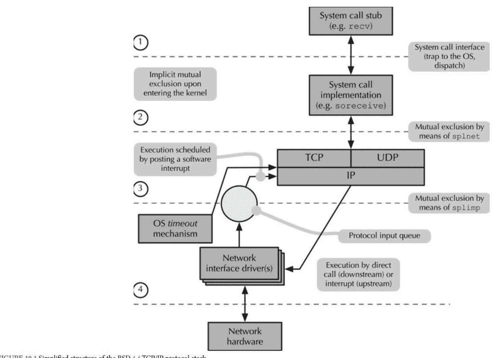

内核互斥的一个重要方面与协议栈中不同部分的阻塞和同步有关。尽管在进入内核时强制执行互斥，加上对处理器 IPL（中断优先级级别）的恰当操作，只要涉及的进程持续处于就绪状态，对于互斥来说就是足够的，但当进程需要在内核内部阻塞时，就需要一种不同的机制。


这在协议栈中是非常常见的情况，因为大多数 socket 原语（primitives）都会等待直到感兴趣的事件发生。例如，发起连接请求的应用级函数 `connect` 可能会阻塞调用者并等待连接建立。同样，从 socket 接收数据的函数也可能会等待某些数据的到达。

在这种情况下，同步机制应该允许其他进程执行，并可能允许其中一个进程也进入内核。当被阻塞的进程最终解除阻塞时，相同的机制还必须保证在内核中没有其他进程在执行之前，该进程不会被执行。

为了实现这一同步，BSD 协议栈广泛使用了等待通道（wait channels），这是 BSD 操作系统内核的传统同步机制。在等待通道上定义了两个抽象原语：

- `sleep` 原语在等待通道上阻塞调用者并调度另一个进程执行。在此过程中，它还隐式地释放了内核互斥限制，因此如果另一个进程执行系统调用陷阱，则允许它进入内核。
- `wakeup` 原语唤醒所有阻塞在通道上的进程。与信号量不同，等待通道没有内存，因此在匹配的 `sleep` 之前执行 `wakeup` 不会阻止 `sleep` 阻塞，从而导致执行 `wakeup` 时所信号的事件丢失。

由于这种机制在其他操作系统中没有对等实现，它的仿真构成了移植 BSD 协议栈所需工作的重要部分，正如第 10.4 节所述。

## 10.3 主要数据结构

Berkeley Sockets 的实现基于几个关键数据结构，其中大部分总结在图 10.2 中。

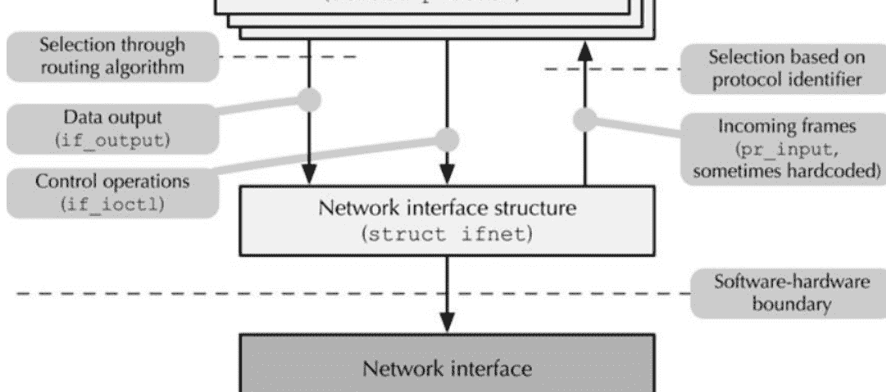

图 10.2 主要 BSD 4.4 协议栈数据结构。

- 数据结构 `struct domain`（图中未显示）持有有关通信域的所有信息。例如，它包含了分配给通信域的符号地址标识符（如 `AF_INET`，它用于识别互联网通信域）及其人类可读名称。最重要的是，它包含一个指向协议切换结构（protocol switch structures）数组的指针，该通信域支持的每种协议将在后文中进行描述。

此外，它还包含一组指向域特定例程的指针，用于 socket 访问权限的管理和传输，以及路由初始化。socket 实现维护了一个全局可访问的域结构表，每个连接到系统并配置用于使用的通信域在表中都有条目。在 RTEMS 中，该表包含两个条目，一个用于互联网通信域，另一个用于抽象路由域，用于控制和配置协议的内核路由功能。

- 协议切换数据结构 `protosw` 显示在图 10.2 的中间，描述了协议模块。除了其他信息外，协议切换还指定了它支持的 socket 类型、它所属的通信域，以及一个在整个协议栈中用于引用协议本身的唯一数字。此信息用于在创建新 socket 时选择正确的协议。

此外，它持有一组间接引用协议模块外部可访问函数（或入口点）的指针。这组指针对于所有协议模块都是相同的，尽管某些是可选的并可能被留空未实现。然而，它们可以作为统一接口来访问任何协议模块。这为协议模块提供了一种面向对象的设计，其中这些入口点可以看作抽象方法，尽管它们是用 C 语言实现的，而 C 语言本质上并不支持对象。

相反，顶端协议模块与 socket 层之间的主接口是协议切换中由 `pr_usrreq` 指针引用的入口点。该入口点通过 `pr_usrreq` 请求代码调用。例如，当在 socket 级调用发送操作时，会带有 `PRU_SEND` 请求代码调用 `pr_usrreq`。然后，这要求协议模块发送某些数据，并可能导致对其他协议模块的进一步请求。

这是因为协议模块通常可以相互堆叠以构建协议栈。例如，TCP 协议模块始终堆叠在 IP 协议模块之上。在这种情况下，接口通过函数指针进行直接调用来实现，以提高效率。例如，当 TCP 协议需要传输 IP 数据报时，它会直接调用 IP 输出函数（`IP_output`）。

指向协议模块的另一种更高效的接口也是可能的。它利用与协议切换连接的 `struct pr_usrreqs`。该结构包含一组针对每个请求代码的入口点，因此消除了显式传递请求代码作为参数并在 `pr_usrreq` 入口点中检查其值的需要。

由协议切换中的 `pr_input` 指针引用的另一个入口点用于将传入的数据推过协议栈。这些数据源于栈的最底层，并被转发到上层，可能在解构并移除某些底层协议头之后。在某些情况下，当要调用的输入函数名称固定且预知时，会直接调用该函数。例如 `ipnet` 就是。

- 数据结构 `struct socket` 表示通信端点。它包含关于 socket 类型及其状态的信息。此外，它为数据提供了缓冲区，并可能持有一个指向协议状态链的指针。在创建新 socket 时，会扫描域结构表和与每个域相关的协议切换表，寻找与传递给 socket 创建参数匹配的协议切换。该条目随后通过 socket 的 `so_proto` 指针链接。

在 socket 结构内部有两个队列，一个用于发送，另一个用于接收。这些队列由一组统一的实用函数操作。例如，`sbappend` 函数向队列添加数据块，因此在每次接收新消息时都会调用。

在用户级，socket 描述符与对应 socket 结构之间的关联通过表完成，在通用操作系统中，该表与文件表重合。在较简单的系统中，它可以仅仅是指向 socket 结构的指针数组。

- 网络接口结构 `ifnet` 表示网络接口模块，它通常与一个硬件设备及其驱动程序关联。它为主机上必须存在的所有网络设备提供接口，并将软件上层与每个设备的实现细节及其驱动代码隔离开。统一接口的实现方式与协议切换相同，即通过一组作为网络接口设备驱动程序外部入口点的函数来实现。网络接口的主要目的是与相应的硬件设备交互，以便发送和接收数据链路层的数据包。在 `struct ifnet` 中，入口点是 `if_output`（负责通过接口输出数据）和 `if_ioctl`（执行接口上的所有控制操作）。在提供网络层路由的网络中（例如互联网），为特定的 IP 帧选择正确的输出接口通常由本地路由算法完成。因此，`struct protosw` 和 `struct ifnet` 之间没有静态链接，这与层之间的情况相反。对于传入的数据，调用正确的 `pr_input` 入口点的选择基于传入的协议标识符（通常包含在数据链路头中）。

一个 `struct ifaddr` 数据结构列表（每个结构表示一个可能在不同通信域中的接口地址）链接到主 `ifnet` 结构。

另一个未在图 10.2 中显示的数据结构 `struct mbuf` 在任何需要动态内存分配时使用。它的实现使其特别适合在现有缓冲区头部或尾部添加更多数据，这种操作在通信协议的封装和解封装中频繁使用。

## 10.4 RTEMS 移植与适配层

关于第 10.2 节中给出的 BSD 协议栈通用结构描述，大部分移植工作集中在以下几个关键领域：

- 通过系统调用进入单处理器 BSD 内核时的隐式互斥机制，在包括 RTEMS 在内的大多数实时操作系统中并没有相应的对应机制，因此必须通过互斥锁显式地实现。
- 等待通道（wait channel）上的睡眠/唤醒机制在 RTEMS 中并不存在。因此，必须通过 RTEMS 提供的同步设备之一进行仿真，最接近的是第 7.6 节讨论的事件（events）。
- 图 10.1 所示的协议栈第 2 层的大量是在是在中断处理程序中完成的，这些处理程序的执行由下层在收到入流量时触发。
- 同样，通过网络接口处理入站和出站帧的不容忽视的处理是在硬件中断处理程序中进行的。由于硬件和软件中断处理程序脱离了操作系统的调度策略，因此不建议在实时执行环境中使用它们。
- 协议栈依赖 BSD 内核的超时机制来调度内部周期性活动的执行。该机制同样基于软件中断，在 RTEMS 中没有直接的对应机制。

### 10.4.1 互斥与睡眠/唤醒

用于仿真内核互斥的特定同步机制是第 7.4.1 节概述的 RTEMS 递归互斥锁（recursive mutex）。如图 10.3 右上角所示，协议栈的最上层已被修改，在原先放置进入和退出内核的系统调用边界处调用 RTEMS 适配层函数 `rtems_bsdnet_semaphore_obtain` 和 `rtems_bsdnet_semaphore_release`。这些函数是对第 7.4.1 节描述的 RTEMS 递归锁获取和释放函数 `rtems_recursive_mutex_lock` 和 `rtems_recursive_mutex_unlock` 的简单封装。

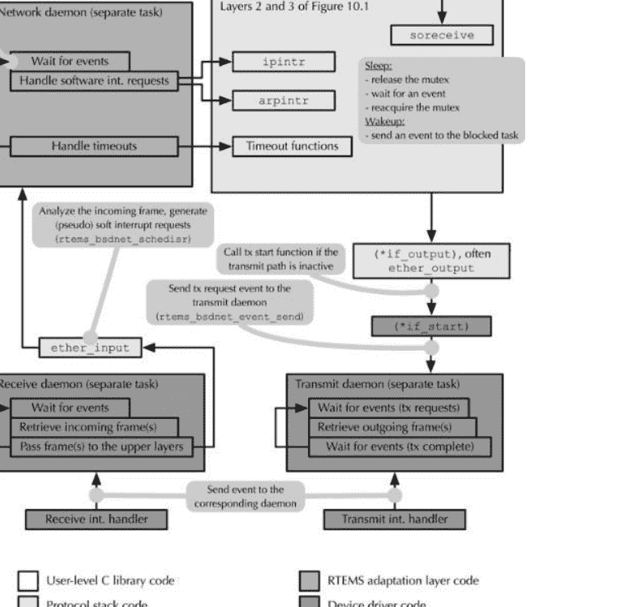

图 10.3 RTEMS 网络适配层和设备驱动程序。

为了确保能够正常工作，互斥机制必须与睡眠/唤醒机制正确集成，以便在任务睡眠时释放互斥锁，并在任务被唤醒继续执行之前重新获取互斥锁。

本身，睡眠/唤醒机制依赖于 RTEMS 系统事件。为了将其与互斥集成，对系统事件接收函数的阻塞调用被 `rtms_bsdnet_semaphore_release` 和 `rtms_bsdnet_semaphore_obtain` 调用包围。尽管如此，还需要两个额外的措施来正确仿真原始机制：

- RTEMS 事件具有内存特性，也就是说，如果任务寻找一个过去已经生成的事件，它将接收该事件并继续执行而不会阻塞。相反，先于匹配睡眠调用的唤醒调用将不起任何作用，且随后的睡眠仍会阻塞调用者。
- 因此，`sleep` 函数的实现必须在释放互斥信号量并调用系统事件接收函数 `rtems_event_receive` 之前刷新所有挂起的事件。通过这样做，相对于睡眠调用，过去与未来事件之间的边界被设置为释放互斥信号量的瞬间：所有在此之前生成的事件都将启动，而此后生成的任何事件将唤醒调用任务。
- 由于调用 `rtems_event_receive` 然后再调用 `rtems_bsdnet_semaphore_obtain` 并不是作为一个原子单元执行的，可能会在 `rtems_event_receive` 返回后、但在任务再次获取互斥锁并继续之前生成了后续事件。从概念上讲，这些事件是在睡眠操作完成之前生成的，应当被考虑在内。

为此，`sleep` 函数在重新获取互斥锁后，会执行第二次非阻塞的系统事件接收操作，并将以这种方式接收到的事件与第一次调用接收到的事件合并。由于只有在其他任务自身持有互斥锁时才允许它们生成唤醒事件，这防止了在重新获取互斥锁后产生进一步的事件。

严格来说，原始的睡眠/唤醒机制与 RTEMS 提供的机制之间仍然存在细微差异。即，唤醒操作应该唤醒所有在匹配的等待通道上睡眠的任务。相反，在 RTEMS 仿真中，只唤醒一个任务。这是由于 RTEMS 事件必须指向一个特定任务的直接结果。

然而，这种差异在实际操作中没有影响，因为在 BSD 协议栈中，只要在任何时刻某个套字只允许一个任务睡眠，唤醒函数的这种“广播”功能就不会被使用。

### 10.4.2 软件中断与网络守护进程

为了消除软件中断，RTEMS 适配层将网络守护进程（network daemon）作为一个独立的任务。该任务为内核在软件中断处理程序中执行的协议栈代码提供了适当执行上下文。为了支持网络守护进程与实时任务的有序共存，我们可以配置其调度优先级和亲和掩码（affinity mask）。

用户中断通过已用于仿真睡眠和唤醒操作的事件机制请求。也就是说，网络守护进程由一个无限循环组成，在循环中等待事件。当原始代码中发布软件中断请求时，`rtems_bsnet_schedis` 会向网络守护进程生成事件。

为了实现这一点，不需要对协议栈进行任何更改，因为原始协议栈一致地调用 `schedis` 函数，而该函数直接映射到 RTEMS 适配层。

在被事件唤醒后，网络守护进程分析事件以确定请求了哪种软件中断，并调用相应的协议栈函数。如图 10.3 所示，最重要的入口点是 `iprint`（针对入站流量）和 `aprintr`（针对 ARP 流量）。

为了确保互斥，网络守护进程（以及后续讨论的所有类似角的任务）用于等待事件的函数 `rtems_bsdnet_event_receive` 在等待之前释放互斥信号量，并在之后重新获取。

此外，用于创建网络守护进程的 `rtems_bsdnet_newproc` 函数确保网络守护进程在开始执行主入口之前通过合适的原语获取互斥锁。

这种方法处理了原始协议栈中的情况：软件中断处理程序和协议栈的其他部分并发执行，除非这些其他部分依赖 IPL（中断优先级）。这是安全的，因为 RTEMS 适配层强制的互斥范围确实比原始范围大，并且允许消除了协议栈内部所有的 IPL 更改。另一个优点是，互斥机制在多内核系统中也能正常工作。

### 10.4.3 超时仿真

网络守护进程还负责仿真第 10.2 节概述的超时机制，该机制被协议栈用于调度内部活动的未来执行。该实现在需要时利用了 RTEMS 事件超时功能：

- 当准备阻塞等待事件时，网络守护进程通过查询挂起的超时请求列表，计算传递给系统事件等待函数的超时时间。计算出的超时时间确保了在没有事件的情况下，系统事件等待会在第一个挂起的超时到期时返回网络守护进程。如果没有超时请求，则使用无限超时。
- 在调用由入站事件触发的相应中断入口点后，网络守护进程会在再次阻塞之前检查已过的时间，如果任何挂起的超时已过期，则调用协议栈内部相应的超时处理函数。

在这种情况下，互斥性无需额外措施即可保证，因为超时处理函数总是在网络守护进程持有协议栈互斥锁时调用的。

## 10.4.4 设备驱动程序组织

将中断处理程序中的执行（以及与之相关的简写方式）替换为任务上下文中的执行，这是 RTEMS 适配层为软件中断所采用的理念，现在这种思想已扩展到对中断的处理。

如图 10.3 底部所示，在网络设备中断处理程序内执行的活动在设计上应减少到最低。换句话说，中断处理程序必须只执行无法延迟的时间敏感型设备操作，并将所有其他工作委托给两个任务——接收守护进程和发送守护进程（daemons），并向它们发送适当的事件。

这两个任务负责从网络接口检索传入的帧并将其推向协议栈，并启动从协议栈向下传的传出帧的传输。

接收守护进程的结构（位于左下角）与网络守护进程的结构相似，并使用了相同的互斥和同步机制：

- 接收守护进程由一个无限循环组成，在循环中等待并处理事件。等待过程通过调用 `rtems_bsdnet_event_receive` 实现，这与网络守护进程使用的函数相同，以确保与协议栈的其他部分保持正确的互斥。这种方法还允许移除协议栈代码中所有 IPL 的更改。
- 事件由硬件中断处理程序在传入帧到达时生成。除非接口具备直接内存访问（DMA），否则守护进程必须从网络接口检索每一帧，将其封装成适当的 `struct mbuf` 链，并根据网络层协议将其推入相应的协议输入队列中，同时移除数据链路头部。之后，守护进程必须通过发布适当的软件中断请求来触发进一步的协议栈活动，这也取决于网络层协议。

对于以太网设备，这些活动中的大部分（执行帧检索，取决于底层硬件设备的特性）是由协议栈的 `ether_input` 函数完成的。

参考图 10.3，描述网络接口的 `struct ifnet` 结构有两个与帧传输相关的条目：

- `if_output` 函数指针所引用的函数在帧被入队传输时由协议栈调用。它接收的参数是一个包含 `struct mbuf` 的链，其中包含了要传输的 IP 数据报。

该函数负责为数据报添加适当的数据链路层头部，并将生成的帧在入接口传输队列中（该队列也与 `struct ifnet` 链接）。如果接口的发送路径处于空闲状态，此函数还必须调用 `if_start` 指向的函数来启动它。

对于以太网设备，所有函数都由协议栈提供的 `ether_output` 函数完成。设备要使用它，只需将其链接到 `struct ifnet` 的 `if_output` 字段即可。

- 另一方面，`if_start` 指针引用的函数通常由设备驱动根据具体情况实现。其主要目的是向发送守护进程提供适当的事件，以便它可以从接口传输队列中提取传出帧并将其传输到硬件。操作细节取决于底层硬件及其复杂程度。

发送守护进程本身由一个无限循环组成，在循环中等待事件来请求传输某些传出帧或信号某些帧的传输已完成。在第一情况下，事件来自 `if_start` 函数；在第二情况下，事件由发送中断处理程序生成。与协议栈其他部分的互斥处理方式与网络和接收守护进程相同。

## 10.5 总结

在本章中，我们概述了如何在 RTEMS 中实现网络通信。讨论从第 10.1 节开始，我们简要讨论了 RTEMS 支持的两个 TCP/IP 协议栈。然后，在第 10.2 节和第 3 节中，我们描述了其中一个协议栈的内部组织及其主要数据结构。

在下一节第 10.4 节中，我们关注了协议栈与 RTEMS 操作系统之间的适配层。在那里，我们提供了关于该层最重要方面的更多细节，即互斥和被动等待机制、面向网络设备驱动程序的接口，以及协议栈需要但 RTEMS 未未直接提供的某些同步机制的仿真。

## 11 POSIX Sockets API

## 目录

- 11.1 主要特性
- 11.2 通信端点管理
- 11.3 本地 Socket 地址
- 11.4 连接建立
- 11.5 无连接 Socket
- 11.6 数据传输
- 11.7 Socket 选项
- 11.8 非阻塞 I/O 与同步 I/O 多路复用
- 11.9 总结

本章完全致力于 POSIX 标准规定的网络通信应用程序接口。通过这种在各种操作系统上广泛使用的接口，应用程序能够以与系统和协议无关的方式访问网络通信，从而有利于移植性。

## 11.1 主要特性

Sockets API 如今由 POSIX 国际标准 [68] 支持，最早于多年前的“伯克利 Unix”操作系统 [86]。它现在几乎适用于所有的通用操作系统和大多数支持网络通信的实时操作系统。通常来说，sockets API 相比于为特定网络或协议定制的自定义接口，主要优势在于它可以以统一的方式支持任何类型的通信网络、协议、命名规范和硬件。

从这个意义上说，sockets 抽象了通信端点，这些端点对于底层网络和协议是与无关的。通信语义和命名由通信域（domains）和 socket 类型捕获，两者都在创建 socket 时指定。具体来说，通信域用于区分基于 IP 的环境和其他类型的网络，而 socket 类型决定了通信是基于流的还是数据报的，并隐式地选择了 socket 使用的网络协议。


创建后，可以通过抽象 socket 选项设置额外的 socket 特性。例如，socket 选项提供了一种统一的、取决于实现的方法来设置与 socket 关联的缓冲区空间，无需预先了解底层实现如何管理缓冲区。正如通常发生的那样，获得这些优势所付出的代价主要与执行时间和内存占用的效率有关，以及 API 的表达能力，这些对于 POSIX sockets 来说通常低于其他非通用方法。

例如，专注于汽车应用程序的 OSEK VDX 操作系统规范 [73,95] 规定了一种比 sockets 不通用的通信环境（OSEK/VDX COM），它面向实时消息传递网络，例如控制器区域网络（CAN）[72]。该环境提供的 API 更加灵活且高效，因为它允许应用程序轻松地设置过滤器并执行乱序接收，从而增强了它们的时序行为。这两个功能在 sockets 中实现起来都不直接，因为它们并不契合更通用、更抽象的 socket 范式，尽管这绝对可行 [75,114]。

表 11.1 总结了 POSIX sockets API 提供的主要函数，按功能分组，将在后文中进行更详细描述。

| 函数 | 目的 |
| --- | --- |
| **通信端点管理** | |
| `socket` | 创建一个通信端点 |
| `shutdown` | 部分或完全关闭连接 |
| `close` | 关闭通信端点 |
| `getsockopt` | 获取 socket 选项 |
| `setsockopt` | 设置 socket 选项 |
| `fcntl` | 使 socket 操作变为阻塞或非阻塞 |
| `ioctl` | 在 socket 上执行各种控制操作 |
| **本地 socket 地址** | |
| `bind` | 为 socket 分配一个已知的本地地址 |
| `getsockname` | 获取 socket 的本地地址 |
| **连接建立** | |
| `connect` | 发起连接 |
| `listen` | 准备 socket 以监听传入的连接 |
| `accept` | 接收来自监听状态 socket 的入站连接 |
| `getpeername` | 获取连接对端的地址 |
| **数据传输** | |
| `send` | 从已连接的 socket 发送消息 |
| `sendto` | 向给定目标发送消息 |
| `sendmsg` | 从内存中收集消息并发送到给定目标 |
| `recv` | 从已连接的 socket 接收消息 |
| `recvfrom` | 接收消息及其源地址信息 |
| `recvmsg` | 接收消息并将其分散到内存 |
| `write` | 从已连接的 socket 发送数据 |
| `read` | 从已连接的 socket 接收数据 |
| **同步 I/O 复用** | |
| `select` | 同步 I/O 复用的简单接口 |
| `pselect` | 改进的 select |
| `poll` | 同步 I/O 复用的通用接口 |
| `FD_ZERO` | 初始化空文件描述符集合 |
| `FD_SET` | 向集合添加文件描述符 |
| `FD_CLR` | 从集合移除文件描述符 |
| `FD_ISSET` | 检查文件描述符是否属于某个集合 |

## 11.2 通信端点管理

使用 sockets API 进行网络通信的第一要务是至少创建一个通信端点，即 `socket`。这是通过 `socket()` 函数实现的：

```c
int socket(int domain, int type, int protocol);
```

它的三个参数表示：

1.  地址族标识符，唯一指定了 socket 所属于并运行其中的网络通信域。
2.  socket 类型标识符，指定了 socket 将使用的通信模型，并因此决定了将提供哪些通信属性。
3.  协议标识符，在适用于给定地址族和 socket 类型的协议中，选择 socket 将使用的特定协议栈——如果存在多个可用协议的话。

通信域将具有共同属性的 socket 组合在一起，例如它们的端点地址方案或它们使用的底层通信协议。它还隐含地确定了通信边界，因为数据交换只能发生在属于该域的 socket 之间。在本文编写时，RTEMS 的默认协议栈仅支持 `AF_INET` 地址族，它标识 Internet 通信域。

通信域和 socket 类型首先用于确定一组属于该域并遵循 socket 类型所指示的通信模型的协议。然后，协议标识符 `0`（零）指定了由底层 socket 实现选择的合适默认协议。在大多数情况下，这不会产生歧义，因为大多数协议对每个 socket 类型最多支持一个协议。

当 `socket()` 成功完成后，它会向调用者返回一个非负整数，即 **socket 描述符**，它应该传递给所有其他 socket 相关的函数以引用 socket 本身。相反，负值 `-1` 表示函数失败且没有创建 socket。在这种情况下，与大多数其他 POSIX 函数一样，`errno` 变量向调用者传递有关失败的额外信息：

- `EAFNOSUPPORT` 系统不支持 `domain` 参数中给出的地址族。
- `EPROTOTYPE` 系统不支持参数中给出的 socket 类型。
- `EPROTONOSUPPORT` 系统不支持 `protocol` 参数中指定的通信协议，或者该协议不适用于给定的域和类型组合。
- `EMFILE` 达到了调用进程允许拥有的打开文件描述符数量限制。
- `ENFILE` 达到了系统级的打开文件描述符数量限制。

可选地，`socket()` 函数还可能检查以下附加错误条件，并在遇到它们时失败：

- `EACCES` 调用进程没有足够的权限创建 socket。
- `ENOBUFS` 系统没有足够的资源来创建 socket。
- `ENOMEM` 系统没有足够的内存。

默认协议栈支持三种类型：

1.  `SOCK_STREAM` 提供面向连接的、顺序的、可靠交付。
2.  `SOCK_DGRAM` 提供无连接的、不可靠的交付。
3.  `SOCK_RAW` 允许直接访问 IP 流量。

## 表 11.2 AF_INET 族中支持的原始协议

| 名称 | 缩写 | RFC | 协议标识符 |
| --- | --- | --- | --- |
| Internet 控制消息报协议 | ICMP | 792 | `IPPROTO_ICMP` |
| Internet 组管理协议 | IGMP | 3376 | `IPPROTO_IGMP` |
| 资源预留协议 | RSVP | 2205 | `IPPROTO_RSVP` |
| IP 封装在 IP 中 | IPIP | 2003 | `IPPROTO_IPIP` |
| 所有 IP 流量的原始访问 | | | `IPPROTO_RAW` |

由于相同的原因，许多其他与套接字相关的函数也可能返回错误代码 `EINTR`。在随后的描述中，为了简洁起见，将省略该错误，除非它对当前函数特别重要。

标准还规定了一种部分关闭套接字的方法，通过禁用进一步的发送和/或接收操作，但不销毁套接字本身。这是通过 `shutdown()` 函数实现的：

```c
int shutdown(int socket, int how);
```

`how` 参数指定了应关闭数据传输的哪一个方向：

- `SHUT_RD` 不再允许进一步的读取。
- `SHUT_WR` 不再允许进一步的发送操作。在 TCP 情况下，此请求会排队发送一个 FIN。
- `SHUT_RDWR` 结合了 `SHUT_RD` 和 `SHUT_WR`，即不再允许进一步的发送和接收操作。

`shutdown()` 函数在成功时返回 `0`，否则返回 `-1` 并将 `errno` 设置为错误代码。在以下情况下，函数将失败：

- `EBADF` 文件描述符 `socket` 无效。
- `ENOTSOCK` 给定的文件描述符有效，但不是一个套接字。
- `EINVAL` `how` 参数不具有上述值之一。
- `ENOTCONN` 套接字未连接。

此外，如果发生以下情况 `shutdown()` 也可能失败：

- `ENOBUFS` 系统缺少执行操作所需的资源。

## 11.3 本地套接字地址

当通过 `socket()` 函数初始创建时，套接字没有与其关联的本地网络地址。然而，套接字必须有一个唯一的本地地址才能积极参与数据传输。这是因为本地地址被用作传出数据帧的源地址，而入站数据通过匹配其目的地址与本地套接字地址来传递给套接字。具体的地址格式及其解释可能因通信域而异。在 Internet 通信域中，假设使用 IPv4 [99]，地址由一个 4 字节的 IP 地址和一个 16 位的端口号组成。

对于用于建立连接的面向连接的套接字，显式分配本地地址是没有必要的，因为系统在给出一个未绑定的套接字时，会隐式将其绑定到合适的、唯一的本地地址。该地址由输出网络接口的 IP 地址和一个唯一的临时端口组成，该端口通常取自系统相关的 1024 之上的端口号范围。在这种情况下，应用程序完全不需要关心本地地址的分配——它对其也没有控制权。

相反，为了将面向连接的套接字作为接收连接请求的监听点，显式地址分配是强制的，因为对端显然必须知道目标地址才能建立连接。无连接的套接字在几乎所有情况下也都被显式地赋予本地地址。

`bind()` 函数显式地为套接字分配本地地址：

```c
int bind(int socket, const struct sockaddr *address, socklen_t address_len);
```

一如既往，通过其套接字描述符 `socket` 来标识套接字。包含地址的数据结构通过指针参数引用，`address_len` 表示该结构的大小，单位为字节。

IPv4 地址存储在 `struct sockaddr_in` 数据结构中。根据之前描述的通用地址格式，它包含以下字段：

- 字段 `sin_family` 类型为 `sa_family_t`，表示地址所属的地址族，必须设置为 `AF_INET`。
- IP 地址存储在字段 `sin_addr` 中，类型为 `struct in_addr`。此时，该结构包含一个类型为 `in_addr_t` 的字段 `s_addr`，它等于一个 32 位整数并持有 IP 地址。
- 字段 `sin_port` 的类型 `in_port_t` 等于一个 16 位整数，它持有端口号。

为了使其与所有可能的通信域及其地址格式兼容，`bind()` 以及所有其他接受网络地址作为参数的函数都使用指向通用 `struct sockaddr` 的指针来引用它。

在处理属于特定通信域的地址（例如 IPv4 地址）时，程序员在将其作为参数传递时必须显式地将其 `struct sockaddr_in` 指针强制转换为 `struct sockaddr` 指针，以避免编译器警告。更重要的是，程序员有责任确保传递给 `bind()` 或任何其他函数的地址与其所操作的套接字属于同一个地址族。

另一个常见的错误源源于：IP 地址和端口号（分别存储在 `sin_addr.s_addr` 和 `sin_port` 字段中）都必须以网络字节序写入。由于历史原因，这是针对 IPv4 的，并且与如今常用的许多计算机架构的原生字节序不一致。

可以通过以下函数执行从主机字节序到反向的可移植转换：

- 函数 `htons()` 和 `htonl()` 分别接受一个 16 位（也称为 short）或 32 位（也称为 long）整数作为参数，将其从主机字节序转换为网络字节序，并返回结果。
- 函数 `ntohs()` 和 `ntohl()` 接受相反的操作，即将 16 位或 32 位整数从网络字节序转换为主机字节序。

`bind()` 可能会由于多种原因失败。在这种情况下，像大多数 socket 函数一样，它向调用者返回 `-1`，并将 `errno` 设置为解释错误的代码：

- `EBADF` 文件描述符 `socket` 无效。
- `ENOTSOCK` 给定的文件描述符有效，但不是一个套接字。
- `EOPNOTSUPP` `address` 所引用的地址对于该套接字的地址族无效。
- `EADDRNOTAVAIL` 地址在机器上不可用。
- `EADDRINUSE` 地址已被占用。没有两个套接字可以绑定同一个地址。
- `EALREADY` 针对该套接字的分配请求正在进行中。
- `EINVAL` 套接字之前已绑定到地址，且底层协议不支持重新绑定，或者套接字已关闭。
- `ENOBUFS` 系统缺少执行操作所需的资源。

```c
int getsockname(int socket, struct sockaddr *address, socklen_t *address_len);
```

成功完成后，该函数将给定套接字的本地地址存储在数据结构中。在未绑定的套接字上调用时，值是不指定的。

属于不同通信域的地址具有不同的长度，并且在调用 `getsockname()` 之前必须预先确定要存储的地址族。为了防止缓冲区溢出，类型为 `socklen_t` 的变量具有双重含义：

- 调用者在调用 `getsockname()` 之前必须将其初始化为缓冲区的大小（字节）。
- 然后，`getsockname()` 会更新该值以反映存储在缓冲区中的地址的实际大小。如果缓冲区不足以存储整个地址，函数将对其截断。

失败时，`getsockname()` 向调用者返回 `-1`，并将 `errno` 设置为更好地解释错误的代码：

- `EBADF` 文件描述符 `socket` 无效。
- `ENOTSOCK` 给定的文件描述符有效，但不是一个套接字。
- `EOPNOTSUPP` 套接字不支持 `getsockname` 操作。

此外，如果发生以下情况 `getsockname()` 也可能失败：

- `EINVAL` 套接字已关闭且没有本地地址。
- `ENOBUFS` 系统缺少执行操作所需的资源。

## 11.4 连接建立

面向连接的类型 `SOCK_STREAM` 在两个对端之间实现双向对点通信。正如名称所示，在它们之间进行数据传输之前，它必须连接到另一个套接字。这是通过函数实现的：

```c
int connect(int socket, const struct sockaddr *address, socklen_t address_len);
```

第一个参数 `socket` 是标识本地通信端点的套接字描述符。另外两个参数 `address` 和 `address_len` 提供目标通信端点的地址，其指定方式与 `bind()` 函数相同。

如图 11.1 左侧所示：

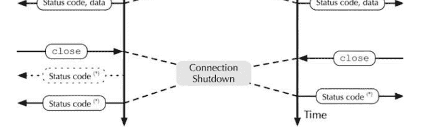

图 11.1 SOCK_STREAM 连接的生命周期。

*) 取决于 `SO_LINGER` 设置

如果函数成功，它将关联本地 socket 和目标 socket，并可以开始数据传输。否则，它向调用者返回一个错误指示。为了成为 `connect()` 的有效目标，socket 必须满足以下两个条件：

1.  它必须被分配一个已知地址——因为愿意连接的通信端点必须在 `connect()` 函数的第二个、第三个参数中指定此地址。这通常是通过 `bind()` 操作获取的。
2.  它可能已经通过接下讨论的 `listen()` 函数被标记为愿意接受连接请求。新创建的 socket 默认不接受传入的连接请求。

在发生失败时，`connect()` 向调用者返回 `-1` 而不是 `0`，并将 `errno` 设置为能更详细解释错误的错误代码：

- `EBADF` 给定的文件描述符无效。
- `ENOTSOCK` 给定的文件描述符有效，但不是一个 socket。
- `EALREADY` 同一个 socket 已经在进行另一个连接尝试。
- `EADDRNOTAVAIL` 连接尝试失败，因为 socket 已经绑定到一个无效的本地地址，或者系统耗尽了临时本地端口。
- `EAFNOSUPPORT` `address` 引用的目标地址对于本地 socket 的地址族是无效的。
- `EPROTOTYPE` `address` 引用的地址对应的 socket 类型与本地 socket 不同。
- `EISCONN` 本地 socket 已经连接。
- `ECONNREFUSED` 目标地址拒绝了连接，例如，是因为它没有在监听传入的连接。
- `ETIMEDOUT` 连接建立过程在连接建立之前超时。
- `ENETUNREACH` 目标网络不可达。

此外，`connect()` 还可能在以下情况下失败：

- `EINVAL` 目标地址族或地址长度无效。
- `EADDRINUSE` 连接尝试失败，因为它尝试使用我们已经在占用的地址/端口组合。
- `ENETDOWN` 应该用于访问目标的本地网络接口已掉线。
- `EHOSTUNREACH` 目标主机不可达。
- `ECONNRESET` 远程主机重置了连接。
- `EOPNOTSUPP` socket 正在监听传入的连接请求，因此它不能用于发送发出的连接请求。
- `ENOBUFS` 系统缺乏执行该操作所需的资源。

`listen()` 函数将 socket 标记为愿意接受传入的连接请求：

```c
int listen(int socket, int backlog);
```

该函数的第一个参数一如既往，是要进行操作的 socket 描述符。通俗地说，第二个参数是一个整数，指定了在给定 socket 上可以等待接受的最大未处理连接请求数，即 backlog（队列长度）。特殊值零或负值将允许底层实现自由选择合适的 backlog 大小。还需要注意的是，如果用户指定了非零值，它被视为 socket 实现的一个提示，socket 实现可以在有必要时将其减小。

如果在未处理请求队列已满时收到了新的连接请求，可以立即拒绝连接，或者如果底层协议实现支持此功能，则可以在稍后重试。参考 [104] 包含了关于 backlog 机制如何工作的更多细节。

如果成功，`listen()` 函数向调用者返回 `0`。否则，它返回 `-1` 并将 `errno` 设置为错误代码。该函数将因以下原因失败：

- `EBADF` 给定的文件描述符 `socket` 无效。
- `ENOTSOCK` 给定的文件描述符有效，但不是一个 socket。
- `EOPNOTSUPP` 在调用无连接 socket 时，底层协议不支持 `listen()` 操作。
- `EINVAL` socket 已经连接，因此它不能用于监听传入的连接请求。
- `EADDRNOTAVAIL` socket 未绑定到本地地址，且底层协议（如 TCP）不支持在未绑定的 socket 上监听传入的连接请求。

此外，`listen()` 还可能在以下情况下失败：

- `EINVAL` socket 已关闭，不能再用于监听。


- ENOBUFS：系统缺乏执行该操作所需的资源。

成功执行 `bind` 和 `listen` 是监听传入的连接请求并建立新连接的必要条件但不是充分条件。还必须使用 `accept` 函数，或者在 `listen` 之后，等待给定 socket 上连接请求的到达。整个过程总结在图 11.1 的右上部分。`accept` 函数具有以下原型：

```c
int accept(int socket, struct sockaddr *restrict address,
           socklen_t *restrict address_len);
```

该函数会阻塞调用者，直到一个连接到达，然后接受它，创建一个新的 socket 并将其描述符返回给调用者。失败时返回 -1，但这不会产生歧义，因为 socket 描述符在定义上是非负整数。新 socket 连接到发起连接请求的 socket（有时称为 peer socket），作为参数传递给 `accept` 的原始 socket 如果再次使用来等待并接受进一步的连接请求。

此外，如果参数不是 NULL 指针，`accept` 将发起连接请求的 socket 地址存储在它所指向的位置中。`address_len` 参数的处理方式与 `getsockname` 函数相同。即，它的位置既用于指示由地址填充的缓冲区的大小，也指示存储在其中的地址的实际长度。

`accept` 函数将因以下原因失败：

- EBADF：给定的文件描述符 `socket` 无效。
- ENOTSOCK：给定的文件描述符有效，但不是一个 socket。
- EINVAL：给定的 socket 不接受连接。
- EOPNOTSUPP：底层协议不支持 `accept` 操作。
- ECONNABORTED：连接已中止。
- EMFILE：允许打开的文件描述符限制已达到。
- ENFILE：系统打开的文件描述符限制已达到。
- ENOBUFS：系统缺乏执行该操作所需的缓冲区空间。
- ENOMEM：系统没有足够的内存执行该操作。

对 socket 的地址也可以稍后通过 `getpeername` 函数检索，该函数应在已连接的面向连接的 socket 上调用：

```c
int getpeername(int socket,
                struct sockaddr *restrict address,
                socklen_t *restrict address_len);
```

在这种情况下，`address_len` 所引的位置具有双重含义，如前所述。`getpeername` 函数在成功完成后返回 0，失败时返回 -1。将因以下原因失败：

- EBADF：给定的文件描述符 `socket` 无效。
- ENOTSOCK：给定的文件描述符有效，但不是一个 socket。
- ENOTCONN：给定的 socket 未连接，因此它目前没有 peer。
- EOPNOTSUPP：底层协议不支持 `getpeername` 操作或 peer 概念。

此外，该函数可能在以下情况下失败：

- ENOBUFS：系统缺乏执行该操作所需的缓冲区空间。

## 11.5 无连接套接字

一旦与对端连接，面向连接的套接字会在两个对端之间实现一个点对点的通信通道。建立连接是数据传输的前提。相反，无连接通信在数据传输发生之前不需要任何形式的连接协商或建立。这是数据报套接字的典型特征，例如使用 UDP 协议的套接字。

由于在数据报通信中，每条消息都是独立于任何其他消息进行路由的，因此无连接套接字支持多点通信，可以使用套接字向多个目标发送消息。同样地，单个套接字也可以接收来自多个源的消息。

套接字的创建方式与面向连接的套接字相同，可以使用 `bind` 将特定的、已知的本地地址分配给套接字。此外，如果在未绑定的套接字上调用数据传输，该套接字将在传输之前隐式地绑定到一个可用的本地地址。相反，由于不需要建立连接，无连接套接字可能无法使用 `listen` 和 `accept`。

`connect` 函数仍然可以使用，尽管其语义有所不同。在无连接套接字上调用时，`connect` 不发送任何连接请求——它不会感知——而是简单地将给定的目标地址与套接字关联。通过这样，可以使用不显式指示目标地址的数据传输函数使用套接字，例如 `send`。此外，在 `connect` 成功后，只有从该套接字接收的数据会被传递给用户。

`connect` 函数可以在同一个无连接套接字上多次调用，但只有最后指定的地址仍然有效。与面向连接的套接字不同（连接意味着存在某种数量的网络活动），无连接套接字上的 `connect` 请求几乎会立即返回给调用者，因为它们仅仅执行了本地操作。在不使用 `connect` 的情况下，通过无连接套接字发送数据的唯一方法是通过允许调用者逐条消息指定目标地址的函数，例如 `sendto`。

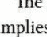

## 11.6 数据传输

`send`、`sendto` 和 `sendmsg` 函数通过套接字发送数据，表达能力和接口复杂度之间有不同的权衡。`send` 函数是最简单的一个。其接口最重要的底层假设是目标地址已被系统已知。这在两种情况下成立：

- 函数在面向连接的套接字上调用，该套接字过去已成功连接到远程对端且尚未断开连接。
- 在无连接套接字上，如果通过 `connect` 调用已为套接字关联了远程地址，则允许使用 `send`。

相反，不能使用 `send`，例如在未执行过 `connect` 的无连接套接字上。它的四个参数指定了要使用的套接字、一组可能改变函数语义的标志位的位置和大小：

```c
size_t send(int socket, const void *buffer,
            size_t length, int flags);
```

具体来说：

- `socket` 参数是一个套接字描述符。
- `buffer` 参数指向内存中的数据缓冲区，`length` 给出其长度，单位为字节。
- `flags` 参数包含标志位的按位或结果。

在调用者可用的所有标志位中，这里我们将讨论 `MSG_OOB` 和 `MSG_NOSIGNAL`，它们与实时系统最相关：

- `MSG_OOB`：用于支持带外通信的套接字，以发送（通常有限的）数据缓冲区。数据的发送和接收与正常数据独立，并可能具有更高的交付优先级。TCP 协议在任何给定时间支持一个字节的待处理带外数据。等待交付的带外数据的存在性会向远程对端发出信号，但它们相对于正常数据仍然是按顺序发送的。
- `MSG_NOSIGNAL`：用于抑制在向不再与其远程对端连接的流定向型套接字上调用 `send` 时正常产生的 `SIGPIPE` 信号。当设置此标志位时，`send` 将失败并改为返回 `EPIPE` 错误代码。

`send` 返回从作为参数给定的用户缓冲区成功传输到待发送网络缓冲区的字节数（非负数）。如果没有可用缓冲区空间，`send` 将阻塞调用者，直到某些空间可用。该函数也可能部分成功，如果返回的字节数少于 `length`。

重要的是，来自 `send`（或后续将讨论的任何其他传输原语）的成功返回并不以任何方式保证任何数据已实际交付给远程对端。尽管底层网络协议（如 TCP）保证了可靠交付，事实也是如此。事实上，成功的 `send` 甚至不意味着系统尚未开始发送这些数据，因为网络传输路径的队列中可能仍有旧数据。

成功发送的唯一真实衡量标准是没有检测到任何阻止传输的本地错误，要传输的数据已成功移动到合适的网络缓冲区中，并且系统将“尽力”交付它们。

### struct msghdr

指向缓冲区的指针

Buffer #0

```c
struct msghdr {
  ...
  struct iovec *msg_iov;
  unsigned int msg_iovlen;
  ...
};
```

### struct iovec []

```c
struct iovec {
  void *iov_base;
  size_t iov_len;
};
```

以字节为单位的缓冲区大小

Buffer #1

数组中的元素数量 N（每个元素都是一个 struct iovec）

Buffer #N-1

图 11.2 通过 struct iovec 进行的数据收集与离散。

### 表 11.3 struct msghdr 的字段，POSIX API

| 字段 | 作用 |
|---|---|
| msg_name | 指向通信端点地址的指针 |
| msg_namelen | msg_name 指向的地址的大小 |
| msg_iov | 指向 struct iovec 数组的指针，用于收集/分散要发送或接收的消息 |
| msg_iovlen | msg_iov 指向的数组中的元素数量 |
| msg_control | 指向辅助数据的指针，超出了本书的范围 |
| msg_controllen | msg_control 引用的辅助数据的长度 |
| msg_flags | 接收消息的标志位，发送时未使用 |

特别地，`struct msghdr` 结构体的 `msg_iov` 字段指向一个 `struct iovec` 数组。`msg_iovlen` 字段包含数组的元素数量，不要与它的字节大小混淆。数组的每个元素都对应并描述一个连续的缓冲区，该缓冲区持有部分待发送的数据。如图所示，每个 `struct iovec` 包含两个字段：

- `iov_base` 字段指向缓冲区的起始位置（最低内存地址）。
- `iov_len` 表示其长度或大小，单位为字节。

为了收集数据，`sendmsg` 函数从第一个元素开始扫描由 `msg_iov` 引用的数组，并在逻辑上将数据连接到内存缓冲区中（在图 11.2 中用深色矩形表示）。需要注意的是，这是一个逻辑操作，可能对应或不对应于传输前将数据物理拷贝到单个连续内存中的操作。正如之前提到的，这是一个计算开销很大的操作，协议栈实现会尽量避免这种操作。

`struct msghdr` 的其他字段与辅助数据的传输和接收有关，其含义高度依赖于底层通信协议，因此超出了本书的范围。`sendmsg` 函数在成功时返回 0。否则，在将 `errno` 设置为错误代码后返回 -1。错误代码与 `sendto` 相同。此外，如果 `msg_iov` 指向的数组元素数量超过 `IOV_MAX`，`sendmsg` 将失败并报告 `EMSGSIZE` 错误代码，在所有 POSIX 兼容实现中，该值保证至少为 16。

对称地，`recv`、`recvfrom` 和 `recvmsg` 函数允许进程等待从 socket 接收数据。这些函数具有不同级别的表达能力和复杂性，就像它们对应的数据传输函数一样。最简单的是 `recv` 函数：

```c
ssize_t recv(int socket, void *buffer, size_t length, int flags);
```

`recv` 函数在需要时等待 socket 变为可用数据。当数据可用时，该函数将其存储在 `buffer` 引用的内存缓冲区中，并返回给调用者刚刚接收到的数据。参数 `length` 包含内存缓冲区的大小，因此设置了函数可能接收并存储到其中的数据量上限。

该函数还接受 `flags` 参数中的一个标志位，这些标志会改变函数的语义。主要标志包括：

- `MSG_OOB`：`recv` 函数将接收带外数据而非普通数据。带外数据通过在调用 `send`、`sendto` 或 `sendmsg` 时提供相同的标志来发送。
- `MSG_PEEK`：`recv` 函数将不会从 socket 接收数据，因此下一次接收将仍然返回相同的数据。
- `MSG_WAITALL`：在 `SOCK_STREAM` socket 上，`recv` 函数将等待直到接收到 `length` 字节的数据。如果在 `SOCK_DGRAM` socket 上调用、对端关闭连接或发生错误，该函数仍可能提前返回。

`recv` 的返回值表示接收到的数据量以及是否发生错误或其他异常情况。更具体地说：

- 当函数返回非零正值时，它代表成功接收并存储到 `buffer` 引用缓冲区中的数据量（字节数）。该值不能超过 `length`，即缓冲区本身的长度。
- 返回值为 0 表示对端以正常方式关闭，且没有更多数据可接收。这对应于普通文件的“文件结束”（EOF）指示。
- 值 -1 是错误指示。在这种情况下，函数还会如文所述设置 `errno` 以提供更多错误信息。

对于 `SOCK_STREAM` socket，如果没有发生错误，`recv` 函数在接收到大于 0 但少于 `length` 字节的数据后返回，除非 `flags` 中设置了 `MSG_WAITALL` 标志。

应用程序准备好正确处理这种场景非常重要，因为 `recv` 实际接收的精确量是无法预测的。在 TCP 中，这取决于其他因素，取决于底层传输协议的分段内部机制。同样，值得注意的是，`SOCK_STREAM` socket 将数据视为从源流到目的地的无结构流，并且不保留消息边界。


在任何情况下，尽管 `recv` 函数可能会任意将数据拆分成片段并提前返回，但它永远不会丢弃数据。另一方面，`SOCK_DGRAM` socket 会保留消息边界，但如果消息长度超过了用户提供的缓冲区，多余字节将被静默丢弃。

`recv` 函数将因以下原因失败并将 `errno` 设置为相应的错误代码：

- EBADF：给定的文件描述符 `socket` 无效。
- ENOTSOCK：给定的文件描述符有效但不是 socket。
- EOPNOTSUPP：底层协议不支持某些标志位。
- ENOTCONN：给定的 socket 是面向连接的，但目前未连接到对端，因此无法从中接收数据。
- ECONNRESET：远程对端强制关闭连接。在正常关闭连接的情况下，`recv` 不报告错误，而是返回 0。
- EINVAL：通过设置 `MSG_OOB` 标志请求带外数据，但 socket 不支持带外数据。
- ETIMEDOUT：在建立连接之前超时，或之后发生了传输超时。

此外，如果发生以下情况，`recv` 可能失败：

- ENOBUFS：系统缺少执行操作所需的缓冲区空间。
- ENOMEM：系统没有足够的内存执行操作。

相对于 `recv`，`recvfrom` 函数带有两个参数允许调用者获取发送对方的地址，具体如下：

```c
ssize_t recvfrom(int socket, void *restrict buffer, size_t length, int flags,
                 struct sockaddr *restrict address,
                 socklen_t *restrict address_len);
```

特别地，如果 `address` 参数不是 `NULL`，`recvfrom` 将发送方的地址存储在 `address` 指向的数据结构中。在这种情况下，`address_len` 指的位置具有双重含义：它既用于指定调用者提供的 `address` 所引用数据结构的大小（作为 `recvfrom` 函数的输入），也作为 `recvfrom` 存储在该处的地址的实际长度（作为输出）。`recvfrom` 返回值的含义以及 `errno` 的可能值与 `recv` 相同。

最强大且灵活的接收函数是 `recvmsg`：

对于 `sendmsg` 来说，`recvmsg` 的大部分参数必须由调用者存储在类型为 `struct msghdr` 的数据结构中，并将该地址作为唯一的参数 `message` 传递。`sendmsg` 函数还使用该结构的某些字段为调用者提供额外信息。只有标志（flags）被作为参数单独传递。`struct msghdr` 的字段是 11.3 节中列出的那些，它们的使用方式与 `sendmsg` 类似，但有以下不同：

- 字段 `msg_name` 和 `msg_namelen` 用于返回发送端套接字的地址，类似于 `recvfrom` 的 `address` 和 `address_len` 参数。
- `msg_iov` 所引的信息用于将接收到的数据分散到多个接收缓冲区中，而不是聚合。
- `msg_flags` 字段提供了有关接收数据的额外信息，而不是处于闲置状态。

更具体地说，`msg_flags` 字段可能包含以下标志的按位或结果：

- `MSG_OOB`：接收的数据由带外数据而非普通数据组成。
- `MSG_TRUNC`：从 `SOCK_DGRAM` 套接字接收到的普通数据被截断，因为调用者提供的缓冲区不够大以容纳整个消息。

`recvmsg` 返回值的含义与 `recv` 和 `recvfrom` 相同。除了 `recv` 可能使用的 `errno` 值外，`recvmsg` 在以下情况下也会失败：

- EINVAL：作为参数传递的 `struct msghdr` 中 `msg_iov` 字段所引用数组元素的 `iov_len` 字段之和无法用 `size_t` 类型表示。
- EMSGSIZE：作为参数传递的 `struct msghdr` 中 `msg_iov` 字段指向的数组元素（在相同数据结构的 `msg_iovlen` 中给出）超过了 `IOV_MAX`。在所有符合 POSIX 标准实现中，`IOV_MAX` 的值保证至少为 16。

最后，如果我们观察 `SOCK_STREAM` 套接字，可能会发现它与 POSIX 指定的顺序文件访问模型之间存在某些相似之处。两者都提供了对顺序的、面向字节的数据流的可靠访问，且没有记录或消息边界的概念。出于此原因，POSIX 规定文件访问原语 `write` 和 `read` 及其标准签名也应适用于套接字：

```c
ssize_t write(int fildes, const void *buf, size_t nbyte);
ssize_t read(int fildes, void *buf, size_t nbyte);
```

`write` 和 `read` 到 `send` 和 `recv` 的映射是非常直观的。也就是说，函数调用：

```c
write(fildes, buf, nbyte);
read(fildes, buf, nbyte);
```

被协议栈实现为：


```
send(fildes, buf, nbyte, 0);
recv(fildes, buf, nbyte, 0);
```

通过协议栈。

## 11.7 套接字选项

套接字选项用于自定义套接字的通用行为，以及底层通信协议的某些方面。此外，某些只读套接字选项提供了有关套接字状态的有用信息。选项具有敏感的默认值，如果应用程序没有显式设置，这些默认值将被自动应用。在大多数应用程序中，默认值是足够的。

套接字选项分层次地组织成多个级别，反映了通信协议和软件的典型分层结构。在同一级别内，单个选项通过选项名称唯一标识，该预处理器宏会展开为一个整数值。

选项有一个与其关联的值。由于值的数据类型可能从一个选项变化到另一个选项，因此通过通用 `void *` 的引用传递值，并在与协议栈交互时使用一种特有的机制来传达选项值的预期大小和实际大小。实际机制与之前节节描述的用于适应变长网络地址的机制类似。

通过 `getsockopt` 函数获取套接字选项：

```c
int getsockopt(int socket, int level, int option_name,
               void *restrict option_value,
               socklen_t *restrict option_len);
```

其中：

- `socket` 是套接字描述符，指示函数必须在哪个套接字上操作。
- `level` 和 `option_name` 参数分别是要获取的选项的层级以及在该层级内的唯一名称。
- `option_value` 指向客户端提供的内存缓冲区的指针，函数应在其中存储选项的值。
- `option_len` 引用的对象既是 `getsockopt` 函数的输入参数也是输出参数。作为输入参数，它指示 `option_value` 指向的缓冲区的长度（字节）。作为输出，`getsockopt` 将其设置为存储在缓冲区中的选项的实际长度。

为了避免溢出，如果选项值大到无法放入调用者提供的缓冲区，`getsockopt` 函数将静默截断该选项值。由于结果，选项值可能无法使用，这种情况应被视为编程错误并避免。

`getsockopt` 的返回值表示函数执行成功还是失败。返回零表示按照调用者的请求，将选项值存入 `option_value` 指向的缓冲区中。相反，返回 -1 表示发生了错误。在这种情况下，`getsockopt` 还会将 `errno` 设置为错误代码，提供更多关于错误的信息。函数在以下情况下将失败：

- `EBADF`：给定的文件描述符套接字无效。
- `ENOTSOCK`：给定的文件描述符有效但不是套接字。
- `EINVAL`：`option_name` 指定的选项在给定级别上无效。
- `ENOPROTOOPT`：`option_name` 有效，但套接字或底层网络协议（取决于级别）不支持它。

此外，`getsockopt` 还可能失败于：

- `EACCES`：调用者没有足够的权限获取选项。
- `EINVAL`：由于套接字已关闭，无法获取选项。
- `ENOBUFS`：系统缺乏执行操作所需的资源。

对称地，可以通过调用 `setsockopt` 函数设置选项：

```c
int setsockopt(int socket, int level, int option_name,
               const void *option_value, socklen_t option_len);
```

函数的参数含义与 `getsockopt` 函数相同，不同之处在于：

- `option_value` 指向的内存缓冲区必须由调用者预设，以匹配要设置选项的预期值。`setsockopt` 函数不会以任何方式改变其内容。
- `option_len` 参数是 `option_value` 指向的内存缓冲区的实际长度，而不是长度的指针，因为它是一个输入参数。

`setsockopt` 的返回值与 `getsockopt` 的返回值含义相同。`getsockopt` 失败的原因也相同，加上：

- `EISCONN`：套接字已连接，且在此状态下无法设置给定选项。
- `EDOM`：选项的预期值在允许范围之外。例如，如果选项的值是超时时间，则该超时可能过大。

此外，`setsockopt` 还可能失败于：

- `ENOMEM`：系统没有足够的内存执行操作。

### 表 11.4 在 SOL_SOCKET 级别上定义的读写通用选项，POSIX API

| 名称 | 类型 | 含义 |
| :--- | :--- | :--- |
| `SO_BROADCAST` | `int`⁽⁹⁾ | 决定套接字是否允许发送广播数据报，仅适用于 `SOCK_DGRAM` 类型的套接字。 |
| `SO_DEBUG` | `int`⁽⁹⁾ | 启用或禁用套接字活动的调试。提供的实际调试信息取决于底层协议模块是否以及在何种程度上支持此选项。 |
| `SO_DONTROUTE` | `int`⁽⁹⁾ | 如果设置，则禁用标准的网络层路由算法，仅根据目的地址进行路由。这意味着目标节点必须通过发送者的一个网络接口可达。 |
| `SO_KEEPALIVE` | `int`⁽⁹⁾ | 在面向连接的套接字上，决定是否在对端之间定期交换用于检查连接是否存活的消息（通常为心跳检测消息）。必须由底层通信协议支持。 |
| `SO_LINGER` | `struct linger` | 决定在关闭套接字时如何处理已队列但尚未发送的数据。更多信息请参见正文中的描述。 |
| `SO_OOBINLINE` | `int` | 如果设置，带外数据将与普通数据一起放入接收队列中，而不是单独入队。 |
| `SO_RCVTIMEO` | `struct timeval`⁽⁹⁾ | 指定从套接字进行接收操作时允许等待输入数据的最大时间，超时后该操作将失败并返回超时指示。值为 0（默认值）意味着接收永不超时。 |
| `SO_SNDTIMEO` | `struct timeval`⁽⁹⁾ | 指定发送操作允许阻塞调用者的最大时间，以等待所有数据都可以入队进行传输。当经过的这段时间允许函数返回给调用者时，尽管可能只入队了部分数据。值为 0（默认值）意味着发送操作永不超时。 |
| `SO_REUSEADDR` | `int`⁽⁹⁾ | 设置时，此选项将放宽检查 `bind` 的地址是否可用的算法，以便更方便/快速地重用本地地址。参见正文中的描述以解释此选项如何影响 TCP 协议。 |

> (1) 用作布尔值使用，非零值表示真，零表示假。
> (2) 不要与 `struct timespec` 混淆，更多信息请参见第 11.8 节。

### 表 11.5 在 SOL_SOCKET 级别上定义的只读通用选项，POSIX API

| 名称 | 类型 | 含义 |
| :--- | :--- | :--- |
| `SO_ACCEPTCONN` | `int` | 告知套接字是否正在接受连接请求，即它已被标记为监听（`listen`）。 |
| `SO_ERROR` | `int` | 获取并清除套接字上的任何待处理错误号，如果没有待处理的错误，则返回 0。 |
| `SO_TYPE` | `int` | 返回套接字类型（`SOCK_...`），当继承他人创建的套接字时有用。 |

> (1) 这些表格没有列出与缓冲区相关的选项，这些选项将被单独讨论。在 RTEMS 实现的标准 TCP/IP 协议的背景下，某些选项值得进一步解释。它们将按照在表格中出现的顺序进行讨论。

- 在 RTEMS 协议栈中，只有 TCP 协议模块具有记录和输出调试信息的函数。只有在编译协议栈时定义了编译时 `TCPDEBUG`（这并非默认值）时，这些函数才会被启用。除非启用了此选项，否则设置 `SO_DEBUG` 选项会成功，但没有作用。
- 尽管 TCP 协议不需要请求来探测对端连接是否可靠，但可以通过定期发送包含零长度数据段的确认消息获得等效效果。RTEMS TCP/IP 协议栈在设置 `SO_KEEPALIVE` 选项时会采用这种方法。
- 与 `SO_LINGER` 选项关联的值包含两个字段的结构体。`l_onoff` 字段是一个整数。非零值表示该选项已启用。`l_linger` 字段是一个整数，包含秒为单位的时间。只有当根据 `l_onoff` 启用 linger 选项时，该字段的内容才会被使用。

`SO_LINGER` 选项仅适用于面向连接的套接字，并影响在套接字具有某些已队列但尚未发送的数据时执行 `close` 操作的行为。当该选项被禁用时，`close` 应尽快地返回给调用者，而无需等待这些数据发送。之后，协议栈可能会或可能不会进一步尝试传输这些数据。结果是，调用者无法知道这些数据是否最终到达了另一个对端。

- 如果启用了 `SO_LINGER` 选项且 `l_linger` 时间为 0，`close` 将中止 TCP 连接（通过发送 RST）而不是优雅地关闭。结果是 `close` 立即返回给调用者，但任何队列的数据都会被丢弃。在另一种 TCP 实现也可能执行相同操作的情况下，即当套接字调用 `close` 时，连接不是优雅地关闭，而是直接关闭。
- 如果启用了 `SO_LINGER` 选项且 `l_linger` 不为 0，`close` 将阻塞直到数据发送或发生超时。当经过的这段时间允许函数返回给调用者时，尽管可能只入队了部分数据。

### 表 11.7 标准 RTEMS 协议栈的 TCP 级别选项

| 名称 | 类型 | 含义 |
| :--- | :--- | :--- |
| `TCP_NODELAY` | `int`⁽¹⁾ | 在某些取决于已发送但尚未确认数据（ACK）存在的特定情况下，TCP 实现会临时聚集来自多个应用层发送操作的数据，以便在稍后的时间将它们一起发送出去。这种行为改进了吞吐量，因为避免了多个微小分段的传输，但可能会显著增加数据传输延迟。当设置此选项时，将禁用聚合算法。默认情况下，此选项未设置，即聚合算法是启用的。 |
| `TCP_MAXSEG` | `int` | 此选项的值决定了传出的 TCP 分段的最大大小。默认情况下，它等于 TCP 连接建立时双方之间协商的最大值。应用程序提供的任何值都不能超过协商值，否则 `setsockopt` 将带有 `EINVAL` 错误号返回失败。 |
| `TCP_NOOPT` | `int` | 大多数 TCP 实现可能在其发送的 TCP 数据包报头中包含多个选项。选项是一种标准机制，旨在通过在其报头中添加可选内容来支持 TCP 协议的各种扩展。当此选项未设置（默认值）时，TCP 实现允许发送与其支持的各种协议扩展对应的选项。如果设置了此标志，将禁用选项以提高与其他 TCP 实现的兼容性，尽管符合标准的实现无论如何都会忽略它们不识别的任何选项。 |
| `TCP_NOPUSH` | `int` | 当此选项未设置（默认值）时，如果协议状态允许，TCP 实现通常会在调用任何 `send` 函数后立即开始传输。此外，它会将传输的最后一个分段标记为推送（PSH）位，以建议对端将目前收到的数据提供给应用程序。如果设置了此选项，TCP 实现将延迟数据传输，直到套接字关闭或其发送缓冲区满。 |

> (1) 用作布尔值使用，非零表示真，零表示假。

## 11.8 非阻塞 I/O 与同步 I/O 多路复用

第 11.2–11.7 节中套接字 API 的描述指的是它们默认的阻塞模式。非正式地说，在这种模式下操作时，这些函数会阻塞调用者，直到它们能够继续至少部分成功或发生错误。例如，`recv` 函数在没有设置特殊标志的情况下被调用时，它会阻塞调用者，直到从套接字中有某些可接收的数据（即使数据量少于调用者请求量）或发生错误为止。

这些函数也可以以非阻塞模式运行。在这种情况下，它们始终立即返回给调用者而不会阻塞，并通过设置 `errno` 来指示它们是否能够执行部分或全部操作。例如，在这种工作模式下调用 `recv` 函数允许调用者轮询套接字，并检查是否有立即可从其接收的数据，而不会阻塞直到数据到达。

当套接字函数阻塞调用者直到完成时，默认行为在许多情况下是非常实用的，因为它允许以简单且直观的方式编写软件。然而，在更复杂的情况下，它可能变成一种劣势，特别是对于面向连接的通信中的连接建立和数据传输，它可能会以一种过度且不受愿的方式将两个通信端的时间绑定在一起。`SO_RCVTIMEO` 和 `SO_SNDTIMEO` 选项（见第 11.7 节和表 11.4）有助于缓解数据传输函数的这一问题，但不会影响其他类型函数的行为。

切换到非阻塞模式有三种可能的方法：通过在套接字上调用 `fcntl` 函数，通过同样在套接字上调用 `ioctl` 函数，或者向任何支持此类参数的函数传递 `MSG_DONTWAIT` 标志。这三种方法之间最重要的区别是：

- 使用 `fcntl` 函数是 POSIX 标准中唯一提到的方法。另外两种方法通常是可用的，特别是在从原始 BSD 栈派生的协议栈上，但它们都不是标准。
- `fcntl` 和 `ioctl` 均在套接字层级操作，因此会影响以后在该套接字上执行的所有操作的行为，直到设置更改为止。
- `MSG_DONTWAIT` 标志的粒度更细，因为它是按调用次生效的，但它只能与支持 `flags` 参数的函数一起使用，直接（`send`、`sendto`、`recv` 和 `recvfrom`）还是间接（通过 `struct mmsghdr` 的 `sendmsg` 和 `recvmsg`）。

此外，通过 `fcntl` 或 `ioctl` 在套接字处实现的非阻塞行为会覆盖单独函数调用时传递的 `MSG_DONTWAIT` 标志。换句话说，如果套接字已设置为非阻塞，则无论 `MSG_DONTWAIT` 标志如何，在其上调用的所有函数将是非阻塞的。

可以通过 `fcntl` 函数通过设置或清除与其套接字描述符相关的 `O_NONBLOCK` 标志，将套接字切换到非阻塞或阻塞模式：

```c
int fcntl(int fildes, int cmd, ...);
```

在这种特定的模式用法中，`fcntl` 的 `fildes` 参数代表套接字描述符，`cmd` 必须等于 `F_SETFL`，它对应于 `fcntl` 的“设置标志”命令。第三个参数对应于签名中的省略号 `...`，必须是一个持有标志位按或结果的 `int`。如果 `fcntl` 函数成功设置了标志，它将返回一个除 -1 以外的值。否则，它在将 `errno` 设置为错误码后返回 -1。失败的原因有：

- `EBADF`：给定的文件描述符无效。
- `EINVAL`：无效参数。

```c
int fl;

if ((fl = fcntl(s, F_GETFL)) == -1) {
    /* 处理错误 */
} else {
    fl &= ~O_NONBLOCK; /* 如果需要，清除标志 */
    if (fcntl(s, F_SETFL, fl) == -1) {
        /* 处理错误 */
    }
}
```

切换套接字到非阻塞模式的第二种方法是在套接字上调用 `ioctl` 函数：

```c
int ioctl(int fildes, int request, ...);
```

与 `fcntl` 类似，`ioctl` 也是一个通用函数，能够在文件描述符上执行各种命令（称为请求）。这些请求编码在 `request` 参数中。根据命令的不同，`ioctl` 可能需要额外的参数。在这里我们只关注与此背景特别相关的两个命令。

- `FIONBIO` 命令允许调用者设置或重置 `NONBLOCK` 套接字标志，就像 `fcntl` 一样。这需要一个类型为 `int *` 的第三个参数。指向的位置必须包含一个整数，函数将其解释为布尔值。如果其值非零（真），则套接字置于非阻塞模式。相反，如果其值为零（假），则套接字恢复到默认的阻塞模式。
- `FIONREAD` 允许调用者知道有多少字节数据立即可用并等待从套接字接收，而无需实际检索数据或将其从接收缓冲区中移除。同样在这种情况下，`ioctl` 需要一个类型为 `int *` 的第三个参数，它用它来存储用户请求的值。

与其它函数一样，`ioctl` 的返回值指示函数是否成功执行。返回值为 0 表示成功完成，而 -1 表示错误。在最后一种情况下，函数还会设置 `errno` 以提供更多关于错误本身的信息。对于特定的请求，`ioctl` 函数会在以下情况下失败：

- `EBADF`：给定的文件描述符无效。

第三种也是最后的方法可能是简单的，因为它意味着向套接字函数传递额外的标志（`MSG_DONTWAIT`），并允许按调用次选择非阻塞行为。然而，正如之前所述，它有两个主要缺点：

- 并不是所有套接字函数都支持 `flags` 参数。例如，这种方法无法在连接阶段使用。
- 尽管这种方法广泛可用，但它并不符合标准，因此在编写可移植代码时应避免使用。

无论如何激活，非阻塞模式对许多套接字相关的行为都会产生深远影响，也会影响它们可能生成的错误代码。特别是：

- 如果 `bind` 函数无法立即执行请求的本地地址分配，它将返回 -1（失败指示），并将 `errno` 设置为 `EINPROGRESS`。然而，这实际上并不表示失败，因为系统将异步执行并完成地址分配。
- 如果没有可接受的连接请求，`accept` 函数将失败——返回 -1 并 `errno` 设置为 `EWOULDBLOCK` 或 `EAGAIN` 之一——而不是阻塞调用者直到有请求出现为止。
- 如果 `connect` 函数无法立即建立连接，它将返回 -1 并 `errno` 设置为 `EINPROGRESS`，而不是阻塞调用者直到连接建立。系统将异步建立连接。
- 如果没有可用数据可接收，接收函数将不会阻塞调用者。相反，它们将返回 -1 并 `errno` 设置为 `EWOULDBLOCK` 或 `EAGAIN`。值 0 仍被留用于表示连接已正常关闭（对于连接型套接字）。
- 同样，如果没有数据可以从用户缓冲区传输到系统缓冲区，发送函数将不会阻塞调用者。相反，它们将返回 -1 并 `errno` 设置为 `EWOULDBLOCK` 或 `EAGAIN`。

关于讨论的通用方法，将套接字设置为非阻塞模式不会影响 `close` 函数中由于 11.7 节讨论的残留数据（lingering）可能发生的阻塞。

将套接字切换到非阻塞操作允许单个进程或服务处理多个套接字，而不会有在其中一个上阻塞而忽略其他它的风险。

然而，正如许多基于轮询的输入输出方法那样，为每个套接字选择最佳轮询频率可能是挑战性的，因为这代表了提高响应能力（这会推向更高的轮询频率）与控制无效轮询带来的开销（这有益于较低的轮询频率）之间的权衡。


因此，POSIX 标准允许一种事件驱动的套接字输入输出方法。在这种方法中，套接字操作分阶段执行，通常封装在一个无限循环中：

1. 线程等待直到一组套接字上发生某些感兴趣的事件。套接字上事件的发生意味着该套接字可以进行输入输出操作，或者系统检测到影响该套接字的错误或异常情况。一旦系统中的任何套接字上发生至少一个感兴趣的事件，等待操作就会终止并返回调用者。因此，传入的事件以先入先出的方式处理，无论它们与哪种套接字有关。此外，`wait` 函数可以提供关于具体发生了哪些事件的信息，以便进行进一步处理。

2. 根据上一步调用的 `wait` 函数提供的信息，线程为每个事件执行一次套接字操作。在套接字上执行的操作取决于该套接字本身发生的事件。没有必要将套接字设置为非阻塞模式，因为事件的发生意味着，尽管相应的套接字操作可能会阻塞调用者，但它不会。

例如，感兴趣的事件之一是“读取就绪”。当此事件在套接字上发生时，可以保证在套接字上调用的接收函数（`recv`、`recvfrom` 或 `recv`）不会阻塞调用者。然而，函数的执行并不一定意味着任何实际的数据传输。函数确实可能返回一些数据，但也可能表示远程端已正常关闭连接，或者套接字上发生了错误。

总的来说，这种机制有时被称为同步输入输出多路复用，因为在等待后线程活动仍然以同步方式执行。不同套接字上的输入输出操作通过到达顺序进行多路复用并顺序执行。

POSIX 标准规定的简单且在历史上最古老的事件等待函数是：

```c
select(int nfds, fd_set *restrict readfds,
fd_set *restrict writefds, fd_set *restrict errorfds,
struct timeval *restrict timeout);
```

`select` 函数接受三个指向套接字描述符集合的指针：`readfds`、`writefds` 和 `errorfds`。每个集合由类型为 `fd_set` 的对象表示，这些集合可能部分或完全重叠，即同一个套接字描述符可能属于多个一个集合。`nfds` 参数限制了要检查的套接字描述符的范围。也就是说，`select` 函数将只检查数值在 0 到 `nfds-1`（包含边界）之间的套接字描述符。数值较高的套接字描述符将被忽略，即使它们属于前述的集合。

`select` 函数为每个套接字支持三种可能的感兴趣事件：“读取就绪”、“写入就绪”和“异常情况”。套接字描述符的构造取决于调用者是否对这些事件感兴趣。例如，如果一个套接字描述符属于 `readfds`，则调用者对“在该套接字上发生的读取就绪事件”感兴趣。

`timeout` 参数指定了 `select` 函数允许阻塞调用者的最大时间，它是指向 `struct timeval` 对象的指针。`struct timeval` 有两个表示时间的字段：

```
time_t tv_sec 表示秒数，而
time_t tv_usec 表示微秒数。
```

这种数据类型不能与前面章节讨论的 `struct timespec` 混淆，在后者中，秒的小数部分是用纳秒而不是微秒表示的。`timeout` 参数有三种可能的设置方式：

- 一个 NULL 指针表示不超时，直到发生其中一个事件或检测到错误为止。

- 指向包含零时间值的 `struct timeval` 指针（即 `tv_sec` 和 `tv_usec` 字段均为 0）意味着 `select` 函数必须仍然检查感兴趣的事件是否在过去已经发生并报告，但如果没有发生，则不能阻塞调用者。这等同于在多个套接字上执行轮询操作。

- 指向包含非零时间值的 `struct timeval` 指针表示 `select` 函数必须阻塞最多指定的时间，等待任何事件的发生。该时间值是相对于调用时间进行相对解释的。

`select` 函数按顺序检查属于集合的描述符，以检查是否至少有一个描述符处于读取就绪、写入就绪或存在异常状态。如果 `timeout` 参数允许，当没有任何事件发生时，`select` 函数也可能阻塞调用者。成功完成后，`select` 函数还会更新套接字描述符的状态，通知调用者哪些套接字描述符变为对应操作就绪，以及实际发生了哪些事件。具体而言，在以下情况下，套接字被认为读取就绪：

- 它被 `listen` 函数标记，且套接字上至少有一个待处理连接请求，或者在套接字上调用的 `accept` 能够在不阻塞调用者的情况下接受连接。

- 它未被 `listen` 标记，且接收缓冲区中有某些待处理数据，或者对方已关闭了连接。在这两种情况下，在套接字上调用的接收函数都会返回而不阻塞调用者。

- 如果套接字配置为将带外数据与普通数据一起放置（通过 `SO_OINLIN` 套接字选项），当存在等待接收的带外数据时，套接字也被视为读取就绪。

套接字在以下情况下被认为写入就绪：

- 在非阻塞模式下通过调用 `connect` 发起的待处理连接已完成（无论成功失败）。

- 在非阻塞模式下通过调用 `bind` 发起的本地地址分配已完成。在这种情况下，该套接字也被标记为读取就绪。

- 最多为 `SO_SNDLOWAT` 字节的发送操作将立即队列该数量的数据，而不阻塞调用者。

最后，当满足以下条件时，套接字有一个等待的异常状态：

- 套接字上存在待处理的错误状态。

- 带有 `MSG_OOB` 标志的接收操作将返回一定数量的带外数据而不阻塞调用者，或者普通数据接收队列中存在带外数据。

虽然协议栈可以在上述列表中添加额外的条件，但这些条件超出了 POSIX 标准的范围，且使用它们会导致代码在其他系统上不再具有可移植性。

成功完成后，`select` 函数的值为报告给调用者的事件总数（非负），即被插入由 `readfds`、`writefds` 和 `errorfds` 指向的描述符集合的套接字描述符数量。否则，`select` 返回 -1 并设置 `errno` 以指示发生了什么错误。在以下情况下，`select` 函数将失败：

- EBADF：`readfds`、`writefds` 和 `errorfds` 所引用的集合中至少有一个无效的描述符。

- EINVAL：由 `timeout` 引用的超时间隔或 `nfds` 的值无效。

- INTR：函数在任何感兴趣的事件发生之前被信号中断。

必须使用的文件描述符集必须由调用者分配，并通过 `FD_ZERO` 函数进行初始化：

```c
void FD_ZERO(fd_set *fdset);
```

该函数接受一个指向文件描述符集的指针 `fdset` 作为参数，并对其进行“清零”，将其初始化为空集。此函数以及其他操作文件描述符集的函数，可以在宏展开比内联函数展开更高效的系统上实现为宏。需要注意的是，宏会对其参数进行多次求值。如果这些参数是带有副作用的表达式（例如，前置或后置的自增和自减），则可能会导致不可预知的行为。

随后，可以通过以下方式向集合中添加或移除单个文件描述符：

```c
void FD_SET(int fd, fd_set *fdset);
void FD_CLR(int fd, fd_set *fdset);
```

这两个函数都接受一个指向文件描述符集的指针 `fdset` 作为参数，并更新正在添加或必须移除的文件描述符的值，且该值必须在 0 到 `FD_SETSIZE-1` 的范围内（包含边界），但不会执行错误检查。使用超出范围的文件描述符会导致未定义行为。相反，向已经包含该文件描述符的集合添加它（或对称地从不包含它的集合中移除）是允许的且不会产生影响。

该组中的最后一个函数 `FD_ISSET` 查询文件描述符是否属于某个集合：

```c
int FD_ISSET(int fd, fd_set *fdset);
```

同样，两个参数 `fdset` 和 `fd` 分别是集合和文件描述符的引用。函数向调用者返回一个整数值，该值必须解释为布尔值。具体来说，如果文件描述符属于 `fdset` 引用的集合，则返回值为非零（真），否则为零（假）。

除了 `select` 之外，POSIX 标准规定了另外两个具有类似目的函数 `pselect` 和 `poll`。尽管在本文编写时 RTEMS 不支持这些函数，但为了完整起见，将进行简要讨论。`pselect` 函数：

```c
int pselect(int nfds, fd_set *restrict readfds,
      fd_set *restrict writefds, fd_set *restrict errorfds,
      const struct timespec *restrict timeout,
      const sigset_t *restrict sigmask);
```

与 `select` 类似，尽管有三个重要的区别：

- 超时通过 `struct timespec` 结构体而不是 `struct timeval` 表示。这更符合其他 POSIX 函数的标准，例如第 5、7 和 9 章中的函数，它们也接受超时设置。对于 `select` 而言，`NULL` 指针表示无限超时，而指向 `struct timespec` 结构体的指针值为零表示 `pselect` 必须立即返回给调用者而不阻塞。

- 保证 `pselect` 函数永远不会修改 `timeout` 参数引用的时间值。

- 参数 `sigmask` 允许调用者在调用期间安装特定的信号掩码。当为 `NULL` 指针时，`pselect` 函数在这方面的行为类似于 `select`。

`poll` 函数变得更加复杂，允许调用者等待与文件描述符相关的更广泛的条件，而不仅仅是 `select` 和 `pselect` 支持的三大类：

```c
int poll(struct pollfd fds[], nfds_t nfds, int timeout);
```

数组 `fds` 包含 `nfds` 个类型为 `struct pollfd` 的元素。这些结构中的每一个都包含调用者对某个文件描述符感兴趣的条件集。具体来说：

- `fd` 字段包含文件描述符。

- `events` 字段包含调用者对文件描述符 `fd` 感兴趣的事件标志的位或结果。每一个这些事件标志都由一个以 `POLL` 开头的符号常量表示。POSIX 标准规定了 10 种不同的事件标志。

- `revents` 字段由 `poll` 设置为 `fd` 变为真实的事件标志的位或结果。

另一个与 `select` 和 `pselect` 的区别在于超时的表示方式。在这种情况下，它由一个表示毫秒的 `int` 参数给出。特殊值 0 表示 `poll` 检查事件发生并立即返回，而无需等待。

## 11.9 总结

本章描述了应用程序如何通过 POSIX 套接字访问网络。在 11.1 到 11.4 节中，我们描述了应用程序用于创建通信端点、为其分配已知网络地址（如果需要）、建立端点之间的连接以及在不再需要时关闭它们的主要函数。

11.5 节强调了连接型和无连接套接字之间的区别，并对后者提供了更多细节。接下来，11.6 节讨论了数据传输函数。这些函数在两种类型中大部分通用，但在复杂性和性能之间有不同的权衡。

通过适当使用各种套接字选项可以改变某些行为，这一特性在本章的最后一节 11.8 中，我们关注了允许单线程进程管理多个 socket 的机制。

# 嵌入式系统中的多核

# 目录

- 12.1 动机

- 12.2 多处理器与多核

    - 12.2.1 多核体系基础

    - 12.2.2 内存一致性模型

    - 12.2.3 缓存一致性

    - 12.2.4 在 ARM 处理器上的实际实现

    - 12.2.5 编译器级重排序

- 12.3 多核引入的软件挑战

    - 12.3.1 关键临界点定理的失效

    - 12.3.2 Dhall 效应

    - 12.3.3 隐式互斥

- 12.4 总结

本章介绍了嵌入式系统背景下的多核处理器。本章的第一部分关注多核处理器广泛普及的动机，并对其架构进行了简要概述，范围从更抽象的层面一直到现代 ARM 处理器的实际实现。

本章的第二部分完全致力于总结多核为嵌入式软件开发引入的重大挑战，特别是在任务调度、调度性算法和分析以及正确的任务间通信与同步领域。

## 12.1 动机

实时嵌入式系统在多个不同应用领域的广泛采用，结合快速迭代且受市场驱动的技术进步，使得人们非常强调要不断增加其计算能力。

事实上，这种额外的能力是适应日益增长的嵌入式软件复杂性和规模的关键，并为终端用户提供既复杂又易于使用且方便的设备。

最近，对嵌入式系统计算能力的需求进一步增加，因为由于所谓的“物联网”趋势，这些系统往往正转向某种形式的无处不在的网络连接。

考虑到现代协议栈的复杂性，网络通信对嵌入式系统处理器负载的整体影响是不容忽视的，尽管严格来说，大多数相关活动并不受硬性截止时间（hard deadlines）的限制。

在工业自动化领域，实时控制某些硬件设备的嵌入式系统正迅速从集中式 I/O 架构转向分布式 I/O 架构。在集中式 I/O 架构中，外围设备（传感器和执行器）通过专用离散总线直接连接到控制器；而在分布式 I/O 架构中，控制器及其外围设备通过实时通信网络连接，例如控制器区域网络 [72]、EtherCat [66] 或 PROFIBUS [63] 等。

除了其协议栈固有的复杂性（通常等同于或超过 TCP/IP 的复杂性）外，分布式 I/O 通信还受到严格的硬实时执行限制。这意味着任何通信时序的干扰都会阻碍控制算法的准确性，甚至可能导致其失败。

因此，网络通信不能再被视为嵌入式系统的简单插件。相反，必须正确考虑到其计算需求。

多年来，增加处理器计算能力的最常见方法是通过减小芯片几何尺寸来提高时钟频率。此外，人们还付出了大量努力，试图在不牺牲机器指令表观顺序执行的前提下，增加每个时钟周期内的指令数量（即对软件透明化）。

这一目标是以电路复杂性为代价实现的，方法是通过流水线技术（pipelining），然后通过复杂的执行技术（如超标量处理器中使用的技术），分发多个机器指令，并在处理器内部的各个执行单元上并行执行。

额外的硬件确保了，尽管指令执行是尽可能地并行完成的，但执行结果仍然与“仿佛”顺序执行的结果相同。

然而，在过去的十年中，继续增加时钟频率的路径日益频繁地遇到功耗过大和散热问题，更高的制造成本导致芯片制造商定义了某种“屏障”，即不太可能跨越的时钟频率上限。目前，这一符号性屏障被设定在 5 GHz 左右。事实上，运行频率高于此频率且同时适用于嵌入式系统的处理器并不常见。

一个重要原因是，热问题在工业嵌入式应用中被加剧了，因为运行在这类环境下的处理器必须在远高于其商业同类产品的环境温度下工作，通常高达 70°C。此外，即使处理器在理论上可以在这些环境温度下工作，其主动散热系统（例如散热片和风扇）无论如何都会太昂贵、太脆弱或太庞大。

同时，超标量执行的改进在近年来的速度变得越来越慢，因为在达到进一步性能增益受限的点后，这些增益可能与其带来的额外电路复杂性、相关的测试工作以及可能在模糊情况下出现的硬件漏洞风险相比是不划算的。

## 12.2 多处理器与多核处理器

随着指令执行策略的增加和改进接近极限，20 多年前，处理器设计者转向了另一个方向，即他们开始在同一个系统中集成所有连接到公共内存总线的多个处理器。这诞生了多处理器，并进一步演变为多核处理器。

顾名思义，多核处理器在同一块芯片上嵌入了多个执行核心，简称为“核心”。像多处理器一样，所有核心仍然对公共共享内存具有均匀访问权限。从硬件设计的角度来看，这构成了超出本书范围的重大挑战，本文将在本节中对其进行简要总结，主要关注它们对软件设计和开发的影响。关于多处理器和多核系统的更全面的参考文献包括，例如参考文献 [57, 89]。

### 12.2.1 多核架构的基础

在最常见的形式 [2] 中，多核处理器由若干独立的核心组成，在大多数传统设计中，这些核心与旧的单核处理器具有相同的指令集架构，并可能扩展了用于核间通信和同步的额外专用指令。这种向后兼容性具有优势，即当应用程序迁移到多核处理器时，能够立即复用现有的软件开发环境和工具链。

多核处理器的内存比其单核处理器对应物复杂得多。在单核处理器中，它本质上由分级结构的片上缓存（称为级）组成。通常，缓存级从 1（最靠近处理器）一直到 n（最靠近主内存）。每个缓存级都反映了访问速度和大小之间的权衡，即随着处理器的增加，缓存变得越大且越慢。该分级结构的顶端是片上内存接口，底部是连接到片外内存的总线控制器。

每个缓存级持有其正下方级的子集，直到底层，底层持有主内存的子集。适当加载和换出算法从正下方填充每个缓存级，并在需要其他指令和数据时移除之前存储的数据。

为了提高效率并减少开销，加载和换出操作的粒度是在缓存行级别，而不是单个字。因此，加载和换出算法在不同缓存之间或与主内存传输指令和数据时，将缓存行视为不可分割的单元。缓存行大小随架构而异，但通常为 32-128 字节。

非正式地说，这些算法的总体目标是将未来可能需要的指令和数据尽可能地靠近处理器，以几乎接近一级缓存的速度在各级之间移动它们。如果算法工作正常且应用程序行为足够良好，结果是，从统计上讲，处理器内存看起来像主内存一样大，且速度几乎像一级缓存。

处理器发出的写操作可能会立即通过缓存分级传播到主内存（直写策略，write-through）。更多情况下，它们最初仅在第一级缓存上执行，并在发生换出时通过缓存传播（写回策略，write-back）。换句话说，为了提高性能，写回策略通过尽可能推迟写操作来减少缓存之间以及缓存与内存之间的写操作次数。

写回策略的一个重要后果是在一个窗口内，某些缓存包含了处理器写入的新数据，但这些数据尚未写入主内存。这一事实对于处理器本身是完全透明的，因为它专门通过相同的缓存访问内存，因此总是从那里读取数据。相反，如果有任何其他代理在该窗口内直接访问内存（或通过其自身的缓存分级），它可能会获取旧数据。

在多核系统中，通常只有以这种方式访问内存的代理是快速直接内存访问（DMA）设备。因此，只有设备程序员必须意识到这种特性，并在处理例如（硬件）DMA 能力设备与（软件）设备驱动程序共享的数据缓冲区时，采取适当的应对措施。


当从设备驱动程序推送到设备时，这是通过特殊的机器指令完成的，这些指令会刷新整个缓存或其部分——即在继续并允许硬件访问之前，确保缓存内容已写回主内存。对称地，在从设备填充的缓冲区读取数据之前，设备驱动程序必须使用类似的机器指令来失效（invalidate）相应的缓存行，以确保所有后续读取访问都能从主内存检索新数据，而不是从缓存中获取旧数据。

相反，如图 12.1 所示，在多核系统中问题变得复杂得多，因为每个核心都通过缓存层级结构访问主内存，在该层次结构中，至少某些上层是该核心私有的。具体来说，图中展示了现代通用多核处理器上常见的三级缓存层级示例：

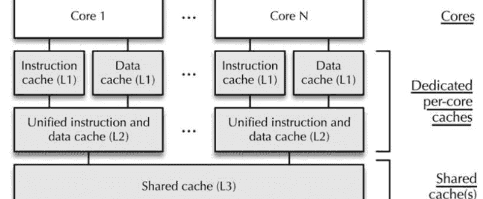

图 12.1 多核处理器上缓存层级的示例。

- 一级缓存（L1）是每个核心专用的，因此每个核心都有自己的缓存。此外，独立的缓存分别存放指令和数据，以充分利用指令和数据访问模式在统计特性上的差异。
- 二级缓存（L2）是统一的——即它们同时持有指令和数据而不区分它们——但它们仍然是每个核心专用的。因此，每个核心都有自己的统一 L2 缓存。
- 三级缓存（L3）位于层次结构的底部。该缓存由所有芯片核心共享，并与主内存总控制器接口，后者负责调介片外主内存访问。

这种通用方案可能有多种变体，特别是在具有许多核心的系统中。例如，核心可以被成簇（clusters），L2 缓存可能在簇内所有核心之间共享，而不是单核专用。

无论细节如何，必须特别注意确保缓存一致性（cache coherence），这是一个至关重要的概念，将在后续概述，以保证所有核心在任何时刻对主内存内容都有相同的映像。反之，缓存一致性与内存一致性模型（memory consistency model）的概念有关，后续也将对其简要讨论。

## 12.2.2 内存一致性模型

内存一致性模型的目的是定义一组规则，决定一组代理（如核心）在共享内存上操作时如何执行内存操作。具体来说，内存一致性模型规定了核心执行的内存操作在执行期间在多大程度上可以被重排，以及这些操作是否必须被其他核心按相同的顺序观察。

这个问题极其复杂，我们在这里只能提供简短的介绍，重点关注对应用程序和系统程序员感兴趣的几个方面。关于内存一致性模型的实际实现，我们将简要描述 ARM Cortex-A 处理器采用的方法 [14] 作为示例。读者应参考该主题的广泛文献以获取更深入的信息。

### 顺序一致性模型

广为人知的内存一致性模型无疑是顺序一致性模型，它在 Lamport 的开创性论文 [79] 中定义。该模型的巨大优点是相对简单直观，即定义了行为易于程序员理解和处理的系统。用作者自己的话说 [79]，顺序一致性模型规定：“任何执行的结果都等同于所有处理器的操作按照某种顺序顺序执行，并且每个单独处理器的操作在该序列中的出现顺序与其程序指定的顺序一致。”

图 12.2 显示了两个任务 τ 和 τ'，它们共享两个初始值为零的变量 a 和 b，并在两个不同的处理器或核心上执行。每个任务将两个变量中的一个设置为一，然后将另一个变量的内容复制到自己的私有存储中（例如，处理器寄存器中）。顺序一致性模型的定义对两个任务共同执行的四个操作 Op.0 ... Op.3 的顺序构了两个不同的约束：

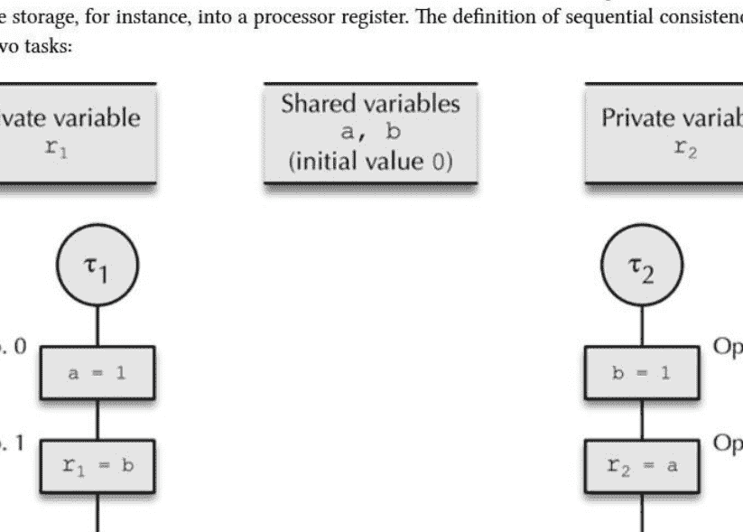

图 12.2 用于说明顺序一致性模型的示例代码。

1. 模型的第一个条件规定四个操作必须按某种顺序发生，尽管它没有指定是哪种顺序。因此，系统允许执行 (Op. 0, Op. 1, Op. 2, Op. 3) 或 (Op. 0, Op. 2, Op. 3, Op. 1)。系统可以在多次代码执行之间自由选择不同的序列，只要每次执行始终能够准确确定选择了哪种顺序顺序，且最终状态与该结果一致。
2. 根据模型的第二个条件，任务在序列内执行的操作必须按照该任务指定的顺序发生。例如，由于 Op. 1 随于 Op. 0，它在序列中也必须随于 Op. 0。结果是序列 (Op. 0, Op. 2, Op. 3, Op. 1) 是允许的（因为 Op. 1 随于 Op. 0，尽管它们不连续），而 Op. 1, Op. 0, Op. 2, Op. 3 显然是被禁止的（因为 Op. 1 先于 Op. 0）。

顺序一致性模型避免了图 12.2 代码中某些违反直觉的结果，同时没有让系统完全确定，并允许系统在一定程度上运行时重排操作以提高性能。在这种情况下，给定代码的四种可能结果如下：

- 结果 ($r=1, r_2=0$),$(r_1=0, r_2=1)$ 和 $(r_1=1, r_2=1)$ 都是可能的。它们对应于序列 (Op. 2, Op. 3, Op. 0, Op. 1), (Op. 0, Op. 1, Op. 2, Op. 3) 和 (Op. 0, Op. 2, Op. 1, Op. 3)。
- 相反，结果 ($r=0, r_2=0$) 是可能的，因为没有任何允许的操作序列可以导致该结果。这种场景意味着 τ 和 τ' 执行的读取操作（Op. 1 和 Op. 3）可能在写入操作（Op. 0 和 Op. 2）之后发生。然而，它们在写入操作之前执行会导致第四种结果。

如表 12.1 总结，顺序一致性模型允许来自图 12.2 代码的 6 种可能的执行序列，这些序列导致前三种结果。从这个简单的讨论可以看出，内存一致性模型的定义极其重要，因为它充当了硬件架构和软件程序员之间的界限。基于此，软件程序员必须准备好处理所有可能的结果并确保代码在所有情况下运行正常。

### 表 12.1 图 12.2 代码的执行：不同的内存模型

| 序列 | 允许 | 顺序一致性结果 | 总存储顺序 (TSO) 允许结果 |
| :--- | :--- | :--- | :--- |
| (Op. 0, 0, Op. 1, Op. 2, Op. 3) | ✓ | $(r_1=0, r_2=1)$ | ✓ | $(r_1=0, r_2=1)$ |
| (Op. 0, 0, Op. 1, Op. 3, Op. 2) | × | — | ✓ | $(r_1=0, r_2=1)$ |
| (Op. 0, 0, Op. 2, Op. 1, Op. 3) | ✓ | $(r_1=1, r_2=1)$ | ✓ | $(r_1=1, r_2=1)$ |
| (Op. 0, 0, Op. 2, Op. 3, Op. 1) | ✓ | $(r_1=1, r_2=1)$ | ✓ | $(r_1=1, r_2=1)$ |
| (Op. 0, 0, Op. 3, Op. 1, Op. 2) | × | — | ✓ | $(r_1=0, r_2=1)$ |
| (Op. 0, 0, Op. 3, Op. 2, Op. 1) | × | — | ✓ | $(r_1=1, r_2=1)$ |
| (Op. 1, Op. 0, 0, Op. 2, Op. 3) | × | — | ✓ | $(r_1=0, r_2=1)$ |
| (Op. 1, Op. 0, 0, Op. 3, Op. 2) | × | — | ✓ | $(r_1=0, r_2=1)$ |
| (Op. 1, Op. 2, 0, 0, Op. 3) | × | — | ✓ | $(r_1=0, r_2=1)$ |
| (Op. 1, Op. 2, 0, 3, Op. 0) | × | — | ✓ | $(r_1=0, r_2=1)$ |
| (Op. 1, Op. 2, Op. 3, 0, 0) | × | — | ✓ | $(r_1=0, r_2=0)$ |
| (Op. 1, Op. 3, 0, 0, Op. 2) | × | — | ✓ | $(r_1=0, r_2=0)$ |
| (Op. 1, Op. 3, Op. 2, 0, 0) | × | — | ✓ | $(r_1=0, r_2=0)$ |
| (Op. 2, Op. 0, 0, Op. 1, Op. 3) | ✓ | $(r_1=1, r_2=1)$ | ✓ | $(r_1=1, r_2=1)$ |
| (Op. 2, Op. 0, 0, Op. 3, Op. 1) | ✓ | $(r_1=1, r_2=1)$ | ✓ | $(r_1=1, r_2=1)$ |
| (Op. 2, Op. 1, 0, 0, Op. 3) | × | — | ✓ | $(r_1=1, r_2=1)$ |
| (Op. 2, Op. 1, 0, 3, Op. 0) | × | — | ✓ | $(r_1=1, r_2=0)$ |
| (Op. 2, Op. 3, 0, 0, Op. 1) | ✓ | $(r_1=1, r_2=0)$ | ✓ | $(r_1=1, r_2=0)$ |
| (Op. 3, Op. 1, Op. 2, Op. 0) | | - | (r₁ = 0, r₂ = 0) |
| (Op. 3, Op. 2, Op. 0, Op. 1) | | - | (r₁ - 1, r₂ - 0) |
| (Op. 3, Op. 2, Op. 1, Op. 0) | | - | (r₁ - 1, r₂ - 0) |

### 总存储顺序 (TSO)

顺序一致性模型的一个主要问题是它缺乏效率，因为正如我们刚刚看到的，它禁止了许多类型的重排序。这对于写操作尤为重要，因为在许多现代架构中，从执行时间来说，写操作是非常昂贵的。

通过参考图 12.1 可以很容易地理解其根本原因：为了对其他核心可见，写操作必须通过缓存层级向下传播，从发布该操作的核心开始一直到 L3 缓存。

此外，观察图 12.2，为了遵守顺序一致性模型，除非我们可以很容易地论证没有理由延迟对变量 $b$ 的读取直到对完全无关的变量 $a$ 的写入完成，否则 Op. 1 不能在 Op. 0 完成且写操作对所有其他核心可见之前启动。同样的推理也适用于相对于 Op. 2 的 Op. 3。

缓解这一问题的广泛方法是放宽内存一致性模型，允许在核心与其缓存层级之间插入一个存储缓冲区（store buffer，有时称为写缓冲区），如图 12.3 的简化图所示。正如其名称所示，存储缓冲区临时持有一个或多个写操作，以便它们在稍后的时间完成，而核心在此期间继续执行其他内存操作。非正式地说：

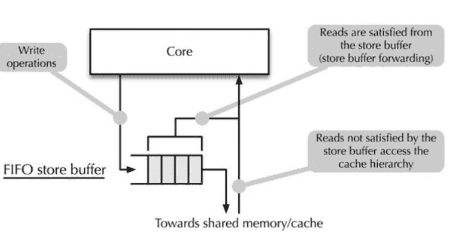

图 12.3 FIFO 写缓冲器的简化功能图。

- 写操作被推入存储缓冲区，而不是立即转发到共享缓存或内存。缓冲的写操作与核心发出的后续读操作并发执行，直到它们最终以先进先出（FIFO）的顺序提交到共享缓存或内存中。
- 读操作查询存储缓冲区以检查是否包含对相同地址的写操作。在这种情况下，读取直接从存储缓冲区获取值，该过程被称为存储缓冲区转发（store buffer forwarding）。否则，读操作照常通过缓存层级访问共享缓存或内存。

总体来说，由于存储缓冲插入，从其他核心的角度来看，核心发布的写操作可以被延迟，尽管得益于存储缓冲区转发，从发布它们的核心的角度来看，它们始终在代码中发现的位置执行。换句话说，写缓冲区的存在对于连接到它的核心是透明的。

相反，从其他核心和共享内存的角度来看，某个核心执行的写操作可能被视为已经超过了该核心发出的后续读操作。相反，由于存储缓冲区的 FIFO 特性，某个核心发出的写操作不能通过该核心发出的其他写入。

总体来说，尽管如前所述写操作可以相对于同一核心发出的后续读操作进行重排序，但它们仍然按某种顺序提交到内存并被所有其他核心观察到。出于这个原因，这种内存模型被称为总存储顺序（TSO）。该模型的几种变体被广泛使用，例如在 Intel 处理器 [107] 中。

对于此处所示的简化模型，真实模型的主要复杂性在于它们必须支持锁指令（locked instructions），即在内存单元上执行不可分割的读-修改-写操作的指令。

回想图 12.2 的示例，我们可以很容易注意到 TSO 模型比顺序一致性模型更宽松。特别是，由于每个任务的代码都包含一个写操作后跟一个读操作，硬件可以自由在读操作之后将写操作提交到内存。

结果是表 12.1 中列出的所有 24 种可能的操作序列都被 TSO 模型允许，并且如表格最右列所示，结果 $(r_1 = 0, r_2 = 0)$ 变得可能，尽管对于只看代码的程序员来说，这听起来仍然不可信。这种情况发生在写缓冲区延迟了 $\tau_1$ 和 $\tau_2$ 发出的两个写操作，直到它们执行了两个读操作之后。

尽管极其简单，这个示例也说明了采用一种内存模型或另一种内存模型始终是以下两者之间的权衡：

- 提高性能，赋予硬件更多重排序内存操作的自由。
- 接受不那么直观的行为和结果，就像刚才描述的那样。

图 12.4 中列出的经典示例代码说明了一种仍然被总存储顺序模型禁止的执行结果。系统中有四个任务，其中：

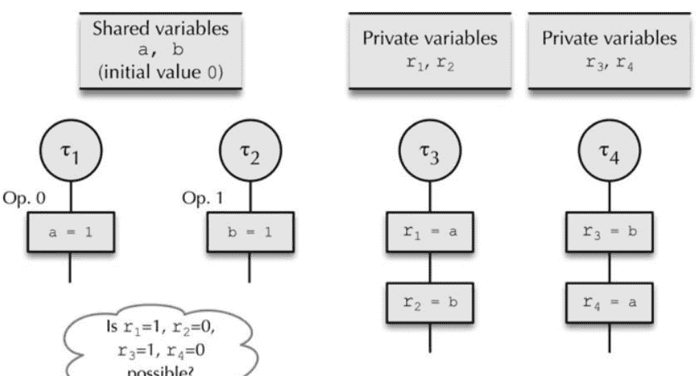

图 12.4 更高级排序形式的示例代码。

- 任务 $\tau_1$ 和 $\tau_2$ 更新两个共享变量 $a$ 和 $b$。更新将变量的值从初始值 $\theta$ 变为 1。
- 任务 $\tau_3$ 和 $\tau_4$ 反向读取这些变量并将其内容复制到本地存储中。

我们可以很容易观察到，根据总存储顺序模型，结果 $(r_1 = 1, r_2 = 0, r_3 = 1, r_4 = 0)$ 是是不可能的，因为：

- 部分结果 $(r_1 = 1, r_2 = 0)$ 意味着 $\tau_3$ 在执行读操作时发现变量 $a$ 已经更新为 1，而变量 $b$ 仍处于 $\theta$。因此，从 $\tau_3$ 的角度来看，写操作的执行顺序是 (Op. 0, Op. 1)，而 $\tau_3$ 的读操作发生在两者之间。
- 对称地，部分结果 $(r_3 = 1, r_4 = 0)$ 意味着 $\tau_1$ 在执行读操作时发现变量 $b$ 已经更新为 1，而变量 $a$ 仍处于 $\theta$。因此，从 $\tau_1$ 的角度来看，写操作的执行顺序也是如此。

总之，尽管写操作可以相对于同一核心发出的后续读操作进行重排序（如前所述），但它们仍然按某种顺序提交到内存并被所有其他核心观察到。出于这个原因，这种内存模型被称为总存储顺序（TSO）。

对于此处所示的简化模型，真实模型的主要复杂性在于它们必须支持锁指令，即在内存单元上执行不可分割的读-修改-写操作的指令。

回想图 12.2 的示例，我们可以很容易注意到 TSO 模型比顺序一致性模型更宽松。特别是，由于每个任务的代码都包含一个写操作后跟一个读操作，硬件可以自由在读操作之后将写操作提交到内存。

结果是，表 12.1 中列出的所有 24 种可能的操作序列都被 TSO 模型允许，并且如表格最右列所示，结果 $(r_1 = 0, r_2 = 0)$ 变得可能，尽管对于只看代码的程序员来说，这听起来仍然不可信。这种情况发生在写缓冲区延迟了 $\tau_1$ 和 $\tau_2$ 发出的两个写操作，直到它们执行了两个读操作之后。

尽管极其简单，这个示例也说明了采用一种内存模型或另一种内存模型始终是以下两者之间的权衡：

- 提高性能，赋予硬件更多重排序内存操作的自由。
- 接受不那么直观的行为和结果，就像刚才描述的那样。

图 12.4 中列出的经典示例代码说明了一种仍然被总存储顺序模型禁止的执行结果。系统中有四个任务，其中：


图 12.4 更高级排序形式的示例代码。

- 任务 $\tau_1$ 和 $\tau_2$ 更新两个共享变量 $a$ 和 $b$。更新将变量的值从初始值 $\theta$ 变为 1。
- 任务 $\tau_3$ 和 $\tau_4$ 反向读取这些变量并将其内容复制到本地存储中。

我们可以很容易观察到，根据总存储顺序模型，结果 $(r_1 = 1, r_2 = 0, r_3 = 1, r_4 = 0)$ 是是不可能的，因为：

- 部分结果 $(r_1 = 1, r_2 = 0)$ 意味着 $\tau_3$ 在执行读操作时发现变量 $a$ 已经更新为 1，而变量 $b$ 仍处于 $\theta$。因此，从 $\tau_3$ 的角度来看，写操作的执行顺序是 (Op. 0, Op. 1)，而 $\tau_3$ 的读操作发生在两者之间。
- 对称地，部分结果 $(r_3 = 1, r_4 = 0)$ 意味着 $\tau_1$ 在执行读操作时发现变量 $b$ 已经更新为 1，而变量 $a$ 仍处于 $\theta$。因此，从 $\tau_1$ 的角度来看，写操作的执行顺序也是如此。

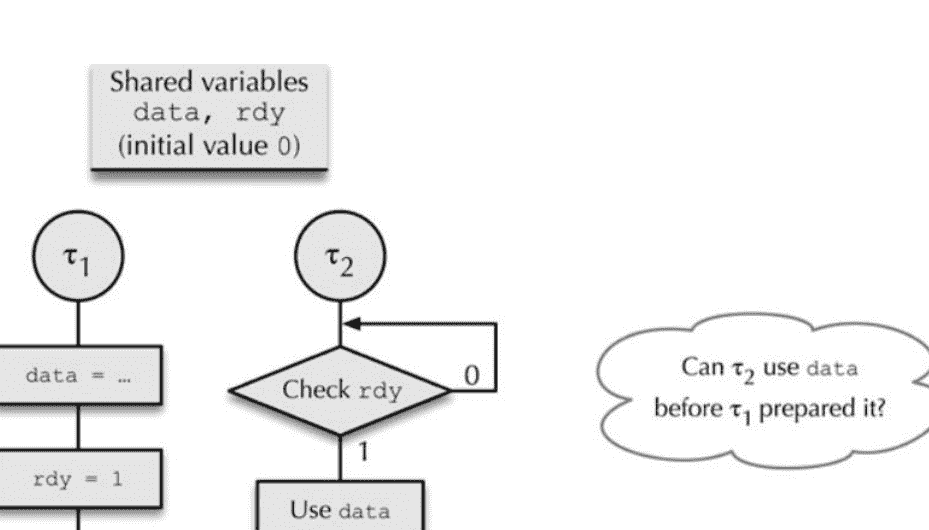

图 12.6 带有忙等的简单、单次任务间同步。

- 任务 $\tau_1$ 准备数据并将其写入共享缓冲区 `data` 中。为了信号数据已就绪，它将共享标志 `rdy`（其初始值为 0）设置为 1。
- 任务 $\tau_2$ 包含一个忙等循环，在其中它反复检查 `rdy` 的值。该任务一直留在循环中，直到 `rdy` 变为 1。之后，$\tau_2$ 使用这些数据。

尽管这段代码看起来是正确的，但如果 $\tau_1$ 执行的对 `data` 和 `rdy` 的两个写入操作被 $\tau_2$ 以不同的顺序观察到，那么它就会发生故障。当这种情况发生时，$\tau_2$ 可能在 $\tau_1$ 完成写入之前就被越越了忙等循环。

如果共享缓冲区是一个复杂的数据结构而非单个字，那么这不仅是数据新鲜性的问题（$\tau_2$ 可能会访问旧版本的数据），而且数据一致性的问题（如果对 data 的更新需要 $\tau_1$ 执行多次写入操作，$\tau_2$ 可能会访问到新旧数据的混合）。

我们可以泛化这一概念并指出，回想起关键区域进入和退出代码的定义（在 7.1.3 节给出），任何重排序使得存储操作的效果在临界区进入代码成功执行之前对其他核心可见（或对称地，其效果在临界区退出代码之后可见），都会破坏任务间互斥的核心概念，而临界区正是为了保证这种互斥。

### 内存屏障和其他对措施

一方面，重排序内存操作具有提高执行性能的毋庸置疑的优势，因为它允许硬件在许多情况下隐藏内存延迟。直觉上，我们也可以认为，随着重排序方法变得越来越激进，性能会得到进一步提高。另一方面，我们也看到重排序存储操作可能会导致看似简单的代码失败。


在代码的某些关键部分限制重排序或完全禁用重排序是非常重要的。在大多数架构上，这一目标可以通过两种可能的方式实现，其区别在于作用的粒度。

- **内存屏障**或`fence`是特殊指令，正如其名，它们是内存操作无法跨越的栅栏。在最简单的形式下，屏障指令确保代码中先于它的所有内存操作已经执行，并且在任何后续操作开始之前，严格地对其他核心可见。

  实现屏障的语义通常意味着重大的性能开销，因为在最常见的实现中，它强制核心等待直到所有先前的内存操作都已“刷新”（`flushed`）。

  因此，许多架构实现了几种不同类型的屏障，对不同类型的内存操作具有不同程度的渗透性。例如，除了我描述的最严格的屏障形式外，它们还可能提供一种较弱的屏障，它阻止存储操作跨越它，但允许操作通过。

- 在某些情况下，限制或禁用重排序的需求更多与内存操作的目标地址，而非其在代码中的特定位置，例如当软件必须操作一组设备寄存器时。通常情况下，对设备寄存器的读或写操作具有硬件相关的副作用，通常需要确保它们按照代码中指定的顺序执行。这不仅适用于多核处理器，也适用于单核处理器。

  例如，一个具有串行接口的简单设备可能有一个`data`寄存器，其中必须写入要传输的数据，以及一个`control`寄存器，在设置设置时启动传输。

  出于类似的原因，也有必要确保在处理器和设备之间的任何缓存都不会从底层设备的角度持有或延迟对设备寄存器的任何操作。

  在这种情况下，地址空间的一个整个区域可以被特殊地标记，以指示它用于与设备接口。这通常在软件初始化期间完成，效果是对针对该区域的所有内存操作禁用缓存和重排序。这种方法还有一个额外好处，即之后操作设备的代码可以在不显式使用任何屏障指令的情况下进行。

这两种技术主要令系统或设备程序员感兴趣。如果我们只关注任务间的通信和同步（第 7 章和第 8 章中描述的），确保了构建在它们之的高层软件正常工作。这是因为屏障指令已经嵌入在操作系统提供的同步设备中，而这些是实现通信和同步原语的组件。正如第 12.2.5 节对 C 和 C++ 语言更好的描述的那样，这些原语通过函数调用调用时防止了其他类型的意外重排序，这一事实在编译器层面也防止了这种重排序。

相反，任何锁或无锁一致性算法（如第 13 章示例所示）的实现意味着对内存屏障的审慎使用。再次，使用经过验证的同步库而不是从零开始对这些算法进行临时实现，对于解决或至少缓解问题是有价值的。

### 12.2.3 缓存一致性

在 12.2.1 节中，我们看到缓存已成为许多现代嵌入系统的不可组成部分，因为它们是为了填补处理器和内存之间不断扩大的速度差距，这种差距现在已经达到了一或两个数量级。随着差距扩大，处理器架构师采用了以层次方式排列的多级缓存（如图 12.1 所示），以求在访问速度、容量、额外成本、芯片面积、功耗和互连性之间实现最佳折衷。

为了提高性能，缓存行为的规则——协议——变得更加复杂，特别是对于存储操作。从直通策略（`write-through policies`，即存储操作立即回写到内存）到更复杂的写回策略（`write-back policies`，即新数据临时保存在缓存中，只有在缓存空间必须被使用时才回写到主内存）。

希望，写回方法对于存储操作的影响正如我们所描述的那样，即主内存的内容没有反映另一个核心执行的最新存储。对于存储操作来说，主内存包含过期数据的许多时间窗口，广泛采用的解决方案（在 12.2.2 节简要描述）是使用特殊的屏障指令。本质上，这些屏障阻止存储操作以损害算法正确性的方式延迟。

当涉及缓存时，处理具有 DMA 能力的设备确实可以选择性地刷新和失效部分缓存。刷新（或如处理器手册所说的清理）确保设备能够访问最新数据。在设备写入内存之后、允许处理器读取之前使缓存失效，可以确保处理器不会继续仍存在于缓存中的旧数据。

鉴于内存缓存的大小及其对性能的影响，这些操作具有选择性是非常重要的，因为它们必须只影响缓存的最小部分。对于设备来说，这是可能的，因为处理器和设备之间共享的内存缓冲区的位置对于设备驱动程序总是已知的，所有缓存控制器都提供了选择性刷新或失效缓存项的方法，例如基于它们所引用的物理地址。

然而，当数据在核心之间共享时（如图 12.1 所示且在现代嵌入式处理器架构中变得越来越常见），会出现类似的问题——至少缓存层级是每个核心专用的或私有的。这就是每个核心的 L1 和 L2 缓存的情况。

为了简单起见，我们假设一个双核处理器每个核心只有一个级专用的写回缓存。如图 12.7 所示，当在两个核心上运行的两个代码段操作地址为 `w` 且被任一核心缓存过的共享内存时，可能会出现以下序列：

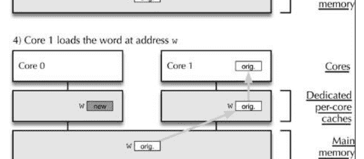

图 12.7 在没有缓存一致性的情况下核心之间的数据共享。

1. 核心 0 加载地址 `w` 处的字（`word`）。由于我们假设 `w` 的内容尚未被缓存，因此将为它们分配一个新的缓存行并用内存中的数据进行填充。

2. 核心 0 更新地址 `w` 处的字。由于 `w` 的内容现在已缓存，且缓存采用的是写回（`write-back`）策略，因此更新不会一直回传到主内存，更新后的值保留在核心 0 的缓存中。

3. 如果没有其他核心从 `w` 读取内容，核心 0 将从自己的缓存中获取内容，这证明了写回缓存的存在对于相应的核心是透明的。

4. 相反，如果此时核心 1 加载地址 `w` 处的字，它将导致缓存未命中，并从内存中检索 `w` 的旧内容。

这一系列事件的结果是，尽管核心 1 从核心 0 读取了更新后的内容，但它仍然得到了原始且过时的 `w` 内容。换句话说，两个核心对内存内容的视图不再具有一致性。这种异常会一直持续到 `w` 的新内容最终从核心 0 的缓存中刷回内存为止。此外，如果 `w` 是一个复杂的数据结构而非仅仅是一个内存字，核心 1 可能获取的值可能既不是旧内容也不是新内容，而是两者中的任何一个，这不可避免地导致了数据损坏。

通过正确地刷新（`flush`）和失效（`invalidate`）缓存，仍然可能获得预期的行为。例如，在这种特定情况下，在写入 `w` 之后需要刷新核心 0 的缓存。对读取 `w` 的核心 1 缓存进行失效处理是明智的，以防该缓存中已经包含了 `w` 内容的过时副本。然而，通用这种技术会导致一些主要问题：

- 在多线程环境中，属于同一个进程的所有线程意味着它们共享整个地址空间。因此，很难以自动且系统的方式确定它们实际上共享了什么，特别是在支持别名（`aliasing`）和指针的编程语言中。另一方面，每当线程访问任何可能共享的数据时都刷新和失效缓存，从性能角度来看可能是不可接受的。由于这些原因，缓存维护的负担必须留给程序员，而程序员们可能并没有意识到在多核系统上执行其代码的底层影响。

- 在根据全局调度原则允许调度器在执行期间抢占并将线程从一个核心迁移到另一个核心的系统中，会出现额外的复杂性，因为上述提到的这种基于软件的缓存维护方法在不干扰调度算法的情况下可能很难实现。让我们考虑以下伪代码片段：

  1. 在 `w` 中存储一个新值

  2. 刷新包含 `w` 的缓存部分

尽管根据之前的讨论这段代码看起来是正确的，但如果它的执行在核心 0 上启动，而调度器在第一条指令和第二条指令之间决定将其迁移到核心 1，那么它可能会失败。如果发生这种情况，代码将刷新错误的核心的缓存，即使在两条指令都执行完毕后，内存中仍然包含 `w` 的旧值。此外，由于在大多数架构上该代码片段只需两个汇编指令即可实现，这使得错误发生的概率极低（但并非不可能），并使调试变得更加困难。在两条指令执行期间禁用线程迁移可以解决问题，但代价是额外的开销。

出于这个原因，许多架构采用了基于硬件而非基于软件的技术来确保缓存一致性。如图 12.8 所示，通过在缓存和主内存之间插入一个缓存一致性逻辑层来实现，这是以一些硬件复杂性和额外功耗为代价的。

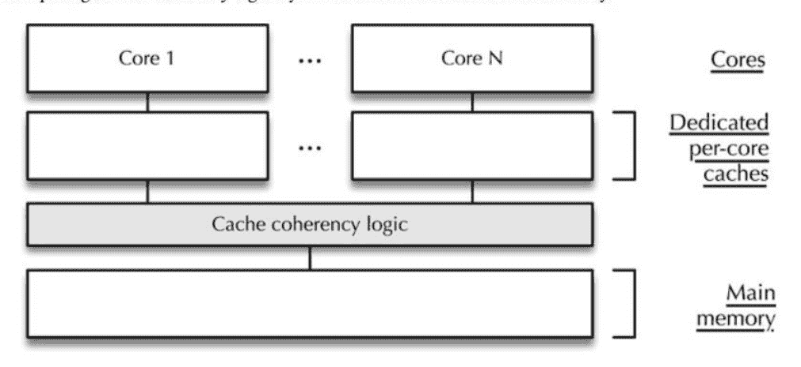

图 12.8 缓存一致性逻辑。

根据核心数量，一致性逻辑可以跨越所有核心和缓存（如图所示），或者系统可以划分为多个域，具有独立的缓存一致性逻辑模块。在这种情况下，缓存一致性逻辑保证的属性仅在该域内有效。

如前，我们假设只有一个缓存级以简化讨论，但这种情况下必须在相邻的缓存级之间插入不同的一致性逻辑层。

缓存一致性通过观察所有缓存和内存事务并更改缓存行的状态来维护一致性。在这里，我们将总结 MESI 协议（首先在文献 [94] 中讨论），因为它被应用于处理器架构的各种变体中。

在 MESI 协议中，每个缓存行由四种可能的状态之一表征。假设缓存工作在写回模式下。状态为：

- **无效（I）**状态表示缓存未持有有效数据。

- **独占（E）**状态表示缓存行内容有效、与内存一致，且没有其他缓存拥有该行。

- **共享（S）**状态也表示缓存行内容有效且与内存一致，但其他缓存可能拥有该行。

- **修改（M）**状态表示缓存行内容有效，但相对于内存中的值已修改。没有其他缓存拥有该行。

独占和共享状态通常被称为**洁状态**，因为缓存行与主内存一致。修改状态被称为**脏状态**，因为缓存行包含了比内存更新且与其不一致的数据。MESI 协议的一个关键目标是防止其他核心从对应脏缓存行的内存区域读取和使用过时数据。为了这个目的，一致性逻辑能够满足另一个核心的请求，跳过主内存。

当发生两类操作时，缓存行会在一致性逻辑的控制下从一种状态转换为另一种状态，即：

- **本地操作**，包括来自直接连接缓存的本地核心的读写请求，以及在重用非失效缓存行之前应用的缓存行操作。下文中这些操作分别称为 `Lr`（本地读）、`Lw`（本地写）和 `Lc`（本地清洗）。

- 由其他核心发起并通过连接核心和一致性逻辑的总线进行嗅探（即观察）的操作。一个核心在总线上可以发起三种操作：`Br`（读）、`Bi`（失效）和 `Bri`（读+失效）。

图 12.9 用状态转换图总结了 MESI 协议如何响应本地操作。

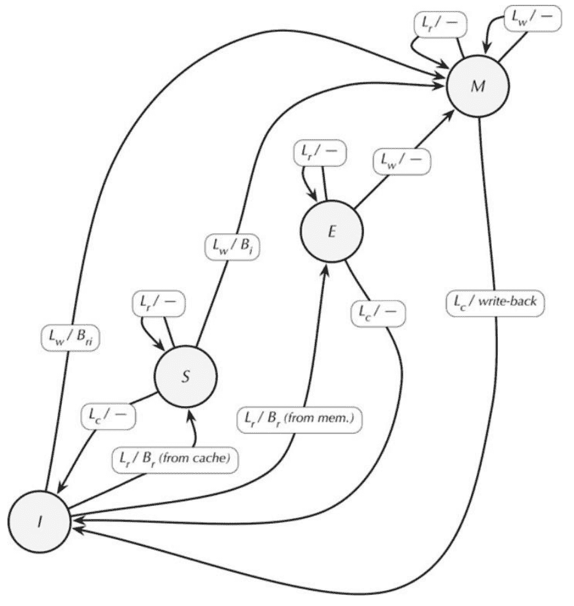

图 12.9 MESI 协议的主要状态和转换。

当核心使用 `Lw`（本地写）操作时，所采取的行动类似于：

- 与之前一样，会查询本地缓存以确定是否命中或未命中。

- 如果命中，缓存行将进入 `M`（修改）状态，以反映其内容不再与主内存一致的事实。如果该缓存行处于 `S`（共享）状态，其他缓存可能也持有相同的、现已过时的信息。因此，会发出一个 `B`（失效）总线操作，指令它们使任何匹配的缓存行失效。相比之下，如果缓存行已处于 `M`（修改）或 `E`（独占）状态，则不需要任何总线操作，因为这两种状态都保证了系统中的没有其他缓存持有相同的信息。

- 如果未命中，则必须分配一个新的缓存行，这可能是在之后通过 `Lc`（本地清理）操作对其进行清理。然后，发出一个 `Bri`（总线读+失效）操作来填充缓存行。最后，根据写操作更新缓存行并移动到 `M`（修改）状态。该总线操作会指令其他缓存如果它们拥有请求的数据，则提供数据；将任何更新的数据写回主内存；并使任何匹配的缓存行失效。如果没有缓存拥有请求的数据，则请求将来自主内存。

- 如果该行处于 `S`（共享）或 `E`（独占）状态，其内容与主内存一致，直接被丢弃且不再进行后续操作。这种方法的一个副作用是 `S`（共享）状态是*不精确的*。正如我们所解释的，当其他缓存持有相同信息时，缓存行从 `E`（独占）状态移动到 `S`（共享）状态，但由于其他缓存上发生了不可检测的 `Lw` 操作导致不再不再时，它永远不会回到 `E`（独占）状态。

- 如果缓存行处于 `M`（修改）状态，在将其引入 `I`（无效）状态之前，其内容写回主内存。虽然此操作可以被其他缓存嗅探，但 MESI 协议并没有预见到它们在这种情况下应该执行的任何操作。

图 12.10 展示了所有其他缓存如何响应特定缓存发出的总线操作。响应仅发生在*匹配*的缓存行上，即未处于 `I`（无效）状态且在内存地址上对应于最初引发总线操作的缓存行。该地址通过互连总线传递给其他缓存，并根据操作类型进行传输，如前所述，这种操作可以是 `Br`（读）、`Bi`（失效）或 `Bri`（读+失效）。对 `Br`（读）操作的响应是非常直观的：


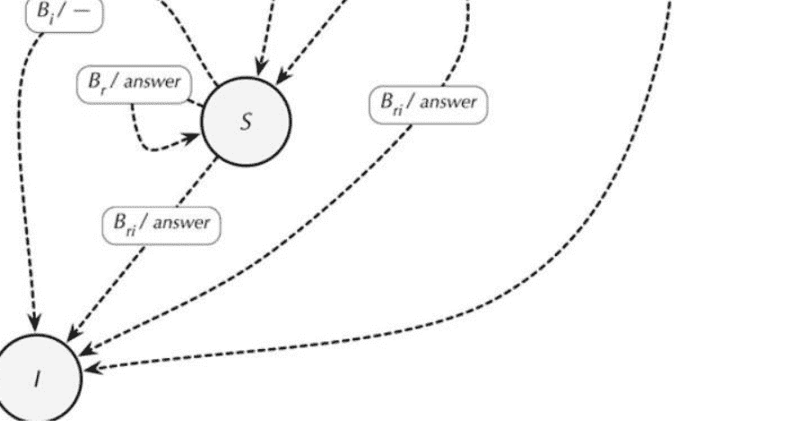

图 12.10 MESI 协议的主要状态和转换，总线操作。

- 所有具有匹配缓存行的缓存必须响应请求的数据，无论缓存行状态如何——状态不能为 I（无效）。如果有多个缓存响应，根据定义，它们必须响应相同的数据，并将由适当的仲裁逻辑选择其中一个。

- 如果匹配的缓存行之一处于 `E`（独占）状态，它将移动到 `S`（共享）状态，以反映其他缓存现在持有相同信息的事实。根据定义，处于 `E`（独占）状态的匹配缓存行最多只能有一个。

- 如果匹配的缓存行之一处于 `M`（修改）状态，其内容被写回主内存，并被移动到 `S`（共享）状态。与之前一样，处于 `M`（修改）状态的匹配缓存行最多只能有一个。

这种行为保证了请求缓存始终能获取最新的可用数据，因为如果存在一个具有 `M`（修改）状态匹配缓存行的缓存，它将是唯一回答请求的缓存。同时，如果有必要，最新的数据会被写回主内存，并且所有匹配缓存行的状态都被设置为 `S`（共享），以反映这些数据存在于多个缓存中（至少两个）的事实。这是可行且正确的，因为 `Br`（读）操作信号请求缓存需要它所请求的数据，但并不意图修改它们。对 `Bri`（读+失效）操作的响应类似，但有一个显著区别：

- 在响应请求的数据并可能写回处于 `M`（修改）状态的匹配缓存行内容后，所有缓存都使匹配的缓存行失效，即无条件地移动到 `I`（无效）状态而不是 `S`（共享）状态。

这种差异是因为考虑到 `Bri`（读+失效）操作表示请求缓存意图立即修改请求的数据。因此，它必须成为这些数据的唯一所在地，具体来说，是在处于 `M`（修改）状态的缓存行中。

当处于 `S`（共享）状态的缓存行因内容更新而移动到 `M`（修改）状态时，使用 `Bi`（失效）操作。作为响应，所有其他缓存都会失效它们可能有的任何匹配缓存。值得注意的是，根据 MESI 协议的工作机制，所有缓存必须处于 `S`（共享）状态。

总结来说，MESI 协议的一个重要方面是它自动处理缓存写回和失效，确保一致性域内的所有缓存都能看到主内存内容的一致视图。

更重要的是，这对于运行在核心上的应用程序任务是透明完成的。它们执行的内存读/写操作将始终在共享数据上正确运行，不需要额外的代码或关注，无论后台的缓存一致性逻辑在做什么。即使任务在执行的任意点从一个核心迁移到另一个核心（但仍在同一一致性域内），该属性依然有效。

两个主要的注意事项是，程序员必须确保硬件按照预期的顺序和计时执行读写操作（见第 12.2.2 节）。正如单核缓存发生过的情况，缓存一致性逻辑为了满足来自连接缓存的读或写请求而执行的实际操作取决于系统中缓存的状态。因此，它们的执行时间随之变化，且这些时间差异是存在的。


## 12.2.4 处理器的实际实现

作为前述方法如何在实践中实现的示例，本节将仅关注关键点。

### 内存系统

多核 ARMv8 架构的典型内存系统如图 12.11 所示，其主要元素包括：


- 一组分组的核心，每个集群都有自己的指令（`I`）和数据（`D`）L1 缓存。为了获得最大的性能，硬件不强制这些缓存之间的一致性，必须通过显式的刷新和失效来管理。

- 每个集群有一个所有核心共享的 L2 缓存。该缓存配备了 ARM 文档中称为嗅探单元（`SCU`）的一致性控制，它仲裁对 L1 缓存的访问，并保持 L1 数据缓存的一致。

- 在高性能系统中，嵌入 L3 缓存的缓存性互连连接多个集群，并由于其自身的一致性逻辑仲裁对 L2 缓存的访问，形成单一的一致域。再次，L1 缓存被排除在外。

- 缓存性互连还可能连接到高速外设——例如图形处理器（`GPU`）或网络接口——它们拥有直接内存访问（`DMA`）引擎和内部缓存。这种方法允许外设通过互连访问主内存并使用 L3 缓存减少延迟。更重要的是，它们的 `DMA` 引擎被赋予主内存内容的一致视图，不再需要在输入输出操作前后进行处理器端的软件缓存刷新和失效。

- 缓存性互连在需要时访问外部内存。这通常通过动态内存控制器（`DMC`）实现，该控制器负责外部 RAM 的调度、计时和操作推理。在图 12.11 中，属于一致域的实体被高亮显示。

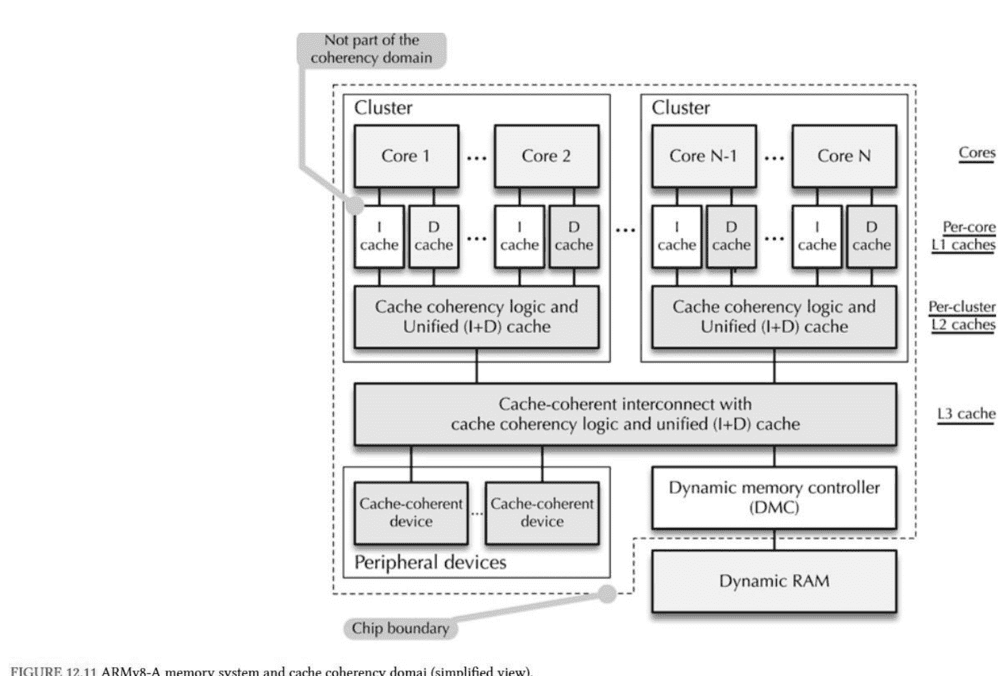

### 内存管理单元和内存类型

ARMv8-A 系统中的内存访问始终由内存管理单元（`MMU`）管理，负责三个主要功能：

- 虚拟地址到物理地址的翻译。虚拟地址是核心每次取指指令或加载存储数据时生成的地址。物理地址是内存（通常是缓存）看到的对应地址。

- 内存访问保护，为某些内存区域定义并强制特定的访问权限，取决于执行核心的状态（非特权或特权）和访问类型（取指、加载或存储）。

- 为某些内存区域定义属性，这些属性会影响缓存和缓存一致性模块的行为，以及内存操作排序规则。

这三个功能都是通过一种称为转换表的内存驻留数据结构来实现的。可能存在多四个不同的转换表，每个核心根据当前的特权级别以及待翻译虚拟内存地址所在的范围来使用其中一种。

转换表内部结构`get`描述，以及内存管理单元（`MMU`）如何使用其进行地址翻译和内存访问保护，超出了本书的范围，因为这涉及许多特定于架构的细节，这些细节本质上不适用于其他地方。

相反，我们将关注内存属性的含义——尽管有时被称为不同的名称——这些属性在其他处理器架构中有直接对应的对应项，并说明了第 12.2.2 节和 12.2.3 节中概述的概念如何在真实硬件中体现。

如表 12.2 所示，ARM-v8A 架构定义了两种内存类型：*普通*（`normal`）和*设备*（`device`）。这两种类型是互斥的，核心可访问的所有内存区域必须归类为一种类型。

| 类型 | 属性 | 描述 |
| --- | --- | --- |
| 普通 | Tagged(1) | 启用标记内存扩展[14]。 |
|  | 可缓存 / 不可缓存(2) | 启用缓存。 |
|  | 写直通 / 写回(2) | 控制写操作时的缓存行为。 |


| 瞬态 / 非瞬态(2) | 倾向于使用短期缓存而非长期缓存。 |
|---|---|
| 读取分配(2) | 在读取缺失时分配缓存行。 |
| 写入分配(2) | 在写入缺失时分配缓存行。 |
| 设备 | 聚合(3) | 将多个写操作组合在一起。 |
| | 重排序(3) | 重排序内存操作。 |
| | 早期写回确认(3) | 在写操作完全完成之前继续执行。 |

> (1) 包括内部/外层可缓存、写回、非瞬态、读取分配、写入分配。
> (2) 这些属性可以为内部缓存和外层缓存单独指定。
> (3) 这些属性之一的否定意味着所有先前的属性的否定。

## 普通内存

这种内存提供了最大的性能，因为它允许核心能够执行的所有内存操作重排序策略。因此，应尽可能使用普通内存类型，例如 `Flash`、`ROM` 和 `RAM` 内存区域。架构规范的早期版本对核心可以执行的重排序类型和范围限制很少，这使得内存顺序模型变得非常复杂，并为实现留了很大的自由。

然而，为了简化模型，后期引入了进一步的限制 [101]，因为发现这种自由度的部分从未被生产实现所利用。换句话说，已经确定模型的复杂性对程序员来说是一种负担，而潜在的性能提升并不能证明它是合理的。

具体来说，该架构最初是非原子的。结果是，模型具有违反直觉的属性：核心的内存写操作最初只对部分核心可见，然后才对所有核心可见。随后模型被修改为实现多副本原子性（`multicopy-atomic`），并保证核心的内存写入恰好在同一时间对所有其他核心可见。

在上一句中，强调“所有”（`all`）这个词很重要，因为后续原子性的可见性不包括发布写操作的核心。换句话说，写操作在对其他核心可见之前，可能仍然对发布核心可见，以便允许使用第 12.2.2 节讨论的对性能至关重要的存储缓冲区。核心发布的操作可能会被硬件重排序，并且不需要按照程序顺序执行。写操作也可能被重排序，多次写入可以合并为单次内存写操作。写操作相对于读取可以重排序，唯一的约束是不破坏任何数据依赖关系。例如，禁止在同一内存地址的读取操作之后推迟写操作。

由于推测执行，核心还可能从程序未显式引用的内存地址发出指令取指和读取数据操作。例如，核心可能在确定分支是否会跳转之前，就开始在条件分支指令的一侧取取并执行指令——以及它们从内存中所需的数据——以试图在预测正确时提高性能。

在内存范围内，程序员可以通过屏障指令（`barrier instructions`，后文将讨论）强制核心偏离默认行为，并根据具体情况显式限制重排序。屏障有多种类型，并提供不同的权衡。

## 设备内存

设备内存类型用于内存映射 I/O，在这些情况下，特定的顺序和侧效应至关重要。如表 12.2 所示，设备内存进一步具有以下属性特征：

- **聚合（Gathering）**：将多个写操作组合在一起。
- **重排序（Reordering）**：重排序内存操作。
- **早期写回确认（Early write acknowledgment）**：在写操作完全完成之前继续执行。

设备内存类型用于内存映射 I/O，在这些情况下，特定的顺序和侧效应至关重要。它通常不缓存，以确保与硬件直接交互。

## 可缓存性和共享性

普通内存区域的两个重要属性是可缓存性（`cacheability`）和共享性（`shareability`）。

- 直观地说，可缓存属性控制该区域是否被缓存。
- 共享性属性指定区域内容是核心私有的，还是在多个核心之间共享的。

内存区域的可共享性指定了内存区域的内容在核心以及其他具有 DMA 能力的代理之间是否共享以及在何种程度上共享。在这种情况下，还定义了内部共享域（`inner shareability domains`）和外部共享域（`outer shareability domains`），从而产生了四种可能的设置：

- **非共享（non-shareable）**：区域仅由一个核心使用，因此，没有必要保持其内容的一致性。
- **内部共享（inner shareable）**：区域是共享的，硬件必须确保所有这些核心的内容都保持一致性。回看 12.11，内部共享域通常包括系统中的所有集群（`clusters`）。
- **外部共享（outer shareable）**：区域的一致性范围更广。它由一个或多个内部共享域组成，通常包括所有集群加上所有连接到缓存一致性互连的设备。
- **全系统**：最宽的域，它包含了系统中的所有内存观察者，并可能包括系统中的所有设备。

在这些情况下，必须谨慎指定共享性范围，因为域的范围越宽，同步的开销就越大。ARM8 架构使用 `MESI` 协议来确保缓存一致性。对于普通内存，屏障指令确保程序顺序中的内存访问顺序正确。屏障指令（`Barriers`）确保了内存访问操作在不同代理之间是可见的。

# 屏障（Barriers）

ARM8 架构提供了几种屏障指令（表 12.3 所示），这些指令用于确保内存访问操作的顺序。对于程序员来说，屏障的作用是确保内存访问的顺序性，特别是在多核心共享内存中，这种同步至关重要。屏障指令会产生性能影响，因为它们会冲空或刷新流水线，以确保屏障之前的内存访问操作完成后才能继续执行。

### 屏障指令类型与属性

**表 12.3 Armv8 支持的屏障类型（Kinds of Barrier Instruction Supported by Armv8）**

| 类型（Kind） | 指令（Instruction） |
|---|---|
| ISB | 指令同步屏障（Instruction Synchronization Barrier） |
| DMB | 数据内存屏障（Data Memory Barrier） |
| DSB | 数据同步屏障（Data Synchronization Barrier） |
| LDAR | 加载获取（Load-Acquire） |
| STLR | 存储释放（Store-Release） |

| 属性（Property） | 取值（Value） |
|---|---|
| 访问类型（Kinds of access） | 非共享（Non-shareable）、内部共享（Inner shareable）、外部共享（Outer shareable）、全系统（Full system） |
| 共享域（Shareability domain） | 加载-加载（Load-Load）、加载-存储（Load-Store）、存储-存储（Store-Store）、任意-任意（Any-Any） |

- **ISB（指令同步屏障）**：`ISB` 是指令同步屏障，它确保在 `ISB` 之后执行的指令在 `ISB` 之前的指令更改已经完成。它会刷新流水线。
- **DMB（数据内存屏障）**：`DMB` 确保屏障之前的内存访问操作按照指定的顺序完成。
- **DSB（数据同步屏障）**：`DSB` 不仅强制执行 `DMB` 的顺序限制，还会停止核心的执行，直到屏障之前的所有同步操作完成。
- **LDAR（加载获取）**和 **STLR（存储释放）**：这些是半屏障指令。`LDAR` 确保在该加载操作之前的内存访问是可见的；`STLR` 确保在该存储操作之前的内存访问是可见的。

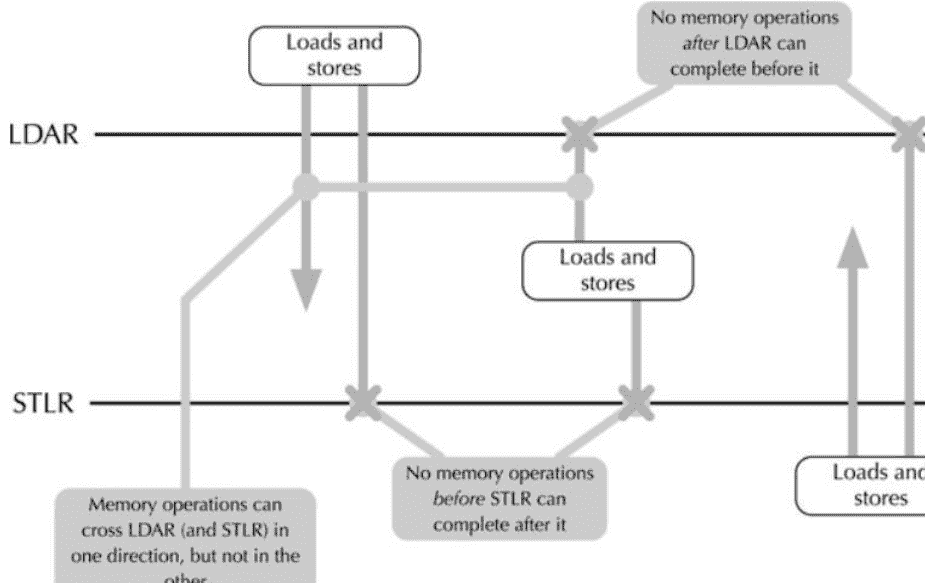

如图所示，在程序顺序中位于 `STLR` 之前的内存操作不能在它之后完成，而在程序顺序中位于 `LDAR` 之后的内存操作不能在它之前完成。因此，程序顺序中处于两个屏障之间的内存操作被强制在它们之间完成。该图也更清楚地解释了单向屏障（`one-way barrier`）术语的含义，因为：

- 内存操作只能向一个方向跨越 `LDAR` 屏障，相对于程序顺序，它们被强制向前移动并穿过屏障，但不能向后移动。
- 同样，内存操作可以向后移动到 `STLR` 屏障之前，但不能向前移动并穿过它。

与之前介绍的更传统的屏障相比，这些屏障的优势有两个：

- 它们是单向而非双向屏障，其强制执行的排序约束较弱，因此确保一致性的代价也不那么明显。
- 它们将屏障与特殊形式的加载或存储指令结合起来，后者通常用于在多核系统中界定关键区域。这进一步增强了性能，同时通过防止在关键区域内发出的内存操作被其他代理从外部观测，确保了关键区域的正确性。

与 `DMB` 不同，`LDAR` 和 `STLR` 没有显式的共享性域（`shareability domain`），因为它们从目标内存地址的相应属性中隐含了这一点。

### 12.2.5 编译器级别的指令重排

在上一节中，我们讨论了硬件如何重排指令（特别是内存操作）以提高效率。当用高级语言编写代码时，程序员必须意识到，编译器在将高级语言结构转换为汇编代码时，也可能在语言标准施加的某些限制内执行相同的操作。

此外，如果编译器能够证明某些内存操作是冗余的，它甚至完全抑制这些操作。例如，如果编译器过去已经执行过相同的加载，该值仍在处理器寄存器中，并且根据它的认知，在此期间内存内容没有被修改，编译器就可以省略该加载操作。目标与之前相同：提高性能，同时确保代码仍然有效，即产生正确的结果。

这种方法的底层影响是，其他观察者看到的内存操作顺序与高级语言代码陈述的顺序不同，或者根本没有发生。在单处理器上，这通常被忽略了，因为在用户应用程序级别这通常不是问题。事实上，在单核处理器上，其他观察者是具备 DMA 能力的设备，它们处理设备驱动程序级别。

相反，如果用户应用程序是多线程的，该问题在多核系统中就会变得非常重要，正如我们解释的那样，所有核心都是彼此内存操作的独立观察者，共享内存上操作的意外重排可能会导致代码中出现细微的 Bug。为了使问题变得更加复杂，这些 Bug 通常依赖于平台，针对不同架构的编译器具有不同的重排策略和规则。

在 C 语言中，直到包括 C99 修订版的标准 [70]，重排约束主要基于序列点（`sequence point`）和易变性对象（`volatile object`）的概念，我们将在下文中简要解释它们。序列点是执行序列中的特定点，由标准定义。序列点的示例包括函数调用（在参数表达式求值之后）和完整表达式的结束（与该处的分号重合）。

在每个序列点，编译器必须保证，无论它对生成的代码进行了什么样的优化，序列点之前的语言语句的副作用都已完成，而副作用本身尚未发生。非正式地说，副作用是对执行环境状态的更改，包括例如对易变性对象的加载和存储操作，以及对非易变性对象的存储操作。

标准规定了编译器生成的代码在序列点必须满足的要求，以符合标准。……在序列点处，所有之前对易变对象的访问都已完成。易变性对象是指数据类型为 `volatile` 的对象，编译器无法感知这些对象可能会被修改。事实上，在单线程程序中，即使在嵌入式领域考虑这些方面仍然重要的，因为对编译器是不可见的。例如，在处理以下代码片段时：

```c
volatile int a;
volatile int b;
...
a = 0;
b = 3;
if(a == 3) { ... };
```

- `a` 的存储操作先于 `b` 的存储操作，`if` 语句中的 `a` 的加载操作在 `b` 的存储操作之后，因为 `a` 和 `b` 都是易变对象。

- 标准在调用不属于同一编译单元的函数以及从该函数返回时施加了额外的约束，在这种情况下，无论如何优化，所有外部链接对象（例如全局变量）以及调用函数可以通过指针访问的所有其他对象根据抽象语言语义在调用之前必须具有预期值。例如，在翻译以下代码片段：

```c
extern void f(void);
int a;
...
a = 3;
f();
```

`a` 的存储操作不能移动到调用函数 `f` ，因为该函数是外部的并且可以访问 `a`，因为它是一个全局变量。

这也确保了第 7 章讨论的关键区域能够正确工作。它们由信号量操作界定，编译器将这些视为普通的函数调用。

## 12.3.1 临界时刻定理的丧失

多处理器和多核系统引入的一个重大挑战是：向系统中添加额外的核心可能会对调度性产生反直觉的负面影响，尽管它本应该执行的任务集完全没有变化。具体来说，最有趣的结果之一是一个重要定理的丢失，该定理被称为**临界时刻定理**，第 3 章和第 4 章中描述的许多结果都基于此定理。

该定理不仅在 1973 年被形式化证明 [84]，而且还阐述了一个非常直观的事实。它可以非正式地总结为：在一个满足基本任务模型并由单处理器执行（例如在第 3.2.3 节中定义）的固定优先级任务系统中，任何给定的任务在它与所有高优先级任务同时释放时，其响应时间将达到最大。这是因为在这种情况下，该任务遭受了来自其他任务的最坏情况干扰。

然而，让我们考虑一个同步周期任务，其参数列在表 12.4 中。不失一般性地，周期和执行时间均以任意时间单位表示。为了说明起见，我们假设这些任务具有隐式截止时间，即它们的截止时间等于周期。此外，我们假设它们的优先级是固定的，并根据速率单调（`Rate Monotonic`）优先级分配进行设置，在这种情况下，该算法在单核系统上被证明是最优的。

**表 12.4 图 12.13 所示任务的参数**

| 任务 | 周期 $T_i$ 和截止时间 $D_i$ | 执行时间 $C_i$ |
|---|---|---|
| $\tau_1$ | 10 | 4 |
| $\tau_2$ | 11 | 1 |
| $\tau_3$ | 20 | 5 |
| $\tau_4$ | 40 | 4 |

因此，它们的优先级与周期成反比，表 12.4 按优先级递减的顺序列出了它们。由于任务是由优先级调度器执行的，当在任何给定时刻就绪任务的数量超过空闲处理器数量时，调度器将选择最高优先的任务进行执行，从 $\tau_1$ 开始到 $\tau_i$。

由于任务集是同步的，所有任务在 $t=0$ 时同时释放。图 12.13 的上部分描述了双核系统上相应的调度图。具体来说：

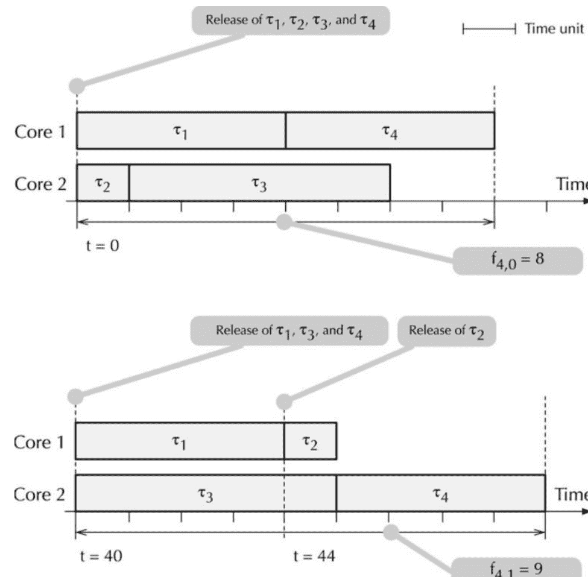

**图 12.13 多核系统上临界时刻的反例。**

- 在 $t=0$ 时，所有任务都已准备好执行。由于只有两个可用核心，调度器并发运行 $\tau_1$ 和 $\tau_2$，而 $\tau_3$ 和 $\tau_4$ 保持就绪状态。
- 在 $t=1$ 时，$\tau_2$ 完成执行，它所执行的核心变为供其他任务可用。$\tau_3$ 和 $\tau_4$ 都已就绪，但核心分配给了 $\tau_3$，因为它的优先级更高。
- $\tau_1$ 在 $t=4$ 时完成执行，其核心分配给 $\tau_4$，后者开始执行。
- 在 $t=6$ 时，$\tau_3$ 完成执行，其核心保持空闲，因为此时刻没有其他任务就绪。
- 最终，$\tau_4$ 的第一个实例在 $t=8$ 完成执行，导致响应时间 $f_{4,0}=8$。

根据临界时刻定理，在单核系统中，值 $f_{4,0}=8$ 将是 $\tau_4$ 的最坏情况响应时间，我们可以安全地说 $R_4=f_{4,0}=8$。以此类推，为了分析双核系统上的调度性，我们可能认为考虑上述讨论的情况就足够了，正如第 4.1.2 节中的响应时间分析（`RTA`）中所做的那样。

遗憾的是，事实并非如此，如果我们考虑在 $t=40$ 释放的 $\tau_4$ 的第二个实例，这一点显而易见。由于 $\tau_1, \tau_2$ 与 $\tau_3$ 周期之间的调和关系，$\tau_1$ 和 $\tau_4$ 在此时刻与 $\tau_1$ 同时释放。相反，$\tau_3$ 将在 $t=44$ 首次释放。在 $t=40$ 时，$\tau_4$ 未就绪，因为它的上一个实例已经完成执行。相应的调度图如图 12.13 的下部分所示。我们可以观察：

- 在 $t=40$ 时，调度器运行 $\tau_1$ 和 $\tau_2$，因为它们的优先级比 $\tau_4$ 高。
- 在 $t=44$ 时发生了两个并发事件：$\tau_1$ 完成执行，且一个新的 $\tau_4$ 实例被释放。结果是 $\tau_4$ 替换了核心 1 上的 $\tau_1$。尽管 $\tau_1$ 在此时也是就绪的，
- 在 $t=48$ 时，$\tau_3$ 完成执行，其核心保持空闲，因为此时刻没有其他任务就绪。
- 最终，$\tau_4$ 的第一个实例在 $t=8$ 完成执行（此处原文可能有误，应为第二个实例，但按原文翻译）。


## 12.3.1 临界时刻定理的丧失

多处理器和多核系统引入的一个重大挑战是：向系统中添加额外的核心可能会对调度性产生反直觉的负面影响，尽管它本应该执行的任务集完全没有变化。具体来说，最有趣的结果之一是一个重要定理的丢失，该定理被称为**临界时刻定理**，第 3 章和第 4 章中描述的许多结果都基于此定理。

该定理不仅在 1973 年被形式化证明 [84]，而且还阐述了一个非常直观的事实。它可以非正式地总结为：在一个满足基本任务模型并由单处理器执行（例如在第 3.2.3 节中定义）的固定优先级任务系统中，任何给定的任务在它与所有高优先级任务同时释放时，其响应时间将达到最大。这是因为在这种情况下，该任务遭受了来自其他任务的最坏情况干扰。

然而，让我们考虑一个同步周期任务，其参数列在表 12.4 中。不失一般性地，周期和执行时间均以任意时间单位表示。为了说明起见，我们假设这些任务具有隐式截止时间，即它们的截止时间等于周期。此外，我们假设它们的优先级是固定的，并根据速率单调（Rate Monotonic）优先级分配进行设置，在这种情况下，该算法在单核系统上被证明是最优的。

### 表 12.4 图 12.13 所示任务的参数

| 任务 | 周期 $T_i$ 和截止时间 $D_i$ | 执行时间 $C_i$ |
| :--- | :--- | :--- |
| $\tau_1$ | 10 | 4 |
| $\tau_2$ | 11 | 1 |
| $\tau_3$ | 20 | 5 |
| $\tau_4$ | 40 | 4 |

因此，它们的优先级与周期成反比，表 12.4 按优先级递减的顺序列出了它们。由于任务是由优先级调度器执行的，当在任何给定时刻就绪任务的数量超过空闲处理器数量时，调度器将选择最高优先的任务进行执行，从 $\tau_1$ 开始到 $\tau_i$。

由于任务集是同步的，所有任务在 $t=0$ 时同时释放。图 12.13 的上部分描述了双核系统上相应的调度图。具体来说：


**图 12.13** 多核系统上临界时刻的反例。

- 在 $t=0$ 时，所有任务都已准备好执行。由于只有两个可用核心，调度器并发运行 $\tau_1$ 和 $\tau_2$，而 $\tau_3$ 和 $\tau_4$ 保持就绪状态。
- 在 $t=1$ 时，$\tau_2$ 完成执行，它所执行的核心变为供其他任务可用。$\tau_3$ 和 $\tau_4$ 都已就绪，但核心分配给了 $\tau_3$，因为它的优先级更高。
- $\tau_1$ 在 $t=4$ 时完成执行，其核心分配给 $\tau_4$，后者开始执行。
- 在 $t=6$ 时，$\tau_3$ 完成执行，其核心保持空闲，因为此时刻没有其他任务就绪。
- 最终，$\tau_4$ 的第一个实例在 $t=8$ 完成执行，导致响应时间 $f_{4,0}=8$。

根据临界时刻定理，在单核系统中，值 $f_{4,0}=8$ 将是 $\tau_4$ 的最坏情况响应时间，我们可以安全地说 $R_4=f_{4,0}=8$。以此类推，为了分析双核系统上的调度性，我们可能认为考虑上述讨论的情况就足够了，正如第 4.1.2 节中的响应时间分析（RTA）中所做的那样。

遗憾的是，事实并非如此，如果我们考虑在 $t=40$ 释放的 $\tau_4$ 的第二个实例，这一点显而易见。由于 $\tau_1, \tau_2$ 与 $\tau_3$ 周期之间的调和关系，$\tau_1$ 和 $\tau_4$ 在此时刻与 $\tau_1$ 同时释放。相反，$\tau_3$ 将在 $t=44$ 首次释放。在 $t=40$ 时，$\tau_4$ 未就绪，因为它的上一个实例已经完成执行。相应的调度图如图 12.13 的下部分所示。我们可以观察：

- 在 $t=40$ 时，调度器运行 $\tau_1$ 和 $\tau_2$，因为它们的优先级比 $\tau_4$ 高。
- 在 $t=44$ 时发生了两个并发事件：$\tau_1$ 完成执行，且一个新的 $\tau_4$ 实例被释放。结果是 $\tau_4$ 替换了核心 1 上的 $\tau_1$。尽管 $\tau_1$ 在此时也是就绪的，
- 在 $t=48$ 时，$\tau_3$ 完成执行，其核心保持空闲，因为此时刻没有其他任务就绪。
- 最终，$\tau_4$ 的第二个实例在 $t=52$ 完成执行（响应时间为 12），超过了 $t=0$ 时的响应时间 8，从而反驳了临界时刻定理在多核上的适用性。

## 12.3.2 Dhall 效应

临界时刻定理在多核系统上的丧失对速率单调（RM）和最早截止优先（EDF）算法的最优性提出了质疑。然而，对于单核系统，这些算法是已知的最优。对于多核系统，存在病态任务集。为了说明 Dhall 效应，让我们考虑一组 $N \ge 2$ 周期任务，其参数列在表 12.5 中。不失一般性地，周期和执行时间均以任意时间单位表示。在此之前，我们假设这些任务具有隐式截止时间，即它们的截止时间等于周期。此外，我们假设它们的优先级是固定的，并根据速率单调优先级分配进行设置，在这种情况下，该算法在单核系统上被证明是最优的。

### 表 12.5 Dhall 效应任务集参数

| 任务 | 周期 $T_i$ 和截止时间 $D_i$ | 执行时间 $C_i$ |
| :--- | :--- | :--- |
| $\tau_1 \dots \tau_{N-1}$ | 1 | $2\epsilon$ |
| $\tau_N$ | $1+\epsilon$ | 1 |

首先，我们注意到如果 $N \ge 2$，则对于所有 $\epsilon$，$U > 1$。此外，随着参数 $\epsilon$ 越来越小并趋于零，总利用率趋于：

$$
\lim_{\epsilon\to0} U = \lim_{\epsilon\to0} 2\epsilon(N-1) + \frac{1}{1+\epsilon} = 1 \tag{12.1}
$$

$U > 1$ 的事实结合第 4.1.1 节讨论的必要调度性测试，排除了使用单核处理器执行该任务集的可能性。因此我们可以问我们需要多少核心来成功调度它（即满足所有任务截止时间），通过 RM 或 EDF 实现。

从 12.3.1 节我们已经知道这在调度性方面已经是最坏情况，让我们关注任务集中所有任务的首次释放，它发生在 $t=0$。在这种情况下，表 12.5 按第一个实例的优先级递减列出任务，这种优先级分配对于 RM 和 EDF 都是相同的。

如果在分析过程中观察到某些截止时间被违反，我们可以断定该任务集是不可调度的。相反，如果所有截止时间都得到满足，我们可以得出较弱的结论，即该任务集通常可能是可调度的。

图 12.14 显示了全局 EDF 如何在 $N-1$ 个核心上调度该任务集：

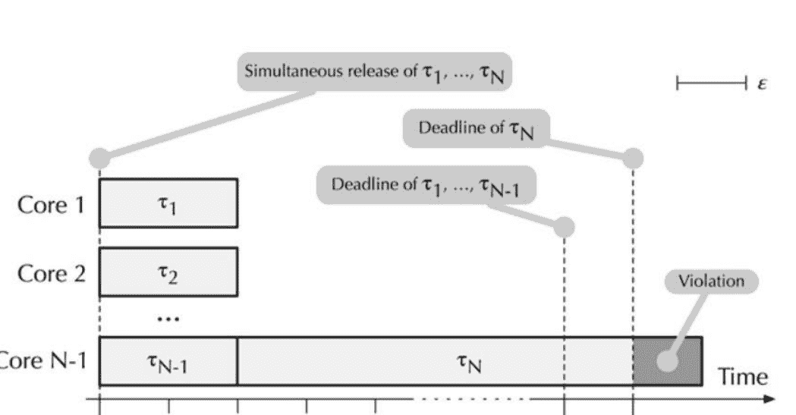

**图 12.14** 当在 $N-1$ 个核心上执行全局 EDF 时，表 12.5 中的任务集是不可调度的。

- 在 $t=0$ 时，所有任务的第一个实例都准备好执行了。由于有 $N$ 个任务实例就绪，而只有 $N-1$ 个核心，调度器选择了优先级最高的 $N-1$ 个任务进行执行，在这种情况下，$\tau_1,\dots,\tau_{N-1}$ 执行，而 $\tau_N$ 等待。
- 任务 $\tau_1,\dots,\tau_{N-1}$ 在 $t=2\varepsilon$ 时完成执行，满足了它们的截止时间。此时所有核心都变为空闲，可以开始执行 $\tau_N$。该图显示调度器在核心 $N-1$ 上执行该任务，但使用任何其他核心都会导致相同的结果。
- $\tau_N$ 的执行至少持续到 $t=1$，此时任务 $\tau_1,\dots,\tau_{N-1}$ 的新实例变得就绪。在此时，RM 调度器将抢占并将其核心分配给其中一个任务，而 EDF 调度器将继续执行 $\tau_N$ 的执行，因为它的截止时间（在 $t=1+\varepsilon$）早于所有其他任务（在 $t=2$）。
- 图 12.14 显示了 EDF 调度器的行为，因为对于 $\tau_N$ 的可调度性，它比 RM 更有利。
- 尽管 $\tau_N$ 的执行持续到 $t=1$ 之后，但它注定会错过截止时间，因为截止时间在 $t=1+\varepsilon$ 到期，而 $\tau_N$ 的执行将在 $t=1+2\varepsilon$ 结束。

很容易看出，使用少于 $N-1$ 个核心会使 $\tau_N$ 的调度情况变得更糟糕。相反，为了用全局 RM 或 EDF 成功执行表 12.5 中的任务集，我们需要一个至少有 $N$ 个核心的系统，如图 12.15 所示，即每个任务至少一个核心。虽然该图仅显示了任务集在同步释放场景下是可调度的，但很容易证明这在通常也是成立的。

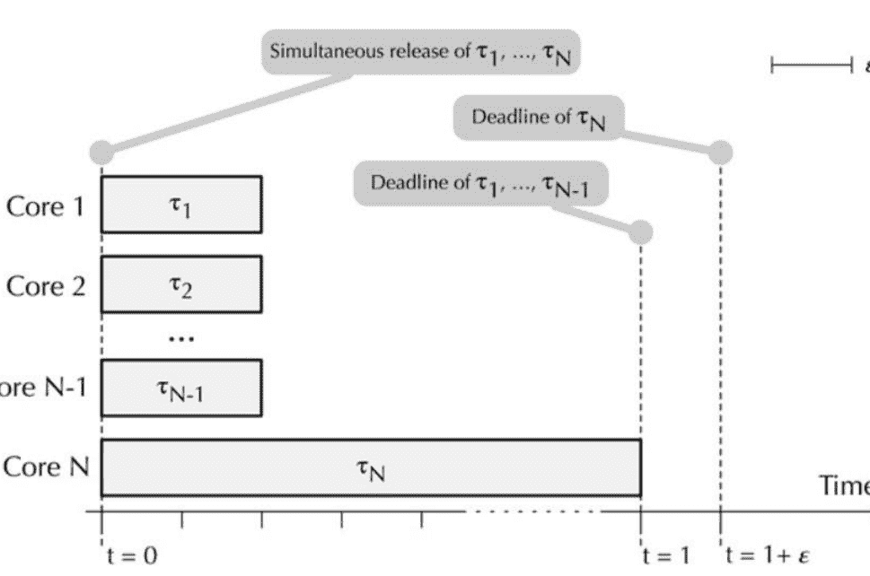

**图 12.15** 在 $N$ 个核心上，任务集变得可调度。

总结来说，我们得到了这个反直觉的结论：对于任何具有 $N$ 个核心的系统，至少存在一组 $N$ 个任务的病态集合（即刚刚考虑的这组），它们为了通过全局 RM 或 EDF 成功执行而严格需要所有核心，在 $N-1$ 个核心或更少的核心上是不可调度的。此外，尽管任务集的总利用率 $U$ 可以根据我们的意愿接近 1。相反，使用不同的调度方法可能会获得更理想的结果。例如，如图 12.16 所示，如果我们在一个核心上调度任务 $\tau_1,\dots,\tau_{N-1}$，在另一个核心上调度 $\tau_N$，那么两个核心可能就足够成功执行该任务集。只要 $\varepsilon$ 足够小，这种可能性就是存在的。具体来说，它必须满足：

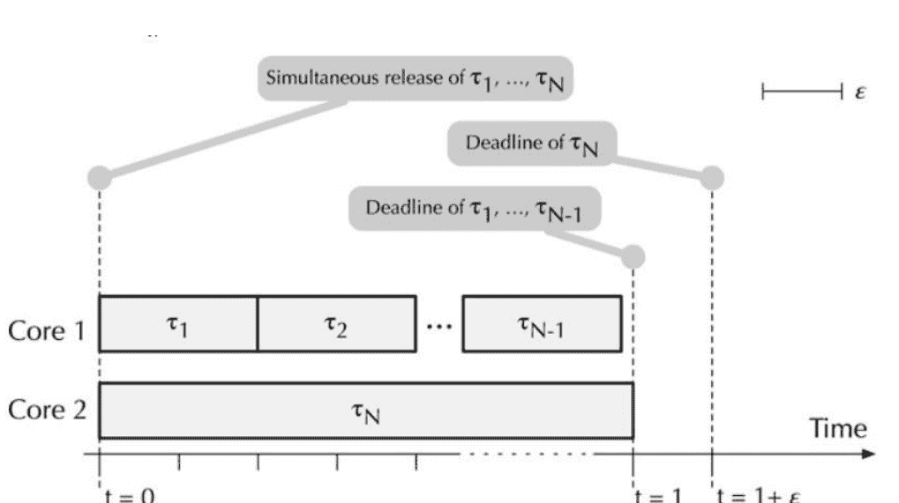

**图 12.16** 对于较小的 $\epsilon$，通过分区调度，两个核心可能就足够成功执行表 12.5 中的任务集。

$$
\sum_{i=1}^{N-1} C_i = (N-1)2\varepsilon \le 1, \quad (12.3)
$$

因为我们可能不会超过第一个核心的总容量。反过来，这个约束条件意味着：

$$
\epsilon \le \frac{1}{2(N-1)} \quad (12.4)
$$

然而，这仍然比全局 RM 或 EDF 好，因为无论 $\epsilon$ 多小，它们都无法在少于 $N$ 个核心上调度该任务集。与之前一样，我们只在任务同步释放场景下验证了可调度性，很容易证明这在通常也是成立的。

发表后，这项开创性的结果影响了随后的研究，使研究转向了分区（partitioned）而非全局（global）的多处理器和多核调度。分区调度遵循上一个示例中概述的策略，正如其名，它是分两个阶段工作的算法：

1. 任务被细分为 $N$ 组，对应每个处理器或核心。这种划分是离线且静态的。因此，任务不会在不同处理器之间迁移。
2. 负责每个处理器或核心的调度器与其他调度器独立运行，控制该处理器或核心上任务的执行。

另一方面，对 Dhall 效应的仔细研究表明，它具有一种特殊的特性：即它由低利用率任务 $\tau_1,\dots,\tau_{N-1}$ 组成（当 $\varepsilon$ 趋于 0 时），以及高利用率任务 $\tau_N$（当 $\varepsilon$ 趋于 1 时）。

这导致了这样一个结论：通过特殊处理高利用率任务，可以获得比使用全局 RM 或 EDF 更好的结果。

## 12.3.3 隐式互斥


另一方面，对互斥的仔细研究表明，它具有一种特殊的特性。即它由低利用率任务 $\tau_1,\dots,\tau_{N-1}$ 组成（当 $\varepsilon$ 趋于 0 时），以及高利用率任务 $\tau_N$（当 $\varepsilon$ 趋于 1 时）。

这导致了，通过特殊处理高利用率任务，可以获得更好的结果，而不是使用全局 RM 或 EDF。具体来说，必须通过放置内存屏障来实现互斥。

## 12.3.3 隐式互斥 (IMPLICIT EXCLUSION)

- 最高优先级任务必须承受的唯一开销是在访问共享数据之前检查共享标志。在大多数架构上，此操作可以通过一条或两条机器指令完成，因此其执行速度至少比任何信号量操作快一个数量级。

考虑到最高优先级的周期性任务通常也是周期最短的任务（例如速率单调算法所规定的），减少这些任务的开销对整体利用率有显著的积极影响。

- 由于低优先级任务不与高优先级任务共享任何信号量，从定义上来说，这两组任务之间不会发生无界优先级反转（在第 8.1 节中定义和描述），因此不需要特殊技术来避免它。

- 作为一种特殊情况，如果只有一个低优先级任务，则可以在不使用任何信号量的情况下确保数据一致性。这进一步减少了低优先级任务的开销，只需要设置和重置共享标志 $f$ 所需的几条机器指令。

在第 13 章中，我们将讨论一些通用方法，可以在不使用信号量或任何锁的情况下正确同步多个任务，且不对它们的相对优先级做任何假设。然而，这些方法比本文的要复杂得多。

## 手工优先级提升与调度器锁

上述方法的一个关键点是：如果一组为 $k$ 个的任务 $\tau_1,\dots,\tau_k$ 共享某些数据结构 $d$，它们中优先级最高的任务 $\tau_h$ 将获得对该数据结构的不可中断访问，使其一旦开始执行，就不会被该组中的任何低优先级任务抢占。

即使我们允许系统中存在更高优先级的任务，只要它们不使用任何共享数据，该方法的基本属性仍然有效。尽管 $\tau_h$ 现在执行期间可能会被抢占，但这种抢占无法改变共享数据的状态，因为中间的任何任务都没有使用它们。

在单核系统上，我们可以通过让 $k$ 个任务组 $\tau_1,\dots,\tau_k$ 中的每个任务 $\tau_i$ 遵循图 12.18 所示的共享数据访问协议，对之前的方法进行推广和对称化。具体来说，如果我们将 $\mathcal{PC}$ 称为任务 $\tau_1,\dots,\tau_k$ 中的最高优先级：


**图 12.18** 通过优先级提升实现的隐式互斥。

1. 在访问共享数据之前，任务将其优先级提升到 $\mathcal{P}_C$。
2. 随后它可以访问并可能更新共享数据。
3. 之后，它恢复原始优先级。

与之前的方法相比，这种方法没有优先级反转（这是优先级提升的直接结果），并且必须特别注意以确保它是适当有界的。为此，我们可以利用这种方法与第 8.1 节中讨论的立即优先级顶层协议之间的密切类比。

特别是我们可以观察到，如果假设资源访问不是嵌套的，且为优先级顶层协议准备的底层信号量在任务请求时总是空闲的，那么这种方法中的手工任务优先级移动与立即优先级顶层协议是相同的。因此，很容易证明优先级反转是有界的，并且可以使用与立即优先级顶层协议相同的计算来计算最坏情况的阻塞时间。

在这里，用优先级移动替换信号量操作可能会也可能导致显著的性能提升，因为在许多操作系统中，这些操作的复杂度是的。然而，我们可以进一步推论，并观察到即使我们提升任务优先级的程度超过了严格需要的，该方法仍然可以正常工作。

特别是，如果我们将任务优先级提高到整个系统的最高优先级，它将能够工作。尽管乍看这样做似乎完全不会影响性能，但必须注意，大多数实时操作系统（如 RTEMS）提供了一种临时锁定调度器的方法，换句话说就是临时禁用任务抢占。有关为此目的提供的接口更多细节请见第 5.7 节。

这种操作还可以防止调用系统中的最高优先级，与真实的优先级移动不同，它在单核系统上可以用非常高效的方式实现。也就是说，从操作系统的角度来看，它仅需相应地设置/重置一个内部标志，并在抢占任务之前检查该标志。

明显的负面副作用是，受优先级反转影响的任务集比以前变大了——因为它们包含了系统中的所有任务，而不是 $\tau_1,...,\tau_r$。然而，优先级反转仍然是有界的，特别是当临界区非常短时，阻塞对系统的影响可能是可以接受的甚至可以忽略不计，这也是因为临界区进入和退出代码的高效率得到了补偿。

## 禁用中断

到目前为止，重点一直放在确保任务之间的互斥，但在某些情况下，必须强制执行互斥：从任务上下文中调用的函数与中断处理程序共享数据，并确保它们在某些成员上的一致性。这在设备驱动程序中是典型的。

在单核系统中，一种非常低开销的方法是在临界区禁用中断。通过这种方式，中断请求的到达和随后的中断处理程序的执行无法在任务处于临界区内部时抢占。

解决方案的通用结构与图 12.18 所示，但：

1. 在访问共享数据之前，禁用中断。
2. 在访问共享数据之后，重新启用中断。

这种方法的一种低侵入性变体可以使用支持如 4.2 节所示优先级的硬件，其在于提高处理器的执行优先级而不是禁用中断。具体来说，必须将执行优先级提高到最高优先级。这样，更高优先级的程序仍然允许运行，其延迟不会受到影响。

同时，在不引入额外开销的情况下，禁用中断也确保了任务之间的互斥。这是因为如 4.2 节所述，只有接受中断才能触发上下文切换以及可能的抢占。与之前讨论的调度器锁相比，优先级反转仍然是有界的，但涉及中断处理程序，这可能导致延迟增加。

## 多处理器和多核系统的问题

遗憾的是，本节概述的所有技术在多处理器或多核系统上均不可行。主要原因是它们都隐式地假设在任何给定时间只有一个任务或一个中断处理程序在运行。甚至对技术的描述充满了对“运行任务”（单数）的引用。

首先，图 12.17 和 12.18 中的隐式互斥方法假设最高优先级任务（第一种方法）或临时提升优先级到最高级的任务（第二种方法）除非阻塞否则不会被其他任务抢占。

好吧，严格来说，如果我们只关注多处理器或多核系统中的单个处理器或核心，这仍然成立，但没有什么能阻止其他核心同时运行其他冲突的任务。因此，即使没有抢占，多个任务真正的并行执行以及可能产生的竞态条件仍然是可能的。

### 共享数据 d

#### 单处理器

禁用中断可以防止中断处理程序的执行

$\tau_T$ (常规任务)

（中断处理程序）

在中断处理期间自动禁止任务执行

```
x = interrupt_disable();
```

使用 d 的临界区

使用 d 的临界区

```
interrupt_enable();
```

#### 多处理器（或多核）

通过锁强制执行互斥

$\tau_T$ (常规任务)

（中断处理程序）

```
lock_acquire();
```

```
lock_acquire_isr();
```

使用 d 的临界区

使用 d 的临界区

```
lock_release();
```

```
lock_release_isr();
```

通过锁强制执行互斥

**图 12.19** 针对中断处理程序的互斥机制。

在某个系统上，在某一个处理器或核心上禁用中断对其他核心没有影响。因此，可能出现中断处理程序 $\tau$ 与常规任务 $\tau$ 同时执行的情况，尽管调度器将它们在两个不同的核心上运行。

虽然在某些多核架构中可以全局禁用所有核心的中断，但这种操作的开销通常很高，因为它必须通过操作中断控制器来实现，而中断控制器是核心自身的组成部分。相比之下，本地中断通常可以通过单条机器指令禁用。

使问题变得更加复杂的是，由于核心和中断控制器可能是异步运行的，全局禁用中断的操作可能不会立即生效，因此在处理器发出禁用命令后，某些中断仍然可能被接受。

这些情况都是可以规避的，但随着核心和设备数量的增加，在任何情况下，通过禁用所有核心中断来确保与设备互斥的开销都会迅速成为瓶颈。

因此，一种正确的方法是使用不同的设备来实现互斥，例如使用互斥锁。它的语义与互斥信号量相同，在多个处理器或核心之间使用时可以正常工作，比信号量更高效，并且可以在中断上下文中使用。这涉及到对原始代码的某些更改。特别是如图 12.19 下半部分所示。

- 任务代码保持相同的结构，但包围其临界的操作除外。它们不再是禁用和启用中断，而是获取和释放锁。
- 中断处理程序中的临界区现在也必须被包围，因为如前提到的，常规任务和中断处理程序的并发执行现在是可能的。对于任务代码，这是通过锁获取和释放操作实现的，在图中用颜色较深的矩形表示。

在图中，锁获取和释放函数的实际参数已用省略号代替，具体细节取决于操作系统和锁的类型。如图所示，某些类型的锁可能需要使用两组不同的原语，一组在任务侧，另一组在中断处理程序 (ISR) 侧。第 13 章将提供关于 RTEMS 应用程序接口的更多具体细节。

作为替代方案，任务与中断处理程序之间的通信可以根据锁或无锁同步进行重新设计，这允许多个代理在一致的情况下交换信息，而无需使用任何锁。第 13 章也将给出这些方法的介绍。

## 12.4 总结

第一章描述了多核处理器在通用计算以及近期嵌入式系统中被广泛采用的动力所在。随后，第 12.2 节概述了多核架构，并对当代的 ARM 处理器进行了实际引用。特别关注了内存模型和缓存一致性概念，因为它们在多核系统中的重要性远比单核系统大。

第 12.3 节总结了软件设计者和程序员面临的最重要挑战，解释了为什么多核执行对第 3-9 章介绍的并发编程几个领域产生了深远（有时是违反直觉的）的影响，即调度算法、调度性分析以及任务间的通信与同步。在接下来，第 13 章将概述解决这些问题的常见方法。

# 多核并发：问题与解决方案

## 13.1 多核调度算法分类

## 13.2 RTEMS 中的多核调度算法

## 13.3 调度器配置

## 13.4 多核同步设备

### 13.4.1 多处理器资源共享协议

### 13.4.2 优先级反转协议 (m)

## 13.5 无锁与无阻塞同步

### 13.5.1 基本原理与定义

### 13.5.2 无锁计数器读取

### 13.5.3 异步通信

### 13.5.4 无锁对象的通用构造

## 13.6 自旋锁与中断处理

## 13.7 总结

本章介绍了适用于对称多处理器和多核系统的 RTEMS 调度算法和同步设备。特别是，描述了如何配置调度算法，以及 MrsP 和 OMIP 协议如何解决此类系统的优先级反转。

章的核心部分讨论了更多的同步方法，即无锁和无阻塞同步（这些在第 7 章和第 9 章中未涵盖），最后节简要介绍了自旋锁，这是一种基于无锁或无阻塞技术的同步设备。自旋锁不仅本身对任务间的同步有用，也是复杂同步设备的构建块。

# 13.1 多核调度算法分类

多处理器和多核系统的调度算法一直是理论和应用研究的主，特别是在过去的 40 年。从一开始，研究人员就清楚实时调度问题在多核系统上比单核系统困难得多。在第 12.3 节中，我们提供了一些例子说明情况如此，以及为什么将单核调度直接扩展到多核系统是复杂的。

目前，多处理器和多核调度算法属于三类之一，如图 13.1 所示。范围的两端是全局调度和分区调度算法：

- **全局调度算法**将系统中所有的处理器或核心置于单个调度器实例的控制下。在具有 M 个核心的系统中，该调度器实例负责在任何时间选择多达 M 个并行执行的任务。尽管这种方法非常直观，但可能会导致调度性下降，至少对于某些特殊的任务集（如第 12.3.2 节所述）。此外，在某些假设的单核系统上证明是最优的算法在扩展到全局多核时不再是最优。

- **分区调度算法**运行每个处理器或核心。任务被静态分配给某个核心，正常情况下不会迁移到其他核心。结果是第 4 章讨论的所有调度性定理和方法仍然适用于每个调度器实例。

与全局调度相比，代价是通常的处理器利用率较低。一个直观的论据是，分区调度算法不是工作的，也就是说，它们可能会让某个核心空闲（因为没有分配给它的就绪任务），而另一个核心上的任务已经就绪但无法执行（因为该核心上已经在运行一个优先级更高的任务）。

### 全局调度

任务

$\tau_1$ ... $\tau_N$

1 个全局调度器

调度器实例

核心

$P_1$ ... $P_M$

### 分区调度

任务

$\tau_1$ ... $\tau_N$

M 个调度器实例

调度器 调度器 调度器 调度器

核心

$P_1$ ... $P_M$

### 聚类调度

任务

$\tau_1$ ... ... $\tau_N$

$1 \le K \le M$ 个调度器实例

调度器 调度器 调度器

核心

$P_1$ ... ... $P_M$

**图 13.1** 全局、分区、聚类多核调度器。

第三类算法基于聚类调度。在这种情况下，如图 13.1 底部所示，M 个核心被分为 $1 \le K \le M$ 个簇。每个簇至少包含一个核心，簇中的所有核心由一个调度器实例管理，因此系统中总共有 K 个调度器实例。聚类调度也可以看作全局调度和分区调度的推广，因为这两种方法分别当 K=1 或 K=M 时，是聚类调度的特例。

## 13.2 RTEMS 中的多核调度算法

当 RTEMS 配置为运行在对称多处理器 (SMP) 或多核系统上时，可以使用几种适用于此类系统的调度算法。它们在表 13.1 中进行了总结，并取代了表 5.1 中列出的单核系统算法。

| 表格 13.1 RTEMS 多核调度算法 |
| :--- |
| **配置宏** | **默认名称** | **描述** |
| `CONFIGURE_SCHEDULER_EDF_SMP` | "MEDF" | 最早截止时间优先调度器 |
| `CONFIGURE_SCHEDULER_PRIORITY_SMP` | "MPD" | 确定性优先级调度器 |
| `CONFIGURE_SCHEDULER_SIMPLE_SMP` | "MPS" | 简单优先级调度器 |
| `CONFIGURE_SCHEDULER_PRIORITY_AFFINITY_SMP` | "MPA" | 任意处理器亲和性调度器 |

默认情况下，RTEMS 按照图 13.1 所示的全局调度方法工作，并将所有可用核心置于单个调度器实例的控制之下，该调度算法在配置中指定，最多支持 32 个核心。然而，用户可以如第 13.3 节所述，通过在应用程序编译时配置中显式实例化所需的所有调度器实例，来指示操作系统使用聚类调度。同时也支持分区调度，它是聚类调度的一种特例，其中每个实例恰好负责一个核心。

任务绑定的使用必须限制在核心的短区域内，因为它是一种一对一的亲和性掩码，并且防止上述多核信号量锁协议有效工作。这是因为绑定防止了它们在合适的情况下将任务从一个核心迁移到另一个核心。

### 多核确定性优先级调度器 (DPS)

如表 13.1 所示，RTEMS 还提供了两个固定优先级调度器，其行为与其单核对应版本相同：

- 确定性优先级 SMP 调度器，以及
- 简单优先级 SMP 调度器。

这两个调度器都使用与其单核对应版本相同的底层数据结构，分别如图 5.1 和 5.2 所示。它们默认支持 25 个优先级级别，但级别数可以在应用程序运行时配置中更改。这些调度器不支持亲和性掩码，并且无论其掩码如何设置，都可以在分配给它们的任何核心上调度任务。

与单核对应版本一样，尽管这两个调度器始终做出完全相同的调度决策，但它们为用户在调度器效率和内存占用之间提供了两种不同的权衡：

- 典型的调度器操作由确定性优先级 SMP 调度器以常数时间执行，由简单优先级 SMP 调度器相对于就绪任务的数量以线性时间执行。这取决于就绪任务的数量，可能不是或可能是最短的。
- 确定性优先级 SMP 调度器的内存占用与配置的优先级数量大致呈线性，因为它为每个级别使用一个就绪队列。由于简单 SMP 调度器对所有就绪任务只有一个队列，无论配置了多少级优先级，它的内存占用都更小且是固定的。

### 任意亲和掩码

任意处理器亲和调度器允许用户指定任意亲和掩码并遵守它们，从而在不诉诸聚类或分区调度的情况下，对任务允许在哪些核心上运行提供细粒度的控制。它使用确定性优先级 SMP 调度器相同的数据结构，但使用不同的算法来选择在每个核心上执行的合适任务，同时考虑它们的优先级和亲和性掩码（后者可能会防止它们在某些核心上运行）。

在所有情况下，用户指定的任务亲和掩码都被限制在调度器负责分配的核心上，因此调度器永远不会在其控制范围之外的核心上执行任务。该规则的一个例外（所有调度算法共有，且之前已讨论过）是信号量锁协议实施的任务迁移。

该调度器在编写时被认为是实验性的，可能无法用于生产，因为其实现不完整，且某些操作的计算复杂度相对于就绪任务的数量是非线性的。然而，它突出了 RTEMS 框架适应日益复杂的调度算法的灵活性，随着研究的进展，未来的多核系统将需要这些算法。

## 13.3 调度器配置

对于相对简单的应用程序，用户不需要显式配置调度器。默认情况下，它们像单核系统一样使用全局调度器。在更复杂的情况下，用户可以选择聚类调度或分区调度，如图 13.2 所示。

### 配置文件

#### 调度算法选择

第一个配置步骤是从可用算法中选择系统中将使用的所有调度算法。这是通过定义表 13.1 中的某些宏来实现的。例如，定义宏 `CONFIGURE_SCHEDULER_PRIORITY_SMP` 将选择确定性优先级调度器并启用它。由于在此步骤中启用的每个调度算法可能会引入每个任务的内存开销，建议只选择实际会使用的调度算法，以节省内存。

在此配置步骤结束时，用户必须包含 RTEMS 头文件 `scheduler.h` 以访问后续步骤中使用的调度器特定配置宏。

#### 调度器实例化

在第二步中，必须通过调用表 13.2 列出的适当宏来实例化系统所需的所有调度器。对于每种调度算法，此步骤中调用的宏名称与选择调度算法的宏名称相同（见表 13.1），但前缀是 `RTEMS_SCHEDULER_` 而不是 `CONFIGURE_SCHEDULER_`。例如，为了创建一个确定性优先级调度器的实例，必须调用宏 `RTEMS_SCHEDULER_PRIORITY_SMP`。

#### 调度器实例表

为每个调度器实例一个符号名称并在调度器表中分配一个索引。

#### 核心到调度器的分配

通过其索引将核心分配给指定的调度器实例。

**图 13.2** RTEMS 中的聚类调度配置。


这些宏的每次调用都会创建一个相应调度器的实例，该实例将管理在第 4 步配置中分配给它的一组核心，并分配其底层数据结构。所有宏都至少有一个参数，该参数将成为调度器数据结构标识符的一部分。因此，它必须是唯一的，并符合 C 语言标识符的语法规则。需要注意的是，此标识符仅用于配置阶段，而不是应用程序用于引用调度器的符号名称。该名称将分配给调度器系统，并从第四步（也是最后一步）配置步骤开始赋值。

某些调度器实例化宏在表 13.2 的右列列出了额外的、特定于实例的参数。它们用于进一步配置正在创建的每个单独调度器实例。当然，可以多次实例化调度器算法，可能带有不同的实例特定参数，前提是标识符名称是不同的，从而是唯一的。

## 调度器实例表定义

第三个配置步骤将第 2 步中创建的所有调度器实例汇总到一个调度器实例表中。结果是调度器实例表为系统中的每个调度器实例都包含一个元素。这隐式地为每个调度器实例分配了一个唯一的索引，代表它在表中的位置，并从第一个调度器实例的零开始。该索引很重要，因为它必须在第四步配置中用于引用调度器。

此配置步骤执行的另一个重要操作是为每个调度器实例绑定一个符号名称，应用程序可以通过第 2.4 节中定义的 `rtems_scheduler_ident` 获取该调度器实例的对象标识符。如图 13.2 所示，符号名称是通过 `rtems_build_name` 宏组装的。

如图 13.2 所示，为了实现这一点，用户必须将宏 `CONFIGURE_SCHEDULER_TABLE_ENTRIES` 定义为由逗号分隔的宏调用列表。对于配置步骤 2 中创建的每个调度器实例，必须至少有一个宏调用，且该宏的名称必须通过将前缀 `RTEMS_SCHEDULER_` 替换为 `RTEMS_SCHEDULER_TABLE_` 从调度器实例化宏衍生。换言之，在配置步骤 2 和 3 中必须一致地使用匹配的宏。例如，为了在表中放置确定性优先级调度器（Deterministic Priority Scheduler）的实例，使用的宏是 `RTEMS_SCHEDULER_TABLE_PRIORITY_SMP`。


### 核心到调度器的分配

第四步（也是一步）配置步骤将核心分配到配置步骤 2 中创建的调度器实例。为了实现这一点，用户必须将宏 `CONFIGURE_SCHEDULER_ASSIGNMENTS` 定义为条目列表，为系统中配置的每个核心创建一个条目，总共 `CONFIGURE_MAX_PROCESSORS` 条目。每个条目指定相应的内核是否分配给调度器实例，以及该分配是强制的还是可选的。具体来说，每个条目可以是：

- `RTEMS_SCHEDULER_ASSIGN_NO_SCHEDULER`：核心未分配给任何调度器实例。这并不意味着该核心将闲置，而是意味着 RTEMS 不尝试以任何方式使用它。这并不排除虚拟机管理器将该核心分配给另一个操作系统甚至另一个 RTEMS 实例。

- `RTEMS_SCHEDULER_ASSIGN(scheduler_index, attr)`：将核心分配给调度器实例，该实例在配置步骤 2 中定义的调度器表中的索引为 `scheduler_index`。

当核心被分配给调度器实例时，分配宏的 `attr` 参数仅进一步指定分配属性。它可以假定为以下值之一：

- `RTEMS_SCHEDULER_ASSIGN_PROCESS_MANDATORY`：分配是强制的。如果系统中不存在一个或多个强制核心且无法在引导引导阶段启动，RTEMS 将抛出致命错误，从而终止系统。

- `RTEMS_SCHEDULER_ASSIGN_PROCESS_OPTIONAL`：分配是可选的。可选核心的不可用不会导致致命错误，只是防止分配给它的调度器实例使用它。

- `RTEMS_SCHEDULER_ASSIGN_DEFAULT`：此值调用默认分配属性，在本文编写等同于 `RTEMS_SCHEDULER_ASSIGN_PROCESS_OPTIONAL`。

除了上述的在编译时指定的静态核心到调度器分配外，还可以通过指令 `rtems_scheduler_add_processor` 和 `rtems_scheduler_remove_processor` 分别动态地向调度器实例添加/删除核心。这两者都在第 5.2 节中描述过。

在多核心系统中，通常有一个核心（称为引导核心 boot core）负责在其他核心启动和系统进入多任务模式之前初始化操作系统。该核心必须在编译时配置中分配给一个调度器实例。如果不满足这一要求，则将导致致命错误。

## 13.4 多核心同步设备

与调度算法一样，针对基于锁的同步设备的防止无界优先级反转的协议也必须重新设计，以便在多核心系统中正确且高效地工作。当为多核心系统进行配置时，RTEMS 支持两种带有优先级队列的二进制信号量的先进协议。

1. 由 Burns 和 Wellings [28] 提出的多处理器资源共享协议 (MrSp)，源自优先级上限顶协议。

2. 由 Brandenburg [23] 提出的 O(m) 独立性保持协议 (OMIP)，源自优先级继承协议。

除了这两种协议由于可以在实时操作系统中轻松实现而具有实际意义外，它们还伴随着重要的理论结果。在第一种情况下，有一种扩展响应时间分析 (RTA) 以考虑 MrSp 引起的阻塞时间的方法；而在 OMIP 的情况下，其优先级反转阻塞时间的渐近优性得到了证明。

### 13.4.1 多处理器资源共享协议

多处理器资源共享协议 (MrSp) [28] 是第 8 节描述的立即优先级上限协议的演进，并为了可调度性分析而设计。更具体地说，一个设计目标是能够通过第 4 节讨论的响应时间分析 (RTA) 分析使用 MrSp 的系统的可调度性。

与立即优先级上限协议一样，MrSp 要求编程人员为每个信号量指定每个调度器实例可以获取该信号量的最高任务的优先级。结果是，每个 MrSp 信号量对于系统的每个调度器实例都有多个优先级上限值，而不是像立即优先级上限协议那样只有一个全局值。

在不深入探讨 MrSp 实现的情况下，从程序员的角度来看，有三个任务是重要的：

- 当任务获取信号量时，其优先级会被临时提升到该信号量对于任务所属调度器实例的上限优先级。在 RTEMS 中，此调度器实例称为任务的主调度器实例（home scheduler instance）。

- 优先级提升持续到任务释放信号量为止。从这一点来看，MrSp 的工作方式与立即优先级上限协议相同。

- 等待获取信号量的任务会进行自旋（spin），即它们执行主动等待并在调度器的视角下保持运行状态，而不是通过移动到任务状态图的阻塞状态来被动等待。

非正式地说，这防止了自旋任务在最终获取信号量后，由于在此期间可能已经运行且被 MrSp 提升了优先级的低优先级任务，而遭受进一步的由优先级反转引起的阻塞。

在某些情况下，调度器实例之间的帮助协议（helping protocol）可能会根据分区或聚类调度方法，将任务临时从其通常被分配的核心集迁移到其他核心上。

在最基本的情况下，当任务在持有信号量时被一个高优先级的任务抢占，而在另一个核心上有一个任务正在等待同一个信号量时，就会发生这种情况。换句话说，这意味着任务可能会在并非由其所属调度器实例管理的核心上执行，但这些核心属于其他调度器实例，且这些实例中至少有另一个与该任务共享信号量的任务。

# RTEMS 中的 Mrsp 使用

RTEMS 操作系统在对称多处理器（SMP）和多核系统上，针对带有基于优先级队列的本地二进制信号量实现了 Mrsp 协议，这被认为是最适合互斥的信号量类型。在创建信号量时，通过指定 `RTEMS_MULTIPROCESSOR_RESOURCE_SHARING` 属性（连同创建的 `RTEMS_LOCAL`、`RTEMS_BINARY_SEMAPORE` 和 `RTEMS_PRIORITY` 属性）来选择该协议。

最初，新信号量的优先级上限值被设置为创建时指定的优先级，这在大多数实际情况下是不够的。系统中存在一个特定的指令 `rtems_semaphore_set_priority`，用于后续为每个调度器实例设置更合适的值。此外，Mrsp 信号量不能以锁定状态创建，因此它们的初始值必须是有效的。任何尝试创建初始值为 0 的信号量的行为都会导致返回 `RTEMS_INVALID_NUMBER` 状态码。由于 Mrsp 信号量用于界定互斥的临界区域，这在情况下并不是一个实际问题。

Mrsp 信号量大部分情况下可以像任何其他互斥信号量一样使用，但需要注意以下限制：

- 任务必须按照获取信号量的反向顺序释放 Mrsp 信号量，如果临界区域是正确嵌套，则应当如此。任何偏离规定顺序的尝试都会被检测到并在释放信号量时通过 `RTEMS_INCORRECT_STATE` 状态码报告。

- Mrsp 信号量不能被递归获取。任何此类尝试都会导致 `rtems_semaphore_obtain` 返回 `RTEMS_UNSATISFIED` 状态码。

- 除了递归获取信号量会导致自死锁外，系统还能检测出由获取信号量产生的更复杂的死锁类型。在这种情况下，`rtems_semaphore_obtain` 指令失败并返回状态码 `RTEMS_UNSATISFIED`。

- 最后，这是一个不仅限于 Mrsp 信号量的限制：不能从中断上下文中或在线程调度被禁用的任何时候获取 Mrsp 信号量。任何此类尝试都会导致内部 RTEMS 错误或未定义行为。

## 调度分析

让我们复习一下响应时间分析（RTA）[16, 17] 的主递归关系，即第 4.1.2 节的公式 (4.5)：

```
$w_i^{(h+1)} = C_i + \sum_{j\in hp(i)} \frac{w_j^{(h)}}{T_j} C_j.$
```

(13.1)

已经证明，如果我们令 $w_i^{(0)} = C_i$ 且序列 $w_i^{(0)}, w_i^{(1)}, ...$ 收敛于 $R_i$（即在考虑分区多核系统时，一个任务被静态分配到特定核心执行且无法自主迁移到他处的系统，$\tau_i$ 的最坏情况响应时间），如果我们仅考虑到它可能从在同一核心上执行的其他任务处遭受的干扰，该递归公式仍然有效计算任务 $\tau$ 的最坏情况执行时间。

这是合理的，因为如果我们忽略第 12 节概述的由缓存和内存访问竞争引起的间接干扰，运行在特定核心上的任务就不会受到运行在其他核心上的并行任务的干扰。在这种情况下，集合 $hp(i)$ 必须替换为另一个集合 $hpl(i)$，该集合定义为优先级高于 $\tau_i$ 且对于 $\tau_i$ 本地（即分配到与 $\tau_i$ 相同的核心）的任务索引集：

```
$w_i^{(h+1)} = + \sum_{j\in hpl(i)} \frac{w_j^{(h)}}{T_j} C_j.$
```

(13.2)

基础 RTA 递归式 (4.5) 随后扩展到考虑阻塞时间，即任务等待信号量使共享资源可用而花费的时间。这导致了一个新的递归关系，公式 (4.6)。可以证明，通过如下将 $hp(i)$ 替换为 $hpl(i)$，相同的关系也适用于 Mrsp 引起的阻塞：

```
$w_i^{(h+1)} = C_i + B_i + \sum_{j\in hpl(i)} \frac{w_j^{(h)}}{T_j} C_j.$
```

(13.3)

其中项 $B_i$ 代表 $\tau_i$ 遭受的最坏情况阻塞时间。在单核优先级上限中，最坏情况的 $B_i$ 被（某种悲观地）限制在 $B_i^{PC}$ 内，其计算方法如公式 (4.8) 所示：

```
$B_i^{PC} = \max_{k=1}^K \{usage(k, i)C(k)\},
```

(13.4)

其中：

- K 是信号量的数量。

- $usage(k, i)$ 是一个函数，当至少被一个优先级高于等于 $\tau_i$ 的任务访问时，它返回 1；否则返回 0。

- $C(k)$ 是 $k$ 的最坏情况执行时间。

为了进一步考虑，如果我们考虑考虑嵌套临界区域（如我们在第 4 节中所做），基础 RTA 递归式被扩展为：

```
$W_i + \sum_{k \in used(i)} n_{k,i}C(k),
```

(13.5)

- $W_i$ 是 $\tau_i$ 的最坏情况执行时间，不包括阻塞时间。

- $used(i)$ 是至少访问一次的信号量集合。

- $n_{k,i}$ 是 $\tau_i$ “使用” $k$ 的次数。

该公式的非正式推理是，在最坏情况下，信号量 $S_s$ 直接受到 $|cores(k)|$ 个源的访问（如非嵌套情况），并且间接地受到 $|nested(k)|$ 个临界区域的访问。在后种情况下，信号量被串行化，因此无论访问多少次都只计算一次。因此，从需要获取信号量并执行相应临界区域的角度来看，每个源都会引入 $C(k)$ 的开销。

可以证明，当使用 Mrsp 协议时，$\tau_i$ 的最坏情况响应时间通过将 (13.4) 和 (13.5) 替换为以下公式得到：

```
$E(k) = (|nested(k)| + |cores(k)||)C(k),
```

(13.6)

其中 $nested(k)$ 是以嵌套方式访问 $S_k$ 的信号量集合。换句话之，$S_h \in nested(k)$ 当且仅当存在至少一个嵌套的临界区域时。

## 独立性保护协议

OMIP 的另一个具有实际意义的目标（也与 MrSP 相同）是正如其名所示，它是一种独立性保护协议。从非正式的角度来说，独立性保护的概念捕捉了锁机制中一个非常理想的属性，该属性可以用非常简单的方式表达：高优先级任务的执行必须独立于且免受低优先级任务对无关临界区域访问的任何干扰。

最后，也是同样重要的，可以证明 OMIP 中由于优先级反转导致的阻塞时间在渐近上是最优的，也就是说，随着核心数 $m$ 的增加，它以 $O(m)$ 的速度增长。这一结果在挂起忽略分析（suspension-oblivious analysis）下有效，即一种调度分析，其中任务阻塞以隐式的方式考虑，被视为任务本身执行的一部分。此外，该证明没有考虑嵌套临界区域，并考虑了 $m$ 个核心均匀分布在各个簇中的情况。

简要讨论优先级继承协议在多核心系统中如何无法满足预期，以及临时任务迁移如何解决该问题，结合一种不保护独立性的方法，将帮助我们理解 OMIP 协议的底层策略。后文要执行的大部分原因也适用于 MrSP 中的任务迁移。

此外，[23] 中证明的另一个结果是，除了全局调度情况外，一个协议无法同时满足三个属性，至少当使用任务优先级可能动态但作业优先级固定的调度算法（速率单调 RM 或最早截止日期优先 EDF）时：

1. 防止无界优先级反转

2. 保持独立性保护

3. 不进行任务迁移

## 多核心上的优先级继承

让我们考虑如图 13.3 所示，在由速率单调（Rate Monotonic）调度划分的两个不同核心上执行的三个周期性任务。图上半部分描述了任务特征。它们的执行时间由矩形表示，其中斜线突显了 $\tau$ 和 $\tau'$ 中由同一信号量控制的两个临界区域。更具体地说：

- 任务 $\tau$ 的执行时间为 $C_\tau = 5$，周期 $T_\tau = 9$，初始相位 $\varphi_\tau = 2$。所有这些量都以任意但一致的时间单位为单位。该任务不包含任何临界区域，并且作为周期最短的任务，在系统中具有最高优先级。

- 任务 $\tau'$ 的执行时间为 $C_{\tau'} = 10$，周期 $T_{\tau'} = 20$，初始相位 $\varphi_{\tau'} = 0$。它在执行后进入由信号量 $S$ 控制的临界区域，并在区域内执行 6 个单位。该任务周期最长，优先级最低。

- 任务 $\omega$ 的执行时间为 $C_\omega = 4$，周期 $T_\omega = 12$，初始相位 $\varphi_\omega = 2$。它包含一个由同一信号量 $S$ 控制的临界区域，该区域自执行开始1 个时间单位后开始，持续 1 个时间单位。根据速率单调优先级分配，它的优先级低于 $\tau$ 但高于 $\tau'$。


图 13.3 多核心中的优先级继承和无界优先级反转。

任务 $\tau$ 和 $\tau_s$ 被静态分配到核心 1 执行，而 $\tau_i$ 被分配到核心 2。在图中，核心 1 上的执行用浅灰色表示，深灰色表示在核心 2 上的执行。粗水平线表示任务未准备好执行，因为它正在等待下一次激活；实线表示任务已就绪；虚线表示任务被阻塞，即正在等待。

图 13.3 的下半部分显示了在使用优先级继承协议时的系统行为：

- $t=0$ 时，$\tau$ 在核心 1 上就绪。另外两个任务 $\tau_i$ 和 $\tau_s$ 尚未准备好执行，尽管 $\varphi_1 = 3$。

- $t=2$ 时，$\tau$ 和 $\tau$ 都就绪。它们立即执行，因为 $\tau$ 抢占了核心 1 且优先级更高。值得注意的是，$\tau$ 在获取 $S$ 后进入了临界区域。

- $t=3$ 时，$\tau$ 也尝试获取 $S$，但被阻塞。优先级继承协议将 $\tau$ 的优先级提升到 $\tau_s$ 的水平。然而，$\tau$ 只有在 $t=7$ 离开临界区域后才恢复执行。

- $t=12$ 时，$\tau$ 离开临界区域并释放了 $\tau$。

- $t=15$ 时，$\tau$ 完成，但它错过了截止日期（截止日期设定在 $t=14$）。

## 优先级提升

优先级提升不保护独立性的观察之一是，$\tau$ 进入临界区域可能会导致优先级副作用。更具体地说，如图 13.4 所示。


如果我们再次考虑同一组任务，优先级提升会导致以下行为：

- $t=0$ 时，任务 $\tau_1$ 就绪并在核心 1 上执行。

- $t=1$ 时，它进入临界区域并获得优先级提升。

- $t=2$ 时，$\tau_1$ 和 $\tau_2$ 都就绪。

- $t=3$ 时，$\tau_2$ 在核心 1 上就绪，但没有执行，因为它被 $\tau_1$ 抢占了。

- $t=4$ 时，$\tau_3$ 在核心 2 上就绪，但没有执行，因为它正在等待 $\tau_2$。


- $t=7$ 时，$\tau_1$ 离开临界区域，$\tau_2$ 解阻塞。
- $t=10$ 时，$\tau_2$ 完成执行，$\tau_3$ 解阻塞。
- $t=11$ 时，$\tau_3$ 错过了截止日期。

总而言之，优先级提升说明优先级继承并不是保护独立性的，因为 $\tau_1$——系统中优先级最高的任务——与 $\tau_3$ 并不是独立的。

## 任务迁移

通过图 13.5 的帮助，我们现在可以看到任务迁移如何解决该问题。关于该策略有效的更完整正式证明可以在 [23] 中找到，对于 MrSP 中的任务迁移也可以在 [28] 中找到。具体来说，OMIP 定义了所谓的继承规则。该规则规定，每当任务 $\tau$ 就绪可以执行但未运行时，并且有另一个任务 $\tau_j$ 本可以在其簇上执行但被阻塞，正在等待 $\tau_i$ 持有的某个信号量时，$\tau_i$ 将迁移到 $\tau_j$ 所在的簇并临时接管 $\tau_j$ 的优先级，直到它释放信号量。这正是 $t=3$ 时任务 $\tau_2$ 和 $\tau_3$ 所处的情况，因为：

- $\tau_2$ 在核心 1 上就绪执行，但没有执行，因为它被 $\tau_3$ 抢占了。
- $\tau_3$ 本可以在核心 2 上执行（因为它是该核心上唯一的任务），但被阻塞在等待 $\tau_2$ 持有的信号量 $S$。


图 13.5 OMIP 中的临时任务迁移。

因此，$\tau_2$ 迁移到核心 2 并接管了 $\tau_3$ 的优先级，因此非正式地说，它在该核心上“运行在 $\tau_3$ 的位置上”。执行过程继续如下所示：

- 得益于迁移，$\tau_2$ 在核心 2 上继续其执行，直到它最终在 $t=8$ 时释放信号量 $S$。
- 在此节点，$\tau_3$ 返回核心 1 并恢复到其原始优先级。尽管如此，它继续在核心 1 上执行，而在此期间，$\tau_1$ 成功地在截止日期内完成执行。
- 同样在 $t=8$ 时，$\tau_3$ 获得了信号量 $S$ 并被阻塞。作为核心 2 上唯一的就绪任务，它立即开始执行。
- $\tau_2$ 和 $\tau_3$ 都于 $t=11$ 时结束执行，从而满足了它们的截止日期。

## OMIP 队列策略

最后讨论的一个方面是任务在阻塞于信号量时是如何进入队列的。在优先级继承的情况下，每个信号量设置单个、基于优先级的队列对于阻塞时间分析是足够且充分的，正如第 8 节所述。在 OMIP 的情况下，参考文献 [23] 提议采用一种更复杂的队列策略，如图 13.6 所示，用以优化阻塞时间并达到 $O(m)$ 渐近优性。从右（靠近信号量）到左，与特定信号量 $S$ 关联的队列分为三个阶段：

1. 一个全局的先进先出（FIFO）队列，可以为系统中的每个集群最多存储一个任务。该队列头部的任务是持有信号量的任务；当队列为空时，意味着没有任务持有该信号量。
2. 每个集群私有的 FIFO 队列 $F$，其最大长度为该集群中核心的数量。
3. 每个集群私有的优先级队列 $P$，长度无限。


图 13.6 用于临界区访问的 OMIP 等待队列。

三个队列按照以下规则使用：

- 当任务 $\tau$ 尝试获取 $S$ 且队列 $\mathcal{Q}$ 为空时，它会被放入 $\mathcal{F}$ 和 $\mathcal{G}$。如果 $\mathcal{G}$ 也为空，$\tau$ 立即获得信号量，否则它被阻塞。
- 否则，如果队列 $\mathcal{F}$ 未满，$\tau$ 进入 $\mathcal{F}$ 但不进入 $\mathcal{G}$，并被阻塞。
- 如果 $\mathcal{F}$ 已满，$\tau$ 只进入 $\mathcal{G}$ 并被阻塞。队列 $\mathcal{Q}$ 具有无限长度，因此它也不可能满。
- 当任务 $\tau$ 释放信号量 $S$ 时，它从 $\mathcal{G}$ 和 $\mathcal{F}$ 中都被移除。
- 由于现在 $\mathcal{G}$ 和 $\mathcal{F}$ 中至少有一个空元素，系统将根据队列层级进行填充。也就是说，如果 $\mathcal{G}$ 不空，则将其头部元素移除并进入 $\mathcal{F}$。此外，如果 $\mathcal{F}$ 不空，则它会被复制并进入 $\mathcal{G}$。
- 如果在这些更新后 $\mathcal{G}$ 为空，则其头部的任务被解阻塞并赋予信号量 $S$。

## 13.5 无锁与无等待通信

从之前的章节，特别是第 7 节，我们知道共享对象是一种可以被多个并发任务通过一组固定的、预定义的操作进行访问和修改的数据结构。对共享对象的未受控访问可能会导致竞态条件，这通常意味着对象内容不可恢复的损坏。

出于此原因，传统上通过临界区（临界区域）来控制访问。互斥机制（例如信号量或监视器）管理对临界区的访问，并在必要时让任务等待，以便一次只有一个任务允许访问或修改该对象。虽然在基于消息传递的任务间通信中，临界区并不明显，但如果这些消息传递原语依赖于某些共享内存进行数据传输，那么它们仍然是需要的。

通过这种被称为基于锁的对象共享的方法，想要访问共享对象的任务必须遵守以下协议：

1. 在进入临界区之前获取某种类型的锁。
2. 在临界区内访问共享对象。
3. 在离开临界区时释放锁。

一个关键点是，只要任务持有锁，竞争同一锁的其他任务就会被迫等待一段时间，因为在获取锁阶段，任务 $\tau$ 阻塞另一个任务 $\tau'$ 正处于与同一锁关联的临界区内。阻塞的发生与任务的相对优先级无关。它会持续到 $\tau$ 离开临界区，如果其他任务也在等待进入它们的临界区，持续时间可能会更长。

尽管 $\tau_1$ 和 $\tau_2$ 仍在正常进行，我们将看到 $\tau_2$ 的优先级高于 $\tau_1$。


因此，主要的区别在于，无等待实现保证所有未停止的任务——而不像无锁实现那样只保证部分任务——都能进展，无论其他任务如何执行。基于此原因，一个实现的无等待属性严格强于无锁属性。

无锁和无等待对象都具有许多有趣且实用的属性。首先，它们不是（也无法）基于临界区和锁。因此，无锁对象通常使用重试循环来实现，在循环中，任务反复尝试对共享对象进行操作，直到成功为止。

这些重试循环可能是无界的，从理论上讲可能会导致某些任务出现饥饿，也就是说，尽管调度程序允许它们花费某些时间执行，它们可能无法进展。然而，任务必须重试的概率 $p$ 非常小，而重试 $k$ 次的概率可以用 $p^k$ 来近似。由于是负指数关系，该数值随着指数 $k$ 的增加而趋向于零。无等待方法更进了一步，消除了任务之间所有的等待依赖关系，包括重试循环。因此，单个无等待操作必然是无饥饿的，这是实时系统中的另一个重要属性。

### 13.5.2 无锁多字计数器

作为即时无锁通信技术的一个示例，我们将研究一个实践中经常出现的编程问题，即如何一致地读取一个由另一个称为写入者的代理并发更新的计数器。

为了定义这个问题，根据关于该主题的开创性论文 [78] 中使用的术语，让我们指定所需的计数器由多个（两个或更多）数字组成。假设处理器能够原子性地读取单个数字，而不是整个计数器。相反，另一个代理可以以原子方式写入所有数字。我们不对数字的宽度做任何假设，在下文中为了简单起见，我们假设数字与字重合。

这在大多数处理器（尤其是多核心处理器）中是现实的——对单个机器字的原子访问在硬件上很容易实现，通常通过总线仲裁器实现，并且总是有保证。内存访问操作实际上是预期顺序执行的，避免了编译器或硬件本身执行不受欢迎的优化，但正如我们在第 12 章中看到的，存在解决这一问题的有效方法。

在写入者端，如果所有数字实际上都是同一个硬件设备的寄存器，那么原子更新多个数字的假设通常是可以满足的，因为该设备能够将其新值一次性地对处理器可见。需要时，也可以放宽关于整个计数器原子更新的假设，但这需要比此处更复杂的算法。感兴趣的读者可以参考 [78] 以获取有关此点的更多信息，以及此类算法的示例。

原子访问最重要的结果是，如果一个数字在被写入者更新时被读取，读取者将获得旧值或新值，而不存在其他情况。然而，由于软件无法对整个计数器进行原子访问，访问它的唯一方法是以非原子的序列读取它的数字。根据直觉，这可能导致读取不一致，除非采取了适当的措施。

为了更好地突出这种方法的实际应用，让我们考虑一个例子。许多微控制器嵌入了实时时钟（RTC），能够自主跟踪墙上时间。通常，得益于辅助电源，当处理器处于空闲状态且微控制器其余部分掉电时，RTC 也能工作。为了方便起见，RTC 硬件通常在不同的寄存器中提供墙上时间的不同部分。例如，LPC1768 RTC [90] 有 8 个寄存器用于秒、分、小时、日期等。对单个寄存器的原子访问是可能的，但无法同时对所有寄存器进行。相反，所有寄存器在 RTC 端都是原子更新的。

作为一个运行示例，我们在下考虑一个非常简化的 RTC，它只提供两个墙上时间寄存器：存储秒的 `SECS` 和存储分钟 `MINS`，尽管我们要描述的方法可以很容易扩展到处理两个以上的寄存器。回到原始术语，每个寄存器可以被视为 60 进制计数器的一个数字。RTC 硬件负责每秒更新这些数字。

如图 13.8 的左侧所示，写入者以原子方式更新两个寄存器，将它们从旧值（浅灰色）变为新值（深灰色）。相反，如图右侧所示，读取者必须执行至少两个独立操作来单独读取寄存器。虽然图中显示了一个单一读取者，但该推理适用于任何数量的并发读取者。读取操作可以按两种不同的顺序执行：

- 1. 从左到右。假设最高位数字（和寄存器）写在数字的左侧，这种顺序对应先读取最高位数字 `MINS`，然后是 `SECS`。
- 2. 从右到左，即先读最低位，或者换句话说是 `SECS` 和 `MINS`。

#### 写入者的更新

| MINS | SECS |
| :--- | :--- |
| 12 | 59 |
| 12 | 00 |
| 13 | 00 |

#### 读取者的结果，2 次读取

| MINS | SECS |
| :--- | :--- |
| 12 | 59 |
| 13 | 59 |
| 13 | 00 |

写入者更新前的寄存器

不一致的结果（不可检测）

写入者更新后的寄存器

### 图 13.8 并发更新时非原子读取的可能结果

考虑到读取操作是与更新发生的，显然任何一种顺序都不足以保证读取者获得正确结果——即 12:59 或 13:00。事实上，如图所示，在两种情况下读取者都可能获得错误结果 12:00 或 13:59。此外，读取者没有办法检测这种状况，因此没有机会（例如通过重试）来纠正它。

从这一观察中，我们可以很容易得出结论：无论执行顺序如何，两次读取操作都不足以一致地读取双数字计数器。顺带提一下，图中描绘数字之间发生进位的场景并非巧合，因为这是可能获得不一致结果的唯一场景。

然而，通过仔细观察图 13.8，我们还可以注意到三次读取操作能够给读取者提供整个计数器的值（如果能够正确读取）或重试指示。读取操作的顺序实际上是图中所示从左到右和从右到左顺序的结合，即：

- 1. 读取者首先读取 `MINS`；
- 2. 然后读取 `SECS`（从左到右）；
- 3. 最后再次读取 `MINS`（从右到左）。

为了让代码按预期工作，除了确保读取操作按照它们在代码中出现的顺序转发到内存或 I/O 总线外，确保对 `MINS` 的第二次读取是“真实的”同样重要，即它返回的数据实际上来自总线而不是来自其他地方。确保这一点需要双重方法，同时适用于硬件和软件端。

- 在硬件端，单个寄存器访问或寄存器地址所在的范围必须标记为不可缓存的。正如第 12.2.4 节所述的 ARMv8-A 架构，当地址范围被分类为设备内存时，这是隐含实现的。
- 在 C 语言软件端，用于访问寄存器的数据类型必须限定为 `volatile`，正如第 12.2.5 节所示，以防止编译器重用可能存在某些处理器寄存器中的过期值。

图 13.9 显示了上述读取操作序列的四种可能结果。在图中，时间垂直流动，结果水平并列。浅灰色和深灰色矩形分别表示旧值和新值。

#### 作者更新

#### 读者读取结果，3 次读取

| MINS | SECS | | | | | | |
|---|---|---|---|---|---|---|---|
| 12 | 59 | 读取 MINS (1) | 12 | 12 | 12 | 13 |
| | | 读取 SECS | 59 | 59 | 00 | 00 |
| 13 | 00 | 读取 MINS (2) | 12 | 13 | 13 | 13 |

□ 在作者更新前注册

□ 在作者更新后注册

图 13.9 连续 3 次非原子 RTC 读取的可能结果。

- 在两种情况下（最左侧和最右侧），读者从第一次和第二次读取 `MINS` 中获得了*相同的值*。这确保了 `SECS` 在两次读取 `MINS` 之间没有被更新，因此读者获取的计数器是正确的。
- 在另外两种情况下，读者从第一次和第二次读取 `MINS` 中获得了*不同的值*。这种结果可能对应于真实的不一致结果（即读者从计数器中获得了 12 : 59）。否则，它也可能是一个虚假报警，即读者获得了一个一致的结果 12 : 59，但检查仍然检测到了不一致性。

当两次读取 `MINS` 不同时，读者必须重试操作，基于下一次尝试会更好结果的假设。即使不深入研究数学，我们仍然认为这是一个明智的行动方案，因为重试的概率很低（如果更新相对于处理器执行速度发生的频率足够低），而且重试的成本也很低（只需三次读取操作和一次比较）。

出于这个原因，在没有回报的情况下释放资源也是可以接受的，即当发生虚假报警时。从这个角度来看，重要的是，尽管我们描述的方法可能会产生虚假报警或虚假阳性，但它绝不会产生虚假阴性，排除了获取和使用不一致读取值的任何可能性。换句话说，我们愿意接受这种方法，因为虚假阳性只会影响性能，而虚假阴性会影响其正确性。

### 13.5.3 四槽异步通信

Simpson [113] 的一项开创性工作分析并解决了单写入者和单读取者之间任意内存数据结构异步通信这一至关重要的问题。在该工作的背景下，“异步”意味着涉及的任务之间不存在任何类型的时间干扰，这对应于第 13.5.1 节中无等待实现的定义。简要讨论这一解决方案让我们有机会探索无等待通信方法，并突显在追求完全正确解决方案过程中的一些可能陷阱。除了异步之外，还有两个额外的、直观的要求对解决方案提出了要求：

- 一致性：写入者产生的数据必须作为一个原子单元对读者可用，尽管它们由多个内存字组成，且无法作为一个整体进行原子的读取或写入。换句话说，读者绝不能获得由写入操作产生的部分数据的混合，因为这可能会导致数据损坏。
- 新鲜性：读者必须在它开始读取操作时，获取写入者完全产生的最新数据，而不是较旧的版本。这一属性对于实时系统尤为重要，它保证了通信不仅是正确的，而且是及时的。

为了避免一个显而易见的鸡生蛋问题，工作的主要假设是：底层硬件支持对单位变量的异步、一致和无限制访问。正如前面的章节所述，这一假设在几乎所有多核架构中都能满足，这些架构支持对大到内存字的数据访问。然而，在竞争任务之间确实存在某种时间干扰。鉴于执行单次内存访问所需的时间（或等待另一个任务发起的访问完成的时间）通常比任务运行的时间尺度小几个数量级，在大多数实际情况下，这种干扰是可以忽略的。

由于基于内存的通信是通过涉及的任务之间共享的若干内存缓冲区实现的，一个有趣的问题是：为了获得满足上述异步、一致性和新鲜性的解决方案，最少需要多少缓冲区？

如图 13.10 所示，单个共享缓冲区是不够的，因为一旦读取操作与写入操作重叠，一致性属性就无法满足。在图所示示例中，如果读取操作 #1 与写入操作 #2 重叠，它将获得部分与上一次写入操作（写入 #1）相关的“旧”数据（浅灰色），以及部分刚开始写入的“新”数据（深灰色）。相反，新鲜性属性是满足的，因为如图所示，读取操作始终能够访问到最新的数据。


图 13.10 单缓冲区通信中的固有不一致读取。

在之前的章节中，特别是第 7 章，我们学习了将此问题称为竞态条件，并通过在读取者和写入者之间建立并强制某些时间约束来解决它——例如，通过互斥机制的帮助——以防止不受欢迎的重叠发生发生。然而，这种方法使得异步属性失效，因此在这种情况下并不适用。这种仅在借助解决方案本身的额外时间约束帮助下满足异步属性的解决方案，在 [113] 中被称为“条件异步”。

双缓冲区方法与之前的方法类似，并且允许更宽松的时间约束。它在 [113] 中被称为摇摆缓冲区方法，现在通常被称为双缓冲技术。如图 13.11 所示，一个共享索引 `L` 标识两个缓冲区中的哪一个包含最新数据，即写入者完全写入的最新数据。读取者和写入者的操作如下：

- 读者在开始操作之前立即检索 `L`，并从它所指示的缓冲区中执行整个操作，即使 `L` 的值在操作过程中发生了变化。
- 写入者在开始写入操作之前立即查询 `L`，以识别“另一个”缓冲区，即 `L` 本身未指向的缓冲区。写入者填充另一个缓冲区，并在写入操作结束时更新 `L` 使其指向该缓冲区。


图 13.11 双缓冲区通信中的不一致读取。

换句话之，写入者在两个缓冲区之间交替写入，仅在完成写入后通过将 `L` 切换到该缓冲区来标记包含最新数据的缓冲区。这种方法确保了在写入完成前，`L` 指向的缓冲区不会被读取，从而避免了数据损坏。这种操作如下：

- 读者在开始操作之前立即检索 `L`，并从它所指示的缓冲区中执行整个操作，即使 `L` 的值在操作过程中发生了变化。
- 写入者在开始写入操作之前立即查询 `L`，以识别“其他”缓冲区，即 `L` 本身未指向的缓冲区。写入者填充另一个缓冲区，并在写入操作结束时更新 `L` 使其指向该缓冲区。


# 作者更新

读者读取结果，3 次读取

| MINS | SECS | | | | | |
|---|---|---|---|---|---|---|
| 12 | 59 | 读取 MINS (1) | 12 | 12 | 12 | 13 |
| | | 读取 SECS | 59 | 59 | 00 | 00 |
| 13 | 00 | 读取 MINS (2) | 12 | 13 | 13 | 13 |

□ 在作者更新前注册
□ 在作者更新后注册

图 13.9 连续 3 次非原子 RTC 读取的可能结果。

- 在两种情况下（最左侧和最右侧），读者从第一次和第二次读取 `MINS` 中获得了*相同的值*。这确保了 `SECS` 在两次读取 `MINS` 之间没有被更新，因此读者获取的计数器是正确的。
- 在另外两种情况下，读者从第一次和第二次读取 `MINS` 中获得了*不同的值*。这种结果可能对应于真实的不一致结果（即读者从计数器中获得了 12 : 59）。否则，它也可能是一个虚假报警，即读者获得了一个一致的结果 12 : 59，但检查仍然检测到了不一致性。

当两次读取 `MINS` 不同时，读者必须重试操作，基于下一次尝试会更好结果的假设。即使不深入研究数学，我们仍然认为这是一个明智的行动方案，因为重试的概率很低（如果更新相对于处理器执行速度发生的频率足够低），而且重试的成本也很低（只需三次读取操作和一次比较）。

出于这个原因，在没有回报的情况下释放资源也是可以接受的，即当发生虚假报警时。从这个角度来看，重要的是，尽管我们描述的方法可能会产生虚假报警或虚假阳性，但它绝不会产生虚假阴性，排除了获取和使用不一致读取值的任何可能性。换句话说，我们愿意接受这种方法，因为虚假阳性只会影响性能，而虚假阴性会影响其正确性。

### 13.5.3 四槽异步通信

Simpson [113] 的一项开创性工作分析并解决了单写入者和单读取者之间任意内存驻数据结构异步通信这一至关重要的问题。在该工作的背景下，“异步”意味着涉及的任务之间不存在任何类型的时间干扰，这对应于第 13.5.1 节中无等待（`wait-free`）实现的定义。简要讨论这一解决方案让我们有机会探索无等待通信方法，并突显在追求完全正确解决方案过程中的一些可能陷阱。除了异步之外，还有两个额外的、直观的要求对解决方案提出了要求：

- **一致性**：写入者产生的数据必须作为一个原子单元对读者可用，尽管它们由多个内存字组成，且无法作为一个整体进行原子的读取或写入。换句话说，读者绝不能获得由写入操作产生的部分数据的混合，因为这可能会导致数据损坏。
- **新鲜性**：读者必须在它开始读取操作时，获取写入者完全产生的最新数据，而不是较旧的版本。这一属性对于实时系统尤为重要，它保证了通信不仅是正确的，而且是及时的。

为了避免一个显而易见的鸡生蛋问题，工作的主要假设是底层硬件支持对单位变量的异步、一致和无限制访问。正如前面的章节所述，这一假设在几乎所有多核架构中都能满足，这些架构支持对大到内存字的数据访问。然而，在竞争任务之间确实存在某种时间干扰。鉴于执行单次内存访问所需的时间（或等待另一个任务发起的访问完成的时间）通常比任务运行的时间尺度小几个数量级，在大多数实际情况下，这种干扰是可以忽略的。

由于内存通信是通过涉及的任务之间共享的若干内存缓冲区实现的，一个有趣的问题是：为了获得满足上述异步、一致性和新鲜性的解决方案，最少需要多少缓冲区？

如图 13.10 所示，单个共享缓冲区是不够的，因为一旦读取操作与写入操作重叠，一致性属性就无法满足。在图所示示例中，如果读取操作 #1 与写入操作 #2 重叠，它将获得部分与上一次写入操作（写入 #1）相关的“旧”数据（浅灰色），以及部分刚开始写入的“新”数据（深灰色）。相反，新鲜性属性是满足的，因为如图所示，读取操作始终能够访问到最新的数据。


图 13.10 单缓冲区通信中的固有不一致读取。

在之前的章节中，特别是第 7 章，我们学习了将此问题称为竞态条件，并通过在读取者和写入者之间建立并强制某些时间约束来解决它——例如，通过互斥机制的帮助——以防止不受欢迎的重叠发生。然而，这种方法使得异步属性失效，因此在这种情况下并不适用。这种仅在借助解决方案外部额外时间约束帮助下满足异步属性的解决方案，在 [113] 中被称为“条件异步”。

双缓冲区方法与之前类似，并允许更宽松的时间约束。它在 [113] 中被称为摇摆缓冲区方法，现在通常被称为双缓冲技术。如图 13.11 所示，一个共享索引 `L` 标识两个缓冲区中的哪一个包含最新数据，即写入者完全写入的最新数据。读取者和写入者的操作如下：

- 读者在开始操作之前立即检索 `L`，并从它所指示的缓冲区中执行整个操作，即使 `L` 的值在操作过程中发生了变化。
- 写入者在开始写入操作之前立即查询 `L`，以识别“另一个”缓冲区，即 `L` 本身未指向的缓冲区。写入者填充另一个缓冲区，并在写入操作结束时更新 `L` 使其指向该缓冲区。


图 13.11 双缓冲区通信中的不一致读取。

换句话之，写入者在两个缓冲区之间交替写入，仅在完成写入后通过将 `L` 切换到该缓冲区来标记包含最新数据的缓冲区。这种操作确保了在写入完成前，`L` 指向的缓冲区不会被读取，从而避免了数据损坏。

这种方法虽然为读取者提供了更多自由，但它并没有解决所有可能出现的竞态条件。

如图 13.12 所示，一个看似正确的解决方案可能基于以下内容：

- 三个缓冲区：一个用于存储最新的完整写入数据，另一个用于保存正在读取的数据，第三个用于容纳进行中的写入操作。
- 一个共享索引 `L`，如前所示，用于标识具有最新完整写入数据的缓冲区。
- 一个额外的共享索引 `R`，指向当前正在读取的缓冲区。


图 13.12 三缓冲异步通信。

`L` 和 `R` 共同为写入者提供了识别第三个缓冲区的方法，即它可以用于新写入操作的缓冲区。

执行写入操作时，写入者的操作如下：

- 它读取 `L` 和 `R` 以确定它可以写入哪个缓冲区，即既未被 `L` 也未被 `R` 的缓冲区。
- 它向缓冲区写入数据。
- 它更新 `L` 指向刚刚写入的缓冲区，告知读者最新数据所在地。

对称地，读取者：

- 将 `R` 设置为 `L` 的值，告知写入者它正准备从该缓冲区开始读取。
- 它从缓冲区读取数据。

即使我们假设 `L` 和 `R` 由单个内存字组成，并且可以以原子方式单独读写——这在大多数现代处理器架构上是合理的——如果读操作和写操作之间发生了不幸的交错执行，该解决方案仍然可能失效。然而，只有当我们不再停留在过高的抽象层上观察之前讨论的操作，而是继续检查处理器如何实现这些操作时，才能确定该问题。

一个关键点是，读取者执行的第一步（将 `R` 设置为 `L` 的值）无法原子地执行，因为它由两个原子内存操作序列组成，即：将 `R` 加载到处理器寄存器，然后将该寄存器存储到 `L`。

考虑到这一点，可以很清楚，图 13.13 所示的步骤序列在一次读取和两次写入操作重叠时确实可能发生：

- 写入者开始执行写入操作。为了说明，假设 `L = 2` 且 `R = 1`，如图 13.13 所示，因此写入者将写入 #3 缓冲区。
- 读取者开始读取操作，读取 `L` 的值并得到 2。
- 在读取者有机会更新 `R` 并将其设置为 2 之前，写入者完成了写入操作并将 `L` 设置为 3。
- 然后，写入者开始第二次写入操作，发现 `L = 3` 且 `R = 1`。因此，此操作将写入 #2 缓冲区。
- 读取者最终将 `R` 设置为 2，表示它正准备从该缓冲区开始读取。


图 13.13 三缓冲异步通信中的竞态条件。

此时，读取者和写入者并发使用 #2 缓冲区。因此，读取者获取了被写入者部分覆盖的损坏数据。

下一步将展示添加第四个共享缓冲区可以解决这个问题，并得出该问题的完整解决方案。虽然本书中的讨论将保持在非正式水平，但参考文献 [113] 包含了完整的正确性证明。

如图 13.14 所示，四个缓冲区排列在一个两行两列的矩阵中，命名为 `Buffer`（缓冲区），这产生了两个逻辑缓冲区对，图中左侧一对，右侧一对。三个额外的共享控制变量调节读取者和写入者如何使用它们。具体而言：

- 一位索引 `L` 的含义与三缓冲解决方案相似，但现在指示的是哪个对（而不是哪个缓冲区）包含最新的完整写入缓冲区。
- 一位索引变量 `R` 也保持其之前的含义，指示读取者当前可能从哪对中读取。
- 两个位索引数组 `Slot` 对每个对最多有一个元素。对于 `L` 指向的对，它指示该对中哪个缓冲区包含最新数据，因此应该从那里读取。对于 `R` 指向的对，它指示读取者可能从哪个缓冲区读取。


图 13.14 四缓冲异步通信中的共享数据。

当读取者从包含最新完整写入缓冲区的对中读取时，`L` 和 `R` 可能指向同一个对。这并不会导致冲突，因为在这种情况下，该对的 `Slot` 索引具有上述含义，而另一个对的 `Slot` 索引未被使用且没有特定含义。

读取者和写入者根据图 13.15 所示的伪代码执行操作，该代码也总结了上述共享数据。为了简单起见，变量 `L`、`R` 和 `Slot` 是整数，尽管如前所述，一位索引就足够了。假设抽象数据类型 `data` 代表一个缓冲区。共享变量大写，局部变量小写。为了执行写入操作，写入者执行：

- 通过查询 `L` 和 `R` 找到读取者未使用的对，将其索引存储在局部变量 `p` 中。
- 使用 `Slot` 索引确定写入对中的哪个缓冲区。
- 向缓冲区写入。
- 更新 `L` 指向刚刚写入的缓冲区，告知读者最新数据所在地。

对称地，读取者：

- 将 `R` 设置为 `L` 的值，告知写入者它正准备从该缓冲区开始读取。
- 使用 `Slot` 索引确定从对中的哪个缓冲区读取。
- 从缓冲区读取。

# 共享数据

```
int L
int R
int Slot
data data
```

| 读取操作 | 写入操作 |
|---|---|
| r1. p = L | w1. p = 1 - R |
| r2. R = p | w2. i = 1 - Slot |
| r3. i = Slot[p] | w3. Write into Buffer[p] |
| r4. Read from Buffer[p] | w4. Slot[p] = i |
| | w5. L = p |

图 13.15 四缓冲异步通信。

总结来说，上述算法不包含任何条件语句或重试循环。因此，它在写入者和读取者之间实现了完全无等待（`wait-free`）的数据传输，并保证了传输的一致性和新鲜性。

### 13.5.4 无锁对象的通用构造

临时技术（如 13.5.2 节和 13.5.3 节所述的）已成功地作为独立解决方案或实现更复杂无锁对象的构建块。尽管所检查的算法（特别是 13.5.3 节的完全异步通信机制）在合理的实际场景中适用，但它们并没有以完全通用的方式解决问题，并且可能难以理解和证明其正确性。重要的是，每当算法的任何方面发生变化时，必须再次证明其正确，可能从头开始。

这两个问题都可能阻碍这些方法在现实应用中的采用，或使其与统一的软件设计概念（如设计模式 [49]）冲突。这刺激了其他研究人员寻找更通用、更专业的方法。正如 Herliy [56] 所总结，底层目标是“一种实用的方法允许程序员设计（例如无锁队列，而不产生不可发表的结果”。

根据 Herliy 的建议 [56]，任意无锁对象可以通过两个步骤设计：

1. 首先，程序员将对象设计并实现为一个样式化的、顺序化的程序，其中没有显式的同步，而是遵循某些简单的约定。
2. 然后，通过一个通用的同步和内存管理层包裹其代码（该层独立于顺序实现的内部工作机制），从而将顺序实现转换为无锁（`lock-free`）或无等待（`wait-free`）实现。

可以证明，如果顺序实现是正确的，那么转换后的实现也是正确的。至关重要的是，即使顺序实现发生了根本性变化，该证明仍然成立。因此，无锁或无等待转换可以被视为一种良好的通用设计模式。

除了第 13.5.2 节中提到的用于数字访问的共享变量的常规原子读写操作外，Herlicky 的方法还需要硬件对两个额外操作的支持：

- **载入** 或 **独他加载** 操作，它原子性地读取共享变量并将其复制到本地任务变量中。
- **条件存储** 操作，它必须跟在相同内存地址的独他加载操作之后。它将新值存回共享变量，但前提是在此期间没有其他任务修改该变量。
  - 否则，条件存储什么都不做，特别是不会修改共享变量。
  - 在两种情况下，条件存储都会返回一个成功/失败的指示，以便执行任务的任务感知到其结果。
  - 为了提供更早、更高效的实现，允许条件存储以低概率失败，即使该变量完全没有被修改过。

尽管这些要求初看之下可能很奇异，但由于其极高的实用性，如今大多数处理器都提供此类指令或类似的指令。从 ARM 处理器架构 V6 版本 [7] 开始，这两条指令可用：

- `LDREX` 从内存加载一个寄存器。此外，如果该地址属于共享内存区域，它会将该物理地址标记为执行核心的独占访问。
- `STREX` 对内存执行执行条件存储。只有当执行核心对该内存地址具有独占访问权限时，存储才会发生。

此外，`STREX` 将一个代表其结果的状态值放入目标寄存器中。如果操作更新了内存，返回值为 0；如果因为代码在任何地方都没有独占访问而未能更新内存，则返回 1。与之前一样，当另一个核心修改相同的内存字时，独占访问会被撤销。

此外，在第 12.2.4 节中我们也提到，最近的 V8-A 架构 [14] 中存在更复杂的指令——被称为 `LDAXR` 和 `STLXR`——它们方便地将 `LDREX` 和 `STREX` 的语义与单向屏结合在一起。


同时，当存在底层缓存一致性协议（例如 `MESI`）时，这些指令的实际实现仍然相当简单高效。具体的细节超出了本书的范围；从直觉上可以看出：

- 如果一个核心对与其他核心共享的可缓存内存位置发出独他加载指令，其内容将被缓存，并且相应的缓存行将处于独占（`E`）状态。
- 如果其他核心也对地址命中同一条缓存行的内存位置发出独他加载指令，该缓存行将移动到共享（`S`）状态。
- 假设在此期间没有缓存行被驱逐，第一个发出条件存储指令的核心将发现存储命中了 `E` 或 `S` 状态的缓存行。根据这一信息，它能够推断出在此期间没有其他核心修改该位置——另一个地址命中同一条缓存行的位置——因此它实际上将执行存储并成功。
- 作为存储的结果，`MESI` 协议将使其他核心中对应相同位置的所有缓存行失效。
- 此时，在其他核心上执行条件存储指令将导致缓存缺失。由此，核心将推断出相同位置——另一个地址具有相同缓存行的位置——已被另一个核心修改，并报告条件存储失败。

缓存行比独他加载和条件存储操作操作的内存序宽，这一事实导致条件存储以低概率无故失败。此外，当从一个任务切换到另一个任务或处理异常（包括中断）时，通常需要通过随后的存储重启程序，强制条件存储失败。大多数架构在硬件部分自动完成这一点，并且可以通过专用指令手动强制，例如 `ARM` 架构中的 `CLREX` 指令。

正如我们之前定义的，我们将并发系统定义为 `N` 个任务的集合。按照惯例，任务通过共享对象通信并且是顺序的，也就是说，它们在共享对象上调用的所有操作都在屏障的帮助下按照一个已知的固定顺序执行。我们允许任务在执行的任意点停止，并在细节上表现出任意的变化。

共享对象是有类型的。对象的类型定义了其可能值的集合，以及可以在其上执行的操作。假设对象有一个顺序规范，定义了当单个任务按顺序调用操作时对象的行为。

正如第 3 章所示，在处理并发系统时，必须为交错执行赋予意义。根据参考文献 [58] 中的定义，如果对象上的每个操作都似乎在操作调用和结束之间的某个点发生，则该对象是线性可化的。

这一属性意味着，在线性化对象上操作的任务似乎在完整操作的粒度上是交错的。此外，非重叠操作的顺序得以保留。

由于我们将讨论的通用构造依赖于在操作共享对象之前对其复制，因此假设这些对象足够小，可以高效复制。

除了第 13.5.2 节中提到的用于数字访问的共享变量的常规原子读写操作外，Herlicky 的方法还需要硬件对两个额外操作的支持：

- 载入或独他加载操作，它原子性地读取共享变量并将其复制到本地任务变量中。
- 条件存储操作，它必须跟在相同内存地址的独他加载操作之后。它将新值存回共享变量，但前提是在此期间没有其他任务修改该变量。
- 否则，条件存储什么都不做，特别是不会修改共享变量。
- 在两种情况下，条件存储都会返回一个成功/失败的指示，以便执行任务的任务感知到其结果。
- 为了提供更早、更高效的实现，允许条件存储以低概率失败，即使该变量完全没有被修改过。

尽管这些要求初看之下可能很奇异，但由于其极高的实用性，如今大多数处理器都提供此类指令或类似的指令。从 `ARM` 处理器架构 V6 版本 [7] 开始，这两条指令可用：

- 1. `LDREX` 从内存加载一个寄存器。此外，如果该地址属于共享内存区域，它会将该物理地址标记为执行核心的独占访问。
- 2. `STREX` 对内存执行条件存储。只有当执行核心对该内存地址具有独占访问权限时，存储才会发生。

此外，`STREX` 将一个代表其结果的状态值放入目标寄存器中。如果操作更新了内存，返回值为 0；如果因为代码在任何地方都没有独占访问而未能更新内存，则返回 1。与之前一样，当另一个核心修改相同的内存字时，独占访问会被撤销。

此外，在第 12.2.4 节中我们也提到，最近的 V8-A 架构 [14] 中存在更复杂的指令——被称为 `LDAXR` 和 `STLXR`——它们方便地将 `LDREX` 和 `STREX` 的语义与单向屏结合在一起。

同时，当存在底层缓存一致性协议（例如 `MESI`）时，这些指令的实际实现仍然相当简单高效。具体的细节超出了本书的范围；从直觉上可以看出：

- 如果一个核心对与其他共享的可缓存内存位置发出独他加载指令，其内容将被缓存，并且相应的缓存行将处于独占（`E`）状态。
- 如果其他核心也对地址命中同一条缓存行的内存位置发出独他加载指令，该缓存行将移动到共享（`S`）状态。
- 假设在此期间没有缓存行被驱逐，第一个发出条件存储指令的核心将发现存储命中了 `E` 或 `S` 状态的缓存行。根据这一信息，它能够推断出在此期间没有其他核心修改该位置——另一个地址命中同一条缓存行的位置——因此它实际上将执行存储并成功。
- 作为存储的结果，`MESI` 协议将使其他核心中对应相同位置的所有缓存行失效。
- 此时，在其他核心上执行条件存储指令将导致缓存缺失。由此，核心将推断出相同位置——另一个地址具有相同缓存行的位置——已被另一个核心修改，并报告条件存储失败。

缓存行比独他加载和条件存储操作操作的内存序宽，这一事实导致条件存储以低概率无故失败。此外，当从一个任务切换到另一个任务或处理异常（包括中断）时，通常需要通过随后的存储重启程序，强制条件存储失败。大多数架构在硬件部分自动完成这一点，并且可以通过专用指令手动强制，例如 `ARM` 架构中的 `CLREX` 指令。

正如我们之前定义的，我们将并发系统定义为 `N` 个任务的集合。按照惯例，任务通过共享对象通信并且是顺序的，也就是说，它们在共享对象上调用的所有操作都在屏障的帮助下按照一个已知的固定顺序执行。我们允许任务在执行的任意点停止，并在细节上表现出任意的变化。

共享对象是有类型的。对象的类型定义了其可能值的集合，以及可以在其上执行的操作。假设对象有一个顺序规范，定义了当单个任务按顺序调用操作时对象的行为。

正如第 3 章所示，在处理并发系统时，必须为交错执行赋予意义。根据参考文献 [58] 中的定义，如果对象上的每个操作都似乎在操作调用和结束之间的某个点发生，则该对象是线性可化的。

这一属性意味着，在线性化对象上操作的任务似乎在完整操作的粒度上是交错的。此外，非重叠操作的顺序得以保留。

由于我们将讨论的通用构造依赖于在操作共享对象之前对其复制，因此假设这些对象足够小，可以高效复制。

## 内存管理，持有不同对象的块应如何分配给单个任务并适当释放

一个仍待讨论的问题是内存管理，即块应该如何分配给单个任务并适当释放。从实用的角度来看，它是首先执行的。因此，记住可用此类块的数量是有限的也是重要的，它们必须反复使用。显然，如果我们回看图 13.16，`N+1` 块内存就了，前提是它们按照以下规则使用：

- 在每一时刻，`N` 个任务中的每一个都拥有一个内存块。
- 第 `N+1` 块持有对象的当前版本且不被任何任务所有。
- 在算法的第 2 步中，任务将对象的当前版本复制到自己的块中。
- 当任务执行成功的条件存储时，它成为持有对象之前的版本块的所有者，并释放它之前拥有的块，因为现在它包含了当前对象版本。


图 13.17 对象访问中一种可能的竞态条件。

因此，在起始处，块 #1 包含共享对象的当前版本，块 #2 属于 $\tau_1$，块 #3 属于 $\tau_2$。在这种场景下，可能会发生以下交织操作：

- $\tau_1$ 和 $\tau_2$ 都获取存储在块 #1 中的当前对象版本的指针，如图 13.17 上半部分所示。
- 示例中的任务之一 $\tau_1$ 继续执行。它将块 #1 复制到自己的块 #3 中并更新对象。
- $\tau_2$ 的条件存储（`store conditional`）成功。对象的新版本现在存储在块 #3 中，而 $\tau_1$ 现在是块 #1 的所有者。
- 然而，如图半部分所示，$\tau_2$ 仍然持有指向块 #1 的失效指针，该块包含的并非对象的绝对版本。

如果 $\tau_2$ 在此时开始一个新操作，它将获取当前存储在块 #1 中的当前对象版本指针，并对其进行操作。由于 $\tau_1$ 仍在执行其操作，且其执行的动作是从块 #1 将对象复制到块 #2，因此 $\tau_1$ 和 $\tau_2$ 执行的两次复制可能会交叉。

换句话之，如图 13.18 所示，当 $\tau_1$ 从块 #1 读取时，$\tau_2$ 正在用块 #3 的内容覆盖它并更新其中包含的对象。结果是 $\tau_1$ 将共享对象复制到块 #2 可能无法代表对象本身的一致状态。


图 13.18 任务可能在一个不一致的对象副本上进行操作。

这种竞态条件非常微妙，因为它并没有损害共享对象本身的一致性。事实上，当 $\tau$ 执行其条件存储时，该操作肯定会失败，因为 $\tau_s$ 先于它执行了条件存储。结果是，$\tau$ 将执行一个新的原子更新。

尽管如此，从软件工程的角度来看，它仍然构成了重大问题。虽然确保在一致性对象上调用的任何操作都不会产生严重后果（如执行非法指令、除以零等）是容易的，但在实践中，当操作是在任意位模式上调用的时（例如 $\tau$ 可能面临的位模式），这种属性可能极难被保证。

该问题可以通过在算法的步骤 2 和 3 之间插入一个一致性检查来解决，即在复制和执行顺序操作之间。如果一致性检查失败，说明副本可能是不一致的，任务必须从 1 开始重试操作，且不考虑该副本。在某些架构上，一致性检查由硬件辅助并内置在验证（`validate`）指令中。该指令类似于条件存储，用于检查之前通过独占加载（`load exclusive`）读取的变量是否被修改，但不会向其存储任何新值。

如果底层架构不提供此类支持（在 `ARM` V6 架构 [7] 中），可以使用基于软件的一致性检查代替。在这种情况下，对于更新，多字计数器 $C_b$ 和 $C_c$ 完善了每个对象版本。通常假设计数器可以被原子地读写，尽管我们在第 13.5.2 节中看到，根据以下规则使用了确保相同值一致性读取的技术：

- 在修改对象之前，任务递增 $C_b$。完成后，它递增 $C_c$。
- 任务在复制对象之前读取 $C_c$，并在复制完成后分别读取 $C_b$。
- 一致性检查由比较值组成：如果它们匹配，则复制的对象是一致的；否则，它可能是不一致的且必须丢弃。

在 [56] 中，计数器也被假设为无界——即永远不会溢出或回绕——但为了实际目的，计数器足够大，使得错误匹配的概率可以忽略不计。由于一致性检查只有在计数器回绕时才会成功，这种概率可以通过增大计数器变得任意小。

例如，64 位无符号整数计数器只有在被其他执行的任务增加了 $2^{26} \approx 10^9$ 次时才会发生错误匹配。这种情况发生的概率远低于任何破坏性尝试，例如硬件故障或内存错误。

我们现在讨论在 [56] 中提出的构建无锁对象的算法。尽管我们在这里保持非正式层面的讨论，[56] 正式证明了其正确性。在列表中：

- `Q` 是共享变量，指向共享对象的当前版本，并对应图 13.16–13.18 左上角的指针。
- `N` 是每个任务变量，根据之前描述的内存管理方案分配给任务的块。

该算法如下：

1. `old = load_exclusive(Q)`
2. `N->C1`
3. `O1 = old`
4. 将对象复制到 `N`
5. `O0 = old`
6. 如果 `O0 ≠ O1` 则从 1 重试
7. 对对象执行顺序操作
8. `N->C1++`
9. 如果 `store_conditional(Q, N)` 失败则重试

初始化 `lock` 所引的中断锁并赋予其一个符号名称，用于调试。该指令不返回任何状态码，因为总是总是成功的。然而，对于其他操作同步设备的初始化函数一样，用户必须确保锁是顺序初始化的，即不要发生多个指向同一个 `lock` 的 `rtems_interrupt_lock_initialize` 并发调用，因为这会导致不可预测的结果。此外，由于 `name` 指向的字符串在锁的生命周期内可能在随时被引用，用户必须保证它在整个过程中保持有效。

### 表 13.3 RTEMS 中断管理器 API. 自旋锁

| 函数 | 目的 |
|---|---|
| `lock_initialize` | 初始化中断服务例程 (ISR) 锁 |
| `lock_destroy` | 销毁锁 |
| `lock_acquire` | 从任务获取 ISR 锁 |
| `lock_release` | 从任务释放 ISR 锁 |
| `lock_acquire_isr` | 从 ISR 获取 ISR 锁 |
| `lock_release_isr` | 从 ISR 释放 ISR 锁 |

(1) 所有中断管理器函数都以 `rtems_interrupt_prefix` 开头。

该指令：

```
void rtems_interrupt_lock_destroy(
 rtems_interrupt_lock *lock,
);
```

销毁 `lock` 所引用的锁。对于锁初始化，不支持并发销毁锁，且会导致不可预测的结果。在任务端，由 `lock` 引用的中断锁应通过以下指令进行获取和释放：

```
void rtems_interrupt_lock_acquire(
 rtems_interrupt_lock *lock,
 rtems_interrupt_lock_context *lock_context
);
```

```
void rtems_interrupt_lock_release(
 rtems_interrupt_lock *lock,
 rtems_interrupt_lock_context *lock_context
);
```

除了锁的指针外，这两个指令的第二个参数都接收一个 `lock_context` 指针（即 `pointer_context`），它指向另一个表示锁上下文的用户分配的结构结构。对于每一对可能并发执行的 `acquire/release` 指令调用，必须提供一个独立的锁上下文（`lock context`）。锁上下文（`lock contexts`）不需要共享，可以存储在栈的自动变量中。

调用 `rtems_interrupt_lock_acquire` 会禁用调用核心的中断并获取 `lock` 所引用的锁。获取锁可能所需的任何等待都通过忙轮（`busy loop`）实现，且不会导致调用任务被抢占。同样地，`rtems_interrupt_lock_release` 释放锁并恢复到匹配的 `rtems_interrupt_lock_acquire` 调用时的中断状态。传递给 `rtems_interrupt_lock_release` 的锁上下文必须与给匹配的 `rtems_interrupt_lock_acquire` 的锁上下文相同。

中断锁不支持递归获取锁。在由同一锁的 `acquire/release` 对界定的临界区内，任何尝试获取锁的行为都会导致调用核心的中断禁用进入无限循环。

这两个函数也可以从中断处理程序调用并按预期工作，其副作用是所有可屏蔽的中断——包括优先级高于该中断锁的中断——在不改变中断级别的情况下执行：当这不符合要求时，有特定的变体可供中断处理程序使用，它们只获取/释放

```
void rtems_interrupt_lock_acquire_isr(
 rtems_interrupt_lock *lock,
 rtems_interrupt_lock_context *lock_context
);
```

```
void rtems_interrupt_lock_release_isr(
 rtems_interrupt_lock *lock,
 rtems_interrupt_lock_context *lock_context
);
```

使用这些变体时，特别重要的是要考虑到，如果底层架构支持中断嵌套且中断请求被同一个核心接收，中断处理程序可能仍然在临界区内被更高优先的中断处理程序抢占。如果发生这种情况且嵌套的处理程序也尝试获取同一个中断锁，结果将是不可预测的。

这些原语一个有趣且实用的方面是，在单核系统上，它们会自动假设表 13.4 列出的行为。因此，数据类型 `rtems_interrupt_lock` 和 `rtems_interrupt_lock_context` 在这些系统上的定义有所不同，并且变得更小。这使得相同的代码可以在单核系统上编译和运行，同时保持锁的语义不变。

### 表 13.4 单核系统上的 RTEMS 中断管理器自旋锁

| 函数 | 在单核上的行为 |
|---|---|
| `lock_initialize` | 什么都不做 |
| `lock_destroy` | 什么都不做 |
| `lock_acquire` | 禁用所有中断 |
| `lock_release` | 恢复中断到原始状态 |
| `lock_acquire_isr` | 什么都不做 |
| `lock_release_isr` | 什么都不做 |

这些原语一个有趣且实用的方面是，在单核系统上，它们会自动假设表 13.4 列出的行为。因此，数据类型 `rtems_interrupt_lock` 和 `rtems_interrupt_lock_context` 在这些系统上的定义有所不同，并且变得更小。这使得相同的代码可以在单核系统上编译和运行，同时保持锁的语义不变。

13.3 与 13.5 之间的比较显示接口非常相似。函数：

```
void rtems_interrupt_lock_initialize(
    rtems_interrupt_lock *lock,
    int pshared
);
```

### 表 13.5 RTEMS 中断管理器自旋锁

| 函数 | 目的 |
|---|---|
| `pthread_spin_init` | 初始化自旋锁 |
| `pthread_spin_destroy` | 销毁自旋锁 |
| `pthread_spin_lock` | 加锁（获取） |
| `pthread_spin_trylock` | 无等待加锁 |
| `pthread_spin_unlock` | 解锁（释放） |


初始化 `lock` 所引的中断锁并赋予其一个符号名称，用于调试。该指令不返回任何状态码，因为总是成功的。然而，对于其他操作同步设备的初始化函数一样，用户必须确保锁是顺序初始化的，即不要发生多个指向同一个 `lock` 的 `rtems_interrupt_lock_initialize` 并发调用，因为这会导致不可预测的结果。此外，由于 `name` 指向的字符串在锁的生命周期内可能在随时被引用，用户必须保证它在整个过程中保持有效。

该指令：

```c
void rtems_interrupt_lock_destroy(
    rtems_interrupt_lock *lock
);
```

销毁 `lock` 所引用的锁。对于锁初始化，不支持并发销毁锁，且会导致不可预测的结果。在任务端，由 `lock` 引用的中断锁应通过以下指令进行获取和释放：

```c
void rtems_interrupt_lock_acquire(
    rtems_interrupt_lock *lock,
    rtems_interrupt_lock_context *lock_context
);
```

```c
void rtems_interrupt_lock_release(
    rtems_interrupt_lock *lock,
    rtems_interrupt_lock_context *lock_context
);
```

除了锁的指针外，这两个指令的第二个参数都接收一个 `lock_context` 指针（即 `pointer_context`），它指向另一个用户分配的结构结构表示锁上下文。对于每一对可能并发执行的 `acquire/release` 指令调用，必须提供一个独立的锁上下文（lock context）。锁上下文（lock contexts）不需要共享，可以存储在栈的自动变量中。

调用 `rtems_interrupt_lock_acquire` 会禁用调用核心的中断并获取 `lock` 所引用的锁。获取锁可能所需的任何等待都通过忙轮（busy loop）实现，且不会导致调用任务被抢占。同样地，`rtems_interrupt_lock_release` 释放锁并恢复到匹配的 `rtems_interrupt_lock_acquire` 调用时的中断状态。传递给 `rtems_interrupt_lock_release` 的锁上下文必须与给匹配的 `rtems_interrupt_lock_acquire` 的锁上下文相同。

中断锁不支持递归获取锁。在由同一锁的 `acquire/release` 对界定的临界区内，任何尝试获取锁的行为都会导致调用核心的中断禁用进入无限循环。

这两个函数也可以从中断处理程序调用并按预期工作，其副作用是所有可屏蔽的中断——包括优先级高于该中断锁的中断——在不改变中断级别的情况下执行：当这不符合要求时，有特定的变体可供中断处理程序使用，它们只获取/释放

```c
void rtems_interrupt_lock_acquire_isr(
    rtems_interrupt_lock *lock,
    rtems_interrupt_lock_context *lock_context
);
```

```c
void rtems_interrupt_lock_release_isr(
    rtems_interrupt_lock *lock,
    rtems_interrupt_lock_context *lock_context
);
```

使用这些变体时，特别重要的是要考虑到，如果底层架构支持中断嵌套且中断请求被同一个核心接收，中断处理程序可能仍然在临界区内被更高优先的中断处理程序抢占。如果发生这种情况且嵌套的处理程序也尝试获取同一个中断锁，结果将是不可预测的。

这些原语一个有趣且实用的方面是，在单核系统上，它们会自动假设表 13.4 列出的行为。因此，数据类型 `rtems_interrupt_lock` 和 `rtems_interrupt_lock_context` 在这些系统上的定义有所不同，并且变得更小。这使得相同的代码可以在单核系统上编译和运行，同时保持锁的语义不变。

### 表 13.4 单核系统上的 RTEMS 中断管理器自旋锁

| 函数 | 在单核上的行为 |
|---|---|
| lock_initialize | 什么都不做 |
| lock_destroy | 什么都不做 |
| lock_acquire | 禁用所有中断 |
| lock_release | 恢复中断到原始状态 |
| lock_acquire_isr | 什么都不做 |
| lock_release_isr | 什么都不做 |

这些原语一个有趣且实用的方面是，在单核系统上，它们会自动假设表 13.4 列出的行为。因此，数据类型 `rtems_interrupt_lock` 和 `rtems_interrupt_lock_context` 在这些系统上的定义有所不同，并且变得更小。这使得相同的代码可以在单核系统上编译和运行，同时保持锁的语义不变。

13.3 与 13.5 之间的比较显示接口非常相似。函数：

```c
void rtems_interrupt_lock_initialize(
    rtems_interrupt_lock *lock,
    int pshared
);
```

### 表 13.5 RTEMS 中断管理器自旋锁

| 函数 | 目的 |
|---|---|
| pthread_spin_init | 初始化自旋锁 |
| pthread_spin_destroy | 销毁自旋锁 |
| pthread_spin_lock | 加锁（获取） |
| pthread_spin_trylock | 无等待加锁 |
| pthread_spin_unlock | 解锁（释放） |

初始化 `lock` 所引的中断锁并赋予其一个符号名称，用于调试。该指令不返回任何状态码，因为总是成功的。然而，对于其他操作同步设备的初始化函数一样，用户必须确保锁是顺序初始化的，即不要发生多个指向同一个 `lock` 的 `rtems_interrupt_lock_initialize` 并发调用，因为这会导致不可预测的结果。此外，由于 `name` 指向的字符串在锁的生命周期内可能在随时被引用，用户必须保证它在整个过程中保持有效。

该指令：

```c
void rtems_interrupt_lock_destroy(
    rtems_interrupt_lock *lock
);
```

销毁 `lock` 所引用的锁。对于锁初始化，不支持并发销毁锁，且会导致不可预测的结果。在任务端，由 `lock` 引用的中断锁应通过以下指令进行获取和释放：

```c
void rtems_interrupt_lock_acquire(
    rtems_interrupt_lock *lock,
    rtems_interrupt_lock_context *lock_context
);
```

```c
void rtems_interrupt_lock_release(
    rtems_interrupt_lock *lock,
    rtems_interrupt_lock_context *lock_context
);
```

除了锁的指针外，这两个指令的第二个参数都接收一个 `lock_context` 指针（即 `pointer_context`），它指向另一个用户分配的结构结构表示锁上下文。对于每一对可能并发执行的 `acquire/release` 指令调用，必须提供一个独立的锁上下文（lock context）。锁上下文（lock contexts）不需要共享，可以存储在栈的自动变量中。

调用 `rtems_interrupt_lock_acquire` 会禁用调用核心的中断并获取 `lock` 所引用的锁。获取锁可能所需的任何等待都通过忙轮（busy loop）实现，且不会导致调用任务被抢占。同样地，`rtems_interrupt_lock_release` 释放锁并恢复到匹配的 `rtems_interrupt_lock_acquire` 调用时的中断状态。传递给 `rtems_interrupt_lock_release` 的锁上下文必须与给匹配的 `rtems_interrupt_lock_acquire` 的锁上下文相同。

中断锁不支持递归获取锁。在由同一锁的 `acquire/release` 对界定的临界区内，任何尝试获取锁的行为都会导致调用核心的中断禁用进入无限循环。

这两个函数也可以从中断处理程序调用并按预期工作，其副作用是所有可屏蔽的中断——包括优先级高于该中断锁的中断——在不改变中断级别的情况下执行：当这不符合要求时，有特定的变体可供中断处理程序使用，它们只获取/释放

```c
void rtems_interrupt_lock_acquire_isr(
    rtems_interrupt_lock *lock,
    rtems_interrupt_lock_context *lock_context
);
```

```c
void rtems_interrupt_lock_release_isr(
    rtems_interrupt_lock *lock,
    rtems_interrupt_lock_context *lock_context
);
```

使用这些变体时，特别重要的是要考虑到，如果底层架构支持中断嵌套且中断请求被同一个核心接收，中断处理程序可能仍然在临界区内被更高优先的中断处理程序抢占。如果发生这种情况且嵌套的处理程序也尝试获取同一个中断锁，结果将是不可预测的。

这些原语一个有趣且实用的方面是，在单核系统上，它们会自动假设表 13.4 列出的行为。因此，数据类型 `rtems_interrupt_lock` 和 `rtems_interrupt_lock_context` 在这些系统上的定义有所不同，并且变得更小。这使得相同的代码可以在单核系统上编译和运行，同时保持锁的语义不变。

### 表 13.4 单核系统上的 RTEMS 中断管理器自旋锁

| 函数 | 在单核上的行为 |
|---|---|
| lock_initialize | 什么都不做 |
| lock_destroy | 什么都不做 |
| lock_acquire | 禁用所有中断 |
| lock_release | 恢复中断到原始状态 |
| lock_acquire_isr | 什么都不做 |
| lock_release_isr | 什么都不做 |

这些原语一个有趣且实用的方面是，在单核系统上，它们会自动假设表 13.4 列出的行为。因此，数据类型 `rtems_interrupt_lock` 和 `rtems_interrupt_lock_context` 在这些系统上的定义有所不同，并且变得更小。这使得相同的代码可以在单核系统上编译和运行，同时保持锁的语义不变。

13.3 与 13.5 之间的比较显示接口非常相似。函数：

```c
void rtems_interrupt_lock_initialize(
    rtems_interrupt_lock *lock,
    int pshared
);
```

### 表 13.5 RTEMS 中断管理器自旋锁

| 函数 | 目的 |
|---|---|
| pthread_spin_init | 初始化自旋锁 |
| pthread_spin_destroy | 销毁自旋锁 |
| pthread_spin_lock | 加锁（获取） |
| pthread_spin_trylock | 无等待加锁 |
| pthread_spin_unlock | 解锁（释放） |

```c
int pthread_spin_trylock(
    pthread_spinlock_t *lock
);
```

在当前的 RTEMS 实现中，此函数被定义为 `pthread_spin_lock` 的别名。它总是成功并向调用者返回零。

与中断锁的行为不同，POSIX 自旋锁（spinlocks）在单核系统上会自动改变行为。在这种情况下，它们通过完全禁用可掩码中断来实现互斥。

## 13.7 总结

本章简要描述了适用于对称多处理器系统和多核系统的若干调度算法和同步技术。特别是在在第 13.1 节给出调度策略和算法的概述后，分别在第 13.2 节和第 13.3 节描述了 RTEMS 中提供的多核调度算法以及如何配置它们。

第 13.4 节讨论了 MrSp 和 OMIP 协议，这两种协议在 RTEMS 中均可用。这些协议，特别是支持嵌套、细粒度锁 [50, 123] 的协议，尽管某些提案（如 RNLP 协议 [124]）取得了显著的理论和实践结果，但仍然是一个活跃的研究领域。感兴趣的读者可以参考 Brandenburg [24] 的最新综述，获取关于这些协议演变和现状的全面信息。

然后，第 13.5 节提供了一些关于无锁和无等待同步的信息，并结合几个简单示例，概述了它们在实践中的工作原理及其基于原理。在本章结束处，第 13.6 节介绍了自旋锁，这是一种非常高效且专门的互斥锁，用于同步多核系统中的任务和中断处理程序，并作为更复杂的同步设备的构建组件。

# 索引

- .bss 节 28
- .data 节 28
- .text 节 28
- 绝对截止 63
- 绝对跳转 18
- 绝对定时器 151
- 绝对延迟与相对延迟 204
- 接受（信号） 193
- 接受信号 187
- 确认（ACK）消息 316
- 活跃优先级 283
- 活跃等待（自旋） 56, 457
- 自适应优先级上限顶 290
- 地址族 354
- 地址翻译 420
- 准入转换 58
- 亲和掩码 113, 129, 450
- 任意 452
- 一对多关联 450
- 一对一关联 451
- 对齐约束 30
- 非周期性任务 60
- 非周期定时器 200
- 应用编译时配置 42
- 应用程序编程接口 (API)
  - 经典 103, 114
  - POSIX 114, 159
- 归档器 9
- ARM 架构过程调用标准 (AAPCS) 86
- 汇编器 11
- 非对称命名 320
- 异步信号安全函数 186
- 异步 474
- 异步通知 335
- 异步传输 313
- 带限制缓冲区 315
- 属性
  - 条件变量 265
  - 内存 420
  - 消息队列 322, 329, 331
  - 互斥信号量 259
  - 信号量 240
  - 任务 160
- 自动变量 36–38
- 自动释放屏 269
- 后台任务 107
- 后向跳转 18
- 银行家算法 299
- 复杂度 305
- 自动释放 269
- 经典 API 270
- 创建 270, 272
- 销毁 271, 274
- 在 POSIX 中 272
- 指令 407, 409, 422, 425, 440
- 手动释放 270
- 对象 269
- 单向 427
- 原语 270, 272
- 释放 270, 272
- 等待 269, 271, 275
- 基线优先级 283
- 基础任务模型 431
- 伯克利 Unix 340, 353
- 二进制信号量 241, 246, 247
- 静态初始化 247
- 二进制工具包 11
- 阻塞状态 55
- 阻塞 74, 286
- 上 288
- 直接 286
- 直通 286
- 板级支持包 (BSP) 146, 154
- 启动内核 456
- 启动加载程序 25
- 自引导
  - 代码 9
  - 工具链的 10
- Brink Hansen 监控器 234
- 构建过程 31
- 总线异常 80
- 忙等待（自旋） 56, 457
- C 编译器 11, 12
- C 预处理器 11, 12
- C 运行时库 9
- 缓存 397
- 清理 409
- 一致性 399, 409
- 一致性域 412, 419
- 一致性逻辑 412
- 驱逐算法 398
- 冲刷 398, 409, 418
- 命中 414
- 失效 399, 409, 417
- 等级 397
- 缓存行 398
- 缓存行状态 413
- 局部操作 413
- 维护 411
- 缺失 414
- 嗅探 413, 416, 418
- 统一 399
- 写回 398, 409, 413, 417, 423
- 写穿 398, 409, 413
- 缓存一致性互连 418
- 缓存一致性属性 423
- 日历时间 144
- 可取消性状态和类型 176
- 取消 175
- 取消点 177
- 上限阻塞 288
- 中央 I/O 396
- 链式阻塞 287
- 环形缓冲区 226, 227
- 环形等待 291, 295, 298
- 经典接口 (API) 103, 114
- 清理 166, 181
- 时钟 143, 196
- 时钟管理器 146
- 簇 399, 418
- 聚类调度 449
- 代码生成 26
- 一致性 (数据) 475
- 一致性域 412, 419
- 命令行
  - 执行选项 33
  - 规则 32, 33, 36, 37
  - 解释器 33
  - 选项 11, 32
- 通信域 353
- 通信端点管理 354
- 通信模型 354
- 编译 19
- 编译单元 19
- 编译器驱动程序 8, 11
- 编译器支持库 9
- 计算机架构
  - 冯·诺曼 212
- 并发执行 214
- 并发编程 45, 50
- 并发系统 485
- 条件变量 232, 251, 265
- 属性 265
- 销毁 265
- 初始化 265
- 原语 265
- 信号 268
- 伪唤醒 268
- 静态初始化器 247
- 定时等待 267
- 等待 267
- 条件异步 476
- 定义 42
- 连接建立 361
- 面向连接套字 361
- 无连接套字 366
- 一致性 (数据) 407
- 一致性检查 489
- 常量 25
- 恒定带宽 (CBS) 104, 108
- 约束截止日 60, 131
- 竞争 54, 459
- 竞争范围 164


- 上下文切换 48, 52, 69, 79, 89, 425
- 控制器网络 (CAN) 354
- 核心，见内核
- 计数信号量 241
- CPU 索引 111
- CPU 集合 111
- 临界定理 431
- 临界区域 212, 217, 407
- 临界区域进入/退出 218
- 交叉编译 10
- 交叉编译编译工具链 10
- 当前优先级 283
- 周期执行 49
- 数据一致性 407
- 数据新鲜度 407
- 数据内存屏障 (DMB) 426
- 数据属性 25
- 数据同步屏障 (DSB) 426
- 数据传输 367
- 数据报套字 353, 356, 366
- 数据报通信 353, 356, 366
- 截止日 59, 60, 131
  - 绝对 63
  - 约束 60, 131
  - 隐式 60, 107, 131
  - 缺失 136
  - 溢出 135
  - 相对 62
- 截止日单调优先级 (DMPO) 65, 105, 433
- 死锁 279
  - 避免 299
  - 检测与恢复 306
  - 预防 296
- 信号传递 187
- 依赖 31
- 销毁（信号量） 253
- 销毁转换 58
- 离线任务 164
- 确定性优先级调度器 (DPS) 104
- 开发系统 10
- 设备内存 420
- 设备寄存器 408
- 霍尔效应 434
- 直接阻塞 286
- 直接内存访问 (DMA) 398, 409, 419, 428
- 直接命名 319
- 指令 (GNU make) 38
- 目录规范 37
- 分发 92, 93
- 分布式 I/O 396
- 域数据结构 343
- 双缓冲 476
- 动态内存控制器 (DMC) 419
- 最早截止日期优先 (EDF) 64, 104, 106, 433, 434, 450
- 类函数式宏 14, 15
- 收集属性 422
- GCC 编译器 8
- 通用信号量 251
- 信号的产生 185
- 全局调度 411, 434, 449
- 全局变量 430
- GNU 编译器集合 (GCC) 8
- GNU make 31–33, 38
  - 赋值运算符 35
  - 内置规则 38
  - 指令 38
  - 函数 38, 39
  - 模式规则 36
- 基于 GNU 的工具链 7
- 图形处理器 (GPU) 419
- 守卫元素 226
- 手工优先级提升 441
- 处理模式 84
- HardFault 异常 80
- 基于硬件的互斥锁 218
- Hoare 监控器 235
- 持有并等待 291, 295, 297
- 主机调度器 128, 457
- 主机 7
- 速率单调的双形边界 71
- 空闲任务 120
- 立即优先级上限 242, 287, 442
- 隐式截止时间 60, 107, 131
- 隐式互斥 438
- 入队优先级 82
- 独立性保持 462
- 间接命名 319
- 推理系统 31
- 信息隐藏 231
- 初始化任务 120
- 初始优先级 283
- 已初始化数据 199
- 内部域 423
- 输入段 28, 29
- 输入序列 21, 23, 29
- 指令 403
- 指令执行 213
- 指令重排序 428
- 指令同步屏 (ISB) 425
- 核间通信 397
- 任务间通信与同步 (IPC) 211, 408
- 干扰 62, 431
- 交替 50, 215, 485
- 互联网通信 354
- 中断 46, 79
  - 中断启用与禁用 47, 156, 442
  - 中断全局禁用 46, 69, 78, 103, 154, 155, 430, 446
  - 中断可调度性分析 95
  - 中断延迟 78
  - 中断嵌套 47
  - 非可掩断中断 79
  - 每设备中断 42
  - 中断管理器 154, 155, 304
  - 中断优先级级别 (IPL) 341
  - 中断服务程序 (ISR)，参见 中断处理 (Interrupt handling)
- 非自愿任务转换 56
- 任务 59
- 合并 166
- 可合并任务 164
- 23 组
- 优先级的继承 82
- 图书管理员 9
- 库 9, 17, 20–23
- 线性化 485
- 可线性化对象 485
- Linger 套接字选项 358, 379
- 链接器语言 16
- 链接映射 17
- 链接器 9, 16
- 链接器脚本 9, 16, 19
  - 输入和输出 19
  - 内存布局 19
  - 段/内存映射 19
- 独占加载 424, 483
- 加载内存地址 (LMA) 25, 30, 31
- 加载-获取 (LDAR) 427
- 加载器 20, 25
- 本地缓存操作 413
- 本地中断禁用 157
- 本地套接字地址 359, 361
- 位置计数器 277
- 锁上下文 493
- 基于锁的互斥 212, 217, 468
- 无锁通信 219, 408, 468, 469
  - 示例 471
  - 实现 485
  - 对象 470, 483, 490
- 锁指令 403
- 登录 shell 33
- 宏 13
  - 定义 13, 14
  - 展开 11, 14, 15
  - 前向引用 14
- Make，参见 GNU make
- Makefile 31–33
  - 变量 33
  - Makefile 包含 32
  - Makefile 规则 31
- 手动释放屏障 270
- 主栈指针 (MSP) 81
- 最大值（信号量值） 253
- Mbuf，参见 内存缓冲区数据结构 (Memory buffer data structure)
- MemManage 异常 80
- 内存
  - 访问保护 420
  - 分配 25, 53
  - 属性 420, 422
  - 库 19, 24, 31
  - 横幅 407
  - 块，内存，库
  - 一致性模型 399, 400
  - 屏障 407
  - 布局 19, 24
  - 管理 487
  - 映射 28, 31
  - 区域，参见 内存 (Memory),库
  - 系统 397, 418
- 内存缓冲区结构 346, 351
- 内存管理单元 (MMU) 420
- Mesa 监控器 237
- MESI 协议 412
- 消息
  - 确认 (ACK) 316
  - 边界 313
  - 广播 325
  - 缓冲区 313
  - 挂起 327
  - 优先 332
  - 接收 312, 326, 334
  - 发送 312, 324, 322
- 消息管理器 321
- 消息传递 311, 312
  - 异步 313
  - 通道 319
  - 扩展汇会 317
  - 互斥 312
  - 命名方案 313, 318
  - 端口 319
  - 远程调用 317
  - 汇会 316
  - 同步模型 313
  - 带限制缓冲区 315
- 消息队列 319
  - 异步通知 322, 329, 331
  - 创建 321, 228
  - 销毁 324, 330
  - 标识符 323
  - 操作 321, 324
- 监控器 229, 231
  - Brinch Hansen 的 234
  - 条件变量 232
  - Mesa 237
- 方法 331
- 拷贝-原子性 421
- 多核最早截止时间 (EDF) 450
- 后台任务 450
- 前台任务 450
- 多核处理器 395, 397
- 多核调度算法 449
  - 确定性优先级 (DPS) 451
  - 最早截止时间 (EDF) 450
  - 简单优先级调度器 451
- 多处理器与多核调度 448
  - 聚类调度 449
  - 全局调度 449
  - 分区调度 449
- 信号量 458
- 多处理器资源共享协议 (MrSp) 242, 261, 457
- 多程序 48
- 互斥，参见 互斥 (Mutual exclusion)
- 互斥 73, 212, 231, 279, 291, 295, 296, 407, 445
  - 正确条件 219
  - 基于硬件的 218
  - 隐式的 438
  - 在监控器中 231
  - 上锁/解锁 251, 262, 263
  - 原语 261
  - 静态初始化器 250, 261
- 命名信号量 252
- 命名方案 313, 318
- 原生工具链 10
- 嵌套异常 88
- 网络字节序 360
- 网络通信 339, 353, 354
- 网络守护进程 349
- 网络接口数据结构 346, 351
- Nm 9
- 非阻塞套接字/O 383
- 非掩断中断 (NMI) 79
- 非抢占 291, 295, 298
- 普通内存 420
- 通知 200
- O(m) 独立性保持协议 (OMIP) 242, 261, 457, 461
- Objectdump 9
- 对象模块 9, 17, 20–23, 27, 29
- 对象类宏 14
- 离线调度 50
- 单次触发定时器 200
- 单向屏障 427
- 在线调度 50
- 开放实时内核接口定义 (ORKID) 115
- OpenMPI 318
- 操作系统 9
- 优化优先级分配 (OPA) 66, 105
- 优性
  - 最早截止时间 (EDF) 65
  - 速率单调 (RM) 64
- 外部域 423
- 输出段 28, 29
- 输出序列 21, 22
- 负载 136, 137
- 溢出 135
- 溢出计数器 200
- 分区调度 437, 449
- 被动等待 56
- 模式规则 36–38
- 对等套接字地址 365
- 挂起消息 327
- PendSV 异常 79, 93
- 每设备中断处理程序 47
- 每调度器上限 246
- 周期控制块 (PCB) 132
- 周期对象 132
- 任务周期 61
- 周期性任务 59, 131, 135
- 周期性定时器 200
- 任务阶段 62
- 钉定 451
- 流水线 396
- 轮询 45, 383
- POSIX
  - 应用程序接口 (API) 114
  - 屏障 272
  - 时钟 196
  - 消息队列 327
  - 监控器 236
  - 互斥信号量 257
  - 调度模型 168
  - 调度策略 169
  - 信号量 252
  - 自旋旋锁 494
  - 定时器 196
- 后置计数器 138
- 先验约束 224
- 抢占 57, 282
- 抢占调度 108
- 抢占式调度 10
- 预处理器 (cpp) 11
- 预处理器 12
  - 关键字 13
  - 宏 12
  - 包含 12
- 优先级 36
- 优先级提升 74
- 优先级上限 75, 286
  - 协议 457
- 优先级仿真 75, 288
- 优先级分组 83
- 优先级继承 75, 241
- 优先级反转 75, 279
- 优先级迁移 466
- 优先级反转区域 285
- 优先级反转 75, 279
- 任务 45, 48
- 主栈指针 (PSP) 84
- 任务层级 16
- 任务执行 84
- 处理器状态 52
- 处理器利用率 71
- 生产者与消费者 226, 238
- 程序计数器 (PC) 53
- 协议标识符 354
- 协议栈 340
- 推入阻塞 286
- 竞争条件 212, 215, 217, 468
- 竞争窗口 216
- 竞争区域，参见 竞争窗口
- 随机访问存储器 (RAM) 25
- 速率单调 (RM) 63, 73, 105, 281, 433, 434
- 速率单调分析 (RMA) 60, 107, 130
- 速率单调管理器 107, 130
- 原始套接字 357
- 原始通信 357
- 读分配属性 424
- 读重排序 421
- 读-改-写操作 403
- 就绪状态 55
- 实时时钟 (RTC) 146
- 实时内核接口定义 (RTEID) 115
- 接收守护进程 351
- 接收低水位机制 381
- 接收原语 312
- 递归锁 252
- 递归互斥信号量 250, 347
- 相对截止时间 62
- 相对跳转 18
- 相对定时器 151
- 相对与绝对延迟 204
- 释放（任务） 131
- 重新定位 18, 20
- 远程调用 317
- 汇会传输 316
- 重排序属性 422
- 重复定时器 200
- 重置 81
- 重置向量 20
- 资源分配 54
- 资源分配图 291
- 响应时间分析 (RTA) 72–74, 433
- 吸入 73
- 试试循环 470
- 轮询策略 171
- 轮询时间间隔 172
- RTEMS 编译时配置 40
- RTEMS LibBSD 项目 339
- RTEMS 构建器 (RSB) 10
- 任务自挂 76
- 调度器 50
  - 配置 452
  - 单调截止时间优先 (DMPO) 65
  - 最早截止时间优先 (EDF) 64
  - 标识符 110
  - 锁 441, 442
  - 最优优先级分配 (OPA) 66
  - 速率单调 (RM) 63
- 调度 45
  - 动态优先级 64
  - 固定优先级 63
- 调度算法 103, 104
- 调度分析
  - 多核 459
  - 单核 70
- 调度表示法 61
- 调度参数 174
- 调度策略 174
- 章节映射 19, 28
- 自挂 73, 76
- 信号量 219
  - 属性 240
  - 二进制 241, 246
  - 顶值 288
  - 计数 241
  - 创建 240
  - 定义 220
  - 销毁 253
  - 通用 251
  - 标识符 243
  - 最大值 253
  - MrsP 458
  - 互斥 222, 249, 251, 257
  - 命名 252
  - 操作 244, 255
  - 每个调度器顶值 246
  - 原语 220
  - 队列策略 242
  - 递归互斥 250
  - 简单二进制 242
  - 同步 224
  - 无名 252, 253
  - 值 257
- 信号量管理器 240
- 低水位发送机制 381, 389
- 发送原语 312
- 序列点 429
- 顺序一致性模型 400
- 顺序数据包通信 357
- 共享性属性 423
- 共享内存 211
- 共享对象 212, 215, 231
- 共享变量，见共享对象
- 外壳 32, 33
- 副作用（指令的） 429
- 信号
  - 接受 187, 193
  - 投递 187
  - 生成 185
  - 处理 181
  - 掩码 187, 193
  - 数字 182
  - 进程级操作 185, 190
  - 目标线程 188
  - 等待 194
- 简单二进制信号量 242
- 简单优先级调度器 (SPS) 104, 106
- 单用户单进程 (SUSP) 168
- 睡眠/唤醒机制 347
- 嗅探控制单元 (SCU) 418
- 嗅探，见 Cache, snooping
- 套接字 340
  - 地址族 354
  - 应用程序编程接口 (API) 339, 353, 354
  - 绑定 359
  - 连接 361
  - 连接接受 364
  - 创建 354
  - 数据报 356, 366
  - 调试 377
  - 描述符 356
  - 销毁 357
  - 留存选项 358, 379
  - 监听连接 364
  - 本地地址 359, 361
  - 非阻塞 I/O 383
  - 选项 353, 375, 377
  - 对端地址 365
  - 原语 354
  - 协议标识符 354
  - 原始 357
  - 接收 372
  - 可靠投递 368
  - 发送 367
  - 顺序数据包 357
  - 关闭 358
  - 流 356
  - time_wait 状态 380
  - 类型 353, 354
- 套接字数据结构 345
- 软件中断 79
- 源码 9
- Specs 文件 9
- Specs 字符串 11
- 预测执行 421
- 自旋（活动或忙等） 457
- 自旋锁 492
- 间发性服务器 171
- 意外唤醒 268
- 栈指针 53
- 过时数据 409
- 独立预处理器 11
- 文件 12
- 启动 19–21, 25, 26
- 启动对象 9, 20
- 存储排序 406
- 存储缓冲区 402
- 条件存储 424, 483
- 存储释放 (STLR) 427
- 流套接字 353, 356
- 基于流的通信 353, 356
- SuperCore 114
- 超标量处理器 396
- 监控调用 (SVC) 81
- 挂起 124
- 挂起感知分析 462
- 符号分配 27, 29
- 符号解析 18, 20
- 对称命名 320
- 同步模型 313
- 同步信号量 224
- 同步 I/O 多路复用 383, 387
- 传输 316
- 系统代码 9
- 系统事件 347
- 系统文件 12
- SysTick 异常 79
- 目标 36
- 目标依赖 32, 33
- 目标机器 1
- 目标模式 36, 37
- 目标再生 32, 33
- 目标线程（信号的） 188
- 任务 45, 48, 49
  - 亲和性 113, 129, 165
  - 属性 53, 117, 160
  - 后台 107
  - 取消 175
  - 竞争范围 164
  - 创建 116, 162
  - 截止时间 59, 131
  - 描述符 162
  - 销毁 58, 125
  - 分离状态 64, 67
  - 分发 92, 93
  - 入口点 119
  - 前景 107
  - 实例 59, 61
  - 交互 62, 63
  - 加入 166
  - 管理 103, 115
  - 迁移 466
  - 模式 118, 126
  - 模型 59
  - 周期性 131, 135
  - 钉钉 451
  - 优先级 50, 127, 438
  - 调度 (POSIX) 168
  - 段 76
  - 自挂 76
  - 状态 53, 54
  - 终止 58, 126, 165
  - 定时器服务器 144, 151, 153
  - 最坏情况响应时间 62
- 任务控制块 (TCB) 52
- 任务管理器 115
- 任务状态图 (TSD) 54, 103, 122, 220, 221
- TCP 357
- TCP 监听队列 364
- TCP 最大分段寿命 (MSL) 380
- TCP/IP 通信 339
- 终止状态 57
- 终止转换 58
- 线程模式 84
- Tick 计数器 147


# 索引

## T
- Tick 间隔 144

## 日期
- 日期 146

## 计时
- 计时 103, 143, 196

## 超时机制
- 超时机制 342, 347, 350

## 定时器
- 定时器 144, 150, 199
- 绝对 151
- 非周期 200
- 通知 200
- 单次 200
- 溢出计数器 200
- 周期性 200
- 相对 151
- 重复 200
- 定时器服务器任务 144, 151, 153
- 定时器服务例程 144

## 时间分
- 时间分 109

## 令牌
- 令牌 13
- 标记化 13

## 总存储顺序 (TSO)
- 总存储顺序 (TSO) 402, 403

## 瞬态属性
- 瞬态属性 424

## 转换查找缓冲区 (TLB)
- 转换查找缓冲区 (TLB) 426

## 转换表
- 转换表 420

## 传输控制协议
- 传输控制协议，见 TCP

## 传输守护进程
- 传输守护进程 351

## 两阶段中断处理
- 两阶段中断处理 99

## 类型定义
- 类型定义 14

## UDP
- UDP，见用户数据包协议

## 无界限优先级反转
- 无界限优先级反转 75, 280, 282, 440

## 统一缓存
- 统一缓存 399

## 无名信号量
- 无名信号量 252, 253

## 运行时间
- 运行时间 148

## UsageFault 异常
- UsageFault 异常 80, 81, 89

## 用户数据包协议 (UDP)
- 用户数据包协议 (UDP) 357

## 利用率
- 利用率 70
- 基于利用率的可调度性测试 70, 71

## 值（信号量）
- 值（信号量）257

## 变量
- 变量（在 GNU make 中）39
- 变量赋值 34
- GNU make 中的变量 33
- 展开 34, 35
- 初始值 25
- 递归展开 35
- 简单展开展开 35

## 虚拟内存
- 虚拟内存 26
- 虚拟内存地址 (VMA) 25, 26, 26, 30, 31

## 易变对象
- 易变对象 429, 440

## 自愿任务状态转换
- 自愿任务状态转换 56

## 冯·诺依曼计算机架构
- 冯·诺依曼计算机架构 212

## 等待通道
- 等待通道 343

## 等待信号
- 等待信号 194

## 无锁通信
- 无锁通信 219, 408

## 对象
- 对象 470

## 工作任务
- 工作任务 32

## 最坏情况时间
- 最坏情况时间 74

## 写入
- 写入分配 424
- 写入缓冲区 402
- 写入回 406
- 写入直写缓存 398
- 写入 57

# 参考文献

1. Abeni and G. Buttazzo, Real-time. 8th IEEE Systems.
2. Aeronautical Radio: Specification 65.
3. Alfred V. Aho, Monica S. Lam, Ravi Sethi, and Jeffrey D. Ullman, Compilers: Principles, Techniques, and Tools. Pearson Education, Harlow, 2nd edition, 2006.
4. James H. Anderson and Srikanth Ramthy, Integrating multimedia. IEEE Transactions on Parallel and Distributed Systems, 10(12):1317–1332, 1999.
5. James H. Anderson, Srikanth Ramthy, On priority scheduling. In Proc. 16th IEEE Real-Time Systems, pp. 94–105, December 1995.
6. N.C. Auddsley, Alan Burns, Mike Kirkpatrick, and Andy J. Wells, Real-time scheduling: the deadline monotonic approach. In Proc. 8th IEEE Workshop on Real-Time Operating Systems and Software, pp. 127–132, 1991.
7. Neil C. Auddsley, Alan Burns, and Andy Wells, Deadline monotonic scheduling theory and application. Control Engineering Practice, 1(1):71–78, 1993.
8. Theodore P. Baker and Alan Shaw, In Proc. IEEE Real-Time Systems, pp. 120–129, December 1988.
9. J. H. Baldwin, Locking in the multithreaded FreeBSD kernel. In BSDC’02: Proceedings of the BSD Conference 2002, Berkeley, CA, 2002. USENIX Association.
10. E. Beni, G. C. Buttazzo, and G. M. Buttazzo, Rate monotonic analysis: the hyperbolic bound. IEEE Transactions on Computers, 52(7):933–942, July 2003.
11. R. Braden, L. Zhang, B. Berson, S. Herzog, and S. Jamin. 资源预留协议 (RSVP) – 版本1功能规范，RFC 2205. 1997年9月。
12. B. B. Brandenburg. 一种用于延迟敏感实时应用的全进程信号量协议。Proceedings of the 25th Euromic Conference on Real-Time Systems (ECERTS), pp. 292–302, 2013.
13. J. B. Brandenburg. 多处理器实时锁协议：系统性综述，2019年9月。arXiv 预印本1909.09600。
14. P. Finch Hansen. 结构化多程序。Communications of the ACM, 15(7):574–578, 1972.
15. P. Finch Hansen. 操作系统原理。Prentice-Hall, Englewood Cliffs, NJ, 1973.
16. P. Finch Hansen，编。并发编程的起源：从信号量到远程过程调用。Springer-Verlag, New York, 2002.
17. A. Burns and A. J. Jennings. 一种可调度多处理器资源共享协议 – MrSp。Proceedings of the 25th Euromic Conference on Real-Time Systems (ECERTS), pp. 282–291, 2003年7月。
18. Alan Burns and Andy Wells. 实时系统与编程语言。Pearson Education, Harlow, England, 第3版，2001。
19. G. Buttazzo and G. Lipari. 一个用于Linux实时系统的教育性C语言库。Proc. 18th Conference on Emerging Technologies Factory Automation (ETFA), pp. 1–8, 2013年9月。
20. G. Buttazzo. 实时计算系统。可预测调度与算法。Springer-Verlag, Santa Clara, CA, 第2版，2005。
21. B. Cain, Steve Deering, Isidor Kouvelas, Bill Fenner, and Ajit S. Thyagarajan. 组组管理协议，版本3，RFC 3376. 2002年10月。
22. Steve Chamberlain and Cygnus Support. Libbf – 二进制文件描述符库。Free Software Foundation, Inc., 2008.
23. Steve Chamberlain and Ian Lance Taylor. GNU链接器 id (GNU minitls) 版本 2.20。Free Software Foundation, Inc., 2009.
24. Kuan-Hsu Chen, Georg von Brudenburg, and Jian-Jia Chen. RTEMS中混合关键性支持的溢出处理。Workshop on Mixed-Criticality systems (WCS), Porto, Portugal, 2016年11月。
25. Ivan Bertolotti and Gabriele Manduchi. 实时嵌入式系统：开源操作系统。CRC Press, Taylor & Francis Publishing, Boca Raton, 第1版，2012年1月。
26. E. G. Coffman, M. Elphicki, and A. Shoshani. 系统算法。ACM Computing Surveys, 3(2):67–78, 1971.
27. P. J. Courtois, F. Hey and D. L. Parsons. 带有“读者”和“写者”的并发控制。Communications of the ACM, 14(10):667–668, 1971年10月。
28. Robert I. Davis and Alan Burns. 多处理器系统实时调度综述。ACM Comput. Serv., 43(4):35:1–35:44, 2011年10月。
29. Raymond Devmers and Joel Goossens. 验证Liu和Layland的可调度性测试。Information Processing Letters, 73(5–6):157–161, 2000。
30. Sudarshan K. Hall and C. L. Liu. 关于一个实时调度问题。Operations Research, 26(1):127–140, 1978年2月。
31. Edsger W. Dijkstra. 顺序进程。技术报告 EWD-123，埃因霍文理工大学，1965。
32. Edsger W. Dijkstra. 多程序系统。技术报告 EWD-126，埃因霍文理工大学，1965。
33. Edsger Dijkstra. 协调顺序进程。由 F. Geruys 编，编程语言：高级研究学院。Academic Press, Villar de France, 1968。
34. Edsger Dijkstra. “THE”多程序系统的结构。Communications of the ACM, 11(5):341–346, 1968。
35. Marko Doko and Viktor Vafeadis. 用于内存的逻辑。由 Barbara Jobstmann 和 K. Rustam M. Leone 编，第17次 International Conference on Verification, Model Checking, and Abstract Interpretation (VMCAI), pp. 413–430, Berlin Heidelberg, 2016.
36. Free Software Foundation. GNU Make，2014。在线获取：http://www.gnu.org/software/make
37. Ed Graham, F. Fagg, George Bosilica, Tharsa Angkun, Jeffrey M. Squires, Vishal Sahay, Andrew Lumsaine, Ralph H. Castain, David J. Daniel, Timothy S. Wood. 下一代实现。Open MPI，pp. 97–104, Budapest, 2004。
38. Errich Gamma, Richard Helm, Ralph Johnson, and Vlissides. 设计模式：可重用面向对象软件。Addison-Wesley Longman Publishing Co., Boston, MA.
39. Jorge Garrido, Shuai, Alan Burns, and Andy Wells. 支持 MrSP。由 Johann Bieruer 和 Markus Bader 编，可靠软件技术 – Ada-2017, pp. 73–86, Springer International.
40. Charles M. Geschke, H. Morris, R., and Edwin W. Hetterlee. 早期经验。Communications of the ACM, 20(8):540–553, 1977.
41. M. D. Godfrey and Hendry. L. J. Gubas and R. Sedwick. 基于冯·诺依曼的计算机框架。第19次 Annual Symposium on Foundations of Computer Science (SFCS), pp. 8–21, 1993.
42. N. Havender. 防止死锁。Communications of the ACM, 12(7):373–377, 1969.
43. J. W. Haender. 多任务系统中的死锁。IBM Systems Journal, 7(2):74–84, 1968.
44. Maurice P. Herilly. 实现高并发数据对象的方法论。ACM Transactions, for 15(5):745–770, 1993年11月。
45. Maurice P. Herilly and Nir Shirat. 多处理器编程艺术。修订。Morgan Publishers Inc., San Francisco, CA, 第1版，2012.
46. C. A. R. Hoare. 并行编程理论。Proc. International Symposium on Operating Techniques, pp. 66–71, 1971. 重印 [27]。
47. C. A. R. Hoare. 操作系统结构。Communications of the ACM, 17(10):549–557, 1974.
48. Richard C. Holt. 系统的死锁属性。ACM Computing Surveys, 4(3):179–196, 1972.
49. Gerald J. Holz. Spin模型检查：入门与参考手册。Pearson Education, Boston, MA, 2003.
50. 工业网络 – 总线规范 – 部分3-2：数据链路层服务定义 – 部分4-3：数据链路层协议规范 – 类型3元素，2007年12月。
51. IEEE Std 102.1-2003, 信息技术 – 标准化应用环境 (AEP)–POSIX 实时与嵌入式应用支持。IEEE, 2003.
52. IEEE 102.1-2008, 信息技术 – 可移植操作系统接口 (POSIX) 基本规范，问题7。IEEE and The Open Group, 2008.
53. 工业通信网络 – 部分3-12：数据链路层服务定义 – 部分4-12：数据链路层协议规范 – 类型12元素。IEC, 2007年12月.
54. Intel Corp. 64和IA-32架构软件手册，2007.
55. 国际标准 ISO/IEC/IEEE 9945，信息可移植操作系统接口 (POSIX) 基本规范，问题7。IEEE and The Open Group, 2009.
56. 国际标准化组织和国际电工委员会。ISO/IEC 9889，编程语言 – C，第1版，2010年10月。
57. 国际标准化组织和国际电工委员会。ISO/IEC 9899，编程语言 – C，第2版，1999年12月。
58. 国际标准化组织和国际电工委员会。ISO/IEC 9899，编程语言 – C，第3版，2011年12月。
59. ISO 11898-1—道路车辆–控制器区域网络 (CAN)– 部分1：数据层和物理信号。国际标准化组织, 2003.
60. ISO 17356-1—道路车辆 — 嵌入式汽车应用的开放接口 – 部分1：通用结构、术语和定义。国际标准化组织, 2005年1月.
61. Max Khizinsky. CSC：并发数据结构库。在线获取：http://libcds.sourceforge.net.
62. Mark Klein-Budde. Socket – Linux内核的官方API。In Proc. Int. CAN CAN Conference (ICC), p. 5–17–52.
63. C. Perkins. IP 中的 IP 封装，RFC 2003. 1996年10月。
64. Roland H. Pesch, Jeffrey M. Osier 和 Cygnus Support. GNU 二进制工具 (gnu utils) 版本 2.20. 自由软件基金会，2009年10月。
65. Jon Postal. 用户数据报协议，RFC 768. 信息科学研究所 (ISI)，1980年8月。
66. Jon Postal. 互联网控制消息协议–DARPA 互联网计划协议，RFC 792. 信息科学研究所 (ISI)，1981年9月。
67. Jon Postal, 编者. 传输控制协议–DARPA 互联网计划规范，RFC 791. USC/信息科学研究所 (ISI)，1981年9月。
68. Christopher Purple, Shakir Flour, Will French, Jonathan Sarkar 和 Peter Wells. 简化 ARM 并发：适用于 ARMv8 的多处理器公理化和操作模型。ACM 编程语言进展报告，2(POPL)19:1–29，2019年1月。
69. Rajaguman Lakhumar. 多处理器的实时同步技术。在第9 届 IEEE 实时系统研讨会上，页码 259–266，1988年12月。
70. Red Hat Inc eCos 指南，2013. 在线获取：http://ecos.sourceware.org/。
71. W. Richard Stevens 和 Gary R. Wright. TCP/IP (三卷本). Addison-Wesley Professional, 美国马萨诸塞州，波士顿，2001年11月。
72. RTEMS 项目. RTEMS C 用户文档 – 版本 4.1.3，2018年2月。
73. RTEMS 项目. RTEMS 源构建器 – 版本 4.1.13，2018年2月。


### 参考文献

107. Peter Sewell, Sumit Sarkar, Scott Owens, Francesco Zappa Nardelli 和 Magnus O. Myers. x86-TSO: 一种 x86 多处理器的严谨且可用的程序员模型。ACM 通报，53(7):89–97，2010年7月。

108. Liu Sha, Taek Abdelzadeh, Karl-Erik Árzen, Anton Centvin, Theodore P. Baker, Alan Burns, Giorgio C. Buttazzo, Marco Caccamo, John Lehochcky 和 Aloysius K. Mok. 实时调度：理论视角。实时系统，28(2):101–155，2004年。

109. Liu Sha, Mark H. Klein 和 John B. Goodwin. 实时系统的速率单调分析。技术报告 CMU/SE-91-TR-006，软件工程研究所，卡内基梅隆大学，1991年。

110. Liu Sha, Rajkumar 和 John P. Lehoczky. 优先级继承协议：实时同步方法。IEEE 计算机学报，39(9):1175–1185，1990年9月。

111. A. Shoshi 和 E. G. Coffman. 系统死锁的预防、检测与恢复。在第4届国际信息系统与系统会议上，1970年3月。

112. A. Silberschatz, B. P. Galvin 和 G. Gagne. 操作系统概念。John Wiley & Sons，纽约，第7版，2005年。

113. H. R. Simpson. 四槽位全异步通信机制。IEEE 汇报 E（计算机与数字技术），137(1):17–30，1990年1月。

114. SOCKET-CAN. SOCKET-CAN 项目。在线获取：https://github.com/linux-can/，2019。

115. Brinkley Sprunt, Lui Hai 和 John Lehoczky. 实时系统中突发和周期事件的调度。技术报告 CMU/SE-89-TR-011，软件工程研究所，卡内基梅隆大学，1989年。

116. Richard M. Stallman, Roland McGrath 和 Paul D. Smith. GNU – 一个用于指导重编译的程序，适用于 GNU 版本 4.0。自由软件基金会，2013年10月。

117. Richard Stallman 和 GCC 开发者社区. GNU 编译器集合，适用于 GCC 版本 4.3.4。自由软件基金会，2007年。

118. Richard Stallman, GCC 开发者社区. 使用 GNU 编译器集合，适用于 GCC 版本 4.3.4。自由软件基金会，2008年。

119. A. S. Tanenbaum 和 A. S. Woodhull. 操作系统设计与实现。Pearson 教育，新泽西州，上萨德尔河，第3版，2006年。

120. L. R. Turner 和 J. H. Rawlings. 通过中断功能实现随机定时计算机输入与输出。IRE 电子计算机学报，EC-7(2):141–149，1958年6月。

121. William Von Hagen. GCC 权威指南。Apress，加利福尼亚州，伯克利，2006年。

122. J. von Neumann. 关于报告的初稿。IEEE 计算历史年史，15(4):27–75，1993年。1945年流传的原稿的重印。

123. Bryan C. Ward 和 James H. Anderson. 多处理器实时系统中的嵌套锁。在第24 届欧洲微型实时系统会议上，ECRTS’12，页码 223–232，美国，2012年。IEEE 计算机学会。

124. Bryan C. Ward 和 James H. Anderson. 改进阻塞的细粒度多处理器实时锁。在第21 届实时网络与系统国际会议上，RTNS’13，页码 67–76，美国纽约州，纽约，2013年。计算机器协会。

125. G. Bloom 和 J. Sherrill. 使用 RTEMS 进行调度和线程管理。ACM SIGBED 评论，11(1):20–25，2014年2月。

126. S. Gadia, C. Artho 和 G. Bloom. 使用 Java Pathfinder 验证 RTEMS 中的嵌套锁优先级继承。在 Ogata K., Lawford M., Liu S.(编) 形式方法与软件工程，ICFM 2016。计算机科学讲义，卷 10009。Springer，林茨，2016年10月。
