# 真实世界 .NET 4、C# 和 Silverlight：15 位 MVP 的不可或缺的经验

在 `p2p.wrox.com` 加入讨论


www.free-ebooks-library.com

Bill Evjen, Dominick Baier, György Balássy, Gill Cleeren, David Giard, Alex Golesh, Kevin Grossnicklaus, Caleb Jenkins, Jeffrey Juday, Vishwas Lele, Jeremy Likness, Scott Millett, Christian Nagel, Christian Weyer, Daron Yöndem

Bill Evjen

Dominick Baier

György Balássy

Gill Cleeren

David Giard

Alex Golesh

Kevin Grossnicklaus

Caleb Jenkins

Jeffrey Juday

Vishwas Lele

Jeremy Likness

Scott Millett

Christian Nagel

Christian Weyer

Daron Yöndem


> 致 Ági，永远。
>
> —GYÖRGY BALÁSSY

> 致我未婚的妻子 Lindsey 以及我的母亲。感谢一直都在……一直。
>
> —GILL CLEEREN

> 我的工作献给我的儿子：Nick 和 Timothy。我比生命中任何事情都为他们自豪。
>
> —DAVID GIARD

> 致我亲爱的妻子和女儿。感谢无尽的支持。
>
> —ALEX GOLESH

> 致 Rachel，我坚强、自信且充满爱的妻子。我爱你，Hunny。给 Noah、Emily、Kaitlyn 和 Abigail —— 孩子们太棒了。成为你们的父亲是我的荣幸！
>
> —CALEB JENKINS

> 致我的妻子 Sherrill 和女儿 Alexandra。致我的父亲 Thomas Judah，他教会了我一切都从倒垃圾开始”。
>
> —JEFFREY JUDAY

> 这本书献给 S&J。
>
> —VISHWAS LELE

> 致 Lyons，如果没有她不断提供的茶、吐司、爱和鼓励，我的章节半倍的时间就能完成。
>
> —SCOTT MILLET

> 致我亲爱的父母。没有他们的引导和无条件的支持，我无法成为现在的自己。
>
> —DARON YONDEM

# 关于技术编辑

JAMES MILLER 是一位高级架构师和技术宣道士，致力于利用最新的微软平台和技术构建高可扩展性、可靠且易用的企业级应用程序。他曾在公共部门和私营部门的多个行业担任多种职务，拥有近 30 年的编程经验，经历过软件生命周期的每一个方面，特别擅长设计和开发框架及工具，以辅助快速应用程序开发和敏捷实践。Miller 拥有多年微软认证专业开发人员（MCPD）认证，并获得了 Web、工作流基础结构 (WF) 和 Silverlight 开发的技术专家认证。他毕业于密歇根大学电子工程学士学位（B.S.E.E.），专修计算机和数字系统，辅修会计与财务方向的商务。他住在密歇根州安娜堡外的乡村地区，有一个妻子、三个儿子、两个女儿、四只狗和四只猫。他利用有限的空闲时间担任高中男队长棍球教练，但角落里依然插着一把电吉他，有一架摆满技术书籍的书架，书桌旁有一把舒适的椅子，非常适合观察窗外漫步的鹿。

# 制作人员

收购编辑

Paul Reese

制作经理

Tim Tate

项目编辑

Kevin Shafer

副总裁兼执行

集团出版经理

Richard Swadley

技术编辑

James Miller

副总裁兼

出版社

Neil Eddy

制作编辑

Daniel Scribner

副出版

Jim Minatel

文稿编辑

San Dee Phillips

封面协调员

Kate Crocker

编辑经理

Mary Beth Wakefield

校对

Scott Klemp, Word One

自由职业编辑经理

Rosemarie Graham

索引员

Ron Strauss

市场副监

David Mayhew

封面设计师

LeAndra Young

市场经理

Ashley Zurcher

封面图片

© Rayman

业务经理

Amy Knies

# 鸣谢

你正在手持这本书是由全球许多人的共同努力完成的。感谢 Wrox 的同事们帮助我们完成了这本书！

— Gill Cleeren

感谢 Proaction Mentors 投入的时间和关注完成了这项工作。感谢 Improving Enterprises 的 Jeff、Todd、Tony、Tim、Dave、Ken 以及我的其他朋友，为我培养了敏捷思维和对真正 TDD（测试驱动开发）的认可。感谢 Craig Walls 教我 DI（依赖注入），感谢 Raymond Lewandowski 向我介绍 BDD（行为驱动开发）。特别感谢微软和整个 MVP 计划。感谢书中的所有 MVP 作者、Paul 以及 Wiley 的全体员工——感谢你们将这一切整合在一起！最后，我的章节也献给世界各地的开发者——那些深陷战壕、努力精炼技能并改进手艺的人们——继续战斗吧。

— Caleb Jenkins

特别感谢 Stephen Toub 和微软 Patterns and Practices 团队提供的精良文档以及对我所有问题的及时解答。

— Jeffrey Juday

感谢 Steve Michellotti 和 Sajad Deyargaroo 的宝贵反馈。

— Vishwas Lele

Lyns，感谢你所有的支持，并在我编写我的章节和上一本书时处理好家里的一切。尽管看起来我很对你理所当然，但其实并不是。感谢你在搬家、处理“家庭事务”以及照顾我时的耐心和努力。你真的很棒。

— Scott Millett

引言 xxix

# 第一章：ASP.NET 与 JQUERY

- 理解 Web Forms
- 视图状态 (View State)
- web.config 转换
- 简化的 web.config
- 新的 ASP.NET Web Forms 模板
- ASP.NET MVC
- MVC 的版本
- MVC 的组成部分
- 模型 (Model)
- 视图 (View)
- 控制器 (Controller)
- 方法 (Action Methods)
- 模型绑定 (Model Binding)
- URL 路由
- 访问数据库
- MVC 工具
- 访问编辑
- 项目协调
- 封面器
- 访问数据库
- 访问
- 示例应用程序
- MVC 框架总结
- jQuery
- 使用 jQuery DOM
- 示例应用程序

# 第二章：ASP.NET 性能

## 查看 ASP.NET 如何处理请求

### 状态管理

- .NET 中的状态管理
- 使用会话
- 进程会话
- 在 SQL 服务器上维护会话
- 输出缓存
- VaryByParam
- VaryByHeader
- VaryByControl
- VaryByCustom
- 扩展 `<outputCache>`
- 部分页面 (UserControl) 缓存
- 查看对象缓存服务

## 硬件考虑

### 使用性能计数器

## 技巧与窍门

- 尽可能减少请求
- 使用内容交付网络
- 让浏览器缓存项目
- 启用内容压缩
- 内容在页面的位置
- 外部 JavaScript 和 CSS

## 总结

关于作者

# 第三章：ASP.NET 伦理攻击

## 伦理攻击——是悖论吗？

### 填充工具箱

- Fiddler
- Firebug
- Internet Explorer

## 理解会话管理

- .NET 中的会话
- ASP.NET 中的会话
- 攻击 ASP.NET 身份验证
- 深入解析 ASP.NET 身份验证
- 窃取票据 (Ticket)
- 篡改票据
- 劫持会话
- 防止会话劫持
- 跨站请求伪造 (CSRF)
- 针对 CSRF 的额外保护
- 攻击 ASP.NET
- 猜测会话 ID
- 窃取 Cookie
- 测试应用程序防止会话劫持
- 会话固定
- 防止网站会话固定

## 攻击视图状态

- 窥视视图状态
- 测试视图状态防止信息泄露
- 加密视图状态
- 篡改视图状态
- 重放视图状态
- 欺骗事件处理程序
- 事件验证原理
- 攻击事件验证
- 禁用禁用按钮
- 隐藏按钮
- 防止网站遭受 POST 攻击

## 总结

关于作者

# 第四章：如何构建真实的 Silverlight

- 为应用程序设定场景
- 原型优先，代码之后——使用 SketchFlow
- 介绍 SketchFlow
- 应用程序地图
- 模型
- 测试原型并收集反馈
- 数据绑定原理
- Hello，数据绑定
- 绑定语法
- 绑定模式
- `INotifyPropertyChanged` 接口
- 转换器
- 创建数据绑定源
- WCF RIA 服务实战
- 选择服务层技术
- Hello，WCF RIA 服务
- 为什么要使用 WCF RIA 服务？
- RIA 服务的架构和概念
- 创建服务器端
- 设置解决方案
- 使用 Entity Framework 访问数据
- 创建实际服务
- 惯例即一切
- 与此同时，在 Silverlight 项目中
- 在电影选择屏幕中加载数据
- 打磨界面

# 第 5 章：Silverlight —— 业务级应用的曙光

## 入门

- 你好，业务世界！
- `Application` 类
- `UserControl` 模板
- 项目模板
- Silverlight 应用程序
- Silverlight 类库
- Silverlight 业务应用程序
- Silverlight 导航应用程序
- 其他应用程序模板
- XAML 是对象化的 XML
- 托管 Silverlight 应用程序
- 提供优秀的 `IApplicationService`

## 选择合适的 Silverlight 框架

- 掌握 SOLID：MVC、MVP 和 MVVM
- 依赖注入与控制反转
- 管理扩展框架 (MEF)
- MVVM 框架
- Prism
- MVVM Light
- nRoute
- Caliburn.Micro
- Jounce

## 让 Silverlight 开箱即用

- 动态加载
- 浏览器外应用程序
- 孤立存储
- 通信

## Silverlight 的未来

- 总结
- 关于作者

# 第 6 章：设计师与开发者的技巧与技巧

## 理解 Silverlight 与 WPF 的区别

- 选择 XAML 而非其他标记语言
- 理解关注点分离

### 给设计师的技巧

- 为你的对象命名
- 在 Photoshop 中进行设计
- 从 Photoshop 导入资源
- 使用示例数据获得更好的设计体验

### 给开发者的技巧

- 在设计模式下显示示例数据
- 使用行为体（Behaviors）让操作变得简单

## 总结

## 关于作者

# 第 7 章：Silverlight 4 中的 MVVM 模式

## 开发你自己的框架

## 了解 MVVM

## 创建一个 MVVM 框架

- 框架目标
- 框架技术
- 入门
- 定义 ViewModel
- 创建新的 View 和 ViewModel
- 注册 View 和 ViewModel
- 显示 View
- 构建复合屏幕
- 显示对话框
- 视图之间的通信
- 将 MVVM 框架投入使用

## 现有的 MVVM 框架

- Prism
- MVVM Light
- Caliburn.Micro
- 其他框架

## 额外考虑

- 数据绑定
- 命令 (Commands)
- 数据访问

## 总结

## 关于作者

# 第 8 章：面向 Silverlight 开发者的 Windows Phone “Mango”

- 硬件基础
- 相机 API
- 相机最佳实践
- 传感器 API
- 陀螺仪
- 罗针
- 运动
- 传感器最佳实践
- 软件基础
- 运行时改进
- 工具增强
- 网络套接字
- Silverlight/XNA 混合应用程序
- 本地数据库
- 应用模型
- 快速应用切换 (AS)
- 多任务处理
- 后台代理
- 通知
- 后台传输服务
- 集成服务
- 磁贴
- 推送通知
- 联系人/预约数据访问
- 总结
- 关于作者

# 第 9 章：使用 WCF 实用服务

- 示例项目
- 服务导向
- 分布式通信
- 服务导向
- WCF 101
- 基础工具集

## B 的力量

## 少即是多

## 场景

- 要求
- 应用架构
- 应用结构

## 服务建模

- 契约 (Contracts)
- 操作契约 (Operation Contracts)
- 消息 (Messages)
- 消息契约 (Message Contracts)
- 数据契约 (Data Contracts)
- 故障契约 (Fault Contracts)
- 分页数据
- 元数据 (Metadata)
- 平铺 WSDL
- 元数据 URL

## 实现服务

- 验证
- 映射
- 跟踪

## 托管服务

- 自定义托管
- 使用控制台托管
- Windows 服务托管
- 使用 WAS 托管
- 引导 (Bootstrapping)

## 消费服务

- 共享契约
- 异步调用
- 服务代理模式

## 补充服务方法

- 编程模型
- 托管与消费

## 优化策略

- 调优
- 流

## 总结

## 关于作者

# 第 10 章：使用 Windows 身份基础 (WIF) 安全 WCF 服务

- .NET 应用中的身份
- 基类中的身份
- WCF 中的身份
- 安全处理程序 (Handlers)
- 声明转换 (Claims Transformation)
- 基于声明的授权
- 配置构建块
- WCF 和 WIF
- 配置并启用 WIF
- Windows 身份验证
- 用户名/密码验证
- X.509 证书验证
- SAML 令牌验证
- 会话 (Sessions)
- 配置并启用转换
- 授权
- 数据库服务的可能解决方案
- 内部用户
- 添加 Windows 身份验证
- 声明转换
- 添加外部内容提供
- 为外部用户添加服务节点
- 转换
- 方案评估

# 第 11 章：.NET 并行库 (TPL)

- 问题与解决方案
- 使用任务
- `Task` 类
- 闭包 (Closures)
- TPL 风格的异常处理
- 理解 `AggregateException`
- 实现异常处理
- 理解取消 (Cancellations)
- 应用取消——基础、互锁操作
- 使用并发集合
- 理解延续 (Continuations)
- `TaskCompletionSource`
- 实现延续
- `AsyncState`
- 使用 `BlockingCollection`
- 使用 `BlockingCollection` 工作
- 理解 `Wait.SpinUntil`

# 第 12 章：WF 编程语言

- 入门
- 声明式工作流语法
- 变量与参数
- 表达式
- “动态”属性
- 控制执行流
- 过程化风格
- 异常处理
- 事务与补偿
- 并行执行
- 流程图风格
- 消息
- 构建自定义活动

## 内容

- `CodeActivity`
- `AsyncCodeActivity`
- `NativeActivity`
- 理解何时使用自定义控件
- 复合活动
- 活动生命周期
- 使用持久化
- 在 AppFabric 内部托管工作流
- 扩展阅读
- 总结
- 关于作者

# 第 13 章：实用 WPF 数据绑定

- 示例应用程序


- 使用 MVVM 428
- 理解示例应用程序结构 429
- 理解 Model 429
- 理解 ViewModel 430
- 理解 View 432
- 使用定位类 (`Locator Class`) 433
- 数据绑定概述 436
- 理解数据上下文 (`DataContext`) 437
- 理解元素间绑定 438
- 理解绑定模式 438
- 基于接口的绑定 438
- 使用绑定命令 439
- 使用 MVVM 和 `DelegateCommand` 440
- 创建一个 ViewModel 441
- 使用 ViewModel 定义命令 442
- 从 XAML 代码绑定命令 443
- 使用简单数据绑定 444
- 值转换 445
- 绑定多个属性 447
- 绑定到列表 449
- 使用 `CollectionSource` 过滤 454
- 显示列表项详情 456
- 使用数据模板 458
- 分组 459
- 使用层级数据绑定 461
- 绑定长列表 466

## 编辑数据

- 更新数据 469
- 验证 476
- 显示错误 477
- 使用网格编辑 478

## 总结 488

## 关于作者 488

# 第 14 章：用用户故事和 BDD 驱动开发 489

## 用用户故事捕获需求 489

- 形式化需求文档的问题 490
- 使用故事关注业务价值并促进交流 490
- 特性场景与故事验收标准 491

## TDD 的缺陷 492

## 用 BDD 关注行为 492

- 外向内开发 493
- 使用 BDD 框架将特性转换为代码 494
- 以 BDD 风格使用 NUnit 494
- MSpec 495
- Ruby Cucumber 和 Gherkin 领域特定语言 (DSL) 496
- SpecFlow 497
- 井棋 BDD 练习 498

## 用用户故事捕获井棋特性 498

## 项目上手 501

- 集成显示游戏场景 551
- 场景：通过三连获胜 551
- 行为 1：如果有胜利者则结束游戏 552
- 行为 2：向视图检查获胜线 554
- 行为 3：向视图显示胜利者 557
- 行为 4：检查网格是否有胜利者 559
- 集成三连获胜游戏场景 566
- 完成游戏 567

# 进阶 567

- 总结 568
- 关于作者 568

# 第 15 章：自动化单元测试 569

- 理解单元测试 569
- 范围、乐木组件与连接部件 569
- 理解测试驱动开发 (TDD) 570
- 理解测试优先方法的益处 571
- 可测试代码 571
- 自文档化代码 571
- 防御性代码 571
- 可维护代码 571
- 代码气味检测器 572
- 通过基础示例熟悉方向 572
- 赋值、执行、断言 (Assign, Act, Assert) 573
- 赋值 (Assign) 573
- 执行 (Act) 573
- 断言 (Assert) 573
- 代码、测试、框架与运行器 573
- 代码 574
- 测试 574
- 测试框架 574
- 测试运行器 575
- 使用 CI 服务器和源码控制 577
- 使用 NuGet 混合 nUnit 和 VS 2010 579

# 使用伪造 (Fakes) 和模拟 (Mocks) 的方法 580

# 测试困难内容——挑战边界 584

- 模型-视图-控制器 (MVC) 586
- 模型-视图-演示器 (MVP) 586
- 模型-视图-视图模型 (MVVM) 587
- 使用感知变量重构嵌套代码 587
- 结合其他实践使用自动化单元测试 588

- 总结 590
- 关于作者 590

# 索引 591

# 引言

本书显然是由多位作者汇编而成的。在构思这本书的构思时，我们想编写一本与市面上书籍风格不同的书。如今市场上的许多计算机书籍都是由一位或少数几位专门作者对特定技术领域进行详尽解释。无论主题是 C#、ASP.NET、可扩展标记语言 (XML) 还是 Windows 通信基础 (WCF) 开发，都有书籍可以从头到尾带你了解该主题。你可以在最擅长的话题上找到这类参考资料。

本书的构建并非如此。相反，“让我们汇聚行业内一些最顶尖的人才（微软 MVP 和微软区域总监），让他们就自己最擅长的话题各写一个章节。”

是的，这些作者对 .NET 有整体的了解，但关键在于聚焦于他们认为感兴趣的领域——即他们最擅长的单一领域。总而言之，本书是多个领域的系列文章汇集，确实涵盖了 .NET Framework 宏大版图中大部分内容，但你会发现每一章中的对话都是由某些对他们热爱的的话题了如指掌的人所进行的。

.NET Framework 是如此庞大，以至于在使用它时，你根本不可能知道指尖下的所有内容。这也是所有开发者在构建开发团队时都会理解的观点。他们专注于组建一群个人，作为一个整体，对以 .NET Framework 为基础的工作所拥有的力量带来更全面的理解。

当你开始处理 .NET Framework 各个领域的工作时，希望这本书能作为你所需的顾问资源，帮助你处理一些你还没有花时间完全理解的陌生领域。

# 本书的读者群体

本书适用于专注于构建利用 .NET Framework 解决方案的中级及资深开发者。在本书书中，你可以找到从 Web 开发到后端开发以及其间的所有内容。

# 本书涵盖的内容

本书涵盖了 .NET Framework 的许多核心领域。它从关注 ASP.NET 开始涵盖客户端内容，然后进入 Silverlight。通过 ASP.NET，你将发现关于使用 jQuery 的内容（它是当今最流行的 Web 应用开发方式之一），以及构建后如何处理你的 ASP.NET 以发挥其最大价值。除了 ASP.NET 的内容外，通过 Silverlight，你还可以找到将模式应用于 Silverlight 模式的信息，例如模型-视图-视图模型 (MVVM)。Silverlight 时代从 PC 客户端转向手机客户端。此外，在处理客户端时，你可以发现有一章讨论了如何桥接设计师与开发者之间的世界。

从客户端开发工作转向，书中后续章节涵盖了 WCF 等通信技术，以及使用 Windows 身份基础 (WIF) 确保通信的最优手段。从那里开始，涵盖了 REST 和 OData 等特定通信协议。另一个精彩的章节关注 .NET 任务并行库 (TPL)。

下一组章节涵盖了你可以使用 Windows Workflow 和 WPF 数据绑定包含的关键主题。最后几个章节涵盖了你的开发生命周期各个方面，包括处理用户故事和使用单元测试进行开发。

总的来说，本书涵盖了大量内容，每个章节都针对你关注的话题提供了深入的介绍。

# 使用本书的准备

.NET Framework 运行在 Windows XP、2003、7 以及 Windows Server 2008 R2 上。要运行托管代码，需要 .NET 运行时。

此外，为了编写 C# 代码，需要编辑器或其他开发环境，如 Visual Studio 2010。要运行示例代码，需要 .NET SDK。

# 约定

本书使用了多种不同的文本样式和布局来帮助区分不同类型的信息。以下是使用的样式及其含义：

- 新词用*斜体*定义并显示。
- 键盘上的按键（如 Ctrl 和 Enter）以首字母大写显示，并与键盘上的显示一致。
- 文件名、文件夹名、URL 以及普通代码以`等宽字体`显示。

你可以输入并运行的代码块将单独行显示，如下：

```
public static void main() {
    AFunc(1,2,"abc");
}
```

或者：

```cpp
public static void Main() { AFunc(1,2,"abc"); }
```

有时你会看到混合样式的代码：

```cpp
// 如果我们还没有到达结尾，返回 true，否则
// 将位置设置为无效，返回 false;
pos++;
if (pos < 4)
  return true;
else {
  pos = -1;
  return false;
}
```

当显示如下混合代码时，粗体背景是你当前示例中应该关注的重点。

我们使用以下格式演示方法、属性等的语法用法：

```
SqlDependency="database:table"
```

在这里，斜体部分表示占位符文本：你需要插入的对象引用、变量或参数值。

书中某些代码示例以带有描述性标题的编号列表形式呈现如下：

# 列表 1-3：在 ASP.NET 中目标设备

每个列表都有编号（例如：1-3），第一个数字表示章节号，连字符后的数字表示该列表在章节中的顺序位置。从 Wrox (www.wrox.com) 下载的代码也使用此编号系统，以便你能够轻松找到正在寻找的示例。

> 带有警告图标的框框包含与周围文本直接相关的重要的、不可遗忘的信息。

> 铅笔图标表示笔记、提示、技巧、诀或对当前讨论的旁白。

# 引言

# 源代码

在学习本书中的示例内容时，你可以选择手动输入所有代码，也可以使用随书附带的源代码文件。书中使用的某些源代码可以在 www.wrox.com 下载。访问该网站时，只需找到书的标题（使用搜索框或标题列表之一），然后点击书籍详情页上的“Download Code（下载代码）”链接，即可获取该书的所有可用源代码。网站上包含的代码由以下图标标出：


代码列表（Listings）的标题中包含了文件名。如果只是一个代码段，你将在如下代码注释中找到文件名：

```
Code snippet filename
```

> 因为由于许多书的标题相似，你可能会发现通过 ISBN 搜索是最方便的；此书的 ISBN 是 978-1-11-8-02196-5。

下载代码后，请使用你喜欢的压缩工具对其进行解压。或者，你也可以访问 Wrox 主下载页面 www.wrox.com/dynamic/books/download-.aspx 来查看本书以及所有其他 Wrox 书籍的代码。

# 勘误

我们尽全力确保文本或代码中没有错误。然而，没有人是完完美的，错误在所避免。如果你在我们的某本书中发现了任何错误（例如拼写错误或错误的代码），我们将非常感谢你的反馈。通过发送勘误（errata），你为其他读者节省了数小时的挫败感，同时你也将帮助我们提供更高质量的信息。

要找到本书的勘误页面，请访问 www.wrox.com 并找到搜索框或标题列表之一。然后在书籍详情页上，点击“Errata（勘误）”链接。在该页面上，你可以看到所有由 Wrox 用户提交的此书的勘误。完整的书籍列表（包括指向每个勘误的链接）可以在 www.wrox.com/misc-pages/booklist.html 获取。

如果你在“书籍勘误”页面上没有发现“属于你的”错误，请访问 www.wrox.com/contact/techsupport.html 并填写表单向我们发送你发现的错误。我们将检查这些信息，并在适当的情况下在书籍的勘误页面发布消息，并在书籍的后续版本中修复该问题。

# P2P.WROX.COM

为了作者和同行之间的讨论，请加入 p2p.wrox.com 的 P2P 论坛。论坛是一个基于 Web 的系统，可以在其中发布与 Wrox 书籍及相关技术的消息，并与其他读者和技术用户互动。论坛提供了订阅功能，当论坛上有新帖子时，可以通过电子邮件向你发送你感兴趣的主题。Wrox 的作者、编辑、其他行业专家以及你的读者都在这些论坛上。

在 http://p2p.wrox.com，你可以找到许多不同的论坛，它们不仅可以在你阅读本书时帮助你，还可以帮助你开发自己的应用程序。要加入论坛，请遵循以下步骤：

1. 访问 p2p.wrox.com 并点击“Register（注册）”链接。
2. 阅读使用条款并点击“Agree（同意）”。
3. 完成加入所需的各种信息，以及你想提供的任何可选信息，然后点击“Submit（提交）”。
4. 你将收到一封电子邮件，其中包含如何验证账户并完成加入过程的信息。

> 你可以在不加入 P2P 的情况下阅读论坛中的消息，但要发布你自己的消息，必须加入。

加入后，你可以发布新消息并回复其他用户发布的消息。你可以随时在网页上阅读消息。如果你希望将特定论坛的新消息通过电子邮件发送给你，请点击论坛列表中名称旁的“Subscribe to This Forum（订阅此论坛）”。

有关如何使用 Wrox P2P 的更多信息，请务必阅读 P2P FAQ（常见问题解答），获取有关论坛软件如何工作的答案，以及针对 P2P 和 Wrox 书籍的常见问题。要阅读 FAQ，请点击任何 P2P 页面上的 FAQ 链接。

# 1

## ASP.NET 和 jQuery

作者 David Giard

大约十年前，微软引入了 ASP.NET —— 这是一个使用新的 .NET 平台构建 Web 应用程序的框架。ASP.NET 帮助开发者构建、部署和维护网页及网站。ASP.NET 与微软 Internet 信息服务器 (IIS) 集成，为开发者提供了一套丰富的工具来开发动态 Web 应用程序。

在引入时，该框架专注于 Web Forms（Web 表单）。Web Forms 抽象了 HTML 和 HTTP 的许多底层复杂性，为开发者提供了类似于构建 Windows Forms 的体验。通过使用 Web Forms，开发者可以快速创建交互式 Web Pages，即使他们对 Web 的底层技术了解甚少。这种开发体验类似于流行的 Visual Basic 语言，因此吸引了使用该语言的开发者。

与它的前身 Active Server Pages (ASP) 一样，ASP.NET 为开发者提供了使用代码和标记组合来构建 Web 应用程序的能力。

与经典的 ASP 不同，ASP.NET 构建在通用语言运行时 (CLR) 之上并利用了 .NET 的力量。正因如此，ASP.NET 可以利用 CLR 的优势，例如自动垃圾收集、一组库以及健壮的安全模型。

最新版本的 ASP.NET 包含了对 ASP.NET Web Forms 框架的增强。

# 视图状态 (View State)

默认情况下，Web 及其底层传输协议（HTTP）是无状态的。这意味着默认情况下，每个请求都不会记住关于之前请求的任何信息。ASP.NET 引入了视图状态（View State）作为在 Web 应用程序页面之间维护状态的方法。

视图状态的工作原理是自动在 HTML 表单中创建一个额外的隐藏输入框。为了保存所提交字段的状态，ASP.NET 将视图状态编码为单个字符串，并将此隐藏字段的值设置为该字符串。该字符串在服务器上创建，并随着 Web 页面的结果一起发送到客户端。

这种便利性是需要付出代价的。每当提交表单时，编码后的数据都会被提交，并在每次请求时都返回给浏览器。如果你在视图状态中存储了大量数据，这些数据可能会变得非常大，减慢客户端与服务器之间的通信。

使用旧版本的 ASP.NET，开发者可以在页面级别开启或关闭视图状态，或者对于 ASP.NET 4，你基本上有三种启用视图状态的选项：

- 关闭整个页面的视图状态 —— 如果你这样做，你将无法享视图状态的任何好处。
- 开启整个页面的视图状态 —— 如果你这样做，你可能会向视图状态中编码并添加不必要的项目，导致服务器和浏览器之间的负载过大，减慢应用程序运行速度并降低用户体验。
- 开启页面的视图状态，然后对不需要的控件禁用视图状态 —— 如果你希望页面上的几乎每个控件都使用视图状态，但有几个例外，那么这种策略非常好。但如果你只为少数几个控件启用视图状态，那将非常痛苦。

ASP.NET 4 提供了两个属性来控制视图状态：`ViewState` 和 `EnableViewState`。只有 `ViewState` 是第 4 版本中新增的，但这两个属性共同协同工作。

`EnableViewState` 自 ASP.NET 第一版本起就存在了。它可以为页面或单个控件设置，并可以设置为 `True` 或 `False`。`EnableViewState` 不会开启所有控件的视图状态。相反，它决定了控件以及在控件包含层次结构中下方的所有控件是否可以开启视图状态。只有当 `EnableViewState` 为 `True` 时，控件的 `ViewState` 才会开启或关闭。`ViewState` 可以显式地启用或禁用，也可以通过从父级继承此属性。

将页面或控件的 `ViewState` 属性设置为 `False` 将禁用该页面/控件及其包含的任何控件的视图状态。

在旧版本的 ASP.NET 中，选择性启用和禁用视图状态控件的唯一方法是在页面上设置 `EnableViewState="True"`，并在不希望在客户端和服务器之间传递视图状态开销的控件上设置 `EnableViewState="False"`。

你可以将 `ViewState` 设置为页面或控件的属性，也可以在代码中设置它。以下是允许的选项：

- Enabled（启用） —— 开启控件的视图状态。
- Disabled（禁用） —— 关闭控件的视图状态。
- Inherit（继承） —— 告诉 ASP.NET 将 `ViewState` 设置为控件父级容器的值。这是用户控件的默认值。

只有当控件或其父控件的 `EnableViewState` 设置为 `True` 时，`ViewState` 才有意义。如果 `EnableViewState` 为 `True`，则控件的 `ViewState` 将开启或关闭。通过开启 `ViewState`，与控件关联的任何数据都会在服务器上通过隐藏输入字段进行编码并渲染到客户端，这样在下次提交表单时它们会被提交。

我的建议是将页面上的 `EnableViewState` 设置为 `True`，并对将从中受益的控件选择性地开启（设置为 `Enabled`）`ViewState`。这可以最大限度地减少客户端和服务器之间传输的负载，并防止你在向页面添加新控件时意外添加此负载。以下是一个示例：

```
<% Page --
ViewState="True" ViewState="Disabled" %>
<asp:Label runat="server" Text="Enter Name:" ID="UserNameLabel" />
<br />
<asp:TextBox runat="server" />
```


# 理解 Web Forms

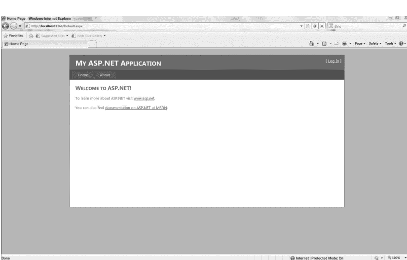

图 1-3：默认应用程序页面

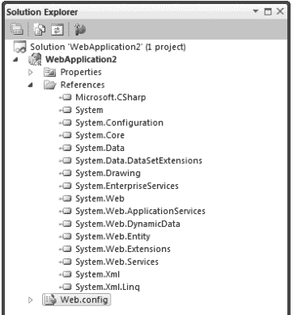

图 1-4：ASP.NET 空 Web 应用程序项目结构

# ASP.NET MVC

严格来说，ASP.NET MVC 并不是随着 .NET 4 引入的。ASP.NET MVC 1.0 版本（或在此处称为 MVC）是一个离线发布版本，开发者可以从微软免费下载。Visual Studio 2010 带了该框架的第 2 版本。2011 年，微软发布了 MVC 第 3 版本作为另一个离线发布版本。本文将介绍第 3 版本。

我曾使用 ASP.NET Web Forms 框架构建过许多应用程序。我一直在增强使用该框架构建的现有网站。多年来，它对我非常有帮助，许多其他开发者也在该框架上构建了无数可扩展的网站。然而，对于在 .NET 平台上构建的新网站，我建议使用较新的 ASP.NET MVC 框架。

MVC 框架具有以下优势：

- MVC 鼓励应用程序部分之间实现更好的关注点分离。例如，每个页面默认没有后台代码（`code-behind`），这阻止了用户将业务逻辑与用户界面混合。
- MVC 对输出到客户端的 HTML 和 CSS 提供了更好的关注点分离。
- 因为 MVC 鼓励进一步的关注点分离，它使得更容易独立地测试应用程序的一部分。特别是用户界面——这是一个臭名昭著的难以创建自动化单元测试的部分——它与应用程序的其他部分分开了。

在 ASP.NET Web 应用程序中，URL 指向磁盘上的文件。通常，该文件是一个 ASPX 页面，每个 ASPX 页面控制后续发生什么。通常会执行页面生命周期，触发一系列页面事件（`Load`、`PreInit`、`Prerender`、`Render`）并运行与这些每个事件关联的代码。

在 MVC 应用程序中，URL 指向的是一个 `Controller` 方法而不是文件。`Controller` 方法是 `Controller` 类中的一个公共方法。`Controller` 类是一个实现了 `IController` 接口的公共具体类，其名称以 `Controller` 结尾。正如其名所示，控制器处理请求的所有逻辑。这可能涉及接受输入数据、应用业务逻辑、检索数据、决定要渲染哪个视图，并将有状态的数据（模型）发送到客户端。

如果这听起来很复杂，框架内置的工具可以帮助你快速创建控制器类、方法和视图。

## MVC 的版本

截至此离线发布（即，在两次发布之间），微软已经发布了三个版本的 ASP.NET MVC 框架。第 1 版本以下载的形式发布。第 2 版本随 Visual Studio 2010 发布。2011 年，微软发布了 MVC 第 3 版本。

此离线版本可以从 `www.asp.net/mvc/mvc3` 下载。安装程序（如图 1-5 所示）有一个标记为 `Install` 的按钮。点击此按钮开始安装。如果你还没有安装任何版本的 Visual Studio，它将安装 Visual Studio Express。

## ASP.NET MVC 9

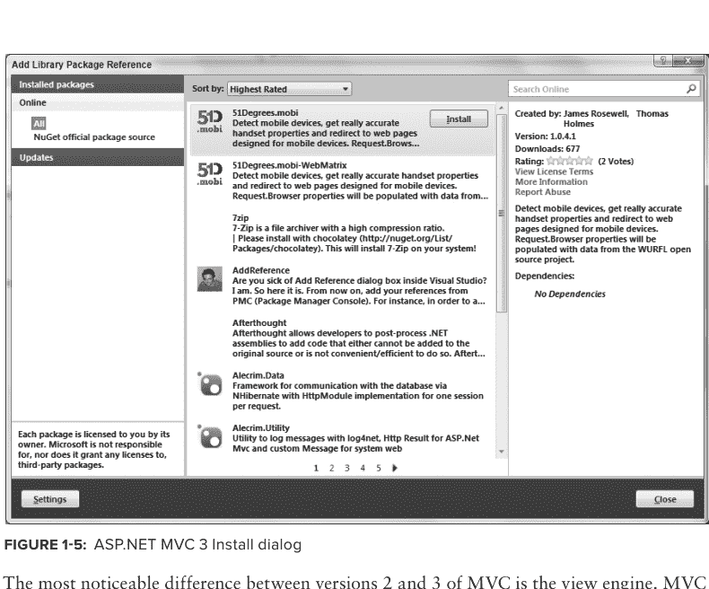

## MVC 的组成部分

为了理解 MVC，让我们仔细观察构成 MVC 的每一个部分。

### 模型 (Model)

HTTP（以及与之关联的万维网）本质上是无状态的。从客户端到服务器的每个请求对之前的任何请求都没有记忆。至少在默认情况下是这样。但应用程序需要是有状态的；当用户在 Web 应用程序的页面之间导航时，应用程序希望记住某些内容。模型是有状态数据的容器，通常以一个或多个实体类的形式存在。实体类是一个 .NET 类，包含用于存储状态信息的属性。例如，如果你有一个显示客户信息的页面，你可能创建一个带有 `FirstName`、`LastName` 等公共属性的类。该类可能还包含一个属性来存储该客户下的所有订单，如下例所示：

```csharp
public class CustomerDTO
{
    public string FirstName { get; set; }
    public string LastName { get; set; }
    public string Address { get; set; }
    public List<Order> Orders { get; set; }
}
```

MVC 应用程序可以实例化此类，以存储关于当前客户的有状态数据，并在客户端和服务器之间传输这些数据。MVC 框架提供了注解，允许你启用模型验证以指定规则，以及在 View 上显示的描述性标签，如下例：

```csharp
[Required(ErrorMessage = "Please enter a Name for this customer")]
[Display(Name = "Name")]
public string LastName { get; set; }
```

通常，我会在应用程序中为特定用途使用 `ViewModel`。`ViewModel` 包含了 View 所需的模型。`ViewModel` 的示例为：

```csharp
public class EditCustomerViewModel
{
    public CustomerDTO Customer { get; set; }
    public List<CustomerDTO> Types { get; set; }
}
```

### 视图 (View)

视图是发送到客户端的标记。在大多数 MVC 应用程序中，这是 HTML，但 ASP.NET MVC 允许创建传递信息的视图，可以是 JavaScript 对象表示 (JSON)、可扩展标记语言 (XML) 或任何其他数据格式。取决于你的选择：如果使用 Web 浏览器浏览视图，HTML 是合理的；如果视图由新闻阅读器读取，XML 格式是合理的；如果 Web 页面使用 JavaScript Ajax，JSON 可能是更好的返回格式。

### 控制器 (Controller)

控制器是 ASP.NET MVC 中的一种特殊类。

控制器是 MVC 应用程序的中枢神经系统。一切都从控制器开始，因为控制器动作（类中的方法）是客户端调用以启动请求。

在 ASP.NET MVC 中，控制器必须满足以下条件：

- 它必须是一个具体类。（抽象类或接口不属于控制器。）
- 它必须是一个公共类，以便客户端可以访问其方法。
- 它必须实现 `IController` 接口。MVC 框架提供了一个实现此接口的基类（`BaseController`），因此我通常继承该类。
- 类的名称必须以 `Controller` 单词结尾。

名称部分标识了控制器，因为它包含了 `Controller`。通过名称识别类的功能是约定配置的一种示例。通过对所有控制器应用命名模式，你不需要告诉应用程序哪些类是控制器：应用程序可以根据名称判断。

### Action 方法 (Action Methods)

在类内部，你可以定义一个或多个 Action 方法。通常，Action 方法创建模型（可能通过查询数据库并将结果映射到有状态数据）并确定渲染器。Controller Action 方法然后将视图和模型返回给客户端。

通常，Controller 中的每个 Action 方法返回一个 `ActionResult`。运行时随后调用此 `ActionResult` 对象的 `ExecuteResult` 方法，该方法可以创建并发送响应，也可以执行其他操作（例如重定向到另一个 Action 或抛出异常）。

`ActionResult` 是一个抽象类，因此 Action 方法实际上返回 `ActionResult` 的特定子类。

在 Web 应用程序中，通常返回 `ViewResult` 子类，它用于向浏览器渲染 HTML。但你也可以选择返回以下：

- `ActionResult` — 将文件下载到客户端。
- `UnauthorizedResult` — 向客户端返回 404 错误。
- `JsonResult` — 生成一个易于 JavaScript Ajax 请求的 JSON 对象。
- `RedirectToRouteResult` — 自动将用户发送到一个新的 URL，根据应用程序的路由规则，这将调用另一个 Action 方法。

还有其他子类，你甚至可以在你的自定义类中派生 `ActionResult`，以创建你自己的自定义行为。

MVC Controller 类包含许多用于生成 `ActionResult` 对象的辅助方法。例如，`View` 方法返回一个 `ViewResult` 对象，而 `RedirectToAction` 方法返回一个 `RedirectToRoute` 对象。

#### 模型绑定 (Model Binding)

MVC 框架擅长识别数据并将其映射到适当的对象上。例如，数据可以通过多种方式提交给 Controller Action，包括输入值、查询字符串值和路由数据。当这些数据被提交到 Action 时，`DefaultModelBinder` 会通过反射机制，尝试将这些值映射到 `ViewModel` 的属性上。这允许你的 Action 接收 `ViewModel` 作为参数，这通常比处理查询字符串值集合要简单得多。在 Action 中使用强类型数据可以更容易强制执行可以提交哪些数据，并捕获无效数据。

在本章的后后部分中，你将看到一个此类 Action 的示例。现在，以下是一个接受 `ViewModel` 参数的 Controller Action 示例签名：

```csharp
public ActionResult Edit(ViewModel departmentVm)
```

#### URL 路由 (URL Routing)

要理解 ASP.NET MVC 应用，你需要理解将 URL 路由到 Web 浏览器地址栏。

大多数请求始于用户在包含 HTML、脚本和其他标记及代码的物理文件磁盘中输入一个 URL。如果用户在浏览器中输入 `http://MySite.com/CustInfo/CustomerDetails.aspx`，Web 服务器将在 `http://MySite.com` 的 `CustInfo` 文件夹中查找名为 `CustomerDetails.aspx` 的页面并处理该页面。

URL 路由为网站结构的构建提供了更大的灵活性。它将 URL 与物理页面的位置解耦。

这种灵活性允许开发者创建更易记忆且更易被搜索引擎索引的 URL。例如，考虑以下内容：

```
/OrderDetails.aspx?CustId=123&Year=2010
```

这是以前向客户提供数据的常用方式。在这个 URL 中，`OrderDetails.aspx` 文件有两个查询字符串参数（问号之后的所有内容），并使用这些参数值来过滤要检索的信息（在这种情况下，仅考虑 2010 年为客户 123 下的订单）。这种方法的一个问题是，它没有针对搜索引擎进行优化。

大多数搜索引擎会忽略查询字符串，因此以下 URL 被视为：

```
/OrderDetails.aspx?CustID=123&OrderYear=2010
/OrderDetails.aspx?CustID=124&OrderYear=2009
```

当然，你也可以简单地创建如下 URL：

```
/OrderDetails123-2010.aspx
/OrderDetails124-2009.aspx
```

然而，这需要你维护大量带有冗余信息的页面，并且不够灵活。更好的解决方案是允许用户输入如下的 URL：

```
/Order/Details/123/Year/2010
/Order/Details/122/Year/2009
```

这些 URL 易于阅读和记忆，会被搜索引擎视为两个不同的页面。

许多人认为 ASP.NET 路由仅适用于 MVC。然而，.NET Framework 的路由功能对所有 Web 应用程序均可用。

在 ASP.NET MVC 应用中，URL 指向一个 Action Controller 方法。

你可以在 `global.asax` 文件的 `Application_Start` 方法中设置路由。正如名称所示，它在应用程序启动时触发，因此它是添加启动代码的好地方。以下是在创建新的 ASP.NET MVC 项目时，默认添加到 `global.asax` 的代码：

```csharp
public static void RegisterRoutes(RouteCollection routes)
{
    routes.IgnoreRoute("resource.axd/{pathInfo}");
    routes.MapRoute(
        "Default", // 路由名称
        "{controller}/{action}/{id}", // 带有参数的 URL
        new { controller = "Home", action = "Index", id = UrlParameter.Optional } // 参数默认值
    );
}
protected void Application_Start()
{
    RegisterRoutes(RouteTable.Routes);
}
```

在此片段中，`routes.MapRoute` 方法为应用程序定义了一个路由（Route）。路由告诉 MVC 如何解释 URL。

在上一个示例中，第一个参数 `"Default"` 定义了路由。

第二个参数 `"{controller}/{action}/{id}"` 定义了要查找的 URL 部分。在这种情况下，预期的 URL 被拆分为三部分：

- 第一部分定义控制器的名称。
- 第二部分定义该控制器内 Action 方法的名称。
- 第三部分标识传递给该 Action 方法的 `id` 参数的值。

`MapRoute` 的第三个参数定义了 URL 每个部分的默认值，这允许你省略这些部分的任何一个或全部。如果省略了控制器，则假设为 Home Controller；如果省略了 Action，则假设为 `Index` Action；而 `id` 是可选的。

## ASP.NET MVC | 17

以下是 MVC 使用的重要程序集：

- `System.Web.Mvc` — 该程序集包含核心框架和许多辅助方法。
- `System.Web.Routing` — 该程序集控制 URL 路由。它单独作为一个程序集，是为了让 Web Forms 也能使用路由功能。
- `System.ComponentModel.DataAnnotations` — 该程序集包含用于装饰模型属性的特性。框架会检测这些特性，并自动为使用它们的应用程序属性添加功能。

## 站点结构

MVC 应用的许多部分对 Web Forms 开发者来说是熟悉的。请图 1 中的“空”MVC 项目。

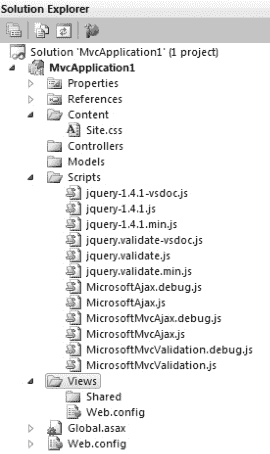

图 1-9：“空”MVC 项目

该项目包含一个 `web.config` 文件，以及——对 MVC 框架使用的命名空间和程序集的其他引用——它看起来与 Web Forms 中的 `web.config` 文件相似。

项目包含一个 `global.asax` 文件，您可以在其中添加代码来处理应用程序启动、停止处理程序以及程序中的其他事件。如前所述，在 `Application_Start` 事件处理程序中使用 MVC 代码设置默认路由。

`Content` 文件夹下有一个样式表文件（`Site.css`），它控制站点的字体、颜色和其他视觉样式。修改这些文件会更改整个站点的视觉元素，使站点具有一致的外观和感受。

`Scripts` 文件夹主要是 jQuery 文件。jQuery 是一个开源 JavaScript 库，用于为 Web 应用添加客户端功能。您将在本章中学习更多关于 jQuery 的知识。`Scripts` 文件夹中还有几个值得注意的 JavaScript 文件。`MicrosoftAjax.js` 和 `MicrosoftMvcAjax.js` 提供从 Web 应用调用服务器端代码的辅助方法。`MicrosoftMvcValidation.js` 提供输入字段的客户端验证。

新 MVC 应用可能部分可能。控制器（`Controllers`）、模型（`Models`）和视图（`Views`）的存在是为了让开发者添加自定义的控制器、模型和视图。

`Models` 文件夹的存在是为了方便，这样开发者可以将所有模型类放在一起，使它们更容易找到。由于类被编译为中间语言 (IL)，因此它们物理所在的位置并不重要。我建议将实体对象放在单独的项目中，并将 `ViewModel` 类存储在 `Models` 文件夹中。

控制器也会编译为 IL，因此它们需要保存在 `Controllers` 文件夹中。然而，MVC 提供了一些工具，允许您右键点击此文件夹并轻松创建控制器类，单此一点就值得将所有控制器都放在那里。

默认情况下，每个视图将保存到 `Views` 文件夹的子文件夹中。MVC 使用约定来查找某些内容，视图就是其中之一。当控制器 Action 方法查找视图时，MVC 会查找与 Action 方法同名的视图，或者具有 ASPX 或 ASCX 扩展名的视图。它会在 `Views` 文件夹中进行查找——首先在与控制器同名的子文件夹中，然后在 `Shared` 子文件夹中。

例如，当您在 `UserController` 类中指定 `Edit` 视图时，MVC 将按照以下位置查找：

1. `Views/Customer/Edit.aspx`
2. `Views/Customer/Edit.ascx`
3. `Views/Shared/Edit.aspx`
4. `Views/Shared/Edit.ascx`

## 添加控制器

向 MVC 项目中添加新控制器非常简单。在解决方案资源管理器中右键点击 `Controllers` 文件夹，并选择添加：控制器。

显示添加控制器对话框，如图 1-10 所示。

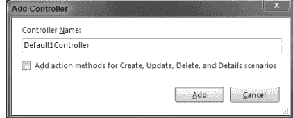

图 1-10：添加控制器对话框

控制器名称必须以单词 `Controller` 结尾，因此对话框提供了一个默认名称（`DefaultController`）并突出显示该名称的这，以便您将其更改为有意义的内容。


下拉菜单提供选项允许框架自动生成一组 Action 方法，以创建、读取、更新和删除（称为 CRUD）模型实体。您可以允许工具使用您正在使用的 Entity Framework 代码来填充这些方法，或者您可以告诉工具仅创建方法存根，以便您稍后完成。

无论何种情况，您都可以修改这些 Action 方法并在必要时向控制器类中添加更多 Action 方法。

# 添加视图

当您有一个控制器 Action 时，MVC 工具可以轻松地为该方法添加默认视图。在方法内部任何地方右键点击，并从上下文菜单中选择添加视图。显示添加视图对话框，如图 1-11 所示。

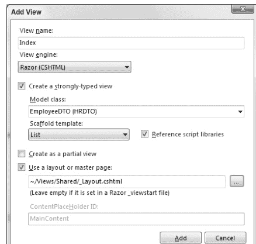

**图 1-11：**添加视图对话框

视图名称默认为 Action 方法的名称。这通常是可以接受的，因为默认情况下，Action 方法会查找与其名称匹配的视图。

视图引擎默认使用 Razor，这是随 MVC 3 带的新视图引擎。Razor 视图引擎允许您为网页创建整洁的模板。它包含了 HTML 和由传递给视图的模型填充的占位符。

对于 CRUD 方法，您需要勾选创建强类型视图；然后选择您想要更新的模型类和适当的 Scaffold Template。Scaffold Template 会生成适用于编辑、创建或列出模型的 HTML。

MVC 包含了许多方法，使其能够更容易在视图中渲染对象。本页面包含以下代码：

```
@Html.ActionLink("Edit", "Edit", new { id=Model.DepartmentId })
```

此代码生成了一个文本为“Edit”的超链接，链接指向 trend 控制器中的 Edit Action 方法，并传递了一个值为当前页面 DepartmentID 的 id 参数。

MVC 提供了其他辅助方法。以下每个方法都会根据传递给视图的模型中的属性生成一个 HTML 元素。每个方法渲染何种 HTML 元素应该是显而易见的。

- `Html.TextBoxFor()`
- `Html.TextAreaFor()`
- `Html.DropDownList()`
- `Html.CheckboxFor()`
- `Html.RadioButtonFor()`
- `Html.ListBoxFor()`
- `Html.PasswordFor()`
- `Html.HiddenFor()`
- `Html.LabelFor()`

# 索引

Index Action 方法返回所有 Department 对象的列表，该列表被发送到视图引擎以与视图合并。

```
var empBus = new DepartmentBus();
List<DepartmentDTO> departments = empBus.GetAllDepartments();
return View(departments);
```

查看视图，你可以发现它是 `IEnumerable<HRDTO.DepartmentDTO>`。

```
@model IEnumerable<HRDTO.DepartmentDTO>
```

这与动作方法发送的数据匹配，该方法向视图发送了一个 DepartmentDTO 对象的列表。本页面的服务器端 C# 代码遍历此部门列表，单独输出每个部门。

```
<table>
  <tr>
    <th></th>
    <th>Department ID</th>
    <th>Department Name</th>
  </tr>
  @foreach (var item in Model) {
    <tr>
      <td>
        @Html.ActionLink("Edit", "Edit", new { id=item.DepartmentId })
        @Html.ActionLink("Details", "Details", new { id = item.DepartmentId })
        @Html.ActionLink("Delete", "Delete", new { id = item.DepartmentId })
      </td>
      <td>
        @item.DepartmentId
      </td>
      <td>
        @item.DepartmentName
      </td>
    </tr>
  }
</table>
```

该页面代码在服务器端 C# 代码和客户端 HTML 之间切换。Razor 引擎在遇到 `@` 符号时知道要开始进行服务器端解释。它根据上下文决定停止。服务器端代码首先运行，导致 HTML 输出多次——对应列表中的每个项目输出一次。

# 编辑

Edit Action 方法看起来和 details 方法类似。它返回单个 Department。在这种情况下，DepartmentDTO 包含在 ViewModel 对象中。我稍后会详细解释模型，但目前你只需要知道，ViewModel 对象中包含一个类型为 DepartmentDTO 对象的属性。

```csharp
public ActionResult Edit(int id)
{
    var empBus = new DepartmentBusiness();
    DepartmentDTO department = empBus.GetDepartment(id);
    var viewModel = new ViewModel();

    Department = department;

    return View(viewModel);
}
```

在这种情况下，你返回了一个名为 ViewModel 的东西。ViewModel 是特定于视图的数据。除了此 MVC 动作外，没有其他应用程序使用该 ViewModel。你可以在 Models 文件夹中找到 ViewModel。它看起来与 DepartmentDTO 相似，但特殊属性装饰了 ViewModel 的属性。

```csharp
public class DepartmentViewModel
{
    [DisplayName("Department ID")]
    public int DepartmentId { get; set; }

    [Required(ErrorMessage="Please provide a name for this department")]
    [DisplayName("Department Name")]
    public string DepartmentName { get; set; }
}
```

这些属性被 MVC 视图引擎识别。查看与编辑部门相关的视图（Views/Department/Edit.aspx）。

```html
@using (Html.BeginForm()) {
    @Html.ValidationSummary(true)
    <fieldset>
        <legend>Department</legend>
        @Html.HiddenFor(model => model.Department.DepartmentId)
        <div class="editor-label">
            @Html.LabelFor(model => model.Department.DepartmentId)
        </div>
        <div class="editor-field">
            @Model.Department.DepartmentId
        </div>
        <div class="editor-label">
            @Html.LabelFor(model => model.Department.DepartmentName)
        </div>
        <div class="editor-field">
            @Html.EditorFor(model => model.Department.DepartmentName)
            @Html.ValidationMessageFor(model => model.Department.DepartmentName)
        </div>
        <p>
            <input type="submit" value="Save" />
        </p>
    </fieldset>
}
```

以下几行使用了 MVC 属性：

`@Html.LabelFor(model => model.Department.DepartmentId)`

`LabelFor` 辅助方法为 DepartmentId 输出 HTML 标签。在这种情况下，标签的文本是由装饰 ViewModel 中该属性的 `DisplayName` 属性决定的。因此，返回了一个文本为“Department ID”的标签。如果模型（或 ViewModel）类没有被属性装饰，则默认显示属性名（DepartmentId）。

本页面上使用模型属性的另一个地方是验证输入。在 ViewModel 中 `Required` 属性来自 `System.ComponentModel.Annotations` 程序集，因此你必须在项目中添加对该程序集的引用。这告诉视图引擎用户必须输入非空 DepartmentName。如果用户尝试提交表单，提交将被拦截。

为了让视图充分利用此验证，多个辅助方法会在验证失败时输出错误消息。模型属性 `Required` 包含一个错误消息参数（“Please Provide a Name for Department”）。在视图中 DepartmentName 文本框下方，`ValidationMessageFor` 方法在用户在没有有效 DepartmentName 的情况下提交表单时被调用以输出此消息：

```html
@Html.ValidationMessageFor(model => model.DepartmentName)
```

视图还包含一个辅助方法来汇总页面上的所有错误。

```html
@Html.ValidationSummary(true)
```

如果发生多个验证错误，所有错误消息将列在此验证摘要中，用户可以一次看到并处理它们。

以下是你可以放在模型属性上的某些验证属性：

- `[Required]` — 输入是的（参见之前的示例）。
- `[StringLength]` — 仅用于字符串属性。如果长度超过指定则验证失败。
- `[RegularExpression]` — 输入必须匹配模式。
- `[Range]` — 数字属性。输入必须在范围内。
- `[DataType]` — 输入必须指定类型。

关于 Edit.aspx 的另一个注意点是：

```
@using (Html.BeginForm()) {
```


大括号之间的内容将被封装在 `<form>` 标签中，使其能够提交到 URL。因此，如果表单提交到相同的 URL，它将选择 Action 方法。这是 MVC 的默认方式。`DepartmentController` 如下：

```csharp
[HttpPost]
public ActionResult Edit(DepartmentViewModel departmentVm)
{
    DepartmentDTO department = departmentVm.Department;
    if (ModelState.IsValid)
    {
        try
        {
            var empBus = new DepartmentBusiness();
            empBus.UpdateDepartment(department);
            return RedirectToAction("Details", new { id = department.DepartmentId });
        }
        catch
        {
            return View(departmentVm);
        }
    }
    else
    {
        return View(departmentVm);
    }
}
```

```csharp
empVm.AllDepartments = Transformations.TransformToViewModelsList(allDepartments);
return View(empVm);
```

视图 (`Employee/Edit.aspx`) 渲染员工表单类似于部门视图的渲染方式。区别在于它如何构建一个包含所有部门的下拉列表，并将项绑定到员工的 `DepartmentID` 属性上。

```csharp
@Html.DropDownListFor(
 model => model.DepartmentId,
 SelectList(Model.AllDepartments, "DepartmentId", "DepartmentName"))
```

`DropDownListFor` 辅助方法渲染 HTML 下拉列表并将其绑定到属性。该辅助方法的第二个参数是 `SelectList` —— 这是一个 MVC 类，根据提供的 ID 和文本列生成下拉列表。数据来自 `Model.Departments`，因为 `EmployeeViewModel` 包含一个 `Departments` 属性，该属性已由控制器操作填充。

`HttpPost Edit` 方法与 `DepartmentController` 中的 `HttpPost Edit` 方法非常相似。

```csharp
[HttpPost]
public ActionResult Edit(EmployeeViewModel employeeVm)
{
    if (ModelState.IsValid)
        try
        {
            EmployeeDTO employee = employeeVm.Employee;
            var empBus = new EmployeeBusiness();
            empBus.UpdateEmployee(employee);
            return RedirectToAction("Details", new { id = employee.EmployeeId });
        }
        catch
        {
            return View(employeeVm);
        }
    else
    {
        return View(employeeVm);
    }
}
```

你在这里不需要任何特殊操作，因为所有数据都会自动绑定到 `EmployeeViewModel` 中。

# ASP.NET MVC 框架总结

本节介绍了 ASP.NET MVC 框架，解释了 MVC 的优势，展示了该框架的一些实用功能，并演示了一个简单的应用程序。

# JQUERY

由于 Web Forms 已经存在很久，开发者可以找到无数控件来增强他们的 Web 应用程序。微软和众多第三方供应商制作了控件库，为 ASP.NET 网站提供额外功能。

许多 Web Forms 依赖于页面事件和后置代码（`code-behind`）。因此，它们不适用于新的 ASP.NET MVC 范式。

开发者仍然可以通过使用 JavaScript 添加丰富的客户端交互来增强他们的应用程序。许多构建 Web Forms 的相同组件供应商也正在开发并发布适用于 MVC 的控件。在许多情况下，他们使用 JavaScript 来提供客户端交互性。

JavaScript 是一个与网页交互的极佳工具，原因如下：

- 它是一门运行在所有现代桌面浏览器上的标准语言。
- 它与网页暴露的文档对象模型（DOM）交互，允许开发者管理页面上的对象。
- 它拥有一个丰富的事件模型，用于构建交互式应用程序。

遗憾的是，JavaScript 有若干缺点限制了它的实用性和流行性，包括：

- 对于开发者来说，JavaScript 的学习曲线可能很陡峭。
- 每个浏览器都有自己的 DOM 实现，这迫使开发者多次编写和测试相同的功能，以确保代码在各种浏览器中正确运行。

在 JavaScript 之上构建了许多库来解决这些缺点。这些库抽象了 JavaScript 的复杂性，并且（更重要的是）自动检测并处理与主流浏览器之间不同 DOM 实现交互时的差异。

jQuery 是一个开源库，得益于其丰富的函数集和易用性，在近几年中变得非常流行。通过 Visual Studio 2010，微软决定在产品中包含 jQuery，这进一步提升了它的人气。

一个新的 ASP.NET MVC 项目包含一个 `Scripts` 文件夹，其中包含十几个 `.js` 文件。这些文件包含了项目页面可以调用的 jQuery。你可以用从 http://jquery.com 下载的版本替换这些文件。每个文件名都包含一个数字（例如 1.4.1）。这是与脚本关联的 jQuery 版本。这种命名约定使得易于判断网站运行的是哪个版本的 jQuery。

要在视图页面中使用 jQuery，请引用 `Scripts` 文件夹中的文件，或托管在内容分发网络（CDN）上的文件，例如由微软托管在 http://ajax.microsoft.com/ajax/jquery 上的那个。jQuery 脚本文件（例如 `jquery-1.4.4.min.js`）存储在此文件夹中。链接到你希望在页面上使用的每个 `.js` 文件。

每个位置通常包含每个文件的两个版本：一个以 `.js` 结尾，另一个以 `.min.js` 结尾。`.min.js` 版本是脚本的压缩版本，这意味着删除了注释和多余的空格，并缩短了变量和函数名。我总是使用压缩版本，因为它们更小，因此下载到客户端的速度更快。

在页面顶部添加以下行以使 jQuery 功能可用：

```html
<script src="[FULL_SCRIPT_PATH]" type="text/javascript"></script>
```

在此代码段中，`[FULL_SCRIPT_PATH]` 是页面使用的脚本文件的路径和文件名。例如，要在同一站点的主页（`Shared\Layout.Master.asx`）中使用项目 `Scripts` 文件夹中的主 jquery 文件，添加以下行：

```html
<script
src="<%= Url.Content("/Scripts/jquery-1.4.4.min.js") %>"
type="text/javascript"></script>
```

`Url.Content` 方法指定了一个绝对路径，因此无论渲染哪个视图，以及该视图位于哪个文件夹，都能找到该 `.js` 文件。我倾向于从我网站的主页引用此脚本。

> 本节描述的 jQuery 代码包含在示例应用程序文件 (HR) 中，该文件可以在本书的配套网站 www.wrox.com 下载。

jQuery 代码本质就是 JavaScript。因此，所有的 jQuery 代码都属于 `<script language="javascript">` 标签内部。jQuery 语法的常用模式如下：

```javascript
$(Selector).Event);
```

在此代码段中，`$` 是美元符号字符，代表 jQuery 对象；`Selector` 是选择器函数（稍后介绍）；`Event` 是由所选对象触发的事件；`Action` 是事件时运行的代码。

每次调用 jQuery 函数都以 `$` 符号开始。该符号指示后面的 JavaScript 是 jQuery 语法。你可以将 `$` 替换为关键字 `jquery`，但后者简洁得多。

jQuery 选择器使用类似于 CSS，并始终返回匹配元素集合。选择器语法可以接受：

- 用引号包含标签名选择所有该标签。例如，`"div"` 选择页面上所有的 div。
- 在字符串前加 `#` 根据 ID 选择元素。例如，`"#custIdLabel"` 选择 ID 为 custIdLabel 的元素。
- 在字符串前加 `.` 选择所有应用了给定类的元素。

在页面上有多个相同 ID 的元素是愚蠢的。

每个浏览器都有自己的 DOM 实现，这迫使开发者多次编写和测试相同的功能，以确保代码在各种浏览器中正确运行。

# 第一章 ASP.NET 与 JQUERY

# 使用 jQuery 操作 DOM 元素

查看示例项目的 `DemoClick.html`。以下是相关部分：

```html
<script type="text/javascript" language="javascript">
$(document).ready(function () {
  $("#img1").click(function () {
    var newHeight = $(this).height() + 20;
    $(this).height(newHeight);
  });
});
</script>
```

```html

```

注意选择器：`$("#img1")`。"img1" 前面的符号告诉 jQuery 搜索 ID 为 img1 的任何元素。选择器返回匹配标准的元素集合。在这种情况下，选择器找到了页面上的一个元素，因此它返回包含一个匹配元素的集合。下面的代码将匿名函数绑定到匹配元素的点击事件上。匿名函数如下：

```javascript
var newHeight = $(this).height() + 20;
$(this).height(newHeight);
```

在此处，声明并赋值了变量 `newHeight`。代码使用 `this` 关键字来识别触发点击事件的元素。在这种情况下，它是触发点击事件的图像元素，因此 `$(this)` 指向该图像元素。代码获取了图像元素的高度，在将其增加 20 像素之前，将此总和赋值给 `newHeight` 变量。

结果是显示了一个显示了图像的页面。每当用户点击它时，它就会变大 20 像素。

# 使用 jQuery 调用服务器代码

jQuery 的一个强大用途是它能够调用服务器上的 RESTful Web 服务。这使得 Web 应用程序具备了在不提交整个页面的情况下调用服务器代码的能力。

ASP.NET MVC 提供了一种简单的方法来暴露可以从 jQuery 调用的 RESTful 服务。请记住，每个控制器（Controller）方法都返回一个 `ActionResult` 对象。MVC 框架提供了 `JsonResult` ——它是 `ActionResult` 的一个子类，用于以 JSON 格式返回数据。JSON 是一种轻量级的、基于文本的数据格式，用于在网络上传输数据。

HR 示例应用程序中的 `EmployeeController` 包含一个 `GetAllEmployees` 方法，该方法返回一个 `JsonResult` 对象。代码如下：

```csharp
public JsonResult GetAllDepartments()
{
    var empBus = new DepartmentBusiness();
    List<DepartmentDTO> departments = empBus.GetAllDepartments();
    return Json(departments, JsonRequestBehavior.AllowGet);
}
```

此代码看起来与 `DepartmentController` 类中的 `GetAllDepartments` 方法相似。区别在于，最后一行使用 `Json` 辅助方法向视图引擎传递了一个 `JsonResult` 对象，而不是 `ViewResult` 对象。结果是数据以 JSON 格式发送到客户端 —— 这种数据格式非常精小且具有自描述性，因此非常适合在客户端和服务器之间传递数据。

```csharp
return Json(departments, JsonRequestBehavior.AllowGet);
```

该方法在此将部门列表传递给视图引擎。方法的第二个参数允许此服务方法通过 HTTP GET 进行调用。默认情况下，只启用了 POST 方法。

此方法可以从 Web 页面上的 jQuery 脚本直接调用，而无需刷新页面。`EditJQ.aspx` 页面包含以下脚本：

```javascript
$(function () {
    var url = "/Employee/GetAllDepartments";
    $.getJSON(url, null, function (data) {
        var options = "";
        for (var i = 0; i < data.length; i++) {
            options += "<option value=" + data[i].DepartmentId + ">" + data[i].DepartmentName + "</option>";
        }
        $("#DepartmentSelect").append(options);
    });
});
```

# 第一章 ASP.NET JQUERY

当文档的 `ready` 事件触发时，脚本调用 jQuery 函数 `getJSON`，该函数调用 RESTful Web 服务函数 `GetAllDepartments`。`getJSON` 的最后一个参数是一个回调函数，它在 Web 服务返回后运行。`data` 参数是 Web 服务的返回值 —— 即一个部门列表。

选择器 `$("#DepartmentSelect")` 选择了页面上 ID 为 `DepartmentSelect` 的空下拉列表。该函数遍历部门列表并为每个部门构建一个 `option` 标签。然后，它将 `option` 标签列表添加到空下拉列表中。

# jQuery

本节介绍了 jQuery、jQuery 的基本语法，并讨论了如何使用 jQuery 从客户端代码调用 RESTful Web 服务。

通过展示几个简单的示例，这些讨论已经触及这一强大框架的表面。你可以通过访问 http://docs.jquery.com 的在线文档获取更详细的信息。

## 总结

本章检查了 ASP.NET 4.0 中引入的一些新功能。你学习了在 Web 应用程序中处理视图状态（View State）的增强方法、新的 `web.config` 转换以及 Web 应用程序模板的改进（在创建新应用程序时使用更简单的 `web.config` 和更多选项）。

你还学习了最新版本的 ASP.NET MVC 框架。你学习了 MVC 应用程序中的概念，并看到了一个用它构建的示例应用程序。

如果全部都是服务端选项，那话就没什么好要说的了。ASP.NET 还包含了一系列良好的客户端状态管理技术，这使得存储状态的过程非常简单。表 2-2 定义了你的客户端选项。

## 表 2-2: 客户端选项

| 会话类型 | 描述 |
| --- | --- |
| ControlState | 这提供了一种向控件提供状态的方法（针对控件开发者），与 View State（视图状态）非常相似。 |
| Cookie | 提供了一种直接在客户端文件系统中存储状态的方法。客户端可以拒绝 Cookie。 |
| Hidden Field | 使用隐藏字段，你可以直接在页面代码中存储用户的状态，以供后续回传到服务器的请求使用。 |
| querystring | 使用提供的 querystring 功能，你能够按用户在实际的 URL 中存储状态。 |
| View State | 这提供了在页面代码中使用编码状态的能力。 |

如你所见，处理状态有很多种方法（甚至没有列出所有方法）。重要的是，理解处理状态并没有对错之分。这在很大程度上取决于你在应用程序中尝试实现的目标以及要处理的内容。

## 使用会话 (Working with Sessions)

ASP.NET 应用程序中的会话允许用户轻松地维护应用程序状态。会话会在定义的期间内，随着用户重复调用应用程序而保留给用户。会话提供了一种提高整体性能的极佳方法，而不是反复从某种数据存储中重新查找状态。

然而，使用会话带有警示。提高 ASP.NET 应用程序性能的最好方法之一是扩展运行它们的硬件（即添加 Web 服务器）。不正确地使用会话会导致应用程序在这种扩展模型中无法工作。如果你使用这种方法，应该考虑使用“粘性会话”（sticky-session，让用户的所有后续请求反复发送到同一台机器），或使用某种状态服务器进行会话的集中存储。当不正确地使用 Session 对象时（即在没有考虑到扩展模型的情况下构建它们），交付后续请求的其他服务器将对存储的 Session 结果一无所知。这稍后会讨论。


```
Session["EmployeeID"] = Value;
```

这会将变量 `Value` 持有的值分配给 `EmployeeID` Session 对象。使用以下方法从会话中检索此信息并在代码中使用：

```
Value2 = Session["EmployeeID"];
```

在 ASP.NET 中，会话会在 20 分钟后超时。如果用户在 Web 应用程序中打开了一个页面（从而创建了一个会话），然后离开去喝了咖啡，当用户 40 分钟后回到页面时，该会话已经不存在了。你可以通过进入服务器并更改分配给 `timeout` 属性的时间来绕过这一点，但这很繁琐，并且要求你停止服务器并重新启动才能使生效。此外，由于会话是资源密集型的，你不希望长时间存储过多的会话。

ASP.NET 允许你非常方便地更改 `timeout` 属性。在应用程序级别，它存储在 `web.config` 文件中。`machine.config` 文件存储了整个服务器的默认超时设置。通过更改 `web.config` 文件中的设置，你可以有效地更改应用程序内会话的超时属性。

在这个 XML 应用程序文件中更改此属性的巨大优势在于，服务器不需要启动并重启即可生效。在保存更改后的 `web.config` 文件后，更改将立即生效。需要注意的是，当你这样做时，应用程序域（application domain）会被间接地地重置，所有的状态信息都会丢失，包括 Session 对象的所有内容。

代码列表 2-1 显示了 `web.config` 文件中处理会话管理的部分——`<sessionState>` 节点。

> 代码 2-1: 检查 web.config 文件中的 `<sessionState>` 元素

```
<sessionState
mode="InProc"
stateConnectionString="*tcpip:127.0.0.1:42424"
sqlConnectionString="data source=127.0.0.1;user id=sa;password=""
cookieless="false"
timeout="20" />
```

`web.config` 文件的 `<sessionState>` 节点是管理会话状态的地方。你现在关注的属性是 `timeout`。

`timeout` 属性被设置为 20（默认设置）。该设置代表分钟。因此，如果你希望用户的会话持续一小时，可以将 `timeout` 属性设置为 60。

## 在进程内运行会话 (Running Sessions In-Process)

目前，ASP.Net 会话的默认设置是将会话存储在进程内（in-process）模式中。在进程内运行会话意味着会话存储在与 ASP.NET 工作进程相同的进程中。因此，如果 Internet 信息服务 (IIS) 关闭并重新启动，所有会话将被破坏且不可用。对于 Web 应用程序来说，这可能是一个噩梦。

要在进程内运行会话，`<sessionState>` 节点中的 `mode` 属性为 `InProc`。在进程内运行会话为应用程序提供了可能的性能。

表 2-3 描述了所有可用的会话模式。

### 表 2-3: 可用的会话模式

| 模式 | 描述 |
| --- | --- |
| InProc | 会话状态存储在与 ASP.NET 工作进程相同的进程中。 |
| Off | 使用会话。 |
| StateServer | 会话存储在单独状态服务器中。 |
| SQLServer | 会话存储在 SQL 数据库中。 |

## 使用 SQL Server 进行会话状态管理

OSQL 工具允许你进入 Transact-SQL 系统、系统存储过程和脚本文件。该工具使用开放数据库连接 (ODBC) 与服务器通信。运行此命令将创建运行 SQL Server 会话管理选项所需的表和存储过程。命令行中的符号 `-S` 表示法指定要使用的服务器位置。在这种情况下，你使用的是 `localhost`，即你的本地服务器。

`-u` 表示法指向获取访问所需的 SQL 服务器分配用户名。在这种情况下，它就是典型的 `sa`。

`-p` 表示法用于 SQL 服务器的密码（如果需要）。在这种情况下，不需要密码。

按照 SQL 服务器的设置配置，你只需指定要安装的脚本 `InstallSqlState.sql`。这将安装运行 SQL Server 会话管理所需的所有内容。

在创建必要的表和存储过程之后，如列表 2-3 所示，配置 web.config 文件中的 `<sessionState>` 节点。

### 列表 2-3：使用 SQL Server 作为数据服务器

```
<sessionState
mode=SQLServer
connectionString=tcpip=127.0.0.1:42424;
cookies=false
timeout=20 />
```

要使用 SQL Server 管理会话，必须将 `<sessionState>` 节点的模式设置为 `SQLServer`。在模式设置为 `SQLServer` 后，ASP.NET 将查找 `sqlConnectionString` 属性以便在存储状态时找到要连接的 SQL 服务器。此属性的值应设置为数据源所在的存储 SQL 以及任何所需登录信息的服务器。

## 决定会话状态

在应用程序中运行会话时选择的模式会对你的 Web 应用程序的性能、功能和可靠性产生巨大影响。

你应该选择哪种模式？以下是每个选项的最佳适用条件：

- **InProc** — 会话在与 ASP.NET 工作进程相同的进程中运行。因此，当维护会话对应用程序不是至关重要时，应使用此选项。所有选项中，此选项性能最佳。
- **StateServer** — 该 Windows 服务在进程之外运行，因此当在多台服务器上使用时，或者当 IIS 停止并重启时必须维护会话时，它是最佳。此选项比另一个进程外选项 `SQLServer` 提供了更好的性能。
- **SQLServer** — 这种进程外选项是最可靠的选择，因为会话直接存储在 SQL Server 中。尽管这是最可靠的选择，但该选项的性能排名最后。

为了从会话的使用中获得最佳性能，你可以在页面指令中使用 `EnableSessionState` 属性在每个页面上声明你希望如何处理 Session 对象。以下是使用该属性的示例：

```
<@ Page Language="C#" EnableSessionState="True" CodeFile="Default.aspx.cs"
Inherits="Default" %>
```

`EnableSessionState` 默认设置为 `True`。此属性具有以下选项：

- `EnableSessionState="True"` — 这是默认设置，意味着 ASP.NET 页面将使用 Session 对象。页面还将仅对正在使用的 Session ID 使用 Session 对象的读/写访问。
- `EnableSessionState="False"` — 将值更改为 `False` 意味着页面不需要访问 Session 对象。如果你的页面完全没有使用 Session，将此属性的值设置为 `False` 是最佳的，这会导致 ASP.NET 将此特定页面从需要使用 Session 对象的页面中调度开来。这将有助于你的 ASP.NET 应用程序的整体可扩展性。
- `EnableSessionState="ReadOnly"` — 将值设置为 `ReadOnly` 意味着你的 ASP.NET 页面只需要对 Session 对象的读取访问。所有仅从 Session 对象读取的页面都将从此设置中受益。

如果你的应用程序将使用 Session，关于性能的最佳做法是关闭会话。你可以通过 `web.config` 或 `machine.config` 文件来实现。在 `<sessionState>` 元素中，将 `mode` 属性设置为 `Off`。

# 使用输出缓存

仍然关注可以在服务器上采用的状态管理和缓存策略，你所可用的另一个选项是缓存。缓存是在服务器上存储频繁使用的数据以满足后续请求的过程。从内存中获取对象供代码使用，比反复调用数据存储器要好得多。缓存将提高你的 ASP.NET 应用程序的整体性能、可扩展性和可用性。

输出缓存是一种将动态生成的页面内容保留在服务器内存或磁盘中的方法。这种缓存保存了渲染后的内容，以便在下次请求时无需重新生成。页面被缓存后，当对其进行任何后续请求时，它可以再次提供服务。

你通过在 .aspx 页面顶部插入 `OutputCache` 指令来应用输出缓存，如下：

```
<@ OutputCache Duration="60" VaryByParam="None" %>
```

`Duration` 属性定义了页面在缓存中的秒数。`VaryByParam` 属性决定了实际缓存哪些版本的页面输出。你还可以根据需要 HTTP-POST 还是 HTTP-GET 响应生成不同的响应。

## 状态管理与缓存

通过使用 `VaryByHeader` 属性。除了 `OutputCache` 指令的 `VaryByParam` 属性外，ASP.NET 还包含了 `VaryByHeader`、`VaryByCustom`、`VaryByControl` 和 `Location` 属性。此外，`Shared` 属性可以影响控件，你稍后会看到。

ASP.NET 中的缓存实现为 HttpModule，它监听通过 ASP.NET 工作进程的所有 `HttpRequest`。OutputCacheModule 监听应用程序的 `ResolveRequestCache` 和 `UpdateRequest` 事件，处理缓存命中和缓存缺失，并在需要时返回缓存。

## VaryByParam

`VaryByParam` 属性可以指定哪些 QueryString 参数会导致新版本的缓存，如下：

```
<@ OutputCache Duration="90" VaryByParam="ID;subPageID" %>
```

例如，如果你有一个在 QueryString 中包含信息的 `navigation.aspx`，那么 OutputCache 指令将为每个不同的 `pageID` 和 `subPageID` 缓存。在这种情况下，页面数量通过一个公式表示：

cacheItems = 页面数 * subPageID 数

在这个公式中，`cacheItems` 是存储在缓存中的渲染 HTML 页面的数量。页面只有在被请求并通过 OutputCache 后才会被缓存。尽管这些只是最大值，但创建一个代表你系统可能最大值的公式是一个重要的练习。

如果你想根据 QueryString 的任何差异来缓存新版本的页面，请使用 `VaryByParam="*"`，如下所示：

```
<@ OutputCache Duration="90" VaryByParam="*" %>
```

## VaryByHeader

`VaryByHeader` 属性根据服务器的 HTTP 头部工作。

在使用 `VaryBy` 属性时进行“计算”是重要的。例如，你可以添加 `VaryByHeader` 属性，并根据浏览器的 User-Agent HTTP 头部缓存不同版本的页面。

```
<@ OutputCache Duration="90" VaryByParam="*" VaryByHeader="User-Agent" %>
```

User-Agent 识别浏览器类型。ASP.NET 可以自动为特定浏览器生成给定页面的不同渲染，因此在许多情况下这是合理的。Firefox 用户看到的 HTML 可能与 Internet Explorer (IE) 用户略有不同，因此你不希望向所有用户发送完全渲染后的 HTML。在现实世界中存在几十种 User-Agent 字符串，因为它们标识的不只是浏览器类型。根据服务器负载，此 `OutputCache` 指令可能会导致该页面产生数千个不同版本的缓存。在这种情况下，你应该权衡缓存的成本与动态重新创建页面的成本。

> 始终缓存那些能为你带来最大性能增益的内容，并通过测试来证明这一假设。不要使用像 `VaryByParam = "*"` 这样的属性进行“偶然缓存”。一个通用规则是：首先缓存最少的数据，在确定有需要时再进行大量缓存。记住，服务器内存是有限的资源，在某些情况下，你可能希望配置磁盘缓存。务必在有限的资源与核心关注点之间取得平衡；不要将敏感数据放在磁盘上。

## VaryByControl

对于渲染大量不常用 HTML 的复杂 `UserControls`，`VaryByControl` 是获取性能提升的一种非常简单的方法。例如，想象有一个渲染 `ComboBox` 显示世界上所有国家名称的 `UserControl`。这些名称可能是从数据库检索并渲染在组合框中的：

```
<@ OutputCache Duration="2592000" VaryByControl="comboBoxOfCountries" %>
```

无疑，世界国家并不会经常变化，因此 `Duration` 可以设置为一个月（秒为单位）。此示例使用了服务器控件 `comboBoxOfCountries` 并与其缓存输出配合工作。`UserControl` 的渲染输出被缓存，使得使用该控件的页面能够从缓存中获益，而页面本身仍保持动态性。

## VaryByCustom

尽管 `Vary` 提供了强大的功能，但你可能需要更多的灵活性。如果你想采用上一个导航示例中的 `OutputCache` 指令并缓存存储在 cookie 中的值，可以添加 `VaryByCustom`。`VaryByCustom` 被传递到可以添加到 `Global.asax.cs` 中的 `GetVaryByCustomString` 方法中。该方法在每次请求页面时都会被调用，它的职责是返回一个值。

每个返回的唯一值对应一个不同版本的页面。例如，假设用户有一个名为 `Language` 的 cookie，它有三个可能的值：`en`、`es` 和 `fr`。你想允许用户指定他们偏好的语言，无论其浏览器报告的语言是什么。`Language` 还有第四个值——它可能并不存在！因此，下例中的 `OutputCache` 指令缓存了许多版本的页面，描述如下：

cacheItems = (num of pageIds) * (num of subPageIds) * (4 possible Language values)

## 缓存版本计算示例

总结一下，假设 `pageID` 有十个可能的值，每个 `pageID` 有五个可能的 `subPageID` 值，且 `Language` 有四个值。这使得这一个导航页面总共有 200 个潜在的缓存版本。这个数学计算并不是为了吓跑你使用缓存，但你应该意识到，巨大的（缓存）能力伴随着巨大的责任。

ASP.NET 中的缓存涉及 CPU 和内存之间的权衡——管理页面的难度与你能够负担得起持有其 200 个版本之间的平衡。如果只有 5KB 的 HTML，那么花费几兆内存可能比查询成千上万条数据库条目要划算得多。由于大多数页面在一个周期内只访问一次数据库，每个从缓存提供的请求都为你节省了一次数据库访问。如果需要更少的数据库服务器和许可，高效使用缓存可以转化为成本节约。

以下 `OutputCache` 指令将 `pageID` 和 `subPageID` 作为 `VaryByParam`，并且 `VaryByCustom` 将 "prefs" 的值传递给列表 2-4 中的 `GetVaryByCustomString` 函数：

```
<@ OutputCache Duration="0" VaryByParam="pageID;subPageID" VaryByCustom="prefs" %>
```

列表 2-4 中的代码返回存储在 `Language` cookie 中的值。`VaryByCustomString` 方法的 `arg` 参数包含了 `VaryByCustom` 中指定的字符串 "prefs"。

### 列表 2-4：Global.asax.cs 中的 VaryByCustomString 回调方法

```csharp
public override string VaryByCustomString(HttpContext context, string arg)
{
    if(arg.ToLower() == "prefs")
    {
        HttpCookie cookie = context.Request.Cookies["Language"];
        if(cookie == null)
        {
            return cookie.Value;
        }
    }
    return base.VaryByCustomString(context, arg);
}
```

列表 2-4 中的 `VaryByCustomString` 方法由 `HttpApplication Global.asax.cs` 使用，并会在每个使用 `VaryByCustom OutputCache` 指令的页面上被调用。如果你的应用程序有许多页面，你可以创建一个 `switch` 语句和系列辅助函数，从用户的 `HttpContext` 中检索你想要的信息并为缓存键生成唯一值。

## 扩展 OutputCache

随着 ASP.NET 4 的发布，你现在能够扩展 `OutputCache` 指令的工作方式，转而基于你自定义的缓存机制。这意味着你可以将 `OutputCache` 指令连接到任何类型的缓存机制，包括分布式缓存、云缓存、磁盘、XML 或任何你能想象到的东西。


# 第 2 章 ASP.NET 性能

要实现这一点，你需要创建一个类形式的自定义输出缓存提供程序，该类需要继承自新的 `System.Caching.OutputCacheProvider` 类。为了继承 `OutputCacheProvider`，你必须重写 `Add()`、`Get()`、`Remove()` 和 `Set()` 方法以实现你自定义的输出缓存版本。

一旦完成了自定义实现，下一步是在配置文件（即 `machine.config` 或 `web.config`）中进行配置。

驱动这一变化的是 `System.Runtime.Caching.dll`。原本 `System.Web` 版本中的内容已被重构，所有内容都已构建到新的 `System.Runtime.Caching` 命名空间中。

此变化并不是为了 ASP.NET 开发者，而是为了其他类型的应用程序，例如 Windows Forms、Windows Presentation Foundation (WPF) 应用等。这是因为 `System.Web.Caching` Cache 对象非常有用，以至于其他应用程序开发者为了使用它，会将 `System.Web` 命名空间引入自己的项目中。因此，为了让 Windows Forms 开发者不再需要引入 `System.Web.dll` 项目就能使用 Cache 对象，这些内容被提取出来并通过 `System.Runtime.Caching` 命名空间进行了扩展。

作为 ASP.NET 开发者，你仍然可以像以前的所有 ASP.NET 版本中一样使用 `System.Web.Caching.Cache` 对象。它不会消失。但值得注意的是，.NET 框架会将投入到 `System.Runtime.Caching` 命名空间中。

这意味着，随着时间的推移，你很可能会像预期的那样看到 `System.Runtime.Caching` 版本的增强。尽管如此，这并不意味着你需要为了遵循微软的战略路线而将所有内容迁移到新的 `System.Runtime.Caching` 命名空间，因为缓存在底层是统一管理的。

现在，让我们运行一个使用 `System.Runtime.Caching` 命名空间缓存的示例。在这个示例中，ASP.NET 页面将简单地使用 Label 控件来显示存储在 XML 文件中的用户名。第一步是创建一个 XML 文件并将其命名为 `Username.xml`，如列表 2-5 所示。

## 列表 2-5：Username.xml 文件的内容

```xml
<xml version="1.0" encoding="utf-8" ?>
<usernames>
  <user>Bill Evjen</user>
</usernames>
```

将此文件放在驱动器根目录下，现在请转向 `Default.aspx` 后置代码页面，使用文件中的名称并将其展示在页面单个 Label 控件中。列表 2-6 显示了 `Default.aspx` 页面的后置代码。

## 列表 2-6：使用 System.Runtime.Caching 命名空间

```csharp
using System;
using System.Collections.Generic;
using System.Linq;
using System.Runtime.Caching;
using System.Xml.Linq;

namespace RuntimeCaching
{
    public partial class Default : System.Web.UI.Page
    {
        protected void Page_Load(object sender, EventArgs e)
        {
            ObjectCache cache = MemoryCache.Default;
            string usernameFromXml = cache["*userFromXml*"] as string;

            if (usernameFromXml == null)
            {
                List<string> filePath = new List<string>();
                filePath.Add("C:\Username.xml");

                CacheItemPolicy policy = new CacheItemPolicy();
                policy.ChangeMonitors.Add(new HostFileChangeMonitor(filePath));

                XDocument xdoc = XDocument.Load("C:\Username.xml");
                var query = from u in xdoc.Elements("usernames")
                            select u.Value;

                usernameFromXml = query.First().ToString();
                cache.Set("*userFromXml", usernameFromXml, policy);
            }
            Label.Text = usernameFromXml;
        }
    }
}
```

列表 2-6 使用了 `System.Runtime.Caching` 中的新缓存。你需要在 ASP.NET 项目中引用此命名空间才能使其正常工作。

首先，创建一个缓存对象的默认实例。

```csharp
ObjectCache cache = MemoryCache.Default;
```

你可以像处理传统的 ASP.NET Cache 对象一样处理此缓存。

```csharp
string usernameFromXml = cache["*userFromXml*"] as string;
```

要获取缓存，你必须创建一个定义了你正在处理的缓存类型的对象。你可以构建一个自定义实现，也可以使用 .NET 4 提供的默认实现之一。

```csharp
CacheItemPolicy policy = new CacheItemPolicy();
policy.ChangeMonitors.Add(new HostFileChangeMonitor(filePath));
```

`HostFileChangeMonitor` 是查看目录和文件路径的一种手段。

`maxIoThreads` 属性允许你指定所使用的 .NET 线程池中存在的最大 I/O 线程数。其默认值为 20。与其使用此默认值，不如将其更改为 100。你不需要担心这与你可用的 CPU 数量之间的关系，它会自动与检测到的 CPU 数量相乘。如果你的应用程序位于双处理器服务器上，那么使用的值将是 200。

`maxWorkerThreads` 属性允许你指定 ASP.NET 工作进程线程池中存在的最大线程数。该属性的默认值也为 20。与 `maxIoThreads` 属性一样，你将把 `maxWorkerThreads` 属性设置为 100。同样，该值将自动分配给检测到的 CPU 数量。

另一个属性 `minFreeThreads` 位于 `machine.config` 文件的 `<httpRuntime>` 元素中。由于 ASP.NET 使用其线程池中的空闲线程来处理请求，因此 `minFreeThreads` 指定了 ASP.NET 保证线程池内可用线程数量。默认线程数设置为 8。对于需要额外关注以完成处理的复杂应用程序，此属性只需确保在等待线程调度移动服务器上的 CPU 数量时锁定这些线程。微软建议，如果你位于双处理器服务器上，此数字应设置为 176。

最后一个需要注意的属性是位于 `<httpRuntime>` 元素中的 `minLocalRequestThreads` 属性。该属性控制专门用于本地请求处理的空闲线程数。此属性的默认值设置为 4。对于此属性，微软建议将其设置为服务器 CPU 数量的 76 倍。因此，如果你正在使用双处理器服务器，该数字应设置为 152。

除了从软件和硬件角度可以做的事情外，你还需要对应用程序的性能进行基准测试，以便看到何时可以提升性能。下一节将介绍你可以使用的性能计数器。

## 使用性能计数器

如果你想监控应用程序的运行，利用性能计数器是非常重要的。具体监控什么取决于你。Windows 中提供了许多可用性能计数器，你会发现有超过 60 个针对 ASP.NET 的特定计数器。

## 通过管理工具查看性能计数器

你可以打开控制面板中的性能对话框（如果你使用的是 Windows XP，则进入管理工具）查看这些性能计数器。如果你使用的是 Windows 7，请选择控制面板 ⮩ 系统和安全 ⮩ 性能和工具 ⮩ 高级工具 ⮩ 打开性能监视器。图 2-4 显示了在 Windows 7 中打开的对话框。

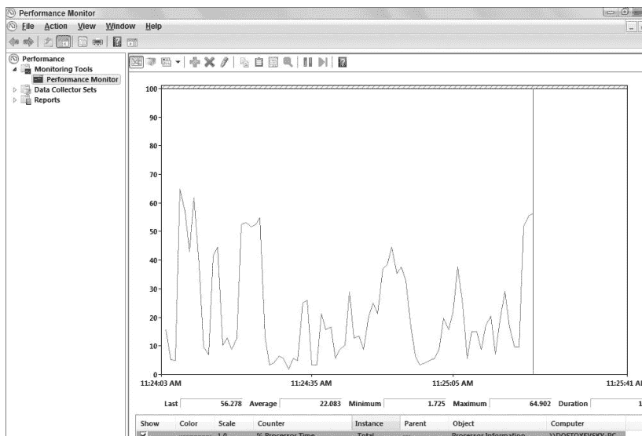

图 2-4：Windows 7 中的性能对话框

点击菜单中的加号可以在列表中添加更多性能计数器。你将在图 2-5 所示的列表中找到 ASP.NET 特定的计数器。

以下列表列出了你可以使用的一些 ASP.NET 特定的性能计数器，并对计数器进行了定义（在对话框中勾选 Windows 7 的“显示描述”复选框也可以查看）：

- **Application Restarts（应用程序重启）**——服务器生存期间应用程序重启的次数。
- **Applications Running（运行应用程序）**——正在运行的 Web 应用程序数量。
- **Audit Failure Events Raised（审计失败事件）**——自应用程序启动以来审计失败的次数。
- **Audit Success Events Raised（审计成功事件）**——自应用程序启动以来审计成功的次数。
- **Error Events Raised（错误事件）**——自应用程序启动以来产生的错误事件次数。
- **Infrastructure Error Events Raised（基础设施错误事件）**——自应用程序启动以来产生的 HTTP 错误事件次数。
- **Request Error Events Raised（请求错误事件）**——自应用程序启动以来产生的运行时错误事件次数。
- **Request Execution Time（请求执行时间）**——执行最近请求花费的毫秒数。
- **Request Wait Time（请求等待时间）**——最近请求在队列中等待的毫秒数。
- **Requests Current（当前请求）**——当前请求数量，包括队列中、正在执行或等待写入客户端的请求。
- **Requests Disconnected（请求断开）**——断开的请求数量。
- **Requests Queued（队列请求）**——队列中的请求数量。
- **Requests Rejected（拒绝请求）**——被拒绝的请求数量。
- **State Abandoned（放弃状态）**——放弃的会话数量。
- **State Active（活动状态）**——活跃会话数量。
- **State Timed Out（超时状态）**——超时会话数量。
- **State Total（总状态）**——会话总数。
- **Worker Restarts（工作进程重启）**——工作进程重启的次数。
- **Worker Running（运行工作进程）**——正在运行的工作进程数量。

如果你的 ASP.NET 页面在使用安全套接层 (SSL)，那么你可能也想通过 SSL 调用 Microsoft Ajax CDN，因为这是被支持的。列表 2-10 显示了如何使用 SSL 使用相同的 jQuery 调用。

## 列表 2-10：使用 Microsoft Ajax CDN

```html
<script src="https://aspnetcdn.com/ajax/jquery/jquery-1.4.4.js" type="text/javascript"></script>
```

如果你在 ASP.NET 应用中使用了 `ScriptManager` 服务器，你可能想要使用该控件中现已有的 `EnableCdn` 属性。将此属性的值设置为 `true` 将导致利用 Microsoft Ajax CDN 代替你的本地服务器。这在列表 2-11 中均所示。需要注意的是，这仅在 ASP.NET 4 中有效。

## 列表 2-11：从 ScriptManager 控件使用 Microsoft Ajax CDN

```asp
<asp:ScriptManager Id="ScriptManager1" EnableCdn="true" runat="server" />
```

> 如果你使用的 Microsoft Ajax CDN 中没有找到 JavaScript 库，Google 提供了类似的功能，你可以查看他们是否托管了你所需的内容。你可以在 http://code.google.com/apis/libraries/devguide.html#AjaxLibraries 找到支持的 Google 库。

## 让浏览器缓存项目更久

你的 ASP.NET 页面中有些元素是不经常更改的。例如，可能有很多图片不经常更改，将这些图片存储在终端用户的浏览器缓存中会更好，而不是让用户访问你的页面时反复请求同一张图片。默认情况下，页面的产物被设置为由浏览器缓存。你可以通过对想要缓存的项目设置过期日期来更改此。

一个很好的方法是将所有的 JavaScript、CSS 和图像存放在专门的文件夹中，并在这些文件夹内部控制它们在客户端的缓存时间。你可以通过几种方式实现这一点。

一种方法是使用 IIS 管理。在 IIS 管理中高亮显示你正在操作的文件夹，在可用选项列表中选择 `HTTP Response Headers`，如图 2-6 所示。

双击图标将为你列出当前从 IIS 发送的每个请求的标头列表。从这里，你可以点击 `Set Common Headers` 链接，这将显示此处图 2-7 所示的对话框。

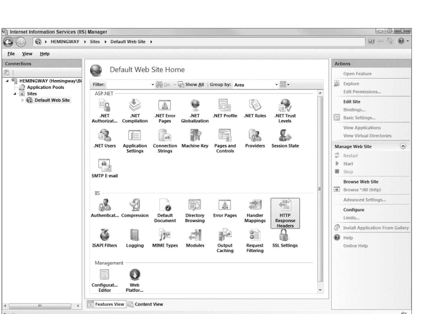

图 2-6：HTTP Response Headers 可用选项列表

通过选择“Expire Content”，你可以选择立即过期内容、在设置的时间间隔后过期或在特定日期过期。如图 2-7 所示，你可以看到文件夹被设置为 7 天后过期其内容。点击 OK 按钮后，将在该文件夹内生成一个包含列表 2-12 所示内容的 `web.config` 文件。

## 列表 2-12：生成的 web.config 文件

```xml
<xml version="1.0" encoding="UTF-8"?>
<configuration>
  <system.webServer>
    <staticContent>
      <clientCache cacheControlMode="UseMaxAge"
          cacheControlMaxAge="7.00:00:00" />
    </staticContent>
  </system.webServer>
</configuration>
```

需要注意的是，如果你设置某个图像缓存一段时间，终端用户确实缓存了这张图片，如果你在此期间对该图像进行了修改，终端用户仍然会看到其缓存中的那一个。规避此问题的一种方法是在更改图像时为它们设置不同的名称。这样，终端用户将调用一张全新的图像，而不是使用缓存中同名的图像。

## 技巧与妙招 | 59

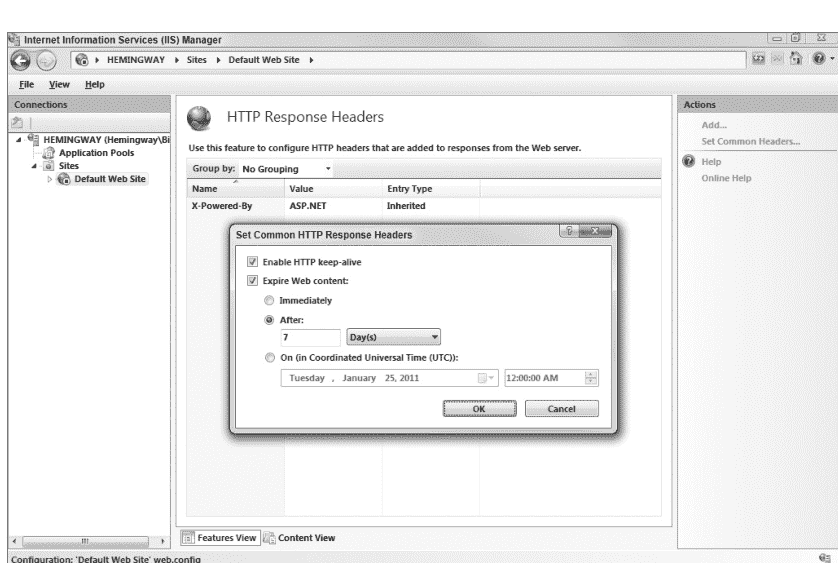

图 2-7：Set Common HTTP Response Headers 对话框

## 启用内容压缩

当用户向你的 Web 服务器发送请求时，请求中会发送一个标头。标头中声明了终端用户的浏览器是否支持压缩的响应。列表 2-13 显示了一个支持压缩的示例标头。

## 列表 2-13：客户端支持压缩的请求标头

```
GET /text/html, application/xhtml+xml, *
Accept-Language: en-US
User-Agent: Mozilla/5.0 (compatible; MSIE 9.0; Windows NT 6.1; WOW64; Trident/5.0)
Accept-Encoding: gzip, deflate
Connection: Keep-Alive
Host: www.swank.com
```

该标头的重要部分是 `Accept-Encoding: gzip, deflate`。这告诉服务器客户端可以支持压缩响应。发回你的响应显然有助于带宽。

IIS 7 允许你压缩静态或动态内容。在 IIS 管理器中，高亮你的站点并在可用选项列表中选择 `Compression` 图标。在服务器上为你提供了两个选项（如果它们都已安装）。一个是启用动态压缩，另一个是启用静态内容压缩。你可以在图 2-8 中看到这一点。

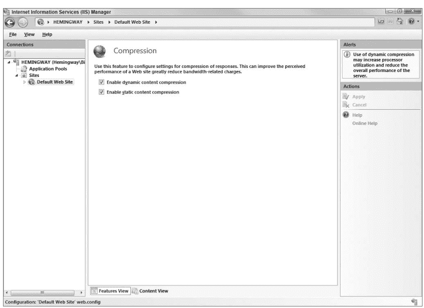

图 2-8：IIS 管理器中的压缩


```
GET /text/html, application/xhtml+xml, *
Accept-Language: en-US
User-Agent: Mozilla/5.0 (compatible; MSIE 9.0; Windows NT 6.1; WOW64; Trident/5.0)
Accept-Encoding: gzip, deflate
Connection: Keep-Alive
Host: www.swank.com
```

该标头的重要部分是 `Accept-Encoding: gzip, deflate`。这告诉服务器客户端可以支持压缩响应。发回你的响应显然有助于带宽。

IIS 7 允许你压缩静态或动态内容。在 IIS 管理器中，高亮你的站点并在可用选项列表中选择 `Compression` 图标。在服务器上为你提供了两个选项（如果它们都已安装）。一个是启用动态压缩，另一个是启用静态内容压缩。你可以在图 2-8 中看到这一点。

## 总结

互联网产生了一些伟大的应用，但也让这些开发变得困难。由于互联网是一个断开的环境（意味着只有在你发送请求或接收响应时你连接到应用程序或远程服务器），在上面维持状态非常。然而，ASP.NET 通过许多解决方案解决了这个问题，可以让你快速熟悉工作和生活的断开的世界。

本章介绍了许多你可以让你的 ASP.NET 应用性能良好的方法。本章还查看了状态在 Web 应用中的工作以及 Session 对象的缓存。本章还查看了如何配置你的 ASP.NET 应用以利用其部署的硬件。除了性能计数器外，本章还提供了一些技巧。

## 关于作者

Bill Evjen 是 .NET 技术和社区学习计划的积极倡导者。他在2000年建立了 .NET 用户组 (www.stlin.org)。他还是国际 .NET协会 (www.ineta.org) 的创始人和前执行董事，该协会在全球范围内拥有超过50万成员。他合著了20多本书，并一直作为微软区域总监和 MVP 与微软合作。Evjen 是 Swank Motion Pictures (www.swank.com) 的首席信息官。Swank Motion Pictures 为众多非剧院市场提供公共许可权和授权电影，包括全球邮轮、美国大学、K-12 公立学校和图书馆、美国民用和军医院、大巴、Amtrak 火、监狱设施以及公园、艺术博物馆和企业等市场。Evjen 毕业于华盛顿州贝灵顿的华盛顿大学，获得俄语学位。当他不捣电脑时，通常出现在芬兰 Toivakka 的夏季别墅。

# 第 3 章 ASP.NET 的伦理破解

作者：György Balássy

Web 应用程序至少具有三个与其构建技术完全无关的重要特征：它们必须是易于使用的、快速且安全的。作为一名 Web 开发者，你可能对这些方面非常敏感，并将它们放在高优先级，因为你知道这些因素在很大程度上决定了你网站的成功。

在设计用户界面和应用程序架构时，你可以不断关注这些方面。你可以尝试找到用户界面（UI）元素的最佳排列方式，并尝试拟合组件以获得最佳的性能结果。然而，即使你付出了最大的努力，你的系统中仍然有一个重要的组件可以帮助你达成（或阻止你达成）目标：Web 平台。

如果你使用的技术本质上是很慢的，那么无论你如何努力，都无法加速并让它变快。你的应用程序可以对性能进行深度的优化，但如果底层平台本身是缓慢的，你注定会失败——**平台的速度是你成功的关键**。你可以是一只猎豹，但如果它行在乌龟的背上，到达目的地将需要很长的时间。

这对于安全来说也是（甚至更为如此）。Web 应用程序并不在低层处理 Web 协议，因为编程框架提供了高层次的抽象，提高了开发者的生产力。这种抽象也意味着网站的安全方面与编程平台的安全特性紧密耦合。当你在构建 Web 应用程序时，你不再需要寻找如何实现身份验证，你也不需要发明一种管理会话的方法，因为它们是框架开箱即用的。由于这些解决方案是框架的标准部分，人们期望你的应用程序使用这些标准解决方案，而不是自定义的方法。

你的网站和你所使用的开发者框架是紧密链接在一起的。老话依然成立：“链条的强度取决于它最薄弱的一环。”

你可能已经为 Web 编写了一段时间的代码，并且你已经对 SQL 注入、跨站脚本（XSS）和缓冲区溢出有了许多了解。它们是危险的威胁，很大程度上取决于应用程序开发者如何防止它们。一个受到 SQL 注入攻击的网站可能导致数据库泄露，甚至导致服务器被攻。一个存在单个 XSS 漏洞的网站可以将客户端变成僵尸网络中的僵尸成员。应用程序开发者已经吸取了这些教训，你可能也知道如何编写代码来保护你的网站、访问者以及你自己免受这些攻击。

但是那些不是你写的代码呢？或者那些你作为基础、在其之上构建自己代码的代码呢？你能绝对确定你使用的框架是安全的吗？当然，你自然会信任它们，因为大多数框架通常由大型供应商提供并拥有悠久的历史。但你真的应该信任它们吗？

你有一座房子、一座城堡，甚至一座防御完密的堡垒，但如果它建立在沼泽地上，早晚会崩溃。这是你必须面对的一个严重风险。你必须了解你喜爱的平台的优缺点，并且必须消除平台引入你应用程序的威胁。你构建的不仅是一个独立的应用程序，而且是一个完整的解决方案，而平台是不可或缺的一部分。如果内置功能是不安全的，你的责任就是增强它们，为你的客户提供一个坚不可摧的解决方案。

本章将引导你了解 ASP.NET 平台的内置安全相关功能。你将看到它们是如何工作的，它们可以处理哪些威胁，以及它们的弱点在哪里。你还将看到可以在自己的代码中使用的解决方案，以进一步增强你的 ASP.NET Web 应用程序的安全性。

## 伦理破解——是一个矛盾术语吗？

在线新闻网站和传统报纸之所以大大喧叫，是因为引人注目的标题吸引了读者。“破解”（hacking）一词经常出现在这些标题中（难道你不知道这一章的标题吗？），因为它带有某种神秘的含义，就像哈利·波特的魔法世界一样充满吸引力。

> 黑客术语表（Jargon File）定义黑客（hacking）的一种积极方式：
>
> 1. 喜欢热烈地（甚至是痴迷地）编程的人。
> 2. 能够快速编程的人。
> 3. 喜欢在编程而不是仅仅是进行理论的人。
> 4. 擅长编程的人。
>
> —— 黑客术语表（THE JARGON FILE）

## 填充你的工具箱

要成为伦理黑客，你需要两件事：知识和工具。第一个是关于理论，第二个是关于实践。虽然没有比良好的理论更能实践地尝试本章的概念，但你需要一些工具。本章部分将介绍一些非常有用的 Web 开发者工具，以及你应该直觉尝试的工具。它们可以用于安全测试，也可以用于 Web 应用开发中的其他任务——例如修复样式表（CSS）代码或调试 JavaScript 代码。

### Fiddler

首先，你需要一个调试代理，它是你的浏览器和网站之间的一个应用程序。我强调了“调试”和“你的”这两个词，因为这不是一个网络嗅探工具，也不会提供你访问他人网络流量的能力。

互联网上有几种调试代理。我倾向于使用 Eric Lawrence 开发的 Fiddler，你可以从 `http://fiddler2.com` 下载该免费软件。通过它，你可以记录浏览器与互联网之间的 HTTP(S) 流量。你可以使用 Fiddler 检查通信、设置断点并修改发出的 HTTP 请求和返回的响应。

启动 Fiddler 后，它会尝试在操作系统中注册为运行在 `127.0.0.1:8888` 的网络代理。结果是，运行操作系统代理的应用程序会自动将流量转发到 Fiddler，由它记录通信。由于这个原因，Microsoft Internet Explorer 和 Google Chrome 不需要额外的配置，但对于 Firefox，你可能需要手动设置代理。

按照以下步骤查看与浏览器及服务器之间的通信：

1. 在 Windows 开始菜单中启动 Fiddler。
2. 启动 Internet Explorer 并打开 `http://fiddler2.com` 网站。
3. 正如状态栏上的第一个指示所示，Fiddler 会自动捕获流量（见图 3-1），因此你可以直接对通信进行检查。

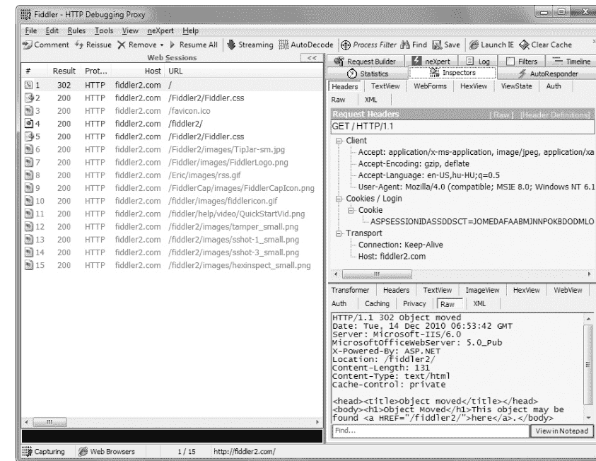

图 3-1：使用 Fiddler 的浏览器流量

- 在左侧窗格中，你可以看到浏览器产生的会话（HTTP 请求响应），在右侧窗格中，你可以找到工具窗口。在左侧选择一个会话并点击 `Inspectors`（检查器）选项卡以显示所选会话的详细信息。
- `Inspectors` 选项卡的上部分显示 HTTP 响应，下部分显示不同模式下的流量。例如，你可以点击 `Headers`（标头）按钮在逻辑分组的分段中查看标头字段，或者点击 `Raw`（原始）按钮逐字节地检查完整流量。

通常，单个网页涉及多个会话来下载完整内容；页面链接的每一个图像和脚本文件都需要单独的请求。HTTP 流量的这种特性可能会迅速导致左侧窗格中出现长长的会话列表，从而隐藏了重要的细节。因此，使用 `Rules`（规则）菜单和 `Filters`（过滤器）选项卡中的功能过滤流量是一个良好的做法。当你完成想要检查的会话日志记录后，停止 `File`（文件）菜单中的 `Capture Traffic`（捕获流量）项目，以避免被额外的请求所淹没。

要修改网络流量，你可以在 `Rules` 菜单的 `Automatic Breakpoints`（自动断点）项目中设置断点。你可以设置 `Before Requests`（请求前）和 `After Responses`（响应后）类型的断点，这会导致执行程序在请求发送到服务器之前，或在代理接收响应之后但在转发到浏览器之前执行执行。当到达这些断点时，Fiddler 会暂停，你可以在 `Inspectors` 选项卡中操纵流量。

如果你想从零构建一个 HTTP 请求并检查服务器如何处理该请求，可以使用右侧窗格上的 `Request Builder`（请求生成器）选项卡。

幸运的是，Fiddler 最常用的功能也可以通过快捷键访问，如表 3-1 所示。

### 表 3-1：Fiddler 常用快捷键

| 快捷键 | 功能 |
|---|---|
| F12 | 开始或停止捕获。 |
| F11 | 设置请求前断点。 |
| ALT+F11 | 设置响应后断点。 |
| Shift+F11 | 禁用断点。 |
| F6 | 打开或关闭会话列表窗。 |
| F8 | 跳转到 Inspector 选项卡。 |
| CTRL+A | 选择所有会话。 |
| DEL | 删除选中的会话。 |
| CTRL+X | 删除所有会话。 |

### Firebug

另一个广泛用于监控 HTTP 流量的工具是 Firebug，它是 Firefox 的开源免费插件，你可以从 `http://getfirebug.com` 下载。Firebug 与 Firefox 集成，如图 3-2 所示。

安装 Firebug 后，你可以按 F12 在下方窗格中打开工具窗口。要监控 HTTP 流量，将鼠标悬停在 Net 标签上，点击箭头，然后点击 `Enabled`（启用）开启捕获。从现在起，你在主浏览器窗口中访问的页面产生的所有通信都会被自动记录，你可以在下方窗格中对其检查。如果你不需要监控所有类型的请求，可以点击 Net 标签下方的 HTML、CSS、JS、XHR 等按钮来应用内容过滤器。

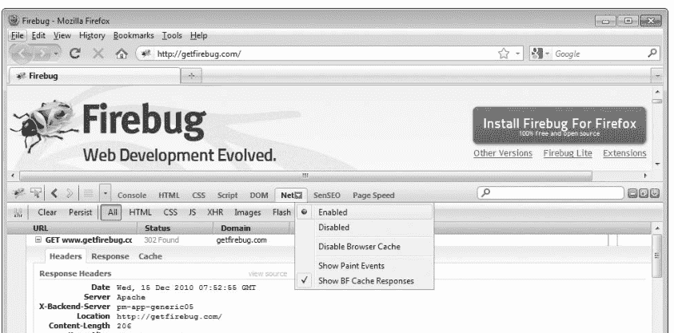

图 3-2：适用于 Firefox 的插件

你可以点击行头中的 `+` 来详细查看单个请求及其相应响应的细节。展开的窗格显示查询字符串参数、请求和响应标头、正文（body）以及缓存统计信息。你还可以通过从 add-gallery 安装 Firefox 插件来添加 Cookies 选项卡，进一步扩展 Firebug 的功能。

Firebug 是一个具有许多隐藏宝物的强大工具。我强烈建议你访问它的在线文档并在日常工作中使用它。

### Internet Explorer 9 开发者工具栏

作为开发者，你可能已经在机器上安装了 Firefox，如果你仍然倾向于在你喜爱的浏览器中执行相同的网络监控任务。Internet Explorer 7 引入了开发者工具栏功能，它包含了与 Firefox 提供的类似的功能，唯一的例外是之前提到的 Net 标签功能。然而，通过 Internet Explorer (IE9)，你再也不用错过任何功能了，因为微软在开发者工具栏中添加了 New（新建）标签，如图 3-3 所示。

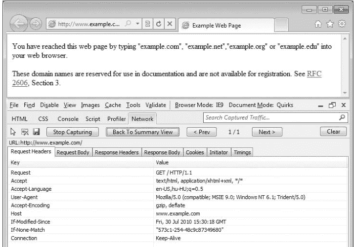

**图 3-3：** 使用 IE9 开发者工具栏进行网络监控

新的 Network（网络）标签提供了与 Firebug 类似的功能，主要的区别在于 UI 布局。

### Lens

你到为止学到的工具提供了通用的流量监控功能，你可以独立于它们构建的技术对其进行检查。然而，每种技术都有其特殊性，需要特殊的工具来进行测试。在身份验证、会话和状态管理方面，ASP.NET 也不例外。

Lens 是一个免费工具，你可以从 `http://ethicalhackingasp.com` 使用它来测试 ASP.NET 的身份验证、会话和状态管理。Lens 是为了教学和演示目的编写的，它是一个渗透测试工具，你可以从图 3-4 中看到它。

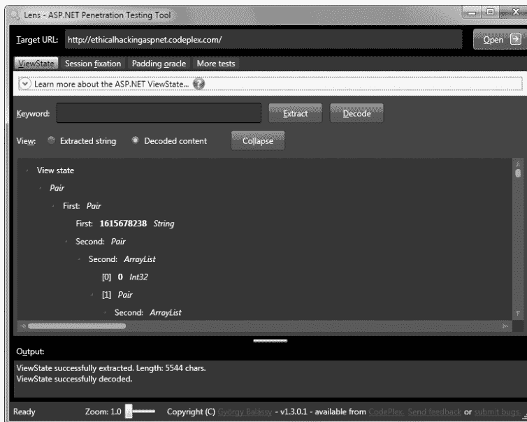

**图 3-4：** Lens 渗透测试工具

除了是一个免费工具外，Lens 还是开源的，你可以从 GitHub 下载源代码。它使用 Windows Presentation Foundation (WPF) 图形用户界面 (GUI) 编写，并具有模块化架构，这便于扩展。

## 理解会话管理

既然你已经有了可以测试会话的工具，但在测试会话之前，你需要了解它是如何工作的。

Web 应用最重要的部分之一是会话管理。基本问题是 Web 页面没有记忆，所以当你访问页面时，网站会将你视为一个完全新的访客。因此，它不知道你之前的操作，即使你几分钟前刚刚登录或向购物车商品。HTTP 协议没有为这个问题提供解决方案，因此从 HTTP 的角度来看，每次请求你都是新的客人。

但当然，访客需要这种功能来连接他们在不同页面之间的移动，由于 HTTP 是无状态的，它在更高的抽象层次上实现，主要通过 Cookie。

### HTTP 中的会话管理

Cookies 是随 HTTP 请求和响应传输的小数据。它们在服务器上创建并通过 HTTP 响应发送给客户端。浏览器存储它们，当下次请求发送到服务器时，浏览器会将相同的 Cookie 添加到请求中并传回服务器。当服务器从两个分离的请求接收到相同的 Cookie 值时，会被视为同一会话的一部分。

Cookie 位于 HTTP 流量的头部部分，因此其大小有限。结果是大多数 Web 应用不在客户端存储完整的用户状态，而在服务器端存储返回该属性一个会话 ID，并将这个很小的会话 ID 放在会话中，如图 3-5 所示。

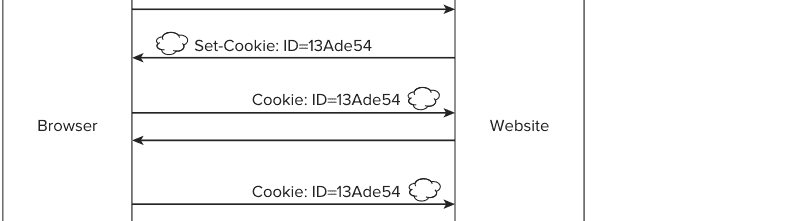

图 3-5：Cookie 在 HTTP 头部中传输的方式

这种 Cookie 交换可以被 Fiddler 完美捕获。只需访问网站 `http://codex.com` 并在第一个响应中查找 `Set-Cookie` 标头，如图 3-6 所示。

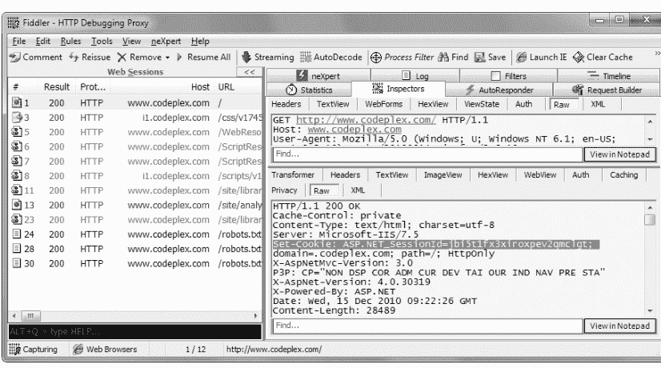

图 3-6：在 Fiddler 中设置 Set-Cookie 标头

然后，选择一个针对相同域名的后续 HTTP 请求，你会发现请求中有一个包含相同值的 Cookie Header。

### ASP.NET 中的会话管理

在 ASP.NET 中，你有两种会话：简单会话（simple sessions）和登录会话（login sessions）。第一种通常就称为“session”（我添加了“simple”前缀是为了帮助你将其与区分区分）。

简单会话与身份验证无关。当你使用它们时，用户是否登录并不重要。这些类型的会话只是为了解决本章之前定义的问题，你使用简单会话来连接来自同一个客户端的 HTTP 请求和响应。你在 ASP.NET 中使用 `Session` 对象来创建多页表单，或实现一个不需要身份验证的网络购物篮。


## 登录会话与身份验证

另一方面，登录会话与身份验证密切相关。登录会话在用户登录时开始，一直持续到用户从你的应用程序注销为止。登录会话的主要目的是跟踪是谁向你的应用程序发送了请求，并对信息进行重新授权决策。ASP.NET 中的登录控制和成员提供程序（`member provider`）实现了登录会话。

虽然有两种会话，但它们都指向同一个问题。在 HTTP 层面，请求-响应对之间没有连接。两种类型的会话都是使用相同的基于 cookie 的上下文实现的；尽管它们使用不同的 cookie，并且具有不同的优缺点。

## 攻击 ASP.NET 身份验证

对黑客来说最有吸引力的目标是网站。如果身份验证失败并允许未经授权的用户登录应用程序，可能会导致不可预见的后果。

在对你的 ASP.NET 网站的身份验证进行渗透测试之前，你必须理解 ASP.NET 中内置身份验证功能是如何实现的。

## 深入研究 ASP.NET 身份验证

当你使用内置登录控制和开箱即用的成员提供程序时，你只会看到身份验证“完美运行”，所有的魔法操作都是 ASP.NET 在后台完成的。幕后发生着：

1.  登录控制调用配置的 `MembershipProvider` 的 `ValidateUser` 方法检查用户的登录凭据。
2.  如果凭据无效，登录过程终止，并向用户显示错误消息。
3.  如果凭据有效，登录控制调用 `FormsAuthentication` 类的 `SetAuthCookie` 方法，该方法从 `web.config` 文件读取设置，创建身份验证 cookie 并将其附加到 `HttpResponse` 上。
4.  用户带有 HTTP 302 状态码重定向到原始页面。响应包含默认 cookie 名称 `.ASPAUTH`（名称以点开头）的 `Set-Cookie` HTTP Header。
5.  浏览器接收 cookie 并将其存储在 cookie 存储中。当浏览器向相同域名发送请求时，cookie 会被附加到请求的 `Cookie` Header 中。
6.  服务器上的 `FormsAuthenticationModule` 接收 cookie。此 HTTP 模块检查 cookie，如果有效，则创建一个新的 `FormsIdentity` 和 `GenericPrincipal` 对象并将它们分配给当前的 `HttpContext`。

最重要的部分无疑是身份验证 cookie 是如何创建的以及它包含什么。`SetAuthCookie` 方法负责创建身份验证 cookie，并将 `FormsAuthenticationTicket` 对象放入其中。图 3-7 显示了 `FormsAuthenticationTicket` 类的结构。

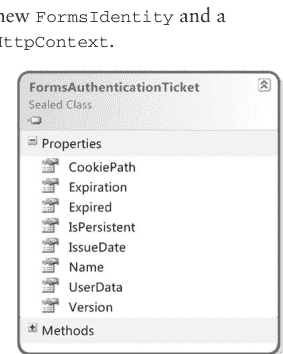

票包含以下属性值：

-   **CookiePath**：cookie 激活的目录。因此如果你让 cookie 只发送到 Members 目录下的页面，将 `CookiePath` 设置为 `/Members`。
-   **Expiration**：票的过期日期和时间。
-   **Expired**：一个布尔值，指示票是否过期。
-   **IsPersistent**：一个布尔值，指示身份验证 cookie 是否为持久性的。
-   **IssueDate**：票颁发的日期和时间。
-   **Name**：用户名。
-   **Version**：定义框架用于构建 cookie 算法的数值常量。此版本在 ASP.NET 4 中（自 ASP.NET 2.0 起）为 2。

`UserData` 属性默认为空，可用于自定义目的。

默认情况下（你可以在 `web.config` 文件中配置它），票在添加到身份验证 cookie 之前经过哈希保护，然后加密并转换为十六进制字符串。

## 窃取票

正如我们在本章早期看到的，身份的核心并非用户的密码，而是位于 cookie 中的票。如果你获得了一个有效的票，你就不再需要原始用户的密码，因为在每一个请求中进行验证的是票，而且它直接包含了用户的唯一登录名。如果恶意用户能够成功攻击票，他们就能达到目的。

攻击者获取票的一种方法是 XSS。正如你可能知道的，XSS 的可能性远超捕获 cookie。XSS 甚至可以帮助攻击者完全控制受害者的计算机。然而，窃取包含你登录票的 cookie 是一种经典且常用的方法。幸运的是，ASP.NET 默认创建 `HttpOnly` cookie，这降低了此类攻击的风险。

> **HttpOnly** 是 cookie 中的一个标志，向浏览器发送信号，指示页面上的任何脚本都不应该访问该 cookie，它用于 HTTP 传输。如果你不想在 JavaScript 中访问 cookie 值，建议设置此标志以缓解针对 cookie 的攻击。

票在 HTTP 流量的 Header 中传输，因此在链路上明文传输（参见图 3-6）。虽然票本身是加密的，但正如你稍后看到的，攻击者不需要解密即可恶意使用它。拥有票就足够攻击者替你行动了。

遗憾的是，ASP.NET 内置的表单身份验证机制容易受到此类会话劫持攻击。你可以按照以下步骤进行测试：

1.  启动 `Fiddler` 以捕获浏览器与网站之间运行的所有流量。
2.  打开你喜欢的浏览器，并登录你想要测试的 ASP.NET 网站。
3.  在 `Fiddler` 中检查包含 `Set-Cookie` HTTP 标头的 HTTP 302 重定向响应。如果 cookie 的名称为 `.ASPAUTH`，则它最可能使用了默认的表单身份验证实现。
4.  将 cookie 的值（等号符号之后那串长得难以忍受的数字）复制到剪贴板。现在你有了刚刚从自己的流量中捕获的身份验证 cookie。恶意攻击者必须嗅探网络才能获取此 cookie，但最终他们拥有与你刚刚复制到剪贴板相同的数据。在接下来的步骤中，你将测试如果该 cookie 从不同的客户端发送，应用程序是否会接受它。
5.  启动 `Lens` 并在 URL 框中输入网站的 URL。
6.  切换到提供各种会话相关测试的 Session 标签页。在 Cookie name 框中输入 cookie 名称（最可能是 `.ASPAUTH`），并将剪贴板中的值粘贴到 Cookie Value 字段，如图 3-8 所示。

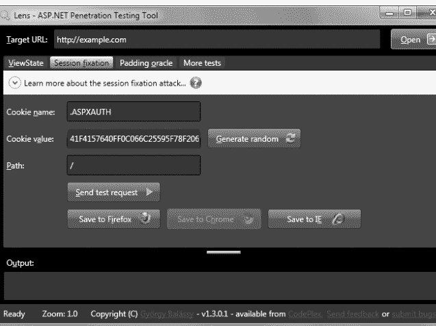

7.  点击任何启用的 Save To 按钮，直接在所选浏览器的本地 cookie 存储中创建会话 cookie。当你下次在该浏览器中打开网站时，此 cookie 将附加到请求。要成功测试应用程序会话劫持，你必须选择与第 2 步中不同的浏览器。这样，你就可以模拟 cookie 是从不同的位置发送的。

> 在此点，“位置”意味着不同的浏览器，这是一个有效场景，因为浏览器的 cookie 存储器是完全隔离的。如果你想测试不同的客户端 IP 地址，可以在另一台计算机上启动 `Lens` 并按照相同的步骤在该机器上创建身份验证 cookie。

8.  打开第 7 步中选择的浏览器，直接访问你正在测试的网站。浏览器会自动将之前存储的 cookie 附加到请求，如果网站接受它，你将立即以第 2 步中的原始用户身份登录。这意味着你的应用程序容易受到会话劫持。如果浏览器没有将你视为已登录用户，或显示错误消息，则你的网站免受会话劫持攻击。

默认情况下，所有使用默认配置的内置身份验证实现的 ASP.NET 应用程序都容易受到这种攻击。

## 保护你的应用程序免受会话劫持

遗憾的是，ASP.NET 没有提供任何配置设置或内置开关来保护你的应用程序免受会话劫持。尽管你可以使用 HTTPS 加密来降低风险，但流量加密并没有解决原始问题。你必须编写代码来增强你的应用程序。

原始问题是 cookie 没有绑定到单个客户端。如果网站能够检测到 cookie 是从不同的客户端发送的，则站点是安全的。标准 cookie 没有提供检查原始所有者的方法，因此唯一的选择是在 cookie 内容中添加额外信息。

首先，你必须确定哪些数据可以满足你的需求。例如，你可以使用识别浏览器的 `User-Agent` 标头以及客户端的 IP 地址来实现此目的。

> `User-Agent` 标头和 IP 地址都可以帮助你提高攻击者在攻击你的应用程序时面临的障碍。然而，你应该知道，这些解决方案在所有情况下都不是完美的。如果用户出于兼容性考虑更改浏览器，`User-Agent` 标头会有帮助（这在高级 Opera 用户中经常发生）。如果客户端的 IP 地址具有动态地址或切换了网络，它也可能会变化——例如移动计算机、虚拟专用网络 (VPN) 或无线网络。尽管如此，我建议你使用这些值，但要准备好向用户提供友好的错误信息，因为可能会有修改这些值的有效操作。

正如本章前面的“深入探讨 ASP.NET 身份验证”部分一样，cookie 包含一个加密的 ticket，你还学习了 ticket 的结构。同样，`FormsAuthenticationTicket` 类提供了一种标准方法，可以在 `UserData` 属性中为其添加额外信息。这是一个简单的属性，你可以在其中存储任何内容，因为它不会被 ASP.NET 运行时使用。与 ticket 的任何其他属性值一样，它将被加密并受到防篡改保护。

首先，你必须覆盖 ASP.NET 默认的 cookie 创建机制，这要求你向 Login 控件和 `FormsAuthentication` 类的 `RedirectFromLoginPage` 方法添加一些代码。

要创建 cookie，首先在验证用户凭据后，让 ASP.NET 在你的登录页创建一个标准的 cookie：

```csharp
HttpCookie cookie = FormsAuthentication.GetAuthCookie(userName, chkRememberMe.Checked);
```

> 代码文件 [Authentication.Login.aspx] 可在 Wrox.com 下载。

此 cookie 将通过解密 cookie 为你授予访问权限：

```csharp
FormsAuthenticationTicket oldTicket = FormsAuthentication.Decrypt(cookie.Value);
```

> 代码文件 [Authentication.Login.aspx] 可在 Wrox.com 下载。

通过原始 ticket 的属性，你可以创建一个新的 ticket，并在 `UserData` 属性中设置：

```csharp
FormsAuthenticationTicket newTicket = new FormsAuthenticationTicket(
    oldTicket.Version, oldTicket.Name, oldTicket.IssueDate,
    oldTicket.Expiration, oldTicket.IsPersistent, userData);
```

> 代码文件 [Authentication.Login.aspx] 可在 Wrox.com 下载。

`userData` 变量可以包含你想嵌入 ticket 的任何额外信息，如客户端的 `User-Agent` 和 IP 地址。出于性能考虑，你不想每次请求都存储或加载这些。例如，以下代码将用户的角色、唯一标识和地址添加到 cookie 中：

```csharp
string clientIP = HttpContext.Current.Request.UserHostAddress;
string userData = String.Format(CultureInfo.InvariantCulture,
    "{0}|{1}|{2}", clientIP, userID, role);
```

下一步中，你加密新的 ticket：

```csharp
cookie.Value = FormsAuthentication.Encrypt(newTicket);
```

最后，你将加密的 ticket 添加到 HTTP 响应：

```csharp
Response.Cookies.Add(cookie);
```

> 代码文件 [Authentication.Login.aspx] 可在 Wrox.com 下载。

为了将用户重定向到原始页面，不要调用 `RedirectFromLoginPage` 方法，因为它总是创建标准的 cookie。你应该分两步走：

```csharp
string redirectUrl = FormsAuthentication.GetRedirectUrl(username, false);
Response.Redirect(redirectUrl);
```

> 代码文件 [Authentication.Login.aspx] 可在 Wrox.com 下载。

通过这些步骤，你创建了一个标准的身份验证 cookie，它的行为与原始的相同，但包含了关于客户端的额外信息。下一步是在客户端在下次请求发送 cookie 时验证这些信息。

检查 `UserData` 的最佳位置是 `global.asax` 文件中的 `Application_PostAuthenticateRequest` 事件。该事件处理器在 `FormsAuthenticationModule` 验证 ticket 字段后立即调用，你可以访问它的。你首先可以获取由身份验证模块成功认证的用户身份：

```csharp
IPrincipal user = HttpContext.Current.User;
if (user.Identity.IsAuthenticated &&
    user.Identity.AuthenticationType.Equals("Forms",
    StringComparison.OrdinalIgnoreCase))
{
    FormsIdentity identity = HttpContext.Current.User.Identity as FormsIdentity;
    // 接下来是代码行...
}
```

`FormsIdentity` 类允许你访问 ticket 以及客户端提交的 `UserData` 值：

```csharp
string userData = identity.Ticket.UserData;
```

`UserData` 字段包含了最初请求 cookie 的客户端的 IP 地址和 User-Agent。你现在需要做的是将这些值与客户端的值进行比较：

```csharp
string[] userDataParts = userData.Split('|');
string clientIP = userDataParts[0];
string userAgent = userDataParts[1];
PortalRole role = (PortalRole)Enum.Parse(typeof(PortalRole), userDataParts[2]);
int userId = Int32.Parse(userDataParts[3]);
string email = userDataParts[4];

HttpRequest req = HttpContext.Current.Request;

if (!req.UserHostAddress.Equals(clientIP, StringComparison.OrdinalIgnoreCase))
    throw new SecurityException();

if (!req.UserAgent.Equals(userAgent, StringComparison.OrdinalIgnoreCase))
    throw new SecurityException();
```

> 代码文件 [Authentication.asax] 可在 Wrox.com 下载。

> 为了简单起见，此代码段仅抛出了 `SecurityException`，但你必须确保这些事件已记录，并向用户显示友好的错误消息。但请注意，不要提供过多可能帮助攻击者的错误详细信息。

上一个代码段演示了你如何在登录 cookie 中存储任何值。例如，ASP.NET 仅允许你访问当前用户的登录名，它还用于在 cookie 中缓存用户的内部 ID 以简化数据库操作。你还可以创建实现 `IIdentity` 和 `IPrincipal` 接口的自定义类，并通过将这些值分配给当前 HTTP 请求和当前线程，使网站的每个部分都能使用这些值：

```csharp
MyPortalIdentity portalIdentity = new MyPortalIdentity(user.Identity.Name, userId, role, email);
MyPortalPrincipal portalPrincipal = new MyPortalPrincipal(portalIdentity);
HttpContext.Current.User = portalPrincipal;
Thread.CurrentPrincipal = portalPrincipal;
```

> 代码文件 [Authentication.asax] 可在 Wrox.com 下载。

完成这些操作后，不要忘记按照本章之前的描述使用 `Fiddler` 和 `Lens` 重新测试你的解决方案。

# 跨站伪造

作为一名注重安全的 Web 开发者，你已经了解依赖用户信任的 XSS 攻击。在本节中，你将学习另一种攻击，它是 XSS 的反面，利用了用户的信任。

大多数网站通过要求身份验证来保护敏感操作。如果你有一个网上银行网站，你可以提供以下启用转账的 URL：

```
http://bank.example.com/TransferTo=111-222-333&Amount=1000
```

如你所示，查询字符串包含了目标银行账户（To 字段）和转账金额（Amount 字段）。你可以向此 URL 发送 HTTP GET 请求，


但当然，网站会检查你是否登录，并且只有在你登录并成功通过身份验证后才会处理请求。

但网站如何知道你已经登录了呢？它会检查请求是否包含登录 cookie。因此，如果你向此 URL 发送 HTTP GET 请求并在请求中附带有效 cookie，银行就会完成转账。相应的，攻击者可以向一个包含银行账户作为目标的类似 URL 发送 HTTP GET 请求，并在请求中附带你的登录 cookie，你的钱就会被坏人偷走。

如果你阅读了本章的几个章节，已经知道如何保护你的登录 cookie 不被发送和从另一个位置传回。因此，攻击者剩下的唯一选择就是强制你向一个恶意构造的 URL 发送请求并为其附带你的登录 cookie。这对于他们来说将轻而易举。所有攻击者只需要一个可以嵌入简单图片的网页：

```

```

这种绕过迫使你向银行网站发送 HTTP GET 请求，要求转账到攻击者的银行账户。最棒的部分来了——如果你的浏览器对银行有缓存，浏览器将非常乐意将其附带在请求中，而网站会将其视为来自你的已身份验证请求。

你可能注意到许多网站登录时有“记住我”复选框。如果你勾选此选项，它会请求一个持久 cookie。这种 cookie 不仅存储在浏览器的内存中，还存储在磁盘上，因此在浏览器关闭或重启后依然存在。网站记住你是因为浏览器记得这个 cookie。所以，如果你在一周前登录了银行网站并勾选了“记住我”，你的身份验证 cookie 就保存在你的磁盘上，并随你的请求一起发送以避免再次进行身份验证。

如果你之前存储了持久性登录 cookie，并访问包含上述图片的网站，你将在毫无察觉的情况下成为这种攻击的受害者。点击一下就足够了，这就是为什么这种攻击通常被称为“一点击攻击”或跨站请求伪造 (CSRF)。

> 这里需要考虑两点。首先，尽管“一点击攻击”的名称被广泛用于 CSRF 攻击，但将它们作为同义词并不完全正确。一点击攻击实际上是 CSRF 的一个子集。其次，这个示例使用了 HTTP GET 目标，但攻击并不限于 GET 请求。POST 请求也容易受到攻击；尽管它们需要更多的代码来利用。

## 防御 CSRF 攻击

正如你之前看到的，持久 cookie 促进了 CSRF，你的第一个想法可能是完全禁用持久 cookie 以保护你的应用程序。尽管这缓解了这种攻击，但根据我的经验，用户喜欢并使用此功能，特别是在他们频繁访问的网站中。

CSRF 的根源问题是网站信任用户。如果从客户端收到有效请求，网站将将其视为用户刻意发送的。问题在于网站如何在没有用户同意的情况下，通过浏览器区分刻意请求和请求。这是一个困难的问题，从服务器的角度来看，刻意请求和恶意请求看起来完全一样。

CSRF 的另一个特征是攻击者可以预先构建有效的请求，这意味着攻击者知道服务器在请求中期望的每一个值。通过让所有请求的值都不同，你可以缓解这种攻击。

ASP.NET 网站中每个 POST 请求的一个共同部分是视图状态 (`view state`)。ASP.NET 提供了一个内置机制 `ViewStateUserKey` 属性，通过在运行时验证视图状态的完整性时添加任何任意值来提供额外保护。如果你将视图状态与当前用户或当前会话绑定，就可以为 CSRF 攻击建立障碍。

`ViewStateUserKey` 属性只能在页面生命期的 `Page_Init` 阶段设置，如下代码所示：

```csharp
protected override void OnInit(EventArgs e)
{
    base.OnInit(e);

    if(User.Identity.IsAuthenticated)
    {
        this.ViewStateUserKey = Session.ID;
    }
}
```

- `ViewStateUserKey` 属性只能在页面生命期的 `Page_Init` 阶段设置。
- 如果你将视图状态与当前用户或当前会话绑定，就可以为 CSRF 攻击建立障碍。
- `ViewStateUserKey` 属性在 ASP.NET 视图控制器 (MVC) 中不可用。
- 然而，ASP.NET 视图控制器 (MVC) 通过 `AntiForgeryToken` 提供了一种内置机制。
- 在这种情况下，你可以使用隐藏字段和 session cookie 中的特定会话密钥，并强制两个值相同。这种方法是 .NET Web 安全项目 (OWASP)（`http://www.owasp.org/index.php?Net_CSRF_Guard`）的一种免费 `HttpModule`。
- 如果你的应用程序不依赖会话，开启反 CSRF 防护的开销很大。AntiCSRF 模块（可从 `http://anticsrf.cod.com` 下载）通过在隐藏字段和 session cookie 中存储特定会话密钥来解决这个问题，并强制每个请求的值相同。

## 额外的 CSRF 保护

`ViewStateUserKey` 属性在 ASP.NET 视图控制器 (MVC) 中不可用。

在这种情况下，你可以使用隐藏字段和 session cookie 中的特定会话密钥，并强制两个值相同。这种方法是 .NET Web 安全项目 (OWASP)（`http://www.owasp.org/index.php?Net_CSRF_Guard`）的一种免费 `HttpModule`。

- 如果你的应用程序不依赖会话，开启反 CSRF 防护的开销很大。AntiCSRF 模块（可从 `http://anticsrf.cod.com` 下载）通过在隐藏字段和 session cookie 中存储特定会话密钥来解决这个问题，并强制每个请求的值相同。

## 攻击 ASP.NET 会话

在本章开始，你学习了 ASP.NET 支持的两种会话：经典会话和登录会话。学习了登录会话后，现在是时候学习简单会话的各种攻击了。

## ASP.NET 会话原理

ASP.NET 会话由一个 HTTP 模块（称为 `SessionStateModule`）管理，它独立于身份验证模块工作。当新客户端连接到你的网站时，该模块生成一个新的会话标识符，并将 ID 存储在 HTTP cookie 或 URL 中，这与 `web.config` 文件中 `sessionState` 的 `cookieless` 属性有关。本节关注基于 cookie 的默认会话。

与登录会话不同，存储在 cookie 中的值没有加密，也没有哈希保护。它只是会话 ID。

## 猜测会话 ID

正如你所见，会话的核心是会话 ID。如果攻击者可以获取会话 ID，他们就可以构建会话 cookie 并发送到网站以窃取会话。大多数 web

在某些平台上，session ID 是一个整数。如果 session ID 是按顺序创建或使用简单的随机数生成器生成的，攻击者可以查询自己的 session ID，并对网站其他用户使用的 ID 做出相当准确的猜测。

幸运的是，ASP.NET 不使用递增的 session 数字，而是使用 .NET Framework 内置的 `RNryptoServiceProvider` 生成 ID。该类产生密码学强度的随机数，非常难以被破解。该数字长度为 15 字节，因此通过探测来找到现有的 session ID 也需要很长时间。

## 窃取 Session Cookie

如果攻击者可以猜出你的 session ID，他们必须窃取你的 session cookie 来访问该 ID。就像登录 cookie 一样，获取它的经典方法是 XSS。幸运的是（再次，就像登录 cookie 一样），ASP.NET 默认向 cookie 添加了 `HttpOnly` 属性。因此，它无法被网页访问，使得通过 XSS 窃取的难度增加。

攻击者访问你 session cookie 的另一种方法是嗅探网络。如果你通过非安全的 HTTP 连接到网站，请求和响应将以明文形式发送，因此对通信的任何访问都可以暴露你的 session cookie。

> 如果你在 ASP.NET 中使用 sessions，在 Session 字典中存储值后的第一个响应将包含你的 cookie。从那时起，你的浏览器会在发送到服务器的每个 HTTP 请求中带上该 cookie。由于 cookie 几乎总在网络传输中，如果攻击者在有限时间内访问 HTTP 流量，他们就可以捕获它。

遗憾的是，ASP.NET 没有提供任何内置配置功能来让浏览器仅通过 HTTPS 传输 session cookie，而绝不通过 HTTP 传输。这取决于你（开发者）如何架构你的应用程序以从箱即用保护 session cookie；每个 ASP.NET 应用程序都容易受到会话劫持攻击。

## 测试你的应用程序防御会话劫持的能力

正如你所学的，客户端和服务器都没有存储关于客户端的任何额外信息。仅凭 session 不足以访问任何人的会。因此，如果攻击者拥有 cookie，他们可以从任何其他计算机将它发送回网站，因为 session 并没有绑定到任何特定的客户端。

按照以下步骤测试你的 Web 应用程序防御会话劫持的能力：

1. 启动 Fiddler 捕捉浏览器和网站之间运行的所有流量。在网站上执行一些对 session 有某些价值的操作（例如，如果是购物网站，则在购物车中放入商品）。
2. 研究通信日志，在响应中寻找 `Set-Cookie` HTTP 头部，或者请求中寻找名为 `ASP.NET_SessionId` 的 `Cookie` 头部。
3. 将 cookie 的 24 位字符值复制到剪贴板。
4. 启动 Lens，并在 Target URL 文本框中输入网站 URL。
5. 切换到 Session Fixation 标签页，它提供了各种与 session 相关的测试。默认情况下，Cookie Name 文本框包含 `ASP.NET_SessionId`，你可能不需要更改它。将剪贴板中的值粘贴到 Cookie Value 字段。
6. 点击任何已启用的 Save（保存）按钮，直接在你使用的浏览器的本地代码存储中创建一个具有给定值的 session cookie。此 cookie 将会在你下次在浏览器中打开网站时被附加。为了模拟从不同位置获取 session cookie，请选择一个与步骤 1 中生成流量时不同的浏览器。
7. 打开你在上一步中选择的浏览器，直接访问你正在测试的网站。浏览器会自动在请求中附加之前存储的 cookie。如果它接受了，你将看到与第一个浏览器创建的相同状态。例如，商品将在你的购物车中。这意味着你的应用程序容易受到会话劫持。如果网站没有显示你的原始状态，或者显示了错误消息，则你的网站免受会话劫持。

## 保护你的网站免受会话劫持

会话劫持的根问题是 cookie 没有绑定到特定的客户端。这也是会话记录（session logging）的根问题，你已经学会了通过在 cookie 中存储客户端的 IP 地址和 User-Agent 来添加额外的保护。这种方法在这里同样有效，但实现方式完全不同，因为内置的 `SessionModule` 不提供像 `FormsAuthenticationModule` 那种级别的扩展性。

要修复 session，你可以创建一个新的 HTTP 模块，该模块位于 ASP.NET 管道线中 `SessionModule` 之前。当第一个请求生成 session 时，你的新模块会在 cookie 发送给客户端之前修改 session cookie 并向其附加额外信息。当浏览器将 cookie 切换回时，它会被新模块检查，并对额外信息进行验证。如果数据有效，则将其移除，并将原始的 session cookie 值传递给 `SessionModule`。如果验证失败，新的前端模块将终止执行。可以添加标识原始 session 的额外数据（我建议你使用浏览器的 IP 地址和 User-Agent）。

图 3 显示了高亮显示的自定义模块架构：

要实现此功能，你必须先创建一个实现 `IHttpModule` 接口的类类。在执行的 `Init` 阶段，你订阅 `BeginRequest` 和 `EndRequest` 事件以管理请求和响应。

```csharp
public class SecureSessionModule : IHttpModule
{
    public void Init(HttpContext context )
    {
        context.BeginRequest += new EventHandler(this.BeginRequest);
        context.EndRequest += new EventHandler(this.EndRequest);
    }
}
```

```csharp
public void OnEndRequest(object sender, EventArgs e)
{
    HttpContext context = HttpContext.Current;
    HttpCookie cookie = context.Response.Cookies["ASP.NET_SessionId"];
    if (cookie != null)
    {
        string mac = GenerateMac(cookie.Value, context.Request);
        cookie.Value += mac;
    }
}
```

```csharp
private string GenerateMac(string id, HttpRequest request)
{
    string content = String.Format(CultureInfo.InvariantCulture, "{0}|{1}", request.UserHostAddress, request.UserAgent);
    byte[] key = Encoding.UTF8.GetBytes("Any side secret");

    using (HMAC512 hmac = new HMAC512(key))
    {
        byte[] hash = hmac.ComputeHash(Encoding.UTF8.GetBytes(content));
        return Convert.ToBase64String(hash);
    }
}
```

```csharp
public void OnBeginRequest(object sender, EventArgs e)
{
    HttpRequest request = HttpContext.Current.Request;
    HttpCookie cookie = this.GetCookie(request.Cookies);

    if (cookie != null)
    {
        string value = cookie.Value;

        if(!String.IsNullOrEmpty(value))
        {
            string sessionID = value.Substring(0, 24);
            string clientMac = value.Substring(24);

            string serverMac = this.GenerateMac(sessionID, request);

            if(!clientMac.Equals(serverMac, StringComparison.OrdinalIgnoreCase))
            {
                throw new SecurityException("Hack!");
            }

            // 在 ASP.NET 使用 cookie 之前从 cookie 中移除 MAC。
            cookie.Value = sessionID;
        }
    }
}
```

代码文件 `Session\SecureSessionModule.cs` 可在 Wrox.com 下载。

创建 `SecureSessionModule` 后，打开你的 `web.config` 文件，将其添加到 ASP.NET 处理流水线中：


```xml
<configuration>
  <system.web>
    <httpModules>
      <add name="SecureSessionModule" type="SecureSessionModule"/>
    </httpModules>
  </system.web>
</configuration>
```

> 正如在讨论会话劫持时提到的，使用 IP 地址和 User-Agent 头部可以帮助提高安全屏障，但在所有情况下，它们并不是完美的解决方案。

## 会话固定

如果攻击者在你获取会话 ID 后能够发现它，他们仍然可以在你使用它之前发现会话 ID 的选项。换句话说，如果攻击者可以强制用户的浏览器使用由攻击者确定的预设会话 ID，攻击者就不再需要窃取会话 cookie——他们已经知道里面有什么了！

这种攻击被称为会话固定，图 3-10 显示了它的工作原理：

1. 恶意用户 Mallory 找到一种方法（例如通过浏览器漏洞或外部应用程序）在 Alice 浏览器的 cookie 存储器中存储一个新的 cookie，名称为 `ASP.NET_SessionId`，值为 `123451234512345123451234`。
2. 下次 Alice 访问网站时，浏览器会从 cookie 存储器中附加该 cookie。
3. Mallory 在自己的浏览器中存储相同的会话 cookie，当她访问网站时，她可以连接到 Alice 使用相同的会话。

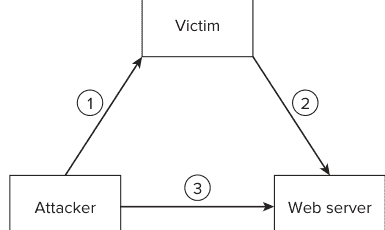

图 3-10：会话固定

遗憾的是，默认情况下，ASP.NET 容易受到这种攻击的影响。但检查该平台容易受到这种攻击的因素可以帮助你缓解这种风险。

## 保护你的应用程序免受会话固定攻击

问题在于攻击者知道 cookie 的一切信息：它的名称以及它应该包含的值的格式。提高屏障的第一步是在 web.config 文件中将 cookie 名称从默认的 `ASP.NET_SessionId` 更改为某些唯一的名称：

```xml
<sessionState cookieName="MyCookie" />
```

第二步是生成自定义 cookie 值。默认情况下，ASP.NET 接受任何长度为 24 个字符且包含字符 "a" 到 "z" 和 "0" 的 cookie 值。如果你想生成自定义 cookie 值，可以通过创建一个实现 `System.Web.SessionState.ISessionIDManager` 的新会话 ID 管理器来实现。

内置实现是 `SessionIDManager`，它甚至处理当今的操作。因此，如果你想更改会话 ID 的生成方式，可以直接派生自 `SessionIDManager` 类并重写 `CreateSessionID` 方法：

```csharp
public class MySessionManager : System.Web.SessionState.SessionIDManager
{
    public override string CreateSessionID(System.Web.HttpContext context)
    {
        // 此处编写自定义会话 ID 生成逻辑...
    }
    public override bool Validate(string id)
    {
        // 此处编写验证逻辑...
    }
}
```

显然，如果你更改了生成会话 ID 的方式，就必须更改验证输入值的方式。在之前的代码中，你可以看到 `Validate` 方法，它也可以被重写以实现此目的。但如果你想保护你的应用程序免受会话固定攻击，你必须添加额外的安全层。你必须检查会话 ID 是否是由 `CreateSessionID` 方法创建的。在完成会话 ID 实现后，你必须在 web.config 中对其进行配置：

```xml
<configuration>
  <system.web>
    <sessionState sessionIDManagerType="MySessionManager"/>
  </system.web>
</configuration>
```

到目前，你处理的是基于 cookie 的会话，但 ASP.NET 也支持无 Cookie 会话。因为无 Cookie 会话会将会话标识存储在 URL 中（让攻击者的工作更容易），我强烈建议只处理基于 cookie 的会话，并在 web.config 中完全禁用回退：

```xml
<sessionState cookieless="false" />
```

## 攻击视图状态

ASP.NET 相比其他平台的最大优势之一是 Web 控件跨回传自动保留其状态。这一功能为开发者提供了巨大的生产力，是由视图状态实现的。作为一名 ASP.NET 开发人员，你可能已经了解视图状态实际上是一个存储页面上控件状态的属性，随后由运行时进行序列化。在本节中，将学习使用视图状态的安全影响。

### 窥视视图状态

视图状态由 ASP.NET 运行时自动维护。Web 控件和 Web 页面在默认情况下自动维护视图状态，由于 ASP.NET 运行时负责序列化和反序列化这些属性，并且它们以 HTML 字段的形式传输到客户端，因此视图状态是可见的。由于视图状态存储在 HTML 表单中，你必须查看视图状态。

### 攻击视图状态

当你查看生成的 HTML 源码时，你可以看到视图状态例如：

```html
<input type="hidden" name="__VIEWSTATE" value="..." />
```

虽然它是编码的，但它并没有被加密。视图状态属性中的对象 ASP.NET 使用 `ObjectStateFormatter` 类（用于受限对象序列化），它是设计用于紧凑的 ASCII 格式序列化的。然而，它可以序列化任何对象图。但默认情况下，它并不加密输出，只是转换为 Base64 以适用于存储在表单。由于序列化是公开的，恶意用户可以反序列化并解码你的视图状态并窥视其内容。如果你（或你使用的任何控件）在视图状态或控制状态中存储了一些敏感数据，可能会导致信息泄露，这是一个危险的威胁。

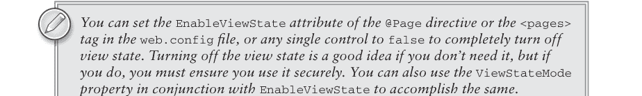

### 测试你的视图状态以防止信息泄露

你可以按照以下步骤使用 Lens 测试你的页面免受视图状态中的信息泄露的影响：

1. 启动 Lens，将要测试的页面的完整 URL 输入到 Target URL 文本框中。
2. 转到 ViewState 标签页，点击 Extract 下载页面。提取 `__VIEWSTATE` 隐藏字段的内容。输出显示了提取值的长度，如图 3-11 所示。
3. 点击 Decode 按钮解码下载的内容。这会将下窗更改为显示解码内容的树状结构。然而，你始终可以通过 Extracting String 和 Decoded 单选按钮在原始视图和解码视图之间切换。

# 第 3 章 ASP.NET 的伦理攻击

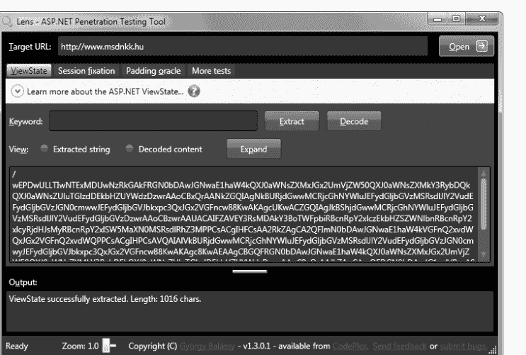

> 图 3-11：使用 Lens 从页面中提取 ViewState

如果你想在视图状态中查找特定的字符串，可以将其输入到 Keyword 字段中，随着你的输入，ViewState 会自动用红色高亮文本。图 3-12 显示了树形视图和关键字高亮。

你解码出的视图状态对应于配置页当前的状况。你必须对网站的每个页面进行独立测试，以检查信息泄露。为了测试每个页面，你也可以将序列化的视图状态值粘贴到“Extracted String view of Lens”中，然后点击 Decode 按钮进行解码。

### 加密你的 View State

幸运的是，ASP.NET 提供了一个内置机制，通过 Page 的 `ViewStateEncryptionMode` 属性加密 ViewState 属性的内容。该属性可以有以下三个值之一：

- **Auto** — 仅当控件通过调用 Page 类的 `RegisterRequiresViewStateEncryption` 方法请求加密时，视图状态才会被加密。这是默认值。如果你开发的控件在 ViewState 属性中存储敏感信息，你也可以调用此方法来加密该值。
- **Always** — 无论内容的敏感性如何，视图状态信息始终被加密。如果你利用了可以访问敏感对象值的第三方控件，应该使用此选项。
- **Never** — 视图状态信息永远不会加密，即使控件请求了加密。

你可以在 `@Page` 指令或 web config 文件的 `<pages>` 部分中启用状态加密。

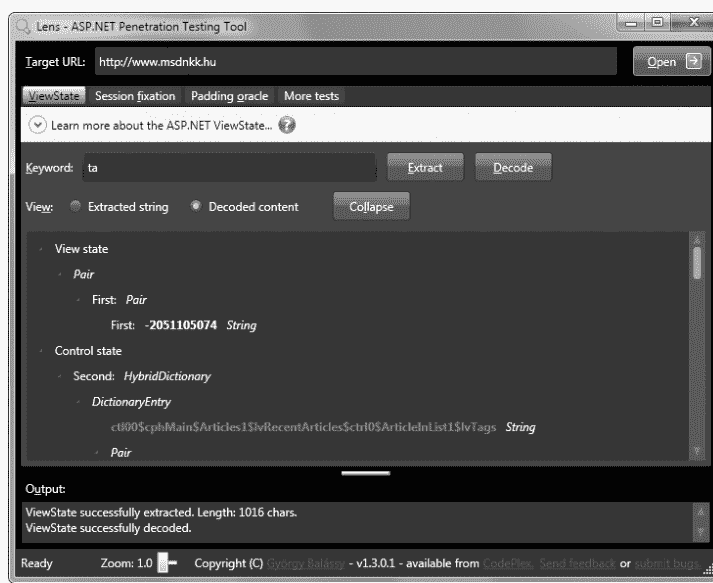

图 3-12：Lens 中解码的 ViewState 和关键字搜索

某些内置 Web 控件默认可能会请求加密 ViewState。如果你在页面上有 `FormView`、`ListView`、`GridView` 或 `DetailsView`，并且你将 `DataKeys` 属性赋值为非空值，它就会请求页面进行视图状态加密。原因是这些控件将键字段值存储在控件状态中，这些值会通过视图状态序列化到同一个隐藏字段中。

你可以使用 Lens 来测试页面上的视图状态是否已加密。在提取 `__VIEWSTATE` 值后，当输出面板中的错误消息显示视图状态因为加密而无法解码时。

### 篡改 View State

ViewState 不仅在持久控件状态方面起着重要作用，在事件处理方面也如此。更改（例如 TextBox 的 `TextChanged` 事件）不会导致立即的回传，但它们的事件处理程序会在表单提交到服务器时，根据视图状态的内容后执行。如果攻击者能够恶意篡改视图状态数据，他们不仅可以更改页面上控件的状态，甚至可以影响服务器上执行哪些事件处理程序。

幸运的是，ASP.NET 默认使用 HMAC 保护视图状态免受客户端修改。该方法与你在本章前面的“保护你的网站免受会话劫持”中看到的类似，它使用 web.config 文件中 `machineKey` 部分的 `validationKey` 属性配置的密钥。

虽然可以关闭视图状态 MAC，但我强烈建议你永远不要这样做，因为可能会导致严重的安全后果。确保 `@Page` 指令的 `EnableViewStateMac` 属性以及 web.config 中 `<pages>` 部分的 `EnableViewStateMac` 属性始终设置为 `true`，如下所示：

```xml
<pages enableViewStateMac="true" ... />
```

MAC 验证仅针对 HTTP POST 请求强制，如果请求不是回传，则永远不会检查 ViewState MAC。

### 重放 View State

当 ASP.NET 运行时处理 ViewState 属性中的对象时，它会对其对象的类型和值序列化。然而，它没有存储视图状态的另外两个重要属性：

- 创建视图状态时的时间戳或任何过期日期
- 访问页面的会话或用户的标识符

由于缺少这些信息，攻击者可以捕捉另一个用户的视图状态 并在以后任何时间提交到服务器。在这种情况下，恶意用户可以攻击你的网站或滥用视图状态中的受害者数据。为了缓解这种威胁，你可以使用页面的 `ViewStateUserKey` 属性，你已经在本章前面的“跨站请求伪造”中学习过它。

然而，如果你启用了 `ViewStateUserKey`，由于你网站上的视图状态 MAC 验证错误可能会增加，并多次抛出以下异常：

```
HttpRequest (0x80040005): Validation of viewstate failed. If this application is hosted by a Web Farm or cluster, ensure that <machineKey> configuration specifies the same validationKey and validation algorithm. AutoGenerate cannot be used in a cluster.
```

根据我的经验，此异常最常见的原因是用户在会话超时或登录会话超时后提交页面。在这些情况下，视图状态使用基于用户会话 ID 的密钥加密，而该密钥在回传时已过期，运行时抛出异常。两个变通方法可以帮助处理这个问题：

- 应用 Post/Redirect/Get (PRG) 模式，以便在用户在浏览器中刷新页面时重新提交。
- 在客户端维护一个 JavaScript 以避免提交到过期的会话。你还必须确保视图状态异常被优雅处理，并向访问者显示友好的错误页面。遗憾的是，这是一个通用的 HttpRequest，你可以在 `global.asax` 的 `Application_Error` 处理程序中检查该类型：

```csharp
private void Application_Error(object sender, EventArgs e) {
    Exception ex = this.Server.GetLastError();

    if(ex is HttpException && ex.InnerException != null &&
        ex.InnerException is ViewStateException) {
        // TODO: 在此处记录错误
        this.Server.ClearError();

        // TODO: 将用户重定向到友好的错误页面
    }
}
```

在本章前面，你学习了恶意攻击者如何利用 ASP.NET 身份验证、会话和视图状态的机制。本章的最后部分讨论了每个页面使用的另一个 ASP.NET 功能：事件处理。

控件和基于事件的编程是 ASP.NET 促进该平台成功的最重要的功能，它们隐藏了底层协议细节，使开发变得像桌面开发。为了提供这种级别的抽象，ASP.NET 在页面上创建一个大表单，当客户端发生回传时，表单会被提交到服务器。表单由引起回传的控件提交：

- 如果控件是 `Button` 或 `ImageButton`，表单在按钮激活时由浏览器提交。这些控件默认情况下（当 `UseSubmitBehavior` 属性为 true 时）会生成 `type="submit"` 或 `type="image"` 的标准输入元素。
- 如果触发回传的是 `LinkButton`、`CheckBox` 或带有 `AutoPostBack="true"` 属性的 `RadioButton`，表单由 ASP.NET 运行时生成的小型客户端 JavaScript 提交。该 JavaScript 函数 `__doPostBack` 会将引起回传的控件 ID 填充两个隐藏字段 `__EVENTTARGET` 和 `__EVENTARGUMENT`，以及任何额外的事件参数。

如果你捕捉浏览器生成的 HTTP 请求，你可以在 HTTP 体中清晰地看到这些行（省略了相关的头部行）：

```http
POST http://localhost:1124/Default.aspx HTTP/1.1
Host: localhost:1124

__EVENTTARGET=&__EVENTARGUMENT=&__VIEWSTATE=F2FWepdwQKkMTQ1QTOMMTYOWRKnEdK5e0g2Bluk3QsQvnLHF2FSYwp6j6F2CisjrJMO3D&__EVENTVALIDATION=F2FWEAgKTI4CuCgPmDum67sGJNH2FHBHC0QYga35ZVBA5QVQtolf
```

由于客户端脚本负责填充这些字段，恶意用户可以在这些值发送到服务器之前对其进行操控。幸运的是，ASP.NET 提供了一种名为事件验证的内置机制，可以针对此类修改提供某种程度的保护。

## 事件验证原理

当 Web 控件渲染时，它可能会调用 `ClientScriptManager` 类的 `RegisterForEventValidation` 方法。该方法计算控件 ID 的哈希值以及事件参数的哈希值，然后对这些值进行异或。生成的哈希值被添加到内部 `ArrayList` 中，并在页面渲染时将其序列化到页面上的隐藏字段 `__EVENTVALIDATION`。序列化是由 `ObjectStateFormatter` 类执行的，这与 ViewState 序列化使用的是同一个类。这意味着事件验证数据也受 HMAC 保护，并且当 ViewState 被加密时，`__EVENTVALIDATION` 字段也会被加密。

当数据回传到服务器时，运行时会调用 `ClientScriptManager` 的 `ValidateEvent` 方法，该方法解码 `__EVENTVALIDATION` 字段，并确保回传仅是由有效的参数值触发的。

## 关闭事件验证

开发者面临事件验证的一个常见场景是客户端脚本。如果你创建了一个 `DropDownList` 控件，然后用 JavaScript 加载项，服务器可能会抛出“Invalid postback or callback argument”异常，因为在客户端添加的项在 `__EVENTVALIDATION` 字段中缺失。

一个简单的解决办法是关闭事件验证，但遗憾的是，这无法在控件级别实现，而且这无异于向黑客敞开大门，我强烈建议**不要**这样做，正因如此，我不会向你展示如何操作。虽然在某些情况下关闭它是完全可以的，但在搜索相应的属性之前，你应该仔细考虑。


另一方面，你也可以调用 `Page.ClientScript.RegisterForValidation` 方法来注册你动态创建的控件或值。

## 攻击事件验证

之前描述的算法看起来很实用，有助于保护你的应用程序免受 POST 攻击。遗憾的是，该实现存在两个问题：

- 不同控件之间的实现是不一致的。例如，`Button` 控件在被禁用（disabled）时仍然允许回传。
- 就像 `__STATE` 一样，`__EVENTVALIDATION` 状态并没有绑定到特定的页面状态。

这两个问题都可能导致严重的后果。

## 触发禁用的按钮

如果你查看 `Button` 类 `AddAttributesToRender` 的源码，你会发现 `RegisterForValidation` 方法的调用独立于控件 `Enabled` 属性的值。这意味着 `__EVENTVALIDATION` 字段包含一个禁用按钮的有效引用。因此，恶意用户可以创建一个触发 `Click` 事件的请求，即使按钮是禁用的。

你可以通过以下步骤亲自尝试这种行为：

1. 创建一个带有禁用的 `Button` 和 `Label` 的 ASPX 页面：

```asp
<asp:Button ID="Button" runat="server" Enabled="False"
onclick="Button_Click" Text="Button" />
<asp:Label ID="Label" runat="server" Text="Label" />
```

2. 为 `Button` 创建事件处理程序以指示 `Click` 事件已触发：

```csharp
protected void Button_Click(object sender, EventArgs e)
{
    this.Label.Text = "It works!";
}
```

3. 启动 Fiddler 和 Request Builder。创建以下 POST 请求以触发 `Button1` 的回传：

```http
POST http://localhost:11124/Default.aspx HTTP/1.1
Host: localhost:1124
Content-Length: 196
Content-Type: application/x-www-form-urlencoded

__VIEWSTATE=%25F2WEWMILTEOMDIXNTZAcTrZKJL4N2F8ABL1V81wb0BqKNVhfUIP3arRVKj7nYWwBHP7lk__EVENTVALIDATION=%25FWeWMAl6sDAMSAM4RGRbk7GGCNCqwa9IGCZaMDYCo2BAX2StalRomXspS7AVcC%24&Button1=Button
```

> 请求体中 `__EVENTVALIDATION` 的值在你的环境中可能不同，但你可以通过访问页面并检查生成的 HTML 标记来获取这些值。

4. 点击 Fiddler 中的 Execute 按钮。查看左侧新创建的会话并切换到 Inspectors 选项卡。如果 HTTP 结果显示了“It Works!”，说明你成功触发了一个被禁用的按钮！

这个场景虽然简单，但你可以使用相同的方法测试你的页面是否受到这种 POST 攻击。自然，填充后的页面会产生许多复杂的请求，但你不需要从头构建它们。你可以捕获它们并使用 Fiddler 的 Replay 功能。

## 触发隐藏按钮

与 `Enabled` 属性不同，Web 控件在注册事件验证时会正确处理 `Visible` 属性；然而，在某些情况下，恶意用户仍然可以触发隐藏控件。正如之前学到的，事件验证基于 `__EVENTVALIDATION` 隐藏表单字段的内容，而该内容基于当前页面，而不是当前渲染的 HTML 标记。因此，恶意用户可以捕获生成的 `__EVENTVALIDATION` 值并将其提交另一个 HTTP POST 请求。

例如，你的网站上有一个 `Product.aspx` 页面，根据查询字符串中的 id 显示单个产品的详情。这是页面上的一个 Discount Order 按钮。

## 在攻击后保护你的站点

为了增强代码，你可以添加额外的检查。

## 总结

在本章中，你学习了可能针对你网站的各种攻击。与任何平台一样，ASP.NET 针对最常见的 Web 攻击提供了有效的保护。然而，由于 ASP.NET 无法涵盖所有的攻击范围，它也容易受到漏洞的影响。

# 4 如何构建一个真实世界的 Silverlight 5 应用程序

作者：Gill Cleeren

随着 Silverlight 的推出，微软进入了富交互网络应用（RIA）领域。在此之前，这一市场一直由 Adobe Flash 等技术主导。在 2007 年发布后，Silverlight 迅速从版本 1 的纯 JavaScript 导向开发模型，演进到版本 2 的基于 .NET 的模型，最终在版本 3 到 5 中成为一个准备好用于线业务（LOB）开发的丰富平台。如今，Silverlight 已安装在超过 70% 的电脑（根据 www.riastastats.com 所示）上，且这一采用率仍在攀升。它不仅是一个构建 RIA 的框架，也成为为 Windows Phone 7 构建应用程序的事实框架。

如前所述，从版本 2 开始，Silverlight 应用程序可以使用 .NET C# 构建，并可以使用 VB.NET 作为开发语言。另一方面，XAML 用于（以声明式方式）创建用户界面。XAML 语言是在 .NET 3.0 随 WPF 引入的。对于大多数 .NET 开发者来说，Silverlight 的学习曲线并不陡峭——你可以利用大量的现有知识。

尽管你可以依靠已经熟悉的“常规” .NET 知识，但 Silverlight 应用程序有其特殊之处。本章概述了当你离开“演示软件”（demoware）的铺好的道路（尽管这不是一个真实的单词，但它被用来指代仅使用标准内容而不再做其他内容的应用程序）并着手处理真实世界应用时将面临的一些问题。当然，每个问题都提供了相应的解决方案。

本章从设计阶段开始。在这种语境下，“设计”指的是创建应用程序的原型。你将看到如何以简洁的方式（在 Silverlight 中！）来实现这一点：SketchFlow。

下一个解决的问题是数据。微软对数据有几个关注点，其中之一（可能是最重要的）是 LOB 开发。没有数据的 LOB 应用可能根本不存在，因此你需要一种可靠的方法将数据导入 Silverlight 应用程序。为此，你学习使用 Windows 通信基础（WCF）RIA 服务。当你拥有数据后，Silverlight 提供了一个设计良好的数据绑定框架。你也将学习 Silverlight 中数据绑定引擎的一些概念。

就像一座坚固的建筑需要良好的基础一样，优秀的 Silverlight 应用程序也需要良好的架构。社区在模型-视图-视图（MVVM）模式背后付出了努力。你将学习如何轻松实现这种模式，以及它如何帮助你以更具可测试性和可维护的方式构建应用程序。

为了完成本章，你将学习如何自定义控件以适应你的应用程序的需求。

## 为应用程序设定场景

一个关于构建真实世界 Silverlight 应用程序的章节需要……一个真实世界的应用程序。在继续之前，请探索你将构建的应用程序场景。

最近，当地的一家电影院链“At The Movies”开始寻找一种系统，让游客能够提前预订座位。通过这个系统，他们希望避免人们在大门开启时涌入电影院。对于像我这样的人，这个系统是一个福音，因为我经常由于太晚而抢不到好座位。

- 允许用户输入个人数据（姓、名和电子邮件）。不需要创建账户，但信息必须存储在数据库中。用户不需要密码。
- 允许用户从正在上映的电影中进行选择，并查询有关电影的详情（如时长、评分和网站）。
- 允许用户为所选电影选择场次，并为该选择指示人数。
- 允许用户输入支付信息。
- 向用户显示预订确认。

对于该应用程序，本章全程使用图 4-1 所示的数据库模式。

> 你可以在此书的配套网站 www.wrox.com 上找到包含所有代码和示例数据库的应用程序。

| CreditCardType | Payment | ShowTime |
| --- | --- | --- |
| CreditCardTypeId | PaymentId | ShowTimeId |
| CreditCardName | CreditCardTypeId | ShowDate |
| | CardHolderName | ShowTimeStart |
| | ExpirationDate | ShowTimeEnd |
| | Amount | MoveId |
| | NumberOfSeats | |
| | ShowTimeId | |
| User | | |
| --- | | |
| UserId | | |
| FirstName | | |
| Email | | |
| Movie | | |
| --- | | |
| MoveId | | |
| MovieName | | |
| MovieDescription | | |
| Duration | | |
| MovieUrl | | |
| MoviePosterUrl | | |
| AverageRating | | |
| CurrentlyPlaying | | |
| TicketPrice | | |

**图 4-1：** 应用程序数据库模式

## 原型优先，代码后——使用 SKETCHFLOW

在我作为架构师的日常生活中，我经常参与项目的启动阶段。这一阶段最重要的任务之一是收集待构建系统的需求，这通常由分析师完成。这并不是一项容易的任务。在许多情况下，相关的利益相关者有不同的愿景。

### 熟悉 SketchFlow 界面

学习 SketchFlow 很容易。唯一可能花费一些时间的地方（特别是如果你没有 Expression Blend 经验的话）是熟悉界面。除了尝试，还有什么更好的学习方法呢，对吧？

通过启动 Expression Blend 来开始 SketchFlow。在 Blend 中，选择 File -> New Project，在 New Project 对话框中，在 Silverlight 节点下选择 Silver SketchFlow 应用程序。当 Blend 准备就绪，你会发现，除了 SketchFlow 特有的面板外，界面与 Blend 相似。可以识别出以下 SketchFlow 特有的面板：

- **SketchFlow Map (SketchFlow 地图)** —— 在此面板中，你可以看到场景及其连接。将其想象为应用程序的“思维图”。
- **SketchFlow Feedback (SketchFlow 反馈)** —— 你可以直接将利益相关者的反馈导入到 SketchFlow 并在设计器中使用。稍后我们会详细介绍这部分。
- **SketchFlow Animation (SketchFlow 动画)** —— 使用此面板可以创建 SketchFlow 特有的动画。本概述中未使用 SketchFlow 动画。

除了这些区域外，在 Assets -> SketchFlow 节点下，你可以用它查找用于原型的 sketch 版本控件，如图 4-2 所示。

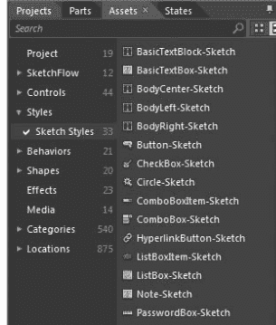

**图 4-2：** SketchFlow 控件

### 创建应用程序原型

现在你已经了解了 SketchFlow，可以利用这些知识为自己的应用程序创建一个原型。幸运的是，“At The Movies”的团队已经做了功课，几乎汇总了应用程序的所有需求。你可以根据这些需求开始创建原型。

#### 应用程序地图

从需求来看，你可以将应用程序实现为一个向导（wizard），这样导航将非常简单，由五个屏幕组成，从用户数据输入开始，以确认预约结束。你可以在 SketchFlow 的 Map 面板中按如下构建：

1. 启动一个新的 SketchFlow 应用程序时，会自动创建一个名为 Screen 1 的第一个屏幕。通过双击屏幕名称将其重命名为 Login。图 4-3 显示了屏幕块项。
2. 要添加第二个连接的屏幕，有两种选择。最简单的方法是将鼠标悬停在 Login 屏幕上，等待几秒钟直到屏幕下方出现菜单（如图 4-4 所示）。第一个按钮生成一个连接的屏幕。另一种选择是简单的右键点击屏幕并选择“Create a Connected（连接）”。
3. 创建后，你可以拖动新建的屏幕。将此屏幕重命名为 MovieSelection。图 4-5 显示了结果。
4. 继续创建整个屏幕地图。请求的向导式应用程序具有线性导航结构，如图 4-6 所示。

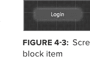
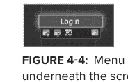
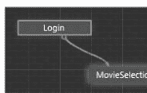
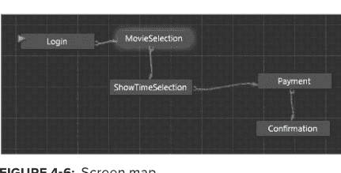

现在应用程序的结构已符合“At the Movies”的需求格式，你可以开始设计屏幕了。

#### 屏幕原型图

到目前，你拥有的应用程序只有几个空屏幕。向客户展示这些可能无法产生预期的效果——相反！你可以一个一个屏幕地添加 SketchFlow 控件来创建屏幕原型图。由于间距原因，请查看如何创建 MovieSelection 屏幕（其他屏幕也类似）。遵循以下步骤：

1. 你可以在 Assets Panel ✎ Styles ✎ Sketch Styles 下找到 SketchFlow 中所有可用的控件（换句话说，即那些具有“手绘”风格的控件）。并不是所有控件（包括 DataGrid）都有 sketch 资源，因此如果需要 DataGrid，必须使用默认项。
2. 通过将 TextBlock sketch 拖到设计器中开始添加文本草稿。将文本设置为“Select the movie you want to see!（选择你想看的电影！）”。
3. 选择 Button sketch 资源并添加它以创建底部的 New 按钮。
4. 添加一个 ListBox-sketch 和 ComboBox-sketch 控件。

图 4-7 显示了此时屏幕的样子。

SketchFlow 不仅仅支持静态控件。这些额外功能之一是添加包含示例数据的数据源。你可以自定义此数据源以模拟真实数据。添加示例数据源的能力本质继承自 Expression Blend。在设计应用程序时，这对于可视化屏幕填充数据后的观效果非常有帮助。

按照以下步骤创建数据源：

1. 在 Data Panel 中，点击 Create Sample Data 按钮并选择 New Sample Data。为数据命名为 MovieDataSource
2. 生成的数据源包含一个集合，其中每个项目有两个属性（类型为 String 的 Property1 和类型为 Boolean 的 Property2）。你可以更改现有属性或添加新属性。按图 4-6 所示生成项目。

### 第 4 章 如何构建真实的 Silverlight 5 应用程序

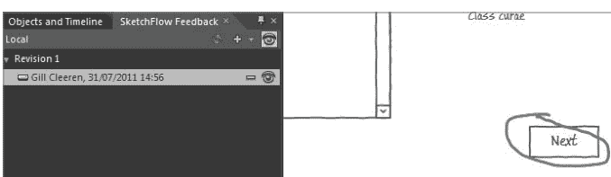

**图 4-11：** 圈出“下一步”按钮以显示变化

## 数据绑定基础

在我看来，在 Silverlight 中掌握最重要的概念之一（如果不是唯一的话）就是数据绑定。在大多数（也许是所有）业务密集型（LOB）应用程序中，数据表是应用程序的核心。简化显示、编辑、排序和过滤等任务可以极大缩短应用程序的周期，让开发者有更多时间关注真实的业务问题。数据绑定正是为此而生的——而且如此！

在本章的后后部分，你将学习数据绑定如何形成 MVVM 模式的基础。在这一部分，你将学习理解其他更高级概念时需要掌握的数据绑定相关知识。

### 你好，数据绑定

在查看数据绑定的实际运作之前，你需要了解这个引擎能为你做什么。Silverlight 中的数据绑定引擎允许你将控件绑定到 UI。它与数据访问无关。数据绑定所处理的数据是来自对象的数据——可以说是是内存中的数据。

数据的概念并不新奇。它已经存在于 ASP.NET 和 Windows Forms 中。但当时的绑定引擎并没有 Silverlight 中包含的那么复杂。Silverlight 实际上是从它的“大哥”WPF 继承了数据绑定能力。后者在绑定引擎中拥有一些额外选项，但 Silverlight 支持最常用的功能，因此你在 Silverlight 中功能上完全不缺少！

> 随着每一个 Silverlight 新版本的发布（包括 Silverlight 5），数据绑定引擎都添加了更多功能，使得每次发布后 WPF 和 Silverlight 在数据绑定领域的差异越来越小。

### 绑定语法

一个数据绑定始终由四个项定义：

- 你正在绑定的数据对象 —— 此对象通常被称为数据绑定的源对象（source object）。
- 该对象上的属性 —— 此属性被称为源属性（source property）。
- UI 中的一个控件 —— 此控件被称为目标控件（target control），因为它是数据的目标。目标对象必须派自 `DependencyObject`。
- 该控件上的属性 —— 此属性（称为目标属性）必须是一个依赖属性（dependency property）。不过不用担心，大多数属性（如 `FontSize`、`Background` 等）都是依赖属性，所以你在这里没有任何限制。

由于这些项构成了绑定，因此当你通过代码（无论是 XAML 还是 C#）创建数据绑定时，它们出现逻辑。大多数情况下，绑定是使用 XAML 创建的。来自后台代码（code-behind）的绑定主要在动态创建时使用。

假设你想将 `TextBlock` 的 `Text` 属性绑定到 `Person` 实例的 `FirstName` 属性。XAML 语法如下：

```xaml
<TextBlock Text='Binding FirstName'>
```


如果你查看此绑定中的元素，发现似乎缺少了一个项。`TextBlock` 是目标控件，它的 `Text` 属性是目标属性。通过使用标记扩展（可以通过大括号识别），你将 `Text` 属性的值绑定到源属性 `FirstName`。因此，源对象似乎缺失了。

其原因在于，大多数情况下使用了 `DataContext`。由于分层级的 XAML 结构（这本身就是 XAML），你可以在更高层级定义绑定的源以便访问它。这正是 `DataContext` 允许你做的。你在公共父元素（例如 `Grid`）上定义 `DataContext`，该元素内的所有控件如果没有为它们的数据绑定指定源，就会在 XAML 树中向上查找非空的 `DataContext`。找到时，控件将引用的对象作为其数据绑定的源。`DataContext` 可以从 XAML 代码设置，也可以从后台代码设置。

`DataContext` 的妙处在于，它消除了定义绑定源实际位于哪个控件上的需求（这会让代码更具可读性）。`DataContext` 在本章的示例应用程序中被频繁使用。

尽管 `DataContext` 通常，但你可以通过其他方式定义数据绑定的源对象：

- 使用数据绑定的 `Source` 属性 —— 你可以引用存储在资源中（页面、`UserControl` 甚至应用程序级别）的对象。
- 使用 `ElementName` 属性 —— 你可以在两个控件之间创建绑定。在这种情况下，数据绑定的源和目标都是控件。要定义此类绑定，你可以在绑定声明中使用 `ElementName` 属性，引用应作为绑定源的元素名称。
- 使用 `RelativeSource` 属性 —— 虽然这并不常用，但它允许你创建相对于当前元素的元素绑定。

## 绑定模式

你可以将数据绑定用于数据显示和数据输入。你可以指定你希望数据流向的方式。默认是从源到目标，但即使在那里，你有两个选项。表 4-1 显示了你在 Silverlight 4 中拥有的选项列表。

### 表 4-1：Silverlight 5 中的绑定模式

| 模式 | 动作 |
| --- | --- |
| OneWay | OneWay 是默认值。数据最初从源流向目标。但是，如果源对象实现了 `INotifyPropertyChanged` 接口，且源的值发生变化，目标将更新。 |
| OneTime | 与 OneWay 类似，数据从源流向目标。但只在绑定初始化时发生一次。 |
| TwoWay | 在 TwoWay 绑定中，数据双向流动。如果用户输入了一个值，源将得到更新。 |

## INotifyPropertyChanged

`INotifyPropertyChanged` 接口在 Silverlight 中引入。该接口使得属性值的同步成为可能。接口本身非常简单，如代码列表 4-1 所示。

### 代码列表 4-1：INotifyPropertyChanged 接口

```
namespace {
 // Summary:
 // 通知客户端属性值已更改。
 public interface INotifyPropertyChanged {
  // Summary:
   // 当属性更改时发生。
  event EventHandler PropertyChanged;
}
}
```

该接口定义了一个事件：`PropertyChanged` 事件。每当属性值发生变化时，都会引发此事件。Silverlight 监听此事件并更新 UI。只有当绑定使用 `OneWay` 或 `TwoWay` 模式定义时，才会如此。对于集合，存在一个类似的接口，即 `INotifyCollectionChanged`。由于该接口实现较为复杂，因此提供了一个实现此接口的特定集合：`ObservableCollection<T>`。`ObservableCollection` 在添加或删除项时发出通知。

## 转换器

在讨论如何使用数据绑定构建应用程序之前，先简要查看转换器。转换器可以被视为数据绑定过程中的一个钩子。它依赖于你处理数据绑定场景中来自源或目标的值，例如转换或格式化。坦率地说，它只是实现了 `IValueConverter` 接口的类。代码列表 4-2 显示了该接口的定义。

### 代码列表 4-2：IValueConverter 接口

```
namespace System.Windows.Data
    public interface IValueConverter
    {
        object Convert(object value, Type targetType, object parameter,
            CultureInfo culture);

        object ConvertBack(object value, Type targetType, object parameter,
            CultureInfo culture);
    }
```

当对数据绑定表达式使用转换器且数据从源流向目标时，Silverlight 会自动调用 `Convert()` 方法。例如，假设我们正在处理一个账户余额，它显然可以是正数也可以是负数。可以使用转换器将正数“转换”为绿色，负数则相反。转换器（如果不反对的话）可以返回相同的数据类型。

转换器非常实用，在任何应用程序中，你都会发现它们在几种场景下很有用。

## 创建数据绑定源

名为“At Movies”的应用程序要求创建一个数据列表。你很快将学习如何获取数据到应用程序，但首先关注基于数据绑定概念的数据显示和捕获。回想你在 SketchFlow 中创建的原型，显然每个屏幕都将以某种方式绑定到数据。

例如，考虑数据输入屏幕，用户必须输入或她的名字、姓氏和电子邮件。待输入的数据可以捕获在数据类 `Person` 中。该类实现了 `INotifyPropertyChanged` 接口，如代码列表 4-3 所示。

### 列表 4-3：Person 类

可从 Wrox.com 下载

```csharp
public class Person: INotifyPropertyChanged
{
    public event PropertyChangedEventHandler PropertyChanged;
    private string _firstName;
    private string _lastName;
    private string _email;
    public int UserId { get; set; }

    public string FirstName
    {
        get
        {
            return _firstName;
        }
        set
        {
            if (_firstName != value)
            {
                _firstName = value;
                RaisePropertyChanged();
            }
        }
    }

    private void RaisePropertyChanged(string propertyName)
    {
        if (PropertyChanged != null)
        {
            PropertyChanged(this, new PropertyChangedEventArgs(propertyName));
        }
    }
    //Name and Email are similar
}
```

代码文件 `[Snowball.AtTheMovies.Silverlight.UI/Model/Person.cs]` 可在 Wrox.com 下载。

如列表 4-4 部分所示，在名为 UserEntryView 的 XAML 中，你可以创建一些 TextBox。这些每一个 TextBox 都绑定到 Person 类的公共属性上。这些绑定被标记为双向绑定（TwoWay binding），因此所有输入的数据都会从目标控件（TextBox）传输到源对象（Person 实例）。然而，在此处，并未为绑定定义源。

### 列表 4-4：UserDataEntryView 的 XAML 代码（部分）

可从 Wrox.com 下载

```xml
<TextBox x:Name="FirstNameTextBox" Text="{Binding FirstName, Mode=TwoWay}></TextBox>
<TextBox x:Name="LastNameTextBox" Text="{Binding LastName, Mode=TwoWay}></TextBox>
<TextBox x:Name="EmailTextBox" Text="{Binding Email, Mode=TwoWay}></TextBox>
```

代码文件 `[snowball.AtTheMovies.Silverlight.UI/UserDataEntryView.xaml]` 可在 Wrox.com 下载。

在列表 4-5 所示的视图后置代码（code-behind）中，你可以实例化 Person 类并将此实例设置为公共父容器的 DataContext。这可以是一个 Grid 甚至是 UserControl 本身。

### 列表 4-5：UserDataEntryView 的后置代码

可从 Wrox.com 下载

```csharp
public partial class UserDataEntryView : Page
{
    public UserDataEntryView()
    {
        InitializeComponent();

        Person person = new Person();
        this.DataContext = person;
    }
}
```

代码文件 `[snowball.AtTheMovies.Silverlight.UI/UserDataEntryView.xaml]` 可在 Wrox.com 下载。

此时，你应该对数据概念有了深入的理解。在探索后续主题时，你会更多地使用数据绑定。现在，专注于如何使用 WCF RIA 服务将真实数据从服务器获取 Silverlight 应用程序，反之亦然。

# WCF RIA 服务实战

到目前，每个人都知道 Silverlight 是一个客户端框架。客户端身份带来了数据访问的问题。数据存储在服务器端的数据库中。你如何从 Silverlight 应用程序访问这些数据？

查看 Silverlight 可用的程序集和命名空间，它缺少所有的 ADO.NET 类，并且没有 LINQ-To-SQL 或 Entity Framework (EF) 功能。这意味着，仅通过连接字符串是不可能让 Silverlight 应用程序连接到服务器端数据库的。

实际上，这绝非安全。Silverlight 代码运行在用户的机器上，而你知道所有代码默认都是不安全的。每个用户很快就能获得连接字符串的访问。遗憾的是，并非所有用户对你的数据都有善意。

此外，在此时，Silverlight 并没有对客户端数据库提供开箱即用的支持。客户端数据库并不是许多问题的解决方案。没有开发者会编写代码将整个产品数据库下载到客户端。（至少我希望是如此！）

尽管如此，没有理由恐慌。解决方案以服务的形式存在。服务可以提供一个数据访问点，在大多数情况下，不是直接访问的，而是通过业务层和数据访问层 (DAL)。微软确实为 Silverlight 提供了对许多服务的支持，因此对于业务应用程序开发者来说，访问任何服务都不应该是一个问题。

表 4-2 包含了 Silverlight 中支持的服务类型概览。

### 表 4-2：Silverlight 支持的服务类型

| 类型 | 描述 |
| --- | --- |
| ASMX Web 服务 | 这些是普通的 Web 服务，主要用于支持使用此类服务的遗留系统。 |
| WCF 服务 | 这些在 Silverlight 中提供了最丰富的支持，应该是你访问服务的默认选择。它们通过二进制编码提供最快的数据传输，并支持安全性和双工通信。 |
| RSS/POX (Plain Old XML) | Silverlight 可以读取从服务返回的 XML。支持 LINQ-To-XML、XmlReaderWriter。在 RSS 的情况下，Syndication 类提供了一种强类型的方式来读取 XML。 |
| REST | 表述状态转换 (REST) 是一种许多 Web 应用程序用于暴露其功能的协议（例如 Flickr、Twitter 等）。数据以 XML、JavaScript 对象表示 (JSON) 或 ATOM 格式进行交换。 |
| Sockets | 虽然 WCF 在 Silverlight 中支持双工通信，但 sockets 提供了真正的双工通信。由于这被限制在... |
| WCF 数据服务 | Silverlight 可以读取从服务返回的 XML。支持 LINQ-To-XML、XmlReaderWriter。在 RSS 的情况下，Syndication 类提供了一种强类型的方式来读取 XML。 |
| RIA 服务 | 表述状态转换 (REST) 是一种许多 Web 应用程序用于暴露其功能的协议（例如 Flickr、Twitter 等）。数据以 XML、JavaScript 对象表示 (JSON) 或 ATOM 格式进行交换。 |

（注：表格内容在页面分页处有显著的对齐错误/重叠；我根据提供的文本上下文和标准的 WCF 定义进行了重构，尽管最后行的 OCR 源高度损坏。）

实际上，这绝非安全。Silverlight 代码运行在用户的机器上，而你知道所有代码默认都是不安全的。每个用户很快就能获得连接字符串的访问。遗憾的是，并非所有用户对你的数据都有善意。

...

很多时候一样，最好的答案是“取决于情况”。

它还与 ASP.NET 安全性集成。如果你已经有了现有的 ASP.NET 成员结构，可以对其进行重用。

代码生成以及幕后发生的许多事情可能会让一些开发者感到恐惧，认为你用 RIA Services 构建的无非是一些演示程序（demo-ware）。事实完全并非如此。

你可以使用 RIA Services 创建具有扩展性且架构设计良好的应用程序，在这些应用程序中，编写的代码量以及处理异步开发的问题被减少到最低。然而，这并不会将你束缚在一个可能不习惯的架构中。虽然它被用于端到端（data-to-end），但你可以随心想要的那样弯曲它。事实上，RIA Services 让构建 n 层 RIA 应用变得简单得多！

## 为什么选择 WCF RIA Services？


既然你已经理解了什么是 RIA Services，你可能在想为什么在“电影”应用（或任何其他中小型应用）中选择 RIA Services 而不是其他技术。之前提到的代码生成非常实用。例如，当你的服务器端实体上带有注解（主要用于验证）时，框架会自动将它们复制到客户端，因此你只需要编写一次代码——即在服务器端。

可以看出，RIA Services 隐藏了你正在往返发送数据。它隐藏了执行异步调用的细节。不需要为所有的 CRUD 操作编写代码无疑是另一个加分项。

RIA Services 针对与 EF（Entity Framework）的工作进行了优化。然而，它是数据访问层（DAL）中立的。这意味着它可以与其他技术一起工作，但会增加你的一些额外工作。连接到 RIA Services 不会将你绑定到特定的 DAL 技术上。

## RIA Services 的架构与概念

从架构上看，使用 RIA Services 的 Silverlight 应用程序与其他使用服务的应用程序没有区别，如图 4-12 所示。

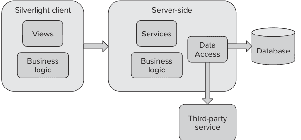

图 4-12：使用 RIA Services 与其他服务的对比

在创建 RIA 服务时，会在客户端项目内生成代码。使用 WCF 或 ASMX 服务时，也会以代理（proxy）的形式生成代码。然而，这里生成的代理要比另一个……说，“聪明”得多。你很快就会学习它与其他代理的区别。服务方法中使用的实体也会在客户端生成，包括验证逻辑，这使得你不需要创建和维护重复的代码。

## 创建服务器端

在学习数据绑定时，你处理了一个自己创建的 `Person` 类。在大多数情况下，你不会那样的工作。你的业务对象不会只作为类位于 Silverlight 中。本节将遵循数据的端到端路径，从数据库一直 UI，中间经过 RIA Services。在深入研究之前，先看看你可以如何组织解决方案。

## 设置解决方案

确保解决方案结构组织良好是理解易于理解的项目的第一步。按照以下步骤设置解决方案结构：

1. 此项目的解决方案名为 `Snowball.AtTheMovies`（`Snowball.be` 是我的博客名称，因此在我的代码中有该前缀）。该解决方案是一个 Silverlight 导航应用程序。Visual Studio 会同时创建一个项目和一个 Silverlight 应用程序。

2. RIA Services 可以放置在 Web 项目中。它们可以作为新 Silverlight 项目的 Web 部分。虽然这对于小型项目是可以的，但在现实世界的解决方案中，这不应该是你放置它们的地方。相反，有一个项目模板可以为你提供帮助——WCF RIA Services 类库。当将此类项目添加到解决方案时，会创建一个用于服务的服务器项目和一个用于客户端生成代码的客户端项目。添加此项目模板的实例，并将两个项目重命名以符合命名规范：`Snowball.AtTheMovies.Services.Web` 和用于 Silverlight 项目的 `Snowball.AtTheMovies.Services`。

3. 添加一个类库（`Snowball.AtTheMovies.Model`），你将在其中拥有实体模型（Entity Model）。

4. 创建引用：
    - RIA Services (`Snowball.AtTheMovies.Services.Web`) 必须引用模型项目（`Snowball.AtTheMovies.Model`）。
    - Web 项目必须引用服务项目。
    - Silverlight 项目必须引用客户端服务项目（`Snowball.AtTheMovies.Services`）。

5. 你必须在 Web 项目中启用 RIA Services，因为它们将从 URL 托管。为了让其正常工作，请在 Web 项目中添加以下引用：
    - `System.ServiceModel.DomainServicesFramework`
    - `System.ServiceModel.DomainServices.Hosting`
    - `System.ServiceModel.DomainServices.Server`

6. 在项目的 `web.config` 文件中，必须添加配置代码以启用 RIA Services。你也可以在代码列表 4-6 中找到这些代码，位于本书的配套网站 wrox.com 上。

## 代码列表 4-6: Web.config

```xml
<?xml version="1.0"?>
<configuration>
  <system.web>
    <authentication mode="Forms"/>
    <httpModules>
      <add name="DomainServiceModule" type="System.ServiceModel.DomainServices.Hosting.DomainServiceHttpModule,System.ServiceModel.DomainServices"/>
    </httpModules>
    <compilation debug="true" targetFramework="4.0">
      <assemblies>
        <add assembly="System.Data.Entity, Version=4.0.0, Culture=neutral, PublicKeyToken=b77a5619194ee9a5"/>
      </assemblies>
    </compilation>
  </system.web>
  <system.server>
    <modules runAllRequests="true">
      <add name="DomainServiceModule" type="System.ServiceModel.DomainServices.Hosting.DomainServiceHttpModule,System.ServiceModel.DomainServices"/>
    </modules>
  </system.server>
  <serviceModel>
    <hostingEnvironment aspNetCompatibility="false"/>
  </serviceModel>
</configuration>
```

## WCF RIA Services

- 解决方案 `Snowball.AtTheMovies`（包含 6 个项目）
- 客户端：`Snowball.AtTheMovies.Services`
- UI：`Snowball.AtTheMovies.Silverlight`
- 服务器：`Snowball.AtTheMovies.Model`
- Web：`Snowball.AtTheMovies.Services.Web`
- 程序集：

图 4-13：最终解决方案架构

## 使用 Entity Framework 访问数据

RIA Services 针对与 EF 工作进行了优化。使用 Entity Framework (EF)，如果你强制使用另一种数据访问技术，RIA Services 是可用的，但会增加你的一些额外工作。由于它对特定技术没有要求，你可以自由选择。

在 `Snowball.AtTheMovies.Model` 项目中，你添加实体模型 `AtTheMovies.edmx`，由于应用程序非常简单，你可以对数据库进行一对一映射。图 4-14 显示了该模型，它与章节初期的模型相似。

在 `AtTheMoviesModel.Designer.cs` 文件中，它是生成的，模型实体也是如此。这会重新生成。如果你需要在生成的实体上添加代码，可以使用部分类。这包括在属性上添加注解（用于验证目的）。

假设你想添加一个验证规则，要求 `Payment` 类中的 `Amount` 属性小于 200。你可以使用 `RangeAttribute` 应用此规则。第二个规则可能是 `CardNumber` 是必填的；可以使用 `RequiredAttribute` 应用。然而，没有这样的部分属性可以附加在上面。相反，你必须添加另一个名为 `PaymentMetadata` 的类，它包含了 `Payment` 类的元数据。该类通过 `MetadataTypeAttribute` 与第一个类链接。属性上的注解与 `Payment` 类的属性合并。代码列表 4-7 显示了此部分类的创建（基于它们的名称）。

## 代码列表 4-7: Payment 类


```csharp
[Metadata(type=typeof(PaymentMetadata))]
public partial class Payment
{
    internal sealed class PaymentMetadata
    {
        [Required]
        public string CardNumber { get; set; }
    }
}
```

# 122 | 第 4 章 如何构建真实的 SILVERLIGHT 5 应用程序

# 列表 4-7（续）

```csharp
[Range(1, 200)]
public Decimal Amount { get; set; }
}
```

代码文件 [Snowball.AtTheMovies.Model/Payment.cs] 可在 Wrox.com 下载。

稍后，你会发现该属性在生成的客户端代码中返回。

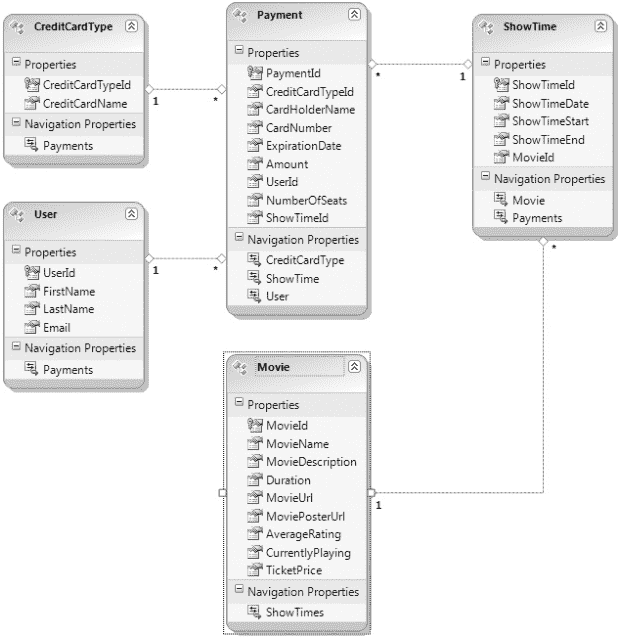

图 4-14：实体模型（The Entity Model）

## 创建实际服务

在模型和数据访问准备就绪后，你可以将注意力转移到服务上。让我们开始为“电影选择”（MovieSelection）屏幕构建服务。如之前所述，RIA 服务随带的工具可以消除一些繁琐的工作。如果你需要，可以为所需的实体创建一些默认的 CRUD 操作。

要创建服务，首先开始向 `Snowball.AtTheMovies.Services.Web` 项目中添加一个领域服务（domain service）。在 RIA 中，服务被称为领域服务（DomainService）。它是你的 Silverlight 获取数据的访问点，数据可以来自数据库或另一个服务。

工具要求构建必须是最新的，以便它能在你的代码中找到实体。如果尚未执行构建，请启动构建，然后向项目添加一个名为 `MovieService` 的领域服务。立即会弹出一个对话框，允许你配置该服务，如图 4-15 所示。


图 4-15：配置服务的对话框。

“启用客户端”（Enable Client）复选框表示你希望将服务代码生成在客户端还是服务器上。勾选此框将允许 `EnableClientAccess` 属性应用于该类。第二个复选框“暴露 OData 端点”（Expose OData Endpoint）允许将来自 DomainService 的数据暴露为 OData，从而方便数据共享。通过这种方式，你可以从服务访问数据（例如从 Excel）。

如之前提到的，工具与 EF 配合工作，这在这里显而易见。列出了可用的数据上下文（DataContexts）以及它们对应的实体。你可以选择为你正在创建的服务需要哪些实体。可选情况下，你也可以让工具生成基本的 CRUD 操作。

在 RIA 服务的第 1 版本中，你无法在多个服务之间共享实体。这意味着如果你有两个服务（例如 `PaymentService` 和 `MovieService`），你只能在其中一个服务中拥有 `User` 实体。在现实系统中，没有哪个系统被设计成让所有实体都完全分离的。（这样做可能不是个好主意！）在编写时，1.0 版本服务包 1 是最新版本，它添加了对共享实体的支持，使得能够按意愿细分 DomainServices。

在 `MovieService` 中，包含了所有与电影（Movie）和场次（ShowTime）相关的逻辑。因此，请点击 Movie 和 ShowTime 实体，因为在服务的实现中需要这些实体。你将不会在此应用程序中添加或更新这些实体，请不要勾选“启用编辑”（Enable Editing）框。列表 4-8 显示了生成的代码。

## 列表 4-8：生成的 DomainService 类代码

```csharp
// [RequiresAuthentication]
[EnableClientAccess()]
public class MovieService : LinqToEntitiesDomainService<AtTheMovies>
{
    public IQueryable<Movie> GetMovies()
    {
        return this.DbContext.Movies;
    }
    public IQueryable<ShowTime> GetShowTimes()
    {
        return this.DbContext.ShowTimes;
    }
}
```

代码文件 [Snowball.AtTheMovies.Web/PaymentService.cs] 可在 Wrox.com 下载。

对于电影选择屏幕（请参考显示此屏幕原型的屏幕模型稿），你需要一份正在放映的电影列表。（允许用户选择不再放映的电影不是个好主意，对吧？）生成的代码并不是这样的。`GetMovies()` 方法返回所有电影的列表。

尽管这段代码是生成的，但你可以自由更改它。它只在创建服务时生成。因此，你可以更改 `GetMovies()` 方法或添加新方法。让我们采用第二种方案，如列表 4-9 所示，它使用了 `GetAllCurrentMovies()`。

## 列表 4-9：GetAllCurrentMovies() 方法

```csharp
public IQueryable<Movie> GetAllCurrentMovies()
{
    return this.DbContext.Movies.Where(m =>
        m.CurrentlyPlaying == true);
}
```

目前，你在服务内部有了足够的逻辑，所以你现在应该查看服务器上的这些工作在客户端产生什么结果。

等一下。客户端如何知道使用这个 `GetAllCurrentMovies()` 方法来获取电影列表呢？

## 约定即规则

正如你所注意到的，生成的方法（所谓的*查询方法*）以 `Get` 开头并返回一个 `Queryable<Entity>`。对于 RIA 服务来说，后者是该方法可以用于检索的标志。同样，以 `Insert` 开头方法名并将实体作为参数，就足够让 RIA 服务知道指定方法执行的是插入操作。

这里的规则是*约定*（convention）。

| 约定 (CONVENTION) | 配置 (CONFIGURATION) | 用法 (USAGE) |
| :--- | :--- | :--- |
| Insert, Add, Create | Insert | 接受实体作为参数，将其插入数据源。 |
| Update, Change, Modify | Update | 接受实体作为参数，更新数据源中的。 |
| Remove, Delete | Delete | 接受实体作为参数，从数据源中删除。 |
| (Get), Retrieve | Query | 接受单个实体，返回 `Queryable<T>`。 |

## 与此同时，在 Silverlight 项目中

构建解决方案后，RIA 服务的工具会努力生成客户端代码。在 `Snowball.AtMovies.Services` 项目中（如果你遵循了与此解决方案相同的约定），你会看到一个名为 `Generated_Code` 的文件夹。

在生成的代码中，你可以找到一个类型为 `DomainContext` 的客户端上下文。你创建的每个领域服务都会生成一个领域上下文。此上下文可以作为客户端的接触点。它是服务的代理，但同时也负责对客户端的实体进行更改跟踪。后者是通过使用 `EntityManager` 完成的，它包含每个实体的 `EntitySet`。（在这种情况下，你为 Movie 和 ShowTime 实体都有一个 EntitySet）。列表 4-10 显示了 `Snowball.AtMovies.Services.Web.g.cs` 文件生成代码的部分。

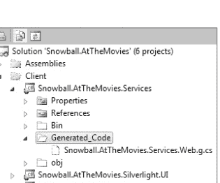

图 4-16：Generated_Code 文件夹

### 列表 4-10：带有 EntitySet 的 EntityContainer

```csharp
internal sealed MovieContextEntityContainer : EntityContainer
{
    public MovieContextEntityContainer()
    {
        this.EntitySet<Movie>(EntityOperations.None);
        this.EntitySet<ShowTime>(EntityOperations.None);
    }
}
```

## 在电影选择屏幕中加载数据

为了更容易跟进，图 4-17 显示了你正在制作的屏幕。为了节省空间，没有包含整个 XAML。请查看此书的配套网站（www.wrox.com）以获取相关内容。

# 电影院 (At The Movies) - 您附近的影院

# 为今晚选择您的电影！

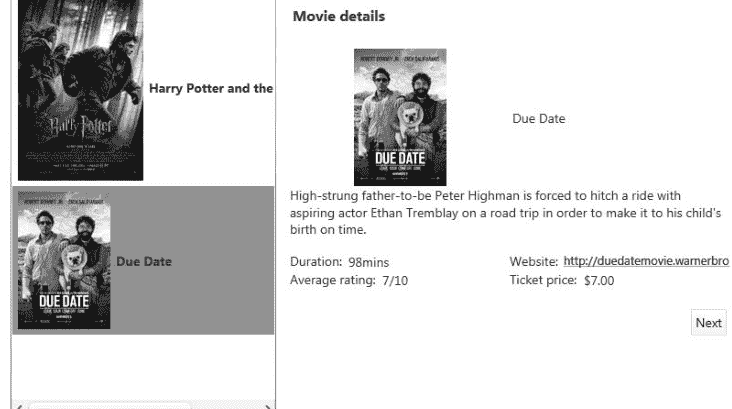

哈利·波特与

约会之日


紧张的准爸爸彼特·希格曼（Peter Higman）被迫与有抱的演员伊坦·特姆布莱（Ethan Tremblay）搭车公路旅行，以确保在孩子出生准时到达。

时长：98分钟

平均评分：7/10

网站：http://duedatemovie.warnerbro

票价：$7.00

**图 4-17：** 电影选择屏幕

你首先考虑的是向列表填充所有当前电影。你已经在 `MovieService` 中构建了此方法，因此在 Silverlight 应用程序中可以使用它。

列表 11 显示了如何操作。

+ 列表 4-11：从领域服务加载数据

```csharp
private MovieContext _context;

public MovieSelectionViewModel()
{
    InitializeComponent();
    _context = new MovieContext();
}
```

```csharp
// 当用户导航到此页面时执行。
protected override void OnNavigatedTo(NavigationEventArgs e)
```

```csharp
EntityQuery<Movie> query = _context.GetCurrentMoviesQuery();
_context.Load(query);
CurrentMovieListListBox.ItemsSource = _context.movies;
```

代码行 [Snowball.AtTheMovies.Silverlight.UI/View/MovieSelectionView.xaml.cs] 可在 Wrox.com 下载。

# 第 4 章 如何构建一个真实世界的 SILVERLIGHT 5 应用程序

`OnNavigatedTo()` 方法中的代码应该保持完全相同。它是通过导航框架执行的——你已经导航到了该页面。上下文 `MovieContext` 被实例化，你使用它的 `GetAllCurrentMoviesQuery()` 方法。事实上，这与处理普通服务的工作非常相似，在那种情况下你一个正常的代理。

你将 `ListBox` 的 `ItemsSource` 绑定到 `MoviesDataContext` 上的 `Movies` 属性。当 RIA 服务通知你服务上的一个或多部电影返回 `IQueryable<T>` 时，就会生成之前提到的 `EntitySet`。你在这里正绑定到这个特定的 `EntitySet`。然而，数据不会自动到达此属性。你必须显式地调用 `Load()` 方法。虽然 RIA 处理了异步编码，但数据是以异步方式加载的。

## 完善屏幕

如果你运行了上面的代码，结果将不完全正确。你在 `ListBox` 中看到的是 `ToString()` 的实现，而不是带有图像和 `TextBlock` 的精美 UI。这是通过为 `ListBox` 的 `ItemTemplate` 使用自定义的 `DataTemplate` 实现的。

此模板可以是为 `ListBox` 中的每个项目生成的段 XAML 代码。每个项目的 `DataContext` 是绑定的对象，因此你在这里也可以使用常规的数据绑定表达式。虽然在 4-12 节将此代码直接放在 `App.xaml` 中，但通常的做法是创建一个或多个资源字典，并在 `App.xaml` 中引用它们，该文件位于 `Assets/CoreStyles.xaml`。

# 列表 4-12：用于电影选择 ListBox 的 DataTemplate

可在 Wrox.com 下载

```xml
<Setter Key="MovieSelectionListStyle" TargetType="ListBox">
  <Setter Property="Margin" Value="5"/></Setter>
  <Setter Property="Width" Value="290"/></Setter>
  <Setter Property="ItemTemplate">
    <Value>
      <DataTemplate>
        <StackPanel>
          <Image Source="{Binding MoviePoster,
                  Converter={StaticResource localImageUIConverter}}"
                 Margin="1"/ />
          <TextBlock Text="{Binding MovieName}"
                     TextWrapping="Wrap"
                     VerticalAlignment="Center"
                     Style="{StaticResource MovieSelectionTextBlockStyle}" />
        </StackPanel>
      </DataTemplate>
    </Value>
  </Setter>
</Setter>
```

代码文件 [Snowball.AtTheMovies.UI/Assets/CoreStyles.xaml] 可在 Wrox.com 下载。

Silverlight 中的一个良好的编码实践是将此放在样式中，如所示。该样式随后使用了列表 4-13 中的代码。

# 列表 4-12：将样式应用到 ListBox

```xml
<ListBox x:Name="CurrentMovieListBox"
      Grid.Row="1" Grid.Column="0"
      Style={StaticResource SelectionListBoxStyle}>
</ListBox>
```

代码文件 [Snowball.AtTheMovies.Silverlight.UI/View/MovieSelection.xaml] 可在 Wrox.com 下载。

最后，当 `ListBox` 中进行选择时，你必须确保包含电影详情的 `Grid` 知道子元素从哪里获取数据。每当选择更改时，你也必须进行更新。

可以通过将 `Grid` 的 `DataContext` 更改为 `ListBox` 中的选中项（反正每个项目都是一个 `Movie`）来实现。列表 4-14 显示了这一点。

# 列表 4-14：详情 Grid 的 XAML 代码（部分）

```xml
<Grid DataContext={Binding ElementName=CurrentMovieListBox, Path=SelectedItem}>
  <Image Source={Binding MoviePosterUrl,
                 Converter={StaticResource localImageUrlConverter}} />
  <TextBlock Text="Movie details"
             Style={StaticResource SubTextBlockStyle}>
  </TextBlock>
  <TextBlock x:Name="MovieNameTextBlock"
             Text={Binding MovieName}
             Style={StaticResource LabelTextBlockStyle}>
  </TextBlock>
  <TextBlock x:Name="MovieDescriptionTextBlock"
             Text={Binding MovieDescription}
             Style={StaticResource DefaultTextBlockStyle}>
  </TextBlock>
</Grid>
```

代码文件 [Snowball.AtTheMovies.Silverlight.UI/View/MovieSelection.xaml] 可在 Wrox.com 下载。

其他屏幕可以以类似的方式重建。为了节省空间，这里没有展示它们。

# 应用 MVVM 模式

当你查看刚刚编写的代码时，你会发现它没有任何问题。没有问题，当然了。如果你继续按照你开始的方式处理其他屏幕，一切将是正常的，“At The Movies”应用程序也将运行得非常完美。你编写了一些 XAML 代码，而 Silverlight 应用程序中的大部分代码位于后台代码中。图 4-18 显示了到目前为止的图形概览。

（由于原始文本包含大量重复和 OCR 错误，已根据逻辑流程清理并翻译核心内容。译注：提供的 OCR 文本似乎包含某些重复或被截断/重复。我已经处理了提供文本块的逻辑流。）

另一方面，正如你很快会看到的，在运行 MVVM 时，仍然有更多工作需要完成（也就是说，需要编写更多的代码）。市上有许多优秀的框架可以为你承担部分工作。这可能会让人有些困惑，因为有很多种实现方式。当然，MVVM 仍然是一种模式，每个人都对该模式有自己的实现。

## 选择一个小助手 — MVVM Light

正如前面提到的，MVVM 的工作可能会多一些，因为需要编写更多的手动代码。可以帮助此点的框架之一是 MVVM Light，它由 Laurent Bugion 编写。正如名称所示，它是一个轻量级框架，开源提供，因此你可以根据需要进行更改。

项目代码可以从 CodeFlex 网站通过 http://mvvmlight.codlex.com 下载。为了此处的重构目的，请使用二进制文件，它们也可以从 CodeFlex 网站下载。

在解决方案中，添加一个 Solution 文件夹并将其放在 `GalaSoft.MVVMLight.SL4.dll` 程序集中。从 Silverlight 项目中创建对该程序集的引用。现在你就可以准备开始重构为 MVVM 了。

## 重构为 MVVM

在本节中，你将重构代码以使用 MVVM 模式。首先准备项目以适应你想要做的更改。

在 Silverlight 项目中添加 View、ViewModel 和 Model 文件夹。在这些文件夹中，你可以放置相应模型的类。

## Model

与 DomainService 通信的代码不再位于后台（code-behind）；请将其放在 Model 类中。对于之前讨论的 MovieSelectionView，你必须处理 Movie 实体。你正在 Model 文件夹中创建一个 ViewModel 类。在这个类中，你需要一个方法来获取所有当前正在播放的电影。列表 4-15 显示了该类的代码。

> 列表 4-15：MovieModel 类

```csharp
public class ViewModel
{
    private ViewModel _context;
    private LoadOperation<Movie> _movieLoadOperation;
    private Action<ObservableCollection<Movie>> _getAllCurrentMoviesCallback;

    public ViewModel()
{
  _context = new MovieContext();
}

public void GetAllCurrentMovies(
  Action<ObservableCollection<Movie>> GetAllCurrentMoviesCallback)
{
  _getAllCurrentMoviesCallback = GetAllCurrentMoviesCallback;
  var query = _context.GetAllCurrentMoviesQuery();
  _movieLoadOperation = _context.Load(query);
  _movieLoadOperation.Completed +=
    new EventHandler(OnGetAllCurrentMoviesCompleted);
}

private void OnGetAllCurrentMoviesCompleted(object sender, EventArgs e)
{
  _movieLoadOperation.Completed -= OnGetAllCurrentMoviesCompleted;
  var movies = new EntityList<Movie>(
    _context.Movies, _movieLoadOperation.Entities
  );
  _getAllCurrentMoviesCallback(movies);
}
```

代码文件 [Snowball.AtTheMovies.Silverlight.UI/Model/Movie.cs] 可在 Wrox 下载。

`GetAllCurrentMovies()` 方法接受 `Action<ObservableCollection<Movie>>` 作为参数。这再次表明从 DomainService 的数据检索是异步的。Action 指向方法（正如你将看到的，它是 ViewModel 的一部分），你将在接收到数据后从回调（`OnGetAllCurrentMoviesCompleted`）中调用它。访问服务与你之前看到的类似。

## ViewModel

用于电影选择的 ViewModel 是位于 ViewModel 文件夹中的类 `MovieSelectionViewModel`。此类必须通知 View 关于其属性发生的变化，以确保数据绑定引擎保持 View 同步。因此，此类应该实现 `INotifyPropertyChanged` 接口。然而，你可以从 MVVM Light 中获益，并让类继承自 `ViewModelBase`。后者实现了 `INotifyPropertyChanged` 并有一个方法 `RaisePropertyChanged`，你可以使用它来触发属性更改的事件。

回看屏幕，看到你需要一个电影列表。当点击某部电影时，你会显示该电影的详情。之前，你通过将 Grid 的 `DataContext` 设置为 ListBox 内的 `SelectedItem` 来实现这一点。虽然这样做也可以，但在 MVVM 方法中，你必须知道用户选择了哪部电影（以便稍后存储）。因此，你必须在 ViewModel 上暴露一个 `SelectedMovie` 属性，View 可以绑定到该属性。4-16 显示了 ViewModel 的代码。由于间距原因，这里只显示了相关部分。

## 列表 4-16：MovieSelectionViewModel 类（部分）

可在 Wrox.com 进行下载。

```csharp
public class MovieSelectionViewModel : ViewModelBase
{
    private MovieModel _movieModel;
    private Movie _selectedMovie;
    private ObservableCollection<Movie> _currentMovies;

    public MovieSelectionViewModel()
    {
        _movieModel = new MovieModel();
        LoadAllCurrentMovies();
    }

    private void LoadAllCurrentMovies()
    {
        _movieModel.GetCurrentMovies(GetCurrentMoviesCallback);
    }

    public void GetCurrentMoviesCallback(ObservableCollection<Movie> movies)
    {
        if (movies != null)
        {
            CurrentMovies = movies;
        }
    }

    public ObservableCollection<Movie> CurrentMovies
    {
        get
        {
            return _currentMovies;
        }
        set
        {
            _currentMovies = value;
            RaisePropertyChanged("CurrentMovies");
        }
    }

    public Movie SelectedMovie
    {
        get
        {
            return _selectedMovie;
        }
        set
        {
            _selectedMovie = value;
            RaisePropertyChanged("SelectedMovie");
        }
    }
}
```

# 应用 MVVM 模式

代码文件 [Snowball.AtTheMovies.Silverlight.UI/ViewModel/Movie.cs] 可在 Wrox 下载。

`GetAllCurrentMovies()` 方法接受 `Action<ObservableCollection<Movie>>` 作为参数。这再次表明从 DomainService 的数据检索是异步的。Action 指向方法（正如你将看到的，它是 ViewModel 的一部分），你将在接收到数据后从回调（`OnGetAllCurrentMoviesCompleted`）中调用它。访问服务与你之前看到的类似。

## View


# 用于电影选择的 ViewModel

用于电影选择的 ViewModel 是位于 ViewModel 文件夹中的类 `MovieSelectionViewModel`。此类必须通知 View 关于其属性发生的变化，以确保数据绑定引擎保持 View 同步。因此，此类应该实现 `INotifyPropertyChanged` 接口。然而，你可以从 MVVM Light 中获益，并让类继承自 `ViewModelBase`。后者实现了 `INotifyPropertyChanged` 并有一个方法 `RaisePropertyChanged()`，你可以使用它来触发属性更改的事件。

回看屏幕，看到你需要一个电影列表。当点击某部电影时，你会显示该电影的详情。之前，你通过将 Grid 的 `DataContext` 设置为 ListBox 内的 `SelectedItem` 来实现这一点。虽然这样做也可以，但在 MVVM 方法中，你必须知道用户选择了哪部电影（以便稍后存储）。因此，你必须在 ViewModel 上暴露一个 `SelectedMovie` 属性，View 可以绑定到该属性。

> 列表 4-17：后台代码

```csharp
public partial class MovieSelectionView : Page
{
    public MovieSelectionView()
    {
        InitializeComponent();
    }
}
```

代码文件 `Snowball.AtTheMovies.Silverlight.UI/View/MovieSelectionView.cs` 可在 Wrox 下载。

> 列表 4-18：绑定到 ViewModel 的 MovieSelectionView

```xml
<ListBox x:Name="CurrentListBox"
    ItemsSource="{Binding CurrentMovies}"
    SelectedItem="{Binding SelectedMovie, Mode=TwoWay}">
</ListBox>

<TextBlock x:Name="MovieNameTextBlock"
    Text="{Binding SelectedMovie.Name}" >
</TextBlock>
<TextBlock x:Name="MovieDescriptionTextBlock"
    Text="{Binding SelectedMovie.Description}" >
</TextBlock>
```

这看起来很简洁，不是吗？XAML 绑定到了 ViewModel。

等等。View 如何知道获取哪个 ViewModel？这个问题有不同的答案。一种解决方案是使用托管扩展框架（MEF）。然而，我们在这里不使用 MEF。另一种解决方案是使用定位器。定位器是一个包含每个 ViewModel 属性的类。

> 列表 4-19：ViewModelLocator.cs（部分）

```csharp
public class ViewModelLocator
{
    private MovieSelectionViewModel _movieSelectionViewModel;
    private UserDataEntryViewModel _userDataEntryViewModel;

    public ViewModelLocator()
    {
        _userDataEntryViewModel = new UserDataEntryViewModel();
        _movieSelectionViewModel = new MovieSelectionViewModel();
    }

    public MovieSelectionViewModel MovieSelectionViewModel
    {
        get
        {
            return _movieSelectionViewModel;
        }
    }

    public UserDataEntryViewModel UserDataEntryViewModel
    {
        get
        {
            return _userDataEntryViewModel;
        }
    }
}
```

代码编写完成后，我们需要实例化它。创建了一个特定的资源字典 `MVVMDictionary.xaml` 来放置此实例。列表 4-20 显示了该文件的代码。

> 列表 4-20：将 DataContext 设置为 ViewModelLocator 属性

```xml
<ResourceDictionary
    xmlns="http://schemas.microsoft.com/winfx/2006/xaml/presentation"
    xmlns:x="http://schemas.microsoft.com/winfx/2006/xaml"
    xmlns:vm="clr-namespace:Snowball.AtTheMovies.Silverlight.UI;">
    <vm:ViewModelLocator x:Key="Locator" />
</ResourceDictionary>
```

代码文件 `Snowball.AtTheMovies.Silverlight.UI/Assets/MVVMDictionary.xaml` 可在 Wrox 下载。

在 UI 的 XAML 中，你现在可以将 Page（或 UserControl，取决于你使用哪种）的 DataContext 设置为 View Model 的公共属性，如列表 4-21 所示。

## 列表 4-21：将 DataContext 设置为 ViewModelLocator 属性

```xml
<navigation:Page
    Class="Snowball.AtTheMovies.Silverlight.UI.View.MovieSelectionView"
    DataContext="{Binding MovieSelectionViewModel, Source={StaticResource Locator}}">
```

代码文件 `Snowball.AtTheMovies.Silverlight.UI/View/MovieSelection.xaml` 可在 Wrox 下载。

你已经成功地重构为 MVVM。现在看看当用户与代码交互时会发生什么。

# 听你差遣

由于你必须保持后台代码尽可能简洁，你不能开始向其添加事件处理程序。相反，你可以使用命令。通过命令，你可以将 ViewModel 中的动作与 View 中的事件（例如按钮）链接起来。从 4 版本开始，Silverlight 已支持 `ICommand` 接口，如列表 4-22 所示。

## 列表 4-22：ICommand 接口

```csharp
public interface ICommand
{
    event EventHandler CanExecuteChanged;
    bool CanExecute(object parameter);
    void Execute(object parameter);
}
```

要使用命令，你必须编写一个实现 `ICommand` 接口的类，在 ViewModel 上暴露该类的实例，最后将控件的 Command 属性绑定到该属性。

虽然这种方法可行，但你可以再次回退到 MVVM Light，它提供了 `RelayCommand`。该类已经实现了 `ICommand` 接口，所以你可以跳过编写自己的实现。在 MovieSelection 界面中，当用户点击“Next”按钮时，必须执行一个操作。你可以通过在 ViewModel `MovieSelectionViewModel` 中创建一个 `RelayCommand` 实例来实现，如列表 4-23 所示。

## 列表 4-23：初始化 MovieSelectedCommand

```csharp
public MovieSelectionViewModel()
{
    _movieModel = new MovieModel();

    LoadCommands();
    LoadAllCurrentMovies();
}

public RelayCommand MovieSelectedCommand { get; set; }

private void LoadCommands()
{
    MovieSelectedCommand = new RelayCommand(OnMovieSelected, OnCanMovieSelected);
}

public void OnMovieSelected()
{
    // some action
}

public bool OnCanMovieSelected()
{
    return _selectedMovie != null;
}
```

> 代码文件 `Snowball.AtTheMovies.Silverlight.UI/ViewModel/MovieSelectionViewModel.cs` 可在 Wrox.com 下载。

在 `LoadCommands()` 方法中，你初始化了 `RelayCommand`。第一个参数是 Action，它在命令触发时执行。第二个参数是 `Func<bool>`，它返回命令是否可以执行。根据这个布尔值，可以启用或禁用命令。当返回 false 时，按钮将被禁用。

你需要将 ViewModel 上的命令与按钮的 Command 属性链接。这可以使用列表 4-24 所示的代码完成。

## 列表 4-24：绑定 Command 属性

```xml
<Button Content="Next" Command="{Binding MovieSelectedCommand}">
</Button>
```

> 代码文件 `Snowball.AtTheMovies.Silverlight.UI/View/MovieSelectionView.xaml` 可在 Wrox.com 下载。

当按钮被点击时，会执行 `ICommand` 接口中 `Execute()` 方法中的代码。

# 消息传递

使用 MVVM 模式，你实现了松耦合。然而，在不同的 ViewModel 之间必须进行通信。

例如，在“At The Movies”应用程序中，从一个屏幕到下一个屏幕时，必须传递输入的数据（放映时间屏幕必须知道选择了哪部电影，以便搜索该电影的放映时间）。通过在 View 之间创建引用来解决这个问题，可能会导致 ViewModel 之间出现引用“Spaghetti 代码”，这将消除易于测试的优势。

为了解决这个问题，可以使用中介者/信使。使用发布/订阅模型，ViewModel 向信使注册，并表示它将发布特定类型的消息。另一个 ViewModel 也向同一个信使注册以接收特定类型的消息。当信使接收到消息时，将其发送给所有注册的类。这样，两个 ViewModel 类在没有硬引用的情况下进行通信。

`Messenger` 提供了一个可以用于此目的的看板。你可以创建 `Messenger` 的实例，也可以使用 `ViewModelBase` 中定义的 `Messenger` 实例。使用后者可以将数据从一个 ViewModel 发送到另一个 ViewModel，或者可以使用自定义类型。让我们使用 `UserDataMessage`。该类的定义如列表 4-25 所示。这里使用的 `UserDataPresentationModel` 是一个数据传输对象（DTO）类，包含了屏幕之间的用户选择。

## 列表 4-25：UserDataModelMessage 类

```csharp
public class UserDataModelMessage : MessageBase
{
    public UserDataPresentationModel CurrentUserData { get; set; }
}
```

代码文件 `Snowball.AtTheMovies.Silverlight.UI/Messages/UserDataModelMessage.cs` 可在 Wrox.com 下载。

# 控件模板

## 列表 4-28：控件模板代码

```xml
<Style x:Key="ButtonStyle" TargetType="Button">
  <Setter Property="Template">
    <Setter.Value>
      <ControlTemplate TargetType="Button">
        <Grid>
          <Ellipse Stroke="Gray" StrokeThickness="5"
            Fill="Red"
            Height="{TemplateBinding Height}"
            Width="{TemplateBinding Width}">
          </Ellipse>
          <ContentPresenter HorizontalAlignment="Center"
            VerticalAlignment="Center" />
        </Grid>
      </ControlTemplate>
    </Setter.Value>
  </Setter>
</Style>
```

虽然这是一个圆按钮，但这种方法仍然存在一些问题。例如，当您点击或悬停时没有反馈。虽然可以重新实现，但需要花费一些工作。

更好的方法是使用视觉状态管理器（VSM）和“部件与状态”模型。该模型规定控件应处于特定状态，并拥有一个或多个用户可以与之交互的部分。状态定义了控件可能所处的情况。对于按钮，这些状态可以是按下、鼠标悬停等。VSM 负责将控件从一个状态带到所需的另一个状态，并管理状态之间必须发生的转换。通过 VSM，控件的模板化仅仅在于定义控件在各种状态下的外观。

这种模型极大地提高了创建自定义控件的易用性。然而，如果您想手动完成工作，Expression Blend 也支持 VSM，这使得创建控件模板变得简单得多。

现在来看如何通过将标准的灰色按钮更改为带有文本的电影剪辑器来创建一个电影主题按钮。请遵循以下步骤：

1. 如前所述，为了方便起见，请从 Expression Blend 开始。您可以直接在 Blend 中打开已有的解决方案，无需更改任何内容。
2. 在 `MovieSelectionView.xaml` 中，右键点击 Next 按钮，在编辑模板下选择“创建空”。在资源创建对话框中，选择名称为 `MovieClipperButtonTemplate`，并将应用程序作为模板的范围。
3. 在“对象和时间线”面板中，显示 `ControlTemplate`，其根容器包含一个空的 `Grid`。
4. 从本书的配套网站下载并添加 `action.png` Movie Clipper 图标到项目（最好放在 Assets 文件夹下）。
5. 将图标拖到设计器上，并将其放在 `Grid` 的中心。
6. 添加一个 `ContentPresenter` 并同样将其水平居中。`ContentPresenter` 代表控件实际内容的占位符。在这种情况下，按钮仅使用文本，当它拖入时，设计器也会显示该文本。如果您的控件包含其他内容（例如嵌套控件），这些内容将成为新内容。
7. 为了确保图像大小与控件的大小一致，您可以使用 `TemplateBinding`。绑定将控件模板内的值与控件初始化时的值连接起来。您必须在控件的宽度和高度之间创建这样的绑定。在属性窗口中，导航到相应属性并点击最右侧的矩形。从菜单中选择“模板绑定”。

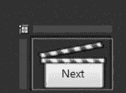

此时，控件的外观如图 4-20 所示。

**图 4-20：新按钮**

如果您运行应用程序，按钮看起来符合预期，但不会对鼠标悬停或按下等事件提供反馈。要添加这些反馈，请在 Blend 中打开“状态”。在此面板中，控件支持的状态分为组，即视觉状态组。控件可以同时处于同一组中的多个状态。但是，它可以处于属于多个组的状态组合中。

现在您可以为状态定义一些视觉效果。请遵循以下步骤：

1. 选择 MouseOver 状态。设计器会自动开始记录状态更改。做一个微小的更改，例如旋转图像。
2. 现在，选择 Pressed 状态。在设计器中应用另一个更改，例如调整图像大小以创建点击按钮的效果。


- 3. 如果从状态 X 移动到状态 Y，变化将立即发生，导致转换变得生硬。要解决这个问题，可以使用视觉转换（`VisualTransition`）。使用 `VisualTransition`，您可以指定长跨状态应该如何变化。可以通过让 Silverlight 执行插值来走捷径，或者为它定义自定义动画。对于大多数情况，让 Silverlight 执行就足够了。要添加它，请更改整个状态组的默认转换（`Default Transition`），或在进入或离开特定状态时添加更具体的转换。例如，将默认转换设置为 0.2 秒。然后，选择 `MouseOver` 状态并设置为 0.5 秒。除了最后一个添加的外，所有转换都耗时 0.2 秒。


| 网站：http://harrypotter.wannext.com |
| 票价：$8.00 |

状态和转换信息准备就绪，您就可以测试您的控件了。在图 4-21 中，当鼠标悬停时，它会轻微旋转。

图 4-21：轻微旋转

## 总结

状态和转换信息准备就绪，您就可以测试您的控件了。在图 4-21 中，当鼠标悬停时，它会轻微旋转。

与此同时，微软已经发布了两个版本的名为“Jolt core”的产品，其代号为“Windows Foundation/Every”，该产品最终演变成了我们今天所熟悉的身份：Silverlight。第一版本的 Silverlight 提供了一个带有丰富图形控件的 JavaScript API，但仅支持 JavaScript 对象符号 (`JSON`) 和基于 XML 的数据。开发者对缺乏丰富 Web 应用程序所需的此处功能表示遗憾，而整个世界也都在困惑，疑惑为什么还需要另一个视频播放器来与 Flash 竞争。

当 Silverlight 2 凭借新引擎（这一精简版的 .NET 通用语言运行时 (`CLR`)）发布时，开发社区开始注意到它。这创造了大量的选择，包括使用 C# 和 Visual Basic 等熟悉语言进行编码的能力、使用复杂类型，以及一个让人联想起成熟 Windows Presentation Foundation (`WPF`) 平台的数据绑定引擎。Silverlight 3 和 4 随后提供了从网络检测、隔离存储到离线模式和打印等的功能。

有更好的方法！

我花了两周时间从头到尾构建了一个概念验证，说服了管理层 Silverlight 是值得研究的。仅仅一个月后，应用程序的战略部分就迁移到了 Silverlight。我们完全消除了为浏览器编写代码的需求，因为它可以在任何支持插件的平台上原样运行。UI 比使用 HTML 标记所能实现的要先进得多，而且整个项目都是使用团队熟悉的 C# 语言编写的。

我估计，与 ASP.NET 相比，在一次冲刺（`sprint`）中使用 Silverlight 产生的代码量是其四倍。在最近一次由微软举办的 Fireside 活动中，Global Pay 公司分享了类似的观点，并补充说，客户端的负载使得能够以传统方法 1/31 的成本部署企业级应用程序，因为节省了数据中心硬件的成本。（工作被交给了客户端。）

为了真正欣赏 Silverlight 构建应用程序的力量，从开始学习是有意义的。在本章中，你将构建一个简单的“Hello, World”应用程序，并学习如何在几分钟内从空白开始构建一个功能完备、跨平台且浏览器解决方案。

## 开始上手

要遵循本章中的步骤，你必须为 Silverlight 开发准备环境。最简单的方法是访问 Silverlight 网站并按照 `www.silverlight.net/started/` 提供的说明操作。

## Hello，业务世界！

是时候开始你的第一个应用程序了！

打开 `Visual Studio 2010`，在新建项目页面选择 `Silverlight Application`，如图 5-1 所示。将你的应用程序命名为 `HelloBizWorld`。

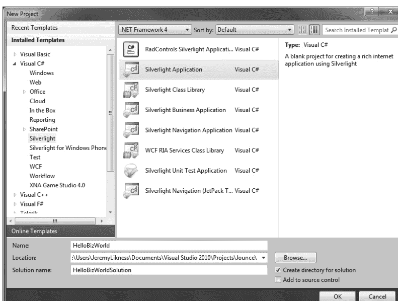

图 5-1：创建新项目

当 `New Silverlight Application` 对话框出现时，只需点击 OK。`Visual Studio` 创建两个项目，如图 5-2 所示。

`HelloHelloWorld.Web` 项目是一个用于构建 Silverlight 应用程序的典型 ASP.NET 项目。`HelloHelloWorld` 是 Silverlight 解决方案。你可以看到解决方案中有两个部分：

- `Application` 类
- `UserControl` 类

## Application 类

`Application` 类继承自 `Application`，并且是驱动 Silverlight 程序的根类型。该类存在两个文件：`App.xaml` 和 `App.cs`。可扩展应用程序标记语言 (`XAML`) 是一种用于初始化类型和对象的声明式 XML 语言。你将在本章稍后学习更多关于 `XAML` 的知识。

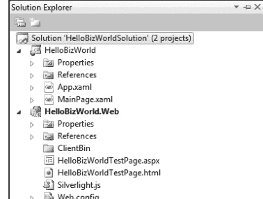

图 5-2：自动创建的项目

另一个文件是 C# 后代码文件。此部分类声明扩展了在 `XAML` 中定义的类。默认后代码执行了几件事，包括：

- 挂钩应用程序启动以便在应用程序首次运行时启动
- 挂钩应用程序退出以便在应用程序关闭时启动
- 布接未处理的异常事件，以便捕获并处理未处理的错误
- 分配根视觉对象，它是应用程序的顶层“视图”

应用程序还可以托管其他类型和类可以消耗的全局资源。

## UserControl 类

`UserControl` 类是应用程序内可见的用户定义控件。默认情况下，会创建一个名为 `MainPage.xaml` 的 `UserControl`。这个 `UserControl` 与应用程序类一样也有后代码。这就是应用程序类在应用程序首次启动时创建并分配给根视觉对象的控件。

这也是你执行大部分 Silverlight UI 工作的地方。默认情况下，设计器位于主页。根据你如何配置 `Visual Studio 2010` 设置，你将看到一个分屏，上方是设计视图，下方是 `XAML` 视图，如图 5-3 所示。

打开你的工具箱并点击 `TextBox`。将其拖到设计表面上。设计区域会出现文本框轮廓，而文本框的 `XAML` 元素会被插入到 `XAML` 区域。

编辑此元素和 `XAML`，使其看起来像列表 5-1 所示。

> 列表 5-1：用于 Hello, Business World 应用程序的 TextBox

| 可 Wrox.com 下载 | `<TextBox HorizontalAlignment="Center" VerticalAlignment="Center" Text="Hello, Business World" />` |

```
Code file [021965 CH05 code for download.zip] 可在 Wrox.com 下载。
```

按下 `CTRL+F5`。你的应用程序将编译，你将看到一个带有“Hello, World”文本的浏览器窗口打开。

恭喜！你编写了你的 Silverlight 应用程序。在后台，`Visual Studio` 为你的项目编译了一个动态链接库 (`DLL`)，并将其封装到一个名为 `XAP`（读作“Zap”）的特殊文件中。该文件包含一个清单，列出了 Silverlight 应用程序所需的所有内容和资源（如 `DLL`、嵌入图像和字体以及资源文件）。这实际上是一个压缩的 `ZIP` 文件。

> `XAP` 文件无非一个不同扩展名的 `ZIP` 文件。要查看 `XAP` 文件的内容，只需将其重命名为 `ZIP` 扩展名，并用 Windows 资源管理器打开。

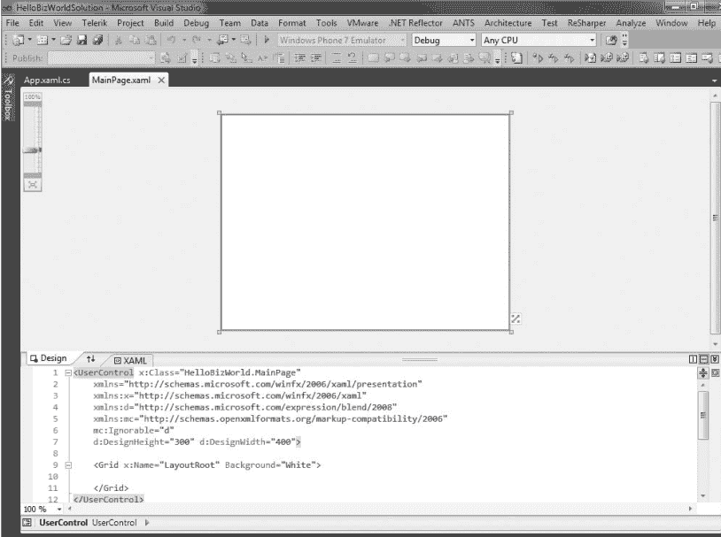

```xml
<UserControl xmlns="http://schemas.microsoft.com/winfx/2006/presentation"
             xmlns:x="http://schemas.microsoft.com/winfx/2006/xaml"
             xmlns:d="http://schemas.microsoft.com/expression/2008"
             xmlns:mc="http://schemas.openxmlformats.org/markup-compatibility/2006"
             mc:Ignorable="d"
             d:DesignWidth="300" d:DesignHeight="400">
    <Grid Name="Layout" Background="white">
        <UserControls />
    </Grid>
</UserControl>
```

图 5-3：Silverlight UI 中的两种视图

`XAP` 文件会自动复制到项目一个名为 `ClientBin` 的特殊文件夹中。Silverlight 插件理解如何下载 `XAP` 文件并提取内容以运行你的应用程序。

## 项目模板

当你创建 Silverlight 项目时，你可能已经注意到几个不同的项目模板。每个模板都可以根据你的特定目标帮助构建新应用程序。你需要熟悉各种项目类型，以便在开始新项目时知道该使用哪种模板。

## Silverlight Application

你已经创建了 `Silverlight Application` 模板，这是最常用的模板。该模板可以创建一个示例 Web 项目来托管你的 Silverlight 应用程序，以及应用程序的基本模板。它还可以创建一个默认页面。这应该是你任何 Silverlight 应用程序的起点，除非你有其他模板解决的更特定的需求。

## Silverlight 类库

`Silverlight 类库` 模板创建一个独立的 `DLL`，该 `DLL` 可以链接到其他 Silverlight 项目中。它与标准的 C# 类库类似。使用此模板可以创建一组类型、方法和属性，这些类型和属性可以在不同项目之间共享。类库不输出 `XAP` 文件。相反，它会输出单个 `DLL`，然后可以在其他项目中引用它并包含它。

> Silverlight 使用 `CLR` 的一个特殊子集，该子集驱动整个 .NET 框架。你无法在 Silverlight 中引用为 .NET 创建的 `DLL`，因为它可能包含对 Silverlight 不支持的命名空间的引用。然而，你可以在 Silverlight 中构建一个 `DLL` 并在 .NET 应用程序中引用它。因此，当你想要创建一个在 Silverlight 和 .NET 应用程序之间共享的通用 `DLL` 时，你应该将其创建为 `Silverlight 类库`。

## Silverlight 业务应用程序

`Silverlight 业务应用程序` 是一个综合模板，包含了典型 LOB（行销业务）软件所需的功能示例。它提供了一个主题（用于皮肤设计或设置应用程序样式和颜色），以及内置的导航框架，该框架允许你在首页和“关于”页面之间跳转。登录按钮会触发一个弹出窗口（在 Silverlight 中，使用的是 `ChildWindow` 控件），以便登录和注册。

该项目包含了 Silverlight 应用程序与服务器端 .NET 应用程序之间共享的类。此项目引入了 Web 服务概念，并提供了用于注册用户和登录的示例服务节点。

此外，各种控件、辅助类和工具在应用程序中非常常用。这是一个高级模板，只有在你熟悉并熟练开发 Silverlight 应用程序之后才应该使用。

## Silverlight 导航应用程序

与 `Silverlight 业务应用程序` 模板类似，`Silverlight 导航应用程序` 模板提供了默认主题，并使用内置的导航框架创建多页面应用程序。与 `Silverlight 业务应用程序` 模板不同，此模板不包含示例登录和注册过程、共享库或服务。此模板是轻量级的，通常用作需要 URL 导航应用程序的起点。

## 其他应用程序模板

其他应用程序模板可以从网上下载或与其他包一起安装。例如，`Silverlight 单元测试框架` 允许你在浏览器中编写和运行单元测试。该包包含了 `Silverlight 单元测试应用程序` 模板，用于为单元测试创建新项目。

对于任何应用程序，你都可以选择启用 Windows 通信基础（`WCF`）富互联网应用程序（`RIA`）服务。`WCF RIA` 服务是 Silverlight 的一项特殊功能，使得与服务器上的数据交互变得更容易。它使用称为“投影”（`projection`）的技术，使处理数据看起来和感觉就像你直接在 Silverlight 应用程序内部访问数据一样。在后台，该技术生成 Web 节点并协调服务器上的活动，以提供无缝的数据体验。

表 5-1 比较了你可以为新项目使用的各种 Silverlight 模板。

## 表 5-1：Silverlight 应用程序模板

| 你需要 | 应用程序 | 共享 | 导航 | WCF 服务 |
|---|---|---|---|---|
| Silverlight 应用程序 | X | | | |
| Silverlight 业务应用程序 | X | | X | X |
| Silverlight 类库 | | X | | |
| Silverlight 导航应用程序 | X | | X | |

## XAML 是对象 XML

在章节的较早部分，你已经接触到了名为 `XAML` 的概念。当我要求开发者定义 `XAML` 是什么时，我经常听到与 Silverlight 和 UI 特别相关的答案，例如：

- “`XAML` 是一种 UI 标记标记语言。”
- “`XAML` 在 Silverlight 中专门用于设计屏幕。”
- “`XAML` 用于在 Silverlight 中布局控件。”

`XAML` 仅仅是对象图的表示。`XAML` 解释器可以使用该标记来创建和初始化各种视图。`XAML` 中的 "X" 代表该语言的扩展性和灵活性。虽然 `XAML` 经常用于为控件提供布局指令，但任何具有无参数构造函数的对象都可以通过 `XAML` 实例化。

为了帮助你理解 `XAML`，列表 5-2 显示了你之前编写的应用程序中 `MainPage.xaml` 标记。

## 列表 5-2：MainPage.xaml

```xml
<UserControl x:Class="HelloWorld.MainPage"
xmlns="http://schemas.microsoft.com/winfx/2006/xaml/presentation"
xmlns:x="http://schemas.microsoft.com/winfx/2006/xaml"
xmlns:d="http://schemas.microsoft.com/expression/blend/2008"
xmlns:mc="http://schemas.openxmlformats.org/markup-compatibility/2006"
mc:Ignorable="d"
d:DesignHeight="300" d:DesignWidth="400">
```


```xml
<Grid xName="LayoutRoot" Background="White">
    <TextBlock HorizontalAlignment="Center" VerticalAlignment=
    "Center" Text="Hello, Business World" />
</Grid>
</UserControl>
```

> 代码 [021965 CH05 code for download.zip] 可在 Wrox 下载。

`XAML` 解释器读取代码并像下面一样解释：

1. 创建 `MainPage` 类型的实例。
2. 在 `MainPage` 的内容中创建一个 `Grid` 类型的实例。
3. 将网格的名称设置为 `LayoutRoot`。
4. 将网格的背景设置为白色。
5. 创建一个 `TextBlock` 实例。
6. 在文本块上设置各种属性。

任何通过 `XAML` 可以实现的，都可以通过代码实现。`XAML` 解释器读取代码并解释其如下：

> 列表 5-3：MainPage.xaml.cs (C# 代码等效实现)

```csharp
var control = new MainPage();
var grid = new Grid()
{
    Name = "LayoutRoot",
    Background = new SolidColorBrush(Colors.White)
};
var textBlock = new TextBlock()
{
    HorizontalAlignment = HorizontalAlignment.Center,
    VerticalAlignment = VerticalAlignment.Center,
    Text = "Hello, Business World"
};
grid.Children.Add(textBlock);
control.Content = grid;
```

> 代码 [021965 CH05 code for download.zip] 可在 Wrox 下载。

## 列表 5-4: IApplicationService 示例


```csharp
public class LoggerService : IApplicationService
{
    const string TRACE_LEVEL_KEY = "TraceLevel*";

    public LoggerService()
    {
        _traceLevel = TraceLevel.Warning; // default
    }

    private TraceLevel _traceLevel;

    public ILogger Logger { get; private set; }

    public static LoggerService Current { get; private set; }

    public void StartService(ApplicationService context)
    {
        Current = this;
        if (context.ApplicationInitParams.ContainsKey(TRACE_LEVEL_KEY))
        {
            _traceLevel = (TraceLevel)Enum.Parse(typeof(TraceLevel), context.ApplicationInitParams[TRACE_LEVEL_KEY], true);
        }

        Logger = new CustomLogger(TraceLevel);
        Logger.WriteLine(TraceLevel.Information, "Logger service started.");
    }

    public void StopService()
    {
        Logger.WriteLine(TraceLevel.Information, "Logger service stopped.");
    }
}
```

实现这些接口的类很容易集成到其他应用程序中。当您拥有实现接口的项目的引用时，可以使用特殊的 `ApplicationLifetimeObjects` 集合将类型包含在 `App.xaml` 中，如列表 5-5 所示。

# 列表 5-5：使用实现 IApplicationService 的类

```xml
<Application.ApplicationLifetimeObjects>
    <MySilverlightApp:LoggerService/>
</Application.ApplicationLifetimeObjects>
```

这是 Silverlight 如何为 LOB（线性业务）应用提供正确工具的另一个示例，让您能够轻松生产出可以跨产品产品线的模块。

# 选择合适的 SILVERLIGHT 框架

LOB 应用通常由多个模块组成，这些模块可以在不同产品线之间共享，并可能由企业内部的独立团队开发。通常，存在一个独立于开发团队的设计团队。编写能够适应这种环境的高质量软件可能是具有挑战性的。幸运的是，Silverlight 拥有完善的模式和最佳实践，可以促进企业级开发。

理解 Silverlight 模式和实践的重要性之一是为了促进“开发者-设计师工作流”。虽然它对较小项目的影响较小，但较大的项目通常有独立的设计和开发团队。在这种情况下，传统的工作流是接收应用程序的需求，等待设计团队生成线框图（wireframes），最后将其交给开发团队进行构建。通常，开发者会将代码返回给设计团队进行“清理”并完成产品。

通过 Silverlight、基于 XAML 的类分离以及数据绑定引擎，这种工作流得到了极大的简化。在确定应用程序功能后，设计可以立即开始。当使用架构时，设计团队可以独立于开发团队工作，因为这两项工作都通过一种名为 `ViewModel` 的特殊类型类集成在一起。本章将在稍后部分更详细地讨论 `ViewModel`，但目前，可以将它们想为设计团队和开发团队之间达成的“合同”，允许双方独立地构建项目的各个部分，并在最后将它们胶合在一起。

那么，如何创建一个正确的框架来处理最优的开发工作流呢？好消息是，你不需要重复轮子。有几个开箱即用的框架可用，可以帮助你构建应用程序。这些框架提供了快捷方式、常用函数和工具，以及关于如何实现常见关注点的指导。坏消息是，选择合适的框架可能是一项挑战。

# 掌握 SOLID：MVC、MVP 和 MVVM

大多数 Silverlight 文章和博客文章都以某种形式讨论了模型-视图-模型（MVVM）。该模式几乎与 Windows 呈现框架（WPF）和 Silverlight 开发等同。你可能会问自己：“我 为什么需要学习一种新模式？我习惯的模式（如 MVC）有什么问题吗？”

答案在于软件设计的 S.O.L.I.D. 原则：

-   **单一职责（Single Responsibility）**——类应该只专注于某一个特定的任务。
-   **开放/封闭原则（Open/Closed Principle）**——类应该对扩展是开放的，但对修改是关闭的。
-   **里氏替换原则（Liskov Substitution Principle）**——派生类在转换为其基类时，行为应该保持相同。
-   **接口隔离（Interface Segregation）**——接口应该精细调整以处理特定的关注点。
-   **依赖注入（Dependency Injection）**——依赖应该基于抽象合约，而不是具体的实现。

这些原则共同被许多人认为是面向对象设计的基石。Silverlight 通常使用 C# 或 VB.NET 编写，它们都是面向对象的语言。大多数设计模式，包括模型-视图-控制器（MVC）、模型-视图-演示器（MVP）和 MVVM，都提供了帮助应用程序遵循这些原则的指导。

MVC 模式解决了视图与驱动视图的业务逻辑分离的问题。如图 5-4 所示，控制器直接管理视图，而视图暴露事件以向控制器发送信息。应用程序的其余基础设施用于与后端进程和业务逻辑进行通信，通常通过视图可以检查并显示的属性向视图呈现信息。

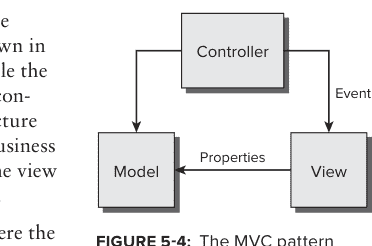

在 MVP 中，首先创建视图（这与 MVC 不同，MVC 中控制器返回视图）。为了将视图的关注点与业务逻辑分离，视图抛出演示器（presenter）监听的事件。演示器通过接口与视图交互，如图 5-5 所示。该接口使得视图在测试期间可以被模拟（mocked），并允许同一个演示器管理多个视图。

MVVM 关注的是视图的关注点与业务逻辑分离，视图抛出演示器监听的事件。演示器通过接口与视图交互，如图 5-5 所示。该接口使得视图在测试期间可以被模拟，并允许同一个演示器管理多个视图。


图 5-6：MVVM 模式

## 依赖注入与反转控制

依赖注入和反转控制指的是一种设计实践，允许外部对象确定用于依赖的具体实现。这是一个非常有用的原则，因为它允许类关注单一关注点（即类的设计初衷，符合单一职责原则），并将关注点委托给其他地方。这种抽象层使用接口来解耦类。依赖由另一种机制注入，控制从类反转到外部机制。

传统问题是特定的实现有自己的依赖。生成报告的模块可能还需要引用第三方 PDF 工具。任何需要生成报告的模块都必须引用同一个工具。这会导致应用程序内部产生复杂的关系和依赖。

一种更清晰的方法是让模块依赖报告契约，并将生成报告的细节留给报告本身，而无需携带额外的依赖。

这些实践使能够编写易于测试、维护和扩展的解耦代码。在任何解耦系统中，必须有一个解析点，接口和抽象类在此转换为具体类型。（模块可能引用接口，最终必须调用真实的模块来实现该接口。）尽管多种模式可以解决这种关注点（例如，使用工厂获取实例），但有一些 Silverlight 框架是为解决这个问题而构建的。

Microsoft 提供了一个由 Patterns & Practices 团队的 Unity 最初针对 Core CLR，但后来扩展到支持最新版本的 Silverlight。Unity 提供了特性配置和流式配置。

> 请访问 Unity 官网获取更多信息：<http://msdn.microsoft.com/en-us/library/ff678312.aspx>。

Ninject 是一个用于依赖注入的开源框架，以轻量级、快速和易于使用而闻名。Ninject 还使用了基于属性的系统，并配合流式连接法（fluent conjugation）。

> 您可以从 <http://ninject.org> 在线下载 Ninject。

Silverlight 的其他解决方案包括 AutoFac (<http://code.google.com/p/autofac/>) 和 Castle Windsor (<www.castleproject.org/container/index.html>)。

## 托管扩展框架 (Managed Extensibility Framework)

虽然存在第三方工具来解决控制反转问题，但 .NET Framework 内部提供了一套解决方案，它能够满足 Silverlight 中大多数的依赖需求。该框架还提供了一些强大的功能来促进应用程序的扩展性，这是一种内置的 Silverlight 应用程序模块化方法，以及在运行时动态加载代码。扩展性、发现和元数据（标记模块）问题通过托管扩展框架（MEF）得到了解决。

大多数控制反转框架处理的是你已知的类型。在运行时（或在测试期间），你可以配置框架将已知类型映射到你的类型上。这通常在一个称为引导（bootstrap）的类中完成（该术语源于“提着鞋带把自己提起来”的想法）。当部分代码请求接口时，就会提供具体的类型。在模块化应用程序中，特定接口的实现可能存在于单独程序集中（在 Silverlight 的情况下为 XAP 文件）。当类型对公共语言运行时（CLR）是“未知”时，你该如何连接到你的接口呢？

通过 MEF，解决方案非常简单。MEF 引入了可组合部分（ComposablePart）的概念。一个部分定义了一个标识符和一种类型。MEF 包含了导入（imports）和导出（exports）。

合约（contract）定义了部分应该导出的内容。合约是标识符和类型的组合。该类型可以是接口、抽象类或具体类型。标识符可以默认为类型名称，或任何任意值以对部分进行分类。例如，“error”标识符可以与字符串类型配对，以与包含错误字符串的部分隔离开。

导入是该部分所需的所有类型。（想象一家必须进口商品的零售店。）每当你需要一个部分时，你都指定一个属性来持有该部分，然后用属性标记它，指示 MEF 应该提供一个实现。

导出是实现（类似于提供产品的制造商）。每当你为某个部分实现合约时，你就可以导出该实现，使其供 MEF 使用。MEF 执行一个称为组合（composition）的任务，将导出与导入进行匹配，并使部分对你的应用程序可用。

为了说明 MEF 如何工作，请使用本章前面介绍的 Silverlight 应用程序模板创建一个新的 Silverlight 应用程序。将项目命名为 HelloMEF。项目创建后，在解决方案管理器中右键点击 Silverlight 项目下的“引用”（References），从 .NET 选项卡添加 `System.ComponentModel.Composition` 和 `System.ComponentModel.Composition.Initialization` 的引用。这些是 MEF 使用的 DLL。在 XAML 文件中，放置一个如列表 5-6 所示你喜欢的 `TextBlock`。

## 列表 5-6：Hello, MEF 示例的 MainPage.xml

```xml
<UserControl x:Class="HelloMEF.MainPage"
xmlns="http://schemas.microsoft.com/winfx/2006/presentation"
xmlns:x="http://schemas.microsoft.com/winfx/2006/xml"
xmlns:blend="http://schemas.microsoft.com/expression/blend/2008"
xmlns:d="http://schemas.openxmlformats.org/markup-compatibility/2006"
mc:Ignorable="d" d:DesignHeight="300">

  <Grid x:Name="LayoutRoot" Background="White">
    <TextBlock x:Name="tbText" />
</Grid>
</UserControl>
```

代码文件 `[021965 CH05 code for download.zip]` 可在 Wrox.com 下载。

在主页的代码后台中，添加列表 5-7 所示的代码。

# 列表 5-7：Hello, MEF 的 MainPage.xaml.cs

```csharp
namespace HelloMEF
{
    public partial class MainPage
    {
        [Import]
        public string Text { get; set; }

        public MainPage()
        {
            InitializeComponent();
            CompositionInitializer.SatisfyImports(this);
            tbText.Text = Text;
        }
    }
}
```

代码文件 `[021965 CH05 code for download.zip]` 可在 Wrox.com 下载。

这段代码定义了一个部分。部分的合约是一个字符串。（这隐式派生自标记的属性。）在主页的构造函数中，调用了 `CompositionInitializer`。这是 MEF 为 Silverlight 项目提供的特殊类，它会检查 Silverlight 应用程序中的部分并满足任何请求。在这种情况下，它寻找对字符串部分的请求并尝试满足它。

如果你现在运行代码，你将收到一个错误，因为部分尚未完成。你还没有添加任何导出。

要提供导出并“完成”该部分，只需添加一个新类并命名为 `Exports.cs`，如列表 5-8 所示。该类没有被应用程序使用，除了提供 MEF 需要的导出。导出可以轻松地在其他类中提供，包括主页。

## 列表 5-8：Hello, MEF 示例的 Exports.cs

```csharp
namespace HelloMEF
{
    public class Exports
    {
        [Export]
        public string Text()
        {
            return "Hello, MEF!";
        }
    }
}
```

代码文件 `[021965 CH05 code for download.zip]` 可在 Wrox.com 下载。

Prism 允许你选择要使用的依赖注入框架，内置对 Unity 和 MEF 的支持。它包含了命令实现、通过事件聚合器模式（event aggregator pattern）进行消息传递，它可能是最著名的框架之一，起源于 WPF 平台，网站上数十万的下载量证明了这一点。

> 可以在 <http://compositewpf.codeplex.com/> 在线访问 Prism。

## MVVM Light

MVVM Light 是 Silverlight 最流行的框架之一，用于许多商业 Silverlight 和 Windows Phone 7 项目。它为数据的设计时建模提供了显式支持，提供了帮助将 ViewModel 绑定到 View 的 ViewModel 定位模式，以及轻量级消息服务。


MVVM Light 之所以如此流行，可能是因为它包含了几个项目模板和代码片段，使得启动新项目变得更容易。像引发属性更改通知之类的常见代码可以通过方便的代码片段来实现。有一个庞大的社区支持并熟悉该工具包，对于任何想要构建 Silverlight 业务应用（LOB）的人来说，都是极佳的起点。

正如其名，MVVM Light 比许多其他框架（包括 Prism）要轻得多。这使得更容易掌握和更好地理解 MVVM 模式。

> 在 `http://mvvmlight.codeplex.com/` 在线下载 MVVM Light。

# nRoute

另一个流行的 MVVM 框架是 nRoute。该框架以支持多种不同的异步模式以及与 Reactive Extensions (Rx) 紧密结合而闻名。Rx 使异步操作能够处理为“推送流”（push streams），在事件发生时驱动它们。

nRoute 的一个显著特性是“反向 SqlCommand”（reverse SqlCommand）。这可以将 View 中的事件绑定到 ViewModel，保持两者解耦。该框架拥有详尽的文档和多个示例项目。

> nRoute 可在 `http://nroute.codeplex.com/` 在线获取。

# Caliburn.Micro

Caliburn.Micro 是一个极微小（仅几千行代码）但功能强大的框架。它以其基于约定的数据绑定模型而闻名。（View 元素通过命名约定和元素类型绑定到 ViewModel，而不是通过显式的绑定命令。）该框架还采用“ViewModel 优先”的方法，这意味着 ViewModel 是创建并启动 View 的，而不是更常见的让 View 来绑定到 ViewModel 的做法。

Caliburn.Micro 的另一个有趣特性是使用协程（co-routines）。协程是状态引擎，帮助开发者管理异步代码。使用协程，你可以将异步过程聚合为一组易于理解和遵循的顺序代码块。这是连接现有功能与 C# 下一版本中使用 `await` 关键字发布的功能之间的极佳方法。

> Caliburn.Micro 可在 `http://caliburnmicro.codeplex.com/` 在线获取。

## Jounce

Jounce 是我开发的一个工具，与其说是一个框架，不如说是一份指南。Jounce 背后的想法是为使用 MEF 和 MVVM 模式开发 Silverlight 业务应用提供通用模式和最佳实践。Jounce 严重依赖 MEF 来帮助连接 Views 和 Models，并进行模块路由。它提供了区域管理（处理 View 如何以及在哪里生成）、事件聚合器、一个多功能的导航框架以及易用的日志设施。

Jounce 还包含了快速启动示例，演示了在 Silverlight 应用中管理模式的不同方法。一个示例是使用特殊的“实体 ViewModel”（entity ViewModel），它便于跟踪更改并为创建/读取/编辑/更新（CRUD）操作触发验证。另一个示例展示了如何与 Silverlight 导航框架集成。

### 表 5-2：MVVM 框架

| 框架 | IOC 容器 | 大小 | 复杂度 |
|---|---|---|---|
| Prism | MEF, Unity, 其他 | 大 | 困难 |
| MVVM Light | SimpleOC | 中等 | 简单 |
| nRoute | 原生 | 中等/大 | 中等 |
| Caliburn.Micro | MEF, Unity, 其他 | 小 | 中等 |
| Jounce | MEF | 小 | 中等 |

## 开箱即用的 Silverlight

Silverlight 为企业级应用提供了一系列强大的功能。在本章较早之前，你已经学习了一些驱动 Silverlight 应用的核心框架。现在，是时候学习一些让 Silverlight 发放异彩的高级功能了。从动态加载到桌面安装、数据库以及应用程序之间的通信，你可以找到许多强大的功能来满足软件产品的需求。

## 动态加载

Silverlight 运行在客户端浏览器上。这可能非常有益，但也引入了一些风险。从企业的角度来看，通过运行业务逻辑和验证将工作负载分发到客户端，可以减轻服务器的压力，从而有利于整个系统。然而，作为开发者，你必须注意不要过度消耗客户端系统。发送过多信息可能会导致意外之外的延迟，为各种功能和逻辑分配内存可能会降低性能。

动态加载通过允许你将应用程序分为独立加载的单元来帮助解决这些问题。初始应用程序很小，结果是在网络上的加载速度更快，并且在客户端的内存占用更小。功能区域根据用户的请求按需加载。通常情况下，用户启动应用程序是为了某个特定区域内工作。虽然整个应用程序可能跨越几十个功能区域，但只有当前使用的区域会被加载到内存和客户端系统中。

在 Silverlight 中“开箱即用”处理动态加载的最简单方法是利用 MEF。

你可以直接访问文件系统来存储和检索文件。这为缓存信息以及通过将数据序列化到磁盘来存储本地数据提供了绝佳的机会。

在 OOB（Out-of-Browser，箱外）应用中，你有机会存储本地数据，并允许应用程序在离线且不连接互联网的情况下运行。本地数据可以驱动应用程序并存储用户所做的更改。当应用程序上线时，数据就可以与服务器进行传输和同步。

还存在几种本地数据库选项，它们在隔离存储层之上创建数据库。其中许多是授权的数据库，少数几个提供包括事务在内的完整关系型数据库功能。

对于开源选项，可以考虑我维护的开源项目。Sterling 是一个面向对象的数据库，它能够自动序列化大多数类和复杂的对象图。它支持键（包括外键）和索引，以实现快速的内存查询，并从磁盘中懒加载完整对象。

> 你可以在 `http://sterling.codeplex.com/` 在线阅读更多关于 Sterling 的信息并下载它。

## 通信

Silverlight 拥有一个强大的通信栈，提供了数种在客户端与服务器、Web 服务和其他应用程序之间传输数据的模式。除了对基于标准的 Web 服务提供开箱即用的支持外，Silverlight 还可以打开直接套接字进行通信并处理自定义协议。

Silverlight 与宿主 HTML 文档对象模型（DOM）具有强大的互操作性。Silverlight 可以调用 JavaScript 方法并暴露供 JavaScript 调用的方法。这实现了与传统的 ASP.NET AJAX 应用程序集成，并挂接到回传（postback）和回调（callback）功能。

Silverlight `WebClient` 可以打开任何基于网络的 URL 并异步检索数据。这使得解析远程网页、下载 RSS 馈送甚至与传统的基于纯 XML (POX) 的解决方案通信成为可能。一种常用技术是使用表述性状态转移（REST）和 JavaScript 对象表示（JSON）暴露数据。Silverlight 客户端可以访问 REST 资源，检索 JSON 数据，并将其转换为强类型对象进行处理。

Silverlight 中一个强大且独特的功能是本地通信 API。该 API 促进了运行在同一台计算机上的不同 Silverlight 应用程序之间的通信。无论应用程序从哪个域名提供，无论它们是否以 OOB 运行都是如此。

要创建一个通信通道，一个应用程序实例化命名的发送者（sender），另一个创建一个同名的接收者（receiver）。通道的创建可以包含限制信息，将通道限制在相同应用程序的其他实例、相同域名内，或启用任何类型的跨通道通信。通道创建后，你可以简单地注册事件。当发送者发送消息时，接收者可以触发并传递该消息。

这的一个实际用途是身份验证场景。例如，OAuth 协议需要打开一个新窗口，以便用户在独立的网页上进行身份验证。尽管有一个 URL 供用户返回，但这强制使用户离开当前运行的 Silverlight 应用程序。通过使用本地通信，一个独立的 Silverlight 应用程序可以接收完成的 OAuth 请求，然后与原始应用程序通信以传递凭据。这实现了无缝的登录体验，无需重启 Silverlight 应用程序。

## SILVERLIGHT 的未来

Silverlight 于 2007 年正式发布，作为一种“超级 JavaScript”接口，并且截至 2011 年的 5 Beta 版本，已演变为完整 CLR 的健壮浏览器内子集，并支持离线和箱外模式。尽管你已经接触了一些重要的 LOB（线性业务）概念和功能，但 Silverlight 为 LOB 应用程序提供了更多可用功能。

以下是 5 版本中可用的一些关键特性：

- 多语言文本模式
- PostScript 矢量打印
- WS-Trust 支持（一种 Web 服务的安全标准）
- 支持 64 位操作系统
- GPU 加速的三维（3D）图形 API
- 嵌入式 HTML 内容（你的 Silverlight 应用程序内的“网络浏览器”）
- 与 Microsoft Office 的互操作性
- 与 USB 和 COM 端口接口
- 使用 `p/Invoke` 运行未托管代码
- 完整的性能分析和测试支持

也许 Silverlight 最强大且引人注目的两个优势是：它可以通过网络轻松交付，并且可以在多个平台和浏览器上运行。这意味着你的团队可以专注于构建一个健壮的应用程序，而不是为 Windows 和 OS X 环境构建不同的应用程序，且无需在浏览器兼容性问题上浪费宝贵的周期。

## 总结

Silverlight 驱动了微软在 2010 年温哥华冬季奥运期间使用的后台健康监控系统。许多城市已使用它来提供监控流量的消费者界面，甚至向城市就路面破洞等问题提供反馈。

医学界已经拥抱了丰富的 UI，并使用 Silverlight 进行高级成像。金融机构在他们的 SharePoint 应用程序中使用它提供丰富的、交互式的仪表板和钻取。

在本章中，你学习了 Silverlight 如何让你利用现有语言和熟悉的 Visual Studio 环境来构建 LOB 应用程序。XAML 的可用性实现了具有并行设计的强大工作流。Silverlight 提供了钩子和接口，用于通过使用托管扩展框架（MEF）构建可扩展的现代应用程序。

一种称为 MVVM 的特殊设计模式已经进化，以利用 Silverlight 框架提供的数据绑定的独特特性。该模式的几种实现已作为开源框架进化，你可以利用它们就开始构建 LOB 应用程序。

像隔离存储和箱外应用程序这样的功能使其成为构建多平台离线解决方案的理想平台。Silverlight 的通信栈允许你直接连接到现有 SOAP、纯 XML (POX) 和 JavaScript 对象表示 (JSON) Web 服务。这些功能随着每个版本的发布不断进化，Silverlight 5 引入了一些最重要的 LOB 特性。

如果你还没有挖掘 Silverlight 的力量，你会想要立即开始。

## 关于作者

Jeremy Likness 是一位专注于 Silverlight 的开发者/架构师和技术项目经理，拥有销售和创业经验，对导师指导和公共演讲充满热情，并在社交媒体上具有影响力。2010 年 7 月，他因对 Silverlight 的工作获得了微软最有价值专业人士（MVP）奖。在 15 年经验的支持下，他目前担任 Intellect 的高级顾问和项目经理。他曾服务于多个垂直行业，包括保险、健康保健、供应链管理和移动性。过去十年的主要重点是使用微软技术栈构建高度可扩展的 Web 应用，近期关注 Silverlight 和 WCF。

# 理解 SILVERLIGHT 和 WPF 之间的差异

扩展性应用程序标记语言（XAML）是 Silverlight 和 WPF 所有协作功能的关键。你需要理解 XAML 与后端平台之间的关系，通过这种关系你就可以将设计界面与开发者编写的代码连接起来。

首先，XAML 是一种标记语言。这意味着它既是人类可读的，也是计算机可读的。人类可读极其重要，因为与其他编程语言相比，标记语言的学习曲线要平缓得多。许多设计师没有编程背景，但可以编写和操作如 HTML 这样的标记语言。

其次，学习标记的语法并不是强制性的，因为总有一个“所见即所得”（WYSIWYG）编辑器，可以帮助设计师或开发者轻松地生成所需的 XAML，且不会出错。

## 选择 XAML 而非其他标记

XAML 不仅仅是表示视觉元素的标记语言。它还是定义行为、样式、触发器、控制模板、数据模板、绑定和动画的方法。所有这些功能都可以通过 Microsoft Blend 等 WYSIWYG 编辑器轻松访问。从开发者的角度来看，你可以将 XAML 视为声明性语言，其中可以单独定义自定义控件。

## 理解关注点分离

我记得在一次会议上说过：“让设计师和开发者在项目上合作的唯一方法就是让他们分开工作。”我认为这仍然是事实。得益于 XAML，Silverlight 和 WPF 可以提供一个环境，开发者可以在其中编写代码而不干涉设计，或者设计师可以创建包含动画甚至简单数据绑定的 UI。

## 设计师的提示与技巧

使用如 Expression Blend 等工具，你设计的任何内容都是真实应用程序的一部分！无需进行转换、传输或任何额外的处理，即可将你创建的视觉效果或界面引入真实应用程序——当你使用 Expression Blend 按下 F5 键时，它就会运行。考虑到这一点，为了创建对开发者友好的设计，你应该注意这里介绍的提示和技巧。

## 命名你的对象

每当你在 Microsoft Expression Blend 中创建 UI 时（如图 6-1 所示），你应该记住，无论你在屏幕上放置了什么，团队中的开发者都会使用并访问这些对象。为了让他们访问你放在屏幕上的视觉对象，你必须为这些对象命名。

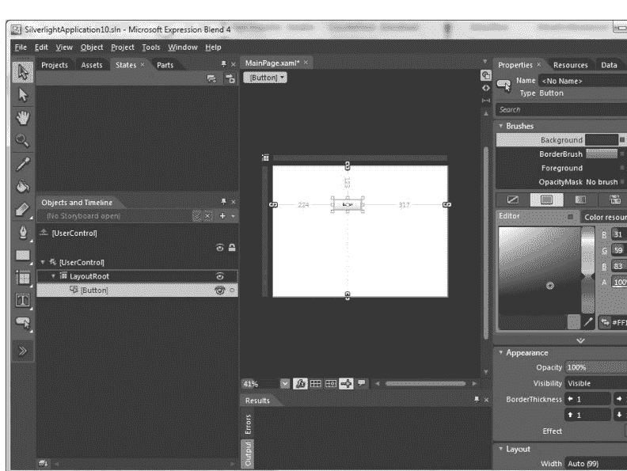

**图 6-1:** 屏幕界面上的对象命名

检查你的公司是否有关于开发者使用的命名规范的文档。在使用 UI 元素时，在 Expression Blend 中实现这些规范。如果你没有文档，是时候创建一个，这样当你在开发流程的这一阶段开始命名对象时，就能与团队保持同步。

不要为屏幕上的所有内容命名。首先，如果你开始为你设计中使用的每个对象命名，你的开发者将很难在 Visual Studio 的漫长列表中找到正确的对象。屏幕上可能有成千上万个 UI 元素，包括你在创建艺术作品时使用的每个形状、矩形和线条。

如果你确定某个元素开发者永远不需要访问或操作，就不要为该元素命名。这也会影响应用程序的性能。拥有 1000 个 UI 元素但只有 100 个命名的，与 1000 个元素全部命名相比，性能上会有差异。

## 在 Photoshop 中设计

Microsoft Expression Studio 拥有你设计 UI 需要的所有工具。如果你想要一个创建资产和矢量艺术作品的工具，Expression Design 可以通过 XAML 导出支持提供帮助，这样你就可以在创建最终用户体验和交互时在 Expression Blend 中使用这些资产。

然而，如果你觉得更习惯使用 Photoshop，你仍然可以在该环境中设计，稍后将设计导入 Expression Blend。但请记住，你在 Photoshop 中创建的设计将直接被你团队的开发者使用，无需进行任何重大更改或转换。

你应该绝对熟悉并使用 Photoshop 中的层。你在 Photoshop 中创建的所有层和文件夹将成为 Silverlight/WPF 中的 UI 元素，开发者可以通过调用你分配给 Photoshop 中对象的名称来访问这些对象。

此外，你在 Photoshop 中对对象分组或创建层的逻辑比仅仅作为一个设计方面要重要得多。

## 在设计模式下运行代码

有时你需要在设计模式下运行代码（例如，在 Blend 中预览数据绑定）。你可以使用 `DesignerProperties.GetIsInDesignMode` 方法来检查当前是否处于设计模式。

```csharp
// 此代码运行在设计模式 (Blend) 中
bool isInDesignMode = DesignerProperties.GetIsInDesignMode(someUIElement);
```

在此代码中，你可以简单地调用 `DesignerProperties.GetIsInDesignMode` 方法并提供你想要检查的 `UIElement`，以查看它是否运行在 Blend 的设计表面。

# 使用行为（Behaviors）让事情变得简单

作为一名开发者，也许你永远不会使用行为。它是设计师在 Expression Blend 内部可以使用的一种功能，而开发者恰恰应该知道什么是行为。

行为就像你代码中的函数。你可以指定参数并给它一个要执行的任务。区别在于，你编写的这个函数将由你团队中的设计师使用。你将许多重复性工作委托给设计师，他们就可以脱离你的代码独立工作，而不再需要为了数百万次的打字请求而敲你的房门。

行为封装了一个可以通过另一个事件触发的功能。例如，你可以创建一个简单的 `MessageBox`，它会显示普通的 `MessageBox` 窗口，但这次，设计师可以在 Expression Blend 内部完成这一点，而无需编写一行代码。

要创建一个行为，你必须向项目中添加 `System.Windows.Interactivity` 引用。以下代码帮助你继承自 `System.Windows.Interactivity.TriggerAction` 通用类：

```csharp
public class MessageBoxTrigger :
    System.Windows.Interactivity.TriggerAction<UIElement>
{
    protected override void Invoke(object parameter)
    {
    }
}
```

你必须通过继承 `System.Windows.Interactivity.TriggerAction` 通用类来创建一个新类。要实现你所需的新功能，你需要重写 `Invoke` 方法。然而，在这个示例中，你可能需要一些要在 `MessageBox` 中显示的内容或文本。为了从设计师那里获取输入，请为 `MessageBoxTrigger` 类添加一个属性，如下：

```csharp
public class MessageBoxTrigger :
    System.Windows.Interactivity.TriggerAction<UIElement>
{
    protected override void Invoke(object parameter)
    {
    }
    public string MessageText { get; set; }
}
```


最后，你必须实现该功能，在这种情况下就是以下简单的 `MessageBox` 代码：

```csharp
public class MsgBoxTrigger :
    System.Interactivity.TriggerAction<UIElement>
{
    protected override void Invoke(object parameter)
    {
        MessageBox.Show(MessageText);
    }

    public string MessageText { get; set; }
}
```

现在你已经准备好将此代码交付给你的设计师，或者将其添加到你的项目中，以便你的设计师可以在 Expression Blend 中使用该行为，如图 6-5 所示。

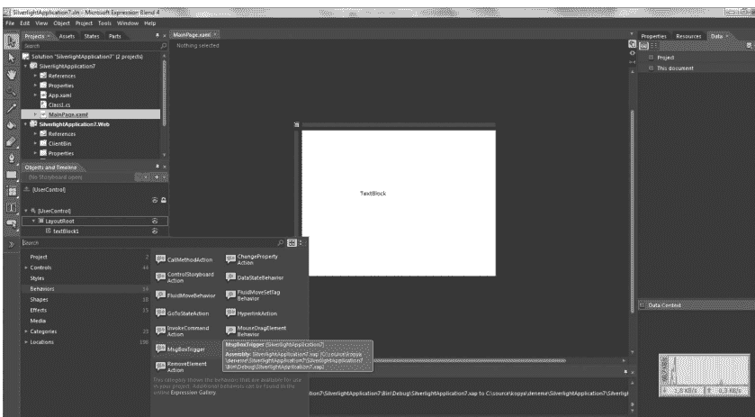

**图 6-5：** 在 Expression Blend 中使用行为

如果你在 Expression Blend 中打开项目，你会在资源库（Assets Library）的 Behaviors 部分看到你的新行为，如图 6-6 的左侧所示。从现在起，设计师可以将该行为拖放到任何 `UIElement` 上，指定想要用哪个元素来触发 `MessageBox`，并指定显示为消息的文本。


## 总结

WPF 和 Silverlight 都拥有你所需的工具，以便与设计师和开发者作为一个团队进行协作和工作。你作为团队或个人可以遵循的规则可能有所不同，技巧和窍门是无尽的。在本章中，你看到了一些主要的挑战以及如何克服它们的方法。

## 关于作者

Daron Yondem 是 Develop Software 的创始人，这是一家位于土耳其的 UX 公司。他是微软区域总监，并于 2009 年和 2010 年获得了全球影响力金奖（Gold Global Impact Award）。作为一名国际演讲员，Yondem 曾在包括 TechEd、MSDays、DevReach、PDC 和 OpenDoor 在内的会议上主持会议。他是 INETA 主席、Silverlight MVP、两本关于 ASP.NET AJAX 的书籍以及一本 HTML5 书的作者。他对 UX 充满热情，可以随时随地在任何地方主持会议。他在 2010 年主持了 180 多场会议，包括一次名为 "SilverNight!" 的整晚免费 Silverlight 社区培训。你可以通过 http://daron.yondem.com 关注他的思想。

# Silverlight 4 中的 MVVM 模式

作者：Kevin Grossnicklaus

作为使用 Silverlight 或 Windows Presentation Foundation (WPF) 平台的开发者，可以肯定你已经听过用于开发用户界面（UI）的 Model-View-ViewModel (MVVM) 模式。许多书籍、杂志文章和博客都热烈地解释了 MVVM 的益处，并展示了利用这种新开发模式的优势。在使用 MVVM 时，不幸的现实是，尽管该模式的核心概念为开发者带来了便利，但并没有一种通用接受的实现方式。

由于 Silverlight 和 WPF 的核心库为开发者在开发基于 MVVM 的架构时提供了供利用的 MVVM 特有结构，因此取决于个人开发者来“自源自造”框架组件，或者采用许多填补这一空白的众多第三方框架之一。市面上的大部分 MVVM 知识（无论是纸质版还是互联网上的）都源于高明的开发者，他们发现了创新且有效的方法，通过使用 Silverlight 和 XAML 等技术来简化 MVVM 等模式的实现方式。

尽管这是我们行业的伟大事之一，但对于新接触 MVVM 的开发者来说，寻找“最佳实践”指导时，往往会被推崇的各种不同 MVVM 解决方案和架构所淹没。这些建议和概念中的许多包含了很棒的主意，而且大多数仅仅是……

## 定义 ViewModel

与 UI 关。正如你可以迅速察觉到的，由于 XAML 和 Silverlight 数据绑定的强大，View 通常是 100% 声明在 XAML 中的，并且除了你的集成开发环境（IDE）提供的默认初始化外，没有额外的后置代码（code-behind）。

- **ViewModel** — ViewModel 层由一个非可视的 .NET 类表示，该类封装了加载或保存任何数据所需的所有逻辑，并将其暴露给 View 以显示或交互。ViewModel 还应该响应用户通过 View 采取的任何操作（例如按钮点击事件）。

尽管这些描述提供了 MVVM UI 各部分的“50,000 英尺视角”概述，但在实践中，让这些活动部分运行起来还有更多内容。当你在开发实际的 MVVM 框架时，其中的许多细节会变得重要。

此外，这些描述仅关注主要 MVVM 组件的“是什么”方面，而没有解释它们为什么重要，或者这些做法为 .NET 开发者提供了什么益处。

.NET 行业不得不采用这类模式的原因之一，通常与可测试性有关。随着测试驱动开发（TDD）过程的概念日益主流（且单元测试对开发者来说不再那么令人震惊，而是成为一种常见的日常实践），重新审视如何以及在哪里放置你的大部分代码以简化这一过程变得非常有必要。将业务逻辑混合到 UI 的后置代码中会使得这些区域难以使用单元测试进行测试，从而损害整个开发过程。

一个将你的逻辑与接口分离的解决方案是必要的。虽然这种分离的概念已存在多年，但直到最近，.NET 开发者才将这些模式与当前 .NET 平台的能力相结合，开发出诸如 ASP.NET 模型-视图-控制器（MVC）和 Silverlight MVVM 等框架。在 ASP.NET MVC 和 MVVM 中，目标是将逻辑清晰地分离到 UI 之外的层。存在两种不同模式的原因与 Silverlight 和 ASP.NET 之间的能力差异直接相关。在我们应用于 ASP.NET 的请求-响应模型中，MVC 框架是完美的选择，而 Silverlight 的数据绑定能力使得 MVVM 模式更加适用。

许多初接触 MVVM 并尝试首次实现这种模式的开发者不仅会对所有的实现细节和模式感到困惑，还会达到一个质疑模式价值与实现复杂性之间权衡的程度。他们经常指出某些例子，传统上在 Silverlight UserControl 的后置代码中仅需几行代码的代码，现在需要大量代码才能清晰地遵循逻辑与 UI 的分离。

当开发者选择遵循 MVVM 这种模式以获得其提供的一致性和益处，并为了“正确地”做事（而不是能够快速拼凑起来）时，情况就是这样的。最终，一致遵循 MVVM 等模式的许多益处并不能立即被发现，而是通过更低的维护成本和交付来获得的。

如果你不想按照后续章节中的内容输入所有代码，可以下载完成的解决方案并直接进行操作。

## 框架技术

在本章中，你将使用以下技术进行所有的框架开发：

- Visual Studio 2010 Express（可在 http://www.microsoft.com/express/web 获取）
- C# 4.0 编程语言
- Silverlight 4 SDK（通过 http://www.microsoft.com/web/downloads/platform.aspx 的 Microsoft Web Platform Installer 安装）
- Silverlight 4 Control Toolkit（可在 http://silverlight.codeplex.com 获取）
- Microsoft 的 Unity Container（可在 http://unity.codeplex.com 获取）

如果你没有安装 Visual Studio 2010，可以从上一个列表显示的链接下载该工具的 Express 版本。Silverlight Control Toolkit 是一系列丰富的 Silverlight 控件集合，由微软提供并在 CodePlex 上供下载。这些控件在开源许可下免费提供，并独立于完整的 .NET Framework 进行带外更新。这使得微软在管理上更具响应性，并且能够比完整的 .NET Framework 更频繁地发布新功能。

> 需要注意的是，Visual Studio 2010 Express 有多个版本。对于本章所需的 Silverlight 开发，你可以使用 Visual Web Developer 2010 Express。

为了可扩展性，这里开发的框架使用了 Unity 倒转控制 (IoC) 容器。许多其他 IoC 容器选项提供了巨大的价值。选择 Unity 是随意的，因为任何你认为熟悉的 IoC 容器都可以根据需要使用。

> 如果你刚接触 IoC 容器的概念，应该咨询 http://unity.codeplex.com 上的 Unity 文档，或者花时间在线研究该概念，查看许多描述该主题的在线博客或文章。

关于使用 IoC 容器的另一点是，如今许多 MVVM 框架也开始利用微软的托管可扩展性框架 (MEF)。MEF 为此类框架提供了坚实的基础，而选择 IoC 还是 MEF 再次是由你或你所构建的框架的开发者做出的任意决定。我鼓励你花时间研究这两种选项，并根据你觉得更习惯使用的哪种技术做出明智的决定。

> 根据我的经验，我曾同时使用 MEF 和 IoC 容器作为我架构的核心，它们都非常强大。无论使用什么技术，我不会大幅改变我的方法，但有时我会稍微向这一侧倾斜，以更好地利用工具提供的功能。

除了这里列出的技术外，还有许多其他技术与 MVVM 架构是互补的，没有它们，真实的 Silverlight LOB（线性业务）应用将是不可能的。以下列表展示了一些出于参考目的呈现的技术，但它们被认为在本章的范围之外：

- Windows Communication Foundation (WCF)
- WCF 丰富互联网应用程序 (RIA) 服务
- ADO.NET Entity Framework (EF)

> 这些技术中的一些在书的其他地方会有更详细的介绍，在这里列出它们是为了说明为健壮的应用程序提供基础需要很多技术支持。在本章开发的 MVVM 框架所需的某些技术，只是你最终可能需要使用的内容的一小部分。

## 快速上手

创建一个可用的 MVVM 框架的第一步是创建将在框架其余部分使用的 Visual Studio 解决方案和项目。就讨论而言，这仅仅是一个包含以下三个项目的 Visual Studio 解决方案：

- **MVVM.Shell** — 这是一个标准的 Silverlight 4 应用程序。
- **MVVM.HostSite** — 这是一个 ASP.NET 应用程序，用于托管 MVVM.Shell Silverlight 应用程序，并作为解决方案的启动项目。
- **MVVM.Framework** — 这是一个 Silverlight 4 类库，包含了所有可重用的 MVVM 组件和服务，并使其供此示例之外的许多项目使用。

在 Visual Studio 中创建这三个项目后，你必须在 MVVM.Shell 应用程序和 MVVM.Framework 应用程序之间创建项目引用。你可以通过“添加引用”对话框来实现此，这是必要的，以便主 Silverlight 应用程序可以访问可重用的 MVVM 组件。

> 每当我启动像这样的新项目时，我都会花很多时间验证项目设置。这包括我的默认命名空间设置、项目引用、这些项目在硬盘上的文件夹结构，以及最终在使用 Microsoft Team Foundation Server 或 SubVersion (SVN) 等工具的版本控制仓库中的设置。

除了这三个项目，你必须确保你有权访问 Microsoft Unity IoC 容器和 Silverlight Control Toolkit 控件。你可以通过从之前列出的链接手动下载这些引用，或者通过使用 NuGet 向你的项目添加必要包的引用。由于本章中的所有源代码，必要的动态链接库 (DLLs) 可以在完成解决方案旁的 Binaries 文件夹中找到，以便使用随附的源码测试 MVVM 框架。

> 虽然许多开发者对于如何添加和管理外部 DLL 的引用有自己的偏好，但行业正强烈倾向于使用 NuGet Visual Studio 扩展来管理开源库和工具的引用。你可以从 Visual Studio 2010 扩展管理器安装 NuGet，或者直接从 http://nuget.org/ 下载。

在开发具有外部依赖项（例如 Unity 和 Silverlight Control Toolkit）的解决方案时，你需要管理所需的 DLL，并将其视为源码控制的一部分进行版本控制。我通常会在硬盘上的 Visual Studio 项目旁边创建一个 Binaries 文件夹。我将所有所需的 DLL 复制到文件夹中，并在项目中添加二进制引用时使用相对路径，以便所有新开发者可以使用。在所有基础项目和引用按照你的喜好配置后，你可以构建并运行解决方案以查看默认（空的）Silverlight 控件。

## 定义 ViewModel


框架开发的许多部分之一是为 ViewModel 开发通用基础设施。正如前面提到的，ViewModel 旨在作为一个封装 Model 和 View 之间交互的非视觉类。如果 Model 描述数据，View 描述 UI 本身，那么 ViewModel 可以被认为是包含所有正确数据部分的“胶水”，并以 View 可以轻松显示的方式将其暴露。

## 创建 MVVM 框架


**图 7-2:** 示例框架的文件和文件夹

此外，ViewModel 必须在用户通过 View 执行特定交互（例如按下按钮或更改文本框值）时接收并处理通知。显然，这是对 View 中可以且应当执行的操作的简化，但现在，你应该开始关注定义什么是 ViewModel 以及它是如何连接到 View 的。

首先，新 MVVM 开发者需要理解的一个重要（且简单）的概念是 Silverlight 和 WPF 数据绑定的原理。所有 Silverlight 控件包含一个名为 `DataContext` 的依赖属性。该属性可以设置为任何对象，通过称为标记扩展的 XAML 概念，View 中的控件属性可以轻松地“绑定”到分配给该控件 `DataContext` 的类的公共属性上。

考虑以下代码片段：

```csharp
var _view = new PersonView();

var _viewModel = new PersonViewModel();

_view.DataContext = _viewModel;
```

在这种情况下，你实例化了一个名为 `PersonView` 的控件的新实例，以及名为 `PersonViewModel` 的类的新实例。在创建这两个对象后，你立即将 `PersonViewModel` 赋值给 `PersonView` 控件的 `DataContext` 属性。当这种看似无害的关系建立后，在 `PersonView` 控件上通过 XAML 声明 UI 元素就可以绑定到 `PersonViewModel` 的公共属性。

考虑以下 XAML 中的 `TextBlock` 声明示例：

```xml
<TextBlock Text="{Binding Title}"/>
```

此 `TextBlock` 声明使用 XAML (`Binding`) 标记扩展来将其 `Text` 属性扩展到当前设置为其 `DataContext` 的任何对象的属性上。在这种场景下，尽管实际上可能并非，但你可以假设分配给 View 的 `DataContext` 的 ViewModel 对象有一个公共属性 `Title`。

敏锐的观察者可能会注意到这些代码段中的某些奇怪之处——你将 ViewModel 赋值给了 View 类的 `DataContext`，但这个显示绑定到属性的 XAML 代码段是由 `TextBlock` 块演示，该块可能位于 `PersonView` 用户控件的某个地方。

正如前面提到的，`DataContext` 存在于所有 Silverlight 控件中，但它的独特之处在于，如果控件的 `DataContext` 为空且有人尝试读取它，则属性访问器（即属性的 `get()` 块）将返回调用 `Parent.DataContext` 属性产生的值。

在 Silverlight 的简单层级结构中，这意味着当你设置父级控件的 `DataContext` 属性时，它会立即（且轻松地）提供给所有没有直接设置 `DataContext` 属性为不同值的子控件。这在利用 MVVM 模式时特别有用，因为你只需要将 ViewModel 类设置为特定视图的 `DataContext` 属性，该视图就可以绑定到 ViewModel 的属性。

由于任何对象都可以作为任何控件或视图的 `DataContext` 属性，从技术上讲，对 ViewModel 的类型或结构没有限制。在现实情况中，一个单一项目或解决方案可能包含几十个 ViewModel，通常倾向于通过开发可重用的代码来保持一致性，这些代码可以适用于任何或所有 ViewModel，无论它们是谁创建的。为了实现这一点，所有 ViewModel 必须实现通用接口或继承自包含这些标准成员的通用基类。

在继续之前，请确保你理解另一个额外的数据绑定概念：更改通知。当利用 `Binding` 标记扩展来同步 ViewModel 的属性与 View 的控件值时，你必须考虑控件的更改如何更新 ViewModel 属性，以及程序化对 ViewModel 属性的更改如何以及何时导致控件在视觉上更新。

当一个数据绑定的 Silverlight 控件最初显示时，绑定基础会查询控件所绑定的 `DataContext` 属性的值，并将正确的值赋值给控件的数据绑定属性。然后，当用户通过键盘或鼠标与 Silverlight 控件进行交互时，数据绑定基础会收到通知，并对绑定的 ViewModel 属性进行适当的更改。这非常简单，因为用户对控件进行更改的行为是一个容易触发的事件。

> 要让用户对控件的操作（例如在文本框中输入文本或勾选复选框）回传到绑定属性的值，数据绑定必须配置为 `TwoWay` 模式。这将在本章稍后的部分进行讨论。

另一方面，之前在 `TextBlock` 的 `Text` 属性中提供的示例片段绑定到了 ViewModel 的 `Title` 属性，如果你在控件最初显示后的某个点更新了 ViewModel 的 `Title`，会发生什么？`TextBlock` 控件会立即改变以反映这一点吗？

简短的回答是“否”。不幸的是，在轻量级数据中，除非满足特定条件，否则控件不会原生监听它们所绑定的更改。这是条件之一，即 `DataContext` 对象（ViewModel）必须通过实现一组特定接口中的一个来通知其他部分其状态的更改。这些接口实现并暴露了一个特定的事件，其他部分在收到通知时可以监听该事件。

以下是用于更改通知的接口：

- `System.ComponentModel.INotifyPropertyChanged` — 当单个类必须引发一个事件以指示其一个属性已更改时使用。
- `System.Collections.Specialized.INotifyCollectionChanged` — 当创建自定义集合并需要通知其他已添加或删除项时使用。

在创建一组表示复杂域的类时，反复实现 `INotifyPropertyChanged` 接口通常会变得非常枯燥。由于这个原因，通常为需要此功能的类创建一个抽象基类。

除了支持上述接口之一的类之外，支持这种高级数据绑定的第二个条件是，`Binding` 标记扩展必须配置为监听对用户控件的更改。

默认情况下，轻量级数据绑定以一种名为 `OneWay` 的模式初始化，这表示更改从绑定的属性传播到控件，但不会从控件传播到绑定的属性。对于接受用户输入的控件（如文本框、复选框、组合框等），开发者的意图通常是让用户在这些控件上进行的更改也能影响这些控件所绑定的底层属性。这是通过指定数据绑定 `Mode` 的值为 `TwoWay` 来实现的，如下：

```xml
<TextBlock Text="{Binding Title, Mode=TwoWay}" />
```

在处理 Silverlight 数据绑定时，特定绑定的 `Mode` 有三种不同的可能值：

- `OneWay` — 单向数据绑定意味着底层对象的更改会反映在绑定的控件中，但用户通过鼠标或键盘对控件的更改不会反映在底层对象中。这是默认值。
- `OneTime` — 一次性绑定表示绑定用于为控件分配初始值，但在此之后，绑定就会消失，两个属性之间没有同步。
- `TwoWay` — 双向数据绑定意味着对属性的程序化更改将视觉反映在控件的任何绑定属性上，且用户对控件的更改将反映在绑定属性中。这种模式只有当绑定目标实现使用之前提到的更改接口（`INotifyPropertyChanged`）且控件本身允许用户更改时才是有效的。例如，`TextBox` 将受益于 `TwoWay` 绑定，因为用户可以修改文本，而 `TextBlock` 则无法利用这种模式。

那么，如何启动示例框架以便能够快速方便地为你的框架对象提供这种更改通知功能？为了讨论起见，在 MVVM Framework 项目根目录下创建一个名为 `BaseObservableObject` 的新类。该类可以提供此接口的通用实现，框架中的许多其他类将简单继承此类。

```csharp
using System.ComponentModel;

namespace MVVM.Framework
{
    public abstract class BaseObservableObject : INotifyPropertyChanged
    {
        public event PropertyChangedEventHandler PropertyChanged;

        protected void OnPropertyChanged(string propertyName)
        {
            var handlers = PropertyChanged;
            if (handlers != null)
            {
                handlers(this, new PropertyChangedEventArgs(propertyName));
            }
        }
    }
}
```

与任何事件或接口实现一样，你需要意识到要实现成功的实现需要双方配合。首先，你的 ViewModel 对象必须实现该接口并在数据实际更改时正确地引发 `PropertyChanged` 事件。另一方面，View 和其他监听器必须正确识别一个类是否实现了此接口，并且在收到数据更改通知时必须做出相应的响应。

幸运的是，Silverlight 的数据绑定基础设施天生对此接口非常熟悉，并能够自动保持任何依赖属性与实现 `INotifyPropertyChanged` 的类的数据绑定属性保持同步。当开发者想要实现双向绑定时，这一点尤为重要。

## “魔法字符串”问题

```csharp
BaseObservableObject 是提供实现 INotifyPropertyChanged 接口通用代码的一种基本手段。当你意识到实现此类 INotifyPropertyChanged 存在某些繁琐之处时，你就可以开始识别用于实现相同目的的多种解决方案。
```

尽管大多数框架通过一种广泛采用的基类来实现这一目标，但其中某些类使用了泛型方法，而另一些类则使用 Lambda 表达式来指定当前更改的属性。还有一些类则使用 .NET 反射作为确定当前修改了哪个属性的手段。

所有实现之间的根本区别在于，可以抽象到基类中的代码量对比，相对于要求调用开发者具备多少关于更改通知的知识。

实现此类基类的开发人员首要考虑的问题之一是在事件的 `PropertyName` 参数中嵌入“魔法字符串”。在“定义 ViewModel”节提供的示例中，当触发 `INotifyPropertyChanged` 时，留给调用代码来指定更改属性的“名称”。此字符串对于通知哪个属性已更改至关重要，正如 C# 和 .NET 中的典型情况一样，字符串是大小写敏感的。如果更改了 `NameLast` 属性并将参数设置为 "Namelast"，则任何绑定到此属性的 UI 组件都无法感知到发生，从而反映过时的数据。

针对这一魔法字符串问题的多种且多样化的建议解决方案是导致没有行业认可的提供更改通知基类的原因之一。本章提供的示例中基类仅依赖于调用开发者意识到大小写敏感性并指定正确的属性名称。

在处理数据集合时，应该实现 `INotifyCollectionChanged` 接口，以便网格或列表等 UI 元素在底层集合中添加或删除项时收到通知。幸运的是，.NET Framework 提供了一个常用 `List<T>` 的增强版本，它实现了此接口，被称为 `System.Collections.ObjectModel.ObservableCollection<T>`，它为通用 `List<T>` 类提供了即插即用的替代方案，并带有实现 `INotifyCollectionChanged` 的额外优势。

现在你已经了解了 Silverlight 数据绑定和更改通知的一些细节，请继续进行 ViewModel 基础设施的创建。对于此框架，请开发一个通用的 ViewModel 接口和一个抽象类，以简化新 ViewModel 的实现。

首先向 MVVM Framework 项目的根节点添加一个名为 `IViewModel` 的新接口类。应向该类中添加以下代码：

```csharp
using System.ComponentModel;

namespace MVVM.Framework
{
    public interface IViewModel : INotifyPropertyChanged
    {
        string Title { get; set; }

        void Initialize(object parameters);

        bool IsBusy { get; }

        bool IsDirty { get; }

        void Save();

        void Refresh();
    }
}
```

通过此接口，你指定了（为了一致性以及为了在框架的其他地方使用）每个 ViewModel 类都至少包含指定的六个成员。框架其余组件的签名强制执行对此接口的使用，以确保符合 MVVM 模式。

在之前指定的 `IViewModel` 接口中，你声明了以下成员：

- `Title` — 这个简单的字符串属性将在显示特定 View 的名称时利用。
- `Initialize(object parameters)` — 开发者在这个通用方法内部放置任何特定 ViewModel 的自定义加载代码。
- `Refresh` — 因为 Silverlight 是一种有状态的 UI 技术，LOB 应用程序的用户可能会发现自己正在查看过时的数据。为他们提供在特定屏幕上刷新数据的方法最终是你整合特定 ViewModel 的 `Refresh` 方法的地方。

这些成员符合本章讨论的内容，并旨在涵盖许多常见的 MVVM 场景。如果你的场景能够从所有 ViewModels 的额外通用成员中获益，那么 `IViewModel` 接口将是你可以强制执行该点的地方。

遗憾的是，你无法在本章中看到这些 ViewModel 属性和方法的完整功能演示。但是，当你添加附加功能时，你可以看到 `IViewModel` 接口的一致性如何为通用框架内的更多可重用代码和服务开启了许多大门。

在 MVVM 框架中开发功能时，创建 ViewModel 类是非常常见的，因此，实现 `IViewModel` 接口也是如此。由于这个原因，你创建了一个抽象基类，开发者可以继承该基类，以利用预先写好的许多 ViewModel 代码的实现。

要做到这一点，向 MVVM 框架项目的根节点添加新类，并将此类命名为 `BaseViewModel.cs`：

```csharp
namespace MVVM.Framework
{
    public abstract class BaseViewModel : BaseObservableObject, IViewModel
    {
        public abstract void Initialize(object parameters);

        public virtual void Save() { }

        public virtual void Refresh() { }

        private string title = string.Empty;

        public string Title
        {
            get
            {
                return title;
            }
            set
            {
                if (title != value)
                {
                    title = value;
                    OnPropertyChanged("Title");
                }
            }
        }
        private bool isBusy = false;

        public bool IsBusy
        {
            get
            {
                return isBusy;
            }
            set
            {
                if (isBusy != value)
                {
                    isBusy = value;
                    OnPropertyChanged("IsBusy");
                }
            }
        }
        private bool isDirty = false;

        public bool IsDirty
        {
            get
            {
                return isDirty;
            }
            set
            {
                if (isDirty != value)
                {
                    isDirty = value;
                    OnPropertyChanged("IsDirty");
                }
            }
        }
    }
}
```

`BaseViewModel` 实现的某些关键方面值得注意：

- 类被标记为抽象，这阻止了直接实例化 `BaseViewModel` 并要求通过继承来获取功能。


- 类继承自之前实现的 `BaseObservable`，这使其拥有 `INotifyPropertyChanged` 接口以及受保护的 `OnPropertyChanged` 方法。

- `Initialize` 方法被标记为抽象，强制继承自 `BaseViewModel` 的类提供自己的实现。或者，`Save` 和 `Refresh` 方法都被标记为虚，这意味着派生类不需要提供自己的实现，但根据需要可以重写。

每个属性在值实际更改时声明 `PropertyChanged` 事件。遵循这种模式比使用 C# 3.0 自动生成的属性要繁琐且乏燥，但这是最佳 MVVM 事件的要求。

现在你已经有了通用的 ViewModel 接口（`IViewModel`）和此接口的基实现（`BaseViewModel`），你可以继续这些组件来创建并显示 View。

## 创建 View 和 ViewModel

MVVM 框架创建的下一个逻辑步骤是创建第一对 View 和 ViewModel。

基于你在上一节的工作，创建新的 ViewModel 相当简单，在最简单的情况下，它仅意味着创建一个新类并继承 `BaseViewModel` 的所有功能。

这样做的方法是首先在 MVVM.Shell 项目创建一个名为 `Views` 的文件夹，然后在该文件夹中创建一个新类 `HeaderViewModel.cs`。在新类文件中添加以下代码：

```cs
using MVVM.Framework;
namespace MVVM.Shell.Views
{
    public class HeaderViewModel : BaseViewModel
    {
        public override void Initialize(object parameters)
        {
            Title = "MVVM Sample Application";
        }
    }
}
```

要创建此视图，请在 MVVM Shell 项目的 Views 文件夹中添加一个名为 `HeaderView.xaml` 的 Silverlight UserControl。在创建此视图并看到 `HeaderView.xaml` 的设计表面后，可以向视图添加一个单个 `TextBlock` 控件以开始编写，如下所示的 XAML 所示：

```xml
<UserControl x:Class="MVVM.Shell.HeaderView"
xmlns="http://schemas.microsoft.com/winfx/2006/xaml/presentation"
xmlns:x="http://schemas.microsoft.com/winfx/2006/xaml"
xmlns:d="http://schemas.microsoft.com/expression/blend/2006"
xmlns:mc="http://schemas.openxmlformats.org/markup-compatibility/2006"
mc:Ignorable="d"
d:DesignHeight="300" d:DesignWidth="400">
  <Grid x:Name="LayoutRoot" Background="White">
    <TextBlock Text="{Binding Title}"/>
  </Grid>
</UserControl>
```

在这里，注意 `TextBlock` 的 `Text` 属性绑定到了其 `DataContext` 的 `Title` 属性。在您进一步开发框架并关联 Views 和 ViewModels 之前，这种绑定在 UI 中将不会生效。如果你阅读了本书随附网站（www.wrox.com）上本章节提供的代码，你可以找到一个更美观的 ViewModel 和更复杂的实现。

在深入研究 Views 和 ViewModels 的复杂细节并实际向用户显示内容之前，值得花一点时间讨论一下 Views 和 ViewModels 的命名和组织。

你创建了一个名为 Views 的文件夹，实际上创建了两个文件：`ViewModel.cs` 和 `HeaderView.xaml`（它包含一个后代码文件，因此你本可以创建三个文件）。

首先，注意 ViewModel 类在其名称中以 `ViewModel` 作为后缀，而 View 类中包含 `View` 单词。这并不是强制要求，而是一种常用的命名约定，有助于轻松找到各种组件。由于 View 和 ViewModel 都是特定的 Header View（头部视图）的，因此它们包含了该名称。与 ASP.NET MVC 不同，在这个 MVVM 框架中，这些项的设计对它们在框架中的用法没有影响，仅仅对维护有益。

除了命名约定之外，请将 View 和 ViewModel 放在同一个文件夹中，让文件并排存放。这同样取决于喜好，并且与 ASP.NET MVC 包含用于控制器（类似于你的 ViewModels）和视图（Views）的特殊文件夹的模式有所不同。

> 充分熟悉 MVVM 模式，并标准化你的命名和组织最佳实践，这将帮助你组织项目。在 MVVM 环境中，你最终创建的文件比实际需要的要多，当出现问题时，你可以轻松地找到需要的文件进行排错。这是你在这个阶段应该关注命名和组织的主要原因。

## 注册 Views 和 ViewModels

现在你已经创建了一个简单的 View 和 ViewModel 对，你已经到达了一个关键点，必须决定如何建立它们之间的关联。早些时候，你已经学习了这个概念对于任何 MVVM 框架都是至关重要的，也是它们差异最大的领域之一。

关联它们最基本的方法是将识别哪些 View 和 ViewModel 应该配对的任务交给开发者。这可以通过下面的代码段看到：

```csharp
var viewModel_ = new HeaderViewModel();
var view_ = new HeaderView();
view_.DataContext = viewModel;
```

在开发者想要显示头部的场景下，他们需要意识到 `HeaderView` 控件是 `HeaderViewModel` ViewModel 预期的视图，并且需要直接建立 `DataContext` 关联。

虽然这种解决方案在功能上是行的，但它非常容易出错，没有你想象的那么灵活。对于像 Header 这样（在应用程序中可能只出现一次）的视图，并不是大问题。然而，对于在应用程序中可能出现多次的其他视图，你可能会发现之前的代码在整个项目中存在多次。在这种情况下，如果你需要更改用于头部的 View，将需要搜索整个解决方案中每个创建新 `HeaderView` 的地方。

在实现建立这种关联的基础设施之前，先添加一个类来集中控制数据。你可以通过向 MVVM Framework 项目添加一个 `ViewService` 类来实现这一点。`ViewService` 类是你的框架中实现大部分可重用 MVVM 代码的中心位置。它主要包含了关联 Views 和 ViewModels 的手段，以及在内容控件中显示 View 的能力。

`ViewService` 是你的 MVVM 框架中第一个（主要的）使用 Microsoft IoC 容器的类。你需要一个 Unity 容器实例，并将其作为 `ViewService` 类的简单属性暴露出来。你可以在下面的代码中看到：

```csharp
using System;
using Microsoft.Practices.Unity;

namespace MVVM.Framework
{
    public class ViewService
    {
        public IUnityContainer Container {
            get;
            set;
        }
    }
}
```

再次，如果你不熟悉 IoC 容器的概念，请花时间熟悉它的功能。对于此框架而言，你只需简单地利用 Unity 容器根据需要创建指定 Views 和 ViewModels 的新实例。你将在下一节中看到如何实现。

目前，你添加到 `ViewService` 类的第一个功能是在“注册表”中维护一个 Views 和 ViewModels 的列表。这个注册表可以仅仅是一个用于查找类型的泛型字典。需要在 `ViewService` 类中添加下面行代码以为注册表提供存储：

```csharp
private Dictionary<Type, Type> viewModelRegistry = new Dictionary<Type, Type>();
```

在这个注册表中，你利用“键”（key）来存储 ViewModel 的类型，利用“值”（value）存储关联的 View 类型。使用字典的概念本质上强制了框架中“一个 ViewModel 对应一个 View”的限制。

> 本章开发的 MVVM 框架跟踪的是 ViewModel 注册表，而不是 View。这种选择的主要影响是使得该框架非常以 ViewModel 为中心。当开发者想要显示特定的视图时，他们通过向 `ViewService` 提供相应 ViewModel 的类型来指示这一点。框架随后使用注册表查找相应的 View 类型，并处理两者的实例化、分配数据上下文以及显示视图。许多 MVVM 框架也是以 View 为键的，尽管它们在基本原理上相同，但开发者指定 View 类型，并通过各种方式推断 ViewModel 类型。

那么，你如何利用这个 ViewModel 注册表并为开发者提供访问权限以管理它？为了提供访问，你必须在 `ViewService` 中添加一个方法来注册关联，如下：

```csharp
public void RegisterView(Type viewModelType, Type view)
{
    if (!typeof(IViewModel).IsAssignableFrom(viewModelType))
    {
        throw new ArgumentException("viewModelType does not implement IViewModel");
    }
    _viewModelRegistry[viewModelType] = view;
}
```

此新增强的第一步是在 MVVM.Framework 项目的根目录下创建一个名为 `ViewAttribute` 的新类。创建类后，添加以下代码：

```csharp
namespace MVVM.Framework
{
    [AttributeUsage(AttributeTargets.Class)]
    public class ViewAttribute : Attribute
    {
        public ViewAttribute(Type viewModel)
        {
            ViewModel = viewModel;
        }
        private Type ViewModel = null;
        public Type ViewModel
        {
            get
            {
                return ViewModel;
            }
            set
            {
                if (value == null || !typeof(IViewModel).IsAssignableFrom(value))
                {
                    throw new ArgumentException("Cannot associate view with a class which does not implement IViewModel");
                }
                ViewModel = value;
            }
        }
    }
}
```

花一点时间查看 `ViewAttribute` 类以了解几个关键点：

- 它继承自 `System.Attribute`，根据定义，它可以作为自定义属性使用。

- 类名（`ViewAttribute`）以单词 `Attribute` 结尾。这不是强制要求的，但允许你在将属性应用于目标时缩短属性名称。本质上，你不需要替换全名 `[ViewAttribute]`，只需简单使用 `[Attribute]`。你稍后就会看到实际用法。

- 自定义的 `ViewAttribute` 具有一个 `System.Type` 类型的参数，你需要通过它创建一个 `ViewAttribute` 实例，以指定与你建立关联的 `IViewModel` 类型。

## 创建 MVVM 框架

那么，这一切实际上意味着什么？这意味着如果你打开 `HeaderView.xaml.cs` 类（即之前创建的 `HeaderView.xaml` 用户控件的后台代码类），你现在可以像这里所示用 `View` 属性装饰该类：

```csharp
[View(typeof(ViewModel))]
public partial class HeaderView : UserControl
{
```

在 `HeaderView` 类声明中添加此 `ViewAttribute` 不需要你使用完整的 `ViewAttribute` 名称。当使用 .NET 属性时，由于后缀属性会被推断，因此你可以使用简短版本。

到此时，你已经有一个自定义属性用于装饰类，但除了存在于代码中并附加到 `HeaderView` 类之外，它还没有用于任何地方。为了让 `ViewAttribute` 真正对你有用，你必须在 `ViewService` 类中添加另一个方法，寻找具有此属性的类并对其进行相应的注册。

要添加此功能，请在 MVVM 项目中的 `ViewService` 类中添加以下方法：

```csharp
public void RegisterViews(Assembly assembly)
{
    // 获取程序集中所有带有 [View] 属性的类型
    var viewTypes = assembly.GetTypes().Where(t => t.GetCustomAttributes(true).Any(x => x is ViewAttribute));

    // 注册每个视图/视图类型
    foreach (var viewType in viewTypes)
    {
        var attribute = (ViewAttribute)viewType.GetCustomAttributes(true).Where(x => x is ViewAttribute).FirstOrDefault();
        RegisterView(attribute.ViewModelType, viewType);
    }
}
```

尽管 `RegisterViews` 方法相对简单，但它是示例框架中较为复杂的方法之一。它接受一个类型为 `assembly` 的单参数。这允许你跨越多个程序集扫描 View 和 ViewModel 对。这在像 Microsoft 的 Prism 框架这样的模块化架构中被证明特别有用，在这些架构中，应用程序被拆分为模块程序集，每个程序集在运行时可能加载也可能不加载。

当你为方法提供程序集，`RegisterViews` 方法的第一行代码利用反射、LINQ 和 C# Lambda 表达式，搜索该程序集中定义的所有类，查找任何附加了 `ViewAttribute` 的类。当找到所有结果类型列表时，你只需遍历结果并通过 `ViewService` 类之前的 `RegisterView` 方法对它们进行注册。

加上 `RegisterView` 和 `RegisterViews` 方法，你已经有一个自定义属性来装饰类，并且在 `ViewService` 中，你现在可以使用以下单行代码在程序集中自动查找 View 和 ViewModel：

```csharp
viewService.RegisterViews(Assembly.ExecutingAssembly());
```

这行代码搜索当前执行程序集中的 View 以及与其关联的 ViewModel。

# 显示视图

现在看看你所放置的组件：

- 通过 `IViewModel` 实现通用 ViewModel 架构

- 这里的 `HeaderView` 和 `HeaderViewModel`

- 使用自定义属性 `ViewAttribute` 来装饰 View 与 ViewModel 的松耦合关联

- 用于 `ViewService` 的通用功能来维护 View/ViewModel 对的注册

因此，你已经完成了很多“幕后”工作，现在你将开始看到 View 和 ViewModel 之间的交互。

本节将讨论在 `ViewService` 中添加单个方法以显示视图，同时配置 MVVM Shell 以更好地托管 MVVM 框架。你已经完成了大部分准备工作，并且现在理解了许多概念，通过向 `ViewService` 添加以下方法来深入学习：


```csharp
public IViewModel Show(ContentControl host, Type viewModelType, object parameters)
{
    if (Container == null)
    {
        throw new ArgumentNullException("Container is null");
    }

    if (host == null)
    {
        throw new ArgumentNullException("Host");
    }

    if (viewModelType == null)
    {
        throw new ArgumentNullException("ViewModelType");
    }

    if (!typeof(IViewModel).IsAssignableFrom(viewModelType))
    {
        throw new ArgumentOutOfRangeException("Type specified by ViewModelType does not implement ViewModel");
    }

    // 验证我们是否为该视图模型注册了视图
    if (!viewModelRegistry.ContainsKey(viewModelType))
    {
        throw new Exception("No registered view found for specified view model");
    }

    // 从我们的注册表中获取要创建的视图类型
    Type viewType = viewModelRegistry[viewModelType];

    if (!typeof(UserControl).IsAssignableFrom(viewType))
    {
        throw new ArgumentOutOfRangeException("Type specified by ViewType does not inherit from UserControl");
    }

    // 使用 Unity 容器创建视图的新实例
    var view = (UserControl)Container.Resolve(viewType);

    // 使用 Unity 容器创建视图模型的新实例
    var viewModel = (IViewModel)Container.Resolve(viewModelType);

    // 调用此视图模型的任何自定义初始化代码
    viewModel.Initialize(parameters);

    // 将视图的 DataContext 属性设置为我们 View 与 ViewModel 的关联
    view.DataContext = viewModel;

    // 在宿主中显示结果视图
    host.Content = view;

    return viewModel;
}
```

这里的 `Show` 方法看起来包含了你到为止编写的任何代码中最多的部分，但它出奇地简单。

`ShowView` 方法中的大部分代码实际上是用于检查参数有效性并验证它们符合你预期的代码。虽然这种防御性编程可以通过多种方式实现，并且对于你编写的（尽管不是所有）方法来说是有价值的，但在这里包含更多此类代码是为了强调：在你所开发的 MVVM 框架中，像 `ShowView` 这样的方法将是最频繁使用的之一。在整个应用程序中，`ShowView` 的调用次数比任何其他方法都多，因此当调用者无意中传递指定错误值的参数时，它最容易出错。

如果你移除 `ShowView` 方法中所有的参数验证以查看剩余内容，你将剩下以下几行代码：

```cs
//使用 Unity 容器创建我们的 view 的新实例
var view = (UserControl)Container.Resolve(viewType);

//使用 Unity 容器创建我们的 view model 的新实例
var viewModel = (IViewModel)Container.Resolve(viewModelType);

//为此 view model 调用任何自定义初始化
viewModel.Initialize(parameters);
//将 view 的 DataContext 属性设置为 view 与
//以及 view model 之间的关联
view.DataContext = viewModel;

//在宿主中显示生成的 view
host.Content = view;

return viewModel;
```

你做的第一件事是使用你的 View/ViewModel 注册表查找与请求的 ViewModel 关联的 View。当发生时，你利用 Unity IoC 容器解析（或创建）它的新实例。在这里使用 IoC 容器具有某些优势，因为你可以让容器通过构造函数参数或公共属性拥有“依赖项”，这些依赖项通过 Unity 解析（或“注入”）。当你有一个 View 的新实例时，使用 Unity 容器，这会实例化你 ViewModel 的新实例（再次依赖 IoC 概念来解析所有依赖项）。

下一步是调用新 ViewModel 的 `Initialize` 方法，让特定的 View 有开始加载数据或执行任何其他初始化工作的机会。当 `Initialize` 方法被调用后，你立即分配 `DataContext`，使得 View 内的元素可以轻松地绑定到 ViewModel 的属性上。

然后你将 View（这是一个 `UserControl`）赋值给作为参数提供的 `ContentControl` 的 `Content` 属性。这将导致你的视图显示在分配给 `ContentControl`（由 `Host` 参数指定）的 UI 区域。

最后一步是将 `IViewModel` 实例返回给调用者。这在某些场景下有用，例如调用 `ShowView` 的开发者希望保留对所创建 ViewModel 的引用，以便接收更改通知，或者其他与显示的数据保持连接。值得注意的是，ViewModel 永远没有用于显示它的 View 的引用。

## 创建 MVVM 框架

你可能已经注意到这里采用的方法有一点是：它是极度以 ViewModel 为中心的。你为 ViewModels 创建了通用功能，你的接口倾向于将这些暴露为 ViewModel，更具体地说，暴露为实现 `IViewModel` 接口的类。使用这种框架时，开发者被迫从 ViewModel 的角度思考，并让框架决定哪种 View 是合适的。这是设计如此的，重点在于让开发者通过优先考虑 ViewModel 的所有接口来适应 MVVM 模式。今天现有的不同 MVVM 框架在强制开发者处理这些概念方面，要么是以 ViewModel 为中心，要么是以 View 为中心。

下一步是为你的 Views 和 ViewModels 组合一个外壳“主机”（host），这样你就可以看到它们都显示在一起。任何架构中需要考虑的关键点是所有活动部分在运行时是如何结合在一起的。在这种情况下，你需要在应用程序启动时进行一些必要的设置，以让正确的组件就位。这些设置包括 View 服务的创建和跟踪，以及将你的 Views 和 ViewModels 调用注册到 `Register` 中。

使用 Unity 等 IoC 组件，或使用像 MEF 这样的扩展框架，有很多模式可以注册和定位关键服务或功能。通过将本章专注于 MVVM 框架，这里的主要关注点是跟踪单个 `ViewService` 实例，以便你可以最大限度地利用单个 View/ViewModel 注册表。

实现这一点的一种简单方法是将你的 `ViewService` 类变为单例（singleton）。另一种可能性是将其变为简单的静态类。为了讨论，请将 `ViewService` 设置为单例。

你可以通过添加以下代码将 `ViewService` 变为单例：

```cs
private static ViewService currentInstance = null;

private ViewService()
{
    //这段代码是为了让 ViewService 的构造函数变为私有
}

public static ViewService Current
{
    get
    {
        if (currentInstance == null)
        {
            currentInstance = new ViewService();
        }
        return currentInstance;
    }
}
```

在 `ViewService` 类内部添加此代码通过两个步骤将你的类转换为单例：

1. `ViewService` 类的构造函数被声明为私有。这阻止了开发者从自己的代码中直接实例化 `ViewService` 的新实例（创建该类的多个副本，这正是你不想要的）。
2. 它添加了一个静态字段，该字段将用于维护对应用程序中唯一 `ViewService` 实例的引用。该静态字段通过只读属性 `Current` 获取。

为了利用这种单例模式并演示其用法，请向示例应用程序中添加一些初始化代码。放置此代码的常见位置是 MVVM Shell 项目的 `App.xaml` 文件。这是主 Silverlight 项目的代码，将包含应用程序启动期间触发的事件。

在此阶段，开发者想要在应用程序的任何位置添加新屏幕，他们需要执行以下步骤：

1. 创建一个实现 `IViewModel` 或继承自 `BaseViewModel` 的新 ViewModel 类。
2. 创建一个新的 Silverlight `UserControl` 类，并在类声明上放置 `ViewAttribute` 视图属性。
3. 使用 `View.Show` 方法将当前 View 显示到适当的用户控件中。

如前文图 7-1 所示，你可以看到构成页眉、页脚、左侧导航和主内容区域的屏幕主要“部分（sections）”。并不是所有的 UI 都遵循（或应该遵循）这种模式，但它展示了最简单的界面如何被拆分为不同的区域（“区域/regions”），这些区域可以被视为不同的组件。在接下来的章节中，你将开发一种更健壮的方法来管理这些区域，从而为整个应用程序提供更好的通信和控制。

## 构建复合屏幕

应用程序由单个 View 组成，或者即使是单个屏幕由单个 View 组成的情况是非常罕见的。请看图 7-3，它显示了一个由多个 View（并考虑 ViewModels）组成的 Silverlight 应用程序的截图。

在你目前为止的框架中，你已经开发了创建 View 和 ViewModel 的能力，并在单个内容控件中显示结果。尽管这种能力至关重要，但你很快面临的另一个障碍是需要在 UI 的特定区域显示 View，甚至将 View 作为弹出窗口显示。

跟踪哪个内容控件负责显示 UI 特定区域的内容是一项挑战性工作，并且你必须提供轻松定位这些“区域”控件的能力。为了实现这一点，请增强 `ViewService` 以启用对一组用于管理这些区域的新类的跟踪。

在示例（以及其他用于构建复合 Silverlight 和 WPF 应用程序的 Microsoft Prism 框架）中，“区域（region）”一术语表示你的屏幕上托管 Views 的区域。对于 UI 中的每个区域，你都创建并注册一个名为“区域管理器（region manager）”的类的新实例。区域管理器管理当前区域内的当前 View 或多个 Views。它还允许你显示或隐藏区域内的 Views，并访问在该区域内当前显示或选中的 View。

为了实现这一点，让我们通过在 MVVM.Framework 项目中创建一个名为 `IRegionManager` 的新接口来精确定义什么是区域管理器。以下是该接口的代码：

```cs
using System;
using System.Collections.ObjectModel;
using System.Windows.Controls;

namespace MVVM.Framework
{
    public interface IRegionManager
    {
        IViewModel CurrentView { get; }
        ObservableCollection<IViewModel> OpenViews { get; }
        Control HostControl { get; }
        IViewModel ShowView(Type viewModelType, object parameters);
        void CloseView(IViewModel viewModel);
    }
}
```

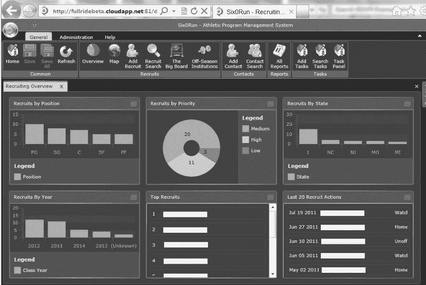

**图 7-3：** Silverlight 应用程序，预览了你将为区域管理器添加的功能。

此接口预览了你将向区域管理器类添加的功能。再次，区域管理器主要处理 `IViewModel` 接口。开发者再次被要求在处理 UI 时利用 ViewModels，并由框架确定哪种 View 是合适的。

如你所见，`IRegionManager` 类暴露了 `CurrentView` 属性和 `OpenViews` 属性，两者都旨在暴露特定区域内当前显示哪些 ViewModels 的信息。`IRegionManager` 的 `HostControl` 属性直接访问当前托管该区域的实际 Silverlight 控件。`ShowView` 和 `CloseView` 方法为开发者提供了管理特定区域内 Views 的手段。

与之前通过为 `IViewModel` 接口提供抽象 `BaseViewModel` 实现的过程类似，你可以为 `IRegionManager` 类创建一个抽象类。这可以通过提供特定功能的通用实现，来帮助创建新的区域管理器。以下是 `BaseRegionManager` 实现的代码：

```cs
using System;
using System.Collections.ObjectCollection;
using System.Windows.Controls;

namespace MVVM.Framework
{
    public abstract class BaseRegionManager : ObservableObject, IRegionManager
    {
        private readonly ObservableCollection<IViewModel> openViews = new ObservableCollection<IViewModel>();
        private IViewModel currentViewModel;
        private Control hostControl;

        public IViewModel CurrentView
        {
            get { return currentViewModel; }
            protected set
            {
                currentViewModel = value;
                OnPropertyChanged("CurrentView");
            }
        }
        public ObservableCollection<IViewModel> OpenViews
        {
            get { return openViews; }
        }
        public Control HostControl
        {
            get { return hostControl; }
            protected set
            {
                hostControl = value;
                OnPropertyChanged("HostControl");
            }
        }

        public abstract IViewModel ShowView(Type viewModelType, object parameters);

        public abstract void CloseView(IViewModel viewModel);
    }
}
```

## 创建 MVVM 框架

与早些遵循的过程一样，通过为 `IViewModel` 接口提供抽象的 `BaseViewModel` 实现，你可以为 `IRegionManager` 类创建一个抽象类。这可以通过提供特定功能的通用实现，来帮助创建新的区域管理器。以下是 `BaseRegionManager` 的实现：


```cs
using System;
using System.Collections.ObjectModel;
using System.Windows.Controls;

namespace MVVM.Framework
{
    public abstract class BaseRegionManager : ObservableObject, IRegionManager
    {
        private readonly ObservableCollection<IViewModel> openViews = new ObservableCollection<IViewModel>();
        private IViewModel currentViewModel;
        private Control hostControl;

        public IViewModel CurrentView
        {
            get { return currentViewModel; }
            protected set
            {
                currentViewModel = value;
                OnPropertyChanged("CurrentView");
            }
        }
        public ObservableCollection<IViewModel> OpenViews
        {
            get { return openViews; }
        }
        public Control HostControl
        {
            get { return hostControl; }
            protected set
            {
                hostControl = value;
                OnPropertyChanged("HostControl");
            }
        }

        public abstract IViewModel ShowView(Type viewModelType, object parameters);

        public abstract void CloseView(IViewModel viewModel);
    }
}
```

## 创建 MVVM 框架

`BaseRegionManager` 实现提供了 `IRegionManager` 的属性，但将 `ShowView` 和 `CloseView` 指定为抽象方法。这强制实现 `BaseRegionManager` 的开发者提供这些方法的实现。`BaseRegionManager` 仅仅是用于跟踪特定区域管理器集合的中间层。

第一个区域管理器实现将是 `SingleRegionManager`。正如名称所示，`SingleRegionManager` 旨在处理单个 ViewModel 的内容控件。`CurrentView` 属性提供了对当前显示 View 的访问，`OpenViews` 集合始终暴露一个 ViewModel（如果没有的话）。

你必须将 `SingleRegionManager` 类添加到 MVVM 项目的根节点。`SingleRegionManager` 的完整实现如下：

```cs
using System;
using System.Windows.Controls;

namespace MVVM.Framework
{
    public class SingleRegionManager : BaseRegionManager
    {
        public SingleRegionManager(ContentControl contentHost)
        {
            if (contentHost == null)
            {
                throw new ArgumentNullException("ContentHost");
            }
            HostControl = contentHost;
        }

        public override IViewModel ShowView(Type viewModelType, object parameters)
        {
            if (CurrentView != null)
            {
                CloseView(CurrentView);
            }

            IViewModel viewModel =
                ViewService.ShowView((ContentControl)HostControl, viewModelType, parameters);

            CurrentView = viewModel;
            OpenViews.Add(viewModel);
            return viewModel;
        }

        public override void CloseView(IViewModel viewModel)
        { 
            if (CurrentView.Equals(viewModel))
            {
                CurrentView = null;
                OpenViews.Clear();
                ((ContentControl)HostControl).Content = null;
            }
        }
    }
}
```

如你所见，此实现相当简单，并严重依赖于它继承的 `BaseRegionManager` 实现。关于 `SingleRegionManager` 有一些重要的点：

该类的构造函数接受一个 `ContentControl` 类型的单个参数，并验证该控件传递正确。有了此构造函数，每个 `SingleRegionManager` 必须与一个 `ContentControl` 直接关联。在此阶段，你的框架并没有限制多个区域管理器尝试管理同一个 `ContentControl` 的内容，但这绝对可能的。

`SingleRegionManager` 的 `ShowView` 利用之前编写的 `ViewService.ShowView` 在正确清除任何活动 View 后，执行创建和关联 Views 及 ViewModels 的实际工作。

`CloseView` 方法清除任何可见内容并清理 `CurrentView` 属性和集合。由于此区域管理器用于一次只显示一个 View 的场景，因此实现非常直接。

既然你已经投入了一些时间创建区域管理器接口、基类和单一实现，现在必须开始连接这些基础设施以查看其运行情况。

首先，找到某种全局范围内跟踪你的区域管理器的方法，以便应用程序的任何区域访问。再次，你利用 `ViewService` 类作为中心位置并添加以下内容以帮助跟踪你的区域管理器：

```cs
private readonly Dictionary<string, IRegionManager> regionManagers = new Dictionary<string, IRegionManager>();

public void RegisterRegionManager(string regionName, IRegionManager regionManager)
{
    if (regionName == null || string.IsNullOrEmpty(regionName))
    {
        throw new ArgumentException("*Invalid arguments");
    }
    regionManagers[regionName] = regionManager;
}
```

```cs
public IRegionManager GetRegionManager(string regionName)
{
    return regionManagers[regionName];
}
```

在上面的代码中，我们使用另一个泛型字典类来跟踪你的区域管理器。每个区域管理器都将被分配一个字符串名称，帮助你进行全局定位。`RegisterRegionManager` 和 `GetRegionManager` 方法提供了对此中心注册表的受控访问。

接下来，你必须将区域管理器基础设施投入使用，并了解如何将其挂载到你的 `MainPage` 类中（该初始化代码所在的位置）。为此，在 MVVM.Shell 的 `MainPage` 构造函数中重写之前的代码应如下：

```cs
public MainPage()
{
    InitializeComponent();

    // 注册你的对话框区域管理器...
    View.Current.RegisterRegionManager("Dialog",
        new DialogRegionManager());

    var headerRegion = new SingleViewRegionManager(HeaderContent);
    var navigationRegion = new SingleViewRegionManager(NavigationContent);

    var footerRegion = new SingleViewRegionManager(FooterContent);
    var mainRegion = new SingleViewRegionManager(MainContent);

    View.Current.RegisterRegionManager("Header", headerRegion);
    View.Current.RegisterRegionManager("Footer", footerRegion);
    View.Current.RegisterRegionManager("Navigation",
        navigationRegion);
    View.Current.RegisterRegionManager("Main", mainRegion);

    headerRegion.ShowView(typeof(HeaderViewModel), null);
    navigationRegion.ShowView(typeof(NavigationViewModel), null);
    footerRegion.ShowView(typeof(FooterViewModel), null);
    mainRegion.ShowView(typeof(PersonViewModel), null);
}
```

为了可读性，此配置被分为三个部分：

- 第一部分创建了与页眉、页脚、导航和主内容控件相关的四个 `SingleViewRegionManager` 实例。

- 接下来，你注册了之前过的 `View` 的 `RegisterRegionManager` 方法，你为这些 View 管理器各注册了一个简单的字符串名称，以便日后的识别和检索。

- 最后，你使用每个区域管理器的 `ShowView` 方法提供初始显示。

此示例引用了三个你尚未实现的 `ViewModel`。如果你下载并查看本章节附带的示例代码（来自该书的配套网站 www.wrox.com/），你可以看到框架的完整实现，包括页脚和导航的 Views 和 ViewModels，以及一个虚构“人员”（Person）对象的编辑界面。如果你在输入上述代码时没有导航、页脚和人员的 `ViewModels`，只需不输入最后三行代码即可。

在初始化阶段注册了适当的区域，你可以（从应用程序的任何地方）通过如下单行代码在主 View 区域显示 View：

```cs
SystemService.Current.GetRegionManager("Main").ShowView(typeof(PersonViewModel), null);
```

对于你到今为止显示的每个 View，请为你的参数传递 `null` 值。如有必要，你可以为参数传递任何对象，该值将被传递给 `IViewModel.Initialize` 方法。

## 显示对话框

为了演示区域管理器基础设施的灵活性，请看另一种区域管理器实现，你可以用它通过 Silverlight Control Toolkit 将 Views 以弹出窗口的形式显示。为此，你在 MVVM.Framework 项目中创建一个 `DialogRegionManager` 类。以下是该类的代码：

```cs
using System;
using System.Collections.Generic;
using System.Linq;
using System.Windows;
using System.Windows.Controls;
using System.Windows.Data;

namespace MVVM.Framework
{
    public class DialogRegionManager : BaseRegionManager
    {
        private readonly Dictionary<IViewModel, ChildWindow> openWindows = 
            new Dictionary<IViewModel, ChildWindow>();

        public override IViewModel ShowView(Type viewType, object parameters)
        {
            var childWindow = new ChildWindow();
            IViewModel viewModel = ViewService.Current.ShowView(childWindow,
                viewType, parameters);
            AddBinding(viewModel, "Title", childWindow,
                ChildWindow.TitleProperty);
            AddBinding(viewModel, "Height", childWindow,
                ChildWindow.HeightProperty);
            AddBinding(viewModel, "Width", childWindow,
                ChildWindow.WidthProperty);

            openWindows[viewModel] = childWindow;
            childWindow.Closed += childWindowClosed;

            childWindow.Show();
            return viewModel;
        }

        private void childWindowClosed(object sender, EventArgs e)
        {
            KeyValuePair<IViewModel, ChildWindow> item =
                openWindows.Where(x =>
                    x.Equals(sender)).FirstOrDefault();
            item.Value.Closed -= childWindowClosed;
            openWindows.Remove(item.Key);
        }

        public override void CloseView(IViewModel viewModel)
        {
            if (openWindows.ContainsKey(viewModel))
                openWindows[viewModel].Close();
        }

        private static void AddBinding(object sourceObject, string sourcePath,
            DependencyObject destinationObject,
            DependencyProperty destinationProperty)
        {
            var sourceBinding = new Binding(sourcePath);
            sourceBinding.Source = sourceObject;
            sourceBinding.Mode = BindingMode.TwoWay;
            BindingOperations.SetBinding(destinationObject, destinationProperty);
        }
    }
}
```

在查看该区域管理器的实现细节之前，有几点需要注意。该区域管理器需要 `System.Windows.Controls` 中的 `ChildWindow` 控件。此处提供的区域管理器不支持对话框显示。

为了让 `DialogRegionManager` 在整个应用程序中可用，你需要在应用程序启动时通过在 MVVM.Shell 项目的 `MainPage` 类构造函数中添加以下代码进行注册：

```cs
View.Current.RegisterRegionManager("Dialog", 
    new DialogRegionManager());
```

在此代码添加后，你现在可以使用如下代码将任何 ViewModel 和 View 显示为对话框：


```csharp
ViewService.Current.GetRegionManager("Dialog").ShowView(typeof(AboutViewModel), null);
```

尽管 `DialogRegionManager` 不管理特定 UI 的区域，但它展示了架构的灵活性，可以开发不同类型的区域管理器来管理不同上下文中的相同 View/ViewModel 对，或作为对话框。注册这些各种区域管理器允许应用程序中的所有组件访问特定区域中显示的 ViewModel。

到目前为止，主要的缺失是缺乏更多类型的区域管理器。目前，你拥有一个用于一次只能包含一个 View 的接口的区域管理器，以及一个以弹出窗口显示 Views 的区域管理器。

在面向生产的框架中，你会引入允许包含多个 Views 的区域管理器（例如标签页 Views 或列表 Views）。这些实现非常简单，将此类区域管理器接入灵活的区域管理器基础设施是你现在可以进行的一项练习。通过在 `IRegionManager` 接口中包含一个 `OpenViews` 集合，你为此类实现提供了基础。提供的两个区域管理器没有利用这一点，但更健壮的区域管理器将会这样做。

## View 之间的通信

现在你已经能够将 UI 概念化为一组不同的区域（尽管区域管理器的数量有限），你面临着从一个 ViewModel 与另一个通信的频繁需求。一个很好的例子是，如果你希望将当前在“Main”区域中显示的 ViewModel 的标题显示在 HeaderView 中。这是应用程序中的常见需求，并将是你首次利用 ViewModels 的 `Title` 属性。

要访问任何区域中当前显示的 ViewModel，你现在可以使用如下代码：

```csharp
var _currentMainView = ViewService.Current.GetRegionManager("Main").CurrentView;
```

如果你评估了提供的示例应用程序中 HeaderView 和 HeaderViewModel 的源代码，你可以看到一个 ViewModel（HeaderViewModel）如何监听更改另一个 ViewModel 的属性以显示主视图的标题。本书随附下载的代码中提供的实现使得当前主视图的标题在页部的 UI 中保持可见。

视图之间另一种关键的通信手段是消息基础设施的概念，它利用一个中心化系统来发布和响应消息。在示例框架中，我实现的 View 类或管理器类（manager classes）都没有向外部暴露任何类型的消息基础设施以便在 View 相关的关键操作发生时通知他人。在触发打开新 View 或关闭 View 的触发器中添加此类消息将留给您自行完成，这可以为此类框架增加显著价值。本章讨论的许多健壮的 MVVM 框架都支持某种类型的松耦合消息机制，以提供更完整的 MVVM 解决方案。

## 将 MVVM 框架投入使用

你已经达到了该示例框架开发的一个阶段，此时你创建了许多实用的类和服务，这些类和服务可以应用于你的一系列自己的应用程序。通过在 MVVM Framework 类库中隔离所有特定框架的组件，你可以轻松在多个项目中复用此框架。

为了实现最大的一致性，你还应该标准化初始化结构，并为更复杂的场景添加一些区域管理器（region managers）。考虑到所提供的代码，可以假设可以启动一个新的 Silverlight 项目，并只需极少的工作将新框架整合。提供的组件足够小，且足以轻松地整合到现有的应用程序中。

显而易见的是，此示例框架缺少了一些关键组件，这些组件对于任何 LOB（行业务）应用程序都是至关重要的。这些将包括用于日志、缓存、数据访问、安全和其他核心服务的可重用组件。书中的章节涉及了其中一些主题，而其他主题的解决方案经常在互联网上的博客或文章中讨论。

## 现有 MVVM 框架

本章的前几节重点于开发一个用于管理 MVVM 项目复杂性的自定义框架。该框架是从零开始开发的，除了 Microsoft 的 Unity 容器以及 Silverlight 4 Toolkit 的某些组件外，几乎没有依赖外部组件。尽管你实现了提供核心 MVVM 功能的目标，但真正的问题是这个框架的目标是什么？

正如在这一尝试开始时讨论的那样，通过研究提供的代码你应该获得一些价值，并将提供的框架扩展为能够为你和你的团队提供直接价值的东西。你们中的一些可能会评估所提供的实现，并利用它来增加对此类框架的知识，直到你能够更好地从许多现有的 MVVM 框架中评估和选择。

对于哪种框架适合特定团队的需求，没有标准答案或“银弹”。我喜欢许多框架的许多各个方面，但不喜欢另一些。我尝试为工作任务选择合适的工具，然后吸收更好的想法并将其整合到我自己的设计和平台中。

为了给你寻找合适的 MVVM 框架提供一些初始指导，接下来的章节对你可能考虑作为自己 MVVM 平台基础的各种框架提供了一些指导。

## Prism

虽然 Microsoft Prism 不是一个 MVVM 框架，但它是考虑构建 MVVM 应用的绝佳基础。Prism 框架的最新版本 4 版提供了一个参考 MVVM 应用，包含了大量的文档和示例应用程序。

Prism 提供了完整的引导基础设施以标准化你的应用程序启动、一个用于管理区域（regions）极其 UI 基础设施、一个松耦合的事件聚合器（event aggregator），以及一个将你的应用程序模块化为独立项目的优秀部分，这些项目可以在运行时加载到公共外壳（shell）中。

此外，Prism 提供了一个通用框架，在 Silverlight、WPF 和 Windows 7 应用程序之间共享大量的代码。我认为为某项技术开发 Prism 应用时学到的概念和模式可以立即应用于其他技术。

尽管 Prism 框架提供了大量的功能，但它缺乏标准的 MVVM 实现是一个缺点。参考实现更多地是作为演示，而不是可重用组件的基础。为了弥补这一遗憾，有很多优秀的文章和博客帖子讨论了如何在标准 Prism 框架中构建更多的 MVVM 能力。

Prism 确实提供了大量的文档来帮助开发者上手，而 CodePlex 社区是解决特定功能或能力问题的绝佳资源。

> Prism 是开源的，可以从 Microsoft 的 `http://compositewpf.codeplex.com` 获取，也可以通过 NuGet 安装。

## MVVM Light

MVVM Light 框架是一个侧重于为 Silverlight、WPF 和 Windows 7 Phone 开发者提供一组通用 MVVM 组件的框架。通过这种方式，它与在本章中你组合的基础框架相似（尽管功能丰富得多且文档更详尽）。

MVVM Light 框架的一些亮点是它为开发者提供了许多良好的服务，供他们在此基础上构建或直接开箱即用。MVVM Light 还带有了 Visual Studio 项目模板和代码片段（code snippets），这些极大地简化了许多常见的 MVVM 任务以及基于 MVVM Light 框架构建新项目的设置。

MVVM Light 也有大量的文档和指导可用，并有一个出色的用户社区可以在需要时寻求支持。

> MVVM Light 框架像 Prism 一样是以开源解决方案提供的，并托管在 CodePlex 的 `http://mvvmlight.codeplex.com`。MVVM Light 也可以通过 NuGet 获取。

## Caliburn.Micro

Caliburn.Micro 是另一个构建 MVVM 应用的流行基础。Caliburn.Micro 拥有大量的设施来支持 MVVM 以及其他 UI 模式，例如模型-视图-控制器（MVC）和模型-视图-演示器（MVP）。Caliburn 为使用命令和消息作为可扩展模型提供了坚实的基础。Caliburn.Micro 非常轻量，并提供了一些优秀的基于约定的（convention-based）模式，可以自动将 action 控制绑定到 ViewModels 等，还可以配置数据绑定。Caliburn.Micro 还具有让开发者以 View 为中心或以 ViewModel 为中心的模式工作的功能。

与之前提到的两个框架一样，Caliburn.Micro 是功能完备的，并且拥有文档支持。在某些方面，Caliburn.Micro 提供了一个比 Prism 或 MVVM Light 功能更完备的框架。

> Caliburn.Micro 也托管在 CodePlex 上，可以在 `http://caliburn.micro.codeplex.com/` 找到。

## 其他框架

除了这里重点介绍的三个框架之外，快速搜索可以引导你找到许多其他的 Silverlight、WPF 或 Windows 7 MVVM 框架。这些框架中的一些是对本书中讨论的常见问题的创新解决方案，而另一些则是构建其他平台的创造性方式，正如 Prism 或 MVVM Light。

不同的框架将为相同的问题提供不同的解决方案，并且每个框架都使用了相同组件（如 IoC 容器或 MEF）的混合来实现其目标。在决定任何一个框架是否更适合你的应用程序平台之前，你应该审查任何框架。

220 | 第 7 章 SILVERLIGHT 中的 MVVM 模式

任何框架的成功采用都值得关注，因此在做出最终决定之前值得进行权衡。

## 额外考虑因素

现在，你已经部署了相当大量的 MVVM “水水工程”工作，以简化 Views 和 ViewModel 的使用。请花一点时间检查一下作为转向该框架的开发者，你必须考虑的一些额外项目。

到目前为止，你的代码一直集中在管理跟踪 Views 和 ViewModel 的复杂性、将它们相互关联以及在 UI 的相应区域显示它们上。虽然管理 Views 和 ViewModel 非常重要，但在考虑你的标准线性业务（LOB）应用时，这只是宏大图景的一部分。遗憾的是，作为开发者，你必须对广泛的概念有透彻的，才能在构建 Silverlight 应用时真正高效。

本节指出了这些领域中的几个，旨在为开发者提供指导，说明哪些领域对于开展额外研究有用。

## 数据绑定

要在此类环境中高效工作，你必须精通数据绑定以及各种模式，以保持 ViewModel 的属性与 View 中显示的用户控件的视觉状态保持同步。在本章开发的框架（以及你可能使用的任何其他 MVVM 框架）可以协助组件的管理，但通常对 Views 和 Models 之间的实际交互提供的帮助很小。

尽管本章强调了 MVVM 的优势，但最终用户并不关心这些低级实现细节，他们只是将应用程序视为与某些数据或其他 UI 元素交互的手段。从这个角度来看，透彻理解用户体验是重要的，对于任何 Silverlight 开发者来说，尽可能熟悉这方面的语法和能力都将大有益益。

## 命令

许多开发者在使用 MVVM 时挣扎的一个复杂领域是：响应 View 上的按钮点击或其他事件的能力，并执行与 ViewModel 交互的代码。这通过使用 Silverlight 内置的 `ICommand` 基础设施可以轻松实现。

`ICommand` 接口允许开发者将操作控件触发的动作封装到一组可重用的“命令”类中。在 Silverlight 中，像按钮这样的操作控件有一个名为 `Command` 的属性，该属性可以设置或绑定到任何支持 `ICommand` 接口的类。存在许多高效的模式可以实现你自己的 `ICommand` 类并管理这种交互。许多开发者在这方面有他们自己遵循的标准。

## 数据访问

本章刻意避开了关于对 Silverlight 开发者可用的数据访问方式的讨论。任何 LOB 应用（无论是否使用 MVVM）都需要查询某些数据源，并可能将这些数据更改回持久化数据存储器。

由于 Silverlight 是一种运行在浏览器中的客户端技术，因此不允许对数据库进行任何查询，而是必须通过服务器。Silverlight 提供了几个与服务器通信的强大选项，它们都依赖于 WCF 来实现从 Silverlight 到适当端点或查询数据的异步调用。

在需要时，任何现有的 .NET 数据访问技术都可以用于查询关系数据（如果需要该类型的访问）。EF 是许多现代数据访问场景的绝佳选择。

从 Silverlight 访问数据的另一个大选择是使用 WCF RIA Services 基础设施。利用该框架进行数据访问提供了在任何 MVVM 架构中都极其有用的功能。不仅 WCF 的大部分复杂性从开发者中抽象掉了，而且生成的领域对象非常适合作为你框架的模型。这些领域原生实现了 `INotifyPropertyChanged` 接口，并支持通过数据注解验证数据和纳入业务规则的方法。RIA Services 在本书的其他地方有讨论，对于那些寻求利用 MVVM 构建健壮的 Silverlight LOB 应用的人，强烈建议回顾其功能。

## 总结

本章重点关注了在 Silverlight 4 中构建基础 MVVM 框架所需的概念。你已经学习了一些相关的概念和技术，这些技术对于决定你自己的 MVVM 需求采取何种方向值得研究。

本章开头指出，MVVM 领域并没有被广泛采用的单一解决方案，而是被几十种既优秀又截然不同的绝佳解决方案所填满。在使用此类框架时，对某个团队有效的方法对另一个团队来说可能是枯燥且不合适的，因此你应该通过研究本章提供的框架，来增强你对这些框架试图实现什么的理解。然后，当你将此处所做的内容与你可选的框架选项进行比较时，你将处于做出明智决策的位置。

## 关于作者

Kevin Grossnicklaus 在 2009 年创立了 ArchitectNow, LLC，在此之前，他在位于圣路易斯的技术公司 SSE 担任了十年的 .NET 实践负责人和首席架构师。在 SSE 期间，他监督了向数十家本地和国家公司任务关键软件应用程序的设计、实施和交付。2000 年在 SSE 期间，Grossnicklaus 是微软 .NET 平台（当时被称为下一代 Web 服务，或 NGS）的早期采用者，并在当地开发社区中活跃，与任何愿意学习的开发者分享关于这些工具和技术的知识和经验。从那时起，他与全球开发者合作了许多关于最新 .NET 技术的项目。

# 8

# Windows Phone “Mango”

面向 Silverlight 开发者

作者：Alex Golesh

Mango 为内置摄像头提供了两种替代方案：Silverlight 4 Webcamera API 和完全全新的 `PhotoCamera` 类。让我们仔细查看这些 API，以便你理解它们之间的区别。

Silverlight 4 摄像头方法适用于 Silverlight 开发者。它可以与桌面应用程序共享（在 XAML 和后置代码方面）。它使用了 `System.Windows.Media` 命名空间中的 `CaptureSource` 类，并支持捕捉视频、静态图像和音频。`CaptureSource` 被用作 `VideoBrush` 实例的源以显示实时摄像头预览。

考虑以下简单的用户界面 (UI)：

```xml
<Rectangle Width="780" Height="460" Margin="10">
  <Rectangle.Fill>
    <VideoBrush x:Name="previewVideo"/>
  </Rectangle.Fill>
</Rectangle>
```

这段 XAML 代码段定义了一个名为 "previewVideo" 的 `VideoBrush` 填充的矩形。

以下代码段初始化了一个 `CaptureSource` 实例并将其赋值为 `VideoBrush` 的源：

```csharp
captureSource = new CaptureSource();
captureSource.CaptureDeviceConfiguration = CaptureDefaultVideoCaptureDevice();
previewVideo.SetSource(captureSource);

captureSource.Start();
```

这种简单的技术实现了实时的摄像头流。此外，你可以使用 `CaptureSource` 来捕捉静态图像。

为了捕捉图像，`CaptureSource` 了一个了一个异步方法 (`CaptureImageAsync`) 和两个处理成功和失败捕捉尝试的事件。开发者需要自行订阅这些事件、调用该方法并处理结果，如下所示：

```csharp
captureSource.CaptureImageCompleted += new
EventHandler<CaptureImageCompletedEventArgs>(captureSource_CaptureImageCompleted);
captureSource.CaptureFailed += new
EventHandler<ExceptionRoutedEventArgs>(captureSource_CaptureFailed);

// ...
captureSource.CaptureImageAsync();

// ...
void captureSource_CaptureFailed(object sender, ExceptionRoutedEventArgs e)
{
  // 在此处处理错误逻辑...
}
```

```csharp
// ...\nvoid captureSource_CaptureImageCompleted(object sender,\n    CaptureImageCompletedEventArgs e)
{
    if (null == e.Error)
    {
        // 捕捉成功。捕捉的图像是
        // e.Result 中的 WriteableBitmap
    }
    // 在此处处理图像...
}
```

如你所见，捕捉和预览图像是一个简单的过程；尽管如此，开发者无法访问手机硬件摄像头按钮，无法访问摄像头闪光灯，无法控制摄像头的自动对焦。使用 `Microsoft.Devices` 命名空间下的 `PhotoCamera` 类时就不会存在这些问题。


`PhotoCamera` 的初始化需要时间，因此如果你的应用程序页面使用了此项，你应该在 `PhotoCamera` 类初始化完成后尽早开始初始化。重写 `OnNavigatedTo` 方法并创建 `PhotoCamera` 类的新实例，如下所示：

```
protected override void OnNavigatedTo(System.Windows.Navigation.NavigationEventArgs e)
{
    photoCamera = new PhotoCamera();
    photoCamera.Initialized +=
        new EventHandler<CameraOperationCompletedEventArgs>(photoCamera_Initialized);

    previewVideo.SetSource(photoCamera);

    base.OnNavigatedTo(e);
}
```

`PhotoCamera` 类也可以作为 `VideoBrush` 实例的源。`PhotoCamera` 类的事件只有在摄像头初始化后才能被消费。在 `Initialized` 事件处理器中订阅摄像头事件，如下：

```
void photoCamera_Initialized(object sender, CameraOperationCompletedEventArgs e)
{
    if (photoCamera.IsFlashModeSupported(FlashMode.Auto))
        photoCamera.FlashMode = FlashMode.Auto;

    // 选择最低可用分辨率
    photoCamera.Resolution = photoCamera.AvailableResolutions.ElementAt(0);

    photoCamera.AutoFocusCompleted += new
        EventHandler<CameraOperationCompletedEventArgs>(photoCamera_AutoFocusCompleted);

    CameraButtons.ShutterKeyPressed += new
        EventHandler(photoCamera_ButtonFull);
    CameraButtons.ShutterKeyHalfPressed += new
        EventHandler(photoCamera_HalfPressed);
    CameraButtons.ShutterKeyReleased += new
        EventHandler(photoCamera_ButtonRelease);
    photoCamera.CaptureCompleted += new
        EventHandler<OperationCompletedEventArgs>(photoCamera.CaptureCompleted);
    photoCamera.CaptureImageAvailable += new
        EventHandler<ContentReadyEventArgs>(photoCamera_ImageAvailable);
}
```

静态类 `CameraButtons` 允许订阅摄像头按钮事件。由于该类是静态的，必须尽快释放事件订阅以防止事件泄漏并释放摄像头相关变量。

```
protected override void OnNavigatedFrom(System.Windows.Navigation.NavigationEventArgs e)
{
    photoCamera.Initialized -= photoCamera_Initialized;
    photoCamera.AutoFocusCompleted -= photoCamera_AutoFocusCompleted;
    CameraButtons.ShutterKeyPressed -= photoCamera_ButtonFull;
    CameraButtons.ShutterKeyHalfPressed -= photoCamera_HalfPressed;
    CameraButtons.ShutterKeyReleased -= photoCamera_ButtonRelease;
    photoCamera.CaptureCompleted -= photoCamera.CaptureCompleted;
    photoCamera.CaptureImageAvailable -= photoCamera_ImageAvailable;

    photoCamera.Dispose();
    photoCamera = null;

    base.OnNavigatedFrom(e);
}
```

摄像头初始化并工作后，你可以发出 `Focus()` 命令（例如在 `ShutterKeyHalfPressed` 事件处理器中）和 `CaptureImage()` 命令（在 `ShutterKeyFullPressed` 事件处理器中）：

```
void photoCamera_ButtonHalfPress(object sender, EventArgs e)
{
    photoCamera.Focus();
}

void photoCamera_ButtonFullPress(object sender, EventArgs e)
{
    photoCamera.CaptureImage();
}
```

`PhotoCamera` 类的另一个可用功能是支持不同格式的预览缓冲区。`GetPreviewBufferXXXX` 函数将当前预览帧复制到数组中以便处理：

```
int[] pixelData = new int[photoCamera.PreviewResolution.Width * photoCamera.PreviewResolution.Height];
photoCamera.GetPreviewBufferArgb32(pixelData);
```

这允许在预览窗口上应用实时效果。

## 摄像头最佳实践

编写摄像头 API 代码时请：

- 对于简单场景和桌面兼容方案，使用 Webcam API。
- 需要对图像捕捉进行精细控制或需要图像处理时，使用 `PhotoCamera` API。
- 处理实时视频流时使用最低分辨率。
- 在不再需要时释放摄像头设备。
- 使用 `VideoBrush` 显示实时视图。

## 传感器

Windows Phone 初期版本支持加速度计。Mango 增加了三个支持：

- 陀螺仪
- 罗针（磁计）
- 运动传感器

所有传感器类都位于 `Microsoft.Devices.Sensors` 命名空间，并派生自抽象类 `SensorBase<T>`。这意味着所有传感器都有共同的使用模式，仅在额外方法和内部实现上有所不同。图 8-1 显示了通用传感器模式。


图 8-1：通用传感器模式

## 陀螺仪

陀螺仪是一种角动量原理测量或维持方向的设备。在 Mango 中，`Gyroscope` API 提供设备绕三个轴（X、Y、Z）的每秒弧度速度。该传感器是 Windows Phone 系列的新增。它是可选的，仅存在于少数新设备上，原始 Windows Phone 则没有。

`GyroscopeReading` 类（通过 `CurrentValue` 暴露）提供了陀螺仪的旋转速率（每个轴的旋转速度）和时间戳（指示读取读取的时间）。

> 陀螺仪传感器读数存在漂移。

## 罗针

罗针传感器（也称为磁计）在其 `CurrentValue` 属性中提供以下数据：

- `HeadingAccuracy` —— 航向精度（度）。你使用此值进行罗针校准。
- `MagneticHeading` —— 相对于地球磁北的航向（度）。
- `TrueHeading` —— 相对于地球地理北的航向（度）。
- `MagnetometerReading` —— 原始磁计读数（微特斯拉，即以 `Xna.Vector3` 类型提供）。要使用这些读数，你必须引用 `Microsoft.Xna.Framework` 程序集。

此外，罗针传感器能够订阅 `Calibrate` 事件。当此事件触发时，应用程序必须显示执行传感器校准的指令。校准通过以八字形挥动设备完成。需要这种校准是因为磁计传感器容易受到干扰。金属障碍、高电压设备和某些电子设备可能会干扰地球磁场并改变局部场值。在这些情况下，必须对传感器进行校准，API 会触发 `Calibrate` 事件。

Mango API 没有提供 `CalibrationComplete` 通知，由开发者决定何时数据准确用于传感器校准。通常，`HeadingAccuracy` 10 到 15 度对于大多数应用程序足够。

以下是一个示例：

```
void compass_Calibrate(object sender, CalibrationEventArgs e)
{
    // 显示校准指令
    stkCalibration.Visibility = Visibility.Visible;
    // 隐藏罗针传感器相关 UI
    imgRose.Visibility = Visibility.Collapsed;
    // 设置“Is Calibrating”标志以便稍后使用
    compassCalibrating = true;
}
```

```
if (compassCalibrating) {
    // 检查当前航向精度是否低于阈值
    if (e.SensorReading.HeadingAccuracy < 10) {
        // 指南针已校准，恢复指南针 UI
        compassCalibrating = false;
    }
    //...
}
if (!compassCalibrating) {
    // 指南针已校准，使用数据
    //...
}
```

## 运动

运动传感器是一个结合了陀螺仪、指南针和加速度计的虚拟传感器。运动传感器通过数学计算来组合所有传感器的数据。这些数据使用一种算法进行组合，该算法可以补偿每个独立传感器的误差，从而使运动传感器成为最准确的传感器。

可用时应使用运动传感器，且应优于每个独立传感器。该传感器的可用性取决于设备上提供的物理传感器。表 8-1 总结了运动传感器的可用性。

### 表 8-1：运动传感器可用性

| 加速度计 | 指南针 | 陀螺仪 | 运动 |
|---|---|---|---|
| 是 | 是 | 是 | 是（全质量） |
| 是 | 否 | 否 | 是（降级质量） |
| 是 | 否 | 是 | 否 |
| 是 | 否 | 否 | 否 |

在表 8-1 中，“降级质量”意味着传感器数据可用，但数值经过某些近似。如果运动传感器的 `IsSupported` 属性为 `false`，应用程序应使用加速度计（它是始终可用的，因为所有 Windows Phone 7 设备的硬件规范要求）以及其他输入和控制机制。

> 运动传感器需要随时间进行校准，因为它使用了指南针传感器数据。校准过程与指南针校准类似。

## 传感器最佳实践

在处理传感器时，请记住以下几点：

- 可用时始终使用运动传感器。
- 在应用程序中初始化/使用任何传感器之前，始终检查其 `IsSupported` 属性。
- 仅在需要时初始化传感器，并尽快释放它们（在不再需要时）。
- 如果设备上某些传感器不可用，始终准备好备用的输入和控制机制。
- 硬件平台的变化在与软件基础的变化结合时获益最大。

## 软件基础

在本节中，你将学习 Mango 中关于运行时和工具的新特性。

### 运行时改进

从开发者的角度来看，Mango 最大的改进是集成 Silverlight 4。虽然 Windows Phone 的初始版本启用了带有某些手机特定新增的 Silverlight 3 开发，但 Mango 带来了使用完整 Silverlight 4 开发环境的能力，具有强大的功能，如隐式样式、`RichTextBox` 控制、`ViewBox` 控制、触摸事件支持（如双击等）以及语言支持（用于传输语言或从右向左布局语言 RTL）。

此外，Mango 相比之前的 Windows Phone 版本引入了许多性能改进，例如分代垃圾收集 (GC)、独立的输入线程以及对分析器的支持。

### 工具增强

Mango 在 Visual Studio 中引入了许多增强，以帮助开发者创建更好的应用程序。Mango 工具为开发启用传感器的应用程序提供了更好的开发者支持。

在之前的版本中，开发启用加速度计或 GPS（位置感知）的应用程序需要经过开发者解锁的手机设备，或者使用某些社区解决方案来模拟传感器输入。随着 Mango 的发布，Windows Phone 模拟器支持传感器仿真。要模拟加速度计或位置读取，请打开模拟器中的“其他工具”窗口，如图 8-2 所示。

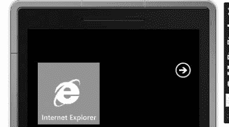

图 8-2：模拟器中的其他工具窗口

打开的“其他工具”窗口允许加速度计和位置更改仿真。要模拟加速度计数据，使用鼠标移动粉色球，如图 8-3 所示。

位置选项卡（如图 8-4 所示）不仅允许你将当前位置发送到 Windows Phone 模拟器，还可以记录通过指定地理点的虚拟路径，并在给定时间发送它们以模拟设备的移动。

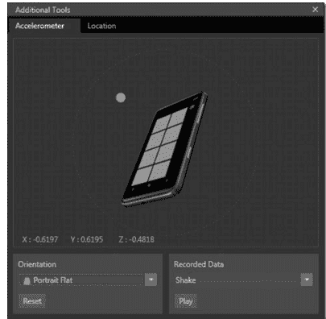

图 8-3：模拟加速度计数据

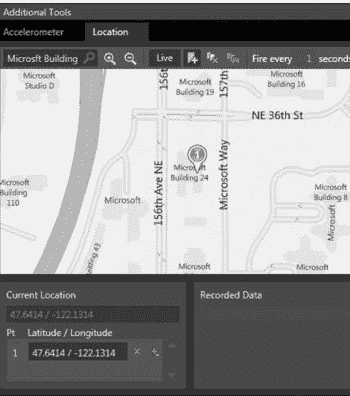

图 8-4：位置选项卡

> 虽然 Windows Phone 模拟器为你提供了模拟加速度计和 GPS 位置数据的方法，但建议你也在真实设备上检查你的应用程序，因为传感器数据受环境影响、网络可用性、磁场等的影响。始终在真实设备上检查其在真实世界情况下的表现。

Mango 的一些附加功能包括基于 SQL CE 的本地数据库引擎、带有 TCP 和 UDP 套接字的改进型网络栈、基于 Internet Explorer 9 (IE9) 并支持 HTML5 的增强型浏览器，以及 `VideoBrush` 对象。Mango 引入了新类型的应用程序，例如：Silverlight 和 XNA 应用程序。

### 网络套接字

Mango 引入了对 TCP 和 UDP 套接字的支持。UDP 套接字支持单播和组播通信（在 Wi-Fi 上）。此外，Mango 引入了连接管理器组件用于管理手机上的连接。它负责连接应用程序与数据源，并提供有关手机使用的数据网络类型的信息（例如 Wi-Fi、3G、EDGE 等）。

桌面端 Silverlight 的套接字 API（如适用）。表 8-2 比较了 Silverlight 4 和 Mango 套接字。

## 表 8-2：套接字比较

| 区域 | SILVERLIGHT 4 (桌面端) | SILVERLIGHT 4 (MANGO) |
| --- | --- | --- |
| TCP 套接字 | Sockets | Socket |
| UDP 套接字 | UdpAnySourceMulticastClient | UdpSingleSourceMulticastClient |
| | UdpAnySourceMulticastClient | |
| | UdpSingleSourceMulticastClient | |
| 地址解析 | SocketAddress | SocketAddress |
| | IPAddress | IPAddress |
| | IPEndPoint | IPEndPoint |
| 命名解析 | DnsEndPoint | DnsEndPoint |

以下代码段演示了如何创建 TCP 套接字连接：

```
_endPoint = new DnsEndPoint("192.168.0.2", 5000);
socket = new Socket(AddressFamily.InterNetwork, SocketType.Stream, ProtocolType.Tcp);
args = new SocketAsyncEventArgs();
args.UserToken = socket;
args.EndPoint = _endPoint;
args.Completed += new EventHandler<SocketAsyncEventArgs>(OnSocketCompleted);
socket.Connect(args);
```

以下代码段演示了如何加入 UDP：

```
Client = new UdpAnySourceMulticastClient(address, port);
Client.BeginGroup(
    result =>
    {
        Client.EndGroup(result);
        Dispatcher.BeginInvoke(
            delegate
            {
                OnOpen();
            });
    });
```

```
Receive();
});
```


# XNA 框架

XNA 是一个用于 Xbox 360、PC 和 Windows Phone 创建游戏的框架。它提供了一个游戏引擎和大量的模板代码，帮助开发者创建二维 (2D) 和三维 (3D) 游戏。XNA 的 2D 图形基于精灵（纹理），而 3D 图形基于专业 3D 工具创建的模型。该框架提供了使用立即模式显示这些图形的 API（开发者可以完全控制每一帧）以及一套全面的数学库来帮助游戏开发。

## Silverlight 与 XNA 集成

在 Mango 中，Silverlight/XNA 集成是在页面级完成的，这意味着 XNA 内容是 Silverlight 页面的一部分。XNA 渲染机制通过 `SharedGraphicsDeviceManager` 类接管 Silverlight，如下：

```cpp
SharedGraphicsDeviceManager.Current.GraphicsDevice.SetSharingMode(true);
```

通过这种方式，XNA 图形接管了整个页面，Silverlight 渲染完全不运行。为了在 Silverlight UI 中显示，Mango 提供了一个新类 `UIRenderer`，来自 `Microsoft.Xna.Framework.Graphics` 命名空间。该类用于渲染 Silverlight UI（及其元素）纹理，以便与其他游戏图形一起渲染。

以下代码段演示了如何初始化 `UIRenderer` 实例以纹理形式渲染 Silverlight 页面：

```cpp
uiRenderer = new UIRenderer(LayoutRoot, (int)LayoutRoot.ActualWidth, (int)LayoutRoot.ActualHeight);
```

在 XNA 的 `Draw()` 时间，简单地渲染 UI 并将其绘制到屏幕上，如下：

```cpp
// 更新 Silverlight UI
uiRenderer.Render();

// 绘制精灵
spriteBatch.Begin();
spriteBatch.Draw(uiRenderer.Texture, Vector2.Zero, Color.White);
spriteBatch.End();
```

结果是一个混合了 Silverlight 和 XNA（带有真实的硬件加速 3D 图形）的应用程序。这些应用程序看起来可能就像图 8-5 所示。

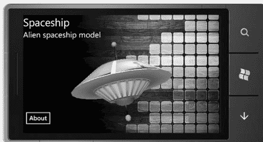

# 本地数据库

Mango 为设备增加了本地数据库引擎。手机上的数据库引擎基于 SQL CE 引擎。Mango 使用 LINQ-to-SQL 进行所有数据库操作。LINQ-to-SQL 提供了一种面向对象的数据处理方法，它由一个对象模型和运行时组成。数据库文件存储在手机的隔离存储（isolated storage）中，仅应用程序可用（这意味着多个应用程序无法共享同一个数据库）。

以下是应用程序中使用本地数据库的一些应用场景：

- **“购物清单”类应用程序**：复杂模式的数据库，通常包含几张表（5到7张）、数百条记录，以及大量的关系、约束和外键。
- **“字典”类应用程序**：参考数据，通常具有海量的静态参考数据，且表较少（2到3张）并带有约束，其中一或两张表持有大量数据（50,000到100万条记录）。
- **应用程序的“本地缓存”**：数据库作为从云端获取数据的本地缓存，有时与应用程序特定的数据结合使用。通常，此类缓存包含几张数据相对较简单的表。这些表通常在一段时间内持有多达数百条记录（直到应用程序逻辑定义该数据过期为止）。

## LINQ-to-SQL 概述

LINQ-to-SQL 提供了对象关系映射（ORM）功能，使您的应用程序能够使用集成语言查询（LINQ）与关系型数据库进行通信。LINQ-to-SQL 将对象模型（您用 .NET 管理代码表示）映射到关系型数据库。

当您的应用程序运行时，LINQ-to-SQL 将集成语言查询翻译成数据库“语言”并将其发送到数据库执行。当数据库返回结果时，LINQ-to-SQL 将它们转换回供您在自己的编程语言中处理的对象。

LINQ-to-SQL 通过 `DataContext` 对象进行工作，该对象定义了数据对象模型。通常，`DataContext` 使用简单的旧版 CLR 对象（POCO）和属性约定来定义数据。

> **注意**：当前版本的 Windows Phone 开发者工具没有提供任何视觉设计器来协助创建 `DataContext` 和实体类。您可以按照这里的手动描述创建这些类。

## 创建 DataContext

要创建自己的 `DataContext` 类，请继承自 `DataContext` 基类。`DataContext` 派生类是一个托管类，定义了表结构以及对象模型与数据库模式之间的映射。映射通过在对象上装饰属性来创建。这些属性指定了特定于数据库的功能（如表、列、主键、索引等）。

`DataContext` 类（带有映射属性）用于在手机上创建本地数据库。代码优先（code-first）类（使用托管代码定义模式并创建数据库）是 Windows Phone 应用程序的首选方法。

## 本地数据库关键点

以下是关于应用程序创建的本地数据库的一些关键点：

- 本地数据库仅对父应用程序存在。
- 数据库不在设备上的不同应用程序之间共享，仅供父应用程序访问。
- 只支持 LINQ-to-SQL 查询机制。不支持 T-SQL。

# 应用程序模型

在本节中，您将学习应用程序模型的变化，并看到这些变化如何带来响应更迅速的应用程序，并开启有趣的用户场景。

## 快速应用程序切换 (FAS)

Windows Phone 操作系统的初始版本仅支持一个应用程序。当应用程序发送到后台时，其状态会被序列化并保留在隔离存储中。这一过程被称为“墓碑化”（tombstoning），经历此过程的应用程序被称为墓碑化应用程序。当用户返回墓碑化应用程序时，他们必须等待应用程序反序列化其状态。开发者必须负责保存应用程序状态并恢复它。

在 Mango 中，情况不再如此。只有一个活跃的（前台）应用程序。当应用程序被发送到后台时，操作系统会尽可能将它的镜像（变量、执行状态等）保留在内存中，而不会影响当前应用程序的性能。

应用程序的这种新状态被称为休眠（dormant）。当用户激活休眠应用程序时，体验几乎是瞬时的，因为恢复应用程序的内存镜像是一项快速操作。在必须释放休眠应用程序内存以确保活动性能不受影响的情况下，Mango 会对休眠应用程序进行墓碑化，用户必须等待才能回到应用程序（就像之前的 Windows Phone 版本那样）。这种新机制被称为快速应用程序切换 (FAS)。

Mango 应用程序开发者必须意识到这种新行为，并在应用程序恢复时做出相应。当应用程序被激活时，`ActivatedEventArgs` 有一个新属性 `IsApplicationInstancePreserved`，它指示恢复的应用程序的最新状态。如果 `IsApplicationInstancePreserved` 为 `true`，则所有应用程序内存都是完整的，几乎什么都不需要做。如果 `IsApplicationInstancePreserved` 为 `false`，您必须执行“旧式”的墓碑化恢复操作，如下所示：

```csharp
private void Application_Activated(object sender, ActivatedEventArgs e)
{
    if (!e.IsApplicationInstancePreserved)
    {
        WasTombstoned = true;

        // 您从墓碑化中恢复的代码 ...
    }
    else
    {
        WasTombstoned = false;
    }
}
```

Mango 生命周期管理器的默认行为是尽可能长时间地在内存中保留应用程序镜像。墓碑化过程可以在需要时由手机操作系统自动发生。

要启用墓碑化的应用程序，您可以使用新版本的开发者工具强制应用程序偏向墓碑化。要强制执行墓碑化，请打开项目属性，并导航到 Debug 选项卡，如图 8-6 所示。

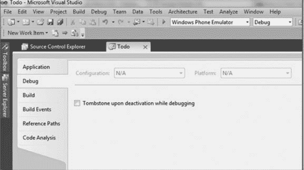

勾选“调试时停用时墓碑化”（Tombstone upon Deactivation While Debugging）复选框将强制应用程序在停用时一致执行墓碑化。取消复选框让应用程序再次使用 FAS。

## 多任务

Mango 发布的最受期待和讨论的功能之一是多任务。在 Mango 中，多任务的含义与标准（PC）多任务略有不同。手机的多任务意味着可以在应用程序未激活时执行其代码，并在后台播放应用程序音频。这是通过后台代理实现的。

除了后台代理，Mango 还引入了在应用程序后台运行时下载和上传文件的 API，以及用于引起用户的提醒和闹钟。您将在本章后面的部分学习这些功能。

## 后台代理

后台代理是在应用程序内“实例化”的类库。它们可以执行周期任务（或资源密集型任务），并从本地文件或音频流播放音频。如图 8-7 所示，开发者提供了创建代理的工具。

启用的音频后台代理即使应用程序关闭也能继续播放声音。这些声音集成到手机的通用控制中，以确保设备用户体验的一致性。音频代理可以从提供的 URL 开始播放，或根据来自通用控制的用户操作（如跳到下一首/上一首）通知应用程序文件/缓冲区完成，以及向应用程序提供播放状态、进度和元数据。

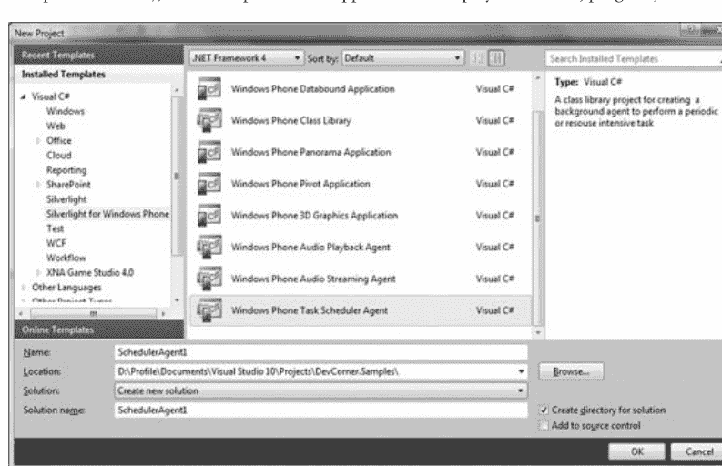

### 代理类型

- **音频播放代理**：帮助创建此类场景：应用程序在该场景中提供要播放的 URL（或 URL 列表），并提供用于跳过以及暂停/恢复/停止的自定义逻辑。
- **音频流代理**：提供原始音频缓冲区。这些缓冲区用于启用需要自定义逻辑在播放前对流进行解密（有时为解压缩）的场景。
- **任务调度器代理**：允许应用程序在处于后台或挂起状态时运行业务逻辑。

应用程序可以创建 `PeriodicTask` 或 `ResourceIntensiveTask`（均来自 `Microsoft.Phone.Scheduler` 命名空间）。这些任务必须在应用程序激活时初始化，但可以在应用程序后台运行时运行。每个类型的应用程序只能有一个任务。

- `PeriodicTask` 每 30 分钟运行一次，持续 15 秒，并被限制消耗不超过 10% 的 CPU 资源和 6MB 内存。
- `ResourceIntensiveTask` 仅在系统处于空闲状态、连接外部电源且可用非蜂窝网络时运行。它可以运行 10 分钟，并被限制使用不超过 6MB 的内存。

此外，这两种任务都受限于一组可以执行的 API。表 8-3 显示了这些限制。

### 表 8-3：任务限制

| 允许 | 受限 |
| :--- | :--- |
| 更新磁贴。 | 显示 UI。 |
| 显示 toast 通知。 | 使用 XNA 库。 |
| 使用位置服务。 | 使用麦克风或摄像头。 |
| 大多数框架 API 使用网络。 | 使用传感器。 |
| 读写隔离存储。 | 播放音频（可能可以使用后台音频 API）。 |
| 使用 socket。 | |

新任务（`PeriodicTask` 或 `ResourceIntensiveTask`）应使用 `ScheduledActionService` 进行注册，并在不需要时移除。

```csharp
private void btnStartStopBgTask_Click(object sender, EventArgs e)
{
    if (isBackgroundTaskEnabled)
    {
        PeriodicTask periodicTask = new PeriodicTask("TheWorker");
        periodicTask.Description = "The worker task";
        periodicTask.ExpirationTime = DateTime.Now.AddDays(1);
        ScheduledActionService.Add(periodicTask);
        isBackgroundTaskEnabled = true;
    }
    else
    {
        ScheduledActionService.Remove("TheWorker");
        isBackgroundTaskEnabled = false;
    }
}
```

在处理代理时，请记住以下点：

- 代理运行时间长达 14 天，之后应当更新，否则将被系统移除。
- 代理在重启后会持久化。
- 用户可以通过系统的控制面板控制代理。
- 周期性代理的总量（系统范围）为 18。

# 通知

Mango 提供了一个新的 API 来创建基于时间的手机通知。这些通知来自两种类型：闹钟（alarms）或提醒（reminders）。

## 闹钟

图 8-8 显示了闹钟类型，它具有以下特征：

- 模态
- 具有“闹钟”和“关闭”按钮
- 启用声音自定义
- 不支持应用程序深度链接调用（即返回特定的导航页面）
- 不支持堆叠

以下代码片段用于创建图 8-8 所示的闹钟：

```csharp
using Microsoft.Phone.Scheduler;

private void AddAlarm(object sender, RoutedEventArgs e)
{
    Alarm alarm = new Alarm("Long Day");
    alarm.BeginTime = DateTime.Now.AddSeconds(15);
    alarm.Content = "Microsoft Annual Company Product Fair 2009*";
    ScheduledActionService.Add(alarm);
}
```

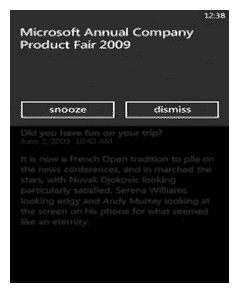

## 提醒

图 8-9 显示了提醒通知，它具有以下特征：

- 提供的信息丰富
- 可以集成其他提醒
- 具有“闹钟”和“关闭”按钮
- 允许深度链接到手机应用程序
- 手机调用全局设置

以下代码片段用于创建图 8-9 所示的提醒：

```csharp
using Microsoft.Phone.Scheduler;

void AddReminder(object sender, EventArgs args)
{
    Reminder reminder = new Reminder("CompanyMeeting");
    reminder.BeginTime = DateTime.Now.AddSeconds(15);
    reminder.Content = "Soccer Fields By The Commons";
    reminder.Title = "Microsoft Annual Company Product Fair 2009";
    reminder.RecurrenceType = RecurrenceInterval.Yearly;
    reminder.NavigationUri = new Uri("/reminder.xml", UriKind.Relative);
    ScheduledActionService.Add(reminder);
}
```

`NavigationUri` 属性允许在用户点击提醒时深度链接到应用程序。

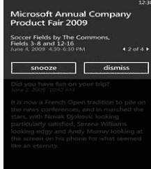

# 后台传输服务

Mango 中一个令人兴奋的功能是后台文件传输，它允许即使应用程序处于休眠或被墓碑化（tombstoned）时也能传输文件（双向——上传和下载）。你可以在应用程序在前台运行时开始文件传输，并在后台完成传输。文件传输将在设备重启后保留。当应用程序启动且一个或多个后台传输完成后，它在重新激活时将接收来自相应后台传输的所有事件。

每个应用程序可以队列最多五个后台传输请求。所有请求都在手机的服务中排队，并按先进先出（FIFO）顺序处理。传输的文件只能从 `/shared/Transfers` 文件夹提供。这意味着在调度上传之前，应将上传的文件复制到此文件夹中，下载的文件将在完成之前放在此文件夹中。文件应由应用程序移动到最终位置。默认情况下，大文件（即超过 20MB 的文件）仅在设备具有 Wi-Fi 连接时才会下载。

传输（双向）通过创建 `BackgroundTransferRequest` 实例并将其添加到 `BackgroundTransferService` 队列来启动，如下所示：

```csharp
void StartDownload()
{
    btr = new BackgroundTransferRequest(remoteVideoUri, localDownloadUri);
    btr.TransferPreferences = TransferPreferences.AllowCellularAndBattery;

    BackgroundTransferService.Add(btr);
    btr.TransferProgressChanged += new EventHandler<BackgroundTransferEventArgs>((s, e) => {
        // handle progress
    });

    btr.TransferStatusChanged += new EventHandler<BackgroundTransferEventArgs>((s, e) => {
        // handle status change
    });
}
```

`TransferProgressChanged` 事件允许你跟踪进度。


```csharp
void btr.TransferProgressChanged(object sender, BackgroundTransferEventArgs e)
{
    double progress = e.Transfer.BytesReceived * 100 / e.Transfer.TotalBytesReceive;
    // update UI
}
```

`TransferStatusChanged` 事件在传输完成时通知你：

```csharp
void btr.TransferStatusChanged(object sender, BackgroundTransferEventArgs e)
{
    if (e.TransferStatus == TransferStatus.Completed)
    {
        btr.TransferProgressChanged -= btr.TransferProgressChanged;
        btr.TransferStatusChanged -= btr.TransferStatusChanged;
        BackgroundTransferService.Remove(btr);
    }
}
```

如所述，大文件默认使用 Wi-Fi。要覆盖此设置，请更改 `BackgroundTransferRequest` 的 `TransferPreferences` 属性：

```csharp
btr.TransferPreferences = TransferPreferences.AllowCellularAndBattery;
```

## INTEGRATION SERVICE

Mango 的变化为终端用户带来了非常有趣的场景和改进，同时保持了手机健康。

## Secondary Tiles

Mango 为应用程序发布多个主屏幕磁贴。

在 Windows Phone 最初发布中，用户可以将应用程序固定到主屏幕，并使用推送通知机制来更新此标题。

随着 Mango 的发布，除了旧机制外，开发者还可以以编程方式将额外的磁贴（辅助磁贴）固定到主屏幕。这些辅助磁贴可以使用推送通知机制更新，当用户点击磁贴时允许深度链接到特定的应用程序页面，并提供两个表面。如果两个磁贴包含数据（在创建时），则磁贴将随机翻转以显示两个面。

以下代码片段用于创建双面磁贴：

```csharp
StandardTileData initialData = new StandardTileData(
  BackgroundImage = new Uri("/images/DEFAULT.png", UriKind.Relative),
  Title = 'Mood',
  BackContent = 'No updates yet',
  BackTitle = 'More info'
);
ShellTile.create(new Uri("/Info.xml?Name=Alex", UriKind.Relative), initialData);
```

创建时提供的 URI 作为磁贴的唯一标识符以及指向应用程序页面的链接。

## Push Notifications

所有 Windows Phone 应用程序都能够订阅推送通知事件。通知由微软推送服务（MPNS）提供，该服务通过唯一的 URI 识别设备。该 URI 在设备订阅推送通知并打开推送通道时生成。

推送通知可能来自三种类型：

- 原始通知——这些通知将传递给应用程序，并在应用程序在前台运行时处理。
- toast 通知——这些通知将在应用程序处于后台时传递给应用程序，并显示在系统通知区域（即设备上方）。
- 磁贴通知——这些通知将在应用程序处于后台时传递给应用程序，并更改应用程序的磁贴（主或辅助）。

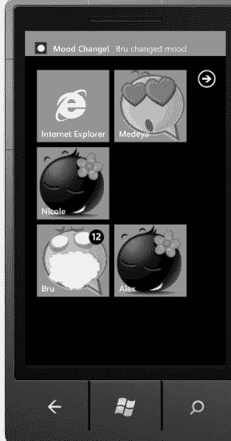

图 8-10 显示了两种类型的后台通知（toast 和辅助磁贴）。

推送通知是以 XML 载荷的形式通过 MPNS 到设备的。发送者通常是某种服务器，尝试用新信息更新相关的客户端应用程序。

要向特定客户端发送通知，你必须准备并发送以下 XML 载荷：

```xml
<xml version="1.0" encoding="utf-8"?>
<wp:Notification xmlns:wp="WPNotification">
  <wp:Title id="THE URL">
    <wp:Background><Count></wp:Background>path="**\</wp:BackgroundImage>
    <wp:Count><Count></wp:Count>
    <wp:Title><title></wp:Title>
    <wp:BackTitle><back side="**\</wp:BackTitle>
    <wp:BackContent><back side="**" content="**\</wp:BackContent>
    <wp:BackgroundImage><back side="**" background="**" image="**\></wp:BackgroundImage>
  </wp:Title>
</wp:Notification>
```

在这种情况下，`id` 属性标识磁贴。主磁贴的值为 `/`，而次要磁贴具有指向实际应用程序页面的值。例如，图 8-10 所示心情应用程序示例磁贴的值为 `/MoodInfo.xml?Name=Alex`。

要向特定客户端发送通知，你必须准备并发送以下 XML 载荷：

```xml
<xml version="1.0" encoding="utf-8"?>
<wp:Notification xmlns:wp="WPNotification">
  <wp:Toast>
    <wp:Text1><string></wp:Text1>
    <wp:Text2><string></wp:Text2>
    <wp:Param>THE URL="**\</wp:Param>
  </wp:Toast>
</wp:Notification>
```

`<URL>` 参数允许在用户点击通知时跳转到特定应用程序页面的深度链接。

## 联系人/日程数据访问

Mango 提供了一个 API 来利用用户的联系人和日程。要搜索日程和联系人，请使用位于 `Microsoft.Phone.UserData` 命名空间下的 `Appointments` 和 `Contacts`。

`Contacts` 类包含了指示提供信息的相应账户的信息。信息通过 `Accounts` 属性检索。它包含一个带有账户类型（通过 `StorageKind` 搜索）和账户名称的账户集合。

可以使用 `SearchAsync` 方法搜索联系人。结果作为 `Contact SearchEventArgs` 类实例返回。它包含一个 `Results` 集合，集合中的每项都包含一个来自 `Microsoft.Phone.UserData` 命名空间的 `Contact` 类实例。它拥有关于联系人的所有信息（如 `PhoneNumbers`、`DisplayName`、`EmailAddresses`、`Companies`）、与此联系人相关的账户，并指示联系人是否固定到起始屏幕（`IsPinnedToStart`）。

以下代码段显示了如何搜索联系人并根据显示名称的首字母对结果分组：

```csharp
contacts = new Contacts();
contacts.SearchCompleted += contacts_SearchCompleted;
contacts.SearchAsync(String.Empty, FilterKind.None, null);

void contacts_SearchCompleted(object sender, ContactsSearchEventArgs e)
{
    // 根据显示名称的首字母对所有账户分组
    var itemsSource = e.Results.GroupBy(c => c.DisplayName.First())
    .OrderBy(group => group.Key)
    .Select(group => new ContactsGroup(group));
}
//...
```

与 `Contacts` 类类似，Windows Phone API 命名空间用于搜索用户的账户。`Appointments` 的初始化方式与 `Contacts` 类相似，如下：

```csharp
appointments = new Microsoft.Phone.UserData.Appointments();
appointments.SearchCompleted += new
    EventHandler<AppointmentsSearchEventArgs>
    (appointments_SearchCompleted);
```

要开始搜索，调用 `SearchAsync` 方法，它会异步搜索指定的开始日期/时间与结束日期/时间之间的日程。以下代码段搜索未来 5 天内所有账户中的日程：

```csharp
appointments.SearchAsync(DateTime.Now, DateTime.Now.AddDays(5), null);
```

`SearchCompleted` 事件返回用于搜索当前结果集的开始和结束日期/时间。`Results` 集合中的每项都包含一个来自 `Microsoft.Phone.UserData` 命名空间的 `Appointment` 类实例。它拥有关于日程的所有信息（如 `Location`、`Organizer`、参与者列表、`Subject` 等）。

## 总结

Windows Phone 7 的 Mango 版本为开发者提供了许多新功能，并开启了许多新的有趣场景。与原始 Windows Phone 发布版本的功能相结合，它展示了一个强大（且简单）的机制，用于创建现代移动应用程序并利用现代设备的力量。它引入了令人兴奋的用户场景，从使用内置传感器控制应用程序和执行后台活动，到在主屏幕上显示多个应用程序磁贴并通过推送通知更新它们。

## 关于作者

Alex Golesh 是 Sela Group 的高级架构师兼 Silverlight 部门经理。他是一位国际专家，专长 Silverlight、Windows Presentation Foundation (WPF)、Windows Phone 7 和 XNA。Golesh 目前为以色列及全球的各类企业提供咨询，设计并开发富网络应用程序 (RIA) 和基于智能客户端的解决方案。他一直为微软（华盛顿州雷德蒙）的各个产品组开发训练示例和课程。他在全球范围内讲座和工作坊，并领导 RIA、智能客户端和 Windows Phone 7 领域的项目。他曾作为 Microsoft 早期采用计划的一部分，在印度、瑞典和波兰进行 WPF 和 Silverlight 培训。他荣获微软 Silverlight 价值专业人士 (MVP)。

# 9 务实服务

## 与 WCF 的通信

作者：Christian Weyer

Windows Communication Foundation (WCF) 已经出现多年了。它的初身是 2006 年随着 .NET 3.0 出现的。但现在我在软件领域仍然遇到许多不知道它、更不用说使用它的人。每当你需要考虑设计和实现分布式应用时，WCF 是主要的选择之一——无论你是讨厌它还是喜爱它。本章展示了基于 WCF 的一些务实方法和实现。本章的内容超越了典型的介绍，也超越了其他书籍中的常识。

> 请注意，本章既不是 WCF 的入门教程，也不是一份全面的“WCF 之书”参考，而是介于两者之间的。

248 | 第 9 章 与 WCF 的通信

为了给分布式面向服务应用中的各种问题提供务实的解决方案，让我们使用一个示例项目来说明需求和策略。

示例场景是一个电影集合管理系统。终端用户可以浏览电影数据、查看电影海报并流媒体播放喜爱的预告片。本章中的示例项目——也被称为基于操作的服务导向（后文将介绍）。

你可以从本书的配套网站（`www.wrox.com`）下载该电影数据库应用程序系统的完整源代码，以及 `Thinkecture.ServiceModel` 库。

> 本章使用的示例应用程序场景无疑引起读者的讨论。这是因为它听起来和看起来像一个典型的资源建模候选者（有些人可能想称之为 REST-）。尽管如此，我选择它有两个原因：它提供了大量的典型需求待实现，并且它是演示如何务实地使用多种 WCF 特性的良好载体。

## 这里没有任何安全性！

构建分布式应用的一个重要且至关重要的方面显然是安全性。各种层面的安全性——身份验证和授权是最显眼的——必须从开始就进行规划。好吧，有时在某些情况下，你可以将安全性“直接倾倒”到应用程序中，但通常情况下是不可能的。

对于本章以及演示应用程序，安全性被完全忽略了。然而，第 10 章“使用 Windows 身份基础 (WIF) 安全 WCF 服务”很好地解释了为什么你应该使用 Windows 身份基础 (WIF) 引入的安全模型，以及你如何使用基于 WCF 的客户端和服务端来实现它。

## 重新审视服务导向

在动手接触 WCF 之前，我应该画一下我设计和构建分布式应用的蓝图。在 80% 到 90% 必须解决问题并用分布式软件系统组件提供解决方案的情况下，我画的是这种蓝图。这意味着还有其他情况。这并不意味着规则有例外，因为根本没有所谓的规则。它的意思是还有另一种（但不同的）处理方法，你将在本章稍后学习到这种方法，届时我将使用那种不同的方法为演示应用程序添加满足某些要求的额外功能。

## 分布式意味着通信

构建分布式应用是不同的。抱歉我这么直率，但事实如此。我仍然遇到一些开发者，他们试图构建运行在不同机器（可能在不同网络）上的应用程序，方式就像他们 10 年前编写过去的面向对象系统的方式一样。以非本地方式实现软件系统的需求日益增长。云仅仅是锦上添花。但坦率地说，这并非全部，尽管它似乎仍然被忽视和轻视。

你们中的许多人知道并记得著名的分布式计算谬误：

- 1. 网络是可靠的。
- 2. 延迟为零。
- 3. 带宽是无限的。
- 4. 网络是安全的。
- 5. 拓扑结构不变。
- 6. 只有一个管理员。
- 7. 传输成本为零。
- 8. 网络是同质的。
- 9. 位置无关。

> 最初的七大谬误是由 L. Peter Deutsch（计算机协会会士）于 1994 年提出的。

很经典，不是吗？你必须稍微多地遵守这些谬误中的几个，即“网络是可靠的”、“延迟为零”、“传输成本为零”、“带宽是无限的”、“网络是安全的”以及“位置无关”。

过去几年中试图帮助开发者构建应用程序的所有编程模型，并没有忽视或违反了这些事实——或者，用另一种说法，是证明了这些谬误。一种本质上面向对象的方法导致了人们认为他们正在做旧的面向对象——用状态和行为对对象进行建模，简单地将它们放在网络上，一切都会很好。

面向对象的方法（如 `DCOM` 或 `.NET Remoting`）假装一切都如以前一样，如果一切都发生在本地的话——没有网络，什么都没有。但经验表明，这通常会失败。我不会埋怪 `.NET Remoting`。你可以使用 `.NET Remoting`（在某种程度上）构建不掉入谬误陷阱的分布式系统。但最终它终是——抱歉，是——仅仅是面向对象的。

开发者需要更多地考虑分布性。不可避免地，分布意味着通信。而通信意味着你必须考虑并处理那些你以前可能不需要处理的事情。

> 如果现在的软件架构师和开发者从未构建过非本地软件，他们被迫重新思考。即使你现在没有计划分布，你也必须为了以后考虑分布性进行设计。

所以，似乎 WCF 的出现是为了解决所有这些问题并帮助开发者的，对吧？好吧，既是也不是。就像其他框架（或基础）一样，WCF 是一项简化某些分布式路径的基础设施。但通常，WCF 是不够的。你必须构建一个生态系统（或在其之上）来充分构建分布式系统。此外，WCF 并不总是让你的生活变得更容易。它既太简单（容易出错，并且仍然以对象的方式思考并在本地操作）又太复杂。

（如果你已经处理过它，你可能仍然会对海量的功能、它的配置地狱，或者通常不切实际的默认设置而感到反胃。）

但是，正如你在本章中学到的，WCF 在这里——它存在于 .NET Framework 中，并有完整的产品支持——而且不会消失。（祈祷好运吧）。作为解决方案架构师或开发者，你需要对分布式应用有一个清醒的认识，并拥有关于 WCF 的实实知识来构建构建解决方案。

那么，是什么让 WCF 运行的？为什么它是构建分布式应用的良好选择？它提供了一个关于你如何思考如何对你的应用程序进行建模的基本思想。

## 服务导向

WCF 是建立在概念和简单服务之上的。

服务是一种对功能进行建模的逻辑手段（根据当前的业务问题你的应用程序必须提供的某些），这些功能以某种方式组合在一起，使得这些功能可以容易地设计、实现、测试和评估。也许可以将服务看作对象和组件之上的抽象。如果你将服务视为另一种抽象，它们实际上并不是什么新东西；它们只是软件设计中的一种逻辑抽象。

以服务进行设计意味着关注你软件的业务端（但要考虑到通信），以便对功能进行更好的封装，并与整体架构中的其他部分解耦。

话虽如此，服务和服务导向与 XML、Web 服务或分布式应用中众所知的客户端-服务器没有关系。

> 服务包含什么？一个简单的定义

服务是一种通过表达显式边界来设计相关业务功能的手段。消费者通过发送和接收持有相关数据的消息来与服务通信，以满足业务需求。

这意味着，在服务世界中，你通常不需要考虑技术平台。你不会用 Java 或 .NET 编程结构和数据类型来思考。在第一阶段，你应该关心的是架构基础，而不是实现技术。

如果你环顾四周，实现服务的两种方式集中在以下设计方法：


- 操作导向——这意味着你用一个显式接口对服务建模。此服务（如前所述）可以接收消息和发送消息。现在，如图 9-1 所示，操作将数据、消息以及通过端点在服务消费者和服务本身之间进行通信所需的消息交换模式分组。这可能符合更传统的思维，不会引起太大的摩擦。（祈祷好运吧！）

- 资源导向——这种方式服务采取了完全不同的方法。它与 Web、HTTP 和超文本的想法和概念保持一致。你将服务建模为一个显式暴露和可见的状态机（有人想听听 REST 吗？），它将通过通用接口进行访问和触发。这种方法非常强大，但老实说，它为大多数开发者创造了严重的摩擦。


采取务实的方法设计服务可以获得最好的结果。充足的务实精神意味着你必须意识到两种服务风格，并知道在给定的框架下你可以实现什么。

> .NET Framework 4.0 中的 WCF 支持经典的基于操作的设计方法和一种众知的服务建模方法。但不称之为 REST，让我们称之为 Web 编程模型。（这正是微软实际上所称呼的。）在 WCF 中，这是两种互为补充的方法，并在 WCF 编程和托管模型中存在冲突——无论这是好是坏。

## WCF 基础 101

在对服务世界进行简要介绍后，现在开始开启 WCF 之旅。因为 WCF 关乎通信，所以从建立一些共同基础开始，以帮助理解这一通信基础。但不要害怕——这不是 WCF 的介绍。这是一个快速的回顾，重点关注 WCF 的核心部分。

> 你必须掌握 WCF 的基本思想和概念才能在本章中乐趣。

## 工具集

在过去的几年里，你一定听过微软关于 WCF 的“儿童游戏”营销类比——它就像 A-B-C 一样简单！事实证明这是一种误导性的信息。

让我们立即看看 WCF 如何思考服务、消费者、消息和端点，如图 9-2 所示。

## WCF 基础 101 | 253

| 客户端 | 服务 |
| --- | --- |
|  |  |
| 地址 | 绑定 | 契约 |
| --- | --- | --- |
| 在哪里？ | 如何做？ | 什么？ |

图 9-2：WCF 如何看待消费者、消息和端点

WCF 服务暴露端点。一个端点由 A、B 和 C 组成。非常简单！但对我来说，缺少了一个关键部分。图 9-3 显示了该图的另一个版本。

| 客户端 | 服务 |
| --- | --- |
|  |  |
| 地址 | 绑定 | 契约 |
| --- | --- | --- |
| 在哪里？ | 如何做？ | 什么？ |
| 行为 | |
| --- | |
| 本地行为 |

图 9-3：定义成功与失败的 WCF 属性

使用 WCF，你必须了解 A、B、C 和 b。正如这里解释过的，这些是决定成功与否的属性。

- **地址 (Address)** —— 显然，消费者必须知道将消息发送哪里。这就是端点地址的意义。

- **绑定 (Binding)** —— 这一开始就很难理解。让我们先把它推后。它在本章稍后会详细讨论。

- **契约 (Contract)** —— 契约是交换消息双方之间的协议，规定了数据、消息以及消息模式的形式。

- **行为 (Behaviors)** —— 通过行为，开发者可以向端点或整个服务注入本地功能。通常，这种行为（如实例化或线程）不会暴露给端点。

> 噢，但泄漏抽象法则（LOLA）无处不在！www.joelonsoft.com/articles/LeakyAbstractions。

想要从标准配置之外的 WCF 中获得更多，你必须理解 B —— 绑定及其力量。

## B 的力量

许多人尝试解释“绑定（binding）”这个词。简单来说，它是将通信契约绑定到底层的物理通信环境中，以及协议（包括应用层协议）。真正重要的“东西”不是绑定本身，而是绑定元素（binding element）。一个绑定由一组绑定元素栈组成。

图 9-4 显示了绑定的心理模型，其中绑定元素是从基本族（传输协议、消息编码器以及应用层协议和功能）中选择的。

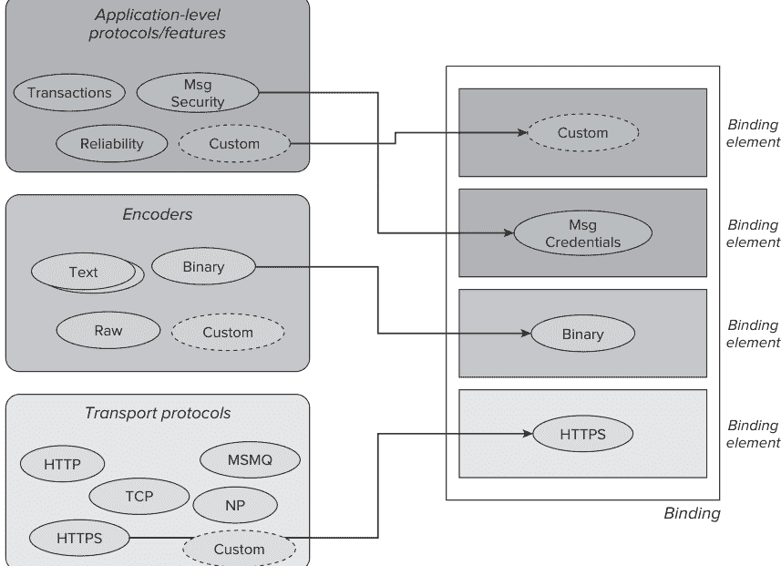

图 9-4：绑定中的元素栈

## WCF 基础 101 | 255

图 9-4 显示了一个自定义绑定，在栈表示法中看起来如下：

- 自定义协议功能（例如，某些自定义的关联基础设施）
- 消息凭据
- 二进制消息编码器（带有 SOAP 1.2）
- HTTPS

另一方面，如果你查看著名的 `basicHttpBinding` 的绑定元素，它将解析为以下绑定元素：

- 消息编码器（带有 SOAP 1.1）
- HTTP

你可以使用以下简单的代码片段查看任何绑定的元素：

```
var binding = new BasicHttpBinding();
BindingElementCollection bindingElements = binding.CreateBindingElements();
```

如图 9-5 所示，你可以查看调试器来证明这一主张。


图 9-5：通过调试器证明主张

你对标准绑定的设置和配置越了解，对自定义绑定以及可用绑定元素了解越多，你就能从 WCF 中获得越多——并爱上它（或者至少重视它）。将绑定的力量与通过行为实现的灵活性结合，你就是 WCF 的大师。

> 如果你想用某些预定义的配置封装并打包自定义绑定，可以通过派生 `Binding` 类来创建一个用户定义的绑定。

## 少即是多

最后，但同样重要的是，让我们澄清一下你可能在本章目前已经从字里行读出的事情：WCF 是强大的。实际上，WCF 是“功能繁多的”。如果你使用方法不对，WCF 是复杂的。

使用 WCF 成功的规则是“少往往是真正的实多”。不要让 WCF 海量的功能和潜在的 XML 配置让你大脑宕机。如果你非常熟悉你的工具集，它就会按照你的意路运行。

现在，进入通信的大海吧。

## 应用场景

如前所述，本章利用了一个具体的示例应用场景。看看该应用程序的需求、它是如何设计的，以及涉及的软件制品结构是怎样的。在这一节之后，你应该就能运行起来，准备好应对在本章早期承诺的一些真实世界验证过的技巧了。

## 需求

让我们从定义这里讨论的应用程序的需求和背景开始。

应用程序系统的主要需求列表如下：

- 浏览电影数据库数据（结构化信息）
- 流传输电影海报（非结构化数据）
- 流传输电影预告片（非结构化数据）
- 用户界面 (UI)
- 通过请求-响应实现扩展性和松耦合
- 应用程序架构

考虑到这些需求，现在来看架构。

## 应用程序架构

图 9-6 显示了示例的高级视图。第一个服务负责电影。第二个服务负责媒体。


**图 9-6：** 应用程序架构的高级视图

## 应用程序结构

通常，书中的示例只是示例。因此，它们遗漏了一些在实际项目中通常需要考虑和实现的更有趣的内容。其中一个有趣的点是 Visual Studio 中的解决方案结构和项目结构。

一段时间以来，我开发了一套划分我的面向对象的分布式应用程序各个部分的常用方法。也许你会喜欢这种方法，因此，让我们仔细看看。

图 9-7 显示了示例的 Visual Studio 2010 解决方案结构。


**图 9-7：** Visual Studio 2010 解决方案结构

- **Libs（库）** —— 本章介绍的一些有趣功能和技巧都位于一个名为 `Thinktecture.ServiceModel` 的辅助类库中。
- **Services（服务）** —— 将此视为整个系统的核心。在这里，你可以找到服务外观（service façades）的实现，以及用于从数据库获取和保存数据以执行某些逻辑的服务内部业务实体。这些实体被实际的业务逻辑使用（在该应用程序中，逻辑是薄的）。
- **Tests（测试）** —— 电影应用只有一个测试项目，其中包含了不同的集成测试和一些单元测试。

我应该提一下电影应用中使用的数据库。一个目标是避免在对象关系映射（ORM）以及应该使用哪种 ORM 技术上引发冲突。所以，基本上我有两个选择：将数据写入磁盘并从那里重新获取，或者使用类似文档的数据库。我选择了后者（并希望不要在该战场上引发冲突），选择了 RavenDB。之所以选择它是因为它可以以嵌入模式运行，而且简单的 API 使其成为本章示例的理想人选。

> RavenDB 非常强大，并且可以作为服务本身运行在 IIS 内部 —— 但这里没有使用任何数据库服务器功能。

现在让我们深入研究使用 WCF 进行分布式应用程序编程的架构基础 —— 服务建模。

## 服务建模

每个面向服务的应用程序都应该从为称为“服务”的应用程序部分设计明确边界开始。

显然，第一步是识别你需要的服务，以及它们提供和接受哪些数据。这是业务相关分析和设计的一部分。它与技术（甚至与服务架构）几乎没有关系。这是一个不同客户、不同项目、不同用例之间差异很大的过程。而且，它可能受到某些技术限制和要求的影响。协调这一切是良好的分布式应用程序架构的任务。

在以 WCF 为核心思维的服务世界中，合约（contracts）是你必须首先考虑的最部分。

## 合约

在 WCF 中，你有两种建模合约的方法。一种是首先使用 XML Schema 定义（XSD）和 Web 服务定义语言（WSDL），然后让工具为你生成 WCF 特有的代码。另一种方法是从思考服务合约的形状和需求开始，然后使用 WCF 基于属性的语法对其进行定义。

这两种方法可以导致相同的结果。然而，事实证明，后者可能会误导开发者过度思考面向对象编程（即，从对象的角度）。开发者随后倾向于推断这个魔法般的运行时可以调用 WCF 处理一切，而且它总是是正确的。本章的其余部分将重点关注这种方法（使用属性），用以明确决定你谈论的是数据和服务，而不是对象和指针。

以下是建模 WCF 合约时使用的若干种产物：

- **服务合约（Service contracts）** —— 这本质上是服务的语义描述的壳，表示接口定义。
- **操作（Operations）** —— 操作构成了要使用的消息交换模式。
- **消息（Messages）** —— 你可以在操作中使用一种原始消息类型来处理。
- **消息合约（Message contracts）** —— 你可以通过消息合约类型，通过头部和正体（根据 SOAP）来影响消息在传输线上的样子。
- **数据合约（Data contracts）** —— 通常，在和服务消费者之间传输的数据是由数据合约建模的（通常称为数据传输对象，DTOs）。
- **故障合约（Fault contracts）** —— 你可以显式地建模故障数据，表示错误情况并携带足够的数据供消费者处理。

现在看看这些产物中的一些，并检查你拥有的选项以及你需要的选项。

## 服务合约

如果以后，仅服务合约是你在 WCF 中建模服务时所需的唯一合约。当遵循 WCF 元数据驱动建模方法时，在你的接口类型上标记 `ServiceContract` 属性。

> 我也看到人们在类上标记 `ServiceContractAttribute`，但我并不喜欢。服务模拟了一个 (.NET) 接口，如果我想在共享合约程序集中中使用该合约（如本章稍后所示），我可以在标记接口时这样做，而不是在服务类上标记。

`ServiceContractAttribute` 类有几个可以设置的参数。表 9-1 帮助你关注重要的参数（即你至少应该设置的参数）。

## 表 9-1：核心 ServiceContractAttribute 属性

| 属性名称 (PROPERTY NAME) | 描述 (DESCRIPTION) |
| --- | --- |
| Name | 服务合约的名称。这将投影到以 XML 为中心的元数据中（在此情况下为 WSDL 属性）。如果未设置，它将默认派生自 .NET 类型名称。 |
| Namespace | 服务合约的 XML 命名空间。这将投影到 XML 元数据中（WSDL）。如果未设置，它将派生自标记类型所处的 .NET 命名空间。 |
| ConfigurationName | 快捷名称。如果设置了此项，你可以使用此别名在配置中的节点定义中指定合约。 |

考虑到这些，你现在可以像这样开始电影服务的合约定义：

```csharp
namespace MovieServiceContracts{
    [ServiceContract(Name = "MovieService",
    Namespace = MovieServiceConstants.ServiceNamespace,
    ConfigurationName = "IMovieService")]
    public interface IMovieService
}
```


当然，没有任何操作的服务合约没有太大意义。

## 操作合约

特别是对于服务，通过 WCF，你可以从几种消息交换模式（MEPs）中进行选择：

- 单向 (One-way)
- 请求-响应 (Request-response)
- 询问-响应 (Solicit-response)
- 双工 (Duplex)

最常见的是请求-响应。这是一种可选发送数据并可选接收数据的阻塞调用。我说是“可选的”，是因为数据可能是空的。

以下是带有请求响应的完整服务合约：

```csharp
namespace MovieServiceContracts
{
    [ServiceContract(Name = "MovieService",
    Namespace = MovieServiceConstants.ServiceName,
    ConfigurationName="MovieService")]
    public interface IMovieService
    {
        [OperationContract(Name = "AddMovie",
        Action = "AddMovie", ReplyAction = "AddMovie")]
        void AddMovie(MovieDetailsData movie);

        // Update...
        // Delete...

        [OperationContract(Name = "ListMovies",
        Action = "ListMovies", ReplyAction = "ListMovies")]
        List<MovieData> ListMovies(PagedRequest);

        [OperationContract(Name = "GetMovie",
        Action = "GetMovie", ReplyAction = "GetMovie")]
        [FaultContract(typeof(NoSuchMovieFault))]
        MovieDetailsData GetMovie(string movieId);
    }
}
```


代码 `Contracts/MovieServiceContracts/IMovieService.cs` 可从 Wrox.com 下载。

再次，与服务合约类似，服务的操作（表示为接口的方法）被标记了 `[OperationContract]` 属性。该属性也有一些相似的属性，如表 9-2 所示。

## 表 9-2：核心 OperationContractAttribute 属性

| 属性名称 (PROPERTY NAME) | 描述 (DESCRIPTION) |
|---|---|
| Action | SOAP 操作动作和操作输入消息动作。这将投影到 XML 元数据中（WSDL）。如果未设置，它将派生自 .NET 方法名称。 |
| Name | 操作名称。这将投影到以 XML 为中心的元数据中（在此情况下为 WSDL 操作名称）。如果未设置，它将默认派生自 .NET 方法名称。 |
| ReplyAction | 操作输出消息动作。这将投影到 XML 元数据中（WSDL）。如果未设置，它将派生自 .NET 方法名称。 |

如果你有密集的 I/O 密集型服务（例如与本地资源进行通信的业务，如其他服务或数据库），那么这种异步编程模型可以使用于服务端。消费者端也是如此。如果你想轻松地将操作调用放入后台并将其与你的 UI 线程解耦，那么这种编程模型可以为你提供帮助。

以下是所创建的服务和操作合约的简单异步版本：


```csharp
namespace MovieServiceContracts {
    [ServiceContract]
    public interface IMovieServiceAsync {
        [OperationContract(
            Name = "AddMovie",
            Action = "AddMovie",
            ReplyAction = "AddMovieReply",
            AsyncPattern = true)]
        IAsyncResult BeginAddMovie(MovieDataContracts.MovieDetails movie, AsyncCallback callback, object asyncState);
        void EndAddMovie(IAsyncResult result);

        [OperationContract(
            Name = "ListMovies",
            Action = "ListMovies",
            ReplyAction = "ListMoviesReply",
            AsyncPattern = true)]
        IAsyncResult BeginListMovies(MovieDataContracts.PagedRequest request, AsyncCallback callback, object asyncState);
        System.Collections.Generic.List<MovieDataContracts.MovieData> EndListMovies(IAsyncResult result);

        [OperationContract(
            Name = "GetMovie",
            Action = "GetMovie",
            ReplyAction = "GetMovieReply",
            AsyncPattern = true)]
        IAsyncResult BeginGetMovie(string movieId, AsyncCallback callback, object asyncState);
        MovieDataContracts.MovieDetails EndGetMovie(IAsyncResult result);
    }
}
```


WCF 异步编程模型有多种变体。你可以在 <http://msdn.microsoft.com/en-us/library/ms73401.aspx> 找到概述和解释。顺便说一下，随着 C# 中即将推出的 `await` 模式，故事将会变得更好。

代码文件 `Contracts/MovieServiceContracts/IMovieServiceAsync.cs` 可在 Wrox.com 下载。


# 264 | 第 9 章 使用 WCF 进行实用的服务通信

最重要的部分是 `[OperationContract]` 属性的 `AsyncPattern` 属性。这表示该操作将以不同的方式处理。它通知运行时，`Begin` 方法有一个符合 .NET 框架异步设计模式的匹配 `End` 方法。注意，`OperationContract` 应用于 `BeginXYZ` 方法——生成的在 WSDL 中显示元数据的操作将是 `XYZ`。

那么，你应该总是编写这种冗长且容易出错的异步代码吗？我不这么认为。我很懒。因为你已经在同步版本的合约中拥有了所有必要信息，你可以应用一些自动代码生成的魔术来生成它的异步形式。在大多数情况下，我使用微软的文本模板转换工具 (`T4`) 来实现。此书的可下载代码提供了完整的模板，但以下是根据同步合约生成异步版本的 T4 代码核心部分：

...

```csharp
using System;
using System.ServiceModel;
```


> 代码文件 `Contracts/MovieDetails/IMovieServiceAsync.tt` 可在 Wrox.com 下载。

> T4 内置于 Visual Studio 中。请参见 <http://msdn.microsoft.com/en-us/library/bbl26445.aspx> 了解该主题。

T4 是非常强大的。它是免费的，而且模板生态系统不断增长。现在你已经定义了操作，什么应该进入和离开你的服务？一种方案是指定你可以处理的原始消息。

## 消息

原始是好的。但我所说的“原始”是指什么？在 WCF 中，操作中的原始消息由 `System.ServiceModel.Channels.Message` 类型表示。`Message` 代表了基于 SOAP 消息这一概念的编程模型。你通常在以下情况下使用 `Message`：

- 对消息处理拥有完全控制权
- 在通用接口方法中
- 带有流入或流出服务的流式数据

> SOAP InfoSet 定义在 SOAP1.2 规范 (<www.w3.org/TR/soap12-part>) 中。

有时，你的需求可能是你不想在操作计数中包含强类型消息或数据描述。如果你必须避开序列化器并在服务中实现通用处理操作，那么原始消息可以为你提供帮助。这无疑是使用 `Message` 最简单的操作形式：

```csharp
[OperationContract(Name = "Process", Action = "***", ReplyAction = "***")]
Message Process(Message message);
```

你将在本章稍后学习更多关于流的知识。

## 消息合约

WCF 提供了另一种更紧密地处理实际消息的方法。通过 `[MessageContract]` 属性，你可以标记你的类以模拟 SOAP 消息。我发现现在几乎很少使用 `MessageContract`。如果我想要原始的互操作性，我倾向于使用基于架构的合约优先方法。我可能再次使用消息合约的情况是：流式传输。你将在稍后学习更多相关内容。

> 归根结底，在网络传输中，一切都是消息。在 WCF 流水线中也是如此，一切都是 `Message` 的消息。这取决于你在操作中选择的上下文类型，决定了原始消息是出现，还是由序列化器介入为你提供消息和数据的强类型视图。

现在，让我们来看看服务世界中传输数据最常见的方式：数据合约。

## 数据合约

到目前为止，在 WCF 服务中建模数据最常见的方法是数据合约。通常，数据合约被描述为 DTO 模式的 WCF 实例化。虽然这在技术上是正确的，但我在这里有一个问题。我不使用“对象”这词。

> 关于 DTO 模式的信息，请参阅 Martin Fowler 的 <http://martinfowler.com/dataTransferObject.html>。

在传输中，数据都是数据。由于你已经在同步版本的合约中拥有了所有必要信息，你可以应用一些自动代码生成的魔术来生成它的异步形式。在这种情况下，数据合约定义如下：

```csharp
[DataContract(Name = "Movie", Namespace = "Namespace")]
public class MovieData
{
    [DataMember(Name = "Id", IsRequired = true)]
    public string Id { get; set; }
    [DataMember(Name = "Title", IsRequired = true)]
    public string Title { get; set; }
}
```

代码文件 `Contracts/MovieContracts/MovieData.cs` 可在 Wrox.com 下载。

正如你所看到的，使用属性数据。这些类型位于 `System.Runtime.Serialization` 程序集中。但是，自 .NET 3.5 以来，完全可以省略数据合约属性。但这不是我的做法。我想确保参与设计和实现系统的人知道这是一个特殊的类型。

表 9-3 显示了 `DataContract` 的两个重要属性。

## 表 9-3：DataContract 的属性

| 属性名称 | 说明 |
|---|---|
| Namespace | 数据合约的 XML 命名空间。这将进入 XML 中心的元数据 (XSD)。如果没有设置，它将默认推断自 .NET 命名空间。 |
| Name | 数据合约的名称。如果没有设置，它将默认推断自 .NET 类名。 |

你必须显式指定数据类型中的哪些数据成员应该由 WCF 暴露给外部。这是通过使用 `[DataMember]` 属性实现的。

这种序列化器的行为在 XML 世界中广为人知。以松散的方式，在使用 XML 将其序列化为对象时，它并不要求数据字段到位。这意味着当你的数据合约包含 `Title` 字段，而传入的 XML 不包含它时，序列化器会产生默认值。如果你想强制给定版本的数据合约具有所有数据，你可以指示序列化器要求 XML 中存在某些字段。

如表 9-4 所示，结合此 `Required` 属性，你有 `Name` 属性构成了 `DataMember` 的两个基本属性。

## 表 9-4：DataMemberAttribute 的基本属性

| 属性名称 | 说明 |
|---|---|
| Name | 数据成员/字段的名称。这将进入 XML 中心的元数据 (XSD)。如果没有设置，它将默认推断自 .NET 字段或属性名。 |
| Required | 强制序列化器确保在反序列化时标记的字段存在于 XML 中。 |

在处理完使用数据契约时必须遵守的（必要的）规则后，我们现在进入一些来自实战世界的建议。

保持你的契约精简且高效。不要尝试在数据契约上遵循面向对象编程（OOP）技术，例如疯狂的继承层次结构，甚至是多态。这不关乎 OOP，而关乎数据。这会导致两个不同的（语义相关的）契约中产生冗余数据。这会使得处理不同版本变得更加容易。

例如，在示例应用程序中，除了 `MovieData` 数据契约外，还有一个 `MovieDetails` 数据契约。这个 DTO 包含了关于电影的信息，但刻意没有派生自 `MovieData`，以实现松耦合，在 DTO 之间也是如此。

```csharp
[DataContract(Name = "MovieDetails", Namespace = MovieDataConstants.DataNamespace)]
public class MovieDetails
{
    [DataMember(Name = "Title", IsRequired = true)]
    public string Title { get; set; }
    [DataMember(Name = "Year", IsRequired = true)]
    public int Year { get; set; }
    [DataMember(Name = "Director", IsRequired = true)]
    public string Director { get; set; }
    [DataMember(Name = "Cast", IsRequired = true)]
    public List<ActorData> Cast { get; set; }
    [DataMember(Name = "Genre", IsRequired = true)]
    public string Genre { get; set; }
}
```

> `Contracts/MovieDataContracts/MovieDetails.cs` 可在 Wrox.com 下载。

如果你在想 `Namespace` 属性从哪里来，这只是从一个用于存放常量的常量类中收集的常量字符串值，如下：

> `Contracts/MovieDataContracts/Constants.cs` 可在 Wrox.com 下载。

这基本上就是你关于数据契约需要了解的知识。此外，微软开发人员网络（MSDN）文档和其他书籍有关于这方面的大量信息。但当你采用务实的方法来保持简单，并遵循特定的服务导向思维时，你可能不需要比这里列出的更多的内容。

## 故障契约

服务描述中的另一个重要信息是可能会发生什么种错误，以及错误可以携带哪些数据。面向 SOAP 风格的服务有能力在服务的元数据中描述故障数据。这一功能在 WCF 中也通过故障契约可用。

## 建模服务 | 269

要表示调用操作时会发生哪种或哪些故障，你只需要在操作上标记 `[FaultContract]` 特性，如下所示：

```csharp
[OperationContract(Name = "GetMovie", Action = "GetMovie", ReplyAction = "GetMovieReply")]
[FaultContract(typeof(NoSuchMovieFault))]
MovieDetailsData GetMovie(string movieId);
```

故障契约被描述为数据契约，就像你学过的其他数据契约一样：

```csharp
[DataContract(Name = "NoSuchMovieFault", Namespace = MovieDataConstants.DataNamespace)]
public class NoSuchMovieFault
{
    [DataMember(Name = "MovieId", IsRequired = true)]
    public string MovieId { get; set; }
}
```

操作上的此故障契约信息会被投影到服务的 WSDL 中，而故障数据契约会被投影到 WSDL 使用的 XSD 上。

在服务故障实现中，你可以抛出一个定义的故障契约类型的 `FaultException` 并提供必要的故障数据：

```csharp
throw new FaultException<NoSuchMovieFault>(new NoSuchMovieFault { MovieId = movieId });
```

> 为了使用良好的 WCF 元数据，从而提供良好的互操作性，你应该始终尊重并考虑这里讨论的服务、操作、数据和故障契约的本质属性。这在未来可能会产生丰厚的回报。

## 分页数据

我不知道在真实的软件项目中见过多少次这样建模的操作：

```csharp
[OperationContract(Name = "ListMovies", Action = "ListMovies", ReplyAction = "ListMovies")]
List<MovieData> ListMovies();
```

它看起来很无害，对吧？只需给我电影数据列表和名字就行。给我 10 部电影。很好。给我 100 部电影。可以。给我 10,000 部电影。额…………一切似乎都变慢了，并且倾向于崩溃。

在建模操作时需要记住的一个关键点是考虑限制进入和离开服务的数据。首先，当服务为客户端应用程序提供显示和处理数据的服务时，请求超过 100 或几百项内容显然没有意义。其次，你通过网络发送的数据越多，序列化器（在双方）的工作量就越大，而且它越取决于你的应用程序运行在什么网络上。在操作中对数据进行分页建模是一种良好的风格。

这里展示了一种可能采用的方法：

```csharp
[OperationContract(Name = "ListMovies", Action = "ListMovies", ReplyAction = "ListMovies")]
List<MovieData> ListMovies(PagedDataRequest);
```

这是传递了一个分页数据 DTO，它携带了客户端的信息——即它想要返回给服务的哪些数据以及返回多少。


```csharp
[DataContract(Name = "PagedDataRequest", Namespace = MovieDataConstants.DataNamespace)]
public partial class PagedDataRequest
{
    [DataMember(Name = "PageCount")]
    public int PageCount { get; set; }
    [DataMember(Name = "PageSize")]
    public int PageSize { get; set; }
}
```

> `Contracts/MovieDataContracts/PagedData.cs` 可在 Wrox.com 下载。

## 元数据

显然，不是所有消费者都是良好的公民。让我们谈谈如何向服务暴露元数据。最常见的愿望之一是消除 WCF 中著名的 `http://tempuri.org` 命名空间。这很容易。确保在以下三个地方设置了命名空间：

- `ServiceContract` 上的 `Namespace` 属性，如下：

```csharp
[ServiceContract(Name = "MovieService", Namespace = MovieDataConstants.Namespace, ConfigurationName = "IMovieService")]
public interface IMovieService
```

- `ServiceBehavior` 上的 `Namespace` 属性（如之前通过 .NET 特性提到），如下：

# 建模服务 | 271


```csharp
[ServiceBehavior(Namespace = MovieDataConstants.Namespace,
ConfigurationName = "MovieService")]
public class MovieService : IService
```

- 端点的 `bindingNamespace` 属性（在配置中）或端点的 `Namespace` 属性，如下：

```csharp
var binding = new BasicHttpBinding();
binding.Namespace = MovieDataConstants.Namespace;

host.AddEndpoint(typeof(MovieService), binding, "basic");
```

## 扁平 WSDL (Flat WSDL)

将 WCF 服务暴露给 Java 或 PHP 等平台时，你可能会发现这些平台的 Web 服务工具无法理解 WCF 暴露的 WSDL。这可能是因为 WCF 将 WSDL 拆分为不同的文件。这体现在主 WSDL 中的 `wsdl:import` 和 `xsd:import` 语句中。这就是国外栈（尤其是旧版本）无法处理 WCF WSDL 的原因。

有一个解决方案。几年前，我为 WCF 管道编写了一个扩展，可以将 WSDL 描述展平为没有任何导入语句的文件。该扩展是 WCF 的端点行为，并实现了 `IwsdlExportExtension` 接口。完整源代码是提供的，但后续是 `FlatWSDL` 类的关键部分：

```csharp
public class FlatWSDL : IwsdlExportExtension, IEndpointBehavior
{
```

```csharp
public void ExportEndpoint(WsdlExporter exporter,
WsdlEndpointConversionContext context)
{
    if (exporter.GeneratedWsdlDocuments.Count > 1)
    {
        Trace.TraceError(Resources.ExInconsistentNamespaces);
        throw new InvalidOperationException(Resources.ExInconsistentNamespaces);
    }
```

```csharp
ServiceDescription wsdl =
exporter.GeneratedWsdlDocuments[0];
```

```xml
XmlSchemaSet schemaSet =
texporter.GeneratedXmlSchemas;
Collection<XmlSchema> importsList = new Collection<XmlSchema>();
```

```xml
for (int i = 0; i < wsdl.Types.Schemas.Count; i++)
{
  XmlSchema schema = wsdl.Types.Schemas[i];
  ResolveImportedSchemas(schema, schemaSet, importsList);

  if (schema.Includes.Count == 0 && schema.Items.Count == 0)
  {
    wsdl.Types.Schemas.RemoveAt(i--);
  }
}

while (importsList.Count != 0)
{
  int l1 = importsList.Count - 1;
  wsdl.Types.Schemas.Add(importsList[l1]);
  importsList.RemoveAt(l1);
}
```

```csharp
private void ResolveImportedSchemas(XmlSchema schema,
  XmlSchemaSet schemaSet, Collection<XmlSchema> importsList)
{
  for (int i = 0; i < schema.Includes.Count; i++)
  {
    XmlSchemaImport import = schema.Includes[i] as XmlSchemaImport;

    if (import != null)
    {
      ICollection realSchemas = schemaSet.Schemas(import.Namespace);

      foreach (XmlSchema ixsd in realSchemas)
      {
        if (!importsList.Contains(ixsd))
        {
          importsList.Add(ixsd);
        }
        ResolveImportedSchemas(ixsd, schemaSet, importsList);
      }
    }
  }
  schema.Includes.RemoveAt(i--);
}
```

}

}

代码文件 `Thinkerture.ServiceModel\Wsdl\FlatWsdl.cs` 可在 Wrox 下载。

你需要做的是为你涉及的端点添加此行为。这可以在你的 `ServiceHost` 对象上完成。Thinkerture.ServiceModel 库包含一个自定义的服务主机，它可以为你完成这些底脏工作：

```csharp
private void AddFlatWsdl()
{
    foreach (ServiceEndpoint endpoint in Description.Endpoints)
    {
        endpoint.Behaviors.Add(new FlatWsdl());
    }
}
```

代码文件来自 `Thinkerture.ServiceModel\ServiceHost` 可在 Wrox 下载。

通过上述方法使用此扩展在三个不同的地方使用你的 XML 命名空间，你就可以获得一个扁平化的 WSDL 了，如图 9-8 所示（使用了不同的服务，而不是电影服务）。


图 9-8：使用扩展扁平化 WSDL

## 元数据 URL

在负载均衡器后托管 WCF 服务时，WSDL 描述包含了提供元数据请求的实际 WCF 服务所在机器的 URL。这是 WCF 中一个众知的 Bug，在 .NET 4.0 中已修复。你可以通过简单地为你的服务添加服务行为，强制 WCF 使用请求中的服务器地址并将其插入元数据中：

```xml
<serviceBehaviors>
  <behavior name="metadata">
  <RequestHeadersForMetadataAddress>
    <!--
    <defaultPorts>
      <add scheme="http" port="81" />
      <add scheme="https" port="444" />
    </defaultPorts>
    -->
  </useHeadersForMetadataAddress>
  </behavior>
</serviceBehaviors>
```

针对 .NET 3.5 SP1 的修复也可以见 http://support.microsoft.com/kb/971842 和 http://support.microsoft.com/kb/981002。

此行为修复了问题，使得负载均衡环境和 WCF 能够和谐地共存。

## 基于 SCHEMA 的契约优先建模

在追求高互操作性的场景中，你可能需要改变主意。一种多年来被证明有效的方法被称为“基于架构的优先”（schema-based-first）。

在开发 Web 服务时，以下是通常的步骤：

1. 设计你的契约数据、消息和接口。
2. 从契约生成代码。

第一步可以在代码中完成，也可以使用 XML 和 XSD 完成。事实证明，许多企业级项目更倾向于从 XML 和 XSD 开始。对于许多集成和应用开发场景（不仅是在企业层面），惯例是为 Web 服务协商一个基于 WSDL/XSD 的规范，然后开始实现该规范的实际代码。

然而，处理原始 XML 和 WSDL 很容易出错。特别是 WSDL，处理起来并不简单，因为原始的 WSDL 规范允许定义一些复杂的结构和契约。你需要能够让你在该层级上一致且可靠地工作的工具。

有一些名为 WCF.blue (http://wscfblue.codeplex.com/) 的开源工具可以解决这一需求。

以下显示了基于架构优先的 Web 服务开发涉及的主要步骤。


来源：MSDN 杂志文章 "SCHEMA-BASED DEVELOPMENT WITH WINDOWS COMMUNICATION FOUNDATION" (http://msdn.microsoft.com/en-us/magazine/ee33569.aspx)。

本文讨论不再对该主题进行更多详细介绍。欢迎下载该工具并尝试一下。

本章关于建模、设计和契约的部分就到此为止。现在让我们看看如何真正为你的服务注入生命。

## 实现服务

本节研究了在具有 WCF 思想的世界实现服务时需要注意的一些要点。

在深入细节之前，请确保你理解当前的上下文。在建模完契约后，你就可以准备好实现服务了。这意味着，首先，你必须实现一个如图 9-9 所示的服务外观（Facade）。


图 9-9：服务外观

此外观是一个实现一个或多个服务契约接口的类。在电影示例案例中，它实现了 `IMovieService` 契约。你通常会在外观类上装饰 `ServiceBehaviorAttribute` 来配置基本属性，如名称或命名空间等。

```csharp
[ServiceBehavior(Namespace = MovieService,
ConfigurationName = "MovieService")]
public class MovieService : IMovieService
```

在这个类的方法内部，你不需要任何特定的逻辑或数据访问代码。事实证明，如果你考虑业务逻辑，这种方法不需要外壳，不需要 WCF，不需要分布。

外观是进入服务实现的特定入口点。典型任务包括：

- 身份验证与授权
- 输入验证
- DTO 与内部实体的映射
- 错误处理
- 缓存（如输出缓存）

本节的剩余部分将检查一些重要的任务。（之前提到的将在第 10 章中处理。）

## 验证

你一定记得年轻时和朋友一起去夜店的日子。门口有一个高大男人在检查身份证。

你应该在服务中始终拥有这样一个“门卫”。你应该始终验证输入的数据。服务外观是来自外部世界的中心入口，在对数据进行任何操作之前，你必须确保它符合预期，并且边界内的值也是预期的。（某些情况下，外观可能会与业务级验证冲突。）

部分验证由序列化器处理。但如果你想添加业务级验证，可以通过手动检查进入外观的每个参数，或者使用元数据驱动的方法。一种主意是利用面向切面的框架如 PostSharp (www.sharpcrafters.com/) 将验证逻辑和规则封装到中心实现中。

> 请参见 MSDN 文章“在 WCF 中执行输入验证”http://msdn.microsoft.com/en-us/library/ff647875.aspx。

当然，你可以在 WCF 中运行自己的——这是许多人喜欢 WCF 的原因——许多人正因为这个原因讨厌它。在这种情况下，你将在服务端实现 `IParameterInspector` 或 `IDispatchMessageInspector` 并将其挂接到 WCF 管道中。

## 映射

在本章中多次提到服务契约包含了用于在调用者和被调用者之间交换的数据传输结构。这立即意味着你不希望在服务边缘看到业务实体。这些实体位于服务边界内部，通常更优雅，并且具有比你想通过服务外观暴露更多的功能。

这意味着你必须将数据契约的输入数据映射到自然表示——反之亦然。

不仅在 WCF 中，在使用 ASP.NET 模型-视图-控制器 (MVC) 构建的应用，甚至在使用 WPF 或 Silverlight 构建的客户端项目中，你都会需要映射不同的形状。

将一个对象转换为另一种形状的对象。你实际上是在进行对象到对象的映射。而这个问题已经为你解决好了。

有一些工具和库可以让你的生活变得更轻松。我通常会使用 AutoMapper (http://automapper.codeplex.com/)，但 EmitMapper (http://emitmapper.codeplex.com/) 也是一个不错的选择。这些函数是基于约定的映射器。如果你的对象表示符合这些约定，那么映射实际上某种程度上是线性的。

> 噢，我能听到你在大喊这必须是一个缓慢的操作——在运行时可能通过使用反射发射（reflection emit）来映射对象。是的，确实存在一些开销，你必须决定（通过包含测试）这种开销是否会给你带来困扰。但相信我，在我遇到过的大多数分布式应用程序中，映射器的开销是你最不需要担心的开销。

对于 AutoMapper，第一步是设置目标类型和源类型，如下所示：

```csharp
Mapper.CreateMap<Movie, MovieData>();
Mapper.CreateMap<Movie, MovieDetailsData>();
```

代码文件 `fromBootstrapTasksEntityMapperBootstrapTask.cs` 可在 Wrox.com 下载。

这告诉 AutoMapper 的 Mapper 类，你想从 Movie 映射到 MovieData，以及从 Movie 映射到 MovieDetailsData。Movie 是内部业务实体，看起来如下：

```csharp
public class Movie
{
    private List<Actor> cast;
    private Media mediaFiles;

    public string Id { get; set; }
    public string Title { get; set; }
    public int Year { get; set; }
    public string Director { get; set; }
    public string Genre { get; set; }
    public List<Actor> Cast
    {
        get
        {
            if (cast == null)
                cast = new List<Actor>();
            return cast;
        }
        set
        {
            cast = value;
        }
    }
}
```

```csharp
public Media MediaFiles
{
    get
    {
        if (mediaFiles == null)
            mediaFiles = new Media();
        return mediaFiles;
    }

    set
    {
        mediaFiles = value;
    }
}
```

代码文件 `Entities/Movie.cs` 可在 Wrox 下载。

设置此方向的路由非常简单——但反向情况呢？即你想将 MovieData 映射到 Movie 的情况。MovieData 的数据字段比 Movie 实体少得多。在这里你必须告诉 AutoMapper 忽略那些字段，如下所示：

```csharp
Mapper.CreateMap<MovieData, Movie>()
    .ForMember(dest => dest.Cast, opt => opt.Ignore())
    .ForMember(dest => dest.Director, opt => opt.Ignore())
    .ForMember(dest => dest.Genre, opt => opt.Ignore())
    .ForMember(dest => dest.Year, opt => opt.Ignore())
    .ForMember(dest => dest.MediaFiles, opt => opt.Ignore());
```

代码文件 `BootstrapTasks/EntityMapperBootstrapTask.cs` 可在 Wrox 下载。

设置好映射后，你可以在需要从一个对象映射到另一个对象时，随时调用 Mapper 上的 Map 方法即可。在电影示例中，创建了一个辅助类，在源类型上定义了几个扩展方法。这使得映射变得超级。


## 实体映射器

```csharp
public static MovieData Map(this Movie movie)
{
    return Mapper.Map<Movie, MovieData>(movie);
}

public static Movie Map(this MovieDetailsData movieDetails)
{
    return Mapper.Map<MovieDetailsData, Movie>(movieDetails);
}

public static MovieData Map(this MovieData movieData)
{
    return Mapper.Map<MovieData, Movie>(movieData);
}

public static MovieDetailsData MapAll(this Movie movie)
{
    return Mapper.Map<Movie, MovieDetailsData>(movie);
}

public static List<MovieData> Map(this List<Movie> movie)
{
    return Mapper.Map<List<Movie>, List<MovieData>>(movie);
}
```

代码文件 `MovieServices\EntityMapper.cs` 可在 Wrox.com 下载。

AutoMapper 可以是一个真正的省力利器，但你应该明智地使用它。

## 追踪

追踪功能某天可能会救你的命——当应用程序运行良好并发生异常时，一切都没问题。但当发生意外情况时，如果你能获得关于哪里出错以及为什么的信息，你就很幸运了。在基于服务的应用程序中，架构的核心部分是“无头”的——没有 UI，没有地方弹出对话框或显示错误页面。

WCF 内置了追踪功能，它是基于 .NET Framework 的追踪基础架构构建的。每当我收到客户端的电话或邮件，且基于 WCF 的应用程序运行不符合预期时，我建议他们开启追踪——事实上，也许 80% 的问题通过查看追踪日志立即解决了。

因此，第一件事是有一个配置片段来在 WCF 中开启追踪（将在托管项目中完成。你将在后面的章节学习更多关于托管的内容）。

```xml
<system.diagnostics>
  <sources>
    <source name="System.ServiceModel"
      switchValue="Warning, ActivityTracing"
      propagateActivity="true"/>
    <listeners>
      <add name="System.Diagnostics.DefaultTraceListener" />
    </listeners>
  </sources>
</system.diagnostics>
```

```xml
<system.diagnostics>
  <sources>
    <source name="System.ServiceModel"
      switchValue="Warning, ActivityTracing"
      propagateActivity="true"/>
    <listeners>
      <add name="System.Diagnostics.DefaultTraceListener" />
    </listeners>
  </sources>
  <sharedListeners>
    <add name="EventLogTraceListener"
         type="System.Diagnostics.EventLogTraceListener"
         initializedData="mdb Movies" />
  </sharedListeners>
</system.diagnostics>
```

代码文件 `MovieWindowsServiceHost?app.config` 可在 Wrox.com 下载。

现在，你的代码正在输出跟踪数据。如果你采取下一步，将来自服务的跟踪数据和来自 WCF 的跟踪数据结合，你甚至可以在 WCF 服务跟踪查看器工具中查看所有内容，并使用它的过滤或搜索等功能。

我是否已经告诉过你，这些跟踪可以救你的命？

如果你没有实际提供服务供消费，那么所有精美的计数和外观都几乎毫无用处。所以，让我们跳到托管它们吧。

## 托管服务

诚然，上一节的讨论已经暗示并使用了托管功能。因此，现在是时候介绍为你的 WCF 服务提供托管选项了。WCF 提供了多种托管应用程序的选项，了解何时使用何种选项、以及在何处挂钩主机逻辑以充分利用 WCF 的优势是有益的。

## 自定义托管

独立于你正在使用的托管方法（本节将介绍这些方法），在某一点，你会感到需要挂钩到创建 WCF 服务的过程中。通过派生 `ServiceHostFactory` 或 `ServiceHostFactoryBase` 实现自定义服务主机，你将获得什么。

通过服务主机，你可以在自托管和 Web 托管环境中拦截服务的启动阶段。通常，服务主机会与实现实际累加的自定义服务主机配合使用。

```csharp
public class MovieServiceHost : ServiceHost
{
    protected override ServiceHostBase CreateServiceHost(
        string constructorString, Uri[] baseAddresses)
    {
        var host = base.CreateServiceHost(constructorString, baseAddresses);

        // 在此处应用你的逻辑...
        return host;
    }
}
```

```csharp
public class MovieServiceHostFactory : ServiceHostFactory
{
    protected override ServiceHost CreateServiceHost(
        Type serviceType, Uri[] baseAddresses)
    {
        var host = base.CreateServiceHost(serviceType, baseAddresses);

        // 应用你的逻辑...

        return host;
    }
}
```

代码文件 `Hosting\MoviesServiceHostFactory.cs` 可在 Wrox 下载。

自定义可能包括以下内容：

- 添加一些标准端点或端点配置
- 挂钩服务不需要感知的正交功能
- 添加一些启动或引导逻辑（在本节稍后的部分进行检查）
- 为依赖注入容器提供入口

现在，既然你已经掌握了服务主机工具，是时候检查托管选项了。

## 使用控制台主机进行测试

你们中有些人可能认为我疯了——但这是一个真实的故事。一个客户给我们打电话，说他们的服务器不再可用，且客户端应用程序抛出了异常。在检查了几个可能的错误情况后，我们发现他使用控制台主机来运行服务。是的，事实证明他没有最小化控制台窗口，而是关闭了它但他并没有意识到。

控制台主机仅用于演示和简单测试——仅此而已。当我在书中使用控制台主机时，可能是我可以更容易地展示某些内容。在现实生活中，WCF 服务被设计为服务器功能，应该托管在本讨论概述的健壮环境中。

## 使用 Windows 服务自托管

在基于服务的分布式应用中，在某些情况下，你希望控制托管环境。此外，某些服务封装并暴露了长时间的业务过程，这些过程与短请求-响应式的通信是不兼容的。如果你属于这一营，那么将你的 WCF 服务托管在 Windows 服务中是最佳选择。

电影数据库示例还包含一个 Windows 服务项目，包括一个使用常用 Windows 工具安装 Windows 服务的安装程序，如图 9-10 所示。


**图 9-10：Windows 服务项目**

由于控制台主机用于测试和向其他开发者展示内容，而 Windows 服务主机在它的行为上必须是健壮的。在打开 `ServiceHost` 实例时，你应该捕获所有异常并进行跟踪——你知道的，Windows 服务甚至是“无界面”的。停止服务也是如此。此外，处理托管 Windows 服务的 `AppDomain` 上的未处理异常事件是明智的。

所有这些都在电影数据库示例的 Windows 服务主机中实现。

```csharp
public partial class MovieServiceHost : ServiceBase
{
    ServiceHost host;
    ServiceHost streamingHost;

    public MovieServiceHost()
    {
        InitializeComponent();
        AppDomain.CurrentDomain.UnhandledException +=
            new UnhandledExceptionEventHandler(CurrentDomain_UnhandledException);
    }

    protected override void OnStart(string[] args)
    {
        try
        {
            Directory.SetCurrentDirectory(AppDomain.CurrentDomain.BaseDirectory);

            var host = MovieServiceFactory.GetDefault();
            host.SetupMovieServiceHost();
            host.Open();

            var streamingHost = MediaServiceFactory.GetDefault();
            streamingHost.SetupMediaServiceHost();
            streamingHost.Open();
        }
        catch (Exception ex)
        {
            // ...
        }
    }

    protected override void OnStop()
    {
        try
        {
            if (host != null)
            {
                host.Close();
            }
            if (streamingHost != null)
            {
                streamingHost.Close();
            }
        }
        catch (Exception ex)
        {
            Trace.TraceError("停止时出错: {0}", ex.Message);
        }
    }

    private void CurrentDomain_UnhandledException(object sender, UnhandledExceptionEventArgs e)
    {
        Trace.TraceError("出错: {0}", (Exception)e.ExceptionObject);
    }
}
```

代码文件 `MovieWindowsServiceHost.cs` 可供下载。

还有另一层你可以挂钩的错误处理。`ServiceHost` 基类定义了几个可能需要的事件，如下：

- `Faulted`
- `MessageReceived`

在 Windows 服务中托管时，一种推荐的安全实践是使用低权限用户账户运行进程。该用户必须具有以下权限，包括：

- 监听基于 HTTP 的端口

> 对于开发环境，推荐的设置 HTTP 的工具可以在 www.stevechspot.com/httpconfig.zip 找到。

- 读取或写入 Microsoft 队列 (MSMQ) 队列权限
- 访问文件系统（例如，写入跟踪文件）
- 自定义日志源的权限
- 允许访问数据（例如，在使用集成安全的 SQL Server 时）

当你遵循了所有重要步骤后，就可以在 Windows Server 中运行你的服务了，如图 9-11 所示。


**图 9-11：在 Windows 中运行服务**

## 使用 WAS 进行 Web 托管

可能最常见的托管方法是在 IIS 运行 WCF 服务。对于 IIS7，这实际上意味着在 Windows 激活服务 (WAS) 中运行 WCF 服务。

尽管 WAS 提供了不仅在 HTTP 或 HTTPS 上而且在命名管道（TCP 或 MSMQ）上托管 WCF 的能力，但我不会采取这种路线。问题是 IIS 仍然是一个 Web 服务器，你仍然无法完全控制工作进程（尽管你可以管理它）以及运行 WCF 服务的 .NET 应用程序域周期。

在几种文档不足的情况下，你会丢失 `AppDomain`，包括可能已处理的数据。由于基于 TCP 的服务在大多数情况下特别是按会话模式运行，这可能会产生意外和未预料的副作用（例如会话和数据的丢失）。

> 可能的原因列表可以在 http://blogs.msdn.com/tess/archive/2006/08/02/asp-net-case-study-lost-session-variables-and-appdomain-recycles.aspx 找到。

再次，如果你必须以非 HTTP、非短生命周期样式托管某些服务，你应该追求 Windows 服务。

在 IIS/WAS 中托管时，有三种方法实现此目标：

- 为每个服务使用物理 `.svc` 文件
- 在 `web.config` 中指定 `.svc` 服务的虚拟路径
- 使用 `ServiceRoute` 对象与 `System.Web.Routing` 功能集成

使用 `.svc` 文件自 WCF 的第一个版本以来一直是 WCF 的组成部分，你可以为你想要提供的每个服务（实际上是服务主机）创建物理文件。路由功能自 .NET 4.0 以来就可用了，作为其前提条件，你必须为 WCF 启用 ASP.NET 集成模式。

`.svc` 文件包含一个声明，提示了你想要启动的服务类和服务服务主机工厂（可选）。对于电影示例，它看起来像这样：

```xml
<%@ServiceHost Language="C#" Service="MovieServices.MovieService" Factory="Hosting.MovieServiceHostFactory"%>
```

如果你的 Web 托管项目没有多如多的文件，你可以像这里所示，在 `web.config` 中使用虚拟路径：

```xml
<system.serviceModel>
  <serviceHostingActivations>
    <add service="MovieServices.MovieService"
         factory="Hosting.MovieServiceHostFactory"
         relativeAddress="service.svc" />
  </serviceHostingActivations>
</system.serviceModel>
```

奇怪的地方在于，相对地址字面上确实需要以 `.svc` 结尾。

另一方面，当使用路由方法时，不再需要 `.svc` 文件（物理或逻辑上的），你可以在 `global.asax` 中挂钩你的路由：

```csharp
public class Global : System.Web.HttpApplication
{
    protected void Application_Start(object sender, EventArgs e)
    {
        RouteTable.Routes.Add(
            new ServiceRoute(
                "service", new MovieServiceHostFactory(),
                typeof(MovieService)));
    }
}
```

`ServiceRoute` 类可以在 `System.ServiceModel.Activation` 程序集中找到，该程序集是 .NET 4.0 引入的。为了使其工作，你必须启用 ASP.NET 兼容性模式。这通过将其添加到服务主机环境中来实现：

```xml
<system.serviceModel>
  <serviceHostingEnvironment aspnetCompatibilityEnabled="true" />
</system.serviceModel>
```

路由功能被实现为一个 HTTP 模块。要使用它，你必须指示 IIS 为你的请求提供它：

```xml
<system.webServer>
  <modules runAllManagedModulesForAllRequests="true" />
</system.webServer>
```

最后，你必须在服务主机实现中添加内容，表明你实际上愿意加入兼容性模式：

```csharp
[AspNetCompatibilityRequirements(RequirementsMode =
    AspNetCompatibilityRequirementsMode.Allowed)]
[ServiceBehavior(Namespace = MovieServiceConstants.Namespace,
    ConfigurationName = "MovieService")]
public class MovieService : IMovieService
```


进行这些更改后，你就可以就绪了，电影服务可以通过 `.svc` 文件可用，如图 9-12 所示。


**图 9-12：** 通过 `.svc` 文件可用的电影服务

始终有另一种托管 WCF 的方法。你可以在 Windows Server AppFabric 中托管 WCF 服务，它是基于 IIS/WAS 的托管模型的扩展。本书的范围并未涵盖 AppFabric。而且，诚实地说，对于纯 WCF 服务，它并没有一整套功能列表。

## 启动

WCF 提供的服务主机和服务主机工厂基础设施已经是为启动阶段注入自定义代码的好手段。但在实践中，会出现许多情况，你希望有一种简单的方法可以插到服务的启动中，而不必过于担心每次都扩展 WCF 管道。

为了实现此目的，你可以在自定义服务主机上封装一个启动任务集合。启动任务是一个只有一个方法的简单接口（你也可以可选地拥有拆毁关闭方法）。

```csharp
public interface IBootstrapTask
{
    void Execute();
}
```

在你的服务主机上，你将有一个启动任务集合：

```csharp
public class MyServiceHost : System.ServiceModel.ServiceHost
{
    private IBootstrapTask bootstrapTasks;

    public IList<IBootstrapTask> BootstrapTasks
    {
        get
        {
            if (bootstrapTasks == null)
            {
                bootstrapTasks = new List<IBootstrapTask>();
            }
            return bootstrapTasks;
        }
    }
}
```

并且，为了在服务主机上执行注册的任务，你只需要在服务主机的 `InitializeRuntime` 方法中调用它们即可：

```csharp
protected override void InitializeRuntime()
{
    ExecuteBootstrapTasks();
    base.InitializeRuntime();
}
```

```csharp
private void ExecuteBootstrapTasks()
{
    foreach (var task in BootstrapTasks)
    {
        if (task != null)
        {
            task.Execute();
        }
    }
}
```

现在，你可能好奇一个典型的启动是什么样的以及像什么样。实际上，你已经在本章中看到了它的完美示例。考虑一下为对象到对象的映射（例如 AutoMapper）设置设置映射。没有比启动任务更适合做这些事情的地方了：

```csharp
public class EntityMapperBootstrapTask : IBootstrapTask
{
    public void Execute()
    {
        Mapper.CreateMap<MovieData, Movie>()
            .ForMember(dest => dest.Cast, opt => opt.Ignore())
            .ForMember(dest => dest.Director, opt => opt.Ignore())
            .ForMember(dest => dest.Genre, opt => opt.Ignore())
            .ForMember(dest => dest.Year, opt => opt.Ignore())
            .ForMember(dest => dest.MediaFiles, opt => opt.Ignore());
        Mapper.CreateMap<MovieDetailsData, Movie>()
            .ForMember(dest => dest.Id, opt => opt.Ignore())
            .ForMember(dest => dest.MediaFiles, opt => opt.Ignore());

        Mapper.CreateMap<Movie, MovieData>();
        Mapper.CreateMap<Movie, MovieDetailsData>();

        Mapper.CreateMap<Actor, ActorData>();
        Mapper.CreateMap<ActorData, Actor>();

        Mapper.AssertConfigurationIsValid();
    }
}
```


这是一种方便的方法，可以在你的代码中或通过使用 IoC 容器，`host.BootstrapTasks.Add(new EntityBootstrapTask());`

> 正如本章中的许多其他实现一样，你可以在 ServiceModel 中找到带有启动任务支持的服务主机


端到端通信剩下的是客户端部分。所以，让我们看看如何构建（或简单地“构建”）应用程序。

## 使用服务

到为止，你已经阅读了关于如何设计和实现服务的知识。现在是学习使用服务了。

## 共享合约

当你习惯了 Web 服务的概念时，基于服务的通信似乎需要某些基于 XML 的元数据来开始。通常，你通过选择的开发工具获取 WSDL 和 XSD 元数据，然后 WCF 执行魔法并为你生成 .NET 代码和配置文件。但如果你所有的通信方都在你的控制范围内，而且所有代码都在 .NET 平台上实现，你为什么还要遵循这条路径呢？

对于这些情况——这些是我遇到得最多的情况——你可以使用共享合约方法。你一定记得图 9-13 中的示例应用程序结构。


**图 9-13：** 示例应用程序解决方案结构

```csharp
public interface IMovieServiceChannel : IMovieService, IClientChannel
```

你拥有客户端通道的完整权限，例如，可以订阅通道事件，如图 9-14 所示。

```csharp
cf = new ChannelFactory<IMovieServiceChannel>((
  "default");
movieServiceClient = cf.CreateChannel();
movieServiceClient.Cld
```

**图 9-14：** 实现客户端通道的完整功能

最后需要考虑的一点是，创建通道工厂是非常昂贵的。缓存这个通道工厂是一个好主意，特别是在高流量和高负载的环境中。

## 异步调用

由于这个主题在本章之前已经提到过，此时只需记住，至关重要的一点是：消费应用程序到服务的同步请求/响应调用会阻塞调用线程。在本章的早些部分，你学习了如何通过应用 T4 模板进行代码生成来自动获取 WCF 服务合约的异步版本。

另一种简单且务实的方法是使用 `ThreadPool`，将同步版本的合约调用放在后台线程上，并在适当的回调中处理响应。

无论你选择哪种方式，都必须知道如何保持客户端应用程序的响应能力。

## 服务代理模式

除了之前讨论的纯技术细节，在消费端反复使用服务代理模式。如果你想直观理解服务代理，图 9-15 可能会有所帮助。


**图 9-15：** 实例化服务代理

在图 9-15 中，服务代理类似于服务外观的对应物。它特别接管了与一个或多个 WCF（或其他）服务的通信细节，并为客户端应用程序提供与业务相关的视图。下面的讨论检查了服务代理执行的一些典型任务，包括：

- 通信细节
- 错误处理
- 重试逻辑
- 数据缓存

电影服务应用程序的示例解决方案将服务代理拆分为自己的 DLL，该 DLL 会被客户端应用程序（在此情况下为 Windows Forms 应用程序）使用，如图 9-16 所示。


**图 9-16：** 将服务代理拆分为自己的 DLL

那么，我所说的“通信细节”是指什么？在本章开始，你学习到在实际项目中，你可能结合了几种风格的服务导向——基于操作的和基于资源的。你的客户端应用程序——至少是 UI 部分——通常不关心这些细节。

看看客户端应用程序用于与服务代理通信的接口：

```csharp
public interface IMovieClient
{
    void AddMovie(MovieDetails data);
    // Update...
    // Delete...
    List<MovieData> ListMovies(PagedRequest request);
    MovieDetailsData GetMovie(string movieId);
    byte[] GetMoviePoster(string movieId);
    Uri GetMovieStreamUrl(string movieId);
}
```

此接口尝试关注各个方面，而不是通信细节。在底层，该接口的实现使用了一些针对 WCF 特有的技巧来调用电影服务，还使用了一个纯的、基于 HTTP 的类来获取特定电影可用的媒体（截屏或预告片）数据。

> 坦率地说，接口中以数据合约的形式存在着通信细节。为了让客户端与通信层完全解耦，你会引入特定客户端和视图的实体，然后将它们映射到数据合约上（例如，使用 AutoMapper）。

另一个与之前相关的任务是针对 WCF 合约执行适当的错误和异常处理。MSDN (http://msdn.microsoft.com/en-us/library/aa354510.aspx) 和 http://msdn.microsoft.com/en-us/library/aa355056.aspx) 上有详尽的文档告诉你在调用 WCF 服务时应该如何操作。对于你做的每一次调用，都有许多需要遵守和编写的内容。如果有一些助手类可以让代码更易读就很好，例如这样：

```csharp
public MovieDetailsData GetMovie(string movieId)
{
    var movieData = new MovieDetailsData();
    movieServiceClient.HandleExceptions(() => 
    {
        movieData = movieServiceClient.GetMovie(movieId);
    });
    return movieData;
}
```

代码文件 `MovieServiceAgent\MovieClient.cs` 可在 Wrox.com 下载。

`HandleExceptions` 方法是引入的 `IClientChannel` 接口上的扩展方法。完整实现遵循了 MSDN 关于调用 WCF 服务的最佳实践。

```csharp
public static void HandleExceptions(this IClientChannel channel, Action action)
{
    try
    {
        action();
    }
    catch (TimeoutException timeout)
    {
        ErrorLog.WriteError(timeout);
        channel.Abort();
        throw new ServiceAccessException("Timeout");
    }
    catch (FaultException<NoSuchMovieFault> noMovieFault)
    {
        ErrorLog.WriteError(noMovieFault);
        channel.Abort();
        throw new ServiceAccessException(noMovieFault.Message);
    }
    catch (FaultException unknown)
    {
        ErrorLog.WriteError(unknown);
        channel.Abort();
        throw new ServiceAccessException("Unknown");
    }
    catch (CommunicationException communication)
    {
        ErrorLog.WriteError(communication);
        channel.Abort();
        throw new ServiceAccessException("Communication");
    }
    catch (Exception e)
    {
        ErrorLog.WriteError(e);
        channel.Abort();
        throw;
    }
}
```

代码文件 `MovieServiceAgent\MovieClientExtensions.cs` 可在 Wrox.com 下载。

```csharp
public static void RetryCall(this IClientChannel channel, int retries, int timeWait, Action action)
{
    int currentRetry = 0;
    bool success = false;
    while (!success && currentRetry < retries)
    {
        try
        {
            action();
            success = true;
        }
        catch (TimeoutException timeout)
        {
            currentRetry++;
            if (currentRetry < retries)
            {
                Thread.Sleep(timeWait);
            }
            else
            {
                throw;
            }
        }
    }
}
```


`HandleExceptions` 方法是引入的 `IClientChannel` 接口上的扩展方法。完整实现遵循了 MSDN 关于调用 WCF 服务的最佳实践。

`RetryCall` 方法是引入的 `IClientChannel` 接口上的扩展方法。完整实现遵循了 MSDN 关于调用 WCF 服务的最佳实践。

> 顺便说一下，你需要引用 `System.ServiceModel.Web` 程序集。

这种调用可以通过将浏览器指向其 URL 来实现。默认情况下，序列化格式是使用 `DataContractSerializer` 的 XML，但你可以轻松地将此行为更改为 JavaScript 对象表示 (JSON)。可以通过三种方式实现：

## 补充服务方法 | 299

- 使用 `WebGet` 属性的 `ResponseFormat`，所示：

```csharp
[WebGet(UriTemplate = "movies/(movieId)*",
ResponseFormat = WebMessageFormat.Json)]
Data GetMoviePoster(string movieId);
```

- 在配置文件中设置默认格式（通过行为或在标准端点上），所示：

```xml
<behaviors>
  <endpoint>
    <behavior>
      <webhttp defaultOutgoingResponseFormat="Json"/>
    </behavior>
  </endpoint>
</behaviors>
```

- 在配置中，根据传入的 Accepts HTTP 请求头启用自动格式选择，所示：

```xml
<behaviors>
  <endpoint>
    <behavior>
      <webhttp automaticFormatSelectionEnabled="true"/>
    </behavior>
  </endpoint>
</behaviors>
```

值得注意的事实是，在 Web 编程模型中，你不再需要为名称、命名空间等设置所有属性，在这个世界里不存在所谓的元数据描述。

示例应用程序实际上使用了 WCF Web 编程模型来向调用者返回任意的二进制数据。为了此目的，你不使用强类型数据合约，而是使用 `Message` 甚至 `Stream` 类型，如 `IMovieStreamingService` 合约所示：


```csharp
[ServiceContract]
public interface IMovieStreamingService
{
    [WebGet(UriTemplate="posts/(movieId)")]
    Stream GetMoviePoster(string movieId);

    [WebGet(UriTemplate="streams/(movieId)")]
    Stream GetTrailerStream(string movieId);

    [WebInvoke(Method = "POST", UriTemplate="posts/(movieId)")]
    void UploadMoviePoster(string movieId, Stream postBody);

    [WebInvoke(Method = "POST", UriTemplate="streams/(movieId)")]
    void UploadTrailerStream(string movieId, Stream trailer);
}
```


代码行 `MovieServiceContracts\IMovieStreamingService.cs` 可在 Wrox.com 下载。

这意味着 WCF 的 Web 编程功能上开箱支持 XML、JSON 和原始数据。关于如何实际将其用于向调用者高效流传输数据的细节，请保持耐心，这将在下一节中介绍。

## 托管与消费

定义好合约后，你必须实现它们。你可以像 usual 一样通过从接口派生服务类，完全不需要考虑它。或者你也可以通过利用 Web 的规则来增强并优化你的服务实现。如果你选择后者，可以使用 `WebOperationContext` 静态类来处理你需要的 HTTP 请求和响应。

在设计并实现服务后，你需要托管它。适用于 Web 编程模型的端点必须是 `HttpBinding` 类型的绑定。此外，你必须交换 WCF 管道内部的运算符。这是通过向配置的端点添加 `WebHttpBehavior` 完成的。后者可以手动完成，你也可以使用 `ServiceHost` 类代替 `ServiceHost.ServiceHost` 来自动捕获正确的行为。

```csharp
public static void SetupService(ServiceHost host)
{
    host.BootstrapTasks.Add(new EntityMapperBootstrapTask());
    host.BootstrapTasks.Add(new RavenDbEmbeddedBootstrapTask());
    host.AddServiceEndpoint(
        typeof(IMessageService),
        new HttpBinding("media"),
        "media"
    );
}
```

> 代码来自 `HostingMediaServiceFactory.cs`，可从 Wrox 下载。

现在转到另一侧并使用 REST 调用此服务。因为你可以选择任何你喜欢的编程 API，包括 `HttpRequest` 和 `WebClient`。为了完整性，`System.ServiceModel.Web` 中也有 `WebChannelFactory<T>`，但使用通道工厂来与 Web/REST 服务通信似乎违背了原始的意图。

> 用于 Web 和 REST 客户端的一些高级且精简 API 有 DynamicRest (https://github.com/NikhilK/dynamicrest) 或 Hammock (https://github.com/danielcrencra/hammock)。

对于客户端来说，更有趣的方面是，基于之前讨论的服务代理，你可以在 `MovieClient` 类中结合执行服务的操作和结果。

```csharp
public class MovieClient : IMovieClient, IDisposable
{
    private IMessageServiceChannel movieServiceClient;
```

## 补充服务方法 | 301

```csharp
private WebClient webClient;
private string baseWebUri = 
    ConfigurationManager.AppSettings["baseStreamingUri"];
private const string postersResource = "posters/";
private const string moviesResource = "streams/";
```

```csharp
public MovieClient()
{
    var cf = new ChannelFactory<IMovieServiceChannel>("default");
    movieService = cf.CreateChannel();
    webClient = new WebClient();
}
```

代码文件来自 `MovieServiceAgent\MovieClient.cs`，可从 Wrox.com 下载。

了解全貌，查看如何为给定电影请求海报图像——只需以数组的形式获取。

```csharp
public byte[] GetMoviePoster(string movieId)
{
    var url = new Uri(new(baseWebUri + postersResource), movieId);
    return webClient.DownloadData(url);
}
```

代码文件来自 `MovieServiceAgent\MovieClient.cs`，可从 Wrox.com 下载。

> 示例中包含了从字节数组获取 Image 对象的辅助方法。

最后，如何获取实际的流？

```csharp
public Uri GetMovieUrl(string movieId)
{
    return new =(new(baseWebUri + moviesResource),
    return url;
}
```

代码文件来自 `MovieServiceAgent\MovieClient.cs`，可从 Wrox.com 下载。

# 304 | 第 9 章 WCF 实用服务通信


图 9-18：通过 Fiddler 路由流量

> Fiddler 是一个常用的 Web 调试代理，地址为 www.fiddler2.com/fiddler2/

### 绑定元素的默认值

当你阅读这一章时，我假设你已经遇到过 WCF 中那些精妙的默认设置，比如绑定上的设置（或者确切地说，是内部绑定元素上的设置）。为了充分利用绑定的功能，你必须调整许多许多默认值，例如 `maxReceivedMessageSize` 等。只有当你针对自己的场景调整了这些设置时，才能发挥绑定的最大威力。

再次，你可以将这个想法更进一步，将功能（以及一些更高级的安全设置）封装到用户定义的绑定中，我希望将其命名为 `NetHttpBinding`。

```csharp
public class NetHttpBinding : Binding
```

## 优化策略 | 305

这个自定义绑定类应该配有配置类，以便不仅可以在代码中使用 `NetHttpBinding`，还可以通过 WCF 的配置系统使用它。（参见 Thinkecture.ServiceModel。）在本章的电影示例中，我使用了两种绑定来向你展示如何配置和应用它们。

# 出站连接限制

注意出站 HTTP 调用的限制。当你编写消耗 HTTP 服务或资源的代码时，每个域默认限制有两个连接。这涉及到 `HttpWebRequest`、`WebClient` 以及基于 HTTP 的绑定。

幸运的是，你可以在配置文件中全局覆盖此行为，或者仅针对特定主机进行覆盖：

```xml
<system.net>
  <connectionManagement>
    <add address="*" maxConnections="10"/>
  </connectionManagement>
</system.net>
```

这个小型设置可以救命，特别是在通过 HTTP 调用另一个服务的中间层场景中。

WCF 栈中还有许多调整空间。最显著的是服务限流（service throttling）。

```xml
<serviceBehaviors>
  <behavior>
    <serviceThrottling>
      maxConcurrentCalls="32"
      maxConcurrentSessions="200"
      maxConcurrentInstances="32"
    </serviceThrottling>
  </behavior>
</serviceBehaviors>
```

默认值如下：

- `MaxConcurrentCalls`（最大并发调用）：16
- `MaxConcurrentSessions`（最大并发会话）：100
- `MaxConcurrentInstances`（最大并发实例）：处理器核心数

这些设置和值有助于防止拒绝服务攻击（DoS）以及的服务降级。在大规模、短生命周的服务场景中，你可能会遇到默认限制，必须严重调整这些设置。

但某些实现取决于具体的需求，通常必须进行权衡。以下是几个优化选项：

- 使用 `NetDataContractSerializer` 序列化，或者使用第三方序列化器。
- 在 HTTP 通道上应用动态压缩，当托管 IIS 时，你可以免费获得类型的动态压缩。
- 如果你有开销较大的实例化服务，使用实例池优化。
- 在你的服务架构中使用缓存机制。

当然，只有当你构建并关闭所有调试模式时，性能、吞吐量和扩展性才有意义。

## 流传输（Streaming）

WCF 的默认通信模式是缓冲传输（buffered transfer）。这意味着所有数据都会加载到内存中，然后通过 WCF 管道发送。对于大数据，这种方式是不优的。流式传输是在 WCF 中交换数据更高效的方法。以下是两个定义的实体：

- 契约形状（contracts）
- 绑定上的传输模式

流式传输必须遵循某些规则：

- 使用 `Stream` 类型作为操作参数
- 使用 `MessageContract` 类型（头部始终缓冲的）
- 在数据契约中使用 `IXmlSerializable` 类型

回到电影示例，这是你用于传输电影海报和预告片的契约。（你之前已经见过这个接口了。）

```csharp
[ServiceContract]
public interface IMovieStreamingService
{
    [Get(UriTemplate="posters/{movieId}")]
    Stream GetMoviePoster(string movieId)

    [Get(UriTemplate="streams/{movieId}")]
    Stream GetTrailerStream(string movieId)

    [Invoke(Method="POST", UriTemplate="posters/{movieId}")]
    void UploadMoviePoster(string movieId, Stream poster);

    [Invoke(Method="POST", UriTemplate="streams/{movieId}")]
    void UploadTrailerStream(string movieId, Stream trailer);
}
```


（注：此处原文存在大量重复段落，根据指令已去重仅翻译核心内容）

# 10 ## 保护 WCF 服务

使用 Windows 身份基础程序 (WIF)

作者：Dominick Baier

如果你像我一样是一个软件极客，那么分布式应用世界就是最令人兴奋的地方之一。你可以遇到各种客户端类型、网络和身份验证协议、凭据类型以及需求。换句话说，你拥有了足够让你觉得自己像个真正的专家——或者有点无所措从的复杂度。

尽管在理论上，Windows 通信基础 (WCF) 拥有构建即使是最复杂的分布式系统所需的所有功能，但一如既往，复杂性是安全最大的敌人。这就是为什么微软对 WCF 安全以及整个 .NET 安全（通常来说，在稍后的版本）进行了更新，使你能够通过更好的抽象层和更不易出错的代码来构建这些系统。这次更新就是 Windows 身份基础程序 (WIF)，本章将探讨如何将此技术用于 WCF 简单对象访问协议 (SOAP) 和表述状态传输 (REST) 服务。

> 本章使用的示例代码以及 Thinkitecture.IdentityModel 库，都是本书配套网站 (www.wrox.com) 可下载代码的一部分。部分代码基于第 9 章描述的电影数据库。

## .NET 应用中的身份

自 .NET Framework 首次发布以来，微软一直希望为开发者提供一种标准且统一的方式来表示应用程序中的身份和访问控制。

本节简要介绍了微软所采用的方法历史，以及 WCF 如何改变游戏规则。最后描述了 WIF 增加的概念，更重要的是，解释了为什么 WIF 是在你的应用程序中建模身份的新型（且首选）方式。

> 特别是涉及声明 (claims)、令牌 (tokens) 和联邦 (federation) 等概念时，本章无法提供完整的介绍。请参考微软 Patterns & Practices 组提供的身份和访问控制免费指南：http://tinyurl.com/claimsguide。如需了解更多以 WIF API 为中心的书籍，请查看 Vittorio Bertucci 编写的《Programming Windows Identity Foundation》(Redmond, Washington: Microsoft Press, 2010)。

### 基类类库中的身份

`System.Security.Principal.IPrincipal` 接口提供了一种基于角色的访问检查的标准方法，并封装了 `IIdentity` 接口实例，该实例持有用户名和有关身份验证方法的信息。此外，还有一个每线程存储“槽位”用于将这些存储在 `Thread.CurrentPrincipal` 中。列表 10-1 显示了此接口。

列表 10-1：IPrincipal 和 Identity

```
interface IPrincipal
{
  IIdentity Identity { get; }
  bool IsInRole(string roleName);
}

interface IIdentity
{
  bool IsAuthenticated { get; }
  string AuthenticationType { get; }
  string Name { get; }
}
```

这使得标准发布程序能够查询当前用户的身份验证和授权信息。（因为主体（principal）存储在线程静态属性上，它支持多个并发客户端使用应用程序的场景——例如 WCF 或 ASP.NET。）此类发布程序的示例包括基类类库 (BCL) 类，如 `PrincipalPermission`，或 ASP.NET 的 URL 授权。

这些接口被设计得非常精简以提供共同基础，并旨在通过自定义来适应不同的身份验证类型和应用程序场景。框架本身包含了此类常见场景的若干实现：

- `WindowsPrincipal`/`WindowsIdentity` — 代表 Windows 用户和组
- `GenericPrincipal`/`GenericIdentity` — 代表通用用户（例如由自定义用户数据库支持）
- `FormsIdentity` — 代表 ASP.NET 表单身份验证用户以及相应 Cookie 中的信息

遗憾的是，其他凭据类型如 X.509 证书并没有 `IPrincipal` 表示。

`IPrincipal` 接口设计的另一个结果是侧重基于角色的安全授权。这并不是坏事，因为角色对于粗粒度授权非常有用。当你想要进行细粒度的安全决策（甚至只是个性性化）时，你必须想出自己的自定义方案（这并不总是对大局有益）。

### WCF 中的身份

WCF 比 BCL 晚几年设计。在保留对原始 `IPrincipal` 理念的一些向后兼容性的同时，WCF 还具有一个全新的安全系统，以满足它为构建的海量场景。

WCF 安全围绕安全令牌 (security tokens) 和声明 (claims) 的概念构建。为此，WCF 团队创建了一个以 `ServiceSecurityContext` 类型为中心的完全全新的对象。

### 安全令牌和声明

WCF 向 .NET Framework 引入了重要的安全概念。其中之一安全令牌的概念。令牌是身份验证过程的结果，描述了一个凭据。WCF 提供了多种安全令牌的实现（全部继承自抽象类 `SecurityToken`），例如 Kerberos、用户名和密码、X.509 证书以及安全断标记语言 (SAML)。安全令牌的一个有趣方面是，它们可以在服务之间序列化并传输（甚至跨越传统的安全边界）。这在涉及到安全令牌、SAML 和联邦时非常重要。


简而言之，声明是关于身份的陈述，通常是你系统中的一个用户。一个声明由三部分信息组成：陈述类型、陈述本身以及发布者。当将其转换为角色思维时，这是一个声明，例如“dominick 是一个域管理员（由域控制器确认）”。WCF 比角色更进一步，因为它们允许的不仅仅是“是/否”的决策，例如“dominick 的电子邮件地址是 dominick.balier@thinkintel.com（由目录服务确认）”。声明可以从安全令牌的内容中填充。

在 WCF 中，可以通过 `ServiceSecurityContext.Current`（WCF 版本的 `Thread.CurrentPrincipal`）访问令牌和声明。

### Windows 身份基础程序 (WIF)

WIF 库的目的是将 WCF 安全概念的力量与 BCL 方法的简单性和通用性相结合。

这是通过引入一个名为 `Claim` 的类（以及相应的 `ClaimCollection`）实现的：

```csharp
public class Claim
{
    public virtual string ClaimType { get; }
    public virtual string Value { get; }
    public virtual string Issuer { get; }

    // rest omitted
}
```

这允许对应用程序中当前执行线程打包任意语句。为了在启用 WIF 时附加这些，创建了 `IPrincipal` 和 `IIdentity` 的声明感知版本。它们被称为 `IClaimsPrincipal` 和 `IClaimsIdentity`，并允许与主体池化声明：

```csharp
interface IClaimsPrincipal : IPrincipal
{
    ClaimCollection Identities { get; }

    // rest omitted
}
interface IClaimsIdentity : IIdentity
{
    ClaimCollection Claims { get; }

    // rest omitted
}
```

派生自 `IPrincipal` 和 `IIdentity` 具有方便的副作用，你可以再次使用 `Thread.CurrentPrincipal`（无论 ASP.NET 还是 WCF），并且在启用 WIF 时，“遗留”代码不会崩溃（因为你可以看到标准的 BCL 接口，它们出于向后兼容原因表现相同）。

将 WIF 建立在 WCF（以及 ASP.NET）安全系统之上具有多个益处：

- 声明成为每个 .NET 应用程序中的一等公民。虽然 WIF 为任意应用程序提供了“启用声明”的基础设施支持，但你可以找到对 WCF 和 ASP.NET 的开箱即用支持。
- 包含了许多新的、易于使用的扩展点。更重要的是，同一种扩展点同时适用于 ASP.NET 和 WCF，这意味着你只需要编写一次代码，它在两个环境中的工作方式都是相同的。
- 凭据类型和安全令牌的处理被极大地简化（特别是与 WCF 的原生编程模型相比）。
- 通过对任意身份验证协议和凭据类型提供单一抽象（声明集合），你的代码将对这些低级细节不再敏感。这实际上意味着你可以将应用程序逻辑与低级安全细节解耦，这是一个巨大的优势。

除了将主体/身份标识替换为感知声明的版本外，WIF 还引入了三个重要概念：安全令牌处理器、声明转换和基于声明的授权。以下章节对这些机制进行了简要描述。你将在稍后的示例中使用它们并看到实际运行效果。

> WIF 是一个名为 `Microsoft.IdentityModel` 的单一程序集。安装后，它由 Windows Update 提供服务。如果你愿意，你也可以自己分发该程序集。

### 安全令牌处理器

安全令牌处理器是声明与安全令牌之间的胶水。它们有两个用途：

- 序列化和反序列化令牌（`ReadToken` 和 `WriteToken`）
- 将令牌转换为 `IClaimsIdentity`，反之亦然（`CreateToken` 和 `ValidateToken`）

当令牌到达 WCF 时，WIF 做的第一件事是将其移交给令牌处理器，用于进行声明验证和声明提取。WIF 已经带了许多令牌处理器来处理常见的令牌类型，包括以下类型：

- Kerberos 服务票据
- 用户名/密码
- X.509 证书
- SAML 1.1 和 2.0

你可以在 `Microsoft.IdentityModel.Tokens` 命名空间中找到它们。

如果你需要为新的令牌类型添加支持，你必须为该特定令牌“仅”编写一个令牌处理器。WCF 负责将其集成到 WCF 运行时中。这可能仍然不是一项简单的任务，但与 WCF 的原生扩展点相比，它要容易得多。

更常见的情况是你可能想要自定义现有令牌处理器处理令牌的方式。在这种情况下，你可以简单地派生现有的令牌处理器，并重写现有方法或注入你的逻辑。整个令牌处理器的设计显式地允许了这种自定义。

#### SAML 1.1 令牌处理器

内置令牌处理器可定制性的一个很好的示例是处理 SAML 1.1 令牌的处理器。`CreateToken` 方法是 `SecurityTokenHandler` 基类的一部分，由 WCF 基础设施（或在你编写 WCF 基础设施时）使用。`CreateToken` 方法本身实际上使用了一个虚拟方法流水线来创建安全令牌。你可以自由重写此流水线的每个方面。它的结构如下：

- `CreateStatements` — 创建 SAML 主体、属性和身份验证语句。它会调用以下内容：
    - `CreateSAMLSubject` — 查找名称标识符和声明以创建 SAML 主体。此外，如果此类类具有定义名称和限定符的属性，这些值将被添加到主体。最后一步是设置密钥标识符和主体确认方法（密钥持有者/承载者）。
    - `CreateAttributeStatement` — 根据提供的声明创建属性语句。
    - `CreateAuthenticationStatementFromAuthentication` — 根据身份验证信息创建身份验证语句。
    - `CreateConditions` — 设置令牌寿命和建议 URI 限制。
    - `CreateAdvice` — 创建 SAML 建议。默认情况下不创建建议。
    - `CreateAssertion` — 根据语句、条件和建议创建 SAML 断言。
    - `GetSigning` — 用于签名的凭据。
    - `GetEncrypting` — 用于加密的凭据。

### 声明转换

基于声明系统的重要概念是转换。WIF 接收到令牌后，首先将其交给令牌处理器进行声明验证和提取。

`AuthenticationManager` 展示了声明转换的示例，参见示例 10-2。

### 基于声明的授权

除了将主体/身份标识替换为感知声明的版本外，WIF 还引入了三个重要概念：安全令牌处理器、声明转换和基于声明的授权。以下章节对这些机制进行了简要描述。你将在稍后的示例中使用它们并看到实际运行效果。

> WIF 是一个名为 `Microsoft.IdentityModel` 的单一程序集。安装后，它由 Windows Update 提供服务。如果你愿意，你也可以自己分发该程序集。

除了显式调用授权管理器外，WCF（或者准确说是 WCF 的 WIF 扩展）还会对每个传入请求调用 `CheckAccess` 方法。此时会传入端点地址和 SOAP 操作（或 REST 服务的 HTTP 动词）。这作为“旧的”WCF `ServiceAuthorizationManager` 的替代方案。

这种通用扩展性还允许第三方接入在更高抽象层运行的授权系统。例如图形化设计器或领域特定语言（DSLs）。

### 回顾构建组件

你刚刚学习了 WIF 的三个基本构建组件——令牌处理器、声明转换和授权。严格来说，它们是三个独立的机制——但通常情况下，WIF 将它们组合到一个流向 WCF 和 ASP.NET 等托管平台的流水线中：

- 使用令牌处理器将传入的安全令牌转换为声明。
- 将这些基于令牌的声明转换为应用程序声明。
- 执行按请求（或显式）授权。
- 在 `Thread.CurrentPrincipal` 上设置 `IClaimsPrincipal`。

### WCF 和 WIF

现在你已经知道了为什么存在 WIF，以及它的基本构建组件是什么，现在请在一个简单的 WCF 服务中开始使用它。

以下章节基于可以在本书的配套网站（www.wrox.com）下载的 `SimpleDemo` 示例代码。如果你想跟随操作，有一个“之前”的解决方案（纯 WCF）和一个“之后”的解决方案（使用了 WIF 和此处讨论的扩展点）。

### 前提条件

你应该做的第一件事是下载 WIF 和 SDK。虽然 WIF 包含了库，但 SDK 为你提供了额外的工具，例如用于配置文件的 IntelliSense 以及一些向导。

下载这些包后，你可以通过添加 `Microsoft.IdentityModel` 和 `System.IdentityModel` 的引用（除了典型的 WCF 库如 `System.ServiceModel`）来开始使用 WIF。

你还必须注册一个新的配置节。在你的 app.config/web.config 文件中添加以下内容：

```xml
<configSections>
  <section name="microsoft.identityModel"
        type="Microsoft.IdentityModel.Configuration.MicrosoftIdentityModelSection, Microsoft.IdentityModel,
        Version=3.5.0.0, Culture=neutral,
        PublicKeyToken=31bf3856ad36e355"/>
</configSections>
```

现在你已经准备好在 WCF 服务中配置并启用 WIF 了。

### 配置并启用 WIF

当你在 WCF 服务中启用 WIF 时会发生以下变化：

- WIF 原生的 `SecurityContext` 被禁用。现在所有客户端身份信息都可以一致地在 `Thread.CurrentPrincipal` 上找到（作为 `IClaimsPrincipal`）。
- 所有的令牌处理现在都由 WIF 的内部流水线和安全令牌处理器完成。
- 由于前一点的影响，`ClaimsAuthenticationManager` 和 `ClaimsAuthorizationManager` 作为请求处理的一部分被调用。

你通过调用 `FederatedCredentials.ConfigureServiceHost` 并传递你的 WCF 服务主机来启用 WIF。这是自托管或服务主机工厂的任一选项。

你也可以使用 WCF 配置来启用 WIF。在这种情况下，`federatedServiceHostConfiguration` 行为会触发服务行为节。此新行为要求在 `<system.serviceModel>` 配置节中注册以下行为扩展：

> **WIF 内部原理：FEDERATEDSERVICECREDENTIALS.CONFIGURESERVICEHOST**

WIF 构建在公共 WCF 扩展点之上。当你进行一些 WCF 自定义时，看到 WIF 如何成功将其自己的处理流水线和 `IClaimsPrincipal` 添加到 WCF 运行时是非常有趣的。

当你调用 `ConfigureServiceHost`（或在配置中使用行为）时，以下操作会在后台发生：

- WIF 用它自己的 `FederatedServiceCredential` 替换标准的 WCF `ServiceCredential`。这把 WCF 内部的安全令牌处理替换为 WIF 流水线。
- `FederatedSecurityTokenManager` 替换了标准的 `SecurityTokenManager`。
- 安全令牌处理器集替换了内部的 WCF 安全令牌提供、序列化和身份验证机制。
- WIF 还通过将标准服务授权管理器替换为 `IdentityModelServiceAuthorizationManager` 来替换 WCF 内部的声明生成。
- 通过将 WCF `PrincipalPermissionMode` 设置为 `Custom`，这个新的服务授权管理器被允许设置 `Thread.CurrentPrincipal`。这就是来自安全令牌处理器的声明进入静态属性并进入 WCF 服务代码的方式。

以下章节描述了常见场景下的某些典型 WCF 和 WIF 配置设置。

### Windows 身份验证

由于 Windows 身份验证是 WCF 的默认设置，因此 WIF 也不需要特殊配置。Windows 身份验证的令牌处理器产生三种声明类型：`name`（客户端的 Windows 账户名）；`primarysid`（用户的 SID）；以及 `groupsid`（用户所属组的 SID）。

如果你必须将 ID 转换为显示名称（如组名），你可以使用 BCL 中的 `SecurityIdentifier` 和 `NTAccount` 类。以下代码将 `groupsid` 声明转换为包含 Windows 组名称的字符串：

```csharp
var id = Thread.CurrentPrincipal.Identity as ClaimsIdentity;
Console.WriteLine("windows groups:");
id.Claims.Where(c => c.ClaimType == ClaimTypes.GroupSid).ToList().ForEach(c => {
    var sid = new SecurityIdentifier(c.Value);
    var acc = sid.Translate(typeof(NTAccount)) as NTAccount;
    Console.WriteLine(acc);
});
```

Windows 身份验证的另一个特点是，你获得了更专门的 `IClaimsPrincipal` 和 `IClaimsIdentity`。它们被称为 `WindowsClaimsPrincipal` 和 `WindowsClaimsIdentity`，并派生自 `WindowsPrincipal` 和 `WindowsIdentity`。好处是你还获得了基类的以 Windows 为中心的功能，例如身份模拟账户的能力。WIF 还包含一个名为 Windows Token Service（WTS）的特殊服务。这在多进程场景（如 SQL Server）中非常有用。这是一个高权限服务，因此默认是禁用的。更多信息请参考 WIF 文档。

### 用户名/密码认证

Windows 身份验证是 WCF 用户端点的标准，但如果你需要进行某些自定义验证且恰好有一个成员资格提供程序，你只需如所示替换标准的令牌处理器：

```xml
<microsoft.identityModel>
  <service>
    <SecurityTokenHandlers>
      <!-- 使用成员资格提供程序对用户名令牌进行认证 -->
      <remove type="Microsoft.IdentityModel.Tokens.UsernameTokenHandler, Microsoft.IdentityModel,
               Version=3.5.0.0, Culture=neutral,
               PublicKeyToken=31bf3856ad36e355"/>
      <add type="Microsoft.IdentityModel.Tokens.MembershipSecurityTokenHandler, Microsoft.IdentityModel,
               Version=3.5.0.0, Culture=neutral,
               PublicKeyToken=31bf3856ad36e355"
               membershipProviderName="membershipProviderName" />
    </SecurityTokenHandlers>
  </service>
</microsoft.identityModel>
```


当你已经有了一个（非成员程序的）密码验证库，或者想要进行某些自定义时，你可以编写专门的用户名令牌处理器。这比听起来简单，大部分是模板代码。

你基本上通过派生自 `UsernameTokenHandler` 并实现 `ValidateToken` 方法开始。为了成为“良好的”令牌处理器，你必须以某种方式运行（例如检查配置、重放检测或引导令牌）。你最终编写的是标准代码，只有密码验证逻辑是应用程序特定的，如列表 10-6 所示。

## 列表 10-6：GenericUserNameSecurityTokenHandler

```csharp
public class GenericUserNameSecurityTokenHandler : UsernameTokenHandler
{
  public override IdentityClaim ValidateToken(SecurityToken token)
  {
    if (token == null)
    {
      throw new ArgumentException("token");
    }
    if (base.Configuration == null)
    {
      throw new InvalidOperationException("No Configuration set");
    }
    UserNameSecurityToken unToken = token as UserNameSecurityToken;
    if (unToken == null) {
      throw new ArgumentException("The SecurityToken is not UserNameSecurityToken", token);
    }

    // ValidateUserNameCredential 是应用程序特定的逻辑
    if (!ValidateUserNameCredential(unToken.UserName, unToken.Password)) {
      throw new SecurityTokenValidationException(unToken.UserName);
    }

    var claims = new List<Claim> {
      new Claim(ClaimTypes.Name, unToken.UserName),
      new Claim(ClaimTypes.AuthenticationMethod,
        AuthenticationMethods.Password,
        AuthenticationInstant.Now)
    };
    var identity = new ClaimsIdentity(claims);
    if (base.Configuration.SaveBootstrapTokens) {
      if (this.RetainPassword) {
        identity.BootstrapToken = unToken;
      } else {
        identity.BootstrapToken = new UserNameSecurityToken(unToken.UserName, null);
      }
    }
    return new ClaimsIdentityCollection(new ClaimsIdentity[] { identity });
  }
  public override bool CanValidateToken
  {
    get {
      return true;
    }
  }
}
```

代码文件 `GenericUserNameTokenHandler.cs` 可在 Wrox.com 下载。

## 324 | 第 10 章 使用 Windows 身份基础结构 (WIF) 保护 WCF 服务

随后，你实现了 `ValidateUserNameCredential` 并将内置的令牌处理器替换为此自定义令牌处理程序。通常情况下，用户名令牌处理器只会产生一个单一名称的声明（除了标准的身份验证方法和即时声明外）。

你也可以通过程序化的配置并添加令牌处理器。以下代码片段适配了自定义令牌处理器并打开了服务主机：

```csharp
ServiceHost = new ServiceHost(typeof ClaimsService);

// 获取配置
var wifConfiguration = new ServiceConfiguration();

// 替换内置的用户名令牌处理器
wif.SecurityTokenHandlers.AddOrReplace(
 new GenericUserNameSecurityTokenHandler());

// 将 WIF 添加到服务主机并打开
FederatedServiceCredentials.ConfigureServiceHost(host, wifConfiguration);
host.Open();
```

## X.509 证书身份验证

在 X.509 证书身份验证的情况下，使用了标准的 `X509SecurityHandler`。此处理器会产生多个标准声明，如指纹、分发公钥或序列号。

证书验证在 WIF 中是一个两步过程。首先，令牌处理器使用标准的 WCF 证书验证机制。你可以在链信任、对等验证和无验证之间进行选择。你可以在 `<microsoft.identityModel>` 配置部分中指定验证模式（可以在全局级别或处理器级别）。你也可以添加派生自 `X509CertificateValidator` 的自定义验证器。

验证成功后，WIF 令牌处理器还会使用发行者名称注册表来确定该证书的发行者是否在你的服务中受信任。WIF 自带了此类注册表的一种实现，称为 `ConfigurationBasedIssuerRegistry`。如名所示，它通过注册证书指纹配置来添加受信任的证书颁发机构 (CA)。`name` 属性的值被令牌处理器用于设置类模型上的 `Issuer` 属性。

```xml
<microsoft.identityModel>
<service>
  <!-- 默认设置 -->
  <certificateValidation certificateValidationMode="ChainTrust" />

  <!-- 注册受信任的 CA -->
  <issuerNameRegistry type="Microsoft.IdentityModel.Tokens.ConfigurationBasedIssuerRegistry, Microsoft.IdentityModel, Version=3.0.0.0, Culture=neutral, PublicKeyToken=31bf3856ad364e35">
    <trustedIssuers>
      <add thumbprint="xyz" name="Internal CA" />
    </trustedIssuers>
  </issuerNameRegistry>
</service>
</microsoft.identityModel>
```

这通常使用 `<microsoft.identityModel />` 配置。当 `SecurityContext` 开启时，WIF 令牌处理器也会使用发行者名称注册表来处理。在通常情况下，你也可以通过配置来提供某些部分。示例 10-8 显示了用于 SAML 令牌的 WIF 配置。

## 示例 10-8：用于 SAML 令牌的 WIF 配置

```xml
<microsoft.identityModel>
<service>
  <!-- 允许的观众地址 -->
  <audience>
    <add value="https://server.svc" />
  </audience>

  <!-- 验证证书的方式 -->
  <certificateValidation certificateValidationMode="ChainTrust" />

  <!-- 用于解密令牌的证书 -->
  <serviceCertificate findValue="CN*"
    findType="DistinguishedName"
    storeLocations="LocalMachine"
    storeName="My" />

  <!-- 注册的发行者
  用于签名令牌的  传递到注册表 -->
  <issuerNameRegistry type="Microsoft.IdentityModel.Tokens.ConfigurationBasedIssuerRegistry, System, ...">
    <trustedIssuers>
      <add thumbprint="xyz" name="Identity Provider" />
    </trustedIssuers>
  </issuerNameRegistry>
</service>
</microsoft.identityModel>
```

## 会话 (Sessions)

WIF 构建在 SOAP 头之上（更具体地说，是 `SecureConversation`）。当启用 `SecureConversation` 时，第一个请求的结果会在服务器端缓存。由于声明转换可能是开销很大的（例如，往返数据存储），会话可以提高性能。

但会话也有缺点：

- 在协议层引入状态使编程模型变得复杂。你必须处理超时、故障通道和重建代理等问题。
- 默认情况下，会话与负载均衡不兼容。

在负载均衡环境中，如果你想使用 WIF 的会话管理，必须将 WIF 置于“Cookie 模式”。这意味着 `ClaimsAuthenticationManager` 中的 `ClaimsPrincipal` 被序列化并往返（而不是保留在服务器端）。在这种模式下，WCF 客户端每次请求都会发送完整的声明，接收节点从安全头中还原声明。

标准绑定没有暴露此功能——你需要自定义绑定。这种“技巧”是将 `requireSecurityCancellation` 设置为 `false` —— 这仅仅是指将会话令牌（即声明）序列化到消息中。

以下自定义绑定模拟了传输消息模式下的 `WS2007FederationHttpBinding`：

```xml
<customBinding>
  <binding name="federation_cookie">
    <security authenticationMode="SecureConversation">
      messageSecurityVersion="WS13"
      WTrust13
      <WSecurityPolicy12>
        <BasicSecurityProfile10 requireSecurityContextCancellation="false">
          <secureConversationBootstrap authenticationMode="IssuedTokenOverTransport">
            messageSecurityVersion="WS13"
            WTrust13
          </secureConversationBootstrap>
        </BasicSecurityProfile10>
      </WSecurityPolicy12>
    </security>
    <BasicSecurityProfile10>
      <issuedTokenParameters>
        <issuerMetadata address="https://--" />
      </issuedTokenParameters>
    </BasicSecurityProfile10>
  </binding>
</customBinding>
```

但这并不是完整的故事。当你将声明往返回给用户时，必须对其进行保护。否则，客户端可以简单更改声明并请求修改后的会话令牌。

WIF 的标准行为是使用 DPAPI 用户密钥来保护声明。该密钥无法在集群节点之间共享。另一个可选（且实际）的方案是使用 RSA 密钥。通常，你会使用你的 SSL 证书，或用于解密入站令牌的证书来保护序列化的声明。

幸运的是，WIF 让自定义此类低级细节变得简单。你必须继承自 `SessionSecurityTokenHandler` 并修改转换器。（将它们视为用于序列包含主体（principal）的会话令牌的微流水线）。列表 10-9 显示了一个示例。

## 列表 10-9：负载均衡场景下的会话安全令牌处理器

```csharp
public class LoadBalancedSecurityTokenHandler : SessionSecurityTokenHandler
{
    public LoadBalancedSecurityTokenHandler(X509Certificate2 protectionCertificate)
        : base(CreateRsaTransforms(protectionCertificate))
    {
    }

    private static ReadOnlyCollection<CookieTransform> CreateRsaTransforms(X509Certificate protectionCertificate)
    {
        var transforms = new List<CookieTransform>{
            new DeflateCookieTransform(),
            new RsaEncryptionCookieTransform(protectionCertificate),
            new RsaSignatureCookieTransform(protectionCertificate)
        };
        return transforms.AsReadOnly();
    }
}
```

然后你就可以用这个新的处理器替换内置的会话令牌处理器：

```csharp
ServiceHost host = new ServiceHost(typeof(ClaimsService));
// 获取配置
var wifConfiguration = new ServiceConfiguration();
// 替换内置的用户名令牌处理器
wif.SecurityTokenHandlers.AddOrReplace(
    new LoadBalancedSecurityTokenHandler(
        wifConfiguration.SecurityCertificate));
// 将 WIF 配置到服务主机并打开
FederatedServiceCredentials.ConfigureServiceHost(host, wifConfiguration);
host.Open();
```

> 你看到，为了在非单服务器场景下运行会话需要大量的代码和配置。无论是否使用集群，我个人倾向于关闭会话，并在 `ClaimsAuthenticationManager` 中实现自己的服务器端缓存。使用 AppFabricCaching 或 memcached 等产品，你也可以跨多个集群节点实现分布式缓存。

## WCF 和 WIF

### 回顾配置与启用

WIF 开箱即支持许多场景和配置选项。通常，你首先创建常规的 WCF 端点和绑定配置，然后可以在打开 WCF 服务主机之前调用 `ConfigureServiceHost`。通常情况下，WIF 运行时可以处理其余工作，你的服务代码通过 `Thread.CurrentPrincipal` 上的 `IClaimsPrincipal`。

通常情况下，你应该尽可能保持 WCF 端点配置简单。尽可能使用混合模式安全（即 `TransportWithMessageCredential` 模式），因为它在结合 WS-Security 令牌表达能力同时可以获得最佳性能。此外，尽量避免使用会话。

此外，查看以下三篇博客文章以了解更多关于 WIF 配置系统以及其扩展性：

- www.leastprivilege.com/WCFConfiguration-dashPart1ServiceConfiguration.aspx
- www.leastprivilege.com/WCFConfiguration-dashPart2SecurityTokenHandlerConfiguration.aspx
- www.leastprivilege.com/WCFConfiguration-dashPart3Extensibility.aspx

### 转换与访问声明（Claims）

在 WCF 服务中添加声明转换（claims transformation）只需继承自 `ClaimsAuthenticationManager` 并实现 `Authenticate` 方法。（参见上文对声明转换的解释。）

之后，你可以通过配置（或代码）注册身份验证管理器：

```xml
<microsoft.identity.Model>
  <service>
    <claimsAuthenticationManager type="MyAuthenticationManager, Assembly" />
  </service>
</microsoft.identity.Model>
```

> **声明转换**
>
> 我通常从定义客户端身份应该“看起来什么样”开始——也就是说，服务或业务逻辑可以信赖的内容。然后我确保 `ClaimsAuthenticationManager` 能够提供这些这些声明；否则，请求应该失败。
>
> 这涉及移除不需要的声明（或者更好，创建一个包含你之前定义的精确所需声明的新主体）。


> 此外，尽量保持声明集尽可能小——只需保留足够让服务完成工作的声明。记住，你还有 `ClaimsAuthorizationManager` 抽象，它为将授权信息与主体耦合提供了极大的灵活性。

## 330 | 第 10 章 使用 Windows 身份基础程序 (WIF) 保护 WCF 服务

`IClaimsIdentity` 上的声明集合（claims collection）是专门为支持 LINQ 友好而设计的。这允许你使用查询语法或扩展方法来查询声明，并提供了丰富的表达力。

我更倾向于使用扩展方法，因为可以清晰地陈述你的预期。例如，以下查询要求存在邮件集合：

```csharp
var email = id.Claims.First(c => c.ClaimType == ClaimTypes.Email);
```

你可以更进一步，要求某个声明必须存在于声明集合中。这种显式的写法可能会在早期揭示复杂转换场景中的 Bug：

```csharp
var dob = id.Claims.Single(c => c.ClaimType == ClaimTypes.DateOfBirth);
```

你也可以围绕 LINQ 查询构建封装器。当你查看从书籍网站（www.wrox.com）下载的 `Thinkecture.IdentityModel` 库时，你可以看到一组针对 `IClaimsPrincipal` 和 `IClaimsIdentity` 的扩展方法，它们为你提供了 `FindClaims`、`GetClaimsValue`、`DemandClaim` 等方法。

## 访问声明

对于低级代码转换或授权（有时是 façade），直接在 `IClaimsPrincipal` 上操作是恰当。

业务代码应该使用抽象，例如一个 `User` 类，其属性反过来会查询声明集合。这样，技术细节就不会混入你的逻辑中，而且你也可以独立于业务代码来更改底层实现（反之亦然）。

### 授权

你已经学习了 WIF 中基于声明的授权概念。你可以通过代码添加授权管理器，如下所示：

```xml
<microsoft.identityModel>
  <service>
    <claimsAuthorizationManager type="MyAuthorizationManager, Assembly" />
  </service>
</microsoft.identityModel>
```

从该点开始，授权管理器将根据每个请求自动调用。授权上下文将填充 SOAP 操作作为动作，并将端点作为资源。对于 REST 服务，它将 HTTP 动词作为动作，并将 URL 作为资源。在所有情况下，这些都被表示为命名声明。

如果你需要对资源和动作进行更细粒度的控制，可以使用 `ClaimsPrincipalPermission.CheckAccess`。该方法将资源和动作封装成命名声明，并作为授权上下文传递给注册的授权管理器。在结果为否的情况下会抛出 `SecurityException`。

WIF 内置授权 API 有两个缺点：

- 因为按请求授权和对 `ClaimsPrincipalPermission` 的调用都会生成命名声明，在授权管理器代码中区分它们非常麻烦。
- `CheckAccess` 在授权失败时总是触发 `SecurityException`。缺少可以使用布尔值返回值进行代码分支的方法。

得益于 WIF 的扩展性模型，你可以解决这两个问题。

你想要对授权进行的所有自定义和领域特定添加的关键在于，获取注册的授权管理器并自行调用 `CheckAccess` 方法。这允许你创建自己的 `AuthorizationContext` 对象，反过来，这让你对动作声明的形状和形式拥有完全控制权。

## 332 | 第 10 章 使用 Windows 身份基础程序 (WIF) 保护 WCF 服务

## 列表 10-10: 访问 WIF 配置（WCF 和 ASP.NET 均适用）

可在 Wrox.com 下载

```csharp
public static class IdentityModelConfiguration
{
    /// <summary>
    /// 获取当前的 WIF 服务配置。
    /// </summary>
    /// <value>服务配置。ServiceConfiguration</value>
    public static ServiceConfiguration ServiceConfiguration
    {
        get
        {
            if (OperationContext.Current == null)
            {
                // 无 WCF 模式
                return FederatedAuthentication.ServiceConfiguration;
            }

            // 搜索消息属性
            if (OperationContext.Current.IncomingMessageProperties.Contains("ServiceConfiguration"))
            {
                var configuration = OperationContext.Current.IncomingMessageProperties["ServiceConfiguration"] as ServiceConfiguration;
                if (configuration != null)
                {
                    return configuration;
                }
            }

            // 从配置文件返回配置
            return new ServiceConfiguration();
        }
    }
}
```

> 代码文件 `IdentityModelConfiguration.cs` 可在 Wrox.com 下载。

现在调用 CheckAccess 只需要以下操作：

```csharp
var authZ = 
IdentityModelConfiguration.ServiceConfiguration.ClaimsAuthorizationManager(...);

if (authZ.CheckAccess())
{
    // 代码
}
```

`Thinktecture.IdentityModel` 库包含了基于此示例进一步自定义授权的代码。它能够易于使用来自你控制的命名空间的声明类型，使这些类型在授权管理器中易于识别。

## 保护电影数据库 SOAP 服务的可能解决方案 | 333

WIF 的一个著名特性是配置系统的某些部分可以被扩展。这同样适用于声明授权（claims authorization）。你可以向 `<claimsAuthorizationManager />` 部分附加一个任意的 XML 片段。通过这种方式，你可以以声明式的方式向授权策略文件传递一个提示，或者添加其他配置条目。WIF SDK 有一个示例显示了如何绑定可以在启动时解析的授权策略，位于 `Samples\Extensions\Claims Based Authorization`。

## 跟踪 (Tracing)

WCF 中的跟踪对于故障排除至关重要。WIF 添加了一个新的跟踪源，你应该在开发和测试期间绝对启用它。

你可以使用以下配置片段注册该跟踪源：

```xml
<system.diagnostics>
  <source name="Microsoft.IdentityModel"
      switchValue="Verbose" />
    <listeners>
      <add name="IdentityModelTraceListener" />
    </listeners>
  </source>
  <sharedListeners>
    <add initializeData="wif.svlog"
      type="System.Diagnostics.XmlWriterTraceListener, System
      Version=4.0.0.0,
      Culture=neutral,
      PublicKeyToken=b77a5c569134e089"
      traceOutputOptions="Timestamp" />
  </sharedListeners>
  <trace autoflush="true" />
</system.diagnostics>
```

## 保护电影数据库 SOAP 服务的可能解决方案

在 WIF 运行的情况下，使用第 9 章中的电影 WCF 服务添加一些安全功能。从基于内网的场景开始，转向联邦模式。

电影服务有三种类型的客户端：

- 一个使用后端服务为浏览器用户提供只读内容的网站。
- 必须查看、评审、更新和创建新内容的内部用户。
- 在某些情况下，电影类型将外包给外部内容提供者。这些外部提供者可以使用 WCF 服务直接向系统添加内容。

第一种类型的客户端使用 Windows 身份验证来访问电影服务。外部提供者通过使用 SAML 令牌的联邦网关访问。

## 内部用户

为了启用内部用户，流程如下：

1. 添加执行 Windows 身份验证的服务端点。
2. 启用并配置 WIF。
3. 通过声明转换建立身份。
4. 添加授权实例和策略。

### 添加 Windows 身份验证

第一步是为电影服务添加一个 Windows 身份验证端点。使用禁用了会话的混合模式安全来实现。这意味着必须首先停用会话。在托管的情况下，你必须将端点添加到：

```xml
<service name="MovieService">
  <baseAddresses>
    <add address="http://localhost:8080/MovieService" />
  </baseAddresses>
  <endpoints>
    <endpoint address="movieEndpoint"
        binding="wsHttpBinding"
        bindingConfiguration="secureBinding"
        contract="IMovieService" />
  </endpoints>
</service>
```

```xml
<binding name="secureBinding">
  <security mode="Transport">
    <transport transportCredential="Windows" />
  </security>
</binding>
```

为了启用内部用户，流程如下：（如上所示）。

## 334 | 第 10 章 使用 Windows 身份基础程序 (WIF) 保护 WCF 服务

## 保护电影数据库 SOAP 服务的可能解决方案 | 335

为了启用内部用户，流程如下：（如上所示）。

第一步是为电影服务添加一个 Windows 身份验证端点。使用禁用了会话的混合模式安全来实现。这意味着必须首先停用会话。你将端点添加到客户端配置中：

```xml
<client>
    <endpoint address="movieEndpoint"
        binding="wsHttpBinding"
        bindingConfiguration="secureBinding"
        contract="IMovieService" />
</client>
```

```xml
<binding name="secureBinding">
  <security mode="Transport">
    <transport transportCredential="Windows" />
  </security>
</binding>
```

为了获取声明，最后一步是启用 WIF。将 `FederatedService.ConfigureService(host)` 调用主机（或 IIS 主机）。当你运行客户端时，身份现在是 `WindowsIdentity` 类型（这意味着 WIF 正在工作）。

## 声明转换 (Claims Transformation)

下一步是为服务建立赖的身份。这在声明管理器中完成。对于这种场景，客户端身份应该具有表 10-1 所示的声明。

表 10-1：客户端身份

| CLAIM | 描述 |
|---|---|
| Name | 客户端名称。 |
| Company | 外部提供者的标识。“Internal”指的是内部用户。 |
| Role | 用户可以拥有的角色：Viewer、Reviewer 和 Author。 |
| Genre | 可选，用户可以被限制在特定类型（仅适用于评审者和作者）。内部用户默认访问所有类型。 |

对于 Windows 用户，你预计活动目录 (AD) 中存在某些组。声明转换过程会解析这些组组成并将其转换为应用程序角色。

如列表 10-11 所示，`ClaimsAuthenticationManager` 的实现区分了内部和外部用户。你将在后续步骤中添加外部用户的逻辑。

### 列表 10-11: ClaimsAuthenticationManager

```csharp
public class ClaimsTransformer : ClaimsAuthenticationManager
{
    public override IClaimsPrincipal Authenticate(string resourceName, IClaimsPrincipal incomingPrincipal)
    {
        // 内部用户
        var windowsUser = incomingPrincipal.Identity as WindowsClaimsIdentity;
        if (windowsUser != null)
        {
            return CreatePrincipalForWindowsUser(windowsUser);
        }
        return base.Authenticate(resourceName, incomingPrincipal);
    }

    private IClaimsPrincipal CreatePrincipalForWindowsUser(WindowsClaimsIdentity windowsUser)
    {
        var claims = new List<Claim>
        {
            new Claim(ClaimTypes.Name, windowsUser.Name),
            new Claim(MovieClaimTypes.Company, "Internal")
        };

        using (var principal = new WindowsClaimsPrincipal(windowsUser))
        {
            // 检查 Windows 组并将其转换为角色
            if (principal.IsInRole("Users"))
            {
                claims.Add(new Claim(ClaimTypes.Role, "Viewer"));
            }
        }
        // ... 此处省略后续代码
        return new ClaimsPrincipal(new ClaimsIdentity(claims));
    }
}
```

由于所有信息直接从 Windows 令牌（tokens）中提取，且不需要往返次数，因此不需要缓存层。

## 授权 (Authorization)

在为当前用户建立安全上下文和身份后，你可以为代码添加授权需求注解。

在粗粒度级别上，你可以使用基于请求的授权，或者在服务外观（service facade）上添加属性——这为你提供了“用户是否允许调用此操作”的语义。当你在调用授权之前需要更详细的信息时，请使用之前描述的命令式方法。列表 10-12 显示了一个示例。

### 列表 10-12：带有授权注解的服务外观

```csharp
[ApplicationClaimPermission(SecurityAction.Demand,
Operation = "Add",
Resource = "Movie")]
public void AddMovie(MovieDetails data)
{ 
}
```

```csharp
[ApplicationClaimPermission(SecurityAction.Demand,
Operation = "List",
Resource = "Movie")]
public List<Movie> ListMovies(PagedDataRequest request)
{ }
```

```csharp
[ApplicationClaimPermission(SecurityAction.Demand,
    Operation = "GetDetails",
    Resource = "Movie")]
public MovieDetails GetMovie(string movieId)
{ }
```

类型（genres）的访问控制是一个授权决策的示例，它需要比“用户正在调用某特定操作”更多的知识。在这种情况下，`ListMovies` 操作可能会使用类型的声明（claims）来构建查询。同样，`GetMovie` 和 `AddMovie` 操作在用户尝试请求或添加他们没有权限的电影时，会返回“拒绝访问”的消息。列表 10-13 显示了如何实现。

### 列表 10-13：示例命令式授权


```cs
[ApplicationClaimPermission(SecurityAction.Demand,
    Operation = "GetDetails",
    Resource = "Movie")]
public MovieDetails GetMovie(string movieId)

trace.TraceEvent(TraceEventType.Information, 0, "Get Movie...");

try {
    var movie = movieManager.GetMovie(movieId).MapAll();

    // 检查体类型是否允许
    var genreClaim = new Claim(
        Constants.ClaimTypes.Genre, movie.genre);
    if (ApplicationClaimPermission.CheckAccess(
        Constants.Actions.GetDetails,
        Constants.Resources.Genre, genreClaim)) {
        return movie;
    }

    trace.TraceEvent(TraceEventType.Error, 401, string.Format(
        "Authorization failed for user: (0) / genre: (1)*",
        Thread.CurrentPrincipal.Identity.Name,
        movie.genre));

    throw new SecurityException();
} catch (MovieNotFoundException mnex) {
    trace.TraceEvent(TraceEventType.Error, 0, mnex.Message);
    throw new FaultException<NoSuchMovieFault>(new NoSuchMovieFault { MovieId = movieId });
}
```

# 保护电影数据库 SOAP 可能的解决方案 | 339

列表 10-14 显示了执行访问策略的授权器的简单实现。

### 列表 10-14：授权管理器

```cs
public class AuthorizationManager : ClaimsAuthorizationManager {
    public override bool CheckAccess(AuthorizationContext context) {
        // 区分基于请求的授权和应用授权
        if (!IsApplicationAuthorization(context)) {
            return base.CheckAccess(context);
        }

        // 检查客户端尝试访问的资源
        var resource = context.Resource.First();
        switch (resource.Value) {
            case Constants.Resources.Movies:
                return AuthorizeMovieAccess(context.Principal);
            case Constants.Resources.Genre:
                var genre = context.Resource.First().Value;
                return AuthorizeGenre(genre, context.Principal);
        }
        return false;
    }

    private bool IsApplicationAuthorization(AuthorizationContext context) {
        // 访问令牌的配置
        return context.Action != null;
    }

    private bool AuthorizeMovieAccess(ClaimsPrincipal principal) {
        // 授权令牌的声明
        var action = context.Action.First().Value;
        switch (action) {
            case Constants.Actions.List:
                return true;
            case Constants.Actions.GetDetails:
                return true;
            case Constants.Actions.Add:
                return true;
        }
        return false;
    }

    private bool AuthorizeGenre(string genre, ClaimsPrincipal principal) {
        // 授权令牌的声明
        if (principal.HasClaim(Constants.ClaimTypes.Genre, genre)) {
            return true;
        }
        return false;
    }
}
```

# 添加外部内容提供 (External Content Provider)

由于 WIF 也支持 SAML 令牌，可以轻松让外部用户访问电影服务。这通常通过提供联合网关来实现。在面向 Active Directory 的环境中，ADFS 2 的设置和配置不在本书的讨论范围内，但对于服务设计，有一些有趣的点：

- 外部用户使用联合网关请求服务的令牌。
- 联合网关知道是谁并生成以下声明的令牌：
    - 包含唯一的用户名
    - 包含公司名称（或标识符）
- 服务转换这些声明，例如查询数据库以确定用户拥有哪些体类型。

通过这种方式，你可以以最小努力为外部用户提供服务。你需要稍微修改声明转换逻辑。所有的授权代码都可以保持不变。与传统方法相比，这是一个巨大的简化。

## 为外部用户添加服务节点

为了接收令牌，你必须在服务主机中添加一个新的节点。该节点会在元数据中发布联合网关的地址，以便外部客户端知道如何请求令牌：

```cs
// 外部用户节点
var fedEndpoint = new EndpointAddress("https://gateway/adfs/services/mex");

var externalBinding = new WS2007FederationBinding(
    WSFederationHttpSecurityMode.TransportWithMessageCredential);
externalBinding.Security.EstablishSecurityContext = false;
externalBinding.Security.Message.IssuerMetadataAddress = fedEndpoint;

host.AddServiceEndpoint(
    typeof(MovieService),
    externalBinding,
    "issuedtokens");
```

接下来，配置 WIF 以处理这些发布的令牌。这涉及：

- 将联合网关注册为受信令牌发行者。这是通过发行者名称注册机制实现的。
- 指定用于解密传入令牌的证书。例如，可以是 SSL 证书。
- 指定允许的接收者 URI（audience URIs）。这是一个必须与联合网关协调的值。它是服务的逻辑（有时也是物理）名称。

考虑以下示例：

```xml
<microsoft.identityModel>
  <service>
    <claimsAuthenticationManager type="Security.ClaimsTransformer, SecurityPlumbing"/>
    <claimsAuthorizationManager type="Security.AuthorizationManager, SecurityPlumbing"/>

    <!-- 电影应用程序的接收者 URI -->
    <audienceUris>
      <add value="https://moviedb/" />
    </audienceUris>

    <!-- 用于解密令牌的证书 -->
    <serviceCertificate storeLocation="LocalMachine"
      storeName="My"
      x509FindType="FindBySubjectDistinguishedName"
      findValue="CN=Service" />
  </service>

  <issuerNameRegistry type="Microsoft.IdentityModel.Tokens.ConfigurationBasedIssuerNameRegistry, Microsoft.IdentityModel, Version=3.5.0.0, Culture=neutral, PublicKeyToken=31bf3856ad364e35">
    <trustedIssuers>
      <add thumbprint="d1 c5 b1 25 97 90 dd 36 94 65 16 e2 64 48 06 01 35 f7 bd db" name="FederationGateway" />
    </trustedIssuers>
  </issuerNameRegistry>

  <!-- 因为只允许联邦网关，所以不需要额外的证书验证 -->
  <certificateValidation certificateValidationMode="None" />
</microsoft.identityModel>
```

# 调整声明转换

你唯一修改的代码位于声明身份管理器中。这里需要发生两件事：

- 外部用户必须使用用户名和公司声明。
- 外部用户的角色信息和允许的类型存储在数据库中。这些信息必须转换为声明。

从服务和业务逻辑的角度来看，现在内部用户和外部用户没有区别。

新的身份验证类 `ClaimsTransformer` 如下（删除了部分内容）：

```csharp
public class ClaimsTransformer : ClaimsAuthenticationManager
{
    TraceSource trace = new TraceSource("mdb.Movies");

    public override IClaimsPrincipal Authenticate(
        string resourceName, IClaimsPrincipal incomingPrincipal)
    {
        trace.TraceInformation("Client: " + incomingPrincipal.Identity.Name);
        // 内部用户
        var windowsUser = incomingPrincipal.Identity as WindowsClaimsIdentity;
        if (windowsUser != null)
        {
            trace.TraceInformation("internal user");
            return CreatePrincipalForWindowsUser(windowsUser);
        }

        trace.TraceInformation("external user");
        return CreatePrincipalForExternalUser(resourceName, incomingPrincipal);
    }

    private IClaimsPrincipal CreatePrincipalForExternalUser(
        string resourceName, IClaimsPrincipal incomingPrincipal)
    {
        // 确保所需的声明存在
        var name = incomingPrincipal.GetClaimValue(ClaimTypes.Name);
        var company = incomingPrincipal.GetClaimValue(Constants.ClaimTypes.Company);
        var claims = new List<Claim>
        {
            new Claim(ClaimTypes.Name, name),
            new Claim(Constants.ClaimTypes.Company, company)
        };
        GetRolesForUser(name, company).ForEach(
            role => claims.Add(new Claim(ClaimTypes.Role, role)));
        GetGenresForUser(name, company).ForEach(
            genre => claims.Add(new Claim(Constants.ClaimTypes.Genre, genre)));

        return ClaimsPrincipal.CreateFromIdentity(new ClaimsIdentity(claims));
    }
}
```

# 客户端

由于电影服务客户端的设计，所有的 WCF 服务都封装在服务代理库中。这就是你添加基于令牌的身份验证代码的地方。

设置服务通信通道的逻辑如下：

1. 客户端使用其本地身份提供程序进行身份验证并请求令牌。这是通过 Windows 身份验证完成的。
2. 客户端使用其身份令牌从联邦网关请求服务令牌。
3. 服务令牌附加到服务通道工厂，工厂反过来生成客户端代理。

WIF 包含了从令牌服务请求令牌的必要管道代码。它被实现为专门的 WCF 通道工厂 `WSTrustChannelFactory`。为了将令牌附加到服务通道，WIF 提供了扩展方法使此操作变得简单。初始化可能如下：


```csharp
public class MovieClient : IMovieClient
{
    movieServiceClientFactory.ConfigureChannelFactory();
    movieServiceClientFactory.Credentials.SupportInteractive = false;

    movieServiceClient = movieServiceClientFactory
        .CreateChannelWithIssuedToken<IMovieServiceChannel>(serviceToken);

    private SecurityToken GetIdPToken()
    {
        var factory = new WSTrustChannelFactory(
            new WSTrustBinding(SecurityMode.TransportWithMessageCredential),
            new EndpointAddress(idUrl));
        factory.TrustVersion = TrustVersion.WSTrust13;

        var rst = new RequestSecurityToken
        {
            RequestType = RequestTypes.Issue,
            AppliesTo = new EndpointAddress(fedgwUrl),
            KeyType = KeyTypes.Symmetric
        };
        var channel = factory.CreateChannel();
        return channel.Issue(rst);
    }

    private static SecurityToken GetServiceToken(SecurityToken idToken)
    {
        var binding = new IssuedWSTrustBinding();
        binding.SecurityMode = SecurityMode.TransportWithMessageCredential;

        var factory = new WSTrustChannelFactory(
            binding,
            fedgwUrl);
        factory.TrustVersion = TrustVersion.WSTrust13;
        factory.Credentials.SupportInteractive = false;

        var rst = new RequestSecurityToken
        {
            RequestType = RequestTypes.Issue,
            AppliesTo = new EndpointAddress(realm),
            KeyType = KeyTypes.Symmetric
        };
        factory.ConfigureFactory();
        var channel = factory.CreateChannelWithIssuedToken(idToken);
        return channel.Issue(rst);
    }
}
```

# 评估解决方案

你刚刚看到，你可以为现有服务添加基于声明的身份验证，而无需对架构或代码结构进行重大手术。这带来的益处是为身份提供了更具表达力的表示，并将授权与业务逻辑解耦。作为一种“副作用”，这使得身份表示更具表达力。

# 保护 REST 服务的可能解决方案

与 SOAP 相比，REST 的安全情况略有不同。SOAP 拥有消息安全（WS-Security），而 REST 没有标准机制（除了基础身份验证）。好消息是 WIF 原生支持基于 HTTP 的 REST 服务。这意味着你可以复用创建的所有身份验证和基础设施。

如果你不想在服务之间共享这些组件，可以在 WIF 配置中使用 `<service />` 元素创建独立的配置设置。`ConfigureServiceHost` 方法有一个接受配置名称的重载。

# 第十章：使用 Windows Identity Foundation (WIF) 保护 WCF 服务

针对 REST 服务出现了许多基于令牌的身份验证的新标准。最有前景的是 OAuth 2，它目前正在开发中。一旦规范确定，预计 WIF 将直接支持这些新协议。

总之，为 WCF 服务主机添加 SAML 支持的必要步骤如下：

1. 解析输入的 HTTP 请求并提取授权头。

2. 从头中提取 SAML 令牌并进行验证。

3. 将令牌转换为 `IClaimsPrincipal` 并设置 `Thread.CurrentPrincipal`。

4. 将此功能封装在 WCF `ServiceAuthorizationManager` 中。

5. 将授权管理器封装在服务主机和工厂中。

这听起来工作量很大，但幸运的是大部分基础性工作由 WIF 完成。你只需要提供头解析代码和管道代码；WIF 会处理所有与令牌相关的处理。同样，你也可以共享你的声明转换和授权代码。

此类 `ServiceAuthorizationManager` 的简化版本可能如下：

```csharp
public class FederatedWebServiceAuthorizationManager : ServiceAuthorizationManager
{
    protected bool CheckAccessCore(OperationContext operationContext)
    {
        var properties = operationContext.SecurityContext
            .AuthorizationContext.Properties;
        var to = operationContext.IncomingMessageHeaders.ToAbsoluteUri;

        // 解析 HTTP 头并将 SAML 令牌转换为 IClaimsPrincipal
        ClaimsIdentity identity;
        if (TryGetValue(out identity))
        {
            // 调用声明转换并设置 IClaimsPrincipal
            var principal = _configuration.ClaimsAuthenticationManager
                .Authenticate(
                    to,
                    ClaimsPrincipal.CreateFromIdentity(identity));
            properties["Principal"] = principal;

            // 调用声明授权管理器
            return CallClaimsAuthorization(principal, operationContext);
        }
        else
        {
            // ... 处理
        }
    }
}
```

```csharp
{
  SetUnauthorizedResponse();
  return false;
}

private IClaimsIdentity GetSAMLIdentityFromHeader(string header) {
  var token = header.Substring("SAML access_token=".Length);
  var samlToken = _configuration.SecurityTokenHandlers.ReadToken(
    new XmlTextReader(new StringReader(token)));
  return _configuration.SecurityTokenHandlers.ValidateToken(samlToken).First();
}
```

将 SAML 令牌字符串转换为 `IClaimsPrincipal` 同样可以通过借助 WIF 的安全令牌处理程序来实现：

在客户端，你可以重用请求 SOAP 服务令牌的代码。唯一的区别在于你必须请求一个持有者令牌（bearer token）（参考电影示例客户端）。此令牌必须放置在授权头（authorization header）中，以便服务器端的管道能够获取它。

此外，请查看 Texture.IdentityModel 库中名为 "REST" 和 "OData" 的示例

## 总结

本章快速回顾了几个重要的安全主题：WCF 安全、基于声明的身份验证（claims-based identity）以及联邦（federation）。

WCF 是这一切的基础。它提供了运行时和消息系统，以及从入站消息中提取安全信息的钩子。WCF 也内置了联邦功能，但它并非总是可访问且易用的。

WIF 构建在 WCF 之上，通过 `IClaimsPrincipal` 抽象将声明（claims）提升为一等公民。它通过安全令牌处理器的形式提供了更易于使用的钩子，增强了 WCF 安全栈。而且，WIF 增加了声明转换和基于声明的授权的复杂性。

正如你所看到的，当结合使用时，这允许在良好的抽象层上构建逻辑，使得只需通过极少的代码更改即可完成外部用户的入驻（并且激活实际逻辑时无需更改任何代码）。

在构建分布式系统时（无论是否是联邦），你都应该始终使用 WIF。基于声明的模型比原生的 WCF 安全系统提供了更强的表达能力和更好的抽象。它还让你能够为未来可能需要实现的任何安全场景做准备准备。

## 关于作者

Dominick Baier 是国际认可的 .NET 和 Windows 应用程序安全专家。他在 thinkcture（www.thinkcture.com）担任安全顾问，为全球公司提供软件安全功能的设计和实现支持。作为少数获得“开发者安全”领域的微软 MVP 之一，他直接与华盛顿州雷德蒙的各种安全团队合作。这种合作的成果包括书籍《Developing More Secure Microsoft ASP NET 2.0 Applications》（雷德蒙，华盛顿：Microsoft Press, 2006）和《Guide to Claims-based Identity & Access Control》（雷德蒙，华盛顿：Microsoft Press, 2010）。Baier 还领导着 DevelopMentor（www.develop.com）的安全、WCF 和 Azure 课程。你可以在他的博客 www.leastprivilege.com 找到丰富的安全相关资源，以及会议幻灯片和工具/示例代码。

# 11

## 应用 .NET 任务并行库

作者：Jeffrey Juday

世界已进入多核时代，开发者若想充分利用蓬勃的多核潜力，必须拥抱并行编程。在 .NET 中拥抱并行编程意味着开发者必须学习任务并行库（TPL）。

尽管 .NET 一直拥有与并发和并行算法经常相关的特性（如线程和互斥锁），但 TPL 的目标是让并发和并行构建变得更加简单。TPL 借鉴了学术界、商业最佳实践并结合了一些独特的创新，旨在简化 .NET 并行编程。TPL 引入了一些新结构，并配备了改进的 `ThreadPool` 机制。

并行编程通常分为数据并行和任务并行。.NET 中的数据并行被封装在并行循环（parallel loops）和并行 LINQ（parallel LINQ）中。并行循环和并行 LINQ 的底层 TPL 任务并行类。虽然开发者可以在不深入所有 TPL 类的情况下利用并行循环和并行 LINQ，但偏离简单场景需要更深层次的理解。数据并行实际上需要学习如何操作一组核心 TPL 类。

任务并行的原理也是如此。开发者可以使用几个 TPL 类来利用任务并行。尽管如此，偏离定义良好的场景需要理解某些 TPL 类。

通过演示类用法和常见操作，本章引入了核心 TPL 类。

就像新的 .NET 特性一样，TPL 有其学习曲线。使用核心类解决常见问题可以平滑 TPL 的学习曲线。阅读讨论并研究此处展示的代码将学习以下概念：

- `Task` 类

- 并发集合（Concurrent collections）

- TPL 异常处理方法

- 取消并行操作的方法

- 实现 Actor/代理（actor/agent）设计模式

- 延续（Continuations）

- 配置并行工作负载（parallel workload）

## 问题与解决方案

学习如何应用新组件的好方法是解决常见问题。通常，从常见问题的解决方案开始，然后转向新方法。递归遍历目录层次并汇总特定文件类型占用的所有字节是开发者熟悉的常见问题。基于递归算法的代码是该问题的常见解决方案。

通常，该算法遍历的树类似于图 11-1 所示的形状。


图 11-1：目录结构

以下片段显示了递归树和：

```csharp
public void Run() {
    var totalBytes = Visit(root);
    Console.WriteLine("Total bytes = " + totalBytes);
}

private long Visit(string subDir) {
    long totalBytes = 0;
    try {
        var dir = new DirectoryInfo(subDir);
        var children = dir.EnumerateDirectories().Select(info => info.FullName);
        foreach (var directory in children) {
            totalBytes += Visit(directory);
        }
    } catch (Exception ex) {
        Console.WriteLine("EXCEPTION: " + ex.Message);
    }
    return totalBytes;
}
```


以下代码可在 Wrox.com 下载。

# Task 类

任务有两种形式：`Task` 类和泛型 `Task<Result>` 类。开发者可以在 `System.Threading` 命名空间中找到 `Task` 类和泛型 `Task<Result>` 类。以下是 `Task` 和 `Task<T>` 类的一些方法和属性：

```csharp
public class Task : IThreadPoolWorkItem, IAsyncResult, IDisposable
{
    public Task(Action action);
    public Task(Action object, object state);
    public Task(Action action, CancellationToken cancellationToken);
    public Task(Action action, TaskCreationOptions creationOptions);
    public Task(Action object, object state, CancellationToken cancellationToken, TaskCreationOptions creationOptions);

    public bool IsCanceled { get; }
    public bool IsCompleted { get; }
    public bool IsFaulted { get; }
    public TaskStatus Status { get; }

    public Task ContinueWith(Action<Task> continuationAction);
    public void RunSynchronously();
    public void Start();

    public void Wait();
    public static void WaitAll(params Task[] tasks);
    public static int WaitAny(params Task[] tasks);
}

public class Task<TResult> : Task
{
    public Task(Func<TResult> function);
    public TResult Result { get; set; }
    public Task ContinueWith(Action<Task<TResult>> continuationAction);
}
```

这些方法和属性提供了基础的任务功能。本章稍后将处理额外的任务。`Task<Result>` 继承自 `Task`。敏锐的开发者可能会注意到 `Task` 实现了 `IAsyncResult`。.NET 异步编程模型 (APM) 使用 `IAsyncResult` 来协调异步调用。虽然对 APM 的全面讨论超出了本章的范围，但你需要意识到任务在并行之外还有其他用处。


任务需要一个 `Action`。`Task<Result>`（一个泛型 `Task`）包含一个 `Result` 属性，因此 `Task<T>` 需要一个 `Func<T>`。`Func<T>` 和 `Action` 委托可以从类方法或 Lambda 表达式创建。

以下是使用匹配 `Func<T>` 和 `Action` 的变体构造的 `Task` 和 `Task<TResult>` 类代码示例：

```csharp
Task task = new Task(() =>
{
    Console.WriteLine("The Task Ran");
});
Task<string> taskWithResult = new Task<string>(() =>
{
    return "This task has a result";
});
var f = new Func<string>(() =>
{
    return "In a func";
});
Task<string> taskWithFunc = new Task<string>(f);
taskWithClassMethod = new Task(Program.SampleMethod);
```

代码文件 `[Ch11_Code_Samples.zip]` 可在 Wrox.com 下载。

TPL 中的几乎所有内容都围绕 `Task` 和 `Task<TResult>` 展开。当创建 `Task` 和 `Task<TResult>` 时，它们被称为任务，任务必须启动，TPL 才能为本章的剩余部分安排运行。在创建任务后，开发者启动任务，并在代码的某处等待任务完成。以下是一些启动和等待的变体：

```csharp
task.Start();
task.Wait();

taskWithResult.Start();
taskWithResult.Wait();
Console.WriteLine(taskWithResult.Result);

taskWithFunc.Start();
taskWithFunc.Wait();
Console.WriteLine(taskWithFunc.Result);

taskWithClassMethod.Start();
taskWithClassMethod.Wait();
```

代码文件 `[Ch11_Code_Samples.zip]` 可在 Wrox.com 下载。

在本章中，你将学习更多关于等待的变体以及开发者在响应完成任务时可以采取的操作。

一个名为 `TaskScheduler` 的独立类负责处理和执行任务。任务可以在线程池上执行，也可以在 `TaskScheduler` 内部执行。图 11-2 显示了任务的执行路径。


**图 11-2:** 执行任务（虚线表示任务的路径）

任务可以指定自定义的 `TaskScheduler`（可用），或使用默认的 `TaskScheduler`。默认 `TaskScheduler` 维护一个线程池并与 `ThreadPool` 协作。

根据 `TaskCreationOptions` 和其他条件，任务可以通过多种方式队列运行。空闲线程可以在全局 `ThreadPool` 队列中寻找工作，或从另一个线程的本地队列中窃取工作。

## 闭包

Lambda 表达式组合任务的常用方法。Lambda 表达式通常用于实现闭包。以下代码演示了闭包：

```csharp
static Action RunClosure(int whichToOneToRun)
{
    var messagePrefix = "You ran * ";
    Action act = null;

    switch (whichOneToRun)
    {
        case 1:
            act = new Action(() =>
            {
                var msg = messagePrefix + "1";
                Console.WriteLine(msg);
            });
            break;
        case 2:
            act = new Action(() =>
            {
                var msg = messagePrefix + "2";
                Console.WriteLine(msg);
            });
            break;
    }

    return act;
}
```

注意 `Action` 是如何利用局部变量 `messagePrefix` 的。虽然构建任务时并不需要闭包和 Lambda 表达式，但在此处所示的简单情况下，闭包消除了创建单独私有类并使用类实例方法的需要。

虽然闭包可以使代码更具可读性，但必须通过闭包练习。在以下示例中，当 `Action` 被调用时，循环已经退出，且循环变量不是预期的值：

```csharp
static Action RunClosureBad()
{
    Action act = null;

    for (int n = 0; n <= 5; ++n)
    {
        if (n == 2)
        {
            act = new Action(() =>
            {
                Console.WriteLine("this should be 2 but it is " + n.ToString());
                Console.WriteLine("* this should say Some value is here but it says * " + obj.MyVal);
            });
        }
    }

    return act;
}
```

（注：此处原文代码块似乎有偏差，翻译已根据逻辑进行了对应）

由于外部方法在 `Action` 赋值后继续执行，`n` 保留了最后赋值的值。在这种情况下，该值变成了终止循环的值。

更好的方法是重构代码，使其类似于：

```csharp
Action act = null;
for (int n = 0; n <= 5; ++n)
{
    if (n == 2)
    {
        var nMoreLocal = n;
        act = new Action(() =>
        {
            using (var obj = new SampleDisposed("Some value is here"))
            {
                Console.WriteLine("*this should be a 2 and it is a " + nMoreLocal.ToString());
                Console.WriteLine("*this should say Some value is here and it does say *" + obj.MyVal);
            }
        });
    }
}
return act;
```

因此，在下面的示例中，虽然 `obj` 变量技术上仍在作用范围内，但它本质上是没用的，因为它的 `Dispose` 方法已经被调用了：

```csharp
class SampleDisposed : IDisposable
{
    public string myVal { get; set; }

    public SampleDisposed(string myVal)
    {
        this.myVal = myVal;
    }

    public void Dispose()
    {
        this.myVal = "Dispose has been called";
    }
}
```

代码文件 `[Cb11_Code_Samples.zip]` 可在 Wrox.com 下载。

已将 `using` 语句移动到 lambda 表达式内部，get结果更符合开发者的意图。

# 应用任务

在启动任务时，首先要考虑任务的负载。任务可以是短暂的工作突发，也可以在整个进程的生命周期内执行。如之前讨论的，独立的 TPL 类 `TaskScheduler` 负责在线程池上调度和执行任务。开发者在创建任务时会向 `TaskScheduler` 提供“提示”。`TaskScheduler` 根据这些提示以及资源来调整线程池。

TPL 包含一个默认的 `TaskScheduler`。构建自定义的 `TaskScheduler` 超出了本章的范围。以下是本章之前的原始递归示例：

```csharp
public void Run() {
    var totalBytes = Visit(root);
    Console.WriteLine("total bytes == *" + totalBytes);
}

private long Visit(string subDir) {
    long totalBytes = 0;
    try {
        var dir = new DirectoryInfo(subDir);
        var children = dir.EnumerateDirectories().Select(info => {
            return info.FullName;
        });
        long bytes = 0;

        bytes = dir.EnumerateFiles("*.*." + extension).Sum(f => {
            return f.Length;
        });

        totalBytes = totalBytes + bytes;

        foreach (var directory in children) {
            totalBytes = totalBytes + Visit(directory);
        }
    } catch (Exception ex) {
        Console.WriteLine("EXCEPTION: *" + ex.Message + " skipping to next folder");
    }
}
```


```csharp
}
return totalBytes;
)
```

```csharp
public void Run()
{
    StartGettingInput();

    var totalBytes = Visit(_root, TaskCreationOptions.LongRunning);

    // Root 是长运行任务
    Console.WriteLine("Total bytes == " + totalBytes);
}

private long Visit(string subdir, TaskCreationOptions opts)
{
    CancellationTokenSource cancelLocal = new CancellationTokenSource();

    var joinedToken = CancellationTokenSource.CreateLinkedTokenSource(_Global.Token, cancelLocal).Token;

    var task = new Task<long>(new Func<long>(() =>
    {
        long bytes = 0;
        long bytesChildren = 0;
        cancelJoined.ThrowIfCancellationRequested();

        var dir = new Directory(subdir);
        var children = dir.EnumerateDirectories().Select(info => {
            return info.FullName;
        });

        var bytes = dir.EnumerateFiles("*.*" + extension).Sum(f => {
            return f.Length;
        });

        List<long> childTasks = new List<long>();

        // 运行子任务
        foreach (var directory in children)
        {
            var localDir = directory;
            var tNew = Task.Factory.StartNew<long>(obj => {
                return Visit(localDir, TaskCreationOptions.AttachedToParent);
            }, cancelJoinedToken, TaskCreationOptions.AttachedToParent);

            childTasks.Add(tNew);
        }

        // 获取子任务结果
        if (childTasks.Count > 0)
        {
            Task.WaitAll(childTasks.ToArray());
        }

        // 如果发生取消或异常，下面的代码将永远不会执行。
        bytesChildren = childTasks.Sum(t => t.Result);
        else { bytesChildren = 0; }

        return bytes + bytesChildren;
    }), cancelJoinedToken, opts);

    return this.RunVisit(cancelLocal);
}
```

可以在 Wrox 下载代码文件 `[CHM1_Code_Samples.zip]`。

这段代码看起来可能很熟悉。计算是相同的，目录查询也是相同的。新的部分是任务创建、任务等待以及在本章稍后将的取消 `cancellations`。`StartNew`（默认 `TaskScheduler` 上的方法）会创建并立即启动任务。

图 11-3 显示了代码运行时的的情况。

代码遍历目录树的方式与原始递归示例相同。主要的区别在于，它不是向下移动一条路径、回退然后再移动另一条路径，而是同时找到所有路径。对子目录的每次访问都会阻塞父任务，直到所有子任务返回结果。考虑一下当 TPL 在较小的线程池上调度数百个任务运行时时，被阻塞父任务的数量对 TPL 意味着什么。TPL 如何决定先运行什么？TPL 并不感知目录树的底层性质。

这就是任务创建“提示”发挥作用的地方。下面的代码段显示了开发者可以使用的某些 `TaskCreationOptions`（提示）。

```csharp
public enum TaskCreationOptions
{
    None = 0,
    PreferFairness = 1,
    LongRunning = 2,
    AttachedToParent = 4,
}
```

`TaskCreationOptions` 为 TPL 提供了执行指南。由于由于是指南，这些选项并不是保证的。相反，这些选项应被视为 TPL 的建议。其他 TPL 执行

# 理解 TPL 风格的异常处理

虽然出于性能考虑指定任务关系很重要，但除了性能之外，还有其他原因表明指定父子关系可以有所帮助——特别是异常处理。

# 理解 AggregateException

并行编程的异常处理面临着独特的挑战。与时间只有一个方法在执行的串行执行应用程序不同，并行应用程序可能有数百个同时执行的方法。这意味着并行应用程序可以同时产生数百个异常。

`AggregateException` 是 TPL 对封装所有异常的回答。某些 TPL 方法可能像 Try/Catch 块的收集点。例如，之前利用的 `Wait` 表现出异常收集行为。

现在来看 `AggregateException`。以下是 `AggregateException` 类的一些方法：

```csharp
public class AggregateException : Exception
{
    public AggregateException(string message);
    public AggregateException(string message, params Exception[] innerExceptions);
    public AggregateException Flatten();
    public void Handle(Func<Exception, bool> predicate);
}
```


像所有异常一样，`AggregateException` 继承自基类。此外，`AggregateException` 可能包含 `InnerExceptions`，因此包含异常栈。`Flatten` 和 `Handle` 遍历 `InnerExceptions`，找到所有其他 `AggregateException`，并构建一个仅由非 `AggregateException` 组成的新的 `AggregateException`。`Handle` 为类中的每个异常调用传递它的 `Func<Exception, bool>`。

与任何异常一样，未处理的 TPL 异常都可能导致应用程序崩溃。TPL 对其解释未处理异常的方式施加了较轻的限制。

TPL 文档使用了“观察到的异常”（observed exception）。观察到的异常被视为已处理。当检查生成异常的任务的 `Exception` 属性时，异常被视为“观察到的”，因此被处理了。当 `AggregateException` 的 `Handle` 方法将异常标记为已处理时，异常也被视为“观察到的”（你将在本章学习更多内容）。

# 实现异常处理

以下来自 `TPLParentChild` 示例的异常处理代码：

```csharp
private long RunVis(Task<long> task, CancellationToken sourceCancel)
{
    try
```

```csharp
try
{
    task.Start();
    this.ExecuteOnInput(cancelLocal);
    task.Wait();
    return task.Result;
}
catch (AggregateException agExp)
{
    agExp.Flatten().Handle(this.ExceptionHandler);
    return 0;
}
```

```csharp
private bool HandleException(Exception ex)
{
    if (ex is TaskCanceledException)
    {
        Console.WriteLine("*Task cancelled*");
    }
    else
    {
        Console.WriteLine("* EXCEPTION: " + ex.Message);
    }
    return true;
}
```

代码文件 `Cb11_Code_Samples.zip` 可在 Wrox.com 下载。

TPL 通过对任务或任务集合执行 `Wait` 或 `WaitAll`，将正在执行的任务抛出的异常捕获回代码中的某个点。`Task.WaitAny` 的行为与 `Wait` 或 `WaitAll` 不同。使用 `Wait` 或 `WaitAll` 时，`WaitAny` 不将异常汇聚到 Try/Catch 块的 Catch 部分。Try/Catch 可以像其他 .NET 异常处理方式一样使用。

`Flatten` 起初看起来可能很奇怪。然而，如前面提到的，`TaskCreationOptions.AttachedToParent` 告诉 TPL 异常可以聚合到父任务中。考虑到 .docx 任务采样，这意味着可能会创建嵌套层数很深的 `InnerExceptions` 为 `AggregateExceptions` 的 `AggregateExceptions`。如果 TPL 将 `AggregateException` 聚合到一个新的 `AggregateException`，这将意味着要构建一个 `AggregateException`，这对于检查异常是非常重要的。

与上一个示例一样，`Handle` 会在 `InnerException` 上调用一个委托。如果被调用的委托返回 `true`，则该异常被视为“已观察”的，因此被处理了。

TPL 在 `TaskScheduler` 上还包含一个“最后”异常处理事件。可以通过向该事件添加处理程序来注册任何未观察的异常。以下代码演示了如何挂钩此事件：

```csharp
TaskScheduler.UnobservedTaskException +=
    new EventHandler<UnobservedTaskExceptionArgs>
    (Program.UnobservedTaskHandler);
```

未观察的异常可能会导致应用程序崩溃。尽管 TPL 异常处理稍微降低了门槛，但仍然不应忽略异常。

# 理解取消

停止并行工作负载通常意味着数十个处于不同执行阶段的任务必须以某种方式完成正在进行的工作，而不会破坏应用程序的稳定性。熟悉线程的开发者可能会注意到 `Task` 类中缺少类似于 `Abort` 方法。虽然 TPL 可以调度任务并在运行另一个任务之前决定是否安全运行特定任务，但 TPL 并不清楚其运行代码的性质。运行代码可能涉及修改敏感结构，或对硬盘上的数据进行物理更改。

并行编程需要用于实现“有序退出”的工具，还需要区分“本地”退出（例如，必须取消单个任务）和“全局”退出（整个过程正在关闭，“调用”所有运行任务）的方法。

# 应用取消 — 基础

你可以使用 `TPLParentChild` 示例来演示取消的常用方法。以下是 `TPLParentChild` 示例代码：

```csharp
public void Run()
{
    StartGetting();
    var totalBytes = Visit(_root, TaskCreationOptions.LongRunning);
    // Root 现在正在运行
    Console.WriteLine("Total bytes == " + totalBytes);
}
```

```csharp
private long Visit(string subDir, TaskCreationOptions opts)
{
    CancellationToken source = new CancellationTokenSource();
    var joinedToken = CancellationTokenSource.CreateLinkedTokenSource(
        _global.Token, source.Token).Token;
    var task = new Task<long>(new Func<long>(() =>
    {
        long bytes = 0;
        long bytesChildren = 0;
        if (joinedToken.IsCancellationRequested)
            return bytes;
        var dir = new DirectoryInfo(subDir);
        var children = dir.EnumerateDirectories().Select(info =>
        {
            return info.FullName;
        });
        bytes += dir.EnumerateFiles("*.*" + _extension).Sum(f => {
            return f.Length;
        });
        // ... 逻辑继续 ...
    }));
}
```


# 366 | 第 11 章 应用 .NET 并行任务库

取消涉及两个类：`CancellationTokenSource` 和 `CancellationToken`。实现取消需要定期检查 `CancellationToken` 上的状态。取消通过异常基础设施进行处理。开发者要么抛出 `OperationCanceledException`，要么调用 `ThrowIfCancellationRequested` 方法，后者在取消信号发出时有条件地抛出 `OperationCanceledException`。在 `CancellationTokenSource` 上调用 `Cancel` 将状态更改为已取消。

与其他任何异常一样，`TaskCanceledException` 会向上冒泡应用程序直到它被处理。应用程序必须捕获 `TaskCanceledException` 以确认取消。如果任务在创建时带有 `CancellationToken` 参数，则任务将具有取消状态。

```csharp
var task = new Task<long>(new Func<long>(() => {
    long bytes = 0;
    long children = 0;
    cancellationToken.ThrowIfCancellationRequested();
    var dir = new DirectoryInfo(subDir);
    var children = dir.EnumerateDirectories().Select(info => {
        return info.FullName;
    });
    bytes = dir.EnumerateFiles("**" + _extension).Sum(f => {
        return f.Length;
    });
    List<Task<long>> childTasks = new List<Task<long>>();
    // 运行子任务
    foreach (var directory in children) {
        var localDir = directory;
        var tNew = Task.Factory.StartNew<long>(() => {
            return Visit(localDir, opts);
        }, joinedToken, TaskCreationOptions.AttachedToParent, null);
        childTasks.Add(tNew);
    }
    // 获取子任务结果
    if (childTasks.Count > 0) {
        Task.WaitAll(childTasks.ToArray());
        // 如果取消，此行永远不会执行
        bytesChildren = childTasks.Sum(t => {
            return t.Result;
        });
    } else {
        bytesChildren = 0;
    }
    return bytes + bytesChildren;
}, joinedToken));
```

代码文件 `Cb11_Code_Samples.zip` 可在 Wrox.com 下载。

`WaitAll` 可能会抵消 `AttachedToParent` `TaskCreationOption` 的影响，并影响性能。将 `CancellationToken` 引入方法可以使 TPL 监控取消。

如前所述，TPL 不需要中止线程。为了在 `WaitAll` 上监控取消，TPL 必须正确检查取消。对于像 `TPLParentChild` 这样的解决方案，可能有许多任务。因此，在执行诸如监控的操作时，通常倾向于 TPL 可以在执行任务之间监控的调度方式。

# 理解取消 | 367

TPL 在 `TaskScheduler` 上还包含一个“最后”异常处理事件。可以通过向该事件添加处理程序来注册任何未观察的异常。

```csharp
TaskScheduler.UnobservedTaskException +=
    new EventHandler<UnobservedTaskExceptionArgs>
    (Program.UnobservedTaskHandler);
```

各种任务等待方法接受 `CancellationToken`。以下是一些示例：

```csharp
public Task Task(Action action, CancellationToken cancellationToken);
public Task ContinueWith(Action<Task> continuationAction, CancellationToken cancellationToken);
public bool Wait(int millisecondsTimeout, CancellationToken cancellationToken);
public static void WaitAll(Task[] tasks, CancellationToken cancellationToken);
public static int WaitAny(Task[] tasks, CancellationToken cancellationToken);
```

在使用 `CancellationToken` 参数时要小心，特别是对于 `Wait` 方法。例如，本章前面的 ParentChild 示例中的 `WaitAll` 可以很容易引入 `CancellationToken` 参数，而不是在执行之前检查取消。

# 应用取消 — Register Action, Interlocked

取消可以配置为运行代码。可以在取消激活时注册委托、lambda 、`Action` 或方法以执行。以下代码演示了 `Register` 方法：


# 理解取消

开发者可以在同一个标记上多次调用 `Register`，从而注册多个 `Action`。已注册的 `Action` 是同步执行的，因此建议开发者执行一些快速且简单的操作，如上一个示例所示。当开发者想要处理来自应用程序其他部分的 `CancellationToken` 时，`Register` 就非常有帮助。它不需要提供一个接收 `CancellationToken` 的位置，只需要 `Action` 即可。

应用程序的其他部分可能会修改 `getInput` 变量。例如，在示例代码中，处理输入的代码也可能转换该变量。注意示例使用了 `Interlocked` 类，而不是锁定变量，或声明 `volatile` 变量。

`Interlocked` 是比 `lock` 性能更优的替代方案，也是使用 `volatile` 变量更安全的替代方案。像 `lock` 一样，`Interlocked` 类确保只有一个线程可以修改值，但 `Interlocked` 比完整的 `lock` 更高效。与 `volatile` 变量不同，`Interlocked` 在一步操作中完成读取、更改和写回。虽然上一个示例使用的是原始类型（`int`），但 `Interlocked` 还包含了处理引用类型的方法。

以下是 `Interlocked` 类的一些方法：

```csharp
public static class Interlocked
{
    public static int Add(ref int location, int value);
    public static long Add(ref long location, long value);
    public static double CompareExchange(ref double location, double value, double comparand);
    public static float CompareExchange(ref float location, float value, float comparand);
    public static int CompareExchange(ref int location, int value, int comparand);
    public static IntPtr CompareExchange(ref IntPtr location, IntPtr value, IntPtr comparand);
    public static long CompareExchange(ref long location, long value, long comparand);
    public static object CompareExchange(ref object location, object value, object comparand);
    public static T CompareExchange<T>(ref T location, T value, T comparand) where T : class;
    public static int Increment(ref int location);
    public static long Increment(ref long location);
    public static double Decrement(ref double location, double value);
    public static float Decrement(ref float location, float value);
    public static int Exchange(ref int location, int value);
    public static IntPtr Exchange(ref IntPtr location, IntPtr value);
    public static long Exchange(ref long location, long value);
    public static object Exchange(ref object location, object value);
}
```


```csharp
public static T Exchange<T>(ref T location, T value) where T : class;

public static int Read(ref int location);

public static long Read(ref long location);

public static double Read(ref double location);
```

在内部，变量赋值是一个两步（或更多）过程。先是读取，然后是赋值。线程可能在读取之后、写入之前被抢占。当调用上述描述的方法时，该操作被视为原子的。因此，读和写操作永远不会分离。

# 使用并发集合 — CONCURRENTQUEUE

并发通常涉及共享内存。任务可能需要共享对集合的读写访问权限。由于线程可能会并发运行，在写入之前锁定内存中的对象是确保一次只有一个线程在写入的唯一方法。锁定会产生竞争，而竞争会降低性能。

尽管 .NET Framework 也支持这种锁定，但 TPL 包含了针对并行操作优化的并发集合。`ConcurrentQueue` 是 `System.Collections` 命名空间中少数几个并发集合之一。`ConcurrentQueue` 类如下：

```csharp
public class ConcurrentQueue<T> : IProducerConsumerCollection<T>, IEnumerable<T>, ICollection, IEnumerable<T>
{
    public ConcurrentQueue();
    public ConcurrentQueue(IEnumerable<T> collection);
    public int Count { get; }
    public bool IsEmpty { get; }
    public void CopyTo(T[] array, int index);
    public void Enqueue(T item);
    public IEnumerator<T> GetEnumerator();
    public T[] ToArray();
    public bool TryDequeue(out T result);
    public bool TryPeek(out T result);
}
```

如预期的，`ConcurrentQueue` 包含了所有的队列操作，如 `Peek`、`Enqueue` 和 `Dequeue`。以下代码演示了如何使用 `ConcurrentQueue` 管理一个键存储，`TPLParentChild` 类可以通过用户输入通过其中运行取消：

```csharp
private ConcurrentQueue<Key> _cancelAllCommand = new ConcurrentQueue<Key>(_cancelAllCommand);
private ConcurrentQueue<Key> _cancelLocalCommand = new ConcurrentQueue<Key>(_cancelLocalCommand);
```

```csharp
private void StartGettingInput()
{
    var task = new Task(() =>
    {
        var getInput = true;
        while (getInput)
        {
            var key = Console.ReadKey().Key; // 阻塞在这里直到输入按键
            switch (key)
            {
                case ConsoleKey.C:
                    _cancelAllCommand.Enqueue(key);
                    break;
                case ConsoleKey.K:
                    _cancelLocalCommand.Enqueue(key);
                    break;
                case ConsoleKey.Enter:
                    TextInput = false;
                    break;
            }
        }
    }, TaskCreationOptions.LongRunning);
    task.Start();
}
```


可以在 Wrox.com 下载代码文件 [Cb11_Code_Samples.zip]。

本章早些演示的 `RunVisit` 方法会扫描队列中的输入，并根据按键执行全局或局部取消。以下是代码：


```csharp
private long RunVisit(Task<long> task);
```

```csharp
try
{
    task.Start();
    ExecuteOnInput(cancelLocal);
    task.Wait();
    return task.Result;
}
catch (AggregateException agExp)
{
    agExp.Flatten().Handle();
    return 0;
}
```

```csharp
private void ExecuteOnInput(CancellationToken cancelLocal);
```

```csharp
ConsoleKey key = default(ConsoleKey);
if (_cancelAllCommand.TryDequeue(out key))
{
    cancelGlobal.Cancel();
}
```

```csharp
if (_cancelLocalCommand.TryDequeue(out key))
{
    cancelLocal.Cancel();
}
```

代码文件 [Cb11_Code_Samples.zip]。

许多并发集合一样，`ConcurrentQueue` 实现了 `IProducerConsumer` 接口。这在本章的后部分变得更加重要。由于 `IProducerConsumerCollection` 是显式实现的，因此它不会出现在 IntelliSense 中。只有当作为接口变量访问类时，该方法才是可见的，如下所示：

```csharp
IProducerConsumerCollection<int> prod = new ConcurrentQueue<int>();
int val = -1;
prod.TryAdd(5);
prod.TryTake(out val);
Console.WriteLine("这里添加的值是 " + val);
```

代码文件 [Ch11_Code_Samples.zip]。

# 理解延续（CONTINUATIONS）

使一个任务的执行取决于另一个任务的成功或失败是通过延续任务来实现的。延续任务的作用类似于事件回调或委托。延续任务可以是任何与任务兼容的代码类型。例如 `Action`、Lambda 表达式、`Func<T>` 等。

当 TPL 执行延续任务时，它会创建并调度另一个任务，或者在完成任务的线程中运行延续操作。延续任务所依赖的任务通常被称为延续的前置任务。

以下是延续任务的示例：

```csharp
// 单个延续
var taskToRun = new Task<string>(antecedent =>
{
    Console.WriteLine("任务结果为 " + antecedent.Result);
});

var taskWithContinue = new Task<string>(() =>
{
    return "它运行了";
});

taskWithContinue.ContinueWith(taskToRun);
taskWithContinue.Start();
taskWithContinue.Wait();

// 多个前置任务
var list = new List<Task<string>>();
list.Add(Task.Factory.StartNew<string>(() =>
{
    Console.WriteLine("Run 1");
    return "task 1 ran";
}));

list.Add(Task.Factory.StartNew<string>(() =>
{
    Console.WriteLine("Run 2");
    return "task 2 ran";
}));

list.Add(Task.Factory.StartNew<string>(() =>
{
    Console.WriteLine("Run 3");
    return "task 3 ran";
}));

var actAfterAll = new Action<Task<string>[]>(tasks =>
{
    Console.WriteLine("Running AfterAll Continuation...");
    foreach (var t in tasks)
    {
        Console.WriteLine(t.Result);
    }
});

Task.Factory.ContinueWhenAll(list.ToArray(), actAfterAll);
```

代码文件 [Ch11_Code_Samples.zip] 可在 Wrox.com 下载。

如这些示例所示，延续操作可以连接到任务或默认的 `TaskScheduler`。延续操作可以根据任务的完成、成功或失败，或者任务数组的完成情况来执行。通常，延续操作需要检查前置任务的结果。因此，延续操作必须配置为接受前置任务。`ContinueWith` 调用可以为每次调用注册一个延续操作 Action。以下示例代码演示了：

```csharp
var task = new TaskCompletionSource<string>();
var acts = new Action<Task<string>>[3];

acts[0] = t =>
{
    Thread.Sleep(2000);
    Console.WriteLine("0 ran..." + t.Result + " *** " + Thread.CurrentThread.ManagedThreadId.ToString());
};

acts[1] = t =>
{
    Thread.Sleep(2000);
    Console.WriteLine("1 ran..." + t.Result + " *** " + Thread.CurrentThread.ManagedThreadId.ToString());
};

acts[2] = t =>
{
    Thread.Sleep(2000);
    Console.WriteLine("2 ran..." + t.Result + " *** " + Thread.CurrentThread.ManagedThreadId.ToString());
};

// 为每个任务启动单独的任务
task.Task.ContinueWith(acts[0]);
task.Task.ContinueWith(acts[1]);
task.Task.ContinueWith(acts[2]);
task.SetResult("Task result here");
```

代码文件 [Cb11_Code_Samples.zip] 可在 Wrox.com 下载。


与任务一样，延续操作也具有延续选项，如 `LongRunning`、`AttachedToParent` 和 `PreferFairness`。延续操作也配合 `CancellationToken` 使用。例如，尚未触发但配置了已信号 `CancellationToken` 的延续操作，可以移动到取消状态。

延续操作可以满足多个执行需求。例如，延续操作可以配置为仅处理异常。延续操作可以排列成依赖图，使得下游 Action 在一个或多个上游前置任务完成之前不会启动。

# TaskCompletionSource

在本章较早部分，你已经学到运行的任务必须在 TPL 中的某个线程上执行。这意味着运行任务不仅在任务持续期间占用一个线程，而且队列和调度也需要时间。在某些情况下，开发者可能想要（例如）在不产生任务执行开销的情况下激活延续操作。

以下代码演示了这种情况。在代码中，计时器执行了延迟任务执行。

```csharp
var timer = new TimeSpan(0, 0, 5);
TaskCompletionSource<DateTime> comp = null;
Timer timer = null;

comp = new TaskCompletionSource<DateTime>();
timer = new System.Threading.Timer(obj =>
{
    comp.SetResult(DateTime.Now);
    timer.Dispose();
}, null, timerTime, TimeSpan.FromMilliseconds(Timeout.Infinite));

comp.Task.Wait();
```

代码文件 [Ch11_Code_Samples.zip] 可在 Wrox 下载。

`System.Threading.Timer` 处理执行，因此阻塞或正在运行的任务将是多余的，不会浪费线程。根据 .NET 文档，当计时器不再需要时必须运行 `Dispose`。`TaskCompletionSource` 拥有一个 `Task` 属性。代码对 `Task` 属性执行了 `Wait`。`TaskCompletionSource` 可以是一个挂起延续操作的好地方，无需调度任务并占用等待计时器的阻塞线程。

示例调用了 `SetResult`，但还有其他方法可以更改取消或异常状态。像 `Task` 类一样，`TaskCompletionSource` 构造函数支持在本章演示的 `TaskCreationOptions` 和状态参数。

# 实现延续操作

以下示例代码是本文开头介绍的 .docx 汇总问题的解决方案的一部分。代码没有依赖 TPL 中的 `AttachToParent` 选项，而是使用以下代码显式定义了父子关系：

```csharp
private class TaskVisitorFactory : ITaskVisitorFactory
{
    private CancellationToken _cancelGlobal;
    private IActionResult _results = null;

    public TaskVisitorFactory(CancellationToken cancelGlobal)
    {
        _cancelGlobal = cancelGlobal;
        _results = results;
    }

    public void Create(TaskCompletionSource<string> allChildCompletion, string directoryPath, IEnumerable<string> children)
    {
        List<Task> tasks = new List<Task>();
        if (!_cancelGlobal.IsCancellationRequested)
        {
            foreach (var child in children)
            {
                var visitor = new DirectoryVisitor(directoryPath);
                var task = new TaskCompletionSource<string>();
                tasks.Add(task.Task);
                // 当所有子项完成时任务完成
                task.Task.ContinueWith(t => { visitor.Visit(); }, TaskContinuationOptions.Synchronously);
                // 为每个任务启动单独的任务
                task.Task.ContinueWith(acts[0]);
            }
        }
    }
}
```


# 第 11 章 .NET 并行库

## TPLParentChild 与 TaskCompletionSource

`TPLParentChild` 要简单得多，但灵活性较低。由于将计算与完成情况耦合，`TPLParentChild` 无法在不对算法进行重大更改的情况下，分出某些与父子任务关系无关的额外计算。

与其分配并运行一个阻塞任务（和线程），`TaskCompletionSource.ExecutingWhen` 返回一个标记所有子任务已完成的延续任务。这种安排为目录访问释放了线程，并允许通过延续任务表示进度和顺序关系。

## DirectoryVisitor 类实现

在前述代码中创建的每个任务都执行以下 `DirectoryVisitor` 类：

```csharp
public Task<string> TaskVisitAllChildren { get { return _completionAllChildren.Task; }}

public void Visit()
{
    var comp = new ProgressMessage(_directoryPath);
    try {
        var dir = new DirectoryInfo(_directoryPath);
        long bytes = 0;
        IEnumerable<string> children = dir.EnumerateDirectories().Select(info => info.FullName);
        bytes = dir.EnumerateFiles("*", _extension).Sum(f => f.Length);

        // 将结果报告给收集器
        comp.SendMessagePayload(new DirectoryVisitComplete(bytes));
        _results.PostResults(comp);

        // 产生子任务
        _factory.Create(_completionAllChildren, _directoryPath, children, _extension);
    } catch (Exception ex) {
        comp.SendMessage(new DirectoryVisitException(ex));
        _completionAllChildren.SetResult(_directoryPath); // 无子任务需要处理
        _results.PostResults(comp);
    }
}
```

代码文件 [Cb11_Code_Samples.zip] 可在 Wrox.com 下载。

如果开发者尝试更改 `TaskCompletionSource` 状态，将会生成异常。利用 `Try` 方法是一种安全的方法，多个地方也可以更改状态。在示例中，可能会在 `ContinueWhenAll` 和任务中尝试更改状态。总计发送到一个单独的进程，该进程负责收集并总结结果。该进程将在本章稍后部分进行。

## AsyncState

正如本章早期所述，任务实现了 `IAsyncResult`。`IAsyncResult` 的实现要求之一是 `AsyncState`。参与异步调用的任务会使用此属性。但对于其他任务，该属性通常为 `null`。在其他任务中使用 `AsyncState` 并非必须，但它的存在意味着开发者可以向任务附加其他信息，并间接地附加到 `TaskCompletionSource`。`AsyncState` 看起来像是一块空白区域。

本节演示了如何利用该属性，但重点在于可以做什么，而不是推荐的实践方法。

扩展方法允许开发者在不创建子类或接口的情况下添加方法。当它们附加到 `AsyncState` 时，它们是理想的。示例代码演示了如何将类附加到 `AsyncState`，以及几个扩展方法是如何利用它的。

```csharp
static void RunAsyncState() {
    var action = new Action(() => {
        Console.WriteLine("Running the Async Action");
        Thread.Sleep(2000);
    });

    var objs = new Tuple<string, Action>("I'm Tom", action);
    var comp = new TaskCompletionSource<object>(objs);
    comp.Task.ContinueWith(t => Console.WriteLine("Continuation ran."));

    Console.WriteLine("Starting Async Action...");
    comp.GetAttachedAction(() => {});
    Console.WriteLine("Do something else here...");
    Thread.Sleep(500);
    Console.WriteLine("Completed Async Action.. its message was " + comp.GetAttachedMessage());

    // 激活延续
    comp.SetResult(null);
}

static class TPLExts {
    public static Action GetAttachedAction<T>(this TaskCompletionSource<T> taskComp) {
        return ((Tuple<string, Action>)taskComp.Task.AsyncState).Item2;
    }

    public static string GetAttachedMessage<T>(this TaskCompletionSource<T> taskComp) {
        return ((Tuple<string, Action>)taskComp.Task.AsyncState).Item1;
    }
}
```

代码文件 [Ch11_Code_Samples.zip] 可在 Wrox.com 下载。

附加的元组由字符串和一个 `Action` 组成。扩展方法（`GetAttachedAction`、`GetAttachedMessage`）实现在 `TaskCompletionSource` 上。你在本章早期学过 `TaskCompletionSource` 的重要性。

在示例中，附加的 `Action` 存储在 `AsyncState` 中，并在调用 `Action` 后的某些默认工作之后手动设置任务状态。这种安排在需要任务用于延续（如示例所示）或调度任务并不理想的情况下非常有用。

字符串值被用于标识任务或 `TaskCompletionSource`。该字符串可以在 `Trace` 语句中打印，或在调试器中查看。一个应用程序可能有数百个正在运行的任务。该字符串值对于区分任务可能有用。

## 使用 BlockingCollection 类

异步消息和隔离是避免共享状态和解耦并行操作的方法。与其使用内存中的公共位置并在每个地方调用方法，并行操作可能会以不同的速度运行。队列是一种常见的方法。

`BlockingCollection` 支持并提供了多种消费和添加数据的方式。相比 `foreach` 迭代，推荐使用 `GetConsumingEnumerable`。该方法意味着每次迭代从集合中移除项。`TryTake` 在数据不存在时允许超时。然而，在调用 `CompleteAdding` 之后尝试移除，`Take` 可能会产生异常。

### 图 11：异步消息


`BlockingCollection` 类是为了处理这些场景而构建的。以下代码显示如何使用 `BlockingCollection` 类：

```csharp
var blockingCollection = new BlockingCollection<string>();

// 默认是 ConcurrentQueue
Task.Factory.StartNew(() => {
    for (int n = 0; n < 10; ++n) {
        blockingCollection.Add(n.ToString());
        Console.WriteLine("Just added " + n.ToString());
    }
    Console.WriteLine("Added " + n.ToString());
    blockingCollection.CompleteAdding();
});
```

```csharp
Task.Factory.StartNew(() => {
    foreach (var val in blockingCollection.GetConsumingEnumerable()) {
        Console.WriteLine("Removed " + val);
        Thread.Sleep(1000);
    }
    Console.WriteLine("Done, CompleteAdding has been called.");
});
```

代码文件 [CHm1_Code_Samples.zip] 可在 Wrox.com 下载。

`BlockingCollection` 支持容量来限制项目数量。这有帮助，但可能会暂停生产者。

```csharp
var blockingCollection = new BlockingCollection<string>(5);

// 容量线程处理
Task.Factory.StartNew(() => {
    for (int n = 0; n < 10; ++n) {
        while (!blockingCollection.TryAdd(n.ToString())) {
            Console.WriteLine("Just tried to add and failed " + n.ToString());
        }
        Console.WriteLine("Added " + n.ToString());
    }
    blockingCollection.CompleteAdding();
});

Task.Factory.StartNew(() => {
    var val = "";
    while (blockingCollection.TryTake(out val)) {
        Console.WriteLine("Removed " + val);
        Thread.Sleep(1000);
    }
    Console.WriteLine("Done, CompleteAdding has been called.");
});
```

代码文件 [Ch11_Code_Samples.zip] 可在 Wrox 下载。

添加界限容量会阻塞生产过程，并允许消费者追赶。生产代码被限制为五条消息。在消费端添加了微小的处理延迟。请注意，在 `BlockingCollection` 腾出空间之前，生产者无法继续进行。事实上，`TryAdd` 会重复尝试添加直到成功。

默认情况下，`BlockingCollection` 使用 `ConcurrentQueue`，但支持任何支持 `IProducerConsumerCollection` 接口的类型。以下是一个使用 `ConcurrentStack` 的示例：

```csharp
var blockingCollection = new BlockingCollection<string>(new ConcurrentStack<string>());
```

使用 `ConcurrentStack` 后，`BlockingCollection` 中的顺序变为后进先出（LIFO）。`BlockingCollection` 针对性能进行了优化，并在内部利用了轻量级锁机制。

## 使用 BlockingCollection

如所述，`BlockingCollection` 支持以消息为核心的场景。早期的演示展示了如何配置 `BlockingCollection`。本节演示了 TPL 示例中的一个实现。

如所述，并发底层的 `BlockingCollection` 可以优雅地处理不同线程添加数据时经常涉及的冲突。`DirectoryVisitor` 类向 `BlockingCollection` 发送消息。`ProgressMessageCollector` 类收集结果，如下所示：

```csharp
private IProcessorResults _processor;

public void Process(Task rootCompletion) {
    var tryTakeFailedCount = 0;
    var task = Task.Factory.StartNew(() => {
        try {
            ProgressMessage result = null;
            bool gotOne = false;
            while (!rootCompletion.IsCompleted) {
                gotOne = _processor.TryTake(out result);
                if (gotOne) {
                    switch (result.GetProgressType()) {
                        // 处理不同类型的进度消息
                    }
                } else {
                    tryTakeFailedCount = tryTakeFailedCount + 1;
                }
            }
        } catch (Exception ex) {
            Console.WriteLine("EXCEPTION *" + ex.Message + " *" + ex.StackTrace);
        }
    }, TaskCreationOptions.LongRunning);

    task.Wait();
    Console.WriteLine("Total bytes =\*" + totalBytes.ToString() + " *" + tryTakeFailedCount +"=" + tryTakeFailedCount.ToString() + " **");
}
```

代码文件 [Ch11_Code_Samples.zip] 可在 Wrox 下载。

布局如图 11-6 所示。

`DirectoryVisitor` 类带超时调用 `TryTake`。在开发解决方案时，10 毫秒的超时似乎导致了最少的过期失败。虽然 TPL 文档中没有建议的时间限制，但锁的开销是专门针对毫秒设计的。此类重载通常意味着最常见的场景可以小于 1 秒的值。

### ProgressMessage 类

`ProgressMessage` 类是一个容器，如下所示：

```csharp
public sealed class ProgressMessage
{
    // 类实现细节
}
```


public string Identification { get; private set; }

```csharp
public Type PayloadType { get; private set; }

private object _value = null;

public void SetPayload(object value)
{
    _value = value;
    this.PayloadType = value.GetType();
}

public T GetPayload<T>() { return (T)_value; }

public class ProgressMessage(string identification)
{
    this.Identification = identification;
}
```

代码文件 `Cb11_Code_Samples.zip` 可下载。

# 使用 BlockingCollection 类 | 385

消息是更具体的负载的容器。将两个部分分离允许负载的灵活性。从用户输入的另一部分向 `BlockingCollection` 发送消息。

`BlockingCollection` 隐藏在类实现之后，如下所示：

```csharp
private class ProcessorResults : IProcessorResults
{
    private BlockingCollection<ProgressMessage> _resultsQueue =
        new BlockingCollection<ProgressMessage>(1024);

    public void PostResults(ProgressMessage result)
    {
        _resultsQueue.Add(result);
    }

    public bool TryTake(out ProgressMessage result)
    {
        return _resultsQueue.TryTake(out result, 10);
    }
}
```

代码文件 `Cb11_Code_Samples.zip` 可在 Wrox.com 下载。

作为完整函数数据结构，通常将其用法隐藏在更窄的选项集之后。启用完整集合意味着开发者可以调用未预期的方法。

# 理解 SpinWait.SpinUntil

`SpinWait` 位于 TPL 之后的 `System.Threading` 命名空间。`SpinWait` 是 `Thread.Sleep` 等方法的替代方案，而不是让线程一段时间后唤醒。`SpinWait` 用于所有基于 TPL 的解决方案。`SpinUntil` 通常需要阻塞并检查某些变化。此外，`SpinUntil` 支持超时。

以下是 `SpinUntil` 的重载：

```csharp
public static void SpinUntil(Func<bool> condition);
public static bool SpinUntil(Func<bool> condition, int milliseconds);
public static bool SpinUntil(Func<bool> condition, TimeSpan timeout);
```

由于此 `SpinWait` 示例使用了 `BlockingCollection` 扩展，此处引入了 `SpinWait.SpinUntil`。在下面的扩展代码中，`SpinUntil` 阻塞直到任何地方出现数据：

```csharp
static class TPLE
{
    public static bool WaitForData<T>(this BlockingCollection<T> collections, int timeout)
    {
        var found = false;
        found = SpinWait.SpinUntil(c =>
        {
            return collections.Where(c => c > 0).Count() > 0;
        }, timeout());
        return found;
    }
}
```

代码文件 `Cb11_Code_Samples.zip` 可在 Wrox.com 下载。

如前所述，`BlockingCollection` 为性能构建，因此这是高效的代码。`SpinWait.SpinUntil` 在产生之间定期提供函数。应用 `WaitForData` 的工作方式如下所示：

```csharp
// 创建 BlockingCollection 数组
var collections = new BlockingCollection<string>[] { new BlockingCollection<string>(), new BlockingCollection<string>() };
var found = false;
var indexWithData = 0;
found = collections.WaitForData(100);
Console.WriteLine("Was data found " + found.ToString());
collections[indexWithData].Add(some data);
found = collections.WaitForData(100);
Console.WriteLine("Was data found " + found.ToString());

if (found) // 处理 BlockingCollection 的任务
{
    Task.Factory.StartNew(() =>
    {
        Console.WriteLine("Service data " + collections[indexWithData].Take());
    });
}
```

代码文件 `Cb11_Code_Samples.zip` 可在 Wrox.com 下载。

在之前的代码设想的场景中，开发者在消费数据之前等待数据出现，将消费委托给包含数据的另一个 `BlockingCollections` 任务。`TryTake` 数据，因此不是可行的解决方案。与 `TryTake` 一样，`BlockingCollection.Take` 也不是可行的解决方案。与其创建多个任务监控单个 `BlockingCollection`，创建一个监控多个 `BlockingCollection` 的长时间任务更为高效。示例中，长时间任务是当前线程。当数据出现时，就会创建一个任务来处理它。

`SpinWait.SpinUntil` 有许多其他用途。许多用途涉及检查 TPL 属性。以下列表显示了其他示例：

- 在不创建任务的情况下创建后续（旋转）并检查前置任务的 `IsCompleted` 属性
- 将任务与等待 `BlockingCollection` 数据耦合
- 等待取消

## 总结

学习任务并行库 (TPL) 从理解一组核心类开始。所有类中最重要的就是任务。开发者对代码进行打包、配置并将任务提交给 TPL。任务存储执行代码的结果。结果可以是某个值，甚至是一个异常。

在处理异常时，TPL 利用了 .NET 异常处理。然而，并行任务的性质意味着数百个任务可能会产生数百个异常。一个专门的类 `AggregateException` 简化了集合处理过程。

除了异常外，任务必须处理优雅地中止正在进行的操作。取消提供了停止任务的机制。TPL 的最大优势之一是能够将完成的任务连接到新任务。将一个完成的任务连接到另一个被称为后续。组合过程并不局限于任务，也不限于基于任务的任务。

`TaskCompletionSource` 在处理异步或 .NET 框架的其他线程组件时非常有帮助。`TaskCompletionSource` 允许开发者控制任务结果。TPL 以其他方式连接任务到新任务。

# 第 12 章 WF 编程自定义语言

Windows Workflow Foundation 4.0 (WF 4) 是一种基于高层抽象的编程语言，适用于实现业务流程。尽管 WF 4 程序可能会使用图形化工具（如工作流设计器 Workflow Designer）编写，但开发者必须理解基于可扩展应用程序标记语言 (XAML) 的声明式语法，以充分利用 WF 4 提供的功能。

本章从“活动”（Activity）作为 WF 4 程序的基本构造单元的概念开始。在本章中，你将学习语言基础，包括参数和变量、作用域规则、表达式支持和流控制结构。此外，你将学习通过构建特定领域的自定义活动来扩展 WF 4 框架。最后，本章将探讨 WindowsAppFabric 中的 WF 4 程序。

本章专为希望将 WF 4 整合到解决方案中以确保业务流程编写的 .NET 开发者设计。本章假设你对 C# 和 .NET 有良好的理解。

> 你可以从本书的配套网站（www.wrox.com）下载下载包中下载本章插插的所有代码片段。

## 入门

任何业务范围（LOB）应用程序的关键目标都是实现底层业务流程。正如你想象的，业务流程有各种规模和形状。有趣的是，它们表现出两个共同特征：

- 业务流程是交互性的。
- 业务流程是长时间运行的。

基于这种共性，提供一个一致的框架来实现业务流程是有意义的。这正是 WF 4 的用武之地。

WF 4 是 .NET Framework 4.0 的一部分，旨在简化业务流程实现。将 WF 4 视为一种提高实现交互式、长时间运行程序的抽象级别的语言会有帮助。类似于使用语言语句组装的传统软件程序，WF 4 是使用活动（工作单元）组装的。

考虑一个执行程序的传统执行环境。同样，WF 4 运行时执行工作流活动。此外，它提供了一系列服务，例如自动加载和卸载长时间运行的程序、状态持久以及流控制。

图 12-1：WF 4 概念模型

| 托管进程 |
| :--- |
| 一个工作流 |
| 一个活动 |
| 自定义活动库 |
| Windows Workflow Foundation |
| 基础活动库与框架 |
| 运行时引擎 |

在这些术语中，WF 4 程序和工作流是可以通用的。它们都指的是由一组活动组成的程序。

现在开始编写一个所有语言都通用的 WF 4 程序：打印 hello, world 单词。

正如前面提到的，活动是 WF 4 程序的构建块。无论 WF 4 程序的大小如何，都是活动的集合。WF 4 程序通常使用声明式 XAML 进行指定。有趣的是，根元素也是一个活动。换句话说，WF 4 程序本身就是一个活动。

在列表 12-1 中，父活动由一个序列活动组成。正如名称所示，序列活动由按顺序执行的一系列活动组成。在这个示例中，序列活动由单个写入行活动组成，负责写入“hello, world”文本。

### 列表 12-1：WF 4 中的 HelloWorld

```xml
<Activity x:Class="ProgrammingWF4.HelloWorld"
    xmlns="http://schemas.microsoft.com/netfx/2009/xaml/activities"
    xmlns:x="http://schemas.microsoft.com/winfx/2006/xaml">
    <Sequence>
        <WriteLine Text="hello, world" />
    </Sequence>
</Activity>
```

现在你已经准备好了这个 WF 4 程序，是时候运行它了。列表 12-2 显示了一个运行工作流的控制台程序。

### 列表 12-2：运行 HelloWorld

```csharp
static void Main(string[] args)
{
    var wf = new HelloWorld();
    AutoResetEvent syncEvent = new AutoResetEvent(false);
    WorkflowApplication wfApp = new WorkflowApplication(wf);

    // 处理所需的生命周期事件。
    wfApp.Completed = delegate (WorkflowApplicationCompletedEventArgs e)
    {
        syncEvent.Set();
    };

    // 运行工作流。
    wfApp.Run();

    // 等待 Completed 到达
    syncEvent.WaitOne();
}
```

首先，创建一个 `WorkflowApplication` 类的实例。该类充当单个 WF 4 程序实例的托管程序。`WorkflowApplication` 的构造函数接受一个活动实例作为参数。正如提到的，WF 4 程序也是一个活动。这允许你传递 `HelloWorld` WF 4 程序的实例。在创建 `WorkflowApplication` 实例后，你可以简单地通过调用 `Run` 方法运行 `HelloWorld`。

你必须等待工作流退出程序。因为工作流实例运行在主线程以外的线程上。即使主线程上的执行已完成，运行工作流的线程可能仍处于运行状态。

你通过订阅工作流完成事件来实现。在工作流完成事件处理程序中，你设置事件为信号状态。

依赖托管类（如 `WorkflowApplication`）运行工作流并订阅完成事件是 WF 4 编程中常见的模式。在本章中，你将学习更高级的托管类（如 `WorkflowHost`），它们支持托管多个 WF 4 实例。

WF 4 还支持使用 `WorkflowInvoker` 类调用工作流程序，如下：

```csharp
var wf = new HelloWorld();
WorkflowInvoker wi = new WorkflowInvoker(wf);
wi.Invoke();
```

## 声明式工作流语法

WF 4 提供了多种编写工作流的方法。工作流可以使用托管语言（如 C#）命令式开发。工作流可以使用声明式 XAML 编写。“hello, world”程序可以用代码表示如下：

```csharp
Activity wf = new Sequence
{
    new WriteLine { Text = "hello, world" }
};
```

## 变量与参数

你可以扩展示例以传递参数。例如，与其在 `WriteLine` 活动中硬编码“hello, world”，不如将字符串作为参数。列表 12-3 说明了参数的使用。

### 列表 12-3：传入参数

```xml
<Activity x:Class="ProgrammingWF4.HelloWorld"
    xmlns="http://schemas.microsoft.com/netfx/2009/xaml/activities"
    xmlns:x="http://schemas.microsoft.com/winfx/2006/xaml">
    <x:Members>
        <x:Property Name="argument1" Type="InArgument(x:String)" />
    </x:Members>
    <Sequence>
        <Sequence.Variables>
            <Variable x:TypeArguments="x:String" Name="var" />
        </Sequence.Variables>
        <Assign>
            <Assign.To>
                <OutArgument x:TypeArguments="x:String">[var]</OutArgument>
            </Assign.To>
            <Assign.Value>
                <InArgument x:TypeArguments="x:String">[argument1]</InArgument>
            </Assign.Value>
        </Assign>
        <WriteLine Text="[var]" />
    </Sequence>
</Activity>
```

现在 WF 4 程序包含了输入参数的概念，请修改调用它的程序。列表 12-4 显示了在创建 WF 4 程序的新实例时如何传递参数。

### 列表 12-4：向 HelloWorld 传入参数

```csharp
Dictionary<string, object> arguments = new Dictionary<string, object>();
arguments.Add("argument1", "hello, world");
WorkflowApplication wfApp = new WorkflowApplication(new HelloWorld(), arguments);
```

你有一个未使用的 `WorkflowApplication` 构造函数，它允许你提供一个 WF 4 程序实例和一个参数字典。

## 表达式


如前所述，方括号表示一个表达式。默认情况下，表达式可以是字面量值，也可以是 Visual Basic 代码，通过变量、参数、常量等与操作符结合产生一个值。早些时候，当你将 "hello, world" 作为参数传递给 `WriteLine` 活动时，你已经看到了一个字面量值的示例。

下面的代码段显示了两个 Visual Basic 表达式。`[var]` 代表 Visual Basic 语法中的表达式，它评估赋值的左侧。`[UCase(argument1)]` 代表 Visual Basic 语法中的表达式，它评估赋值表达式的右侧。

```xml
<Assign>
  <Assign.To>
    <OutArgument x:TypeArguments="x:String"></OutArgument>
  </Assign.To>
  <Assign.Value>
    <InArgument x:TypeArguments="x:String">[UCase(argument1)]</InArgument>
  </Assign.Value>
</Assign>
```

Visual Basic 表达式由 WF 4 运行时在内存中编译，并是工作流逻辑的一部分。为了让 Visual Basic 编译器解析函数 `UCase`，你必须导入适当程序集的一部分，如下：

```xml
<Activity x:Class="ProgrammingWF.HelloWorld"
          mva:VisualBasic.Settings="Assembly references and imported namespaces serialized as XML namespaces"
          xmlns="http://schemas.microsoft.com/net/2009/xaml/activities"
          xmlns:x="http://schemas.microsoft.com/winfx/2006/xaml"
          xmlns:clr="clr-namespace:Microsoft.VisualBasic;assembly=System"
          xmlns:clr-assembly="Microsoft.VisualBasic.Activities;assembly=System.VisualBasic.Activities">
```

## 属性

你已经看到了如何使用参数将值传递到活动中。实现此目的的另一种方法是使用活动暴露的 Common Language Runtime (CLR) 属性。

这种方法的局限性是传递到活动中的值是在编译时已知的。这意味着对于所有 WF 4 程序实例，该属性都保持不变。这与参数的使用不同，参数允许在实例化 WF 4 程序时传递值。

下面的代码段显示了 `InvokeMethod` 活动暴露的 CLR 属性 `MethodName` 的示例。`MethodName` 属性在编译时被设置为方法 `print`，并且对于所有 WF 4 程序实例都是相同的。

```xml
<InvokeMethod InstanceCall="print" MethodName="print">
  <InvokeMethod.TargetObject>
    <InArgument x:TypeArguments="msi:TestClass">[New TestClass()]</InArgument>
  </InvokeMethod.TargetObject>
</InvokeMethod>
```

正如前面提到的，此代码段提供了另一个 Visual Basic 表达式的示例。正如其名称所示，`InvokeMethod` 活动用于调用指定对象或类型的方法。在上面的示例中，Visual Basic 表达式 `[New TestClass()]` 实例化了类型为 `TestClass` 的目标对象：

```csharp
public class TestClass
{
    public void Print()
    {
        Console.WriteLine("hello, world");
    }
}
```

`InvokeMethod` 活动根据 `MethodName` 属性的值执行该方法。

## “动态”属性

属性和参数允许将数据传递到工作流中。然而，这些值在工作流执行后无法更改。

为了在工作流执行期间动态更改传入的数据，你可以使用 `ActivityFunc` 活动。`ActivityFunc` 是一个表示返回参数的可调用方法（委托）的活动。该委托由工作流定义定义并作为属性传递到工作流中。因此，当工作流引用该属性时，就会调用委托。

列表 12-5 阐述了这种模式。

### 列表 12-5：动态更改传递工作流的值

```xml
<Activity>
  <x:Members>
    <x:Property Name="Text" Type="ActivityFunc(x:String)" />
  </x:Members>
  <Sequence>
    <Sequence.Variables>
      <Variable x:TypeArguments="x:String" Name="PrintString" />
    </Sequence.Variables>
    <InvokeFunc x:TypeArguments="x:String" Result="[PrintString]">
      <InvokeFunc.Func>
        <Property x:TypeArguments="ActivityFunc(x:String)" PropertyName="Text" />
      </InvokeFunc.Func>
    </InvokeFunc>
    <WriteLine Text="[PrintString]" />
  </Sequence>
</Activity>
```

## 第 12 章 WF 编程语言

在这里你声明了一个 `ActivityFunc` 类型的属性 `Text`。注意 `Text` 属性的定义。它是一种返回字符串的委托类型。稍后在工作流定义中，你使用 `InvokeFunc` 活动调用 `ActivityFunc`。`Result` 设置为名为 `PrintString` 的工作流变量。工作流的最后一步是使用 `WriteLine` 活动打印 `PrintString` 变量。

现在你已经看到了工作流代码，这里是调用工作流的代码。你在属性初始化部分创建该活动，并将 `Text` 属性设置为 `ActivityFunc` 的实例。

```csharp
Activity wf = new HelloWorld5
{
    Text = new ActivityFunc<string>
    {
        Handler = new TextGenerator()
    }
};
WorkflowApplication wfApp = new WorkflowApplication(wf);
```

## 控制执行流

在较早的章节中，你看到了如何在 WF 4 程序中定义变量和属性。你还学习了 `Assign` 活动，它允许你定义表达式以及变量和属性。

现在看看用于控制执行流的活动。WF 4 支持两种流样式——过程化样式和流程图样式。

### 过程化样式

过程化样式提供了类似于其他过程语言的结构，如 `While`、`If`、`Switch`。列表 12-6 显示了一个过程化工作流的示例。

#### 列表 12-6：过程化样式结构

```xml
<Activity>
  <x:Members>
    <x:Property Name="argument1" Type="InArgument(x:String[])" />
  </x:Members>
  <Sequence>
    <Sequence.Variables>
      <Variable x:TypeArguments="x:Int32" Default="[0]" Name="count" />
      <Variable x:TypeArguments="x:Boolean" Default="[false]" Name="finished" />
    </Sequence.Variables>
    <While Condition="[Not finished]">
      <Sequence>
        <If Condition="[count < argument1.Length]">
          <Then>
            <WriteLine Text="[&quot;Hello: &quot; + argument1(count).ToString()]" />
          </Then>
          <Else>
            <Assign>
              <Assign.To>
                <OutArgument x:TypeArguments="x:Boolean">[finished]</OutArgument>
              </Assign.To>
              <Assign.Value>
                <InArgument x:TypeArguments="x:Boolean">[true]</InArgument>
              </Assign.Value>
            </Assign>
          </Else>
          <Assign>
            <Assign.To>
              <OutArgument x:TypeArguments="x:Int32">[count]</OutArgument>
            </Assign.To>
            <Assign.Value>
              <InArgument x:TypeArguments="x:Int32">[count + 1]</InArgument>
            </Assign.Value>
          </Assign>
        </If>
      </Sequence>
    </While>
  </Sequence>
</Activity>
```

一个字符串数组作为参数传递。工作流由单个 `Sequence` 组成。在 `Sequence` 范围内，你定义了两个变量——`count` 和 `finished`。

使用 `While` 活动循环直到 `[Not finished]` 返回 false。在循环的每次迭代中，使用 `If` 活动检查 `count` 变量是否小于传入数组的长度。如果是，则使用 `WriteLine` 活动打印问候。或者，当 `count` 等于传入数组的长度时，使用 `Assign` 活动将 `finished` 变量设置为 true。循环的每次迭代通过使用 `Assign` 活动将 `count` 变量增加 1 来结束。

398 | 第 12 章 WF 编程语言


图 12-3：设计器视图中的过程化样式

## 异常处理

与其他编程语言类似，WF 4 提供了异常处理结构。正如你早先学到的，WF 4 中的大部分结构都是活动。异常处理也不例外。WF 4 提供了以下活动用于异常处理：`TryCatch`、`Throw` 和 `Finally`。

你可以轻松地扩展之前的示例，以处理执行工作流步骤期间可能抛出的异常。列表 12-7 显示了使用 `TryCatch` 活动封装之前讨论的过程化步骤。

### 列表 12-7：异常处理

```xml
<TryCatch>
  <TryCatch.Try>
    <If Condition="[count < argument1.Length]">
      <Then>
        <WriteLine Text="[&quot;Hello &quot; + argument1(count).ToString()]" />
      </Then>
      <Else>
        <Assign>
          <Assign.To>
            <OutArgument x:TypeArguments="x:Boolean">[finished]</OutArgument>
          </Assign.To>
          <Assign.Value>
            <InArgument x:TypeArguments="x:Boolean">[true]</InArgument>
          </Assign.Value>
        </Assign>
      </Else>
    </If>
  </TryCatch.Try>
  <TryCatch.Catches>
    <Catch x:TypeArguments="System:Exception">
      <Activity x:TypeArguments="System:Exception">
        <Sequence>
          <WriteLine Text="[&quot;Exception thrown&quot;]" />
          <Terminate Reason="exception thrown" />
        </Sequence>
      </Activity>
    </Catch>
  </TryCatch.Catches>
</TryCatch>
```

如果抛出异常，则会调用接收 `Exception` 类型参数的 `Catch` 活动。随后，`Catch` 活动包含在捕获到异常时执行的步骤。在列表 12-7 中，使用 `WriteLine` 活动向控制台写入诊断文本，并调用 `Terminate` 活动来终止工作流。

## 事务与补偿

WF 4 提供了结构来确保工作流程序所接触数据的完整性。这包括对事务和补偿的支持。WF 4 以 `TransactionScope` 活动的形式提供了对事务的支持。WF 4 程序可以在 `TransactionScope` 活动中嵌入一个或多个活动，以确保它们都作为单个事务的一部分执行。列表 12-8 展示了 `TransactionScope` 运行的示例。

### 列表 12-8：TransactionScope

```xml
<Activity>
  <Sequence>
    <WriteLine Text="[Begin workflow]" />
    <TransactionScope>
      <TransactionScope.IsolationLevel>ReadCommitted</TransactionScope.IsolationLevel>
      <TransactionScope.AbortOnTransactionFailure>true</TransactionScope.AbortOnTransactionFailure>
      <Sequence>
        <WriteLine Text="[Begin TransactionScope]" />
        <PrintTransactionId />
      </Sequence>
    </TransactionScope>
    <WriteLine Text="[End workflow]" />
  </Sequence>
</Activity>
```

```csharp
public sealed class PrintTransactionId : NativeActivity
{
    protected override void Execute(NativeActivityContext context)
    {
        // 访问工作流中的当前事务
        TransactionHandle rth = context.Properties.Find(typeof(TransactionHandle)) as TransactionHandle;
        Console.WriteLine("TransactionID: " + rth.LocalIdentifier.ToString());
    }
}
```

在这个示例中，`Sequence` 活动被放置在 `TransactionScope` 中。`Sequence` 活动包含两个 `WriteLine` 活动和一个自定义的 `PrintTransactionId` 活动，后者用于打印事务标识符。取自 WF 4 示例的 `PrintTransactionId` 代码已在列表中提供。`PrintTransactionId` 继承自 `NativeActivity` 基类。你将在本章稍后的部分学习关于 `NativeActivity` 基类。

列表 12-8 还显示了如何在 `TransactionScope` 活动上设置属性。例如，隔离级别（在工作流设计器中）被设置为 `ReadCommitted`。此外，代码指示 WF 运行时，如果事务失败，必须中止实例。你还可以嵌套 `TransactionScope` 活动。嵌套的 `TransactionScope` 活动会重用环境事务（而不是启动新事务）。然而，嵌套的 `TransactionScope` 活动不应与外部 `TransactionScope` 产生冲突。

例如，嵌套的 `TransactionScope` 应该与外部的 `TransactionScope` 具有相同的隔离级别。尽管 `TransactionScope` 活动非常强大，但它并不适用于所有场景。这对于事务持续时间较长的场景尤为如此，因为持有参与事务的资源代价很高。在这种情况下，补偿——显式地撤销操作——更为合适。WF 4 提供了结构帮助作者在工作流中建模补偿逻辑。补偿的关键在于 `CompensableActivity`。列表 12-9 显示了它的用法。

### 列表 12-9：CompensableActivity


```xml
<Activity>
  <Sequence>
    <Sequence.Variables>
      <Variable x:TypeArguments="System:Guid" Name="token" />
    </Sequence.Variables>
    <WriteLine Text="*Start of workflow.*" />
    <CompensableActivity Result="[token]">
      <CompensableActivity.CompensationHandler>
        <WriteLine Text="*Do Work.*" />
      </CompensableActivity.CompensationHandler>
      <CompensableActivity.Handler>
        << Text="*Undo Work Work""
      </</ensensable..Handler>
      <CompensableActivity.ConfirmationHandler>
        <WriteLine Text="*Do Work Confirmed.*" />
      </CompensableActivity.ConfirmationHandler>
      <WriteLine Text="*Do Work.*" />
    </CompensableActivity>
    <Compensate Target="[token]" />
    <WriteLine Text="*End of workflow.*" />
  </Sequence>
</Activity>
```

在这个示例中，需要补偿的活动是打印 "Do Work" 文本的 `WriteLine`。你必须指定 `CompensationHandler` 属性，它代表在执行补偿时将调用的撤销活动。在本示例中，补偿处理程序是一个简单打印 "Undo Work" 文本的 `WriteLine` 活动。

此外，你还有另一个名为 `ConfirmationHandler` 的处理器，可用于指定当 `CompensationActivity` 确认时执行的自定义逻辑。工作流到达了一个点，此时与 `CompensationActivity` 相关的补偿操作将不再调用。在本示例中，`ConfirmationHandler` 仅打印 "Do Work Confirmed" 文本。

在列表 12-9 中，在 `CompensationActivity` 正下方使用了一个名为 `Compensate` 的活动来显式调用补偿处理程序。`Compensate` 活动接收一个参数 `token`，指向必须撤销操作的 `CompensationActivity` 实例。该令牌是由 `CompensationActivity` 的输出活动 `Result` 发布的。

如果你运行此程序，可以看到 `CompensationActivity` 的正常执行，紧接着是补偿动作。如果你用 `Confirm` 活动代替 `Compensate` 活动，你也会看到 `CompensationActivity` 的正常执行，随后是确认动作。正如所讨论的，在 `ConfirmationHandler` 被调用后，再次调用 `Compensate` 将导致错误。这是预料之中的，因为 `Compensation` 活动的调用已经通知 WF 4 运行时不再需要进一步补偿。

到为止，你都在显式调用补偿。这并不是总是需要的，因为 WF 4 运行时可以根据工作流是否成功完成来隐式调用补偿行为。如果在 `CompletionActivity` 成功完成后工作流出现错误，WF 4 运行时将调用补偿处理程序。

## 并行执行

目前为止的所有示例都是关于顺序执行的。也就是说，WF 4 运行时只有在上一步步骤完成后才会执行下一个工作流步骤。这引发了关于在什么场景下需要并行（或并发）执行的问题。

正如之前提到的，WF 4 是一种基于高层抽象的语言。这就是为什么没有用于创建和同步线程的内置结构。事实上，根据设计，WF 4 运行时在任何给定时刻只允许单个工作流活动执行。但并不意味着 WF 4 程序不能调度多个工作流活动执行。

列表 12-10 显示了 `Parallel` 活动的用法，使得调度多个工作流活动成为可能。

如示例所示，并行活动（`Parallel` activity）是多个顺序活动（`Sequence` activities）的集合。并行活动作为父活动，它会遍历顺序活动集合，并为其中的每一个活动调度执行。提到其中任何一个活动都可以在任何时间执行。因此，调度多个活动实际上并不会产生什么益处。实际上，此程序将按顺序顺序执行。

为了利用并行执行的优势，你需要执行其中一个活动以将控制权交给运行时。这通常发生在正在执行的活动等待某个事件完成时。

例如，异步调用 Web 服务的活动可以在等待其完成的同时将控制权交给工作流运行时。当这种情况发生时，工作流运行时可以执行另一个尚未调度执行的活动。

由于之前的讨论尚未涉及 Web 服务，因此我们将通过调用延迟（`Delay`）活动来模拟“让出”行为。

```xml
<WriteLine Text="Parallel Path" />
<Delay Duration="00:00:01" />
<WriteLine Text="Parallel Path end" />
```

正如名称所示，你可以使用延迟活动来暂停工作流执行指定的时间。被暂停的活动反过来会促进工作流运行时执行另一个已调度执行的活动。

> 已调度活动执行的顺序是不确定的。

## 图表样式 (Flowchart Style)

如前所述，程序化样式模拟了常见的编程语言结构，如条件判断、循环和异常处理。这使得编写结构良好的业务流程变得容易。

结构良好的流程的概念对开发者来说是熟悉的——例如，他们被教导在需要将执行流返回到工作流的较早位置时使用循环结构。然而，非开发人员可能发现很难实现，因为这涉及添加循环结构、设置循环条件等。这需要一种更简单的执行流处理方法。

这正是图表样式大显用场。正如名称所示，这种样式模仿了著名的程序设计范式。简而言之，图表由节点（nodes）和弧（arcs）组成。节点代表图表中的步骤，而弧代表通过节点的执行路径。在 WF 4 中，节点映射到 `FlowStep` 活动，弧映射到 `FlowDecision` 或 `FlowSwitch`。

现在来看一个突显图表样式所提供的灵活性的示例。实现一个 WF 4 程序，模拟图 12-4 所示的业务流程。


图 12-4：适用于图表样式的业务流程

列表 12-11 显示了实现图 12-4 所示业务流程的 WF 4 程序

## 列表 12-11：图表样式

```xml
<Activity '>
<Flowchart>
<Flowchart.StartNode>
<FlowStep x:Name="ReferenceID0">
<Sequence>
<WriteLine Text="Step A" />
<WriteLine Text="Step B" />
<WriteLine Text="Step C" />
</Sequence>
</FlowStep.Next>
<FlowDecision x:Name="ReferenceID1" Condition="[True = True]">
<FlowDecision.True>
<FlowStep x:Name="ReferenceID2">
<Sequence>
<WriteLine Text="Step D" />
</Sequence>
</FlowStep.Next>
<FlowDecision x:Name="ReferenceID3" Condition="[True = True]">
<FlowDecision.False>
<x:Reference Reference="ReferenceID0/></x:Reference>
</FlowDecision>
</FlowStep.Next>
</FlowStep>
<FlowDecision.True>
<FlowDecision.False>
<x:Reference Reference="ReferenceID0/></x:Reference>
</FlowDecision>
</FlowStep.Next>
</Flowchart.StartNode>
</Flowchart>
</Activity>
```

`Flowchart` 活动像一个容器，可以容任意数量的 `FlowStep` 活动。每个 `FlowStep` 活动都模拟了工作流中的一个步骤。注意名为 `ReferenceID0` 的第一个 `FlowStep` 活动。它执行了一个包含图 12-4 中步骤 A、B 和 C 的序列。关于 `Sequence` 活动有两点需要注意：

首先，你可以混合程序化样式和图表样式。在这种情况下，`FlowStep` 活动负责执行 `Sequence` 活动。在 `Sequence` 活动中放置 `Flowchart` 也是可能的。

其次，步骤 A、B 和 C 被放置在 `Sequence` 活动中。虽然你可以将每个步骤建模为独立的 `FlowStep` 活动，但将它们放在 `Sequence` 活动内部允许你缩小范围。你可以定义仅在 `Sequence` 活动内可见的变量。

`FlowStep.Next` 属性指向图表中的下一步。在示例中，`FlowDecision` 评估表达式 `True = True`（诚然，为了保持示例简单才这么写）。如果表达式为真，你就执行另一个 `Sequence` 活动，该活动转而执行步骤 D。或者，如果表达式为假（在此示例中不可能），它将导致图表返回到名为 `ReferenceID0` 的第一个 `FlowStep` 活动。

工作流的最后一步是在步骤 D 之后添加一个 `FlowDecision` 活动。再次，为了简单，你使用了硬编码的 `true = true` 表达式。如果与此 `FlowDecision` 关联的表达式为假，你将返回到名为 `ReferenceID0` 的 `FlowStep`。

这就是图表样式最灵活的方面——通过名称执行工作流的能力，如下所示代码所示。

```xml
<FlowDecision.False>
<x:Reference>ReferenceID0</x:Reference>
</FlowDecision.False>
```

你可以通过依赖程序化结构来实现上述业务流程。图 12-5 显示了基于程序化结构的实现。其复杂性从代码块中可见。


图 12-5：基于程序化结构的实现

## 消息 (Messaging)

同样的，WF 4 提供了消息结构，旨在允许工作流程序与外部实体通信。与 WF 的其他主题一致，消息结构是活动。它们依赖 Windows Communication Foundation (WCF) 来提供通信栈。不过对于工作流作者来说，消息活动抽象了许多 WCF 细节。例如，可以根据消息活动自动推断 WCF 合约。

核心核心消息活动`Send`（发送消息）和 `Receive`（接收消息）。除了核心活动外，两个额外的活动 `SendReply` 和 `ReceiveReply` 允许 WF 4 程序对之前的 `Receive` 和 `Send` 调用分别发送或接收响应。消息活动允许工作流作者建模各种消息模式，包括请求-响应、双向和单向模式。

列表 12-12 展示了使用 `Receive` 和 `SendReply` 活动的示例。此外，该示例说明了相关性（correlation）的概念——这是一种基于共享上下文关联活动的机制。

## 列表 12-12：Receive 和 SendReply

```xml
<PickBranch Trigger="x:Reference __ReferenceID0">
<p:SendReply>
<p:SendReply.Request>
<p:Receive x:Name="__ReferenceID0" CanCreateInstance="True" CorrelatesWith="[TwitterIdHandle]" OperationName="Hello" ServiceContractName="IsGreeting">
<p:Receive.CorrelatesOn
<p:MessageQuerySet>
<p:XPathMessageQuery x:Key="TwitterId">
<p:XPathMessageQuery.Namespaces>
<ssx:XPathMessageContextMarkup>
<x:String x:Key="xgSc" x:xgSc="\u>http://tempuri.org/</x:String>
</ssx:XPathMessageContextMarkup>
</p:XPathMessageQuery.Namespaces>
</p:XPathMessageQuery>
sbody())/xgSc:Hello/xgSc:TwitterHandle
</p:XPathMessageQuery>
</p:MessageQuerySet>
</p:Receive.CorrelatesOn>
```

## 控制执行流 | 407

```xml
*x:String* x:Key="*TwitterHandle* />
</p:ReceiveParametersContent>
</p:Receive>
</p:SendReply.Request>
<p:SendParametersContent>
<InArgument x:TypeArguments="*x:String" x:Key="Value">[NumOfRequests.ToString()] </InArgument>
</p:SendParametersContent>
</p:SendReply>
</PickBranch>
```

此示例中实现的功能非常简单。它可以接收由外部实体发送的消息。作为响应，它提供了在给定上下文中接收到的请求计数。换句话说，它返回了关联的传入请求的总数。在查看消息代码之前，让我们考虑一下此示例中使用的另一个概念。

此示例提供了一个了解另一个名为 `Pick`（选择）活动的控制流结构的机会。`Pick` 活动与 `Parallel`（并行）活动类似，后者允许为工作流执行创建并行分支。然而，它专门设计用于并发地等待多个事件触发器。每个并行分支代表一个 `PickBranch` 活动的实例。

例如，所使用的 `Pick` 活动——一个 `PickBranch` 等待延迟触发器（delay trigger）到达，而另一个 `PickBranch` 等待 `Receive` 活动被调用。当然，工作流运行时确保了因果关系，任何时间只能有一个 `PickBranch` 执行。在实现状态机风格的工作流时，`Pick` 活动非常有用——这种工作流的流基于离散的状态集合。

为了简单起见，列表 12-13 显示了代码的简化的视图，包含了嵌套在 `PickBranch` 活动内部的节点。

## 列表 12-13：消息

```xml
<Activity>
  <Sequence>
    <Sequence.Variables>
      <Variable x:TypeArguments="*x:Boolean*" Default="[True]" Name="Running" />
      <Variable x:TypeArguments="*x:Int32*" Name="NumOfRequests" />
    </Sequence.Variables>
  </Sequence>
  <While>
    <While.Variables>
      <Variable x:TypeArguments="p:CorrelationHandle" Name="TwitterIdHandle" />
    </While.Variables>
    <While.Condition>[Running]</While.Condition>
    <Sequence>
      <Assign>
        <OutTo>
          <OutArgument x:TypeArguments="x:Int32">[NumOfRequests]</OutArgument>
        </OutTo>
      </Assign>
      <Assign>
        <Value>
          <InArgument x:TypeArguments="x:Int32">[NumOfRequests + 1]</InArgument>
        </Value>
      </Assign>
      <Pick>
        参考列表 12-12
      </Pick>
    </Sequence>
  </While>
</Activity>
```

`PickBranch` 活动由两部分组成：触发器（trigger）和操作（action）。在本示例中，你正在等待的触发器是一个名为 `__ReferenceID0` 的 `Receive` 活动。该活动负责接收传入的连接。如前所述，根据 `Receive` 活动的属性（如 `OperationName` 和 `ServiceContractName`），会自动推断出 WCF 构件。

两个基于关联的属性 `CorrelatesWith` 和 `CorrelatesOn` 需要一些解释。你已经了解到关联是关于将一组活动关联。为了理解为什么这很重要，请考虑一种场景：多个实体尝试并发调用创建的工作流程序。

现在，轮由 WF 4 运行时将传入的消息传递给适当的实例。它通过关联具有共享令牌（也称为关联令牌）的请求来实现。当然，关联并不局限于传入的消息；它也可以是关于请求与响应之间的关联。关联有两种类型：


## 控制执行流

- **基于协议的关联**（Protocol-based correlation）根据底层基础设施提供的数据关联消息（例如，由传输协议提供的令牌）。
- **基于内容的关联**（Content-based correlation）根据消息的内容关联消息。（列表 12-13 显示了基于内容的关联的使用。）

现在既然你已经理解了关联的概念，请继续查看剩余的关联属性。

`CorrelatesOn` 属性指定用于关联消息的消息内容部分。在此例中，你依赖 XPath 表达式来指定关联令牌。XPath 表达式指向传入 SOAP 请求中的 `TwitterHandle` 元素。因此，如果 SOAP 请求如下例所示，XPath 表达式将求值为 `john`。

```xml
<Envelope xmlns="http://schemas.xmlsoap.org/soap/envelope/">
  <Body>
    <Hello xmlns="http://tempuri.org/">
      <TwitterHandle>john</TwitterHandle>
    </Hello>
  </Body>
</Envelope>
```

另一个属性 `CorrelatesWith` 指向一个存储关联令牌的流变量。WF 4 运行时将 XPath 表达式的结果与 `CorrelatesWith` 属性指向的变量进行比较，以确定需要传递哪个消息。

现在你已经理解了 `Receive` 活动，看看它在工作流中的输入。`SendReply` 活动负责响应调用者。最有趣的部分是回复负载（payload）。你维护了一个工作流变量 `NumOfRequests`，每当你收到一个传入的消息时，它就会递增。列表 12-13 表示了工作流的整体流程。如列表 12-12 所示，`SendReply` 活动简单地返回此工作流变量的当前值。

## 列表 12-14：消息客户端

```csharp
BasicHttpBinding binding = new BasicHttpBinding();
EndpointAddress address = new EndpointAddress("http://localhost:8080/HelloWorldService");

ChannelFactory<ISGreeting> factory = new ChannelFactory<ISGreeting>();

ISGreeting proxy = factory.CreateChannel(binding, address);

using (proxy as IDisposable)
{
    string res = proxy.Hello("john");
    res = proxy.Hello("mary");
    res = proxy.Hello("john");
}
```

你使用 `ChannelFactory` 根据端点信息创建通道。使用该通道调用了四次 Hello 方法。

正如所述，第一次、第二次和第四次调用（参数为 "john"）都与同一个工作流关联。因此，第四次调用完成后的返回值为3。第二次调用（参数为 "mary"）会产生一个单独的工作流实例。结果，第二次调用完成后的返回值为1。

## 构建自定义活动

到本章为止，你已经学习了使用内置活动来编写 WF 4 程序。除了丰富的内置活动外，WF 4 的设计还便于开发和使用自定义活动。

正如所述，活动允许将大型工作流拆分为可重用的小步骤。良好的活动设计为工作流作者隐藏操作细节。例如，自定义 `SendMail` 活动隐藏了与电子邮件相关的细节。工作流作者也可以在他们的工作流中添加 `SendEmail` 活动。

在查看创建自定义活动的代码之前，你需要回顾工作流本身也是一种活动。你到为止看到的工作流示例本身就可以作为活动被工作流作者重用（对输入输出参数进行适当封装）。也就是说，你所看到的都是声明式组合的自定义活动。

以这种方式构建自定义活动是一种可行方案。然而，在某些情况下需要代码的表达力。本节的剩余部分重点关注基于代码的活动。

WF 4 提供了一组基类，旨在加速自定义活动的开发。开发者可以根据正在开发的活动类型从该组中选择。图 12-6 显示了 WF 4 提供的活动基类集。


现在详细查看每个活动（`CodeActivity`、`AsyncCodeActivity` 和 `NativeActivity`）。

### Activity

`Activity` 是一个抽象基类，可以使用现有活动创建活动。你已经看到了 `Activity` 基类的示例。之前展示的声明式工作流根元素是 `Activity` 类型。本质上，你只是根据需要将预定义的活动（例如 `While`、`Assign` 和 `Sequence`）添加到 `Activity` 类中。`Activity` 基类作为复合类或容器类。

现在重新创建列表 12-3 中的示例，在该示例中你以声明式方式编写了一个工作流。使用 `Activity` 基类作为容器，并依赖基于代码的结构来重新创建工作流。列表 12-15 显示了相关代码。

## 列表 12-15：Activity 基类

```csharp
public sealed class HelloWorld : Activity
{
    public InArgument<string> argument1 { get; set; }
    public HelloWorld()
    {
        protected override Func<Activity> Implementation
        {
            get
            {
                return => (Variable<String> var1 = new Variable<String>(Name = "var1"); return new Sequence
                {
                    Variables =
                    {
                        var1
                    },
                    Activities =
                    {
                        new AssignString<string>
                        {
                            To = new OutArgument<string>(ac => var1.Get(ac)),
                            Value = new InArgument<string>(ac => argument1.Get(ac))
                        },
                        new WriteLine
                        {
                            Text = new InArgument<string>(ac => var1.Get(ac))
                        }
                    }
                });
            }
        }
        set
        {
            base.Implementation = value;
        }
    }
}
```

## 列表 12-15（续）

你有一个 `Sequence` 活动，它反过来包含一个 `Assign` 活动，将传入的参数存储在工作流变量 `var` 中。紧接着是一个 `WriteLine` 活动，它将 `var` 的输出到控制台。

此列表唯一值得注意的是用于访问工作流变量和参数的模式。你不能直接访问程序属性（如 `argument`），而必须通过执行该活动的执行环境来访问它们。请记住，程序只设置了工作流。执行环境是通过 `Activity` 类提供的上下文（如 `ActivityContext`）来访问的。

现在查看此模式的示例。要访问工作流内部被调用的参数 `argument1`，你必须通过传递一个 Lambda 表达式来创建一个 `InArgument<string>` 实例，该表达式接收 `ActivityContext` 作为参数并返回一个字符串。

`Value = new InArgument<string>(ac => argument1.Get(ac));`

在此总结中，基于代码的示例与组合声明式活动相似——两者都是通过派生自基 `Activity` 类并设置 `Implementation` 属性来实现。另一个共同点是：这两种方法都不是为了实现作为自定义活动一部分执行的代码。相反，自定义活动的逻辑是使用现有的活动组装的。

尽管基于 `Activity` 类的代码方法更简洁，但是有代价的：增加了复杂度。具体来说，堆叠活动并将其分配 `Activity` 类 `Implementation` 属性的方式并不直观。幸运的是，WF 4 提供了额外的基类，简化了自定义活动的开发。

### CodeActivity

`CodeActivity` 基类可能是最容易派生的基类。派生自 `CodeActivity` 的自定义活动类负责重写 `Execute` 方法。此外，它们负责根据需要实现任何参数和变量。列表 12-16 显示了一个派生自 `CodeActivity` 基类的自定义活动示例。

## 列表 12-16：派生 CodeActivity 类

```csharp
public sealed class HelloWorld_CodeActivity : CodeActivity
{
    public InArgument<String> argument1 { get; set; }
    public OutArgument<String> result { get; set; }

    protected override void Execute(CodeExecutionContext context)
    {
        String _var = argument1.Get(context);
        Console.WriteLine(_var);
        result.Set(context, _var);
    }
}
```

重写了 `Execute` 方法以为自定义活动提供实现。在这个示例中，你将传入的参数存储在名为 `var` 的局部变量中。注意传入的参数类型为 `InArgument<String>`。要访问传入参数的值，你必须调用 `InArgument` 的 `Get` 方法并传入活动上下文。设置返回值也类似，只不过你调用 `Set` 方法并传入活动上下文和要设置的值。

现在你可以在声明式工作流中使用该自定义活动，如列表 12-17 所示。与之前的列表唯一的区别是添加了前缀 `custom`，以包含定义你自定义活动的命名空间。这允许你将 `HelloWorld_CodeActivity` 添加到工作流中。代码的其他部分完全相同。工作流有一个 `string` 类型的传入参数，它被传递给了 `HelloWorld_CodeActivity`。

## 列表 12-17：在声明式工作流中使用自定义活动

```xml
<Activity xmlns:custom="clr-namespace:ProgrammingWF4">
  <x:Members>
    <x:Property Name="argument1" Type="InArgument(String)" />
  </x:Members>
  <custom:HelloWorld_CodeActivity argument1="[argument1]" />
</Activity>
```

总结来说，派生自 `CodeActivity` 是非常简单的。它要求通过基类的 `Execute` 方法提供自定义逻辑。这种方法适用于设计用于短寿命、原子操作的自定义活动。

### AsyncCodeActivity

如果自定义活动是为长时间耗时操作设计的，建议它在单独线程上执行大部分工作。这确保了在长时间耗时操作完成之前工作流不会被阻塞。回想关于并行执行的讨论。执行环境就是活动。正如你所想象的，对于它的使用者来说，活动内部的工作是以同步还是异步方式完成并没有区别。然而，正如之前所述，只有当工作流调度了多个活动进行执行时，工作流才能从异步行为中获益——正如在之前的章节“并行执行”中讨论的那样。

### NativeActivity（原生活动）

正如你在之前的章节中所看到的，派生自 `CodeActivity` 基类是构建自定义活动最简单的方法。然而，开发的便利性也意味着无法访问某些更高级的 WF 运行时服务。这是意料之中的；隐藏复杂性仅仅是为了实现良好的抽象。

那么，你何时需要访问 WF 4 的某些高级功能呢？一个示例是等待外部事件的活动，例如任务完成或回执确认通知。这里的关键词是“外部”——即这些事件是从工作流执行上下文之外到达的。

敏锐的读者可能在想，为什么不能通过派生自 `AsyncCodeActivity` 来满足这一需求呢？毕竟，推导列表 12-12 中的异步方法 `DoWork` 可以被修改为等待外部事件。结果是，该活动将把控制权交还给运行时，从而便于另一个活动的执行。

尽管这种思路确实是可行的，但这种方法具有局限性。请记住，通过交出控制权，你可以让工作流中的另一个活动被调度。例如，WF 4 运行时可以在另一个 `Parallel` 活动内部执行一个已经被调度的活动。然而，对于 WF 4 运行时而言，工作流实例仍然处于活动状态。

这一点之所以重要，是因为每个活动都会消耗 WF 4 运行时资源。为了实现扩展，WF 4 运行时应该只在活跃活动上消耗资源。正如你刚才看到的，即使你的自定义活动交出了控制权，从整体上看，工作流仍然是活跃的——`DoWork` 方法正在积极等待外部事件。

如果能将等待外部事件的逻辑从自定义活动中移动到 WF 4 运行时，将会更好。整个工作流将把控制权交还给运行时。

这将比之前异步自定义活动中的行为有所改进，在那种情况下，活动将控制权交给了工作流内的另一个活动。但由于异步线程忙于处理长时间的任务，整个工作流无法将控制权交还给 WF 4 运行时。

WF 4 运行时提供了一种机制，允许活动完全卸载等待事件的任务。这样，工作流在等待期间可以完全处于被动状态。由运行时负责监听任何事件。当事件到达时，运行时激活工作流的相应实例，并传递与事件相关的负载。

这种机制在 WF 4 中被称为 `Bookmark`（书签）。为了利用这种机制，自定义活动必须派生自基类 `NativeActivity`。顾名思义，该基类允许自定义活动开发者更贴近 WF 4 运行时的原生执行环境。

列表 12-19 展示了一个派生自 `NativeActivity` 的自定义类示例。

## 列表 12-19：派生 NativeActivity 类

```csharp
class HelloWorld_NativeCodeActivity<TResult> : NativeActivity<TResult>
{
    public HelloWorld_NativeCodeActivity()
        : base()
    {
    }

    protected override void Execute(NativeExecutionContext context)
    {
        context.CreateBookmark(Guid.NewGuid().ToString(), new BookmarkCallback(this.Continue));
    }

    void Continue(NativeExecutionContext context, Bookmark bookmark, object obj)
    {
        Console.WriteLine((string)obj);
        this.Result.Set(context, (TResult)obj);
    }

    // 对于创建书签的 NativeActivity，必须返回 true
    protected override bool CanInduceIdle
    {
        get { return true; }
    }
}
```

在之前的示例中，你使用书签机制将数据传递到运行的工作流实例中。在此列表中，你使用 `Execute` 方法来创建书签。书签的被设置为 Guid 的新实例。你还传递了回调委托程序 `Continue`，它会在书签被恢复时被调用。

此时，`Execute` 活动会阻塞，直到书签被恢复。默认情况下，活动在创建书签后会阻塞。但是，你可以使用替代行为。

例如，如果意图同时创建多个活跃的书签，你可以显式地创建一个非阻塞行为。需要注意的是，由于自定义活动派生自 `NativeActivity` 基类，因此该自定义活动可以使用 `CreateBookmark` 方法。而对于派生自你在之前章节中看到过的基类（包括 `CodeActivity` 和 `AsyncCodeActivity`）的自定义活动，无法使用书签功能。

正如所讨论的，将自定义活动的当前阻塞状态视为等待外部触发器的状态是有用的。这正是 WF 4 运行时可以使整个工作流实例进入空闲的状态。请注意，你重写了 `CanInduceIdle` 方法并返回 `true`。当外部触发器到达时，将调用 `Continue` 方法。

列表 12-20 显示了恢复书签的代码。此代码假设外部触发器以用户输入的某些文本的形式出现。除了文本之外，用户还需要要恢复的书签的名称。这是因为，正如所讨论的，一个工作流可能会创建多个活跃的书签。

## 列表 12-20：恢复书签


Console.WriteLine("Enter the name of the bookmark to resume*");
string bookmarkName = Console.ReadLine();

if (String.IsNullOrEmpty(bookmarkName))
{
    Console.WriteLine("Enter the greeting {0}", bookmarkName);
    string bookmarkPayload = Console.ReadLine();
    BookmarkResumptionResult result = application.ResumeBookmark(bookmarkName, bookmarkPayload);
    if (result == BookmarkResumptionResult.Success)
    {
        Console.WriteLine("ResumptionResult: " + result);
    }
}

## 何时使用自定义活动

总结来说，根据工作情况，派自以下类可以开发自定义活动：

- 对于短暂且可以将控制权交还给运行时的工作，推荐派自 `CodeActivity`。
- 对于受益于异步执行的工作（例如 Web），推荐派自 `AsyncCodeActivity`。
- 对于长时间运行的工作（例如等待外部事件），要求派自 `NativeActivity`。

## 复合活动

尽管你已经见过自定义的示例，但你还没有构建复合活动。因此，本节重点是构建复合。复合活动表示了一种父子关系，父活动作为子活动的控制。子活动的执行方式（串行或并行）完全取决于作者。

复合的关键在于围绕管理子活动的生命周期。对于你到为止开发的所有自定义，你并没有关注生命周期，即活动被创建、调度执行并最终终止的过程。在大多数情况下，你重写了 `Execute` 方法并依靠 WF 4 运行时调用它。

然而，在构建复合（父）活动时，活动作者负责管理子活动的生命周期。这包括调度子活动的执行、响应它们的完成以及将取消或中止请求转发给子活动。

## 活动的生命周期

图 12-7 显示了 WF 4 活动的生命周期。实例从 `Executing` 状态开始。在该状态直到所有工作完成并持久化或卸载。成功完成后，活动切换到 `Closed` 状态。如果在执行期间遇到异常，运行时将活动切换到 `Faulted` 状态。如果宿主机请求取消，运行时将活动切换到 `Cancelled` 状态。这三个状态都是完成状态。换句话之，当活动到达完成状态时，它无法离开该状态。


图 12-7：活动的生命周期

访问 `MainActivity` 类也提供了控制子活动生命周期的能力。这包括一个用于调度、取消和终止子活动的方法。

列表 12-21 显示了复合活动的关键方面。

## 列表 12-21：复合活动

```csharp
protected override void Execute(NativeActivityContext context)
{
    if (IsExecutionSequential)
    {
        // 调度第一个活动。
        if (this.Activities.Count > 0)
            context.ScheduleActivity(this.Activities[0], this.OnChildCompleted());
    }
    else
    {
        foreach (Activity child in this.Activities)
        {
            context.ScheduleActivity(child);
        }
    }
}

void OnChildCompleted(NativeActivityContext context, ActivityInstance completed)
{
    // 计算下一个要调度的活动索引。
    int currentExecutingActivity = this.current.Get(context);
    int next = currentExecutingActivity + 1;
    // 如果在边界内...
    if (next < this.Activities.Count)
    {
        // 调度下一个活动。
        context.ScheduleActivity(this.Activities[next], this.OnChildCompleted());
    }
    // 将索引存储在执行活动的集合中。
    this.current.Set(context, next);
}
```

`Execute` 方法如早前的自定义活动示例一样被重写。通过本地的 `Activities`，你可以访问子活动集合。通过 `IsExecutionSequential` 属性的值，你可以知道消费者是希望按顺序执行还是并行执行活动。

如果请求顺序执行模式，则使用 `ScheduleActivity` 来调度第一个子活动。正如你想象的，父活动会在等待正在执行的子活动完成后再调度下一个子活动。

实现此行为的代码位于名为 `OnChildCompleted` 的回调处理程序中。如名称所示，该回调处理程序在子活动完成时被调用。在处理程序内部，`OnChildCompleted` 方法一个值得注意的方面是在 `HelloWorldCompositeActivity` 内部定义的工作流变量 `current`。

```csharp
Variable<int> current = new Variable<int>() { Default = 0 };
```

得益于 `NativeContext` 在回调处理程序内部可用，你可以获取并设置此变量的值，如下：

```csharp
this.current.Set(context, next);
```

或者，如果请求并行执行模式，集合中的子活动将被立即调度。

列表 12-22 显示了创建 `HelloWorldCompositeActivity` 实例的代码，该实例包含两个嵌套的 `HelloWorld_Nativeactivities` 实例。

## 列表 12-22：测试 CompositeActivity

```csharp
return new HelloWorld_CompositeActivity
{
    IsExecutionSequential = true,
    Activities = {
        new HelloWorld_NativeActivity<string>() { },
        new HelloWorld_NativeActivity<string>() { }
    }
};
```

正如你所见，`HelloWorld_NativeActivity` 使用基于书签（Bookmark）的方法从控制台请求输入。在本示例，你将 `IsExecutionSequential` 设置为 `true`，以便子活动将按顺序执行。因此，即使与第一个子活动相关的书签恢复需要很长时间，第二个子活动也不会被调度。相反，如果你将 `IsExecutionSequential` 设置为 `false`，则可以在等待第一个子活动完成后调度第二个子活动。

## 使用持久化

上一节强调了工作流在等待外部触发时处于空闲状态的好处。你还没有看到与空闲工作流相关的资源如何被回收。这就是 WF 4 持久化能力的用场。

简单来说，持久化是关于捕捉工作流实例的状态并将其保存到持久性存储中，以便以后重新创建。在工作流持久化之后，可以完全将其从宿主进程中删除，从而释放任何资源。

持久化还有其他好处。例如，被持久化的工作流可以在与创建它的不同的机器上重新创建。这种能力源于工作流被捕获的状态不包含任何特定于机器或的细节。正如你可以想象的，在另一台机器上重新创建实例的能力有助于在硬件故障时恢复。

虽然持久化通常是由 WF 4 运行时强制发起的（当工作流处于空闲状态时，或当它完成 `TransactionScope` 活动的执行时），但工作流也可以显式地调用持久化。这是通过调用 `Persist` 活动实现的。

相反，工作流程序也可以通过 `no-persist` 块来防止持久化。（`no-persist` 块实际上是位于 `NoPersistHandle` 类的 `Enter` 和 `Exit` 方法调用之间的 WF 代码区域。）

正如你所预期的，WF 4 运行时需要一个持久性存储来捕捉工作流实例。WF 4 运行时提供了 `SqlWorkflowInstanceStore`，它负责将工作流实例数据存储到 SQL Server。`SqlWorkflowInstanceStore` 是抽象 `InstanceStore` 基类的实现，代表一个实例。以下是设置实例存储的方法：

```csharp
SqlWorkflowInstanceStore instanceStore = new SqlWorkflowInstanceStore(
    @"Data Source=\SQLPRESS;Initial Catalog=WFInstanceStore;Integrated Security=True;AsynchronousProcessing=True");

application.InstanceStore = instanceStore;
```

根据工作流托管的位置以及存储的类型，你可以从多个 `InstanceStore` 的实现中选择。WF 4 运行时提供了 `SqlWorkflowInstanceStore` 来负责将工作流实例数据存储到 SQL Server。`SqlWorkflowInstanceStore` 是抽象 `InstanceStore` 基类的实现，代表一个实例。以下是设置实例存储的方法：

根据工作流托管的位置以及存储的类型，你可以从多个 `InstanceStore` 的实现中选择。让我们现在看看作为 Windows Fabric 提供的实例存储。

## 在 Windows Fabric 中托管工作流

Windows Fabric 提供了用于托管和监控工作流的程序。这些服务是 Internet 信息服务 (IIS) 和 WAS 核心功能的扩展。本节简要描述了 WF 4 开发者如何使用这些服务。

在整个章节中，你将看到托管在控制应用程序（也称为自托管）中的 WF 4 示例。然而，在生产环境中，将 WF 4 程序托管在 Windows Fabric 中通常是更好的，因为它提供了自动启动、监控和可扩展性等优势。但是请注意，在某些情况下，在 Windows Fabric 中托管是不可能的。例如，依赖 `WSDiscovery` 的工作流无法在 Windows Fabric 中托管。

工作流程序的实例。在自托管场景下，可以通过调用 `WorkflowApplication` 类上的 `Cancel` 方法来发出取消请求。正如你所想象的，这种方法需要构建一些自定义流水线，以便将命令队列功能暴露给系统管理员。AppFabric 通过提供启用命令队列的工具，减轻了这种负担。

最后，AppFabric 提供了设置包含多个 AppFabric 服务器的农场的能力。这能够处理增加的负载，因为多个服务器的资源可以池化。工作流持久化的优势之一是，它能够以一种与位置无关的方式捕工作流的状态。（不持久化执行工作流的服务器信息。）这使得农场中的另一个节点可以在稍后恢复工作流。这意味着 Web 场可以通过添加 AppFabric 节点来实现线性扩展。图 12-8 显示了由 AppFabric 节点组成的 Web 场。


## 扩展阅读

本章的目标读者是负责启用 WF 4 程序编写的开发者。通常，使用图形化设计工具来编写 WF 4 程序。为了帮助开发者实现这一目标，本章重点关注 WF 4 编程语言的基础——对图形化设计工具生成的代码进行底层探查。由于重点在于语言基础，因此没有探索设计体验方面。

例如，活动作者可以构建自定义设计器，以使编写体验更高效。自定义设计体验的另一个示例是将 Workflow Designer 工具重新托管（rehost）在自定义应用程序内部。

作为下一步，对于寻求增强工作流设计体验，推荐以下资源：

- 自定义设计器 —— 你可以在 http://msdn.microsoft.com/en-us/library/dd759030.aspx 找到使用自定义设计器的示例合集。
- 设计器重新托管 —— 托管在 http://msdn.microsoft.com/en-us/library/dd699776.aspx 上的示例展示了如何创建 WF 布局来托管设计器。
- “使用 WCF 和 WF 4 进行工作流视觉化设计” —— 在 http://msn.microsoft.com/magazine/ff646977 的这篇文章中，Leon Welicki 提供了在 Workflow Designer 内部编写工作流的技巧。

## 总结

在本章中，你从高级别编程语言的角度学习了 WF 4.0 的特性。你从“Workflow Designer 背后”的角度了解了 WF 4.0 程序的结构及其核心构造体，包括关键的 `Activity` 类。你学习了 WF 4.0 程序的不同风格，包括流程图和过程化风格。

对于需要替代执行流的 WF 4.0 程序，你学习了顺序流和并行执行流。你还通过继承框架提供的基类（包括 `CodeActivity`、`NativeActivity` 和 `AsyncCodeActivity`）构建了自定义活动。最后，你学习了如何在 AppFabric 中托管 WF 4.0 程序。

## 关于作者

Vishwas Lele 是 AIS (www.applied.com) 的首席技术官，负责公司的愿景以及使用 .NET 技术创建业务解决方案的执行。Lele 拥有 20 多年的经验，并在他的职位上负责提供领导力。他已经在 AIS 工作了 17 年。作为知名的行业演讲者和作者，Lele 是微软华盛顿特区的区域总监。

# 第 13 章 实用的 WPF 数据绑定

作者 Christian Nagel

本章提供了关于使用 Windows Presentation Foundation (WPF) 进行数据绑定的实用信息。它带你进入一段旅程，查看数据绑定的各个方面以及你如何使用它。书中解释了简单的对象绑定以及列表绑定（包括验证和如何处理大型列表）。不要期望在本章中看到使用 WPF 构建的酷炫用户界面 (UI)。UI 保持简单。书中没有讨论 WPF 用于样式设置、动画和三维 (3D) 的各种功能。本章仅关注与 WPF 的数据绑定。

## 示例应用程序

本章使用的示例应用程序基于一级方程式（Formula 1）数据库。它不仅仅是绑定到内存数据，而是通过具有多个表和数千行的数据库来演示数据绑定功能。你可以在本书的配套网站（www.wrox.com）下载该数据库以及本章的示例代码。

数据库包含了关于 Formula 1 赛车手、赛道和比赛结果的信息。通过该应用程序，可以查询和更改赛车手，并添加比赛结果。

图 13-1 显示了数据库结构。`Circuits` 表包含所有举办过比赛的 Formula 1 赛道的信息。你可以在 `Races` 表中找到赛道的日期。`Races` 表中的每条记录连接到 `RaceResults` 中的赛车手列表。`RaceResults` 中的条目包含 `Racers` 表中的一条记录和 `Teams` 表中的一条记录。

### 使用 MVVM

在 WPF 中，对于规模较大的应用程序或可以随时间推移而扩展的应用程序，使用模型-视图-模型 (MVVM) 模式是良好的实践。这种模式允许你扩展应用程序。MVVM 模式允许你使用数据绑定。图 13-2 显示了使用 MVVM 的架构概述。在 MVVM 模式下，实体（Model）与视图（View）分离。这有助于不增加层级之间的依赖。在 Visual Studio 2010 Ultimate 版中，你还可以使用图表来验证层级结构，如果使用了简单的程序集。

项目还包含一个包含辅助类的 `Infrastructure` 文件夹。

在 MVVM 模式下，类必须结构化为 Model 和 View。示例解决方案在项目内使用了独立的 Model、ViewModel 和 Views 文件夹，如图 13-3 所示。

通过在 XAML 文件中使用代码后台，MVVM 模式允许 UI 访问数据。


**13-2:** MVVM 的架构概述


# 理解示例结构

对于 MVVM 模式，类必须结构化为 Model 和 View 类。示例解决方案使用了 Model、ViewModel 和 Views 文件夹，如图 13-3 所示。这些文件夹包含的类名称不同。

你还可以通过将模式拆分为不同的程序集来获得更大的分离。这有助于避免层级之间的依赖。

项目还包含一个包含辅助类的文件夹。


# 理解模型

Model 包含实体类。示例应用程序使用了 ADO.Net Entity Framework (EF)，因为需要检索和更新数据。对于 WPF 数据绑定，使用什么技术来读取和更新数据并不重要。你可以从 WPF 应用程序直接使用 ADO.Net，或者使用 Windows Communication Foundation (WCF) 或 WCF Data Services 等通信技术。WPF 数据绑定使用 .NET 对象进行绑定，这与 ADO.Net、WCF 或 WCF Data Services 没有区别。

图 13-4 显示了与应用程序配合使用的 EF 数据模型。此处使用的模型是数据库的 1:1 映射。`Racer` 和 `Team` 实体映射到 `Racers` 和 `Teams` 表。`Racer` 和 `Team` 都与 `RaceResult` 对象关联。`RaceResult` 与 `Race` 有多对一的关系，并与 `Circuit` 关联。

设计器创建部分类，可以扩展在设计器重新创建代码时不会更改的代码。`Racer` 类型扩展了 `ToString` 方法和 `name` 属性，如下：

```csharp
namespace Formual.Model
{
    public partial class Racer
    {
        public override string ToString()
        {
            return string.Format("{0} {1}", FirstName, LastName);
        }
        public string Name
        {
            get
            {
                return ToString();
            }
        }
    }
}
```

代码文件 `Model/Racer.cs` 可在 Wrox.com 下载。

| 赛道 | 赛车 |
| --- | --- |
| 属性 | 属性 |
| Id | Id |
| Name | CircuitId |
| Country | Data |
| 导航属性 | 导航属性 |
| Races | Circuit |
| | RacerResults |
| | 属性 |
| | --- |
| | Id |
| | Racer |
| | RacerId |
| | TeamId |
| | Position |
| | Number |
| | Grid |
| | Points |
| | 导航属性 |
| | Race |
| | Racer |
| | Team |
| 团队 | 赛车 |
| --- | --- |
| 属性 | 属性 |
| Id | Id |
| Name | ing |
| 导航属性 | LastName |
| RaceResults | Nationality |
| | Starts |
| | Wins |
| | Points |
| | DateOfBirth |
| | DateOfDeath |
| | 导航属性 |
| | RacerResults |

**图 13-4:** 示例应用程序的 EF 数据模型

# 理解 ViewModel

ViewModel 定义了可以用于数据绑定的命令和属性。为了通知 UI 属性的变化，在 ViewModel 类中实现了 `INotifyPropertyChanged` 接口。为了在所有 ViewModel 类中实现此功能，基类 `ViewModelBase`（如下所示代码段所示）通过提供 `PropertyChanged` 事件实现了该接口。除了此接口外，基类还定义了 `IsDesignTime` 属性。该属性可以为 Visual Studio 和 Visual Blend 设计器提供示例数据，而无需访问数据库或服务。

ViewModel 类还提供了一种错误处理功能，可以使用 `HasError` 和 `ErrorMessage` 属性以及 `SetError` 和 `Clear` 方法来报告错误。

```csharp
public abstract class ViewModel : INotifyPropertyChanged
{
    public event PropertyEventHandler PropertyChanged;

    protected void RaisePropertyChanged(string propertyName)
    {
        PropertyChangedEventHandler handler = PropertyChanged;
        if (handler != null)
            handler(this, new PropertyChangedEventArgs(propertyName));
    }

    protected bool IsDesignTime
    {
        get
        {
            return DesignerProperties.GetIsDesignMode(new DependencyObject());
        }
    }

    private bool hasError;
    public bool HasError
    {
        get { return hasError; }
        private set
        {
            hasError = value;
            RaisePropertyChanged("HasError");
        }
    }

    private string errorMessage;
    public string ErrorMessage
    {
        get { return errorMessage; }
        private set
        {
            errorMessage = value;
            RaisePropertyChanged("ErrorMessage");
        }
    }

    public void SetError(string errorMessage)
    {
        ErrorMessage = errorMessage;
        HasError = true;
    }

    public void ClearError()
    {
        ErrorMessage = null;
        HasError = false;
    }
}
```

代码文件 `ViewModels/ViewModelBase.cs` 可在 Wrox.com 下载。

一个具体的 ViewModel 继承自 `ViewModelBase`。示例是 `RacerViewModel` 类。该类包含 View 使用的命令和属性。这些实现将在讨论对简单属性的数据绑定时进行解释。

```csharp
using System.Data.Objects;
using System.Linq;
using Formulal.Infrastructure;
using Formulal.Model;
```

```csharp
namespace Formulal.ViewModels
{
    public class ShowRacerViewModel : ViewModelBase, IDisposable
    {
        // 用于视图的命令和属性
    }
}
```

代码文件 `ViewModels/ShowRacerViewModel.cs` 可在 Wrox.com 下载。

# 理解 View

View 使用 XAML 实现。以下示例代码定义了显示赛车的 View 的 UI 表示。ShowRacerView.xml 文件

```xml
<UserControl x:Class="Formulal.Views.ShowRacerView"
             xmlns="http://schemas.microsoft.com/winfx/2006/xml/presentation"
             xmlns:x="http://schemas.microsoft.com/winfx/2006/xml"
             xmlns:mc="http://schemas.microsoft.com/openxmlformats/markup-compatibility/2006"
             xmlns:d="http://schemas.microsoft.com/expression/blend/2008"
             xmlns:local="http://schemas.microsoft.com/expression/namespace:Formulal.Infrastructure"
             mc:Ignorable="d"
             d:DesignHeight="300" d:DesignWidth="300">
    <Grid>
        <!-- 用户界面元素 -->
    </Grid>
</UserControl>
```

代码文件 `Views/ShowRacerView.xml` 可在 Wrox.com 下载。

# 使用定位类 (Locator Class)

MVVM 模式没有定义 View 如何与 ViewModel 匹配，也没有定义不同的 View 如何交互。不同的框架使用不同的技术。映射 View 和 ViewModel 的一种方法是使用了解所有 ViewModel 类型的定位类。其他方法利用托管扩展框架 (MEF) 或依赖注入/反转控制来减少强依赖。

由于各种方法在数据绑定的实现方式上没有区别，本文中的示例代码采用了一种简单的方法。

# 示例应用程序

以下用于 MainWindow 类型的 XAML 代码显示了主窗口。Grid 控件的 DataContext 属性通过静态资源映射扩展（`StaticResource Locator`）引用了定位器。这使得网格内的所有元素都能绑定到定位器的属性上。

```xml
<Window x:Class="Formal.Views.MainWindow"
        xmlns="http://schemas.microsoft.com/winfx/2006/xaml/presentation"
        xmlns:x="http://schemas.microsoft.com/winfx/2006/xaml"
        Title="Formula 1" Height="300" Width="300"
        DataContext="{StaticResource Locator}">
    <Grid>
        <Grid.ColumnDefinitions>
            <ColumnDefinition Width="*" />
        </Grid.ColumnDefinitions>
        <TabControl Grid.Column="1" ItemsSource="{Binding}">
            <TabControl.ItemTemplate>
                <DataTemplate>
                    <StackPanel Orientation="Horizontal">
                        <TextBlock Text="{Binding Name}" />
                    </StackPanel>
                </DataTemplate>
            </TabControl.ItemTemplate>
            <TabControl.ContentTemplate>
                <DataTemplate>
                    <ContentControl Content="{Binding ViewModel.Value}" />
                </DataTemplate>
            </TabControl.ContentTemplate>
        </TabControl>
    </Grid>
</Window>
```


> 代码文件 `Views/MainWindow.xaml` 可在 Wrox.com 下载。

主 UI 使用 `TabControl`，每个标签页显示一个视图。`ItemsSource` 属性使用标记扩展（`Binding`）来绑定定位器返回的完整列表。TabControl 内的每一项（通过 `ItemTemplate` 和 `ContentTemplate` 定义）都绑定到列表中的单个项目。`ItemTemplate` 定义了 `TabItem` 控件的头部。


# 带有头部，视图名称显示在 `TextBlock` 中

其 `Text` 属性绑定到定位器返回的 `ViewModelInfo` 的 `Name` 属性。`TabItem` 控件的内容仅在用户点击标签页头部时显示。此时，`ContentControl` 将该属性绑定到 `ViewModel.Value`。`Value` 是 `Lazy<T>` 类型的属性，最终由定位器实例化派自 `ViewModelBase` 的类型。

从 ViewModel 类型到视图的映射在 `App.xaml` 文件中通过数据模板定义。此代码段显示了部分映射。例如，`ShowRacerViewModel` 类型使用 `ShowRacerView` 作为 UI 表示。同样，`ShowRacerWithDetailViewModel` 使用 `ShowRacerWithDetailView` 类型。

# 第 13 章 实战 WPF 数据绑定


```xml
<Application.Resources>
  <viewModels:FormulaLocator x:Key="Locator" />
  <DataTemplate DataType="x:Type viewmodels:ShowRacerViewModel">
    <Views:ShowRacerView />
  </DataTemplate>
  <DataTemplate DataType="x:Type viewmodels:ShowRacersViewModel">
    <Views:ShowRacersView />
  </DataTemplate>
  <DataTemplate DataType="x:Type viewmodels:ShowRacersCVSViewModel">
    <Views:ShowRacersCVSView />
  </DataTemplate>
  <DataTemplate DataType="x:Type viewmodels:ShowRacersDetailViewModel">
    <Views:ShowRacersDetailView />
  </DataTemplate>
  <!-- ... -->
</Application.Resources>
```

代码文件 [App.xaml] 可在 Wrox.com 下载。

通过这种方式，视图类型将自动分配与其连接的 ViewModel 类型的数据上下文。

图 13-5 显示了应用程序的主窗口。在这里，你可以看到包含定位器返回的所有项的 `TabControl`，并且其中一个视图的内容处于激活状态。

你现在已经看到了应用程序的主架构以及数据绑定的实际应用。现在是时候进入数据绑定的细节了。


图 13-5：示例应用程序的主窗口

# 数据绑定概述

WPF 数据绑定基于 `Binding` 类。通过数据绑定，你可以将 UI 元素的依赖属性变为 .NET 对象的属性。`Binding` 类连接了源（.NET 对象）和目标（UI 元素）。`Binding` 类通过定义 `Source` 属性来指定数据源，并通过定义 `Path` 属性来指定要绑定的属性名称。以下代码段显示了代码绑定：

```csharp
var pl = new Person (FirstName = "Mathias", LastName = "Nagel");
var binding = new Binding (Path = new PropertyPath("FirstName"), Source:pl);
text1.SetBinding(TextBox.Property, binding);
```

首先，创建该类的实例。该类定义了 `Person` 类的 `FirstName` 和 `LastName` 属性。`Binding` 将 `Path` 属性分配给 `Person` 类的 `FirstName` 属性，并将 `Source` 属性分配给 `Person` 实例。

为了将绑定映射到 UI 元素，调用了名为 `text` 的 `TextBox` 的 `SetBinding` 方法。`SetBinding` 的第一个参数需要一个依赖属性。第二个参数是派自 `BindingBase` 的类的实例。

> **注**：此处原文后续存在大量重复的乱码描述，已根据要求过滤并保留核心翻译逻辑

> `INotifyCollectionChanged` 接口的一个替代方案，在混合使用 WPF 和 Windows Forms 应用程序时具有特殊价值，它是 `IBindingList`。WPF 也支持 `IBindingList` 处理集合更改。`IBindingList` 用于在 Forms 中实现集合通知。

除了处理异常外，WPF 还支持 `IErrorInfo` 接口来验证绑定对象。此接口允许检查属性的有效值。在本章后面的部分，你将学习更多关于此绑定的功能。

为了转换用于数据绑定的值，可以实现 `IValueConverter`。`IMultiValueConverter` 接口允许将源多个属性转换为 UI 的单个属性。

为了绑定集合，WPF 使用 `IEnumerable` 和 `IList` 接口。对于过滤和排序集合，使用了 `ICollectionView` 接口。你将在章节后的“绑定到列表”中学习更多关于这些接口。

现在是进入一个更大的示例了，它将贯穿本章的所有后续章节。该示例展示了绑定功能以及如何在实际中使用。让我们先看看如何从 View 与 ViewModel 交互。

## 使用绑定命令

除了连接到事件的 .NET 事件和事件处理器外，WPF 还支持命令（Commands）。命令提供了从源到目标更好的解耦。

例如，`Button` 类定义了 `Click` 事件和 `Command` 属性。`Button` 类是一个调用命令的命令源。通过 `Click` 事件，可以分配一个符合 `RoutedEventHandler` 委托要求的处理器。

在 Visual Studio 2010 中使用 XAML 2006 时，事件处理器与 XAML 紧密绑定。当 XAML 代码被编译时。在 MVVM 中，倾向于使用更松的耦合。这可以通过命令来实现。

`Button` 类的 `Command` 属性允许分配命令。命令必须实现 `ICommand` 接口。.NET Framework 提供了一些预定义的命令，如 `ApplicationCommands`、`NavigationCommands`、`MediaCommands`、`EditingCommands` 和 `ComponentCommands` 类。这些是通过静态属性定义的。

例如，`ApplicationCommands` 类定义了一个返回 `RoutedUICommand` 的静态属性。`RoutedUICommand` 实现 `ICommand` 接口。此类命令可以分配给 `Button` 控件的属性，如下代码所示。对于预定义命令，只需在 XAML 文件中编写命令名称，而无需以类名作为前缀。这种快捷方式在 .NET 4 及更高版本中可用。

```xml
<Button Content="Open" Command="Open" />
```

## 使用 MVVM 和 DelegateCommand

对于 MVVM 模式，从 XAML 文件内部进行命令绑定是没有帮助的，因为使用命令绑定会导致对命令目标的紧密耦合。在 MVVM 中，命令和处理器由 ViewModel 类定义，通过绑定命令来实现松散耦合。

为了实现这一点，需要实现一个调用委托定义的处理器的 `ICommand`。下面的代码段中显示了一个实现。`DelegateCommand` 通过 `Execute` 和 `CanExecute` 方法的实现了 `ICommand` 接口。`Execute` 和 `CanExecute` 方法调用在类构造函数中分配的委托。

```csharp
using System;
using System.Windows.Input;

namespace Formula.Infrastructure
{
    public class DelegateCommand : ICommand
    {
        private readonly Action<object> execute;
        private readonly Func<object, bool> canExecute;

        public DelegateCommand(Action<object> execute)
            : this(execute, null)
        {
        }

        public DelegateCommand(Action<object> execute, Func<object, bool> canExecute)
        {
            this.execute = execute;
            this.canExecute = canExecute;
        }

        public bool CanExecute(object parameter)
        {
            return canExecute == null ? true : canExecute(parameter);
        }

        public event EventHandler CanExecuteChanged
        {
            add {
                CommandManager.RequerySuggested += value;
            }
            remove {
                CommandManager.RequerySuggested -= value;
            }
        }

        public void Execute(object parameter)
        {
            execute(parameter);
        }
    }
}
```

> 代码文件 [Infrastructure/DelegateCommand.cs] 可在 Wrox.com 下载。

## 创建 ViewModel

应用程序的示例展示了如何显示 `Racer` 类型。对应的文件是 `ShowRacer.cs`。`ShowRacer` 类派生自基类。

```csharp
using System.Data;
using System.Data.Objects;
using System.Linq;
using Formula.Infrastructure;
using Formula.Model;

namespace Formula.ViewModels
{
    public class ShowRacerViewModel : ViewModelBase
```

> 代码文件 [Views/ShowRacer] 可。

### 在 ViewModel 中定义命令

之前定义的 `DelegateCommand` 类可以作为只读属性用于 ViewModel 类。用户界面代码段提供了只读属性 `FindRacerCommand`。此属性可以用于数据。

```csharp
private DelegateCommand findRacerCommand;
public DelegateCommand FindRacerCommand
{
    get
    {
        return findRacerCommand ??
            (findRacerCommand = new DelegateCommand(
                param => this.FindRacer(param)));
    }
}
```

> 提醒一下，`??` 是合并运算符。合并运算符验证前面的值是否为空。如果不为空，则直接返回该值。如果为空，则调用合并运算符后面的表达式。合并运算符是为了可空值类型发明的，对引用类型同样有用。

`FindRacer` 方法的实现使用 ADO.NET EF 和从 ADO.NET 实体设计器创建的对象上下文进行查询。查询结果被赋值给 `ShowRacerViewModel` 类的 `Racer` 属性。在异常情况下，基类的 `SetError` 属性用于向 View 提供错误信息。

```csharp
public void FindRacer(object name)
{
    try
    {
        string filter = (string)name;
        using (FormalEntities data = new FormalEntities())
        {
            var q = (from r in data.Racers
                where r.LastName.StartsWith(filter)
                select r);

            Racer = (q as ObjectQuery<Racer>).
            Execute(MergeOption.NoTracking).FirstOrDefault();
        }
    }
    catch (EntityException)
    {
        SetError("Verify the database connection");
    }
}

private Racer racer;
public Racer Racer
{
    get { return racer; }
    set
    {
        if (!object.Equals(racer, value))
        {
            racer = value;
            RaisePropertyChanged("Racer");
        }
    }
}
```

代码文件：[ViewModels/ShowRacer.cs] 可在 Wrox 下载。

示例代码通过 `Racer` 属性直接提供了一个 `Racer` 对象。相反，你也可以从 ViewModel 类直接提供 `FirstName`（名）、`LastName`（姓）、`Nationality`（国籍）等属性。如果用户界面需要与实体类型不同的属性，可以通过这种方式实现。在这里，实体类型满足了 UI 的所有要求，因此可以直接提供给 UI。

# 从 XAML 代码绑定命令

在 View 的 XAML 代码中，可以定义一个 `Button`，它绑定到 ViewModel 类中 `FindRacerCommand` 属性的 `Command` 实例。点击按钮将执行命令，由于 `DelegateCommand` 引用了 `FindRacer` 方法，该方法会被调用。

由于 `FindRacer` 有一个参数，必须向命令发送一个参数。这是通过赋值 `Button` 的 `CommandParameter` 属性来实现的。`FindRacer` 方法需要返回赛手的名称，因此该值应从 UI 动态赋值。这是通过数据绑定实现的。该值来自具有名称的 `TextBox` 的 `Text` 属性。

```xml
<TextBox xName="textName" Grid.Row="0" Grid.Column="0"
Margin="5" VerticalAlignment="Center" />
<Button Grid.Row="0" Grid.Column="1" Content="Find Racer" Margin="5"
Command="{Binding FindRacerCommand}"
CommandParameter="{Binding ElementName=textName, Path=Text, Mode=OneWay}" />
```


# 第 13 章 实战 WPF 数据绑定

> 与使用命令参数不同，你也可以将 `TextBox` 的 `Text` 属性绑定到 `ViewModel` 类的一个属性（例如 `FindName` 属性），并在 `FindRacer` 方法内部使用属性 `FindName` 而不是参数 `Finderacer`。通常，这仅仅是个人喜好问题。

当你将命令绑定到 UI 时，点击按钮会调用 `FindRacer` 方法。然后，`FindRacer` 方法将结果赋值给 `Racer` 属性。目前欠缺的是对赛手的显示。

## 使用简单数据绑定

为了显示赛手信息，创建了几个 `TextBlock` 元素。`TextBlock` 元素的 `Text` 属性绑定到 `Nationality`、`Starts` 和 `Wins` 属性。这些控件位于一个 `Grid` 中，该 `Grid` 的 `DataContext` 设置为 `ViewModel` 的 `Racer` 属性。

在另一个直接绑定到 `ViewModel` 的 `Grid` 中，有一个红色的 `TextBlock`，它将属性绑定到 `ErrorMessage` 属性以显示错误信息。

另一种不将 `DataContext` 分配给父元素的选项是绑定 `Racer` 而不是 `Nationality`。此外，请注意绑定到 `FindRacerCommand` 属性的命令位于 `DataContext` `Grid` 之外，并且绑定到 `ViewModel` 类的属性。

代码文件：`ShowRacer.xml` 可在 Wrox 下载。

```xml
<UserControl x:Class="Practical.Views.RacerView"
             xmlns="http://schemas.microsoft.com/winfx/2006/presentation"
             xmlns:x="http://schemas.microsoft.com/winfx/2006/xaml"
             xmlns:mc="http://schemas.openxmlformats.org/markup-compatibility/2006"
             xmlns:d="http://schemas.microsoft.com/expression/blend/2008"
             xmlns:local="clr-namespace:Formulaic.Infrastructure"
             mc:Ignorable="d"
             d:Height="300" d:Width="300">
    <UserControl.Resources>
        <Style TargetType="TextBlock">
            <Style.Setters>
                <Setter Property="VerticalAlignment" Value="Center" />
                <Setter Property="Margin" Value="10,7,5,7" />
            </Style.Setters>
        </Style>
    </UserControl.Resources>
    <Grid>
        <Grid.RowDefinitions>
            <RowDefinition Height="*" />
            <RowDefinition Height="Auto" />
            <RowDefinition Height="Auto" />
        </Grid.RowDefinitions>
        <Grid.ColumnDefinitions>
            <ColumnDefinition />
            <ColumnDefinition />
        </Grid.ColumnDefinitions>

        <TextBox x:Name="txtName" Grid.Row="0" Grid.Column="0" Margin="5"
                 VerticalAlignment="Center" />
        <Button Grid.Row="0" Grid.Column="1" Content="Find Racer" Margin="5"
                Command="{Binding FindRacerCommand}"
                CommandParameter="{Binding ElementName=txtName, Path=Text, Mode=OneWay}" />

        <Grid Grid.Row="1" Grid.ColumnSpan="2" DataContext="{Binding Racer}">
            <Grid.RowDefinitions>
                <RowDefinition Height="Auto" />
                <RowDefinition Height="Auto" />
                <RowDefinition Height="Auto" />
            </Grid.RowDefinitions>
            <Grid.ColumnDefinitions>
                <ColumnDefinition />
            </Grid.ColumnDefinitions>

            <TextBlock Text="{Binding Nationality}" Grid.Row="0" Grid.Column="0" />
            <TextBlock Text="{Binding Starts}" Grid.Row="1" Grid.Column="0" />
            <TextBlock Text="{Binding Wins}" Grid.Row="2" Grid.Column="0" />
        </Grid>

        <TextBlock Text="{Binding ErrorMessage}" Foreground="Red" Grid.Row="2" Grid.ColumnSpan="2" />
    </Grid>
</UserControl>
```

显示 `ErrorMessage` 内容的 `TextBlock` 只有在发生错误时才可见。现在显示这一点。

## 值转换

如所示，`VisibilityConverter` 实现了 `IValueConverter` 接口。该接口定义了 `Convert` 和 `ConvertBack` 方法。`Convert` 方法被实现为将布尔输入 `true` 转换为 `Visibility.Visible`，将 `false` 转换为 `Visibility.Collapsed`。

代码文件：`Infrastructure/VisibilityConverter.cs` 可在 Wrox 下载。

```csharp
using System;
using System.Globalization;
using System.Windows;
using System.Windows.Data;

namespace Formulaic.Infrastructure
{
    [ValueConversion(typeof(bool), typeof(Visibility))]
    public class VisibilityConverter : IValueConverter
    {
        public object Convert(object value, Type targetType,
            object parameter, CultureInfo culture)
        {
            bool input = (bool)value;
            if (input)
                return Visibility.Visible;
            else
                return Visibility.Collapsed;
        }

        public object ConvertBack(object value, Type targetType,
            object parameter, CultureInfo culture)
        {
            throw new NotSupportedException();
        }
    }
}
```

为了在 XAML 代码中使用 `VisibilityConverter` 类型，该类型在资源中定义，并通过 `VisibilityConverter` 键访问。

代码文件：`Views/ShowRacerView.xaml` 可在 Wrox 下载。

```xml
<UserControl.Resources>
    <local:VisibilityConverter x:Key="VisibilityConverter" />
    <!-- ... -->
</UserControl.Resources>
```

显示 `ErrorMessage` 的 `TextBlock` 的定义现在可以更改，将 `TextBlock` 的 `Visibility` 属性绑定到 `ViewModel` 基类的 `HasError` 属性。

```xml
<TextBlock Foreground="Red" Visibility="{Binding HasError, Converter={StaticResource VisibilityConverter}}"
           Text="{Binding ErrorMessage}" Grid.Row="2" Grid.Column="0" Grid.ColumnSpan="2" />
```

代码文件：`Views/ShowRacerView.xaml` 可在 Wrox 下载。

## 绑定多个属性

现在，缺少的是一个用于显示 `FirstName` 和 `LastName` 属性值的 `TextBlock`。为了使用单个 `TextBlock` 显示多个属性的组合，可以使用 `MultiBinding`，如下所示。

如果需要将源的多个属性绑定到一个 UI 元素，可以使用 `MultiBinding`。示例展示了如何将 `TextBlock` 的 `Text` 属性绑定到 `Racer` 的 `FirstName` 和 `LastName` 属性。`MultiBinding` 元素的子元素定义了用于绑定的所有属性。实现 `IMultiValueConverter` 接口的类定义了转换逻辑。通过 `MultiBinding` 元素的 `Converter` 属性进行引用。

代码文件：`Views/ShowRacerView.xaml` 可在 Wrox 下载。

```xml
<TextBlock Grid.Row="0" Grid.Column="1">
    <TextBlock.Text>
        <MultiBinding Converter="{StaticResource NameConverter}">
            <Binding Path="FirstName" />
            <Binding Path="LastName" />
        </MultiBinding>
    </TextBlock.Text>
</TextBlock>
```

`Converter` 定义在用户控件的资源中，以便引用转换类。

```xml
<UserControl.Resources>
    <local:NameConverter x:Key="NameConverter" />
    <!-- ... -->
</UserControl.Resources>
```

代码文件：`Views/ShowRacerView.xaml` 可在 Wrox 下载。

`Converter` 类在以下代码段中实现了 `IMultiValueConverter` 接口。它定义了 `Convert` 和 `ConvertBack` 方法。对于单向绑定，使用 `Convert` 方法。对于双向绑定，则必须实现 `ConvertBack` 方法。

代码文件：`Infrastructure/NameConverter.cs` 可在 Wrox.com 下载。

```csharp
using System;
using System.Globalization;
using System.Windows;
using System.Windows.Data;

namespace Formulaic.Infrastructure
{
    public class NameConverter : IMultiValueConverter
    {
        public object Convert(object[] values, Type targetType,
            object parameter, CultureInfo culture)
        {
            if (values == null || values.Length != 2)
                return DependencyProperty.UnsetValue;

            return String.Format("{0} {1}", values[0], values[1]);
        }

        public object[] ConvertBack(object value, Type[] targetTypes,
            object parameter, CultureInfo culture)
        {
            throw new NotImplementedException();
        }
    }
}
```

通过 `Convert` 方法，`values` 参数接收所有定义为 `MultiBinding` 子元素的已绑定属性。返回值是一个由输入值构建的单个对象。在需要根据参数不同处理输入值的情况下，通过给 `MultiBinding` 元素分配 `ConverterParameter` 属性来填充 `parameter` 参数。例如，你可以决定是姓还是名显示在前。

从 `Convert` 方法返回 `DependencyProperty.UnsetValue` 意味着 `Convert` 方法没有产生任何值，此时应该使用 `FallbackValue`（如果可用）或默认值。

在可以通过扁平字符串实现多个属性值绑定的情况下，没有必要创建一个实现 `IValueConverter` 接口的类。以下代码段展示了如何使用 `MultiBinding` 来指定 `StringFormat` 以获得与之前的结果：

```xml
<TextBlock Grid.Row="0">
    <TextBlock.Text>
        <MultiBinding StringFormat="{}{0} {1}">
            <Binding Path="FirstName" />
            <Binding Path="LastName" />
        </MultiBinding>
    </TextBlock.Text>
</TextBlock>
```


## 绑定列表

下一步是绑定 racer 列表。以下示例使用 `DataControl` 显示 racer 列表。`DataControl` 是一个强大的控件，可以显示任何项目集合。在示例中，我们使用 `DataGrid` 显示 racer 列表。

```xml
<MultiBinding StringFormat="{0} {1}">
    <Binding Path="FirstName" />
    <Binding Path="LastName" />
</MultiBinding>
```

代码文件 [Views/RacerView.xaml] 可在 Wrox.com 下载。


保持 `Racer` 类型不变，除了使用 `MultiBinding` 之外，还有另一种选择。`Racer` 类型重写了 `ToString` 方法，将 `FirstName` 和 `LastName` 属性的值作为单个字符串返回。因此，你也可以对 `TextBlock` 的 `Text` 属性进行默认绑定，在这种情况下获得相同的结果。

```xml
<TextBlock Grid.Row="0" Grid.Column="1" Text="{Binding}" />
```

运行应用程序，可以对 racer 进行查询以显示结果，如图 13-6 所示。


图 13-6：查询结果

```xml
<DataGrid ItemsSource="{Binding Racers}">
    <DataGrid.Columns>
        <DataGridTextColumn Header="FirstName" Binding="{Binding FirstName}" />
        <DataGridTextColumn Header="LastName" Binding="{Binding LastName}" />
        <DataGridTextColumn Header="Nationality" Binding="{Binding Nationality}" />
    </DataGrid.Columns>
</DataGrid>
```

在此示例中，ViewModel 拥有一个 `Racers` 属性，它是 `Racer` 对象的集合。`DataGrid` 的 `ItemsSource` 属性绑定到 ViewModel 的 `Racers` 属性。

```csharp
public class RacersViewModel : ViewModelBase
{
    private ObservableCollection<Racer> _racers;

    public ObservableCollection<Racer> Racers
    {
        get => _racers;
        set { _racers = value; OnPropertyChanged(); }
    }

    public RacersViewModel()
    {
        _racers = new ObservableCollection<Racer>
        {
            new Racer("John", "Doe", "USA"),
            new Racer("Jane", "Smith", "UK"),
            new Racer("Alice", "Brown", "Germany")
        };
    }
}
```

在接下来的代码中，UI 使用 `CheckBox` 元素来绑定 `FilterCountry` 和 `FilterYears` 属性。`ComboBox` 通过将 `ItemsSource` 属性绑定到 ViewModel 类中的 `Countries` 属性来显示所有国家。`ComboBox` 的选中项绑定到 `SelectedCountry` 属性。`Slider` 控件用于让用户选择赛手的年份范围。`Slider` 具有一个特殊功能，可以在完整范围内显示一个子范围，其值被绑定到所使用的对应滑块元素。

```xml
<GroupBox Header="Filter" Grid.Row="0">
  <Grid.RowDefinitions>
    <RowDefinition />
    <RowDefinition Height="Auto" />
  </Grid.RowDefinitions>
  <Grid.ColumnDefinitions>
    <ColumnDefinition Width="Auto" />
    <ColumnDefinition Width="Auto" />
  </Grid.ColumnDefinitions>
  <CheckBox IsChecked="{Binding FilterCountry}" Content="Country" Grid.Row="0" Grid.Column="0" Margin="5" />
  <ComboBox ItemsSource="{Binding Countries}" SelectedItem="{Binding SelectedCountry, Mode=OneWay}" Grid.Row="0" Grid.Column="1" Margin="5" />
  <CheckBox IsChecked="{Binding FilterYears}" Content="Years" Grid.Row="1" Grid.Column="0" Margin="5" />
  <Grid Grid.Row="1" Grid.Column="1">
    <Grid.RowDefinitions>
      <RowDefinition />
      <RowDefinition />
    </Grid.RowDefinitions>
    <TextBlock Text="From" Grid.Row="0" Grid.Column="0" VerticalAlignment="Center" />
    <TextBlock Text="To" Grid.Row="1" Grid.Column="0" VerticalAlignment="Center" />
    <Slider Name="minSlider" Grid.Row="0" Grid.Column="1" IsRangeEnabled="True" TickFrequency="100" TickPlacement="BottomRight" AutoToolTipPlacement="TopLeft" Minimum="{Binding MinYear, Mode=OneTime}" Maximum="{Binding MaxYear, Mode=OneTime}" Value="{Binding SelectedMinYear, Mode=OneWay}" SelectionStart="{Binding ElementName=maxSlider, Path=Value, Mode=OneWay}" />
    <Slider Name="maxSlider" Grid.Row="1" Grid.Column="1" IsSelectionRangeEnabled="True" IsSnapToTickEnabled="True" TickFrequency="5" TickPlacement="BottomRight" AutoToolTipPlacement="TopLeft" Margin="5" Minimum="{Binding MinYear, Mode=OneTime}" Maximum="{Binding MaxYear, Mode=OneTime}" Value="{Binding SelectedMaxYear}" SelectionStart="{Binding ElementName=minSlider, Path=Value, Mode=OneWay}" SelectionEnd="{Binding MaxYear, Mode=OneWay}" />
  </Grid>
</GroupBox>
<Button Command="{Binding GetRacersCommand}" Content="Get Racers" Grid.ColumnSpan="2" HorizontalAlignment="Center" Margin="5" Padding="3" />
```


代码文件 [ShowRacersView.xaml] 可在 Wrox.com 下载。

当过滤完成后，ViewModel 可以将过滤后的赛手返回给 UI。在代码中，`Racers` 属性绑定到 `ListBox` 项。在 getter 中使用的 `GetExpression` 方法返回过滤后的赛手，取决于 `SelectedCountry`、`SelectedMinYear` 和 `SelectedMaxYear` 属性。通过命令调用的 `GetRacers` 方法，需要通知 UI `Racers` 属性已更改。


```csharp
private void GetRacers()
{
    RaisePropertyChanged("Racers");
}

private IQueryable<Racer> GetExpression()
{
    var expr = data.Racers as IQueryable<Racer>;
    if (FilterCountry)
    {
        expr = expr.Where(r => r.Nationality == this.SelectedCountry);
    }
    if (FilterYear)
    {
        expr = expr.SelectMany(
            r => r.RaceResults,
            (r1, raceResult) => new { Racer = r1, RaceResult = raceResult })
        .Where(raceInfo =>
            raceInfo.RaceResult.Date.Year >= SelectedMinYear &&
            raceInfo.RaceResult.Date.Year <= SelectedMaxYear)
        .Select(raceInfo => raceInfo.Racer)
        .Distinct();
    }
    return expr;
}

public IEnumerable<Racer> Racers
{
    get
    {
        return GetExpression();
    }
}
```

代码文件 [ViewModels/ShowRacerViewModel.cs] 可在 Wrox.com 下载。

现在用于显示赛手的 `ListBox` 必须绑定到 `Racers` 属性。

```xml
<ListBox ItemsSource="{Binding Racers}" Grid.Row="1" />
```

代码文件 [Views/ShowRacerView.xaml] 可在 Wrox.com 下载。

运行应用程序，现在可以对赛手进行过滤，如图 13-7 所示。


```xml
<Grid Grid.Column="0" Grid.Row="1" DataContext="{Binding Racers}">
  <Grid.ColumnDefinitions>
    <ColumnDefinition />
    <ColumnDefinition />
  </Grid.ColumnDefinitions>
  <ListBox ItemsSource="{Binding}" Grid.Row="0" Grid.Column="0" IsSynchronizedWithCurrentItem="True">
    <ListBox.ItemTemplate>
      <DataTemplate>
        <Grid>
          <Grid.ColumnDefinitions>
            <ColumnDefinition Width="Auto" />
            <ColumnDefinition Width="*" />
          </Grid.ColumnDefinitions>
          <Grid.RowDefinitions>
            <RowDefinition />
            <RowDefinition />
            <RowDefinition />
            <RowDefinition />
            <RowDefinition />
          </Grid.RowDefinitions>
          <TextBlock Text="Name" Grid.Row="0" Grid.Column="0" />
          <TextBlock Text="{Binding}" Grid.Row="0" Grid.Column="1" />
          <TextBlock Text="Country" Grid.Row="1" Grid.Column="0" />
          <TextBlock Text="{Binding Nationality}" Grid.Row="1" Grid.Column="1" />
          <TextBlock Text="Starts" Grid.Row="2" Grid.Column="0" />
          <TextBlock Text="{Binding Starts}" Grid.Row="2" Grid.Column="1" />
          <TextBlock Text="Wins" Grid.Row="3" Grid.Column="0" />
          <TextBlock Text="{Binding Wins}" Grid.Row="3" Grid.Column="1" />
          <TextBlock Text="Points" Grid.Row="4" Grid.Column="0" />
          <TextBlock Text="{Binding Points}" Grid.Row="4" Grid.Column="1" />
        </Grid>
      </DataTemplate>
    </ListBox.ItemTemplate>
  </ListBox>
</Grid>
```


ListBox 控件绑定到数据上下文的 `ItemsSource`（这里是 `Racers` 属性，因为这是第一个分配了 DataContext 的父控件），并且设置了 `IsSynchronizedWithCurrentItem` 属性。通过 `IsSynchronizedWithCurrentItem`，ListBox 的选择会设置数据上下文中的当前项。

TextBlock 元素绑定到单个项目的属性：Nationality（国籍）、Starts（参赛）、Wins（胜利）和 Points（积分）。数据上下文是 racer 列表。由于 集合没有这些属性，因此存在自动回退机制。如果无法绑定某个属性，WPF 将绑定到当前项的属性，在这里这种操作是成功的。

第一个 TextBlock 显示名称。使用标记表达式 `(Binding)` 来获取 `ToString` 方法的结果是无效的，但通过 `(Binding)` 绑定到列表是成功的。这将显示集合类的类型名称。若要获取单个项目的默认结果，可以使用其他绑定表达式配合 `/Nationality` 和 `/Starts` 绑定来绑定到当前项目的属性。

运行应用程序将得到图 13-9 所示的结果。

| 分组显示赛者 | 显示比赛结果 |
| :--- | :--- |
| 显示赛者结果树 | 编辑赛者 编辑比赛 |
| 显示赛者 | |
| 显示带 CVS 的赛者 | 显示带详情的赛者 |
| 瑞士 | | |
| Clay Rezzoni | Name Clay Rezzoni |
| Jo Swift | Country Switzerland |
| Raul Emmanuel de Graffenrei | | |
| Shiro Meier | Starts |
| Marc Surer | Wins 5 |
| | Points 212 |

**图 13-9：** 显示赛者的详细列表

# 使用数据模板

ListBox 的内容显示了 Racer 类 `ToString` 方法返回的值。当 `ToString` 方法未重载或需要显示不同内容时，可以创建一个 `DataTemplate`。

以下代码显示了在 ListBox 的 `ItemTemplate` 属性中使用数据模板的片段。对于每个项目，它都会显示 DataTemplate 中使用的元素。在这里，TextBlock 的 `Text` 属性显示绑定项（即 racer）的默认输出。可以在 ListBox 项目中绑定 racer 的任何属性。

代码文件 `[Views/ShowRacersWithDetailView.xaml]` 可在 Wrox.com 下载。

当需要使用多个一个模板时，在资源（resources）中定义它是有利的。通过资源定义数据模板，它们可以是默认的（针对特定类型），也可以带有键（key）并命名（在这种情况下，必须使用键进行引用）。

本章已经使用默认数据模板将 ViewModel 类映射到 View。在接下来的代码中，应用程序资源中定义了一个 DataTemplate。该模板被用作 `ShowRacerViewModel` 默认模板。该类型的 UI 表示是 `ShowRacerView`。

```xml
<DataTemplate DataType="*(x:Type viewmodels:ShowRacerViewModel)">
  <views:ShowRacerView />
</DataTemplate>
```

代码文件 `[App.xaml]` 可在 Wrox.com 下载。

如果对相同类型使用多个数据模板，可以指定资源键。然后使用 `StaticResource` 或 `DynamicResource` 标记扩展引用该键。

> 类似于定义项目模板（item template），你也可以为可以显示内容的元素的定义内容模板（content template）。这些控件使用 `ContentTemplate` 属性而不是 `ItemTemplate` 属性。

# 分组

列表可以一个或多个属性进行分组。可以使用 `CollectionView` 进行分组。

以下示例按国家分组显示所有赛者。ViewModel 类除了提供 `Racers` 属性外没有做其他操作。`Racers` 属性是在 XAML 代码中通过 `CollectionView` 绑定的。此 `CollectionView` 定义了按 Nationality 属性排序。如果相同，它按 Wins 排序，并按 LastName 排序。分组通过设置 `PropertyGroupDescription` 完成。

```xml
<UserControl.Resources>
  <CollectionView x:Key="Racers" Source="{Binding Racers}">
    <CollectionViewSource.SortDescriptions>
      <comp:SortDescription PropertyName="Nationality" Direction="Ascending" />
      <comp:SortDescription PropertyName="Wins" Direction="Ascending" />
      <comp:SortDescription PropertyName="LastName" Direction="Ascending" />
    </CollectionViewSource.SortDescriptions>
    <CollectionViewSource.GroupDescriptions>
      <PropertyGroupDescription PropertyName="Nationality" />
    </CollectionViewSource.GroupDescriptions>
  </CollectionView>
</UserControl.Resources>
```

代码文件 `[Views/ShowRacersWithGrouping.xaml]` 可在 Wrox.com 下载。

下面的 ListBox 绑定到 `CollectionView`。由于使用了 `CollectionView` 进行分组，ListBox 的 `GroupStyle` 变为激活`GroupStyle` 元素为分组返回的 `GroupItem` 定义了自定义模板。在模板中使用了 `Expander` 控件。在 `Expander` 的头部中，Name 属性（代表组）和 ItemCount 属性（组中的项目数量）被用于显示。`Expander` 控件的内容是 `ItemsPresenter`，这意味着 `ItemTemplate` 在该处被用于每个项目。

```xml
<ListBox ItemsSource="{Binding {StaticResource Racers}}">
  <ListBox.GroupStyle>
    <GroupStyle.ContainerStyle>
      <Style TargetType="GroupItem">
        <Setter Property="Template">
          <Setter.Value>
            <ControlTemplate>
              <Expander>
                <Expander.Header>
                  <StackPanel Orientation="Vertical">
                    <TextBlock Text="{Binding Name}" />
                    <TextBlock Text="{Binding ItemCount}" />
                  </StackPanel>
                </Expander.Header>
                <ItemsPresenter />
              </Expander>
            </ControlTemplate>
          </Setter.Value>
        </Setter>
      </Style>
    </GroupStyle.ContainerStyle>
  </ListBox.GroupStyle>
  <ListBox.ItemTemplate>
    <DataTemplate>
      <Grid>
        <Grid.RowDefinitions>
          <RowDefinition />
          <RowDefinition />
          <RowDefinition />
        </Grid.RowDefinitions>
        <Grid.ColumnDefinitions>
          <ColumnDefinition />
          <ColumnDefinition />
        </Grid.ColumnDefinitions>
        <TextBlock Text="{Binding}" Grid.Row="0" Grid.Column="0" />
        <TextBlock Text="{Binding Wins}" Grid.Row="1" Grid.Column="0" />
        <TextBlock Text="starts:" Grid.Row="2" Grid.Column="0" />
        <TextBlock Text="{Binding Starts}" Grid.Row="2" Grid.Column="1" />
      </Grid>
    </DataTemplate>
  </ListBox.ItemTemplate>
</ListBox>
```

代码文件 `[Views/ShowRacersWithGroupingView.xaml]` 可在 Wrox.com 下载。

在应用程序中，你可以像图 13-10 所示对赛手进行分组。


**图 13-10：** 按国家分组的赛手

## 分级数据绑定

你可以使用 `TreeView` 控件来显示项目。对于分级绑定，请使用 `HierarchicalDataTemplate` 对象代替 `DataTemplate` 对象来显示层级结构。

以下代码以层级形式显示赛手。第一层是比赛的赛手。如果你选择一个赛手，就会显示该比赛。显示比赛结果。层级结构的每一层都有一个 `ViewModel` 类。`RaceHierarchicalViewModel` 类表示层级中的末端。该类定义了 `Position` 和 `Racer` 属性来显示比赛结果。

```csharp
public class RaceHierarchicalViewModel : ViewModelBase
{
    private int position;
    public int Position
    {
        get { return position; }
        set
        {
            if (!object.Equals(position, value))
            {
                position = value;
                RaisePropertyChanged("Position");
            }
        }
    }

    private string racer;
    public string Racer
    {
        get { return racer; }
        set
        {
            if (!object.Equals(racer, value))
            {
                racer = value;
                RaisePropertyChanged("Racer");
            }
        }
    }
}
```

代码文件 `[ViewModels/RaceResultHierarchicalViewModel.cs]` 可在 Wrox.com 下载。

第二层代表一场比赛。`RaceViewModel` 类定义了 `Date` 和 `Country` 属性。你定义了 `Results` 属性来获取比赛结果。为了不初始化加载所有结果，请使用 `Lazy<T>` 类型。`Results` 属性的类型为 `Lazy<IEnumerable<RaceResultHierarchicalViewModel>>`。通过将 Lambda 表达式传递给 `Lazy` 类型的构造函数，该 Lambda 表达式会在访问 `Lazy<T>` 类型的 `Value` 属性时被调用，但在实例化 `Lazy` 之前不会。`Value` 属性随后返回 `IEnumerable<RaceResultHierarchicalViewModel>`。查询返回 `Date` 属性指定日期的所有比赛结果。

```csharp
public class RaceViewModel : ViewModelBase
{
    private DateTime date;
    public DateTime Date
    {
        get { return date; }
        set
        {
            if (!object.Equals(date, value))
            {
                date = value;
                RaisePropertyChanged("Date");
            }
        }
    }

    private string country;
    public string Country
    {
        get { return country; }
        set
        {
            if (!object.Equals(country, value))
            {
                country = value;
                RaisePropertyChanged("Country");
            }
        }
    }

    public Lazy<IEnumerable<RaceResultHierarchicalViewModel>> RaceResults
    {
        get
        {
            return new Lazy<IEnumerable<RaceResultHierarchicalViewModel>>(() => {
                List<RaceResultHierarchicalViewModel> results = null;
                using (Formula1Entities data = new Formula1Entities())
                {
                    results = (from rr in data.RaceResults
                               where rr.Date == this.Date
                               orderby rr.Position
                               select new RaceResultHierarchicalViewModel
                               {
                                   Position = rr.Position,
                                   Race = rr.Racer.FirstName + " * " + rr.Racer.LastName
                               }).ToList();
                }
                return results;
            });
        }
    }
}
```

代码文件 `[ViewModels/RaceViewModel.cs]` 可在 Wrox.com 下载。

树的第一层是 `ChampionshipViewModel`，它定义了 `Year` 和 `Races` 属性。与 `Results` 属性类似，`Races` 属性使用 `Lazy<T>` 类型进行延迟求值。

```csharp
public class ChampionshipViewModel : ViewModelBase
{
    private int year;
    public int Year
    {
        get { return year; }
        set
        {
            if (!object.Equals(year, value))
            {
                year = value;
                RaisePropertyChanged("Year");
            }
        }
    }

    public Lazy<IEnumerable<RaceViewModel>> Races
    {
        get
        {
            // 代码片段不完整，原文中断
        }
    }
}
```

代码文件 `[ViewModels/ChampionshipViewModel.cs]` 可在 Wrox.com 下载。


```csharp
return new Lazy<IEnumerable<RaceViewModel>>(() => {

    List<RaceViewModel> results = null;

    using (Formula1Entities data = new Formula1Entities())
    {
        results = ((from r in data.Races
            where r.Date == Year
            select new RaceViewModel
            {
                Country = r.Circuit.Country,
                Date = r.Date
            }) as ObjectQuery<RaceViewModel>).AsNoTracking().ToList();
    }
    return results;
});
```

代码文件 `ViewModels/ChampionshipViewModel.cs` 可在 Wrox.com 下载。

绑定到视图的类是 `ShowResultsViewModel`，它定义了 `Years` 属性来返回每个年份的 `ChampionshipViewModel`。

```csharp
public class ShowResultsViewModel : ViewModelBase
{
    public IEnumerable<ChampionshipViewModel> Years
    {
        get
        {
            List<ChampionshipViewModel> championShips = null;
            using (Formula1Entities data = new Formula1Entities())
            {
                championShips = (from r in data.Races
                    orderby r.Date
                    .Distinct()
                    select new ChampionshipViewModel
                    {
                        Year = r.Year
                    }).ToList();
            }
            return championShips;
        }
    }
}
```


代码文件 `Views/ShowResultsTreeView.xaml` 可在 Wrox.com 下载。

在 UI 中，一个简单的 `TreeView` 控件绑定到 `ShowResultsViewModel` 的 `Years` 属性，如下：

```xml
<TreeView ItemsSource="{Binding Years}">
  <TreeView.Resources>
    <HierarchicalDataTemplate DataType="{x:Type local:ChampionshipViewModel}" 
                             ItemsSource="{Binding Races.Value}">
      <TextBlock Text="{Binding Year}" />
    </HierarchicalDataTemplate>
    <HierarchicalDataTemplate DataType="{x:Type local:RaceViewModel}" 
                             ItemsSource="{Binding Results.Value}">
      <StackPanel Orientation="Horizontal">
        <TextBlock Text="{Binding Country}" Margin="5" />
        <TextBlock Text="{Binding Date, StringFormat=d}" Margin="5" />
      </StackPanel>
    </HierarchicalDataTemplate>
    <DataTemplate DataType="{x:Type local:RaceHierarchicalViewModel}">
      <StackPanel Orientation="Horizontal">
        <TextBlock Text="{Binding Position}" Margin="5" />
        <TextBlock Text="{Binding Racer}" Margin="5" />
      </StackPanel>
    </DataTemplate>
  </TreeView.Resources>
</TreeView>
```


## 绑定长列表

与其将长列表绑定到 UI 元素，更好的做法是不向客户端返回所有记录。相反，你应该在数据库端进行过滤，并仅向客户端返回子集。如果不可行，早期可以使用 WPF 中的 `CollectionSource` 进行过滤。如果由于特定原因需要在 UI 元素中显示大型列表，可以对性能进行调优。

示例代码在 UI 中返回了 20 世纪所有比赛的列表。`ListBox` 用于显示所有比赛的分组列表以便进行滚动查看。

```csharp
raceResults = data.RaceResults.Include("Race.Circuit")
    .Include("Racer").Execute(
    (MergeOption.NoTracking).ToList();
return raceResults;
```

代码文件 `ViewModels/ShowRaceResultsViewModel.cs` 可在 Wrox 下载。

在 UI 部分，ListBox 控件使用 `DataTemplate` 来显示比赛结果信息。WPF 的性能问题在于，对于列表中的每一个项目都必须创建一个数据模板。这些模板可以使用酷炫的 WPF 特性变得非常华丽，但这些特性会消耗内存和 CPU，并且在长列表中会耗费一些时间。


代码文件 `Views/ShowRaceResultsView.xml` 可在 Wrox 下载。

幸运的是，默认情况下，ListBox 使用了 `VirtualizingPanel`。虚拟化的实现方式是：只有 ListBox 中的数据模板（以及可见区域之外的少量几个）会被实例化。但按照目前的 UI 设置，你可以看到虚拟化的效果，并且可以看到更多你可以做的操作。

在下面的代码段中，ListBox 将附加属性 `VirtualizingPanel.IsVirtualizing` 设置为由 `isVirtualizing` 复选框选定的值。默认设置是该复选框被选中的，因为这是虚拟化模式的默认设置。如果你取消选择该复选框，你会发现列表的行为变慢得多，而且应用程序分配了更多内存，因为完整列表中每个项目的数据模板都会被实例化。

```xml
<Grid>
  <Grid.RowDefinitions>
    <RowDefinition Height="Auto" />
    <RowDefinition Height="*" />
  </Grid.RowDefinitions>
  <Grid Row="0">
    <Grid.RowDefinitions>
      <RowDefinition />
      <RowDefinition />
      <RowDefinition />
    </Grid.RowDefinitions>
    <CheckBox IsChecked="True" x:Name="isVirtualizing"
      Content="IsVirtualizing"
      Margin="5" Grid.Row="0" />
    <ComboBox IsEnabled="{Binding ElementName=isVirtualizing, Path=IsChecked}"
      SelectedIndex="0" x:Name="visualizationMode"
      Grid.Row="1">
      <ComboBoxItem>Standard</ComboBoxItem>
      <ComboBoxItem>Recycling</ComboBoxItem>
    </ComboBox>
    <CheckBox x:Name="isDeferredScrolling" Content="IsDeferredScrolling"
      Grid.Row="2" Margin="5" />
  </Grid>
</Grid>
```

```xml
<ListBox VirtualizingStackPanel.IsVirtualizing=
  "{Binding Path=IsChecked, ElementName=isVirtualizing}"
  VirtualizingStackPanel.VirtualizationMode=
  "{Binding ElementName=visualizationMode, Path=SelectedValue}"
  ItemsSource="{Binding RaceResults, IsAsync=True}"
  ScrollViewer.IsDeferredScrollingEnabled=
  "{Binding Path=IsChecked, ElementName=isDeferredScrolling}"
  Grid.Row="1">
  <ListBox.ItemTemplate>
    <!-- -->
  </ListBox.ItemTemplate>
</ListBox>
</Grid>
```

> 代码文件 | Views/ShowRaceResultsView.xaml | 可在 Wrox.com 下载。

另一个可以设置的选项是 `VirtualizingStackPanel.VirtualizationMode`。枚举 `VirtualizationMode` 有两个可能值：`Standard`（标准）和 `Recycling`（回收）。默认值是 `Standard`。

在标准模式下，当用户滚动列表时，会动态创建新的数据模板对象，垃圾回收器（GC）可以释放其他不再显示的内存。这对于运行时来说，分配和释放内存是一项大量工作。由于 GC 不会立即释放内存，你可以发现一旦用户滚动列表，应用程序的内存消耗就会增加。在过段时间后，当 GC 运行时，内存消耗会再次减少。

性能更好的选项是“回收模式”（`Recycling`）。在这里，不需要的数据模板对象将进入一个池中，并在需要时从池中重用。

从性能角度来看，还有一个更优选项可以设置：`ScrollViewer.IsDeferredScrolling` 属性。将此选项设置为 `true` 时，滚动时，滚动条会移动，但在用户完成滚动之前，ListBox 中的项目不需要被创建。从性能角度来看——这是最佳选项，但从用户体验角度来看——这在大多数情况下可能是不可行的。

运行应用程序后，你可以看到如图 13-12 所示的视图。为了体验各种选项之间的差异，你需要运行它。使用简单的数据模板，你可以体验到各种设置带来的巨大差异。通过使用更复杂的数据模板，差异会增加。


图 13-12：带有滚动条的赛手列表

## 编辑数据

接下来的示例不仅演示了获取用于显示的数据，还演示了如何更改数据库的数据。在这里，你将学习编辑单条记录、为更改添加验证，最后使用 `DataGrid` 一次性进行更多更改。

# 更新数据

以下示例演示了如何编辑单个项目。对于取消编辑操作，如下所示实现了 `IEditableObject` 接口。在这里，你将学习编辑单条记录、为更改添加验证，最后使用 `DataGrid` 一次性进行更多更改。

```csharp
using System;
using System.ComponentModel;
using System.Data;
using System.Linq;

namespace Wrox.ViewModels
{
    public class RacerViewModel : IEditableObject
    {
        private int _id;
        private string _firstName;
        private string _lastName;
        private string _nationality;
        private int? _starts;
        private int? _wins;
        private int? _points;
        private bool _isEditing;

        public int Id
        {
            get => _id;
            set { _id = value; OnPropertyChanged(nameof(Id)); }
        }

        public string FirstName
        {
            get => _firstName;
            set { _firstName = value; OnPropertyChanged(nameof(FirstName)); }
        }

        public string LastName
        {
            get => _lastName;
            set { _lastName = value; OnPropertyChanged(nameof(LastName)); }
        }

        public string Nationality
        {
            get => _nationality;
            set { _nationality = value; OnPropertyChanged(nameof(Nationality)); }
        }

        public int? Starts
        {
            get => _starts;
            set { _starts = value; OnPropertyChanged(nameof(Starts)); }
        }

        public int? Wins
        {
            get => _wins;
            set { _wins = value; OnPropertyChanged(nameof(Wins)); }
        }

        public int? Points
        {
            get => _points;
            set { _points = value; OnPropertyChanged(nameof(Points)); }
        }

        public bool IsEditing
        {
            get => _isEditing;
            set { _isEditing = value; OnPropertyChanged(nameof(IsEditing)); }
        }

        public void BeginEdit()
        {
            IsEditing = true;
        }

        public void CancelEdit()
        {
            IsEditing = false;
            // 恢复原始值
        }

        public void Commit()
        {
            IsEditing = false;
            // 将更改持久化到数据库
        }

        protected void OnPropertyChanged(string propertyName)
        {
            PropertyChanged?.Invoke(this, new PropertyChangedEventArgs(propertyName));
        }
    }
}
```


# 编辑数据

```csharp
public event PropertyChangedEventHandler PropertyChanged;
```

```csharp
private DelegateCommand cancelCommand;

public DelegateCommand CancelCommand
{
    get
    {
        return cancelCommand ??
        (cancelCommand = new DelegateCommand(param =>
            this.CancelEdit()));
    }
}
```

```csharp
private DelegateCommand saveCommand;

public DelegateCommand SaveCommand
{
    get
    {
        return saveCommand ??
        (saveCommand = new DelegateCommand(
            param => this.EndEdit()));
    }
}
```

```csharp
public void BeginEdit()
{
    IsEditMode = true;
}
```

```csharp
public void CancelEdit()
{
    GetRacer();
    IsEditMode = false;
}
```

```csharp
public void EndEdit()
{
    UpdateRacer();
    IsEditMode = false;
}
```

```csharp
private bool isEditMode;

public bool IsEditMode
{
    get { return isEditMode; }
    set
    {
        if (!object.Equals(isEditMode, value))
        {
            isEditMode = value;
            RaisePropertyChanged("IsEditMode");
        }
    }
}
```

当 `GetRacerCommand` 发生时，会从数据库检索一个赛车，并将 ViewModel 类的属性填充为 Racer 属性的值。ViewModel 类保留了值的副本，以便进行直接绑定，并保持其完全独立于底层数据源。

以下三个命令与 `IEditableObject` 接口相关：

- **EditCommand** — 当激活 `EditCommand` 时，ViewModel 通过设置 `IsEditMode=true` 属性进入编辑模式。此属性可用于更改 UI 以允许用户编辑值。
- **CancelCommand** — 使用 `CancelCommand`，ViewModel 属性的所有值将被丢弃，并重新从数据库检索原始值。
- **SaveCommand** — 使用 `SaveCommand`，获取 ViewModel 类的属性并将信息存储在数据库中。

在 UI 部分，使用 `TextBox` 元素来编辑数据。`TextBox` 元素的 `IsEnabled` 属性绑定到 `IsEditMode`，根据模式启用或禁用与 `TextBox` 的交互。`Text` 属性绑定到 ViewModel 类对应的属性。

```xml
<Grid Row="1">
  <Grid.RowDefinitions>
    <RowDefinition />
    <RowDefinition />
    <RowDefinition />
    <RowDefinition />
    <RowDefinition />
  </Grid.RowDefinitions>
  <Grid.ColumnDefinitions>
    <ColumnDefinition Width="Auto" />
    <ColumnDefinition Width="*" />
  </Grid.ColumnDefinitions>
  <TextBlock Grid.Row="0" Grid.Column="0" Text="FirstName"/>
  <TextBox Grid.Row="0" Grid.Column="1" IsEnabled="{Binding IsEditMode}" Text="{Binding FirstName}"/>
  <TextBlock Grid.Row="1" Grid.Column="0" Text="LastName"/>
  <TextBox Grid.Row="1" Grid.Column="1" IsEnabled="{Binding IsEditMode}" Text="{Binding LastName}"/>
  <TextBlock Grid.Row="2" Grid.Column="0" Text="Nationality"/>
  <TextBox Grid.Row="2" Grid.Column="1" IsEnabled="{Binding IsEditMode}" Text="{Binding Nationality}"/>
  <TextBlock Grid.Row="3" Grid.Column="0" Text="Starts"/>
  <TextBox Grid.Row="3" Grid.Column="1" IsEnabled="{Binding IsEditMode}" Text="{Binding Starts}"/>
  <TextBlock Grid.Row="4" Grid.Column="0" Text="Wins"/>
  <TextBox Grid.Row="4" Grid.Column="1" IsEnabled="{Binding IsEditMode}" Text="{Binding Wins}"/>
  <TextBlock Grid.Row="5" Grid.Column="0" Text="Points"/>
  <TextBox Grid.Row="5" Grid.Column="1" IsEnabled="{Binding IsEditMode}" Text="{Binding Points}"/>
</Grid>
```


代码文件 `[Views/EditRacerView.xml]` 可在 Wrox 下载。

接下来显示了与命令交互的 UI 部分。使用 `TextBox` 根据特定标识符检索赛车，并定义了 `Button` 控件以触发 ViewModel 类提供的可用命令。

```xml
<Grid Grid.Row="0">
  <Grid.RowDefinitions>
    <RowDefinition />
    <RowDefinition />
  </Grid.RowDefinitions>
  <StackPanel Grid.Row="0" Orientation="Horizontal" HorizontalAlignment="Center">
    <TextBox Text="{Binding Id}" Width="80" />
    <Button Content="Get Racer" Command="{Binding GetRacerCommand}" />
  </StackPanel>
  <StackPanel Grid.Row="1" Orientation="Horizontal" HorizontalAlignment="Center">
    <Button Content="Edit" Command="{Binding EditCommand}" />
    <Button Content="Cancel" Command="{Binding CancelCommand}" />
    <Button Content="Save" Command="{Binding SaveCommand}" />
  </StackPanel>
</Grid>
```


图 13-13 显示了在编辑模式下运行的对话框 UI。
由于目前尚未检查用户的错误输入，将在下一节中添加验证功能。

# Validation

由于目前尚未检查用户的错误输入，将在下一节中添加验证功能。
默认情况下，由于尚未检查用户的错误输入，验证将是允许的。

当 `GetRacerCommand` 发生时，会从数据库检索一个赛车，并将 ViewModel 类的属性填充为 Racer 属性的值。ViewModel 类保留了值的副本，以便进行直接绑定，并保持其完全独立于底层数据源。

以下三个命令与 `IEditableObject` 接口相关：

- **EditCommand** — 当激活 `EditCommand` 时，ViewModel 通过设置 `IsEditMode=true` 属性进入编辑模式。此属性可用于更改 UI 以允许用户编辑值。
- **CancelCommand** — 使用 `CancelCommand`，ViewModel 属性的所有值将被丢弃，并重新从数据库检索原始值。
- **SaveCommand** — 使用 `SaveCommand`，获取 ViewModel 类的属性并将信息存储在数据库中。

在 UI 部分，使用 `TextBox` 元素来编辑数据。`TextBox` 元素的 `IsEnabled` 属性绑定到 `IsEditMode`，根据模式启用或禁用与 `TextBox` 的交互。`Text` 属性绑定到 ViewModel 类对应的属性。

显示错误消息是通过 `IErrorInfo` 接口返回的，你必须为 `TextBox` 创建一个包含触发器的自定义样式。触发器在 `Validation.HasError` 附加属性为真时激活。通过此触发器，`TextBox` 的 `ToolTip` 属性被设置。
现在，在内部访问错误消息的值。使用相对绑定来访问 `TextBox` 实例。`RelativeSource={x:Static RelativeSource.Self}` 返回应用了样式的 `TextBox` 实例。所有的错误消息都可以从 `Validation.Errors` 附加属性读取。该属性返回一个 `ValidationError` 对象的集合。通过 `ValidationError`，可以通过 `ErrorContent` 属性访问错误消息。`Validation.Errors[0].ErrorContent` 返回第一个错误消息。

```xml
<Style TargetType="TextBox">
  <Setter Property="Margin" Value="5" />
  <Setter Property="VerticalAlignment" Value="Center" />
  <Setter Property="Validation.ErrorTemplate" Value="{StaticResource validationTemplate}" />
  <Style.Triggers>
    <Trigger Property="Validation.HasError" Value="True">
      <Setter Property="ToolTip" Value="{Binding RelativeSource={x:Static RelativeSource.Self}, Path=Validation.Errors[0].ErrorContent}" />
      <Setter Property="Background" Value="Red" />
    </Trigger>
  </Style.Triggers>
</Style>
```

```csharp
string IErrorInfo.Error
{
    get { throw new System.NotImplementedException(); }
}

string IErrorInfo.this[string columnName]
{
    get
    {
        string message = null;
        switch (columnName)
        {
            case "Wins":
            case "Starts":
                if (Wins > Starts)
                    message = "Wins must be smaller or equal to Starts";
                break;
            default:
                break;
        }
        return message;
    }
}
```

代码文件 `[ViewModels/EditRacerViewModel.cs]` 可在 Wrox 下载。

使用验证规则运行应用程序，每个 `TextBox` 都经过验证；无效值将用红色矩形显示。

`IErrorInfo` 接口在框架中提供了两种实现：

- **ExceptionValidation** — 这处理异常。
- **DataErrorInfo** — 使用此实现时，你必须实现 `IErrorInfo`。

`IErrorInfo` 允许为属性提供错误。索引器接收属性名作为参数并返回包含错误信息的字符串。如果验证成功，则返回 `null`。

```xml
<TextBox IsEnabled="{Binding IsEditMode}" Text="{Binding FirstName}">
  <TextBox.ValidationRules>
    <DataValidationRule />
  </TextBox.ValidationRules>
</TextBox>
```

# 478 | 第 13 章 实用的 WPF 数据绑定

将 `Validation.ErrorTemplate` 附加属性到此处所示模板中。它没有显示红色矩形，而是显示了一个蓝色的“!”。

```xml
<ControlTemplate x:Key="validationTemplate">
  <DockPanel>
    <TextBlock Foreground="Red" FontSize="32" FontWeight="Bold" Text="!" DockPanel.Dock="Left" />
    <AdornedElementPlaceholder DockPanel.Dock="Right" />
  </DockPanel>
</ControlTemplate>
```

代码文件 `[Views/EditRacerView.xaml]` 可在 Wrox.com 下载。

运行应用程序，你可以看到如图 13-14 所示的错误。


图 13-14：显示用户输入不准确的错误

# 使用 Grid 编辑

当需要同时更改多条记录时，您应使用 `DataGrid` 控件。本章的最后一个示例演示了使用 `DataGrid` 控件将比赛结果添加到数据库。

该示例允许您编辑比赛或添加比赛。在添加比赛时，会预创建某些记录并将其绑定到数据网格，以便用户进行轻松编辑。当用户填好字段后，可以点击保存（Save）按钮来存储所有记录。

对话框包含添加比赛和编辑比赛的按钮。这些按钮绑定到 `AddRaceCommand` 和 `EditRaceCommand`，如下所示：

## 编辑数据 | 79


```xml
<StackPanel Orientation="Horizontal" Grid.Row="0">
  <Button Content="Add a Race" Command="{Binding AddRaceCommand}" Margin="5" Padding="3" />
  <Button Content="Edit a Race" Command="{Binding EditRaceCommand}" Margin="5" Padding="3" />
</StackPanel>
```

代码文件 `[Views/EditRaceView.xaml]` 可在 Wrox.com 下载。

命令在 `EditRaceViewModel` 类中定义。当 `AddRace` 方法被触发时，它会被调用。此方法将 `AddVisibility` 属性更改为 `Visibility.Visible`。构造函数中的默认值为 `Visibility.Collapsed`。此外，`Date` 属性被设置为今天，以便为创建比赛日期提供默认值。

`Circuits` 是 View 使用的属性，用于获取由 EF 设计器定义的 `Circuit` 对象集合。`Circuit` 类型包含 `Id`、`Name` 和 `Country` 属性。

```csharp
public class EditRaceViewModel : ViewModelBase, IDisposable
{
    private FormularEntities data;
```


## 代码示例：EditRaceViewModel 构造函数

```csharp
public EditRaceViewModel()
{
    AddRaceVisibility = Visibility.Collapsed;
    EditRaceVisibility = Visibility.Collapsed;
    RaceResultVisibility = Visibility.Collapsed;
    AddRaceVisibility = Visibility.Collapsed;

    if (!IsDesignTime)
    {
        data = new FormularEntities();
    }
}
```

## AddRaceCommand 属性

```csharp
private DelegateCommand addRaceCommand;

public DelegateCommand AddRaceCommand
{
    get
    {
        return addRaceCommand ?? (addRaceCommand = new DelegateCommand(
            param => this.AddRace()));
    }
}
```

## AddRace 方法

```csharp
public void AddRace()
{
    RaceDate = DateTime.Today;
    AddRaceVisibility = Visibility.Visible;
}
```

---

# 480 | 第 13 章 实用的 WPF 数据绑定

## AddRaceVisibility 属性

```csharp
private Visibility addRaceVisibility;

public Visibility AddRaceVisibility
{
    get
    {
        return addRaceVisibility;
    }
    set
    {
        addRaceVisibility = value;
        RaisePropertyChanged("AddRaceVisibility");
    }
}
```

## Circuits 属性

```csharp
private List<Circuit> circuits;

public IEnumerable<Circuit> Circuits
{
    get
    {
        if (!IsDesignTime)
            return circuits ?? new List<Circuit>(
                from c in data.Circuits
                orderby c.Country
                select c);
        else
            return null;
    }
}
```

> 代码文件 `ViewModels/EditRaceViewModel.cs` 可在 Wrox.com 下载。

## XAML 绑定示例

下一片段显示了将 `Visibility` 绑定到 `AddRaceVisibility` 属性的网格 XAML 代码。网格包含一个 `DatePicker`，其 `SelectedDate` 属性绑定到初始化为当前日期的 `RaceDate`。用户可以更改日期，并且由于双向绑定，信息会被写入 ViewModel。一个 `ComboBox` 绑定到 `Circuits`。一个数据模板为 `Circuit` 类型的 `Country` 和 `Name` 属性定义了 `TextBlock` 元素。

```xml
<Grid Visibility="{Binding AddRaceVisibility}" Grid.Row="1">
  <Grid.RowDefinitions>
    <RowDefinition Height="Auto" />
    <RowDefinition Height="Auto" />
    <RowDefinition Height="Auto" />
  </Grid.RowDefinitions>

  <DatePicker Grid.Row="0" Margin="5" SelectedDate="{Binding RaceDate}" />
  <ComboBox Grid.Row="1" Margin="5" ItemsSource="{Binding Circuits}" IsSynchronizedWithCurrentItem="True" />
</Grid>
```

> 代码文件 `Views/EditRaceView.xaml` 可在 Wrox.com 下载。启动应用程序并点击“添加比赛”将显示类似于图 13-15 的对话框。


## ComboBox 数据模板与按钮命令

```xml
<ComboBox.ItemTemplate>
  <DataTemplate>
    <StackPanel Orientation="Horizontal">
      <TextBlock Text="{Binding Country}" />
      <TextBlock Text="{Binding Name}" />
    </StackPanel>
  </DataTemplate>
</ComboBox.ItemTemplate>

<StackPanel Orientation="Horizontal" Grid.Row="0">
  <Button Content="Add a Race" Command="{Binding AddRaceCommand}" Margin="5" Padding="3" />
  <Button Content="Edit a Race" Command="{Binding EditRaceCommand}" Margin="5" Padding="3" />
  <Button Content="Save" Command="{Binding Save}" Margin="5" Padding="3" />
</StackPanel>
```

## 积分表

| 位置 | 分数 | 结果 |
| :--- | :--- | :--- |
| 1 | 25 | |
| 2 | 18 | |
| 3 | 15 | |
| 4 | 12 | |
| 5 | 10 | |
| 6 | 8 | |
| 7 | 4 | |
| 8 | 2 | |
| 9 | 1 | |

示例允许您编辑比赛或添加比赛。在添加比赛时，会预创建某些记录并将其绑定到数据网格，以便用户进行轻松编辑。当用户填好字段后，可以点击保存（Save）按钮来存储所有记录。

---

## RaceResultViewModel 相关代码

```csharp
private IEditRace editRace;

public RaceResultViewModel(IEditRace editRace)
{
    this.editRace = editRace;
    this.editRace.AddRacerVisibility = Visibility.Collapsed;
}
```

## AddRacerCommand 属性

```csharp
private DelegateCommand addRacerCommand;

public DelegateCommand AddRacerCommand
{
    get
    {
        return addRacerCommand ?? (addRacerCommand = new DelegateCommand(param =>
            this.AddRacer()));
    }
}
```

## AddRacer 方法

```csharp
public void AddRacer()
{
    this.editRace.AddRacerVisibility = Visibility.Visible;
}
```

## 核心属性定义

```csharp
private DateTime raceDate;

public DateTime RaceDate
{
    get { return raceDate; }
    set
    {
        raceDate = value;
        RaisePropertyChanged("RaceDate");
    }
}

private int position;

public int Position
{
    get { return position; }
    set
    {
        position = value;
        RaisePropertyChanged("Position");
    }
}

private int grid;

public int Grid
{
    get { return grid; }
    set
    {
        grid = value;
        RaisePropertyChanged("Grid");
    }
}

private int points;

public int Points
{
    get { return points; }
    set
    {
        points = value;
        RaisePropertyChanged("Points");
    }
}

private IEnumerable<Racer> racers;

public IEnumerable<Racer> Racers
{
    get { return racers; }
    internal set { racers = value; }
}

private string newRacer;

public string NewRacer
{
    get { return newRacer; }
    set
    {
        if (!object.Equals(newRacer, value))
        {
            newRacer = value;
            RaisePropertyChanged("NewRacer");
        }
    }
}

private IEnumerable<Team> teams;

public IEnumerable<Team> Teams
{
    get { return teams; }
    internal set { teams = value; }
}

private string newTeam;

public string NewTeam
{
    get { return newTeam; }
    set
    {
        if (!object.Equals(newTeam, value))
        {
            newTeam = value;
            RaisePropertyChanged("NewTeam");
        }
    }
}

public int Id { get; set; }
public int RaceId { get; set; }

private Racer selectedRacer;

public Racer SelectedRacer
{
    get { return selectedRacer; }
    set
    {
        if (!object.Equals(selectedRacer, value))
        {
            selectedRacer = value;
            RaisePropertyChanged("SelectedRacer");
        }
    }
}

private Team selectedTeam;

public Team SelectedTeam
{
    get { return selectedTeam; }
    set
    {
        if (!object.Equals(selectedTeam, value))
        {
            selectedTeam = value;
            RaisePropertyChanged("SelectedTeam");
        }
    }
}
```

> 代码文件 `ViewModels/RaceViewModel.cs` 可在 Wrox.com 下载。

---

## DataGrid 详解

本节（本课程）最重要的部分是 `DataGrid`。数据网格包含了用于编辑比赛结果的 UI 元素。由于另一个数据网格设置，该网格在可见时显示。`DataGrid` 使用的 `DataContext` 被设置为 ViewModel 的 `RaceResults` 属性。`RaceResults` 返回一个 `RaceViewModel` 集合。该网格现在可以绑定到这种类型的属性了。

`DataGrid` 的简单配置是将 `AutoGenerateColumns` 设置为 `true`。这样，网格就会为绑定项的每个属性都拥有 UI 元素，并在表头中显示该属性。

在这种情况下，无法使用此功能。`DataGrid` 也可以使用派生自基类 `DataGridColumn` 的类型来显示项目。例如 `DataGridTextColumn`、`DataGridCheckBoxColumn` 和 `DataGridHyperlinkColumn` 分别用于显示文本、复选框和超链接。

`DataGridComboBoxColumn` 显示枚举数据，用户可以从列表中进行选择。以下示例代码使用了多个 `DataGridColumn` 元素，它们绑定到 `Position` 和 `Points` 属性。

---

# 486 | 第 13 章 实用性 WPF 数据绑定


## DataGrid XAML 配置

```xml
<Grid Visibility="{Binding RaceResultVisibility}">
  <Grid.RowDefinitions>
    <RowDefinition Height="Auto" />
    <RowDefinition Height="Auto" />
  </Grid.RowDefinitions>

  <Grid DataContext="{Binding RaceResults}" Grid.Row="0">
    <DataGrid Name="raceGrid" ItemsSource="{Binding}"
      AutoGenerateColumns="False" SelectionMode="Single"
      SelectionUnit="Row">
      <DataGrid.Columns>
        <DataGridTextColumn Width="*" Header="Pos"
          Binding="{Binding Position}" />
        <DataGridTemplateColumn Width="*" Header="Racer"
          MinWidth="210">
          <DataGridTemplateColumn.CellTemplate>
            <DataTemplate>
              <StackPanel Orientation="Horizontal">
                <ComboBox MinWidth="190"
                  ItemsSource="{Binding Racers}"
                  SearchText.Path="Name"
                  SelectedItem="{Binding SelectedRacer,
                    Mode=OneWayToSource,
                    UpdateSourceTrigger=LostFocus}"
                  Editable="True"
                  Text="{Binding NewRacer,
                    Mode=OneWayToSource,
                    UpdateSourceTrigger=LostFocus}" />
                <Button Content="+"
                  Command="{Binding AddRacerCommand}" />
              </StackPanel>
            </DataTemplate>
          </DataGridTemplateColumn.CellTemplate>
        <DataGridTemplateColumn Width="*" Header="Team"
          MinWidth="210">
          <DataGridTemplateColumn.CellTemplate>
            <DataTemplate>
              <StackPanel Orientation="Horizontal">
```


<ComboBox MinWidth="190"
          ItemsSource="{Binding Teams}"
          SearchText.Path="Name"
          SelectedItem="{Binding SelectedTeam,
                                 Mode=OneWayToSource,
                                 UpdateSourceTrigger=LostFocus}"
          Editable="True"
          Text="{Binding NewTeam,
                         Mode=OneWayToSource,
                         UpdateSourceTrigger=LostFocus}" />
</StackPanel>
</DataTemplate>
</DataGridTemplateColumn.CellTemplate>
</DataGridTemplateColumn>
<DataGridTextColumn Width="*" Header="Grid" Binding="{Binding Grid}" />
<DataGridTextColumn Width="*" Header="Pts" Binding="{Binding Points}" />
</DataGrid.Columns>
</DataGrid>
</Grid>
</Grid>

# 使用用户故事和 BDD 驱动开发

作者：Scott Millet

如果我能给你一条建议（除了一直涂防晒霜之外），那就是要尽最大努力去从内到外理解你的业务领域，分享你的利益相关者的愿景和目标，并尽可能贴近你的领域专家。如果你听从我的建议，你将会发现软件开发变得既有趣又简单。好吧，你确实必须学习框架和语言语法，但在你掌握它们之后，其他一切都应该是相对简单的。

那么，既然开发是容易的，为什么会有这么多项目陷入困境，并无法交付业务所需的内容？项目失败的原因不是因为缺乏编程能力或技术专长，而是因为缺乏理解、沟通和业务知识。

这种理解的缺失源于开发者捕获他们所工作的问题领域知识的方式。换句话说，如果开发者和客户之间无法进行有效沟通，即使有世界上最出色的程序员，你最终也无法满足客户的需求。

本章将关于如何将重心放在如何捕获系统需求、客户如何通过用户故事进行沟通、如何通过行为驱动开发（BDD）从语言和特性驱动开发，以及最终如何交付软件以满足客户的需求和期望。

## 使用用户故事将需求作为特性捕捉

用户故事（User story）通常只有一两句话，用通俗语言写在索引卡上，描述对业务有价值的特性。你将学会，如果你使用用户故事来捕获系统特性，以替代更正式的、全位的需求文档，你就可以重新调整软件开发过程中对沟通的平衡。这种转向强调沟通的重要性而非详细规格说明的转变，也有助于客户对项目的成功或失败投入责任并作为其基础。

通过与为软件服务的人员进行定期且频繁的对话，可以获得更多关于问题领域的知识。这最终导致开发团队与客户预期保持更加一致和同步，从而能够应对客户的需求。

在准确理解用户故事到底是什么之前，你首先需要理解与传统的前置文档相比，它们解决了什么样的问题。

## 正式需求文档的问题

从理论上讲，详尽的文档是极好的。在项目开始前收集所有需求，创建一个详细说明所需内容的文档，将所有这些交给开发团队，等待 6 个月，然后交付你想要的产品。在现实中，除了最僵化的项目外，这个过程都是失败的。

这种前置设计开发方法中最重要的产物之一就是需求——如果你愿意，可以称为“圣经”。当所有的开发都集中在“需求圣经”包含的内容时，会发生一件趣的事情。文档变成了项目的合同。如果需求文档中没有，它就没完成。文档控制了开发，并阻止了开发团队与客户之间的沟通，这导致了问题以及那句名言：“这是我要求的，不是我需要的。”

以下是需求文档的一些主要问题：

- 文档存在解读空间。
- 庞大的需求文档充当了一份限制发挥能力的合同。
- 客户不知道自己想要什么。
- 客户会改变主意。
- 开发者不理解需求。
- 客户在项目初期不确定所有需求的细节。

我们需要的是不再在项目开始前捕获每一个可以想象到的信息，转而让开发团队理解客户想要实现什么，让其在发现细节时与客户紧密合作，并在项目进展和获得更多知识、当需求发生变化时对客户做出适应。

用户故事将焦点从编写大型、前置文档（这可以作为一种僵化且某种程度上限制能力的合同）转向了通过谈话（通常是频繁的谈话）进行沟通。

## 使用用户故事关注业务价值并促进沟通

简而言之，用户故事是对代表客户价值的功能单元的简短描述。用户故事是种更有效、更精简的需求捕获方式，仅需提供足够的信息来确定需求。

用户故事通过下表所示的模板捕捉：

| 特性 |
| --- |
| 为了<某些价值> 作为<角色> 我想要<某些操作> |

在这一章之后，你将运行通过用户故事来驱动设计的练习。有关更多信息，请参考 `User Stories Applied: Agile Software Development` (Boston: Addison-Wesley Professional, 2004)，由 Mike Cohn 编写。

## 特性驱动的场景和验收标准

在通过用户故事捕获需求时，使用索引卡记录验收标准以进一步确认问题领域是一个好主意。场景通常以“给定、当、那么”的模板编写，如下所示：

```
给定某些背景
当事件发生时
那么某些结果
```

现在将该模板应用于赢得井字棋游戏：

给定我已经开始了一场井字棋
并且进行了以下走法

| x | o |
|---|---|
| o | x |
| | |

当 X 放置标记时
那么 X 应该是赢家

由于使用了通俗语言，这使得开发者理解特性变得异常简单。它也让开发团队知道何时完成了一项工作。

## TDD 的局限性

测试驱动开发（TDD）是一种通过编写失败的测试、编写代码使测试通过、重构以获得更简单的设计并不断重复直到构建完成应用程序的方法。TDD 专注于单元测试，涉及对最小功能单元进行测试。当用这种粒度驱动设计时，你很容易迷失在试图实现的技术细节中，而不是关注系统的整体目标和行为。

TDD 可能会过度强调应用程序中组件的机制——换句话说，它是如何做的，而不是它做什么。开发者在使用 TDD 时必须保持自律，以确保在决定低级技术细节时始终考虑到大局。例如，客户并不关心数据存储的复杂细节，而是关心在他们使用时数据可用。

TDD 在驱动系统开发方面仍有一席之地。

## 通过行为关注行为

行为驱动开发（BDD）演变自 TDD，并融入了领域驱动设计（DDD）的关注。BDD 通过使用 TDD 的特性以及业务领域共享的通用语言，有助于关注系统的行为。BDD 使用每个人都能理解的语言驱动系统设计，清晰地传达开发中特性的价值和目的。

通过特性（features）对领域有了更好的理解，开发者可以将这种共享语言整合到代码库中，这有助于将精力集中在系统试图实现的目标上，而不是如何实现这些目标。

系统如何实现其设计的功能（即技术细节）仍然重要，这正是 TDD 发挥作用的地方。它与 BDD 结合使用时，形成了“从外向内的开发”（outside-in development）。

## 从外向内的开发

从外向内的开发是从客户的用户视角出发驱动应用程序设计的过程。客户通常通过他们用来与程序交互的用户界面（UI）来衡量应用程序的成功。考虑到这一点，从外向内的开发利用 BDD 从 UI（或外部）驱动代码设计，然后采用 TDD 来发现构成应用程序领域（或内部）的对象、服务和其他代码。

图 14-2，“BDD 八字形图”展示了 BDD 和从外向内开发的过程。“八字形”的名称源于两个重叠的圆，它们代表了驱动应用行为和对象行为的生命周期。

1. 从一个特性中选择一个场景（scenario）。
2. 编写一个失败的场景步骤。
3. 当场景中的所有步骤完成后，进入另一个场景。
4. 编写一个失败的测试来支持失败步骤中详细描述的行为。
5. 编写代码使单元测试通过。
6. 如果步骤继续移动到下一步，否则发现更多对象来支持步骤中详细描述的行为，直到步骤通过。
7. 重构代码以获得更简洁的设计。

从外向内的开发过程始于特性的选择，例如：

- 为了下订单
  作为一名客户
  想要将产品添加到我的篮中

然后，选择一个场景，如下：

```
Given 我正处于一个价格为 5 美元的帽子的详情页
When 我点击添加篮篮按钮
Then 我的篮子里应该有 1 顶帽子
And 然后总额应该是 5 美元
```

下一步是编写一个失败的场景。在此例中，你将创建代码来确认详情页可以显示。为了让页面显示，你可能会发现在 Web 场景中，你需要一个新的控制器和控制器动作，可能还需要一个用于获取显示的产品详情的仓库（repository）。

你使用 TDD 驱动显示页面的各种组件的设计。在写完所有满足场景步骤的代码后，你就可以进入处理将产品添加到篮子动作的下一步。同样，你切换到 TDD 来驱动支持步骤行为的底层细节的设计和开发。

这个过程不断重复，直到场景的所有步骤都通过，此时你可以移动到下一个场景。在所有场景完成后，你移动到下一个特性，直到所有特性都完成。

使用这种从向外的方法，你可以快速产生直接由客户需求和需要驱动的可工作代码。这是通过在功能的垂直切片（vertical slices）上工作实现的，而不是通过职责层。从外部开始工作让客户能够在早期对系统行为提供反馈，允许开发者精调系统的设计和行为，以更好地满足客户需求。基于特性构建的更精简、更关注的领域模型有助于遵循“你不需要它”（YAGNI）原则，并避免不必要且过度复杂的领域层次。

你现在应该对 BDD 是什么有了良好的理解。然而，要用它驱动你的开发工作，你必须思考如何编写代码。实现这一点的最简单方法是使用 BDD 框架，引导你将故事和验收标准场景转换为可工作的代码。

## 使用 BDD 框架将特性转换为代码

在 .NET 及其他领域，有一些优秀的框架支持 BDD。让我们来看几个精选。

### 以 BDD 风格使用 NUnit

NUnit 是 .NET 最流行的测试框架之一，作为 BDD 规范的运行器使用时同样有效。你可以访问 `www.nunit.org/` 获取 NUnit。以下代码片段来自你将在在本章稍后处理的示例，你可以在该书配套网站（`www.wrox.com`）的代码下载中找到它：

```csharp
public class player_X_makes_the_first_move : with_a_TicTacToeGame
{
    public override void Given()
    {
        // 无需设置上下文
    }

    public override void Given()
    {
        SUT.place_token_at(new Coordinate(0, 1));
    }

    [Then]
    public void I_should_be_told_that_player_0_is_next_to_go()
    {
        Assert.That(SUT.next_player_to_move, Is.EqualTo("*O"));
    }
}
```

### MSpec

MSpec 是 `Machine.Specifications` 的缩写，可以在项目主页 `https://github.com/machine/machine.specifications` 获取。根据该网站，MSpec 可以被描述为：“……一个旨在消除噪音的规范框架。”

以下代码展示了 NUnit 的 MSpec 版本：

```csharp
[typeof(TicTacToeGame), "Game Play"]
public class player_X_makes_the_first_move : with_a_TicTacToeGame
{
    public void Given() => SUT.place_token_at(new Coordinate(0, 1));

    [Then]
    public void I_should_be_told_that_player_0_is_next_to_go()
    {
        Assert.That(SUT.next_player_to_move, Is.EqualTo("*O"));
    }
}
```

运行规范时，MSpec 会产生输出：

```
Test started: Assembly: MSpec.dll
TicTacToe Play, when player X makes the first move should say that player 0 is next to go
1 passed, 0 failed, 0 skipped, 0.29 seconds
```

### Ruby Cucumber 与 Gherkin 语言

Ruby Cucumber (`http://cukes.info/`) 解析使用 Gherkin 语法编写的文本场景以创建定义。以下片段显示了 Cucumber 理解的 Gherkin 语法示例：

```
特性：游戏播放
为了玩井棋游戏
作为一名玩家
想要知道游戏状态

场景：交替移动
Given 我已经开始了一个新游戏
When 玩家 'X' 在坐标 "0","1" 处放置标记
Then 我应该被告知该轮到玩家 'O'
```

作为开发者，你的工作是创建 Cucumber 需要的步骤定义。以下代码显示了定义步骤的 Ruby 代码：

```ruby
Given /that I have started a new game$/ do
  pending
end

When /player X places a token at the coordinate$/ do
  pending
end

Then /I should be told that player 'O' is next to go$/ do
  pending
end
```

### SpecFlow

SpecFlow（可从 `www.specflow.org` 下载）是 Cucumber BDD 框架的 .NET 版本，忠于 Gherkin 语法。特性和场景的编写方式与 Cucumber 完全相同。

SpecFlow 使用一个自定义工具将纯文本文件解析为 .NET 框架可以理解的代码。SpecFlow 生成的代码期望找到与纯文本场景（scenarios）中的步骤对应的步骤定义（step definitions）。使用 Cucumber，你的工作是提供这些步骤定义并对行为进行断言，如下代码所示：

```csharp
[Binding]
public class GamePlaySteps
{
    [Given("that I have started a new game")]
    public void GivenThatIStartedANewGame()
    {
        GameStore.Current = new TicTacToeGame(new TicTacToeCondition());
        Assert.That(GameStore.Current.is_in_play
```


# 井字棋 BDD 练习

现在你已经了解了将功能需求捕获为用户故事的好处，以及如何通过应用 BDD 流程驱动开发并专注于交付业务价值，现在是时候看看其实际应用了。在这个小练习中，你将实现一个经典的井字棋（Tic-Tac-Toe，如果你在英国那边，则称为 nought and crosses）游戏。但是，假设你从未听说过这个游戏（如果你没听过更好），作为一名勤奋的开发者，你的首要任务是通过捕获游戏的功能来更好地理解领域。

## 使用用户故事捕获井字棋功能

> **Code kata（代码练习）**一词是由 Dave Thomas 创造的，他与 Andrew Hunt 合著编写了《程序员之道：从行手到大师》（Boston: Addison-Wesley Professional, 1999）一书，这是向日本武术中“型（kata）”概念致敬。代码练习是一项编程练习，帮助你通过实践和重复来磨练技能。

捕获你完全陌生领域特征的最佳方法是与领域专家交流，而你的井字棋专家是 Mark。

- 你：“你好，我打算开发井字棋游戏。你能告诉我你对这个游戏的设想吗？”
- Mark：“没问题。我们想要一个简单的、两个人的控制台游戏。”
- 你：“听起来很棒。在我们进入应用程序细节之前……”
- Mark：“好的，没问题。井字棋是一个两个人的游戏，在 `3 × 3` 的网格上进行。第一个获得三个连成一线的人获胜。”
- 你：“三个什么？”
- Mark：“标记（Tokens）。一个玩家使用 `X` 标记，另一个玩家使用 `O` 标记。”
- 你：“所以，要赢得井字棋游戏，玩家必须获得三个连成一线的标记。酷酷。这听起来像我的第一个故事。（见图 14-4）”
- Mark：“以上所有！只要玩家有三个标记在一行，无论是在行中、列中，还是从一个角到另一个角。”
- 你：“噢，我明白了。我会把这些记录为验收标准，写在用户故事卡的反面。（见图 14-5）”

### 用户故事：赢得游戏

**为了** 赢得井字棋游戏  
**作为** 一名玩家  
**我必须** 获得 3 个连成行的标记

#### 验收标准

- 3 个同类型的标记连行
- 3 个同类型的标记连列
- 3 个同类型的标记对角线跨越棋盘从角到角

---

- 你：“好的，我还需要知道什么吗？”
- Mark：“嗯，你可能想记录下你需要一个 `3 × 3` 的网格来玩。”
- 你：“噢，说得好，我差点忘了。我还会画一个简单的网格来视觉化游戏。（见图 14-6）。”
- 你：“所以，你可以把你的标记放在另一个玩家的标记上面并替换它？”
- Mark：“不，那不是有效移动。标记只能放在网格内的空格上。”
- 你：“好的，我会记下这一点。（见图 14-7）。”

### 用户故事：游戏网格

**为了** 玩井字棋游戏  
**作为** 玩家  
**我需要** 一个 3x3 的网格

#### 验收标准

- 只能在空格中放置标记
- 只能在有效的网格中放置

---

- 你：“好的，我认为我有足够的关于游戏规则的信息。游戏将如何开始，我们应该如何显示游戏名称？你想让玩家能够输入名字吗？”
- Mark：“噢，没那么复杂。也许只需要在屏幕上显示一些带有指令的小消息。”
- 你：“太好了，获取玩家的输入如何？”
- Mark：“我们可以直接在控制台中输入网格引用或框吗？”
- 你：“是的，在每次移动后我们需要更新控制台的显示，向玩家展示什么以及他们如何交互是非常重要的。”
- 你：“我明白了。我会将其捕获为一个故事（见图 14-8）。”

### 用户故事：游戏显示

**为了** 玩游戏  
**作为** 玩家  
**我应该能够** 输入移动并并在控制台上看到游戏状态

#### 验收标准

- 在开始时显示欢迎消息
- 以网格坐标的形式从客户处获取输入

---

- 你：“我会在卡的反面添加一些关于欢迎和输入移动的注释。”
- Mark：“此外，玩家需要查看棋盘，以便规划下一次移动。”
- 你：“对，我明白了。所以在每次回合之前，他们可以看棋盘，知道把下一个标记放在哪里。酷！我会添加显示游戏状态的标准（见图 14-9）。”
- 你：“噢，有一点我们在讨论游戏规则时我没问：会有平局吗？”
- Mark：“是的。可能会出现平局。如果棋盘上所有空间都被用完，且无法放置更多标记，那么游戏就是平局。”
- 你：“明白了。我会将其捕获为用户故事（见图 14-10）。”

### 用户故事：平局游戏

**为了** 游戏以平局结束  
**作为** 棋盘  
**我所有的** 空间都必须被标记填充且没有连成行

---

- Mark：“嗯，我想对于没玩过这个游戏的人来说，让他们知道该轮谁了是有帮助的。”
- 你：“是的，他们还需要知道游戏是否有胜者或以平局结束。我会把这些点作为游戏状态的注释（见图 14-11）。”
- Mark：“是的，听起来合理。”
- 你：“那么，游戏开始时谁先手？”
- Mark：“传统上 `X` 总是先手。”
- 你：“太棒了！我会记下这一点（见图 14-12）。”
- 你：“太好了，我认为我有足够的用户故事开始工作了。你还能想出别的吗？”
- Mark：“不，我想你已经考虑到了。”

### 用户故事：游戏显示（补充标准）

#### 验收标准

- 在开始时显示欢迎消息
- 以网格坐标的形式从客户处获取输入
- 显示玩家移动后的状态
- `X` 先手

---

你应该更好地理解如何使用用户故事来捕获需求。当使用用户故事捕获功能时，请记住以下：

- 与领域专家交流，并使用客户语言（通常被称为通用语言）捕获功能。
- 确保你的故事是可测试的、可估计的，并且对业务有价值。
- 不要记录指标。只需捕捉足够理解的信息。记住，故事是确认的提醒。

## 开始项目

要启动此项目，第一件事是安装 SpecFlow。SpecFlow 与 Visual Studio 集成，将你的 Gherkin 语法转换为 .NET 运行时可以理解的代码。访问 `www.specflow.org/`，下载并运行安装包。

### 解决方案结构

- `Wrox.BDD.Domain` — 该项目将包含井字游戏的领域模型，包括所有的规则和游戏逻辑。
- `Wrox.BDD.Ui.Console` — 该项目是一个 Windows 控制台应用程序项目，将包含游戏的所有表现层。

接下来，你必须在 `Wrox.BDD.Specs.UAT` 项目中引用 NUnit 和 SpecFlow，并在 `Wrox.BDD.Core` 项目中引用 MSpec、NUnit 和 Rhino Mocks（一个 Mock 框架）。实现此目标最快的方法是使用 NuGet 程序包安装程序。

> **NuGet**（以前称为 NuPack）是一个针对 .NET 平台的免费、开源、面向开发者的包管理系统。它简化了在开发过程中将第三方库集成到 .NET 应用程序的过程。你可以从 `http://nuget.codeplex.com/` 下载它。

设置 NuGet，从 Visual Studio 中点击 `工具 (Tools)` -> `扩展管理器 (Extension Manager)`。当扩展管理器对话框出现时，选择 `联机库 (Online gallery)` 选项卡，并在搜索框中输入 `nuget`。找到后，选择 `NuGet Manager`，然后点击 `下载 (Download)` 安装该工具。

安装后，重启 Visual Studio。重启后，通过选择 `工具 (Tools)` -> `程序包管理器 (Package Manager)` -> `程序包控制台 (Package Console)` 来打开包管理器窗口。

当程序包控制台可用时，在下拉菜单中选择 `Wrox.BDD.Specs.UAT` 项目作为默认项目，如图 14-13 所示。输入以下命令：

```
install-package SpecFlow
```


按回车键。安装 SpecFlow 后，输入以下内容：

```
Install-package NUnit
```

NuGet 会将 SpecFlow 和 NUnit 包下载到解决方案根目录下的本地包文件夹中，并在 `Wrox.BDD.SpecFlow.Specs` 项目中引用所需的程序集。

执行相同的步骤，使用以下命令将 MSpec、NUnit 和 Rhino Mocks 添加到 `Wrox.BDD.Specs.Core` 项目中：

对于 Rhino Mocks，使用以下：

```
Install-package RhinoMocks
```

对于 MSpec，使用以下：

```
Install-package Machine.Specifications
```

另一个在测试 `www.testdriven.net/` 的 TestDriven.NET 时非常有用的工具。TestDriven.NET 是一个易用的测试运行器，可以运行你的 `Wrox.BDD.Specs.UAT` 项目。

## 场景：启动游戏

环境准备好后，你就可以编写第一个规格了。在 `Specs.UAT` 项目中创建一个名为 `Features` 的文件夹来存储你所有的功能，并使用 SpecFlow 安装的新模板添加一个名为 `GamePlay.feature` 的新功能。更新功能和场景以与图 14-14 匹配。

编写功能描述是为了从用户的角度描述预期的行为。此时阶段规范的是表现层和用户体验。

如之前提到的，功能（features）、场景（scenarios）和步骤（steps）是使用 Gherkin 语言编写的。你必须用这种语言编写规格，一旦保存功能文件，SpecFlow 就会允许你创建一个匹配的代码文件，用于测试你稍后创建的每一个步骤定义。到目前为止明白了吗？

好的，也许一个例子会有帮助。如果你用 TestDriven.NET 或 NUnit 运行 SpecFlow 规格，你将看到如图 14-15 所示的输出。

SpecFlow 告诉你，它期望在你的场景中找到对应规格的方法。想一想，这非常有意义——你被编写代码和步骤定义来通过场景。因此，带着这种清醒的思考，让我们创建一些步骤来满足 SpecFlow。


在添加步骤定义代码之前，让我们稍微停一下，提醒自己我们将遵循的“从外向内”（outside-in）的开发方法。你必须从系统的外部驱动开发——这意味着关注井字游戏的表现层。通过这种观点驱动开发，你将使开发工作完全集中在应用程序的行为上。带着这个想法，让我们最终开始编码。

将步骤分组是一个好主意，因此添加一个名为 `Steps` 的新文件夹和一个名为 `GamePlaySteps` 的类。这将包含所有与游戏动作相关的步骤。复制 SpecFlow 生成的代码，如下代码所示：

```cs
using System;
using System.Collections.Generic;
using System.Linq;
using System.Text;
using TechTalk.SpecFlow;
```

```cs
namespace Wrox.BDD.Specs.UAT.Steps
{
    [Binding]
    public class GamePlaySteps
    {
        [Given(@"that I have")]
        public void Given_ThatIHave()
        {
        }

        [Then(@"I should see")]
        public void Then_ISouldSee()
        {
        }
    }
}
```

如果你了解了规范，你会发现第一步已经完成，第二步被跳过了。好了，现在游戏已经开始了。下一个步骤定义要求你确认欢迎消息已显示在视图上。

为了在步骤之间共享游戏演示器（presenter）和视图，你将使用 SpecFlow 的场景上下文（scenario context）。这意味着数据可以在不同步骤定义类的类之间共享。创建一个名为 `StepHelpers` 的新文件夹并添加以下代码：

```cs
using Wrox.BDD.UI.Console.Presentation;
using TechTalk.SpecFlow;

namespace Wrox.BDD.Specs.UAT.StepHelpers
{
    public static class GameStorage
    {
        public static FakeGameView game_view
        {
            get { return ScenarioContext.Current["View"] as FakeGameView; }
            set { ScenarioContext.Current["View"] = value; }
        }
    }
}
```

代码文件 `GameStorage.cs` 可在 Wrox.com 下载。

`GameStorage` 类可以写得很简单。如果你是 ASP.NET/MVC 开发者，可以将 `ScenarioContext` 想象成 ASP.NET 的会话对象。

有了 `GameStorage` 类，你可以更新 `GamePlaySteps`，以便在一个步骤中保存伪视图，在另一个步骤中检索它，并使用 NUnit 来断言测试显示的内容是否在视图上。

```cs
using TechTalk.SpecFlow;
using Wrox.BDD.UI.Console.Presentation;
using Wrox.BDD.Specs.UAT.StepHelpers;
using NUnit.Framework;

namespace Wrox.BDD.Specs.UAT.Steps
{
    [Binding]
    public class GamePlaySteps
    {
        [Given(@"that I have started a new game*")]
        public void GivenThatIHaveStartedANewGame()
        {
            var fake_game_view = new FakeGameView();
            GameStorage.game_view = fake_game_view;
        }

        [Then(@"I should see the following displayed:*")]
        public void ThenIShouldSeeTheFollowingDisplayed(string multilineText)
        {
            var view = GameStorage.game_view;
            Assert.That(view.display(), Is.EqualTo(multilineText));
        }
    }
}
```

代码文件 `GamePlaySteps.cs` 可在 Wrox.com 下载。

再次，你添加了一些有意义的行为，即 `display` 方法，它将返回输出到屏幕上的内容。你正在将其与你预期输出的内容进行比较。

`display` 方法只在伪视图（fake view）上才有意义，因为真实视图无论如何都会直接输出内容。这就是为什么你不应该将该方法添加到 `GameView` 接口中。

更新 `FakeGameView` 以包含新的 `display` 方法。

```cs
namespace Wrox.BDD.Specs.UAT
{
    public class FakeGameView : GameView
    {
        private TicTacToeGamePresenter _presenter;
        private StringBuilder _display = new StringBuilder();

        public string display()
        {
            return _display.ToString();
        }

        public FakeGameView()
        {
        }
    }
}
```


`_presenter = new TicTacToeGamePresenter(this);`

`_presenter.start();`


代码文件 `FakeGameView.cs` 可在 Wrox.com 下载。

现在 IDE 不再对缺少 `display` 方法报错，你可以编译并运行规范了。你会发现你存在一个逻辑错误！预期的文本从未写入视图。此时，你可以进入对象的行为（即演示器），以确保它正在按照场景定义与视图进行通信。

在开始编写代码之前，你期望演示器在被要求开始时做什么？

1. 在视图上显示欢迎消息。
2. 提示玩家移动。

在 Visual Studio 中开始编写规范之前，写下你的假设和预期是一个好主意，这样你就可以专注于行为。在 `Specs.Core` 项目中添加新文件夹 `Presentation_Specs`，并按照以下定义添加新类 `when_a_new_game`。你还可能需要添加对 `Ui.Console` 项目的引用。

```csharp
using System;
using System.Collections.Generic;
using Machine.Specifications;
using Rhino.Mocks;
using Wrox.BDD.UI.Console.Presentation;

namespace Wrox.BDD.Specs.Core.Presentation_Specs
{
    [Subject(typeof(TicTacToePresenter))]
    public class when_a_new_game
    {
        private void Establish = () =>
        {
            game_view = Mock.GenerateStub<GameView>();
            SUT = new TicTacToePresenter(game_view);
        };

        private void Because = () =>
        {
            SUT.start();
        };

        private void It_send_welcome_message_to_the_view = () =>
        {
            game_view.AssertCalled(Arg.Of<string>()).Repeat.LeastOnce();
        };

        private void It_should_prompt_for_move = () =>
        {
            game_view.AssertCalled(x => x.coordinates_next_move());
        };

        private TicTacToePresenter SUT;
        private GameView game_view;
    }
}
```

这是一个 MSpec 类。通过 `[Subject]` 装饰器定义了测试对象。`Establish` 委托设置了必要的依赖。`Because` 委托执行操作。两个 `It` 委托（称为行为）执行断言。为了保持章节内容的精明，并尽可能简洁地向你传达 BDD 概念，我跳过了一个步骤：先设计系统行为。通常，我会在规范所在的类中创建所有生产代码，直到我对接口和类设计满意。这样做的好处是，我可以在我不认为是生产代码的类中轻松工作。此外，潜意识里，我没有代码那么昂贵，因此更有可能尝试不同的设计方案。

## 项目上手 | 513

```csharp
_game_view = game_view;

public void start() {
    _game_view.write_line("*==========================*");
    _game_view.write_line("*Lets Play Tic-Tac-Toe!!!*");
    _game_view.write_line("*==========================*");
    _game_view.write_line("*When prompted please input the*");
    _game_view.write_line("*coordinates of your move in the*");
    _game_view.write_line("*format row col e.g. 0,1 for the*");
    _game_view.write_line("*first row and the second column*");
    _game_view.write_line("*");
}

private void prompt_for_next_move() {
    _game_view.write_line("*X, make your move.*");
    _game_view.write_line("**");
    _game_view.get_coordinates_for_next_move();
}
```

代码文件 `TicTacToeGamePresenter.cs` 可在 Wrox.com 下载。

注意你这里硬编码了字符串 `"X, make your move."` 你知道 X 不会是唯一允许移动的玩家。然而，你只想在添加更多复杂性（如跟踪当前回合是谁）之前，以最简单的方式实现规范。

构建解决方案并运行用例。你应该能看到如图 14-16 所示的输出。


图 14-16：MSpec 输出显示了 TicTacToeGamePresenter 的行为

注意输出内容读起来非常像一组需求。注意它是如何与你在本节开始时的原始预期相匹配的。

没有其他需要添加到对象的行为，回到 Specs.UAT 项目中的 SpecFlow 场景并运行测试。你应该能看到它是通过的，如图 14-17 所示。

## 514 | 第 14 章 使用用户故事和 BDD 驱动开发


太棒了！你的第一个场景运行正常。然而，你所展示的只是通过的规范，这对于以运行软件为标准的客户来说是没有意义的。在添加任何行为之前，让我们将其集成到真实的控制台应用程序中，以便你可以向客户演示第一个场景。

## 集成“开始游戏”场景

要在控制台应用程序中运行游戏，你首先需要为 GameView 的真实实现，将游戏显示输出到控制台，而不是追加到 StringBuilder 中。

在 Ui.Console 项目根目录下添加新类 `ConsoleGameView`，并更新它以匹配以下代码：

```csharp
using Wrox.BDD.Ui.Console;

namespace Wrox.BDD.Ui.Console
{
    public class ConsoleGameView : GameView
    {
        private TicTacToeGamePresenter _presenter;

        public ConsoleGameView()
        {
            _presenter = new TicTacToeGamePresenter(this);
            _presenter.start();
        }
    }
}
```


```csharp
public void write_line(string message)
{
    System.Console.WriteLine(message);
}
```

```csharp
public void get_coordinates_for_next_move()
{
    System.Console.ReadLine();
}
```

代码文件 `ConsoleGameView.cs` 可在 Wrox.com 下载。

在 `get_coordinates_for_next_move` 方法中添加了 `ReadLine` 调用，以确保在按下回车之前一直显示。

最后，在 `Program` 类的 `main` 方法中创建 `ConsoleView` 类的实例，这样就可以启动游戏。

```csharp
namespace Wrox.BDD.UI.Console
{
    public class Program
    {
        static void Main(string[] args)
        {
            var game = new ConsoleView();
        }
    }
}
```


代码文件 `Program.cs` 可在 Wrox.com 下载。

如果你将 Ui.Console 设置为启动项目并按 F5，你将看到控制台应用程序启动并带有欢迎文本，以及提示 X 移动的提示，如图 14-18 所示。

太棒了！你已经拥有了可以向客户展示的一切！

## 场景：玩家交替

定义游戏运行行为的第二个场景是指在玩家移动后进行交替。如图 14-19 所示的场景位于 Spec.UAT 项目中的 GamePlay 功能中。

```
X: C:/Projects/Wrox.BDD.UI.exe

===========================

Let Play Tic-Tac-Toe!!!!

Player X:

prompt please input the

coordinates of your move in the

row and col. Format:

first row and the second column

X, Make your move.
```

图 14-18：显示欢迎消息的控制台应用程序

## 516 | 第 14 章 使用用户故事和 BDD 驱动开发


图 14-19：带有玩家玩家场景的 SpecFlow 文件

由于此场景包含了新步骤，我们可以通过运行用例让 SpecFlow 自动为我们生成它们。更新 `GamePlay` 类，如下所示：

```csharp
using Wrox.BDD.Ui.Console;
using TechTalk.SpecFlow;

namespace Wrox.BDD.Specs.UAT
{
    [Binding]
    public class GamePlay
    {
        [Given("*I have read the introduction*")]
        public void GivenIHaveReadIntroduction()
        {
            var view = GameStorage.game_view;
            view.clean_display();
        }

        [When("*a player types the coordinates*")]
        public void WhenAPlayerTypesCoordinates(string coordinates)
        {
            var presenter = GameStorage.presenter;
            presenter.update_game_with_move(coordinates);
        }
    }
}
```

为了实现这一点，我们需要更新 `GameStorage` 来持有 presenter 和 view。

第一个步骤只是清除显示。第二个步骤接收来自用户的坐标并将其传递给 presenter。

```csharp
using Wrox.BDD.Ui.Console;

namespace Wrox.BDD.Specs.UAT
{
    public static class GameStorage
    {
        public static TicTacToeGamePresenter presenter
        {
            get => ScenarioContext["Presenter"] as TicTacToeGamePresenter;
            set => ScenarioContext["Presenter"] = value;
        }

        public static GameView game_view
        {
            get => ScenarioContext["View"] as GameView;
            set => ScenarioContext["View"] = value;
        }
    }
}
```

## 518 | 第 14 章 使用用户故事和 BDD 驱动开发

当你打开 `FakeGame` 类时，也添加 `clean_display` 方法。

```csharp
namespace Wrox.BDD.Specs.UAT
{
    public class FakeGameView : GameView
    {
        public void clean_display()
        {
            _display.Clear();
        }
    }
}
```

此外，添加 `update_game_with_move` 方法，但保持其体为空。记住，你只是试图让代码处于可以编译并给出一个逻辑错误的状态。

```csharp
namespace Wrox.BDD.Ui.Console.Presentation
{
    public class TicToeGamePresenter
    {
        public void update_game_with_move(string move_coordinates)
        {
        }
    }
}
```

代码文件 `TicTacToeGamePresenter.cs` 可在 Wrox.com 下载。

IDE 没有问题后，你现在可以构建解决方案并看到场景如意料地失败。在步骤定义层面没有其他可以做的事，让我们进入 presenter 的行为和 Specs.Core 项目。

那么，你将如何实现场景描述的行为？让我们写下对 presenter 行为的预期以帮助对象设计。presenter 应该：

1. 询问游戏下一个移动的玩家。
2. 告诉游戏将玩家的标记子放在指定的方格上。
3. 显示游戏。
4. 显示下一个移动的玩家。

注意你现在正在谈论的是一个游戏实例。这是你开始从游戏领域及其职责角度思考的地方。你理所当然地期望游戏管理当前玩家，并处理来自演示器（presenter）的操作。

## 行为 1：获取下一个玩家

让我们先通过修改 `when_starting_a_new_game` 规范来添加一个额外的行为，该行为期望演示器询问游戏获取当前玩家。

```csharp
namespace Wrox.BDD.Specs.Core.Presentation_Specs
{
    [Subject(typeof(TicToeGamePresenter))]
    public class when_starting_a_new_game
    {
        Establish context = () => {
            game_view = MockRepository.GenerateStub<GameView>();
            game = MockRepository.GenerateStub<Game>();
        };

        SUT = new TicToeGamePresenter(game_view, game);
    };

    private Because of = () => {
        SUT.start();
    };

    private static It should_ask_the_game_for_the_next_player_to_move = () => {
        game.AssertWasCalled(x => x.current_token());
    };

    private static TicToeGamePresenter SUT;
    private static Game game;
    private static GameView game_view;
}
```


# 第 14 章 使用用户故事和 BDD 驱动开发

现在你引入了 `Game`（游戏）的概念。`Game` 接口将存在于 Domain 项目中，因此请确保为此 Specs.Core 项目添加对该项目的引用。`Game` 负责井井棋游戏的状态和控制逻辑。而演示器只负责游戏的展示和处理用户输入。

如下代码所示，`Game` 接口由于只有一个方法，应该被添加到 Domain 项目中：

```csharp
namespace Wrox.BDD.Domain
{
    public interface Game
    {
        Token current_token();
    }
}
```

代码文件 `Game.cs` 可在 Wrox 下载。

游戏返回一个 `Token` 来代表当前玩家的标记。将代表 `Token` 的代码添加到 Domain 项目中，如下所示：

```csharp
namespace Wrox.BDD.Domain
{
    public static class Tokens
    {
        public static Token x_token { get { return new Token("X"); } }
        public static Token o_token { get { return new Token("O"); } }
    }
}

public class Token : IEquatable<Token>
{
    public string value { get; set; }

    public Token(string value)
    {
        this.value = value;
    }

    public bool Equals(Token other)
    {
        return this.value == other.value;
    }

    public override string ToString()
    {
        return value;
    }
}
```

代码文件 `Token.cs` 可在 Wrox 下载。

`Token` 是我们所说的值对象（value object）。你重写了相等方法，因为如果两个值对象的值相等，那么它们应该是相等的。

## 开始项目

你可以使用一个简单的枚举来描述井井棋游戏中 X 和 O 标记的概念。然而，通过使用智能枚举（smart enumerations）不可变值对象的框架，你可以在以后轻松地添加行为。

你现在需要修改 `TicTacToeGame` 构造函数，以创建规范中定义的 `Game` 实例。按照所示代码更新演示器，并确保添加了对 Domain 项目的引用：

```csharp
using Wrox.BDD.Domain;

namespace Wrox.BDD.Ui.Console.Presentation
{
    public class TicTacToeGamePresenter
    {
        private readonly GameView _game_view;
        private readonly Game _game;

        public TicTacToeGamePresenter(GameView game_view, Game game)
        {
            _game_view = game_view;
            _game = game;
        }
    }
}
```

代码文件 `TicTacToeGamePresenter.cs` 可在 Wrox.com 下载。

你现在遇到了一个小问题。演示器需要一个 `Game` 实例才能工作。在规范中，你可以使用 Rhino Mocks 创建存根（stub）实例。然而，你已经开始集成代码，而且你的 `FakeGameView` 需要一个有效的实例。

更新此处所示的 `FakeGameView` 和 `ConsoleView`，包含 `Game` 接口中尚不存在的 `TicTacToe` 实现。再次，为 Specs.UAT 项目添加对 Domain 项目的引用。

```csharp
using Wrox.BDD.Ui.Console.Presentation;
using Wrox.BDD.Specs.UAT.StepHelpers;
using Wrox.BDD.Specs.Domain;

namespace Wrox.BDD.Specs.UAT
{
    public class FakeGameView : GameView
    {
        private readonly TicTacToeGamePresenter _presenter;
        private StringBuilder _display = new StringBuilder();

        public FakeGameView()
        {
            _presenter = new TicTacToeGamePresenter(this);
        }

        _presenter = _presenter;
        _presenter.start();
    }
}
```

代码文件 `FakeGameView.cs` 可在 Wrox.com 下载。

```csharp
namespace Wrox.BDD.Ui.Console
{
    public class ConsoleView : GameView
    {
        private TicTacToeGamePresenter _presenter;

        public ConsoleView()
        {
            _presenter = new TicTacToeGamePresenter(this);
            _presenter.start();
        }
    }
}
```

代码文件 `ConsoleView.cs` 可在 Wrox.com 下载。

你现在可以在 Domain 项目中创建 `TicTacToe` 类。目前只需让它返回一个 X 标记。当你编写了定义其行为的规范后，再更新它。

```csharp
namespace Wrox.BDD.Domain
{
    public class TicTacToe : Game
    {
        public Token current_token()
        {
            return Tokens.x_token;
        }
    }
}
```

代码文件 `TicTacToe.cs` 可在 Wrox.com 下载。

在 IDE 的帮助下，你现在需要让规范能够通过。更新 `TicTacToePresenter`，使其使用 `Game` 实例来判断该轮谁移动。

```csharp
using Wrox.BDD.Domain;

namespace Wrox.BDD.Ui.Console.Presentation
{
    public class TicTacToePresenter
    {
        private readonly GameView _game_view;
        private readonly Game _game;

        public TicTacToePresenter(GameView game_view, Game game)
        {
            _game_view = game_view;
            _game = game;
        }

        private void prompt_for_next_move()
        {
            _game_view.write_line(String.Format("{0}, make your move.", _game.current_token()));
            _game_view.write_line("");
            _game_view.coordinates_for_next_move();
        }
    }
}
```

代码文件 `TicTacToePresenter.cs` 可在 Wrox.com 下载。

添加行为后，运行所有规范。你会发现你正在处理的规范现在通过了，如图 14-20 所示。

## 行为 2：放置标记

对于下一个行为标准，你需要创建一个使用 `TicTacToePresenter` 作为主体的新规范类。由于你不重复所有的设置代码，可以将其重构并移动到基类中。

添加一个新的抽象类 `with_a_presenter`，并将 `starting_a_new_game` 委托的所有设置代码移动到构造函数中，以便两个类都使用此处代码：

```csharp
using Rhino.Mocks;
using Wrox.BDD.Ui.Console.Presentation;
using Wrox.BDD.Domain;

namespace Wrox.BDD.Specs.Core.Presentation_Specs
{
    public abstract class with_a_presenter
    {
        public with_a_presenter()
        {
            game_view = MockRepository.GenerateStub<GameView>();
            game = MockRepository.GenerateStub<Game>();
            SUT = new TicTacToeGamePresenter(game_view, game);
        }

        protected static TicTacToeGamePresenter SUT;
        protected static Game game;
        protected static GameView game_view;
    }
}
```

代码文件 `with_a_presenter.cs` 可在 Wrox.com 下载。

```csharp
namespace Wrox.BDD.Specs.Core.Presentation_Specs
{
    [Subject(typeof(TicTacToeGamePresenter))]
    public class when_starting_a_new_game : with_a_presenter
    {
        Establish context = () =>
        {
        };
    }
}
```

代码文件 `when_starting_a_new_game.cs` 可在 Wrox.com 下载。

你现在可以创建一个继承自 `with_a_presenter` 基类的新规范类，如下定义所示，它定义了列表中的第二个行为：

```csharp
using Machine.Specifications;
using Rhino.Mocks;
using Wrox.BDD.Ui.Console.Presentation;
using Wrox.BDD.Domain;

namespace Wrox.BDD.Specs.Core.Presentation_Specs
{
    [Subject(typeof(TicTacToeGamePresenter))]
    public class when_a_player_places_a_token : with_a_presenter
    {
        Establish context = () =>
        {
            coordinate_text = "1,1";
            coordinate = Coordinate.parse(coordinate_text);
        };

        Because of = () =>
        {
            SUT.start();
            SUT.update_game_with_move(coordinate_text);
        };

        It should_tell_the_game_to_place_a_token = () =>
            game.AssertWasCalled(x => x.token_for_current_player_at(Arg<Coordinate>.Matches(c => c.Equals(coordinate))));

        private static Coordinate coordinate;
        private static string coordinate_text;
    }
}
```

代码文件 `when_a_player_places_a_token.cs` 可在 Wrox 下载。

该规范期望演示器（presenter）从视图（view）获取输入，将其转换为坐标，然后传递给游戏（game）。在此规范中，你引入了坐标对象的表示法，用于表示游戏网格上的位置。

与 `Token` 类似，`Coordinate` 类是一个**不可变值对象**。通过匹配以下代码定义，将其添加到 Domain 项目中：

```csharp
namespace Wrox.Domain
{
    public class Coordinate : IEquatable<Coordinate>
    {
        public Coordinate(int x, int y)
        {
            X = x;
            Y = y;
        }

        public int X { get; private set; }
        public int Y { get; private set; }

        public bool Equals(Coordinate other)
        {
            return this.X == other.X && this.Y == other.Y;
        }

        public override string ToString()
        {
            return string.Format("{0},{1}", X, Y);
        }

        public static Coordinate parse(string move_coordinates)
        {
            var coordinates = move_coordinates.Split(',');
            return new Coordinate(int.Parse(coordinates[0].ToString()), int.Parse(coordinates[1].ToString()));
        }
    }
}
```

代码文件 `Coordinate.cs` 可在 Wrox.com 下载。

你并不需要创建一个类来表示坐标。你本可以简单地传递两个整数，并使用辅助方法将字符串转换为整数。通过创建一个“值对象”，你表示了领域中的一个重要概念。这将使得开发者更容易理解代码，并便于你在日后需要处理代码库时能够轻松工作。


> 如前所述，值对象是一个小型、简单的对象，用于表示业务领域中的某个概念或关注点。通常，值对象没有身份且是不可变的。你现在已经使用的值对象分别代表了游戏板上的坐标和游戏棋子（token）。在简单参数类型的地方使用值对象是一个好主意，可以更好地表达问题领域的概念。此外，在需要时为值对象添加行为和验证也更容易，而不是在简单类型周围添加过程化或记录性代码。值对象还可以通过将行为移动到更好地连接关注点的单一职责值对象中，来辅助复杂的实体。你可以通过阅读 Eric Evans 写的《Domain-Driven Design: Tackling Complexity in the Heart of Software》（Boston: Addison-Wesley Professional, 2003）来学习更多关于值对象的知识。

为了让 IDE 通过编译，你必须使用以下代码段所示的新的 `place_token_for_current_player` 更新 `Game` 接口：

```cs
namespace Wrox.BDD.Domain
{
    public interface Game
    {
        Token current_token();
        void place_token_for_current_player_at(Coordinate coordinate);
    }
}
```

代码文件 `Game.cs` 可在 Wrox.com 下载。

同样，你必须更新 `TicTacoe` 的实现。同样，暂时保持为空即可。

```cs
namespace Wrox.BDD.Domain {
    public class TicTacoe : Game {
        public Token current_token() {
            return Tokens.x_token;
        }

        public void place_token_for_current_player_at(Coordinate coordinate) {
        }
    }
}
```

代码 `TicTacoe.cs` 可在 Wrox 下载。

为了让规范通过，你必须向演示器添加预期的行为。

```cs
namespace Wrox.BDD.Ui.Console.Presentation {
    public class TicTacoeGamePresenter {
        public void update_game_with_move(string move_coordinates) {
            var coordinate = Coordinate.parse(move_coordinates);
            game.place_token_for_current_player_at(coordinate);
        }
    }
}
```

代码文件 `TicTacoeGamePresenter.cs` 可在 Wrox 下载。

如果你现在运行规范，你会发现它们通过了！但你可能注意到，你对 `Coordinate` 类的行为并没有一个规范来验证它。只要你记得在指定系统中的另一个行为之前添加规范，这样做是可以没问题的。

为了验证 `Coordinate` 类的行为，请添加一个新文件夹 `Domain_Specs` 存储存储与坐标相关的规范，并将其添加到以下类列表中：

```cs
using Machine.Specifications;
using Wrox.BDD.Domain;
using NUnit.Framework;
```

```cs
namespace Wrox.BDD.Specs.Core.Domain_Specs {
```

```cs
[Subject(typeof(Coordinate))]
public class when_parsing_a_valid_coordinate
{
    private Because of = () =>
    {
        x_coordinate = "2";
        y_coordinate = "1";
        coordinate = Coordinate.parse(
            String.Format("{0},{1}", x_coordinate, y_coordinate));
    };

    private It should_be_able_to_correctly_parse_the_coordinate = () =>
    {
        Assert.That(coordinate.X, Is.EqualTo(int.Parse(x_coordinate)));
        Assert.That(coordinate.Y, Is.EqualTo(int.Parse(y_coordinate)));
    };

    private static Coordinate coordinate;
    private static string x_coordinate;
    private static string y_coordinate;
}
```

代码文件 `parsing_a_valid_coordinate.cs` 可在 Wrox 下载。

# 行为三：显示游戏

你现在处理了演示器的逻辑，并准备好处理下一个行为。该行为涉及显示游戏。

更新 `with_presenter` 基类以包含 `board_renderer`：

```cs
namespace Wrox.BDD.Specs.Core.Presentation {
    public abstract class with_presenter {
        public with_presenter() {
            game = MockRepository.GenerateStub<Game>();
            game_view = MockRepository.GenerateStub<GameView>();

            board_renderer = MockRepository.GenerateStub<BoardRenderer>();

            SUT = new TicTacToeGamePresenter(game_view, game, board_renderer);
        }

        protected static TicTacToeGamePresenter SUT;
        protected static Game game;
        protected static GameView game_view;
        protected static BoardRenderer board_renderer;
    }
}
```

`BoardRenderer` 的接口非常简单，包含一个返回字符串的方法。

```cs
using Wrox.Domain;
namespace Wrox.BDD.Ui.Console.Presentation {
    public interface BoardRenderer {
        string render(Game game);
    }
}
```

代码文件 `BoardRenderer.cs` 可在 Wrox 下载。为了匹配预期的行为，你必须更新 `TicTacToeGamePresenter` 以接收 `BoardRenderer` 作为构造函数参数，并确保它调用该 `render` 方法并传递游戏实例。

```cs
namespace Wrox.BDD.Ui.Console.Presentation
{
    public class TicTacToeGamePresenter
    {
        private readonly GameView _game_view;
        private readonly Game _game;
        private readonly BoardRenderer _board_renderer;

        public TicTacToeGamePresenter(GameView game_view, Game game, BoardRenderer board_renderer)
        {
            _game_view = game_view;
            _game = game;
            _board_renderer = board_renderer;
        }

        public void update_game_with_move(string move_coordinates)
        {
            var coordinate = Coordinate.parse(move_coordinates);
            _game.place_token_for_current_player_at(coordinate);
            display_game();
            prompt_for_next_move();
        }

        private void display_game()
        {
            _game_view.write(_board_renderer.render(_game));
            _game_view.write_line();
        }

        private void prompt_for_next_move() { }
    }
}
```

你已经在视图上引入了一个新的 `write` 方法，它只是简单向控制台写入文本而不换行。这个额外的 `write` 方法是必要的，因为游戏视图无法在单行内表示。按照以下代码段更新 `GameView` 接口：

```cs
namespace Wrox.BDD.Ui.Console.Presentation
{
    public interface GameView {
        void write(string text);
        void write_line();
    }
}
```

## 项目入门

```
void write_line(string message);
void write class(string message);
void get_coordinates_for_next_move();
```

代码文件 `Game.cs` 可在 Wrox 下载。

为了让代码能够编译，你必须提供 `BoardRenderer` 的具体实例以供 `FakeGameView` 和 `ConsoleGameView` 使用。

在 `Ui.Console` 的 `Presentation` 文件夹中添加名为 `PlainTextBoardRenderer` 的新类。记住，这是一个表示层的关注（presentation concern），这就是为什么你会感知到应用程序的表示层。

```
using Wrox.BDD.Ui.Console.Presentation
```


```cs
public class PlainTextBoardRenderer
{
    public string render(Game game)
    {
        var squares = new string[3,3];
        squares[2, 2] = "X*";

        var grid_display = new StringBuilder();
        var row_seperator = "*";

        for (int row = 0; row <= 2; row++)
        {
            if (!String.IsNullOrEmpty(row_seperator))
                grid_display.AppendLine(row_seperator);

            var pipe = "*";
            var row_display = new StringBuilder();

            for (int column = 0; column <= 2; column++)
            {
                row_display.Append(string.Format("{0} *{1}", pipe, pad_if_square_empty(squares[row, column])));
                pipe = "|";
            }
            grid_display.AppendLine(row_display.ToString());
            row_seperator = "-----------------";
        }
        return grid_display.ToString();
    }

    private string pad_if_square_empty(string value)
    {
        return String.IsNullOrEmpty(value) ? "" : value;
    }
}
```

# 532 | 第 14 章 使用用户故事和 BDD 驱动开发

代码文件 `PlainTextGameBoardRenderer.cs` 可在 Wrox 下载。

这里涉及的内容相当多。从高视角来看，它仅仅是使用字符串多维数组生成 3x3 网格的字符串表示，以定义标记在网格上的位置。你应该注意，用例期望在位置 2,2 处显示一个 X。你在 `PlainTextGameBoardRenderer` 类中硬编码了这一点，因为你没有方法可以询问 `Game` 实例标记所在的位置。这显然在接下来的规格中会被更改，但目前，你只需要先实现用例的成果。

一旦有了 `BoardRenderer` 实例，你就可以将 `FakeGameView` 和 `ConsoleGameView` 更新为 `PlainTextGameBoardRenderer` 实例，并将其作为参数传递给演示器（presenter），同时包含新方法的实现。

```cs
namespace Wrox.BDD.Specs.UAT
{
    public class FakeGameView : GameView
    {
        private TicTacToePresenter _presenter;
        private StringBuilder _display = new StringBuilder();

        public FakeGameView()
        {
            _presenter = new TicTacToePresenter(this, new TicTacToeRenderer(), new PlainTextGameBoardRenderer());
            GameStorage.presenter = _presenter;
            _presenter.start();
        }

        public void write(string message)
        {
            _display.Append(message);
        }
    }
}
```


代码文件 `FakeGameView.cs` 可在 Wrox.com 下载。

```cs
namespace Wrox.BDD.Ui.Console
{
    public class ConsoleGameView : GameView
    {
        private TicTacToeGamePresenter _presenter;

        public ConsoleGameView()
        {
            _presenter = new TicTacToeGamePresenter(this, new TicTacToe(
                new PlainTextGameBoardRenderer()));

            _presenter.start();
        }

        public void write_line(string message)
        {
            System.Console.WriteLine(message);
        }

        public void get_coordinates_for_next_move()
        {
            System.Console.ReadLine();
        }

        public void write(string message)
        {
            System.Console.Write(message);
        }
    }
}
```

代码文件 `ConsoleGameView.cs` 可在 Wrox.com 下载。

构建并运行你的测试规格（secs），它们应该全部通过。列表上又勾掉了一项。


现在，检查你距离用例进展到如何了。代码可以显示网格了，但用例仍然失败，因为缺少了提示下一个玩家移动的行——这也是列表上的某一项。让我们来处理这个问题。

## 行为 4：显示下一个玩家

提供下一个移动玩家是 `Game` 的职责。目前，它在 `TicTacToe` 实例中硬编码为始终返回 X。由于 `TicTacToe` 类是你规格的主体，而且你可能还有更多行为需要验证，让我们创建一个抽象类，供规格使用。


```cs
using Wrox.BDD.Ui.Console;
namespace Wrox.BDD.Ui.Console
{
    public abstract class with_a_tactoe_game
    {
        public with_a_tactoe_game()
        {
            SUT = new TicTacToe();
        }
    }
}
```

# 534 | 第 14 章 使用用户故事和 BDD 驱动开发

代码文件 `with_a_tactoe_game.cs` 可在 Wrox.com 下载。

```cs
using NUnit.Framework;
using TestSpecFramework;
using Wrox.BDD.Domain;

namespace Wrox.BDD.Specs.Core
{
    [Subject(typeof(TicTacToe))]
    public class when_playing_token_on_board : with_a_tactoe_game
    {
        Establish context = () =>
        {
            coordinate = "";
        };

        private Because of = () =>
        {
            SUT.place_token(coordinate);
        };

        It should_alternate_the_player = () =>
        {
            Assert.AreEqual(coordinate, SUT.current_token());
        };

        private static string coordinate;
    }
}
```


```cs
public void place_token_for_current_player_at(Coordinate coordinate)
{
    _player_tracker.finish_players_move();
}
```

> 代码文件 `TicTacToe.cs` 可在 Wrox.com 下载。

你现在必须创建一个 `PlayerTracker` 实例并提供给 `FakeGameView` 和 `ConsoleGameView`。添加一个具有以下定义的新的 `TokenTracker` 类：

```cs
namespace Wrox.BDD.Domain
{
    public class TokenTracker : PlayerTracker
    {
        private Token _current_playing_token = Tokens.x_token;

        public Token _current_player()
        {
            return _current_playing_token;
        }

        public void finish_players_move()
        {
            _current_playing_token.Equals(Tokens.x_token) ? Tokens.o_token : Tokens.x_token;
        }
    }
}
```

> 代码文件 `TokenTracker.cs` 可在 Wrox.com 下载。

`TokenTracker` 仅存储单个标记，并从标记 X 开始，在每次调用 `finish_players_move` 时交替切换。

你现在可以更新 `FakeGameView` 和 `ConsoleGameView` 了。

```cs
namespace Wrox.BDD.Specs.UAT
{
    public class FakeGameView : GameView
    {
        private TicTacToeGamePresenter _presenter;
        private StringBuilder _display = new StringBuilder();

        public FakeGameView() {
            _presenter = new TicTacToeGamePresenter(this,
                new TicTacToe(new TokenTracker()),
                new PlainTextGameBoardRenderer());

            GameStore.presenter = _presenter;

            _presenter.start();
        }
    }
}
```

> 代码文件 `FakeGameView.cs` 可在 Wrox.com 下载。

```cs
namespace Wrox.BDD.Ui.Console {
    public class ConsoleGameView : GameView {
        private TicTacToeGamePresenter _presenter;

        public ConsoleGameView() {
            _presenter = new TicTacToeGamePresenter(this,
                new TicTacToe(new TokenTracker()),
                new PlainTextGameBoardRenderer());

            _presenter.start();
        }
    }
}
```

> 代码文件 `ConsoleGameView.cs` 可在 Wrox.com 下载。

编译并运行你所有的规格。全部通过了吗？太极了。这是最后一个预期的行为了。现在，如果你运行你的场景，你应该看到它们都通过了，如图 14-21 所示。


图 14-21：SpecFlow 输出显示了交替玩家场景的通过

## 集成交替玩家场景

为了集成代码，你唯一需要做的修改是连接输入，如下代码所示：

```cs
namespace Wrox.BDD.Ui.Console
{
    public class ConsoleGameView : GameView
    {
        public void get_coordinates_for_next_move()
        {
            var coordinates = System.Console.ReadLine();

            _presenter.update_game_with_move(coordinates);
        }
    }
}
```

> 代码文件 `ConsoleGameView.cs` 可在 Wrox.com 下载。

你现在应该可以运行代码并输入如图 14-22 所示的坐标了。记得使用有效语法输入，因为你还没有添加非理想情况（non-happy-day scenarios）的代码。此外，请注意，无论你输入什么坐标，屏幕将在网格引用 `2,2` 处显示 X 标记。嗯，这不太好，但系统正在完善。

下一个要处理的场景是在执行一系列移动后显示游戏。这有助于显示玩家所做移动的真实表。。


图 14-22：控制台应用程序显示游戏欢迎消息并提示玩家 O 移动

## 场景：显示游戏

图 14-23 显示了执行一系列移动后显示游戏的场景。该场景将添加到 `Gameplay.feature` 文件中。


图 14-23：游戏功能显示显示游戏的场景

由于有了执行一系列移动的新步骤，必须创建一个新步骤。在 `GameplaySteps` 类中添加以下代码：

```cs
namespace Wrox.BDD.Specs.UAT.Steps
{
  [Binding]
  public class GameSteps
  {
      [Given("the following moves are:")]
      public void GivenTheFollowingMovesPlayed(Table table)
      {
          foreach (var row in table.Rows)
          {
              GameStorage.presenter.update_game_with_move(
                  String.Format("{0},{1}", row["row"], row["column"])
              );
          }

          GameStorage.gameView.display();
      }
  }
}
```

> 代码文件 `GameSteps.cs` 可在 Wrox.com 下载。

为了支持游戏显示，你必须深入研究支持外观的渲染和处理标记放置的对象行为。让我们列出你必须添加的行为：

- 游戏应该将标记放置在网格的方格上。
- 游戏应该能够确认标记的放置。
- 游戏应该能够获取渲染所需的网格只读视图。

## 行为 1：在网格上放置标记

更新 `when_a_token_on_board` 规格以匹配以下代码：

```cs
namespace Wrox.BDD.Specs.Core.Domain_Specs
{
    [Subject(typeof(TicTacToe))]
    public class when_a_token_on_board : with_a_tacoe_game
    {
        Establish coordinate_text = ()
        {
            coordinate = Coordinate.parse(coordinate_text);
            player_tracker.Stub(x => x.current_player()).Returns(Tokens.x_token);
        };

        private void Because = ()
        {
            SUT.place_token_for_current_player_at(coordinate);
        };

        private void should_place_token_on_grid = ()
        {
            tic_toe_grid.AssertCalled(x => x.place_token_at(coordinate, Tokens.x_token));
        };

        private Coordinate coordinate;
        private string coordinate_text;
    }
}
```


> 代码文件 `when_a_token_on_board.cs` 可在 Wrox.com 下载。

注意 `when_a_token_board` 的行为，`player_tracker` 能够正确返回 X 标记。`tic_toe_grid` 负责了关于棋盘的一切（例如放置标记）。游戏类知道与谁通信以实现规则。

```cs
namespace Wrox.BDD.Specs.Core.Specs {

  public abstract class with_a_tacoe_game {

    static { SUT = new TicTacToe(player_tracker, tic_toe_grid); }

    protected static PlayerTracker player_tracker;

    protected static Grid tic_toe_grid;

    protected static Game SUT;

  }

}
```


```cs
public void place_token_at(Coordinate coordinate, Token token)
{
}
```

> 代码文件 `NinesquareGrid.cs` 可在 Wrox 下载。

你现在可以使用新的依赖项更新 `FakeGameView` 和 `ConsoleGameView` 了。

```cs
namespace Wrox.BDD.Specs.UAT
{
    public class FakeGameView : GameView
    {
        private TicTacToeGamePresenter _presenter;
        private StringBuilder _display = new StringBuilder();

        public FakeGameView()
        {
            _presenter = new TicTacToeGamePresenter(this,
                new TicTacToe(new TokenTracker()),
                new NinesquareGrid(),
                new PlainTextGameBoardRenderer());

            GameStorage.presenter = _presenter;

            _presenter.start();
        }
    }
}
```


> 代码文件 `FakeGameView.cs` 可在 Wrox 下载。

```cs
namespace Wrox.BDD.Ui.Console
{
    public class ConsoleGameView : GameView
    {
        private TicTacToeGamePresenter _presenter;

        public ConsoleGameView()
        {
            _presenter =
                new TicTacToeGamePresenter(this,
                new TicTacToe(new TokenTracker()),
                new NinesquareGrid(),
                new PlainTextGameBoardRenderer());
        }
    }
}
```

```cs
_presenter.start();
```

代码文件 `ConsoleGameView.cs` 可在 Wrox.com 下载。

你现在可以编译代码并测试规格了。太棒了！你又有了一个通过的测试规格。

## 行为 2：确认棋子的放置

现在，你需要以网格（`Grid`）为主主体创建一些规格。添加一个名为 `checking_for_a_token_on_the_grid` 的新类并用以下代码更新它：

```cs
using Machine.Specifications;
using Wrox.BDD.Domain;
using NUnit.Framework;

namespace Wrox.BDD.Specs.Core.Domain_Specs
{
    [Subject(typeof(NineSquareGrid))]
    public class when_checking_for_a_token_on_the_grid
    {
        Establish context = () =>
        {
            coordinate_with_token = Coordinate.parse("1,1");
            coordinate_without_token = Coordinate.parse("2,2");
            SUT = new NineSquareGrid();
        }
    }
}
```

> 代码文件 `checking_for_a_token_on_the_grid.cs` 可在 Wrox.com 下载。


# 行为 3：获取用于渲染的只读视图

列表中的最后一个行为是让 `BoardRenderer` 获取用于渲染的游戏网格视图。你希望游戏能够暴露网格的只读视图，因为你允许演示层进行访问，并且你不希望演示代码绕过任何逻辑。基于此考虑，如所示使用 `PlainTextRenderer` 创建一个规格：

```csharp
using Machine.Specifications;
using Wrox.BDD.Domain;
using Wrox.BDD.Ui.Console.Presentation;
using Mocks;

namespace Wrox.BDD.Specs.Core.Specs
{
    [Subject(typeof(GameBoardRenderer))]
    public class when_rendering_the_game
    {
        Establish context = () =>
        {
            var square_array = new Token[3, 3];
            var game = new Stub<Game>();
            SUT = new PlainTextRenderer();
        };

        private void Because_of = () =>
        {
        }
    }
}
```

> 代码文件 [wben_checking_for_a_token_on_the_grid.cs] 可在 Wrox.com 下载。

你可以直接返回一个多维数组，但将其封装在 `GridView` 中有助于更清晰地传达“视图”的概念。随着 `Game` 接口的增加，你现在自然需要更新 `TicTacToe` 实例来实现新方法：

```csharp
namespace Wrox.BD.Domain
{
    public interface Grid
    {
        GridView get_view();
        void place_token_at(Coordinate coordinate);
    }
}
```

> 代码文件 [Grid.cs] 可在 Wrox.com 下载。

接下来，创建 `GridView` 本身。

```csharp
namespace Wrox.BD.Domain
{
    public class GridView
    {
        public string[,] squares { get; set; }
    }
}
```

> 代码文件 [GridView.cs] 可在 Wrox.com 下载。

```csharp
namespace Wrox.BD.Domain
{
    public class TicTacToe : Game
    {
        public GridView get_view() {
            return new GridView(squares = new string[3,3]);
        }
    }
}
```

> 代码文件 [NineSquareGrid.cs] 可在 Wrox.com 下载。

为了满足预期行为，你必须确保在 `PlainTextRenderer` 类的 `render` 方法中调用获取 `GridView` 的操作。

```csharp
namespace Wrox.BDD.Ui.Console {
    class PlainTextGameBoardRenderer : BoardRenderer {
        public string render(Game game) {
            var squares = game.get_view().squares;
            var grid_display = new StringBuilder();
            var row_seperator = "-------------------";
            for (int row = 0; row <= 2; row++) {
                if (!String.IsNullOrEmpty(row_seperator)) {
                    grid_display.AppendLine(row_seperator);
                }
                var pipe = "|";
                var row_display = new StringBuilder();
                for (int column = 0; column <= 2; column++) {
                    row_display.Append(String.Format("{0} {1} *", pipe,
                        pad_if_square_empty(squares[row, column])));
                }
                pipe += "|";
                grid_display.Append(row_display.ToString());
                row_seperator = "-------------------";
            }
            return grid_display.ToString();
        }

        private string pad_if_square_empty(string value) {
            return String.IsNullOrEmpty(value) ? " " : value;
        }
    }
}
```

> 代码文件 [PlainTextGameBoardRenderer.cs] 可在 Wrox.com 下载。

## 项目上手

你现在应该准备好构建代码并运行测试规范。然而，创建网格只读视图的责任不应由游戏承担，而是应该让它能够生成自身的只读视图。让我们以 `NineSquareGrid` 为主题创建另一个规范，并将其添加到此处。

```csharp
using Machine.Specifications;
using Wrox.BDD.Domain;
using NUnit.Framework;

namespace Wrox.BDD.Specs.Core.Domain_Specs
{
    [Subject(typeof(NineSquareGrid))]
    public class when_generating_a_readonly_view_for_rendering
    {
        Establish context = () =>
        {
            coordinate_with_X_token = Coordinate.parse("*1,1");
            coordinate_with_O_token = Coordinate.parse("*2,2");
            SUT = new NineSquareGrid();
        };

        private Because Of = () =>
        {
            SUT.place_at(coordinate_with_X_token, Tokens.x_token);
            SUT.place_at(coordinate_with_O_token, Tokens.o_token);
            result = SUT.generate_grid_view();
        };

        private It should_have_the_X_token_in_the_correct_position = () =>
        {
            Assert.That(result.squares[coordinate_with_X_token.X, coordinate_with_X_token.Y], Is.EqualTo(Tokens.x_token.value));
        };

        private It should_have_the_O_token_in_the_correct_position = () =>
        {
            Assert.That(result.squares[coordinate_with_O_token.X, coordinate_with_O_token.Y], Is.EqualTo(Tokens.o_token.value));
        };

        private static GridView result;
        private static NineSquareGrid SUT;
        private static Coordinate coordinate_with_X_token;
        private static Coordinate coordinate_with_O_token;
    }
}
```

现在，向 `Grid` 接口添加生成网格视图的新方法。

```csharp
namespace Wrox.BDD.Domain
{
    public interface Grid
    {
        void place_token_at(Coordinate coordinate, Token token);
        bool contains_token_at(Coordinate coordinate);
        GridView generate_grid_view();
    }
}
```

> 代码文件 [Grid.cs] 可在 Wrox.com 上下载。

接下来，通过添加构建只读视图的代码来更新 `NineSquareGrid` 类。

```csharp
namespace Wrox.BDD.Domain
{
    public class NineSquareGrid : Grid
    {
        public GridView generate_grid_view()
        {
            var readonly_squares = new string[3,3];
            for (int row = 0; row < 3; row++)
                for (int column = 0; column < 3; column++)
                    readonly_squares[row, column] =
                        _squares[row, column] == null ? "" : _squares[row, column].value;
            return new GridView(squares = readonly_squares);
        }
    }
}
```

> 代码文件 [NineSquareGrid.cs] 可在 Wrox.com 上下载。

现在网格承担了生成只读视图的责任，你可以更新 `TicTacToe` 类，将创建过程委托给网格。

```csharp
namespace Wrox.BDD.Domain
{
    public class TicTacToe : Game
    {
        public GridView get_game_view()
        {
            return _grid.generate_grid_view();
        }
    }
}
```


> 代码文件 `TicTacToe.cs` 可在 Wrox.com 上下载。

运行你的规范，它们都通过了。现在，随着所有行为的添加，你的规范应该如图 14-24 所示通过了。


图 14-24：SpecFlow 显示游戏场景通过

太棒了！现在你可以绘制网格了。让我们在实际运行游戏看看它是什么样的。

# 集成显示场景

如果你运行游戏，你会发现每当你移动时，网格都会更新，当前玩家也会切换。但有一个问题，由于没有胜利检查，游戏将永远进行下去。

另一个问题是没有任何机制阻止玩家在已占据的格子上放置标记。你最好以后将此添加到行为列表中。

# 场景：连线获胜

为了让游戏结束，你必须检查胜利条件。胜利的标准是三个三个标记。在 `Specs` 文件夹中添加新的功能 `PlayerWinsAGame.feature`，并匹配图 14-25。

正如你所看到的，你不需要添加更多定义，因为此场景复用了你现有的步骤。

让我们写下玩家胜利时必须满足的初始步骤：

1. 如果当前玩家是胜利者，演示者应该结束游戏。
2. 游戏应该检查连线。
3. 演示者应该向视图显示胜利者。


图 14-25：带有胜利胜利场景的 PlayerWinsAGame.feature

# 行为 1：如果有胜利者则结束游戏

列表上的第一个行为定义了演示者为了显示玩家胜利，必须在每次放置标记后检查游戏是否已胜利。添加一个新的行为来定义 `when_a_player_places_a_token` 规范，以验证放置标记后进行了检查。

```csharp
namespace Wrox.BDD.Core.Presentation_Specs
{
    [Subject(typeof(TicTacToePresenter))]
    public class when_a_player_places_a_token : _with_presenter
    {
        private It Should_check_if_current_player_has_won_the_game = () =>
            game.AssertCalled(x => x.current_player_has_won_the_game());
    }
}
```

> 代码文件 `when_a_player_places_a_token` 可在 Wrox.com 上下载。

定义演示者应该调用 `Game` 接口上的方法来判断游戏是否已胜利。按照下面的代码添加到 `Game` 接口：

```csharp
namespace Wrox.BDD.Domain
{
    public interface Game
    {
        Token current_token();
        void place_token_for_current_player_at(Coordinate coordinate);
        GridView get_game_view();
        bool the_current_player_has_won_the_game();
    }
}
```

随着接口的改变，`TicTacToe` 类也必须更改。目前，只需硬编码返回即可。

```csharp
namespace Wrox.BDD.Domain
{
    public class TicTacToe
    {
        public bool the_current_player_has_won_the_game()
        {
            return false;
        }
    }
}
```

> 代码文件 `TicTacToe.cs` 可在 Wrox.com 上下载。

为了让规范通过，你必须更新 `TicTacToePresenter` 通过检查游戏胜利者来匹配预期行为。

```csharp
namespace Wrox.BDD.UI.Presentation
{
    public class TicTacToePresenter
    {
        public void update_game(string move)
        {
            var coordinate = Coordinate.parse(move);
            _game.place_token_for_current_player_at(coordinate);
            display_game();
            if (!game.current_player_has_won_the_game())
            {
                prompt_for_next_move();
            }
        }
    }
}
```

> 代码文件 `TicTacToePresenter.cs` 可在 Wrox.com 上下载。

运行规范，全部通过了。现在，列表上的下一个是什么？

# 行为 2：检查连线

为了让 `Game` 实例检查连线，首先创建一个以 `TicTacToe` 类为主题的新规范。

```csharp
using Machine.Specifications;
using Wrox.BDD.Domain;
namespace Wrox.BDD.Specs.Core.Specs
{
    [Subject(typeof(TicTacToe))]
    public class checking_if_current_player_has_won_the_game : with_a_tictactoe_game
    {
        private void Because_of_has_won_the_game = ()
            SUT.current_player_has_won_the_game();
        private void It_should_tell_the_game_to_place_a_token = ()
            line_checker.AssertWasCalled(x =>
                x.contains_a_winning_line());
    }
}
```

> 代码文件 `when_checking_if_current_player_has_won_the_game.cs` 可在 Wrox.com 上下载。

你引入了 `line_checker` 概念。该类负责判断网格是否包含三个标记。由于游戏正确运行需要它，请将其作为构造函数依赖添加并更新基规范类。

```csharp
{
  protected static LineChecker line_checker;
}
```

代码文件 `with_a_tictactoe_game.cs` 可在 Wrox.com 下载。

为胜利线检查器创建一个新的接口。

```csharp
namespace Wrox.BDD.Domain
{
    public interface LineChecker
    {
        bool contains_a_winning_line(Grid tic_tac_toe_grid);
    }
}
```

代码文件 `LineChecker.cs` 可在 Wrox.com 下载。

正如你可能注意到的，代码无法编译，因此请更新 `TicTacToe` 以接受 `LineChecker` 实例，并将检查当前玩家是否获的责任委托给 `LineChecker`。

```csharp
namespace Wrox.BDD.Domain
{
    public class TicTacToe : Game
    {
        private PlayerTracker _player_tracker;
        private Grid _grid;
        private readonly LineChecker _line_checker;
        public TicTacToe(PlayerTracker player_tracker, Grid grid, LineChecker line_checker)
        {
            _player_tracker = player_tracker;
            _grid = grid;
            _line_checker = line_checker;
        }
        public bool the_current_player_has_won_the_game()
        {
            return _line_checker.contains_a_winning_line(_grid);
        }
    }
}
```

代码文件 `TicTacToe.cs` 可在 Wrox.com 下载。

为了让代码编译，必须为 `FakeGameView` 和 `ConsoleView` 提供 `LineChecker` 的具体实现。由于你只对对角线感兴趣，请添加一个名为 `DiagonalWinningLineChecker` 的新类来实现该接口，并硬编码为负响应。

```csharp
namespace Wrox.BDD.Domain
{
    public class DiagonalWinningLineChecker : LineChecker
    {
        public bool contains_a_winning_line(Grid tic_tac_toe_grid)
        {
            return false;
        }
    }
}
```

代码文件 `DiagonalWinningLineChecker.cs` 可在 Wrox.com 下载。

现在，更新 `ConsoleView` 和 `FakeGameView`。

```csharp
namespace Wrox.BDD.Ui.Console
{
    public class ConsoleView : GameView
    {
        private TicTacToeGamePresenter _presenter;
        public ConsoleView()
        {
            _presenter = new TicTacToeGamePresenter(this,
                new TicTacToe(new TokenTracker(), new NineSquareGrid(),
                new DiagonalWinningLineChecker()),
                new PlainTextGameBoardRenderer());
            _presenter.start();
        }
    }
}
```

代码文件 `ConsoleView.cs` 可在 Wrox.com 下载。

```csharp
namespace Wrox.BDD.Specs.UAT
{
    public class FakeGameView : GameView
    {
        private TicTacToeGamePresenter _presenter;
        private StringBuilder _display = new StringBuilder();
        public FakeGameView()
        {
        }
    }
}
```

```csharp
(
  _presenter = new TicTacToePresenter(this,
  new TicTacToe(new TokenTracker(), new NineSquareGrid(
  new DiagonalWinningLineChecker(),
  new PlainTextGameBoardRenderer()));
  GameStorage.presenter = _presenter;
  _presenter.start();
)
```

代码文件 `FakeGameView.cs` 可在 Wrox.com 下载。

构建并运行你的规格。它们全部通过了！

你现在以新对象 `LineChecker` 的形式引入了一些行为。你可以向你的列表添加第四种责任，指定胜利线检查器的工作是根据游戏网格的状态来判断是否存在胜利者。

# 行为 3：向视图显示胜利者

下一个行为处理由演示器（present）通过更新视图来宣布胜利者。为 `TicTacGamePresenter` 添加一个新的规格作为主体，并向类中添加以下代码：

```csharp
using Machine.Specifications;
using Wrox.DD.Domain;
using Wrox.DD.UI.Console.Presentation;
using Rhino.Mocks;
namespace Wrox.DD.Specs.Core.Presentation
{
  [Subject(typeof(TicTacGamePresenter))]
  public class when_a_player_gets_3_tokens_in_a_row : with_presenter
  {
    Establish = => => {
      coordinate = '1,1';
      coordinate = Coordinate.parse(coordinate);
      game.Stub(x => x.current_token()).Return(Tokens.x.token);
      game.Stub(x => x.the_current_player_has_won_the_game(x)).Return(true);
    };
    private Because = => =>
    {
      SUT.start();
    }
    SUT.update_game_with_move(coordinate);
  }
}
```


```csharp
private It should_announce_that_he_has_won_the_game = () =>
{
    game_view.AssertWasCalled(x => x.write_line("X has won the game!"));
};
private static Coordinate coordinate;
private static string coordinate_text;
}
```

代码文件 `when_a_player_gets_3_tokens_in_a_row.cs` 可在 Wrox.com 下载。

由于演示器已经有了一个胜利者，你必须修改 `TicTacToeGamePresenter` 来检查胜利者，并宣布当前玩家为胜利者。

```csharp
namespace Wrox.BDD.Ui.Console.Presentation
public class TicTacToeGamePresenter
{
    public void update_game_with_move(string move_coordinates)
    {
        var coordinate = Coordinate.parse(move_coordinates);
        _game.place_token_for_current_player_at(coordinate);
        display_game();
        if (_game.current_player_has_won_the_game())
            announce_current_player_as_the_winner();
        else
            prompt_for_next_move();
    }
    private void announce_current_player_as_the_winner()
    {
        _game_view.write_line(string.Format("{0} has won the game!",
        _game.current_token(token)));
    }
}
```


# 行为 4：检查网格

现在，让我们进入最后一个行为：检查网格。在进入 `DiagonalWinningLineChecker` 的细节之前，让我们思考你想要如何与网格通信。以下代码展示了你如何可视化地判断对角线上是否存在三个标记。

为了使流式 API 发挥作用，你引入了 `Square`（方格）的概念。它代表了给定 `Coordinate`（坐标）的位置。

`Square` 接口有一个方法，用于判断给定的 token 是否匹配该方格上占据 token。

```csharp
namespace Wrox.BDD.Domain {

    public interface Square {

        bool contains_token_matching(Token token);

    }

}
```

`Grid` 接口也增加了一个额外方法，根据给定的 `Coordinate` 返回一个 `Square`。

```csharp
namespace Wrox.BDD.Domain {

    public interface Grid {

        void place_token_at(Coordinate coordinate, Token token);

        bool contains_token_at(Coordinate coordinate);

        GridView generate_grid_view();

        Square square_at(Coordinate coordinate);

    }

}
```

随着 `Grid` 接口的修改，你必须更新实现类 `NineSquareGrid`。它需要返回一个 `Square` 实例，因此需要添加调用来实例化一个尚未存在的类。

```csharp
namespace Wrox.BDD.Domain {

    public class NineSquareGrid : Grid {

        ...

        public Square square_at(Coordinate coordinate) {

            return new PlayingSquare();

        }

    }

}
```

## 562 | 第 14 章 使用用户故事和 BDD 驱动开发

现在，创建 `Square` 接口的实现，并将 `contains_token_matching` 默认返回 `false`。

```csharp
namespace Wrox.BDD.Domain {

    public class PlayingSquare : Square {

        public bool contains_token_matching(Token o_token) {

            return false;

        }

    }

}
```

现在你可以更新 `DiagonalWinningLineChecker`，使用 `Grid` 和 `Square` 的方法来匹配你在 spec 类中指定的预期行为。

```csharp
namespace Wrox.BDD.Domain {

    public class DiagonalWinningLineChecker : LineChecker {

        public bool contains_a_winning_line_0(Grid tic_tac_toe_grid) {

            var coordinate_0_0 = new Coordinate(0, 0);
            var coordinate_1_1 = new Coordinate(1, 1);
            var coordinate_2_2 = new Coordinate(2, 2);

            if (tic_tac_toe_grid.square_at(coordinate_0_0)
                    .contains_token_matching(Tokens.x_token) &&
                tic_tac_toe_grid.square_at(coordinate_1_1)
                    .contains_token_matching(Tokens.x_token) &&
                tic_tac_toe_grid.square_at(coordinate_2_2)
                    .contains_token_matching(Tokens.x_token)) {

                return true;
            }

            return false;
        }

    }

}
```

如果你运行规格类，所有测试都应该通过。

> 此时，你可能已经注意到我编写方法名时使用小字母并用下划线来分隔单词。这是我为了提高代码可读性而做出的设计决策，也稍微借鉴了 Ruby。我同时也考虑过如何命名方法，以便向用户传达对象的行为。记住，通过在测试优先的过程中创建代码，你能够创建出最好的 API，因此我建议你花时间研究语言，以便更好地表达解决方案中对象的行为。

## 开始项目 | 563

你现在必须检查 `Grid` 接口的实现是否能正确返回一个确认 token 存在的 `PlayingSquare`。

在 `when_checking_for_a_token_on_the_grid` 中更新一个新行为以确认 token 的放置。

```csharp
namespace Wrox.BDD.Specs.Core.Domain_Specs {

    [Subject(typeof(NineSquareGrid))]
    public class when_checking_for_a_token_on_the_grid {

        private It should_be_able_to_match_the_token = () =>
            Assert.That(S.square_at(coordinate_with_token).contains_token_matching(Tokens.x_token), Is.True);
    }
}
```

`NineSquareGrid` 可以在给定坐标实例化 `PlayingSquare`。记住，这里处理的是理想情况（happy-day scenario），所以你还没有添加边缘边界的代码。

```csharp
namespace Wrox.BDD.Domain {

    public class NineSquareGrid : Grid {

        public Square square_at(Coordinate coordinate) {

            return new PlayingSquare(coordinate.X, coordinate.Y);
        }
    }
}
```

`PlayingSquare` 是另一个不可变值对象，构造函数接收一个 token，并用对传入的 token 进行等性检查。一旦 `PlayingSquare` 创建，它就无法被修改。

```csharp
namespace Wrox.BDD.Domain {

    public class PlayingSquare : Square {

        private readonly Token _token;

        public PlayingSquare(Token token) {
            _token = token;
        }

        public bool contains_token_matching(Token token) {
            return _token.Equals(token);
        }
    }
}
```

一旦 `PlayingSquare` 创建，它就无法被修改。

等等，规格应该通过。现在，让我们回到边缘情况。如果给定坐标没有 token 会发生什么？让我们写一个新行为来验证应该发生的情况。

```csharp
namespace Wrox.BDD.Specs.Core.Domain_Specs {

    [Subject(typeof(NineSquareGrid))]
    public class when_checking_for_a_token_on_the_grid {

        private It should_not_match_a_token = () =>
            Assert.That(UT.square_at(coordinate_without_token).contains_token_matching(Tokens.o_token), Is.False);
    }
}
```

现在运行规格，代码将抛出异常，因为该坐标没有 token。你可以使用名为空对象（Null Object）的设计模式，在 token 不存在时使用无参构造函数创建 `EmptySquare`。

```csharp
namespace Wrox.BDD.Domain {

    public class NineSquareGrid : Grid {

        public Square square_at(Coordinate coordinate) {

            return contains_at(coordinate) ?
                new PlayingSquare(coordinate.X, coordinate.Y) :
                new EmptySquare();
        }
    }
}
```

`EmptySquare` 仅在匹配 token 时返回 `false`，这避免了让你在整个代码中检查 null。

```csharp
namespace Wrox.BDD.Domain {

    public class EmptySquare : Square {

        public bool contains_token_matching(Token o_token) {
            return false;
        }
    }
}
```

这完成了该场景的行为列表。

运行规格，全部通过。现在，你应该已经完成了这个场景，让我们运行 UAT（用户验收测试）规格来看看你是否到位。哦！看起来你有一个错误！

你预期玩家 X 获胜，但输出是玩家 Y 获胜。尽管游戏已经结束，当前玩家似乎仍在更新。让我们写一个规格来确保井字棋游戏在玩家获胜时不更新当前玩家。

```csharp
using Machine.Specifications;
using Wrox.BDD.Domain;
using NUnit.Framework;
using Rhino.Mocks;
```

```csharp
namespace Wrox.BDD.Specs.Core.Domain_Specs {

    [Subject(typeof(TicTacToe))]
    public class when_playing_a_winning_on_the_board : with_a_tictactoe_game {

        Establish context = () => {
            coordinate_text = "1,1";
            coordinate = Coordinate.parse(coordinate_text);
            line_checker.Stub(x => x.contains_a_winning_line(Arg<Grid>.Is.Any))
                .Return(true);
            player_tracker.Stub(x => x.current_player()).Return(Tokens.x_token);
        };

        private Because of = () => {
            SUT.token_for_current_player_at(coordinate);
        };
    }
}
```

现在，简单地在 `TicTacToe` 类中实现该行为。

```csharp
namespace Wrox.BDD.Domain {

    public class TicTacToe : Game {

        public void token_for_current_player_at(Coordinate coordinate) {
            grid.place_token_at(coordinate, current_token());
            if (!current_player_has_won_the_game)
                _player_tracker.finish_players_move();
        }
    }
}
```


代码文件 `TicTacoe.cs` 可在 Wrox.com 下载。

运行你所有的规格。棒！让我们看看生产环境中的代码。

# 集成“三连线”胜利场景

在集成方面，除了简单运行游戏外，你不需要做任何额外的工作。如果你从左到右在对角线上放置三个 X 标记，你就会发现游戏结束了。然而，任何胜利变化都会导致游戏结束，而且没有什么可以阻止棋子放置在方格上。

到目前为止，你已经为游戏添加了一些行为，尽管你还有很多工作要做，最重要的是客户能够看到你所做的进展。他们可以开始游戏并对软件产生感觉。通过构建垂直切片而不是分层，你可以快速获得客户的有价值反馈。

# 完成游戏

遗憾的是，这是本章结束 TicTacToe 代码所在的地方。然而，作为一个练习，我强烈建议你通过所示的方法添加剩余功能来完成游戏。

随本章配套的代码，我还添加了完成游戏的代码，你可以用它来对比剩余的功能。

# 继续前进

你应该尝试更多的练习法（katas），来更好地理解 BDD 以及你所工作的领域的重要性，这一切都能帮助你成为一名更好的开发者。

图 14-26 显示了敏捷宣言，这是生产更好软件的基石。在阅读宣言后，你应该看到用户故事和 BDD 如何支持更敏捷的开发过程。

### 敏捷软件宣言

我们通过这样做并帮助他人来发现软件的方法：

- 个人与交互优于过程和工具
- 运行的软件优于详尽文档
- 客户合作优于合同谈判
- 响应变化优于遵循计划

也就是说，虽然右侧有价值，但我们更看重左侧。

Kent Beck, James Grenning, Robert C. Martin, Mike Beedle, Jim Highsmith, Steve Mellor, Arie van Bennekum, Andrew Hunt, Ken Schwaber, Alistair Cockburn, Ron Jeff, Jeff Sutherland, Ward Cunningham, Jon Kern, Dave Thomas, Martin Fowler.

## 总结

本章处理了关注系统的行为，而不是技术细节，以满足客户的需求。引入了用户故事，作为传统需求收集的替代方法。用户故事允许你捕捉足够的特征细节，以便日后能与客户进行交流。从用户故事中，诞生了“Given, When, Then”模板，使得功能的细节可以被探索和验证。

本章的第二部分介绍了行为驱动开发（BDD），它是从测试驱动开发（TDD）的需求演变而来的，为了避免失去对系统开发要实现的目标的目标。当配合 TDD 使用时，它是软件开发的一种强大力量。

在本章的最后部分，你通过用户故事完成了 Tic-Tac-Toe 游戏的特征捕捉，并使用 SpecFlow BDD 框架来指定行为。这一练习强调了 BDD 和用户故事在生产高质量软件方面的有效性。

通过应用本章发现的技术，并与你的客户合作以理解他们的愿景和目标，你能够编写超出预期的软件，这将让你的工作容易得多。

## 关于作者

Scott Millett 工作于英国伦敦的 Wiggle.co.uk，这是一家专注于自行车运动的电子商务公司。他参与过 .NET 1.0 的工作，并在 2010 年获得了 ASP.NET MVP。他是《Professional ASP.NET Design Patterns》（Indianapolis: Wiley）的作者，也是《Professional Enterprise.NET》（Indianapolis: Wiley, 2009）的合著者。在不写关于 .NET 的内容时，他可以享受英国夏季的格拉斯拉斯里等各大音乐节。如果你想联系他，可以在 scottmillett.com 找到他。

# 理解测试

```csharp
private Because of = () =>
{
    SUT.token_for_current_player_at(coordinate);
};
```

代码文件 `when_placing_a_winning_token_on_the_board.cs` 可在 Wrox.com 下载。

# 测试驱动开发

人们说开发中最糟糕的词是“测试”。为什么呢？因为当你测试房子时，它通常是在完成后完成的。例如，当你盖一栋房子时，你需要检查员在房子好之后。在测试驱动开发（TDD）中，将测试视为可执行的规范，而不是事后测试。通过编写测试，你本质上是在告诉代码它应该做什么。TDD 的基本工作流很简单，但如果你的团队接受它，它就是一种强大的实践。以下是四个步骤：

1. 编写测试。
2. 运行测试并观察失败。
3. 编写代码通过测试。
4. 重构代码。

> 这个过程可以总结为红、绿、重构——循环往。

第一步很容易。编写告诉代码应该做什么的测试。

接下来，你运行测试并观察它失败（红）。当然，它应该失败——你还没有编写让它通过的代码。看到你的测试失败以确保它可以失败是非常重要的。我处理过许多捕获通过测试的系统——那些可以失败但永远不失败的测试。简单来说，随着测试、系统和场景的复杂性增加，很容易陷入细节中并在无意中写出一个通过测试（一个永远不会失败的测试）。所以，确保你的测试是可以失败的，好吗？

然后编写足够的代码来通过你的测试。这比听起来要困难得多。对于开发者来说，很容易陷入此时和代码去向的势头。“我们知道它应该做什么；我稍后会写测试。”

# 理解测试优先方法的益处

测试（通过）。我明白，我知道，你可能在想这段代码很丑，它是一个权宜之计（hack），而且只是为了通过测试而做了最少的工作。没错——这就是为什么你有第 4 步。

在第 4 步中，你重构代码以提高其性能，并确保它的可维护性和可读性。基本上，第 4 步是一个清理步骤。现在你已经有了一个通过的测试，你就可以重构并测试、重构并测试，以此此类推，并有信心你正在进行的重构没有破坏其他部分。然后，当你把一切清理干净后，再写另一个测试！

# 理解测试优先方法的益处

我并不是说每个人必须在编写任何代码之前总是编写测试（尽管这是更优的）。有人认为，快速原型设计和模型演示（mock-ups）是这种方法可能过头的例子。让我们快速看看遵循测试优先方法的几个直接益处。

## 测试代码

虽然我不坚持在每种场景下都拥有海量的测试覆盖率，但在编写测试代码方面，我是一个坚定的支持者。如果你发现你的代码很难测试，在先编写测试时，大多数开始走这条路的人会发现他们如此喜欢它，以至于没有测试会让他们不舒服。尝试一下吧！

## 自文档代码

你是否发现自己在事后又回到代码面前，试图向其他开发者解释它？如果你有一整套示例代码可以确切地展示如何使用你的库，那不是很好吗？

## 防御性代码

你是否与其他不先问就提交代码的开发者一起工作？（我在开玩笑。当然，他们不会请求许可就提交——你也不希望他们这样做！）准备好单元测试是确保其他开发者（包括你自己）没有破坏你代码的最佳方法。

## 可维护代码

有些人试图争论说，编写测试会减慢开发速度并增加软件成本。然而，在我们行业目前的阶段，一个统计学上公认的事实是：与软件维护成本相比，创建成本只是微不足道。

换句话说，快速而粗糙（quick-and-dirty）的真正问题在于，“粗”的持续时间总是比“快”要得多。任何团队为降低软件维护成本、降低代码脆弱性、减少未来变更风险以及降低软件所有权成本所能做的最大且最快的操作，都不如如此。

## 代码异味检测器

如果你发现你的代码变得越来越难以测试，这是一个巨大的异味，表明它将很难使用。将编写测试看作是对自己的代码“自用”（dogfooding）——你知道，吃自己做的东西来查看味道如何。编写测试是一种早期且频繁使用自己代码的方法。

软件编写通常是关于编写有用的功能部分，然后将其组合以满足更大的功能需求。当较小部分崩溃时，更大的需求（尽管对软件开发是必要的）往往会被遮盖。单元测试让你能够在最小用途级别进行快速测试。

## 熟悉基础示例

好了，闲聊够了——写代码吧！让我们先看一个简单的（尽管是人为的）示例。

假设你将编写一个管理账户余额的库。你想提取资金、增加资金并获取当前余额。那个类看起来是什么样的？查看以下内容：

```csharp
public class Account
{
    public int Total { get; set; }

    public void Withdraw(int amount)
    {
        Total = amount;
    }

    public void Deposit(int amount)
    {
        Total += amount;
    }
}
```

这足够简单，对吧？你能完成你需要的任务吗？它运行得符合预期吗？你能看出代码中的任何问题吗？你会如何测试以看代码是否能完成它的工作？你可以这样测试：

```csharp
var testAccount = new Account() { Total = 100 };
testAccount.Deposit(50);
bool passed = testAccount.Total == 150;
```

如果测试通过了，你就可以重构。如果重构后测试通过了，你就可以不用担心。这样，你就可以不断改进它。

微软的测试框架由多个部分组成：

- MS Test (`MSTest.exe`，微软测试运行器控制台应用程序)
- Visual Studio 测试框架 (`Microsoft.VisualStudio.QualityTools.UnitTestFramework.dll`)
- Visual Studio Test Professional（专门包含微软所有测试功能的 Visual Studio 版本）

我将微软的单元测试功能集称为 VS Test。幸幸的是，自动化单元测试包含在从 Visual Studio Professional 及以上版本的所有 Visual Studio 版本中，而不仅仅是 Test Professional 版本。

该测试框架提供了一系列 API 和特性（attribute），你的测试运行器可以通过它们来执行你的测试，而你的测试也可以向测试运行器通知结果。例如，如果你想用 VS Test 尽早编写测试代码，它看起来可能像这样：

```csharp
[TestMethod]
public void TestDeposit()
{
    var testAccount = new Account() { Total = 100 };
    testAccount.Deposit(10);
    Assert.Equals(testAccount.Total, 110);
}
```

你注意到 `[TestMethod]` 特性了吗？它是测试框架的一部分，告诉测试运行器这是一个必须执行的测试。你发现该方法是 public 且返回 void（Visual Basic 中的 `Public Sub`）。所有的测试都需要是 public 且返回 void 的。

如果你使用 nUnit 而不是 VS Test，你将使用 nUnit 的 `[Test]` 特性，如下所示：

```csharp
[Test]
public void TestDeposit()
{
    var testAccount = new Account() { Total = 100 };
    testAccount.Deposit(10);
    Assert.That(testAccount.Total.Is.EqualTo(110));
}
```

你可能还会注意到 nUnit 提供了 `Assert.That` 方法。nUnit 也有在 VS Test 代码段中使用的 `Assert.Equals` 方法。你可以将测试代码迁移过来并只更改特性即可。倾向于使用 `Assert.Equals()` 还是 `Assert.That()` 取决于喜好和可读性。

# 测试运行器 (Test Runner)

在 Windows Form 应用程序中运行单个测试并不是什么大事——也许只是运行 1 个或 5 个测试。但当你有 20、30、100 或 500 个自动化测试想要一次性运行时运行时，会发生什么？这就是测试运行器的用武之地。

图 15-1 显示了 nUnit 自带的易于使用的测试运行器。图 15-2 显示了直接集成在 Visual Studio 中的 VS 测试运行器。


图 15-1：nUnit 中的测试运行器


图 15-2：VS Studio 中的测试运行器

# 代码、测试、框架与运行器

人们很容易地认为测试运行器等同于测试框架。我尝试将两者区分开来，因为你可能经常使用其他运行器，而且你可能更偏向于其中一些。

例如，如果你使用 Team Foundation Server (TFS) 进行持续集成 (CI)，那么 Team Build 将是你的构建服务器，而 Team Test 实际上是执行你测试的部分。如果你使用 Nant 作为构建服务器，你可能使用 Cruise Control.NET 进行 CI，并使用 Nant 脚本来运行你的单元测试。

其他测试运行器的示例还包括以下 Visual Studio 插件：

- Test Driver .NET (www.testdriven.net/)
- ReSharper (www.jetbrains.com/resharper/)
- CodeRush (www.devex.com/Products/Visual_Studio-Add-in/Coding_Assistant/)

还有其他适用于 Visual Studio 的测试运行器插件，但这三个是最常见且受欢迎的。我喜欢集成测试运行器的一点是，无论使用什么测试框架，你最终获得一个一致的环境和测试执行工作流。作为顾问，我会使用客户恰好使用的任何框架。因此，使用跨多个测试框架的测试运行器有助于减少我在项目切换之间的摩擦。

# 使用 CI 服务器和源码控制

现在花点时间澄清 CI 服务器是什么，以及它们是如何融入整体的。基本工作流是：

1. 开发者将代码提交到源码服务器。
2. 你的 CI 服务器监控源码的提交，收集最新的源码，将其拉取到已知位置，并启动构建服务器（如 MS Build 或 Nant）来编译代码并运行单元测试。
3. 在一个良好的 CI 环境中，构建结果、单元测试结果以及任何其他指标工具的结果都会发布到某种类型的报告视图中。

> Team Foundation Server，所有这些都是开箱即用的（尽管需要正确配置）。其他值得关注的常用 CI 服务器有 JetBrains 的 Team City、Hudson CI 和 Cruise Control。

到此时，你应该已经很好地掌握单元测试中的主要参与者或宏观项目（你的代码、你的测试、测试框架和测试运行器），更重要的是，理解了为什么这些都是你测试环境中的重要部分。让我们花一分钟深入研究一些重要的细节，例如解决方案/项目的整体组织结构。


# 解决方案/项目结构

如果你使用 Visual Studio 的 VS Test，你可以简单地在项目上点击右键。这会生成测试项目，放置在已知位置，并进行构建。图 15-3 显示了结果。


图 15-3：VS Test 中的结果

转向 DI（依赖注入）风格的软件开发可以帮助你的代码更加模块化、更易测试且更容易维护。目前有许多现 DI 框架（包括 Castle Project 的 Windsor、Microsoft Unity、Ninject、Structure Map 等），它们使用了一种更易操作和维护的依赖风格。然而，这些内容超出了本章的范围，而且通常情况下，它们也不在你的单元测试范围之内。

既然你已经有了一种方法将 `IAwesomeDataLayer` 的特定实现注入到类中，你就有能力创建专门用于测试的实现。例如，如果你想测试业务层如何处理数据层可能抛出的各种异常，你可以创建一个实现 `IAwesomeDataLayer` 接口的类，该类在每次调用方法时都会抛出一个特定的异常。

```csharp
public class FakeDataLayerForTest : IAwesomeDataLayer
{
    public void Update(Account account)
    {
        throw new InvalidAccountErrorException();
    }
}
```


像这样的伪类仅对测试特定场景有用，但测试某个场景可能有多用呢！那么，你该怎么办？你最终为每种可能的场景创建（并维护）一组新的伪类。

花一分钟考虑一下你想要为各种场景构建的伪类类型。也许你可以构建一个始终返回 `true` 的验证伪类，一个返回完全相同记录的数据类，甚至是一个行为表现得像网络中断了一样的网络类。

本章开头对比了编写代码与使用儿童乐高积木进行构建。在使用乐高积木进行构建时，由于零件很少能独立存在，构建软件需要多个活动部件共同协同工作，如图 15-5 所示。


图 15-5：将构建软件应用程序类比为使用乐高积木

在这种场景下，你需要某些东西来代表 UI 发送给验证部分的内容，此外你还需要某些东西作为集成和服务代理部分，用来与验证组件进行通信。知道你不需要为了隔离验证部分而重新测试整个应用程序，只需要测试接触它的部分，这种感觉很棒。图 15-6 显示了这个过程。


**图 15-6：** 验证过程

虽然为每个组件创建伪类是可能的（并且效果良好），但随着你向测试套件中添加大量的伪类，你的测试可读性会降低。更具体地说，为了理解一个测试的行为以及如何行为，你最终不得不查看你创建的每个伪类的内部，并关注其目的和行为以理解测试在做什么以及为什么。在测试套件中，针对特定场景的大量伪类很快就会积累。这就是为什么我倾向于使用 Mock 框架（打桩框架）而不是伪类。

## Mock 框架

Mock 框架允许你根据测试代码动态地、内联地创建伪类。这可能有点过于简化了。Mock 框架使用仿真、反射和泛型的组合来创建 .NET 接口的运行时实例实现。换句话说，它们是动态创建伪类！

## 选择 Mock 框架

有很多流行的 Mock 框架值得关注，包括：

- Rhino Mocks (http://ayende.com/projects/rhino-mocks.aspx)
- MoQ (http://code.google.com/p/moq/)
- nMock (www.nmock.org/)

Rhino Mocks 存在时间最久。它可能是 .NET 中最成熟且常用的 Mock 框架，因此本章将使用它。你可以使用本章之前提供的说明，通过 NuGet 安装 nUnit 来添加这些 Mock 框架中的任何一个。

现在来看一些 Mock 框架测试代码。首先，获取一个匹配接口的 Mock 对象，如下：

```csharp
loggerMock = MockRepository.GenerateMock<ILogger>();
```

记住，你并不是在测试 `ILog` 对象。你是在测试某个依赖于它的东西，而你使用 Mock 来模拟预期的交互。

接下来，你告诉 Mock 你的期望，如下所示：

```csharp
mockLogger.Expect(x => x.Error("Error Happened")).Repeat.Once();
```

在这种情况下，你期望需要调用的方法会记录某些错误，具体是消息“Error Happened”。显然，这在真实代码中并不是一个有用的消息，但它让这个示例变得很好。你还告诉 Mock，你期望该方法带有此参数被调用，并且你期望它被调用一次，且仅调用一次。

现在你已经设置好了 Mock，让我们“实例化”你真正想要测试的类，并将 Mock 作为依赖项传入。构造函数如下所示：

```csharp
public AcmeBankingService(ILog logger)
```

这允许你注入依赖项（在本次测试中为 Mock 实例），如下所示：

```csharp
var serviceUnitTest = new AcmeBankingService(loggerMock);
```

最后，你执行操作并验证你的期望，如下：

```csharp
var tx = serviceUnitTest.CashWithdraw(Account_Number, amount_withdrawable);

mockLogger.VerifyAllExpectations();
```

在这个简单的示例中，你请求的唯一件事就是让 Mock 接收特定次数的调用。通过使用 Mock 框架，你可以深入地测试代码与其依赖项的交互。即使在这个基础示例中，你也可以期望返回特定的值、抛出异常或触发事件。你的 Mock 可能会变得复杂；尽管如此，这意味着你在一个地方承担了太多工作。

## 类属性、测试属性与特殊方法

测试框架提供了某些属性，让你在测试中让运行器知道应该做什么。例如，测试运行器需要知道哪些类包含方法，哪些方法是实际测试。你可能还需要某些测试运行器在特定点调用的支持方法。知道不需要为了隔离验证部分而重新测试整个应用程序，只需要测试它的部分，这种感觉很棒。图 15-6 显示了这个过程。

在本章早期，你学习了单元测试的三要素：赋值、执行和断言。不需要太多的测试就能发现你似乎在重复使用相同的赋值。那么，如果需要在每个单元测试之前（而不仅仅是类之前）进行某些设置呢？如果你使用 nUnit，那么 `[Setup]` 可以胜任工作。如果你使用微软的 VS Test，你可以将方法标记为 `[TestInitialize]`。你可能会有一个跨越所有测试只需要执行一次的设置。

测试框架基础设施识别了这种常见模式（使用单个方法设置大部分测试），并提供了实用的属性。在 nUnit 中，你将方法标记为 `[FixtureSetup]`，而在 VS Test 中，你将其标记为 `[ClassInitialize]`。和测试一样，具体的命名并不重要，只要它们返回 `void` 且是公共的。通过标记适当的属性，测试框架承诺在任何测试之前调用一次该方法。反之，你可能也可以推导出哪些 `[Cleanup]` (VS Test) 和 `[FixtureTearDown]` (nUnit) 在类的所有测试结束后运行。如果例如你正在针对数据库运行单元测试，并且需要将测试数据重置为已知状态，或者重置在测试期间可能更改的系统环境变量，这将会非常有用。


**图 15-7：** 标准的三层应用程序总是是最难测试的。即使这个基础图不符合你的应用程序模型，你的应用程序边界在单元测试中仍然难以隔离。你正在编写设备驱动程序吗？边界很容易找到。Web 服务呢？边界是一个显而易见的服务端点，很容易指向许多录制和回放 Web 工具来对 Web 服务测试。然而，那些将不是单元测试，而是全集成测试，或者至少是功能测试，这需要整个应用程序运行起来才能进行测试。记住，你测试的不是应用程序；你测试的是构建应用程序的“砖块”。


**图 15-8：** 扩大可测试区域

通过将 UI 和数据逻辑从具体的边界实现中分离出来，你获得了扩大可测试区域的好处，并在 UI、数据实现与应用程序其余部分之间建立了更好的分离。实现这种分离的一种方法是使用受信任的 UI 框架。

UI 模式在单元测试方面表现尤为突出：

- 模型-视图-控制器 (MVC)
- 模型-视图-呈现者 (MVP)
- 模型-视图-模型 (MVVM)

在这些每一个模式中，模型代表应用程序模型或简单的数据对象。模型持有数据，但除此之外，它应该是“愚笨”的。视图也是如此。它们应该看起来漂亮，并且要像傻瓜一样简单。为什么呢？因为你希望视图尽可能薄，这样就可以将尽可能多的 UI 逻辑推到控制器 (MVC)、呈现者 (MVP) 或 ViewModel (MVVM) 中。

虽然本书的其他章节提到了这些每一个模式，但请在单元测试的背景下简单查看每一个。

### 模型-视图-控制器 (MVC)

在 MVC 中，控制器是你 UI 逻辑应该所在的地方。在 MVC 中，所有输入都路由到控制器。由控制器决定执行什么操作、调用哪些类以及显示哪个视图。这对于某些 Web 场景是理想的，在这些场景中，所有输入本质上直接发送到 Web 服务器并在那里进行处理。

MVC 将 UI “边界”与 UI 分离，控制器为你在 UI 层添加单元测试提供了一个极佳的地方。

> 请参考微软最新的 ASP.NET MVC 框架，作为将 MVC 作为经过验证的模式使用的示例。

### 模型-视图-呈现者 (MVP)

在 MVP 方法中，呈现者对象包含了所有的 UI 逻辑。你的视图实现了一个接口，该接口允许在你想要测试呈现者对象时对视图进行 mock。这是一个非常有用的模式，视图本身足够丰富，可以冒泡它自己的事件。

对比富 Windows Forms/WPF 屏幕与链接到 Web 应用程序的按钮。在富客户端应用程序中，呈现者是组件化的，以它实际上拥有自己的事件处理器并初始化自己的点击事件。在 ASP.NET Web Form 应用程序中，点击事件实际上会导致 HTTP 请求发送到 Web 服务器，在服务器通过利用 View State 的托管流水线进行向上冒泡，最终进入事件处理程序。

ASP.NET Web Forms 中的这种人工流水线使得 MVP 模式非常适用于 ASP.NET Windows Web Form 场景以及富客户端应用程序。

使用 MVP 模式时，确保你的呈现者对象位于与主应用程序分离的类库中。在 Windows 应用程序中这并不关键，尽管一直是个好主意。在 Web 应用程序中，你希望这种分离能保持你的单元测试轻量级。你不想启动一个 Web 服务器来运行单元测试！

MVP 通过呈现者对象将 UI “边界”与 UI 分离，使其成为测试 UI 层 UI 逻辑的理想位置。

### 模型-视图-模型 (MVVM)

在 MVVM（或简单称为 ViewModel）方法中，你的 UI 架构被分为三个关键部分。与之前的两个模式一样，你的应用程序模型持有应用程序数据，而视图显示数据。通过 MVVM，你拥有特定于视图的模型，即所有的 ViewModel。

MVVM 利用了 Silverlight 和 WPF 等微软平台提供的丰富数据绑定功能，因此，你不需要像提线木偶师那样操纵视图的呈现者，而是有一个单一的 ViewModel 输出绑定到 View 的属性和事件处理器。将 View 视为包裹在 ViewModel 外的薄壳。所有的 UI 逻辑和行为都封装在 ViewModel 中，它可以被轻松测试。

MVVM 通过 ViewModel 对象将“边界”与 UI 逻辑分离，这正是你的单元测试应该关注的地方。

表 15-1：单元测试的 UI 模式

| UI 模式 | 有用场景 | 可测试的 UI 逻辑 |
|---|---|---|
| MVC | Web 和非组件化的 Windows 应用程序 | 控制器 |
| MVP | Windows 和 Web Forms 应用程序 | 呈现者 |
| MVVM | 具有字符串数据绑定的富客户端 (Silverlight/WPF/某些 JavaScript 框架) | ViewModel |

现在你已经了解了一些让难以测试的场景变得易测试的常用方法，让我们来看看处理非常困难（甚至无法）测试的代码的策略。

## 使用感知变量重构代码

每个开发者都“继承”了一些难以测试的代码，而且没有简单的方法可以测试它们。例如，你可能会添加一些步骤来快速实现这一点。为了解决这个问题，你添加了一个感知变量：

```csharp
private int qualifiedPoints;

public void ValidatePoints(decimal amount, AccountType accountCategory)
{
    if (amount > 100 && accountCategory == AccountType.Business)
        qualifiedPoints += 4;
    else if (amount > 100 && accountCategory == AccountType.Personal)
        qualifiedPoints += 2;
    else if (amount <= 10 && accountCategory == AccountType.Business)
        qualifiedPoints += 1;
    else
        // Personal < 100 时不处理
}

public void UpdatePoints()
{
    if(qualifiedPoints > 0) {
        var data = new AccountData();
        data.UpdatePoints(accountNumber, qualifiedPoints);
        qualifiedPoints = 0;
    }
}
```

在这个代码段中，你首先应该注意到，有很多逻辑绑定到了感知变量上，而且没有简单的方法可以测试它。一种方法可能是 mock 数据层，然后测试传递了多少分。当然，这会导致你只检查最终输出，而无法方便地检查逻辑是否工作正常。

这引入了对感知变量的需求。感知变量（或方法）是查看对象内部状态的简单方法。这对于测试该对象非常有用。它看起来是什么样的？如果你只是添加了一个只读属性来获取当前的合格积分？

```csharp
public int qualifiedPoints {
    get { return qualifiedPoints; }
}
```


就此，这个类一下子变得容易测试了。现在你已经了解了如何通过重构代码使其可测试，并使用测试来驱动编码实践，你可能会问：“除了运行这些测试之外，我还能做什么？”

# 在其他实践中使用自动化单元测试

构建自动化单元的一个关键优势是，由于你现在可以利用代码健康度之外的额外服务和指标，你的测试可以产生倍增效应。

随着你的代码库和团队的增长，要确保单元测试的一致性实践变得更具挑战性。没有什么可以取代代码结对（code pairing）等良好的开发实践来确保更高的代码质量，但你可以查看几个指标来帮助监控团队内的质量实践。

代码覆盖率（Code coverage）是衡量你的单元测试覆盖了代码的百分比。虽然有些人可能想隐藏某些人为的覆盖率数字（例如 80%、30% 或任何数字），但我通常更关注覆盖率的趋势，而不是某个具体的数字。我希望看到覆盖率上升，或者至少保持稳定。否则，我担心新添加的代码在没有测试覆盖的情况下。

覆盖率并非一切。正如所有开发者所知，并不是所有代码在或关键性上都是相等的。例如，我通常不会对简单数据传输 DTO 属性的 getter 和 setter 进行测试（你可以这样做，但有价值吗？）。相反，我希望确保代码中关键且复杂的区域具有最高的覆盖率。

在覆盖最重要区域的同时，我还想确保我考虑了特定代码段中的各种场景。因此，我不依赖代码覆盖率来解决一切，我还希望确保我的单元测试随着时间的推移不断增长。

> `NCover` 是一个与多个单元测试框架和 `CI` 服务器集成的产品，提供代码覆盖率指标。微软的 `VS Test` 特性包括与 `MS Test` 配合的代码覆盖率指标，并与内置的 `Team Foundation Server` 和 `Team Build` 集成，提供 `CI` 解决方案。

# 微软在自动化单元测试方面的一些惊人成就

微软在其研究小组正在对单元测试领域进行一些非常有趣的工作。他们开发了几个工具，用于识别你的现有代码并生成大量高质量的单元测试。开发一个实用的工具并添加到你的工具带中是一项意义重大的工作（尽管它不能作为持续 `TDD` 的替代品）。这对于那些你继承后需要重构、并在开始测试之前只需要为代码添加某种安全网的应用来说，尤其尤为有用。

查看微软研究院的 `Pex & M` 项目。`Pex` 是实际创建单元测试的工具。`Moles` 是一个独立的工具（`Pex` 使用它——你也可以自己使用），它允许你的测试模拟（mock）无法被模拟的对象，类似于 `Isolator`（来自名为 `TypeMock` 的公司、值得关注的产品）。

尽管没有任何工具可以（或应该）取代 `TDD` 通常带来的良好编码实践和解耦，但在你的工具带上拥有一系列广泛的工具应该是有！

## 总结

本章讨论了自动化单元测试的基础知识。你学习了三 A 原则——安排（Arrange）、执行（Act）和断言（Assert）。讨论将自动化单元测试拆分为四个主要组成部分——代码、测试、测试框架和测试运行器。你学习了一些关于依赖注入（Dependency Injection）和与模拟框架（mocking frameworks）工作的知识，然后了解了一些拥有自动化单元测试的额外益处——代码指标、持续集成和代码覆盖率。最后，你了解了微软研究院正在进行的一些前沿工作，并被鼓励超越基础，以便继续提升你的单元测试技能。

# 作者简介

`Caleb Jenkins` 是全球最大的航空和旅游行业领先软件公司的全职敏捷教练。他也是一名开发导师，深耕软件手工艺，并致力于改进和完善软件开发实践。他曾在微软担任过开发者宣道士（Developer Evangelist），曾是 `Six Flags` 公司的首席软件架构师，并在德克萨斯州达拉斯建立了自己的咨询公司。`Jenkins` 是 `ASP .NET` 的微软 `MVP`，也是国际 `.NET` 协会的全国演讲员。他经常在各种会议上演讲，以其引人入胜的演讲风格、深厚的知识和创造力而闻名。`Jenkins` 住在达拉斯地区，在那里那里继续与美丽的妻子约会，并忙于和四个非常不起的孩子玩 `Candy Land` 和 `Xbox 360`。你可以在 `Twitter` (http://twitter.com/calebjenkins) 上关注 `Caleb`，或通过他的博客 http://developingUX.com 了解更多关于他的信息。

# 索引

- `jQuery` 选择器中的 `#` (哈希符号)，29
- `jQuery` 中的 `$` (美元符号)，29
- `jQuery` 选择器中的 `(` (括号)，29
- `jQuery` 选择器中的 `.` (点)，30
- 用于服务器端代码的 `@` (at 符号)，9
- 多任务处理 (multitasking), 237–239
- 通知 (notifications), 239–240
- `Application_Error` 事件处理器，95
- 原子性测试 (Acid tests), 165
- 设置应用程序 (application settings), 定义，165
- 防止会话劫持 (protecting against session hijacking),84–85
- 加速度计 (accelerometer), 229–231
- 验收标准（业务功能），491–492
- 单元测试中的 act (或) section 章节，573
- `Action` 方法 (Action methods),11–12, 25
- 动作及活动 (actions (and activity)), 408
- `Active Directory` 服务 (ADFS), 2, 340
- `Activity` 基类 (Activity base class (WF 4)), 410–410（等待，重复）
- `Active Directory` 服务 (ADFS), 2, 340
- `Activity` 基类 (Activity base class (WF 4)), 410–410
- `Activity` 函数 (Activity Function (WF 4)), 395–396
- 并行编程中的角色/代理 (actor/agent, parallel programming and), 380
- 方法类属性 (Attributes (method class)),97
- `ADO.NET Entity Framework` (EF), 429–430
- `AggregateException` (TPL), 363
- 软件开发的苹果宣言 (Apple Manifesto for software development), 567
- 前提 (antecedents (continuations)), 372
- `AntiCSRF` 模块 (AntiCSRF module), 83
- `AntAntiForgeryToken` 辅助程序 (AntAntiForgeryToken helper), 83
- 托管在 `Application Fabric` (Windows Caching) 内部，328
- `Silverlight` 类 (Application class (Silverlight)),147–148
- `Mango` 模型 (application model (Mango)), 235–241
- 后台文件传输 (background file transfer), 240–241
- 快速应用程序 (Fast Application (FAS)), 235–237
- `Mango` 预约 (appointments (Mango)), 243–244
- `App.Xaml` 和 `App.xml` 文件，147
- 架构师 (Architect), 222
- `WF 4` 参数和变量 (arguments and variables (WF 4)), 393–394
- `ASP` (Active Server Pages), 1
- `ASP.NET_SessionId`, 84–85
- 历史与概述，1
- 模型-控制器 (MVC), 181
- `MVC` 框架。参见 `MVC` (Model-Controller) 框架
- `MVP` 和， 586
- 第 4 版，无输入，3–7
- `Web` 表 (Web forms),5–7
- 跨站请求伪造 (CSRF), 80–83
- 内部原理 (under the hood),72–73
- 登录会话劫持 (login session hijacking),75–80
- 偷取滴答 (ticks, stealing with), 75
- 浏览器缓存 (browser cache), 57–59
- 缓存 `Web` 服务 (caching Web Services),50–51
- 内容权限 (content permission),59–60
- 内容交付网络 (Content Delivery Networks (CDNs)), 56–57
- `ASP.NET` 会话 – 书签机制硬件和，37, 51–52
- `JavaScript` 和 `CSS` 外部化 (JavaScript and CSS, externalizing), 60–61
- 最小化请求 (minimize requests),55
- 页面内容位置 (page content, location of),60
- 页面间距 (page recesses),33–55
- 性能计数器 (performance counters),52–55
- 状态管理与缓存。参见管理与缓存 (management and caching)
- 工具 (tools), 55
- 内部原理 (under the hood),883
- 防止网站被劫持 (protecting websites against hijacking of),85–88
- 会话 `Cookie` 窃取 (session cookies, stealing),44
- 会话固定攻击 (session fixation),83–90
- `ASPState` 服务，39
- 单元测试中的代码 (code and),573
- 代码覆盖率 (code coverage),89
- 示例 (example of),572
- 使用依赖注入进行伪造 (faking with dependency injection),580–582
- 单元测试中的言 (assert statement),573
- 安排（Arrange）、执行（Act）和断言（Assert）中的断言 (assert statement),573
- 单元测试中的执行 (act section),573
- 类服务器 (class servers and source),577
- 类属性/特殊方法 (class attributes/special methods),583–584
- 单元测试中的安排 (assign section),573
- `WF 4` 异步基类 (Asynchronous base class (WF 4)),413–415
- 异步消息 (asynchronous messaging),380
- 异步状态属性 (Async property),264
- `TPL` 异步状态属性 (AsyncState property (TPL)),379–380
- `ATOM XML` 格式，10
- `.CodeDom` 模型 (.CodeDom Model),121
- 单元测试中的属性 (attributes/testing),583–584
- `Mango` 中的音频代理 (audio agents (Mango)),237
- 这里的音频播放代理 (audio playback agents),238
- 音频流媒体代理 (audio streaming agents),238
- `ASP.NET` 身份验证 (ASP.NET authentication),329
- 验证方法 (Authenticate method),330
- 身份验证管理器 (authorization managers (WIF)),330–349
- `AutoFac`,158
- `AutoMapper`,278
- 自动化单元测试 (automated unit testing)
- 单元测试中的执行章节 (act section),573
- 单元测试中的断言语句 (assert statement),573
- 单元测试中的安排章节 (assign section),573
- 类服务器和源码 (class servers and source),577
- 类属性/特殊方法 (class attributes/special methods),583–584
- 单元测试中的代码 (code and),573
- 代码覆盖率 (code coverage),89
- 示例 (example of),572
- 使用依赖注入进行伪造 (faking with dependency injection),580–582
- 难以测试的区域 (hard-to-test areas),584–587
- 模拟框架 (mocking frameworks),582–583
- `NuGet` 工具 (NuGet tool),579
- 传感变量 (sensing variables),587–88

- 解决方案/项目结构 (solution/project),578
- 测试开发与 (Test Development and),570
- 测试优先方法 (test-first approach),571–572
- 测试运行器 (test runner and),573–575
- 测试框架 (test framework and),573–575
- 单元测试基础 (unit basics),569–571
- `Mango` 中的后台代理 (background agents (Mango)),237–239
- `Mango` 中的后台文件传输 (background file transfer from (Mango)),240–241
- 后台传输队列 (BackgroundTransfer queue),240–241
- `Bayer, Dominicic`311,348
- `Ballassy, Graylee`,63,99
- 基类库中的身份 (base class library, identity in),312–313
- `MVVM` 应用中的 `BaseObservableObject` 实现 (BaseObservableObject implementation (MVVM app)),194–195
- 基础 绑定 (basicHttpBinding),255
- 行为驱动开发 (BDD)
- 外向式开发 (outside-in development),493–494
- 概述 (overview),492–493
- 将功能转化为代码 (turning features into code with),494–497
- 开始运行事件 (BeginRun event),85
- 行为 (behaviors)
- 基础知识 (basics of),175–177
- 定义 (defined),254
- 元素绑定 (binding elements)
- 基础 (basis of),254–255
- 擦除默认值 (deaking default values on),304
- 阻塞集合类 (BlockingCollection class)
- 异步消息 (asynchronous messaging and),380
- 待自等待 (SpinWait.SpinUntil),381–387
- 访问方式 (ways to access),381–382
- 使用方法 (working with),382–385
- 井棋应用中的 `BoardRenderer` 对象 (BoardRenderer object (Tic-Tac-Toe app)),529–532
- `WF 4` 书签机制 (Bookmark mechanism (WF 4)),417–418

# 引导任务 – 代码列表

- 引导任务 (bootstrap tasks), 290–292
- 引导程序器类 (Silverlight), 158
- 浏览器
- 自动化单元测试和, 577
- `nCover` 和, 589
- 声明 (claims)
- 终端浏览器缓存, 57–59
- 标识类型, 43–44
- 访问, 330
- `Claim` 类, 314
- `Bugnion, Laurent`, 132
- 业务流程, `WF 4` 和 390
- 按钮
- `ClaimCollection` 类, 314
- 基于声明的授权 (WIF), 317–319
- 声明转换 (WIF), 316–317, 329–330
- `Button` 类, 439
- 按钮控件, 95
- `ClaimsAuthenticationManager`, 328–329
- 336–337
- 点击禁用状态, 97
- 自定义 (Silverlight 5 应用), 141–142
- `ClaimsAuthorizationManager` (列表), 318–319
- `ClaimsPrincipalPermission` 类, 331
- `ClaimsPrincipalPermission.Access` 方法, 331


## C# 语言
- 后代码 (Silverlight 应用), 148
- `MainPage.xml` 的等效项, (152)
- 缓存
- `Cache-Cleeren, Goill`, 103
- 客户端密度, 336
- 客户端侧状态选项, 36–37
- `CacheDuration` 属性, 使用 (列表), 50
- `ClientScriptManager` 类, 96
- 关闭状态 (WF 4), 419
- 闭包 (Closures), 355–359
- 定义, 42
- 终端浏览器缓存, 57–59
- `.NET AJAX` 控件选项, 47–50
- 输出缓存, 42–46
- 页面缓存, 46–47
- 状态管理和 35, 46, 40
- `Web` 服务, 50–51
- 协程 (co-routines), 163
- 粗粒度授权, 331
- 基于递归算法, 350–352
- 代码覆盖率, 589
- 代码数据, 498
- `CodeActivity` 基类 (WF 4), 412–413
- 防御性代码, 571
- 可维护代码, 571
- 重构显著代码, 587–588
- 自文档化代码, 571
- `Caliburn Micro`, 162–163, 219
- `Camera API` (Mango), 222–223
- 取消操作 (并行编程) 的应用, 368–369
- 基础知识, 365–368
- `CancellationTokens` (延续), 374
- `CancellationTokenSource/CancellationToken` 类, 366–367, 369
- 取消状态 (WF 4), 419
- `CaptureSource`, 图像和, 222–225
- 更改通知 (数据绑定), 188
- `ChangeObject` 对象, 50
- `CenterFactory`, 410
- `CheckAccess` 方法, 319
- `CheckBox` 控件, 95
- `childTasks` 变量 (TPL), 362
- `CI` 服务器
- 关注点分离 (SOC), 131
- 可测试代码的重要性, 571

## 代码列表
- `Activity` 基类, 411–412
- 继承自 `AsyncCodeClass`, 414–415
- 授权管理器, 339–340
- 书签, 418
- `MainPage.xml` 的 `C#` 等效项, 152
- `CacheDuration` 属性, 使用, 500
- 基于声明的授权, 318
- 使用 `ClaimsAuthenticationManager` 的声明转换, 317
- `ClaimsAuthenticationManager`, 336–337
- `ClaimsAuthorizationManager`, 318–319
- 继承 `CodeActivity` 类, 412
- `Command` 属性, 绑定, 138
- 补偿活动, 401–402
- 复合活动, 420–421
- 使用 `MEF` 的容器和控件, 160
- 控件模板, 141
- 声明式工作流中的自定义活动, 413
- 来自 `DomainSource` 的数据, 127
- `DataContext` 到 `ViewLocator` 属性, 126–133
- 电影选择列表 的 `DataTemplate`, 128
- 详情网格 (部分), `XML` 代码, 129
- `DomainSource` 代码, 124
- 流 (WF) 中的动态变化值, 395–396
- 带有 `EditText` 的 `EntityContainer`, 126
- 异常处理, 399
- `MEF` 示例的 `Exports.cs`, 160
- 流程图样式, 404–405
- 生成的 `web.config` 文件, 58
- `GenericUserName` 安全处理程序, 322–324
- `WF Hello World` 中的 `GetAllCurrentString()` 方法, 4, 391
- `GetVarByCustom` 回调, 45
- `Hello World`, 传递参数 (WF 4), 393–394
- `IService`, 154
- 实现 `ApplicationService` 类, 137
- `ICommand` 接口, 命令式授权, 338–339
- `INotifyPropertyChanged` 接口, 112
- 身份和身份, 127
- `IValueConverter` 接口, 113
- 加载动态 `XPath` 文件, 164
- `MainPage.xml`, 151–152
- `MEF` 示例的 `MainPage.xml`, 159
- `MEF` 示例的 `MainPage.xml.cs`, 159
- `Maxconnection` 属性, 设置, 51
- 消息传递, 407–408
- 消息客户端, 409–410
- 使用 `Microsoft AJAX CDN`, 56–57
- 从 `ScriptManager` 使用 `Microsoft AJAX CDN`, 57
- `MovieModel`, 132–133
- `MovieItemSelected`, 初始化, 138
- `MovieSelectionView` 后代码, 用于 135
- `MovieSelectionView` 类 (部分), 134
- 绑定到 `ViewModel` 的 `MovieSelectionView.xaml`, 135
- 继承 `NativeActivity` 类, 417
- 并行执行, 402–403
- `ModelAndView` 类, 121–122
- `Person` 类, 114
- 过程化结构, 396–397
- 从默认消息传递者接收并报告消息, 140
- 注册向默认消息传递者发送消息, 139–140
- 请求头支持压缩, 59
- 使用 `IsRole` 的授权角色, 317–318
- 使用授权注解的表面淡入, 337–338
- 会话对象, 用于 `Setter` 选项, 40
- 平衡场景下的会话安全令牌处理程序, 328
- 在 `web .config` 文件中检查元素, 58
- 在 `ListBox.Runtime.Caching` 命名空间上的 `Style`, 使用, 48
- 活动活动, 222–225
- 缓存, 41
- 基础知识, 365–368
- `CancellationTokens` (延续), 374
- `CancellationTokenSource/CancellationToken` 类, 366–367, 369
- 已取消状态 (WF 4), 419
- `CaptureSource`, 图像和, 222–225
- 更改通知 (数据绑定), 188
- `ChangeObject` 对象, 50
- `CenterFactory`, 410
- `CheckAccess` 方法, 319
- `CheckBox` 控件, 95
- `childTasks` 变量 (TPL), 362
- `CI` 服务器
- 关注点分离 (SOC), 131
- 可测试代码的重要性, 571

- `Activity` 基类, 411–412
- 继承自 `AsyncCodeClass`, 414–415
- 授权管理器, 339–340
- 书签, 418
- `MainPage.xml` 的 `C#` 等效项, 152
- `CacheDuration` 属性, 使用, 500
- 基于声明的授权, 318
- 使用 `ClaimsAuthenticationManager` 的声明转换, 317
- `ClaimsAuthenticationManager`, 336–337
- `ClaimsAuthorizationManager`, 318–319
- 继承 `CodeActivity` 类, 412
- `Command` 属性, 绑定, 138
- 补偿活动, 401–402
- 复合活动, 420–421
- 使用 `MEF` 的容器和控件, 160
- 控件模板, 141
- 声明式工作流中的自定义活动, 413
- 来自 `DomainSource` 的数据, 127
- `DataContext` 到 `ViewLocator` 属性, 126–133
- 电影选择列表 的 `DataTemplate`, 128
- 详情网格 (部分), `XML` 代码, 129
- `DomainSource` 代码, 124
- 流 (WF) 中的动态变化值, 395–396
- 带有 `EditText` 的 `EntityContainer`, 126
- 异常处理, 399
- `MEF` 示例的 `Exports.cs`, 160
- 流程图样式, 404–405
- 生成的 `web.config` 文件, 58
- `GenericUserName` 安全处理程序, 322–324
- `WF Hello World` 中的 `GetAllCurrentString()` 方法, 4, 391
- `GetVarByCustom` 回调, 45
- `Hello World`, 传递参数 (WF 4), 393–394
- `IService`, 154
- 实现 `ApplicationService` 类, 137
- `ICommand` 接口, 命令式授权, 338–339
- `INotifyPropertyChanged` 接口, 112
- 身份和身份, 127
- `IValueConverter` 接口, 113
- 加载动态 `XPath` 文件, 164
- `MainPage.xml`, 151–152
- `MEF` 示例的 `MainPage.xml`, 159
- `MEF` 示例的 `MainPage.xml.cs`, 159
- `Maxconnection` 属性, 设置, 51
- 消息传递, 407–408
- 消息客户端, 409–410
- 使用 `Microsoft AJAX CDN`, 56–57
- 从 `ScriptManager` 使用 `Microsoft AJAX CDN`, 57
- `MovieModel`, 132–133
- `MovieItemSelected`, 初始化, 138
- `MovieSelectionView` 后代码, 用于 135
- `MovieSelectionView` 类 (部分), 134
- 绑定到 `ViewModel` 的 `MovieSelectionView.xaml`, 135
- 继承 `NativeActivity` 类, 417
- 并行执行, 402–403
- `ModelAndView` 类, 121–122
- `Person` 类, 114
- 过程化结构, 396–397
- 从默认消息传递者接收并报告消息, 140
- 注册向默认消息传递者发送消息, 139–140
- 请求头支持压缩, 59
- 使用 `IsRole` 的授权角色, 317–318
- 使用授权注解的表面淡入, 337–338
- 会话对象, 用于 `Setter` 选项, 40
- 平衡场景下的会话安全令牌处理程序, 328
- 在 `web .config` 文件中检查元素, 58
- 在 `ListBox.Runtime.Caching` 命名空间上的 `Style`, 使用, 48


if (condVar > someVal) {console.log("xxx")}

---

译文：

- [费曼学习法](https://wiki.example.org/feynmans_learning_method)的灵感源于诺贝尔物理奖获得者理查德·费曼。

1. 运用费曼技巧，你只需花上`20 min`就能深入理解知识点，而且记忆深刻，难以遗忘。

```
if (condVar > someVal) {console.log("xxx")}
```


# 索引

## A

- **引导任务**, 290–292
- **引导程序器类** (`Silverlight`), 158
- **浏览器**
  - 自动化单元测试和, 577
  - nCover 和, 589
- **声明** (claims)
  - 终端浏览器缓存, 57–59
  - 标识类型, 43–44
  - 访问, 330
  - `Claim` 类, 314
- **Bugnion, Laurent**, 132
- **业务流程**, WF 4 和 390
- **按钮**
  - `ClaimCollection` 类, 314
  - 基于声明的授权 (WIF), 317–319
  - 声明转换 (WIF), 316–317, 329–330
  - `Button` 类, 439
  - 按钮控件, 95
  - `ClaimsAuthenticationManager`, 328–329, 336–337
  - 点击禁用状态, 97
  - 自定义 (Silverlight 5 应用), 141–142
  - `ClaimsAuthorizationManager` (列表), 318–319
  - `ClaimsPrincipalPermission` 类, 331
  - `ClaimsPrincipalPermission.Access` 方法, 331

## C

### C# 语言
- 后代码 (Silverlight 应用), 148
- `MainPage.xml` 的等效项, (152)

### 缓存
- `Cache-Cleeren`, Goill, 103
- 客户端密度, 336
- 客户端侧状态选项, 36–37
- `CacheDuration` 属性, 使用 (列表), 50
- `ClientScriptManager` 类, 96
- 关闭状态 (WF 4), 419
- 闭包 (Closures), 355–359
- 定义, 42
- 终端浏览器缓存, 57–59
- .NET AJAX 控件选项, 47–50
- 输出缓存, 42–46
- 页面缓存, 46–47
- 状态管理和 35, 46, 40
- Web 服务, 50–51

### 其他
- 协程 (co-routines), 163
- 粗粒度授权, 331
- 基于递归算法, 350–352
- 代码覆盖率, 589
- 代码数据, 498
- `CodeActivity` 基类 (WF 4), 412–413
- 防御性代码, 571
- 可维护代码, 571
- 重构显著代码, 587–588
- 自文档化代码, 571
- `Caliburn Micro`, 162–163, 219
- `Camera` API (Mango), 222–223
- 取消操作 (并行编程) 的应用, 368–369
- 基础知识, 365–368
- `CancellationTokens` (延续), 374
- `CancellationTokenSource`/`CancellationToken` 类, 366–367, 369
- 取消状态 (WF 4), 419
- `CaptureSource`, 图像和, 222–225
- 更改通知 (数据绑定), 188
- `ChangeObject` 对象, 50
- `CenterFactory`, 410
- `CheckAccess` 方法, 319
- `CheckBox` 控件, 95
- `childTasks` 变量 (TPL), 362
- CI 服务器
- 关注点分离 (SOC), 131
- 可测试代码的重要性, 571

## 代码列表

- `Activity` 基类, 411–412
- 继承自 `AsyncCodeClass`, 414–415
- 授权管理器, 339–340
- 书签, 418
- `MainPage.xml` 的 C# 等效项, 152
- `CacheDuration` 属性, 使用, 500
- 基于声明的授权, 318
- 使用 `ClaimsAuthenticationManager` 的声明转换, 317
- `ClaimsAuthenticationManager`, 336–337
- `ClaimsAuthorizationManager`, 318–319
- 继承 `CodeActivity` 类, 412
- `Command` 属性, 绑定, 138
- 补偿活动, 401–402
- 复合活动, 420–421
- 使用 MEF 的容器和控件, 160
- 控件模板, 141
- 声明式工作流中的自定义活动, 413
- 来自 `DomainSource` 的数据, 127
- `DataContext` 到 `ViewLocator` 属性, 126–133
- 电影选择列表 的 `DataTemplate`, 128
- 详情网格 (部分), XML 代码, 129
- `DomainSource` 代码, 124
- 流 (WF) 中的动态变化值, 395–396
- 带有 `EditText` 的 `EntityContainer`, 126
- 异常处理, 399
- MEF 示例的 `Exports.cs`, 160
- 流程图样式, 404–405
- 生成的 `web.config` 文件, 58
- `GenericUserName` 安全处理程序, 322–324
- WF Hello World 中的 `GetAllCurrentString()` 方法, 4, 391
- `GetVarByCustom` 回调, 45
- Hello World, 传递参数 (WF 4), 393–394
- `IService`, 154
- 实现 `ApplicationService` 类, 137
- `ICommand` 接口, 命令式授权, 338–339
- `INotifyPropertyChanged` 接口, 112
- 身份和身份, 127
- `IValueConverter` 接口, 113
- 加载动态 XPath 文件, 164
- `MainPage.xml`, 151–152
- MEF 示例的 `MainPage.xml`, 159
- MEF 示例的 `MainPage.xml.cs`, 159
- `Maxconnection` 属性, 设置, 51
- 消息传递, 407–408
- 消息客户端, 409–410
- 使用 Microsoft AJAX CDN, 56–57
- 从 `ScriptManager` 使用 Microsoft AJAX CDN, 57
- `MovieModel`, 132–133
- `MovieItemSelected`, 初始化, 138
- `MovieSelectionView` 后代码, 用于 135
- `MovieSelectionView` 类 (部分), 134
- 绑定到 ViewModel 的 `MovieSelectionView.xaml`, 135
- 继承 `NativeActivity` 类, 417
- 并行执行, 402–403
- `ModelAndView` 类, 121–122
- `Person` 类, 114
- 过程化结构, 396–397
- 从默认消息传递者接收并报告消息, 140
- 注册向默认消息传递者发送消息, 139–140
- 请求头支持压缩, 59
- 使用 `IsRole` 的授权角色, 317–318
- 使用授权注解的表面淡入, 337–338
- 会话对象, 用于 Setter 选项, 40
- 平衡场景下的会话安全令牌处理程序, 328
- 在 `web.config` 文件中检查元素, 58
- 在 `ListBox.Runtime.Caching` 命名空间上的 Style, 使用, 48

## D

- `DomainService` 类代码 – 特性
- `DomainService` 类代码（列表）, 124
- 休眠应用程序, 235–236
- DPAPI 用户密钥, 327
- `Draw(i)` (XNA), 233
- `DropList` 辅助方法, 270
- DTO（数据传输对象）模式, 266
- `Duration` 属性（缓存）, 42
- 动态链接库 (DLL), Silverlight, 148, 150
- 动态链接, Silverlight, 以及 164–165
- 动态属性 (WF 4), 395–396
- 传递工作流的动态变化属性 (WF 4 列表), 395–396
- `Domain3Rest`, 300

## E

### 伦理破解
- `fiddler`, 65–67
- `Firebug`, 67–68
- Internet Explorer 9 开发者工具栏, 68–69
- `Lens`, 69–70
- 概览, 64–65
- Web 调试过程, 65
- `Evans, Eric`, 256
- 事件处理程序, 棘手的, 95–96
- 事件验证
  - 破解, 96–98
  - 内部原理
  - 关闭, 96
- `Evjen, Bill`, 33
- 异常处理, 363, 388–399
- 异常
  - 异常基础和取消, 366
  - `ExceptionValidationRule` (NET), 476
  - 存在，本地（并行编程）, 365
  - 导出 (Silverlight), 158, 160
- Expression Blend
  - 资源库, 176–177
  - 其中的行为, 176
  - 设计与开发, 170
  - 从 Photoshop 导入资源, 172
  - 命名对象，创建, 172
  - 创建示例数据源, 172
- Expression Studio, 171
- xxpressions (WF 4), 394
- 可扩展应用程序标记语言。*另阅* XAML (Extensible Application Markup Language)

## F

- 边界情况，定义, 56
- 边界，测试, 584
- Edit 操作 (MVC 示例应用), 236
- 编辑
  - 数据（数据绑定应用）, 469
  - 使用 `DataGrid` 控件, 478–488
- EF (实体框架), 14, 121–122
- 元素
  - 绑定, 254–255
  - 元素间绑定, 438
  - 数据绑定的 `EntityName`, 111
- 实体模型, 259
- `EmployeeModel` (MVC 示例应用), 26–27
- Windows Phone 模拟器, 230–231
- `Enabled` 属性, 97
- `EnableSessionState` 属性, 42
- `EnableViewState` 属性, 91
- `EnableViewState`, 3–4
- `EnableStateMac` 属性, 94
- 加密
  - HTTPS, 以及 74
  - 票据, 78–79
  - 视图状态的, 92–93
- `EndRequest`, 事件, 85
- 实体类 (NET), 10
- 实体框架 (EF), 14, 121–122
- 实体模型 (Silverlight 5 应用), 122
- 带有 `EntitySet` 的实体, 126
- 错误（数据绑定应用）
  - 播放, 477–478
  - 错误处理功能, 431

## G

- 外观模式类, 276–277
- 使用依赖注入进行伪造, 581–582
- 扇出模型, 37
- 快速应用切换 (FAS) (Mango), 235–237
- 故障契约 (WCF), 268–269
- 故障状态 (WF 4), 419
- 特性
  - 特性, 491–492
  - 井字棋，使用用户故事捕获, 498–501
  - 使用 BDD 框架转换为代码, 494–497

## F (续)

### FederatedServiceCredentialsConfigureHost – 劫持
- `FederatedServiceCredentials`
  - `.ConfigureHost`, 320–321
- 联邦网关, 340
- 反馈，为原型获取反馈, 108–111
- `fiddler`, 65–67, 74–75, 304
- 文件
  - `GenericPrincipal`/`GenericIdentity` 实现, 312
  - `GetAllMovies()` (列表), 124
  - `GetConsumingEnumerable` 方法 (TPL), 381
  - `GetCookie` 辅助方法, 86
  - `GetInput` (取消), 369
  - `GetIsSigninMethod` 方法, 175
  - `getJSON` 函数 (iQuery), 32
  - `GetByValueString` Callback 在 `HttpApplication` (列表), 459
  - `Gherkin` 领域语言 (DSL), 496
  - `Giard, David`, 1
  - `Golesh`, 223, 245
  - Google Chrome, `Fiddler`, 以及 65
  - GPS 位置, 231
  - `Grossmann`, 179, 222
  - 分组列表, 459–468
  - `groscope` (Mango), 227–229
  - 背景文件传输 (Nano), 240–241
  - `FileResult` 子类, 11
  - 使用 View 过滤, 455–456
  - `Finally` 活动 (WF 4), 398–399
  - `Firebug`, 67–68
  - Firefox, `Fiddler`, 以及 65
  - `Flatten` 方法 (TPL), 363–364
  - `Flatadi` 类, 271–273
  - 样式 (WF 4), 消息上下文, 405–410
  - `Decision`/`Switch` 活动 (WF 4), 403, 405
  - 依赖注入与控制反转, 157–158
  - 托管框架 (MEF), 158–161
  - MVC, MVP, 以及 MVVM, 155–155
  - MVVM 框架, 161–163
  - 属性, 583–584
  - `cover`, 以及 589
  - `Flow` 活动 (WF 4), 403–404
  - `Flow` 活动 (WF 4), 403–404
  - `Step` 活动 (WF 4), 403–404

## H

### 如何：在 WCF 中执行输入验证
- HTML (标记语言), 元素, 22
- `HTMLcode`, 21
- HTTP (超文本传输协议)
  - 基于 HTTP 的通信，302
  - HTTP 连接, 数量, 51
  - `http://uri.namespace`, 270
  - `HttpModule`, 83
  - `HttpCookie`, 74
  - `HttpPost` 方法, 26
  - `HttpUnauthorizedResult`, 11
  - `IHttpModule` 接口, 85
  - 输出连接限制, 305
  - 请求, 84
  - 响应头, 57–59
  - 会话管理, 71–72
  - `SageButton` 控件, 95
  - 命令式授权 (列表), 338–339
  - 实现属性 (`Activity` 基类), 412
  - 导入 (MEF 部分), 158
  - `IMultiValueConverter` 接口, 439
  - `MyAwesomeDataLayer`, 580–581
  - 原地编译，定义, 35
  - 会话进程内方法, 38–41
  - `Index` 操作, 44
  - `Index` 方法 (MVC 示例应用), 22–23
  - `Initialize` 方法, 290
  - 链接任务, 362
  - `INotifyPropertyChanged` 接口, 191–192, 189, 430, 438
  - `Insert` 属性 (RIA 服务), 125
  - 安装 NuGet (包), 502
  - `SpecFlow`, 501
  - 集成服务 (Mongo), 241–244
  - 接口绑定, 438–439
  - `Interlocked` 类, 取消 369
  - Internet Explorer 9 开发者工具, 68–69
  - 控制反转 (Silverlight 框架), 157–158
  - 不可见控件，触发, 97–98
  - `IPrincipal` 和 `IIdentity` (列表), 312
  - `IPincipal` 接口, 80, 313–314
  - `IApplicationLifetimeAware` 接口 (Silverlight), 153
  - `IApplicationService` 接口 (Silverlight), 153–154
  - `IBindingList` 接口, 439
  - `ICollectionView` 接口, 439
  - `ICommand` 基础架构 (Silverlight), 220–221
  - `ICommand` 接口, 137, 161–162, 220, 439

## I

- `IsApplicationInstance`
- `IsDesign` 属性, 361
- `IsDesign` 属性 (Silverlight), 158
- `IsDesign` 属性 (WF 4), 397
- `IsObject` 接口, 469–473
- `Isentity` 接口, 80, 314
- IIS (信息传输服务) 7, 59–60
- IIS/WAS, 288
- `IList` 接口, 439
- 托管自定义 (WCF 服务), 283–284
- 宿主机进程 (WCF 之后), 258
- 托管文件夹 (WCF 应用), 258
- 自见证 Windows 服务, 284–287
- Silverlight 应用, 152
- 使用控制台宿主机测试, 284
- WAS 托管, 287–289
- Windows AppFabric 内部工作流, 223–224

## M

### 地板面板 – MovieSelection 屏幕
- 罗针传感器, 228–229
- 陀螺仪, 227–228
- 硬件基础, 223
- 历史, 223
- 集成服务, 241–244
- 本地数据库, 234–235
- 运动传感器, 229
- 网络套接字, 231–232
- 运行时实现, 230–231
- sAPI, 227–230
- 传感器最佳实践, 230
- Silverlight/Xna 混合应用, 233–234
- 软件基础, 230
- 工具增强, 230–231
- 地板面板 (Sketch), 109
- 映射，对象到对象, 227–280
- 标记扩展 (XAML), 188
- `connectionAttribute`, String (列表), 51
- `mb` 单元测试框架, 574
- MEF (托管扩展框架), 136, 158–161
- `memcached` 产品, 328
- 消息图表 (WCF), 265
- 消息交换模式 (MEPs), 261
- 消息类型 (WCF), 265
- 消息构造体 (WCF), 405–410
- `Messenger` 类 (Silverlight 5 应用), 139–140

#### 元数据
- 元数据 URL (WCF 服务), 273–276
- 暴露 (WCF 服务) 的贴士, 270–271

#### 方法
- 使用扩展函数添加, 379
- `Interlocked` 类, 369
- `Task`/`Task<TResult>` 类, 353–354
- 测试框架，以及, 583–584
- WCF 服务和, 117

#### Microsoft
- Expression Blend. 参见 Expression Blend
- Expression Studio, 171
- 托管扩展框架 (MEF).
- 托管扩展框架 (MEF), Microsoft
- Microsoft Ajax CDN, 使用 (列表), 56–57
- `Microsoft.Devices.Sensors` 空间, 227
- `Microsoft.IdentityModel`, 315, 319
- `Microsoft.IdentityModel.Tokens` 空间, 315
- Patterns & Practices 组, 312
- `Prism`, 218
- 消息推送服务 (MPNS), 242
- Team Foundation Service, 186
- 测试框架, 575
- 单元测试和, 589
- `Unity`, 175–188
- `Unity Container`, 184
- `Web Platform Library`, 184
- Windows Phone, 7. 参见 Mango
- `Millett`, 479, 568
- 手机. 参见 Mock
- `Mock` 模拟框架, 582–583
- Sketchflow 服务的原型, 106–107
- `Mode` 属性 (绑定类型), 439
- 模型绑定 (MVC), 12
- 模型对象，MVVM 和, 440
- 模型视图 (数据绑定), 429–430
- 模型-视图 (MVP) 模式, 505, 585–587
- 服务. 参见 服务, model (WCF)
- 文件夹, 18
- 模型 (MVC) 应用, 9–10
- `Moles` 属性, 589
- `MoQ` 模拟框架, 582
- 运动传感器 (Mango), 229–230
- 电影数据库 REST 服务，搜索
  - 内部用户, 345
  - 令牌认证, 345–347
- 电影数据库 SOAP 服务，搜索
  - 授权, 337–340
  - 声明转换 (claims transformation), 366–337
  - 声明转换，调整, 342–343
  - 外部内容提供者, 340–344
  - 内部用户, 334–341
  - 外部用户的服务端点，以及, 341–342
  - 令牌认证，添加代码, 343–344
  - 客户端类型, 333–334
  - Windows 认证, 334–336
- `MovieModel` 类, 132–133
- `MovieSelectedCommand`, 初始化 (列表), 138
- `MovieSelection` 屏幕，加载数据, 126–127

### MovieSelectionView - .NET
- `MovieSelectionView`, 后置代码 (列表), 135
- `MovieSelectionViewModel` 类 (部分实现) (列表), 134
- `MovieSelectionViewModel.xml`, 135
- `MSTest` (Microsoft 测试框架), 575
- `MSpec` (Machine.Specifications), 495, 502–503
- 多绑定元素, 447–448
- 多任务处理 (Mango), 237–239
- `DelegateCommand`, 以及 440–441
- 对话框，显示, 217–216
- 现有框架，选择，搜索, 219–220
- 框架开发，概述, 182
- 框架开发，设置, 185–186
- 框架示例，应用, 217
- 框架开发, 182–181
- 框架技术, 184–185
- `ICommand` 接口 (基础结构), 220–221
- 魔法字符串，问题 1

#### MVC (模型-视图-控制器) 框架
- `Action` 方法, 11–12
- 在其中的控制器类, 11
- 控制器，添加, 18–19
- 数据库访问和, 14
- 模型绑定, 12
- 模型在其中, 9–10
- 用于构建 MVVM 的 Microsoft `Prism`, 218
- `MVVM Light` 框架, 218–219
- `MVVM.Framework` 类库, 215–216
- 概述, 179
- 新项目，创建, 14–16
- 引用程序集, 16–17
- 与 Silverlight 和, 155–157
- 站点结构, 178
- URL 路由和, 12–14
- 版本, 8
- 视图，添加, 19–20
- 在视图中, 10
- `ViewModels`, 216–195
- `Views` 和 `ViewModels`，创建, 195–196
- `Views` 和 `ViewModels`, 197–202
- 视图，通信, 216–217
- 视图，显示, 202–208
- MVC 示例
  - 部门, 20–21
  - 详情, 21–22
  - `Edit` `Action` 方法, 22–23
  - 方法方法, 131–132
  - 命令, 139–140
  - 模型, 131
- MVP (模型-视图-演示者), 155–157
- MVVM (模型-视图-视图模型) 框架, 131
- `MVVM Light`, 132, 218–219
- 与 Silverlight 和, 155, 161–163
- 用于单元测试, 585–587
- 在 WPF 数据绑定应用中, 428–429
- 背景, 180–182
- 积极屏幕，构建, 208–214
- 使用 NuGet 构建 MVVM, 219
- 自定义框架, 180
- 从 Silverlight 获取数据访问, 221
- 数据绑定和, 220
- `MVVM.Dictionary.xml`, 136
- 使用, 129–131
- 重构到 MVVM 视图, 131
- 多层 Silverlight 应用, 117
- `Nagel`, 427, 488
- 命名对象, 170–171
- `NativeActivity` 基类 (WF 4), 416–419
- 嵌套 `TransactionScope` 活动 (WF 4), 400–401
- .NET 3.5 修复, 274
- 应用，在其中, 311–312
- .NET Remoting, 250

## N

### NetDataContractSerializer – PostSharp
- .NET 中的缓存选项, 47–50
- `OperationContractAttribute` 属性, 262
- 优化策略 (WCF 应用), 302–308
- `OSQL` 库, 41
- 浏览器 (OOB) 交互, 165
- 进程模式 (会话), 39–40
- 缓存，定义, 42
- `OutputCache` 指令, 44–45
- `<OutputCache>`, , 45–46
- `OutputCacheProvider` 类, 46
- 开发 (BDD) 中, 493–494
- `NetDataContractSerializer`, 304–305
- `NetBinding`, 304–305
- 网络套接字 (Mango), 231–232
- `Next Butter` (Silverlight 5), 109–110
- 休眠, 14
- `Ninject`, 158
- `Mock` 模拟框架, 582
- 更多局部变量 (闭包), (WF 4, 42)
- 通知 (Mango), 239–240
- `Route` MVVM 框架, 162
- `Account` 类, 321
- `NuGet` (NuPack), 186–502, 539
- `nUnit`
- 包管理器 (NuGet), 502
- ASP.NET 页面请求, 33
- `ClientScript`
- `RegisterForEventHandler` 方法，数据分页, 269–270
- 并行执行 (WF 4), 402–403
- 并行编程. 参见 Task Parallel Library
- 从 NuGet 添加, 579
- 基础, 575
- 测试运行器和, 576
- 单元测试框架, 494–495
- 异步消息和, 380
- 基础, 349
- 父/子关系
  - 延续和, 375–378
  - 任务和, 362
- 部分页面缓存, 46–47
- 部分与状态模型 (控件), 141
- `Payment` 类 (列表), 121–122
- 持久化 (WF 4), 416–419
- `Person` 类 (列表), 114
- `Camera` 类, 224–227
- 导入资产, 172
- `Pick` 活动 (WF 4), 407
- `Branch` 活动 (WF 4), 408
- 流水线化 (并行编程), 380
- 防止 de POST 攻击, 98–99
- `Post/Redirect/Get` (PRG) 模式, 94
- 对象关系映射器 (ORMs), 14
- `ObservableCollection<T>`, 438
- 观察到的异常 (TPL), 363
- 一键攻击, 81
- 单向通信样式, 257
- `OneTime` 绑定, 112–113
- `OneTime` 数据绑定, 180–190
- `NavigatedToDo()`
- `Open Web Security Project` (OWASP), 83
- 面向操作的架构, 248
- 操作契约 (WCF), 261–265
- 面向操作的设计方法, 251

## P

### 潜在最大 – 资源导向方法
- 潜在最大 (缓存), 43
- PowerPoint 的局限性, 103–104
- 《实战程序员》: Addison-Wesley Professional, 49
- `Permission` 类, 312
- `Prism`, Microsoft, 161–162, 218
- 过程化样式 (WF 4) 396–397
- 过程化工作流样式 (WF 4), 396–398
- 异常处理，以及, 398–399
- 并行执行, 402–403
- 事务和补偿, 399–402
- 处理器/消费者 (并行编程), 380
- 图表 (WF 4), 390
- 项目模板 (Silverlight), 150–151
- Silverlight 应用, 149
- Silverlight 业务应用, 150
- Silverlight 类库, 150
- Silverlight 导航应用, 150
- Silverlight 单元测试框架, 150
- 投影技术, 151
- 属性绑定, 447–449
- 通用语言运行时, 31
- `DataContractAttribute`, 267
- `DataMemberAttribute`, 267
- 动态, 395–396
- `OperationContractAttribute`, 262
- `PropertyChanged` 事件, 112
- `ServiceContractAttribute`, 261
- 基于协议的 (WF 4), 408
- Silverlight 5, 109–110
- 休眠, 14
- `Ninject`, 158
- `Mock` 模拟框架, 582
- 更多局部变量 (闭包), (WF 4, 42)
- 通知 (Mango), 239–240
- `Route` MVVM 框架, 162
- `Account` 类, 321
- `NuGet` (NuPack), 186–502, 539
- `nUnit`
- 包管理器 (NuGet), 502
- ASP.NET 页面请求, 33
- `ClientScript`
- `RegisterForEventHandler` 方法，数据分页, 269–270
- 并行执行 (WF 4), 402–403
- 并行编程. 参见 Task Parallel Library
- 从 NuGet 添加, 579
- 基础, 575
- 测试运行器和, 576
- 单元测试框架, 494–495
- 异步消息和, 380
- 基础, 349
- 父/子关系
  - 延续和, 375–378
  - 任务和, 362
- 部分页面缓存, 46–47
- 部分与状态模型 (控件), 141
- `Payment` 类 (列表), 121–122
- 持久化 (WF 4), 416–419
- `Person` 类 (列表), 114
- `Camera` 类, 224–227
- 导入资产, 172
- `Pick` 活动 (WF 4), 407
- `Branch` 活动 (WF 4), 408
- 流水线化 (并行编程), 380
- 防止 POST 攻击, 98–99
- `Post/Redirect/Get` (PRG) 模式, 94
- 对象关系映射器 (ORMs), 14
- `ObservableCollection<T>`, 438
- 观察到的异常 (TPL), 363
- 一键攻击, 81
- 单向通信样式, 257
- `OneTime` 绑定, 112–113
- `OneTime` 数据绑定, 180–190
- `NavigatedToDo()`
- `Open Web Security Project` (OWASP), 83
- 面向操作的架构, 248
- 操作契约 (WCF), 261–265
- 面向操作的设计方法, 251

## R

### 资源面向型服务样式 – 服务
- 资源面向型服务样式 (WCF), 297–301
- `ResourceIntensiveTasks`, 238–239
- 工作流设计的资源 (WF 4), 424–425
- REST 服务
  - 定义, 390, 423
  - 结合 Windows 服务, 284–287
  - 自签名证书, 75
- 发送消息活动 (WF 4), 406
- 发送电子邮件活动 (WF 4), 410
- 发送变量，使用它们来重构非表格内容, 587–598
- `Semaphore` API (Mango), 220–237
- 关注点分离 (SOC), 131, 170
- 序列活动 (WF 4), 397, 405
- 服务器代码，使用 iQuery, 31–32
- 服务器端，创建 (RIA) 服务, 119–121
- 服务器端状态选项, 36
- 服务
  - 身份验证和，345。另参数据库 REST 服务，安全性
  - 结合 iQuery, 31–32
  - 恢复书签 (WF 4 列表), 418
- `Rhino Mocks` Mock 框架, 502–503, 382
- RIA（互联网应用程序）服务, 101, 150–151, 221。另参 WCF 服务
- `RNGCryptoProvider` 类, 84
- 基于 `IsInRole` 的角色角色架构 (列表), 317–318
- 路由，URL (MVC), 12–14
- `RSA` 密钥, 327
- `RunVisit` 方法（并发集合）, 371
- RIA. RIA（互联网应用程序）服务
  - 选择, 117
  - 服务合约 (WCF), 260–261
  - 带有授权注解的 `Service Facade` (337)–338
  - 服务主机工厂, 283
- 服务管理活动, 423
- 服务导向, 251–252
- `ServiceAccessException`, 296
- `ServiceAuthorizationManager` (WCF), 331, 346
- `ServiceRouteAttribute` 属性, 261
- `Services` 文件夹 (WCF 应用), 259
- `ServiceSecurityContext` 类型, 313
- `ServiceSecurityContext.Current` (WCF), 313

### SAML (安全断言标记语言)
- 1.1 令牌处理程序

### 示例数据
- 在设计中显示, 174–175
- 使用, 172, 491–492
- 场景, 238–239
- `ScheduleActionService`, 基于架构的第一个模型, 274–275
- + 构建复合模型 (MVC 应用), 208
- 数据源计数, 113–115
- 使用 `Sketchflow` 的界面原型稿, 106–108
- `Scripts` 文件夹 (MVC 应用), 28
- 安全令牌 (Mango), 241–242
- 安全密钥 (SSL), 74
- `securitySessionModule`, 86, 88
- 安全令牌
  - 基础, 013
  - 安全令牌处理程序 (WIF), 315–316
- `SecurityTokenHandler` 类, 316
- `SecurityAccessDeniedExceptions`, 331
- `SecurityIdentifier` 类, 321
- 选择器语法 (iQuery), 29

### 自托管
- Silverlight 中受支持的服务, 116
- 异步调用, 293
- 服务代理代理模式, 293–297
- 共享合约程序集, 292–293
- 服务，托管 (WCF)
  - 引导任务, 290–292
  - 控制台主机，使用其测试, 284
  - 自定义托管, 283–284
  - 结合 Windows 服务自托管, 284–287
- Web 托管，实现 (WCF)
- `Facade` 类, 276–277
- 对象到对象的映射, 277–280

## S (续)

### 服务 – SketchFlow
- 追踪功能, 280–283
- 验证, 277
- 服务的建模 (WCF)
  - `Flat@wdi` 类, 271–273
  - 识别服务, 259
  - 元数据和, 270–271
  - 元数据 URL, 273–276
  - 建模合约。另参合约，建模 WCF
  - 基于架构的合约优先建模, 274–275
- 会话 (sessions)
  - 基础, 37–38
  - 客户端日期选项, 36–37
  - 决定状态, 41–42
  - def (ASP.NET), 37
  - 在 SQL Server 上维护, 40–41
  - 在进程中运行, 38–39
  - 在进程外运行, 39–40–41
  - 服务器端状态选项, 36
  - 会话 Cookie，处理, 84–88
  - 会话固定攻击, 88–90
  - 会话 ID，猜测, 83–84
  - 会话模式, 39–40
  - `Session Object`, 设置为在负载均衡场景中使用 `SessionSession Security Handler` (列表), 328
  - 会话状态，关闭, 42
- `SessionIDManager` 类, 89
- `<SessionState>` 元素，在 `web.config` 中 (列表), 38
- `SessionState`
- 状态管理
  - 在 ASP.NET 中, 72
  - 在 HTTP 中, 71–72
  - 概述, 70
  - `Cookie` 头, 71
  - `Cookie` 头, 84
  - `SetAuthCode` 方法, 73
  - `SetResult` 方法 (延续), 375
  - 共享合约程序集, 292–293
  - `SharedDeviceManager` 类 (XNA), 233
  - `ShowView` 方法 (MVVM 应用), 203–204

### Silverlight
- Control Toolkit, 184, 186, 214
- Silverlight 4 中的 MVVM。另参 Silverlight 4 中的 框架
- Silverlight 5 中的 MVVM。另参 Silverlight 5 中的 框架
- RIA 和, 101
- Silverlight 4 方法, 224
- Silverlight/XNA 混合应用, 233–234
- 支持的 WCF 服务, 116
- 与 WPF, 170
- Silverlight 5 应用，基础, 101–102
- 自定义控件, 140–142
- MVVM 模式，另参 Silverlight 5 中的 框架
- Silverlight 5 中的重构到原型。另参 (Silverlight 5)
- 系统需求, 102
- WCF 服务。另参 LOB 应用的 WCF 服务
- 通信, 166–267
- 动态加载, 164–165
- 环境，准备, 146
- 框架，选择。(Silverlight)
- 未来, 146, 67
- 托管应用, 152–153
- `iApplicationService`, 153–154
- 隔离存储, 165–166
- 新项目，创建, 149
- 浏览器 (OOB) 项目模板, 149–151
- XML, 151–152
- 简单会话 (ASP.NET), 72
- 站点设置, 216
- 站点结构 (MVC), 17–18

### SketchFlow
- 基础, 104
- 学习, 105
- 映射, 106
- 使用 SketchFlow 的界面原型, 106–108

## S (续)

### SOAP - TCP 套接字
- 测试反馈, 108–110
- SOAP (简单对象协议)。另参数据库服务的安全性, 256
- 套接字 (Mango), 231–232
- `S.O.L.` 设计原则, 155–156
- 源控制，自动化单元测试, 577
- 源对象，数据绑定, 110–111
- 源属性 (数据绑定), 111
- jQuery 中的空格, 30
- `SpecFlow`, 496–497, 503
- `SpinUntil` (TPL), 385–387
- 使用会话, 39–41
- `Using StartNew` (TPL), 361
- `Start` 方法, 163
- 状态管理和 .NET 中, 36–37
- 对象链，选项, 47–50
- 缓存, 42–46
- 页面缓存, 46–47
- 会话。另参状态, 35–36
- 无状态，定义, 35
- 模式 (会话), 39, 40, 4
- `TPLChild`, 352
- TCP 套接字, 231–232

## T

### TDD – 工具
- TDD (测试驱动开发), 492,570
- `Team Build`, 589
- `Team Foundation Server`, 186, 577
- 模板。另参 Silverlight 中的 框架
- ASP.NET Web Forms, 5
- 数据 (绑定), 458–493
- `Given/When/Then` 场景, 491–492
- 简单应用, 5
- 完成, 567
- 获取只读渲染, 546–551
- 放置令牌, 523–528
- 放置令牌在网格上, 540–544
- 在控制台中运行游戏, 514
- 设置, 501–503
- 开始游戏, 514
- 转换为图像, 173
- `Test Template Toolkit` (T4), 264–265
- `TextBox` 应用程序 (列表), 148
- 转换为 `Think.IdentityModel` 库, 330, 332, 346
- `Think.ServiceModel`, 248
- `Think.ServiceModel` 辅助类库, 259
- `this` 关键字, 31
- `Thomas`, 48
- `ThreadPool`, 293
- `Throw` 活动 (WF 4), 398–399
- `Tic-Toe` 应用 (BDD 数据)
  - 交替玩家场景, 515–519
  - 询问下一个玩家, 519–523
  - 通过用户故事捕捉功能, 498–501
  - 检查胜利线, 554–557
  - 检查网格获胜者, 559–566
  - 整合三连线, 552–554
- `CompositeActivity` (WF 4 列表), 421–422
- 结合控制台主机, 284
- 防止信息泄露 (状态), 91–92
- 原型, 108–110
- 测试属性, 583–584
- `Test Development`, 492–570
- 测试环境, 5
- `TestDriven.NET`, 503
- `TestingCompositeActivity` (WF 4 列表), 421–422
- `TestName` (列表), 325
- `[TestMethod]` 特性, 775
- 测试文件夹 (WCF), 259
- 概述, 497
- 放置令牌, 523–528
- 放置令牌在网格上, 540–544
- 在控制台中运行游戏, 514
- 设置, 501–503
- 开始游戏, 514

### TPL – 视图状态
- Windows Phone 开发者工具, 235
- TPL (任务并行库)。参见 WCF 中的任务并行库 (TPL) 跟踪功能, 280–283, 333
- 事务与补偿支持, 399–402
- `User Stories Applied: For Agile Software Development` (Addison-Wesley Professional), 491
- `UserControls`
  - 缓存与, 47
- `UserControl` 类 (Silver 应用程序), 148–149
- `TransactionScope` 活动 (WF 4), 399–401
- `transforms`, 定义, 328
- 欺骗事件处理器, 95–96
- 触发器 (`BrickEventHandler`), 408
- 受信任证书颁发机构 (CAS), 324
- `TryCatch` 活动 (WF 4), 398–399
- 默认值 (WCF 应用), 302–306
- 双面磁片, 创建, 242
- 双向绑定 (`TwoWay binding`), 112–113, 189–190
- `TypeMock` 公司, 589
- 类型 (`Lightperf`), 158–160
- `userData` 变量 (tickets), 78
- `UserDataEntryPoint`, 后置代码 (列表), 115
- `UserDataView`, XML 代码 (部分) (列表), 115
- `UserDataMessageClass` (列表), 139
- 用户名/密码验证 (WIF), 322–324
- `Username.xml` 文件内容 (列表), 48
- `using` 语句 (闭包), 357–358
- 设计, 169
- 通用语言 (ubiquitous language), 定义, 501
- `UDP` 套接字, 231–233
- 单元测试的 UI 模式, 585–588

## V

### 验证 (validation)
- `UIElementRenderer` 实例 (XNA), 233
- 单元测试
  - 自动化的. 参见自动化测试
  - 基础, 569–571
  - 事件. 参见事件验证
  - 规则, 121
- `Validate` 方法, 89–90
- `ValidatePoints`, 588
- `ValidateOnExceptions`/`ValidatesOnDataErrors` 属性, 476
- `ValidatesToken` 方法, 322
- `UserUserNameCredential` 方法, 324
- 验证属性, 251–582
- MVC 和, 492
- `Unit Container`, Microsoft, 184
- `Unit` 反转控制 (IoC) 容器, 184–185
- `Unity`, Microsoft, 157–158
- `validationKey`, 94
- `ValidationRule` 类, 476–477
- 值转换 (`IConverter` 接口), 44–47
- 值对象, 520, 526
- 变量和参数 (WF 4), 393–394
- `VaryByControl` 属性, 44
- `VaryByCustom` 属性, 44–45
- `VaryByHeader` 属性, 43–44
- `VaryByParam` 属性, 42–43
- `VideoBrush`, 224–225, 视图状态
- `Update` 属性类, 312
- URL 路由 (MVC), 12–34
- `Url.Content` 方法, 29
- `User-Agent`, 44–47, 75
- 用户体验 (UX) 设计, 169

### 用户故事 (user stories)
- 业务价值/通信与, 490–491
- 用捕获 `Tic-Toc` 应用的特征, 498–501
- 将需求作为测试进行捕获, 489–492
- 故事验收标准, 391–392

## V (续)

### ViewModels - WCF 示例应用场景
- 基础, 90–91
- 加密, 92–93
- 概述, 90
- 重发布, 94–95
- 篡改, 93–94
- 针对信息泄露的测试, 91–92
- 视图状态 (Web Forms),
- `ViewState` 属性, 90–91
- `ViewStateEncryptionMode` 属性, 92
- `ViewStateException`, 95
- `ViewStateMode` 属性, 91
- `ViewStateUserKey` 属性 (ASP.NET), 82, 94

### ViewModels
- 基础, 430–442
- 电影选择的类, 133–135
- 创建 (数据绑定应用), 441–442
- 创建新的, 195–196
- 定义, 23, 155–157
- 使用定义命令, 186–195
- 定义 (Silverlight 中的 MVVM),
- `EmployeeViewModel` 示例, 26–27
- MVVM 和, 131–180
- `ViewModel` 类, 433
- `ViewModelDataLocator.cs` (部分), 136
- `ViewResult` 子类, 11

### Views
- 添加 (MVC 应用), 19–20
- 相互通信, 216–217
- 基于 MVVM 的界面组件, 180–181
- 创建新的, 195–206
- 定义, 10
- 显示, 202–208
- 使用 XAML 实现, 430–432
- MVVM 模式和, 131
- 注册, 197–202
- `ViewModel` 类 (MVVM 应用), 200
- `ViewService` (MVVM 应用), 197–198, 205–206
- `VirtualizingStackPanel`, 467–468
- `Visible` 属性, 97
- `Vision` 的局限性, 103–104
- `Visual Basic` 表达式 (WF 4), 34
- `Visual State Manager` (VSM), 141
- Visual Studio. 参见 VS Test
  - 2010, 184
  - 2010 示例电影数据库解决方案, 258
  - 2010 Ultimate 版, 429
  - 向其添加 NuGet 工具, 579
  - `Test Professional`, 575
  - `Testing Framework`, 575
  - `Visual Web Developer` 2010, 184

### VS Test
- 基础, 574–575
- 使用生成/配置测试, 578
- 测试并运行, 576–577

## W

- `Wait`/`WaitAll` 方法, 364, 367–368
- `WAS` (Windows 进程激活服务), 287–289, 390
- WCF (Windows 通信基础)
  - 后台, 311–312
  - 基础工具集, 252–254
  - 绑定元素, 254–255
  - 数据服务, 116
  - 分布式应用, 绑定, 249–251
  - 身份, 313–314
  - 更多, 256
  - 概述, 247–249
  - 服务导向, 251–252
  - 示例 场景
    - 会话 (WIF), 326–328
    - 跟踪, 333
- WCF RIA 服务
  - 基础, 119–150
  - `Entity Framework` (EF), 121–122
  - 其他服务, 118
  - 服务端, 119–121
  - 服务层技术, 选择, 116–117
  - 创建, 122–124
  - `Silverpoint` 项目和, 126
  - Lightroom 中支持的服务类型, 116
- WCF 示例应用
  - 应用架构, 256–257
  - 应用结构, 258

## W (续)

### Web 应用程序 (web applications)
- 消费服务. 参见服务, (WCF)
- 托管服务. 参见服务, (WCF)
- 实现服务. 参见服务, (WCF)
- 建模服务. 参见服务, (WCF)
- 优化策略, 302–308
- 需求, 256
- 资源导向服务, 297–301
- 流传输模式, 306–308
- 调整默认值, 302–303
- Web 应用程序的安全性, 63–64
- Web 调试, 6
- Web Forms Framework
  - `HttpModule`, 83
  - `Jounce`, 163
  - `Lens`, 69
  - 单元测试框架, 574
  - `Microsoft Container`, 184
  - `Microsoft Web Platform Installer`, 184
  - `MoQ` 框架, 582
  - 电影数据库系统, 248
  - `MSpec`, 495
  - `MVC` 版本 3, 8
  - `MVVM Light` 框架, 162–219
  - .NET 3.5 , 274
  - 注入, 138
  - `mock` 框架, 582
  - `Route`, 162
  - `NuGet` (Pack), 182, 506
  - `Visual Studio` 扩展, 186
  - 单元, 494
  - `PostSharp` 框架, 277
  - `Prism`, 162
  - `Silverlight Control Toolkit`, 184
  - `SpecFlow`, 496
  - `Sterling` 项目, 166
  - `TestDriven.NET`, 503
  - 测试框架, 574
  - `Visual Studio` 2010 Express, 184
  - `WIF`, 319–320
  - `WCF`, 284
- ASP.NET Web Forms 模板, 5–7
- 简化 Web, 2
- 视图状态, 3–4
- Web , 4–5
- 使用 WAS 托管, 287–289
- Web 编程 (WCF), 298–300
- Web 服务语言 (WSDL), 260, 277
- Web Services, 50–51
- `Web API`, 224, 227
- `WebChannelFactory<T>`, 300
- Web 文件, 75
- Web (列表), 120
- Web 转换, 4–5
- `OperationContext` 静态类, 300

### 网站
- 防止攻击, 98–99
- 防止会话劫持, 84–88
- 网站, 下载
  - `AutoMapper`, 278–280
  - `Calibrun Micro`, 163, 219
  - `Casle Windsor`, 158
  - Silverlight 项目代码, 132
  - `Codlex`, 219
  - `Cucumber` BDD 工具 (Ruby), 496
  - `DynamicRest`, 300
  - `EmitterMapper`, 278
  - `Fiddler`, 65
  - 调试, 67
  - `Hammock`, 300
  - `HTTP` 权限工具, 286
- 网站, 更多信息
  - `Acid` 测试, 144
  - `Baier, Dominick`, 348
  - `Balassy, Gingpey`, 99
  - `Cleaner, Gill`, 143
  - 内容交付网络, 28
  - DTO (数据传输对象) 模式, 266
  - `DynamicRest`, 300
  - `Giard, David`, 32
  - `Hammock`, 300
  - “如何在 WCF 中执行输入验证”, 277
  - `Jenkins, Caleb`, 590
  - 在线查询文档, 332
  - 遗留抽象层 (LOLA), 254
  - `Lele, Vishwas`, 425

## W (续)

### Weyer - WPF 数据绑定应用
- `Microsoft` 区域总监, 143
- `Microsoft Patterns & Practices` , 312
- `Millett, Scott`, 568
- `Nagel, Christian`, 488
- `NuGet` 工具, 579
- `Ordina`, 143
- 工作流设计资源 (WF 4), 424–425
- RIA 服务, 101
- 安全相关资源, 348
- `Sterling`, 166
- 文本模板转换工具 (T4), 265
- `Unity`, 158
- `Unity` 反转控制 (IoC) 文档, 184
- `Visug`, 243
- `Weyer, Christian`, 309
- `WPF` 配置系统, 329
- `Yondem, Daron`, 177
- `Weyer, Christian`, 247

### WF 4 (Windows Work Foundation 4.0)
- 基础, 390–392
- 自定义属性, 构建. 参见自定义属性 (WF)
- 声明式工作流语法, 392
- 动态属性, 395–396
- 表达式, 394
- 流程图样式. 参见工作流图 (WF 4)
- 在 Windows AppFabric 中托管工作流, 423–424
- 概述, 389
- 持久化, 422
- 过程化工作流样式. 参见过程化工作流 (WF 4)
- 属性, 394–395
- 工作流设计资源, 424–425
- 变量和参数, 393–394
- WF 4 运行时, 416
- `While` 活动, 397

### WIF (Windows 身份基础)
- 访问声明, 330
- 验证 API, 331
- 授权管理器, 330–333
- 基于声明的授权, 317–319
- 声明转换, 316–317, 329–330
- 配置/启用. 参见 WIF, WIF 配置/启用
- 定义, 311
- 下载/注册, 319–320
- 概述, 314–315
- 安全令牌处理器, 315–316
- WIF, 配置/启用概述, 320–321
- WCF 会话和, 326–328
- `WIF` 配置, 访问 (列表), 332
- `WPF SAML` 令牌配置 (列表), 326
- Windows 验证, 321–322
- `X.509` 客户端验证, 324–325

### Windows 7
- `Mango`, 223
- 性能计数器, 52–53
- Windows 验证电影数据库 SOAP 服务示例, 334–336
- WIF 和, 321–322
- Windows 管理体系接口 (WMI)提供程序, 281
- Windows Phone 7. 参见 Mango
- Windows Phone 模拟器, 230–231
- Windows 进程激活服务 (WAS), 287–289, 390
- Windows 服务, 帮助, 284–287
- `WindowsClaimsIdentity`, 321
- `WindowsClaimsPrincipal`, 321
- `WindowsPrincipal`/`WindowsIdentity` 实现, 312

### 工作流 (WF 4)
- 声明式工作流语法 (WF 4), 392
- 定义 (WF 4), 390
- 动态更改值到工作流 (列表), 395–396
- 在 Windows WPF 中托管, 423–424
- 工作流管理服务 (WMS), 423
- `Workflowinvoker` 类, 392

### WPF (Presentation Foundation) 数据绑定与. 参见 WPF 数据绑定应用
- vs. Silverlight, 170

### WPF 数据绑定应用
- `Binding` 类, 436
- 从 XAML 代码绑定命令, 443–444

## W (续)

### WS-SecureConversation 支持 – Yönden
- 绑定命令，使用, 439–440
- 绑定多个属性, 447–449
- 绑定到列表。参见列表，绑定到
- `BindingMode` 类型, 438
- 数据绑定概览, 436–439
- `DataGrid` 控件, 478–488
- 显示错误, 477–478
- 定位器类, 433–436
- `Model` 概览, 429–430
- MVVM 和 `DelegateCommand`, 440–441
- MVVM 模式, 427–428
- 示例应用程序, 427
- 示例应用程序结构, 429
- 使用简单数据绑定, 444–445
- 更新数据, 469–475
- `ValidationRule` 类, 476–477
- 值转换 (`IValueConverter` 接口), 445–447
- `ViewModel` 基础, 430–432
- `ViewModel`，创建, 441–442
- `ViewModel`，用命令定义, 442–443
- `Views`，使用 XAML 实现, 430–432
- `WS-SecureConversation` 支持, 326
- `WCF-Base`, 274
- `WSDL` (Web 服务定义语言), 260, 271–273
- `WSTrustChannelFactory` (WCF), 343

## X

- `X.509` 客户端证书验证, 324–325
- XAML (可扩展应用程序标记语言)
  - 基础, 151–152
  - 从代码中绑定命令, 443–444
  - 绑定语法, 436
  - 声明式, 392
  - 已定义, 147
  - 使用 XAML 实现 Views, 430–432
  - 作为标记语言, 170
  - `Detail Grid` 的 XAML 代码（部分）（列表), 129
  - `UserDataEntryPoint` 的 XAML 代码（部分）(列表), 115
- `XAP` 文件, 148–149
- XML 架构定义 (XSD), 260
- XNA
  - 基础, 233
  - Silverlight/XNA 混合应用程序 (Mango), 233–234
- XSS (跨站脚本), 64, 74, 84
- `xUnit.NET`, 574

## Y

- `Yöndem, Daron`, 169, 177

---

# 免费试用 Safari Books Online 15 天 + 前 12 个月 8 折优惠*

通过此 15 天试用优惠，免费在线阅读此本书以及其他数千种书籍。


通过 Safari Books Online，你可以对来自数十家领先出版商的数千种技术、数字媒体和专业发展书籍及视频进行搜索和无限访问。只需支付低廉的每月或每年订阅费用，即可获得：

- 数百个关于今日热门话题的专家指导教学视频
- 帮助加速各种软件项目的示例代码
- 强大的组织功能，包括收藏、高亮、标签、组合 (mash-ups) 等
- 使用任何带有浏览器的设备进行移动访问
- Rough Cuts 预出版

立即开始您的免费试用！
访问 `www.safarifooksonline.com/wrox12` 开始。

*仅适用于新订阅用户。折扣适用于 Safari Library 并在连续 12 个月计费周期内有效。Safari Library 并非所有国家均可用。
