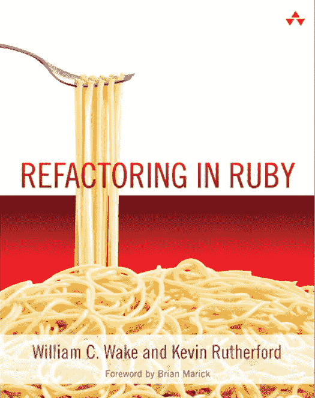
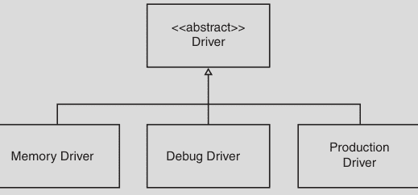
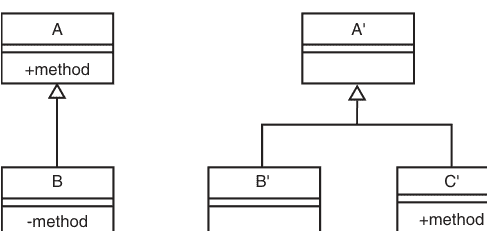
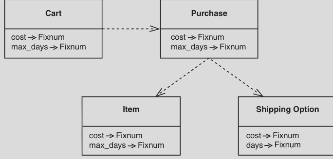

# Ruby 重构实战

Brian Marick 前序



# 症状

| 数据 | 异味 |
| --- | --- |
| 公共字段（或仅有 setter 和 getter），但类中行为极少 | 数据类 (Data Class), 第 110 页 |
| 相同的 2-3 个项目在类或参数列表中一起出现 |  |
| 实例变量的命名包含相似的子字符串 | 数据聚类 (Data Clump), 第 112 页 |
| `Fixnum` 或 `String` 类型的方法参数 |  |
| 用于索引 `Hash` 和 `Array` 的常量和“枚举” | 公开的秘密 (Open Secret), 第 108 页 |
| 用于字段名的字符串常量 |  |
| 实例变量在某些时候有值 | 临时字段 (Temporary Field), 第 114 页 |

## 继承

| | |
| --- | --- |
| 子类过度依赖父类的数据方法 | 不恰的亲密（子类形式）, 第 130 页 |
| 类中的代码极少 | 懒惰类 (Lazy Class), 第 131 页 |
| 子类在父类要求的方法上抛出异常 |  |
| 继承的方法无法工作 |  |
| 客户端引用子类，但从不持有父类的引用 | 拒绝接受的遗赠 (Refused Bequest), 第 128 页 |
| 子类（从概念或行为上说）并不是父类的实例 |  |
| 纯粹为了共享代码而使用子类 | 实现继承 (Implementation Inheritance), 第 126 页 |

## 职责

| | |
| --- | --- |
| 类操作另一个类的状态 | 特征嫉妒 (Feature Envy), 第 136 页 |
| 类过度依赖另一个类的实现方式 | 不恰的亲密（通用形式）, 第 141 页 |
| 链式调用：`a.b().c().d()` | 消息链 (Message Chain), 第 143 页 |
| 大多数方法都只是简单地委托给另一个对象 | 中间人 (Middle Man), 第 145 页 |

# 应对变化

| | |
| --- | --- |
| 引入新类需要在其层次结构中的多个位置引入多个类 |  |
| 层次结构的每一层都处理不同的属性 |  |
| 同一个类因不同的原因发生变化 |  |
| 一个层次结构中的新子类需要在另一个层次结构中的新子类 |  |
| 两个独立层次结构中的子类使用相同的前缀 |  |
| 一个决策必须导致多个类的改变 | 组合爆炸，第 159 页；散乱变化，第 154 页；并行继承层次结构，第 158 页；散弹式手术，第 156 页 |

# 使用库

| | |
| --- | --- |
| 库没有提供你需要的的功能 | 不完整的库模块 (Incomplete Library Module), 第 164 页 |
| 应用代码实现的功能与标准库完全相同 | 重造轮子 (Reinvented Wheel), 第 166 页 |
| 完成一个简单任务需要大量的 `require` 调用 | 失控的依赖 (Runaway Dependencies), 第 167 页 |

访问我们的网站：`www.informit.com/aw`

Refactoring in Ruby / William C. Wake, Kevin Rutherford.

包含参考文献和索引。

ISBN 978-0-321-54504-6 (pbk. : 全纸质)。

1. 软件重构。2. Ruby (计算机编程语言) L. Rutherford, Kevin, II. Title.

- 我们何时完成？ 21

## 前言

我想给你们两个读这本书的理由。第一个理由是关于现在的，第二个理由是关于永远的。

你们现在需要读这本书的理由，嗯，是因为：你、我以及其他所有的 Ruby 程序员。

## 前言

当谈到这本书教你如何纠正的尴尬之处时，高效的思维和自动的行为至关重要。要做到这一点，仅仅能够发现尴尬之处是不够的——它们必须在你阅读代码时像跳一样跳到你眼面前。事实上，我发现 Kevin 和 Bill——像大多数撰写重构书籍的人一样——将尴尬之处描述为“代码气味”。这种嗅觉可能是最强大、最原始且最易控制的感官。当你打开一个容器，腐烂肉的臭味击中你的大脑时，你会移动。你会行动。腐烂代码的气味也应该如此，但只有在练习在你的大脑中开辟出行之频繁的小径后，它才会起作用。

所以：请完成练习。

这本书之所以对你永远有价值，是因为由于计算机对于大多数需要解决的问题来说是非常不确定的。我们固执地要求从一个充满歧义的世界里挤出每一滴模糊性。这是一种荒谬的……可能的……非人性的要求，我们仅仅是因为计算机运行速度快才去忍受。由于这种根本性的不匹配——即我们必须制造精确性的要求——达到这种程序的谦虚且有效的方法是：将一个初级版本投入世界，观察发生了什么，并重塑它（重塑程序，而不是世界——尽管人们也在尝试这样做），让这种不匹配变得不那么尴尬。（然后我们这样做，一次又一次。）这是一场智力冒险，尤其是当你发现代码中隐含的以前从未被完全认可的概念时，这些概念突然开启了广阔的新可能，并且只需要……嗯，可能多于几个……微小的……嗯，也许并不那么微小的……改变。

如果没有重构，以及它所提倡和支持的风格，程序所需的更改将往往令人望而生畏。有了它，你再也不需要带着一种熟悉的、绝望的恐惧感来看程序了。

那不是很好好吗？

> Brian Marick
>
> 2009年7月4日

xviii

## 前言

我主要担任敏捷/XP/TDD 教练，主要与开发 `C++`、`C#` 或 `Java` 应用程序的团队合作，主要针对 `Microsoft Windows` 平台。在合作初期，我不可避免地提醒团队中的每个人学习 William Wake 的《重构工作手册》[26]，我认为对于任何想要编写优秀代码的开发者来说，这都是一本最好的书。在每次合作的中期后不久——考虑到我自己也有 `UNIX` 背景——我会敦促团队通过采用脚本语言来提高他们的项目自动化技能。我总是推荐 `Ruby`，因为它易于学习且面向对象，我通常建议新团队阅读 Marick 的《Ruby 语言的日常脚本》（Everyday Scripting with Ruby）[20] 作为入门。

最后，在 2007 年夏天的一天，我突然意识到有一本好书可以将我所有项目的这些方面结合起来，但这本书尚未被写出来——一本针对 `Ruby` 的《重构工作手册》。于是，我联系了 Bill Wake 并建议我们写一本，而你现在读的就是成果。

与 Bill 原本的《重构工作手册》相比，本版本的结构相似，但在其他方面是实质性的重写。我们保留了核心气味，增加了几气味，并对它们进行了重新处理，以适应 `Ruby` 更具动态性的环境。我们替换了所有的代码示例，或者修订了所有的练习题。我们还重写了大部分介绍性材料，主要是为了反映过去五年测试驱动开发重要性的提高。

简而言之，我们试图为现代开发者创建一个独立的 `Ruby` 重构工作手册，而不是一本带有 `Ruby` 代码示例的 `Java` 书。我希望我们已经非常接近了这个目标。

> —Kevin Rutherford
>
> 2009年夏季

## 这本书是关于什么的？

重构是改进现有代码设计的艺术，由 Martin Fowler 在《重构》（Refactoring）[14] 中引入世界。Fowler 的书提供了几十种详细的机械配方，每种配方都描述了在不破坏任何内容或更改任何内容的情况下，更改程序设计的一个（通常是较小的）方面所需的步骤。

xx

前言

但是，精通重构意味着要精通如何安全地设计。敏捷社区采用了“代码气味”这一术语来描述设计中的反模式。本书的目标仍然是帮助你识别代码中的气味，并应用重构技巧来消除它们。重构的艺术在于改进现有代码的设计。

每个部分的每个章节都包含了几个主要的代码气味的描述，随后是供你完成的练习题。挑战各异；有些要求你分析代码，有些要求你评估并修改代码。并不是所有挑战都一样容易。较难的被标记为“挑战性”；你会发现这些的答案有变活性空间。

- **寻找什么**：帮助你发现气味
- **为什么这是问题**：产生气味的负面后果
- **什么时候离开**： 这种气味发生的情况
- **它是如何发生的**： 关于这种方式的笔记
- **你应该做什么**： 用于消除气味的重构技巧
- **接下来该看什么**： 当气味被消除后你可能会看到的

重构的艺术是改进现有代码的设计，由 Martin Fowler 在《重构》[14] 中引入世界。你可以参考 Fields 等人的《重构》（Refactoring, Ruby Edition）[11]，这些测试已经涵盖了 Gerard Meszaros 的《单元测试模式》[22]。

## 这本书是给谁的？

这本书旨在用于编写和维护代码并希望提高代码习惯的实践程序员。不假设你熟悉重构工具或特定的 `IDE`（但书中的示例将提供巨大的帮助）。你可能还会发现 Russ Olsen 的《Ruby 设计模式》（Design Patterns in Ruby）[24]很有用。

## 这书中有什么？

本书分为三个部分。

第一部分“重构的艺术”提供了重构艺术的概述。我们从一个示例开始；第 1 章“一个重构示例”选取包含某些气味的 `Ruby` 脚本并重构为更好的设计。第 2 章“重构循环”简述了重构的过程——在遗留代码和测试驱动开发期间如何重构——而第 3 章“分步重构”详细查看了重构时使用的步骤。最后，第 4 章“重构实践”建议了一些你可以在工作中应用的练习，并提供了进一步阅读的建议。

第二部分“代码气味”是本书的核心，专注于 `Ruby` 代码。这里的每个章节包含了几个主要的代码气味的描述，随后是供你完成的练习题。挑战各异；有些要求你分析代码，有些要求你评估并修改代码。并不是所有挑战都一样容易。较难的被标记为“挑战性”；你会发现这些的答案有变活性空间。有些练习有解决方案（或帮助寻找解决方案的想法），附录 A“部分问题解答”。某些练习依赖 `Ruby` 源代码，你可以从 `www.refactoringruby.info` 下载。

第三部分“待重构的程序”提供了几个“大型”程序，帮助你在各种领域练习重构。

第四部分“附录”提供了部分练习答案以及对当前可用 `Ruby` 重构工具的简要描述。

## 如何使用本书

这是一本工作手册：它的主要目的是通过实践并在我们的指导下帮助你理解重构的艺术。完成练习的一种简单的方法是：阅读练习，查看我们的解决方案，并仅仅因为听起来合理而点头。这可能会带给你很多见解。然后还有另一种更困难但更好的完成练习的方法：阅读练习，先尝试解决问题，只有在那之后查看我们的答案。这更有可能让你产生自己的见解。解决一个问题比仅仅识别一个解决方案更具挑战性，而且最终的回报丰得多。

在解决这些问题的过程中，你可能会发现自己在某些答案上与我们意见不一致。如果是这样，请参与社区与其他其他人讨论你的观点。如果你只是看一眼答案并点头认同，对我们大家来说将错失很多乐趣。请参阅第 4 章“重构实践”以了解如何加入讨论。

我们认为与他人合作（无论是与结对伙伴还是在一个小组中）更有趣，但我们也意识到这并不总是可行的。

几乎所有的代码示例都需要在计算机上完成。在自己的环境中查看程序时，寻找问题并弄清楚解决办法的感觉是不同的。通过实践将帮助你学习更多，特别是当你被要求修改代码时。重构是一项需要练习的技能。

祝你好运！

# 致谢

Brian Marick 是原版《重构工作笔记》（Refactoring Workbook）项目的巨大支持者，他的写作和教学也是我们的灵感来源。

我们要感谢我们的评审员：Pat Eyler、Micah Martin、Russ Olsen 和 Dean Wampler。他们的鼓励和建议在我们的过程中给予了极大帮助。

我们参与这个写作项目给家庭带来了要求和压力，我们深表感谢他们无限的耐心和支持。

Kevin 感谢许多读过各个章节草稿并提供反应和反馈的人，特别是 Lindsay McEwan；还要非常感谢 Ashley Morgan 推动了 `Reek` 的开发，并在 `Robot` 测试中引入了 lambdas。

Bill 感谢他的朋友 Tom Kubit 和 Kevin Badtke，他们在敏捷软件和其他想法上担任了他的听众。（Tom 对对早期书籍的评审和讨论受到了双倍赞誉。）

最后，感谢 Chris Guzikowski、Chris Zahn、Raina Chrobak、Kelli Brooks、Julie Nash 以及 Pearson 的其他同事，他们帮助我们完成了这项工作。

# 联系我们

欢迎随时联系我们：

```
Kevin: kevin@rutherford.software.com
http://www.kevinrutherford.co.com
Bill: william.wake@acm.org
http://xp123.com
```

# 关于作者

**William C. Wake** 是 Industrial Logic, Inc. 的高级顾问。2007 年到 2009 年初，他在生物信息学软件生产商 Gene Codes Forensics, Inc. 管理开发工作。2001 年到 2006 年，他是一名专注于敏捷软件的独立顾问。他是《重构工作笔记》（Addison-Wesley, 2004）的作者以及《Java 设计模式》（Addison-Wesley, 2006）的合著者。他的网站是 `www.xpl23.com`。

**Kevin Rutherford, Ph.D.** 是一位位于英国的独立敏捷和 TDD 教练。他在软件开发领域工作了超过 25 年，自 1997 年以来，他一直指导组织成为高响应的服务提供者。他创立了英国的 AgileNorth 组，并经常参加敏捷会议活动。他的工作实践侧重于约束理论和代码质量，并且是 `Ruby` 工具 `Reek` 的作者。他的网站是 `www.kevinrutherford.co.uk`。

# 第一部分

# 重构的艺术

# 第 1 章

# 一个重构示例

我们并没有从大量的解释开始，而是从一个快速的重构示例开始，向你展示如何识别代码中的问题并系统地清理它们。我们将“快速”进行工作，以便让你获得真实会话的感觉。在随后的章节中，我们将涉及理论，深入探讨问题以及如何修复它们，并探索你可以用来练习的中等规模示例。

## 折线图脚本

让我们看看 Kevin 一些时候写的一段小型 `Ruby` 脚本。该脚本生成一个折线图（一种用于显示趋势但不包含细节的小图表），并通过生成一个 `SVG` 文档来描述图形来实现的。（见图 1.1。）

原始脚本编写得很快，目的是为了显示单个折线图，以演示抛硬币时出现的趋势。它从未打算在单次使用之后存在，但后来有人要求 Kevin 将其泛化，以便用于创建其他折线图。需求变得更具重用性和可维护性。


图 1.1 一个折线图

这里是原始代码：

```ruby
BORDER_WIDTH = 100

def spark(n)
  a = []
  n.times do
    a << rand(BORDER_WIDTH)
  end
  a
end

def values(a)
  data = "<svg xmlns=\"http://www.w3.org/2000/svg\">"
  a.each_with_index do |y, i|
    data += "<line x1=\"#{i*10}\" y1=\"200\" x2=\"#{(i+1)*10}\" y2=\"#{y}\" />"
  end
  data += "</svg>"
  puts data
end

puts values(spark(10))
```

在我们深入之前，请花一点时间回顾一下这个脚本。如果你觉得它复杂、不可读，甚至不可维护，我们只想继续。以下是我们观察到的更明显的问题：

- **注释**：`SVG` 文档中有一个注释（第 29 行）。
- **风格不一致**：`SVG` 文档的一部分被提取到单独的方法（第 34 行），而大部分内容在 `data` 字符串中。
- **长参数列表**：严格来说，`XML` 元素的属性列表并不是 `Ruby` 参数。但它们是长列表，我们确定以后会引起问题。
- **命名不具描述性**：代码使用 `data` 作为 `SVG` 文档的名称，`i` 作为迭代索引（第 25 行），`a` 作为数组名称，`n` 作为元素数量（第 8 行）。
- **死代码**：常量 `BORDER_WIDTH`（第 2 行）未使用。
- **贪婪方法**：表示 `SVG` 坐标和形状的大多数数字可能从抛掷次数和折线图的最大最小值推导出来。
- **重复代码**：`XML` 元素的开始和结束标记在整个代码中重复；计算 `200 tosses[x]` 重复出现（第 25、34 行）。
- **数据簇**：`SVG` 组件的参数包含了多个显示在显示画布上的 x-y 参数（第 15、18、30 行）。某些部分还具有构成矩形的进一步参数（第 16、30 行）。严格来说，这些是 `SVG` 元素的参数，因此这是 `SVG` 定义中的问题。
- **全局变量**：为什么 `tosses` 甚至是一个全局变量？
- **工具函数**：人们可能会认为这里所有的方法（第 4、8、14 行）都是工具函数。
- **贪婪模块**：脚本本身不是类，但它承担了多项职责：脚本部分处理抛掷，部分处理绘图，部分将 `SVG` 文档封装在 `HTTP` 消息中。
- **散聚变化**：`data` 字符串（第 27–35 行）对于该脚本几乎每种可能的变体可能是不同的。
- **重复造轮子**：已经有 `Ruby` 库用于操作 `XML` 元素和创建 `SVG` 文档。

我们先处理哪一个呢？面对长长的代码气味待办列表，很容易感到有些压力。在这个阶段，重要的一点是记住我们无法一次性解决所有问题；我们必须采取小而安全的步骤逐步进行。我们还希望避免规划得太远——代码会随着每一步而改变，现在尝试去想象几分钟后代码可能是什么样将是徒劳的精力浪费。

在接下来的几个章节中，我们只需处理待办列表中“下一个”引起我们注意的气味，而不考虑“下一个”可能意味着什么，或者之后会发生什么。你完全可能以不同的顺序处理这些气味，这没关系；经验表明，我们稍后可能会在相同的地方结束。


首先，让我们简单整理一下。

## 一致性

我们可以轻松地删除死代码（Dead Code）并更改全局变量（Global Variable）；同时，我们将为使用的每种 SVG 元素类型创建一个简单的方法，并将引号字符串转换为：

```
NUMBER OF TOSSES      1000
```

```ruby
def toss
  2 * (rand(2)*2 + 1)
end
```

```ruby
def values(n)
  a = []
  n.times { a << (toss + a[1]) }
  a
end
```

```ruby
def rect(centre x, centre y)
  "<rect x='#{centre x / 2}\' y='#{centre y / 2}\"
  width='4' height='4'
  fill='red' stroke-width='0' />"
end
```

```ruby
def text(x, y, msg)
  "<text x='#{x}\' y='#{y}\"
  family='Verdana' font-size='9'
  fill='red'>#{msg}</text>"
end
```

```ruby
def line(x1, y1, x2, y2)
  "<line x1='#{x1}\' y1='#{y1}\' x2='#{x2}\' y2='#{y2}\'
  stroke='#999' stroke-width='1' />"
end
```

```ruby
def polyline(points)
  "<polyline fill='none' stroke='#333' stroke-width='1'
  points='#{points.join(' ')}' />"
end
```

```ruby
def spark(centre x, centre y, value)
  "<rect x='#{centre x}\' y='#{y}\'>
  <text x='#{centre x+6}\' y='#{y+4}\' value='#{value}''>"
end
```

```ruby
tosses = values(NUMBER OF TOSSES)
points = []
tosses.each_with_index { |t, i| points << "#{i},#{200 - t}" }
```

```ruby
data =
  "<svg xmlns='http://www.w3.org/2000/svg'
  xmlns:link='http://www.w3.org/1999/xlink'>
  #{line(0, 200, NUMBER OF TOSSES, 200)}
  #{polyline(points)}
  #{spark(NUMBER OF TOSSES, 1, 200, tosses[1])}
</svg>"

puts "Content Type: image+xml"
puts "Content Length: #{data.length}"
puts data
```

整体的贪婪方法（Greedy Method）现在变得有些明显了，因为我们有了更多处理 SVG 元素的方法。然而，注意新添加的每个方法也是贪婪方法，因为每个方法都对 SVG 元素以及我们希望火线图（sparkline）的样子有所了解。因此，我们用某些问题换了其他问题，这是一个非常主观的过程。

## 可测试性

我们在那里更改了很多代码，每次提取一个方法时，都会重新运行脚本以确保没有破坏火线图。但 HTTP 包装器（第52–54行）强制我们进入一个特别不友好的测试环境。为了提高可测试性，我们将删除该 HTTP 包装器并简单替换为：

```ruby
puts data
```

随着我们的进行，会有更多关于测试的内容但目前这个小小的改变让运行 `sparky.rb` 变得更容易。

## 贪婪方法

我们提取的每个 SVG 绘制方法都是贪婪的，因为它们了解 SVG 和火线图格式。我们下一个要处理它们，因为这两种知识在未来可能会以不同的速率变化。

我们将从 `rect` 开始：我们从调用者传递了两个参数，但为了让这个方法完全独立于火线图应用程序，我们需要传递5个：

```ruby
rect(centre x, centre y, width, height,
  fill, stroke, stroke_width)
  "<rect x='#{centre x}\' y='#{centre y}\'
  width='#{width}\' stroke='#{height}\'
  fill='#{fill}\' stroke='#{stroke}\'
  stroke-width='#{stroke_width}\' />"
```

这很丑，但目前代码似乎就是需要的。在这里我们再次用一个小问题换了另一个，但一些灵活性和维护性作为副产品产生了。

调用者也随之更改：

SQUARE_SIDE = 4

```ruby
spark(centre x, centre y, value)
  "#{rect(centre x (SQUARE_SIDE/2), y (SQUARE_SIDE/2),
  SQUARE_SIDE, SQUARE_SIDE, 'red', 'none', 0)}
  "#{text(centre x+6, centre y+4, value)}"
```

`spark` 的更改使得派生值（Derived Values）变得明显，因此我们也借此机会引入一个小红色正方形尺寸的常量来修复。

# 贪婪模块 9

现在我们同样的方式为 `text`、`line` 和 `polyline` 引入了额外的参数：

```ruby
def text(x, y, msg, font_family, font_size, fill)
  "<text x='#{x}\' y='#{y}\'
  font-family='#{font_family}\' font-size='#{font_size}\'
  fill='#{fill}\'>#{msg}</text>"
end

def line(x1, y1, x2, y2, stroke_width)
  "<line x1='#{x1}\' y1='#{y1}\' x2='#{x2}\' y2='#{y2}\'
  stroke='#{stroke_width}\' />"
end

def polyline(points, fill, stroke, stroke_width)
  "<polyline fill='#{fill}\' stroke='#{stroke}\'
  stroke-width='#{stroke_width}\'
  points='#{points.join(' ')}' />"
end
```

调用代码可以更改以匹配，例如：

```ruby
SQUARE_SIDE = 4

spark(centre x, centre y, value)
  "#{rect(centre x (SQUARE_SIDE/2), y (SQUARE_SIDE/2),
  SQUARE_SIDE, SQUARE_SIDE, 'red', 'none', 0)}
  "#{text(centre x+6, centre y+4, value)}"
```

## 贪婪模块

我们现在同样的方式为 `text`、`line` 和 `polyline` 引入额外参数：

```ruby
def text(x, y, msg, font_family, font_size, fill)
  "<text x='#{x}\' y='#{y}\'
  font-family='#{font_family}\' font-size='#{font_size}\'
  fill='#{fill}\'>#{msg}</text>"
end

def line(x1, y1, x2, y2, stroke_width)
  "<line x1='#{x1}\' y1='#{y1}\' x2='#{x2}\' y2='#{y2}\'
  stroke='#{stroke_width}\' />"
end

def polyline(points, fill, stroke, stroke_width)
  "<polyline fill='#{fill}\' stroke='#{stroke}\'
  stroke-width='#{stroke_width}\'
  points='#{points.join(' ')}' />"
end
```

调用代码可以更改以匹配，例如：

```ruby
SQUARE_SIDE = 4

spark(centre x, centre y, value)
  "#{rect(centre x (SQUARE_SIDE/2), y (SQUARE_SIDE/2),
  SQUARE_SIDE, SQUARE_SIDE, 'red', 'none', 0)}
  "#{text(centre x+6, centre y+4, value)}"
```

（注：OCR文本在提供的范围内存在重复且错误，我根据提供的逻辑提供了合并后的版本。）

## 第一章：重构示例

spark 的参数可以代表硬币抛掷、股票价格或温度，因此我们在记住它的同时对它进行了重命名。

现在再次看一眼 x 轴——它只关心有多少个 y 值，但对具体的点并不感兴趣。我们可以改为将 y 值传递给它：

```ruby
def x(y_values)
  "<!<x axis>\n#{SVG.line(0, 200, y_values.length, 200, '999', 1)}"
end
```

这意味着唯一关心的点的代码是 sparkline 方法。我们可以将点的计算移动到该方法中：

```ruby
def sparkline(y_values)
  points []
  y_values.each_with_index { |y, i| points << "#{i},#{y}" }
  #{SVG.polyline(points, 'none', '#333', 1)}
end
```

最后（在经过稍的整理后），SVG 文档的创建看起来如下：

```ruby
puts %Q(<svg xmlns="http://www.w3.org/2000/svg"
  xmlns:xlink="http://www.w3.org/1999/xlink">
  #{x_axis(tosses)}
  #{sparkline(tosses)}
  #{spark(tosses)}
</svg>)>
```

### 特性贪婪 (Feature Envy)

再次观察以 tosses 作为单一参数的方法调用序列。那段代码对 tosses 数组的亲和性比对脚本其他部分的亲和性更高。spark、sparkline 和 x-axis 这三个方法也是如此——它们对 y 值数组所的操作比对任何其他东西的操作都多。这里缺少一个类，它的状态是该数组，并且拥有知道如何绘制 sparkline 部分的方法。这个缺失类的实例代表 sparkline，因此为它找一个名字很容易的。首先，我们将创建一个简单的存根来持有该数组：

```ruby
class Sparkline
  attr_reader :y_values
```

#### 特性贪婪（继续）

```ruby
def initialize(y_values)
  @y_values = y_values
end
```

然后我们将更新最后的 puts 以使用它：

```ruby
sp = Sparkline.new(values(1000))
puts %Q<svg xmlns="http://www.w3.org/2000/svg"
  xmlns:xlink="http://www.w3.org/1999/xlink">
  #{x_axis(sp.y_values)}
  #{sparkline(sp.y_values)}
  #{spark(sp.y_values)}
</svg>
```

现在我们要把这三个方法（以及那个巨大的）移动到新类中。在现实生活中，我们会一个一个地进行它们，边做边测试；但为了简洁，让我们直接到新类的最终状态：

```ruby
class Sparkline
  def initialize(y_values)
    @y_values = y_values
  end

  def to_svg
    %Q<svg xmlns="http://www.w3.org/2000/svg"
      xmlns:xlink="http://www.w3.org/1999/xlink">
      #{x_axis}
      #{sparkline}
      #{spark}
    </svg>
  end

  private

  def x_axis
    "<!<x axis>\n#{SVG.line(0, 200, y_values.length, '#999', 1)}>"
  end

  def sparkline
    points []
    y_values.each_with_index { |y, i| points << "#{i},#{y}" }
    "<!<polyline>\n#{SVG.polyline(points, 'none', '#333', 1)}"
  end

  def spark
    points []
    y_values.each_with_index { |y, i| points << "#{i},#{y}" }
    "<!<rect>\n#{SVG.rect(0, 200, y_values.length, 200, '#999', 1)}>"
  end
end
```

*（注：提供的 OCR 源文本在代码块中存在严重损坏。我根据文中描述的标准 Ruby 重构模式重构了逻辑。）*

等等，让我们重新检查 `Sparkline` 类方法的 OCR。OCR 内容非常破碎。让我们根据文本清理流程：

```ruby
def spark
  points []
  y_values.each_with_index { |y, i| points << "#{i},#{y}" }
  # ... 逻辑
end
```

`y_values` 的 `attr_reader` 不再需要，所以我们删除了它。在重构的早期阶段需要公共访问器，以便我们引入新类而不破坏任何其他代码。在方法迁移到新类之后，该数组在内部使用，因此可以隐藏。为了完整起见，这里是原始脚本剩余的部分：

```ruby
require 'sparkline'

def toss
  2 * rand(2)
end

def values(n)
  a = []
  n.times { a << toss }
  a
end

puts Sparkline.new(values(1000)).to_svg
```

### 不直白的命名 (Uncommunicative Names)

现在脚本非常短，“不直白的命名”显得尤为突出。这里有一个替代版本，为任何没有清晰表达的内容命名了更好的名字：

```ruby
require 'sparkline'

def zero_or_one
  rand(2)
end

def one_minus_one
  zero_or_one * 2
end

def next_value(y_values)
  y_values[1] + one_minus_one
end

def y_values
  result = []
  1000.times { result << next_value(result) }
  result
end

puts Sparkline.new(y_values).to_svg
```

### 派生值 (Derived Values)

在修复命名的过程中，我们发现 2 被用于垂直缩放 sparkline，出于诚实统计的考量，我们移除了它。我们在重构过程中经常发现缺陷。通常这是因为重构过程揭示了一些并不显而易见的东西。在稍后修复这些缺陷是可以接受的。现在是时候处理我们从一开始就注意到的派生值了。它们迁移到了 Sparkline 中，这非常方便。在修复命名的过程中，我们发现 2 被用于垂直缩放 sparkline，出于诚实统计的考量，我们移除了它。我们在重构过程中经常发现缺陷。通常这是因为重构过程揭示了一些并不显而易见的东西。在稍后修复这些缺陷是可以接受的。现在是时候处理我们从一开始就注意到的派生值了。它们迁移到了 Sparkline 中，这非常方便。

## 总结

这里是重构后主脚本的当前状态：

```ruby
require 'sparkline'

def zero or one() rand(2) end

def one or minus one
  (zero or one * 2) - 1
end

def next value(y values)
  y values[1] + one or minus one
end

def y values
  result = [0]
  1000.times { result << next value(result) }
end

puts Sparkline.new(y values).to svg
```

（你可以从我们的在线下载中获取“重构前”和“重构后”代码的完整副本，地址为 http://github.com/kevinrutherford/rrwb。）

代码中仍然存在一些细微的“气味”：`sparkline.rb` 仍然包含了太多 SVG 信息；`svg.rb` 仍然有很长的参数列表；而且 SVG 模块的功能与标准库重复。注意，代码从 40 行扩展到了 100 行，从一个源文件增加到三个——而完全没有增加脚本的功能。

总的来说，这段代码比以前更具可读性和可维护性。我们用规模换取了灵活性，将来将更容易复用这段代码的任何部分。目前来说，到此为止是一个合理的停止点。

## 下一步计划


现在我们已经看到了重构如何改进代码的快速示例，接下来我们将看看重构如何融入开发流程，然后考虑代码中的不同问题以及解决这些问题的示例。

# 第 2 章：重构的循环

在本章中，我们将定义“重构”和“代码气味（`code smells`）”。然后，我们将观察通过重构改进代码的基本循环。简单设计规则将告诉我们何时已经做得足够了。最后，我们将探讨重构如何成为测试驱动开发（`TDD`）的关键部分。

## 什么是重构？

重构是安全改进现有代码设计的艺术。在《重构》[14]中，Martin Fowler 将其描述为：

> “重构是一个改变软件系统的过程，使其在改进其内部结构的同时，**不**改变其所改进代码的外部行为。”

这包含几层含义：

- 重构并不仅仅是系统中的任何更改：尽管重构应该是创建新代码过程的一部分，但它不是添加新功能的部分。例如，测试驱动开发包括编写测试，然后编写新代码来引入新功能，最后通过重构来改进设计。
- 重构不是从零开始的重写：虽然有时从头开始更好，但重构改变了平衡点，使得改进代码比承担重写的风险更可行。Sven Gori（通过私下交流）指出，重构**保留了嵌入在现有代码中的知识**。
- 重构不仅仅是为了改进代码而进行的任何重组：重构力求是安全的转换。即使涉及大量代码的大型重构，也会被分成更小、安全的重构。（在理想情况下，重构的定义足够精确，甚至可以自动化。）如果一个更改导致代码无法运行（即无法通过测试）的时间超过了一个工作时段，那么我们不会将其视为重构。
- **涌现设计（`emergent design`）**：重构改变了预置设计与涌现设计之间的平衡。预置设计是在实现之前的设计：涌现设计与实现交织在一起。预置与涌现设计之间的权衡取决于我们能多好地预测或评估代码中的问题，以及是先设计再转化为代码更容易，还是先写代码再进行改进更容易。重构降低了涌现方法的成本和风险。（你可能会争论界限在哪里，但你可能同意它在移动。）
- 重构可以是小的也可以是大的：很多重构是很小的。理想情况下，小重构的应用得足够“无情”，这样就很少需要大型重构。即使在进行大规模重构，方法也不是在重构六个月内不做新功能，而是边做边重构，保持系统始终运行。

## 气味即问题

代码气味是关于代码中潜在问题的警告信号。并不是所有气味都指示问题，但大多数气味都值得关注并做出决策。

有些人喜欢“气味”这个词，更倾向于谈论潜在的问题或缺陷，但我们认为“气味”是一个很好的比喻。想一下打开一个里面东西正在变质的冰箱会发生什么。有些气味会很重，你一眼就能看出该如何处理。其他气味则很微妙；你不确定问题是由于留下的豌豆还是上周的牛奶引起的。冰箱里的某些食物可能已经坏了，但并没有特别难闻的味道。代码气味就像这样：有些是显而易见的，其实不然。有些掩盖了其他问题。有些当你修复其他东西时会意外地消失。

气味通常表示局部问题。如果人们可以轻松擦除整个系统就太好了。但人类并不擅长这项工作；局部气味符合我们倾向于只考虑正在观察的部分的特性。

最后，请记住，气味是潜在问题的指示，而不是实际问题的保证。你偶尔会发现假阳性——某些东西对你来说有气味，但实际上比替代方案更好。但大多数代码都有许多真实的气味，足够让你忙碌了。

## 重构的循环

重构有一个基本模式：

从可以工作且经过测试的代码开始，同时此时设计可以被简化：

- 选择最糟糕的气味
- 选择一个能解决该气味的重构
- 应用重构
- 检查测试是否仍然通过

我们尝试在每次循环中选择能够改进代码的重构。因为循环中的任何一步都没有改变程序的可观测行为，所以程序始终保持在工作状态。因此，循环改进了代码但保留了行为。这个过程中最困难的部分是识别气味，这也是这本书的大部分内容强调的主题。

这种重构方法能保证达到问题的理想设计吗？遗憾的是，不能，因为没有保证你能通过观察局部属性来达到全局最优解。但当代码尽可能整洁时，设计出转换解决方案的洞察会变得更容易。

重构就像跨过小溪。一种过小溪的方法是纵跃过去并听天由命。重构的方法是找到脚石，一次踩一块石头跨过小溪；那样你被淋湿的可能性更小。

当你开始重构时，最好从简单的事情开始（例如，拆分大型方法或为了清晰而重命名）。你会发现，这能让你更容易地发现并修复剩余的问题。

## 我们什么时候才算完成？

我们如何知道何时停止重构并转向更多开发？一种方法是寻求“最简单”的设计。在《极限编程解释》[4]中，Kent Beck 确定了简单设计的四条规则：

### 简单设计：

- 通过所有测试。
- 传达对程序员来说重要的每一个意图。
- 没有代码、逻辑或知识的重复。
- 不包含不必要的代码。

如果你的代码违反了这些规则（按优先级排序），那么你就有一个需要解决的问题。这些规则的简写名称是 `OAO`，意为“一次且仅一次”。代码必须只说明一次，以便它通过测试并传达程序员的理解和意图。而且它应该只说一次——即没有重复。

该规则的另一个名称是“不要重复（`Don't Repeat Yourself`）”，或 `DRY` 原则 [17]。第二部分“代码气味”中记录的大多数气味归结为某种形式的重复；发现它可能是一门艺术——注意隐藏的重复，例如并行类层次结构。但重复偶尔是可以接受的，当它的存在有助于代码传达意图时；毕竟，代码被阅读的次数多于编写次数。

清理没有保持清洁的代码是很**难**的；很少有团队负担得起封锁几个月来追求完美。我们可以在开发期间学习让代码变得更好，并在每次工作时都增加一点精力。

## 测试驱动/行为驱动开发

在开发过程中应用重构可能会导致混淆、不安全的转换，或者在最坏的情况下导致代码崩溃。因此，最好将开发和重构视为不同的：不同的技能，使用不同的技术，在整个循环的不同时间执行。将开发和重构视为不同的帽子——你任何时候只能戴其中一个。

测试驱动开发（`TDD`）和行为驱动开发（`BDD`）使这两顶帽子之间的区别变得非常清晰。它们共享以下微过程：

### TDD/BDD 微过程

- **RED**：编写一个新的测试/用例并看到它失败。
- **GREEN**：快速让所有测试再次通过，使用最原始的方法。
- **REFACTOR**：通过消除刚刚引入的气味，过渡到通过所有当前测试的**最佳**设计。
- （重复）再次循环，目标是每几分钟回来一次。

## 接下来

改变是永恒的；因此，在频繁的重构步骤中进行的小投资将随着代码的增长，通过复利逐渐获得回报。

请注意，重构只在“绿条”（`green bar`）上发生——即当所有测试均通过时。测试起到了回归测试套的作用，确保我们在修复设计时不会破坏任何现有的行为。通常，在从 RED（红）到 GREEN（绿）的过程中，会有少量的代码被修改或引入。这些代码需要进行气味（`smells`）审查，尽管这种审查必须在整个现有代码库的上下文中进行。为了帮助完成这一过程，我们在书的内侧封上包含了一份代码审查清单；我们还引入了 `Deek`，这是一种警告 Ruby 代码中存在气味的免费软件（有关此工具和其他工具的详情，请参见附录 B，“Ruby 重构工具”）。

我们使用测试驱动开发（`TDD`）作为开发流程的核心。请注意，重构的纪律并不要求测试驱动的方法，但这种方式创建的代码通常错误更少，且比其他代码所需的重构更少。特别是本书后半部分中较大的示例，如果使用测试驱动开发完成的，将会更小且更不混乱。

关于 TDD 的更深介绍，请参见 Dave Astels [1] 和 Kent Beck [3] 的书籍。关于更多关于 BDD 的信息，请参见 David Chelimsky 等人的《The RSpec Book: Behaviour Driven Development with RSpec, Cucumber, and Friends》[8]。

## 练习

### 练习 2.1：简单设计

A. 为 Beck 的简单设计的每条规则提供合理理由。

B. 为什么这些规则按优先级排序？你能找到一个通信优先于避免代码重复的示例吗？

解决方案思路请参见第 215 页。

## 接下来

刚才我们看了重构是如何融入软件开发的整体流程（或流程）的。现在，我们将深入探讨让单次重构有效的因素，以及帮助你安全执行重构的环境条件。

# 第 3 章：逐步重构

是时候我们详细研究重构的机制了。在本章中，我们将完成“隐藏委托”（`Hide Delegate`）涉及的步骤；但首先，我们需要回顾我们的工具。

## 重构环境

重构可以在任何时间对任何代码进行，但在支持良好的环境中会变得更容易、更安全。在开始重构之前，请确保身边准备好了大部分以下工具：

- **团队或伙伴**：对于代码的非平凡决策，找到多一个人来考虑问题是有帮助的。一个团队产生的想法通常比一个人单独想得更好：不同的人有不同的经验，对系统不同部分的接触也不同。
- **测试**：尽管重构被设计为是安全的，但在应用过程中仍可能出错。通过拥有在重构前后运行的测试套件，你可以确保你改变的是代码的设计，而不是它的影响。

> “如果你想进行重构，本质的前提是拥有稳健的测试。”
>
> —Martin Fowler [14]

对于 Ruby 来说，这比 Fowler 写关于 Java 重构时更是如此。因为在 Ruby 中没有编译步骤：发现我们的代码是否运行的唯一方法就是运行它。

如果你没有测试怎么办？那就添加它们，至少在受重构影响的区域添加。有时这很棘手——你可能无法在不改变设计的情况下进行有效测试，而在没有测试的情况下改变设计是不安全的。（如果你发现自己处于这种境地，你可能会发现 Michael Feathers 的《Working Effectively with Legacy Code》[10] 中的技术很有帮助。）顺便提一下，难以测试的区域通常预示着设计中的其他问题。

- **测试框架**：`Test::Unit` 作为标准 Ruby 分发版的一部分安装，`rspec` 可以作为 gem 可用。让 `autotest` 在你工作时运行测试也会非常方便。
- **CRC（类、职责、协作者）卡片或 UML 草图**：重构就是设计。你可以举行一次 CRC 会话，或绘制统一建模语言（`UML`）草图来比较备选策略，特别是在在类或模块之间移动职责时。（有关 CRC 卡片方法的更多细节，请参阅 Kent Beck 和 Ward Cunningham 的文章“A Laboratory For Teaching Object-Oriented Thinking” [5]）。
- **配置管理/版本控制**：如果你在重构时犯了错误，你希望有一个返回上一个已知良好点的选项。或者，你可能想应用某种重构，但你可能不确定结果是否改进；有一个可以尝试然后决定是否保留结果的选项可能会很有**用**。无论如何，养成提交代码的习惯（每次测试通过时）都是值得的，并且确保你有一个允许你操作的版本控制系统也是值得的。
- **高级开发环境 (`IDE`)**：一些 Ruby 环境现在集成了越来越多的自动化重构工具（有关这些工具的详情请参见附录 B，“Ruby 重构工具”）。工具可以消除重构中许多出错的繁琐工作，但大多数重构没有工具支持，即使有自动化，你仍然需要决定应用哪些重构。

## 重构内部

重构的定义方面之一是关注安全转换。我们将完成“隐藏委托”涉及的步骤。它的目标是封装通向对象的路径，使客户端与实现解耦。假设我们有

```ruby
class Rectangle
  attr_reader :top, :height
end
```

```ruby
class Point
  attr_reader :x, :y
end
```

任何想要查找矩形顶部坐标的客户端都会使用 `rect.top`。我们希望将消息链替换为对新委托方法的调用。良好的测试集在此证明非常有用，特别是在大型代码库中。在 Java 或 C# 等静态类型语言中，编译器可以告诉你何时有客户端在使用。但在 Ruby 中，我们被迫依赖**运行时**检查——最好的自动化测试——或者阅读代码。重构测试过的代码比重构未测试的代码要安全得多，因为测试告诉我们避免滑错。

重构是一个一步步进行的过程。这些步骤比你预期的要小。平均是几分钟。所以，如果一个重构只需要几分钟，步骤会更小。重构是保持行为的转换，而许多转换会让代码处于破坏状态。

### 步骤 1：创建委托方法

我们直接开始创建我们需要的方法：

```ruby
class Rectangle
  def left_edge
    @top.x
  end
end
```

注意，该类的客户端没有变化：还没有代码调用这个方法。（如果我们感到特别紧张，或者中断似乎即将发生，我们可以运行测试并检查这一点。）

### 步骤 2：调整每个客户端

一种找到客户端的方法是将委托临时设为私有并运行测试。（如果你这样做，在更改客户端之前将其恢复为公共，以免破坏任何。）

测试告诉我们以下客户端代码需要更改：

```ruby
class TranslationTest < Unit::TestCase
  def test_move_left_edge
    rect = Rectangle.new(Point.new(6.3, 5.0), 2.0, 2.0)
    rect.translate(3.5, 1.0)
    assert_equal(2.8, rect.top.x)
  end
end
```

我们将消息链替换为对新委托方法的调用：

```ruby
def test_translate_move_left_edge
  rect = Rectangle.new(Point.new(6.3, 5.0), 2.0, 2.0)
  rect.translate(3.5, 1.0)
  assert_equal(2.8, rect.left_edge)
end
```

### 步骤 3：调整后进行测试

尽管重构的目标是在重构结束时创建一个改进的系统，但许多重构在过程中都有安全点（想想棒球中的垒包或儿童捉迷藏游戏；它们可能不是最终点，但至少你在垒包时不会被抓到）。

### 步骤 4：移除服务器访问器

在我们更改了所有相关的客户端之后，我们可能会发现该访问器已不再使用。我们可以通过移除它来收缩服务器的 API：

```ruby
class Rectangle
  attr_reader :top_left, :width, :height

  def left_edge
    @top_left.x
  end
end
```

变为：

```ruby
class Rectangle
  attr_reader :width, :height

  def left_edge
    @top_left.x
  end
end
```

### 步骤 5：再次测试

我们达到了另一个基准，因此再次运行测试并提交代码。此时，我们已经完成了“隐藏委托”（`Hide Delegate`）的应用。

## 通用重构微过程

一本关于重构的书可能会列出 20 或 50 种重构，但那些只是常见重构的示例。你通常针对特定情况创建自己的重构。

许多重构共享相同的抽象形状，我们可以将其记录为一个微过程：

1. 检查重构是否会遇到任何问题
2. 引入一个新的代码元素
3. 对于每个需要迁移的项：
   (a) 将旧元素的一个客户端迁移以使用新元素
   (b) 测试
4. 删除旧元素
5. 测试

这是一种安全的方法。不安全的替代方案是将旧机制更改为使用新机制，在一个边界内迁移所有内容，并期待最好的结果。

大规模重构——那些由较小重构组成的重构——使用这种方法。事实上，大规模重构的基础是它们在迁移期间保持系统运行，因为这可能需要几小时、几天甚至几周。

每一个这些步骤（检查、引入、对于、迁移、删除、测试）都有多种实现方式；我们在接下来的章节中记录了其中一些可能性。这些可以组合起来构建出许多新的重构。

### 检查 (`Check`)

这些动作确认某些事实的真实。

- **证明 (`Prove`)**：正式或非正式地证明建议的重构是安全的。
- **查看 (`Look`)**：查看代码是否有任何会干扰即将进行的重构。例如，如果 `g()` 已经存在，你就不能将 `f()` 重命名为 `g()`。
- **断言 (`Assert`)**：引入断言，即通过代码验证在特定点某些条件是否符合你的预期。将断言与测试结合使用，但意识到它们只能验证测试覆盖的用例。

### 引入 (`Introduce`)

这些动作引入某种类型的新元素。

- **添加新字段、方法或类**：它最初将不会被使用，但可以作为新用例的目标。例如，你可能会创建一个新的空方法，该方法很快将从现有方法迁移过来。
- **引入委托到旧元素的新机制**：你可以迁移内容以使用新方法，然后将旧方法内联到新方法中。
- **引入新的独立机制**：从旧机制迁移到新机制。
- **复制 (`Copy`)**：复制代码。例如，当执行“提取方法”（`Extract Method`）时，你将原始代码复制到新创建的方法。我们并不提倡复制粘贴编程；代码将临时存在两个副本，但在我们此重构微过程结束时，其中一个将被删除。

### 每个 (`For each`)

此动作让你查看某物的所有出现。

- 遍历你想要更改的代码的所有使用。根据重构类型，这可能涉及调用、条件分支、记录、表格、方法、字段、类、引用等。

### 迁移 (`Migrate`)

这些动作带你从执行某事的旧方法过渡到新方法。

- **将旧机制的使用者迁移到新机制**：例如，将引用从旧更改为新。
- **替换 (`Replace`)**：用其等价物替换某物。
- **适应新上下文**：例如，“提取方法”中使用的代码可能需要修改声明、参数等。
- **重命名 (`Rename`)**：给代码元素一个更有意义或揭示意图的名字。
- **交换两个独立实体**：例如，两个互不产生影响的语句可以交换。这可以用于协调代码片段，如果不是语句顺序有细微差异，它们的文本将是相同的。
- **传播常量**：当一个“变量”具有常量值时，将变量替换为常量。

### 删除 (`Delete`)

这些动作消除元素。

- **删除死代码**：去掉永远不会执行的代码。


- 删除无影响的代码：例如，消除一个空方法或类。
- 标记为废弃：对于无法删除的代码（因为有外部使用），标记以阻止新的使用。

### 测试

通用重构微过程在每次循环后运行一次测试，并在最后运行一次。在实践中，特别是当你有完善测试时，可以采取一些捷径。例如，如果你正在移动一个方法，旧处可能有 25 处引用。你可以移动第一个引用，测试，移动第二个引用，测试，最后再次测试一次以确保正确。是否采取这种捷径取决于多种因素：你的测试运行需要多久、出错时多容易撤销，以及你提交文件有多困难。

当测试通过时，值得提交代码。即使你只完成重构步骤的一半，在过程中创建安全基准也能显著减轻完成任务的压力。

必须强调：重构只有在良好的测试才是安全的。首先，没有编译器或静态类型检查来告诉你是否发生了微妙但意外的类型错误（双关语）；其次由于 Ruby 的重构工具还处于起步阶段，即使是自动化重构工具也不完美。

## 练习

### 练习 3.1：小步骤

从《Refactoring, Ruby Edition》[11]中任选重构，识别出一个即使大步骤可行也可以通过小步骤构建的地方。

参见第 216 页获取建议。

### 练习 3.2：反向重构

当我们重构时，我们试图响应影响代码的力量。有时今天很好的更改在明天可能不再理想，我们发现自己在反转某次重构。

以下是重构列表。在每个重构的旁边，写下撤销其影响的重构名称。

- A. 合并层级
- B. 提取方法
- C. 隐藏委托
- D. 内联临时变量
- E. 方法参数化
- F. 重命名方法

参见第 216 页获取建议。

# 第 4 章

重构实践

本书的一个前提是，重构是一项技能，并能从实践中获益。寻找机会来练习并使用这项技能。

## 阅读其他书籍

参考文献中的所有书籍都值得花时间学习。但如果你还没有获得 Fields 等人的《重构：Ruby 版 [11]》（*Refactoring, Ruby Edition [11]*），你应该认真考虑买这本书：书中的练习涉及了 Fields 书中记录的一一半重构操作。工具在重构支持的机械化方面变得越来越完善，但要让它们有效地覆盖目录中重构的每一个方面，还需要很长一段时间。

## 练习重构

找到方法让重构成为你日常生活的一部分。

- **将重构融入你的常规工作**。如果不加应用，知道如何重构并没有多少价值。下决心让你的代码变得“精简且整洁”。在 XP（敏捷开发）团队中，这是日常生活的一部分。但即使是高度驱动的方法，也要求程序员能够良好地实现设计。
- **将测试融入你的常规工作**。有一句老话（正如很多人所说的那样）没坏就不要修。”（上一次“简单的更改”导致了多少次意外之外的错误？）在编程中，应用这句格言的副作用是代码会变得越来越丑。

重构之所以能够违背这一规则，是因为有两个机制：系统化且安全的重构，以及用于验证转换是否执行正确的测试支持。不要忽视你的测试。

- **小步快跑**。通常情况下，察觉到某种“气味”相对容易，而要找出从“这里”到达“那里”的方法却。练习将较大的重构（如拆分继承体系）分解成微小的、安全的步骤。优先选择让系统从良好状态移动到良好状态的转换。重构时，优先选择小而安全的方法，而不是快速但不总是安全的方法。时刻记住重构周期。
- **寻求他人的帮助**。让别人对你的代码提供意见，通过结对编程、设计和代码审查，或者简单地询问你的同事。我们在写这本书时反复强调的一点是，几乎任何代码都可以被改进（有时我们还可以利用整个互联网的帮助！）
- **丰富重构名录**。在你编写自己的代码时，留意那些没有记录在任何地方的转换；与你的同事分享并讨论它们。

## 尝试的练习

这里是一些你可以经常尝试的练习，可以单独进行也可以作为团队道场进行。

- **寻宝游戏/每周气味**：挑选一种气味，并尽可能发现并消除尽可能多的出现次数。每周搜索一种新的气味。
- **重复重构**：选择一段规模适中的代码（你自己的代码，或者书末的较大示例之一都可以）。每天从初始版本开始，在十分钟内尽可能多地重构。你每天感觉到的东西是一样的吗？你进步走得更远了吗？
- **只管重构**：选择或开发一个项目。花十分分钟进行重构。（每天从前一天停下的地方开始）。
- **吸气/呼气**：找到演示某种气味的代码。应用一个可以反转该气味的重构。重复两次。这让你感受到引入问题以及消除问题的真实感受。
- **反重构/畸形**：“反重构”（Defactoring）和“畸形”（malforming）是我们用来描述恶意重构的名称：恶化现有代码的设计。取一些代码，并将其“重构”得使其变得尽可能难看。（这比听起来要难。）除了提供重构练习外，这可能帮助你意识到自己在开发过程中何时无意中制造了畸形。在玩完之后，务必恢复原状。
- **循着味道**：在一个规模适中的项目中选择代码气味。消除它，并检查更改后的代码以寻找其他气味（书中的“后续建议”部分会有帮助）。对于你现在看到的每种气味，重复此过程。在 30 或 45 分钟后，回顾生成的代码和你经历的历程。想做更多吗？所有的移动都有回报吗？你是否在何时绕了圈子？
- **协调**：书中描述的许多代码气味从根本上关于某种重复：相同的代码、相似的代码、结构相似的代码、效果相似的代码。重复并不总是显而易见的，有时需要更改代码来发现它。你通常可以进行重构操作，使潜在的重复显性化。练习协调相似的事物。

例如，你可能会看到效果相同但使用不同算法的代码；你可以替换其中一种算法，以便移动到单一副本。或者假设你在两个子类中有本质相同的方法，只是名称不同。你可以将它们重命名为相同的名称，以便你可以将方法提取到父类中。或者你有两个方法，某些部分相似而其他部分独特；你可以拆分该方法，使相似部分相同而独特部分分离，并消除重复。

## 参与社区

我们对你的经验感兴趣，因此请通过 `groups.google.com/group/refactoring` 给我们写信。

## 练习 4.1：了解重构

重构与气味之间没有一一一对应的关系，正如 Fields 等人的《重构：Ruby 版 [11]》中所示，后者可以帮助修复。哪些重构提到了任何一种气味？（提示：使用第二部分“代码气味”中的“做什么”章节）

- 哪些重构修复了任何气味？
- 哪些重构没有提到任何？

## 下一步

到此结束我们对重构艺术的简要概述。现在是处理细节了。正如我们在第 2 章“重构周期”中提到的，可能最困难的部分是识别需要重构的代码。第二部分“代码气味”详细介绍了所有常见和不常见的代码气味；通过练习你将学会如何识别它们。然后第三部分“待重构程序”为你提供了几个应用程序，每个程序都充满了你会遇到的问题。

# 第二部分

代码气味

# 第 5 章

可衡量的气味

本章中的气味相似。它们非常容易检测。它们是客观的（在你确定了计数方法和最高分之后）。它们是令人讨厌的。

而且，它们是常见的。

## 注释

### 关注点

- 代码中包含注释。（某些 IDE 会通过颜色区分注释让这些内容更明显。）

## 为什么这是一个问题

- **灵活性**：如果代码发生了变化，任何解释代码的注释都必须保持同步。
- **重复**：大多数注释完全可以通过代码本身很好地反映。例如，方法的目标通常可以通过其名称而非注释来清晰地传达得更好。
- **沟通**：与代码描述略有出入的注释会导致认知负担——甚至引发不信任——并减慢读者的速度。

#### 何时保持原样

不要删除那些正在发挥作用的注释——例如 rdoc API 文档。某些注释可能特别有用——那些解释了为什么以特定方式处理某事（或为什么没有这样做）的注释，或者引用了显而易见的算法（在简单算法无法解决的情况下）。

## 它是如何变成这样的

注释的存在可能是出于最好的理由：作者意识到某些地方没有没那么清晰，于是添加了注释。

#### 应该做什么

- 当注释解释一段代码片段时，你可以使用`提取方法`将该片段提取到一个独立的方法中。注释通常会为新方法建议一个名称。
- 当注释解释了方法的作用（比方法名解释得更好！）时，使用`重命名方法`，以注释作为新名称的依据。
- 当注释解释了先决条件时，考虑使用`引入断言`用代码替换注释。

## 下一步关注点

- **重复**：通常，从方法中拆分出的代码片段会以相似的方式执行相似的操作；可能识别出它们之间存在某些重复。
- **抽象**：为代码块创建名称有助于将设计与应用程序的领域联系起来。检查你修改区域的名称以保持一致性。

# 长方法

### 关注点

- 方法包含的行数非常多。（我们对任何超过五行的方法都会立即产生怀疑。）

## 为什么这是一个问题

- **灵活性**：长方法注定是一个“贪婪方法”——至少有两个职责耦合在一个地方，这反过来导致了“发散性变化”。
- **可测试性**：很难为长方法的单个行为进行隔离测试；如果一个方法承担了太多，可能也很难以创建包含足够上下文让方法正常运行的测试配置。

#### 何时保持原样

某个长方法可能只是表达某些内容的最佳方式。（就像几乎所有的代码气味一样，长度是一个警告信号，而不是问题的必然保证。）

## 它是如何变成这样的

你可以把它看作是“柯伦综合征”。柯伦是一个总是说“还有最后一件事”的电视侦探。方法开始进入某个路径时，作者并没有中断流程或识别辅助类，而是又增加了一件事。代码写起来往往比读起来容易，因此人们倾向于编写过大的片段。

#### 应该做什么

- 使用`提取方法`将方法拆分为更小的部分。寻找通过注释或空白界定的、具有语义意义的有趣片段，而不仅仅是每七行就引入一个函数调用。
- 在开始拆分方法之前，你可能会发现其他重构（那些清理纯线代码、条件语句和变量使用的重构）很有帮助。
- 如果方法无法轻易拆分成片段，考虑使用`替换方法方法对象`将方法转换为一个独立的对象。

担心增加方法调用次数带来的性能影响是自然的，但大多数情况下这并不是问题。在担心性能之前尽可能让代码保持整洁，你有机会获得巨大的见解，从而重构系统和算法，大幅提升性能。

## 下一步关注点

- **重复**：通常，从长方法中拆分出的代码片段会以相似的方式执行相似的操作；可能识别出它们之间存在某些重复。
- **沟通**：为代码片段创建名称有助于将设计与应用程序的领域联系起来。检查你修改区域的名称以保持一致性。
- **抽象**：新方法的签名可能暗示缺少某个类，或者在原始方法中揭示了新的结构。
- **灵活性**：检查新方法是否存在“特征嫉妒”；有了更多小片段，你现在有机会将代码移动到更“自然”的家中。

# 大模块

### 关注点

- 类或模块拥有大量的实例变量、方法或仅仅代码行。

## 为什么这是一个问题

- **可测试性**：大模块通常很难测试，因为它依赖于许多其他模块，或者因为隔离创建实例既困难又耗时。
- **灵活性**：该模块代表了折叠在一起的太多职责——也就是说，每一个`大模块`也是一个`贪婪模块`。

## 它是如何变成这样的

大模块是一点点变大的。开发者不断向模块添加更多功能，直到它最终变得太大。有时问题源于对组成整个模块的局部缺乏洞察。

#### 应该做什么

通常情况下，你正在尝试拆分模块。这通常逐步进行：

- 很多时候，对模块的审查会揭示其他代码气味的组合，如`长方法`、`数据簇`和`临时字段`：先修复这些气味。
- 如果要拆分模块，如果你能识别出一个具有该模块部分职责的新部分，请使用`提取类`或`提取模块`。
- 如果你有一个大类，如果可以在类和新子类之间划分职责，你可能尝试`提取子类`。
- 有时一个类之所以大是因为它是 GUI 类，它同时代表了组件和模型。在这种情况下，你可以使用`提取数据`来帮助提取领域类。

## 下一步关注点

- **重复**：当你剥离大模块的每个部分时，可能会发现它与现有模块具有相似的职责或接口。
- **沟通**：拆分职责并对其命名有助于读者将代码与真实领域联系起来。检查你在模块中使用的名称（见第6章）。

# 长参数列表

### 关注点

- 方法有一个或多个参数。
- 方法向关联块产生了一个或多个对象。

## 为什么这是一个问题

- **简单性**：长参数列表通常表明方法有多个职责。有时参数之间没有意义的分组——它们并不在一起。在这种情况下，可能是该方法或它使用的对象没有代表问题领域中有意义的抽象。
- **灵活性**：长参数列表代表了调用者和被者之间大量的共享信息。如果其中一方发生变化，参数列表可能也需要更改。
- **沟通**：大量的参数需要大量的记忆——程序员不仅要记住传递哪些对象，还要记住顺序。更多的 API 更容易、更快使用。

#### 何时保持原样

这是一个气味并不总是等同于问题的地方。你可能发现了长参数列表，但认为它对于当前情况是正确的——例如，为了避免调用方法获取你不希望有的依赖。确保你的更改不会破坏这种平衡。

## 它是如何变成这样的

你可能正试图减少对象之间的耦合。与其让被调用对象感知类之间的关系，不如让调用者来定位一切：方法只需关注它被要求对这些片段做什么。

该方法可能获得许多参数，是因为程序员通过创建一个带有许多控制参数的通用算法来处理多种变体。

#### 应该做什么

- 如果参数的值可以通过它已知的另一个对象获得，请使用`用方法替换参数`。

## 练习

- 如果参数来自同一个对象，请尝试使用`保留完整对象`。
- 如果数据不是来自同一个逻辑对象，你仍然可能可以通过`引入参数对象`将它们分组。

## 下一步关注点

- **重复**（Duplication）：有时方法的调用者为了调用它，必须经过相同的障碍。检查调用者之间是否存在`重复代码`。
- **通信**（Communication）：参数会增加理解类接口所需的认知负载：上述所有的重构方法都有助于隐藏细节。检查该类的所有方法签名，寻找`数据团`和命名模式。
- **尺寸**（Size）：当一个方法需要许多不相关的参数时，调用该方法所需的代码量可能很大。在你现在作为参数传递给方法的对象周围，寻找`特征嫉妒`和`公开秘密`的迹象。

## 练习

### 练习 5.1：注释

考虑以下代码：

```ruby
class Matcher
  def match(expected, actual, clip_limit, delta)
    # Clip "too large" values
    actual.map {|val| [val, clip_limit].min)

    # Check for length differences
    return false if actual.length != expected.length

    # Check that each entry is within expected + / delta
    actual.each_index do |i|
      return false if (expected[i] - actual[i]).abs > delta
    end
    return true
  end
end
```

A. 使用`提取方法`使 `match()` 中的注释变得多余。

B. 代码中所有重要的信息都能仅通过代码来表达吗？还是注释有其位置？

找到你最近写的一些代码。很有可能你为其写了注释。能否通过让代码更直接地反映你的意图，消除对某些注释的需求？

解决方案思路请参考第 217 页。

### 练习 5.2：长方法

考虑以下代码：

```ruby
class Robot
  attr_reader :location, :bin

  def move_to(location)
    @location = location
  end

  def pick
    @bin = @location.take
  end

  def release
    @location.put(@bin)
    @bin = nil
  end
end

class Machine
  attr_reader :name, :bin

  def initialize(name, location)
    @name = name
    @location = location
  end

  def take
    result = @bin
    @bin = nil
    return result
  end

  def put(bin)
    @bin = bin
  end
end
```

### 练习


```ruby
class Report
  def self.report(out, machines, robot)
    out.print "FACTORY REPORT\n"
    machines.each do |machine|
      out.print "Machine #{machine.name}"
      out.print "bin ##{machine.bin}" if machine.bin != nil
      out.print "\n"
    end
    out.print "\n"
    out.print "Robot"
    if robot.location != nil
      out.print "location ##{robot.location.name}"
    end
    out.print "bin ##{robot.bin}" if robot.bin != nil
    out.print "\n"
    out.print "  \n"
  end
end
```

（在代码下载中，你可以找到 Rspec 示例，展示这些类是如何交互的。）

A. 对于 `Report.report`，圈出代码块，显示在重构此代码的过程中可能会提取哪些函数。

B. 将 `report` 方法重写为四个语句，假设你已经对每个块执行了提取方法。

C. 提取单行方法有意义吗？

解决方案思路请参考第 217 页。

## 练习 5.3：大类

考虑 Ruby 1.8.6 中 String 类的 API：

```ruby
str % arg
str * integer
str + integer
str << fixnum
str << obj
str.concat(fixnum)
str.concat(obj)
str < other str
str obj
str ~ obj
str[fixnum]
str[fixnum, fixnum]
str[range]
str[regexp]
str[regexp, fixnum]
str[other str]
str[fixnum] fixnum
str[fixnum] new str
str[fixnum, fixnum] new str
str[range] aString
str[regexp] new str
str[regexp, fixnum] new str
str[other str] new str
str.capitalize
str.capitalize!
str.casecmp(integer, padstr)
str.chomp(separator $)
str.chomp!(separator $)
str.chop
str.chop!
str.concat(fixnum)
str.concat(obj)
str.count([other str]+)
str.crypt([other str]+)
str.delete([other str]+)
str.delete!([other str]+)
str.downcase
str.downcase!
str.dump
str.each(separator $) {|str| block }
str.each_byte {|fixnum| block }
str.each_line(separator $) {|substr| block }
str.empty?
str.eql?(other)
str.gsub(pattern, replacement)
str.gsub(pattern) {|match| block }
str.gsub!(pattern, replacement)
str.gsub!(pattern) {|match| block }
str.hash
str.hex
str.include?(other str)
str.include?fixnum
str.index(other str)
str.index(fixnum)
str.index(regexp)
str.insert(fixnum, str)
str.inspect
str.length
str.ljust(integer, padstr)
str.rstrip
str.rstrip!
str.match(pattern)
str.match!(pattern)
str.next
str.next!
str.oct
str.replace(other str)
str.replace!(other str)
str.sum
str.sum!
str.to_i
str.to_f
str.to_s
str.to_sym
str.unpack(format)
str.unpack!(format)
str.upcase
str.upcase!
```

不要太担心第一次就起一个完美的名字，但当出现更好的替代方案时，请务必立即更改。特别是在有工具支持的情况下，更改名称并不困难；在修改代码时，投入一点精力来改进命名始终是值得的。

在本章中，我们将涵盖以下代码异味：

- **类型嵌入名称（Type Embedded in Name）**：名称与类型耦合在一起。

- **缺乏交流的名称（Uncommunicative Name）**：名称未能传达开发者的意图。

- **不一致命名（Inconsistent Names）**：领域词汇未经过标准化。

## 类型嵌入名称 (Type Embedded in Name)

### 关注点

- 复合词形式名称，由一个单词加上参数的类型组成——例如，`add course(course)`。

- 匈牙利命名法，将对象的类型编码到名称中——例如，将整数变量命名为 `i count`。

- 反映其类型而非目的或角色的变量名。

## 为什么这是一个问题

**灵活性**：引用的名称已与它所引用的对象类型耦合在一起；如果发生更改，可能会引入一些认知负担。

**抽象**：同一事物使用不同的名称会隐藏抽象。

#### 何时可以保留它

这种异味在应用于方法名时最弱：有时，你需要根据参数或返回值的类型来区分不同的名称。（Ruby 核心中的一个示例是“转换”方法：`to s`、`to a`、`to i`、`to f` 等。）

## 它是如何变成这样的

类型最初可能是为了便于通信而添加的：匈牙利命名法通常作为编码标准的一部分引入——例如，在 C 等基于指针的语言中，知道 `**ppc` 实际上是一个字符是有用的。程序员使用约定，用前缀表示某项是成员变量（`count` 对比 `m count`）。在 Ruby 中，这是多余的——我们已经使用 `@` 来表示成员变量。

#### 应该做什么

- 使用*重命名方法*（或字段、常量或参数）将其改为一个传达意图且不绑定于类型的名称。

## 下一步关注什么

**重复**：移除类型名称可能会揭示其他重复。寻找具有不同接口的备用模块。

## 缺乏交流的名称 (Uncommunicative Name)

### 关注点

名称未能很好地传达其意图。示例包括：

- 单字符或双字符的名称

- 省略了元音的名称

- 数字变量（例如 `panel`、`pane2` 等）

- 奇奇怪的缩写

- 误导性的命名

## 为什么这是一个问题

- **通信**：糟糕的名称会误导读者；它们让读者更难对发生的情况建立心理模型，并可能被误解。它们还会影响阅读流，因为读者可能为了解释这些名称而减慢速度。

**灵活性**：非常短的名称即使有自动化重构工具，也很难以更改。

#### 何时可以保留它

某些团队使用 `i`、`j` 或 `k` 作为循环索引，或使用 `e` 作为字符；如果范围有限，这些并不会太困惑。同样，你偶尔会发现数字变量的通信效果更好。

## 它是如何变成这样的

当你第一次实现某个东西时，你必须给它们命名。你给出了当时能想到的最好的名字，然后继续。以后，你可能会产生洞察，让你选择一个更好的名字。

#### 应该做什么

- 使用重命名方法（或字段、常量等）给它一个更好的名字。

## 下一步关注什么

- **重复**：寻找相同名称具有不同含义，或同一事物具有不同名称的地点。

## 不一致命名 (Inconsistent Names)

### 关注点

- 在一个地方使用一个名称而在另一个地方对同一事物使用另一个名称。例如，在同一个应用程序中，你可能会看到同一个基础方法对应 `add`、`store`、`put` 和 `place`。

## 为什么这是一个问题

- **通信**：（无其故）使用多个名称会让读者感到困难。

- **重复**：不同的名称可能隐藏了相似的方法。

## 它是如何变成这样的

不同的人可能在不同的时间创建类。（人们在添加更多类之前，可能会忘记探索已有的类）。偶尔，你会发现人们故意这样做（但这种做法是误导性的），以便他们可以区分名称。

#### 应该做什么

选择最好的名称，并使用重命名方法（或字段、常量等）为相同的事赋予相同的名称。

> Eiffel 语言对库功能的名称使用公共词汇池；Rails 框架也广泛使用了命名约定。你可以将这种技术作为灵感：从现有的库名称中寻找你使用的词汇。

## 下一步关注什么

- **重复**：解决这种异味可以使类比开始时更加相似。寻找重复异味并消除它。

## 练习题

### 练习 6.1：命名

将这些方法名分类为**类型嵌入名称**、**缺乏交流的名称**或**OK**。

```
add item(item)
do it
get nodes array
get data
make it
multiply int int(intl, int2)
process item
sort
spin
```

解决方案思路请参阅第 220 页。

### 练习 6.2：评判命名

你倾向于使用哪一个名称？

- A. 清空一个窗口 (onscreen)

```
window.clear
window.wash
window.erase
window.delete all
```

- B. 用于栈

```
stack.add
stack.insert
stack.push
stack.add to front
```

- C. 用于编辑器（为了删除选中的文本）

```
selection.cut
selection.delete
selection.clear
selection.erase
```

- D. 作为文件比较程序的一部分

```
line1.compare (line2)
line1.equals?(line2)
line1.identical to (line2)
line1.matches (line2)
```

解决方案思路请参阅第 221 页。

### 练习 6.3：超类

在以下每个场景中，你有一组类，你想为它们引入一个超类。你称它为什么？

A. 、船、火车

B. 激光打印机、喷墨打印机、网络打印机

解决方案思路请参阅第 221 页。

### 练习 6.4：方法名

A. 你有 `Schedule` 和 `Course` 类，以及一个名为 `schedule.add(course)` 的方法。后来，你引入了一个 `Syllabus` 类——`Course` 的集合，其行为与单个 `Course` 完全相同。现在 `schedule.add(thing)` 也可以添加 `Syllabus` 了。这是一个问题吗？

B. 在开发期间，你有 `Graph`、`Point` 和 `Edge` 类（数学意义上的）以及一个方法 `graph.add(point)`。现在你想也能够向图添加 `edge`。你需要引入什么新方法来实现？

解决方案思路请参阅第 221 页。

# 第 7 章

不必要的复杂度

代码有时比解决问题所需的要复杂。导致这个问题有三个主要原因：

- 代码显示了历史痕迹，是旧方式的遗留——这些代码比实际需要的复杂。

- 设计过度通用了。这通常是为了预测未来的需求，或者为了过度的性能调优。

- 开发者不熟悉 Ruby——他们不知道某种语言特性或方法。

当你遇到这些问题时，移除它们。你通常会发现这可以进一步简化问题。

在本章中，我们将涵盖以下异味：

- **死代码（Dead Code）**：某些代码未被使用。

- **推测性通用（Speculative Generality）**：代码为了以防万一。

- **贪婪方法（Greedy Method）**：方法具有多一个职责。

- **过程化代码（Procedural Code）**：代码按步骤执行。

- **动态代码创建（Dynamic Code Creation）**：在运行时使用 `eval` 等方法创建代码

## 死代码 (Dead Code)

### 关注点

- 一个变量、参数、代码片段、方法或类在任何地方都没有被使用（可能测试之外）。

## 为什么这是一个问题

- **大小**：死代码增加了应用程序的大小，增加了开发者和维护者必须理解的代码量。

- **通信**：死代码并不总是明显的，因此读者可能认为它对软件行为有影响。事实上，错误或无效的死代码可能会严重误导开发者。

- **灵活性**：所有代码与其他代码都有依赖；死代码可能会产生本不存在的依赖。这些不必要的耦合反过来可能会降低这些区域更改的速度。

#### 何时可以保留它

如果你的应用程序是一个框架，它可能包含纯用于支持客户端需求的元素钩子，但框架本身不需要。

## 它是如何变成这样的

需求发生了，或者引入了新的设计但没有进行充分清理。有时复杂的逻辑会导致某些永远不会发生的组合；你在简化条件时会发现这一点。

#### 应该做什么

- 删除使用的代码以及任何相关的测试。

- 你删除的代码可能是其他代码的客户端，因此那些代码现在也是死代码。继续检查并删除，直到没有更多**死代码**。

## 下一步关注什么

- **大小**：加载和解释的代码元素更少了，阅读和搜索的代码也少了。你可能会发现现在有了一个*懒加载类*或*数据类*，例如。

通信：移除不需要的代码元素可能会从应用程序的领域中释放名称。这些名称现在可以被重用，并且可能为现有的代码元素提供更好的命名。

- 简单性：移除未使用的代码路径可以使算法更容易理解，并且通常会为进一步的重构开辟道路，从而简化之前过于复杂的代码。注意你最近精简过的方法中的**特殊情况**（Special Case）逻辑。

## 推测性泛化 (Speculative Generality)

### 需要关注的

- 应用程序的设计包含了“钩子”，以允许未来的适应或定制，但目前这些钩子只被以一种方式使用——或者根本没有使用。

- 代码对于当前实现的需求来说比所需的更复杂。

- 一个类只有一个子类，或者一个方法只有一个调用者，或者一个模块只在一个地方使用。

- 应用程序部分使用的名称是抽象的或过度通。

懒惰类（Lazy Class）和特殊情况（Special Case）通常是整个应用程序可能遭受了推测性泛化的迹象。

## 为什么这是一个问题

通信：推测性的抽象会让代码更难理解。灵活性：当你想要更改当前行为时，钩子和特殊情况会产生干扰。因此，它们减慢了开发和维护的，甚至在应用程序内部创建了“禁区”。处理此类代码感觉就像“在薄冰上行走”。

#### 什么时候应该保留它

应用程序框架可能存在某些为了支持客户端需求的元素，严格来说，这些元素框架本身并不需要。或者，某些元素被测试方法使用，并且它们被暴露为探测点（probe points），以允许测试获取关于类的特权信息。但要小心——这可能意味着你缺失了一个可以独立测试的抽象。

## 它是如何变成这样的

代码在构建时可能预设了它会变得更有用，但后来从未发生这种情况。当人们试图猜测代码的需求时，他们通常会为了泛化或完整性添加一些东西，结果结果从未被使用。有时代码以前被使用过，但由于有了新的或修订的实现方式而不再被需要。（推测性泛化可能是故意创建的死代码。）

#### 应该做什么

- 对于不需要的模块，对模块中的每个方法、类和常量使用适当的**内联重构**（Inline refactoring）。

- 对于不需要的类：如果该类的父类或子类看起来是其行为的合适位置，则通过**折叠层级**（Collapse Hierarchy）将其合并到其中一个。否则，通过**内联类**（Inline Class）将其行为合并到调用者中。

- 对于不需要的方法，使用**内联方法**（Inline Method）或**移除方法**（Remove Method）。

- 对于不需要的实例变量，删除对其所有引用。

- 对于不需要的参数，使用**移除参数**（Remove Parameter）。

#### 下一步关注

通信：移除不需要的代码元素可能会从应用程序的领域中释放名称；这些名称现在可以被重用，因此可能为现有的代码元素提供更好的命名。

灵活性：如果你内联了任何内容，请再次查看接收代码：你是否创建了**长方法**（Long Method）或**大模块**（Large Module）？你是否创建了**贪婪方法**（Greedy Method）或**贪婪模块**（Greedy Module）？

尺寸：检查你移除代码或参数的地方；现在留意**懒惰类**（Lazy Class）或**死代码**（Dead Code）。

## 贪婪方法 (Greedy Method)

### 需要关注的

- 一个方法执行了多个工作。

- 一个方法的名称中包含“和”（and）。

- 方法体包含了几个不同抽象层次的代码。

## 为什么这是一个问题

通信：两个职责交织的代码片段更难阅读，也更难命名。

灵活性：如果方法的其中一个职责必须更改，或者存在缺陷，你通常必须费力避开另一个职责——因此，避免其他代码的干扰可能是一项挑战。

可测试性：一个执行两件事的方法比职责分离的方法更容易测试。

执行两个工作的方法通常被认为违反了**单一职责原则**（SRP）；请参阅 Robert Martin 的《Agile Software Development: Principles, Patterns, and Practices》[21]获取关于 SRP 的更广泛解释。

## 它是如何变成这样的

当必须添加新行为时，最快的方法通常是将其织入现有代码中。

#### 应该做什么

- 处理长方法的方法——这些方法在这里通常同样有效。使用**提取方法**（Extract Method）将细节隐藏在揭示意图的名称之后。


- 如果方法使用了另一个对象，请追踪它并修复`Feature Envy`（特征嫉妒）。

- 查看方法的参数：它们是否来自应用程序的不同“部分”？是否其中一些与领域相关，而另一些与技术相关？寻找提取参数列表更一致的方法的方法。

#### 下一步关注

通信：如果你提取了一个或多个方法，请检查它们接收类（类）中的整个名称系统，以确保其保持一致。

重复：检查任何提取的方法是否存在`Feature Envy`（特征嫉妒），以确保它们被发送到了正确的类中。同时检查`Duplicated Code`（重复代码），以确保它们确实与接收类（类）中的其他代码不同。

可测试性：现在你有了更小的、解耦的方法，请检查你的测试和测试固件。你可能会发现这些也可以被简化。

## 过程化代码 (Procedural Code)

### 需要关注的

- 算法逐步进行，并可能使用一个或多个临时变量来保存中间值。

- 代码遍历`Array`（数组）或`Hash`（哈希）的内容，而不是使用基于每个元素的方法。

- 一个代码片段使用局部变量来缓存结果。

## 为什么这是一个问题

- 重复：任何遍历元素的方法都可以说是重新发明了轮子（reinvented Wheel）。

- 灵活性：任何遍历集合的方法都是贪婪方法。

- 简单性：局部变量，尤其是当用于管理迭代时，会增加混乱。

- 通信：在任何语言中，使用惯用法（idioms）有助于解释步骤。

- 过程化代码在 Ruby 中不是惯用写法。

#### 什么时候应该保留它

有时代码片段使用局部变量来帮助解释设计意。

## 它是如何变成这样的

在测试驱动开发过程中，过程化的解决方案通常是从红色变为绿色）通过的最快步骤。

#### 应该做什么

- 如果你正在遍历集合，使用`Replace Loop with Collection Method`（用集合方法替换循环）——例如使用 `select`、`reject` 或 `collect`。

- 如果你有一个执行系列操作的临时变量；使用`Replace Temp with Chain`（用链式替换临时变量）。

#### 下一步关注

通信：如果你使用了集合方法，你可能提取了一个或多个方法；确保这些方法也是良好的。

灵活性：如果你将循环转换为链式（chain），你可能将循环的某些部分解耦。如果链的某些部分不再依赖对象的状态，请留意`Feature Envy`（特征嫉妒）。

## 动态代码创建 (Dynamic Code Creation)

### 需要关注的

- 代码使用 `eval`、`class eval` 或 `module eval` 来构建新代码。

## 为什么这是一个问题

动态代码评估是一种非常强大的机制，能力越大，责任越大。

通信：应用程序的类和方法的名称构成了使代码可读的词汇。当抽象是流动的或延迟创建时，代码会变得更难阅读和理解。

可测试性：测试或驱动任何动态变化的内容比标准的测试驱动开发难一个数量级。

灵活性：动态代码评估难以调试，通常运行速度比替代方案慢。

#### 什么时候应该保留它

有时动态代码评估是解决特定问题的唯一或最佳方式。例如，在运行时可能无法确定类必须具有哪些方法。

## 它是如何变成这样的

定义一个问题的正确抽象集可能是困难的，因此在需要出现时动态构建它们是合理的。其他时候你可能想使用标准 Ruby 类和方法的表达力，但只有在运行时才知道需要哪些。

#### 应该做什么

- 如果你使用字符串形式的 `eval`，尝试将其替换为块形式之一，或者替换为调用定义方法的方法；这至少提供了一些语法安全。

- 如果你正在使用 `method_missing`，请使用`Replace Dynamic Receptor with Dynamic Method Definition`（用动态接收体替换动态方法定义）来替换它——例如将其转换为 `class eval`。

**通信：** 寻找机会在有用的方法名后隐藏动态评估，以便让你的意图对读者清晰可见。

## 练习题

### 练习 7.1：死代码（挑战性）

找到一个需求或设计发生过变化的应用程序或项目。很有可能它现在包含了死代码。

- A. 通过手动阅读并模拟可疑区域来寻找一些死代码。你对这些代码确实是冗余的有有多大把握？

- B. 如果你还没有测试，请为这段可疑代码的所有客户端编写测试程序。你现在是否更有把握认为这些代码可以被删除了？

- C. 找到一个合适的代码覆盖率工具——例如 Rcov (http://rubyforge.org/projects/rcov)——使用它来分析你的测试运行。你现在对这些代码是冗余的有有多大把握？

- D. 覆盖率向你说明了什么关于你的代码加载的库和 gem 的信息？这是一个问题吗？如果是一个 Rails 应用，你是否利用了所有提供的脚手架（scaffolding）？这是一个问题吗？

- E. 修改代码使其明显损坏，例如让它抛出一个异常（如果你有 heck 可用，在你的测试套件上运行它）。重新运行测试时有任何意外吗？如果没有，删除死代码。

- F. 在上述方法中哪种在你的应用程序中效果最好？哪种方法的投入产率最高？寻找另一块死代码来重复此练习，这次关注带给你最大益处的技术。

### 练习 7.2：今天与明天

关于推测性泛化（Speculative Generality）是否是一种气味，存在正反两种观点。我们可以将其漫画化如下：

- * 一些敏捷开发方法（特别是极端编程 XP）认为推测性泛化是一种气味，而且你不需要它。也就是说，让你的代码满足今天的需求，不要试图预测明天的需求将如何发展。（因此，敏捷团队更有可能从应用程序演化出一个框架，而不是构建一个框架并用它来创建应用程序。）

- 另一种方法是为灵活性设计或为通用性设计。这意味着你应该根据预期的需求来充分完善你的类。

在重构代码时，你需要决定哪种方法对于你当前正在处理的特定情况更好。

- A 哪些力量使得只为今天的需求进行设计更好？

- B 哪些力量使得今天为明天的需求进行设计更好？

解决方案建议见第 222 页。

### 练习 7.3：提取的权衡

假设你发现了一个长方法（Long Method）或大模块（Large Module），你正通过提取新方法或类来处理它。

- A 这些提取出来的片段通常只有一个客户端——原始代码。你是否刚刚引入了一个推测性泛化的案例？如果没有，为什么？

- B 现在向向前跃迁六个月后：团队中的一个新成员查看这段重构后的代码，也许是为了为了新需求更改其行为。这个新成员会从这部分代码中看到推测性泛化吗？

- C 你现在可以做什么来帮助明确这里不存在推测性泛化？

解决方案建议见第 222 页。

### 练习 7.4：命名格式

考虑以下方法：

```ruby
def display_full_name(out, person)
  out.write(person.first)
  out.write("")
  if person.middle != nil
    out.write(person.middle)
    out.write("")
  end
  out.write(person.last)
end
```

- A. 这是一个贪婪方法（Greedy Method）的线索是什么？

B. 设计并执行一系列更改以消除这种气味。

解决方案建议见第 223 页。

### 练习 7.5：过程化代码

考虑以下方法。

```ruby
class Cart
  def total_price
    total = 0
    @items.each { |item| total + item.price }
    return total
  end
end
```

- A. 使用 `inject` 方法重写这段代码，不使用显式迭代器。

- B 再次查看原始代码，为什么总价可能被认为是贪婪方法？

- C 第二次重构该方法，从之前的代码重新开始。这次先修复贪婪性，然后修复过程化代码。

- D 比较你两个重构后的代码版本，特别关注通信和活性。

解决方案建议见第 223 页。

# 第 8 章

## 重复

重复（Duplication）30 多 多来一直被认为是程序员的痛苦源。重复有多频繁地引起问题？

- 有更多的代码需要维护（概念和物理上的负担）。

- 变化的部分被埋在保持不变的部分内部（感知上的问题——很难看到重要的内容）。

- 代码的变化往往隐藏了更深层次的相似性——很难看到隐藏在所有相同代码中的更深层次的解决方案。

- 人们倾向于在某处修复一个缺陷，而留下相同的缺陷未被修复。当你看到某事物的两个变体时，很难知道哪个变体是正确的模式，或者差异是否存在合理的理由。

David P 引入了*信息隐藏的思想*（*idea of information hiding*）：一个好的模块有一个秘密。通过确保模块保持其秘密，我们通常会减少重复。（参见“用于将系统分解为模块的标准”[25]）。

重复是一个根源问题。许多其他气味都是重复的特例。重复并不总是显而易见的，但处理它至关重要。努力让你的代码表达每个“一次”且仅有一次。不要重复你自己。

在本章中，我们将涵盖以下气味：

- *派生值*（*Derived Value*），硬编码的值可以通过计算其他值来获得

- *重复值*（*Repeated Value*），硬编码的值被重复

- *重复代码*（*Duplicated Code*），代码被复制了

- *不同接口的替代模块*（*Alternative Modules with Different Interfaces*），同一个问题被解决了多次

## 派生值

### 寻找什么

- 代码中包含一个硬编码的值，该值也可以通过从其他值计算或引用相应的常量来获得。

## 为什么这是一个问题

- 重复：当一个值以两种不同的方式计算时，容易导致两种机制产生分歧。

- 通信：显示值之间的关系有助于更清晰地记录设计。

#### 何时保留它

某些测试可能受益于拥有派生值：它可能会使测试更具可读性，并可能演示了该值的独立计算。

## 它是如何变成这样的

某人需要一个值，所以他们把它放在代码中。单看它可能并不坏，但还有其他值源于或依赖于它。例如，我们有一个定义为“banana”的字符串和一个长度变量6。如果你更改了字符串，长度变量也会变；然而这并不明显，因此引入了缺陷。

#### 怎么做

- 对于派生值，使用“用表达式替换值”（Replace Value with Expression）。

#### 接下来寻找什么

- 重复：清理这种重复可能会更容易看到其他重复。你可能会看到`Feature Envvy`（特征嫉妒）的示例。

- 抽象：通过显式表示两个值相互依赖，你可能会发现需要将这些值和计算封装在类中。这可能会以`Open Secret`（开放秘密）的形式出现。

## 重复值

### 寻找什么

- 一个硬编码的值（例如 GUI 缩放因子或字符串）在代码中出现多次，且每次含义相同。

## 为什么这是一个问题

- 重复：如果值在一个处被更改而在另一个处没有，就会引入缺陷。

- 通信：当一个值出现多次时，不清楚是故意的还是偶然的。

#### 何时保留它

相同的值可能有不同的含义。例如，两个模块可能使用空字符串作为默认值。这是一个巧合，不是重复的示例。尽管如此，通过创建常量为这些默认值赋予领域命名可以改进通信。

测试直接使用它们的值通常更具可读性，但有时通过提取符号常量可以更好地表达你的意图。

## 它是如何变成这样的

程序员需要一个值并将其放在代码中；代码随后体现了一个需求或设计选择。后来，某人需要这个值，他要么复制了原始值，要么独立做了相同的选择。

#### 怎么做

- 如果值确实是一个简单的常量，使用“用符号常量替换数字”（Replace Magic Number with Symbolic Constant）来获得意义的名字。

- 通常情况下，该值是硬形式重复代码的线索。对重复算法使用“提取方法”（Extract Method）或“形成模板方法”（Form Template Method）。将值本身留在生成的代码中，除非命名它有助于解释或记录算法。

## 下一步关注什么

- `Duplication`（重复）：消除这种重复可能会更容易发现其他重复。

- `Abstraction`（抽象）：消除这种重复可能会揭示出需要一个新的新类来负责该值。

## 重复代码

要寻找的内容

- **简单形式**：两段代码看起来几乎完全相同。

- **困难形式**：两段代码具有几乎相同的效果（在任何概念层面上都是）。

## 为什么这是一个问题

- **规模**：代码比实际需要的要大，需要理解的内容也更多。

- **灵活性**：表达超过一次的设计概念会干扰未来的更改；更改可能需要在多个处进行。（注：此处意为“更改可能需要在多个处完成”）

- **通信**：近乎的重复会影响代码的易理解性。（读者必须决定两个事物是否真的在表达同一个概念，以及任何差异是否重要。）

#### 何时保留它

有时候，看起来是重复的实际上是巧合。在这种情况下，将这两个地方合并会困扰读者，并对未来的更改产生阻力。

极少数情况下，你可能会认为重复有助于代码更好地进行通信，并选择保留原样。

## 它是如何变成这样的

某些重复发生是因为程序员独立地在系统的不同部分工作，而他们没有意识到自己正在创建几乎相同的代码。有时人们意识到存在重复，但他们没有时间或倾向去消除它。其他情况下，重复会被其他“代码气味”隐藏；在修复这些气味后，重复就会变得更加明显。

也许最常见的情况是程序员故意复制代码。他们发现某些代码“几乎”正确，于是将其复制并粘贴到新位置，并进行一些细微的修改。这通常发生在测试驱动开发中的“红灯”阶段，此时尽快进入“绿灯”是至关重要的。

#### 要做什么

- 如果重复发生在方法内部，或者在同一个类或模块的两个不同方法中：使用`Extract Method`（提取方法）将共同部分提取到一个一个单独的方法中。

- 如果重复发生在两个兄弟类之间：使用`Extract Method`创建一个单一方法，使用`Pull Up Method`（上提方法）（如果需要，还使用`Pull Up Instance Variable`（上提实例变量））来将共同部分聚集在一起。然后你可能可以使用`Form Template Method`（形成模板方法）在父类中创建一个通用算法，并在子类中创建独特的步骤。

- 如果重复发生在两个模块或两个不相关的类中：要么将重复提取到一个新的类或模块中，或者判定该气味是`Feature Envy`（特征贪婪），因此共同代码确实只属于一个地方。

- 在以上任何一种情况下，你可能会发现这两个地方并不是字面上完全相同的，但它们具有相同的效果。这时你可能执行`Substitute Algorithm`（替换算法），使得只涉及一个副本。

## 下一步关注什么

- `Abstraction`（抽象）：寻找将相关职责合并的方法。你可能会发现有新的类等待出现。

## 具有不同接口的替代模块

要寻找的内容

- 两个类或模块似乎在做相同的事情，但使用了不同的方法名。

为什么为什么这是一个问题

- **灵活性**：维护两段相似的代码块可能是耗时且昂贵的。

- **通信**：对同一个概念使用不同的名称会让代码更难理解。

- **抽象**：不同的名称会干扰你提取共同代码的能力。

#### 何时保留它

即使有 Ruby 的开放类，更改接口也不总是明智的（例如，如果它们都在你更希望拥有的不同库中）。每个库可能对同一个概念有自己的愿景，但你可能没有好的方法来统一它们。

## 它是如何变成这样的

人们创建相似的代码来处理相似的情况，但没有意识到另一个代码的存在。

#### 要做什么

协调类或模块，以便你可以消除其中一个。

1. 使用`Rename Method`（重命名方法）使方法名相似。

2. 使用`Move Method`（移动方法）、`Add Parameter`（添加参数）和`Parameterize Method`（参数化方法）使协议（方法签名和方法）相似。

3. 如果你有两个相似但不完全相同的类，在对它们进行良好协调后，提取`Superclass`（超类）。对于相似的模块，提取一个它们可以使用的共享模块或类。

4. 如果可能，移除多余的类或模块。

## 下一步关注什么

- `Duplication`（重复）：你可能提取公共辅助类或超类。

## 练习

### 练习 8.1：Rakefile

考虑以下 Rakefile 片段：

```
require 'rake/contrib/sshpublisher'

file '.published' > ['sparky.html', 'sparky.rb'] do
  Rake::SshFilePublisher.new('www.ruby refactoring.com',
    '/var/www/tools/', '.', 'sparky.html').upload
  Rake::SshFilePublisher.new('www.ruby refactoring.com',
    '/usr/lib/cgl bin', '.', 'sparky.rb').upload
  touch '.published'
end

desc "copy all files to the live deploy locations"
task :deploy > '.published'
```

- A. 识别至少三组重复的字符串。每组代表哪种重复？

- B. 依次消除每种重复。

- C. 是否某些重复比其他难以消除？从原始代码重新开始，尝试不同的顺序消除气味。这会改变你的解决方案吗？它会改变每次重构的相对难度吗？

- D. 这个示例没有测试；你在重构过程中是否犯了错？你是否可以创建一个测试来让过程不易出错？

> 解决方案思路请参见第 225 页。

### 练习 8.2：两个库（挑战性）

假设你正在尝试整合来自两个不同源的模块。每个模块都有自己的日志记录方法。它们的 API 是：

系统 A：`LogFile.log` 调用散落在代码中。

```
LogFile.log("info", "file.log")
LogFile.log("some message")
# or :error, :fatal
```

系统 B：任何想要将值写入日志文件的对象都持有一个 `Log` 实例。


```
LogFacility.setOutput('file2.log')

makeLog('id')

informational('another message')
# or :warn or :fatal
warning(exception)
fatal('fatal message')
```

你的长期目标是迁移到 Ruby 1.8 的标准 facility，但你的环境尚不支持。

- A. 你会使用什么整体方法来协调这些类？（确保考虑 1.8 问题。）
- B. 为每个 logger 创建简单的测试，并用最简单的方法实现 logger。
- C. 描述如何协调这些类以便消除其中一个。（不用担心 1.8 的未来。）

> 解决方案思路请参见第 225 页。

### 练习 8.3：环境变量

```ruby
module Timer
  def times(env)
    value = env['interval']
    if value.nil?
      raise "interval missing"
    end
    value = Integer(value)

    if value < 0
      raise "interval should be > 0"
    end
    check_interval = value
    value = env['duration']
    raise "duration missing" if value.nil?
    value = Integer(value)

    if value < 0
      raise "duration should be > 0"
    end
    if (value % check_interval) != 0
      raise "duration should be multiple of interval"
    end
    monitor_time = value

    value = env['departure']
    if value.nil?
      raise "departure missing"
    end
    value = Integer(value)
    raise "departure should be > 0" if value < 0
    if (value % check_interval) != 0
      raise "departure should be multiple of interval"
    end
    departure_offset = value
    [check_interval, monitor_time, departure_offset]
  end
end
```

A. 你如何处理这些重复？

解决方案思路请参见第 226 页。

### 练习 8.4：模板

```ruby
module template(source_template, req_id)
  template = String.new(source_template)

  # 替换 %CODE%
  template_split_begin = template.index("%CODE%")
  template_split_end   = template_split_begin + 6
  template_part_one    = String.new(template[0..template_split_begin - 1])
  template_part_two    = String.new(template[template_split_end..template.length])
  code                 = String.new(req_id)
  template             = String.new(template_part_one + code + template_part_two)

  # 替换 %ALTCODE%
  template_split_begin = template.index("%ALTCODE%")
  template_split_end   = template_split_begin + 9
  template_part_one    = String.new(template[0..template_split_begin - 1])
  template_part_two    = String.new(template[template_split_end..template.length])
  altcode              = code[0..4] + " " + code[5..7]
  puts template_part_one + altcode + template_part_two
end
```

- A. 你发现了哪些重复？
- B. 你会做什么来消除重复？
- C. 重复的部分是一个如 `String.new(something)` 的这种结构。这段代码是做什么的？它是必要的吗？

请参阅第 227 页获取解决方案思路。

### 练习 8.5：观察到的重复数据（挑战性）

重构“观察到的重复数据”的方法如下：如果你在组件中有领域数据，请将领域数据移动到一个新的领域类中，并设置一个观察者，以便在数据发生变化时通知组件。

因此，我们从数据存在于一个地方（组件）的情况开始。我们不仅复制了它（同时在组件和领域对象中持有），还增加了两个对象之间进行同步的需求。

- A. 为什么这种重复被认为是可以接受的？（提示：你的答案应该涉及到观察者模式或模型-视图-控制器模式。）
- B. 这种方法对性能有什么影响？

请参阅第 227 页获取解决方案思路。

### 练习 8.6：Ruby 库

- A. Ruby 核心库和标准库在几处存在重复。请描述一些例子。它们可能位于低层、中层或高层。
- B. 为什么存在这种重复？它值得吗？

请参阅第 228 页获取解决方案思路。

### 练习 8.7：点

假设你看到了以下两个类（`bird.rb` 和 `button.rb`）：

```ruby
# bird.rb

require 'point.rb'

class Bird
  attr_accessor :location

  def initialize(max_x, max_y)
    @max_x = max_x
    @max_y = max_y
    @location = Point.new(0, 0)
  end

  def move(point)
    @location.x = (@location.x + point.x) % @max_x
    @location.y = (@location.y + point.y) % @max_y
  end
end
```

```ruby
# button.rb

require 'point.rb'

class Button
  attr_accessor :name
  attr_accessor :x, :y

  def initialize(name, x_limit, y_limit)
    @name = name
    @xmax = x_limit
    @ymax = y_limit
    @x = 0
    @y = 0
  end

  def to(x, y)
    @x = limit(x, @xmax)
    @y = limit(y, @ymax)
  end

  private

  def limit(v, vmax)
    result = v
    while result > vmax
      result = vmax
    end
    while result < 0
      result = result + vmax
    end
    result
  end
end
```

- A. 重复在哪里？
- B. 你可以做什么来消除这两个类中的重复？
- C. 有时，两个版本的重复代码是相似的，但一个修复了固定 Bug 而另一个没有。重构在这种情况下如何帮助到你？

请参阅第 229 页获取解决方案思路。

### 练习 8.8：XML 报告

假设我们正在编写一个脚本，将来自主机的文本报告转换并格式化为 XML。我们目前的一些代码看起来如下：

```ruby
class ReportRow
  def to_xml
    result = "<row>\n"
    @columns.each do |col|
      result += col.print + "\n"
    end
    return result + "</row>"
  end
end

class ReportColumn
  def print
    "<column>#{@value.modulo(100)}</column>"
  end
end
```

- A. 识别重复部分。这段代码中还有其他异味吗？
- B. 设计至少两种消除重复的方法。每种方法的相对优缺点是什么？
- C. 尝试两种方法。哪一种更困难？这会影响你对优缺点的评估吗？

请参阅第 229 页获取解决方案思路。

# 第 9 章

## 条件逻辑

面向对象的编程关注对象及其关系是自然的，但对象内部的代码同样重要。诸如 Jon Bentley 的《编程之珠》和《更多编程之珠》，或者 Brian Kernigan 和 P. J. Pflauer 的《编程风格元素》这样的经典书籍可以启发你写出良好的代码。

条件逻辑通常是此类代码中最棘手的部分。

- 它很难推理，因为我们必须考虑代码中的多条路径。
- 人们倾向于添加特殊情况的处理，而不是开发通用情况。
- 条件逻辑有时被用作面向对象机制的弱替代品。
- 控制耦合：由调用者决定方法应该走哪条路径。

在本章中，我们将涵盖以下异味：

- 空值检查：使用 `nil` 来信号某些特殊情况。
- 特殊情况：某种场景的处理与其他场景不同。
- 复杂的布尔表达式：逻辑难以理解。
- 控制耦合：由调用者决定方法应该走哪条路径。

## 检查

- 空值检查：使用 `nil` 来信号某些特殊情况。
- 特殊情况：某种场景的处理与其他场景不同。
- 复杂的布尔表达式：逻辑难以理解。
- 控制耦合：由调用者决定方法应该走哪条路径。

# 空值检查

### 看什么

- 重复出现 `if nil?`。

### 为什么是个问题

- **重复**：空值检查在多个地方重复。
- **灵活性**：添加新的特殊情况需要更新所有的空值检查逻辑。

#### 什么时候保留它

- 如果空值检查只出现在一个地方，通常不值得花精力创建一个单独的类。

### 它是变成这样的

- 开发者决定：“我们以后再用 nil 吧。”

### 可以做什么

- 如果有合理的默认值，使用它。
- 否则，引入空对象。

## 空对象

- **重复**：防御性检查在整个应用程序中重复。
- **大小**：移除多余的空值检查将使代码更易读。
- **抽象**：可能会发现所有处理特殊情况的代码都可以合并到一个单一的 Null 类中，该类随后代表应用程序中的一种行为抽象。

# 特殊情况

### 看什么

- 复杂的 `if` 语句。
- 守卫语句：检查特定值（特别是与常量的比较）。

### 为什么是个问题

- **通信**：特殊情况增加了读者在尝试理解片段时需要记忆的信息量。

#### 什么时候保留它

- 在递归算法中，总有一个或多个停止递归的基例；你不能指消除这些。
- 有时，`if` 或 `unless` 子句只是做某事最简单的方法。

### 它是变成这样的

- 有时，引入特殊情况是获得测试通过的最简单方法。
- 其他时候，引入守卫语句是为了防御不听话的调用者。

#### 可以做什么

- 如果条件代替了多态，替换条件多态。
- 如果 `if` 和 `else` 子句足够相似，你可能重写它们，使相同的代码片段为每个情况生成正确的结果。
- 如果你有一个防御性的守卫语句，尝试将其推送到方法的调用者中。

- **简单性**：将守卫语句向调用树上移动，通常会揭示多个防御性条件语句的单一原因。捕捉产生这些**特殊情况**，或者寻找完全防止该情况的方法。

## 复杂的布尔表达式

### 寻找什么

- 代码具有包含 `and`、`or` 和 `and not` 的复杂条件。

## 为什么这是一个问题

- **通信**：任何需要读者通过干跑测试或绘制真值表的代码都会减慢遇到的每个人的速度。
- **灵活性**：复杂的布尔表达式可能成为一个“禁区”，阻碍开发者修改其周围的代码。

#### 何时保持原样

你可能找到其他人来简化这些表达式，或者你可能发现重写后的表达式传递的信息比原始少。

## 它是如何变成这样的

代码可能从一开始就很复杂，或者在过程中增加了额外的条件。有时这样的代码是直接从教科书的计算或公式翻译而来的。

## 如何做

- 反转逻辑：
  - `if !a` 变为 `unless a`
  - `unless !a` 变为 `if a`
- 应用德摩根定律：
  - `!(a && b)` 变为 `(!a) || (!b)`
  - `!(a || b)` 变为 `(!a) && (!b)`

你可能会发现，如果更改变量名称以反映其反转后的逻辑，通信会更好。

#### 接下来寻找什么

- 使用引入解释性变量使每个语句更清晰。
- 使用守卫语句剥离某些条件；剩余的语句变得更简单。
- 分解条件将每个部分提取到自己的方法中。

<< 通信：可读性的提高可能会暴露代码中之前未发现的缺陷。

~ 灵活性：如果你拆分了条件以创建一个或多个守卫语句，请检查现在是否有了空检查或特殊情况。

## 控制耦合

### 寻找什么

- 方法或代码块检查参数的值以决定采取哪种执行路径。
- 方法名包含类似“或”的词。

## 为什么这是一个问题

- **重复**：控制耦合是一种重复，因为调用者已经知道应该采取哪条路径。
- **灵活性**：调用者和被调用者耦合在一起——控制参数值的任何更改都必须反映在双方身上。
- **简单性**：被调方法可能也是一个贪婪方法，因为它包含了至少两个不同的代码路径。

## 它是如何变成这样的

有时我们想稍微修改方法的行为，但又不想丢失原始行为，因此我们添加了一个参数并使用它来改变方法的执行轨迹。

## 如何做

1. 使用提取方法将被控制的方法简化为最基本的骨架。
2. 然后使用内联方法将责任推回给调用者。
3. 沿着调用栈一直重复此操作，直到到达控制值的来源。

#### 接下来寻找什么

- **重复**：如果控制参数由多个调用者传递，则内联方法步骤将引入一些重复：在处理时将其移除。
- **尺寸**：等尘埃落定后，检查是否任何内联方法步骤留下了懒惰类。
- **抽象**：当你找到控制变量的来源时，你现在可能有一个模拟多态的情况。

## 模拟多态

### 寻找什么

- 代码使用 case 语句（特别是针对类型字段）。
- 代码连续有多个 `if` 语句（特别是当它们在比较相同的值时）。
- 代码使用 `instance_of?`、`kind_of?`、`is_a?` 或决定它正在处理的类型。
- 不同位置的多个条件测试同一个值。

## 为什么这是一个问题

- **灵活性**：当值在应用程序的多个地方被测试时，可能值的任何更改都会导致许多方法和类的更改。这是散弹手术和发散变化的主要原因，漏掉一个情况可能会引入缺陷。
- **抽象**：对对象类型的测试可能表明该类型所代表的抽象没有完全定义（或理解）。
- **通信**：条件代码难以阅读和理解，因为读者必须持有更多的状态。

#### 何时保持原样

有时——特别是在边界处——case 语句是最简单的方法。

## 它是如何变成这样的

这种气味通常是由懒引起的。

## 如何做

- 反转逻辑：
  - `if !a` 变为 `unless a`
  - `unless !a` 变为 `if a`
- 应用德摩根定律：
  - `!(a && b)` 变为 `(!a) || (!b)`
  - `!(a || b)` 变为 `(!a) && (!b)`

你可能会发现，如果更改变量名称以反映其反转后的逻辑，通信会更好。

# 习题 105

- A. 使用控制耦合下建议的算法，将守卫语句尽可能沿着调用树向上推。
- B. 当你遇到 API 或回调接口时会发生什么？什么力量阻止或允许你继续重构？
- C. 你的应用程序现在的条件检查是变多了还是少了？生成的代码是否揭示了某些缺失的抽象？
- D. 原本被“保护”的方法现在处于不受保护状态。（对于它们及其所在的类来说，这样做是变好了还是变坏了？）

# 练习 9.5：工厂方法（挑战性）

考虑以下类：



现在想象我们想向程序的其他部分隐藏驱动程序的选择，因此我们引入了一个类似这样的工厂类：

```
USE MEMORY DRIVER 1
USE DEBUG DRIVER 2
USE PRODUCTION DRIVER 3

class DriverFactory
```


```ruby
def initialize(type)
  @type = type
end

def make(driver)
  #...
end
```

-   A. 根据隐含的设计为工厂编写代码。注意：三个常量之一被传递给 `DriverFactory` 的构造函数；这决定了 `make driver` 将返回什么类型的驱动程序。
-   B. 你的代码可能包含一个 `case` 语句或一系列 `ifs` 语句。这种条件逻辑是合理的吗？在这个设计中你还看到了哪些气味（smells）？
-   C. 重新设计 `DriverFactory`，使其不再需要常量和条件判断。
-   D. 你的代码不再显式地提到这些类型。这样做有什么好处？
-   E. 这种新安排有什么缺点？

> 解决方案思路请参见第 232 页。

# 第 10 章

## 数据

数据可以定义为简单的事实，与关于如何处理这些事实的信息隔离开。“数据”这个词带有一种陈旧的气味，一种老旧的数据处理或数据结构的气息。

面向数据的对象（Data-oriented objects）是一个契机。本章中的气味通常是类缺失或形成不当的信号。如果数据代表了良好的聚类，我们通常能在类中找到属于它的行为并将其整合。

在本章中，我们将涵盖以下气味：

-   公开的秘密（Open Secret）：其中某个领域的表示方式没有被封装。
-   数据类（Data Class）：其中一个类几乎或完全没有行为。
-   数据簇（Data Clump）：其中一组值总是聚在一起到处移动。
-   临时字段（Temporary Field）：其中一个实例变量的生命周期与其所属的类不同。

# 公开的秘密 (Open Secret)

有时，一个简单类型（如数字或字符串）被用来编码一个其本身可以是领域对象的值。该值的表示方式被暴露了；客户端必须自己进行解码并执行任何业务规则。

（这种气味在 Fowler 的《重构》[1] 中被称为**原始类型痴迷（Primitive Obsession）**，但 Ruby 并没有像 C++ 和 Java 那样的原始类型概念。重要的是表示方式的暴露，而不是存储该项目的的代码。）

## 要寻找什么

-   多个类或模块传递一个简单的值，并且它们都知道如何解释它。（经典的例子是“代表”电话号码的字符串。）
-   多个类或模块知道 `Array` 或 `Hash` 的每个槽位中持有什么数据。

## 为什么这是一个问题

> 通信：该值代表一个概念，通常来自应用程序领域；但目前该概念尚未被提供，或者没有清晰的语义。

> 重复：一个领域概念或设计决策已经被实现，其实现细节的知识散落在代码中。这导致了该值的客户端之间知识的重复——通常也是代码的重复。

-   简单性：散弹式手术（Shotgun Surgery）几乎是由“公开的秘密”引起的——事实上，我们经常被这种气味引起警觉。

## 什么时候不需要处理

极少数情况下，你可能会认为修复这种气味会产生性能问题。

对于一个 `Array` 或 `Hash`，你可能认为修复这种气味会创建依赖。

你可能认为便利性大于修复这种气味（但要注意你仍然暴露了实现）。

## 它是如何变成这样的

类通常是这样的：你意识到某些数据属于一个独立对象，所以你将其提取出来。

#### 要怎么做

-   如果一个值被多个类解释，请将其作为数据簇来处理。
-   如果你有一个 `Array` 或 `Hash`，请使用对象替换 `Array` 或 `Hash`。

## 接下来要寻找什么

-   **重复**：你提取的类是数据类。通过查看客户端寻找充实其行为的机会。
-   **通信**：你为一个领域概念命名了；查看围绕新类的代码。
-   **灵活性**：如果新类是不可变的且有一组可能的值，考虑引入重量级模式。

## 数据类 (Data Class)

## 要寻找什么

-   类仅由读取和写入方法组成，可能带有构造函数初始化。

## 为什么这是一个问题

-   **抽象**：对象旨在封装数据和行为，但数据类只有数据。
-   **重复**：多个类执行相似的工作。

#### 要怎么做

1.  尽可能为实例变量移除设置方法（Setting Methods）。
2.  使用封装集合（Encapsulate Collection）移除对集合类型字段的直接访问。
3.  查看对象的每个客户端。几乎总是会发现特征痴迷（Feature Envy）和不恰当的亲密性（Inappropriate Intimacy，通用形式）——客户端访问字段并操作结果，而数据类可以为它们完成这些工作。（这通常是重复的来源，因为许多调用者往往会做相同的事情。）在客户端上使用提取方法提取出类相关的代码，然后使用移动方法将它们移动到类中。
4.  在执行此操作后，你可能会发现类中有好几个相似的方法。使用重命名方法、提取方法、添加参数或移除参数来统一签名并消除重复。
5.  完成此后，大多数对实例变量的访问不再需要，因为移动的方法涵盖了实际使用。使用移除方法消除读取和写入器。

## 接下来要寻找什么

-   通信：审查该类使用的名称，确保你引入的方法对类的客户端提供一致的 API。
-   重复：在你将方法从客户端移动到该类的地方，检查这些客户端现在是否变成了懒惰类（Lazy Classes），以及它们现在是否包含进一步的重复。

## 数据簇 (Data Clump)

### 需要寻找的

- 相同的两个或三个项目经常在类和参数列表中一起出现。
- 一组实例变量名以相似的子字符串开头或结尾。

## 为什么这是一个问题

- **重复 (Duplication)**：这些项目的反复出现意味着通常散布着重复的代码来处理这些项目。
- **抽象 (Abstraction)**：可能缺少某个概念，使得系统更难理解。

## 何时可以保持现状

传递*整个对象（Whole Object）* 有时会引入你不想要的依赖（例如，低层类暴露了整个新对象，而不是仅仅是它的组件）。你可能继续传递各个部分以防止这种依赖。
极少数情况下，通过传递对象的部分而不是对象本身，解决了经过衡量的性能问题。请意识到，这是为了性能对对象模型做出的妥协。这种代码值得注释！

## 它是如何变成这样的

这些项目通常是某个其他实体的一部分，但还没有人洞察到那里缺少一个类。或者，有时人们知道缺少该类，但认为它太小或不重要，无法独立存在。
（识别这些类通常是简化系统的一大步，而且它通常能帮助你更容易地泛化类。）

## 如何做

- 如果这些项目是类中的实例变量，使用*提取类（Extract Class）*将它们提取到一个新类中。
- 如果值在方法签名中在一起，使用*引入参数对象（Introduce Parameter Object）*提取提取新对象。

## 下一步寻找什么

- **通信 (Communication)**：检查传递新对象中项目的调用；寻找使用*保留整个对象（Preserve Whole Object）*的机会。
- **重复 (Duplication)**：查看这些项目的使用情况；通常有机会使用*移动方法（Move Method）*等，将这些使用移动到新对象中（正如处理*数据类（Data Class）*气味一样）。

## 临时字段 (Temporary Field)

### 需要寻找的

实例变量只在某些时间被设置，而在其他时间它是 `nil`（或未使用的）。

## 为什么这是一个问题

**抽象 (Abstraction)**：对象的某些以不同的速度变化，类花费精力协调这些变化。这表明有一个可以提取出来的隐含概念（具有自己的生命周期）。

## 何时可以保持现状

如果它没有代表一个有用的抽象，那么可能就不值得创建一个新类。

## 它是如何变成这样的

这可能发生在对象的一个部分有一个算法，它通过实例变量而不是参数来传递信息；实例变量仅在实例活动时才有效或被使用。实例变量有时使用有时不使用的事实表明，可能缺少一个对象，其生命周期与持有它的对象的周期不同。

## 如何做

- 使用提取类（Extract Class），移动字段和任何相关代码。

## 下一步寻找什么

**抽象 (Abstraction)**：新类可能是一个数据类（Data Class）。
**重复 (Duplication)**：寻找其他体现相同概念的地方；它们可能正在产生重复。

## 练习

### 练习 10.1：替代表示

假设以下领域概念是某个应用程序中的类。对于每个概念，建议用二三种不同的方式在实例变量中表示其值：

A. 货币（Money）
B. 位置（列表中的位置）
C. 范围（Range）
D. 社会安全号码（政府识别号："123-45-6789”）
E. 电话号码（Telephone number）
F. 街道地址（"123 E. Main Street"）
G. 邮政编码（ZIP code）

解决方案思路请参见第 233 页。

### 练习 10.2：原始类型与中间人

A. 在新类中封装一个“原始类型”对象似乎像是引入了中间人（Middle Man）。在什么情况下（或何时）不是这种情况？
B. 找到一些你最近编写的、存在“公开秘密（Open Secret）”气味的代码。通过将原始类型封装在一个以其代表的领域概念命名的新类中来修复它。这个新类是中间人吗？为什么？

解决方案思路请参见第 234 页。

### 练习 10.3：Rails 账户

我们处于开发一个 Rails 应用的早期阶段，使用复式记账法管理个人支票账户。我们的架构目前显示三个模型：

```ruby
class CreateAccounts < ActiveRecord::Migration
  def self.up
    create_table "accounts", :force => true do |t|
      t.string "name"
      t.integer "opening_balance"
      t.datetime "created_at"
      t.datetime "updated_at"
    end

    create_table "postings", :force => true do |t|
      t.integer "amount"
      t.integer "account_id"
      t.integer "transaction_id"
      t.datetime "created_at"
      t.datetime "updated_at"
    end

    create_table "transactions", :force => true do |t|
      t.date "occurred_on"
      t.string "payee"
      t.string "reason"
      t.datetime "created_at"
      t.datetime "updated_at"
    end
  end

  def self.down
    drop_table :transactions
    drop_table :postings
    drop_table :accounts
  end
end
```

一个交易（Transaction）向一系列账户中的每个账户发布金额。过账（Posting）是代表账户和交易之间多对多关系的连接对象。账户可以提供它的（当前）余额：

```ruby
class Account < ActiveRecord::Base
  has_many :postings
  has_many :transactions, :through => :postings

  def balance
    postings.sum(:amount)
  end
end
```

为了符合复式记账法，我们添加了一些自定义验证来检查金额之和为零：

```ruby
class Transaction < ActiveRecord::Base
  has_many :postings

  def validate_zero_sum
    if postings.sum(:amount) != 0
      errors.add(:base, "Sum must be zero")
    end
  end

  validate :validate_zero_sum
end
```

我们有一个显示每个账户的视图：

```html
<table width="100%">
  <tr>
    <th>Account</th>
    <th>Balance</th>
  </tr>
  <% for account in @accounts %>
    <tr>
      <td width="60%"><%= link_to account.name, account %></td>
      <td align="right"><%= money(account.balance) %></td>
    </tr>
  <% end %>
</table>
```

我们还有一个显示单个账户的视图，另一个显示交易详情。同样，为了应用 DRY，我们编写了一个辅助方法：

```ruby
module ApplicationHelper
  def money(amount)
    "%.2f" % (amount/100.0)
  end
end
```

（我们没有使用标准的 `number_to_currency` 辅助方法，因为我们不想到处都显示货币符号。）

- 你看到了什么气味，你会采取什么行动来消除它？

解决方案思路请参见第 234 页。

### 练习 10.4：长参数列表

考虑 `RMagick::Draw` 中的这些方法：

```ruby
arc(startX, startY, endX, endY, startDegrees, endDegrees)
```

```ruby
ellipse(originX, originY, width, height, arcStart, arcEnd)
```

```ruby
rectangle(upper_left_x, upper_left_y, lower_right_x, lower_right_y)
```

- A. 对于上面的每个声明，是否有参数簇可以合理地组合新对象？
- B. 为什么这些签名会有这么多参数？

解决方案思路请参见第 235 页。

### 练习 10.5：反方观点

考虑一个业务应用程序，用户输入邮政编码（以及其他内容），并存储在关系型数据库中。有人认为：“不值得精力把它转换成对象：在写入时，它必须再次转换为原始类型。”在需要两次转换的情况下，创建该对象是值得的吗？

解决方案思路请参见第 235 页。

### 练习 10.6：编辑器

考虑这个编辑器的接口：

```ruby
class Editor
  def insert(text); end
  def fetch(number_of_characters_to_fetch) # > String; end
  def move_to(position)                   # > Fixnum; end
  def position; end
  # 等...
end
```

以及这一系列调用：

```ruby
editor.insert("ba(nana")
index_of_opening_paren = 2
editor.move_to(index_of_opening_paren)
assert_equal("(", editor.fetch(1))
editor.move_to(1)
editor.insert("x")
editor.move_to(index_of_opening_paren)
assert_equal("(", editor.fetch(1))
```

- 给于所提供的接口，你期望在最后的断言中，`___` 处出现什么字符串？
- 根据变量名 `index_of_opening_paren`，你更倾向于出现什么字符串？它有什么用？
- 问题的关键在于使用了 `Fixnum` 作为位置索引。请建议一种替代方案。
- 将你的解决方案与备忘录模式（Memento design pattern，源自 Gamma 的《设计模式》[16]）联系起来。

请参阅第 235 页获取解决方案思路。

### 练习 10.7：库类

内置的 `Thread` 类似乎具有公共实例变量（如异常时中止、优先级等）。这些变量揭示了关于 `Thread` 内部设计的什么信息？

请参阅第 236 页获取解决方案思路。

### 练习 10.8：隐藏状态

标准库类 `Set` 和 `DateTime` 经过封装，使得对其状态的访问仅通过方法进行。

- 为每个类提出至少两种内部表示形式。
- B. Ruby 没有提供从类外部直接访问实例变量的方法（如果你想让客户端更改它，就必须定义一个方法）。这如何促进类的不可变性能力？
- C. 直接访问实例变量如何有助于设计高效的类？

请参阅第 236 页获取解决方案思路。

### 练习 10.9：专名

考虑以下类：

```ruby
Person = Struct.new('Person', :last, :first, :middle)
```

为了方便起见，其客户端显示在一个文件中；请将它们想象为独立客户端类中的非测试方法：

```ruby
require 'stringio'
require 'test/unit'
require 'person'

class PersonClient < Test::TestCase
  def client1(out, person)
    out.write(person.first)
    out.write(" ")
    if person.middle != nil
      out.write(person.middle)
      out.write(" ")
    end
    out.write(person.last)
  end

  def client2(person)
    result = person.last + ", " + person.first
    if (person.middle != nil)
      result = result + " " + person.middle
    end
    return result
  end
end
```


def client3(out, person)
  out.write(person.last)
  out.write(",")
  out.write(person.first)
  if person.middle != nil
    out.write(" ")
    out.write(person.middle)
  end
end

def client4(person)
  return person.last + "," +
    person.first +
    ((person.middle == nil) ? "" : " " + person.middle)
end

def test_clients
  bobSmith = Person.new("Smith", "Bob", nil)
  jennyJones = Person.new("Jones", "Jenny", "J")
  out = StringIO.new
  client1(out, bobSmith)
  assert equal("Bob Smith", out.string)
  out = StringIO.new
  client1(out, jennyJones)
  assert equal("Jenny J Jones", out.string)
  assert equal("Smith, Bob", client2(bobSmith))
  assert equal("Jones, Jenny J", client2(jennyJones))
  out = StringIO.new
  client3(out, bobSmith)
  assert equal("Smith, Bob", out.string)
  out = StringIO.new
  client3(out, jennyJones)
  assert equal("Jones, Jenny J", out.string)
  assert equal("Smith, Bob", client4(bobSmith))
  assert equal("Jones, Jenny J", client4(jennyJones))
end
```

- A. `Person` 代表了什么代码气味（smell）？
- B. 使用你现有的客户端，消除该气味。
- C. 现在有一个新需求需要支持只有一个名字的人（例如 Cher 或 Madonna），或者姓氏中有多个单词的人（Oscar de los Santos），或有多个姓的人（Jerry Johnson Smith）。比较在上一部分重构前后进行这一更改的难度。

请参阅第 236 页获取解决方案思路。

### 练习 10.10：检查点

我们正在开发一种非常简单的事务机制，基于以下模块，该模块允许我们对任何对象的状态创建检查点：

```ruby
module Checkpoint
  def checkpoint
    @state = values
  end

  def values
    result = {}
    instance_variables.each do |var|
      result[var] = instance_variable_get(var)
    end
    result
  end

  def changes
    values.reject { |k,v| k == "@state" || @state[k] == v }
  end
end

class Object
  include Checkpoint
end

require 'test/unit'
require 'checkpoint'

class Customer
  attr_reader :first, :last, :ssn

  def initialize(first, last, ssn)
    @first, @last, @ssn = first, last, ssn
  end

  def marries(other)
    @last = other.last
  end
end

class CheckpointTest < Test::Unit::TestCase
  def test_one_variable_changed
    martha = Customer.new("Martha", "Jones", "12 345 6789")
    jack = Customer.new("Jack", "Harkness", "97 865 4321")
    martha.checkpoint
    martha.marries(jack)
    assert equal({"@last"=>"Harkness"}, martha.changes)
  end
end
```

- A. 在 `Checkpoint` 模块中看到了什么代码气味？
- B. 重新设计代码以消除该气味。
- C. 你改进代码了吗？投入值得吗？

> 参阅第 237 页获取解决方案思路。

# 第 11 章

## 继承

类与其子类之间的关系最初很简单，但随着时间的推移变得复杂。子类对父类的依赖通常比独立类更紧密，但这种依赖可能会过头。一个关键挑战在于决定一个类*是什么*（行为像）相对于一个类*知道*什么。类的结构通常从继承开始，然后转向组合风格。在本章中，我们将涵盖以下气味：

- **实现继承（Implementation Inheritance）**：子类纯粹是为了重用代码
- **拒绝的请求（Refused Bequest）**：子类无法替换父类
- **不恰当的亲密（Inappropriate Intimacy Subclass）**：子类纠缠在父类的细节中
- **懒惰类（Lazy Class）**：类本身本身做的事情很少

## 实现继承

### 应该寻找的特征

- 两个类之间的继承并不表示一种关系（即可替换性）。
- 子类的实例从未作为父类的替代品传递。
- 子类仅使用或发布了部分的行为。（另见“拒绝的请求”。）

### 为什么这是一个问题

**通信**：继承关系可能被读作子类可以替换父类。如果事实并非如此——如果这种关系仅仅是为了获取代码——那么设计就被误导了。代码的读者和客户端的设计者可能会因为假设继承关系意味着更多而做出错误的决策。

**抽象**：子类的公共接口不恰当地暴露了类是如何实现的。

**灵活性**：继承是两个类之间最强的关系，并创建了限制更改或难以打破的耦合。谨慎使用继承，因为 Ruby 提供了足够的方法来共享对象行为。在可以使用委托或混入（mixin）的情况下浪费一个父类。

#### 何时保留它

这不是一个强气味，你可能决定它不值得修复。

### 它是变成这样的

通常，创建继承关系是从现有类获取代码最快的方法。

#### 应该做什么

- 如果继承的方法不是公共的，使用替换继承为委托。如果只使用了父类的部分行为，先考虑提取类（Extract Class），让父类和子类都委托给新类，或者子类应该继承自新类。
- 如果（某些）继承的方法确实需要在子类中公开，使用提取模块（Extract Module）来使它们变得可共享，然后删除继承关系。或者，使用替换继承为委托并将子类重新实现为这些方法的中间人（Middle Man）。

### 下一步看什么

**通信**：移除不需要的继承方法使类的公共接口发生了洗牌。遍历整个类以检查是否存在不一致的名称或提取的模块，检查命名气味（列表请见第 6 章“名称”）。

**简单性**：你可能会发现其他实现决策取决于或与你刚刚修复的问题有关。特别是，在两个原始类中寻找与提取的类或模块相关的特征过度（Feature Envy）示例。

## 被拒绝的遗留 (Refused Bequest)

### 关注点

- **显式拒绝**：子类重写了被继承的方法、将继承的方法设为私有，或者在调用该方法时使其抛出异常。
- **隐式拒绝**：从父类继承的方法在子类实例上无法正常工作。
- 两个类之间的继承关系没有意义；子类并不是父类的一个实例（示例）。

### 为什么这是一个问题

- **简单性**：拒绝父类的方法违反了里氏替换原则 (LSP)。当子类拒绝实现其客户端所需要的被继承方法时，客户端必须以某种方式处理这种拒绝。
- **重复性**：客户端需要知道它们正在处理的是哪种类，以便知道自己是否可以安全地调用那个被拒绝的方法。
- **灵活性**：我们将子类的某项职责外推给了其他类，这会阻碍未来的变动。

#### 何时可以保留它

如果拒绝继承的方法是为了防止“组合爆炸”，你可能决定忍受这种代码气味。
如果你让这种气味存在，请通过让子类在拒绝父类方法时抛出异常来转变为显式拒绝。如果只是保持隐式拒绝，可能会导致难以追踪的奇怪行为。

### 它是如何变成这样的

可能存在一种意识决定，让子类拒绝使用某些功能，以防止所有功能组合导致类型爆炸。更多情况下，这只是懒惰地借用了父类实现的一部分。

#### 应该做什么

- 首先，检查这是否实际上是“实现继承”（Implementation Inheritance）的变相案例；如果是，先修复该气味。
- 如果没有理由共享类关系，请使用“用委托替换继承”（Replace Inheritance with Delegation）。
- 如果父子关系确实有意义，检查你的客户端，找到调用被拒绝方法的地方。如果你发现为了配合拒绝而存在的条件逻辑（例如，特殊例 Special Case），寻找实现被拒绝方法的方法，将客户端的响应推入被拒绝的类中。这可能涉及“移动方法”（Move Method）和/或“引入空对象”（Introduce Null Object）。查阅第 9 章“条件逻辑”以获取更多想法。
- 或者，寻找重新组织继承关系的方法。例如（见图 11.1），你可以通过“提取子类”（Extract Subclass）创建一个新的子类 C，并使用“下方法”（Push Down Method）将被拒绝的行为移动到其中。然后更改新类的客户端。



图 11.1 重新组织层级结构

### 下一步关注点

- **通信**：修复“被拒绝的遗留”将改进类之间传递设计的方式。再次查看这些类及其客户端，寻找现在可以简化或清理的“通信不良好的名称”（Uncommunicative Names）。
- **简单性**：重新组织你的类可能会简化它们的客户端。（LSP 要求子类实例是可替换的。）检查所有使用被拒绝方法的地方，寻找“特殊例”以及其他处理破坏了多态的迹象；你可能会发现那些客户端可以简化。
- **可测试性**：测试也是客户端。修复被拒绝的方法可以减少你需要测试的用例数量，因此检查你的测试中是否有现在已经合并或消失的用例。

## 不恰的亲密（子类形式）

### 关注点

- 类使用了其父类的实现细节。
（在独立类之间也存在相关的不恰当亲密形式；参见第 12 章“责任”中的**不恰当亲密（通用形式）**。）

### 为什么这是一个问题

- **灵活性**：如果父类的实现细节发生变化，后果可能会传播到子类。
- **简单性**：如果父类的语义或行为在不影响接口类型的情况下发生变化，我们可能会在子类中引入微妙的缺陷。

这种问题在不相关的类之间比在父子类之间更严重。

### 它是如何变成这样的

父类及其子类之间比两个陌生类更耦合是自然的。有时这只是过头了。

#### 应该做什么

- 首先，检查这是否也是**实现继承**（Implementation Inheritance）的情况；如果是，先修复该气味。
- 如果父类可以定义一个孩子可以接入的通用算法，请使用*模板方法模式*（Form Template Method）。
- 如果父子类需要进一步解耦，请使用*用委托替换继承*（Replace Inheritance with Delegation）。

### 下一步关注点

- **通信**：你现在可以通过记录父类的真实接口来创建一个更好的抽象。检查它使用的名称以保持一致性。
- **重复性**：如果多个子类必须执行同一组操作，将它们移动到父类也可以为简化子类提供机会。

## 懒惰类 (Lazy Class)

### 关注点

- 一个类没有做什么——它的父、子或客户端似乎在完成所有相关工作——而且类中剩余的行为不足以证明其继续存在的合理。
- 懒惰类是死代码（Dead Code）的近亲。

### 为什么这是一个问题

- **简单性**：应用程序中的每个额外类都代表了额外的理解负担，以及在遵循流程时额外的导航代码。
- **通信**：懒惰类还占据了领域空间中的一个名称，却没有为这种使用付出代价。

#### 何时可以保留它

有时，存在懒惰类是为了表达意图。你可能需要在设计中平衡通信与简单性；当通信胜出时，保留该懒惰类。
其他时候，一个看起来很懒的类是框架脚手架的一部分。你可以清理它，或者为了兼容性保留它。

### 它是如何变成这样的

通常，该类所有的职责都被转移了，或者是为了预见某些尚未实现的模式而创建了该类。

#### 应该做什么

- 如果懒惰类的行为看起来适合它的某个类，通过“折叠层级”（Collapse Hierarchy）将其折叠。
- 否则，通过“内联类”（Inline Class）将其折叠。

### 下一步关注点

**重复性**：在懒惰类的行为被折叠到另一个类后，寻找**重复代码**（Duplicated Code）和**死代码**（Dead Code）。
- **简单性**：懒惰类混淆了客户端与其供应商之间的通信。这些类现在直接相关，所以你应该检查工具函数（Utility Functions）。

## 练习

### 练习 11.1 ArrayQueue

考虑此类：

```ruby
class ArrayQueue < Array
  def add rear(s)
    self << s
  end

  def remove front
    self.delete(0)
  end
end
```

以及这些测试：

```ruby
require 'array queue'
require 'test/unit'

class ArrayQueueTest < Test::Unit
  def test queue invariant
    q = ArrayQueue.new
    q.add rear("E1")
    q.add rear("E2")
    assert equal("E1", q.remove front)
    assert equal("E2", q.remove front)
    assert equal(0, q.length)
  end
end
```

- A. ArrayQueue 的设计中有什么气味？
- B. 重构代码以消除该气味。

参见第 237 页。

### 练习 11.2 关系

对于 Ruby 中这三种代码复用机制——继承、委托和模块包含，在表格中为每个机制如何支持相应的质量进行标记：

| 继承 | 委托 | 模块包含 |
|---|---|---|
| 灵活性 | | | |
| 通信 | | | |
| 可测试性 | | | |

参见第 237 页。

### 练习 11.3 只读文档（挑战性）

考虑以下两个类：

```ruby
class Document
  attr_reader :numpages
  attr_writer :title, :author

  def delete(pos, length) ...
  def find(regex) ...
  def format(printer) ...
  def insert(pos, text) ...
end

class ReadOnlyDocument < Document
  undef :delete, :insert, :title, :author
end
```


- A. 为解决这种“被拒绝的遗留”提出至少三种方法。
- B. 评估你的候选方案：哪种方法最自然？哪种方法提供了最大的长期灵活性？

参见第 237 页。

## 练习 11.4 继承调查（挑战性）

- A. 检查你的代码，找到你定义的每一个继承关系。将每种关系分类为实现继承、子类化或两者的混合。
- B. 重构每个不需要被子类继承的方法。

# 第 12 章

## 职责

在对象之间平衡正确的职责是非常困难的。重构的妙之处之一在于，它让我们能够以一种方式实验不同的想法，并让我们安全地改变主意。

我们可以使用一些工具来帮助决定对象应该如何协作，例如设计模式和 CRC 卡（参见“面向对象思维教学实验室”[5]）。

重构通常是可逆的，而且它们可能在两个很好的特性之间进行权衡。一个很好的例子就是消息链（Message Chain）与中间人（Middle Man）。有时有一种方法同时改进这两种代码异味，但很多时候这是它们之间的一种平衡行为。

在本章中，我们将涵盖以下代码异味：

- 特性嫉妒（Feature Envy）：一个对象充满了来自另一个代码片段的请求。
- 工具函数（Utility Function）：一个方法属于其他地方。
- 全局变量（Global Variable）：使用了全局变量。
- 不恰当的亲密（通用形式）（Inappropriate Intimacy (General Form)）：一个类依赖于另一个类的实现细节。
- 消息链（Message Chain）：一个方法深入挖掘另一组对象的结构。
- 中间人（Middle Man）：一个对象仅仅是委托给另一个对象。
- 贪婪模块（Greedy Module）：一个类或模块有多个职责。

## 特性嫉妒

### 寻找特征

- 一个代码片段引用另一个对象的频率高于引用其自身的频率。
- 多个客户端对特定类型的对象执行相同的一系列操作。

## 为什么这是一个问题

- 通信：本该“属于”某一个类但位于另一个类中的代码可能很难找到，并可能破坏宿主类的命名系统（System of Names）。
- 灵活性：位于错误类中的代码片段会创建在应用程序领域内可能不自然的耦合，并导致不情愿的宿主类失去内聚；通常会导致*散弹式修改*（Shotgun Surgery）和*发散性变化*（Divergent Change）。
- 重复：现有的功能很容易被遗漏，反之可能导致它被多次编写。

#### 何时保留它

有时，行为被刻意放在“错误”的类中。例如，某些设计模式（如策略模式 `Strategy` 或访问者模式 `Visitor`）将行为抽离到单独的类中，以便进行独立更改。如果你将其放回，通过*移动方法*（Move Method），你可能会将本该分开更改的内容放在一起。

## 它是如何变成这样的

只要你有数据类（Data Class），你可能也会有特性嫉妒，但你可以在任何类及其客户端中看到它。

## 如何做

1. 如果嫉妒的代码片段不是孤立的，使用提取方法（Extract Method）将其提取到自己的方法中。
2. 如果嫉妒的方法没有引用 `self` 或 `self.class`，请查看工具函数章节。
3. 寻找被引用最多的对象类，并使用移动方法（Move Method）将这些操作放在正确的类中。

#### 接下来寻找什么

- **重复**：如果你为了消除多个客户端中的重复而移动了代码，请再次检查这些客户端，以寻找进一步简化的机会。
- **通信**：检查接收类中的命名以保持其一致性。

## 工具函数

### 寻找特征

- 一个实例方法对实例的状态没有依赖关系。

## 为什么这是一个问题

工具函数是特性嫉妒的一种极端形式，应该出于许多相同的原因进行修复：

> **抽象：工具函数**通常表示领域的一部分尚未被命名并表示为对象。
> **灵活性：**位于错误类中的方法会创建在应用程序领域内可能不自然的耦合，并导致非宿主类失去内聚；**散弹式修改**和**发散性变化**通常是其结果的。
> **重复：**现有的功能很难被找到，也很容易被遗漏，反之可能导致它被多次编写。

#### 何时保留它

工具函数有时是描述设计最直接的方式。例如，工厂（Factory）可以使用类方法来表示。

## 它是如何变成这样的

有时，你找不到合适的地方来放置你正在编写的新方法，所以你“临时”地将其添加到现有的类中，或者创建一个新的工具类（Utilities class）来存放它。这通常源于将类视为“函数的容器”，而不是对象行为的描述。

有时，其他重构——即提取方法——会留下一个存根，而该存根现在与它所在的对象已经没有关系了。

## 如何做

- 至少要通过将其转换为类方法来记录它是工具函数这一事实。
- 查看方法的参数；如果其中一个参数的使用频率明显高于其他参数，或者某个参数看起来是“正确”的家，使用移动方法（Move Method）将方法移动到该参数的类中。
- 如果一组工具函数看起来属于在一起——例如，它们有一个或多个共同的参数——考虑使用提取类（Extract Class）和移动方法（Move Method）为它们创建一个新的家园。

#### 接下来寻找什么

- **通信**：将代码移动到其在领域逻辑上所在的位置可以帮助你以后再次找到它。
- **重复**：如果多个客户端必须执行同一组操作，将它们移动到供应者类中也可以为简化客户端提供机会。

## 全局变量

### 寻找特征

- 你的代码使用了全局变量，除了 Ruby 自身预定义的变量之外。

## 为什么这是一个问题

> 灵活性：全局变量让系统的部分很容易意外地于另一部分。此外，全局变量不是线程安全的，因此它们增加了晦晦 bug 的风险。
> 可测试性：全局变量会使测试变得困难。

#### 何时保留它

在脚本编写中，全局变量是最简单的方法。但只要你开始定义自己的类，最好是消除任何全局变量。

## 它是如何变成这样的

在程序部分之间建立通信的最简单方法是引入全局变量。

## 如何做

- 添加参数（Parameter）让方法访问该值，以便应用程序仅在最高层访问全局变量。然后你有一个选择：将全局变量移动到它所属的类，或者创建某种注册表（Registry）并分发该值。

#### 接下来寻找什么

- 寻找新参数的数据簇（Data Clumps）。
- 当你进行更改以替换全局访问时，留意以类似方式使用该参数的代码片段。

## 不恰当的亲密（通用形式）

### 寻找特征

- 一个类使用或更改另一个类的“内部”（本应私有的）部分。
- 一个类依赖于另一个类的实现细节。
- 代码使用实例变量 getter 来挖掘另一个对象的内部。

（子类和父类之间存在一种相关的不恰当亲密；参见第 11 章“继承”中的**不恰当的亲密（子类形式）**。）

## 为什么这是一个问题

- **灵活性**：如果“被违反”类的实现细节发生变化，后果可能会传播到客户端。
- **简单性**：如果“被违反”类的语义或行为发生变化，但没有影响接口处的类型，我们可能会在其客户端中引入微妙的缺陷。
- **抽象**：在现有类之间的交互中可能嵌入了一个缺失的概念。
- **重复**：多个客户端类可能以类似的方式访问内部而导致代码重复。

#### 何时保留它

挖掘另一个对象的状态有时是完成任务最简单的方法。通常需要实现一种通用数据传输机制——例如作为持久化方案的一部分，或实现可以显示任意对象的视图。

## 它是如何变成这样的

这两个类可能是一点点交织在一起的。当你意识到问题时，它们已经紧密耦合了。

## 如何做

- 如果两个独立的类纠缠在一起，使用移动方法（Move Method）和移动实例变量（Move Instance Variable）将正确的部分放在正确的类中。
- 如果纠缠的部分似乎是一个缺失的概念或类，请使用“提取类”（Extract Class）和“隐藏委托”（Hide Delegate）来引入这个新类。
- 如果客户端正在使用 Ruby 的元编程工具来挖掘对象的状态，请考虑 Kent Beck 的“双重派发”（Double Dispatch）模式 [2]，并让“被违反”的对象改为发布信息。
- 如果子类与其父类耦合过紧，请参阅第 11 章中的“不恰的亲密（子类形式）”（Inappropriate Intimacy）。

## 下一步关注什么

**通信**：你现在可能通过记录“被违反”类的真实接口创建了一个更好的抽象。检查它所使用的名称，以保持一致性。

**重复**：如果多个客户端必须执行同一组动作，将这些动作移动到供应者类中可以为简化客户端提供机会。

## 消息链（Message Chain）

### 需要关注什么

- 你看到形如 `a.b.c.d` 形式的调用。

（这可能直接发生，也通过中间结果发生。）

## 为什么这是一个问题

- 灵活性：消息链将调用者与如何到达其他对象的细节耦合在一起。这种耦合违背了面向对象编程的两个公理：迪米法则（Law of Demeter，参见练习 12.7）和“只命令，不要询问”（Tell, Don't Ask），后者认为，与其请求对象来操纵它们，不如告诉它们为你执行这些操作。（Andrew Hunt 和 David Thomas 在《实战程序员》[17] 中更详细描述了这两条规则。）

#### 什么时候可以保留它

有时构建或配置复杂对象集合的最方法是使用“级联”（Cascade，Smalltalk Best Practice Patterns [2]）或 Martin Fowler 所说的“流式接口”（Fluent Interface [13]）。领域特定语言（DSLs）经常使用这种方法来提供启用简化语法所需的上下文；它看起来像是在鼓励调用者构建消息链，但通常所有方法都返回 `self`。（当调用链耦合到几个不同的对象上时，问题就会变得大得多。）

这是一种权衡重构。如果你过度使用“隐藏委托”，就会达到这样一种状态：一切都忙于委托，以至于没有什么看起来在做任何实际工作。有时，调用一个短链更简单且不那么困惑。

## 它是如何变成这样的

当你知道一组对象之间的关系时，在测试驱动开发（TDD）期间，通过测试的最快方法通常是引入消息链。

#### 应该做什么

- 如果操作实际上属于目标对象（链末尾的对象），请使用“提取方法”（Extract Method）和“移动方法”（Move Method）将它们放在那里。
- 链的一部分可能属于其他某个对象；寻找“不恰的亲密”（Inappropriate Intimacy）。
- 使用“隐藏委托”让调用者仅依赖于链头的对象。（因此，与其使用 `a.b.c.d`，不如在 `a` 对象上放置一个 `d` 方法。这可能也需要向 `b` 和 `c` 对象添加添加 `d` 方法。）

## 下一步关注什么

> **重复**：如果多个客户端必须执行同一组动作，将这些动作移动到供应者类中可以让你简化客户端。

## 中间人（Middle Man）

### 需要关注什么

一个大部分委托其工作的类被称为*中间人*（Middle Man）：

- 一个类的大部分方法都会调用另一个对象上的相同或相似的方法：

```ruby
def f
    @delegate.f
end
```

## 为什么这是一个问题

> 尺寸：如果**中间人**确实是多余的，我们的系统就比需要的又多了一个类。
> 通信：额外的代码总是会减慢读者的速度，并占据领域命名空间的一部分，可能使用了在其他地方可能有用的名称。

#### 什么时候可以保留它

某些设计模式（例如适配器、代理、装饰器）刻意创建委托者，**中间人**和**消息链**之间存在权衡关系。委托者提供了一种外壳，让调用者无法察觉消息和结构的细节。移除**中间人**可能会向客户端暴露比它们应该知道更多的信息。

## 它是如何变成这样的

这可能是对*消息链*应用了*隐藏委托*的结果；自那以后其他功能已经移出，给你留下了大部分委托方法。

#### 应该做什么

- 通常，通过让客户端直接调用委托者来使用“移除中间人”（Remove Middle Man）。
- 如果委托由中间人拥有或它是不可变的，且中间人有需要添加的行为，并且中间人可以被视为委托的示例，你可能使用“用继承替换委托”（Replace Delegation with Inheritance）。

## 下一步关注什么

> 通信：在没有**中间人**干扰的情况下，剩余类之间的真实关系现在可能更容易确定。

## 贪婪模块（Greedy Module）

### 需要关注什么

- 一个模块具有多个责任——例如，将报告格式化为 XML 并将其发送到 SOAP 服务。
- 一个类单元测试的固件（fixtures）巨大且笨拙，或者难以构造。
- 一个模块体现了需要独立更改或以不同频率更改的设计决策。

每个大型模块（Large Module）极可能也是贪婪模块：某些客户端依赖某些部分，另一些依赖于不同的部分。临时字段（Temporary Field）也是一个明显的迹象。

## 为什么这是一个问题

- 灵活性：面向对象设计的好处之一是局部更改的能力。通过将应用程序拆分为小型独立的部分，我们改进了发现和修复缺陷的选择。
- 简单性：一个做了很多工作或包含了太多决策的模块比它应有的要复杂。

一个做两份工作的模块通常被认为违反了单一职责原则（SRP）；参见 Robert Martin 的《敏捷开发：原则、模式和实践》[21]。

## 它是如何变成这样的

当必须添加新行为时，最快的方法将其织入现有代码中。这通常始于贪婪方法（Greedy Method），而且持续得越久，就变得越容易。

#### 应该做什么

- 考虑处理大型模块的方法——它们通常也有效。
- 查看实例变量和方法参数。如果你看到数据簇（Data Clump），请使用第 112 页描述的方法将其作为新类的基础。
- 如果模块找到一个对象并对其进行某些操作，让调用者找到该对象并将其传入，或者让模块返回一个值。
- 如果一个类的业务逻辑与方法的机械结构纠缠在一起，使用“隔离动态化”（Isolate Dynamic）。

### 需要关注的

- 通信：将模块拆分为更小的部分将改进你的代码通信设计的方式：确保为你创建的新模块和方法选择有意义的名称。再次查看旧、新模块，寻找任何可以简化或清理的“不良好的名称”（Uncommunicative Name）。
- 简单性：如果你创建了一个新类，查看每个引用它的方法以寻找“嫉妒”（Envy）的示例：修复这些将充实新类，并可能暴露其新行为之间的某些重复。
- 可测试性：重新访问此模块单元测试的固件。你可能可以简化它们或拆分某些测试使其成为更简单的测试。

## 练习

### 练习 12.1：特征嫉妒（Feature Envy）

回顾练习 5.2。在 `Report.report` 中，注意打印的信息是通过“查看”Robot 和 Machine 获取的。

A. 修复这两个嫉妒示例。
B. 这样做向代码中引入了什么新的“气味”？
C. 你可以修复新的气味吗？如果不能，你倾向于保留现在的代码还是最初的代码？解释你的答案。

参见第 239 页的解决方案思路。

### 练习 12.2：遍历列表

考虑以下部分开发的代码：

```ruby
require 'agency'
require 'theater'
require 'test/unit'

class BookingTest < Test::Unit::TestCase
  def test_two_seats_anywhere
    adelphi = Theater.new('x xxxx xxxx')
    assert_equal([1,6], Agency.book(2, adelphi))
  end
end

class Theater
  attr_reader :seats

  def initialize(seats)
    @seats = seats.split(//)
  end
end

class Agency
  def self.book(num_reqd, theater)
    free_seats = []
    theater.seats.each_with_index do |item, index|
      free_seats << index if item == ' '
    end

    return nil if free_seats.empty?
    free_seats[0..num_reqd]
  end
end
```

+ A. 代理（Agency）以何种方式与剧（Theater）产生了不当的亲密关系？
+ B. 修复这种“气味”的最简单的策略是什么？

解决方案思路请参见第 239 页。

### 练习 12.3：中间人（Middle Man）

考虑以下类：

```ruby
require 'forwardable'

class SimpleQueue
  extend Forwardable

  def initialize
    @elements = []
  end

  def_delegator @elements, :shift, :remove_front
  def_delegator @elements, :push, :add_rear
  def_delegators @elements, :clear, :first, :length
end
```

```ruby
require 'simple_queue'

class SimpleQueueTest < Test::Unit::TestCase
  def test_q
    q = SimpleQueue.new
    q.add_rear("E1")
    q.add_rear("E2")
    assert_equal "E1", q.front
    assert_equal "E2", q.remove_front
    assert_equal 0, q.length
  end
end
```


# 练习 12.4：购物车 (Cart)（具有挑战性）

考虑以下类：



这里是 `Cart.cost` 方法：

```ruby
class Cart
  def cost
    total = 0
    @purchases.each do |purch|
      total += purch.item.cost + purch.shipping.cost
    end
    return total
  end
end
```

+ A. 编写隐含的类（以及测试）。`max_days` 方法计算购买项中任何 `ShippingOption` 的最大天数。
+ B. 应用“隐藏委托”，让 `Cart` 直接访问 `Purchase`。
+ C. “隐藏委托”会导致中间人类（`Purchase`）拥有更宽的接口——即它暴露了更多方法。但应用这种重构可以为收窄接口提供可能。解释这种看似矛盾。
+ D. 使用这一推理链来收窄 `Purchase` 接口。
+ E. 注意到使用了通用的 `Integer` 类来表示货币。如果我们想改为 `Money` 类，是在更改委托之前还是之后进行该更改更容易？

解决方案思路请参见第 240 页。

### 练习 12.5：工具函数（Utility Functions）

+ A. 再次观察练习 5.1 中的代码示例。`Matcher.match` 是一个工具函数，因为它不依赖于 `Matcher` 实例的状态。你会如何修复它？
+ B. 再次观察练习 5.2 中的代码示例。`Report.report` 是一个工具函数吗？如果是，请设计一个修复它的策略。

解决方案思路请参见第 240 页。

### 练习 12.6：属性（Attributes）

一个对象让自己陷入“不当亲密关系（通用形式）”最简单的方法可能是通过 `attr`、`attr_reader`、`attr_writer` 或 `attr_accessor` 定义简单的属性方法。

+ A. 有人认为每个属性访问器都会产生“不当亲密关系”的气味。你同意吗？请给出你的理由，并在有反例时给出反例。
+ B. 从本质上说，`Struct` 会引入不当的亲密关系。事实上，可以认为每个 `Struct` 都是“公开的秘密”（Open Secret）。因此是否应该避免使用 `Struct`？

解决方案思路请参见第 241 页。

### 练习 12.7：消息链（Message Chains）

迪米特法则（Law of Demeter）规定方法不应该与陌生人交谈——也就是说，方法应该只向以下发送消息：

- 实例变量
- 自身
- 参数
- 或它创建的对象

（详情参见《程序员手册》17 页。）

考虑以下代码片段，假设它们位于方法中：

```ruby
@customers.map { |p| p.surname }.sort

@report.should receive(:sample).times(2).and_return(12) # (based on Mock)
```

+ A. 它们中哪一个违反了迪米特法则？
+ B. 它们中哪一个是消息链的示例？

解决方案请参见第 241 页。

# 第 13 章：适应变化（Accommodating Change）

有些问题在你尝试更改代码时变得最明显。（理想情况下，一个决策应该影响一个地方。如果不是这样，说明代码存在重复。）

解决这些气味还有一个副作用：很多时候会让代码更容易测试。在本章中，我们将涵盖以下气味：

- 分散变化（Divergent Change）：类或模块变化过于频繁。
- 散弹手术（Shotgun Surgery）：简单的更改导致处处的变化。
- 并行继承体系（Parallel Inheritance Hierarchies）：一个层次的变化反映了另一个层次的变化。
- 组合爆炸（Combinatorial Explosion）：类层次有太多的变量。

## 分散变化（Divergent Change）

### 观察点

- 你发现自己为了不同的原因修改模块。

### 为什么会有这个问题

- **灵活性**：如果一个模块为了很多原因变化，你会发现它需要更改。
- **抽象**：糟糕，一个模块的持续时间更长，可能无法稳定。

### 它是如何变成这样的

- 这是通过过度尝试消除分散变化发生的。

### 你可以做什么

- 识别应该拥有这组更改的类或模块。它可能是一个现有模块，或者你可能需要使用“提取模块”（Extract Module）来创建一个新的。如果是“公开的秘密”，参见针对该气味的建议。
- 如果模块承担了过多职责，考虑“提取类”（Extract Class）或“提取模块”。
- 如果多个类共享用相同的变异点，你可能可以将它们合并到新类中。

## 散弹手术（Shotgun Surgery）

### 观察点

- 一个简单的更改需要修改多个类或模块。

### 为什么会有这个问题

- **通信**：你更改一个决策就必须更改多个类，这可能意味着该决策没有命名，因此应用程序的设计没有被传递。
- **灵活性**：这可能也意味着决策没有被隔离。某些模块的测试比所需的要困难，且模块的持续时间更长，可能无法稳定。

### 它是如何变成这样的

一个责任被分散在多个模块中。可能缺少一个类可以理解整个责任，或者某个“公开的秘密”从未被封装。或者，这可以通过过度尝试消除分散变化发生的。

### 你可以做什么

- 识别应该拥有这组更改的类或模块。它可能是一个现有模块，或者你可能需要使用“提取模块”来创建一个新的。
- 使用“移动字段”（Move Field）和“移动方法”（Move Method）将功能放在所选的模块上。在未选中的模块足够简单后，你可能可以使用“内联模块”（Inline Module）来消除它。

### 接下来要关注什么

- **通信**：缺失的决策现在由一个模块来表示：检查客户端是否存在“特征贪婪”（Feature Envy），并检查它所获取的方法之间是否存在“命名不一致”（Inconsistent Names）。
- **灵活性**：修复“散弹手术”将提高可维护性——因为未来相同类型的更改现在将更加局部化。通过剥出这个新模块，你可能会留下一个空白；检查你触过的所有模块，寻找“中间人”（Middle Man）、“死代码”（Dead Code）或“懒惰类”（Lazy Class）。

## 并行继承层次结构

### 需要关注的内容

- 你在一个继承层次结构中创建了一个新的子类，发现自己被迫在另一个继承层次结构中创建一个相关的子类。
- 你发现两个继承层次结构中的子类具有相同的前缀。（这种命名反映了协调这些层次结构的需求。）

这是之前讨论过的散弹手术的一种特殊情况。

### 为什么这是一个问题

- **重复**：每当我们需要更改层次结构时（例如添加另一个用例），我们也必须更改另一个并行的层次结构。
- **通信**：这样做既繁琐又容易出错，而且可能无法很好地传达设计的意图。

### 它是如何变成这样的

层次结构可能是并行增长的，一个类及其成对的类同时需要。起初可能并不糟糕，但在引入两对或更多对之后，更改其中一个东西就变得太复杂了。（通常这两个类体现了同一个决策的不同侧面。）

这种气味可能会在改进特别纠结的情况的过程中发生。

### 如何做

- 使用“移动字段”（Move Field）和“移动方法”（Move Method）重新分配特征，以便你可以消除其中一个层次结构。

### 接下来要关注什么

- **重复**：当你合并两个层次结构中的类时，你可能会发现**重复代码**（Duplicated Code）出现在同一个地方。
- **通信**：希望合并后的类现在能清晰地传达设计；仔细检查正在使用的名称以确保事实如此。
- **尺寸**：类越少意味着需要理解的代码越少。但合并后层次结构中的每个类现在可能比以前更大，所以要留意**大型模块**（Large Module）和**贪婪模块**（Greedy Module）。

## 组合爆炸

### 需要关注的内容

- 为了引入单一的新概念，你必须在类层次结构的各个位点引入多个类。
- 类层次结构的每一层都使用一组公共词汇（例如，某一层添加样式信息，下一层添加可变性）。

### 为什么这是一个问题

- **重复**：这是并行继承层次结构的一个亲戚，其中所有内容都被折叠到了一个类层次结构中。

### 它是如何变成这样的

本应该是独立决策的事情却通过层次结构来实现。

### 如何做

- 如果情况还没糟糕得太离谱，你可能可以使用“用委托替换继承”（Replace Inheritance with Delegation）。（通过为变体保持相同的接口，你可以创建一个装饰器设计模式的示例）。
- 如果情况已经变得太复杂，你就进入了大型重构的领域，你可以使用“拆分继承”（Tease Apart Inheritance）。（详情请参见 Fields 等人的《重构：Ruby 版》[11]）。

### 接下来要关注什么

- **重复**：修复组合爆炸对很多类来说通常是一次大调整。一如既往，检查你最终使用的名称，并检查（旧）层次结构客户端中的代码是否存在特征贪婪及相关气味。
- **尺寸**：（旧）层次结构的类现在可能更少、更小，因为它们以不同的方式处理设计的复杂性。检查它们的客户端是否存在历史性的妥协，例如 `nil` 检查或复杂的布尔表达式。

## 练习题

### 练习 13.1：CSV 写入器

考虑这段写入逗号分隔值（CSV）文件的代码。

```ruby
class CsvWriter
  def write(lines)
    lines.each { |line| write_line(line) }
  end

  private

  def write_line(fields)
    if fields.length == 0
      puts
    else
      write_field(fields[0])
      1.upto(fields.length - 1) do |i|
        print ","
        write_field(fields[i])
      end
      puts
    end
  end

  def write_field(field)
    case field
    when nil then write_quoted(field)
    when /"/ then write_quoted(field)
    else print(field)
    end
  end

  def write_quoted(field)
    print "\""
    print field.gsub(/\\/, "\\\\\\\\")
    print "\""
  end
end
```

```ruby
require "csv_writer"
require "test/unit"

# Expected:
# (empty line)
# only one field
# 20 # two fields
# ,contents,several words included
# ",","embedded, commas, included","trailing"
# """","embedded " quotes","multiple """ quotes"""
# mixed commas, and "quotes""","simple field

writer.write(lines)
```

A. 这段代码是如何发散变更（Divergent Change）的示例？（它体现了哪些决策？）
B. 修改这段代码以写入传入参数的 IO 对象。
C. 从原始代码开始，修改函数以返回与函数将写入的内容对应的字符串值。（可以重命名你的类和方法以匹配它们新的职责。）
D. 哪个版本看起来更好，为什么？哪个更容易？
E. 与库进行比较。它更容易吗？

想法请参阅第 24 页。

### 练习 13.2：散弹手术

在以下处寻找散弹手术的例子：

- 配置
- 日志
- 持久化

### 练习 13.3：层次结构

在 Rails 中，寻找以下示例：

- `controller` 继承自 `Base`
- `model` 继承自 `Base`

### 练习 13.4：文档

考虑这个层次结构：

```ruby
Document
  ZippedDocument
  RawDocument
  HtmlDocument
  FullDocument
```


# 第 14 章：库

任何 Ruby 应用程序都会使用库——无论是核心库还是第三方 gem。有时库会让我们陷入困境：我们希望库与众不同，但又无法更改它。在这一章中，我们将涵盖以下气味：

- **不完整的库模块**（Incomplete Library Module）：库中缺少了关键功能。
- **重复造轮子**（Reinvented Wheel）：你写了已经存在的代码。
- **失控的依赖**（Runaway Dependencies）：在尝试复用时出现了意想不到的依赖关系。

## 不完整的库模块

### 需要关注的内容

- 你正在使用一个库模块，其中有一个你希望提供的功能，但它并没有提供。
- 你看到客户端代码实现了一个本可以在库中的功能。（这表现为客户端代码中的重复。）

### 为什么这是一个问题

在 Java 这样的静态类型语言中，不完整的库可能是一个大问题，因为我们无法向 jar 文件添加方法。但在 Ruby 中，我们可以随时向任何类或模块添加方法。这里的主要问题是找到管理扩展的适当方法。

**抽象**：通过猴补丁（monkey-patching）扩展库会导致其他问题，如贪婪模块。

**灵活性**：多个项目可能会以不兼容的方式扩展库，导致微妙的重复和额外工作。

### 它是如何变成这样的

模块作者没有考虑到你的需求（或由于其他权衡拒绝了支持）。

### 如何做

- 使用*本地扩展*（Local Extension）。在你自己的应用程序代码中为模块添加缺失的方法。如果这些方法并不自然属于库所代表的抽象的一部分，那么这种重构将创建一个贪婪模块。
- 或者，考虑创建一个适配器（Adapter）或包装器（Wrapper）来包含你的扩展。
- 如果扩展很大，或者它变得流行，考虑使用*提取模块*（Extract Module）来创建一个供其他应用程序的可复用库扩展。
- 在你在几个项目中复用了此扩展后，检查库的所有者是否会考虑纳入你的扩展。

### 接下来要关注什么

**重复**：查看该库的其他客户端，位于你能找到的所有项目中。寻找相似或重叠的扩展——**带有替代模块的**（Alternative Modules with）`Incomplete Library Module` **不同接口**（Different Interfaces）——并寻找因缺少功能而做出的妥协。

**沟通**：确保你为额外的类和方法选择的名称与原始库使用的*名称系统*（System of Names）非常契合。如果扩展后的表示表现出**不一致的名称**（Inconsistent Names），你可能会遇到库与应用程序之间的领域表示冲突。考虑通过将库包装在适配器中来解决此问题，而不是扩展它。

**简洁性**：查看你刚刚扩展的模块：它现在是否变得庞大或贪婪？也许通过为库创建包装器或适配器，使用更小的类，可以更好地设计这个更大的接口。

## 重复造轮子

### 需要关注的内容

- 你编写了一个算法，其行为与现有的 Ruby 或标准库功能完全相同。

### 为什么这是一个问题

- **重复**：你的代码复制了现有代码。这是**替代模块具有不同接口**（Alternative Modules with Different Interfaces）在算法或少数方法层面上的一种变体。
- **沟通**：其他开发人员必须花费时间仔细阅读你的代码以理解其效果。
- **简洁性**：你的代码中可能存在缺陷，而库版本的相同功能中没有这些缺陷。

### 何时保留

如果现有库有缺陷或其他不足，你可能别无选择，只能重复造轮子。

### 它是如何变成这样的

代码是由不熟悉 Ruby 库的人编写的。或者 Ruby 库自你的代码编写以来已经发展，现在你的版本已过时。
如果现有库的 API 对你的应用程序不方便，考虑添加一个包装器层将接口转换为你可以使用的接口。

### 如何做

以修复**替代模块具有不同接口**（Alternative Modules with Different Interfaces）的方式修复此气味（参见第 8 章“重复”）。

### 接下来要关注什么

- **规模**：现在你已将自己的算法折叠回库中，你可能会发现包含它的类现在是一个**懒惰类**（Lazy Class）——或者至少包含一些**死代码**（Dead Code）。
- **沟通**：库可能使用与你不同的*名称系统*（System of Names），因此请检查你刚刚更改区域中的*不一致名称*（Inconsistent Names）。

## 失控的依赖

### 需要关注的内容

- 你想复用单个类或模块，但必须拖入整个应用程序或几个你不需要或不想要的 gem。

### 为什么这是一个问题

> **灵活性**：Ruby 中的“require”关系是传递的：如果 A require B 且 B require C，那么 A 依赖于 C 并需要它才能加载。这可能导致代码被复制和编辑，而不是原样复用。

### 它是如何变成这样的

通常只是在需要的地方实例化对象很容易。而这反过来又意味着只在需要的地方添加 require 语句。于是滚雪球效应开始了。

### 如何做

通常，依赖倒置是一个大型重构——可能需要几个编码会话才能完成。假设只有一个类是你想复用的：

- 有时有问题的 require 调用并非必要，可能是早期重构的遗留：**死代码**（Dead Code）可以直接删除。
- 如果你的代码实例化第三方对象，使用*参数化方法*（Parameterize Method）将 `new` 调用推向应用程序的边缘。然后删除相应的 require。
- 如果你的类继承自第三方类，将其视为**实现继承**（Implementation Inheritance）的一种情况。

### 接下来要关注什么

- **重复**：收集第三方模块的用法可能会在其客户端类中揭示**重复代码**（Duplicated Code）或**特性依恋**（Feature Envy）。

## 练习

### 练习 14.1：层（具有挑战性）

处理库的一种方法是将它们置于一个层之下。这让你能将大部分代码与其他库的直接依赖隔离开来。考虑这两种替代方案：

| 你的大部分代码 | 你的大部分代码 |
|---|---|
| 你的库扩展 | 层接口 |
| 一个你使用的库 | 你的库扩展 |
| | 一个你使用的库 |

- A. 将其重绘为 UML 包图。
- B. 解释在这两种情况下，你的大部分代码如何依赖或不依赖库代码。
- C. 这在以下方面有什么影响：
  * 概念完整性？
  * 可移植性？
  * 性能？
  * 测试？

> 解决思路请参阅第 244 页。

### 练习 14.2：封闭类（具有挑战性）

某些语言提供“关闭”类定义的方法；例如在 Java 中，通过将类设为 `final`，可以防止其被子类化，也无法向现有类添加方法。然而 Ruby 允许你向现有类添加方法或更改标准方法的定义。想象一下在你自己的代码中这样做：

```ruby
class Array
  def length
    37
  end
end
```

这一语言特性赋予了 Ruby 程序员极大的自由，并使*本地扩展*（Local Extension）变得微不足道。

- A. Ruby 开放类的潜在缺点是什么，无论是对于库复用还是对于开发？
- B. 你能想出任何方法来阻止开放类的滥用吗？
- C. 你能想出在 Ruby 中创建封闭类的任何方法吗？

> 解决思路请参阅第 245 页。

### 练习 14.3：一个缺失的函数

考虑 Z 函数，它是你应用程序的核心。（事实上，它是在你的领域中如此常用的函数，以至于你有点惊讶它不在 Ruby 库中。）它定义如下：

```ruby
Z(x) = abs(cos(x)) + sin(x) * exp(x)
```

- A. 你如何处理 `Math` 模块是不完整库的问题？

> 解决思路请参阅第 245 页。

# 第三部分：待重构程序

# 一个简单的游戏

这个例子涉及重构和测试驱动设计。
假设我们决定开发一个应用程序来玩井字棋家族的游戏：由不同标记占据的方格。在井字棋中，你有一个 3 × 3 的网格，试图在一行中放置三个标记。在孩之宝的连四棋中，你有一个矩形网格，试图连成四个方格，但列必须从底部向上填充。我们将从简化版的井字棋开始，逐步推进到通用情况。

```ruby
require 'test/unit'

class Game
  attr_accessor :board

  def initialize(s, position, player)
    @board = s.dup
    @board[position] = player if position
  end

  def move(player)
    (0..8).each do |i|
      if board[i] == ' '
        game = Game.new(board, i, player)
        return i if game.winner
      end
    end

    (0..8).each { |i| return i if board[i] == ' ' }
    nil
  end

  def play(i, player)
    Game.new(board, i, player)
  end

  def winner
    if board[0] != ' ' && board[0] == board[1] && board[1] == board[2]
      return board[0]
    end

    if board[3] != ' ' && board[3] == board[4] && board[4] == board[5]
      return board[3]
    end

    if board[6] != ' ' && board[6] == board[7] && board[7] == board[8]
      return board[6]
    end

    nil
  end

  private
```


## 第 15 章：一个简单的游戏

### 代码示例

```ruby
def board
  @board
end

end

class GameTest < Test::Unit::TestCase

  def test_win
    game = Game.new("XXOOOOXX")
    assert_equal 'X', game.winner
  end

  def find_move
    game = Game.new("XXOOOOXX")
    assert_equal 5, game.move('O')
  end

  def test_default
    game = Game.new("XXOOOOXX")
    assert_equal 0, game.move('X')
  end

end
```

---

### 重构要点

- **命名不当**：变量 `i` 并没有说明什么。将它更改为 `move`。
- **公开的秘密**：值 `-1` 是一个标记值；创建一个常量 `NO_MOVE` 来表示它。
- **公开的秘密**：棋盘的字符串性质暴露了，而检查字符是否为 `'-'` 实际上是在检查该单元格是否未占用。将其提取为一个方法，并赋予一个适当的名字。

在 `best_move_for` 中存在**重复代码**，因为我们需要两次提取棋盘上的单元格：一次是为了寻找获胜移动，另一次是为了寻找默认移动。处理此问题的一种方法是将每次遍历提取成一个方法：随着我们添加更多策略（目前我们有两个），我们可以想象每个策略都拥有自己的对应方法。另一种方法是合并这两个循环，并在对可能移动的一次遍历中处理所有事情。我们将采用后一种方法。

---

## 练习 15.3：合并循环

合并循环是将两个循环合并为一个的重构手法。它是编译器使用的标准优化手段，但在 Fowler 或 Fields 的*重构*目录中并不存在。（应用此重构时需要小心；如果将其应用于仅在偶然上相关的相邻循环，可能会减少通信并导致对单职责原则的违反。）一如既常一样，重构应该分细小的步骤进行，并始终保持安全性。

A. 首先，注意到两个循环目前都有副作用：我们将通过在最后收集所有的 `return` 语句来消除它们。为每个循环引入一个临时变量来缓存循环的结果；确保如果它已经有值则不要更改它。

B. 将第二个循环的主体移动到第一个循环中，并完全删除第二个循环。（记住在每次更改后检查测试是否通过。）如有必要，简化循环体，使 `can_play` 检查只发生一次。

C. 暂时进入开发者模式：当我们找到一个可行的移动时并不需要停止——也就是说，尝试每一个我们认为优于默认移动的每一个可能移动并没有坏处。因此，你可以删除任何防止缓存值被覆盖的条件判断。运行测试并确保你没有更改任何重要内容。你可能需要修改测试。这说明了什么？

D. 通常情况下，什么时候合并两个循环是安全的？

> 解决方案思路请参见第 246 页。

---

## 练习 15.4：结果

现在我们有了一个循环，但决定返回什么的条件仍然很复杂。你的代码看起来可能和我们的相似：

```ruby
return winning_move if winning_move != NO_MOVE
return default_move if default_move != NO_MOVE
return NO_MOVE
```

你会如何简化这些代码？

> 解决方案思路请参见第 246 页。

---

## 练习 15.5：下一步

定期停顿并审查代码的新状态是一个良好的习惯。你会处理哪些重构？

代码中仍然充斥着许多魔术数字。例如，`winner` 方法就充满了它们。我们将分阶段处理它们。

---

## 练习 15.6：常量

`best_move_for` 中的 `8` 是一个派生值。命名一些常量并重写该方法。

> 解决方案思路请参见第 246 页。

在此时，我们将探索代码可能的重构空间中的两条不同路径。确保你当前的状态已备份——最好是在版本控制系统（如 Subversion）中——因为我们稍后回到这一点。

---

## 练习 15.7：检查获胜

`winner` 中的条件判断存在**重复代码**——每个检查都在判断网格中的某一行是否被相同的标记填满。将这三个检查合并到一个遍历所有行的循环中。

现在切换到开发者模式。目前我们还没有在玩井字棋，因为我们只允许水平三连获胜。扩展 `winner` 方法以允许垂直和对角线获胜。（在开始之前务必确保添加一些测试。）

你认为你在 A 步骤中做的重构（遍历行）和 B 步骤（添加更多检查）是更容易还是更难了？你可能会采取不同的做法？

在过去的几个步骤中，我们提取了一些如 `row` 这样的辅助方法：

```ruby
def row(index)
  [
    board[index * COLUMNS, 1],
    board[index * COLUMNS + 1, 1],
    board[index * COLUMNS + 2, 1]
  ]
end
```

花了几次才得到正确的计算，所以让我们现在修复它。

---

## 练习 15.8：表示法

游戏棋盘以字符串表示，这可能是也可能不是最自然的选择。这无疑是一个**公开的秘密**。

你现在的代码中还有哪些部分依赖于对棋盘使用字符串的选择？建议你可以执行哪些重构来减少这种知识的扩散。

建议另外两种我们可能表示游戏状态的方法。评估它们的优缺点（在现阶段不更改任何代码）。

定义一个方法 `cell(row, col)`，它返回棋盘上给定位置的标记。用调用 `cell` 替换所有对字符串的直接读取。

在棋盘上实际放置标记的唯一地方是在构造函数中；而构造函数的条件参数是由 `play` 方法触发的。重写它，使构造函数只接受一个参数。

> 解决方案思路请参见第 246 页。

---

## 练习 15.9：重构顺序

现在回到你保存的代码并执行 15.7 和 15.8——但这次先执行 15.8。哪种顺序比另一种难？

我们稍后会回到这一点。

---

## 练习 15.10：获胜组合

还有另一个隐藏的常量：获胜所需的行数。（记得我们提过四连棋作为一种变体。）假设我们改为 5 × 5 的网格并要求四连获胜。

到目前为止应用的大重构都是显而易见的。现在是时候通过重构和新实现的结合来增长改进程序了。

---

## 练习 15.11：迭代器

`best_move_for` 我们正在对可能移动的整数运行循环，这是一个公开的秘密。将其转换为移动的迭代器。

- A. 提取一个 `each_move` 方法，逐个产生移动。
- B. 我们新的迭代器交付所有移动，无论是否合法。将 `can_play` 测试移动到 `each_move` 中，使其产生合法移动。
- C. 引入一个结构体 `Move` 来持有整数移动，并让 `each_move` 返回它的实例。

目前，我们正在遍历可能的移动，尝试选择最好的，遵循一个简单的规则：获胜是最好的，其他任何移动都可以。但获胜很少见；我们需要选择一个良好的中间移动，因为某些移动比其他更好。我们认为每个移动都有分数：它的好坏。为了方便处理，我们将获胜视为 100 分，任何其他移动视为 0 分。（我们也可以考虑将对手获胜视为 -100 分，但我们现在还不检查这些。）

> 注意我们已经离开了重构的领域：我们正在对程序进行语义更改。这就是开发的工作。因为重构让事情变得整洁，我们可以看到更好的实现方式。

---

## 开发阶段

### 练习 15.12：分数

修改 `best_move` 以计算移动的分数并返回分数最高的移动。（提示：与其跟踪获胜移动和默认移动，不如跟踪最佳分数和最佳移动。）

注意分数是如何与特定移动关联的。也许它应该是 `Move` 对象的属性。这样做可能让我们消除主循环中对整数分数的跟踪。

---

### 练习 15.13：比较移动

移动分数计算：

A. 为了计算分数，`Move` 对象需要游戏和玩家。将这些添加到 `Move` 中。

B. 将移动评分的计算转移到 `Move` 对象上。

C. 现在计算最佳移动的方法是“手动”计算所有可执行移动的分数的最大值。但 `Enumerable` 上有一个方法恰好可以做到。为 `Move` 实现比较运算符（`<=>`）。

D. 将每个移动替换为返回可执行移动 `Move` 数组的方法，并将计算最佳移动的大部分逻辑替换为对 `max` 调用。

我们就是这样做的。我们通过重构创建了一个产生移动的方法，稍后用另一种方法替换了它。这并不意味着我们的第一次尝试是糟糕的；我们在代码整体结构的转变和简化中学到了更多知识。

程序计算每种可能的移动和响应。这对于井字棋游戏来说是可行的，如果我们将其转换为哈宝的“四连棋”，也许也可以，但对于国际象棋或围棋之类的游戏显然不可行。最终，我们必须开发一种新的策略。

处理这种问题的一种方法是限制搜索深度。假设我们建立一个深度截断值；超过此深度的搜索将简单返回“未知”。我们将传递一个表示当前深度的额外参数。

---

## 练习 15.14：深度

使用 Add Parameter 添加一个深度参数，并妥善地维护其值。添加深度参数后，添加一个早期检查，当深度过深时返回。你将返回哪种移动？

---

## 练习 15.15：缓存

我们可以将性能调优视为为了性能而进行的重构：它试图保持程序执行相同的工作，只是速度更快。如果我们把程序看作探索可能移动的游戏树，我们可能会通过不同的路径看到同一个盘面。是否可以缓存移动，以便你能识别出已经评估过的盘面呢？

---

## 练习 15.16：平衡

我们的对象之间的平衡是否正确？是否存在缺失的对象？应该由 `Game` 还是 `Move` 来计算评分？尝试调整它的位置并观察后果。这些决策中哪些会让缓存变得更容易或更难？

---

## 练习 15.17：新功能

添加一些新功能，采用测试驱动；确保在此过程中进行重构。

- A. 对手获胜得 -100 分。
- B. 扩展到 $m \times n$ 井字棋。
- C. 要求移动必须位于列中最底部的空格。

---

## 练习 15.18：极小值

- A. 添加另一个功能：使用任何人工智能（AI）教科书中描述的极小值算法。不要只说“非获胜的情况都是同样的”，而是说：“选择我的最佳移动，假设对手会做出对我最不利的移动。”对手也使用相同的规则。这在代码中是如何体现的？使用有什么技巧吗？
- B. 这种方法有一个扩展，称为 Alpha-Beta 剪枝。它说我们可以通过建立截断值来避免搜索树的部分分支。找一本 AI 书，考虑实现这种方法需要什么。这是重构、开发，还是什么？

---

## 练习 15.19：重新来过？

这是一次关于改变应用程序结构的实验。我们还有其他可以采取的路径。特别是类之间的平衡可以走不同的路径。第一次测试假设是 $3 \times 3$ 井字棋；从 $1 \times 1$ 开始并发展到 $m \times n$ 会很有趣，让 $3 \times 3$ 作为一个特例。从头开始还是在当前基础上继续工作更好？

---

## 第 16 章：时间记录

假设你的团队或部门使用一个工具来跟踪在客户项目上花费的小时，以便公司在月底正确开具发票。¹ 该工具是一个 Ruby 脚本，提供了一个简单的命令行界面：它的用法如下（最后一个参数总是项目名称，`-u` 选择用户）：

> ¹ 此示例的源代码位于 http://github.com/kevinrutherford/rrwb-code。

### 脚本源码

```ruby
#! /usr/bin/ruby
#
# Usage:
#
# timelog [-u USERNAME] [-d DATE] [-h HOURS] project
```

```ruby
require 'ostruct'
require 'optparse'
require 'optparse/date'

def parse_options(argv)
  options = OpenStruct.new
  OptionParser.new do |opts|
    opts.banner = "Usage: #{$0} [options] project name"
    opts.on("-d", "--date DATE", "指定工作日期") do |d|
      options.date = d
    end
    opts.on("-h", "--hours HOURS", Float, "工作的小时数") do |hrs|
      options.hours = hrs
    end
    opts.on("-u", "--user USERNAME", String, "为不同用户记录时间") do |user|
      options.user = user
    end
    opts.on("-?", "--help", "显示此消息") do
      puts opts
      exit
    end
  end.parse!(argv)

  if argv.length < 1
    puts "Usage: #{$0} [options] project name"
    exit
  end

  if argv.length == 2
    hours = argv.shift
    options.hours = hours.to_f
  end

  if options.hours && options.hours < 0
    raise OptionParser::InvalidArgument, "hours cannot be negative"
  end

  options.project = argv[0]
  options
end
```

```ruby
TIMELOG_FOLDER = ENV['DIR'] || '/var/log/timelog'
TIMELOG_FILE = 'timelog.txt'
TIMELOG_FILE = File.join(TIMELOG_FOLDER, TIMELOG_FILE)
```

```ruby
def report(options)
  records = IO.readlines(TIMELOG_FILE)
  records = records.grep(/^#{options.project},/) if options.project
  months = Hash.new(0.0)
  total = 0.0
  records.each do |record|
    project, user, date, hours = record.split(',')
    total += hours.to_f
    y, m = date.split('/')
    months["#{y}-#{m}"] += hours.to_f
  end
  lines = months.keys.sort.map { |month|
    "%s %.1f" % [month, months[month]]
  }
  puts lines.join("\n")
  puts "%.1f" % total
end
```

```ruby
def log(options)
  options.user ||= ENV['USERNAME'] || ENV['USER']
  options.date ||= Date.today
  File.open(TIMELOG_FILE, 'a') do |f|
    f.puts "#{options.project},#{options.user},#{options.date},#{options.hours}"
  end
end
```

```ruby
if $PROGRAM_NAME == __FILE__
  options = parse_options(ARGV)
  if options.hours.nil?
    report(options)
  else
    log(options)
  end
end
```

---

### 单元测试

```ruby
require 'test/unit'
load 'timelog.rb'

class TimelogTest < Test::Unit::TestCase
  def setup
    @log_size = File.size(TIMELOG_FILE) if File.exist?(TIMELOG_FILE)
    File.delete(TIMELOG_FILE) if File.exist?(TIMELOG_FILE)
    ENV['DIR'] = '.'
  end

  def teardown
    if File.exist?(TIMELOG_FILE)
      assert_equal(@log_size, File.size(TIMELOG_FILE), "log file #{TIMELOG_FILE} should be unchanged")
    end
    File.delete(TIMELOG_FILE) if File.exist?(TIMELOG_FILE)
  end

  def test_logging
    assert_equal `ruby timelog.rb -u 6 proj`
    assert_equal `ruby timelog.rb -u 7 proj`
    assert_equal `ruby timelog.rb -u 4.5 proj`
  end

  def test_project_total
    output = `ruby timelog.rb proj1`.split("\n")
    assert_equal(17.5, output[1].to_f)
  end

  def test_project_total_for_missing
    # 测试代码未完整提供
  end
end
```


# 第 16 章：时间记录

## 准备工作

注意，脚本将项目小时记录存储在一个纯文本文件中。这种设计有助于快速开发和投入使用，但它现在正变成一个负担。首先，脚本没有尝试防止对文件进行并发写入。公司已经有一个包含所有员工和项目详情的 MySQL 数据库，因此将时间日志也存储在其中似乎是合理的。开一个会议来决定是重构现有工具还是从零开始编写一个替代品。

### 练习 16.1：重写还是重构？

查看工具的代码。我们需要用一个使用不同持久化机制的版本替换它，但在其他方面具有相同的功能。
A. 重构现有脚本的理由和反面理由是什么？
B. 列出脚本的代码异味（code smells）。

解决方案思路请参见第 247 页。

决定是重构现有代码，用建立在公司现有 MySQL 数据库上的持久化层替换纯文件。如果你接受这项任务，你的使命就是执行该重构。

## 准备工作

在每个项目开始时从一个“绿色通过”开始是一个好主意，这样你就知道你有运行的代码作为起点。

## 练习 16.2：项目启动

A. 准备此练习的开发项目所需的任何资源并运行测试。
B. 花些时间为这项重构任务制定策略；考虑为了安全地完成它而不会留下任何损坏，你可能需要采取的步骤。

一种方法是简单将所有文件操作代码替换为 SQL 查询。我们认为这有点冒险，因此我们将尝试将问题拆分为更小的片段以避免那种“大爆炸”。目前，所有的代码都集中在少数贪婪方法（Greedy Methods）中。我们成功的关键是将该应用的三个部分进行分离：表示（presentation）、领域（domain）和持久化（persistence）。不过，首先我们需要让重构过程更安全一些。

## 练习 16.3：测试覆盖率

- A. 审查现有测试并识别覆盖率薄弱的区域。（重点于将应用程序视为“黑盒”；尽量不要被代码本身分散注意力。）
- B. 编写缺失的测试；为了保持一致，请采用现有测试的风格和方法。

解决方案思路见第 248 页。

回顾测试可以发现，你们中的许多人为了测试一个方法就调用了整个应用程序。还有那个讨厌的常量 `TIMELOG_FILE`；它已经让测试变得足够困难，以至于代码使用环境变量来绕过它！我们希望将文件路径作为参数传递，但目前没有可以传递它的地方。

## 练习 16.4：应用程序对象

- A. 使用“提取类”（Extract Class）创建一个代表时间日志应用程序的新类。为新类编写一个构造函数，并将文件名作为参数。
- B. 将报告（report）和日志（log）方法移动到新类中。
- C. 重构测试以使用这些新方法。还需要环境变量吗？
- D. 最后一次更改让我们丢失了一些测试覆盖率。这是一个问题吗？你会如何处理？

## 准备土壤

测试中的重复代码现在变得更加明显了；我们有很多许多这种通用形式的测试：

```ruby
def test_project_total_for_missing_project
  rpt = @recorder.report('proj2', nil).split("\n")[1]
  assert_equal(0, rpt.split[1].to_f)
end
```

仅仅为了询问一个项目的总工时，就要写这么多代码！

## 练习 16.5：测试方法

通过在应用程序对象上提取更细粒度、更具体的方法来消除测试中的重复。（提示：你将创建六个左右的方法，例如 `total_hours_for(project)`）。

在本章的剩余部分，我们将专注于更改应用程序的持久化机制，并希望在不改变其命令行选项（用户输入）或报告格式（输出）的情况下完成。然而，目前的代码比必要的要复杂，因为应用程序的大部分行为仍然位于处理持久化和格式化的贪婪方法中。在《Smalltalk 最佳实践模式》中，Kent Beck 说：“不要将两个变化率放在一起。”他处理由此产生的“发散变化”（Divergent Change）的方法是将代码拆分为“许多细小的碎片”。

## 练习 16.6：变化率

- 查看包含读取或写入文件代码的方法。拆分这些每个方法，使报告格式化与文件操作分离。
- 在你的应用程序对象上使用“提取类”（Extract Class），将文件方法与文件路径封装在一起。
- 重构应用程序对象的构造函数，使其参数是一个完整的 `TimelogFile` 实例，方法是将 `TimelogFile` 的构造推到测试和顶层脚本中。这刻意地引入了一点重复；在这种情况下，缓解因素是什么？

解决方案思路见第 248 页。

正如这种大型重构中经常发生的那样，消除一种气味可能会揭示另一个之前隐藏的味道。在目前的 timelog 代码中，记录和报告方法使用包含逗号分隔值的字符串与文件方法进行通信。

## 练习 16.7：开放秘密

通过引入新类来封装 CSV 字符串以修复此。寻找将代码移动到新类的机会。你可以使用新类来简化任何测试吗？

在 Cockburn 的六形架构语言中，你提取的 `TimelogFile` 类是文件的适配器（Adapter）。理想情况下，它应该是非常薄的：它不应该了解应用程序，但它的接口（公共方法签名的集合）不应该揭示任何底层技术。这个接口就是我们在切换到 SQL 解决方案时将利用的变化点。

> 练习 16.8：六形架构（挑战性）绘制一个 UML 静态模型，显示以六形架构形式的当前代码。确保你的模型清晰地识别出
> * 类之间的依赖关系（<<using>>关系）
> * 测试类
> * 变化点
> * “中间六边形”和适配器
> 解决方案思路见第 248 页。

感觉我们现在对应用程序稍微更有控制力了。诚然，许多代码气味仍然存在，但我们希望接下来的步骤能够根据眼下的问题来指导。是时候查看数据库了。

## 替换算法

图 16.1 显示了现有企业数据库相关部分的粗略概述。

| 员工 | 0..* | 分配 | 0..* | 1 | 项目 |
| :--- | :--- | :--- | :--- | :--- | :--- |
| 用户名: string | | 开始: date 结束: date | | 代码: String 开始: date |
| 全名: string ... | | | | ... | |

**图 16.1** 现有的企业项目数据库

### 练习 16.9：数据气味

重构主要处理代码气味。但也有数据气味；数据库社区对于什么是良好的设计有一概念。

- A. 你在这个结构中看到了哪些潜在问题？
- B. 对数据库的哪些更改可以解决这些问题？（先不要更改。）

解决方案思路见第 248 页。

我们在过程中会记住这些气味，因为其中一或两个可能会阻碍我们的进展。但现在我们需要勾出一个新的设计。

## 练习 16.10：扩展数据库

为此架构设计一个扩展，以存储与目前文件中存储的时间记录。尝试这样做，使得现有表不需要更改。

解决方案思路见第 249 页。

当我们把代码从文件 I/O 切换到 SQL 时，我们希望在有测试的情况下进行。在此时，我们在两种方法之间有一个明确的选择：我们可以继续现有测试，或者可以在变化点级别编写一些单元测试。我们将采用后者。

## 练习 16.11：适配器测试（挑战性）

- A. 通过复制现有测试创建一个新的测试套件（命名为 `TimelogTests` 或类似的名称）。你现在应该有双倍通过测试！
- B. 对于新套件中的每个测试，重写它使其只使用 `TimelogFile` 和 `Posting`。例如，与其检查正确的总工时，重写的测试将显示从 `TimelogFile` 返回了正确的 `Posting` 对象。
- C. 现在也重写测试设置使其只使用 `TimelogFile` 和 `Posting`。
- D. 审查你的新测试套件。你可能会发现某些测试是相同的，可以删除重复部分。可以根据你看到的任何边界情况添加额外的测试。

## 练习 16.12：数据库技术

我们的第一个任务是决定使用哪些 Ruby gem 来访问 SQL 数据库。

- 列出可能适用于此工作的 gem 列表。选择一个符合你需求的。如果你尚未这样做，请安装你选择的 gem。

解决方案思路见第 249 页。

我们将根据刚刚做出的技术选择进行练习。（如果你选择了不同的技术，请随时按照你选择的工具进行操作。）

## 练习 16.13：数据库测试（挑战性）

- A. 复制 `TimeLog` 类及其测试，创建名称中包含 "SQL" 或 "Database" 的新类。将新测试切换为调用新的适配器。现在你应该拥有三组测试了！
- B. 增强新的测试设置，使其在数据库中也创建一个等效的固件（fixture）。在设置中删除、创建并填充所有表（以便每个测试都从一组新表开始），并使用原始 SQL 填充这些表，使其包含与文件中相同的数据。你的设置应该继续填充文件工具，因此当前的测试（使用文件适配器的测试）仍然能够通过。
- C. 在 SQL 适配器的构造函数中添加一个参数，并传入连接数据库所需的信息。确保即使代码仍使用文件，新适配器中的每个方法也能访问数据库连接。（提示：我们使用了 MySQL，所以我们传递了一个包含主机名、用户名、密码和数据库名称的新对象；该新对象还拥有一个连接到指定数据库的方法。）

我们想不出更多的安全防护措施了——现在是时候编写新的适配器了。

## 练习 16.14：数据库适配器（挑战性）

对于新 `SQLAdapter` 类中的每个方法：

- A. 使用数据库工具确定该方法所需的精确 SQL 查询。你可能会发现，你可能需要修复之前在练习 16.9 中识别出的某些模式气味（schema smells）；如果是，请相应修改测试设置。
- B. 使用替换算法（Substitute Algorithm）将现有代码替换为 SQL 查询。
- C. 在每次更改后运行测试。

我们快要完成了。我们有两个持久化适配器，每个都有一组单元测试。但现在我们只有一组集成测试。

### 练习 16.15：集成测试

编写一组测试来证明该应用程序在测试数据库上运行良好。你遇到任何意外吗？如果是，你本在本章更早的阶段通过不同的做法来避免它们吗？

是时候进行最后的跨跃，将应用程序切换到使用真实的企业数据库了。

### 练习 16.16：上线

- A. 我们即将切换脚本，使其使用企业数据库而不是文件。这样做涉及哪些风险？你能想到任何缓解这些风险的方法吗？
- （可选）创建一个新数据库并用虚假的“企业”数据填充。在你的顶层脚本中，创建一个数据库适配器的实例，并构造为指向真实的企业数据库。将该对象传递给应用程序对象的构造函数。执行你认为必要的任何安全检查。

## 可选扩展

设计到关系型数据库的持久化有很多方法。流行的用法之一是 Active Record 模式（参见 Fowler 的《企业应用架构模式》）。事实上，如果你做过任何 Rails 开发，你已经在使用 `ActiveRecord` gem 了。

### 练习 16.17：Active Record（挑战性）

作为一个可选练习，如果你觉得很冒险，请重构你当前的设计以使用 ActiveRecord 而不是直接依赖 SQL API。可能遵循我们之前使用的步进方法吗？为了与 ActiveRecord 工作，对变化点（variation point）接口需要哪些更改？

本章的代码最初并不是测试驱动编写的。

## 练习 16.18：测试驱动开发（挑战性）

- A. 从零开始测试驱动地重新实现此应用程序；提供扁文件和 SQL 版本。在开发新版本时不要看旧版本。你看到了什么？
- B. 进行过测试驱动开发的人的经验表明，设计往往与他们预期的不同。这种情况发生在你身上了吗？代码变得更好了吗？测试更好了吗？原始设计对你的影响有多大？
- C. 假设你的测试驱动代码与你之前工作的代码不同，重构旧代码直到它匹配新代码是否可行？是否存在某些“书中没有”的重构是你转换新代码所必需的？哪些代码气味可以引导你，使你自然地向那个方向进行重构？这让你对重构或测试驱动开发学到了些什么吗？

# 第 17 章：计算器

在本章中，我们将查看一个小型计算器。这个计算器有两个特点：一个是基于栈的，类似于旧的 HP 计算器；另一个是它认识我们的单位。

栈方法让我们能够避免解析带来的挑战（以及括号等棘手问题）。它的工作原理如下：你可以推入值，操作符会弹出栈顶的两个项目并将它们替换为和。例如，`3 + 4 * 5` 将通过“3 PUSH 4 PUSH 5 * +”完成，而 `3 * 4 + 5` 将是“3 PUSH 4 * PUSH 5 +”，`(3 + 4) / 5` 将是“3 PUSH 4 + PUSH 5 /”。

1. 该示例的源代码位于 http://github.com/

## 代码

```ruby
def ==(other)
  (number == other.number) and (dimension == other.dimension)
end

def dimension
  @dimension
end

def to_s
  suffix = @dimension.to_s if suffix.size > 0
  return @number.to_s + '*' + @dimension.to_s
end
```

现在让我们来看看 `Calculator`，它是核心类。它持有栈，并且知道上一个值是推入还是计算出的，因此它可以知道是扩展一个值还是替换它。

```ruby
require 'value'

class Calculator
  attr_accessor :is_calculated

  def initialize(start)
    @default = start # Value.new 0, Dimension.new
    @stack = []
    @is_calculated = true
  end

  def default
    @default.clone
  end

  def top
    return default if @stack.size < 1
    @stack[-1]
  end

  def push(value)
    @is_calculated = false
    @stack.push value
  end

  def extend(value)
    start = @is_calculated ? default : top
    pop
    push start.extend(value)
  end

  def pop
    @is_calculated = true
    @stack.pop
  end

  def plus
    v2 = @stack.pop
    v1 = @stack.pop
    begin
      result = v1 + v2
    rescue
      result = default
    end
    @stack.push(result)
    @is_calculated = true
    self
  end

  def minus
    v2 = @stack.pop
    v1 = @stack.pop
    begin
      result = v1 - v2
    rescue
      result = default
    end
    @stack.push(result)
    @is_calculated = true
    self
  end

  def times
    v2 = @stack.pop
    v1 = @stack.pop
    begin
      result = v1 * v2
    rescue
      result = default
    end
    @stack.push(result)
    @is_calculated = true
    self
  end

  def divide
    v2 = @stack.pop
    v1 = @stack.pop
    begin
      result = v1 / v2
    rescue
      result = default
    end
    @stack.push(result)
    @is_calculated = true
    self
  end

  def binary_op(old, op)
    v2 = @stack.pop
    v1 = @stack.pop
    begin
      result = op.call(v1, v2)
    rescue
      result = default
    end
    @stack.push(result)
    @is_calculated = true
    self
  end
end
```


@is_calculated = true

self

end

def swap

  a = top

  pop

  b = top

  pop

  push a

  push b

  @is_calculated = true

end

def to_s

  top.to_s

end

end

```

203

现在我们移动到用户界面。`CalcController` 类协调了对计算器的访问（并让我们有机会在 UI 对象层之下进行测试）。

```ruby
require 'calculator'
require 'value'
require 'dimension'

class CalcController
  def initialize(calculator)
    @calculator = calculator
    @calculated = false
  end

  def digit(n)
    @calculator.extend(n)
  end

  def unit(arg)
    if @calculator.is_calculated
      @calculator.pop
      @calculator.push(Value.new(0, arg))
    else
      value = @calculator.top
      @calculator.pop
      value = value * (Value.new 1, arg)
      @calculator.push value
    end
    @calculator.is_calculated = false
  end

  def push
    @calculator.push(Value.new(0, Dimension.new))
    @calculator.is_calculated = false
  end

  def pop
    @calculator.pop
  end

  def cab
    a = @calculator.top
    @calculator.pop
    b = @calculator.top
    @calculator.pop
    c = @calculator.top
    @calculator.pop
    @calculator.push b
    @calculator.push a
    @calculator.push c
    @calculator.is_calculated = true
  end

  def swap
    @calculator.swap
  end

  def plus
    @calculator.plus
  end

  def subtract
    @calculator.minus
  end

  def times
    @calculator.times
  end

  def divide
    @calculator.divide
  end

  def plus_old
    @calculator.binary_op(lambda{|a,b| a+b})
  end

  def to_s
    @calculator.to_s
  end
end
```

最后，我们到了真正的用户界面，它是基于 Tk 构建的。它将大部分工作委托给控制器。

```ruby
require 'tk'
require 'value'
require 'calculator'
require 'calc_controller'

@my_font = TkFont.new('helvetica 20 bold')
@calculator = Calculator.new(Value.new 0, Dimension.new)
```

# 206

# 第 17 章：计算器

```ruby
@controller = CalcController.new @calculator
```

```ruby
def push
  @controller.push
  @my_text.value = @controller
end
```

```ruby
def pop
  @controller.pop
  @my_text.value = @controller
end
```

```ruby
def cab
  @controller.cab
  @my_text.value = @controller
end
```

```ruby
def swap
  @controller.swap
  @my_text.value = @controller
end
```

```ruby
def plus
  @controller.plus
  @my_text.value = @controller
end
```

```ruby
def minus
  @controller.subtract
  @my_text.value = @controller
end
```

```ruby
def times
  @controller.times
  @my_text.value = @controller
end
```

```ruby
def divide
  @controller.divide
  @my_text.value = @controller
end
```

```ruby
def extend(arg)
  @controller.unit(arg)
  @my_text.value = @controller
end
```

```ruby
def extend_number(n)
  @controller.digit(n)
  @my_text.value = @controller
end
```

```ruby
def plus_old
  @calculator.binary_op(lambda{|a,b| a+b})
  @my_text.value = @calculator
end
```

```ruby
root = TkRoot.new("Calculator")
```

```ruby
frame = TkFrame.new(root)
frame.pack(side='top', padx=10, pady=10, fill='both')
```

```ruby
frame = TkFrame.new(root)
frame.pack(side='bottom', padx=10, pady=10)
```

```ruby
@my_text = TkVariable.new
```

```ruby
@result = TkEntry.new(frame) {
  width 75
  font @my_font
  state 'readonly'
  justify 'right'
  border 5
}.pack(fill='y', expand=true)
```

# 208 第 17 章：计算器

@result.textvariable = @my_text
@my_text.value = @calculator

make_digit(frame, 0)
make_digit(frame, 1)
make_digit(frame, 2)
make_digit(frame, 3)
make_digit(frame, 4)
make_digit(frame, 5)
make_digit(frame, 6)
make_digit(frame, 7)
make_digit(frame, 8)
make_digit(frame, 9)

make_unit(frame, 'm')
make_unit(frame, 'm')
make_unit(frame, 'k')
make_unit(frame, 'k')
make_unit(frame, 's')
make_unit(frame, 's')

make_button(frame, '+', proc { plus })
make_button(frame, '-', proc { minus })
make_button(frame, '*', proc { times })
make_button(frame, '/', proc { divide })

make_button(frame, 'Push', proc { push })
make_button(frame, 'Pop', proc { pop })
make_button(frame, 'Swap', proc { swap })
make_button(frame, 'CAB', proc { cab })

placeholder = TkLabel.new(frame)

buttons = [
  b7, b8, b9, blm, blis, bplus, bpush,
  b4, b5, b6, bk, blik, bpop,
  bl1, b2, b3, bs, btimes, bswap,
  placeholder, b0, placeholder, placeholder,
  placeholder, bdivide, cab
]
items_per_row = 7

buttons.each_with_index { |button, i|
  button.column(i % items_per_row)
  button.row(i / items_per_row)
  button.sticky('news', padx=5, pady=5)
}
Tk.mainloop


# 重构

以下是我们注意到的一些代码气味：

- **名称不清晰**：`CalcController` 和 `CalcScreen` 不是标准的 Ruby 类名（不应包含下划线）。
- **重复代码**：数字（digits）和单位（units）之间存在重复。
- **重复代码**：跨类代码重复：`Calc Screen`、`Calc Controller` 和 `Calculator` 都有处理各种运算符的方法。
- **重复代码**：`button_frame` 被多次传递，但只有 `value` 参数在使用在使用它。
- **死代码**：`Calculator` 中有一个未调用的方法 `binary_pop()`，主类中有一个 `plus_old()`。
- **中间人**：`CalcController` 中的算术例程是到 `Calculator` 的透传方法；不清楚控制器是否发挥了它的作用。
- **贪婪模块**：某些栈操作在控制器中，另一些在 `Calculator` 中。
- **过度亲密（通用形式）**：控制器和计算器之间存在冗余状态，试图管理值被输入并等待扩展直到计算出结果并进行替换的情况。

# 第 17 章：计算器

- 重复代码：屏幕设置的方式有许多相似之处（例如，`digit()` 和 `make unit()` 的调用）。

从哪里开始呢？这其中门艺术（尤其是当有这么多选择时）。我们有理由认为 `Value` 和 `Dimension` 是可以独立的。我们想从 `Calculator` 开始，因为它是系统的核心。

我们首先想要完成三件事：

- 消除对 `Value` 类和默认值的直接依赖。（如果我们想对整数而不是值进行操作会怎样？会发生什么变化？）
- 将 `cab()` 移动到 `Calculator` 类中。
- 消除操作符中的重复代码。

### 练习 17.2：清理计算器
修复 `Calculator` 类中的这些问题。

当我们执行这一点时，我们让所有的算术操作符调用一个通用的二元操作方法，类似于：

```ruby
def plus
  binary_op(lambda {|a,b| a+b})
end
```


# 第 17 章：计算器

- 重复代码：屏幕设置的方式有许多相似之处（例如，`digit()` 和 `make unit()` 的调用）。

从哪里开始呢？这其中有门艺术（尤其是当有这么多选择时）。我们有理由认为 `Value` 和 `Dimension` 是可以独立的。我们想从 `Calculator` 开始，因为它是系统的核心。

我们首先想要完成三件事：

- 消除对 `Value` 类和默认值的直接依赖。（如果我们想对整数而不是值进行操作会怎样？会发生什么变化？）
- 将 `cab()` 移动到 `Calculator` 类中。
- 消除操作符中的重复代码。

### 练习 17.2：清理计算器
修复 `Calculator` 类中的这些问题。

当我们执行这一点时，我们让所有的算术操作符调用一个通用的二元操作方法，类似于：

```ruby
def plus
  binary_op(lambda { |a, b| a + b })
end
```

### 练习 17.3：理顺关系
看起来 `Calc Controller` 和 `Calculator` 正在争夺追踪“值是否已计算”状态的所有权。使用这个状态是为了让我们知道 `58` 扩展 `3` 应该是什么（如果它正处于输入过程中），或者直接丢弃 `58` 将 `3` 放入栈中（如果栈顶的值已经计算过了）。确定由哪一个类来拥有该状态，并将其从另一个类手中移出。

（关于由哪个类拥有它，各有论点，但都不够完美。）

### 练习 17.4：控制器
控制器有两个职责：传递到计算器选项，以及处理数字或单位的扩展。协调并统一这两种扩展方法。

# 重构

你注意到 `Value` 上的 `extend()` 方法了吗？它已经准备好与整数或 `Dimensions` 一起工作了。（它通过类型检查来完成工作。你能想到更好的方法吗？）

### 练习 17.5：通用计算器

将二元操作移动到控制器中，以便 `Calculator` 类不对特定操作产生依赖，但又知道如何处理通用的二元情况（即传入特定的操作符）。将 `extend()` 方法也移动到控制器中。此时，`Calculator` 不再依赖于特定类型。（作为额外奖励，尝试让它与整数而非 `Values` 工作。还有什么影响？）

### 练习 17.6：UI 类

`Calc Screen` 中有几处重复。让 `button` 框架不再被到处传递，因为没有其他框架会获取按钮。找到一种方法消除所有控制器调用中的重复代码。（这是过度设计了还是？）

### 练习 17.7：Value 和 Dimension

这里最严重的错误是格式化方法。它中等大，而且有点难以理解。更重要的是，它将格式关注点绑定到了领域级对象中（如果我们正在向一个可以处理真实上标和下标的小部件写入数据呢？这将成为障碍。）

### 练习 17.8：还可以？

还能做什么？通常情况下，应用显而易见的重构会揭示其他更微妙的机会。

# 感谢

我们希望这些和其他练习能帮助你很好练习识别代码气味并应用重构来清理它们的技能。我们鼓励你参与社区并继续学习。祝你好运。

> —Kevin 和 Bill

# 第四部分

# 附录

# 附录 A
精选问题的答案

我们在这里包含了一些问题的答案。在我们省略答案的地方，通常是因为我们要求你在自己的代码中进行操作，或者是因为我们希望你独立考虑某个问题。

# 重构周期

### 练习 2.1：简单设计

- A. (a) 通过了所有测试。“如果它不需要工作，我现在就可以交给你。”
(b) 具有良好的通信性。这引起了我们对代码未来读者（包括我们自己）的直觉诉求。
(c) 没有重复。重复代码是自找麻烦；它太容易在某处发生变化而另一处却没有。
(d) 类和方法最少。在同等条件下，我们更倾向于更小的。

- B. 底线是，这引起了读者的理解能力；为了实现更好的理解，我们会容忍重复。

测试代码有时为了通信原因会有重复。例如，重复一个预期值可能比将其赋值给变量并使用该变量更容易。这样，当你阅读代码时，你确切地知道它在寻找什么，而不需要检查代码来寻找变量并确保过程中没有发生其他变化。

# 逐步重构

### 练习 3.1：小步前进

大多数重构反映了这种态度（即使在重构过程中也是安全的）。你有时可以抄径，将一系列非常相似的步骤合并——例如，在“移除参数”期间必须调用所有调用者时。

### 练习 3.2：反向重构

- A. `合并层级` 被 `提取子类` 反转。
- B. `提取方法` 被 `内联方法` 反转。
- C. `隐藏代理` 被 `移除中间人` 反转。
- D. `内联临时变量` 被 `引入解释变量` 反转。
- E. `方法参数化` 被 `用明确方法替换参数` 反转。
- F. `重命名方法` 被 `重命名方法` 反转。

# 重构练习

### 练习 4.1：简单设计

- A. (a) 通过了所有测试。“如果它不需要工作，我现在就可以交给你。”
(b) 具有良好的通信性。这引起了我们对代码未来读者（包括我们自己）的直觉诉求。
(c) 没有重复。重复代码是自找麻烦；它太容易在某处发生变化而另一处却没有。
(d) 类和方法最少。在同等条件下，我们更倾向于更小的。

- B. 底线是，这引起了读者的理解能力；为了实现更好的理解，我们会容忍重复。

测试代码有时为了通信原因会有重复。例如，重复一个预期值可能比将其赋值给变量并使用该变量更容易。这样，当你阅读代码时，你确切地知道它在寻找什么，而不需要检查代码来寻找变量并确保过程中没有发生其他变化。

# 可衡量的气味

### 练习 5.1：注释

- 一种方法可能如下：

```ruby
class Matcher
  def match(array, limit)
    array.map { |val| }
  end
end
```

```ruby
def similar?(actual, expected)
  array.zip(expected).detect { |m| }
end
```

```ruby
def match(array, limit)
  array.map { |val| }
end
```

```ruby
def similar?(actual, expected)
  array.zip(expected).detect { |m| }
end
```

### 练习 5.2：长方法

- 我们识别出以下内容：
- 打印页头（第3行）
- 打印机器的状态（4–9行）
- 打印机器的状态（10–15行）
- 打印页脚（16行）

- B. 你会有类似这样的：

```ruby
def Report.report(out, machines, robot)
  reportHeader(out)
  reportMachines(out, machines)
  reportRobot(out, robot)
  reportFooter(out)
end
```

- C. 如果具有通信性，提取单行方法是有意义的。

### 练习 5.3：大类

- A. 和任何有用类一样，`String` 的方法继承自 `Object`，而其他则混入 `Enumerable` 和 `Comparable` 模块。

在像 Ruby 这样的纯面向对象的语言中，类获取方法的另一种方式：通过修复特征嫉妒和实用函数气味。例如，在过程化语言中，`to_i` 可能是一个接受单个 `String` 参数的库函数；在这里，它被移动到了参数类上（在这种情况下是 `String`）。由于 Ruby 中只有一种字符串，`String` 类从其他核心和标准库使用它的所有上下文获取了方法。

- B. `String` 对象既是字节序列，也是一段有意义的文本。除了混入方法外，我们在 `String` 类中发现了以下方法组（你的可能有所不同）：

| 分组 | 方法 |
| :--- | :--- |
| 作为一等对象的 String | `inspect`, `to_s`, etc. |
| 作为字节序列的 String | `[]`, `reverse`, etc. |
| 作为数据容器的 String | `crypt`, `unpack`, etc. |
| 文本格式化 | `center`, `justify`, `strip`, etc. |
| 文本处理 | `capitalize`, `downcase`, `tr`, etc. |
| 模式匹配 | `index`, `split`, `sub`, etc. |
| 作为值的 String | `next`, `to_i`, `upto`, `to_f` |
| 作为符号名称的 String | `intern`, `to_sym`, etc. |

- C. 单方面，别名增加了类 API 的大小，这使得搜索和理解看起来很困难。另一方面，别名提高了语言的表达能力和可读性，同时降低了从其他环境进入 Ruby 的程序员的门槛。

- D. 严格来说，非 `!` 版本的方法是冗余的——例如，它可以创建一个字符串的反转拷贝：

```ruby
reversed_copy = String.new(original).reverse!
```


然而，这是一个常见的操作，提供该方法是为了避免重复。

请注意，非 `!` 版本是“安全的”——它不会修改接收者。因此，通过使用一种命名约定，使得调用该方法的安全版本变得更加自然，Ruby 帮助避免了隐蔽性缺陷的引入。

E. 总体而言，我们不认为 `String` API 的规模是一种气味。它是一个特例：`String` 处于 Ruby 力量和表达力的核心，这是我们乐意做出的权衡。

有人可能会认为 `String` 可以被子类化，以便针对特定所有权的方法只有在转换为不同对象后才创建（`pack` 和 `unpack` 是这里的明显候选者）。但对于大多数用例，拆分 `String` 会导致 Ruby 作为脚本语言的效能受到损害。

最后一点，我们倾向于认为这种气味应用于指定其运行时类的“单元”。例如，如果一个小类包含一个大模块，那么该类的规范仍然很小。大模块更多是关于所写代码的灵活性问题。

F. 差异的主要原因是 Java 依赖于静态类型。在 Ruby 和 Smalltalk 中，任何消息都可以发送给任何对象，而 Java 试图在编译时阻止非法消息。在 Java 中，人们无法将任何对象视为数组，但在 Smalltalk 中，任何对象都可以接收 `@:`。为了让 Java 的 `Object` 类支持 Ruby 或 Smalltalk 中提供的许多方法，所需的相互关联接口是难以想象的，而且在不引入多继承的情况下甚至可能无法实现。

另一个主原因是 Java 拥有不是对象的语言实体，例如数组和 `int`。操作这些实体的许多函数没有明显的归宿，因此作为工具类函数存在于各种库中。而在 Ruby 和 Smalltalk 中，相同的概念被实现为真正的对象，因此这些函数可以成为方法。不可避免，某些方法将迁移到类层次结构上方，成为每个对象可用的方法。

另一个影响是语言中存在像 `int` 原始类型，导致语言本身必须对其支持循环等操作。在 Ruby 和 Smalltalk 中，这些过程化构造可以被 `Fixnum` 上的方法取代，例如。同样，随着时间的推移，这些某些方法将迁移到类层次结构上方。

## 练习 5.4：气味与重构

- A. 注释 (Comments)
- B. 大模块 (Large Module)
- C. 长方法 (Long Method)
- D. 长参数列表 (Long Parameter List)

- B - 重复的观察数据 (Duplicate Observed Data)
- B - 提取类 (Extract Class)
- A 或 C - 提取方法 (Extract Method)
- B - 提取子类 (Extract Subclass)
- A - 引入断言 (Introduce Assertion)
- D - 引入参数对象 (Introduce Parameter Object)
- D - 保留完整对象 (Preserve Whole Object)
- A - 重命名方法 (Rename Method)
- D - 用方法替换参数 (Replace Parameter with Method)

## 练习 5.5：触发器 (Triggers)

- A. 每个人的列表都会不同。长方法和注释是我们看到最常见的两种。其中，长方法可能是我们我们施加给自己最多的一个。

- B. 对于这些“可衡量的”气味，你可以设定一个截止值，提醒你检查自己正在做的事情。例如，检查一个方法是否超过了大约五行，并质疑方法体中的任何注释。定义你自己的触发器，并考虑编写自动自检测试来检查它们；附录 B“Ruby 重构工具”中的 `Reek` 工具带有一个 Rake 任务和 Rspec 辅助函数，使这变得更容易。

## 命名 (Names)

### 练习 6.1：命名

```ruby
add item(item) - 类型嵌入在名称中 (Type Embedded in Name)

do it - 对于非常通用的操作可以，但处于不直观名称 (Uncommunicative Name) 的边缘

get nodes array - 类型嵌入在名称中

get data - 不直观名称 (Uncommunicative Name)（可能）
```

## 命名

- `make it` - 不直观名称（Uncommunicative Name）（可能）
- `multiply int int(int1, int2)` - 类型嵌入在名称中
- `process item` - 类型嵌入在名称中，且可能是不直观名称
- `sort` - 可以
- `spin` - 可以（取决于领域）

### 练习 6.2：评判命名

如果存在个人喜好的领域，那可能是在命名上。你的答案可能与此不同。

- A. 注释
- B. 大模块
- C. 长方法
- D. 长参数列表

- B - 重复的观察数据
- B - 提取类
- A 或 C - 提取方法
- B - 提取子类
- A - 引入断言
- D - 引入参数对象
- D - 保留完整对象
- A - 重命名方法
- D - 用方法替换参数

（注：后续重复的练习项已根据要求省略或保持格式逻辑翻译，此处仅展示核心翻译结构）

## 练习 7.4：格式化命名 (Formatting Names)

- A. 贪婪方法 (Greedy Method) 的症状：
  - (a) 方法名称暗示它可能在计算和输出人的姓名。
  - (b) 方法的参数之间完全无关——`out` 与运行时有关，而 `person` 来自应用程序领域。
  - (c) 该方法是一个工具函数——它需要这些离散的参数来提供所有的工作上下文。

- B. 从解开这两个参数开始。在这种情况下，构建全名然后一次性写出来：

```ruby
def display_name(out, person)
  full_name = person.first + ''
  if person.middle != nil
    full_name += person.middle + ''
  end
  full_name += person.last
  out.write(full_name)
end
```

我们现在有一个清晰的特征嫉妒 (Feature Envy) ，所以使用提取方法和移动方法将嫉妒的代码推送到 `Person` 类：

```ruby
def display_name(out, person)
  out.write(person.full_name)
end
```

最后，我们可能会质疑这个方法是否有必要。

## 练习 7.5：过程化代码 (Procedural Code)

- A. 你的解决方案应该类似于这个：

```ruby
class Cart
  def total_price
    @items.inject(0) { |sum, item| sum + item.price }
  end
end
```

- B. 原始 cart 收集所有价格并相加以计算总和。

- C. 这是我们的解决方案（你的可能略不同）。首先，我们收集价格：

## 附录 A：部分问题解答

```ruby
class Cart
  def total_price
    prices = @items.collect { |item| item.price }
    total = 0
    prices.each { |price| total += price }
    return total
  end
end
```

接下来，我们从 Ruby Extensions 项目借用了一个巧妙的技巧，它允许我们将任何符号（symbol）转换为一个 `Proc`：

```ruby
class Symbol
  def to_proc
    proc { |obj, *args| obj.send(self, *args) }
  end
end
```

（`to_proc` 是如此通用，以至于当你读到这里时，它可能已经成为 Ruby 标准分发的一部分。）Ruby 对任何带有 `&` 标记传递的对象都会调用 `proc`，这允许我们简化物品价格的收集：

```ruby
class Cart
  def total_price
    prices = @items.collect(&:price)
    total = 0
    prices.each { |price| total += price }
    return total
  end
end
```

接下来，我们可以使用 `Array` 的新方法 `reduce`（自 Ruby 1.8.7 版本）来求加价格：

```ruby
class Cart
  def total_price
    @items.collect(&:price).reduce(:+)
  end
end
```

D. 尽管这第二个版本使用了辅助方法，但我们发现它比原始版本或第一个重构版本都更容易处理——主要是因为我们将价格的收集与求加操作解耦了。

## 重复

### 练习 8.1：Rakefile

- A. 该文件包含以下组重复的字符串：
  - 要发布的文件名
  - 目标主机名和源目录名
  - touch 文件的文件名

  这些每一项都是重复值（Repeated Value）。
- B. 对于该文件，我们创建了一个常量；对于主机名，我们在发布步骤中使用了“提取方法”（Extract Method）；而对于文件名，我们创建了一个哈希，将每个文件与其目的地关联起来，并对其进行循环以创建任务：

```ruby
require 'rake/contrib/ssh_publisher'

PUBLISHED_MARKER = '.published'

PUBLICATIONS = {
  'sparky.html' => '/var/www/tools',
  'sparky.rb' => '/usr/lib/cgi-bin'
}

def ssh_file_publisher(file, remote_dir)
  Rake::SshFilePublisher.new('www.ruby.refactoring.com', remote_dir, '.', file).upload
end
```

```ruby
PUBLICATIONS.each do |src, dest|
  file PUBLISHED_MARKER => src do
    ssh_file_publisher(src, dest)
  end
end

desc "copy all files to the live deploy locations"
task :publish => PUBLISHED_MARKER do
  touch PUBLISHED_MARKER
end
```

### 练习 8.2：两个库

- A. 一种策略：
  定义一个新的 logger，其接口与 Ruby 1.8 的 logger 兼容。它可以是一个简化的“层”接口，或者是一个具有兼容接口的类（未来将成为 Ruby 1.8 `Logger` 的子类），也可能是新类的一个直接实现。
  - 让旧的 logger 调用新的 logger。
  - 修改 `Log` 及其调用者使其像新 logger 一样，这样你就可以删除 `Log` 类。
  - 修改 `Logger` 使其像新 logger 一样，这样你也可以删除 `Logger`。

  你会有一种倾向去采用这种相对缓慢的方法，即对新代码和修改的代码使用新的 logger。请注意，这增加了我们的概念负担。你可能可以使用自动化支持来让它变得简单。

### 练习 8.3：环境变量

A. 使用“提取方法”提取出一个方法，该方法查找环境变量、将其转换为整数，并验证其为正数。（在第一、第二和第三个副本中都这样做。）

你可能会认为即使会抛出异常，设置监控时间和离开偏移量也是可以的。这减少了对临时变量的需求。
然后你可能还会提取一个独立的方法来强制执行模限制。

最终结果可能看起来如下：

```ruby
module Timer
  def integer(env, key)
    value = env[key]
    raise "#{key} missing" if value.nil?
    result = Integer(value)
    raise "#{key} should be > 0" unless result > 0
    result
  end

  def multiple(env, key, interval)
    result = integer(env, key)
    raise "#{key} should be multiple of interval" \
      unless result % interval == 0
    result
  end

  def times(env)
    check_interval = integer(env, 'interval')
    monitor_time = multiple(env, 'duration', check_interval)
    departure_offset = multiple(env, 'departure', check_interval)
    [check_interval, monitor_time, departure_offset]
  end
end
```

Micah Martin 指出，这暴露了两个我们希望设为私有的方法（`integer` 和 `multiple`），并且多次传递了 `env` 和 `check_interval`；他建议提取一个类来封装这些。

### 练习 8.4：模板

A. 重复：

- 整体是两个几乎相同的副本，一个用于 `%CODE%`，另一个用于 `%ALTCODE%`。请注意，一种情况写入字符串，另一种情况写入输出流。
- 数字字面量 6 是基于字符串字面量 `%CODE%` 的派生值（Derived Value）；同样，`%ALTCODE%` 和 9 也是。
- 每个部分生成的最终字符串的构建方式是类似的：追加前缀、主体和后缀。
- 每个部分生成的最终字符串的构建方式是类似的：追加前缀、主体和后缀。

B. 消除重复：
  - 使用“提取方法”分离模板。
  - 使用 `String#sub` 代替。

C. `String.new` 的调用是多余的。你的代码看起来应该是：

```ruby
def template(source, id)
  source.sub(/%CODE%/, id).sub(/%ALTCODE%/, id)
end
```


### 练习 8.5：观察到的数据

A. 重复往往没有看起来那么严重。通常，领域对象有自己的表示方式，而 widget 最终持有它。

- 用户界面通常是程序中易变的部分之一，而领域类往往修改得较少。混合领域类和屏幕类会导致领域依赖于它的呈现；这是反倒的。分离的领域类可以与完全不同的呈现配合使用。

性能可能情况都有。当它们位于一个对象中时，领域类使用 widget 方法更新其值。这通常较慢，因为要要考虑缓冲、屏幕更新等。另一方面，同步可能会变得昂贵。在某些情况下，领域类可以避免就不影响它的事件通知 widget。

### 练习 8.6：Ruby 库

A. 示例：

- 有几十个图形库，每个都绑定到不同的图形引擎。
- 有许多处理 HTTP 的方法，既在标准分发也在 Ruby Application Archive (http://raa.ruby-lang.org/)。CGI 也是如此。
- Logger 和 log4 库。
- 许多核心和标准模块及类为某些方法提供了别名——例如，`Enumerable` 提供了同时 `map` 和 `collect`——即同一个方法有两个名字。

B. 重复的原因：

- 最常见的原因似乎是历史原因。Ruby 开发者不愿意更改许多人依赖的发布接口。与其更改，他们增加了新的，即使意图或代码重叠。
- 在 Ruby 库如此庞大的情况下，有很多人在工作，他们没有足够的协调来意识到他们重复了工作。
- 别名提供了与其他语言相似功能的兼容性。为方法提供别名的成本很低，因此可能诱通过提供熟悉的 API 来帮助开发者过渡到 Ruby。
- Ruby 库是开源的，某些早期的库不再由其原始创建者维护。后来当有人发现这些库的某个缺陷或不足时，重新从头开始创建一个新库似乎更简单、更快速。

## 重复

### 练习 8.7：点

- A. 两者都使用了绕过 `maxX` 和 `maxY` 值的点。
- B. 使用替换算法（Substitute Algorithm）让两个类以相同的方式计算环绕。然后使用提取类（Extract Class）提取出一个 `WrappingPoint`（环绕点）类。
- C. 寻找重复可以帮助你识别这些情况。你可以创建一个测试来揭示坏代码中的缺陷。在修复它的同时，你可以向良好的代码靠拢以相似相似，并使用处理重复的重构方法来清理重复。

### 练习 8.8：XML 报告

- A. 两个方法都返回类似于 `<tag>value</tag>` 格式的字符串。此外，我们的转换方法存在命名不一致（Inconsistent Names），并且在字符串处理和返回值的风格上存在不一致。
- B. 首先，协调上述发现的不一致之处；在每个类上提取一个取值方法，以协调每个计算的中间部分。（在此时，你需要决定如何处理新旧性；我们决定采用它们是值的一部分这一约定。）从这里开始，你有几种选择：

- 使用格式模板方法（Form Template Method），创建一个公共的 `ReportNode` 超类并让 `ReportRow` 和 `ReportColumn` 它的子类。提取 `tagName` 方法分别返回行和列。两个 `to xml` 方法并不相同，因此你可以使用向上提取（Push Up Method）将它们移动到 `ReportNode` 中。

- 创建一个辅助类 `NodeFormatter`，包含一个 `xml(tagname, value)` 方法。更新两个 `to xml` 方法，使每个都能调用此方法。

- 像上面一样使用格式模板方法，但将模板 `to xml` 方法放在 `NodeFormatter` 混入模块（mix-in module）中。

继承是比委托更僵化的类之间关系。使用辅助类的决策隐藏在客户端的方法中，因此该决策不会对 `ReportRow` 和 `ReportColumn` 的客户端产生级联效应。创建超类或混入模块固定了两个原始类的接口，并可能使其更难独立进行更改。

然而，辅助类没有状态——事实上，`to xml` 可以写成类方法。这一事实将使我们选择子类方法，这种方法更“面向对象”。

## 条件逻辑

### 练习 9.1：空对象

- A. 在每个上下文中空字符串可能不是默认值的正确选择。
- B. 为 `Bin` 提取一个新类可能会给你提供所需的灵活性。
- C. 在提取 `Bin` 类后，我们通过引入单例和“单例方法”定义了一个空对象（Null Object）：

```
NO_BIN = Bin.new("")

def NO_BIN.report(out) end
```

### 练习 9.2：条件表达式

- A. 你的解决方案看起来应该这样：

```
if (score < 700) &&
   (income < 40000) || (income > 100000) ||
   authorized || (score < 500) &&
   (income < 100000)
  reject
else
  accept
end
```

- B. 你的解决方案看起来应该这样：

```
has_high_score   = score > 700
has_low_score    = score < 500
has_high_income  = income > 100000
has_mid_income   = income > 40000 && !has_high_income
```

```
if !(has_high_score ||
     (has_mid_income && authorized && !has_low_score) ||
     has_high_income)
  reject
else
  accept
end
```

- C. 你的解决方案看起来应该这样：

```
if (score > 700)
  accept
elsif (income > 40000) && (income < 100000) &&
      authorized && (score > 500)
  accept
elsif income > 100000
  accept
else
  reject
end
```

- D. 你的解决方案看起来应该这样：

```
def acceptable(score, income, authorized)
  return true if score > 700 || income > 100000
  return false if score < 500 || income < 40000 && !authorized
  true
end
```

- E. 你的解决方案看起来应该这样：

```
def acceptable(score, income, authorized)
  return true if score > 700 || income > 100000
  return false if score < 500 || (income < 40000 && !authorized)
  true
end
```

## 数据

### 练习 10.4：长参数列表

- A. 许多参数成对出现以构成 `Points`。`[startDegrees, endDegrees]` 和 `[arcStart, arcEnd]` 对看起来像范围（Ranges）。而定义每个 `Rectangles` 方法的首几个参数也是成对的。
- B. 在某些方面，这反映了试图让类更具通用性的尝试——把一切都传进来。图形之类的对象希望是无状态的，而许多参数可以帮助它们实现这一点。
- C. 用户熟悉一组参数，任何更改都可能阻碍他们对新库的采用。在这种情况下，提供一个“忠实”的 API 似乎是合理的，或许在其上方放置一个可选的“清理过的”包装器。

### 练习 10.5：参数

这取决于屏幕和数据库之间发生了什么。如果它确实是一个表单，为了将此字段从屏幕获取到数据库，我们可能不会使用面向对象的方法。但随着更多函数的添加（验证、计算距离、映射路由等），我们期望从面向对象的方法中获得更多收益。

### 练习 10.6：编辑器

- A. "a"
- B. 也就是说，我们喜欢那些能够记住自己所在位置的位置，即使在它们前面插入了文本。例如，为程序员设计的编辑器可能会跟踪每个方法定义的位置。
- C. 与其发出整数，不如发出对象，并让编辑器拥有它们。当文本更改时，编辑器更新 `Position`。
- D. 备忘录（Memento）使用“不透明”对象：在这种情况下，编辑器可能知道内部包含什么，但显然并不。客户端不能直接操作 Memento，但必须拥有它才能使用它。

### 练习 10.7：类类

`abort on exception` 和 `priority` 是模拟实例变量的方法，因此它们没有揭露关于内部的任何信息。（尽管如此，但在类接口处列出控制变量可能会鼓励违反迪米特法则。）

### 练习 10.8：隐藏状态

- A. `Set` 中的对象可以存储在 `Hash` 中，或者直接存储在某种平衡树的形式中。不可变 `DateTime` 的状态可以存储为一组值（年、月、日等），或者存储为整数计数（自某个事件以来的秒数），也可以将其存储为文本。
- B. 因为客户端没有访问字段的权限，它们可以在背后更改实例。
- C. 通过完全隐藏对象状态的内部组织，我们可以自由地对数据结构和算法进行实验，直到找到最符合应用程序需求的解决方案。

### 练习 10.9：专名

- A. `Person` 是一个数据类（Data Class）。
- B. 客户端 1 产生“名在前姓”格式的字符串；客户端 2、3 和 4 产生“姓在前”的字符串。在 `Person` 上为这两种变体编写方法。可以移除 `attr` 以使实例变量完全私有。

```ruby
class Person
  def initialize(last, first, middle)
    @last = last
    @first = first
    @middle = middle
  end

  def full_name
    middle_part = @middle.nil? ? '' : @middle + ' '
    "#{@first} #{middle_part}#{@last}"
  end

  def citation_name
    middle_part = @middle.nil? ? '' : @middle + ' '
    "#{@last}, #{middle_part}#{@first}"
  end
end
```

- C. 一旦合并重复部分，处理这些更改将变得更容易。

### 练习 10.10：检查点

- A. `@state` 是一个临时字段（Temporary Field）。
- B. 一种方法是创建一个新类 `Checkpoint` 来包装值的哈希。`values` 返回一个 `Checkpoint` 对象，然后将 `changes` 方法移动到该对象上。你可能需要重命名方法。
- C. 原始的气味（smell）并不特别糟糕；但重新设计似乎是一个更好的方法。

## 练习 11.1：ArrayQueue 实现继承

- A. 这是一个实现继承的。在队列中，项被添加到尾部，稍后通过从头部移除来处理。通过提供 `Array` 类的整个公共接口，`ArrayQueue` 允许客户端在列表的任何位置插入和删除项。`ArrayQueue` 的类不变性无法强制执行。

注意，某些 `ArrayQueue` 的客户端可能需要遍历队列的项——例如，为了显示而对其格式化。在这种情况下，`ArrayQueue` 似乎需要继承 `Array` 的某些特性；但实际上这些可以通过实现 `each` 方法并将 `Enumerable` 模块作为混入（mix-in）来实现。

- B. 使用带委托的继承——参见练习 12.3 的一种可能的解决方案。

### 练习 11.2：关系

我们的答案如下：

| 继承 | 委托 | 模块包含 |
| :--- | :--- | :--- |
| 灵活性 | ✓ | ✓ |
| 通信 | ✓ | ✓ |
| 可测试性 | ✓ | ✓ |

### 练习 11.3：只读文档

- A. 这里是一些可能的解决方案（你可能已经发现了其他的）：
- (a) 使用带委托的继承，使 `ReadonlyDocument` 成为 `Document` 的适配器（Adapter）：

```ruby
class ReadonlyDocument
  extend Forwardable

  def initialize(doc)
    @doc = doc
  end

  def_delegators :@doc, :title, :length, :find
end
```

(b) 反转继承关系，让 `ReadonlyDocument` 发布方法：

```ruby
class ReadonlyDocument
  def initialize(doc)
    @doc = doc
  end

  def title
    @doc.title
  end

  def length
    @doc.length
  end

  def find(regex)
    @doc.find(regex)
  end
end
```

(c) 使用提取模块（Extract Module）为所有可编辑文档创建一个命名空间：

```ruby
module EditableDocument
  def delete(priority)
    # ...
  end

  def insert(text)
    # ...
  end

  def find(regex)
    # ...
  end
end

class ReadonlyDocument
  # ...
end

class Document < ReadonlyDocument
  include EditableDocument
end
```

B. 在通信方面，方法 (c) 是不自然的：文档需要一些解释——也许是以注释的形式——以便于理解。

## 练习 12.3：中间人

- 移除中间人可能并不是改进。`SimpleQueue` 类提供了两个好处：首先，类名和方法名传达了意图，有助于记录任何使用它们的应用程序。其次，`SimpleQueue` 不会与 `Array` 混淆，因为它不支持相同的方法。因此，`SimpleQueue` 是一个适配器（Adapter，参见 Gamma 的《设计模式》[16]），其作用是将设计中的部分相互解耦，从而有助于限制变化的影响。

## 练习 12.4：购物车

- 为 `Purchase` 添加 `cost` 和 `days` 方法。
- `Cart` 不再需要通过 `Purchase` 访问 `item` 和 `shipping`。因此，通过隐藏委托，我们在创建相关对象的方法时收紧了接口，但这可能允许我们缩小接口，因为客户端不再需要进行导航。
- 移除对 `item` 和 `shipping` 的 `attr_reader` 声明。
- 在这种情况下，我们修改的顺序可能没有太大区别。

## 练习 12.5：工具函数

- 对于练习 5.1，我们可能会为 `Array` 扩展 `clip` 和 `delta?` 方法：

```ruby
class Array
  def clip(limit)
    map { |val| [val, limit].min }
  end

  def delta?(expected, delta)
    !zip(expected).detect { |m| (m[0] - m[1]).abs > delta }
  end
end
```

然后我们可以将代码从 `Matcher` 中移出如下：

```ruby
class Matcher
  def self.match(expected, actual, clip, delta)
    actual.length == expected.length &&
    actual.clip(clip).delta?(expected, delta)
  end
end
```


## 适应变化

为了完成修复，我们可能会考虑将 `match` 方法也移动到 `Array` 上，尽管作为一个通用数组的函数并不合适。因此，取决于应用程序这部分的其他因素，我们可能会尝试为 `actual` 引入一个新类。

在更大的应用程序中，我们可能会决定缺少一个 `Warehouse` 类来持有行项目和机器人；让 `report` 成为 `Warehouse` 的实例方法是合理的。

## 练习 12.6: 属性

### A
这里是你发现的一些反例；例如，可能还有其他：

- 某些机制——例如 `ActiveRecord`——使用反射，使其能够无论对象的类如何都对其进行操作。
- 当你试图对一段棘手的遗留代码进行测试时。

### B
当你需要快速创建一个类时，`Struct` 是一个很好的便利工具，它们清楚地记录了你决定暂时不给该类添加任何行为的事。但除非满足上述条件，否则我们会寻找用 `Class` 替换 `Struct` 并为其添加方法。

## 练习 12.7: 消息链

### A
这些代码片段都违反了德梅特法则，因为它们都对从另一个调用返回的对象调用了方法。

### B
只有第二个片段是消息链。在第一个片段中，每个方法都会创建一个新数组，因此没有从对象到对象的导航感。在第三个例子中，我们拥有级联或 DSL，且大多数消息都返回 `self`。

## 练习 13.1: CSV 写入器

### A
一个决定是在哪里写；另一个决定是写什么。

### B
直接在 `CsvWriter` 的每个方法中添加 `io` 参数会创建大量的重复参数列表。可以通过将 `IO` 对象传递给 `CsvWriter` 的构造函数来缓解这个问题。

### C
解决方案如下：

```ruby
class CsvFormatter
  def format(lines)
    lines.collect { |line| write_line(line) }.join("\n")
  end

  private

  def write_line(fields)
    fields.collect { |field| write_field(field) }.join(",")
  end

  def write_field(field)
    case field
    when /,/ then quote and escape(field)
    when /"/ then quote and escape(field)
    else field
    end
  end
end
```

```ruby
require 'csv_formatter'
require 'test/unit'

class CsvFormatterTest < Test::Unit::TestCase
  def setup
    @csv = CsvFormatter.new
  end

  def test_no_lines
    assert @csv.format([]) == ""
  end

  def test_one_line
    assert "a,b", @csv.format(["a", "b"])
  end

  def test_multiple_lines
    assert "a,b\nc,d", @csv.format(["a", "b"], ["c", "d"])
  end

  def test_quoting
    assert "\"a\",\"b\"", @csv.format(["a", "b"])
  end

  def test_comma_field
    assert "\"a,b\"", @csv.format(["a,b"])
  end

  def test_quote_field
    assert "\"\"a\"\"", @csv.format(["\"a\""])
  end
end
```

（注：`CsvFormatterTest` 的 OCR 文本包含严重的碎片化和损坏的代码块；我已根据提供的片段重建了逻辑 Ruby 结构。）

# 简单游戏

## 练习 15.1: 异味

- 开放封闭：棋盘被表示为一个字符串；它应该是一个新类。
- 开放封闭：拥有一个 `Player` 类可能是有意义的。
- 开放封闭：有很多魔术数字。
- 复杂的布尔表达式：有几个复杂的 "if" 语句。
- 代码重复：存在大量重复——特别注意获胜者的计算部分。

## 练习 15.3: 合并循环

### D
在合并循环时需要考虑这些因素：
- 如果两个循环的范围相同，最简单。
- 第二个循环的第 $i^{th}$ 个元素不依赖于第一个循环中第 $i^{th}$ 之后的任何内容，这是重要的。

## 练习 15.4: 结果

第二个条件是多余的，因为即使默认移动具有该值，我们也会返回 `NO MOVE`。我们可以将其简化为：

```
return winning move if winning move != NO MOVE
return default move
```

## 练习 15.6: 常量

我们选择了：

```
ROWS 3
COLUMNS 3
```

## 练习 15.8: 表示法

### A
我们发现对字符串表示至少有以下依赖关系：
- 在 `Game` 的任何地方，对棋盘单元格的引用都使用 `[]` 操作符来提取单字符子字符串。
- `Game` 和测试中的每个（原始）方法都知道可以使用单个整数来对棋盘单元格进行索引。
- `best move` 中的循环假设单元格可以按顺序访问。

### B
这些是一些可能性（你可能还发现了其他的）：
- 一个由单字符字符串组成的简单数组
- 一个行数组，每行都是一个由单字符字符串组成的数组
- 一个简单的单元格数组
- 一个九位数字（三进制或十进制）

在代码中，关键特征不是表示法，而是封装它的方法。

# 时间记录

## 练习 16.1: 重写还是重构？

### A
每种情况都是不同的。以下是支持重构的一些理由：
- 在开发过程中，可能需要为用户提供渐进式的过渡。
- 可能保留对困难算法的投入。
- 用户界面设计的某些方面可能受限于所用工具的限制，并且很难使用其他库进行复制。

这里是支持从头开始重写的理由：
- 现有代码可能太难处理。
- 全新的开始可能会带来更简单的解决方案。
- 全新的开始意味着所有问题都可以一次性解决。

你可能已经发现了其他的。

### B
Reek (版本 1.0.0) 报告了以下内容：

```
"timlog.rb" 17 warnings:
[Duplication] parse options calls argv.length multiple times
[Duplication] parse options calls.hours multiple times
[Duplication] report calls hours.to multiple times
[Duplication] report calls options.user multiple times
[Feature] log refers to options more than self
[Feature] report refers to options more than self
[Feature] report refers to records more than self
[Long Method] parse options has approx 18 statements
[Long Method] report has approx 13 statements
[Nested Iterators] parse options/block is nested
[Uncommunicative Name] log/block has the variable name 'f'
[Uncommunicative Name] parse options/block has the variable name 'd'
[Uncommunicative Name] report/block has the variable name 'm'
```

# 附录 A: 精选问题的答案

```
[Uncommunicative Name] report/block has the variable name 'y'
[Utility Function] log doesn't depend on instance state
[Utility Function] report doesn't depend on instance state
```

显然，`report` 也是一个贪婪方法。

## 练习 16.3: 测试覆盖率

没有覆盖 `report` 的内容，也没有显式的测试来检查记录时间时会发生什么。错误情况的测试（例如，格式错误的日期）全部缺失。

## 练习 16.6: 变化率

在这次重构后，我们得到了具有以下签名的新类：

```
class Logfile
  all project records (projectname) # >Array of CSV strings
  all user records (projectname, username) # >Array of CSV strings
  save (csv string)
end
```


代表文件路径的字符串是一个原始类型，而由于应用程序、脚本和测试之间耦合的削化，`TimelogFile` 实例现在提供了更少的重复内容。

## 练习 16.8: 六角形架构 (Hexagonal Architecture)

图 A.1 显示了一种可能的模型。注意，具体的细节远没有用最简洁的术语传达整体结构重要。

## 练习 16.9: 数据异味 (Data Smells)

A. 主要的潜在问题是没有关于每个表中键（keys）的指示。表格设计的一个良好规则是：每行都依赖于键，且仅依赖于键。

[15] Hal Fulton. 《The Ruby Way》，第二版. Addison-Wesley, 2006.

[16] Erich Gamma, Richard Helm, Ralph Johnson, and John Vlissides. 《设计模式》. Addison-Wesley, 1995.

[17] Andrew Hunt and David Thomas. 《实战程序员》. Addison-Wesley, 2000.

[18] Brian W. Kernighan and P. J. Plauger. 《编程风格之道》. Computing McGraw-Hill, 1988.

[19] Leonard Koren. 《侘之美：面向艺术家、设计师、诗人和哲学家》. Stone Bridge Press, 2003.

[20] Brian Marick. 《Ruby 每日脚本编程：面向团队、测试人员及你》. Pragmatic Bookshelf, 2007.

[21] Robert C. Martin. 《敏捷软件开发：原则、模式与实践》. Prentice Hall, 2002.

[22] Gerard Meszaros. 《xUnit 测试模式：重构测试代码》. Addison-Wesley, 2007.

[23] Bertrand Meyer. 《面向对象软件构造》. Prentice Hall, 1988.

[24] Russ Olsen. 《Ruby 中的设计模式》. Addison-Wesley, 2007.

[25] David Parnas. “用于将系统分解为模块的标准.”. Communications of the ACM, 15(2), 1972.

[26] William C. Wake. 《重构工作手册》. Addison-Wesley, 2003.

# 索引

脚注引用用 "n" 标出，后跟脚注编号。

!, 54, 219, 221
&, 224

* (), 198, 200, 209
* 101

2, 221

`[]` 运算符, 4, 54, 246

`@` 符号, 59
`%ALTCODE`, 89, 227
`%CODE`, 88, 227

`@delegate.f`, 145
`@state`, 122, 237

and, 98
And, 在方法名中, 70
Aptana, 252
Array, 72, 108
ArrayQueue, 133, 237
Assertions, 30, 42, 550
Astels, Dave, 23
tattr, 219
tattr, 151
tattr accessor, 110, 151, 236
Attributes, 151, 241
tattr reader, 14, 151, 240
tattr writer, 151
autotest, 26

# A

`accept()`, 103
Accessor, 29
`ActionController::Base`, 162
ActiveRecord, 194, 249–250
`ActiveRecord::Base`, 116–117, 162, 194
`ActiveRecord::Migration`, 115
Adapter, 164–165, 190–192, 232, 237, 240, 249
Add Parameter, 85, 140
Adjectives, 57
敏捷软件开发 (Martin), 70, 146
Aliases, 54, 218, 182
Alpha-beta 剪枝, 182
不同接口的替代模块, 85
替代表示法, 115, 233–234

# B

BDD (行为驱动开发), 22–23
Beck, Kent, 21, 23, 26, 142, 189
保持行为的变换, 27
Bell. Gordon, 222
Bentley, Jon, 93, 222
最佳步法, 175–177, 179
binary op, 203, 210
button frame, 207–209, 261

# C

`cab()`, 204–210
Caching, 181

+ 计算器程序
button frame, 207–209, 211
`cab()`, 204, 209–210
Calc Controller, 类, 204
`extend()`, 201, 204, 209, 211
refactoring, 209–210
source code, 171 nl
stack, 197, 201–203, 209, 221
units, 198, 200–201
user interface, 205–206
Cart, 150–151, 240
Cascade, 143, 241
Case Statement, 104, 101, 231–232
case statement, 相关的代码味道
组合爆炸, 159
发散 Case (Divergent Case), 5, 154–155, 161
并行层次结构 (Parallel Hierarchies), 158
散弹胶手术 (Shotgun Surgery), 156–157, 162
Checking (重构步骤), 30
Checkpoints, 122–123, 237
Cheimsky, David, 23
Class invariant, 237
`class eval`, 74–75
闭源类 (Closed Classes), 168–169, 245
Cockburn, Alistair, 190, 232
Code coverage, 76
Code demands, 18
Code reuse, 18, 133–134, 167
Code review, 23
Code rewriting, 19
Code smells, 相关的, 153–162
complexity, 65–78
conditional logic, 93–100
data, 107–123
duplication, 79–92
libraries, 163–169
measurable, 41–55
named-related, 57–63
作为问题时, 210
responsibility, 135–152
software, 23, 251–252
Code-cost code, 4–7
Collapse hierarchy, 33, 216
`collect`, 72
组合爆炸, 159
逗号分隔值 (CSV), 5–10, 42–43, 49–50, 55, 217
Configurable module, 218
Compile (其他语言), 25
Complexity smells
Dead Code, 5–6, 66–67, 76, 209
Dead integers, 119, 235
Duplication and code smells, 22, 37
Refactoring exercise, 36–37
Defensive guard clause, 96, 104
Default value, 81, 94, 209–210
Delegates and delegation, 126–127
Hide Delegate, 26–29, 33, 143–144, 150–151, 216
Eiffel language, 61
《编程风格》, 93
Middle Man, 115, 149, 209, 234
Remove Middle Man, 145, 150, 216
Replace Inheritance with Delegation, 15
Enumerable, 72, 181, 218, 237
Environment variables, 87–88, 226–227
Delete (重构步骤), 32
`eval`, 74–75
Morgan's law, 98, 103
Explicit methods, 102, 216
Explicit refactor, 128–129
Dependency Inversion, 167
Deprecated code, 32
`extend(i)`, 201, 204, 209, 211
Derived Value, 5–16, 80, 227
Depth, 46, 55, 188, 189, 216, 220
Extract Class, 31, 33, 38, 49, 55, 216, 220
Extract Module, 46, 238
Extract Subclass, 46, 55, 216, 220
Extract Superclass, 85, 154
Extraction, 77, 222
Simplicity, 21, 23, 215
极极限编程，第二版 (Beck), 21
Developing and refactoring, 22–23, 258

# D

Cutoff values, 182
Dictionaries, 57
Cycle of refactoring, 19–23
Dimension class, 2–211
Database, 186–187, 192–194, 249–250
Duplicated Code, 5, 83–84, 209–210
Duplicate Observed Data, 64, 55, 89, 227–228
Document compression, 162
Data Class, 110–111, 234, 236
Documents, 162, 243
Data Clump, 5, 10, 112–113
Domain class, 46, 89, 140, 227–228
Data code smells, 191, 248
Double Dispatch, 142
DriverFactory, 105–106, 232
DRY (不要重复自己),原则, 22
DSL (领域特定语言), 143, 241
Temporary Field, 114, 146, 237

# F

Factory Method, 105–106, 232–233
Feathers, Michael, 26, 232, 241
Feature Envy, 12–14, 136–137, 148, 209, 239
Fields, Jay, 33, 35, 158
Flag value, 176
flay (重构工具), 251
FlexMock, 152
Fluent Interface, 143
Flyweight, 109
For each (重构微过程), 31
for loops, 219
Form Template Method, 84
Formatting names, 77–78, 223
Formatting text, 218
Fowler, Martin, 19, 25, 108, 194
ulton, Hal, 246
Fuse Loose, 176, 177
heckel (重构工具), 76
Helper class, 44, 229
Helper methods, 117, 178, 235
Hexagonal architecture, 190, 232, 248
Hidden State, 119–120
Hide Delegate, 26–29, 33, 143–144, 150–151, 216
Hierarchies in Rails, 162, 243
Hooks, 66, 78
HTTP wrapper, 7–8
Hunt, Andrew, 143, 252

# I

`if`, 103, 174–175, 246
`if nil`, 94
`if.nil`, 94
Implementation Inheritance, 126–127, 134, 237
Implicit refusal, 128–129
Inappropriate Intimacy (General Form), 141–142, 251
Inappropriate Intimacy (Subclass Form), 130
Incomplete Library Module, 115
Inconsistent Names, 61, 229
Information hiding, 79
nhale practice exercise, 37
Inheritance, 134, 229
Inheritance smells
Implementation Inheritance, 126–127, 134, 237
Inappropriate Intimacy (Subclass Form), 130
lazy Class, 131–132
Refused Bequest, 128–129, 134, 237
Inheritance Survey, 134
Inject method, 78, 223
Inline Class, 69
Inline refactoring, 69
Inline Temp, 33, 216
Instance method, 138
Instance variables, 46, 114, 119–120, 141, 252

# 索引

# 259

- 实例?, 101
- 实例变量, 141
- 实例变量 get, 141
- int, 219
- 集成开发环境 (IDE), 26, 252
- 集成测试, 194
- 国际化库, 18, 61, 76, 81
- 引入（重构微过程步骤）, 31
- 引入断言 (Introduce Assertion), 42, 55, 220
- 引入解释性变量 (Introduce Explaining Variable), 98, 103, 216
- 引入本地扩展 (Introduce Local Extension), 164, 169
- 引入空对象 (Introduce Null Object), 94, 103
- 引入参数对象 (Introduce Parameter Object), 49, 55, 220
- 反向引用, 33, 216
- IO, 161, 241
- 是?, 101
- is 是计算的, 201–205, 210
- 迭代 (Iterate), 31
- 迭代次数, 72, 78
- 迭代器 (Iterator), 179–180
- 迭代器索引, 5

## 库类, 119, 236
### 库代码异味
- 不完整的库模块, 164–185
- 重造轮子, 6, 166
- 失控的依赖关系, 167
- line, 9
- 里德夫替换原则 (LSP), 128–129, 239
- 本地扩展, 164, 169
- Logfile.log, 86–87
- 日志器 (Logger), 225–226
- 长方法 (Long Method), 44–45, 50–51, 55, 77, 217–218, 222
- 长参数列表 (Long Parameter List), 5, 10–11, 48–49, 55, 118–220, 235
- 循环 (Loops), 72–73, 176–177, 246

## M

- 魔术数字, 81, 175, 177, 246
- 本书邮件列表, 38
- `make digit()`, 207–208, 210
- `make driver`, 105–106
- `make unit()`, 207–208, 210
- 格式化练习题, 36–37
- Martin, Micah, 227
- Martin, Robert, 70, 146
- `match()`, 49, 240
- 匹配器 (Matcher), 49, 151, 217, 240
- Math 模块, 169, 245
- maxX, 229
- maxY, 229

## J

- Jar 文件, 164
- Java, 28, 54, 219
- JetBrains, 252

## K

- Kata 重构练习题, 372
- Kernighan, Brian, 93
- 某种类型?, 101
- Koren, Leonard, 173

## L

- 大类 (Large Class), 46, 51–54, 218
- 大模块 (Large Module), 46–47, 55, 77, 220
- 德梅特法则 (Law of Demeter), 143, 152, 236, 241
- 层 (Layers), 168, 244
- 懒惰类 (Lazy Class), 131–132
- 遗留代码 (Legacy code), 26, 241
- 库 (Libraries), 6, 76, 81, 86–90, 225–226, 228

## 可测量代码异味
- 注释 (Comments), 42–43, 49–50, 55, 217
- 大模块, 46–47, 55, 77
- 长方法, 44–45, 50–51, 55, 77, 217–218, 222
- 长参数列表, 5, 10–11, 48–49, 55, 118–220, 235
- 成员变量, 59
- 备忘模式 (Memento), 110, 119, 235
- 消息链 (Message Chain), 143–144, 152, 241

# 260
# 索引

- 方法别名, 54, 218, 228
- 方法长度, 44–45, 50–51, 55, 77, 217–218, 222
- 方法名, 59, 63, 221–222
- 方法对象 (Method object), 44
- 缺失方法 (method missing), 74, 94, 147
- Meyer, Bertrand, 154
- 中间人 (Middle Man), 115, 145, 149–151, 209, 216, 234, 240
- 迁移（重构微过程步骤）, 31–32
- 极值算法, 182
- 缺失功能 (Missing Function), 169, 245
- 模块包含, 134
- 模块大小, 46–47, 77, 220
- `module eval`, 74–75
- 钱 (Money), 115, 151, 233–235
- 更多编程 (Bentley), 93, 222
- 移动 (Move), 175
- MySQL, 187, 193, 249

## N

- 命名格式, 77–78, 223
### 命名相关异味
- 不一致的方法 (Inconsistent Methods), 61, 229
- 统一名称 (Unative Name), 5, 14–15, 60, 62, 175–176, 209, 220–221
- 命名规范和标准, 57–61
- 嵌套迭代器, 245
- new, 167
- 换行, 229
- nil, 94, 103
- Nil 检查 (Nil Check), 94–95, 103
- NodeFormatter, 229
- not, 98
- 名词 (Nouns), 57
- 空对象 (Null Object), 94–95, 230
- 编号变量 (Numbered variables), 60

## O

- OO（仅有一次）, 22
- 面向对象构造 (Object-Oriented Construction), 154
- 开放类 (Open classes), 85, 168–169
- 开放秘密 (Open Secret), 108–109, 115, 176, 190, 233–235
- 开源项目 (Open source projects), 37–38

## P

- 并行继承 (Parallel Inheritancearchies), 158
- 参数列表, 11, 48–49
- 参数对象, 49, 55, 220
- 参数化 (Parameterize), 33, 85, 167, 216
- Parnas, David, 79
- 模式匹配 (Pattern matching), 218
- 企业级架构模式 (Patterns of Enterprise Architecture (Fowler)), 194
- 完美 (Perfection), 17, 22, 32
- 持久化机制 (Persistence mechanisms), 110, 189, 194
- Pageraugh, P. J., 93
- 播放方法 (play method), 178
- 点 (Points), 90–91, 229
- 多边形 (polyline), 9–23
- 多态 (Polymorphism), 96, 101–102
- 位置对象 (Position object), 119
- PostgreSQL, 249
- 实践技能, 35–38
- 实用程序员 (Pragmatic Programmer (The Hunt and Thomas)), 143, 152
- 保持完整对象 (Preserve Whole Object), 11–12, 49, 55
- 原始对象 (Primitive objects), 115, 219, 234
- 原始类型痴迷 (Primitive Obsession), 108
- 探测点 (Probe points), 68, 241
- 过程化代码 (Procedural Code), 72–73, 78, 223–224
- 编程精要 (Programming Pearls (Bentley)), 93
- 正确命名 (Proper Names), 120–122, 236

# 261
# 索引

- 提取方法 (Pull Up Method), 84
- 向下移动 (Push Down Method), 129
- 向上移动 (Push Up Method), 229
- puts, 13
- 将魔术数字替换为常量 (Replace Magic Number with Symbolic Constant), 81
- 将方法替换为对象 (Replace Method with Method Object), 44
- 将参数替换为显式方法 (Replace Parameter with Explicit Methods), 102, 216
- 将参数替换为链 (Replace Parameter with Chain), 48, 55, 220
- 将临时变量替换为链 (Replace Temp with Chain), 73
- 将值替换为表达式 (Replace Value with Expression), 80
- 报告列 (ReportColumn), 91, 229
- 报告节点 (ReportNode), 51, 148, 151, 218
- 报告行 (ReportRow), 91, 229
- require 语句, 167
### 责任代码异味
- 使者 (Envoy), 12–14
- 全局变量 (Global Variable), 5–6, 140
- 贪婪模块 (Greedy Module), 5, 7–9–104, 147–209

## R

- Rails 账户, 115–118, 234–235
- Rails 层次结构, 162, 243
- Rails 货币插件, 235
- Rake, 220
- Rakefile, 86, 225, 251
- 变化速率, 189, 248
- Rcov (代码覆盖工具), 76
- API 文档, 42, 217
- 重构练习题, 36
- 只读文档 (Read-Only Documents), 134, 237–239
- rect, 8, 27
- 红灯 (Red bar), 22–23
- reduce 方法, 224
- Reek 软件, 23, 247, 251
- 重构 Ruby 版 (Refactoring, Ruby Edition, (Fowler et al.)), 53, 35, 38, 159
- 重构 (Refactoring (Fowler et al.)), 19
- 反射转换, 15–16
- 拒绝的服务 (Refused Bouquet), 128–129, 134, 237–239
- 回归套件 (Regression suite), 23
- 重造轮子, 6, 166
- 拒绝, 72
- 关系 (Relationships), 133–134, 237–239
- 删除中间名, 144, 150, 216
- 删除参数, 69
- 删除设置方法, 69
- 重命名方法, 33, 55, 59–60, 85, 216, 220
- 重复值, 81–82, 225
- 将数组替换为对象 (Replace Array with Object), 109
- 将委托替换为继承 (Replace Delegation with Inheritance), 126–127, 129, 159, 237
- 将哈希替换为对象 (Replace Hash with Object), 109
- 将循环替换为集合 (Replace Loop with Collection), 72–73
- 消息链 (Message Chain), 143–144, 152, 241
- 中间人 (Middle Man), 145, 149–150, 209, 234, 240
- 工具函数 (Utility Function), 5, 138–139, 151, 240
- return 语句, 176
- 翻转拷贝, 219
- 国际化库, 81
- row, 178
- spec, 23,6
- Spec Book (Chesky et al.)
- spec 示例, 51, 220
- Ruby 存档, 228
- Ruby 扩展, 224
- Ruby Way, (Function), 249
- RubyForge, 76, 163, 251
- RubyMine, 252
- 运行时检查, 28
- 失控的依赖关系, 176

## S

- 安全点 (Safe points), 28–29
- 侦猎练习题 (Scavenger hunt), 36

# 262
# 索引

- 参见 Open
- select, 72
- self, 136, 152
- self.class, 136
- 短名称, 60
- 霰弹式手术 (Shotgun Surgery), 156–157
- 猪类 (Simian), 251
- 设计中的简单性 (Simplicity in design), 21, 23
- 模拟多态 (Simulated Polymorphism), 101–102
- 单一责任原则 (SRP), 70, 146
- 小步骤 (Small steps), 33, 36, 216
- Smalltalk 最佳实践 (Smalltalk Best Practice (Beck)), 143, 189, 219
- 每周异味 (Smell of the Week), 36
- 社会安全性 (Social Security), 115, 234
- 软件 (Software), 23, 26, 251
- 软件指标 (Software metric), 41
- Sparkline 脚本
- 代码异味 (code smells), 5–6
- 注释 (Comments), 10–11
- 一致性 (consistency), 6–7
- 派生值 (Derived Values), 15–17
- 贪婪方法 (Greedy Methods), 8–9
- 贪婪模块 (Greedy Module), 8–10
- 包装器 (wrapper), 7–8
- 方法 (methods), 4, 7–8, 11–13
- puts, 4, 8, 13–15
- 保持完整对象 (Preserve Whole Object), 11
- 替换 (sub), 227
- 主观编程 (Subjective programming), 179
- 替换算法 (Substitute Algorithm), 84, 191–194, 227, 246
- SQL, 10, 192, 195, 249
- SQLite, 249
- 栈 (Stack), 197, 201, 209
- 街道地址 (Street address), 115, 234
- String API, 51–54, 218
- String 方法, 54, 227
- Strings, 81, 178
- 体 (Structs), 151, 241

## T

- tagname, 229
- TDD (测试驱动开发), 19, 22–23, 195
- TDD/BDD 微处理器, 22
- 团队协作 (Team/partner assistance), 25, 36, 37–389
- 拆分继承 (Tease Apart Inheritance), 159
- 电话号码 (Telephone number), 115, 234
- 不要询问 (Tell, Don't Ask), 143
- 模板方法 (Template Method), 85
- 测试驱动开发 (Test-driven development), 19
- 测试套件 (Test suite), 26
- 测试覆盖率 (Test coverage), 188
- 测试代码 (Test code), 189
- 测试格式 (Test formatting), 55
- 测试库 (Test library), 81
- 测试处理 (Test processing), 218
- 测试变量 (Test variables), 55, 220
- 类型检查 (Type-checking), 21
- 嵌入类型 (Type Embedded in Name), 59, 62, 220–221
- f, 59
- i, 59
- s, 59
- xml, 91
- source, 72
- collection, 72
- method, 72
- hash, 109
- object, 109
- inheritance, 109
- array, 109
- delegation, 109
- loop, 72
- temp, 73
- chain, 73
- parameter, 48, 55
- value, 81, 82
- expression, 80
- 式方法, 102
- object, 44
- method object, 44
- magic number, 81
- 符号常量, 81
- report, 218
- report row, 229
- expression, 80
- column, 91
- node, 229
- report, 51
- statement, 167
- row, 91,229
- row, 91,229
- column, 91,229
- node, 229
- report, 51, 148, 151, 218
- row, 91, 229
- statement, 167
- statements, 167
- require, 167
- feature, 140
- envoy, 140
- global, 140
- variable, 140
- greedy, 147
- module, 147
- inappropriate, 141
- imitation, 141
- general, 141
- form, 141
- accounts, 115
- accounts, 235
- hierarchies, 162
- hierarchies, 243
- money, 235
- money, 235
- plug-in, 235

| 症状 | 气味 |
| :--- | :--- |
| 方法和/或类的行为相似但名称不同 | 具有不同接口的替代模块，p. 85 |
| 代码相似 | 重复代码，p. 83 |

| 命名 | |
| :--- | :--- |
| 同一个事物有两个不同的名称 | 不一致的命名，p. 61 |
| 名字是复合词，包含类型名 | |
| “匈牙利”记法（使用类型指示符作为前缀） | 类型嵌入名称中，p. 59 |
| 变量按类型而非意图命名 | |
| 单个或两个字符的名称 | |
| 不包含元音的名称 | |
| 编号的变量 | 不具沟通性的命名，p. 60 |
| 无法反映其真实用途或含义的名称 | |

| 方法内部的代码 | |
| # | 注释 |
| :--- | :--- |
| 使用 &&、||、! 的复杂表达式 | 复杂的布尔表达式，p. 98 |
| 参数值控制方法内部的分支 | 控制耦合，p. 100 |
| 方法行数过多 | 长方法，p. 44 |
| 方法的参数过多 | 长参数列表，p. 48 |
| 方法职责多于一个 | 贪婪方法，p. 70 |
| 嵌入代码中的常量 | 派生值，p. 80 |
| 与 nil 比较或调用 nil？ | Nil 检查，p. 94 |
| 复杂的 if 语句 | |
| 代码体之前的 if 检查 | 特殊情况，p. 96 |
| 使用 case 关键字 | |
| 连续的多个 if 语句（比较同一项） | 模拟多态，p. 101 |
| 使用 instanceof, kind of?, is a?, | |

| 类或模块 | |
| :--- | :--- |
| 类或模块中存在大量实例变量 | |
| 类或模块中有大量方法 | 大模块，p. 46 |
| 类或模块的行数过多 | |
| 类或模块做的事情多于一件 | 贪婪方法，p. 146 |

| 复杂度 | |
| :--- | :--- |
| 变量、参数、字段、代码片段、方法或类从未被引用 | 死代码，p. 66，或推测性泛化，p. 68 |
| 代码比实际需要的更通用/复杂 | 推测性泛化，p. 68 |
