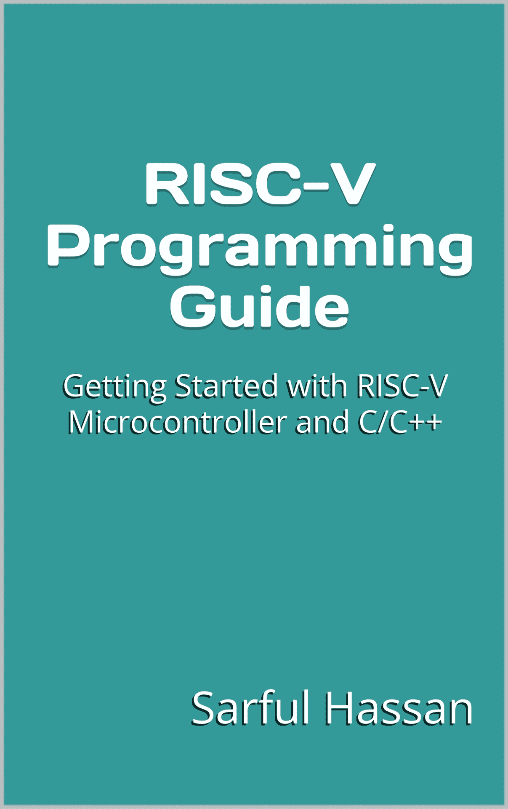
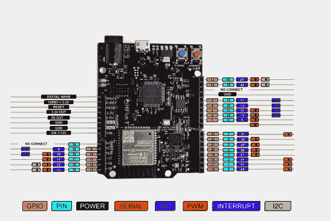
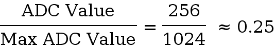

# RISC-V 编程指南：RISC-V 微控制器与 C/C++ 入门指南





## 序言

《RISC-V 编程指南：RISC-V 微控制器与 C/C++ 入门》旨在向读者介绍 RISC-V 微控制器编程的世界，特别是使用 `SiFive HiFive1 Rev B` 开发板。无论您是爱好者、学生还是专业开发人员，本书都为您提供了在 RISC-V 生态系统中开始开发应用程序所需的的基础知识和实践技能。

## 本书适合谁读

本书主要针对以下读者：

*   对 RISC-V 编程感兴趣的工程师和开发者。
*   正在学习微控制器编程和嵌入式系统的学生。
*   想要探索 `SiFive HiFive1 Rev B` 功能的创作者和爱好者。
*   从传统微控制器（如 `ARM` 或 `AVR`）转向 `RISC-V` 的专业人士。

假设读者已具备熟悉 `C` 或 `C++` 编程的基础知识。无需具备 `RISC-V` 微控制器的先经验。

## 本书的结构

*   第 1 章：提供 `RISC-V` 微控制器、其架构及其生态系统的高层次介绍。
*   第 2–4 章：重点介绍搭建开发环境以及基础编程概念，如常量、变量和数据类型。
*   第 5–10 章：涵盖输入/输出编程，包括数字、模拟和高级 I/O 技术。
*   第 11–16 章：深入探讨针对微控制器定制的 `C` 编程结构、运算符和函数。
*   第 17–21 章：探索高级主题，如电源管理、内存使用、通信协议以及带有 `Wi-Fi` 的物联网 应用。

## 本书未涵盖的内容

考虑到 `RISC-V` 和微控制器编程的广泛范围，本书特别关注：

*   `SiFive HiFive1 Rev B` 开发板。
*   使用 `C` 和 `C++` 进行编程。

实时操作系统 (`RTOS`)、硬件调试或广泛的第三方库等高级主题未在书中详细介绍。这些内容计划在未来的版本或配套书中讨论。

## 代码风格（关于代码）

所有代码示例均使用标准 `C` 编写，强调清晰和简单。

*   代码片段经过格式处理以提高读性，并在 `HiFive1 Rev B` 板上通过了测试。
*   包含了注释和文档以帮助解释功能。

在必要时，代码遵循现代嵌入式编程实践，确保了兼容性和易用性。

## 更新说明

*   第一版重点关注 `HiFive1 Rev B`。随着 `RISC-V` 生态系统的演进，未来的更新可能会包含更多开发板和增强功能。
*   错误说明和更新将在发布后发布在 `mechatronicslab.net`。

## 第一版说明

本版是致力于 `RISC-V` 编程系列书籍的第一部。读者的反馈对于提高未来版本的质量和范围至关重要。

## MechatronicsLAB 在线学习

欲获取更多资源、更新和学习材料，请访问：

*   网站：[mechatronicslab.net](http://mechatronicslab.net)
*   邮箱：`mechatronicslab@gmail.com`

我们鼓励读者就问题、建议或反馈与我们联系。

## 第一版致谢

没有以下个人和组织的支持，本书将无法完成：

*   `SiFive` 团队对 `RISC-V` 生态系统的贡献。
*   活跃的在线 `RISC-V` 社区提供的见解和讨论。
*   `MechatronicsLAB` 的同事和学生，他们在编写过程中提供了宝贵的反馈。

## 版权 (MechatronicsLAB)

© 2024 MechatronicsLAB. 版权所有。未经出版者事先许可，本书任何部分不得以任何形式复制、存储或传输。

## 免责声明

书中的信息按“现状”提供。虽然已尽一切努力确保准确性，但作者和出版商对使用书中材料导致的任何错误、遗漏或损害不承担任何责任。鼓励读者测试所有代码示例，并自行承担使用风险。


*   RISC-V 微控制器简介
*   微控制器基础
*   RISC-V 架构概述
*   RISC-V 微控制器生态系统
*   搭建开发环境
*   RISC-V 微控制器的 C 常量与变量
*   RISC-V 微控制器的 C 数据类型
*   RISC-V 微控制器的 C 变量作用域与变量管理
*   RISC-V 微控制器的 C 数字 I/O
*   RISC-V 微控制器的 C 模拟 I/O
*   RISC-V 微控制器的 C 高级 I/O
*   RISC-V 微控制器的 C 编程结构
*   RISC-V 微控制器的 C 运算符
*   RISC-V 微控制器的 C 比较
*   RISC-V 微控制器的 C 逻辑
*   RISC-V 微控制器的 C 算术
*   RISC-V 微控制器的 C 函数
*   RISC-V 微控制器的 C 电源管理
*   RISC-V 微控制器的 C 内存使用
*   RISC-V 微控制器的 C 通信协议
*   Wi-Fi 物联网应用
*   RISC-V 微控制器的 C 调试与测试
*   RISC-V 微控制器的 C 错误
*   RISC-V 微控制器的 C 转换


| 可定制性 | 受限于供应商协议 | 完全可定制 |
| :--- | :--- | :--- |
| 生态系统控制 | 供应商驱动 | 社区驱动 |
| 成本 | 较高 | 较低 |

## 开源硬件的优势：

1. **成本效益**：无版税费或许可费，降低了开发成本。
2. **透明性**：访问源代码确保了没有隐藏的漏洞。
3. **可定制性**：开发者可以修改 `ISA` 以针对特定应用程序优化性能。
4. **协作性**：开源社区鼓励知识共享和快速解决问题。
5. **供应商独立性**：避免被绑定在单一供应商上，提供了更大的灵活性。

***

## 微控制器的作用

## 微控制器 vs 微处理器

| 维度 | 微控制器 (MCUs) | 微处理器 (MPUs) |
| :--- | :--- | :--- |
| 集成度 | 处理器、内存、外设 | 仅处理器 |
| 关注重点 | 单任务嵌入式应用 | 高性能多任务处理 |
| 内存 | 片内 | 外部 |
| 功耗 | 低 | 高 |
| 应用领域 | IoT、自动化、消费电子设备 | 台式机、笔记本电脑和服务器 |

微控制器 (`MCUs`) 是为嵌入式系统中特定任务设计的紧凑集成电路。它们在单个芯片上包含了内存、处理能力和外设。

## 日常中的嵌入式系统

微控制器驱动着我们使用的许多嵌入式系统，例如：

* **消费电子**：智能电视、洗衣机和穿戴设备。
* **工业自动化**：机械臂、输送系统和传感器。
* **汽车**：发动机控制单元、`ABS` 系统和信息娱乐设备。

***

## 为什么选择 RISC-V 微控制器？

## 与 ARM 和 AVR 架构的对比

| 特性 | RISC-V | ARM Cortex-M | AVR |
| :--- | :--- | :--- | :--- |
| ISA | 开源 |  | 传统 RISC |
| 授权 | 免费 | 需要版税 | 无版税（固定 ISA） |
| 可扩展性 | 高可扩展性 | 固定的可扩展分级 | 有限 |
| 生态系统控制 | 社区驱动 | 供应商驱动 | 社区支持有限 |

## RISC-V 在 IoT 和机器人领域的优势

1. **可定制性**：RISC-V 微控制器可以根据特定任务进行定制，优化性能和功耗。
2. **成本效益**：开源硬件降低了生产成本，使 `RISC-V` 成为 `IoT` 设备等成本敏感应用的理想选择。
3. **可扩展性**：适用于从简单传感器到先进机器人系统的各种应用。

## 为什么 RISC-V 脱而出：

* **IoT 应用**：低功耗、可定制特性使得 `RISC-V MCUs` 成为电池供电设备的完美选择。
* **机器人**：实时处理能力支持精确控制和传感器集成。

***

## RISC-V 微控制器的应用案例

## IoT、消费电子和自动化中的示例

* **IoT**：智能家居设备（如恒温器和监控摄像头）受益于 `RISC-V` 低功耗的设计和连接选项。
* **消费电子**：健身追踪器等穿戴设备使用 `RISC-V` 进行数据处理和 `Bluetooth` 通信。
* **自动化**：工业机器人和控制器利用 `RISC-V` 实现实时性能和可扩展性。

## SiFive HiFive1 Rev B 概述

`HiFive1 Rev B` 是一款带有 `RISC-V` 微控制器的流行开发板。

### 关键特性和规格：

* **微控制器**：`SiFive FE310-G002` (`RV32IMAC`)
* **时钟**：高达 `320 MHz`
* **内存**：片内


* 它的开源特性消除了许可费用，使其对于预算敏感型应用更加实惠。
* 与 `ARM` 相比，`RISC-V` 在提供相似性能的同时，提供了更大的设计灵活性。

## 开发者的灵活性

`RISC-V` 的模块化 ISA 允许自定义指令集，为 IoT 传感器和机器人等特定应用降低功耗和芯片尺寸。

* *

## HiFive1 Rev B 引脚定义与功能

### HiFive1 Rev B 概述
`HiFive1 Rev B` 是由 SiFive 设计的开发板，用于 RISC-V 编程和原型设计。它集成了 `SiFive FE310-G002` 微控制器。

### 关键特性
* 时钟频率：最高 320 MHz。
* 内存：16 KB 指令令缓存，8 KB SRAM。
* GPIO 引脚：19 个数字 I/O 引脚，支持多功能。
* 外设：`SPI`、`I2C`、`PWM`、`UART`。
* 连接：用于编程和调试的 `USB`。



### 引脚表

| 引脚 | 功能 | 说明 |
| :--- | :--- | :--- |
| `GPIO0-GPIO17` | 数字 I/O, `PWM`, `UART`, `SPI` | 通用 I/O 引脚 |
| `A0-A3` | 模拟输入 | 用于读取传感器信号的 `ADC` |
| `VIN` | 电源输入 | 为板载供电 |
| `GND` | 接地 | 共地 |
| `RESET` | 复位输入 | 重置微控制器 |

### 电压水平与复用功能
* GPIO 电压水平：工作逻辑电平为 3.3V。
* 复用：许多 `GPIO` 引脚兼通信或外设接口，例如 `UART`（串口通信）或 `SPI`（串口外设）。

## RISC-V 架构概述

* *

### RISC-V 的核心特性
`RISC-V` 是精简指令集计算（RISC）理念的现代实现。其架构优先考虑简单性、效率和可扩展性，使其高度适应从微控制器到超级计算机的各种应用。

### 精简指令集计算 (RISC) 原则
* 简化指令集：`RISC` 架构使用更少、更精简的指令，可以在单个时钟周期内执行，提高了效率。
* 加载/存储架构：算术逻辑操作仅在寄存器上进行，而内存访问限于特定指令，降低了复杂性。
* 统一的指令格式：固定长度的指令简化了硬件中的解码和流水线，增强了性能。

### RISC-V ISA 的模块化设计
`RISC-V` 架构本质上是模块化的，允许开发者仅选择他们需要的特性。这种方法能够针对特定用例实现优化的设计。
* 基础 ISA：基础指令集，所有 `RISC-V` 实现所必需的。
* 扩展：可选的添加，用于增强功能，例如浮点运算或原子指令。

* *

## 指令集架构 (ISA)

### 基础整数集：RV32I
`RV32I` 基础指令集是 `RISC-V` 设计的核心，为基础整数操作提供 32 位指令。
* 算术运算：加、减、移位和逻辑操作。
* 控制流：用于程序流的分支和跳转指令。
* 内存访问：与内存交互的加载和存储操作。

#### RV32I 指令示例：
* `ADD rd, rs1, rs2`：将寄存器 `rs1` 和 `rs2` 中的值相加，结果存在 `rd`。
* `LW rd, offset(rs1)`：从 `rs1 + offset` 指定的内存地址加载一个字到 `rd`。

### 常见扩展
1. `M` (乘法/除法)：
* 增加了对乘法和除法操作硬件支持，对于数字信号处理等数值应用至关重要。
* 示例：`MUL rd, rs1, rs2`（将 `rs1` 和 `rs2` 中的值相乘，结果存在 `rd`）。
2. `C` (压缩指令)：
* 引入 16 位指令以减小代码体积，适用于 IoT 设备等内存受限的环境。
* 示例：`C.ADDI`（`ADDI` 指令的压缩版本）。
3. `F` 和 `D` (浮点)：
* 为科学和图形应用启用单精度 (`F`) 和双精度 (`D`) 浮点计算。

* *

## 寄存器与内存布局

### 通用寄存器与内存寻址
`RISC-V` 具有 32 个通用寄存器（`x0` 到 `x31`），根据 ISA 宽度为 32 或 64 位。
* `x0`：始终持有值 0。
* `x1 (ra)`：函数调用返回地址寄存器。
* `x2 (sp)`：管理局部变量和函数调用的栈指针。
* `x10-x17 (a0-a7)`：用于传递函数参数和返回结果。

### RISC-V 内存寻址模式
1. 基址+偏移：有效地址计算为基址寄存器 + 偏移。
* 示例：`LW x5, 4(x10)`（从地址 `x10 + 4` 的内存加载一个字到 `x5`）。
2. PC 相对寻址：适用于分支和跳转指令，目标地址相对于当前程序计数器 (`PC`)。
3. 寄存器间接寻址：通过指定寄存器中的地址允许动态内存访问。

### 小端格式与寻址方案
`RISC-V` 使用小端格式，低位字节存储在最低地址。

* *

### HiFive1 Rev B 中的 SiFive E31 核心

### E31 概述
`SiFive E31` 是一个高性能 32 位 `RISC-V` 核心，用于 `HiFive1 Rev B`。

### E31 的关键特性
* RV32IMAC：实现基础整数集，以及 `M`、`A` 和 `C` 扩展。
* 流水线：五级顺序流水线。
* 中断控制器：支持高级中断处理。

### 定制化与性能
* 自定义指令：可以优化性能。
* 低功耗：适用于 IoT 和可穿戴设备。
* 缓存系统：包含 16 KB 指令缓存。

* *

## RISC-V 微控制器生态系统

* *

### 热门 RISC-V 开发板概述
增长中的 `RISC-V` 生态系统包含多种用于原型设计、学习和部署嵌入应用的开发板。

#### 1. SiFive HiFive1 Rev B
* 处理器：`FE310-G002` (RV32IMAC)。
* 时钟频率：最高 320 MHz。
* 内存：16 KB 指令缓存，8 KB SRAM。
* 功能：
    * 19 个 `GPIO` 引脚。
    * `SPI`、`I2C`、`PWM` 和 `UART` 外设。
    * 兼容 Arduino 的接头便于原型设计。
* 应用：IoT 设备、教育和通用嵌入式系统。

#### 2. ESP32-C3
* 处理器：集成 Wi-Fi 和低功耗蓝牙 (BLE) 的 32 位 `RISC-V` 核心。
* 时钟频率：最高 160 MHz。
* 功能：
    * `ADC`、`UART`、`SPI` 和 `I2C` 接口。
    * 安全功能，如安全启动和硬件加密。
* 应用：需要无线连接的 IoT 设备，如智能家居和穿戴设备。

#### 3. GD32VF103
* 处理器：`Bumblebee` `RISC-V` 核心 (RV32IMAC)。
* 时钟频率：最高 108 MHz。
* 功能：
    * 丰富的外设集，包括定时器、`ADC`、`DAC`、`UART`、`SPI` 和 `I2C`。
    * 低功耗设计。
* 应用：工业自动化、机器人和低功耗消费电子产品。

* *

### 开发工具与资源
丰富的工具和资源支持 `RISC-V` 开发，让初学者和专业人士都能上手。

Freedom Studio
* SiFive 为 `RISC-V` 开发设计的基于 Eclipse 的 IDE。
* 提供集成调试、代码编辑和项目管理。
* 针对 `HiFive1 Rev B` 等板卡提供预配置工具链。

PlatformIO
* 通过 `VS Code` 支持 `RISC-V` 的跨平台 IDE。


- 特性包括库管理、调试和固件上传。

## GCC 工具链

- GNU 编译器集（GNU Compiler Collection）通过编译器、链接器和调试器支持 RISC-V 开发。
- 包含了用于裸机开发的 `riscv64-unknown-elf-gcc` 等工具，以及用于调试的 `gdb` 调试工具。

## 开源社区与文档

- RISC-V 国际组织（RISC-V International）：维护标准、规范和文档。
- GitHub 仓库：托管开源项目、外设库和教程。示例包括 SiFive 的官方仓库和 PlatformIO 项目。
- 论坛和小组：如 Stack Overflow、RISC-V 论坛和 Discord 社区等平台提供了开发者支持和讨论。

***

## 适用于 RISC-V 的流行 IDE 工具链

### 带有 PlatformIO 的 VS Code
- 特性：
    1. 简化的项目设置和开发板选择。
    2. 用于工具链命令的集成终端。
    3. 用于访问开源代码的库管理器。
- 设置：
    1. 安装 VS Code。
    2. 添加 PlatformIO 扩展。
    3. 创建新项目并选择你的 RISC-V 开发板。

### 基于 Eclipse 的 Freedom Studio
- 特性：
    - 针对 SiFive RISC-V 核心进行了预配置。
    - 支持 `OpenOCD` 的集成调试工具。
- 用场景：HiFive1 Rev B 及其他基于 SiFive 的开发板的理想选择。

### SiFive Freedom SDK
- 专为 SiFive RISC-V 开发板设计的软件开发包。
- 特性：
    - 包含了用于 GPIO、SPI、UART 等等的示例库。
    - 简化了外设初始化和低级编程。

## 安装与设置 SDK

克隆 SDK 仓库：

```
git clone https://github.com/sifive/freedom-e-sdk.git 
cd freedom-e-sdk
```

编译工具链和烧录工具：

```
make tools
```

烧录示例程序：

```
make BOARD=hiFive1-revb PROGRAM=gpio PORT=/dev/ttyUSB0 upload
```

## HiFive1 Rev B 的示例库与支持

- GPIO 库：简化了引脚配置和控制。
- SPI 和 I2C 库：用于与外部设备通信。
- 定计时器库：用于生成延迟和测量时间间隔。

***

## 选择合适的 RISC-V 开发板

在选择 RISC-V 开发板时，请考虑以下因素：

1. 应用需求
    - 开发板是否具有项目所需的所需的外设（例如 `ADC`、`PWM`、通信接口）？
    - 示例：用于需要无线连接的 IoT 项目的 `ESP32-C3`。
2. 性能需求
    - 选择具有足够处理能力和内存的开发板。
    - 示例：用于通用嵌入式系统的 HiFive1 Rev B。
3. 社区与文档
    - 像 HiFive1 Rev B 这样的板受益于丰富的文档和社区支持。
4. 预算限制
    - Sipeed Longan Nano 和 `GD32VF103` 是预算敏感型开发者的经济选择。
5. 易用性：初学者可能偏于支持 Arduino 的开发板。

## 设置开发环境

***

### 安装 RISC-V 开发工具

要为 RISC-V 微控制器进行开发，你需要适当的工具链和开发环境。本节涵盖了设置 `PlatformIO` 和 `Freedom Studio` 等工具的关键步骤。

### Visual Studio Code 中的 PlatformIO

`PlatformIO` 是 Visual Studio Code 的一个强大扩展，简化了 RISC-V 开发。

1. 安装 Visual Studio Code
    - 下载并安装 [VS Code](https://code.visualstudio.com/)。
2. 添加 PlatformIO 扩展
    - 打开 VS Code，导航到扩展市场并搜索“PlatformIO IDE”。
    - 点击安装将 `PlatformIO` 添加到你的环境中。
3. 创建新的 RISC-V 项目
    - 点击底部工具栏上的 `PlatformIO` 主页图标。
    - 选择“新项目（New Project）”，选择你的开发板（例如 SiFive HiFive1 Rev B），并指定项目目录。
    - `PlatformIO` 将自动为所选板下载所需的框架和库。

### 为 HiFive1 Rev B 配置 Freedom Studio

`Freedom Studio` 是 SiFive 为 RISC-V 开发定制的基于 Eclipse 的 IDE。

1. 下载并安装 Freedom Studio
    - 访问 Freedom Studio 网站并下载适用于你操作系统的安装程序。
    - 安装软件并打开 IDE。
2. 设置新项目
    - 选择 `File > New > Freedom E SDK Project`。
    - 选择 HiFive1 Rev B 作为你的目标板。
    - 导入示例程序或从空项目开始。
3. 配置工具链
    - `Freedom Studio` 预配置了 RISC-V GNU 工具链。在 `Window > Preferences > C/C++ > Build > Environment` 中验证工具链路径。

***

## 连接与测试 HiFive1 Rev B

### 设置硬件与驱动程序

1. 连接开发板
    - 使用 micro-USB 线将 HiFive1 Rev B 连接到电脑。
    - 确保开发板已开电（电源 LED 灯应该亮起）。
2. 安装驱动程序
    - 在 Windows 上：如果提示，请安装 `FTDI` 驱动。
    - 在 Linux/Mac 上：确保用户有权限访问串口（例如 `/dev/ttyUSB0`）。

### 编写并上传你的第一个 "Hello, World"

“Hello, World!” 程序演示了配置和运行 RISC-V 应用的基本知识。

编写代码
```c
#include <stdio.h>

int main() {
    printf("Hello, World!\n");
    return 0;
}
```

1. 编译程序
    - 在 `src` 文件夹中编写代码。
2. 上传程序
    - 使用 `PlatformIO` 烧录 HiFive1 Rev B。
3. 查看输出
    - 使用串口终端（例如 `minicom`）查看 "Hello, World!"。


在基于 RISC-V 微控制器的嵌入式编程中，常量和变量是管理数据的基础元素。常量存储不变的值，而变量则持有程序运行期间可以修改的数据。在代码中妥善管理常量和变量有助于提高可读性、效率和稳定性，这对于嵌入系统的受限环境至关重要。本章将引导你了解常量和变量的语法、用法和最佳实践，并提供一个实际项目来演示这些概念的应用。

### 章节目标

- 理解常量与变量之间的区别以及它们在 RISC-V 编程中的特定作用。
- 学习声明、初始化和修改常量与变量的语法。
- 在实际项目中应用常量和变量，演示最优的代码效率和可读性。

### 规则

- **使用常量处理固定值**：对于不应改变的参数（如数学常量或硬件配置）定义常量值。
- **正确初始化变量**：在声明变量时赋予初始值，以避免错误或未定义行为。
- **选择合适的数据类型**：根据预期数值范围选择数据类型，以实现内存利用。
- **使用描述性名称**：清晰地命名变量和常量可以提高代码可读性。

## 常量与变量简介

在 C 语言编程中，变量代表内存中的存储位置，数据可以在其中进行存储、检索和修改。另一方面，常量是整个程序范围内保持不变的固定值。在内存和处理能力有限的嵌入式编程中，有效使用常量和变量有助于提高程序效率并防止错误。

### 语法表

| 序号 | 主题 | 语法 | 简单示例 |
| :--- | :--- | :--- | :--- |
| 1 | 变量声明 | `type variableName;` | `int counter;` |
| 2 | 变量初始化 | `type variableName = value;` | `float voltage = 5.0;` |
| 3 | 常量声明 | `const type constName = value;` | `const int MAX = 10;` |
| 4 | 使用 #define 定义 | `#define CONST_NAME value` | `#define PI 3.14159` |
| 5 | 修改变量值 | `variableName = newValue;` | `counter = 10;` |

## 各命令详细详解

### 1. 变量声明

### 什么是变量声明？
在 C 语言中声明变量是在内存中为其分配一个存储位置并指定特定的数据类型。这使得程序能够存储和管理执行过程中可能变化的数据。

### 用途
- **存储动态数据**：变量存储程序过程中可能变化的值，例如计数器或传感器读取值。
- **实现计算**：变量通过持有中间值或变化值来实现动态计算。

### 语法
```
type variableName;
```

### 语法说明
- `type`: 定义数据类型，例如 `int`、`float` 或 `char`，它决定了变量将存储的数据种类。
- `variableName`: 变量名，遵循 C 命名规范（以字母或下划线开头，避免空格或特殊字符）。

### 简单代码示例
```c
int counter;
```

### 代码示例说明
- 这一行声明了一个名为 `counter` 的整数变量，它可以存储整数值并在程序中根据需要进行修改。

### 注意事项
- 使用描述性名称来明确每个变量的用途。
- 将变量声明在首次使用的地方附近，以提高可读性。

### 警告
- 声明变量时不进行初始化可能会导致内存中存储不可预测的值。

### 2. 变量初始化

### 什么是变量初始化？
初始化变量是在声明时赋予其一个初始值。这确保了变量从开始就具有定义的、可预测的值，避免了未定义状态。

### 用途
- **确保一致的初始状态**：初始化通过已知值准备变量以便立即使用。
- **避免不可预测的值**：从定义值开始有助于防止计算或逻辑中出现错误。

### 语法
```
type variableName = value;
```

### 语法说明
- `type`: 定义变量的数据类型。
- `variableName`: 变量名。
- `value`: 赋值给变量的初始值，需与数据类型匹配。

### 简单代码示例
```c
float voltage = 5.0;
```

### 代码示例说明
- 这初始化了一个名为 `voltage` 的 `float` 类型变量，初始值为 `5.0`。

### 注意事项
- 初始化对于计数器或状态标志位特别帮助。
- 尽可能在首次使用的地方初始化变量，以获得更好的代码结构。

### 3. 常量声明

### 什么是常量声明？
常量声明定义了一个只读变量，这意味着它的值在赋值后不能被修改。常量常用于固定值，如配置设置、数学常量或限制条件。

### 用途
- **确保固定值**：常量防止关键值被无意修改。
- **提高代码清晰度**：为固定值分配描述性名称可以使代码更易理解。

### 语法
```
const type constName = value;
```

### 语法说明
- `const`: 使变量变为为只读的关键字。
- `type`: 定义常量的数据类型。
- `constName`: 常量名，通常用大写字母以指示其固定性质。
- `value`: 常量的初始也是最终的值。

### 简单代码示例
```c
const int MAX_COUNT = 10;
```

### 代码示例说明
- 这将 `MAX_COUNT` 定义为值为 `10` 的常量整数。

### 注意事项
- 常量通常在开头声明以便于访问。
- 使用常量可以避免代码中的“魔数字”，提高可维护性。

### 4. 使用 #define 定义常量

### 什么是 #define 定义常量？
使用 `#define` 创建一个符号常量，编译器会将其替换为指定的值。它通常用于不需要内存的全局值。

### 用途
- **内存高效**：`#define` 常量不占用内存。
- **全局访问**：使用 `#define` 定义的值在处处可用。

### 语法
```
#define CONST_NAME value
```

### 语法说明
- `#define`: 用于定义常量的预处理指令。
- `CONST_NAME`: 通常大写以表示它是常量。
- `value`: 赋值的值，将替换掉所有的 `CONST_NAME`。

### 简单代码示例
```c
#define PI 3.14159
```

### 代码示例说明
- 这定义 `PI` 值为 `3.14159`，在编译时替换代码中所有的 `PI`。

### 注意事项
- `#define` 常量不占用内存，对于重复使用的值非常高效。
- 用于跨文件或模块所需的常量。

### 5. 修改变量值

### 什么是修改变量值？
修改变量的值允许更新其内容，这对于涉及计数器、标志位或计算的任务关重要。

### 用途
- **追踪变化**：变量可以根据程序需要更新值。
- **持有中间结果**：变量可以临时存储用于计算和比较的结果。

### 语法
```
variableName = newValue;
```

### 语法说明
- `variableName`: 需要更新的变量。
- `newValue`: 赋给变量的新值，需与变量类型匹配。

### 简单代码示例
```c
counter = 10;
```

### 代码示例说明
- 这为变量 `counter` 赋了新值 `10`，更新了其内容。

### 注意事项
- 循环或条件中的变量经常更新以反映变化的状态或条件。

### 警告
- 确保新值在变量的数据类型范围内以避免错误。

## 相关项目章节

### 项目名称
可调间隔的 LED 闪烁

### 项目目标


使用常量和变量来控制 RISC-V 微控制器上 LED 的闪烁频率。LED 的闪烁间隔将由一个常量决定，而变量将管理 LED 的开启/关闭状态。

### RISC-V 开发环境

我们将在项目中使用 `Visual Studio Code` 内的 `PlatformIO`。`PlatformIO` 为 RISC-V 微控制器提供了构建、上传和调试代码的工具。

### RISC-V 微控制器

此示例使用了 `SiFive HiFive1 Rev B` 微控制器，它基于 `SiFive Freedom E310`，这是一种以高效 IoT 应用而名的 RISC-V 核心。

###所需组件

- `SiFive HiFive1 Rev B` RISC-V 微控制器
- 连接到 GPIO 输出引脚的 LED

### 组件连接表

| 组件 | RISC-V 引脚 | 备注 |
| :--- | :--- | :--- |
| LED | `GPIO Pin19` | 由软件控制 |

### 连接分析

LED 连接到 `HiFive1 Rev B` 的 GPIO 引脚，根据常量设置的时间间隔进行开关切换。LED 状态（开启或关闭）存储在变量中，并根据计时逻辑进行修改。

### 程序软件设置

1. 打开带有 `PlatformIO` 的 `Visual Studio Code`。
2. 创建一个新的 `PlatformIO` 项目，并选择 `SiFive HiFive1 Rev B` 为开发板。
3. 为 LED 的闪烁间隔定义常量并初始化 LED 控制变量。
4. 编写代码根据定义的间隔切换 LED 状态。

### 项目代码

```c
#include <stdint.h>

// 定义板载 LED 的引脚号
#define LED_PIN 19

// 根据你的 SDK 定义 GPIO 控制寄存器
#define GPIO_DIR (*(volatile uint32_t*)0x10012000) // GPIO 方向寄存器
#define GPIO_OUT (*(volatile uint32_t*)0x10012004) // GPIO 输出寄存器

const int BLINK_INTERVAL = 100000;  // LED 闪烁间隔（周期）
int ledState = 0;                   // 用于跟踪 LED 状态的变量

// 配置 LED 引脚为输出的函数
void setupLED() {
    GPIO_DIR |= (1 << LED_PIN);     // 设置 LED_PIN 为输出
    GPIO_OUT &= ~(1 << LED_PIN);    // 确保 LED 初始关闭
}

// 使用忙等待循环的简单延迟函数
void delay(int interval) {
    for (volatile int i = 0; i < interval; i++);  // 消耗周期以延迟
}

int main() {
    setupLED();  // 初始化 LED
    while (1) {
        if (ledState) {
            GPIO_OUT &= ~(1 << LED_PIN);  // 关闭 LED
        } else {
            GPIO_OUT |= (1 << LED_PIN);   // 开启 LED
        }
        ledState = !ledState;          // 切换 LED 状态
        delay(BLINK_INTERVAL);         // 切换间的延迟
    }
    return 0;  // 程序永远不会到达这里
}
```

### 保存并运行

1. 使用 `Visual Studio Code` 中的 `PlatformIO` 保存、编译并将代码上传到 `SiFive HiFive1 Rev B` 开发板上。
2. 观察 LED 的开启和关闭，间隔由 `BLINK_INTERVAL` 常量控制。

### 检查输出

- LED 应该按照 `BLINK_INTERVAL` 常量定义的稳定频率闪烁，同时 `ledState` 变量管理其开启/关闭状态。

## RISC-V 微控制器的 C 数据类型

### 章节概述

数据类型是编程的基础，特别是在像 RISC-V 微控制器这样的嵌入式系统中，内存和处理能力有限。数据类型定义了变量可以存储的数据类型（如整数、字符或浮点数），并规定了这些数据占用多少内存。高效使用数据类型可以实现内存的最优化，有助于防止错误并提高代码的可读性和可靠性。本章涵盖了数据类型，包括基本、派生和自定义类型，并提供了实际示例和指南。

### 章节目标

- 理解 RISC-V 微控制器 C 编程中基本数据类型。
- 学习为特定应用选择合适的数据类型以优化内存使用。
- 实现一个在真实场景中演示各种数据类型使用的项目。

### 规则

- **选择最小存储**：使用存储信息所需的最小数据类型（例如，用于小整数的 `char`）。
- **确保数据范围正确**：选择与预期值范围匹配的数据类型以避免溢出或下溢。
- **仅在必要时使用浮点数**：浮点运算消耗更多资源；请谨慎使用。
- **定义自定义类型以提高清晰**：在适用情况下定义自定义类型以提高代码的可读性和可维护性。

### 数据类型简介

在嵌入式系统的 C 编程中，数据类型按存储数据的种类和大小对变量进行分类。基本数据类型如 `int`、`char` 和 `float`，但派生类型（数组、指针）和自定义类型（结构体、联合）对于复杂数据处理也至关重要。在 RISC-V 微控制器中，高效管理数据类型会对系统性能和资源使用产生巨大影响。

### 语法表

| 序号 | 主题 | 语法 | 简单示例 |
| :--- | :--- | :--- | :--- |
| 1 | 整数声明 | `int varName;` | `int count;` |
| 2 | 字符声明 | `char varName;` | `char letter;` |
| 3 | 浮点型声明 | `float varName;` | `float temperature;` |
| 4 | 数组声明 | `type varName[size];` | `int numbers[5];` |
| 5 | 结构体声明 | `struct { type member; } varName;` | `struct { int age; };` |

## 整数声明

### 什么是整数声明
整数声明创建用于存储整数的变量。整数在编程中非常常见。

### 用途

- 存储整数：用于计数器。
- 控制逻辑：用于表示数值。

### 语法
`int varName;`

### 语法解释

- `int`: 指定变量为整数类型，通常为 2 或 4 字节。
- `varName`: 整数变量名。

### 简单示例
`int count;`

### 代码示例
声明一个 `int` 变量 `count`，它可以存储整数。

### 备注

- `int` 的范围取决于架构（16 位为 -32768 到 32767，32 位为 -2147483648 到 2147483647）。

### 警告
超出超出范围的数值会导致溢出。

## 字符声明

### 什么是字符声明
字符声明定义了存储单个字符或小整数的变量。字符占用 1 字节内存，通常用于文本数据。

### 用途

- 存储单个字符：用于文本应用程序，例如显示字母。
- 小整数存储：可以是 0 到 255（无符号）或 -128 到 127（有符号）。

### 语法
`char varName;`

### 语法解释

- `char`: 指定变量为字符类型。
- `varName`: 字符变量名。

### 简单示例
`char letter;`

### 代码示例
声明一个 `char` 变量 `letter`，它可以存储字符如 'A' 或一个小整数。

### 备注

- `char` 变量经常用于数组来存储字符串。

### 警告
在系统之间传输时确保字符编码一致，因为字符是以 ASCII 或 Unicode 表示的。

## 浮点型声明

### 什么是浮点型声明
浮点型声明定义了存储小数的变量，通常用于计算中的精确测量或分数值。

### 用途

- 存储小数值：用于测量、计算以及任何需要精度的数值。
- 处理数学运算：通常用于对分数值进行乘除的应用。

### 语法
`float varName;`

### 语法解释

- `float`: 指定变量为浮点类型，占用 4 字节内存。
- `varName`: 浮点变量名。

### 简单示例
`float temperature;`


● 声明一个 `float` 类型变量 `temperature`，它可以存储如 `23.5` 或 `-2.8` 等小数值。

### 注意事项
● 浮点运算比整数运算慢，且消耗更多资源。

***

## 4. 数组声明

### 什么是数组声明？
数组声明创建了一个相同数据类型的元素集合，允许在单个变量名下存储多个值。数组对于数据分组（例如传感器读取值或多个字符）非常有用。

### 用途
● **存储多个值**：允许存储多个相同类型的元素。
● **高效的数据组织**：是管理可以在循环中处理的数据的理想选择。

### 语法
`type arrayName[size];`

### 语法解释
● `type`: 指定元素的数据类型。
● `arrayName`: 数组变量名。
● `size`: 数组可以容的元素数量。

### 简单代码示例
```c
int numbers[5];
```

### 代码示例解释
● 声明了一个名为 `numbers` 的数组，留有存放 `5` 个整数元素的空间。

### 注意事项
● 数组具有固定大小，必须在声明时定义。

### 警告
● 访问数组边界外的元素会导致内存错误。

***

## 5. 结构声明

### 什么是结构声明？
结构声明将不同的数据类型分组在单个变量下，允许共同管理相关数据。结构在嵌入式编程中创建自定义数据类型时非常有用。

### 用途
● **组织相关数据**：结构将不同数据类型组合在一起，简化了数据管理。
● **自定义数据类型**：用于表示复杂数据（如传感器数据），每个字段代表一个特定的特征。

### 语法
```c
struct {
  type member;
} structName;
```

### 语法解释
● `struct`: 定义结构体的关键字。
● `type`: 结构成员的数据类型。
● `member`: 结构中的每个数据字段。
● `structName`: 结构变量名。

### 简单代码示例
```c
struct SensorData {
  int id;
  float reading;
};
```

### 代码示例解释
● 定义了一个名为 `SensorData` 的结构，包含一个整数字段 `id` 和一个浮点数字段 `reading`。

### 注意事项
● 结构可以嵌套并用作数组使用，允许高度灵活的数据管理。

### 警告
● 注意内存对齐；未对齐的结构在某些架构上可能会导致访问错误。

***

## 相关项目章节

### 项目名称
带有多种数据类型的传感器数据记录器

### 项目目标
使用不同的数据类型在 RISC-V 微控制器上记录并管理来自传感器的数据，存储如传感器 ID、读取值和状态等数据。

### RISC-V 开发环境
项目将使用 Visual Studio Code 中的 `PlatformIO`。`PlatformIO` 为 RISC-V 微控制器提供了构建、上传和调试代码的工具。

### RISC-V 微控制器
此示例使用 SiFive HiFive1 Rev B 微控制器，它基于 SiFive Freedom E310 RISC-V 核，是嵌入式应用的理想选择。

### 组件
● SiFive HiFive1 Rev B RISC-V 微控制器
● 连接到模拟或数字输入引脚的传感器（例如温度传感器）
● 用于指示数据记录活动的 LED

### 组件连接表
| 组件 | RISC-V 引脚 | 备注 |
| :--- | :--- | :--- |
| 传感器 | 模拟引脚 | 读取传感器数据进行记录 |
| LED | GPIO 引脚 | 指示数据记录期间的活动 |

### 连接分析
传感器提供由微控制器记录的数据。LED 灯起表示记录正在进行，而程序存储了多种数据类型，包括整数、浮点数和字符。

### 程序软件设置
1. 打开带有 `PlatformIO` 的 Visual Studio Code。
2. 为 SiFive HiFive1 Rev B 板卡创建一个新的 `PlatformIO` 项目。
3. 定义一个结构来表示传感器数据，以及用于不同数据类型的变量。

### 项目代码
```c
#include <stdint.h>
#include "hifive1_gpio.h" // 根据需要调整您的 SDK

struct SensorData {
  int id;
  float reading;
  char status;
};

const int SENSOR_PIN = 0;  // 传感器示例模拟引脚
const int LED_PIN = 13; // LED 示例 GPIO 引脚

void setup() {
  GPIO_DIR |= (1 << LED_PIN);     // 将 LED_PIN 设置为输出
  GPIO_OUT &= ~(1 << LED_PIN);    // 初始化 LED 关闭
}

float readSensorData() {
  // 模拟传感器读取函数
  return 23.5;  // 占位值


void logSensorData(struct SensorData data) {
  // 模拟数据记录函数
  // 根据需要打印或存储数据
}

int main() {
  setup();
  struct SensorData sensor;
  sensor.id = 1;
  sensor.status = 'A';  // 'A' 表示激活
  while (1) {
    GPIO_OUT |= (1 << LED_PIN);
    // ... 逻辑
  }
}
```

## RISC-V 微控制器 C 语言变量作用域与管理

### 章节概述
在 RISC-V 微控制器嵌入式编程中，理解变量作用域和有效的变量管理至关重要。变量作用域决定了可以在哪里访问变量，而适当的变量管理确保了内存的使用。局部变量、全局和静态变量都有其独特的角色，知道何时使用它们对于效率和稳定性至关重要。

### 章节目标
● 理解 C 语言编程中不同类型的变量作用域（局部、全局、静态）。
● 学习高效的变量管理技术，包括内存分配。
● 实现一个演示作用域和管理的项目。

### 规则
● **尽可能使用局部变量**：限制变量作用域以节省内存。
● **避免过度使用全局变量**：仅对需要在多个函数间访问的数据使用全局变量。
● **利用静态变量保持状态**：使用静态变量在函数调用之间保留值。
● **减少内存占用**：在最小的作用域内声明变量并在不再需要时释放。

### 变量作用域简介
C 语言中的变量作用域定义了可以在程序范围内访问变量。局部变量仅存在于特定函数内，而全局变量在范围内可见。静态变量在函数调用之间保留其值，这在嵌入式编程中管理状态非常有用。

### 语法表
| 序号 | 主题 | 语法 | 简单示例 |
| :--- | :--- | :--- | :--- |
| 1 | 局部变量 | `type varName;` | `int counter;` |
| 2 | 全局变量 | `type varName;` (函数外) | `int total;` |
| 3 | 静态变量 | `static type varName;` | `static int count;` |
| 4 | 变量初始化 | `type varName = value;` | `int value = 5;` |
| 5 | extern 关键字 | `extern type varName;` | `extern int total;` |

***

### 1. 局部变量

### 什么是局部变量？
局部变量定义在函数内部，并且仅在该函数内可用。局部变量在函数被调用时创建，在函数退出时销毁，因此非常适合临时值。

### 用途


### 1. 局部变量

- **临时数据存储**: 存储仅在特定函数所需的数值。
- **避免内存浪费**: 局部变量仅在函数执行期间占用内存。

### 语法
```c
type varName;
```

### 语法解释
- `type`: 指定变量的数据类型，例如 `int`、`float` 或 `char`。
- `varName`: 变量名，仅在声明它的函数内部可见。

### 简单代码示例
```c
void calculate()  {
    int result =  0;  // 局部变量
}
```

### 代码示例解释
- 在 `calculate` 函数内部声明了一个局部整数变量 `result`，它只能在该函数内部访问。

### 注意事项
- 局部变量在函数结束后会自动释放，从而释放内存。

### 警告
- 在函数外部访问局部变量将导致编译错误。

***

### 2. 全局变量

### 什么是全局变量？
全局变量声明在任何函数之外（通常在程序的开头），并可以在整个程序中访问。全局变量在程序运行期间持续存在。

### 用途
- **跨函数共享数据**: 适用于多个函数需要访问的数值，例如配置数据。
- **持久化存储**: 在程序执行过程中保留其值。

### 语法
```c
type varName;
```

### 语法解释
- `type`: 指定变量的数据类型。
- `varName`: 变量名，可以在程序的任何地方访问。

### 简单代码示例
```c
int total;  // 全局变量
```

### 代码示例解释
- 将 `total` 声明为全局变量，程序中的任何函数都可以访问。

### 注意事项
- 全局变量默认初始化为零。

### 警告
- 过度使用全局变量会导致内存效率低下和调试困难。

***

### 3. 静态变量

### 什么是静态变量？
静态变量在函数调用之间保留其值，允许它在声明的函数内部充当持久化存储。

### 用途
- **跨调用维持状态**: 计数器或需要在函数执行之间持久的数值的理想选择。
- **带持久性的范围限制**: 静态变量仅限于其声明的函数，但会保留其值。

### 语法
```c
static type varName;
```

### 语法解释
- `static`: 修饰符，即使在函数退出后也保留变量的值。
- `type`: 指定数据类型。
- `varName`: 变量名，仅在声明它的函数内部可见。

### 简单代码示例
```c
void track()  {
    static int callCount =  0;  // 静态变量
    callCount++;
}
```

### 代码示例解释
- `callCount` 是一个静态变量，每次调用 `track` 时都会递增，并在多次调用之间保留其值。

### 注意事项
- 静态变量只初始化一次，并在函数调用之间保留其值。

### 警告
- 静态变量存储在全局内存中，因此要谨慎使用以避免内存限制。

***

### 4. 变量初始化

### 什么是变量初始化？
初始化在声明变量时为其分配一个初始值，确保它从已知值开始，这对于局部变量尤为重要。

### 用途
- **避免不可预测的值**: 确保变量从定义好的值开始。
- **控制初始状态**: 帮助将计数器、标志位和累加器设置为已知的起始点。

### 语法
```c
type varName =  value;
```

### 语法解释
- `type`: 变量的数据类型。
- `varName`: 变量名。
- `value`: 分配给变量的初始值。

### 简单代码示例
```c
int value =  5;
```

### 代码示例解释
- 声明一个初始值为 5 的整数变量 `value`。

### 注意事项
- 始终初始化没有默认值的变量（例如局部变量）。

### 警告
- 确保值类型与变量类型匹配，以避免意外结果。

***

### 5. Extern 关键字

### 什么是 Extern 关键字？
`extern` 关键字允许变量在多个文件中使用。它声明了一个变量但不对其进行定义，假设其定义在代码的其他地方存在。

### 用途
- **跨文件共享全局变量**: 适用于需要在不同模块间访问变量的大型程序。
- **代码模块化**: 允许将代码拆分为多个文件而无需重新定义变量。

### 语法
```c
extern type varName;
```

### 语法解释
- `extern`: 表示该变量定义在另一个文件中。
- `type`: 变量的数据类型。
- `varName`: 要跨文件共享的变量名。

### 简单代码示例
```c
extern int total;
```

### 代码示例解释
- 声明 `total` 是另一个文件中定义的变量，允许在此处访问。

### 注意事项
- 将 `extern` 声明放在头文件中，以便在多个 C 文件之间共享变量。

### 警告
- 确保带有 `extern` 的变量只定义一次；多次定义会导致错误。

***

## 相关项目章节

### 项目名称
按钮控制 LED 与变量作用域管理

### 项目目标
在 RISC-V 微控制器上创建一个程序，通过按键切换 LED 状态，演示局部、全局和静态变量的使用。

### RISC-V 开发环境
该项目使用 Visual Code 中的 PlatformIO 来构建、上传和调试 SiFive Hi1 B 微控制器。

### 要求组件
在 RISC-V 微控制器上创建一个程序，通过按键切换 LED 状态，演示局部、全局和静态变量的使用。

## 连接表格
| 组件 | RISC-V 引脚 | 备注 |
| :--- | :--- | :--- |
| 按钮 | GPIO | 输入 |
| LED | GPIO | 输出 |

### 连接分析
通过读取按钮状态来决定 LED 是开启还是关闭。全局变量管理状态，静态变量维持 LED 状态，局部变量在函数内存储值。

### 软件设置
1. 使用 PlatformIO 打开 VS Code。
2. 创建新的 PlatformIO 项目并选择 SiFive Hi1 B 开发板。
3. 实现根据按键切换 LED 状态的逻辑。

### 项目代码
```c
#include <stdint.h>
#include "hive1_gpio.h" // 根据 SDK 调整

const int BUTTON_PIN = 2; // 按钮引脚
const int LED_PIN = 13; // LED 引脚

// 用于存储状态的全局变量
int buttonState = 0;

void setup() {
    GPIO_DIR |= (1 << LED_PIN); // 设置 LED_PIN 为输出
    GPIO_DIR &= ~(1 << BUTTON_PIN); // 设置 BUTTON_PIN 为输入
    GPIO_OUT &= ~(1 << LED_PIN); // 初始化 LED 关闭
}

void toggleLED() {
    static int ledState = 0; // 保留状态的静态变量
    if (ledState) {
        GPIO_OUT &= ~(1 << LED_PIN); // 关闭 LED
    } else {
        GPIO_OUT |= (1 << LED_PIN); // 开启 LED
    }
    ledState = !ledState; // 为下次调用切换 ledState
}

int main() {
    setup();
    while (1) {
        int currentButtonState = (GPIO_IN & (1 << BUTTON_PIN)) != 0; // 局部变量
        if (currentButtonState != buttonState) {
            if (currentButtonState == 1) { // 按钮按下
                toggleLED(); // 切换 LED 状态
            }
            buttonState = currentButtonState; // 更新全局按钮状态
        }
        for (volatile int i = 0; i < 10000; i++); // 消抖延迟
    }
}
```

### 保存并运行
1. 使用 PlatformIO 保存、编译并上传代码到 SiFive Hi1 B 板。
2. 按下按钮切换 LED 状态，验证变量作用域管理正确。


每次按下按钮时，LED 都应该切换开启或关闭。程序使用局部、全局和静态变量来处理按钮状态、LED 状态以及临时值。

# 用于 RISC-V 微控制器的 C 语言数字 I/O

### 章节概述
数字 I/O（输入/输出）操作使 RISC-V 微控制器能够与 LED、按钮和传感器等外部设备交互。数字引脚可以被配置为输入或输出，允许微控制器读取数字信号（HIGH/LOW）或控制外部设备。本章将介绍如何在 RISC-V 微控制器上配置和使用数字 I/O，包括设置引脚方向以及向 GPIO 引脚读取/写入值。

### 章节目标
- 理解 RISC-V 微控制器上的数字 I/O 操作。
- 学习如何将引脚设为输入或输出，并读取/写入数字值。
- 实现一个通过按钮控制 LED 的实际项目。

### 规则
- **正确配置引脚方向**：在使用引脚之前，请务必将其设置为 `INPUT` 或 `OUTPUT`。
- **输入去抖**：对按钮使用软件去抖以防止误触发。
- **检查电压和电流限制**：确保连接的设备在微控制器 I/O 引脚的电压/电流额范围内。
- **输入使用上拉/下拉电阻**：提高读取按钮或开关状态时的可靠性。

## 数字 I/O 简介
RISC-V 微控制器使用数字 I/O 引脚进行输入或输出控制。在 `INPUT` 模式下，微控制器将外部信号读取为 `HIGH` 或 `LOW`。在 `OUTPUT` 模式下，它通过将引脚设置为 `HIGH` 或 `LOW` 来控制连接的设备。有效配置 I/O 引脚对于与外部组件可靠交互至关重要。

### 语法表
| 序号 | 主题 | 语法 | 示例 |
| :--- | :--- | :--- | :--- |
| 1 | 设置引脚为输出 | `GPIO_DIR |= (1 << PIN);` | |
| 2 | 设置引脚为输入 | `GPIO_DIR &= ~(1 << PIN);` | `GPIO_DIR &= ~(1 << 3);` |
| 3 | 向引脚写入 HIGH | `GPIO_OUT |= (1 << PIN);` | |
| 4 | 向引脚写入 LOW | `GPIO_OUT &= ~(1 << PIN);` | `GPIO_OUT &= ~(1 << 2);` |
| 5 | 读取引脚状态 | `GPIO_IN & (1 << PIN)` | `GPIO_IN & (1 << 3)` |

---

## 各命令详细详解

### 1. 设置引脚为输出

### 什么是设置引脚为输出？
将引脚配置为输出允许微控制器控制该引脚上的电平，从而开启或关闭 LED 等外部设备。

#### 用
- **控制外部设备**：在输出模式下，微控制器可以向连接引脚的设备发送 `HIGH` 或 `LOW` 信号，例如 LED 或继电器。
- **允许写入数字状态**：在将引脚设置为 `HIGH` 或 `LOW` 之前所需的，以避免未定义行为。

### 语法
```c
GPIO_DIR |= (1 << PIN);
```

### 语法解释
- `GPIO_DIR`: 该寄存器用于配置微控制器上 GPIO 引脚的方向。寄存器中的每个位对应一个特定的引脚；将位设置为 1 可使引脚变为 `OUTPUT`，将位设置为 0 可使引脚变为 `INPUT`。
- `|=`: 按位或赋值运算符在不影响其他位的情况下修改特定位。在这里，用于设置目标引脚的位，同时保持其他引脚的配置不变。
- `(1 << PIN)`: 此表达式将位 "1" 向左移动 `PIN` 指定的位数。例如，如果 `PIN` 为 2，`(1 << PIN)` 产生 `0b00000100`，目标 `GPIO_DIR` 寄存器中的第 2 个引脚并将其设置为 `OUTPUT`。

### 简单代码示例
```c
GPIO_DIR |= (1 << 2);
```

### 代码示例解释
- 将引脚 2 设置为 `OUTPUT`，允许微控制器通过发送 `HIGH` 或 `LOW` 信号来控制连接的设备。

#### 注意
- 在写入 `HIGH` 或 `LOW` 之前将引脚设置为 `OUTPUT`，以避免错误或损坏微控制器。

### 警告
- 确保连接到输出引脚的组件未超过引脚的电压和电流额定，以避免损坏。

---

### 2. 设置引脚为输入

### 什么是设置引脚为输入？
将引脚设置为输入可配置其读取来自按钮或传感器等外部组件的信号。在此模式下，微控制器可以检测外部信号是 `HIGH` 还是 `LOW`。

#### 用
- **读取外部信号**：允许微控制器感知按钮、开关或数字传感器等外部设备的状态。
- **为数字读取操作做准备**：在读取引脚状态之前，必须将引脚设置为输入。

### 语法
```c
GPIO_DIR &= ~(1 << PIN);
```

### 语法解释
- `GPIO_DIR`: 配置 GPIO 引脚方向的寄存器，其中每个位对应微控制器上的一个引脚。将位设置为 0 可使引脚变为 `INPUT`。
- `&=`: 按位与赋值运算符用于在不影响 `GPIO_DIR` 中其他位的情况下清除该位。通过使用 `&=`，只会修改指定的引脚。
- `~(1 << PIN)`: 此表达式将 1 向左移动 `PIN` 位，然后 `~`（按位取反）反转结果。例如，如果 `PIN` 为 3，`(1 << PIN)` 得到 `0b00001000`。

### 简单代码示例
```c
GPIO_DIR &= ~(1 << 3);
```

### 代码示例解释
- 将引脚 3 设置为 `INPUT`（`11110111`）。


---

### 3. 向引脚写入 HIGH

### 什么是向引脚写入 HIGH？
向设置为输出的引脚写入 `HIGH` 可以提供电压（通常为 3.3V 或 5V），从而激活外部设备。

#### 用
- **开启外部设备**：将引脚拉高可以开启 LED 或继电器等设备。
- **数字通信信号**：代表数字系统中的 `HIGH` 信号。

### 语法
```c
GPIO_OUT |= (1 << PIN);
```

### 语法解释
- `GPIO_OUT`: 该寄存器控制 GPIO 引脚的输出状态。每个位对应一个引脚；将位设置为 1 使引脚变为 `HIGH`，设置为 0 则变为 `LOW`。
- `|=`: 按位或赋值运算符在不影响其他位的情况下修改特定位。
- `(1 << PIN)`: 此表达式将位 "1" 向左移动 `PIN` 指定的位数，对准引脚。

### 简单代码示例
```c
GPIO_OUT |= (1 << 2);
```

### 代码示例解释
- 将引脚 2 设置为 `HIGH`，为引脚供电并开启连接的设备。

---

### 4. 向引脚写入 LOW

### 什么是向引脚写入 LOW？
向设置为输出的引脚写入 `LOW` 会将其拉至地（0V），禁用 LED 或继电器等设备。

#### 用
- **关闭外部设备**：将引脚拉低可以关闭如 LED 等设备。
- **数字通信信号**：代表数字系统中的 `LOW` 或 0 信号。

### 语法
```c
GPIO_OUT &= ~(1 << PIN);
```

### 语法解释
- `GPIO_OUT`: 控制 GPIO 引脚输出状态的寄存器。
- `&=`: 按位与赋值运算符，用于清除（设置为 0）指定的位。
- `~(1 << PIN)`: 将 1 向左移动 `PIN` 位以匹配引脚，然后反转结果。

### 简单代码示例
```c
GPIO_OUT &= ~(1 << 2);
```

### 代码示例解释
- 将引脚 2 设置为 `LOW`，禁用任何连接的设备。


● 避免过快更改引脚的输出状态，因为可能会导致非预的行为，例如功率峰值。

***

# 5 读取引脚状态

### 什么是读取引脚状态？
读取引脚状态允许微控制器检测配置为输入的引脚是 `HIGH` 高电平还是 `LOW` 低电平，这对于按钮按下、开关或传感器信号有用。

### 用
● 检测按钮按下：有助于判断按钮或开关是否激活。
● 监控外部信号：读取数字传感器等设备的状态。

### 语法
`GPIO_IN & (1 << PIN)`

### 语法解释
● `GPIO_IN`: 用于读取 GPIO 引脚当前状态的寄存器。每一位代表对应引脚的状态。
● `&`: 位与 `AND` 运算符，用于隔离与引脚相关的特定位，从而进行针对性的状态检查。
● `(1 << PIN)`: 将位 `1` 移到指定引脚的位置，创建一个掩码以隔离 `GPIO_IN` 中该引脚的状态。

### 简单代码示例
```c
if (GPIO_IN & (1 << 3)) {
    // Pin 3 is HIGH
}
```

### 代码示例解释
● 通过结合 `(1 << 3)` 和 `GPIO_IN` 隔离其状态，检查引脚 3 是否为 `HIGH`。

### 注意事项
● 实现去抖以确保准确读取按钮状态。

### 警告
● 未连接或浮空的输入引脚可能会提供不可靠的读数；根据需要将它们连接到上拉电阻或下拉电阻。

***

## 相关项目章节

### 项目名称
按钮控制的 LED

### 项目目标
在 RISC-V 微控制器上使用数字 I/O 在按下按钮时切换 LED 状态，演示读取输入和输出的基础。

### RISC-V 开发环境
我们将使用带有 Visual Studio Code 的 PlatformIO 来构建、上传和调试程序。

### RISC-V 微控制器
此示例使用基于 SiFive Freedom E310 RISC-V 内的 SiFive HiFive1 Rev B 微控制器。

### 组件
● SiFive HiFive1 Rev B 微控制器
● 连接到输入引脚的按钮
● 连接到输出引脚的 LED

### 组件连接表
| 组件 | RISC-V 引脚 | 备注 |
| 按钮 | GPIO 引脚 | 用于控制 LED 切换功能 |
| LED | GPIO 引脚 | 根据按钮状态开启/关闭 |

### 连接分析
在此项目中，按钮向微控制器提供输入，允许其检测何时何时按下。当检测到按下时，微控制器切换 LED 的状态。按钮连接到配置为 `INPUT` 的 GPIO 引脚，而 LED 连接到配置为 `OUTPUT` 的 GPIO 引脚。

### 程序软件设置
1. 打开安装了 PlatformIO 的 Visual Studio Code。
2. 创建一个新的 PlatformIO 项目并选择 SiFive HiFive1 Rev B 作为开发板。
3. 编写代码初始化 LED 和按钮引脚，读取按钮状态并相应地切换 LED。

### 项目代码
```c
#include <stdint.h>
#include "hifive1_gpio.h" // 包含 GPIO 库（根据你的 SDK 调整）

const int BUTTON_PIN = 2; // 按钮示例 GPIO 引脚
const int LED_PIN = 13; // LED 示例 GPIO 引脚

// 用于跟踪 LED 状态的变量
int ledState = 0;

void setup() {
    // 设置 LED 引脚为输出
    GPIO_DIR |= (1 << LED_PIN);
    // 设置 按钮 引脚为输入
    GPIO_DIR &= ~(1 << BUTTON_PIN);
    // 初始化 LED 为关闭
    GPIO_OUT &= ~(1 << LED_PIN);
}

void toggleLED() {
    if (ledState) {
        // 如果 LED 当前开启，则关闭它
        GPIO_OUT &= ~(1 << LED_PIN);
    } else {
        // 如果 LED 当前关闭，则开启它
        GPIO_OUT |= (1 << LED_PIN);
    }
    // 切换 ledState 变量以跟踪
    ledState = !ledState;
}

int main() {
    setup();
    while (1) {
        // 读取按钮的当前状态
        int buttonState = (GPIO_IN & (1 << BUTTON_PIN)) != 0;
        // 如果按钮按下，切换 LED
        if (buttonState) {
            toggleLED();
            // 去抖延迟，防止单次按下多次切换
            for (volatile int i = 0; i < 100000; i++); // 简单延迟
        }
        // 小延迟以避免快速检查
        for (volatile int i = 0; i < 1000; i++);
    }
}
```

### 保存并运行
1. 使用 PlatformIO 保存、编译并将代码上传到 SiFive HiFive1 Rev B 板上。
2. 按下按钮切换 LED 状态，观察其每次按下时开启或关闭。

### 检查输出
● LED 应该在每次按下按钮时在开启和关闭之间切换。此行为证实了微控制器可以成功读取按钮状态并通过数字 I/O 控制 LED。

## RISC-V 微控制器的 C 语言模拟 I/O

### 章节概述
模拟 I/O（输入/输出）操作允许微控制器进行交互。（此处省略重复的文本内容）

**实际内容处理：**
模拟 I/O（输入/输出）操作允许微控制器进行交互。（此处省略重复的文本内容）

**修正后的文本块：**
模拟 I/O（输入/输出）操作允许微控制器进行交互。（此处省略重复的文本内容）


# (c) 乘以参考电压

将归一化值乘以参考电压，可以将比例转换为实际电压。

## 逐步示例

假设系统包含以下配置：

* 一个 10 位 ADC（最大 ADC 值 = `1023`）
* `5.0V` 的参考电压
*  原始 ADC 读取数值为 `256`

### 第一步：归一化 ADC 值



### 第二步：乘以参考电压

`Voltage=0.25×5.0=1.25V`

因此，ADC 值 `256` 对应于 `1.25V`。

### 可视化

* ADC 分辨率：10 位
* 参考电压：`3.3V`

| ADC 值 | 比例 (ADCValue/1023) | 电压 (V) |
| :--- | :--- | :--- |
| 0 | `0/1023=0.0` | `0.0V` |
| 256 | `256/1023≈0.25` | `0.25×3.3=0.825V` |
| 512 | `512/1023≈0.5` | `0.5×3.3=1.65V` |
| 768 | `768/1023≈0.75` | `0.75×3.3=2.475V` |
| 1023 | `1023/1023=1.0` | `1.0×3.3=3.3V` |

### 语法表

| 序号 | 主题 | 语法 | 简单示例 |
| :--- | :--- | :--- | :--- |
| 1 | 初始化 ADC | `ADC_INIT();` | `ADC_INIT();` |
| 2 | 设置 ADC 通道 | `ADC_SELECT_CHANNEL(channel);` | `ADC_SELECT_CHANNEL(1);` |
| 3 | 开始 ADC 转换 | `ADC_START_CONVERSION();` | `ADC_START_CONVERSION();` |
| 4 | 读取 ADC 结果 | `ADC_READ();` | `int value = ADC_READ();` |
| 5 | 转换为电压 | `voltage = (value / 1023.0) * ref;` | `float voltage = (value / 1023.0) * 3.3;` |

***

## 每个命令的详细说明

### 1. 初始化 ADC

### 什么是 ADC 初始化？
初始化 ADC 是通过配置必要的设置（如参考电压、分辨率和任何所需的内部组件），为微控制器执行模拟到数字的转换做好准备。

### 使用用途
* 设置 ADC 硬件：确保 ADC 已通过所有必要配置准备好就绪。
* 准备准确读取：通过设置参考电压和分辨率，确保转换的稳定和准确。

### 语法
```
ADC_INIT();
```

### 语法解释
* `ADC_INIT`：此函数通常使用默认或用户定义的配置初始化 ADC 外设。它可能包括设置 ADC 时钟、启用 ADC 模块以及设置参考电压。

### 简单代码示例
```
ADC_INIT();
```

### 代码示例解释
* 此代码初始化 ADC 模块，使其准备好进行模拟到数字转换。

### 注意事项
* 在启动任何转换之前务必初始化 ADC，以避免错误结果。

### 警告
* 确保参考电压和分辨率与传感器要求匹配以获得准确读取。

***

### 2. 设置 ADC 通道

### 什么是设置 ADC 通道？
设置 ADC 通道用于配置 ADC 从哪个模拟输入引脚读取。微控制器通常支持多个模拟通道，每个通道对应一个特定的引脚。

### 使用用途
* 选择读取模拟引脚：引导 ADC 从正确的引脚读取。
* 在通道之间切换：允许通过选择不同的通道读取多个模拟传感器。

### 语法
```
ADC_SELECT_CHANNEL(channel);
```

### 语法解释
* `ADC_SELECT_CHANNEL`：此函数为 ADC 转换选择指定的通道。参数 `channel` 对应微控制器中配置的模拟引脚号或通道号。

### 简单代码示例
```
ADC_SELECT_CHANNEL(1);
```

### 代码示例解释
* 此代码设置 ADC 从通道 1 读取，允许 ADC 读取对应引脚的模拟信号。

### 注意事项
* 部分微控制器可能使用专用的函数或寄存器进行通道选择。

### 警告
* 在转换过程中切换通道可能会导致结果错误。确保在更改通道之前转换完成。

***

### 3. 开始 ADC 转换

### 什么是启动 ADC 转换？
启动 ADC 转换指示 ADC 采样模拟输入将其转换为数字值。此过程必须在读取结果之前完成。

### 使用目的
* 开始模拟读取：启动读取模拟值的转换过程。
* 捕获当前信号：在当前信号电上采样输入。

### 语法
```
ADC_START_CONVERSION();
```

### 语法解释
* `ADC_START_CONVERSION`：此函数开始模拟到数字转换过程。调用时，ADC 开始采样选定的模拟通道并将电压转换为数字值。

### 简单代码示例
```
ADC_START_CONVERSION();
```

### 代码示例解释
* 此代码启动 ADC 转换过程，开始读取和转换所选通道上的模拟信号。

### 注意事项
* 转换时间可能根据不同而异。

### 警告
* 在转换完成前启动新的转换可能会导致数据错误。

***

### 4. 读取 ADC 结果

### 什么是读取 ADC 结果？
读取 ADC 结果是获取转换后的数字值，该值代表模拟电压。

### 使用目的
* 获取转换数据：检索数字值。
* 用于计算：获取结果用于计算。

### 语法
```
int value = ADC_READ();
```

### 语法解释
* `ADC_READ`：此函数返回 ADC 的数字结果。

### 简单代码示例
```
int value = ADC_READ();
```

### 代码示例解释
* 此代码读取数字值并将其存储在变量 `value` 中。

### 注意事项
* 返回值取决于 ADC 的分辨率。

### 警告
* 在转换完成前调用可能会失败。

***

### 5. 转换为电压

### 什么是转换为电压？
读取 ADC 结果后，可能需要将其转换为电压。使用已知参考电压和 ADC 分辨率，可以将数字值还原为电压。

### 使用目的
* 数字翻译：将 ADC 结果转换为电压。
* 传感器数据解释：允许解释读取值。

### 语法
```
float voltage = (value / 1023.0) * ref;
```

### 语法解释
* `value`：ADC 的数字结果。
* `1023.0`：10 位 ADC 的最大值，此处作为缩放因子。
* `ref`：ADC 的参考电压，通常为 3.3V 或 5V。

### 简单代码示例
```
float voltage = (value / 1023.0) * 3.3;
```

### 代码示例解释
* 此代码将原始 ADC 值转换为电压，假设参考电压为 3.3V 且 ADC 为 10 位。

### 注意事项
* 参考电压应与 ADC 实际匹配以确保准确。

### 警告
* 缩放错误会导致电压读取不准确。

***

## 相关项目

### 项目名称
温度传感器读取

### 项目目标
使用 RISC-V 微控制器的 ADC 读取模拟传感器，并将读取转换为摄氏度。

### RISC-V 开发环境
此项目将使用 Visual Studio Code 中的 PlatformIO 进行构建。

### RISC-V 微控制器
项目使用了基于 SiFive Freedom E310 RISC-V 内的 SiFive HiFive1 Rev B 微控制器。

### 组件
* SiFive HiFive1 Rev B 微控制器
* 连接到模拟输入引脚的模拟温度传感器（例如 TMP36）
* 用于显示温度读取的显示器或串口

### 组件连接表

| 组件 | RISC-V 引脚 | 备注 |
| :--- | :--- | :--- |
| 温度传感器 | ADC 引脚 | 模拟传感器输出已连接 |
| 显示器/串口输出 | UART/串口 | 用于显示温度输出 |

### 连接分析


温度传感器的模拟输出由微控制器上的 `ADC` 读取。微控制器将读取值转换为温度值，并通过串口监视器或显示器显示。

### 程序软件设置

1. 打开 Visual Studio Code 并在 PlatformIO 中创建一个新项目。
2. 配置 `ADC` 以读取温度传感器的输出。
3. 编写代码初始化 `ADC`、启动转换、读取结果并将其转换为温度值。

### 项目代码

```c
#include <stdint.h>
#include <stdio.h>
#include "hifive1_adc.h" // 替换为实际的 ADC 库

#define REF_VOLTAGE 3.3 // ADC 参考电压

#define TEMP_PIN 1       // 温度传感器的 ADC 引

void setupADC() {
    ADC_INIT();                  // 初始化 ADC 模块
    ADC_SELECT_CHANNEL(TEMP_PIN);  // 选择温度传感器通道
}

float readTemperature() {
    ADC_START_CONVERSION();   // 启动 ADC 转换
    int adcValue = ADC_READ();  // 读取 ADC 值
    // 将 ADC 值转换为电压
    float voltage = (adcValue / 1023.0) * REF_VOLTAGE;
    // 将电压转换为温度（假设使用 TMP36 传感器）
    float temperatureC = (voltage - 0.5) * 100;
    return temperatureC;
}

int main() {
    setupADC();
    while (1) {
        float temperature = readTemperature();
        printf("Temperature: %.2f °C\n", temperature);  // 显示温度
        for (volatile int i = 0; i < 1000000; i++); // 简单延迟
    }
}
```

### 保存并运行

1. 保存、编译并将代码上传到 SiFive HiFive1 Rev B 板。
2. 打开串口监视器查看温度输出。

### 检查输出

● 摄氏度温度应显示在串口监视器上，并定期更新。

## 用于 RISC-V 微控制器的高级 I/O

### 章节概述

高级 I/O 操作通过允许使用定时器、中断和通信协议（如 SPI、I2C 和 UART）扩展了数字和模拟 I/O 功能，从而管理外设并处理复杂任务。这些高级 I/O 函数对于精确控制、高速数据传输和高效处理实时事件至关重要，使其成为 RISC-V 微控制器嵌入式应用中必不可少的。

### 章节目标

● 理解高级 I/O 操作的基本原理，包括定时器、中断和通信协议。
● 学习 RISC-V 微控制器中配置和使用高级 I/O 函数的语法。
● 实现一个使用 `PWM`（脉宽调制）控制 LED 亮度的项目。

### 规则

● **使用定时器进行精确计时**：定时器为管理对时间敏感的任务提供了高精度。
● **小心处理中断**：确保中断处理程序高效，以防止系统变慢。
● **正确设置通信协议**：根据设备规范和要求使用 `SPI`、`I2C` 或 `UART`。
● **针对速度和效率进行优化**：尽度地减少 I/O 操作中的延迟以实现实时性能。

### 高级 I/O 简介

高级 I/O 功能包括定时器、`PWM`、中断和通信协议。定时器允许精确计时控制控制`PWM`实现了对 LED 和电机等设备的可变控制，中断提供了高效的事件处理，而 `SPI`、`I2C` 和 `UART` 等协议有助于与传感器和其他外设进行通信。高级 I/O 使微控制器能够处理复杂任务，扩展了可能的应用范围。

### 语法表

| 序号 | 主题 | 语法 | 示例 |
| :--- | :--- | :--- | :--- |
| 1 | 初始化定时器 | `TIMER_INIT(period);` | `TIMER_INIT(1000);` |
| 2 | 设置 PWM 空比 | `PWM_SET_DUTY(channel, dutyCycle);` | `PWM_SET_DUTY(1, 50);` |
| 3 | 启用中断 | `ENABLE_INTERRUPT(channel);` | `ENABLE_INTERRUPT(1);` |
| 4 | 初始化 UART | `UART_INIT(baudRate);` | `UART_INIT(9600);` |
| 5 | SPI 数据传输 | `SPI_TRANSFER(data);` | `SPI_TRANSFER(0xFF);` |

***

## 每个命令的详细分解

### 1. 初始化定时器

### 什么是定时器初始化？
初始化定时器会设置微控制器的内部定时器，使其能够生成精确的计时事件。定时器用于管理间隔、创建延迟和生成 `PWM` 信号。

### 用途
● **基于时间的控制**：管理任务的定期间隔，例如闪烁 LED 或生成 `PWM` 信号。
● **精确延迟**：使用定时器进行延迟而 own 占用 CPU，这与基于软件的循环不同。

### 语法
`TIMER_INIT(period);`

### 语法说明
● `TIMER_INIT`：此函数初始化定时器，设置计数周期等参数。
● `period`：定时器预期的计时间隔或频率。例如，根据定时器的配置，`period = 1000` 可能代表 1000 微秒（1 ms）。

### 简单代码示例
```c
TIMER_INIT(1000);
```

### 代码示例说明
● 这初始化了一个周期为 1000 微秒的定时器。

### 注意事项
● 定时器取决于定时器的配置。

### 警告
● 错误的设置会导致延迟。

***

### 2. 设置 PWM 空比

### 什么是设置 PWM 空比？
`PWM` 空比决定了每个周期内信号保持高电平的比例，从而控制传递到设备的功率。

### 用途
● **控制亮度或速度**：调整功率。
● **高效功率管理**：PWM 精确控制。

### 语法
`PWM_SET_DUTY(channel, dutyCycle);`

### 语法说明
● `PWM_SET_DUTY`：此函数设置特定通道的空比。
● `channel`：`PWM` 输出通道。
● `dutyCycle`：占期的百分比（0-100%）。

### 简单代码示例
```c
PWM_SET_DUTY(1, 50);
```

### 代码示例说明
● 将通道 1 的 PWM 空比设置为 50%，产生均匀的周期。

### 注意事项
● 更高的空比对应更长的“开启”时间。

### 警告
● 超过 100% 或使用负值会导致意外行为。

***

### 3. 启用中断

### 什么是启用中断？
中断允许微控制器立即处理事件，而无需轮询。当中断发生时，微控制器会暂时暂停主任务以执行中断服务程序 (ISR)。

### 用途
● **高效事件处理**：响应事件。
● **降低 CPU 负载**：主程序可以专注于其他任务，仅在发生中断时触发。

### 语法
`ENABLE_INTERRUPT(channel);`

### 语法说明
● `ENABLE_INTERRUPT`：启用特定通道的中断。
● `channel`：中断源（例如定时器、外部引脚）。

### 简单代码示例
```c
ENABLE_INTERRUPT(1);
```

### 代码示例说明
● 启用通道 1 的中断，当该通道发生事件时微控制器做出响应。

### 注意事项
● 确保为特定的中断源定义了 ISR。

### 警告
● 避免长时间 ISR，因为它们会干扰主程序的计时和性能。

***

### 4. 初始化 UART

### 什么是 UART 初始化？
UART（通用异步收发传输器）是一种用于串口通信的协议。初始化 UART 会配置用于串口数据传输的波特率等设置。

### 用途
● **数据通信**：UART 使微控制器与计算机或其他模块进行通信。
● **调试**：UART 常用于通过串口监视器进行调试。

### 语法
`UART_INIT(baudRate);`

### 语法说明
● `UART_INIT`：此函数根据指定的设置初始化 UART 模块。


- `baudRate`: 设置数据传输率（例如，9600, 115200）。较高的波特率允许更快的数据传输，但可能需要更稳定的连接。

### 简单代码示例
```
UART_INIT(9600);
```

### 代码示例解释
- 使用 9600 的波特率初始化 `UART`，适用于标准串行通信。

### 注意事项
- 确保波特率与接收端的设备匹配，以实现可靠通信。

***

### 5. SPI 数据传输

### 什么是 SPI 数据传输？
SPI（串行外设接口）是一种用于高速数据交换的通信协议。SPI 数据传输在微控制器与传感器或内存模块等外设之间发送或接收数据。

### 用途
- **高速通信**: SPI 支持微控制器与外设之间的快速数据传输。
- **支持多设备**: SPI 可以通过使用独立的片选信号 (CS) 引脚来处理多个设备。

### 语法
```
SPI_TRANSFER(data);
```

### 语法解释
- `SPI_TRANSFER`: 此函数通过 SPI 总线发送数据，并通常同时从连接的设备读取数据。
- `data`: 要发送到 SPI 设备的数据字节或字。

### 简单代码示例
```
SPI_TRANSFER(0xFF);
```

### 代码示例解释
- 通过 SPI 总线传输字节 `0xFF`，可能会控制或从外部设备读取。

### 注意事项
- 配置 SPI 模式（时钟极性和相位）以匹配连接的设备的需求。

### 警告
- 错误的 SPI 配置可能导致通信错误。

***

## 相关项目章节

### 项目名称
使用 PWM 控制 LED 亮度

### 项目目标
在 RISC-V 微控制器上使用 PWM，通过改变占空比来控制 LED 的亮度，展示高级 I/O 函数的用法。

### RISC-V 开发环境
该项目在 Visual Studio Code 中使用 PlatformIO。

### RISC-V 微控制器
我们将使用 SiFive HiFive1 Rev B 微控制器，它包含具有 PWM 功能的 GPIO 引脚。

### 组件
- SiFive HiFive1 Rev B 微控制器
- 连接到具有 PWM 功能引脚的 LED
- 电位器（可选），用于动态调整占空比

### 组件连接表
| 组件 | RISC-V 引脚 | 备注 |
| :--- | :--- | :--- |
| LED | PWM 引脚 | 通过 PWM 控制 LED 亮度 |
| 电位器 | 模拟引脚 | （可选）用于调整 PWM 占空比 |

### 连接分析
LED 连接到微控制器具有 PWM 功能的引脚，允许通过改变 PWM 占空比来控制亮度。可以选择电位器连接到模拟引脚，以实时调整占空比。

### 程序软件设置
1. 打开 Visual Studio Code 并创建一个新的 PlatformIO 项目。
2. 为 LED 引脚初始化 PWM，并可选设置 ADC 读取电位器输入。
3. 编写代码调整 PWM 占空比并控制 LED 亮度。

### 项目代码
```c
#include <stdint.h>
#include "hifive1_pwm.h" //  PWM 库（根据 SDK 调整）

const int LED_PIN = 1; // LED 的 PWM 通道

void setupPWM() {
    TIMER_INIT(1000);             // 初始化定时器，周期为 1 ms
    PWM_SET_DUTY(LED_PIN, 50);    // 设置初始占空比为 50%
}

void adjustBrightness(int dutyCycle) {
    if (dutyCycle >= 0 && dutyCycle <= 100) {
        PWM_SET_DUTY(LED_PIN, dutyCycle); // 调整 LED 亮度
    }
}

int main() {
    setupPWM();
    while (1) {
        for (int duty = 0; duty <= 100; duty += 10) {
            adjustBrightness(duty);  // 增加亮度
            for (volatile int i = 0; i < 100000; i++); // 简单延迟
        }
        for (int duty = 100; duty >= 0; duty -= 10) {
            adjustBrightness(duty);  // 降低亮度
            for (volatile int i = 0; i < 100000; i++); // 简单延迟
        }
    }
}
```

### 保存并运行
1. 使用 PlatformIO 保存、编译并将代码上传到 SiFive HiFive1 Rev B 板上。
2. 观察 LED 亮度在 PWM 占空比的控制下逐渐增加和减少。

### 检查输出
- LED 应该平滑地循环亮暗，展示了有效的 PWM 控制。

## RISC-V 微控制器的 C 控制结构

### 章节概述
控制结构是基本的编程构建，用于规定程序的执行流，允许在给定条件下或重复执行特定操作。在 RISC-V 微控制器的嵌入式编程中，`if`、`for`、`while` 和 `switch` 语句等控制结构实现了决策和循环操作，这对于响应传感器数据、控制执行器或管理定时至关重要。本章涵盖主要的控制结构，并提供与嵌入式应用相关的示例。

### 章节目标
- 理解 C 语言中使用的控制结构（`if`、`for`、`while` 和 `switch`）。
- 学习使用这些控制结构进行决策和循环，以管理微控制器任务。
- 实现一个使用控制结构读取传感器数据并根据条件执行的操作。

### 规则
- **在循环中使用清晰的条件**：确保循环适当终止，以避免死循环。
- **最小化嵌套控制结构**：减少复杂性并提高可读性。
- **选择正确的控制结构**：根据任务选择。

### 控制结构简述
控制结构管理程序流，允许根据变量进行决策。`if` 语句用于条件判断，`for` 循环用于重复操作，`switch` 用于处理多种情况。

### 语法表
| 序号 | 主题 | 语法 | 简单示例 |
| :--- | :--- | :--- | :--- |
| 1 | if 语句 | `if (condition) { }` | `if (sensorValue > 50) { }` |
| 2 | for 循环 | `for (init; condition; incr)` | `for (int i = 0; i < 10; i++)` |
| 3 | while 循环 | `while (condition) { }` | `while (sensorValue < 50) { }` |
| 4 | do-while 循环 | `do { } while (condition);` | `do { } while (count < 5);` |
| 5 | switch 分支 | `switch (variable) { case: }` | `switch (sensorMode) { case 1: }` |

***

## 各命令详细说明

### 1. if 语句

### 什么是 if 语句？
`if` 语句允许微控制器评估一个条件并在条件为真时执行代码。这使得根据传感器读取或其他变量做出决策。

### 用途
- **基于条件的操作**：根据条件执行特定代码，适用于响应传感器数据。
- **错误检查**：在继续之前验证数据或参数。

### 语法
```
if (condition) {
// 条件为真执行的代码
}
```

### 语法解释
- `if`: 引入条件语句的关键字。
- `condition`: 值为真或假的表达式（例如 `sensorValue > threshold`）。
- `{ }`: 大括号包裹了条件为真时执行的代码。

### 简单代码示例
```c
if (sensorValue > 50) {
    GPIO_OUT |= (1 << LED_PIN); // 开启 LED
}
```

### 代码示例解释
- 检查 `sensorValue` 是否超过 50；如果是，则开启 LED。

### 注意事项
- 如果条件为假，可以添加 `else` 以执行替代操作。

### 警告
- 复杂的条件会降低可读性；请尽可能简化。

***

### 2. for 循环

### 什么是 for 循环？
`for` 循环按指定的次数重复代码块，使其非常适用于需要计数迭代的任务，例如初始化多个输出或采样数据。

### 用途
- **计数重复**：执行指定次数的任务，例如遍历数组。
- **步进处理**：适用于在每个循环周期中增加或减少值值的操作。

### 语法
```
for (initialization; condition; increment) {
```


```cpp
// 每次迭代执行的代码

}
```

### 语法解释

- `initialization`: 设置起始值，通常用于循环计数器（例如，`int i = 0`）。
- `condition`: 定义循环的停止标准；当为 `false` 时，循环结束。
- `increment`: 在每次循环迭代后更新计数器，例如 `i++`。

### 简单代码示例

```cpp
for (int i = 0; i < 5; i++) {
    GPIO_OUT ^= (1 << LED_PIN);  // 切换 LED 
}
```

### 代码示例解释

- 循环 5 次，每次切换 LED 的开关状态。

### 注意事项

- 当预知迭代次数时，`for` 循环是理想选择。

### 警告

- 避免在循环体内部修改循环计数器，因为可能会导致意外行为。

***

# 3. While 循环 (While Loop)

### 什么是 While 循环？

`while` 循环在指定条件保持为 `true` 的情况下重复执行代码。它适用于迭代次数取决于实时变量或事件的任务。

### 用途

- **持续监控**：用于轮询传感器或等待特定条件的理想选择。
- **无限次重复**：持续循环直到外部条件改变。

### 语法

```cpp
while (condition) {
    // 当条件为 true 时执行的代码
}
```

### 语法解释

- `while`: 用于启动依赖条件的循环的关键字。
- `condition`: 在每次循环迭代前评估的表达式；如果为 `false`，则循环结束。

### 简单代码示例

```cpp
while (buttonPressed) {
    GPIO_OUT ^= (1 << LED_PIN);  // 切换 LED
}
```

### 代码示例解释

- 只要 `buttonPressed` 为 `true`，就会持续切换 LED。

### 注意事项

- 确保有一个退出条件以避免无限循环。

### 警告

- 如果控制不当，无限循环会导致微控制器死机。

***

# 4. Do-While 循环 (Do-While Loop)

### 什么是 Do-While 循环？

`do-while` 循环无论条件如何都会执行一次代码，然后如果条件为 `true` 则重复执行。这种循环在检查条件之前必须至少执行一次操作时非常有用。

### 用途

- **强制性执行**：执行一次代码，仅在满足条件时重复。
- **用户提示或轮询**：适用于至少执行一次的操作。

### 语法

```cpp
do {
    // 要执行的代码
} while (condition);
```

### 语法解释

- `do`: 启动循环体，至少执行一次。
- `while`: 在执行代码块后测试条件。

### 简单代码示例

```cpp
do {
    GPIO_OUT ^= (1 << LED_PIN);  // 切换一次 LED
} while (buttonPressed);
```

### 代码示例解释

- 切换一次 LED，如果 `buttonPressed` 为 `true`，则继续切换。

### 注意事项

- 适用于在检查条件前需要保证执行的情况。

### 警告

- 如果控制不当，无限循环会导致微控制器死机。

***

# 5. Switch 分支 (Switch Case)

### 什么是 Switch Case？

`switch` 允许根据变量的值执行不同的代码块。它是多个 `if-else` 语句的简化替代方案，适用于模式选择。

### 用途

- **模式选择**：根据特定的分支执行不同的操作。
- **If-Else 的高效替代**：在处理多个值时结构更清晰。

### 语法

```cpp
switch (variable) {
    case value1:
        // 情况 value1 的代码
        break;
    case value2:
        // 情况 value2 的代码
        break;
    default:
        // 如果都不匹配时执行的代码
}
```

### 语法解释

- `switch`: 评估变量并跳转到匹配的分。
- `case`: 定义与变量对比的具体值。
- `break`: 执行匹配分支后退出 switch。
- `default`: 如果没有分支匹配时执行。

### 简单代码示例

```cpp
switch (sensorMode) {
    case 1:
        GPIO_OUT |= (1 << LED_PIN);  // 开启 LED
        break;
    case 2:
        GPIO_OUT &= ~(1 << LED_PIN);  // 关闭 LED
        break;
    default:
        GPIO_OUT ^= (1 << LED_PIN);  // 切换 LED
}
```

### 代码示例解释

- 根据 `sensorMode` 控制 LED 状态。`sensorMode` 为 1 时开启 LED；为 2 时关闭；其他情况下进行切换。

### 注意事项

- 对于许多可能值的情况，`switch` 比多个 `if-else` 语句更高效。

### 警告

- 缺少 `break` 语句会导致意外穿透（执行多个分支）。

***

## 相关项目章节

### 项目名称
基于温度的风扇控制器

### 项目目标
使用控制结构读取温度值，并根据温度范围控制风扇的速度或状态，演示 `if`、`while` 和 `switch` 语句的实际应用。

### RISC-V 开发
使用控制结构读取温度值，并根据温度范围控制风扇的速度或状态，演示 `if`、`while` 和 `switch` 语句的实际应用。

### 组件
- **持续监控**：用于轮询传感器或等待特定条件的理想选择。
- **无限次重复**：持续循环直到外部条件改变。
- **强制性执行**：执行一次代码，仅在满足条件时重复。
- **用户提示或轮询**：适用于至少执行一次的操作。
- **模式选择**：根据特定的分支执行不同的操作。
- **If-Else 的高效替代**：在处理多个值时结构更清晰。

### 要求
- **持续监控**：用于轮询传感器或等待特定条件的理想选择。
- **无限次重复**：持续循环直到外部条件改变。
- **强制性执行**：执行一次代码，仅在满足条件时重复。
- **用户提示或轮询**：适用于至少执行一次的操作。
- **模式选择**：根据特定的分支执行不同的操作。
- **If-Else 的高效替代**：在处理多个值时结构更清晰。

### 分析
- **持续监控**：用于轮询传感器或等待特定条件的理想选择。
- **无限次重复**：持续循环直到外部条件改变。
- **强制性执行**：执行一次代码，仅在满足条件时重复。
- **用户提示或轮询**：适用于至少执行一次的操作。
- **模式选择**：根据特定的分支执行不同的操作。
- **If-Else 的高效替代**：在处理多个值时结构更清晰。

### 设置
1. 保存、编译并上传代码到 SiFive1 Rev B 开发板。
2. 根据温度读取值监控 LED 或风扇状态。

### 代码
```cpp
#include <stdint.h>
#include <stdio.h>
#include "hive1_adc.h"

#define TEMP_THRESHOLD_HIGH 30
#define TEMP_THRESHOLD_LOW 20
#define LED_PIN 13

void setup() {
    GPIO_DIR |= (1 << LED_PIN);  // 设置 LED_PIN 为输出
    ADC_INIT(); // 初始化 ADC
    ADC_SELECT_CHANNEL(1); // 选择温度通道
}

int readTemperature() {
    ADC_START_CONVERSION(); // 开始 ADC 转换
    int adcValue = ADC_READ(); // 读取 ADC 值
    float voltage = (adcValue / 1023.0) * 3.3; // 转换为电压
    int temperatureC = (voltage - 0.5) * 100; // 将电压转换为摄氏度
    return temperatureC;
}

int main() {
    setup();
    while (1) {
        int temp = readTemperature();
        if (temp > TEMP_THRESHOLD_HIGH) {
            GPIO_OUT |= (1 << LED_PIN);  // 如果温度高，开启风扇/LED
        } else if (temp < TEMP_THRESHOLD_LOW) {
            GPIO_OUT &= ~(1 << LED_PIN);  // 如果温度低，关闭风扇/LED
        }
        printf("Temperature: %d C\n", temp);  // 显示温度
        for (volatile int i = 0; i < 1000000; i++); // 简单延迟
    }
}
```


# 实现一个利用算术运算处理传感器数据并根据结果控制输出的项目。

### 规则

- **使用适当的数据类型**：确保数据类型与操作相匹配，以避免溢出或精度错误。
- **谨慎处理除法和取模**：除以零会导致错误，且取模适用于整数数据类型。
- **优化算术计算**：在循环或对时间敏感的区域避免不必要的操作，以提高效率。
- **考虑整数溢出**：在内存有限的嵌入式系统中，执行算术运算时要防止溢出。

## 算术运算符简介绍

算术运算符对变量和值执行基础数学函数，允许在嵌入式应用中进行数据处理。通过这些运算符，微控制器可以执行如累加值、缩放传感器读取值、计算百分比等任务。C 语言中的主要算术运算符包括 `+`（加法）、`-`（减法）、`*`（乘法）、`/`（除法）和 `%`（取模）。

### 语法表

| 序号 | 主题 | 语法 | 简单示例 |
| :--- | :--- | :--- | :--- |
| 1 | 加法 | `a + b` | `int sum = a + b;` |
| 2 | 减法 | `a - b` | `int diff = a - b;` |
| 3 | 乘法 | `a * b` | `int prod = a * b;` |
| 4 | 除法 | `a / b` | `int quotient = a / b;` |
| 5 | 取模 | `a % b` | `int remainder = a % b;` |

---

## 每个命令的详细拆解

### 1. 加法运算符 (`+`)

### 什么是加法？
加法运算符 `+` 将两个值或变量合并，得到和。它在嵌入式编程中广泛用于累加数据、计算总和以及累加传感器的值。

### 用途
- **数据积累**：用于累加传感器读取值或增量值。
- **偏移量计算**：在基准值上加上偏移量用于校准或定位。

### 语法
```
a + b;
```

### 语法解释
- `a` 和 `b`：要加的变量或值。结果是 `a` 和 `b` 的和。

### 简单代码示例
```
int a = 5;
int b = 10;
int sum = a + b;
```

### 代码示例解释
- 将 `a` 和 `b` 的值相加，结果存储在 `sum` 中，结果等于 15。

### 注意事项
- 加法运算符具有结合律，因此 `a + b + c` 从左到右计算。

### 警告
- 注意大值的溢出，特别是在 `uint8_t` 等较小的数据类型上。

---

### 2. 减法运算符 (`-`)

### 什么是减法？
减法运算符 `-` 计算两个值之间的差。它在嵌入式系统中用于确定差异（如误差纠正）以及调整控制变量。

### 用途
- **差异计算**：确定两次读取值之间的差。
- **误差纠正**：用于控制系统，通过从目标值减去实际值来计算误差值。

### 语法
```
a - b;
```

### 语法解释
- `a` 和 `b`：要被减的变量或值。结果是 `a` 和 `b` 的差。

### 简单代码示例
```c
int a = 15;
int b = 5;
int diff = a - b;
```

### 代码示例解释
- 从 `a` 中减去 `b`，结果存储在 `diff` 中，结果等于 10。

### 注意事项
- 减法不符合交换律；`a - b` 不等于 `b - a`。

### 警告
- 确保值在范围内以防止下溢，特别是对于无符号整数。

---

### 3. 乘法运算符 (`*`)

### 什么是乘法？
乘法运算符 `*` 计算两个值的乘积。在嵌入式应用中，它常用于缩放值、计算面积或距离以及管理传感器数据。

### 用途
- **缩放与放大**：将传感器值乘以常数以缩放读取值。
- **几何计算**：用于涉及面积、体积和距离的应用。

### 语法
```
a * b;
```

### 语法解释
- `a` 和 `b`：要相乘的变量或值。结果是 `a` 和 `b` 的乘积。

### 简单代码示例
```c
int a = 4;
int b = 5;
int prod = a * b;
```

### 代码示例解释
- `a` 和 `b` 相乘，结果存储在 `prod` 中，结果等于 20。

### 注意事项
- 乘法可能会迅速超过较小的数据类型；需要时考虑使用 `int32_t` 等更大的类型。

### 警告
- 注意计算中的溢出，特别是当乘以大值时。

---

### 4. 除法运算符 (`/`)

### 什么是除法？
除法运算符 `/` 将一个值除以另一个值，产生商。它常用于嵌入式系统中的平均计算、缩放和归一化。

### 用途
- **平均化**：将值求和并除以读取次数以获得平均值。
- **缩小**：通过某个因子减少传感器数据或信号。

### 语法
```
a / b;
```

### 语法解释
- `a` 和 `b`：被除数 (`a`) 和除数 (`b`)。结果是 `a` 除以 `b` 的商。

### 简单代码示例
```c
int a = 20;
int b = 4;
int quotient = a / b;
```

### 代码示例解释
- `a` 除以 `b`，结果存储在 `quotient` 中，结果等于 5。

### 注意事项
- 整数除法会截断结果。

### 警告
- 除以零是未定义的；确保除数不零。

---

### 5. 取模运算符 (`%`)

### 什么是取模？
取模运算符 `%` 返回除法的余数。它主要用于整数操作。

### 用途
- **周期管理**：在范围内使用取模。
- **条件检查**：检查数字的奇偶。

### 语法
```
a % b;
```

### 语法解释
- `a` 和 `b`：被除数和除数。结果是 `a` 除以 `b` 的余数。

### 简单代码示例
```c
int a = 10;
int b = 3;
int remainder = a % b;
```

### 代码示例解释
- `a` 除以 `b`，结果存储在 `remainder` 中，结果等于 1。

### 注意事项
- 取模通常与整数类型配合。

### 警告
- 避免对除数为零进行取模。

---

## 相关章节

### 项目名称
使用算术运算的距离计算

### 项目目标
在 RISC-V 微控制器上使用算术运算符计算距离。项目涉及读取传感器数据并进行算术运算以计算平均距离以及目标值的偏差。

### RISC-V 开发环境
该项目将使用 Visual Studio Code 和 PlatformIO 开发。

### RISC-V 微控制器
使用 SiFive Hi1 Rev B 微控制器。

### 要求组件
- SiFive Hi1 微控制器
- 连接到模拟引脚的距离传感器
- 用于结果的显示或串口输出

### 连接表
| 组件 | RISC-V 引脚 | 备注 |
| :--- | :--- | :--- |
| 距离传感器 | ADC 引脚 | 提供距离测量的模拟输入 |
| 显示/串口输出 | UART/串口 | 显示计算出的距离 |

### 连接分析
距离传感器的模拟信号通过 ADC 转换为数字。算术运算计算多次读取的平均距离并与目标距离比较，通过串口显示结果。

### 程序软件设置
1. 打开 Visual Studio Code 并设置 PlatformIO 项目。
2. 配置 ADC 读取距离传感器数据。
3. 实现代码执行算术运算以确定平均距离并检查与目标值的偏差。

### 项目代码
```c
#include <stdint.h>
#include <stdio.h>
#include "hifive1_adc.h" // 包含 ADC 库

#define TARGET_DISTANCE 50 // 任意单位的目标距离
#define READINGS 5 // 平均值的读取次数

void setup() {
  ADC_INIT(); // 初始化 ADC
  ADC_SELECT_CHANNEL(1); // 选择传感器的 ADC 通道
}

int readDistance() {
  ADC_START_CONVERSION(); // 开始 ADC 转换
  int adcValue = ADC_READ(); // 读取 ADC 值
}
```


```cpp
return adcValue; // Return raw sensor value
}

int calculateAverageDistance() {
  int sum = 0;
  for (int i = 0; i < READINGS; i++) {
    sum += readDistance();  // Accumulate sensor readings
  }
  int average = sum / READINGS;  // Calculate average
  return average;
}

void displayDistance(int distance) {
  int error = TARGET_DISTANCE - distance;  // Calculate error
  printf("Average Distance: %d\n", distance);
  printf("Error from Target: %d\n", error);
}

int main() {
  setup();
  while (1) {
    int averageDistance = calculateAverageDistance();
    displayDistance(averageDistance);
    for (volatile int i = 0; i < 1000000; i++);  // Simple delay
  }
}
```

### 保存并运行

1. 使用 `PlatformIO` 保存、编译并将代码上传到 `SiFive HiFive1 Rev B` 开发板。
2. 观察串口监视器中显示的平均距离和与目标之间的误差。

### 输出

● 串口监视器应显示计算出的平均距离和与目标的误差，并定期更新。

## RISC-V 微控制器 C 语言中的比较运算符

### 章节概述

比较运算符允许程序评估值之间的关系，从而根据条件进行决策。在针对 RISC-V 微控制器的嵌入式编程中，比较运算符有助于根据标准评估传感器数据、控制设备并管理流程。本章涵盖了主要的比较运算符、其语法以及在嵌入式系统中的应用。

### 章节目标

● 理解如何在嵌入式 C 编程中使用比较运算符（`==`, `!=`, `>`, `<`, `>=`, `<=`）。
● 学习在决策过程中应用这些运算符，以根据条件管理任务和响应。
● 实现一个项目，使用比较运算符评估传感器数据并根据条件控制输出。

### 规则

● 使用**有意义的条件**：保持条件清晰且符合逻辑，以提高代码的可读性和可维护性。
● 避免**复杂表达式**：将复杂条件拆分为更简单的表达式以提高效率。
● 检查**数据类型兼容性**：确保数据类型与比较操作兼容，以避免意外结果。
● 使用**括号提高清晰度**：将复杂表达式括在括号中以明确评估顺序。

## 比较运算符简介绍

比较运算符评估两个值之间的关系，并产生布尔结果（`true` 或 `false`）。在 C 编程中，这些运算符包括 `==`（等于）、`!=`（不等于）、`>`（大于）、`<`（小于）、`>=`（大于等于）和 `<=`（小于等于）。比较操作对于创建条件语句至关重要，这些语句可以根据传感器数据、用户输入或状态变化引导微控制器的行为。

### 语法表

| 序号 | 主题 | 语法 | 简单示例 |
| :--- | :--- | :--- | :--- |
| 1 | 等于 | `a == b` | `if (temp == 25)` |
| 2 | 不等于 | `a != b` | `if (mode != 1)` |
| 3 | 大于 | `a > b` | `if (speed > 50)` |
| 4 | 小于 | `a < b` | `if (voltage < 3.3)` |
| 5 | 大于等于 | `a >= b` | `if (score >= 100)` |
| 6 | 小于等于 | `a <= b` | `if (distance <= 10)` |

***

## 每个命令的详细分解

### 1. 等于 (==)

### 什么是等于？
`==` 运算符检查两个值是否相等，如果匹配则返回 `true`。该运算符通常用于验证条件，例如检查传感器值是否等于指定的阈值。

### 用途
● **相等性检查**：验证两个值是否相同，例如验证模式或状态。
● **条件执行**：用在 `if` 语句中，当两个值匹配时执行操作。

### 语法
```
a == b;
```

### 语法解释
● `a` 和 `b`：正在比较的两个值或变量。如果 `a` 和 `b` 相等，结果为 `true`。

### 简单代码示例
```cpp
int temp = 25;
if (temp == 25) {
  GPIO_OUT |= (1 << FAN_PIN);  // 如果温度为 25，开启风扇
}
```

### 代码示例解释
● 检查 `temp` 是否等于 `25`。如果是，则开启风扇。

### 注意事项
● 使用 `==` 进行相等比较；不要将其与 `=`（赋值运算符）混淆。

### 警告
● 确保两个值具有兼容的数据类型，以避免意外行为。

***

### 2. 不等于 (!=)

### 什么是不等于？
`!=` 运算符检查两个值是否不同，如果不匹配则返回 `true`。它对于在值偏离预期状态时执行代码非常有用。 

### 用途
● **不等性检查**：如果两个值不相同，则触发操作，例如处理错误状态。
● **循环条件**：用在循环中，直到值匹配为止持续继续操作。

### 语法
```
a != b;
```

### 语法解释
● `a` 和 `b`：正在比较的两个值或变量。如果 `a` 和 `b` 不相等，则结果为 `true`。

### 简单代码示例
```cpp
int mode = 2;
if (mode != 1) {
  GPIO_OUT &= ~(1 << LED_PIN);  // 如果模式不是 1，关闭 LED
}
```

### 代码示例解释
● 检查 `mode` 是否等于 `1`。如果不是，则关闭 LED。

***

### 3. 大于 (>)

### 什么是大于？
`>` 运算符检查一个值是否大于另一个。

### 用途
● **阈值检查**：检查值是否超过某个限值。
● **控制逻辑**：当值超过设定值时触发操作。

### 语法
```
a > b;
```

### 语法解释
● `a` 和 `b`：正在比较的两个值或变量。如果 `a` 大于 `b`，结果为 `true`。

### 简单代码示例
```cpp
int speed = 60;
if (speed > 50) {
  GPIO_OUT |= (1 << ALARM_PIN);  // 触发报警
}
```

### 代码示例解释
● 检查 `speed` 是否大于 `50`。如果是，则触发报警。

***

### 4. 小于 (<)

### 什么是小于？
`<` 运算符检查一个值是否小于另一个。

### 用途
● **低位检查**：检查值是否低于某个阈值。
● **范围限制**：确保值在特定范围内运行。

### 语法
```
a < b;
```

### 语法解释
● `a` 和 `b`：正在比较的两个值或变量。如果 `a` 小于 `b`，结果为 `true`。

### 简单代码示例
```cpp
float voltage = 3.0;
if (voltage < 3.3) {
  GPIO_OUT |= (1 << LOW_POWER_PIN);  // 开启低功耗
}
```

### 代码示例解释
● 检查 `voltage` 是否小于 `3.3`。如果是，则开启低功耗。

***

### 5. 大于等于 (>=)

### 什么是大于等于？
`>=` 运算符检查一个值是否大于或等于另一个。

### 用途
● **边界条件**：确保值达到或超过最小水平。
● **逻辑触发**：当参数达到或超过设定点时触发事件。

### 语法
```
a >= b;
```

### 语法解释
● `a` 和 `b`：正在比较的两个值或变量。如果 `a` 大于或等于 `b`，结果为 `true`。

### 简单代码示例
```cpp
int score = 100;
if (score >= 100) {
  GPIO_OUT |= (1 << SUCCESS_PIN);  // 标识成功
}
```

### 代码示例解释
● 检查 `score` 是否大于或等于 `100`。如果是，则标识成功。

***

### 6. 小于等于 (<=)

### 什么是小于等于？
`<=` 运算符检查一个值是否小于或等于另一个。

### 用途


## 上界控制

- 上界控制：防止值超过允许的最大水平。
- 安全约束：确保参数保持在接受范围内。

### 语法
```
a <= b;
```

### 语法说明
- `a` 和 `b`：正在进行比较的值或变量。如果 `a` 小于或等于 `b`，结果为 `true`。

### 简单代码示例
```c
int distance = 10;

if (distance <= 10) {
    GPIO_OUT &= ~(1 << STOP_PIN);  // 如果距离小于或等于 10，则停止电机
}
```

### 代码示例说明
- 检查 `distance` 是否小于或等于 `10`。如果为真，停止电机。

### 注意事项
- 对于具有上界安全约束的应用非常有帮助。

### 警告
- 由于精度问题，避免在严格比较中使用浮点值。

***

## 相关项目章节

### 项目名称
温度控控风扇系统

### 项目目标
在 RISC-V 微控制器上使用比较运算符来监控温度读数，并根据不同的阈值控制风扇。该项目演示了如何使用比较运算符根据传感器输入管理设备状态。

### RISC-V 开发环境
此项目将使用 Visual Studio Code 中的 `PlatformIO`。

### RISC-V 微控制器
我们将使用 SiFive HiFive1 Rev B 微控制器进行此项目。

### 组件
- SiFive HiFive1 Rev B 微控制器
- 连接到模拟输入引脚的温度传感器
- 连接到 GPIO 引脚的风扇或 LED，模拟根据温度控制风扇

### 组件连接表
| 组件 | RISC-V 引脚 | 备注 |
| :--- | :--- | :--- |
| 温度传感器 | ADC 引脚 | 代表温度的模拟信号 |
| 风扇/LED | GPIO 引脚 | 根据温度开启或关闭 |

### 连接分析
温度传感器向微控制器提供模拟输入，微控制器将其转换为数字值。然后微控制器使用比较运算符评估温度，并根据预定义的阈值控制风扇或 LED。

### 程序软件设置
1. 打开 Visual Studio Code 并创建一个新的 `PlatformIO` 项目。
2. 配置 `ADC` 从传感器读取温度数据。
3. 使用比较运算符编写代码，根据温度阈值控制风扇或 LED。

### 项目代码
```c
#include <stdint.h>
#include <stdio.h>
#include "hifive1_adc.h" //  ADC 库

#define TEMP_HIGH_THRESHOLD 30 // 摄氏度高温阈值
#define TEMP_LOW_THRESHOLD 20 // 摄氏度低温阈值
#define FAN_PIN 13             // 风扇/LED 的 GPIO 引脚

void setup() {
    GPIO_DIR |= (1 << FAN_PIN);  // 设置 FAN_PIN 为输出
    ADC_INIT();                  // 初始化 ADC
    ADC_SELECT_CHANNEL(1);      // 选择温度传感器的 ADC 通道
}

int readTemperature() {
    ADC_START_CONVERSION();  // 开始 ADC 转换
    int adcValue = ADC_READ();  // 读取 ADC 值
    float voltage = (adcValue / 1023.0) * 3.3; // 转换为电压
    int temperatureC = (voltage - 0.5) * 100; // 电压转换为温度
    return temperatureC;
}

int main() {
    setup();
    while (1) {
        int temp = readTemperature();
        if (temp >= TEMP_HIGH_THRESHOLD) {
            GPIO_OUT |= (1 << FAN_PIN);  // 如果温度高则开启风扇
        } else if (temp <= TEMP_LOW_THRESHOLD) {
            GPIO_OUT &= ~(1 << FAN_PIN);  // 如果温度低则关闭风扇
        }
        printf("Temperature: %d C\n", temp);  // 显示温度
        for (volatile int i = 0; i < 1000000; i++); // 简单延迟
    }
}
```

### 保存并运行
1. 使用 `PlatformIO` 保存、编译并将代码上传到 SiFive HiFive1 Rev B 板。
2. 根据当前温度监控 LED 或风扇状态。

### 检查输出
- 如果温度超过高阈值，风扇或 LED 应开启；如果低于低阈值，应关闭，这演示了比较运算符的有效使用。

***

# 用于 RISC-V 微控制器的 C 语言布尔运算符

### 章节概述
布尔运算符在编程中至关重要，因为它们允许对条件进行组合、评估和控制。这些运算符（`&&`、`||`、`!`）通过组合多个条件来实现逻辑决策，使嵌入式系统能够响应复杂的场景。在 RISC-V 微控制器编程中，布尔运算符用于为传感器、执行器和各种输入输出组合创建健壮的控制逻辑。

### 目标
- 理解主要的布尔运算符（`&&`、`||`、`!`）及其在嵌入式 C 编程中的应用。
-学习使用这些运算符处理多个条件，改进控制和决策。
- 实现一个根据两个传感器输入控制 LED 的项目。

### 规则
- 避免冗余条件以保持代码高效。
- 清晰地使用布尔运算符。
- 确保条件易于阅读。

## 布尔运算符简介
布尔运算符使能够产生 `true` 或 `false` 结果的逻辑决策。常用运算符包括 `&&` (与)、`||` (或) 和 `!` (非)。

### 语法表
| 序号 | 主题 | 语法 |
| :--- | :--- | :--- |
| 1 | 逻辑与 | `a && b` |
| 2 | 逻辑或 | `a || b` |
| 3 | 逻辑非 | `!a` |

***

### 1. 逻辑与 (&&)

### 什么是逻辑与？
`&&` 运算符检查是否都为真。只有当两个操作数都为真时，结果才为 `true`，适用于必须满足所有条件的情况。

### 用途
- 多条件验证：确保所有条件满足。
- 安全操作：用于前提条件。

### 语法
```
a && b;
```

### 语法说明
- `a` 和 `b`：正在进行比较的值。只有当 `a` 和 `b` 都为真时，结果为 `true`。

### 简单代码示例
```c
int sensor1 = 1;
int sensor2 = 1;

if (sensor1 && sensor2) {
    GPIO_OUT |= (1 << LED_PIN);  // 如果都激活则开启 LED
}
```

### 代码示例说明
- 检查 `sensor1` 和 `sensor2` 是否都为真。

### 注意事项
- `&&` 具有短路特性，如果第一个条件为假，则不评估第二个条件。

### 警告
- 如果需要第二个条件，请务小心。

***

### 2. 逻辑或 (||)

### 什么是逻辑或？
`||` 运算符检查是否至少有一个条件为真。只要其中一个条件为真，结果就为 `true`，适用于只需满足一个条件的情况。

### 用途
- 备选条件检查：如果多个条件中的任何一个则激活操作。
- 灵活控制：允许两个或多个状态之一满足要求。

### 语法
```
a || b;
```

### 语法说明
- `a` 和 `b`：正在进行比较的值。只要 `a` 或 `b` 为真，结果就为 `true`。

### 简单代码示例
```c
int mode = 2;

if (mode == 1 || mode == 2) {
    GPIO_OUT |= (1 << MOTOR_PIN);  // 如果模式为 1 或 2 则启动电机
}
```

### 代码示例说明
- 检查 `mode` 是否为 1 或 2。

### 注意事项
- `||` 也具有短路特性，所以如果第一个条件为真，则不评估第二个条件。

### 警告
- 在必要时确保条件是独立的，以避免意外结果。

***

### 3. 逻辑非 (!)

### 什么是逻辑非？


`!` 运算符会反转条件的结果，将 `true` 变为 `false`，反之亦然。它用于在状态之间切换或检查虚假条件。

### 用途
- **否定条件**：反转条件的值，允许代码检查条件是否为假。
- **错误和状态检查**：常用于确保标志位或错误处于激活状态。

### 语法
```c
!a;
```

### 语法解释
- `a`: 被反转的条件。如果 `a` 为 `true`，则 `!a` 返回 `false`，反之亦然。

### 简单代码示例
```c
int error = 0;

if (!error) {
    GPIO_OUT |= (1 << LED_PIN);  //如果没有错误，则开启 LED
}
```

### 代码示例解释
- 检查 `error` 是否为假。如果为真，则开启 LED。

### 注意事项
- 谨慎使用 `!`，因为双重否定会使条件更难以阅读。

### 警告
- 避免过度否定，因为这可能导致逻辑难以理解。

***

## 相关项目章节

### 项目名称
双传感器控制 LED 系统

### 项目目标
在 RISC-V 微控制器上使用布尔运算符，根据来自两个传感器的输入控制 LED。当两个传感器都检测到物体（与条件）或任一传感器检测到物体（或条件）时，LED 将开启，这演示了布尔逻辑在控制应用中的用法。

### RISC-V 开发环境
此项目将使用 Visual Studio Code 中的 `PlatformIO`。

### RISC-V 微控制器
我们将使用 `SiFive HiFive1 Rev B` 微控制器进行此项目。

### Requirement 组件
- `SiFive HiFive1 Rev B` 微控制器
- 两个连接到 GPIO 引脚作为数字输入的接近传感器
- 连接到 GPIO 引脚作为数字输出的 LED

### 组件连接表
| 组件 | RISC-V 引脚 | 备注 |
| :--- | :--- | :--- |
| 接近传感器 1 | GPIO 引脚 | 检测物体是否存在 |
| 接近传感器 2 | GPIO 引脚 | 检测物体是否存在 |
| LED | GPIO 引脚 | 根据传感器输入进行控制 |

### 连接分析
接近传感器检测物体并向微控制器提供数字输入信号。LED 连接到 GPIO 引脚，并根据应用于传感器输入的布尔逻辑进行控制。

### 程序软件设置
1. 打开 Visual Studio Code 并创建一个新的 `PlatformIO` 项目。
2. 配置用于接近传感器和 LED 的 GPIO 引脚。
3. 使用布尔运算符实现代码，根据传感器输入控制 LED。

### 项目代码
```c
#include <stdint.h>
#include <stdio.h>

#define LED_PIN 13              // LED 的 GPIO 引脚
#define SENSOR1_PIN 2           // 接近传感器 1 的 GPIO 引脚
#define SENSOR2_PIN 3           // 接近传感器 2 的 GPIO 引脚

void setup() {
    GPIO_DIR |= (1 << LED_PIN);      // 设置 LED 引脚为输出
    GPIO_DIR &= ~(1 << SENSOR1_PIN);  // 设置 SENSOR1 引脚为输入
    GPIO_DIR &= ~(1 << SENSOR2_PIN);  // 设置 SENSOR2 引脚为输入
}

void controlLED(int sensor1, int sensor2) {
    // 如果两个传感器都检测到物体，则 LED 开启
    if (sensor1 && sensor2) {
        GPIO_OUT |= (1 << LED_PIN);  // 开启 LED
    }
    // 如果任一传感器检测到物体，则 LED 
    else if (sensor1 || sensor2) {
        GPIO_OUT |= (1 << LED_PIN);  // 开启 LED
    }
    // 如果没有传感器检测到物体，则关闭 LED
    else {
        GPIO_OUT &= ~(1 << LED_PIN);  // 关闭 LED
    }
}

int main() {
    setup();
    while (1) {
        // 读取传感器值
        int sensor1 = (GPIO_IN & (1 << SENSOR1_PIN)) != 0;
        int sensor2 = (GPIO_IN & (1 << SENSOR2_PIN)) != 0;
        controlLED(sensor1, sensor2);  // 根据传感器输入控制 LED
        for (volatile int i = 0; i < 100000; i++);  // 简单延迟
    }
}
```

### 保存并运行
1. 使用 `PlatformIO` 保存、编译并将代码上传到 `SiFive HiFive1 Rev B` 开发板。
2. 使用接近传感器测试在不同条件下的 LED 行为。

### 检查输出
- 当两个传感器都检测到物体（与条件）或任一传感器检测到物体（或条件）时，LED 应开启。如果两个传感器都没有检测到物体，LED 将保持关闭。

## 用于 RISC-V 微控制器的 C 复合运算符

### 章节概述
C 中的复合运算符将算术运算与赋值结合，允许在单个语句中完成计算和值更新。这些运算符（`+=`, `-=`, `*=`, `/=`, `%=`, `&=`, `|=`, `^=`）为常用操作提供了简写，提高了代码的可读性和效率。在嵌入式编程中，复合运算符对于在循环中更新变量和控制状态非常有价值。

### 章节目标
- 理解主要运算符。
- 学习使用复合运算符。

### 规则
- 使用复合运算符提高可读性。
- 避免嵌套运算符。
- 确保数据类型兼容。

### 简介
复合运算符通过结合算术运算和赋值来简化代码。

### 注意事项和警告
- 避免产生意外结果。
- 确保数据类型兼容。
- 小心处理大数加法以防止溢出。

### 语法表
| 序号 | 主题 | 语法 |
| :--- | :--- | :--- |
| 1 | 加法 | `a += b` |
| 2 | 减法 | `a -= b` |
| 3 | 乘法 | `a *= b` |
| 4 | 除法 | `a /= b` |
| 5 | 取模 | `a %= b` |
| 6 | 位与 | `a &= b` |
| 7 | 位或 | `a |= b` |
| 8 | 位异或 | `a ^= b` |

***

## 每个命令的详细解析

### 1. 加法复合运算符 (+=)
什么是加法复合运算符？
`+=` 运算符将右操作数加到左操作数，并将结果赋值给左操作数。它常用于计数器的增加。

### 用途
- 增加计数器。
- 累积总和。

#### 语法和解释
- `a`: 被更新的变量。
- `b`: 加到 `a` 的值。

### 简单代码示例
```c
int counter = 0;
counter += 1;
```
### 代码示例解释
- `counter` 增加 1，结果变为 1。

### 2. 减法复合运算符 (-=)
什么是减法复合运算符？
`-=` 运算符从左操作数减去右操作数，并将结果赋值给左操作数。它通常用于减少值或减少总和。

### 用途
- 减少计数器。
- 减少总和。

#### 语法和解释
- `a`: 被更新的变量。
- `b`: 从 `a` 中减去的值。

### 简单代码示例
```c
int count = 10;
count -= 2;
```
### 代码示例解释
- `count` 减去 2，结果为 8。

### 3. 乘法复合运算符 (*=)
什么是乘法复合运算符？
`*=` 运算符将左操作数乘以右操作数，并将结果赋值给左操作数。它用于数值缩放。

### 用途
- 缩放：通过倍数增加变量。


## 调整值 (`*=`)

- 调整值：在嵌入式计算中高效乘以变量。

### 语法
```c
a *= b;
```

### 语法解释
- `a`: 被更新的变量。
- `b`: `a` 乘以的值。结果赋值回 `a`。

### 简单代码示例
```c
int result = 3;
result *= 4;
```

### 代码示例解释
- 将 `result` 乘以 4，使其变为 12。

### 注意事项
- 等同于 `result = result * 4`。

### 警告
- 检查乘法中的溢出情况，特别是对于大整数。

***

## 4. 除法复合运算符 (`/=`)

### 什么是除法复合运算符？
`/=` 运算符将左操作数除以右操作数，并将结果赋值给左操作数。它通常用于通过除数缩小数值。

### 用途
- **缩小比例**：通过除法减少数值。
- **平均值计算**：用于通过除以总和来计算平均值。

### 语法
```c
a /= b;
```

### 语法解释
- `a`: 被更新的变量。
- `b`: 除数。结果赋值回 `a`。

### 简单代码示例
```c
int value = 20;
value /= 4;
```

### 代码示例解释
- 将 `value` 除以 4，使其变为 5。

### 注意事项
- 等同于 `value = value / 4`。

### 警告
- 避免除以零，这会导致运行时错误。

***

## 5. 取模复合运算符 (`%=`)

### 什么是取模复合运算符？
`%==` 运算符将左操作数除以右操作数，并将余数赋值给左操作数。它用于保持数值在特定范围内。

### 用途
- **周期管理**：保持数值在指定的边界内。
- **奇偶检查**：通过获取余数检查可除性。

### 语法
```c
a %= b;
```

### 语法解释
- `a`: 被更新的变量。
- `b`: 除数。余数赋值回 `a`。

### 简单代码示例
```c
int remainder = 10;
remainder %= 3;
```

### 代码示例解释
- 将 `remainder` 除以 3，将 `remainder` 设置为 1。

### 注意事项
- 等同于 `remainder = remainder % 3`。

### 警告
- 取模仅适用于整数类型和非零除数。

***

## 6. 按位与复合运算符 (`&=`)

### 什么是按位与复合运算符？
`&=` 运算符对两个值执行按位与操作，并将结果赋值给左操作数。它通常用于掩位。

### 用途
- **掩码**：保留值中的特定位同时清除其他位。
- **条件控制**：用于嵌入式系统中的标志位管理。

### 语法
```c
a &= b;
```

### 语法解释
- `a`: 被更新的变量。
- `b`: 应用于 `a` 的位掩。结果赋值回 `a`。

### 简单代码示例
```c
int flags = 0b1101;
flags &= 0b0101;
```

### 代码示例解释
- 通过与 `0b0101` 掩码将 `flags` 设置为 `0b0101`。

### 注意事项
- 有助于保留二进制模式中的特定位。

### 警告
- 确保位掩设置正确以防止意外的数据丢失。

***

## 7. 按位或复合运算符 (`|=`)

### 什么是按位或复合运算符？
`|=` 运算符执行按位或操作，在设置特定位的同时保持其他位不变。它通常用于设置标志位。

### 用途
- **标志位设置**：激活特定位而不影响其他位。
- **功能启用**：常用于控制寄存器以启用特定功能。

### 语法
```c
a |= b;
```

### 语法解释
- `a`: 被更新的变量。
- `b`: 应用于 `a` 的位掩。结果赋值回 `a`。

### 简单代码示例
```c
int control = 0b0001;
control |= 0b0100;
```

### 代码示例解释
- 通过与 `0b0100` 进行按位或将 `control` 设置为 `0b0101`。

### 注意事项
- 保持现有的位。

***

## 8. 按位异或复合运算符 (`^=`)

### 什么是按位异或复合运算符？
`^=` 运算符对两个值执行按位异或操作，并将结果赋值给左操作数。它通常用于翻转位。

### 用途
- **翻转**：根据掩码翻转位。
- **条件控制**：用于嵌入式系统中的状态切换。

### 语法
```c
a ^= b;
```

### 语法解释
- `a`: 被更新的变量。
- `b`: 应用于 `a` 的位掩。结果赋值回 `a`。

### 简单代码示例
```c
int flags = 0b1101;
flags ^= 0b0101;
```

### 代码示例解释
- 通过与 `0b0101` 异或将 `flags` 设置为 `0b1000`。

### 注意事项
- 有助于翻转二进制模式中的特定位。

### 警告
- 确保掩码设置正确以防止意外的状态更改。


## 避免在循环中过度计算
为了提高代码效率，请尽可能在循环外计算常量。

## 数学函数简介

数学函数用于执行必要的计算，例如求绝对值、幂、平方根和三角值。这些函数允许微控制器有效地处理数据，特别是在处理需要缩放、归一化或转换的传感器输入时。

### 语法表格

| 序号 | 主题 | 语法 |
| :--- | :--- | :--- |
| 1 | 绝对值 | `abs(x)` |
| 2 | 幂 | `pow(x, y)` |
| 3 | 平方根 | `sqrt(x)` |
| 4 | 最小值 | `fmin(x, y)` |
| 5 | 最大值 | `fmax(x, y)` |

***

## 各命令的详细解析

### 1. 绝对值 (`abs`)

### 什么是绝对值？
`abs` 函数返回整数的非负值。它通常用于计算距离或差异，确保结果为正数。

### 用途
- **距离计算**：提供值之间的绝对差。
- **误差计算**：计算误差的幅度，而不考虑方向。

### 语法
```c
abs(x);
```

### 语法解释
- `x`：要返回绝对值的整数值。如果 `x` 为负数，将以正数形式返回。

### 简单代码示例
```c
int difference = abs(-10);
```

### 代码示例解释
- 将 `-10` 转换为 `10`，并将结果存储在 `difference` 中。

### 注意事项
- `abs` 仅适用于整数。对于浮点值，请使用 `fabs()`。

### 警告
- 确保 `x` 在整数范围内，以防止溢出。

***

### 2. 幂 (`pow`)

### 什么是幂？
`pow` 函数计算基数相对于指数的幂次方。它对于指数计算、建模和值缩放非常有用。

### 用途
- **指数级缩放**：对数据应用指数因子。
- **建模计算**：经常用于科学和工程公式。

### 语法
```c
pow(x, y);
```

### 语法解释
- `x`：基值。
- `y`：指数。结果是 `x` 的 `y` 次方。

### 简单代码示例
```c
double result = pow(2, 3);
```

### 代码示例解释
- 计算 `2` 的 `3` 次方，结果为 `8`。

### 注意事项
- `pow` 返回浮点结果，因此输出类型为 `double`。

### 警告
- 避免对大基数使用高指数，因为可能会导致溢出。

***

### 3. 平方根 (`sqrt`)

### 什么是平方根？
`sqrt` 函数返回一个数的平方根。它对于几何计算和数据归一化很有用。

### 用途
- **距离计算**：常用于距离和向量幅计算。
- **归一化**：通过计算平方根来缩放值。

### 语法
```c
sqrt(x);
```

### 语法解释
- `x`：要计算平方根的值。必须是非负数。

### 简单代码示例
```c
double result = sqrt(16);
```

### 代码示例解释
- 计算 `16` 的平方根，结果为 `4`。

### 注意事项
- 参数必须是非负的，否则将导致错误。

### 警告
- 避免向 `sqrt` 传递负值，因为可能会导致未定义行为。

***

### 4. 最小值 (`fmin`)

### 什么是最小值？
`fmin` 函数返回两个浮点值中较小的一个。它通常用于限值比较以选择下限。

### 用途
- **下限选择**：用于在比较中找到较小的限值。
- **数据比较**：选择两个值中的最小值进行数据处理。

### 语法
```c
fmin(x, y);
```

### 语法解释
- `x` 和 `y`：两个待比较的浮点值。该函数返回 `x` 和 `y` 中较小的一个。

### 简单代码示例
```c
double minVal = fmin(5.5, 3.3);
```

### 代码示例解释
- 返回 `3.3` 作为较小值。

### 注意事项
- 对于整数值，请在自定义逻辑中使用 `min` 函数。

### 警告
- 确保输入是有效的浮点值，以避免意外结果。

***

### 5. 最大值 (`fmax`)

### 什么是最大值？
`fmax` 函数返回两个浮点值中较大的一个。它常用于设置上限或选择两个值中较大的一个。

### 用途
- **上限选择**：在控制逻辑中找到两个值的最大值。
- **数据阈值处理**：识别用于限制控制的最大值。

### 语法
```c
fmax(x, y);
```

### 语法解释
- `x` 和 `y`：两个待比较的浮点值。该函数返回 `x` 和 `y` 中较大的一个。

### 简单代码示例
```c
double maxVal = fmax(5.5, 3.3);
```

### 代码示例解释
（注：原文在此部分不完整，但逻辑与 `fmin` 一致）。

***

## 实现细节

### 项目名称
使用数学函数计算距离和速度

### 项目目标
使用数学函数计算距离和速度。

### 环境
RISC-V 微控制器

### 要求
- 开源项目
- 设置 ADC
- 实现计算距离和速度的代码
- 使用 sqrt 等函数

### 项目代码
```c
#include <stdint.h>
#include <stdio.h>
#include <math.h>
#include "ifive1_adc.h" // 包含 ADC 库

#define SENSOR1_PIN 0
#define SENSOR2_PIN 1
#define TIME_INTERVAL 0.5 // 秒

void setup() {
    ADC_INIT(); // 初始化 ADC
    ADC_SELECT_CHANNEL(SENSOR1_PIN); // 设置传感器 1 通道
}

double calculateDistance(int sensor1Value, int sensor2Value) {
    // 使用勾股定理示例
    return sqrt(pow(sensor1Value, 2) + pow(sensor2Value, 2));
}

double calculateSpeed(double previousDistance, double currentDistance) {
    double distanceDifference = fabs(currentDistance - previousDistance);
    return distanceDifference / TIME_INTERVAL; // 速度 = 距离 / 时间
}

int main() {
    setup();
    double previousDistance = 0;
    while (1) {
        int sensor1Value = ADC_READ(); // 读取传感器 1
        ADC_SELECT_CHANNEL(SENSOR2_PIN); // 切换到传感器 2
        int sensor2Value = ADC_READ(); // 读取传感器 2

        double currentDistance = calculateDistance(sensor1Value, sensor2Value);
        double speed = calculateSpeed(previousDistance, currentDistance);

        printf("Distance: %.2f units\n", currentDistance);
        printf("Speed: %.2f units/sec\n", speed);

        previousDistance = currentDistance; // 更新以下次计算
        for (volatile int i = 0; i < 1000000; i++); // 简单延迟
    }
    return 0;
}
```

### 保存并运行
1. 使用 PlatformIO 将保存、编译并上传到 SiFive HiFive1 Rev B 开发板。
2. 观察串口监器中显示的距离和速度值。

### 检查输出
- 串口监器应根据传感器输入显示更新的距离和速度值。


## RISC-V 微控制器 C 语言字符

### 章节概述
字符是 C 语言中的基础数据类型，使用 ASCII 编码将单个字母、数字或符号存储为数值。在 RISC-V 微控制器的嵌入式编程中，字符通常用于处理文本、显示消息以及处理用户输入。本章将涵盖字符数据类型、用法以及如何在嵌入式应用中操作字符。

### 章节目标
● 理解字符数据类型以及如何在 C 编程中处理它们。
● 学习关键字符函数以及如何将其应用于嵌入式应用中。
● 实现一个使用字符显示文本并响应用户输入的项目。

### 规则
● 为单个符号使用字符数据类型：存储单个字符而非字符串时，使用 `char`。
● 适当转换字符：在比较字符时，注意大写和小写的转换。
● 检查 ASCII 值：记住字符在 ASCII 编码中是以整数值表示的。
● 避免在数学运算中使用字符：为了清晰和类型安全，将字符限制在文本处理。

### 字符简介绍
C 语言中的字符存储为 `char` 数据类型，并表示为与 ASCII 代码对应的整数。字符对于处理文本、显示消息以及与基于文本的协议进行通信至关重要。处理字符的常用函数包括检查字符是否为字母或数字、转换为大写或小写以及比较字符。

### 语法表
|  | 主题 | 语法 | 示例 |
| :--- | :--- | :--- | :--- |
| 1 | 字符声明 | `char c` | `char letter = 'A';` |
| 2 | ASCII 值 | `(int)char` | `int val = (int) 'A';` |
| 3 | 大写转换 | `toupper(c)` | `char upper = toupper(c);` |
| 4 | 小写转换 | `tolower(c)` | `char lower = tolower(c);` |
| 5 | 检查数字 | `isdigit(c)` | `if (isdigit(c)) { }` |

## 各命令详细详解

### 1. 字符声明 (char)
### 什么是字符声明？
C 语言中的 `char` 类型用于存储单个字符。每个字符对应一个整数值，通常基于 ASCII 标准。

### 用途
● 文本存储：存储单个字母、数字或符号。
● 基于文本的通信：用于串口通信中处理字符数据。

### 语法
```c
char c;
```

### 语法解释
● `char`: 用于存储单个字符的数据类型。
● `c`: 代表字符的变量名。

### 简单代码示例
```c
char letter = 'A';
```

### 代码示例解释
● 声明一个字符变量 `letter` 并将其初始化为 `'A'`。

### 注意事项
● 字符内部由其 ASCII 值表示，因此 `'A'` 对应 65。

### 警告
● 确保对字符字面量使用单引号，因为双引号表示字符串。

### 2. ASCII 值转换 ((int)char)
### 什么是 ASCII 值转换？
将字符转换为整数可以提供其 ASCII 值，从而能够根据 ASCII 代码进行数值比较或字符操作。

### 用途
● 字符比较：允许基于 ASCII 代码进行比较。
● 基于文本的计算：用于偏移或位移字符。

### 语法
```c
(int) char;
```

### 语法解释
● `(int)`: 将字符转换为其整数表示。

### 简单代码示例
```c
int asciiValue = (int) 'A';
```

### 代码示例解释
● 将 `'A'` 转换为其 ASCII 值 (65)。

### 注意事项
● 小写字母的 ASCII 代码从 97 开始，大写字母从 65 开始。

### 警告
● 仅适用于字符；转换非字符数据可能会产生不可预测的结果。

### 3. 大写转换 (toupper)
### 什么是大写转换？
`toupper` 函数在适用时将小写字母转换为对应的大写字母。

### 用途
● 统一大小处理：将字符转换为大写。
● 文本格式化：确保消息的一致性。

### 语法
```c
toupper(c);
```

### 语法解释
● `c`: 要转换为大写的字符。

### 简单代码示例
```c
char upperLetter = toupper('b');
```

### 代码示例解释
● 将 `'b'` 转换为其大写版本 `'B'`。

### 注意事项
● 仅影响字母；其他字符保持不变。

### 警告
● 不应对非字母字符使用 `toupper`，因为结果不可预测的。

### 4. 小写转换 (tolower)
### 什么是小写转换？
`tolower` 函数在适用时将大写字母转换为对应的小写字母。

### 用途
● 文本一致性：将字符转换为小写以进行比较。
● 用户输入处理：确保用户输入以统一的大小进行处理。

### 语法
```c
tolower(c);
```

### 语法解释
● `c`: 要转换为小写的字符。

### 简单代码示例
```c
char lowerLetter = tolower('D');
```

### 代码示例解释
● 将 `'D'` 转换为其小写版本 `'d'`。

### 注意事项
● 仅影响字母。

### 警告
● 在非字母字符上使用 `tolower` 可能会产生不可预测的结果。

### 5. 检查数字 (isdigit)
### 什么是检查数字？
`isdigit` 函数检查字符是否代表数字数字 (0-9)。它对输入验证很有用。

### 用途
● 验证：在执行操作前确保字符是数字。
● 错误处理：检查用户输入或来自传感器的数据。

### 语法
```c
isdigit(c);
```

### 语法解释
● `c`: 要检查的字符。

### 简单代码示例
```c
if (isdigit(c)) { }
```

### 代码示例解释
● 如果 `'5'` 是数字则执行代码块。

### 注意事项
● 条件为真。

### 警告
● 仅识别 ASCII 数字 字符。

## 相关项目部分
### 项目名称
串口通信文本显示与字符验证

### 项目目标
在 RISC-V 微控制器上使用字符函数显示消息并验证输入。该项目演示了字符函数的实际用法。

### RISC-V 开发环境
该项目将使用 Visual Studio Code。

### RISC-V 微控制器
该项目将使用 SiFive Hi1 B 微控制器。

### 要求组件
● SiFive Hi1 B 微控制器
● 用于发送和接收字符的串口接口

### 组件连接表
| 组件 | RISC-V 引脚 | 备注 |
| :--- | :--- | :--- |
| 串口接口 | UART 引脚 | 用于发送和接收字符 |

### 连接分析
该项目将使用串口接口显示字符并验证输入。微控制器将接收字符输入，验证其是否为数字，并在显示之前转换为大写。

### 程序软件设置
1. 打开 Visual Studio Code 并创建一个 PlatformIO 项目。
2. 设置输入输出的串口通信。
3. 实现使用字符函数在串口接口上验证、转换并显示字符。

### 项目代码
```c
#include <stdint.h>
#include <stdio.h>
#include <ctype.h>

#define BAUD_RATE 9600 // 设置波特率

void setupSerial() {
    // 配置 UART 用于串口通信（使用 RISC-V UART 设置）
    UART_INIT(BAUD_RATE);
}

void processCharacter(char input) {
    if (isdigit(input)) {
        printf("'%c' 是数字。\n", input);
    } else {
        printf("'%c' 不是数字。\n", input);
    }
    char upper = toupper(input);
    char lower = tolower(input);
    printf("大写: %c\n", upper);
    printf("小写: %c\n", lower);
}

int main() {
    setupSerial();
    while (1) {
        char receivedChar;
        // 从串口输入读取字符（模拟 UART_READ）
        if (UART_AVAILABLE()) {
            receivedChar = UART_READ();
            // 处理并显示字符详情
            processCharacter(receivedChar);
        }
    }
}
```


[content]

```c
printf("Received: %c\n", receivedChar);

processCharacter(receivedChar);

}

for  (volatile int i = 0; i < 1000000; i++);  // Simple delay

}

}
```

保存并运行

1. 使用 PlatformIO 将代码保存、编译并上传到 SiFive HiFive1 Rev B 开发板。

2. 使用串口终端发送字符，并观察每个接收到的字符的输出。

检查输出

● 串口监视器应显示每个字符是否为数字，并显示其大写和小写形式。

## 针对 RISC-V 微控制器的 C 语言随机数

### 章节概述

随机数对于需要变数的应用至关重要，例如模拟、测试、游戏和随机响应。在 RISC-V 微控制器的嵌入式编程中，随机数可以为控制系统、数据采样和安全协议引入随机性。本章将介绍随机数生成技术、其用法以及如何实现基于随机数的项目。

### 章节目标

● 理解如何为 RISC-V 微控制器使用 C 语言生成随机数。
● 学习在嵌入式应用中设置种子并使用随机数函数以实现变数。
● 实现一个使用随机数控制 LED 模式的项目。

### 规则

● **设置随机数种子以实现真随机性**：始终使用唯一的种子以避免重复的结果。
● **避免在时间敏感型代码中使用 `rand()`**：生成随机数可能需要时间；避免在关键区域内过度使用。
● **考虑硬件限制**：某些微控制器可能不支持复杂的随机数生成；请根据情况使用软件解决方案。
● **范围边界**：确保随机值落在目标范围内，以避免越界问题。

### 随机数简要介绍

C 语言中的随机数生成使用诸如 `rand()` 等函数来产生伪随机值。默认情况下，`rand()` 每次都会生成相同的序列，但通过 `srand()` 对其进行种子，可以创建唯一的序列。在嵌入式编程中，随机数为应用程序增加了灵活性，能够实现各种响应、随机事件和测试场景。

### 语法表

| 序号 | 主题 | 语法 |
| :--- | :--- | :--- |
| 1 | 随机数种子器 | `srand(seed);` |
| 2 | 生成随机数 | `rand()` |
| 3 | 随机范围 | `rand() % range` |

***

## 每个命令的详细拆解

#### 1. 随机数种子器 (srand)

**什么是随机数种子器？**

`srand` 函数为随机数生成器设置种子，设定随机值序列的起点。如果不设置种子，`rand()` 在每次运行时都会产生相同的序列。

**用途**

● **确保变数性**：为随机数生成器设置种子以产生唯一的随机序列。
● **增强随机性**：添加种子（如传感器读取值）可以确保结果不可不可预测。

**语法**

`srand(seed);`

**语法解释**

● `seed`：用于初始化随机数生成器的整数值。通常使用动态值（例如传感器读取值）产生唯一的结果。

**简单代码示例**
```c
srand(analogRead(A0)); // 使用模拟传感器读取值作为种子
```

**代码示例解释**

● 使用模拟传感器读取值为随机数生成器设置种子，以创建唯一的随机值。

**注意**

● 每次使用相同的值设置种子将生成相同的随机序列。

**警告**

● 除非需要重复性，否则避免使用固定值作为种子。

***

#### 2. 生成随机数 (rand)

**什么是生成随机数？**

`rand()` 函数返回一个 0 到 `RAND_MAX` 之间的伪随机整数。它根据初始种子产生值序列。

**用途**

● **生成随机值**：创建伪随机数以实现化的行为。
● **模拟与测试**：用于测试环境中的随机输入模拟。

**语法**

`rand();`

**语法解释**

● `rand()`：该函数调用生成一个 0 到 `RAND_MAX` 之间的伪随机整数。

**简单代码示例**
```c
int num = rand();
```

**代码示例解释**

● 生成一个随机整数并将其存储在 `num` 中。

**注意**

● 对于特定范围，使用取模运算符 `%` 来限制 `rand()` 的输出。

**警告**

● `rand()` 是伪随机的；在不设置种子的情况下，它提供可预测的结果。

***

#### 3. 随机范围 (rand() % range)

**什么是随机范围？**

使用 `rand() % range` 将 `rand()` 的输出限制在特定范围内。该操作返回一个从 0 到 `range - 1` 的值。

**用途**

● **受控的随机化**：将随机值限制在所需的范围内，这对于 LED 模式、电机速度或定时非常理想。
● **自定义范围控制**：用于为随机数设置边界。

**语法**

`rand() % range;`

**语法解释**

● `rand()`：生成一个伪随机整数。
● `% range`：将随机整数限制在 0 到 `range - 1` 之间的值。

**简单代码示例**
```c
int randomLED = rand() % 5; // 生成一个 0 到 4 之间的随机数
```

**代码示例解释**

● 生成一个 0 到 4 之间的随机值，适合选择五个 LED 之一。

**注意**

● 确保 `range` 大于 0 以避免除零错误。

**警告**

● 在 `rand()` 上使用 `%` 会略微降低随机性，但对于边界值来说通常是可以接受的。

***

## 相关项目章节

### 项目名称
随机 LED 模式生成器

### 项目目标

在 RISC-V 上使用随机数控制 LED 模式。该项目展示了使用 `rand()` 和 `srand()` 的嵌入式应用。

### RISC-V 开发环境

该项目将在 Visual Studio 中中使用 PlatformIO。

### RISC-V 微控制器

我们将使用 SiFive HiFive1 Rev B 微控制器。

### 要求组件

● SiFive HiFive1 Rev B 微控制器
● 连接到 GPIO 引脚的随机 LED

### 组件连接表

| 组件 | RISC-V 引脚 | 备注 |
| :--- | :--- | :--- |
| LED1 | GPIO Pin 2 | 随机激活 |
| LED2 | GPIO Pin 3 | 随机激活 |
| LED3 | GPIO Pin 4 | 随机激活 |
| LED4 | GPIO Pin 5 | 随机激活 |
| LED5 | GPIO Pin 6 | 随机激活 |

### 连接分析

每个 LED 连接到独立的 GPIO 引，以便微控制器控制单个 LED。

### 程序软件设置

1. 打开 Visual Studio Code 创建新的 PlatformIO 项目。
2. 设置每个 LED 的 GPIO 引脚。
3. 实现设置随机数生成器并激活 LED 的。

### 项目代码

```c
#include <stdint.h>
#include <stdio.h>
#include <stdlib.h>
#include "hifive1_gpio.h" // RISC-V GPIO 库

#define NUM_LEDS 5
int ledPins[NUM_LEDS] = {2, 3, 4, 5, 6}; // LED 引脚数组

void setup() {
  // 初始化每个 LED 引脚为输出
  for (int i = 0; i < NUM_LEDS; i++) {
    GPIO_DIR |= (1 << ledPins[i]);
  }
  // 为随机数生成器设置种子
  srand(analogRead(0)); // 使用模拟读取作为种子
}

void randomLEDPattern() {
  int randomLED = rand() % NUM_LEDS; // 选择随机 LED

  // 关闭所有 LED
  for (int i = 0; i < NUM_LEDS; i++) {
    GPIO_OUT &= ~(1 << ledPins[i]);
  }
  // 打开随机选中的 LED
  GPIO_OUT |= (1 << ledPins[randomLED]);
}

int main() {
  setup();
  while (1) {
    randomLEDPattern(); // 激活随机 LED 模式
    for (volatile int i = 0; i < 1000000; i++); // 简单延迟
  }
}
```


时间与计数是嵌入式编程中的基础，它们使微控制器能够管理延迟、测量时长并控制基于时间的事件。在 `RISC-V` 微控制器中，这些操作对于生成 PWM 信号、控制电机、LED 闪烁以及创建精确的计时机制等任务至关重要。本章将介绍基础的时间计数函数、时间相关命令的语法以及它们在嵌入式项目中的应用。

### 章节目标

- 理解嵌入式 C 语言编程中时间函数和计数循环的使用。
- 学习如何实现延迟、计数事件并有效管理基于时间的操作。
- 实现一个使用时间和计数来创建具有精确计时的 LED 闪烁序列的项目。

### 规则

- **避免阻塞式延迟**：在关键系统中使用非阻塞延迟方法，以避免减慢其他操作的速度。
- **考虑定时器准确性**：对于需要精确计时的应用程序，请注意定时器的准确性。
- **优化时间密集型循环**：尽量减少时间循环内的复杂计算，以保持效率。
- **使用硬件定时器提高准确性**：为了获得更准确的计时，考虑使用微控制器的硬件定时器。

## 时间与计数简介绍

C 语言中的时间和计数函数帮助微控制器管理延迟并执行基于时间的任务。通过使用延迟循环和定时器，微控制器可以控制事件的持续时间、创建周期动作并测量经过的时间。常用的时间函数包括 `delay`、`millis` 以及随时间增加值的计数器。

### 语法表

| 序号 | 主题 | 语法 | 简单示例 |
| :--- | :--- | :--- | :--- |
| 1 | 延迟循环 | `for loop` | `for (i=0; i<delay; i++);` |
| 2 | 毫秒 | `millis()` | `unsigned long time = millis();` |
| 3 | 硬件定时器 | `timer_init()` | `timer_init(1000);` |
| 4 | 事件计数器 | `counter++` | `eventCounter++;` |
| 5 | 延迟函数 | `delay(ms)` | `delay(1000);` |

## 各命令详细解析

### 1. 延迟循环 (for loop)

### 什么是延迟循环？
`for loop` 可以通过计数到特定数字来创建延迟，从而在不依赖硬件定时器的情况下创建软件延迟。

### 用途
- 简单延迟：在嵌入式程序中实现基础延迟。
- 非关键延迟：适用于对时间不敏感的应用程序。

### 语法
```c
for (int i = 0; i < delay; i++);
```

### 语法解释
- `i`: 计数变量，一直迭代直到达到 `delay` 值。
- `delay`: 代表循环迭代次数，控制延迟持续时间。

### 简单代码示例
```c
for (int i = 0; i < 100000; i++);
```

### 代码示例解释
- 通过计数到 100000 来创建延迟，短暂暂停程序执行。

### 注意事项
- 延迟持续时间是近似的，取决于时钟频率。

### 警告
- 避免在关键区域内使用大延迟，以保持程序的响应性。

### 2. 毫秒 (millis)

### 什么是毫秒？
`millis` 函数返回自程序启动以来的毫秒数。它通常用于跟踪已过时间或调度周期性任务。

### 用途
- 事件调度：跟踪重复事件的时间。
- 已过时间测量：测量事件之间的持续时间。

### 语法
```c
millis();
```

### 语法解释
- `millis()`：返回一个 `unsigned long`，表示自程序启动以来的毫秒数。

### 简单代码示例
```c
unsigned long startTime = millis();
```

### 代码示例解释
- 将当前时间存储在 `startTime` 中，以跟踪事件的开始。

### 注意事项
- `millis()` 在达到 `unsigned long` 最大值后通常会溢出（滚动）。

### 警告
- 如果程序运行时间很久，请注意溢出问题。

### 3. 硬件定时器 (timer_init)

### 什么是硬件定时器？
`timer_init` 以指定的频率初始化硬件定时器，在不阻塞 CPU 的情况下提供准确的计时。硬件定时器对于 PWM、精确延迟和周期性中断至关重要。

### 用途
- 准确的计时：生成精确的时间间隔。
- 周期性动作：触发循环性动作，例如读取传感器。

### 语法
```c
timer_init(frequency);
```

### 语法解释
- `frequency`: 设置定时器的频率，定义触发的频率。

### 简单代码示例
```c
timer_init(1000); // 设置定时器为 1kHz
```

### 代码示例解释
- 配置定时器在 1kHz 触发，适用于 1ms 的周期性任务。

### 注意事项
- 硬件定时器独立运行，提供准确的计时。

### 警告
- 确保正确初始化定时器，以避免与其他进程冲突。

### 4. 事件计数器 (counter++)

### 什么是事件计数器？
`counter++` 语法增加计数器变量的值，通常用于计算事件或次数。

### 用途
- 事件计数：统计事件发生的次数。
- 循环控制：管理循环内的迭代次数。

### 语法
```c
counter++;
```

### 语法解释
- `counter`: 每次访问时都会加 1 的变量。

### 简单代码示例
```c
int eventCounter = 0;
eventCounter++;
```

### 代码示例解释
- 将 `eventCounter` 加 1，用于跟踪事件数量。

### 注意事项
- 计数器变量可以根据需要重置以重新计数。

### 警告
- 选择合适的数据类型（如 `unsigned int`）以防止溢出。

### 5. 延迟函数 (delay(ms))

### 什么是延迟函数？
`delay` 函数通过暂停程序执行指定的毫秒数来实现工作。

### 用途
- 固定时长延迟：暂停程序执行指定的毫秒数。
- 时间控制：如 LED 闪烁频率。

### 语法
```c
delay(ms);
```

### 语法解释
- `ms`: 毫秒数。

### 简单代码示例
```c
delay(1000);
```

### 代码示例解释
- 暂停程序执行 1 秒。

### 注意事项
- 这种延迟会阻塞程序。

***

***

## 相关项目

### 项目名称
具有精确计时的 LED 闪烁序列

### 项目目标
在 `RISC-V` 微控制器上使用时间和计数函数创建 LED 闪烁序列。该项目演示了基础延迟函数、事件计数器和定时器。

### RISC-V 开发环境
此项目将使用 `Visual Studio Code` 中的 `PlatformIO`。

### RISC-V 微控制器
我们将使用 `SiFive High1 Rev B` 微控制器。

### 要求组件
- `SiFive High1 Rev B` 微控制器
- 连接到 GPIO 引脚的 LED

### 组件连接
| 组件 | RISC-V 引脚 | 备注 |
| :--- | :--- | :--- |
| LED | GPIO 2 | 控制 LED |

### 连接分析
LED 连接到 GPIO 引脚。使用时间函数，微控制器控制 LED 的闪烁间隔，创建一个具有精确计时模式的序列。

### 程序软件设置
1. 打开 `Visual Studio Code` 并创建一个新的 `PlatformIO` 项目。
2. 设置 LED 的 GPIO 引脚。
3. 使用延迟、计数器和定时器实现闪烁序列。

### 项目代码
```c
#include <stdint.h>
#include <stdio.h>

#define LED_PIN 2 // LED 引脚
#define BLINK_INTERVAL 1000 // 1 秒闪烁间隔

void setup() {
    GPIO_DIR |= (1 << LED_PIN); // 设置 LED 引脚为输出
}

void blinkLED() {
    GPIO_OUT ^= (1 << LED_PIN); // 切换 LED 状态
}

int main() {
    setup();
    unsigned long previousMillis = 0;
    while (1) {
        unsigned long currentMillis = millis();
        // 检查是否超过了间隔
        if (currentMillis - previousMillis >= BLINK_INTERVAL) {
            previousMillis = currentMillis; // 更新之前的时间
            blinkLED(); // 切换 LED 状态
        }
    }
}
```

保存并运行


1. 使用 PlatformIO 保存、编译并将代码上传到 SiFive HiFive1 Rev B 开发板。
2. 观察由基于定时器的延迟控制的 LED 每隔 1 秒闪烁一次。

### 检查输出
● LED 应以每隔 1 秒的间隔开关闪烁，这展示了使用 `millis()` 函数实现的精确计时。

## RISC-V 微控制器的 C 语言数据转换

### 章节概述
数据转换在嵌入式编程中至关重要，它使微控制器能够将数据从一种格式转换为另一种格式，例如从整数转换为浮点数或从模拟值转换为数字值。在 RISC-V 微控制器中，经常需要处理传感器数据、通信数值以及执行数学运算。本章将涵盖各种数据转换技术、语法及其在嵌入式项目中的应用。

### 章节目标
● 理解常见的数据转换技术及其在嵌入式应用 C 编程中的用法。
● 学习实现类型转换、模数数字转换以及不同数制之间的转换。
● 实现一个将传感器数据转换为多种格式并输出的项目。

### 规则
● 仔细匹配数据类型：在转换过程中确保数据类型之间的兼容性，以避免数据丢失或溢出。
● 对有意义的数据进行转换：为了有意义的处理而转换数据，例如传感器的模数数字转换。
● 检查溢出和下溢：在转换过程中避免超过数据类型的限制，以保持准确性。
● 分步进行转换：对于复杂的转换，将其拆解为中间步骤以提高可读性和准确性。

### 数据转换简介
嵌入式 C 语言的数据转换包括类型转换（将数据从一种类型变为另一种类型）、数制转换（将数值从一个数字系统转换为另一个）和模数数字转换（将传感器信号转换为可读的数字数据）。转换对于确保不同数据类型和格式之间的兼容性至关重要，使数据在各种上下文中变得可用。

### 语法表
| 序号 | 主题 | 语法 | 简单示例 |
| :--- | :--- | :--- | :--- |
| 1 | 类型转换 | `(type) value` | `float f = (float) 10;` |
| 2 | 整数转浮点数 | `(float) intVar` | `float result = (float) num;` |
| 3 | 浮点数转整数 | `(int) floatVar` | `int rounded = (int) value;` |
| 4 | ASCII 转整数 | `atoi(string)` | `int num = atoi("123");` |
| 5 | 整数转字符串 | `itoa(int, str, base)` | `itoa(num, str, 10);` |

***

## 各命令详细详解

#### 1. 类型转换 `((type) value)`

### 什么是类型转换？
类型转换将变量从一种数据类型转换为另一种数据类型，允许以不同的方式解释数据。这在执行需要不同数据类型的计算时特别有用，例如将整数传感器读取值转换为浮点数以提高精度。

### 用途
● 数据兼容性：确保涉及不同数据类型的操作具有兼容性。
● 精度控制：允许将整数值转换为浮点数以增加精度。

#### 语法法式
```c
(type) value;
```

### 语法解释
● `type`：`value` 将转换的目标数据类型。
● `value`：正在进行类型转换的变量或值。

### 简单代码示例
```c
float f = (float) 10; // 将整数 10 转换为浮点数
```

### 代码示例解释
● 将整数 `10` 转换为浮点值，并将 `10.0` 存储在 `f` 中。

### 注意事项
● 类型转换允许在表达式中混合数据类型。

### 警告
● 通过类型转换丢失数据，例如将 float 转换为 `int` 时截断小数。

***

#### 2. 整数转浮点数转换 `((float) intVar)`

### 什么是整数转浮点数？
将整数转换为浮点数通过添加小数表示来实现精确计算，这在需要精确值时非常有用，例如传感器校准。

### 用途
● 增强精度：为数学运算提供小数准确性。
● 传感器数据处理：将整数传感器数据转换为浮点数以便准确处理。

### 语法
```c
(float) intVar;
```

### 语法解释
● `intVar`：正在转换为浮点数的整数变量。

### 简单代码示例
```c
int num = 7;
float preciseNum = (float) num;
```

### 代码示例解释
● 将整数 `7` 转换为浮点数的 `7.0`。

### 注意事项
● 整数到浮点数的转换常用于平均值计算和缩放操作。

### 警告
● 在转换大数字时注意小数精度要求。

***

#### 3. 浮点数转整数转换 `((int) floatVar)`

### 什么是浮点数转整数？
浮点到整数转换会丢弃浮点的小数部分，当只需要整数时非常有用，例如在计数器或非分数值中。

### 用途
● 整数处理：通过删除小数来简化数值。
● 数据格式化：将精确数据转换为整数以简化显示。

### 语法
```c
(int) floatVar;
```

### 语法解释
● `floatVar`：正在转换为整数的浮点变量。

### 简单代码示例
```c
float value = 9.7;
int rounded = (int) value; // 转换为 9
```

### 代码示例解释
● 将 `9.7` 转换为 `9`，丢弃小数部分。

### 注意事项
● 不应用舍入；值会被截断为整数。

### 警告
● 截断值时要小心；小数将丢失。

***

#### 4. ASCII 转整数 `atoi`

### 什么是 ASCII 转整数？
`atoi` 函数将 ASCII 字符字符串转换为整数，这在需要从文本格式获取数值时非常有用。

### 用途
● 文本输入：将数值文本转换为整数。
● 数据处理：解析数值字符串。

### 语法
```c
atoi(string);
```

### 语法解释
● `string`：要转换的字符数组或字符串。

### 简单代码示例
```c
int num = atoi("123");
```

### 代码示例解释
● 将字符串 `"123"` 转换为整数 `123`。

### 注意事项
● 确保字符串包含数字。

### 警告
● 对于无效字符串 `atoi` 返回 0；在必要时进行验证。

***

#### 5. 整数转字符串 `itoa`

### 什么是整数转字符串？
`itoa` 函数将整数转换为指定基数的字符串，这对于显示数值或作为文本发送非常有用。

### 用途
● 数据显示：将整数格式化为字符串。
● 通信：作为字符串发送整数。

### 语法
```c
itoa(int, str, base);
```

### 语法解释
● `int`：要转换的整数值。
● `str`：存储结果字符串的目标字符数组。
● `base`：指定的数制（例如十进制为 10）。

### 简单代码示例
```c
char buffer[10];
itoa(123, buffer, 10); // 将 123 转换为 "123"
```

### 代码示例解释
● 将整数 `123` 转换为十字符串 `"123"`。

### 注意事项
● 缓冲区必须足够大以存储生成的字符串。

### 警告
● 缓冲区错误会导致内存问题；确保存储充足。

***

## 相关项目章节

### 项目名称
传感器数据转换与显示

### 项目目标
在 RISC-V 微控制器上使用数据转换函数处理并以多种格式显示模拟传感器数据。本项目演示了整数转浮点数、浮点转整数以及 ASCII 转换。

### RISC-V 开发环境
本项目将使用 Visual Studio Code 中的 PlatformIO。

### RISC-V 微控制器
我们将使用 SiFive HiFive1 Rev B 微控制器进行本项目。

### 要求组件
● 连接到 ADC 引脚的模拟温度传感器


# 用于显示转换值的串口通信接口

### 组件连接表

| 组件 | RISC-V 引脚 | 补充说明 |
| :--- | :--- | :--- |
| 温度传感器 | ADC 引脚 | 提供基于温度的模拟电压 |
| 串口接口 | UART 引脚 | 显示转换后的传感器值 |

### 连接分析

温度传感器提供与温度成正比的模拟电压。微控制器读取此模拟值，将其转换为数字信号，并进行数据转换，以整数、浮点数和 ASCII 字符串的形式通过串口通信显示结果。

## 程序与软件设置

1. 打开 Visual Studio Code 并创建一个新的 PlatformIO 项目。
2. 配置 `ADC` 以读取传感器数据，并设置 `UART` 用于串口输出。
3. 实现代码以各种格式读取、转换并显示传感器数据。

### 项目代码

```c
#include <stdint.h>
#include <stdio.h>
#include <stdlib.h>

#define ADC_PIN 0 // 温度传感器的 ADC 通道

void setup() {
    ADC_INIT();             // 初始化 ADC
    UART_INIT(9600);         // 初始化 UART 用于串口输出
}

void displaySensorData(int adcValue) {
    float temperature = (float)adcValue * (3.3 / 1023.0) * 100; // 将 ADC 转换为氏度
    int integerTemp = (int)temperature;                   // 浮点转整数
    char tempString[10];
    itoa(integerTemp, tempString, 10);                     // 整数转字符串
    printf("Analog Value: %d\n", adcValue);
    printf("Temperature (float): %.2f°C\n", temperature);
    printf("Temperature (integer): %d°C\n", integerTemp);
    printf("Temperature (string): %s°C\n", tempString);
}

int main() {
    setup();
    while (1) {
        int adcValue = ADC_READ();         // 从传感器读取模拟值
        displaySensorData(adcValue);      // 显示转换后的值
        for (volatile int i = 0; i < 1000000; i++); // 简单延迟
    }
}
```

### 保存并运行

1. 使用 PlatformIO 保存、编译并将代码上传到 SiFive HiFive1 Rev B 板。
2. 监控串口输出以观察不同格式的传感器数据。

### 检查输出

- 串口监器应显示传感器的 `ADC` 值、浮点温度、整数温度以及字符串格式的温度。

## RISC-V 微控制器 C 函数

### 章节概述

函数在 C 编程中至关重要，允许代码组织、重用和模块化。在 RISC-V 微控制器的嵌入式编程中，函数实现了高效的代码管理，更容易处理读取传感器、控制输出和处理数据等任务。函数提高了可读性，减少了冗余并简化了调试。

### 章节目标

- 理解嵌入式 C 编程中函数的目的和结构。
- 学习针对各种任务定义和使用函数。
- 实现一个使用函数读取传感器数据并根据阈值控制 LED 的项目。

### 规则

- 定义可复用代码函数：使用函数封装重复代码，使其可复用和模块化。
- 保持函数简单：每个函数应只执行一个特定任务以保持清晰。
- 使用描述性名称：根据函数的用途命名以便于理解。
- 限制全局变量：将数据作为函数参数传递以减少对全局变量的依赖并增加灵活性。

## 函数简介

C 语言中的函数是用于执行特定任务的代码块。函数具有名称、返回类型和参数，能够对给定输入进行操作并返回结果。函数使代码更具可读性和维护性，这在将复杂任务拆分为较小操作的嵌入式系统中至关重要。

### 语法表

| 序号 | 主题 | 语法 | 简单示例 |
| :--- | :--- | :--- | :--- |
| 1 | 函数声明 | `returnType functionName(parameters);` | `int add(int, int);` |
| 2 | 函数定义 | `returnType functionName(parameters) { ... }` | `int add(int a, int b) { return a + b; }` |
| 3 | 函数调用 | `functionName(arguments);` | `int sum = add(5, 3);` |
| 4 | 返回语句 | `return value;` | `return a + b;` |
| 5 | 空函数 | `void functionName()` | `void blinkLED();` |

## 每条命令详细解析

### 1. 函数声明

**什么是函数声明？**
函数声明指定了函数的名称、返回类型和参数，而不提供实际代码。它告诉编译器该函数存在并定义了其使用格式。

**用途**
- 声明函数供稍后使用：允许在定义之前使用函数。
- 定义接口：提供函数的结构。

**语法**
`returnType functionName(parameters);`

**语法解释**
- `returnType`：指定函数返回的数据类型（例如 `int`、`float`、`void`）。
- `functionName`：函数的名称。
- `parameters`：函数接受的数据类型。

**简单示例**
`int add(int, int);`

**注意**
- 声明通常放在代码开头或头文件中。

**警告**
- 确保参数与定义匹配。

### 2. 函数定义

**什么是函数定义？**
函数定义提供了函数的实际代码，包括调用时执行的指令。

**用途**
- 提供逻辑：指定函数执行的操作。
- 封装代码：对特定任务分组。

**语法**
`returnType functionName(parameters) { ... }`

**语法解释**
- `returnType`：指定函数的返回类型。
- `functionName`：调用函数时使用的名称。
- `parameters`：数据类型和名称。
- 代码块：函数内部的指令。

**简单示例**
`int add(int a, int b) {}`

**注意**
- 函数可以返回数据，也可以是 `void`。

**警告**
- 与声明保持一致。

### 3. 函数调用

**什么是函数调用？**
函数调用通过其名称调用函数，传递任何参数并执行其代码。

**用途**
- 执行函数代码：触发函数执行其任务。
- 可复用性：使用不同的参数多次调用同一个函数。

**语法**
`functionName(arguments);`

**语法解释**
- `functionName`：要执行的函数名称。
- `arguments`：传递给参数的值。

**简单示例**
`int sum = add(5, 3);`

**注意**
- 函数可以在其他函数中调用，包括 `main`。

**警告**
- 确保参数与参数类型匹配。

### 4. 返回语句

**什么是返回语句？**
`return` 语句指定函数返回给调用者的值。对于非空函数，它会结束函数的执行。

**用途**
- 提供函数输出：将结果返回给调用者。
- 退出函数：结束函数的执行。

**语法**
`return value;`

**语法解释**
- `value`：发送给调用者的数据，与函数的返回类型匹配。

**简单示例**
`return a + b;`

**注意**
- 空函数省略 `return` 关键字或使用不带值的 `return;`。

**警告**
- 确保返回的值与声明的返回类型匹配。


### 5. 空函数 (Void Function)

### 什么是空函数？
空函数执行任务但不返回任何值。它适用于不需要反馈的操作，例如 LED 控制或打印消息。

## 使用目的
- **执行操作**：执行代码而不返回结果。
- **硬件控制**：非常适合诸如 LED 闪烁或启动电机等任务。

### 语法
```c
void functionName() {
  // 要执行的代码
}
```

### 语法解释
- `void`: 指定该函数不返回任何值。

### 简单代码示例
```c
void blinkLED() {
  // 切换 LED 状态
}
```

### 代码示例解释
- 定义了一个函数 `blinkLED`，它用于控制 LED 而不返回值。

### 注意事项
- 空函数常用于嵌入式系统中的 I/O 操作。

### 警告
- 空函数不能返回值。

***

## 相关项目章节

### 项目名称
基于函数的传感器的 LED 控制

### 项目目标
在 RISC-V 微控制器上使用函数读取传感器值并根据阈值控制 LED。该项目演示了函数如何组织代码，使其具有模块化和可用性。

### RISC-V 开发环境
此项目将在 Visual Studio Code 中使用 `PlatformIO`。

### RISC-V 微控制器
我们将使用 `SiFive HiFive1 Rev B` 微控制器进行本项目。

### 所需组件
- `SiFive HiFive1 Rev B` 微控制器
- 连接到 `ADC` 引脚的 `模拟温度传感器`
- 连接到 `GPIO` 引脚以指示温度范围的 `LED`

### 组件连接表
| 组件 | RISC-V 引脚 | 额外备注 |
| :--- | :--- | :--- |
| 温度传感器 | `ADC Pin` | 提供模拟温度数据 |
| LED | `GPIO Pin` | 如果温度超过阈值则开启 |

### 连接分析
温度传感器提供一个代表温度的模拟值。一个函数读取此值并进行转换，另一个函数则根据温度阈值控制 LED。

### 程序软件设置
1. 打开 Visual Studio Code 并创建一个新的 `PlatformIO` 项目。
2. 设置用于读取传感器的 `ADC` 和用于 LED 的 `GPIO` 引脚。
3. 实现读取传感器数据、转换值以及控制 LED 的函数。

### 项目代码
```c
#include <stdint.h>
#include <stdio.h>

#define LED_PIN 2               // LED 的 GPIO 引脚
#define TEMP_THRESHOLD 30      // 摄氏度阈值

void setup() {
  GPIO_DIR |= (1 << LED_PIN);  // 将 LED 引脚设为输出
  ADC_INIT();                  // 初始化 ADC 以读取传感器
}

// 读取传感器并转换为摄氏度的函数
float readTemperature() {
  int adcValue = ADC_READ();
  float voltage = (adcValue / 1023.0) * 3.3;
  return voltage * 100; // 将电压转换为温度（示例）
}

// 根据温度控制 LED 的函数
void controlLED(float temperature) {
  if (temperature >= TEMP_THRESHOLD) {
    GPIO_OUT |= (1 << LED_PIN);  // 开启 LED
  } else {
    GPIO_OUT &= ~(1 << LED_PIN);  // 关闭 LED
  }
}

int main() {
  setup();
  while (1) {
    float temperature = readTemperature();  // 读取温度
    controlLED(temperature);               // 根据温度控制 LED
    for (volatile int i = 0; i < 1000000; i++);  // 简单延迟
  }
}
```

### 保存并运行
1. 使用 `PlatformIO` 保存、编译并将代码上传到 `SiFive HiFive1 Rev B` 开发板。
2. 观察 `LED`，当温度超过阈值时它会开启。

### 输出
- 当温度高于阈值时，LED 应开启；低于阈值时关闭。

## RISC-V 微控制器中的电源管理

### 章节概述
电源管理在嵌入系统中至关重要，特别是对于电池运行或具有严格能量限制的应用。通过降低功耗，微控制器可以延长电池寿命、减少热产生并提高效率。RISC-V 微控制器提供了多种电源管理功能，如睡眠模式、低功耗模式和外设控制。本章将涵盖常见的电源管理技术、其语法以及在嵌入式项目中的实际应用。

### 章节目标
- 理解 RISC-V 微控制器中的电源管理模式和功能。
- 学习如何实现低功耗技术以优化功耗。
- 实现一个项目，使用睡眠模式并在外部事件上唤醒微控制器。

### 规则
- **空闲时使用低功耗模式**：当微控制器未执行关键任务时，进入睡眠模式。
- **禁用未使用的外设**：关闭不需要的外设。
- **优化电源**：确保微控制器仅在需要时唤醒。

## 电源管理简介介绍
电源管理包含各种睡眠模式，在这些模式下，其功耗最低。

### 语法表
| 序号 | 主题 | 语法 |
| :--- | :--- | :--- |
| 1 | 进入睡眠模式 | `sleep_mode()` |
| 2 | 唤醒源 | `set_wakeup_source(pin)` |
| 3 | 禁用外设 | `disable_peripheral(name)` |
| 4 | 启用外设 | `enable_peripheral(name)` |
| 5 | 睡眠时长 | `sleep(duration)` |

***

## 各命令详细拆解

### 1. 进入睡眠模式 (`sleep_mode()`)
**什么是进入睡眠模式？**
`sleep_mode` 功能使微控制器进入睡眠模式，此时功耗最小。

**使用目的**
- 降低功耗：当微控制器未执行关键任务时使用。
- 延长电池寿命：对于电池供电的应用。

**语法**
```c
sleep_mode()
```
**语法解释**
- `sleep_mode`: 使微控制器进入指定睡眠模式的调用。

**简单代码示例**
```c
sleep_mode()
```
**代码示例解释**
- 在唤醒事件发生前让微控制器进入睡眠模式。

**注意事项**
- 行为取决于配置的睡眠模式。

**警告**
- 必须配置唤醒源。

***

### 2. 唤醒源 (`set_wakeup_source(pin)`)
**什么是唤醒源？**
`set_wakeup_source` 函数定义了哪些外部事件（如引脚变化）可以从睡眠模式唤醒微控制器。

**使用目的**
- 特定事件唤醒：使微控制器在关键事件发生时恢复活动。
- 优化电源使用：确保微控制器仅在需要时唤醒。

**语法**
```c
set_wakeup_source(pin)
```
**语法解释**
- `pin`: 作为微控制器唤醒触发器的引脚或源。

**简单代码示例**
```c
set_wakeup_source(PIN2)
```
**代码示例解释**
- 将 `PIN2` 配置为唤醒源，当该引脚变化时微控制器退出睡眠模式。

**注意事项**
- 根据微控制器的功能配置不同的唤醒源。

**警告**
- 确保所选引脚或事件适用于应用程序，以防止意外唤醒。

***

### 3. 禁用外设 (`disable_peripheral(name)`)
**什么是禁用外设？**
`disable_peripheral` 函数在不需要时关闭特定的外设（如 `UART`、`ADC` 或 `PWM`），通过减少活动组件来节省能量。

**使用目的**
- 减少不必要的功耗：关闭未使用的组件。
- 优化效率：通过仅关注活跃外设来最小化功耗。

**语法**
```c
disable_peripheral(name)
```
**语法解释**
- `name`: 要禁用的外设名称。


● `name`: 要禁用的外设名称，例如 `UART`、`ADC` 或 `PWM`。

###简单代码示例
```
disable_peripheral(UART);
```

### 代码示例解释
● 禁用 `UART` 外设，通过关闭其电路来节省电源。

### 注意事项
● 在使用前重新启用外设。

### 警告
● 在禁用之前确保该外设未被使用，否则可能会导致运行问题。

***

***

### 4. 启用外设 (enable_peripheral)

### 什么是启用外设？
`enable_peripheral` 函数用于重新激活之前关闭的特定外设，使其恢复工作。

### 用途
● **根据需要重新激活外设**：控制外设的激活以动态管理功耗。
● **选择性用电**：根据应用需求重新启用组件。

### 语法
```
enable_peripheral(name);
```

### 语法解释
● `name`: 要启用的外设名称，例如 `UART`、`ADC` 或 `PWM`。

###简单代码示例
```
enable_peripheral(UART);
```

### 代码示例解释
● 启用 `UART` 外设，使其在禁用后恢复功能。

### 注意事项
● 有策略性地使用 `enable/disable` 命令来控制功耗。

### 警告
● 仅在必要时启用外设，以避免过度耗电。

***

***

### 5. 持续睡眠 (sleep)

### 什么是持续睡眠？
`sleep` 函数让微控制器暂停运行指定的毫秒数，以便在非活动期间节省电源。

### 用途
● **定时降低功耗**：在固定时间内临时减少功耗消耗。
● **带省电功能的简单延迟**：非常适用于低功耗应用中的非关键延迟。

### 语法
```
sleep(duration);
```

### 语法解释
● `duration`: 微控制器应保持在低功耗睡眠模式的时间（单位：毫秒）。

###简单代码示例
```
sleep(500); // 睡眠 500 毫
```

### 代码示例解释
● 在恢复操作之前让微控制器进入睡眠模式 500 毫秒。

### 注意事项
● 适用于固定延迟，在等待期间使用极低功率。

### 警告
● 确保关键任务不会因为 `sleep` 命令被无意延迟。

***

***

## 相关项目章节

### 项目名称
带按键唤醒的低功率 LED 控制

### 项目目标
在 RISC-V 微控制器上使用电源管理函数进入睡眠模式并在按下按钮时唤醒。该项目演示了如何使用睡眠模式和唤醒源来有效控制功耗。

### RISC-V 开发环境
此项目将使用 Visual Studio Code 中的 PlatformIO。

### RISC-V 微控制器
我们将使用 SiFive HiFive1 Rev B 微控制器进行此项目。

### 组件
● SiFive HiFive1 Rev B 微控制器
● 连接到 GPIO 引脚的 LED，用于指示活动状态
● 连接到 GPIO 引脚的按键，用于唤醒

### 组件连接表
| 组件 | RISC-V 引脚 | 备注 |
| :--- | :--- | :--- |
| LED | GPIO Pin 2 | 指示微控制器活动状态 |
| 按钮 | GPIO Pin 3 | 作为睡眠模式的唤醒源 |

### 连接分析
LED 用于显示微控制器的活动状态，而则作为外部唤醒源。当按下按钮时，它会从睡眠模式中唤醒微控制器，LED 会短暂亮起以指示活动状态。

### 程序软件设置
1. 打开 Visual Studio Code 并创建一个新的 PlatformIO 项目。
2. 设置 LED 和按钮的 GPIO 引脚。
3. 实现进入睡眠模式的代码、将按键配置为唤醒源并控制 LED。

### 项目代码
```c
#include <stdint.h>
#include <stdio.h>

#define LED_PIN 2               // LED 的 GPIO 引脚
#define BUTTON_PIN 3             // 按钮的 GPIO 引脚

void setup() {
  GPIO_DIR |= (1 << LED_PIN);      // 设置 LED 引脚为输出
  GPIO_DIR &= ~(1 << BUTTON_PIN);  // 设置按钮引脚为输入
  set_wakeup_source(BUTTON_PIN);   // 将按键配置为唤醒源
}

void blinkLED() {
  GPIO_OUT |= (1 << LED_PIN);      // 开启 LED
  sleep(200);                      // 保持 LED 开启 200 毫秒
  GPIO_OUT &= ~(1 << LED_PIN);     // 关闭 LED
}

int main() {
  setup();
  while (1) {
    enter_sleep_mode();
  }
}
```

*** 

## 内存管理与 EEPROM 使用

### 章节概述
嵌入式系统中的内存通常有限，因此高效的分配和使用至关重要。EEPROM（电可擦除可编程读存储器）提供了非易失性存储，允许数据持久化。

### 章节目标
● 理解内存管理和 EEPROM。
● 学习读写 EEPROM。

### 规则
● 高效使用内存：最小化动态分配。
● 存储持久性数据：在电源周期期间使用 EEPROM。
● 清除未使用内存：使用后释放动态内存。

### 简介介绍
动态内存（`malloc`, `free`）允许灵活的内存使用，但不当当会导致内存碎片。

### 语法表
| 序号 | 主题 | 语法 | 简单示例 |
| :--- | :--- | :--- | :--- |
| 1 | 动态分配 | `malloc(size);` | `int *ptr = malloc(10);` |
| 2 | 释放内存 | `free(ptr);` | `free(ptr);` |
| 3 | EEPROM 写入 | `eeprom_write(addr, data);` | `eeprom_write(0x10, 45);` |
| 4 | EEPROM 读取 | `eeprom_read(addr);` | `int data = eeprom_read(0x10);` |
| 5 | EEPROM 更新 | `eeprom_update(addr, data);` | `eeprom_update(0x10, 45);` |

***

## 各命令详解

### 1. 动态分配 (malloc)

### 什么是动态分配？
`malloc` 用于在运行时分配内存，对于内存大小在执行过程中变化的应用程序至关重要。它返回指向分配内存的指针。

### 用途
● **灵活内存使用**：根据需要分配内存。
● **缓冲区**：用于创建临时缓冲区或数据存储区域。

### 语法
```
malloc(size);
```

### 语法解释
● `size`：要分配的内存大小（单位：字节）。

###简单代码示例
```c
int *data = (int *)malloc(10 * sizeof(int));
```

### 代码示例解释
为 10 个整数分配内存并赋值给指针 `data`。

### 注意事项
● 始终检查 `malloc` 是否返回 `NULL`，这表示分配失败。

### 警告
忘记释放分配的内存会导致内存泄漏，特别是在大型或复杂的程序中。

***

### 2. 释放内存 (free)

### 什么是释放内存？


`free` 函数用于释放之前通过 `malloc` 分配的内存，使其可供后续分配。

### 用途

- 内存清理：通过释放未使用的内存来防止内存泄漏。
- 高效内存利用：确保程序的其他部分可以使用这些内存。

### 语法

```c
free(ptr);
```

### 语法解释

- `ptr`：指向需要释放的内存的指针。

### 简单代码示例

```c
free(data);
```

### 代码示例解释

- 释放分配给 `data` 指针的内存，使其可以重复使用。

### 注意

- 仅对由 `malloc` 分配的内存调用 `free`。

###警告

- 避免在非动态分配的内存上使用 `free`，因为这可能导致未定义行为。

***

### 3. EEPROM 写入 (eeprom_write)

### 什么是 EEPROM 写入？

`eeprom_write` 将数据写入指定的 EEPROM 地址，允许数据在断电周期后永久存储。

### 用途

- 存储持久化数据：保存即使重置或掉电后仍保留的数据。
- 配置设置：用于存储阈值或校准值等设置。

### 语法

```c
eeprom_write(addr, data);
```

### 语法解释

- `addr`：存储数据的 EEPROM 地址。
- `data`：写入指定地址的数据。

### 简单代码示例

```c
eeprom_write(0x10, 45);
```

### 代码示例解释

- 将值 `45` 写入 EEPROM 地址 `0x10`。

### 注意

- 写入 EEPROM 的速度比普通内存访问慢；请谨慎使用。

### 警告

- EEPROM 的写入周期次数有限。避免频繁写入以延长内存寿命。

***

### 4. EEPROM 读取 (eeprom_read)

### 什么是 EEPROM 读取？

`eeprom_read` 从指定的 EEPROM 地址检索数据，允许将持久化数据读回到程序中。

### 用途

- 获取持久化数据：在启动时读取存储的设置或参数。
- 非易失性数据访问：提供对在掉电后保持完好的数据的访问。

### 语法

```c
eeprom_read(addr);
```

### 语法解释

- `addr`：读取数据的 EEPROM 地址。

### 简单代码示例

```c
int value = eeprom_read(0x10);
```

### 代码示例解释

- 读取存储在 EEPROM 地址 `0x10` 的值并存储在 `value` 中。

### 注意

- 从 EEPROM 读取的速度比普通内存慢；仅在需要时使用。

### 警告

- 避免从未初始化的 EEPROM 地址读取，因为它们可能包含不可预测的值。

***

### 5. EEPROM 更新 (eeprom_update)

### 什么是 EEPROM 更新？

`eeprom_update` 在写入之前检查指定地址处的数据是否已与新数据匹配。这可以减少不必要的写入，延长 EEPROM 的寿命。

### 用途

- 优化 EEPROM 写入：通过仅在数据发生变化时进行写入，减少对 EEPROM 的磨损。
- 高效持久化存储：以最少的写入维持数据完整性。

### 语法

```c
eeprom_update(addr, data);
```

### 语法解释

- `addr`：要更新的 EEPROM 地址。
- `data`：如果与当前值不同，则写入新数据。

### 简单代码示例

```c
eeprom_update(0x10, 45);
```

### 代码示例解释

- 如果值 `45` 与当前存储值不同，则更新 EEPROM 地址 `0x10`。

### 注意

- `eeprom_update` 对于高频写入的应用更高效。

### 警告

- 当值可能频繁变化时，使用 `eeprom_update` 代替 `eeprom_write`。

***

## 相关项目章节

### 项目名称
基于 RISC-V 微控制器的 EEPROM 设置存储

### 项目目标
使用 EEPROM 和内存管理函数在 RISC-V 微控制器上存储和检索用户定义的设置（例如亮度级别）。即使在微控制器掉电，设置依然存在，展示了 EEPROM 的有效使用。

### RISC-V 开发环境
此项目将使用 Visual Studio Code 中的 PlatformIO。

### RISC-V 微控制器
我们将使用 SiFive HiFive1 Rev B 微控制器进行此项目。

### 所需组件

- SiFive HiFive1 Rev B 微控制器
- 用于调整设置的按按钮
- 连接到 GPIO 的 LED，根据设置显示亮度级别

### 组件连接表

| 组件 | RISC-V 引脚 | 额外备注 |
| :--- | :--- | :--- |
| LED | GPIO 引脚 2 |指示亮度级别 |
| 按钮 | GPIO 引脚 3 | 调整亮度级别并存储在 EEPROM 中 |

### 连接分析
按钮用于更改 LED 的亮度级别。亮度级别保存到 EEPROM 并在重置后检索，允许系统记住上一次设置。此项目演示了如何在 EEPROM 中写入、读取和更新值，以及动态内存处理。

### 程序软件设置
1. 使用 Visual Studio Code 中的 PlatformIO。
2. 为 LED 和按键配置 GPIO 引脚。
3. 实现存储和检索亮度级别的代码。

```c
#include <stdint.h>
#include <stdio.h>

#define LED_PIN 2
#define BUTTON_PIN 3
#define EEPROM_ADDR 0x10
#define MAX_BRIGHTNESS 5

int brightness;

void setup() {
    GPIO_DIR |= (1 << LED_PIN);
    GPIO_DIR &= ~(1 << BUTTON_PIN);

    brightness = eeprom_read(EEPROM_ADDR);
    if (brightness > MAX_BRIGHTNESS || brightness < 0) {
        brightness = 0;
    }
}

void adjustBrightness() {
    brightness = (brightness + 1) % (MAX_BRIGHTNESS + 1);
    eeprom_update(EEPROM_ADDR, brightness);

    if (brightness > 0) {
        GPIO_OUT |= (1 << LED_PIN);
    } else {
        GPIO_OUT &= ~(1 << LED_PIN);
    }
}

int main() {
    setup();
    while (1) {
        if (GPIO_IN & (1 << BUTTON_PIN)) {
            adjustBrightness();
            for (volatile int i = 0; i < 100000; i++);
        }
    }
    return 0;
}
```

### 保存并运行
1. 保存、编译并将代码上传到 SiFive1 Rev B 板。
2. 按下按钮更改亮度级别，并观察重置后级别依然存在。

### 检查输出
- 每次按下按钮 LED 将以不同的亮度开启，并将设置存储在 EEPROM 中。重置后，LED 应返回上一次的亮度。

## RISC-V 微控制器通信

### 章节概述
嵌入式系统的通信允许微控制器与其他设备、传感器或用户界面交换数据。常见的通信协议包括 UART、SPI 和 I2C，每种协议适用于对速度、数据格式和连接拓扑有要求的应用。在本章中，我们将探索这些协议的基础，并演示如何在 RISC-V 微控制器上使用 UART 进行通信。

### 章节目标
- 理解基础通信协议，包括 UART、SPI 和 I2C。
- 学习在 RISC-V 微控制器上设置和使用 UART 通信。
- 实现通过 UART 发送和接收数据以演示通信功能。

### 规则
- 选择正确的协议：UART 用于简单的串口通信，SPI 用于高速数据传输，I2C 用于与多个设备通信。
- 正确配置波特率：确保发送端和接收端在 UART 通信中共享相同的波特率。
- 使用适当的错误处理：实现数据完整性检查，如校验位或确认信号。
- 监控通信线：确保通信线不受干扰，特别是在噪声较大的环境中。

### 通信协议简述


嵌入式系统通常需要与其他设备通信，例如传感器、显示器和其他微控制器。`UART`（通用异步收发传输器）是一种常用的协议，它以串行方式传输数据，适用于简单的点对点连接。`SPI`（串行外设备接口）和 `I2C`（集成电路总）是更高级的协议，支持多个设备并为复杂系统提供更快的数据传输速率。

### 语法表

| 序号 | 主题 | 语法 | 简单示例 |
| :--- | :--- | :--- | :--- |
| 1 | UART 初始化 | `UART_INIT(baud_rate);` | `UART_INIT(9600);` |
| 2 | UART 发送 | `UART_WRITE(data);` | `UART_WRITE('A');` |
| 3 | UART 接收 | `UART_READ();` | `char data = UART_READ();` |
| 4 | SPI 初始化 | `SPI_INIT();` | `SPI_INIT();` |
| 5 | I2C 初始化 | `I2C_INIT();` | `I2C_INIT();` |

***

## 各命令详细拆解

## 1. UART 初始化 (`UART_INIT`)

### 什么是 UART 初始化？
`UART_INIT` 以特定的波特率设置 `UART` 模块，配置数据传输和接收的速度。两个通信设备必须共享相同的波特率。

### 用途
* 建立 UART 通信：初始化 `UART` 以与外部设备开始串行通信。
* 设置波特率：定义通信速度，确保与其他设备同步。

### 语法
```
UART_INIT(baud_rate);
```

### 语法解释
* `baud_rate`: 通信速度，通常以比特每秒 (bps) 为，例如 `9600` 或 `115200`。

### 简单代码示例
```
UART_INIT(9600);
```

### 代码示例解释
* 以 `9600` bps 的波特率初始化 `UART`，配置其以该速度进行通信。

### 注意事项
* 确保选定的波特率与接收设备兼容。

### 警告
* 波特率不匹配将导致数据乱码或不可读。

***

## 2. UART 发送 (`UART_WRITE`)

### 什么是 UART 发送？
`UART_WRITE` 通过 `UART` 线路发送数据，通常一次一个字节。它常用于向其他设备传输字符、数字或命令。

### 用途
* 发数据：允许微控制器向另一个支持 `UART` 的设备（如 PC 或传感器）发送数据。
* 控制通信：向外部系统传输命令或信息。

### 语法
```
UART_WRITE(data);
```

### 语法解释
* `data`: 要传输的字符或字节。

### 简单代码示例
```
UART_WRITE('A');
```

### 代码示例解释
* 通过 `UART` 传输字符 `'A'`，发送到连接设备。

### 注意事项
* 多个字符或字符串可能需要对每个字符进行循环。

### 警告
* 在调用 `UART_WRITE` 之前确保数据已就绪，以避免传输问题。

***

## 3. UART 接收 (`UART_READ`)

### 什么是 UART 接收？
`UART_READ` 从另一个 `UART` 设备读取接收的数据，使微控制器能够收集传入信息进行处理。

### 用途
* 接收数据：收集从外部设备发送的数据用于处理或存储。
* 串行数据日志：从传感器或其他微控制器读取数据。

### 语法
```
UART_READ();
```

### 语法解释
* 从 `UART` 线路读取传入的字节。

### 简单代码示例
```
char data = UART_READ();
```

### 代码示例解释
* 从 `UART` 线路读取一个字节并将其存储在变量 `data` 中。

### 注意事项
* 结合检查使用，确保在读取之前数据可用。

***

## 4. SPI 初始化 (`SPI_INIT`)

### 什么是 SPI 初始化？
`SPI_INIT` 初始化 `SPI` 模块，以便与兼容 `SPI` 的设备（如显示器和内存芯片）进行高速通信。

### 用途
* 为数据传输准备 SPI：设置 `SPI` 以便与多个设备进行高速通信。
* 定义主/从机模式：在 `SPI` 通信中将微控制器配置为主设备或从设备。

### 语法
```
SPI_INIT();
```

### 语法解释
* 通常不需要参数；初始化 `SPI` 为默认设置。

### 简单代码示例
```
SPI_INIT();
```

### 代码示例解释
* 初始化 `SPI` 模块以与其他 `SPI` 设备进行通信。

### 注意事项
* 确保每个 `SPI` 设备都有唯一的片片选择线。

### 警告
* 正确配置时钟极性和相位，以避免数据损坏。

***

## 5. I2C 初始化 (`I2C_INIT`)

### 什么是 I2C 初始化？
`I2C_INIT` 设置 `I2C` 总线以与 `I2C` 设备通信。`I2C` 是一种双线协议，允许多个设备在同一条总线上通过唯一地址进行通信。

### 用途
* 为多设备通信准备 I2C：初始化 `I2C` 总线以连接多个设备。
* 定义主/从机角色：在 `I2C` 通信中将微控制器设置为主设备或从设备。

### 语法
```
I2C_INIT();
```

### 语法解释
* 通常没有参数；初始化 `I2C` 为默认设置。

### 简单代码示例
```
I2C_INIT();
```

### 代码示例解释
* 初始化 `I2C` 总线以连接多个设备。

***


# RISC-V 微控制器的调试与测试

### 章节概述
调试和测试对于识别和修复嵌入式程序中的问题至关重要，能够确保代码的可靠性和性能。有效的调试技术允许开发者追踪问题、理解代码行为并验证系统功能。测试涉及有系统地检查代码行为、验证正确性并确保系统符合设计要求。在本章中，我们将介绍适用于 RISC-V 微控制器的常用调试工具、技术和测试策略。

### 章节目标
- 理解适用于 RISC-V 微控制器的调试工具和技术。
- 学习如何设置断点、单步执行代码以及使用串口调试。
- 实现一个项目，通过测试温度传感器的数据输出和分析问题来演示调试过程。

### 规则
- 使用断点进行逐步调试：断点允许在不中断整个程序的情况下检查代码。
- 实现串口调试信息：使用串口输出来检查变量值和系统状态。
- 使用单元测试验证代码逻辑：对于关键函数，创建较小的测试用例以确认功能是否正确。
- 记录测试结果和问题：维护错误和解决方案的日志，以改进未来的调试和开发流程。

## 调试与测试简述
嵌入式系统中的调试涉及使用工具识别并修复代码中的错误。串口调试、断点和监视（watch）有助于追踪变量状态和执行流。测试涉及在不同条件下运行程序以检查 bug 或逻辑错误。测试技术（如单元测试和功能测试）有助于确保系统的每个部分都按预期运行。

### 语法表
| 序号 | 主题 | 语法 | 简单示例 |
| :--- | :--- | :--- | :--- |
| 1 | 串口打印调试 | `printf("message");` | `printf("Value: %d\n", val);` |
| 2 | 断点 | `// Set breakpoint here` | `// Debug here` |
| 3 | 监视变量 | `watch variable_name;` | `watch counter;` |
| 4 | 单步执行 | `step_over();` | `step_over();` |
| 5 | 单元测试函数 | `void test_function();` | `void test_addition();` |

## 命令详细详解

### 1. 串口打印调试 (printf)
#### 什么是串口打印调试？
串口打印调试涉及通过串口接口发送消息或变量值，允许开发者实时观察代码执行并检查值。

### 用途
- 监控变量值：提供运行时变量状态的可见性。
- 追踪程序流：有助于理解代码执行的顺序。

### 语法
```c
printf("message");
```

### 语法解释
- `"message"`：显示在串口监视器上的文本或变量。

### 简单代码示例
```c
int value = 10;
printf("Value: %d\n", value);
```

### 代码示例解释
- 向串口监视器发送消息 `Value: 10`，显示变量 `value`。

### 注意事项
- 在串口输出中使用 `\n` 换行提高可读性。

### 警告
- 过多的打印语句可能会减慢程序；请选择性使用。

### 2. 断点
#### 什么是断点？
断点是代码中的一个标记，执行到此处会暂停，允许开发者在特定点检查变量状态和代码行为。

### 用途
- 暂停执行：停止程序以允许检查代码。
- 分析代码流：识别代码执行了哪些部分并帮助定位错误。

### 语法
```c
// Set breakpoint here
```

### 语法解释
- `// Set breakpoint here`：指示在调试软件中放置断点的占位符。

### 简单代码示例
```c
int counter = 0; // Set breakpoint here
counter++;
```

### 代码示例解释
- 在 `counter = 0;` 处设置断点，在 `counter` 增加之前暂停执行。

### 注意事项
- 断点在 IDE/调试工具中设置，而不是直接写在代码中。

### 警告
- 确保在最终生产代码中移除断点，以防止中断。

### 3. 监视变量 (Watch Variable)
#### 什么是监视变量？
监视允许开发者在程序执行期间监控特定变量，帮助追踪值的变化。

### 用途
- 追踪变量变化：观察变量值在整个程序中的变化。
- 识别逻辑错误：检测可能指示 bug 的意外变化。

### 语法
```c
watch variable_name;
```

### 语法解释
- `variable_name`：正在监控的变量。

### 简单代码示例
```c
int temperature = 25; // Watch temperature
temperature += 5;
```

### 代码示例解释
- 对 `temperature` 设置监视，追踪其值的变化情况。

### 注意事项
- 监视通常在调试软件中设置，而不是直接写在代码中。

### 警告
- 监视会减慢复杂程序的调试速度；仅对必要的变量使用。

### 4. 单步执行 (step_over)
#### 什么是单步执行？
单步执行是一种调试命令，允许开发者一次执行一行代码而不进入函数内部，适用于在不深入每个函数的情况下观察执行情况。

### 用途
- 逐行检查代码：允许对代码执行进行精确控制，以进行详细分析。
- 跳过函数细节：执行函数而不进入内部，对于大型或经过良好测试的函数有用。

### 语法
```c
step_over();
```

### 语法解释
- 无参数；直接将代码执行推进到下一行。

### 简单代码示例
```c
int result = add(3, 5);
```

### 代码示例解释
- 跳过 `add` 函数。

### 注意事项
- 单步执行在调试软件中使用，而不是直接写在代码中。

### 警告
- 使用需谨慎；复杂的函数调用可能需要“单步进入”（step into）。

### 5. 单元测试函数 (void test_function)
#### 什么是单元测试函数？
单元测试函数通过运行预定义的测试用例来验证特定函数或代码段的正确性。

### 用途
- 验证函数逻辑：确保每个函数的运行符合预期。
- 尽早发现错误：有助于在函数集成到系统之前发现问题。

### 语法
```c
void test_function();
```

### 语法解释
- `test_function`：为了测试其他函数而创建的独立函数。

### 简单代码示例
```c
void test_addition() {
    int result = add(3, 5);
    if (result == 8) {
        printf("Test Passed\n");
    } else {
        printf("Test Failed\n");
    }
}
```

### 代码示例解释
- 通过检查 `add(3, 5)` 的结果是否为 8 来测试 `add` 函数。

### 注意事项
- 单元测试应该涵盖边界情况以确保健壮性。

### 警告
- 确保测试用例是独立的，不依赖其他测试即可运行。

## 相关项目部分

### 项目名称
温度监控系统调试

### 项目目标
使用调试技术验证 RISC-V 微控制器上温度监控系统的准确性。该项目演示了如何使用串口打印语句、断点和单元测试来排除故障并确保功能可靠。

### RISC-V 开发环境
本项目将使用 Visual Studio Code 中的 PlatformIO。

### RISC-V 微控制器
我们将使用 SiFive HiFive1 Rev B 微控制器。

### 要求组件
- SiFive HiFive1 Rev B 微控制器
- 连接到 ADC 引的模拟温度传感器
- 显示调试消息和值的串口

### 连接表
| 组件 | RISC-V 引脚 | 备注 |
| :--- | :--- | :--- |
| 温度传感器 | ADC 引 | 模拟温度数据输入 |
| 串口接口 | UART 引 | 在终端中显示调试输出 |

### 连接分析
温度传感器根据温度提供模拟读数。微控制器读取并处理这些数据，通过串口调试显示值并验证系统性能。

### 程序软件设置


1. 打开 Visual Studio Code 并创建一个新的 PlatformIO 项目。
2. 设置 `ADC` 以读取传感器数据，并配置 `UART` 用于串口输出。
3. 实现代码以读取温度数据、测试值，并使用调试技术来检查准确性。

### 项目代码

```cpp
#include <stdint.h>
#include <stdio.h>

#define ADC_PIN 0               // 温度传感器的 ADC 通道
#define BAUD_RATE 9600          // UART 波特率
#define TEMP_THRESHOLD 25      // 测试用的示例温度阈值

void setup() {
    ADC_INIT();              // 初始化 ADC
    UART_INIT(BAUD_RATE);   // 初始化 UART 用于串口输出
}

// 读取并转换温度数据的函数
float readTemperature() {
    int adcValue = ADC_READ();               // 读取 ADC 值
    float voltage = (adcValue / 1023.0) * 3.3; // 转换为电压
    return voltage * 100;                   // 将电压转换为温度
}

// 验证温度计算的测试函数
void testTemperatureConversion() {
    float temp = readTemperature();
    printf("Debug - Temperature: %.2f°C\n", temp);
    if (temp >= TEMP_THRESHOLD) {
        printf("温度高于阈值。\n");
    } else {
        printf("温度低于阈值。\n");
    }
}

int main() {
    setup();
    // 在此处设置断点进行调试
    while (1) {
        float temperature = readTemperature();  // 从传感器读取温度
        testTemperatureConversion();           // 运行测试以调试
        for (volatile int i = 0; i < 1000000; i++);  // 简单延迟
    }
}
```

### 保存并运行
1. 使用 PlatformIO 将代码保存、编译并上传到 SiFive HiFive1 Rev B 板上。
2. 在 PlatformIO 中打开波特率为 9600 的串口监视器，以观察温度数据和调试信息。

### 检查输出
- 串口监视器应显示温度值以及指示温度高于或低于阈值的消息。在测试期间，使用断点和观察变量来监控 `temperature`。

## RISC-V 微控制器中的 Wi-Fi IoT 应用

### 章节概述
支持 Wi-Fi 的 IoT 应用允许设备连接互联网，实现远程数据传输、控制和监控。具有 Wi-Fi 能力或通过外部 Wi-Fi 模块的 RISC-V 微控制器可以集成到各种应用系统中，从传感器数据监控到远程设备控制。本章涵盖了 Wi-Fi 通信的基础知识，包括设置 Wi-Fi 连接、向云服务器发送数据以及从远程设备接收命令。

### 章节目标
- 理解在 RISC-V 微控制器上设置 Wi-Fi 通信的过程。
- 学习连接到 Wi-Fi 网络并向服务器或云平台发送数据。
- 实现一个监控传感器数据并通过 Wi-Fi 传输的 IoT 项目。

### 规则
- **确保网络安全**：使用加密（`WPA2`）和安全协议进行数据传输，以保护 IoT 数据。
- **监控连接状态**：实现检查机制以检测断开连接并在需要时重连。
- **优化连接**：仅在需要时才通过 Wi-Fi 传输数据以节省电量。

### RISC-V 微控制器中的 Wi-Fi IoT 应用简介

支持 Wi-Fi 的 IoT 应用允许设备连接互联网，实现远程数据传输、控制和监控。具有 Wi-Fi 能力或通过外部 Wi-Fi 模块的 RISC-V 微控制器可以集成到各种应用系统中，从传感器数据监控到远程设备控制。本章涵盖了 Wi-Fi 通信的基础知识，包括设置 Wi-Fi 连接、向云服务器发送数据以及从远程设备接收命令。

### 章节目标
- 理解在 RISC-V 微控制器上设置 Wi-Fi 通信的过程。
- 学习连接到 Wi-Fi 网络并向服务器或云平台发送数据。
- 实现一个监控传感器数据并通过 Wi-Fi 传输的 IoT 项目。

### 规则
- **确保网络安全**：使用加密（`WPA2`）和安全协议进行数据传输，以保护 IoT 数据。
- **监控连接状态**：实现检查机制以检测断开连接并在需要时重连。
- **优化连接**：仅在需要时才通过 Wi-Fi 传输数据以节省电量。

### Wi-Fi 通信基础
Wi-Fi 支持的 IoT 应用允许设备连接互联网，实现远程数据传输、控制和监控。具有 Wi-Fi 能力或通过外部 Wi-Fi 模块的 RISC-V 微控制器可以集成到各种应用系统中，从传感器数据监控到远程设备控制。本章涵盖了 Wi-Fi 通信的基础知识，包括设置 Wi-Fi 连接、向云服务器发送数据以及从远程设备接收命令。

### 章节目标
- 理解在 RISC-V 微控制器上设置 Wi-Fi 通信的过程。
- 学习连接到 Wi-Fi 网络并向服务器或云平台发送数据。
- 实现一个监控传感器数据并通过 Wi-Fi 传输的 IoT 项目。

### 规则
- **确保网络安全**：使用加密（`WPA2`）和安全协议进行数据传输，以保护 IoT 数据。
- **监控连接状态**：实现检查机制以检测断开连接并在需要时重连。
- **优化连接**：仅在需要时才通过 Wi-Fi 传输数据以节省电量。

### Wi-Fi 通信基础简介
Wi-Fi 支持的 IoT 应用允许设备连接互联网，实现远程数据传输、控制和监控。具有 Wi-Fi 能力或通过外部 Wi-Fi 模块的 RISC-V 微控制器可以集成到各种应用系统中，从传感器数据监控到远程设备控制。本章涵盖了 Wi-Fi 通信的基础知识，包括设置 Wi-Fi 连接、向云服务器发送数据以及从远程设备接收命令。

### 章节目标
- 理解在 RISC-V 微控制器上设置 Wi-Fi 通信的过程。
- 学习连接到 Wi-Fi 网络并向服务器或云平台发送数据。
- 实现一个监控传感器数据并通过 Wi-Fi 传输的 IoT 项目。

### 规则
- **确保网络安全**：使用加密（`WPA2`）和安全协议进行数据传输，以保护 IoT 数据。
- **监控连接状态**：实现检查机制以检测断开连接并在需要时重连。
- **优化连接**：仅在需要时才通过 Wi-Fi 传输数据以节省电量。

### Wi-Fi 通信基础概述
Wi-Fi 支持的 IoT 应用允许设备连接互联网，实现远程数据传输、控制和监控。具有 Wi-Fi 能力或通过外部 Wi-Fi 模块的 RISC-V 微控制器可以集成到各种应用系统中，从传感器数据监控到远程设备控制。本章涵盖了 Wi-Fi 通信的基础知识，包括设置 Wi-Fi 连接、向云服务器发送数据以及从远程设备接收命令。

### 章节目标
- 理解在 RISC-V 微控制器上设置 Wi-Fi 通信的过程。
- 学习连接到 Wi-Fi 网络并向服务器或云平台发送数据。
- 实现一个监控传感器数据并通过 Wi-Fi 传输的 IoT 项目。

### 规则
- **确保网络安全**：使用加密（`WPA2`）和安全协议进行数据传输，以保护 IoT 数据。
- **监控连接状态**：实现检查机制以检测断开连接并在需要时重连。
- **优化连接**：仅在需要时才通过 Wi-Fi 传输数据以节省电量。

### Wi-Fi 通信基础详解
Wi-Fi 支持的 IoT 应用允许设备连接互联网，实现远程数据传输、控制和监控。具有 Wi-Fi 能力或通过外部 Wi-Fi 模块的 RISC-V 微控制器可以集成到各种应用系统中，从传感器数据监控到远程设备控制。本章涵盖了 Wi-Fi 通信的基础知识，包括设置 Wi-Fi 连接、向云服务器发送数据以及从远程设备接收命令。

#### 1. Wi-Fi 初始化 (`wifi_init`)
**什么是 Wi-Fi 初始化？**
`wifi_init` 函数用于初始化 Wi-Fi 设置。

**目的**
- 设置 Wi-Fi 凭据：网络。

**语法**
`wifi_init(ssid, password)`

**解释**
- `ssid`: 网络名称。
- `password`: 网络密码。

**简单示例**
`wifi_init("MySSID", "password")`

**笔记**
- 初始化 Wi-Fi 配置。

**警告**
- 确保 SSID 和密码正确。

#### 2. 连接网络 (`wifi_connect`)
**什么是连接到网络？**
`wifi_connect` 函数将微控制器连接到指定的网络。

**目的**
- 建立连接：允许数据交换。

**语法**
`wifi_connect()`

**解释**
- 无参数；尝试连接网络。

**简单示例**
`wifi_connect()`

**笔记**
- 良好的习惯是检查连接状态。

**警告**
- 可能需要重连逻辑。

#### 3. 通过 HTTP 发送数据 (`http_post`)
**什么是通过 HTTP 发送数据？**
`http_post` 函数使用 `POST` 方法向指定的 `url` 发送数据。

**目的**
- 上传数据到云端：发送传感器读取或其他数据。
- 控制：向云应用发送命令。

**语法**
`http_post(url, data)`

**解释**
- `url`: 数据服务器端点。
- `data`: 要发送的数据负载，通常为 JSON 格式。

**简单示例**
`http_post("http://server", {"temp": 25})`

**笔记**
- 服务器应配置为接收并处理 POST 请求。

**警告**
- 确保 URL 正确且服务器可以处理 POST 请求。

#### 4. 通过 HTTP 接收数据 (`http_get`)
**什么是通过 HTTP 接收数据？**
`http_get` 函数使用 `GET` 方法从指定的 `url` 获取数据。

**目的**
- 获取远程数据：获取信息，如配置设置或命令。
- 实现云端控制：获取用于控制 IoT 设备的数据。

**语法**
`http_get(url)`

**解释**
- `url`: 从获取数据的服务器端点。

**简单示例**
`char response = http_get("http://server/settings")`

**笔记**
- 确保端点可访问并已配置为处理 GET 请求。

**警告**
- 过多的 GET 请求会增加带宽占用；仅在需要时使用。


# 5. Wi-Fi 断开 (wifi_disconnect)

## 什么是 Wi-Fi 断开？
`wifi_disconnect` 会结束 Wi-Fi 连接，使设备离线状态，这在不再需要连接时可以节省电力并提高安全性。

### 用途
- **节省电力**：通过断开网络连接来降低功耗。
- **增强安全性**：在不需要网络访问时防止未经授权的访问。

### 语法
```c
wifi_disconnect();
```

### 语法解释
- 无参数；将设备从 Wi-Fi 网络断开。

### 简单代码示例
```c
wifi_disconnect();
```

### 代码示例说明
- 断开 Wi-Fi 网络连接，停止所有互联网通信。

### 注意事项
- 确保在断开连接之前所有需要的数据传输已完成。

### 警告
- 在某些系统中，断开后重新连接可能需要初始化。

***

## 相关项目章节

### 项目名称
Wi-Fi 温度监控系统

### 项目目标
在 RISC-V 微控制器上使用 Wi-Fi 通信监控传感器的温度数据，并将其传输到云服务器。该项目演示了设置 Wi-Fi、连接网络以及向服务器发送数据以进行远程监控的过程。

### RISC-V 开发环境
该项目将使用 Visual Studio Code 中的 PlatformIO。

### RISC-V 微控制器
我们将使用 SiFive HiFive1 Rev B 微控制器，并通过 UART 连接外部 Wi-Fi 模块。

### 所需硬件组件
- SiFive HiFive1 Rev B 微控制器
- 通过 UART 连接的 Wi-Fi 模块
- 连接到 ADC 引脚的模拟温度传感器
- 用于接收数据的云服务器端点

### 组件连接表
| 组件 | RISC-V 引脚 | 额外备注 |
| :--- | :--- | :--- |
| Wi-Fi 模块 | UART 引脚 | 连接到 Wi-Fi 以上传云端数据 |
| 温度传感器 | ADC 引脚 | 提供模拟温度数据 |

### 连接分析
Wi-Fi 模块配置为通过指定的 SSID 和密码访问互联网。读取传感器的温度数据，然后定期上传到云服务器，实现远程监控。

### 程序软件设置
1. 打开 Visual Studio Code 并创建一个新的 PlatformIO 项目。
2. 配置用于 Wi-Fi 通的 UART 接口和用于温度数据的 ADC。
3. 实现初始化 Wi-Fi、读取温度数据并将其发送到云服务器的代码。

### 项目代码
```c
#include <stdint.h>
#include <stdio.h>

#define ADC_PIN 0               // 温度传感器的 ADC 通道
#define SSID "MyWiFiNetwork"   // Wi-Fi SSID
#define PASSWORD "mypassword" // Wi-Fi 密码
#define SERVER_URL "http://example.com/api/upload"

void setup()  {
    ADC_INIT();                 // 初始化 ADC
    wifi_init(SSID, PASSWORD);     // 使用网络凭初始化 Wi-Fi
    wifi_connect();             // 连接到 Wi-Fi 网络
}

// 读取并转换温度数据的函数
float readTemperature()  {
    int adcValue = ADC_READ();               // 读取 ADC 值
    float voltage =  (adcValue /  1023.0)  *  3.3; // 转换为电压
    return voltage *  100;                   // 将电压转换为温度
}

// 将温度数据发送到服务器的函数
void sendTemperature(float temperature)  {
    char data[50];
    sprintf(data,  "{\"temperature\": %.2f}", temperature);
    http_post(SERVER_URL, data);
}

int main()  {
    setup();
    while  (1)  {
        float temperature = readTemperature();  // 从传感器读取温度
        sendTemperature(temperature);           // 通过 Wi-Fi 发送温度
        for  (volatile  int i =  0; i <  1000000; i++);  // 测试用的简单延迟
    }
}
```

### 保存并运行
1. 使用 PlatformIO 保存、编译并将代码上传到 SiFive HiFive1 Rev B 板。
2. 监控服务器查看温度数据更新。

### 检查输出
- 验证温度数据是否以 JSON 格式上传到服务器，并定期出现在指定的端点。

