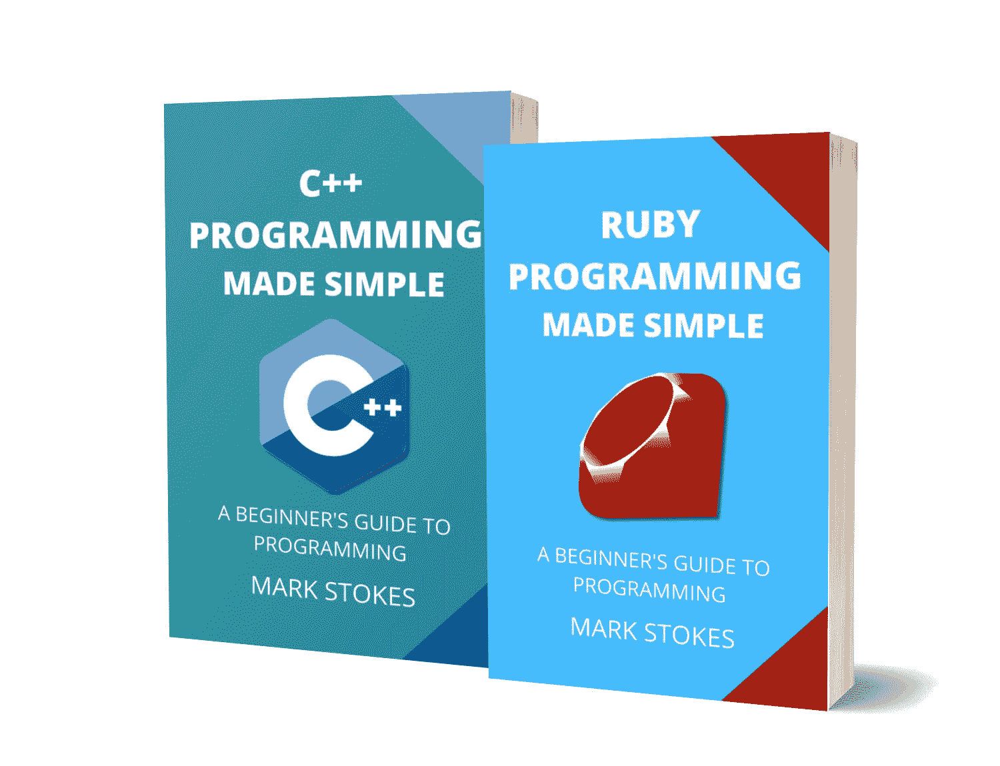

# Ruby 与 C++ 编程简明：编程初学者指南 - 二本合一





Ruby 编程简易入门
编程初指南
MARK STOKES

## 引言
欢迎阅读《Ruby 编程语言简易入门——编程初指南》。在这份全面的指南中，我们将使用 Ruby 编程语言开启一段激动心的编程世界旅程。无论你是完全的新手，还是已经有一定的编程经验，本书旨在帮助你掌握 Ruby 的核心概念，并为你的编程之旅奠定坚实的基础。

Ruby 以其优雅的语法、对开发者友好的特性以及多功能性而闻名。本书专为初学者设计，确保你能透彻理解每一个概念。我们将从介绍编程的基本概念开始，逐渐深入更高级的主题。每一章都配有实用的示例，以促进实践学习，确保你不仅能理解理论，还能将其应用于现实场景中。

那么，让我们开启这段充满启示的旅程，发现 Ruby 编程语言的简洁与强大吧！

# 第 1 章：Ruby 编程简介
欢迎来到 Ruby 编程的世界！在本章中，我们将向你介绍 Ruby 的基本概念，并为你进入编程世界的奇妙旅程做好准备。

### 什么是 Ruby？
Ruby 是一种由山野裕（“Matz”）于 20 世纪 90 年代中期创建动态开源编程语言。Ruby 以其简单优雅的语法著称，因其可读性和易用性在开发者中广受欢迎。它通常被被称为“开发者友好”的语言，因为它优先考虑程序员的快乐和效率。

### 为什么选择 Ruby？
有几个原因使 Ruby 成为你完美的编程语言，特别是当你是一个初学者时：

1. **可读性强的语法：** Ruby 的语法设计为人类可读，读起来几乎就像自然语言。这让初学者和资深程序员都能更容易理解和编写代码。
2. **高效率：** Ruby 对简单和自动化的关注允许开发者用更少的代码完成任务。这意味着你可以在更短时间内完成更多工作，这对于期限紧迫的项目尤为宝贵。
3. **面向对象：** Ruby 是一门完全面向对象的语言，这意味着 Ruby 中的一切皆为对象。这使得组织和操作数据变得更容易，从而写出更高效、更有组织的代码。
4. **活跃的社区：** Ruby 社区非常活跃且乐于助。。大量的在线资源、论坛和教程可以帮助学习并成长为一名 Ruby 程序员。

### 搭建你的环境
在开始编写 Ruby 代码之前，你需要搭建开发环境。操作方法如下：

1. **安装 Ruby：** 根据你的操作系统，有不同的方法来安装 Ruby。在 macOS 和 Linux 上，Ruby 通常是预装的。对于 Windows 用户，也有相应的安装方式。
2. **编辑器或 IDE：** 选择一个文本编辑器或集成开发环境（IDE）。
3. **你好，Ruby！** 打开你的文本编辑器或 IDE，输入以下代码：

```ruby
puts "Hello, Ruby!"
```

将文件保存为 `.rb` 扩展名，例如 `hello.rb`。打开终端，进入保存文件的目录，运行以下命令：

```bash
ruby hello.rb
```

恭喜！你刚刚运行了第一个 Ruby 程序。

## 总结
在本章中，你已经接触了 Ruby 编程的世界。你了解什么是 Ruby、为什么它是一个很好的选择，以及如何搭建环境开始学习。

# 第 2 章：搭建开发环境
在开始你的 Ruby 编程之旅之前，搭建开发环境是至关重要的。配置良好的环境会让你的编码体验更加顺畅、高效。在本章中，我们将指导如何在不同的操作系统上设置环境。

### 安装 Ruby
第一步是在你的系统上安装 Ruby。请根据你的操作系统遵循以下说明：

#### macOS 和 Linux
大多数 macOS 和 Linux 系统都预装了 Ruby 版本。打开终端并输入以下命令检查是否已安装 Ruby：

```bash
ruby -v
```

如果尚未安装 Ruby，可以使用包管理器如 `brew`（适用于 macOS）或 `apt`（适用于 Debian 系 Linux 发行版）进行安装：

```bash
brew install ruby # 适用于 macOS
sudo apt-get install ruby # 适用于 Debian 系 Linux
```

#### Windows
Windows 用户可以从官方 Ruby 网站（RubyInstaller）下载 RubyInstaller。选择与你的系统架构匹配的版本（通常为 32 位或 64 位）。运行安装程序并按照提示在 Windows 上安装 Ruby。

### 文本编辑器与 IDE
选择合适的文本编辑器或集成开发环境（IDE）会显著影响编码体验。以下是一些流行的选项：

1. **Visual Studio Code (VS Code)：** 一个轻量且功能强大的文本编辑器，拥有丰富的插件，包括用于 Ruby 开发的插件。
2. **Sublime Text：** 以快速和简单著称的高可定制文本编辑器。
3. **RubyMine：** 专为 Ruby 和 Ruby on Rails 开发设计的 IDE，提供了调试、代码分析和项目管理等高级功能。

根据你的喜好和工作流选择最适合的一个。


现在你已经安装了 Ruby 并设置好了文本编辑器或 IDE，让我们来编写并运行你的第一个 Ruby 程序吧。打开你选择的编辑器，创建一个名为 `hello.rb` 的新文件。输入以下代码：

```ruby
puts "Hello, Ruby!"
```

保存文件，并使用终端导航到保存文件的目录。运行以下命令来执行程序：

```bash
ruby hello.rb
```

你应该会在终端中看到打印出的 `Hello, Ruby!` 输出。恭喜你，你已成功编写并执行了你的第一个 Ruby 程序！

## 结

设置开发环境是你 Ruby 编程之旅中至关重要的一步。通过安装 Ruby 并选择合适的工具，你为高效的编码工作铺平了道路。

# 第 3 章：Ruby 语法基础

在本章中，我们将深入探讨 Ruby 语法的基础构建块。理解这些基础知识至关重要，因为它们是你进入 Ruby 编程世界的基础。我们将涵盖变量、数据类型、操作符和控制结构，并提供清晰的解释和示例，以确保你能够彻底掌握这些概念。

## 变量与命名规范

Ruby 中的变量用于存储和操作数据。变量名可以由字母、数字、下划线组成，并且以小写字母或下划线开头。Ruby 是大小敏感的，因此 `my_variable` 和 `My_Variable` 被视为不同的变量。

```ruby
name = "Alice"
age = 25
```

## 数据类型

Ruby 有几种核心数据类型：

### 字符串 (Strings)

字符串代表文本数据，用单引号或双引号括起来。

```ruby
greeting = "Hello, Ruby!"
```

### 数字 (Numbers)

Ruby 支持整数和浮点数。

```ruby
count = 10
pi = 3.14
```

### 布尔值 (Booleans)

布尔值表示真或假的值。

```ruby
is_raining = true
is_sunny = false
```

## 操作符

Ruby 提供了各种操作符对数据进行操作：

### 算术操作符

```ruby
sum = 10 + 5
difference = 20 - 8
product = 4 * 6
quotient = 15 / 3
```

### 比较操作符

```ruby
greater_than = 10 > 5
less_than = 3 < 7
equal_to = 8 == 8
not_equal = 5 != 10
```

### 逻辑操作符

```ruby
and_operator = true && false
or_operator = true || false
not_operator = !true
```

## 控制结构

控制结构允许你控制程序的执行流：

### 条件语句 (if, elsif, else)

```ruby
if temperature > 30
  puts "It's hot outside!"
elsif temperature > 20
  puts "It's warm outside."
else
  puts "It's cool outside."
end
```

### 循环 (while, for)

#### While 循环

```ruby
counter = 1
while counter <= 5 do
  puts "Count: #{counter}"
  counter += 1
end
```

#### For 循环

```ruby
for i in 1..5 do
  puts "Number: #{i}"
end
```

### 数组 (Arrays)

数组是项目的有序集合。

```ruby
fruits = ["apple", "banana", "orange"]
```

### 哈希 (Hashes)

哈希存储键值对。

```ruby
person = { "name" => "John", "age" => 30, "city" => "New York" }
```

### 示例

让我们通过一些示例将这些概念付诸实践：

### 示例 1：计算面积

```ruby
length = 5
width = 3
area = length * width
puts "The area is: #{area}"
```

### 示例 2：检查资格

```ruby
age = 17
if age >= 18
  puts "You are eligible to vote."
else
  puts "You are not eligible to vote yet."
end
```

#### 示例 3：遍历数组

```ruby
colors = ["red", "green", "blue", "yellow"]
for color in colors do
  puts "Color: #{color}"
end
```

## 结

在本章中，我们探索了 Ruby 语法的基础，包括变量、数据类型、操作符和控制结构。这些概念是任何 Ruby 程序的构建块，掌握它们对于你的编程之旅至关重要。练习编写代码并尝试不同的示例以巩固你的理解。

# 第 4 章：变量与数据类型

在本章中，我们将深入探索 Ruby 中变量和数据类型的世界。理解如何处理变量和不同的数据类型是编写高效且动态程序的基础。我们将涵盖变量的概念，详细介绍核心数据类型，并提供实际示例来巩固你的理解。

## 变量

变量就像存储不同类型数据的容器。它们允许你存储和操作值，使你的程序具有动态性和适应性。在 Ruby 中，变量是动态类型的，这意味着在定义变量时不需要显式声明数据类型。

### 变量赋值

要给变量赋值，请使用赋值操作符 `=`。

```ruby
name = "Alice"
age = 25
```

### 命名规范

Ruby 遵循特定的变量命名规范：

- 变量名必须以小写字母或下划线开头。
- 它们由字母、数字和下划线组成。
- Ruby 是大小敏感的，因此 `my_variable` 和 `My_Variable` 是不同的变量。

## 核心数据类型

变量就像存储不同类型数据的容器。允许你存储和操作值使你的程序具有动态性和适应性。在 Ruby 中，变量是动态类型的，这意味着在定义变量时不需要显式声明数据类型。

### 字符串

字符串代表文本数据，用单引号或双引号括起来。

```ruby
greeting = "Hello, Ruby!"
```

使用各种方法处理字符串：

```ruby
name = "Alice"
greeting = "Hello, #{name}"
```

### 数字

Ruby 支持整数和浮点数。

```ruby
count = 10
pi = 3.14
```

你可对数字进行算术操作：

```ruby
sum = 10 + 5
difference = 20 - 8
product = 4 * 6
quotient = 15 / 3
```

### 布尔值

布尔值表示真或假的值，对于做出决策至关重要。

```ruby
is_raining = true
is_sunny = false
```

你经常使用比较操作符来处理布尔值：

```ruby
greater_than = 10 > 5
less_than = 3 < 7
equal_to = 8 == 8
not_equal = 5 != 10
```

### 数组

数组是项目的有序集合。索引从 0 开始。

```ruby
fruits = ["apple", "banana", "orange"]
```

你可以访问元素并对数组执行各种操作：

```ruby
first_fruit = fruits[0]
fruits.push("grape") # 添加元素
fruits.pop # 删除最后一个元素
```

### 哈希

哈希存储键值对，允许将数据与标签关联起来。

```ruby
person = { "name" => "John", "age" => 30, "city" => "New York" }
```

操作哈希：

```ruby
person["name"] # 通过键访问值
person["job"] = "Engineer" # 添加一个新的键值对
person.delete("age") # 删除键值对
```

### 示例

让我们通过一些实际示例应用我们的知识：

### 示例 1：使用变量计算面积

```ruby
length = 5
width = 3
area = length * width
puts "The area is: #{area}"
```

### 示例 2：处理字符串

```ruby
name = "Alice"
greeting = "Hello, #{name}!"
uppercase_name = name.upcase
puts greeting
puts "Uppercase Name: #{uppercase_name}"
```

### 示例 3：创建和操作数组

```ruby
fruits = ["apple", "banana", "orange"]
fruits.push("grape")
fruits.pop
puts "Fruits: #{fruits}"
```

## 结

变量和数据类型是任何编程语言的基础，Ruby 也例外。在本章中，我们探索了变量的概念和核心数据类型，包括字符串、数字、布尔值、数组和哈希。通过理解如何处理这些基础元素，你现在准备好开始构建更复杂的动态程序。在下一章中，我们将仔细查看控制结构，它们允许你做出决策并控制代码的流。


# 第 5 章：控制结构：条件判断与循环

在本章，我们将探索 Ruby 提供的强大的控制结构，用于操作程序的执行流。理解条件判断和循环对于创建动态且响应迅速的应用程序至关重要。我们将涵盖 `if` 语句、`case` 语句、`while` 循环、`for` 循环，并提供实用示例来巩你的理解。

### 条件语句

条件语句允许你的程序根据某些条件做出决策并执行不同的代码块。最常见的条件语句是 `if` 语句。

#### If 语句

当给定条件为真时，`if` 语句执行一个代码块。

```ruby
temperature = 25

if temperature > 30
  puts "It's hot outside!"
elsif temperature > 20
  puts "It's warm outside."
else
  puts "It's cool outside."
end
```

#### Case 语句

`case` 语句提供了一种将其与多个可能的匹配项进行比较的方法。

```ruby
day = "Wednesday"

case day
when "Monday"
  puts "Start of the week"
when "Wednesday"
  puts "Middle of the week"
when "Friday"
  puts "End of the week"
else
  puts "Other days"
end
```

### 循环

循环允许你多次重复一个代码块。它们对于自动化重复性任务和处理数据集合至关重要。

#### While 循环

只要给定条件为真，`while` 循环就会继续执行一个代码块。

```ruby
counter = 1

while counter <= 5 do
  puts "Count: #{counter}"
  counter += 1
end
```

#### For 循环

`for` 循环遍历范围或集合。

```ruby
for i in 1..5 do
  puts "Number: #{i}"
end
```

### 遍历集合

Ruby 提供了方便的方法来遍历数组（Array）和哈希（Hash）。

#### 数组迭代

```ruby
fruits = ["apple", "banana", "orange"]

fruits.each do |fruit|
  puts "Fruit: #{fruit}"
end
```

#### 哈希迭代

```ruby
person = { "name" => "John", "age" => 30, "city" => "New York" }

person.each do |key, value|
  puts "#{key}: #{value}"
end
```

### Break 和 Next

在循环中，你可以使用 `break` 语句提前退出循环，并使用 `next` 语句跳过当前迭代并进入下一次。

```ruby
for i in 1..10 do
  if i == 5
    break
  elsif i % 2 == 0
    next
  end
  puts "Number: #{i}"
end
```

### 示例

让我们探索一些示例来查看这些控制结构的实际运行：

#### 示例 1：使用循环计算阶乘

```ruby
number = 5
factorial = 1

while number > 1 do
  factorial *= number
  number -= 1
end

puts "Factorial: #{factorial}"
```

#### 示例 2：检查评分标准

```ruby
score = 85

if score >= 90
  puts "A"
elsif score >= 80
  puts "B"
elsif score >= 70
  puts "C"
else
  puts "F"
end
```

#### 示例 3：遍历数组

```ruby
numbers = [1, 3, 5, 7, 9]

numbers.each do |num|
  puts "Square of #{num}: #{num * num}"
end
```

## 总结

条件判断和循环等控制结构是你编程工具箱中不可或缺的工具。它们允许你创建动态、响应且高效的程序。在本章中，我们探索了用于决策的 `if` 和 `case` 语句，以及用于迭代的 `while` 和 `for` 循环。通过理解和练习这些控制结构，你正朝着构建更复杂交互式的 Ruby 程序前进。在下一章中，我们将深入研究函数和方法，这将使你能够有效地封装和重用代码。

# 第 6 章：函数与方法

在本章中，我们将深入探索 Ruby 函数和方法的世界。函数和方法对于组织代码、使其模块化以及提高重用性至关重要。我们将探索如何定义、调用和使用函数与方法，并提供实用示例来巩你的理解。

### 函数与方法

在 Ruby 中，函数通常被称为方法。虽然这两个术语互换使用，但存在细微的区别。方法与对象相关，而函数不是。换句话说，方法是与特定对象或数据类型相关的函数。

### 定义方法

定义方法涉及指定其名称、参数以及它应该执行的代码块。

```ruby
def greet(name)
  puts "Hello, #{name}!"
end
```

在这个示例中，我们定义了一个名为 `greet` 的方法，它接受一个参数 `name`。当调用该方法时，它将打印带有提供的名称的欢迎消息。

 调用方法

调用方法涉及使用其名称并提供必要的参数。

```ruby
greet("Alice")
```

对 `greet` 方法的这次调用将打印 "Hello, Alice!"

### 返回值

方法可以使用 `return` 关键字返回值。

```ruby
def add(a, b)
  return a + b
end

result = add(5, 3)
puts "Sum: #{result}"
```

### 默认参数

你可以为参数提供默认值。

```ruby
def greet(name = "Guest")
  puts "Hello, #{name}!"
end
```

如果在调用 `greet` 时没有提供参数，它将打印 "Hello, Guest!"。如果提供了 "Alice"，它将打印 "Hello, Alice!"。

### 可变参数方法

Ruby 支持可变参数，它们可以接受任意数量的参数。

```ruby
def sum(*numbers)
  total = 0
  numbers.each do |num|
    total += num
  end
  return total
end

result = sum(1, 2, 3, 4)
puts "Total: #{result}"
```

`sum` 方法接受任意数量的参数并计算它们的和。

### 示例：构建计算器

让我们把知识应用于示例：构建一个计算器。

```ruby
def add(a, b)
  return a + b
end

def subtract(a, b)
  return a - b
end

def multiply(a, b)
  return a * b
end

def divide(a, b)
  if b == 0
    return "Cannot divide by zero"
  else
    return a / b
  end
end

puts "Enter two numbers:"
num1 = gets.to_f
num2 = gets.to_f
puts "Select operation (+, -, *, /)"
operation = gets.chomp

case operation
when "+"
  result = add(num1, num2)
when "-"
  result = subtract(num1, num2)
when "*"
  result = multiply(num1, num2)
when "/"
  result = divide(num1, num2)
else
  result = "Invalid operation"
end

puts "Result: #{result}"
```

在这个示例中，我们定义了四个算运算方法，然后构建了一个接收用户数字和操作并执行相应操作的计算器。

## 总结

函数和方法是任何编程语言的核心组件。在本章中，我们探索了如何在 Ruby 中定义、调用和使用方法。你还学习了返回值、默认参数和可变参数方法。有了这些知识，你可以开始创建更复杂的程序。

# 第 7 章：数组与哈希

在本章中，我们将探索 Ruby 中两个重要的数据结构：数组（Array）和哈希（Hash）。数组允许你存储有序的项集合，而哈希允许你存储键值对以进行高效的数据检索。我们将深入研究如何操作数组和哈希，执行常用操作，并提供实用示例来巩你的理解。

### 数组

数组是项的集合，每个项都有一个指示其在数组位置的索引。数组非常灵活，可以存储任何数据类型的元素。

#### 创建数组

你可以使用方括号并用逗号分隔元素来创建一个数组。

```ruby
fruits = ["apple", "banana", "orange"]
```

#### 访问数组元素

你可以使用索引访问元素。

```ruby
first_fruit = fruits[0]
second_fruit = fruits[1]
```

#### 添加和删除元素


你可以使用 `push` 方法或 `<<` 运算符来添加元素，并使用 `pop` 或 `shift` 等方法移除元素。

```ruby
fruits.push("grape")
fruits << "watermelon"
removed_fruit = fruits.pop
```

### 遍历数组

你可以使用循环或 `each` 等方法来遍历数组。

```ruby
fruits.each do |fruit|
  puts "Fruit: #{fruit}"
end
```

### 哈希 (Hashes)

哈希是键值对的集合，允许你根据有意义的标签（键）高效地存储和检索数据。

#### 创建哈希

你可以使用大括号并通过冒号分隔键值对来创建一个哈希。

```ruby
person = { "name" => "John", "age" => 30, "city" => "New York" }
```

#### 访问哈希值

你可以通过键来访问值。

```ruby
person_name = person["name"]
person_age = person["age"]
```

#### 添加和更新键值对

你可以通过给键赋值来添加或更新键值对。

```ruby
person["job"] = "Engineer" # 添加新的键值对
person["age"] = 31 # 更新现有值
```

#### 遍历哈希

你可以使用 `each` 等方法遍历哈希以访问键和值。

```ruby
person.each do |key, value|
  puts "#{key}: #{value}"
end
```

### 组合数组和哈希

你可以通过组合数组和哈希来创建复杂的数据结构。

```ruby
students = [
  { "name" => "Alice", "age" => 25 },
  { "name" => "Bob", "age" => 22 }
]
```

### 示例

让我们通过一些实际示例来应用我们的知识：

#### 示例 1：求数组元素和

```ruby
numbers = [5, 10, 15, 20]
sum = 0
numbers.each do |num|
  sum += num
end
puts "Sum: #{sum}"
```

#### 示例 2：创建联系人列表

```ruby
contacts = [
  { "name" => "Alice", "phone" => "123-456-7890" },
  { "name" => "Bob", "phone" => "987-654-3210" }
]
puts "Contact List:"
contacts.each do |contact|
  puts "Name: #{contact['name']}, Phone: #{contact['phone']}"
end
```

#### 示例 3：使用哈希计算出现次数

```ruby
text = "hello world and ruby programming"
word_count = Hash.new(0)
words = text.split(" ")
words.each do |word|
  word_count[word] += 1
end
puts "Word Count:"
word_count.each do |word, count|
  puts "#{word}: #{count}"
end
```

## 结论

数组和哈希是 Ruby 中基础的数据结构，允许你高效地存储和管理数据集合。在本章中，我们探索了如何创建、访问、添加、移除和遍历数组及哈希。通过理解如何处理这些数据结构，你已经准备好处理程序中各种数据组织任务了。

# 第 8 章：Ruby 中的面向对象编程

在本章中，我们将深入研究使用 Ruby 进行面向对象编程 (OOP) 的核心原理。面向对象编程是一种强大的范式，允许你创建结构化、模块化且可重用的代码。我们将涵盖类、对象、继承、封装和多态等概念，并提供实际示例来增强你的理解。

### 类和对象

面向对象编程的核心是类和对象。类定义了创建对象的蓝图，而对象是类的实例。

#### 定义类

你使用 `class` 关键字定义一个类。

```ruby
class Person
  def initialize(name, age)
    @name = name
    @age = age
  end
end
```

在这个示例中，我们定义了一个 `Person` 类，它有一个 `initialize` 方法用于设置 `name` 和 `age` 实例变量。

#### 创建对象

你使用 `new` 方法从类创建对象。

```ruby
person1 = Person.new("Alice", 25)
person2 = Person.new("Bob", 30)
```

#### 实例变量

实例变量（以 `@` 前缀）持有对象的状态。

```ruby
class Person
  def initialize(name, age)
    @name = name
    @age = age
  end
end
person = Person.new("Alice", 25)
puts "#{person.name} is #{person.age} years old."
```

### 继承

继承允许你基于现有类创建一个新类，并继承它的属性和行为。新类被称为子类，现有类被称为父类。

```ruby
class Student < Person
  def initialize(name, age, grade)
    super(name, age)
    @grade = grade
  end
end
```

在这个示例中，`Student` 类继承自 `Person` 类。`super` 关键字用于调用父类的 `initialize` 方法。

### 封装

封装涉及将数据（属性）和操作该数据的方法（行为）封装在单一单元中。

```ruby
class BankAccount
  def initialize(name, age)
    @name = name
    @age = age
  end
  def deposit(amount)
    @balance += amount
  end
  def withdraw(amount)
    if @balance >= amount
      @balance -= amount
    else
      puts "Insufficient funds."
    end
  end
end
```

在这个示例中，`BankAccount` 类封装了 `deposit` 和 `withdraw` 方法。

### 多态

多态允许不同类的对象通过共享的接口被视为公共父类的对象。

```ruby
class Shape
  def area
    raise NotImplementedError, "Subclasses must implement this method."
  end
end

class Circle < Shape
  def initialize(radius)
    @radius = radius
  end
  def area
    Math::PI * @radius**2
  end
end

class Rectangle < Shape
  def initialize(width, height)
    @width = width
    @height = height
  end
  def area
    @width * @height
  end
end
```

在这个示例中，`Circle` 和 `Rectangle` 都是 `Shape` 的子类，并且它们都实现了 `area` 方法。

### 示例

让我们通过一些实际示例来应用我们的知识：

#### 示例 1：创建和使用类

```ruby
class Car
  def initialize(make, model)
    @make = make
    @model = model
  end
  def drive
    puts "#{@make} #{@model} is driving."
  end
end

car1 = Car.new("Toyota", "Camry")
car2 = Car.new("Honda", "Civic")
car1.drive
car2.drive
```

#### 示例 2：继承和扩展类

```ruby
class Animal
  def speak
    raise NotImplementedError, "Subclasses must implement this method."
  end
end

class Dog < Animal
  def speak
    puts "Woof!"
  end
end

class Cat < Animal
  def speak
    puts "Meow!"
  end
end

dog = Dog.new
cat = Cat.new
dog.speak
cat.speak
```

## 结论

面向对象编程是一种强大的范式，使能够创建结构化、模块化且可重用的代码。在本章中，我们探索了 Ruby 中的类、对象、继承、封装和多态概念。通过理解并应用这些原则，你可以更有组织地设计和构建复杂的应用程序。

# 第 9 章：错误处理与异常

在本章中，我们将探索错误处理的重要性以及如何在 Ruby 中管理异常。异常处理对于编写健壮且可靠的代码至关重要，它可以优雅地处理意外情况并防止崩溃。我们将涵盖异常的基础知识、如何抛出和恢复异常，并提供实际示例来增强理解。

### 理解异常

在编程中，异常是在程序执行期间发生的破坏指令执行流的事件。这些事件可能由各种原因引起，例如无效输入、意外行为或外部因素。

Ruby 提供了内置的异常处理机制，确保程序在发生意外错误时不会停止。

### 抛出异常

你可以使用 `raise` 关键字显式抛出异常。这在你想要代码中信号一个异常情况时非常有用。


```ruby
def divide(a, b)
  if b == 0
    raise ZeroDivisionError, "Cannot divide by zero"
  end
  return a / b
end
```

在这个示例中，如果分母为零，`divide` 方法将抛出一个 `ZeroDivisionError`。

### 捕获异常

为了处理异常并防止程序崩溃，你可以使用 `begin`、`rescue` 和 `end` 关键字。

```ruby
begin
  result = divide(10, 0)
rescue ZeroDivisionError => e
  puts "Error: #{e.message}"
end
```

在这个示例中，程序尝试在分母为零的情况下情况下调用 `divide` 方法。由于这会抛出一个 `ZeroDivisionError`，程序捕获了异常并打印了错误信息。

### 使用 Ensure 确保清理

你可以使用 `ensure` 块来确保无论是否抛出异常，某些代码都会执行。

```ruby
begin
  file = File.open("example.txt")
  # 对文件进行操作
rescue Errno::ENOENT => e
  puts "Error: File not found - #{e.message}"
ensure
  file.close if file
end
```

在这个示例中，`ensure` 块确保即使发生了异常，`file` 被关闭。

### 自定义异常

你可以通过子类 `StandardError` 类来创建自定义异常。

```ruby
class CustomError < StandardError
  def initialize(message)
    super(message)
  end
end

def perform_action
  raise CustomError, "Something went wrong"
end
```

在这个示例中，`CustomError` 类通过继承 `StandardError` 定义，`perform_action` 方法抛出了这个自定义异常。

### 处理多个异常

你可以使用多个 `rescue` 块或通过在一个块中列出它们来处理多个异常。

```ruby
begin
  perform_action
rescue CustomError => ce
  puts "Custom Error: #{ce.message}"
rescue ZeroDivisionError => zde
  puts "Zero Division Error: #{zde.message}"
rescue StandardError => se
  puts "Standard Error: #{se.message}"
end
```

### 示例

让我们探索一些实际示例以更好地理解错误处理：

#### 示例 1：处理除以零

```ruby
def safe_divide(a, b)
  begin
    result = a / b
  rescue ZeroDivisionError => zde
    puts "Error: #{zde.message}"
  end
end

safe_divide(10, 0)
```

#### 示例 2：读取文件

```ruby
begin
  file = File.open("example.txt")
  content = file.read
  puts "File Content: #{content}"
rescue Errno::ENOENT => e
  puts "Error: File not found - #{e.message}"
ensure
  file.close if file
end
```

## 结论

错误处理和异常管理是编写可靠且健壮程序的关键方面。在本章中，我们探索了如何在 Ruby 中抛出和捕获异常，确保你的代码能够优雅地处理意外情况。通过使用 `begin`、`rescue` 和 `ensure` 块，你可以构建出能够优雅处理错误并在发生异常时继续运行的程序。异常处理是任何程序员的必修技能，因为它确保了你的应用程序更具韧性和对用户友好。

# 第 10 章：处理文件与输入/输出 (I/O)

在本章中，我们将深入研究 Ruby 中处理文件和输入/输出 (I/O) 操作。处理文件是许多编程任务的基本技能，例如从文件读取数据、向文件写入数据以及与外部资源交互。我们将涵盖文件模式、读取和写入文件，并提供实际示例来增强你的理解。

### 文件模式

Ruby 提供了处理文件的不同模式，允许你执行各种操作。以下是一些常用模式：

- `"r"`：只读模式（默认）。
- `"w"`：只写模式。创建一个新文件或截断现有文件。
- `"a"`：追加模式。创建一个新文件或追加到现有文件末尾。
- `"r+"`：读写模式。
- `"w+"`：读写模式。创建一个新文件或截断现有文件。
- `"a+"`：读写模式。创建一个新文件或追加到现有文件末尾。

### 读取文件

你可以使用 `File.open` 方法从文件中读取数据。

```ruby
file = File.open("example.txt", "r")
content = file.read
file.close
puts "File Content: #{content}"
```

在这个示例中，`"r"` 模式表示以读取模式打开文件。`read` 方法读取文件的全部内容。

### 写入文件

你可以使用带有 `"w"` 模式的 `File.open` 方法向文件写入数据。

```ruby
file = File.open("output.txt", "w")
file.puts "Hello, world!"
file.close
```在这个示例中，`"w"` 模式表示以写入模式打开文件。`puts` 方法将指定内容写入文件。

### 追加到文件

你可以使用 `"a"` 模式向现有文件追加数据。

```ruby
file = File.open("log.txt", "a")
file.puts "Log entry: Something happened."
file.close
```

在这个示例中，`"a"` 模式表示以追加模式打开文件。`puts` 方法将日志条追加到文件末尾。

### 读取和写入文件

你可以使用 `"r+"` 模式同时读取和写入文件。

```ruby
file = File.open("data.txt", "r+")
content = file.read
file.puts "New data"
file.close
```

在这个示例中，`"r+"` 模式允许同时读取和写入。`read` 方法读取现有内容，`puts` 方法追加额外数据。

### 示例

让我们探索一些实际示例：

#### 示例 1：读取并显示文件

```ruby
file = File.open("story.txt", "r")
content = file.read
file.close
puts "Story:"
puts content
```

#### 示例 2：将列表写入文件

```ruby
items = ["Apple", "Banana", "Orange", "Grape"]
file = File.open("grocery_list.txt", "w")
items.each do |item|
  file.puts item
end
file.close
```

## 结论

处理文件和执行输入/输出 (I/O) 操作是编程中的一项基本技能。在本章中，我们探索了文件模式、读取和写入文件以及追加到文件。通过理解如何操作文件，你可以创建操作外部资源的程序。无论你是处理文本文件、日志文件、配置文件还是其他类型的文件，这些概念都是至关重要的。

# 第 11 章：使用 Ruby 进行 Web 开发

在本章中，我们将探索使用 Ruby 进行 Web 开发的世界。Ruby 提供了各种框架和工具，允许你构建动态交互的 Web 应用。我们将涵盖 Web 开发的基础，介绍流行的 Ruby on Rails 框架，并提供实际示例来增强你的理解。

### Web 开发简介

Web 开发涉及创建可以通过浏览器访问的网站和 Web 应用。这个过程包含了前端（用户界面）和后端（服务端逻辑）组件。

### Web 中的 Ruby

Ruby 的流行归功于其优雅的语法、对开发者友的环境以及强大的框架。最著名的框架之一是 Ruby on Rails（通常称为 Rails），它遵循约定优于配置和不要重复（DRY）的原则。

### 开始使用 Ruby on Rails

要开始使用 Rails 构建 Web 应用，你需要设置环境并安装 Rails。以下是流程的基本概述：

1. **安装 Ruby**：如果系统中尚未安装 Ruby，请下载并安装。
2. **安装 Rails**：使用命令 `gem install rails` 安装 Rails gem。
3. **创建新的 Rails 应用程序**：使用命令 `rails new myapp` 创建名为 "myapp" 的新 Rails 应用程序。
4. **运行应用程序**：进入应用程序目录并使用命令 `rails server` 启动开发服务器。


# 第 12 章：Ruby on Rails 简介

在本章中，我们将全面介绍 Ruby on Rails，它通常简称为 `Rails`。Ruby on Rails 是一个强大的 Web 开发框架，遵循“约定优于配置”（convention over configuration）和“不要重复自己”（DRY）原则。它让开发者能够高效地构建健、可扩展且可维护的 Web 应用。我们将探索 `Rails` 的核心概念、结构，并提供实践示例来巩你的理解。

## 什么是 Ruby on Rails？

Ruby on Rails，简称 `Rails`，是一个用 Ruby 编程语言编写的开源 Web 框架。它由 David Heinemeier Hansson 创建于 2004 年发布。`Rails` 的设计目标是通过强调合理的默认值、减少重复性任务以及推广最佳实践，使 Web 开发变得更简单、更高效。

## Rails 的核心概念

`Rails` 围绕几个核心概念构建，这些概念有助于它的有效性和流行：

1. **约定优于配置 (CoC):** `Rails` 遵循以下原则：使用合理的默认值和约定来减少对显式配置的需求。这促进了一致性并加快了开发。
2. **不要重复自己 (DRY):** `Rails` 鼓励消除冗余代码和逻辑。这导致了更整、更易维护的代码库。
3. **模型-视图-控制器 (MVC):** `Rails` 采用 MVC 架构将应用程序分为三个部分：模型（数据和逻辑）、视图（用户界面）和控制器（处理请求和交互）。
4. **RESTful 路由:** `Rails` 鼓励使用表述状态转移 (REST) 原则设计清晰且一致的 URL 和路由。
5. **Active Record:** Active Record 是 Rails 的对象关系映射 (ORM) 层，允许你使用 Ruby 对象与数据库进行交互。

## 设置 Rails 应用

要开始使用 `Rails`，你需要设置开发环境并创建一个新应用。以下是流程的概述：

1. **安装 Ruby 和 Rails:** 确保你的系统中已安装了 Ruby 和 `Rails`。你可以使用命令 `gem install rails` 来安装 `Rails`。
2. **创建新应用:** 使用 `rails new` 命令创建一个新的 Rails 应用。例如，`rails new MyApp` 会创建一个名为 "MyApp" 的应用。
3. **运行服务器:** 进入应用程序目录 (`cd MyApp`) 并使用命令 `rails server` 启动开发服务器。默认情况下，该应用可以通过 `http://localhost:3000` 访问。

## Rails 应用的结构

典型的 Rails 应用具有定义良好的结构，反映了其 MVC 架构：

- **app:** 包含模型、视图和控制器的子目录。
- **config:** 包含应用的配置文件，如路由、数据库设置和特定环境的配置。
- **db:** 存放数据库相关文件，包括迁移 (migrations) 和模式 (schema)。
- **public:** 静态资源，如图像、样式表和 JavaScript 文件。
- **test:** 包含单元测试和功能测试。
- **Gemfile:** 列出应用程序使用的 gems 和依赖。

## Rails 中的 MVC 架构

Ruby on Rails 遵循模型-视图-控制器 (MVC) 架构，将应用程序分为三个主要组件：

- **Model (模型):** 代表应用程序的数据和业务逻辑。
- **View (视图):** 处理呈现和用户界面。
- **Controller (控制器):** 管理模型和视图之间的数据流。

### 创建简单的 Web 应用

让我们使用 Ruby on Rails 创建一个显示项目列表的简单 Web 应用。

1. **生成控制器:** 使用命令 `rails generate controller items` 生成一个名为 "Items" 的控制器。
2. **定义动作 (Action):** 在生成的控制器文件中定义一个获取项目列表并发送到视图的动作。
3. **创建视图:** 创建显示项目列表的视图文件。
4. **定义路由:** 设置路由将 URL 映射到控制器的动作。
5. **运行应用:** 启动开发服务器并在浏览器中访问该应用。

### 处理表单和用户输入

Web 应用通常通过表单涉及用户输入。Rails 提供了简化表单处理的工具。

让我们创建一个允许用户向列表添加新项目的表单。

1. **生成模型:** 使用命令 `rails generate model item name:string` 为带有 "name" 属性的项目生成一个模型。
2. **运行迁移:** 运行 `rails db:migrate` 将模型更改应用于数据库。
3. **创建表单:** 在视图中创建一个收集用户输入以添加新项目的表单。
4. **处理表单提交:** 在控制器中定义一个动作来处理表单提交并创建新项目。

### 与数据库交互

Rails 与数据库无缝集成，使得存储和检索数据变得简单。

1. **配置数据库:** 在 `config/database.yml` 文件中配置数据库连接。
2. **创建记录:** 使用模型在数据库中创建记录。
3. **查询记录:** 使用 `ActiveRecord` 查询数据。

### 示例

让我们通过实践示例应用这些知识：

### 示例 1：显示文章列表

使用 Rails 创建一个显示文章列表的 Web 应用。

```ruby
### 生成控制器
rails generate controller articles

### 在控制器中定义动作
def index
  @articles = Article.all
end
```

```html+erb
<!-- 创建显示文章的视图
<% @articles.each do |article| %>
  <h2><%= article.title %></h2>
  <p><%= article.content %></p>
<% end %>
```

### 示例 2：创建博客文章

创建一个允许用户创建博客文章的表单。

```ruby
### 生成模型
rails generate model Post title:string content:text

### 在视图定义表单
<%= form_for @post do |f| %>
  <div class="field">
    <%= f.label :title %>
    <%= f.text_field :title %>
  </div>
  <div class="field">
    <%= f.label :content %>
    <%= f.text_area :content %>
  </div>
  <%= f.submit %>
<% end %>
```

```ruby
### 在控制器中处理表单提交
def create
  @post = Post.new(post_params)
  if @post.save
    redirect_to @post
  else
    render 'new'
  end
end

private

def post_params
  params.require(:post).permit(:title, :content)
end
```

## 总结

使用 Ruby 进行 Web 开发为创建动态、交互和功能丰富的 Web 应用开启了无限可能。在本章中，我们介绍了使用 Ruby on Rails 进行 Web 开发的基础，包括设置环境、创建控制器、处理表单、与数据库交互以及遵循 MVC 架构。Ruby on Rails 为构建现代 Web 应用提供了一个高效且对友的框架。通过将你的 Ruby 技能与 Web 开发相结合，你可以创建对用户生活和体验产生真实影响的应用程序。


在本示例中，路由 `get 'welcome/index'` 将 URL `/welcome/index` 映射到 `WelcomeController` 的 `index` 动作。`root 'welcome#index'` 将根 URL 设置为同一个动作。

### 创建动态页面

Rails 允许你通过从控制器向视图传递变量来创建动态页面。

```ruby
### app/controllers/welcome_controller.rb

class WelcomeController < ApplicationController
  def index
    @message = "Welcome to My Rails App!"
  end
end
```

``````html+erb
<!-- app/views/welcome/index.html.erb -->
<h1><%= @message %></h1>
```

在例例中，来自控制器的 `@message` 变量将显示在视图中。

## 结论

Ruby on Rails 是一个强大的 Web 开发框架，它为构建 Web 应用程序提供了一个高效且对开发者友好的环境。在本章中，我们介绍了 Rails 的核心概念、其结构以及如何设置简单的 Rails 应用程序。通过理解 Rails 的惯例、原则和组件，你已经准备好开始构建动态且可扩展的 Web 应用程序。Rails 对“约定优于配置”、DRY（不要重复自己）以及 MVC 架构的强调显著简化了开发过程并鼓励了最佳实践。随着你深入研究 Rails，你将发现它丰富的工具、库和 gem 生态系统，这些都提高了现代 Web 开发的效率和有效性。

# 第 13 章：使用 Shoes 创建用户界面

在本章中，我们将深入探索 Shoes 的图形用户界面（GUI）世界。Shoes 是一个简单且轻量级的 Ruby GUI 工具包。Shoes 让你能够轻松地创建交互式且视觉良好的桌面应用程序。我们将探索 Shoes 的基础知识、它的组件，并提供实际示例来增强你的理解。

### Shoes 简介

Shoes 是一个专为想要以最小麻烦创建桌面应用程序的 Ruby 程序员设计的 GUI 工具包。它提供了一种整洁直观的语法，允许你无缝地创建 GUI 元素、处理事件并构建交互界面。

### 开始使用 Shoes

要开始使用 Shoes，你需要安装 gem 并设置你的开发环境。

1. **安装 Shoes：** 使用命令 `gem install shoes` 安装 Shoes gem。
2. **编写你的第一个应用程序：** 创建一个引入 Shoes 并定义简单 GUI 窗口的 Ruby 脚本。

```ruby
require 'shoes'

Shoes.app do
  para "Hello, Shoes!"
end
```

3. **运行应用程序：** 将脚本保存为 `.rb` 扩展名，并使用 `shoes` 命令加上文件名来运行。

### 构建 GUI 元素

Shoes 提供了一系列 GUI 元素（或“小部件”），你可以用它们创建交互界面。

#### 段落和文本元素

```ruby
Shoes.app do
  para "Welcome to Shoes!"
  caption "This is a caption."
  tagline "A tagline goes here."
end
```

#### 按钮和点击元素

```ruby
Shoes.app do
  button "Click me!" do
    alert "Button clicked!"
  end
end
```

#### 输入框

```ruby
Shoes.app do
  stack do
    para "Enter your name:"
    @name = edit_line
    button "Submit" do
      alert "Hello, #{@name.text}!"
    end
  end
end
```

### 样式与格式

Shoes 允许你使用类似 CSS 的语法对 GUI 元素进行样式设置和格式化。

```ruby
Shoes.app do
  background palegreen
  title "Styled Shoes App"
  para "Welcome to Shoes!"
  button "Click me!", margin: 10, width: 100, height: 30 do
    alert "Button clicked!"
  end
end
```

### 事件处理

Shoes 让你能够以简单的方式处理点击和按键等事件。

```ruby
Shoes.app do
  button "Click me!" do
    alert "Button clicked!"
  end
  keypress do |key|
    alert "Key pressed: #{key.inspect}"
  end
end
```

### 创建交互式应用程序

通过结合不同的 GUI 元素和事件处理，你可以创建更复杂且交互性应用程序。

#### 示例：简单计算器

```ruby
Shoes.app do
  stack do
    @output = edit_line width: 200
    flow do
      (0..9).each do |num|
        button num.to_s do
          @output.text += num.to_s
        end
      end
    end
    flow do
      button "+" do
        @operation = "+"
      end
      button "-" do
        @operation = "-"
      end
      button "=" do
        result = eval("#{@output.text} #{@operation} #{@current_number}")
        @output.text = result.to_s
        @current_number = nil
        @operation = nil
      end
    end
  end
end
```

## 结论

Shoes 提供了一种使用 Ruby 创建桌面应用程序图形用户界面的易于使用的方法。在本章中，我们介绍了 Shoes 的基础知识，包括如何设置开发环境、创建 GUI 元素、处理事件以及构建交互式应用程序。无论你是在创建一个简单的工具、图形计算器还是交互式游戏，Shoes 都简化了创建视觉良好且功能强大的桌面应用程序的过程。通过探索示例并尝试不同的 GUI 元素和事件处理，你将获得轻松构建自己的 GUI 应用的信心。

# 第 14 章：测试和调试你的 Ruby 代码

在本章中，我们将深入探讨 Ruby 代码测试和调试的关键方面。适当的测试可以确保你的代码按预期工作，并有助于在开发过程早期发现潜在问题。调试允许你识别并修复错误。我们将介绍测试方法论、工具和调试技巧，并提供实际示例来增强你的理解。

### 测试的重要性

测试是软件开发中至关重要的部分，确保代码符合预期。通过早期发现问题，可以避免生产环境中出现昂贵的 Bug。

### 测试类型

可以使用多种类型的测试来确保代码质量：

1. **单元测试 (Unit Testing)：** 隔离测试代码的单元以验证其正确性。
2. **集成测试 (Integration Testing)：** 测试组件之间的交互。
3. **功能测试 (Functional Testing)：** 测试应用程序的功能。
4. **回归测试 (Regression Testing)：** 在更改代码后重新测试以确保现有功能保持不变。

### 测试框架

Ruby 提供了几个方便编写和运行测试的框架：

1. **RSpec:** 一个流行且表达良好的行为驱动开发 (BDD) 测试框架。
2. **Minitest:** 随 Ruby 一带的轻量级测试框架。
3. **Test::Unit:** Ruby 标准库中的另一个测试框架。

### 使用 RSpec 编写测试

RSpec 提供了一种领域特定语言 (DSL)，以人类可读的格式编写测试。来看一个简单的示例：

```ruby
### spec/calculator_spec.rb
require 'calculator'

RSpec.describe Calculator do
  describe "#add" do
    it "adds two numbers" do
      calculator = Calculator.new
      result = calculator.add(3, 5)
      expect(result).to eq(8)
    end
  end
end
```

在这个示例中，我们正在测试 `Calculator` 类的 `add` 方法。`describe` 块分组了相关的测试，`it` 块定义了一个测试用例。`expect` 方法用于定义测试的预期。

### 运行测试

编写测试后，你可以使用相应的测试框架命令来运行它们。对于 RSpec：

```
$ rspec spec/
```

对于 Minitest：

```
$ ruby -Itest test/
```

对于 Test::Unit：

```
$ ruby test/test_calculator.rb
```

### 调试技术

调试是识别和修复代码错误的过程。这里是一些你可以使用的调试技术：

1. **打印语句：** 在代码中添加打印语句以显示变量值并跟踪执行流。


2. **使用调试器：** Ruby 了一了一个名为 `debug` 的内置调试器。在代码中想要开始调试的地方放置 `debugger` 行。

3. **交互式调试工具：** 像 `Pry` 和 `Byebug` 这样的工具提供了交互式调试功能，允许你暂停执行并检查变量。

### 使用 Byebug 调试

Byebug 是一个流行的 gem，它提供了功能更丰富的调试体验。要使用 `Byebug`，你需要安装该 gem 并在代码中引入它：

```ruby
### Gemfile
gem 'byebug'
```

```ruby
### app.rb
require 'byebug'

def calculate(a, b)
  result = a + b
  byebug
  result * 2
end

calculate(3, 5)
```

当你运行代码时，它会在 `byebug` 行处暂停执行，允许你交互式地探索程序的状态。

## 结论

测试和调试是任何程序员必不可少的技能。在本章中，我们探索了测试重要性、不同类型的测试、如 `RSpec`、`Minitest` 和 `Test::Unit` 等测试框架，以及使用打印语句、内置调试器和 `Byebug` 等 gem 的调试技术。通过将测试纳入你的开发工作流，你可以尽早发现错误，确保代码行为符合预期，并对你的工作保持高度的。。调试技术允许你高效地识别并修复问题，增强代码的可靠性和质量。记住，测试和调试是贯穿整个开发生命周期的持续过程，确保你的软件保持健壮可靠。

# 第 15 章：超越基础：高级 Ruby 概念

在本章中，我们将探索超越基础的 Ruby 高级概念，使你能够编写出更优雅、强大且灵活的代码。我们将深入研究元编程、设计模式和其他可以让你的 Ruby 编程水平提升一个层次的高级技术。让我们通过实际示例深入这些概念，以巩固你的理解。

### 元编程

元编程是一种程序可以修改或生成自身代码的技术。Ruby 的动态性质和反射能力使其成为元编程的极佳语言。让我们探索几个元编程概念。

### Method Missing

当调用一个不存在的方法时，会触发 `method_missing` 方法。它可以用于定义动态方法。

```ruby
class DynamicMethods
  def method_missing(name, *args)
    if name.to_s.start_with?("hello_")
      puts "Hello, #{name.to_s.split('_').last.capitalize}!"
    else
      super
    end
  end
end

obj = DynamicMethods.new
obj.hello_world
obj.hello_john
```

### Define Method

你可以使用 `define_method` 方法动态地定义方法。

```ruby
class DynamicMethods
  define_method :greet do |name|
    puts "Hello, #{name}!"
  end
end

obj = DynamicMethods.new
obj.greet("Alice")
```

### 设计模式

设计模式是软件设计中常见问题的可重用解决方案。让我们探索 Ruby 中常用的几种设计模式。

#### 单例模式

单例模式确保一个类只有一个实例，并为该实例提供一个全局访问点。

```ruby
require 'singleton'
class SingletonClass
  include Singleton
  def some_method
    puts "This is a singleton method."
  end
end

instance1 = SingletonClass.instance
instance2 = SingletonClass.instance
p instance1 == instance2  # 输出: true
```

#### 观察者模式

观察者模式定义了对象之间的一对多的依赖关系，当一个对象的状态改变时，所有的依赖者都会收到通知并更新。

```ruby
module Observable
  def add_observer(observer)
    @observers ||= []
    @observers << observer
  end
  def remove_observer(observer)
    @observers.delete(observer)
  end
  def notify_observers(message)
    @observers.each { |observer| observer.update(message) }
  end
end

class ConcreteObservable
  include Observable
  def do_something
    notify_observers("Something was done.")
  end
end

class ConcreteObserver
  def update(message)
    puts "Observer received: #{message}"
  end
end

observable = ConcreteObservable.new
observer1 = ConcreteObserver.new
observer2 = ConcreteObserver.new
observable.add_observer(observer1)
observable.add_observer(observer2)
observable.do_something
```

### 函数式编程

Ruby 支持函数式编程范式，涉及将计算视为数学函数的求值。这导致了简洁且富有表达力的代码。

#### Map 和 Reduce

Ruby 的 `map` 和 `reduce` 方法是强大的函数式编程工具。

```ruby
numbers = [1, 2, 3, 4, 5]
squared_numbers = numbers.map { |num| num * num }
sum = numbers.reduce(0) { |sum, num| sum + num }
p squared_numbers  # 输出: [1, 4, 9, 16, 25]
p sum  # 输出: 15
```

## 结论

在本章中，我们探索了超越基础的 Ruby 高级概念，包括元编程、设计模式和函数式编程技术。这些高级概念赋予你编写更灵活、优雅且高效代码的能力，增强了你的编程能力。元编程允许你的代码修改并生成其他代码，而设计模式为软件设计中的常见问题提供了可重用的解决方案。另一方面，函数式编程技术允许你从数学和函数的角度来处理问题，产生简洁且富有表达力的代码。


C++ 是一种通用编程语言，是作为 `C` 编程语言的扩展而开发的。它由 `Bjarne Ststrup` 在 20 世纪 80 年代初创建，从那时起成为世界上最广泛使用的编程语言之一。C++ 结合了高级特性和低级控制，使其适用于广泛的应用程序。

## C++ 的意义

由于几个原因，C++ 被认为是一门强大的语言。首先，最重要的是，它提供了极高的效率和性能。C++ 程序的执行速度快，并能够有效利用系统资源。这使其成为开发对速度和性能有要求的应用程序的热门选择，例如游戏引擎、操作系统和科学模拟。

C++ 的另一个重要方面是它对面向对象编程（OOP）的支持。面向对象编程允许开发者将代码组织成可重用的对象，从而更容易管理复杂项目并提高代码的可重用性。C++ 还支持其他编程范式，包括过程化编程和泛型编程。

C++ 以其丰富的标准库而闻名，该库提供了大量的预写函数和类集合，可以用于解决常见的编程问题。标准模板库（`STL`）是 C++ 标准库中特别有价值的部分，提供了广泛的数据结构和算法，简化了开发过程。

此外，C++ 拥有庞大且活跃的开发者社区。这意味着有丰富的资源、库和框架来支持 C++ 编程。无论你是需要帮助、想要探索开源项目，还是寻求为语言本身做出贡献，C++ 社区都提供了一个充满活力且支持支持的环境。

## 设置你的开发环境

在我们开始编写 C++ 代码之前，让我们确保你的开发环境已正确设置。以下步骤将引导你完成在系统上安装 C++ 编译器和集成开发环境（IDE）的过程：

1. **选择 C++ 编译器：** 有多种 C++ 编译器可用，如 `GCC`（GNU 编译器集）、`Clang` 和 `Microsoft Visual C++`。选择一个与你的操作系统兼容的编译器，并从官方网站下载。
2. **安装编译器：** 按照编译器文档提供的安装说明进行操作。确保编译器已在系统中正确安装并配置。
3. **选择一个 IDE：** IDE 提供了一个完整的开发环境，具有代码编辑、调试和项目管理等功能。一些流行的 C++ IDE 包括 `Visual Studio`、`Code::Blocks` 和 `Eclipse`。选择一个适合你偏好的 IDE 并从相应的网站下载。
4. **安装 IDE：** 下载完成后，运行安装程序并按照 IDE 的安装说明进行操作。在安装过程中，确保选择合适的选项，例如包含 C++ 编译器。
5. **验证安装：** 安装后，打开 IDE 并创建一个新的 C++ 项目或文件。编写一个简单的“Hello, World!”程序并尝试编译运行它。如果程序成功执行并显示了预期的输出，说明你的开发环境设置正确。

## 编写你的第一个 C++ 程序

现在你的开发环境已经准备就绪，让我们开始编写你的第一个 C++ 程序吧。我们将从经典的“Hello, World!”程序开始，这通常被用作编程的入门示例。

打开你选择的 IDE，并按照以下步骤创建一个新的 C++ 项目或文件：

1. 在 IDE 中创建一个新项目或文件。给它起一个有意义的名字，例如 `HelloWorld.cpp`。
2. 在新创建的项目或文件中编写以下代码：

```cpp
#include <iostream>

int main() {
std::cout << "Hello, World!" << std::endl;
return 0;
}
```

3. 保存文件。
4. 通过在你的 IDE 中选择相应的选项来编译程序。如果你使用的是命令行编译器，请导航到包含文件的目录并运行编译器命令。确保处理编译过程中可能出现的任何错误或警告。
5. 一旦程序编译成功，可以在 IDE 内部或通过运行生成的执行文件来执行它。你应该能在控制台或终端看到显示“Hello, World!”的输出。

恭喜你！你已经编写并执行了你的第一个 C++ 程序。这个简单的示例展示了 C++ 程序的 Basic 结构，包括核心组件：

- `#include <iostream>` 指令包含了输入和输出操作所需的头文件。
- `int main()` 函数作为程序的入口点。它是执行开始的地方。
- `std::cout` 语句用于向控制台打印消息“Hello, World!”。
- `return 0` 语句表示程序已成功执行，并向操作系统返回一个值 0。

你可以随意通过修改消息或添加额外的语句来对代码进行实验。观察结果将帮助你理解程序的行为并强化你的学习。

## 结论

在本章中，我们介绍了 C++ 编程的基础知识。我们探索了 C++ 是什么，讨论了它的意义，并强调了它的关键特性。此外，我们引导你设置了开发环境并编写了第一个 C++ 程序。

在接下来的章节中，我们将深入研究这门语言，涵盖变量、数据类型、控制流、函数和面向对象编程等主题。每一章将建立在前章节知识的基础上，逐步扩展你作为 C++ 程序员的理解和技能。

记住，练习对于掌握编程概念至关重要。花时间进行实验、探索，并通过编程练习挑战自己。通过这种方式，你将在 C++ 编程的世界中变得更加从容和熟练。

准备好迎接一段精彩的旅程，我们将深入探索 C++ 编程的迷人世界！

# 第 2 章：入门 C++

在第 1 章中，我们探索了 C++ 编程的基础并编写了第一个“Hello, World!”程序。现在，让我们深入研究这门语言，学习如何处理变量、输入输出操作和基础算术。

## 变量和数据类型

变量是任何编程语言（包括 C++）的基本组件。它们用于在程序执行期间存储和处理数据。在使用变量之前，我们必须对其进行声明，指定其数据类型和名称。

C++ 支持多种数据类型，包括整数、浮点数、字符和布尔值。这里是一些常用的数据类型：

- `int`：表示整数（全整数），例如 -3、0 和 42。
- `float` 和 `double`：表示浮点数（小数），例如 3.14 和 2.71828。
- `char`：表示单个字符，如 'A'、'b' 和 '$'。
- `bool`：表示布尔值（`true` 或 `false`）。

声明变量时，指定其数据类型然后是名称。例如：

```cpp
int age;    // 声明一个名为 'age' 的整数变量
float pi;   // 声明一个名为 'pi' 的浮点变量
char grade; // 声明一个名为 'grade' 的字符变量
bool isValid; // 声明一个名为 'isValid' 的布尔变量
```

声明后，我们可以使用赋值运算符（`=`）为变量赋值。例如：


```cpp
age = 25;           // 将值 25 赋值给 'age' 变量
pi = 3.14159;       // 将值 3.14159 赋值给 'pi' 变量
grade = 'A';        // 将字符 'A' 赋值给 'grade' 变量
isValid = true;     // 将布尔值 'true' 赋值给 'isValid' 变量
```

我们还可以在一个步骤中完成声明和赋值：

```cpp
int score = 100;            // 名为 'score' 的整数变量的声明和赋值
double temperature = 98.6;  // 名为 'temperature' 的双精度变量的声明和赋值
char symbol = '$';          // 名为 'symbol' 的字符变量的声明和赋值
bool isReady = false;       // 名为 'isReady' 的布尔变量的声明和赋值
```

# 输入与输出操作

输入输出（I/O）操作对于用户交互和显示信息至关重要。C++ 提供了 `iostream` 库，它包含了执行 I/O 操作所需的函数和对象。

要使用 `iostream` 库，我们在程序开头包含 `<iostream>` 头文件：

```cpp
#include <iostream>
```

让我们探索两个基本的 I/O 操作：使用 `std::cout` 输出和使用 `std::cin` 输入。

### 使用 `std::cout` 输出

`std::cout` 对象用于向控制台输出输出。我们可以用它来打印消息、变量值或任何其他信息。

这是一个显示欢迎信息的示例：

```cpp
#include <iostream>

int main() {
    std::cout << "Welcome to C++ Programming!" << std::endl;
    return 0;
}
```

在上面的代码中，消息 "Welcome to C++ Programming!" 通过插入运算符（`<<`）传递给 `std::cout`。`std::endl` 操纵符用于插入换行符并刷新输出流。

### 使用 `std::cin` 输入

`std::cin` 对象允许我们接收来自用户的输入。我们可以用它将用户输入的值存储到变量中。

这是一个提示用户输入年龄并将其存储在 `age` 变量中的示例：

```cpp
#include <iostream>

int main() {
    int age;
    std::cout << "Enter your age: ";
    std::cin >> age;
    std::cout << "Your age is: " << age << std::endl;
    return 0;
}
```

在上面的代码中，`std::cin` 对象配合提取运算符（`>>`）用于接收用户的输入并将其存储在 `age` 变量中。输入的年龄随后使用 `std::cout` 显示。

# 基础算术运算

C++ 提供了几种算术运算符来执行基础数学计算。让我们探索一些常用的运算符：

- 加法 (`+`）：将两个值相加。
- 减法 (`-`）：从一个值中减去另一个值。
- 乘法 (`*`）：将两个值相乘。
- 除法 (`/`）：用一个值除以另一个值。
- 取模 (`%`）：返回除法运算的余数。

这是一个演示这些运算符使用的示例：

```cpp
#include <iostream>

int main() {
    int a = 10;
    int b = 5;
    int sum = a + b;            // 加法
    int difference = a - b;      // 减法
    int product = a * b;         // 乘法
    int quotient = a / b;        // 除法
    int remainder = a % b;       // 取模

    std::cout << "Sum: " << sum << std::endl;
    std::cout << "Difference: " << difference << std::endl;
    std::cout << "Product: " << product << std::endl;
    std::cout << "Quotient: " << quotient << std::endl;
    std::cout << "Remainder: " << remainder << std::endl;

    return 0;
}
```

在上面的代码中，变量 `a` 和 `b` 分别持有值 10 和 5。算术运算符用于执行加法、减法、乘法、除法和取模运算。结果使用 `std::cout` 显示。

## 结论

在本章中，我们探索了 C++ 编程的基础。我们学习了变量和数据类型，包括整数、浮点数、字符和布尔值。此外，我们还发现了如何使用 `std::cout` 和 `std::cin` 执行输入输出操作以显示消息和接收用户输入。

此外，我们还探索了使用加法、减法、乘法、除法和取模等运算符的基础算术运算。

# 第 3 章：变量与数据类型

在第二章中，我们简要提到了变量和数据类型。在本章中，我们将深入研究++++

## C++ 中的变量

在 C++ 中，变量用于存储和处理数据。在我们在使用变量之前，我们需要对其进行声明。

### 声明与初始化

要声明变量，我们需要指定其数据类型后跟变量名称。这是一个示例：

```cpp
int age;
float pi;
char grade;
bool isValid;
```

声明完成后，我们可以使用赋值运算符（`=`）为变量赋值。例如：

```cpp
age = 25;           // 将值 25 赋值给 'age' 变量
pi = 3.14159;       // 将值 3.14159 赋值给 'pi' 变量
grade = 'A';        // 将字符 'A' 赋值给 'grade' 变量
isValid = true;     // 将布尔值 'true' 赋值给 'isValid' 变量
```

或者，我们可以在一个步骤中完成声明和赋值：

```cpp
int score = 100;            // 名为 'score' 的整数变量的声明和赋值
double temperature = 98.6;  // 名为 'temperature' 的双精度变量的声明和赋值
char symbol = '$';          // 名为 'symbol' 的字符变量的声明和赋值
bool isReady = false;       // 名为 'isReady' 的布尔变量的声明和赋值
```

### 变量命名规范

在选择变量名时，遵循某些规范对于确保代码的可读性和维护性非常重要。是一些常见的规范：

- 变量名应该是描述性的意义。例如，与其使用 `x` 或 `a`，不如使用 `age`、`score` 或 `isValid`。
- 变量名应以小写开头。如果名称由多个单词组成，可以使用驼峰命名法或下划线来分隔。例如，`studentName`、`temperatureInCelsius` 或 `is_valid`。
- 避免使用保留关键字作为变量名。C++ 有一组在语言中具有预定义含义的保留关键字。保留关键字示例包括 `int`、`float`、`char`、`bool` 等。

### 变量的作用域与生命周期

变量在程序中有作用域和生命周期。变量的作用域决定了程序访问变量的部分。变量的生命周期定义了变量在内存中存在的时间。

在 C++ 中，变量可以具有局部作用域或全局作用域。局部变量定义在特定的块或函数内部，仅在该块或函数内部可用。相反，全局变量定义在任何函数之外，可以从程序的任何部分访问。


局部变量的生命周期始于它的声明，结束于包含它的块或函数退出时。相比之下，全局变量在整个程序运行期间都存在。

尽可能地限制变量的作用范围是一个良好的习惯，这可以避免潜在的命名冲突并提高代码的可读性。

## C++ 中的常用数据类型

C++ 提供了多种数据类型，允许我们处理不同类型的数据。让我们来探索一些常用的数据类型：

### 整数类型

整数类型用于存储整数。C++ 提供了几种不同存储容量的整数类型。以下是一些常用的整数类型：

- `int`: 用于存储整数，在大多数系统上其典型范围为 -2,147,483,648 到 2,147,483,647。
- `short`: 用于存储较短的整数，范围约为 -32,768 到 32,767。
- `long`: 用于存储较长的整数，范围约为 -2,147,483,648 到 2,147,483,647。
- `long long`: 用于存储更长的整数，范围约为 -9,223,372,036,854,775,808 到 9,223,372,036,854,775,807。

示例：

```cpp
int score = 100;
short numStudents = 25;
long population = 789456123;
long long veryLargeNumber = 9876543210123456789LL;
```

### 浮点类型

浮点类型用于存储小数数字。C++ 提供了两种主要的浮点类型：

- `float`: 用于存储单精度浮点数，大约有 6-7 位有效数字。
- `double`: 用于存储双精度浮点数，大约有 15 位有效数字。

示例：

```cpp
float pi = 3.14159f;
double average = 85.5321;
```

### 字符类型

字符类型用于存储单个字符。C++ 提供了两种字符类型：

- `char`: 用于存储单个字符。
- `wchar_t`: 用于存储宽字符，它可以表示更广泛的字符，包括非 ASCII 字符集中的字符。

示例：

```cpp
char grade = 'A';
wchar_t euroSymbol = L'€';
```

### 布尔类型

布尔类型用于表示逻辑值。它可以有两个可能的值：`true` 或 `false`。

示例：

```cpp
bool isValid = true;
bool isReady = false;
```

## 结论

在本章中，我们探索了 C++ 中的变量和数据类型。我们学习了变量的声明和初始化，以及命名规范和变量作用域。理解如何使用变量以及选择合适的数据类型是编写高效 C++ 程序的基础。

我们还探索了一些常用数据类型，包括整数、浮点数、字符和布尔值。每种数据类型都有其用途和使用场景，使我们能够有效地处理不同类型的数据。

在你继续 C++ 编程之旅时，请记住选择合适的变量名以及为你的数据选择正确数据类型的重要性。这些实践将有助于代码的清晰度、可读性和可维护性。

# 第 4 章：运算符与表达式

在第 3 章中，我们探索了 C++ 中的变量和数据类型。在本章中，我们将深入学习运算符和表达式。运算符允许我们对变量和值执行各种操作，而表达式将变量、值和运算符结合形成有意义的计算。

## 算术运算符

算术运算符用于执行基础数学计算。C++ 提供了以下算术运算符：

- 加 (`+`): 将两个值相加。
- 减 (`-`): 从一个值中减去另一个值。
- 乘 (`*`): 将两个值相乘。
- 除 (`/`): 将一个值除以另一个值。
- 取模 (`%`): 返回除法运算的余数。

让我们通过示例探索这些运算符：

```cpp
#include <iostream>

int main() {
    int a = 10;
    int b = 3;
    int sum = a + b;             // 加法
    int difference = a - b;      // 减法
    int product = a * b;        // 乘法
    int quotient = a / b;         // 除法
    int remainder = a % b;       // 取模

    std::cout << "Sum: " << sum << std::endl;
    std::cout << "Difference: " << difference << std::endl;
    std::cout << "Product: " << product << std::endl;
    std::cout << "Quotient: " << quotient << std::endl;
    std::cout << "Remainder: " << remainder << std::endl;

    return 0;
}
```

在上面的代码中，变量 `a` 和 `b` 分别持有值 10 和 3。算术运算符用于执行加法、减法、乘法、除法和取模操作。

## 关系运算符

关系运算符用于比较值。C++ 提供了以下关系运算符：

- 等 (`==`): 检查两个值是否相等。
- 不等于 (`!=`): 检查两个值是否不同。
- 大于 (`>`): 检查第一个值是否大于第二个值。
- 小于 (`<`): 检查第一个值是否小于第二个值。
- 大于或等于 (`>=`): 检查第一个值是否大于或等于第二个值。
- 小于等于 (`<=`): 检查第一个值是否小于或等于第二个值。

这里是一个演示关系运算符的示例：

```cpp
#include <iostream>

int main() {
    int a = 5;
    int b = 10;

    bool isEqual = (a == b);
    bool isNotEqual = (a != b);
    bool isGreater = (a > b);
    bool isLess = (a < b);
    bool isGreaterEqual = (a >= b);
    bool isLessEqual = (a <= b);

    std::cout << "Equal: " << isEqual << std::endl;
    std::cout << "Not Equal: " << isNotEqual << std::endl;
    std::cout << "Greater: " << isGreater << std::endl;
    std::cout << "Less: " << isLess << std::endl;
    std::cout << "Greater or Equal: " << isGreaterEqual << std::endl;
    std::cout << "Less or Equal: " << isLessEqual << std::endl;

    return 0;
}
```

在上面的代码中，变量 `a` 和 `b` 分别持有值 5 和 10。关系运算符用于比较这些值并确定它们之间的关系。

## 逻辑运算符

逻辑运算符用于组合多个条件。C++ 提供了以下逻辑运算符：

- 逻辑与 (`&&`): 当两个条件都为真时返回 `true`。
- 逻辑或 (`||`): 当至少一个条件为真时返回 `true`。
- 逻辑非 (`!`): 反转条件的结果。

让我们一个演示逻辑运算符的示例：

```cpp
#include <iostream>

int main() {
    int age = 25;
    bool hasLicense = true;

    bool isEligible = (age >= 18) && hasLicense;
    bool canDrive = (age >= 18) || hasLicense;
    bool cannotDrive = !canDrive;

    std::cout << "Is eligible: " << isEligible << std::endl;
    std::cout << "Can drive: " << canDrive << std::endl;
    std::cout << "Cannot drive: " << cannotDrive << std::endl;

    return 0;
}
```

## 赋值运算符

赋值运算符用于给变量赋值。C++ 提供了各种赋值运算符，包括基础赋值运算符 (`=`) 和复合赋值运算符（`+=`、`-=`、`*=`、`/=` 和 `%=`）。

这是一个演示赋值运算符的示例：

```cpp
int x = 10;
x += 5; // x 变为 15
x -= 3; // x 变为 12
x *= 2; // x 变为 24
x /= 4; // x 变为 6
x %= 4; // x 变为 2
```


```cpp
#include <iostream>

int main() {
    int a = 5;
    a += 3;      // Equivalent to: a = a + 3;
    a -= 2;      // Equivalent to: a = a - 2;
    a *= 4;      // Equivalent to: a = a * 4;
    a /= 2;      // Equivalent to: a = a / 2;
    a %= 3;      // Equivalent to: a = a % 3;
    std::cout << "Updated value of 'a': " << a << std::endl;
    return 0;
}
```

在上面的代码中，变量 `a` 初始持有值 5。复合赋值运算符用于通过执行算术运算修改 `a` 的值，并将结果赋值回 `a`。然后使用 `std::cout` 显示更新后的 `a` 值。

## 运算符的优先级和结合性

C++ 中的运算符具有不同的优先级和结合性，这决定了当表达式中存在多个运算符时的求值顺序。理解运算符优先级对于编写产生预期结果的表达式至关重要。

以下表显示了 C++ 中一些常用运算符的优先级和结合性，从从高到低排序：

| 运算符 | 描述 | 结合性 |
| :--- | :--- | :--- |
| `()` | 括号 | 从左到右 |
| `++`, `--` | 后置递增、减 | 从左到右 |
| `++`, `--` | 前置递增、减 | 从右到左 |
| `+`, `-` | 一元加、减 | 从右到左 |
| `!`, `~` | 逻辑与与位取反 | 从右到左 |
| `*`, `/`, `%` | 乘法、除法、模 | 从左到右 |
| `+`, `-` | 加法、减法 | 从左到右 |
| `<<`, `>>` | 位左移、右移 | 从左到右 |
| `<`, `<=`, `>`, `>=` | 关系运算符 | 从左到右 |
| `==`, `!=` | 相等运算符 | 从左到右 |
| `&` | 位与 | 从左到右 |
| `^` | 位异异 | 从左到右 |
| `\|` | 位或 | 从左到右 |
| `&&` | 逻辑与 | 从左到右 |
| `\|` | 逻辑或 | 从左到右 |
| `=` | 赋值 | 从右到左 |
| `+=`, `-=`, `*=`, `/=`, `%=` | 复合赋值 | 从右到左 |

## 结论

在本章中，我们探索了运算符和表达式。我们学习了用于执行数学计算的算术运算符、用于比较值的关系运算符、用于组合条件的逻辑运算符，以及用于为变量赋值的赋值运算符。

理解运算符和表达式对于在 C++ 中编写高效且有意义的代码至关重要。通过利用适当运算符并理解它们的优先级和结合性，我们可以在程序中执行复杂的计算并做出决策。在你继续 C++ 编程之旅程中，请记住可用的不同类型的运算符及其各自的用途。精通运算符和表达式将极大增强你解决问题和创建健壮应用程序的能力。

# 第 5 章：控制流与决策

在第 4 章中，我们探索了运算符和表达式。在本章中，我们将深入探讨控制流和决策结构。控制流允许我们确定语句执行的顺序，而决策结构使我们能够根据某些条件做出选择并执行不同的代码块。

## 条件语句：If-Else

C++ 中的条件语句允许我们根据某些条件执行特定的代码块。最常用的条件语句是 `if-else` 语句。其基本语法如下：

```cpp
if (condition) {
    // 如果条件为真则执行的代码
} else {
    // 如果条件为假则执行的代码
}
```

让我们来看一个示例：

```cpp
#include <iostream>

int main() {
    int age;
    std::cout << "Enter your age: ";
    std::cin >> age;
    if (age >= 18) {
        std::cout << "You are eligible to vote." << std::endl;
    } else {
        std::cout << "You are not eligible to vote." << std::endl;
    }
    return 0;
}
```

在上面的代码中，用户的年龄存储在 `age` 变量中。`if-else` 语句检查年龄是否大于或等于 18。如果条件为真，则显示消息“You are eligible to vote（你有投票权）”。否则，显示消息“You are not eligible to vote（你没有投票权）”。

条件语句也可以嵌套，允许进行更复杂的决策。这里有一个示例：

```cpp
#include <iostream>

int main() {
    int score;
    std::cout << "Enter your score: ";
    std::cin >> score;
    if (score >= 90) {
        std::cout << "Excellent!" << std::endl;
    } else if (score >= 70) {
        std::cout << "Good job!" << std::endl;
    } else if (score >= 50) {
        std::cout << "You passed." << std::endl;
    } else {
        std::cout << "You failed." << std::endl;
    }
    return 0;
}
```

在这个示例中，程序询问用户分数。根据分数显示不同的消息。如果分数在 90 分以上，显示“Excellent!”。如果分数在 70 到 89 分之间，显示“Good job!”。如果分数在 50 到 69 分之间，显示“You passed.”。否则，如果分数低于 50 分，显示“You failed.”

## 循环：While 和 For

C++ 中的循环允许我们多次执行某段代码。有两种常用的循环结构：`while` 和 `for`。

#### While 循环

`while` 循环在指定条件为真时重复执行代码块。其基本语法如下：

```cpp
while (condition) {
    // 要执行的代码
}
```

让我们来看一个示例：

```cpp
#include <iostream>

int main() {
    int count = 0;
    while (count < 5) {
        std::cout << "Count: " << count << std::endl;
        count++;
    }
    return 0;
}
```

在这个示例中，`while` 循环在 `count` 变量小于 5 时执行块代码。显示 `count` 的值，然后将其递增 1。这个过程一直持续到条件变为假。

#### For 循环

`for` 循环是另一种循环类型，允许我们对一组值进行迭代或执行特定次数的迭代。其基本语法如下：

```cpp
for (initialization; condition; increment/decrement) {
    // 要执行的代码
}
```

让我们来看一个示例：

```cpp
#include <iostream>

int main() {
    for (int i = 0; i < 5; i++) {
        std::cout << "Count: " << i << std::endl;
    }
    return 0;
}
```

在这个示例中，`for` 循环初始化变量 `i` 为 0。然后检查 `i` 是否小于 5。如果条件为真，则执行块中的代码，然后将 `i` 递增 1。这个过程一直持续到条件变为假。


除了条件语句和循环外，如 `break` 和 `continue` 等控制流语句为循环内部的执行流提供了额外的控制。

`break` 语句用于终止当前循环并继续执行循环之外的语句。它在某些条件下提前退出循环非常有用。这里有一个示例：

```cpp
#include <iostream>

int main() {
  for (int i = 0; i < 5; i++) {
    if (i == 3) {
      break;
    }
    std::cout << "Count: " << i << std::endl;
  }
  return 0;
}
```

在这个示例中，`for` 循环遍历 `i` 从 0 到 4 的值。然而，当 `i` 变为 3 时，遇到了 `break` 语句，循环随终止。因此，只显示了计数 0、1 和 2。

`continue` 语句用于跳过当前迭代的剩余部分，并继续循环的下一次迭代。当我们想要根据特定条件跳过某些迭代时，它非常有用。这里有一个示例：

```cpp
#include <iostream>

int main() {
  for (int i = 0; i < 5; i++) {
    if (i == 2) {
      continue;
    }
    std::cout << "Count: " << i << std::endl;
  }
  return 0;
}
```

在这个示例中，当 `i` 变为 2 时，遇到了 `continue` 语句，跳过了该迭代中下方的代码。因此，计数 2 被跳过了，剩余的计数 0、1、3 和 4 被显示出来。

## 结论

在本章中，我们探索了 C++ 中的控制流和决策结构。我们学习了诸如 `if-else` 语句等条件语句，它允许我们根据某些条件执行不同的代码块。我们还探索了循环，包括用于在条件为真时重复代码块的 `while` 循环，以及用于遍历值范围或执行特定次数迭代的 `for` 循环。

此外，我们还涵盖了 `break` 和 `continue` 等控制流语句，它们为循环内部的执行流提供了额外的控制。这些语句允许我们根据特定条件提前终止循环或跳过某些迭代。

通过理解和利用控制流及决策结构，你可以在 C++ 中创建更动态、更交互性的程序。你可以控制执行流，根据用户输入或其他条件做出决策，并根据需要重复代码。

# 第 6 章：数组与字符串

在第 5 章中，我们探索了 C++ 中的控制流和决策结构。在本章中，我们将深入研究数组和字符串，这是两个基本概念，允许我们高效地处理元素集合。

### 数组

数组是一种数据结构，允许我们在连续的内存块中存储多个相同数据类型的元素。数组中的每个元素都通过索引访问，索引表示它在数组中的位置。数组提供了一种处理相关数据集合的方便方法。

### 数组的声明与访问

在 C++ 中声明数组时，我们指定元素的数据类型，后面跟着数组名和方括号中的数组大小。这里有一个示例：

```cpp
int numbers[5]; // 声明一个大小为 5 的名为 numbers 的整数数组
```

一旦声明，我们就可以通过索引访问数组的单个元素。第一个元素的索引是 0，第二个元素的索引是 1，以此此类推。这里有一个示例：

```cpp
int numbers[5];
numbers[0] = 10; // 给 numbers 的第一个元素赋值 10
numbers[1] = 20; // 给 numbers 的第二个元素赋值 20
numbers[2] = 30; // 给 numbers 的第三个元素赋值 30
```

我们也可以在声明时使用初始化列表初始化数组。这里有一个示例：

```cpp
int numbers[] = {10, 20, 30, 40, 50}; // 声明并初始化整数数组 numbers
```

#### 访问数组元素

要访问数组的元素，我们使用数组名后跟方括号中的索引。这里有一个示例：

```cpp
int numbers[] = {10, 20, 30, 40, 50};
std::cout << numbers[0] << std::endl; // 访问并打印第一个元素的值
std::cout << numbers[2] << std::endl; // 访问并打印第三个元素的值
```

在这个示例中，`numbers` 数组的第一个和第三个元素的值被打印到控制台。

### 数组的大小与边界

数组的大小决定了它能容的元素数量，这是在声明时指定的。注意的是，数组索引从 0 开始，到 `size - 1`，其中 `size` 代表数组中元素的数量。访问此范围之外的元素会导致未定义行为，应该应该避免。

要获取数组的大小，我们可以使用 `sizeof`。这里有一个示例：

```cpp
int numbers[] = {10, 20, 30, 40, 50};
int size = sizeof(numbers) / sizeof(numbers[0]);
std::cout << "Size: " << size << std::endl;
```

在这个示例中，计算了 `numbers` 数组的大小。

### 多维数组

C++ 支持多维数组，即数组的数组。这里有一个多维数组的示例：

```cpp
int matrix[3][3]; // 声明一个 3x3 矩阵
```

访问多维数组的元素使用多个索引。这里有一个示例：

```cpp
int matrix[3][3];
matrix[0][0] = 1; // 给第 0 行第 0 列赋值 1
matrix[1][2] = 3; // 给第 1 行第 2 列赋值 3
```

### 字符串

在 C++ 中，字符串被表示为字符数组。字符串是包含在双引号("")内的字符序列。C++ 在 `<string>` 头文件中提供了 `string` 类来高效处理字符串。

这里有一个声明并初始化字符串的示例：

```cpp
#include <iostream>
#include <string>

int main() {
  std::string greeting = "Hello, world!";
  std::cout << greeting << std::endl;
  return 0;
}
```

在这个示例中，字符串 `greeting` 被声明并初始化为 "Hello, world!"。然后使用 `std::cout` 打印字符串。

### 字符串操作

C++ 提供了多种操作来处理处理字符串。以下是一些常用的字符串操作：

- 拼接：可以使用 `+` 运算符或 `+=` 复合赋值运算符拼接字符串。这里有一个示例：

```cpp
std::string firstName = "John";
std::string lastName = "Doe";
std::string fullName = firstName + " " + lastName;
std::cout << "Full name: " << fullName << std::endl;
```

- 长度：可以使用 `length()` 或 `size()` 成员函数获取字符串的长度。这里有一个示例：

```cpp
std::string message = "Hello, world!";
int length = message.length();
std::cout << "Length of the string: " << length << std::endl;
```

- 访问字符：可以使用数组类的索引法访问字符串的单个字符。这里有一个示例：

```cpp
std::string message = "Hello, world!";
char firstCharacter = message[0];
char lastCharacter = message[message.length() - 1];
std::cout << "First character: " << firstCharacter << std::endl;
std::cout << "Last character: " << lastCharacter << std::endl;
```


-   子字符串：可以使用 `substr()` 成员函数从字符串中提取子字符串。这是一个示例：

```cpp
std::string message = "Hello, world!";

std::string substring = message.substr(7, 5);   // 从索引 7 开始长度为 5 的子字符串

std::cout << "Substring: " << substring << std::endl;
```

## 结论

在本章中，我们探索了 C++ 中的数组和字符串。数组允许我们高效地存储和访问相同数据类型的多个元素，为处理相关数据集合提供了一种方便的方法。我们学习了如何声明数组、访问其元素以及计算它们的大小。我们还探索了用于表示多维数据的多维数组。

此外，我们讨论了字符串，它们在 C++ 中被表示为字符数组。我们学习了如何声明和初始化字符串，执行字符串拼接和子字符串提取等字符串操作，以及获取字符串的长度。

数组和字符串是强大的工具，使能够在 C++ 中高效地处理和操作数据。通过掌握这些概念，你可以开发出高效管理和处理元素集合的程序。

# 第 7 章：函数与模块化编程

在第 6 章中，我们探索了 C++ 中的数组和字符串。在本章中，我们将深入研究函数和模块化编程。函数允许我们将复杂的程序拆解为更小的、易于管理的代码块，使我们的程序更有组织性、模块化且可重用。

## 函数

函数是执行特定任务或一组相关任务的命名代码块。函数通过将一系列语句封装在单个单元中，为我们的代码提供了模块化的方法。它们促进了代码的重用、可读性和可维护性。

### 函数的声明与定义

要在 C++ 中定义一个函数，我们需要提供函数的签名，其中包含了它的返回类型、名称以及它接受的任何参数。函数体包含了在调用函数时执行的语句。这里有一个函数声明和定义的示例：

```cpp
// 函数声明
int addNumbers(int a, int b);

// 函数定义
int addNumbers(int a, int b) {
int sum = a + b;
return sum;
}
```

在这个示例中，我们声明并定义了一个名为 `addNumbers` 的函数，它接受两个整数参数 `a` 和 `b` 并返回一个整数值。该函数计算 `a` 和 `b` 的和并使用 `return` 语句返回结果。

### 函数调用

要使用函数，我们需要通过它的名称调用它并提供所需的参数（如果有的话）。这里有一个调用 `addNumbers` 函数的示例：

```cpp
int result = addNumbers(5, 3);
```

在这个示例中，使用参数 `5` 和 `3` 调用了 `addNumbers` 函数。函数的返回值（两个数字之和）被存储在变量 `result` 中。

### 函数参数

函数参数允许我们将值传递给函数。参数在函数作用域内充变量，它们的值可以在函数执行期间使用。这是一个示例：

```cpp
int multiplyNumbers(int a, int b) {
int product = a * b;
return product;
}
```

在这个示例中，`multiplyNumbers` 函数接受两个整数参数 `a` 和 `b`。它计算 `a` 和 `b` 的积并返回结果。

### 函数返回类型

函数的返回类型指定了函数返回值的类型。它可以是任何有效的数据类型，包括基本类型、用户定义类型，或者如果函数不返回值，可以是 `void`。这是一个示例：

```cpp
void greet() {
std::cout << "Hello, world!" << std::endl;
}
```

在这个示例中，`greet` 函数的返回类型为 `void`，表示它不返回任何值。它只是向控制台打印“Hello, world!”

### 函数重载

函数重载允许我们定义多个同名但参数列表不同的函数。C++ 根据在函数调用期间提供的参数来决定调用哪个函数。这是一个示例：

```cpp
int square(int number) {
return number * number;
}

double square(double number) {
return number * number;
}
```

在这个示例中，我们定义了两个 `square` 函数。一个接受整数参数，另一个接受双精度浮点数参数。根据提供的参数的数据类型调用相应的函数。

## 模块化编程

模块化编程是一种强调将程序拆解为称为模块或函数的模块化自包含单元的方法。每个函数执行一个特定任务，并可以独立进行开发、测试和维护。这种模块化结构促进了代码的重用、扩展性和可维护性。

### 模块化编程的优势

模块化编程具有若干优势：

-   **代码重用性**：函数可以在程序的多个部分重用，减少了代码重复并提高了效率。
-   **可读性**：将程序拆解为函数使代码更具可读且易于理解。函数提供了描述性的名称，用以传达它们的目的和功能。
-   **易于维护性**：通过模块化编程，修改或修复程序中的错误变得更加容易。对单个函数进行更改而不影响程序的其他部分。
-   **扩展性**：可以添加新函数或修改现有函数，而不会影响程序的其余部分。这允许轻松的扩展和规模化。

### 示例：使用函数的模块化编程

让我们考虑一个示例，我们想要计算矩形的面积和周长。我们可以通过为每个任务定义单独的函数来实现程序的模块化：

```cpp
#include <iostream>

// 计算矩形面积的函数
double calculateArea(double length, double width) {
return length * width;
}

// 计算矩形周长的函数
double calculatePerimeter(double length, double width) {
return 2 * (length + width);
}

int main() {
    double length, width;
    std::cout << "输入矩形的长度：";
    std::cin >> length;
    std::cout << "输入矩形的宽度：";
    std::cin >> width;

    double area = calculateArea(length, width);
    double perimeter = calculatePerimeter(length, width);

    std::cout << "面积：" << area << std::endl;
    std::cout << "周长：" << perimeter << std::endl;

    return 0;
}
```

在这个示例中，我们定义了两个函数 `calculateArea` 和 `calculatePerimeter` 来执行特定任务。这些函数接受矩形的长度和宽度作为参数，并分别返回出的面积和周长。`main` 函数使用这些模块化函数根据用户输入计算并显示矩形的面积和周长。

在本章中，我们探索了 C++ 中的函数和模块化编程。函数为我们的代码提供了模块化的方法，使其更有组织性、可重用且可维护。我们学习了如何声明和定义函数、向函数传递参数以及使用返回值。我们还探索了函数重载，它允许我们定义多个同名但参数列表不同的函数。

# 第 8 章：指针与动态内存分配

在第 7 章中，我们探索了函数和模块化编程。在本章中，我们将深入研究指针和动态内存分配。指针允许我们存储内存地址并直接操作内存，而动态内存分配允许我们在运行时分配和释放内存。

## 指针


指针是一个存储另一个变量内存地址的变量。通过使用指针，我们可以间接访问和操作存储在内存中的数据。指针为内存管理提供了灵活性和效率。

### 指针的声明与初始化

在 C++ 中，要声明一个指针，我们在指针变量名之前使用星号 `*` 符号。这是一个示例：

```cpp
int* ptr;��� // 整数指针的声明
```

要初始化指针，我们使用取地址运算符 `&` 将另一个变量的地址赋值给它。这是一个示例：

```cpp
int number = 10;  // 整数变量的声明和初始化
int* ptr = &number;  // 用变量 'number' 的地址初始化指针
```

在这个示例中，指针 `ptr` 使用取地址运算符 `&` 用 `number` 变量的内存地址进行初始化。

### 访问指针值和解引用

要访问指针指向的内存地址所存储的值，我们在指针变量名之前使用解引用运算符 `*`。这是一个示例：

```cpp
int number = 10;
int* ptr = &number;
std::cout << "Value of 'number': " << *ptr << std::endl;  // 通过 'ptr' 访问指向的值
```

在这个示例中，通过解引用运算符 `*` 通过指针 `ptr` 访问了 `number` 变量的值。

### 空指针

空指针是一种特殊的指针，它不指向任何有效的内存地址。它通常用于指示指针当前没有指向任何对象或内存位置。这是一个示例：

```cpp
int* ptr = nullptr;   // 空指针的声明和初始化
```

在这个示例中，指针 `ptr` 使用 `nullptr` 关键字被初始化为空指针。

### 指针算术

C++ 中的指针支持加法和减法等算术操作。这些操作是根据指针所指向的数据类型的大小执行的。这是一个示例：

```cpp
int numbers[] = {10, 20, 30, 40, 50};
int* ptr = numbers;
std::cout << "First element: " << *ptr << std::endl;  // 通过指针访问数组的第一个元素
ptr++;  // 将指针移动到下一个元素
std::cout << "Second element: " << *ptr << std::endl;  // 通过指针访问数组的第二个元素
```

在这个示例中，指针 `ptr` 最初被赋值为 `numbers` 数组第一个元素的地址。通过使用自增运算符 `ptr++`，指针移动到下一个元素，允许我们通过指针访问数组的第二个元素。

## 动态内存分配

动态内存分配允许我们在运行时分配和释放内存。它使我们能够创建不同大小的数据结构并高效地使用内存。

### 分配内存：new 和 delete 运算符

要动态分配内存，我们使用 `new` 运算符，后跟我们想要分配的对象的数据类型。这是一个示例：

```cpp
int* ptr = new int;   // 整数变量的动态分配
*ptr = 10;   // 给动态分配的整数赋值
std::cout << "Value: " << *ptr << std::endl;  // 通过指针访问值
delete ptr;   // 释放动态分配的内存
```

在这个示例中，使用 `new` 运算符动态分配了一个整数变量。值 `10` 被赋值给分配的内存，并通过指针进行访问。在使用动态分配的内存后，使用 `delete` 运算符释放内存以回收空间。

### 为数组分配内存

我们也可以为数组动态分配内存。这是一个示例：

```cpp
int size;
std::cout << "Enter the size of the array: ";
std::cin >> size;
int* numbers = new int[size];   // 整数数组的动态分配
// 访问并操作动态分配数组的元素
for (int i = 0; i < size; i++) {
numbers[i] = i * 10;
}
// 打印动态分配数组的元素
for (int i = 0; i < size; i++) {
std::cout << "Element at index " << i << ": " << numbers[i] << std::endl;
}
delete[] numbers;   // 释放数组的动态分配内存
```

在这个示例中，提示用户输入数组的大小。数组的内存使用 `new` 运算符进行动态分配。然后通过指针访问和操作数组的元素。最后，使用 `delete[]` 运算符释放动态分配的内存。

### 内存泄漏

在动态分配内存时，使用 `delete` 或 `delete[]` 运算符释放内存非常重要，以防止内存泄漏。内存泄漏发生在动态分配了内存但从未释放的情况下，导致内存资源的丢失。为了避免内存泄漏，请务必确保动态分配的内存被正确释放。

## 结论

在本章中，我们探索了 C++ 中的指针和动态内存分配。指针允许我们存储内存地址并操作内存，为内存管理提供了灵活性和效率。我们学习了如何声明和初始化指针、通过指针访问值以及执行指针算术。我们还讨论了表示不存在有效内存地址的空指针。动态内存分配允许我们在运行时分配和释放内存，从而创建不同大小的数据结构。我们学习了如何使用 `new` 运算符动态分配内存、给动态分配的内存赋值以及使用 `delete` 或 `delete[]` 运算符释放内存。我们强调了正确释放动态分配内存的重要性，以防止内存泄漏。

# 第 9 章：面向对象编程概念

在第 8 章中，我们探索了 C++ 中的指针和动态内存分配。在本章中，我们将深入研究面向对象编程（OOP）概念。OOP 是一种以对象（类的实例）为中心组织代码的编程范式。OOP 促进了可重用性、模块化扩展性。

### 类和对象

类是一个蓝图或模板，定义了对象的属性（特征）和行为（方法）。对象是类的实例，代表一个具有自身状态和行为的特定实体。类提供将数据和相关功能封装到单一单元的方法。

### 类的声明与定义

在 C++ 中，要声明一个类，我们使用 `class` 关键字后跟类名。这是一个示例：

```cpp
class Rectangle {
// 类成员
};
```

定义一个类，我们在类声明内部提供成员的实现。成员可以包括属性（数据成员）和方法（成员函数）。这是一个示例：

```cpp
class Rectangle {
public:
// 属性
double length;
double width;
// 方法
double calculateArea() {
return length * width;
}
};
```

在这个示例中，我们定义了一个名为 `Rectangle` 的类。它有两个属性 `length` 和 `width`，以及一个计算矩形面积的方法 `calculateArea()`。

#### 创建对象

创建类的对象，我们使用类名后跟对象名以及可选的括号。这是一个示例：

```cpp
Rectangle rect1;   // 创建 Rectangle 类的对象
```

在这个示例中，我们为 `Rectangle` 类创建了一个名为 `rect1` 的对象。

### 访问类成员

要访问对象的成员（属性和方法），我们使用点 `.` 运算符。这是一个示例：


```cpp
Rectangle rect1;

rect1.length = 5.0;  // 访问并为 'length' 属性赋值

rect1.width = 3.0;    // 访问并为 'width' 属性赋值

double area = rect1.calculateArea();    // 访问并调用 'calculateArea' 方法

std::cout << "Area: " << area << std::endl;
```

在这个示例中，我们使用点运算符 `.` 访问了 `rect1` 对象的属性并为它们赋值。我们还调用了 `calculateArea()` 方法来计算矩形的面积。

## 构造函数与析构函数

构造函数和析构函数是类中特殊的成员函数，分别在对象创建和销毁时自动调用。

构造函数用于初始化对象的属性并执行任何必要的设置。它的名称与类相同，且声明时没有返回类型。这是一个示例：

```cpp
class Rectangle {
public:
double length;
double width;

// 构造函数
Rectangle(double len, double wid) {
length = len;
width = wid;
}
};
```

在这个示例中，我们为 `Rectangle` 类定义了一个构造函数，它接受两个参数 `len` 和 `wid`，用于初始化 `length` 和 `width` 属性。

析构函数用于在对象销毁之前清理资源并执行任何必要的最终处理。它的名称与类相同，但前面有一个波浪号 (`~`)，且声明时没有参数。这是一个示例：

```cpp
class Rectangle {
public:
double length;
double width;

// 构造函数
Rectangle(double len, double wid) {
length = len;
width = wid;
}

// 析构函数
~Rectangle() {
// 在此处编写清理代码
}
};
```

在这个示例中，我们为 `Rectangle` 类添加了一个析构函数。析构函数可以释放任何动态分配的内存或执行其他清理任务。

## 封装与数据隐藏

面向对象编程（OOP）的核心原则之一封装，它将数据和相关功能打包到单个单元（类）中。封装允许数据被隐藏或防止从类外部直接访问和操作。数据的访问通过方法（如 getter 和 setter）来控制。

这是一个演示封装和数据隐藏的示例：

```cpp
class BankAccount {
private:
std::string accountNumber;
double balance;

public:
// accountNumber 的 getter
std::string getAccountNumber() {
return accountNumber;
}

// balance 的 setter
void setBalance(double amount) {
if (amount >= 0) {
balance = amount;
}
}
};
```

在这个示例中，`accountNumber` 属性被标记为 `private`，防止了从类外部直接访问它。提供了 `getAccountNumber()` 方法作为公共 getter 来访问账号。同样，`balance` 属性被标记为 `private`，并提供了 `setBalance()` 方法作为公共 setter 来控制 `balance` 属性的访问和验证。

### 继承

继承机制允许一个类继承另一个类的属性和行为。被继承的类被称为基类或父类，而继承它的类被称为派生类或子类。继承促进了代码重用并允许创建类层次结构。

这是一个继承的示例：

```cpp
class Shape {
public:
virtual double calculateArea() = 0;
};

class Rectangle : public Shape {
public:
double length;
double width;
double calculateArea() override {
return length * width;
}
};
```

在这个示例中，我们有一个名为 `Shape` 的基类，它定义了一个纯虚方法 `calculateArea()`。`Rectangle` 类使用 `public` 访问修符派自 `Shape` 类。它重写了 `calculateArea()` 方法，为计算矩形面积提供了特定的实现。

### 多态

多态允许不同类的对象被视为共同基类的对象。多态允许使用单一接口来表示多个类。它使得编写的代码可以处理不同类型的对象，而无需知道它们的具体类型。

这是一个演示多态的示例：

```cpp
class Shape {
public:
virtual double calculateArea() = 0;
};

class Rectangle : public Shape {
public:
double length;
double width;
double calculateArea() override {
return length * width;
}
};

class Circle : public Shape {
public:
double radius;
double calculateArea() override {
return 3.14 * radius * radius;
}
};

void printArea(Shape* shape) {
std::cout << "Area: " << shape->calculateArea() << std::endl;
}

int main() {
Rectangle rect;
rect.length = 5.0;
rect.width = 3.0;
Circle circle;
circle.radius = 4.0;
printArea(&rect);
printArea(&circle);
return 0;
}
```

在这个示例中，我们有一个带有纯虚方法 `calculateArea()` 的基类 `Shape`。`Rectangle` 和 `Circle` 类派自 `Shape` 类，并提供了它们各自的 `calculateArea()` 方法实现。`printArea()` 函数接收一个指向 `Shape` 对象的指针并调用它的 `calculateArea()` 方法，演示了多态行为。

## 结论

在本章中，我们探索了 C++ 中的面向对象编程（OOP）概念。我们学习了类和对象、成员访问以及构造函数和析构函数的概念。我们还探索了封装与数据隐藏、继承以及多态。通过理解和应用 OOP 概念，你可以设计并实现结构良好的代码。


要访问对象的成员（属性和方法），我们使用点（`.`）运算符。这里有一个示例：

```cpp
Rectangle rect1;
rect1.length = 5.0;    // 访问并为 'length' 属性赋值
rect1.width = 3.0;     // 访问并为 'width' 属性赋值
double area = rect1.calculateArea();    // 访问并调用 'calculateArea' 方法
std::cout << "Area: " << area << std::endl;
```

在这个示例中，我们使用点运算符访问了 `rect1` 对象的属性并为它们赋值了。我们还调用了 `calculateArea()` 方法来计算矩形的面积。

### 构造函数和析构函数

构造函数和析构函数是类中的特殊成员函数，它们分别在对象创建和销毁时被自动调用。

构造函数用于初始化对象的属性并执行任何必要的设置。它的名称与类相同，且声明时没有返回类型。这里有一个示例：

```cpp
class Rectangle {
public:
    double length;
    double width;
    // 构造函数
    Rectangle(double len, double wid) {
        length = len;
        width = wid;
    }
};
```

在这个示例中，我们为 `Rectangle` 类定义了一个构造函数，它接受两个参数 `len` 和 `wid`，用于初始化 `length` 和 `width` 属性。

析构函数用于在对象销毁之前清理资源并执行任何必要的最终工作。它的名称与类相同，但前面有一个波浪号（`~`），且声明没有参数。这里有一个示例：

```cpp
class Rectangle {
public:
    double length;
    double width;
    // 构造函数
    Rectangle(double len, double wid) {
        length = len;
        width = wid;
    }
    // 析构函数
    ~Rectangle() {
        // 在此处编写清理代码
    }
};
```

在这个示例中，我们为 `Rectangle` 类添加了一个析构函数。析构函数可以释放任何动态分配的内存或执行其他清理任务。

### 封装和数据隐藏

封装是面向对象编程（OOP）的核心原理，涉及将数据和相关功能封装到单个单元（类）中。它允许数据隐藏，使得类的内部细节对外部访问不可见。数据的访问通过方法（如获取器 getters 和设置 setters）来控制。

这里有一个演示封装和数据隐藏的示例：

```cpp
class BankAccount {
private:
    std::string accountNumber;
    double balance;
public:
    // 获取 accountNumber 的 getter
    std::string getAccountNumber() {
        return accountNumber;
    }
    // 设置 balance 的 setter
    void setBalance(double amount) {
        if (amount >= 0) {
            balance = amount;
        }
    }
};
```

在这个示例中，`accountNumber` 属性被标记为 `private`，防止从类外部直接访问它。提供了 `getAccountNumber()` 方法作为公共 getter 来访问帐账号。同样，`balance` 属性被标记为 `private`，并提供了 `setBalance()` 方法作为公共 setter 来控制对 `balance` 属性的访问和验证。

### 成员函数

成员函数是定义在类内部的方法。它们封装了与类相关的行为和操作。成员函数可以访问并操作对象的属性。

### 静态成员

静态成员是类中所有所有实例共享的类成员。它们独立于特定的对象，即使在没有创建类对象时它们也存在。可以使用类名访问静态成员，无需实例化对象。

```cpp
class Circle {
public:
    static constexpr double PI = 3.14159;
    static double calculateArea(double radius) {
        return PI * radius * radius;
    }
};
```

在这个示例中，`PI` 是 `Circle` 类的静态成员。它被类的所有对象共享，并可以使用类名（`Circle::PI`）访问。`calculateArea()` 方法也被声明为静态，并可以使用类名（`Circle::calculateArea()`）调用。

### 友元函数

友元函数不是类的成员，但可以访问类的私有和受保护成员。它们可以在类内部声明为友元，以授予它们特有的访问权限。

```cpp
class Rectangle {
private:
    double length;
    double width;
public:
    Rectangle(double len, double wid) {
        length = len;
        width = wid;
    }
    friend double calculateDiagonal(const Rectangle& rect);
};

double calculateDiagonal(const Rectangle& rect) {
    return std::sqrt(rect.length * rect.length + rect.width * rect.width);
}
```

在这个示例中，`calculateDiagonal()` 函数被声明为 `Rectangle` 类的友元。它可以访问 `Rectangle` 对象的私有属性，从而计算对角线长度。

## 结论

在本章中，我们探讨了 C++ 中的类和对象。类是对象属性和行为的蓝图或模板。对象是类的实例，拥有自己的状态和行为。我们学习了如何声明和定义类、创建对象、访问类成员以及使用构造函数和析构函数。

我们还讨论了封装和数据隐藏，通过 getters 和 setters 促进数据安全和受控访问。此外，我们还探索了静态成员（由所有实例共享）以及友元函数（对类的私有和受保护成员具有特有的访问权限）。

通过掌握类和对象，你可以设计并实现结构良好且可重用的代码。


多态是允许不同类的对象被视为同一公共基类对象的能力。它允许我们编写可以处理不同类型对象的代码，而无需知道它们的具体类型。

### 指向基基类的指针和引用

多态通常通过指向基基类的指针或引用来实现。这里有一个示例：

```cpp
Shape* shapePtr;
Shape& shapeRef;
Rectangle rect(5, 3);
Circle circle(4);
shapePtr = &rect;
shapeRef = circle;
int area = shapePtr->calculateArea();
```

在这个示例中，我们声明了一个类型为 `Shape` 的指针 `shapePtr` 和引用 `shapeRef`。然后，我们创建了派生类 `Rectangle` 和 `Circle` 的对象。我们可以将 `Rectangle` 对象的地址赋值给 `shapePtr`，并将 `Circle` 对象赋值给 `shapeRef`。我们可以使用指针 `shapePtr` 调 `calculateArea()` 方法，这展示了多态行为。

### 虚拟函数

为了实现多态，我们在基类中使用虚拟函数。虚拟函数在基类中用 `virtual` 关键字声明，并可以在派生类中被重写。这里有一个示例：

```cpp
class Shape {
public:
    virtual int calculateArea() {
        return 0;
    }
};

class Rectangle : public Shape {
public:
    int calculateArea() override {
        return width * height;
    }
};

class Circle : public Shape {
public:
    int calculateArea() override {
        return 3.14 * radius * radius;
    }
};
```

在这个示例中，`Shape` 类声明了一个虚拟的 `calculateArea()` 方法。派生类 `Rectangle` 和 `Circle` 重写了该方法以提供它们特定的实现。当通过基类的指针或引用调用该方法时，将调用相应的派生类实现。

### 纯虚拟函数

纯虚拟是在基类中没有实现的虚拟函数。它使用 `virtual` 关键字后跟 `= 0` 来声明。纯虚拟函数使基类成为抽象类，派生类必须重写它们。这里有一个示例：

```cpp
class Shape {
public:
    virtual int calculateArea() = 0;
};
```

在这个示例中，`Shape` 类声明了一个纯虚拟的 `calculateArea()` 方法。由于它没有实现，我们无法创建 `Shape` 类的对象。然而，我们可以创建派生类的对象并使用它们对方法的特定实现。

## 结论

继承和多态是面向对象编程的强大特性。继承允许我们基于现有类创建新类，促进了代码的重用和扩展性。多态使得不同类型的对象可以被视为公共基类对象，提供了灵活性和抽象。

通过利用继承和多态，我们可以设计并实现更模块化、可维护且灵活的代码。它们是面向对象编程中的核心概念，在构建复杂的软件系统中起着至关重要的作用。

# 第 12 章：文件处理

在本章中，我们将探索 C++ 中的文件处理。文件处理允许我们从文件中读取数据、向文件中写入数据以及操作文件。文件为数据提供了持久存储介质，使我们能够在程序执行周期之外存储信息。

## 打开和关闭文件

要执行文件操作，我们需要首先打开文件。C++ 提供了 `fstream` 库，其中包含 `ifstream` 和 `ofstream` 类分别用于读取和写入文件。这里有一个示例：

```cpp
#include <fstream>
int main() {
    std::ofstream outputFile;
    outputFile.open("example.txt"); // 打开文件
    // 文件操作
    outputFile.close(); // 关闭文件
    return 0;
}
```

在这个示例中，我们创建了一个名为 `outputFile` 的 `ofstream` 对象并打开了 `example.txt`。在执行文件操作后，我们关闭了文件。

## 向文件写入

要向文件中写入数据，我们使用输出流 (`ofstream`) 和插入运算符 `<<` 来写入文件。这里有一个示例：

```cpp
#include <fstream>
int main() {
    std::ofstream outputFile;
    outputFile.open("example.txt"); // 打开文件
    outputFile << "Hello World!" << std::endl; // 写入数据
    outputFile.close(); // 关闭文件
    return 0;
}
```

在这个示例中，我们打开 `example.txt` 并使用 `<<` 运算符写入 "Hello World!"。最后，我们关闭文件。

## 从文件中读取

要从文件中读取数据，我们使用输入流 (`ifstream`) 和提取运算符 `>>` 来读取文件。这里有一个示例：

```cpp
#include <fstream>
#include <iostream>
#include <string>
int main() {
    std::ifstream inputFile;
    inputFile.open("example.txt"); // 打开文件
    std::string line;
    while (std::getline(inputFile, line)) { // 读取数据
        std::cout << line << std::endl; // 输出数据
    }
    inputFile.close(); // 关闭文件
    return 0;
}
```

在这个示例中，我们打开 `example.txt` 并使用 `getline` 逐行读取数据。

## 错误处理

在处理文件时，处理潜在的错误至关重要。我们可以检查文件的状态以确保操作成功。这里有一个示例：

```cpp
#include <fstream>
#include <iostream>
#include <string>
int main() {
    std::ifstream inputFile;
    inputFile.open("example.txt"); // 打开文件
    if (inputFile.is_open()) { // 检查是否打开
        std::string line;
        while (std::getline(inputFile, line)) { // 读取数据
            std::cout << line << std::endl; // 输出数据
        }
        inputFile.close(); // 关闭文件
    } else {
        std::cout << "无法打开文件。" << std::endl;
    }
    return 0;
}
```

在这个示例中，我们使用 `is_open()` 方法检查文件是否成功打开。如果打开，则进行读取。

### 文件模式

在打开文件时，我们可以根据需要指定不同的文件模式。常用的模式包括：

- `std::ios::in`: 以读模式打开。
- `std::ios::out`: 以写模式打开。
- `std::ios::app`: 在文件末尾追加数据。
- `std::ios::binary`: 以二进制模式打开。
- `std::ios::ate`: 打开时移动到文件末尾。

文件模式可以使用按位或运算符 (`|`) 组合。这里有一个示例：

```cpp
#include <fstream>
int main() {
    std::ofstream outputFile;
    outputFile.open("example.txt", std::ios::out | std::ios::app); // 以写入和追加模式打开
    outputFile << "Hello World!" << std::endl; // 写入数据
    outputFile.close(); // 关闭文件
    return 0;
}
```

在这个示例中，我们使用 `std::ios::out | std::ios::app` 模式打开 `example.txt`。

## 文件指针

文件指针在读取或写入操作过程中跟踪文件中的当前位置。当前位置决定了下一次操作发生的位置。指针可以使用 `seekg()` 和 `seekp()` 方法进行调整。这里有一个示例：

```cpp
#include <fstream>
int main() {
    std::fstream file;
    file.open("example.txt", std::ios::in | std::ios::out); // 以读写模式打开
    file.seekg(0, std::ios::end); // 将读取指针移动到文件末尾
    // 文件操作
    file.close(); // 关闭文件
    return 0;
}
```


在这个示例中，我们以读写模式打开了 `"example.txt"` 文件。我们使用 `seekg()` 方法并配合 `std::ios::end` 参数将获取指针移动到文件末尾。

## 总结

在本章中，我们探索了 C++ 中的文件处理。我们学习了如何打开和关闭文件、向文件写入数据以及从文件中读取数据。我们看到了从文件中读写文本、处理错误以及使用不同文件模式的示例。此外，我们讨论了文件指针及其在文件操作中的作用。

文件处理对于各种需要数据持久化或与外部数据源交互的应用程序至关重要。理解文件处理允许我们有效地处理文件并操作存储在其中的数据。

# 第 13 章：异常处理

异常处理是 C++ 中一种强大的机制，允许我们处理并从程序执行过程中发生的意外情况或错误。它提供了一种结构化的方式来捕获和处理异常，确保程序不会意外终止。

## 异常处理简介

在 C++ 中，异常是表示异常状态（如运行时错误或意外事件）的对象或值。当发生异常状态时，可以使用 `throw` 语句将其“抛出”。`throw` 语句会将控制权转移到可以处理该异常的异常处理器。

处理异常的过程涉及三个关键组件：

1. **抛出异常**：当发生异常状态时，我们使用 `throw` 语句抛出一个异常。
2. **捕获异常**：我们定义异常处理器来捕获并处理特定类型的异常。这是通过 `try` 和 `catch` 块实现的。
3. **处理异常**：在 `catch` 块中，我们指定捕获到特定类型异常时要执行的操作。这允许我们从错误中恢复或采取适当的。

## 异常处理的语法

C++ 异常处理语法涉及 `try`、`catch` 和 `throw` 语句的使用：

```cpp
try {
    // 可能抛出异常的代码
} catch (ExceptionType1 ex1) {
    // ExceptionType1 的处理器
} catch (ExceptionType2 ex2) {
    // ExceptionType2 的处理器
} catch (...) {
    // 任何其他异常的处理器
}
```

在上述语法中：

- `try` 块封装可能抛出异常的代码。
- `catch` 块指定了特定类型异常的处理器。异常类型在括号内指定。
- 最后一个 `catch` 块中的 `...` 表示任何未被显式捕获的其他异常类型。

当在 `try` 块内抛出异常时，程序流将根据抛出的异常类型转移到相应的 `catch` 块。

## 处理标准异常

C++ 提供了一组标准异常类，表示常见的异常类型。这些类定义在 `<stdexcept>` 头文件中。以下是一些常用的标准异常类：

- `std::exception`：所有标准异常的基类。它提供了一个 `what()` 方法，返回描述性的错误信息。
- `std::runtime_error`：表示在运行时发生的错误，例如逻辑错误或资源失败。
- `std::logic_error`：表示由于代码逻辑错误引起的错误，例如无效参数或函数使用不当。
- `std::out_of_range`：表示访问有效范围之外元素时发生的错误，例如索引越界。

```cpp
#include <iostream>
#include <stdexcept>

int divide(int a, int b) {
    if (b == 0) {
        throw std::runtime_error("Division by zero!");
    }
    return a / b;
}

int main() {
    try {
        int result = divide(10, 0);
        std::cout << "Result: " << result << std::endl;
    } catch (const std::runtime_error& e) {
        std::cerr << "Runtime error: " << e.what() << std::endl;
    } catch (const std::exception& e) {
        std::cerr << "General error: " << e.what() << std::endl;
    }
    return 0;
}
```

在此示例中，`divide()` 除除两个数。如果 `b` 为零，它会抛出 `std::runtime_error`。在 `main()` 中，我们捕获该异常并进行适当处理。

## 创建自定义异常

除了使用标准异常，我们还可以通过派生 `std::exception` 创建自己的自定义异常。自定义异常允许我们提供有关异常状态的额外信息。

这是一个演示自定义异常使用的示例：

```cpp
#include <iostream>
#include <stdexcept>

class MyException : public std::exception {
public:
    const char* what() const noexcept override {
        return "Custom Exception: Something went wrong!";
    }
};

void process() {
    throw MyException();
}

int main() {
    try {
        process();
    } catch (const std::exception& e) {
        std::cout << "Exception caught: " << e.what() << std::endl;
    }
    return 0;
}
```

在此示例中，我们定义了继承自 `std::exception` 的 `MyException` 类并重写了 `what()` 方法。`process()` 函数抛出了一个 `MyException` 实例。

## 异常处理最佳实践

在处理异常处理时，请记住以下最佳实践：

- **捕获特定异常**：捕获特定类型的异常以进行适当处理。这允许进行针对性的错误处理并对程序流进行更好的控制。
- **通过引用捕获异常**：通过引用捕获异常（`const std::exception&`），以确保对象的正确析构并避免对象切片（object slicing）。
- **在合适的层级处理异常**：在程序可以有效地从错误中恢复或采取必要措施的层级处理异常。避免过早或过晚捕获异常。
- **谨慎使用异常规范**：异常规范（`throw()` 或 `noexcept`）限制了函数可以抛出的异常类型。但在现代 C++ 中通常不建议使用，因为它们会干扰灵活性错误报告。
- **清理资源**：当发生异常时，确保清理已获取的资源（例如内存、文件句柄），以避免资源泄漏。

# 第 14 章：模板与标准模板库 (STL)

模板和标准模板库 (STL) 是 C++ 的强大功能，增强了代码的可重用性并提供了一系列有用的数据结构和算法。在本章中，我们将探索模板和 STL，并学习如何在程序中使用它们。

## 模板

C++ 模板允许泛型编程，我们能够编写适用于不同数据类型的代码，而无需为每个类型重复代码。模板提供了一种定义可以操作多种类型的类或函数的方法，这些类型被称为模板参数。

### 函数模板


函数模板允许我们创建操作不同类型的泛型函数。函数模板的语法包括 `template` 关键字，后面跟着尖括号（`<>`）中的模板参数。这是一个示例：

```cpp
template <typename T>
T add(T a, T b) {
  return a + b;
}
```

在这个示例中，我们定义了一个名为 `add()` 的函数模板，它接受两个类型为 `T` 的参数并返回它们的和。`T` 是在函数调用时将使用的实际类型的占位符。

我们可以使用不同的类型调用 `add()` 函数模板，编译器会为每个类型生成相应的代码：

```cpp
int result1 = add(3, 4);      // 使用 int 参数调用 add()
double result2 = add(2.5, 1.5); // 使用 double 参数调用 add()
```

### 类模板

类模板允许我们创建可以处理不同类型的泛型类。类模板的语法与普通类相似，在尖括号（`<>`）中指定模板参数。这是一个示例：

```cpp
template <typename T>
class Stack {
private:
  std::vector<T> elements;
public:
  void push(const T& value) {
    elements.push_back(value);
  }
  void pop() {
    elements.pop_back();
  }
  T top() const {
    return elements.back();
  }
  bool empty() const {
    return elements.empty();
  }
};
```

在这个示例中，我们定义了一个名为 `Stack` 的类模板，表示栈数据结构。栈的元素存储在 `std::vector` 容器中，它是 STL 的一部分。

我们可以为不同类型创建 `Stack` 类模板实例：

```cpp
Stack<int> intStack;      // 整数栈
Stack<double> doubleStack; // 双精度浮栈
intStack.push(42);
doubleStack.push(3.14);
```

### 模板特化

模板特化允许我们为特定类型提供专门的实现。它使我们能够针对特定情况自定义模板的行为。这里是 `add()` 函数模板特特化的示例：

```cpp
template <>
std::string add(std::string a, std::string b) {
  return a + " " + b;
}
```

在这个示例中，我们为 `std::string` 类型特化了 `add()` 函数模板。特化版本在两个字符串之间拼接了一个空格。

## 标准模板库 (STL)

标准模板库 (STL) 是 C++ 提供的泛型数据结构和算法库。它提供了一系列容器、迭代器、算法和函数对象，使得编写高效且可复的代码变得更容易。

### 容器

STL 提供了各种用于存储元素集合的容器类。一些常用的容器包括：

- `std::vector`: 随着元素添加而自动增长的动态数组。
- `std::list`: 双向链表。
- `std::deque`: 双端队列。
- `std::set`: 一种按排序存储唯一元素的容器。
- `std::map`: 一种存储键值对的关联容器。

### 迭代器

迭代器提供了一种遍历容器元素的方法。它们充当泛化指针，允许我们按顺序访问元素。STL 提供了不同类型的迭代器，包括：

- `std::begin()` 和 `std::end()`：返回指向容器起始位置和末尾之后的迭代器。
- `std::advance()`：将迭代器移动指定数量的位置。
- `std::next()`：返回紧随给定迭代器之后的迭代器。
- `std::prev()`：返回位于给定迭代器之前的迭代器。

### 算法

STL 提供了许多在容器上运行的算法。这些算法执行各种操作，如搜索、排序、修改和处理元素。常用的算法包括：

- `std::sort()`：对容器元素进行排序。
- `std::find()`：在容器中搜索某个值。
- `std::count()`：统计容器中某个值出现的次数。
- `std::transform()`：对容器中的每个元素应用函数。
- `std::accumulate()`：计算容器中元素的和。

### 函数对象

函数对象（也称为仿函数）是行为像函数的对象。它们通常用作算法的参数，用于定义对元素的自定义操作。函数对象可以定义为类，也可以通过 lambda 表达式定义。

```cpp
struct Square {
  int operator()(int x) const {
    return x * x;
  }
};

std::vector<int> numbers = {1, 2, 3, 4, 5};
// 使用函数对象
std::transform(numbers.begin(), numbers.end(), numbers.begin(), Square());
// 使用 lambda 表达式
std::transform(numbers.begin(), numbers.end(), numbers.begin(), [](int x) { return x * x; });
```

在这个示例中，我们定义了一个计算整数平方的函数对象 `Square`。然后，我们使用 `std::transform()` 算法将 `Square` 函数对象应用于 `numbers` 向量的每个元素。或者，我们可以使用 lambda 表达式来实现相同的结果。

## 结论

模板和标准模板库 (STL) 是 C++ 的强大特性。模板允许我们创建操作不同类型的泛型函数和类。STL 提供了一系列容器、迭代器、算法和函数对象，使得编写高效且可复的代码变得更容易。通过利用模板和 STL，我们可以编写更复杂的 C++ 程序。


```cpp
#include <iostream>
#include <thread>

void threadFunction() {
    // Function body
    std::cout << "Hello from thread!" << std::endl;
}

int main() {
    std::thread t(threadFunction);
    // Main thread continues execution
    t.join(); // Wait for the thread to finish
    return 0;
}
```

在这个示例中，我们定义了一个函数 `threadFunction()`，它代表在独立线程中执行的代码。我们创建了一个 `std::thread` 对象 `t` 来执行 `threadFunction()`。当新线程并发运行的同时，主线程继续执行其后续。我们使用 `t.join()` 来在程序退出之前等待线程完成。

## Lambda 表达式

Lambda 表达式是 C++ 中定义匿名函数的简洁方式。它们允许我们随地创建函数，而无需显式地定义命名函数。在处理算法或需要将函数作为参数传递的情况下，Lambda 表达式 特别有用。

这里是一个演示 Lambda 表达式使用的示例：

```cpp
#include <iostream>
#include <vector>
#include <algorithm>

int main() {
    std::vector<int> numbers = {1, 2, 3, 4, 5};
    int count = std::count_if(numbers.begin(), numbers.end(), [](int x) {
        return x % 2 == 0;
    });
    std::cout << "Count: " << count << std::endl;
    return 0;
}
```

在这个示例中，我们使用 Lambda 表达式作为 `std::count_if()` 算法的第三参数。该 Lambda 表达式检查数字是否为偶数（`x % 2 == 0`），并相应地返回 `true` 或 `false`。`std::count_if()` 算法统计满足条件的元素数量。

## 移动语义

移动语义是 C++11 引入的一种特性，允许从一个对象高效地转移资源（例如内存），而无需不必要的复制。在处理大型对象或性能优化至关重要时，移动语义特别有用。

移动语义通过使用移动构造函数和移动赋值运算符来实现。移动构造函数是一个特殊的构造函数，它接收一个右值引用（`T&&`），并将资源从源对象高效地转移到新对象。移动赋值运算符是一个特殊的赋值运算符，执行类似的资源转移。

这里有一个演示移动语义的示例：

```cpp
class MyObject {
public:
    // 移动构造函数
    MyObject(MyObject&& other) {
        // 将资源从 'other' 转移到 'this'
        // ...
    }
    // 移动赋值运算符
    MyObject& operator=(MyObject&& other) {
        if (this != &other) {
            // 将资源从 'other' 转移到 'this'
            // ...
        }
        return *this;
    }
};

int main() {
    MyObject obj1;
    // 执行移动操作
    MyObject obj2 = std::move(obj1);
    return 0;
}
```

在这个示例中，我们为 `MyObject` 类定义了移动构造函数和移动赋值运算符。我们使用 `std::move()` 函数表示将资源从 `obj1` 移动到 `obj2`。根据上下文，会调用移动构造函数或移动赋值运算符。

## 结论

在本章中，我们探索了 C++ 编程中的一些高级主题，这些主题可以进一步提升我们的技能，并允许我们编写更高效、更复杂的代码。我们学习了智能指针，它提供了自动内存管理，以及三种智能指针：`std::unique_ptr`、`std::shared_ptr` 和 `std::weak_ptr`。我们还探索了多线程、Lambda 表达式和移动语义，这些都是可以极大提高程序性能和灵活性的强大特性。

通过掌握这些高级主题，我们可以编写更高效、健壮的代码，利用并发性并更有效地处理内存管理。

我们的高级 C++ 编程主题之旅到此结束。希望这份指南能为你提供宝贵的见解和知识，帮助你成为一名精通的 C++ 程序员。记住不断实践和进一步探索，以加深你对该语言的理解和专业知识。

编码愉快！

