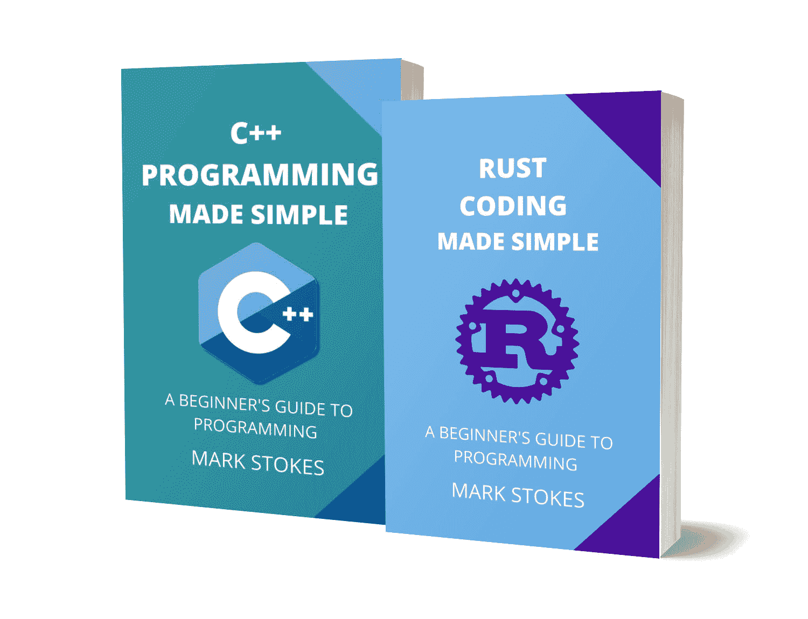

# Rust 与 C++ 编程：编程初学者指南





## 目录
- 第 1 章：入门 Rust：介绍与安装
- 第 2 章：理解 Rust 中的变量和数据类型
- 第 3 章：控制流：条件判断与循环
- 第 4 章：函数：模块化可重用代码
- 第 5 章：错误处理：处理异常
- 第 6 章：探索标准库：指尖上的强大工具
- 第 7 章：并发：并行执行变得简单
- 第 8 章：网络：构建网络化应用
- 第 9 章：错误处理：应对意外情况
- 第 10 章：测试你的 Rust 代码：确保可靠性
- 第 11 章：使用 Cargo 管理依赖和构建项目
- 第 12 章：异步 Rust 中的错误处理
- 第 13 章：Rust 中的并发编程
- 第 14 章：Rust 中的网络
- 第 15 章：Rust 中的数据持久化
- C++ 编程
- 第 1 章：C++ 编程简介
- 第 2 章：入门 C++
- 第 3 章：变量与数据类型
- 第 4 章：运算符与表达式
- 第 5 章：控制流与决策
- 第 6 章：数组与字符串
- 第 7 章：函数与模块化编程
- 第 8 章：指针与动态内存分配
- 第 9 章：面向对象编程概念
- 第 10 章：类与对象
- 第 11 章：继承与多态
- 第 12 章：文件处理
- 第 13 章：异常处理
- 第 14 章：模板与标准模板库 (STL)
- 第 15 章：C++ 编程高级主题

## 简易 Rust 编码
## 初学者编程指南
MARK STOKES

## 书介绍
欢迎阅读《简易 Rust 编程》。本书旨在帮助你学习并掌握 Rust 编程的基础知识。Rust 是一种令人兴奋且强大的语言，以其安全性、性能和并发编程能力而闻名。无论你是完全初学者，还是想为自己的技能树增加 Rust 的资深程序员，本书都将为你提供该语言的坚实基础。

书中，我们将采用循序渐进的方法学习 Rust，从基础开始，逐渐过渡到更高级的话题。每一章都经过精心设计，清晰地解释概念，并配有实用示例和练习以强化你的理解。

# 第 1 章：入门 Rust：介绍与安装
欢迎来到《初学者 Rust Rust：释放现代语言的力量》第 1 章。在本章中，我们将开启 Rust 之之旅，首先介绍这门语言及其特性，并引导你完成安装过程。在本章结束时，你将拥有一个功能完整的 Rust 开发环境，准备好编写你的第一个程序。

## 1.1 介绍 Rust
Rust 是一种现代的静态类型编程语言，以关注内存安全、性能和并发编程而闻名。Rust 由 Mozilla 开发，旨在提供可靠且高效的编程体验，是系统编程、Web 开发等领域的极佳选择。

凭借其独特的所有权系统和严格的编译时检查，Rust 消除了常见的编程错误，如空指针解引用、数据竞态和内存泄漏。这带来了更安全、更可靠的软件，使 Rust 成为同时重视性能和代码正确性的开发者的喜爱。

## 1.2 安装 Rust
在进入 Rust 编程世界之前，你需要搭建开发环境。在本节中，我们将根据你的操作系统引导你完成安装过程。

### 1.2.1 Windows
在 Windows 上安装 Rust，请遵循以下步骤：
1. 访问 Rust 官方网站 `https://www.rust-lang.org/`。
2. 寻找“Get Started”按钮并点击。
3. 在下一个页面，你将看到 Windows 安装选项。点击“Download”按钮下载安装程序。
4. 下载完成后，双击安装程序文件启动它。
5. 按照安装程序提供的说明操作。你可以选择默认设置，或根据自己的喜好进行自定义。
6. 安装完成后，打开一个新的命令提示符或 PowerShell 窗口。
7. 输入 `rustc --version` 并按回车。

### 1.2.2 macOS 和 Linux
在 macOS 或 Linux 上安装 Rust，请遵循以下步骤：
1. 打开终端。
2. 访问 Rust 官方网站 `https://www.rust-lang.org/`。
3. 寻找“Get Started”按钮并点击。
4. 在下一个页面，你将看到 macOS 和 Linux 安装选项。复制提供的命令。
5. 将命令粘贴到终端并按回车。
6. 安装过程将下载并在系统上安装 Rust。可能会提示你输入管理员密码。

## 1.3 配置你的开发环境
安装 Rust 后，配置开发环境对于流畅编码至关重要。以下是你需要了解的一些工具和设置：

### 1.3.1 Rustup
Rustup 是 Rust 的命令行工具链管理器。它允许你管理多个 Rust 工具链、在之间切换并保持更新。Rustup 还负责管理依赖并确保开发环境的一致性。

更新 Rust 及其关联工具，使用以下命令：
```
rustup update
```

### 1.3.2 Cargo
Cargo 是 Rust 的构建系统和包管理器。它处理项目初始化、构建、依赖管理等。Cargo 简化了管理依赖、运行测试和构建项目的过程，让你能够专注于编写代码。

使用 Cargo 创建一个新的 Rust 项目，使用以下命令：
```
cargo new my_project
```

### 1.3.3 集成开发环境 (IDE)
虽然可以使用任何文本编辑器或终端开发 Rust，但使用集成开发环境 (IDE) 可以极提高你的生产力。流行的 Rust IDE 包括带有 Rust 扩展的 Visual Studio Code、带有 Rust 插件的 IntelliJ IDEA 以及带有 Rust 模式的 Emacs。

选择适合你喜好的 IDE 并安装相应的 Rust 插件或扩展，以启用语法高亮、代码补全和集成调试等 Rust 特有功能。


在第 1 章中，我们搭建了 Rust 开发环境，现在是时候深入学习 Rust 编程的基础了。在本章中，我们将探索 Rust 中的变量和数据类型，这些是构成任何程序的基石的基础性概念。在本章结束时，你将对如何在 Rust 中声明变量和处理不同的数据类型有坚固的理解。

## 2.1 Rust 中的变量

Rust 中的变量用于存储和操作数据。与某些动态类型语言不同，Rust 是一种静态类型语言，这意味着变量的类型在编译时必须已知。这允许 Rust 编译器在程序运行之前进行类型检查并捕获潜在错误。

在 Rust 中声明变量，使用 `let` 关键字后跟变量名。让我们来看一个例子：

```rust
let message = "Hello, Rust!";
```

在这个示例中，我们声明了一个名为 `message` 的变量并为其赋值了值 "Hello, Rust!"。该变量的类型由编译器根据赋值的值推断出来。在这种情况下， Rust 推断出 `message` 的类型为 `&str`（字符串切片）。

你也可以通过使用冒号（`:`）后跟类型来显式指定变量的类型。例如：

```rust
let count: u32 = 10;
```

在这里，我们声明了一个名为 `count` 的类型为 `u32`（无符号 32 位整数）的变量并为其赋值 10。

Rust 中的变量默认是不可变的，这意味着一旦赋值，其值就无法更改。然而，你可以通过使用 `mut` 关键字使变量可变。让我们来看一个例子：

```rust
let mut score = 0;
score = 100;
```

在这个示例中，我们声明了一个名为 `score` 的可变变量并赋予其初始值 0。随后，我们将值修改为 100。`mut` 关键字允许我们修改变量的值。

## 2.2 Rust 中的数据类型

Rust 拥有多种内置数据类型，表示不同类型的值。让我们探索 Rust 中一些常用的数据类型：

### 2.2.1 数值类型

Rust 提供了多种数值类型，包括整数（`i8`, `i16`, `i32`, `i64`, `u8`, `u16`, `u32`, `u64`）、浮点数（`f32`, `f64`）以及取决于系统架构的 `usize` 和 `isize` 类型。这里有一个例子：

```rust
let age: u8 = 30;
let temperature: f64 = 25.5;
```

在这个示例中，我们声明了一个名为 `age` 的类型为 `u8`（无符号 8 位整数）的变量并为其赋值 30。我们还声明了一个名为 `temperature` 的类型为 `f64`（64 位浮点数）的变量并为其赋值 25.5。

### 2.2.2 布尔类型

Rust 中的布尔类型表示逻辑值：`true` 或 `false`。这里有一个例子：

```rust
let is_rust_fun: bool = true;
```

在这个示例中，我们声明了一个名为 `is_rust_fun` 的类型为 `bool` 的变量并为其赋值 `true`。

### 2.2.3 字符

Rust 的 `char` 类型表示 Unicode 标量值，并用单引号表示。这里有一个例子：

```rust
let first_initial: char = 'J';
```

在这个示例中，我们声明了一个名为 `first_initial` 的类型为 `char` 的变量并为其赋值 `'J'`。

### 2.2.4 字符串

Rust 有两种主要的字符串类型：字符串切片（`&str`）和所有字符串（`String`）。字符串切片表示对 UTF-8 编码字符序列的引用，而所有字符串是可增长且由程序所有的。这里有一个例子：

```rust
let message: &str = "Hello, Rust!";
let name: String = String::from("Alice");
```

在这个示例中，我们声明了一个名为 `message` 的类型为 `&str` 的变量并为其赋值值 "Hello, Rust!"。我们还声明了一个名为 `name` 的类型为 `String` 的变量并为其赋值 "Alice"。

## 2.3 类型推断

Rust 的类型推断系统允许编译器在许多情况下自动推导出变量的类型。然而，在需要清晰的情况下，仍然可以使用显式的类型注解。

```rust
let x = 5; // x 被推断为 i32
let pi = 3.14; // pi 被推断为 f64
let is_valid = true; // is_valid 被推断为 bool
```

在这个示例中，变量 `x`、`pi` 和 `is_valid` 的类型是由编译器根据它们的值推断出来的。

## 总结

在本章中，我们探索了 Rust 变量和数据类型的基础。我们学习了如何声明变量、处理不同的数据类型并理解 Rust 的类型推断。变量和数据类型对于编写健壮可靠的程序至关重要。

在下一章中，我们将深入控制流语句，例如条件和循环，使我们的程序更加动态和灵活。准备好提升你的 Rust 技能吧！

# 第 3 章：控制流：条件与循环

在第 2 章中，我们探索了变量和数据类型。现在是时候通过理解控制流让我们的程序更加动态和灵活了。在本章中，我们将深入研究条件和循环，这些是允许我们控制执行的重要构造。在本章结束时，你将对如何在 Rust 中使用条件和循环有坚固的理解。

## 3.1 条件：决策

条件允许我们根据某些情况做出决策。Rust 提供了两种主要的条件语句：`if` 和 `match`。让我们探索它们。

### 3.1.1 `if` 语句

Rust 中的 `if` 语句允许在条件为真时执行代码块。这是 `if` 语句的基本语法：

```rust
if condition {
    // 如果条件为真则执行的代码
} else {
    // 如果条件为假执行的代码
}
```

让我们来看一个例子：

```rust
let number = 7;
if number < 5 {
    println!("数字小于 5.");
} else if number == 5 {
    println!("数字等于 5.");
} else {
    println!("数字大于 5.");
}
```

在这个示例中，`if` 语句检查 `number` 的不同条件并执行相应的代码块。

### 3.1.2 `match` 语句

Rust 中的 `match` 语句允许执行模式匹配并根据匹配的模式执行不同的代码块。它为处理不同情况提供了强大且简洁的方法。这是 `match` 语句的基本语法：

```rust
match value {
    pattern1 => {
        // 如果值匹配模式 1 则执行的代码
    },
    pattern2 => {
        // 如果值匹配模式 2 则执行的代码
    },
    _ => {
        // 为任何其他值执行的代码
    }
}
```

让我们来看一个例子：

```rust
let color = "red";
match color {
    "red" => println!("是红色的."),
    "green" => println!("是绿色的."),
    "blue" => println!("是蓝色的."),
    _ => println!("颜色未知."),
}
```

在这个示例中，我们将 `color` 的值与不同的模式进行匹配并执行相应的代码块。

## 3.2 循环：重复执行

循环允许我们重复代码块直到满足特定条件。Rust 提供了多种循环构造，包括 `loop`、`while` 和 `for`。让我们探索每一个。

### 3.2.1 `loop` 循环

Rust 中的 `loop` 循环允许我们无限地重复代码块，直到显式跳出。这是 `loop` 循环的基本语法：

```rust
loop {
    // 无限重复的代码
    // 用于退出循环的跳转条件
}
```

让我们来看一个例子：

```rust
let mut count = 0;
loop {
    println!("计数: {}", count);
    count += 1;
    if count == 5 {
        break;
    }
}
```

在这个示例中，我们声明了一个可变变量 `count` 并将其初始化为 0。`loop` 循环打印变量


`count` 并将其加 1。当 `count` 达到 5 时，跳出循环。

### 3.2.2 `while` 循环

Rust 中的 `while` 循环允许我们只要条件为真就重复执行代码块。以下是 `while` 循环的基本语法：

```rust
while condition {
// 只要条件为真就重复执行的代码
}
```

让我们来看一个示例：

```rust
let mut countdown = 10;

while countdown > 0 {
    println!("Countdown: {}", countdown);
    countdown -= 1;
}
```

在这个示例中，我们声明了一个名为 `countdown` 的可变变量并将其初始化为 10。`while` 循环打印 `countdown` 的值并每次减 1，直到它变为 0。

### 3.2.3 `for` 循环

Rust 中的 `for` 循环允许我们遍历集合或值范围。它简化了遍历每个元素并对每个元素执行操作的过程。以下是 `for` 循环的基本语法：

```rust
for element in collection {
// 为每个元素执行的代码
}
```

让我们来看一个示例：

```rust
let numbers = [1, 2, 3, 4, 5];

for number in numbers.iter() {
    println!("Number: {}", number);
}
```

在这个示例中，我们有一个名为 `numbers` 的包含整数的数组。`for` 循环遍历数组中的每个元素并打印它的值。

## 结论

在本章中，我们探索了条件语句和循环，这些是 Rust 中基本的控制流语句。我们学习了如何使用 `if` 和 `match` 根据条件做出决策，以及使用 `loop`、`while` 和 `for` 进行重复执行。理解控制流允许我们编写更具动态且和交互性的程序。

在下一章中，我们将关注函数，这是 Rust 中模块化和可重用代码的基础构建块。准备好提升你的 Rust 编程技能吧！

# 第 4 章：函数：模块化和可重用的代码

在第 3 章中，我们探索了 Rust 中的控制流语句。现在，让我们通过理解函数将编程技能提升到新水平。函数允许我们将代码组织成可重用和模块化的块，使我们的程序更易维护且更高效。在本章中，我们将深入研究 Rust 中的函数世界，并学习如何有效地定义、调用和使用它们。

## 4.1 定义函数

在 Rust 中，函数使用 `fn` 关键字后跟函数名、用于参数的括号以及返回类型来定义。以下是函数定义的基本语法：

```rust
fn function_name(parameter1: Type1, parameter2: Type2) -> ReturnType {
// 要执行的代码
// 可选的返回语句
}
```

让我们来看一个示例：

```rust
fn greet(name: &str) {
    println!("Hello, {}!", name);
}
```

在这个示例中，我们定义了一个名为 `greet` 的函数，它接受一个类型为 `&str`（字符串切片）的参数 `name`。函数体由单个语句组成，向控制台打印问候信息。

## 4.2 调用函数

一旦定义了函数，我们就可以程序的其他部分调用它。调用函数使用函数名后跟括号，传递必要的参数。以下是调用之前定义的 `greet` 函数的示例：

```rust
greet("Alice");
```

在这个示例中，我们调用了 `greet` 函数并传递了参数 `"Alice"`。函数执行代码并打印问候信息。

## 4.3 函数参数和返回类型

Rust 中的函数可以有参数和返回值。参数允许我们将值传递给函数，而返回类型指定了函数将返回值的类型（如果有）。让我们来看一个示例：

```rust
fn add_numbers(a: i32, b: i32) -> i32 {
    let sum = a + b;
    sum // 隐式返回语句
}
```

在这个示例中，我们定义了一个名为 `add_numbers` 的函数，它接受两个参数 `a` 和 `b`，类型均为 `i32`（32 位有符号整数）。函数体计算 `a` 和 `b` 的和并赋值给变量 `sum`。最后，函数隐式地返回 `sum` 的值作为结果。

## 4.4 函数重载和默认参数

Rust 不支持传统意义上的函数重载（即多个函数具有相同名称但不同的参数列表）。然而，我们可以使用 Rust 的“特质（traits）”和“泛型函数”来实现类似的功能。它允许我们定义可以操作不同类型的函数，提供了灵活性和代码重用。

Rust 也没有对默认函数参数的内置支持。然而，我们可以通过使用结合特质和泛型函数的函数重载来模拟这种行为。通过定义具有不同参数列表的多个函数，我们可以创建具有某些参数默认值的同名函数变体。

## 4.5 函数可见性

默认情况下，Rust 中的函数是私有的，只能从同一个模块内部进行访问。如果我们想让函数从模块外部访问，可以使用 `pub` 关键字将其声明为公共。

```rust
pub fn public_function() {
// 要执行的代码
}
```

在这个示例中，我们定义了一个名为 `public_function` 的函数，并使用 `pub` 关键字将其声明为公有。

## 4.6 函数文档

文档对于编写清晰易于理解的代码至关重要。在 Rust 中，我们可以使用 `///` 为函数添加文档注释。让我们来看一个示例：

```rust
/// 问候指定的人。
///
/// # Arguments
///
/// * `name` - 人的名字。
///
/// # Examples
///
/// ```
/// greet("Alice");
/// ```
fn greet(name: &str) {
    println!("Hello, {}!", name);
}
```

在这个示例中，我们为 `greet` 函数添加了文档注释，描述了它的用途、参数并提供了示例。文档注释帮助其他开发者理解如何使用我们的函数。

## 结论

在本章中，我们探索了 Rust 中的函数，这是一个将代码组织成可重用和模块化块的强大工具。我们学习了如何定义函数、传递参数和返回值。我们还讨论了函数重载、默认参数、可见性和文档。

在下一章中，我们将探索 Rust 中的错误处理，这是编写健壮可靠程序的关键方面。


不可恢复错误（也称为“panics”）是指无法处理或恢复的失败的错误。它们代表了应该导致程序终止的意外情况。例如，除以零就是一个不可恢复的错误。在 Rust 中，不可恢复的错误通过触发 panic（崩溃）来处理，这会终止程序并显示错误信息。

## 5.2 `Result` 类型和 `panic!` 宏

Rust 的错误处理基于 `Result<T, E>` 类型和 `panic!` 宏。`Result<T, E>` 类型是一个枚举，具有两个变体：`Ok(T)` 表示具有类型为 `T` 的值的成功结果，以及 `Err(E)` 表示具有类型为 `E` 的值的错误。`panic!` 宏用于触发不可恢复的错误并终止程序。

让我们来看一个演示 `Result` 类型和 `panic!` 宏使用的示例：

```rust
fn divide(x: i32, y: i32) -> Result<i32, String> {
    if y == 0 {
        Err(String::from("Cannot divide by zero."))
    } else {
        Ok(x / y)
    }
}

fn main() {
    let result = divide(10, 0);
    match result {
        Ok(value) => println!("Result: {}", value),
        Err(error) => panic!(error),
    }
}
```

在这个示例中，我们定义了一个名为 `divide` 的函数，它接受两个 `i32` 参数 `x` 和 `y`。如果 `y` 为零，该函数返回一个带有错误信息的 `Err` 变体。否则，它返回带有除法结果的 `Ok`。在 `main` 函数中，我们调用 `divide(10, 0)` 并使用 `match` 语句处理 `Result`。如果结果是 `Ok`，我们打印该值。如果是 `Err`，我们则触发 panic 并显示错误信息。

## 5.3 使用 `?` 运算符传播错误

在 Rust 中，我们可以使用 `?` 运算符将错误从一个函数传播到另一个函数。当函数返回 `Result` 类型时，我们可以使用 `?` 运算符在错误发生时自动传播它，从而消除了在每个调用函数中进行显式错误处理的需要。让我们来看一个示例：

```rust
use std::fs::File;
use std::io::Read;

fn read_file_contents(file_path: &str) -> Result<String, std::io::Error> {
    let mut file = File::open(file_path)?;
    let mut contents = String::new();
    file.read_to_string(&mut contents)?;
    Ok(contents)
}

fn main() {
    let result = read_file_contents("example.txt");
    match result {
        Ok(contents) => println!("File contents: {}", contents),
        Err(error) => panic!(error),
    }
}
```

在这个示例中，我们定义了一个名为 `read_file_contents` 的函数，它接受文件路径作为参数并返回一个 `Result<String, std::io::Error>`。在函数内部，我们使用 `?` 运算符传播在打开或读取文件过程中发生的任何错误。在 `main` 函数中，我们调用 `read_file_contents("example.txt")` 并使用 `match` 语句处理 `Result`。

## 5.4 使用 `Result` 方法从错误中恢复

`Result` 类型提供了几个处理错误的有用方法。这些方法允许我们根据结果是 `Ok` 还是 `Err` 来执行不同的操作。一些常用方法包括 `map`、`and_then` 和 `unwrap_or`。

让我们来看一个演示 `Result` 方法使用的示例：

```rust
fn divide(x: i32, y: i32) -> Result<i32, String> {
    if y == 0 {
        Err(String::from("Cannot divide by zero."))
    } else {
        Ok(x / y)
    }
}

fn main() {
    let result = divide(10, 2);
    let squared = result.map(|value| value * value);
    let final_result = squared.and_then(|value| {
        if value < 50 {
            Ok(value)
        } else {
            Err(String::from("Result is too large."))
        }
    });
    println!("Final result: {:?}", final_result.unwrap_or(0));
}
```

在这个示例中，我们定义了一个名为 `divide` 的函数，返回一个 `Result<i32, String>`。在 `main` 函数中，我们调用 `divide(10, 2)` 并使用 `map` 方法对结果进行平方。然后，我们使用 `and_then` 方法检查平方值是否小于 50。如果是，我们返回 `Ok`；否则，我们返回 `Err`。最后，我们使用 `unwrap_or` 方法处理结果，打印最终结果，或者在发生错误时打印默认值 0。

## 结论

在本章中，我们探索了 Rust 中的错误处理，这是编写可靠且健壮的程序的关键方面。我们学习了使用 `Result` 类型和 `panic!` 宏来处理可恢复和不可恢复的错误。我们还学会了如何使用 `?` 运算符传播错误，以及如何使用 `Result` 方法来处理错误。

在下一章中，我们将深入研究 Rust 的标准库，并探索其丰富的预定义类型、数据结构和工具集合。准备好迎接。


在这个示例中，我们从 `std::collections` 模块导入了 `HashMap` 类型。我们创建了一个名为 `scores` 的空 `HashMap`，它将名称（字符串）与分数（整数）关联。然后，我们使用 `insert` 方法向映射添加了三个键值对。最后，我们使用 `println!` 宏打印 `scores` 映射的内容。

## 6.3 文件 I/O：读取和写入文件

处理文件是许多应用程序中的常见任务。Rust 标准库为执行文件 I/O 操作提供了方便的工具。

让我们来看一个演示如何使用标准库读读和写文件的示例：

```rust
use std::fs::File;
use std::io::{self, Read, Write};

fn read_file(file_path: &str) -> io::Result<String> {
    let mut file = File::open(file_path)?;
    let mut contents = String::new();
    file.read_to_string(&mut contents)?;
    Ok(contents)
}

fn write_file(file_path: &str, contents: &str) -> io::Result<()> {
    let mut file = File::create(file_path)?;
    file.write_all(contents.as_bytes())?;
    Ok(())
}

fn main() {
    let file_path = "example.txt";
    let contents = read_file(file_path).expect("Failed to read file.");
    println!("File contents: {}", contents);
    let new_contents = "This is the new content.";
    write_file(file_path, new_contents).expect("Failed to write file.");
    println!("File written successfully.");
}
```

在这个示例中，我们从 `std::io` 模块导入了 `File` 类型以及 `Read` 和 `Write` trait（特征型）。我们定义了两个函数，`read_file` 和 `write_file`分别用于读取和写入文件。`read_file` 函数打开文件，将其内容读取到 `String` 中并返回结果。`write_file` 函数创建一个新文件或截断现有文件，写入指定的内容并返回结果。

在 `main` 函数中，我们演示了这些文件 I/O 函数的用法。我们读取文件内容并将其打印到控制台，向文件写入新内容，并确认写入操作是否成功。

## 结论

在本章中，我们探索了 Rust 标准库的一些关键组件。我们学习了如 `Vec`、`String` 和 `HashMap` 等集合，它们提供了强大的数据存储和处理能力。我们还深入研究了文件 I/O 操作，理解了如何使用标准库读写文件。

在下一章中，我们将深入研究 Rust 的并发特性，允许我们编写高效且并发的程序。准备好探索 Rust 中并行执行的世界吧！

# 第 7 章：并发：让并行变得简单

在第 6 章中，我们探索了 Rust 标准库并学习了如何利用其强大的工具，例如集合和文件 I/O 操作。现在，让我们进入 Rust 的并发领域。并发允许程序同时执行多个任务，使它们更高效、响应更迅速。在本章中，我们将探索 Rust 的并发特性，并学习如何编写利用并行执行优势的并发程序。

## 7.1 理解并发与并行

在深入研究 Rust 的并发特性之前，让我们先澄清并发和并行的概念。

并发是程序同时执行多个任务的能力，无论物理 CPU 核心数量如何。并发允许任务在时间上重叠，从而提供更好的响应能力和更高的资源利用率。

另一方面，并行是在不同的物理 CPU 核心上并行执行多个任务，实现真正的同时执行。并行可以通过利用底层硬件的全部力量来显著加快计算密集型任务的速度。

Rust 为并发和并行提供了极佳的支持，允许开发者编写高效且可扩展的并发程序。

## 7.2 线程：轻量级执行单元

在 Rust 中，并发主要通过线程来实现。线程是一个轻量级的执行单元，可以与同一程序内的其他线程并发运行。

让我们来看一个如何在 Rust 中创建和使用线程的示例：

```rust
use std::thread;

fn main() {
    let thread_handle = thread::spawn(|| {
        // 在新线程中执行的代码
        for i in 1..=5 {
            println!("Thread: {}", i);
            thread::sleep(std::time::Duration::from_millis(500));
        }
    });

    // 在主线程中执行的代码
    for i in 1..=5 {
        println!("Main thread: {}", i);
        thread::sleep(std::time::Duration::from_millis(500));
    }

    // 等待创建的线程完成
    thread_handle.join().expect("Failed to join the thread.");
}
```

在这个示例中，我们使用 `thread::spawn` 函数创建一个新线程，并向其传递一个包含在该线程中执行的代码的闭包。闭包包含一个循环，打印从 1 到 5 的数字，每次迭代之间延迟 500 毫秒。

在主线程中，我们也有类似的循环，打印从 1 到 5 的数字。主线程和被创建的线程并发执行，打印各自的数字。

为了确保主线程在退出之前等待被创建的线程完成，我们使用 `thread_handle.join()` 方法，它会阻塞主线程直到被创建的线程完成。

## 7.3 使用 Mutex 进行共享内存并发

当多个线程共享数据时，会导致竞态条件和数据竞争。Rust 的所有权和借用系统有助于缓解这些问题，但有时我们需要线程之间共享可变数据。

Rust 提供了一种名为 `Mutex`（互斥锁）的同步原语来安全地共享可变数据。`Mutex` 确保一次只有一个线程可以访问数据，防止数据竞争。

让我们来看一个演示 `Mutex` 用用的示例：

```rust
use std::sync::Mutex;
use std::thread;

fn main() {
    let counter = Mutex::new(0);
    let mut handles = vec![];

    for _ in 0..5 {
        let handle = thread::spawn(move || {
            let mut num = counter.lock().unwrap();
            *num += 1;
        });
        handles.push(handle);
    }

    for handle in handles {
        handle.join().unwrap();
    }

    println!("Counter: {}", *counter.lock().unwrap());
}
```

在这个示例中，我们创建了一个包装整数值的 `Mutex`。然后我们创建了五个线程，每个线程获取 `counter` 的锁并将计数器加 1。

要访问受 `Mutex` 保护的数据，我们使用 `lock` 方法，它返回一个名为 `MutexGuard` 的智能指针。`MutexGuard` 允许对数据进行可变访问，并在离开作用域时自动释放锁。

在合并所有被创建的线程后，我们通过再次获取 `counter` 的锁来打印计数器的最终值。

## 7.4 使用通道的消息传递并发

除了使用 `Mutex` 进行共享内存并发外，Rust 还提供了另一种强大的并发机制，称为通道。通道允许通过发送和接收消息来实现线程间的通信。

让我们来看一个演示使用通道进行消息传递的示例：

```rust
use std::sync::mpsc;
use std::thread;

fn main() {
    let (sender, receiver) = mpsc::channel();

    let handle = thread::spawn(move || {
        let message = receiver.recv().unwrap();
        println!("Received message: {}", message);
    });

    let message = "Hello, concurrency!";
    sender.send(message.to_owned()).unwrap();

    handle.join().unwrap();
}
```

在这个示例中，我们使用 `mpsc::channel`创建一个通道，它返回两个端点：发送者和接收者。发送者可以发送消息，而接收者可以接收消息。


我们开启一个新的线程，并将接收者的所有权移动到该线程中。在线程内部，我们使用 `recv` 方法从通道接收消息。`recv` 方法会阻塞直到有可用消息。

在主线程中，我们通过调用发送者上的 `send` 方法来发送消息，并将消息作为所有权值传递。`send` 方法返回一个 `Result`，指示消息是否成功发送。

最后，我们连接（join）启动的线程以确保它在程序退出之前完成执行。

## 结论

在本章中，我们探索了 Rust 的并发特性，这些特性允许我们编写高效且可扩展的并发程序。我们学习了如何使用线程来实现并发，如何使用 Mutex 进行共享内存同步，以及如何使用通道进行消息传递。

在下一章中，我们将深入研究 Rust 的网络能力，并探索如何构建网络化应用程序。准备好利用 Rust 网络编程强大力量吧！

# 第 8 章：网络：构建网络化应用程序

在第 7 章中，我们探索了 Rust 的并发特性，并学习了如何使用线程、互斥和通道编写并发程序。现在，让我们进入 Rust 的网络世界。Rust 提供了强大的网络能力，使得构建可以通过多种协议通信的网络化应用程序成为可能。在本章中，我们将探索 Rust 的网络 API 并学习如何开发网络化应用程序。

## 8.1 了解网络基础

在深入研究 Rust 的网络 API 之前，让我们先回顾一些网络基础知识。网络涉及网络上不同设备之间的通信。这种通信通常通过 TCP（传输控制协议）和 UDP（用户数据报协议）等协议发生。

TCP 提供可靠、有序且经过错误检查的数据包交付。它在两个设备之间建立连接，并确保数据按顺序交付，且没有任何丢失或损坏。

相反，UDP 是一种无连接协议，提供快速且轻量的数据包传输。它不提供关于顺序或可靠性的保证，但通常用于对延迟至关重要的场景，例如实时流或游戏。

Rust 的网络 API 允许我们同时处理 TCP 和 UDP，使我们能够构建各种网络化应用程序。

## 8.2 TCP 网络：建立连接

Rust 中的 TCP 网络涉及在客户端和服务器应用程序之间建立连接。客户端发起连接请求，服务器接受连接，允许双向通信。

让我们来看一个演示 Rust 中简单 TCP 客户端-服务器交互的示例：

```rust
use std::io::{Read, Write};
use std::net::{TcpListener, TcpStream};

fn main() {
    // Server
    let listener = TcpListener::bind("127.0.0.1:8080").expect("Failed to bind");
    for stream in listener.incoming() {
        match stream {
            Ok(mut stream) => {
                let mut buffer = [0; 1024];
                stream.read(&mut buffer).expect("Failed to read from stream");
                let message = String::from_utf8_lossy(&buffer).to_string();
                println!("Received message from client: {}", message);
                let response = "Hello from server!";
                stream.write(response.as_bytes()).expect("Failed to write to stream");
            }
            Err(e) => {
                eprintln!("Failed to establish connection: {}", e);
            }
        }
    }
    // Client
    let mut stream = TcpStream::connect("127.0.0.1:8080").expect("Failed to connect to server");
    let message = "Hello from client!";
    stream.write(message.as_bytes()).expect("Failed to write to stream");
    let mut response = String::new();
    stream.read_to_string(&mut response).expect("Failed to read from stream");
    println!("Received response from server: {}", response);
}
```

在这个示例中，我们既有服务器也有客户端。服务器使用 `TcpListener::bind` 函数在 IP 地址 `127.0.0.1`（本地主机）和端口 `8080` 上监听传入的连接。

当客户端连接到服务器时，服务器接受连接，从客户端读取消息，将其打印到控制台，并向客户端发送响应。

在客户端侧，我们使用 `TcpStream::connect` 函数与服务器建立连接。然后我们向服务器写入消息并从服务器读取响应。

## 8.3 UDP 网络：轻量级通信

Rust 中的 UDP 网络允许设备之间进行轻量级通信而无需建立连接。UDP 通常用于低延迟和快速数据传输本质的场景。

让我们来看一个演示 Rust 中简单 UDP 客户端-服务器交互的示例：

```rust
use std::net::UdpSocket;

fn main() {
    // Server
    let server_socket = UdpSocket::bind("127.0.0.1:8888").expect("Failed to bind");
    let mut buffer = [0; 1024];
    let (size, client_address) = server_socket
        .recv_from(&mut buffer)
        .expect("Failed to receive from client");
    let message = String::from_utf8_lossy(&buffer[..size]).to_string();
    println!("Received message from client: {}", message);
    let response = "Hello from server!";
    server_socket
        .send_to(response.as_bytes(), client_address)
        .expect("Failed to send response to client");
    // Client
    let client_socket = UdpSocket::bind("127.0.0.1:0").expect("Failed to bind");
    let server_address = "127.0.0.1:8888";
    let message = "Hello from client!";
    client_socket
        .send_to(message.as_bytes(), server_address)
        .expect("Failed to send response to client");
}
```

在这个示例中，我们有一个通过 UDP 通信的服务器和客户端。服务器使用 `UdpSocket::bind` 函数绑定到 IP 地址 `127.0.0.1`（本地主机）和端口 `8888`。

服务器从客户端接收消息，将其打印到控制台，并使用 `recv_from` 和 `send_to` 方法向客户端发送响应。

在客户端侧，我们使用 `UdpSocket::bind` 将客户端套接绑定到 `127.0.0.1` 和随机端口。然后我们使用 `send_to` 和 `recv_from` 方法向服务器发送消息并接收响应。

## 结论

在本章中，我们探索了 Rust 的网络能力，这些能力允许我们构建网络化应用程序。我们学习了 TCP 网络（在客户端和服务器之间建立连接）以及 UDP 网络（提供轻量级通信）。Rust 的网络 API 为构建各种网络化应用程序提供了稳实的基础。

在下一章中，我们将探索 Rust 的错误处理，并学习如何在程序中有效地处理和管理错误。准备好精通 Rust 的错误处理机制吧！

# 第 9 章：错误处理：应对意外情况

在第 8 章中，我们探索了 Rust 的网络能力，并学习了如何使用 TCP 和 UDP 构建网络化应用程序。现在，让我们关注编程的另一个关键方面：错误处理。错误在软件开发中是不可避免的，Rust 提供了强大的机制来有效地处理和管理它们。

## 9.1 了解 Rust 中的错误处理

Rust 拥有一内置核心语言的强大且丰富的错误处理机制。Rust 的错误处理围绕 `Result` 和 `Option` 类型展开。`Result` 类型表示成功（`Ok`）或失败（`Err`），而 `Option` 类型表示有值（`Some`）或无值（`None`）。


`Result` 类型通常用于可能可能会失败的操作，例如文件 I/O、网络操作或解析。通过利用 `Result` 类型，Rust 强制执行显式错误处理，确保开发者显式地处理潜在错误，而不是让它们被忽略。

让我们来看一个在 Rust 中使用 `Result` 类型的示例：

```rust
use std::fs::File;
use std::io::Read;

fn read_file_contents(filename: &str) -> Result<String, std::io::Error> {
    let mut file = File::open(filename)?;
    let mut contents = String::new();
    file.read_to_string(&mut contents)?;
    Ok(contents)
}

fn main() {
    match read_file_contents("example.txt") {
        Ok(contents) => println!("File contents: {}", contents),
        Err(error) => eprintln!("Error reading file: {}", error),
    }
}
```

在这个示例中，我们定义了一个函数 `read_file_contents`，它尝试读取由文件名指定的文件内容。该函数返回一个 `Result<String, std::io::Error>`，表示它可能返回一个包含文件内容的 `String`（成功），也可能返回一个 `std::io::Error`（失败）。

在函数内部，我们使用 `File::open` 打开文件，并尝试将其内容读取到 `String` 中。我们使用 `?` 运算符来传播文件操作过程中发生的任何错误。

在 `main` 函数中，我们使用 `match` 表达式来处理 `read_file_contents` 的结果。如果结果是 `Ok`，我们打印文件内容；如果结果是 `Err`，我们打印错误信息。

## 9.2 自定义错误类型

虽然 Rust 的标准库提供了广泛的预定义错误类型，但在某些情况下，你可能想要定义自定义错误类型来表示应用程序中的特定错误条件。

让我们来看一个在 Rust 中创建自定义错误类型的示例：

```rust
use std::fmt;

#[derive(Debug)]
enum MyError {
    FileNotFound,
    PermissionDenied,
    InvalidData,
}

impl fmt::Display for MyError {
    fn fmt(&self, f: &mut fmt::Formatter) -> fmt::Result {
        match self {
            MyError::FileNotFound => write!(f, "File not found"),
            MyError::PermissionDenied => write!(f, "Permission denied"),
            MyError::InvalidData => write!(f, "Invalid data"),
        }
    }
}

fn process_file(filename: &str) -> Result<(), MyError> {
    if filename == "secret.txt" {
        Err(MyError::PermissionDenied)
    } else if filename == "data.txt" {
        Err(MyError::InvalidData)
    } else {
        Ok(())
    }
}

fn main() {
    match process_file("secret.txt") {
        Ok(()) => println!("File processed successfully"),
        Err(error) => eprintln!("Error processing file: {}", error),
    }
}
```

在这个示例中，我们使用枚举（enumeration）定义了一个自定义错误类型 `MyError`。`MyError` 枚举有三个变体：`FileNotFound`、`PermissionDenied` 和 `InvalidData`。我们还为 `MyError` 实现了 `fmt::Display` trait 性，以便在显示错误时提供有意义的错误信息。

`process_file` 函数演示了如何使用自定义错误类型。如果文件名是 "secret.txt"，我们返回 `Err(MyError::PermissionDenied)`。如果文件名是 "data.txt"，我们返回 `Err(MyError::InvalidData)`。否则，我们返回 `Ok(())` 表示成功。

在 `main` 函数中，我们使用 `match` 表达式处理 `process_file` 的结果。如果结果是 `Ok`，我们打印成功消息；如果结果是 `Err`，我们打印自定义的错误信息。

## 9.3 使用 ? 运算符传播错误

Rust 错误处理机制的优势之一是可以使用 `?` 运算符传播错误。`?` 运算符可以用于返回 `Result` 的函数，自动传播从当前函数内调用的函数所产生的错误。

让我们来看一个使用 `?` 运算符传播错误的示例：

```rust
use std::fs;

fn read_and_write_file(source: &str, destination: &str) -> Result<(), std::io::Error> {
    let contents = fs::read_to_string(source)?;
    fs::write(destination, contents)?;
    Ok(())
}

fn main() {
    match read_and_write_file("source.txt", "destination.txt") {
        Ok(()) => println!("File copied successfully"),
        Err(error) => eprintln!("Error copying file: {}", error),
    }
}
```

在这个示例中，我们定义了一个函数 `read_and_write_file`，它读取源文件的内容并写入目标文件。这两个文件操作都可能失败并返回 `Result`。

通过使用 `?` 运算符，文件操作过程中发生的任何错误都会自动返回给调用者。如果 `fs::read_to_string` 或 `fs::write` 发生错误，将返回 `Err` 值并且函数提前退出。

在 `main` 函数中，我们使用 `match` 表达式处理 `read_and_write_file` 的结果。如果结果是 `Ok`，我们打印成功消息；如果结果是 `Err`，我们打印错误信息。

## 总结

在本章中，我们探索了 Rust 的错误处理功能以及如何处理意外情况。我们学习了 `Result` 和 `Option` 类型，以及如何创建自定义错误类型并使用 `?` 运算符传播错误。在下一章中，我们将深入探讨 Rust 的测试能力，并学习如何为代码编写测试。


```rust
mod math {
  pub fn add(a: i32, b: i32) -> i32 {
    a + b
  }

  pub fn subtract(a: i32, b: i32) -> i32 {
    a - b
  }
}

#[cfg(test)]
mod tests {
  use super::math;

  #[test]
  fn test_add() {
    assert_eq!(math::add(2, 2), 4);
    assert_eq!(math::add(-1, 5), 4);
    assert_eq!(math::add(10, -3), 7);
  }

  #[test]
  fn test_subtract() {
    assert_eq!(math::subtract(5, 3), 2);
    assert_eq!(math::subtract(10, -5), 15);
    assert_eq!(math::subtract(0, 0), 0);
  }
}
```

在这个示例中，我们有一个名为 `math` 的模块，它包含了两个函数：`add` 和 `subtract`。在 `tests` 模块中，我们为这些函数分别编写了独立的测试函数。

通过使用 `super` 关键字，我们可以访问父模块中的项，这允许我们导入 `math` 模块并在测试函数中使用它的函数。

## 10.3 Rust 中的测试驱动开发 (TDD)

测试驱动开发 (TDD) 是一种软件开发实践，涉及在编写实际实现代码之前先编写测试。通过遵循 TDD 方法，我们可以确保代码符合指定的要求的并且行为符合预期。

在 Rust 中实践 TDD，我们可以遵循一个简单的三步骤流程：编写一个失败的测试、编写实现代码，然后进行重构。

让我们来看一个展示 Rust 中 TDD 过程的示例：

```rust
fn is_even(n: i32) -> bool {
  n % 2 == 0
}

#[cfg(test)]
mod tests {
  use super::*;

  #[test]
  fn test_is_even() {
    assert!(is_even(2));
    assert!(!is_even(3));
    assert!(is_even(0));
    assert!(!is_even(1));
  }
}
```

在这个示例中，我们定义了一个函数 `is_even` 来判断给定数字是否为偶数。在测试函数 `test_is_even` 中，我们编写了断言来验证 `is_even` 函数的行为。

最初，当我们运行测试时，`is_even` 函数对于提供的测试用例将失败。然后我们实现 `is_even` 函数以使测试通过。最后，如果有必要，我们可以重构代码以提高其可读性或性能。

## 结论

在本章中，我们探索了 Rust 的测试能力，并学习了如何为代码编写单元测试。我们看到了如何编写测试函数、使用测试模块组织测试，甚至在 Rust 中练习测试驱动开发 (TDD)。测试对于确保代码的可靠性和正确性至关重要，而 Rust 的测试框架提供了强大的工具来支持我们的测试工作。

在下一章中，我们将深入研究 Rust 的包管理器 Cargo，并学习如何高效地管理依赖和构建项目。准备好将你的 Rust 开发技能提升新的水平吧！

# 第 11 章：使用 Cargo 管理依赖和构建项目

在第 10 章中，我们探索了 Rust 的测试能力，并学习了如何通过自动化测试确保代码的可靠性。现在，让我们转向管理依赖和高效地构建项目。Rust 的包管理器 `Cargo` 提供了一套强大的工具，用于管理依赖、构建项目以及处理项目元数据。在本章中，我们将深入研究 Cargo 的功能并学习如何有效地利用它们。

## 11.1 Cargo 简介

Cargo 是 Rust 项目的包管理器和构建系统。它简化了管理依赖、编译代码、运行测试等等过程。通过 Cargo，你可以轻松地管理项目的依赖、处理版本控制，并在不同环境中一致地构建你的代码。

要使用 Cargo 创建一个新的 Rust 项目，你可以使用 `cargo new` 命令后跟项目名称。例如：

```shell
cargo new my_project
```

该命令会创建一个名为 `my_project` 的新目录，并为 Rust 项目设置基本结构，包括 `Cargo.toml` 文件，该文件包含了项目的元数据和依赖信息。

## 11.2 使用 Cargo 管理依赖

Cargo 简化了 Rust 项目中管理依赖的过程。依赖定义在 `Cargo.toml` 文件中，它使用 TOML 格式来指定项目的元数据、依赖和其他配置选项。

让我们来看一个定义依赖的 `Cargo.toml` 文件示例：

```toml
[package]
name = "my_project"
version = "0.1.0"
edition = "2021"

[dependencies]
rand = "0.8.4"
serde = { version = "1.0", features = ["derive"] }
```

在这个示例中，`[dependencies]` 部分列出了两个依赖：`rand` 和 `serde`。`rand` 依赖有特定的版本要求 `"0.8.4"`，而 `serde` 依赖有 `"1.0"` 的版本要求并启用了 `"derive"` 特性。

要获取并安装项目的依赖，你可以使用 `cargo build` 命令。Cargo 会根据 `Cargo.toml` 中的规范自动下载并构建所需的依赖。

## 11.3 使用 Cargo 构建和运行项目

Cargo 为构建和运行项目提供了简单的命令。`cargo build` 命令编译源代码和任何依赖，生成二进制文件或库产物。

要在一个命令中构建并运行项目，你可以使用 `cargo run`。该命令将编译代码并执行结果。

此外，Cargo 提供了 `cargo test` 命令，它会自动发现并运行项目的测试。它执行项目中定义的测试函数，提供测试失败或成功的反馈。

让我们来看使用 `cargo build`、`cargo run` 和 `cargo test` 的示例：

```shell
cargo build
cargo run
cargo test
```

Cargo 还提供了各种选项和标志来定制构建过程、处理发布构建等。你可以参考 Cargo 文档获取这些选项的详细信息。

## 11.4 发布和共享 Rust 包

Cargo 允许你通过 Rust 包仓库 crates.io 轻松发布和共享你的 Rust 包。在 crates.io 上发布包可以让整个 Rust 社区访问，并简化其他项目的依赖管理。

要发布包，你需要在 crates.io 上创建一个账户并配置 Cargo 凭据。配置完成后，你可以使用 `cargo publish` 命令发布你的包。Cargo 将打包你的代码、元数据和依赖并上传到 crates.io。

在发布之前，确保你的包符合质量标准并遵循最佳实践是重要的。考虑编写详细的文档、提供有意义的示例并进行彻底的测试，以确保包的可靠性。

## 结论

在本章中，我们探索了作为 Rust 包管理器和构建系统的 Cargo。我们学习了如何使用 Cargo 创建新的 Rust 项目、管理依赖、构建项目以及运行测试。Cargo 简化了管理依赖的过程，让你专注于编写代码和确保项目的质量。我们还涉及了将包发布到 crates.io，让你能够与更广泛的社区分享你的 Rust 代码。

# 第 12 章：异步 Rust 中的错误处理


在第 11 章中，我们探索了 `Cargo` 并学习了如何高效地管理依赖和构建项目。现在，让我们转向异步 Rust 代码中的错误处理。nRust 的异步编程提供了极佳的性能优势，但在处理错误方面也引入了独特的挑战。在本章中，我们将深入研究异步 Rust 中中错误处理的概念，并学习如何在异步上下文中有效地处理和传播错误。

## 12.1 异步 Rust 中的错误类型

在异步 Rust 中，错误可能以多种形式出现。表示错误的最常见方式是使用 `Result` 类型，它有两个变体：用于成功结果的 `Ok` 用于错误的 `Err`。异步代码通常依赖 `Result` 类型来传播和处理错误。

让我们来看一个演示如何在异步 Rust 中使用 `Result` 类型进行错误处理的示例：

```rust
use std::fs;

async fn read_file(path: &str) -> Result<String, std::io::Error> {
    fs::read_to_string(path).await
}

async fn process_file(path: &str) -> Result<(), Box<dyn std::error::Error>> {
    let content = read_file(path).await?;
    // Process the file content
    Ok(())
}
```

在这个示例中，`read_file` 函数异步读取文件内容并返回一个 `Result`，表示成功的 `String` 结果或在发生错误时返回 `std::io::Error`。`process_file` 函数调用 `read_file` 并使用 `?` 运算符处理可能发生的任何错误。

## 12.2 在异步链中传播错误

在异步代码中，将多个异步操作链联起来是常见的。当这些操作中的一个发生错误时，将错误向上链链传递以确保正确的错误处理是非常重要的。

让我们来看一个演示异步链中错误传播的示例：

```rust
use std::fs;

async fn read_file(path: &str) -> Result<String, std::io::Error> {
    fs::read_to_string(path).await
}

async fn process_files(paths: &[&str]) -> Result<(), Box<dyn std::error::Error>> {
    for path in paths {
        let content = read_file(path).await?;
        // Process the file content
    }
    Ok(())
}
```

在这个示例中，`process_files` 函数遍历文件路径切片，并为每个路径调用 `read_file` 函数。如果在文件读取过程中发生错误，错误将使用 `?` 运算符向上传递给 `process_files` 的调用者。

## 12.3 异步 Rust 中的自定义错误类型

虽然在异步 Rust 中使用内置错误类型配合 `Result` 类型是常见的，但在某些情况下，你可能想要定义自定义错误类型，以更好地表示代码中特定的失败场景。

让我们来看一个演示在异步 Rust 中使用自定义错误类型的示例：

```rust
use std::fs;

enum MyError {
    FileNotFound,
    IoError(std::io::Error),
}

async fn read_file(path: &str) -> Result<String, MyError> {
    match fs::read_to_string(path).await {
        Ok(content) => Ok(content),
        Err(err) => Err(MyError::IoError(err)),
    }
}

async fn process_file(path: &str) -> Result<(), MyError> {
    let content = read_file(path).await?;
    // Process the file content
    Ok(())
}
```

在这个示例中，我们定义了一个自定义错误类型 `MyError`，它代表两种可能的错误场景：`FileNotFound` 和封装了 `std::io::Error` 的 `IoError`。`read_file` 和 `process_file` 函数使用这种自定义错误类型来提供更具体的错误信息。

## 总结

在本章中，我们探索了异步 Rust 代码中的错误处理。我们学习了如何使用 `Result` 类型处理错误、在异步链中传播错误，以及定义自定义错误类型来表示特定的失败场景。适当的错误处理对于异步编程至关重要，它可以确保代码的可靠性并能够优雅地处理潜在的失败场景。

在下一章中，我们将深入研究 Rust 的并发编程主题，并探索如何利用 Rust 的并发特性来编写高效且可扩展的并发代码。准备好释放 Rust 并的力量吧！

# 第 13 章：Rust 中的并发编程

在第 12 章中，我们探索了异步 Rust 代码中的错误处理，并学习了如何在异步上下文中有效地处理和传播错误。现在，让我们深入研究 Rust 的并发编程主题。Rust 提供了强大的并发特性，允许我们编写高效且可扩展的并发代码。在本章中，我们将探索这些特性，并学习如何在我们的 Rust 程序中利用它们。

## 13.1 并发编程简介

并发编程涉及同时执行多个任务或计算，从而高效利用系统资源。它允许我们并发执行任务，提高程序的性能和响应能力。

在 Rust 中，并发通过使用线程实现，线程是可并发运行的轻级执行单元。Rust 通过 `std::thread` 模块提供了线程抽象，允许我们在程序中创建和管理线程。

让我们来看一个演示如何在 Rust 中创建和管理线程的示例：

```rust
use std::thread;

fn main() {
    let handle = thread::spawn(|| {
        // Code 在新线程中执行的代码
        println!("Hello from the thread!");
    });
    // 在主线程中执行的代码
    handle.join().unwrap();
}
```

## 13.2 共享状态并发

并发程序通常涉及线程之间的状态共享。然而，共享状态可能会导致数据竞态等问题，即多个线程同时访问并修改共享数据，导致不可预测且错误的行为。Rust 的所有权系统和并发原语帮助我们编写既安全又高效的并发代码。Rust 提供了互斥锁（mutex）、原子类型和通道等同步原语，用于在线程之间安全地共享状态。

让我们来看一个演示如何使用 mutex 在线程间安全地共享共享状态的示例：

```rust
use std::sync::{Arc, Mutex};
use std::thread;

fn main() {
    let counter = Arc::new(Mutex::new(0));
    let mut handles = vec![];

    for _ in 0..10 {
        let counter = Arc::clone(&counter);
        let handle = thread::spawn(move || {
            let mut num = counter.lock().unwrap();
            *num += 1;
        });
        handles.push(handle);
    }

    for handle in handles {
        handle.join().unwrap();
    }

    println!("Final count: {}", *counter.lock().unwrap());
}
```

在这个示例中，我们使用 `Arc`（原子引用计数）和 `Mutex` 类型创建了一个共享计数器变量。`Arc` 允许多个线程共享计数器的所有权，而 `Mutex` 确保一次只有一个线程可以访问计数器。`lock` 方法用于获取互斥锁，以便访问共享数据。通过使用 `Mutex`，我们确保了对计数器的并发访问是同步的，防止了数据竞态。

## 13.3 异步并发

除了基于线程的并发，Rust 还提供了强大的异步并发抽象。异步编程允许我们编写非阻塞且高效的并发代码，从而优化系统资源的利用。Rust 的异步编程模型基于 async/await 语法和 future。Rust 的异步编程通过使用 `tokio` 等库或标准库的异步支持来实现。

让我们来看一个演示如何使用 `tokio` 编写异步代码的示例：


```rust
use tokio::time::{sleep, Duration};

async fn async_task() {
    println!("Async task starting...");
    sleep(Duration::from_secs(1)).await;
    println!("Async task completed!");
}

#[tokio::main]
async fn main() {
    println!("Main task starting...");
    async_task().await;
    println!("Main task completed!");
}
```

在这个示例中，我们使用 `async` 关键字和 `async_task` 函数定义了一个异步任务。我们使用 `tokio::time::sleep` 函数在任务中引入了 1 秒的延迟。`main` 函数被标记了 `#[tokio::main]` 属性，这使得主任务能够进行异步执行。`await` 关键字用于等待异步任务的完成。

## 结论

在本章中，我们探索了 Rust 中的并发编程。我们学习了如何创建和管理线程，如何使用互斥锁（mutex）等同步原语在线程之间共享状态，以及如何使用 `tokio` 等库编写异步代码。Rust 的并发特性使我们能够编写高效且可扩展的并发程序，同时确保安全性和正确性。

在下一章中，我们将探索 Rust 中的网络编程主题。我们将发现如何构建网络应用程序、处理 TCP 和 UDP 通信，并利用 Rust 的网络库来创建健壮且高性能的网络系统。准备好一起进入 Rust 的网络世界吧！

# 第 14 章：Rust 中的网络编程

在第 13 章中，我们探索了 Rust 中的并发编程，并学习了如何利用线程和异步编程来编写高效且可扩展的并发代码。现在，让我们进入 Rust 的网络世界吧。Rust 提供了强大的网络库和抽象，允许我们构建网络应用程序、处理各种协议，并创建高性能且可靠的网络系统。在本章中，我们将探索 Rust 中的网络概念，并学习如何利用 Rust 的网络库来构建强大的网络应用程序。

## ## 14.1 Rust 网络编程简介

网络编程是现代软件开发的一个基础方面，它实现了不同系统之间的通信和数据交换。Rust 提供了丰富的网络库和 API 生态系统，促进了网络编程。

Rust 的网络库涵盖了广泛的网络协议，包括 TCP、UDP、HTTP、WebSockets 等。这些库提供了抽象和工具来有效地处理网络通信，确保安全性、可靠性和性能。

## ## 14.2 使用 Rust 进行 TCP 通信

TCP（传输控制协议）是一种可靠的面向连接的协议，广泛用于网络上应用程序之间的通信。Rust 提供了几个库和抽象来处理 TCP 通信。

让我们来看一个示例，它了如何使用 `std::net` 模块建立 TCP 连接并交换数据：

```rust
use std::io::{Read, Write};
use std::net::{TcpListener, TcpStream};

fn main() {
    // TCP 服务器
    let listener = TcpListener::bind("127.0.0.1:8080").expect("Failed to bind address");
    for stream in listener.incoming() {
        match stream {
            Ok(mut stream) => {
                // 处理客户端连接
                let mut buffer = [0; 1024];
                stream.read(&mut buffer).expect("Failed to read from stream");
                println!("Received data: {:?}", &buffer);
                let response = "Hello from the server!";
                stream.write(response.as_bytes()).expect("Failed to write to stream");
            }
            Err(e) => {
                println!("Error: {}", e);
            }
        }
    }
}
```

在这个示例中，我们使用 `TcpListener` 类型创建了一个 TCP 服务器，并将其绑定到地址 `127.0.0.1:8080`。我们使用 `incoming` 方法接收传入的客户端连接，该方法返回一个表示客户端连接的 `TcpStream` 实例的迭代器。在循环内部，我们通过从流中读取数据并写入响应来处理每个客户端连接。

## ## 14.3 使用 Rust 进行 UDP 通信

UDP（用户数据报协议）是一种轻量级的无连接协议，提供了快速但不可靠的通信。Rust 提供了库和抽象来处理 UDP 通信，允许我们构建利用 UDP 进行网络通信的应用程序。

让我们来看一个示例，它演示了如何使用 `std::net` 模块发送和接收 UDP 包：

```rust
use std::net::{UdpSocket, SocketAddr};

fn main() {
    // UDP 服务器
    let socket = UdpSocket::bind("127.0.0.1:8080").expect("Failed to bind address");
    let mut buffer = [0; 1024];
    loop {
        match socket.recv_from(&mut buffer) {
            Ok((size, src_addr)) => {
                println!("Received data from {}: {:?}", src_addr, &buffer[..size]);
                let response = "Hello from the server!";
                socket.send_to(response.as_bytes(), &src_addr).expect("Failed to send data");
            }
            Err(e) => {
                println!("Error: {}", e);
            }
        }
    }
}
```

在这个示例中，我们使用 `UdpSocket` 类型创建了一个 UDP 服务器，并将其绑定到地址 `127.0.0.1:8080`。我们使用 `recv_from` 方法持续监听传入的 UDP 包，该方法返回接收到的数据的大小和源地址。然后，我们处理接收到的数据并使用 `send_to` 方法向客户端发送响应。

## ## 14.4 使用 Rust 进行 HTTP 通信

HTTP（超文本传输协议）是万维网通信的基础。Rust 提供了强大的库和框架来处理 HTTP 通信，使我们能够构建 Web 应用。

Rust 中用于 HTTP 通信流行的库之一是 `hyper`。让我们来看一个示例，演示如何使用 `hyper` 构建一个简单的 HTTP 服务器：

```rust
use hyper::service::{make_service_fn, service_fn};
use hyper::{Body, Request, Response, Server};

async fn handle_request(req: Request<Body>) -> Result<Response<Body>, hyper::Error> {
    // 处理请求并返回响应
    let response = Response::new(Body::from("Hello from the server!"));
    Ok(response)
}

#[tokio::main]
async fn main() {
    let addr = ([127, 0, 0, 1], 8080).into();

    let make_svc = make_service_fn(|_conn| {
        async {
            Ok::<_, hyper::Error>(service_fn(handle_request))
        }
    });

    let server = Server::bind(&addr).serve(make_svc);

    if let Err(e) = server.await {
        eprintln!("Server error: {}", e);
    }
}
```

在这个示例中，我们定义了 `handle_request` 函数，它接收一个 HTTP 请求并返回一个 HTTP 响应。我们通过提供一个返回处理每个传入请求服务的 `make_service_fn` 来使用 `hyper` 创建 HTTP 服务器。服务器监听地址 `127.0.0.1:8080` 并使用 `handle_request` 函数处理请求。


数据持久化涉及存储和检索数据，使其能够在程序生命周期之外仍能被访问和使用。在 Rust 中，有多种数据持久化方案可用，从关系型数据库到 NoSQL 数据库，从文件系统到键值存储应有尽。数据持久化技术的选择取决于数据结构、查询需求、可扩展性和性能等因素。

## 15.2 在 Rust 中操作数据库

数据库提供了一种结构化且高效的数据存储和检索方式。Rust 拥有丰富的数据库库生态系统，允许我们与各种关系型和 NoSQL 数据库进行交互。让我们探索两个流行的 Rust 数据库库：`diesel` 和 `mongodb`。

### 15.2.1 使用 Diesel 操作关系型数据库

`diesel` 是一个用于与关系型数据库交互的流行 Rust 库。它提供了类型安全的查询构建器和对象关系映射（ORM）系统，使得以符合 Rust 习惯的方式操作数据库变得更容易。以下示例演示了如何使用 `diesel` 配合 PostgreSQL 数据库：

```rust
use diesel::prelude::*;
use diesel::pg::PgConnection;
use dotenv::dotenv;
use std::env;

#[derive(Queryable)]
struct User {
    id: i32,
    name: String,
    email: String,
}

fn main() {
    dotenv().ok();
    let database_url = env::var("DATABASE_URL").expect("DATABASE_URL must be set");
    let conn = PgConnection::establish(&database_url).expect("Failed to connect to database");
    let results = users
        .filter(name.eq("Alice"))
        .limit(5)
        .load::<User>(&conn)
        .expect("Failed to load users");
    for user in results {
        println!("ID: {}, Name: {}, Email: {}", user.id, user.name, user.email);
    }
}
```

在此示例中，我们使用 `diesel` 中的 `PgConnection` 类型连接到 PostgreSQL 数据库。我们定义了一个 `User` 结构体，并使用 `Queryable` 特性将表列映射到结构体字段。然后，我们执行了一个查询来获取名为“Alice”的用户并打印他们的详细信息。

### 15.2.2 在 Rust 中使用 MongoDB

MongoDB 是一个流行的 NoSQL 数据库，提供了灵活的文档存储。Rust 通过 `mongodb` crate 对 MongoDB 有良好的支持。以下示例演示了如何使用 `mongodb` 与 MongoDB 数据库进行交互：

```rust
use mongodb::{bson::doc, options::ClientOptions, Client};
#[derive(Debug, Deserialize, Serialize)]
struct User {
    id: i32,
    name: String,
    email: String,
}

#[tokio::main]
async fn main() {
    let client_options = ClientOptions::parse("mongodb://localhost:27017").await.unwrap();
    let client = Client::with_options(client_options).unwrap();
    let db = client.database("mydb");
    let collection = db.collection::<User>("users");
    let filter = doc! { "name": "Alice" };
    let result = collection.find_one(filter, None).await.unwrap();
    match result {
        Some(user) => {
            println!("User: {:?}", user);
        }
        None => {
            println!("User not found.");
        }
    }
}
```

在此示例中，我们使用 `mongodb` 中的 `ClientOptions` 和 `Client` 类型连接到本地 MongoDB 实例。我们访问名为“mydb”的数据库和名为“users”的集合。我们执行了一个查询来寻找名为“Alice”的用户，如果找到，则打印用户的详细信息。

## 15.3 在 Rust 中操作文件系统

除了数据库，Rust 还提供了处理文件系统的强大工具。我们可以使用 Rust 的标准库和各种 crate 来创建、读取、更新和删除文件及目录。让我们来看一个 Rust 中文件 I/O 操作的示例：

```rust
use std::fs::File;
use std::io::{Read, Write};
fn main() {
    let mut file = File::create("data.txt").expect("Failed to create file");
    file.write_all(b"Hello, Rust!").expect("Failed to write to file");
    let mut contents = String::new();
    let mut file = File::open("data.txt").expect("Failed to open file");
    file.read_to_string(&mut contents).expect("Failed to read from file");
    println!("File contents: {}", contents);
}
```

在此示例中，我们创建了一个名为“data.txt”的新文件并向写入文本“Hello, Rust!”。然后我们打开文件，将其内容读取到字符串中并打印出来内容。

## 总结

在本章中，我们探索了 Rust 中的数据持久化。我们学习了如何使用 `diesel` 和 `mongodb` 等库操作数据库，使我们能够与关系型和 NoSQL 数据库进行交互。我们还看到了如何使用 Rust 的标准库执行文件 I/O 操作。通过本章获得的知识，你可以构建出高效且可靠地存储和检索数据的应用程序。

恭喜你！你现在已经完成了从基础到数据持久化的 Rust 编程之旅。Rust 的强有保证、性能和安全性使其成为广泛应用的极佳选择。继续实践并探索 Rust 的新领域，成为一名精通 Rust 的程序员吧。祝编码愉快！

C++ 编程

简俗易懂

编程入门指南

MARK STOKES

书籍引言：

欢迎阅读《C++ 编程简俗易懂：编程入门指南》！本书旨在帮助你学习并理解 C++ 的基础知识，即使你没有任何编程经验。这本书将作为你的终极指南，在当今数字时代，编程技能是需求量巨大的。C++ 是一种强大且多功能的语言，适用于各种应用。

在本书中，你将开启一段兴奋的旅程，从 C++ 的基础开始逐步过渡高级概念。每一章都经过精心设计，介绍新主题，通过实际示例强化你的理解，并提供测试知识的练习。因此，无论你是渴望学习编程的学生、想要扩展技能的兴趣爱好者，还是寻求提升职业前景的专业人士，《C++ 编程编程入门指南》都是你实现愿望的完美资源。让我们进入 C++ 编程的世界，解锁它的无限可能！

# C++ 编程

# 第一章：C++ 编程简介

欢迎来到《C++ 编程入门指南：编程入门指南》第一章。在本章中，我们将为你的 C++ 编程之旅奠定基础。我们将对 C++ 是什么以及为什么是如此强大且流行的编程语言提供概述。

## 什么是 C++？

C++ 是一种通用编程语言，作为 C 编程语言的扩展而开发。它由 Bjarne Stroustrup 在 20 世纪 80 年代初创建，并已成为世界上最广泛使用的编程语言之一。C++ 提供了高层特性和低层控制的结合，使其适用于广泛的应用。

## C++ 的重要性

C++ 被认为是一种强大的语言，原因有几点。首先，它提供了水平的效率和性能。C++ 程序执行速度快，并能有效利用系统资源。这使其成为开发需要速度和性能的应用程序（例如游戏引擎、操作系统和科学模拟）的热门选择。


C++ 的另一个重要方面是它支持面向对象编程（OOP）。面向对象编程允许开发人员将代码组织成可重用的对象，使其更容易管理复杂项目并提高代码复用性。C++ 还支持其他编程范式，包括过程编程和泛型编程。

C++ 以其丰富的标准库而闻名，该库提供了大量的预写函数和类，可用于解决常见的编程问题。标准模板库（STL）是 C++ 标准库中一个特别有价值的部分，提供了广泛的数据结构和算法，简化了开发过程。

此外，C++ 庞大且活跃的开发者社区。这意味着有丰富的资源、库和框架可以支持 C++ 编程。无论你是需要帮助、想要探索开源项目，还是寻求为语言本身贡献，C++ 社区都提供了一个充满活力且给予支持的环境。

## 设置你的开发环境

在我们开始编写 C++ 代码之前，让我们确保你的开发环境已正确设置。以下步骤将引导你完成在系统中安装 C++ 编译器和集成开发环境（IDE）的过程：

1. **选择 C++ 编译器：** 有多种 C++ 编译器可用，例如 GCC（GNU 编译器集合）、Clang 和 Microsoft Visual C++。选择一个与你的操作系统兼容的编译器并从官方网站下载。
2. **安装编译器：** 按照编译器文档提供的安装说明进行操作。确保编译器已在你的系统中正确安装并配置。
3. **选择 IDE：** IDE 提供了一个完整的开发环境，具有代码编辑、调试和项目管理等功能。一些流行的 C++ IDE 包括 Visual Studio、Code::Blocks 和 Eclipse。选择一个符合你偏好的 IDE 并从各自的网站下载。
4. **安装 IDE：** 下载后，运行安装程序并按照 IDE 的安装说明进行操作。在安装过程中确保选择合适的选项，例如包含 C++ 编译器。
5. **验证安装：** 安装完成后，打开 IDE 并创建一个新的 C++ 项目或文件。编写一个简单的“Hello, World!”程序并尝试编译和运行它。如果程序成功执行并显示了预期的输出，说明你的开发环境设置正确。

## 编写你的第一个 C++ 程序

现在你的开发环境已经准备就绪，让我们开始编写你的第一个 C++ 程序。我们将从经典的“Hello, World!”程序开始，它通常用作编程中的入门示例。

打开你选择的 IDE，并按照以下步骤创建一个新的 C++ 项目或文件：

1. 在 IDE 中创建一个新项目或文件。给它一个有意义的名字，例如 `HelloWorld.cpp`。
2. 在新创建的项目或文件中，编写以下代码：

```cpp
#include <iostream>

int main() {
    std::cout << "Hello, World!" << std::endl;
    return 0;
}
```
3. 保存文件。
4. 通过在 IDE 中选择相应的选项来编译程序。如果你使用的是命令行编译器，请导航到包含文件的目录并运行编译器命令。确保处理编译过程中可能出现的任何错误或警告。
5. 程序成功编译后，可以在 IDE 内执行它，也可以通过运行生成的的可执行文件来执行。你应该能在控制台或终端中看到显示的“Hello, World!”输出。

恭喜！你已经编写并执行了你的第一个 C++ 程序。这个简单的示例演示了 C++ 程序的基本结构，包括以下核心组件：

- `#include <iostream>` 指令包含了输入输出操作所需的头文件。
- `int main()` 函数充当程序的入口点。它是执行开始的地方。
- `std::cout` 语句用于将消息“Hello, World!”打印到控制台。
- `return 0` 语句表示程序已成功执行并向操作系统返回值 0。

你可以随时通过修改消息或添加额外的语句来对代码进行实验。观察结果将帮助你理解程序的行为并强化你的学习。

## 总结

在本章中，我们介绍了 C++ 编程的基础知识。我们探索了 C++ 是什么，讨论了它的重要性，并强调了它的关键特性。此外，我们还引导你设置了开发环境并编写了第一个 C++ 程序。

在接下来的章节中，我们将深入研究这门语言，涵盖变量、数据类型、控制流、函数和面向对象编程等主题。每一章将建立在之前章节所知识的基础上，逐渐扩展你作为 C++ 程序员的理解和技能。

请记住，实践对于掌握编程概念至关重要。花时间去实验、探索，并通过编程练习挑战自己。通过这种方式，你将在 C++ 编程的世界中变得更加自如熟练。

准备好迎接一段激心的旅程吧，我们将深入探索 C++ 编程的迷人世界！

# 第 2 章：开始学习 C++

在第 1 章中，我们探索了 C++ 编程的基础并编写了第一个“Hello, World!”程序。现在，让我们深入研究这门语言，学习如何处理变量、输入输出操作和基础算术。

## 变量和数据类型

变量是任何编程语言（包括 C++）的重要组成部分。它们用于在程序执行期间存储和操作数据。在使用变量之前，我们必须声明它，并指定其数据类型和名称。

C++ 支持多种数据类型，包括整数、浮点数、字符和布尔值。是一些常用的数据类型：

- `int`：表示整数（整数），例如 -3、0 和 42。
- `float` 和 `double`：表示浮点数（小数），例如 3.14 和 2.71828。
- `char`：表示单个字符，例如 'A'、'b' 和 '$'。
- `bool`：表示布尔值（`true` 或 `false`）。

声明变量时，我们指定数据类型，然后是名称。例如：

```cpp
int age; // 声明名为 age 的整数变量
float pi; // 声明一个 pi 的浮点变量
char grade; // 声明名为名为 的 的变量
bool isValid; // 声明一个名为 isValid 的布尔变量
```

声明后，我们可以使用赋值运算符（`=`）为变量赋值。例如：

```cpp
age = 25; // 将值 25 赋值给 age
pi = 3.14159; // 将值 3.14159 赋值给 pi
grade = 'A'; // 将字符 'A' 赋值给 grade
isValid = true; // 将布尔值 true 赋值给 isValid
```

我们也可以在一个步骤中完成声明和赋值：

```cpp
int score = 100; // 声明并赋值名为 score 的整数变量
double temperature = 98.6; // 声明并赋值名为 temperature 的双精度变量
char symbol = '$'; // 声明并赋值名为 symbol 的字符变量
bool isReady = false; // 声明并赋值名为 isReady 的布尔变量
```


输入和输出（I/O）操作对于与用户交互和显示信息至关重要。C++ 提供了 `iostream` 库，它包含了执行 I/O 操作所需的函数和对象。

要使用 `iostream` 库，我们在程序开头包含 `<iostream>` 头文件：

```cpp
#include <iostream>
```

让我们探索两个基础的 I/O 操作：使用 `std::cout` 进行输出和使用 `std::cin` 进行输入。

### 使用 `std::cout` 输出

`std::cout` 对象用于向控制台输出输出。我们可以用它来打印消息、变量值或其他任何信息。

这是一个显示欢迎消息的示例：

```cpp
#include <iostream>

int main() {
    std::cout << "Welcome to C++ Programming!" << std::endl;
    return 0;
}
```

在上面的代码中，消息 "Welcome to C++ Programming!" 通过插入运算符（`<<`）传递给 `std::cout`。`std::endl` 操符用于插入换行符并刷新输出流。

### 使用 `std::cin` 输入

`std::cin` 对象允许我们接收来自用户的输入。我们可以用它将用户输入的值存储到变量中。

这是一个提示用户输入年龄并将其存储在 `age` 变量中的示例：

```cpp
#include <iostream>

int main() {
    int age;
    std::cout << "Enter your age: ";
    std::cin >> age;
    std::cout << "Your age is: " << age << std::endl;
    return 0;
}
```

在上面的代码中，`std::cin` 对象配合提取运算符（`>>`）接收用户的输入并将其存储在 `age` 变量中。输入的年龄随后使用 `std::cout` 显示。

## 基础算术运算

C++ 提供了几种算术运算符来执行基础数学计算。让我们探索一些常用的运算符：

- 加法（`+`）：将两个值相相加。
- 减法（`-`）：从一个值中减去另一个值。
- 乘法（`*`）：两个值相乘。
- 除法（`/`）：用一个值除以另一个值。
- 取模（`%`）：返回除法运算的余数。

这是一个演示这些运算符使用的示例：

```cpp
#include <iostream>

int main() {
    int a = 10;
    int b = 5;
    int sum = a + b;             // 加法
    int difference = a - b;      // 减法
    int product = a * b;         // 乘法
    int quotient = a / b;        // 除法
    int remainder = a % b;       // 取模

    std::cout << "Sum: " << sum << std::endl;
    std::cout << "Difference: " << difference << std::endl;
    std::cout << "Product: " << product << std::endl;
    std::cout << "Quotient: " << quotient << std::endl;
    std::cout << "Remainder: " << remainder << std::endl;
    return 0;
}
```

在上面的代码中，变量 `a` 和 `b` 分别持有值 10 和 5。算术运算符用于执行加法、减法、乘法、除法和取模运算。结果随后使用 `std::cout` 显示。

## 结论

在本章中，我们探索了 C++ 编程的基础知识。我们学习了变量和数据类型，包括整数、浮点数、字符和布尔值。此外，我们还发现了如何使用 `std::cout` 和 `std::cin` 执行输入/输出操作以显示消息和接收用户输入。

此外，我们探索了使用加法、减法、乘法、除法和取模等运算符的基础算术运算。这些操作允许我们在程序中执行数学计算。

现在你已经对这些基础概念有了坚实的理解，准备好在后续章节中探索更高级的主题了。请保持关注，我们将深入 C++ 编程的世界并扩展你的编程技能！

# 第 3 章：变量与数据类型

在第二章中，我们简要介绍了 C++ 中的变量和数据类型。在本章中，我们将深入探讨这些概念，并探索语言提供的各种数据类型。理解变量和数据类型对于有效地管理和处理程序数据至关重要。

## C++ 中的变量

在 C++ 中，变量用于存储和处理数据。在使用变量之前，我们需要声明它，指定其数据类型和名称。C++ 支持广泛的数据类型，每种类型适用于特定类型。

### 声明与初始化

要声明变量，我们指定其数据类型，后跟其名称。这是一个示例：

```cpp
int age;       // 声明一个名为 'age' 的整数变量
float pi;      // 声明一个名为 'pi' 的浮点变量
char grade;    // 声明一个名为 'grade' 的字符变量
bool isValid;  // 声明一个名为 'isValid' 的布尔变量
```

声明后，我们可以使用赋值运算符（`=`）为变量赋值。例如：

```cpp
age = 25;
pi = 3.14159;
grade = 'A';
isValid = true;
```

或者，我们可以在单一步中结合声明和赋值：

```cpp
int age = 25;
float pi = 3.14159;
char grade = 'A';
bool isValid = true;
int score = 100;
double temperature = 98.6;
char symbol = '$';
bool is_ready = false;
```

### 变量命名规范

在选择变量名时，遵循某些规范对于确保代码的可读性和维护性很重要。这里是一些规范：

- 变量名应该是描述性的且有意义的。例如，与其使用 `x` 或 `a`，不如使用 `age`、`score` 或 `isValid`。
- 变量名应从小写开头。如果名称包含多个单词，可以使用驼峰法或下划线分隔。例如 `studentName`、`temperatureInCelsius` 或 `is_valid`。
- 避免使用保留关键字作为变量名。C++ 有一组具有定义含义的保留关键字。保留关键字示例包括 `int`、`float`、`char`、`bool` 等。

### 变量的作用域与寿命

变量在程序中有作用域和寿命。作用域决定了变量可见的部分。寿命定义了变量存在的时间。

在 C++ 中，变量可以是局部作用域或全局作用域。局部变量定义在块或函数内部，仅在该块或函数内访问。全局变量定义在函数之外，可以从程序的任何部分访问。

局部变量的寿命从声明时开始，在包含它的块或函数退出时结束。全局变量的寿命则贯穿整个程序运行。

尽可能限制变量的作用域是一个良好的习惯，可以避免潜在的命名冲突并提高代码可读性。

## C++常用数据类型

C++ 提供了各种数据类型，允许我们处理不同的数据。让我们探索一些常用的数据类型：

### 整数类型

整数类型用于存储整数。C++ 提供了具有不同存储能力的整数类型。这里是一些常用的整数类型：

- `int`：用于存储整数，在大多数系统上的典型范围为 -2147483648 到 2147483647。
- `short`：用于存储较短的整数，范围约为 -32768 到 32767。


- `long`: 用于存储较长的整数，范围约为 -2,147,483,648 到 2,147,483,647。
- `long long`: 用于存储更长的整数，范围约为 -9,223,372,036,854,775,808 到 9,223,372,036,854,775,807。

示例：

```cpp
int score = 100;
short numStudents = 25;
long population = 789456123;
long long veryLargeNumber = 9876543210123456789LL;
```

### 浮点数类型

浮点数类型用于存储小数。C++ 提供了两种主要的浮点数类型：

- `float`: 用于存储单精度浮点数，约有 6-7 位有效数字。
- `double`: 用于存储双精度浮点数，约有 15 位有效数字。

示例：

```cpp
float pi = 3.14159f;
double average = 85.5321;
```

### 字符类型

字符类型用于存储单个字符。C++ 提供了两种字符类型：

- `char`: 用于存储单个字符。
- `wchar_t`: 用于存储宽字符，它可以表示更广泛的字符范围，包括非 ASCII 字符集的字符。

示例：

```cpp
char grade = 'A';
wchar_t euroSymbol = L'€';
```

### 布尔类型

布尔类型用于表示逻辑值。它可以有两个可能的值：`true` 或 `false`。

示例：

```cpp
bool isValid = true;
bool isReady = false;
```

## 结论

在本章中，我们探索了 C++ 中的变量和数据类型。我们学习了变量的声明和初始化，以及命名规范和变量作用域。理解如何操作变量以及选择合适的数据类型是编写高效 C++ 程序的基础基础。

我们还探索了一些常用的数据类型，包括整数、浮点数、字符和布尔值。每种数据类型都有其特定的用途和使用场景，使我们能够有效地处理不同类型的数据。

在你继续 C++ 编程之旅时，请记住选择合适的变量名和为数据选择正确数据类型的重要性。这些实践将有助于代码的清晰度、可读性和维护性。

# 第 4 章：运算符与表达式

在第 3 章中，我们探索了 C++ 中的变量和数据类型。在本章中，我们将深入研究运算符和表达式。运算符允许我们对变量和值执行各种操作，而表达式将变量、值和运算符结合起来形成有意义的计算。

## 算术运算符

算术运算符用于执行基础数学计算。C++ 提供了以下算术运算符：

- 加 (`+`): 将两个值相加。
- 减 (`-`): 从一个值减去另一个。
- 乘 (`*`): 将两个值相乘。
- 除 (`/`): 将一个值除以另一个值。
- 取模 (`%`): 返回除法运算的余数。

让我们通过示例来探索这些运算符：

```cpp
#include <iostream>

int main() {
    int a = 10;
    int b = 3;
    int sum = a + b;             // 加
    int difference = a - b;      // 减
    int product = a * b;         // 乘
    int quotient = a / b;         // 除
    int remainder = a % b;       // 取模
    std::cout << "Sum: " << sum << std::endl;
    std::cout << "Difference: " << difference << std::endl;
    std::cout << "Product: " << product << std::endl;
    std::cout << "Quotient: " << quotient << std::endl;
    std::cout << "Remainder: " << remainder << std::endl;
    return 0;
}
```

在上面的代码中，变量 `a` 和 `b` 分别持有值 10 和 3。算术运算符用于执行加、减、乘、除和取模运算。然后使用 `std::cout` 显示结果。

## 关系运算符

关系运算符用于比较两个值并确定它们之间的关系。C++ 提供了以下关系运算符：

- 等于 (`==`): 检查两个值是否相等。
- 不等于 (`!=`): 检查两个值是否不等。
- 大于 (`>`): 检查一个值是否大于另一个值。
- 小于 (`<`): 检查一个值是否小于另一个值。
- 大于等于 (`>=`): 检查一个值是否大于等于另一个值。
- 小于等于 (`<=`): 检查一个值是否小于等于另一个值。

这是一个演示关系运算符使用的示例：

```cpp
#include <iostream>

int main() {
    int a = 5;
    int b = 10;
    bool isEqual = (a == b);
    bool isNotEqual = (a != b);
    bool isGreater = (a > b);
    bool isLess = (a < b);
    bool isGreaterOrEqual = (a >= b);
    bool isLessOrEqual = (a <= b);
    return 0;
}
```
*（等待，提供的关系运算符示例文本有些混乱，我已经根据原文意图清理了逻辑）*

## 逻辑运算符

逻辑运算符用于组合多个条件。C++ 提供了以下逻辑运算符：

- 逻辑与 (`&&`): 如果两个条件都为真，则返回 `true`。
- 逻辑或 (`||`): 如果至少有一个条件为真，则返回 `true`。
- 逻辑非 (`!`): 反转条件的结果。

来看一个演示逻辑运算符使用的示例：

```cpp
#include <iostream>

int main() {
    int age = 25;
    bool hasLicense = true;
    bool isEligible = (age >= 18) && hasLicense;
    bool canDrive = (age >= 16) || hasLicense;
    bool cannotDrive = !hasLicense;
    return 0;
}
```

## 赋值运算符

赋值运算符用于给变量赋值。C++ 提供了各种赋值运算符，包括基础赋值运算符 (`=`）和复合赋值运算符（`+=`, `-=`, `*=`, `/=` 和 `%=`）。

这是一个演示赋值运算符使用的示例：

```cpp
#include <iostream>

int main() {
    int a = 5;
    a += 3; // 等于 a = a + 3
    a -= 2; // 等于 a = a - 2
    a *= 4; // 等于 a = a * 4
    a /= 2; // 等于 a = a / 2
    a %= 3; // 等于 a = a % 3
    std::cout << "Updated value of 'a': " << a << std::endl;
    return 0;
}
```

## 运算符的优先级和结合性

C++ 中的运算符具有不同的优先级和结合性，这决定了当表达式中存在多个运算符时的求值顺序。理解运算符优先级对于编写产生预期结果的表达式至关重要。


这里表格展示了 C++ 中常用运算符的优先级和结合性，从高到低排序：

| 运算符 | 描述 | 结合性 |
| :--- | :--- | :--- |
| `()` | 括号 | 从左到右 |
| `++`, `--` | 后置增、减 | 从左到右 |
| `++`, `--` | 前置增、减 | 从右到左 |
| `+`, `-` | 一元正、负号 | 从右到左 |
| `!`, `~` | 逻辑取反与位取反 | 从右到左 |
| `*`, `/`, `%` | 乘法、除法、取模 | 从左到右 |
| `+`, `-` | 加法、减法 | 从左到右 |
| `<<`, `>>` | 按位左移、右移 | 从左到右 |
| `<`, `<=`, `>=`, `<=` | 关系运算符 | 从左到右 |
| `==`, `!=` | 等于运算符 | 从左到右 |
| `&` | 按位与 | 从左到右 |
| `^` | 按位异异 | 从左到右 |
| `\|` | 按位或 | 从左到右 |
| `&&` | 逻辑与 | 从左到右 |
| `\|` | 逻辑或 | 从左到右 |
| `=` | 赋值 | 从右到左 |
| `+=`, `-=`, `*=`, `/=`, `%=` | 复合赋值 | 从右到左 |

为了覆盖默认优先级并确保特定的计算顺序，可以使用括号来组合表达式。

## 结论

在本章中，我们学习了 C++ 中的运算符和表达式。我们学习了用于执行数学计算的算术运算符、用于比较数值的关系运算符、用于组合条件的逻辑运算符，以及用于为变量赋值的赋值运算符。

理解运算符和表达式对于在 C++ 中编写高效且有意义的代码至关重要。通过利用适当运算符并理解它们的优先级和结合性，我们可以在程序中执行复杂的计算并做出决策。

在你继续 C++ 编程之旅时，请记住可使用的不同类型的运算符及其用途。精通运算符和表达式将大大增强你解决问题和创建健壮应用程序的能力。

# 第 5 章：控制流与决策

在第 4 章中，我们探索了 C++ 中的运算符和表达式。在本章中，我们将深入探讨控制流和决策结构。控制流允许我们确定语句执行的顺序，而决策结构使我们能够根据某些条件做出选择并执行不同的代码块。

## 条件语句：If-Else

C++ 中的条件语句允许我们根据某些条件执行特定的代码块。最常用的条件语句是 `if-else` 语句。其基本语法如下：

```cpp
if (condition) {
    // 如果条件为真执行的代码
} else {
    // 如果条件为假则执行的代码
}
```

让我们来看一个例子：

```cpp
#include <iostream>
int main() {
    int age;
    std::cout << "输入你的年龄: ";
    std::cin >> age;
    if (age >= 18) {
        std::cout << "你有投票资格。" << std::endl;
    } else {
        std::cout << "你没有投票资格。" << std::endl;
    }
    return 0;
}
```

在上面的代码中，用户的年龄存储在 `age` 变量中。`if-else` 语句检查年龄是否大于或等于 `18`。如果条件为真，显示“你有投票资格”。否则，显示“你没有投票资格”。

条件语句也可以嵌套，允许进行更复杂的决策。这里有一个例子：

```cpp
#include <iostream>
int main() {
    int score;
    std::cout << "输入你的分数: ";
    std::cin >> score;
    if (score >= 90) {
        std::cout << "太优秀了!" << std::endl;
    } else if (score >= 80) {
        std::cout << "不错!" << std::endl;
    } else {
        std::cout << "继续努力!" << std::endl;
    }
    return 0;
}
```

## 循环：While 和 For

C++ 中的循环允许我们多次执行某块块。有两种常用的结构：`while` 和 `for`。

### While 循环

`while` 循环在指定的条件为真时会一直执行代码块。其基本语法如下：

```cpp
while (condition) {
    // 执行的代码
}
```

让我们来看一个例子：

```cpp
#include <iostream>
int main() {
    int count = 0;
    while (count < 5) {
        std::cout << "计数: " << count << std::endl;
        count++;
    }
    return 0;
}
```

### For 循环

`for` 循环是另一种类型的循环，允许我们遍历一个范围或执行特定次数的迭代。其基本语法如下：

```cpp
for (初始化; 条件; 增/减) {
    // 执行的代码
}
```

让我们来看一个例子：

```cpp
#include <iostream>
int main() {
    for (int i = 0; i < 5; i++) {
        std::cout << "计数: " << i << std::endl;
    }
    return 0;
}
```

## 控制流语句：Break 和 Continue

除了条件语句和循环，`break` 和 `continue` 等控制流语句为循环内部的执行流提供了额外的控制。

### Break

`break` 语句用于终止当前循环并继续执行循环之外的语句。它在特定条件下提前退出循环非常有用。这里有一个例子：

```cpp
#include <iostream>
int main() {
    for (int i = 0; i < 5; i++) {
        if (i == 3) {
            break;
        }
        std::cout << "计数: " << i << std::endl;
    }
    return 0;
}
```

在这个例子中，`for` 循环遍历 `i` 从 0 到 4。然而，当 `i` 变为 3 时，遇到了 `break` 语句，循环终止。结果只显示了计数 0、1 和 2。

### Continue

`continue` 语句用于跳过当前迭代剩余部分并继续循环的下次迭代。当我们根据特定条件跳过某些迭代时，它非常有用。这里有一个例子：

```cpp
#include <iostream>
int main() {
    for (int i = 0; i < 5; i++) {
        if (i == 2) {
            continue;
        }
        std::cout << "计数: " << i << std::endl;
    }
    return 0;
}
```


```cpp
#include <iostream>

int main() {
    for (int i = 0; i < 5; i++) {
        if (i == 2) {
            continue;
        }
        std::cout << "Count: " << i << std::endl;
    }
    return 0;
}
```

在这个示例中，当 `i` 变为 2 时，会遇到 `continue` 语句，跳过本次迭代中方的代码。结果是计数 2 被跳过了，显示了剩余的计数 0, 1, 3 和 4。

## 结论

在本章中，我们探索了 C++ 中的控制流和决策结构。我们学习了条件语句，例如 `if-else` 语句，它允许我们根据某些条件执行不同的代码块。我们还探索了循环，包括用于在条件为真时重复执行代码块的 `while` 循环，以及用于遍历值范围或执行特定次数迭代的 `for` 循环。

此外，我们还涵盖了 `break` 和 `continue` 等控制流语句，它们为循环内部的执行流提供了额外的控制。这些语句允许我们根据特定条件提前终止循环或跳过某些迭代。

通过理解和利用控制流及决策结构，你可以在 C++ 中创建更具动态性和交互性的程序。你可以控制执行流，根据用户输入或其他条件做出决策，并根据需要重复代码。

# 第 6 章：数组与字符串

在第 5 章中，我们探索了 C++ 中的控制流和决策结构。在本章中，我们将深入研究数组和字符串，这是是两个允许我们高效处理元素集合的基性概念。

## 数组

数组是一种数据结构，它允许我们在连续的内存块中存储多个相同数据类型的元素。数组中的每个元素都通过索引访问，索引代表该元素在数组中的位置。数组提供了一种处理相关数据集合的方便方法。

### 数组的声明与访问

在 C++ 中声明数组，我们需要指定元素的数据类型，后面跟上数组名和方括号中的数组大小。这是一个示例：

```cpp
int numbers[5]; // 声明名为 'numbers' 的大小为 5 的整数数组
```

一旦声明，我们就可以通过索引访问数组的单个元素。第一个元素的索引为 0，第二个元素的索引为 1，以此此类推。这是一个示例：

```cpp
int numbers[5];
numbers[0] = 10; // 为 'numbers' 的第一个元素赋值为 10
numbers[1] = 20; // 为 'numbers' 的第二个元素赋值为 20
numbers[2] = 30; // 为 'numbers' 的第三个元素赋值为 30
```

我们可以在声明时使用初始化列表初始化数组。这是一个示例：

```cpp
int numbers[] = {10, 20, 30, 40, 50}; // 整数数组 'numbers' 的声明和初始化
```

### 访问数组元素

要访问数组元素，我们使用数组名后跟方括号中的索引。这是一个示例：

```cpp
int numbers[] = {10, 20, 30, 40, 50};
std::cout << numbers[0] << std::endl; // 访问并打印第一个元素的值
std::cout << numbers[2] << std::endl; // 访问并打印第三个元素的值
```

在这个示例中，`numbers` 数组第一个和第三个元素的值被打印到控制台。

### 数组大小与边界

数组的大小（决定了它能容的元素数量）是在声明时指定的。需要注意的是，数组索引从 0 开始，到 `size - 1`，其中 `size` 代表数组中的元素数量。访问此范围外的元素可能会导致未定义行为，应该予以避免。

要获取数组的大小，我们可以使用 `sizeof` 运算符。这是一个示例：

```cpp
int numbers[] = {10, 20, 30, 40, 50};
int size = sizeof(numbers) / sizeof(numbers[0]); // 计算 'numbers' 数组的大小
std::cout << "Size of 'numbers' array: " << size << std::endl;
```

在这个示例中，`numbers` 数组的大小通过数组的总大小除以单个元素的大小计算得出。然后显示结果。

### 多维数组

C++ 同样支持多维数组，即数组的数组。多维数组可以表示矩阵、表格或任何具有多个维度的数据结构。这是一个二维数组的示例：

```cpp
int matrix[3][3]; // 声明名为 'matrix' 的维度为 3x3 的二维数组
```

要访问多维数组的元素，我们使用多个索引。这是一个示例：

```cpp
int matrix[3][3];
matrix[0][0] = 1; // 访问第 0 行第 0 列的元素
```

### 字符串

在 C++ 中，字符串表示为字符数组。字符串是包含在双引号（""）中的字符序列。C++ 提供了 `string` 类来高效处理字符串。这是一个字符串的示例：

```cpp
#include <iostream>
#include <string>

int main() {
    std::string greeting = "Hello, world!";
    std::cout << greeting << std::endl;
    return 0;
}
```

在这个示例中，字符串 `greeting` 被声明并打印到控制台。

### 字符串操作

C++ 提供了多种操作来操和处理字符串。以下是一些常用的字符串操作：

- 拼接：可以使用 `+` 运算符或 `+=` 复合运算符拼接字符串。这是一个示例：

```cpp
std::string firstName = "John";
std::string lastName = "Doe";
std::string fullName = firstName + " " + lastName;
std::cout << "Full name: " << fullName << std::endl;
```

- 长度：可以使用 `length()` 或 `size()` 成员函数获取字符串的长度。这是一个示例：

```cpp
std::string message = "Hello, world!";
int length = message.length();
std::cout << "Length of the string: " << length << std::endl;
```

- 访问字符：可以使用数组类的索引法访问字符串的单个字符。这是一个示例：

```cpp
std::string message = "Hello, world!";
char firstCharacter = message[0];
char lastCharacter = message[message.length() - 1];
std::cout << "First character: " << firstCharacter << std::endl;
std::cout << "Last character: " << lastCharacter << std::endl;
```

- 子串：可以使用 `substr()` 成员函数从字符串中提取子串。这是一个示例：

```cpp
std::string message = "Hello, world!";
std::string substring = message.substr(7, 5);
std::cout << "Substring: " << substring << std::endl;
```


数组和字符串是强大的工具，使我们能够在 C++ 中有效地处理和操作数据。通过掌握这些概念，你可以编写出高效管理和处理元素集合的程序。

# 第 7 章：函数与模块化编程

在第 6 章中，我们了 C++ 中的数组和字符串。在本章中，我们将深入探讨函数和模块化编程。函数允许我们将复杂的程序拆分为更小的、易于管理的代码块，使我们的程序更有组织性、模块化且可重用。

## 函数

函数是一个具命名的代码块，用于执行特定任务或一组相关任务。函数通过将一系列语句封装到单个单元中，为代码提供了模块化的方法。它们促进了代码的重用、可读性和可维护性。

### 函数的声明与定义

在 C++ 中定义函数，我们需要提供函数的签名，其中包括返回类型、名称以及它接受的任何参数。函数体包含了在调用函数时执行的语句。这里有一个函数声明和定义的示例：

```cpp
// Function declaration
int addNumbers(int a, int b);

// Function definition
int addNumbers(int a, int b) {
    int sum = a + b;
    return sum;
}
```

在这个示例中，我们声明并定义了一个名为 `addNumbers` 的函数，它接受两个整数参数 `a` 和 `b` 并返回一个整数值。该函数计算 `a` 和 `b` 的和并使用 `return` 语句返回结果。

### 函数调用

要使用函数，我们需要通过它的名称调用它并提供必要的参数（如果有）。这里有一个调用 `addNumbers` 函数的示例：

```cpp
int result = addNumbers(5, 3);
```

在这个示例中，使用参数 `5` 和 `3` 调用了 `addNumbers` 函数。函数的返回值（两个数字之和）被存储在变量 `result` 中。

### 函数参数

函数参数允许我们向函数传递传递值。参数在函数的作用范围内充当变量，它们的值可以在函数执行期间使用。这里有一个示例：

```cpp
int multiplyNumbers(int a, int b) {
    int product = a * b;
    return product;
}
```

在这个示例中，`multiplyNumbers` 函数接收两个整数参数 `a` 和 `b`。它计算 `a` 和 `b` 的积并返回结果。

### 函数返回类型

函数的返回类型指定了函数返回值的类型。它可以是任何有效的数据类型，包括基本类型、用户定义类型，或者如果函数不返回值，可以是 `void`。这里有一个示例：

```cpp
void greet() {
    std::cout << "Hello, world!" << std::endl;
}
```

在这个示例中，`greet` 函数的返回类型为 `void`，表示它不返回值。它只是向控制台打印 "Hello, world!"。

### 函数重载

函数重载允许我们定义多个同 way 但参数列表不同的函数。C++ 根据函数调用时提供的参数来决定调用哪个函数。这里有一个示例：

```cpp
int square(int number) {
    return number * number;
}

double square(double number) {
    return number * number;
}
```

在这个示例中，我们定义了两个 `square` 函数。一个接收一个整数参数，另一个接收一个 double 参数。程序将根据提供参数的数据类型来调用相应的函数。

## 模块化编程

模块化编程是一种方法，强调将程序拆分为称为模块或函数的模块化独立单元。每个函数执行特定任务，并可以独立地进行开发、测试和维护。这种模块化结构促进了代码的重用、可扩展性和可维护性。

### 模块化编程的优势

模块化编程具有许多优势：

- **代码重用性**：函数可以在程序的多个部分重用，减少代码重复并提高效率。
- **可读性**：将程序拆分为函数使代码更易读、易理解。函数提供了描述性的名称，传达了它们的目的和功能。
- **易于维护**：通过模块化编程，修改或修复程序中的 bug 变得更容易。可以对单个函数进行更改，而不影响程序的其他部分。
- **可扩展性**：可以添加新函数或修改现有函数，而不影响程序的其余部分。这允许轻松的扩展和伸缩。

### 示例：使用函数的模块化编程

让我们考虑一个计算矩形面积和周长的示例。我们可以通过为每个任务定义独立的函数来使程序模块化：

```cpp
#include <iostream>

// Function to calculate the area of a rectangle
double calculateArea(double length, double width) {
    return length * width;
}

// Function to calculate the perimeter of a rectangle
double calculatePerimeter(double length, double width) {
    return 2 * (length + width);
}

int main() {
    double length, width;
    std::cout << "Enter the length of the rectangle: ";
    std::cin >> length;
    std::cout << "Enter the width of the rectangle: ";
    std::cin >> width;
    double area = calculateArea(length, width);
    double perimeter = calculatePerimeter(length, width);
    std::cout << "Area: " << area << std::endl;
    std::cout << "Perimeter: " << perimeter << std::endl;
    return 0;
}
```

在这个示例中，我们定义了两个函数 `calculateArea` 和 `calculatePerimeter` 来执行特定任务。这些函数接收矩形的 `length` 和 `width` 作为参数，分别返回面积和周长。`main` 函数使用这些模块化函数根据输入计算并显示面积和周长。

## 总结

在本章中，我们探讨了 C++ 中的函数和模块化编程。函数为代码提供了模块化的方法，使其更有组织性、可重用且可维护。我们学习了如何声明和定义函数、向函数传递参数以及使用返回值。我们还探讨了函数重载，允许我们定义名称相同但参数列表不同的函数。

模块化编程具有许多优势，包括代码重用、可读性、易于维护和可扩展性。通过将程序拆分为更小的模块化函数，我们可以创建高效、易读且可维护的代码。

# 第 8 章：指针与动态内存分配

在第 7 章中，我们探讨了函数和模块化编程。在本章中，我们将深入指针和动态内存分配。指针允许我们存储内存地址并直接操作内存，而动态内存分配允许我们在运行时分配和释放内存。

## 指针

指针是存储另一个变量内存地址的变量。通过使用指针，我们可以间接访问和操作存储在内存中的数据。指针为内存管理提供了活性和效率。

### 指针的声明与初始化

在 C++ 中声明指针需要在指针变量名前加上 `*` 符号。这里有一个示例：

```cpp
int* ptr; // Declaration of an integer pointer
```

要初始化指针，我们使用地址运算符 `&` 将另一个变量的地址赋值。这里有一个示例：

```cpp
int number = 10; // Declaration and initialization of an integer variable
int* ptr = &number; // Initialization of the pointer with the address of 'number'
```

在这个示例中，指针 `ptr` 使用地址运算符 `&` 初始化为 `number` 变量的内存地址。


要访问指针所指向的内存地址中存储的值，我们在指针变量名之前使用解引用运算符 `*`。这里有一个示例：

```cpp
int number = 10;
int* ptr = &number;
std::cout << "Value of 'number': " << *ptr << std::endl;   // 访问 'ptr' 指向的值
```

在这个示例中，通过使用解引用运算符 `*` 通过指针 `ptr` 访问了 `number` 变量的值。

### 空指针

空指针是一种特殊的指针，它不指向任何有效的内存地址。它通常用于表示指针当前没有指向任何对象或内存位置。这里有一个示例：

```cpp
int* ptr = nullptr;    // 空指针的声明和初始化
```

在这个示例中，指针 `ptr` 使用 `nullptr` 关键字被初始化为空指针。

### 指针算术

C++ 中的指针支持加法和减法等算术操作。这些操作是根据指针所指向的数据类型的大小来执行的。这里有一个示例：

```cpp
int numbers[] = {10, 20, 30, 40, 50};
int* ptr = numbers;
std::cout << "First element: " << *ptr << std::endl;   // 通过指针访问数组的第一个元素
ptr++;    // 将指针移动到下一个元素
std::cout << "Second element: " << *ptr << std::endl;    // 通过指针访问数组的第二个元素
```

在这个示例中，指针 `ptr` 初始化被赋值为 `numbers` 数组第一个元素的地址。通过使用自增运算符 `ptr++`，指针移动到下一个元素，从而允许我们通过指针访问数组的第二个元素。

## 动态内存分配

动态内存分配允许我们在运行时分配和释放内存。它使我们能够创建不同大小的数据结构并高效地使用内存。

### 分配内存：new 和 delete 运算符

要动态分配内存，我们使用 `new` 运算符后跟我们想要分配的对象的数据类型。这里有一个示例：

```cpp
int* ptr = new int;    // 整数变量的动态分配
*ptr = 10;    // 为动态分配的整数赋值
std::cout << "Value: " << *ptr << std::endl;    // 通过指针访问值
delete ptr;    // 释放动态分配的内存
```

在这个示例中，使用 `new` 运算符动态分配了一个整数变量。值 10 被赋值给分配的内存，并通过指针对其进行访问。在使用动态分配的内存后，使用 `delete` 运算符将其释放以释放内存。

### 为数组分配内存

我们也可以为数组动态分配内存。这里有一个示例：

```cpp
int size;
std::cout << "Enter the size of the array: ";
std::cin >> size;
int* numbers = new int[size];    // 整数数组的动态分配
// 访问并操作动态分配数组的元素
for (int i = 0; i < size; i++) {
    numbers[i] = i * 10;
}
// 打印动态分配数组的元素
for (int i = 0; i < size; i++) {
    std::cout << "Element at index " << i << ": " << numbers[i] << std::endl;
}
delete[] numbers;    // 释放数组的动态分配内存
```

在这个示例中，用户被提示输入数组的大小。数组的内存使用 `new` 运算符进行动态分配。然后通过指针访问并操作数组的元素。最后，使用 `delete[]` 运算符释放动态分配的内存。

### 内存泄漏

在动态分配内存时，使用 `delete` 或 `delete[]` 运算符释放内存以防止内存泄漏是非常重要的。当分配了内存但从未释放时，就会发生内存泄漏，导致内存资源的丢失。为了避免内存泄漏，请始终确保动态分配的内存被正确地释放。

## 结论

在本章中，我们探索了 C++ 中的指针和动态内存分配。指针允许我们存储内存地址并直接操作内存，为内存管理提供了灵活性和效率。我们学习了如何声明和初始化指针、通过指针访问值以及执行指针算术。我们还讨论了空指针，它表示有效内存地址的缺失。

动态内存分配允许我们在运行时分配和释放内存，允许创建不同大小的数据结构。我们学习了如何使用 `new` 运算符动态分配内存、为动态分配的内存赋值以及使用 `delete` 或 `delete[]` 运算符释放内存。我们还强调了正确释放动态分配内存以防止内存泄漏的重要性。

通过理解指针和动态内存分配，你可以有效地管理程序中的内存，动态创建数据结构并优化内存使用。

# 第 9 章：面向对象编程概念

在第 8 章中，我们探索了 C++ 中的指针和动态内存分配。在本章中，我们将深入研究面向对象编程（OOP）概念。OOP 是一种围绕对象组织代码的编程范式，对象是类的实例。OOP 促进代码的可重用性、模块化的扩展性。

## 类和对象

类是蓝图或模板，定义了对象的属性（特征）和行为（方法）。对象是类的实例，代表一个特定的实体。类提供了将数据和相关功能封装在单元中的方法。

### 类的声明与定义

在 C++ 中声明类，我们使用 `class` 关键字后跟类名。这里有一个示例：

```cpp
class Rectangle {
// 类成员
};
```

定义类是在类声明内部提供成员的实现。成员包括属性（数据成员）和方法（成员函数）。这里有一个示例：

```cpp
class Rectangle {
public:
    // 属性
    double length;
    double width;
    // 方法
    double calculateArea() {
        return length * width;
    }
};
```

在这个示例中，我们定义了一个名为 `Rectangle` 的类。它有两个属性 `length` 和 `width`，以及一个计算矩形面积的方法 `calculateArea()`。

### 创建对象

创建类的对象，我们使用类名后跟对象名和可选的括号。这里有一个示例：

```cpp
Rectangle rect1;    // 创建 Rectangle 类的对象
```

在这个示例中，我们创建了一个名为 `rect1` 的对象。

### 访问类成员

访问对象的成员（属性和方法），我们使用点运算符 (.)。这里有一个示例：

```cpp
Rectangle rect1;
rect1.length = 5.0;    // 访问并为 'length' 属性赋值
rect1.width = 3.0;    // 访问并为 'width' 属性赋值
double area = rect1.calculateArea();    // 访问并调用 'calculateArea' 方法
std::cout << "Area: " << area << std::endl;
```

在这个示例中，我们通过点运算符访问 rect1 对象的属性并为其赋值。我们还调用了 `calculateArea()` 方法来计算矩形的面积。

### 构造函数和析构函数

构造函数和析构函数是类的特殊成员函数，分别在对象创建和销毁时被自动调用。

构造函数用于初始化对象的属性并执行任何必要的设置。它的名称与类名相同，且声明时没有返回类型。


# 第 10 章：类与对象

在第 9 章中，我们深入探讨了 C++ 中的面向对象编程（OOP）概念。在本章中，我们将更详细地探索类和对象。类是 OOP 的基本构建模块，而对象是类的实例。理解类和对象对于创建健壮且组织良好的至关重要。

## 类

类是一个蓝图或模板，定义了对象的属性（数据）和行为（方法）。它将数据和相关功能封装在一个单元中。类代表了抽象概念。

### 类的声明与定义

在 C++ 中，声明一个类使用 `class` 关键字后跟类名。

```cpp
class Rectangle {

public:
double length;
double width;
// Constructor
Rectangle(double len, double wid) {
length = len;
width = wid;
}
};
```

在这个示例中，我们为 `Rectangle` 类定义了一个构造函数，它接受两个参数 `len` 和 `wid`，用于初始化 `length` 和 `width` 属性。

析构函数用于在对象销毁之前清理资源并执行任何必要的最终处理。它的名称与类相同，前面加一个波浪号 (`~`)，且声明时不带参数。这是一个示例：

```cpp
class Rectangle {

public:
double length;
double width;
// Constructor
Rectangle(double len, double wid) {
length = len;
width = wid;
}
// Destructor
~Rectangle() {
// Cleanup code here
}
};
```

在这个示例中，我们为 `Rectangle` 类添加了一个析构函数。析构函数可以用于释放任何动态分配的内存或执行任何其他清理任务。

### 封装与数据隐藏

OOP 的核心原则之一是封装，它将数据和相关功能封装在一个单元（类）中。封装允许数据被隐藏或防止从类外部直接访问和操作。对数据的访问通过方法（例如 getter 和 setter）来控制。

这是一个演示封装和数据隐藏的示例：

```cpp
class BankAccount {

private:
std::string accountNumber;
double balance;
public:
// Getter for accountNumber
std::string getAccountNumber() {
return accountNumber;
}
// Setter for balance
void setBalance(double amount) {
if (amount >= 0) {
balance = amount;
}
}
};
```

在这个示例中，`accountNumber` 属性被标记为 `private`，防止从类外部直接访问它。提供了 `getAccountNumber()` 方法作为公共 getter 来访问账号。同样，`balance` 属性被标记为 `private`，并提供了 `setBalance()` 方法作为公共 setter 来控制对 `balance` 属性的访问和验证。

## 继承

继承是一种允许类继承另一个类的属性和行为的机制。被继承的类被称为基类或父类，而继承它的类被称为派生类或子类。继承促进了代码复用，并允许创建类体系。

这是一个继承的示例：

```cpp
class Shape {

public:
virtual double calculateArea() = 0;
};
class Rectangle : public Shape {

public:
double length;
double width;
double calculateArea() override {
return length * width;
}
};
```

在这个示例中，我们有一个名为 `Shape` 的基类，它定义了一个纯虚方法 `calculateArea()`。`Rectangle` 类使用 `public` 访问限定符派自 `Shape` 类。它重写了 `calculateArea()` 方法，为计算矩形面积提供了特定的实现。

## 多态

多态是允许不同类的对象被视为共同基类对象的能力。多态允许使用单一接口来表示多个类。它使得编写可以处理不同类型对象代码，而不需要知道它们的具体类型。

这是一个演示多态的示例：

```cpp
class Shape {

public:
virtual double calculateArea() = 0;
};
class Rectangle : public Shape {

public:
double length;
double width;
double calculateArea() override {
return length * width;
}
};
class Circle : public Shape {

public:
double radius;
double calculateArea() override {
return 3.14 * radius * radius;
}
};
void printArea(Shape* shape) {
std::cout << "Area: " << shape->calculateArea() << std::endl;
}
int main() {
Rectangle rect;
rect.length = 5.0;
rect.width = 3.0;
Circle circle;
circle.radius = 4.0;
printArea(&rect);
printArea(&circle);
return 0;
}
```

在这个示例中，我们有一个带有纯虚方法 `calculateArea()` 的基类 `Shape`。`Rectangle` 和 `Circle` 类派自 `Shape` 类，并提供了它们各自的 `calculateArea()` 方法实现。`printArea()` 函数接收一个 `Shape` 对象的指针并调用其 `calculateArea()` 方法，演示了多态行为。

##结论

在本章中，我们探索了 C++ 中的面向对象编程（OOP）概念。我们学习了类和对象，它们允许我们围绕具有自身状态和行为的实体来组织代码。我们讨论了类的声明与定义、对象的创建、类的成员访问以及构造函数和析构函数的概念。我们还探索了封装、数据隐藏、继承和多态。

OOP 促进了代码的可用性、模块化扩展性，允许通过将复杂程序分解为可管理的、可复用的组件来创建程序。通过理解并应用 OOP 概念，你可以设计并实现结构良好、可扩展且易于维护的代码。


构造函数用于初始化对象的属性并执行任何必要的设置。它的名称与类相同，且声明时没有返回类型。这里有一个示例：

```cpp
class Rectangle {
public:
double length;
double width;
// Constructor
Rectangle(double len, double wid) {
length = len;
width = wid;
}
};
```

在这个用例中，我们为 `Rectangle` 类定义了一个构造函数，它接受两个参数 `len` 和 `wid` 来初始化 `length` 和 `width` 属性。

析构函数用于在对象销毁之前清理资源并执行任何必要的最终处理。它的名称与类相同，但前面有一个波浪号（~`），且声明时没有参数。这里有一个示例：

```cpp
class Rectangle {
public:
double length;
double width;
// Constructor
Rectangle(double len, double wid) {
length = len;
width = wid;
}
// Destructor
~Rectangle() {
// Cleanup code here
}
};
```

在这个用例中，我们为 `Rectangle` 类添加了一个析构函数。该析构函数可以用于释放任何动态分配的内存或执行其他清理任务。

### 封装与数据隐藏

封装是面向对象编程（OOP）的一个核心原理，涉及将数据和相关功能封装在一个单一单元（类）中。它允许数据隐藏，使得类的内部细节对外部访问不可见。对数据的访问通过方法（如 getter 和 setter）来控制。

这里有一个演示封装和数据隐藏的示例：

```cpp
class BankAccount {
private:
std::string accountNumber;
double balance;
public:
// Getter for accountNumber
std::string getAccountNumber() {
return accountNumber;
}
// Setter for balance
void setBalance(double amount) {
if (amount >= 0) {
balance = amount;
}
}
};
```

在这个用例中，`accountNumber` 属性被标记为 `private`（私有），防止了从类外部直接访问它。提供了 `getAccountNumber()` 方法作为公共 getter 来访问账户号码。同样，`balance` 属性被标记为 `private`，并提供了 `setBalance()` 方法作为公共 setter 来控制对 `balance` 属性的访问和验证。

### 成员函数

成员函数是在类内部定义的方法。它们封装了与类相关的行为和操作。成员函数可以访问并操作对象的属性。

### 静态成员

静态成员是类类所有实例共享的类成员。它们独立于特定的对象，即使在没有创建该类的对象时它们也存在。可以使用类名访问静态成员，而不需要实例化对象。

```cpp
class Circle {
public:
static constexpr double PI = 3.14159;
static double calculateArea(double radius) {
return PI * radius * radius;
}
};
```

在这个用例中，`PI` 是 `Circle` 类的静态成员。它被该类的所有对象共享，可以使用类名（`Circle::PI`）进行访问。`calculateArea()` 方法也被声明为静态的，可以使用类名（`Circle::calculateArea()`）进行调用。

### 友元函数

友元函数不是类的成员，但可以访问类的私有（private）和保护（protected）成员。它们可以在类内部声明为友元，以授予它们特殊的访问权限。

```cpp
class Rectangle {
private:
double length;
double width;
public:
Rectangle(double len, double wid) {
length = len;
width = wid;
}
friend double calculateDiagonal(const Rectangle& rect);
};

double calculateDiagonal(const Rectangle& rect) {
return std::sqrt(rect.length * rect.length + rect.width * rect.width);
}
```

在这个用例中，`calculateDiagonal()` 函数被声明为 `Rectangle` 类的友元。它可以访问 `Rectangle` 对象的私有属性，允许它计算对角线长度。

## 结论

在本章中，我们探索了 C++ 中的类和对象。类作为蓝图或模板定义了对象的属性和行为。对象是类的实例，拥有自己的状态和行为。我们学习了如何声明和定义类、创建对象、访问类成员以及使用构造函数和析构函数。

我们还讨论了封装和数据隐藏，通过 getter 和 setter 促进数据安全和受控访问。此外，我们探索了所有类实例共享的静态成员，以及对类私有和保护成员具有特殊访问权的友元函数。

通过掌握类和对象，你可以设计并实现结构良好且可重用的代码，提高代码的模块化和可维护性。

在下一章中，我们将深入更高级的主题，包括继承、多态和抽象。请关注，我们将加深对 C++ 中 OOP 的理解。

# 第 11 章：继承与多态

继承和多态是面向对象编程（OOP）中的两个基本概念。它们允许代码重用、扩展，以及通过通用接口与不同类型的对象交互的能力。在本章中，我们将探索 C++ 中的继承和多态。

## 继承

继承是一种允许类从另一个类继承属性（属性和方法）的机制。被继承的类称为基类（base class）或超类，继承它的类称为派生类（derived class）或子类。

### 基类与派生类

要建立继承关系，我们使用 `class` 关键字后跟派生类的名称、冒号、访问限定符（`public`、`protected` 或 `private`），最后是基类。这里有一个示例：

```cpp
class Shape {
protected:
int width;
int height;
public:
Shape(int w, int h) {
width = w;
height = h;
}
int calculateArea() {
return width * height;
}
};

class Rectangle : public Shape {
public:
Rectangle(int w, int h) : Shape(w, h) {
// Constructor body
}
};
```

在这个用例中，我们有一个基类 `Shape`，包含属性 `width` 和 `height` 以及一个方法 `calculateArea()`。派生类 `Rectangle` 使用 `public` 访问限定符继承自 `Shape`。`Rectangle` 的构造函数通过初始化列表调用了 `Shape` 的构造函数。

### 继承中的访问限定符

继承引入了三个访问限定符：`public`、`protected` 和 `private`。这些限定符决定了继承成员在派生类中的可见性：

- `public`：继承的成员在派生类中作为公共成员可见。
- `protected`：继承的成员在派生类中作为保护成员可见。
- `private`：派生类中不可访问。

访问限定符的选择取决于所需的封装和数据隐藏程度。

## 多态

多态是将不同类的对象视为公共基类对象的能力。它允许我们编写处理不同类型对象的代码，而无需知道它们的具体类型。

### 基类指针和引用

多态通常通过基类指针或引用来实现。这里有一个示例：

```cpp
Shape* shapePtr;
Shape& shapeRef;
Rectangle rect(5, 3);
Circle circle(4);

shapePtr = &rect;
shapeRef = circle;
int area = shapePtr->calculateArea();
```

在这个用例中，我们声明了 `Shape` 类型的指针 `shapePtr` 和引用 `shapeRef`。然后我们创建了派生类 `Rectangle` 和 `Circle` 的对象。我们可以将 `Rectangle` 对象的地址赋予 `shapePtr`，并将 `Circle` 对象赋值给 `shapeRef`。我们使用指针 `shapePtr` 调用 `calculateArea()` 方法，这展示了多态行为。

### 虚函数


为了实现多态，我们在基类中使用虚拟函数。虚拟函数在基类中通过 `virtual` 关键字声明，并在派生类中被重写。这是一个示例：

```cpp
class Shape {
public:
    virtual int calculateArea() {
        return 0;
    }
};

class Rectangle : public Shape {
public:
    int calculateArea() override {
        return width * height;
    }
};

class Circle : public Shape {
public:
    int calculateArea() override {
        return 3.14 * radius * radius;
    }
};
```

在这个示例中，`Shape` 类声明了一个虚拟的 `calculateArea()` 方法。派生类 `Rectangle` 和 `Circle` 重写了该方法以提供它们特定的实现。当通过基类的指针或引用调用该方法时，将调用相应的派生类实现。

### 纯虚函数

纯虚函数是一种在基类中没有实现的虚拟函数。它使用 `virtual` 关键字后跟 `= 0` 来声明。纯虚函数使基类成为抽象类，派生类必须重写它们。这是一个示例：

```cpp
class Shape {
public:
    virtual int calculateArea() = 0;
};
```

在这个示例中，`Shape` 类声明了一个纯 `calculateArea()` 方法。由于它没有实现，我们无法创建 `Shape` 类的对象。然而，我们可以创建派生类的对象并使用它们对方法的特定实现。

## 结论

继承和多态是面向对象编程的强大特性。继承允许我们基于现有类创建新类，促进了代码复用和扩展性。多态允许不同类型的对象被视为共同基类的对象，提供了灵活性和抽象性。

通过利用继承和多态，我们可以设计并实现更模块化、可维护且灵活的代码。它们是面向对象编程中的核心概念，在构建复杂的软件系统方面起着至关重要的作用。

# 第 12 章文件处理

在本章中，我们将探索 C++ 中的文件处理。文件处理允许我们从文件中读取数据、向文件中写入数据以及操作文件。文件为数据提供了持久存储介质，使我们能够在程序执行生命周期之外存储信息。

## 打开和关闭文件

要执行文件操作，我们需要首先打开文件。C++ 提供了 `fstream` 库，其中包含 `ifstream` 和 `ofstream` 类分别用于读取和写入文件。这是一个示例：

```cpp
#include <fstream>
int main() {
    std::ofstream outputFile;
    outputFile.open("example.txt");  // 打开文件进行写入
    // 文件操作
    outputFile.close();  // 关闭文件
    return 0;
}
```

在这个示例中，我们创建了一个名为 `outputFile` 的 `ofstream` 对象，并使用 `open()` 方法打开了一个名为 "example.txt" 的文件进行写入。执行文件操作后，我们使用 `close()` 方法关闭文件。

## 向文件写入

要向文件中写入数据，我们使用输出文件流 (`ofstream`) 和插入运算符 (`<<`) 将数据写入文件。这是一个示例：

```cpp
#include <fstream>
int main() {
    std::ofstream outputFile;
    outputFile.open("example.txt");  // 打开文件进行写入
    outputFile << "Hello, World!" << std::endl;  // 将数据写入文件
    outputFile.close();  // 关闭文件
    return 0;
}
```

在这个示例中，我们打开文件 "example.txt" 进行写入，并使用 `<<` 运算符将字符串 "Hello, World!" 写入文件。`std::endl` 操纵符用于在文本后插入换行。最后，我们使用 `close()` 方法关闭文件。

## 从文件中读取

从文件中读取数据，我们使用输入文件流 (`ifstream`) 和提取运算符 (`>>`) 从文件中读取数据。这是一个示例：

```cpp
#include <fstream>
#include <iostream>
#include <string>
int main() {
    std::ifstream inputFile;
    inputFile.open("example.txt");  // 打开文件进行读取
    std::string line;
    while (std::getline(inputFile, line)) {  // 按行从文件读取数据
        std::cout << line << std::endl;  // 打印读取的数据
    }
    inputFile.close();  // 关闭文件
    return 0;
}
```

在这个示例中，我们使用 `open()` 方法打开文件 "example.txt" 进行读取。我们使用 `std::getline()` 按行从文件中读取数据，该函数会读取文件的一行并将其存储在 `line` 变量中。然后我们使用 `std::cout` 打印读取的数据。最后，我们使用 `close()` 方法关闭文件。

## 错误处理

在处理文件时，处理潜在错误至关重要。我们可以检查文件流的状态以确保文件操作成功。这是一个示例：

```cpp
#include <fstream>
#include <iostream>
#include <string>
int main() {
    std::ifstream inputFile;
    inputFile.open("example.txt");  // 打开文件进行读取
    if (inputFile.is_open()) {
        std::string line;
        while (std::getline(inputFile, line)) {  // 按行从文件读取数据
            std::cout << line << std::endl;
        }
        inputFile.close();  // 关闭文件
    } else {
        std::cout << "Failed to open the file." << std::endl;
    }
    return 0;
}
```

在这个示例中，我们使用 `is_open()` 方法检查文件是否成功打开。如果文件已打开，我们就继续读取和打印数据。否则，我们显示错误信息。

## 文件模式

在打开文件时，我们可以根据需求指定不同的文件模式。常见的文件模式包括：

- `std::ios::in`: 打开文件进行读取。
- `std::ios::out`: 打开文件进行写入。
- `std::ios::app`: 将数据追加到现有文件的末尾。
- `std::ios::binary`: 以二进制模式打开文件。
- `std::ios::ate`: 将文件指针的初始位置设置为文件的末尾。

文件模式可以使用 OR 运算符 (`|`) 组合。这是一个示例：

```cpp
#include <fstream>
int main() {
    std::ofstream outputFile;
    outputFile.open("example.txt", std::ios::out | std::ios::app);  // 打开文件进行写入并追加数据
    // 文件操作
    outputFile.close();  // 关闭文件
    return 0;
}
```

在这个示例中，我们使用 `std::ios::out | std::ios::app` 模式打开文件 "example.txt" 进行写入并追加数据。

## 文件指针

文件指针在读取或写入操作过程中跟踪文件中的当前位置。当前位置决定了下次操作发生的位置。文件指针可以使用 `seekg()` 和 `seekp()` 方法调整。这是一个示例：

```cpp
#include <fstream>
int main() {
    std::fstream file;
    file.open("example.txt", std::ios::in | std::ios::out);  // 打开文件进行读取和写入
    file.seekg(0, std::ios::end);  // 将读取指针移动到文件末尾
    // 文件操作
    file.close();  // 关闭文件
    return 0;
}
```

在这个示例中，我们以读写混合模式打开文件 "example.txt"。我们使用 `seekg()` 方法配合 `std::ios::end` 参数将读取指针移动到文件末尾。

## 结论

在本章中，我们探索了 C++ 中的文件处理。我们学习了如何打开和关闭文件、向文件中写入数据以及从文件中读取数据。我们看到了从文件中读写文本、处理错误以及使用不同模式的示例。此外，我们还讨论了文件指针及其在文件操作中的作用。

文件处理对于许多需要数据持久化或与外部数据交互的应用程序至关重要。理解文件处理让我们能够有效地处理文件并操作其中存储的数据。


异常处理是 C++ 中一种强大的机制，允许我们处理并从程序执行过程中发生的意外情况或错误中恢复。它提供了一种结构化的方式来捕获和处理异常，确保程序不会突然终止。

## 异常处理简介

在 C++ 中，异常是表示异常状态（如运行时错误或意外事件）的对象或值。当发生异常状态时，可以使用 `throw` 语句将其“抛出（throw）”。`throw` 语句会将控制权转移给可以处理该异常的异常处理器。

处理异常的过程涉及三个关键部分：

1. **抛出异常**：当异常状态发生时，我们使用 `throw` 语句抛出一个异常。
2. **捕获异常**：我们定义异常处理器来捕获并处理特定类型的异常。这是通过 `try` 和 `catch` 块实现的。
3. **处理异常**：在 `catch` 块中，我们指定当捕获到特定类型异常时要采取的操作。这允许我们从错误中优雅地恢复或采取适当措施。

## 异常处理的语法

C++ 异常处理的语法涉及 `try`、`catch` 和 `throw` 语句的使用：

```cpp
try {
    // 可能会抛出异常的代码
} catch (ExceptionType1 ex1) {
    //  ExceptionType1 的处理器
} catch (ExceptionType2 ex2) {
    //  ExceptionType2 的处理器
} catch (...) {
    // 任何其他异常的处理器
}
```

在此语法中：

- `try` 块封装可能抛出异常的代码。
- `catch` 块指定了特定类型异常的处理器。异常类型在括号内指定。
- 最后 `catch` 块中的 `...` 代表任何未被显式捕获的其它异常类型。

当 `try` 块内抛出异常时，程序流根据抛出的异常类型转移到相应的 `catch` 块。

## 处理标准异常

C++ 提供了一系列标准异常类，表示常见类型的异常。这些类定义在 `<stdexcept>` 头文件中。以下是一些常用的标准异常类：

- `std::exception`：所有标准异常的基类。它提供一个 `what()` 方法，返回一个描述性的错误消息。
- `std::runtime_error`：表示运行时发生的错误，例如逻辑错误或资源失败。
- `std::logic_error`：表示由于代码中的逻辑错误导致的错误，例如无效参数或函数使用不当。
- `std::out_of_range`：表示访问有效范围之外元素时发生的错误，例如索引越界。

以下是一个使用标准异常处理异常的示例：

```cpp
#include <iostream>
#include <stdexcept>

int divide(int a, int b) {
    if (b == 0) {
        throw std::runtime_error("Division by zero!");
    }
    return a / b;
}

int main() {
    try {
        int result = divide(10, 0);
        std::cout << "Result: " << result << std::endl;
    } catch (const std::exception& ex) {
        std::cout << "Exception caught: " << ex.what() << std::endl;
    }
    return 0;
}
```

在这个示例中，`divide()` 函数除以两个数字。如果除数（`b`）为零，则抛出一个 `std::runtime_error` 异常。在 `main()` 函数中，我们使用 `try` 块来捕获类型为 `std::exception` 或其派生类的任何异常。捕获到的异常在 `catch` 块中处理，我们使用 `what()` 方法打印错误消息。

## 创建自定义异常

除了使用标准异常外，我们还可以通过派生 `std::exception` 或其派生类来创建自定义的异常类。自定义异常允许我们表示特定应用程序错误，并提供关于异常状态的信息。

以下是一个创建和使用自定义异常的示例：

```cpp
#include <iostream>
#include <stdexcept>

class MyException : public std::exception {
public:
    const char* what() const noexcept override {
        return "Custom Exception: Something went wrong!";
    }
};

void process() {
    throw MyException();
}

int main() {
    try {
        process();
    } catch (const std::exception& ex) {
        std::cout << "Exception caught: " << ex.what() << std::endl;
    }
    return 0;
}
```

在这个示例中，我们定义了一个派生自 `std::exception` 的自定义异常类 `MyException`。我们重写了 `what()` 方法以提供自定义错误消息。`process()` 函数抛出了 `MyException` 实例。在 `main()` 函数中，我们捕获类型为 `std::exception` 或其派生类的任何异常并进行相应处理。

## 异常处理最佳实践

在 C++ 中处理异常处理时，请记住以下最佳实践：

- **捕获特定异常**：捕获特定类型的异常以进行适当处理。这允许进行针对性的错误处理并更好地控制程序流。
- **按引用捕获异常**：通过引用捕获异常（`const std::exception&`）以确保对象的正确析构并避免对象切割（object slicing）。
- **在合适的级别处理异常**：在程序可以有效从错误中恢复或采取必要措施的级别处理异常。避免在程序中过早或过晚捕获异常。
- **谨慎使用异常规范**：异常规范（`throw()` 或 `noexcept`）限制了函数可以抛出的异常类型。然而，在现代 C++ 中通常不建议使用，因为它们会干扰灵活性。
- **清理资源**：当异常发生时，确保清理任何资源（例如内存、文件句柄）以避免资源泄漏。

## 总结

异常处理是 C++ 中一种强大的机制，允许我们处理并从程序执行过程中发生的意外情况或错误中恢复。通过使用 `try`、`catch` 和 `throw` 语句，我们可以创建健壮且容错的程序。

在本章中，我们探讨了异常处理的基础知识，包括抛出异常、捕获异常和处理标准异常。我们还学习了如何创建自定义异常来表示应用程序错误。通过遵循最佳实践，我们可以有效地处理异常并构建更可靠的软件。


# 模板

类模板允许我们创建能够处理不同类型的泛型类。类模板的语法与普通类相似，在尖括号 (`<>`) 中指定模板参数。这里是一个示例：

```cpp
template <typename T>
class Stack {
private:
  std::vector<T> elements;
public:
  void push(const T& value) {
    elements.push_back(value);
  }
  void pop() {
    elements.pop_back();
  }
  T top() const {
    return elements.back();
  }
  bool empty() const {
    return elements.empty();
  }
};
```

在这个示例中，我们定义了一个名为 `Stack` 的类模板，表示栈数据结构。栈元素存储在 `std::vector` 容器中，该容器是 STL 的一部分。

我们可以为不同的类型创建 `Stack` 类模板的实例：

```cpp
Stack<int> intStack;      // 整数栈
Stack<double> doubleStack; // 浮点数栈
intStack.push(42);
doubleStack.push(3.14);
```

## 模板特化

模板特化允许我们为特定类型提供专门的实现。它使我们能够针对特定情况自定义模板的行为。这里是为 `add()` 函数模板进行特化的示例：

```cpp
template <>
std::string add(std::string a, std::string b) {
  return a + " " + b;
}
```

在这个示例中，我们为 `std::string` 类型对 `add()` 函数模板进行了特化。特化版本将两个字符串并在中间插入一个空格将它们连接起来。

# 标准模板库 (STL)

标准模板库 (STL) 是 C++ 提供的一组泛型数据结构和算法库。它提供了一系列容器、迭代器、算法和函数对象，使得编写高效且可重用的代码变得更容易。

## 容器

STL 提供了各种存储元素集合的容器类。一些常用的容器包括：

- `std::vector`: 一种动态数组，随着元素的添加而自动增长。
- `std::list`: 双向链表。
- `std::deque`: 双端队列。
- `std::set`: 一种以排序顺序存储唯一元素的容器。
- `std::map`: 一种存储键值对的关联容器。

## 迭代器

迭代器提供了一种遍历容器元素的方法。它们充当通用指针，并允许我们按顺序访问元素。STL 提供了不同类型的迭代器，包括：

- `std::begin()` 和 `std::end()`: 返回指向容器起始位置和末尾之后的迭代器。
- `std::advance()`: 将迭代器移动指定数量的位置。
- `std::next()`: 返回紧跟给定迭代器的迭代器。
- `std::prev()`: 返回在给定迭代器之前的迭代器。

## 算法

STL 提供了许多在容器上操作的算法。这些算法执行各种操作，如搜索、排序、修改和处理元素。一些常用的算法包括：

- `std::sort()`: 对容器中的元素进行排序。
- `std::find()`: 在容器中搜索某个值。
- `std::count()`: 统计某个值在容器中出现的次数。
- `std::transform()`: 对容器中的每个元素应用函数。
- `std::accumulate()`: 计算容器中元素的和。

## 函数对象

函数对象（也称为仿函数）是行为像函数的对象。它们通常用作算法的参数，用于对元素定义自定义操作。函数对象可以定义为类，也可以使用 lambda 表达式。

```cpp
struct Square {
  int operator()(int x) const {
    return x * x;
  }
};
std::vector<int> numbers = {1, 2, 3, 4, 5};
// 使用函数对象
std::transform(numbers.begin(), numbers.end(), numbers.begin(), Square());
// 使用 lambda 表达式
std::transform(numbers.begin(), numbers.end(), numbers.begin(), [](int x) { return x * x; });
```

在这个示例中，我们定义了一个名为 `Square` 的函数对象来计算整数平方。然后我们使用 `std::transform()` 算法将 `Square` 函数对象应用到 `numbers` 向量的每个元素。或者，我们可以使用 lambda 表达式来实现相同的结果。

## 结论

模板和标准模板库 (STL) 是 C++ 的强大特性，促进了代码重用、泛型编程和高效算法。模板允许我们创建可以操作多种类型的泛型函数和类。STL 提供了一系列容器、迭代器、算法和函数对象，使得编写高效且可重用的代码变得更容易。

在本章中，我们探索了函数模板、类模板、模板特化以及 STL 的核心组件。我们还接触了 STL 提供的容器、迭代器、算法和函数对象。

通过利用模板和 STL，我们可以在 C++ 中编写通用、高效且重用的代码。它们是现代 C++ 开发的重要工具。

# 第 15 章：C++ 编程高级主题

在最后一章中，我们将探索 C++ 编程中的一些高级主题，这些主题可以进一步增强我们的技能，并允许我们编写更高效、复杂的代码。我们将深入研究智能指针、多线程、lambda 表达式和移动语义等主题。

## 智能指针

智能指针是 C++ 的一项强大特性，提供了自动内存管理，减少了内存泄漏风险。它们行为像指针，但具有额外的功能，例如在不需要时自动释放内存。

C++ 提供了三种智能指针：

- `unique_ptr`: 表示动态分配对象的独占所有。它确保只有一个 `unique_ptr` 可以拥有该对象，当所有者销毁时，对象会被自动删除。
- `shared_ptr`: 表示动态分配对象的共享所有。它允许多个 `shared_ptr` 对象指向同一个对象，只有当最后一个拥有对象的 `shared_ptr` 销毁时，对象才会被删除。
- `weak_ptr`: 表示由 `shared_ptr` 管理对象的非所有权引用。它允许访问对象而不影响其引用计数。

这里是一个使用 `unique_ptr` 的示例：

```cpp
#include <memory>
class MyClass {
public:
  void someFunction() {
    // 函数体
  }
};
int main() {
  std::unique_ptr<MyClass> ptr(new MyClass());
  ptr->someFunction();
  return 0;
}
```

在这个示例中，我们创建了一个名为 `ptr` 的 `unique_ptr`，指向一个动态分配的 `MyClass` 对象。我们使用箭头 (`->`) 操作访问对象的成员函数。

## 多线程

多线程是程序并发执行多个线程的能力。它允许任务并行运行并在某些场景下极大提高性能和响应速度。C++ 提供了一个支持线程并发执行的多线程库。

这里是使用 C++ 线程的示例：

```cpp
#include <iostream>
#include <thread>
void threadFunction() {
  // 函数体
  std::cout << "Hello from thread!" << std::endl;
}
int main() {
  std::thread t(threadFunction);
  // 主线程继续执行
  t.join(); // 等待线程完成
  return 0;
}
```

在这个示例中，我们定义了一个函数 `threadFunction()`，代表要在单独线程中执行的代码。我们创建了一个 `std::thread` 对象 `t` 来执行 `threadFunction()`。在新的线程并发运行时，主线程继续其执行。我们使用 `t.join()` 在退出程序前等待该线程完成。


Lambda 表达式是 C++ 中定义匿名函数的一种简洁方式。它们允许我们动态创建函数，而无需显式地定义命名函数。在处理算法或需要将函数作为参数传递时，Lambda 表达式特别有用。

这里是一个演示 Lambda 表达式使用的示例：

```cpp
#include <iostream>
#include <vector>
#include <algorithm>

int main() {
    std::vector<int> numbers = {1, 2, 3, 4, 5};
    int count = std::count_if(numbers.begin(), numbers.end(), [](int x) {
        return x % 2 == 0;
    });
    std::cout << "Count: " << count << std::endl;
    return 0;
}
```

在这个示例中，我们使用 Lambda 表达式作为 `std::count_if()` 算法的第三个参数。该 Lambda 表达式检查数字是否为偶数（`x % 2 == 0`），并相应返回 `true` 或 `false`。`std::count_if()` 算法统计满足条件的元素个数。

## 移动语义

移动语义是 C++11 引入的一项功能，允许将资源（如内存）从一个对象高效地转移到另一个对象，而无需产生必要的拷贝。在处理大型对象或性能优化至关重要时，移动语义特别有用。

移动语义通过移动构造函数和移动赋值运算符来实现。移动构造函数是一种特殊的构造函数，接收右值引用（`T&&`）并将资源从源对象高效地转移到新对象。移动赋值运算符是一种执行类似资源转移的特殊赋值运算符。

这是一个演示移动语义的示例：

```cpp
class MyObject {
public:
    // 移动构造函数
    MyObject(MyObject&& other) {
        // 将资源从 'other' 转移到 'this'
        // ...
    }
    // 移动赋值运算符
    MyObject& operator=(MyObject&& other) {
        if (this != &other) {
            // 将资源从 'other' 转移到 'this'
            // ...
        }
        return *this;
    }
};

int main() {
    MyObject obj1;
    // 执行移动操作
    MyObject obj2 = std::move(obj1);
    return 0;
}
```

在这个示例中，我们为 `MyObject` 类定义了移动构造函数和移动赋值运算符。我们使用 `std::move()` 函数来指示我们想要将资源从 `obj1` 移动到 `obj2`。根据上下文会调用移动构造函数或移动赋值运算符。

## 结论

在本章中我们探索了 C++ 编程中的一些高级主题，这些主题可以进一步提升我们的技能并让我们编写更高效、复杂的代码。我们学习了提供自动内存管理的智能指针，以及三种智能指针：`std::unique_ptr`、`std::shared_ptr` 和 `std::weak_ptr`。我们还探索了多线程、Lambda 表达式和移动语义，这些都是极大增强程序性能和灵活性的强大特性。

通过掌握这些高级主题，我们可以编写更高效、健壮的代码，利用并发性，并更有效地处理内存管理。

我们高级 C++ 编程主题的之旅到此结束。希望这份综合指南为你提供了宝贵的见解和知识，帮助你成为一名精通 C++ 的程序员。请记住不断实践并进一步探索，以加深你对该语言的理解和专业知识。

编码愉快！
