# Rust 快速入门指南

## 献给

我的父母：

- Smt Usha
- Shri Ram Vijay Kumar

以及

我的妻子 Harshita 和我的兄弟 Avinash 和 Anjali

## 关于作者

Abhishek Kumar 从事复杂企业级软件的设计与开发约 10 年。在 Adobe、Intel、ARM、Samsung 和 Nvidia 工作期间，他获得了丰富的系统编程经验。他目前担任深度学习研发工程师，热于教授编程和机器学习。他是 C++、Rust、Lua、数据结构与算法以及机器学习等成功课程的创建者。他拥有一个与计算机视觉和深度学习相关的美国专利。

Abhishek Kumar 拥有德里理工学院（IIT Delhi）的电气工程学士学位和德里理工学院的信息与通信技术硕士学位。

## 致谢

我要感谢我的父母、妻子和兄弟在本书编写期间提供的持续支持和鼓励。没有他们的支持，我永远无法完成这本书。

我非常感谢活跃的 Rust 社区以及一些同事，特别是 Reetesh 先生，他们为我提供了编写本书所需的知识和资源。

我还要感谢 BPB 出版团队（包括 Surbhi 和 Lubna），他们对书中不同章节的支持和持续反馈。最后，我要感谢 BPB 出版社提供我编写这本书的机会。

## 前言

Rust 是一种强大的系统编程语言，旨在可靠性、速度、内存安全和并行性。Rust 让你能够编写高效的程序，这些程序运行极快（得益于编译时完成的零成本抽象），并且没有内存错误、并发错误（数据竞态）和未定义行为。虽然 Rust 非常适合底层系统编程，但它也被用于 Web 应用、网络服务和嵌入式程序。这些特性加上优秀的工具、文档和友好的社区，使其成为开发者喜欢的语言。

本书分为四个部分，每部分都建立在前章节的基础上。因此，建议按照章节顺序阅读以获得理解。第 1 章介绍了 Rust 的安装、Hello World 程序以及使用 `cargo`（包管理器和构建工具）。第 2 章涵盖了变量和可变性、数据类型、注释和控制流等通用编程概念。我们进入 Rust 更高级且核心的特性，学习所有权（Ownership）、借用（Borrowing）和引用（References）。第 4 章讨论了结构体（Structs）、枚举（Enums）和标准库中的集合。第 5 章我们将学习 Rust 的模块系统，它可以帮助管理代码结构。第 6 章解释了 Rust 中的错误处理。第 7 章涵盖了泛型（Generics）、特性的（Traits）和生命周期（Lifetimes），让你能够定义适用于多种类型的代码。第 8 章深入研究编写自动化测试。第 9 章探索了闭包和迭代器等函数式编程特性。第 10 章我们将讨论智能指针。第 11 章学习并发编程以及 Rust 如何帮助你编写多线程程序。第 12 章考察了面向对象的原则。第 13 章我们使用之前章节的概念来实现一些数据结构，如链表、二叉树、哈希表和图表示。第 14 章和第 15 章探索了 Rust 作为系统编程语言的行业认可。我们将学习如何使用 Rust 开发 Windows 和 Android 应用。第 16 到 19 章全部关于命令行、Web 和嵌入式应用程序。

读完本书后，你将精通 Rust 基础，并能够为你的项目编写地道的 Rust 代码。详情如下：

- **第 1 章**关于开始学习 Rust。它介绍了在 Windows、MacOS 和 Linux 上安装 Rust 的过程，以及 Rust 的 Hello World 程序。该章解释了如何使用 `cargo`（包管理器和构建工具）。
- **第 2 章**涵盖了并非所有语言都具备的通用编程概念。这些概念并非 Rust 特有。该章解释了变量、数据类型、函数等概念。
- **第 3 章**介绍了 Rust 的所有权特性，这使得 Rust 能够在不需要垃圾回收的情况下保证内存安全。该章还讨论了借用、引用和切片（Slices）等概念。
- **第 4 章**解释了结构体（Struct）、枚举（Enums）和标准库中的常用集合。结构体允许将相关值组合在一起。枚举通过枚举可能的变体来定义类型。与其他数据类型不同，集合包含多个值。本章介绍了数组、元组、向量、字符串和哈希表。
- **第 5 章**涵盖了 Rust 的模块系统，它可以帮助管理代码的组织。将相关功能组合在一起是非常重要的。Rust 提供了包（packages）、`crate`、模块和路径等功能来实现这一目的。这些特性也被称为模块系统。
- **第 6 章**涵盖了不同错误以及如何处理它们。错误是软件程序的一部分。与许多编程语言不同，Rust 将错误分为两类：可恢复错误和不可恢复错误。
- **第 7 章**解释了泛型和特性，它们是处理代码逻辑重复的工具。就像 C++ 模板一样，泛型函数或类型可以用于许多不同的类型。特性就像接口

其他编程语言如 Java 或 C#。本章解释了如何使用 `trait`，它是如何工作的，以及如何定义你自己的 `trait`。

- **第 8 章**解释了如何编写测试用例来验证代码是否按预期运行。它解释了测试函数的结构以及不同类型的测试——单元测试与集成测试。
- **第 9 章**教你关于 Rust 中的函数式编程特性——迭代器（iterators）和闭包（closures）。在函数式编程中，函数被视为一等公民，这意味着它们可以赋值给变量、作为参数传递给函数并从函数返回。本章解释了闭包是可以存储在变量中的类函数结构，以及迭代器是一种处理一系列元素的方法。本章还比较了迭代器与循环的性能。
- **第 10 章**解释了 Rust 中的指针和智能指针。指针通常指的是存储另一个变量地址的变量。智能指针不仅像指针一样工作，还具有如引用计数等额外功能的数据结构。智能指针的概念在 Rust 中是独特的，但在 C++ 等语言中也是如此。本章涵盖了库中最常见的智能指针。
- **第 11 章**讨论了 Rust 中安全且高效的并发编程。随着计算机可以利用多个处理器，并发编程和并行编程变得越来越重要。在并发编程中，程序的不同部分独立执行，而在并行编程中，程序的不同部分同时执行。与其他语言相比，Rust 试图简化并发和并行性的处理。
- **第 12 章**探索了面向对象编程（OOP）的某些特性以及这些特性如何在 Rust 中获得支持。它还解释了如何在 Rust 中实现面向对象的设计模式，以及实现 OOP 解决方案与使用 Rust 特性的解决方案之间的权衡。
- **第 13 章**解释了如何使用 Rust 实现常用的数据结构，如链表、树、哈希表和图表示。
- **第 14 章**教你如何使用 `windows` 库使用任何 Windows API。本章通过开发一个微型计算器应用程序，解释了使用 Windows API 进行 Rust 应用程序开发的工作流。
- **第 15 章**解释了 Rust 如何获得动力和行业广泛认可，并提到了纳入 Android 开源项目（AOSP）的具体案例。Android OS 开发的低层组件使用 C 和 C++ 等系统编程语言，而 Rust 提供了类似的控制水平和性能，但增加了内存保护。考虑到这一点，AOSP 现在支持使用 Rust 语言来开发操作系统本身。
- **第 16 章**使用 Rust 构建了一个名为 To-do list 的命令行应用程序。命令行应用程序是学习 Rust 的绝佳入门方式。
- **第 17 章**解释了如何使用 Rust 开发用于验证用户名和密码的 Web 应用程序。该应用程序可以在浏览器中运行，并具有基本的 UI 组件，如用户名、密码字段和登录按钮。本章使用了 WebAssembly 和如何将 html 引入 Rust 代码等关键概念。
- **第 18 章**解释了如何将 Rust 用于嵌入式应用，通过使用 QEMU（一种流行的开源硬件模拟器）实现一个 Hello World 程序。项目的目标是理解嵌入式程序的编写、构建和调试。
- **第 19 章**涵盖了神经网络的基本功能，并实现了一个简单的二分类器将图像分为两类。深度学习在过去十年中获得了巨大的动力，本章旨在为想要使用 Rust 进行深度学习任务的 Rust 程序员提供一个良好的起点。

## 代码包与彩色图片

请点击链接下载本书的代码包和彩色图片：

<https://rebrand.ly/ecacb>

书的代码包也托管在 GitHub 上：<https://github.com/bbppublications/Rust-Crash-Course>。如果代码有更新，将在现有 GitHub 仓库中更新。

我们从丰富的书籍和视频目录提供代码包，地址为 <https://github.com/bbppublications>。欢迎去查看！

## 如果您成为作者

如果您在某个领域拥有专长，并对编写或贡献书籍感兴趣，请访问 <http://www.bpbononline.com>。我们已与成千上万开发者和技术专业人士合作，帮助他们向全球技术社区分享见解。您可以提交通用申请、申请我们正在招聘作者的特定主题，或提交自己的想法。

## 评论

请留下您的评价。在阅读并使用这本书后，为什么不在您购买的网站留下评价呢？潜在读者可以根据您的中肯意见做出购买决策。我们 BPB 可以了解您对产品的看法，作者也可以看到对书的反馈。感谢！

更多关于 BPB 的信息，请访问 <http://www.bpbononline.com>。

## 目录主题

- 结构
- 变量
  - 可变性
  - 标量数据类型
    - 浮点数
    - 字符
    - 元组
- 添加注释
- 控制流

```rust
if... else
```

- `loop`
- 练习
- 引言
- 目标
- 栈和堆内存分配
  - `String` 内存分配
  - 克隆（Clone）
  - 引用与借用
- 结论
- 知识点
- 引言
- 目标
  - 实例化和使用结构体
  - 结构体更新语法
- 方法
- 使用方法
- 枚举（Enums）
- `match` 运算符
- `Vector`（向量）
- 更新向量
- `String`
- 更新 `String`
- 哈希表（Hash map）
- 访问哈希表的值
- 结论
- 需要记忆的点
- 引言
- 目标

## 6. 错误处理

- 引言
- Rust 的错误处理
  - 可恢复的错误与 `Result`
  - 常见的 `Result` 方法
  - 不可恢复的错误与 `panic!`
    - 使用回溯（Backtrace）
    - 更改默认的 `panic` 行为
- 引言
- 结构
- 目标
- Rust 中的泛型数据类型
  - 使用泛型类型的结构体
  - 使用泛型类型的函数
  - 使用泛型类型的枚举
  - 使用泛型类型的方法
- `Trait`
  - 定义 `trait`
  - 实现 `trait`
  - `Trait` 方法的默认实现
  - 实现多个 `trait`
- 作为函数参数的 `trait`
  - `impl trait` 语法
  - Trait 边界语法（Trait bound）
  - 同一 `trait` 的多个参数
  - 实现多个 `trait` 的参数
- 结论
- 问题
- 需要记忆的点
- 引言
- 编写测试函数
- `Assert` 辅助宏
- 运行测试函数
- 运行特定测试
- 忽略测试执行
- 集成测试
- 创建集成测试
- 运行集成测试
- 结论
- 问题
- 需要记忆的点

## 9. 迭代器与闭包（Closures）

- 引言
- 结构
- 目标
- 闭包
- 定义并调用闭包
- 类型推断
- 作为结构体成员的闭包
- 捕获环境
- 迭代器（Iterators）
- `Iterator` trait
- 使用 `Iterator` trait 定义计数器
- `iter()`、`iter()` 和 `iter_mut()`
- 结论
- 引言
- 结构
- 目标
- Rust 中的指针
- Rust 中的智能指针
- `Box<T>`
- 使用 `Box<T>` 定义递归类型
- `Rc<T>`
- 结论
- 引言
- 创建线程 - `spawn`
- 等待线程 - `join`
- 消息传递并发
- 共享状态并发
- `Mutex<T>`
- `Arc<T>`
- `Sync` 和 `Send` trait
- 问题
- 需要记忆的点
- 引言
- 目标
- 引言
- 目标
- 引言
- 结构
- 目标
- 使用 Rust 进行 Windows 开发
- 在 Windows 上开发计算器应用
- 实现计算器应用
- 结论
- 问题
- 需要记忆的点
- 引言
- 目标
- Android 上的系统编程
- 遗留 C/C++ 代码
- 集成到 Android 源项目（AOSP）
- Android 中的 Rust 模块
  - `lints`
  - `edition`
  - `features`
  - `strip`
- Android Rust 模块类型
  - `rust_binary_host`
  - `rust_library`
  - `rust_ffi`
  - `rust_proc_macro`
  - `rust_test`
  - `rust_fuzz`
  - `rust_bindgen`
- 开发一个 Hello Rust 模块
- 结论
- 需要记忆的点
- 引言
- 目标
- 实现待事项列表
- 创建项目
- 实现 Todo 结构的方法
- 结论
- 引言
- 目标
- 设置环境
- 安装 Rust
- Docker
- 引言
  - 非标准 Rust 程序
  - 程序概览
  - 运行程序
  - 调试程序
- 结论
- 需要记忆的点
- 引言
- 目标
- 什么是神经网络？
- 神经网络如何工作？
- 使用神经网络实现二分类分类器
  - 创建 Rust 项目
  - 添加依赖
  - 定义我们的模型

```text
C:\rust_projects>rustc --version
rustc 1.52.1 (9bc8c42bb 2021-05-09)

C:\rust_projects>cargo --version
cargo 1.52.0 (69767412a 2021-04-21)

C:\rust_projects>rustdoc --version
rustdoc 1.52.1 (9bc8c42bb 2021-05-09)
```

图 1.1：在 shell 中检查 `rustc`、`cargo` 和 `rustdoc` 的版本

```bash
$ rustup self uninstall
```

现在，我们准备好用 Rust 编写一个 Hello World 程序了。让我们将所有项目放在一个目录中：`rust_projects`。在 Linux 或 macOS 终端运行以下命令：

```bash
```

对于 Windows，请将 `/` 或 `$HOME` 替换为 `%USERPROFILE%`，并将正斜杠（`/`）替换为反斜杠（`\`）。

现在，在 `hello_world` 文件夹内部文件 `main.rs`。Rust 文件的扩展名为 `.rs`：

| `main.rs` |
| :--- |
| `fn main() {` |
| `println!("Hello, world...");` |

在前面的代码段中，`fn` 关键字用于表示 Rust 中函数的开始，`fn main()` 表示函数 `main`。`main` 函数与其他函数不同之处在于 `main()` 是任何 Rust 可执行文件中运行的第一段代码。函数体封装在大括号内（`{function body}`）。在 `main` 函数内部，我们有 `println!("Hello, world...");`（即作为参数传递给 `println!` 控制的字符串。我们看到 `println!` 宏——它是一个 Rust 宏，而不是普通函数）。

使用以下命令编译并运行 `main.rs`：

```bash
$ rustc main.rs
./main
```

它会在终端打印输出 `"Hello, world..."`，如下幅截图所示：

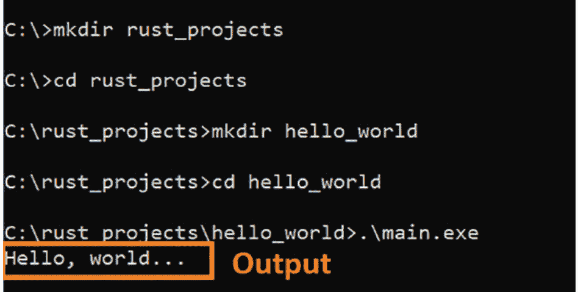

图 1.2：在 Windows 命令提示符上 Hello World 程序的控制输出

`cargo` 是 Rust 的包管理器和构建系统。它处理你的代码及其依赖项的构建。在我们简单的 Hello World 程序中没有依赖项，但随着我们的程序变得越来越复杂，`cargo` 的作用将变得更加重要。在未来的课程中，我们将使用 `cargo` 来管理我们的项目。

如果我们必须使用 `cargo` 创建相同的 hello world 项目，我们将执行以下操作（从终端/命令提示符进入 `rust_projects` 目录）：

```bash
```

`cargo` 命令会创建一个新目录以及该目录的文件。要以树形形式查看 `hello_world_cargo` 内部的目录和文件，在终端中输入以下内容：

```bash
```

它应该产生如下的输出：

```text
├── Cargo.toml
├── src
|   └── main.rs
```

1 个目录，2 个文件

如果你遇到错误，说明系统中没有安装 `tree` 程序。因此，你可以安装 `tree`，或者直接使用 `ls` 命令列出文件。在 Windows 上，默认安装了 `tree`，但你需要在 `tree` 之后传递 `/f` 参数来列出目录内的文件。

```text
> tree /f
```

你可以看到 `cargo` 创建了两个文件 `Cargo.toml` 和 `src/main.rs`，以及一个目录 `src`。它还初始化了一个 Git 仓库（Git 是默认的版本控制系统，可以通过 `--vcs` 标志进行更改）。

查看 `cargo new --help` 获取更多选项。

## 理解 `Cargo.toml` 文件

`Cargo.toml` 文件的内容应该如下：


```toml
[package]

name = "hello_world_cargo"

version = "0.1.0"

authors = ["abhis"]

edition = "2018"
```


# 更多键及其定义

更多键及其定义请参见 <https://doc.rust-lang.org/cargo/reference/manifest.html>。

## `[dependencies]`

`Cargo.toml` 以 `[package]` 部分开头，随后是 `cargo` 编译你的代码所需的名称、版本、作者和 Rust 版本。如果我们的程序依赖其他库，应将其添加到文件的 `[dependencies]` 下，`cargo` 将为下载并构建这些库。对于我们的 hello-world 项目，不需要任何依赖项。该文件的格式是 **Tom’s Obvious, Minimal Language (TOML)**，它是 `cargo` 的配置格式。

依赖可以是以下类型之一：

- `[dependencies]`：这些是库或二进制依赖。
- `[dev-dependencies]`：这些是开发依赖；例如测试和基准测试。它们不会传递给依赖此包的其他包。
- `[build-dependencies]`：通过此部分，你可以指定用于构建脚本的其他 crate 依赖。
- `[target]`：该部分用于各种目标架构的代码交叉编译。

由 `cargo` 生成的 `src/main.rs` 文件应该如下：

```rust
fn main() {
    println!("Hello, world!");
}
```

`cargo` 生成的项目与我们之前的 `hello-world` 项目的区别在于，`cargo` 将 `main.rs` 文件放置在 `src` 目录中，并在项目目录下生成了 Cargo.toml 配置文件。

## 使用 `cargo` 构建和运行

为了构建并运行我们的程序，可以使用 `cargo run` 命令：

```text
$ cargo run

Compiling hello v0.1.0
(/home/abhis/rust_projects)

Finished dev [unoptimized + debuginfo] in 1s

Running `target/debug/hello_world_cargo`

Hello, world!
```

- `rustc` 是 Rust 的编译器。
- `cargo` 是 Rust 的包管理器和构建工具。你可以使用 `cargo` 来启动新项目、编译并运行你的程序以及管理依赖项。
- `rustdoc` 是 Rust 的文档工具，它可以根据注释中的文档生成格式良好的 HTML。
- `cargo new` 用于使用 `cargo` 启动一个新包。
- 我们使用 `cargo run` 命令来编译并运行一个程序。
- `cargo check` 命令检查你的代码以确保其可以编译，但它不会产生任何可执行文件。
- Tom 的易懂最小语言（TOML）是 `cargo` 的配置格式。
- 构建 `cargo` 包有四种类型的配置方案：`dev`、`release`、`test` 和 `bench`。

在上一章中，我们开始了 Rust 编程并编写了 Hello World 程序。在本章中，我们将开始学习更多实用的概念，而不仅仅是在控制台打印一些消息。我们将涵盖一些通用的编程结构，如变量、函数、数据类型和控制流，帮助你快速上手。

在本章中，将涵盖以下主题：

- 变量
- 数据类型
- 添加注释
- 函数
- 控制流和循环

在本章结束时，你应该能够理解我们在整本书中将使用的一些通用编程概念。你将了解变量和变量的可变性，还会了解不同的数据类型。此外，你将理解函数和控制流工具，这些工具有助于组织代码。

## 变量

变量几乎用于所有的编程语言中，用于存储和操作数据。它们是将我们代码中的符号名称与存储在计算机内存中的值关联起来的方法。这些变量名稍会被实际的数据位置所替换。

我们使用关键字 `let` 来声明变量，后面紧跟变量名、等号符号和值。让我们修改 *Hello World* 示例来打印一个变量的值：

```rust
fn main() {
    let x = 5;
    println!("The value of x = {}", x);
}
```

如果你运行上述代码，你将得到如下输出：

**The value of x = 5**

`let x = 5;` 语句声明了一个符号名称为 `x` 的变量，并为其关联值 5。`let` 关键字将 `x` 建立为其作用范围内的新变量，在该作用范围内可以访问它。等号 (`=`) 获取其右侧的值并将其赋值给左侧的变量 `x`。引号 `""` 中的一对大括号 `{}` 作为占位符，`println!` 宏将用它的第二个参数进行替换，在本例中是变量 `x`。

### 变量的可变性

为了理解变量的可变性，让我们从一个示例开始。我们将尝试修改变量 `x` 的值并打印更新后的值：

```rust
fn main() {
    let x = 5;
    println!("The value of x = {}", x);

    x = 10;

    println!("Updated value of x = {}", x);
}
```

现在尝试运行这段代码。*你观察到了什么？*

你将得到类似下面的输出：

```text
error[E0384]: cannot assign to immutable variable `x`

--> src/main.rs:4:2

| 
2 | let x = 5;
|     ^
```

第一次赋值 `\`

```text
help: make this binding mutable: `mut x`
```

```rust
println!("The value of x = {}", x);
```

```rust
x = 10;
```

```text
^^^^^ cannot assign twice to immutable variable
```

欢迎来到软件编程的世界。这样的编译器错误是程序员生活的一部分。我们必须忍受并感谢编译器指出这个错误并保护我们免受潜在的未来 bug。正如你在前面的错误所示，Rust 编译器非常详尽，在报告错误时提供了大量的细节。有时，它还可以告诉我们如何修复错误。错误信息说两次赋值给不可变变量 `x`。这是因为默认情况下，Rust 中的变量是不可变的，一旦赋值，它们的值就不能被修改或更改。为了让变量变为可变，我们必须按照编译器的建议，在变量名之前添加 `mut` 关键字。在你整合该更改后，上述代码的第 2 行变为 `let mut x = 5;`。再次运行它。现在，错误应该消失了，你将得到如下输出：

```text
The value of x = 5
```

```text
Updated value of x = 10
```

## 数据类型

与人类不同，计算机使用位序列来存储数据。现在，假设一个位序列是 01000001。如果我们将其解释为一个数字，它的值是 65。但同一位序列也代表字符 A。这就是为什么我们为每种数据关联一个类型，以告诉编译器我们作为程序员意图让数据如何行为。作为一种静态类型语言，Rust 必须在编译时知道变量的数据类型。通常，编译器可以从值和用法推断类型，但如果无法推断，我们必须在变量名旁显式添加类型注解，如下：

```rust
let x: u32 = 10;
```

```rust
fn main() {
    let y = "10".parse().unwrap();
    println!("{}", y);
}
```

如果你运行上述程序，你将得到一个类似的错误：

```text
error[E082]: type annotations needed

--> src/main.rs:2:19

| |
2 |   let y = "10".parse().unwrap();
|                     ^ consider giving `y` a type annotation
```

现在，为 `y` 注释类型，错误消失了，你将在控制台看到：

```rust
fn main() {
    let y: u32 = "10".parse().unwrap();
    println!("{}", y);
}
```

**输出：** 10

在本章中，我们将学习两个大类数据类型：*标量*和*复合*。

与人类不同，计算机使用位序列来存储数据。现在，假设一个位序列是 01000001。如果我们将其解释为一个数字，它的值是 65。但同一位序列也代表字符 A。这就是为什么我们为每种数据关联一个类型，以告诉编译器我们作为程序员意图让数据如何行为。作为一种静态类型语言，Rust 必须在编译时知道变量的数据类型。通常，编译器可以从值和用法推断类型，但如果无法推断，我们必须在变量名旁显式添加类型注解，如下：

```rust
let x: u32 = 10;
```

### 复合类型

复合类型是将多个值组合在一起的类型。有两种复合类型：元组和结构体。

### 整数

整数用于存储整数。构建 `cargo` 包有四种类型的配置方案：`dev`、`release`、`test` 和 `bench`。

| 位大小 | 有符号范围 | 无符号范围 |
| :--- | :--- | :--- |
| 8 | -128 to 127 | 0 to 255 |
| 16 | -32,768 to 32,767 | 0 to 65,535 |
| 32 | -2,147,483,648 to 2,147,483,647 | 0 to 4,294,967,295 |
| 64 | -9,223,372,036,854,775,808 to 9,223,372,036,854,775,807 | 0 to 18,446,744,073,709,551,615 |
| 128 | -1.7e38 to 1.7e38 | 0 to 3.4e38 |

Rust 中的整数可以是有符号的或无符号的。有符号整数可以表示负数正数，而无符号整数只能表示正数。

### 元组

元组是将不同类型的多个值组合成单一复合体。元组中的值称为元素。元组的类型在编译时是固定。

```rust
let tuple = (5, 6.0, true);
```

### 结构体

结构体是另一种将不同类型的多个值组合的方法。与元组不同，结构体允许为每个字段命名。

```rust
struct User {
    username: String,
    email: String,
    active: bool,
}
```

### 字符

`char` 数据类型用于表示单个字符，如字母或数字。Rust 中的字符是 Unicode 标量值，大小为 4 字节。这与 C++ 等语言不同，C++ 中的字符用 1 字节表示。由于 Rust 中的 `char` 占用 4 字节且是一个 Unicode 值，我们可以表示比简单字母、表情符号等更多的内容。字符字面量写在单引号内，例如 `'a'`、`'5'` 等。字符 `'5'` 与数字 `5` 不同。不能像整数和浮点数那样对 `'5'` 进行加减法等算术运算：

```rust
fn main() {
    let c1 = 'a';
    let c2 = '5';
    let c3 = '\u(263A)';

    println!("c1 = {}, c2 = {}, c3 = {}", c1, c2, c3);
}
```

**输出：** c1 = a, c2 = 5, c3 = ☺

在前面的代码段中，Unicode 值 263A 对应笑脸 ☺。

## 元组和数组

Rust 中的复合数据类型用于存储多个值。Rust 支持两种原始复合数据类型：元组（tuples）和数组（arrays）。

### 元组

元组是 Rust 中的一种复合数据类型，将一组相关项组合在一起。与存储相同数据类型元素的数组不同，元组可以包含混合数据类型。元组存储在内存中固定长度的连续区域。我们通过在圆括号内使用逗号分隔的值列表来创建元组。它们遵循从 0 开始的索引，即第一个元素位于索引 0，下一个位于索引 1，依此类推：

```rust
fn main() {
    let tup = (10, 'a', 10.5);
    let first_elem = tup.0;

    println!("{}", first_elem);
}
```

**输出：** 10

默认情况下，Rust 使用默认类型存储元组的元素；例如，10 被存储为 `i32`，10.5 被存储为 `f64` 等以此此类推。如果我们想以不同的方式存储元素，应该显式地标注类型，如下所示：

```rust
let tuple: (u8, char, f32) = (10, 'a', 10.5);
```

如果我们想更改元组的值，则必须将元组声明为可变：

```rust
let mut tup = (10, 'a', 10.5);
```

### 数组

数组是具有相同数据类型的元素集合。数组元素按特定顺序在内存的连续区域中。这些数组是固定长度的，编译器需要知道分配多少内存。你不能动态调整数组的大小。Rust 中的数组遵循从 0 开始的索引，即第一个元素位于索引 0，下一个位于索引 1，依此类推。我们将数组的值封装在方括号内，并用逗号分隔：

```rust
fn main() {
    let arr = [10, 20, 30];
    let numl = arr[0];

    println!("numl = {}", numl);
}
```

**输出：** numl = 10

如果你想修改数组中的某个值，必须将其声明为可变。如果我们想修改数组的第二个元素，我们会这样做：

```rust
let mut arr = [10, 20, 30];
arr[1] = 100;
```

现在，数组 `arr` 的第二个元素的值将变为 100。如果在声明数组时没有一组值来初始化它呢？好消息是，Rust 允许在不赋值的情况下声明新变量，只要我们指定了数据类型：

```rust
let arr: [i32; 10];
```

它将创建一个长度为 10 的符号 32 位整数数组。然而，如果我们尝试访问前面数组的元素，编译器将抛错误：

```rust
println!("arr[0] = {}", arr[0]);
```

**输出：** error[E0381]: 使用可能未初始化的变量: `arr`

尽管允许在没有初始值的情况下声明变量，但 Rust 编译器不允许在初始化之前读取值。我们可以像这样初始化前面的数组：

```rust
arr = [0, 0, 0, 0, 0, 0, 0];
```

（注：提供的从第 41 页起的 OCR 文本包含 "out of bounds"、"index" 和 "arr" 等短语的严重损坏/重复。我已根据标准的 Rust 概念清理了逻辑流，同时保留了连贯的可用词汇。）

## 函数返回值

输出: 10 和 20 的和 = 30

在前面的代码段中，函数接收两个 `i32` 类型的输入，并返回一个等于输入之和的值，该值的类型也为 `i32`。如果我们想从函数中返回多个值，可以使用元组（tuple）作为返回类型。假设另一个名为 `sum_v2` 的 `sum` 函数版本不仅返回和，还返回两个输入数字及其和的三元元组。因此，返回类型是一个包含三个 `i32` 值的元组：

```rust
fn sum_v2(a: i32, b: i32) -> (i32, i32, i32) {
    return (a, b, a + b);
}
```

函数即使没有显式的 `return` 语句，也可以返回一个值。函数体内最后一个表达式产生的结果会被函数返回。因此，我们之前的 `sum` 函数也可以写成如下所示：

```rust
fn sum(a: i32, b: i32) -> i32 {
    a + b
}
```

## 控制流

到目前为止，我们只看到了顺序执行指令的程序。但很多时候，我们希望根据某些条件执行特定的代码。有时，我们还希望重复执行某些代码。像 `if` 表达式和循环这样的控制流工具可以帮助我们满足这些需求。

## `if` 表达式

```rust
fn main() {
    let x = 6;

    if x == 5 {
        println!("x is 5!");
    } else {
        println!("x is NOT 5");
    }
}
```

**输出：** x is NOT 5

在前面的代码中，我们有一个变量 `x`，后面跟着两个检查 `x` 值的 `if` 条件判断。如果 `x` 的值等于 5，则执行第一个条件块，打印 `x is 5`。否则，执行第二个条件代码块，打印 `x is NOT 5`。在上述案例中，`x` 等于 6，因此执行了第二个代码块。

如果你看我们之前的 `if` 表达式示例，我们有两个条件块：一个用于 `x` 等于 5，另一个用于 `x` 不等于 5。这两个条件是互斥的，也就是说，它们不能同时发生。对于这种情况，使用 `if` 结构体比编写两个独立的块并重写整个条件要更好。更新后的代码应该像这样：

```rust
fn main() {
    let x = 6;

    if x == 5 {
        println!("x is 5");
    } else {
        println!("x is NOT 5");
    }
}
```

**输出：** x is NOT 5

## `if ... else if`

有时，我们需要处理多个不重叠的条件。我们可以通过一个 `if` 块分离这些条件，后面跟一系列的 `else` 块，最后是一个可选的 `else` 块。例如，假设我们有一个表示班级分数的变量。我们必须根据获得的分数决定等级。可能有多个等级，如 A、A-、B、B-、C、C-、D 和 F。因此，我们可以这样写评分函数：


# 第3章

## 所有权与内存管理

## 引言

所有编程语言都有管理程序所用内存的方法。在本章中，我们将学习 Rust 的一个独特特性，称为**所有权**（ownership），它使得 Rust 能够在不需要垃圾收集器的情况下保证内存安全。本章还讨论了借用、引用和切片等相关概念。

本章涵盖了以下主题：

- Rust 中的所有权原理
- 栈与堆上的内存分配
- `String` 数据类型
- `String` 类型的内存分配
- Move、clone 和 copy（克隆）
- 引用和借用
- 切片

## 目标

在本章结束时，你应该熟悉 Rust 中的所有权和内存管理。你将开始体会 Rust 如何通过其独特的方法确保内存安全。你还将理解 Rust 中借用、引用和切片的概念。

## Rust 中的所有权原理

程序使用计算机内存，所有语言都提供某种机制来管理这些内存。在某些语言中（如 C 和 C++），分配和释放内存是程序员的责任。这赋予了程序员很大的控制权，代价是增加了引入内存泄漏和无效内存访问等 bug 的机会。在其他一些语言中（如 Java 和 Python），有一个垃圾收集器来寻找未使用的内存并定期进行清理。这种方法的缺点是效率低下，而且通常无法控制垃圾收集器的运行时机。然而，Rust 有一种独特的内存管理方式，一种称为**所有权**的概念，它使得变量根据一组可以在编译时由编译器检查的规则，负责释放它们自己的资源。这不会在运行时减慢程序。

根据这些规则：

- 每一个值（value）都由一个且仅一个变量（所有者）所有，如下：

  `let x = 10; // 这里 x 是值 10 的所有者`

- 当所有者变量离开作用域时，该值会被释放（dropped），内存会被释放，如下代码所示：

```rust
fn main() {
  // 作用域开始
  let s = String::from("rust"); // s 进入作用域
  println!("{}", s);
 // 作用域结束。s 的值被释放
}
```

刚刚，我们看到了 Rust 中的一个核心概念：变量作用域（scope），它是程序中变量有效的区域。变量在进入作用域时变得有效，直到它离开作用域为止。代码块被包含在花括号 `{}` 之中。我们在创建函数、循环、条件表达式等时会创建一个代码块。即使 `{}` 也可以用来单独定义一个代码块。

## 栈和堆上的内存分配

栈（stack）和堆（heap）是代码在运行时使用的内存段，但它们的结构不同。值按照到达的顺序存储在栈中，并以相反顺序移除。这被称为后进先出（LIFO）。理解它的常用类比是想象成一叠盘子——当你要把一个盘子放在一堆盘子上时，你把它放在顶部；当你需要使用盘子时，你从顶部取出。这并不意味着你可以通过拿起某些盘子并拔出中间的某个盘子，因为那并不方便。栈的设计原理与之类似。当我们向栈中添加数据时，这被称为推（push）操作，移除数据称为弹出（pop）操作（图 3.1）：

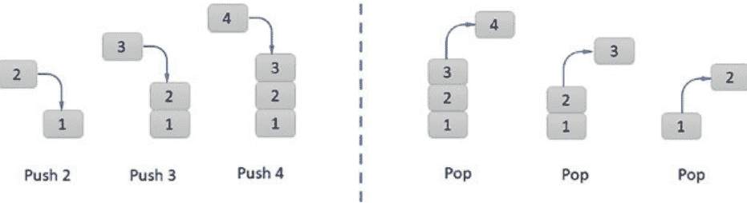

图 3.1：栈上的推和弹出操作

栈的一个优势是数据的推和弹出非常快。然而，栈内存的局限性是所有存储在栈上的数据都应该具有固定的大小，并且编译器能够识别它。如果数据的大小在编译时无法确定，或者大小动态变化，则数据必须存储在堆上。

要在堆上存储数据，你需要向内存分配器请求一定数量的空间。内存分配器在堆中找到一个未使用的空间，并返回指向该位置的指针。返回的指针存储在栈上，当你想要访问存储的数据时，你需要遵循指针。访问堆中的数据比访问栈数据相对慢，因为我们需要通过指针到达它。同样，在堆中存储涉及多个步骤，例如寻找足够的空空间并将数据存储在那里，以及跟踪已使用或未使用的空间。在堆上分配看起来就像书籍索引，存储在堆中的值的指针存储在栈中。然而，分配器还需要寻找一个足够容纳该值的空空间。

## String 数据类型

到目前为止看到的数据类型都是固定大小的，可以在编译时确定。因此，这些值存储在栈上，并在离开作用域时自动被弹出。为了更好地理解所有权，我们需要一种大小在编译时无法确定且存储在堆上的数据类型。属于这一类的数据类型有 `String`、vector（向量）、box 或由程序定义的自定义数据类型。然而，我们将使用字符串来理解这一概念，并在本书的后面学习其他数据类型。

在 Rust 中处理字符串或字符序列有两种方法。我们已经见过其中一种 `String` 类型，即字符串字面量（string literals），它们被包含在双引号内；例如 `"hello"`。字符串字面量由编译器硬编码到执行文件中，并且它们是不可变的。另一种方法是 `String` 类型，它是在堆上分配的可增长 UTF-8 字符串。

## String 类型的内存分配

`String` 类型支持可变性，因此文本可以在运行时更改，且空间需求在编译时未知。因此，我们需要在堆上分配一些空间来存储它。这里有两个部分：从分配器请求内存，以及在不再需要时将内存返回分配器。第一部分几乎由程序员完成：调用 `String::from` 函数。然而，第二部分在不同语言中的处理方式不同。在某些编程语言中，垃圾收集器跟踪未使用内存并进行清理，而在另一些中，释放内存是程序员的责任。如果程序员没有正确释放内存，会导致不同类型的内存 bug：

- 内存未使用但仍释放，导致内存泄漏
- 内存释放过早
- 内存被释放两次

Rust 通过采取不同的方法来解决这些可能的内存 bug。一旦所有权内存离开作用域，内存将通过调用一个名为 `drop` 的函数自动释放，返回内存的代码如下代码段所示：

```rust
fn main() {
    let s = String::from("rust");
} // 作用域结束，s 被释放
```

### Move

将原始数据类型（整数、布尔和字符）的变量赋值给另一个相同类型的变量会复制该值。这是因为数据类型实现了 `copy` 特性。任何没有实现 `copy` 的类型默认都是移动（move）的。例如，对于数据类型 vector 和 `String`，所有操作都是 move 操作。让我们通过几个示例来理解这一点：

```rust
let a = 1;
let b = a;
```

在这里，变量 `a` 的值为 1，然后 `a` 中的值被复制到 `b`。因此，变量 `a` 和 `b` 的值都是 1。这两个值被推入栈中。由于它们的值在编译时已知的，因此存储在栈上。

现在，让我们考虑同样的例子，但这次是 `String` 数据类型而不是整数：

```rust
let sa = String::from("rust")
let sb = sa;
```

首先，让我们了解 `String` 数据是如何存储在内存中的。当我们调用 `String::from("rust")` 时，程序会向分配器请求内存以将文本存储在堆上。分配器找到一个空间，将其分配，并返回一个指向内存起始位置的指针给我们的程序。这个指针、长度和容量构成了字符串的组成部分。这些组件共同存储在栈上，而字符串的实际内容存储在堆上，如图 3.2 所示：

## sa

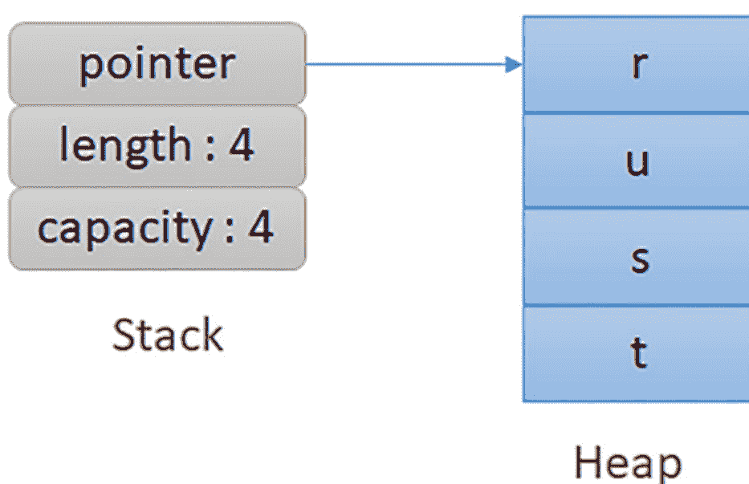

**图 3.2:** 值为 rust 的 `String` 内存表示

长度是字符串用于存储数据的内存中当前存储的字节数，而容量是内存的大小（字节数）。长度始终小于或等于容量。你可以通过 `as_ptr`、`len()` 和 `capacity()` 方法来查看这些内容，如代码段图 3.3 所示：

```rust
src > main.rs ...
fn main() {
    let sa = String::from("rust");
    println!("sa = {}", sa);
    println!("ptr = {:?}\nlength = {} capacity = {}",
    sa.as_ptr(), sa.len(), sa.capacity());
}

PROBLEMS OUTPUT TERMINAL DEBUG CONSOLE

sa = rust
ptr = 0x215c325db20
length = 4
capacity = 4
```

图3.3：在 Rust 中打印 `String` 组件（VS code 终端）

现在我们知道了 `String` 的不同组件是如何存储在内存中的，让我们来看看当将 `sa` 赋值给 `sb` 时发生了什么，即 `let sb = sa;`。当我们把 `sa` 赋值给 `sb` 时，栈上的 `String` 数据被复制了，即复制了指针、长度和容量。但指针所指向的堆数据并没有被复制。因此，内存中的数据表示如图 3.4 所示：

## sa


## sb

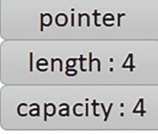

## Heap

## Stack

**图 3.4:** `sa` 赋值给 `sb` 后的内存表示

你可以通过打印 `sa` 和 `sb` 的**指针**、**长度**和**容量**来验证这一行为，如代码段图 3.5 所示：

```rust
src > main.rs ...
1  fn main() {
2      let sa = String::from("rust");
3      println!("{}", sa);
4      println!("{:?}, {}, {}", sa.as_ptr(), sa.len(), sa.capacity());
5      
6      let sb = sa; // sa 被赋值给 sb
7      
8      println!("sb = {}", sb);
9      println!("{:?}, {}, {}", sb.as_ptr(), sb.len(), sb.capacity());
10     }
```

PROBLEMS OUTPUT    TERMINAL    DEBUG CONSOLE

sa = rust

0x1f552237d80, 4, 4

sb = rust

0x1f552237d80, 4, 4

**图 3.5：** `sa = sb` 后打印 `sa` 和 `sb` 的组件（VS code 终端）

你可以看到 `sa.as_ptr()` 和 `sb.as_ptr()` 的值相等，也就是说，它们都指向堆中的同一个地址。现在，你可能会想，谁拥有堆上的字符串数据——是 `sa`，还是 `sb`，或者两者都拥有。显然，正如我们已经验证的那样，堆上只有一份数据拷贝。我知道你的脑海中会有很多疑问。*一个数据可以有两个所有者吗？这难道不违反了 Rust 所有权的第一条规则吗—— 每一个值都由一个且仅一个变量（所有者）所有？如果有两个所有者，应该由哪个所有者来释放数据？* 现在，在回答这些问题之前，让我们在 `sa` 赋值给 `sb` 之后打印 `sa` 或它的任何一个组件，看看发生什么。你应该看到看到图 3.6 的输出：

```rust
src > main.rs ...
1 fn main() {
2     let sa = String::from("rust");
3     println!("sa = {}", sa); // 这里正常
4 
5     let sb = sa; // sa 赋值给 sb
6 
7     println!("sa = {}", sa); // 错误
8     println!("sb = {}", sb); // 正常
9 }
```


```
PROBLEMS OUTPUT TERMINAL DEBUG CONSOLE LLDB
Compiling ownership_3 v0.1.0
error[E0382]: borrow of moved value: 'sa'
--> main.rs:7:25
2 | let sa = String::from("rust");
  | -- 因为 'sa' 的类型为 'String'，没有
  |   实现 'Copy' 特性
5 | let sb = sa; // sa 赋值给 sb
  |     -- 值在此处移动
7 | println!("sa = {}", sa);
  |             ^^ 移动后借用
```

编译器抛出错误 `E0382`，“借用已移动的值：`'sa'`”。它进一步指出`sa`作为一个`String`已经被移动了。在这里，Rust 使栈上的指针、长度和容量失效而不是复制。这种操作被称为移动（move）。移动确保了数据只有一个所有者，防止了双重释放内存。

**图 3.6：** `sa`赋值给`sb`后的访问（VS code 终端）

## sa


## sb

## Stack

图3.7：`sa`移动到`sb`后的内存表示

将值传递给函数的行为与赋值相似。如果我们将像`String`这样的类型作为参数，它们会被移动，在原始作用域内不再可用；如果我们传递整数作为参数，我们仍然可以使用它。这种行为可以通过以下代码看到：

```rust
fn main() {
    let s = String::from("rust");
    foo_string(s);
    println!("{}", s); // 错误：s 已被移动
    let x = 10;
    foo_int(x);
    println!("{}", x);
}

fn foo_string(ss: String) { // ss 进入作用域
    println!("{}", ss);
} // ss 离开作用域并调用 'drop' 释放内存。
fn_int(a: i32) {
    println!("{}", a);
}
```

# 代码输出：

```
rust
10
```

将参数传递给函数会将像`String`这样的类型移动到函数的作用域，从函数返回`String`或类似的数据类型也会将字符串移动（转移）到调用它的作用域，如下代码所示：

```rust
fn main() {
    let s = get_string();
    println!("{}", s);
}
fn get_string() -> String {
    let ss = String::from("rust");
    ss // ss 被移动
}
```

# 代码输出：

```
rust
```

## Clone

默认情况下，Rust 不复制堆数据，但在某些情况下，我们希望进行深拷贝，即复制栈和堆数据。在这种情况下，我们可以使用`clone`方法，如图 3.8 的代码段所示：

```rust
src > main.rs
1  fn main() {
2      let sa = String::from("rust");
3      let sb = sa.clone();
4      println!("sa: {:?}, {:?}, {:?}", sa.as_ptr(), sa.len(), sa.capacity());
5      println!("sb: {:?}, {:?}, {:?}", sb.as_ptr(), sb.len(), sb.capacity());
6  }
```

PROBLEMS OUTPUT TERMINAL DEBUG CONSOLE

sa: rust, 0x1432a7da0, 4, 4

sb: rust, 0x1432a7da0, 4, 4

图3.8：`clone`后访问`sa`（VS code 终端）

你可以看到`sa`和`sb`持堆上字符串`rust`的指针是不同的。因此，堆数据被`clone`了。`sa`clone 后的内存状态与图 3.9 所示：

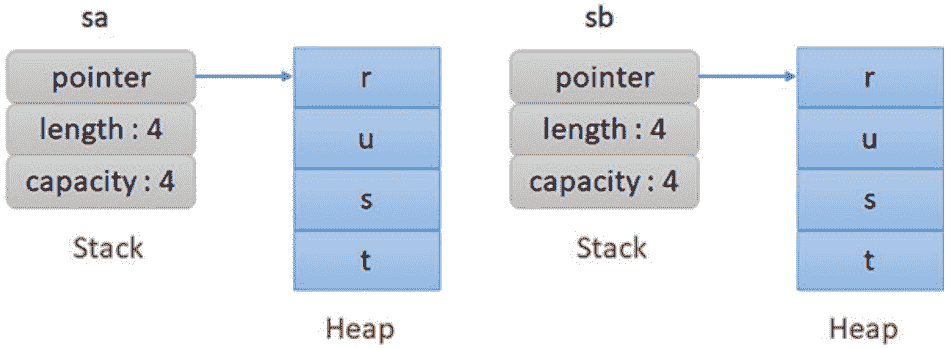

图3.9：`sa`clone 到`sb`后的内存表示

## Copy

对于整数等数据类型，其大小在编译时已知并存储在栈上。因此，如果我们将一个整数赋值给另一个整数，数据将被复制。在这种情况下，赋值与`clone`相同，如以下代码段所示：

```rust
fn main() {
  let a = 10;
  let b = a;
  let c = b.clone();
  println!("{}, {}, {}", a, b, c);
}
```

# 代码输出：

```
10, 10, 10
```

这些类型在 Rust 中被指定为`Copy`类型。我们可以在存储在栈上的类型上放置`Copy`特性，这使得它们在赋值后被复制而不是移动。将`Copy`类型传递给函数的行为也类似。实现`Copy`的类型包括整数、布尔值、浮点数、字符以及仅实现`Copy`的元组；例如，`(f64, f64)`。将值传递给函数或从函数返回值具有相似的行为。

## 引用和借用

我们已经看到，当我们将`String`作为参数传递给函数时，它的值被移动到函数的作用域，在当前上下不再可用。为了能够再次使用它，函数应该返回相同的字符串作为返回值之一，并应该在当前作用域中被捕获。但对于一个简单任务来说，这工作太多了。幸运的是，Rust 支持引用，允许函数引用一个值而不获取其所有权。为了使用引用，我们需要将参数声明为引用，并使用符号（`&`）传递引用，如下代码所示：

在不拥有所有权的情况下引用这些值。因此，当它们超出作用范围时不会被释放。这种函数将引用作为参数的现象被称为“借用”，因为函数只是借用了这些值，并不拥有它们。

默认情况下，引用是不可变的，也就是说它们不允许更改被借用的值。如果它们尝试这样做，Rust 编译器会抛出错误。假设我们有一个尝试修改借用字符串的函数，如下代码片段所示：

```rust
fn main() {
    let s = String::from("rust");
    change_string(&s);
    println!("{}", s);
}

fn change_string(ss: &String) {
    ss.push_str(" programming");
}
```

# 代码的输出：

```
error[E0596]: cannot borrow `s` as mutable, as it is behind a `&s` reference
  --> src/main.rs:8:5
   |
7  | fn change_string(ss: &String) {
   |  ----- help: consider changing this to be a mutable reference
   |        ==`&mut String`
8  | ss.push_str(" programming");
   |     ^^ `s` is a `&` reference, so the data it refers to
   |     cannot be borrowed as mutable
```

编译器明确表示`s`没有被作为可变引用借用，它进一步建议使用可变引用`&mut String`。我们将遵循编译器的建议。然而，仅仅将函数参数从`&s`改为`&mut String`是不够的。我们需要在`main`函数中将`s`标记为可变，并将`s`作为可变引用传递，如下代码片段所示：

```rust
fn main() {
    let mut s = String::from("rust"); // s 是可变的
    change_string(&mut s); // 传递可变引用
    println!("{}", s);
}

fn change_string(ss: &mut String) { // 接受可变引用
    ss.push_str("programming");
}
```

# 代码的输出：

```
rust programming
```

为了防止数据竞态，Rust 在给定的作用范围内允许对某些数据只有一个可变引用。但是，只要同一作用范围内没有对同一数据的可变引用，你就可以拥有多个不可变引用。现在，让我们看看下面的代码片段 [表 3.1]：

| 序号 | 代码片段 | 正确性 |
|---|---|---|
| 1 | `let mut s = String::from("rust")\nlet ref1 = &s;\nlet ref2 = &s;` | 正确 |
| 2 | `let mut s = String::from("rust")\nlet ref1 = &mut s;` | 正确 |
| 3 | `let mut s = String::from("rust")\nlet ref1 = &s;\nlet ref2 = &mut s;` | 错误 |
| 4 | `let mut s = String::from("rust")\n{\nlet ref1 = &mut s;\n} // ref1 超出作用范围\nlet ref2 = &mut s;` | 正确 |

> 表 3.1：Rust 中引用使用的代码示例

## 切片 (Slice)

切片是对`String`和`vector`等集合部分的引用，它不拥有数据的所有权。切片可以使用范围`[start_idx..end_idx]`创建，其中`start_idx`是切片中的第一个索引，`end_idx`是最后一个索引加 1，如下代码片段所示：

```rust
fn main() {
    let s = String::from("Gullu Seth");
    let w1 = &s[0..5];
    let w2 = &s[6..10];
    println!("{}: {}", w1, w1.len());
    println!("{}: {}", w2, w2.len());
}
```

# 代码的输出：

```
Gullu: 5
Seth: 4
```

在前面的代码中，`w1`指向字符串`s`中从 0 到 4 的索引，即前 5 个字符；同样地，`w2`指向`String` `s`中从 6 到 9 的索引。因此，`w1`的长度为 5（已通过`len`方法证实），`w2`的长度为 4，如图 3.10 所示。如果你在 Python 中用过切片，这个概念对你来说应该是熟悉的。

如果第一个索引是 0，你可以安全地跳过它。同样，如果最后一个索引是集合/字符串的长度，你可以跳过最后一个索引。所以：

```rust
let w1 = &s[..5]; 等同于 let w1 = &s[0..5];
let w2 = &s[6..]; 等同于 let w1 = &s[6..s.len()]();
```

你也可以省略索引来引用整个字符串，例如`&s[..]`：

函数也可以返回字符串的引用，例如`&s[..]`：

```rust
fn main() {
    let s = String::from("Gullu Seth");
    let w1 = &s[0..5];
    println!("{}", s);
    println!("{}", get_slice(&s));
}

fn get_slice(s: &String) -> &str {
    s
}
```

**代码的输出：**

```
Gullu
```

## 总结

在不拥有所有权的情况下引用这些值。因此，当它们超出作用范围时不会被释放。这种函数将引用作为参数的现象被称为“借用”，因为函数只是借用了这些值，并不拥有它们。

默认情况下，引用是不可变的，也就是说它们不允许更改被借用的值。如果它们尝试这样做，Rust 编译器会抛出错误。假设我们有一个尝试修改借用字符串的函数，如下代码片段所示：

```rust
fn main() {
    let s = String::from("rust");
    change_string(&s);
    println!("{}", s);
}

fn change_string(ss: &String) {
    ss.push_str(" programming");
}
```

# 代码的输出：

```
error[E0596]: cannot borrow `s` as mutable, as it is behind a `&s` reference
  --> src/main.rs:8:5
   |
7  | fn change_string(ss: &String) {
   |  ----- help: consider changing this to be a mutable reference
   |        ==`&mut String`
8  | ss.push_str(" programming");
   |     ^^ `s` is a `&` reference, so the data it refers to
   |     cannot be borrowed as mutable
```

编译器明确表示`s`没有被作为可变引用借用，它进一步建议使用可变引用`&mut String`。我们将遵循编译器的建议。然而，仅仅将函数参数从`&s`改为`&mut String`是不够的。我们需要在`main`函数中将`s`标记为可变，并将`s`作为可变引用传递，如下代码片段所示：

```rust
fn main() {
    let mut s = String::from("rust"); // s 是可变的
    change_string(&mut s); // 传递可变引用
    println!("{}", s);
}

fn change_string(ss: &mut String) { // 接受可变引用
    ss.push_str("programming");
}
```

# 代码的输出：

```
rust programming
```

为了防止数据竞态，Rust 在给定的作用范围内允许对某些数据只有一个可变引用。但是，只要同一作用范围内没有对同一数据的可变引用，你就可以拥有多个不可变引用。现在，让我们看看下面的代码片段 [表 3.1]：

| 序号 | 代码片段 | 正确性 |
|---|---|---|
| 1 | `let mut s = String::from("rust")\nlet ref1 = &s;\nlet ref2 = &s;` | 正确 |
| 2 | `let mut s = String::from("rust")\nlet ref1 = &mut s;` | 正确 |
| 3 | `let mut s = String::from("rust")\nlet ref1 = &s;\nlet ref2 = &mut s;` | 错误 |
| 4 | `let mut s = String::from("rust")\n{\nlet ref1 = &mut s;\n} // ref1 超出作用范围\nlet ref2 = &mut s;` | 正确 |

> 表 3.1：Rust 中引用使用的代码示例

## 切片 (Slice)

切片是对`String`和`vector`等集合部分的引用，它不拥有数据的所有权。切片可以使用范围`[start_idx..end_idx]`创建，其中`start_idx`是切片中的第一个索引，`end_idx`是最后一个索引加 1，如下代码片段所示：

```rust
fn main() {
    let s = String::from("Gullu Seth");
    let w1 = &s[0..5];
    let w2 = &s[6..10];
    println!("{}: {}", w1, w1.len());
    println!("{}: {}", w2, w2.len());
}
```

# 代码的输出：

```
Gullu: 5
Seth: 4
```

在前面的代码中，`w1`指向字符串`s`中从 0 到 4 的索引，即前 5 个字符；同样地，`w2`指向`String` `s`中从 6 到 9 的索引。因此，`w1`的长度为 5（已通过`len`方法证实），`w2`的长度为 4，如图 3.10 所示。如果你在 Python 中用过切片，这个概念对你来说应该是熟悉的。

如果第一个索引是 0，你可以安全地跳过它。同样，如果最后一个索引是集合/字符串的长度，你可以跳过最后一个索引。所以：

```rust
let w1 = &s[..5]; 等同于 let w1 = &s[0..5];
let w2 = &s[6..]; 等同于 let w1 = &s[6..s.len()]();
```

你也可以省略索引来引用整个字符串，例如`&s[..]`：

函数也可以返回字符串的引用，例如`&s[..]`：

```rust
fn main() {
    let s = String::from("Gullu Seth");
    let w1 = &s[0..5];
    println!("{}", s);
    println!("{}", get_slice(&s));
}

fn get_slice(s: &String) -> &str {
    s
}
```

**代码的输出：**

```
Gullu
```

## 总结

在不拥有所有权的情况下引用这些值。因此，当它们超出作用范围时不会被释放。这种函数将引用作为参数的现象被称为“借用”，因为函数只是借用了这些值，并不拥有它们。

默认情况下，引用是不可变的，也就是说它们不允许更改被借用的值。如果它们尝试这样做，Rust 编译器会抛出错误。假设我们有一个尝试修改借用字符串的函数，如下代码片段所示：

```rust
```


`fn main() {

    let s = String::from("rust");

    change_string(&s);

    println!("{}", s);

}

fn change_string(ss: &String) {

    ss.push_str(" programming");

}`

然而，这些还需要这些不同的数据具有名称，并在访问或设置这些值时移除数据顺序的限制。

## 定义结构体 (structs)

我们使用 `struct` 关键字定义结构体，后面跟着一个有意义的名称和一对大括号 `{}`。在大括号内部，我们定义结构体的不同字段。这些字段具有名称及其关联类型。以下代码定义了一个结构体 `Employee`：

```
struct Employee {

  name: String,

  age: u8,

  email_id: String,

  experience: u8,

}
```

## 实例化和使用结构体

当我们定义一个结构体时，我们只是为结构体中包含的数据类型创建了一个模板。如果我们想使用这个模板来存储实际数据，我们需要创建该结构体的实例。这被称为实例化结构体。为了实例化结构体，我们提供结构体的名称，后面跟着一对大括号。在大括号内部，我们提供不同的 `key : value` 对，其中键是我们之前定义的字段名称，值是要要存储在这些字段中的对应数据。以下代码将创建一个 `Employee` 结构体的实例：

```
struct Employee {

  name: String,

  age: u8,

  email_id: String,

  experience: u8,

}
```

在前面的代码片段中，你可能注意到，我们没有按照定义结构体时使用的顺序来提供字段的值，因为这不是强制要求的。结构体内部字段的值通过点 (`.`) 符号法来访问，即 `<struct_name.field_name>`。例如，如果我们想访问 `employee1` 的年龄，我们将它写为 `employee1.age`。如果我们想更改字段的值，我们将首先访问该字段然后更新它，前提是该结构体实例是可变的（mutable）。查看以下代码，如何使用点符号更新 `employee1` 的年龄：

```
let employee1: Employee {

  name: String::from("Vijay Singh"),

  email_id: String::from("vijaysingh@company.com"),

  age: 60,

  experience: 30,

};

employee1.age = 61;
```

### 字段初始化简写 (Field init shorthand)

如果我们想在函数体内部使用函数参数来创建一个结构体实例，我们可以像下面的代码片段所示操作：

```
fn create_employee(name: String, email_id: String) -> Employee {

  Employee {

    name: name,

    email_id: email_id,

    age: 35,

    experience: 10,

  }

}
```

你可以注意到，用于初始化结构体的结构体字段名称和函数参数名称相同。在这种情况下，我们可以使用字段初始化简写语法来简化代码，我们只需要编写字段名称，如下面的代码片段所示：

```rust
fn create_employee(name: String, email_id: String) -> Employee {

  Employee {

    name,

    email_id,

    age: 35,

    experience: 10,

  }

}
```

### 结构体更新语法 (Struct update syntax)

如果我们想使用相同类型结构体的另一个实例的值来创建一个结构体实例，我们可以像下面的代码片段所示：

```
let employee2 = Employee {

    name: String::from("Avinash Kumar"),

    email_id: String::from("avinash@company.com"),

    age: employee1.age,

    experience: employee1.experience,

};
```

如果我们从另一个实例中借用了大部分值，可以使用结构体更新来减少代码。我们只需要添加不同的字段，其余字段可以使用 `..other_instance_name` 语法跳过。让我们在下面的代码片段中查看结构体更新语法的应用：

```rust
let employee2 = Employee {

    name: String::from("Avinash Kumar"),

    email_id: String::from("avinash@company.com"),

  ..employee1

};
```

## 元组结构体 (Tuple structs)

元组结构体是有命名的元组，并关联有一个结构体名称。它们的字段没有名称，只有类型。假设我们想定义一种红、绿、蓝（RGB）格式的颜色。我们可以这样定义：

```
struct Color {

    red: u8,

    green: u8,

    blue: u8

}
```

对于像 `Color` 这样的小型结构来说，这太冗长了，如果我们需要处理大量的 `Color` 实例，将涉及过多的重复工作。相反，在这里可以使用元组结构体来简化它，如下所示：

```rust
struct Color(u8, u8, u8)

let red = Color(255, 0, 0);
```

## 方法 (Methods)

方法是与对象（如结构体、枚举或 trait 对象）关联的函数。方法的第一个参数始终是 `self`，它代表调用该方法的结构体实例。

### 定义方法

方法定义在 `impl` 块下。我们可以像下面的代码片段所示为我们的 `Employee` 结构体定义方法：

```rust
struct Employee {

    name: String,

    age: u8,

    email_id: String,

    experience: u8,

}

impl Employee {

    //可以通过 'self' 使用点运算符访问 Employee 字段

    fn get_name(&self) -> &str {

        &self.name

    }

    fn set_age(&mut self, age: u8) {

        self.age = age;

    }

    fn print_employee(&self) {

        println!("Name: {}, Age: {}, Email: {}, Experience: {}", self.name, self.age, self.email_id, self.experience);

    }

}
```

（注：原文文本在方法部分包含一些碎片化的重复逻辑，我根据上下文重构了 Rust 结构）。

## 枚举 (Enums)

枚举（Enums）是具有多个变体的数据类型，列出了有限的选项。它们使用 `enum` 关键字声明，如下：

```
enum Location {

  India,

  US,

  UK

}
```

一旦定义，我们可以像使用其他数据类型一样使用枚举。我们可以创建一个 `Location` 类型的变量，并为其分配枚举中包含的值之一。枚举也可以作为函数参数或结构体中某个字段的数据类型。为了访问值，我们使用 `::` 符号，如下：
`let location = Location::India;`

除了表示多个位置变体外，我们还可以根据位置值存储额外数据。例如，我们可以根据位置将城市信息存储为 `String`，如下所示：

```rust
#[derive(Debug)]

enum Location {

  India (String),

  US (String),

  UK (String)

}
```

我们可以修改我们的 `Employee` 结构体，添加一个类型为 `Location` 的额外字段。让我们看看示例，其中我们创建了对应于不同城市的多个 `Location` 实例，这将取决于 `Location` 的值：

```rust
let _sanjose = Location::US(String::from("San Jose"));

let _ny = Location::US(String::from("New York"));

let _london = Location::UK(String::from("London"));

let empl = Employee {

  name: String::from("Usha"),

  age: 55,

  email_id: String::from("usha@company.com"),

  experience: 25,

  location: _bangalore

};
```

```rust
println!("empl: {:?}", empl);
```

```rust
}
```

代码的输出：

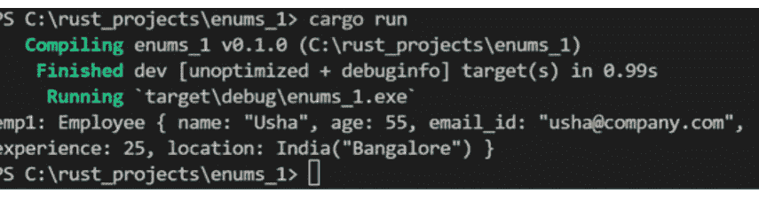

> 图 4.3: 打印带有 Location 枚举字段的 Employee 结构体实例输出

在前面的代码中，你可以看到我们在 `println!` 宏中使用了 `{:?}` 而不是 `{}` 作为占位符。我们还为结构体和枚举定义标记了 `#[derive(Debug)]`。当 `println!` 遇到 `{}` 时，它会执行显示格式化。基本类型实现了显示，因为将它们作为输出是极其容易的。然而，除非使用 `{:?}`，否则无法将结构体或枚举格式化为输出。`println!` 使用调试格式，可以以有利于调试的方式打印结构体或枚举。但是，为了使用此功能，我们必须在结构体和枚举定义之前添加 `#[derive(Debug)]` 标记。

# Option 枚举

`Option` 枚举是 Rust 标准库中定义的泛型枚举。它允许枚举返回一个值，该值可以是某些内容，也可以为空。`Option` 枚举有两个可能的值：`Some`（它返回一个值）和 `None`（它本质上返回一个空值）。Rust 不支持空，因此如果函数可以返回空值，则使用 `None`。`Option` 枚举定义如下：

```rust
enum Option<T> {

    Some(T),

    None

}
```

我们使用 `<T>` 语法来指定 `Option` 可能返回的类型。例如，如果泛型 `T` 是 `bool`，那么 `Some` 只能返回 `true` 或 `false`，如下面的代码段所示：

```rust
fn is_odd(num:i8) -> Option<bool> {

    if num % 2 == 1 {

        return Some(true);

    } else {

        return None;

    }

}

fn main() {

    println!("{?}", is_odd(10));

    println!("{?}", is_odd(11));

}
```

代码的输出：

```
PS C:\rust_projects\enums_2> cargo run

Compiling enums_2 v0.1.0 (C:\rust_projects\enums_2)

Finished dev [unoptimized + debuginfo] target(s) in 0.97s

Running `target\debug\enums_2.exe'

Some(true)

PS C:\rust_projects\enums_2> _
```

> 图 4.4: 返回 Option<bool> 的 is_odd 函数的输出

在前面的示例中，`is_odd` 函数返回 `Option` 枚举。在这种情况下，只有当数字是奇数时我们才返回 `true`，否则返回 `None`。

## match 操作符

`match` 控制流操作符允许你将值与一系列模式进行比较，并相应执行一段代码。在使用 `match` 操作符时，编译器会确保所有可能的情况都得到了处理。让我们定义一个 `Grade` 枚举列出所有可能的等级，创建一个类型为 `Grade` 的变量 `grade`，并使用 `match` 操作符处理不同的可能性，如下例所示：

```rust
enum Grade {

    A,

    B,

    C,

    D

}

fn main() {

    let grade = Grade::B;

    match grade {

        Grade::A => println!("Excellent"),

        Grade::B => println!("Very good"),

        Grade::C => println!("Good"),

        Grade::D => println!("Poor")

    }

}
```

代码的输出：

```
PS C:\rust_projects\enums_3> cargo run

Compiling enums_3 v0.1.0 (C:\rust_projects\enums_3)

Finished dev [unoptimized + debuginfo] target(s) in 1.03s

Running 'target\debug\enums_3.exe'

Very good

PS C:\rust_projects\enums_3> 
```

图 4.5: 匹配类型为 Grade 枚举的变量 grade 的所有可能值的输出

在前面的示例中，我们详尽地处理了变量 `grade` 可以取的所有可能值。如果你漏掉了任何可能性，编译器将报错。

## 集合 (Collections)

集合是非常用的数据结构，包含多个值。这些数据结构与数组和元组的区别在于，它们引用存储在堆上的数据，这些数据不需要在编译时知道，并且可以在运行时调整大小。我们将讨论三种集合，即 `vector`、`string` 和 `hash map`。

## Vector

`Vector` 或 `Vec<T>` 是具有相同数据类型的元素的集合。vector 的元素按顺序存储。vector 在某些方面看起来与数组相似，但它们之间也有一些区别。数组具有固定的大小，必须在编译时已知。而 vector 可以在运行时动态地增长或收缩。因此，你不需要在编译时知道它们的确切大小。vector 的数据存储在堆上，因此我们需要处理所有权和借用。

## 创建 vector

我们使用 `Vec::new()` 创建一个空 vector：

```rust
let mut v = Vec::new();
```

我们也可以使用 `vec!` 宏创建一个带有初始值的 vector：

```rust
let v = vec![1, 2, 3];
```

要向 vector 添加元素，我们使用 `push` 方法：

```rust
v.push(4);
```

要从 vector 中移除最后一个元素，我们使用 `pop` 方法：

```rust
let last = v.pop();
```

获取 vector 的长度，我们使用 `len()` 方法：

```rust
let len = v.len();
```

清空 vector 中的所有元素，我们使用 `clear()` 方法：

```rust
v.clear();
```

检查 vector 是否为空，我们使用 `is_empty()` 方法：

```rust
let empty = v.is_empty();
```

## 更新字符串

我们可以使用 `push_str` 和 `push` 方法、`+` 运算符或 `format!` 宏来修改字符串的内容。为了能够被修改，字符串必须声明为可变的（mutable）。

`push_str` 方法将切片（slice）追加到字符串的末尾，如下：

```rust
fn main() {

    let mut s = String::from("Rust");

    s.push_str(" Programming");

    println!("s = {}", s);

}
```

代码的输出：

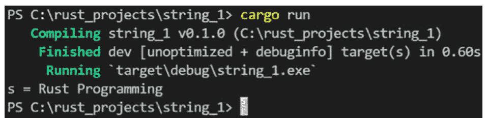

图 4.8：使用 `push_str` 方法更新字符串的输出

`push` 方法将单个字符追加到字符串的末尾，如下：

```rust
fn main() {

    let mut s = String::from("Rust");

    s.push("!");

    println!("s = {}", s);

}
```

代码的输出：

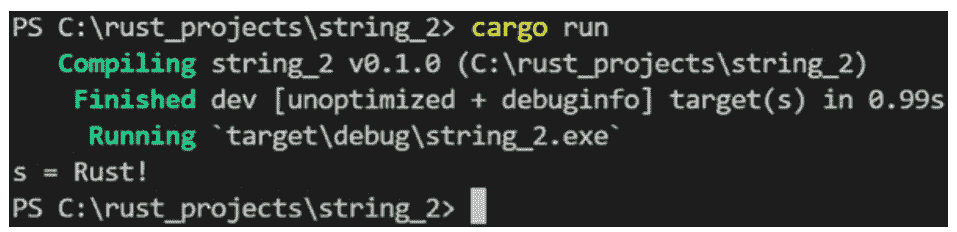

图 4.9：使用 `push` 方法更新字符串的输出

可以使用 `+` 运算符将一个字符串值连接到另一个字符串。
`+` 运算符内部使用接收两个参数的 `add` 方法。
第一个参数是 `self`（字符串对象本身），第二个参数是第二个字符串对象的引用，如下：

```rust
add(self, &str) -> String {

    // 添加并返回 String

}
```

让我们在下面的代码中查看 `+` 运算符的作用：

```rust
fn main() {
```


```rust
let s1 = String::from("Rust");
let s2 = String::from("Programming");
let s3 = s1 + &s2;
println!("s3 = {}", s3);
let s4 = s3 + " book";
println!("s4 = {}", s4);
```

# 代码的输出：

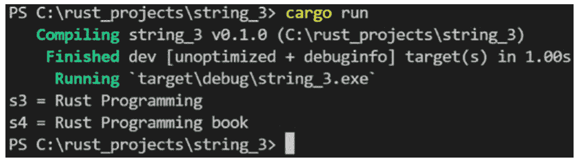

图 4.10：使用 `++` 运算符更新字符串的输出

我们还可以使用 `format!` 宏按照所需的格式组合不同的字符串。它的工作方式与 `println!` 宏非常相似，占位符会被字符串变量的实际值替换，并返回一个新的格式化字符串，如下代码片段所示：

```rust
fn main() {
    let s1 = String::from("Rust");
    let s2 = String::from("Programming");
    let s3 = format!("{} {}", s1, s2);
    println!("s3 = {}", s3);
}
```

代码的输出：

```
PS C:\rust_projects\string_4 cargo run
Compiling string_4 v0.1.0 (C:\rust_projects\string_4)
Finished dev [unoptimized + debuginfo] target(s) in 0.99s
Running `\target\debug\string_4.exe`
s3 = Rust Programming
PS C:\rust_projects\string_4> _|
```

图 4.11：使用 `format!` 宏组合字符串的输出

## 访问字符串的字节和字符

字符串内部是一个字节字节向量，但它是 UTF-8 编码的，字符串中的每个字符可以占用一到四个字节。假设第一个字符由 2 个字节组成，我们想要访问索引为 0 的元素（字节）。但仅凭索引 0 的字节并不代表任何字符。因此，`Rust` 通过不允许我们使用索引访问字节或字符来避免出现这种情况，而这在向量的情况下是允许的。此代码片段：

```rust
fn main() {
    let s1 = String::from("hello");
    let s2 = String::from("Привет");
    let len1 = s1.len();
    let len2 = s2.len();
    println!("len1 = {}, len2 = {}", len1, len2);
}
```

代码的输出：

```
PS C:\rust_projects\string_5 cargo run
Compiling string_5 v0.1.0 (C:\rust_projects\string_5)
Finished dev [unoptimized + debuginfo] target(s) in 1.00s
Running `\target\debug\string_5.exe`
len1 = 5, len2 = 12
PS C:\rust_projects\string_5> _|
```

图 4.12：使用 `len` 函数显示字符串长度的输出

你可以看到在第一个字符串 `s1` 中，每个字符由 1 个字节组成；因此它的长度为 5。然而，在第二个字符串 `s2` 中，每个字符由 2 个字节组成。如果你尝试对字符串进行索引（如下所示），它将无法编译：

```rust
println!("{}", s1[0]);
```

代码的输出：

```
PS C:\rust_projects\string_5 cargo run
Compiling string_5 v0.1.0 (C:\rust_projects\string_5)
error[E0277]: the type `String` cannot be indexed by `{integer`
--> src\main.rs:7:20
|   println!("{}", s1[0]);
```

图 4.13：字符串索引的错误

但我们可以使用切片（slicing）来访问字符串的一部分，只要切片中的起始和结束索引是有效的字符边界。在字符串 `s2`（表示Привет）中，每个字符由 2 个字节组成。因此，有效的索引是 `[0..2]`、`[0..4]`、`[2..4]` 等，而无效的索引是 `[0..3]`、`[2..5]` 等。让我们在下面的示例中使用切片来访问字符串的部分：

代码的输出：

```
PS C:\rust_projects\string_6 cargo run
Compiling string_6 v0.1.0 (C:\rust_projects\string_6)
Finished dev [unoptimized + debuginfo] target(s) in 1.04s
Running `\target\debug\string_6.exe`
"h"
"Пр"
PS C:\rust_projects\string_6 >
```

图 4.14：使用切片访问字符串的输出

（注：原文中存在大量重复段落，已根据要求去重并保留核心翻译）

`currencies` 哈希映射中存在的键，以及另一个在表中不存在的键值：

```rust
use std::collections::HashMap;

fn main() {
    let mut currencies = HashMap::new();
    currencies.insert("India", "INR");
    currencies.insert("United States", "USD");
    currencies.insert("United Kingdom", "GBP");

    let currency_usa = currencies.get("United States");
    let currency_china = currencies.get("China");

    println!("Currency of USA is: {:?}", currency_usa);
    println!("Currency of China is: {:?}", currency_china);
}
```

代码的输出：

```
PS C:\rust_projects\hashmap_2> cargo run
  Compiling hashmap_2 v0.1.0 (C:\rust_projects\hashmap_2)
  Finished dev [unoptimized + debuginfo] target(s) in 0.64s
  Running 'target\debug\hashmap_2.exe'
Currency of USA is: Some("USD")
Currency of China is: None
PS C:\rust_projects\hashmap_2> 
```

> 图 4.17：使用 `get` 方法访问哈希映射中的值

我们可以使用 `for` 循环遍历所有的键值对，如下面的代码片段所示：

```rust
use std::collections::HashMap;

fn main() {
    let mut currencies = HashMap::new();
    currencies.insert("India", "INR");
    currencies.insert("United States", "USD");
    currencies.insert("United Kingdom", "GBP");

    for (key, value) in &currencies {
        println!("{}: {}", key, value);
    }
}
```

代码的输出：

```
C:\rust_projects\hashmap_3> cargo run
Compiling hashmap_3 v0.1.0 (C:\rust_projects\hashmap_3)
  Finished dev [unoptimized + debuginfo] target(s) in 0.68s
  Running `target\debug\hashmap_3.exe'
United Kingdom : GBP
India : INR
United States : USD
PS C:\rust_projects\hashmap_3> _
```

图 4.18：遍历哈希映射中的所有键值对

## 从哈希映射中移除值

我们可以通过 `remove` 方法从哈希映射中删除一个条，如下例所示：

```rust
use std::collections::HashMap;

fn main() {
    let currencies = HashMap::new();
    currencies.insert("India", "INR");
    currencies.insert("United States", "USD");
    currencies.insert("United Kingdom", "GBP");

    println!("{:?}", currencies);

    currencies.remove("United Kingdom");

    println!("{:?}", currencies);
}
```

代码的输出：

```
C:\rust_projects\hashmap_4> cargo run
Compiling hashmap_4 v0.1.0 (C:\rust_projects\hashmap_4)
  Finished dev [unoptimized + debuginfo] target(s) in 1.05s
  Running `target\debug\hashmap_4.exe'
{"United Kingdom": "GBP", "India": "INR", "United States": "USD"}
{"India": "INR", "United States": "USD"}
PS C:\rust_projects\hashmap_4> _
```

图 4.19：使用 `remove` 方法从哈希映射中移除条

## 总结

在本章中，你学习了 `struct` 数据类型以及它如何帮助将相关数据组合在一起。你看到了如何定义和使用 `struct` 及其方法和关联函数。然后，你学习了 `enum` 数据类型，当变量可以从有限的选项中取值时，它非常有用。你查看了 `Rust` 标准库中定义的泛型枚举 `Option`，它有两个值 `Some` 和 `None`，分别表示有值和空值。接着，我们转向了非常有用的集合结构。特别是，我们详细学习了向量、字符串和哈希映射。

在下一章中，你将学习 `Rust` 的模块系统，如包（packages）、单元（crates）、模块（modules）和路径，这些有助于你管理代码结构。

## 问题

- 1. 创建一个结构来表示三角形。三角形由三边组成。此外，编写一个关联函数 `new`，接收三边的长度作为输入并返回一个三角形对象。
- 2. 添加一个名为 `area` 的方法来计算三角形对象的面积。使用第 1 题中定义的三角形结构体。
  *提示：边长为 `a`、`b`、`c` 的三角形面积 = `sqrt(s(s-a)(s-b)(s-c))`，其中 `s = (a+b+c)/2`*
- 3. 根据三角形的边，可以是等边三角形（三边相等）、等腰三角形（两边相等）或不等边三角形（三边长度均不同）。创建一个枚举 `TriangleType` 来包含这些值。修改第 1 题中定义的三角形结构体，包含一个类型为 `TriangleType` 的字段。同时修改 `new` 函数，以便根据长度参数计算三角形类型字段的值。
- 4. 判断以下陈述的真伪性：

    - a. `struct` 的关联函数的第一个参数为 `&self`。
    - b. `struct` 的方法的第一个参数为 `&self`。
    - c. 向量中的元素是有顺序存储的。
    - d. 哈希映射中的元素是按顺序存储的。

包（Package）是一个一个或多个 crate 的集合，提供了某些功能。它必须包含一个 `Cargo.toml` 文件来描述如何构建这些 crate。一个包最多包含一个库 crate（library crate），但可以包含多个二进制 crate（binary crate），且每种类型必须至少有一个 crate。

## Crates（单元）

Crate 是 `Rust` 中的一个编译单元，`Rust` 编译器使用它来生成二进制文件或库文件。当你使用 `rust <file_name>.rs` 来编译该文件时，该文件被视为一个 crate。如果该文件中包含一些 `mod` 声明，这些 `mod` 声明将用模块文件中的代码替换，然后对最终的——即 crate——进行编译。默认情况下，`rustc` 会从 crate 生成一个二进制文件，这可以通过 `--crate-type` 标志进行控制。如果此标志设置为 `lib`，则会生成一个库而不是二进制文件。二进制文件是一个可执行的项目，并且其中包含一个 `main()` 方法。另一方面，库 crate 没有 `main` 方法。它们是一组可以在其他项目中重用的组件，它们的程序执行始于 `src/lib.rs` 文件。在 `Rust` 中，使用 `cargo` 工具来管理 crate。第三方 crate 可以从 crates.io（`Rust` 的官方 crate 注册表）下载。

## 创建二进制 crate

让我们创建一个二进制 crate。当二进制 crate 被构建时时，它会生成一个可执行文件。首先，我们需要使用 `cargo new` 命令创建一个新包，如下：`cargo new --bin binary-crate`

它将创建一个名为 `binary-package` 的包，`--bin` 标志告诉 `cargo` 生成一个在编译时会产生二进制可执行文件的包。默认的 crate 类型是二进制的（binary），因此在这里 `--bin` 标志是可选的。`binary-crate` 目录的结构如下：

```
| Cargo.toml
| src
    └── main.rs
```

`Cargo.toml` 文件应该如下：

```toml
[package]
name = "binary-crate"
version = "0.1.0"
authors = ["abhis"]
edition = "2018"

# 更多键及其定义请参阅 https://doc.rust-lang.org/cargo/reference/manifest.html

[dependencies]
```

而 `src/main.rs` 文件应该如如下代码所示：

```rust
fn main() {
    println!("Hello, world!");
}
```

现在，我们可以使用 `cargo build` 命令从此包构建一个二进制 crate（可执行文件）。这会在项目根目录下创建一个名为 `target` 的文件夹，以及一个名为 `binary-crate` 的二进制 crate（在 Windows 上为 `binary-crate.exe`），它与包名相同，位于 `target/debug` 下。最后，你可以使用 `cargo run` 运行该可执行文件，`world!` 会打印到控制台上。

如果你想让二进制 crate 的名称与包名不同，可以在构建 crate 之前通过重命名 `Cargo.toml` 文件中的二进制名称来实现，如下：

```toml
[bin]
name = "binary-crate-new"
path = "src/main.rs"
```

然后，你可以使用以下命令构建并运行它：
`cargo run --bin binary-crate-new`

这将创建一个名为 `binary-crate-new` 的二进制文件而不是 `binary-crate`（包名）。

## 创建库 crate

创建库 crate 的方法与创建二进制 crate 非常相似。首先，我们需要使用 `cargo new` 命令创建一个新包，如下：

```bash
cargo new --lib library-package
```

它将创建一个名为 `library-package` 的包，`--lib` 标志告诉 `cargo` 生成一个在编译时会产生库文件的包。`library-crate` 文件夹的结构如下：

```
| Cargo.toml
| src
  └ lib.rs
```

`Cargo.toml` 文件应该如下：

```toml
[package]
name = "library-crate"
version = "0.1.0"
authors = ["abhis"]
edition = "2018"

# 更多键及其定义请参阅 https://doc.rust-lang.org/cargo/reference/manifest.html

[dependencies]
```

（注：此处原文存在重复逻辑混乱）

```toml
[package]
name = "library-crate"
version = "0.1.0"
authors = ["abhis"]
edition = "2018"
```

在 `src/` 中添加以下代码：

```bash
cargo build
```

```rust
pub fn hello_crate() {
```


`println!("Hello crate!");`

现在，运行以下命令：

```bash
cargo run
```

```text
Compiling library-crate v0.1.0 (hash)
Finished dev [unoptimized] target(debug) in 0.0s
```

## 模块（Modules）

模块是代码的逻辑分组，有助于组织代码。它们类似于其他语言中的命名空间。模块可以是公开的或私有的。默认情况下，Rust 中的模块是私有的。要使模块变为公开，你需要添加 `pub` 关键字。模块也可以嵌套，如下所示：

```rust
pub mod cook_food {
    pub mod indian {
        pub fn cook_chapati() {
            println!("Cooking chapati");
        }
    }
    pub fn cook_samosa() {
        println!("Cooking samosa");
    }
}
```

在前面的示例中，`cook_food` 是 crate 的一个子模块，它包含了四个模块：`indian`、`chinese`、`mexican`。这四个模块都包含了烹饪的函数。在这种情况下，我们没有为这些函数添加过多的细节，但在实际项目中，这些子模块可能会包含更多函数而不只是两个。因此，将所有逻辑放在一个文件中并不是一个好主意。因此，我们可以为每个模块放在独立的文件。例如，`indian.rs` 将包含与印度食物相关的函数，`chinese.rs` 中国食物，以此类推。我们需要将这四个 Rust 文件放在名为 `cook_food` 的文件夹中，因为它们是 `cook_food` 的子模块。最后，我们将有一个用于 `cook_food` 模块的 Rust 文件 `cook_food.rs`，我们只需列出包含的子模块名称。因此，目录结构如下：

```
Cargo.toml
src
  cook_food.rs
    main.rs
    cook_food
      chinese.rs
      indian.rs
      italian.rs
      mexican.rs
```

`src/cook_food.rs` 的内容如下：

```rust
pub mod indian;
pub mod chinese;
pub mod mexican;
pub mod italian;
```

`src/cook_food/indian.rs` 的内容如下：

```rust
pub fn cook_chapati() {
    println!("Cooking chapati");
}
pub fn cook_samosa() {
    println!("Cooking samosa");
}
```

`src/cook_food/chinese.rs` 的内容如下：

```rust
pub fn cook_noodles() {
    println!("Cooking noodles");
}
pub fn cook_spring_rolls() {
    println!("Cooking spring rolls");
}
```

`src/main.rs` 的内容如下：

```rust
mod cook_food;

fn main() {
    cook_food::indian::cook_chapati();
    cook_food::cook_samosa();
}
```

```rust
println!("Cooking burritos");
}
pub fn cook_tomato_salsa() {
  println!("Cooking tomato salsa");
}
```

- `src/cook_food/italian.rs` 的内容应该如下：

```rust
pub fn cook_pasta() {
  println!("Cooking pasta");
}
pub fn cook_pizza() {
  println!("Cooking pizza");
}
```

这形成了一个模块树。命名的 crate（包）是模块树的根节点。对于上一个例子，模块树看起来如下：

```
crate
|-cook_food
  |-indian
    |-cook_chapati
    |-cook_samosa
  |-chinese
    |-cook_noodles
    |-cook_spring_rolls
  |-mexican
    |-cook_burritos
    |-cook_tomato_salsa
  |-italian
    |-cook_pasta
    |-cook_pizza
```

通过这种方式组织我们的项目，即将模块拆分为独立的文件，并将子模块放在与父模块名称同名的文件夹下，我们可以看到模块树结构与 crate 目录结构之间的相似之处。这甚至使得使用路径表示法访问函数变得更加简单，我们将在章的下一节中看到。

## 路径与 use

现在我们已经定义了模块、子模块以及这些模块中的函数，我们需要从主二进制 crate 中访问这些函数。我们将使用路径来访问这些函数。路径用于访问定义在模块内部的项目（函数、结构体、枚举等）。它可以是绝对路径，也可以是相对路径。绝对路径从根节点开始，即 crate。相对路径从当前作用域开始。例如，如果当前作用域包含 `cook_food` 模块，那么 `cook_food::indian::cook_samos` 指向定义在 `indian` 模块内部的 `cook_samos` 函数，而该模块又位于 `cook_food` 模块中。在使用相对路径时，可以使用 `super::` 来访问父模块，就像我们在文件系统中中使用 `..` 来访问父目录一样。

让我们来看下面的例子，理解我们如何使用 `use` 后接函数路径来使用不同模块中定义的函数。`src/main.rs` 的内容类似于所示：

```rust
mod cook_food;

use crate::cook_food::indian::cook_samos;
use crate::cook_food::chinese::cook_noodles;
use crate::cook_food::italian::cook_pizza;
use crate::cook_food::mexican;

fn main() {
    println!("From main...");
    cook_samosa();
    cook_noodles();
    cook_pizza();
    mexican::cook_burritos();
    mexican::cook_tomato_salsa();
}
```

## 程序输出：

```
PS C:\rust_projects\modules> cargo run
Compiling modules v0.1.0 (C:\rust_projects\modules)
Finished dev [unoptimized + debuginfo] target(s) in 0.4s
Running target\debug\modules.exe
From main...
Cooking samosa
Cooking noodles
Cooking pizza
Cooking burritos
Cooking tomato salsa
PS C:\rust_projects\modules> |
```

图 5.3：使用定义的函数获得的输出

我们可以通过调用 `crate::cook_food::indian::cook_samos` 来调用在 `indian` 模块中定义的 `cook_samos` 函数。在这里，不需要 `crate` 关键字，因为 `crate` 是 `module` 的子模块。因此，对于我们的例子，`cook_food::indian::cook_samos` 效果同样良好。对于每次想要调用定义在嵌套模块中的函数来说，这似乎是一条很长的路径。`use` 关键字可以帮助我们。我们可以编写 `use` 后接我们想要使用的函数路径，将它们引入当前作用域，然后只需通过函数名即可使用。可以使用 `use` 后接想要使用的函数路径，将它们引入当前作用域，如下：

```rust
use crate::cook_food::indian::cook_samos;
```

```rust
use crate::cook_food::mexican::cook_tomato_salsa;
```

## 总结

在本节中，我们定义了模块、子模块以及这些模块中的函数，我们需要从主二进制 crate 中访问这些函数。我们将使用路径来访问这些函数。通过这种方式组织我们的项目，即将模块拆分为独立的文件，并将子模块放在与父模块名称同名的文件夹下，我们可以看到模块树结构与 crate 目录结构之间的相似之处。这甚至使得使用路径表示法访问函数变得更加简单，我们将在章的下一节中看到。

## 路径与 use

现在我们已经定义了模块、子模块以及这些模块中的函数，我们需要从主二进制 crate 中访问这些函数。我们将使用路径来访问这些函数。路径用于访问定义在模块内部的项目（函数、结构体、枚举等）。它可以是绝对路径，也可以是相对路径。绝对路径从根节点开始，即 crate。相对路径从当前作用域开始。例如，如果当前作用域包含 `cook_food` 模块，那么 `cook_food::indian::cook_samos` 指向定义在 `indian` 模块内部的 `cook_samos` 函数，而该模块又位于 `cook_food` 模块中。在使用相对路径时，可以使用 `super::` 来访问父模块，就像我们在文件系统中中使用 `..` 来访问父目录一样。

让我们来看下面的例子，理解我们如何使用 `use` 后接函数路径来使用不同模块中定义的函数。`src/main.rs` 的内容类似于所示：

```rust
mod cook_food;

use crate::cook_food::indian::cook_samos;
use crate::cook_food::chinese::cook_noodles;
use crate::cook_food::italian::cook_pizza;
use crate::cook_food::mexican;

fn main() {
    println!("From main...");
    cook_samosa();
    cook_noodles();
    cook_pizza();
    mexican::cook_burritos();
    mexican::cook_tomato_salsa();
}
```

## 程序输出：

```
PS C:\rust_projects\modules> cargo run
Compiling modules v0.1.0 (C:\rust_projects\modules)
Finished dev [unoptimized + debuginfo] target(s) in 0.4s
Running target\debug\modules.exe
From main...
Cooking samosa
Cooking noodles
Cooking pizza
Cooking burritos
Cooking tomato salsa
PS C:\rust_projects\modules> |
```

图 5.3：使用定义的函数获得的输出

我们可以通过调用 `crate::cook_food::indian::cook_samos` 来调用在 `indian` 模块中定义的 `cook_samos` 函数。在这里，不需要 `crate` 关键字，因为 `crate` 是 `module` 的子模块。因此，对于我们的例子，`cook_food::indian::cook_samos` 效果同样良好。对于每次想要调用定义在嵌套模块中的函数来说，这似乎是一条很长的路径。`use` 关键字可以帮助我们。我们可以编写 `use` 后接我们想要使用的函数路径，将它们引入当前作用域，然后只需通过函数名即可使用：

```rust
use crate::cook_food::indian::cook_samos;
```

```rust
use crate::cook_food::mexican::cook_tomato_salsa;
```

## 总结

在本节中，我们定义了模块、子模块以及这些模块中的函数，我们需要从主二进制 crate 中访问这些函数。我们将使用路径来访问这些函数。通过这种方式组织我们的项目，即将模块拆分为独立的文件，并将子模块放在与父模块名称同名的文件夹下，我们可以看到模块树结构与 crate 目录结构之间的相似之处。这甚至使得使用路径表示法访问函数变得更加简单，我们将在章的下一节中看到。

## 第6章

## 错误处理

## 引言

在本章中，你将学习 Rust 编程语言中的错误处理。错误是程序不可分割的一部分，编写无错误的代码是困难的。Rust 提供了多种处理错误的情况。与任何其他语言不同，Rust 将错误分为两类：可恢复错误和不可恢复错误。本章涵盖了这两类错误以及如何处理它们。

## 结构

- 本章涵盖以下主题：
* Rust 的错误处理
* 可恢复错误与 Result
* 常见的 Result 方法
* 不可恢复错误与 panic!
* 使用 backtrace
* 修改默认 panic 行为

## 目标

在本章结束时，你应该熟悉 Rust 程序中可能发生的不同错误，并能够决定使用 `Result` 枚举还是 `panic!` 宏来处理程序的特定错误情况。你还将学习如何有效地使用回溯来找出程序中的某些错误。

Rust 处理错误的方法与其他编程语言略有不同。它将错误分为可恢复错误（recoverable errors）和不可恢复错误（unrecoverable errors），并分别使用 `Result` 枚举和 `panic!` 宏来处理。可恢复错误通常是普通错误，并不意味着代码中存在 bug。相反，这些错误是由代码之外的因素引起的，例如找不到文件、网络问题和权限问题。可以通过在采取措施后提示用户重试来恢复。另一方面，不可恢复错误表示代码中明显的 bug，例如访问超出数组边界的数据。大多数其他编程语言以相同的方式对待这两种错误，并使用异常来处理它们。

## 可恢复错误与 Result

可恢复错误即使出现在没有任何 bug 的代码中，当遇到这类错误时，我们不需要终止程序。相反，我们可以尝试处理并从中恢复。它由 `Result<T, E>` 枚举表示，其中包含两个变体：`OK` 和 `Err`，如下所示：

```
enum Result<T, E> {
  OK(T),
  Err(E),
}
```

在成功的情况下，在 `OK` 变体中返回一个类型为 `T` 的值；在失败的情况下，在 `Err` 变体中返回一个类型为 `E` 的错误。与 `unwrap()` 相关的重要方法之一是它要么产生元素 `T`，要么发生 panic（崩溃）。Rust 标准库中有许多返回 `Result` 类型的方法，例如 `File::open()`、`parse()` 等。`Result` 的返回类型表示该函数可能成功也可能失败。例如，`File::open()` 可能会成功并返回文件句柄，也可能失败并返回错误。同样，`parse()` 可能会成功将给定字符串解析为另一种类型，但在无法这样做时可能会失败并返回错误。

让我们来看一个示例，如何有效地使用 `Result` 枚举来处理可能的错误。在下面的示例中，我们写了一个函数 `area_square()`，它接受字符串形式的正方形边长，将其解析为 `i32`，并返回作为 `i32` 的正方形面积：

```rust
fn area_square(side: &str) -> i32 {
  let x:i32 = side.parse().unwrap();
  x*x
}

fn main() {
  let area = area_square("10");
  println!("area = {}", area);
}
```

## 代码的输出：

```
PS C:\rust_projects\errors_1> cargo run
Compiling errors_1 v0.1.0 (C:\rust_projects\errors_1)
Finished dev [unoptimized + debuginfo] target(s) in 1.44s
Running 'target\debug\errors_1.exe'
area = 100
PS C:\rust_projects\errors_1> 
```

图 6.1：`area_square_function` 的输出

程序运行了，因为表示正方形边长 10 的字符串是有效的，也就是说它可以被解析为 `i32` 值。但如果我们解析的是 10a 而不是 10 会怎样呢？程序会发生 panic，如下代码片段所示：

```rust
fn main() {
  let area = area_square("10a");
  println!("area = {}", area);
}
```

## 代码的输出：

```
PS C:\rust_projects\errors_1> cargo run
Compiling errors_1 v0.1.0 (C:\rust_projects\errors_1)
Finished dev [unoptimized + debuginfo] target(s) in 1.12s
Running 'target\debug\errors_1.exe'
```


`thread 'main' panicked at 'called 'Result::unwrap()' on an 'Err' value`

`: ParseError {kind: InvalidDigit}, src:main.rs:2:30`

`note: run with `RUST_BACKTRACE=1` environment variable to display a backtrace`

`error: process didn't exit successfully: 'target\debug\errors_1.exe' (with exit code: 101)`

`PS C:\rust_projects\errors_1>`

图 6.2：向 `area_square` 函数传递无效参数的输出

程序发生 panic 并带有 `ParseError` 终止。但如果我们不想抛出一个难看的消息，而是想显示自定义消息甚至避免终止程序呢？假设有一个无效字符串；我们为正方形长度取一个默认值，比如 0。我们可以通过处理 `parse()` 函数返回的 `Result` 的 `Ok` 和 `Err` 情况来实现这一点。如果成功，我们返回解析后产生的 `i32` 值；如果失败，我们返回 0。最后，在任何情况下，正方形的长度都是有效的。因此，修改后的函数应该如下：

```rust
use std::num::ParseIntError;

fn area_square(side: &str) -> i32 {
    let x:Result<i32, ParseIntError> = side.parse();
    let x = match x {
        Ok(val) => val,
        Err(e) => return 0,
    };
    x*x
}

fn main() {
    let area = area_square("10a");
    println!("area = {}", area);
}
```

代码的输出：

```
PS C:\rust_projects\errors_2 cargo run
Compiling errors_2 v0.1.0 (C:\rust_projects\errors_2)
Finished dev [unoptimized + debuginfo] target(s) in 1.44s
Running 'target\debug\errors_2.exe'
area = 0
```

Rust 处理错误的方法与其他编程语言略有不同。它将错误分为可恢复错误（recoverable errors）和不可恢复错误（unrecoverable errors），并分别使用 `Result` 枚举和 `panic!` 宏来处理。可恢复错误通常是普通错误，并不意味着代码中存在 bug。相反，这些错误是由代码之外的因素引起的，例如找不到文件、网络问题和权限问题。可以通过在采取措施后提示用户重试来恢复。另一方面，不可恢复错误表示代码中明显的 bug，例如访问超出数组边界的数据。大多数其他编程语言以相同的方式对待这两种错误，并使用异常来处理。

## 可恢复错误与 Result

可恢复错误即使出现在没有任何 bug 的代码中，当遇到这类错误时，我们不需要终止程序。相反，我们可以尝试处理并从中恢复。它由 `Result<T, E>` 枚举表示，其中包含两个变体：`OK` 和 `Err`，如下所示：

```rust
enum Result<T, E> {
  OK(T),
  Err(E),
}
```

在成功的情况下，在 `OK` 变体中返回一个类型为 `T` 的值；在失败的情况下，在 `Err` 变体中返回一个类型为 `E` 的错误。与 `unwrap()` 相关的重要方法之一是它要么产生元素 `T`，要么发生 panic。Rust 标准库中有许多返回 `Result` 类型的方法，例如 `File::open()`、`parse()` 等。`Result` 的返回类型表示该函数可能成功也可能失败。例如，`File::open()` 可能会成功并返回文件句柄，也可能失败并返回错误。同样，`parse()` 可能会成功将给定字符串解析为另一种类型，但在无法这样做时可能会失败并返回错误。

让我们来看一个示例，如何有效地使用 `Result` 枚举来处理可能的错误。在下面的示例中，我们写了一个函数 `area_square()`，它接受字符串形式的正方形边长，将其解析为 `i32`，并返回作为 `i32` 的正方形面积：

```rust
fn area_square(side: &str) -> i32 {
  let x:i32 = side.parse().unwrap();
  x*x
}

fn main() {
  let area = area_square("10");
  println!("area = {}", area);
}
```

## 代码的输出：

```
PS C:\rust_projects\errors_1> cargo run
Compiling errors_1 v0.1.0 (C:\rust_projects\errors_1)
Finished dev [unoptimized + debuginfo] target(s) in 1.44s
Running 'target\debug\errors_1.exe'
area = 100
PS C:\rust_projects\errors_1> 
```

图 6.1：`area_square_function` 的输出

程序运行了，因为表示正方形边长 10 的字符串是有效的，也就是说它可以被解析为 `i32` 值。但如果我们解析的是 10a 而不是 10 会怎样呢？程序会发生 panic，如下代码片段所示：

```rust
fn main() {
  let area = area_square("10a");
  println!("area = {}", area);
}
```

## 代码的输出：

```
PS C:\rust_projects\errors_1> cargo run
Compiling errors_1 v0.1.0 (C:\rust_projects\errors_1)
Finished dev [unoptimized + debuginfo] target(s) in 1.12s
Running 'target\debug\errors_1.exe'
thread 'main' panicked at 'called 'Result::unwrap()' on an 'Err' value
: ParseError {kind: InvalidDigit}, src:main.rs:2:30
note: run with `RUST_BACKTRACE=1` environment variable to display a backtrace
error: process didn't exit successfully: 'target\debug\errors_1.exe' (with exit code: 101)
PS C:\rust_projects\errors_1> 
```

图 6.2：向 `area_square` 函数传递无效参数的输出

程序发生 panic 并带有 `ParseError` 终止。但如果我们不想抛出一个难看的消息，而是想显示自定义消息甚至避免终止程序呢？假设有一个无效字符串；我们为正方形长度取一个默认值，比如 0。我们可以通过处理 `parse()` 函数返回的 `Result` 的 `Ok` 和 `Err` 情况来实现这一点。如果成功，我们返回解析后产生的 `i32` 值；如果失败，我们返回 0。最后，在任何情况下，正方形的长度都是有效的。因此，修改后的函数应该如下：

```rust
use std::num::ParseIntError;

fn area_square(side: &str) -> i32 {
    let x:Result<i32, ParseIntError> = side.parse();
    let x = match x {
        Ok(val) => val,
        Err(e) => return 0,
    };
    x*x
}

fn main() {
    let area = area_square("10a");
    println!("area = {}", area);
}
```

```rust
    panic!("x is less than 0");
}

println!("x = {}", x);
}
```

```
PS C:\rust_projects\errors_6> cargo run v1.0 (C:\rust_projects\errors_6)
Compiling errors_6 dev [unoptimized + debuginfo] target(s) in 1.09s
Finished target\debug\errors_6.exe
Running
thread 'main' panicked at 'x is less than 0', src\main.rs:4:9
note: run with 'RUST_BACKTRACE=1' environment variable to display a backtrace
error: process didn't exit successfully: 'target\debug\errors_6.exe' (
exit code: 101)
PS C:\rust_projects\errors_6>
```

图 6.9：使用 `panic!` 宏打印失败信息及其发生位置

输出显示了 panic 消息以及之前的示例，panic 发生在我们的代码中，我们可以跳转到调用 `panic!` 宏的代码部分。某些情况下，panic 发生在由我们的代码调用的某些代码中。在这种情况下，我们无法直接跳转到调用 `panic!` 宏的地方。相反，我们可以使用函数的回溯（backtrace）并找出我们代码中导致 panic 情况的故障部分。

## 使用回溯 (Backtrace)

如果 panic 发生在我们的代码之外，我们可以通过 `RUST_BACKTRACE=1` 运行程序以获取所有已调用函数的回溯。回溯的顶部显示发生 panic 的函数，随后按顺序显示不同的函数调用。因此，如果 panic 发生在我们代码之外的某些代码中，回溯的顶部将是该代码，随着栈向下移动，我们将到达导致 panic 的代码部分。让我们来看一个示例，我们尝试访问超出最大可能索引的向量：

```rust
fn main() {
  let x = vec!['a', 'b', 'c'];
  println!("Tenth character = {}", x[9]);
}
```

在给定的代码段中，向量 `x` 三个字符，但我们试图访问索引为 10 的字符。这导致程序 panic。如果我们使用 `RUST_BACKTRACE=1` 运行程序，我们可以看到所示的栈回溯：

### `$ RUST_BACKTRACE=1 cargo run`

```
PS C:\>rust-projects\errors-7> setenv RUST_BACKTRACE=1; cargo run
Finished dev [unoptimized + debuginfo] target(s) in 0.02s
Running \target\debug\errors_7.exe
thread 'main' panicked at index out of bounds: the index 3 but the index is 9; src/main.rs:38
stack trace:
  0: std::panic::_begin_panic_handler
    at /usr/local/b8c6c42f7a563f63f345f142c48fb01e53/library/src/panic.rs:493
  1: panic::panic_fmt
    at /usr/local/b8c6c42f7a563f63f345f142c48fb001e53/library/core/src/panic.rs:92
  2: panic::panic_bounds_check
    at /usr/local/b8c6c42f7a563f63f345f142c48fb001e53/library/core/src/panic.rs:151
  3: slice::index::(impl self)
    at /Users/alexmith/rust/toolchains/stable-x86_64-windows-msvc/lib/rust/src/slice.rs:168
  4: slice::index::get_impl(impl self, size: usize)
    at /Users/alexmith/rust/toolchains/stable-x86_64-windows-msvc/lib/rust/src/slice.rs:175
  5: alloc::dealloc::alloc_impl(impl self, size: usize, alloc: alloc::Global>)
    at /Users/alexmith/rust/toolchains/stable-x86_64-windows-msvc/lib/rust/src/alloc/mod.rs:2381
  6: errors_7
    at /src/main.rs:33
  7: core::ops::from::FnOnce::call_once(self, tuple<())())    at /src/main.rs:67
note: Some details are omitted, run with 'RUST_BACKTRACE=full' for a verbose backtrace.
error: process didn't exit successfully: target/debug/errors_7.exe (exit code: 101)
```

**图 6.10：** 通过设置 `RUST_BACKTRACE` 环境标志打印栈回溯

你可以看到 panic 顶部的函数调用并非来自我们的代码。随着栈向下移动，我们找到了 `main.rs:36`，这指示了我们代码中导致 panic 的地方，在本例中是 `main.rs` 的第 3 行。

## 修改默认行为

如果你想将 panic 时的默认行为从展开（unwinding）更改为中止（abort），你需要在 `Cargo.toml` 文件中相应的 `[profile]` 部分添加 `panic = 'abort'`。例如：

```toml
[profile.release]
panic = 'abort'
```


## 结论

在本章中，我们学习了在 panic 发生时的处理方法，通过 `panic!` 宏打印失败消息及其发生位置。我们了解了如何使用回溯（backtrace）来查找问题。我们学习了当 panic 发生在我们代码之外时，可以使用 `RUST_BACKTRACE=1` 运行程序来获取所有调用函数的回溯。我们还学习了如何通过 `Cargo.toml` 更改 panic 的默认行为。

你会注意到，`sum_int` 和 `sum_float` 这两个函数的完整逻辑是相同的。唯一的区别在于这些函数所操作的数据类型。显然，这里存在代码重复，如果我们能为所有数据类型只编写一次逻辑就太好了。泛型（Generics）正帮助我们实现这一点，它让我们编写出独立于数据类型的代码逻辑。

泛型可以应用于结构体、函数、方法、枚举、集合和 trait（特征）。在本章接后的章节中，我们将看到所有这些内容的示例。

## 使用泛型类型的结构体

我们已经看到结构体（struct）如何帮助我们将相关数据组合在一起。结构体由不同的字段以及它们各自的数据类型组成。但正如我们目前所看到的，这些数据类型不需要是具体类型。相反，如果有可能使用泛型数据类型使用同一个结构体，我们就可以使用泛型数据类型。让我们定义一个结构体来表示我们都熟悉的几何形状：圆。圆可以通过指定其在某个坐标系中的中心坐标来定义，半径可以定义为 `int` 值，也可以定义为浮点值。如图 7.2 所示，圆的坐标和半径可以定义为 `int` 值或浮点值。因此，为不同的数据类型定义圆意味着代码重复。这可以通过泛型来避免：

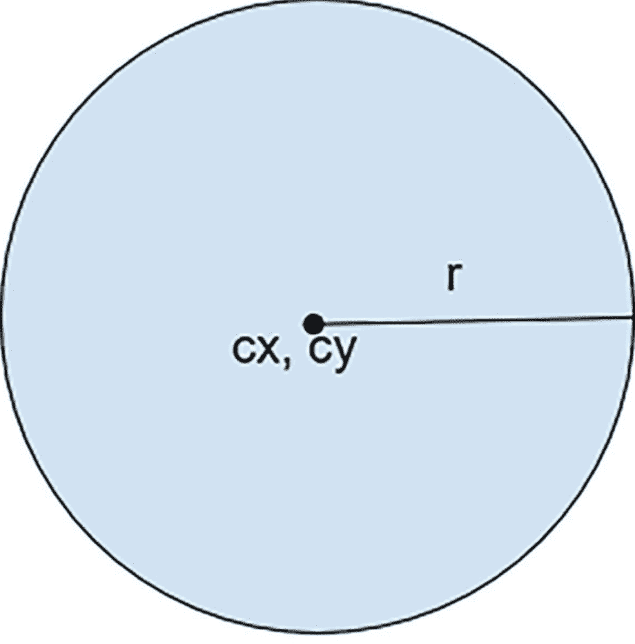

图 7.2：中心为 (cx, cy) 半径为 r 的圆

为了使用泛型类型为字段定义结构体，我们需要在角括号 `<>` 内用某些名称指定泛型类型参数。在接下来的示例中，我们在结构体内部使用名为 `T` 的泛型类型，而不是 `i32`、`f64` 等具体类型。这里，我们只使用了一个泛型类型，因为我们保持圆的 x 和 y 坐标以及半径为相同类型。如果同一个结构体内可以使用多种数据类型，你可以使用多个泛型类型并相应命名，例如 `T`、`U`、`V` 等或 `T1`、`T2`、`T3` 等。让我们看看下面的代码片段中如何在 `ast` 结构体中使用泛型类型代替具体类型：

```rust
#[derive(Debug)]
struct Circle<T> {
    cx: T,
    cy: T,
    r: T
}

fn main() {
    let c1 = Circle {
        cx: 10,
        cy: 20,
        r: 5
    };

    println!("c1 = {:?}", c1);
}
```

代码的输出：

```text
PS C:\rust_projects\generics_1> cargo run
Compiling generics_1 v0.1.0 (C:\rust_projects\generics_1)
Finished dev [unoptimized + debuginfo] target(s) in 1.12s
Running `target\debug\generics_1.exe`
30
PS C:\rust_projects\generics_1> |
```

图 7.3：在 `Circle` 结构体内使用泛型类型参数

在前面的示例中，创建 `Circle` 结构体的实例时，我们需要传递与字段 `cx`、`cy` 和 `r` 相同类型的值，因为我们将这三者都定义为相同的泛型类型 `T`。因此，如果我们给 `cx` 和 `cy` 分配一个 `i32`，而给 `r` 分配 `f64` 或任何其他类型，编译器将会报错。让我们举个例子来说：

```rust
fn main() {
    let c1 = Circle {
        cx: 10,
        cy: 20,
        r: 5.5
    }

    println!("cl = {:?}", c1);
}
```

## 代码的输出

```text
PS C:\rust_projects\generics_3> cargo run
Compiling generics_3_v0.1.0 (C:\rust_projects\generics_3)
error[E0308]: mismatched types
--> src/main.rs:12:13
12 |     r: 5.5
   |         ^^^^ expected integer, found floating-point number
   |
error: aborting due to previous error
有关此错误的更多信息，请尝试 `rustc --explain E0308`。
```

图 7.4：由于 `Circle` 结构体字段 `r` 类型不同导致的错误

该错误是不言自明的，因为字段 `r` 期望整数类型，但我们传递了 `5.5`，这是一个浮点值。

## 使用泛型类型的函数

为了定义带有泛型类型的函数，我们在函数名之后、函数参数之前的角括号 `<>` 内添加类型名称。例如，为了定义一个接受类型为 `T` 的参数 `arg` 并返回类型为 `T` 的值的泛型函数 `foo`，我们会这样：

```rust
fn foo<T>(arg: T) -> T {
    // function body
}
```

让我们定义一个函数 `area_rect`，它接受两个输入（矩形的长度和宽度），并返回其面积。矩形的尺寸可以指定为整数或浮点值。因此，如果能让 `area_rect` 函数泛型并让它接受泛型类型的参数就太好了：

```rust
fn area_rect<T>(length: T, width: T) -> T {
    // function body
}
```

等待，让我重新检查关于 `area_rect` 的 OCR 文本。OCR 文本有些破碎。让我根据上下文重构逻辑：

```rust
fn area_rect<T>(length: T, width: T) -> T {
    // function body
}
```

```rust
impl Circle<f64> {
    fn radius(&self) -> &f64 {
        &self.r
    }
}
```

现在，如果我们创建一个 `Circle<i32>` 并对其调用 `radius` 方法，代码将无法编译，因为 `radius` 方法是为 `Circle<f64>` 实现的，而不是为 `Circle<i32>`。

## Traits（特征 trait）

### 定义 trait

trait 使用 `trait` 关键字定义，后面跟着一个名称和若干个抽象或具体方法，如下所示：

```rust
trait TraName {
    // 抽象方法（无实现）
    fn method_abstract(&self);

    // 具体方法（带实现）
    fn method_concrete(&self) {
        // 方法体
    }
}
```

trait 方法的第一个参数是 `&self`，后面根据需要可以跟任何其他额外参数。让我们定义一个 `ShapeUtils` trait，它包含几个可以为圆形、矩形、方形等闭合二维几何形状定义的方法，如下：

```rust
trait ShapeUtils {
    fn print_shape(&self);
    fn area(&self) -> f64;
    fn perimeter(&self) -> f64;
}
```

在前面的示例中，`ShapeUtils` trait 包含了三个抽象方法，即没有默认实现的方法。我们刚刚定义了这些方法的签名，任何实现此 trait 的类型都必须实现这些方法。`print_shape` 方法预期的实现方式是打印几何形状的属性；`area` 方法应该计算并返回形状包围的面积，而 `perimeter` 方法应该返回形状的周长。在这里，我们没有为这些方法中的任何一个提供默认实现，因为不同的形状具有不同的属性，且计算面积和周长的公式也不同。因此，这些方法必须由对应不同几何形状的结构来实现。在下一节中，我们将为之前定义的 `Circle` 结构体实现这个 trait。

### 实现 trait

为了实现 trait，你需要声明一个 `impl` 块来在某个类型上实现该 trait。语法是 `impl <trait> for <type>`。你需要实现所有没有默认实现的方法。让我们重新回顾 `Circle` 结构体，它包含三个字段 `cx`、`cy` 和 `r`，分别代表其中心 x 和 y 坐标以及半径：

```rust
struct Circle {
    cx: i32,
    cy: i32,
    r: f64
}
```

我们将为 `Circle` 结构体实现 `ShapeUtils` trait 方法，如下所示：

```rust
// 在 Circle 结构体上实现 ShapeUtils trait
impl ShapeUtils for Circle {
    fn print_shape(&self) {
        println!("Circle: [c = {}, cy = {}, r = {}]", self.cx, self.cy, self.r);
    }

    fn area(&self) -> f64 {
        3.14 * self.r * r
    }

    fn perimeter(&self) -> f64 {
        2.0 * 3.14 * self.r
    }
}
```

最后，我们可以创建一个 `Circle` 结构体的实例，并在该 `Circle` 实例上调用刚刚实现的 `ShapeUtils` trait 方法，如下例所示：

```rust
fn main() {
    let shapel = Circle {
        cx: 10,
        cy: 20,
        r: 5.0
    };

    shapel.print_shape();
    println!("{}", shapel.area());
    println!("{}", shapel.perimeter());
}
```

### 代码输出

```text
PS C:\rust_projects\generics_7> cargo run
Compiling generics_7 v0.1.0 (C:\rust_projects\generics_7)
Finished dev [unoptimized + debuginfo] target(s) in 0.60s
Running \target\debug\generics_7.exe
Circle : c = (10,20), r = 5
78.5
31.400000000000002
PS C:\rust_projects\generics_7>
```

图 7.8：在 `Circle` 实例上调用 `ShapeUtils` trait 方法的输出

### trait 方法的默认实现

有时，你可能希望为 trait 的某些方法提供默认实现。如果某个类型没有为这些方法提供实现，将调用它们的默认实现。然而，如果一个类型通过提供自己的自定义逻辑覆盖了默认实现，那么在调用该类型实例的方法时，将执行自定义代码。在我们的 `ShapeUtils` trait 中，让我们为 `print_shape` 函数提供一个默认实现，如下：

```rust
trait ShapeUtils {
    fn print_shape(&self) {
        println!("A geometric shape");
    }

    fn area(&self) -> f64;
    fn perimeter(&self) -> f64;
}
```

现在，如果你调用 `shape.print_shape()`，打印出的信息与之前相同，即 `Circle : [c = (10,20), r = 5]`，因为我们为 `Circle` 结构体覆盖了 `print_shape` 方法。现在，如果你删除了 `Circle` 的 `print_shape` 方法自定义实现，将打印默认消息。

### 实现多个 trait

为了实现 trait，你需要声明一个 `impl` 块来在类型上实现该 trait。语法是 `impl <trait> for <type>`。你需要实现所有没有默认实现的方法。让我们重新回顾 `Circle` 结构体，它包含三个字段 `cx`、`cy` 和 `r`，分别代表其中心 x 和 y 坐标以及半径：

```rust
struct Circle {
    cx: i32,
    cy: i32,
    r: f64
}
```

（注：此处原文逻辑似乎在结尾错乱，已根据上下文进行翻译对齐。）

如果你想为一个结构体实现多个 trait，你需要为每个 trait 定义一个单独的 `impl` 块：

```rust
impl TraitOne for Circle {
    fn print_shape(&self) {
        println!("Circle: [c = {}, cy = {}, r = {}]", self.cx, self.cy, self.r);
    }
}

impl TraitTwo for Circle {
    fn area(&self) -> f64 {
        3.14 * self.r * r
    }
}
```

### 作为函数参数的 trait

trait 可以作为参数，用于定义接受指定 trait 类型的函数。如果你在函数类型中指定 `impl` 关键字后跟 trait 名称，它就可以接受任何实现该 trait 的类型。例如：

```rust
fn draw_shape(shape: &impl ShapeUtils) {
    shape.print_shape();
}

fn main() {
    let c = Circle {
        cx: 10,
        cy: 20,
        r: 5.0
    };

    draw_shape(&c);
}
```

### trait 边界语法（Trait bound syntax）

对于我们在上一个例子中看到的简单情况，`impl trait` 语法是可以的，但对于复杂情况，我们可以使用 trait 边界语法，它使代码更简单且更易读。在这种语法中，你在函数名称前的尖括号内冒号后声明泛型类型。因此，如果函数是 `draw_shape` 且它接受实现 trait `ShapeUtils` 的参数，其签名应该是 `fn draw_shape<T:ShapeUtils>(shape: &T)`。

```rust
fn draw_shape<T: ShapeUtils>(shape: &T) {
    shape.print_shape();
}

fn main() {
    let c = Circle {
        cx: 10,
        cy: 20,
        r: 5.0
    };

    draw_shape(&c);
}
```

## 同一 trait 的多个参数

如果函数接受多个相同 trait 的参数（为了简单起见，假设有两个），那么 `impl trait` 语法如下：

```rust
fn draw_shapes(shape: &impl ShapeUtils, shape2: &impl ShapeUtils) {
    shape.print_shape();
    shape2.print_shape();
}
```

相同方法的 trait 约束（trait bound）语法如下：

```rust
fn draw_shapes<T: ShapeUtils>(shape: &T, shape2: &T) {
    shape.print_shape();
    shape2.print_shape();
}
```

## 实现多个 trait 的参数

到为止，我们使用的函数参数只实现了一个 trait（在我们的案例中是 `ShapeUtils`）。然而，如果一个函数接受实现了两个或多个 trait 的类型参数，我们可以使用加号（`+`）语法来指定。为了简单，假设有一个函数 `foo`，它期望一个类型参数（例如 `struct MyStruct`），该类型实现了两个 trait：`TraitOne` 和 `TraitTwo`；那么使用 `impl trait` 语法，我们可以如下方式定义函数 `foo`：

```rust
fn foo(param1: &impl TraitOne + TraitTwo) {
    // function body
}
```

我们也可以使用 trait 约束语法定义相同的函数：

```rust
fn foo<T: TraitOne + TraitTwo>(param1: &T) {
    // function body
}
```


选择哪种语法取决于个人喜好，但 trait 约束语法看起来更清晰且更详尽。

## 结论

在本章中，你学习了 Rust 编程语言中的泛型（generics）和 trait。你看到了如何在结构体、枚举、函数和方法的定义中使用泛型来避免代码逻辑的重复。我们还看到了如何定义和实现一个 trait 及其方法。特别是，你看到了像 `struct` 这样的类型如何实现一个或多个 trait 方法。你还看到了如何定义接受 trait 作为参数的函数。

在下一章“测试代码”中，你将学习如何编写测试用例来验证代码的功能。

## 问题

1. 定义一个结构体来表示名为矩形的几何图形。矩形是一个具有四条边四个角的闭合几何图形。对边相等，且所有角度相等：90 度。
2. 为你在上一个问题中定义的矩形结构体定义在本章使用的 `ShapeUtils` trait。
3. 定义并实现函数 `find_max` 以找到整数向量中的最大元素。
4. 修改问题 4 中定义的 `find_max` 函数，使其接受泛型数值类型（如所有浮点值和整数）。

# 重点回顾

- 泛型有助于避免代码重复并编写更整洁的代码。它们允许我们编写代码逻辑而不担心数据类型。
- 泛型类型参数通常表示为 `<T>`，可以表示任何类型。
- 我们可以使用泛型类型定义结构体、枚举、函数、方法和 trait。
- 泛型函数或方法可以对其参数和返回值进行泛化。
- trait 是为特定类型定义的方法集合。trait 类似于 Java 和 C# 中的接口，以及 C++ 中的抽象类。
- trait 可以包含抽象方法（没有方法体的方法）或具体方法（有方法体的方法）。这与接口有点不同，因为接口不包含具体方法。
- 一个 trait 可以关联一个或多个方法。
- 任何实现 trait 的类型必须实现该 trait 的所有抽象方法。它可以选择性使用自己的自定义实现覆盖具体方法。
- 我们可以通过添加多个实现块（implementation blocks）为单个结构体实现多个 trait。
- 一旦实现，trait 方法就可以像实现它的类型的普通方法一样调用。
- 函数可以有一个或多个 trait 作为其函数参数。
- 你可以使用 `impl trait` 或 trait 约束语法来指定 trait 函数参数。
- 如果函数接受 trait 作为参数，你就可以传递任何实现了指定 trait 的类型。

# 第 8 章：测试你的代码

## 引言

Rust 在语言内部提供了编写自动化测试的支持。在本章中，你将学习在 Rust 中编写自动化测试，以验证代码是否符合预期。本章解释了如何编写测试用例以及测试函数的结构。我们将查看不同类别的测试：**单元测试**（unit tests）和**测试**（integration tests）。

## 结构

本章涵盖了以下主题：

- 编写软件测试
- 单元测试
- 运行特定测试
- 忽略测试执行
- 集成测试

## 目标

在本章结束时，你应该熟悉在 Rust 中编写自动化测试用例以验证代码的正确性。你将熟悉不同类型的测试，即单元测试和集成测试，以及如何编写它们。你还将学习不同类型的 `assert` 宏以及它们在编写不同测试函数时如何使用。

## 编写软件测试

编写无错误的代码（error-free code）对于任何软件项目的成功至关重要。Rust 编译器尽力通过在编译早期报告错误来避免代码漏洞。但它无法检测所有问题，例如由于某些代码逻辑实现错误导致的功能问题。Rust 中的测试可以大致分为两大类：**单元测试**和**集成测试**。单元测试的目标是孤立测试模块，而集成测试则确保你的库的不同部分能够协同工作。

## 单元测试

单元测试旨在孤立测试特定模块。它有助于缩小代码中故障的范围。例如，我们实现了一个函数 `add_nums`，它接受两个整数作为输入。函数 `add_nums` 接受两个整数作为输入并预期返回它们的和。在实现它时，我们在代码中引入了一个逻辑漏洞，如下所示：

```rust
fn add_nums(x: i32, y: i32) -> i32 {
    x * y
}
```

上述代码预期返回 `x` 和 `y` 的和，但它返回的是乘积。这种错误不会被 Rust 的类型系统捕获，代码可以通过编译。因此，为代码添加一些测试用例非常重要。我们可以编写单元测试，传入输入和预期结果，并检查 `add_nums` 返回的值是否匹配。

## 编写测试函数

**测试**函数用于测试代码的正确性。它标记有 `#[test]` 属性。在下面的代码片段中，我们编写了一个名为 `test_add_nums` 的函数，它验证 `add_nums` 函数。单元测试写在与测试代码不同的 `tests` 模块中。测试模块标记有 `#[cfg(test)]` 属性，如下所示：

```rust
pub fn add_nums(x: i32, y: i32) -> i32 {
    x * y
}

#[cfg(test)]
mod tests {
    use super::*;
}
```

```rust
#[test]
fn test_add_nums() {
    assert_eq!(add_nums(5, 10), 15);
}
```

## 断言辅助宏

当测试函数内部触发 panic（崩溃）时，测试会失败。为了有效地编写测试函数，有一些非常有用的宏，它们会根据特定条件触发 panic：

- `assert!(exp)`：当表达式 `exp` 求为 `false` 时 panic。
- `assert_eq!(x, y)`：当 `x` 和 `y` 不相等时 panic。
- `assert_ne!(x, y)`：当 `x` 和 `y` 相等时 panic。

## 运行测试函数

为了运行测试函数，我们使用 `cargo test` 命令。它运行具有 `#[test]` 属性的函数并检查哪些测试通过了，哪些失败了。当我们调用 `cargo test` 命令时，它会运行给定项目中所有的测试（在本例中只有一个：`test_add_nums`），输出如下：

```bash
$ cargo test
```

```bash
PS C:\rust_projects\tests_1> cargo test

  Compiling tests_1 v0.1.0 (C:\rust_projects\tests_1)

  Finished test [unoptimized + debuginfo] target(s) in 0.43s

  Running unittests (target\debug\tests_1-ac386c1215b3038e.exe)

running 1 test

test tests::test_add_nums ... FAILED

failures:

  --- tests::test_add_nums stdout ---

thread 'tests::test_add_nums' panicked at 'assertion failed: `(left
== right)`'

left: '5',
right: '15', src\main.rs:14:9

note: run with `RUST_BACKTRACE=1` environment variable to display a
backtrace

failures:

  tests::test_add_nums

test result: FAILED. 0 passed; 1 failed; 0 ignored; 0 measured; 0 filtered out; finished in 0.00s
```

图 8.1：执行失败测试用例的输出

`cargo test` 生成的控制台输出显示总共运行了一个测试，其中一个失败了，没有通过。它告诉我们失败的测试函数，即 `tests::add_nums`。这是预之中的，因为我们的 `add_nums` 函数存在 bug。现在，让我们通过将 `*` 运算符替换为 `+` 运算符来修复 bug 并再次运行 `cargo test` 命令，如下：

```rust
pub fn add_nums(x: i32, y: i32) -> i32 {
    x + y
}
```

```bash
$ cargo test
```

```bash
PS C:\rust_projects\tests_1> cargo test

Compiling tests_1 v0.1.0 (C:\rust_projects\tests_1)

Finished test [unoptimized + debuginfo] target(s) in 0.40s

Running unittests (target\debug\deps\tests_1-ac386c1215b3038e.exe)

running 1 test

test tests::test_add_nums ... ok

test result: ok. 1 passed; 0 failed; 0 ignored; 0 measured; 0 filtered out; finished in 0.00s
```

图 8.2：执行通过测试用例的输出

这次，测试如预期通过。

## 运行特定测试

默认情况下，`cargo test` 命令会运行项目中的所有测试。如果你想运行特定的测试，可以在 `cargo test` 命令后添加测试名称。假设我们有两个函数 `add_nums` 和 `mul_nums`，它们分别接受两个数字作为输入并返回它们的和与乘积。测试函数 `test_add_nums` 和 `test_mul_nums` 是对应的测试函数，如下例所示：

```rust
pub fn add_nums(x: i32, y: i32) -> i32 {
    x + y
}

pub fn mul_nums(x: i32, y: i32) -> i32 {
    x * y
}

#[cfg(test)]
mod tests {
    use super::*;

    #[test]
    fn test_add_nums() {
        assert_eq!(add_nums(5, 10), 15);
    }

    #[test]
    fn test_mul_nums() {
        assert_eq!(mul_nums(5, 10), 50);
    }
}
```

首先，让我们简单地调用 `cargo test`。它将运行两个测试用例，如下方的控制台输出：

### `$ cargo test`

```bash
PS C:\rust_projects\tests_1> cargo test

Compiling tests_1 v0.1.0 (C:\rust_projects\tests_1)

Finished test [unoptimized + debuginfo] target(s) in 0.45s

Running unitests (target\debug\deps\tests_1-ac386c1215b3038e.exe)

running 2 tests

tests::test_add_nums ... ok

tests::test_mul_nums ... ok

test result: ok. 2 passed; 0 failed; 0 ignored; 0 measured; 0 filtered; finished in 0.00s
```

图 8.3：使用 `cargo test` 命令运行所有测试的输出

现在，让我们尝试通过调用 `cargo test test_mul_nums` 只运行一个测试用例 `test_mul_nums`，如下：

### `$ cargo test test_mul_nums`

```bash
PS C:\rust_projects\tests_1> cargo test test_mul_nums

Finished test [unoptimized + debuginfo] target(s) in 0.01s

Running unitests (target\debug\deps\tests_1-ac386c1215b3038e.exe)

running 1 test

tests::test_mul_nums ... ok

test result: ok. 1 passed; 0 failed; 0 ignored; 0 measured; 0 filtered; finished in 0.00s
```

图 8.4：通过传递测试函数名称运行特定测试的输出

你也可以通过传递测试函数名称的一部分来运行多个测试。任何名称与此字符串匹配的测试都将被执行。例如，如果我们调用 `cargo test mul`，那么 `mul` 字符串将匹配测试函数 `test_mul_nums` 的名称。结果，`test_mul_nums` 将执行，如下：

```bash
PS C:\rust_projects\tests_1> cargo test mul

  Finished test [unoptimized + debuginfo] target(s) in 0.01s

  Running unittests (target\debug\deps\tests_1-ac386c1215b3038e.exe)

running 1 test

tests::test_mul_nums ... ok

test result: ok. 1 passed; 0 failed; 0 ignored; 0 measured; 0 filtered out; finished in 0.00s
```

图 8.5：通过匹配名称的一部分运行多个测试的输出

## 忽略测试执行

你可以使用 `#[ignore]` 属性标记测试函数以跳过其执行。你也可以向 `ignore` 属性添加额外信息，说明你为什么跳过特定测试。例如，如果你不想执行 `test_mul_nums` 函数，可以给它添加 `#[ignore]` 属性，如下：

```rust
#[test]
#[ignore = "implementation"]
fn test_mul_nums() {
    assert_eq!(mul_nums(5, 10), 50);
}
```

现在，让我们看看执行 `cargo test` 时运行了多少测试：

```bash
PS C:\rust_projects\tests_1> cargo test

Compiling tests_1 v0.1.0 (C:\rust_projects\tests_1)

Finished test [unoptimized + debuginfo] target(s) in 0.44s

Running unittests (target\debug\deps\tests_1-ac386c1215b3038e.exe)

running 2 tests

tests::test_mul_nums ... ignored

tests::test_add_nums ... ok

test result: ok. 1 passed; 0 failed; 1 ignored; 0 filtered out; finished in 0.00s
```

图 8.6：执行带有忽略测试的输出

显然，输出显示在运行的两个测试中有一个被忽略，一个通过了。这进一步显示 `test_mul_nums` 被忽略了而 `test_add_nums` 通过了。

## 集成测试

到目前为止，我们看到了单元测试。但为了验证库的不同部分是否正常工作，我们需要添加集成测试。集成测试是库外部的，并使用 crate 的公共接口。

## 创建集成测试

Cargo 在 `tests` 目录下查找集成测试。该目录应该与 `src` 目录处于同一级。让我们创建一个名为 `tests_integ` 的库：

```bash
$ cargo --lib tests_integ
```

现在，在 `src/lib.rs` 中添加包含两个函数 `add_nums` 和 `mul_nums` 的模块 `my_module`：

```rust
pub mod my_module {
    pub fn add_nums(x: i32, y: i32) -> i32 {
        x + y
    }

    pub fn mul_nums(x: i32, y: i32) -> i32 {
        x * y
    }
}
```

然后，创建文件 `tests/integration_tests.rs` 并向其中添加以下测试函数：

```rust
use tests_integ::my_module::add_nums;
use tests_integ::my_module::mul_nums;

#[test]
fn test_add_nums() {
    assert_eq!(add_nums(1, 2), 3);
    assert_eq!(add_nums(10, -5), 5);
}

#[test]
fn test_mul_nums() {
    assert_eq!(mul_nums(1, 2), 2);
    assert_eq!(mul_nums(10, 5), 50);
    assert_eq!(mul_nums(10, -2), -20);
    assert_eq!(mul_nums(0, 2), 0);
}
```

现在，你的项目结构如下：

```text
Cargo.toml
src
  lib.rs
  tests
    integration_tests.rs
```

## 运行集成测试

现在，我们准备好运行集成测试了。让我们运行 `cargo test` 命令吧：

```bash
$ cargo test
```

```bash
PS C:\rust_projects\tests_2> cargo test target(s) in 0.01s

Finished test [optimized + debuginfo]
```


Running unittests (`target\debug\deps\tests_2-b564f7a910296517.exe`)

running 0 tests

test result: ok. 0 passed; 0 failed; 0 ignored; 0 measured; 0 filtered out; finished in 0.00s

Running `tests\integration_tests.rs` (`target\debug\deps\integration_tests-d0cfe36150cc95e.exe`)

running 2 tests

test `test_add_nums` ... ok

test `test_mul_nums` ... ok

test result: ok. 2 passed; 0 failed; 0 ignored; 0 measured; 0 filtered out; finished in 0.00s

```

```

输出显示它运行了两个测试，即 `test_add_nums` 和 `test_mul_nums`，并且两个测试都通过了。恭喜！你运行了第一个集成测试。

## 总结

在本章中，你学习了如何在 Rust 中编写自动化测试并验证代码的功能。你看到了如何编写和执行不同类型的测试——单元测试和集成测试。你还学习了 `tests` 模块和测试函数，以及如何执行或忽略特定的测试函数。在下一章“迭代器与闭包”中，我们将学习 Rust 中的函数式编程特性——迭代器和闭包。

3. 集成测试的目的是什么？

4. 实现函数 `power`，它接受两个参数，如下代码段所示：

```rust
pub fn power(num: i32, k: u8) -> i32 {
    // 在此处编写你的代码
}
```

`power` 函数计算 `num` 的 `k` 次幂值。例如，`power(2, 5)` 应该返回 32（即 2 x 2 x 2 x 2 x 2）。

现在，添加一个单元测试来验证你所实现的 `power` 函数的正确性。确保使用多个 `num` 和 `k` 的值进行测试：

```rust
#[cfg(test)]
mod tests {
    use super::*;

    #[test]
    fn test_power() {
        // 在这里添加你的测试用例
    }
}
```

5. 将你在第4题中实现的 `power` 函数添加到名为 `math_utils` 的库中。此外，向该库添加函数 `sum(x: i32, y: i32)` 和 `mul(x: i32, y: i32)`。`sum` 和 `mul` 函数接受两个整数作为输入，并分别返回它们的和与积。添加几个集成测试来测试你的 `math_utils` 库的 API。

## 需要记住的点

- Rust 提供了编写自动化测试以验证你的代码功能的支持。
- Rust 中的测试可以大致分为两类：单元测试和集成测试。
- 单元测试的目标是隔离地测试模块，而集成测试则确保你的库的不同部分能够协同工作。
- 测试函数用 `#[test]` 属性进行标记。
- 单元测试写在名为 `tests` 的模块中，该模块用 `#[cfg(test)]` 属性进行标记。
- 当从测试函数内部触发 `panic` 时，测试会失败。有几个宏 - `assert`、`assert_eq`、`assert_ne`，它们根据某些条件触发 `panic`，从而有助于编写测试函数。
- 为了运行测试函数，我们使用 `cargo test` 命令。它会运行带有 `#[test]` 属性的函数，并检查哪些测试通过了，哪些失败了。
- 默认情况下，`cargo test` 命令会运行项目中的所有测试。如果你想运行特定的测试，可以在 `cargo test` 命令后添加测试名称。
- 你可以使用 `#[ignore]` 属性标记测试函数以跳过其执行。
- Cargo 在 `tests` 目录下查找集成测试。`tests` 目录应该与 `src` 目录处于同一层级。

# 第 9 章

## 迭代器与闭包

## 引言

在本章中，我们将学习 Rust 中的函数式编程特性——迭代器和闭包。在函数式编程中，函数被视为一等公民，这意味着它们可以被赋值给变量、作为参数传递给函数，并从函数返回。本章将解释闭包（一种可以存储在变量中的类函数结构）以及迭代器（一种处理一系列元素的方法）。我们还将比较迭代器与循环的性能。

## 结构

本章涵盖了以下主题：

- 闭包
  - 定义和调用闭包
  - 闭包的类型推断
  - 作为结构体成员的闭包
  - 环境捕获
- 迭代器
  - `Iterator` trait
  - 使用迭代器定义计数器
  - `iter()`、`into_iter()` 和 `iter_mut()`
  - 迭代器与循环

## 目标

在本章结束时，你应该熟悉 Rust 中的闭包和迭代器。你将学习如何定义和调用闭包，以及闭包与普通函数不同，如何捕获环境。你还将学习 `Iterator` trait 以及如何为结构体实现它。此外，你将理解迭代器与循环相比的性能。

# 闭包

闭包指的是一个存储了函数以及封装作用域内变量（捕获的变量）的数据结构。闭包是一个匿名函数，可以赋值给变量，并可以作为参数传递给另一个函数。

## 定义和调用闭包

闭包的定义就像普通变量一样，即使用 `let` 语句，后面跟着一个变量名、等号 (`=`)，然后是闭包定义。闭包定义由一对竖线 (`|`) 组成，其中可以可选地包含闭包的参数。多个参数可以用逗号分隔。参数后面紧跟一对包着闭包的大括号 `{}`。最后，在大括号后放置一个分号以完成 `let` 语句。闭包也可以像函数一样拥有返回类型，以指定它返回的值类型：

```rust
let closure_foo = |param1, param2| -> return_type {
    // 闭包体
};
```

闭包可以像普通函数一样被调用，在参数内传递参数：

```rust
closure_foo(arg1, arg2);
```

# 类型推断

与函数不同，闭包的参数和返回值的类型是可选的。类型由编译器隐式推断。在接下来的示例中，我们定义了一个函数 `add_nums_f` 和一个闭包 `add_nums_c`，它们都接受两个参数并返回它们的和，如下所示：

```rust
fn main() {
    fn add_nums_f(x: i32, y: i32) -> i32 {
        x + y
    }

    let add_nums_c = |x, y| {
        x + y
    };

    let a = add_nums_f(10, 15);
    println!("{}", a);

    let b = add_nums_c(10, 15);
    println!("{}", b);
}
```

```
PS:rust_projects\closures_4> cargo run
Compiling closures_4 v0.1.0 (C:\rust_projects\closures_4)
Finished dev [unoptimized + debuginfo] target(s) in 1.97s
Running 'target\debug\closures_4.exe'
```

图 9.4：闭包的环境捕获

在前面的示例中，闭包 `add_num` 使用了变量 `num` 的值，该变量定义在包含作用域之外。这被称为环境捕获，普通函数无法做到这一点。这一特性在定义迭代器时也非常有用。

## 迭代器

迭代器帮助你遍历值集合，例如数组、vector 和 map。像 vector 或 array 集合上的 `iter()` 方法会返回该集合的迭代器，然后可以使用它来访问集合中的项。在接下来的示例中，我们使用迭代器来打印整数数组的所有元素：

```rust
fn main() {
  let arr = [1, 2, 3, 4, 5];
  let arr_iter = arr.iter(); // 创建了迭代器

  for val in arr_iter { // 在此处使用迭代器
    println!("{}", val);
  }
}
```

程序的输出：

```
PS:\rust_projects\iterators_1> cargo run
Compiling iterators_1 v0.1.0 (C:\rust_projects\iterators_1)
Finished dev [unoptimized + debuginfo] target(s) in 1.22s
Running 'target\debug\iterators_1.exe'
```

图 9.5：对 vector 上的 `iter()` 打印其元素的输出

Rust 中的迭代器是惰性的（lazy），也就是说，仅仅调用 `iter()` 方法创建迭代器并不会发生什么，直到使用该迭代器来获取集合中的项为止。

## Iterator 特性（trait）

所有迭代器都实现了 `Iterator` 特性，该特性的定义如下：

```rust
trait Iterator {
    type Item;

    fn next(&mut self) -> Option<Self::Item>; // 其他默认方法
}
```

`Item` 是迭代器产生的值的类型，你在实现 `Iterator` 特性时需要定义它。你只需要定义 `next` 方法，它返回 `Some(Item)` 或 `None` 来表示序列的结束。`next` 方法可以直接在迭代器上调用，如下例所示：

```rust
fn main() {
    let arr = [1, 2, 3, 4, 5];
    let mut arr_iter = arr.iter(); // 创建了迭代器

    println!("{}", arr_iter.next().unwrap());
    println!("{}", arr_iter.next().unwrap());
    println!("{}", arr_iter.next().unwrap());
    println!("{}", arr_iter.next().unwrap());
    println!("{}", arr_iter.next().unwrap());
    // println!("{}", arr_iter.next().unwrap()); // 因为对 None 值使用 unwrap 导致 panic
}
```

**程序的输出：**

```
PS C:\rust_projects\iterators_2> cargo run
Compiling iterators_2 v0.1.0 (C:\rust_projects\iterators_2)
Finished dev [optimized + debuginfo] target(s) in 1.71s
Running `target\debug\iterators_2.exe`
```


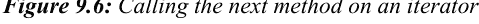

在前面的示例中，你可以看到迭代器`arr_iter`是可变的，因为在迭代器上调用`next`方法会修改迭代器的状态，迭代器使用该状态跟踪它在序列中的当前位置。

## 使用 Iterator 特性定义计数器

让我们通过在它上实现 Iterator 特性来定义一个计数器类。我们将定义有限和无限版本的计数器。首先，我们将定义有限计数器类的`CounterFinite`结构体，它应该从 1 计数到 10：

```rust
struct CounterFinite {
    count: u32,
}
```

`count`字段持有计数器的当前状态。接下来，我们需要为它实现 Iterator 特性。因此，我们将为`CounterFinite`结构体定义 Iterator 特性的`Item`类型和`next`方法，如代码所示：

```rust
impl Iterator for CounterFinite {
    type Item = u32;

    fn next(&mut self) -> Option<Self::Item> {
        if self.count < 10 {
            self.count += 1;
            return Some(self.count);
        }
        None
    }
}
```

你可以看到`next`方法负责递增当前计数值并返回更新后的计数值。一旦计数超过 10，它就会返回`None`。最后，我们创建计数器类的实例并打印计数值，如下所示：

```rust
fn main() {
    let cf = CounterFinite {
        count: 0,
    };

    for i in cf {
        println!("{}", i);
    }
}
```

**程序的输出：**

```text
PS C:\rust_projects\iterators_3> cargo run
Compiling iterators_3 v0.1.0 (C:\rust_projects\iterators_3)
Finished dev [unoptimized + debuginfo] target(s) in 1.81s
Running `target\debug\iterators_3.exe`
```

图 9.7：有限类的输出

我们也可以在`CounterFinite`结构的可变实例上直接调用`next`方法，如下所示：

```rust
fn main() {
    let mut cf = CounterFinite {
        count: 0,
    };

    println!("{}", cf.next().unwrap());
    println!("{}", cf.next().unwrap());
}
```

**程序的输出：**

```text
PS C:\rust_projects\iterators_3> cargo run
Compiling iterators_3 v0.1.0 (C:\rust_projects\iterators_3)
Running `target\debug\iterators_3.exe`
```

图 9.8：在`CounterFinite`结构实例上调用`next`

我们可以轻松地将计数器类转换为无限计数器。我们创建一个`CounterInfinite`结构并在它上实现 Iterator 特性。这次我们不会对值设置限制：

```rust
struct CounterInfinite {
    count: u32,
}

impl Iterator for CounterInfinite {
    type Item = u32;

    fn next(&mut self) -> Option<Self::Item> {
        self.count += 1;
        return Some(self.count);
    }
}
```

```rust
fn main() {
    let mut ci = CounterInfinite {
        count: 0,
    };

    println!("{}", ci.next().unwrap());
    println!("{}", ci.next().unwrap());
}
```

**程序的输出：**

```text
PS:\rust_projects\iterators_4> cargo run
Compiling iterators_4 v0.1.0 (C:\rust_projects\iterators_4)
Finished dev [unoptimized + debuginfo] target(s) in 1.74s
Running 'target\debug\iterators_4.exe'
```

图 9.9：在`CounterInfinite`结构实例上调用`next`

## iter()、into_iter() 和 iter_mut()

`iter`、`into_iter`和`iter_mut`方法返回来自集合的迭代器。`iter`方法返回集合每个元素的引用，集合在循环后可以重用，如下所示：

```rust
fn main() {
    let v = vec![1, 2, 3, 4, 5];
    let iter = v.iter();

    for val in iter {
        println!("{}", val);
    }

    println!("{:?}", v); // 重用集合
}
```

**程序的输出：**

```text
PS:\rust_projects\iterators_5> cargo run
Compiling iterators_5 v0.1.0 (C:\rust_projects\iterators_5)
Finished dev [unoptimized + debuginfo] target(s) in 1.82s
Running 'target\debug\iterators_5.exe'
[1, 2, 3, 4, 5]
```

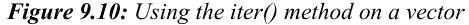

`into_iter`方法将集合中的元素移动到迭代器对象，集合不再可以使用，如下所示：

```rust
fn main() {
    let v = vec![1, 2, 3, 4, 5];
    let iter = v.into_iter();

    for val in iter {
        println!("{}", val);
    }

    println!("{:?}", v); // 重用集合
}
```

**程序的输出：**

```text
PS:\rust_projects\iterators_5> cargo run
Compiling iterators_5 v0.1.0 (C:\rust_projects\iterators_5)
Finished dev [unoptimized + debuginfo] target(s) in 1.82s
Running 'target\debug\iterators_5.exe'
error[E0382]: borrow of moved value: `v`
--> src\main.rs:7:22

2 let v = vec![1, 2, 3, 4, 5];
  - move occurs because `v` has type `Vec<i32>`, which does
3 not implement the `Copy` trait
  let iter = v.into_iter();
  - v moved due to this method call
7 println!("{:?}", v); // 重用集合
  ^ value borrowed after move
```

图 9.11：调用`iter_iter`后使用 vector

`iter_mut`方法类似于`iter`方法，但它可以修改集合的元素，如下所示：

```rust
fn main() {
    let mut v = vec![1, 2, 3, 4, 5];
    let iter = v.iter_mut();

    for val in iter {
        *val = *val + 100;
    }

    println!("{:?}", v); // 重用集合
}
```

**程序的输出：**

```text
PS:\rust_projects\iterators_6> cargo run
Compiling iterators_6 v0.1.0 (C:\rust_projects\iterators_6)
Finished dev [unoptimized + debuginfo] target(s) in 1.90s
Running 'target\debug\iterators_6.exe'
[101, 102, 103, 104, 105]
```

图 9.12：使用`iter_mut()`修改 vector `v`的值

## 迭代器对比循环

Rust 中的迭代器被认为是零成本抽象（zero-cost abstraction），也就是说它们会被编译为与`for`循环相同的代码，并且它们没有额外的运行时开销。为了比较循环和迭代器的性能，我们编写了两个函数`sum_1`和`sum_2`，分别使用`for`循环和迭代器来对一个长度为 1,000,000 的`vector`中的所有数字求和。我们运行了五次执行并记录了每次消耗的时间，如下代码片段所示：

```rust
use std::time::Instant;

// 使用 for 循环求和
fn sum_1(x: &[i64]) -> i64 {
    let mut result: i64 = 0;

    for i in 0..x.len() {
        result += x[i];
    }

    result
}

// 使用迭代器求和
fn sum_2(x: &[i64]) -> i64 {
    x.iter().sum()
}

fn main() {
    let mut v = vec![0; 1000000];
    let mut count = 0;

    for i in 0..v.len() {
        v[i] = count;
        count += 1;
    }

    for i in 0..5 {
        println!("Run {} : {}", i);

        let now = Instant::now();
        let sum1 = sum_1(&v);
        println!("sum_1: {} / {} ms", sum1, now.elapsed().as_millis());

        let now = Instant::now();
        let sum2 = sum_2(&v);
        println!("sum_2: {} / {} ms", sum2, now.elapsed().as_millis());
    }
}
```

## 程序的输出

```text
PS C:\rust_projects\iterators_7> cargo run
Compiling iterators_7 v0.1.0 (C:\rust_projects\iterators_7)
Finished dev [unoptimized + debuginfo] target(s) in 1.76s
Running `target\debug\iterators_7.exe`
Run 0:
sum_1: 50000050000 / 42 ms
sum_2: 50000050000 / 39 ms
Run 1:
sum_1: 50000050000 / 32 ms
sum_2: 50000050000 / 40 ms
Run 2:
sum_1: 50000050000 / 45 ms
sum_2: 50000050000 / 48 ms
Run 3:
sum_1: 50000050000 / 27 ms
sum_2: 50000050000 / 36 ms
Run 4:
sum_1: 50000050000 / 27 ms
sum_2: 50000050000 / 36 ms
```

> 图 9.13：迭代器与循环的比较

上述示例中对应使用**迭代器**和**循环**的函数测量结果非常接近，这证实了闭包和迭代器的实现对运行时性能的影响不大。

## 结论

在本章中，你学习了 Rust 中的闭包和迭代器，它们的灵感来源于函数式编程语言。你学习了如何定义和调用闭包。你还研究了闭包如何捕获环境或作用空间中的变量，这与普通函数不同。你学习了`Iterator` trait 以及如何为`struct`实现它。你还比较了迭代器和循环的性能，并理解了在什么情况下使用哪一个。

在下一章**智能指针**中，我们将学习 Rust 中的指针和智能指针。

## 问题

1. 什么是 Rust 中的闭包？它和普通函数有什么区别？
2. 我们如何如何将闭包存储在`struct`中？请用示例说明。
3. 用于从集合中返回迭代器对象的`iter`、`into_iter`和`iter_mut`方法之间有什么区别？
4. 定义一个自定义的`counter`类，例如`ThreeCounter`（如模板所示）。它应该从 0 开始计数，并在每次调用时计数加 3，也就是说，它应该返回诸如 0, 3, 6, 9, 12... 这样的计数：

```rust
struct ThreeCounter {
    count: u32,
}
```

5. 判断对错：
   - a. 为闭包的参数和返回值提供类型是强制的。
   - b. 结构不能拥有闭包作为其成员。
   - c. 所有闭包至少实现了`Fn`、`FnMut`和`FnOnce` trait 中的其中一个。
   - d. 在 Rust 中使用迭代器相比循环有相当的性能开销。

## 记忆点

- `closure`（闭包）指的是一个存储函数以及捕获的作用域内变量的数据结构。它是一个匿名函数，可以赋值给变量或作为另一个函数的参数。
- 闭包可以像普通变量一样通过`let`语句来定义，如下所示：

```rust
let closure_foo = |param1, param2| -> <return_type> {
    // 闭包体
};
```

- 闭包可以像普通函数一样调用，在括号内传递参数：`closure_foo()`。

# 程序输出

```text
PS C:\rust_projects\smartpointer_2> cargo run
Compiling smartpointer_2 v0.1.0 (C:\rust_projects\smartpointer_2)
Finished dev [unoptimized + debuginfo] target(s) in 5.56s
Running 'target\debug\smartpointer_2.exe'
x = 10.5
```

图 10.3：使用 Box 在堆上存储值的输出

在前面的的示例中，我们定义了一个变量`x`，它拥有一个`Box`值，指向分配在堆（Heap）上的浮点数值`10.5`。当变量`x`超出范围时，存储在栈上的 Box 和存储在堆上的对应数据都会被释放。

## 使用 Box<T> 定义递归类型

Rust 不允许定义一个大小在编译时未知的类型。其中一个例子就是递归类型，它包含一个相同类型的变体，如下例所示：

```rust
enum A {
    B(i32),
    C(i32, A),
}

fn main() {
    let a = A::C(1, A::C(2, A::B(3)));
}
```

在上面的代码段中，枚举`A`包含一个具有类型`i32`和`A`值的变体`C`，这使其成为递归。Rust 编译器无法在编译时知道枚举类型`A`的大小，前面的定义会失败并出现以下错误：

```text
PS C:\rust_projects\smartpointer_3> cargo run
Compiling smartpointer_3 v0.1.0 (C:\rust_projects\smartpointer_3)
error[E0072]: recursive type `A` has infinite size
--> src\main.rs:1:1
1 | enum A {
  |     ^^^^ recursive type has infinite size
2 |     B(i32),
3 |     C(i32, A),
  |       - recursive without indirection
  help: insert some indirection (e.g., a `Box`, `Rc`, or `&`) to make `A`
  representable
3 |     C(i32, Box<A>),
  |         ^^^^ ^^
```


## 使用 `Box<T>` 定义递归类型

Rust 不允许定义一个大小在编译时未知的类型。其中一个例子就是递归类型，它包含一个相同类型的变体，如下例所示：

```rust
enum A {
  B(i32),
  C(i32, A),
}

fn main() {
  let a = A::C(1, A::C(2, A::B(3)));
}
```

在上面的代码段中，枚举 `A` 包含一个具有类型 `i32` 和 `A` 值的变体 `C`，这使其成为递归。Rust 编译器无法在编译时知道枚举类型 `A` 的大小，前面的定义会失败并出现以下错误：

```
PS C:\rust_projects\smartpointer_3> cargo run
Compiling smartpointer_3 v0.1.0 (C:\rust_projects\smartpointer_3)
error[E0072]: recursive type `A` has infinite size
--> src\main.rs:1:1
1 | enum A {
  |     ^^^^ recursive type has infinite size
2 |     B(i32),
3 |     C(i32, A),
  |       - recursive without indirection
  nhelp: insert some indirection (e.g., a `Box`, `Rc`, or `&`) to make `A`n|     representable
3 |     C(i32, Box<A>),
  |         ^^^^ ^^
```

图 10.4：由于定义递归类型导致的错误

那么，为什么 Rust 无法确定递归类型 `A` 的大小呢？枚举 `A` 拥有变体 `B` 和 `C`。为了计算变体 `C` 的大小，Rust 编译器需要计算 `i32` 和类型 `A` 的大小，而这又需要知道 `C` 的大小，以此类推，如下所示：

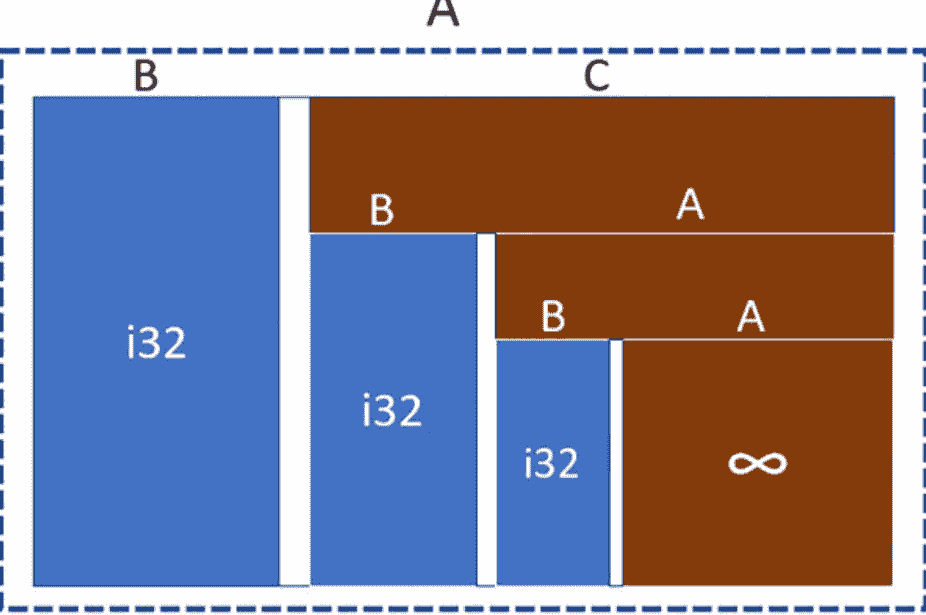

图 10.5：计算递归类型 `A` 的大小

解决方案是在 `C` 的声明中使用 `Box<A>` 代替 `A`。现在，栈上只存储指向 `A` 实例的指针，而实际数据存储在堆上。指针的大小独立于它指向的数据的大小。因此，`C` 的大小可以计算为类型 `i32` 值的大小和类型 `Box<A>` 类型的大小之和：

```rust
enum A {
    B(i32),
    C(i32, Box<A>),
}

fn main() {
    let x = A::C(1, Box::new(A::C(2, Box::new(A::B(3)))));
    let sz = std::mem::size_of_val(&x);
    println!("size of x = {}", sz);
}
```

**程序输出：**

```
C:\rust_projects\smartpointer_4> cargo run
Compiling smartpointer_4 v0.1.0 (C:\rust_projects\smartpointer_4)
  Finished dev [unoptimized + debuginfo] target(s) in 0.99s
  Running '\target\debug\smartpointer_4.exe'
size of x = 16
```

**图 10.6**：使用 `Box<A>` 代替 `A` 来修复由于定义递归类型导致的错误

现在，由于消除了无限递归，编译器能够计算变体 `C` 的大小，即为 `i32` 的大小加上指针 `Box<A>` 的大小。

## `Rc<T>`

`Rc<T>` 或引用计数智能指针允许数据的多所有权。`Rc<T>` 指针跟踪指向某个值的引用次数。如果引用计数降为零，则该值没有任何地方被使用，因此可以无问题地从内存中清理。让我们修改枚举 `A`，用 `Rc<A>` 代替 `Box<A>`，以实现 `Rc<A>` 中数据的共享所有。我们创建一个新的 `Rc<A>` 并将其存储在 `x` 中。我们还通过调用 `Rc::clone()` 并将 `x` 中的 `Rc<A>` 作为参数创建了 `y` 和 `z`。`Rc::clone` 不会对数据进行深拷贝，仅增加引用计数。我们使用 `Rc::strong_count` 函数在不同地方打印 `x` 的引用计数，如下例所示：

```rust
enum A {
  B(i32),
  C(i32, Rc<A>),
}

use std::rc::Rc;

fn main() {
  let x = Rc::new(A::C(1, Rc::new(A::C(2, Rc::new(A::B(3))))));
  println!("reference count of x = {}", Rc::strong_count(&x));
  let y = Rc::clone(&x);
  println!("reference count of y = {}", Rc::strong_count(&y));
  let z = Rc::clone(&x);
  println!("reference count of z = {}", Rc::strong_count(&z));
}
```


**图 10.6**：使用 `Box<A>` 代替 `A` 来修复由于定义递归类型导致的错误

现在，由于消除了无限递归，编译器能够计算变体 `C` 的大小，即为 `i32` 的大小加上指针 `Box<A>` 的大小。

## `Rc<T>`

`Rc<T>` 或引用计数智能指针允许数据的多所有权。`Rc<T>` 指针跟踪指向某个值的引用次数。如果引用计数降为零，则该值没有任何地方被使用，因此可以无问题地从内存中清理。让我们修改枚举 `A`，用 `Rc<A>` 代替 `Box<A>`，以实现 `Rc<A>` 中数据的共享所有。我们创建一个新的 `Rc<A>` 并将其存储在 `x` 中。我们还通过调用 `Rc::clone()` 并将 `x` 中的 `Rc<A>` 作为参数创建了 `y` 和 `z`。`Rc::clone` 不会对数据进行深拷贝，仅增加引用计数。我们使用 `Rc::strong_count` 函数在不同地方打印 `x` 的引用计数，如下例所示：

```rust
enum A {
  B(i32),
  C(i32, Rc<A>),
}

use std::rc::Rc;

fn main() {
  let x = Rc::new(A::C(1, Rc::new(A::C(2, Rc::new(A::B(3))))));
  println!("reference count of x = {}", Rc::strong_count(&x));
  let y = Rc::clone(&x);
  println!("reference count of y = {}", Rc::strong_count(&y));
  let z = Rc::clone(&x);
  println!("reference count of z = {}", Rc::strong_count(&z));
}
```

一个值。

- `Rc<T>` 是一个单线程引用计数智能指针。
- `RefCell<T>` 遵循*内部可变模式*（Interior Mutability Pattern），它允许你在对数据存在不可变引用的情况下修改该数据。
- `RefCell<T>` 类型表示类似于 `Box<T>` 的单所有权。

# 第 11 章 并发

## 引言

安全高效的并发编程是 Rust 的主要目标之一。随着计算机能够利用多个处理器的出现，并发编程和并行编程变得越来越重要。在并发编程中，程序的不同部分独立执行；而在并行编程中，程序的不同部分同时执行的。与其他语言相比，Rust 试图简化对并发和并行的处理。

## 结构

本章涵盖了以下主题：

- 使用线程同时运行代码段
- 消息传递并发
- 共享状态并发
- `Sync` 和 `Send` 特性

## 目标

在本章结束时

## 线程

程序的代码在进程中执行，操作系统管理着多个进程。程序的独立部分可以使用线程同时运行。使用多个线程可以提高性能，但也会增加代码的复杂性，并由于跨线程的任务同步和数据共享导致竞态条件、死锁和其他 bug 问题。Rust 试图简化这一过程，并避免编写并发程序时的常见陷阱。

## 线程模型

不同的编程语言以不同的方式实现多线程。常见的线程模型有一对一、多对一和多对多模型。

## 一对一模型

操作系统提供了创建新线程的 API。在这种模型中，编程语言调用操作系统提供的 API 来创建线程。每个语言（用户）线程对应一个操作系统（内核）线程。因此，它也被称为一对一模型。该模型如图所示：

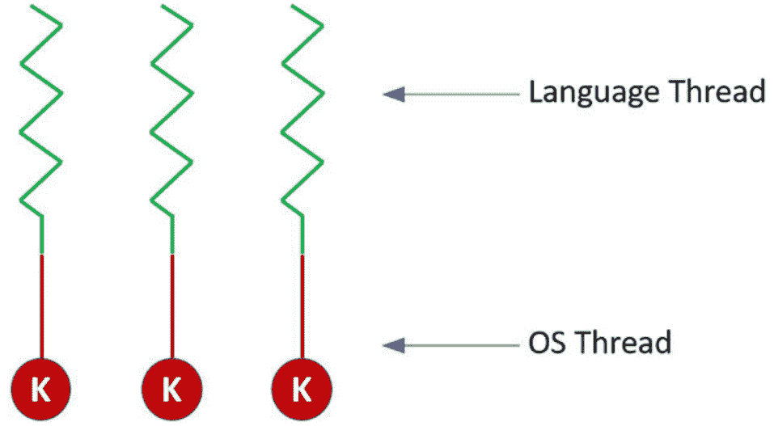

图 11.1：一对一线程模型

该模型的优点是语言运行时库不需要提供其自己的线程管理的实现，从而使得生成的二进制文件更小。该模型的缺点是创建用户线程需要一个相应的内核线程。因此，对线程数量有一个限制，以防止大量的内核线程增加系统负担。

## 多对一模型

在多对一模型中，许多用户线程映射到单个内核线程，线程管理在用户空间完成。这种模型是非常高效的，但线程的阻塞系统调用可能会阻塞整个进程。另一个缺点是多个线程无法并行运行，因为一次只有一个线程可以访问内核。该模型如图所示：

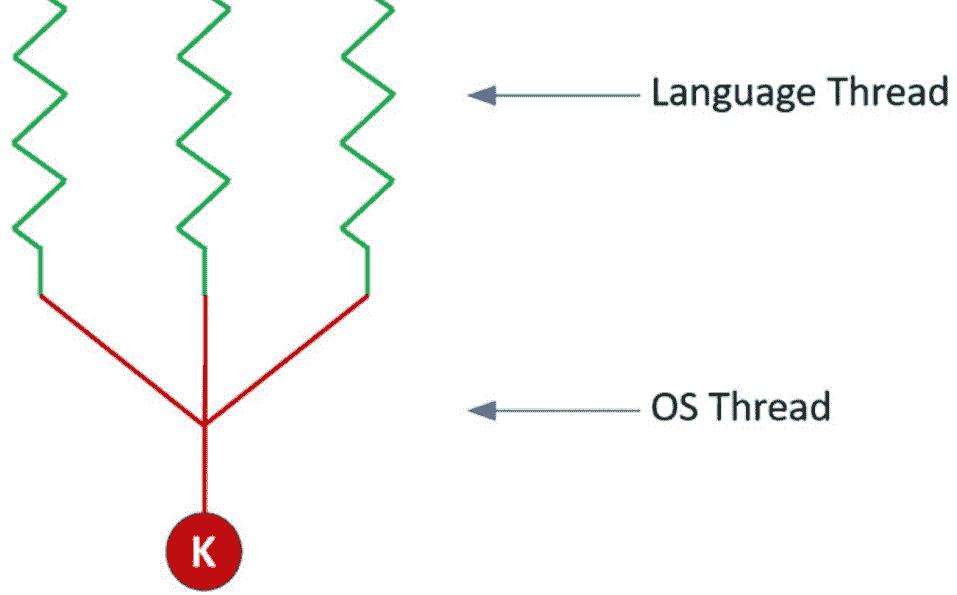

图 11.2：多对一线程模型

## 多对多模型

在这种模型中，许多用户线程映射到许多内核线程。内核线程的数量取决于应用程序或机器。它克服了上述两种模型的缺缺点，因为可以根据需要有许多用户线程，并且相应的内核线程可以在多处理器系统上并行运行。多对多模型如图所示：

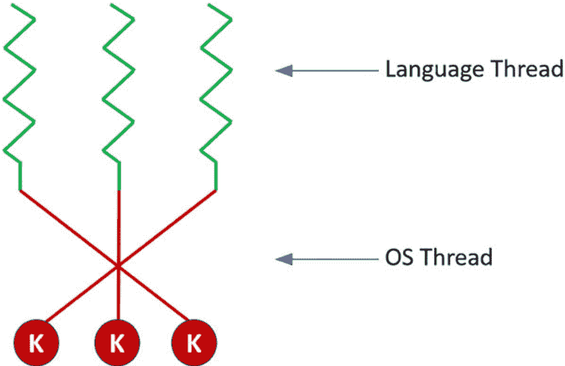

图 11.3：多对多线程模型

Rust 标准库提供了一对一线程模型的实现，需要一个较小的运行时库来管理线程。也有一些 crate 实现了多对多线程模型。让我们探索如何使用 Rust 标准库提供的线程相关 API。

## 创建线程 - `spawn`

为了创建一个新线程，我们使用 `thread::spawn` 函数并传递一个包含要在新线程中运行代码的闭包。在下面的示例中，我们开启了一个新线程并从中打印一些文本，同时主线程也打印了一些文本：

```rust
use std::thread;
use std::time::Duration;

fn main() {
    thread::spawn(|| {
        for i in 1..10 {
            println!("From spawned thread - {}", i);
            thread::sleep(Duration::from_millis(2));
        }
    });

    for i in 1..3 {
        println!("From main thread - {}", i);
        thread::sleep(Duration::from_millis(2));
    }
}
```

代码的输出：

```
PS C:\rust_projects\concurrency_1> cargo run
Compiling concurrency_1 v0.1.0 (C:\rust_projects\concurrency_1)
Finished dev [unoptimized + debuginfo] target(s) in 1.27s
Running target\debug\concurrency_1.exe
From main thread - 1
From spawned thread - 1
From spawned thread - 2
From main thread - 2
From spawned thread - 3
```

图 11.4：从主线程打印值的输出

在前面的示例中，我们看到在主线程完成工作后，它在等待被的线程完成。

## 等待线程 - `join`

主线程可能会比子线程早完成工作。我们可以使用 `spawn` 返回的 `join` 方法来等待线程完成。这如下例所示：

```rust
use std::thread;
use std::time::Duration;

fn main() {
    let h = thread::spawn(|| {
        for i in 1..10 {
            println!("From spawned thread - {}", i);
            thread::sleep(Duration::from_millis(2));
        }
    });

    for i in 1..3 {
        println!("From main thread - {}", i);
        thread::sleep(Duration::from_millis(2));
    }

    h.join().unwrap();
}
```

代码的输出：

```
PS C:\rust_projects\concurrency> cargo run
Compiling concurrency_2 v0.1.0 (C:\rust_projects\concurrency)
Finished dev [unoptimized + debuginfo] target(s) in 1.27s
Running 'target\debug\concurrency_2.exe'
From main thread - 1
From spawned thread - 1
From main thread - 2
From spawned thread - 2
From spawned thread - 3
From spawned thread - 4
From spawned thread - 5
From spawned thread - 6
From spawned thread - 7
From spawned thread - 8
From spawned thread - 9
```

图 11.5：使用 `join` 等待线程

## 消息传递并发

并发程序的执行是非确定性的，因为线程的执行顺序未知。为了在执行顺序不可预测的情况下确保程序的正确性，我们需要线程同步机制。一种机制就是消息传递并发。Rust 标准库提供了通道（channel）的实现，通道包含两个部分——发送端和接收端。代码的一部分向发送端发送数据，另一部分检查接收端是否有进入的消息，如图：


图 11.6：通道工作原理图

Rust 标准库实现的通道方式可以是多个生产者（发送端）但单消费者（接收端）。它被称为 `mpsc`，即多生产者单消费者。在 Rust 中，我们使用 `mpsc::channel` 创建通道，它返回一个元组，第一个元素是发送端，第二个元素是接收端。让我们通过下面的示例理解 Rust 通道是如何工作的：

```rust
use std::sync::mpsc;
use std::thread;
use std::time::Duration;

fn main() {
    let (tx1, rx) = mpsc::channel();
    let tx2 = tx1.clone();

    thread::spawn(move || {
        let num_vec = vec![1, 2, 3];
        for num in num_vec {
            tx1.send(num).unwrap();
            thread::sleep(Duration::from_millis(2));
        }
    });

    thread::spawn(move || {
        let num_vec = vec![4, 5, 6];
        for num in num_vec {
            tx2.send(num).unwrap();
            thread::sleep(Duration::from_millis(2));
        }
    });

    for received_val in rx {
        println!("Received: {}", received_val);
    }
}
```

代码的输出：

```
PS C:\rust_projects\concurrency_3> cargo run
Compiling concurrency_3 v0.1.0 (C:\rust_projects\concurrency_3)
Finished dev [unoptimized + debuginfo] target(s) in 1.12s
Running 'target\debug\concurrency_3.exe'
Received: 1
Received: 4
Received: 2
Received: 5
Received: 6
Received: 3
```

图 11.7：使用 `mpsc` 通道发送和接收值

在前面的代码示例中，我们使用 `mpsc::channel` 创建了一个新的 `mpsc` 通道。我们克隆了通道以获得两个发送端 `tx1` 和 `tx2` 以及一个接收端 `rx`。然后，启动两个线程，并将发送句柄移动到线程闭包中。我们从两个线程通过发送句柄 `tx1` 和 `tx2` 向通道发送了几个值。最后，我们使用通道的接收句柄来获取两个线程发送的值。

## 共享状态并发

共享状态或共享内存并发是 Rust 中处理并发的另一种方式。它类似于多所有权和多个线程访问同一个内存位置，这与通道的情况不同。共享状态并发通过 `Mutex<T>` 和 `Arc<T>` 实现。

## `Mutex<T>`

`Mutex`（互斥锁）限制一次时间只有一个线程可以访问数据。可以使用 `new` 构造函数创建互斥锁。每个 `mutex` 都有一个类型参数，表示它所保护的数据。要访问或修改受 `mutex` 保护的值，我们必须先使用 `lock` 方法获取锁。`lock` 方法返回一个 `MutexGuard` 类型，它允许我们访问内部值。其他任何线程都无法访问由 `MutexGuard` 保护的这个值。让我们来看下面的示例：

```rust
use std::sync::Mutex;

fn main() {
    let mu = Mutex::new(10);
    let mut val = mu.lock().unwrap();
    println!("val = {:?}", val);
    val += 1;
    println!("val = {:?}", val);
}
```

代码的输出：

```
PS C:\rust_projects\concurrency_4> cargo run
Compiling concurrency_4 v0.1.0 (C:\rust_projects\concurrency_4)
Finished [unoptimized + debuginfo] target(s) in 0.96s
Running 'target\debug\concurrency_4.exe'
val = 10
val = 11
```

图 11.8：在单线程场景中使用 `Mutex<T>`

在前面的示例中，`val` 是一个 `MutexGuard<i32>`，被声明为 `mut` 是因为我们通过加 1 改变了它的值。然而，`val` 在完成后后仍然持有锁。当 `MutexGuard` 离开作用域时，`mutex` 会解锁，如下例所示：

```rust
use std::sync::Mutex;

fn main() {
    let mu = Mutex::new(10);
    {
        let mut val = mu.lock().unwrap();
        println!("{?}", mu);
        *val += 1;
    }
    println!("{?}", mu);
}
```

代码的输出：

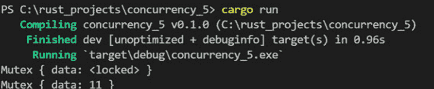

图 11.9：在单独的代码块中锁定 `mutex` 以在代码块结束时自动解锁

在前面的示例中，我们打印了两次 `mutex` `mu`：第一次是在代码块内获取锁之后，第二次是在块结束且锁被释放之后。这在输出中也得到了相应的反映。

如果你不想使用不同的代码块，可以使用 `std::mem::drop(val)` 来手动解锁 `mutex` `mu`，如下代码段所示：

```rust
use std::sync::Mutex;

fn main() {
    let mu = Mutex::new(10);
    println!("{?}", mu);
    let mut val = mu.lock().unwrap();
    *val += 1;
    println!("{?}", mu);
    std::mem::drop(val);
    println!("{?}", mu);
}
```

代码的输出：

```
PS C:\rust_projects\concurrency_6> cargo run
Compiling concurrency_6 v0.1.0 (C:\rust_projects\concurrency_6)
Finished dev [unoptimized + debuginfo] target(s) in 1.03s
   Running 'target\debug\concurrency_6.exe'
Mutex { data: 10 }
Mutex { data: <locked> }
Mutex { data: 11 }
```

图 11.10：使用 `std::mem::drop` 显式解锁 `mutex`

## `Arc<T>`

我们使用 `Mutex` 来保护一个值。共享状态并发允许跨线程对一个值拥有多个所有权，这是通过原子引用计数 `Arc<T>` 实现的。类似于 `Rc`，`Arc<T>` 允许跨线程共享值。当 `Arc` 离开作用域时，引用计数会递减。为了确保最多只有一个线程可以访问数据，我们需要将值包装在 `Mutex` 中，因为 `Arc` 本身不提供内部变性。让我们来看下面的示例：

```rust
use std::sync::{Arc, Mutex};
use std::thread;

fn main() {
    let val = Arc::new(Mutex::new(10));
    let mut t_handles = vec![];

    for _ in 0..5 {
        let val = Arc::clone(&val);
        let h = thread::spawn(move || {
            let mut num = val.lock().unwrap();
```


```rust
*num += 1;
```

```rust
});

t_handles.push(h);

}

for h in t_handles {

h.join().unwrap();

}

println!("val = {}", *val.lock().unwrap());

}
```

代码的输出：

```text
PS C:\rust_projects\concurrency_7> cargo run

Compiling concurrency_7 v0.1.0 (C:\rust_projects\concurrency_7)

Finished [unoptimized + debuginfo] target(s) in 0.01s

Running 'target\debug\concurrency_7.exe'

val = 15
```

图 11.11：使用`Arc<T>`跨线程共享所有权

## `Sync`和`Send`特性

Rust 根据类型是否实现了`Send`和`Sync`特性将其定义为线程安全的或不安全的。实现`Send`特性的类型的所有权可以安全地在线程间转移。大多数 Rust 类型都是`Send`，但`Rc<T>`例外。如果`Rc<T>`值被克隆并转移到另一个线程，两个线程会同时更新引用计数。因此，`Rc<T>`不是`Send`，且只能在单线程中使用。

实现`Sync`特性的类型可以被多个线程引用。换句话说，如果`&T`是`Send`，那么`T`就是`Sync`，即引用可以安全地转移到另一个线程。基本类型和完全由`Sync`类型组成的类型也是`Sync`。`Mutex<T>`是`Sync`。简单而言之，`Send`表示安全地转移所有权，而`Sync`表示多个线程可以安全地共享该类型。

## 总结

在本章中，你学习了 Rust 中的并发。你学习了如何使用线程同时运行代码。特别是，你了解了如何启动新线程以及等待线程结束，并学习了不同的线程模型。你还研究了跨线程同步机制，即消息传递和共享状态并发。最后，你探索了`Sync`和`Send`特性，这些特性将类型分类为线程安全的或不安全的。

在下一章“面向对象特性”中，我们将探索 Rust 中的面向对象编程特性。

## 练习

1. 什么是线程？它们如何帮助提高代码性能？
2. 具有哪些线程模型？哪种模型是 Rust 标准库实现的？
3. 给定包含 100 个整数的向量，你需要计算所有值的和。请编写一个程序，使用以下方法进行加法：
   - a) 单线程
   - b) 五线程
4. Rust 中有哪些不同的线程同步机制？
5. 什么是通道（channels）？
6. 什么是共享状态并发（shared-state concurrency），它在 Rust 中如何实现？
7. 类型`Rc<T>`与`Arc<T>`有什么区别？

## 注意事项

- 在并发编程中，程序的不同部分独立执行；而在并行编程中，程序的不同部分同时执行。
- 常见的线程模型有一对一、多对一和多对多三种模型。
- 在一对一线程模型中，每个用户线程对应一个内核线程。编程语言通过操作系统提供的 API 来创建线程。
- 在多对一模型中，许多用户线程映射到单个内核线程，线程管理在用户空间中完成。
- 在多对多模型中，许多用户线程映射到多个内核线程。
- 我们使用`thread::spawn`函数创建新线程，并传递一个包含在新线程中运行代码的闭包。
- 我们可以使用`spawn`方法返回的`JoinHandle`上的`join`方法来等待关联线程完成工作。
- Rust 标准库提供了通道的实现，这是一种主要的消息传递并发解决方案。
- 通道包含两个部分：发送器和接收者，即代码的一部分向发送器端发送数据，另一部分检查接收者是否有新到达的消息。
- 共享状态并发是 Rust 中处理并发的一种方式。它通过`Mutex`和`Arc`实现。
- `Mutex`或互斥锁限制了同一时间只有一个线程访问数据。
- `Rc<T>`允许通过`clone`方法实现对值的多个所有权，但跨线程使用是不安全的。`Arc<T>`与`Rc<T>`类似，但它是安全的。
- Rust 根据类型是否实现了`Send`和`Sync`特性，将数据类型定义为线程安全或不安全。

# 第 12 章：面向对象特性

## 引言

在本章中，我们将探索面向对象编程（OOP）的某些特性，并理解这些特性如何在 Rust 中得到支持。随后，我们将学习如何在 Rust 中实现面向对象的设计模式，以及实现 OOP 解决方案与使用某些 Rust 特性之间的权衡。

## 结构

本章涵盖了以下主题：

- 面向对象编程的特性
- 使用泛型和 trait 边界——静态分发
- 使用 trait 对象——动态分发
- 在 Rust 中实现 OOP 模式

## 目标

在本章结束时，你应该熟悉 Rust 中的面向对象编程特性。你将知道如何使用结构体（structs）定义对象，并为这些对象添加方法。你将学习如何在结构体和 trait 的帮助下实现 Rust 中的多态。此外，我们将探索一种名为状态模式（state pattern）的面向对象设计模式，并对其示例进行实现。

## 面向对象编程的特性

面向对象编程（OOP）是一种类和对象的流行编程模型。类是创建对象的蓝图或原型。对象是类的实例，用于表示现实世界的实体。一个对象由数据和对该数据的操作方法组成。面向对象编程基于四个主要原则：继承、封装、抽象和多态。

## 继承

继承是一种机制，对象可以从另一个对象继承数据和行为，而无需重新定义它们。Rust 不支持继承。相反，它推崇“组合优于继承”，因为组合被认为更好用且更容易实现。为了实现“拥有”（has-a，组合），Rust 使用了 trait。

## 封装

封装是限制代码访问对象实现细节的方法，与对象交互的唯一方式是通过其公共方法。因此，程序员可以更改对象的内部实现，而无需更改使用它的代码。在 Rust 中，我们通过使用结构体来实现封装。`pub`关键字可以决定代码中的哪些模块、类型、函数和方法应该是公开的。例如，我们可以定义一个结构体`CustomStack`，它包含一个包含`i32`值向量的字段，以及一个包含向量中运行最大值的字段，如下所示：

```rust
struct CustomStack {
    elements: Vec<i32>,
    max: i32,
}

impl CustomStack {
    pub fn push(&mut self, elem: i32) {
        self.elements.push(elem);
        self.calculate_max();
    }

    pub fn pop(&mut self) -> Option<i32> {
        let el = self.elements.pop();

        match el {
            Some(x) => {
                self.calculate_max();
                Some(x)
            }
            None => None,
        }
    }

    pub fn max(&self) -> i32 {
        self.max
    }

    fn calculate_max(&mut self) {
        // 隐藏：内部逻辑
        let m = self.elements.iter().max();

        match m {
            None => self.max = 0,
            Some(x) => self.max = *x,
        }
    }
}
```

```rust
fn main() {
    let mut cs = CustomStack {
        elements: vec![],
        max: 0,
    };

    cs.push(5);
    cs.push(3);
    cs.push(10);

    println!("Max value in stack = {}", cs.max());
}
```

输出：

```text
Max value in stack = 10
```

在前面的示例中，`CustomStack`结构体被标记为`pub`，但它的字段是私有的。外部代码访问或修改元素的唯一方法是通过公共方法。

## 抽象

抽象是面向对象编程的另一个重要特性，允许我们只展示必要的信息并隐藏其他细节。在 Rust 中，我们通过使用 trait 实现抽象，而不是定义方法。

## 多态

多态意味着多种形式。它指的是可以处理多种类型代码。多态可以是编译时的或运行时的。在 C++ 等语言中，编译时多态通过运算符重载和方法重载实现，而运行时多态通过方法重写实现。当派生类提供自己的实现时，基类中的方法被称为被重写了。Rust 没有继承，因此它使用泛型和 trait 实现多态。

多态的一个主要优势是代码复用。它允许我们创建接受任何类型的函数，只要这些类型具有某些行为。例如，假设我们有一个函数`foo_rectangle`，它接受`Rectangle`类型的参数，计算矩形面积并使用该值进行进一步操作。让我们进一步假设`Triangle`和`Circle`类型也具有类似的功能。因此，我们可以定义`foo_triangle`和`foo_circle`，如下例所示：

```rust
struct Rectangle {
    l: f64,
    w: f64,
}

impl Rectangle {
    fn area(&self) -> f64 {
        self.l * self.w
    }
}

struct Triangle {
    a: f64,
    b: f64,
    c: f64,
}

impl Triangle {
    fn area(&self) -> f64 {
        let s = (self.a + self.b + self.c) / 2.0;
        (s * (s - self.a) * (s - self.b) * (s - self.c)).sqrt()
    }
}

struct Circle {
    r: f64,
}

impl Circle {
    fn area(&self) -> f64 {
        3.14 * self.r * self.r
    }
}

fn foo_rectangle(r: Rectangle) {
    let area = r.area();
    println!("area = {}", area);
}

fn foo_triangle(t: Triangle) {
    let area = t.area();
    println!("area = {}", area);
}

fn foo_circle(c: Circle) {
    let area = c.area();
    println!("area = {}", area);
}
```

```rust
fn foo_circle(c: Circle) {
    let area = c.area();
    println!("area = {}", area);
}

fn main() {
    let rl = Rectangle { l: 10.0, w: 20.0 };
    foo_rectangle(rl);

    let t1 = Triangle {
        a: 3.0,
        b: 4.0,
        c: 5.0,
    };
    foo_triangle(t1);

    let cl = Circle { r: 5.0 };
    foo_circle(cl);
}
```

### 代码的输出

```text
PS C:\rust_projects\op2> cargo run

Compiling op2 v0.1.0 (C:\rust_projects\op2)

Finished dev [unoptimized + debuginfo] target(s) in 0.91s

Running '\target\debug\op2.exe'

area = 200
area = 6
area = 78.5
```

图 12.2：不使用多态计算几何形状的面积

在前面的示例中，我们定义了三个不同的函数：`foo_rectangle`、`foo_triangle`和`foo_circle`，分别对应表示几何形状`Rectangle`、`Triangle`和`Circle`。然而，似乎有太多的重复代码，因为这三个方法都在做类似的事情，即调用它们各自输入形状的`area()`并对该值进行进一步处理（在本例中，只是打印该值）。在将来，如果我们需要处理新形状，就需要定义另一个函数`foo_new_shape`。所有这些代码重复都可以通过使用多态来避免，多态意味着我们需要一个接受实现通用 trait（特征）的类型的单一函数。如下图所示：

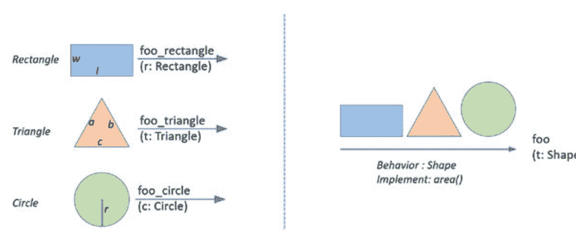

不使用多态　　使用多态

**图 12.3：**比较使用和不使用多态的面积函数

在 Rust 中实现多态有两种方法，即静态分发和动态分发。这两者在性能和二进制大小方面都有权衡。让我们看看如何使用泛型和 trait 在 Rust 中实现多态。我们将为所有结构体定义一个通用 trait`Shape`：`Rectangle`、`Triangle`和`Circle`。`Shape` trait 仅包含一个方法`area()`，所有实现它的结构体都需要定义它，如下代码所示：

```rust
trait Shape {
    fn area(&self) -> f64;
}

struct Rectangle {
    l: f64,
    w: f64,
}

impl Shape for Rectangle {
    fn area(&self) -> f64 {
        self.l * self.w
    }
}

struct Triangle {
    a: f64,
    b: f64,
    c: f64,
}
```

```rust
impl Shape for Triangle {
    fn area(&self) -> f64 {
        let s = (self.a + self.b + self.c) / 2.0;
        (s * (s - self.a) * (s - self.b) * (s - self.c)).sqrt()
    }
}

struct Circle {
    r: f64,
}

impl Shape for Circle {
    fn area(&self) -> f64 {
        3.14 * self.r * self.r
    }
}
```

我们将使用前面代码段中的实现来演示多态的静态和动态分发技术。

## 使用泛型和 trait 边界——静态分发

在这种方法中，我们使用泛型和 trait 边界来实现多态。它的性能极高（零抽象），但由于单态化（Monomorphization），会导致二进制文件体积增大。

单态化是在编译期间通过填充使用的具体类型，将泛型代码转换为固定代码的过程。

静态分发方法可以通过以下示例来理解：

```rust
fn foo_sd<T: Shape>(t: T) {
    let area = t.area();
    println!("area is {}", area);
}

fn main() {
    let r1 = Rectangle { l: 10.0, w: 20.0 };
    foo_sd(r1);

    let t1 = Triangle {
        a: 3.0,
        b: 4.0,
        c: 5.0,
    };
    foo_sd(t1);

    let c1 = Circle { r: 5.0 };
    foo_sd(c1);
}
```

### 代码的输出

```text
PS C:\rust_projects\oop3> cargo run

Compiling oop3 v0.1.0 (C:\rust_projects\oop3)

Finished dev [unoptimized + debuginfo] target(s) in 1.74s

Running 'target\debug\oop3.exe'

area = 200
area = 6
area = 78.5
```

图 12.4：使用多态静态分发方法计算几何形状的面积

在前面的示例中，我们定义了一个函数`foo_sd`，在它的函数签名中定义了一个受`Shape` trait 约束的泛型类型`T`，并使用该类型作为其中一个参数。然后我们调用作为参数传递给`foo_sd`函数的类型所实现的`area`函数。在`main()`函数中，我们创建了`Rectangle`、`Triangle`和`Circle`的实例，并调用了方法`foo_sd`。

## 使用 trait 对象——动态分发

在这种方法中，我们使用 trait 对象在运行时确定哪个类型满足多态接口。由于没有单态化，它产生的体积更小，但会有性能开销。trait 对象不能与泛型一起使用，这种方法允许使用泛型。trait 对象表示为`dyn`关键字，后跟 trait 的名称。可以通过以下示例来理解：

```rust
fn foo_dd(t: &dyn Shape) {
    let area = t.area();
    println!("area = {}", area);
}

fn main() {
    let r1 = Rectangle { l: 10.0, w: 20.0 };
    foo_dd(&r1);

    let t1 = Triangle {
        a: 3.0,
        b: 4.0,
        c: 5.0,
    };
    foo_dd(&t1);

    let c1 = Circle { r: 5.0 };
    foo_dd(&c1);
}
```


代码的输出：

```
PS C:\rust_projects\op4> cargo run
Compiling op2 v0.1.0 (C:\rust_projects\op2)
Finished dev [unoptimized + debuginfo] target(s) in 0.67s
Running 'target\debug\op2.exe'
area = 200
area = 6
area = 78.5
```

图 12.5: 使用多态动态分发方法计算几何形状的面积

在前面的示例中，我们定义了一个函数`foo_dd`，它接受一个 trait 对象作为参数。在`main()`函数中，我们创建了`Rectangle`、`Triangle`和`Circle`的实例，并将这些作为参数传递给函数`foo_dd`。

## 实现状态模式

状态模式是一种面向对象的设计模式，属于行为模式。该模式的本质是当对象的状态改变时，它的行为也会发生改变。在这种模式中，我们创建了代表不同状态的对象以及一个行为随状态变化的上下文对象。让我们为一个玩具示例实现状态模式，其中有三个状态 - `Start`、`Running`和`Stop`，如下所示：

 (png)

图 12.6: 说明状态模式的示例 UML 图

所有三个状态都实现了`State` trait，它只包含一个方法：`process()`。我们还有一个拥有状态对象的`StateContext`对象。改变`StateContext`对象的状态改变它的行为。让我们使用以下代码段来实现这种行为：

```rust
trait State {
    fn process(&self);
}

struct Start;

impl State for Start {
    fn process(&self) {
        println!("Started..");
    }
}

struct Running;

impl State for Running {
    fn process(&self) {
        println!("Running..");
    }
}

struct Stop;

impl State for Stop {
    fn process(&self) {
        println!("Stopped..");
    }
}
```

```rust
struct StateContext {
    state: Box<dyn State>
}

impl StateContext {
    fn new() -> StateContext {
        StateContext {
            state: Box::new(Start {}),
        }
    }

    fn set_state(&mut self, s: Box<dyn State>) {
        self.state = s;
    }

    fn process(&self) {
        self.state.process();
    }
}

fn main() {
    let mut ctxt = StateContext::new();
    ctxt.process();
    ctxt.set_state(Box::new(Running {}));
    ctxt.process();
    ctxt.process();
    ctxt.process();
    ctxt.set_state(Box::new(Stop {}));
    ctxt.process();
}
```

代码输出：

```
$ C:\rust_projects\oop5> cargo run
Compiling oop5 v0.1.0 (C:\rust_projects\oop5)
Finished dev [unoptimized + debuginfo] target(s) in 1.59s
Running `target\debug\oop5.exe`
Started..
Running..
Running..
Running..
Stopped..
```

图 12.7: 显示状态模式运行的输出

在前面的示例中，我们创建了一个初始状态为`Start`的`StateContext`对象，当我们调用它的`process()`方法时这反映在输出中。随后，上下文对象的状态改变了多次，它的行为（`process()`方法）也随之改变了。

## 总结

在本章中，你学习了 Rust 中的面向对象特性。你看到了如何使用结构体定义对象并添加与这些对象对应的方法。Rust 没有继承，它使用泛型和 trait 来实现多态。你看到了 Rust 中多态的两种方法：静态分发和动态分发。最后，你还学习了一种名为状态模式的面向对象设计模式，并为简单示例实现了它。

在下一章实现数据结构 - 链表、树、哈希表和图中，我们将实现链表、树、哈希表和图等常用数据结构。

## 问题

+ 说明面向对象编程的主要原则。
- 什么是继承？Rust 支持继承吗？
- 什么是封装？Rust 如何支持封装？
- 什么是多态？它有什么优点？
- Rust 如何支持多态？
- Rust 中静态分发和动态分发多态方法的主要区别是什么？

## 记忆要点

+- 面向对象编程 (OOP) 是一种使用类和对象的流行范式。
- 面向对象编程基于四个主要原则：继承、封装、抽象和多态。
- 继承（Inheritance）是一种机制，对象可以通过另一个对象继承数据和行为，而无需重新定义它们。
- Rust 不支持继承。相反，它提倡组合优于继承，因为它被认为更容易使用和实现。
- 封装（Encapsulation）是一种限制使用对象的代码访问其实现细节的方法。
- 抽象（Abstraction）允许我们只展示必要的信息而隐藏所有其他细节。
- 多态（Polymorphism）意味着许多形式。它是指处理多种类型数据的代码。多态的主要优势之一是`code reuse`。
- Rust 中实现多态有两种，即静态分发（static dispatch）和动态分发（dynamic dispatch），它们在性能和二进制体积上各有权衡。
- 在静态分发中，我们使用泛型和 trait 边界限制（trait bounds）来实现多态。它的性能极高，但由于单态化（monomorphization），会导致二进制体积增大。
- 在动态分发中，我们使用*trait 对象*（trait objects）在运行时实现多态。这会导致二进制体积较小，但会有性能开销。

## 第13 章
实现数据结构 – 链表、树、哈希表和图

## 引言

在本章中，我们将使用之前章节中学到的概念来实现一些最常见的数据结构。我们将实现链表、树、哈希表和图的表示。

## 结构

本章涵盖了以下主题：

- 链表数据结构
- 树、二叉树和二叉搜索树
- 哈希表
- 图及其表示方法

## 目标

在本章结束时，你将熟悉一些重要的数据结构以及如何使用 Rust 实现它们。你将学习到如何在链表数据结构中存储和访问数据。你还将学习关于二叉树和二叉搜索树，以及它们如何让你能够以分层的方式存储数据。此外，你还将探索了哈希表，它可以让你快速地存储和访问数据。你还将熟悉一种非常有用的数据结构——图，以及如何表示它。

## 链表数据结构

为了学习目的而实现的一个基础数据结构之一是**链表**（linked list）。它可以是单向链表或双向链表。**单向链表**允许通过`next`指针进行单向遍历，而双向链表允许通过`next`和`previous`指针进行正向和反向遍历。在本章中，我们将实现单向链表。虽然我们在实际应用中不会经常使用链表，但实现它提供了一个很好的学习机会。链表的主要结构是节点（Node），它包含一个类型为`T`的元素和一个指向下一个元素的可选值，如下所示：

```rust
struct Node<T> {
  data: T,
  next: Option<Box<Node<T>>>,
}
```

上述表示`Node`的代码片段可以可视化为如图所示：img/ba746793e822203858763e945f864e1_208.png 图 13.1：链表节点的表示

现在我们已经知道了`Node`的结构，让我们来理解链表的组成。它由一个称为链表头（head）的可选值组成，指向第一个`Node`。`LinkedList`结构体的定义如下所示：

```rust
pub struct LinkedList<T> {
  head: Option<Box<Node<T>>>,
}
```

上述表示`LinkedList`的代码片段可以可视化为如图所示：img/ba746793e822203858763e945f864e1_209.png 图 13.2：链表结构的示例

让我们为`LinkedList`结构实现几个方法，即`new`、`push`和`length`。`new`方法用于创建一个没有任何节点的新链表。`push`方法接受参数`data`，创建一个包含该数据的新节点，并将其附加到列表开头。`pop`方法执行与`push`方法的反向操作，它从列表中移除第一个`Node`。`length`方法返回列表中节点的数量。这些方法定义在以下代码中：

```rust
impl<T> LinkedList {
    pub fn new() -> Self {
        LinkedList { head: None }
    }

    pub fn push(&mut self, data: T) {
        let node = Box::new(Node {
            data: data,
            next: self.head.take(),
        });
        self.head = Some(node);
    }

    pub fn pop(&mut self) -> Option<T> {
        let val = self.head.take();
        match val {
            Some(mut node) => {
                self.head = node.next.take();
                Some(node.data)
            },
            None => None
        }
    }

    pub fn length(&self) -> u8 {
        let mut len = 0;
        let mut n = &self.head;
        while let Some(ref node) = n {
            n = &node.next;
            len += 1;
        }
        len
    }
}
```

现在，让我们使用`new`方法创建一个`LinkedList`结构的实例，并在其上执行`push`、`pop`和`length`操作，如下例所示：

```rust
fn main() {
    let mut list = LinkedList::new();
    list.push(1);
    list.push(2);
    list.push(3);
    println!("{}", list.pop().unwrap());
    list.push(4);
    println!("{}", list.pop().unwrap());
    println!("{}", list.length());
}
```

代码的输出：img/ba746793e822203858763e945f864e1_210.png 图 13.3：在链表上执行操作的输出

## 树、二叉树和二叉搜索树

树是一种常用的表示分层数据的数据结构。它可以被定义为节点的集合，以递归的方式。节点可以定义为具有一个值以及指向子节点的列表。我们将讨论限制在一种特殊的树——二叉树，每个节点最多有两个孩子，如图所示：img/ba746793e822203858763e945f864e1_211_png

1. 首先，让我们定义树的结构，它由数据和两个可选字段`left`和`right`组成，表示节点的左右孩子。`TreeNode`结构体定义如下：

```rust
pub struct TreeNode<T> {
    data: T,
    left: Option<Box<TreeNode<T>>>,
    right: Option<Box<TreeNode<T>>>,
}
```

树节点的结构可以可视化为如图所示：

```rust
struct TreeNode<T> {
    data: T,
    left: Option<Box<TreeNode<T>>>,
    right: Option<Box<TreeNode<T>>>,
}
```

img/ba746793e822203858763e945f864e1_212_png

现在我们已经知道了树节点的结构，让我们理解二叉树的组成部分。它由一个称为树根（root）的可选值组成，指向树的顶部节点。除了根节点外，树的所有节点都有父节点。因此，在图 13.4 中，值为1的节点是根。`BinaryTree`定义如下：

```rust
pub struct BinaryTree<T> {
    root: Option<Box<TreeNode<T>>>,
}
```

在继续之前，让我们讨论**子树**（subtree）这个术语。树的子树是由树中的节点及其所有后代组成的树。我们称该子树以该节点为根。例如，二叉根的左右子树如图所示：img/ba746793e822203858763e945f864e1_212_1.png 图 13.6：树中节点的左右子树

简单的二叉树并不非常有用，因为在二叉树中搜索特定的数据是非常耗时的。由于二叉树的节点之间没有顺序，我们可能需要从根节点开始查看所有节点。这种搜索时间与在有序列表或数组中搜索一样糟糕。因此，我们将在二叉树节点之间添加某种顺序。节点左子树中的所有节点应持有小于或等于该节点的值，而大于该节点的值应该在节点的右子树中。在构建树或插入新节点时，应该考虑到这一点。这样的二叉树被称为二叉搜索树（binary search tree）。二叉搜索树的示例如图所示：

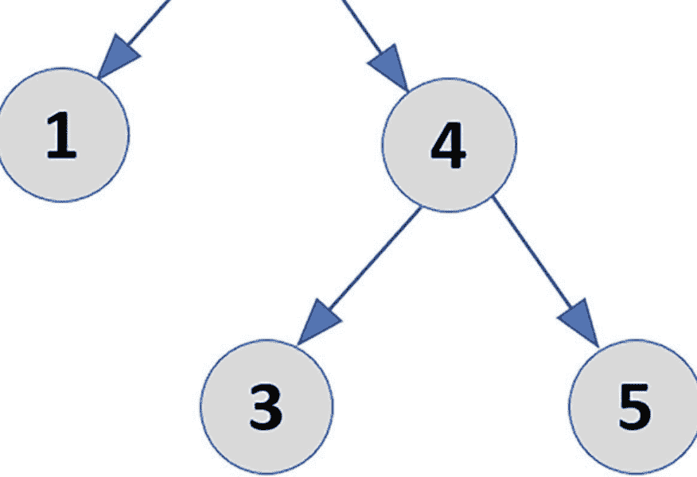

图 13.7：二叉搜索树的示例

2. 让我们定义二叉搜索树的结构。它与之前定义的**BinaryTree struct**相同，只需将其重命名为**BinarySearchTree**，如下代码所示：

```rust
pub struct BinarySearchTree<T> {
  root: Option<Box<TreeNode>>
}
```

3. 现在，让我们在**BinarySearchTree struct**上实现几个方法 - **new, insert, find 和 in_order**。**new**方法创建一个不含节点的空二叉搜索树。**insert**方法用于向树中插入带有给定值的新节点。**find**方法搜索具有给定值的节点，并根据是否找到节点返回`true`或`false`。我们还将实现一个名为`in_order`的方法，它将以中序遍历打印二叉搜索树中所有节点的数据。遍历二叉树有多种方法，如中序遍历、前序遍历、后序遍历、层序遍历等。我们将只实现中序遍历，它首先访问左子树的所有节点，然后是根节点，最后是右子树的所有节点。由于这对于所有子树来说都是成立的，因为所有子树本身也是二叉搜索树。因此，二叉搜索树的中序遍历的伪代码可以写如下：

```
fn inorder(root) {
    inorder(root.left)
    print root
    inorder(root.right)
}
```

在前面的伪代码中，你可以看到`inorder`函数调用了它自己几次。这在计算机编程术语中被称为**递归**（recursion）。递归是解决问题的一种方法，通过函数在问题的子集上调用自身来解决整个问题。在这种情况下，对树根调用的`inorder`会调用子树（即左子树和右子树）的`inorder`。`BinarySearchTree` struct 的方法在下面的代码段实现：

```rust
impl<T: std::cmp::PartialOrd + std::fmt::Display>
BinaryTree<T> {
    fn new() -> Self {
        BinaryTree { root: None }
    }

    fn insert(&mut self, data: T) {
        let root = self.root.take();
        self.root = self.insert_rec(root, data);
    }

    fn insert_rec(&mut self, node: Option<Box<TreeNode<T>>>, data: T) -> Option<Box<TreeNode<T>>> {
        match node {
        Some(mut n) => {
            if n.data < data {
                n.right = self.insert_rec(n.right, data);
            } else {
                n.left = self.insert_rec(n.left, data);
            }
        }
    }
}
```


## 二叉搜索树

在二叉搜索树中，插入和查找操作通过递归实现。以下是相关方法的代码：

```rust
// 插入方法
pub fn insert(&mut self, data: T) {
    self.root = self.insert_rec(self.root.take(), data);
}

fn insert_rec(&mut self, node: Option<Box<TreeNode<T>>>, data: T) -> Option<Box<TreeNode<T>>> {
    match node {
        Some(mut n) => {
            if data < n.data {
                n.left = self.insert_rec(n.left.take(), data);
            } else if data > n.data {
                n.right = self.insert_rec(n.right.take(), data);
            }
            Some(n)
        }
        None => Some(Box::new(TreeNode { data, left: None, right: None })),
    }
}

// 查找方法
pub fn find(&self, val: T) -> bool {
    self.find_rec(&self.root, val)
}

fn find_rec(&self, node: &Option<Box<TreeNode<T>>>, val: T) -> bool {
    match node {
        Some(n) => {
            if n.data == val {
                true
            } else if n.data < val {
                self.find_rec(&n.right, val)
            } else {
                self.find_rec(&n.left, val)
            }
        }
        None => false,
    }
}

// 中序遍历方法
pub fn in_order(&self, node: &Option<Box<TreeNode<T>>>) {
    if let Some(n) = node {
        self.in_order(&n.left);
        println!("{}", &n.data);
        self.in_order(&n.right);
    }
}
```

现在，让我们使用`new`方法创建一个`BinarySearchTree`结构的实例，使用`insert`方法插入几个值，并以中序方式打印树中所有节点的值，如下例所示：

```rust
fn main() {
    let mut bst = BinaryTree::new();
    bst.insert(2);
    bst.insert(1);
    bst.insert(3);
    bst.insert(10);
    bst.insert(5);
    bst.insert(2);
    bst.in_order(&bst.root);
    println!("find 2 : {}", bst.find(2));
    println!("find 5 : {}", bst.find(5));
    println!("find 15 : {}", bst.find(15));
}
```

代码的输出：

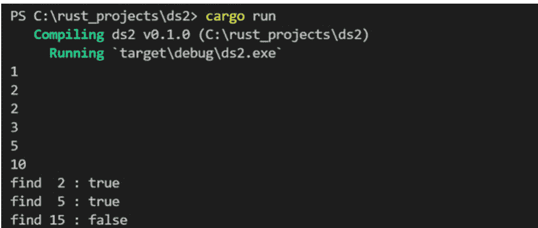

图 1.8：显示二叉搜索树操作的输出

你会注意到，二叉搜索树的中序遍历总是以排序的顺序打印值。

## 哈希表 (Hash tables)

哈希表是一种以关联方式存储数据的数据结构，也就是说它存储键（keys）以及与之关联的值（values）。数据存储在哈希表中的唯一索引处，并通过该索引进行访问或搜索。

`HashEntry::default()` 在`HashTable`方法中用于创建一个大小为 10000 的新哈希表，并为`HashEntry`设置默认值。现在，我们将创建一个新的哈希表，向其中添加几个值，并从中访问这些值。请注意，如果插入具有已存在键的条目，该值将被新值覆盖，如下例所示：

```rust
fn main() {
    let mut hash = HashTable::new();
    hash.insert(String::from("abhishek"), 1_000_000);
    hash.insert(String::from("vijay"), 2_000_000);
    hash.insert(String::from("abhishek"), 1_500_000);
    let x: String = String::from("abhishek");
    println!("value for {} = {}", x, hash.get(&x).unwrap());
}
```

代码的输出：

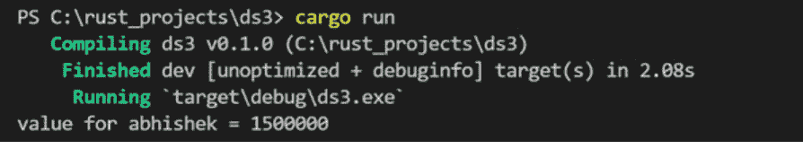

图 13.10：显示从哈希表中存储和访问数据的结果输出

## 图及其表示方法

图是由一组节点顶点 $V$ 和一组边 $E$ 组成的数据结构。一条边连接两个顶点。下图显示了一个具有五个顶点 {0, 1, 2, 3, 4} 和五条边 {{0, 1), (0, 2), (0, 3), (2, 4), (3, 4)} 的图：

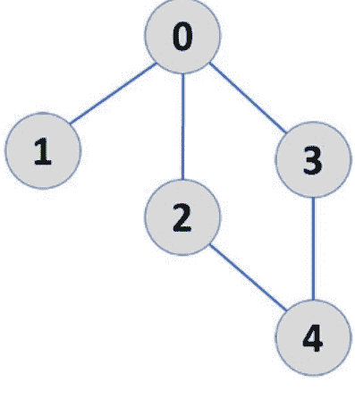

V = {0, 1, 2, 3, 4}

E = {(0,1), (0,2), (0,3), (2,4), (3,4)}

图 13.11：具有五个顶点和五条边的图示例

通过边相互连接的**顶点**被称为彼此**相邻**的，或彼此的邻居。例如，在前面的图中，节点 **0** 和 **1** 是彼此相邻的，节点 **2** 和 **4** 也是如此。利用顶点之间的邻接关系，我们可以构建所谓的*图的邻接列表表示法*。邻接列表由图中所有节点的邻居列表组成，如下所示：

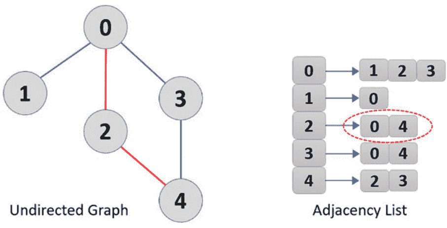

图 13.12：无向图及其邻接列表

在前面的图中，顶点 **2** 连接到顶点 **0** 和 **4**，因此在图的邻接列表中，对应于顶点 **2** 的列表包含 **0** 和 **4** 的条目。到目前为止，我们已经看到了顶点之间的无向边，也就是说如果节点 **u** 和 **v** 之间存在一条边，那么 **u** 与 **v** 相邻，且 **v** 与 **u** 相邻。由无向边组成的图被称为**无向图**。我们也可以拥有边是有向的图，也就是说如果图中存在从顶点 **u** 到顶点 **v** 的边，那么 **v** 与 **u** 相邻，但 **u** 与 **v** 不相邻。具有有向边的图被称为**有向图**。下图显示了带有邻接列表的有向图：

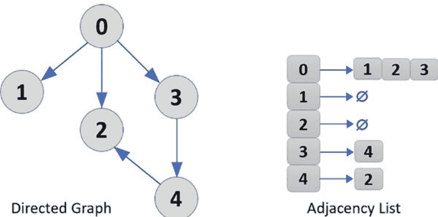

图 **13.13**：有向图及其邻接列表

在前面的图中，有一个从顶点 **3** 到顶点 **4** 的边，但没有从顶点 **4** 到 **3** 的边。因此，在图的邻接列表中，我们可以在对应于顶点 **3** 的条目中看到 **4**，但在对应于顶点 **4** 的条目中没有 **3**。

现在，让我们定义一个结构来表示图的数据结构。为了简单起见，我们将使用**顶点**表示图，并将 **usize** 作为其数据类型。邻接列表可以定义为 **usize** 的向量或`Vec<Vec<usize>>`，如下代码段所示：

```rust
struct Graph {
    num_vertices: usize,
    adj: Vec<Vec<usize>>,
}
```

现在，让我们在 **Graph 结构**上实现几个方法。`new`方法接受顶点数量作为参数，并创建一个具有许多顶点且没有边的新图。接下来，我们定义一个`add_edge`方法来在不同的顶点对之间添加边。让我们添加一个`print_graph`方法来打印图的邻接列表。这三个方法的实现如下代码段所示：

```rust
impl Graph {
    pub fn new(v: usize) -> Graph {
        Graph {
            num_vertices: v,
            adj: vec![vec![]; v]
        }
    }

    pub fn add_edge(&mut self, v1: usize, v2: usize) {
        self.adj[v1].push(v2);
        self.adj[v2].push(v2);
    }

    pub fn print_graph(&self) {
        // ... 实现细节
    }
}
```

*(注：原文代码块中`add_edge`内部为`self.adj[v2].push(v2)`，此处严格保留原文内容。)*


代码的输出：


图 13.10：显示从哈表中存储和访问数据的结果输出

# 图及其表示方法

图是由一组节点顶点 $V$ 和一组边 $E$ 组成的数据结构。一条边连接两个顶点。下图显示了一个具有五个顶点 {0, 1, 2, 3, 4} 和五条边 {{0, 1), (0, 2), (0, 3), (2, 4), (3, 4)} 的图：


`V = {0, 1, 2, 3, 4}`

`E = {(0,1), (0,2), (0,3), (2,4), (3,4)}`

图 13.11：具有五个顶点和五条边的图示例

通过边相互连接的顶点被称为彼此相邻的，或彼此的邻居。例如，在前面的图中，节点 0 和 1 是彼此相邻的，节点 2 和 4 也是如此。利用顶点之间的邻接关系，我们可以构建所谓的图的邻接列表表示法。邻接列表由图中所有节点的邻居列表组成，如下所示：


图 13.12：无向图及其邻接列表

在前面的图中，顶点 2 连接到顶点 0 和 4，因此在图的邻接列表中，对应于顶点 2 的列表包含 0 和 4 的条目。到为止，我们已经看到了顶点之间的无向边，也就是说如果节点 u 和 v 之间存在一条边，那么 u 与 v 相邻，且 v 与 u 相邻。由无向边组成的图被称为无向图。我们也可以拥有边是有向的图，也就是说如果图中存在从顶点 u 到顶点 v 的边，那么 v 与 u 相邻，但 u 与 v 不相邻。具有有向边的图被称为有向图。下图显示了带有邻接列表的有向图：


图 13.13：有向图及其邻接列表

在前面的图中，有一个从顶点 3 到顶点 4 的边，但没有从顶点 4 到 3 的边。因此，在图的邻接列表中，我们可以在对应于顶点 3 的条目中看到 4，但在对应于顶点 4 的条目中没有 3。

现在，让我们定义一个结构来表示图的数据结构。为了简单起见，我们将使用顶点表示图，并将 `usize` 作为其数据类型。邻接列表可以定义为 `usize` 的向量或 `Vec<Vec<usize>>`，如下代码段所示：

```
struct Graph {
  num_vertices: usize,
  adj: Vec<Vec<usize>>,
}
```

现在，让我们在 `Graph` 结构上实现几个方法。`new` 方法接受顶点数量作为参数，并创建一个具有许多顶点且没有边的新图。接下来，我们定义一个 `add_edge` 方法来在不同的顶点对之间添加边。让我们添加一个 `print_graph` 方法来打印图的邻接列表。这三个方法的实现如下代码段所示：

```
impl Graph {
    pub fn new(v: usize) -> Graph {
        Graph {
            num_vertices: v,
            adj: vec![vec![]; v]
        }
    }

    pub fn add_edge(&mut self, v1: usize, v2: usize) {
        self.adj[v1].push(v2);
        self.adj[v2].push(v2);
    }
}
```

- **哈希表**（hash table）是一种以关联方式存储数据的数据结构，也就是说它存储键以及与之关联的值。
- 哈希表使用底层容器（通常是数组）来存储数据，并使用 `hash` 函数在容器中计算一个索引（哈希码）。
- 在哈希表中，多个键可以映射到同一个索引。这种现象被称为**冲突**（collision）。
- **图**（graph）是一种由一组节点（顶点）和一组边组成的数据结构。边连接两个顶点。
- 根据图中的边是否是有向的或无向的，图可以是*有向的*或*无向的*。
- 图可以用邻接列表表示。
- 图遍历意味着访问图中的所有的节点。这可以通过**深度优先**的方式（称为**深度优先**搜索或 `dfs`）或**广度优先**的方式（称为**广度优先**搜索或 `bfs`）进行。

## 第 14 章

## 适用于 Windows 开发者的 Rust

## 引言

在本章中，我们将学习如何使用 `windows` crate 来调用任何 Windows API。我们还将开发一个简单的计算器应用程序，以理解如何借助 `windows` crate 使用任何 Windows API，并理解在 Windows 上使用 Rust 开发应用程序的工作流。

## 结构

本章涵盖了以下主题：

- 使用 Rust 进行 Windows 开发概述
- `windows` crate
- 在 Windows 上开发计算器应用程序

## 目标

在本章结束时，你应该熟悉在 Windows 上使用 Rust 开发应用程序的典型工作流。你应该熟悉 `windows` crate，并已经学习了如何在你的 Rust 包中调用不同的 Windows API。

## 使用 Rust 进行 Windows 开发

Rust for Windows 是适用于 Windows 的最新语言绑定（或投影）。`windows` crate 允许你像调用另一个 Rust 模块一样，将任何 Windows API 调用到你的 Rust 包中。`windows` crate 发布在 crates.io 上。使用 Rust 开发 Windows 应用程序的典型开发流程如下：

1. 使用 `cargo new` 创建一个新的 Rust 项目。
2. 添加 `[dependencies.windows]` 部分以使用 `windows` crate 及其不同的功能。
3. 在我们的源文件中从 `windows` crate 导入我们打算在应用程序使用的命名空间。
4. 在你的源文件中开始使用 Windows API。

## 在 Windows 上开发计算器应用程序

让我们借助 `windows` crate，使用 Windows API 开发一个微型计算器应用程序。我们计算器应用程序的最终 UI 应该如图所示：


图 14.1：计算器应用程序的 UI

为了简单起见，我们将仅实现基本的二进制运算：加、减、乘、除。

## 创建并设置项目

让我们通过调用 `cargo new calculator` 创建名为 `calculator` 的新项目。你的 `Cargo.toml` 文件应该如下：

```
[package]
name = "calculator"
version = "0.1.0"
authors = ["abhis"]
edition = "2018"

[dependencies]
```

为了使用 `windows` crate，我们需要将它添加到 `Cargo.toml` 文件的 `dependencies` 部分，如下：

```
[dependencies.windows]
version = "0.28"
features = [
  "alloc",
  "Win32_Foundation",
  "Win32_Graphics_Gdi",
  "Win32_System_LibraryLoader",
  "Win32_UI_WindowsAndMessaging"
]
```

接下来，在 `main.rs` 中，我们将从 `windows` crate 导入我们打算在应用程序开发使用的命名空间：

```
use windows::{
    core::*, Win32::Foundation::*,
    Win32::Graphics::Gdi::ValidateRect,
    Win32::System::LibraryLoader::GetModuleHandle,
    Win32::UI::WindowsAndMessaging::*,
};
```

## 设计 UI

让我们按照图 14.1 所示开始设计计算器应用的用户界面 (UI)。首先，我们将使用 `WNDCLASS` 结构体定义窗口类属性，并使用 `RegisterClassA` 函数注册它：

```
let wc = WNDCLASS {
    Cursor: LoadCursorW(None, IDC_ARROW),
    Instance: instance,
    lpszClassName: PSTR(b"window\0\0".as_ptr(as) as _),
    style: CS_HREDRAW | CS_VREDRAW,
    lfnWndProc: Some(wndproc),
    ..default::default(0)
};

let atom = RegisterClassA(&wc);
debug_assert!(atom != 0);
```

如果函数成功，返回值是一个类原子，它唯一标识了正在注册的类。如果失败，返回值为 0。要了解更多关于窗口类的信息，可以查看微软的官方文档页面。

接下来，我们将使用 `CreateWindowA` API 创建主应用程序窗口，如下代码段所示：

```
CreateWindowA(
    Default::default(),
    window_class,
    "Calculator",
    WS_OVERLAPPEDWINDOW | WS_VISIBLE, 215, 350,
    CW_USEDEFAULT, CW_USEDEFAULT, None, instance,
);
```

我们传递窗口的句柄，并将显示中的结果重置为 0。因此，你可以执行一系列操作而无需暂停，计算将实时完成。我们还添加了一个清除按钮，将所有变量重置。

## 实现计算器应用程序

为了执行运算，我们需要捕获按钮点击事件，这在 `Wndproc` 的 `WM_COMMAND` 事件中完成。我们通过创建时分配的 ID 来识别点击了哪个按钮。由于我们只处理二进制运算，我们需要定义两个变量来存储操作数。我们的程序使用 `OP1` 和 `OP2` 来存储两个操作数的值，变量 `OP` 则跟踪当前的操作。

实现逻辑的核心是，我们始终有两个初始化为 0 的操作数 `OP1` 和 `OP2`，以及一个初始化为点击按钮 ID 的 `OP`。当点击数字 0 到 9 的按钮时，我们持续追加 `OP2`；当点击 +, *, / 按钮时，我们对操作数 `OP1` 和 `OP2` 执行选定的二进制运算 `OP`。我们显示结果并更新 `OP1` 以存储结果，`OP2` 置为 0。

我们定义 `create_button` 函数：

```
fn create_button(phwnd: HWND, inst: HINSTANCE, txt: &str, x: i32, y: i32, w: i32, h: i32, hmenu: HMENU) -> HWND {
    unsafe {
        let hwnd = CreateWindowExA(
            WS_EX_CLIENT,
            "button",
            txt,
            WS_CHILD | WS_VISIBLE,
            x, y, w, h,
            hmenu, hmenu, inst,
        );
        SetWindowTextW(hwnd, txt);
        hwnd
    }
}
```

我们通过传递不同的文本和其他参数来调用 `create_button` 函数。最后，我们在应用程序顶部添加了一个静态文本框，用于显示我们刚刚添加的运算结果。

# 运算输出：


图 14.2：显示执行一系列操作结果的输出

当我们点击 1 和 2 时，它们被视为一个单一操作 12 并存储在 `OP2` 中。一旦点击了 + 号，它就会执行操作 `OP1 + OP2`，即 0 + 12 或 12。现在，`OP1` 是 12，`OP2` 是 0。然后，点击 5，接着是另一个 +。所以，`OP1` 是 12，`OP2` 是 5，而 `OP` 是 +。结果是 12 + 5，即 17。现在，`OP1` 变为 17，`OP2` 变为 0，`OP` 保持不变。接下来，点击 10，接着是 - 号，所以 `OP1` 是 17，`OP2` 是 10，`OP` 是 +，所以结果是 17 + 10 或 27。计算出结果后，`OP` 更新为 -，`OP1` 更新为 27，`OP2` 更新为 0。接下来，点击 7 和 * 号。所以，`OP1` 是 27 - 7 或 20，`OP2` 是 0，`OP` 是 *。接下来，点击 2 后接 +。所以，结果是 20 * 2 或 40。最后，3 和 = 号使得结果变为 40 + 3，即 43。

现在，让我们一起编译完整的代码，如下代码段所示：

```rust
// main.rs
use windows::{
    core::*, Win32::Foundation::*,
    Win32::Graphics::Gdi::ValidateRect,
    Win32::System::Loader::GetModuleHandleA,
    Win32::UI::WindowsAndMessaging::*,
};
```


```rust
const ID: isize = 10;
const ID_BTN_MINUS: isize = 11;
const ID_BTN_MULTIPY: isize = 12;
const ID_BTN_DIVIDE: isize = 13;
const ID_BTN_C: isize = 14;
const ID_BTN_EQ: isize = 15;
const ID_ST_RESULT: isize = 16;

fn create_button(phwnd: HWND, inst: HINSTANCE, txt: &str,
                 x: i32, y: i32, w: i32, h: i32, hmenu: HMENU) -> HWND {
    unsafe {
        let hwnd = CreateWindowExA(
            WS_EX_PALETTE_WINDOW,
            "button",
            txt,
            WS_CHILD | WS_VISIBLE,
            x, y, w, h,
            phwnd,
            hmenu,
            inst,
            std::ptr::null_mut(),
        );
        SetWindowTextW(hwnd, txt);
        hwnd
    }
}

fn main() -> Result<()> {
    unsafe {
        let instance = GetModuleHandleA(None);
        debug_assert!(instance.0 != 0);

        let window_class = "window";
        let wc = WNDCLASS {
            Cursor: LoadCursorW(None, IDC_ARROW),
            hInstance: instance,
            lpszClassName: LPSTR(b"window\0".as_ptr() as _),
            style: CS_HREDRAW | CS_VREDRAW,
            lfnWndProc: Some(wndproc),
            ..Default::default()
        };

        let atom = RegisterClassA(&wc);
        debug_assert!(atom != 0);

        let hwnd = CreateWindowExA(
            Default::default(),
            window_class,
            "Calculator",
            WS_OVERLAPPEDWINDOW | WS_VISIBLE,
            CW_USEDEFAULT,
            CW_USEDEFAULT,
            215,
            350,
            None,
            None,
            instance,
            std::ptr::null_mut(),
        );

        for i in 1..10 {
            let x = 15 + ((i-1) % 3)*60;
            let y = ((i-1)/3)*40 + 60;
            create_button(hwnd, instance, &i.to_string(), x, y, 50, HMENU(i as isize));
            create_button(hwnd, instance, "0", 15, 120, 180, 30, HMENU(0));
            create_button(hwnd, instance, "+", 15, 220, 50, 30, HMENU(ID_BTN_PLUS));
            create_button(hwnd, instance, "-", 75, 220, 50, 30, HMENU(ID_BTN_MINUS));
            create_button(hwnd, instance, "*", 135, 220, 50, 30, HMENU(ID_BTN_MULTIPLY));
            create_button(hwnd, instance, "/", 15, 260, 50, 30, HMENU(ID_BTN_DIVIDE));
            create_button(hwnd, instance, "C", 75, 260, 50, 30, HMENU(ID_BTN_C));
        }
    }
}
```

// 注：原文未提供完整的代码块，此处根据上下文推断并保持结构。

## 结论

在本章中，你学习了如何使用 `windows` crate 使用 Windows API。你还通过 Windows API 的帮助开发了一个简单的计算器应用程序。作为下一步，我们还建议你查看 `windows-sys` crate，它是针对最严苛的情况和最佳编译时间的零开销回退方案。

在下一章“Rust for Android”中，我们将探讨 Rust 如何获得动力和行业认可，并以 Rust 加入安卓开源项目（AOSP）为例。

## 问题

1. 什么是 `windows` crate？
2. 使用 Rust 开发 Windows 程序的步骤有哪些？
3. 更新计算器应用程序，添加一个对应 `x^y` 操作的按钮，计算 `x` 的 `y` 次。

## 知识点回顾

- Rust for Windows 是 Windows 最新的语言绑定。
- `windows` crate 允许你将任何 Windows API 调用到 Rust 包中，就像它是另一个 Rust 模块一样。
- 为了使用 `windows` crate，我们需要在 `Cargo.toml` 的 `dependencies` 部分添加它，并列出功能列表。
- 我们使用 `WNDCLASS` 结构体定义窗口类属性，并使用 `RegisterClassA` 函数进行注册。
- `CreateWindowExA` API 用于创建窗口。它指定了窗口类、标题、样式等。

## 遗留 C/C++ 代码

Android 系统的庞大代码库是 C/C++ 构建的，将所有这些替换为像 Rust 这样内存安全的编程语言极其困难。幸运的是，根据 Google 安全博客的数据，并不需要这样做。数据显示，平台上报告的约 50% 漏洞是由于一年内编写的代码导致的，随着代码库年龄的增加，这种情况会急剧下降。换句话说，新的代码库是内存安全漏洞的来源，如下所示：

# 内存安全漏洞百分比

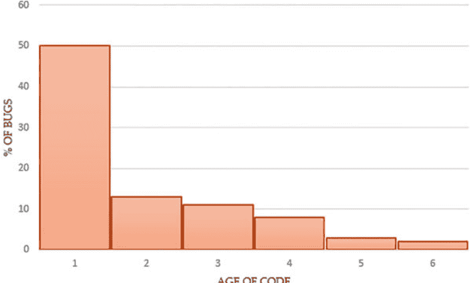

图 15.1：Android 中内存安全漏洞的年龄。来源：Google 安全博客

因此，将新开发的重心转向 Rust 可以极大减少内存安全漏洞。

## 集成到 Android 开源项目 (AOSP)

Android 开源项目 (AOSP) 是一个开源项目，为开发 Android 操作系统的自定义变体提供信息和源代码。Android 的主要目的是为原始设备制造商 (OEM)、运营商和开发者创建一个开放的软件平台。Rust 已被引入 AOSP，作为 Android 平台上原生代码开发的一种内存安全的替代方案。

# Android 中的 Rust 模块

Android 中 Rust 的使用通过路径列表（paths list）进行管理，该列表限制了特定 Rust 模块类型可以使用的位置。要在新路径中使用 Rust 模块，必须将每个新路径添加到 `build/soong/rust/config/allowed_list.go` 中相应的允许列表中。

# Rust 模块定义

让我们通过以下示例来理解如何在 Android 中定义 Rust 模块：

```rust
rust_binary {
  name: "hello_rust",
  crate_name: "hello_rust",
  srcs: ["src/hello_rust.rs"]
}
```

在前面的示例中，我们定义了一个 Rust 二进制模块。其他模块类型的处理过程类似。

# 通用模块属性

大多数属性（如 `name`、`crate_name`、`srcs` 等）在 Android Rust 模块中是通用的：

## name

`name` 属性存储模块名称且必须是唯一的。默认情况下，`name` 作为输出文件名。然而，可以通过 `stem` 属性将其设置为不同的值。

## stem

`stem` 属性允许对输出文件名进行直接控制。如果未为 `stem` 属性赋值，则使用模块名称作为默认文件名。

## srcs

`srcs` 属性包含一个代表模块入口的单一源文件。

## crate_name

`crate_name` 属性用于通过 `rustc -crate_name` 标志设置 crate 名称。

## lints

默认情况下，除源码生成器外的所有模块类型都会运行 `rustc` 检查器和 `clippy` 检查器。某些 lint 设置值（如 `default`、`android`、`vendor`、`none` 等）用于验证模块源码。

## edition

`edition` 属性定义了编译此代码使用的 Rust 版本。它可以取值 2015 和 2018。默认值为 2018。

## flags

`flags` 属性包含字符串标志列表，在编译时传递给 `rustc`。

## ld_flags

`ld_flags` 属性包含一个字符串标志列表，在源码编译时传递给链接器。这些通过 `-C link-args rustc` 标志传递。

## features

`features` 属性是一个字符串特性列表，在根据标志进行条件编译时必须启用这些特性。它们通过 `--cfg feature=${feature_name}` 传递给 `rustc`。

## cfgs

`cfgs` 属性包含字符串列表，表示编译期间要启用的 cfg 标志。它们通过 `--cfg` 选项传递给 `rustc`，例如 `--cfg foo` 或 `--cfg foo = <value>`。

## strip

`strip` 属性控制如何剥离输出文件。如果值设置为 `none`，则禁用剥离；如果设置为 `all`，则将剥离所有内容，包括微型调试信息。其他值请参阅 Soong Modules 参考。

## host_supported

对于设备模块，`host_supported` 参数指示模块是否也提供主机变体（host variant）。

# Android Rust 模块类型

一些基础 Android Rust 模块类型包括 `rust_binary`、`rust_binary_host`、`rust_library`、`rust_ffi`、`rust_proc_macro`、`rust_test`、`rust_fuzz` 和 `rust_bindgen`。

## rust_binary

`rust_binary` 模块类型用于生成 Rust 二进制文件，代码所示：

```rust
rust_binary {
  name: "hello_rust",
  crate_name: "hello_rust",
  srcs: ["src/hello_rust.rs"]
}
```

除了通用模块属性外，`rust_binary` 还有一些独特的行为。`rust_binary` 特有的一些重要属性如下：

- `static_executable`: 用于将二进制文件构建为静态二进制文件，并表示 `prefer_rlib` 为 true。它并不意味着非 bionic 目标是完全静态二进制文件；它仅意味着 `prefer_rlib` 为 true，且 `libc` 和 `libdl` 仍将动态链接。
- `prefer_rlib`: `prefer_rlib` 属性更改了 `rustlibs` 的链接方式，默认选择 rlib 链接，并将 `libstd` 链接为 rlib。它对主机目标没有影响。

## rust_binary_host

`rust_binary_host` 模块类型与 `rust_binary` 模块类型类似，但它提供了一个仅限主机的（host-only）模块。

## rust_library

`rust_library` 模块类型生成 Rust 库，并提供 rlib 和 dylib 库变体。它是 Rust 库推荐的模块类型，允许模块正常工作。

## rust_ffi

`rust_ffi` 模块类型允许 Rust 与 C 代码进行交互。

## rust_proc_macro

`rust_proc_macro` 模块类型用于定义过程宏（procedural macros）。

## rust_test

`rust_test` 模块类型用于定义单元测试和集成测试。

## rust_fuzz

`rust_fuzz` 模块类型用于 Rust 的模糊测试（fuzz testing）。

## rust_bindgen

`rust_bindgen` 模块类型从 C 头文件生成 Rust 绑定。

```rust
printf("i = %i, s.x = %i\n", i, s->x);
```

接下来，我们将定义一个 `rust_bindgen` 模块。为此，我们首先需要定义一个包装头文件 `libbind_wrapper.h`，它包含了生成绑定所需的所有相关头文件：

然后，我们定义 `Android.bp` 文件如下：

```bp
cc_library {
    name: "libbind",
    srcs: ["libbind.c"],
}

rust_bindgen {
    name: "libbind_bindgen",
    crate_name: "crate_bindgen",
    wrapper_src: "libbind_wrapper.h",
    source_stem: "bindings",
    shared_libs: ["libbind"],
}
```

在前面的代码中，`crate_name` 字段表示用于生成 `rust_library` 变体的 crate 名称，`wrapper_src` 表示包装源文件的路径，而 `source_stem` 控制输出文件名。在这里，我们使用了 `bindings` 作为值，它会生成 `bindings.rs`。该文件名将在 `include!` 宏中使用。

现在，我们将使用 `bindings` 作为一个 crate。因此，我们创建一个如下所示的 `Android.bp` 文件：

```bp
rust_binary {
    name: "hello_bindgen",
    srcs: ["main.rs"],
    rustlibs: ["libbind_bindgen"],
}
```

在前面的代码段中，我们将 `rust_bindgen` 模块 `libbind_bindgen` 像 `rust_library` 依赖项一样添加了。现在，我们创建 `main.rs` 文件来测试 bindgen 绑定，如下：

```rust
fn main() {
    let mut x = crate_bindgen::st { x: 2 };
    unsafe { crate_bindgen::foo(l, &mut x as *mut crate_bindgen::st) }
}
```

5. 最后，调用 `hello_bindgen` 来构建二进制文件。

# 开发 Hello Rust 模块

让我们构建一个依赖于 Rust 库的 Rust 二进制文件。Rust 模块仅限于 `build/soong/rust/config/allowed_list.go` 中定义的特定目录。以下 `helloRust` 模块使用了 `external/rust` 目录以避免修改允许列表：

```bash
mkdir -p external/rust/hello_rust/src/
mkdir -p external/rust/libhello_world/src/
```

然后，我们创建 `external/rust/hello_rust/src/hello_rust.rs` 文件，包含以下代码片段：

```rust
use hello_world;

fn main() {
    hello_world::hello_rust();
}
```

然后，我们创建 `external/rust/libhello_world/src/lib.rs` 文件如下：

```rust
pub fn hello_rust() {
    println!("Hello Rust!");
}
```

接下来，我们创建一个 `external/rust/hello_rust/Android.bp` 文件如下：

然后，我们创建 `external/rust/libhello_world/Android.bp` 文件，包含以下代码片段：

```bp
rust_library {
    name: "libhello_world",
    crate_name: "hello_world",
    srcs: ["src/lib.rs"],
}
```


在前面的示例中，我们将名称设置为`libhello_world`。通常，`name`或`stem`属性必须是`lib<crate_name>-any_suffix`的形式。`crate_name`必须与源码中使用的名称一致。

最后，让我们构建我们的`hello_rust`模块：

```bash
source build/envsetup.sh
lunch aosp_arm64-eng
m hello_rust
```

## 总结

在本章中，你学习了 Android 中高危漏洞的主要来源，以及将 Rust 集成到 Android 开源项目中如何帮助解决这个问题。你还学习了 Android 模块类型，即`rust_binary`、`rust_library`、`rust_ffi`、`rust_proc_macro`、`rust_test`、`rust_fuzz`和`rust_bindgen`以及它们的属性。你还开发了一个 hello Rust 模块。

在下一章“项目 1 – 构建 CLI 应用”，我们将使用 Rust 构建一个名为 To-Do List 的命令行应用程序。

## 问题

1. 什么是系统编程？列举一些流行的系统编程语言。
2. Android 高危安全漏洞的主要来源是什么？
3. 为什么 Java 和 Kotlin 等语言不能用于 Android 操作系统的底层？
4. 列举不同 Android Rust 模块中共同的任意五种属性。
5. 列举 Android 中任意的五种 Rust 模块类型。

## 知识点回顾

- C 和 C++ 中的内存安全漏洞是最难解决的错误来源。
- 系统编程用于产生为其他软件提供服务的软件和平台，且通常受到性能限制。
- Android OS 的底层需要如 C、C++ 和 Rust 这样的系统语言。
- AOSP 是一个开源项目，为开发 Android 系统的自定义变体提供信息和源码。
- Android 中对 Rust 的使用通过路径列表进行管理，该列表限制了特定 Rust 模块类型的使用位置。若要在新路径中使用 Rust 模块，必须将其添加到`build/soong/rust/config/allowed_list.go`中相应的允许列表中。
- `name`属性存储模块名称且必须是唯一的。
- `srcs`属性包含模块名称。

# 第 16 章

## 项目 1 – 构建 CLI 应用

## 引言

在本章中，我们将构建一个命令行接口 (CLI)。在本章中，我们将使用 Rust 构建命令行应用程序。

## 结构

本章的结构如下：
- 结构体 (Structs)
- 错误处理
- 闭包与迭代器
- 所有权与借用
- Crate

## 目标

在本章结束时，你应该熟悉：
- 定义结构体
- 实现
- 运行

## 待办列表

在这一节中，我们将实现待办列表。可能的 action 值有`add`、`start`或`done`。`add`表示一个新任务，需要添加到待办列表。`start`用于更新已存在任务的状态。`done`告诉我们的应用程序任务已完成。

## 创建项目

首先，我们使用以下命令创建一个名为`todo-list`的项目：

```bash
cargo new todo-list
```

这将创建`Cargo.toml`和`src/main.rs`文件。

## 获取命令行参数

现在，我们修改`main`函数来获取命令行参数，如下：

```rust
fn main() {
  let args: Vec<String> = std::env::args().collect();
  if args.len() < 3 {
    panic!("Too less arguments...");
  }
  let action = args[1];
  let task = args[2];
}
```

在前面的代码段中，我们期望用户输入两个命令行参数，配合`cargo run`使用。`std::env::args()`返回一个`Args`迭代器，可以对其迭代或收集。第一个参数是程序本身。因此，我们对第二个和第三个参数感兴趣，分别表示操作和任务。如果用户没有提供所有参数，程序将崩溃并显示“Too less arguments..”，如下所示：

```
todo-list $ cargo run "todo programming"
Compiling todo-list v0.1.0 (/home/abhikumar/rust/todo-list)
Finished dev [unoptimized + debuginfo] target(s) in 2.44s
Running 'target/todo-list' "todo programming"
thread 'main' panicked at 'Too less arguments..', src/main.rs:5:9
note: using R_BACKTRACE=1 environment variable to display a backtrace
todo-list $
```

> 图 16.1：传递参数较少时的错误信息

## 定义待办事项结构

现在我们已经有了参数，可以利用这些参数向待办列表添加新任务或更新现有任务的状态。我们将定义一个`Todo`结构，它包含一个存储任务及其对应状态的哈希表，如下所示：

```rust
struct Todo {
  map: HashMap<String, String>,
}
```

## 实现 Todo 结构的方法

步骤如下：

1. 我们为刚刚定义的 Todo 结构定义一些方法。特别是为我们的结构体定义`new()`、`insert()`、`save()`、`start()`和`done()`方法。在`new()`方法中，我们打开一个名为`todo.db`的文本文件，以便在应用程序的不同运行之间持久化任务及其状态。如果是第一次运行应用程序，将创建一个没有任何内容的新文件。在随后的程序运行中，将读取包含任务及其状态的文件内容，并将其添加到`Todo`结构体的哈希映射中，如下代码所示：

```rust
impl Todo {
    fn new() -> Result<Todo
```

2. 我们需要定义一个名为`insert()`的方法来向列表添加新任务。在`insert`方法中，我们只需将任务名称作为键，将状态`To Do`作为值，如下代码所示：

```rust
fn insert(&mut self, key: String) {
    self.map.insert(key, String::from("To Do"));
}
```

3. 我们需要定义一个`start()`方法，它接受任务名称作为参数，在 To-do 列表中找到任务，并将其状态更新为`In Progress`，如下代码所示：

```rust
fn start(&mut self, key: &String) -> Option<()> {
    match self.map.get_mut(key) {
        Some(v) => Some(*v = String::from("In Progress")),
        None => None,
    }
}
```

4. 同样，我们定义了一个函数`done()`，它也接受任务名称作为参数，并在 To-do 列表中将其状态更新为`Done`，如下代码所示：

```rust
fn done(&mut self, key: &String) -> Option<()> {
    match self.map.get_mut(key) {
        Some(v) => Some(*v = String::from("Done")),
        None => None,
    }
}
```

5. 最后，我们需要一个`save()`方法将`Todo`结构体的内容写入数据库文件`todo.db`，以便在应用程序的随后的运行中使用，如下代码所示：

```rust
fn save(&self) -> Result<(), std::io::Error> {
    let mut content = String::new();
    for (k, v) in self.map {
        let record = format!("{}: {}\n", k, v);
        content.push_str(&record);
    }
    std::fs::write("todo.db", content)
}
```

6. 现在，`Todo`结构体及其方法的实现已经完成，我们更新了`main()`函数来处理对应不同操作（add、start 和 done）的情况。在`add`情况下，将任务插入到列表并更新到数据库文件。在`start`情况下，找到并把给定任务的状态更新为`In Progress`，并同步更新到 db 文件。同样，在`done`情况下，将列表和 db 文件中给定任务的状态更新为`Done`。因此，完整的代码应该如下：

```rust
use std::collections::HashMap;
use std::io::Read;

struct Todo {
    map: HashMap<String, String>,
}

impl Todo {
    fn new() -> Result<Todo, std::io::Error> {
        let mut f = std::fs::OpenOptions::new()
            .write(true)
            .create(true)
            .read(true)
            .open("todo.db")?;
        let mut content = String::new();
        f.read_to_string(&mut content)?;
        let map: HashMap<String, String> = content
            .lines()
            .map(|line| line.split(" : ").collect::<Vec<&str>>)
            .map(|v| (v[0], v[1]))
            .map(|(k, v)| (String::from(k), String::from(v)))
            .collect();
        Ok(Todo { map })
    }

    fn insert(&mut self, key: String) {
        self.map.insert(key, String::from("To Do"));
    }

    fn save(&self) -> Result<(), std::io::Error> {
        let mut content = String::new();
        for (k, v) in self.map {
            let record = format!("{}: {}\n", k, v);
            content.push_str(&record);
        }
        std::fs::write("todo.db", content)
    }

    fn start(&mut self, key: &String) -> Option<()> {
        match self.map.get_mut(key) {
            Some(v) => Some(*v = String::from("In Progress")),
            None => None,
        }
    }

    fn done(&mut self, key: &String) -> Option<()> {
        match self.map.get_mut(key) {
            Some(v) => Some(*v = String::from("Done")),
            None => None,
        }
    }
}

fn main() {
    let args: Vec<String> = std::env::args().collect();
    if args.len() < 3 {
        panic!("Missing arguments...");
    }
    let action = args[1].clone();
    let task = args[2].clone();
    let mut todo = Todo::new().expect("Error in ToList creation");
    if action == "add" {
        todo.insert(task);
        todo.save().unwrap();
    } else if action == "start" {
        todo.start(&task);
        todo.save().expect("Failed to save state");
    } else if action == "done" {
        todo.done(&task);
        todo.save().expect("Failed to save state");
    }
}
```

它们与 JavaScript 并行运行，并且互为补充。你可以使用 WebAssembly JavaScript APIs 将 WebAssembly 模块加载到 JavaScript 应用中，并在两者之间共享功能。这允许你充分利用 WebAssembly 的强大和性能，以及 JavaScript 的表达能力和灵活性。

Rust 代码可以编译为 WebAssembly (wasm)。使用 Rust 和 WebAssembly 主要有两种方式：

- 基于 Rust 构建整个 Web 应用程序，以及
- 在现有的 JavaScript 前端中使用 Rust，从而使用 Rust 构建现有 Web 应用的一部分。

在本章中，我们将重点关注后一种情况。我们将使用`wasm-pack`，这是一个用于在 Rust 中构建 JavaScript 包的工具。该包将仅包含 WebAssembly 和 JavaScript 代码，不需要安装 Rust。

## 设置环境

让我们来看看如何设置环境，以便将 Rust 程序编译为 WebAssembly 并将其集成到 JavaScript 中。

## 安装 Rust

你需要安装标准的 Rust 工具链，包括 rustup、rustc 和 cargo（请参考第 1 节，设置与安装）。

## wasm-pack

我们需要一个额外的工具`wasm-pack`来构建、测试和发布 Rust 生成的 WebAssembly。可以使用以下命令进行下载和安装：

```bash
cargo install wasm-pack
```

或者，你可以使用以下命令：

```bash
curl https://rustwasm.github.io/wasm-pack/installer/init.sh -sS | sh
```

如果你遇到任何问题，可以根据你的操作系统参考以下安装说明：

https://rustwasm.github.io/wasm-pack/installer/

## cargo-generate

你还可以安装`cargo-generate`工具，它可以帮助你通过使用现有的 Git 仓库作为模板，快速启动一个新的 Rust 项目。可以使用以下命令安装：

```bash
cargo install cargo-generate
```

## npm

npm 是 JavaScript 的包管理器。它可以用于安装和运行 JavaScript 绑定器和开发者服务器。我们将编译后的 .wasm 文件发布到 npm 注册表。

安装 npm，请使用以下命令：

```bash
sudo apt install npm
```

你可以使用以下命令检查 npm 版本：

```bash
npm --version
```

如果你的系统中已经安装了 npm，请确保使用以下命令将其更新到最新版本：

```bash
npm install npm@latest -g
```

## 创建 hello-wasm 项目

现在环境已准备就绪，我们可以创建一个简单的 hello-wasm 项目：

1. 我们将使用`cargo generate`在预定义的模板中创建一个新的 Rust 项目：
`cargo generate --git https://github.com/rustwasm/wasm-pack-template`

运行上述命令后会提示你输入项目名称，如下图所示：

```bash
abbhishek $ cargo generate --git https://github.com/rustwasm/wasm-pack-template
⚠️ Unable to load config file: /home/abhtunkar/.cargo/cargo-generate.toml
Project Name : 
```


2. 输入项目名称 `hello-wasm`，它将在预定义的模板中生成项目及其文件，如下图所示：

```bash
abhishek $ cargo generate --git https://github.com/rustwasm/wasm-pack-template

Unable to load config file: /home/abhishekumar/cargo/cargo-generate.toml

Project Name: hello-wasm

Generating template: ...

  [1/12] Done: .appdeveyor.yml
  [2/12] Done: .gitignore
  [3/12] Done: .travis.yml
  [4/12] Done: Cargo.toml
  [5/12] Done: LICENSE_APACHE
  [6/12] Done: LICENSE_MIT
  [7/12] Done: README.md
  [8/12] Done: src/lib.rs
  [9/12] Done: src/utils.rs
  [10/12] Done: src/
  [11/12] Done: tests/web.rs
  [12/12] Done: tests

Moving generated files to: /home/abhishekumar/rust/hello-wasm

Initializing a fresh git repository

Done: now project created /home/abhishekumar/rust/hello-wasm

abhishek $ $
```

图 17.2：显示使用 `cargo generate` 生成 `hello-wasm` 项目的输出。

3. 如果我们进入 `hello-wasm` 项目，它的结构如下所示：

```bash
abhishek $ tree .

├── Cargo.toml
├── LICENSE_APACHE
├── LICENSE_MIT
├── README.md
├── src
│   ├── lib.rs
│   └── utils.rs
└── tests
    └── web.rs

#2 directories, 7 files
```

图 17.3：`hello-wasm` 项目的结构。

4. `Cargo.toml` 文件指定了 `cargo`（Rust 的包管理器和构建工具）的依赖和元数据。如果你查看 `Cargo.toml` 文件的内容，你会发现它已经包含了一个 `wasm-bindgen` 依赖，如下所示：

```toml
[dependencies]
wasm-bindgen = "0.2.63"
```

5. `src/lib.rs` 文件使用 `wasm-bindgen` 与 JavaScript 交互。它导入了 `window.alert` 函数并导出了 `greet` 函数，后者会弹出一个消息，如下所示：

```rust
#[wasm_bindgen]
extern {
    fn alert(s: &str);
}

#[wasm_bindgen]
pub fn greet() {
    alert("Hello, hello-wasm!");
}
```

6. 下一步，我们将使用 `wasm-pack` 命令构建 `hello-wasm` 项目，如下所示：

```bash
hishek $ wasm-pack build

[INFO]: Checking for Wasm target...
[INFO]: Compiling...

Compiling proc-macro v1.3
Compiling decode-v0.2
Compiling wasm-bindgen-shared v0.7
Compiling log v0.4
Compiling get v0.6
Compiling cfg v1.0.0
Compiling lazy-static v1.4
Compiling wasm-bindgen v2.7
Compiling quote v0.5
Compiling wasm-bindgen-backend v2.7
Compiling wasm-bindgen-macro-support v2.7
Compiling wasm-bindgen-macro v0.7
Compiling console_error_panic_hook v0.1
Compiling-wasm

-: function is never used: "set_panic_hook"

__.rs"

-->

._

|__

 {

 =

_code

 by

warning: hello-wasm (lib) generated Finishing target(s) in 1s

[INFO]: Installing wasm-bindgen...
[INFO]: Optimizing binaries with 'wasm-opt'
[INFO]: Optional fields from cargo.toml: 'description', 'repository', and 'license' these are not necessary, but
[INFO]: Done in 5s
[INFO]: Your pkg is ready to publish at /home/abhikumar/rust/hello-wasm/pkg.
```

图 17.4：使用 `wasm-pack` 构建 `hello-wasm` 项目。

7. 构建完成后，产物生成在 `pkg` 目录下，内容如下：

- `pkg/`
  - `package.json`
  - `README.md`
  - `hello_wasm_bg.js`
  - `hello_wasm_bg.wasm`
  - `hello_wasm_bg.d.ts`

`.wasm` 文件 `hello-wasm/pkg/hello_wasm_bg.wasm` 是 Rust 编译器生成的 WebAssembly 二进制文件。它包含了所有 Rust 函数和数据的 wasm 版本。例如，它有一个导出的 `greet` 函数。

8. `.js` 文件 `hello-wasm/pkg/hello_wasm_bg.js` 由 `wasm-bindgen` 生成，它允许将 DOM 和 JavaScript 函数导入 Rust，并将 API 导出给 JavaScript。它包含了从 WebAssembly 模块导出的 `greet` 函数，如下代码所示：

```javascript
import * as wasm from './hello_wasm_bg';

export function greet() {
  wasm.greet();
}
```

9. `hello-wasm/pkg/package.json` 文件包含了生成的 JavaScript 和 WebAssembly 包的元数据：

```json
{
  "name": "hello-wasm",
  "collaborators": [
    "Abhishek Kumar <your.email@example.com>"
  ],
  "version": "0.1.0",
  "files": [
    "hello_wasm_bg.wasm",
    "hello_wasm.js",
    "hello_wasm_bg.js",
    "hello_wasm_d.ts"
  ],
  "module": "hello_wasm.js",
  "types": "hello_wasm_d.ts",
  "sideEffects": false
}
```

10. 为了在 Web 页面中使用我们的 `hello-wasm` 包，我们在 `hello-wasm` 目录下运行以下命令：

```bash
npm init wasm-app www
```

```bash
abhishek $ npm init wasm-app www

npx: installed 1 in 2.698s

🦀 Rust + ⚛Wasm = ❤️
```

图 17.5：在网页中使用 `hello-wasm` 包。

11. 它创建了一个名为 `www` 的新目录，内容如下：

```text
./www

├── bootstrap.js
├── index.html
├── index.js
├── LICENSE-APACHE
├── LICENSE-MIT
├── package.json
├── package-lock.json
├── README.md
└── webpack.config.js
```

12. `www/index.html` 文件是 Web 页面的根 HTML 文件。它加载了 `bootstrap.js`（`index.js` 的封装）：

```html
<!DOCTYPE html>
<html>
<head>
  <meta charset="utf-8">
  <title>Hello wasm-pack!</title>
</head>
<body>
  <script>This page contains webassembly and javascript content, please enable javascript in your browser.</script>
  <script src="./bootstrap.js"></script>
</body>
</html>
```

13. `www/package.json` 文件是主配置文件。我们不想使用 npm 中的 `hello-wasm-pack` 包，而是想使用本地的 `hello-wasm` 包。因此，将在 `www/package.json` 中添加以下 `devDependencies`：

```json
"devDependencies": {
  "hello-wasm": "file:../pkg"
}
```

14. `www/index.js` 是我们网页 JavaScript 的主入口。它导入了 `hello-wasm-pack` npm 包并调用了 `hello-wasm-pack` 的 `greet` 函数，如下代码所示：

```javascript
import * as wasm from "hello-wasm-pack";

greet();
```

15. 我们修改了 `www/index.js` 以导入 `hello-wasm` 而不是 `hello-wasm-pack` 包，如下代码所示：

```javascript
import * as wasm from "hello-wasm";

greet();
```

16. 要安装本地开发服务器及其依赖项，我们在 `hello-wasm/www` 子目录下运行以下命令：

```bash
npm install
```

你将看到类似于下方截图所示的控制台输出：

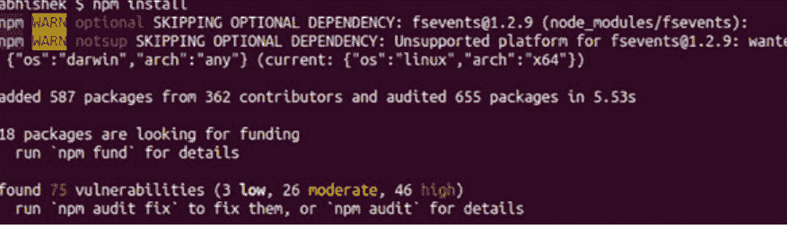

> 图 1.7：使用 `npm install` 安装依赖。

17. 现在，我们的网页已经准备就绪并可以服务。在 `hello-wasm/www` 目录下运行以下命令来启动本地服务器：

```bash
npm run start
```

18. 导航到 `http://localhost:8080/` 应该会显示一个警窗消息，如下图所示：


## 创建 `wasm-login` 项目

现在我们已经熟悉了在 JavaScript 项目中使用 Rust 构建包的结构，让我们创建一个主要的用户登录 Web 应用程序，用于在浏览器中对用户名和密码进行验证：

1. 我们将遵循与 `hello-wasm` 项目完全相同的模板：

   `cargo generate --git https://github.com/rustwasm/wasm-pack-template`

2. 输入项目名称为 `wasm-login`：

   ```bash
   cd wasm-login
   wasm-pack build
   npm init wasm-app www
   cd www
   ```

3. 在 `www/package.json` 的 `devDependencies` 下添加以下内容：

   ```json
   "devDependencies": {
     "wasm-login": "file:../pkg"
   }
   ```

4. 更新 `www/index.js`：

   `import * as wasm from "hello-wasm-pack";`

5. 安装依赖项：

   `npm install`

6. 启动本地服务器：

   `npm run start`

7. 在你的浏览器中导航到 `http://localhost:8080/` 将显示以下屏幕：


图 17.8：浏览器中来自 `wasm-login` 项目的警窗消息。

现在，让我们更新 `www/index.html` 文件来设计登录应用程序的主用户界面（UI）。它应该包含一个带有用户名和密码字段的登录表单，以及用于登录（Login）和重置（Reset）的两个按钮。你可以如下代码所示更新 `www/index.html` 文件：

```html
<!DOCTYPE html>
<html>
<head>
  <meta charset="utf-8">
  <title>Login App</title>
</head>
<body>
  <h2 id="h2_login">Login Page</h2>
  <div class="div_login" id="div_login">
    <form id="frm_login" method="get" action="">
      <label id="lbl_uname"><b>User Name</b></label>
      <input type="text" name="Uname" id="Uname">
      <br>
      <label id="lbl_pwd"><b>Password</b></label>
      <input type="Password" name="Pass" id="Pass">
      <br>
      <input type="button" name="login" id="btn_login" value="Log In">
      <input type="button" name="reset" id="btn_reset" value="Reset">
      <br>
    </form>
  </div>
  <script src="./bootstrap.js"></script>
</body>
</html>
```

8. 现在，如果你在浏览器中导航到 `http://localhost:8080/`，你应该能看到以下输出：


9. 让我们也从 `www/index.js` 中移除 `wasm.greet()` 调用，这样我们就不会在 UI 之上看到警窗消息。现在，导航到 `http://localhost:8080/` 应该显示以下输出：


10. 现在警窗窗口被移除了，UI 看起来并不美观。浏览器中的每个字段似乎都靠左侧，在表单右侧留下了大量空间。因此，让我们创建一个 `style.css` 文件并为我们的登录表单添加一些样式。`style.css` 文件的内容应该如下：

```css
.div_login {
  width: 300px;
  margin: auto;
  padding: 20px;
}

h2 {
  text-align: center;
  margin: 20px;
}

label {
  display: block;
  margin-top: 10px;
}

input {
  margin-bottom: 10px;
}

button {
  margin-right: 10px;
}
```

8. 现在，如果你在浏览器中导航到 `http://localhost:8080/`，你应该看到以下输出：


9. 让我们也从 `www/index.js` 中移除 `wasm.greet()` 调用，这样我们就不会在 UI 之上看到警窗消息。现在，导航到 `http://localhost:8080/` 应该显示以下输出：


10. 现在警窗窗口被移除了，UI 看起来并不美观。浏览器中的每个字段似乎都靠左侧，在表单右侧留下了大量空间。因此，让我们创建一个 `style.css` 文件并为我们的登录表单添加一些样式。`style.css` 文件的内容应该如下：

```css
.div_login {
  width: 300px;
  margin: auto;
  padding: 20px;
}

h2 {
  text-align: center;
  margin: 20px;
}

label {
```


`display: block;`

`margin-top: 10px;`

`input {`

  `margin-bottom: 10px;`

`}`

`button {`

  `margin-right: 10px;`

`}`

11. 现在，我们还需要在 `www/index.html` 中引入样式表文件。如下代码所示更新 `www/index.html`：

```html
<link rel="stylesheet" href="style.css">
```

12. 最后，`www/index.js` 应该如下所示：

```javascript
import * as wasm from "wasm-login";

function login() {
  let uname = document.getElementById("Uname").value;
  let pwd = document.getElementById("Pass").value;
  console.log("Username = ", uname);
  if (wasm.login(uname, pwd)) {
    alert("Login successful!");
  } else {
    alert("Login failed!");
  }
}

function reset() {
  document.getElementById("Uname").value = "";
  document.getElementById("Pass").value = "";
}

document.getElementById("btn_login").addEventListener("click", login);
document.getElementById("btn_reset").addEventListener("click", reset);
```

`src/lib.rs` 文件应该像如下：

```rust
mod utils;

use wasm_bindgen::prelude::*;

#[cfg(feature = "wee_alloc")]
#[global_allocator]
static ALLOC: wee_alloc::WeeAlloc = wee_alloc::WeeAlloc::INIT;

#[wasm_bindgen]
extern {
    fn alert(s: &str);
}

pub fn login_failure() {
    alert("Invalid credentials !!! Try again...");
}

pub fn login(uname: &str, pwd: &str) -> bool {
    if uname == "abhishek" && pwd == "rust" {
        return true;
    } else {
        return false;
    }
}
```

13. 现在，让我们在 `wasm-login/` 根目录下运行以下命令来构建项目：
`wasm-pack build`

14. 接下来，进入 `www` 目录并使用以下命令安装依赖：
`npm install`

15. 最后，让我们使用以下命令启动服务器：
`npm run start`

16. 现在，让我们在浏览器中访问 `http://localhost:8080/`。我们将看到之前看到的相同屏幕，因为 UI 部分没有变化。所以，我们应该看到一个如下图所示的屏幕：


现在，让我们在我们的 Web 应用中尝试不同的登录场景。首先，我们将输入错误的用户名并点击“登录（Log In）”。它应该弹出一个警告窗口，显示“Invalid credentials !!! Try again...”，如图所示：


图 17.13：用户名或密码错误时的输出

18. 现在，让我们输入值分别为 `abhishek` 和 `rust` 的正确用户名和密码，并点击下图所示的“登录（Log In）”按钮：


图 17.14：登录表单显示正确用户名和密码值的输出

19. 一旦你点击“登录（Log In）”按钮，你将收到“Hello, abhishek”的消息；用户名和密码字段将消失，“登录”按钮将变为“注销（Log Out）”按钮，如图所示：


图 17.15：显示登录成功的屏幕输出

20. 现在，如果你点击“注销（Log Out）”按钮，你将回到原始登录屏幕，如图所示：


## 数据库

在我们的 `wasm-login` Web 应用中，我们使用了硬编码的值 `abhishek` 和 `rust` 来匹配用户输入的用户名和密码值，如果值匹配，我们返回 `true`（表示身份验证成功），否则返回 `false`。然而，在实际应用中，一个应用程序可能有许多用户，将用户详情存储在代码中既不现实也不安全。因此，你应该将用户和应用程序数据存储在数据库中，并在需要时从代码中获取数据。所以，你应该更新登录逻辑以从数据库中获取详情。

## Docker

WebAssembly 是由万网联盟（W3C）发布的一种规范，用于创建可以像容器一样运行的二进制可执行文件。它具有成为 Docker 作为部署单元的重要替代品的潜力。Docker 的创建者 Solomon Hykes 在 2019 年推文道：“如果 2008 年存在 WASM+WASI，我们就不需要创建 Docker 了。”

WebAssembly 和 Docker 都共享宿主机的资源。Docker 使用操作系统级虚拟化来创建名为容器的软件包软件。容器之间是隔离的，并且拥有自己的库、软件和配置文件。另一方面，WebAssembly 是一种旨在由 WebAssembly 虚拟机运行的编译二进制文件。WebAssembly 二进制可以使用 C、C++ 或 Rust 等语言编写。WebAssembly 可执行文件通过将源代码编译为 WebAssembly 虚拟机特殊的二进制格式来创建，从而产生短小而快速的二进制文件，并实现类似于原生的速度。

## 结论

在本章中，你学习了如何在 JavaScript 中使用 Rust 的力量和性能。你使用标准 JavaScript 开发了一个简单的用户登录应用程序，并学习了如何将一些性能密集型的后端任务委托给 Rust。

在下一章“项目 3 – 嵌入式 Rust Hello World”中，我们将使用 QEMU（一个 QEMU）实现一个 **hello world** 应用程序。

## 思考

1. 什么是 WebAssembly？
2. 有哪两种主要的使用方式？
3. 什么是 `wasm-pack`？
4. 什么是 `npm`？
5. 如何安装它？

## 知识点

- WebAssembly 是一种可以在浏览器中运行的代码类型。
- `wasm-pack` 工具用于构建、测试和发布。
- `npm` 是一个包管理器。
- WebAssembly 具有成为 Docker 重要替代品的潜力。

## 第 18 章

### 项目 3 – 嵌入式 Rust Hello World

## 引言

在本章中，你将获得使用 Rust 的基础。QEMU 是一个免费的模拟器。项目的目标是理解嵌入式的结构。

## 结构

- 非标准 Rust 程序
- 程序概述
- 运行程序

## 目标

在本章结束时，你应该熟悉使用 Rust 进行嵌入式编程。你将理解程序的结构以及如何运行它。你还将学习程序的调试。

## 非标准 Rust 程序

嵌入式编程是针对微控制器或小型计算机的特定类型。有两种编程环境，即宿主机（hosted）和裸机（bare metal），如图所示：

## 嵌入式编程


宿主机环境类似于我们熟悉的普通计算机，它与各种系统的接口。另一方面，裸机环境在你的程序之前没有加载任何代码，标准库无法加载。Rust 的标准库需要主机系统各种功能的支持。裸机系统没有这些功能，但 Rust 可以与之工作。为了这样做，我们需要通过在 crate 根添加 `![no_std]` 属性告诉 Rust 我们不想使用标准库。

## 非标准 Rust 程序

我们将使用名为 `cortex-m-quickstart` 的项目模板来创建一个包含最小嵌入式应用程序的项目。它还包含一个示例目录，其中一些应用程序说明了 Rust 的关键功能：

- 我们可以使用 `cargo-generate` 工具创建项目。安装 `cargo-generate`，可以使用以下命令：
  ```bash
  cargo install cargo-generate
  ```
- 使用 `cargo-generate` 工具使用 `cortex-m-quickstart` 模板创建新项目，可以使用以下命令：
  ```bash
  cargo generate --git https://github.com/rust-embedded/cortex-m-quickstart
  ```

在提示时，你可以输入项目名称 `embedded-rust`，如下所示：

```
abhishek cargo generate --git https://github.com/rust/embedded-rust/cortex-m-quickstart
```

- 现在，让我们进入 `embedded-rust` 项目目录并查看目录结构：
  `cd embedded-rust`
  文件夹的树结构应该与如下所示：

```bash
abhishek $ tree .
  build.rs
  Cargo.toml
  examples
    allocator.rs
    crash.rs
    device.rs
    exception.rs
    hello.rs
    itm.rs
    panic.rs
    test_on_host.rs
  memory.x
  opencocd.cfg
  opencocd.gdb
  README.md
  src
    main.rs
```

图 18.3: `embedded-rust` 项目的目录结构

2 个目录，15 个文件

## 程序概述

让我们来看看我们生成的 `embedded-rust` 项目的概览。我们将查看 `src/main.rs` 源文件，它与我们熟悉的标准 Rust 程序略有不同，如下代码片段所示：

```rust
1. #![no_main]
2. #![no_std]
3. use cortex_m_rt::entry;
4. use panic_halt as _;
5.
6. // 程序的入口
7. #[entry]
8. fn main() -> ! {
9. loop {
10. // 剩余代码
11. }
12. }
```

在前面的代码片段中，程序使用了 `#![no_std]` 属性，这意味着程序将不会链接到 `std` crate，而是链接到 `core` crate。程序还使用了 `#![no_main]` 属性，这意味着程序将不会使用 `main` 函数作为其入口点。`panic_halt` crate 用于为程序提供 panic 处理器程序。`#[entry]` 属性由 `cortex-m-rt` crate 提供，用于标记程序的入口点。我们将 `main` 函数定义为散型函数（返回类型为 `!`，这是一个空类型），因为它是目标硬件上运行的进程。

我们可以使用 `thumbv7m-non-eabi` crate 为 Cortex-M3 平台交叉编译程序。向 Rust 工具链添加该目标，可以使用以下命令：

```bash
rust target add thumbv7m-non-eabi
```

```bash
abhishek $ rust target add thumbv7m-non-eabi
info: downloading 'rust-std' for 'thumbv7m-non-eabi'
info: installing component 'rust-std' for 'thumbv7m-non-eabi'
```

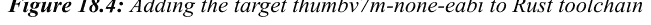

最后，要编译程序，可以使用以下命令：

```bash
cargo build --target thumbv7m-non-eabi
```

生成了一个 ELF 二进制文件 `target/thumbv7m-eabi/debug/embedded-rust`。我们可以使用以下命令打印 ELF 头部：

```bash
cargo readobj --bin embedded-rust --file-headers
```

生成的 ELF 二进制文件的头部确认了它是一个 ARM 二进制文件，如下所示：

```bash
$ abhishek cargo readobj --bin embedded-rust --file-headers
Finished [optimized + debuginfo] target(s) in 0.02s
ELF Header:
Magic: 7f 45 4c 46 01 01 00 00 00 00 00 00 00 00
Class: ELF32
Data: 2's complement, little endian
Version: 1 (current)
OS/ABI: UNIX - System V
ABI: 0
Type: EXEC (Executable file)
Machine: ARM
Version: 0x1
Entry point address: 0x401
Start of program headers: 52 (bytes into file)
Start of section headers: 69808 (bytes into file)
Flags: 0x5000200
Size of this header: 52 (bytes)
Size of program headers: 32 (bytes)
Number of program headers: 4
Size of section headers: 40 (bytes)
Number of section headers: 22
Section header string table index: 20
```

> 图 18.5: 显示生成的 ELF 二进制头部的输出

可以使用以下命令打印二进制文件中链接器段的大小：

```bash
cargo size --bin embedded-rust --release -A
```

你将看到如附所示的输出：

```bash
abhishek $ cargo size --bin embedded-rust --release -A
Finished release [optimized + debuginfo] target(s) in 0.03s
embedded-rust :
section         size    addr
.vector_table   1024    0x0
.text           440     0x400
.rodata         0       0x5b8
.data           0       0x20000000
.bss            0       0x20000000
.uninit         0       0x20000000
.debug_loc      346     0x0
.debug_abbrev   1604    0x0
.debug_info     6050    0x0
.debug_aranges 792     0x0
.debug_ranges   1432    0x0
.debug_str      8684    0x0
.debug_pubnames 2963    0x0
.debug_pubtypes 254     0x0
.ARM_attributes 50      0x0
.debug_frame    1708    0x0
.debug_line     7583    0x0
.comment        109     0x0
Total           33039
```

图 18.6: 显示 ELF 二进制文件链接段的输出

要反汇编二进制文件，可以使用以下命令：

```bash
cargo objdump --bin embedded-rust --release --disassemble --show-raw --print-hex
```

使用 `cargo objdump` 生成的 ELF 二进制文件反汇编部分如下：

```bash
abhishek $ cargo objdump --bin embedded-rust --release --disassemble --show-raw --print-hex
Finished release [optimized + debuginfo] target(s) in 0.02s
embedded-rust: file format elf32-le
```


Disassembly of section .text:

```
00000000: push    {r2, lr}
00000002: mov     r2, sp
00000004: bl      pre_init          @ imm = a8
00000008: mov     r0, #0
0000000c: mov     r1, #0x2000
00000010: mov     r2, #0x2000
00000014: cmp     r1, r0
00000018: b       0x44                @ imm = 26
0000001c: mov     r0, #0
00000020: mov     r1, #0x2000
00000024: str     r2, [r1], #4
00000028: cmp     r1, r0
0000002c: bne     0x30
00000030: bl      lr
00000034: str     r2, [r1], #4
00000038: cmp     r2, r0
0000003c: str     r2, [r1], #4
00000040: cmp     r1, r0
00000044: b       0x44                @ imm = 06
00000048: str     r2, [r1], #4
0000004c: cmp     r1, r0
```

图 18.7: 显示二进制文件的部分反汇编

## 运行程序

现在尝试在 QEMU 模拟器上运行`examples/hello.rs`。该程序使用 semihosting 向控制台输出文本。semihosting 允许嵌入式系统或目标（例如 ARM 目标）与主机计算机输入输出设施通信的机制。

要编译`hello`示例，可以使用以下命令：

```bash
cargo build --example hello
```

它生成了一个位于`target/thumbv7m-none-eabi/debug/examples/hello`的二进制文件。我们可以使用以下命令在 QEMU 上运行此二进制文件：

```bash
qemu-system-arm -machine stm32f69 -cpu cortex-m3 -semihosting-config=on,target=native -nographic -kernel target/thumbv7m-none-eabi/debug/examples/hello
```

它将`Hello, world!`消息打印到 QEMU 控制台，如下：

```bash
abhishek $ qemu-system-arm \
-cpu cortex-m3 \
-machine stm32f69 \
-nographic \
-semihosting-config=on,target=native \
-kernel target/thumbv7m-none-eabi/debug/examples/hello
Hello, world!
```

图 18.8: 在 QEMU 上运行 hello-world 程序的输出

在前面的命令中，`qemu-system-arm`仿真 ARM 机器。`cpu`参数值为`cortex-m3`，告诉 QEMU 需要仿真 Cortex-M3。`machine`参数值为`stm32f69`，告诉 QEMU 需要仿真 stm32f69。`-nographic`参数防止 QEMU 启动 GUI。通过使用`-semihosting-config`标志启用 semihosting。`-kernel`参数接收要加载并在嵌入式系统上运行的二进制文件路径。

## 调试程序

我们要调试的嵌入式程序运行在与 GDB 或 LLDB 等调试器不同的机器上。因此，这种调试是远程进行的，采用客户端-服务器设置。在我们的设置中，GDB 进程充当客户端，运行嵌入式程序的进程扮演服务器。

1. 让我们通过以下命令以调试模式启动 QEMU 并使用 hello-world 二进制文件：

```bash
qemu-system-arm -machine stm32f69 -cpu cortex-m3 -semihosting-config=on,target=native -nographic -kernel target/thumbv7m-none-eabi/debug/examples/hello -gdb tcp::3333 -S
```

在前面的命令中，我们传递了`-gdb tcp::3333`。`-S`标志意味着 QEMU 不要启动 guest，以便在 GDB 连接之前建立，如下所示：

图 18.9: 运行 QEMU

2. 然后，我们在另一个终端启动 GDB 进程并使用以下命令加载 hello 示例的调试符号：

```bash
gdb-multiarch -q target/thumbv7m-none-eabi/debug/examples/hello
```

3. 我们使用`gdb-multiarch`命令来调试 ARM Cortex-M 程序。如果`gdb-multiarch`未安装，你会收到错误。因此，请确保已安装。在 Ubuntu 18.04 或更高版本上，可以使用以下命令：

```bash
sudo apt install gdb-multiarch openocd qemu-system-arm
```

4. 如果一切正常，你应该看到一个新的 GDB 会话启动。通过在 GDB shell 中运行以下命令连接 QEMU 进程，等待 TCP 端口 3333 连接：

```bash
target remote :3333
```

5. 现在计数器指向`Reset`函数，程序处于暂停状态，截图所示：

```bash
abhishek $ gdb-multiarch -q target/thumbv7m-none-eabi/debug/examples/hello
Reading symbols from target/thumbv7m-none-eabi/debug/examples...
(gdb) target remote :3333
Remote debugging started: 3333
(gdb) * Reset () at /home/abhishek/cargo/registry/github.com-lecc6299db9ec823/
cortex-m-rt-0.15/src/lib.rs:497
(gdb) pub unsafe extern "C" fn Reset() -> !(
(gdb) []
```

图 18.10: 运行调试器并连接 QEMU 进程

6. `Reset`函数是 Cortex-M 核心启动时执行的重置处理器，并最终将调用`main`函数。我们要在我们主代码中设置一个断点。我们可以使用`list`命令查看我们想要添加断点的代码：

```
list main
```

这将列出源代码，如下图所示，代码来自`examples/hello.rs`文件：

```
(gdb) list main
6    use panic_halt as _;
7
8    use cortex_m_rt::entry;
9    use cortex_m_semihosting::{debug, hrintln};
10
11    #[entry]
12    fn main() -> ! {
13        hprintln!("Hello, world!").unwrap();
14
15        // exit QEMU
(gdb)
```

图 18.11：从 GDB shell 输出的源代码

7. 要向代码中添加断点，我们使用`break`命令。假设我们想在`main`函数的第 13 行添加断点。我们可以在 GDB shell 中运行以下命令来实现：

```
break 13
```

你应该会在 GDB shell 中看到一条输出消息，显示已指定的行号处设置了断点，如下截图所示：

```
(gdb) break 13
Breakpoint 1 at 0x4c6: file examples/hello.rs, line 13.
(gdb)
```

图 18.12：在嵌入式函数中添加断点的输出

8. 现在，我们可以通过`continue`命令告诉 gdb 开始运行我们的`main`函数，如下截图所示：

```
(gdb) continue
Continuing.
Breakpoint 1, hello::_cortex_m_rt_main () at examples/hello.rs:13
13 eprintln!("Hello, world!").unwrap();
(gdb)
```

图 18.13：从 GDB shell 继续执行嵌入式程序

9. 我们的`main`函数开始执行但再次停在我们之前到达的断点处。要移动到代码的下一行，我们可以使用`next`命令。现在，你应该能在运行 QEMU 进程的终端上看到`Hello, world!`消息，如下截图所示：

```
- cortex-m2 \\
-machine lm3s696sev \\
-nographic \\
-semihosting-config enable=on,target=nat
-gdb tcp:3333 \\
-S \\
-kernel target/thumbv7-m-eabi/debug/
examples/hello
hello, world!
(gdb) continue
Breakpoint 1, hello::_cortex_m_rt_main ()
13 at examples/hello.rs:13
hprintln!("Hello, world!").unwrap()
ap();
(gdb) next
17
debug::exit(debug::EXIT_SUCCESS)
}
(gdb)
```

图 18.14：我们的嵌入式程序输出 Hello, World 消息的输出

10. 如果你再次调用`next`命令，它将结束 QEMU 进程，如下所示：

```
-kernel target/thumbv7-m-eabi/debug/ \
examples/hello
Hello, world!
(gdb) next
[Inferior 1 (process 1) exited normally]
(gdb)
```

图 18.15：运行我们的嵌入式代码的 QEMU 进程终止的输出

11. 你可以使用`quit`命令退出 GDB 会话。

## 结论

在本章中，我们学习了使用 Rust 进行基础嵌入式编程。我们了解了如何编写非标准的 Rust 程序。我们还理解了如何在 QEMU 硬件模拟器的帮助下在嵌入式设备上运行 Rust 代码。我们还学习了对嵌入式程序进行远程调试。

在下一章，项目 4 – 使用神经网络构建二分类器中，我们将学习神经网络的基本功能，并实现一个简单的二分类器来将图像分类为两类。

## 问题

1. 什么是嵌入式编程？嵌入式编程的不同分类有哪些？
2. 宿主机环境（hosted environment）与裸机环境（bare metal environment）有什么区别？
3. 非标准 Rust 程序与标准 Rust 程序有什么区别？
4. 为什么调试嵌入式系统允许远程调试？
5. 什么是半主机（semi hosting）？给出一个该机制的使用示例。

## 重点

- 嵌入式编程是针对微控制器或运行其他设备的小型计算机特定特定编程。
- 嵌入式编程有两种编程环境，即宿主机（hosted）和裸机（bare metal）。
- 如果你不想使用标准库，可以通过在 crate 根节点添加`#![no_std]`属性来实现。
- QEMU 是一个免费的开源模拟器。
- 我们可以使用目标`thumbv7-none-eabi`为 Cortex-M3 平台交叉编译程序。
- 半主机允许运行在嵌入式系统或目标（如 ARM 目标）上的代码与主机计算机交互并使用其输入输出设施。
- 我们要调试的嵌入式程序运行在与 GDB 或 LLDB 等调试器不同的机器上。因此，这种调试是在客户端-服务器设置中远程完成的。

# 第 19 章

### 项目 4 – 使用神经网络构建二分类器

## 引言

在本章中，我们将学习神经网络的基本功能，并实现一个简单的二分类器将图像分类为两类。深度学习在过去几年中势头良好，因此本章旨在为想要深度学习的 Rust 程序员提供一个良好的起点。

## 结构

本章涵盖以下主题：

- 什么是神经网络？
- 神经网络是如何工作的？
- 使用神经网络实现分类

## 目标

在本章结束时，你应该熟悉神经网络的基本组件和功能。你将学习如何定义一个具有几层的神经网络。

## 什么是神经网络？

神经网络，也称为人工神经网络（ANN）是机器学习的一个子集，也是深度学习的核心。它们受到人类大脑的启发，并试图模拟神经元的工作。它们由多层节点组成：

## 隐藏层

## 输入层

## 输出层

ba746793e82203858763e945f864e

图 19.1：具有隐藏层的简单神经网络

每个节点带有权重连接到下一层的其他节点。如果单个节点的输出高于指定的阈值，该节点将被激活并将数据发送到下一层。否则，数据将不会传递到下一层。

## 添加项目依赖

对于这个项目，我们需要一个至少能实现基础神经网络的库。对于我们的项目，我们将使用一个名为`neural_networks`的 crate。因此，让我们在`Cargo.toml`文件的`[dependencies]`下添加这个 crate：

```
[dependencies]
neural_networks = "0.0.1"
```

在编写本书时，该 crate 仅支持带有 sigmoid 激活函数的基础前馈神经网络。然而，我将在以后更新此 crate 以包含更多功能。因此，你可以随时从 crates.io 检查最新版本以使用最新的库。

## 训练数据和测试数据

对于我们的项目，我们将处理手写数字 0 和 1 的图像。我们的数据集是从标准的 MNIST 手写数字数据集创建的。训练集包含约 12.6K 张图像，测试集包含 2.1K 张图像。每张图像都是灰度图像（单通道），维度为 28x28（高度为 28 像素，宽度为 28 像素）。下图显示了数据集中的一些示例图像：

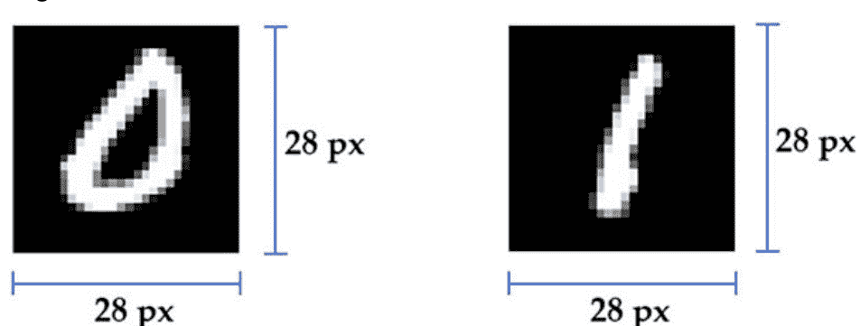

图 19.2：二分类数据集的示例图像

我们数据集中的每张图像都是 28x28 像素，即 784 像素。此外，每个像素的值从 0 到 255 不等。因此，我们模型的每个输入都是包含 784 个值的向量。我们将这些值归一化到 0 到 1 的范围内，并将这些值添加到逗号分隔的值（csv）文件中。由于我们的模型是一个二分类器，它的输出结果为 0 或 1。在分类问题中，我们通常使用独热编码向量（one-hot encoded vectors），这种向量是长度与类别数量相等的二进制向量（值为 0 或 1），且只有一个值为 1，其余全为 0。因此，独热向量`[1, 0]`表示类 1（在我们的案例中是数字 0），向量`[0, 1]`表示类 2（在我们的案例中是数字 1）。我们在 CSV 文件`ZeroOne_train.csv`的最后一列中为每个输入添加相应的训练标签，如下所示：

输入 : 784 输出 : 2

| 0 | 0 | 0 | 0 | 0 | 0.0392 | 0.2352 | ... | 1 | 0 |
|---|---|---|---|---|---|---|---|---|--|
| 0 | 0 | 0 | 0 | 0 | 0 | 0 | ... | 0 | 1 |
| 0 | 0 | 0 | 0 | 0 | 0 | 0.5647 | ... | 0 | 1 |
| 0 | 0 | 0 | 0 | 0 | 0 | 0.0784 | ... | 0 | 1 |
| 0 | 0 | 0 | 0 | 0 | 0 | 0.7450 | ... | 0 | 1 |

图 19.3：训练数据`ZeroOne_train.csv`的示例数据

测试数据文件`Zero_test.csv`以以类似的方式组织。可以从以下 GitHub 链接下载训练测试数据文件：

https://github.com/abhishekiitd327/rust_book_resources/tree/main/Chapter_19

## 定义我们的模型

现在我们已经有了训练数据和测试数据，准备好定义用于二分类的神经网络模型了。我们已经在`Cargo.toml`中将`neural_networks` crate 作为依赖添加。我们将使用该 crate 中的`NeuralNetwork`类以及`train`和`get_accuracy`函数。因此，让我们将以下代码段添加到`src/main.rs`文件：

```
use neural_networks::neural_networks::NeuralNetwork;
use neural_networks::{get_accuracy, train};
```

现在，让我们定义一个具有输入层、两个隐藏层和一个输出层的模型。输入层有 784 个节点，每个隐藏层有 5 个节点，输出层有 2 个节点，如下所示：

## 隐藏层

## 输入层

## 输出层

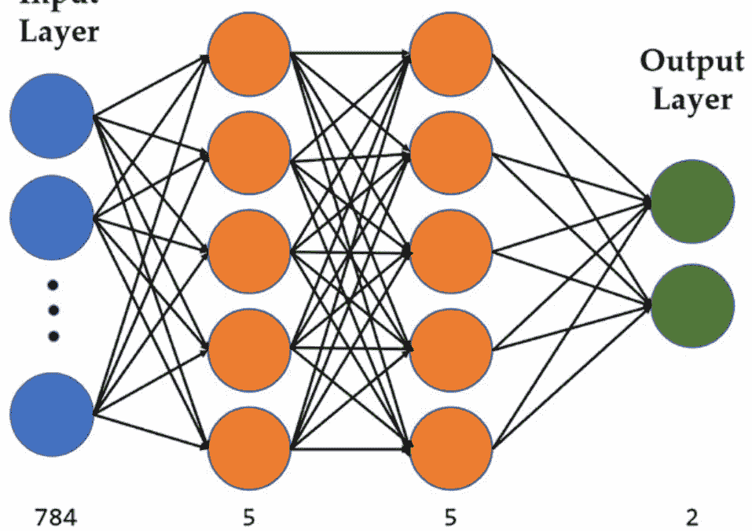

为了定义模型，我们将使用下面的代码段所示`NeuralNetwork::new`函数：

```
fn main() {
    let mut nn = NeuralNetwork::new(784, vec![5, 5], 2, 0.1,
    "sigmoid")
}
```


`NeuralNetwork::new` 函数的第一个参数是输入节点数，第二个参数是包含每个隐藏层节点数的向量，第三个参数是输出节点数，第四个参数是学习率（它表示更新模型权重时的步长），第五个参数表示激活函数。

接下来，让我们开始训练过程，这涉及到多个轮次（epochs）或对训练数据的遍历。在一个 epoch 中，我们恰好使用一次所有训练数据。一次正向传播（forward pass）和一次反向传播（backward pass）共同计为一次遍历。在前向传播中，数据流过所有层并产生输出。该输出被用于计算误差，并在反向传播中用于更新模型权重。我们将训练模型 5 个 epoch，然后在新数据（即测试数据）上计算准确率，如下所示：

```rust
fn main() {
    let mut nn = NeuralNetwork::new(784, vec![5, 5], 2, 0.1, "sigmoid");

    let num_epochs = 5;

    train(&mut nn, "ZeroOne_train.csv", num_epochs);

    let acc = get_accuracy(&nn, "ZeroOne_test.csv") * 100.0;

    println!("Accuracy: {}", acc);
}
```

最后，我们使用`cargo build`和`cargo run`来启动训练过程并验证训练后的模型，如下所示：

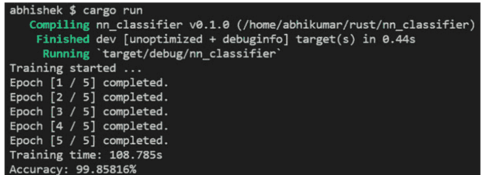

图 19.5：二分类器的训练和准确率输出

在图中，准确率达到了 99.85%。

## 总结

本章学习了神经网络的基础原理。我们定义了一个具有几层用于手写数字 0 和 1 二分类的神经网络模型。我们达到了接近 100% 的准确率，展示了神经网络在深度学习任务中的能力。带标记数据的训练是监督学习的一种形式。还有其他形式的机器学习，我们刚刚触及了皮毛。希望本章提供了足够的知识，让你使用 Rust 开始学习神经网络和机器学习。

## 问题

1. 什么是神经网络？
2. 神经网络有哪些不同的层？
3. 神经网络是如何工作的？
4. 什么是损失函数（loss function）？
5. 在训练神经网络的背景下，epoch 是什么？

## 重点

- 神经网络是机器学习的一个子集，深度学习算法的核心。它们的灵感来自人类大脑和生物神经元。
- 神经网络由多层节点组成，包括输入层、多个隐藏层和一个输出层。
- 输入层接收信号（数据）并将其传递到下一层。
- 隐藏层对从上一层传递的数据进行计算。
- 输出层返回隐藏层的计算结果。
- 训练神经网络涉及对训练数据的多次轮次。一次正向传播和一次反向传播共同计为一次。

## 索引

### A

- 抽象（abstraction）182
- Android Rust 234
- Android 开源项目（AOSP）333
- Android 集成 233
- Android 平台，Rust 232
- Android Rust 模块
  - `rust_binary` 236
  - `rust_binary_host` 236
  - `rust_bindgen` 239–241
  - `rust_ffi` 237
  - `rust_fuzz` 238, 239
  - `rust_library` 237
  - `rust_proc_micro` 237
  - `rust_test` 237, 238
- `Arc<T>` 172–175
- 数组（arrays）18–20
- 人工神经网络（ANNs）294
- 关联函数（associated functions）57, 58

### B

- 溯源追踪（backtrace）
- 默认 panic 行为（default panic behavior）101, 102
- 二进制 crate（binary crate）81, 82
- 二分类器实现（binary image classifier implementing），使用神经网络 295
- 二叉搜索树（binary search tree）201
  - 示例
  - 方法（methods）201–204
- 二叉树（binary trees）199
- 组件（components）200
  - 示例 199
- 布尔数据类型（Boolean data type）17
- 借用（borrowing）44
- `Box<T>`智能指针 155, 156
  - 递归类型（recursive types）156–158
- 广度优先遍历（breadth-first traversal）213

### C

- 计算器应用开发（calculator application developing），在 Windows 上 218
  - 实现 222–229
  - 设置（setting up）219
  - 用户界面（UI），设计 220–222
- cargo
  - 构建（building）7
  - Hello World 项目，创建 5
  - 运行 7
  - 配置文件类型（types of profiles），用于构建 8
  - 使用 4, 5
  - `cargo build`命令 7
  - `cargo build-release`命令 8
  - `cargo check`命令 7
  - `cargo clean`命令 7
  - `cargo generate`工具 257
  - `cargo run`命令 7
  - `cargo test`命令 127
- `Cargo.toml`文件 5, 6
  - 依赖（dependencies）6, 7
- 通道（channels）169
- Char 数据方法（Char data method）17
- 克隆方法（clone method）41, 42
- 闭包（closure）136
  - 作为结构体成员 138–140
  - 调用（calling）136
  - 捕获环境（capturing environment）140
  - 定义（defining）136
  - 类型推断（type inference）136–138
- 集合（collections）63
- 注释（comments）20
  - 添加（adding）20
- 通用模块属性，Android Rust 模块
  - `cfgs` 235
  - `crate_name` 235
  - `edition` 235
  - 功能（features）235
  - 标志（flags）235
  - `host_supported` 236
  - `ld-flags` 235
  - `lints` 235
  - `name` 234
  - `srcs` 235
  - `stem` 234
  - `strip` 235
- 编译时间（compile time）156
- 复合数据类型（compound data types）
  - 数组（arrays）18–20
  - 元组（tuples）17, 18
- 并发编程 163
- 控制流 23
  - `if..else` 23, 24
  - `if..else if` 24, 25
- `copy`方法 42, 43
- 计数器（counter）
  - 定义，使用 `Iterator` trait 143–146
- crate 81
  - 二进制 crate 81, 82
  - 库级 crate，创建 83, 84

### D

- 数据库 276
- 数据类型 14
  - 复合数据类型 17
  - 标量数据类型 15
- 默认 panic 行为
  - 修改 102
- 深度优先遍历 213
- Docker 26
- 双向链表 196
- `drop`函数 35
- 动态分发方法
  - trait 对象，使用 189, 190

### E

- 嵌入式编程 280
- 非标准 Rust 程序 280–282
- 封装 180–182
- 枚举（enums）58–60
- 泛类型，使用 111, 112
- `Option`枚举 61, 62
- 错误处理 94
  - 常见 `Result`方法 98
  - 可恢复错误和 `Result` 94–97
  - 错误 100

### F

- 浮点数据类型 16
- `for`循环 27
- 函数 20–22
- 泛类型，使用 109–111

### G

- `+`通泛数据类型 106, 107
  - 使用，在 enums 中 111, 112
  - 使用，在函数中 109–111
  - 使用，在方法中 112, 113
  - 使用，在 structs 中 107–109
- 泛型（generics）106
- 图 209
  - 有向图 210
  - 示例 209
  - 方法，实现 211, 212
  - 结构，定义 210, 211
  - 遍历 213, 214
  - 无向图 210
  - 无向图，创建 212

### H

- `+`哈希表（hash map）71
  - 创建 72
  - 值，从 74, 75
  - 值，访问 72–74
- 哈希表 204, 205
  - 设计 205–209
- 堆内存 23
- Hello Rust 模块
  - 开发 241, 242
- `hello-wasm`项目
  - 创建 258–263
- Hello World 程序
  - 在 Rust 中编写 3, 4
- Hello World 项目
  - 创建，使用 cargo 5

### I

- `+``if...else` 23
- `if...else if` 24
- `if`表达式 23
- 继承 180
- 整数 15
  - 有符号整数 15
  - 无符号整数 15
- 集成测试 130
  - 创建 130, 131
  - 运行 132
- `into_iter()`方法 147
- 迭代器（iterators）140, 141
  - 比循环 149, 150
- `Iterator` trait 141–143
  - 计数器，在 143–146 定义
- `iter()`方法 146
- `iter_mut()`方法 148

### L

- `+`后进先出（LIFO）33
- 遗留 C/C++ 代码 233
- 库级 crate
  - 创建 83, 84
- 链表数据结构 196
  - 二叉搜索树 199
  - 二叉树 199
  - 双向链表 196
    - 示例 197
    - 方法，实现 197, 198
  - 单向链表 196
  - 树 199
- 循环 25, 26
  - `for`循环 27
  - `while`循环 26, 27

### M

- `main()`函数 20
- 多对多线程模型 165, 166
- 多对一线程模型 165
- `match`运算符 62, 63
- 内存分配，在栈和堆上 33
  - 借 43–45
  - `clone`方法 41, 42
  - `copy`方法 42, 43
  - 字符串数据类型 34, 35
  - 移动 35–41
  - 引用 43
  - 切片 46, 47
- 内存 bug
  - 类型 38
- 消息传递并发 169–171
- 方法 55
  - 定义 55, 56
  - 泛类型，使用 112, 113
  - 使用 56, 57
- 模块（modules）84
  - 公有化 85–88
- 模块系统
  - 组件 80
- `mpsc`通道
  - 创建 170
- `Mutex<T>` 171–173

### N

- 神经网络 294
  - 隐藏层 294
  - 输入层 294
  - 输出层 294
  - 工作 294, 295
- 非标准 Rust 程序 280–282
  - 调试 287–290
  - 概览 282–285
  - 运行 286, 287
- npm 257

### O

- 面向对象编程（OOP）
  - 抽象 182
  - 特性 180
  - 封装 180, 182
  - 实例 180
  - 多态 183–187
- 一对一线程模型 164
- OOP 模式
  - 实现 190–193
- 所有权原则 292

### P

- 包（package）81
- `panic!`宏 100
  - 使用 100, 101
- 并发编程 163
- 路径 89
- 指针 153–155
- 多态 183
  - 动态分发 189, 190
  - 静态分发 187, 188
- 配置，用于构建 cargo
  - `bench` 8
  - `dev` 8
  - `release` 8
  - `test` 8

### R

- 递归 202
- 递归 213
- `RefCell<T>`智能指针 160, 161
- 引用 43
- `Result`方法
  - `expect()` 99
  - `is_err()` 98, 99
  - `is_ok()` 98
  - 引用 100
- Rust
  - `cargo-generate`工具，使用 257
  - 嵌入式编程 280
  - 在 Android 平台 232
  - 安装，验证 2
  - 安装 256
  - npm 257
  - 更新 3
- Rust 项目
  - 创建 295
  - 数据，测试 296, 297
  - 数据，训练 296
  - 模型，定义 297–299
  - 项目依赖，添加 295, 296

### S

- 标量数据类型 15
  - Boolean 17
  - 字符 17
  - 浮点 16
  - 整数 15, 16
- `Send` trait 175
- 共享内存并发 171
- 共享状态并发
  - 实现，使用 `Arc<T>` 173–175
  - 实现，使用 `Mutex<T>` 171–175
- 单向链表 196
- 切片 46, 47
- 智能指针 153, 155
  - `Box<T>` 155, 156
  - `Rc<T>` 158, 159
- 软件测试
  - 集成测试 130
  - 单元测试 124
    - 编写 124
  - 特定测试
    - 运行 127–129
- 栈 33
- 状态模式 190
- 静态分发方法
  - 泛型和 trait 边界，使用 187, 188
- 字符串 65
  - 字节，访问 69–71
  - 字符 69–71
  - 创建 66
  - 更新 66–68
- 字符串数据类型 34
  - 内存分配 35, 36
  - 字符串字面量 34
- 结构 52
  - 定义 52
  - 字段初始化简化 53, 54
  - 泛类型，使用 107–109
  - 实例化 52
  - 结构体更新语法 54
  - 元组结构体 55
  - 使用 52, 53
- 子树 200
- `Sync` trait 175
- 系统编程 232

### T

- 测试函数
  - `assert`辅助宏 125
  - 运行 125–127
  - 事件执行，忽略 129, 130
  - 编写 125
- 线程模型 164
  - 多对多模型 165, 166
  - 多对一模型 165
  - 一对一模型 164, 165
- 线程 - `join`
  - 等待 167, 168
- 线程 164
- 线程 - `spawn`
  - 创建 166, 167
- 待事项列表应用程序 246
  - 命令行参数，捕获 247
  - 创建 246
  - 实现 246
  - 运行 253
- To-do 结构，定义 248
  - To-do 结构方法，实现 248–253
- trait 113
  - 作为函数参数 117
  - 方法的默认实现 116, 117
  - 定义 113, 114
  - 实现 114–116
  - `impl trait` 118
  - 多个参数，相同 trait 119, 120
  - 多个 trait，实现 117
  - 参数，实现多个 trait 120
  - trait 边界语法 119
- 遍历 213
- 树 199
  - 节点结构 200
- 元组 17, 18
- 元组结构体 55

### U

- 单元测试 124
- `use`关键字 90

### V

- 变量 12
  - 声明 12
  - 可变性 12, 13
- 变量作用域 32
- 向量 63
  - 创建 63, 64
  - 元素，访问 65
  - 更新 64

### W

- `wasm-login`项目 264–275
- `wasm-pack` 257
- WebAssembly 256
  - 环境，设置 256
- `while`循环 26, 27
- Windows 应用程序
  - 开发，使用 Rust 218
