# Sams 自学 Visual C# 2010 24小时完全入门指南


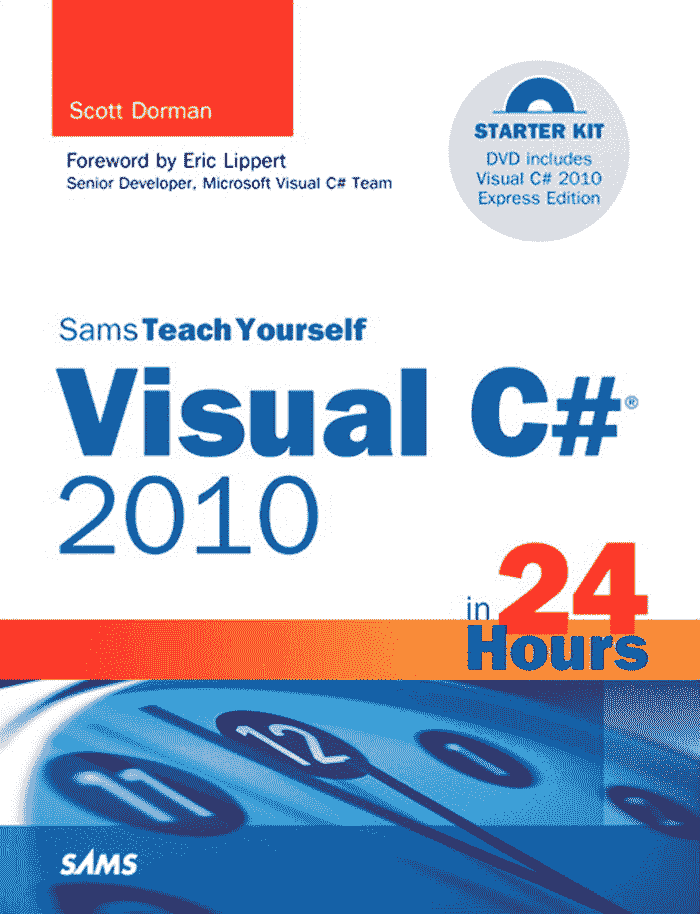

赞誉来自


“Sams 出版的 **24小时自学** 系列书籍一直是任何想要快速上手新技术的人的读物。这本书不仅仅是对去年书籍的简单翻新，Scott 是针对 Visual Studio 2010 和 .NET 4.0 的发布从零开始编写的。从 C# 类型系统到事件和数据，从 ASP.NET Web 到 WPF Windows 应用程序，《Sams 24小时自学 Visual C# 2010》将为任何初学 C# 语言的开发者提供一个极具价值的坚实基础。”

*—**Shawn Weisfeld**，微软 Visual C# MVP*

“学习软件开发的关键在于拥有坚实的基础。《Sams 24小时自学 Visual C# 2010》是任何想从零学习 C# 或只是温习其特性的读者的必读之。Scott Dorman 在书中采用了一种非常博学却平易近人的方法，任何渴望学习 .NET 编程的人都能受到他的启发。我发现了一些可以提升我未来编程项目的宝藏内容。”

*—**Chris “Woody” Woodruff**，Deep Fried Bytes 播客节目联合主持人*

“这本书对于任何第一次学习 C#、从 Visual Basic 迁移或正在追赶 C# 最新功能的人来说，都是一份极佳的资源。它内容丰富，应该出现在任何正在熟悉 C# 2010 的开发者的办公桌上。”

*—**Jeff Julian**，AJI Software 管理合伙人，GeeksWithBlogs.NET 创始人*

“Scott Dorman 编写了一本卓越的参考书，它不仅涵盖了 .NET 4.0 C# 开发的基础性知识，还包含了对高级 C# 以及使用 Visual Studio 2010 进行开发的细微之处的指导和建议。

这本书编写清晰简洁，并大量使用了‘你知道吗’、‘顺便说一下’和‘注意！’侧边栏，帮助读者在学习之旅中提供信息丰富的‘路标’，以强化核心概念、最佳实践和反模式。这些无价的路标通过 Scott 对真实世界场景的评论，解释了为什么某些主题对于整体理解和使用 C# 语言及相关结构至关重要，真正帮助了读者‘领会精髓’。

无论你是初学者、中级还是还是专业开发者，这本书对于当今高产的 .NET 4.0 C# 开发者来说，无疑将成为一本非常方便、经常翻阅的桌面参考书。”

*—**Jeff Barnes**，微软公司开发者与平台推广架构师*

“这本书涵盖了方方面面，从 C# 语言到你将使用它的框架，再到你提高生产力所需的工具。最好的学习方法是实践，而这里并不欠缺实践的机会。”

*—**Chris Burrows**，微软公司 C# 编译器团队*

“*Sams 24小时自学 Visual C# 2010* 为你提供了快速提高生产力所需的启动。我发现这本书非常易于理解，并按小时逻辑化地安排，引导你流经相关主题。从初学者到 C# 老兵，这本书为你提供了理解 2010 版本发布中所有新内容所需的一切。”

*—**Richard Jones**，微软 MVP*


在运行时访问特性 ..................................................................................................................................................... 434

工作坊 ........................................................................................................................................................................... 450 

理解 IDisposable ................................................................................................................................................................................................ 453


## 前言

xiii 从 www.wowebook.com 下载

十多年前，一个小型设计师团队在微软公司 41 号大楼 2 层的一间小会议室里聚在一起，创造出了一种全新的语言——C#。该语言的指导原则强调简单、熟悉、安全和实用性。当然，所有这些原则之间都需要相互平衡；没有哪一个是绝对的。设计者们希望这种语言既易于理解但不浅薄，既让 C++ 和 Java 程序员感到熟悉但不是对其中任何一种进行盲目复制，默认情况下是安全的但又不过具有限制性，而且是实用的但绝不抛弃严谨、一致且在理论上有效的设计。

经过数月的思考、设计、开发、测试和文档编写后，C# 1.0 正式发布。它是一种非常直接的面向对象的语言。其设计在许多方面经过了仔细挑选，以确保对象可以组织成独立版本化的组件，但该语言的核心概念源于追溯到 20 世纪 70 年代或更早的面向对象和过程化语言的思想。

设计团队继续在同一个二楼会议室每周见面三次，在 C# 1.0 建立的坚实基础上继续构建。通过与微软研究院剑桥分的同事以及过街的 CLR 团队合作，类型系统得到了扩展，以支持对泛型类型和方法的参数化多态。他们还添加了“迭代器块”（在其他语言中有时被称为“生成器”），以便构建可迭代集合和匿名方法。泛型和生成器是由 20 世纪 70 年代和 80 年代的 CLU 和 Ada 等早期语言开创的；而在现有方法中嵌入匿名方法的思想一直追溯到 20 世纪 50 年代现代计算机科学的基础。

C# 2.0 是其前任版本的一次巨大飞跃，但设计团队仍然并不满足。他们继续在同一个二楼会议室每周开三次会。这一次，他们思考的是基础性问题。传统的“过程化”编程语言在处理基础算术方面表现良好，但现代开发者面临的问题已超出了增加一列数字来求平均值。他们意识到，程序员通过复杂的方式组合相对简单的操作来操纵数据。操作通常包括对数据集合进行排序、过滤、分组、连接和投影。““查询表达式”的这种能够简洁描述这些操作的语法模式概念，最初是在 Haskell 等函数式语言中开发的，但在像 C# 这样更具命令式的语言中也运行良好。因此，LINQ——语言集成查询——诞生了。

xvi 《24 小时自学 C# 2010》

在同一间会议室每周开会六小时、持续十年后，与外地团队成员进行电话会议的需求促使他们将地点搬到了五楼。设计团队回顾了过去十年，看看该语言在哪些现实世界问题上没有处理好，哪些地方存在“粗糙边缘”等等。与现代动态语言和遗留对象模型进行互操作的需求日益增长，促使了 C# 4.0 中“dynamic”类型等新语言特征的设计。

我认为在序言中快速回顾一下 C# 语言的演变可能是一个好主意，因为这显然不是本书所采取的方法。而这是一件好事！针对初学者的书籍作者通常按照他们学习的顺序来安排材料，而这通常也是这些特性被添加到语言中的顺序。我特别喜欢这本书的一点是，Scott 为每个概念的发展选择了一个合理的顺序，从最基础的算术计算一直到非常复杂的相互关联部分。此外，他的示例实际上是真实且具有鼓舞性的，同时又足够清晰、简单，只需几段话就能描述清楚。

我在这里重点关注了语言的演变，但当然，一种语言的演变远非故事的全部。语言仅仅是你用来访问运行时和框架库力量的工具；它们本身就是大型且复杂的话题。我喜欢的这本书的另一个点是，它没有狭隘地关注语言本身，而是在早期教授的语言概念基础上，解释如何利用最频繁使用的基类类型所提供的力量。

正如我对语言历史的简要勾勒所示，这里有很多东西要学，即使仅仅看语言本身也是如此。我使用 C# 十年了，作为其中一名设计者也已有五年了，我每天仍在发现关于这种语言的新事实并学习新的编程技术。希望在书中描述的你 C# 编程的前 24 小时将开启你自己的十载实践编程之旅并持续下去。

## 献词

这本书首先献给 Nathan，我希望他有一天能追随我的脚步。

## 关于作者

Scott Dorman 自 201 年起被微软指定为 C# 最具价值专业（Most Valued Professional）。目前，他的重点是使用 .NET 开发软件应用程序。他经营一个软件架构用户组，在 TechEd 和社区营进行大量演讲，并定期向 The Code Project、StackOverflow 以及 geekwith.com/sd 等在线社区贡献内容。

## 致谢

当我决定承担这个项目时，我并没有准备好实际写一本书到底有多困难。当我回顾花费的时间和精力时，我意识到，尽管我是负责编写内容的人，如果没有别人的帮助和支持，我是无法完成的。首先，我需要感谢 Brook 给了我为 Sams 出书的想法，并给了这个新作者机会。Sams 的其他编辑如果没有他们，这本书将无法出版，与他们共处非常愉快。我还要感谢 Keith Elder、Shawn Weisfeld、Brad Abrams 和 Krzysztof Cwalina，他们提供了早期的建议，并帮助我确定了内容和整体方向。我的技术编辑 Claudio 和 Eric 也应该获得巨大的感谢；他们都提供了惊人的见解。当然，如果没有整个 C#、.NET Framework 和 Visual Studio 产品团队，我将无话可说。我写这本书是给开发者社区的，这个社区给了我这么多。如果没有它的鼓励和支持，我根本没有机会写这本书。这包括所有与微软 MVP 计划相关的人，以及微软的现场演讲师，特别是 Joe “devfish” Healy、Jeff Barnes 和 Russ “ToolShed” Fustino。最后，当然，我要感谢我的家人，对我完成这本书所花费的许多深夜和周末给予耐心和理解。虽然 Nathan 现在太小，不懂为什么我花这么多时间在电脑上而不是陪他玩，但我希望他长大后能理解这一点。它最大的影响是让他很早就接触了计算机，因为他在 21 个月大时收到了第一台笔记本电脑（一台在落灰的旧 IBM ThinkPad 770）。


我们想听听您的声音

作为本书的读者，*您是我们最重要的批评家和评论者。*

我们非常重视您的意见，并想知道我们做得好的地方、哪些地方可以做得更好，
您希望我们出版哪些领域的内容，以及您愿意分享给我们的任何
智慧建议。

您可以通过发送电子邮件或直接写信给我，告诉您对这本书的
喜欢或不喜欢的地方——以及我们可以做什么来让我们的书籍更强大。

*请注意，我无法帮助您解决与本书主题相关的技术问题，而且*
*由于我收到的邮件量很大，我可能无法回复每一条信息。*

在您写信时，请务必包含本书的书名和作者，以及您的姓名和
联系方式。我会仔细审查您的评论，并将其与参与本书的
作者和编辑分享。

电子邮箱：

neil.rowe@pearson.com

邮寄：

Neil Rowe
执行编辑
800 East 96th Street
Indianapolis, IN 46240 USA

读者服务

访问我们的网站并在 informit.com/register 注册本书，以便方便地获取
本书可能提供的任何更新、下载或勘误表。

从 www.wowebook.com 下载

*本页特意留白 *

## 引言

1998年12月底，微软开始开发一个全新的开发平台，这将产生一种
创建和运行下一代应用程序以及 Web 服务的全新方式。这个新平台被称为 .NET Framework，并于2000年6月正式公布。

.NET Framework 将现有的 Windows 接口和服务统一在单一的应用程序编程接口（API）下，并添加了许多新兴的行业标准，例如简单对象访问协议（SOAP），以及许多现有的微软技术，如微软组件对象模型（COM 和 COM+）以及 Active Server 页面（ASP）。除了提供一致的开发体验外，.NET Framework 还包含了最大的可用类库之一，使开发人员能够专注于应用程序逻辑，而不是更常见的编程任务。

最后，通过在托管运行时环境中运行应用程序，该环境会自动处理
内存分配并提供一个“沙箱”（或受限访问）环境，许多常见的编程错误和任务得到了减少，在某些情况下甚至被消除。

现在，近10年后，.NET Framework 通过支持新技术和行业标准继续演进，增加了对动态语言的支持，并提供了更多内置类。在微软2008 年的专业开发人员会议（PDC）上，主题之一是“让简单的事情变得容易，让困难的事情变得可能”。.NET Framework 在第一个版本中就实现了这一目标，随后的每一个版本都在继续实现这一目标。

C# 编程语言（读作“See Sharp”）由 Anders Hejlsberg、Scott Wiltamuth 和 Peter Golde 配合 .NET Framework 开发，并于2000年7月首次发布。由于它是专门为 .NET Framework 编写的，许多人认为它是 .NET Framework 的标准语言。作为一种语言，C# 的语法和主要特性灵感源于 Delphi 5、C++ 和 Java 2。C# 是一种通用的、面向对象的、类型安全的编程语言，用于编写任何类型的应用程序。正如 .NET Framework 持续演进一样，C# 也在演进，以跟上 .NET Framework 的变化，并引入新的语言特性，持续实现“让简单的事情变得容易，让困难的事情变得可能”。

尽管 .NET Framework 支持 50 多种不同的编程语言，但 C# 仍然是最流行且最现代的通用语言之一。

### 读者群体与结构

本书面向首次尝试 .NET 的非 .NET 程序员，或者正尝试学习 C# 的现有 .NET 程序员。如果您是第一次学习编程，这本书可以为您提供帮助，但它并不是打算作为一本入门级编程书籍。本书的设计目的是让您熟悉 C# 中的实现方式，并尽可能地产生生产力。我在本书中采取了不同的方法，对语言使用了更具全局的视角。我选择这种方法是通过关注当前语言特性如何让您解决问题，从而让您对 C# 语言有一个最完整的理解。

本书分为五部分，每部分都关注语言的不同方面。这些部分从简单的基础到更高级的主题，因此我您按顺序阅读：

- 第一部分，“C# 基础”将教您关于 .NET Framework、C# 的面向对象编程特性、C# 类型系统的基础知识以及事件。
- 第二部分，“C# 编程”将教您编程基础知识。您将学习如何执行循环以及处理字符串、正则表达式和集合。然后，我们移动到更高级的主题，例如异常管理和泛型。最后，我们以匿名函数（lambdas）、查询表达式（LINQ）以及如何与动态语言交互作为结束。
- 第三部分，“处理数据”将展示如何与文件系统和流交互，创建和查询 XML 文档，以及与数据库交互。
- 第四部分，“使用 Visual Studio 构建应用程序”从介绍 Visual Studio 2010 和调试应用程序开始。然后，我们将从零开始构建一些完整的应用程序，利用您在之前三部分中学到的技能。接下来，您将学习如何为 Web 构建构建应用程序。
- 第五部分，“深入探索”将介绍属性编程、动态类型和语言互操作等高级概念。您将学习 .NET Framework 如何组织内存的基础知识、垃圾回收器如何工作，以及 .NET Framework 如何提供确定性机制。接下来，您将学习如何使用多线程和并行处理。

### 你知道吗？/ 顺便说一下 / 注意！

在整书中，“顺便说一下”（By Way）框提供了有用的侧栏信息，您可以立即阅读，而不会丢失当前主题的思路。“你知道吗？”（Did You Know?框强调了可以让您的编程更有效的信息。“注意！”（Watch Out!）框让您关注某些情况下可能出现的问题或副作用。

### 本书使用的约定

本书使用了几种设计元素和约定，帮助您优先排序并引用书中包含的信息。

新术语用**粗体**显示以强调。

此外，本书使用了不同的字体来帮助您区分代码和普通英语。代码使用等宽字体。占位符——代表您在代码中实际输入的单词或字符——使用斜体等宽字体。当要求您打字或输入文本时，该文本以**粗体**显示。

本书中的某些代码语句太长，无法在一行显示。在这种情况下，将使用换行符来表示下一行是当前语句的延续。

.NET Framework 和 C# 仍然是我用过的最强大且优雅的语言之一，并为开发下一个“杀手级应用”提供了许多令人兴奋的机会。在读完这本书时，您还没有成为 C# 专家，但我希望您对使用 .NET 和 C# 创建应用程序感到自在。


第一部分
## C# 基础

第 1 小时：NET Framework 与 C# — 7
第 2 小时：理解 C# 类型 — 35
第 3 小时：以 C# 的理解类和对象 — 63
第 4 小时：继承、接口和抽象类 — 93
第 5 小时：创建枚举类型和结构 — 113
第 6 小时：事件与事件处理 — 131

## .NET Framework — 7

### 第 1 小时 .NET Framework 与 C#

*在本小时中将学习：*

- 理解 .NET Framework
- 并计算平台（Parallel Computing Platform）
- 动态语言运行时（Dynamic Language Runtime）的作用
- C# 语言概述
- C# 语言语法
- 如何编写你的第一个 C# 程序

学习一门新语言就像学骑自行车或开车。你必须先学习基础知识，并随着向更复杂的操作进展建立信心。当你理解了原理并有信心完成目标时，突然之间那个目标似乎不再那么遥不可及了。在本小时结束时，你将对 .NET Framework 及其组件之间的相互关系有基本的了解，并学会如何创建应用程序。你将接触到 C# 语言并编写你的第一个 .NET 。

## .NET Framework

.NET Framework 为开发者提供了工具和技术，以独立语言和平台的方式创建和运行下一代应用程序和 Web 服务。它拥有丰富的类库，支持许多常见任务并简化许多困难任务，让你能够更有效地将精力集中在当前问题上：以最有效的方式解决业务需求。

.NET Framework 设计旨在实现以下功能：

- 提供一个运行时环境，简化软件部署并减少版本冲突的概率。
- 实现代码的安全执行。
- 对所有通信使用行业标准，以便与非 .NET 代码集成。
- 以独立语言和平台的方式，在所有类型的应用程序中提供一致的开发者体验。
- 提供一个运行时环境，最大限度地减少或消除脚本语言或解释型语言的性能问题。

为了实现这些目标，.NET Framework 有四个组件。第一个组件是通用语言运行时（Common Language Runtime），你可以将其认为 .NET Framework 的核心或心脏。正如你的心脏为身体功能提供所需的泵血动作一样，通用语言运行时提供了应用程序运行所需的低级核心服务，并被称为管理你的代码。为 .NET Framework 编写的代码被称为**托管代码**，而任何其他代码被称为**非托管代码**。

.NET Framework 的第二个组件是类库，它是一个丰富的重用类（或类型）集合，你可以用它开发几乎任何你能想象的应用程序。

### 框架类库

框架类库 包含超过 4,000 多个公共类，是当今可用最大的类库之一。

.NET Framework 通过通用语言运行时以及并行平台中的类库和诊断工具直接支持并行编程，并行平台是 .NET Framework 的第三个组件。并行计算平台允许你编写高效且可扩展的代码，以自然简单的方式利用多个处理器的优势。

动态语言运行时构建在通用语言运行时之上，是 .NET Framework 的第四个组件，为 IronRuby 和 IronPython 等动态语言提供语言服务。由于动态语言在某些方面远优于 C# 这样的通用语言，动态语言运行时让你具有灵活性，可以选择最合适的语言来解决特定的业务需求。不仅如此，动态语言运行时让 C# 等非动态语言能够支持一致且简单的语法来处理动态对象，无论源自 COM、IronRuby、IronPython 还是 JavaScript。

### 什么是动态语言？

在像 C# 这样静态类型类型的语言中，编译器尝试证明类型安全，如果无法证明，则生成错误。在动态语言中，不会进行这种类型安全的尝试。此外，大多数动态语言在运行时执行更复杂的类型操作（例如确定方法重载），而 C# 在编译时执行这种类型解析。实际上，通常在静态类型语言中编译时完成的操作，在动态语言中运行时完成。这包括可以在运行时生成代码（通常称为 eval 或 repl 循环）并修改运行对象的状态。结果是，动态语言提供了极大的自由，并最常用作脚本语言。

常见的动态语言包括 Jscript、JavaScript、Python、IronPython、Ruby 和 IronRuby。

正如为 .NET Framework 编写的代码被称为托管代码一样，生成的应用程序被称为**托管应用程序**。当托管应用程序运行时运行时，它会自动托管其构建时针对的通用语言运行时。.NET Framework 不仅提供了许多不同的主机，还提供了编写自定义主机的必要工具。由于这种能力，像 Internet 信息服务（IIS）和 Microsoft SQL Server 等非托管应用程序可以托管自己的通用语言运行时副本，使它们能够利用托管和非托管的特性。

#### 通用语言运行时

**通用语言运行时（CLR）**是 .NET Framework 的核心，提供了统一的类型系统和托管环境。它们共同构成了开发和执行独立语言及平台应用程序的基础，有助于消除或至少减少许多编程错误。

#### 通用类型系统

统一类型系统被称为**通用类型系统（CTS）**，允许所有 .NET 语言共享相同的类型定义，以便以一致的方式操作这些类型。这有助于确保应用程序编写正确。通用类型系统和通用语言规范构成了 .NET Framework 中类型安全的基础。该基础为 .NET Framework 提供了一种一致的方法来促进类型安全，但不强制执行。强制类型安全的任务留给了各个语言编译器和虚拟机执行系统（你将在本小时稍晚些时候学习）。


## .NET Framework

11

由于通用类型系统以一种语言无关的方式定义了类型在语言中的外观和行为，
因此它必须考虑这些语言之间的差异。通用类型系统提供了一组 .NET 
语言（以及其编译器）必须遵循的最少规则，被称为**通用语言规范 (CLS)**。这种通用定义还实现了语言集成的理念，使你能够使用在另一种语言中定义的类型，就就像它在你的语言中原生定义的一样。

### CLS 合规性

框架类库提供的几乎所有类都符合 CLS 合规性，因此任何 .NET 语言
都能访问相同的库。如果你正在开发自己的库，建议你也确保你的类
符合 CLS 合规性，以便获得尽可能广泛的采用和使用。

> *你知*
> *道吗？*

### 通用中间语言

通用类型系统和通用语言规范有助于实现与语言和平台无关的目标，
但如果编译器生成了与硬件平台绑定的可执行对象代码，那么这些都将无济于事。为了解决这个问题，托管代码被部分编译为一种名为**通用中间语言 (CIL)**
的低级语言。你可以将通用中间语言看作汇编语言；它由代表你
代码的单个低级指令组成。

一个**程序集 (assembly)**是一个部分编译的单元或包，它包含 CIL 指令
并为定义类型提供了逻辑边界。由于程序集是部分编译的，它们可以是 32 位
或 64 位的，取决于操作系统和硬件。这种能力真正意味着托管
应用程序是平台无关的，同时无需重新编译或在代码中添加特殊
指令，即可利用硬件技术的优势。

### 虚拟执行系统

通用语言运行时的另一个重要部分是托管运行时环境，称为
**虚拟执行系统 (VES)**，它处理你的应用程序所需的底层
核心服务。就像 Java 应用程序需要 Java 虚拟机 (JVM) 来运行一样，
托管应用程序需要 CLR，具体来说需要 VES 来运行。

当 .NET 应用程序启动时，是 VES 负责实际加载 CIL 代码、执行该代码并最终管理内存分配。

12
第 1 小时：.NET Framework 和 C#

### 即时编译

即时编译（Just-In-Time compilation）的过程被称为 jitting，JIT 编译器
也被称为 jitter。

> *你知*
> *道吗？*

通过这种方式编译代码，.NET Framework 相比传统的解释型语言获得了
显著的速度提升。即时编译相比于常规（静态）编译也具有优势，
因为它可以在运行时强制安全保证，并在运行时重新编译代码以获得
额外的优化。.NET Framework JIT 编译器针对将 CIL 代码编译为高效
的对象代码进行了高度优化，它按需运行，并缓存编译后的代码以供未来
使用。

### 内存管理和垃圾回收

适当的内存管理是许多非托管编程-语言中的一个经典问题，
也是某些常见错误的潜在源头。在这些语言中，开发者负责在
正确的时刻分配和释放内存。.NET Framework 通过作为 VES 的一部分，
自动控制这些内存的分配和释放来解决这个问题。

正是这种自动的内存管理（也称为**垃圾回收**）使得 C#（以及其他
.NET 语言）成为一种**垃圾回收语言**。垃圾回收让你无需像以前
那样担心在内存不再需要时释放它。这使得你能够根据应用程序的需求
创建更稳定的应用程序。换句话说，VES 提供了抽象平台和语言差异的
服务和基础设施。

作为加载和编译过程的一部分，VES 会执行各种验证和检查，以确保
文件格式、程序集元数据和 CIL是一致的，并确保 CIL 指令本身不允许
非法的内存访问。这确保了应用程序只能访问它被显式授予访问权限的内存或其他资源。这种受限的环境可以认为是一个**沙箱**。

如果 VES 提供了一个运行时环境并执行包含 CIL 的程序集，那么这些
程序集是被解释的还是编译的？记住，.NET Framework 的目标之一是
提供一个能够最小化或消除脚本或解释型语言性能问题的运行时。
这意味着 CIL 代码是被编译的，但这种编译发生在什么时候呢？

VES 提供的服务之一是**即时 (JIT) 编译器**。即时编译是获取
部分编译的 CIL 代码并在运行时生成可执行对象代码（或原生代码）
的过程。

13
The .NET Framework

### .NET Framework 类库 (FCL)

| 基础类库 (BCL) |
| :--- |
| 诊断 (Diagnostics) |
| 可扩展性 (Extensibility) |
| 工作流 (Workflow) |
| WCF |
| 安全 (Security) |
| 配置 (Configuration) |
| XML |
| LINQ |
| 数据 (Data) |
| 网络 (Network) |
| Windows Forms |
| Web |
| WPF |
| 国际化 (Globalization) |

图 1.2 框架类库

虽然 CLR 构成了 .NET Framework 的核心，但框架库 (FCL) 实际上赋予了
它实质。该类库类似于 Java 的类库、C++ 标准模板库 (STL)、
微软的活动模板库 (ATL)、微软基础类 (MFC)、Borland 的对象窗口类
(OWL)，以及目前的各种其他类库。

就像这些类库一样，FCL 是一套丰富的复用类型，通过简化许多常见的
编程任务，提高开发效率。图 1.2 显示了按功能区域划分的 FCL 中的某些类型。

### 框架类库

框架类库让简单变得容易，让困难变得可能，它是 .NET Framework 的最佳示例。虽然可以不使用 FCL 提供的类型来创建应用程序，但这样做是不切实际的，它可以让你专注于应用程序所需的业务逻辑。

> *通过*
> *方式*

14
### 什么是 Ecma？

Ecma 是一个成立于 1961 年国际标准协会，旨在帮助开发信息通信技术和消费电子的标准。

C# 语言规范以及通用语言基础设施 (CLI) 于 2001 年 12 月 14 日被接受为 Ecma 标准。CLI 是通用语言运行时的开源版本。它促进了多个 C# 和 .NET Framework 的开源版本，包括 DotGNU 和 Mono。其中 Mono 最为为人知，并在 Linux、BSD、UNIX、Mac OS X、Solaris 和 Windows 操作系统上提供了该平台的实现。

正是 Ecma 以及 Mono 等项目提供的开源标准，使得开发技能和应用程序可以在任何平台上运行。

> *你知*
> *道吗？*

即使有了自动内存管理，理解垃圾回收如何与你的程序以及你创建的类型交互是非常重要的。对垃圾回收的深入讨论超本书的范围，但我们将在第 22 小时“内存组织与垃圾回收”中再次进行讨论。

FCL 的其余类专注于特定的功能领域，例如提供数据访问、XML 支持、国际化支持、诊断、配置、网络、通信、业务工作流支持、Web 应用程序以及 Windows 桌面应用程序。

### 命名空间

由于 .NET Framework 类库中有数千个类，需要一种方法来防止类型名称歧义，并提供一种方便的层级分组机制。.NET Framework 使用命名空间的概念来实现这一点。命名空间仅仅是类型的集合，对类型的可访问性没有影响。命名空间可以跨多个程序集划分。.NET 框架利用命名空间的层次级特性提供了一个渐进式的框架，创建一个强大且易用的开发平台。


## .NET Framework

15

.NET Framework 类库中存在几乎 400 个命名空间，尽管你可能永远不会与其中某些进行交互。随着你对类库越来越熟悉，你会发现某些命名空间的使用频率比其他高，而这组空间可能与你的同事或同仁使用的不同。

最常用的命名空间如表 1.1 所示。

表 1.1：常用命名空间

| 命名空间 | 说明 |
| :--- | :--- |
| System | .NET 的基础或根命名空间；包含定义常用数据类型、异常和事件的类 |
| System.Collections.Generic | 包含定义各种泛型集合的类，允许你创建强类型集合 |
| System.Data | 包含构成 ADO.NET 库大部分部分的类，允许你管理来自多个数据源的数据 |
| System.Diagnostics | 包含允许你与事件日志和性能计数器交互、调试应用程序以及跟踪代码执行情况的类 |
| System.Globalization | 包含表示文化相关信息的类，包括语言、国家/地区、使用的日历、字符串的排序顺序以及日期、货币和数字的格式模式 |
| System.IO | 包含允许对数据流和文件进行同步和异步读写的类 |
| System.Linq | 包含支持使用语言集成查询 (LINQ) 查询的类和接口 |
| System.Net | 包含为当今网络使用的许多协议提供简单编程接口的类 |
| System.Security | 包含提供 .NET Framework 安全系统的类 |
| System.ServiceModel | 包含构建 Windows 通信框架 (WCF) 服务和客户端所需的类 |
| System.Text | 包含用于处理字符串和字符的类 |
| System.Web | 包含允许浏览器与服务器通信的类 |
| System.Windows | 包含若干重要的 Windows Presentation Foundation (WPF) 元素类、各种支持 WPF 属性系统和事件逻辑的类，以及其他更广泛使用的类型 |
| System.Windows.Controls | 包含创建允许用户与应用程序交互的控件的类 |
| System.Windows.Forms | 包含创建 Windows 应用程序的类，充分利用 Windows 操作系统提供的丰富用户界面功能 |
| System.Xml | 包含提供处理 XML 标准支持的类 |

*顺便提一下*

命名空间和类型名称

命名空间使用点符号语法来表示分级分组，层次结构中的每一层都用点 (.) 分隔。

给定一个类型的全名，最右侧点之前的所有内容都是命名空间，而最后部分（最右侧点之后）是类型名称。例如，System.Printing.PrintDriver 是 System.Printing 命名空间中 PrintDriver 类型的全名。

然而，命名空间只是 .NET 编程语言支持的一种便利性。在 CLR 中，类型始终通过其全名标识，全名包含类型名称及其所属的命名空间。

第 1 小时：.NET Framework 和 C#

并行计算平台

访问第 23 小时“理解线程、并发与并行性”，获取更多关于多线程和并行编程的信息。

在托管和非托管代码中编写多线程和异步应用程序一直是可能的；但要编写正确一直很困难。.NET Framework 4.0 通过**并行计算平台**简化了这些应用程序的编写。这是一种针对托管和非托管代码的新型编程模型，它提高了抽象级别，使你不再需要考虑线程和锁等低级概念。

对于托管代码，并行计算平台包含了常用循环指令的并行实现、LINQ to Objects 的并行实现，以及新的无锁和线程安全集合。Visual Studio 2010 引入了新的诊断工具，例如并行并发分析器和处理器迁移分析，允许你轻松地调试和调优代码。并行计算平台简化了编写可利用处理器优势的代码机制。我们在第 23 小时“理解线程、并发与并行性”中将涉及其中的一些方面。

动态运行时

访问第 21 小时“动态类型与互操作性”，

动态运行时 (DLR) 在 .NET Framework 4.0 中引入，它是一种为动态语言提供服务的额外运行时。由于构建在通用运行时之上，DLR 也让静态语言能够受益。随着 DLR 的引入，静态语言现在可以自由选择特性了。

C# 语言

语言灵感

作为一种语言，C# 的语法和特性从多种语言中汲取灵感，包括 Delphi、C++ 和 Java。泛型类型系统（你在第 11 小时“理解泛型”中学习）源自 Eiffel 和 Ada。Haskell 和 Lisp 是 LINQ 中的查询表达式和 Lambda 表达式的主要灵感（见第 12 小时“理解查询表达式”）。C# 还增加了如 Ruby 等动态语言以及 F# 等函数式语言中的特性。

与许多现代语言一样，C# 是一种面向对象的语言，并完全支持继承、多态、封装和抽象等面向对象的概念。除了面向对象语言外，C# 还支持**面向组件编程**，它允许你通过展示具有属性、方法、事件和关于组件的元数据的模型，来指定自包含且自文档的功能单元（组件）。C# 在语言中直接支持这些概念，使得创建和使用组件成为一个自然的过程。

C# 提供的语言特性允许开发者利用 CLR 带来的进步和改进。垃圾回收自动管理内存。异常处理创建了一种结构化且扩展的方式来检测并从错误中恢复。作为**类型安全语言**，无法出现未初始变量、非法访问内存或在可以接受不同类型的地方存储一种类型的数据。

此外，C# 还具有旨在减少必须编写的样板代码量的语言特性和语法，使你的代码不再复杂并减少常见错误的概率。在某些情况下，这些只是语法的简单变化，简化了复杂或易错的语言特性，并且易于获取和理解；在其他情况下，这些改进实现了更高级的场景。

C# 随着每个版本的发布不断演进，增加新的语言特性和语法，始终努力实现让简单事情变得容易、困难事情变得可能、坏习惯变得困难的目标。随着 C# 增加新功能，简单的事情变得更容易，困难的事情变得容易，而以前不可能的事情变得可能。


# C# 语言

### 类型

在 C# 中，**类型**（types）描述了值。每当你使用一个值时，都需要一个类型。正如你在学习常用类型系统时看到的，类型定义了该类型允许的值以及这些值支持的操作。C# 中的每个值都由其精确类型被完整描述，并且是该精确类型的**实例**（instance）。被完整描述意味着该类型无义地定义了值的表示方式和操作。

C# 中的类型分为值类型和引用类型。**值类型**描述的是完全自包含的值，包括数值类型、枚举类型和结构体。然而，**引用类型**存储的是对值的引用而不是值本身。

C# 提供了许多预定义的值类型和少量预定义的引用类型。它还允许你创建自定义的用户定义类型。在接下来的几小时内，你将更详细地探索值类型和引用类型之间的区别，以及如何创建你自己的类型。不过，目前最重要的区别是，值类型是“按值”复制的，因为它包含了实际值，而引用类型包含的是对实际数据的引用。

### 语句和表达式

**语句**（statement）简单来说就是单个、完整的程序指令，必须以分号 (;) 结尾。只指定单个指令似乎具有局限性，但 C# 也给了我们一个**语句块**（statement block）的概念，它简单来说是一组被大括号括起来的语句。你可以在任何通常使用单个语句的地方使用语句块。

由于语句以分号结束，你可以自由地使用空白符（如空格字符、制表符或换行符）来帮助视觉上对齐你的代码。最佳方法是采用简单且一致的风格（如果你的公司或团队还没有这种风格的话），使你的代码更易于阅读和维护。

前往 . 第 2 小时，深入了解值类型和引用类型之间的区别。

### 空白符

尽管编译器通常会忽略空白符，但类型声明、标识符与任何其他关键字之间的空白符是非常重要的。如果没有这里的空白符，编译器将无法区分这些关键字。

*注意！*

**表达式**（expression）会求得一个值。如果你将语句视为程序动作，那么表达式就是一种计算。结果为布尔值（真或假）的表达式最用于测试一个或多个条件是否为真，被称为**布尔表达式**（Boolean expressions）。

### 变量和常量

**变量**（variable）的最简单定义是它代表一个值随时间变化的存储位置。变量最常见的形式是局部变量和字段，它们都通过提供类型、标识符以及可选的初始值来定义：

```csharp
int a;
int b = 1;
```

如果你正在声明多个相同类型的变量，可以像如下所示那样合并声明：

```csharp
int a, b;
```

当变量在限制的作用域（如方法）内部声明时，它被称为**局部变量**（local variable），并且只能在该作用域内通过名称访问。

### 作用域、声明空间和生命周期

作用域（Scope）可以被视为容器，在其中允许通过未限定的名称引用变量。这与声明空间（declaration space）不同，声明空间不允许两个标识符具有相同的名称。如果说作用域定义了你在哪里可以使用名称，那么声明空间回答了该名称何时是唯一的。

变量的生命周期与其作用域密切相关，并定义了变量可以被访问多久。只要其作用域在执行，变量就保证是活跃。

你将在第 3 小时“以 C# 方式理解类和对象”中详细地学习作用域和声明空间。

*顺便说一下*

**字段**（field）简单来说不是在限制的作用域内声明的变量，它可以与类型本身关联（在这种情况下它是**静态变量**（static variable），你可以将其等同于全局变量），也可以与类型的实例关联（在这种情况下它是**实例变量**（instance variable)）。局部变量和字段在使用之前必须初始化，并且仅在包含其声明的块执行期间才可被访问。

列表 1.1 中的代码显示了一个 Color 类型，它有名为 red、blue 和 green 的私有实例字段，以及名为 White、Red、Blue 和 Green 的公共静态字段。

**列表 1.1 一个 Color 类**

```csharp
class Color
{
    private byte red;
    private byte blue;
    private byte green;

    public Color(byte red, byte blue, byte green)
    {
        this.red = red;
        this.blue = blue;
        this.green = green;
    }

    public static Color White = new Color(0xFF, 0xFF, 0xFF);
    public static Color Red = new Color(0xFF, 0, 0);
    public static Color Blue = new Color(0, 0xFF, 0);
    public static Color Green = new Color(0, 0, 0xFF);
}
```

静态字段在使用它们之前的某个点被初始化，但之后，没有任何东西可以阻止它们被更改。为了适应声明一个在赋值后无法更改的字段的想法，C# 允许你创建只读字段。

列表 1.2 显示了 Color 类中更改的行。

**列表 1.2 使用只读字段的 Color 类**

```csharp
class Color
{
    // ...
    public static readonly Color White = new Color(0xFF, 0xFF, 0xFF);
    public static readonly Color Red = new Color(0xFF, 0, 0);
    public static readonly Color Blue = new Color(0, 0xFF, 0);
    public static readonly Color Green = new Color(0, 0, 0xFF);
}
```

静态字段在这些它们之前的某个点被初始化，但之后，没有任何东西可以阻止它们被更改。为了适应声明一个在赋值后无法更改的字段的想法，C# 允许你创建只读字段。

**常量**（constant）表示一个在编译时计算的值。常量与类型本身关联，如果它们是静态的。与变量一样，常量在声明时必须初始化。

前往 . 第 3 小时，获取更多关于只读字段的信息。

### 字面量和“魔数字”

字面量（Literal values）通常是指直接在代码中指定特殊含义的数值。随着时间的推移，这些字面量的含义可能会丢失，导致代码难以维护。因此，这些字通常被称为“魔数字”。通过使用常量而不是字面量，含义得以保留，使代码具有自文档性。

你需要多久看出以下函数中数字的含义？

```csharp
static float Compute(float f1)
{
    return 29972458 / f1;
}
```

*你知道吗？*

现在，如果使用常量编写相同的函数，“魔数字”的意思就清晰了：

```csharp
static float Compute(float f1)
{
    const float SpeedOfLight = 29972458;
    return SpeedOfLight / f1;
}
```

在我们的示例中，29972458 是一个字面量，因此会被认为是魔数字。正如你可能猜到的，常量比直接使用字面量更好，因为它们拥有比数字更有意义的名字，并且你可以保证它的值没有改变。

声明变量或常量的语句通常被称为声明语句，位于块内的任何位置。

### 标识符和关键字

当你声明变量、字段或常量时，必须提供数据类型和一个有意义的名称，称为**标识符**（identifier）。

标识符必须遵循这些规则：
- 仅字母（大小写）、数字和下划线字符是有效的。
- 标识符必须以字母或下划线开头，尽管在任何公共访问的标识符开头使用下划线（或多个下划线）被认为是不良风格。
- 标识符在给声明空间内必须唯一。
- 标识符区分大小写。

选择标识符时应遵循的一些额外指南是：
- 标识符应该是易读的。
- 标识符不应使用缩写或省略词作为名称的一部分。
- 标识符应尽可能传达含义或意图。


# C# 语言

23

在 C# 中，标识符是区分大小写的。推荐的命名约定建议变量和参数使用**驼峰命名法（camel casing notation）**，即除第一个单词外，每个单词的首字母大写（例如 bookTitle）；而方法和其他标识符使用**帕斯卡命名法（Pascal casing notation）**，即每个单词的首字母都大写（例如 BookTitle）。

## 驼峰命名与帕斯卡命名

驼峰命名法之所以这样命名，是因为字母序列看起来像骆驼背上的驼峰。帕斯卡命名法是以 Pascal 编程语言流行的风格命名的（并且因为 Anders 是 Turbo Pascal 语言的原始设计者）。

微软不再建议使用匈牙利命名法（Hungarian notation）或使用下划线字符来分隔单词，这两种在其他语言中都很常见。

***你知道吗？***

如果你已经熟悉另一种区分大小写的语言（如 C、C++ 或 Java），那么这对你来说应该很正常。然而，如果你是从一种不区分大小写的语言（如 Visual Basic），这可能需要一些练习。幸运的是，Visual Studio 2010 代码编辑器具有可以帮助这一转换更加更容易的功能。

由于标识符定义了特定元素的名称，因此 C# 语言也需要使用标识符来向编译器（以及你）指示特殊含义，因此它为自己的用途保留了一些标识符，称为**关键字（keywords）**。

C# 中在任何情况下都保留了 77 个关键字；这些关键字列在表 1.2 中。

表 1.2 C# 关键字

| | | | | | | |
| :--- | :--- | :--- | :--- | :--- | :--- |
| abstract | as | base | bool | break | byte |
| case | catch | char | checked | class |
| const | continue | decimal | default | delegate |
| do | double | else | enum | event |
| explicit | extern | false | finally | fixed |
| float | for | foreach | goto | if | implicit |
| in | int | interface | internal | is | lock | long | namespace |
| new | null | object | operator | out | override |
| params | private | protected | public | short | sizeof |
| stackalloc | static | string | struct | switch | this |
| throw | true | try | typeof | uint | ulong | unchecked |
| unsafe | ushort | using | virtual | void | volatile | while |

24

第 1 节：NET 框架和 C#

额外的 24 个关键字被称为**上下文关键字（contextual keywords）**，它们仅在有限的情况下或上下具有特殊含义。在这些上下文之外，这些关键字可以用于你自己的目的，尽管为了减少混淆，你应该尽量避免这样做。上下文关键字列在表 1.3 中。

表 1.3 C# 上下文关键字

| | | | | | | | |
| :--- | :--- | :--- | :--- | :--- | :--- | :--- |
| add | alias | ascending | by | descending | dynamic | equals |
| from | get | global | group | into | join | let |
| on | orderby | partial | remove | select | set | value |
| var | where | yield | | | | |

25

微软提供了 Visual Studio 2010 的四个主要版本：

- Express 版
- 带 MSDN 的专业版 (Professional)
- 带 MSDN 的高级版 (Premium)
- 带 MSDN 的旗舰版 (Ultimate)

Express 版是免费的，针对 VB、C#、C++ 或 Web 开发。包含 MSDN 的三个版本设计用于企业开发环境，并提供额外的功能和能力。

在本书中，示例和屏幕图像来自启用了 Basic 设置的 Visual C# 2010 Express。如果你运行带 MSDN 的 Visual Studio 版本或启用了高级设置的 Visual C# Express，屏幕图像可能会有所不同。

当 Visual Studio 启动时，你会看到图 1.3 所示的启动页，它允许你访问最近的项目、创建新项目、了解即将发布的产品或阅读最新的开发新闻。

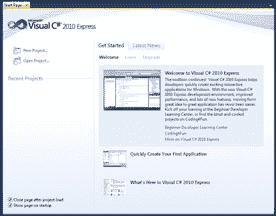

图 1.3 Visual C# 2010 Express 启动页

26

第 1 节：NET 框架和 C#

图 1.4 固定最近项目

启动页分为以下部分：

- 命令部分，显示“新建项目”和“打开项目”命令。如果你安装了任一带 MSDN 的 Visual Studio 版本，此部分还可以显示“连接到 Team Foundation Server”命令。
- 最近项目列表，显示最近打开的项目。点击其中一个项目将在 Visual Studio 中打开它。也可以固定项目，如图 1.4 所示，这使其在其他项目关闭后仍保持在当前位置。
- 一个带标签页的内容区域。“开始使用”标签页显示了帮助主题和其他资源的列表，可以帮助你学习 Visual Studio 的功能。“最新动态”标签页列出了来自所选 RSS 馈的特色文章。

## 解决方案、项目和项目

Visual Studio 使用两个概念来帮助你组织和交互源代码文件，称为**解决方案（solutions）**和**项目（projects）**。

**项目（project）**是源代码和相关元数据的集合，编译时会生成单个程序集。**解决方案（solution）**包含一个或多个项目以及定义整个解决方案的额外文件和元数据。每当你创建一个新项目时，Visual Studio 都会自动为你创建一个解决方案。需要时，你可以向该解决方案添加其他项目。一个项目可以属于多个解决方案，复杂的应用程序可能需要多个解决方案。

图 1.5 所示的解决方案资源管理器（Solution Explorer）显示解决方案、其中包含的项目（或项目）以及每个项目的项，让你能够轻松查看和管理这些容器及其关联项。

大多数情况下，你通过双击项目项（例如代码文件）在编辑器窗口中显示它，或者通过右键菜单添加或删除项或项目。

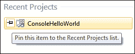

27

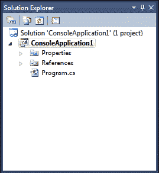

图 1.5 解决方案资源管理器

##第一个程序

到此时，你应该足够熟悉 C# 语言和语法来编写你的第一个程序。如果你还没有安装 Visual Studio 2010，现在是时候安装了。作为 C# 的首次尝试，你将遵循传统，从一个在屏幕上显示“Hello, world”信息的简单应用程序开始。

创建项目

可以使用启动页上的“新建项目”命令、工具栏上的“新建项目”按钮或应用程序菜单来创建项目。这三个位置如图 1.6 所示。

这显示图 1.7 所示的新建项目对话框，允许你指定项目的名称和类型。


28

第 1 小时：NET 框架和 C#

对于第一个应用程序，你将创建一个名为 ConsoleHelloWorld 的**控制台应用程序**。在选择项目类型并提供名称后，你可以点击确定 按钮或双击项目类型。这将关闭对话框，创建项目并显示该项目的默认代码，如图 1.8 所示。

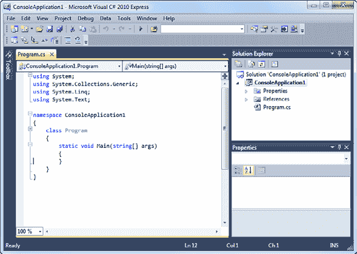

图 1.8
控制台应用程序的默认代码

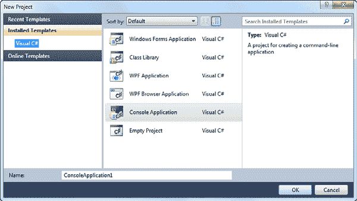

图 1.7
新建项目对话框

如你所见，Visual Studio 已经为我们完成了一些工作并提供了一些初始代码。在我们开始添加自己的代码之前，让我们检查 Visual Studio 为我们生成的代码。

从 www.wowebook.com 下载

编写你的第一个程序 29

图 1.9
使用指令

在文件的顶部（第 1 到 4 行）是命名空间列表（参见图 1.9）。每个命名空间都通过 **using 指令**包含，该指令仅为 `using` 关键字后跟命名空间。using 指令告诉编译器以及我们，我们正在引用一个命名空间，并且该命名空间中声明的类型可以使用。

在 using 指令正下方（参见图 1.10），你声明了一个名为 ConsoleHelloWorld 的命名空间（第 6 行）和一个名为 Program 的类（第 8 行）。在这个类内部，我们定义了一个名为 Main 的静态函数（第 10 行）。我们将在第 3 小时更详细地介绍类和方法，但现在初，请将它们想象成一个容器，其边界由左括号和右括号定义。

图 1.10
默认 Program.cs 内容

### 添加 Program 语句

现在，你可以专注于我们需要此应用程序做什么。由于你正在控制台应用程序中工作，你需要一种方法与运行我们应用程序的控制台窗口进行交互。通过检查框架类库，你发现了一个名为 `Console` 的类，它提供了显示消息和通过键盘接收用户输入的方法。

要在控制台窗口中显示文本，你需要在定义 Main 的括号之间输入以下语句（第 11 和第 12 行）：

`Console.WriteLine(“Hello, world”);`

你的文件现在应该像图 1.11 所示。

图 1.11
添加 Console.WriteLine


从 www.wowebook.com 下载

30

第 1 小时：NET 框架和 C#

你也可以使用完整类型名称（即 `System.Console`）来编写此行。没有必要这样做，因为文件开头包含了 using 指令。由于这些 using 指令告诉你你想使用在该命名空间中声明的类型，因此你只需要使用类型名称。然而，如果两个包含的命名空间中有两个同名的类型，编译器无法确定使用哪一个。在这种情况下，你仍然需要使用完整类型名称。

到此时，你已经有一个完整的“Hello, world”应用程序。虽然这看起来像是一个微不足道的示例，但只是看起来如此。请记住，Windows 命令行提示符不是托管应用程序，因此你 C# 程序中的那一行代码封装了与该非托管应用程序交互的所有逻辑，并引导它显示你想要的文本。对于 C# 编译器来说，那行看似无害的代码最终取决于大约十个不同命名空间中的几十种类型，所有类型都由框架类库提供。

### 保存项目和解决方案

如果你使用 Visual C# 2010 Express，项目和解决方案文件将在临时位置创建。当你关闭 Visual C# 2010 Express 或首次点击“保存”或“全部保存”时，系统将提示你指定保存项目的路径。如果你使用带有 MSDN 版本的 Visual Studio，项目和解决方案将自动保存到新建项目”对话框中指定的位置。

*顺便说*

运行应用程序

如果你还没有运行，按 Ctrl+F5 运行你的应用程序。Visual Studio 然后将保存你的文件（如果你还没有保存），将其编译为名为 `ConsoleHelloWorld.exe` 的应用程序并运行它。

如果你输入的内容完全正确，你应该在命令行窗口中看到“Hello, world”消息，如图 1.12 所示。

“按任意键继续”消息是由 Visual Studio 添加的，因此你实际上可以看到输出。如果没有它，应用程序将运行、显示你的消息然后退出。

图 1.12
Hello, world


从 www.wowebook.com 下载

31

问与与答

### 总结

恭喜！你现在已成功编写了你的第一个 C# 应用程序。无论这是你的第一个托管应用程序还是仅仅是你的第一个 C# 应用程序。在本节开始时，你查看了 .NET 框架及其组成部分。这可能比你预期的要深入，但了解 .NET 框架是如何创建的以及如何组合的，对于成为一名优秀的 .NET 程序员至关重要。接下来，你查看了 C# 语言，学习了语句、表达式、变量、常量和标识符。

最后，你将所学知识结合起来创建了第一个 C# 应用程序。这看起来可能是一个微不足道的示例——毕竟只是在屏幕上打印“Hello, world”，但这只是开始。在本书的后续章节中，每一节都将在你所学知识的基础上，从多线程等高级主题继续深入。

问与答

什么是 .NET 框架？
答：.NET 框架是一个平台，允许开发者以语言无关的方式创建和运行下一代应用程序和 Web 服务，并有助于减少许多常见的编程错误。

什么是通用语言运行时 (CLR)？
答：通用语言运行时 (CLR) 是 .NET 框架的核心，C# 在其上运行。

什么是托管应用程序和非托管应用程序的区别是什么？
答：为 .NET 的代码被称为托管代码，而任何其他代码被称为非托管代码。

32

第 1 小时：NET 框架和 C#

什么是垃圾回收？它为什么重要？
答：垃圾回收是由于 .NET 框架提供的一种种运行时服务，它让你无需手动处理内存分配和释放。这通过防止许多常见的编程错误让你能够创建更稳定的应用程序，并让你将时间集中在应用程序所需的业务逻辑上。

什么是 C#？
答：C# 是一种面向对象、类型安全的编程语言，运行在 .NET 框架上。

C# 程序是编译的？
答：是的，C# 程序在开发时编译为通用中间语言 (CIL)。在运行时，它们由即时 (JIT) 编译器编译为可执行的对象代码。

工作坊

测试

1. .NET 框架的组成部分有哪些？
2. 通用类型系统为什么重要？
3. 什么是通用中间语言 (CIL)？
4. 框架类库为什么重要？
5. 动态语言运行时 (DLR) 为 C# 提供了什么？
6. 以下代码在 C# 中有效吗？

```csharp
class Program 

{
static void Main() 
{

const int LettersInEnglishAlphabet = 26
system.console.WriteLine( 
“There are {0} letters in the English alphabet.”, 
LettersInEnglishAlphabet)
} 
}
```


33

工作坊

7. 对以下变量声明的正确解释是？

int a, b = 1;

8. 下列中哪一个不是有效的标识符？

A. lightHouse

B. _lighthouse

C. 22lighthouse

D. lighthouse2

答案

1. .NET Framework 有四个主要组件：通用语言运行时 (CLR)、框架类库 (BCL)、并行计算平台 (PCP) 和动态语言运行时 (DLR)。

2. 通用类型系统 (CTS) 非常重要，因为它为每种 .NET 语言提供了相同的类型描述，并定义了该类型如何使用，从而实现了语言集成。

3. 通用中间语言 (CIL) 是托管代码部分编译成的低级语言。你可以将通用中间语言比作汇编语言；它由表示你代码的单个低级指令组成。

4. 框架类库为所有 .NET 语言提供了一系列丰富的重用类型，并使你能够通过简化许多常见的编程任务来实现高水平的开发生产力。

5. DLR（动态语言运行时）使 C# 能够使用一致的语法与任何来源（例如 COM、IronRuby、IronPython 和 JavaScript）的动态对象进行交互。

6. 不，所示代码不是有效的 C#，原因有两个。首先，没有任何语句以分号（;) 结尾。其次，正确的类型名称是 `System.Console.WriteLine` 而不是 `system.console.WriteLine`，因为 C# 是一种大小敏感的语言。

7. 这样结合多个变量声明和初始值赋值是危险的，因为它可能会产生歧义。该语句的正确解释等同于：

int a;

int b = 1;

8. 正确答案是 C。标识符不能以数字开头。

34

第 1 小时：NET Framework 和 C#

练习

1. 通过将“Hello, world”应用程序更改为询问你的名字并输出“Hello, *name.*”，探索 System.Console 类中还有哪些可用，其中 *name* 是程序运行期间输入的文本。

35

第 2 小时

理解 C# 类型

*你将在本小时学到：*

- 类型概述
- C# 预定义类型
- 运算符
- 值类型和引用类型
- 可空类型
- 类型转换

在第 1 小时“NET Framework 和 C#”中，你学习了 .NET Framework 和 C# 的基础知识，包括框架类库、通用语言运行时以及自动内存管理的概念。你简要学习了命名空间和类型，然后学习了语句、表达式、变量、常量、标识符和关键字。从这些基础开始，你随后构建了一个简单的 C# 应用程序。

在已所学知识的基础上，本小时将向你介绍 C# 提供的预定义类型以及使用这些类型时可以执行的各种操作。然后你将学习值类型和引用类型。之后，你将看到可空类型并学习类型转换。

在本小时结束时，你应该对 C# 类型有彻底的理解，包括值类型、引用类型和可空类型之间的区别。你编写了一些可以存储和处理简单数据的高级应用程序。

36

第 2 小时：理解 C# 类型

类型

C# 既是类型安全的语言，也是静态类型语言。这些概念紧密相连，要求你向编译器告知你创建的任何变量的数据类型。作为回报，编译器保证你只能在该变量中存储兼容的数据类型。这有助于防止常见的编程错误，使应用程序更加稳定、更安全。

类型分为三大主类：

- 值类型
- 引用类型
- 类型参数

*你知道吗？*

指针

实际上还有第四类类型，称为指针，它不是 C# 语言的核心部分。指针类型包含内存中项的实际位置（称为地址）。指针还允许像处理数字一样进行算术运算。尽管指针非常强大，但也很难正确且安全地使用。

然而，在某些情况下可能需要使用指针。幸运的是，几乎所有这些都是更高级的情况，不是我们经常需要担心的事情。其中某些情况可能包括直接与底层操作系统交互或实现对时间极其敏感的算法。

为了允许指针的灵活性（以及危险性），C# 允许你编写*unsafe*（不安全代码），在这些代码中可以创建并操作指针。使用 unsafe代码和指针时，请注意垃圾回收器不会跟踪指针，因此你必须自己处理内存分配和释放。在某种意义上，这就像在 C# 程序中编写 C 代码。

通过禁止在显式的不安全代码块之外使用指针类型，C# 可以消除一整类常见的错误，使其成为一种更安全的语言。

简单来说，值类型是完全自包含的，并“按值”复制。这意味着值类型的变量直接包含其数据，对其中一个的操作不会影响另一个。值类型进一步划分为结构、枚举类型和可空类型。

引用类型包含对实际数据的引用，这意味着两个变量可以引用相同的数据，从而可能导致对其中一个的操作影响另一个。引用类型进一步划分为类、数组、接口和委托。

跳转到泛型（Generics）以获取关于类型参数的更多信息

37

预定义类型

*顺便说*

统一类型系统

尽管类型之间有这种划分，C# 具有一个统一的类型系统，使得任何非指针类型的值都可以被视为对象。这使得值类型具有引用类型拥有的优点，而没有引入不必要的开销，并使得在任何值上调用方法成为可能。

C# 语言定义了一组映射到通用类型系统的类型。如果你熟悉通用类型系统，这些类型的名称可能会不同。预定义类型如表 2.1 所示。

 表 2.1 C# 预定义类型

| 关键字 | 别名 | 描述 | 范围 |
| :--- | :--- | :--- | :--- |
| bool | Boolean | 逻辑 | true 或 false |
| byte | Byte | 无符号 8 位整数 | 0 到 255 |
| char | Char | 单 16 位 Unicode 字符 | U+0000 到 U+FFFF |
| decimal | Decimal | 至少 28 位有效数字的数据类型 | ±1.0 × 10²⁸ |
| double | Double | 双精度 64 位浮点 | ±1.7 × 10³⁰⁸ |
| float | Single | 单精度 32 位浮点 | ±1.5 × 10⁴⁵ 到 ±3.4 × 10³⁸ |
| int | Int32 | 有符号 32 位整数 | -2³¹ 到 2³¹-1 |
| long | Int64 | 有符号 64 位整数 | -2⁶³ 到 2⁶³-1 |
| sbyte | SByte | 有符号 8 位整数 | -128 到 127 |
| short | Int16 | 有符号 16 位整数 | -32,768 到 32,767 |
| uint | UInt32 | 无符号 32 位整数 | 0 到 4,294,967,295 |
| ulong | UInt64 | 无符号 64 位整数 | 0 到 18,446,744,073,709,551,615 |
| ushort | UInt16 | 无符号 16 位整数 | 0 到 65,535 |
| object | Object | 所有值类型和引用类型的基类型 | N/A |
| string | String | Unicode 字符序列 | N/A |


## 预定义类型

39

**System.Object**

所有的值类型以及类、数组和委托引用都派自 object。接口类型只能派生自其他接口类型，但它们可以转换为 object。

类型参数类型实际上并不派自任何类型，但仍然可以转换为 object。

不安全指针类型既不派自也不可转换为 object，因为它们超出了 C# 的正常类型规则。

这实际上实际上意味着 C# 中的每个非指针类型都可以转换为 object，但可能并不派自 object。

*你知道吗？*

**Var** 并不是 **Variant** 的缩写

当 `var` 类型首次引入时，许多人认为它等同于 Visual Basic 的 Variant 类型。Variant 是一种可以表示任何其他数据类型的类型，并且不是强类型的。`var` 类型仍然是强类型的，因为它在编译期间会被替换为真实的数据类型。尽管如此，过度使用它可能会降低你代码的可读性，因此请谨慎使用。

*注意！*

### 动手尝试一下
#### 使用预定义类型

现在你已经熟悉了预定义类型，让我们来看看如何使用它们。通过遵循这些步骤，你将编写一个创建本地变量并显示它们值的应用程序。然后，你创建一个隐式类型变量，并验证它实际上创建了一个强类型变量。

- `ulong` 通常映射到 `decimal`，当原始值小于 9,223,372,036,854,775,807.5 时，可以映射到 `long`。
- `ushort` 通常映射到 `int`，当原始值小于 32,767.5 时，可以映射到 `short`。

C# 还有一些特殊类型，最常见的是 `void` 类型。`void` 类型表示类型的缺失。`dynamic` 类型与 object 类似，主要区别在于该类型上的所有操作将在运行时解析而不是编译时解析。

尽管 `void` 和 `dynamic` 是类型，但 `var` 代表一个隐式类型变量，并告诉编译器根据分配的数据确定真实类型。

40

 第二 节：理解 C# 类型

图 2.1 使用预定义类型的输出
图 2.2 显示 var 为 int 的工具提示

1. 创建一个新的控制台应用程序（Console application）。
2. 在 Program.cs 文件的 Main 方法中，输入以下代码：
```csharp
int i = 20;
float f = 20.2f; 
string s = "Hello, world...again";
Console.WriteLine("This is an {0} value: {1}", i.GetTypeCode(), i); 
Console.WriteLine("This is a {0} value: {1}", f.GetTypeCode(), f); 
Console.WriteLine("This is a {0} value: {1}", s.GetTypeCode(), s);
```
3. 按 Ctrl+F5 运行应用程序；你应该会在控制台窗口看到以下内容，如图 2.1 所示。
4. 按任意键关闭控制台并返回 Visual Studio。
5. 在 Main 方法中，之前的代码之后输入以下代码：
```csharp
var v = 20;
Console.WriteLine("This is also an {0} value: {1}", v.GetTypeCode(), v);
```
6. 将鼠标光标悬停在 `var` 关键字上直到显示工具提示，这确认了 v 实际上是一个 `int`，如图 2.2 所示。
7. 再次按 Ctrl+F5 运行应用程序，你现在应该看到额外的一行：
`This is also an Int32 value: 10`
8. 按任意键关闭控制台并返回 Visual Studio。
9. 在 Main 方法中输入以下行：
```csharp
v = "hello";
```
10. 你应该立即注意到在你刚刚输入的语句下方有一个红色的“波浪线”，并有一条错误消息显示“无法隐式将 'string' 转换为 'int'

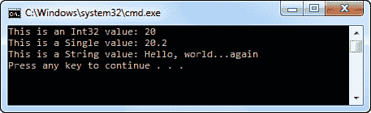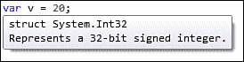

41

预定义类型

▲ 表 2.2 常见的 DateTime 属性

| 属性 | 说明 |
| :--- | :--- |
| Date | 获取当前实例的日期部分 |
| Day | 获取当前实例表示的天数 |
| DayOfWeek | 获取当前实例表示的星期几 |
| Hour | 获取当前实例表示的日期的小时部分 |
| Minute | 获取当前实例的分钟部分 |
| Month | 获取当前实例的月份部分 |
| Now | 获取设置为本地时区当前日期和时间的 DateTime 对象 |
| TimeOfDay | 获取当前实例的当天时间 |
| Today | 获取当前日期 |

将类型 ‘string’ 转换为 ‘int’。此错误发生是因为编译器已经将 v 分配为 `int` 类型，而 C# 的强类型能力阻止你将字符串分配给同一个变量。

#### 其他可用类型
除了标准类型外，.NET Framework 还提供了其他常用值的类型。这些类型没有像预定义类型那样的别名。

#### 日期和时间
处理日期和时间值是通过 DateTime 结构体完成的，它允许你创建日期和时间。创建新 DateTime 值的常用方法是使用以下静态方法之一：Parse、ParseExact、TryParse 或 TryParseExact。在加或减日期或时间值时，你可以使用实例方法，这些方法会返回一个新的 DateTime 而不是修改原始值。

42

 第二 节：理解 C# 类型

表 2.2 常见的 DateTime 属性

| 属性 | 说明 |
| :--- | :--- |
| Utc | 获取设置为协调世界时 (UTC) 当前日期和时间的 DateTime 对象 |
| Year | 获取当前实例表示的日期的年份 |

表 2.3 常见的 DateTime 方法

| 方法 |get |
| :--- | :--- |
| AddDays | 向当前实例添加指定的 TimeSpan |
| AddHours | 添加指定的小时数 |
| AddMinutes | 添加指定的分钟数 |
| AddMonths | 添加指定的月份数 |
| AddYears | 添加指定的年数 |

常见的 DateTime 算术方法如表 2.3 所示。也可以使用减法运算符减去两个 DateTime 值，其结果是一个 TimeSpan。TimeSpan 表示以正数或负数测量的天、小时、秒组成的时间间隔。为了确保一致性，时间间隔以天为单位测量。你还可以将 TimeSpan 添加到 DateTime 或从 DateTime 中减去 TimeSpan，这两种都会产生一个新的 DateTime。

TimeSpan 的常用方法和属性如表 2.4 所示。

43

预定义类型

表 2.4 常见的 TimeSpan 成员

| 名称 |get |
| :--- | :--- |
| FromMilliseconds | 返回表示指定毫秒数的 TimeSpan |
| FromMinutes | 返回表示指定分钟数的 TimeSpan |
| FromSeconds | 返回表示指定秒数的 TimeSpan |
| Hours | 获取当前实例表示的时间间隔的小时部分 |
| Milliseconds | 获取当前实例表示的时间间隔的毫秒部分 |
| Minutes | 获取当前实例表示的时间间隔的分钟部分 |
| Seconds | 获取当前实例表示的时间间隔的秒部分 |
| Subtract | 从当前实例减去指定的 TimeSpan |
| TotalDays | 获取以整数和表示表示的 TimeSpan 总天 |
| TotalHours | 获取以整数和小数表示的 TimeSpan 总小时 |
| TotalMilliseconds | 获取以整数和小数表示的 TimeSpan 总毫秒数 |
| TotalMinutes | 获取以整数和小数表示的 TimeSpan 总分钟 |
| TotalSeconds | 获取以整数和小数表示的 TimeSpan 总秒 |

#### 全局唯一标识符 (GUIDs)

GUID 是一个 128 位整数值，当需要具有低重复概率的唯一标识时可以使用。System.Guid 结构体允许你创建和比较 GUID 值。常见成员如表 2.5 所示。


44

第 2 小时：理解 C# 类型

表 2.5 

常用 Guid 成员

| 名称 | 描述 |
| :--- | :--- |
| CompareTo | 将当前实例与指定的 Guid 进行比较 |
| Empty | 一个只读实例，表示其值保证为全 0 的 Guid |
| NewGuid | 创建 Guid 结构体的新实例 |
| Parse | 将 GUID 的字符串表示转换为等效 Guid 实例 |
| TryParse | 将 GUID 的字符串表示转换为等效 Guid 实例，并指示转换是否成功 |

表 2.6 
常用 Uri 成员

| 名称 | 描述 |
| :--- | :--- |
| AbsoluteUri | 获取绝对 URI |
| Compare | 使用指定的比较规则比较两个 Uri 实例的指定部分 |
| EscapeUriString | 将 URI 字符串转换为转义后的表示 |
| IsFile | 获取指示指定的 Uri 是否为文件 URI 的值 |
| LocalPath | 获取文件名的本地操作系统表示 |
| MakeRelativeUri | 确定两个 Uri 实例之间的差异 |
| TryCreate | 创建新的 Uri，但如果无法创建 Uri 则不抛出异常 |

统一资源标识符 (URIs)

统一资源标识符 (URI) 是内网或 互联网上可用资源的紧凑表示，它可以是绝对 URI（如网页地址），也可以是相对于基准 URI 扩展的相对 URI。

Uri 类允许你创建新的 URI 值并访问 URI 的各个部分，并提供了处理 URI 的方法，例如解析、比较和组合。表 2.6 显示了一些常用成员。

Uri 类的实例是不可变的。要创建一个可修改的 URI，请使用 UriBuilder 类。UriBuilder 类允许你轻松更改 URI 的属性，而无需为每次修改都创建一个新实例。表 2.7 中显示的所有属性对于 Uri（其中它们只读的）和 UriBuilder 都是通用的，但 Uri 属性仅在 UriBuilder 上可用。

表 2.7 
常用 Uri 和 UriBuilder 属性

| 名称 | 描述 |
| :--- | :--- |
| Fragment | 获取或设置 URI 的片段部分 |
| Host | 获取或设置服务器的主机或 IP 地址 |
| Password | 获取或设置与访问 URI 的用户相关的密码 |
| Path | 获取或设置由 URI 定义的资源路径 |
| Port | 获取或设置 URI 的端口号 |
| Query | 获取或设置包含在 URI 中的任何查询信息 |
| Scheme | 获取或设置 URI 的方案名称 |
| Uri | 获取由指定的 UriBuilder 实例构造 Uri 实例 |
| UserName | 获取或设置与访问 URI 的用户相关的用户名 |

列表 2.1 显示了如何使用 UriBuilder 类。

列表 2.1 
使用 UriBuilder

Uri immutableUri = new Uri("http://www.example.com"); 
Console.WriteLine(immutableUri);

UriBuilder mutableUri = new UriBuilder(immutableUri); 
Console.WriteLine(mutableUri);

mutableUri.Scheme = "https"; 
mutableUri.Host = "www.example.com"; 
mutableUri.Path = "exampleFile.html"; 
Console.WriteLine(mutableUri);

BigInteger

System.Numerics.BigInteger 类型表示一个任意大小的整数值，该值没有理论上的上限或下限。当创建一个 BigInteger 实例后，你可以像使用任何其他整数类型一样使用它，从而执行基本的数学运算和比较。

46

第 2 小时：理解 C# 类型

表 2.8 
常用 BigInteger 成员

| 名称 | 描述 |
| :--- | :--- |
| Abs | 返回 BigInteger 值的绝对值 |
| DivRem | 同时返回除法运算的商和余数 |
| GreatestCommonDivisor | 返回两个 BigInteger 值的最大公约数 |
| IsEven | 指示当前 BigInteger 值是否为偶数 |
| IsOne | 指示当前 BigInteger 值是否为 BigInteger.One |
| IsZero | 指示当前 BigInteger 值是否为 BigInteger.Zero |
| Max | 返回两个 BigInteger 值中较大的一个 |
| Min | 返回两个 BigInteger 值中较小的一个 |
| MinusOne | 获取表示负一 (-1) 的值 |
| One | 获取表示数字一 (1) 的值 |
| Remainder | 对两个 BigInteger 值执行整数除法并返回余数 |
| Sign | 获取一个指示当前 BigInteger 值符号的数字 |
| Zero | 获取表示零 (0) 的值 |

BigInteger 结构体还包含了直接对应其他积分类型成员的成员，并增加了对应 Math 类提供的方法的成员，以及某些特定处理 BigInteger 实例的成员。常用成员如表 2.8。

列表 2.2 显示了你可以使用 BigInteger 类型的一些方法。

列表 2.2 
使用 BigInteger

BigInteger b1 = new BigInteger(987321.5401);
BigInteger b2 = (BigInteger)435623411897L; 
BigInteger b3 = BigInteger.Parse("435623411897");
Console.WriteLine(Int32.MaxValue, 2));
Console.WriteLine(b2 == b3);

47

运算符

C# 支持广泛的运算符，但我们只涵盖常用的运算符。表 2.9 显示了所有运算符的优先级。

表 2.9 
C# 中的运算符和优先级

| 类别 | 运算符 |
| :--- | :--- |
| 原始 | x |
| 一元 | ! ~ ++x --x |
| 乘法 | * / % |
| 加法 | + - |
| 移位 | << >> |
| 关系和类型测试 | > <= >= |
| 相等 | == != |
| 逻辑与 | & |
| 逻辑异或 | ^ |
| 逻辑或 | \| |
| 条件与 | || |
| 赋值 | = += -= *= &= |= ^= << >>= |
| 空合并 | ?? |
| Lambda 表达式 | => |

48

第 2 小时：理解 C# 类型

C# 提供了支持标准数学加法 (+)、减法 (−)、乘法 (*) 和除法 (/) 的算术运算符。C# 运算符的行为与你在学校学习的算术规则存在微妙差异。特别是当一个整数除以另一个整数时，结果是一个整数。任何余数都会丢弃，结果向零舍入。要获取整数除法的余数，必须使用模运算符 (%)。

C# 还支持复合赋值运算符，它将算术运算和赋值结合在一起。每个标准算术运算符和模运算符 (%) 都有对应的操作 (+=, -=, *= /=)。

例如，假设你需要将变量增加一。使用标准算术运算符，这种操作通常如下：
i = i + 1;

然而，通过使用加法复合赋值运算符，这种操作可以这样执行：
i += 1;

进一步简化，你可以使用递增 (++) 和递减 (--) 运算符增加或减少值。递增和递减运算符可以出现在被修改变量之前（前缀）或之后（后置），并将该变量的内容改变一。前缀的形式产生更改发生之前变量的值，而后置形式产生更改后的值。

列表 2.3 显示的所有操作都是等效的，并展示了如何使用基础运算符、复合赋值运算符和递增运算符。

列表 2.3 增加值

i = i + 1; 

i += 1; 

i++;


## 运算符

49

### 尝试自己

要检查赋值、加法、复合赋值以及增、减运算符的行为，请按照以下步骤操作。对于增、减运算符，你将探索前置操作和后置操作之间的行为差异。

1. 创建一个新的控制台应用程序（Console application）。
2. 在 Program.cs 文件的 Main 方法中，输入以下代码：

```csharp
int i = 20;
Console.WriteLine("i = {0}", i);
i = i + 1; 
Console.WriteLine("i = {0}", i);
i += 2;
Console.WriteLine("i = {0}", i);
Console.WriteLine("i = {0}.", --i);
Console.WriteLine("i was {0}, but now is {1} again.", i++, i);
```
3. 按 Ctrl+F5 运行应用程序；你应该在控制窗口中看到以下内容，如图 2.3 所示。

图 2.3  
使用算术运算符的输出

4. 按任意键关闭控制台并返回 Visual Studio。

### 关系运算符

表 2.10 所示的关系运算符用于比较两个值，并产生一个布尔值。

在许多编程语言中，赋值运算符和相等运算符很容易被混淆，因为它们使用相同的符号。这种混淆可能导致意外赋值，这仍然是如今最常见的编程错误之一。为了帮助尽量减少混淆的可能性，C# 为相等性定义了不同的运算符 (==)。

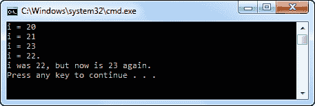

从 www.wowebook.com 下载

50
第 2 小时：理解 C# 类型

表 2.10
C# 中的关系运算符

| 名称 | 运算符 | 表达式 | 结果 |
| :--- | :--- | :--- | :--- |
| 等于 | == | x == 20 | true |
| | | y == 30 | false |
| 不等于 | != | x != 20 | false |
| | | y != 30 | true |
| 大于 | > | x > y | true |
| | | y > x | false |
| 大于或等于 | >= | x >= y | true |
| | | y >= x | false |
| 小于 | < | x < y | false |
| | | y < x | true |
| 小于或等于 | <= | x <= y | false |
| | | y <= x | true |

*假设 x = 20 且 y = 10。*

表 2.11
C# 中的逻辑运算符

| 名称 | 运算符 | 表达式 | 结果 |
| :--- | :--- | :--- | :--- |
| 与（条件） | && | (x == 20) && (y == 30) | false, 两个表达式都为 true |
| 与（逻辑） | & | (x == 20) & (y == 30) | false, 两个表达式都为 true |
| 或（条件） | || | (x == 20) || (y == 30) | true, 一个或两个表达式都为 true |
| 或（逻辑） | \| | (x == 20) | (y == 30) | true, 一个或两个表达式都为 true |
| 或（异或） | ^ | (x == 20) ^ (y == 30) | true, 两个表达式不同 |
| 非 | ! | !(x == 30) | true, 表达式必须为 false |

*假设 x = 20 且 y = 10。*

### 逻辑运算符

表 2.11 所示的逻辑运算符评估布尔表达式，其结果为 true 或 false。

从 www.wowebook.com 下载

逻辑运算符的规则可以很容易总结，假设 x 和 y 是布尔表达式，如表 2.12 所示。

51
表 2.12
逻辑运算符真值表

| X | Y | X && Y | X || Y | X ^ Y |
| :--- | :--- | :--- | :--- | :--- |
| true | true | true | true | false |
| true | false | false | true | true |
| false | true | false | true | true |
| false | false | false | false | false |

### 尝试自己

关系运算符和逻辑运算符

通过遵循这些步骤，你可以验证表 2.10 和表 2.11 中所示的表达式。

1. 创建一个新的控制台应用程序。
2. 在 Main 方法中声明两个名为 x 和 y 的整数变量，并将它们分别初始化为 20 和 10。
3. 使用表 2.10 和表 2.11 中的表达式，使用以下格式编写一系列 `Console.WriteLine` 语句，其中 `expression` 替换为表中正确的表达式：
`Console.WriteLine("expression: {0}", expression);`
4. 按 Ctrl+F5 运行应用程序，观察结果是否与两个表格结果列中显示的内容。

从 www.wowebook.com 下载

52
第 2 小时：理解 C# 类型

*注意！顺便说*

### 短路求值

在 C# 中，条件逻辑运算符执行短路求值（或最小评估），这意味着只有当第一个表达式不会导致整个表达式为 false 时，才会评估额外的表达式。逻辑运算符不执行短路求值。

### 三元运算符的常见问题

三元运算符（也被称为**条件运算符**或**三元运算符**，因为它接受三个项）用于编写简洁的表达式并根据条件返回两个值之一。

条件运算符的形式如下：
`condition ? consequence : alternative`

当条件为 true 时，评估 consequence 并作为结果。然而，当条件为 false 时，评估 alternative 并作为结果。

### 可空类型

如你所示，对于整数值类型，默认值是零。char 类型的默认值是零字符，bool 类型是 false。object 和 string 类型的默认值为 null，表示一个不引用任何对象的引用。

从 www.wowebook.com 下载

53
null 和可空类型

这些默认值意味着值类型不能为 null，初看起来似乎是合理的。但当你与数据库、其他数据源或其他包含未赋值元素的数据类型时，它存在某些局限性。

可空类型为此提供了解决方案。可空类型可以表示其底层类型的取值范围以及一个空值。可空类型通过语法 `Nullable<T>` 或 `T?` 表示，其中 T 是值类型。

### 默认值

你之前学习过 C# 不允许使用未初始化的变量，这意味着在运行变量之前它必须有一个值。虽然这种确定赋值的想法有助于减少错误（因为它是由编译器强制的），但如果你必须为每个字段显式提供默认值，就会非常麻烦。

为了减轻这种负担，字段（或成员变量）始终最初被分配一个适当的默认值。表 2.13 显示了不同定义数据类型的默认值。

表 2.13
默认值

| 类型 | 默认值 |
| :--- | :--- |
| sbyte, byte, short, ushort, int, uint, long, ulong | 0 |
| char | '\x0000' |
| float | 0.0f |
| double | 0.0d |
| decimal | 0.0m |
| bool | false |
| object | null |
| string | null |


▼ 

54

第 2 小节：理解 C# 类型

类型。首选语法是 `T?`。你为可空类型赋值就像为非可空类型赋值一样：

```csharp
int i = 10;
int? n = 10; 
int? k = null;
```

要访问可空类型的值，你应该使用 `GetValueOrDefault` 方法，它返回分配的值；或者如果值为 `null`，则返回底层类型的默认值。你也可以使用 `HasValue` 属性（如果变量包含实际值，则返回 `true`）以及 `Value` 属性（它返回实际值，或者如果值为 `null` 则抛出异常）。

所有可空类型（包括引用类型）都支持空合并运算符 `(??)`，它定义了当可空类型赋值给非可空类型时返回的默认值。如果左操作符为 `null`，则返回右操作符；否则返回左操作符。列表 2.4 显示了如何使用空合并运算符。

列表 2.4 

空合并运算符

```csharp
int? x = null; 
Console.WriteLine(x ?? -1);

x = 3;
Console.WriteLine(x ?? -1);

string s = null; 
Console.WriteLine(s ?? "Undefined");
```

 尝试一下

处理可空类型

要检查如何处理可空类型，请遵循以下步骤。你将创建一个可空 int，利用 `HasValue`、`Value` 和 `GetValueOrDefault()` 以及可空 int 与非可空 int 之间的隐式转换。

1. 创建一个新的控制应用程序。

2. 在 `Main` 方法中，声明一个名为 `x` 的整数变量并将其初始化为 10。然后声明一个名为 `nx` 的可空整数并将其初始化为 `null`。

3. 输入以下语句：

```csharp
Console.WriteLine("nx has a value? {0}", nx.HasValue);
Console.WriteLine("x == nx: {0}", x == nx); 
Console.WriteLine("x != nx: {0}", x != nx);
```

下载自 www.wowebook.com

类型转换与转换 

55

4. 现在，将 `nx` 设置为 20，并输入以下语句：

```csharp
Console.WriteLine("nx has a value? {0}", nx.HasValue);
Console.WriteLine("nx has the value {0}", nx.Value); 
Console.WriteLine("x == nx: {0}", x == nx); 
Console.WriteLine("x != nx: {0}", x != nx);
```

5. 将 `nx` 设置为 `null` 并输入以下语句：

```csharp
Console.WriteLine("nx = {0}", nx ?? -1);
Console.WriteLine("nx = {0}", nx.GetValueOrDefault()); 
Console.WriteLine("nx = {0}", nx.GetValueOrDefault(-2));
```

6. 最后，将 `nx` 设置为 10 并输入以下语句：

```csharp
Console.WriteLine("nx = {0}", nx ?? -1);
Console.WriteLine("nx = {0}", nx.GetValueOrDefault()); 
Console.WriteLine("nx = {0}", nx.GetValueOrDefault(-2));
```

7. 按 Ctrl+F5 运行应用程序，并输出输出相同，如图 2.4 所示。

▲ 

图 2.4

处理可空类型的输出

8. 按任意键关闭控制台并返回 Visual Studio。

类型转换与转换

现在你已经了解了值类型和引用类型，当你需要一个值类型表现得像引用类型时会发生什么？

之前你学过，作为统一类型系统的一部分，所有值类型都可以转换为 `object`。当值类型变量需要用作引用类型时，会自动创建一个对象“箱”（box），并将值复制到箱中。装箱后，对其中一个的操作不会影响另一个。当对象箱转换回其原始值类型时，值将从箱中复制并到变量中。

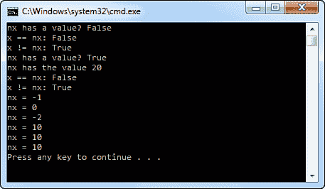

下载自 www.wowebook.com

56

第 2 小节：理解 C# 类型

装箱和拆箱操作

虽然值类型和引用类型之间的转换通常被称为强制转换，因为它们使用了 C# 转换运算符，但 CIL 指令是 `box` 和 `unbox`。因此，这些转换也被称为装箱和拆箱操作。装箱转换始终是隐式的，并将值类型转换为引用类型。拆箱转换始终是显式的，并将装箱的值类型（引用类型）转换回值类型。

装箱和拆箱操作在资源和开销方面是昂贵的，因此你应该尽可能避免它们，并确保你使用正确的类型来解决问题。

所有预定义类型都支持始终成功的隐式转换，如表 2.14 所示。这些隐式转换之所以允许，是因为当从原始数值类型转换为新的数值类型时，不会丢失数量（magnitude）。

隐式转换

隐式转换可能会丢失精度，但永远不会丢失数量。考虑将一个大的 int 值转换为 `float`。两者都是 32 位，但并不是每个大的 int 都能精确地表示为 `float`，这会导致数量的丢失。

表 2.14 预定义类型的隐式转换

| | int | float | long | double |
| :--- | :--- | :--- | :--- | :--- | :--- |
| short | | | | | |
| ushort | | | | | |
| uint | | | | | |
| int | | | | | |
| uint | | | | | | |
| long | | | | | | |
| ulong | | | | | | |
| byte | | | | | | |
| sbyte | | | | | | |
| char | | | | | | |
| string | | | | | | |
| float | | | | | | |
| double | | | | | | |
| decimal | | | | | | |

隐式转换可能会丢失精度，但永远不会丢失数量。考虑将一个大的 int 值转换为 `float`。两者都是 32 位，但并不是每个大的 int 都能精确地表示为 `float`，这会导致精度的丢失。然而，由于 `float` 的范围严格大于 `int`，转换可以在不丢失数量的情况下进行。

（注：此处原文存在大量重复的 OCR 错误，翻译已根据逻辑进行清理和整合）

转换

通过通过这些步骤，你探索了如何通过将类型转换为引用类型来使用转换。应用程序演示了值类型和引用类型如何相互影响。

1. 创建一个新的控制应用程序。

2. 在 `Main` 方法中，声明一个名为 `x` 的整数变量并将其初始化为 36。然后声明一个名为 `boxed` 的对象并将其初始化为 `i`。

3. 输入两个语句显示 `i` 和 `boxed` 的值。

4. 使用显式强制转换将 `boxed` 的值加 2。

5. 复制步骤 3 中的两个 `WriteLine` 语句，验证 `i` 的值没有改变而 `boxed` 的值改变了。

6. 现在将 `i` 的值加 1，复制步骤 3 中的两个 `WriteLine` 语句，验证 `i` 的值改变了而 `boxed` 的值没有。

7. 再次使用显式强制转换将 `i` 的值设置为 `boxed` 的新值。

8. 最后，声明两个可空整数 `h` 和 `j`，将 `h` 初始化为 `null`，`j` 初始化为 `i`，并将名为 `jboxed` 的对象初始化为 `j`。

9. 输入以下代码：

```csharp
Console.WriteLine("h has a value? {0}", h.HasValue);
h = jboxed as int?;
Console.WriteLine("h now has the value {0}", h.Value);
```

10. 使用 Ctrl+F5 运行应用程序，观察输出与图 2.6 所示。

总结

继续构建你的 C# 基础，你探索了 C# 提供的预定义类型，并学习了对它们执行的丰富操作。你学习了值类型和引用类型，包括如何将值类型视为引用类型以及如何创建可空类型。

58

图 2.6

装箱、拆箱和强制转换的输出


### 问答

你已经编写了几个简单的 C# 应用程序来探索这些概念是如何运作的。虽然这些应用程序可能并不华丽，但它们有助于你完善基础，使你能够构建更高级的应用程序。随着你 C# 基础的增长，示例和练习将要求你完成更多工作。

### 问答

Q.* 静态类型意味着什么？*

A. C# 是一种静态类型语言，因此你必须始终告知编译器你创建的任何变量的数据类型。作为回报，编译器保证你只能在该变量中存储兼容的数据。

Q.* C# 有指针吗？*

A. C# 确实有指针类型，尽管它们不是核心语言的部分。指针仅在*unsafe*（不安全）代码的上下文中可用。

Q.* 为什么 C# 的统一类型系统很重要？*

A. 通过提供统一的类型系统，C# 能够让任何类型的值被视为对象，而不会产生不必要的开销。

Q.* 所有的预定义类型都符合 CLS 标准吗？*

A. 不，无符号整数类型和 `sbyte` 类型不符合 CLS 标准。如果有必要，可以使用符合 CLS 的类型来代替这些类型。

Q.* 使用 ***var*** 声明的变量是强类型的吗？*

A. 是的，使用 `var` 声明的变量仍然是强类型的，因为你让编译器在编译期间填充实际类型。`var` 等同于 Visual Basic 的 `Variant` 类型。

Q.* 值类型和引用类型之间的区别是什么？*

A. 值类型直接包含其数据，而引用类型包含指向其数据的引用。

Q.* 值类型可以为 ****null****吗？*

A. 所有值类型要么是可空的要么是不可空的。可空值类型可以是 `null`，也可以是底层非不可空类型的值。不可空值类型不能为 `null`。

## 第 2 小时：理解 C# 类型

Q.* 为什么尽可能避免装箱（boxing）和拆箱（unboxing）操作？*

A. 你应该尽可能避免装箱和拆箱操作，因为它们在资源和开销方面是昂贵的。

### 工作坊

### 测验

1. C# 类型分为哪三大类？
2. 哪种预定义类型对财务计算有用？为什么？
3. 所有预定义类型的基类型是什么？
4. 为什么包含一个独立的 `bool` 类型很重要？
5. 所有的字符串和字符数据都是以 Unicode 存储的吗？
6. 字符串不可变意味着什么？
7. 前置递增操作和后置递增操作有什么区别？
8. 空值合并运算符 (??) 可以用于引用类型和可空值类型吗？
9. 解释装箱操作期间发生了什么。
10. `long` 可以隐式转换为 `int` 吗？

### 答案

1. C# 中的类型分为引用类型、值类型和泛类型。
2. `decimal` 类型对财务计算有用，因为它消除了其他浮点类型中常见的许多表示错误。
3. 所有预定义类型和 C# 中的所有内容最终派自 `object` 类型。
4. 通过包含一个独立的 `bool` 类型，C# 帮助消除使用整数值 0 或 1 时可能产生的歧义，从而消除几种常见的编程错误。
5. 是的，C# 中所有的字符串和字符都以 Unicode 代码单元存储，允许它们进行本地化。
6. 因为字符串是不可变的，它们在赋值后无法被更改。这意味着任何字符串拼接操作都会创建一个全新的全新的字符串对象来存储新值。在短时间内重复性地执行大量此类操作会导致内存使用大幅增加，应该改用 `StringBuilder`。
7. 在前置递增操作中，结果是变量递增之前的值；在后置递增操作中，结果是递增后赋值回变量的值。
8. 是的，空值合并运算符可以用于任何包含 `null` 的类型，包括对象。
9. 当值类型被用引用类型时，会发生装箱操作，涉及创建一个新实例来存放装箱的值。对装箱对象的操作不会影响原始值。
10. 不，`long` 不能隐式转换为 `int`，因为这会导致丢失精度；但是它可以被显式转换。

### 练习

1. 编写一个生成表 2.7 所示真表的控制应用程序。
2. 编写一个演示值类型和引用类型区别的控制应用程序。应用程序应声明两个整数变量和两个 `LightHouse` 类型的对象变量。对于对象变量，创建一个名为 `LightHouse.cs` 的新类文件，并将生成的 `LightHouse` 代码替换为以下代码：

```csharp
public class LightHouse 
{
    public int NumberOfLights = 1; 
    public int RevolutionsPerMinute = 30;
}
```

## 第 3 小时：以 C# 方式理解类和对象

### 面向对象编程

在本小时将学会：
- C# 中的类
- 作用域和可访问性
- 方法和属性
- 嵌套类和部分类
- 静态类
- 初始化器
- 以及数据

类是 C# 中的基础编程概念，在单个单元中定义了表示和行为。这是面向对象和组件编程的基础。

在我们详细讨论类之前，你需要了解面向对象编程的益处，并理解它如何与 C# 关联。面向对象编程帮助你思考想要解决的问题，并为你提供了一种在代码中表示或**建模**该问题的方法。如果你在问题建模方面做得很好，你得到的代码将易于维护、易于理解且易于扩展。

### 可维护的代码

创建易于维护、理解和扩展的代码显然不仅仅是让模型正确。实现也必须是正确、易读且组织良好的。

正如前面提到的，类是 C# 中的基础编程概念，在单个单元中定义了表示和行为。换句话说，**类**是一种结合了数据存储与操作该数据的方法的数据结构。类只是另一种数据类型，以任何预定义类型的方式供你使用。类提供了你创建自定义类型的主要机制。

面向对象编程的四个主要概念是封装、抽象、继承和多态。在本小时，你将学习封装和抽象。在下一小时，你将学习继承和多态。

### 封装与抽象

**封装**允许类隐藏内部实现细节，并保护自己免受导致无效或不稳定内部状态的意外更改。出于这个原因，封装有时也被**数据隐藏**。

通过隐藏内部细节和数据，你创建了一个代表类外部细节的公共接口或**抽象**。这种抽象描述了类可以执行的操作


## 组件化编程

65

类可以执行的操作以及该类公开提供的信息。只要公共接口不发生
变化，内部细节就可以根据需要进行任何更改，而不会对依赖它的其他
类或代码产生负面影响。

通过保持类的公共接口尽可能小，并使你的类与它代表的真实世界
对象之间保持高度的保真度，你有助于确保需要使用该类的其他程序员能够熟悉你的类。

让我们再次看看我们的汽车示例。通过封装启动汽车时发生过程的细节，
并提供一个名为 `StartCar` 的动作以及诸如 `IsCarStarted` 这样的信息，
我们定义了一个公共接口，从而创建了汽车的抽象**（或至少是部分抽象，因为汽车的功能远不止于启动）。

## 组件化编程

组件化编程是通过组合现有的组件和新组件来开发软件
应用程序的技术，这就像汽车由其他组件构建起来的方式一样。软件
组件是自包含的、自描述的功能包，其中包含了类型定义，这些
类型同时暴露了行为和数据。

C# 通过属性、方法、事件和特性（或元数据）的概念支持组件化编程，
允许将自包含且自描述的功能组件称为程序集。

## C# 中的类

现在你已经对面向对象和组件化编程有了基本的了解，是时候看看
C# 如何通过使用类让这些概念变为现实了。你实际上已经在之前
两个小时的示例和练习中用过了类。

C# 中的类是隐式派自 `object` 的引用类型。要定义一个类，你
使用 `class` 关键字。查看你在第1小时结束时构建的应用程序
“.NET 框架与C#”。你所做的一切都在一个名为 `Program` 的类内部。

类的**体**（由左括号和右括号定义）是你定义类的数据和行为的
所在。

从 www.wowebook.com 下载

66

第3节：以C#的方式理解类和对象 

### 作用域和声明空间

我们在第1节中简要提到了作用域和声明空间，说作用域定义了
哪里可以使用某个名称，而声明空间关注该名称在何处是唯一的。作用域和声明空间密切相关，但存在一些细微的。

更正式的定义是，**作用域**是一个封闭的上下文或区域，定义了
在不加限定的情况下哪里可以使用某个名称。

在C#中，作用域和声明空间都是由大括号括的语句块定义的。
这意味着命名空间、类、方法和属性都定义了作用域和声明空间。
结果是作用域可以嵌套并相互重叠。

如果作用域定义了名称的可见性，且允许作用域重叠，那么在外部
作用域中定义的任何名称对于内部作用域都是可见的，但反之不然。

在列表3.1所示的代码中，字段 `age` 在整个 `Contact` 类体中都在
作用域内，包括 `F` 和 `G` 的体内部。在 `F` 中，`age` 的使用指的是
名为 `age` 的字段。

列表3.1 
作用域和声明空间

```csharp
class Contact 
{
    public int age;
    public void F() 
    {
        age = 18; 
    }
    public void G() 
    {
        int age; 
        age = 21;
    } 
}
```

然而，在 `G` 中，作用域发生了重叠，因为还有一个名为 `age` 的局部
变量在 `G` 的整个体内都在作用域内。在 `G`的作用域内，当你引用
`age` 时，你实际上指的是局部作用域内的名为 `age` 的实体，而不是
外部作用域中的那个。当这种情况发生时，外部作用域中定义的
名称被内部作用域**隐藏**了。

图3.1 显示了相同的代码，用虚线和划线矩形指示作用域边界。

从 www.wowebook.com 下载

▼ 

67

作用域和声明空间 

```csharp
class Contact 
{
    int age;
    void F()
    {
        age = 18;
    }
    void G()
    {
        int age; 
        age = 21;
    } 
}
```
图3.1
嵌套作用域与隐藏

另一方面，**声明空间**是一个封闭的上下文或区域，其中不允许
两个实体具有相同的名称。例如，在 `Contact` 类中，你不
允许在类体中拥有其他名为 `age` 的东西，排除 `F` 和 `G` 的体。
同样，在 `G` 的体内部，当你重新声明 `age` 时，你不允许在 `G` 的
声明空间内拥有其他名为 `age` 的东西。

你将在本节稍些时候学习方法重载，但当涉及到声明空间时，
方法的处理方式略有不同。如果你考虑所有具有相同名称的
重载方法的集合，那么在声明空间中，这种处理方式是允许的。

### 尝试一下：作用域的操作

为了探索作用域和声明空间的区别，请按照以下步骤：
1. 创建一个新的应用程序。
2. 添加一个名为 `Contact` 的类，如3.1所示。
3. 在 `Contact` 类中，除了 `F` 和 `G` 的体之外，在类体内不允许
任何其他名为 `age` 的东西。
4. 在 `Program.cs` 的 `Main` 方法中，输入以下代码创建
`Contact` 的实例并打印 `age` 的值：
从 www.wowebook.com

66


8节 = = new();

..


```
5. 使用 Ctrl+F 运行应用程序，观察输出是否与3.2所示。

68

第3节：以C#的方式理解类和对象

▼ 

图3.2
作用域的操作

### 可访问性

访问性允许你控制类外部的可见性或可访问性。C# 通过
**访问修饰符**提供这一点，限制了成员如何被访问。
当成员是**可访问的**，反之，成员是**不可访问的**。

这些修饰符定义了当成员不包含访问修饰符时的默认规则：
- 命名空间没有，且总是公开的。
- 类默认为内部访问，但允许具有内部访问权限。
- 嵌套类（定义在另一个类内部的类）默认为私有访问，但可以具有任何五种访问修饰符。
- 类成员默认为私有访问。

69

作用域和声明空间 

*通过* *方式* *注意！*

表格3.1 
访问修饰符

| 修饰符 | 描述 |
| :--- | :--- |
| public | 不受限制。 |
| protected | 限制为包含类或其派生类型。 |
| internal | 限制为程序集。 |
| protected internal | 限制为程序集或其派生类型。 |
| private | 仅限于包含类。 |

### 显式声明访问性

虽然C# 提供了合理的默认访问修饰符，但你应该总是声明类成员的访问性。这可以防止意外的歧义，表明该选择是深思熟虑的结果，并且自成文档。

C# 支持的访问修饰符如表3.1所示。

### 内部

使用保护内部访问性要小心，因为它实际上是保护或内部。
C# 不提供保护和内部的概念。

### 字段和常量

字段是与类关联的数据变量。换句话说，字段只是定义在
类最外层作用域内的变量。如果你记得1，字段可以是实例字段
也可以是静态字段，对于这两种类型，你都可以指定任何五种访问修饰符。通常，字段是私有的，这是默认值。

如果一个字段（无论实例字段还是静态字段）在声明时没有给出一个初始值，它将被分配适合其类型的默认值。

与字段类似，常量可以使用相同的访问修饰符声明。因为常量必须具有一个可以在编译时计算的值，因此它在声明时必须被分配一个值。要求可以在编译时计算值的好处是，常量可以依赖于其他常量。


70

第 3 小节：用 C# 方法理解类和对象

*观看*

*退出！*

▼ 

常量通常是一个值类型或字符串字面量，因为除了字符串之外，创建
引用类型非空值的唯一方法是使用 `new` 运算符，而这是不被允许的。

## 常量应该是常量

在创建常量时，你应该确保该值在逻辑上是永远恒定的。良好的常量是那些永远不会改变，例如圆周率 Pi 的值、埃尔维斯的出生年份，或摩尔（mol）中的项目数量。

如果你需要创建一个具有类似常量行为但使用了常量声明中不允许的句类型的字段，你可以通过同时指定 `static` 和 `readonly` 饰符来改用 `static read-only` 字段。只读字段可以在声明时进行初始化，也可以在构造函数中初始化。

### 尝试一下

### 操作字段

通过遵循这些步骤，你将探索如何创建一个包含数据的类，以及
如何提供对该数据的访问。如果你关闭了 Visual Studio，请先重复上一个练习。请在本次练习结束时保持 Visual Studio 开启，因为你稍后会使用此应用程序。

1. 创建一个新的控制台应用程序（Console application）。

2. 添加一个名为 `Contact.cs` 的新类文件。在类体内，声明三个名为 `firstName`、`lastName` 和 `dateOfBirth` 的私有字段，类型分别为 `string`、`string` 和 `DateTime`。

3. 向类中添加以下方法。你将在本节的稍后部分学习更多关于方法的知识，并在第 8 小节“使用字符串和正则表达式”中学习更多关于 `StringBuilder` 类的内容：

```csharp
public override string ToString()
{
    StringBuilder stringBuilder = new StringBuilder(); 
    stringBuilder.AppendFormat("Name: {0} {1}\r\n", this.firstName, this.lastName); 
    stringBuilder.AppendFormat("Date of Birth: {0}\r\n", this.dateOfBirth); 
    return stringBuilder.ToString();
}
```

4. 在 `Program.cs` 文件的 `Main` 方法中，输入以下：

```csharp
Contact c = new Contact();
Console.WriteLine(c.ToString());
```

从 www.wowebook.com 下载

71

作用域与声明空间 

▲ 

图 3.3
操作字段

5. 使用 Ctrl+F5 运行应用程序，并观察输出是否与图 3.3 所示。

## 属性

如果字段代表状态和数据但通常是私有的，那么必须有一种机制指出能够让类公开地提供这些信息。了解允许的各种访问性选项会让你很想简单地将类字段声明为 `public` 访问性。

这将允许我们满足抽象的规则，但随后会违反封装的规则，因为
字段可以被直接操作。那么，如何可能同时满足封装和抽象的规则呢？需要的是使用与字段相同的语法访问，但可以定义与字段本身不同访问性的东西。属性使我们恰恰做到这一点。属性提供了一种访问字段的简单方法，该字段被称为**备份字段**（backing field），它是公开的，同时仍允许该字段的内部细节被隐藏。就像字段可以是 `static` 的一样，属性也可以是 `static` 的，并且它们与类的实例不关联。

尽管字段声明了变量（需要存储在内存中），但属性不需要。
相反，属性是带有访问器声明的，这允许你控制一个值是否可以被读取或写入，以及在这样做时应该发生什么。`get` 访问器允许属性值被读取，而 `set` 访问器允许值被写入。

列表 3.2 显示了声明属性的最简单方法。当使用这种被称为**自动属性**（automatic properties）的语法时，你省略了备份字段的声明，并且必须始终包含 `get` 和 `set` 访问器而不声明实现，实现由编译器提供。

列表 3.2
声明自动属性

```csharp
class Contact 
{
    public string FirstName 
    {
        get; 
        set;
    } 
}
```

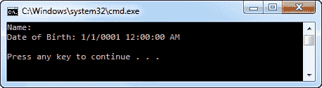

从 www.wowebook.com 下载

72

第 3 小节：用 C# 方法理解类和对象

*观看*

*退出！*

事实上，编译器将列表 3.2 显示的代码转换为看起来大致类似于列表 3.3 所示的代码。

列表 3.3
声明属性

```csharp
class Contact 
{
    private string firstName;
    public string FirstName 
    {
        get 
        {
            return this.firstName; 
        } 
        set 
        {
            this.firstName = value; 
        }
    } 
}
```

## 自动属性

自动属性非常方便，尤其是当你实现大量属性时。然而，这种便利性是有微小代价的。
由于你没有为访问器提供体，所以你无法指定任何作为访问器部分执行的逻辑，而且两个访问器必须使用自动属性语法声明。结果是，如果你在之后的某个时候发现需要为其中任一个访问器提供逻辑，你就需要添加一个备份字段并为两个访问器添加相应的逻辑。

幸运的是，这种变化不会影响你类的公共接口，因此这种操作是安全的，尽管它可能有点麻烦。

`get` 访问器允许属性值被读取，而 `set` 访问器允许值被写入。你也可以创建只读的且没有备份字段的属性。通过只包含 `get` 访问器，你创建一个只读属性。要使用自动属性创建只写属性，你需要将 `set` 访问器设为 `private`。通过只包含 `set` 访问器，或将 `get` 访问器设为 `private`，你创建一个只写属性。在实践中，你应该避免只写属性。

从 www.wowebook.com

73

作用域与声明空间 

*通过*

*方法*

▼ 

你还可以创建只读的且没有备份字段的属性。这些只读属性是来自其他信息的绝佳方式。列表 3.4 显示了一个结合了其他属性 `FullName` 属性。

列表 3.4
声明属性

```csharp
class Contact 
{
    private string firstName;
    private string lastName;
    public string FullName 
    {
        get
        {
            return this.firstName + " " + this.lastName;
        }
    }
}
```

## 只读和只写属性

对于显式声明的属性，你可以省略任何一个访问器。通过只包含 `get` 访问器，你创建一个只读属性。要使用自动属性创建只写属性，你需要将 `set` 访问器设为 `private`。通过只包含 `set` 访问器，或将 `get` 访问器设为 `private`，你创建一个只写属性。

### 尝试一下

### 操作属性

为了修改类以通过属性访问私有数据，并使用自动和计算属性，请遵循这些步骤。如果你关闭了 Visual Studio，请先重复上一个练习。请确保在本次练习结束时保持 Visual Studio 开启，因为你稍后会使用此应用程序。

1. 打开 `Contact.cs` 文件。
2. 添加一个名为 `DateOfBirth` 的公共属性，允许读取和写入 `dateOfBirth` 字段。
3. 删除 `firstName` 和 `lastName` 字段，并创建自动属性 `FirstName` 和 `LastName`。
4. 添加一个计算属性 `FullName`，结合了 `FirstName` 和 `LastName` 属性的值。这与列表 3.4 所示的计算属性类似。
5. 修改 `ToString` 方法，使用新的 `FullName` 属性而不是进行字符串拼接。
6. 在 `Program.cs` 文件的 `Main` 方法中，在 `ConsoleWriteLine` 语句后输入以下代码：

```csharp
c.FirstName = "Jim";
c.LastName = "Morrison";
c.DateOfBirth = new DateTime(1943, 12, 8); 
Console.WriteLine(c.ToString());
```
7. 使用 Ctrl+F5 运行应用程序，观察输出是否与图 3.4 所示。

74

第 3 小节：用 C# 方法理解类和对象

▲ 

图 3.4
操作
属性

### 方法

如果字段和属性定义并实现了数据，那么方法（也被称为**函数**）则定义并实现了可以执行的行为或操作。你到为止在示例和练习中使用的 `Console` 类的 `WriteLine` 操作就是一个方法的范例。

列表 3.5 显示了如何向 `Contact` 类添加一个用于验证电子邮件地址的方法。在这种情况下，`VerifyEmailAddress` 方法指定 `void` 为返回类型，这意味着它不返回任何值。


范围与声明空间

列表 3.5 声明一个方法

```csharp
class Contact
{
    public void VerifyEmailAddress(string emailAddress)
    { 
    }
}
```

列表 3.6 显示了相同的方法，但返回类型声明为 `bool`。

列表 3.6 声明一个返回值的方法

```csharp
class Contact
{
    public bool VerifyEmailAddress(string emailAddress)
    {
        return true; 
    }
}
```

方法声明可以指定五种访问修饰符任意一种。除了访问修饰符，方法还可以包含 `static` 修饰符。正如静态属性和字段与类的实例关联，静态方法也是如此。`WriteLine` 方法实际上是 `Console` 类上的一个静态方法。

方法可以接受零或多个参数（或输入），这些由**形式参数列表**声明，该列表由一个或多个用逗号分隔的参数组成。每个参数都必须包含类型和标识符。如果方法不接受任何参数，则必须指定一个空参数列表。

参数分为三类：

- **值参数**——最常见。当方法被调用时，会为每个值参数隐式地创建一个局部变量，并为其分配参数列表中对应参数的值。

### 参数数组

使用 `params` 关键字声明的参数数组可以被视为值参数的一种特例，它声明了一个单一参数，该参数可以包含参数列表中零或多个给定类型的参数。

方法的形式参数列表只能包含一个单一参数数组；在这种情况下，它必须是列表中的最后一个参数。参数数组也可以是唯一的参数。

- **引用参数**——不创建新的存储位置，而是与参数列表中对应的参数表示相同的存储位置。引用参数使用 `ref` 关键字声明，该关键字必须在参数列表和参数列表中都存在。

- **输出参数**——与引用参数相似，但要求在参数列表和调用列表中都存在 `out` 关键字。与引用参数不同，它们在方法返回之前必须赋予一个确定的值。

为了让方法实际对对象执行其所需的操作，必须对其进行调用（invoke）。如果方法需要输入参数，则必须在**参数列表**中提供这些值；如果方法提供输出值，该值也可以存储在变量中。

参数列表通常与参数列表是一一一的关系，这意味着对于每个参数，在调用方法时，必须按照相同的顺序提供相应类型的值。

### 方法作为输入

返回值的值的的方法和属性也可以作为其他方法的输入，只要返回值类型与参数类型兼容。这种能力极大地增加了方法和属性的实用性，允许你链式调用方法或属性，以形成更复杂的行为。

查看之前示例中返回类型为 `void` 的 `VerifyEmailAddress` 方法，你可以这样调用该方法：

```csharp
Contact c = new Contact();
c.VerifyEmailAddress("joe@example.com");
```

然而，对于定义为返回 `bool` 的 `VerifyEmailAddress` 方法，你应该这样调用该方法：

```csharp
Contact c = new Contact(); 
bool result = c.VerifyEmailAddress("joe@example.com");
```

就像处理参数列表时一样，如果方法调用不需要参数，你仍然必须指定一个空列表。

### 方法重载

通常情况下，在声明空间内两个实体不能具有相同的名称，重载方法除外。当两个或多个方法在声明空间内具有相同名称但具有不同的方法签名时，它们就是**重载**的。

### 方法签名

返回值不是方法签名的一部分，因此方法不能仅根据返回值产生差异。

虽然形式参数列表是方法签名的一部分，但方法不能根据参数是 `ref` 参数还是 `out` 参数而不同。对于方法签名来说，参数的 `ref` 或 `out` 属性不被考虑。

重载方法只能通过签名不同。更准确地说，它们只能通过参数的数量和类型不同。考虑你已经使用的 `Console.WriteLine` 方法，有许多不同的重载供你选择。

方法重载在 .NET Framework 中很常见，它允许类用户与类方法交互并提供不同的输入。根据该输入，编译器确定应该使用哪种方法。

### 不同返回类型的重载

由于方法签名不包含返回值，重载方法可能有不同的返回类型。尽管这可能是合法的 C# 代码，但应该避免这样做以减少混乱。当你想要为一个操作提供几种不同的可能性时，方法重载是有用的，但当有很多选项时，方法重载可能会变得笨拙。方法重载的示例见列表 3.7。

列表 3.7 方法重载

```csharp
public void Search(float latitude, float longitude)
{
    Search(latitude, longitude, 10, "en-US");
}
public void Search(float latitude, float longitude, int distance)
{
    Search(latitude, longitude, "en-US");
}
public void Search(float latitude, float longitude, int distance, string culture)
{
}
```

**方法签名**由方法名、参数的数量、类型以及修饰符组成，必须与类中声明的其他方法不同；方法名必须与类中声明的其他方法不同。

### 亲自尝试使用方法

继续扩展 `Contact` 类，按照以下步骤添加 `VerifyEmailAddress` 和 `Search` 方法。如果你关闭了 Visual Studio，请重复练习。

1. 打开 `Contact.cs` 文件。
2. 添加列表 3.6所示的 `VerifyEmailAddress` 方法，如果输入的邮箱地址为 "joe@example.com"，则返回 `true`。
3. 添加列表 3.7所示的重载方法。
4. 在最后一个重载的 `Search` 方法中，输入打印参数值的 `WriteLine` 调用。
5. 在 `Program.cs` 文件的 `Main` 方法中，在最后一个 `WriteLine` 语句之后输入以下代码：

```csharp
c.Search(37.49444f, -122.45078f);
c.Search(37.49444f, -122.45078f, 50);
c.Search(37.49444f, -122.45078f, 50, "en");
Console.WriteLine(c.VerifyEmailAddress("joe@example.com"));
Console.WriteLine(c.VerifyEmailAddress("jim@example.com"));
```

6. 使用 Ctrl+F5 运行应用程序，观察输出是否与图 3.5 一。

### 可选参数和命名参数

可选参数允许你在调用方法时省略调用列表中的参数。只有值参数可以是可选的，且所有可选参数必须出现在必需参数之后、参数数组之前。将参数声明为可选，只需为其提供一个默认值。这里显示了使用可选参数修改后的 `Search` 方法：

img/f208fb4e324b46b8ec7febd0646a_98_0.png

```csharp
public void Search(float latitude, float longitude, int distance = 10, string culture = "en-US");
```

`latitude` 和 `longitude` 参数是必需的，而 `distance` 和 `culture` 都是可选的。使用的默认值与第一个重载 `Search` 方法相同。

查看上一节的 `Search` 方法重载可以看出，参数越多，需要的重载就越多。在这种情况下，只有几个重载，但这比提供一个带有可选参数的方法多。虽然在某些情况下重载是唯一选择（特别是那些没有暗示合理默认值的参数），但通常可以使用可选参数实现相同的结果。

### 可选参数和必需参数

带有默认值的参数是可选参数，而没有默认值的参数是必需参数。

可选参数在与托管编程接口集成（例如 Office 自动化 API）时特别有用，这些 API 是专门为了可选参数编写的。这些情况下，原始 API 调用可能大量参数（有时多达 30 个），大部分具有合理的默认值。

包含可选参数的方法可以在不显式传递这些参数的情况下被调用，从而使用默认参数。然而，如果调用方法时为可选参数提供了参数，则使用该参数代替默认值。

列表 3.8 显示了调用 `Search` 方法并允许使用默认值的示例。

列表 3.8 使用可选参数

```csharp
Search(27.966667f, 82.533333f, 3); 
Search(27.966667f, 82.533333f, 3, "en-GB"); 
Search(27.966667f, 82.533333f);
```

可选参数的缺点是你不能省略逗号之间的参数，这意味着你不能这样调用 `Search` 方法：

Search(27.966667f, 82.533333f, , "en-GB");

为了解决这种情况，C# 允许按名称传递任何参数，从而你显式地指示参数与...之间的关系


## 第 3 小时：以 C# 方式理解类和对象

相应的参数。使用命名参数，列表 3.8 中不同的方法调用以及刚才显示的非法调用可以像列表 3.9 所示的形式编写。

列表 3.9
使用命名参数
```csharp
Search(latitude: 27.966667f, longitude: 82.533333f, distance: 3); 
Search(latitude: 27.966667f, longitude: 82.533333f, distance: 3, culture: "en-GB"); 
Search(latitude: 27.966667f, longitude: 82.533333f);
Search(27.966667f, 82.533333f, culture: "en-GB");
Search(latitude: 27.966667f, longitude: 82.533333f, culture: "en-GB");
```

所有这些调用都是等价的。前三个调用与列表 3.8 中的调用相同，只是每个参数都显式指定了名称。最后两个调用显示了我们如何在参数列表中间省略一个参数，它们也是相同的，尽管其中一个混合使用了命名参数和位置参数。

### 命名参数和位置参数

不通过名称传递的参数称为位置参数。位置参数是最常见的。

命名参数通常用于可选参数，但它们也可以在没有可选参数的情况下使用。与可选参数不同，命名参数可以与值、引用和输出参数一起使用。你也可以对参数数组使用命名参数，但你必须显式声明一个新数组来包含值，如下所示：

```csharp
Console.WriteLine(String.Concat(values: new string[] { "a", "b", "c" }));
```

从 Search 方法中可以看出，通过允许你显式地指定参数的名称，C# 提供了一种额外的（且强大的）方式来帮助编写完全描述性且自成文档的代码。

### 更改参数顺序

参数始终按照它们指定的顺序进行求值。虽然通常不需要，但命名参数允许你更改参数在调用列表中出现的顺序：

```csharp
Search(longitude: 82.533333f, latitude: 27.966667f); 
Search(latitude: 27.966667f, longitude: 82.533333f);
```

### 动手实践：使用可选参数和命名参数工作

要修改之前定义的 Search 方法以使用可选参数而不是重载，请按照以下步骤操作。如果你关闭了 Visual Studio，请先重复之前的练习。确保在本次练习结束时保持 Visual Studio 打开状态，因为你稍后会用到此应用程序。

1. 打开 Contact.cs 文件。
2. 删除前两个 Search 方法，只保留包含所有四个参数的方法，并修改该方法使 distance 和 culture 成为可选的，并使用 3 和 "en-US" 作为默认值。
3. 使用 Ctrl+F5 运行应用程序，观察输出是否与图 3.6 所示一致。
4. 在 Program.cs 文件的 Main 方法中，将对 Search 方法的调用更改为命名参数的不同组合，并观察每次更改后的输出。

### 实例化类

与预定义类型不同（在预定义类型中你只需声明变量并为其赋值），要在你自己的程序中使用类，你必须创建该类的实例。请记住，尽管你直接使用 `new` 关键字创建对象，但执行系统负责实际分配内存，而垃圾回收器负责释放该内存。实例化类是使用 `new` 关键字完成的，如下所示：

```csharp
Contact c = new Contact();
```
(img/f208f2e34b68bec7febd064a.png)

新创建的对象必须赋予一个初始状态，这意味着任何声明的字段必须通过显式提供值或接受默认值来赋予初始值（见表 2.13）。有时这种级别的初始化是足够的，但往往不够。为了提供初始化期间发生的额外操作，C# 提供了构造函数（有时称为 constructor），这是一种在创建实例时自动执行的特殊方法。构造函数的名称与类名相同，但它不能返回值，这与返回 void 的方法不同。如果构造函数没有参数，它就是默认构造函数。

### 默认构造函数

每个类都必须有一个构造函数，但你并不总是需要写一个。如果你没有包含任何构造函数，C# 编译器会为你创建一个默认构造函数。这个构造函数实际上不会做任何事情，但它会存在。因为编译器只有在你没有提供任何额外构造函数的情况下才会生成默认构造函数，所以添加带有参数的额外构造函数并忘记显式添加默认构造函数，很容易破坏你类的公共接口。因此，最好的做法是始终提供默认构造函数，而不是让编译器为你生成。默认构造函数（或任何构造函数）可以具有任何访问级别修饰符，因此创建一个私有的默认构造函数是完全可能的。如果你允许你的类被创建，但想确保在实例化对象时始终提供某些信息，这将非常有用。列表 3.10 显示了 Contact 类的默认构造函数。

列表 3.10
声明默认构造函数
```csharp
public class Contact
{
    public Contact()
    {

}
}
```

就像可以重载普通方法一样，也可以重载构造函数。构造函数的签名与普通方法相同，因此构造函数的集合也必须根据签名有所不同。提供特殊构造函数的原因如下：

- 无参数时没有合理的初始状态。
- 对于该类型，提供初始状态是方便且合理的。
- 构建对象可能是开销昂贵的，所以你想确保对象在创建时具有正确的初始状态。
- 非公共构造函数限制了谁可以创建对象。

观察你正在使用的 Contact 类，如果你在创建新实例时为 firstName、lastName 和 dateOfBirth 字段提供值将非常有帮助。要这样做，你需要声明一个像列表 3.11 所示的重载构造函数。

列表 3.11
声明重载构造函数
```csharp
public class Contact
{
    public Contact(string firstName, string lastName, DateTime dateOfBirth) 
    {
        this.firstName = firstName; 
        this.lastName = lastName; 
        this.dateOfBirth = dateOfBirth;
    } 
}
```

### this 关键字

`this` 关键字指向类的当前实例。它类似于 Visual Basic 中的 `Me` 关键字、F# 中的 `self` 标识符、Python 中的 `__self__` 以及 Ruby 中的 `self`。`this` 的常见用法：

- 限定被同名隐藏的成员
- 将对象作为参数传递给其他方法
- 在另一个构造函数重载中指定要调用哪个构造函数
- 在扩展方法中指示扩展类型

由于静态成员存在于类级别而不与实例关联，因此无法使用 `this` 关键字。在列表 3.11 中，`this` 关键字用于区分类字段和参数，因为两者的名称相同。


## 第 3 小节：用 C# 理解类和对象

列表 3.12 显示了 Contact 类，它包含了列表 3.10 和列表 3.11 中的两个构造函数，并使用了构造函数链。

列表 3.12 
构造函数链

```csharp
public class Contact 
{
    public Contact() 
    { 
    }

    public Contact(string firstName, string lastName, DateTime dateOfBirth) 
    : this()
    {
        this.firstName = firstName; 
        this.lastName = lastName; 
        this.dateOfBirth = dateOfBirth;
    }
}
```

构造函数链的好处在于，你可以链类提供的任何构造函数，而不只是默认构造函数。在使用构造函数链时，理解构造函数的执行顺序非常重要。构造函数链会一直执行，直到到达最后一个链式构造函数，然后构造函数将按照相反顺序向外执行。列表 3.13 显示了一个类 C，它有三个构造函数，每个构造函数都链式调用默认构造函数。

列表 3.13
链式构造函数的执行顺序

```csharp
public class C 
{
    string c1; 
    string c2; 
    int c3;

    public C() 
    {
        Console.WriteLine("Default constructor"); 
    }

    public C(int i, string p1) : this(p1) 
    {
        Console.WriteLine(i); 
    }

    public C(string p1) : this() 
    {
        Console.WriteLine(p1); 
    }
}
```

图 3.7 显示了使用第二个构造函数（接受 int 和 string 作为输入的那个）进行实例化时，每个构造函数执行的顺序。

图 3.7
构造函数链序列：
C c = new C(3, "C2");
C(int, string) -> C(string) -> C() (3-2-1)

### 静态构造

正如你所看到的，实例构造函数实现了初始化类实例所需的动作。在某些情况下，类可能需要特定的初始化操作最多执行一次，并且在访问任何实例成员之前执行。

为了实现这一点，C# 提供了**静态构造函数**，它的形式与默认构造函数相同，只是使用了 `static` 修饰符代替了访问修饰符。由于静态构造函数用于初始化类，因此你不能直接调用静态构造函数。

静态构造函数最多执行一次，它会在创建第一个实例时或第一次引用任何静态类成员时执行。

### 嵌套类

**嵌套类**是指完全封装在（或嵌套在）另一个类声明内部的类。嵌套类是一种方便的方法，允许外部类创建和使用对象，而无需让它们在类类之外被访问。虽然嵌套类很方便，但也容易过度使用，这可能导致你的类难以维护。嵌套类隐式地具有至少与包含类相同的访问级别。例如，如果嵌套类是 public 的但包含类是 internal 的，则嵌套类也隐式为 internal，只有该程序集的成员可以访问该嵌套类。然而，如果包含类是 public 的，嵌套类则遵循与非嵌套类相同的访问性规则。

**你知道吗？如果一个类没有独立的意义，且逻辑上可以包含在另一个类中，或者该类的成员需要访问包含类的私有数据，你应该考虑将该类实现为嵌套类。**

### 部分类

部分类（Partial classes）允许你将类的声明拆分为跨越多个文件的多个部分。部分类的实现方式与普通类完全相同，只是在 `class` 关键字之前包含了 `partial` 关键字。在处理部分类时，所有部分在编译期间都必须可用，并且具有相同的访问权限以形成完整的类。代码生成工具（如 Visual Studio 中的视觉设计器）广泛使用部分类。机器生成的代码被添加到部分类的一部分，允许你修改另一部分，而无需担心当机器生成的部分重新生成时你的更改会丢失。部分类也可以用于其他不涉及机器生成代码的其他场景。大型类声明可以从使用部分类中获益；但这有时可能意味着你的类试图做太多事情，最好将其拆分成多个类。

带有部分类的嵌套类：尽管 C# 不像 Java 那样要求每个文件对应一个类，但遵循这种结构通常是有帮助的。

### 静态类

到目前为止，你已经看到将 `static` 修饰符应用于构造函数、字段和属性。你也可以将 `static` 修饰符应用于类，这便定义了一个静态类。静态类只能有一个静态构造函数，因此无法创建静态类的实例。出于此原因，静态类主要包含不需要类实例即可工作的工具或辅助方法。

**注意！顺便说一下，静态类只能包含静态成员，但这些成员并不是自动静态的。你必须显式包含 static 修饰符；然而，你可以将任何静态成员声明为 public、private 或 internal。**

### 扩展方法

扩展方法是普通的静态方法，但第一个参数包含了 `this` 修饰符并表示被扩展的实例，通常被称为**类型扩展**。扩展方法必须声明在非嵌套、非泛型的静态类中。

当通过 `using` 指令使扩展类的命名空间在作用范围内时，扩展方法看起来就像它们是扩展类型上的原生实例方法一样。这允许你以自然且直观的方式调用它们。由于扩展方法仅仅是一个特殊标记的静态方法，它对被扩展的类型没有任何特殊的访问权限，只能与扩展类型的公共接口协作。它还允许你通过引用其完全限定名以更传统的方式调用扩展方法。

跳转至第 11 小节“理解泛型”获取更多关于泛型类的信息。

内部成员访问：在与扩展类型相同的程序集内定义的扩展方法也有访问该类型内部成员的权限。

虽然可以定义与类型上的实际方法签名匹配的扩展方法，但它将是不可见的。编译器确保在方法解析期间，任何实际的类方法都优先扩展方法。这确保了扩展方法不能更改标准类方法的行为，否则会导致不可预测或至少是意料之外的行为。

尝试一一下：使用扩展方法。通过遵循这些步骤，你为 Contact 类添加了一个扩展方法，并修改 Program.cs 中的 `Main` 方法以使用这个新扩展方法。如果你关闭了 Visual Studio，请先重复之前的练习。

1. 创建名为 `Extensions.cs` 的新文件。
2. 将 `Extensions` 类设置为静态，并创建一个名为 `GetFullName` 的新扩展，该扩展扩展 `Contact` 并使用与之前 `FullName` 属性相同的逻辑。
3. 移除 `Contact` 类中的 `FullName` 属性并修改 `ToString` 方法使用这个新扩展方法。
4. 使用 Ctrl+F5 运行应用程序，观察输出是否与图 3.8 显示的一致。

图 3.8：使用扩展方法的结果。（img/f208f2b4e324b468b8ec7feb7d60646a_108_0.png）

对象初始化

已经已经如何为类创建构造函数来为初始状态提供方便的方法。然而，与方法重载一样，需要设置的字段越多，可能需要的重载构造函数就越多。虽然构造函数支持可选参数，有时你想在创建对象实例时设置属性。类提供了对象初始化语法，允许在调用构造函数时为任何可访问的字段或属性赋值。这提供了巨大的灵活性，并显著减少了所需的重载构造函数的数量。列表 3.14 显示了你在“处理属性”部分中编写的代码，随后是使用对象初始化的代码。在两种情况下，编译器生成的代码几乎相同。

列表 3.14 
对象初始化

```csharp
Contact c1 = new Contact(); 
c1.FirstName = "Jim"; 
c1.LastName = "Morrison"; 
c1.DateOfBirth = new DateTime(1943, 12, 8); 
Console.WriteLine(c1.ToString());

Contact c2 = new Contact 
{
    FirstName = "Jim", 
    LastName = "Morrison", 
    DateOfBirth = new DateTime(1943, 12, 8)
};
Console.WriteLine(c2.ToString());
```


89

问与答

只要字段或属性之间没有依赖关系，对象初始化器就是同时实例化和初始化对象的一种简单且简洁的方法。

总结

至此，你应该已经很好地理解了 C# 中的类如何为面向对象编程提供语言实现。你学习了作用域如何影响类中成员的可见性，以及如何使用不同的访问修饰符来更改访问性。从那里开始，你构建了一个类并实例化了该类的实例。接着，你学习了方法和属性，包括方法重载、可选参数和命名参数。最后，我们讨论了嵌套类和部分类。

不同于你之前几个小时所接触的简单示例，本小时的示例和练习侧重于构建更具真实的类。

问与答

问. 面向对象编程的四大原则是什么？
答. 面向对象编程的四大原则是封装、抽象、继承和多态。

问. 为什么封装和抽象很重要？
答. 通过使用封装和抽象，你可以更改内部实现细节，而不会影响使用该类的已写代码。

问. 什么是方法重载？
答. 方法重载是在给定的类型中创建多个同名方法。重载方法必须具有不同的签名。

问. 属性如何让类满足封装的目标？
答. 属性提供了一种访问字段的简单方法，该字段可以公开，同时允许隐藏该字段的内部细节。

问. 什么是部分类（partial classes）？
答. 部分类在所有类声明中包含 `partial` 关键字，通常跨越多个源代码文件。

90
第3小时：以 C# 的方式理解类和对象

问. 使用扩展方法的好处是什么？
答. 使用扩展方法可以在不需要使用继承的情况下为现有类型添加额外功能。这些额外功能可以使用自然且直观的方式使用。

工作坊

测试题

1. C# 中提供的五种访问修饰符是什么？
2. 类的默认访问性是什么？
3. 什么是构造函数？
4. 类的默认构造函数可以有参数吗？
5. 使用列表 3.13 中的代码，以下语句的输出是什么？
C c = new C(3, “C2”);
6. 只读字段什么时候可以赋值？
7. 什么是方法重载？
8. 使用自动属性时是否有局限性？
9. 什么是嵌套类？
10. 扩展方法可以访问被扩展类型的私有成员吗？
11. 执行 `new` 运算符时会发生什么？

答案

1. C# 中提供的五种访问修饰符是 `public`、`protected`、`internal`、`protected internal` 和 `private`。
2. 类默认为 `internal` 访问，但允许声明为 `public` 或 `internal` 访问。嵌套类默认为 `private` 访问，但允许任何访问性。
3. 构造函数是一种特殊方法，它在你创建对象时自动执行，以提供额外的初始化操作。

4. 不，类的默认构造函数必须没有参数。
5. 语句的输出是
默认构造函数
C2 
3
6. 只读字段只能在声明时或构造函数中初始化。
7. 方法重载是创建多个参数数量和类型上不同的同名方法。
8. 自动属性不提供访问隐式备份字段的方法，不允许你指定作为 `get` 或 `set` 访问器部分执行的额外语句，也不允许常规语法与自动语法的混合。
9. 嵌套类是指完全封装在类类内部内部类。
10. 因为扩展方法仅仅是静态方法，它们对所扩展的类型没有任何特殊访问权限。然而，在被扩展类型相同的程序集中定义的扩展方法也具有访问该类型内部成员的权限。
11. 执行 `new` 运算符时发生的两个主要操作是：1) 从堆上分配内存；2) 执行类的构造函数以初始化分配的内存。

练习

1. 在 PhotoViewer 项目中添加一个表示照片的类。该类应命名为 `Photo` 并位于 `PhotoViewer` 命名空间中。该类应具有以下私有字段和一个用于检索这些字段值值的只读属性：

| 数据类型 | 字段名称 |
| :--- | :--- |
| bool | Exists |
| BitmapFrame | image |
| Uri | source |

添加以下构造函数：

```csharp
public Photo(Uri path) 
{
    if (path.IsFile) 
    {
        this.source = path; 
    }
}
```

93
第4小时
继承、接口和抽象类

*本小时你将学习到：*
- 继承与多态
- 继承成员的操作
- 密封类
- 抽象类
- 接口

在上一小时中，你学习了 C# 中的类如何通过封装和抽象提供面向对象编程所需的语言支持。虽然面向对象编程的这些方面很重要，但它们没有提供类类之间层次关系的良好机制。继承提供了一种表达这种关系的自然方式。

在本小时中，你将学习 C# 如何通过使用抽象类和接口提供继承和多态的支持。你还学习了 C# 如何防止类被扩展。

## 继承与多态

就像孩子从父母继承特征和行为一样，类也可以继承特征和行为。继承（也称为派生）允许从父类（基类）创建新类（子类或派生类）。

继承允许你将问题的复杂性降低为管理的部分。这些部分构成了概念层，根据你的观点提供了不断增加的特化或泛化，使用“是一种”的关系自然地描述了某些问题的层次结构。

## 多重继承

继承的一般概念很简单。然而，许多面向对象的编程语言允许派生类从多个父类继承，这被称为多重继承。

多重继承并没有改变类之间具有“是一种”关系的要求，并且是一种强大的机制，但这种力量也可能导致实现上的相当复杂。在尝试理解具有通往特定基类的不同继承路径类的时，它还会导致歧义。

为了消除可能的歧义，并且因为多重继承是唯一可行解决方案的情况较少，C# 只允许单继承。

通常，特化是指新类具有继承（基）类中没有的其他数据或行为。特化也可以发生在基类指定某个动作或行为存在但未实现该行为时。这时，提供实现是派生类的责任。

通过从现有类型派生新类型，你继承了父类型的特征和行为。继承还允许派生类对其基类做出几处更改。派生类可以执行以下操作：

- 添加新的私有数据。
- 添加新的行为。
- 重定义现有行为。

再次以上小时的汽车为例，图 4.1 显示了汽车可能的继承链。汽车是一种四轮车，而四轮车又是一种车辆。车辆是基类或根类，为所有车辆提供共同的行为和数据。如


## 继承与多态

95

*顺带一下*

当我们沿着层次结构向下移动时，发现了四轮车辆和两轮车辆基类，它们是车辆的特化，添加了额外的行为和数据。最后，我们发现了汽车、卡车和摩托车类，它们是派生类，可能还会添加额外的行为和数据。

| Vehicle | |
| :--- | :--- |
| Vehicle | 4-wheel |
| Vehicle | 2-wheel |
| Car | |
| Truck | |
| Motorcycle | |

图 4.1 类图

在面向对象编程中，**多态**是指使一种类型可以被当作另一种类型来使用的能力。通常，有两种方法实现这种特性：

- 一种类型继承（或派生）自另一种类型，使其能够访问与其父类相同的操作和公共数据。
- 两种类型都实现兼容的公共接口，允许具有相同的操作和公共数据，但实现方式可能不同。

观察图 4.1 中的类图，可以明显看出，尽管汽车和卡车显然不是同一种类型，但其中任何一个都可以替代四轮车辆，因为它们都继承自该类。同样，尽管摩托车不能替代四轮车辆，但它也可以与汽车或卡车一起替代车辆。

如你所见，多态很大程度上依赖于封装、抽象和继承中提出的思想。如果没有这些方面，一个类要替换另一个类几乎是不可能的。

## 多态

多态是这类听起来很复杂的词之一，但它实际上并不复杂。多态是一种自然且常见的现象。这个词由希腊语单词 poly（意为“多”）和 morphe（意为“形状”或“形式”）组合而成，字面意思是“许多形状或形式”。

从 www.wowebook.com 下载

96

第 4 小时：继承、接口和抽象类

在 C# 中，通过在类声明中提供被继承类的名称可以轻松实现继承。列表 4.1 用代码展示了图 4.1 描述的层次结构。

列表 4.1 代码中的类层次结构

```csharp
public class Vehicle { }

public class FourWheeledVehicle : Vehicle { }
public class TwoWheeledVehicle : Vehicle { }
public class Car : FourWheeledVehicle { }
public class Truck : FourWheeledVehicle { }
public class Motorcycle : TwoWheeledVehicle { }
```

这种继承也被称为**实现继承**，因为你实际上是从父类继承了一个具体的实现。现在你已经有了该层次结构的代码表示，你该如何使用它呢？

## 设计类层次结构

继承无法实现的功能就是移除数据或行为。如果你发现需要从其中一个派生类中移除行为或数据，最可能是因为你的类层次结构设计得不对。

设计类层次结构并不总是一项容易的任务，通常需要尝试几次才能做对。最好的方法是花更多时间考虑你已知的对象与你之后可能需要的对象之间的关系。如果你的类层次结构过于浅（继承较少）或过于深（继承很多），你可能需要重新考虑这些关系。

记住，类层次结构中的并非所有内容都必须相互关联。拥有一个概念上由几个较小的层次结构组成的结构也是完全可以的。

在 C# 中，赋值给变量的表达式必须被认为与变量的类型兼容。这意味着以下代码是不允许的：

```csharp
Car c = new Car();
Truck t = c;
```

这应该是合情合理的的，因为卡车和汽车不是同一种东西。但在逻辑上，卡车和汽车都是 `FourWheeledVehicle`，并且都是 `Vehicle`，因此以下代码是允许的：

*注意！*

从 www.wowebook.com 下载

97

```csharp
Car c = new Car();
Truck t = new Truck();

Vehicle v1 = c;
Vehicle v2 = t;
```

尽管 `c` 和 `v1` 都指向同一个 `Car` 对象，但存在一个重要的区别。当你访问 `c` 时，你是通过一个声明为 `Car` 类型的变量进行的，这允许你访问 `Car` 及其基类 `FourWheeledVehicle` 以及 `Vehicle` 定义的成员。然而，当你访问 `v1` 时，你是通过一个声明为 `Vehicle` 类型的变量进行的，这只允许你访问 `Vehicle` 定义的成员。

*顺带一下*

这样想：汽车知道自己是一辆车辆，因此可以执行车辆能做的任何事情；但车辆对汽车一无所知，因此只能允许你访问它所知道的内容。

虽然可以在类层次结构向上移动（从更派生的类到派生程度较低的类），但不能向下移动。例如，以下代码是不允许的：

```csharp
Vehicle v1 = new Vehicle();
Car c = v1;
```

这起初可能令人惊讶，直到你想起 `Vehicle` 可以代表五种不同类型中的任何一种。因此，无法将更通用类型的表达式隐式赋值给更具体的变量。

要实现这一点，你必须显式地告诉编译器你想进行向下转型（downcast）。在这种情况下，你会写：

```csharp
Vehicle v1 = new Vehicle();
Car c = (Car)v1;
```

## 向上转型与向下转型

将派生类转换为其一个基类的过程被称为向上转型（upcasting）。从基类转换为其一个派生类的过程则被称为向下转型（downcasting）。

从 www.wowebook.com 下载

98

第 4 小时：继承、接口和抽象类

这段代码仍然是合且可以通过编译，但在运行时会导致 `InvalidCastException`。解决这个问题的方法是遵循“信任但验证”的哲学。这意味着信任代码可以通过编译，但验证基类对象确实是派生类型。

列表 4.2 “信任但验证”代码

```csharp
Car c = new Car();
Truck t = new Truck();

if (typeof(Car).IsAssignableFrom(t.GetType()))
{
    c = (Car)t;
}

if (t is Car)
{
    c = (Car)t;
}

c = t as Car;
if (c != null)
{
    // 使用 c
}
```

第一种方法使用底层类型系统判断 `typeof(Car)` 是否可以从 `t.GetType()` 分，如果是，则显式转换。第二种方法相对简单，询问类型系统 `t` 是否为 `Car`，如果是，则显式转换。第三种方法是最简单的选项，如果 `t` 可以转换为 `Car` 则执行转换；否则返回 `null`。

## 自己尝试

简单的类继承与多态

1. 创建一个新的控制台应用程序。
2. 添加一个名为 `Vehicles.cs` 的类文件并实现列表 4.1 所示的类层次结构。
3. 在 `Program.cs` 文件的 `Main` 方法中，输入以下内容：
```csharp
Vehicle v1 = new Vehicle();
Car c1 = (Car)v1;
```
4. 按 Ctrl+F5 运行应用程序。你应该会遇到 `InvalidCastException`，如图 4.2 所示。
5. 删除你之前在步骤 3 中输入的语句，并将其替换为列表 4.2 所示的代码。
6. 再次按 Ctrl+F5 运行应用程序，观察输出是否与图 4.3。

列表 4.3 显示了列表 4.1 代码的修改版本，为某些派生类提供了构造函数，并调用了基类构造函数之一。

图 4.2 显示 InvalidCastException 的结果

图 4.3 使用类继承和多态的结果

99

## 构造函数链与默认构造函数

如果你没有显式调用基类构造函数，编译器会尝试调用默认构造函数。

这里的问题是并不是所有类都有公共的默认构造函数，在这种情况下，忘记显式调用正确的基类构造函数会导致编译错误。


100

第 4 小时：继承、接口与抽象类

▼ 

▲ 

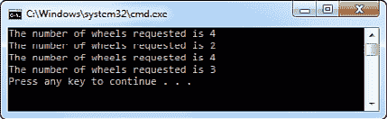

图 4.4 构造函数链调用的结果

代码列表 4.3 
派生类中的构造函数
```csharp
public class Vehicle 
{
    private Vehicle() { }
    public Vehicle(int wheels) 
    {
        Console.WriteLine("The number of wheels requested is {0}", wheels); 
    }
}

public class FourWheeledVehicle : Vehicle 
{
    public FourWheeledVehicle() : base(4) { } 
}

public class TwoWheeledVehicle : Vehicle 
{
    public TwoWheeledVehicle() : base(2) { } 
}

public class Car : FourWheeledVehicle { }
public class Truck : FourWheeledVehicle { }
public class Motorcycle : TwoWheeledVehicle { }
```

动手尝试

构造函数链

通过通过遵循这些步骤，你修改了上一节中创建的类层次结构来探索构造函数链。如果你关闭了 Visual Studio，请先重复预习练习。确保在练习结束时保持 Visual Studio 打开，因为你稍后会使用此应用程序。

1. 打开名为 Vehicle.cs 的文件。
2. 修改类以反映代码列表 4.3 所示的代码。
3. 在 Program.cs 文件的 Main 方法中，将代码替换为创建新汽车、摩托车、卡车和三轮车的代码。
4. 使用 Ctrl+F5 运行应用程序，并观察输出是否与图 4.4 所示一致。

从 www.wowebook.com 下载

继承与多态 101

*注意！*

处理继承成员

有时，派生类需要一个具有相同名称但具有完全相同行为的方法或属性，这是通过**成员隐藏（member hiding）**来实现的。要隐藏基类成员，你需要在派生类中声明一个与要隐藏的基类成员相同签名的成员。由于成员隐藏是基于签名的，你也可以使用成员隐藏来更改成员的返回类型。

如果你想有效地重新定义基类成员，成员隐藏是非常棒的。如果你只是想提供一个更合适的实现呢？C# 允许你使用重写方法（overridden methods）来实现这一点。

### 成员隐藏

隐藏基类成员可能会产生意想不到的或至少是非预期的结果。虽然在派生类中隐藏基类成员有时是有意为之的，但它通常是由于基类的变化（你可能控制，也可能无法控制）导致你无意中隐藏了基类成员。

因此，当基类成员被隐藏时，编译器会生成一个警告来通知你。如果你确定这就是你想做的，应该在派生成员上使用 `new` 关键字。使用 `new` 关键字并不会消除在隐藏基类成员时需要谨慎的必要；它只是让这变得显式化。

为了保持尽可能清晰，C# 要求使用两个不同的关键字来重写类成员。在基类中，成员声明必须包含 `virtual` 关键字，而在派生类中，成员声明必须包含 `override` 关键字。

通常，`virtual` 成员在其实现的行为上是简单的——如果它们提供了提供了行为的话。它们的目的是确保在所有情况下，派生类都拥有该成员，并且它将执行某些名义默认行为。预期是派生类将用更合适、更具体的行为重写 `virtual` 成员。

就像你可以使用构造函数一样，你可以使用 `base` 关键字来访问原始实现。`base` 关键字的行为与 `this` 关键字类似，但它指的是直接基类而不是当前类。

与成员隐藏不同，成员重写（member overriding）具有某些限制：

- 重写的成员声明不能更改 `virtual` 成员声明的访问可见性。
- 虚成员或重写成员都不能声明为 `private`。
- 两个声明必须具有相同的签名。
- 重写的成员不能包含 `new`、`static` 或 `virtual` 修饰符。

### 默认虚成员

虽然某些面向对象的语言（如 Java）默认将成员设为虚的，但 C# 不是。这意味着你必须通过包含 `virtual` 关键字来显式说明成员被重写的可能性，因为只有声明为 `virtual` 的成员才能被重写。

动手尝试

重写基类成员

遵循这些步骤修改你之前创建的类，以创建虚和重写的类成员。如果你关闭了 Visual Studio，请先重复之前的练习。确保在练习结束时保持 Visual Studio 打开，因为你稍后会使用此应用程序。

1. 打开名为 Vehicle.cs 的文件。
2. 修改 `Vehicle` 类以包含一个 `virtual Operate` 方法，只需向控制台打印“Default”。
3. 修改 `FourWheeledVehicle` 和 `TwoWheeledVehicle` 类以重写 `Operate` 方法，并在调用 `base` 后打印“Driving a four-wheeled vehicle”和“Riding a two-wheeled vehicle”。
4. 修改 `Car` 类也重写 `Operate` 方法，将对 `base` 的调用替换为 `Console.WriteLine "Driving a car."`。
5. 在 Program.cs 的 Main 方法中，为每个实例添加调用。
6. 使用 Ctrl+F5 运行应用程序，并观察输出是否与图 4.4。

从 www.wowebook.com 下载

102

第 4 小时：继承、接口与抽象类

*注意！*

▼ 

- 两个声明必须具有相同的签名。
- 重写的成员不能包含 `new`、`static` 或 `virtual` 修饰符。

### 默认虚成员

虽然某些面向对象的语言（如 Java）默认将成员设为虚的，但 C# 不是。这意味着你必须通过包含 `virtual` 关键字来显式说明成员被重写的可能性，因为只有声明为 `virtual` 的成员才能被重写。

动手尝试

重写基类成员

遵循这些步骤修改你之前创建的类，以创建虚和重写的类成员。如果你关闭了 Visual Studio，请先重复之前的练习。确保在练习结束时保持 Visual Studio 打开，因为你稍后会使用此应用程序。

1. 打开名为 Vehicle.cs 的文件。
2. 修改 `Vehicle` 类以包含一个 `virtual Operate` 方法，只需向控制台打印“Default”。
3. 修改 `FourWheeledVehicle` 和 `TwoWheeledVehicle` 类以重写 `Operate` 方法，并在调用 `base` 后打印“Driving a four-wheeled vehicle”和“Riding a two-wheeled vehicle”。
4. 修改 `Car` 类也重写 `Operate` 方法，将对 `base` 的调用替换为 `Console.WriteLine "Driving a car."`。
5. 在 Program.cs 的 Main 方法中，为每个实例添加调用。
6. 使用 Ctrl+F5 运行应用程序，并观察输出是否与图 4.4。

从 www.wowebook.com

抽象类与成员 123

抽象类

*你知道吗？*

*注意！*

图 4.5 隐藏基类的结果

抽象类与成员

将类声明为抽象的可以防止其被直接实例化。结果是抽象类通常具有保护的构造函数而不是公共的。如果你没有提供默认构造函数，编译器会为你创建一个保护的构造函数。抽象类可以包含虚的、非虚的和抽象成员。抽象成员用 `abstract` 修饰符声明，但不提供实现。

静态类

编译器实际上将静态类实现为密封的抽象类，防止它们被实例化或继承。

104

第 4 小时：继承、接口与抽象类

▼ 

通过将类声明为抽象的，你可以防止其被实例化。结果是抽象类通常具有保护的构造函数而不是公共的。如果你没有提供默认构造函数，编译器会为你创建一个保护的构造函数。抽象类可以包含虚的、非虚的和抽象成员。抽象成员用 `abstract` 修饰符声明，但不提供实现。

代码列表 4.4 
抽象 Vehicle 类
```csharp
public abstract class Vehicle 
{
    int wheels;
    protected Vehicle() { }
    public Vehicle(int wheels) 
    {
        this.wheels = wheels; 
    }

    public abstract Operate(); 
}
```

与派生类可以可选重写的虚成员不同，抽象成员必须在**具体**（非抽象）**派生类**中重写。如果派生类也是抽象的，它就不需要重写基类的抽象成员。因为抽象成员在派生类中重写之前没有实现，因此该重写成员无法调用基类中的相同成员。

从 www.wowebook.com


### 接口

105

▲

*注意！*

图 4.6 使用抽象类的结果

1. 打开名为 `Vehicle.cs` 的文件。
2. 修改 `Vehicle` 类使其成为抽象类，并将 `Operate` 方法变为抽象方法。
3. 纠正产生的编译器错误。
4. 使用 Ctrl+F5 运行应用程序，观察输出是否与图 4.6 所示一致。

## 接口并非契约

人们通常说接口定义了一个任何派生类必须实现的契约。这在某种意义上是正确的，因为继承的接口定义了派生类中保证可用的方法签名和属性。

但这在任何方面都不对具体的实现提供任何保证。你完全可能在不提供任何有用实现的情况下满足接口。接口仅仅定义了一个契约，规定了任何继承它的类都必须具有特定的属性和方法。

### 接口

由于 C# 不允许继承自多个基类，因此你需要仔细选择该基类。幸运的是，C# 提供了一种可以实现多重继承的替代方案。接口定义了一组公共特征和行为（以公共属性和方法的形式），所有派生类都保证实现这些内容。将接口想象成部分类型定义或类型描述。

与抽象类一样，接口不能被直接实例化，并且可以包含方法、属性和事件。接口不能包含字段、构造函数或析构函数。

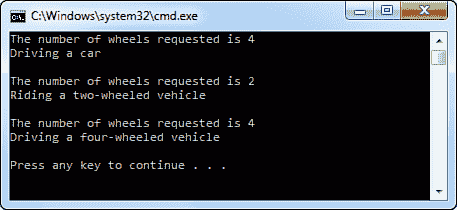

从 www.wowebook.com 下载

106

第 4 小节：继承、接口和抽象类

*顺便问一下，你知道吗？*

声明接口的方式与声明类非常相似，只需将 `class` 关键字替换为 `interface` 即可。接口可以是 internal、public、protected 或 private；然而，如果你不显式地指定访问级别，接口将默认为 internal 访问级别。所有接口成员都自动为公有，且无法指定访问修饰符。由于接口成员也是自动的抽象的，它们无法提供实现。

当类继承接口时（这被称为**接口继承**或接口实现），它只继承成员名称和签名，因为接口不提供实现。这意味着派生类必须为该接口定义的所有成员提供实现。要继承接口，你像继承类一样提供接口的名称。你只需通过提供用逗号分隔的接口名称列表即可继承多个接口。

### 同时继承基类和接口

C# 使用位置表示法在继承列表中指示基类和接口。如果一个类既继承自基类又继承自一个或多个接口，则基类始终列在第一。

你还可以“混合组合”继承，这意味着你可以只继承一个基类、只继承一个或多个接口，或者既继承基类又继承一个或多个接口。如果基类继承自某个接口，那么任何派生自该基类的类都将继承该实现。

虽然接口不能继承自类，但它们可以继承其他接口。如果你将接口看作一种弱契约，那么接口继承简单意味着为了满足这个契约，你也必须满足这些其他契约。这使你能够创建高度特化的接口，然后将这些接口组合在一起形成一个更大的接口。如果你有多个不相关的类需要实现相似的功能（例如将数据保存到压缩的 ZIP 文件），这种方法将特别有用。与此相关的行为和特征可以通过接口定义，然后可以将它们作为定义你的业务对象的其他接口的一部分。

### 接口和扩展方法

在接口的上下文中，扩展方法变得更加强大，因为你还可以扩展接口。这样做允许所有实现该接口的类型获得该扩展方法。事实上，泛型集合的整个语言集成查询（LINQ）功能就是通过这种方式实现的。

从 www.wowebook.com 下载

107

接口

▼

当一个接口继承自另一个接口时，派生接口只定义新的成员；它不会重新定义已继承接口的成员。当类实现这个聚合接口时，它必须为所有接口中定义的成员提供实现。

使用接口真正的威力和灵活性放光的地方在于与抽象类结合使用时。由于接口方法是隐式抽象的，因此抽象类不需要为接口成员提供实现。相反，它可以为该接口成员提供它自己的抽象成员。在这种情况下，任何派生类都必须重写它并提供实现。

查看列表 4.1（Listing 4.1）中的车辆层级，引入紧急车辆（如消防车、警车和警用摩托车）的概念需要什么？你可以引入一个名为 `EmergencyVehicle` 的新类，但并不完全清楚这个新类在现有层级中处于什么位置，因为它需要成为与 `FourWheeledVehicle` 和 `TwoWheeledVehicle` 同一级的基类，而且任何具体类都希望同时继承 `EmergencyVehicle` 或 `Truck`、`Car` 或 `Motorcycle`。你已经知道这种多重继承是不可能的，但如果你使用接口，情况会发生什么变化呢？

### 动手尝试

**使用接口**

这些步骤探索了如何结合接口和基类创建灵活的类层级。如果你关闭了 Visual Studio，请先重复之前的练习。

1. 创建一个名为 `IVehicle` 的新接口，定义 `Operate` 方法，并修改 `Vehicle` 类继承自它。`IVehicle.Operate` 方法的签名应与 `Vehicle.Operate` 方法相同。
2. 创建一个名为 `IEmergencyVehicle` 的新接口，继承自 `IVehicle` 并提供一个无参数的 `void Siren` 方法。
3. 创建三个新类 `PoliceCar`、`Motorcycle` 和 `FireTruck`，派自相应的基类并实现 `IEmergencyVehicle` 接口。对于 `Siren` 的实现，只需向控制台打印消息。
4. 在 `Program.cs` 文件的 `Main` 方法中，输入代码：
    a. 创建 `Car` 的实例并赋值给变量 `car`，然后调用 `Operate` 方法。
    b. 将 `PoliceCar` 的实例赋值给 `car` 并调用 `Operate` 方法。
    c. 创建一个名为 `policeCar` 的 `PoliceCar` 实例并将 `car` 赋值给它。你需要将 `car` 转换为 `PoliceCar`。
    d. 在 `policeCar` 上调用 `Siren`。
5. 使用 Ctrl+F5 运行应用程序，观察输出是否与图 4.7 所示一致。

108

第 4 小节：继承、接口和抽象类

▲

图 4.7 使用接口的结果

当你实现上一个练习中的接口时，你使用的是**隐式接口实现**，类只需声明与接口定义的匹配公共成员。这是接口实现最常见的形式。

如果类实现了多个指定具有相同签名的接口（如列表 4.5 所示），会发生什么？

LISTING 4.5
interface IVehicle
{
    Operate();
}
interface IEquipment
{
    Operate();
}
class PoliceCar : IVehicle, IEquipment
{
    public void Operate()
    {
    }
}

在这种情况下，编译器使该公共方法匹配两个接口成员。如果这不是你所预的，你必须使用**显式接口实现**（如列表 4.6 所示），这要求你完全限定被实现成员的名称。在显式接口实现中，你不需要提供

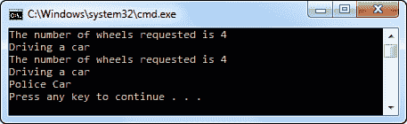

从 www.wowebook.com 下载


问答

109

访问修饰符，因为实现成员隐式为公共，但仅通过接口显式访问。

列表 4.6 

多显式接口继承

```csharp
interface IVehicle 

{

void Operate(); 

}

interface IEquipment 

{

void Operate(); 

}

class PoliceCar : IVehicle, IEquipment 

{

void IVehicle.Operate() 

{ 

}

void IEquipment.Operate() 

{ 

}

}
```

这意味着实现类必须隐式或显式转换为该接口才能访问成员。因此，显式接口具有隐藏成员防止偶然使用的效果。

总结

你现在已经完成了对 C# 类如何为面向对象编程提供语言实现的理解。你学习了类继承如何实现多态对象、基类构造函数链，以及如何覆盖或隐藏继承的类成员。你还学习了抽象类，并学习了如何通过密封（sealed）防止类或类成员被进一步继承。最后，你学习了接口和接口实现。

随着你 C# 编程基础的成型，你也应该开始看到地址簿应用程序的基础开始成型。

问答

Q.* C# 支持多继承吗？*

A. 不，C# 只支持单继承，允许类只继承自一个父类（或基类）。

从 www.wowebook.com 下载

110

第 4 小节：继承、接口和抽象类

Q.* 什么是多态？*

A. 多态是一种类型可以像另一种类型一样使用的。

Q.* 什么是向上转型和向下转型？*

A. 将派生类转换为其基类之一的过程称为向上转型（upcasting）。从基类转换为其派生类之一称为向下转型（downcasting）。

Q.* 什么是成员隐藏？*

A. 成员隐藏允许派生类拥有与基类成员具有相同行为的成员。

Q.* 什么是虚拟成员？*

A. 虚拟成员在基类中包含 `virtual` 修饰符并提供默认行为。派生类可以覆盖虚拟成员并提供更具体的行为。

Q.* 可以防止类被继承吗？*

A. 可以，标记为 `sealed` 修饰符的类不能被继承。

Q.* 什么是接口？*

A. 接口定义了一组公共特征和行为，所有派生类都保证实现它们，且接口成员必须是公共的。接口不保证任何实现。

Q.* C# 支持多接口继承吗？*

A. 是的，C# 支持继承多个接口。接口也可以继承其他接口。

Q.* 扩展方法可以扩展接口吗？*

A. 是的，扩展方法可以以扩展类相同的方式扩展接口。

从 www.wowebook.com 下载

111

测试

1. 为什么类继承被称为实现继承？

2. 隐藏继承成员的正确方法是什么？

3. 成员覆盖有哪些限制？

答案

1. 类继承被称为实现继承，是因为派生类继承了基类的实现。
2. 为了隐藏继承的成员，你应该在派生类中使用 `new` 关键字来显式指示基类成员已被隐藏。
3. 成员覆盖有以下限制：
- 覆盖成员声明不能更改虚拟成员的访问性。
- 虚拟成员或覆盖成员都不能声明为私有。
- 声明必须具有相同的签名。
- 覆盖成员不能包含 `new`、`static` 或 `virtual` 修饰符。

练习

1. 在 `Photo` 类中添加一个接受名为 `path` 参数的公共构造函数。此构造函数应该包含空体并调用你之前添加的 `Photo(Uri)` 构造函数。
2. 为 `Photo` 类添加 `ToString` 方法的覆盖，返回调用 `source.ToString()` 的结果。添加名为 `IPhoto` 的接口。更改 `Photo` 类来实现此新接口。

从 www.wowebook.com 下载

113

第 5 小节

创建枚举类型和结构

本节节你将学习：

- 枚举类型
- 标志类型
- 定义类型
- 结构

在过去的几个小时里，你已经学习了 C# 类型如何工作的基础，包括定义类型和可空类型，以及 C# 类如何为面向对象编程提供语言语法。你还看到了类如何允许你创建自己的类型来表示真实世界的数据。C# 中还有两种我们没有讨论过的值类型：枚举类型和结构。

虽然类是你创建新类型的主要机制，但它们没有提供创建受限制类型的方法，也没有允许你创建新的值类型。C# 中还有两种我们没有讨论过的值类型：枚举类型和结构。

114

第 5 小节：创建枚举类型和结构

枚举类型

枚举类型，也称为枚举（或简称 `enum`），是一种创建受限于一组有意义的有效值的数值类型的方法。虽然这听起来简单，但枚举实际上是强大的。


## 枚举类型

115

*顺便说*
*一下*
*顺便说*
*一下*

周四，

周五，

周六，

}

每当你需要引用一周中的某一天时，你可以使用枚举名称和值
通过名称来引用它。例如，要引用周三，你应该使用
`Days.Wednesday` 而不仅仅是 `Wednesday`。

### 多个命名值

你也可以让多个命名值表示相同的数值值。这在
多个名称可能代表相同概念的情况下
非常用用。要做到这一点，你只需将该名称作为新的枚举值添加，
并将其设置为它所代表的命名值，如下所示：

```csharp
public enum Days 
{
    Sunday,
    Monday, 
    Tuesday, 
    Wednesday, 
    HumpDay = Wednesday, 
    Thursday, 
    Friday, 
    Saturday,
}
```

记住，枚举是仅限制为数值的命名常量的一种，
因此，定义的每个命名值对应一个数值值是合理的。在列表 5.1 中，并没有定义这些数值值。
默认情况下，当你定义一个枚举时，编译器会将枚举的第一个值赋值为整数 0。剩余的值将从上一个值开始
递增数字。`Days` 枚举可以这样写，并且
等同于列表 5.2 所示的代码。

### 零值

通常，最好始终提供一个名为 `None` 的零值。如果这对于
枚举的语境不合适，则应该将常见的默认值赋值为零值。

**列表 5.2 指定了值的简单枚举**

```csharp
public enum Days 
{
    Sunday = 0,
    Monday = 1, 
    Tuesday = 2, 
    Wednesday = Sunday + 3,
}
```

116

第 5 节：创建枚举类型和结构

Thursday = Sunday + 4,
Friday = 5, 
Saturday = 6,
}

枚举还支持你可以在整数值上使用的大多数标准运算符，
尽管并非所有运算符实际上都有意义。你对枚举执行的常见常见是等等性测试和不等性测试。因为枚举是
值类型，你也可以声明一个可空枚举。

### 底层枚举类型

枚举中包含的所有值必须是同一种数据类型，称为
底层类型。默认情况下，枚举的底层类型是 `int`，但可以使用任何预定义的整数类型：`byte`、`short`、`int`、`long`、`sbyte`、`ushort`、`uint` 或 `ulong`。

要为枚举指定不同的底层类型，可以在标识符之后指定它，如下：

```csharp
enum Days : byte 
{
    Sunday,
    Monday, 
    Tuesday, 
    Wednesday, 
    Thursday, 
    Friday, 
    Saturday,
}
```

但请记住，底层类型决定了定义枚举时你可以选择的有效值范围。在这种情况下，
`Days` 枚举只能有 0 到 255 之间的值。

*你知*
*吗？*

### 动手尝试

### 使用枚举

要实现 `Days` 枚举并探索如何使用它，请遵循以下步骤。在本次练习结束时保持 Visual Studio 打开，因为你以后会用到这个应用程序。

1. 创建一个新的控制台应用程序。
2. 添加一个名为 `Days.cs` 的新代码文件，并实现 `Days` 枚举。
3. 在 `Program.cs` 文件的 Main 方法中，声明一个类型为 `Days` 的局部变量 `days`，并分配初始值 `Days.Sunday`。

117

枚举类型

4. 输入一个 `Console.WriteLine` 语句显示 `days` 变量的枚举值和整数值。要获取整数值，你需要将变量转换为 `int`。
5. 按 Ctrl+F5 运行应用程序，观察输出是否与图 5.1 所示。
6. 现在将 `days` 设置为 `Days.Saturday + 1`。
7. 再次按 Ctrl+F5 运行应用程序，观察输出是否与图 5.2 所示。

你发现枚举值和数值都是 7。这是因为没有代表数值 7 的命名值，所以运行时只能直接将其视为一个数字。这就是为什么你应该避免在枚举上执行算术运算的一个良好理由。

### 标志枚举 (Flags Enumerations)

到为止，你查看的是表示离散值的枚举，但现实世界并非总是如此。将星期几的例子再进一步，你可能决定应用程序的用户需要指定星期几的任何组合。

枚举还提供了在**标志枚举**中组合值的能力。使用标志枚举时，你可以通过逻辑或操作创建新的组合值。

以 `Days` 枚举为例，你可以将其转换为标志枚举，如列表 5.3 所示。

图 5.1: 显示命名的枚举值

图 5.2: 显示一个不在枚举类型中的枚举值

/f208f2b4e324b468b8ec7feb7d60646a_337_png)

118

第 5 节：创建枚举类型和结构

**列表 5.3 标志枚举**

```csharp
[Flags]
public enum Days 
{
    None = 0,
    Sunday = 0x1,
    Monday = 0x2,
    Tuesday = 0x4,
    Wednesday = 0x8,
    Thursday = 0x10,
    Friday = 0x20,
    Saturday = 0x40
}
```

为了允许标志枚举的值组合，所有值必须是 2 的幂。这是因为多个值被组合，必须有一种方式来识别这些值。普通枚举和标志枚举的区别在于 `Flags`
属性，它指定了关于枚举的额外元数据。

虽然不是强制使用 `Flags` 属性，但强烈建议使用，因为它向编译器
以及向其他程序员提供了清晰的意图。`Flags` 属性还会更改枚举的字符串表示（来自 ToString）当

*顺便说*
*一下*

与简单枚举（零值可以是 `None` 或常见的默认值）不同，标志枚举应该始终将零值命名为 `None`，并且它表示所有标志都未设置。

### 动手尝试

通过这些步骤，你修改枚举为标志枚举并添加常用的组合。如果你关闭了之前的练习

1. 将 `Days` 枚举修改为列表 5.3 所示。
2. 添加以下组合：
   - `Weekend = Sunday | Saturday`
   - `Workdays = Monday | Tuesday | Thursday | Friday`
3. 在 Main 方法中将 `days` 变量设置为组合：`Days.Saturday | Days.Sunday`
4. 输入以下语句判断 `days` 变量是否设置了特定标志：
   - `Console.WriteLine(days.HasFlag(Days.Saturday));`
   - `Console.WriteLine(days.HasFlag(Days.Friday));`
5. 按 Ctrl+F5 运行应用程序，观察输出是否与图 5.3 所示。
6. 将 `days` 变量设置为组合：`Days.Weekend | Days.Friday`
7. 按 Ctrl+F5 运行应用程序，观察输出是否与图 5.4 所示。

119

结构

结构也称为 **structs**，旨在需要简单的用户定义类型时作为类的轻量级替代方案。结构与类相似，可以包含类的所有的所有成员，但它是值类型而不是引用类型。然而，结构与类在以下方面不同：

- 结构不支持继承。结构隐式继承自 `System.ValueType`（后者又继承自 `System.Object`）。
- 结构可以继承接口，就像类一样。


## 第 5 小节：枚举类型和结构

- 结构是隐式密封的（sealed），这意味着你不能继承结构。
- 结构不能有析构函数，也不能声明默认构造函数并初始化实例字段。如果结构提供了任何构造函数，则所有字段必须在相应的构造函数调用中赋值。

### 基础类库中的结构

除了 string 和 object 之外，所有原始数据类型都实现为结构。.NET Framework 提供了 200 多个公共结构。以下是一些常用的结构：

- System.DateTime
- System.DateTimeOffset
- System.Guid
- System.TimeSpan
- System.Drawing.Color
- System.Drawing.Point
- System.Drawing.Rectangle
- System.Drawing.Size

在 C# 中，结构的声明方式与类相同，只是使用 `struct` 关键字代替了 `class` 关键字。

### 方法

就像类可以定义方法一样，结构体也可以。这些方法可以是静态方法，也可以是实例方法；尽管结构体通常包含静态公共方法和私有实例方法。

### 运算符重载

由于结构是用户定义的值类型，你不能在定义为自定义结构的变量上使用大多数常用运算符（例如相等运算符）。这是一个重大限制，但幸运的是，C# 提供了一种通过运算符重载概念来解决的方法。

如果你将运算符简单地看作特殊命名的方法，那么运算符重载只是方法重载的一种特殊形式。要声明一个重载运算符，你需要定义一个公共静态方法，其标识符为关键字 `operator` 加上你正在声明的实际运算符符号。此外，你所重载的运算符的至少一个参数必须与包含的类型相同。可重载的运算符定义在表 5.1 中。

### 互操作性

并不是所有的 .NET 语言都支持运算符重载，因此如果你创建了想要从其他语言使用的类，它们应该符合 CLS 规范，并应提供与任何定义的重载运算符相对应的替代方案。

复合运算符在列表中明显缺失了，但如果你记得这些运算符会同时执行算术操作和赋值，那么通过重载相应的算术运算符，你就可以允许相应的复合赋值运算符使用你新定义的重载运算符。

通常，运算符应该始终以对称组的形式进行重载。例如，如果你重载了相等运算符，也应该重载不相等运算符。这种对称重载指南的唯一例外是按位取反运算符 (`~`) 和逻辑运算符 (`!`)。运算符重载应遵循的逻辑对称组见表 5.2。

#### 表 5.1 可重载的运算符

| 类别 | 运算符 |
| :--- | :--- |
| 一元 | + - ! ~ ++ -- true false |
| 乘法 | * / % |
| 加法 | + - |
| 移位 | << >> |
| 关系 | < > <= >= |
| 逻辑 | & \| ^ |
| 等于 | == != |

#### 表 5.2 对称运算符重载组

| 类别 | 运算符组 |
| :--- | :--- |
| 一元 | + - -- true false |
| 乘法 | * / % |
| 加法 | + - |
| 移位 | << >> |
| 关系 | < > <= >= |
| 逻辑 | & \| ^ |
| 等于 | == != |

### 转换运算符

与用户定义的结构允许你重载运算符以支持对数据进行常用操作一样，你也可以通过创建重载转换运算符来影响转换过程。同样，如果你将转换和强制转换视为特殊命名的函数，那么转换重载也是方法重载的一种特殊形式。

#### 隐式或显式转换

隐式转换是宽转换，因为原始值中没有任何内容会丢失。显式转换是收窄转换，因为原始值中的数据可能会丢失。在定义你的转换运算符时，你应该记住这些行为。如果你定义的转换有丢失数据可能，则它应该被定义为显式转换。如果转换是安全的（即没有丢失数据的可能性），则应该被定义为隐式转换。

你已经看到了内置数值类型既有隐式转换（不需要特殊语法），也有显式转换（需要特殊语法）。你可以通过声明转换运算符来为你自己的类型重载这些隐式和显式转换，其遵循的规则与声明运算符重载相似。要声明一个转换运算符，你需要定义一个公共静态方法，其标识符为关键字，返回类型为你要转换的目标类型。转换的源类型是参数。如果你想声明隐式转换，请使用 `implicit` 关键字；否则，使用 `explicit` 关键字声明显式转换。转换运算符有时会与运算符重载结合使用，以减少你必须定义的运算符重载数量。

### 尝试一下：结构体中的运算符重载

通过以下步骤，实现一个表示摄氏度和华氏度的自定义结构体。

1. 创建一个新的控制台应用程序。
2. 添加一个名为 `Celsius.cs` 的新代码文件，定义一个如下的结构：
```csharp
struct Celsius
{
    private float degrees;
    public float Degrees
    {
        get
        {
            return this.degrees;
        }
    }
    public Celsius(float temperature)
    {
        this.degrees = temperature;
    }
    public static Celsius operator +(Celsius x, Celsius y)
    {
        return new Celsius(x.Degrees + y.Degrees);
    }
    public static implicit operator float(Celsius c)
    {
        return c.Degrees;
    }
}
```
3. 添加另一个名为 `Fahrenheit.cs` 的代码文件，定义一个与 `Celsius` 类似但名为 `Fahrenheit` 的结构。
4. 在两个结构体中，为 `-` 运算符定义运算符重载。遵循与 `+` 运算符相同的模式。
5. 在两个结构体中，定义一个从 `float` 转换为相应结构类型的隐式转换运算符。遵循从结构类型转换为 `float` 的隐式转换运算符的模式。
6. 接下来，在每个结构体中定义一个从一种转换为另一个的显式转换运算符。使用以下公式进行转换：
   - 摄氏度转华氏度：`(9.0f / 5.0f) * c.Degrees + 32`
   - 华氏度转摄氏度：`(5.0f / 9.0f) * (f.Degrees - 32)`
7. 在 `Program.cs` 的 `Main` 方法中输入：
```csharp
Fahrenheit f = new Fahrenheit(100.0f);
Console.WriteLine("{0} fahrenheit = {1} celsius", f.Degrees, (Celsius)f);
Celsius c = 32f;
Console.WriteLine("{0} celsius = {1} fahrenheit", c.Degrees, (Fahrenheit)c);
Fahrenheit f2 = f + (Fahrenheit)c;
Console.WriteLine("{0} + {1} = {2} fahrenheit", f.Degrees, (Fahrenheit)c, f2.Degrees);
Fahrenheit f3 = 100f;
Console.WriteLine("{0} fahrenheit", f3.Degrees);
```
8. 使用 Ctrl+F5 运行应用程序，观察输出是否与图 5.5 所示。显然，这没有用，因为某些值使用类型名称显示。
9. 为 `ToString()` 方法添加一个重写，返回调用 `this.Degrees.ToString()` 的结果。
10. 使用 Ctrl+F5 运行应用程序，观察输出是否与图 5.6 所示。


## 结构

125

*注意！* 这创建了新变量，但将字段处于未初始化的状态。结果是，如果你尝试访问结构体字段，将收到编译器错误。通过调用构造函数（如在列表 5.4 所示），你保证了字段将通过初始化。

结构体初始化的另一个方面是，如果源（赋值语句右侧的变量）没有完全初始化，则不允许将一个结构体变量赋值给另一个。这意味着以下代码是合法的：

```csharp
NumberStruct ns1 = new NumberStruct(); 
NumberStruct ns2 = ns1;
```

然而，以下代码是不允许：

```csharp
NumberStruct ns1;
NumberStruct ns2 = ns1;
```

### 自定义默认构造函数

与类不同，结构体不能自定义默认构造函数，你无法在构造函数之外初始化结构体的字段。因此，当创建结构体时，所有字段最初都被设置为零值。

你可以提供重载构造函数并利用构造函数链。然而，当你提供重载构造函数时，所有字段必须由你的构造函数显式地或通过链式构造函数进行初始化。

值得注意的有趣点是，如果其他字段接受零值，你仍然可以在默认构造函数中使用链式调用。

列表 5.4 显示了结构体和类之间的相似之处和不同。

**列表 5.4 结构体与类的比较**

```csharp
struct NumberStruct 
{
    public int Value; 
}

class NumberClass 
{
    public int Value = 0; 
}

class Test 
{
    static void Main() 
    {
        NumberStruct ns1 = new NumberStruct(); 
        NumberStruct ns2 = ns1; 
        ns2.Value = 42;

        NumberClass nc1 = new NumberClass(); 
        NumberClass nc2 = nc1; 
        nc2.Value = 42;

        Console.WriteLine("Struct: {0}, {1}", ns1.Value, ns2.Value); 
        Console.WriteLine("Class: {0}, {1}", nc1.Value, nc2.Value);
    } 
}
```

由于 ns1 和 ns2 都是 `NumberStruct` 值类型，它们各自拥有独立的存储位置，因此 `ns2.Number` 的赋值不会影响 `ns1.Number` 的值。然而，因为 nc1 和 nc2 都是引用类型，`nc2.Number` 的赋值会影响 `nc1.Number` 的值，因为它们都包含相同的引用。

### 属性或公共字段

关于结构体和属性存在一些争议。一些人认为应该始终使用属性，即使是在像结构体这样的简单类型中；而另一些人认为结构体只需将其字段设置为公共是可以接受的。

虽然使用公共字段更容易，但它允许你的值类型是可变的，这通常不是我们想要的。在定义自己的结构体时，记住它们是值类型，就像字符串是不可变的一样，它们应该是不可变的。为了做到这一点，你应该提供允许设置私有字段的构造函数以及用于检索值的只读属性。

产生的输出如图 5.7 所示。

### 总结

枚举类型和结构构成了你编程基础的重要部分。现在你了解了类、结构体和枚举类型，你拥有了所有工具来为你的业务应用程序创建专门的类型类型。枚举类型允许你定义一组离散的命名值，而结构体允许你定义自己的轻量级值类型。

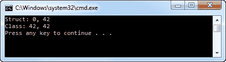

### 工作坊

### 问答

- **Q. *为什么枚举类型有用？***
  A. 枚举类型允许你定义一组离散的数值，并可以给它们赋予易于理解的名字（标识符）。这使得你的代码更具自文档性，同时也有助于确保正确性。

- **Q. *枚举值可以组合起来以识别原始枚举中不存在的值吗？***
  A. 这可以使用标志（flags）枚举来实现，其中所有显式值都必须是 2 的幂。可以使用位或运算符组合值，以形成原始枚举中不存在的新值。

- **Q. *结构体是值类型还是引用类型？***
  A. 虽然结构体可以被认为是轻量级类，但它们实际上是值类型。

#### 工作坊测验

1. 枚举可能的底层类型有哪些？
2. 如果没有显式指定，枚举的默认类型是什么？
3. 提供 `Flags` 特性的作用是什么？
4. 结构体支持继承吗？
5. 你可以为结构体重载运算符吗？
6. 结构体可以自定义默认构造函数吗？

### 答案

1. 枚举可以基于以下类型：`byte`, `short`, `int`, `long`, `sbyte`, `ushort`, `uint` 或 `ulong`。
2. 如果你没有显式指定枚举的类型，它是基于 `int` 类型。
3. 通过在枚举上提供 `Flags` 特性，你清楚地传递了枚举的值可以组合以形成新值。它还更改了 `ToString` 方法的运行时行为，当在组合值上调用时，会显示组成的值。
4. 结构体不支持类的继承，但它们支持接口实现继承。
5. 是的，结构体支持运算符重载。
6. 不，结构体不支持自定义默认构造函数。你可以提供额外的重载构造函数，但在构造函数结束时必须初始化所有字段。

### 练习题

1. 在 `PhotoViewer.Exif` 命名空间下添加名为 `ColorRepresentation` 的公共枚举。该枚举应具有以下值：
   - `Unibrated`
   - `sRGB`

2. 在 `Exif` 文件夹下创建一个名为 `ExifMetadata` 的公共结构体，它包含以下字段：
   ```csharp
   private string cameraModel;
   private ushort? colorRepresentation;
   private string creationSoftware;
   private string dateTaken;
   private string equipmentManufacturer;
   private ushort? exposureCompensation;
   private string exposureMode;
   private decimal? exposureTime;
   private ushort? flashMode;
   private string focalLength;
   private ushort? height;
   private string flash-Fired;
   private ushort? flashFired;
   private string flashNotFire;
   private decimal? focalLength;
   private ushort? height;
   private decimal? horizontalResolution;
   private ushort? isoSpeed;
   private decimal? lensAperature;
   private ushort? lightSource;
   private decimal? verticalResolution;
   private uint width;
   ```
   为每个字段添加公共只读属性。对于 `colorRepresentation`、`flashMode`、`exposureMode` 和 `dateTaken` 字段，使用以下代码：
   ```csharp
   public ColorRepresentation ColorRepresentation
   {
       get
       {
           ColorRepresentation value = Exif.ColorRepresentation.Unibrated;
           if (this.colorRepresentation.HasValue)
           {
               if (!String.IsNullOrWhiteSpace(Enum.GetName(typeof(ColorRepresentation), this.colorRepresentation)))
               {
                   value = (ColorRepresentation)this.colorRepresentation;
               }
           }
           return value;
       }
   }

   public DateTime? DateTaken
   {
       get
       {
           DateTime? result = null;
           if (!String.IsNullOrWhiteSpace(this.dateTaken))
           {
               DateTime date;
               if (DateTime.TryParse(this.dateTaken, DateTimeInfo.InvariantCulture, DateTimeStyles.None, out date))
               {
                   result = date;
               }
           }
           return result;
       }
   }

   public ExposureMode ExposureMode
   {
       get
       {
           ExposureMode value = Exif.ExposureMode.Unknown;
           if (this.exposureMode.HasValue)
           {
               if (!String.IsNullOrWhiteSpace(Enum.GetName(typeof(ExposureMode), this.exposureMode)))
               {
                   value = (ExposureMode)this.exposureMode;
               }
           }
           return value;
       }
   }

   public FlashMode FlashMode
   {
       get
       {
           FlashMode value = FlashMode.FlashDidFire;
           if (this.flashMode.HasValue && this.flashMode % 2 == 1)
           {
               value = FlashMode.FlashFired;
           }
           return value;
       }
   }

   public LightSource LightSource
   {
       get
       {
           LightSource value = Exif.LightSource.Unknown;
           if (this.lightSource.HasValue)
           {
               if (!String.IsNullOrWhiteSpace(Enum.GetName(typeof(LightSource), this.lightSource)))
               {
                   value = (LightSource)this.lightSource;
               }
           }
           return value;
       }
   }
   ```

3. 在 `Photo` 类中添加一个名为 `metadata` 的私有字段，其数据类型为 `PhotoViewer.Exif.ExifMetadata`。在接口和类中添加一个返回该元数据字段的只读属性。


131

## 第 6 小时
## 事件与事件处理

*你将在这一小时学到：*

- 理解事件
- 订阅与取消订阅
- 发布事件
- 触发事件

C# 本质上是一种命令式编程语言，它允许你使用过程（方法）来描述如何完成任务。过程化编程定义了将执行的精确语句以及执行它们的顺序。由于用户交互量通常有限，这种类型的编程常见于命令行或非交互式程序中。

相比之下，事件驱动编程是一种编程风格，其程序流由事件决定。事件简单来说就是任何感兴趣的事，例如用户操作（鼠标点击或按键）或来自其他程序或同一程序其他部分的的消息。在 C# 中，触发（或发送）事件的类是**发布者**（publisher），而接收（或处理）事件的类是**订阅者**（subscriber）。尽管你可以出于多种原因使用事件，但它们最常见的用途是信号图形用户界面中的用户操作，例如与键盘相关的事件（按键）和鼠标相关的事件（鼠标移动、按钮点击等）。

在这一小时中，你将学习事件驱动编程的基础知识，包括如何定义自己的事件、启动并响应事件，以及如何通过事件发送数据。

132

## 第 6 小时：事件与事件处理

### 理解事件

事件遵循发布/订阅模型，其中发布者决定何时触发事件。订阅者决定为响应该事件所采取的行动。事件可以有多个订阅者，在这种情况下，当事件触发时，事件处理程序会被同步调用。如果一个事件没有订阅者，则它永远不会被实际触发。订阅者可以处理来自多个发布者的多个事件。

### 委托 (Delegates)

在传统的编程术语中，事件是回调的形式，它允许将方法作为参数传递给其他方法。在 C# 中，这些回调被称为委托（delegates）。事件处理程序实际上只是通过委托调用的方法。

你可以将委托认为类似于 C 或 C++ 的函数指针或 Delphi 闭包，它是编写回调的一种类型安全且安全的方法。委托在调用者的安全权限下运行，而不是声明者的权限。

委托类型简单地定义了一个方法签名，任何具有兼容签名的的方法都可以与委托关联。委托签名与普通方法签名之间的一个关键区别是返回类型包含在签名中，并且允许在参数列表中使用params` 修饰符。

*顺便说*

## 订阅与取消订阅

当你感兴趣响应由另一个类发布的事件时，你通过定义一个事件处理方法，其签名与事件委托签名匹配来订阅该事件。然后你使用加赋值运算符 (+=) 将事件处理程序附加到事件。列表 6.1 显示了你如何基于 `ElapsedEventHandler` 委托订阅事件。

列表 6.1 订阅事件
```csharp
var timer = new Timer(1000); 
timer.Elapsed += new ElapsedEventHandler(TimerElapsedHandler);

void TimerElapsedHandler(object sender, ElapsedEventArgs e) 
{
    MessageBox.Show("The timer has expired."); 
}
```

第一个参数应该始终是一个名为 `sender` 的对象参数，代表触发事件的对象。第二个参数表示传递给事件处理方法的数据。这始终是一个 `EventArgs` 类型或派生自 `EventArgs` 的命名为 `e` 的类型。事件处理方法应该始终具有 `void` 返回类型。

### 方法组推断 (Method Group Inference)

尽管列表 6.1 显示的代码是附加事件处理方法的传统方式，但 C# 允许你使用一种称为“方法组推断”的更简单的语法。列表 6.1 中的代码在这里显示，但使用了方法组推断：

```csharp
var timer = new Timer(1000); 
timer.Elapsed += TimerElapsedHandler;

void TimerElapsedHandler(object sender, ElapsedEventArgs e) 
{
    MessageBox.Show("The timer has expired."); 
}
```

即使 Visual Studio 自动使用更传统的语法生成事件处理程序的附加，但在附加你自己的事件处理方法时，使用方法组推断是很常见的。

*顺便说一下*

方法名可以是你想要的任何名称，但最好是保持一致，并使用一个由提供事件的对象名称、正在处理的事件名称以及“Handler”一词组合名称。

尽管以这种方式订阅事件对于许多类来说很常见，但 Visual Studio 使得订阅事件变得简单，特别是由任何用户界面控件发布的事件。

这些步骤显示了如何在 Windows Presentation Foundation (WPF) 应用中订阅按钮的 `Click` 事件：

1. 确保已选中按钮，并点击设计视图中属性窗口顶部的“事件”（Events）选项卡，如图 6.1 所示。如果你没有看到属性窗口，右键点击你将处理事件的表单或控件，并选择“属性”。

图 6.1 属性窗口
[image/f208f2b4e324b46b8ec77d6064a_153.png]

134

## 第 6 小时：事件与事件处理

2. 双击你将处理的事件。Visual Studio 在你的代码中创建一个事件处理方法，如图 6.2 所示。

对于 WPF 应用，这是在描述控件的 XAML 中完成的。如果你创建一个基于 Windows Forms 的应用程序，过程是类似的，只不过是在表单的 `InitializeComponent` 方法中附加事件，如图 6.3 所示。如果你想使用不同的事件处理程序名称，只需在事件旁输入名称即可。

图 6.2 事件处理方法
[image/f208f2b4e324b46b8ec77d6064a_154_0.png]

图 6.3 在 XAML 中附加事件
[image/f208f2b4e324b46b8ec77d6064a_154_1.png]

图 6.4 在代码中附加事件
[image/f208f2b4e324b46b8ec77d6064a_154_2.png]

135

## 订阅与取消订阅

### 动手尝试：订阅事件

要订阅 Windows Forms 应用和 WPF 应用中界面控件发布的事件，请按照以下步骤操作：

1. 在 Visual Studio 中打开 Hour6 解决方案。
2. 双击 EventsForms 项目中的 Form1.cs。
3. 在 Form1 的设计视图中，选择按钮并为 `Click` 事件添加事件处理程序。
4. 在生成的事件处理方法中添加以下语句：
   `MessageBox.Show("You pressed the button.");`
5. 按 Ctrl+F5 运行应用程序。当你点击按钮时，你应该看到以下对话框，如图 6.5 所示。
6. 双击 EventsWpf 项目中的 MainWindow.xaml。
7. 在 MainWindow 的设计视图中，选择按钮并为 `Click` 事件添加事件处理程序。在生成的事件处理方法中，添加你在步骤 4 中添加的相同语句。
8. 右键点击解决方案管理器窗口中的项目，从调试 菜单中选择“启动新实例”选项运行应用程序，如图 6.6 所示。
9. 当你点击按钮时，你应该看到以下对话框，如图 6.7 所示。

图 6.5 来自事件处理程序的消息框
[image/f208f2b4e324b46b8ec77d6064a_155_0.png]

图 6.6 解决方案管理器右键菜单
[image/f208f2b4e324b46b8ec77d6064a_155_1.png]


136
第 6 章：事件与事件处理

图 6.7
来自事件处理程序的消息框

*顺便说一下*

当你不再希望在事件触发时调用事件处理程序时，你必须从事件中取消订阅。你还应该在释放订阅者对象之前从事件取消订阅。如果你没有从事件取消订阅，发布对象将继续持有代表订阅者事件处理程序的委托引用，这将阻止垃圾回收器释放你的订阅者对象。

要从事件取消订阅，你可以从 XAML 标记中删除该属性，或者使用减法赋值运算符 (-=)，如下所示：

`timer.Elapsed -= TimerElapsedHandler;`

### 匿名方法

在之前的示例中，你将具名方法作为事件处理程序委托附加了上去。你也可以使用加法赋值运算符将匿名方法附加到事件上。匿名方法提供了一种编写未命名内联语句块的方法，该语句块可以在委托调用中执行。

列表 6.1 所示的代码在此处使用匿名方法而不是具名委托来显示：

```csharp
var timer = new Timer(1000); 
timer.Elapsed += delegate(object sender, ElapsedEventArgs e) 
{
    MessageBox.Show("计时器已过期."); 
}
```

虽然使用匿名方法作为事件处理程序提供了很多便利，但它并没有提供一种简单的从事件中取消订阅的方法。

### 发布事件

类和结构体都可以使用简单的事件声明来发布事件（尽管事件在类中更为常见）。事件可以基于任何有效的委托类型；然而，标准做法是将你的事件基于 `EventHandler` 和 `EventHandler<T>` 委托。这些是 .NET Framework 中专门为定义事件而预定义的委托类型。

▲
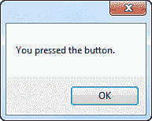

从 www.wowebook.com 下载

137
发布事件

在定义自己的事件时，你需要做出的第一个决定是你是否需要随事件发送自定义数据。.NET Framework 提供了 `EventArgs` 类，预定义的事件委托类型支持该类。如果你需要随事件发送自定义数据，你应该创建一个派生自 `EventArgs` 的新类。如果你不需要发送自定义数据，可以直接使用 `EventArgs` 类型，但以后无法在不破坏兼容性的情况下更改它。因此，你应该始终创建一个派生自 `EventArgs` 的新类，即使最初是空的，以便以后添加数据提供灵活性。

列表 6.2 显示了一个自定义 `EventArgs` 派生类的示例。

列表 6.2
自定义 `EventArgs` 派生类
```csharp
public class CustomEventArgs : System.EventArgs 
{
    private object data;
    public CustomEventArgs(object data) 
    {
        this.data = data; 
    }
    public object Data 
    {
        get 
        {
            return this.data; 
        }
    } 
}
```

声明事件最常用的方法是使用字段语法。如果你没有自定义 `EventArgs` 类，将使用列表 6.3 所示的 `EventHandler` 委托类型。

列表 6.3
简单的事件声明
```csharp
public class Contact 
{
    public event EventHandler AddressChanged; 
}
```

如果你确实有一个自定义 `EventArgs` 类，将使用泛型 `EventHandler<T>` 委托，用你自己的 `EventArgs` 类替换 `T`。

虽然字段类的事件定义是最常见的，但它并不总是最高效的，特别是对于具有大量事件的类。考虑一个具有大量事件的类。只有少数事件有订阅者是合理的。使用字段声明样式，你为每个事件创建一个字段，这会导致许多不必要的开销。

前往 . 
参阅第 11 章“理解泛型”以获取更多关于泛型的信息。

138
第 6 章：事件与事件处理

为了解决这个问题，C# 还允许使用类似属性的语法定义事件，如列表 6.4 所示。

列表 6.4
使用事件属性声明事件
```csharp
1. public class Contact
2. {
3. private EventHandlerList events = new EventHandlerList();
4. private static readonly object addressChangedEventKey = new object();
5.
6. public event EventHandler AddressChanged
7. {
8. add
9. {
10. this.events.AddHandler(addressChangedEventKey, value);
11. }
12. remove
13. {
14. this.events.RemoveHandler(addressChangedEventKey, value);
15. }
16. }
17. }
```

第 3 行声明了一个 `EventHandlerList`，专门设计用于包含事件委托列表。这使得你能够使用单个变量，包含每个有订阅者的事件的条目。接下来，第 4 行声明了一个名为 `addressChangedEventKey` 的静态只读对象变量，它代表用于 `EventHandlerList` 中事件的键。最后，第 6 到 16 行声明了实际的事件属性。

这种语法对你来说应该是熟悉的。

139
发布事件

在定义自己的事件时，你需要做出的第一个决定是你是否需要随事件发送自定义数据。.NET Framework 提供了 `EventArgs` 类，预定义的事件委托类型支持该类。如果你需要随事件发送自定义数据，你应该创建一个派生自 `EventArgs` 的新类。如果你不需要发送自定义数据，可以直接使用 `EventArgs` 类型，但以后无法在不破坏兼容性的情况下更改它。因此，你应该始终创建一个派生自 `EventArgs` 的新类，即使最初是空的，以便以后添加数据提供灵活性。

140
第 6 章：事件与事件处理

使用“属性”时发布事件

如果你使用类似属性的语法，实际触发事件的方法需要稍微不同，以便从列表中检索处理程序，如下：

```csharp
protected virtual void OnAddressChanged(AddressEventArgs e)
{
    var handler = events[addressChangedEventKey] as EventHandler<AddressEventArgs>;
    if (handler != null)
    {
        handler(this, e);
    }
}
```


141

问答

▲ 图 6.8
订阅事件的结果

3. 添加一个名为 `Contact` 的类，其结构如列表 6.5 所示。

4. 按 Ctrl+F5 运行应用程序。输出应该类似于图 6.8。请确保将 `PublishAndRaise` 项目设为启动项目。

总结

在这一小时中，你学习了 C# 如何通过引发和响应事件来创建高度交互的应用程序。你还了解到，事件不仅涉及通过图形用户界面进行的用户交互，事件还为你的类提供了一套丰富且复杂的通知系统。

通过 Visual Studio 2010 编辑器，你已经看到创建自己的事件处理程序来响应通过用户界面触发的事件是多么简单。

问答

Q.* *什么是委托（delegate）？*

A. 委托是一种类型安全且安全的回调编写方式，类似于 C++ 函数指针或 Delphi 闭包。使用委托允许你封装一个对方法的引用。调用被引用方法的代码在编译时不需要知道将调用哪个方法。委托在调用者的安全权限下运行，而不是声明者的权限下。

Q.* *什么是事件（event）？*

A. 事件是对程序的任何外部刺激，例如用户操作（鼠标点击或按键击入）、来自其他程序的消息，或同一程序的其他部分。

Q.* *什么是 EventArgs 类？*

A. `EventArgs` 类存储事件的数据。虽然可以直接使用它，但最好的做法为你的事件派生一个新类，即使它最初是空的。

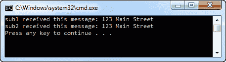

下载自 www.wowebook.com

142

第 6 小时：事件与事件处理

Q.* *事件的两种类型？*

A. 事件的两种类型是前事件（pre-events）和后事件（post-events）。前事件是在对象状态改变之前引发的可以取消的事件。后事件是在对象状态改变之后引发的。

工作坊

测试题

1. 声明事件的最常见方法是什么？使用它的缺点是什么？

2. 使用类似属性的语法声明事件需要哪两个访问器成员？

3. 对于未密封类（unsealed class）上的非静态事件，引发事件的标准模式要求方法具有什么访问修饰符？

4. 观察列表 6.3 中声明的 `OnAddressChanged` 方法，为什么要创建事件委托的副本？

答案

1. 定义事件的最常见方法是使用字段形式语法（field-like syntax）。对于具有大量事件的类，特别是当只有少数事件会有订阅者是合理的情况下，这种语法会为每个事件创建一个字段，导致大量不必要的开销。

2. 声明事件的类属性语法使用 `add` 和 `remove` 访问器。`add` 访问器简单地将输入的委托添加到列表中，而 `remove` 访问器则将其移除。

3. 对于未密封类上的非静态事件，该方法应声明为 `protected virtual` 方法，这使得任何派生类都具备通过重写（override）来处理事件的能力。

4. 创建委托的临时副本是为了避免一种可能的竞态条件，即事件在调用时被重置为 null，导致运行时错误。

下载自 www.wowebook.com

143

工作坊

练习

第二部分

C# 编程

第 7 小时：控制程序流 147

第 8 小时：使用字符串和正则表达式 167

第 9 小时：处理数组和集合 195

第 10 小时：使用异常处理错误 227

第 11 小时：理解泛型 245

第 12 小时：理解查询表达式 267

147

第 7 小时

控制程序流

*你将在这一小时学到：*

- 选择语句
- 迭代（循环）语句
- 跳转语句

从本质上说，C# 是一种过程化编程语言，因此语句按照在源代码中出现的顺序执行。这种执行顺序被称为**程序流（program flow）**。正如你想象的，仅遵循严格的执行顺序提供的灵活性有限。缺失的是一种根据测试条件的结果来控制或更改执行语句的方法。C# 提供了改变执行顺序的**控制流语句**。

所有的控制流语句都具有相同的基本特征；它们根据给定的条件集选择任意数量的语句来执行。这些语句分为三大类，由其主要行为描述。选择语句和跳转语句的关系最为密切。它们都选择一个仅执行一次的语句，而迭代语句则重复执行该语句。跳转语句是无条件的，但选择和迭代语句允许通过条件来限制哪些语句被执行以及执行多少次迭代。

在这一小时中，你学习了每种不同控制流语句的语法，学习了它们的运行方式，以及如何编写和测试控制程序流的条件。更重要的是，你学习了它们之间的区别，以及在何时应该使用一种控制流语句而不是另一种。

148

第 7 小时：控制程序流

选择语句

选择语句可能是所有可用控制流语句中最常见的形式。它们允许根据表达式的值执行单个语句（从多个可能的语句中选择）。

最基础的选择语句是 `if` 语句，它根据表达式的结果选择语句。稍微高级的语法是 `if-else` 语句。如果表达式的结果为真，控制转移到相应的语句。如果表达式的结果为假且存在 `else` 部分，控制转移到备选语句。当控制到达语句末尾时，它转移到下一个语句。执行的语句可以是任何有效语句，包括另一个 `if` 语句。在这种语法中，第二个语句被称为嵌套 `if` 语句。在 7.1 的代码中，如果条件 `y > 10` 为假，则显示 `y <= 10`。

列表 7.1
嵌套 if 语句
int x = 20, y = 10;
if (x > 10) 
{
    if (y > 10) 
    {
        Console.WriteLine("y > 10"); 
    } 
    else 
    {
        Console.WriteLine("y <= 10"); 
    }
}

149

选择语句

else 不匹配问题

编写 `if` 语句时的一种常见问题被称为“else 不匹配问题”，即代码的格式与实际控制流不匹配：

int x = 20, y = 10;
if (x > 10) 
    if (y > 10)
        Console.WriteLine("y > 10"); 
else
    Console.WriteLine("y <= 10");

这里的代码视觉上看起来 `else` 是 `(x > 10)` 的备选。实际上，它是 `(y > 10)` 的备选。为了防止这个问题，最好始终使用大括号，以明确 `else` 属于哪个 `if`。

*注意！* 如果你需要检查一组互斥的条件，可以将 `if` 语句连接到上一个 `if` 语句的 `else` 部分来实现级联 if。在这样的列表中，所有的 `if` 语句将按顺序执行，直到其中一个结果为真。

列表 7.2 显示了一个级联 if 语句。如果条件 `(x > 10)` 为真，显示“x > 10”。如果条件 `(x < 10)` 为真，则显示“x < 10”；否则，显示“x = 10”。

列表 7.2
级联 if 语句
int x = 20, y = 10;
if (x > 10) 
{
    Console.WriteLine("x > 10"); 
} 
else if (x < 10) 
{
    Console.WriteLine("x < 10"); 
} 
else 
{
    Console.WriteLine("x = 10"); 
}


150

第 7 小节：控制程序流

▲ ▼

### 亲自尝试
使用 **if ** 语句

要查看 if 语句的工作原理，请按照以下步骤操作。在完成此练习时保持 Visual Studio 打开，因为你稍后将使用此应用程序。

1. 在 Visual Studio 中打开 SelectionStatements 项目。
2. 右键点击文件 Form1.cs，并选择“查看代码”（View Code）上下文菜单项。
3. 在代码编辑器中，找到名为 CheckGuess 的方法，它看起来如下：
```csharp
private Result CheckGuess(decimal guess)
{ 
    Result result; 
    return result;
}
```
4. 修改 CheckGuess 方法，根据传递给方法参数的数字返回适当的 Result 值。
5. 查看 buttonCheckGuess_Click 方法，检查它所包含的嵌套 if 语句。
6. 按 F5 运行应用程序。输入猜测的数字值，并观察程序如何根据你的猜测做出响应。

**switch ** 语句

switch 语句可以被视为级联 if 语句的自然演进。它们提供了相似的功能，但更加紧凑且灵活。switch 语句根据与表达式值相对应的标签来选择语句列表。

switch 语句的语法为
```csharp
switch ( *expression *) 
{
    case *constant-expression *: 
        *statement-list *
        break;
    default : 
        *statement-list *
        break;
}
```
从 www.wowebook.com 下载

选择语句
151

*注意！*

switch 的体是 **switch-block **（switch 块），它包含一个或多个 switch-section（switch 部分）。每个 **switch-section ** 包含至少一个标签，后面跟着一个语句列表。

表达式的类型确定了 switch 的 **governing type **（控制类型），它可以是 sbyte, byte, short, ushort, int, uint, long, ulong, char、这些类型的可空版本、string 类型或枚举类型。表达式只求值一次。

switch-section 的标签必须是常量表达式，该表达式在同一个 switch-block 内是唯一的，并且能够隐式转换为控制类型。对于控制类型为字符串或可空类型的 switch，允许 null case 标签。

基于 **string** 的 switch

表达式的求值对大小写敏感，因此只有当标签精确匹配时，switch-section 才会执行。

如果表达式的值匹配 case 标签中的某个常量，控制将跳转到该标签之后的第一个语句。如果没有找到匹配的 case，控制将跳转到 default 标签之后的第一个语句（如果存在）；否则，控制将跳转到 switch 之后的下一条语句。

在列表 7.3 中，如果条件 (x == 0) 或 (x == 1) 结果为真，则显示 x 的值；否则显示“Invalid”。

列表 7.3
简单的 switch 语句
```csharp
int x = 4;
switch (x) 
{
    case 0:
        Console.WriteLine(“x = “ + x); 
        break;
    case 1:
        Console.WriteLine(“x = “ + x); 
        break;
    default:
        Console.WriteLine(“Invalid”); 
        break;
}
```

你可能已经注意到 case 0 和 case 1 的代码是相同的。为了消除这种冗余，你可以提供一个中间没有插入语句的标签列表。

从 www.wowebook.com 下载

152

第 7 小节：控制程序流

*注意！*

*顺带一提*

▼

贯穿（Fall Through）

与其他编程语言（如 C 和 C++）不同，C# 中的 switch 语句不允许 switch-section 贯穿。贯穿是指执行从一个 switch-section 开始并持续另一个 switch-section。

为了防止贯穿，C# 要求所有 switch-section 都以一个具有不可达终点的语句结束，其中无条件跳转语句就是一个例子。最常见的是 break 语句。

通过不允许这种贯穿行为，C# 消除了 C 和 C++ 程序中常见的错误，并允许更改 switch-section 的顺序而不影响语句的行为。

列表 7.4 显示了与列表 7.3 相同的 switch 语句，但使用了 case 贯穿（case fall-through）。由于中间没有插入语句，因此没有违反“不贯穿规则”，控制将跳转到列表中最后一个标签之后的第一个语句。

列表 7.4
使用 case 贯穿的 switch 语句
```csharp
int x = 4;
switch (x) 
{
    case 0: 
    case 1:
        Console.WriteLine(“x = “ + x); 
        break;
    default: 
        Console.WriteLine(“Invalid”); 
        break;
}
```

作用域（Scope）

switch 语句内的作用域由整个 switch-block 限定，而不是每个 switch-section。这意味着在 switch-section 内部声明任何局部变量或常量对于整个 switch-block 都是局部的，而不仅仅是该 switch-section。

如果你需要限制作用域在特定的 switch-section 内，可以使用大括号包裹语句列表创建一个额外的嵌套作用域。

### 亲自尝试
使用 **switch ** 语句

要查看 switch 语句的工作原理，请按照以下步骤操作。如果你关闭了 Visual Studio，请先重复之前的练习。

从 www.wowebook.com 下载

▲ 迭代语句
153

1. 在代码编辑器中，找到名为 buttonCheckGuess_Click 的方法。该方法包含一个嵌套 if 语句，根据其值决定显示哪个 Label 控制器。
2. 修改 buttonCheckGuess_Click 方法，使用 switch 语句代替嵌套的 if 语句。
3. 按 F5 运行应用程序。输入猜测的数字值，并观察程序如何根据你的猜测做出响应，这与之前的练习是一致的。

迭代语句

虽然选择语句允许根据值执行一次语句，迭代语句（也称为循环语句）会重复执行相同的语句。头部循环（top-tested loop）在语句执行前评估表达式，尾部循环（bottom-tested loop）在语句执行后评估表达式。

为了提前终止循环而不重新评估表达式，可以使用这些跳转语句：break, return, throw。continue语句将控制传递到下一次迭代。

while 语句

while 语句是一种头部循环，重复执行嵌入语句，直到布尔表达式为假。因为在每次迭代之前都会评估表达式，语句可以执行多次。

while 语句的语法为
```csharp
while ( *expression *) 
{
    *embedded-statement *
}
```
如果评估表达式的结果为真，控制将跳转到嵌入语句。当语句完成后，控制将跳转到循环开头，重新求值表达式。

如果评估表达式的结果为假，控制将跳转到 while 语句之后的语句。如果表达式初始结果为假，则嵌入语句将不会执行。

从 www.wowebook.com 下载

154

第 7 小节：控制程序流

▼ ▲

在列表 7.5 中，循环体内的语句执行到 i 大于或等于 10。如果 i++ 语句没有包含循环体或表达式中，循环将无限执行。

列表 7.5
while 语句
```csharp
int i = 0;
while (i < 10) 
{
    Console.WriteLine(i);
    i++;
}
```

### 亲自尝试
使用 **while ** 语句

通过以下步骤，你可以看到 while 语句的工作原理。

1. 在代码编辑器中，修改 PowersOfTwoWhileLoop 方法，使其在循环中执行以下语句：
```csharp
this.textBoxOutput.AppendText(String.Format("{0}^2 = {1}\r\n", i, Math.Pow(i, 2)));
i++;
```
2. 按 F5 运行应用程序。输入最大值，选择 While 单选按钮并点击 Generate 按钮。

do ** 语句

do 语句同样重复执行嵌入语句，直到布尔表达式为假。与 while 语句不同，do 语句是一种尾部循环，因此在评估布尔表达式之前会执行嵌入语句。这意味着它保证至少执行一次。

do 语句的语法为
```csharp
do
{
    *embedded-statement *
}
while ( *boolean-expression *);
```


迭代语句

如果评估布尔表达式的结果为真，控制权将转移到循环的开头，
在此处执行嵌入语句。如果评估布尔表达式的结果为假，控制权
将转移到 do 语句之后的下一个状态语句。

在列表 7.6 中，当 i 小于 10 时，循环体内的语句将执行。
正像在 语句语句一样，如果 `i++;` 语句既没有包含在循环体中，
也没有作为布尔表达式的一部分，循环将无限执行下去。

列表 7.6 do 语句
```csharp
int i = 0; 
do 
{
    Console.WriteLine(i); 
    i++;
} 
while (i < 10);
```

### 尝试一下：使用 **do ** 语句
要查看 do 语句如何工作，请遵循以下步骤。如果您关闭了 Visual Studio，
请先重复上一个练习。请确保在本次练习结束后保持 Visual Studio 打开，
因为您稍后会使用此应用程序。

1. 在代码编辑器中，修改 PowersOfTwoDoLoop 方法，使其在 do 循环中
执行以下语句：
`this.textBoxOutput.AppendText(String.Format“{0}^2 = {1}\\r\\n”, i, Math.Pow(i, 2)));`

2. 按 F5 应用程序。输入一个最大值，选择 Do 单选按钮，并点击
Generate 按钮。

3. 探索如果从循环体中移除递增语句，并将其作为 while 条件的一部分，
会发生什么。

## **for ** 语句
for 语句可能是最被误解的迭代语句，因为看起来看起来最
复杂；然而，它仍然提供了与其他迭代语句相同的基本行为。
它还会反复执行嵌入语句，直到指定的表达式评估结果为假为止。

for 语句的语法为 
```csharp
for (*initializer *; *condition *; *iterator *)
    embedded-statement
```

for 语句最常用于顺序处理和遍历数组。

让 for 语句看起来复杂的是这三个不同的表达式（或部分），
它们都可能是可选的。每个部分之间必须用分号隔开，即使在
被省略时也是如此。

初始化器可以是单个局部变量初始化，也可以是多个局部变量初始化
语句的逗号分隔列表。在初始化器中声明的任何局部变量其作用域
都限于条件、迭代器和嵌入语句。

### 初始化器声明空间
将整个 for 语句认为定义在“不可见的括号”内部，这些
括号定义了用于初始化器的局部变量声明空间。

条件必须是一个布尔表达式。如果省略了条件，该表达式
默认为真。

最后，迭代器可以是单个表达式，也可以是逗号分隔的表达式列表，
这些表达式通常更改在初始化器中声明的对应局部变量。

### 无限循环
就像使用 while 语句创建无限循环一样，你也可以通过
省略声明中的所有三个部分来创建一个永远运行的 for 语句：
```csharp
for ( ; ; ; ) 
{
    Console.WriteLine“line”); 
}
```

如果你再次查看列表 7.5 中的 while 语句，你应该能看到与
for 语句的不同部分看起来类似的元素。while 状态语句和 for 
语句是可以互换的；for 语句是编写相同代码的更紧凑的方式。
图 7.1 显示了 while 状态语句和 for 语句之间的比较，这应该
能清楚它们之间的关系。

图 7.1 for 语句与 while 语句的比较

| While 语句 | For 语句 |
| :--- | :--- |
| `int i = 0;` | `for (int i = 0; i < 10; i++)` |
| `while (i < 10)` | `{` |
| `{` | `Console.WriteLine(i);` |
| `Console.WriteLine(i);` | `}` |
| `i++;` | |
| `}` | |

观察 for 语句执行时发生的事件序列，它与 while 语句的序列相同：

1. 如果存在初始化器，则执行。如果有多个表达式，它们将
按编写的顺序执行。初始化器在语句开始时执行一次。
2. 如果条件评估为真，控制权转移到嵌入语句。
3. 执行嵌入语句。
4. 迭代器中的语句被评估（如果存在），并重新评估条件。如果如果条件评估为假，控制权将转移到 for 语句之后的下一个语句。

### 尝试一下：使用 **for ** 语句
通过遵循这些步骤，你可以看到 for 语句是如何工作的。如果关闭了
Visual Studio，请先重复上一个练习。请确保在本次练习结束后保持 Visual Studio 打开，因为您稍后会使用此应用程序。

1. 在代码编辑器中，修改 PowersOfTwoForLoop 方法，使其在 for 循环中执行以下语句：
`this.textBoxOutput.AppendText(String.Format“{0}^2 = {1}\\r\\n”, i, Math.Pow(i, 2)));`

2. 按 F5 运行应用程序。输入一个最大值，选择 For 单选按钮，并点击 Generate 按钮。

3. 探索如果更改初始化器和迭代器表达式，会发生什么。

## **foreach ** 语句
foreach 语句为数组或集合中的每个元素执行一条语句。与 for
语句不同，foreach 语句不能用于从源集合中添加或删除项目。

foreach 语句的语法为
```csharp
foreach ( type *identifier *in *expression *)
    embedded-statement
```

如果 expression 是数组类型，则执行到 IEnumerable 的隐式转换；
否则，集合必须实现 IEnumerable 或 IEnumerable<T>，或提供
适当的 GetEnumerator 方法。

### 迭代变量
foreach 语句的类型和标识符是迭代变量，对应于一个只读局部
变量，其作用限于嵌入语句。

随着迭代遍历集合中的元素，迭代变量代表当前元素。
foreach 语句是唯一一个不包含待评估条件的迭代语句。嵌入
语句会为集合中的所有元素继续执行，或者由跳转语句
终止循环。对于集合或单维数组，元素是从从索引 0 开始
按增加的顺序遍历的。如果 expression 是多维数组，元素从最右侧
维度开始按增加顺序遍历，然后是下一个维度，最后向左继续。

如果集合不包含元素，则不执行嵌入语句。

7.7 中的代码逐行显示字符串的每个字符。

列表 7.7 foreach 语句
```csharp
string s = “This is a test.”;
foreach (char c in s)
{
    Console.WriteLine(c);
}
```

## 跳转语句
跳转语句与选择和迭代语句不同，因为它们无条件地立即
将控制转移到一个新位置，该位置称为跳转语句的 **目标 **。

### **goto ** 语句
虽然不常用，但 C# 确实提供了 goto 语句，它将控制转移
到带有标记的语句。goto 语句也可以指向 switch 语句中的
特定 case 或 default。

goto 语句的语法为
```csharp
goto identifier; 
goto case constant-expression; 
goto default;
```

就像 break 和 continue 语句一样，同一块中位于 goto 语句
之后的任何语句都不会被执行。

在实践中强烈建议不要使用 goto 语句，因为它很容易被误用
并可能导致难以阅读和维护的代码。大量使用 goto 语句的代码
通常被称为“意大利面”代码。


160

## 第 7 小时：控制程序流

### break 语句

break 语句用于退出最近的 `switch`、`while`、`do`、`for` 或 `foreach` 语句。如果语句相互嵌套，只会退出最内部的语句。

列表 7.8 显示了图 7.1 中相同的 `for` 语句，但使用了 `break` 语句导致循环在四次迭代后终止。

列表 7.8
break 语句
```csharp
for (int i = 0; i < 10; i++)
{
    Console.WriteLine(i);
    if (i == 3)
    {
        break;
    }
}
```

### 尝试一下
使用 break 语句

通过遵循这些步骤，你将看到 `break` 语句在不同的迭代语句中是如何工作的。在此练习结束时，请保持 Visual Studio 打开，因为你稍后会用到此应用程序。

1. 在 Visual Studio 中打开 JumpStatements 项目。
2. 右键点击文件并选择“查看代码”上下文菜单项以打开 Form1.cs。
3. 在代码编辑器中，修改以下方法，以便在循环迭代计数器等于 `breakAfter` 参数且已计算出二次次方后，包含一个 `break` 语句：
   - PowersOfTwoBreakDoLoop
   - PowersOfTwoBreakForLoop
   - PowersOfTwoBreakForEachLoop
   - PowersOfTwoBreakWhileLoop
4. 按 F5 运行应用程序。输入 break 迭代值，选择一个单选按钮，并点击生成按钮。
5. 更改 `break` 语句的位置，使其在计算二次次方之前发生。

161
跳转语句

6.再次按 F5 运行应用程序。输入一个 break 迭代值，选择一个单选按钮，并点击生成按钮。你会注意到，对于在步骤 4 中选择的相同迭代语句和 break 迭代值，输出是不同的。

### continue 语句

continue 语句会启动最近的 `while`、`do`、`for` 或 `foreach` 语句的新一次迭代。如果语句相互嵌套，`continue` 语句仅适用于最内部的语句。`continue` 与循环体结束之间的任何语句都会被跳过。

重要的是，`continue` 语句会导致表达式或 `for` 语句的迭代器被重新求值。

列表 7.9 显示了图 7.1 中相同的 `for` 语句，但使用了 `continue` 语句导致前三次迭代被跳过。

列表 7.9
continue 语句
```csharp
for (int i = 0; i < 10; i++)
{
    if (i < 3)
    {
        continue;
    }
    Console.WriteLine(i);
}
```

### 尝试一下
使用 continue 语句

要查看 `continue` 语句在不同的迭代语句中如何工作，请遵循以下步骤。如果你关闭了 Visual Studio，请先重复之前的练习。

1. 在代码编辑器中，修改以下方法，以便在循环迭代计数器小于 `skip` 参数且在计算二次次方之前，包含一个 `continue` 语句：
   - PowersOfTwoContinueDoLoop
   - PowersOfTwoContinueForLoop
   - PowersOfTwoContinueForEachLoop
   - PowersOfTwoContinueWhileLoop
2. 按 F5 运行应用程序。输入一个 skip 迭代值，选择一个单选按钮，并点击生成按钮。
3. 更改 `continue` 语句的位置，使其在计算二次次方之后发生。
4. 再次按 F5 运行应用程序。输入一个 skip 迭代值，选择一个单选按钮，并点击生成按钮。由于 `continue` 语句发生在之后，因此它对迭代没有影响。

### return 语句

你已经在第 3 小时“以 C# 方式理解类和对象”学习方法和属性时见过 `return` 语句。`return` 语句导致控制权返回到包含该语句的成员的调用者。`return` 语句可以与表达式一起使用，正如你在 3 小时的示例中看到的那，在这种情况下，它只能用于具有非 `void` 返回类型的类成员。`return` 语句也可以不带表达式使用，在这种情况下，它只能用于具有 `void` 返回类型的类成员，包括构造函数和终结器。

### 总结

在本小时中，你离开了基础性方面，学习了如何通过做出决策、在特定条件下重复代码段以及无条件地跳转到不同的代码段来控制你的应用程序。

了解如何控制应用程序的流是编程中最核心的概念之一。这些看似简单的流控制语句为 C# 语言提供了最大的功能和灵活性，使应用程序能够以解决特定问题的方式运行。

### 问答

Q. *C# 中提供了哪些类型的控制流语句？*

A. C# 提供了三种类型的控制流语句：
- 选择语句，允许根据表达式的值从多个可能的语句中选择一个要执行的单一语句。

163
工作坊
- 迭代语句，根据表达式的值重复执行同一语句。
- 跳跃语句，无条件地将控制转移到新位置。

*while 语句和 do 语句之间的区别是什么？*
A. `while` 语句提供的是顶层测试循环，而 `do` 语句提供的是底层测试循环。这意味着在 `while` 循环中嵌入的语句可能执行零次或多次，而 `do` 循环至少执行一次。

### 工作坊
### 测验
1. `switch` 语句允许对多个情况执行相同的代码吗？
2. `while` 语句将执行多少次？
```csharp
int i = 10;
while (i < 10)
{
    Console.WriteLine(i);
    i++;
}
```
3. `do` 语句将执行多少次？
```csharp
int i = 10;
do
{
    Console.WriteLine(i);
    i++;
} while (i < 10)
```
4. 这个 `for` 语句将做什么？
```csharp
for (int i = 0; ; i++)
{
    Console.WriteLine(i);
}
```
A. 生成编译错误。
B. 打印一次 i 值。
C. 什么都不做。
D. 打印 i 值。
6. `for` 语句的三个组件都是必须的？
7. `foreach` 语句中声明的标识符可以在外部使用吗？
8. 当到达跳转语句时，跳转语句后的语句会执行吗？
9. 迭代语句的嵌入语句中支持跳转语句吗？

184
164
控制程序流

答案
1. 是的，如果多个情况连续指定且中间没有其他语句，可以使用相同的代码。
2. 不，`switch` 语句只能有一个 `default` 情况。
3. 因为首先测试条件，由于 `i` 等于 10，所以语句不会执行。
4. 语句执行一次。在第一次迭代结束时，测试条件因 `i` 等于 10 而失败。
5. 正确答案是 D。通过省略 `for` 循环的条件部分，它会持续处理。
6. 不，`for` 语句的每个组件都是可选的。
7. 这被称为迭代变量，相当于作用限于嵌入语句的只读局部变量。
8. 不。跳转语句无条件地转移转移到新位置，因此同一范围内跳转语句后的语句不会执行。
9. 是，所有的迭代语句都支持在嵌入语句中使用跳转语句。

185
165
工作坊
练习
1. 在 `IPhoto` 接口中添加 `Refresh` 方法，签名如下：
`public void Refresh()`

在 `Photo` 类中实现此方法。该方法应包含单个 `if` 语句。对于布尔表达式，测试 `this.source` 是否为空。对于后果语句，使用以下代码：
```csharp
this.image = BitmapFrame.Create(this.source);
this.metadata = new ExifMetadata(this.source);
this.exists = true;
```

对于替代语句，使用以下代码：
```csharp
this.image = null;
this.metadata = new ExifMetadata();
this.exists = false;
```

在 `PhotoViewer(Uri)` 构造函数中，在设置源字段的语句之后添加 `Refresh()` 的调用。


167

*你可能吗？*

第 8 小时
使用字符串和正则表达式

*在本小时内你将学到：*

- 字符串
- 字符串操作
- 类型和复合格式化
- 标准和自定义格式字符串
- StringBuilder
- 正则表达式

随着计算机编程演变，从主要关注执行复杂的数值计算变为为更广泛的业务问题提供解决方案，编程语言已转向更多关注字符串数据以及此类数据的操作。字符串数据简单来说就是字符的逻辑序列。System.String 类封装了你对字符串执行的最常用的数据操作、排序和搜索方法，使 C# 能够为字符串数据和操作提供丰富的支持。

**String** 还是 **string**？

在 C# 中，string 是 System.String 的别名，因此它们是等价的。可以使用你喜好的任何命名规范，尽管通用的用法是在指代数据类型时使用 `string`，而在访问该类的静态成员时使用 `String`。

在本小时中，你将学习如何在 C# 中处理字符串，包括如何操纵和拼接字符串、提取子字符串以及构建新字符串。在理解基础之后，你将学习如何使用正则表达式来执行更复杂的模式匹配和操作。

168

第 8 小时：使用字符串和正则表达式

字符串

C# 中的字符串是不可变的 Unicode 字符序列，创建后无法修改。字符串最常见的创建方式是声明一个 `string` 类型的变量并为其赋值一个带引号的字符字符串，这被称为**字符串字面量**（string literal），如下所示：

```csharp
string myString = "Now is the time.";
```

字符串池（String Interning）

如果你在同一个程序集中存在两个相同的字符串字面量，运行时仅会该程序集内该字面量的所有实例创建一个字符串对象。这个过程被称为字符串池，C# 编译器用它来消除重复的字符串字面量，从而在运行时节省内存空间并缩短执行字符串比较所需的时间。

在使用相等运算符比较字符串字面量时，字符串池有时会导致意想不到的结果：

```csharp
object obj = "String"; 
string string1 = "String"; 
string string2 = typeof(string).Name;

Console.WriteLine(string1 == string2); // true 
Console.WriteLine(obj == string1); // true 
Console.WriteLine(obj == string2); // false
```

第一次比较是在测试值相等性，意味着它在测试两个字符串的内容是否相同。第二次和第三次比较使用的是引用相等性，因为你正在比较一个对象和一个字符串。如果你在程序中输入这段代码，将看到两条关于“可能存在无预期的引用比较”的警告，它会进一步提示你“将左侧操作转换为类型‘string’”以进行值比较。

由于字符串池仅适用于字面量字符串值，因此 `string2` 的值没有被池化，因为它不是一个字面量。这意味着 `obj` 和 `string2` 实际上指向内存中不同的对象，因此引用相等性失败。

*顺便说*

这些字符串字面量可以包含特殊的**转义序列**（escape sequences）以指示不可打印字符，例如以反斜字符（\\）开头的制表符或换行符。如果你想将反斜字符作为字符串字面量的一部分，必须对其进行转义。表 8.1 列出了定义的 C# 字符转义序列。

创建字符串字面量的另一种方式是**逐字字符串字面量**（verbatim string literals），它们在起始引号前带有 @ 符号。逐字字符串字面量的优点是，编译器完全按照其编写的内容处理字符串，即使它跨越了多行或包含转义字符。只有双引号字符必须通过包含两个双引号来完成转义，以便编译器知道字符串何处结束。

169

表 8.1
C# 字符转义序列

| 转义序列 | 描述 |
| :--- | :--- |
| \' | 单引号，用于字符字面量。 |
| \" | 双引号，用于字符串字面量。 |
| \\ | 反斜杠。 |
| \\0 | Unicode 字符 0。 |
| \\a | 警报 (char 7)。 |
| \\b | 退格 (char 8)。 |
| \\f | 换页符 (char 12)。 |
| \\n | 换行 (char 10)。 |
| \\r | 回车 (char 13)。 |
| \\t | 水平制表符 (char 9)。 |
| \\v | 垂直引用 (char 11)。 |
| \uxxxx | 十六进制值为 xxxx 的字符的 Unicode 转义序列。此外变长度版本也可以包含 1 到 4 个数值。 |
| \Uxxxxxxxx | 十六进制值为 xxxxxxxx 的字符的 Unicode 转义序列，用于生成 Unicode 代理。 |

当编译器遇到逐字字符串字面量时，它会将该字面量转换为正确转义的字符串字面量。列表 8.1 显示了四个不同的字符串。前两个声明是等价的，尽管逐字字符串字面量通常更容易读。后两个声明也是等价的，其中 `multipleLines2` 代表翻译后的字符串字面量。

列表 8.1
字符串字面量

```csharp
string literal = "C:\\Program\\Visual Studio";
string verbatimLiteral = @"C:\Program\Visual Studio";
string multipleLines = "This is a line\nand another.";
string multipleLines2 = @"This is a line
and another.";
```

170

第 8 小时：使用字符串和正则表达式

*顺便说一下*

空字符串

空字符串是不包含任何字符的字符串。空字符串和空引用（null string）之间没有区别，尽管空引用是一个不指向任何对象的引用。创建空字符串的最简单方法是使用字符串字面量“""”，如下所示：

```csharp
string emptyString = "";
```

也可以使用 `string.Empty` 属性创建一个空字符串，如下所示：

```csharp
string emptyString2 = string.Empty;
```

通常通过检查 `Length` 属性来确定字符串是否为空。如果 `Length` 为 0，则该字符串为空，如列表 8.1 所示：

```csharp
if (myString.Length == 0)
{
    // 字符串是空的
}
```

然而，判断字符串是否为空的最健壮方法是使用静态方法 `string.IsNullOrEmpty`。该方法同时处理空引用和空字符串，如列表 8.2 所示。

列表 8.2
IsNullOrEmpty 方法

```csharp
if (string.IsNullOrEmpty(myString))
{
    // 字符串为 null或空
}
```

判断字符串是否只包含空白字符也是常见的。要做到这一点，你可以使用静态方法 `IsNullOrWhiteSpace`，如列表 8.3 所示。

列表 8.3
IsNullOrWhiteSpace 方法

```csharp
if (string.IsNullOrWhiteSpace(myString))
{
    // 字符串为 null、空或仅包含空白
}
```

171

字符串

字符串操作

System.String 类提供了丰富的方法和属性来与字符串交互和操作。事实上，System.String 定义了 40 多个公共成员。

尽管字符串是一个类类型，且字符串数据通常作为整体进行处理，但字符串仍然由单个字符组成。你可以使用 `Length` 属性来确定字符串中的字符总数。与 C 和 C++ 等语言中的字符串不同，C# 中的字符串不包含终止字符。由于字符串由单个字符组成，可以像字符数组一样通过位置访问特定字符。

子字符串

子字符串是位于原始值内的较小字符串。System.String 提供的几种方法允许你查找并提取子字符串。

String 类提供了重载的 `Substring` 方法，允许指定起始字符位置以及可选的提取长度。如果不提供长度，生成的子字符串将持续到原始字符串结束。

列表 8.4 中的代码创建了两个子字符串。第一个子字符串将从字符位置 10 开始，直到原始字符串结束，生成字符串“brown fox”。第二个子字符串生成字符串“quick”。

列表 8.4
处理子字符串

```csharp
string original = "The quick brown fox";
string substring = original.Substring(10); 
string substring2 = original.Substring(4, 5);
```


## 第 8 小节：使用字符串和正则表达式

*注意！*

▼ 图 8.1：处理子字符串的结果

以这种方式提取子字符串是一种灵活的方法，特别是当它与其他允许你查找字符串中特定字符位置的方法结合使用时。**

`IndexOf` 和 `LastIndexOf` 方法分别报告指定字符或字符串第一次和最后一次出现的索引。如果你需要在给定的字符集中查找任何字符的第一次或最后一次出现，可以分别使用 `IndexOfAny` 或 `LastIndexOfAny` 的重载方法。如果找到匹配项，则返回字符的索引（或更直观地说，偏移量）或匹配字符串的起始位置；否则返回值 -1。如果你搜索的字符串或字符为空，则返回值 0。

### 从 0 开始计数

当通过字符位置访问字符串时（如 `IndexOf`、`LastIndexOf`、`IndexOfAny` 和 `LastIndexOfAny` 方法所示），C# 从 0 而不是 1 开始计数。这意味着字符串的第一个字符位于索引位置 0。考虑这些方法的更好方式是，它们返回的是从字符串开始的偏移量。

### 动手一试：处理子字符串

要实现列表 8.4 所示的代码并查看如何创建子字符串，请遵循以下步骤。在此练习结束后保持 Visual Studio 打开，因为你稍后会用到此应用程序。

1. 创建一个新的控制台应用程序。
2. 在 `Program.cs` 文件的 `Main` 方法中输入列表 8.4 所示的语句，后跟用于打印每个字符串值的语句。
3. 使用 Ctrl+F5 运行应用程序，观察输出是否与图 8.1 所示。
4. 修改两个子字符串调用，分别使用 `IndexOf` 和 `IndexOfAny`，以产生与图 8.1 相同的输出。

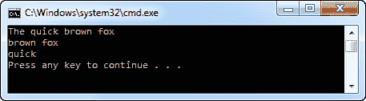

*注意！* *顺便说*

### 字符串比较

要执行字符串比较以判断一个字符串是否等于或包含另一个字符串，可以使用 `Compare`、`CompareOrdinal`、`CompareTo`、`Contains`、`Equals`、`EndsWith` 和 `StartsWith` 方法。

静态方法 `Compare` 有 10 种不同的重载版本，允许你控制从大小写敏感、用于执行比较的区域规则、两个待比较字符串的起始位置，到要比较字符串的最大字符数的所有内容。

### 字符串比较规则

默认情况下，使用任何 `Compare` 方法进行的字符串比较都是以大小写敏感且感知区域的方式进行的。使用等等运算符 (`==`) 进行的比较始终使用序数比较（ordinal comparison）规则。

如果你想根据每个字符的数值序数值来比较字符串，也可以使用静态的 `CompareOrdinal` 重载方法（只有两个），并可以选择地指定两个字符串的起始位置以及要比较的字符串的最大字符数。

### 更改大小写

尽管字符串比较方法提供了执行不区分大小写的字符串比较的方法，但你也可以将字符串转换为全大写或全小写表示。这对于字符串比较很有用，对于标准化字符串数据的表示也有帮助。

`CompareTo` 方法将当前字符串与指定的字符串进行比较，并返回一个整数，指示当前字符串在排序顺序中位于指定字符串之前、之后还是处于相同位置。

`Contains` 方法使用序数排序规则进行搜索，允许你确定指定的字符串是否存在于当前字符串中。如果找到指定的字符串或其为空字符串，则方法返回 `true`。

`StartsWith` 和 `EndsWith` 方法（总共六个）确定当前字符串的开头或结尾是否匹配指定的字符串。与 `Compare` 方法一样，你可以可选地指示是否希望搜索是不区分大小写的，以及应该使用何种区域规则。

▲ 图 8.2：执行字符串比较的结果

### 动手一试：字符串比较

要执行不同的字符串比较，请遵循以下步骤。如果你关闭了 Visual Studio，请先重复之前的练习。在此练习结束后保持 Visual Studio 打开，因为你稍后会用到此应用程序。

1. 在 `Program.cs` 文件的 `Main` 方法中输入以下语句：
```csharp
Console.WriteLine(original.StartsWith("quick"));
Console.WriteLine(substring2.StartsWith("quick")); 
Console.WriteLine(substring.EndsWith("fox")); 
Console.WriteLine(original.CompareTo(original)); 
Console.WriteLine(String.Compare(substring2, "Quick")); 
Console.WriteLine(original.Contains(substring2));
```
2. 使用 Ctrl+F5 运行应用程序，观察输出是否与图 8.2 所示。

归一化大小的标准方法是使用 `ToUpperInvariant` 方法，它使用不变区域（invariant culture）创建字符串的全大写表示。要创建全小写表示，建议使用 `LowerInvariant` 方法。除了不变方法外，你还可以使用 `ToUpper` 和 `ToLower` 方法，它们取决于你使用哪种重载，使用当前区域或指定区域的写写规则。

### 修改字符串的一部分

虽然执行字符串比较很常见，但有时你需要修改字符串全部或部分。由于字符串是不可变的，这些方法实际上返回的是一个新的字符串，而不是修改当前字符串。

要从字符串中删除空格和其他字符，可以使用 `Trim`、`TrimEnd` 或 `TrimStart` 方法。`TrimEnd` 和 `TrimStart` 分别从当前字符串的结尾或开头删除空格，而 `Trim` 则从两端删除。

要扩展或填充字符串以达到特定长度，可以使用 `PadLeft` 或 `PadRight` 方法。默认情况下，这些方法使用空格填充，但它们都有一个允许你指定填充字符的重载。

`String` 类还提供了一组重载方法，允许你通过删除或替换现有字符串中的字符来创建新字符串。`Remove` 方法从字符串的指定字符位置开始删除所有字符，并持续到字符串末尾或指定的位置数。`Replace` 方法通过执行大小写敏感但不感知区域的序数搜索，简单将所有指定的字符或字符串替换为另一个字符或字符串。

▼ 图 8.3：字符串修改的结果

### 动手一试：修改字符串的一部分

要使用 `Replace` 和 `Remove` 方法，请遵循以下步骤。

1. 在 `Program.cs` 文件的 `Main` 方法中，删除所有的 `Console.WriteLine` 语句，只保留字符串变量声明。
2. 输入 `Console.WriteLine` 语句打印以下操作创建的字符串：
- 将 `original` 中所有的‘o’字符替换为‘x’字符
- 删除 `original` 索引位置4 之后的所有字符
- 删除 `original` 索引位置4 之后的5 个字符
3. 在你输入的每个 `Console.WriteLine` 语句之后，输入另一个 `Console.WriteLine` 语句来打印 `original` 的当前值。
4. 使用 Ctrl+F5 运行应用程序，观察输出是否与图 8.3 所示。


176
第 8 章：使用字符串和正则表达式

*你知道吗？*

### 字符串拼接、合并与拆分

你已经见过从字符串字面量和子字符串创建新字符串的方法，但你也可以通过组合现有字符串来创建新字符串，这个过程被称为字符串拼接。

### 使用加法进行字符串拼接

加法运算符实际上只是调用了 Concat 方法相应的重载。

字符串拼接通常有两种方式。最常见的是使用重载的加法运算符 (+) 来组合两个或多个字符串。你也可以使用 Concat 方法的九种不同重载之一，这允许你拼接无限数量的字符串。这两种方法都如列表 8.5所示。

列表 8.5
字符串拼接
```csharp
string string1 = “this is “ + “ basic concatenation.”; 
string string2 = String.Concat(“this”, “is”, “more”, “advanced”, “concatenation”);
```

与拼接紧密相关的是字符串合并（joining），它使用了 Join 方法。与 Concat 方法不同，Join 会在给定字符串集合的每个元素之间插入指定的分隔符。

如果合并字符串是组合了一组字符串，那么反面就是根据分隔字符将字符串拆分为不确定数量的子字符串，这通过使用 Split 方法实现，该方法接受一个字符集或字符串集作为分隔符集。

列表 8.6 显示了合并字符串并根据相同分隔符对其进行拆分的示例。首先，创建一个包含 10 个字符串的数组，然后使用 # 作为分隔符字符进行合并。生成的字符串随后按相同的分隔符进行拆分，并逐行打印每个单词。

列表 8.6
合并与拆分字符串
```csharp
string[] strings = new string[10]; 
for (int i = 0; i < 10; i++) 
{
    strings[i] = String.Format(“{0}”, i * 2); 
}
string joined = String.Join(“#”, strings); 
Console.WriteLine(joined);

foreach (string word in joined.Split(new char[] { ‘#’ })) 
{
    Console.WriteLine(word); 
}
```

177
使用 **StringBuilder** 使用可变字符串

由于字符串是不可变的，每当你执行任何字符串操作时，都会创建新的临时字符串。为了允许创建和操作可变字符串而不必创建新字符串，C# 提供了 StringBuilder 类。如果将拼接固定数量的字符串，则优选字符串拼接。如果将拼接任意数量的字符串（例如在迭代语句内部），则优选 StringBuilder。

StringBuilder 支持在当前字符串的末尾追加数据、在指定位置插入数据、替换数据以及从当前字符串中删除字符。追加数据使用了 Append 或 AppendFormat 方法的重载之一。

Append 方法将文本或对象的字符串表示添加到当前字符串的末尾。AppendFormat 方法支持通过复合格式将文本添加到当前字符串的末尾。由于 AppendFormat 使用了复合格式，你可以向它传递一个格式字符串，你将在下一节中学习它。

列表 8.7 显示了与列表 8.6 相同的合并和拆分字符串的示例，但使用的是 StringBuilder 而不是字符串数组。

列表 8.7
使用 StringBuilder
```csharp
StringBuilder stringBuilder = new StringBuilder(); 
for (int i = 0; i < 10; i++) 
{
    stringBuilder.AppendFormat(“{0}#”, i * 2); 
}
// 删除末尾的 ‘#’ 字符。 
stringBuilder.Remove(stringBuilder.Length - 1, 1);

string joined = String.Join(“#”, stringBuilder.ToString()); 
Console.WriteLine(joined);
foreach (string word in joined.Split(new char[] { ‘#’ })) 
{
    Console.WriteLine(word); 
}
```

178
第 8 章：使用字符串和正则表达式

*顺带一提*

要插入数据，应该使用 Insert 重载之一。当你插入数据时，必须提供当前 StringBuilder 字符串中插入开始的位置。要删除数据，你使用 Remove 方法并指定删除开始的起始以及要删除的字符数。Replace 方法或其重载之一可将当前 StringBuilder 字符串中的字符替换为另一个指定的字符。Replace 方法还支持替换当前 StringBuilder 字符串子字符串中的字符，通过起始位置和长度进行指定。

### **StringBuilder** 容量

在内部，StringBuilder 字符串维护在缓冲区中以适应拼接。只有当缓冲区没有足够的空间容纳新数据时，StringBuilder 才需要分配额外的内存。

此内部缓冲区的默认大小（容量）为 16 个字符。当缓冲区达到容量时，将根据容量指定的额外字符数量分配额外的缓冲区空间。StringBuilder 还有一个一个最大容量，即 Int32.MaxValue。

可以使用 Length 属性设置当前字符串的长度。通过将 Length 设置为大于当前容量的值，容量会自动更改。同样，通过将 Length 设置为小于当前容量的值，字符串会被缩短。

### 类型格式化

179
格式化（Formatting）允许你将类、结构体或枚举的实例转换为字符串。每个派自 System.Object 的类型自动继承一个无参数的 ToString 方法，该方法默认返回类型的名称。

由于从 ToString 获取类型名称通常没有用，你可以重写 ToString 方法并提供有意义的字符串表示。列表 8.8 显示了重写 ToString 的 Contact 类。

列表 8.8
重写 ToString
```csharp
class Contact
{
    private string firstName;
    private string lastName;

    public override string ToString()
    {
        return firstName + “ ” + lastName;
    }
}
```

### 类型格式化

*注意！*

表格 8.4
标准格式说明符

| 格式说明符 | 描述 |
| :--- | :--- |
| ”G”, “g” | 代表通用字符串表示。对于所有数值类型，结果为定点法或指数法中最紧凑的形式。精度说明符指示显示的位数。 |
| 对于所有日期和时间类型 | 表示通用日期/时间模式。“G”代表长时间模式，而 “g”是短时间模式。 |
| 对于枚举类型 | 如果可能，显示枚举项目的字符串值，否则显示当前实例的整数值。如果枚举设置了 Flags 属性，会将每个有效条目的字符串值连接在一起，并用逗号分隔。如果没有设置 Flags 属性，无效值将作为数值项显示。 |


180

第 8 小节：使用字符串和正则表达式

表 8.4
标准格式说明符

| 格式说明符 | 描述 |
| :--- | :--- |
| ”X”, “x” | 对于整数类型，结果为十六进制字符串。精度指定符指示结果字符串中的数字位数。对于枚举类型，以十六进制值显示枚举条目。值将根据需要用前导零表示，以确保该值长度至少为八位。 |
| ”D”, “d” | 对于整数类型，结果为带有可选负号的整数数字字符串。精度指定符指示最小数字位数。对于枚举类型，以尽可能短的表示法显示整数枚举条目。 |
| ”E”, “e” | 仅支持数值类型。结果为值的科学计数法表示。精度指定符指示小数点位数，默认值为 6。 |
| ”F”, “f” | 适用于所有数值类型，结果为带有可选负号的整数和小数数字字符串。精度指定符指示小数点位数。对于日期和时间类型，表示完整的日期/时间模式。“F”表示长时间模式，而“f”是短时间模式。对于枚举类型，如果可能，以字符串值显示枚举条目。如果该值可以完全显示为枚举条目的总和（即使不存在 Flags 属性），则将每个有效条目的字符串值拼接在一起并用逗号分隔。如果无法通过枚举条目完全确定值，则以整数值格式化。 |
| ”N”, “n” | 仅支持数值类型。结果为带有可选负号的、分组分隔符和小数分隔符的整数数字字符串。精度指定符指示所需的小数位数。 |
| ”P”, “p” | 仅支持数值类型。结果为数值乘以 100 并带百分号显示。精度指定符指示所需的小数位数。 |
| ”R”, “r” | 仅支持 Single、Double 和 BigInteger。结果为可以往返到相同数字的字符串。忽略精度指定符。 |
| ”M”, “m” | 仅支持日期和时间类型。表示月份/日期模式。 |
| ”O”, “o” | 仅支持日期和时间类型。表示往返的日期/时间模式。 |
| ”R”, “r” | 仅支持日期和时间类型。表示 RFC 1123 模式。 |
| ”s” | 仅支持日期和时间类型。表示可排序的日期/时间模式。 |
| ”t” | 仅支持日期和时间类型。表示短时间模式。 |
| ”T” | 仅支持日期和时间类型。表示长时间模式。 |
| ”u” | 仅支持日期和时间类型。表示通用可排序的日期/时间模式。 |
| ”U” | 仅支持日期和时间类型。表示通用完整日期/时间模式。 |
| ”Y”, “y” | 仅支持日期和时间类型。表示年份/月份模式。 |

使用标准格式字符串格式化 Days 枚举值见列表 8.9。

列表 8.9
标准格式字符串
```csharp
Days days = Days.Monday; 
string[] formats = { “G”, “F”, “D”, “X” }; 
foreach (string format in formats) 
{
    Console.WriteLine(days.ToString(format)); 
}
```

就像你可以重写 ToString 方法一样，你也可以通过定义 ToString(string) 方法为你自己的类定义标准格式说明符，该方法应支持：

- “G” 格式说明符，表示通用格式。你对无参数 ToString 方法的重写应简单调用 ToString(string) 并传递“G”标准格式字符串。
- 等于空引用的格式说明符应被认为等同于“G”格式说明符。

列表 8.10 显示了第 5 小节“创建枚举类型和结构体”中更新后的 Celsius 结构体，它支持使用格式说明符以华氏度和开尔文度表示值。

列表 8.10
在 ToString 中支持标准格式字符串
```csharp
struct Celsius 
{
    public float Degrees;
    public Celsius(float temperature) 
    {
        this.Degrees = temperature; 
    }

    public string ToString() 
    {
        return this.ToString(“C”); 
    }

    public string ToString(string format) 
    {
        if (String.IsNullOrWhiteSpace(format)) 
        {
            format = “C”; 
        }
        format = format.ToUpperInvariant().Trim();
        switch(format) 
        {
            case “C"": 
            case “c"":
                return this.Degrees.ToString(“N2”) + “ °C”;
            case ”F"": 
            case “f"":
                return (this.Degrees * 9/5 + 32).ToString(“N2”) + “ °F”;
            case ”K"": 
            case “k"":
                return (this.Degrees + 273.15).ToString(“N2”) + “ °K”;
            default:
                throw new FormatException();
        }
    }
}
```

类型格式化

类型格式化

自定义字符串
自定义格式字符串由一个或多个定义值表示的说明符组成。许多日期和时间类型支持自定义字符串。使用自定义字符串允许你定义自己的格式。自定义格式见表 8.5。

表 8.5
自定义格式说明符

| 格式说明符 | 描述 |
| :--- | :--- |
| ”0” | 仅支持数值类型。零决定结果中的数字位数。 |
| ”#” | 仅支持数值类型。如果存在则显示数字位，否则为空。 |
| ”，” | 仅支持数值类型。逗号是分组分隔符。 |
| "." | 仅支持数值类型。点是小数点分隔符。 |
| ”%” | 仅支持数值类型。数值乘以 100 并添加百分号。 |
| ”+” | 仅支持数值类型。加号始终位于数字。 |
| ”–” | 仅支持数值类型。负号位于负数。 |
| ”d” | 仅支持日期和时间类型。日期，范围 1 到 31。 |
| ”dd” | 仅支持日期和时间类型。日期，范围 01 到 31。 |
| ”ddd” | 仅支持日期和时间类型。星日的缩写。 |
| ”dddd” | 仅支持日期和时间类型。星日的全称。 |
| ”g”, “gg” | 仅支持日期和时间类型。点或时代。 |
| ”h” | 仅支持日期和时间类型。使用 12 小时制的小时，范围 0 到 11。 |
| ”hh” | 仅支持日期和时间类型。使用 12 小时制的小时，范围 00 到 11。 |
| ”H” | 仅支持日期和时间类型。使用 24 小时制的小时，范围 0 到 23。 |
| ”HH” | 仅支持日期和时间类型。使用 24 小时制的小时，范围 00 到 23。 |
| ”m” | 仅支持日期和时间类型。分钟，范围 0 到 59。 |
| ”mm” | 仅支持日期和时间类型。分钟，范围 00 到 59。 |
| ”s” | 仅支持日期和时间类型。秒，范围 0 到 59。 |
| ”ss” | 仅支持日期和时间类型。秒，范围 00 到 59。 |
| ”M” | 仅支持日期和时间类型。月份，范围 1 到 12。 |
| ”MM” | 仅支持日期和时间类型。月份，范围 01 到 12。 |
| ”yy” | 仅支持日期和时间类型。年份，范围 00-99。 |
| ”yyyy” | 仅支持日期和时间类型。年份，四位数字表示。 |


类型格式

185

### 表 8.5 自定义格式说明符

| 格式说明符 | 说明 |
| :--- | :--- |
| "m" | 仅支持日期和时间类型。从 0 到 59 的分钟。 |
| "mm" | 仅支持日期和时间类型。从 00 到 59 的分钟。 |
| "M" | 仅支持日期和时间类型。从 1 到 12 的月份。 |
| "MM" | 仅支持日期和时间类型。从 1 到 12 的月份。 |
| "MMM" | 仅支持日期和时间类型。月份的缩写。 |
| "MMMM" | 仅支持日期和时间类型。月份的全称。 |
| "s" | 仅支持日期和时间类型。从 0 到 59 的秒。 |
| "ss" | 仅支持日期和时间类型。从 00 到 59 的秒。 |
| "t" | 仅支持日期和时间类型。AM/PM 标识符的第一个字符。 |
| "tt" | 仅支持日期和时间类型。AM/PM 标识符。 |
| "y" | 仅支持日期和时间类型。从 0 到 99 的年份。 |
| "yy" | 仅支持日期和时间类型。从 00 到 99 的年份。 |
| "yyy" | 仅支持日期和时间类型。至少三位数的年份。 |
| "yyyy" | 仅支持日期和时间类型。四位数的年份。 |
| "yyyyy" | 仅支持日期和时间类型。五位数年份。 |
| "z" | 仅支持日期和时间类型。相对于 UTC 的小时偏移量，不带导零。 |
| "zz" | 仅支持日期和时间类型。相对于 UTC 的小时偏移量，单位数带导零。 |
| "zzz" | 仅支持日期和时间类型。相对于 UTC 的小时分钟偏移。 |

186
第 8 节：使用字符串和正则表达式

列表 8.11 自定义格式字符串
```csharp
DateTime date = new DateTime(2010, 3, 22);
// 显示 3
Console.WriteLine(date.ToString("%M"));
// 显示 Monday March 22, 2010
Console.WriteLine(date.ToString("dddd MMMM dd, yyyy"));
```

复合格式化

你已经在之前的某些示例中通过 `Console.WriteLine` 和 `StringBuilder.AppendFormat` 看到过复合格式化。使用复合格式化的方法接受一个复合格式字符串和一个对象列表作为参数。复合格式字符串定义了一个模板，该模板由固定文本和索引占位符（称为格式项）组成，这些格式项与列表中的对象对应。复合格式化不允许你指定的格式项数量多于列表中的对象数量，尽管你可以在列表中包含比格式项数量更多的对象。

格式项的语法如下：

`{index[,alignment][:formatString]}`

必须提供匹配的大括号和索引。

索引对应于它所代表的对象在方法参数列表中的位置。索引从 0 开始计数，但多个格式项可以使用相同的索引，且格式项可以任意顺序引用列表中的任何对象。

### 表 8.5 自定义格式说明符

| 格式说明符 | 说明 |
| :--- | :--- |
| ":" | 仅支持日期和时间类型。时间分隔符。 |
| "/" | 仅支持日期和时间类型。日期分隔符。 |
| 'string', "string" | 字面字符串分隔符。括号内的字符应被原样复制到结果中。 |
| \\ | 转义字符，导致下一个字符被解释为字面字符，而不是自定义格式说明符。 |
| 其他 | 所有其他字符都将原样复制到结果字符串中。 |

继续

187
正则表达式

可选的对齐组件指示首选字段宽度。正值产生右对齐字段，而负值产生左对齐字段。如果该值小于格式化字符串的长度，则忽略对齐组件。

`formatString` 组件使用你刚刚学会的标准格式字符串或自定义格式字符串。如果未指定 `formatString`，则改用通用格式说明符 "G"。

在列表 8.12 中，第一个格式项 `{0:D}` 被日期的字符串表示替换，第二个格式项 `{1}` 被 temp 的字符串表示所替换。

列表 8.12 复合格式化
```csharp
Celsius temp = new Celsius(28);
// 使用 String.Format 进行复合格式化。 
string result = String.Format("On {0:d}, the high temperature was {1}.", 
    DateTime.Today, temp);
Console.WriteLine(result);
// 使用 Console.WriteLine 进行复合格式化。 
Console.WriteLine("On {0:d}, the high temperature was {1}.", 
    DateTime.Today, temp);
```

正则表达式

正则表达式通常被称为模式（patterns），它描述了一组字符串。将正则表达式应用于字符串以查找结果。

208
188
第 8 节：使用字符串和正则表达式

### 表 8.9 常用正则表达式元字符

| 元字符 | 说明 |
| :--- | :--- |
| ^ | 表示匹配应该从行首开始。 |
| $ | 表示匹配应该在行尾结束。 |
| \w | 匹配单词字符。 |
| \W | 匹配非单词字符。 |
| \s | 匹配空格字符。 |
| \S | 匹配非空格字符。 |
| \d | 匹配数字。 |
| \D | 匹配非数字。 |
| \* | 匹配前面的元素零或多次。 |
| + | 匹配前面的元素一次或多次。 |
| ? | 匹配前面的元素零或一次。 |
| {n} | 匹配前面的元素正好 n 次。 |
| {n,} | 匹配前面的元素至少 n 次。 |
| {n,m} | 匹配前面的元素至少 n 次但最多 m 次。 |
| \| | (或运算符) 匹配之前的或后面的。 |
| ( ) | 定义一个未命捕获组。 |
| (?<name>) | 定义一个命名捕获组。 |
| (?<number>) | 定义一个编号捕获组。 |

209
189
正则表达式

C# 中的正则表达式

正则表达式在 .NET Framework 中通过 `System.Text.RegularExpression` 命名空间中的多个类实现，提供了解析和应用正则表达式以及处理捕获组的支持。

Regex 类

Regex 类提供了正则表达式解析器以及应用模式的引擎的实现。使用该类，你可以快速解析大量文本中的特定模式并轻松提取和编辑子字符串。

Regex 类提供了实例和静态成员，允许以两种不同的方式使用。当你创建特定的 Regex 实例时，正则表达式模式不会被编译和缓存。然而，通过使用静态方法，正则表达式会被编译和缓存。正则表达式引擎默认缓存最常用的 15 个静态正则表达式。如果你大量使用一组固定的正则表达式，可能于使用静态方法。

Match 和 MatchCollection 类

使用 Regex 类的 Match 方法将正则表达式应用于字符串时，找到的第一个匹配由 Match 类实例表示。MatchCollection 包含了通过重复应用正则表达式直到第一次匹配失败的所有 Match。

Group 和 Capture 类

Match.Groups 属性表示单个匹配中捕获组的集合。每个组都由 Group 类表示，该类包含由 `Captures` 属性返回的 Capture 对象集合。Capture 代表单个子表达式匹配的结果。

使用正则表达式进行字符串验证

正则表达式最常用的用途之一是通过测试字符串是否符合特定模式来验证字符串。为了完成这一点，你可以使用 `IsMatch` 方法的任重载。列表 8.13 显示了使用正则表达式验证美国 Zip+4 邮政编码。


第 8 小时：使用字符串与正则表达式

列表 8.13 使用正则表达式进行验证

```csharp
string pattern = "^\\d{5}(-\\d{4})?$";

Regex expression = new Regex(pattern);

Console.WriteLine(expression.IsMatch("90210")); // true 

Console.WriteLine(expression.IsMatch("00364-3276")); // true 

Console.WriteLine(expression.IsMatch("3361")); // false 

Console.WriteLine(expression.IsMatch("0036-43275")); // false 

Console.WriteLine(expression.IsMatch("90210-")); // false 
```

## 使用正则表达式匹配子字符串

正则表达式也可以用于搜索匹配特定正则表达式模式的子字符串。这种搜索可以执行一次，此时返回第一个匹配项；也可以可以重复执行，此时返回一个匹配项的集合。

以这种方式搜索子字符串使用 `Match` 方法查找与模式匹配的第一个项，或者使用 `Matches` 方法返回一系列不重叠的成功匹配项。

### 总结

继续远离编程的基础方面，你学习了 C# 如何允许你处理字符串数据。

### 问答

Q. *字符串是不可变的吗？*
A. 是的，C# 中的字符串是不可变的，任何修改字符串内容的操作实际上都是创建一个具有新值的新字符串。

Q. *当 `@` 符号位于字符串字面量之前时，它代表什么？*
A. `@` 符号是逐字字量符号（verbatim string symbol），它导致 C# 编译器完全按照编写的方式处理字符串，即使它跨越多行或包含特殊字符。

Q. *C# 支持哪些常见的字符串操作函数？*
A. C# 支持以下常见的字符串操作：
- 确定字符串长度
- 修剪和填充字符串
- 创建子字符串、拼接字符串以及根据特定字符分割字符串
- 删除并替换字符
- 执行字符串包含和比较操作
- 转换字符串大小写

Q. *StringBuilder 类的好处是什么？*
A. `StringBuilder` 类允许你创建并操纵一个可变的字符串，它通常用于循环内部的字符串拼接。

Q. *什么是正则表达式？*
A. 正则表达式是一种描述字符串集合的模式，这些字符串针对文本处理进行了优化。

### 工作坊

### 测验

1. 什么是字符串内插（string interning）？为什么要使用它？
2. 使用逐字字符串字面量时，嵌入的双引号必须转义吗？
3. 测试空字符串的推荐方法是什么？
4. `IndexOf` 方法和 `IndexOfAny` 方法之间有什么区别？
5. 字符串操作函数中是否有任何一个函数会产生新字符串的创建？
6. 下述语句的输出将会是什么？为什么？ 
   `int i = 10;`
   `Console.WriteLine(i.ToString("P"));`
7. 下述语句的输出将会是什么？为什么？ 
   `DateTime today = new DateTime(2009, 8, 23);`
   `Console.WriteLine(today.ToString("MMMM"));`
8. 以下 `Console.WriteLine` 语句的输出分别是什么？ 
   `Console.WriteLine("|{0}|", 10);`
   `Console.WriteLine("|{0, 3}|", 10);`
   `Console.WriteLine("|{0:d4}|", 10);`
   `int a = 24;` 
   `int b = -24;`
   `Console.WriteLine(a.ToString("##;(##)"));`
   `Console.WriteLine(b.ToString("##;(##)"));`
9. 在循环内部使用 `StringBuilder` 进行字符串拼接的好处是什么？
10. 下列正则表达式模式表示什么？
    `[\w-]+@([\w-]+\.)+[\w-]+`

### 答案

1. C# 编译器使用字符串内插来消除重复的字符串字面量，以节省运行时空间。
2. 双引号是唯一必须在逐字字符串字面量转义的字符，以便编译器确定字符串何何结束。
3. 测试空字符串的推荐方法是使用静态 `String.IsNullOrEmpty` 方法。
4. `IndexOf` 方法报告单个字符或字符串首次出现位置的索引，而 `IndexOfAny` 方法报告字符集中任一字符的首次出现位置。
5. 是的，因为字符串是不可变的，所有的字符串操作函数都会导致新字符串的创建。
6. 输出将是“1,000.00 %”，因为数字格式化说明符“P”会将数字乘以 100 并带百分号显示。
7. “MMMM”自定义日期和时间格式说明符表示月份的全称，因此输出将是“August”。
8. 输出如下： 
| |10| |
| | 10| |
|0010| |
| 24 |
| (24) |
9. 因为 `StringBuilder` 代表一个可变的字符串，在循环内部使用它拼接可以防止在每次迭代期间创建多个临时字符串来执行拼接。
10. 这是一个将字符串解析为电子邮件地址的简单正则表达式。

### 练习

1. 为 `Contact` 类添加一个只读字符串属性，使用 `String.Format` 返回 `AddressBook` 项目中的 `ArrayStyle`。
2. 使用 `StringBuilder` 重写 `PhoneNumber` 以返回格式化的电话号码（`CountryCode` 是有效的，Extension 也是有效的）。
3. 使用正则表达式验证一个带有括号和连字符的电话号码（例如 (555)-5555）。

第 9 小时：处理数组与集合

### 本小时你将学习：
- 单维与多维数组
- 交错数组（Jagged Arrays）
- 数组索引
- 数组初始化
- 集合
- 集合接口

数组是相同类型的数值索引集合。尽管 C# 提供了创建数组的语言支持，但它们实际上是 `System.Array` 对象。因此，C# 数组通过属性和方法提供了类的强大功能，同时具有 C 风格数组的简单语法。

最简单的形式，数组变量声明如下：
`type[] identifier;`

数组

类型表示数组中每个元素的类型。由于类型只声明一次，数组中的所有元素必须是相同的类型。方括号是索引运算符，告诉编译器你正在声明该类型的数组；这是与普通变量声明的唯一区别。

创建一个包含五个整数的数组，可以指定：
`int[] array = new int[5];`

数组大小

在 C# 中，通过 `Length` 属性获取的数组是所有维度元素的总数，而不是数组的边界。因为 C# 使用从零开始的索引，数组的第一个元素位于位置0。因此，以下语句声明了一个索引从 0 到 4 的 5 个元素的数组：
`int[] array = new int[5];`

数组的长度为 5，但边界是 4。


## 数组

要声明多维矩形数组，你需要在方括号内使用逗号来指定维度的数量，即数组的**秩**（rank）。最常见的多维数组是二维数组，它们可以被视为行和列。数组的维度不能超过 32 个。

除了矩形多维数组外，C# 还支持交错数组（jagged arrays）。由于交错数组的每个元素本身也是数组，因此数组的每行不需要像矩形数组那样具有相同的大小。

### 锯齿状矩形数组

在下面的代码中，你创建了一个包含六个元素的二维数组 `a`（三行，每行两个元素）和一个一维数组 `j`，其元素分别是包含一个、两个和三个元素的一维数组：

```csharp
int[,] a = { 
    {10, 20}, 
    {30, 40}, 
    {50, 60} 
};

int[][] j = { 
    new[] {10}, 
    new[] {20, 30}, 
    new[] {40, 50, 60} 
};
```

当你尝试创建一个由矩形数组组成的交错数组时，情况可能会变得复杂。以下代码的类型是什么？

```csharp
int[][] j2;
```

这实际上是一个二维数组（三行，每行两个元素），其每个元素都是一维数组。要初始化这样一个数组，你需要写：

```csharp
j2 = new int[3,2][];
```

出于此原因，如果可以使用泛型集合之一，几乎总是更好的。很清楚，`List<int[,]>` 意味着二维数组的列表，而 `List<int[]>` 意味着一个元素为 `List<int>` 的二维数组。

*顺带一下*

类型系统要求所有变量在使用之前必须初始化，并为每种数据类型提供默认值。数组也不例外。对于包含数值元素的数组，每个元素初始被设置为 0；对于包含引用类型（包括字符串类型）的数组，每个元素初始为 `null`。由于交错数组的元素是其他数组，它们初始也为 `null`。

### 数组索引

为了使数组有用，必须访问数组的特定元素。这是通过将所需元素的数字位置封装在索引运算符中来实现。

要访问多维数组或交错数组的元素，必须提供两个索引位置。

#### 试一试：数组索引

通过遵循以下步骤，你可以看到如何通过索引访问数组。

1. 创建一个新的控制台应用程序。
2. 在 `Program.cs` 文件的 `Main` 方法中，声明一个名为 `array` 的五个元素的整数数组。
3. 编写 `for` 语句，将数组的每个元素初始化为其索引位置乘以 2。
4. 编写另一个 `for` 语句打印每个元素的值，使其符合此格式，其中索引和值对应于数组索引以及该索引的值：
   `array[*index] = *value`
5. 使用 Ctrl+F5 运行应用程序并观察输出是否与图 9.1 所示。

### 数组初始化

使用 `new` 运算符会创建一个数组并将数组元素初始化为它们的默认值。在这种情况下，需要秩指定符让编译器知道数组的大小。以这种方式声明数组时，必须编写额外的代码。

列表 9.1 显示了你对上一个练习第 3 步应该编写的内容。

**列表 9.1 传统的数组初始化**

```csharp
class Program 
{
    static void Main() 
    {
        // 图 9.1 使用数组索引器的工作结果
        // 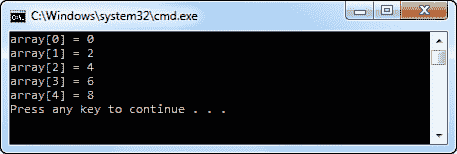
        int[] array = new int[5]; 
        for(int i = 0; i < array.Length; i++) 
        {
            array[i] = i * 2; 
        }
    } 
}
```

幸运的是，C# 提供了一种简写形式，允许编写数组的声明和初始化，使得不需要重复数组类型。这种简写符号被称为**数组初始化器**，可以用于数组地变量和字段声明，或紧跟在数组构造函数调用之后。数组初始化器是一个由逗号分隔并用大括号括的变量初始化器序列。每个变量初始化器是一个表达式，在与多维数组一起使用时是一个嵌套的数组初始化器。

当数组初始化器用于一维数组时，它必须由一组与数组元素类型赋值兼容的表达式组成。这些表达式从索引 0 开始初始化元素，表达式的数量决定了所创建数组的长度。

列表 9.2 显示了如何使用简单的数组初始化器得到与列表 9.2 所示相同的初始化数组。

**列表 9.2 数组初始化**

```csharp
class Program 
{
    static void Main() 
    {
        int[] array = {0, 2, 4, 6, 8};
    }
}
```

虽然索引器对于一维数组很有用，但它们对于多维数组变得非常强大。最左侧的是索引器。例如，语句如下：

```csharp
int[,] array = {{1, 2}, {3, 4}};
```

### System.Array 类

System.Array 类是数组的基类，但提供了许多静态方法供你使用。常用方法见表 9.1。

**表 9.1 System.Array 静态方法**

| 名称 | 描述 |
| :--- | :--- |
| BinarySearch | 使用二分搜索搜索一维排序数组。 |
| Clear | 将范围内的元素设置为零、false 或 null。 |
| Exists | 确定数组是否包含元素。 |
| Find | 在数组中搜索元素。 |
| FindAll | 获取所有匹配条件的元素。 |
| ForEach | 对数组中的每个元素执行指定的操作。 |
| Resize | 如果需要，将数组的大小更改为指定的大小。如果大小不变则无变化；如果增大，则创建一个新数组并将元素复制到新数组。 |
| Sort | 对数组进行排序。 |
| TrueAll | 确定数组中的每个元素是否符合条件。 |


202

第 9 小时：处理数组和集合

图 9.2

使用自定义索引器的结果

```csharp
return this.array.Length;

}

}

public string this[int index]
{
    get
    {
        return this.array[index];
    }
    set
    {
        this.array[index] = value;
    }
}

} 
```

3. 在 Program.cs 文件的 Main 方法中，声明一个类型为 IndexerExample 的新变量 `example1`。

4. 编写一个 `for` 语句打印每个元素的值，使其符合以下格式，其中索引和值分别对应数组索引和该索引处的值：

`index*[index] = value*`

5. 使用 Ctrl+F5 运行应用程序，观察输出是否与图 9.2 所示。

6. 现在，声明一个类型为 IndexerExample 的新变量 `example2`，并编写一个 `for` 语句将 `example2` 的值反向设置为 `example1` 的值。该 `for` 语句应该如下：

```csharp
for (int i = example1.Length - 1, j = 0; i >= 0; i--, j++)
{
    example2[j] = example1[i];
}
```

7. 将你在第 4 步编写的 `for` 语句复制到刚才编写的代码下方，并将其更改为打印 `example2` 的值。你可能想在 `for` 语句开始之前打印一个空行。

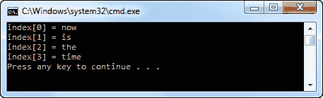

下载自 www.wowebook.com

泛型集合
203

▲ *你知道吗？*

图 9.3

两个实例上使用自定义索引器的结果

8. 使用 Ctrl+F5 运行应用程序，观察输出是否与图 9.3 所示。

泛型集合

虽然数组是 C# 中唯一支持对象集合概念内置数据结构，但基类库提供了丰富的集合及集合相关类型来补充它们，这些类型提供了更大的灵活性，并允许你为自己的数据类型派生自定义集合。

这些类型分为类和接口，并进一步分为非泛型集合和泛型集合。非泛型集合不是类型安全的，因为它们只与 `object` 类型工作，并且为了与旧版本的 .NET Framework 兼容而存在。泛型集合是首选，因为它们提供了类型安全以及比非泛型集合更好的性能。泛型集合的数量几乎是非泛型集合的两倍。

有关泛型类型的更多信息，请参阅第 11 小时，“理解泛型”。

Silverlight 中的泛型集合

Silverlight 版本的 .NET Framework 移除了非泛型集合，因为没有需要兼容的遗留代码。

### 列表

在集合类型集中，`List<T>` 被认为最接近数组的类型，并且可能是最常用的集合。与数组类似，它是一个按数字索引的对象集合。与数组不同，`List<T>` 根据需要动态调整大小。

列表的默认容量为 16 个元素。当你添加第 17 个元素时，列表的大小会自动翻倍。如果预先知道列表包含的元素数量（或近似数量），则使用重载的构造函数之一或在添加第一个项目之前设置 `Capacity` 属性将很有益。

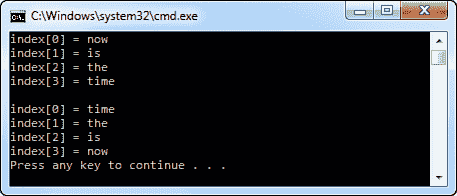

下载自 www.wowebook.com

204

第 9 小时：处理数组和集合

表 9.2 List<T> 的常用成员

| 名称 | 说明 |
| :--- | :--- |
| Capacity | 获取或设置列表在不调整大小的情况下可以包含的元素总数 |
| Count | 获取列表中实际包含的元素数 |
| Add | 将对象添加到列表末尾 |
| AddRange | 将对象集合添加到列表末尾 |
| BinarySearch | 使用二分查找算法在排序后的列表中查找值 |
| Clear | 从列表中删除所有元素 |
| Contains | 确定元素是否存在列表中 |
| Exists | 确定列表是否包含匹配指定条件的元素 |
| Find | 搜索匹配定义条件的元素，并返回整个列表中第一次出现的项 |
| FindAll | 检索所有匹配定义条件的元素 |
| ForEach | 对列表中的每个元素执行指定的操作 |
| Sort | 对列表中的元素进行排序 |
| TrimExcess | 将容量设置为列表中元素的实际数量 |
| TrueForAll | 确定列表中的每个元素是否匹配定义的条件 |

表 9.2 列出了 `List<T>` 的一些常用属性和方法。如果你将其与 `System.Array` 的常用静态方法进行比较（参见表 9.1），你会发现有很多相似之处。与 `List<T>` 相关的是 `LinkedList<T>`，它是一种通用的链表，当元素最常添加到特定位置且对元素的访问始终是顺序的时，它可能是更好的选择。

下载自 www.wowebook.com

225

泛型集合
205

▼

图 9.4 List<T> 的结果

动手实践：处理 List<T>

要查看 `List<T>` 的工作原理，请遵循以下步骤。确保在练习结束时保持 Visual Studio 打开。

1. 创建一个新的控制台应用程序。
2. 在 Program.cs 文件的 Main 方法中，以下语句声明类型为 `List<int>` 的变量：`List<int> list = new List<int>();`
3. 编写一个初始化 16 个元素的 `for` 语句。
4. 编写一个 `foreach` 语句打印每个元素的值。
5. 现在，打印 `Capacity` 属性。
6. 使用 Ctrl+F5 运行应用程序，观察输出是否与图 9.4 所示。
7. 现在，复制你在第 3 到 5 步中编写的代码。
8. 使用 Ctrl+F5 运行应用程序，观察输出是否与图 9.5 所示。


下载自 www.wowebook.com

206

第 9 小时：处理数组和集合

▼

图 9.5 容量增加的结果

泛型集合
表 9.3 Collection<T> 的常用成员

| 名称 | 说明 |
| :--- | :--- |
| Count | 获取包含的元素数量 |
| Add | 将对象添加到末尾 |
| Clear | 从列表中删除所有元素 |
| Contains | 确定元素是否存在列表中 |

为了创建一个像数组一样可以通过索引访问的自定义集合，你可以派生 `Collection<T>`。也可以通过提供要包含的对象类型直接使用 `Collection<T>` 类。表 9.3 显示了一些常用成员。

动手实践：处理 Collection<T>

通过遵循这些步骤，你可以看到 `Collection<T>` 的工作原理。如果你关闭了 Visual Studio，请重复之前的练习。确保在练习结束时保持 Visual Studio 打开。

1. 将变量声明从 `List<int>` 类型更改为 `Collection<int>`。你可能需要包含 `System.Collections.ObjectModel` 命名空间。
2. 通过将 `Console.WriteLine` 语句改为打印 `Count` 属性来修复两个编译错误。
3. 使用 Ctrl+F5 运行应用程序，观察输出是否与图 9.6 所示。


下载自 www.wowebook.com

207

泛型集合

▲

图 9.6 处理 Collection<T> 的结果

表 9.4 Collection<T> 的保护虚方法成员

| 名称 | 说明 |
| :--- | :--- |
| ClearItems | 从集合删除所有元素。可以更改 Clear 方法的行为。 |
| InsertItem | 在指定索引处插入元素 |
| RemoveItem | 删除指定索引处的元素 |
| SetItem | 替换指定索引处的元素 |


下载自 www.wowebook.com


208
第 9 小时：处理数组和集合

图 9.7
自定义定义的 Collection <int> 的结果

自己尝试一下
派生你自己的集合

要派生一个具体的（封闭的）整数集合，请按照以下步骤操作。如果你关闭了 Visual Studio，请先重复之前的练习。

1. 添加一个名为 `Int32Collection` 的新类，它派自 `Collection<int>` 并重写 `InsertItem` 方法。重写后的 `InsertItem` 方法体应如下：

```csharp
protected override void InsertItem(int index, int item)
{ 
    Console.WriteLine("Inserting item {0} at position {1}", item, index); 
    base.InsertItem(index, item);
}
```

2. 将列表的声明类型从 `Collection<int>` 改为 `Int32Collection` 类型。

3. 使用 Ctrl+F5 运行应用程序，观察输出是否与图 9.6 所示。如果你向上滚动控制台窗口，你应该能看到重写后的 `InsertItem` 方法的输出，如图 9.7 所示。

与 `Collection<T>` 对应的是 `ReadOnlyCollection<T>`，它可以像 `Collection<T>` 一样立即使用，也可以用于创建你自己的只读集合。也可以从 `List<T>` 实例创建只读集合。最常用的成员如表 9.5 所示。

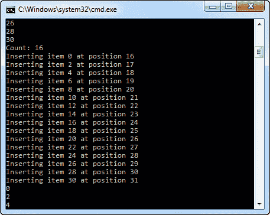

从 www.wowebook.com 下载

209
泛集合

*你知道吗？*

表 9.5
ReadOnlyCollection<T> 的常用成员

| 名称 | 描述 |
| :--- | :--- |
| Count | 获取集合中实际包含的元素数量 |
| Contains | 确定元素是否在集合中 |
| IndexOf | 搜索指定的元素并返回第一次出现的索引 |

表 9.6
Dictionary<TKey, TValue> 的常用成员

| 名称 | 描述 |
| :--- | :--- |
| Count | 获取字典中包含的键值对数量 |
| Keys | 获取包含字典中所有键的集合 |
| Values | 获取包含字典中所有值的集合 |
| Add | 向字典添加指定的键和值 |
| Clear | 从字典中删除所有键和值 |
| ContainsKey | 确定字典是否包含指定的键 |
| ContainsValue | 确定字典是否包含特定的值 |
| Remove | 从字典中删除具有指定键的值 |

**ReadOnlyCollection<T>**
你可以将 `ReadOnlyCollection<T>` 认为是对一个现有可变集合的包装器，如果你尝试更改它，它会抛出异常。底层集合仍然是可变的。

字典
`List<T>` 和 `Collection<T>` 适用于通用集合，但有时需要一个可以提供一组键和一组值之间映射的集合，且不允许重复的键。

`Dictionary<TKey, TValue>` 类提供了这种映射，并允许使用键而不是数字索引进行访问。要向 `Dictionary<TKey, TValue>` 实例添加元素，你必须同时提供键和值。键必须是唯一的且不能为 null，但如果 `TValue` 是引用类型，则值可以为 null。表 9.6 显示了 `Dictionary<TKey, TValue>` 类的常用成员。

从 www.wowebook.com 下载

210
第 9 小时：处理数组和集合

表 9.7
SortedList 和 SortedDictionary 的常用成员

| 名称 | 描述 |
| :--- | :--- |
| Capacity | (仅适用于 SortedList<TKey, TValue>.)) 获取或设置列表可以包含的元素数量。 |
| Count | 获取列表中包含的键值对数量。 |
| Add | 向列表添加指定的键和值。 |
| Clear | 从列表中删除所有键和值。 |
| ContainsKey | 确定列表是否包含指定的键。 |
| ContainsValue | 确定列表是否包含特定的值。 |
| Remove | 从列表中删除具有指定键的值。 |

与 `List<T>` 和 `Collection<T>` 不同，当枚举字典元素时，字典返回一个 `KeyValuePair<TKey, TValue>` 结构体，它表示一个键及其关联的值。正因如此，当使用 `foreach` 语句遍历字典元素时，`var` 关键字是非常用的。

通常情况下，字典不对其包含的元素提供任何顺序，这些元素在枚举期间按任意顺序返回。虽然 `List<T>` 提供了一个 `Sort` 方法来对列表元素排序，但字典没有。如果你需要一个在添加或删除元素时保持排序的集合，你实际上有两个不同的选择：`SortedList<TKey, TValue>` 或 `SortedDictionary<TKey, TValue>`。这两个类相似，在检索元素时提供相同的性能，但在内存使用以及元素插入和删除性能方面有所不同：

- `SortedList<TKey, TValue>` 使用内存较少。
- `SortedDictionary<TKey, TValue>` 对于未排序数据提供了更快的插入和删除。
- `SortedList<TKey, TValue>` 在填充列表时更快。
- `SortedDictionary<TKey, TValue>` 在检索键时更高效。

`SortedList<TKey, TValue>` 和 `SortedDictionary<TKey, TValue>` 的常用成员如表 9.7 所示。

211
泛集合

表 9.7
SortedList 和 SortedDictionary 的常用成员

| 名称 | 描述 |
| :--- | :--- |
| Capacity | (仅适用于 SortedList<TKey, TValue>.)) 获取或设置列表可以包含的元素数量。 |
| Count | 获取列表中包含的键值对数量。 |
| Add | 向列表添加指定的键和值。 |
| Clear | 从列表中删除所有键和值。 |
| ContainsKey | 确定列表是否包含指定的键。 |
| ContainsValue | 确定列表是否包含特定的值。 |
| Remove | 从列表中删除具有指定键的值。 |

自己尝试一下
处理字典
要使用 `Dictionary<TKey, TValue>` 和 `SortedDictionary<TKey, TValue>` 通过键存储和检索数据，请按照以下步骤操作：

1. 创建一个新的应用程序。
2. 在 `Program.cs` 的 `Main` 方法中，声明一个名为 `dictionary` 的 `Dictionary<string, double>`。
3. 添加以下行来初始化字典：

```csharp
dictionary.Add("Speed of Light", 299792458);
dictionary.Add("Gravitational Constant", 6.67428e-11);
dictionary.Add("Planck’s Constant", 6.62606896e-34);
dictionary.Add("Avogadro’s number", 6.02214076e23);
dictionary.Add("Faraday Constant", 96485.332);
dictionary.Add("Electron Volt", 1.60217663e-19);
```

4. 编写一个 `foreach` 语句打印键及其关联的值。可以使用 `var` 或 `KeyValuePair<string, double>` 作为迭代变量。
5. 使用 Ctrl+F5 运行应用程序，观察输出是否与图 9.8 所示。注意输出按输入顺序排列的。
6. 将字典声明改为 `SortedDictionary<string, double>`。
7. 使用 Ctrl+F5 运行应用程序，观察输出是否与图 9.9 所示。注意通过更改声明，输出是按字母顺序排序的。

图 9.8
使用 Dictionary <TKey, TValue> 的结果

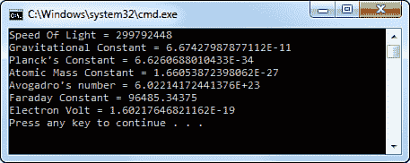


通用集合

213

表格 9.8
HashSet<T> 和 SortedSet<T> 的常用成员

| 名称 | 描述 |
| :--- | :--- |
| IsProperSubsetOf | 确定集合是否为指定集合的真子集。 |
| IsProperSupersetOf | 确定集合是否为指定集合的真超集。 |
| IsSubsetOf | 确定集合是否为指定集合的子集。 |
| IsSupersetOf | 确定集合是否为指定集合的超集。 |
| Overlaps | 确定集合与指定集合是否共享共同元素。 |
| Remove | 从集合中删除指定的元素。 |
| RemoveWhere | 从集合中删除所有符合指定条件的元素。 |
| Reverse | 返回按反序遍历集合的枚举器。（仅限 SortedSet<T>。） |
| SetEquals | 确定集合与指定集合是否包含相同的元素。 |
| SymmetricExceptWith | 修改当前集合，使其仅包含存在于集合或指定集合中但不同于两者的元素。 |
| TrimExcess | 将集合的容量设置为其包含元素的实际数量，向上舍入到最近的值。（仅限 HashSet<T>。） |
| UnionWith | 修改当前集合，使其包含存在于集合和指定集合中的所有元素。 |

*你知道吗？*
为什么使用 **HashSet<T>**？
与大多数其他通用集合不同，HashSet<T> 的名称是基于其实现细节而非用途的。这是因为 Set 是 Visual Basic 中的保留字，所以它只能通过转义来使用：
`Dim s as [Set] of Int`

.NET Framework 的设计者没有要求这种语法，而是选择了一个与任何保留字冲突的名称。

从 www.wowebook.com 下载

214
第 9 小时：处理数组和集合

▼ 图 9.10
使用 HashSet<T> 的结果

亲手试一试
操作集合
通过遵循以下步骤，你将看到如何操作 HashSet<T> 和 SortedSet<T>。

1. 创建一个新的控制台应用程序。
2. 在 Program.cs 文件的 Main 方法中声明两个整数集合，如下：
   `HashSet<int> even = new HashSet<int>() { 0, 2, 4, 6, 8, 10, 12 };`
   `HashSet<int> odd = new HashSet<int>() { 1, 3, 5, 7, 9, 11 };`
3. 打印 even 和 odd 之间执行 SetEquals 调用的结果。
4. 使用 Ctrl+F5 运行应用程序，观察到输出为 False。
5. 执行 UnionWith 方法计算 even 和 odd 之间的并集。
6. 使用 foreach 语句打印 even 集合的内容。
7. 再次使用 Ctrl+F5 运行应用程序，观察输出包含原始 even 集合中的数字和 odd 集合中的数字。
8. 执行 IntersectWith 方法计算 even 和 odd 之间的交集。
9. 重复步骤 3 中的代码行。
10. 再次使用 Ctrl+F5 运行应用程序，观察最终输出与图 9.10 所示一致。
11. 将 even 和 odd 的声明改为使用 SortedSet<int>。

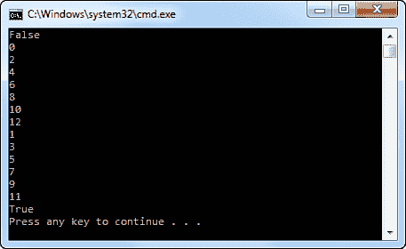

从 www.wowebook.com 下载

215
通用集合

▲ 图 9.11
使用 SortedSet<T> 的结果

12. 再次使用 Ctrl+F5 运行应用程序，观察最终输出与图 9.11 所示一致。

栈和队列
栈和队列是相对简单的集合，代表后进先出（LIFO）集合或先入先出（FIFO）集合。尽管这些是简单的集合，但它们也非常有用。队列用于按接收顺序存储数据以便进行顺序处理，而栈用于语句解析等操作。通常情况下，当操作应限制在列表的开头或结尾时，会使用栈和队列。

Stack<T> 类提供了一个数组实现的栈，其中操作始终发生在数组的末尾，并且可以包含重复元素和空元素。Stack<T> 提供了一个简单的公共接口，如表 9.9 所示。

表格 9.9
Stack<T> 的常用成员

| 名称 | 描述 |
| :--- | :--- |
| Count | 获取栈包含的元素数量 |
| Clear | 从栈中移除所有元素 |
| Contains | 确定元素是否在栈中 |
| Peek | 返回队列顶部的元素而不移除它 |
| Pop | 移除并返回栈顶部的元素 |
| Push | 在栈顶部插入一个元素 |
| TrimExcess | 如果栈元素数量少于当前容量的 90%，则将容量设置为栈中元素的实际数量 |


从 www.wowebook.com 下载

216
第 9 小时：处理数组和集合

▼ ▲ 图 9.12
操作 Stack<T> 的结果

表格 9.10
Queue<T> 的常用成员

| 名称 | 描述 |
| :--- | :--- |
| Count | 获取队列包含的元素数量 |
| Clear | 从队列中移除所有元素 |
| Contains | 确定元素是否在队列中 |
| Dequeue | 移除并返回队列头的元素 |
| Enqueue | 在队列末尾添加元素 |

亲手试一试
操作 Stack<T>
要实现栈，请遵循以下步骤：

1. 创建一个新的控制台应用程序。
2. 在 Program.cs 文件的 Main 方法中声明一个名为 stack 的整数栈。
3. 将 0, 2, 4 推入栈顶。
4. 使用 Peek() 方法打印栈顶元素。
5. 将 6, 8, 10 推入栈顶。
6. 使用 Peek() 方法打印栈顶元素。
7. 再次使用 Ctrl+F5 运行应用程序，观察输出与图 9.12 所示一致。

Queue<T> 类提供了一个数组实现的队列，其中操作始终发生在数组的末尾，并且可以包含重复元素和空元素。Queue<T> 提供了一个简单的公共接口，如表 9.10 所示。


从 www.wowebook.com 下载

237
集合初始化器

217
▼ 表格 9.10
队列的成员

| 名称 | 描述 |
| :--- | :--- |
| Count | 获取队列包含的元素数量 |
| Clear | 从队列中移除所有元素 |
| Contains | 确定元素是否在队列中 |
| Dequeue | 移除并返回队列头的元素 |
| Enqueue | 在队列末尾添加元素 |

亲手试一试
操作 Stack<T>
要实现队列，请遵循以下步骤：

1. 创建一个新的控制台应用程序。
2. 在 Program.cs 文件的 Main 方法中声明一个名为 queue 的整数队列。
3. 将 1, 3, 5 入队队列。
4. 使用 Peek() 方法打印队列头元素。
5. 将 7, 9, 11 入队队列。
6. 使用 Dequeue() 方法打印队列头元素。
7. 再次使用 Ctrl+F5 运行应用程序，观察输出与图 9.13 所示一致。

集合初始化器
正如数组提供数组初始化、对象提供对象初始化一样，集合也提供了形式为**集合初始化器**的语法。回顾本小时的练习题，可以注意到集合初始化器的使用。

▲ 图 9.13
操作 Queue<T> 的结果


从 www.wowebook.com 下载

238
第 9 小时：处理数组和集合
218
*看*
*出来！*
集合初始化器允许你指定一个或多个元素初始化器，从而能够初始化实现 IEnumerable 的集合。使用集合初始化器允许你省略对集合 Add 方法的多次调用，让编译器为你完成这些调用。元素初始化器可以是值、表达式或对象初始化器。

集合初始化器仅适用于 Add 方法
集合初始化器仅可用于包含 Add 方法的集合。这意味着它们不能用于 Stack<T> 和 Queue<T> 等集合。

集合初始化器的语法与数组初始化器相似。你仍然调用 new 运算符，但可以使用数组初始化语法来填充集合。列表 9.3 显示了与列表 9.2 相同的示例，但使用了 List<int> 和集合初始化器。

列表 9.3
集合初始化
class Program 
{
static void Main() 
{
List<int> list = new List<int>() {0, 2, 4, 6, 8 }; 
}
}

集合初始化器也可以更复杂，允许对元素初始化器使用对象初始化器，如列表 9.4 所示。

列表 9.4
复杂的集合初始化
class Program 
{
static void Main() 
{
List<Contact> list = new List<Contact>() 
{
new Contact() { FirstName = “Scott”, LastName = “Dorman” }, 
new Contact() { FirstName = “Jim”, LastName = “Morrison” }, 
new Contact() { FirstName = “Ray”, LastName = “Manzarek” }
};

foreach(Contact c in list) 
{
Console.WriteLine(c); 
}
}
}


### 集合接口

219

通过在集合初始化器内部启用对象初始化器，就可以对任何类型的集合使用集合初始化器，包括 `Add` 方法接收多个参数的字典。

### 集合接口

如果你回溯所有不同集合的常用成员和属性，你会发现它们的公共接口具有某些相似之处和一致性。这种一致性源于这些集合类实现的一组接口。某些类实现的接口比其他类多，但它们所有类都至少实现了一个接口。

集合接口可以分为两类：提供特定集合实现约的接口，以及提供支持实现（如比较和枚举功能）的接口。在第一组提供特定集合行为的接口中，只有四个接口：

- `ICollection<T>` 定义了操作泛型集合的方法和属性。
- `IList<T>` 扩展了 `ICollection<T>`，提供了操作可以通过索引单独访问元素的泛型集合的方法和属性。
- `IDictionary<TKey, TValue>` 扩展了 `ICollection<T>`，提供了操作键/值对泛型集合的方法和属性，其中每个对必须有一个唯一的键。
- `ISet<T>` 扩展了 `ICollection<T>`，提供了操作具有唯一元素的泛型集合的方法和属性以及集合操作。

第二组也包含四个接口，如下：

- `IComparer<T>` 定义了一个比较两个对象的方法。该接口用于 `List<T>.Sort` 和 `List<T>.BinarySearch` 方法，并提供了自定义集合排序的方法。`Comparer<T>` 类提供了此接口的默认实现，通常可以满足大多数需求。
- `IEnumerable<T>` 扩展了 `IEnumerable`，通过暴露枚举器支持对集合进行简单迭代。包含此接口是为了与非泛型集合保持一致，通过实现此接口，泛型集合可以在任何需要 `IEnumerable` 的地方被使用。
- `IEnumerator<T>` 同样提供了对集合进行简单迭代的支持。
- `IEqualityComparer<T>` 为你提供了一种为类型 T 自定义等效性的方法。`EqualityComparer<T>` 类提供了此接口的默认实现，通常可以满足大多数需求。

220
第 9 小时：对数组和集合的操作

### 可枚举对象和迭代器

如果你查看 `IEnumerable<T>` 和 `IEnumerator<T>` 的定义，你会发现它们非常相似。这些接口（以及它们的非泛型对应项）组通常所谓的**迭代器模式**。

这种模式本质上允许你向一个实现 `IEnumerable<T>` 的对象（也称为**可枚举对象**）请求一个枚举器（实现 `IEnumerator<T>` 的对象）。当你拥有 `IEnumerator<T>` 时，你就可以一次一个元素地枚举（或迭代）数据。

例如，列表 9.5 中的代码显示了一个典型的 `foreach` 语句，它遍历一个整数列表的内容并打印每个值。

列表 9.5 
简单的 foreach 语句
```csharp
List<int> list = new List<int>() { 0, 2, 4, 6, 8 }; 
foreach(int i in list) 
{
    Console.WriteLine(i); 
}
```

这段代码实际上被编译器翻译成大致类似于列表 9.6 所示的代码。

列表 9.6 
编译器展开的 foreach 语句
```csharp
List<int> list = new List<int>() { 0, 2, 4, 6, 8 }; 
IEnumerator<int> iterator = ((IEnumerable<int>)list).GetEnumerator(); 
while (iterator.MoveNext()) 
{
    Console.WriteLine(iterator.Current); 
}
```

`GetEnumerator` 方法由 `IEnumerable<T>` 接口定义（事实上，它是接口定义的唯一成员），它仅仅提供了一种让可枚举对象暴露枚举器的方法。正是这个枚举器通过 `MoveNext` 方法和 `Current` 属性（由 `IEnumerator<T>` 和 `IEnumerator` 接口定义），允许你在可枚举对象包含的数据中向前移动。

221
可枚举对象和迭代器

### 为什么需要两个接口？

通过保持可枚举对象（`IEnumerable<T>`）与对该对象的枚举器（`IEnumerator<T>`）之间的区别，你可以对同一个可枚举源进行多次迭代。显然，你不希望迭代在遍历数据中移动时相互干扰，因此你需要两个独立的表示（枚举器），它们能为你提供当前数据元素以及移动到下一个元素的机制。

幸运的是，所有的泛型集合（也包括非泛型集合）已经实现了 `IEnumerable<T>`、`IEnumerable`、`IEnumerator<T>` 和 `IEnumerator`，因此你可以直接使用它们，而无需自己编写迭代器机制的额外复杂度。

如果你想让自己的类提供类似的行为怎么办？你完全可以让你的类实现 `IEnumerable<T>`，然后编写自己的派自 `IEnumerator<T>` 的类，但如果你使用迭代器，这样做并不是必要的。这使得编译器能够为你完成所有工作。

`yield return` 关键字允许你返回一个值序列，而无需创建集合并手动填充它。编译器会生成用于跟踪迭代状态的状态机。`yield return` 语句向调用者返回一个值并暂停方法的执行。当调用者请求下一个值时，方法将从停止的地方继续执行。

`yield return` 语句可以用循环循环，例如 `foreach`、`for` 或 `while` 循环。这允许你在生成值时逐个产生。`yield break` 可提前终止迭代。

`yield return` 语句有一些限制：
- 不能在匿名方法或 Lambda 表达式中使用。
- 不能在 `try` 块中使用（尽管可以在 `finally` 块中使用）。
- 不能在属性或访问器中使用。
- 不能在返回 `void` 的方法中使用。

列表 9.7 
简单的迭代器
```csharp
class Program
{
    static IEnumerable<int> GetEvenNumbers()
    {
        for (int i = 0; i < 10; i++)
        {
            if (i % 2 == 0)
            {
                yield return i;
            }
        }
    }

    static void Main()
    {
        foreach (int i in GetEvenNumbers())
        {
            Console.WriteLine(i);
        }
    }
}
```

迭代器可以做的远不仅仅是返回值。只要你遵守上述限制，迭代器就可以具有任何程度的复杂性。

列表 9.8 
更复杂的迭代器
```csharp
class Program
{
    static IEnumerable<int> GetEvenNumbers()
    {
        for (int i = 0; i < 10; i++)
        {
            if (i % 2 == 0)
            {
                yield return i;
            }
        }
    }

    static void Main()
    {
        foreach (int i in GetEvenNumbers())
        {
            Console.WriteLine(i);
        }
    }
}
```

### 总结

在本节时中，你学习了如何使用数组和集合来处理大量数据。数组是最简单的集合类型并具有直接的语言支持，而其他集合类型（如 `List<T>` 和 `Stack<T>`）提供了更大的灵活性并允许你创建自己的集合。你还学习了索引器如何让你的类提供与数组和集合相同的基于索引访问。最后，你查看了各种不同的集合接口，并了解如何使用初始化器语法轻松地声明和初始化数组以及集合。


224

第 9 小时：处理数组和集合

Q.* **HashSet<T>** 和 **SortedSet<T>** 之间有什么区别？*

A. HashSet<T> 等同于数学中的集合，而 SortedSet<T> 通过元素的插入和删除来维护排序顺序，且不影响性能。这两个类都不允许存在重复元素。

Q.* **IEnumerable<T>** 接口是什么？*

A. IEnumerable<T> 继承自 IEnumerable，并通过暴露枚举器提供对集合进行简单迭代的支持。包含此接口是为了与非泛型集合保持一致，并且通过实现此接口，泛型集合可以在任何期望 IEnumerable 的地方使用。

Q.* 什么是数组初始化器和集合初始化器（initializer）？*

A. 数组初始化器和集合初始化器是一种特殊语法，允许你轻松地声明和初始化数组或集合的内容。数组初始化器允许你省略数组类型，只需为数组提供值。集合初始化器通过在初始化器中为每个元素提供值，允许你省略多次调用集合的 Add 方法。

## 工作坊 

### 测验

1. 数组的内存是如何分配的？

2. 索引器（indexer）允许哪些修饰符？

3. 在什么情况下你会使用 Collection<T> 而不是 List<T>？

4. 当枚举字典元素时，返回的是什么对象？

5. Stack<T> 上有哪些可以修改状态的操作？

6. IDictionary<TKey, TValue> 继承自哪个接口？

7. IComparer<T> 和 IEqualityComparer<T> 之间有什么区别？

8. 集合初始化器可以用于 Add 方法接收多个一个参数的集合吗？

225

### 工作坊

答案

1. 数组隐式地是 System.Array 对象的实例，因此它们是引用类型，用于引用数组本身的内存分配在托管堆上。然而，数组的元素是根据它们自身的类型进行分配的。

2. 索引器允许的修饰符有 new, virtual, sealed, override, abstract 以及四种访问修饰符的有效组合。

3. List<T> 的设计并不是易于扩展的，因为没有派生类可以重写以修改行为的虚成员。Collection<T> 拥有可以被重写的虚成员，因此当你需要自定义集合行为时，优先选择 Collection<T>。

4. 当枚举字典元素时，字典返回一个 KeyValuePair<TKey, TValue> 结构，表示一个键及其关联的值。

5. Stack<T> 类提供了 Clear, Pop 和 Push 方法，用于删除所有元素、删除顶部元素或插入元素。

6. IDictionary<TKey, TValue> 继承自 ICollection<T> 接口。

7. IComparer<T> 定义了一个比较两个对象的方法，而 IEqualityComparer<T> 提供了一种让你为类型 T 提供自定义等性定义的方法。

8. 是的，集合初始化器可以用于 Add 方法接收多个参数的集合。

### 练习

1. 添加一个名为 PhotoCollection 的新公共类，派自 ObservableCollection<IPhoto>。该类应该有一个名为 directory 的字符串类型字段，一个接受字符串参数并将该字段设置为该参数值的公共构造函数，以及一个名为 Path 的公共属性，用于获取或设置 directory 字段的值。

2. 在 MainWindow 类中，添加一个名为 photos 的私有 PhotoCollection 字段和一个名为 Photos 的只读属性。在 MainWindow 类的构造函数中，添加一条语句将一个新的 PhotoCollection 实例分配给 photos 字段。

227

第 10 小时

使用异常处理错误

*你将在这一小时学到：*

- 理解异常
- 使用标准异常
- 抛出异常
- 处理异常
- 重新抛出捕获的异常
- 溢出和整数运算

当应用程序执行时，可能会遇到任何可能的错误条件。C# 使用**异常（exceptions）**来处理这些错误条件，异常在单个类中封装了错误信息。异常旨在仅用于报告失败，因此它们提供了一种一致的方法来报告和响应这些失败。异常并不是用于控制程序流、报告成功条件或作为反馈机制的。它们是为了报告执行期间发生的失败。

在许多语言中，特别是非面向对象的语言中，报告失败的标准机制是使用返回码。然而，在面向对象的语言中，取决于失败发生的上下文，返回码并不总是可能的。返回码也容易被忽略；如果不加处理，它们会为正确处理所有可能的失败位置引入大量的复杂性。

在本小时中，你将学习 C# 提供的异常处理机制；你还将学习如何抛出和捕获异常。你将学习如何选择合适的异常类型进行抛出，有哪些可用的异常，包括如何

228

第 10 小时：使用异常处理错误

*你知道吗？*

**理解异常**

当应用程序执行时，可能会遇到任何可能的错误条件。C# 使用**异常**来处理这些错误条件，异常在单个类中封装了错误信息。异常旨在仅用于报告失败，因此它们提供了一种一致的方法来报告和响应这些失败。异常并不是用于控制程序流、报告成功条件或作为反馈机制的。它们是为了报告执行期间发生的失败。

在许多语言中，特别是非面向对象的语言中，报告失败的标准机制是使用返回码。然而，在面向对象的语言中，取决于失败发生的上下文，返回码并不总是可能的。返回码也容易被忽略；如果不加处理，它们会为正确处理所有可能的失败位置引入大量的复杂性。

在本小时中，你将学习 C# 提供的异常处理机制；你还将学习如何抛出和捕获异常。你将学习如何选择合适的异常类型进行抛出，有哪些可用的异常，包括如何

异常了一种清晰、简洁且安全的方法来表示失败。System.Exception 提供了关于失败原因的详细信息。其中一些属性包括调用堆栈（call trace），可以确定错误发生的位置。

229

理解异常

- 最常用的是 Message 属性，它提供了关于错误的详细描述。通常，该属性的内容是描述错误的通俗句子。
- StackTrace 属性包含调用堆栈。如果在运行时可以使用调试信息，堆栈跟踪将包含错误发生的源文件名和行号。
- InnerException 属性通常用于将一个异常封装在另一个类型的异常中。原始异常存储在 InnerException 属性中，以便错误处理代码检查原始信息。
- HelpLink 属性可以包含指向异常额外帮助文件的 URL。
- Data 属性是一个 IDictionary（字典的非泛型版本），用于通过键值对存储任意数据。

使用标准异常

虽然 .NET Framework 提供了200 多个公共异常类，但其中大约 15 个是常用的。其余异常通常派自这些标准异常。

除了 Exception 之外，另外两个主要的基类是 SystemException（所有运行时生成的异常的基类）和 ExternalException（发生在或针对外部环境的异常）。

Exception、SystemException 和 ExternalException 类应仅作为更具体的派生异常的基类，你应该避免直接派自 SystemException 来定义自己的异常。剩余的标准异常如表 10.1 所示，它们由运行时抛出的异常（你的代码不应抛出这些）以及你的代码可以且应该抛出的异常组成。

表 10.1

| 异常类型 | 描述 |
| :--- | :--- |
| IndexOutOfRangeException | 仅在对数组或集合进行不当索引时运行时抛出 |
| NullReferenceException | 仅在解引用空引用时运行时抛出 |
| AccessViolationException | 仅在访问无效内存时运行时抛出 |
| InvalidOperationException | 成员处于无效状态时抛出 |
| ArgumentException | 所有参数异常的基类 |


## 第 10 小：使用异常处理错误

如果你坚持对传递给公共方法的参数进行验证，那么当传递了
错误的参数时，你应该抛出 ArgumentException 或其子类型之一。

对于那些不期望接收 null 参数的方法，应该使用 ArgumentNullException；当
参数超出可接受的值范围时，应使用 ArgumentOutOfRangeException。

如果属性或方法调用不符合对象的当前状态，你可以抛出
InvalidOperationException。这与 ArgumentException 不同，后者不依赖于
对象的状态来判断是否应该抛出异常。

### 验证参数

如果调用者无法直接判断参数何时有效，你应该
考虑提供一个允许他们进行检查的方法。

*顺便*
*提一下*

顺便，表 10.1 标准异常

| 异常类型 | 描述 |
| :--- | :--- |
| ArgumentNullException | 不允许参数为 null 方法抛出的异常 |
| ArgumentOutOfRangeException | 由验证参数是否在给定范围内的方法抛出的异常 |
| COMException | 封装 COM HRESULT 信息的异常 |
| SEHException | 封装 Win32 结构化异常处理信息的异常 |
| OutOfMemoryException | 当运行时没有足够的内存继续执行程序时抛出的异常 |
| StackOverflowException | 当执行栈溢出（因为包含过多的嵌套方法调用，通常由深度或无限制递归引起）时由运行时抛出的异常 |
| ExecutionEngineException | 当通用语言运行时执行引擎发生内部错误时由运行时抛出的异常 |

其余的标准异常应被视为保留异常。你应该
避免在自己的代码中抛出这些异常，也不要从它们派生你自己的异常。

### 抛出异常

**System.Environment.FailFast**

如果你的应用程序遇到了继续执行是不安全的情况，
你应该考虑调用 System.Environment.FailFast 而不是抛出
异常。

如果在这种情况下继续执行会导致安全风险（例如当安全模拟
无法撤滚时），你也应该考虑调用 FailFast。

*你知*
*道吗？*

你应该执行参数检查，以防止 IndexOutOfRangeException 或
NullReferenceException 的发生。

### 抛出异常

你使用 `throw` 关键字抛出异常。由于 Exception 是一个类，你
必须使用 `new` 关键字创建它的实例。以下代码抛出了一个新的 Exception 对象：

`throw new System.Exception();`

当异常被抛出时，程序执行立即停止，同时异常会沿着调用栈
向上传播，寻找适当的处理器。如果没有找到
处理器，则会发生三种情况之一：

- 如果异常发生在析构函数内部，则该析构函数被中止，如果存在，
将调用基类的析构函数。
- 如果调用栈中包含静态构造函数或静态字段初始化器，则会抛出
TypeInitializationException，其 InnerException 属性包含原始异常。
- 如果到达线程的起点，则该线程被终止。在大多数情况下，
这意味着如果异常一直到达 Main() 方法而没有找到兼容的
处理器，应用程序将终止。无论异常源自哪个线程，这种情况都会发生。

了解何时应该抛出异常需要理解编码错误和执行错误之间的
区别。编码错误可以通过更改代码来避免，没有理由使用
异常来处理这些错误。编码错误可以在编译时修复，你也可以
采取措施确保它们在运行时绝不会发生。

执行错误是指当遇到意料之外的错误条件时，会抛出异常。这通
通常发生在类成员无法执行其设计任务时。无论你在代码中
采取多少预防措施，执行错误都是无法完全避免的。程序执行
错误可以通过你的代码通过编程方式处理。系统执行错误是那些你的代码无法处理的错误。

### 处理异常

处理异常使用异常对象和**保护区域**。将**保护区域**
视为一个特殊的代码块，旨在允许你处理异常。几乎任何行
代码都可能导致异常，但大多数应用程序实际上并不需要
处理这些异常。只有当你根据处理异常的结果可以做某些
有意义的事情时，你才应该处理异常。

在 C# 中，你使用 `try` 关键字声明保护区域（也称为 **try 块**），
被保护的语句被包含在大括号中。关联的处理器出现在
保护区域的右大括号之后。保护区域必须与它关联至少一个以下处理器之一：

- 一个 **finally 处理器**（finally 块），它在保护区域退出时
都会执行，即使遇到了异常也是如此。一个保护区域最多有一个
finally 处理器。
- 一个 **catch 处理器**（catch 块），它与特定的异常或其
任何一个子类兼容。保护区域可以有多个 catch 处理器，但特定的
异常类型只能在单个处理器中指定。

当异常发生时，系统会找到包含当前指令（导致异常的那个
指令）且具有匹配的 catch 处理器块的第一个保护区域。如果当前
方法不包含匹配项，则会搜索调用方法，直到找到匹配项或
到达调用栈顶端，在这种情况下应用程序将终止。如果找到了
匹配项，程序执行将返回到异常发生点，执行任何 finally 处理器，
然后执行 catch 处理器。

### 通用 catch 处理器

你也可以仅使用 `catch` 关键字指定 catch 处理器，这通常
被称为通用处理器。然而，应该避免这种做法。

在 .NET Framework 1.0 和 1.1 版本中，存在过某些情况，即非托管代码
会抛出一个除空 catch 块之外无法被任何捕获的异常。
此问题在 .NET 2.0 中得到了修正，现在这些异常被封装在
RuntimeWrappedException（它继承自 System.Exception），因此不再需要
这样做。

保护区域可以根据它们提供的处理器分为三种模式：

- **Try-Catch**——仅提供一个或多个 catch 处理器
- **Try-Finally**——仅提供一个 finally 处理器
- **Try-Catch-Finally**——提供一个或多个 catch 处理器和一个 finally 处理器

当你指定 catch 块时，可以只提供异常类型或
异常类型以及一个标识符，称为 **catch 处理器变量**。catch
处理器变量在 catch 处理器的作用域内定义了一个局部变量，
允许你在 catch 块内部引用异常对象。由于 catch 处理器
变量的作用域限于特定的 catch 处理器，且只有一个 catch
处理器会执行，因此相同的标识符可以被多个 catch 处理器使用。
然而，你不能将相同的标识符用于方法参数或其他
局部变量。

列表 10.1 显示了编写 catch 处理器的最常用方式，并使用了 catch
处理器变量。

列表 10.1
声明 Catch Handler
```csharp
try
{
    int divisor = Convert.ToInt32(Console.ReadLine());
    int result = 3/divisor;
}
catch (DivideByZeroException ex)
{
    Console.WriteLine(ex.Message);
}
```

如果你有多个嵌套的 try 块，每个块都有可能匹配的 catch 
处理器，它们的嵌套顺序决定了它们的执行顺序。当找到
兼容的 catch 处理器后，就不会执行其他 catch 处理器。
列表 10.2 显示了捕获多个异常的示例，并展示了如何
不使用 catch 处理器变量来编写 catch 处理器。


234

## 第10 小时：使用异常处理错误

### 列表 10.2 
捕获多个异常

```csharp
try
{
    int divisor = Convert.ToInt32(Console.ReadLine()); 
    int result = 3/divisor;
} 
catch (DivideByZeroException)
{
    Console.WriteLine("Attempted to divide by zero");
} 
catch (FormatException)
{
    Console.WriteLine("Input was not in the correct format");
} 
catch (Exception)
{
    Console.WriteLine("General catch handler");
}
```

如果列表 10.2 中的 `try` 块导致了 `DivideByZeroException`，输出将是“Attempted to divide by zero”。如果 `try` 块导致了 `FormatException`，输出将是“Input was not in the correct format”。

任何其他异常都会生成输出为“General catch handler”。然而，如果重新排列 `catch` 块，使通用 `catch` 块位于第一个，程序将无法编译。

### 吞没异常（Swallowing Exceptions）

编写除了记录错误外什么都不做的 `catch` 块是常见的做法。虽然这有时是重要的，但通常可以由顶层调用者完成，而不需要每个函数都这样做。

这导致了一个被称为“吞没异常”的问题，当你捕获一个异常并对其不做任何处理，或者不让它向上链传递时，就会发生这种情况。这也会导致问题，因为你实际上隐藏了异常而没有对其进行任何处理，这会导致难以追踪的间歇性问题。

看待这种情况的最佳方法是：只有当你根据异常需要执行有意义的清理工作（例如关闭文件或数据库连接）时，才捕获异常。

***注意！***

记住，`catch` 处理器仅在发生异常时才会执行，因此它不应该被用于清理活动。如果你确实需要执行任何类型的清理活动，应该在 `finally` 处理器中执行。这意味着，除非你可以根据异常合法地采取某些行动，否则你应该使用 `try-finally` 模式，而不是 `try-catch` 或 `try-catch-finally` 模式。

从 www.wowebook.com 下载

235

处理异常

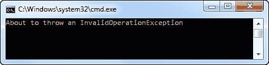
图 10.1 因缺少类型安全生成的运行时异常

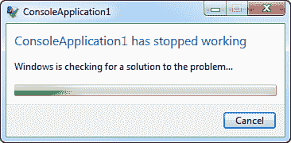
图 10.2 检查解决方案的 Windows 应用程序失败对话框

### 动手尝试
处理异常

要查看你如何通过抛出和捕获几个不同的异常来处理异常，请按照以下步骤操作。

1. 创建一个新的控制台应用程序。
2. 在 `Program.cs` 文件中实现以下函数：

```csharp
private static void ThrowsException()
{ 
    Console.WriteLine("About to throw an InvalidOperationException"); 
    throw new InvalidOperationException();
}

private static void PrintString(string message) 
{
    if (message == null) 
    {
        throw new ArgumentNullException("message"); 
    }
    Console.WriteLine(message); 
}
```

3. 在 `Program.cs` 文件的 `Main` 方法中，调用 `ThrowsException` 方法。
4. 使用 `Ctrl+F5` 运行应用程序。你最初看到控制窗口，如图 10.1 所示。

如果你运行的是 Windows Vista 或更高版本，可能会看到图 10.2 所示的对话框。

从 www.wowebook.com 下载

236

第10 小时：使用异常处理错误

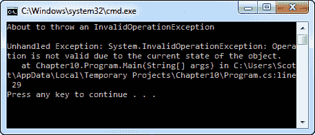
图 10.3 因缺少类型安全生成的运行时异常

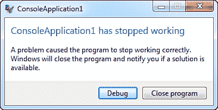
图 10.4 关闭应用程序的 Windows 应用程序失败对话框

Visual C# 2010 Express 版不支持 JIT 调试，因此在对话框完成后，你将看到显示的异常信息，如图 10.3 所示。

显示的信息是异常信息，并表示这是一个未处理的 `System.InvalidOperationException` 类型的异常。它还显示了堆栈跟踪信息，包括方法调用堆栈、文件名和行号。这些堆栈跟踪信息可以帮助你识别代码中发生异常的位置。

如果你安装了带有 MSDN 版本的 Visual Studio，你会看到一个如图 10.4 所示的对话框，允许你关闭或调试应用程序。

5. 如果你点击“关闭程序”按钮，控制窗口应该像图 10.3 所示。如果你点击“调试”按钮，你将看到 Visual Studio 即时调试器（Just-In-Time Debugger）。

6. 使用 `Ctrl+F5` 再次运行应用程序，但要在图 10.3 所示的对话框出现时按“调试”按钮。这将显示 Visual Studio 即时调试器对话框，如图 10.5 所示。如果你点击“是”按钮，控制权返回到 Visual Studio，包含异常的行被设置为当前语句，如图 10.6 所示。通过点击“操作”下的“查看详细信息”，你可以看到异常的细节，如图 10.7 所示。

从 www.wowebook.com 下载

237

处理异常

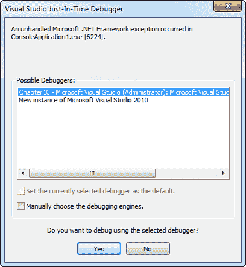
图 10.5 Visual Studio 即时调试器对话框

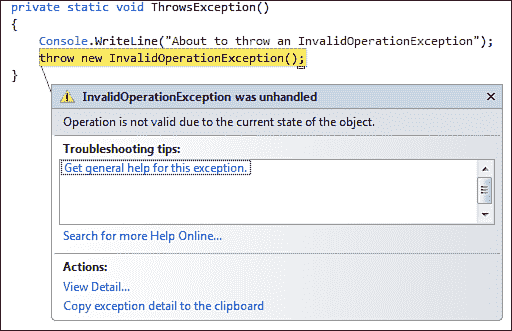
图 10.6 异常助手

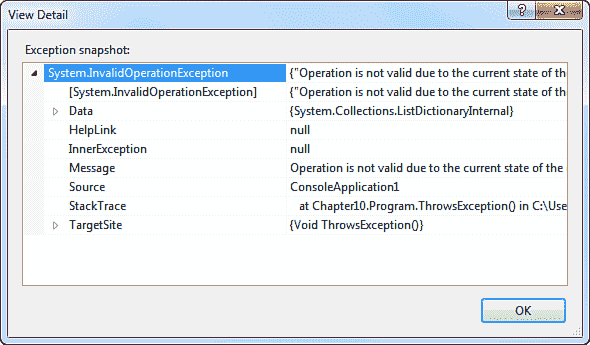
图 10.7 异常详情对话框

7. 将对 `ThrowsException` 的调用封装在 `try/catch` 块中，专门捕获 `InvalidOperationException` 并将其赋值给名为 `ex` 的 `catch` 处理器。在 `catch` 器的体中，打印 `Message` 属性的值。

238

处理异常

8. 使用 `Ctrl+F5` 运行应用程序。你看到图 10.8 所示的控制窗口。注意，这次应用程序没有终止，而是显示了与异常相关的消息。

9. 将 `Main` 的体更改为如下：

```csharp
try
{
    PrintString(null);
}
catch (InvalidOperationException ex)
{
    Console.WriteLine(ex.GetType().Name);
    Console.WriteLine(ex.Message);
} 
catch (ArgumentNullException ex)
{
    Console.WriteLine(ex.GetType().Name);
    Console.WriteLine(ex.Message);
} 
catch (Exception ex)
{
    Console.WriteLine(ex.GetType().Name);
    Console.WriteLine(ex.Message);
}
```

10. 使用 `Ctrl+F5` 运行应用程序。你看到图 10.9 所示的控制窗口。

11. 现在更改 `catch` 处理器的顺序，使 `catch(Exception)` 处理器位于第一个。你应该注意到你立即看到两个编译器错误，指示另外两个 `catch` 处理器将不会执行，因为之前的处理器捕获了基类异常，如图 10.10 所示。

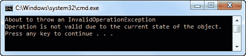
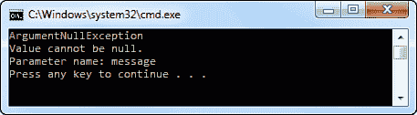

239

重新抛出捕获的异常

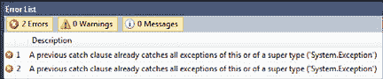
图 10.10 顺序错误的多个 catch 处理器

***顺便说一下***

通常，你应该避免在代码中捕获非特异性的异常，例如 `Exception`、`SystemException` 和 `ExternalException`。你还应该避免捕获关键系统异常，如 `StackOverflowException` 或 `OutOfMemoryException`。对于这些类型的异常，通常无法做出任何有意义的响应，且捕获它们会隐藏运行时问题并使调试和故障排除过程复杂化。

### 损坏状态异常（Corrupted State Exceptions）

损坏状态异常是在发生在应用程序之外上下文中的异常（例如 OS 内核），它们表明运行进程的完整性可能存在问题。大约有 12 种损坏状态异常，它们与普通异常不同。

普通异常与损坏状态异常之间的区别不是异常类型，而是其抛出的上下文。默认情况下，你无法使用 `catch` 块捕获损坏状态异常，即使你捕获了 `Exception`。

### 重新抛出捕获的异常

如果你捕获异常是为了记录或某些实际上并未处理异常状况的活动，你应该重新抛出该异常。重新抛出异常允许它继续沿着调用堆栈移动，寻找合适的 `catch` 处理器。

正如 `throw` 关键字允许你指定要抛出的新异常（如你在上一节中所看到的）），它也被用于重新抛出异常。

为了保留堆栈跟踪信息，你应该仅使用 `throw` 关键字来重新抛出异常，即使你的 `catch` 处理器包含了 catch 处理器变量。


240

第 10 小节：使用异常处理错误

列表 10.3 重新抛出异常

```csharp
try
{
    // 产生 InvalidOperationException 的某些操作
}
catch (InvalidOperationException ex)
{
    Console.WriteLine("Invalid operation occurred");
    throw ex;
}
catch (Exception)
{
    Console.WriteLine("General catch handler");
    throw;
}
```

在第一种方法中，`InvalidOperationException` 的 catch 处理程序使用 `throw ex` 重新抛出异常，这会导致堆栈跟踪在失败的方法处被截断。这意味着当你查看堆栈跟踪时，异常看起来就像是源于你的代码。。这并不总是如此，特别是当你正在向上抛出 CLR 生成的异常（例如 `SqlException`）时。

这是一个被称为“破坏堆栈”的问题，因为你不再拥有完整的堆栈跟踪信息。发生这种情况是因为从本质上，你正在创建一个新的异常来抛出。

通过单独使用 `throw`（如 `Exception` 的 catch 处理程序所做），你可以保留堆栈跟踪信息。你可以通过查看这两个代码块生成的 IL 来确认这一点。这使得差异显而易见，因为在第一个示例中，调用的 IL 指令是 `throw`，而在第二个中，调用的指令是 `rethrow`。

### 封装异常

你也可以将捕获的异常封装在另一个异常中，然后抛出该新异常。这通常用于实际异常没有实际意义，或者在较高层的语文中不合逻辑的情况。

当你封装异常时，你会从 catch 处理程序中抛出一个新异常，并应该始终将原始异常作为内部异常（inner exception）。由于堆栈跟踪信息被重置为新异常点，包含内部异常是查看原始堆栈跟踪和异常细节的方法。列表 10.4 显示了抛出封装异常的正确方法。

241

溢出与整数算术

列表 10.4 抛出封装的异常

```csharp
try
{
    // 可能会失败的操作
}
catch (Exception ex)
{
    throw new InvalidOperationException("The operation failed", ex);
}
```

封装异常应该是极少发生的情况，并且应该仔细考虑。如果你对是否应该封装异常有任何疑问，请不要封装它。封装异常可能会隐藏错误实际发生的方法和位置，并导致花费大量时间尝试调试问题。它还会让调用者处理异常变得更加困难，因为他们现在不仅要处理该异常，还要处理你封装的异常，并从中提取真实异常进行处理。

### 溢出与整数算术

在第 2 小节“理解 C# 类型”中，你学习了所有原始数值数据类型都有固定的范围。该范围的最小值和最大值可以分别通过 `MinValue` 和 `MaxValue` 属性访问。因此，如果尝试给 `int.MaxValue` 加 1 会发生什么？

该问题的答案取决于所使用的编译器设置。C# 编译器默认生成静默允许溢出发生的代码，将值回绕为可能的最大负值。在许多情况下，这种行为是可以接受的，因为发生的风险很低。

与高频率整数算术操作相比，这种风险非常低，因此在每次操作上执行溢出检查的开销会导致性能考量。

如果你需要防止静默溢出的整数算术操作，或者出于其他控制溢出检查行为，可以使用 `checked` 和 `unchecked` 关键字。这些关键字提供了显式控制，因为它们会覆盖指定的任何编译器设置。

242

`checked` 或 `unchecked` 关键字可以应用到语句块，其中块内部直接的所有整数算术都会受到影响，如列表 10.5 所示。

列表 10.5 checked 和 unchecked 语句块

```csharp
int max = int.MaxValue;
checked
{
    int overflow = max++;
    Console.WriteLine("The integer arithmetic resulted in an OverflowException.");
}
unchecked
{
    int overflow = max++;
    Console.WriteLine("The integer arithmetic resulted in a silent overflow.");
}
```

这些关键字也可以应用于整数表达式，在这种情况下，包含的表达式将在 `checked` 或 `unchecked` 上文中求值。包含的表达式必须括在括号内。

在列表 10.6 中，第 2 行始终产生 `OverflowException`，而第 3 行永远不会产生 `OverflowException`。然而，第 4 行取决于程序编译时所采用的编译器设置。

列表 10.6 checked 和 unchecked 表达式

1. int x = int.MaxValue;
2. int a = checked(x + 1);
3. int b = unchecked(x + 1);
4. int c = x + 1;

### 总结

在这一节中，你学习了异常，并学习了如何在应用程序中使用它们。异常是由于意外错误的结果，如果处理不当，可能会导致你的应用程序崩溃。

checked 和 unchecked

在 `checked` 上文中，导致算术溢出的语句会抛出异常。在 `unchecked` 上文中，溢出被忽略且结果被截断。只有某些数值计算受 `checked` 或 `unchecked` 上文的影响：使用以下操作符的表达式：
- ++
- --
- +
- -
- *
- /

243

只在可以采取某些意义的操作的地方捕获异常很重要。最后，你学习了如何以 `checked` 和 `unchecked` 方式进行整数算术，这有助于防止溢出的发生。

问答

**你应该何时使用异常？**
A. 异常提供了一种清晰、简洁、安全且可靠的方法来表示运行时和遇到意外情况时发生的失败。

**什么是未处理的异常？**
A. 未处理的异常是指未被处理的异常。

**什么是 try-catch 块？**
A. try-catch 块是包含一个或多个异常处理程序的保护区域。

**什么是 try-finally 块？**
A. try-finally 块是不包含异常处理程序的保护区域，无论是否发生异常，在 try 块退出时执行。

测试

1. 所有异常的基类是什么？
2. 什么是 RuntimeException？
3. `ArgumentException`（及其任何子类）或 `InvalidOperationException` 是否应该程序化处理？
4. 什么是损坏状态异常？
5. 如果堆栈中包含静态构造或静态字段初始化会发生什么？
6. 你应该何时处理异常？

答案

1. 所有异常的基类是 `System.Exception`。
2. 当另一种语言（如 C++）抛出一个未派自 `System.Exception` 的异常时，该异常会被封装在 `RuntimeException` 中以保持语言兼容性。
3. 通常 `ArgumentException` 及其子类以及 `InvalidOperationException` 代表编码错误，最好在编译时修复而不是在应用程序中处理它们。
4. 损坏状态异常发生在应用程序之外的上下文，表明运行进程的完整性可能存在问题。默认情况下，无法捕获损坏状态异常。
5. 如果堆栈中包含静态构造或静态字段初始化，将抛出 `TypeInitializationException`，其 `InnerException` 属性包含原始异常。
6. 通常，你应该只在最接近根据异常执行某些意义操作的地方处理异常。因此，使用 `try-finally` 模式的情况应该比使用 `try-catch` 或 `try-catch-finally` 模式更多。

练习

1. 在 `Photo(Uri)` 构造函数的开头添加以下代码：
```csharp
if (path == null)
{
    throw new ArgumentNullException("path");
}
```
将 if 语句封装在 try-catch 块中。为 catch(InvalidOperationException) 处理程序使用以下代码：
```csharp
this.source = null;
this.Refresh();
```

2. 修改 `ToString` 方法，如果 `this.source` 为 `null`，则返回空字符串。


245

第 11 小
理解泛型

*你将在本小时内学到：*

- 为什么要使用泛型
- 理解泛型类型参数
- 约束
- 泛型类型的默认值
- 使用泛型方法
- 创建泛型类
- 结合泛型与数组
- 泛型接口中的变体
- 与元组一起工作

你已经看到对象如何引用任何类的实例。这允许你创建处理任何数据类型的类。然而，使用这种方法可能会出现几个重大问题。由于仅使用 `object`，该类无法限制输入只能是特定类型。为了对数据执行有意义的操作，必须将其从 `object` 转换为更明确的类型。这不仅增加了复杂性，还牺牲了编译时的类型安全。

C# 中的泛型通过解决这一问题，它通过消除类型转换或其他的装箱/拆箱转换需求，实现了在编译时具有类型安全的泛化。泛型以非泛型类无法实现的方式将类型安全、可重用性和效率结合在一起。泛型最常用的地方是集合（这是你在第 9 小时“处理数组和集合”中看到的），不过你也可以使用泛型来创建自定义的泛型类型和方法。

在本小时中，你将学习泛型的工作原理以及如何创建自己的泛型类型。

246

第 11 小：理解泛型

为什么要使用泛型

在第 9 小时中，你学习了如何创建一个整数值数组。因为你显式声明了数组中每个元素的数据类型为 `int`，编译器验证了你只为每个元素分配了整数值。你还使用为整数定义的方法和运算符对每个元素执行了操作。想象一下寻找任意整数数组的最小值所需的代码（见列表 11.1）。

列表 11.1 
寻找最小值
```csharp
public int Min(int[] values) 
{
    int min = values[0]; 
    foreach (int value in values) 
    {
        if (value.CompareTo(min) < 0) 
        {
            min = value; 
        }
    }
    return min; 
}
```

如果你想让此方法适用于任何数值类型，会发生什么？如果没有泛型，你需要为每个数值类型编写一个不同版本的 `Min`，唯一的区别是数据类型。虽然这完全可行，但它会在你的代码中引入大量的复杂性和冗余。

由于 `IComparable` 接口定义了 `CompareTo` 方法，你可以使用对象以一种更通用的方式编写此代码。这允许你编写一次代码，但仍可用于任何数值类型的数组，如列表 11.2 所示。

列表 11.2 
使用对象寻找最小值
```csharp
public object Min(object[] values) 
{
    IComparable min = (IComparable)values[0]; 
    foreach (object value in values) 
    {
        if (((IComparable)value).CompareTo(min) < 0) 
        {
            min = (IComparable)value; 
        }
    }
    return min; 
}
```

遗憾的是，虽然你获得了只需编写一次代码的益处，但也失去了任何类型安全。。此外，整数数组无法转换为对象数组。由于此方法处理的是对象，当传递一个定义像这样的数组时，会发生什么呢？

`object[] array = { 5, 3, "a", "hello" };`

这是合法的，因为数组持有 `object` 类型的元素，且任何值都可以隐式转换为 `object`。

自己尝试
不使用泛型寻找最小值

通过遵循以下步骤，你将看到不使用泛型创建通用方法如何在防止类型安全的同时仍能正确编译。请在此练习结束时保持 Visual Studio 打开，因为你之后会使用此应用程序。

1. 创建一个新的控制台应用程序。
2. 在 `Program.cs` 文件中，实现列表 11.1 和 11.2所示的两个函数。确保将这些方法声明为 `static`。
3. 修改两个版本的 `Min`，使每个版本的第一行都有一个 `Console.WriteLine` 来打印执行了哪种方法。
4. 在 `Program.cs` 文件的 `Main` 方法中，声明并初始化名为 `array` 的五个元素的整数数组，后跟一个 `Console.WriteLine` 语句来打印最小值。
5. 使用 Ctrl+F5 运行应用程序，确保输出显示了数组正确的最小值。
6. 将 `array` 的声明从 `int` 改为 `long`。
7. 你应该会注意到调用 `Min` 的地方有一个红色波浪线，错误窗口中报告了两个错误。这是因为没有接受 `long[]` 作为参数的 `Min` 实现。
8. 将 `array` 的声明从 `long` 改为 `object` 以消除编译器错误。
9. 再次使用 Ctrl+F5 运行应用程序，确保输出显示数组正确的最小值。（这应该与步骤 4 所示的值相同。）
10. 将 `array` 的元素更改为：`{ 5, 3, "a", "hello", 1 };`
11. 使用 Ctrl+F5 运行应用程序，观察输出是否与图 11.1 所示。

你不仅丢失了类型安全，还在执行 *n+1* 次转换操作，其中 *n* 是数组中元素的数量。正如你可能猜到的那样，数组越大，这种方法就越昂贵。

使用泛型，这个问题就变得简单了。你获得了只编写一次代码的能力，而不会丢失类型安全或产生多次转换操作。列表 11.3 显示了使用泛型定义的相同的 `Min` 方法。如果你将其与列表 11.1 中定义的方法进行比较，你会发现它们几乎完全相同。

`where T : IComparable<T>`

这个约束可能会有点困惑，因为它看起来这里存在循环依赖。实际上，它非常直接，意味着 T 必须是一个可以比较的类型。

列表 11.3
使用泛型寻找最小值
```csharp
public T Min<T>(T[] values) where T : IComparable<T>
{
    T min = values[0]; 
    foreach (T value in values) 
    {
        if (value.CompareTo(min) < 0) 
        {
            min = value; 
        }
    }
    return min; 
}
```


250

第 11 小：理解泛型

7. 再次运行应用程序。这次，它没有运行并生成运行时异常，而是收到两个编译器错误，提示你无法将类型 'string' 隐式转换为 'long'，如图 11.2 所示。

## 理解泛型类型参数

就像方法有参数且这些参数在运行时的值是参数，泛型类型和方法也有类型参数和类型参数。类型参数充当编译时提供的类型参数的占位符。

这不仅仅是将提供的类型简单地文本替换为类型参数。当泛型类型或方法被编译时，CIL 包含标识其具有类型参数的元数据。在运行时，JIT 会创建一个构造后的类型，并将提供的类型参数替换在适当的位置。

一个泛型类型或方法可以在类型参数规范中拥有多个类型参数，这些参数之间用逗号（,）隔开。几个泛型集合类，例如 `Dictionary<TKey, TValue>` 和 `KeyValuePair<TKey, TValue>` 使用了多个类型参数。我们稍后会讨论的 `Tuple` 类也是泛型的，并且最多有八个类型参数。

### 约束 (Constraints)

约束允许你在编译时对用于类型参数的类型应用限制。这些限制使用 `where` 关键字指定，正如你在列表 11.3 中看到的那样。当你约束一个类型参数时，允许的操作和方法的数量将增加到受约束类型及其继承链中所有类型所支持的内容。

共有六种可能的约束，如表 11.1 所示。

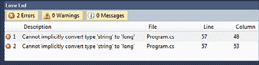

图 11.2 执行类型安全的编译器错误

表 11.1
泛型类型参数约束

| 约束 | 描述 |
| :--- | :--- |
| where T : struct | 类型参数必须是值类型，可空值类型（Nullable）除外。 |
| where T : class | 类型参数必须是引用类型。适用于任何类、接口、委托或数组类型。 |
| where T : new() | 类型参数必须具有公共的无参数构造函数，并且是一个具体类型。如果与其他约束一起使用，则 `new()` 约束必须最后指定。 |
| where T : <base class name> | 类型参数必须是指定的基类或派生自该基类。 |
| where T : <interface name> | 从类型参数到指定类型必须存在标识转换或隐式引用转换。约束接口可以是泛型的，并且可以指定多个接口约束。 |
| where T : U | 类型参数必须是或派生自为 U提供的参数，U 是另一个泛型类型参数。 |

251
为什么你应该使用泛型

约束向编译器保证，在类型参数上调用的任何运算符或方法都是受支持的。没有约束的类型参数是无约束类型参数，仅支持简单的赋值和 `System.Object` 所支持的方法调用。此外，`!=` 和 `==` 运算符不能与无约束类型参数一起，因为编译器无法保证它们是被支持的。

单个类型参数可以有多个约束，你也可以对多个参数应用约束：

```csharp
CustomDictionary<TKey, TValue> 
where TKey : IComparable
where TValue : class, new()
```

### 使用泛型测试值相等性

即使你应用了 `where T : class` 约束，也应该避免在类型参数上使用 `==` 和 `!=` 运算符。这些运算符测试的是引用标识性，而不是值相等性。

即使这些运算符在类型中被重载，也会发生，因为编译器只知道 `T` 是引用类型。因此，它只能使用 `System.Object` 上定义的、适用于所有引用类型的默认运算符。

测试值相等性的推荐方法是应用 `where T : IComparable<T>` 约束，并确保在任何用于构造泛型类的类中实现了该接口。通过应用此约束，你可以使用 `CompareTo` 方法执行值相等比较，正如你在列表 11.3 中看到的那。

**类型参数约束**（type parameter constraint）是作为另一个类型参数约束的泛型类型参数。类型参数约束最常见于泛型方法必须将其类型参数约束为包含类型的类型参数的情形，如列表 11.4 所示。在这个示例中，`T` 是 `Add` 方法的类型参数约束，意味着 `Add` 接受 `List<U>`，其中任何替换 `U` 的类型必须是 `T` 或派生自 `T`。

列表 11.4
方法上的类型参数约束

```csharp
public class List<T> 
{
    public void Add<U>(List<U> items) where U : T 
    { 
    }
}
```

当你想要强制类型参数之间的某种关系时，类型参数约束也可以用于泛型类，如列表 11.5 所示。在这个示例中，你声明了 `Example` 有三个类型参数（T、U 和 V），使得 `T` 必须是 `V` 或派生自 `V`，而 `U` 是无约束的。

列表 11.5
类上的类型参数约束

```csharp
public class Example<T, U> where T : V 
```

252
第 11 小：理解泛型

## 使用泛型方法

泛型方法与它们的非泛型相对没有区别，但是使用一组泛型参数而不是具体类型定义的。泛型方法是运行时生成的方法的蓝图。如果你回顾列表 11.3，你已经使用过泛型方法。

### 非泛型类中的泛型方法

泛型方法并不局限于泛型类。在非泛型类中包含泛型方法是完全有效的且常见的。

泛型类也可以包含非泛型方法，这些方法对泛型类的类型参数具有完全访问权限。因此，如果泛型方法定义了与包含类相同的类型参数，内部提供的 `T` 将隐藏外部的 `T` 并产生编译器警告。如果你需要一个与实例化类时提供的不同的类型参数的方法，你应该为类型参数提供不同的标识符，如列表 11.6 所示。

列表 11.6
类型参数隐藏

```csharp
class GenericClass<T>
{
    void GenerateWarning<T>() 
    { 
    }
    void NoWarning<U>() 
    { 
    }
}
```

### 泛型的默认值

记住，C# 是一种强类型语言，要求在使用变量之前对其赋值。为了简化这一要求，每个类型都有默认值。显然，你无法预先知道默认值是 `null`、`0` 还是零初始结构体。那么如何指定类型的默认值？C# 提供了 `default` 关键字，它根据实际类型表示相应的默认值。这意味着对于引用类型返回 `null`，对于数值值类型返回 `零`。对于可空类型，它返回 `null`。

当你调用泛型方法时，必须为该方法定义的类型参数提供真实数据类型。列表 11.7 显示了调用列表 11.3 中定义的 `Min<T>` 方法的一种方式。

列表 11.7
调用泛型方法

```csharp
public static class Program 
{
    static void Main() 
    {
        int[] array = {3, 5, 7, 0, 2, 4, 6 };
    }
}
```


254

第 11 小：理解泛型

Console.WriteLine(Min<int>(array)); 

}

}

虽然这种做法是可以接受的，但得益于**类型推断**，在大多数调用中这并非必要的。当你省略类型参数时，编译器会尝试根据方法参数来发现或推断该类型。列表 11.8 显示了使用类型推断的相同调用。

列表 11.8 

使用类型推断调用泛型方法

public static class Program 

{

static void Main() 

{

int[] array = {3, 5, 7, 0, 2, 4, 6 }; 

Console.WriteLine(Min(array));

} 

}

由于类型推断依赖于方法参数，因此它无法仅通过约束或返回值来推断类型。这意味着你不能在没有参数的方法上使用它。

对于泛型方法，类型参数是方法签名的一部分。这使得对一个泛型方法可以通过声明多个具有相同形式参数列表但类型参数不同的泛型方法来实现重载。

### 类型推断与重载解析

类型推断发生在编译时，并且在编译器尝试解析重载方法签名之前。当发生类型替换时，非泛型方法和泛型方法可能具有相同的签名。在这种情况下，将使用最具体的方法，它总是始终是非泛型方法。

### 创建泛型类

在查看不同的集合类型时，你已经见过泛型类的实际应用。泛型类最常用于集合，因为集合对于存储的任何数据类型，其行为都是相同的。正如泛型方法是在运行时生成的方法的蓝图一样，泛型类也是在运行时构建的类的蓝图。

*你知道吗？*

从 www.wowebook.com 下载

255

*顺便说一下* 泛型类不仅用于 .NET Framework，你也可以创建自己的泛型类。这与创建非泛型类没有区别，只是你提供的是类型参数而不是实际的数据类型。

在创建自己的泛型类型时，请记住几个重要问题：

- **哪些类型应该作为类型参数？** 通常情况下，参数化的类型越多，你的类型灵活性就越高。然而，对使用的类型参数数量是有实际限制的，因为随着类型参数数量的增加，代码的可读性可能会降低。

- **应该应用哪些约束？** 确定此有多种方法。一种是尽可能应用多的约束，只要它们仍然允许你处理预期的类型。另一种是尽可能少地应用约束，以便泛型类型具有最大的灵活性。两种方法都是有效的，但你也可以采取更务实的方法，仅应用必要的约束将类限制在其定义的用途上。例如，如果你知道你的泛型类应该只与引用类型一起，你就会应用类约束（class constraint）。这防止了你的类与值类型一起，但允许你使用 `as` 运算符并检查空值。

- **是否应该在基类和子类中提供行为？** 泛型类可以像非泛型类一样用作基类。因此，这里的设计选择与非泛型类相同。

- **是否应该实现泛型接口？** 取决于你正在设计的泛型类的类型，你可能需要实现并可能创建一个或多个泛型接口。你的类如何被使用也决定了实现了哪些接口（如果有的话）。

正如非泛型类可以从具体的或抽象的非泛型基类继承，泛型类也可以从非泛型的具体或抽象基类继承。然而，泛型类也可以从其他泛型类继承。

### 泛型结构体和接口

结构体也可以是泛型的并使用与类相同的语法和类型约束。泛型结构体和泛型类之间的区别与非泛型类和结构体之间的区别相同。

泛型接口使用与泛型类相同的类型参数语法和约束，并遵循与非泛型接口声明相同的规则。唯一的例外是，泛型类型实现的接口对于所有可能的构造类型来说仍然保持唯一。这实际上意味着，如果在类型参数替换后，由同一个泛型类实现的泛型接口是相同的，那么该泛型类的声明是无效的。

虽然泛型类可以继承非泛型接口，但在与泛型类配合时，泛型接口是优先选择。

从 www.wowebook.com 下载

要理解泛型类的继承，你首先需要理解开放类型（open type）和封闭类型（closed type）之间的区别。**开放类型**是指涉及类型参数的类型。具体来说，它是一个没有为其类型参数提供任何类型参数的泛型类型。**封闭类型**也称为**构造类型**（constructed type），是一个不是开放的泛型类型。（也就是说，它已经为其所有的类型参数提供了类型参数。）

泛型类可以从开放类型或封闭类型继承。派生类可以为其基类上的所有类型参数提供类型参数，在这种情况下，它是一个构造类型。如果派生类没有提供类型参数，则它是一个开放类型。虽然泛型类可以从封闭或开放类型继承，但非泛型类只能从封闭类型继承；否则，编译器无法知道应该使用什么类型参数。

列表 11.9 显示了从开放和封闭类型继承的一些示例。

列表 11.9 

泛型的继承

abstract class Element { }

class Element<T> : Element { }

class BasicElement<T> : Element<T> { }

class Int32Element : BasicElement<int> { }

在这个示例中，Element<T> 派自 Element，是一个开放类型。BasicElement<T> 派自 Element<T>，是一个开放类型。Int32Element 是构造类型，因为它派自构造类型 BasicElement<int>。

然而，派生类可以为其基类上的部分类型参数提供类型参数，在这种情况下它是一个**开放构造类型**。可以将开放构造类型认为是开放类型和封闭类型之间的某种状态；也就是说，它已经为至少一个类型参数提供了参数，但至少有一个类型参数仍需要提供。

扩展 11.9 中的示例以创建一个具有两个类型参数 T 和 K 的开放类型，创建开放构造类型的不同可能性见列表 11.10。

从 www.wowebook.com 下载

257

泛型与数组

列表 11.10 

从开放构造类继承

class Element<T, K> { }

class Element1<T> : Element<T, int> { }

class Element2<K> : Element<string, K> { }

如果开放构造类型指定了约束，则派生类型需要提供满足约束的类型参数。这可以通过本身指定约束来实现。子类的约束可以是与基类相同的约束，也可以是这些约束的超集。列表 11.11 显示了从带约束的开放构造类继承的示例。

列表 11.11 

继承带约束的开放构造类

class ConstrainedElement<T> where T, new()

class ConstrainedElement1<T> : ConstrainedElement<T> 

where T :<T>, new()

最后，如果泛型类实现了一个接口，该类的所有实例都可以转换为该接口。

### 泛型与数组

在第 9 小节中，你学习了所有下界为零的单维数组自动实现了 `IList<T>`。因此，你可以创建一个遍历 `IList<T>` 内容的泛型方法，该方法适用于任何集合类型（因为它们都实现了 `IList<T>`）以及任何单维数组。

列表 11.12 显示了此类泛型方法的示例。

列表 11.12 

使用泛型方法打印集合项

public static class Program 

{

public static void PrintCollection<T>(IList<T> collection) 

{

StringBuilder builder = new StringBuilder(); 

foreach(var item in collection) 

{

builder.AppendFormat("{0} ", item); 

}

Console.WriteLine(builder.ToString()); 

}

从 www.wowebook.com 下载


258

第 11 小时：理解泛型

*通过*

*方式*

public static void Main() 
{
    int[] array = {0, 2, 4, 6, 8};
    List<int> list = new List<int>() { 1, 3, 5, 7, 9 }; 
    PrintCollection(array);
    PrintCollection(list);

    string[] array2 = { "hello", "world" };
    List<string> list2 = new List<string>() { "now", "is", "the", "time" }; 
    PrintCollection(array2);
    PrintCollection(list2);
} 
}
}

### 泛型接口中的变型

类型变型是指使用原始指定类型之外类型的能力。**协变**（Covariance）允许你使用比指定的类型更派生的类型，而**逆变**（contravariance）则允许你使用派生程度较少的类型。C# 支持返回类型的协变和参数的逆变。

C# 中的泛型集合是**不变的**（invariant），这意味着你必须使用与指定的形式类型完全匹配。因此，无法在期望派生程度较低类型的地方替换包含更派生类型的集合。例如，如果你有一个汽车集合，你不能将其视为警察汽车集合，因为其中可能包含一辆不是警察汽车的普通汽车。同样，你不能将其视为车辆集合，因为你可以将一辆卡车（这显然不是汽车）放入车辆集合中，但不能放入汽车集合中。

### 实现泛型变型接口的类

实现泛型变型接口的类始终是不变的的。

这里的真正问题是集合是可变的。如果你能将集合限制为只读行为子集，就可以将其变为协变的，从而允许汽车序列无问题地被车辆序列。

在 C# 中，如果接口的类型参数声明为协变或逆变，则该接口是**变型的**（variant）。协变和逆变仅适用于两种类型之间存在引用转换时。这意味着你不能对值类型使用变型。你还不能对 ref 或 out 参数使用变型。

表 11.2 所示的几个泛型集合接口支持变型。

## 泛型与数组的结合

表 11.2 支持变型的泛型接口

| 接口 | 变型 |
| :--- | :--- |
| IEnumerable<T> | T 是协变的。 |
| IEnumerator<T> | T 是协变的。 |
| IQueryable<T> | T 是协变的。 |
| IGrouping<TKey, TElement> | TKey 和 TElement 都是协变的。 |
| IComparer<T> | T 是逆变的。 |
| IEqualityComparer<T> | T 是逆变的。 |
| IComparable<T> | T 是逆变的。 |

图 11.3 打印数组的内容
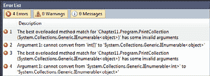

图 11.4 编译器错误

### 动手尝试一下

### 探索变型

通过遵循以下步骤，你将修改列表 11.12 所示的代码来探索变型是如何工作的。

1. 创建一个新的控制台应用程序，并修改 Program.cs 的内容，使其与列表 11.12 所示相同。
2. 使用 Ctrl+F5 运行应用程序，观察输出是否与图 11.3 所示一致。
3. 修改 PrintCollection<T>，使其不再是泛型方法，并将集合的类型改为 `IEnumerable<object>`。
4. 你应该立即看到图 11.4 所示的编译器错误。
5. 通过注释掉无效的代码行来纠正这两个错误。记住，变型不适用于值类型，这就是编译器错误的原因。

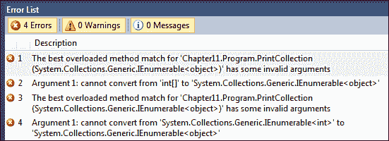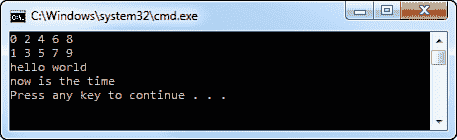

图 11.5 探索变型的结果

6. 再次运行应用程序，观察输出是否与图 11.5 所示。

### 扩展变型泛型接口

编译器不会从继承的接口中推断变型，这要求你显式指定派生接口是否支持变型，如列表 11.13 所示。

列表 11.13 扩展泛型变型接口
```csharp
interface ICovariant<out T> 
{ 
}

interface IInvariant<T> : ICovariant<T> 
{ 
}

interface IExtendedCovariant<out T> : ICovariant<T> 
{ 
}
```

尽管 IInvariant<T> 接口和 IExtendedCovariant<out T> 接口都扩展了同一个协变接口，但只有 IExtendedCovariant<out T> [是协变的]。你也可以同时扩展协变和逆变接口，如 11.14 所示。

列表 11.14 同时扩展协变和逆变接口
```csharp
interface ICovariant<out T> 
{ 
}

interface IContravariant<in T> 
{ 
}

interface IInvariant<T> : ICovariant<T>, IContravariant<T> 
{ 
}
```


### 使用元组

261

### 创建自己的变型接口

*通过*

*方式*

等待，你也可以如 11.15 所示定义自己的泛型接口，你可以使用 in 和 out 关键字定义你自己的泛型接口。out 关键字声明类型参数为协变的，而 in 关键字声明类型参数为逆变的。与出现在声明和调用处的 ref 和 out 关键字不同，这些只出现在声明中。

### 使用元组

元组是一个具有特定数量值的数据结构。元组通常用于从方法返回多个值。

虽然元组经常出现在 F#、Ruby 或 Python 等函数式语言中，但 .NET 提供了表示一到七个值的 Tuple 类。还有一个 n 元组类，n 为任意值。n 元组类与一到七元组类的不同之处在于，它的第八组件是另一个定义剩余部分的 Tuple 对象。

图 11.6 使用元组的结果

### 动手尝试一下

### 使用元组

要创建 Tuple<T1, T2> 实例并访问元组的值，请遵循以下步骤。

1. 创建一个新的控制台应用程序。
2. 在 Program.cs 文件中创建一个返回 Tuple<int, string> 的方法：
```csharp
public static Tuple<int, string> GenerateTuple()
{
return Tuple.Create(1, "hello, world");
}
```
3. 在 Main 方法中输入以下代码：
```csharp
var t = GenerateTuple();
Console.WriteLine(t.GetType());
Console.WriteLine("{0}:{1}", t.Item1, t.Item2);
```
4. 按 Ctrl+F5 运行应用程序；你应该看到图 11.6 所示的内容。

### 总结

在本小时中，你学习了为什么泛型编程很重要，以及它如何能够以无视数据类型的方式解决问题。你学习了类型参数如何工作，以及如何约束这些类型参数以提供允许类型的限制。

你学习了如何创建自己的泛型类、接口和方法，包括在非泛型类中创建泛型方法。最后，你学习了如何显式指定泛型接口类型参数的变型。

泛型编程（无论是创建自己的泛型类型还是使用现有的泛型集合）都是灵活且强大的概念，它让你在只需编写一次实现的情况下仍能保持类型安全。

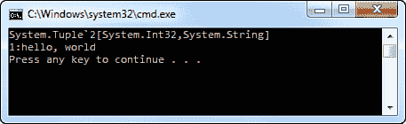


263

问答

问答

Q.* 泛型最常用的用途是什么？

A. 泛型最常用于集合类和接口，尽管你也可以将其用于你自己的类。

Q.* 使用泛型可以防止哪些问题？

A. 使用泛型允许你编写一种类型安全且不需要装箱（boxing）或拆箱（unboxing）操作的单一实现。

Q.* C# 泛型像 Java 泛型或 C++ 模板吗？

A. 尽管语法与两者都相似，但实现是不同的。Java 泛型是仅限语言构造，泛型类型信息在运行时不可知。C++ 模板在编译时展开，会为每个模板类型生成额外的代码。

Q.* 什么是类型约束？

A. 约束允许你在编译时对用作类型参数的类型应用限制，并向编译器保证在类型参数上调用的任何运算符或方法将得到支持。

Q.* 非泛型类可以包含泛型方法吗？

A. 可以的，可以在泛型类或非泛型类中定义泛型方法。

Q.* 泛型接口的协变（co-variance）和逆变（contravariance）是指什么？

A. 变性定义为仅根据类型参数的已知赋值兼容性，使两个泛型类型变得赋值兼容的能力。协变允许接口方法拥有比类型参数原始指定的更派生的返回类型。逆变允许接口方法拥有比类型参数原始指定的更少派生的参数类型。

264

第 11 小时：理解泛型

工作坊

测试

1. 使用泛型测试值相等性的正确方法是什么？

2. 什么是类型参数约束？

3. 什么是开放类型和封闭类型？

答案

1. 使用泛型测试值相等性的正确方法是应用 `where T : IComparable<T>` 并使用 `CompareTo` 方法执行值相等比较。

2. 类型参数约束是将一个泛型参数用作另一个泛型参数的约束。

3. 开放类型是指未为其类型参数提供任何类型参数的泛型类型。封闭类型不是开放的泛型类型（即它已为其所有的类型参数提供了类型参数）。

练习

1. 为 `ExifMetadata` 结构体添加以下方法：

```csharp
private static Nullable<T> QueryMetadata<T>(BitmapMetadata metadata, string query)  where T : struct
{
    Nullable<T> result = new Nullable<T>();
    if (metadata.ContainsQuery(query)) 
    {
        try 
        {
            object queryResult = metadata.GetQuery(query); 
            if (queryResult.GetType() == typeof(T)) 
            {
                result = (T)queryResult; 
            } 
            else 
            {
                try 
                {
                    result = (T)Convert.ChangeType(queryResult, typeof(T)); 
                }
                catch (InvalidCastException) 
                {
                    result = null; 
                }
                catch (FormatException) 
                {
                    result = null; 
                }
                catch (OverflowException) 
                {
                    result = null; 
                }
            } 
        } 
        catch 
        {
            result = null; 
        }
    }
    return result; 
}
```

将构造函数的的内容替换为以下代码：

```csharp
BitmapFrame frame = BitmapFrame.Create(imageUri, BitmapCreateOptions.DelayCreation, BitmapCacheOption.None); 
BitmapMetadata metadata = (BitmapMetadata)frame.Metadata; 
this.cameraModel = metadata.CameraModel; 
this.creationSoftware = metadata.ApplicationName; 
this.dateTaken = metadata.DateTaken; 
this.equipmentManufacturer = metadata.CameraManufacturer;

this.colorRepresentation = QueryMetadata<ushort>(metadata, "System.Image.ColorSpace"); 
this.exposureCompensation = QueryMetadata<decimal>(metadata, "System.Photo.ExposureBias"); 
this.exposureMode = QueryMetadata<ushort>(metadata, "System.Photo.ProgramMode"); 
this.exposureTime = QueryMetadata<decimal>(metadata, "System.Photo.ExposureTime"); 
this.flashMode = QueryMetadata<ushort>(metadata, "System.Photo.Flash"); 
this.focalLength = QueryMetadata<decimal>(metadata, "System.Photo.FocalLength"); 
this.height = QueryMetadata<uint>(metadata, MetadataPaths.Height); 
this.horizontalResolution = QueryMetadata<decimal>(metadata, "System.Image.VerticalResolution"); 
this.isoSpeed = QueryMetadata<ushort>(metadata, "System.Photo.ISOSpeed"); 
this.lensAperature = QueryMetadata<decimal>(metadata, "System.Photo.FNumber"); 
this.lightSource = QueryMetadata<ushort>(metadata, "System.Photo.LightSource"); 
this.verticalResolution = QueryMetadata<decimal>(metadata, "System.Image.HorizontalResolution"); 
this.width = QueryMetadata<uint>(metadata, MetadataPaths.Width);
```

267

第 12 小时

理解查询表达式

*你将在本节学到：*
- 介绍 LINQ
- 选择、分组、排序和连接
- 标准查询方法
- 表达式 Lambda

在第 9 小时“处理数组和集合”中，你学习了应用程序如何处理存储在集合中的数据。应用程序还需要处理其他数据源，例如 SQL 数据库、XML 文件，甚至 Web 服务。例如，考虑一个客户集合。你如何在该集合中搜索所有具有特定职位的客户？根据你目前所学到的知识，你需要编写代码来遍历集合中的每个项，检查适当的字段并返回匹配该职位的项。如果客户数据源发生变化，不再是内存集合而是 Web 服务调用，会发生什么？你可能需要重写搜索逻辑以适应这个新的数据源。在本时中，你将学习 LINQ 和查询表达式，它们允许你编写一个适用于任何数据源的单一查询。

268

第 12 小时：查询表达式

介绍 LINQ

.NET Framework 中的查询表达式是称为“语言集成查询”（LINQ）的技术set的一部分，这些技术将查询能力直接集成到 C# 语言中。LINQ 在 .NET Framework 3.5 中引入，它消除了在处理数据和处理对象之间常见的语言不匹配问题，通过为每种类型的源提供相同的查询语言：SQL 数据库、XML 文档、Web 服务、ADO.NET 数据集以及任何支持 `IEnumerable` 或 `IEnumerable<T>` 接口的集合。

LINQ 允许查询成为一等语言构造，就像算术运算和控制流语句是 C# 中的一等概念一样。查询表达式可以通过处理通用操作而不是关注结构，以一致的方式从任何支持的数据源查询并转换数据。

LINQ 查询语法与结构化查询语言（SQL）查询相似，使用了一些相同的关键字，并提供了许多优势。你可以自由地更改所查询数据的底层结构，而不需要更改查询本身。虽然 SQL 仅为处理关系数据设计，但 LINQ 实际上支持更多的数据结构。列表 12.1 显示了针对 `Contact` 对象集合的查询。假设列表已通过调用 `GetContacts` 填充。

列表 12.1 

一个 LINQ 查询

```csharp
class Contact 
{

public int Id { get; set; } 
public string Company { get; set; } 
public string LastName { get; set; } 
public string FirstName { get; set; } 
public string Address { get; set; } 
public string City { get; set; } 
public string StateProvince { get; set; }
}

IEnumerable<Contact> contacts = GetContacts();

var result = 
from contact in contacts 
select contact.FirstName;

foreach(var name in result) 
{
    Console.WriteLine(name); 
}
```


## 介绍 LINQ 

269

这个简单的查询说明了 C# 语言支持的**声明式语法**，也称为**查询表达式值表达式语法**。这种语法允许你使用类似 SQL 的查询语法来编写查询，提供了极大的灵活性和表现力。虽然查询表达式中的所有变量都是强类型的，但在大多数情况下，你不需要显式提供类型，因为编译器可以推断出类型。

### LINQ 查询语法

如果你熟悉 SQL，那么 LINQ 使用的查询语法也会让你感到熟悉。最明显的区别是 `from` 运算符出现在 `select` 运算符之前，而不是像 SQL 那样在它之后。

*顺便提一下*

### 选择数据

虽然列表 12.1 所示的代码看起来很简单，但实际上发生了很多操作。你首先应该注意到的是使用了一个名为 `result` 的隐式类型变量，它的类型实际上是 `IEnumerable<string>`。查询表达式的结果（赋值运算符右侧的代码）实际上是一个查询，而不是查询的结果。`select` 子句返回一个对象，该对象代表从序列（contacts 列表）投影结果（`contact.FirstName` 值）的操作。因为结果是字符串，所以 `result` 必须是字符串的可枚举集合。它此时并没有真正检索数据；而是简单地返回一个可枚举集合，稍后会获取这些数据。

该查询字面意思是“从由 contacts 指定的数据源的每个元素（称为 contact）中选择 FirstName 字段”。你可以将 `from` 子句中指定的 `contact` 变量认为类似于 `foreach` 语句的迭代变量。它对应于一个作用域限于查询表达式的只读本地变量。`in` 子句指定了包含要查询元素的数据源，而 `select` 子句表示在迭代期间为每个元素选择 `contact.FirstName` 字段。

尽管这种语法在选择单个字段时效果良好，但选择多个字段甚至对数据进行某种转换（例如合并字段）也是常见的。幸运的是，LINQ 也使用类似的语法支持这些场景。你实际上有几种方法来执行此类选择操作。

第一种方法是直接在 `select` 语句中拼接字段，从而仍然返回单个字段，如列表 12.2 所示。

列表 12.2 合并数据的 LINQ 查询

```csharp
var result = 
from contact in contacts 
select contact.FirstName + " " + contact.LastName;

foreach(var name in result) 
{
    Console.WriteLine(name); 
}
```

270
第 12 小：理解查询表达式

显然，这种形式的选择仅适用于有限数量的情况。一种更灵活的方法是返回多个字段，本质上是数据的子集，如列表 12.3 所示。

列表 12.3 返回匿名类型的 LINQ 查询

```csharp
var result = 
from contact in contacts 
select new 
{
    Name = contact.LastName + ", " + contact.FirstName, 
    DateOfBirth = contact.DateOfBirth
};

foreach(var contact in result) 
{
    Console.WriteLine("{0} born on {1}", contact.Name, contact.DateOfBirth); 
}
```

在这种情况下，你仍然返回一个 `IEnumerable`，但它的类型是什么呢？如果你查看列表 12.3 中的 `select` 子句，你应该注意到它返回的是一个包含 `contact.FirstName` 和 `contact.LastName` 字段值的新类型。这个新类型实际上是一个包含名为 Name 和 DateOfBirth 属性的**匿名类型**。它之所以是匿名类型，因为它没有名称。你没有显式声明与返回值对应的新类型；编译器为你生成它。

### 匿名类型

以这种方式创建匿名类型的能力是 LINQ 工作机制的核心，如果没有 `var` 提供的类型推断，这将是不可能的。

*顺便提一下*

### 尝试自己：选择数据

按照以下步骤使用 `select` 查询语句选择数据。在练习结束时请保持 Visual Studio 打开，因为你稍后会用到此应用程序。

1. 在 Visual Studio 中打开 Hour12 解决方案。
2. 打开 Program.cs 并添加一个查询，选择 contacts 集合中每个联系人的 LastName 属性。
3. 编写一个 `foreach` 语句打印查询结果。
4. 按 Ctrl+F5 运行应用程序。输出应该类似于图 12.1。
5. 编写一个额外的查询，在一个新的匿名类型的 Name 属性中选择 LastName 和 FirstName 的拼接结果。
6. 编写一个 `foreach` 语句打印查询结果。
7. 按 Ctrl+F5 运行应用程序。输出应该类似于图 12.2。

271
介绍 LINQ

### 过滤数据

选择数据很重要，但以这种方式选择数据没有限制返回数据的选项。就像 SQL 提供了 `where` 子句一样，LINQ 也提供了 `where` 子句，返回包含符合标准元素的可枚举集合。列表 12.4 对 12.3 中的查询应用了 `where` 子句，将结果限制在 StateProvince 为“FL”的记录。

列表 12.4 过滤后的 LINQ 查询

```csharp
var result = 
from contact in contacts 
where contact.StateProvince == "FL"
select new { contact.FirstName, contact.LastName };

foreach(var name in result) 
{
    Console.WriteLine(name.FirstName + " " + name.LastName); 
}
```

272
第 12 小：理解查询表达式

### 尝试自己：过滤数据

通过遵循这些步骤，你学会了如何编写过滤结果查询语句。如果你关闭了 Visual Studio，请先重复练习。

1. 修改你写的两个查询，包含一个 `where` 子句，将结果集过滤为姓以“M”开头的联系人。
2. 按 Ctrl+F5 运行应用程序。

273
介绍 LINQ

### 分组与排序

为了支持更复杂的场景（例如对返回的数据进行排序或分组），LINQ 提供了 `orderby` 和 `group` 子句。你可以升序（从小到大）或降序（从大到小）对数据进行排序。因为升序是默认的，所以你不需要指定。列表 12.5 显示了按 LastName 字段排序的 12.1 查询。

列表 12.5 使用 OrderBy 的 LINQ 查询

```csharp
var result = 
from contact in contacts 
orderby contact.LastName
select contact.FirstName;

foreach(var name in result) 
{
    Console.WriteLine(name); 
}
```

你可以排序多个字段并混合升序和降序来创建复杂的 `orderby` 语句，如列表 12.6 所示。

列表 12.6 使用复杂 OrderBy 的 LINQ 查询

```csharp
var result = 
from contact in contacts 
orderby contact.LastName ascending, 
contact.FirstName descending
select contact.FirstName;

foreach(var name in result) 
{
    Console.WriteLine(name); 
}
```

数据分组遵循类似的模式，但 `group` 子句取代了 `select` 子句。分组数据的区别在于返回的结果是 `IGrouping<TKey, TElement>` 对象的 `IEnumerable`，你可以将其理解为列表的列表。这需要两个 `foreach` 语句来访问结果。列表 12.7 显示了与 12.1 相同的查询，但这次按姓的第一个字母进行分组。

```csharp
var result = 
from contact in contacts 
group contact by contact.LastName[0];
```


274

第 12 小节：理解查询表达式

```csharp
foreach(var group in result) 
{
    Console.WriteLine("Last names starting with {0}", group.Key); 
    foreach(var name in result) 
    {
        Console.WriteLine(name); 
    }
    Console.WriteLine(); 
}
```

如果你需要引用分组操作的结果，可以使用 `into` 关键字创建一个可以进一步查询的标识符。这种组合形式被称为查询**续接**（continuation）。

列表 12.8 执行了与列表 12.7 相同的查询，但只返回条目数大于三个的组。

列表 12.8 
使用 Group 和 Into 的 LINQ 查询

```csharp
var result = 
from contact in contacts 
group contact by contact.LastName[0] into namesGroup 
where namesGroup.Count() > 2 
select namesGroup;

foreach(var group in result) 
{
    Console.WriteLine("Last names starting with {0}", group.Key); 
    foreach(var name in result) 
    {
        Console.WriteLine(name); 
    }
    Console.WriteLine(); 
}
```

### 动手尝试
数据分组与排序

要编写执行分组、排序和其他聚合泛的查询语句，请遵循以下步骤。如果你关闭了 Visual Studio，请先重复上一个练习。确保在本次练习结束时保持 Visual Studio 开启，因为你稍后会使用此应用程序。

1. 编写一个新查询，按姓氏的第一个字符对 contacts 集合进行分组。
2. 编写一个 `foreach` 语句打印分组键，并包含一个嵌套的 `foreach` 语句，用于打印组中每个联系人的姓。
3. 按 Ctrl+F5 运行应用程序。输出应该与图 12.4 类似。

### 合并数据

LINQ 还允许你通过在一个或多个公共字段上连接（join）来组合多个数据源。对于无法直接跟踪数据关系的数据源进行查询，合并数据至关重要。SQL 支持使用许多不同运算符进行连接，与之不同，LINQ 中的连接操作是基于键的等效性的。

扩展之前仅使用 `Contact` 类的示例，执行连接操作至少需要两个类。列表 12.9 再次显示了 `Contact` 类，以及一个新的 `JournalEntry` 类。继续假设 `contacts` 列表已通过调用 `GetContacts` 填充，`journal` 列表已通过调用 `GetJournalEntries` 填充。

列表 12.9 
Contact 和 JournalEntry 类

```csharp
class Contact 
{
    public int Id { get; set; } 
    public string Company { get; set; } 
    public string LastName { get; set; } 
    public string FirstName { get; set; } 
    public string Address { get; set; } 
    public string City { get; set; } 
    public string StateProvince { get; set; }
}
```

图 12.4
分组数据
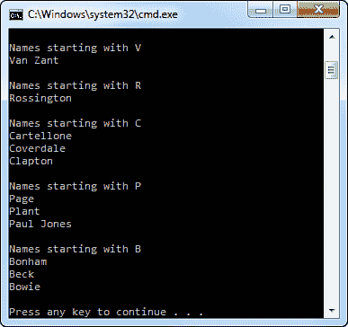

276

第 12 小节：理解查询表达式

```csharp
class JournalEntry 
{
    public int Id { get; set; } 
    public int ContactId { get; set; } 
    public string Description { get; set; } 
    public string EntryType { get; set; } 
    public DateTime Date { get; set; }
}

IEnumerable<Contact> contacts = GetContacts(); 
IEnumerable<JournalEntry> journal = GetJournalEntries();
```

LINQ 中简单的连接查询是 SQL 中内连接（inner join）的功能等效物，并使用 `join` 子句。与 SQL 中的连接可以使用许多不同运算符不同，LINQ 中的连接只能使用等值运算符，被称为**等值连接**（equijoins）。

列表 12.10 显示了针对 `Contact` 对象列表与 `JournalEntry` 对象列表进行连接的查询，使用 `Contact.ID` 和 `JournalEntry.ContactId` 字段作为连接的键。

列表 12.10 
使用 Join 的 LINQ 查询

```csharp
var result = 
from contact in contacts 
join journalEntry in journal 
on contact.Id equals journalEntry.ContactId 
select new 
{
    contact.FirstName, 
    contact.LastName, 
    journalEntry.Date, 
    journalEntry.EntryType, 
    journalEntry.Description
};
```

列表 12.10 中的 `join` 子句创建名为 `journalEntry` 的**范围变量**，其类型为 `JournalEntry`，然后使用 `equals` 运算符连接两个数据源。

LINQ 还有组连接（group join）的概念，它没有对应的 SQL 查询。组连接使用 `into` 关键字并创建具有层次结构的结果。正如你使用 `group` 子句时一样，你需要嵌套的 `foreach` 语句来访问结果。

### 顺序很重要

在处理 LINQ 连接时，顺序很重要。要连接的数据源必须位于 `equals` 运算符的左侧，连接的数据源必须位于右侧。在这个示例中，`contacts` 是待连接的数据源，`journal` 是连接数据源。

277

引言 LINQ

幸运的是，编译器可以捕获这类错误并生成消息。如果你交换了连接子句中的参数，将得到如下错误：左侧没有名称 'journal'。

另一个需要注意的是，`join` 子句使用的是 `equals` 运算符，这等同于相等运算符 (`==`)。

列表 12.1 显示了连接 `contacts` 和 `journal` 的查询，并返回分组结果。结果中的每个条目都有一个可枚举集合。

列表 12.11 
使用 Group Join 的 LINQ 查询

```csharp
var result = 
from contact in contacts 
join journalEntry in journal 
on contact.Id equals journalEntry.ContactId 
into journalGroups 
select new
{
    Name = contact.LastName + ", " + contact.FirstName, 
    JournalEntries = journalGroups
};

### 平数据

虽然选择和合并数据通常返回层次化的结果，处理起来有时很麻烦。

假设你修改了 `Contact` 和 `JournalEntry` 类，在 `Contact` 类中添加名为 `Journal` 的 `List<JournalEntry>` 字段，并从 `JournalEntry` 类中删除 `ContactId` 属性，如列表 12.2 所示。

列表 12.2 
修改后的 Contact 和 JournalEntry 类

```csharp
class Contact 
{
    public int Id { get; set; } 
    public string Company { get; set; } 
    public string LastName { get; set; } 
    public string FirstName { get; set; } 
    public string Address { get; set; } 
    public string City { get; set; } 
    public string StateProvince { get; set; }
    public List<JournalEntry> Journal;
}

class JournalEntry 
{
    public int Id { get; set; } 
    public string Description { get; set; } 
    public string EntryType { get; set; } 
    public DateTime Date { get; set; }
}
```

`IEnumerable<Contact> contacts = GetContacts();`

你可以使用以下查询查询 `contacts` 集合以检索特定联系人的条目列表，如列表 12.13 所示。

列表 12.13 
选择枚举集合的 LINQ 查询

```csharp
var result = 
from contact in contacts 
where contact.Id == 1 
select contact.Journal;

foreach(var item in result) 
{
    foreach(var journalEntry in item) 
    {
        Console.WriteLine(journalEntry); 
    }
}
```

虽然这种方法有效并返回了结果，但仍然需要嵌套的 `foreach` 语句来生成正确的结果。幸运的是，LINQ 提供了一种查询语法，通过支持从多个数据源进行选择，以平坦化的方式返回数据。列表 12.14 代码显示了如何编写此查询，通过使用多个 `from` 子句只需要单个 `foreach` 语句。

列表 12.14 
选择平坦化数据的 LINQ 查询

```csharp
var result = 
from contact in contacts 
from journalEntry in contact.Journal 
where contact.Id == 1 
select journalEntry;

foreach(var journalEntry in result) 
{
    Console.WriteLine(journalEntry); 
}
```


## 标准查询运算符方法

279

标准查询运算符方法

你刚刚看到的所有查询使用了声明式查询语法；然而，它们也可以使用标准查询运算符方法调用来编写，这些方法实际上是定义在 `System.Linq` 命名空间 `Enumerable` 类的扩展方法。编译器会将使用声明式语法的查询表达式转换为等效的查询运算符方法调用。

通过 `using` 语句包含 `System.Linq` 命名空间，你可以在任何实现了 `IEnumerable<T>` 接口的类上看到标准查询运算符方法，如图 12.5 所示。

尽管声明式查询语法支持几乎所有的查询操作，但某些操作（例如 `Count` 或 `Max`）没有等效的查询语法，必须以方法调的形式表示。由于每个方法调用返回一个 `IEnumerable`，你可以通过链式方法调用来组合复杂的查询。这就是编译器在编译你的声明式查询表达式时为你代的操作。

列表 12.15 显示了使用方法语法而非声明式语法的与列表 12.4 相同的查询，两者的输出将是相同的。`Where` 方法对应 `where` 子句，而 `Select` 方法对应 `select` 子句。

声明式语法或方法语法

选择声明式语法还是方法语法完全取决于个人习惯，取决于你认为哪一个更易读。无论你选择哪一个，执行查询的结果都是相同的。

*顺便说一下*

图 12.5
IntelliSense 中的 LINQ 扩展方法

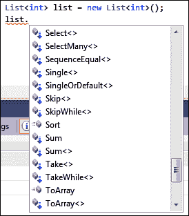

从 www.wowebook.com 下载

280

第 12 小：理解查询表达式

列表 12.15
使用方法语法的 LINQ 查询

```csharp
var result = contacts.
Where(contact => contact.StateProvince == "FL").
Select(contact => new { contact.FirstName, contact.LastName });

foreach(var name in result)
{
    Console.WriteLine(name.FirstName + " " + name.LastName);
}
```

Lambda 表达式（Lambdas）

在列表 12.15 中，你可能已经注意到传递给 `Where` 和 `Select` 方法的参数看起来与你之前使用的不同。这些参数实际上包含代码而非数据类型。在第 6 小节“事件与事件处理”中，你学习了委托（delegates），它们允许将方法作为参数传递给其他方法；并学习了匿名方法（anonymous methods），它们允许你编写一个可以在委托调用中执行的未命名内联语句块。

这些概念的结合就是 Lambda 表达式，它是一个包含表达式和语句的匿名函数。Lambda 表达式允许你以更方便、更紧凑的方式编写通常使用匿名方法或泛型委托编写的代码。

Lambda 表达式与委托（Lambdas and Delegates）

由于 Lambda 表达式是编写委托的一种紧凑方式，你可以在通常使用委托的地方使用它们。因此，Lambda 的形式参数类型必须与对应的委托类型完全匹配。返回类型也必须隐式转换为委托的返回类型。

尽管 Lambda 没有类型，但它们可以隐式转换为任何兼容的委托类型。这种隐式转换使你能够在无需显式赋值的情况下传递它们。

*顺便说一下*

C# 中的 Lambda 表达式使用 Lambda 运算符 (`=>`)。如果你在方法的语文中考虑 Lambda 表达式，运算符的左侧指定形式参数列表，运算符的右侧包含方法体。适用于匿名方法的所有限制也适用于 Lambda 表达式。

列表 12.15 所示的 `Where` 方法的参数 `contact => contact.StateProvince == "FL"` 读作“contact 的 contact.StateProvince 等于 FL”。

从 www.wowebook.com 下载

281

Lambda 表达式

表达式 Lambda（Expression Lambdas）

捕获与定义的变量（Captured and Defined Variables）

Lambda 表达式还具有“捕获”变量的能力，这些可以是局部变量或包含方法的参数。这使得 Lambda 体可以通过名称访问被捕获的变量。如果被捕获的变量是局部变量，则在 Lambda 使用之前必须明确赋值。被捕获的参数可以是 `ref` 或 `out` 参数。

但请注意，被 Lambda 捕获的变量在引用它的委托超出作用范围之前不会被垃圾回收。

Lambda 内部引入的任何变量在外部包含方法中都是不可见的。这同样输入参数名，因此你可以在多个 Lambda 表达式中使用相同的标识符。

*你知道吗？*

当 Lambda 在运算符的右侧包含一个表达式时，它是一个**表达式 Lambda**（expression lambda），并返回该表达式的结果。表达式 Lambda 的基本形式是
`(input parameters) => expressions`

如果只有一个输入参数，括号是可选的。如果你有任何其他数量的输入参数（包括没有），则需要括号。

正如泛型方法可以推断其类型参数的类型一样，Lambda 也可以推断其输入参数的类型。如果编译器无法推断类型，你可以显式指定类型。列表 12.16 显示了不同的形式。

列表 12.16
Lambda 示例

```csharp
x => Math.Pow(x, 2)
(x, y) => Math.Pow(x, y)
() => Math.Pow(2)
(int x, string s) => s.Length
```

（注：后续 OCR 存在大量重复和乱码，此处已根据提供的清晰内容进行了清理和重构。）


284

第 12 小时：理解查询表达式

你也可以通过在查询表达式之后立即放置 `foreach` 语句或调用 `ToList` 或 `ToArray` 方法来强制立即评估，这有时被称为**贪婪评估**。你也可以使用 `ToList` 或 `ToArray` 将数据缓存到单个集合对象中。

总结

LINQ 吸收了函数式语言（如 Haskell）和其他研究语言的优秀思想，并将它们整合在一起，引入了一种一致的查询数据的方法。无论原始数据源是什么，都可以使用简单的声明式或基于方法的语法进行查询。通过允许以与源无关的方式编写查询，LINQ 能够访问各种数据源，包括数据库、XML 文件和内存集合。

通过使用与 SQL 查询相似的语法，LINQ 的声明式语法使查询成为一种一类语言构造结构，就像算术操作和控制流语句一样。LINQ 实际上是实现为 `IEnumerable<T>` 接口的一组扩展方法，这些方法接受 Lambda 表达式作为参数。Lambda 表达式以表达式 Lambda 或语句 Lambda的形式存在，是编写匿名委托的紧凑方式。

当你刚开始使用 LINQ 时，你不需要广泛地使用 Lambda 表达式，但随着你对它们越来越熟悉，你会发现它们是非常强大的。

问答

Q. 什么是 LINQ？

答。LINQ 是一组技术，将查询能力直接集成到 C# 语言中，并通过为每个支持的数据源提供相同的查询语言，消除了处理数据与处理对象之间常见的语言不匹配问题。

Q. 什么是 Lambda 表达式？

答。Lambda 表达式表示了一种编写匿名委托的紧凑简洁的方法，可以用任何可以使用传统委托的地方。

285

工作坊

测验

1. LINQ 的声明式语法和方法语法之间有区别吗？

2. LINQ 查询在何时执行？

3. Lambda 表达式的底层委托类型是什么？

答案

1. 选择声明式语法还是方法语法完全取决于个人喜好，取决于你认为哪一个更易读。无论你选择哪一个，执行查询的结果都是相同的。

2. 默认情况下，LINQ 利用查询的延迟执行。这意味着在使用 `foreach` 语句迭代结果之前，查询实际上不会被执行。

3. Lambda 表达式本质上是无类型的，因此它们没有底层类型；但是，它们可以隐式转换为任何兼容的委托类型。

练习

1. 修改 AddressBook 项目中 MainWindow 类的 `Search_Click` 方法，使 `this.DataContext` 设置为对 contacts 集合查询的结果。该查询应选择集合中 `FirstName` 或 `LastName` 属性包含 `this.searchCriteria.Text` 中值的元素。

2. 修改 `Search_Click` 方法，如果勾选了 `searchCategory` 复选框，则也使用所选类别进行查询。

第三部分

处理数据

第 13 小时：使用文件和流 289

第 14 小时：处理 XML 311

第 15 小时：处理数据库 329

289

第 13 小时

使用文件和流

*在本小时你将学习：*

- 文件和目录
- 读取和写入数据
- 二进制文件
- 缓冲流
- 文件

在第 9 小时“处理数组和集合”和第 12 小时“理解查询表达式”中，你学习了应用程序如何处理存储在集合中的数据，以及如何查询和操作这些数据。虽然这些是常见活动，但许多应用程序需要从磁盘上的文件存储或检索数据。

.NET Framework 将文件视为数据流。**流**（stream）是数据包的顺序流，用字节表示。数据流具有底层存储介质，通常称为**后备存储**（backing store），它为流提供来源。幸运的是，.NET Framework 通过提供的 `File`、`Directory` 和 `Path` 类使处理文件和目录变得更加简单。

`System.IO` 命名空间包含了处理缓冲流和非缓冲流所需的所有类。缓冲流允许操作系统创建自己的内部缓冲区，用于以任何最高效的增量读取和写入数据。

在本小时中，你将学习如何使用 `File`、`Directory` 和 `Path` 类处理文件、探索和管理文件系统以及读写文件。你还学习了如何使用 `Stream` 类或其任何派生类来执行更复杂的读写操作。

290

第 13 小时：使用文件和流

文件和目录

你可以将文件视为一组具有定义名称和持久后备存储的字节序列。通过目录路径、磁盘存储和文件名对文件进行操作。.NET Framework 在 `System.IO` 命名空间中提供了几个类，使处理文件变得简单。

处理路径

路径是提供文件或目录位置的字符串，可以包含绝对信息或相对信息。绝对路径完全指定位置，而相对路径仅指定部分位置。当使用相对路径时，当前位置是定位文件时的起点。

当前位置

每个进程都有一个全进程范围的“当前位置”，它通常（但并非总是）是进程加载的位置。

`Path` 类提供了静态方法，可以以跨平台的方式对路径字符串执行操作。虽然大多数 `Path` 成员不与文件系统交互，但它们会验证指定的路径字符串是否包含有效字符。表 13.1 显示了常用的方法。

表 13.1 Path 类的常用方法

| 方法 | 描述 |
| :--- | :--- |
| ChangeExtension | 更改扩展名 |
| Combine | 将字符串组合组合为路径 |
| GetDirectoryName | 获取指定路径的目录名称 |
| GetExtension | 获取指定路径的扩展名 |
| GetFileName | 获取指定路径的文件名和扩展名 |
| GetFileNameWithoutExtension | 获取不带扩展名的文件名 |
| GetPathRoot | 获取指定路径的根目录 |
| GetRandomFileName | 获取随机名称 |
| GetTempFileName | 创建唯一的随机命名临时文件并返回其完整路径 |
| GetTempPath | 获取临时文件夹路径 |

291

文件和目录

Windows 操作系统包含许多应用程序频繁使用的“特殊”文件夹。通常由操作系统设置这些文件夹；但用户在安装 Windows 版本时也可以显式设置它们。因此，许多文件夹在任何给定机器上的位置或名称可能不同。

查找这些“特殊”目录（例如 Windows 目录）的最佳方法是使用 `Environment.GetFolderPath` 方法。该方法接受 `Environment.SpecialFolder` 枚举值，指示要检索的特殊文件夹。

常用的 `Environment.SpecialFolder` 值见表 13.2。

表 13.2 常用的 Environment.SpecialFolder 值

| 成员 | 描述 |
| :--- | :--- |
| ApplicationData | 当前漫游用户应用程序特定数据的常用存储目录 |
| CommonApplicationData | 所有用户应用程序特定数据的常用存储目录 |
| LocalApplicationData | 当前非漫游用户应用程序特定数据的常用存储目录 |
| CommonDocuments | 包含所有用户公共文档的文件系统目录。此特殊文件夹适用于 Windows NT 系统以及安装了 shfolder.dll 的 Windows 95 和 98 系统。 |
| Desktop | 逻辑桌面而非物理文件系统位置 |


292

第 13 小节：使用文件和流

## DirectoryInfo 和 FileInfo 类

DirectoryInfo 和 FileInfo 类都继承自 FileSystemInfo 类，该类包含了文件和目录操作的通用方法，并且可以表示文件或目录。当实例化 FileSystemInfo 时，目录或文件的信息会被缓存，因此你必须使用 `Refresh` 方法对其进行刷新，以确保获取的是当前信息。

DirectoryInfo 类包含实例成员，这些成员提供了许多属性和方法，用于执行常见操作，如复制、移动、创建和枚举目录。`DirectoryInfo` 类中常用的方法和属性如表 13.3 所示。

表 13.2 

常用的 Environment.SpecialFolder（环境特殊文件夹）值

| 成员 | 描述 |
| :--- | :--- |
| DesktopDirectory | 用于在桌面上物理上存储文件对象的目录。不要将此目录与桌面文件夹本身混淆，桌面是一个虚拟文件夹。 |
| MyDocuments | “我的文档”文件夹。此成员等同于 Personal。 |
| Personal | 作为文档常用存储库的目录。 |
| System | 系统目录。 |
| Windows | Windows 目录或 SYSROOT。这对应于 %windir% 或 %SYSTEMROOT% 变量。 |

表 13.3 

常用的 DirectoryInfo 成员

| 成员 | 描述 |
| :--- | :--- |
| Create | 创建一个目录；在指定路径上创建子目录 |
| Delete | 删除当前目录，可选地删除所有文件和子目录 |
| EnumerateDirectories | 获取当前目录下目录信息的可枚举集合 |
| EnumerateFiles | 获取当前目录下文件信息的可枚举集合 |

下载自 www.wowebook.com

文件与目录 
293

代码列表 13.1 显示了 `DirectoryInfo` 类如何执行某些常见操作。

代码列表 13.1 

使用 DirectoryInfo 类

```csharp
public class DirectoryInfoExample 
{
    public static void Main() 
    {
        string tempPath = Path.GetTempFileName();
        DirectoryInfo directoryInfo = new DirectoryInfo(tempPath); 
        try 
        {
            if (directoryInfo.Exists) 
            {
                Console.WriteLine("The directory already exists."); 
            } 
            else 
            {
                directoryInfo.Create();
                Console.WriteLine("The directory was successfully created."); 
                directoryInfo.Delete();
                Console.WriteLine("The directory was deleted.");
            } 
        } 
        catch (IOException e) 
        {
            Console.WriteLine("An error occurred: {0}", e.Message); 
        }
    } 
}
```

表 13.3 

常用的 DirectoryInfo 成员

| 成员 | 描述 |
| :--- | :--- |
| EnumerateFileSystemInfos | 获取当前目录下文件和目录信息的可枚举集合 |
| FullName | 获取当前目录的完整路径；指示当前目录是否在磁盘上存在； |
| MoveTo | 将当前目录（包括所有文件和子目录）移动到新位置 |
| Name | 获取当前目录的 |
| Parent | 获取当前目录的父目录 |
| Refresh | 刷新缓存的目录信息 |
| Root | 获取路径的根部分 |

下载自 www.wowebook.com

294

第 13 小节：使用文件和流

FileInfo 类包含实例成员，这些成员提供了许多属性和方法，用于执行常见的文件操作，如复制、移动、创建和打开文件。常用的方法和属性如表 13.4 所示。

表 13.4 

常用的 FileInfo 成员 

| 成员 | 描述 |
| :--- | :--- |
| AppendText | 创建一个 StreamWriter 以向当前文件追加文本 |
| Attributes | 获取或设置当前文件的属性 |
| CopyTo | 将当前文件复制到新文件 |
| Create | 创建一个文件 |
| CreateText | 创建或打开一个文件以写入文本 |
| Delete | 删除当前文件 |
| Directory | 获取父目录 |
| DirectoryName | 获取父目录的名称 |
| Exists | 确定当前文件是否存在于磁盘上 |
| Extension | 当前文件的扩展名 |
| FullName | 获取当前文件的完整路径 |
| IsReadOnly | 获取或设置一个值，确定当前文件是否为只读 |
| Length | 当前文件的大小 |
| MoveTo | 将当前文件移动到新位置 |
| Name | 获取当前文件的名称 |
| Open | 打开文件 |
| OpenRead | 打开已存在的文件进行读取 |
| OpenText | 打开已存在的文本文件进行读取 |
| OpenWrite | 打开已存在的文件进行写入 |
| Refresh | 刷新缓存的文件信息 |
| Replace | 用当前文件的内容替换指定文件的内容 |

下载自 www.wowebook.com

文件与目录 
295

代码列表 13.2 显示了 `FileInfo` 类如何执行某些常见操作。

代码列表 13.2 

使用 FileInfo 类

```csharp
public class FileInfoExample 
{
    public static void Main() 
    {
        string tempFile = Path.GetTempFileName();
        FileInfo fileInfo = new FileInfo(tempFile); 
        try 
        {
            if (!fileInfo.Exists) 
            {
                using (StreamWriter writer = fileInfo.CreateText()) 
                {
                    writer.WriteLine("Line 1"); 
                    writer.WriteLine("Line 2");
                }
            }
            fileInfo.CopyTo(Path.GetTempFileName());
            fileInfo.Delete();
        } 
        catch (IOException e) 
        {
            Console.WriteLine("An error occurred: {0}", e.Message); 
        }
    } 
}
```

流的释放

你应该在完成工作时通过 Close 方法释放流。你也可以通过 using 语句包装流。

尝试一下：使用 Directory 和 File 类

如果你不想实例化 DirectoryInfo 或 FileInfo 类，可以使用 Directory 或 File 类。这些类提供了静态方法来执行 DirectoryInfo 和 FileInfo 类提供的目录操作。

要查看，请按照以下步骤操作：

1. 创建一个新的控制台应用程序。
2. 在 Program.cs 的 Main 方法中，在 Path.Combine(Environment.GetFolderPath(Environment.Windows), "Web") 上创建一个新的 DirectoryInfo 实例。
3. 在 try-catch 语句中，使用 EnumerateDirectories 方法枚举目录，并使用 foreach 语句显示每个完整名称。catch 处理程序应该捕获 UnauthorizedAccessException 并打印异常的 Message。
4. 使用 Ctrl+F5 运行。输出应类似于图 13.1（如果你在 Windows 7 上运行则是如此）。
5. 修改步骤 3 中的 foreach 语句，以枚举所有匹配 "*.jpg" 的文件，并使用嵌套的 foreach 语句打印文件名和创建日期。
6. 再次使用 Ctrl+F5 运行应用程序。输出应类似于图 13.2 所示（如果你在 Windows 7 上运行则是如此）。

代码列表 13.3 显示了列表 13.1 中的相同操作，但使用的是 Directory 类而不是 DirectoryInfo 类。

表 13.5 

Directory 类的常用方法

| 方法 | 描述 |
| :--- | :--- |
| CreateDirectory | 创建指定路径中的所有目录 |
| Delete | 删除指定的目录 |
| EnumerateDirectories | 获取指定路径下目录名称的可枚举集合 |
| EnumerateFiles | 获取指定路径下文件名的可枚举集合 |
| EnumerateFileSystemEntries | 获取指定路径下所有文件和子目录名称的可枚举集合 |
| Exists | 指示指定路径是否存在于磁盘上 |
| GetCurrentDirectory | 获取当前工作目录 |
| GetDirectoryRoot | 获取指定路径的卷信息、根信息或两者 |
| GetLogicalDrives | 获取当前逻辑驱动器的名称 |
| GetParent | 获取指定路径的父目录 |
| Move | 将文件或目录（包括所有文件和子目录）移动到新位置 |


298

第 13 小节：使用文件和流

表格 13.6 
File 类的常用方法

| 方法 | 描述 |
| :--- | :--- |
| AppendAllLines | 向文件追加行并然后关闭文件 |
| AppendAllText | 向文件追加指定的字符串，如果文件不存在则创建该文件 |
| AppendText | 创建一个 StreamWriter 以向当前文件追加文本 |
| Copy | 将现有文件复制到新文件 |

代码列表 13.3 
使用 Directory 类
```csharp
public class DirectoryInfoExample 
{
    public static void Main() 
    {
        string tempPath = Path.GetTempFileName();
        try 
        {
            if (Directory.Exists(tempPath)) 
            {
                Console.WriteLine("The directory already exists."); 
            } 
            else 
            {
                Directory.CreateDirectory(path);
                Console.WriteLine("The directory was successfully created."); 
                Directory.Delete(path);
                Console.WriteLine("The directory was deleted.");
            } 
        } 
        catch (IOException e) 
        {
            Console.WriteLine("An error occurred: {0}", e.Message); 
        }
    } 
}
```

Directory 和 DirectoryInfo 类之间的一个显著区别是 EnumerateFiles、EnumerateDirectories 和 EnumerateFileSystemEntries 方法。在 Directory 类中，这些方法返回一个仅包含目录和文件名的 `IEnumerable<string>`；而在 DirectoryInfo 类中，它们分别返回 `IEnumerable<FileInfo>`、`IEnumerable<DirectoryInfo>` 和 `IEnumerable<FileSystemInfo>`。

File 类的常用方法如表格 13.6 所示，列表 13.4 显示了与列表 13.2 相同的操作，但使用的是 File 类而不是 FileInfo 类。

从 www.wowebook.com 下载

299
文件和目录

表格 13.6 
File 类的常用方法

| 方法 | 描述 |
| :--- | :--- |
| Create | 创建文件 |
| CreateText | 创建或打开一个文件以写入文本 |
| Delete | 删除指定的文件 |
| Exists | 确定指定的文件是否存在于磁盘 |
| GetAttributes | 获取指定文件的属性 |
| Move | 将指定的文件移动到新位置 |
| OpenRead | 打开现有文件进行读取 |
| OpenText | 打开现有的文本文件进行读取 |
| OpenWrite | 打开现有的文件进行写入 |
| ReadAllBytes | 打开二进制文件，将内容读取到字节数组中，然后关闭文件 |
| ReadAllLines | 打开文本文件，将所有行读取到字符串数组中，然后关闭文件 |
| ReadAllText | 打开文件，将所有行读取到字符串中，然后关闭文件 |
| ReadLines | 读取文件的行 |
| Replace | 用另一个文件的内容替换指定文件的内容 |
| SetAttributes | 设置指定文件的属性 |
| WriteAllBytes | 将指定的字节写入新文件，然后关闭文件 |
| WriteAllLines | 向新文本文件写入一个或多个字符串，然后关闭文件 |
| WriteAllText | 将一个字符串写入新文件，然后关闭文件 |

代码列表 13.4 
使用 File 类
```csharp
public class FileExample 
{
    public static void Main() 
    {
        string tempFile = Path.GetTempFileName();
        try 
        {
            if (!File.Exists(tempFile)) 
            {
                using (StreamWriter writer = File.CreateText(tempFile)) 
                {
                    writer.WriteLine("Line 1"); 
                    writer.WriteLine("Line 2");
                } 
            }
            File.Copy(tempFile, Path.GetTempFileName()); 
            File.Delete(tempFile);
        } 
        catch (IOException e) 
        {
            Console.WriteLine("An error occurred: {0}", e.Message); 
        }
    } 
}
```

### 动手一试
使用 **Directory** 和 **File** 类

通过遵循这些步骤，你将学习如何操作 Directory 和 File 类。如果你关闭了 Visual Studio，请先重复上一个练习。确保在本次练习结束时保持 Visual Studio 打开，因为你之后将用到此应用程序。

1. 修改对 EnumerateDirectories 的调用，以调用 Directory 上同名的方法，枚举 C:\\Windows\Web\Wallpaper 目录。使用以下代码来获取此文件夹路径：
Path.Combine(
Environment.GetFolderPath(Environment.SpecialFolder.Windows),
"Web",
"Wallpaper")

2. 修改嵌套的 foreach 语句以调用 Directory.EnumerateFiles。因为此返回的是路径字符串而不是 FileInfo，所以你还需要修改打印文件名和创建时间的语句，从生成的路径字符串中获取文件名，并使用 File 类上适当的静态方法来获取创建日期和时间。

3. 使用 Ctrl+F5 运行应用程序。输出应与上一个练习第 6 步生成的输出匹配。

### 数据读取与写入
处理文件中包含的数据（通过读取或写入）使用由 Stream 类表示的流。.NET Framework 提供的所有基于流类都继承自此类。Stream 类的常用成员如表格 13.7 所示。

从 www.wowebook.com 下载

301
读取和写入数据

表格 13.7
Stream 类的常用成员

| 成员 | 描述 |
| :--- | :--- |
| CanRead | 如果流支持读取 |
| CanWrite | 如果流支持写入 |
| Close | 关闭流 |
| CopyTo | 将流的内容复制到另一个 |
| Flush | 清空所有缓冲区并将任何缓冲数据写入存储 |
| Read | 从流中读取字节序列 |
| Write | 将字节序列写入流 |

### 二进制文件
当你不确定文件的内容时，最好将其视为二进制文件。要从二进制文件读取数据，使用 File 类的静态 OpenRead 方法，它返回一个 FileStream：
FileStream input = File.OpenRead(path);

然后，你可以在生成的 FileStream 上使用 Read 方法将数据读取到你提供的缓冲区。缓冲区只是存储数据的数组。Read 方法返回实际读取的字节数：
byte[] buffer = new byte[1024];
int bytesRead = input.Read(buffer);

当然，从流读取并不是唯一可以执行的操作。向流写入二进制数据也是一项常见活动，并以类似的方式完成。你首先使用 File 类的 OpenWrite 方法打开二进制文件写入，然后在生成的 FileStream 上使用 Write 方法将缓冲区数据写入存储。
FileStream output = File.OpenWrite(path);

302
第 13 小节：使用文件和流

13.5 显示了从一个二进制文件读取数据并写入另一个文件的完整示例。此示例继续读取和写入字节，直到 Read 方法通过返回 0 表示没有更多可读的字节。

代码列表 13.5 
二进制读取与写入
```csharp
public class BinaryReaderWriter 
{
    const int BufferSize = 1024;
    public static void Main() 
    {
        string tempPath = Path.GetTempFileName(); 
        string tempPath2 = Path.GetTempFileName();

        if (File.Exists(tempPath)) 
        {
            using (FileStream input = File.OpenRead(tempPath)) 
            {
                byte[] buffer = new byte[BufferSize]; 
                int bytesRead;

                using (FileStream output = File.OpenWrite(tempPath2)) 
                {
                    while ((bytesRead = input.Read(buffer, 0, BufferSize)) > 0) 
                    {
                        output.Write(buffer, 0, bytesRead); 
                    }
                }
            } 
        }
    } 
}
```

### 动手一试
二进制读取与写入
要使用 File 和 FileStream 类执行二进制读写，请遵循以下步骤：

1. 在 Visual Studio 中打开 BinaryReaderWriter 项目。
2. 双击 Program.cs 文件打开 Program.cs。
3. Main 方法已经包含了一些代码，包括一个与列表 13.5 所示类似的 if 语句。修改 if 语句的语句块，以从 fileName 字段指定的文件读取内容并写入临时文件。使用列表 13.5 所示的代码作为指南。


读取和写入数据

303

▲ 

图 13.3
执行二进制读写的结果

4. 修改 `while` 语句，在每次 `Write` 之后增加 `bufferCounter` 字段。

5. 使用 Ctrl+F5 运行应用程序。输出应与图 13.3 所示的内容相似。

6. 修改 `BufferSize` 的值并再次使用 Ctrl+F5 运行应用程序。观察 `BufferSize` 的不同值如何改变所需的缓冲区总数。

## 缓冲流 (Buffered Streams)

使用上一个示例中的基本 `FileStream`，你需要提供用于读取缓冲区以及缓冲区的大小。在许多情况下，让操作系统决定读取的字节数可能更高效。

`BufferedStream` 类允许操作系统创建它自己的内部缓冲区，并使用它认为最有效的任何增量来填充该缓冲区。它仍然按照你提供的增量来填充你提供的缓冲区，但该缓冲区是从内部缓冲区填充的，而不是直接从底层存储器填充。要创建一个缓冲流，你可以从另一个 `Stream` 构造一个新的 `BufferedStream` 实例，如列表 13.6 所示，该列表显示了上一个示例中使用 `BufferedStream` 实例作为输入和输出流的代码。

列表 13.6
缓冲读和写

```csharp
public class BufferedReaderWriter 
{
    const int BufferSize = 1024;

    public static void Main() 
    {
        string tempPath = Path.GetTempFileName(); 
        string tempPath2 = Path.GetTempFileName();
        if (File.Exists(tempPath)) 
        {
            using (BufferedStream input = new BufferedStream(File.OpenRead(tempPath)))
            {
                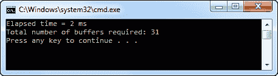
                byte[] buffer = new byte[BufferSize]; 
                int bytesRead;
                using (BufferedStream output = new BufferedStream(File.OpenWrite(tempPath2)))
                {
                    while ((bytesRead = input.Read(buffer, 0, BufferSize)) > 0) 
                    {
                        output.Write(buffer, 0, bytesRead); 
                    }
                }
            }
        } 
    }
}
```

## 文本文件 (Text Files)

使用 `Stream` 类上的 `Read` 和 `Write` 方法不仅适用于二进制文件，也适用于**文本文件**，即仅包含文本数据的文件。问题在于，你读取和写入的是字节数组而不是字符串，这并不方便。为了让处理文本文件变得更简单，NET Framework 提供了 `StreamReader` 和 `StreamWriter` 类。

虽然 `StreamReader` 提供了一个 `Read` 方法可以每次从底层存储器读取一个字符，但它还提供了一个 `ReadLine` 方法，可以将整行字符作为字符串读取。一行被定义为字符序列，后跟换行符（“\n”）、回车符（“\r”）或回车换行符（“\r\n”）。如果到达输入流的末尾，`ReadLine` 返回 `null`；否则，它返回该行字符，但不包括终止字符。要写入文本数据，可以使用 `StreamWriter` 类的 `WriteLine` 方法。

列表 13.7 显示了读取和写入文本数据的示例。

列表 13.7
读取和写入文本数据

```csharp
public class TextReaderWriter 
{
    public static void Main() 
    {
        string tempPath = Path.GetTempFileName(); 
        string tempPath2 = Path.GetTempFileName();
        if (File.Exists(tempPath)) 
        {
            using (StreamReader reader = File.OpenText(tempPath)) 
            {
                string buffer = null;
                using (StreamWriter writer = new StreamWriter(tempPath2)) 
                {
                    while ((buffer = reader.ReadLine()) != null) 
                    {
                        writer.WriteLine(buffer); 
                    }
                } 
            }
        } 
    }
}
```

### 动手一试：缓冲读和写

要使用 `File`、`StreamReader` 和 `StreamWriter` 类执行文本读和写，请遵循以下步骤。

1. 在 Visual Studio 中打开 `TextReadWrite` 项目。
2. 通过双击文件打开 `Program.cs`。
3. `Main` 方法已经包含了一些代码，包括一个与列表 13.3 所示类似的 `if` 语句。修改 `if` 语句的语句块，以读取和写入 `fileName` 字段中指定的文件。使用列表 13.7 所示的代码作为指南。
4. 修改 `while` 语句，在每次 `Write` 之后增加 `bufferCounter` 字段。
5. 使用 Ctrl+F5 运行应用程序。输出应与图 13.4 所示的内容相似。

## 使用 File 类读取和写入数据

由于从文件读取和写入数据（无论是文本还是二进制）是一项常见任务，`File` 类提供了许多方法，这使得比直接操作流更加方便。

▲ 

图 13.4
执行缓冲读和写的结果

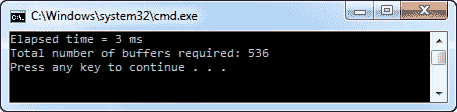

306
第 13 小时：使用文件和流

要读取或写入二进制数据，可以使用 `ReadAllBytes` 和 `WriteAllBytes` 方法。这些方法打开文件、读取字节，然后关闭文件。列表 13.8 所示的代码执行了与列表 13.5 相同的操作，但使用了 `ReadAllBytes`。

列表 13.8
使用 File 类进行二进制读写

```csharp
public class BinaryReaderWriter 
{
    public static void Main() 
    {
        string tempPath = Path.GetTempFileName(); 
        string tempPath2 = Path.GetTempFileName();
        if (File.Exists(tempPath)) 
        {
            byte[] data = File.ReadAllBytes(tempPath);
            File.WriteAllBytes(tempPath2, data);
        }
    }
}
```

使用 `ReadAllLines` 和 `WriteAllLines` 方法处理文本数据同样简单。`ReadAllLines` 方法将所有行读取到字符串数组，而 `WriteAllLines` 方法将字符串数组的每个元素写入文件，创建一个文件或如果文件已存在则覆盖它。要向现有文件追加文本，可以使用 `AppendAllLines` 或 `AppendText` 方法。如果你需要打开流，可以使用 `AppendText` 方法。列表 13.9 所示的代码执行了与列表 13.7 相同的操作，但使用了 `ReadAllLines` 和 `WriteAllLines` 方法。

列表 13.9
使用 ReadAllLines 和 WriteAllLines

```csharp
public class TextReaderWriter 
{
    public static void Main() 
    {
        string tempPath = Path.GetTempFileName(); 
        string tempPath2 = Path.GetTempFileName();
        if (File.Exists(tempPath)) 
        {
            string[] data = File.ReadAllLines(tempPath);
            File.WriteAllLines(tempPath2, data);
        }
    }
}
```

307
Q&A

使用 `ReadAllLines` 或 `ReadAllText` 的一个缺点是必须将整个文件读取到内存。为了解决这个问题并返回 `IEnumerable<string>` 集合，可以使用 `ReadLines` 方法。因为该方法返回 `IEnumerable<string>`，你可以在整个集合返回之前开始枚举该集合。列表 13.10 所示的代码执行了与列表 13.9 相同的操作，但使用了 `File.ReadLines` 方法。

列表 13.10
使用 WriteAllLines 和 ReadLines

```csharp
public class TextReaderWriter 
{
    public static void Main() 
    {
        string tempPath = Path.GetTempFileName(); 
        string tempPath2 = Path.GetTempFileName();
        if (File.Exists(tempPath)) 
        {
            File.WriteAllLines(tempPath, File.ReadLines(tempPath2));
        }
    }
}
```

总结

在本小时中，你学习了如何使用流来读取和写入文本和二进制文件。虽然你只关注于使用 `FileStream` 和 `StreamWriter` 类，但使用 `FileStream` 进行读写的机制对于任何 `Stream` 派生类本质上都是相同的。

你还学习了如何通过 `File`、`Directory`、`FileInfo`、`DirectoryInfo` 和 `Path` 类简单地处理文件、目录和字符串路径。

Q&A

Q.*什么是流？*

A. 流是表示为字节的数据包顺序流。数据流有一个底层存储质，通常称为底层存储器，它为流提供来源。


308

## 第 13 小节：使用文件和流

问：相对路径和绝对路径之间的区别是什么？

答：绝对路径完整地指定了一个位置，而相对路径仅指定了部分位置。当使用相对路径时，当前位置是定位指定文件时的起点。

问：**FileSystemInfo** 类是做什么用的？

答：`FileSystemInfo` 类包含了文件和目录操作中通用的方法，并可以表示文件或目录。它是 `DirectoryInfo` 和 `FileInfo` 类的基类。

问：**Directory** 类与 **DirectoryInfo** 类有什么不同？

答：`Directory` 类仅提供静态方法，而 `DirectoryInfo` 类只提供实例方法，并缓存了为指定目录所检索到的的信息。

问：二进制文件和文本文件之间有什么区别？

答：二进制文件简单来说被视为字节流，而文本文件则被认为仅包含文本文本数据。

### 工作坊

### 测验
1. `Path` 类的成员是如何直接与文件系统进行交互的？
2. 在 `FileSystemInfo` 实例上应该使用哪个方法来更新其包含的缓存信息？
3. `DirectoryInfo` 类和 `Directory` 类上的 `EnumerateDirectories` 方法有什么区别？
4. `File.OpenRead` 方法的返回类型是什么？
5. `File.OpenText` 方法的返回类型是什么？
6. `File.ReadAllLines` 方法和 `File.ReadLines` 方法有什么区别？

309

### 工作坊

### 答案
1. 大多数 `Path` 类成员并不与文件系统交互；它们会验证指定的路径字符串是否包含有效字符。
2. `FileSystemInfo` 类包含一个 `Refresh` 方法，应该使用它来更新缓存的文件或目录信息。
3. `DirectoryInfo.EnumerateDirectories` 返回一个 `IEnumerable<DirectoryInfo>`，而 `Directory.EnumerateDirectories` 返回一个 `IEnumerable<string>`。
4. `File.OpenRead` 方法返回一个打开的指向指定文件的只读 `FileStream`。
5. `File.OpenText` 方法返回一个打开的指定文本文件的 `StreamReader`。
6. `File.ReadAllLines` 必须将整个文件读取到内存中并返回一个包含行的字符串数组，而 `File.ReadLines` 返回一个 `IEnumerable<string>`，允许你在读取整个文件之前开始枚举集合。

### 练习题
1. 修改 `PhotoCollection` 类，将 `directory` 字段替换为名为 `directoryInfo` 的字段，其数据类型为 `DirectoryInfo` 类。更改 `Path` 属性，使 `get` 访问器返回 `FullName` 属性的值，使 `set` 访问器在验证值不为空或空字符串后从值创建一个新的 `DirectoryInfo` 实例。
2. 添加一个名为 `Update` 的私有方法，执行以下操作：
   a. 清空集合。
   b. 如果 `directoryInfo.Exists` 为真，枚举目录下所有扩展名为“.jpg”的文件，并向集合中添加新的 `Photo` 实例。这段代码应该放在捕获 `DirectoryNotFoundException` 的 `try-catch` 块中。`catch` 处理程序应包含以下代码：
   System.Windows.MessageBox.Show“No Such Directory”);

311

## 第 14 小节处理 XML

*在本节中将学习：*
- 理解 XML DOM
- 使用 LINQ to XML
- 选择和查询 XML
- 修改 XML

虽然处理文本文件很常见并且通过 `System.IO` 命名空间提供的类变得更容易，但这些类并不能让你轻松地处理和操作 XML 形式的结构化文本。XML 代表扩展标记语言（Extensible Markup Language），是一种简单灵活的文本格式，能够以平台无关的方式交换数据。

XML 作为数据交换格式不仅在 .NET Framework 中流行，在其他微软产品中也是如此。.NET Framework 将通过 SOAP 和 Windows Communication Foundation (WCF) 用于网络服务，作为 Windows Presentation Foundation (WPF) 和 Silverlight Extensible Application Markup Language (XAML) 文件的格式，作为 Windows Workflow Foundation (WF) 文件的格式，并作为 ADO.NET 的一部分。

尽管 XML 是基于文本且人类可读的，但有一种方法可以编程操作 XML。这是通过使用 XML 解析器实现的。.NET Framework 提供了两种 XML 解析器。一种是基于流的解析器，它边边读取 XML 流；另一种是基于树的解析器，它在构建树之前必须将整个流读取到内存中。

在本节中，你将学习 .NET Framework 提供的不同 XML 类，以及如何使用它们来创建和操作 XML 文件。

312

## 第 14 小节：处理 XML

### 理解 XML DOM
为了能够通过编程读取和操作 XML 文档，它必须通过 XML 文档对象模型（DOM）在内存中表示。DOM 为 XML 数据在内存中的表示提供了一种通用且结构化的方式，通常用于将 XML 数据读取到内存中以更改其结构、添加元素或修改元素包含的数据。列表 14.1 显示了一个示例 XML 文档，相应的 DOM 结构如图 14.1 所示。

#### 列表 14.1 XML 数据
```xml
<books>
  <book>
    <title>Sams Teach Yourself C# 2010 in 24 Hours</title>
    <isbn-10>0-672-33102</isbn-10>
    <author>Dorman</author>
    <price currency="US">39.99</price>
    <publisher>
      <name>Sams Publishing</name>
      <state>IN</state>
    </publisher>
  </book>
</books>
```

在图 14.1 中，每个圆代表 XML 中的元素。根圆代表根元素。除了根元素以外的圆代表元素。与根元素相邻的圆是子节点。与根元素同级的圆是兄弟节点。与根元素具有祖先关系的圆是后代节点。

### 使用 LINQ to XML
LINQ to XML 通过 `System.Xml.Linq` 命名空间提供的扩展方法允许你操作和查询 XML 文档。最常用的类显示图 14.2 中。

**XDocument**
`XDocument` 类表示 XML 文档。除非需要指定 声明、处理指令或注释，否则通常应使用 `XElement` 类。

**XElement 和 XAttribute**
`XElement` 类表示 XML 元素，并提供了许多创建、修改和查询 XML 的属性。XML 属性是键值对，与元素关联。`XAttribute` 类表示属性。与元素不同，属性在元素中是唯一的。使用 `XElement` 元素的 XML 显示列表 14.2。

#### 列表 14.2 使用 LINQ to XML 创建 XML
```csharp
XElement document = new XElement("books",
  new XElement("book",
    new XElement("title", "Sams Teach Yourself C# 2010 in 24 Hours"),
    new XElement("isbn-10", "0-672-33102"),
    new XElement("author", "Dorman"),
    new XElement("price", new XAttribute("currency", "US"), 39.99M),
    new XElement("publisher",
      new XElement("name", "Sams Publishing"),
      new XElement("state", "IN")
    )
  )
);
```

相比之下，由 `System.Xml` 命名空间类支持的标准 DOM 方法显示列表 14.3。

#### 列表 14.3 使用 XML DOM 创建 XML
```csharp
XmlDocument document = new XmlDocument();
XmlElement booksElement = document.CreateElement("books");
XmlElement bookElement = document.CreateElement("book");
XmlElement titleElement = document.CreateElement("title");
titleElement.InnerText = "Sams Teach Yourself C# 2010 in 24 Hours";
XmlElement isbn10Element = document.CreateElement("isbn-10");
isbn10Element.InnerText = "0-672-33102";
XmlElement authorElement = document.CreateElement("author");
authorElement.InnerText = "Dorman";
XmlElement priceElement = document.CreateElement("price");
priceElement.InnerText = "39.99";
XmlAttribute currencyAttribute = document.CreateAttribute("currency");
currencyAttribute.Value = "US";
priceElement.Attributes.Append(currencyAttribute);
bookElement.AppendChild(titleElement);
bookElement.AppendChild(isbn10Element);
bookElement.AppendChild(authorElement);
bookElement.AppendChild(priceElement);
XmlElement publisherElement = document.CreateElement("publisher");
XmlElement nameElement = document.CreateElement("name");
nameElement.InnerText = "Sams Publishing";
XmlElement stateElement = document.CreateElement("state");
stateElement.InnerText = "IN";
publisherElement.AppendChild(nameElement);
publisherElement.AppendChild(stateElement);
bookElement.AppendChild(publisherElement);
booksElement.AppendChild(bookElement);
document.AppendChild(booksElement);
```


### 使用 LINQ to XML

315

bookElement.AppendChild(authorElement); 

bookElement.AppendChild(priceElement); 

bookElement.AppendChild(publisherElement);

publisherElement.AppendChild(publisherNameElement); 

publisherElement.AppendChild(publisherStateElement);

document.AppendChild(booksElement);

如你所见，列表 14.3 中的代码几乎是原来的三倍长度，而且更难于阅读和理解。此外，如果你查看列表 14.2 中价格元素的声明，你可以直接将值设置为小数类型（decimal），而列表 14.3 中的相同代码必须将值设置为字符串。这种差异在获取该值时会变得非常重要。`XElement` 和 `XAttribute` 类都允许你通过直接强制转换为所需的类型来读取其内容。如果直接转换指定的转换失败，它将抛出 `FormatException`。

### **SetElementValue** 和 **SetAttributeValue**

使用列表 14.2 所示的构造函数语法并不是创建 XML 的唯一方法。你还可以使用 `XElement` 类提供的 `SetElementValue` 和 `SetAttributeValue` 方法。

这些方法使得将名称-值对列表作为子元素或属性集合进行维护变得容易，允许你添加、修改或删除这些键值对。如果提供的名称尚未作为子元素或属性存在，它将为你创建它；否则，它的值将更改为你指定的值。如果值为 `null`，则该元素或属性将被删除。在修改或删除子元素或属性时，具有指定名称的第一个将被修改或删除。

以下代码显示了如何创建列表 14.2 生成的相同的 XML，但使用了 `SetElementValue` 和 `SetAttributeValue` 方法：

```csharp
XElement document = new XElement(“books”, 
new XElement(“book”,
new XElement(“publisher”)));

XElement bookElement = document.Element(“book”);
XElement publisherElement = document.Element(“publisher”);

bookElement.SetElementValue(“title”, 
“Sams Teach Yourself Visual C# 2010 in 24 Hours”); 

bookElement.SetElementValue(“isbn-10”, “0-672-33101-2”); 

bookElement.SetElementValue(“author”, “Dorman”); 

bookElement.SetElementValue(“price”, 39.99M); 

bookElement.Element(“price”).
SetAttributeValue(“currency”, “US”);

publisherElement.SetElementValue(“name”, “Sams Publishing”); 

publisherElement.SetElementValue(“state”, “IN”);
```

316
第 14 小节：处理 XML

尝试一下

创建 XML 文档

通过遵循这些步骤，你将看到如何使用 LINQ to XML 类来创建 XML 文档。在练习结束时保持 Visual Studio 打开，因为你稍后会使用此应用程序。

1. 创建一个新的控制台应用程序（Console application）。
2. 在 `Program.cs` 文件的 `Main` 方法中实现列表 14.2 中的代码。
3. 编写一条语句来打印步骤 2 中创建的 `XElement` 内容。
4. 使用 Ctrl+F5 运行应用程序。输出应该类似于图 14.3。

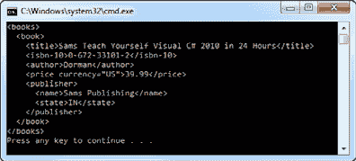

图 14.3
创建 XML 文档

列表 14.4 显示了你获取价格元素值的两种方法。

列表 14.4
使用直接转换获取 XElement 的值

```csharp
decimal price = (Decimal)(document.Element(“book”).Element(“price”)); 
price = (Decimal)document.XPathSelectElement(“//price”);
```

XML 字符编码

`XElement` 和 `XAttribute` 类会自动处理包含无效 XML 字符的文本的编码和解码。鉴于以下语句：

```csharp
XElement comments = new XElement(“comments”, 
“This line contains special characters <node> & </node>”);
```

结果将自动编码如下：

```xml
<comments>This line contains special characters &lt;node&gt; &amp; &lt;/node&gt;</comments>
```

当检索该值时，它会自动进行解码。

317
使用 LINQ to XML

### **XName** 和 **XNamespace**

XML 名称（XML name）代表 XML 文档中元素或属性的名称，由两部分组成：XML 命名空间（XML namespace）和本地名称（local name）。XML 命名空间允许你唯一标识元素和属性的名称，以避免 XML 文档不同部分之间的冲突。当你声明了一个 XML 命名空间时，你可以选择仅在该命名空间内唯一的本地名称。

使用 XML 命名空间时，你利用 XML 前缀（XML prefixes），允许为 XML 命名空间创建快捷方式。虽然 XML 前缀可以使 XML 文档更易读，但它们增加了复杂性，因为它们的含义取决于其上下文。.NET Framework 提供了 `XNamespace` 类来表示 XML 命名空间。

`XName` 类代表本地名称。在整个 LINQ to XML 中，每当需要名称时都会使用 `XName`。

### XML 命名空间

命名空间声明与属性具有相同的语法，因此人们习惯于将它们视为属性，尽管它们并不是。列表 14.5 中的代码显示了通过以下方式创建命名空间：

```csharp
XNamespace ns = “http://www.w3.org/1999/xhtml”;
XElement document = new XElement(ns + “books”,
new XElement(ns + “book”,
new XElement(ns + “publisher”)));

XElement bookElement = document.Element(ns + “book”);
XElement publisherElement = document.Element(ns + “publisher”);

bookElement.SetElementValue(ns + “title”, 
“Sams Teach Yourself Visual C# 2010 in 24 Hours”); 

bookElement.SetElementValue(ns + “isbn-10”, “0-672-33101-2”); 

bookElement.SetElementValue(ns + “author”, “Dorman”); 

bookElement.SetElementValue(ns + “price”, 39.99M); 

bookElement.Element(ns + “price”).
SetAttributeValue(ns + “currency”, “US”);

publisherElement.SetElementValue(ns + “name”, “Sams Publishing”); 

publisherElement.SetElementValue(ns + “state”, “IN”);
```

这产生了列表 14.6 所示的 XML。

318
第 14 小节：处理 XML

列表 14.6
XML 数据

```xml
<ns:books xmlns:ns="http://www.w3.org/1999/xhtml">
  <ns:book>
    <ns:title>Sams Teach Yourself Visual C# 2010 in 24 Hours</ns:title>
    <ns:isbn-10>0-672-33101-2</ns:isbn-10>
    <ns:author>Dorman</ns:author>
    <ns:price currency="US">39.99</ns:price>
    <ns:publisher>
      <ns:name>Sams Publishing</ns:name>
      <ns:state>IN</ns:state>
    </ns:publisher>
  </ns:book>
</ns:books>
```

尽管 LINQ to XML 类处理命名空间，但可能需要通过提供前缀来控制命名空间在 XML 中的表示方式。这可以通过显式定义前缀来实现，如列表 14.7 所示。

列表 14.7
带有命名空间前缀创建 XML

```csharp
XNamespace ns = “http://www.w3.org/1999/xhtml”;
XElement document = new XElement(ns + “books”,
new XAttribute(XNamespace.Xmlns, ns), 
new XElement(ns + “book”,
new XElement(ns + “publisher”)));

XElement bookElement = document.Element(ns + “book”);
XElement publisherElement = document.Element(ns + “publisher”);

bookElement.SetElementValue(ns + “title”, 
“Sams Teach Yourself Visual C# 2010 in 24 Hours”); 

bookElement.SetElementValue(ns + “isbn-10”, “0-672-33101-2”); 

bookElement.SetElementValue(ns + “author”, “Dorman”); 

bookElement.SetElementValue(ns + “price”, 39.99M); 

bookElement.Element(ns + “price”).
SetAttributeValue(ns + “currency”, “US”);

publisherElement.SetElementValue(ns + “name”, “Sams Publishing”); 

publisherElement.SetElementValue(ns + “state”, “IN”);
```

这产生了列表 14.8 所示的 XML。

列表 14.8
带有命名空间前缀的 XML 数据

```xml
<books xmlns:ns="http://www.w3.org/1999/xhtml">
  <ns:book>
    <ns:title>Sams Teach Yourself Visual C# 2010 in 24 Hours</ns:title>
    <ns:isbn-10>0-672-33101-2</ns:isbn-10>
    <ns:author>Dorman</ns:author>
    <ns:price currency="US">39.99</ns:price>
    <ns:publisher>
      <ns:name>Sams Publishing</ns:name>
      <ns:state>IN</ns:state>
    </ns:publisher>
  </ns:book>
</books>
```

当你处理使用命名空间的文档时，你通常通过 URI 而不是命名空间前缀来访问命名空间。这允许你处理


### 选择和查询 XML

使用完全限定名称，也称为**展开名称**（expanded name），其格式如下：

{namespacename}name

例如，列表 14.6 中 title 元素的展开名称为： 

{http://www.w3.org/1999/xhtml}title

### 原子化（Atomization）

XNamespace 对象是原子化的，这意味着如果两个对象具有相同的 URI，它们将共享同一个实例。虽然在创建 `XElement` 或 `XAttribute` 实例时可以使用展开名称，但这会对性能产生影响。每当遇到包含展开名称的字符串时，必须解析该字符串以找到原子化的命名空间和名称。

*顺便说一下*

### 亲自尝试

#### 处理 XML 命名空间

要修改上一个练习中编写的代码以处理 XML 命名空间，请遵循以下步骤。如果你关闭了 Visual Studio，请先重复上一个练习。确保在此练习结束时保持 Visual Studio 打开，因为你稍后会此它。

1. 添加一条新语句，声明一个 `XNamespace` 实例来定义命名空间 http://www.w3.org/TR/html4。
2. 修改你之前编写的语句，包含你刚刚声明的命名空间（使用 `ns` 作为命名空间前缀），并将命名空间作为元素名称的一部分。
3. 使用 Ctrl+F5 运行应用程序。输出应该类似于图 14.4。

### 选择和查询 XML

当你通过 `XElement` 实例在内存中表示 XML 文档时，你几乎总是需要选择或查询信息。所有派自 `XNode` 的类都提供了方法和属性，可以直接导航到 XML 树中的特定节点。

▲ 

图 14.4

创建带有命名空间的 XML 文档

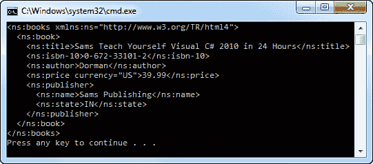

从 www.wowebook.com 下载

第 14 小：处理 XML

`FirstNode` 和 `LastNode` 属性分别返回第一个和最后一个子节点，而 `NextNode` 和 `PreviousNode` 属性允许你在节点集合中向前向后移动。`Parent` 属性允许你直接导航到父节点。

列表 14.9 展示了使用这些导航属性的示例，使用了列表 14.1 中所示 XML 的简化版本。

列表 14.9 

使用 XElement 的导航属性

```csharp
XElement document = new XElement("book", 
new XElement("title", "Sams Teach Yourself Visual C# 2010 in 24 Hours"), 
new XElement("isbn-10", "0-672-33101-2"), 
new XElement("author", "Dorman"), 
new XElement("price", new XAttribute("currency", "US"), 39.99M));

Console.WriteLine(document.LastNode);
Console.WriteLine(document.FirstNode); 
Console.WriteLine(document.LastNode.Parent); 
Console.WriteLine(document.LastNode.PreviousNode); 
Console.WriteLine(document.FirstNode.NextNode);
```

`XElement` 还提供了 `FirstAttribute` 和 `LastAttribute` 属性，它们返回与调用 `XElement` 关联的第一个和最后一个属性。如果元素不包含任何属性，这两个属性都将返回 `null`；如果元素仅包含一个属性，它们都返回相同的值。当你检索到第一个或最后一个属性后，可以使用 `NextAttribute` 和 `PreviousAttribute` 属性在属性集合中向前向后移动。

尽管这些属性很方便，但它们并没有提供很大的灵活性。如果你将 XML 树中的每个节点都视为节点序列，那么就可以使用你在第 12 小时“理解查询表达式”中使用过的相同 LINQ 查询。这是完全可能的，因为每个节点集合都是一个 `IEnumerable<T>` 实例。

列表 14.10 展示了如何对从列表 14.2 创建的 `XElement` 执行简单的 LINQ 查询。

列表 14.10 

针对 XElement 的 LINQ 查询

```csharp
foreach (var o in document.Elements().
Where(e => (string)e.Element("author") == "Dorman")) 
{
    Console.WriteLine(o); 
}
```

列表 14.10 所示的代码利用了 `Elements` 方法来返回当前 `XElement` 所有子元素的 `IEnumerable<XElement>` 序列。

在这种情况下，所有子元素都会被返回；但是，如果提供名称作为参数，则只会返回具有相同名称子元素。

### LINQ to XML 和 XPath 查询

当使用 `System.XML` 提供的传统 XML DOM 类时，必须使用 XPath 查询来选择节点集合或单个节点。在 LINQ to XML 中，这不再是必要的，但通过 `System.Xml.XPath` 命名空间提供的一组扩展方法得到了支持。

这些扩展方法是：

- **CreateNavigator**——为 `XNode` 创建 `XPathNavigator`。
- **XPathEvaluate**——评估 XPath 表达式并返回一个对象。
- **XPathSelect**——使用 XPath 表达式选择 `XElement`。
- **XPathSelectElements**——使用 XPath 表达式选择元素集合。

*顺便说一下*

#### 选择 XML

通过遵循以下步骤，你将看到如何使用 LINQ to XML 选择特定的元素。

1. 将上一个练习中打印 `XElement` 实例内容的语句替换为列表 14.10 所示的代码。
2. 使用 Ctrl+F5 运行应用程序。输出应该看起来像图 14.5。
3. 修改 `XElement` 实例，使用 `Load` 方法从名为 `books.xml` 的文件加载数据。
4. 修改 `foreach` 语句仅打印所有 元素的标题。
5. 再次使用 Ctrl+F5 运行应用程序。输出应该类似于图 14.6。

将这一切结合起来，就可以执行相当复杂的查询，返回已**重塑**或从一种表示转换为另一种表示的 XML。例如，列表 14.11 显示的 XML 可以重塑为列表 14.12 所示的内容。

列表 14.11 

源 XML

```xml
<books> 
<book title="Sams Teach Yourself Visual C# 2010 in 24 Hours" author="Dorman" /> 
<book title=".NET Language Runtime Unleashed" author="Burton" /> 
<book title="ASP.NET 2.0 Unleashed" author="Walther" /> 
<book title="ASP.NET 3.5 Unleashed" author="Walther" /> 
<book title="C# 3.0 Unleashed: With the .NET Framework 3.5" author="Mayo" /> 
<book title="C# Unleashed" author="Mayo" /> 
</books>
```

列表 14.12 

目标 XML

```xml
<books> 
<author name="Dorman">
<book title="Sams Teach Yourself Visual C# 2010 in 24 Hours"/>/> 
</author> 
<author name="Burton">
<book title=".NET Language Runtime Unleashed" /> 
</author>
</books>
```


## 修改 XML

323

```xml
<author name="Walther">
  <book title="ASP.NET 2.0 Unleashed" />
  <book title="ASP.NET 3.5 Unleashed" />
</author>
<author name="Mayo">
  <book title="C# 3.0 Unleashed: With the .NET Framework 3.5" />
  <book title="C# Unleashed" />
</author>
</books>
```

当使用列表 14.13 所示的 LINQ to XML 查询时，假设它已经加载到一个名为 `books` 的 `XElement` 中。

列表 14.13
使用 LINQ 查询转换源 XML

```csharp
XElement booksByAuthor = new XElement("books",
  from book in books.Elements("book")
  group book by (string)book.Attribute("author") into author
  select new XElement("author", new XAttribute("name", (string)author.Key),
    from book in author
    select new XElement("book",
    new XAttribute("title", (string)book.Attribute("title")))));
```

## 修改 XML

虽然创建和选择 XML 非常重要，但修改这些 XML 同样重要。使用 `XNode` 及其派生类提供的方法可以轻松实现这一点。在修改 XML 时，导航到要更改的节点的技术会影响修改发生的时间。当使用上一节开头所示的属性（如 `FirstNode` 或 `LastNode`）时，结果会在你调用它们时产生。如果你删除或替换节点，该操作将立即在内存中持有的 XML 树中执行。当对 XML 使用查询时，修改方法会在枚举查询时应用到查询表达式的结果。这遵循了 LINQ 默认的延迟查询执行行为。

早些时候你已经看到如何使用 `SetElementValue` 和 `SetAttributeValue` 方法来添加新元素或属性、删除元素或属性，或更改现有元素或属性的值。你还可以使用 `SetValue` 方法来更改当前元素或属性的值。列表 14.14 所示的代码使用 `SetValue` 来更改 `price` 元素的内容。

列表 14.14
使用 SetValue

```csharp
XElement books = XElement.Load("books2.xml");
XElement book = books.Elements("book").
  FirstOrDefault(b => (string)b.Element("author") == "Dorman");
book.Element("price").SetValue(34.99);
```

从 www.wowebook.com 下载

324
第 14 小节：处理 XML

替换数据同样简单，可以使用 `ReplaceAll`、`ReplaceAttributes`、`ReplaceNodes` 或 `ReplaceWith` 方法。`ReplaceAll` 方法替换当前元素的所有子节点和属性，而 `ReplaceAttributes` 和 `ReplaceNodes` 方法分别替换所有属性和子节点。

### ReplaceWith 和子节点

`ReplaceWith` 方法仅用新元素替换当前元素。如果你要替换的元素具有子节点，这些子节点不会自动包含在新元素的子中。

*注意！*

`ReplaceWith` 方法仅用指定的元素替换当前元素。列表 14.15 所示的代码使用 `ReplaceWith` 方法用新元素完全替换 `price` 元素。

列表 14.15
使用 ReplaceWith

```csharp
XElement books = XElement.Load("books2.xml");
XElement book = books.Elements("book").
  FirstOrDefault(b => (string)b.Element("author") == "Dorman");
book.Element("price").ReplaceWith(new XElement("price", 34.99));
```

要删除当前元素或属性，请使用 `Remove` 方法。要删除与当前元素关联的所有属性，使用 `RemoveAttributes` 方法。要删除所有子节点，使用 `RemoveNodes` 方法。要从当前元素中同时删除子节点和属性，使用 `RemoveAll` 方法。列表 14.16 所示的代码删除了包含值等于 "Dorman" 的作者元素的 `book` 元素。

列表 14.16
使用 Remove

```csharp
XElement books = XElement.Load("books2.xml");
books.Elements("book").
  FirstOrDefault(b => (string)b.Element("author") == "Dorman").Remove();
```

最后，添加新元素使用 `Add`、`AddAfterSelf`、`AddBeforeSelf` 或 `AddFirst` 方法。`Add` 方法将提供的内容作为子节点添加到当前元素，而 `AddFirst` 将内容作为第一个子节点。`AddAfterSelf` 和 `AddBeforeSelf` 方法分别将内容作为兄弟节点添加到当前节点之后或之前。列表 14.17 所示的代码为 `book` 元素添加了新的子元素。

从 www.wowebook.com 下载

325
修改 XML

列表 14.17
使用 Add

```csharp
XElement books = XElement.Load("books2.xml");
XElement book = books.Elements("book").
  FirstOrDefault(b => (string)b.Element("author") == "Dorman");
book.Add(new XElement("summary",
```

### 动手试一试
修改 XML

要使用 LINQ 修改 XML，请遵循以下步骤。在此练习中，你将探索如何修改 XML。
1. 在完成上一个练习第 4 步编写的元素语句后，添加一个名为 `summary` 的新子元素。
2. 运行应用程序，输出应该像图 14.7 所示。
3. 如果你正在替换的元素具有子节点，这些子节点不会自动包含在新元素的子中。重复练习，使用以下元素：
```xml
<name>Sams Publishing</name>
<state>IN</state>
```


从 www.wowebook.com 下载

326
总结：处理 XML

### 总结

在本节中，你学习了如何使用 LINQ to XML 处理 XML。你学习了 `XElement` 类如何创建 XML 文以及 `XNamespace` 类如何简化命名空间的操作。接下来，你学习了如何使用 `XNode` 派生类的属性和方法来选择和查询 XML。最后，你学习了通过删除、替换以及创建元素和属性来修改 XML。

### 问答

Q.*什么是 XML 对象模型 (DOM)？
A. DOM 提供了一种常见的内存数据表示方式，通常用于将 XML 数据加载到内存中以更改其结构、添加删除元素或修改元素包含的数据。

Q.*什么是文档根节点？
A. 文档根节点是包含文档的顶级节点。

Q.*什么是子节点和兄弟节点？
A. 当节点具有相同的父节点时，它们是该父节点的子节点。处于同一级的节点是兄弟节点。

Q.*什么是 XElement 类？
A. XElement 类表示 XML 元素，并且是最常用的类，因为它可以表示文档或文档中的元素。

### 测验

1. SetElementValue 可以执行哪三个操作？
A. 添加新子元素、更改现有子元素的值或删除子元素。如果提供的名称尚未作为子元素存在，则将为你创建它；否则，子元素的值将更改为你指定的值。如果值为 null，则子元素将被删除。在修改或删除子元素或属性时，具有指定名称的第一个将被修改或删除。

2. 是否可以为命名空间显式定义命名空间缀？
A. 是的，可以通过包含 xmlns 属性来指定命名空间缀。

3. XElement 和 XAttribute 类处理 XML 编码和解码吗？
A. 是的，XElement 和 XAttribute 类会自动处理包含无效 XML 字符的文本的编码和解码。

### 练习

1. 在 AddressBook 项目的 Contact 类中添加一个 Save 方法，将当前实例以 XML 保存到文件中。
2. 在 Contact 类中添加一个静态 Load 方法，从给定的 XML 文件加载并从中创建一个新的 Contact 实例。


## 第 15 小时：数据库操作

*在本小时内你将学习：*

- 理解 ADO.NET
- 使用 LINQ to DataSet
- 使用 LINQ to SQL

与数据库交互是许多应用程序需要的操作。**数据库**简单来说就是一个数据存储库，类似于文本文件或 XML 文件。正如你所想象的，以这种方式使用文件存储数据并不总是最佳方法。因此，大多数应用程序使用**关系型数据库**，它将数据组织成表、行和记录。每个表由行组成，每行代表一条特定的记录。行被进一步组织成列，表中的每行都具有相同的列结构。

.NET Framework 通过 ADO.NET 提供了一系列丰富的类，用于数据库交互。ADO.NET 是一个专门设计用于简化编写使用数据库的应用程序的对象的库，以及 LINQ to ADO.NET。

在本小时中，你将简要学习 ADO.NET 和 LINQ to ADO.NET。

### 前提条件

本小时中的所有示例和练习都要求你已经安装了 SQL Server 或 SQL Server Express（2005 或更高版本）。如果你已经安装了 Visual Studio 2010 Premium 或 Ultimate，则应该已经安装了 SQL Server 2008 Express。如果没有，你可以从书中附带的 DVD 安装 SQL Server 2008 Express。

在安装 SQL Server Express（或 SQL Server）后，你需要安装 AdventureWorks 示例数据库。这些示例使用了 AdventureWorksLT 版本的 OLTP 数据库，你可以从 http://msftdbprodsamples.codeplex.com/ 安装。

### 理解 ADO.NET

ADO.NET 库是一个丰富的框架，允许你构建可以检索和更新关系型数据库中信息的应用程序。为了符合语言和平台独立的理念，ADO.NET 构建在数据提供程序（data providers）的概念之上。ADO.NET 支持的每个数据库系统（如 SQL Server、Oracle 和 DB2）都有一个数据提供程序，该程序实现了连接数据库、执行查询和更新数据的机制。由于每个提供程序都实现了相同的接口，因此你可以编写与底层数据库无关的代码。

ADO.NET 的主要类之一是 DataSet，它代表数据库的一部分。DataSet 不需要与数据库保持连续连接，使你能够以离线的方式进行工作。要更新数据库和 DataSet，你需要定期将 DataSet 重新连接到其父数据库并执行任何所需的更新。

#### ADO.NET 数据提供程序

ADO.NET 数据提供程序封装了连接数据库、执行命令和检索结果所需的逻辑。它在底层数据源和你的应用程序代码之间提供了一个轻量级层。

.NET Framework 目前带有五个数据提供程序，每个提供程序都在自己的命名空间中：

- SQL Server 数据提供程序 (System.Data.SqlClient)
- OLE DB 数据提供程序 (System.Data.OleDb)
- ODBC 数据提供程序 (System.Data.Odbc)
- Oracle 数据提供程序 (System.Data.OracleClient)
- EntityClient Provider (System.Data.EntityClient)

尽管 SQL Server 和 Oracle 都支持 OLE DB，但你应该使用特定的 SQL Server 或 Oracle 提供程序，因为它们针对这些数据库系统进行了优化。

*顺带一提*

为了完成这一切，DataSet 必须表示数据库表以及表之间的关系。数据库表集合可以通过 `Tables` 属性可用，每个表由一个 `DataTable` 实例表示。`Relations` 属性是 `DataRelation` 实例的集合，每个 `DataRelation` 代表两个表之间的关系。

`DataTable` 通常是针对数据库进行查询的结果，代表该数据库中的实际表。数据库表中的每一列都表示为 `DataColumn`，通过 `DataTable` 的 `Columns` 属性暴露。`DataTable` 还包含一个 `Rows` 属性，它为数据库的的每个实际行返回一个 `DataRow` 对象。

如果你将 DataSet 视为数据库的抽象，那么你需要一种方法来桥接 DataSet 和底层数据库之间的差距。这是通过 `DataAdapter` 实现的，它用于在数据源和 DataSet 之间交换数据，主要通过 `Fill` 和 `Update` 方法实现。这样做的好处是 DataSet 可以代表来自多个数据库的表。

#### 使用 Data Reader 进行只读访问

DataSet 和 DataAdapter 都允许与数据库进行双向交互，允许你同时读取和写入数据。如果你只需要读取数据（这很常见），你可以创建一个 `DbDataReader` 或其派生类之一（如 `SqlDataReader`）。创建 DataReader 的最简单方法是使用 `DbCommand` 提供的 `ExecuteReader` 方法。

`DbDataReader` 提供对表集合的连接、前向且只读的访问，通常被称为“火软光标”（fire hose cursor）。（“火软””名称是因为以快速、前向、连续流的方式访问数据。因此，它们是轻量级对象，非常适合填充控件，然后断开数据库连接。）

最后，你需要通过 `DbCommand` 表示连接。每个数据提供程序都提供了 `DbConnection` 和 `DbCommand` 的自定义子类。例如，SQL Server 数据提供程序提供了 `SqlConnection` 和 `SqlCommand` 类。

要使用 ADO.NET，你需要确保项目已对 `System.Data` 程序集有引用，并且包含了你所用数据提供程序的正确命名空间。

*注意！*

列表 15.1 显示了如何使用 ADO.NET 和 SQL Server 数据提供程序提供的类来执行查询。

列表 15.1 一个简单的 ADO.NET 查询
using (SqlConnection connection = new SqlConnection())
{
    connection.ConnectionString = @"Integrated Security=SSPI;database=AdventureWorks2008;server=(local)\SQLEXPRESS";
    try
    {
        using (SqlCommand command = new SqlCommand())
        {
            command.Connection = connection;
            command.CommandText = @"SELECT * FROM [AdventureWorks2008].[SalesLT].[Customer] WHERE [CompanyName] = 'A Bike Store'";
            connection.Open();
            SqlDataReader reader = command.ExecuteReader();
            while (reader.Read())
            {
                Console.WriteLine("{0} {1} {2}",
                    reader.GetString(2),
                    reader.GetString(3),
                    reader.GetString(5));
            }
            connection.Close();
        }
    }
    catch (SqlException e)
    {
        Console.WriteLine("发生错误：{0}", e.Message);
    }
}

### 连接池

大多数数据提供程序还提供了连接池的支持。你可以将连接池理解为一组可用数据库连接。当应用程序需要连接时，提供程序从池中提取下一个可用的连接。当应用程序关闭连接时，连接将返回池中，供下一个需要连接的应用程序使用。


## 理解 LINQ to ADO.NET

333

图 15.1
使用 ADO.NET 的结果

### 尝试一下
 使用 ADO.NET

要使用 SQL.NET Data Provider 插入记录并查询表，请按照以下步骤操作。

1. 创建一个新的控制台应用程序。
2. 使用 using 指令包含 System.Data.SqlClient 命名空间。
3. 在 Program.cs 文件的 Main 方法中，实现列表 15.1 所示的代码。
4. 在第二个 using 语句（声明 SqlCommand 实例的语句）之前，编写一个 using 语句来创建 SqlCommand，以便向数据库插入记录。不要调用命令的 ExecuteReader 方法，而要使用 ExecuteNonQuery 方法，因为该 SQL 语句不返回任何数据。对 CommandText 属性使用以下文本：
`@”INSERT INTO [AdventureWorksLT2008].[SalesLT].[Customer] (NameStyle, Title, FirstName, LastName, CompanyName, PasswordHash, PasswordSalt, ModifiedDate) VALUES (0, ‘Mr.’, ‘Scott’, ‘Dorman’, ‘A Bike Store’, ‘aaaaa’, ‘aaa’, ‘“ + DateTime.Now.ToString(“G”) + “‘)”;`
5. 使用 Ctrl+F5 运行应用程序。输出应该类似于图 15.1 所示。

## LINQ to ADO.NET

LINQ to ADO.NET 实际上是三种独立的技术，允许你与关系型数据库进行交互。图 15.2 显示了 LINQ to ADO.NET 技术与其他启用 LINQ 的数据源以及 C# 等高级编程语言之间的关系。

### 使用 LINQ to DataSet

LINQ to DataSet 构建在现有的 ADO.NET 架构之上，允许你快速方便地对存储在 DataSet 中的数据构建查询。它并不是为了替代应用程序中的 ADO.NET，而是为了让你能够使用 LINQ 语法编写查询，并填补 DataSet 有限查询能力留下的空白。

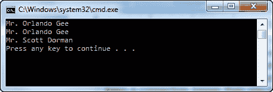

334
第 15 小节：使用数据库

- .NET 语言
- 启用 LINQ 的数据源
- LINQ to ADO.NET 技术
- LINQ
    - LINQ to Objects
    - LINQ to DataSet
    - LINQ to SQL
    - LINQ to Entities
    - LINQ to XML

图 15.2
LINQ to ADO.NET

要使用 LINQ to DataSet，必须先填充 DataSet。数据加载后，你就可以开始使用已在 LINQ to Objects（第 12 小节，“理解查询表达式”）和 LINQ to XML（第 14 小节，“处理 XML”）中学学的技巧对对其进行查询。这些查询可以针对 DataSet 中的单表执行，也可以使用 Join 和 GroupJoin 查询操作符针对多个表执行。

列表 15.2 在功能上与列表 15.1 所示的查询等效，但使用了 LINQ to DataSet 查询。此代码首先创建一个 SqlDataAdapter，然后用数据填充 DataSet 实例。在 ADO.NET 和 LINQ to DataSet 中此代码都是必要的。然而，通过在 DataTable 上使用 AsEnumerable 扩展方法，你可以对数据执行标准的 LINQ 查询。

列表 15.2
一个简单的 LINQ to DataSet 查询
```csharp
string connectionString = @”Integrated Security=SSPI; database=AdventureWorksLT2008;server=(local)\\SQLEXPRESS”;
string selectSQL = @”SELECT * FROM [AdventureWorksLT2008].[SalesLT].[Customer]”;
SqlDataAdapter adapter = new SqlDataAdapter(selectSQL, connectionString); 
DataSet ds = new DataSet(); 
adapter.Fill(ds); 

foreach (var customer in ds.Tables[0].AsEnumerable(). 
Where(row => row.Field<string>(“CompanyName”) == “A Bike Store”)) 
{
Console.WriteLine(“{0} {1} {2}”, 
customer.Field<string>(“Title”), 
customer.Field<string>(“FirstName”), 
customer.Field<string>(“LastName”));
}
```

跳转到 .
访问第 24 小节，“下一步：Silverlight、PowerShell 和 Entity Framework”，以获取关于 LINQ to Entities 和 Entity Framework 的更多信息。

335
理解 LINQ to ADO.NET

*注意！*

正如 LINQ to XML 添加了 XML 特有的扩展一样，LINQ to DataSet 也添加了几个针对 DataSet 特有的扩展。这些扩展使得对一组 DataRow 对象进行查询变得更加容易，允许你比较行序列或直接访问 DataRow 的列值。

### 必要的引用
要使用 LINQ to DataSet，你需要确保项目引用了以下程序集：
- System.Core
- System.Data
- System.Data.DataSetExtensions
- System.Data.Common 或 System.Data.SqlClient

## LINQ to SQL

LINQ to SQL 允许你使用与内存集合或任何其他数据源相同的语法来编写查询。尽管 ADO.NET 将数据库映射到概念模型，但 LINQ to SQL 直接映射到数据库。当你的应用程序执行时，LINQ 查询会被翻译成 SQL 语言，然后发送到数据库执行并将结果返回给对象。

要使用 LINQ to SQL，你必须先创建对象模型。有两种方法可以实现：
- 对象关系设计器（O/R Designer），它是 Visual Studio 的一部分，提供了一个从现有数据库创建对象的丰富用户界面。O/R Designer 只支持 SQL Server 2000、2005 和 2008 数据库。
- SQLMetal 命令行工具，应用于 O/R Designer 不支持型数据库。

当你决定如何生成对象模型时，需要决定生成什么类型的代码。使用 O/R Designer，可以生成基于属性的 C# 代码。如果你使用 SQLMetal 命令行工具，还可以生成包含映射元数据的 XML 文件。

336
第 15 小节：使用数据库

*顺便说*
*注意！*

### 创建对象模型
实际上还有第三种创建对象模型的方法，即使用编辑器手动编写对象模型。这种是不推荐的，特别是在为现有数据库创建对象模型时很容易出错。

你可以使用编辑器修改或优化由关系设计器或 SQLMetal 命令行工具生成的代码。

当你创建了对象模型，就可以通过编写 LINQ 查询在应用程序中使用它。列表 15.3 显示了从定义 DataContext 到执行查询并观察结果的完整示例，结果与 15.1 和 15.2 所示的代码相同。

列表 15.3
一个简单的 LINQ to SQL 查询
```csharp
DataContext dataContext = new DataContext(@”Integrated Security=SSPI; database=AdventureWorksLT2008;server=(local)\\SQLEXPRESS”);
Table<Customer> customers = dataContext.GetTable<Customer>();
IQueryable<Customer> query =
from customer in customers 
where customer.CompanyName == “A Bike Store” 
select customer;

foreach(Customer customer in query) 
{
Console.WriteLine(“{0} {1} {2}”, 
customer.Title, 
customer.FirstName, 
customer.LastName);
}
```

### 必要的引用
要使用 LINQ to SQL，你需要确保项目引用了以下程序集：
- System.Core
- System.Data.Linq

你还需要包含 System.Linq 和 System.Data.Linq 命名空间。

你必须首先建立对象模型与数据库之间的连接，这是通过 DataContext 完成的。然后创建一个 Table<T> 类作为你要查询的表。虽然实际上并非如此，但你可以将 DataContext 认为是通到数据库的连接。


理解 LINQ to ADO.NET

类似于 `DBConnection`，且 `Table<T>` 类似于 `DataTable`。然后你定义并随后执行你的查询。

亲自动试

使用 LINQ to SQL 工作

通过遵循以下步骤，你将使用 O/R Designer 和 LINQ to SQL 插入一条记录，然后查询一个表。

1. 创建一个新的控制台应用程序（Console application）。
2. 使用 `using` 指令包含 `System.Data.Linq` 命名空间。
3. 使用 O/R Designer 创建对象模型。要执行此操作，通过选择 LINQ to SQL Classes 向你的项目添加新项，如图 15.3 所示。将文件命名为 `AdventureWorksLT`。
4. 在生成的编辑器中，点击“服务器资源管理器”（Server Explorer）链接以显示 Visual Studio 服务器资源管理器工具窗口，如图 15.4 所示。
5. 在图 15.5 所示的服务器资源管理器窗口中，添加新的数据连接（Data Connection）。
6. 当显示图 15.6 所示的添加连接”对话框时，点击“更改”（Change）按钮选择 Microsoft SQL Server 作为数据源。

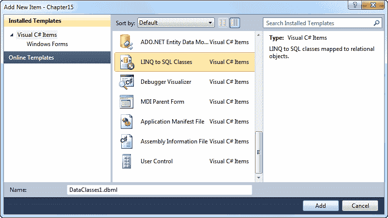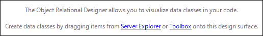

图 15.3 添加项对话框
图 15.4 O/R Designer
图 15.5 服务器资源管理器
图 15.6 添加连接对话框
图 15.7 用于 SQL Server 的添加连接对话框

7. 添加连接对话框现在应该如图 15.7 所示。请确保按照所示设置服务器名称（Server name）和数据库名称（database name）字段，并点击“OK”按钮。

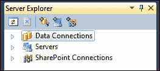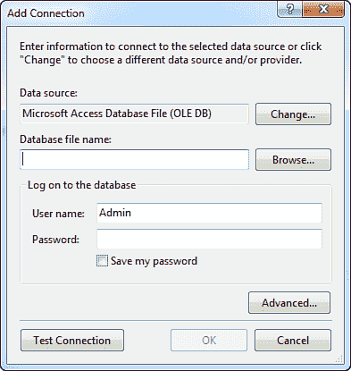

图 15.8 展开的数据连接
图 15.9 显示表格的 O/R Designer

8. 展开刚刚添加的连接以查看可用表，如图 15.8 所示。
9. 选择 `Customer` 表并将其拖到 `AdventureWorksLT.dbml` 编辑器窗口，如图 15.9 所示。这创建了表示 `Customer` 表的实体类。
10. 在 `Program.cs` 文件的 `Main` 方法中，实现列表 15.3 所示的代码。
11. 使用 `Ctrl+F5` 运行应用程序。输出应该类似于图 15.10 所示。


图 15.10 执行查询的结果

选择数据（也称为**投影**，projection）只需通过编写 LINQ 查询并然后执行它即可完成。LINQ to SQL 还允许你向数据库中添加、修改或删除数据。每当你使用 LINQ to SQL 进行更改时，你只是在修改本地缓存。在调用 `DataContext` 实例上的 `SubmitChanges` 方法之前，你所做的更改不会被发送到数据库。

要向数据库添加新记录，你只需创建适当数据模型对象的新实例，并调用 `Table<T>` 实例的 `InsertOnSubmit` 方法。列表 15.4 中的代码显示了向 `Customers` 表添加新 `Customer` 记录的示例，它等同于你之前编写使用 ADO.NET 插入新记录的代码。

列表 15.4 添加新记录
```csharp
DataContext dataContext = new DataContext(@"Integrated Security=SSPI;database= AdventureWorksLT2008;server=(local)\\SQLEXPRESS");
Table<Customer> customers = dataContext.GetTable<Customer>();
Customer customer = new Customer(); 
customer.NameStyle = true; 
customer.Title = "Mr."; 
customer.FirstName = "Scott"; 
customer.LastName = "Dorman"; 
customer.PasswordHash = "aaaaa"; 
customer.PasswordSalt = "aaaa"; 
customer.ModifiedDate = DateTime.Now;
customers.InsertOnSubmit(customer);
dataContext.SubmitChanges();
```

更新现有实体仅需使用 LINQ to SQL 查询从数据库检索特定对象，然后修改其属性，如列表 15.5 所示。


列表 15.5 更新记录
```csharp
DataContext dataContext = new DataContext(@"Integrated Security=SSPI;database= AdventureWorksLT2008;server=(local)\\SQLEXPRESS");
Table<Customer> customers = dataContext.GetTable<Customer>();
Customer customer = (from customer in customers
                    select customer).First();
customer.Title = "Mr.";
```

更新现有实体只需使用 LINQ to SQL 查询从数据库检索特定对象，然后修改其属性，如列表 15.5 所示。

删除项目同样简单，使用 LINQ to SQL 查询并然后执行删除操作。

列表 15.6 删除记录
```csharp
DataContext dataContext = new DataContext(@"Integrated Security=SSPI;database= AdventureWorksLT2008;server=(local)\\SQLEXPRESS");
Table<Customer> customers = dataContext.GetTable<Customer>();
Customer customer = (from customer in customers
                    select customer).First();
customers.DeleteOnSubmit(customer);
dataContext.SubmitChanges();
```

删除项目
使用 LINQ to SQL 查询从数据库检索特定对象，然后修改其属性，如列表 15.5 所示。

列表 15.7 删除记录
```csharp
Queryable<Customer> query = from customer in customers
                            where customer.LastName == "Dorman";
customer.```
```

删除项目
使用 LINQ to SQL 查询并然后执行删除操作。

```csharp
DataContext dataContext = new DataContext(@"Integrated Security=SSPI;database= AdventureWorksLT2008;server=(local)\\SQLEXPRESS");
Table<Customer> customers = dataContext.GetTable<Customer>();
Queryable<Customer> query = from customer in customers
                            where customer.LastName == "Dorman";
foreach (Customer customer in query)
{
    customers.DeleteOnSubmit(customer);
}
dataContext.SubmitChanges();
```

自定义 DataContext
要创建自定义上下文，你只需继承 `DataContext` 并提供 `Table<T>` 成员。列表 15.7 显示了用于 `AdventureWorksLT` 的强类型 DataContext。

```csharp
Table<Customer> Customers;
public Table<Order> Orders;
```

列表 15.7 自定义 DataContext
```csharp
public partial class AdventureWorksLT
{
    public Table<Customer> Customers;
    public Table<Order> Orders;
    public AdventureWorksLT(string connection) : base(connection) { }
}
AdventureWorksLT dataContext = new AdventureWorksLT(@"Integrated Security=SSPI;database= AdventureWorks;server=(local)\\SQLEXPRESS");
Queryable<Customer> query = from customer in dataContext.Customers
                            where customer.CompanyName == "Bike Store"
                            select customer;
foreach (Customer customer in query)
{
    Console.WriteLine("{0} {1} {2}", customer.Title, customer.FirstName, customer.LastName);
}
```

 总结
在本节中，你学习了 ADO.NET 以及 LINQ to ADO.NET 技术如何轻松地工作。你学习了 ADO.NET 的基础，并在此基础上了解 LINQ to DataSet 如何对数据进行复杂查询。你随后学习了 LINQ to SQL 如何允许你创建一个表示数据库的对象模型，从而轻松地查询、添加和删除数据。最后，你看到了如何为 LINQ to SQL 创建自定义上下文。

 问答
**什么是关系型数据库？**
答：关系型数据库是组织成表、行和记录仓库。

**什么是 ADO.NET？**
答：ADO.NET 库是一个丰富的框架，能够让你轻松构建可以检索和更新信息的应用程序。

**ADO.NET 需要持续连接到数据库吗？**
答：不需要，大多数 ADO.NET 类的设计使其不需要持续连接数据库，允许你以离线的方式工作。DataReader 类及其任何派生类都需要持续连接数据库。

**什么是 LINQ to ADO.NET？**
答：LINQ to ADO.NET 实际上是三种独立的技术，允许你与数据库进行交互：LINQ to DataSet、LINQ to SQL 和 LINQ to Entities。

 练习
测验
1. .NET Framework 自带了哪些 ADO.NET 数据提供程序？
2. 使用 LINQ to DataSet 需要哪些引用？
3. 使用 LINQ to SQL 需要哪些引用？
4. 创建自定义 DataContext 类的处是什么？


344

第 15 小时：数据库数据库

答案

1. .NET Framework 目前提供了五个数据提供程序，支持 SQL Server、Oracle、任何符合 OLE DB 的数据库、任何符合 ODBC 的数据库以及实体数据模型（它是 Entity Framework 的一部分）。

2. LINQ to DataSet 需要引用以下程序集：
- System.Core
- System.Data
- System.Data.DataSetExtensions
- System.Data.Common 或 System.Data.SqlClient

3. LINQ to DataSet 需要引用以下程序集：
- System.Core
- System.Data.Linq

4. 创建自定义的 DataContext 有助于通过提供各种 `Table<T>` 集合作为公共成员，确保你只能访问由底层数据库定义的表。

练习

本章没有练习题。

从 www.wowebook.com 下载

第四部分

使用 Visual Studio 构建应用程序

第 16 小时：在 Visual Studio 中调试 347

第 17 小时：构建 Windows 应用程序 363

第 18 小时：使用数据绑定与验证 385

第 19 小时：构建 Web 应用程序 407

从 www.wowebook.com 下载

347

第 16 小时

在 Visual Studio 中调试

*在本小时你将学到：*

- 为代码编写注释
- 编译器和运行时错误
- 在 Visual Studio 中调试
- 数据可视化

在完成第 1 小时“.NET Framework 和 C#”之后，你学习了 Visual Studio 是一个完整的集成开发环境，它实际上由许多不同的工具组成。到目前为止，你主要只使用了 Visual Studio 内部的代码编辑器和编译器工具。还有另一组同样重要的工具：调试工具，统称为 Visual Studio 调试器。

这些工具允许你在应用程序运行时检查其内部状态。 调试器允许你执行的某些任务包括：

- 检查你的代码
- 控制应用程序的执行
- 评估和修改变量
- 在发生异常时查看变量内容

在本小时中，你将学习使用 Visual Studio 调试器的基础知识，以及如何使用它来帮助你定位和修复应用程序的缺陷（即 bug）。所有的调试工具都可以通过 Visual Studio 中的“调试”菜单访问，包括不同的调试器窗口和对话框，这些窗口让你能够查看并修改有关应用程序的信息。

从 www.wowebook.com 下载

348

第 16 小时：在 Visual Studio 中调试

*顺带一下*

为代码编写注释

虽然为代码注释并不是 Visual Studio 调试器的功能，但它是从源头上减少 bug 最简单的方法之一。良好的注释有助于更容易理解代码在做什么，更重要的是理解它*为什么要*这样做。注释是给程序员阅读的，应该是清晰且精确的。一个难以理解或错误的注释与完全没有注释并没好到哪里。

XML 注释

你应该养成习惯使用的另一种注释形式是 XML 注释。XML 注释通常以每行三个正斜杠（///）开始。这些斜杠之后的所有内容必须是有效且格式良好的 XML。最简单的 XML 注释看起来如下：

/// <summary> 
/// 这是一个总结注释，通常用一或两个短句描述 
/// 方法或属性的功能。 
/// </summary>

这些注释通常用于使用如 SandCastle 等外部工具为你的代码创建文档。XML 注释的另一个优秀特性是，Visual Studio 代码编辑器会自动使用它们为你的代码生成 IntelliSense 提示框。

XML 注释也可以以 `/**` 字符序列开始并以 `*/` 结束来界定。

注释只是 C# 编译器忽略的文本。注释在编译期间实际上会从代码文本中删除，因此对性能没有影响。为了让编译器识别文本为注释，它们必须以两个正斜杠（//）开头。斜杠右侧的所有内容（包括斜杠本身）都是注释。这意味着注释可以单独占一行，如下： 

// 这是一行整行注释。

它也可以出现在代码行的末尾，通常称为行尾注释，例如： 

string name; // 名字应该包含姓和名。

界定注释

C# 还支持一种由 C 语言语言风行的注释样式，这种样式只需要一个开始（/*）和一个结束（*/）注释字符序列；之间的所有内容（包括开始和结束字符序列）都被视为注释。

*顺带一下*

349

编译器和运行时错误

虽然这种注释样式可以用于单行注释，但它更常用于多行注释。例如，使用这种风格的多行注释将如下所示：

/* 这是一个注释的开始，跨越了
* 多行，但不需要将
* 字符到
. */

基本原理是相似的。你从主代码之外编写一个单元测试，用于测试单个“单元”（通常是方法或属性），以确保该方法能够可靠地产生正确的结果。

单元测试还让你能够放心地更改代码，并且这些更改没有改变预期的行为或结果。

编译器和运行时错误

错误会在应用程序的任何时候发生，包括在你编写时。这些错误是编译器错误或构建错误，实际上会阻止编译器成功编译你的代码。运行时错误发生在应用程序实际以异常形式执行时。

整数除法的一个基本规则是你不能将一个数字除以零。如果你尝试在编译时这样做，你会看到编译器错误，如图 16.1 所示。

为了方便地找到编译器错误的位置，你可以双击错误列表中的项直接跳转到代码中的该行。

单元测试

虽然注释良好的代码有助于维护代码，但记录和验证代码功能的另一种有效方法是编写单元测试。

有多种单元测试框架，包括 Visual Studio 自带的 MSTest 框架。无论你选择哪种单元测试框架

350

第 16 小时：在 Visual Studio 中调试

很可能，这并不是实际想要的结果的。相反，你想除以用户提供的除数，如列表 16.1 所示。此代码获取用户提供的值，将其转换为整数，然后将其作为除数。

列表 16.1

使用用户提供的除数进行除法

static void Main(string[] args) 
{
string input = Console.ReadLine(); 
int divisor = Convert.ToInt32(input); 
int x = 10 / divisor; 
Console.WriteLine(x);
}

- System.DivideZeroException: 尝试除零。
- System.FormatException: 输入字符串格式不正确。

在 Visual Studio 中调试

然而，如果你是在 Visual Studio 之外运行，你可以在异常发生的时间点调试应用程序，如图 16.2 所示。


FIGURE 16.1

编译器错误 

显示在 

错误列表中

从 www.wowebook.com 下载


## 在 Visual Studio 中进行调试

351


图 16.2 Visual Studio 调试器在异常处中断

### 在异常处中断

在调试会话期间，让应用程序在所有异常处中断可能并不是你预期的行为。这种行为是可配置的，允许你仅在特定异常处中断、仅在未处理的异常处中断，以及其他一些选项。

你可以通过调试（Debug）菜单上的异常（Exceptions）选项来访问这些设置。

*顺便一下*

Visual Studio 调试器在发生 `DivideByZeroException` 的点挂起（通常称为“中断”）了程序执行。包含该异常的行默认以黄色高亮，代码编辑器左侧的灰色条（称为边距）包含一个指示执行位置的黄色箭头。图 16.3 详细展示了异常助手（Exception Assistant）也会出现，并显示异常类型、异常消息、故障排除提示和纠正措施。在这种情况下，异常助手指示你尝试除以零，且没有纠正措施。

除了异常助手外，Visual Studio 还包含了许多帮助你识别和消除程序错误的工具；主要的工具如下：

- 变量窗口
- 数据提示（DataTips）
- 立即窗口（Immediate window）
- 断点
- 执行控制

352
第 16 小节：在 Visual Studio 中调试

### 变量窗口

变量窗口在调试时显示变量的名称、值和数据类型。虽然在调试时查看变量的当前很有很有，但修改变量的值更有帮助。幸运的是，变量窗口允许你执行此操作。通过双击值列或使用编辑值（Edit Value）右键菜单，你可以编辑该变量的值。当值修改后，它将以红色显示，如图 16.4 所示。

Visual C# Express 提供了两个变量窗口：本地（Locals）窗口和监视（Watch）窗口。这些窗口在调试时显示在代码编辑器下方，可以通过调试窗口（Debug Windows）菜单访问。

带有 MSDN 版本的 Visual Studio

如果你使用的是 Visual Studio 的 MSDN 版本之一，你将拥有 Visual C# Express 版本不具备的几个额外功能。

除了本地和监视窗口外，你还有一个自动显示（Autos）窗口，它显示当前行和前一行代码中使用的变量。与本地窗口一样，调试器也会自动填充自动显示窗口。

虽然监视窗口允许你检查许多变量或表达式，但快速监视（Quick Watch）对话框允许你一次只检查一个变量或表达式，对于快速查看单个值或大型数据结构非常有用。

你拥有多个监视窗口，实际上有四个，而不是只有一个。

*顺便一下*


图 16.4 编辑值后的本地窗口


图 16.3 异常助手

353
在 Visual Studio 中调试

图 16.5 所示的本地窗口显示当前在作用域内的所有局部变量。

监视窗口允许你直接输入表达式。你可以输入的简单表达式是变量名；然而，调试器接受大多数有效的语言表达式。表达式评估器不接受 lambda 表达式或 LINQ 查询语法表达式。要在监视窗口中评估表达式，你可以执行以下操作：

- 点击空行中的“名称”列并输入变量名或表达式。
- 从代码编辑器将变量或表达式拖动到空行。
- 从选定的表达式使用“添加监视”（Add Watch）右键菜单。

#### 带有副作用的表达式

更改数据的表达式被称为具有副作用。当你将此类表达式输入监视窗口时，每当监视窗口评估该表达式时，副作用就会发生一次。如果你没有意识到该表达式具有副作用，这可能会导致意外的结果。

当已知表达式具有副作用时，它只在你第一次输入时会被评估一次。随后的评估会被禁用；但是，你可以通过点击值旁边出现的更新图标（形状像绿色圆圈内两个反方向循环的绿色箭头）来强制覆盖此行为。

调试器会自动调用属性 get 访问器来显示结果，因此具有副作用的属性可能会在调试期间引起意外行为。事实上，调试器假设属性 getter 遵循最佳实践，这意味着它们如下：

1. 快速
2. 无副作用
3. 绝不抛出异常

*注意！*


图 16.5 本窗口

354
354
第 16 小节：在 Visual Studio 中调试

### 使用数据提示

你也可以使用数据提示（DataTip）查看当前值，这是查看变量信息的较方便的方法之一。默认情况下，数据提示是瞬态的，当光标移开时它们会消失。数据提示也可以固定在源上，如图 16.6 所示。

通过点击“从源处取消固定”（Unpin from source）图标，你可以让数据提示浮动。固定的数据提示在任何调试会话期间均可见，如图 16.7 所示。

*你知道吗？*
使用立即窗口

立即窗口允许你评估表达式、执行语句、打印变量值以及许多其他操作。除了执行语言语句外，立即窗口还支持特定的 Visual Studio 命令。

例如，要显示异常发生时除数变量 `divisor` 的值，可以在立即窗口中输入以下语句：

> Debug.Print divisor
> ? divisor
> ? divisor

divisor

这些每个命令的结果如图 16.9 所示。你可以使用向上和向下方向键循环切换之前输入的命令。


图 16.6 数据提示


图 16.7 固定的数据提示


图 16.8 编辑时固定的数据提示

355
在 Visual Studio 中调试

### 数据提示

你还可以将数据提示导出为 XML 文件，与参与同一项目的其他开发者共享。

要导出数据提示，点击调试（Debug）菜单上的“导出数据提示”（Export DataTips），导航到你想保存 XML 文件的位置，为文件命名并点击确定。要导入数据提示，点击调试菜单上的“导入数据提示”（Import DataTips）并选择相应的 XML 文件。

[/content

### 理解断点

当你使用 Visual Studio 调试器调试应用程序时，应用程序要么正在执行（运行），要么处于中断模式。中断模式发生于调试器由于异常、用户定义的断点或手动中断执行而中断程序执行。大多数调试器功能仅在应用程序处于中断模式时可用。


356

第 16 小时：在 Visual Studio 中调试

要手动中断程序的程序的执行，你可以使用调试菜单中的“全部中断”（Break All）。这会导致调试器停止所有在调试器下运行的程序的执行。

顾如其名，断点（breakpoint）告诉调试器，你的应用程序应该在某一点中断执行。当设置了断点后，该行默认会显示为红色，并且编辑器边距中显示一个实心红圆圈，如图 16.10 所示。

设置断点有多种方法。要在整行上设置断点，你可以点击代码行旁边的边距，将鼠标光标悬停在代码行上使用“插入断点”（Insert Breakpoint）上下文菜单选项，或者将光标（垂直线表示文本光标）放在代码行中并按 F9 键。

设置断点后，你的应用程序每次在调试器下运行时，都会在该位置中断执行。当你不再需要该断点时，可以通过点击边距中的断点符号来将其移除。你也可以将鼠标光标悬停在包含断点的代码行上，使用“删除断点”（Delete Breakpoint）上下文菜单选项，或者将光标放在代码行中并按 F9 键。

然而，有时你只想禁用断点。要做到这一点，你可以右键点击边距中的断点符号，或将鼠标光标悬停在包含断点的代码行上，使用“禁用断点”（Disable Breakpoint）上下文菜单选项。你也可以将光标放在代码行中并按 Ctrl+F9 键。禁用的断点（如图 16.11 所示）在编辑器边距显示红色空心圆，并在包含断点的行周围显示红色框。

带 MSDN 的 Visual Studio

如果你使用的是带 MSDN 的 Visual Studio，你将拥有 Visual C# Express 版中没有的额外断点功能。

最明显的一个功能是创建跟踪点（tracepoint）的能力。跟踪点是一种断点，默认情况下它不会中断程序执行，而是执行自定义操作。跟踪点最常用于当程序到达某一点时打印消息。

除了跟踪点之外，你还可以通过应用条件（condition）来对断点何时实际导致调试器中断程序执行设置限制。调试器在到达断点时会评估条件表达式。如果满足条件，调试器将中断程序执行；如果不满足，程序将继续执行。与条件密切相关的是，你还可以指示断点在命中特定次数后发生。默认情况下，每次命中断点时执行都会中断。

最后，你可以使用“断点”（Breakpoints）窗口显示所有当前的断点和跟踪点。断点窗口还允许你为断点或一组断点标记标签（label）。当你想要标记一组相关的断点时，标签非常有用。

要重新启用断点，右键点击边距中的断点符号，或将鼠标光标悬停在包含断点的代码行上，使用“启用断点”（Enable Breakpoint）上下文菜单选项。你也可以将光标放在代码行中并按 Ctrl+F9 键。

图 16.10 已启用的断点
图 16.11 已禁用的断点
[](img/f208f2b4e324b468b8ec7feb7d60646a_376_1.png)

357
在 Visual Studio 中调试

当应用程序处于中断模式（break mode）时，最常见的调试程序之一是逐行执行代码。Visual Studio 调试器提供了四种方法：

- 单步进入（Step Into）
- 逐过程（Step Over）
- 逐出（Step Out）
- 单步进入（Step Into Specific）

“单步进入”和“逐过程”都指示调试器执行下一行代码。唯一的区别是，如果该行包含一个函数，“逐过程”会执行整个函数并在函数外部的第一行停止。而“单步进入”会在函数内部的第一行代码处停止。

当你处于函数调用内部并想要返回到调用函数时，可以使用“逐出”（Step Out），它会恢复执行直到函数返回，然后在函数外部的第一行处中断。

有时“单步进入”或“逐过程”是不够的，特别是当你有嵌套函数调用时。相反，你希望在特定的嵌套层级进入特定的函数调用。要做到这一点，你可以使用“单步进入”（Step Into Specific）上下文菜单，允许你选择你想要进入的函数。

当前执行的行默认以黄色高亮显示，边距中有一个黄色箭头符号，如图 16.12 所示。

358
第 16 小时：在 Visual Studio 中调试

“单步进入”、“逐过程”、“逐出”和“单步进入”操作都会每次一行地在你的程序执行中“向前”移动。有时，当你开始调试后，你想要跳转到某点然后中断。你可以通过找到该行、添加新断点然后按 F5 继续执行来实现。

然而，这并非总是必要的。你也可以继续执行直到它到达光标处。要做到这一点，在编辑器中右键点击一行并选择“运行到光标”（Run To Cursor）。

使用调用栈（Call Stack）

虽然在调试时执行代码和处理变量确实强大，但有时知道你去过哪里也很重要。这些信息可以通过“调用栈”（Call Stack）窗口查看，如图 16.13 所示，它显示了栈上每个函数的名称。通过双击栈中的另一行，或右键点击另一行并选择“切换帧”（Switch To Frame），你可以切换上下文到另一个帧。

图 16.12 当前执行点
图 16.13 调用栈窗口
[](img/f208f2b4e324b468b8ec7feb7d60646a_378_1.png)

359
数据可视化

切换调用帧

当你切换到另一个栈帧时，当前执行点留在原始帧中。当你继续执行时，它将从原始帧继续，而不是你选择的帧。

图 16.14 切换到另一个调用帧


设置下一语句（The Next Statement）

当你设置下一个执行语句时，你会导致程序跳转到该位置。这意味着新旧执行点之间的任何指令都不会被执行。这也意味着如果执行点后移，任何中间的指令都不会被撤销。

同样无法将下一语句移动到另一个函数或作用域，因为这样做通常会导致调用栈损坏，最终导致运行时错误的发生。你可以通过向上或向下移动黄色箭头指示下一语句。你也可以将鼠标光标悬停在目标行上并使用“设置下一语句”（Set Next Statement）上下文菜单。

在调试时查看变量的值是有用的，随着数据结构变得越来越复杂，这种能力变得愈发强大。遗憾的是，有时使用更适合其数据类型或值的方式来查看，某个值会得到更好的理解。例如，包含 HTML 的字符串显然


360

## 第 16 小时：在 Visual Studio 中调试

如果将数据视为其在网络浏览器中显示的方式，将更容易理解；而且当你直视觉上看到 XML 结构时，包含 XML 的字符串也会更容易理解。

Visual Studio 包含了五种标准可视化器：

- Text、HTML 和 XML 可视化器，它们都适用于字符串对象
- WPF Tree 可视化器，用于显示 WPF 对象视觉树的属性
- Dataset 可视化器，适用于 DataSet、DataView 和 DataTable 对象

### 可视化器

你还可以下载许多额外的可视化器。安装新的可视化器非常简单，只需将文件复制到以下位置即可：

My Documents\Visual Studio 2010\Visualizers

*顺便*

*说一下*

当数据类型具有可用可视化器时，你会在 DataTip（如图 16.15 所示）、变量窗口或快速监（QuickWatch）对话框中看到一个放大镜图标。点击放大镜，你会看到一个可用可视化器的菜单；选择其中一个即可在指定的可视化器窗口中显示变量的值。

### 总结

在这一小时中，你学习了如何使用 Visual Studio 调试工具诊断并帮助修复应用程序运行时错误的基础知识。你学习了提供有意义的代码注释的重要性，以及编译错误与运行时错误之间的区别。

最后，你学习了 Visual Studio 调试器提供的不同工具，包括变量窗口和立即执行（Immediate）窗口。你还学习了如何控制程序执行以及设置断点以在特定位置停止程序执行。


图 16.15
调试器可视化器

从 www.wowebook.com 下载

361

### 工作坊

### 问答

Q. 断点的目的是什么？

A. 断点在特定点挂起应用程序的执行。

Q. 局部（Locals）窗口和自动（Autos）窗口有什么区别？

A. 局部窗口显示当前作用范围（通常是当前执行的过程或函数）内的局部变量。自动窗口仅显示当前执行和前一个语句的变量。

### 工作坊

### 测验

1. 使用什么字符表示单行注释？
2. 代码编辑器边缘距或调用堆栈窗口中的黄色箭头表示什么？
3. 在调试期间可以修改变量的值吗？

### 答案

1. 使用两个正斜杠（//）字符表示单行注释。
2. 黄色箭头表示下一个要执行的语句。
3. 可以，可以通过 Locals、Autos、Watch 和 Immediate 窗口修改变量的值。也可以通过 DataTip 修改。

### 练习

1. 实现图 16.1 所示的代码，但将其修改为使用 `Int32.TryParse` 方法而不是直接调用 `Convert.ToInt32`。还应修改 `Divide` 方法，使其包含一个 try-catch 块，在捕获到 `DivideByZero` 异常时显示友好的消息。

从 www.wowebook.com 下载

363

## 第 17 小时：构建 Windows 应用程序

*你将在这一小时内学到：*

- 理解 WPF
- 创建 WPF 应用程序
- 布局样式

现在你已经完成了这本书的前三个部分，你应该已经熟悉 .NET Framework 和 C# 语言。你已经学习了引用类型和值类型之间的基本区别，包括如何创建你自己的类型。你学习了语言特性，如扩展方法、自动属性、lambda 、事件和异常。你现在知道如何创建和查询数据集合，以及处理文件系统、XML 和数据库中的文件和目录。简而言之，你现在应该具备了创建复杂应用程序所需的所有语言技能，这些应用程序可以利用 .NET Framework 提供的用户界面库。

尽管 NET Framework 提供了两个不同的类库来开发 Windows 应用程序——Windows Forms 和 Windows Presentation Foundation (WPF) 库——但 WPF 为构建丰富的 Windows 应用程序提供了一个更完整、更统一的模型。在这一小时中，你将学习如何构建一个基础的 WPF 应用程序。你将看到如何使用可视化设计工具和可扩展应用程序标记语言（XAML）视觉化来实现。最后，你将学习如何使用 WPF 视觉样式为应用程序设置样式，以构建一个可以轻松自定义的应用程序。

从 www.wowebook.com 下载

364

## 第 17 小时：构建 Windows 应用程序

### 理解 WPF

Windows Presentation Foundation (WPF) 提供了一个统一的编程模型，让你构建包含用户界面元素、媒体和文档的 Windows 应用程序。然而，WPF 不仅仅局限于用户界面。它是一种下一代演示系统，允许你创建各种视觉丰富的独立应用程序和浏览器托管应用程序。WPF 的核心是一个与分辨率无关的矢量渲染引擎，旨在利用现代图形硬件。WPF 是 .NET Framework 的一部分，你需要的大多数类型都位于 `System.Windows` 命名空间。

### 使用标记和代码后

如果你以前开发过 ASP.NET 应用程序，那么标记（markup）和代码后（code-behind）的概念对你来说应该很熟悉。在 WPF 应用程序中，你使用标记语言通过编程语言（如 C#）来实现界面外观，这种编程语言位于标记的“后面”。这实现了外观与行为的清晰分离，提供了以下优点：

- 降低了开发和维护成本。
- 开发更高效。
- 多个设计工具可以创建并共享标记。

标记

WPF 使用基于可扩展应用程序标记语言 (XAML)。因为 XAML 是基于 XML 的，所以你用它组合的用户界面（UI）是在元素树中构建的，元素树是嵌套元素的层次结构。元素树提供了一种创建和管理界面的逻辑方法。图 17.1 显示了一个完全用 XAML 编写的简单应用程序。具体来说，XAML 分别定义了一个窗口和一个按钮，然后设置了各种属性来指定文本、大小等。

图 17.1
WPF 中的“Hello World”


365

### 理解 WPF

必要的 XAML 如列表 17.1 所示。

列表 17.1
简单 XAML
<Window x:Class="Wpf1.MainWindow"
xmlns="http://schemas.microsoft.com/winfx/2006/xaml/presentation"
xmlns:x="http://schemas.microsoft.com/winfx/2006/xaml"
Title="Hello World" Height="162" Width="328">
<Grid Height="111" Width="303">
<Button Content="Hello, world from WPF!"
Margin="82,37,93,32"
Name="button1"
Height="42"
HorizontalAlignment="Center"
VerticalAlignment="Center" />
</Grid>
</Window>

### x:Class 属性

`x:Class` 属性指定类的名称，而不是包含该类的文件名。如果你使用内置的重构支持重命名类，Visual Studio 会更新 XAML，但不会更改文件名。如果你重命名了文件，Visual Studio 不会自动重命名类。为了避免混乱，你的文件名和类名应该始终一致。

代码后

尽管这个简单应用程序包含一个按钮，但它并不实用。应用程序没有提供响应用户交互的行为，例如响应事件、调用业务逻辑或访问数据。这些行为通常在标记关联的代码中实现，即代码后。

你可以通过向按钮元素添加以下属性来响应按钮的 Click 事件：

Click="button1_Click"

这仅仅在标记中创建了事件与代码后文件中方法之间的关联。所需的代码后如列表 17.2 所示。在示例中，代码后实现了一个继承自 Window 类的 MainWindow 类。标记中的 `x:Class` 属性将标记与其代码后类关联。系统还会自动为你生成一个调用 `InitializeComponent` 的默认公共构造函数。`button1_Click` 方法实现了按钮 Click 事件的事件程序。


366

第 17 小时：构建 Windows 


图 17.2
处理按钮的 Click 事件

列表 17.2
代码后台类 (Code-Behind Class)
```csharp
public partial class MainWindow : Window 
{
    public MainWindow() 
    {
        InitializeComponent(); 
    }

    private void button1_Click(object sender, RoutedEventArgs e) 
    {
        MessageBox.Show("You clicked the button!"); 
    }
}
```

图 17.2 显示了点击按钮后的结果。

应用程序封装基于 XAML 内容并作为应用程序交付给用户所需的类型和服务是 WPF 所称为**应用程序模型**（application model）的一部分。通过应用程序模型，你可以创建独立应用程序和浏览器托管的应用程序。

由于独立应用程序和浏览器托管应用程序通常比较复杂，并且需要作用范围的服务（例如共享属性和启动管理），WPF 提供了 `Application` 类。与其他基于 WPF 的资源一样，`Application` 类由标记（markup）和后台代码组成。列表 17.3 显示了构成列表 17.1 中应用程序 Application 标记的 XAML。

列表 17.3
应用程序 XAML
```xml
<Application x:Class="WpfApplication1.App" 
    xmlns="http://schemas.microsoft.com/winfx/2006/xaml/presentation" 
    xmlns:x="http://schemas.microsoft.com/winfx/2006/xaml" 
    StartupUri="MainWindow.xaml">
    <Application.Resources> </Application.Resources> 
</Application>
```

从 www.wowebook.com 下载

367
理解 WPF 布局

在上一节中已经看到了独立应用程序的示例。这些应用程序使用 `Window` 类来创建通过菜单、工具栏和其他 UI 元素访问的窗口和对话框。窗口的主要用途是托管和显示内容，例如媒体、XAML 页面、网页和文档。

浏览器托管应用程序，也称为 XAML 浏览器应用程序 (XBAPs)，使用页面（来自 `Page` 类）和页面函数（来自 `PageFunction<T>` 类）。通过 XBAPs，你可以使用超链接在页面之间导航。由于 XBAPs 托管在浏览器（Internet Explorer 6 或更高版本）中，它们使用部分信任安全沙箱来实施类似于对 HTML 应用程序实施的限制。XBAPs 可以在全信任沙箱下运行，但会收到安全警告对话框的提示，让用户决定是否要运行该应用程序。

理解 WPF 布局

创建用户界面需要你根据位置和大小排列控件，形成一个必须适应窗口大小和显示设置更改的布局。WPF 提供了一个健壮的布局和渲染系统，可以为你处理这些复杂性。布局系统基于相对定位而非固定定位，并管理控件之间的交互以确定布局。WPF 为你提供了几种布局控件，你还可以使用自定义的布局控件来扩展布局系统。默认布局控件包括：

- **Canvas**——你可以将 `Canvas` 布局想象成一个艺术家的画布。`Canvas` 的所有子控件必须提供它们自己的布局。应该谨慎使用 `Canvas`，因为它不提供继承的布局特性，并且使用精确定位。`Canvas` 提供的布局系统与 Windows Forms 或使用精确 x 和 y 坐标对控件定位的其他布局系统类似。

- **DockPanel**——子控件对齐到面板的边缘。默认情况下，`DockPanel` 的最后一个控件填充剩余空间。

- **Grid**——子控件按行和列定位，就像表格一样。

- **StackPanel**——子控件垂直或水平堆叠。

- **WrapPanel**——子控件按左到右的顺序排列，当控件多于提供空间显示的数量时，会自动换到下一行。`WrapPanel` 还支持从上到下的顺序，当控件多于可用空间显示的数量时，布局控件将换到下一列。

图 17.3 显示了使用 `DockPanel` 的示例。该布局的 XAML 显示在列表 17.4 中。

列表 17.4
使用 DockPanel 创建布局的 XAML
```xml
<Window x:Class="WpfApplication1.Layouts" 
    xmlns="http://schemas.microsoft.com/winfx/2006/xaml/presentation" 
    xmlns:x="http://schemas.microsoft.com/winfx/2006/xaml" 
    Title="Layouts" Height="182" Width="272">
    <Grid> 
        <DockPanel>
            <Border DockPanel.Dock="Top" BorderThickness="1" BorderBrush="Black"> 
                <TextBlock Height="35">Dock = “Top”</TextBlock>
            </Border> 
            <Border DockPanel.Dock="Bottom" BorderThickness="1" BorderBrush="Black"> 
                <TextBlock>Dock = “Bottom”</TextBlock>
            </Border> 
            <Border DockPanel.Dock="Left" BorderThickness="1" BorderBrush="Black"> 
                <TextBlock>Dock = “Left”</TextBlock>
            </Border>
            <Border BorderThickness="1" BorderBrush="Black"> 
                <TextBlock>Fill</TextBlock>
            </Border>
        </DockPanel>
    </Grid>
</Window>
```

从 www.wowebook.com 下载

368
第 17 小时：构建 Windows 

图 17.3
DockPanel 布局

369
理解 WPF 布局

370
第 17 小时：构建 Windows 

图 17.4
新建项目对话框

创建 WPF 应用程序在本小时的剩余时间内，你将通过创建新项目、布局表单和添加控件来开始创建一个查看器应用程序。首先，使用“新建项目”对话框创建一个新的 WPF 项目，如图 17.4 所示。在“名称”字段中输入 **PhotoViewer**。就像控制台应用程序一样，Visual Studio 会为你创建一个解决方案和项目。这次，Visual Studio 不显示生成的 C# 类，而是显示应用程序主窗口的可视设计器、控件工具箱和属性窗口。图 17.5 显示了刚创建项目后 Visual Studio 的外观。

基于 XAML 的用户界面的可视设计器分为两个部分。默认情况下，上半部分显示布局的视觉表示，下半部分显示 XAML。你可以在两个部分进行更改，其中一个区域的更改将反映在另一个部分中。图 17.6 显示了 XAML 设计器的更详细视图。

你可以使用标签和交换窗格按钮（圆圈出）轻松地在 XAML 和设计窗格之间切换，包括交换它们，如图 17.7 所示。你还可以更改窗格的方向，在水平（默认值）或垂直布局之间切换，并使用设计和 XAML 标签右侧的按钮完全折叠 XAML 窗格，如图 17.8 所示。

编辑窗口的底部是选定元素大纲，如图 17.9 所示。它直观地向你展示选择了哪个元素（以粗体显示）以及包含当前选中元素的视觉元素路径。


## 创建 WPF 应用程序

371


图 17.5
创建 WPF 应用程序后的 Visual Studio


图 17.6
XAML 编辑界详细视图


图 17.7
设计和 XAML 标签页

从 www.wowebook.com 下载

372

## 第 17 小时：构建 Windows 应用程序


图 17.8
XAML 窗格方向按钮


图 17.9
所选元素轮廓


图 17.10
文档大纲


图 17.11
属性窗口

最左侧的按钮显示树形视图，称为“文档大纲”，显示了窗口中的所有视觉元素及其它们之间的关系（参见图 17.10）。在这个示例中，文档大纲并不很有意思，因为窗口中没有其他元素。然而，当你开始添加控件并创建复杂的布局时，文档大纲和所选元素轮廓对于导航你的布局都非常有帮助。

如果你查看 Visual Studio 生成的 XAML，`x:Class` 属性指定实现窗口的类的完全限定名称。在这种情况下，该类是 PhotoViewer 命名空间中的 MainWindow。窗口的 Title（标题）、Width（宽度）和 Height（高度）也已指定。这些可以直接在 XAML 中或使用属性窗口进行更改，如图 17.11 所示。

373

创建 WPF 应用程序


图 17.12
可视化地创建行


图 17.13
列定义属性

xmlns 命名空间属性定义了 WPF 使用的架构。这些架构包含了包含到 WPF 应用程序中的所有控件和其他项目的定义。

将窗口标题更改为 **WPF Photo Viewer**，可以通过属性窗口或直接在 XAML 中进行。

### 创建布局

你现在准备好为照片查看器应用程序创建布局了。如果你再次查看 XAML，你会发现 Window 已经包含一个名为 Grid 的子元素。在这种情况下，Grid 没有显式地定义任何行或列，因此它是一个 1x1 的网格。对于照片查看器应用程序，你需要一个包含两行和两列的网格结构。

如果你点击设计（Design）标签页中较大的空白区域、点击 XAML 中 Grid 元素之间的空行，或者点击文档大纲中的 Grid，Grid 就会变成所选元素。你可以通过将鼠标光标移动到设计窗格中网格的蓝色阴影边缘，使用鼠标视觉化地设计表格结构。这会在网格上显示一条浅蓝色的引导线，显示将在何处创建行或列。当引导线处于正确位置时，你可以点击左鼠标键来创建行或列。这种效果的示例所示图 17.12。

你也可以通过属性窗口使用 Grid 的 `ColumnDefinitions`（列定义）和 `RowDefinitions`（行定义）属性来编辑结构，如图 17.13 所示。

这将显示一个集合编辑器（Collection Editor）对话框，如图 17.14 所示，让你能够轻松地添加行和列并配置它们的属性。使用集合编辑器通常是最简单的，特别是当你需要添加很多行或列时。事实上，如果你需要更改现有行或列的任何内容，必须使用集合编辑器或直接在 XAML 中进行。

374

## 第 17 小时：构建 Windows 应用程序


图 17.14
集合编辑器

最左侧的按钮显示树形视图，称为文档大纲，显示了窗口中的所有视觉元素及其它们之间的关系（参见图 17.10）。在这个示例中，文档大纲并不很有意思，因为窗口中没有其他元素。然而，当你开始添加控件并创建复杂的布局时，文档大纲和所选元素轮廓对于导航你的布局都非常有帮助。

如果你查看 Visual Studio 生成的 XAML，`x:Class` 属性指定实现窗口的类的完全限定名称。在这种情况下，该类是 PhotoViewer 命名空间中的 MainWindow。窗口的 Title、Width 和 Height 也已指定。这些可以直接在 XAML 中或使用属性窗口进行更改，如图 17.11 所示。

xmlns 命名空间属性定义了 WPF 使用的架构。这些架构包含了包含到 WPF 应用程序中的所有控件和其他项目的定义。

将窗口标题更改为 **WPF Photo Viewer**，可以通过属性窗口或直接在 XAML 中进行。

| ColumnDefinitions | RowDefinitions |
| :--- | :--- |
| | |

### 大小

WPF 中的一切都是以像素为单位独立渲染的。然而，如果你想按比例分配空间，可以使用星号大小。通过使用星号（*）作为值，你是在告诉 WPF 行或列应该扩展填充剩余空间。例如，如果你有两个宽度为 1 和 2* 的列，第二个列将是第一列的两倍。

375

创建 WPF 应用程序

现在你已经有了布局的框架，需要向其中添加控件。为了让照片查看器应用程序显示图像，它需要知道显示哪个文件夹。为了实现这一点，添加 17.6 中的 XAML：

```xml
<DockPanel Grid.ColumnSpan="2" Margin="10">
    <Button DockPanel.Dock="Right" Width="Auto">浏览...</Button>
    <Label DockPanel.Dock="Left" Margin="0,0,0,0">路径:</Label>
    <Label Name="ImagesDirectory" Margin="0,0,10,0" />
</DockPanel>
```

接下来，为按钮的 Click 事件添加事件处理程序。实现此操作的最简单方法是双击按钮，或者在属性窗口的事件列表中双击 Click 事件。这会在后台代码中创建事件处理方法并在 XAML 中创建关联属性。你也可以手动执行，这将需要同时编辑 XAML 和后台代码。

在事件处理方法中，你想显示一个对话框，让用户选择文件夹。在他们选择文件夹后，你想将所选路径显示在名为 `ImagesDirectory` 的标签中。

PhotoViewer 应用程序包含一个名为 `WPFInteropExtensions` 的类，它包含一个 `ShowDialog` 扩展方法，让你能够实现与 `ShowDialog(Win32Window)` 的结果。要使用此扩展方法，你需要添加 `System.Windows.Forms` 程序集的引用并添加 `System.Windows.Forms` 命名空间的 using 指令。然后你可以创建 `FolderBrowserDialog` 类的新实例并调用 `ShowDialog` 方法。如果 `ShowDialog` 的结果为 `DialogResult.OK`，则显示所选路径。

使用列表 17.7 中的代码作为事件处理程序的主体。


## 第 17 节：构建 Windows 应用程序

列表 17.7
事件处理程序方法体
```csharp
using (FolderBrowserDialog folderBrowser = new FolderBrowserDialog()) 
{
    folderBrowser.ShowNewFolderButton = false; 
    if (folderBrowser.ShowDialog(this) == System.Windows.Forms.DialogResult.OK) 
    {
        this.ImagesDirectory.Content = folderBrowser.SelectedPath; 
    }
}
e.Handled = true;
```

由于 `FolderBrowserDialog` 继承自 `IDisposable`，你希望在使用完毕后释放任何资源，因此将其封装在 `using` 语句中。通过将 `ShowNewFolderButton` 设置为 `false`，你是在告诉对话框不应显示“新建文件夹”按钮。

### XAML 中的 Name 属性

你可以以此方式引用 Label 控件，因为你已经在 XAML 中为它的 `Name` 属性提供了值。在后台，编译器实际上在一个部分类partial类中生成了代码，其中包含一个表示 Label 控件的字段。

### 路由事件 (Routed Events)

路由事件是一种可以在元素树中的多个监听器上调用处理程序的事件，而不仅仅是触发事件的元素。由于 WPF 的组合性质，以及 WPF 允许用户与不仅仅传统用户界面元素进行交互，WPF 中的许多事件都是路由事件。以下是用于路由事件的三种不同策略：

-   **冒泡 (Bubbling)**：事件源上的事件处理程序被调用。然后事件将路由到连续的父元素，直到到达树的根节点。
-   **直接 (Direct)**：只有事件源上的事件处理程序会被调用。这类似于比 Windows Forms 应用程序中事件的行为方式。
-   **隧道 (Tunneling)**：事件源上的事件处理程序被调用。然后事件将路由到连续的父元素，直到到达树的根节点，或者其中一个元素明确指示事件已处理，且其他其他事件处理程序不应响应该事件。

`if` 语句测试了 `ShowDialog` 方法的结果，以判断它是否等于 `System.Windows.Forms.DialogResult.OK`，如果是，则将标签的内容设置为 `SelectedPath` 属性的值。

使用 F5 运行应用程序。当窗口出现时，点击“浏览”按钮显示文件夹浏览器对话框，选择一个文件夹并点击“确定”。你应该能看到 Path 标签之后显示了所选文件夹的路径。窗口看起来应该与图 17.15 所示。

正如你想象的那样，显示一个被截断的长路径名称并不是理想的。如果你想显示一个带有完整路径的提示框呢？幸运的是，Label 控件有一个 `ToolTip` 属性可以实现这一点。

在许多应用程序中，你可能需要在代码中设置提示框的文本内容，可能是在设置标签内容的同时进行的。然而，在 WPF 中，你可以直接在 XAML 中将提示框的内容绑定到标签的内容。这使得两个控件之间的关联是声明性的而不是程序性的。要创建绑定，请为 `ImageDirectory` Label 添加以下属性：

`ToolTip="{Binding Path=Content, RelativeSource={RelativeSource Self}}"`

此属性告诉 `ToolTip` 属性，它应该从声明其所属的同一个控件（`RelativeSource Self`）的 `Content` 属性（即 Path）中检索内容。

现在再次运行应用程序并选择与之前相同的文件夹。当你将鼠标悬停在显示的路径上时，现在会显示如图 17.16 所示的提示框，显示完整路径。

### 调试 XAML 绑定

XAML 的数据绑定功能非常强大，允许你编写包含极少你编写的 C# 代码的应用程序。在后台，编译器正在代表你生成代码以使绑定生效。


虽然这是一个巨大的优势，但由于执行的代码是编译器生成的，当绑定无法正常工作时，诊断问题可能会很困难。

你现在准备好添加布局其余控件了。窗口的左侧包含一个显示照片的 `ListBox` 控件和一个 `Slider` 控件，允许你调整列表框中显示图像的大小。窗口的右侧包含一个 `StackPanel`，由一系列 `Label` 控件组成，用于显示有关选中照片的属性。完成后的布局看起来应该像图 17.17。

所需的 XAML 显示在列表 17.8 中。

列表 17.8
剩余布局的 XAML
```xml
<DockPanel Grid.Row="1" Grid.Column="0" Margin="5,0,7,5">
    <DockPanel DockPanel.Dock="Bottom" Margin="5">
        <Label DockPanel.Dock="Left">缩放:</Label>
        <Slider Name="ZoomSlider" Margin="10,0,0" Orientation="Horizontal" Minimum="80" Maximum="320" Value="160" TickFrequency="80" TickPlacement="Right" SmallChange="5" LargeChange="20" />
    </DockPanel>
    <GroupBox>
        <ScrollViewer VerticalScrollBarVisibility="Auto" HorizontalScrollBarVisibility="Disabled">
            <ListBox IsSynchronizedCurrentItem="True" Name="Photos" Margin="5" SelectionMode="Extended" ItemsSource="{Binding}"
             SelectedIndex="0" />
        </ScrollViewer>
    </GroupBox>
    <GridSplitter Grid.Column="1" Grid.RowSpan="2" HorizontalAlignment="Left" VerticalAlignment="Stretch" Width="15" Background="Transparent" ShowsPreview="True" />
</DockPanel>

<GroupBox Grid.Column="1" Grid.Row="1" Margin="7,0,5,5">
    <ScrollViewer VerticalScrollBarVisibility="Auto" HorizontalScrollBarVisibility="Disabled">
        <StackPanel>
            <Label>源:</Label><Label Content="{Binding Path=Source}" />
            <Label>尺寸:</Label>
            <Label>拍摄日期:</Label>
            <Label>相机制造商:</Label>
            <Label>相机型号:</Label>
            <Label>创建软件:</Label>
            <Label>光圈:</Label>
            <Label>焦距:</Label>
            <Label>ISO 速率:</Label>
            <Label>曝光时间:</Label>
            <Label>曝光模式:</Label>
            <Label>曝光补偿:</Label>
            <Label>白平衡模式:</Label>
            <Label>色彩表示:</Label>
        </StackPanel>
    </ScrollViewer>
</GroupBox>
```

### 布局样式

布局样式实际上意味着许多不同的含义，具有不同程度的复杂性。光谱的一端是直接将颜色、背景图像和其他各种视觉元素应用于控件；而另一端是创建完整的样式表（类似于 Web 开发中的 [CSS]）以及可以赋予控件全新外观的数据模板。

每个 WPF 窗口和应用程序都可以包含定义样式和模板的资源。定义在窗口中的资源仅局部于该窗口。如果你需要整个应用程序的资源，可以将它们放在 App.xaml 文件中的 `Application.Resources` 元素中。

由于样式和模板可能会变得非常大，WPF 还支持资源字典。资源字典仅仅是包含 `ResourceDictionary` 元素的样式和模板的 XAML 文件。要包含资源字典，只需在 `Window.Resources` 或 `Application.Resources` 中添加 `ResourceDictionary` 元素并提供包含资源的 XAML 文件。

例如，查看照片查看器应用程序的界面，你可能希望提供简单的渐变。如果不使用样式，你设置的所有属性都需要在每个标签上重复。然而，通过创建样式模板，你可以创建一次样式并应用到每个标签。只要样式的键名不变，你就可以更改样式定义，而无需更改可能使用它的 XAML。

PhotoViewer 项目已经包含一个名为 `Resources.xaml` 的资源字典，但它未包含在 `Application.Resources` 中。将其添加到 `Application.Resources`，如列表 17.9 所示。

列表 17.9
带有资源字典的 App.xaml
```xml
<Application x:Class="PhotoViewer.App"
xmlns="http://schemas.microsoft.com/winfx/2006/xaml/presentation" 
xmlns:x="http://schemas.microsoft.com/winfx/2006/xaml" 
StartupUri="MainWindow.xaml">
    <Application.Resources> 
        <ResourceDictionary Source="Resources.xaml"/>
    </Application.Resources> 
</Application>
```

此资源字典包含了几个样式模板。其中某些在包含资源字典后会自动应用，因为它们适用于特定控件的任何实例。为 GroupBox 定义的样式就是一个例子。

列表 17.10 显示了一个可以应用到 `StackPanel` 控件中每个标题标签的简单样式。


摘要

381


图 17.18

重样式后的应用程序

列表 17.10 
用于 Label 控制的样式

<Style x:Key="MetadataHeader" TargetType="{x:Type Label}" > 
<Setter Property="Background">
<Setter.Value> 
<LinearGradientBrush StartPoint="0,0.5" EndPoint="1,0.5" >
<LinearGradientBrush.GradientStops> 
<GradientStop Offset="0.5"
Color="{x:Static SystemColors.ControlDarkDarkColor}" /> 
<GradientStop Offset="2" Color="Transparent" />
</LinearGradientBrush.GradientStops> 
</LinearGradientBrush>
</Setter.Value> 
</Setter> 
<Setter Property="Foreground"
Value="{StaticResource {x:Static SystemColors.ControlTextColor}}" /> 
<Setter Property="FontWeight" Value="Bold" />
</Style>

`x:Key` 属性定义了样式的名称。当你将其应用于 XAML 文件中的用户界面元素时，使用此名称。`TargetType` 定义了样式将应用的类类型名称。在列表 17.10 中，你定义了一个名为 `MetadataHeader` 的样式，它将应用于任何 `Label` 类型的实例。该样式为 `Background` 属性定义了线性渐变，并设置了文本前景颜色和字体粗。要应用此样式，请为 StackPanel 中每个标题 `Label` 控制添加以下属性：

Style="{StaticResource MetadataHeader}"

如果你再次运行应用程序，你应该看到新的样式，如图 17.18 所示。

### 总结

在这一小时中，你快速概述了 Windows Presentation Foundation (WPF) 以及它能让你实现的功能。你创建了一个简单的 WPF 应用程序并添加代码来响应用户事件。最后，你学习了如何为应用程序创建样式，从而相对容易地完全改变外观。

此时，应用程序已经可以运行并且外观良好，但实际上还没有执行任何操作。在下一小时中，当你更详细地学习 WPF 提供的数据绑定能力时，将学习如何将剩余部分组合在一起。

### 问答

Q. 什么是 Windows Presentation Foundation？

A. Windows Presentation Foundation (WPF) 是一种演示技术，提供统一的编程模型，允许你构建包含用户界面元素、媒体和文档的 Windows 应用程序。

Q. 使用标记（Markup）和后台代码（Code-Behind）样式开发的用处是什么？

A. 这实现了外观与行为的清晰分离，提供了以下优点：

- a. 降低了开发和维护成本。
- b. 开发效率更高，允许在实现应用程序行为的其他开发人员同时创建应用程序的外观。
- c. 可以多个设计工具来创建和共享标记。

### 工作坊

### 测验

1. Grid 中行和列的星号大小设置（star sizing）是什么？
2. 什么是路由事件（routed event）？

### 工作坊

### 答案

1. 要按比例分配行或列（如果存在固定或自动调整大小的行或列，则使用剩余空间），可以使用所谓的星号大小设置。要使用星号大小设置，指定星号符号 `*` 作为值。使用星号大小设置时，你可以指定一个权重值，用于控制给该元素分配多少可用空间。例如，使用 `*` 作为高度的行将接收一倍可用空间，而使用 `2*` 的行将接收两倍可用空间。

2. 路由事件是一种可以在元素树中的多个监听器上调用处理程序的事件，而不仅仅是触发事件的元素。

### 练习题

本章没有练习题。

## 第 18 小
使用数据绑定和验证

*你将在这一小时学到：*

- 理解数据绑定
- 数据转换
- 绑定到集合
- 使用数据模板工作
- 验证数据

在上一小时中，你学习了如何创建一个 Windows Presentation Foundation (WPF) 应用程序，并看到了 WPF 如何让你清晰地将应用程序的用户界面部分与业务逻辑分离。你学习了如何处理由用户界面引发的事件，以便你的应用程序除了好看之外还能做些事情。尽管可以通过仔细的用户界面设计来控制用户输入，但对这些输入进行验证以确保输入的信息正确也是常见的。除了接受和验证用户输入外，应用程序通常还需要向用户显示数据——无论是为了信息目的还是为了让用户修改数据。在 WPF 应用程序中，这通过数据绑定最容易实现。

你已经在 AddressBook 和 PhotoViewer 应用程序中使用 WPF 的数据绑定能力。事实上，这两个应用程序的大部分都使用了绑定（不仅仅是绑定控件）来支持后端。

在这一小时中，你将更多地学习如何使用以及如何验证 WPF 中的数据绑定能力。

## 第 18 小时：使用数据绑定和验证

### 理解数据绑定

WPF 的数据绑定能力允许你查看以下组件：
- 绑定目标 (Binding target)
- 绑定源 (Binding source)
- 绑定对象 (Binding Object)
- 依赖属性 (Dependency Property)
- 属性 (Property)
- 对象 (Object)
- 单向 (OneWay)
- 双向 (TwoWay)
- 单向源 (OneWaySource)

图 18.1
概念图

数据绑定必须具有：
- 绑定目标 (Binding target)
- 绑定源 (Binding source)
- 绑定对象 (Binding Object)
- 依赖属性 (Dependency Property)
- 依赖对象 (DependencyObject)
- 单向 (OneWay)
- 双向 (TwoWay)
- 单向源 (OneWaySource)

在单向绑定中，源的变化会自动更新
目标，通常用于控件是只读的情况。

在双向绑定中，源或目标的变化都会更新
另一个，通常用于界面。大多数属性默认为单向绑定；但某些属性（例如用户编辑控件的属性，如 TextBox 的 Text 属性）默认为双向绑定。

在单向源中，目标属性的变化会自动更新源。你可以将其视为单向绑定的反向。

还有一次性绑定模式，它仅导致源初始化目标。当这种情况发生时，后续的变化不会更新。

对于双向或单向源绑定要更新源，它们会监听目标属性的变化。为了知道何时应该更新源，绑定使用 `UpdateSource` 属性。当 `UpdateSourceTrigger` 值为 `PropertyChanged` 时，源属性会在目标属性更改后立即更新。如果值为 `LostFocus`，则仅当目标属性在用户界面失去焦点时才更新源属性。对于大多数依赖属性，`UpdateSource` 属性的默认值为 `PropertyChanged`。某些属性（如 TextBox 的 Text 属性）默认为 `LostFocus`。

### 创建绑定

在上一小时中，你编写了一个直接设置 Label 控制 `Content` 属性的事件处理程序（参考第 17 章中的列表 17.7）。虽然你编写的代码可以运行，但缺少了一些重要的部分。如果你将事件处理程序更改为列表 18.1 所示的代码，Label 将不再显示路径。显然，这不是预期的行为。

列表 18.1
创建绑定

using (FolderBrowserDialog folderBrowser = new FolderBrowserDialog())
{
folderBrowser.ShowNewFolderButton = false; 
if (folderBrowser.ShowDialog(this) == System.Windows.Forms.DialogResult.OK) 
{
this.photos.Path = folderBrowser.SelectedPath; 
}
}

e.Handled = true;


## 388

## 第 18 小节：使用数据绑定与验证

利用 WPF 的绑定功能，使得 `photos.Path` 属性发生变化时，`ImagesDirectory.Content` 属性能够自动反映该变化。

通过为 ImagesDirectory Label 的 XAML 添加以下属性可以轻松实现这一点：

Content=”{Binding Path=Path}”

此属性告诉 Label Content 属性绑定到了某个具有名为 Path 属性的对象上。

接下来，你需要修改 Path 属性的 `set` 访问器，以便在它的值更改时提供通知。你可以在设置 `directoryInfo` 字段之后紧跟着添加以下行：

this.OnPropertyChanged(new PropertyChangedEventArgs(“Path”));

### INotifyPropertyChanged 接口

由于 `PhotoCollection` 类继承自 `ObservableCollection<T>`，它已经包含了必要的 `System.ComponentModel.INotifyPropertyChanged` 接口。

该接口定义了一个公共事件：`PropertyChanged` 事件。

你也可以在自己的类中使用此接口。通常情况下，你会实现必要的事件和类似于此处所示的事件处理器：

```csharp
protected virtual void OnPropertyChanged(PropertyChangedEventArgs e) 
{
    if (this.PropertyChanged != null) 
    {
        this.PropertyChanged(this, e); 
    }
}
```

任何应该在值更改时发出通知的属性都会调用 `OnPropertyChanged` 方法。

***你你知道吗？***

如果你仔细观察，会发现没有指定源对象（source object）；但源对象是四个组件之一。事实上，在没有指定绑定源的情况下，绑定实际上将不起任何作用。

它是如何运作的？当绑定引擎遇到未指定源的绑定时，它会沿着视觉元素的层级结构向上查找 `DataContext`。当它找到 `DataContext` 时，就会将其用作绑定源。

## 389

### 理解数据绑定

在这种情况下，你希望将 `DataContext` 设置为一个已经实例化的对象。修改 `App.xaml` 文件，使其看起来如列表 18.2 所示。

**列表 18.2 Application XAML**

```xml
<Application x:Class=”PhotoViewer.App” 
    xmlns=”http://schemas.microsoft.com/winfx/2006/xaml/presentation” 
    xmlns:x=”http://schemas.microsoft.com/winfx/2006/xaml” 
    Startup=”OnApplicationStartup”>
    <Application.Resources> </Application.Resources> 
</Application>
```

然后，在 `App.xaml.cs` 中添加事件处理器方法，如列表 18.3 所示。

**列表 18.3 OnApplicationStartup 事件处理器**

```csharp
void OnApplicationStartup(object sender, StartupEventArgs args) 
{
    MainWindow mainWindow = new MainWindow(); 
    mainWindow.Show(); 
    this.MainWindow.DataContext = mainWindow.Photos;
}
```

除了设置 `DataContext` 之外，你还可以通过设置绑定的 `Source` 属性来指定绑定源。你也可以使用 `ElementName` 属性，当你想要绑定到应用程序中的其他元素时，它非常有用。当你将绑定作为控件模板或样式的一部分指定时，`RelativeSource` 属性也很有用。

### 动手实践：为 PhotoViewer 应用程序添加数据绑定

通过以下步骤，为 PhotoViewer 应用程序添加数据绑定。

1. 如果你还没有这样做，请修改 `App.xaml` 和 `App.xaml.cs` 文件，使其分别看起来如列表 18.2 和列表 18.3 所示。
2. 将 `Button_Click` 事件处理器修改为列表 18.1 所示。
3. 在 `MainWindow.xaml` 中，为 ImagesDirectory label 的 `Content` 属性添加绑定，使其绑定到 `mainWindow.Photos` 的 `Path` 属性。
4. 为详情 `StackPanel` 中的每个 `Label` 控件添加 `Content` 属性绑定到 `Photo` 类的相应属性。指定表头的 Label 控件不需要任何绑定，可以帮助你决定应该使用哪个属性作为绑定源。（不用担心为 `Size` 提供绑定，你将在下一节中完成。）
5. 运行应用程序并选择一个包含图片的目录。你应该能在左侧列表中显示图片并在右侧显示元数据详情。当你选择不同的图片时，详情应该随之变化。

## 390

### 转换数据

当你运行应用程序时，你可能会注意到某些照片详情看起来并没有那么用户友好。例如，曝光时间显示为小数值，而任何由枚举支持的元数据详情仅显示命名值。WPF 中的数据绑定功能允许你将从绑定一侧的值更改或转换为绑定另一侧可以接受的值。图 18.2 显示了数据转换如何融入绑定体系。

虽然 WPF 提供了许多标准的默认转换器（例如，在 `Color` 和 `Brush` 之间进行转换），但有时需要创建自己的转换器：

- 数据需要根据文化进行显示，例如货币或日历日期/时间值。
- 数据需要以与其存储方式不同的方式显示，以提高可读性。
- 数据绑定到多个属性，甚至是多个对象。
- 数据旨在更改某些值，例如图像样式。

## 391

### 转换数据

实现 `IValueConverter` 的转换器只能转换单个值。虽然这对于许多转换器来说足够了，但有时需要从多个源属性产生最终值。例如，PhotoViewer 应用程序显示大小，但 `Photo` 类并没有包含 `Size` 属性。它包含 `Width` 和 `Height` 属性用于显示大小。要创建一个处理多个值的转换器，你需要创建一个实现 `IMultiConverter` 的类。列表 18.5 展示多值转换器的示例。在应用程序中，你应该确保转换的健壮性。为了保持示例简单，省略了异常处理。

## 392

### 第 18 小节：使用数据绑定与验证

**列表 18.4 时间转换器**

```csharp
public class ExposureTimeConverter : IValueConverter
{
    public object Convert(object value, Type targetType, object parameter, CultureInfo culture)
    {
        if (value == null) 
        {
            return DependencyProperty.UnsetValue;
        }
        decimal exposure = (decimal)value;
        return String.Format("{0} sec", exposure);
    }

    public object[] ConvertBack(object value, Type[] targetTypes, object parameter, CultureInfo culture)
    {
        if ((string)value == String.Empty) 
        {
            return new object[2]; 
        }
        // 示例逻辑
        return DependencyProperty.UnsetValue;
    }
}
```

创建转换器后，你可以将其作为资源添加到 XAML 文件中，如下。最后，你可以通过将其添加到 XAML 在你自己的绑定中使用。以下是使用转换器的曝光时间绑定：

`<Label Content="{Binding Path=ExposureTime, Converter={StaticResource ExposureTimeConverter}}" />`

**列表 18.5 Size 多值转换器**

```csharp
public class PhotoSizeConverter : IMultiConverter
{
    public object Convert(object[] values, Type targetType, object parameter, CultureInfo culture)
    {
        if (values[0] == null || values[1] == null) 
        {
            return String.Empty;
        } 
        else if (values[0] == DependencyProperty.UnsetValue || values[1] == DependencyProperty.UnsetValue) 
        {
            return String.Empty;
        } 
        else 
        {
            return String.Format("{0}x{1}", values[0], values[1]);
        }
    }

    public object[] ConvertBack(object value, Type[] targetTypes, object parameter, CultureInfo culture)
    {
        if ((string)value == String.Empty) 
        {
            return new object[2]; 
        } 
        else 
        {
            string[] sSize = ((string)value).split('x');
            object[] size = new object[2]; 
            size[0] = UInt32.parse(sSize[0]); 
            size[1] = UInt32.parse(sSize[1]); 
            return size;
        }
    }
}
```


## 转换数据

393

在 XAML 中将多值转换器作为资源添加的方法与单值转换器相同，但将其作为绑定的一部分使用时情况有所不同。你不需要像之前所做的那样使用简单的绑定，而是需要使用 `MultiBinding`。`MultiBinding` 允许你将目标属性绑定到多个源属性列表，并返回单个值。由于 `MultiBinding` 由单独的 `Binding` 元素组成，如果需要，每个绑定都可以拥有自己的转换器。

列表 18.6 显示了如何在 XAML 中使用 `PhotoSizeConverter`。

列表 18.6 

使用多值转换器
```xml
<Label> 
  <Label.Content>
    <MultiBinding Converter="{StaticResource PhotoSizeConverterReference}"> 
      <Binding Path="Metadata.Width"/> 
      <Binding Path="Metadata.Height"/>
    </MultiBinding> 
  </Label.Content>
</Label>
```

各个 `Binding` 元素在 `MultiBinding` 中出现的顺序，就是这些值存储在传递给 `Convert` 方法的数组中的顺序。

转换器无论是单值还是多值，都是感知文化的。`Convert` 和 `ConvertBack` 方法都包含一个 `culture` 参数，该参数可以根据文化信息更改转换结果。

`Convert` 和 `ConvertBack` 方法还有一个名为 `parameter` 的参数，可用于更改转换。该参数使得使用单个转换器具有灵活性，它可以根据转换器参数参数的值产生不同的格式。

**ConverterParameter 属性**

`MultiBinding` 的 `ConverterParameter` 属性不是依赖属性（DependencyProperty），因此你无法对它进行绑定。如果你需要 `IMultiValueConverter` 根据其他源属性的值表现出不同的行为，则你需要找到提供该值的替代方法。一种简单的方法是将该值作为列表中的最后一个绑定元素包含在内。

*注意！*

例如，如果你为 `AddressBook` 应用程序创建一个 `NameConverter`，根据 `DisplayAsStyle` 举值以不同的格式显示联系人的姓和名，那么 XAML 可能会如列表 18.7 所示。

从 www.wowebook.com 下载

394

第 18 小时：使用数据绑定与验证

列表 18.7 

使用转换器参数
```xml
<TextBlock> 
  <TextBlock.Text>
    <MultiBinding Converter="{StaticResource nameConverter}" 
    ConverterParameter="LastNameFirstName"> 
      <Binding Path="FirstName"/> 
      <Binding Path="LastName"/>
    </MultiBinding> 
  </TextBlock.Text>
</TextBlock>
```

### 尝试一下

#### 创建和使用转换器

要在 `PhotoViewer` 应用程序中创建额外的数据转换器并修改绑定以使用它们，请遵循以下步骤。

1. 如果尚未这样做，请将列表 18.4 和列表 18.5 显示的转换器添加到 `PhotoViewer` 应用程序。
2. 为曝光模式、闪光模式、光圈和焦距添加转换器。所有这些转换器的 `ConvertBack` 方法应返回 `Binding.DoNothing`，这指示绑定引擎不执行任何操作。对于曝光模式和闪光模式转换器，`Convert` 方法应返回一个代表枚举值的“友好”名称。光圈值通常以“f-光圈”值表示，因此光圈转换器的 `Convert` 方法应返回格式化为 `String.Format("f/{0:##.0}", value)` 的值。焦距转换器的 `Convert` 方法应返回格式化为 `String.Format("{0} mm", value)` 的值。
3. 修改 `Resources.xaml` 文件，将转换器作为资源添加。
4. 修改 `MainWindow.xaml` 文件，根据需要为 `Label` 元素添加相应的转换器。记住，对于尺寸转换器，你需要使用 `MultiBinding`。
5. 运行应用程序并选择一个包含图像的目录。当你选择图像时，详情应该使用转换器进行更改并显示。

从 www.wowebook.com 下载

395

## 绑定到集合

到为止，你一直在处理对单个对象的绑定。那么，显示所选目录文件的列表框是如何绑定的呢？它绑定到一个对象集合，具体来说你在第 9 小时“处理数组和集合”中在 `MainWindow` 类中创建的 `PhotoCollection` 实例。通常，你会使用 `ItemsControl`（如 `ListBox`、`ListView` 或 `TreeView`）来显示集合，并将 `ItemsSource` 属性绑定到集合实例。默认情况下，`ItemsSource` 属性支持单向绑定（OneWay binding）。

列表 18.8 显示了 `PhotoViewer` 应用程序用于此操作的 XAML。

列表 18.8 

绑定 ItemsControl
```xml
<ListBox 
  Name="PhotosListBox"
  Margin="5"
  SelectionMode="Extended" 
  SelectedIndex="0" 
  IsSynchronizedWithCurrentItem="True" 
  ItemsSource="{Binding}" 
  Style="{StaticResource PhotoListBoxStyle}">
</ListBox>
```

列表 18.8 所示的代码使用了空绑定语法 `{Binding}`，这导致 `ListBox` 使用其父级的 `DataContext`。由于省略了路径，`ItemsSource` 属性绑定到了整个对象。

#### 使用集合视图（Collection Views）

当你将 `ItemsControl` 绑定到集合时，可以使用集合视图（collection views）对数据进行排序、过滤或分组。集合视图是源之上的一层，允许你以不同的方式显示相同的数据。由于视图不会更改底层集合，你可以创建多个引用同一个集合的视图。当你直接绑定到集合时，你实际上是绑定到 WPF 为该集合创建的默认视图。如果你需要在后台代码中访问默认视图，可以使用静态方法 `CollectionView.GetDefaultView`。

从 www.wowebook.com 下载

396

第 18 小时：使用数据绑定与验证

表格 18.1 

| 源集合类型 | 集合视图类型 | 备注 |
| :--- | :--- | :--- |
| IEnumerable | 基于 CollectionView 的内部类型 | 无法进行分组 |
| IList | ListCollectionView | |
| IBindingList | BindingCollectionView | |

### 实现集合

如果你希望集合能够被数据绑定引擎使用，以便插入或删除自动更新 UI 元素，集合必须实现 `System.Collections.Specialized.INotifyCollectionChanged` 接口。该接口定义了当集合发生变化时应触发的 `CollectionChanged` 事件。

WP 提供了 `ObservableCollection<T>` 类，你将其作为 `PhotoCollection` 类的基类，该类已经实现了 `INotifyCollectionChanged` 接口。除非你有高级场景并想为数据绑定实现自己的集合，否则你应该考虑使用 `ObservableCollection<T>`。

为了完全支持值传递，集合中每个支持绑定属性的对象还必须实现 `INotifyPropertyChanged` 接口。

排序

为不同源集合类型创建的默认视图如表格 18.1 所示。

#### 创建 CollectionViewSource

你也可以在 XAML 中直接使用 `CollectionViewSource` 创建视图，它是继承自 `CollectionView` 类的 XAML 代理，如下所示：

```xml
<Window.Resources>
  <CollectionViewSource x:Key="view"
    Source="{Binding Source={x:Static Application.Current},
    Path=Contacts}" />
</Window.Resources>
```

这创建了一个名为 `view` 的新资源，它绑定到当前应用程序对象的 `Contacts` 集合。


## 绑定到集合

397

*顺一下*

列表 18.9 显示了如何为集合视图（collection view）添加排序。

列表 18.9
更改视图上的排序顺序

```csharp
// 假设 view 已经在其他地方实例化 
// 并且视图中包含的对象具有名为 
// LastName 的属性。

// 清除任何可能已添加的现有 SortDescriptions。
// 只有当你更改排序时才需要执行此操作。 

view.SortDescriptions.Clear();

// 添加一个新的排序方式，按 LastName 属性升序排列。 
view.SortDescriptions.Add( 
    new SortDescription("LastName", ListSortDirection.Ascending));
```

### SortDescription 结构

SortDescription 结构中的 `propertyName` 参数支持通过“点”表示法引用嵌套属性。例如，要为 Contact.XfnRelationships.Me 属性创建 SortDescription，你将为 `propertyName` 参数值使用以下内容：

“XfnRelationships.Me”

当你对数据类型为枚举（enumeration）的属性进行排序时，项的顺序与枚举声明中的顺序相同。

### 分组

除用于查看 IEnumerable 集合的内部类外，所有集合视图都支持分组功能。这使用户能够将数据划分为逻辑组。组可以是显式的（在这种情况下由用户决定），也可以是隐式的（即根据数据动态生成组）。

列表 18.10 显示了如何向集合视图添加分组功能。

列表 18.10
在视图上添加分组

```csharp
// 假设 view 已经在其他地方实例化 
// 并且视图中包含的对象具有名为 
// LastName 的属性。

// 清除任何可能已添加的现有 GroupDescriptions。 
view.GroupDescriptions.Clear();

PropertyGroupDescription groupDescription = new PropertyGroupDescription(); 
groupDescription.PropertyName = "LastName"; 
view.GroupDescriptions.Add(groupDescription);
```

398

## 第 18 小时：使用数据绑定和验证

### 过滤

过滤更改了视图显示的数据，而不更改底层集合。将过滤想象为生成数据的子集。过滤涉及使用委托（delegate）来执行实际的过滤。

要在 AddressBook 应用中添加过滤，以显示所有姓氏以字母“D”开头的联系人，请按照列表 18.11 所示实现方法。

列表 18.11
用于过滤的方法

```csharp
private void NameFilter(object sender, FilterEventArgs e) 
{
    Contact contact = e.Item as Contact; 
    if (contact != null) 
    {
        e.Accepted = contact.LastName.StartsWith("D"); 
    } 
    else 
    {
        e.Accepted = false; 
    }
}
```

如果你直接使用 CollectionView 类之一，则可以使用 `Filter` 属性设置回调。但是，如果你使用 CollectionViewSource，则需要像这里添加事件处理器：

```csharp
view.Filter += new FilterEventHandler(NameFilter);
```

### 当前项指针

由于 WPF 总是通过视图绑定到集合，因此所有对集合的绑定都有当前项指针（current item pointer）。无论你是使用集合的默认视图还是指定自己的视图，都是如此。排序操作会保留最后一个选中项的当前项指针，但集合视图会围绕它进行重构。例如，如果选中的项在排序之前位于列表开头，那么排序后它可能位于列表的中间位置。如果应用了过滤且选中的项在过滤发生后留在视图中，则它继续作为选中项；否则，过滤后视图的第一项将成为当前项。Path 值中的斜杠（/）字符表示视图的当前项。

列表 18.12 显示了一些绑定，并假设数据上下文（data context）是一个集合视图。

399

列表 18.12
绑定到当前项

```xml
// 绑定到整个集合。 
<Label Content="{Binding}" />

// 绑定到集合中的当前项。 
<Label Content="{Binding Path=/}" />

// 绑定到集合中当前项的 LastName 属性。 
<Label Content="{Binding Path=/LastName}" />
```

当不支持 ItemsSource 属性的 Label 等元素绑定到集合视图时，它们会自动绑定到该视图的当前项。CollectionViewSource 对象会同步当前选中项，但如果 ItemsControl 未绑定到 CollectionViewSource，则你需要将 `SynchronizedWithCurrentItem` 属性设置为 `true` 才能生效。

正如你可能想到的那样，当前项指针对于创建主详情样式（master-detail style）也非常有用，在这种样式中，用户界面的一个部分显示整个集合（可能以摘要或压缩的方式），而另一部分则显示当前项的完整细节。

### 使用数据模板

在最后一小时结束时，你学习了如何通过完全更改控件的外观来为应用程序设置样式。这些样式只更改控件的外观；它们并不指定控件如何呈现视觉数据。要更改控件可视化数据的方式，你需要使用 `DataTemplate`。这在将 ItemsControl（如 ListBox）绑定到集合时特别有用。如果没有 `DataTemplate`，ItemsControl 在尝试显示集合中的对象时会调用 `ToString`。虽然你可以重写 `ToString` 来提供有意义的字符串表示，但这并不总是最佳方法（或者可能无法实现）。解决方案是定义 `DataTemplate`，它允许你更改 ItemsControl 用于显示数据的视觉结构。列表 18.13 显示了 PhotoViewer 应用中使用的 DataTemplate，以便 ListBox 显示缩略图而不是文件名。

400

列表 18.13
定义 DataTemplate

```xml
<DataTemplate DataType="{x:Type Photo}">
    <Grid VerticalAlignment="Center" HorizontalAlignment="Center" Margin="6">
        <!-- 投影投影 -->
        <Border HorizontalAlignment="Stretch" VerticalAlignment="Stretch" CornerRadius="4" Background="#4400000">
            <Border.RenderTransform>
                <TranslateTransform X="5" Y="5" />
            </Border.RenderTransform>
            <Border.BitmapEffect>
                <BlurBitmapEffect Radius="8" />
            </Border.BitmapEffect>
        </Border>
        <!-- 模板 -->
        <Border Padding="4" Background="White" BorderBrush="#2200000" BorderThickness="1">
            <StackPanel Orientation="Vertical">
                <Image Source="{Binding Image.Thumbnail}" />
                <Label Content="{Binding Metadata.DateTaken}">
                    <Label.ToolTip>
                        仅限 JPEG 图片...
                    </Label.ToolTip>
                </Label>
            </StackPanel>
        </Border>
    </Grid>
</DataTemplate>
```

在这种情况下，DataTemplate 为 `DataType` 属性指定了一个值。这类似于 Style 的 `TargetType` 属性，表示 DataTemplate 应该被任何显示该类型对象的控件使用。你也可以指定 `x:Key` 属性，在这种情况下你需要显式地将模板与控件关联。列表 18.14 显示了这样的关联，假设 DataTemplate 有一个值为 `photoTemplate` 的 `x:Key` 属性。

列表 18.14
关联 DataTemplate

```xml
<ListBox ItemsSource="{Binding}" ItemTemplate="{StaticResource photoTemplate}">
```

### 验证数据

如果你的应用程序接受用户输入（大多数应用都是如此），你可能需要根据业务规则对输入进行验证，以确保用户输入了预期信息。在 WPF 中，验证检查可以基于类型、范围、格式或其他应用程序特定的需求，并且是数据绑定引擎的一部分。

401

*顺一下*

要添加验证检查，你将 `ValidationRules` 与你的绑定关联，如列表 18.15 所示。

列表 18.15
将 ValidationRules 与绑定关联

```xml
<TextBox Name="LastName">
    <TextBox.Text>
        <Binding Path="LastName" UpdateSourceTrigger="PropertyChanged">
            <Binding.ValidationRules>
                <ExceptionValidationRule />
            </Binding.ValidationRules>
        </Binding>
    </TextBox.Text>
</TextBox>
```

如你所见，`ValidationRules` 属性接收 `ValidationRule` 对象的集合。`ExceptionValidationRule` 是内置验证规则，用于在更新绑定源时检查异常。如果源对象实现了 `IDataError` 接口，你可以使用内置的 `DataErrorValidationRule` 来检查由 `IDataError` 实现抛出的错误。

**ValidatesOnException 和 ValidatesOnDataErrors**

作为显式包含 `ExceptionValidationRule` 的替代方案，你可以将 `ValidatesOnExceptions` 属性设置为 `true`。同样，你可以将 `ValidatesOnDataErrors` 属性设置为 `true`，而不是显式包含 `DataErrorValidationRule`。

要提供自己的应用程序特定验证规则，你从 `ValidationRule` 类派生新类并实现 `Validate` 方法。列表 18.16 显示了 AddressBook 应用的验证规则，可以验证电话号码。


402

## 第 18 小时：使用数据绑定与验证

### UpdateSourceTrigger 属性

当 `UpdateSourceTrigger` 值为 `PropertyChanged` 时（如列表 18.15 所示），绑定引擎会在每次击键时更新源值。这意味着 `ValidationRules` 集合中的每条规则都会在每次击键时进行检查。

*注*
*意！*

虽然确定用户输入了无效值是数据验证的主要用途，但你也可以提供该值无效的视觉反馈。要实现这一点，你应该首先定义一个 `ControlTemplate`，它定义了控件的视觉和结构外观。例如，列表 18.17 定义了一个 `ControlTemplate`，它在包含错误的内容的前面放置一个红色的星号符号。

列表 18.17 自定义的 ControlTemplate

```xml
<ControlTemplate x:Key="validationTemplate">
  <DockPanel>
    <TextBlock Foreground="FireBrick" FontSize="18">*</TextBlock>
    <AdornedElementPlaceholder />
  </DockPanel>
</ControlTemplate>
```

`AdornedElementPlaceholder` 元素指示包含错误的实际控件将放置的位置。

要使用此 `ControlTemplate`，你需要将 `UIElement` 的 `Validation.ErrorTemplate` 属性设置为自定义的 `ControlTemplate`，如列表 18.18 所示。

列表 18.18 设置 Validation.ErrorTemplate 属性

```xml
<TextBox Name="PhoneNumber"
         Validation.ErrorTemplate="{StaticResource validationTemplate}">
  <TextBox.Text>
    <Binding Path="PersonalInformation.HomePhone"
              UpdateSourceTrigger="PropertyChanged">
      <Binding.ValidationRules>
        <ExceptionValidationRule />
        <ab:PhoneNumberValidationRule />
      </Binding.ValidationRules>
    </Binding>
  </TextBox.Text>
</TextBox>
```

如果你没有指定 `ErrorTemplate`，将使用默认模板。该默认模板在被装饰控件周围定义了一个红色边框。

403
总结

| 元素 | 验证规则 |
| :--- | :--- |
| 名字 | EmptyStringValidationRule |
| 姓 | EmptyStringValidationRule |
| 家庭电话 | PhoneNumberValidationRule |
| 手机 | PhoneNumberValidationRule |
| 办公电话 | PhoneNumberValidationRule |
| 寻号器 | PhoneNumberValidationRule |
| 传真 | PhoneNumberValidationRule |

动手实践
验证输入

要向 AddressBook 添加验证规则，请按照以下步骤操作。

1. 将列表 18.16 所示的验证规则添加到 AddressBook 应用。
2. 向 AddressBook 应用添加一个名为 `EmptyStringValidationRule` 的新验证规则，验证要验证的对象不是空字符串。
3. 将列表 18.17 所示的 `ControlTemplate` 添加到 ContactEditor.xaml 文件的 `Window.Resources` 元素中。
4. 修改 `ContactEditor.xaml` 文件，使以下元素的绑定设置 `Validation.ErrorTemplate` 属性并包含指定的验证规则：
5. 运行应用程序并点击“添加联系人”工具栏按钮显示 `ContactEditor` 表单。输入一些无效数据，观察无效字段的视觉表示将变为由 `ControlTemplate` 定义的形式。

总结

在本小时的学习中，你学习了 WPF 中的数据绑定，并为 `PhotoViewer` 添加了绑定使其更完整。从那里开始，你学习了数据转换器如何将绑定一侧的值更改为另一侧接受的值。然后你学习了对集合的绑定，并了解了集合视图（Collection Views）如何在不影响底层集合的情况下对数据进行排序、分组或过滤。你学习了数据模板允许你更改控件显示数据的结构化表示，这在绑定到集合时特别有用。最后，你通过编写一些自定义验证规则并在 AddressBook 应用中使用它们，学习了验证如何与数据绑定协同工作。

问答

问： *绑定的四个组成部分是什么？*
答： 绑定由绑定目标对象、目标属性、绑定源对象以及指向绑定源对象中某个值的路径组成。

问： *什么是 OneWayToSource 绑定？*
答： `OneWayToSource` 绑定每当目标属性发生变化时会自动更改源属性。

问： *什么是数据转换器（Data Converter）？*
答： 数据转换器是一个实现 `IValueConverter` 或 `IMultiValueConverter` 的类，它允许你通过绑定在两个方向上不同值之间进行转换。

问： *为什么集合视图很有用？*
答： 集合视图允许你在同一个源集合上创建多个独立的视图，这些视图可以进行过滤、分组或排序，而不会影响底层集合。

问： *数据模板（Data Template）是做什么用的？*
答： 数据模板允许你更改控件显示数据的方式。

问： *WPF 是否提供内置的验证规则？*
答： 是的，WPF 提供了 `ExceptionValidationRule`（用于检查在更新绑定源期间抛出的异常）以及 `DataErrorValidationRule`（用于检查实现 `IDataError` 接口的控件引发的错误）。

405
工作坊
工作测验

1. 绑定的四个组成部分是什么？
2. 什么是 OneWayToSource 绑定？
3. 什么是数据转换器？
4. 为什么集合视图很有用？
5. 数据模板是做什么用的？
6. WPF 是否提供内置的验证规则？

答案

1. 绑定由绑定目标对象、目标属性、绑定源对象以及指向绑定源对象中某个值的路径组成。
2. `OneWayToSource` 绑定每当目标属性发生变化时会自动更改源属性。
3. 数据转换器是一个实现 `IValueConverter` 或 `IMultiValueConverter` 的类，它允许你通过绑定在两个方向上不同值之间进行转换。
4. 集合视图允许你在同一个源集合上创建多个独立的视图，这些视图可以进行过滤、分组或排序，而不会影响底层集合。
5. 数据模板允许你更改控件显示数据的方式。
6. 是的，WPF 提供了 `ExceptionValidationRule`（用于检查在更新绑定源期间抛出的异常）以及 `DataErrorValidationRule`（用于检查实现 `IDataError` 接口的控件引发的错误）。

1. 当绑定引擎遇到未指定源的绑定时，它会向上向上查找。
2. 因为 `MultiBinding` 的 `ConverterParameter` 属性不是依赖属性（DependencyProperty），你无法对其进行绑定。
3. 尽管 WPF 直接绑定到集合，但它使用了 `DataContext`。
4. 要提供自定义验证规则，必须派自 `ValidationRule`。
5. `AdornedElementPlaceholder` 元素指示控件将放置的位置。

427
练习
练习

## 第 19 小时：构建 Web 应用

### 理解 Web 应用
架构

*注*
*意！*

*在本小时中将学习：*
- 理解 Web 应用
- 使用 ASP.NET
- 创建 Web 应用
- 理解验证

到为止，你一直关注运行在桌面上的应用程序。尽管有 ClickOnce 等技术可以解决这些问题，但在某些情况下构建应用程序并不是合适的选择。

视觉表达

408
架构

Web 应用程序位于 Web 服务器上，并通过浏览器访问。这些应用程序可以是高度分布的，例如应用程序和数据库位于一个位置，但在全球范围内访问。即使今天，尽管计算机硬件有所进步，网络带宽仍然是需要节约的资源。

当网络性能下降时，通过网络运行应用程序会受到影响。最终，你取决于网络交换机、服务器和路由器向应用程序发送请求。浏览器与应用程序之间的通信使用超文本传输协议（HTTP）。通常，Web 服务器（如 IIS）理解如何读取 HTTP 请求。当请求被接收并处理后，服务器向客户端发送 HTTP 响应。大多数 HTTP 响应包含一个浏览器知道如何翻译（渲染）的超文本标记语言（HTML）页面。

由于 HTTP 通信的请求/响应性质，它通常被称为无连接协议。建立连接仅足以让构建 Web 应用变得更容易，并符合整体的主题“让简单事情更容易，让困难事情更可能”，微软开发了 ASP.NET Web 应用框架。它是活动活动页面（ASP）技术的继承者，并构建在通用运行时，允许你使用任何针对 .NET 框架的语言编写 ASP.NET 应用程序。

在本小时中，你将学习创建应用程序的替代方案，并了解 Web 应用的架构与桌面应用程序有何不同。

使用 Web Forms 的应用程序使用一个或多个包含在 ASPX 文件中的页面。这些 ASPX 文件使用 HTML 和其他标记定义服务器 Web 控件和用户控件。应用程序逻辑，编写


使用 ASP.NET 

409

使用 C# 的代码包含在后代码文件（code-behind file）中。该后代码文件通常与 ASPX 文件同名，但扩展名为 `.cs`。这种安排听起来应该很熟悉，因为它与 WPF 使用的模型相似。

列表 19.1 显示了一个简单的 ASP.NET 页面，它是你在第 1 小时“.NET 框架与 C#”中编写的“Hello, world”应用程序的 Web 端对应程序。

列表 19.1 

HelloWorld.aspx

<%@ Page 
Title="Hello, world"
CodeFile="HelloWorld.aspx.cs" 
Inherits="HelloWorldWeb.HelloWorld"
%>

<html> 
<body>
<form id="form1" runat="server"> 
</form>
</body> 
</html>

如你所见，列表 19.1 中的页面并不非常有趣。它包含一个指定以下内容的 Page 指令（Page directive）：

- 后代码文件 (CodeFile)
- 页面派自的类 (Inherits)
- 浏览器显示的页面标题 (Title)

所有 ASP.NET 页面必须包含一个指定 `runat="server"` 的 HTML 表单元素，且该元素必须包含 `<html>` 和 `<body>` 标签内。

附后的后代码文件所示于列表 19.2。

列表 19.2 

HelloWorld.aspx.cs

namespace HelloWorldWeb 
{
    public partial class HelloWorld : System.Web.UI.Page 
    {
        protected void Page_Load(object sender, EventArgs e) 
        {
            Response.Write("Hello, world from the Web."); 
        }
    } 
}

这个简单 Web 应用程序的输出如图 19.1 所示。

从 www.wowebook.com 下载

410

第 19 小时：构建 Web 应用程序


图 19.1
来自 Web

Page 类支持你可以处理的几个事件，其中最常见的见表 19.1。

## 在没有 IIS 的情况下开发 Web 应用程序

开发和测试 Web 应用程序不需要安装 Internet 信息服务（IIS）。Visual Studio 2010（所有版本）包含一个内置 Web 服务器，在运行应用程序时将使用它。对于托管产品 Web 应用程序，你仍然应该使用 IIS。

*顺便说*
*一下*

就像 WPF 为应用程序级事件和代码提供 `App.xaml` 一样，ASP.NET 应用程序提供了 `Global.asax`。表 19.2 显示了 Global.asax 处理的常见事件。

表 19.1
常见页面事件处理程序

| 事件处理方法名称 | 说明 |
| :--- | :--- |
| Page_Load | 当服务器控件加载到页面对象时发生 |
| Page_LoadComplete | 在加载阶段结束时发生 |
| Page_PreInit | 在页面开始开始发生 |
| Page_PreLoad | 在页面 Load 事件之前发生 |
| Page_PreRender | 在页面加载之后渲染之前发生 |
| Page_PreRenderComplete | 在页面内容渲染之前发生 |
| Page_Unload | 当服务器控件从内存中卸载时发生 |

从 www.wowebook.com 下载

411

## 创建 Web 应用程序

在本小时的剩余时间内，你将通过创建新项目、布局表单和添加控件来创建一个基于 Web 的照片查看器。

首先，使用“新建项目”对话框创建一个新的 ASP.NET Web 应用程序项目，如图 19.2 所示。在 Name 字段中输入 **PhotoViewWeb**。

就像桌面应用程序一样，Visual Studio 会为你创建一个解决方案和项目。这次，Visual Studio 不再显示生成的 C# 类文件或 XAML 设计器，而是默认显示 `default.aspx` 页面的代码编辑器和属性窗口。图 19.3 显示了刚创建项目后 Visual Studio 的外观。

此编辑界面与 WPF XAML 编辑器类似。ASPX 页面的编辑器可以向你显示源标记、布局的视觉表示或显示两者的拆分视图。默认情况下，编辑器显示源标记。你可以在任何视图中进行更改，在一个视图中完成的更改将反映在另一个视图中。

表 19.2
常见 Global.asax 事件处理程序

| 事件处理方法名称 | 说明 |
| :--- | :--- |
| Application_Start | 用于设置应用程序环境，仅在应用程序首次启动时调用 |
| Session_Start | 当任何新用户访问网站时发生 |
| Application_BeginRequest | 在响应请求时，作为 HTTP 执行链中的第一个事件发生 |
| Application_AuthenticateRequest | 当安全模块建立用户身份时发生 |
| Application_Error | 当抛出未处理的异常时发生 |
| Session_End | 当用户会话结束或超时时发生。默认超时为用户离开站点 20 分钟 |
| Application_End | 用于应用程序结束时清理应用程序环境 |

从 www.wowebook.com 下载

432

412

第 19 小时：构建 Web 应用程序


图 19.1
来自 Web 的 Hello


## 创建 Web 应用程序

415

到主页的内容占位符。如果你尝试在这些内容控制控件之外添加文本，Web 应用程序将在运行时生成错误，如图 19.9 所示。

应用程序的默认页面应该显示相册列表，如图 19.10 所示。

图 19.9
解析器错误

图 19.10
Web 照片查看器默认页


416

第 19 小时：构建 Web 应用程序

位于 MainContent 占位符中的必要 HTML 所示列表 19.3 所示。

列表 19.3
PhotoViewerWeb 布局的标记
```xml
<asp:DataList ID="albums" runat="server" RepeatDirection="Horizontal" 
RepeatColumns="3" CssClass="groupbox" Height="100%"> 
<ItemTemplate>
<table> 
<tr>
<td> 

</td> 
<td>
<asp:HyperLink runat="server" ID="albumLink" /> 
<br> 
<asp:Label runat="server" ID="albumCount" />
</td> 
</tr>
</table> 
</ItemTemplate>
</asp:DataList>
```

### 布局的样式化

对布局进行样式化可以使用名为样式表（- 所示的级联样式表（CSS）文件（称为样式表）来实现，也可以通过直接在每个元素上声明内联样式来实现。内联样式的优点是可以与元素一起声明，但无法轻易共享。CSS 文件允许你定义多个页面共享的全局样式。

当使用内联样式对元素进行样式化时，会在每个元素上添加一个 `style` 属性，其中包含你设置的 CSS 属性和值。例如，为了给第二个表格行（tr 元素）的第一个表格单元格（td 元素）设置边框，你可以使用：

`style="border: thick solid #E5EBD8;"`

这定义了一个内联样式，将边框宽度设置为“粗”，边框样式设置为“实”，边框颜色设置为“#E5EBD8”。

如果你再次查看图 19.8，你会注意到一个 Styles 文件夹。默认情况下，当你创建一个新的 Web 应用程序项目时，Site.Master 页已经包含一个名为 site.css 的样式表。你可以修改此样式表，将其替换为你自己的，或通过在 Site.Master 页中提供另一个样式表链接添加额外的样式表，如列表 19.4 所示。

417

列表 19.4
在主页中包含样式表链接
```xml
<head runat="server"> 
<link href="Styles/PhotoViewer.css" rel="stylesheet" type="text/css" />
</head>
```

你也可以通过在 HeadContent ContentControl 中仅为特定的子页面包含额外的样式表，如列表 19.5 所示。

列表 19.5
在子页面中包含样式表链接
```xml
<asp:Content ID="HeaderContent" runat="server" ContentPlaceHolderID="HeadContent"> 
<link href="Styles/PhotoViewer.css" rel="stylesheet" type="text/css" />
</asp:Content>
```

CSS 样式表允许你定义将应用于任何元素的样式。这些样式是你可以定义的最广泛的类型，并可以使用元素选择器。你还可以使用 ID 选择器定义专门适用于特定命名元素的类。使用元素选择器或 ID 选择器对元素应用样式是自动的。

你也可以定义 CSS 类，该类仅适用于通过 class 属性专门包含该类的元素。CSS 类的优点是，你可以为 class 属性提供多个类（用空格分隔）。如果你想为 ASP.NET Web 控件应用 CSS 类，请使用 `CssClass` 属性。

列表 19.3 所示的 HTML 已经包含了样式化 DataList 控件所需的 `CssClass` 属性。当你应用样式表（无论是应用于主页还是直接应用于子页面）时，页面将使用定义的样式进行渲染。

完整的 PhotoViewer.css 文件如列表 19.6 所示。

列表 19.6
PhotoView.css 文件
```css
.groupbox {
  border: thick solid #E5EBD8; 
  border-collapse:separate!important;
}
.dropshadow {
  border-top: 1px solid #220000; 
  border-left: 1px solid #220000; 
  border-bottom: 4px solid #440000; 
  border-right: 4px solid #440000;
}
.metadata-header {
  background-color: #CD;
}
```

418

第 19 小时：构建 Web 应用程序

.metadata-header span {
font-style: italic;
}

### 使用样式表代替内联样式

尽管你可以使用内联样式，但应尽可能使用样式表。CSS 文件允许你定义多个页面共享的全局样式。当使用内联样式对元素进行样式化时，会在每个元素上添加一个 `style` 属性，其中包含你设置的 CSS 属性和值。例如，为了给第二个表格行（tr 元素）的第一个表格单元格（td 元素）设置边框，你可以使用：

`style="border: thick solid #E5EBD8;"`

这定义了一个内联样式，将边框宽度设置为“粗”，边框样式设置为“实”，边框颜色设置为“#E5EBD8”。

如果你再次查看图 19.8，你会注意到一个 Styles 文件夹。默认情况下，当你创建一个新的 Web 应用程序项目时，Site.Master 页已经包含一个名为 site.css 的样式表。你可以修改此样式表，将其替换为你自己的，或通过在 Site.Master 页中提供另一个样式表链接添加额外的样式表，如列表 19.4 所示。

### 理解数据绑定

ASP.NET 支持单向和双向数据绑定。应用程序的默认页面应该显示相册列表，如图 19.10 所示。位于 MainContent 占位符中的必要 HTML 所示列表 19.3 所示。

为了让列表 19.3 所示的页面有用，你需要添加列表 19.7 所示的代码。

列表 19.7
Default.aspx 的 Load 方法
```csharp
albums.DataSource = new AlbumCollection(Path.Combine(Request.ApplicationPath, "Albums"));
albums.DataBind();
```

第一行创建了一个 AlbumCollection 实例。第二行告诉 ASP.NET 引擎实际执行绑定。现在你需要将绑定添加到用户控件，如列表 19.8 所示。

列表 19.8
添加表达式
```xml
<asp:HyperLink runat="server" ID="albumLink" 
NavigateUrl='<%# Eval("Name", "view.aspx?id={0}") %>'
Text='<%# Eval("Name") %>' />
```

Eval 方法接收当前数据项目的字段名称，以及可选的用于显示的格式化字符串。此格式化字符串使用 String.Format 方法的格式语法。注意你不需要指定绑定的容器（或数据上下文）。这是因为 Eval 方法使用命名容器，容器通常是数据绑定控件中包含整个记录的最小部分。因此，你可以在 DataList 等数据绑定控件的模板中使用 Eval 表达式。

### 嵌入式 ASP.NET 代码块

`<% %>` 标签表示嵌入式代码块，即在页面渲染阶段执行服务器代码。如果 Page 指令包含 Language 属性，则嵌入代码必须使用指定的语言编写。常见的嵌入式代码块类型如下：

- `<% %>`——最简单的嵌入式代码块形式，可以包含任何代码
- `<@ %>`——指令
- `<%# %>`——数据绑定表达式
- `<%= %>`——用于将文本数据写入页面，等同于 `<% Response.Write() %>`
- `<%-- -->`——服务器端注释

### 补充

如果你需要在另一个控件中使用数据绑定，仍然可以直接使用 `DataBinder.Eval` 方法。事实上，你刚刚看到的绑定表达式内部调用了 `DataBinder.Eval`，并将 `Container.DataItem`（引用当前数据容器当前的数据项目）作为第一个参数。你可以如下所示重写 Label 控件的绑定表达式：

`<%# DataBinder.Eval(Container.DataItem, "Count", "{0} pictures") %>`


## 第 19 小：构建 Web 应用程序

使用 Bind 方法与 Eval 方法类似，使用的语法也相同。区别在于 Bind 建立了双向绑定，允许你同时更新源控件。

## 理解数据验证

正如桌面应用程序允许你验证用户输入一样，Web 应用程序也是如此。然而，对于 Web 应用程序执行数据验证，你可以选择验证发生的位置——要么在服务器端，要么在客户端。当验证逻辑很复杂或只能在服务器上执行时（例如根据数据库验证数据），使用服务器端验证是最佳选择。

执行服务器端验证的方式与你在桌面应用程序中执行验证的方式相似。你通过向必要的事件（例如 TextBox 控件的 `TextChanged` 事件）添加事件处理程序，来执行任何所需的验证。但是，为了让服务器端验证执行，必须将页面（及其所有数据）发送到服务器，进行验证，然后将响应传回客户端。

## 服务器端验证与安全性

如果输入数据存在产生安全影响的可能性，即使你已经执行了客户端验证，执行服务器端验证也是重要的。

你不应该信任客户端会始终传递格式良好的数据，因为潜在的攻击者可能编写了自己的客户端，从而绕过你的客户端验证。

*顺一下*

客户端验证涉及使用验证控件，这些控件可以智能地生成客户端 JavaScript 和动态 HTML (DHTML) 代码（对于旧版浏览器，验证控件会生成服务器端代码）。ASP.NET 提供了以下验证控件：

- **RequiredFieldValidator**——可用于确保用户已在控件中输入了数据。
- **CompareValidator**——将输入的数据与常量值、另一个控件的属性值或从数据库检索出的值进行比较。
- **RangeValidator**——检查输入的数据以确保其落在给定取值范围之内或之外。
- **RegularExpressionValidator**——确定输入的数据是否匹配指定的正则表达式。如果输入的数据为空，则验证通过。

### 表 19.3 常用验证控件属性

| 属性 | 描述 |
| :--- | :--- |
| ControlToValidate | 验证控件将评估的输入控件的 ID。 |
| Display | 验证控件的显示行为。接受的值有：None—验证控件从不显示（最常与 ValidationSummary 控件配合使用）。Static—如果验证失败，验证控件显示错误信息，即使控件通过也会分配空间。Dynamic—如果验证失败，验证控件显示错误信息，仅在控件通过时分配空间。 |
| ErrorMessage | 验证失败时在 ValidationSummary 控件中显示的消息。如果未设置 Text 属性，则该文本在验证失败时也会显示在验证控件中。 |
| Text | 验证失败时在验证控件中显示的消息。如果未设置此项，则使用 ErrorMessage 的值。 |
| CustomValidator | 允许你定义自己的验证逻辑。每个验证控件只执行单一的、定义良好的验证，但你可以组合多个控件来执行更复杂的验证。当验证控件确定某个控件包含无效数据时，它会向控件显示提供的错误消息。你还可以使用 ValidationSummary 控件，允许你以列表、项目列表或单段落的形式汇总页面上所有验证控件的错误信息。 |

### 代码列表 19.9 使用验证控件

```asp
@Page Language="C#" AutoEventWireup="True" %>
<!DOCTYPE html PUBLIC "-//W3C//DTD XHTML 1.0 Transitional//EN" "http://www.w3.org/TR/xhtml1/DTD/xhtml1-transitional.dtd">
<html
<head><title>Validation Controls</title></head>
<body>
    <form id="Form1" runat="server">
        <h3>Validator示例</h3>
        输入一个 1 到 30 之间的数字：
        <asp:TextBox ID="TextBox1" runat="server" /><br />
        <asp:RequiredFieldValidator ID="RequiredFieldValidator" ControlToValidate="TextBox1" Display="None" ErrorMessage="You must enter a value." runat="server" />
        <asp:RegularExpressionValidator ID="RegularExpressionValidator1" ControlToValidate="TextBox1" Display="None" Validation="\d+" ErrorMessage="You must enter a numeric value." runat="server" />
        <asp:RangeValidator ID="Range1" ControlToValidate="TextBox1" Display="None" MinimumValue="1" MaximumValue="30" Type="Integer" ErrorMessage="The value must be from 1 to 30" runat="server" />
        <p><asp:ValidationSummary runat="server" /></p>
        <p><asp:Button ID="Button1" Text="Submit" runat="server" /></p>
    </form>
</body>
</html>
```

图 19.11 显示了输入数据后的此简单验证器示例。

### 总结

在本节中，你学习了构建 Web 应用程序，包括如何应用样式、数据绑定和验证。正如你看到的，尽管构建 Web 应用程序与 WPF 桌面应用程序之间有很多相似之处，但也存在许多差异。虽然许多开发者熟悉两种类型的应用程序，但大多数人倾向于专精其中一种。

## 答

**什么是 Web 表单？**
答 Web 表单是一个 ASPX 页面，它使用 HTML 描述用户界面标记，通常还有一个后代码文件（code-behind file）。

**Global.asax 文件是做什么用的？**
答 Global.asax 文件为 Web 应用程序提供了应用程序级别的事件和代码，就像 App.xaml 文件对于 WPF 应用程序的作用一样。

**Web 应用程序是如何样式的？**
答 Web 应用程序可以使用样式表 (CSS) 进行样式设置。


## 工作测试
1. 什么是主页面？
2. Web 表单必须与主页面关联吗？
3. 如何在 Web 表单中指定数据绑定表达式？

### 答案
1. 你可以将主页的概念比作文字处理应用程序中的邮件合并功能。子页面使用 ContentPlaceHolder 控件映射到主页面定义的占位符。当请求发生时，ASP.NET 将子页面输出与主页面合并并将合并后的内容发送给用户。
2. 不，可以创建不与主页面关联的 Web 表单。
3. 数据绑定表达式包含 <%# 和 %> 分隔符，并使用 Eval（单向）或 Bind（双向）函数。这些表达式在调用控件或 Page 类的 DataBind 方法时进行解析。

### 练习
本章没有练习。

## 第五部分
深入探讨

## 第 20 小：使用特性编程

## 第 21 小：动态类型与语言互操作

## 第 22 小：内存组织与垃圾收集

## 第 23 小：理解线程、并发与并行

## 第 24 小：后续步骤：Silverlight、PowerShell 和 Entity Framework


## 第 20 小：使用属性编程

*你将在本小时内学到：*

- 理解属性（Attributes）
- 使用常用属性
- 使用自定义属性
- 在运行时访问属性

在第 1 小时“.NET 框架与 C#”中，你学习了 C# 如何通过支持面向组件的编程，这使你能够创建自包含、自文档化且可分发的代码程序集。元数据（Metadata）指定了类型、属性、事件、方法和其他代码元素之间的相互关系。属性允许你向程序集添加额外的元数据，提供了一种将声明性信息与代码关联起来的方法。属性会被编译并存储在生成的 CIL 中，并可以在运行时访问。

.NET Framework 为许多不同的目的提供并使用了属性。你在第 5 小时“创建枚举类型和结构”中看到了属性的一个示例，当时你学习了标记枚举（flags enumerations）。属性还用于描述安全性、如何序列化数据、限制 JIT 编译器的优化，并在应用程序开发期间控制属性和方法的可见性等。要要添加你自己的自定义元数据，你可以使用你创建的自定义属性。

在本小时中，你将学习更多关于属性的内容——如何使用它们、创建自己的自定义属性以及在运行时访问它们。

### 理解属性

虽然属性可以被添加到几乎任何代码声明上（包括程序集、类、方法、属性和字段），但许多属性仅在某些代码声明上有效。例如，某些属性仅对方法有效，而另一些属性仅对类型声明有效。

#### 属性名称

虽然将所有属性名称以“Attribute”一词结尾被视为一种最佳实践，以便将其与其他类型区分开来，但在代码中使用它们时，不需要指定“Attribute”后缀。例如，`[Flags]` 等同于 `[FlagsAttribute]`。该属性的实际类名是 `FlagsAttribute`。

*你知道吗？*

要在代码声明上放置属性，需要将属性名称括在方括号 `[ ]` 中，并紧跟在所应用的声明之前。例如，列表 20.1 所示的 `System.IO.FileShare` 枚举应用了 `FlagsAttribute`。

列表 20.1 使用 FlagsAttribute
```csharp
[Flags] 
public enum FileShare 
{
    None = 0,
    Read = 0x001, 
    Write = 0x002, 
    ReadWrite = 0x003, 
    Delete = 0x004, 
    Inheritable = 0x010,
}
```

一个代码声明可以有多个属性，并且某些属性可以针对同一个声明指定多次，正如列表 20.2 所示。

列表 20.2 额外的属性用法
```csharp
[Conditional("DEBUG"), Conditional("EXAMPLE")] 
void Method() { }

void TestMethod([In][Out] string value) { } 
void TestMethod2([In, Out] string value) { }
```

当你将属性应用到代码声明时，你实际上是在调用该属性类的其中一个构造函数。这意味着你可以为属性提供参数，如列表 20.2 中的 `ConditionalAttribute` 所示。

#### 具名属性参数

属性使用的具名参数（Named parameters）与你在第 3 小时“以 C# 方式理解类和对象”中学到的具名参数不同。当与属性配合使用时，它们更像对象初始化器（你也在第 3 小时学习过它们）；它们实际上对应于属性的公共读写属性，允许你轻松地设置属性值。

*顺带一下*

由构造函数定义的参数称为位置参数（Positional parameters），因为它们必须按照定义的顺序指定且不能省略。属性也使用了具名参数，具名参数是可选的，可以按任何顺序指定。位置参数必须始终指定。例如，列表 20.3 所示的属性都是等效的。

列表 20.3 属性参数
```csharp
[DllImport("kernel32.dll")] 
[DllImport("kernel32.dll", SetLastError = false, ExactSpelling = true)] 
[DllImport("kernel32.dll", ExactSpelling = true, SetLastError = false)]
```

虽然属性通常应用于其其前的元素，但你也可以显式地指定它所应用的目标。例如，你可以指定

表 20.1 属性目标

| 目标 | 应用于 |
| :--- | :--- |
| assembly | 整个程序集 |
| module | 当前程序集模块 |
| field | 类字段 |
| event | 事件 |
| method | 方法、属性 get 访问器或属性 set 访问器 |
| param | 方法或属性 set 访问器的参数 |
| property | 属性 |
| return | 方法、索引属性或属性 get 访问器的返回值 |
| type | 结构体、类、接口或枚举 |

属性应用的代码声明类型被称为目标（target）。表 20.1 显示了可能的值。

列表 20.4 属性参数
```csharp
[CustomAttribute] 
string Method() 
{
    return String.Empty;
}

[method: CustomAttribute] 
string Method() 
{
    return String.Empty;
}

[return: CustomAttribute] 
string Method() 
{
    return String.Empty;
}
```

#### 使用常用属性

.NET Framework 定义了许多可以在应用程序中使用的属性。最常用的有 `Obsolete` 属性、`Conditional` 属性以及一组全局属性。

#### Obsolete 属性

`Obsolete` 属性表示该代码声明不应再使用，并根据属性的配置导致编译器生成警告或错误。该属性可以在不带参数的情况下使用，但建议提供说明并指示是否应生成编译器警告或错误。列表 20.5 显示了使用 `Obsolete` 属性的示例。

列表 20.5 Obsolete 属性
```csharp
public class Example 
{
    [Obsolete("考虑使用 OtherMethod 代替。", false)] 
    public string Method() 
    {
        return String.Empty;
    }

    public string OtherMethod() 
    {
        return "Test";
    }
}
```

#### Conditional 属性

`Conditional` 属性表示代码声明取决于处理器编译符号（例如 DEBUG），应用于类或方法。编译器使用此属性来决定是否包含或排除调用。如果在编译期间存在该条件符号，则包含调用；否则排除。如果将 `Conditional` 属性应用于方法，则方法不能有返回值。列表 20.6 显示了使用 `Conditional` 属性的示例。

列表 20.6 Conditional 属性
```csharp
public class Example 
{
    [Conditional("DEBUG")] 
    public void DisplayDiagnostics() 
    {
        Console.WriteLine("Diagnostic information.");
    }

    public string Method() 
    {
        return "Test";
    }
}
```

#### #if 和 #endif 预处理器符号

使用 `Conditional` 属性类似于使用 `#if` 和 `#endif` 预处理器符号，但它可以提供更整洁的替代方案，从而减少 Bug。列表 20.6 中使用 #if/#endif 代替 `Conditional` 属性的类如下所示。


432

第 20 小节：使用属性编程

```csharp
public class Example 
{ 
#if DEBUG
public void DisplayDiagnostics() 
{
    Console.WriteLine("Diagnostic information."); 
}
#endif
public string Method() 
{
    return "Test"; 
}
}
```

虽然你可以混合使用 `Conditional` 属性和 `#if/#endif` 处理器符号，但如果你这样做需要非常小心。使用 `#if/#endif` 删除代码发生在编译过程的更早阶段，可能会导致编译器无法编译 `Conditional` 方法。

## 全局属性

虽然大多数属性适用于特定的代码声明，但某些属性适用于整个程序集或模块。这些属性出现在源代码中，位于任何 `using` 指令之后、任何代码声明（如类或命名空间声明）之前。

### 程序集清单

程序集清单包含了描述程序集内元素之间关系的数据，包括版本和安全信息。清单通常与编译后的文件一起包含。

通常，全局属性放置在 `AssemblyInfo.cs` 文件，但如果这些文件在单次编译过程中被编译，它们也可以出现在多个文件中。常见的全局属性如表 20.2 所示。

表 20.2：全局属性

| 属性 | 目的 |
| :--- | :--- |
| **程序集标识属性** | |
| AssemblyName | 程序集的全名 |
| AssemblyVersion | 程序集的版本 |
| AssemblyCulture | 程序集支持的语言区域 |
| AssemblyFlags | 表示多个程序集副本可以共存 |

433

## 使用自定义属性

如果你需要为自己的应用程序提供自定义元数据，可以通过定义派生自 `Attribute` 的属性类来创建自定义属性，无论是直接还是间接的。

例如，你可以定义一个自定义属性，其中包含与代码更改相关的 Team Foundation Server 工作项编号，如列表 20.7 所示。

列表 20.7：创建自定义属性

```csharp
[AttributeUsage(AttributeTargets.All, Inherited = false, AllowMultiple = true)]
public sealed class WorkItemAttribute : System.Attribute 
{
    private int workItemId;
    public WorkItemAttribute(int workItemId) 
    {
        this.workItemId = workItemId; 
    }
}
```

表 20.2：全局属性

| 属性 | 目的 |
| :--- | :--- |
| **信息属性** | |
| AssemblyProduct | 为程序集指定产品名称 |
| AssemblyTrademark | 为程序集指定商标 |
| AssemblyInformationalVersion | 为程序集指定信息版本 |
| AssemblyCompany | 为程序集指定公司名称 |
| AssemblyCopyright | 为程序集指定版权 |
| AssemblyFileVersion | 为 Windows 文件版本资源指定版本号 |
| CLSCompliant | 表示程序集是否符合 CLS |
| **程序集清单属性** | |
| AssemblyTitle | 为程序集清单指定标题 |
| AssemblyDescription | 为程序集清单指定描述 |
| AssemblyConfiguration | 为程序集清单指定配置 |
| AssemblyDefaultAlias | 为程序集清单指定友好的默认别名 |

434

第 20 小节：使用属性编程

```csharp
public int WorkItemId 
{
    get 
    {
        return this.workItemId; 
    }
}

public string Comment 
{
    get; 
    set;
} 
}
```

该自定义属性有一个唯一的公共构造函数，其参数组成了属性的位置参数。任何公共读/写字段或属性（在本例中为 `Comment` 属性）将变成命名参数。最后，`AttributeUsage` 属性表示 `WorkItem` 属性在任何声明上都是有效的，它可以应用多次，并且不会自动应用到派生类型。

然后，你可以像列表 20.8 所示使用此属性。

列表 20.8：应用自定义属性

```csharp
[WorkItem(1234, Comment = "Created a test class to show how attributes can be used.")]
public class Test 
{
    [WorkItem(5678, Comment = "Changed property to use auto-property syntax.")] 
    public int P 
    {
        get; 
        set;
    } 
}
```

## 在运行时访问属性

如果通过属性向应用程序添加元数据，但无法在运行时访问这些信息，那么这样做意义不大。.NET Framework 通过一个名为反射（reflection）的过程提供对运行时类型信息的访问，包括属性提供的元数据。由于属性提供元数据，因此与属性关联的代码在查询属性之前实际上不会执行。

使用 `Attribute.GetCustomAttribute` 方法获取自定义属性是简单的。列表 20.9 显示了在运行时访问列表 20.7 中定义的自定义属性以及列表 20.8 中定义的简单类的示例。图 20.1 显示了列表 20.9 的输出。

435

在运行时访问属性

列表 20.9：在运行时访问单个属性

```csharp
public class Program 
{
    public static void Main(string[] args) 
    {
        WorkItemAttribute attribute = 
            Attribute.GetCustomAttribute(typeof(Test), typeof(WorkItemAttribute)) 
            as WorkItemAttribute;
        if (attribute != null) 
        {
            Console.WriteLine("{0}: {1}", attribute.WorkItemId, attribute.Comment);
        }
    }
}
```

`Attribute.GetCustomAttribute` 返回单个属性。如果你需要在代码元素上存在多个相同类型的属性，可以使用 `Attribute.GetCustomAttributes` 方法返回自定义属性数组。然后你可以遍历该数组并提取信息，如列表 20.10 所示。

43220.10：在运行时访问多个属性

```csharp
public class Program 
{
    public static void Main(string[] args) 
    {
        var workItems = Attribute.GetCustomAttributes(typeof(Test))
                                .OfType<WorkItemAttribute>();
        
        foreach (var attribute in workItems) 
        {
            Console.WriteLine("{0}: {1}", attribute.WorkItemId, attribute.Comment);
        }
    }
}
```

图 20.1：运行时获取属性的输出


436

第 20 小节：使用属性编程

### 总结

属性为应用程序添加元数据提供了一种简单而有效的方法。它们广泛应用于 .NET Framework，用于调用非托管代码、描述 COM 类、方法和接口、描述哪些类成员应序列化以持久化、指定安全需求以及控制 JIT 编译器优化等。

在本节中，你学习了属性，包括 .NET Framework 提供的某些常用属性。然后你创建了自己的自定义属性，并学习了如何在运行时检索该属性并访问其值。

### 问答

Q：什么是属性？
A：属性是一种用于向代码元素添加元数据的类。

Q：什么是位置属性参数？
A：位置属性参数是属性所需的参数，必须按顺序提供。它们通过构造函数的参数定义。

Q：如何定义自定义属性？
A：通过创建一个派生自 `Attribute` 的类来定义自定义属性。

### 工作坊

测验

1. `Obsolete` 属性可以生成编译错误吗？
2. `Conditional` 属性会影响编译吗？
3. 有哪些方法可以在运行时检索自定义属性？

437

答案

1. 是，如果第二个位置参数设置为 true，`solete` 属性可以生成编译错误。
2. 是，`conditional` 属性会影响编译。如果属性参数指定的条件符号不存在，则对方法的调用将不会被包含。
3. 在运行时检索自定义属性的两种方法是 `Attribute.GetCustomAttribute` 和 `Attribute.GetCustomAttributes`。

### 练习题

本章没有练习题。


## 第 21 小时：动态类型与语言互操作

使用动态类型

*在本小时你将学习：*

- 使用动态类型
- 理解 DLR
- 与 COM 互操作
- 反射互操作

在第 1 小时 “.NET 框架与 C#”中，你学习了 .NET 框架的第四主要组件是动态语言运行时，或 DLR。DLR 构建在通用语言运行时 (CLR) 之上，为 IronRuby 和 IronPython 等动态语言提供语言服务。尽管 C# 语言一直允许编写与动态语言交互的代码——例如，调用在 JavaScript 对象中定义的方法——但为此所需的语法并不简单。而且该语法取决于你针对的特定动态语言而变化。

在 DLR 的帮助下，C# 可以为与动态语言交互提供简单且一致的语言语法。在本小时中，你将学习动态类型，并学习如何使用它们与动态语言进行互操作。

### 使用动态类型

动态类型由 `dynamic` 关键字指示，其操作将跳过 C# 编译器提供的编译时类型检查。相反，这些操作是在运行时解析的。跳过静态类型检查简化了对 COM API（如 Office API）以及动态语言（如 IronPython 和 JavaScript）的访问。

`dynamic` 关键字指示属性、字段、索引器、参数、返回值或局部变量的类型。它也可以作为显式转换的目标类型，或作为 `typeof` 操作符的参数。

### 动态类型

尽管在本小时中使用了“动态类型”这一术语，但实际上只有一个“dynamic”类型，就像只有一个“object”类型一样。在本小时中，“动态类型”指的是被处理为 `dynamic` 类型的不同类型。

尽管看起来似乎相互矛盾，但动态类型的变量在编译时被静态类型为 `dynamic` 类型，在大多数情况下，它的行为就像一个对象一样。当编译器遇到动态类型时，它假设它可以支持任何操作。如果代码无效，错误只会在运行时被捕获。

### 尝试一下

#### 探索动态类型

要查看动态类型在编译和运行时的行为，请遵循以下步骤。

1. 在 Visual Studio 中创建一个新的控制台应用程序。
2. 添加一个名为 `SimulatedDynamic` 的新类，如下所示：

```csharp
class SimulatedDynamic 
{
    public SimulatedDynamic() { } 
    public void Method1(string s) 
    {
        Console.WriteLine(s); 
    }
}
```

3. 通过添加所示语句修改 `Program` 类的 `Main` 方法：

```csharp
SimulatedDynamic c1 = new SimulatedDynamic(); 
c1.Method1(3);
```

4. 尝试编译应用程序。你应该收到图 21.1 显示的编译器错误。
5. 修改你在第 3 步中输入的第一个语句，使 `c1` 的类型类型为 `dynamic`。


图 21.1 错误信息

6. 按 Ctrl+F5 运行应用程序。你应该注意到应用程序现在可以编译，但抛出了运行时异常，如图 21.2 所示。
7. 修改第二个语句，使传递的参数是字符串“3”而不是整数值 3。
8. 按 Ctrl+F5 再次运行应用程序，观察输出是否与图 21.3 所示一致。

当你第一次尝试编译刚编写的应用程序时，编译器确定你正尝试执行的方法不存在，因为 `c1` 被静态类型化为 `SimulatedDynamic` 类型。然而，当你将其静态类型更改为 `dynamic` 类型时，编译器不再执行类型检查，导致运行时异常的发生。

### 在运行时确定动态类型

在编译时，动态变量被编译为对象类型，编译器确保存储了关于每条语句尝试执行操作的元数据。在运行时，会检查这些信息，任何无效的语句都会导致运行时异常。

当运行时遇到“dynamic”类型时（它实际上只是带有额外元数据的对象类型，该元数据指示其应被动态评估），


图 21.2 运行时绑定异常


图 21.3 输出

### 转换

动态操作的结果是另一个动态对象。由于 `dynamic` 值的实际类型直到运行时未知，因此由运行时确定实际类型应该是什么。在上一个练习的第 6 步中，运行时类型是 System.Int32。这导致运行时解析了一个签名如下的方法：

void Method1(int)

该方法并不存在。但在第 8 步中，运行时尝试解析方法签名：

void Method1(string)

该方法是存在的。如下列表 21.1 所示。

列表 21.1 使用动态类型的隐式转换
dynamic d1 = 42;
dynamic d2 = “The quick brown fox”;
dynamic d3 = DateTime.Now;

int1 = d1;
string s2 = d2;
DateTime s3 = d3;

### 转换

动态与非动态类型之间存在隐式转换，允许你进行切换。例如，将 d3 赋值给 s1 将导致运行时异常。

### 动态重载解析

由于像所有操作一样在运行时进行解析，如果一个或多个方法参数被指定为动态，则方法可能直到运行时才能解析。编译器首先尝试常规重载解析，如果找到了精确匹配，则使用该重载。这意味着如果多个方法解析到相同的运行时类型且运行时无法确定如何解析该歧义，则方法解析将失败。

考虑列表 21.2 所示的代码。

列表 21.2 动态方法的类
class MethodResolution 
{
    public void M(int i) { } 
    public void M(int i, dynamic d) { } 
    public void M(dynamic d, int i) { } 
    public void M(dynamic d1, dynamic d2) { }
}
```

以下代码将在运行时失败，如图 21.4 所示。

```csharp
dynamic m = new MethodResolution();
m.M(42, 7);
```

此方法调用是歧义的，因为两个参数的运行时类型都是 System.Int32。当运行时解析方法 M 时，它看到的这些方法就像列表 21.3 中定义的一样。

列表 21.3 用于方法解析的动态方法
class MethodResolution 
{
    public void M(int i) { } 
    public void M(int i, object d) { } 
    public void M(object d, int i) { } 
    public void M(object d1, object d2) { }
}
```

对于给定的重载列表，没有一个方法是最佳匹配，因为每个方法在其中一个参数上的匹配都比另一个参数上更好。由于方法无法解析，将抛出运行时错误，


图 21.4 运行时歧义方法调用异常


444

第 21 小节：动态类型与语言互操作性

## 理解 DLR

为了让 C# 能够处理动态类型，它使用了 DLR。DLR 是一个运行在 CLR 之上的运行时环境，为动态语言提供语言服务和支持。这使得动态语言能够像静态类型语言那样享受到语言互操作性，并为这些语言引入了动态对象。图 21.5 显示了 DLR 的基本架构，以及它是如何与 .NET Framework 其他部分结合的。

与 ADO.NET 数据提供程序类似，DLR 使用绑定器（binders）来封装语言语义并指定操作如何执行。这不仅使得语法保持一致，还让静态类型语言能够使用 DLR 提供的服务。

语言绑定器利用 LINQ 表达式树（expression trees）来执行操作。为了支持这一点，DLR 扩展了 LINQ 表达式树，包含了控制流、赋值以及与其他语言相关的节点。代码中任何对动态对象执行操作的地方都被视为一个**动态调用点**（dynamic call site），DLR 会缓存涉及的动态类型的元数据以及正在执行的操作信息。如果随后执行了该操作，信息将从缓存中检索，从而提高性能。

最后，为了支持与其他语言的互操作性，DLR 提供了 `IDynamicMetaObjectProvider` 接口以及 `DynamicObject` 和 `ExpandoObject` 类。

### 理解 **IDynamicMetaObjectProvider**

`IDynamicMetaObjectProvider` 接口代表一个动态对象。如果你有高级场景来定义动态对象的行为，你应该创建 `IDynamicMetaObjectProvider` 的自定义实现；否则，你应该继承 `DynamicObject` 或使用 `ExpandoObject`。

*此外*

如果你需要一个能够在运行时动态添加或删除成员的对象，可以创建一个 `ExpandoObject` 实例。`ExpandoObject` 实例可以在任何支持 DLR 的语言之间共享。例如，你可以在 C# 中创建一个实例，并将其作为 IronPython 函数的参数。列表 21.4 展示了使用 `ExpandoObject` 动态添加新属性的简单示例。

列表 21.4
使用 ExpandoObject
```csharp
dynamic expando = new ExpandoObject();
expando.ExampleProperty = “This is a dynamic property.”; 
Console.WriteLine(expando.ExampleProperty); 
Console.WriteLine(expando.ExampleProperty.GetType());
```

图 21.6 显示了列表 21.4 所示代码的输出。

如果你在类被动态使用时为其定义特定的操作，可以让你的类继承自 `DynamicObject`。就像 `ExpandoObject` 实例一样，任何支持 DLR 的语言都可以共享派生 `DynamicObject` 类型的实例。

列表 21.5 中的代码显示了一个动态字典，允许你像访问实际属性一样通过键访问字典值。它重写了 `TrySetMember` 和 `TryGetMember` 方法来提供这种动态语法。

列表 21.5
创建自定义动态对象
```csharp
public class CustomDictionary : DynamicObject 
{
    Dictionary<string, object> internalDictionary = 
    new Dictionary<string, object>();

    public int Count 
    {
        get 
        {
            return internalDictionary.Count; 
        }
    }

    public override bool TryGetMember(GetMemberBinder binder, out object result) 
    {
        return this.internalDictionary.TryGetValue(binder.Name.ToLower(), 
        out result);
    }
```

FIGURE 21.6
使用 ExpandoObject 的输出


446

第 21 小节：动态类型与语言互操作性

```csharp
    public override bool TrySetMember(SetMemberBinder binder, object value) 
    {
        this.internalDictionary[binder.Name.ToLower()] = value; 
        return true;
    } 
}
```

列表 21.6 显示了如何使用这个新字典。

列表 21.6
使用自定义动态对象
```csharp
public class Program 
{
    static void Main(string[] args) 
    {
        dynamic contact = new CustomDictionary(); 
        contact.FirstName = “Ray”; 
        contact.LastName = “Manzarek”;
        Console.WriteLine(contact.FirstName + “ “ + contact.LastName); 
    }
}
```

列表 21.6 所示代码的输出如图 21.7 所示。

### 动手尝试
创建自定义动态类型

要实现自定义动态字典并查看如何在运行时使用，请按照以下步骤操作。

1. 在 Visual Studio 中创建一个控制台应用程序。
2. 添加一个名为 `CustomDictionary` 的新类，其内容类似于列表 21.5。
3. 修改 `Program` 类的 `Main` 方法，使其看起来类似于列表 21.6。
4. 按 Ctrl+F5 运行应用程序。输出应与图 21.7 显示的内容匹配。
5. 修改你在第 3 步中输入的第一个语句，使 `contact` 类型类型为 `dynamic`（注：原文为c1）。

FIGURE 21.7
使用自定义动态对象的输出


447

6. 为类添加额外的“属性”并输出。
7. 再次按 Ctrl+F5 运行应用程序并观察变化。

### 与 COM 互操作

尽管 .NET 框架一直允许通过动态对象与 COM 互操作，但 DLR 简化了你需要编写的代码。为了与 COM 互操作，你必须使用主互操作程序（PIA），它们在非托管和托管类型之间建立了桥梁。

由于每个 PIA 都必须包含每个类型的托管等效类型，某些 PIA 可能很大。只嵌入应用程序使用的类型可以减小部署体积。

*此外*
代码 21.7 显示了使用互操作打开文档的简单示例。

列表 21.7
不使用动态类型的 COM 互操作
```csharp
public static void Main(string[] args) 
{
    object missing = System.Missing.Value; 
object readOnly = false; 
object isVisible = true; 
object fileName = “SampleDocument.docx”;

    Microsoft.Interop.Word.ApplicationClass wordApp = 
new Microsoft.Interop.Word.ApplicationClass();

    wordApp.Visible = true;

    Microsoft.Interop.Word.Document doc = wordApp.Documents.Open(ref fileName, ref missing, 
ref readOnly, ref missing, ref is);

    doc.Activate();
}
```

448

第 21 小节：动态类型与语言互操作性

将其与列表 21.8 所示代码进行对比，后者执行相同的操作但使用了动态。此代码还使用了命名参数和隐式类型，展示了这些功能如何结合在一起，让你编写出既易读又易维护的代码。

列表 21.8
使用动态类型的 COM 互操作
```csharp
public static void Main(string[] args) 
{
    var wordApp = new Microsoft.Interop.Word.ApplicationClass(); 
    wordApp.Visible = true;

    string fileName = “SampleDocument.docx”;

    Document doc = wordApp.Documents.Open(fileName, ReadOnly: true, Visible: true);

    doc.Activate();
}
```

### 反射互操作

更进一步，假设你想调用 Calculator 对象的 Multiply 方法。如果 Calculator 对象是定义在 C# 中的，你可以轻松地这样做，如 21.9 所示。

列表 21.9
在 C# 对象中调用方法
```csharp
var calculator = GetCalculator(); 
int sum = calculator.Multiply(6, 7);
```

如果你不知道 Calculator 对象是使用 .NET 的，或者由于编译器无法确定该对象实现了 Multiply 方法而需要使用反射，你将需要像列表 21.10 所示的代码。

列表 21.10
通过反射调用方法
```csharp
object calculator = GetCalculator();
Type type = calculator.GetType(); 

object result = type.InvokeMember(“Multiply”, BindingFlags.InvokeMethod, null, 
calculator, new object[] { 6, 7 }); 

int sum = Convert.ToInt32(result);
```


449

问与答

如你所见，这并没有那么简单。然而，通过利用动态类型，代码变得如列表 21.11 所示。

列表 21.11
动态调用方法

```csharp
dynamic calculator = GetCalculator(); 
int sum = calculator.Multiply(6, 7);
```

如果 Calculator 对象定义在像 IronPython 这样的动态语言中，仍然可以使用列表 21.11 所示的代码。唯一的区别在于 `GetCalculator` 方法的实现，该方法需要创建 IronPython 运行时的实例并加载适当的文件，如列表 21.12 所示。

列表 21.12
从 IronPython 获取动态对象

```csharp
dynamic GetCalculator() 
{
    ScriptRuntime pythonRuntime = Python.CreateRuntime(); 
    return pythonRuntime.UseFile("calculator.py");
}
```

### 总结

包含动态语言运行时 (DLR) 极大地扩展了 .NET Framework 能够支持的语言数量。它还让 C# 这样的静态类型语言能够轻松地访问在动态语言中定义的对象。使用动态类型允许你使用与对象被静态定义时基本相同的代码语法来访问动态对象。

在这一小时中，你学习了使用动态类型的基础知识，包括如何使用 `ExpandoObject` 以及如何通过派生 `DynamicObject` 创建你自己的自定义动态对象。在探索了 DLR 的基本架构后，你还学习了在处理 COM API（如 Office COM API）以及其他语言（如 IronPython）定义的对象时如何使用动态类型。

### 问与答

问：什么是动态类型？
答：动态类型是一种其操作跳过了编译时类型检查，转而是在运行时解析的类型。

问：**ExpandoObject** 的好处是什么？
答：ExpandoObject 允许你创建一个对象实例，该实例允许你在运行时动态地添加或删除成员。

问：你可以创建自己的动态对象吗？
答：是的，你可以通过派生 `DynamicObject` 或实现 `IDynamicMetaObjectProvider` 来创建自己的动态对象。

问：嵌入主互操作程序集（interop assembly）类型有什么好处？
答：仅嵌入应用程序所使用的互操作类型有助于减小部署体积，并且完全不需要部署 PIA。这还允许你通过将 COM 签名中的对象发生视为动态，从而避免处理 COM API 的许多复杂性。

### 工作坊

测验
1. 动态类型的静态编译时类型是什么？
2. DLR 使用什么种 LINQ 功能来执行动态操作？

答案
1. 动态类型在编译时的静态类型为 `dynamic`。
2. DLR 语言绑定器利用 LINQ 表达式树来执行动态操作。

练习
本章没有练习。

---

## 第 22 小时：内存组织与垃圾回收

*你将在本小时学习：*
- 内存组织
- 垃圾回收
- 理解 IDisposable 接口
- 使用 Dispose 模式
- 声明和使用终结器

在第 1 小时“.NET Framework 和 C#”中，你学习了 .NET Framework 提供的优势之一是自动内存管理。这有助于通过防止许多常见的编程错误来创建更稳定的应用程序，并让你将时间集中在应用程序所需的业务逻辑上。即使有了自动内存管理，理解垃圾回收器如何与你的程序以及你创建的类型交互仍然重要的。

在第 2 小时“理解 C# 类型”中，你简要学习了值类型和引用类型。给出的值类型的简单定义是：值类型是完全自包含的，并按“值”复制的。相反，引用类型包含指向实际数据的引用。由于值类型的变量直接包含其数据，因此对其中一个进行的操作无法影响另一个。两个引用类型的变量可能引用同一个对象，从而允许对一个变量的操作影响另一个。

在这一小时中，你将学习 CLR 中内存组织方式的一些基础知识、垃圾回收器的工作原理，以及 .NET Framework 如何提供确定性终结的机制。

### 内存组织

为了更好地理解类型如何工作，你需要基本了解 CLR 用于在内存中存储数据的两种机制：栈（stack）和堆（heap）。图 22.1 显示了栈内存和堆内存的概念视图。

考虑栈内存最简单的方法是，它得像餐厅里的一叠盘子。最后放在栈上的盘子是最先被移除的。这被称为后进先出（LIFO）队列。.NET Framework 使用栈内存来存储局部变量（迭代器块中的局部变量或被 lambda 或匿名方法捕获的变量除外）和临时值。你可以认为栈内存提供了廉价的垃圾回收，因为变量的生命周期是为人知的。

然而，堆内存更像一墙空槽。每个槽位可以指示它已满或不再被使用。当一个槽位被填充时，其内容就可以被重用。

### 垃圾回收

由于内存释放发生在未指定的时间，释放内存的责任就给了垃圾回收器。垃圾回收器工作的简单观点是，当它运行运行时，会发生以下操作：

1. 每个引用类型的实例都被假设为“垃圾”。
2. 垃圾回收器确定哪些实例仍然可访问。这些类型被认为是“存活的”，并被标记以指示它们仍然可达。
3. 未标记的引用类型所使用的内存被释放。
4. 随后对托管堆进行压缩（通过移动内存），以减少碎片并合并使用的内存空间。

当你使用 `new` 运算符创建引用类型的实例时，运行时实际上执行了若干操作。发生的两个主要操作是：

1. 分配内存并进行零初始化。
2. 执行类的构造函数以初始化分配的内存。

### 对象生命周期

每个对象实例都有一个生命周期，即对象被有效引用指向的执行时间长度。只要对象至少有一个有效引用，它就无法被破坏。通过为对象创建更多引用，你可以可能扩展它的生命周期。

### 理解 IDisposable

由于内存释放发生在未指定的时间，.NET Framework 通过 `IDisposable` 接口提供了一种机制，允许你在内存被回收之前提供显式的清理行为。该接口提供了一种执行确定性资源释放的方法。它还为需要控制资源分配的类型提供了一种一致的模式。

列表 22.1 显示了 `IDisposable` 接口的定义，它提供了一个名为 `Dispose` 的单一公共方法。

```csharp
public interface IDisposable 
{
    void Dispose(); 
}
```


454

## 第 22 小时：内存组织与垃圾回收

及时释放那些非托管资源；然而，调用 Dispose 方法并
不会实际导致实例被垃圾回收。

### **using** 语句

即使一个类型实现了 IDisposable，.NET Framework 也没有办法
确保你已经实际调用了 Dispose 方法。当你考虑异常发生时
的影响时，这个问题变得更加严重。如果发生异常，可能取决于
取决于调用代码的编写方式，该可释放类型可能永远没有
机会实际执行其的清理工作。

从第 10 小时“使用异常处理错误”中，你已经学过了可以将
调用代码放置在 `try-finally` 块中，并将对 Dispose 方法的调用放置在
`finally` 句处理程序中。虽然这是正确的实现方式，但很容易写
成错误的代码（特别是在你需要嵌套多个受保护区域时），并
可能导致代码难以阅读。

为了缓解这些问题，C# 提供了 `using` 语句。你在第 13 小时
“使用文件和流”中已经看过了 `using` 语句的示例。`using` 语句
提供了一种清晰且简单的方法来指示对象预期的生命周期，
并确保在当生命周期结束时调用 Dispose 方法。

`using` 语句的语法为 

`using (resource-acquisition) embedded-statement`

当编译器遇到 `using` 语句时，它实际上生成的代码与列表 22.2 
所示的代码类似。

**列表 22.2 为 `using` 语句的编译器生成展开**

```csharp
{
    DisposableObject x = new DisposableObject();
    try 
    {
        // use the object. 
    } 
    finally 
    {
        if (x != null) 
        {
            ((IDisposable)x).Dispose(); 
        }
    } 
}
```

从 www.wowebook.com 下载

455

使用 Dispose 模式

在这一展开中，有几点细微但重要的内容需要注意。第一点是
最外层的大的大括号。它定义了一个包含展开内容的作用域，
更具体地说，它有助于确保在 `using` 语句中定义的变量
只能在该定义的作用域内访问。第二点是为资源获取声明的
局部变量是只读的，在 `using` 块语句内部修改该变量是编译
时错误。最后，由于编译器显式地将对象转换为 `IDisposable` 
接口（以确保调用的是正确的 Dispose 方法），`using` 语句
只能用于实现了 `IDisposable` 接口的类型。

### 使用 Dispose 模式

要实现 Dispose 模式，你需要提供 `IDisposable` 接口的实现。
然而，实现 `IDisposable` 接口实际上只是模式的一部分。
在 `Contact` 类的上下文中，完整的 Dispose 模式如列表 22.3。

#### 你在什么时候应该实现 Dispose 模式？

通常，只有在以下情况下你应该实现 Dispose 模式：

- 你直接控制非托管资源。
- 你直接控制其他可释放资源。

*你知道吗？*

**列表 22.3 基础 Dispose 模式**

```csharp
public class Contact : IDisposable 
{
    private bool disposed;

    public void Dispose() 
    {
        Dispose(true);
        GC.SuppressFinalize(this);
    }

    protected virtual void Dispose(bool disposing) 
    {
        if (!this.disposed) 
        {
            if (disposing) 
            {
                // 在此处释放托管资源。 
            }
            // 在此处释放非托管资源。 
            this.disposed = true;
        } 
    }
}
```

从 www.wowebook.com 下载

456

第 22 小时：内存组织与垃圾回收

公共的 `Dispose` 方法应该始终按照所示方式实现。两次调用的顺序很重要，且不应更改。这种顺序确保了
只有在 Dispose 操作成功完成后，才会调用 `GC.SuppressFinalize`。
当 `Dispose` 调用 `Dispose(true)` 时，调用可能会失败，但稍后
垃圾回收器可以调用 `Dispose(false)`。实际上，这是两个不同的调用，可以执行代码的不同部分，所以即使 `Dispose(true)` 失败了，
`Dispose(false)` 也可能成功。

你所有的资源清理都应该包含在 `Dispose(bool disposing)` 方法中。
如有必要，你应该通过测试 `disposing` 参数来保护清理工作。
这对于托管资源和非托管资源都应该这样做。`Dispose(bool disposing)` 在两种不同的场景下运行：

- 如果 `disposing` 为 `true`，则该方法是由用户代码直接或间接
调用的。托管和非托管资源可以被释放。
- 如果 `disposing` 为 `false`，则该方法是由运行时从析构函数内部
调用的，你不应该引用其他对象。只有非托管资源可以被释放。

使用 Dispose 模式的好处在于它为该类型的用户提供了一种方法，
显式指示他们不再使用该实例且其资源应该被释放。

### 声明和使用析构函数

Dispose 模式并不是 .NET Framework 让你在对象内存被回收之前
执行显式资源清理的唯一方法。另一种方法是使用析构函数，它
是种在对象变得不可访问后自动调用的特殊方法。重要的是，意识到析构函数方法在垃圾回收器意识到对象不可用之前不会被
调用。析构函数方法看起来和构造函数相似，但方法名带有
波浪号（~）。列表 22.4 展示了如何实现析构函数。

**列表 22.4 实现析构函数**

```csharp
public class Contact : IDisposable 
{
    private bool disposed;

    public Contact() 
    {
    }

    ~Contact() 
    {
        Dispose(false);
    }

    public void Dispose() 
    {
        Dispose(true);
        GC.SuppressFinalize(this);
    }

    protected virtual void Dispose(bool disposing) 
    {
        if (!this.disposed) 
        {
            if (disposing) 
            {
                // 在此处释放托管资源。 
            }
            // 在此处释放非托管资源。 
            this.disposed = true;
        } 
    }
}
```

从 www.wowebook.com 下载

477

声明和使用析构函数

关于声明和使用析构函数有几个重要的规则：

- 析构函数执行的精确时间和顺序是不定义的。
- 析构函数运行在 GC 线程，而不是应用程序线程。
- 析构函数适用于引用类型。
- 你无法为析构函数指定访问修饰符。
- 你无法为析构函数提供参数。
- 你无法重载或重写析构函数方法。
- 你无法在自己的代码中直接调用析构函数方法；只有垃圾回收器
  可以调用。

虽然当你想在调用代码没有调用 Dispose 时提供资源会被释放的
保证时会使用析构函数，但如果你实现了析构函数，请务必实现
Dispose 模式。析构函数很难编写正确，因为对运行时状态的
许多正常假设在析构期间并不成立。这意味着你的类生存了一个额外的垃圾回收周期。此外，如果不小心，析构函数可能会创建指向正在析构实例的新引用，在这种情况下实例又活了。

458

第 22 小时：内存组织与垃圾回收

### 总结

.NET Framework 在帮你处理内存分配和释放方面做得非常好，
让你能够专注于应用程序所需的业务逻辑。然而，了解 .NET
Framework 如何管理内存，更重要的是，它提供了哪些让你影响
管理的机制是有益的。

在本节中，你学习了 .NET Framework 管理内存的不同方式，通过
托管堆和栈。你看到了 `using` 语句如何确保可释放对象的 Dispose
方法被调用，以及如何在自己的类中通过 Dispose 模式实现
IDisposable 接口。

- IDisposable 接口的一个目的是什么？
  IDisposable 接口旨在提供一种执行确定性释放的方法。它还
  为控制分配的类型提供了一种一致的模式。

- CLR 使用哪两种机制在内存中存储数据？
  CLR 使用栈和堆内存存储数据。

- 什么是对象生命周期？
  每个对象实例都有生命周期，即对象被有效引用指向的执行时间长度。

*看*
*出！*


459

工作坊

Q.* using 语句可以用于没有实现 IDisposable 的类型吗？*

A. 不。需要实现 `IDisposable` 接口，因为编译器生成的 `using` 语句展开会将对象转换为该接口，以确保调用 `Dispose` 方法的正确实现。

Q.* 你应该在什么时候实现释放模式（dispose pattern）？*

A. 通常，只有在以下情况下你才应该实现释放模式：
- 你直接控制非托管资源。
- 你直接控制其他可释放资源。

Q.* 如果你实现了 IDisposable，是否也应该实现析构函数（finalizer）？*

A. 不。实现 `IDisposable` 接口并不意味着你也实现析构函数。但是，如果你确实实现了析构函数，那么你也应该实现 `IDisposable` 接口。

工作坊

测验

1. 使用 `new` 运算符时，代表你执行的两个主要操作是什么？
2. 调用 `Dispose` 会立即导致可释放对象被垃圾回收吗？
3. 实现析构函数对垃圾回收有什么影响？

答案

1. 发生的两个主要操作是：
a. 分配内存。
b. 执行类的构造函数以初始化分配的内存。

从 www.wowebook.com 下载

460

第 22 小时：内存组织与垃圾回收

2. 不，调用 `Dispose` 不会导致对象立即被垃圾回收。
3. 使你的类变为可析构意味着在析构函数运行之前，它不会被垃圾回收，这意味着你的类将至少多生存一个垃圾回收周期。此外，如果没有编写得当，析构方法有创建指向正在析构的实例的新引用的可能，在这种情况下，实例将再次存活。

练习

本章没有练习题。

从 www.wowebook.com 下载

461

第 23 小时

理解线程、并发与并行性

*在本小时内你将学到：*

- 理解线程和多线程
- 并发与同步
- 理解任务并行库（Task Parallel Library）
- 使用并行 LINQ（Parallel LINQ）
- 潜在的陷阱

到目前为止，你所编写的所有应用程序以及今天存在的大多数软件，都是为单线程执行而设计的。这主要是因为单线程执行的编程模型降低了复杂性，并且更容易编写代码。然而，随着处理器技术从单核向多核架构演进，应用程序开始利用多线程和多核心的优势变得越来越普遍。遗憾的是，使用多个线程和核心带来了一系列完全不同的问题和复杂性。.NET Framework 通过并行计算平台简化了编写能够利用多线程和多核心的应用程序的任务。该平台形成了 .NET Framework 提供的多线程能力的基础，例如托管线程池，并包含了通用循环指令、针对对象的 LINQ（LINQ to Objects）以及新的线程安全集合的并行实现。**

在本小时中，你将学习编写多线程应用程序的基础知识，以及并行计算平台如何让你能够以自然、简单的方式编写高效且可扩展的代码，从而利用多个处理器的优势。

从 www.wowebook.com 下载

462

第 23 小时：理解线程、并发与并行性

## 理解线程和多线程

Windows 操作系统（以及大多数现代操作系统）将不同的运行应用程序分离为进程；一个进程可以包含一个或多个在内部执行的线程。线程是操作系统可以分配处理器时间的基本工作单位。线程维护自己的异常处理程序、调度优先级以及一种在被调度之前保存其上下文的方法。

Windows 操作系统支持一种名为**抢占式多任务（preemptive multitasking）**的线程策略，它创建了从多个处理器同时执行多个线程的效果。为了实现这一点，操作系统将可用的处理器时间分配给每个需要的线程，按顺序为每个线程分配该时间切片。当线程的时间片结束时，它会被挂起，另一个线程恢复运行。当这种被称为**上下文切换（context switch）**的传输发生时，被抢占线程的上下文会被保存，以便它在恢复时能够以相同的上下文继续执行。在多处理器系统上，操作系统可以利用多个处理器的优势，调度更多线程以更高效执行，但基本策略保持不变。

.NET Framework 将进程进一步扩展为**应用程序域（application domains）**（通过 AppDomain 类表示），它们是轻量级的托管子进程。单个进程可能拥有多个应用程序域，每个应用程序域可能包含一个或多个托管线程（由 `Thread` 类表示）。托管线程可以在同一进程的多个应用程序域之间自由移动，这意味着你可能有一个线程在多个应用程序域之间移动，或者多个线程在单个应用程序域中执行。

使用多个线程是提高应用程序响应能力的最强大技术，因为它允许应用程序几乎同时处理数据并响应用户输入。例如，你可以使用多个线程执行以下操作：
- 与网络服务器或数据库通信
- 执行耗时久或复杂的操作
- 在后台执行其他任务的同时，让用户界面保持响应状态

当同一个应用程序在具有多个处理器的计算机上运行时，在不需要修改的情况下，也可以表现出巨大的性能提升。然而，这存在一种权衡。线程会消耗操作系统资源来存储进程、应用程序域和所需的上下文信息。

从 www.wowebook.com 下载

463

并发与同步

线程你创建得越多，处理器必须花费更多时间跟踪这些线程。控制代码执行以及知道线程何时应该销毁可能是复杂的，并且可能是频繁 Bug 的根源。

## 并发与同步

**并发（concurrency）**的简单定义是同时执行多个可能相互作用的任务。由于这种相互作用，多个线程可能同时访问同一个资源，从而导致死锁（deadlocking）和饥饿（starvation）等问题。

**死锁（deadlock）**是指两个或多个线程等待对方释放资源（或两个以上线程在循环链中等待资源）的状态。**饥饿（starvation）**与死锁类似，是一个或多个线程永远被拒绝访问资源的状态。

### 线程安全

线程安全是指保护资源免受多个线程的并发访问。一个成员受保护的类被称为线程安全的。

由于这些潜在的并发问题，当多个线程可以访问同一个资源时，对这些调用进行同步是至关重要的。这可以防止一个线程在访问该资源时被中断。语言运行时提供了几种不同的同步原语，让你能够控制线程交互。尽管许多同步原语共享某些特征，但它们可以粗略分为以下三类：
- 锁（Locks）
- 信号（Signals）
- 原子操作（Interlocked operations）

### 使用锁

如果多个线程尝试同时访问同一个资源会发生什么？假设这个资源是 `Stack<int>` 的实例。在没有任何类型保护的情况下，多个线程可以同时操作栈。如果一个线程在另一个线程推入新值的同时尝试查看顶部的值（peek），那么 peek 操作的结果是什么？


464

第 23 小节：理解线程、并发与并行

**锁 (Locks)** 通过一次只将控制权交给一个线程来保护资源。锁通常是

互斥的，尽管它们并不如此。非互斥锁通常用于允许有限数量的

线程访问资源。当线程请求访问一个被锁定的资源时，它会进入睡眠状态（这通常被称为**阻塞 (blocking)**），直到锁可用。

互斥锁最简单的实现方式是使用 `lock` 语句，它控制对代码块的访问，

该代码块通常被称为**临界区 (critical section)**。`lock` 语句最适合保护未超出单个方法的小代码块。`lock` 语句的语法为

`lock ( expression )
    embedded-statement`

`lock` 语句的表达式必须始终是一个引用类型值。

### 应该避免的锁表达式

你不应该对公共类型加锁（即使用 `lock(typeof(PublicType))`），或对

类型的实例加锁（即使用 `lock(this)`）。如果外部代码也尝试对对同一个公共类型或实例加锁，可能会导致死锁。

对字符串字面量加锁（即使用 `lock("typeName")`）由于 CLR 执行的字符串内插（string interning）机制也存在问题。因为在整个程序集中只共享一个实例，对字符串字面量加锁会导致访问该字符串的任何位置都被锁定。

最佳实践是定义一个只读的私有对象或私有静态对象，并对其进行加锁。

*注意！*

列表 23.1 显示了使用锁创建线程安全的递加和减操作的示例。

列表 23.1 lock 语句

```csharp
public class ThreadSafeClass
{
    private int counter;
    private static readonly object syncLock = new object();

    public int Increment()
    {
        lock(syncLock)
        {
            return this.counter++;
        }
    }

    public int Decrement()
    {
        lock(syncLock)
        {
            return this.counter--;
        }
    }
}
```

`Monitor` 类也通过 `Enter`、`TryEnter` 和 `Exit` 方法保护资源，并可以与 `lock` 语句配合使用以提供额外的功能。

`Enter` 方法允许一次只有一个线程访问受保护的资源。

如果你希望被阻塞的线程在指定的时间间隔后放弃，可以使用 `TryEnter` 方法。使用 `TryEnter` 可以帮助检测并避免潜在的死锁。

**Monitor** 和 **lock**

尽管 `Monitor` 类比简单的 `lock` 语句更强大，但它容易产生孤立锁和死锁。通常情况下，你应该尽可能使用 `lock` 语句。

`lock` 语句更加简洁，并且保证了调用 `Monitor` 方法的正确实现，因为编译器会替你生成展开代码。

编译器会将列表 23.1 所示的 `lock` 语句展开为此处所示：

```csharp
bool needsExit = false;
try
{
    System.Threading.Monitor.Enter(syncLock, ref needsExit);
    this.counter = value;
}
finally
{
    if (needsExit)
    {
        System.Threading.Monitor.Exit(syncLock);
    }
}
```

通过使用 `try-finally` 块，`lock` 语句有助于确保即使在发生异常时锁也会被释放。

*注意！*

线程在临界区内部使用 `Wait` 方法放弃对资源的控制权并阻塞，直到资源再次可用。`Wait` 方法通常与 `Pulse` 和 `PulseAll` 方法结合使用，这允许即将释放锁或调用 `Wait` 的线程将一个或多个线程放入就绪队列，以便它们获取锁。

466

第 23 小节：理解线程、并发与并行

### SpinLock (自旋锁)

如果你持有锁的时间很快，你可能想要使用 `SpinLock` 而不是 `Monitor`。`SpinLock` 在遇到被锁定的临界区时不会阻塞，而是简单地在循环中自旋直到锁可用。当锁持有时间超过几十个周期时，`SpinLock` 的性能与 `Monitor` 一样良好，但会消耗更多的 CPU 周期。

*顺便说*

### 使用信号 (Signals)

如果你需要允许线程向另一个线程通信事件，你不能使用锁。相反，你需要使用同步事件，或信号 (signals)，这些是具有“已信号 (signaled)”或“未信号 (unsignaled)”状态的对象。线程可以通过等待未信号的同步事件来挂起，并通过对事件发送信号来激活。

同步事件主要有两种类型。自动重置置事件（由 `AutoResetEvent` 类实现）的行为类似于游乐园的旋转闸机，每次接收信号时仅允许一个线程通过闸机。这些事件在每次线程被激活时会自动从已信号状态变为未信号状态。另一方面，手动重置事件（由 `ManualResetEvent` 和 `ManualResetEventSlim` 类实现）的行为更像大门；当收到信号时，它打开并保持打开状态直到再次被关闭。

通过调用等待方法之一（例如 `WaitOne`、`WaitAny` 或 `WaitAll`），线程会等待事件被信号。`WaitOne` 使线程等待直到单个事件被信号，而 `WaitAny` 导致它等待直到一个或多个事件被信号。另一方面，`WaitAll` 导致线程等待直到所有事件都收到信号。要向事件发送信号，请调用 `Set` 方法。`Reset` 方法导致事件恢复未信号状态。

### 原子操作 (Interlocked Operations)

原子操作通过 `Interlocked` 类提供，该类包含了用于同步多个线程共享变量的静态方法。原子操作是原子的，意味着整个操作是一个不可中断的工作单元，并且是系统级的，因此执行速度极快。原子操作结合 内存保证（通过 `volatile` 关键字提供）时，可以创建强大的非阻塞并发程序；但它们需要更复杂的低级编程。对于大多数用途，简单的锁是更好的选择。

467

理解任务并行库

### 其他同步原语

等待。剩余原语的详细说明超出了本书的范围，但你将介绍每种原语的基本概念。

### 锁 (Mutex)

如果你需要在不同的进程或跨应用程序域之间同步线程，可以使用 `Mutex`，它是“互斥 (mutually exclusive)”一词的缩写。全局互斥被称为命名锁，因为它必须赋予一个唯一的名称，以便多个进程访问同一个对象。

### 读写锁 (Reader-Writer Locks)

常见的多线程场景是：特定的线程（通常称为写入线程）更改数据并必须对资源进行独占访问。只要写入线程活跃，任何数量的读取线程都可以访问资源。这种场景可以使用 `ReaderLockSlim` 类轻松实现，该类提供了 `EnterReaderLock` 和 `EnterWriterLock` 方法来获取和释放锁。

### 信号量 (Semaphore)

信号量允许指定数量的线程访问资源。当达到该限制时，请求访问的额外线程将等待直到某个线程释放信号量。像锁一样，信号量可以是全局的或局部的，并可以跨应用程序域使用。与 `Monitor`、`Mutex` 和 `ReaderLockSlim` 不同，信号量还可以用于一个线程获取信号量而另一个线程释放它的场景。


468

第 23 小时：理解线程、并发与并行性

## 理解并发

尽管 TPL 简化了多线程和并行应用程序的编写，但并非
所有代码都适合并行运行。为了有效地使用 TPL，你仍然需要
对基本的线程概念有理解，例如加锁和死锁。

*注意！*

### 数据并行

当对源集合（或数组）中的元素并发执行相同的操作时，
这被称为**数据并行**。数据并行操作对源集合进行分区，
使得多个线程可以并发地对不同的段进行操作。System.Threading.Tasks.Parallel 类通过 `For` 和 `ForEach` 方法支持数据并行操作，
这些方法分别提供了 `for` 循环和 `foreach` 循环的基于方法的
并行化实现。

列表 23.2 显示了一个传统的 `foreach` 语句，随后是对应的
`Parallel.ForEach`。

列表 23.2
foreach 和 Parallel.ForEach 的比较

```csharp
List<string> source = new List<string>();

foreach(var item in source) 
{
    Process(item); 
}

System.Threading.Tasks.Parallel.ForEach(source, item => Process(item));
```

使用 `Parallel.For` 或 `Parallel.ForEach` 时，你编写循环逻辑的方式与编写传统的 `for` 或 `foreach` 循环几乎相同。TPL 处理了创建线程和队列工作项的低级工作。

由于 `Parallel.For` 和 `Parallel.ForEach` 是方法，你不能使用
`break` 和 `continue` 语句来控制循环执行。为了支持这些功能，
这两个方法的多个重载版本允许你停止或中断循环执行，等其他功能。
这些重载使用辅助类型来启用此功能，包括
`ParallelLoopState`、`ParallelOptions` 和 `ParallelLoopResult`、`CancellationToken` 以及 `CancellationTokenSource`。

### 线程安全集合

每当多个线程需要访问集合时，该集合必须被构造为线程安全的。`System.Collection.Concurrent`
命名空间提供的集合是专门设计的线程安全集合类，应该优先使用它们的泛型对应项。

尽管这些集合类是线程安全的，但这仅意味着它们
在从多个线程调用时不会产生未定义的结果。然而，
你仍然需要注意加锁和线程安全问题。

例如，使用 `ConcurrentStack`，你无法保证以下
代码能够成功：

```csharp
if (!stack.IsEmpty) 
{
    stack.Pop(); 
}
```

即使在这个示例中，你仍然需要对栈实例加锁，以确保
在 `IsEmpty` 检查和 `Pop` 操作之间没有其他线程可以访问它，如下所示：

```csharp
lock(syncLock) 
{
    if (!stack.IsEmpty) 
    {
        stack.Pop(); 
    }
}
```

*注意！*

并发集合类如表 23.1 所示。

表 23.1
并发集合

| 类 | 说明 |
| :--- | :--- |
| `BlockingCollection<T>` | 为实现 IProducerConsumerCollection<T> 的线程安全集合提供阻塞和边界能力 |
| `ConcurrentBag<T>` | 表示一个线程安全的无序对象集合 |
| `ConcurrentDictionary<TKey, TValue>` | 表示一个线程安全的键值对集合 |
| `ConcurrentQueue<T>` | 表示一个线程安全的先进先出 (FIFO) 集合 |
| `ConcurrentStack<T>` | 表示一个线程安全的后进先出 (LIFO) 集合 |
| `OrderablePartioner<TSource>` | 表示将可排序数据源拆分为多个区的特定方式 |
| `Partitioner` | 为数组、列表和可枚举项提供常用的分区策略 |
| `Partitioner<TSource>` | 表示拆分为多个分区的特定方式 |

470

第 23 小时：理解线程、并发与并行性

### 任务并行性

你可以将任务认为代表一个异步操作。你可以使用 `Parallel.Invoke` 方法轻松地创建并运行隐式任务，它允许你并发运行任意数量的任意语句，如下：

```csharp
Parallel.Invoke(() => DoSomeWork(), () => DoSomeOtherWork());
```

`Parallel.Invoke` 接受一个 `Action` 委托数组，每个委托代表一个要执行的单个任务。创建委托的最简单方法是使用 Lambda 表达式。如列表 23.3 所示，你也可以通过实例化 `Task` 或 `Task<TResult>` 类并传递封装了任务执行代码的委托，来显式创建并运行任务。

列表 23.3
显式创建新任务

```csharp
class Program 
{
    public static void Main(string[] args) 
    {
        var task = new Task(() => Console.WriteLine("Hello from a task.")); 
        task.Start();
        Console.WriteLine("Hello from the calling thread.");
    } 
}
```

图 23.1 显示了列表 23.3 中简单控制台应用程序的输出。如果不需要分离任务的创建和调度，首选方法是使用 `Task.Factory.StartNew` 方法，如列表 23.4 所示。

471

理解任务并行库

列表 23.4
使用任务

```csharp
Task<double>[] tasks = new Task<double>[]
{
    Task.Factory.StartNew(() => Method1()),
    Task.Factory.StartNew(() => Method2())
};
```

要等待任务，`Task` 类提供了 `Wait`、`WaitAll` 和 `WaitAny`。`Wait` 方法允许你等待单个任务，而 `WaitAll` 和 `WaitAny` 方法允许你等待任务数组。等待任务的常见原因有：
- 主线程依赖任务的结果。
- 你需要处理任务抛出的异常。

列表 23.5 显示了使用 `WaitAll` 等待任务数组的简单示例。

列表 23.5
等待任务

```csharp
Task[] tasks = new Task[]
{
    Task.Factory.StartNew(() => Method1()),
    Task.Factory.StartNew(() => Method2())
};
Task.WaitAll(tasks);
```

处理异常

当任务抛出异常时，异常会被封装在 `AggregateException` 中并传给任务的线程。调用代码通过 `Wait`、`WaitAll`、`WaitAny` 来处理异常。列表 23.6 显示了一种处理任务异常的方法。

列表 23.6
在任务中处理异常

```csharp
var task1 = Task.Factory.StartNew(() =>
{
    throw new InvalidException();
});

try 
{
    task1.Wait(); 
} 
catch (AggregateException ae) 
{
    foreach (var e in ae.InnerExceptions) 
    {
        if (e is InvalidException) 
        {
            Console.WriteLine(e.Message); 
        } 
        else 
        {
            throw; 
        }
    }
}
```

如果你没有使用 TPL 编写多线程代码，你应该在工作线程中处理异常。在大多数情况下，工作线程中发生的未处理异常会导致应用程序终止。然而，如果在工作线程中未处理 `ThreadAbortException` 或 `AppDomainUnloadedException`，则只有该线程终止。

**AggregateException 和 InnerExceptions**

建议捕获 `AggregateException` 并枚举 `InnerExceptions` 属性以检查所有原始异常。不这样做等同于在非并行代码中捕获基类 `Exception` 类型。

## 使用并行 LINQ (PLINQ)

并行 LINQ 是 LINQ to Objects 的并行实现，带有额外的并行运算符。通过利用任务并行库，PLINQ 查询可以根据并发程度扩展，并通更有效地利用可用处理器核心来提高 LINQ to Objects 查询的速度。

`System.Linq.ParallelEnumerable` 类提供了几乎所有的 PLINQ 功能。表 23.2 显示了常用的 PLINQ 运算符。

表 23.2
常用的 ParallelEnumerable 运算符

| 运算符 | 说明 |
| :--- | :--- |
| `AsParallel()` | PLINQ 的入口点，指示其余查询部分应尽可能并行化 |
| `AsSequential()` | 指定其余查询部分应按顺序执行（非并行） |


## 潜在陷阱

473

要创建 PLINQ 查询，你需要在数据源上调用 `AsParallel()` 扩展方法，如列表 23.7 所示。

###  23.7：简单的 PLINQ 查询
```csharp
var source = Enumerable.Range(1, 10000); 

var evenNums = from num in source.AsParallel()
where Compute(num) > 0 
select num;
```

### 潜在陷阱

此时，你可能很想充分利用 TPL（任务并行库）并对你所有的 `for` 循环、`foreach` 循环以及 LINQ to Objects 查询并行化；但不要这样做。将查询和循环执行并行化会引入复杂性，并可能导致在顺序代码中并不常见（甚至是不可能的）的问题。因此，你需要仔细评估每个循环和查询，以确保它们是并行化的良好候选对象。

在决定是否使用并行化时，你应该记住以下指南：

- **不要假设并行总是更快的。** 建议在决定使用 PLINQ 之前始终测量实际的性能结果。一个基本的经验法则是：源元素较少且用户委托执行快速的查询不太可能提高速度。

- **不要通过让过多的数据源并行化来过度并行化查询。** 这在嵌套查询中最为常见，通常只对外部数据源进行并行化最好。

- **不要对非线程安全的方法进行调用，并限制对线程安全方法的调用。** 调用非线程安全的方法可能导致数据损坏，这种损坏可能被检测到也可能无法被发现。调用许多线程安全方法（包括静态线程安全方法）会导致查询显著变慢。（这包括对 `Console.WriteLine` 的调用。示例为了演示使用了此方法，但你不应该在自己的 PLINQ 查询中使用它。）

- **尽可能使用 `Parallel.ForAll` 而不是 `foreach` 或 `Parallel.ForEach`**，因为后者必须将查询结果合并回一个线程，以便枚举器按顺序进行访问。

- **不要假设 `Parallel.ForAll`、`Parallel.ForEach` 和 `Parallel.For` 的迭代实际上会并行并行执行。** 因此，你不应该编写依赖迭代并行执行来确保正确性的代码。

- **不要向共享内存位置写入内容，例如静态变量或类字段。** 尽管这在顺序代码中很常见，但从多个线程执行此操作会导致竞态条件。你可以通过 `lock` 语句帮助防止这种情况，但同步的代价实际上会损害性能。

- **不要在 UI 线程上执行并行循环**，因为这样做会导致你的应用程序用户界面失去响应。如果操作复杂到需要并行化，它应该将该操作卸载到后台线程运行，可以使用 `BackgroundWorker` 组件或通过在任务实例内部运行循环（通常通过调用 `Task.Factory.StartNew` 启动）。

#### 表格 23.2 常见的 ParallelEnumerable 操作符

| 操作符 | 描述 |
| :--- | :--- |
| AsOrdered() | 指定 PLINQ 在查询的其余部分保留源序列的顺序，直到顺序发生更改 |
| ForAll() | 并行为源序列中的每个元素调用指定的操作 |
| Aggregate() | 并行对对序列应用累加器（聚合）函数 |

474
第 23 小节：理解线程、并发与并行性

### 总结

创建能够高效扩展到多个处理器的应用程序是非常具有挑战性的，可能会为你的应用程序逻辑增加额外的复杂性，并引入死锁或其他竞态条件形式的错误，这些错误可能很难找到。

.NET Framework 中的任务并行库（Task Parallel Library）提供了处理线程管理低级细节的简单方法，并为并行方式处理任务和查询提供了高层次的抽象。.NET Framework 用于许多任务（如异步 I/O 完成、定时器回调、System.Net 套接连接和异步委托调用）的托管线程池使用了任务并行库提供的任务和线程能力。

475
### 问答

Q.* *任务并行库的益处是什么？*
A. 任务并行库简化了向你的应用程序添加并行性和并发性的过程，使你能够通过关注应用程序逻辑来提高生产力，而不需要你理解如何扩展进程以最有效地使用多个处理器背后的复杂性。

Q.* *什么是应用程序域（application domain）？*
A. 应用程序域是一个轻量级的托管子进程。

Q.* *使用多线程的一些常见原因是什么？*
A. 使用多线程的一些常见原因如下所示：
a. 与网络服务器或数据库通信
b. 执行长时间运行或复杂的操作
c. 在后台执行其他任务的同时，允许用户界面保持响应

Q.* *什么是并发（concurrency）？*
A. 并发是同时执行多个可能相互相互作用的任务。

Q.* *什么是锁（locks）？*
A. 独占锁通过一次只将控制权交给一个线程来保护资源。非独占锁允许同时由有限数量的线程进行访问。

Q.* *使用 System.Concurrent 命名空间中提供的集合之一的益处是什么？*
A. System.Concurrent 提供的集合是专门设计的线程安全，在编写多线程应用程序时，应优先使用它们及其对应的替代品。

Q.* *什么是并行 LINQ (PLINQ)？*
A. PLINQ 是 LINQ to Objects 的并行实现，带有用于操作的额外操作符。

476
第 23 小节：理解线程、并发与并行性

### 验
1. 什么是死锁？
2. .NET Framework 提供的同步原语哪三类？
3. C# 中的 `lock` 语句是如何扩展的？
4. 为什么你不应该对字符串字面量加锁？
5. Parallel 类提供了哪些三个主要方法？

### 答案
1. 死锁是指两个或多个线程等待对方释放资源的一种状态。
2. .NET Framework 提供的同步原语可以大致分为三类：A. 锁 B. 信号 C. 原子操作。
3. `lock` 语句被扩展为以下代码：
```csharp
bool needsExit = false;
try {
    System.Threading.Monitor.Enter(syncLock, ref needsExit);
    this.counter = value;
}
finally {
    if (needsExit) {
        System.Threading.Monitor.Exit(syncLock);
    }
}
```
4. 对字符串字面量加锁由于 CLR 执行的字符串池会导致问题。由于程序集共享同一个实例，对字符串字面量加锁会导致访问该字符串的地方都被锁定。
5. Parallel 类提供了 `For` 和 `ForEach` 方法来执行并行循环，以及 `Invoke` 方法来执行任务。

477
### 练习
本章没有练习。

479
## 理解 Entity Framework

第 24 小节
下一步：Silverlight、PowerShell 和 Entity Framework

*本节你将学习：*
- 理解 Entity Framework
- 介绍 PowerShell
- Silverlight

.NET Framework 不断演进，有越来越多的技术被编写或修订以利用其提供的功能。这些创新包括 Microsoft Silverlight、PowerShell 和 Entity Framework 等。在本节中，你将了解其中一些技术以及它们如何在你自己的应用程序中使用。

### 理解 Entity Framework

之前你学习了 ADO.NET 以及如何使用 LINQ to SQL 开发与数据库交互的应用程序。Entity Framework 扩展了 ADO.NET 的基本功能，以支持开发数据密集应用程序。传统上，在开发数据密集应用程序时，不仅需要建模数据库表、关系和业务逻辑，还需要直接与数据库交互以存储和检索数据。虽然 LINQ to SQL 帮助解决了一些这些问题，但 Entity Framework 允许你通过创建一个定义建模实体和关系的**领域模型**来在更高的抽象级别进行工作。


480

第 24 小时：后续：Silverlight、PowerShell 和 Entity Framework

Entity Framework 随后会将此领域模型（通常称为**概念模型**）翻译为特定数据源的命令。这种方法允许您开发应用程序，而不必担心对特定数据源的依赖。

当定义了领域模型后，Entity Framework 随后会将关系表、列和外键约束映射到逻辑模型中的类。这种方法为定义和优化逻辑模型提供了极大的灵活性。生成的类是部分类（partial classes），使您能够轻松地扩展它们。

要通过 Entity Framework 访问或修改数据，您需要对概念模型执行查询，并通过以下方法之一返回对象：

- LINQ to Entities 为直接针对概念模型的查询提供了 LINQ 支持。Entity Framework 和 LINQ 随后都可以使用 LINQ to Entities 查询返回的对象。
- 实体 SQL（Entity SQL）是一种与数据源无关的 SQL 版本，它可以直接与概念模型一起。
- 查询生成器方法（Query builder methods）允许您使用类似于 LINQ 扩展方法的语法来创建实体 SQL 查询。

为了让创建实体模型变得更容易，Visual Studio 2010 包含了实体数据模型设计器，如图 24.1 所示。图 24.1 所示的模型是从您在第 15 小时“处理数据库”中使用的 AdventureWorksLT 数据库创建的。


图 24.1 实体数据模型设计器

理解 Entity Framework 481

*顺带一提*

**实体Client 数据提供程序 (EntityClient Data Provider)**

由于 Entity Framework 构建在传统的 ADO.NET 服务之上，因此它包含了 EntityClient 数据提供程序，该程序负责将实体查询翻译为其特定数据源的版本，并将实体数据翻译为等效的对象。

也可以像使用任何其他 ADO.NET 数据提供程序一样使用 EntityClient 提供程序，允许您执行使用数据读取器返回数据的实体 SQL 查询。

此设计器允许您以可视化的方式创建和修改模型的实体、映射、关联和继承。

它由以下组件组成：

- 可视化设计表面
- 映射详情窗口，允许您查看和编辑映射
- 模型浏览器窗口，以树形视图显示概念模型和逻辑模型

开始使用 Entity Framework 的简单方法是向项目添加新的 ADO.NET 实体数据模型项。这会启动实体数据模型向导，该向导允许您从现有数据库或通过创建空数据模型来生成实体数据模型。

创建数据模型后，您就可以可以使用 LINQ to Entities 轻松地对数据上下文执行查询，如列表 24.1 所示。该查询从 Products 表选择前 10 条记录并显示产品名称。实体数据模型向导创建了 AdventureWorksLT2008_DataEntities 和 Product 类。

运行此查询的结果如图 24.2 所示。

图 24.2 选择前 10 个产品


482

第 24 小时：后续：Silverlight、PowerShell 和 Entity Framework

列表 24.1 使用 LINQ to Entities 查询

```csharp
using (AdventureWorksLT2008_DataEntities context = 
new AdventureWorksLT2008_DataEntities())
{ 
    IQueryable<Product> productsQuery = (from product in context.Products 
    select product).Take(10);

    Console.WriteLine("Product Names:"); 
    foreach (var prod in productsQuery) 
    {
        Console.WriteLine(prod.Name); 
    }
}
```

### 介绍 PowerShell

PowerShell 是一种基于 .NET Framework 的命令行脚本技术。尽管最常由 IT 专业人员（如系统管理员）使用，但服务器应用程序（如 Microsoft Exchange）除了传统的图形界面外，通过 PowerShell 提供管理能力也越来越常见。

PowerShell 命令被称为 cmdlet（读音为 command-let），它仅仅是构建到 shell 中的单个函数命令行工具。您可以将 cmdlets 视为等同于完整的命令行应用程序。cmdlets 可以单独使用，但与其他 cmdlets 结合使用时能提供最大的灵活性功能。

图 24.3 显示了一个显示本地计算机上运行的前 10 个进程的简单 PowerShell 脚本。

该脚本使用了两个不同的 cmdlet，并将它们组合成流水线（pipeline）。get-process cmdlet 返回本地计算机上运行的所有进程。该输出随后作为输入传递给 select cmdlet，该 cmdlet返回前 10 项。


图 24.3 运行 PowerShell 脚本

503

Silverlight 483

由于 PowerShell 构建在 .NET Framework 之上，因此它允许您使用 C# 创建 cmdlet。例如，列表 24.2 显示了一个模拟内置 get-process cmdlet 的自定义 cmdlet。

列表 24.2 创建自定义 Cmdlet

```csharp
[Cmdlet("GetProcesses", SupportsPipeline = true)]
public class GetProcessesCmdlet : PSCmdlet
{
    protected override void ProcessRecord()
    {
        WriteObject(System.Diagnostics.Process.GetProcesses());
    }
}
```

Silverlight

与传统的 Web 应用不同，Silverlight 可以在 Web 或桌面运行，无需额外的代码或运行时环境。Silverlight 使用与 WPF 相同的 XAML 渲染技术，并共享 Visual Studio 中的相同设计器。这允许您利用桌面开发技能来创建 Web 应用程序。

Silverlight 还允许您超越浏览器，提供“吐司”通知窗口、离线数字权限管理 (DRM) 以及许多功能。对于在信任环境中运行的应用程序，Silverlight 可以读写用户目录（如文档、图片、音乐和视频）中的文件并运行其他应用程序。

Silverlight CLR

尽管 Silveright 运行在 .NET Framework 之上，为了支持在多个平台和多个浏览器上运行，它使用了自定义的通用语言运行时，称为 Silverlight CLR。虽然提供了许多 CLR 功能，但非泛型集合、ASP.NET 运行时、Windows Forms 类以及网络同步 API 是提供的。

484

第 24 小时：后续：Silverlight、PowerShell 和 Entity Framework

总结

在本书中，您学习了 C# 编程语言的基础。从这些基础开始，您学习了高级概念，例如处理文件、流和 XML 数据，并学习了如何查询数据库。随后您使用这些技能创建了 Windows 和 Web 应用程序。之后，您学习了使用任务并行库（TPL）进行并行编程、如何与动态语言交互，以及如何与其他语言和技术（如 COM 和 Windows API）相互操作。

尽管您已经到达本书的末尾，但您作为 C# 开发者的职业才刚刚开始。我鼓励您继续学习并扩展知识，就像 .NET Framework 和 C# 编程语言不断演进一样。


## 符号

- + (加法运算符), 47
- = (赋值运算符), 47
- /* */ (注释), 348-349
- // (注释), 348
- && (条件与运算符), 50
- || (条件或运算符), 50
- - (递减运算符), 48-49
- / (除法运算符), 48
- == (等号运算符), 50
- \' (转义序列), 169
- \" (转义序列), 169
- \\\\ (转义序列), 169
- ^ (异或或运算符), 50
- > (大于运算符), 50
- (>=) (大于等于运算符), 50
- ++ (递增运算符), 48
- 值的递增列表, 48
- 示例应用程序, 49
- => (lambda 运算符), 280
- < (小于运算符), 50
- (<=) (小于等于运算符), 50
- & (逻辑与运算符), 50
- | (逻辑或运算符), 47
- % (取模运算符), 48
- * (乘法运算符), 48
- ! (非运算符), 51
- != (不等于运算符), 50
- ?? (空合并合并运算符), 54
- . 正则表达式元字符, 188
- ? 正则表达式元字符, 188
- $ 正则表达式元字符, 188
- \* 正则表达式元字符, 188
- ( ) 正则表达式元字符, 188
- [ ] 正则表达式元字符, 188
- [^ ] 正则表达式元字符, 188
- ^ 正则表达式元字符, 188
- | 正则表达式元字符, 188
- \+ 正则表达式元字符, 188
- ; (分号), 19
- - (减法运算符), 48
- /// (XML 注释), 348

### 索引

### A

- \a 转义序列, 169
- Abs 方法 (BigInteger 类型), 46
- 绝对路径, 290
- AbsoluteUri 方法 (Uri 类), 44
- 抽象类, 104-105
- 接口组合, 107
- 列表, 104-105
- 示例应用程序, 105
- 抽象化, 65
- 访问修饰符规则, 68, 支持, 69
- 可访问性访问修饰符规则, 68, 支持, 69
- 默认, 68, 定义, 68, 显式声明, 69
- 在运行时访问属性, 434, 多个属性, 435, 单个属性, 434-435, Web 应用程序, 408
- AccessViolationException, 229
- Add 方法
- 集合初始化, 218
- Dictionary<TKey, TValue> 类, 209
- HashSet<T> 类, 212
- SortedSet<T> 类, 212
- SortedDictionary<TKey, TValue> 类, 210
- SortedList<TKey, TValue> 类, 210
- TimeSpan 类型, 42
- XML 元素, 324-325
- AddAfterSelf 方法, 324
- AddBeforeSelf 方法, 324
- AddDays 方法, 42
- AddFirst 方法, 324
- AddHours 方法, 42
- 加法运算符 (+), 48
- 加运算符运算符, 47
- AddMinutes 方法, 42
- AddMonths 方法, 42
- AddressChangedEventArgs 类, 140-141
- AddYears 方法, 42
- ADO.NET, 330
- 连接池, 332, 数据提供程序, 330, 数据源连接, 331
- DataSet 类, 330, 331, 查询, 332, 只读数据库访问, 331, 必要的引用, 331, 示例应用程序, 333
- Aggregate() 运算符, 473
- AND 条件运算符 (&&), 50, 逻辑运算符 (&), 50
- 动画 (WPF), 369
- 匿名方法 (事件处理程序), 136
- 匿名类型 (LINQ 查询), 270
- Append 方法, 177
- AppendAllLines 方法, 298
- AppendAllText 方法, 298
- AppendFormat 方法, 177
- AppendText File 类, 298, FileInfo 类, 294
- Application 类, 366, 应用程序模型 (WPF), 366-367, 浏览器托管应用程序, 367, 独立应用程序, 367
- ADO.NET 应用程序, 333
- 算术运算符, 49
- 数组索引, 197-198
- 基类成员, 重写, 103
- 二进制文件, 302-303
- break 语句, 160-161
- 抽象类, 105, 创建, 71, 继承, 99
- Collection<T> 类, 206-207
- 集合, 派生, 208
- 构造函数链, 161
- 自定义类型, 创建, 446
- 索引器, 201-203
- 数据验证, 403
- 异常处理, 351
- 编译错误, 349
- 助手, 351
- 表达式副作用, 352
- 用户提供的值, 350
- 字典, 211-212
- Directory 类, 300
- DirectoryInfo 类, 295-296
- 动态类型, 440-441
- do 语句, 155
- 错误消息, 386
- 枚举, 116-117
- 事件, 发布/触发, 140-141
- 异常处理, 335
- 控制台窗口, 235
- 异常助手, 237
- 异常详情, 237
- JIT 调试器, 236
- JIT 调试支持, 236
- 错误的异常顺序, 239
- 运行时异常, 238
- 堆栈跟踪信息, 236
- Visual Studio MSDN 版本, 235
- 表达式 lambdas, 282
- File 类, 300
- FileInfo 类, 295-296
- 标记枚举, 118-119
- foreach 语句, 159
- 泛型接口, 259-260
- 数组内容, 259
- 结果, 260
- Hello World 类声明, 29
- 默认代码, 28-29
- 指令, 28-29
- 命名空间声明, 29, 运行, 30
- if 语句, 150
- 整数最小值, 249-250
- 整数栈, 实现, 216
- 无泛型类型, 247-248
- 接口, 108
- LINQ 查询过滤数据, 272
- LINQ 查询分组数据, 274-275
- LINQ 查询排序数据, 274-275
- LINQ 查询选择数据, 270-271
- LINQ to SQL, 337-340
- 连接对话框, 338
- 添加项对话框, 337
- 扩展数据连接, 339
- O/R 设计器, 337, 显示表格, 339
- 服务器资源, 338
- List<T> 类, 205-206
- 逻辑/关系运算符, 51
- 管理的, 8-9
- 方法, 78
- 命名参数, 81
- 可空类型, 55
- 运算符重载, 123-124
- 可选参数, 81
- 多态, 99
- 定义类型, 40-41
- 属性, 74
- 队列, 217
- 作用域和声明比较, 68
- 集合, 214-215
- 独立, 367
- for 语句, 157-158
- 字符串比较, 174
- 修改, 175
- 子字符串, 创建, 172
- switch 语句, 152-153
- 文件, 读取和写入, 305
- 元组, 262
- 值类型转换, 58
- Web. 参见 *web应用程序
- Web 照片查看器应用程序, 413
- ASPX 编辑器, 413
- CSS, 416-418
- 数据绑定, 418-420
- 默认页面, 415
- HTML, 416
- 布局, 创建, 414-416, 414-415
- 布局样式, 416-418
- 新项目对话框, 412
- 属性窗口, 413
- 选中元素大纲, 413
- Visual Studio, 查看, 412
- while 语句, 154
- WPF, 创建, 370
- 集合编辑器, 373-374
- 完成的布局, 378-379


新建项目对话框, 412 

属性窗口, 413 

选中元素轮廓, 413 

Visual Studio，查看, 412 

ASPX 文件, 409 

程序集标识属性, 432 

程序集清单, 432 

程序集清单属性, 433 

AsSequential() 运算符, 472 

赋值运算符, 47-48

=, 47 

复合, 48, 49 

递增列表, 48

应用程序, 49

原子化 (XML 命名空间), 319 

Attribute 方法, 321 

属性, 428

应用, 428 

应用多个, 428 

类, 417 

条件, 431-432 

CssClass, 417 

自定义, 433

应用, 434 

创建, 433-434 

在运行时检索, 434-435 

#endif 预处理符号, 431-432 

标志, 118 

全局, 432-433 

程序集标识, 432 

程序集清单, 432, 433 

公共, 433 

信息, 433

#if 预处理符号, 431-432 

Name, 376 

名称, 428 

废弃, 430-431 

参数, 428 

列表, 429 

命名, 429 

位置, 429

运行时访问, 434 

多个属性, 435 

单条属性, 434-435

目标 

识别, 430 

其列表, 429

x:Class, 365 

XML

添加, 324-325 

更改值, 323 

移除, 324 

替换数据, 324 

选择, 321 

值，更改, 323

Attributes 方法 

FileInfo 类, 294 

XML 属性，选择, 321

自动内存管理。
*见* 垃圾收集

自动属性

声明, 71 

缺点, 72

自动重置事件, 466 

AutoResetEvent 类, 466

B

\b 转义字符序列, 169 

基类成员

隐藏, 101 

重写, 101-103 

密封, 103

BCL (基础类库), 14, 120 

BigInteger 类型, 45-46 

列表, 46 

方法, 46

二进制文件，读取和写入, 301-303 

列表, 302 

ReadAllBytes 方法, 306 

应用程序, 302-303

WriteAllBytes 方法, 306

BinarySearch 方法, 200

BlockingCollection<T> 类, 469

bool 类型, 37, 38

布尔值, 38

装箱操作, 56

break 语句, 152, 160-161

列表, 160 

应用程序, 160-161

在异常处中断, 351

断栈堆栈, 240

断点, 355-357

禁用, 356 

启用, 357 

设置, 356

Visual Studio MSDN 版, 356-357

浏览器托管应用程序, 367

缓冲流, 303-304

BufferedStream 类, 303

byte 类型, 37

C

C#

创建者, 344 

灵感, 18 

语言特性, 18

我们如何让此索引更有用？请发送邮件至 indexes@samsplishing.com

从 www.wowebook.com 下载

C++ 模板, 249

计算属性

声明, 73

调用方法, 76

驼峰命名法, 23

Capacity 方法

CancelEventArgs 类, 138 

CanRead 方法, 301 

CanWrite 方法, 301

列表, 203

SortedDictionary<TKey, TValue> 类, 210

SortedList<TKey, TValue> 类, 210

Capture 类, 189

层样式表。*见* CSS

标识符, 23 

catch 处理器, 232-233 

声明, 233 

构造函数, 83, 84, 100 

ChangeExtension 方法, 290 

char 类型, 37 

编码, 316 

转义序列, 168-169

CIL (公共中间语言), 9

类属性, 417 

class 关键字, 65

类库 (.NET 框架)。
*见* 框架类库

类

抽象, 104-105 

组合, 107 

列表, 104-105 

应用程序, 105

可访问性

访问修饰符, 68, 69 

默认, 68 

定义的, 68 

显式声明, 69

AddressChangedEventArgs, 140-141

Application, 366 

Array, 200 

AutoResetEvent, 466 

BufferedStream, 303 

CancelEventArgs, 138

Collection<T>

方法/属性, 206

应用程序, 206-207

虚方法方法, 207 

CollectionViewSource, 396 

并发集合, 469-470 

Console, 29 

常量, 70 

创建, 71 

默认构造函数, 82 

dispose 模式, 455 

扩展方法, 88 

LINQ 查询数据，平坦化, 277-278 

LINQ 查询数据，连接, 275-276 

属性应用, 74

DataContext, 341-342 

DataSet, 330 

数据库表, 331 

填充, 334 

DateTime, 88 

声明空间

定义的, 67 

列表, 66

作用域比较

应用, 68 

语句块, 66 

声明, 29 

定义, 64, 65 

派生的, 99-100 

Dictionary<TKey, TValue>, 209

Directory

DirectoryInfo 类, 298 

列表, 297-298 

方法, 297 

应用程序, 300 

DirectoryInfo, 292-293 

Directory 类，比较, 298 

列表, 293 

方法, 293 

应用程序, 295-296

向下转型, 97

DynamicObject, 444 

封装, 64-65

EventArgs, 137 

Exception, 228-229


Object, 444, 445

ExternalException, 229

字段

类常量行为,

创建, 70 

默认值, 69 

定义的, 69 

应用程序, 71 

列表, 297-300 

方法, 298-299 

应用程序, 300

FileInfo, 292 

方法, 294 

应用程序, 295-296

泛型

继承, 254-255 

实现, 257 

类层次结构, 92-103 

派生类, 94-95 

设计, 96 

接口, 106 

成员隐藏, 101 

成员重写, 101-103 

多个, 94 

密封成员, 103 

信任, 98 

实例化, 81-82

Interlocked, 466

JournalEntry

LINQ 查询数据，平坦化, 277-278 

LINQ 查询数据，连接, 275-276

LinkedList<T>, 204 

List<T>, 205-206 

ManualResetEvent, 466 

ManualResetEventSlim, 466 

调用, 76 

声明, 74-75 

定义的, 74

as, 76 

重载, 76-77 

签名, 77

静态, 85-86

Monitor, 465

对象初始化器, 88

Parallel, 468

ParallelEnumerable, 472

Path, 290-291

Program, 29

属性

自动, 71-72 

计算, 73

声明, 71-72 

定义的, 71 

操作, 73 

只读, 73 

应用程序, 74 

只写, 73

Queue<T>, 216-217

ReaderWriterLockSlim, 467

ReadOnlyCollection<T>, 208-209

正则表达式, 189

声明空间

定义的, 66 

列表, 66

嵌套和隐藏, 66-67 

语句块, 66

switch, 152 

变量, 20

可见性, 66

SortedDictionary<TKey, TValue>, 210-211 

SortedList<TKey, TValue>, 210-211 

SortedSet<T>, 212-213

SpinLock, 466

Stack<T>

方法, 215 

应用程序, 216

静态, 86-87

Stream, 300-301

StreamReader, 304-305 

StreamWriter, 304-305

String, 171, 175

StringBuilder, 177

Append/AppendFormat 方法, 177

容量, 178

列表, 177

结构，比较, 119-120, 125-126

SystemException, 229

Task, 471

元组, 261

向上转型, 97

Uri, 44-45

方法, 44

属性, 45

UriBuilder, 45

WPFInteropExtensions, 375

XAttribute, 314

XDocument 类, 313

XElement, 314

导航属性, 320

SetAttributeValue 方法, 315

SetElementValue 方法, 315

值，检索, 316

XName, 317

XNamespace, 317-319

XNode, 319-320

子句

group, 273-274 

join, 276 

orderby, 273

Clear 方法

Array 类, 200

Dictionary<TKey, TValue> 类, 209

HashSet<T> 类, 212

Queue<T> 类, 216


 <!-- no content --> 


- 创建, 387
- 数据转换器, 390
- 添加到 XAML 文件, 391
- 创建, 390-391
- 文化感知, 393
- 多重值, 392-393
- 带有 Converter 参数的多重值, 394
- 照片查看器应用程序, 394 
- 事件处理器, 389
- OneTime, 387
- OneWay, 386
- OneWayToSource, 387
- 照片查看器应用程序, 389-390
- 源对象, 388-389
- 源属性，更新, 387
- 目标对象, 386
- 目标属性, 386
- TwoWay, 387
- 验证数据, 400-403
- AddressBook 应用程序, 403
- 自定义验证规则, 401
- 验证检查，添加, 401
- 视觉反馈, 402
- XAML 应用程序代码, 389
- 数据转换器 (WPF 数据绑定), 390
- 添加到 XAML 文件, 391
- 创建, 390-391
- 文化感知, 393
- 多重值, 392-393
- 带有 Converter 参数的多重值, 394
- 照片查看器应用程序, 394
- 数据隐藏, 64-65
- 数据并行性, 468
- ForEach 方法示例, 468
- 指南, 473-474
- 循环执行，控制, 468
- Parallel 类, 468
- 线程安全集合, 469-470
- Data , 229
- 数据提供程序
- ADO.NET, 330
- EntityClient, 481
- 数据模板, 399-400
- 与控件关联, 400
- 定义, 399-400
- 数据验证, 400-403
- AddressBook 应用程序, 403
- 自定义验证规则, 401
- 验证检查，添加, 401
- 视觉反馈, 402
- Web 应用程序, 420
- 客户端, 420-421
- 服务端, 420
- 验证控件, 420-422
- 验证器示例, 422
- 数据库
- ADO.NET, 330
- 连接池, 332
- 数据提供程序, 330
- 数据源连接, 331
- DataSet 类, 330-331
- 查询, 332
- 必要的引用, 331
- 示例应用程序, 333
- LINQ to ADO.NET, 333
- LINQ to DataSet, 333-335
- LINQ to SQL. *另见 LINQ to SQL*
- 前提条件, 329-330
- 只读访问, 331
- 记录
- 添加, 340
- 删除, 341
- 更新, 340-341
- DataContext 类, 341-342
- DataSet 类, 330
- 数据库表, 331
- 填充, 334
- DataTips, 354-355
- 悬浮, 354
- 钉钉, 354
- 共享, 355
- 日期和时间值
- DateTime 类型, 39-42
- 算术方法, 42
- 属性, 41-42
- TimeSpan 类型, 42-43
- Date 属性, 41
- dateOfBirth 字段, 71
- DateOfBirth 属性, 74
- DateTime 类, 88
- DateTime 类型, 39-42
- 算术方法, 42
- 属性, 41-42
- Day 属性, 41
- DayOfWeek 属性, 41
- Days 枚举
- 作为 flag 标志枚举, 118-119
- 实现, 116-117
- Days 方法, 42
- 死锁, 463
- 调试代码
- 错误
- 编译器, 349
- 运行时, 349
- 用户提供的除数, 350
- Visual Studio 调试器, 350
- 在异常处中断, 351
- 数据绑定 (WPF)
- 取断点, 355-357
- 调用堆栈窗口, 358-359
- 编译器错误, 349
- DataTips, 354-355
- 异常助手 (Exception Assistant), 351-352
- 表达式副作用, 353-354
- 立即窗口 (Immediate window), 355
- MSDN 版功能, 352
- 下一步执行语句, 359
- 运行时错误, 349
- 逐行调试, 357-358
- 变量窗口, 352-354
- 可视器, 350-360
- XAML 绑定, 377-378
- decimal 类型, 37, 38
- 声明空间，已定义, 67
- , 66
- 声明语句, 22
- 声明
- 可访问性, 69
- 数组, 196
- 计算属性, 73
- catch 处理器, 233
- 常量, 21-22
- 默认构造函数, 82
- 隐式/显式转换, 122
- 索引器, 201
- 继承, 106
- 方法, 74-75
- 可选参数, 78
- 属性, 71-72
- 保护区域, 232
- 结构体, 120
- 变量, 20, 22
- XML 命名空间, 317
- 默认
- 可访问性, 68
- 构造函数, 82
- 集合视图, 396
- 延迟执行, 283
- 委托, 132
- ElapsedEventHandler, 132-133
- 事件发布, 136
- 预定义, 283
- 用 lambda 替换, 280
- 删除 方法
- Directory 类, 297
- DirectoryInfo 类, 292
- File 类, 299
- FileInfo 类, 294
- 删除记录, 341
- 字符, 175
- XML 元素/属性, 324
- 分隔注释, 348-349
- Dequeue 方法, 216
- 派生类，构造函数, 99-100
- 层次结构, 96
- 字典, 209-212
- Dictionary<TKey, TValue> 类, 209
- 资源, 380
- 示例应用程序, 211-212
- 排序元素, 210-211
- Dictionary<TKey, TValue> 类, 209
- 指令
- Hello world 应用程序, 28-29
- Path 类, 290-291
- 相对, 290
- 目录
- DirectoryInfo 类，比较, 298
- 列表, 297-298
- 方法, 297
- 示例应用程序, 300
- DirectoryInfo 类，比较, 298
- 列表, 297-298
- 方法, 297
- 示例应用程序, 295-296
- DirectoryInfo 类，比较, 298
- 列表, 297-298
- 方法, 297
- 示例应用程序, 300
- Directory 方法, 294
- DirectoryName 方法, 294
- 可释放类型, 454
- Display 属性, 421
- Dispose 方法
- 可释放类型, 454
- dispose 模式, 456
- 优势, 456
- Contact 类示例, 455
- Dispose 方法, 456
- 实现, 455
- 除法运算符 (/), 48
- DivRem 方法, 46
- DLR (动态语言运行时), 8, 16, 444
- 架构, 444
- 自定义动态类型, 446
- 创建, 445-447
- 功能, 446
- 动态操作, 445
- ExpandObject 类, 445
- 互操作性支持, 444
- 语言绑定器, 444
- do 语句, 154-155
- 列表, 155
- 示例应用程序, 155
- 语法, 154
- DockPanel，创建, 375
- 文档支持 (WPF), 369
- DOM (文档模型), XML, 312-313
- 创建 XML, 314-315
- XPath 查询, 321
- double 类型, 37, 38
- 强制转换, 97
- dynamic 关键字, 440
- 语言运行时. *另见 DLR*
- 动态语言, 9
- 动态类型, 39, 439
- COM 互操作性, 447
- 转换, 442
- 自定义应用程序, 446-447
- 创建, 445-446
- 功能, 446
- 动态 关键字, 439
- 方法，调用, 449
- 载载解析, 442-443
- 运行时, 441-442
- 示例应用程序, 440-441
- DynamicObject 类, 444
- Ecma International, 14
- Elapsed 委托, 132-133
- 嵌入式 ASP.NET 代码, 419
- Empty 方法, 44
- 空字符串, 170-171
- 空格字符, 170-171
- 封装, 64-65
- endif 预处理器符号, 431-432
- EndsWith 方法, 173
- Enqueue 方法, 216
- ReaderLock 方法, 467
- EnterWriterLock 方法, 467
- Entity Data Model Designer, 480-481
- Entity Framework, 479-480
- 概念模型, 480
- 数据模型，创建, 481
- Entity Data Model Designer, 480-481
- Entity Data Model 向导, 480-481
- EntityClient 数据提供程序, 481
- EntityClient 数据提供程序, 481
- enum 关键字, 114
- EnumerateDirectories
- Directory 类, 297
- DirectoryInfo 类, 292
- EnumerateFiles
- Directory 类, 297
- DirectoryInfo 类, 292
- EnumerateFileSystemEntries
- Directory 类, 297
- DirectoryInfo 类, 293
- EnumerateFileSystemInfos
- Directory 类, 297
- DirectoryInfo 类, 293
- 枚举, 114
- 作为 flag 标志枚举, 118-119
- 实现, 116-117
- flag, 117-119
- 属性, 118
- 列表, 117-118
- 组合, 118
- 多个命名值, 115
- 操作, 116
- 值, 114-115
- 数值, 115-116
- 逗号, 114
- 等等运算符, 47
- 等于运算符 (==), 47
- ErrorMessage 属性, 421
- EventArgs 类, 137
- 委托, 132
- 处理器，匿名方法, 136
- 附加到事件, 132-133
- Global.asax, 411
- Page, 410
- 触发事件, 139
- WPF 应用程序，添加, 375-376
- WPF 数据绑定, 389
- 多线程, 140
- 后事件, 138
- 前事件, 138
- PropertyChanged, 388
- 发布, 132, 136-138
- 自定义数据，发送, 137
- 自定义 EventArgs 类, 137
- 委托类型, 136
- 字段类类似, 137
- 属性语法, 138
- 路由, 376
- 订阅, 132
- 同步, 466
- 取消订阅, 136
- 演进
- C#, .NET Framework, 344
- 异常助手, 351-352
- 异常类, 228-229
- 异常s, 228
- 参数，检查, 231
- 验证, 230
- ArgumentException, 230
- ArgumentNullException, 230
- ArgumentOutOfRangeException, 230
- 在异常处中断, 351
- 损坏状态, 239
- 异常类, 228-229
- 外部类, 229
- 处理, 232
- catch 处理器变量, 233
- catch 处理器, 232-233
- catch 处理器，声明, 233
- 清理活动, 234
- 损坏状态异常, 239
- 关键系统异常，避免, 239
- finally 处理器, 232
- 多个异常，捕获, 233-234
- 非特定异常，避免, 239
- 保护区域, 232-233
- 示例应用程序, 235-239
- 吞没异常, 234
- InvalidOperationException, 230
- 重抛出, 239-240
- 中断堆栈, 240
- 列表, 240
- 运行时包装异常, 228
- 标准, 229-230
- 吞没, 234
- SystemException 类, 229
- 任务，处理, 471-472
- 抛出, 231
- 无处理器, 231
- 时机, 231
- 意外错误情况, 232
- 包装, 240-241
- ExceptWith 方法, 212
- 互斥锁, 464
- 异异或运算符 (^), 50
- ExecutionEngineException, 230
- Exists 方法
- Array 类, 200
- Directory 类, 297
- DirectoryInfo 类, 293
- File 类, 299
- FileInfo 类, 294
- 扩展名称 (XML 命名空间), 319


式接口实现, 109

explicit 关键字, 122

曝光时间转换器, 391

表达式

ASP.NET 数据绑定, 418-419
定义, 19
lambdas, 281-282
示例, 281
方法调用, 282
示例应用程序, 282
正则表达式, 187
类, 189
兼容性, 187
元字符, 188
字符串验证, 189-190
子字符串匹配, 190
副作用, 353-354
for 语句, 156

扩展
泛型变体接口, 260-261
接口, 106

可扩展应用程序标记语言 (Extensible Application Markup Language)。 *参见* XAML

可扩展标记语言 (Extensible Markup Language)。 *参见* XML

扩展方法, 87-88, 294
ExternalException 类, 229

提取子字符串, 171

F
\\f 转义序列, 169
穿透（类）, 152
字段, 20
类常量行为,
创建, 70
dateOfBirth 字段, 71
默认值, 53, 69
定义, 69
firstName, 70
lastName, 70
列表, 20-21
public, 126
只读, 21
示例应用程序, 71
File 类, 297
列表, 299-300
方法, 298-299
示例应用程序, 300
FileInfo 类, 292
列表, 295
方法, 294
示例应用程序, 295-296
文件, 290
ASPX, 409
二进制，读取与写入, 301-303, 306
列表, 302
ReadAllBytes 方法, 306
示例应用程序, 302-303
WriteAllBytes 方法, 306
File 类, 297
列表, 299-300
方法, 298-299
示例应用程序, 300
FileInfo 类, 292
列表, 295
方法, 294
示例应用程序, 295-296
路径, 290-291
绝对路径, 290
Path 类, 290-291
相对路径, 290
文本，读取与写入, 304-307

过滤
集合视图, 398
LINQ 查询, 271-272
终结器, 456
实现, 456-457
规则, 457
写入, 458
finally 处理器, 232
Find 方法, 200
FindAll 方法, 200
查找特殊目录, 291
FirstAttribute 属性, 320
firstName 字段, 70
FirstName 属性, 74
FirstNode 属性, 319-320
标志枚举, 117-119
Flags 属性, 118
列表, 117-118
示例应用程序, 118-119
值，组合, 118
Flags 属性, 118
FlagsAttribute 属性, 428
平坦化 LINQ 查询数据, 277-278
Contact 类和
JournalEntry 类列表, 277-278
可枚举集合, 278
列表, 278
float 类型, 37
Flush 方法, 301
for 语句, 155-158
表达式, 156
无限循环, 156
初始化器, 156
示例应用程序, 157-158
语法, 156
while 语句，比较, 156-157
ForAll() 运算符, 473
ForEach 方法
Array 类, 200
数据并行, 468
式接口实现
foreach 语句, 158-159
迭代变量, 158
列表, 158
示例应用程序, 159
语法, 158
格式化
复合格式化, 186-187
类型, 178
Fragment 属性, 45
框架类库, 8, 13
可用类型, 13
基础类库, 14
功能区域, 14
命名空间, 14-16
公共, 15-16
类型名称, 15
FromDays 方法, 42
FromHours 方法, 42
FromMilliseconds 方法, 43
FromMinutes 方法, 43
FromSeconds 方法, 43
FullName 方法,
声明, 73
DirectoryInfo 类, 293
FileInfo 类, 294
垃圾收集, 452
dispose 模式, 455
优势, 456
Contact 类示例, 455
Dispose 方法, 456
实现, 455
终结器, 456
实现, 456-457
规则, 457
写入, 458
IDisposable 接口, 453
using 语句, 454
.NET 框架, 12-13
编译器生成代码, 454-455
语法, 454
泛型
数组组合, 257-258
创建, 254-255
继承, 256-257
接口实现, 257
带泛型应用, 249-250
对象, 246-247
不带泛型应用, 247-248
不带泛型代码, 246
接口, 255-256, 258-261
Java 泛型, 比较, 249
调用, 253-254
约束, 253
泛型类, 253
打印数组项, 257-258
类型推断, 254
类型隐藏, 253
参数, 254
结构, 255
多个, 250
默认值, 250-252
值相等性, 251-252
get 访问器（索引器）, 201
GetCurrentDirectory 方法, 297
GetCustomAttribute 方法, 434-435
GetDirectoryName 方法, 290
GetDirectoryRoot 方法, 297
GetEnumerator 方法, 220
GetExtension 方法, 290
GetFileName 方法, 290
GetFileNameWithoutExtension 方法, 290
GetFolderPath 方法, 291-292
GetLogicalDrives 方法, 297
GetParent 方法, 297
GetPathRoot 方法, 290
get-process 命令, 482
GetRandomFileName 方法, 290
GetTempFileName 方法, 291
GetTempPath 方法, 291
全局属性, 432-433
程序集身份, 432
程序集清单, 432-433
公共, 433
信息性, 433
Global.asax 事件处理程序, 411
全局唯一标识符（GUIDs）, 43-44
goto 语句, 159
图形（WPF）, 369
大于运算符 (>), 50
大于等于运算符 (>=), 50
大于等于运算符 501
GreatestCommonDivisor 方法, 46
group 子句（LINQ 查询）, 273-274
group joins（LINQ 查询）, 276-277
分组视图, 397
LINQ 查询数据, 273
列表, 273-274
示例应用程序, 274-275
GUIDs（全局唯一标识符）, 43-44
处理程序
匿名方法, 136
附加到事件, 132-133
Global.asax, 411
Page, 410
抛出事件, 139
路由事件, 376
WPF 应用，添加, 375-376
WPF 数据绑定, 389
异常, 232
catch 处理器, 233
catch 处理程序, 232-233
catch 处理程序，声明, 233
清理活动, 234
损坏状态异常, 239
关键系统异常，避免, 239
finally 处理器, 232
多个异常，捕获, 233-234
非特定异常，避免, 239
受保护区域, 232-233
示例应用程序, 235-239
吞吞异常, 234
任务, 471-472
HashSet<T> 类, 212-213
堆内存, 452
Hello World ASP.NET, 409-410
后台代码文件, 409
默认代码, 28-29
命名空间声明, 29
运行, 30
显示, 29
作用域, 66-67
Host 属性, 45
Hour 属性, 41
Hours 方法, 43
I（逻辑或）, 50
ICollection<T>, 219
IComparable<T>, 248
IComparer<T>, 219
IDictionary<Key, TValue>, 219
IDisposable 接口, 453
IEnumerable<T> 接口, 219
IEnumerator<T> 接口, 220
#if 预处理器符号, 431-332
if 语句, 148-150
级联, 149
嵌套, 148
不匹配问题, 149
示例应用程序, 150
IIS（信息信息服务）, 410
立即窗口（Visual Studio 调试器）, 355
实现继承, 96
dynamic, 442
预定义类型, 56
GreatestCommonDivisor 方法
implicit 关键字, 122
自增运算符 (++), 48
值增加列表, 48
索引器, 200
数组, 197-198
自定义，创建, 201-203
声明, 201
get/set 访问器, 201
修饰, 201
属性，比较, 201
签名, 201
ReadOnlyCollection<T> 类, 208-209
子字符串, 172
IndexOutOfRangeException, 229
无限循环, 156
信息性属性, 433
继承类, 92-103
类层次结构，设计, 96
派生类, 94-95
泛型, 256-257
成员隐藏, 101
成员重写, 101-103
多个, 94
示例应用程序, 99
密封成员, 103
信任但验证的哲学, 98
集合, 218-219
实现, 96
接口, 106, 108
初始化器数组, 198-200
列表, 198-199
多维数组, 199-200
单维数组, 199
集合, 217-218
Add 方法, 218
列表, 218
语法, 218
结构, 125
内部异常属性, 229
INotifyCollectionChanged 接口, 396
INotifyPropertyChanged 接口, 388, 396
InsertItem 方法, 207
InsertOnSubmit 方法, 340
安装可视化器, 360
实例变量, 20
实例化类, 81-82
int 类型, 37
整数
算术运算，溢出, 241
checked/unchecked 块, 242
checked/unchecked 表达式, 242
BigInteger 类型, 45-46
除法, 48
自增/自减, 48
最小值，查找
带泛型应用, 249-250
带泛型代码列表, 248-249
对象, 246-247
栈，实现, 216
接口, 105-109
抽象类组合, 107
集合, 218-220
特定集合行为, 219
支持实现, 219-220


Internet Information Services (IIS), 410

互操作性
COM, 447
使用动态类型
示例, 448
主互操作程序 (Primary Interop Assemblies), 447
不使用动态类型
示例, 447-448
反射, 448-449
动态调用方法, 449
在 C# 中调用方法, 448
通过反射调用方法, 448
IronPython 动态对象, 449
IntersectWith 方法, 212
InvalidOperationException, 229, 230
Invoke 方法, 470
调用方法
C#, 448
动态地, 449
通过反射地, 448
IronPython 动态对象, 449
ISet<T> 接口, 219
IsEven 方法, 46
IsFile 方法, 44
IsNamespaceDeclaration 属性, 317
IsNullOrEmpty 方法, 170
IsNullOrWhiteSpace 方法, 170-171
IsOne 方法, 46
IsProperSubsetOf 方法, 213
IsProperSupersetOf 方法, 213
IsReadOnly 方法, 294
IsSubsetOf 方法, 213
IsSupersetOf 方法, 213
IsZero 方法, 46
迭代语句, 153
- do, 154-155
  列表, 155
  示例应用程序, 155
  语法, 154
- for, 155-158
  表达式, 156
  死循环, 156
  初始化器, 156
  示例应用程序, 157-158
  语法, 156
- while 语句，比较, 156-157
  foreach, 158-159
  迭代变量, 158
  列表, 158
  示例应用程序, 159
  语法, 158
- while, 153-154
  列表, 154
  示例应用程序, 154
- for 语句，比较, 156-157
  语法, 153
  迭代变量, 158
迭代器, 220
  复杂的, 222
  foreach 语句列表, 220
  迭代器, 215
  列表, 221-222
  对同一源进行多次迭代, 221
  值的有序序列, 221
IValueConverter 接口, 391

J
锯齿形数组, 197
Java 泛型, 249
JIT (即时) 编译器, 12
JIT 调试器对话框, 237
join 子句 (LINQ 查询数据), 276
Join 方法, 176-177
合并 LINQ 查询数据, 275-277
Contact 类和 JournalEntry 类
  列表, 275-276
  equals 运算符, 277
  组连接 (group joins), 276-277
  join 子句, 276
  排序, 276-277
  字符串, 176-177
JournalEntry 类 (LINQ 查询数据)
  扁平化, 277-278
  合并, 275-276
跳转语句, 159
  break, 160-161
    列表, 160
    示例应用程序, 160
  continue, 161-162
    列表, 161
    示例应用程序, 161-162
  return, 162
即时编译, 12

K
Keys 方法, 209
关键字
  class, 65
  公共, 23-24
  上下文, 24
  dynamic, 440
  enum, 114
  显式的 (explicit), 122
  隐式的 (implicit), 122
  this, 83
  throw, 231, 239
  try, 232

L
标签
  控制样式, 380-381
  switch-sections, 151
lambdas, 280
  委托替换, 280
  表达式, 281-282
  示例, 281
  方法调用, 282
  示例应用程序, 282
  运算符, 47, 280
  语句, 282-283
  变量，捕获的, 281
  语言绑定器 (DLR), 444
语言集成查询。*参见* LINQ
LastAttribute 属性, 320
后进先出 (LIFO), 452
LastIndexOf 方法, 172
lastName 字段, 70
LastName 属性, 74
LastNode 属性, 319-320
布局
  ASP.NET , 414-416
  主页, 414-415
  样式设置, 416-418
  照片查看器应用程序
    已完成, 378-379
    添加控件, 375
    事件处理程序, 375-376
    目录, 374
    创建, 373
    网格行/列, 374
    调整网格行/列, 374
    结构, 373
    显示工具提示, 377
  WPF, 367-368
  默认布局, 367-368
  label 控件, 380-381
  控制样式, 380-381
  样式/数据模板, 380
  延迟执行, 283
  FileInfo 类, 294
  StringBuilder 类, 178
  小于运算符 (<), 50
  小于等于运算符 (<=), 50
  生命周期, 50
后进先出 (LIFO), 452
  对象, 453
LinkedList<T> 类, 204
LINQ 查询
  链式, 283
  集合, 268
  匿名类型, 269-270
  连接数据, 269-270
  示例应用程序, 270-271
  延迟执行, 283
  过滤数据, 271-272
  扁平化数据, 277-278
  可枚举集合, 278-279
  分组数据, 273-274
  合并数据, 275-277
  equals 运算符, 277
  组连接, 276-277
  join 子句, 276
  排序, 276-277
  lambdas, 280
  委托替换, 280
  表达式, 281-282
  lambda 运算符, 280
  变量，捕获的, 281
  延迟执行, 283
  预定义委托, 283
  标准查询方法, 279-280
  语法, 268
  示例应用程序, 274-275
  查询表达式语法, 269
  SQL 语法，比较, 269
  语法, 268
LINQ to ADO.NET, 333
LINQ to DataSet, 333-335
  查询, 334
  所需引用, 335
LINQ to SQL, 335-342
  添加数据库记录, 340
  删除数据库记录, 341
  更新数据库记录, 340-341
DataContext 类, 341-342
  对象模型，创建, 335-336
  投影, 340
  查询, 336
  所需引用, 336
  示例应用程序, 337-340
Add Connection 对话框, 338
Add Item 对话框, 337
扩展数据连接, 339
O/R 设计器, 337, 339
  结果, 340
Server Explorer, 338
LINQ to XML, 313
  字符编码, 316
  创建 XML, 314
  修改应用, 325
命名空间
  原子化, 319
  创建 XML, 314
  扩展名称, 319
  前缀, 318
  选择 XML, 321
  源 XML，转换, 323
XAttribute 类, 314
XElement 类, 314, 316
XNamespace 类, 317-319
XPath 查询, 321
XML 文档，创建, 316
XMLDocument, 316
Lippert, Eric, xv-vi
  抽象类, 104-105
  数组初始化器, 198-199
ASP.NET
  绑定表达式, 218
  子页面样式, 417
  Hello world, 409
  主页样式, 417
  验证控件, 422
Conditional, 431
BigInteger 类型, 46
Directory 类, 297-298
DirectoryInfo 类, 293
可重用性模式, 455
DockPanel，创建, 375
动态类型
  隐式转换, 442
  重载解析, 443
空字符串
  测试, 170
  空白字符, 170-171
Entity Framework，查询, 481-482
  枚举, 114-116
事件发布
  自定义 EventArgs 派生类, 137
  字段类语法, 137
  属性类语法, 138
事件
  触发, 139
  订阅, 132-133
异常处理
  catch 处理器，声明, 233
  多个异常，捕获, 233-234
ExpandObject 类, 445
曝光时间转换器, 391
字段, 20-21
File 类, 299-300
FileInfo 类, 295
终结器，实现, 456-457
  标记枚举, 117-118
  foreach 语句, 158
  foreach 语句迭代器, 220
泛型类继承, 256
  开放构造类, 257
  带约束的开放构造类, 257
泛型方法
  调用, 253-254
  类型推断, 254
  类型参数隐藏, 253
泛型类型参数约束
  类, 252
  方法, 252
泛型变体接口
  协变/逆变,
  扩展, 260, 261
  扩展, 260
  网格行/列定义, 374


扁平化数据，277-278 

分组连接，277 

数据分组，273-274 

数据连接，275-276 

数据排序，273 

标准查询操作符方法，280 

LINQ to DataSet 查询，334 

LINQ to SQL 查询，336 

lock 语句，464-465 

方法

声明，74-75 

重载，77

多接口继承，108

多值转换器 

添加到 XAML，393 

转换器参数参数 (Converter parameter)，394 

尺寸示例，392

命名参数，80 

空合并运算符，54 

对象初始化器，88-89 

可选参数，79 

重载构造函数，83 

照片查看器应用程序布局，378-379 

PLINQ 查询，473 

使用泛型方法打印数组项，257-258 

只读字段，21 

Remove 方法，324 

ReplaceWith 方法，324 

重塑的 XML，返回，322-323 

资源字典，380 

重新抛出异常，240 

作用域和声明空间，66 

SetValue 方法，323 

源 XML，转换，323

字符串 

复合格式化，187 

拼接，176 

自定义格式字符串，183-186 

连接和拆分，176-177 

字面量，169 

标准格式，181 

StringBuilder 类，177 

ToString 方法，重写，182 

验证，190

子字符串，创建，171-172 

switch 语句，151-152 

任务创建，470-471 

异常处理，471-472 

等待完成，471

文本文件，读取与写，304-305, 307

ToString 方法，重写，178-179

信任但验证的哲学，98 

UriBuilder 类，45 

using 语句，454 

验证数据

自定义验证规则，401 

验证检查，添加，401 

视觉反馈，402

基于 Web的照片查看器应用程序，416 

while 语句，154 

WPF 应用程序事件处理器，375-376

数据绑定，389 

封装异常，241

XAML，365 

XML，创建 DOM，312 

LINQ to XML，314 

命名空间前缀，318 

命名空间，317-318 

XML 树节点导航，320

列表

数组比较，203 

容量，203 

LinkedList<T> 类，204 

List<T> 类应用，205-206 

方法/属性，204

字面量 

字符串

字符转义序列，168-169 

列出，169 

逐字 literal (verbatim)，168-169

值，21-22 

本地变量，20 

LocalPath 方法，44 

Locals 窗口，352-353 

lock 语句，464

Enter/TryEnter 方法，465 

列出，464-465 

应避免的 lock 表达式，464 

Monitor 类，465

锁 (locks)，463-466 

互斥，464 

lock 语句，464 

Enter/TryEnter 方法，465 

应避免的表达式，464 

列出，464-465 

Monitor 类，465

SpinLock 类，466 

Wait 方法，465

508

列表

逻辑操作符，50-51 

AND (&)，47 

其列出，51 

OR (|)，47 

规则，51 

示例应用程序，51 

XOR，47

long 类型，37 

无限循环，156 

语句。*参见 迭代语句*

M

魔数字，21-22 

Main 函数，29 

可维护代码，64 

MakeRelativeUri 方法，44 

托管应用程序，8-9 

托管代码，8, 17 

托管线程，462 

内存管理。*参见 内存管理* 

处理字符串，171 

手动重置事件，466 

ManualResetEvent 类，466 

ManualResetEventSlim 类，466 

标记，364 

主页 (ASP.NET)，414-415 

Match 类，189 

MatchCollection 类，189

Max 方法BigInteger 类型，46

HashSet<T> 类，212 

SortedSet<T> 类，212

自动内存管理，12-13 

dispose 模式，455 

益处，456 

Contact 类，455 

Dispose 方法，456 

终结器，456 

实现，456-457 

规则，457 

写入，458

垃圾回收，453 

堆，452 

IDisposable 接口，453 

栈，452

using 语句，454 

编译器生成代码，454-455 

语法，454

Message 属性，228 

集合初始化器，2188 

AddAfterSelf，324 

AddBeforeSelf，324 

AddFirst，324 

匿名，136 

Append，177 

AppendFormat，177

算术，42 

Array 类，200 

Attribute，321 

属性，321 

调用，76 

Collection<T> 类，206-207 

Compare，173 

CompareOrdinal，173 

CompareTo，173 

Contains，173 

Convert，391, 393 

ConvertBack，393 

声明，74-75 

定义，74 

Dictionary<TKey, TValue> 类，209 

Directory 类，297 

DirectoryInfo 类，393

Dispose disposable 类型，454 

dispose 模式，456

EndsWith，173 

Enter，465 

EnterReaderLock，467 

EnterWriterLock，467

事件发布器，140 

扩展，87-88 

File 类，298-299 

FileInfo 类，294 

终结器，456 

实现，456-457 

规则，457 

写入，458

ForEach 类，200 

数据并行，468 

泛型，253 

调用，253-254 

约束，253

泛型类，253 

打印数组项，257-258 

类型推断，254 

类型参数，254 

类型参数，约束，252

类型参数，隐藏，253

GetCustomAttribute，334-335 

GetEnumerator，220

How we make this index more useful? Email us@amsishing.com

GetFolderPath，291-292 

Guid 类型，40-44 

HashSet<T> 类，213 

IndexOf，172 

作为输入，76 

Insert，340 

Invoke，470 

invoking C#，448 

动态地，449 

IsNullOrEmpty，170 

IsNullOrWhiteSpace，170-171 

Join，176-177 

LastIndexOf，172 

List<T> 类，204 

PropertyChanged，388 

重载，76-77 

示例列表，77 

返回类型，77 

签名，77

PadLeft，175 

PadRight，175

Page_Load，418 

参数，75-76 

输出，76 

引用，76 

值，75

可选。*参见 可选参数

Path 类，290-291 

Queue<T> 类，216-217 

ReadOnlyCollection<T> 类，208-209

Remove string字符，175 

XML 元素/属性，324 

RemoveAttributes，324 

RemoveNodes，324 

Replace，175 

ReplaceAll，324 

ReplaceAttributes，324 

ReplaceNodes，324 

ReplaceWith，316-324

示例应用程序，78 

Search，78-79 

SetAttributeValue，315 

SetElementValue，315 

SetValue，323 

ShowDialog，375 

签名，77

SortedDictionary<TKey, TValue> 类，210-211 

SortedList<TKey, TValue> 类，210-211 

SortedSet<T> 类，213

Stack<T> 类，215

标准操作符，279-280 

StartNew，471 

StartsWith，173 

static，75 

Stream 类，301 

比较，173-174 

结构体，120

TimeSpan 类型，43 

ToLowerInvariant，174 

ToString，170 

重写，178-179 

类型格式，178-179

ToUpperInvariant，174 

Trim，175 

TrimEnd，175 

TrimStart，175

TryEnter，465 

Uri 类，44

VerifyAddress 调用，74-75 

Wait，465 

Task 类，471 

线程信号，466 

WaitAll，471 

WaitAny，471 

XPath 命名空间，321。*参见 属性*

Milliseconds 方法，43 

BigInteger 类型，46 

HashSet<T> 类，212 

SortedSet<T> 类，212

MinusOne 方法，46 

Minute 属性，41 

Minutes 方法，43

不匹配 else 问题，149 

修改索引器，201 

字符串，174-175

XML，323 

添加元素，324-325 

更改数据，323 

移除元素/属性，324 

替换数据，324 

示例应用程序，325 

取模运算符 (%)，48 

Monitor 类，465 

Month 属性，41 

Move 方法Directory 类，297 MoveTo 方法DirectoryInfo 类，293

FileInfo 类，294

多维数组，197 

多个异常，捕获，233-234 

多重继承，94, 108

多个线程，462 

乘法运算符 (*)，48

乘法运算 操作符，47 

多线程事件，140

510 方法

多值转换器，392-393 

添加到 XAML，393 

转换器参数参数，394 

尺寸示例，392

可变字符串

追加数据，177 

字符，删除，178 

StringBuilder 类，177 

容量，203 

列出，177 互斥锁 (线程同步)，467

n 转义序列，169 

{n} 表达式，188 

{n, 表达式，188

Name 属性，376 

Name 方法Directory 类，293

FileInfo 类，294

Name 属性，376

属性，317-318 命名空间，317-318 

命名空间前缀，318 

示例应用程序，319

XPath，321

节点 (XML 树，导航)

LINQ 元素的 XElement 查询，320-321 

属性XElement，320 

XNode，319-320


属性

XElement, 320 

XNode, 319-320

非泛型集合, 203 

不等于运算符 (!=), 50 

非运算符 (!), 51 

Now 属性, 41 

{n,m} 正则表达式

元字符, 188 

空类型, 53 

可空类型

定义的, 54 

空合并运算符, 54 

示例应用程序, 55 

语法, 54

值, 54

空合并运算符 (??), 54 

空合并运算符, 47 

NullReferenceException, 229 

?‘number’ 正则表达式

元字符, 188 

?<number> 正则表达式

元字符, 188

O

\\o 转义序列, 169 

对象初始化器, 88-89 

对象类型, 38-39 

面向对象编程, 18

优点, 64 

封装, 64-65 

多态, 95

对象生命周期, 453 

Obsolete 属性, 430-431 

OnApplicationStartup 事件

处理器, 389 

One 方法, 46 

OneTime 数据绑定, 387 

OneWay 数据绑定, 386

OneWayToSource 数据绑定, 387

onPropertyChanged 方法, 388 

Open 方法, 294 

OpenRead 方法

File 类, 299, 301 

FileInfo 类, 294

OpenText 方法 

File 类, 299 

FileInfo 类, 294

OpenWrite 方法 

File 类, 299, 301 

FileInfo 类, 294

运算符 

加法, 47 

算术, 47-48

自增/自减, 48 

对值增值

列表, 48 

示例应用程序, 49 

标准数学

操作, 48

赋值, 47-48 

\=, 47 

复合, 48 

对值增值

列表, 48 

示例应用程序, 49

条件, 47, 52 

右结合性, 52 

短路求值, 52 

语法, 52

类型, 52

条件 

AND (&&), 50 

OR (||), 50

转换, 122 

定义的, 47 

枚举, 116 

等性, 47 

异或或运算符 (^), 50

自增/自减, 48 

对值增值列表, 48

整数算术操作,

溢出, 241-242 

lambda, 47, 280 

逻辑, 50-51

AND (&), 50 

列表, 51 

OR (|), 47 

规则, 51 

示例应用程序, 51 

XOR, 47

乘法, 47 

非 (!), 51 

空合并, 47 

重载, 120-122 

语言支持, 121 

列表, 121 

示例应用程序, 123-124 

对称组, 121-122 

PLINQ, 473 

优先级, 47 

初级, 47 

关系, 47, 49, 51 

移位, 47 

类型测试, 47

一元, 47

可选参数, 78-79, 81 

参数, 79 

声明, 78 

缺点, 79 

列表, 79 

required, 比较, 79

未托管编程

接口, 79

OR

条件运算符 (||), 50 

异或运算符 (^), 50

逻辑运算符 (|), 47

51

节点 (XML 树, 导航)

OrderablePartitioner<TSource> 类, 470

orderby 子句, 273 

排序

参数, 80 

LINQ 联, 276-277

LINQ 查询数据, 273

列表, 273 

示例应用程序, 274-275

OutOfMemoryException, 230 

输出参数, 76 

溢出的整数算术操作, 241 

checked/unchecked 块, 242 

checked/unchecked 表达式, 242 

Overlaps 方法, 213 

重载

构造函数, 82-83 

动态类型, 442-443 

方法, 76-77

示例列表, 77 

返回类型, 77 

签名, 77

运算符, 120-122 

语言支持, 121 

列表, 121 

示例应用程序, 123-124 

对称组, 121-122 

重写

基成员, 101-103

ToString 方法, 178-179, 182

填充字符串, 175 

PadLeft 方法, 175 

PadRight 方法, 175

页面事件处理器, 410 

Page_Load 方法, 418 

Parallel 类, 468 

并行计算 (.NET Framework), 8, 16-17

Parallel LINQ。参见 *PLINQ*

ParallelEnumerable 类, 472

并行性。参见 *data parallelism*

数据, 468 

ForEach 方法, 468 

循环执行，控制, 468 

线程安全集合, 469-470 

异常处理, 471-472

指南, 473-474 

Invoke 方法, 470 

任务创建, 470-471 

等待任务, 471 

参数, 75-76

顺序, 80

位置, 80

数组, 75

属性, 428

命名, 429

泛型类型, 250

默认值, 252

多个, 250

可选, 78-79, 81 

参数, 79 

声明, 78 

缺点, 79 

列表, 79 

required, 比较, 79

未托管编程接口, 79

OR

条件运算符 (||), 50 

异或运算符 (^), 50

逻辑运算符 (|), 47

51

节点 (XML 树, 导航)

OrderablePartitioner<TSource> 类, 470

orderby 子句, 273 

排序

参数, 80 

LINQ 联, 276-277

LINQ 查询数据, 273

列表, 273 

示例应用程序, 274-275

OutOfMemoryException, 230 

输出参数, 76 

溢出的整数算术操作, 241 

checked/unchecked 块, 242 

checked/unchecked 表达式, 242 

Overlaps 方法, 213 

重载

构造函数, 82-83 

动态类型, 442-443 

方法, 76-77

示例列表, 77 

返回类型, 77 

签名, 77

运算符, 120-122 

语言支持, 121 

列表, 121 

示例应用程序, 123-124 

对称组, 121-122 

重写

基成员, 101-103

ToString 方法, 178-179, 182

填充字符串, 175 

PadLeft 方法, 175 

PadRight 方法, 175

页面事件处理器, 410 

Page_Load 方法, 418 

Parallel 类, 468 

并行计算 (.NET Framework), 8, 16-17

Parallel LINQ。参见 *PLINQ*

ParallelEnumerable 类, 472

并行性。参见 *data parallelism*

数据, 468 

ForEach 方法, 468 

循环执行，控制, 468 

线程安全集合, 469-470 

异常处理, 471-472

指南, 473-474 

Invoke 方法, 470 

任务创建, 470-471 

等待任务, 471 

参数, 75-76

顺序, 80

位置, 80

数组, 75

属性, 428

命名, 429

泛型类型, 250

默认值, 252

多个, 250

可选, 78-79, 81 

参数, 79 

声明, 78 

缺点, 79 

列表, 79 

required, 比较, 79

未托管编程接口, 79

OR

条件运算符 (||), 50 

异或运算符 (^), 50

逻辑运算符 (|), 47

51

节点 (XML 树, 导航)

OrderablePartitioner<TSource> 类, 470

orderby 子句, 273 

排序

参数, 80 

LINQ 联, 276-277

LINQ 查询数据, 273

列表, 273 

示例应用程序, 274-275

OutOfMemoryException, 230 

输出参数, 76 

溢出的整数算术操作, 241 

checked/unchecked 块, 242 

checked/unchecked 表达式, 242 

Overlaps 方法, 213 

重载

构造函数, 82-83 

动态类型, 442-443 

方法, 76-77

示例列表, 77 

返回类型, 77 

签名, 77

运算符, 120-122 

语言支持, 121 

列表, 121 

示例应用程序, 123-124 

对称组, 121-122

重写

基成员, 101-103

ToString 方法, 178-179, 182

填充字符串, 175 

PadLeft 方法, 175 

PadRight 方法, 175

页面事件处理器, 410 

Page_Load 方法, 418 

Parallel 类, 468 

并行计算 (.NET Framework), 8, 16-17

Parallel LINQ。参见 *PLINQ*

ParallelEnumerable 类, 472

并行性。参见 *data parallelism*

数据, 468 

ForEach 方法, 468 

循环执行，控制, 468 

线程安全集合, 469-470 

异常处理, 471-472

指南, 473-474 

Invoke 方法, 470 

任务创建, 470-471 

等待任务, 471 

参数, 75-76

顺序, 80

位置, 80

数组, 75

属性, 428

命名, 429

泛型类型, 250

默认值, 252

多个, 250

可选, 78-79, 81 

参数, 79 

声明, 78 

缺点, 79 

列表, 79 

required, 比较, 79

未托管编程接口, 79

OR

条件运算符 (||), 50 

异或运算符 (^), 50

逻辑运算符 (|), 47

51

节点 (XML 树, 导航)

OrderablePartitioner<TSource> 类, 470

orderby 子句, 273 

排序

参数, 80 

LINQ 联, 276-277

LINQ 查询数据, 273

列表, 273 

示例应用程序, 274-275

OutOfMemoryException, 230 

输出参数, 76 

溢出的整数算术操作, 241 

checked/unchecked 块, 242 

checked/unchecked 表达式, 242 

Overlaps 方法, 213 

重载

构造函数, 82-83 

动态类型, 442-443 

方法, 76-77

示例列表, 77 

返回类型, 77 

签名, 77

运算符, 120-122 

语言支持, 121 

列表, 121 

示例应用程序, 123-124 

对称组, 121-122

重写

基成员, 101-103

ToString 方法, 178-179, 182

填充字符串, 175 

PadLeft 方法, 175 

PadRight 方法, 175

页面事件处理器, 410 

Page_Load 方法, 418 

Parallel 类, 468 

并行计算 (.NET Framework), 8, 16-17

Parallel LINQ。参见 *PLINQ*

ParallelEnumerable 类, 472

并行性。参见 *data parallelism*

数据, 468 

ForEach 方法, 468 

循环执行，控制, 468 

线程安全集合, 469-470 

异常处理, 471-472

指南, 473-474 

Invoke 方法, 470 

任务创建, 470-471 

等待任务, 471 

参数, 75-76

顺序, 80

位置, 80

数组, 75

属性, 428

命名, 429

泛型类型, 250

默认值, 252

多个, 250

可选, 78-79, 81 

参数, 79 

声明, 78 

缺点, 79 

列表, 79 

required, 比较, 79

未托管编程接口, 79

OR

条件运算符 (||), 50 

异或运算符 (^), 50

逻辑运算符 (|), 47

51

节点 (XML 树, 导航)

OrderablePartitioner<TSource> 类, 470

orderby 子句, 273 

排序

参数, 80 

LINQ 联, 276-277

LINQ 查询数据, 273

列表, 273 

示例应用程序, 274-275

OutOfMemoryException, 230 

输出参数, 76 

溢出的整数算术操作, 241 

checked/unchecked 块, 242 

checked/unchecked 表达式, 242 

Overlaps 方法, 213 

重载

构造函数, 82-83 

动态类型, 442-443 

方法, 76-77

示例列表, 77 

返回类型, 77 

签名, 77

运算符, 120-122 

语言支持, 121 

列表, 121 

示例应用程序, 123-124 

对称组, 121-122

重写

基成员, 101-103

ToString 方法, 178-179, 182

填充字符串, 175 

PadLeft 方法, 175 

PadRight 方法, 175

页面事件处理器, 410 

Page_Load 方法, 418 

Parallel 类, 468 

并行计算 (.NET Framework), 8, 16-17

Parallel LINQ。参见 *PLINQ*

ParallelEnumerable 类, 472

并行性。参见 *data parallelism*

数据, 468 

ForEach 方法, 468 

循环执行，控制, 468 

线程安全集合, 469-470 

异常处理, 471-472

指南, 473-474 

Invoke 方法, 470 

任务创建, 470-471 

等待任务, 471 

参数, 75-76

顺序, 80

位置, 80

数组, 75

属性, 428

命名, 429

泛型类型, 250

默认值, 252

多个, 250

可选, 78-79, 81 

参数, 79 

声明, 78 

缺点, 79 

列表, 79 

required, 比较, 79

未托管编程接口, 79

属性

自动的，声明, 71 

缺点, 72 

计算的，创建, 73 

Capacity, 203 

Collection<T> 类, 206 

ColumnDefinitions, 373 

ConverterParameter, 393 

DateOfBirth, 74 

DateTime 类型, 41-42 

声明, 71-72 

定义的, 71 

Exception 类, 228-229

FirstAttribute, 320 

FirstName, 74 

FirstNode, 319-320

FullName, 索引, 比较, 201 

LastName, 74 

LastNode, 319-320 

Length, 171, 178 

List<T> 类, 204 

NextAttribute, 320 

NextNode, 319-320 

操作, 73 

Parent, 319-320

Previous 514

PreviousNode, 319-320

只读的, 73 

Relations, 331 

示例应用程序, 74 

set 访问器, 72 

结构, 126

Tables, 331

TimeSpan 类型, 43 

UpdateSourceTrigger

ValidationRules 集合, 402 

WPF 数据绑定, 387 

Uri 类, 45 

UriBuilder 类, 45 

ValidatesOnDataErrors, 401 

ValidatesOnExceptions, 401 

验证控件, 421 

ValidationRules, 401

只写的, 73 

PropertyChanged 事件, 388

受保护访问性, 69

受保护区域 (异常处理)

声明, 232 

模式, 233 

公共访问性, 69

公有字段结构, 126 

发布事件, 132, 136-138 

自定义数据，发送, 137 

自定义 EventArgs 类, 137 

委托类型, 136 

字段类语法, 137 

属性类语法, 138 

示例应用程序, 140-141

Push 方法, 215

Q 查询

ADO.NET, 332 

Entity Framework, 481-482 

Entity Framework 概念模型, 480 

LINQ to DataSet, 334 

LINQ to SQL, 336 

PLINQ, 473 

XPath, 321

查询 (LINQ)

链式, 283

对象集合列表, 268

数据选择, 269-271

匿名类型, 270

连接数据, 269-270

示例应用程序, 270-271

延迟执行, 283

过滤数据, 271-272

扁平化数据, 277-278

Contact 类和 Journal 类列表, 277-278

可枚举集合, 278

列表, 278

分组数据, 273-274

列表, 273-274

示例应用程序, 274-275

连接数据

Contact 类和 Journal 类列表, 275-276

等性运算符, 277

分组联结, 276-277

连接子句, 276

顺序, 276-277

lambdas, 280

委托替换, 280

表达式, 281-282

lambda 运算符, 280

语句, 282-283

变量，捕获, 281

惰性求值, 283

排序数据, 273

列表, 273

示例应用程序, 274-275

预定义委托, 283

查询复合式语法, 269

SQL 语法，比较, 269

标准查询运算符方法, 279-280

语法, 268


读取方法
- 二进制文件, 301
- Stream 类, 301
- StreamReader 类, 304-305

ReadAllBytes 方法
- 二进制文件, 306
- File 类, 299

ReadAllLines 方法
- File 类, 299
- 文本文件, 306

ReadAllText 方法
- File 类, 299
- 文本文件, 306

ReaderWriterLockSlim 类, 467
- 读取二进制文件, 301-303
- 列表出, 302
- ReadAllBytes 方法, 306
- 示例应用程序, 302-303
- 缓冲流, 303-304
- 只读数据库访问, 331
- 文本文件, 306-307

ReadLines 方法
- File 类, 299
- 文本文件, 307

只读字段, 21
只读属性, 73
ReadOnlyCollection<T> 类, 208-209

最近项目列表（Visual Studio 页）, 26

记录（数据库）
- 添加, 340
- 删除, 341
- 更新, 340-341

引用参数, 76
引用类型, 19, 36
- 类别, 36

值类型转换, 54
- 装箱/拆箱操作, 56
- 显式转换, 57
- 隐式转换, 56
- 示例应用程序, 58

值类型，比较, 19
反射互操作性, 448-449
- 调用方法
- C#, 448
- 动态地, 449
- 反射地, 448

IronPython 动态对象, 449

Refresh 方法
- DirectoryInfo 类, 293
- FileInfo 类, 294

Regex 类, 189
- 正则表达式, 187
- 类, 189
- 兼容性, 187
- 元字符, 188
- 字符串验证, 189-190
- 子字符串匹配, 190

RegularExpressionValidator 控件, 420

关系运算符, 47, 49, 51
Relations 属性, 331
相对路径, 290

Remainder 方法, 46

Remove 方法
Dictionary<TKey, TValue> 类, 209
HashSet<T>/SortedSet<T> 类, 213
SortedDictionary<TKey, TValue> 类, 210
SortedList<TKey, TValue> 类, 210
string字符, 175
XML 元素/属性, 324
RemoveAttributes 方法, 324
RemoveItem 方法, 207
RemoveNodes 方法, 324
RemoveWhere 方法, 213

Replace 方法
- File 类, 299
- FileInfo 类, 294
- 字符串字符, 175
ReplaceAll 方法, 324
ReplaceAttributes 方法, 324
ReplaceNodes 方法, 324
ReplaceWith 方法, 324

必需参数, 79
RequiredFieldValidator 控件, 420
重塑 XML, 返回, 322-323
Resize 方法, 200

资源清理
- dispose 模式
- 优势, 456
- Contact 类示例, 455
- Dispose 方法, 456
- 实现, 455
- 终结器, 456
- 实现, 456-457
- 规则, 457
- 写入, 458

资源字典, 380
重新抛出异常, 239-240
- 破坏栈, 240

返回语句, 162
返回类型, 77
Reverse 方法, 213
Root 方法, 293

Read 方法
- 路由事件, 376
规则
- 访问修符, 68
- 自定义验证, 401
- 终结器, 457
- 标识符, 21
- 逻辑运算符, 51
- 字符串比较, 173

运行时环境
- 常见运行时
- 常见语言, 9
- CTS (常见类型系统), 9-10
- 内存管理, 12-13
- 虚拟执行系统, 9-12
- 动态语言运行时, 8
- 运行时错误, 349

s
\s 正则表达式字符, 188
\S 正则表达式字符, 188
安全
- 线程, 463
- 类型, 247

保存
- 项目, 30
- 解决方案, 30

byte 类型, 37
Scheme 属性, 45
范围
- 声明空间
- , 68
- 定义, 66
- 列表出, 66
- 嵌套和隐藏, 66-67
- 语句块, 66
- 变量, 20
- 可见性, 66

Search 方法, 78-79
Seconds 方法, 43
SEHException, 230
select cmdlet, 482
选择
- LINQ 查询数据, 269-271
- 匿名类型, 270
- 拼接数据, 269-270
- 示例应用程序, 270-271
- XML
- 属性, 321
- LINQ to XML, 321-322

selection语句, 148
- 不匹配的 else, 149
- 嵌套, 148
- 示例应用程序, 150
- 语法, 148-150
- 表达式值, 151
- 穿透, 152
- 列表出, 151
- 范围, 152
- 节, 151
- 语法, 150-151
- 信号量, 467
- 服务端验证, 420

set 访问器
- 索引器, 201
属性, 72
SetAttributes 方法, 299
SetAttributeValue 方法, 315
SetEquals 方法, 213
sets, 212
类, 212
示例应用程序, 214-215
SetValue 方法, 323
共享 Data, 355
移位运算符, 47
短路求值, 52
ShowDialog 方法, 375
Sign 方法, 46
信号, 466
签名
- 索引器, 201
方法, 77
Silverlight, 203, 483-484
尺寸
- 数组, 196
WPF 应用程序网格
行/列, 374
解决方案管理器, 26
解决方案, 26
查看, 26
SortDescription, 397
SortedDictionary<TKey, TValue> 类, 210-211
SortedList<TKey, TValue> 类, 210-211
SortedSet<T> 类, 212-213
排序集合视图, 396-397
特殊目录, 291-292
查找, 291
SpecialFolder 值, 291-292
特殊目录
专门化构造函数, 82-83
SpinLock 类, 466
拆分字符串, 176-177
Stack<T> 类
- 方法, 215
- 栈内存, 452
StackOverflowException, 230
- 栈, 215-216
- 破坏, 240
- 整数实现, 216
StackTrace 属性, 228
独立应用程序, 367
标准异常, 229-230
标准格式字符串, 179-182
Days 枚举值
- 列表出, 181
指定符
- 定义, 181-182
- 列表, 179-181
ToString 方法，重写, 182
标准查询运算符
方法, 279-280
星号大小调整, 374
启动
- 解决方案管理器, 26
Visual Studio, 25-26
命令节, 26
最近项目列表, 26
选项页内容区域, 26
StartNew 方法, 471
StartsWith 方法, 173
饥饿, 463
语句
- 语句块, 19, 66
- 控制流。*参见控制流语句*
- 声明, 22
- 定义, 19
- goto, 159
- 迭代, 153
- do, 154-155
- for, 155-158
- foreach, 158-159
- while, 153-154
- 跳转, 159
- break, 160-161
- 继续, 161-162
- 返回, 162
lambdas, 282-283
- 锁, 464
- Enter/Try 方法, 465
- 列表出, 464-465
- 避免锁表达式, 464
Monitor 类, 465
下一个, 359
选择, 148
if, 148-150
switch, 150-153
using, 454
编译器生成代码, 454-455
语法, 454
静态类, 86-87
静态构造函数, 85
Stream 类, 300-301
StreamReader 类, 304-305
缓冲, 303-304
释放, 295
StreamWriter 类, 304-305
StringBuilder 类, 177-178
Append/AppendFormat 方法, 177
容量, 178
case, 173-174
字符，删除, 175
数据，添加/删除, 178
零基计数, 172
结构
- 类，比较, 119-120, 125-126
- 常见, 120
- 构造函数, 124-125
- 转换运算符, 122
- 自定义默认构造函数, 125
声明, 120
- 定义, 119
泛型, 255
初始化, 125
方法, 120
运算符重载, 120-122
语言支持, 121
对称组, 121-122
属性, 126
公共字段, 126
SortDescription, 397
订阅事件, 132
匿名方法, 136
button Click 事件示例, 133-134
事件处理程序，挂载, 132-133
方法组推断, 133
用户界面控件
发布, 135-136
子字符串, 171-172
创建, 171-172
提取, 171
IndexOf/LastIndexOf 方法, 172
正则表达式匹配, 190
Subtract 方法, 43
减法运算符 (-), 48
吞获异常, 234
switch, 150-153
表达式值, 151
穿透, 152
列表出, 151
示例应用程序, 152-153
范围, 152
节, 151
语法, 150-151
对称运算符重载组, 121-122
SymmetricExceptWith 方法, 213
同步线程, 463
互锁操作, 466
锁, 463-466
mutex, 467
读写锁, 467
信号量, 467
信号, 466
System 命名空间, 15
System.Collections.Generic 命名空间, 15
System.Data 命名空间, 15
System.Diagnostics 命名空间, 15
System.Environment.FailFast 命名空间, 231
SystemException 类, 229
System.Globalization 命名空间, 15
System.IO 命名空间, 15
System.Linq 命名空间, 16
System.Net 命名空间, 16
System.Security 命名空间, 16
System.ServiceModel 命名空间, 16
System.Text 命名空间, 16
System.Web 命名空间, 16
System.Windows 命名空间, 16
System.Windows.Controls 命名空间, 16
System.Windows.Forms 命名空间, 16
System.Xml 命名空间, 16
T
\t 转义序列, 169
选项页内容区域（Visual Studio 起页）, 26
Tables 属性, 331
targets（属性）
识别, 430
列表出, 429


Task 类, 471

任务并行库 (Task Parallel Library)。*参见 *TPL*

tasks
显式创建, 470
StartNew 方法, 471
并行性, 469-472
异常处理, 471-472
设计指南, 473-474
Invoke 方法, 470
任务创建, 470-471
等待任务, 471
等待完成, 471
模板, 399-400
与控件关联, 400
定义, 399-400
三元运算符。*参见 *条件运算符

testing
空字符串, 170
单元测试, 349-350
泛型的值等性, 251-252

text
控制台窗口，显示, 29
WPF, 369
文本文件，读取与写入, 306-307
ReadAllLines 方法, 306
ReadAllText 方法, 306
ReadLines 方法, 307
ReadLine 方法, 304-305
示例应用, 305
WriteAllLines 方法, 306-307
WriteAllText 方法, 306-307
WriteLine 方法, 304-305
Text 属性, 421
this 关键字, 83

threads, 462
并发问题, 463
数据并行性, 468
ForEach 方法示例, 468
循环执行，控制, 468
Parallel 类, 468
线程安全集合, 469-470
缺点, 463
托管, 462
多线程, 462
抢占式多任务处理, 462
安全性, 463
同步, 463
互锁操作, 466
锁 (locks), 463-466
互斥量 (mutex), 467
读写锁, 467
信号量 (semaphores), 467
信号 (signals), 466
任务并行性, 469-472
异常处理, 471-472
Invoke 方法, 470
任务创建, 470-471
等待任务, 471

TPL。*参见 *TPL*

throw 关键字, 231, 239
抛出异常, 231
无处理程序, 231
重新抛出, 239-240
破坏堆栈, 240
列出, 240
时机, 231
包装, 240-241

TimeOfDay 属性, 41
TimeSpan 类型, 42-43
Today 属性, 41
ToLowerInvariant 方法, 174
工具提示，显示, 377
ToString 方法, 170
重写, 178-179, 182
类型格式化, 178-179
TotalDays 方法, 43
TotalHours 方法, 43
TotalMilliseconds 方法, 43
TotalMinutes 方法, 43
TotalSeconds 方法, 43
ToUpperInvariant 方法, 174

TPL (任务并行库), 467
数据并行性, 468
ForEach 方法示例, 468
循环执行，控制, 468
Parallel 类, 468
线程安全集合, 469-470
并行化指南, 473-474

PLINQ
定义, 472
运算符, 473
查询，创建, 473
任务并行性, 469-472
异常处理, 471-472
Invoke 方法, 470
任务创建, 470-471
等待任务, 471

跟踪点 (tracepoints), 356-357
Trim 方法, 175
TrimEnd 方法, 175
TrimExcess 方法

HashSet<T> 类, 213
Queue<T> 类, 217
SortedDictionary<TKey, TValue> 类, 211
SortedList<TKey, TValue> 类, 211
SortedSet<T> 类, 213
Stack<T> 类, 215

TrimStart 方法, 175
信任但验证的哲学, 98
try 关键字, 232
TryCreate 方法, 44
TryEnter 方法, 465
TryGetValue 方法, 211
TryParse 方法, 44

元组 (tuples), 261
类, 261
示例应用, 262

双向数据绑定, 387
类型参数 (泛型), 250
约束, 250-252
默认值, 252
多个, 250
类型
匿名, 270
BigInteger, 45-46
类别, 36-37
比较, 19
DateTime, 39-42
算术方法, 42
属性, 41-42
默认值, 53
定义, 19
可丢的, 454
dynamic, 39, 440
COM 互操作性, 448
转换, 442
自定义，创建, 445-447
dynamic 关键字, 39-440
方法, 449
重载解析, 442-443
运行时, 441-442
示例应用, 440
变量, 440
枚举, 114
定义, 114
标记枚举, 117-119
列出, 114
多个命名值, 115
数值值, 115-116
操作, 116
示例应用, 116-117
底层类型, 116
格式化, 178
推断, 254
Guid, 43-44
null, 53
可空的, 54
空合并运算符, 54
语法, 54
值, 54
指针, 36
预定义, 36-38
bool, 37-38
byte, 37
char, 37
CLS 兼容性, 38-39
decimal, 37-38
double, 37-38
float, 37
int, 37
long, 37
object, 38-39
示例应用, 40-41
sbyte, 37
short, 37
string, 38
uint, 37
ulong, 38
ushort, 38
引用, 19, 36
类别, 36
安全性, 247
值类型转换, 54
测试运算符, 47
TimeSpan, 42-43
统一类型系统, 37
URI
Uri 类, 44-45
UriBuilder 类, 45
value, 19, 36, 58
var, 39
variant, 39
void, 39
uint 类型, 37
ulong 类型, 38
一元运算符, 47
装箱操作, 56
意外错误条件, 232
统一类型系统, 37
统一资源标识符。*参见 URIs*
UnionWith 方法, 213
单元测试, 349-350
未托管代码, 8
订阅事件, 136
订阅事件
上转型, 97
UpdateSourceTrigger 属性
ValidationRules 集合, 402
WPF 数据绑定, 387
更新数据库记录, 340-341
Uri 类, 44-45
方法, 44
属性, 45
Uri 属性, 45
UriBuilder 类
列出, 45
属性, 45
URI (统一资源标识符), 44-45
UserName 属性, 45
using 语句, 454
编译器生成的代码, 454-455
语法, 454
UtcNow 属性, 42
\xxxx 转义序列, 169
\xxxxxxxx 转义序列, 169
\v 转义序列, 169

ValidatesOnDataErrors 属性, 401
ValidatesOnExceptions 属性, 401
验证, 400-403
AddressBook 应用, 403
参数, 230
控件, 420-422
ASPX 页面, 422
合并, 421
错误消息摘要, 421
列出, 420-421
属性, 421
自定义验证规则, 401
字符串, 189-190
验证检查，添加, 401
视觉反馈, 402
Web 应用, 420
客户端, 420-421
服务器端, 420
验证控件, 420-422
Validator 示例, 422
ValidationRules 属性, 401
Summary 控件, 421
值参数, 75
值类型, 19, 36
转换为引用类型, 54
显式转换, 57
隐式转换, 56
示例应用, 58
decimal, 37-38
double, 37-38
float, 37
int, 37
long, 37
null, 53
可空的, 54
空合并运算符, 54
语法, 54
值, 54
引用类型，比较, 19
sbyte, 37
short, 37
switch表达式, 151
uint, 37
ulong, 38
常量, 70
日期和时间值，默认, 53
逗号, 114
多个命名值, 115
数值, 115-116
标记枚举, 117-119
泛型类型, 252
递增/递减, 48
整数最小值，查找
协变性 (泛型接口), 258-261
带泛型, 248-250 列出, 258-259
对象, 246-247
无泛型代码, 247-248
带泛型应用, 249-250
无泛型代码列出, 246
值类型转换, 54
测试运算符, 47
TimeSpan, 42-43
统一类型系统, 37
URI
Uri 类, 44-45
UriBuilder 类, 45
value, 19, 36, 58
var, 39
variant, 39
void, 39
uint 类型, 37
ulong 类型, 38
一元运算符, 47
装箱操作, 56
意外错误条件, 232
统一类型系统, 37
统一资源标识符。*参见 URIs*
UnionWith 方法, 213
单元测试, 349-350
未托管代码, 8
订阅事件, 136
订阅事件
上转型, 97
UpdateSourceTrigger 属性
ValidationRules 集合, 402
WPF 数据绑定, 387
更新数据库记录, 340-341
Uri 类, 44-45
方法, 44
属性, 45
Uri 属性, 45
UriBuilder 类
列出, 45
属性, 45
URI (统一资源标识符), 44-45
UserName 属性, 45
using 语句, 454
编译器生成的代码, 454-455
语法, 454
UtcNow 属性, 42
\xxxx 转义序列, 169
\xxxxxxxx 转义序列, 169
\v 转义序列, 169

web applications

523

 Download from www.wowebook.com


性能, 408

Visual C# Express 版, 407

基于 Web 的照片查看器, 411

ASPX 编辑器, 413

CSS, 416-418

数据绑定, 418-420

默认页, 415

HTML, 416

布局，创建, 414-416

布局样式, 416-418

新建项目对话框, 412

属性窗口, 413

所选元素轮廓, 413

Visual Studio, 查看, 412

while 语句, 153-154

列出, 154

示例应用程序, 154

for 语句, 比较, 156-157

语法, 153

空白
空字符串, 170-171

语句, 19

窗口
调用栈 (Call Stack), 358-359

控制台 (console), 29

立即窗口 (Immediate), 355

变量 (variable), 352-354

本地窗口 (Locals window), 352-353

监视窗口 (Watch window), 352-353

WPF (Windows Presentation Foundation), 364

动画, 369

应用程序模型, 366-367

浏览器托管应用程序, 367

独立运行应用程序, 367

应用程序，创建, 370

集合编辑器 (Collection Editor), 373-374

完成的布局, 378-379

控件，添加, 375

目录，选择, 377

文档大纲视图, 372

事件处理程序, 375-376

网格行/列定义, 374

网格行/列，创建, 373

新建项目对话框, 370

属性窗口, 372

路由事件, 376

所选元素轮廓, 372

ShowDialog 扩展方法, 375

调整网格行/列大小, 374

结构，编辑, 373

工具提示，显示, 377

Visual Studio, 查看, 371

XAML 绑定，调试, 377-378

XAML 设计器, 371-372

绑定到集合, 395

集合视图, 395-396

当前项目指针, 398-399

过滤数据, 398

数据分组, 397

INotifyCollectionChanged 接口, 396

INotifyPropertyChanged 接口, 396

照片查看器应用程序示例, 395

数据排序, 396-397

后置代码 (code-behind), 365-366

数据绑定, 369, 386

组件, 386

创建, 387-389

事件处理程序, 389

一次性 (OneTime), 387

单向 (OneWay), 386

单向源 (OneWayToSource), 387

照片查看器应用程序, 389-390

源对象, 388-389

源属性，更新, 387

目标对象, 386

目标属性, 386

双向 (TwoWay), 387

XAML 应用程序代码, 389

数据转换器, 390

添加到 XAML 文件中, 391

创建, 390-391

文化感知 (culture-aware), 393

多值 (multivalue), 392-393

带有转换器参数的多值, 394

照片查看器应用程序, 394

数据模板, 399-400

与控件关联, 400

定义, 399-400

文档支持, 369

元素，嵌套, 368

图形, 369

布局, 367-368

默认布局控件, 367-368

DockPanel 示例, 368

标签控件样式, 380-381

资源字典, 380

样式/数据模板资源, 380

标记, 364-365

文本, 369

验证数据, 400-403

地址簿应用程序, 403

自定义验证规则, 401

验证检查，添加, 401

视觉反馈, 402

WPFInteropExtensions 类, 375

封装异常, 240-241

Write 方法
二进制文件, 301

Stream 类, 301

WriteAllBytes 方法
二进制文件, 306

File 类, 299

WriteAllLines 方法
File 类, 299

文本文件, 306-307

WriteAllText 方法
File 类, 299

文本文件, 306-307

WriteLine 方法, 304-305

只写, 73

写入
二进制文件, 301

列出, 154

示例应用程序, 154

示例应用程序, 154

语法, 153

空白 

终结器 (finalizers), 358

文本文件, 306-307

while 语句, 153-354

单元测试, 349

while 语句, 153-154

XAML (可扩展标记), 364-365

绑定，调试, 377-378

后置代码, 365-366

集合视图, 395-396

组件, 386

完成的布局, 378-379

控制台, 29

当前项目指针, 398-399

自定义验证规则, 401

数据绑定, 369, 386

数据转换器, 390

数据模板, 399-400

文档大纲视图, 372

文档支持, 369

默认布局控件, 367-368

DockPanel 示例, 368

目录，选择, 377

事件处理程序, 375-376

事件处理程序, 389

空字符串, 170-171

元素，嵌套, 368

图形, 369

示例, 395

过滤数据, 398

for 语句, 比较, 156-157

File 类, 299

File 类, 299

File 类, 299

二进制文件, 301

二进制文件, 306

二进制文件, 306

缓冲流, 301

调用栈 (Call Stack), 358-359

字符编码, 316

文化感知, 393

集合编辑器 (Collection Editor), 373-374

集合视图, 395-396

控制台, 29

注释, 348

注释, 349

完成的布局, 378-379

控件，添加, 375

创建, 387-389

创建, 390-391

创建, 373-374

创建 XML, 314-315

创建 XML, 314-15

当前项目指针, 398-399

自定义验证规则, 401

数据绑定, 369, 386

数据绑定, 418-420

数据转换器, 390

数据模板, 399-400

默认页, 415

默认布局控件, 367-368

文档大纲视图, 372

文档支持, 369

文档文档, 312-313

定义, 399-400

目录，选择, 377

设计器, 371-372

元素，嵌套, 368

事件处理程序, 375-376

事件处理程序, 389

示例, 395

空字符串, 170-171

过滤数据, 398

for 语句, 比较, 156-157

File 类, 299

File 类, 299

File 类, 299

二进制文件, 301

二进制文件, 306

二进制文件, 306

缓冲流, 301

调用栈 (Call Stack), 358-359

字符编码, 316

文化感知, 393

集合编辑器 (Collection Editor), 373-374

集合视图, 395-396

控制台, 29

注释, 348

注释, 349

完成的布局, 378-379

控件，添加, 375

创建, 387-389

创建, 390-391

创建, 373-374

创建 XML, 314-315

创建 XML, 314-15

当前项目指针, 398-399

自定义验证规则, 401

数据绑定, 369, 386

数据绑定, 418-420

数据转换器, 390

数据模板, 399-400

默认页, 415

默认布局控件, 367-368

文档大纲视图, 372

文档支持, 369

文档文档, 312-313

定义, 399-400

目录，选择, 377

设计器, 371-372

元素，嵌套, 368

事件处理程序, 375-376

事件处理程序, 389

示例, 395

空字符串, 170-171

过滤数据, 398

for 语句, 比较, 156-157

[content]
## WPF (Windows Presentation Foundation), 364
动画, 369
应用程序模型, 366-367
浏览器托管应用程序, 367
独立运行应用程序, 367
应用程序，创建, 370
集合编辑器 (Collection Editor), 373-374
完成的布局, 378-379
控件，添加, 375
目录，选择, 377
文档大纲视图, 372
事件处理程序, 375-376
网格行/列定义, 374
网格行/列，创建, 373
新建项目对话框, 370
属性窗口, 372
路由事件, 376
所选元素轮廓, 372
ShowDialog 扩展方法, 375
调整网格行/列大小, 374
结构，编辑, 373
工具提示，显示, 377
Visual Studio, 查看, 371
XAML 绑定，调试, 377-378
XAML 设计器, 371-372

绑定到集合, 395
集合视图, 395-396
当前项目指针, 398-399
过滤数据, 398
数据分组, 397
INotifyCollectionChanged 接口, 396
INotifyPropertyChanged 接口, 396
照片查看器应用程序示例, 395
数据排序, 396-397

后置代码 (code-behind), 365-366
数据绑定, 369, 386
组件, 386
创建, 387-389
事件处理程序, 389
一次性 (OneTime), 387
单向 (OneWay), 386
单向源 (OneWayToSource), 387
照片查看器应用程序, 389-390
源对象, 388-389
源属性，更新, 387
目标对象, 386
目标属性, 386
双向 (TwoWay), 387
XAML 应用程序代码, 389
数据转换器, 390
添加到 XAML 文件中, 391
创建, 390-391
文化感知 (culture-aware), 393
多值 (multivalue), 392-393
带有转换器参数的多值, 394
照片查看器应用程序, 394
数据模板, 399-400
与控件关联, 400
定义, 399-400
文档支持, 369
元素，嵌套, 368
图形, 369
布局, 367-368
默认布局控件, 367-368
DockPanel 示例, 368
标签控件样式, 380-381
资源字典, 380
样式/数据模板资源, 380
标记, 364-365
文本, 369
验证数据, 400-403

地址簿应用程序, 403
自定义验证规则, 401
验证检查，添加, 401
视觉反馈, 402
WPFInteropExtensions 类, 375
封装异常, 240-241

Write 方法
二进制文件, 301
Stream 类, 301
WriteAllBytes 方法
二进制文件, 306
File 类, 299
WriteAllLines 方法
File 类, 299
文本文件, 306-307
WriteAllText 方法
File 类, 299
文本文件, 306-307
WriteLine 方法, 304-305
