# Sams 自学 Visual C# 2010 24 小时教程：完整入门套件（Sams 24 小时自学系列）

## 致谢

- **总编辑**：Karen Gettman
- **执行编辑**：Neil Rowe
- **acquisitions 编辑**：Brook Farthing
- **发展编辑**：Mark Renfrow
- **管理编辑**：Kristy Hart
- **高级项目编辑**：Lori Lyons
- **文字编辑**：Apostrophe Editing Services
- **索引编制者**：Publishing Works, Inc.
- **校对员**：Water Crest Publishing, Inc.
- **技术编辑**：Claudio Lasalla, Eric Lippert
- **出版协调员**：Cindy Teeters
- **书籍设计师**：Gary Adair
- **排版**：Jake McFarland, Nonie Ratcliff

*此页有意留白*

## 前言

十多年前，一小群设计师在微软 41 号楼二楼的一间小型会议室里会面，旨在创造一种全新的语言——`C#`。该语言的指导原则强调了简洁性、熟悉感、安全性和实用性。当然，所有这些原则都需要相互平衡，没有哪一个是绝对的。设计者希望这种语言易于理解但不至于简陋，对 `C++` 和 `Java` 程序员来说很熟悉但并非两者的盲目模仿，默认安全但不过于限制，实用但绝不放弃有纪律的、一致的且理论上健全的设计。

经过漫长数月的思考、设计、开发、测试和文档编写，`C# 1.0` 向公众发布。它是一门相当直接的对象导向语言。其设计的许多方面经过精心挑选，以确保对象可以被组织成独立可版本化的组件，但该语言的基本概念源自可追溯至 1970 年代甚至更早的对象导向和过程式语言中的思想。

设计团队继续在那间二楼的会议室里每周会面三次，以建立在 `C# 1.0` 所奠定的坚实基础之上。通过与微软剑桥研究院的同事以及街对面 `CLR` 团队的协作，类型系统被扩展以支持泛型类型和方法上的参数多态性。他们还添加了“迭代器块”，以使构建可迭代集合和匿名方法变得更加容易。泛型和生成器由 `CLU` 和 `Ada` 等早期语言在 1970 年代和 1980 年代开创；将匿名方法嵌入现有方法中的想法可以一直追溯到 1950 年代现代计算机科学的基础。

`C# 2.0` 相比其前代是一个巨大的飞跃，但设计团队仍不满足。他们继续在那间二楼的会议室里每周会面三次。这一次，他们思考的是基础。传统的“过程式”编程语言在基本算术方面做得很好，但现代开发者面临的问题不仅仅是加一列数字以求平均值。他们意识到，程序员通过以复杂方式组合相对简单的操作来操纵数据。操作通常包括对数据集合进行排序、过滤、分组、联接和投影。“查询推导式”的语法模式概念最初是在 `Haskell` 等功能性语言中开发的，但在像 `C#` 这样的命令式语言中也运行良好。就这样，`LINQ`——语言集成查询——诞生了。

在同一个会议室每周会面六小时达十年之久后，与异地团队成员进行电话会议的需求促使场地变更至五楼。设计团队回顾过去十年，看看哪些现实问题未能被语言良好地解决，哪里还有“粗糙的边缘”等。与动态现代语言和遗留对象模型互操作的需求日益增加，促使了 `C# 4.0` 中如 `dynamic` 类型等新语言特性的设计。

我想在这里，在前言中快速回顾一下 `C#` 语言的演变，因为这显然不是本书所采用的方法。而这是一件好事！面向新手的书籍作者通常会按照他们学习知识的顺序来安排材料，而这往往也就是特性被添加到语言中的顺序。我特别欣赏这本书的一点是，Scott 选择了一个合理的顺序来发展每个概念，从最基本的算术运算一直延伸到相当复杂的相关部分。此外，他的示例实际上是现实且具激励性的，同时又足够清晰简单，仅需几段文字即可描述。

我在这里集中讨论了语言的演变，但当然，一种语言的演变远非故事的全部。语言仅仅是你用来访问运行时和框架库力量的工具；它们本身即是庞大且复杂的话题。关于这本书，我喜欢的另一件事是，它没有狭隘地专注于语言，而是建立在早期教授的语言概念之上，来解释如何利用最常用的基础类库类型所赋予的力量。

正如我对该语言历史的简要概述所示，即使只关注语言本身，这里也有许多东西可学。我使用 `C#` 已有十年，作为其设计者之一已有五年，我每天都在发现关于语言的新事实并学习新的编程技巧。希望本书中描述的前 24 小时 `C#` 编程能引导你走向自己的十年实用编程和持续学习之旅。至于设计团队，我们仍在每周会面六小时，试图弄清楚下一步是什么。我期待着揭晓答案。

*Eric Lippert*

*华盛顿州西雅图*

*2010 年 3 月*

## 致谢

这本书首先且最重要的是献给我的 Nathan，我希望他能追随我的脚步，有朝一日写出他自已的书。谢谢你给我独特的视角，并通过孩子的眼睛向我展示世界。

## 作者简介

**Scott Dorman** 被微软指定为 `C#` 最有价值专家（MVP），以表彰他对 `C#` 社区的诸多贡献。据 Scott 回忆，自他有记忆起就以某种方式与计算机打交道。自 1993 年起，他开始专业地从事计算机工作；自 2001 年起，开始使用 `.NET` 和 `C#`。目前，Scott 的主要重点是使用 Microsoft `.NET` 技术开发商业软件应用程序。Scott 主持一个专注于软件架构的用户组，广泛演讲，并定期为 The Code Project 和 StackOverflow 等在线社区做出贡献。Scott 还在 `http://geekswithblogs.com/sdorman` 维护一个专注于 `.NET Framework` 和 `C#` 的技术博客。

## 致谢

当我决定着手这个项目时，我并没有做好准备去实际写书有多难。回顾所花费的时间和精力，我意识到，虽然我是负责撰写内容的人，但没有他人的帮助和支持，我是不可能完成的。首先，我要感谢 Brook，是他让我产生了为 Sams 出版社写这本书的想法，并且敢于尝试一位新作者。Sams 出版社的其他编辑们，没有他们这本书绝不可能出版，与他们合作也令人愉快。我还要感谢 Keith Elder、Shawn Weisfeld、Brad Abrams 和 Krzysztof Cwalina，他们为目录提供了早期的输入，并帮助我聚焦内容和书的整体方向。我的技术编辑 Claudio 和 Eric 也值得大量的感谢；他们都提供了大量的评论和见解。当然，如果没有整个 `C#`、`.NET Framework` 和 `Visual Studio` 产品团队，我最初根本没有什么可写的。

我写这本书是为了开发社区，该社区给了我很多。如果没有它的鼓励和支持，我根本不可能处于写这本书的位置。包括所有与微软 MVP 项目和微软现场传教士相关的人，特别是 Joe *"defish"* Healy、Jeff Barnes 和 Russ *"ToolShed"* Fustino。

最后，当然，我必须感谢我的家人，感谢他们对我为完成这本书所付出的许多漫长夜晚和周末的耐心和理解。虽然 Nathan 现在还太小，无法理解为什么我花在电脑上的时间如此之多，而不是陪他玩，但我希望随着他长大，他会理解并感激这一点。它最大的作用是让他在很小的时候就接触到了计算机，在 21 个月大时，他收到了他的第一台笔记本电脑。一对于我的继子 Patrick，谢谢你理解所有被取消的游乐园计划。最后，但绝对不最少重要的是，谢谢你，Erin，谢谢你的支持和耐心。我知道你很高兴一切都已经完成，我可以开始拥有更多的家庭时光了。

## 我们期待听到您的声音

作为本书的读者，您是我们最重要的批评者和评论者。

我们重视您的意见，并想了解我们做得好的地方、可以改进的地方、您希望我们看到我们涉足哪些领域，以及您愿意分享的任何其他智慧之言。

您可以直接给我发邮件或写信，告诉我您喜欢或不喜欢这本书的哪些方面，以及我们可以做些什么来让我们的书变得更好。

> 请注意，我无法帮助您解决与本书主题相关的技术问题，并且由于我收到的邮件数量很大，我可能无法回复每一封信息。

当您写信时，请务必要包含本书的书名和作者，以及您的姓名和联系方式。我会仔细审阅您的评论，并与参与本书工作的作者和编辑分享。

**电子邮件：** `neil.rowe@pearson.com`

**邮寄地址：** Neil Rowe

执行编辑

800 East 96th Street

Indianapolis, IN 46240 USA

### 读者服务

请访问我们的网站并在 `informit.com/register` 注册本书，以便方便地访问可能可用的任何更新、下载或勘误表。

## 引言

1998年12月底，微软开始着手开发一个新的开发平台，该平台将带来一种全新的方式来创建和运行下一代应用程序和 Web 服务。这个新平台被称为 `.NET` 框架，并于2000年6月公开宣布。

`.NET` 框架将现有的 Windows 接口和服务统一到单一的应用程序编程接口（API）之下，并添加了许多新兴的行业标准，如简单对象访问协议（SOAP），以及许多现有的微软技术，如微软组件对象模型（COM 和 COM+）和活动服务器页面（ASP）。除了提供一致的开发体验外，`.NET` 框架还通过包含现有的最大类库之一，使开发人员能够专注于应用程序逻辑，而不是更常见的编程任务。

最后，通过在托管运行时环境中运行应用程序，该环境自动处理内存分配并提供一个“沙盒”环境，许多常见的编程错误和任务得以减少，在某些情况下甚至被消除。

如今，近10年后，`.NET` 框架仍在通过支持新技术和行业标准、添加对动态语言的支持以及提供越来越多的内置类来不断演进。在2008年的微软专业开发人员大会（PDC）上，主题之一是“让简单的事情变得容易，让困难的事情成为可能”。`.NET` 框架在其首次发布时实现了这一目标，之后的每次发布都在继续实现这一目标。

`C#` 编程语言是由 Anders Hejlsberg、Scott Wiltamuth 和 Peter Golde 为 `.NET` 框架开发的，并于2000年7月首次可用。由于它是专为 `.NET` 框架编写的，许多人将其视为 `.NET` 框架的典范语言。作为一种语言，`C#` 的语法和主要功能灵感来源于 Delphi 5、`C++` 和 `Java 2`。`C#` 是一种通用的、面向对象的、类型安全的编程语言，用于编写任何类型的应用程序。正如 `.NET` 框架继续演进一样，`C#` 也演进以保持与 `.NET` 框架变化的同步，并引入新的语言特性，这些特性继续让简单的事情变得容易，让困难的事情成为可能。

尽管 `.NET` 框架支持50多种不同的编程语言，但 `C#` 仍然是最受欢迎和现代的通用语言之一。

### 受众与结构

本书面向的是首次涉足 `.NET` 的非 `.NET` 程序员，或者是试图学习 `C#` 的现有 `.NET` 程序员。如果您是刚开始学习编程，本书可以在您的学习道路上提供帮助，但它并不打算作为入门编程书籍。本书旨在让您熟悉 `C#` 中的工作方式，并尽可能快地变得具有生产力。在本书中，我采取了一种不同的方法，通过使用更整体的语言视角。我选择这种方法是为了让您通过对当前语言特性如何帮助您解决问题进行聚焦，从而对 `C#` 语言获得最完整的理解。

本书分为五个部分，每一部分都关注语言的不同方面。这些部分从简单的基础知识逐渐过渡到更高级的主题，因此我建议您按顺序阅读：

- **第一部分**，“`C#` 基础知识”，将教会您 `.NET` 框架、`C#` 的面向对象编程特性、`C#` 类型系统的基础知识以及事件。
- **第二部分**，“使用 `C#` 进行编程”，将教会您编程的基础知识。您将学习如何执行循环以及处理字符串、正则表达式和集合。然后我们将进入更高级的主题，如异常管理和泛型。最后，我们将以匿名函数（lambda）、查询表达式（`LINQ`）以及如何与动态语言交互结束。
- **第三部分**，“处理数据”，展示了如何与文件系统和流交互、创建和查询 XML 文档以及处理数据库。
- **第四部分**，“使用 Visual Studio 构建应用程序”，从介绍 `Visual Studio 2010` 和调试应用程序开始。然后我们使用数据绑定和验证构建一个 Windows 客户端应用程序。接下来，您将学习如何为 Web 构建应用程序。
- **第五部分**，“深入探讨”，介绍了属性编程、动态类型和语言互操作的高级概念。您将学习 `.NET` 框架如何组织内存、垃圾收集器如何工作以及 `.NET` 框架如何提供确定性终结机制的基础知识。接下来，您将学习如何使用多线程和并行处理。最后，您将看看微软基于 `.NET` 框架构建的一些较新的技术，如 Silverlight、PowerShell 和实体框架。

“顺便提一下”方框提供有用的边栏信息，您可以立即阅读，或者稍后再回头看，而不会失去当前主题的流程。


“你知道吗？”方框突出显示那些可以使您的编程更高效的信息。


“当心！”方框将您的注意力集中在某些情况下可能发生的潜在问题或副作用上。


在整本书中，我使用了展示现实世界问题以及如何利用 `C#` 和 `.NET` 框架解决它们的例子。在第四部分，我们实际上从零开始构建了一些完整的应用程序，这些应用程序利用了您在前三个部分中所学到的技能。

## 本书使用的约定

本书使用了几种设计元素和约定，以帮助您优先排序和参考其中的信息。

新术语以**粗体**显示，以示强调。

此外，本书使用不同的字体样式，以帮助您区分代码和常规英语。代码以等宽字体呈现。占位符——代表您在代码中输入的实际单词或字符的单词或字符——以*斜体等宽*显示。当您被要求输入或键入文本时，该文本以**粗体**显示。

本书中呈现的一些代码语句太长，无法在一行内显示。在这种情况下，使用续行符来表示下一行是当前语句的延续。

## 结语

微软 `.NET` 框架和 `C#` 仍然是我所使用的最强大而优雅的语言之一，并为开发下一个“杀手级应用”提供了许多令人兴奋的机会。当您读完这本书时，您不会成为 `C#` 专家，但我希望您在使用 `.NET` 和 `C#` 创建应用程序时感到自信。

# 第一部分

# C# 基础知识

- 第 1 小时 .NET 框架和 C# 7
- 第 2 小时 理解 C# 类型 35
- 第 3 小时 以 C# 的方式理解类和对象 63
- 第 4 小时 继承、接口和抽象类 93
- 第 5 小时 创建枚举类型和结构体 113
- 第 6 小时 事件和事件处理 131

# 第 1 小时

# .NET 框架和 C# 7

## 你将在本小时学到：

- 理解 `.NET` 框架
- 并行计算平台
- 动态语言运行时的作用
- `C#` 语言概览
- `C#` 语言语法
- 如何编写你的第一个 `C#` 程序

学习一门新语言就像学习骑自行车或开车。你必须先学习基础知识，随着你执行更复杂的操作，逐渐建立自信。当你理解这些原则并确信自己能够实现目标时，突然之间，这个目标似乎不再遥不可及。到本小时结束时，你将基本了解 `.NET` 框架、其组件以及它们之间的关系，以及如何创建应用程序。你将会被介绍 `C#` 语言，并编写你的第一个 `.NET` 应用程序。

# .NET 框架

`.NET` 框架为开发者提供了创建和运行下一代应用程序及 Web 服务的工具和技术，且这种方式是语言无关和平台无关的。它拥有丰富的类库，支持许多常见任务并简化了许多困难任务，使你能够更有效地将时间集中在当前的问题上：以最有效的方式解决业务需求。

`.NET` 框架的设计目标如下：

- 提供一个运行时环境，简化软件部署并减少版本冲突的可能性。
- 启用代码的安全执行。
- 使用行业标准进行所有通信，以便与非 `.NET` 代码集成。
- 以语言无关和平台无关的方式，在所有类型的应用程序中提供一致的开发者体验。
- 提供一个运行时环境，将脚本或解释型语言的性能问题降至最低或消除。

为了实现这些目标，`.NET` 框架有四个组件。第一个组件是公共语言运行时，你可以将其视为 `.NET` 框架的核心或心脏。就像你的心脏为身体提供运作所需的泵送作用一样，公共语言运行时提供应用程序运作所需的低级核心服务，并管理你的代码。为 `.NET` 框架编写的代码被称为**托管代码**，而其他任何代码被称为**非托管代码**。

`.NET` 框架的第二个组件是类库，它是可重用类（或类型）的丰富集合，你可以使用它来开发几乎所有你能想象到的应用程序。

> #### *顺便说一句*
> **框架类库**
> 框架类库包含超过 4,000 个公共类，是当今可用的最大类库之一。

`.NET` 框架通过并行计算平台中的类库和诊断工具，直接在公共语言运行时中提供对并行编程的支持，这是 `.NET` 框架的第三个组件。并行计算平台使你能够编写高效且可扩展的代码，以自然和简单的方式利用多处理器。

动态语言运行时建立在公共语言运行时之上，是 `.NET` 框架的第四个组件，为 `IronRuby` 和 `IronPython` 等动态语言提供语言服务。由于动态语言在某些方面比 `C#` 等通用语言做得更好，动态语言运行时赋予你灵活性，选择最适合解决特定业务需求的语言。不仅如此，动态语言运行时还使 `C#` 等非动态语言能够支持一致且简单的语法，以处理动态对象，无论其来源是 `COM`、`IronRuby`、`IronPython` 还是 `JavaScript`。


# 什么是动态语言？

在 `C#` 这样静态类型的语言中，编译器试图证明类型安全性，如果无法证明，则生成错误。在动态语言中，不会做出这种证明类型安全性的尝试。此外，大多数动态语言在执行时执行更复杂的类型操作，例如确定正确的重载方法，而 `C#` 在编译时执行此类解析。

实际上，在静态类型语言中通常于编译时完成的工作在运行时完成。这包括在运行时生成代码（使用通常称为 `eval` 或 `repl` 循环）的概念，这些代码可以修改正在运行的对象的状态。结果是，动态语言提供了大量的自由度，并最常用作脚本语言。

一些常见的动态语言包括 `Jscript`、`JavaScript`、`Python`、`IronPython`、`Ruby` 和 `IronRuby`。


正如为 .NET 框架编写的代码被称为托管代码一样，生成的应用程序被称为托管应用程序。当托管应用程序运行时，它会自动托管其构建时所针对的公共语言运行时。.NET 框架不仅提供了许多不同的运行时宿主，还提供了编写你自己的运行时宿主所需的工具。由于这种能力，IIS 和 Microsoft SQL Server 等非托管应用程序可以托管它们自己的公共语言运行时副本，使它们能够利用托管和非托管功能。

图 1.1 展示了 .NET 框架的不同组件如何与你的应用程序、整个操作系统和非托管应用程序相关联。

# 公共语言运行时

公共语言运行时 `CLR` 是 .NET 框架的核心，并提供统一的类型系统和托管运行时环境。它们共同构成了开发和执行语言无关和平台无关应用程序的基础，并帮助消除或至少减少许多常见的编程错误。

## 公共类型系统

统一的类型系统称为公共类型系统 `CTS`，它使所有 .NET 语言能够共享相同的类型定义，从而使这些类型能够以一致的方式操作。这有助于通过以下方式确保正确编写的应用程序：

- 移除将不兼容数据分配给类型的可能性
- 使每个 .NET 语言都具有类型的相同描述，无论用于定义该类型的是什么语言
- 强制语言以一致的方式操作类型

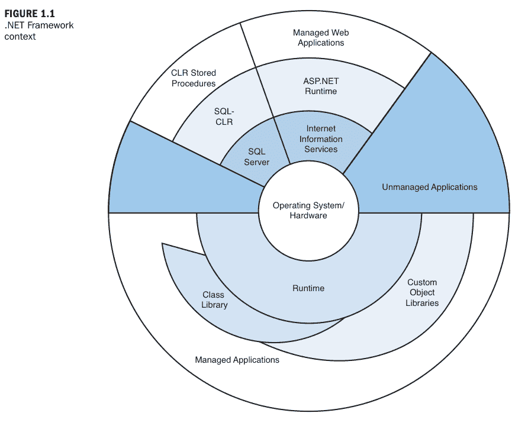


> **类型安全性和 CTS**
>
> 公共类型系统和公共语言规范构成了 .NET 框架中类型安全性基础。
>
> 这个基础为 .NET 框架提供了一致的促进类型安全性的方式，但不强制执行它。执行类型安全的任务留给各个语言编译器和虚拟执行系统。

由于公共类型系统以语言无关的方式指定了类型在语言中的外观和行为定义，因此它必须考虑这些语言之间的差异。公共类型系统提供了一组最低限度的规则，.NET 语言及其编译器必须遵循这些规则，称为**公共语言规范** `CLS`。这种公共定义也支持语言集成的理念，这使你能够将其他语言中定义的类型作为原生在你的语言中定义的类一样使用。

### CLS 合规性

框架类库提供的大多数类都是 CLS 合规的，因此任何 .NET 语言都可以访问相同的库。如果你正在开发自己的库，建议你也要确保你的类是 CLS 合规的，以实现尽可能广泛的采用和使用。


### 公共中间语言

公共类型系统和公共语言规范有助于实现语言无关和平台无关的目标，但如果编译器生成与硬件平台绑定的可执行目标代码，则毫无用处。为了解决这个问题，托管代码被部分编译成一种称为**公共中间语言** `CIL` 的低级语言。你可以将公共中间语言理解为汇编语言；它由代表你代码的独立的低级指令组成。

**程序集**是一个部分编译的单位或包，包含 CIL 指令，并为定义类型提供逻辑边界。由于程序集是部分编译的，因此它们可以是 32 位或 64 位，具体取决于操作系统和硬件。这种能力真正意味着托管应用程序是平台无关的，同时可以利用硬件技术，而无需重新编译或向代码添加特殊指令。

### 虚拟执行系统

公共语言运行时的另一个重要部分是托管运行时环境，称为**虚拟执行系统** `VES`，它处理你的应用程序所需的低级核心服务。正如 Java 应用程序需要 Java 虚拟机 `JVM` 才能运行一样，托管应用程序需要 CLR，更具体地说，需要 VES 才能运行。

当 .NET 应用程序启动时，负责实际加载 CIL 代码、执行该代码并最终管理内存分配的正是 VES 由应用程序所需。换句话说，VES 提供服务和基础设施，以抽象出平台和语言之间的差异。

作为加载和编译过程的一部分，VES 执行各种验证和检查，以确保文件格式、程序集元数据和 CIL 的一致性，并且 CIL 指令本身不允许非法的内存访问。这确保了应用程序只能访问其被明确授予访问权限的内存或其他资源。这种受限环境可以被视为一个**沙箱**。

如果 VES 提供运行时环境并执行包含 CIL 的程序集，那么这些程序集是被解释还是被编译？请记住，.NET 框架的目标之一是提供一个最小化或消除脚本或解释语言性能问题的运行时环境。这意味着 CIL 代码会被编译，但编译发生在什么时候呢？

VES 提供的服务之一是**即时 `JIT` 编译器**。即时编译是在运行时将部分编译的 CIL 代码转换为可执行的目标代码或本地代码的过程。

#### 你知道吗？即时编译

> 即时编译的过程被称为**JIT 编译**，JIT 编译器也被称为**Jitter**。

通过以这种方式编译代码，.NET 框架比传统的解释型语言获得了显著的速度提升。即时编译相比常规静态编译也有优势，因为它可以在运行时执行安全保证，并在运行时重新编译代码以获得额外的优化。.NET 框架的 JIT 编译器高度优化了将 CIL 代码编译为高效目标代码的过程，按需运行，并缓存已编译的代码以供将来使用。

### 内存管理和垃圾回收

适当的内存管理是许多非托管编程语言中的经典问题，也是某些常见错误的潜在来源。在这些语言中，开发人员负责在正确的时间分配和释放内存。.NET 框架通过作为 VES 的一部分自动控制这些内存分配和释放来解决这个问题。

正是这种自动内存管理，也被称为**垃圾回收**，使得 C# 以及其他 .NET 语言成为一种**垃圾回收语言**。垃圾回收使你无需过多担心在不再需要时释放内存。这使你能够创建更稳定的应用程序，防止许多常见的编程错误，并将你的时间集中在应用程序所需的业务逻辑上。

即使有自动内存管理，理解垃圾回收器如何与你的程序以及你创建的类型相互作用仍然很重要。关于垃圾回收的深入讨论远远超出了本书的范围，但我们将在第 22 小时“内存组织和垃圾回收”中对此进行更多讨论。

### 框架类库

尽管 CLR 构成了 .NET 框架的核心，但框架类库 `FCL` 实际上赋予了它实质内容。类库类似于 Java 的类库、C++ 标准模板库 `STL`、微软的 Active 模板库 `ATL`、微软基础类 `MFC`、Borland 对象窗口库 `OWL`，或者今天可用的其他各种类库。

就像那些类库一样，FCL 是一个丰富的可重用类型集合，通过简化许多常见的编程任务，使你能达到高开发生产力。

图 1.2 展示了 FCL 中可用的一些类型，按功能区域分组。

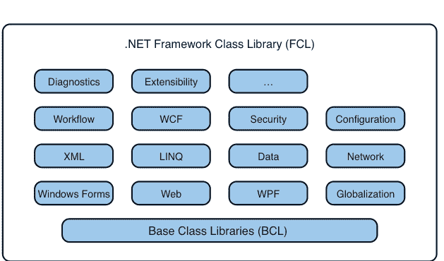

#### 图 1.2

**框架类库**

*顺便一提*

框架类库是 .NET 框架中“使简单的事情变得容易，使困难的事情成为可能”的最佳示例。

虽然可以不使用 FCL 提供的类型来创建应用程序，但这样做是不实际的。

在最低层是**基础类库 `BCL`**，它作为任何 .NET 语言的标准运行时，提供表示固有 CLR 类型、集合、流、字符串操作、基本文件访问以及各种其他操作或数据结构的类型。总共，BCL 中有 172 个公开可用的类型，而在被视为由标准 Ecma-335：公共语言基础设施 `CLI`，第 4 版/2006 年 6 月定义的标准库中，共有 331 个公共类型。

#### 你知道吗？

### 什么是 Ecma？

Ecma 国际是一个成立于 1961 年的国际标准协会，旨在帮助制定信息通信技术和消费电子产品使用的标准。

C# 语言规范以及公共语言基础设施 `CLI` 于 2001 年 12 月 14 日被接受为 Ecma 标准。

CLI 是公共语言运行时 `Common Language Runtime` 的开源版本。它促进了 C# 和 .NET 框架的几个开源版本，包括 DotGNU 和 Mono。其中，Mono 可能是最著名的，它提供了 .NET 开发平台在 Linux、BSD、UNIX、Mac OS X、Solaris 和 Windows 操作系统上的实现。

正是 Ecma 提供的开源标准以及 DotGNU 和 Mono 等项目，使得开发技能和应用几乎可以在任何平台上使用。

FCL 中剩余的类集中在特定的功能领域，例如提供数据访问、XML 支持、全球化支持、诊断、配置、网络、通信、业务流程支持、Web 应用程序和 Windows 桌面应用程序，仅举几例。

### 命名空间

由于 .NET 框架类库中有成千上万的类，需要一种方式来防止类型名称之间的歧义，并提供一种方便的层次化分组机制。.NET 框架使用**命名空间**的概念来实现这一点。命名空间只是一个类型的集合，对类型的可访问性没有影响。命名空间可以跨多个程序集拆分。.NET 框架利用命名空间的层次性质提供渐进式框架，创建一个强大且易用的开发平台。

#### 命名空间和类型名称

命名空间使用点语法表示层次化分组，层次中的每一级由一个点 `.` 分隔。

给定一个类型的完整名称，最右侧点之前的所有内容都是命名空间，而最后一部分最右侧点之后是类型名称。例如，`System.Printing.PrintDriver` 是 `System.Printing` 命名空间中 `PrintDriver` 类型的完整名称。

然而，命名空间只是 .NET 编程语言支持的便利设施。在 CLR 中，类型始终由其完整名称标识，其中包含类型名称及其所属的命名空间。

.NET 框架类库中几乎有 400 个命名空间，尽管你可能永远不会与其中一些交互。随着你对类库变得更熟悉，你会发现某些命名空间比其他命名空间使用得更频繁，这可能与你同事或同行使用的一组不同。

最常用的命名空间如表 1.1 所示。

#### 表 1.1 常用命名空间

| 命名空间 | 描述 |
| :--- | :--- |
| System | .NET 的基本或根命名空间；包含定义常用数据类型、异常和事件的类 |
| System.Collections.Generic | 包含定义各种泛型集合的类，使你能够创建强类型集合 |
| System.Data | 包含构成 ADO.NET 库大部分的类，使你能够管理来自多个数据源的数据 |
| System.Diagnostics | 包含使你能够与事件日志和性能计数器交互、调试你的应用程序以及跟踪代码执行的类 |
| System.Globalization | 包含表示与文化相关的信息的类，包括语言、国家/地区、使用的日历、字符串的排序顺序以及日期、货币和数字的格式模式 |
| System.IO | 包含使你能对数据流和文件进行同步和异步读取和写入的类 |

## 表 1.1 常用命名空间（续）

| 命名空间 | 描述 |
| :--- | :--- |
| System.Linq | 包含用于支持使用语言集成查询 `LINQ` 进行查询的类和接口 |
| System.Net | 包含为当今网络上使用的许多协议提供简单编程接口的类 |
| System.Security | 包含提供 .NET 框架安全系统的类 |
| System.ServiceModel | 包含构建 Windows 通信基础 `WCF` 服务和客户端应用程序所需的类 |
| System.Text | 包含用于处理字符串和字符的类 |
| System.Web | 包含启用浏览器与服务器通信的类 |
| System.Windows | 包含几个重要的 Windows 呈现基础 `WPF` 基元素类、支持 WPF 属性系统和事件逻辑的各种类，以及其他更广泛消费的代码类型 |
| System.Windows.Controls | 包含用于创建控件的类，这些控件允许用户与应用进行交互 |
| System.Windows.Forms | 包含用于创建充分利用 Windows 操作系统中可用的丰富用户界面功能的基于 Windows 的应用程序的类 |
| System.Xml | 包含提供基于标准的 XML 处理支持的类 |

# 并行计算平台

在托管和非托管代码中，编写多线程和异步应用程序一直是可能的；然而，编写正确的代码一直都很困难。.NET Framework 4.0 通过**并行计算平台**简化了这些应用程序的编写。这是一种面向托管和非托管代码的新编程模型，它提高了抽象层级，使得你不再需要思考线程和锁等低级概念。

> **参见**
>
> 第 23 小时“理解线程、并发和并行”，了解更多关于多线程和并行编程的信息。

对于托管代码，并行计算平台包括常见循环指令的并行实现、`LINQ to Objects` 的并行实现以及新的无锁和线程安全集合。Visual Studio 2010 引入了新的诊断工具，例如并行并发分析器和处理器迁移分析，使您能够轻松调试和优化代码。

并行计算平台简化了编写能够有效利用多处理器代码的机制。关于哪些代码适合并行化，这一决策仍然需要分析，并最终改变了解决特定问题的思维方式。我们在第 23 小时“理解线程、并发和并行”中涉及了并行计算平台的某些方面。

# 动态语言运行时

**动态语言运行时** `DLR` 是在 .NET Framework 4.0 中引入的，它提供了额外的运行时环境，为动态语言提供语言服务和支持。

建立在通用语言运行时之上意味着这些动态语言现在可以与其他 .NET 语言集成。DLR 还为现有的静态类型语言如 C# 启用了动态功能，使它们能够在处理来自任何源的动态对象时支持一致的表达式。

随着 DLR 的引入，对动态语言的支持以及在静态语言中启用动态功能，开发人员现在可以自由地选择最佳语言来完成任务，并确信其他开发人员和其他 .NET 语言可以轻松使用他们创建的动态代码。

# C# 语言

如果你是 C、C++ 或 Java 程序员，C# 会立即让你感到熟悉，因为它具有相似的语法。如果你已经熟悉 Visual Basic，其语法可能看起来很陌生，但框架类库会让你感到熟悉。对于从未在这些语言中工作过的人来说，你很快就会发现在 C# 中进行开发比许多其他语言更容易，这得益于其优雅的语法和强大的类库。

> **参见**
>
> 第 21 小时“动态类型和语言互操作性”详细涵盖了与动态语言的集成。
>
> **你知道吗？**
>
> **语言灵感**
>
> 作为一种语言，C# 的语法和主要功能灵感来自多种不同的语言，包括 Delphi 5、C++ 和 Java 2。
>
> 泛型类型系统借鉴了 Eiffel 和 Ada 中的泛型类型系统。Haskell 和 Lisp 是 LINQ 中查询推导和 Lambda 表达式求值的主要灵感来源。
>
> C# 还添加了动态语言如 Ruby 和函数式语言如 F# 中发现的特性。

像许多现代编程语言一样，C# 是一种**面向对象的**语言，并完全支持面向对象的编程概念，如继承、多态、封装和抽象。除了是一种面向对象的语言外，C# 还支持**组件导向编程**，它允许你指定功能单元组件，这些组件是自包含和自文档化的，通过展示包含属性、方法、事件和组件元数据的数据模型。C# 在语言中直接支持这些概念，使得创建和使用组件成为自然的过程。如果你不熟悉这些原则，我们在第 2 小时中介绍了基础知识。

C# 具有允许开发人员利用 CLR 中进行的改进和进步的语言特性。垃圾回收自动管理内存。**异常处理**创建了一种结构化且可扩展的方式来检测和恢复错误。作为一种**类型安全**的语言，不可能存在未初始化的变量、非法访问内存，或将一种类型的数据存储在仅能接受另一种类型的位置。

此外，C# 还具有旨在减少必须编写的样板代码量的语言特性和语法，使代码更简单，并减少犯常见错误的机会。在某些情况下，这些仅仅是对语法的简单更改，简化了复杂或易出错的语言特性，使其易于访问和理解；在其他情况下，这些改进实现了更高级的场景。

C# 随着每个新版本的发布不断演进，添加新的语言特性和语法，始终致力于实现让简单的事情容易做，让困难的事情成为可能，让糟糕的事情难以发生的目标。随着 C# 增加新的功能，简单的事情变得更简单，困难的事情变得容易，之前不可能的事情变得可能。

# 类型

在 C# 中，**类型**描述值。任何时候你想使用一个值，都需要一个类型。正如你在了解通用类型系统时所见，类型定义了允许的值以及这些值支持的操作。C# 中的每个值都由其确切类型完全描述，并且是该确切类型的一个**实例**。完全描述意味着类型明确定义了值的表示和操作。

C# 中的类型分为值类型和引用类型。**值类型**描述完全自包含的值，包括数值类型、枚举类型和结构体。**引用类型**则存储对值的引用，而不是实际值。

C# 提供了许多预定义的值类型和少数预定义的引用类型。它还允许你创建自己的用户定义类型。在后续的小时中，你将更详细地探索值类型和引用类型之间的区别以及如何创建自己的类型。然而，目前最重要的区别在于，值类型是“按值”复制的，因为它包含实际值，而引用类型包含对实际数据的引用。

# 语句和表达式

一个**语句**简单地就是一个完整的单条程序指令，必须以分号 `;` 结尾。似乎只指定单条指令很有限制，但 C# 还给了我们**语句块**的概念，它只是一组用大括号括起来的语句。你可以在通常使用单个语句的任何地方使用语句块。

由于语句以分号结尾，你可以自由地使用空白符如空格字符、制表符或换行符来帮助视觉定位你的代码。最好的方法是采用一种简单且一致的风格，使你的代码更容易阅读和维护。

> **空白符**
>
> 尽管编译器通常忽略空白符，但类型声明、其标识符和其他关键字之间的空白符非常重要。如果没有这些空白符，编译器无法区分关键字。

一个**表达式**评估为一个值。如果你将语句视为程序操作，那么表达式就是计算。结果为布尔值 `true` 或 `false` 的表达式最常用来测试一个或多个条件是否为真，被称为**布尔表达式**。

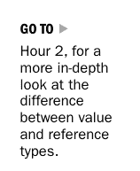


## 变量和常量

**变量**最简单的定义是，它代表一个值可以随时间变化的存储位置。变量最常见的形式是局部变量和字段，两者的定义都通过提供类型、标识符以及可选的初始值来完成：

```
int a; int b = 1;
```

如果你要声明多个同类型的变量，可以像下面这样合并声明：


```
int a, b;
```

当变量在受限作用域（例如方法内部）中声明时，被称为`局部变量`，且仅能从该作用域内部通过名称进行访问。

> **作用域、声明空间和生命周期**
>
> 作用域可以被想象成一个容器，在其中可以使用未限定名称合法地引用变量。这与声明空间不同，声明空间中不允许两个标识符拥有相同的名称。如果说作用域定义了你可以使用名称的地方，那么声明空间则回答了该名称在哪些地方是唯一的。
>
> 变量的生命周期与其作用域紧密相关，并定义了变量可访问的时间长度。只要其作用域正在执行，就保证该变量处于活动状态。
>
> 关于作用域和声明空间的详细信息，请参阅第 3 小时“以 C# 方式理解类和对象”。

`字段`仅仅是未在受限作用域内声明的变量，它可以与类型本身相关联，此时它是`静态变量`（你可以将其理解为全局变量的等价物）；也可以与类型的实例相关联，此时它是`实例变量`。局部变量和字段在使用前必须初始化，并且仅在其声明所在的代码块执行期间可访问。

列表 1.1 中的代码展示了一个 `Color` 类型，它包含名为 `red`、`blue` 和 `green` 的私有实例字段，以及名为 `White`、`Red`、`Blue` 和 `Green` 的公共静态字段。

### 列表 1.1 一个 Color 类

```
class Color
{
    private byte red;
    private byte blue;
    private byte green;

    public Color(byte red, byte blue, byte green)
    {
        this.red = red;
        this.blue = blue;
        this.green = green;
    }

    public static Color White = new Color(0xFF, 0xFF, 0xFF);
    public static Color Red = new Color(0xFF, 0, 0);
    public static Color Blue = new Color(0, 0xFF, 0);
    public static Color Green = new Color(0, 0, 0xFF);
}
```

静态字段会在它们被使用前的某个时间点进行初始化，但初始化之后，没有任何机制阻止它们被修改。为了适应“声明一个赋值后不能被修改的字段”这一概念，C# 允许你创建只读字段。

> 欲了解有关只读字段的更多信息，请前往 ▶ 第 3 小时。

列表 1.2 展示了 `Color` 类中修改后的行。

### 列表 1.2 使用只读字段的 Color 类

```
class Color
{
    // ...

    public static readonly Color White = new Color(0xFF, 0xFF, 0xFF);
    public static readonly Color Red = new Color(0xFF, 0, 0);
    public static readonly Color Blue = new Color(0, 0xFF, 0);
    public static readonly Color Green = new Color(0, 0, 0xFF);
}
```

`常量`代表一个可以在编译时计算的值。常量与类型本身相关联，就像它们是静态的一样。与变量类似，常量可以在受限作用域或全局范围内声明。与变量不同的是，常量在声明时必须始终被初始化。

## 字面量值和“魔术数字”

字面量值通常是直接在代码中指定的具有特殊固定含义的数值。随着时间的推移，这些字面量值的含义可能会丢失，从而使该部分代码难以维护。因此，这些字面量通常被称为“魔术数字”。通过使用常量代替字面量值，可以保留其含义，使代码具备自文档化的特性。

你需要花多长时间才能弄清楚以下函数中数字的含义？

```
static float Compute(float f1)
{
    return 299792458 / f1;
}
```

> 你知道吗？

现在，如果该函数使用常量编写，那个“魔术数字”的含义就会变得清晰明了：

```
static float Compute(float f1)
{
    const float SpeedOfLight = 299792458;

    return SpeedOfLight / f1;
}
```

在我们的示例中，值 `299792458` 是一个字面量值，因此被视为魔术数字。正如你可能已经猜到的那样，常量比直接使用字面量值更受青睐，因为它们有名称，可以提供比数字更多的含义，而且你可以保证它的值没有改变。

声明变量或常量的语句通常被称为`声明语句`，并且可以出现在块内的任何位置。

## 标识符和关键字

当你声明变量、字段或常量时，必须提供数据类型和一个有意义的名称，即`标识符`。

标识符必须遵循以下规则：

- 仅大写字母、小写字母、数字和下划线字符是有效的。
- 标识符必须以字母或下划线字符开头，尽管使用下划线（或多个下划线）作为任何公共可访问标识符的起始字符被认为是不好的风格，应避免使用。
- 标识符在给定的声明空间内必须是唯一的。
- 标识符区分大小写。

在选择标识符时，还应遵循以下一些额外准则：

- 标识符应易于阅读。
- 标识符不应将缩写或缩略语作为名称的一部分。
- 标识符应尽可能传达其含义或意图。

在 C# 中，标识符区分大小写。推荐的命名约定建议对变量和参数名称使用`小驼峰命名法`（即除第一个单词外，每个单词的首字母大写，例如 `bookTitle`），对方法和其他标识符使用`大驼峰命名法`（即每个单词的首字母大写，例如 `BookTitle`）。

### 小驼峰和大驼峰命名法

小驼峰命名法之所以这样命名，是因为字母序列看起来像骆驼背上的隆起。大驼峰命名法得名于 Pascal 编程语言普及的风格（同时也因为 Anders 是 Turbo Pascal 语言最初的設計者）。

微软不再推荐匈牙利命名法或用于分隔单词的下划线字符，尽管这些在其他语言中很常见。

> **你知道吗？**
>
> 如果你已经熟悉另一种区分大小写的语言，如 C、C++ 或 Java，这对你来说应该很平常。然而，如果你来自一种不区分大小写的语言，如 Visual Basic，这可能需要进行一些练习。幸运的是，Visual Studio 2010 代码编辑器具有一些功能，可以帮助使这种过渡更加容易。

由于标识符定义了特定元素的名称，因此合理的是，C# 语言也需要使用标识符来表示对编译器（以及对你）具有特殊含义的内容，因此它保留了一些标识符，称为`关键字`，供自身使用。

C# 中有 77 个关键字在所有情况下都始终保留；这些关键字列在表 1.2 中。

**表 1.2 C# 关键字**

| abstract | as | base | bool | break |
| :------- | :-- | :--- | :--- | :---- |
| byte | case | catch | char | checked |
| class | const | continue | decimal | default |
| delegate | do | double | else | enum |
| event | explicit | extern | false | finally |
| fixed | float | for | foreach | goto |
| if | implicit | in | int | interface |
| internal | is | lock | long | namespace |
| new | null | object | operator | out |
| override | params | private | protected | public |
| short | sizeof | stackalloc | static | string |
| struct | switch | this | throw | true |
| try | typeof | uint | ulong | unchecked |
| unsafe | ushort | using | virtual | void |
| volatile | while | | | |

另有 24 个关键字，被称为`上下文关键字`，仅在有限的情况或上下文中具有特殊含义。在该上下文之外，这些关键字可用于自己的目的，尽管为了减少混淆，如果可能的话，你应避免这样做。上下文关键字列在表 1.3 中。

**表 1.3 上下文关键字**

| add | alias | ascending | by | descending |
| :-- | :---- | :-------- | :-- | :--------- |
| dynamic | equals | from | get | global |
| group | into | join | let | on |
| orderby | partial | remove | select | set |
| value | var | where | yield | |

## Visual Studio 2010

Visual Studio 是一个完整的`集成开发环境`（IDE），实际上由许多不同的工具组成，旨在实现一个目标：使你能创建创新的下一代表明。Visual Studio 的核心包括强大的代码编辑器、语言编译器（包括对 Visual Basic、C#、C++ 和 F# 的支持）以及调试工具。Visual Studio 还包括更多内容：

- 与源代码控制系统集成
- 图形设计工具
- Microsoft Office、SharePoint 和云开发工具
- 测试工具

虽然完全可以使用你喜欢的文本编辑器和 .NET 框架软件开发工具包（SDK）中的一部分命令行实用程序来编写应用程序，但这样做并不实际。编辑和调试工具的集成带来的好处，加上 Visual Studio 提供的生产力增强功能，使你能轻松有效地编写和调试应用程序。

Microsoft 提供 Visual Studio 2010 的四个主要版本：

- Express（精简版）
- Professional with MSDN（专业版，含 MSDN）
- Premium with MSDN（高级版，含 MSDN）
- Ultimate with MSDN（旗舰版，含 MSDN）

Express 版本是免费的，面向 VB、C#、C++ 或 Web 开发。包含 MSDN 的三个版本专为企业管理开发环境设计，提供了额外的功能和能力。

本书中，示例和屏幕截图来自启用了基本设置（Basic settings）的 Visual C# 2010 Express。如果你运行的是包含 MSDN 的 Visual Studio 版本，或者启用了高级设置（Advanced settings）的 Visual C# Express，屏幕截图可能看起来有所不同。

启动 Visual Studio 时，你会看到如图 1.3 所示的“开始”页面，该页面允许你访问最近的项目、创建新项目、了解即将推出的产品版本或阅读最新的开发新闻。


图 1.3

Visual C# 2010 Express 的“开始”页面

“开始”页面分为以下几个部分：

- 命令区，显示“新建项目”和“打开项目”命令。如果你安装了包含 MSDN 的 Visual Studio 版本，此区域还可以显示“连接到 Team Foundation Server”命令。
- “最近的项目”列表，显示最近打开的项目。单击其中一个项目即可在 Visual Studio 中打开它。你还可以固定某个项目，如图 1.4 所示，这样在其他项目打开和关闭后，它仍保持在当前位置。

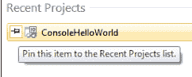

- 选项卡内容区。“入门”选项卡显示一系列帮助主题和其他资源，可帮助你了解 Visual Studio 的功能。“最新新闻”选项卡列出所选 RSS 源的特色文章。

## 解决方案、项目和项

Visual Studio 使用两个概念来帮助你组织和操作源代码文件，即“解决方案”和“项目”。

`项目`是一组源文件和相关元数据的集合，编译后会生成单个程序集。`解决方案`包含一个或多个项目，以及定义整个解决方案的其他文件和元数据。每次创建新项目时，Visual Studio 会自动为你创建一个解决方案。必要时，你可以向该解决方案中添加其他项目。一个项目可以属于多个解决方案，复杂的应用程序可能需要多个解决方案。

如图 1.5 所示的“解决方案资源管理器”显示解决方案、该解决方案中包含的项目（一个或多个）以及每个项目的项，使你能够轻松查看和管理这些容器及其关联项。

大多数时候，你通过双击项目项（如代码文件）来与其交互，以便在编辑器窗口中显示该文件；或者通过上下文菜单添加或移除项或项目。

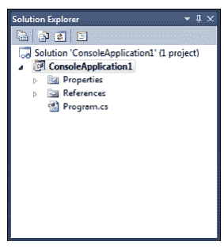

图 1.5

解决方案资源管理器

## 编写你的第一个程序

此时，你应该已经足够熟悉 C# 语言及其语法，可以编写你的第一个程序了。如果你尚未安装 Visual Studio 2010，现在是时候安装了。作为对 C# 的初次介绍，我们将延续传统，从一个简单的应用程序开始，该应用程序在屏幕上显示“Hello, world”消息。

### 创建项目

可以使用“开始”页面、新建项目工具栏按钮或应用程序菜单上的“新建项目”命令来创建项目。这三个位置如图 1.6 所示。

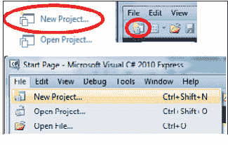

图 1.6

新建项目命令

这将显示如图 1.7 所示的“新建项目”对话框，允许你指定项目的名称和类型。

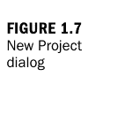

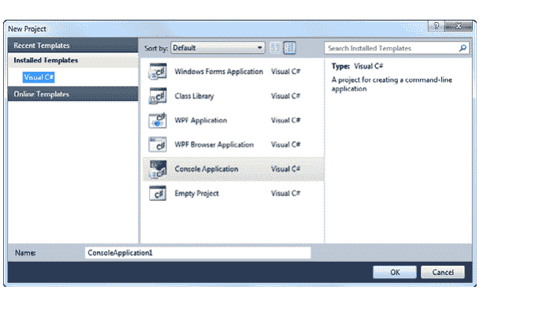

对于这个第一个应用程序，我们将创建一个名为 `ConsoleHelloWorld` 的 `控制台应用程序`。选择项目类型并提供名称后，你可以单击“确定”按钮或双击项目类型。这将关闭对话框，创建项目，并显示该项目的默认代码，如图 1.8 所示。

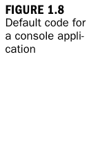

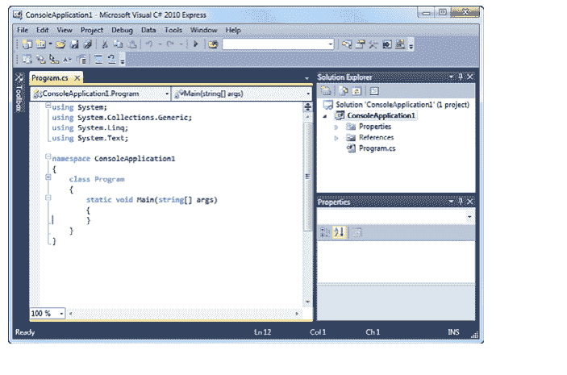

你可以看到，Visual Studio 已经为我们做了一些工作，并提供了一些起始代码。在开始添加我们自己的代码之前，让我们看看 Visual Studio 为我们生成的代码。

在文件顶部（第 1 至 4 行）是一个命名空间列表（见图 1.9）。每个命名空间都通过 `using` 指令 包含，它仅仅是关键字 `using` 后跟命名空间。`Using` 指令告诉编译器（以及我们），我们正在引用某个命名空间，并且该命名空间中声明的类型可供使用。

```
1 using System;
2 using System.Collections.Generic;
3 using System.Linq;
4 using System.Text;
```

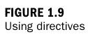

紧接在 `using` 指令下方（见图 1.10），你声明了一个名为 `ConsoleHelloWorld` 的命名空间（第 6 行）和一个名为 `Program` 的类（第 8 行）。在这个类内部，我们定义了一个名为 `Main` 的静态函数（第 10 行）。我们将在第 3 个小时中详细讲解类和方法，但现在可以将其视为一个容器，其边界由开括号和闭括号定义。

```
6 namespace ConsoleHelloWorld
7 {
8     class Program
9     {
10        static void Main(string[] args)
11        {
12        }
13    }
14 }
```

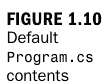

## 添加程序语句

现在，你可以专注于我们需要该应用程序做什么。由于你正在控制台中工作，你需要一种与控制台窗口交互的方式来运行我们的应用程序。通过检查 Framework 类库，你会发现一个名为 `Console` 的类，它提供了用于显示消息和通过键盘接收用户输入的方法。

要在控制台窗口中显示文本，你需要在定义 `Main` 的大括号之间（第 11 和 12 行）输入以下语句：

```
Console.WriteLine("Hello, world");
```

此时你的文件应该如图 1.11 所示。

```
10        static void Main(string[] args)
11        {
12            Console.WriteLine("Hello, world");
13        }
```

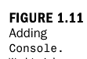

## 顺便提一下

### 保存项目和解决方案

如果你使用的是 Visual C# 2010 Express，项目和解决方案文件将创建在临时位置。当你关闭 Visual C# 2010 Express 或首次单击“保存”或“全部保存”时，系统将提示你指定项目保存的路径。如果你使用的是包含 MSDN 的 Visual Studio 版本，项目和解决方案将自动保存在“新建项目”对话框中指定的位置。

### 运行应用程序


如果你尚未运行应用程序，请按 `Ctrl+F5` 运行它。随后 `Visual Studio` 会保存你的文件（如果尚未保存），将其编译为名为 `ConsoleHelloWorld.exe` 的应用程序并运行。

如果你正确输入了所有内容，你应该会在命令窗口中看到“`Hello, world`”消息，如图 1.12 所示。

图 1.12

`Hello, world`

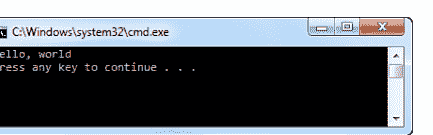

“按任意键继续”这条消息是由 `Visual Studio` 添加的，以便你实际看到输出。如果没有它，应用程序将运行、显示你的消息然后立即退出。

## 总结

恭喜你！你已成功编写了第一个 `C#` 应用程序。无论这是你第一个托管应用程序还是仅仅是你的第一个 `C#` 应用程序，这些起步步骤都为后续内容奠定了坚实的基础。

在本小时开始时，你查看了 `.NET Framework` 及其组成部分。这可能比你预期的第一小时内容要深入一些，但对 `.NET Framework` 的创建原因及其组成方式至少有基本的了解，对于成为一名全面且成功的 `.NET` 程序员至关重要。接下来，你学习了 `C#` 语言，了解了语句、表达式、变量、常量、标识符和关键字。

最后，你将已学到的知识整合起来，创建了第一个 `C#` 应用程序。这可能看起来像一个微不足道的例子——毕竟，在屏幕上打印“`Hello, world`”有什么激动人心的呢？——但这只是开始。

在本书的其余部分中，每一小时都建立在之前小时所学的基础上，从学习 `C#` 的基础知识及其如何支持面向对象的和面向组件的编程，一直进阶到学习多线程和并行编程等更高级的主题。在此过程中，你将构建一个更完整的现实世界应用程序，正如俗话所说，从“汤到坚果”（即从头到尾彻底地），并构建一个坚实的 `C#` 和 `.NET` 编程基础，以便在此基础上构建更大、更复杂的应用程序。

## 问与答

**问.** *.NET Framework 是什么？*

**答.** `.NET Framework` 是一个平台，使开发人员能够以语言和平台独立的方式创建和运行下一代应用程序和 Web 服务，并有助于消除或至少减少许多常见的编程错误。

**问.** *公共语言运行时（CLR）是什么？*

**答.** 公共语言运行时（`CLR`）是 `C#` 所运行其上的 `.NET Framework` 的核心。

**问.** *托管应用程序和非托管应用程序有什么区别？*

**答.** 为 `.NET Framework` 编写的代码称为托管代码，而其他代码称为非托管代码。

## 工作坊

### 测验

- 1. `.NET` 框架包含哪些组件？

- 2. 通用类型系统为什么很重要？

- 3. 什么是公共中间语言 (`CIL`)？

- 4. 框架类库为什么很重要？

- 5. 动态语言运行时 (`DLR`) 为 `C#` 提供了什么？

- 6. 以下代码在 `C#` 中是否有效？

```csharp
class Program
{
    static void Main()
    {
        const int LettersInEnglishAlphabet = 26

        System.Console.WriteLine(
            "There are {0} letters in the English alphabet.",
            LettersInEnglishAlphabet)
    }
}
```

- 7. 以下变量声明的正确解释是什么？

  `int a, b = 1;`

- 8. 以下哪一项不是有效的标识符？

  A. lightHouse

  B. _lighthouse

  C. 22lighthouse

  D. lighthouse2

### 答案

- 1. `.NET` 框架有四个主要组件：公共语言运行时、框架类库、并行计算平台以及动态语言运行时。

- 2. 通用类型系统之所以重要，是因为它赋予每个 `.NET` 语言相同的类型描述，并定义了该类型的使用方式，从而实现语言集成。

- 3. 公共中间语言是一种低级语言，托管代码会被部分编译成这种语言。你可以将公共中间语言想象成汇编语言；它由代表你代码的独立低级指令组成。

- 4. 框架类库提供了一组丰富的可复用类型，可供所有 `.NET` 语言使用，并通过简化许多常见的编程任务，帮助你实现高水平的开发人员生产力。

- 5. `DLR` 使 `C#` 能够使用一致的语法与来自任何来源（例如 `COM`、`IronRuby`、`IronPython` 和 `JavaScript`）的动态对象进行交互。

- 6. 否，显示的代码在 `C#` 中无效，原因有二。首先，没有一条语句以分号 (`;`) 结尾。其次，正确的类型名称是 `System.Console.WriteLine` 而不是 `system.console.WriteLine`，因为 `C#` 是一种区分大小写的语言。

- 7. 像这样组合多个变量声明和初始值赋值是危险的，因为它可能产生歧义。该语句的正确解释等同于以下内容：

```csharp
int a;
int b = 1;
```

- 8. 正确答案是 C。标识符不能以数字开头。

### 练习

- 1. 通过修改“`Hello, world`”应用程序，使其询问你的名字并输出“`Hello, *name*`.”（其中 *name* 是程序运行时输入的文本来探索 `System.Console` 类中还有什么其他可用的内容。

## 第 2 小时

# 理解 C# 类型

**本小时你将学到：**

- 类型概述

- `C#` 预定义类型

- 运算符

- 值类型和引用类型

- 可空类型

- 类型转换

在第 1 小时“.NET 框架和 `C#`”中，你学习了 `.NET` 框架和 `C#` 的基础知识，包括框架类库、公共语言运行时以及自动内存管理的概念。你简要了解了命名空间和类型，然后转向语句、表达式、变量、常量、标识符和关键字。从这些简单的开始，你构建了一个简单的 `C#` 应用程序。

基于你已学的内容，本小时将向你介绍 `C#` 提供的预定义类型以及使用这些类型可以执行的不同操作。然后，你将学习值类型和引用类型。接着，你将看到可空类型并了解类型转换。

在本小时结束时，你应该对 `C#` 类型有透彻的理解，包括值类型、引用类型和可空类型之间的区别。你编写了一些更高级的应用程序，可以存储和操作简单数据。

## 类型

`C#` 既是一种类型安全的语言，也是一种静态类型语言。这些概念相辅相成，要求你告知编译器为你创建的每个变量所对应的数据类型。作为回报，编译器保证你只能在该变量中存储兼容的数据类型。这有助于防止常见的编程错误，从而构建更稳定、更安全的应用程序。

类型分为三个主要类别：

- 值类型

- 引用类型

- 类型参数

简而言之，值类型是完全自包含的，并按“值”进行复制。这意味着值类型的变量直接包含其数据，对一个变量进行操作不可能影响另一个变量。值类型进一步分为结构、枚举类型和可空类型。

引用类型包含对实际数据的引用，这意味着两个变量可以引用同一个对象，从而允许对一个变量的操作影响另一个变量。引用类型进一步分为类、数组、接口和委托。


### 统一类型系统

尽管类型之间存在这种划分，但 `C#` 拥有一个统一的类型系统，使得任何非指针类型的值都可以被视为对象。这使值类型拥有了引用类型的优势，而无需引入不必要的开销，并且使得即使在预定义值类型上调用对象方法也成为可能。

### 预定义类型

`C#` 语言预定义了一组映射到通用类型系统中类型的类型。如果你熟悉另一种编程语言，这些类型的名称可能不同，但你很容易看到它们之间的对应关系。除了 `object` 和 `string` 之外，所有预定义类型都是值类型。预定义类型如表 2.1 所示。

**表 2.1 C# 预定义类型**

| 关键字 | 别名类型 | 描述 | 范围 |

| :--- | :--- | :--- | :--- |

| bool | Boolean | 逻辑布尔值 | true 或 false |

| byte | Byte | 无符号 8 位整数 | 0 到 255 |

| char | Char | 单个 16 位 Unicode 字符 | U+0000 到 U+FFFF |

| decimal | Decimal | 具有 28–29 位有效数字的 128 位数据类型 | −(7.9 × 10^28) 到 7.9 × 10^28 |

| double | Double | 双精度 64 位浮点数，最多 15–16 位数字 | ±5.0 × 10^−324 到 ±1.7 × 10^308 |

| float | Single | 单精度 32 位浮点数，最多 7 位数字 | ±1.5 × 10^−45 到 ±3.4 × 10^38 |

| int | Int32 | 有符号 32 位整数 | −2^31 到 2^31 − 1 |

| long | Int64 | 有符号 64 位整数 | −2^63 到 2^63 − 1 |

| sbyte | SByte | 有符号 8 位整数 | −128 到 127 |

| short | Int16 | 有符号 16 位整数 | −32,768 到 32,767 |

| uint | UInt32 | 无符号 32 位整数 | 0 到 4,294,967,295 |

**顺便说一下**

**布尔值**

在 C 语言中，布尔值由整数值表示，至于 0 代表 **true** 还是 **false**，则由程序员决定。通常，C 程序定义命名的常量来表示整数 0 和 1 的值，以帮助消除这种歧义，但这仍然允许使用任何整数值。

**decimal** 类型提供至少 28 位有效数字，其设计旨在在经常用于财务计算的大量值范围内没有表示误差。**double** 类型可以无表示误差地表示的值范围是一个主要用于物理计算的集合。

**object** 类型是所有其他代码值和值类型的基础基本类型。**string** 类型表示一组 Unicode 码元序列，一旦给定值就不能被更改。因此，**string** 类型的值是**不可变的**。

除了无符号整数类型和 **sbyte** 类型外，所有预定义类型都符合 CLS。只要这些类型不是公开可访问的，你可以使用这些类型并保持 CLS 合规性。如果你确实需要使这些类型之一公开可访问，它们可以安全地映射到 CLS 合规类型：

- **sbyte** 映射到 **short**。

- **uint** 通常映射到 **long**，但当原始值小于 2,147,483,647 时，可以映射到 **int**。

**表 2.1 C# 预定义类型（续）**

| 关键字 | 别名类型 | 描述 | 范围 |

| :--- | :--- | :--- | :--- |

| ulong | UInt64 | 无符号 64 位整数 | 0 到 18,446,744,073,709,551,615 |

| ushort | UInt16 | 无符号 16 位整数 | 0 到 65,535 |

| object | Object | 除接口外所有其他值和引用类型的基本类型 | 不适用 |

| string | String | 一组 Unicode 字符序列 | 不适用 |

通过包含一个直接表示布尔值（值为 **true** 或 **false** 的值）的类型，不会产生歧义，明确该值旨在表示布尔值而不是整数值。这有助于消除几种常见的编程错误，使编写自文档代码变得更加容易。

- `ulong` 通常映射为十进制数，但当原始值小于 9,223,372,036,854,775,807 时，可以映射为 `long`。

- `ushort` 通常映射为 `int`，但当原始值小于 32,767 时，可以映射为 `short`。

## System.Object

所有值类型以及类、数组和委托引用类型都派生自 `object`。接口类型只能从其他接口类型派生，但它们可以转换为 `object`。

类型参数类型实际上不派生自任何类型，但它们仍然可以转换为 `object`。

由于非安全的指针类型在 `C#` 的正常类型规则之外，因此它们既不派生自 `object`，也不能转换为 `object`。

这一切实际上意味着，`C#` 中的每个非指针类型都可以转换为 `object`，但不一定派生自 `object`。

`C#` 还有一些特殊类型，最常见的是 `void` 类型。`void` 类型表示没有类型。`dynamic` 类型类似于 `object`，主要区别在于对该类型的所有操作将在运行时而不是编译时解析。

尽管 `void` 和 `dynamic` 都是类型，但 `var` 代表隐式类型变量，它告诉编译器根据分配的数据确定实际类型。

## Var 并不是 Variant 的缩写

当 `var` 类型首次引入时，许多人认为它等同于 Visual Basic 的 Variant 类型。Variant 是一种可以表示其他任何数据类型的类型，且不是强类型。`var` 类型仍然是强类型的，因为在编译过程中它会被替换为实际的数据类型。即便如此，过度使用它会降低代码的可读性，因此请谨慎使用。

## 自己动手试试

## 使用预定义类型

既然你已经熟悉了预定义类型，让我们看看如何使用它们。按照以下步骤，你将编写一个应用程序来创建一些局部变量并显示它们的值。然后，你将创建一个隐式类型变量，并验证它实际上创建的是一个强类型变量。

1. 创建一个新的控制台应用程序。

2. 在 `Program.cs` 文件的 `Main` 方法中，输入以下代码：

```
int i = 20;
float f = 20.2f;
string s = "Hello, world…again";

Console.WriteLine("This is an {0} value: {1}", i.GetTypeCode(), i);
Console.WriteLine("This is a {0} value: {1}", f.GetTypeCode(), f);
Console.WriteLine("This is a {0} value: {1}", s.GetTypeCode(), s);
```

3. 按 `Ctrl+F5` 运行应用程序；你应该在控制窗口中看到以下内容，如图 2.1 所示。

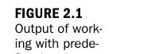

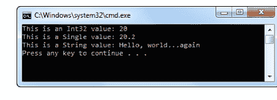

4. 按任意键关闭控制台并返回到 `Visual Studio`。

5. 在 `Main` 方法中，紧接在上一段代码之后，输入以下代码：

```
var v = 20;
Console.WriteLine("This is also an {0} value: {1}", v.GetTypeCode(), v);
```

6. 将鼠标光标悬停在 `var` 关键字上，直到显示工具提示，该提示确认 `v` 实际上是一个 `int`，如图 2.2 所示。

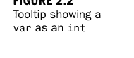

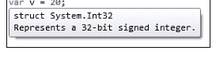

7. 再次按 `Ctrl+F5` 运行应用程序，此时你应该会看到多出一行：

```
This is also an Int32 value: 20
```

8. 按任意键关闭控制台并返回到 `Visual Studio`。

9. 在 `Main` 方法中输入以下行：

```
v = "hello";
```

10. 你应该会立即注意到刚才输入的语句下方有一条红色的“波浪线”，并显示一条错误消息，指出“无法将类型 'string' 隐式转换为 'int'”。此错误发生的原因是编译器已将 `v` 分配为 `int` 类型，而 `C#` 的强类型特性阻止你将字符串值分配给这个变量，因为它们是不同类型。

11. 删除你在步骤 9 中输入的那一行，以便程序再次能够编译。

## 其他常用类型

除了标准预定义类型外，`.NET` 框架还为其他常用值提供了类型。这些类型不像预定义类型那样在 `C#` 中有别名，但允许执行相同的操作。

## 日期和时间

处理日期和时间值是通过 `DateTime` 结构完成的，该结构使你能够创建表示日期和时间、仅日期或仅时间值的值。创建新的 *DateTime* 值的最常见方法有两种：使用各种构造函数重载之一，或使用四个静态解析方法之一：`Parse`、`ParseExact`、`TryParse` 或 `TryParseExact`。

`DateTime` 结构提供了许多属性；最常见的是表 2.2 中所示的属性。

### 表 2.2 常见的 DateTime 属性

| 属性 | 描述 |

| :--- | :--- |

| Date | 获取当前实例的日期部分 |

| Day | 获取当前实例表示的月份中的某一天 |

| DayOfWeek | 获取当前实例表示的一周中的某一天 |

| Hour | 获取当前实例表示的日期的小时部分 |

| Minute | 获取当前实例表示的日期的分钟部分 |

| Month | 获取当前实例表示的日期的月份部分 |

| Now | 获取设置为当前日期和时间的 DateTime 对象，此时间为本地时区 |

| TimeOfDay | 获取当前实例当天的时间 |

| Today | 获取当前日期 |

| UtcNow | 获取设置为当前日期和时间的 DateTime 对象，此时间为协调世界时 (UTC) |

| Year | 获取当前实例表示的日期的年份部分 |

在添加或减去日期或时间值时，你可以使用实例方法，这些方法返回一个新的 `DateTime` 值，而不是修改原始值。常见的 `DateTime` 算术方法如表 2.3 所示。

### 表 2.3 常见的 DateTime 算术方法

| 方法 | 描述 |

| :----- | :---------- |

| AddDays | 添加或减去指定的天数 |

| AddHours | 添加或减去指定的小时数 |

| AddMinutes | 添加或减去指定的分钟数 |

| AddMonths | 添加或减去指定的月数 |


| `AddYears` | 添加或减去指定的年数 |

也可以使用减法运算符减去两个 `DateTime` 值，结果为一个 `TimeSpan` 实例。`TimeSpan` 表示以天数、小时数、分钟数、秒数和秒的分数衡量的时间间隔，可以是正数或负数。为了确保一致性，时间间隔以天为单位衡量。你还可以将 `TimeSpan` 加到 `DateTime` 上或从 `DateTime` 中减去 `TimeSpan`，两者结果都是一个新的 `DateTime` 值。

`TimeSpan` 的常用方法和属性如表 2.4 所示。

### 表 2.4 常见的 TimeSpan 成员

| 名称 | 描述 |
| :--- | :---------- |
| `Add` | 将指定的 `TimeSpan` 添加到当前实例 |
| `Days` | 获取当前 `TimeSpan` 表示的时间间隔的天数部分 |
| `FromDays` | 返回表示指定天数的 `TimeSpan` |
| `FromHours` | 返回表示指定小时数的 `TimeSpan` |
| `FromMilliseconds` | 返回表示指定毫秒数的 `TimeSpan` |
| `FromMinutes` | 返回表示指定分钟数的 `TimeSpan` |
| `FromSeconds` | 返回表示指定秒数的 `TimeSpan` |
| `Hours` | 获取当前 `TimeSpan` 表示的时间间隔的小时部分 |
| `Milliseconds` | 获取当前 `TimeSpan` 表示的时间间隔的毫秒部分 |
| `Minutes` | 获取当前 `TimeSpan` 表示的时间间隔的分钟部分 |
| `Seconds` | 获取当前 `TimeSpan` 表示的时间间隔的秒部分 |
| `Subtract` | 从当前实例中减去指定的 `TimeSpan` |
| `TotalDays` | 获取当前 `TimeSpan` 表示的整数和小数天数总值 |
| `TotalHours` | 获取当前 `TimeSpan` 表示的整数和小数小时数总值 |
| `TotalMilliseconds` | 获取当前 `TimeSpan` 表示的整数和小数毫秒数总值 |
| `TotalMinutes` | 获取当前 `TimeSpan` 表示的整数和小数分钟数总值 |
| `TotalSeconds` | 获取当前 `TimeSpan` 表示的整数和小数秒数总值 |

## 全局唯一标识符 (GUID)

`GUID` 是一个 128 位整数值，可用于需要低重复概率的唯一标识符的场景。`System.Guid` 结构使你能够创建和比较 `GUID` 值。常用成员如表 2.5 所示。

### 表 2.5 常见的 Guid 成员

| 名称 | 描述 |
| --- | --- |
| `CompareTo` | 将当前实例与指定的 `Guid` 进行比较 |
| `Empty` | 一个只读实例，表示值保证全为零的 `Guid` |
| `NewGuid` | 创建 `Guid` 结构体的新实例 |
| `Parse` | 将 `GUID` 的字符串表示转换为等效的 `Guid` 实例 |
| `TryParse` | 将 `GUID` 的字符串表示转换为等效的 `Guid` 实例，并指示转换是否成功 |

## 统一资源标识符（URI）

统一资源标识符（`URI`）是可用于内网或互联网上资源的一种紧凑表示形式，它可以是绝对 `URI`（如网页地址），也可以是必须相对于基础 `URI` 进行扩展的相对 `URI`。

`Uri` 类允许你创建新的 `URI` 值并访问 `URI` 的各个部分，同时提供用于处理 `URI` 的方法，例如解析、比较和组合。表 2.6 列出了一些常见成员。

### 表 2.6 常见的 Uri 成员

| 名称 | 描述 |
| --- | --- |
| `AbsoluteUri` | 获取绝对 `URI` |
| `Compare` | 使用指定的比较规则比较两个 `URI` 实例的指定部分 |
| `EscapeUriString` | 将 `URI` 字符串转换为其转义表示形式 |
| `IsFile` | 获取一个值，指示指定的 `Uri` 是否为文件 `URI` |
| `LocalPath` | 获取文件名的本地操作系统表示 |
| `MakeRelativeUri` | 确定两个 `Uri` 实例之间的差异 |
| `TryCreate` | 创建一个新的 `Uri`，但如果无法创建 `Uri`，则不抛出异常 |

`Uri` 类的实例是不可变的。若要创建可修改的 `URL`，请使用 `UriBuilder` 类。`UriBuilder` 类允许你轻松更改 `URI` 的属性，而无需在每次修改时创建新实例。表 2.7 中显示的所有属性都是 `Uri`（在其中它们是只读的）和 `UriBuilder` 共有的，除了 `Uri` 属性，该属性仅在 `UriBuilder` 上可用。

### 表 2.7 常见的 Uri 和 UriBuilder 属性

| 名称 | 描述 |
| --- | --- |
| `Fragment` | 获取或设置 `URI` 的片段部分 |
| `Host` | 获取或设置服务器的主机名或 IP 地址 |
| `Password` | 获取或设置与访问 `URI` 的用户关联的密码 |
| `Path` | 获取或设置由 `URI` 定义的资源路径 |
| `Port` | 获取或设置 `URI` 的端口号 |
| `Query` | 获取或设置包含在 `URI` 中的任何查询信息 |
| `Scheme` | 获取或设置 `URI` 的方案名称 |
| `Uri` | 获取由指定的 `UriBuilder` 实例构造的 `Uri` 实例 |
| `UserName` | 获取或设置与访问 `URI` 的用户关联的用户名 |

示例 2.1 展示了如何使用 `UriBuilder` 类。

### 示例 2.1 使用 UriBuilder

```csharp
Uri immutableUri = new Uri("http://www.example.com");
Console.WriteLine(immutableUri);

UriBuilder mutableUri = new UriBuilder(immutableUri);
Console.WriteLine(mutableUri);

mutableUri.Scheme = "https";
mutableUri.Host = "www.example.com";
mutableUri.Path = "exampleFile.html";
Console.WriteLine(mutableUri);
```

## BigInteger

`System.Numerics.BigInteger` 类型表示一个任意大的整数值，该值没有理论上的上限或下限。一旦创建了一个 `BigInteger` 实例，你就可以像使用其他整数类型一样使用它，从而执行基本的数学运算和比较。

`BigInteger` 结构体还包括直接对应于其他整数类型成员的成员，但还添加了对应于 `Math` 类提供的方法以及特定于处理 `BigInteger` 实例的成员。表 2.8 展示了常见成员。

### 表 2.8 常见的 BigInteger 成员

| 名称 | 描述 |
| :--- | :--- |
| `Abs` | 返回 `BigInteger` 值的绝对值 |
| `DivRem` | 返回除法操作的商和余数 |
| `GreatestCommonDivisor` | 返回两个 `BigInteger` 值的最大公约数 |
| `IsEven` | 指示当前 `BigInteger` 值是否为偶数 |
| `IsOne` | 指示当前 `BigInteger` 值是否为 `BigInteger.One` |
| `IsZero` | 指示当前 `BigInteger` 值是否为 `BigInteger.Zero` |
| `Max` | 返回两个 `BigInteger` 值中较大的一个 |
| `Min` | 返回两个 `BigInteger` 值中较小的一个 |
| `MinusOne` | 获取表示负一（-1）的值 |
| `One` | 获取表示一（1）的值 |
| `Remainder` | 对两个 `BigInteger` 值执行整数除法并返回余数 |
| `Sign` | 获取指示当前 `BigInteger` 值符号的数字 |
| `Zero` | 获取表示零（0）的值 |

示例 2.2 展示了一些使用 `BigInteger` 类型的方法。

### 示例 2.2 使用 BigInteger

```csharp
BigInteger b1 = new BigInteger(987321.5401);
BigInteger b2 = (BigInteger)435623411897L;
BigInteger b3 = BigInteger.Parse("435623411897");

Console.WriteLine(BigInteger.Pow(Int32.MaxValue, 2));
Console.WriteLine(b2 == b3);
Console.WriteLine(BigInteger.GreatestCommonDivisor(b1, b2));
```

## 运算符

C# 支持多种运算符，但我们仅涵盖较常用的那些。`运算符`是一种特殊符号，用于指示在表达式中执行哪种运算。所有 C# 预定义类型都支持运算符，尽管并非所有类型都支持相同的运算符。

表 2.9 按优先级顺序列出了所有 C# 运算符。在每个类别内，运算符具有相等的优先级。

### 表 2.9 C# 中的运算符及运算符优先级

| 类别 | 运算符 |
| :--- | :--- |
| 基本 | `x, y f(x) a[x] x++ x-- new typeof checked unchecked ->` |
| 一元 | `+ - ! - ++x --x (T)x true false & sizeof` |
| 乘法 | `* / %` |
| 加法 | `+ -` |
| 移位 | `<< >>` |
| 关系和类型测试 | `< > <= >= is as` |
| 相等 | `== !=` |
| 逻辑与 | `&` |
| 逻辑异或 | `^` |
| 逻辑或 | `|` |
| 条件与 | `&&` |
| 条件或 | `||` |
| 条件 | `? :` |
| 赋值 | `= += -= *= /= %= &= |= ^= <<= >>=` |
| 空合并 | `??` |
| Lambda | `=>` |

### 算术和赋值运算符

你在之前的许多示例中已经看到赋值运算符（`=`）。该运算符仅将右操作数的值存储在由左操作数指示的变量中。两个操作数必须具有相同的类型，或者右操作数必须能隐式转换为左操作数的类型。

C# 提供了支持标准数学运算（加法 `+`、减法 `-`、乘法 `*` 和除法 `/`）的算术运算符。C# 算术运算符的行为与你在学校学到的算术规则之间存在细微差别。特别是，整数除法的行为因所除的数据类型不同而略有不同。将一个整数除以另一个整数时，结果是整数。任何余数都会被丢弃，并且结果向零舍入。要获取整数除法的余数，你必须使用取模运算符（`%`）。

C# 还支持复合赋值运算符，它将算术运算和赋值组合在单个运算符中。每个标准算术运算符和取模运算符都有一个相应的运算（`+=`、`-=`、`*=`、`/=`）以及取模运算符（`%=`），它们将加法、减法、乘法、除法和取模除法与赋值组合在一起。

例如，假设你需要将一个变量递增 1。使用标准算术运算符，这样的操作通常看起来像这样：

```csharp
i = i + 1;
```

然而，通过使用加法复合赋值运算符，此操作可以像这样执行：

```csharp
i += 1;
```

将这种简化进一步扩展，你可以使用`递增`（`++`）和`递减`（`--`）运算符将值增加或减少 1。递增和递减运算符可以出现在被修改变量的前面（前缀）或后面（后缀），并将该变量的内容改变一个单位。前缀形式的结果是变量在发生更改之前的值，而后缀形式的结果则是更改后的值。

示例 2.3 中显示的所有操作都是等效的，并展示了如何使用基本运算符、复合赋值运算符和递增运算符。

### 示例 2.3 递增值

```csharp
i = i + 1;
i += 1;
i++;
```

## 试一试

### 算术运算符

为了查看赋值、加法、复合赋值以及自增和自减运算符的行为，请遵循以下步骤。对于自增和自减运算符，你将探索前缀操作与后缀操作之间的行为差异。

1. 创建一个新的控制台应用程序。
2. 在 `Program.cs` 文件的 `Main` 方法中，输入以下代码：

```csharp
int i = 20;
Console.WriteLine("i = {0}", i);

i = i + 1;
Console.WriteLine("i = {0}", i);

i += 2;
Console.WriteLine("i = {0}", i);
Console.WriteLine("i = {0}.", --i);
Console.WriteLine("i was {0}, but now is {1} again.", i++, i);
```

3. 按 `Ctrl+F5` 运行应用程序；你应该会在控制台窗口中看到如图 2.3 所示的以下行。

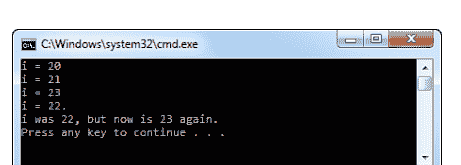

图 2.3

使用算术运算符的输出

4. 按任意键关闭控制台并返回到 Visual Studio。

## 关系运算符

如表 2.10 所示的关系运算符，用于比较两个值，结果为一个布尔值。

在许多编程语言中，赋值运算符和相等运算符很容易被混淆，因为它们使用相同的符号。这种混淆可能导致意外的赋值，这至今仍是较为常见的编程错误之一。为了帮助减少混淆的可能性，C# 为相等性定义了不同的运算符（`==`）。

### 第 2 小时：理解 C# 类型

### 表 2.10 C# 中的关系运算符

| 名称 | 运算符 | 表达式 | 结果 |
|---|---|---|---|
| 等于 | `==` | `x == 20` | `true` |
|  |  | `y == 30` | `false` |
| 不等于 | `!=` | `x != 20` | `false` |
|  |  | `y != 30` | `true` |
| 大于 | `>` | `x > y` | `true` |
|  |  | `y > x` | `false` |
| 大于或等于 | `>=` | `x >= y` | `true` |
|  |  | `y >= x` | `false` |
| 小于 | `<` | `x < y` | `false` |
|  |  | `y < x` | `true` |
| 小于或等于 | `<=` | `x <= y` | `false` |
|  |  | `y <= x` | `true` |

假设 `x = 20` 且 `y = 10`。

## 逻辑运算符

如表 2.11 所示的逻辑运算符，评估结果为`真`或`假`的布尔表达式。

### 表 2.11 C# 中的逻辑运算符

| 名称 | 运算符 | 表达式 | 结果 |
|---|---|---|---|
| 与（条件） | `&&` | `(x == 20) &&`<br>`(y == 30)` | false，两个表达式都必须为 true |
| 与（逻辑） | `&` | `(x == 20) &`<br>`(y == 30)` | false，两个表达式都必须为 true |
| 或（条件） | `||` | `(x == 20) ||`<br>`(y == 30)` | true，任一或两个表达式都为 true |
| 或（逻辑） | `|` | `(x == 20) |`<br>`(y == 30)` | true，任一或两个表达式都为 true |
| 异或 | `^` | `(x == 20) ^`<br>`(y == 30)` | true，两个表达式结果不同 |
| 非 | `!` | `!(x == 30)` | true，表达式必须为 false |

假设 `x = 20` 且 `y = 10`。

假设 `x` 和 `y` 是布尔表达式，逻辑运算符的规则可以很容易地总结，如表 2.12 所示。

### 表 2.12 逻辑运算符真值表

| X | Y | X && Y | X \|\| Y | X ^ Y |
| :--- | :--- | :--- | :--- | :--- |
| true | true | true | true | false |
| true | false | false | true | true |
| false | true | false | true | true |
| false | false | false | false | false |

## 试一试

### 关系运算符和逻辑运算符

通过遵循以下步骤，你将验证表 2.10 和表 2.11 中显示的表达式。

1. 创建一个新的控制台应用程序。
2. 在 `Main` 方法中，声明两个整型变量 `x` 和 `y`，并分别将其初始化为 20 和 10。
3. 使用表 2.10 和表 2.11 中的表达式，编写一系列 `Console.WriteLine` 语句，使用以下格式，其中 expression 被替换为表格中正确的表达式：

`Console.WriteLine("expression: {0}", expression);`

4. 按 `Ctrl+F5` 运行应用程序，并观察结果与两个表格结果列中显示的内容相匹配。

## 顺便说一下

### 短路求值

在 C# 中，条件逻辑运算符执行短路求值，或称为最小化求值，这意味着只有当第一个表达式不会导致整个表达式为假时，才会评估额外的表达式。逻辑运算符不执行短路求值。

当短路求值生效时，如果 `AND` 运算符的第一个表达式为假，则无需评估任何额外的表达式，因为整个表达式将为假。同样，如果 `OR` 运算符的第一个表达式为真，则无需评估任何额外的表达式，因为整个表达式将为真。只有当第一个表达式不足以确定整个表达式的结果时，才会评估额外的表达式。

### 条件运算符

条件运算符（也称为三元运算符或三元 if，因为它接受三个操作数）对于编写简洁的表达式非常有用，它评估一个条件并根据结果返回两个值中的一个。

条件运算符具有以下形式：

```
condition ? consequence : alternative
```


当 `condition` 为 `true` 时，`consequence` 被评估并成为结果。然而，当 `condition` 为 `false` 时，`alternative` 被评估并成为结果。

## 注意！

### 三元运算符的常见问题

该运算符是右结合的，与其他大多数左结合的运算符不同。这意味着像

```
a ? b : c ? d : e
```

这样的表达式被评估为

```
a ? b : ( c ? d : e )
```

条件表达式的类型仅由 `consequence` 和 `alternative` 的类型决定，而不是由它所被赋值的目标类型决定。最终，这要求 `consequence` 和 `alternative` 必须是相同的类型，这意味着像

```
object x = b ? 0 : "hello";
```

这样的表达式无法编译，因为 `consequence` 和 `alternative` 的类型分别是 `int` 和 `string`。

虽然这段代码不切实际，且除了在这个示例中可能永远不应使用外，正确的写法应该是

```
object x = b ? (object)0 : (object)"hello";
```

### 默认值

你之前学过，C# 不允许使用未初始化的变量，这意味着在使用变量之前必须给它一个值。虽然**确定性赋值**的思想有助于减少错误（因为它由编译器强制执行），但如果你必须为每个字段显式提供默认值，它会变得很繁琐。

为了减轻这种负担，字段（或成员变量）始终会被初始化为适当的默认值。表 2.13 显示了不同预定义数据类型的默认值。

**表 2.13 默认值**

| 类型 | 默认值 |
| :---- | :---- |
| sbyte, byte, short, ushort, int, uint, long, ulong | 0 |
| char | `'\u0000'` |
| float | 0.0f |
| double | 0.0d |
| decimal | 0.0m |
| bool | false |
| object | null |
| string | null |

如你所见，对于整型值类型，默认值是零。`char` 类型的默认值是零的字符等价形式，而 `bool` 类型的默认值是 `false`。`object` 和 `string` 类型的默认值是 `null`，代表一个**空引用**，即字面上不引用任何对象。

### 空值和可空类型

这些默认值意味着值类型不能为 null，乍一看这似乎很合理。然而，当你处理数据库、其他外部数据源或可能包含未赋值元素的其他数据类型时，这带来了某些限制。一个经典的例子是数据库中的数值字段，它可以存储任何整型数据，也可能是未定义的。

可空类型提供了针对此问题的解决方案。**可空类型**是一种值类型，它可以表示其基础类型的正确值范围和一个 null 值。

可空类型由语法 `Nullable<T>` 或 `T?` 表示，其中 `T` 是值类型

首选的语法是 `T?`。你向可空类型分配值的方式与非可空类型相同：

```csharp
int? x = 10;
x = null;
```

要访问可空类型的值，你应该使用 `GetValueOrDefault` 方法，该方法返回分配的值；如果值为 null，则返回底层类型的默认值。你还可以使用 `HasValue` 属性，如果变量包含实际值，它返回 true；以及 `Value` 属性，它返回实际值，如果值为 null 则导致异常。

所有可空类型，包括引用类型，都支持空合并运算符（`??`），该运算符定义了当可空类型赋值给非可空类型时返回的默认值。如果左侧操作数为 null，则返回右侧操作数；否则，返回左侧操作数。列表 2.4 展示了如何使用空合并运算符。

## 列表 2.4 空合并运算符

```csharp
int? x = null;
Console.WriteLine(x ?? -1);

x = 3;
Console.WriteLine(x ?? -1);

string s = null;
Console.WriteLine(s ?? "Undefined");
```

## 动手试试

### 处理可空类型

为了了解如何处理可空类型，请按照以下步骤操作。你将创建一个可空的 int，利用 `HasValue`、`Value` 和 `GetValueOrDefault()` 以及可空 int 与非可空 int 之间的隐式转换。

1. 创建一个新的 Console 应用程序。

2. 在 `Main` 方法中，声明一个名为 `x` 的整型变量并初始化为 10。然后声明一个名为 `nx` 的可空整数并初始化为 `null`。

3. 输入以下语句：

```csharp
Console.WriteLine("nx has a value? {0}", nx.HasValue);
Console.WriteLine("x == nx: {0}", x == nx);
Console.WriteLine("x != nx: {0}", x != nx);
```

4. 现在，将 `nx` 设置为 20，并输入以下语句：

```csharp
Console.WriteLine("nx has a value? {0}", nx.HasValue);
Console.WriteLine("nx has the value {0}", nx.Value);
Console.WriteLine("x == nx: {0}", x == nx);
Console.WriteLine("x != nx: {0}", x != nx);
```

5. 将 `nx` 设置为 null 并输入以下语句：

```csharp
Console.WriteLine("nx = {0}", nx ?? -1);
Console.WriteLine("nx = {0}", nx.GetValueOrDefault());
Console.WriteLine("nx = {0}", nx.GetValueOrDefault(-2));
```

6. 最后，将 `nx` 设置为 10 并输入以下语句：

```csharp
Console.WriteLine("nx = {0}", nx ?? -1);
Console.WriteLine("nx = {0}", nx.GetValueOrDefault());
Console.WriteLine("nx = {0}", nx.GetValueOrDefault(-2));
```

7. 通过按下 Ctrl+F5 运行应用程序，观察输出是否与图 2.4 中显示的一样。

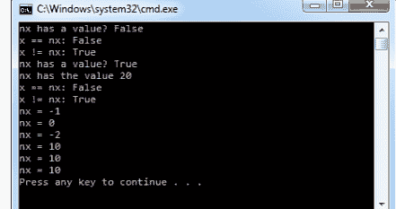

> **图 2.4**
>
> 处理可空类型的输出

8. 按任意键关闭控制台并返回 Visual Studio。

## 强制类型转换和转换

既然你已经了解了值类型和引用类型，那么当你需要值类型表现得像引用类型时会发生什么？

前面你学到了，作为统一类型系统的一部分，所有值类型都可以转换为 `object`。当值类型变量需要作为引用类型使用时，会自动创建一个对象“盒子”，并将值复制到盒子中。装箱后，对其中一个操作不会影响另一个。当对象盒子变回其原始值类型时，值从盒子中复制出来并放入变量中。

**顺便提一下**

### 装箱和拆箱操作

尽管值类型和引用类型之间的转换通常被称为**强制类型转换**（cast），因为它们使用 C# **强制转换**（cast）运算符，但 CIL 指令是 **box**（装箱）和 **unbox**（拆箱）。因此，这些转换也被称为装箱和拆箱操作。

装箱转换总是隐式的，它将值类型转换为引用类型。拆箱转换总是显式的，它将装箱的值类型（引用类型）转换回值类型。

装箱和拆箱操作在资源和开销方面成本很高，因此你应尽量避免它们，并确保使用正确的类型来解决你的问题。

所有预定义类型都支持始终成功的隐式转换，如表 2.14 所示。允许这些隐式转换是因为从原始数字类型转换为新的数字类型时，数值幅度不会丢失。

**你知道吗？**

### 隐式转换

隐式转换可能会丢失精度，但绝不应丢失幅度。考虑将一个大的 **int** 值转换为 **float**。两者都是 32 位，但并非每个大的 **int** 都能精确表示为 **float**，这会导致精度丢失。然而，由于 **float** 的范围严格大于 **int**，转换可以执行而不丢失幅度。

## 表 2.14 预定义类型的隐式转换

| From | To | short | ushort | int | uint | long | ulong | float | double | decimal |
|---|---|---|---|---|---|---|---|---|---|---|
| sbyte |  | ✓ |  | ✓ |  | ✓ |  | ✓ | ✓ | ✓ |
| byte |  | ✓ | ✓ | ✓ | ✓ | ✓ |  | ✓ | ✓ | ✓ |
| short |  |  |  | ✓ |  | ✓ |  | ✓ | ✓ | ✓ |
| ushort |  |  |  | ✓ | ✓ | ✓ | ✓ | ✓ | ✓ | ✓ |
| int |  |  |  |  |  | ✓ |  | ✓ | ✓ | ✓ |
| uint |  |  |  |  |  |  | ✓ | ✓ | ✓ | ✓ |
| long |  |  |  |  |  |  |  |  | ✓ | ✓ | ✓ |
| ulong |  |  |  |  |  |  |  |  | ✓ | ✓ | ✓ |
| char |  |  | ✓ | ✓ | ✓ | ✓ | ✓ | ✓ | ✓ | ✓ |
| float |  |  |  |  |  |  |  |  |  | ✓ |

当转换操作有可能导致精度丢失时，需要显式转换，并且你需要指定将原始值转换到的目标类型。显式转换的形式如 图 2.5 所示，为 `(T)E`，它将 `E` 的值显式转换为类型 `T`。

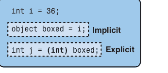

> **图 2.5**
>
> 显式转换的结构

显式转换的问题在于，如果你不仔细，最终可能会得到能编译但在运行时失败代码。显式转换告诉编译器你确信转换会成功，如果未成功，运行时错误是可以接受的。

为了减少显式转换在运行时失败的可能性，C# 提供了 `as` 运算符，其形式为 `e as T`，其中 `e` 是一个表达式，`T` 必须是引用类型或可空类型。`as` 运算符告诉编译器有充分理由相信转换会成功；尝试将值转换为指定类型，如果转换不成功，则返回 `null`，否则返回值为 `T`。

为了利用 `as` 运算符，图 2.5 中的代码可以重写为如下形式：

```csharp
int? i = 36;
object boxed = i;
int? j = boxed as int?;
```

## 动手试试

### 转换

通过按照以下步骤操作，你将探索如何使用转换将值类型转换为引用类型。该应用程序演示了值类型、引用类型和装箱值类型上的操作如何相互影响。

1. 创建一个新的 Console 应用程序。

2. 在 `Main` 方法中，声明一个名为 `i` 的整型变量并初始化为 36。然后声明一个名为 `boxed` 的对象并初始化为 `i`。

3. 输入两个 `Console.WriteLine` 语句以显示 `i` 的值和 `boxed` 的值。

4. 利用显式强制转换，将 `boxed` 的值增加 2。

5. 复制步骤 3 中输入的两个 `Console.WriteLine` 语句，以验证 `i` 的值没有改变，而 `boxed` 的值改变了。

6. 现在，将 `i` 的值增加 1，并复制步骤 3 中的两个 `Console.WriteLine` 语句，以验证 `i` 的值改变了，而 `boxed` 的值没有改变。

7. 再次使用显式强制转换，将 `i` 的值设置为 `boxed` 的新值。

8. 最后，声明两个名为 `h` 和 `j` 的可空整数，将 `h` 初始化为 null，`j` 初始化为 `i`，以及一个名为 `jboxed` 的对象，将其初始化为 `j`。

9. 输入以下代码：

```csharp
Console.WriteLine("h has a value? {0}", h.HasValue);
h = jboxed as int?;
Console.WriteLine("h now has the value {0}", h.Value);
```

10. 使用 Ctrl+F5 运行应用程序，观察输出是否与图 2.6 中显示的一致。

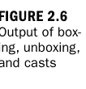

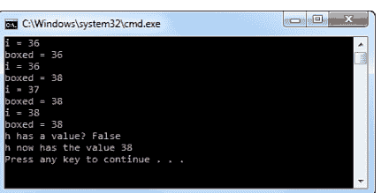

11. 按任意键关闭控制台并返回 Visual Studio。

## 摘要

继续构建你的 C# 基础，你已探索了 C# 提供的预定义类型，并学习了你可以对其执行的丰富操作集。随后，你学习了值类型和引用类型，包括如何将值类型视为引用类型以及如何创建可空类型。

你又编写了几个简单的 C# 应用程序，以探索这些概念是如何工作的。虽然这些应用程序可能并不华丽，但它们有助于巩固你的基础，使你能够构建更高级的应用程序。随着你在 C# 方面的基础不断加深，示例和练习将要求你投入更多的工作量。

### 问答

- **问.** *静态类型意味着什么？*
- **答.** C# 是一种静态类型语言，因此你在创建任何变量时，都必须始终告知编译器其数据类型。作为回报，编译器保证你只能在该变量中存储兼容的数据。

- **问.** *C# 有指针吗？*
- **答.** C# 实际上确实有指针类型，尽管它们不是核心语言的一部分。指针仅在*不安全*代码的上下文中可用。

- **问.** *为什么 C# 中的统一类型系统很重要？*
- **答.** 通过提供统一的类型系统，C# 允许将任何类型的值作为对象处理，而无需不必要的开销。

- **问.** *所有预定义类型都符合 CLS 吗？*
- **答.** 不，无符号整数类型和*byte*类型不符合 CLS。如果有必要，可以使用符合 CLS 的类型来替代这些类型。

- **问.** *使用 var 声明的变量是强类型的吗？*
- **答.** 是的，使用*var*声明的变量仍然是强类型的，因为你在编译期间让编译器填入实际类型。*var*并不等同于 Visual Basic 的*Variant*类型。

- **问.** *值类型和引用类型有什么区别？*
- **答.** 值类型直接包含其数据，而引用类型包含指向其数据的引用。

- **问.** *值类型可以为 null 吗？*
- **答.** 所有值类型要么是可空的，要么是不可空的。可空值类型可以是*null*或其基础非可空类型的值。非可空值类型不能为*null*。

- **问.** *为什么在可能的情况下应避免装箱和拆箱操作？*
- **答.** 在可能的情况下应避免装箱和拆箱操作，因为在资源和开销方面它们代价高昂。

## 工作坊

### 小测验

1. C# 类型被划分为哪三个主要组？
2. 哪个预定义类型适用于金融计算，为什么？
3. 所有预定义类型的基础类型是什么？
4. 为什么引入独立的 bool 类型很重要？
5. 所有字符串和字符数据都存储为 Unicode 吗？
6. 字符串不可变性有什么影响？
7. 前缀递增操作和后缀递增操作有什么区别？
8. 空合并运算符 (??) 可以与引用类型和可空值类型一起使用吗？
9. 解释装箱操作期间发生的情况。
10. long 可以隐式转换为 int 吗？

### 答案

1. C# 中的类型被划分为引用类型、值类型和类型参数类型。
2. decimal 类型适用于金融计算，因为它消除了其他浮点类型中常见的许多表示错误。
3. 所有预定义类型以及 C# 中的一切最终都派生自 object 类型。
4. 通过包含独立的 bool 类型，C# 通过消除使用整数值 0 或 1 时可能产生的歧义，帮助消除几种常见的编程错误。
5. 是的，C# 中的所有字符串和字符都存储为 Unicode 码元，这使得它们可以本地化。
6. 由于字符串是不可变的，一旦赋予值后就不能更改。这意味着任何字符串连接操作都会创建一个全新的字符串对象来容纳新值。在短时间内重复执行大量此类操作可能导致内存使用量显著增加，因此应使用 `StringBuilder` 代替。
7. 在前缀递增操作中，结果是变量递增前的值；在后缀递增操作中，结果是递增后的值被赋回变量。
8. 是的，空合并运算符可以与任何可以包含 `null` 的类型一起使用，包括对象。
9. 当值类型作为引用类型使用时，就会发生装箱操作，这涉及创建一个新实例来容纳装箱后的值。对装箱对象的操作不会影响原始值。
10. 不，`long` 不能隐式转换为 `int`，因为这会丢失精度；然而，它可以显式转换。

### 练习

1. 编写一个控制台应用程序，生成表 2.7 中所示的真值表。
2. 编写一个控制台应用程序，演示值类型和引用类型之间的区别。该应用程序应声明两个整数变量和两个类型为 `Lighthouse` 的对象变量。对于对象变量，创建一个名为 `Lighthouse.cs` 的新类文件，并用以下代码替换 `Lighthouse` 的生成代码：

```csharp
public class Lighthouse
{
    public int NumberOfLights = 1;
    public int RevolutionsPerMinute = 30;
}
```

# 第 3 小时

## 以 C# 方式理解类和对象

**本小时你将学到：**

- 面向对象的编程
- C# 中的类
- 作用域和可访问性
- 方法和属性
- 嵌套类和分部类
- 静态类和静态数据
- 对象初始化器


类是 C# 中的基本编程概念，它在单个单元中同时定义了表示和行为。类提供了面向对象和面向组件编程所需的语言支持，也是你用来创建用户定义类型的主要机制。传统上，面向对象编程语言使用“类型”一词来指代行为，而面向值编程语言则用它来指代数据表示。在 C# 中，它同时意味着数据表示和行为。这是公共类型系统的基础，意味着两种类型只有在它们具有兼容的表示和行为时，才是赋值兼容的。

在本小时中，你将学习面向对象和面向组件编程的基础知识。当你理解这些概念后，你将着手创建 C# 类，并查看它是如何实现面向对象和面向组件编程的目标的。你将了解不同的可访问性模型、如何创建和使用属性和方法，以及可选参数和命名参数。

### 面向对象的编程

在开始详细讨论类之前，你需要理解面向对象的编程的好处，并了解它与 C# 的关系。面向对象的编程帮助你思考想要解决的问题，并提供了一种在代码中表示或**建模**该问题的方法。如果你能很好地建模问题，最终得到的代码将易于维护、易于理解且易于扩展。

**顺便说一下**

**可维护的代码**

当然，创建易于维护、理解和扩展的代码，不仅仅在于获得正确的模型。实现本身也必须正确、易读且组织得当。

如前所述，类是 C# 中的基本编程概念，它在单个单元中同时定义了表示和行为。换句话说，**类**是一种数据结构，它将数据存储与操作该数据的方法结合在一起。类只是另一种可用的数据类型，其提供方式与预定义类型非常相似。类是你用来创建用户定义类型的主要机制。

面向对象的四个主要概念是封装、抽象、继承和多态。在本小时中，你将学习封装和抽象。在下一小时中，你将学习继承和多态。

### 封装和抽象

**封装**使类能够隐藏内部实现细节，并保护自己免受可能导致内部状态无效或不一致的不希望发生的更改。因此，封装有时也被称为**数据隐藏**。

以封装发挥作用为例，想想你的汽车。早上你插入钥匙并转动它（在某些情况下只需按一个按钮）来启动汽车。当你转动钥匙（或按下按钮）时实际导致发动机开始运转的细节对你来说是隐藏的。你不需要知道这些细节就可以启动汽车。这也意味着除了转动点火钥匙外，你无法影响或更改发动机的内部状态。

通过隐藏内部细节和数据，你创建了一个公共接口或**抽象**，它表示类的外部细节。这个抽象描述了该

类可以执行哪些操作，以及该类对外公开了哪些信息。只要公共接口保持不变，内部细节就可以按照需要任意更改，而不会对依赖它的其他类或代码产生不利影响。

通过保持类的公共接口简洁，并在你的类与其所表示的现实世界对象之间提供高度的保真度，你可以确保你的类对于需要使用它其他程序员来说是熟悉的。

让我们再次看看我们的汽车示例。通过封装启动汽车时发生的事件的细节，并提供一个操作 `StartCar` 和一些信息（如 `IsCarStarted`），我们定义了一个公共接口，从而创建了汽车的抽象（或者至少是部分抽象，因为汽车的功能远不止启动）。

## 面向组件的编程

面向组件的编程是一种通过将现有组件和新组件结合来开发软件应用程序的技术，这与汽车由其他组件组装而成的方式非常相似。软件组件是自包含的、自描述的功能包，包含类型定义，这些定义公开了行为和数据。

C# 通过属性、方法、事件和特性（或元数据）的概念支持面向组件的编程，允许将自包含的、自描述的功能组件称为程序集。

## C# 中的类

现在，既然你对面向对象编程和面向组件的编程有了基本的了解，是时候看看 C# 如何通过类使这些概念成为现实了。实际上，你在前两小时的小示例和练习中已经使用过类了。

C# 中的类是引用类型，它们隐式继承自 `object`。要定义一个类，你需要使用 `class` 关键字。看看你在第 1 小时“ .NET 框架和 C# ”末尾构建的应用程序。你所做的一切都在一个名为 `Program` 的类内部。

类的 `body`（即由开括号和闭括号定义的部分）是你为类定义数据和行为的地方。

## 作用域和声明空间

我们在第 1 小时中简要提到了作用域和声明空间，指出作用域定义了你可以使用某个名称的位置，而声明空间则关注该名称在哪里是唯一的。作用域和声明空间密切相关，但有一些细微的差别。

更正式的定义是，作用域是一个封闭的上下文或区域，它定义了名称可以在何处不加限定地使用。

在 C# 中，作用域和声明空间都由花括号包围的语句块定义。这意味着命名空间、类、方法和属性都同时定义了作用域和声明空间。因此，作用域可以嵌套并相互重叠。

如果作用域定义了名称的可见性，且允许作用域重叠，那么在任何外部作用域中定义的名称对于内部作用域都是可见的，反之则不可见。

在列表 3.1 所示的代码中，字段 `age` 在整个 `Contract` 的主体中都在作用域内，包括 `F` 和 `G` 的主体内部。在 `F` 中，使用 `age` 指的是名为 `age` 的字段。

**列表 3.1 作用域和声明空间**

```
class Contract
{
   public int age;

   public void F()
   {
      age = 18;
   }

   public void G()
   {
      int age;
      age = 21;
   }
}
```

然而，在 `G` 中，作用域相互重叠，因为还有一个名为 `age` 的局部变量，它在 `G` 的主体中始终处于作用域内。在 `G` 的作用域内，当你引用 `age` 时，你实际上引用的是局部作用域中名为 `age` 的实体，而不是外部作用域中的那个。当这种情况发生时，外部作用域中声明的名称会被内部作用域隐藏。

图 3.1 展示了相同的代码，其中用虚线和点线矩形标示了作用域边界。

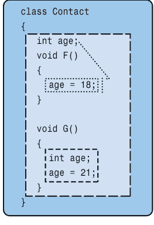

**图 3.1  

嵌套的作用域和隐藏**

另一方面，声明空间是一个封闭的上下文或区域，其中不允许两个实体拥有相同的名称。例如，在 `Contact` 类中，你不允许在类的主体中拥有其他名为 *age* 的实体（*F* 和 *G* 的主体除外）。同样，在 *G* 的主体内部，当你重新声明 *age* 时，你也不允许在 *G* 的声明空间内拥有其他名为 *age* 的实体。

你将在本小时稍后学习关于方法重载的内容，但在声明空间方面，方法的处理方式略有不同。如果你将所有同名重载方法的集合视为单个实体，那么在声明空间内拥有唯一名称的规则仍然满足。

## 自己动手试

### 处理作用域

为了探索作用域和声明空间之间的差异，请按照以下步骤操作。保持 Visual Studio 处于打开状态，因为你稍后还会使用此应用程序。

- 1. 创建一个新的控制台应用程序。

- 2. 添加一个新的名为 `Contact.cs` 的类文件，其外观应如列表 3.1 所示。

- 3. 在 `G` 中，在方法末尾添加一条 `Console.WriteLine` 语句，打印 *age* 的值。

- 4. 在 `Program.cs` 文件的 `Main` 方法中，输入以下代码以创建 `Contact` 类的新实例并打印 `age` 的当前值：

```
Contact c = new Contact();
Console.WriteLine(c.age);
c.F();
Console.WriteLine(c.age);
G();
Console.WriteLine(c.age);
```

- 5. 使用 `Ctrl+F5` 运行应用程序，并观察输出结果是否与图 3.2 中显示的内容一致。

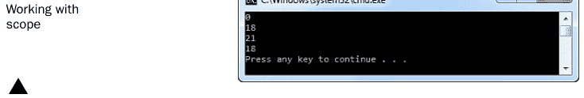

## 可访问性

可访问性使你能控制实体在其包含作用域之外的可见性或可访问性。C# 通过访问修饰符提供此功能，这些修饰符指定了在类边界之外如何访问成员的约束，在某些情况下甚至限制继承。当允许访问特定类成员时，该成员是可访问的；相反，当禁止访问时，该成员是不可访问的。

这些访问修饰符遵循一组简单的上下文规则，以确定何时允许特定类型的可访问性：

- 命名空间不允许有任何访问修饰符，并且始终是公共的。

- 类默认为内部可访问性，但允许声明为公共或内部可访问性。嵌套类（即在另一个类内部定义的类）默认为私有可访问性，但可以采用五种声明可访问性中的任何一种。

- 类成员默认为私有可访问性，但可以采用五种声明可访问性中的任何一种。

这些规则也定义了默认可访问性，即当成员不包含任何访问修饰符时发生的情况。

## 显式声明可访问性

虽然 C# 提供了合理的默认访问修饰符，但你应该始终显式地声明类成员的可访问性。这可以防止意外的歧义，表明选择是有意识的决定，并且具有自文档化的特性。

C# 支持的访问修饰符如表 3.1 所示。

**表 3.1 访问修饰符**

| 修饰符 | 描述 |

| :--- | :--- |

| public | 访问不受限制。 |

| protected | 访问仅限于包含类或从包含类派生的类型。 |

| internal | 访问仅限于包含程序集。 |

| protected internal | 访问仅限于包含程序集或从包含类派生的类型。 |

| private | 访问仅限于包含类。 |

## 受保护的内部

使用受保护的内部可访问性时要小心，因为它实际上是受保护的或内部的。C# 并不提供受保护和内部的概念。

## 字段和常量

字段是表示与类相关的数据的变量。换句话说，字段就是在类最外层作用域中定义的简单变量。如第 1 小时所述，字段可以是实例字段或静态字段，对于这两种类型的字段，你可以指定五种访问修饰符中的任何一种。通常，字段是私有的，这也是默认设置。

如果一个字段（无论是实例字段还是静态字段）在声明时未赋予初始值，它将被分配适用于其类型的默认值。

与字段类似，常量也可以声明为相同的访问修饰符。由于常量必须拥有一个可以在编译时计算的值，因此必须在声明时为其赋值。要求提供可在编译时计算的值的一个好处是，常量可以依赖于其他常量。


常量通常是一个值类型或字符串字面量，因为除了 `string` 之外，创建引用类型的非空值的唯一方法是使用 `new` 运算符，而这是不被允许的。

### 注意！

#### 常量应当是恒定的

在创建常量时，你应确保其值在逻辑上是永远不变的。好的常量应该是那些永远不会改变的事物，例如圆周率的值、猫王出生的年份，或一个摩尔（mol）中包含的物品数量。

如果你需要创建一个具有类似常量行为但使用了常量声明中不允许的类型的字段，可以使用一个 `static` 只读字段代替，方法是同时指定 `static` 和 `readonly` 修饰符。只读字段只能在声明过程中或在构造函数中初始化。

### 亲自动手

### 处理字段

通过按照以下步骤操作，你可以探索如何创建一个包含数据的类，以及如何提供对该数据的访问。如果你已关闭 Visual Studio，请先重复之前的练习。在此练习结束时，请保持 Visual Studio 处于打开状态，因为你稍后仍会使用此应用程序。

- 1. 创建一个新的控制台应用程序。

- 2. 添加一个名为 `Contact.cs` 的新类文件。在类内部，声明三个私有字段，分别命名为 `firstName`、`lastName` 和 `dateOfBirth`，类型依次为 `string`、`string` 和 `DateTime`。

- 3. 向该类添加以下方法。你将在本小时后面的内容中更深入地了解方法，并在第 8 小时“使用字符串和正则表达式”中更深入地了解 `StringBuilder` 类：

```csharp
public override string ToString()
{
    StringBuilder stringBuilder = new StringBuilder();
    stringBuilder.AppendFormat("Name: {0} {1}\r\n", this.firstName, this.lastName);
    stringBuilder.AppendFormat("Date of Birth: {0}\r\n", this.dateOfBirth);
    return stringBuilder.ToString();
}
```

- 4. 在 `Program.cs` 文件的 `Main` 方法中，输入以下内容：

```csharp
Contact c = new Contact();
Console.WriteLine(c.ToString());
```

- 5. 使用 `Ctrl+F5` 运行应用程序，并观察输出结果是否与图 3.3 中显示的一致。

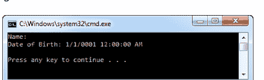

图 3.3 处理字段

### 属性

如果字段代表状态和数据，但通常都是私有的，那么必须存在一种机制使该类能够公开提供这些信息。了解允许的不同访问级别选项后，你可能会倾向于直接将类字段声明为具有公共访问权限。

这将使我们满足抽象的规则，但随后会违反封装的规则，因为字段可以被直接操纵。那么，如何同时满足封装和抽象的规则呢？我们需要的是某样东西，它可以使用与字段相同的语法来访问，但可以定义比字段本身不同的访问权限。属性使我们能够恰好做到这一点。属性提供了一种简单的方式来访问一个称为**后备字段**的字段，该字段可以公开可用，同时仍然允许隐藏该字段的内部细节。正如字段可以是静态的，属性也可以是静态的，并且不与类的实例相关联。

尽管字段声明变量，需要在内存中存储，但属性不需要。相反，属性通过访问器声明，这些访问器允许你控制值是否可以读取或写入，以及当你这样做时应发生什么。`get` 访问器允许读取属性值，而 `set` 访问器允许写入值。

列表 3.2 展示了声明属性的最简单方式。使用这种称为**自动属性**的语法时，你省略后备字段的声明，并且必须始终包含 `get` 和 `set` 访问器，且没有声明的实现，这些实现由编译器提供。

#### 列表 3.2 声明自动属性

```csharp
class Contact
{
   public string FirstName
   {
      get;
      set;
   }
}
```

实际上，编译器将列表 3.2 中显示的代码转换为看起来大致如列表 3.3 所示的代码。

#### 列表 3.3 声明属性

```csharp
class Contact
{
    private string firstName;

    public string FirstName
    {
        get
        {
            return this.firstName;
        }
        set
        {
            this.firstName = value;
        }
    }
}
```


#### 自动属性

自动属性很方便，尤其是当你实现大量属性时。然而，这种方便确实带来了一点代价。

因为你不为访问器提供主体，所以无法指定作为该访问器的一部分执行的任何逻辑，并且必须使用自动属性语法声明两个访问器。结果，如果以后某时你意识到需要为任一访问器提供逻辑，你需要添加一个后备字段以及两个访问器的适当逻辑。

幸运的是，这种更改不会影响类的公共接口，因此它是安全的，尽管可能有点繁琐。

`get` 访问器使用 `return` 语句，简单地指示访问器返回指示的值。在列表 3.3 代码的 `set` 访问器中，类字段 `firstName` 被设置为等于 `value`，但 `value` 来自哪里？根据第 1 章中的表 1.6，你知道 `value` 是一个上下文关键字。当在属性 `set` 访问器中使用时，`value` 关键字始终意味着“调用者提供的值”，并且其类型始终与属性类型相同。

默认情况下，属性访问器继承属性定义本身上声明的访问权限。但是，你可以为 `get` 或 `set` 访问器声明更具限制性的访问权限。

你还可以创建只读的且没有后备字段的计算属性。这些计算属性是提供从其他信息派生数据的好方法。

列表 3.4 展示了一个计算型 `FullName` 属性，它结合了 `firstName` 和 `lastName` 字段。

#### 列表 3.4 声明计算属性

```csharp
class Contact
{
    private string firstName;
    private string lastName;

    public string FullName
    {
        get
        {
            return this.firstName + " " + this.lastName;
        }
    }
}
```

#### 只读和只写属性

对于显式声明的属性，允许你省略任一访问器。仅包含 `get` 访问器，你创建一个只读属性。若要使用自动属性创建等效的只读属性，你会将 `set` 访问器声明为 `private`。

仅包含 `set` 访问器，或将 `get` 访问器声明为 `private`，你创建一个只写属性。在实践中，应避免使用只写属性。


由于属性像字段一样被访问，在访问器中执行的操作应尽可能简单。如果你需要执行更复杂的操作或执行可能耗时或昂贵（消耗资源）的操作，使用方法而不是属性可能更好。

### 亲自动手

### 处理属性

为了修改 `Contact` 类以允许使用属性访问私有数据，并使用自动属性和计算属性，请按照以下步骤操作。如果你已关闭 Visual Studio，请先重复之前的练习。在此练习结束时，请确保保持 Visual Studio 处于打开状态，因为你稍后仍会使用此应用程序。

- 1. 打开 `Contact.cs` 文件。

- 2. 添加一个新的公共属性，命名为 `DateOfBirth`，允许对 `dateOfBirth` 字段进行读写。

- 3. 移除 `firstName` 和 `lastName` 字段，并创建 `FirstName` 和 `LastName` 属性作为自动属性。


- 4. 添加一个名为 `FullName` 的计算属性，它结合 `FirstName` 和 `LastName` 属性的值。这应与列表 3.4 中显示的计算属性类似。

- 5. 修改 `ToString` 方法，使其使用新的 `FullName` 属性，而不是直接执行字符串拼接。

- 6. 在 `Program.cs` 文件的 `Main` 方法中，在 `Console.WriteLine` 语句之后输入以下代码：

```csharp
c.FirstName = "Jim";
c.LastName = "Morrison";
c.DateOfBirth = new DateTime(1943, 12, 8);
Console.WriteLine(c.ToString());
```

- 7. 使用 `Ctrl+F5` 运行应用程序，并观察输出结果是否与图 3.4 中显示的一致。


### 方法

如果字段和属性定义并实现数据，那么方法（也称为**函数**）定义并实现可以执行的行为或操作。我们在示例和练习中一直使用的 `Console` 类的 `WriteLine` 操作就是一个方法的例子。

列表 3.5 展示了如何向 `Contact` 类添加一个验证电子邮件地址的方法。在这种情况下，`VerifyEmailAddress` 方法指定 `void` 作为返回类型，这意味着它不返回任何值。

## 清单 3.5 声明方法

```csharp
class Contact
{
    public void VerifyEmailAddress(string emailAddress)
    {
    }
}
```

清单 3.6 展示了同一个方法，但将其声明为具有 `bool` 类型的返回值。

## 清单 3.6 声明返回值的**方法**

```csharp
class Contact
{
    public bool VerifyEmailAddress(string emailAddress)
    {
        return true;
    }
}
```

方法声明可以指定五种访问修饰符中的任意一种。除了访问修饰符外，方法还可以包含 `static` 修饰符。正如静态属性和字段与类的实例没有关联一样，静态方法也不与实例关联。`WriteLine` 方法实际上是 `Console` 类的一个静态方法。

方法可以接受零个或多个参数，或者称为输入，这些参数由形式参数列表声明，该列表由一个或多个逗号分隔的参数组成。每个参数都必须包含其类型和标识符。如果方法不接受参数，则必须指定一个空参数列表。

参数分为三类：

- **值参数**——最常见。当方法被调用时，会为每个值参数隐式创建一个局部变量，并将参数列表中对应实参的值赋给该变量。

- **引用参数**——不会创建新的存储位置，而是代表与参数列表中对应实参相同的存储位置。引用参数使用 `ref` 关键字声明，该关键字必须同时出现在参数列表和实参列表中。

- **输出参数**——类似于引用参数，但要求 `out` 关键字同时出现在参数列表和调用列表中。与引用参数不同，它们必须在方法返回前被赋予确定值。

为了使方法实际执行其预期的操作，必须调用（或称作调用）该对象上的方法。如果方法需要输入参数，则必须在实参列表中提供这些值；如果方法提供输出值，该值也可以存储在变量中。

实参列表通常与参数列表存在一对一的关系，这意味着在调用方法时，必须按相同的顺序为每个参数提供适当类型的值。

### 参数数组

使用 `params` 关键字声明的参数数组，可以被视为值参数的一种特殊情况，并声明单个参数，该参数可以包含实参列表中给定类型的零个或多个实参。

方法的形式参数列表只能包含单个参数数组；在这种情况下，它必须是列表中的最后一个参数。参数数组也可以是唯一的参数。

顺便说一下

### 作为输入的方法

返回方法值的方法和属性也可以用作其他方法的输入，只要返回值的类型与参数类型兼容即可。这种能力大大增加了方法和属性的实用性，允许你将方法或属性调用链接起来以形成更复杂的行为。

查看前面示例中返回类型为 `void` 的 `VerifyEmailAddress` 方法，你可以这样调用该方法：

```csharp
Contact c = new Contact();
c.VerifyEmailAddress("joe@example.com");
```

然而，对于定义为返回 `bool` 的 `VerifyEmailAddress` 方法，你应该这样调用该方法：

```csharp
Contact c = new Contact();
bool result = c.VerifyEmailAddress("joe@example.com");
```

与参数列表一样，如果方法调用不需要实参，你仍然必须指定一个空列表。

## 方法重载

通常，两个实体不能在同一声明空间内拥有相同的名称，除了重载方法。当两个或更多方法在同一声明空间内具有相同的名称但具有不同的方法签名时，它们就是重载的。

**方法签名**由方法名以及形式参数的数量、类型和修饰符组成，必须与在同一类中声明的所有其他方法签名不同；方法名必须与类中声明的所有非方法实体不同。

### 方法签名

返回值类型不是方法签名的一部分，因此方法不能仅通过返回值类型不同来区分。

虽然形式参数列表是方法签名的一部分，但方法不能根据参数是 `ref` 还是 `out` 参数来区分。就方法签名而言，不考虑参数的 `ref` 或 `out` 属性。

重载方法只能因签名而异。更准确地说，它们只能因参数的数量和类型而异。考虑你已经使用过的 `Console.WriteLine` 方法；有 19 种不同的重载可供选择。

方法重载在 .NET 框架中很常见，它使你能够向类的用户提供一个单一的方法来交互并提供不同的输入。基于该输入，编译器确定实际应使用哪个方法。

### 具有不同返回值的重载

由于方法签名不包括返回值类型，因此重载方法可以具有不同的返回值类型。尽管这可能是合法的 C# 代码，但应避免这种情况，以最大程度地减少混淆的可能性。

当你想要为触发操作提供几种不同的可能性时，方法重载是有用的，但如果有许多选项时，方法重载可能会变得笨拙。方法重载的示例如图 3.7 所示。

## 清单 3.7 方法重载

```csharp
public void Search(float latitude, float longitude)
{
    Search(latitude, longitude, 10, "en-US");
}

public void Search(float latitude, float longitude, int distance)
{
    Search(latitude, longitude, distance, "en-US");
}

public void Search(float latitude, float longitude, int distance, string culture)
{
}
```

### 试一试

### 与方法一起工作

继续扩展 `Contact` 类，按照以下步骤添加 `VerifyEmailAddress` 和 `Search` 方法。如果你关闭了 Visual Studio，请先重复前面的练习。请务必在此练习结束时保持 Visual Studio 处于打开状态，因为你稍后将使用此应用程序。

1. 打开 `Contact.cs` 文件。

2. 添加清单 3.6 中显示的 `VerifyEmailAddress` 方法，使其在输入“joe@example.com”电子邮件地址时返回 true。

3. 添加清单 3.7 中显示的重载方法。

4. 在最后的重载 `Search` 方法中，输入一个 `Console.WriteLine` 调用，用于打印参数的值。

5. 在 `Program.cs` 文件的 `Main` 方法中，在最后一个 `Console.WriteLine` 语句后输入以下代码：

```csharp
c.Search(37.479444f, -122.450278f);
c.Search(37.479444f, -122.450278f, 50);
c.Search(37.479444f, -122.450278f, 50, "en-US");

Console.WriteLine(c.VerifyEmailAddress("joe@example.com"));
Console.WriteLine(c.VerifyEmailAddress("jim@example.com"));
```

6. 使用 `Ctrl+F5` 运行应用程序，并观察输出是否与图 3.5 中所示的内容匹配。

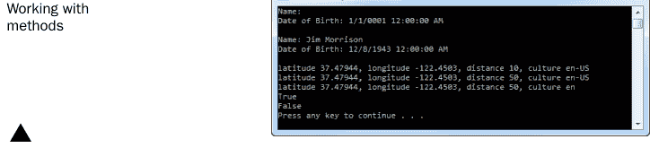

## 可选参数和命名实参

可选参数允许你在调用方法时省略实参列表中的该实参。只有值参数可以是可选的，并且所有可选参数必须出现在必需参数之后，但在参数数组之前。

要将参数声明为可选，只需为其提供一个默认值。使用可选参数修改后的 `Search` 方法如下所示：

```csharp
public void Search(float latitude, float longitude, int distance = 10,
                  string culture = "en-US");
```

`latitude` 和 `longitude` 参数是必需的，而 `distance` 和 `culture` 都是可选的。使用的默认值与第一个重载的 `Search` 方法提供的值相同。

观察上一节中 `Search` 方法的重载，应该很明确，参数越多，需要提供的重载就越多。在这种情况下，只有少数几个重载，但这仍然比提供单个带可选参数的方法要多。尽管在某些情况下重载是唯一的选择，特别是当参数没有合理的默认值时，但通常你可以使用可选参数达到相同的结果。

> **可选参数和必需参数**
>
> 带有默认实参的参数是可选参数，而没有默认实参的参数是必需参数。


可选参数在与非托管编程接口（例如 Office 自动化 API）集成时也非常有用，这些 API 是专门针对可选参数编写的。在这些情况下，原始 API 调用可能需要大量的实参（有时多达 30 个），其中大多数都有合理的默认值。

包含可选参数的方法可以在不显式为这些参数传递实参的情况下被调用，从而允许使用默认实参。但是，如果方法被调用并为可选参数提供了实参，则使用该实参代替默认值。

清单 3.8 展示了调用 `Search` 方法的示例，允许使用默认值。

### 清单 3.8 使用可选参数

```csharp
Search(27.966667f, 82.533333f, 3);
Search(27.966667f, 82.533333f, 3, "en-GB");
Search(27.966667f, 82.533333f);
```

可选参数的缺点是你不能省略逗号之间的实参，这意味着你无法像这样调用 `Search` 方法：

```csharp
Search(27.966667f, 82.533333f , , "en-GB");
```

为了解决这种情况，C# 允许任何实参按名称传递，从而明确指示实参与其对应参数。使用命名参数，列表 3.8 中不同的方法调用以及刚才显示的非法调用可以写成列表 3.9 所示的形式。

### 列表 3.9 使用命名参数

```
Search(latitude: 27.966667f, longitude: 82.533333f, distance: 3);
Search(latitude: 27.966667f, longitude: 82.533333f, distance: 3, culture: "en-GB");
Search(latitude: 27.966667f, longitude: 82.533333f);
Search(27.966667f, 82.533333f, culture: "en-GB");
Search(latitude: 27.966667f, longitude: 82.533333f, culture: "en-GB");
```

所有这些调用都是等价的。前三个调用与列表 3.8 中的调用相同，只是每个参数都被显式命名了。最后两个调用展示了我们如何省略参数列表中间的某个参数，它们也是等价的，尽管其中一个混合使用了命名参数和位置参数。

## 顺便提一下

## 命名参数和位置参数

未按名称传递的参数称为位置参数。位置参数是最常见的。

命名参数最常与可选参数一起使用，但也可以在没有可选参数的情况下使用。与可选参数不同，命名参数可以与值参数、引用参数和输出参数一起使用。你还可以在参数数组中使用命名参数，但你必须显式声明一个新数组来包含值，如下所示：

```
Console.WriteLine(String.Concat(values: new string[] { "a", "b", "c" }));
```

正如你可以从 `Search` 方法中看到的，通过允许你显式地指示参数的名称，C# 提供了一种额外的（强大的）方法来帮助编写完全描述性和自文档化的代码。

## 你知道吗？

## 改变参数的顺序

参数始终按指定的顺序求值。虽然通常不需要，但命名参数允许你改变参数在调用列表中的出现顺序：

```
Search(longitude: 82.533333f, latitude: 27.966667f);
Search(latitude: 27.966667f, longitude: 82.533333f);
```

## 自己动手试一试

## 处理可选参数和命名参数

要修改之前定义的 `Search` 方法，使其使用可选参数而不是重载，请按照以下步骤操作。如果你关闭了 Visual Studio，请首先重复之前的练习。请确保在此练习结束时保持 Visual Studio 处于打开状态，因为你稍后会使用这个应用程序。

- 1. 打开 `Contact.cs` 文件。

- 2. 移除前两个 `Search` 方法，只保留包含所有四个参数的那个方法，并修改该方法，使 `distance` 和 `culture` 成为可选参数，使用 10 和 "en-US" 作为默认值。

- 3. 使用 `Ctrl+F5` 运行应用程序，并观察输出是否与图 3.6 中所示的匹配。

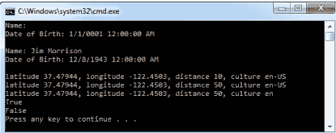

图 3.6 使用可选参数和命名参数

- 4. 在 `Program.cs` 文件的 `Main` 方法中，将 `Search` 方法的调用改为使用不同组合的命名参数，并在每次更改后观察输出。

## 实例化类

与你可以简单声明变量并为其赋值的预定义值类型不同，要在自己的程序中使用类，你必须创建该类的一个实例。

请记住，即使你使用 `new` 关键字直接创建新对象，虚拟执行系统负责实际分配所需的内存，而垃圾回收器负责解除分配该内存。

使用 `new` 关键字来实现类的实例化，如下所示：

```
Contact c = new Contact();
```

新创建的对象必须给予初始状态，这意味着声明的任何字段都必须通过显式提供值或接受默认值（参见第 2 章的表 2.13）来给予初始值。

有时这种级别的初始化就足够了，但通常不会。为了提供在初始化期间发生的额外操作，C# 提供了一个**实例构造函数**（有时简称为构造函数），这是一种在创建实例时自动执行的特殊方法。

构造函数具有与类相同的名称，但它不能返回值，这与返回 `void` 的方法不同。如果构造函数没有参数，它就是默认构造函数。

## 顺便提一下

**默认构造函数**

每个类都必须有一个构造函数，但你并不总需要编写一个。如果你没有包含任何构造函数，C# 编译器会为你创建一个默认构造函数。这个构造函数实际上不会做任何事情，但它会在那里。

由于编译器仅在你没有提供其他构造函数时才生成默认构造函数，因此通过添加一个带有参数的额外构造函数并忘记同时显式添加默认构造函数，很容易破坏类的公共接口。结果，始终提供一个默认构造函数而不是让编译器为你生成，是一个好主意。

默认构造函数（或任何构造函数）可以有任何访问修饰符，因此创建私有的默认构造函数是完全可能的。如果你想允许创建你的类，但想确保在实例化对象时始终提供某些信息，这会有用。

列表 3.10 显示了 `Contact` 类的默认构造函数。

### 列表 3.10 声明默认构造函数

```
public class Contact
{
    public Contact()
    {
    }
}
```

正如重载常规方法一样，也可以重载构造函数。构造函数的签名与常规方法的签名相同，因此重载构造函数的集合也必须通过签名来区分。

提供专用构造函数的原因如下：

- ▶ 没有参数就没有合理的初始状态。

- ▶ 为类型提供初始状态既方便又合理。

- ▶ 构造对象可能代价高昂，因此你希望确保在创建对象时具有正确的初始状态。

- ▶ 非公共构造函数限制了谁可以使用它创建对象。

看看你一直在使用的 `Contact` 类，如果你在新实例创建时提供 `firstName`、`lastName` 和 `dateOfBirth` 字段的值，那肯定会有用。为此，你需要声明一个重载构造函数，如列表 3.11 所示。

### 列表 3.11 声明构造函数重载

```
public class Contact
{
  public Contact(string firstName, string lastName, DateTime dateOfBirth)
  {
    this.firstName = firstName;
    this.lastName = lastName;
    this.dateOfBirth = dateOfBirth;
  }
}
```

在列表 3.11 的构造函数重载中，你将参数的值赋给了其对应的私有字段。

通常，虽然不总是这样，当一个类包含多个构造函数时，这些构造函数会链接在一起。要链接构造函数，你使用一种使用 `this` 关键字的特殊语法。

## this 关键字


`this`关键字引用类的当前实例。它类似于 Visual Basic 中的`Me`关键字、F# 中的自标识符、Python 中的`__self__`属性以及 Ruby 中的`self`。

`this`的常见用途如下：

- ▶ 限定被相似名称隐藏的成员
- ▶ 将对象作为参数传递给其他方法
- ▶ 指定应从另一个构造函数重载中调用哪个构造函数
- ▶ 指示扩展方法中的扩展类型

由于静态成员存在于类级别且不关联于实例，因此你不能使用`this`关键字。

在列表 3.11 中，由于类字段和参数具有相同的名称，因此使用`this`关键字来区分它们。

## 顺便提一下

列表 3.12 显示了使用构造函数链接的`Contact`类，其中包含了列表 3.10 和列表 3.11 中的两个构造函数。

### 列表 3.12 构造函数链接

```
public class Contact
{
    public Contact()
    {
    }

    public Contact(string firstName, string lastName, DateTime dateOfBirth)
        : this()
    {
        this.firstName = firstName;
        this.lastName = lastName;
        this.dateOfBirth = dateOfBirth;
    }
}
```

构造函数链接的一个好处是，你可以链接类提供的任何构造函数，而不仅仅是默认构造函数。当你使用构造函数链接时，理解构造函数执行的顺序非常重要。构造函数链被遵循，直到到达最后一个链接的构造函数，然后构造函数将按顺序从链中向外执行。列表 3.13 显示了一个类`C`，具有三个构造函数，每个都链接到默认构造函数。

### 列表 3.13 链接构造函数的执行顺序

```
public class C
{
    string c1;
    string c2;
    int c3;

    public C()
    {
        Console.WriteLine("Default constructor");
    }

    public C(int i, string p1) : this(p1)
    {
        Console.WriteLine(i);
    }

    public C(string p1) : this()
    {
        Console.WriteLine(p1);
    }
}
```

图 3.7 显示了使用第二个构造函数（接受一个整数和一个字符串作为输入的那个）实例化时，每个构造函数执行的顺序。

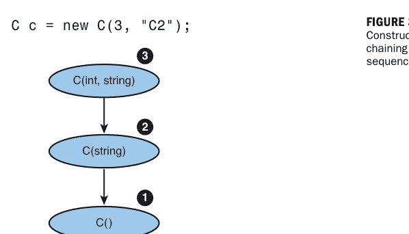

## 静态构造器

正如你刚才所见，实例构造器实现了初始化类实例所需的动作。在某些情况下，类可能要求在访问任何实例成员之前，特定的初始化动作最多只发生一次。

为了实现这一点，C# 提供了一种**静态构造器**，其形式与默认构造器相同，区别在于它使用 *static* 修饰符代替了访问修饰符之一。由于静态构造器用于初始化类，因此无法直接调用静态构造器。

静态构造器最多执行一次，并在创建第一个实例或引用类的任何静态成员时首次执行。

## 嵌套类

**嵌套类**是完全包含在另一个类声明内部（即嵌套）的类。嵌套类是一种便捷的方式，允许外部类创建和使用对象，同时避免这些对象在类外部可被访问。尽管嵌套类可能很方便，但也容易被过度使用，这可能会使你的类更难处理。

嵌套类隐式地至少具有与包含类相同的访问级别。例如，如果嵌套类是 `public` 的，但包含类是 `internal` 的，那么嵌套类也是隐式的 `internal`，只有该程序集的成员才能访问嵌套类。然而，如果包含类是 `public` 的，嵌套类则遵循与非嵌套类相同的可访问性规则。

如果一个类没有独立的意义，并且可以被逻辑上包含在另一个类中，或者类的成员需要访问包含类的私有数据，你应该考虑将该类实现为嵌套类。由于嵌套类通常用于包含类的内部使用，因此一般不应将它们声明为 public。

## 分部类

分部类允许你将类的声明拆分为多个部分，通常分布在多个文件中。分部类的实现方式与普通类完全相同，只是在 `class` 关键字之前包含 `partial` 关键字。在使用分部类时，编译期间所有部分都必须可用，并且具有相同的可访问性，以形成完整的类。

代码生成工具，例如 Visual Studio 中的可视化设计器（它们为你生成代表正在设计的可视化控件的类），广泛使用分部类。机器生成的代码被添加到分部类的一部分中，这使得你可以修改分部类的另一部分，而不用担心在重新生成机器生成部分时更改会丢失。

分部类也可以用于不涉及机器生成代码的其他场景。大型类声明可以从使用分部类中受益；然而，这有时意味着你的类试图做太多事情，最好将其拆分为多个类。

### 你知道吗？

**嵌套类与分部类**

虽然 C# 不像 Java 那样要求每个文件只有一个类，但遵循这种结构通常很有帮助。当使用嵌套类时，除非包含类是分部类，否则这是不可能的。

## 静态类

到目前为止，你已经看到 `static` 修饰符应用于构造器、字段、方法和属性。你也可以将 `static` 修饰符应用于类，从而定义静态类。静态类只能拥有静态构造器，因此不可能创建静态类的实例。出于这个原因，静态类最常包含不需要类实例即可工作的工具方法或辅助方法。

### 隐式静态成员

静态类只能包含静态成员，但这些成员不会自动变为静态。你必须显式包含 static 修饰符；不过，你可以将任何静态成员声明为 public、private 或 internal。


## 扩展方法

扩展方法是普通的静态方法，但其第一个参数包含 `this` 修饰符，表示正在扩展的类型实例，通常称为**类型扩展参数**。扩展方法必须声明在非嵌套、非泛型的静态类中。

当包含扩展类的命名空间通过 `using` 指令在作用域内时，扩展方法看起来像是扩展类型上的原生实例方法。这允许以自然直观的方式调用它们。

因为扩展方法不过是一种特别标记的静态方法，所以它对被扩展类型没有特殊的访问权限，只能使用被扩展类型的公共接口。它还可以让你通过引用其完全限定名以更传统的方式调用扩展方法。

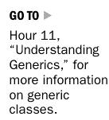

### 内部访问

在同一程序集中定义的扩展方法也可以访问该类型的内部成员。


虽然可以定义与类型上实际方法签名匹配的扩展方法，但它将不可见。编译器确保在方法解析期间，任何实际的类方法都优先于扩展方法。这确保了扩展方法无法更改标准类方法的行为，从而避免产生不可预测或至少出乎意料的行为。

### 自己动手

#### 使用扩展方法

通过执行以下步骤，你将向 `DateTime` 类添加一个扩展方法，并修改 `Contact` 类以使用这个新的扩展方法。如果你关闭了 Visual Studio，请先重复之前的练习。

1. 在 BusinessLogic 项目中创建一个名为 `Extensions.cs` 的新文件。
2. 将 `Extensions` 类设为 static，并创建一个名为 `ElapsedDays` 的新扩展，扩展 `DateTime` 并使用你之前用于 `Age` 属性的相同公式。
3. 修改 Contact 类中的 Age 属性以使用这个新的扩展方法。
4. 使用 `Ctrl+F5` 运行应用程序，并观察输出是否与图 3.8 中显示的匹配。

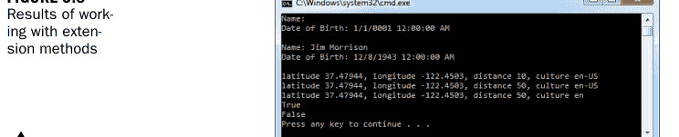

## 对象初始化器

你之前见过如何为类创建构造器，从而提供一种设置初始状态的便捷方式。然而，与方法重载一样，你需要设置的字段越多，可能就需要提供越多的重载构造器。虽然构造器支持可选参数，但有时你想在创建对象实例时设置属性。

类提供了一种对象初始化语法，允许你在构造器调用过程中为任何可公开访问的字段或属性赋值。这提供了很大的灵活性，并可以显著减少你需要提供的重载构造器数量。

列表 3.14 显示了与“使用属性”部分中编写的内容类似的代码，随后是使用对象初始化器的代码。这两种情况下编译器生成的代码几乎相同。

```csharp
LISTING 3.14 Object Initializers

Contact c1 = new Contact();
c1.FirstName = "Jim";
c1.LastName = "Morrison";
c1.DateOfBirth = new DateTime(1943, 12, 8);
Console.WriteLine(c1.ToString());

Contact c2 = new Contact
{
	FirstName = "Jim",
	LastName = "Morrison",
	DateOfBirth = new DateTime(1943, 12, 8)
};

Console.WriteLine(c2.ToString());
```

只要字段或属性之间没有依赖关系，对象初始化器就是一种同时实例化和初始化对象的简单且简洁的方式。

## 总结

在这一点，你应该对 C# 中的类如何为面向对象编程提供语言实现有了很好的理解。你学习了作用域如何影响类中成员的可见性，以及如何通过使用不同的访问修饰符来更改可访问性。在此基础上，你构建了一个类并实例化了该类的实例。然后你学习了方法和属性，包括方法重载、可选和命名参数。最后，我们讨论了嵌套类和分部类。

与你在前几小时中处理的简单示例不同，本小时的示例和练习侧重于构建更贴近现实世界的类。

## 问答

1. **Q. 面向对象编程的四个主要原则是什么？**
   A. 面向对象编程的四个主要原则是封装、抽象、继承和多态。

2. **Q. 为什么封装和抽象很重要？**
   A. 通过使用封装和抽象，你可以更改内部实现细节，而不会影响使用该类已经编写的代码。

3. **Q. 什么是方法重载？**
   A. 方法重载是在给定类型中创建一个以上的同名方法。重载方法必须具有不同的签名。

4. **Q. 属性如何使类满足封装的目标？**
   A. 属性提供了一种简单的方法来访问可以公开的字段，同时允许隐藏该字段的内部细节。

5. **Q. 什么是分部类？**
   A. 分部类在所有类声明中包含 *partial* 关键字，通常拆分在多个源代码文件中。

**问：使用扩展方法有什么好处？**
**答：** 使用扩展方法可以在不要求使用继承的情况下，为现有类型添加额外的功能。然后，可以以自然直观的方式使用这些额外功能。

## 研讨会

### 测验

1. C# 中可用的五种访问修饰符是什么？
2. 类的默认可访问性是什么？
3. 什么是构造函数？
4. 类的默认构造函数可以包含参数吗？
5. 使用清单 3.13 中显示的代码，以下语句的输出是什么？
   ```csharp
   C c = new C(3, "C2");
   ```
6. 什么时候可以为只读字段赋值？
7. 什么是方法重载？
8. 使用自动属性时有限制吗？
9. 什么是嵌套类？
10. 扩展方法可以访问被扩展类型的私有成员吗？
11. 当 new 运算符执行时会发生什么？

### 答案

1. C# 中可用的五种访问修饰符是 public（公共）、protected（保护）、internal（内部）、protected internal（保护内部）和 private（私有）。
2. 类的默认可访问性为内部，但允许声明为公共或内部可访问性。嵌套类的默认可访问性为私有，但允许具有任何可访问性。
3. 构造函数是一种特殊方法，在创建对象时自动执行，以提供额外的初始化操作。
4. 不可以，类的默认构造函数必须始终没有参数。
5. 该语句的输出为
   ```
   Default Constructor
   C2
   3
   ```
6. 只读字段只能在声明时或在构造函数中初始化。
7. 方法重载是创建一个或多个同名方法，这些方法仅通过参数数量和类型不同而有所区别。
8. 自动属性不提供访问隐式后备字段的方式，不允许指定作为 get 或 set 访问器一部分执行的其他语句，并且不允许混合常规和自动语法。
9. 嵌套类是完全封闭在另一个类声明内部的类。
10. 因为扩展方法只是静态方法，它们对扩展的类型没有任何特殊访问权限。然而，在与被扩展类型位于同一程序集中定义的扩展方法也可以访问该类型的内部成员。
11. 当 new 运算符执行时发生的两个主要操作是 1) 从堆中分配内存以及 2) 执行类的构造函数以初始化分配的内存。

### 练习

1. 向 PhotoViewer 项目添加一个表示照片的类。该类应命名为 `Photo` 并位于 `PhotoViewer` 命名空间中。该类应具有以下私有字段，以及用于检索这些字段值的只读属性：

| 数据类型 | 字段名称 |
| :--- | :--- |
| bool | Exists |
| BitmapFrame | image |
| Uri | source |

添加以下构造函数：
```csharp
public Photo(Uri path)
{
    if (path.IsFile)
    {
        this.source = path;
    }
}
```

## 第 4 小时

# 继承、接口和抽象类

**本小时你将学到：**

- 继承和多态
- 使用继承成员
- 密封类
- 抽象类
- 接口

在上一个小时中，你学习了 C# 中的类如何通过封装和抽象提供面向对象和组件导向编程所需的语言支持。虽然这些面向对象方面非常重要，但它们并不能提供一种很好的机制来表达类之间特定变体层级关系。

继承提供了一种表达此类关系的自然方式。通过继承，你可以创建一个完全新的类，该类从其父类继承特征和行为。多态，即一种类型像另一种类型一样使用的能力，是继承的自然结果。

在这一小时中，你将学习 C# 如何通过抽象类和接口对继承和多态提供支持。你还将学习 C# 如何防止类被扩展。

## 继承和多态

正如子女从父母那里继承特征和行为一样，类也可以继承特征和行为。面向对象编程中的**继承**，也称为派生，允许创建一个新的类（称为子类或**派生类**），该类从其父类（称为基类）继承特征和行为。

继承允许你将问题的表观复杂性减少为可管理的部分。这些部分形成概念层，根据观点不同，提供越来越多的专业化或泛化，以自然的方式描述使用“是一种”关系表达的某些问题的层级性质。

### 注意！多重继承

继承的一般概念很简单。然而，许多面向对象编程语言允许派生类从多个父类继承，这称为多重继承。多重继承并不改变类之间必须具有“是一种”关系的要求，它可能是一种强大的机制，但这种力量也可能导致实现上的相当复杂性。由于具有两个父类的类允许到达特定基类的两个不同继承路径，因此在理解类的派生链时也会引起歧义。

为了消除可能的歧义，并且因为多重继承是唯一合适解决方案的场景数量相当少，C# 只允许单一继承。

通常，专业化是指新类具有不在继承（基）类中的额外数据或行为。当基类规定仅存在某种操作或行为但未实现该行为时，也可能发生专业化。此时，由派生类负责提供实现。

通过创建从现有类型派生的新类型，你从父类型继承特征和行为。继承还允许派生类对其基类进行多项更改。派生类可以执行以下操作：

- 添加新的私有数据。
- 添加新的行为。
- 重新定义现有行为。

再次参考上一小时的汽车示例，图 4.1 展示了汽车可能的继承链。汽车是一种四轮车辆，而四轮车辆又是一种车辆。车辆是基础或根类，并提供所有车辆共有的行为和数据。随着我们沿着层级向下走，我们发现四轮车辆和两轮车辆基类，它们是车辆的特化，添加了额外的行为和数据。最后，我们发现汽车、卡车和摩托车类，它们是可能也添加额外行为和数据的派生类。

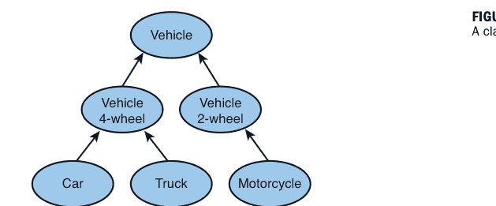

在面向对象编程中，**多态**是一种类型像另一种类型一样使用的能力。通常，有两种实现方式：

- 一种类型继承（或派生自）另一种类型，使其能够访问与其父类相同的操作和公共数据。
- 两种类型都实现兼容的公共接口，从而实现相同的操作和公共数据，但可能具有不同的实现。

查看图 4.1 中的类图，应该可以清楚地看到，尽管汽车和卡车显然不是同一类型，但其中任何一个都可以替代四轮车辆，因为它们都从该类继承。同样，尽管摩托车不能替代四轮车辆，但它可以与汽车或卡车一起替代车辆。

正如你所见，多态很大程度上依赖于封装、抽象和继承中提出的概念。如果没有这些方面，一个类替代另一个类几乎是不可能的。

> **多态**
> 多态是那些听起来可能很复杂但实际上并不复杂的词之一。多态是自然且常见的现象。这个词是希腊语 poly（意为多）和 morphe（意为形状或形式）的组合，字面意思是指多种形状或形式。

**顺便提一下**

在 C# 中，只需在类声明中提供所继承类的名称，即可轻松实现继承。清单 4.1 展示了图 4.1 中描述的层级结构的代码表示。

## **清单 4.1** 代码中的类层次结构

```
public class Vehicle { }

public class FourWheeledVehicle : Vehicle { }
public class TwoWheeledVehicle : Vehicle { }

public class Car : FourWheeledVehicle { }
public class Truck : FourWheeledVehicle { }

public class Motorcycle : TwoWheeledVehicle { }
```

这种继承也被称为**实现继承**，因为你实际上是从父类继承了实现。既然已经有了层级结构的代码表示，你会如何使用它？

# **注意！**

### **设计类层次结构**


继承无法做到的一件事就是删除数据或行为。如果你发现需要从某个派生类中移除行为或数据，这很可能意味着你的类层次结构设计不正确。设计类层次结构并非总是容易的任务，通常需要经过多次尝试才能做对。最佳的方法是花多一点时间思考你已知的对象之间以及将来可能需要的那些对象之间的关系。如果你的类层次结构过于浅（没有太多继承）或过于深（有很多继承），你可能需要重新考虑这些关系。请记住，类层次结构中的所有内容都必须相互关联。在概念上由几个较小的层次结构组成的层次结构是完全可接受的。

在 C# 中，分配给变量的表达式必须已知与该变量的类型兼容。这意味着以下代码是不允许的：

```
Car c = new Car();
Truck t = c;
```

这应该是有道理的，因为卡车和汽车不是同一事物。然而，从逻辑上讲，卡车和汽车都是`FourWheeledVehicle`，进而都是`Vehicle`，因此以下代码是被允许的：

```
Car c = new Car();
Truck t = new Truck();
Vehicle v1 = c;
Vehicle v2 = t;
```

尽管 `c` 和 `v1` 都引用同一个 `Car` 对象，但存在一个重要区别。当你访问 `c` 时，你是通过一个声明为 `Car` 类型的变量进行的，这允许你访问由 `Car` 及其基类 `FourWheeledVehicle` 定义的成员，进而访问 `Vehicle` 定义的成员。然而，当你访问 `v1` 时，你是通过一个声明为 `Vehicle` 类型的变量进行的，这仅允许你访问由 `Vehicle` 定义的成员。

## 向上转换和向下转换

将派生类转换为其基类之一的过程称为向上转换。从基类转换为其派生类之一的过程称为向下转换。

这样理解：汽车知道它是一辆车辆，因此允许访问车辆能做的任何事情，但车辆对汽车一无所知，因此只允许你访问它所知道的内容。

虽然你可以在类层次结构中向上移动（从更派生的类到较不派生的类），但你不能向下移动。例如，以下操作是不允许的：

```
Vehicle v1 = new Vehicle();
Car c = v1;
```

起初这可能会令人惊讶，直到你记起一个 `Vehicle` 可能代表五种不同类型中的任意一种。因此，不可能隐式地将更通用类型的表达式赋值给更具体类型的变量。

为了实现这一点，你必须显式地告诉编译器你希望将基类向下转换为派生类。在这种情况下，你需要编写：

```
Vehicle v1 = new Vehicle();
Car c = (Car)v1;
```

尽管此代码是合法的，但它确实存在一个问题。如果你改为编写以下代码会发生什么？

```
Vehicle v1 = new Vehicle();
Vehicle v2 = new Truck();
Car c = (Car)v2;
```

此代码仍然是合法的，并且可以无错误地编译，但在运行时会导致 `InvalidCastException`，指出不能将 `Truck` 类型的对象转换为 `Car` 类型。

解决此问题的方法是遵循“信任但验证”的理念。这仅仅是指你信任代码可以编译和运行，但在执行转换之前，你会验证基类类型的变量是否确实是正确的派生类型。清单 4.2 展示了实现“信任但验证”的多种方法。

## 清单 4.2 “信任但验证”代码

```csharp
Car c = new Car();
Truck t = new Truck();
Vehicle v1 = c;
Vehicle v2 = t;

if (typeof(Car).IsAssignableFrom(v1.GetType()))
{
    c = (Car)v1;
    Console.WriteLine(c.GetType());
}

if (v1 is Car)
{
    c = (Car)v1;
    Console.WriteLine(c.GetType());
}

c = v1 as Car;
if (c != null)
{
    Console.WriteLine(c.GetType());
}
```

第一种方法使用 C# 中的底层类型系统来确定 `Car` 类型（`typeof(Car)` 调用的结果）是否可以从 `v1` 的类型（`v1.GetType()` 调用的结果）中赋值。如果是，则显式地将 `v1` 转换为 `Car`。基类总是可以从其派生类之一中赋值。

第二种方法稍微简单一些，询问类型系统 `v1` 是否为 `Car`，如果是，则显式地将 `v1` 转换为 `Car`。

第三种方法是最简单的选项，它表示如果 `v1` 可以转换为 `Car`，则执行转换并返回结果；否则，返回 `null`。

# 试一试

## 简单的类继承和多态性

要实现清单 4.1 中显示的类层次结构并探索继承和多态性如何工作，请遵循以下步骤。请保持 Visual Studio 在练习结束后处于打开状态，因为你稍后需要使用此应用程序。

- 1. 创建一个新的控制台应用程序。
- 2. 添加一个新的类文件，名为 `Vehicles.cs`，并实现清单 4.1 中显示的基本类层次结构。
- 3. 在 `Program.cs` 文件的 `Main` 方法中，输入以下代码：

```csharp
Vehicle v1 = new Vehicle();
Car c1 = (Car)v1;
```

- 4. 按 `Ctrl+F5` 运行应用程序。你应该会遇到一个 `InvalidCastException`，如图 4.2 所示。

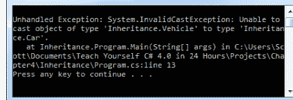

**图 4.2**

显示 InvalidCast 异常的结果

- 5. 删除你在步骤 2 中之前输入的语句，并将其替换为清单 4.2 中显示的代码。
- 6. 再次按 `Ctrl+F5` 运行应用程序，观察输出是否与图 4.3 中显示的一致。

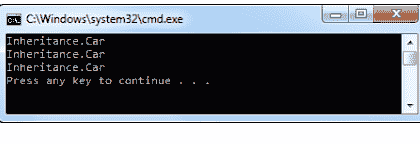

**图 4.3**

处理类继承和多态性的结果

清单 4.3 展示了清单 4.1 中代码层次结构的修改版本，为某些派生类提供了调用基类构造函数的构造函数。

**注意！**

### 构造函数链接和默认构造函数

如果你没有显式链接基类构造函数，编译器会尝试链接默认构造函数。

这里的问题是，并非所有类都有公共默认构造函数，在这种情况下，忘记显式链接正确的基类构造函数可能会导致编译器错误。

## 清单 4.3 派生类中的构造函数

```csharp
public class Vehicle
{
    private Vehicle() { }

    public Vehicle(int wheels)
    {
        Console.WriteLine("The number of wheels requested is {0}", wheels);
    }
}

public class FourWheeledVehicle : Vehicle
{
    public FourWheeledVehicle() : base(4) { }
}

public class TwoWheeledVehicle : Vehicle
{
    public TwoWheeledVehicle() : base(2) { }
}

public class Car : FourWheeledVehicle { }
public class Truck : FourWheeledVehicle { }
public class Motorcycle : TwoWheeledVehicle { }
```

## 试一试

## 构造函数链接

通过遵循以下步骤，你可以修改前一部分创建的类层次结构以探索构造函数链接。如果你关闭了 Visual Studio，请先重复上一个练习。请确保在练习结束后保持 Visual Studio 处于打开状态，因为你稍后需要使用此应用程序。

- 1. 打开名为 `Vehicle.cs` 的文件。
- 2. 修改类以反映清单 4.3 中显示的代码。
- 3. 在 `Program.cs` 文件的 `Main` 方法中，用创建新的汽车、摩托车、卡车和三轮车代码替换现有代码。
- 4. 使用 `Ctrl+F5` 运行应用程序，观察输出是否与图 4.4 中显示的一致。

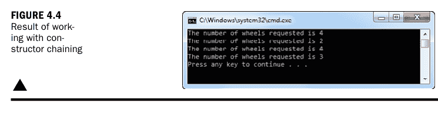

# 处理继承成员

有时，派生类需要具有同名但行为完全相同的方法或属性，这通过使用**成员隐藏**来实现。要隐藏基类成员，需要在派生类中声明一个与想要隐藏的基类成员具有相同签名的成员。由于成员隐藏基于签名，因此也可以使用成员隐藏来更改成员的返回类型。

如果您确实想要重新定义基类成员，成员隐藏非常有用。如果只是想提供更合适的实现呢？C# 允许您使用重写方法来实现这一点。

## 成员隐藏

隐藏基类成员可能会产生意外，或至少是非预期的结果。虽然在派生类中隐藏基类成员有时是有意为之，但通常这是因为基类的更改（您可能无法控制该更改）导致了您无意中隐藏了基类成员。

因此，当基类成员被隐藏时，编译器会生成一个警告来告知您。如果您确定这就是您想要做的，应该使用 `new` 关键字修饰派生成员。使用 `new` 关键字并不能消除在隐藏基类成员时需要谨慎的需求；它只是使意图显式化。

为了保持尽可能清晰，C# 要求使用两个不同的关键字来重写类成员。在基类中，成员声明必须包含 `virtual` 关键字，而在派生类中，成员声明必须包含 `override` 关键字。

通常，虚成员实现的行为很简单——如果它们提供行为的话。它们的目的是确保在所有情况下，派生类都能使用该成员，并且它会执行某种名义上的默认行为。预期派生类会用更合适、更具体的行为重写该虚成员。

就像在构造函数中一样，可以使用 `base` 关键字访问原始实现。`base` 关键字的行为类似于 `this` 关键字，除了它指的是直接的基类而非当前类。

与成员隐藏不同，成员重写存在一些限制：

- 重写成员的声明不能更改虚成员声明的可访问性。
- 虚成员或重写成员都不能声明为 `private`。
- 两个声明必须具有相同的签名。
- 被重写的成员不能包含 `new`、`static` 或 `virtual` 修饰符。

> **注意！**

## 默认虚成员

虽然某些面向对象语言（如 Java）默认将成员设为虚的，但 C# 并非如此。这意味着，您必须通过包含 `virtual` 关键字来明确成员被重写的可能性，因为只有声明为虚的成员才能被重写。

## 试一试

### 重写基类成员

按照以下步骤修改之前创建的类，以创建虚类和被重写的类成员。如果已关闭 Visual Studio，请先重复上一道练习。务必在本练习结束时保持 Visual Studio 处于打开状态，因为稍后您将使用此应用程序。

1. 打开名为 `Vehicle.cs` 的文件。
2. 修改 `Vehicle` 类，包含一个虚的 `Operate` 方法，该方法仅将单词 “Default” 打印到控制台。
3. 修改 `FourWheeledVehicle` 和 `TwoWheeledVehicle` 类以重写 `Operate` 方法，并在调用 `base.Operate()` 后分别打印 “Driving a four-wheeled vehicle” 和 “Riding a two-wheeled vehicle”。
4. 修改 `Car` 类以同样重写 `Operate` 方法，但这次将调用 `base.Operate()` 替换为打印 “Driving a car” 的 `Console.WriteLine` 语句。
5. 在 `Program.cs` 文件的 `Main` 方法中，在每个创建的实例后添加对 `Operate` 的调用。随后跟上一个 `Console.WriteLine()` 以打印空行。
6. 使用 `Ctrl+F5` 运行应用程序，观察输出是否与图 4.5 中所示的一致。

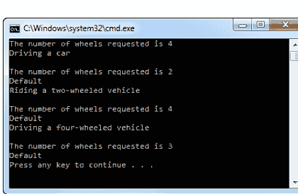

**图 4.5**

显示重写基类成员行为的结果

正如您在上一道练习中所看到的，被重写的成员隐式地是虚的，并且可以被后续派生类进一步重写。在 `Car` 类中实现 `Drive` 的重写时，您就是这样做的，尽管 `FourWheeledVehicle` 已经重写了 `Drive`。通常这种行为是可取的；然而，可能会有时候您想要阻止这种情况发生。

您可以通过**密封**类成员或类来防止进一步的继承。要密封类成员，除了 `override` 关键字外，还需包含 `sealed` 关键字。要密封类，只需包含 `sealed` 关键字即可。

## 密封类

为继承而正确设计类可能是一项繁重的工作，因此您有三种选择：

- 保持类未密封，但完成使其可安全继承的工作，如果没有人从您的类继承，这最终可能是多余的。
- 保持类未密封，但不做这项工作。这将理解如何安全扩展您的类的负担转嫁给使用者。
- 密封类。如果您相当确定没有人需要继承您的类，这可能是最佳选项。以后始终可以解除类的密封，这对已经在使用该类的代码应该没有破坏性影响。密封类还可以允许在 JIT 编译期间进行某些额外的运行时优化。

**顺便提一下**

## 抽象类和成员

虽然从类继承提供了许多好处，但有时您需要为派生类提供标准实现，并需要保证派生类为特定属性或方法提供实现，或者拥有一个不能具有实例的类在逻辑上是合理的。回想一下车辆层次结构，确实不存在既是“车辆”又不是更具体类型的车辆的物体。为了实现这些目标，C# 提供了 `abstract` 修饰符，它可以应用于类和类成员。


### 静态类

编译器实际上将静态类实现为密封的抽象类，防止它们被实例化或继承。

通过声明类为抽象，可以防止其被直接实例化。因此，抽象类通常具有受保护的构造函数而非公共的。如果未提供默认构造函数，编译器会为您创建一个受保护的默认构造函数。抽象类可以包含虚成员、非虚成员和抽象成员。抽象成员使用 `abstract` 修饰符声明，但不提供实现。列表 4.4 显示了作为抽象类的 `Vehicle` 类的示例，其中包含一个名为 `Operate` 的抽象方法。

### 列表 4.4 抽象 Vehicle 类

```csharp
public abstract class Vehicle
{
    int wheels;

    protected Vehicle() { }

    public Vehicle(int wheels)
    {
        this.wheels = wheels;
    }

    public abstract void Operate();
}
```

与派生类可以选择重写的虚成员不同，抽象成员必须在具体（非抽象）派生类中被重写。如果派生类也是抽象的，则不需要重写基类的抽象成员。由于抽象成员在被派生类重写之前没有实现，因此被重写的成员无法调用基类中的同名成员。


### 试一试

#### 使用抽象类

按照以下步骤，探索如何创建抽象类，并将其用作派生类的基类。如果已关闭 Visual Studio，请先重复上一道练习。务必在本练习结束时保持 Visual Studio 处于打开状态，因为稍后您将使用此应用程序。

## 1. 打开名为 `Vehicle.cs` 的文件。

- 修改 `Vehicle` 类，使其成为抽象类，并将 `Operate` 方法设为抽象方法。
- 修复由此产生的编译器错误。
- 使用 `Ctrl+F5` 运行应用程序，并观察输出结果是否与图 4.6 中显示的一致。

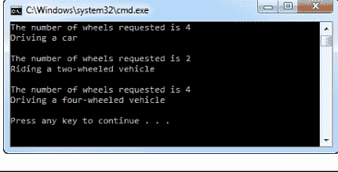

**图 4.6** 使用抽象类的结果

## 接口

由于 C# 不允许从多个基类继承，你需要仔细选择基类。幸运的是，C# 提供了一种替代方案，允许多继承。接口定义了一组公共属性和方法形式的共同特征和行为，所有派生类都保证实现这些特征和行为。可以将接口视为部分类型定义或类型描述。

与抽象类类似，接口不能直接实例化，且可以拥有方法、属性和事件。接口不能包含字段、构造函数或析构函数。

### 接口并非契约

通常人们会说接口定义了一个契约，任何派生类都必须实现它。这仅在继承接口定义了派生类上保证可用的方法签名和属性这一意义上成立。

在没有任何方面，这并不提供对特定实现的任何保证。完全有可能在满足接口的同时，不提供任何有用的实现。接口只是定义了一个契约，规定了继承它的类必须具有特定的属性和方法。

### 注意！

你声明接口的方式与声明类非常相似，只是用关键字 `interface` 替换了 `class` 关键字。接口可以是 `internal`、`public`、`protected` 或 `private`；但是，如果你没有明确指定可访问性，接口默认具有 `internal` 可访问性。所有接口成员自动为 `public`，不能指定访问修饰符。由于接口成员也是自动的 `abstract`，因此它们不能提供实现。

当一个类继承一个接口时（称为**接口继承**或接口实现），它仅继承成员的名称和签名，因为接口不提供实现。这意味着派生类必须为接口定义的所有成员提供实现。要继承一个接口，你只需提供接口名称，就像继承类一样。你只需提供一个逗号分隔的接口名称列表，即可从多个接口继承。

### 顺便说一下

> ### 同时继承基类和接口

C# 使用位置表示法来指示继承列表中的基类和接口。如果一个类同时继承一个基类和一个或多个接口，基类始终列在首位。

你也可以“混合搭配”继承，意思是你可以仅从基类继承，仅继承一个或多个接口，或者同时继承基类和一个或多个接口。如果基类继承了某个接口，任何从该基类派生的类都会继承该实现。


虽然接口不能从类继承，但它们可以从其他接口继承。如果你将接口视为一种弱契约，接口继承仅仅意味着为了满足这个契约，你还必须满足这些其他契约。这使你能够创建高度专业化的接口，然后将这些接口聚合在一起形成更大的接口。如果你有多个不相关的类需要实现类似的功能（例如将数据保存为压缩的 ZIP 文件），这会特别有用。与此相关的行为和特征可以由接口定义，然后这些接口可以作为定义业务对象的其他接口的一部分。

### 你知道吗？

> ### 接口与扩展方法
>
> 在接口的上下文中，扩展方法变得更加强大，因为你还可以扩展接口。这样做使得实现该接口的所有类型都能获得该扩展方法。事实上，泛型集合的整个语言集成查询（LINQ）功能就是这样实现的。
>
> 当一个接口从另一个接口继承时，派生接口仅定义新成员；它不会重新定义已继承接口的成员。当一个类实现这个聚合接口时，它必须为所有接口中定义的成员提供实现。
>
> 使用接口的真正力量和灵活性体现在与抽象类结合使用时。由于接口方法是隐式的抽象方法，抽象类不需要为接口成员提供实现。相反，它可以为接口成员提供自己的抽象成员。在这种情况下，任何派生类都必须重写它并提供实现。
>
> 查看清单 4.1 中的车辆层次结构，引入紧急车辆的概念（如消防车、警车和警用摩托车）需要做什么？你可以引入一个新的类，名为 `EmergencyVehicle`，但尚不清楚这个新类在现有层次结构中的位置，因为它需要作为与 `FourWheeledVehicle` 和 `TwoWheeledVehicle` 同一级别的基类，而任何具体类都希望能从 `EmergencyVehicle` 或 `Truck`、`Car`、`Motorcycle` 中继承。你已经知道这种多继承是不可能的，但如果使用接口代替，情况会如何变化？

## 试一试

## 使用接口

这些步骤探讨如何使用接口和基类创建灵活类层次结构。如果你关闭了 Visual Studio，请先重复前面的练习。

- 创建一个新的名为 `IVehicle` 的接口，定义一个名为 `Operate` 的方法，并修改 `Vehicle` 类以继承该接口。`IVehicle.Operate` 方法应具有与 `Vehicle.Operate` 方法相同的签名。
- 创建一个新的名为 `IEmergencyVehicle` 的接口，继承自 `IVehicle`，并提供一个名为 `SoundSiren` 的无参数 void 方法。
- 创建三个名为 `PoliceCar`、`PoliceMotorcycle` 和 `FireTruck` 的新类，从适当的基类派生并实现 `IEmergencyVehicle` 接口。对于 `SoundSiren` 的实现，只需向控制台打印一条消息。
- 在 `Program.cs` 文件的 `Main` 方法中，输入代码以：
    - 创建一个 `Car` 的新实例，赋值给名为 `car` 的变量，并调用 `Operate` 方法。
    - 将 `PoliceCar` 的新实例赋值给 `car`，并调用 `Operate` 方法。
    - 创建一个名为 `policeCar` 的 `PoliceCar` 新实例，并将 `car` 赋值给它。你需要将 `car` 强制转换为类型 `PoliceCar`。
    - 在 `policeCar` 上调用 `SoundSiren`。
- 使用 `Ctrl+F5` 运行应用程序，并观察输出结果是否与图 4.7 中显示的一致。

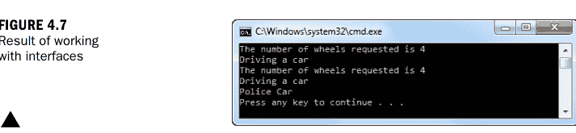

当你实现上一个练习中的接口时，你使用了隐式接口实现，即类简单声明与接口定义的相匹配的公共成员。这是最常见的接口实现形式。

如果类实现指定了具有相同签名的成员且包含多个接口，会发生什么情况，如清单 4.5 所示？

## 清单 4.5 多接口继承

```
interface IVehicle
{
   void Operate();
}

interface IEquipment
{
   void Operate();
}

class PoliceCar : IVehicle, IEquipment
{
   public void Operate()
   {
   }
}
```

在这种情况下，编译器使公共方法匹配这两个接口成员。如果这不是你的本意，你必须使用显式接口实现，如清单 4.6 所示，这要求你完全限定正在实现的成员名称。在显式接口实现中，你不提供访问修饰符，因为实现成员是隐式公开的，但仅通过接口显式实现。

## 清单 4.6 多个显式接口继承

```csharp
interface IVehicle
{
    void Operate();
}

interface IEquipment
{
    void Operate();
}

class PoliceCar : IVehicle, IEquipment
{
    void IVehicle.Operate()
    {
    }

    void IEquipment.Operate()
    {
    }
}
```

这意味着实现类必须通过隐式或显式转换转换为该接口，才能访问该成员。因此，显式接口实现具有隐藏成员以免被随意调用的效果。

## 总结

现在，你已完成对 C# 类如何为面向对象编程提供语言实现的理解。你学习了类继承如何使多态对象、基类构造器链接成为可能，以及如何重写或隐藏继承的类成员。你还学习了抽象类，并了解了如何通过密封（sealing）来防止类或类成员被进一步继承。最后，你学习了接口和接口实现。

随着你对 C# 编程基础的逐步构建，你也应该开始看到地址簿应用程序的基础架构正在逐步成形。

## 问答

**问. C# 支持多重继承吗？**

**答.** 不支持。C# 仅支持单重继承，即类只能继承自单个父类或基类。

**问. 什么是多态性？**

**答.** 多态性是指一种类型能够像另一种类型一样被使用的能力。

**问. 什么是向上转型和向下转型？**

**答.** 将派生类转换为其基类的过程称为向上转型（upcasting）。将基类转换为其派生类的过程称为向下转型（downcasting）。

**问. 什么是成员隐藏？**

**答.** 成员隐藏允许派生类拥有一个与基类成员同名且行为完全相同的成员。

**问. 什么是虚成员？**

**答.** 虚成员在基类中包含 `virtual` 修饰符，可能提供也可能不提供默认行为。派生类可以重写虚成员并提供更具体的适当行为。

**问. 可以防止类被继承吗？**

**答.** 可以，标记有 `sealed` 修饰符的类不能被继承。

**问. 什么是接口？**

**答.** 接口定义了一组通用的特征和行为，所有派生类保证实现这些行为，但接口不能包含任何实现，且所有接口成员必须是 public 的。接口并不保证实现，只保证继承类必须包含与接口成员签名相匹配的成员。

**问. C# 支持多个接口继承吗？**

**答.** 是的，C# 支持继承多个接口。接口也可以继承其他接口。

**问. 扩展方法可用于扩展接口吗？**

**答.** 是的，扩展方法可以以与扩展类完全相同的方式用于扩展接口。

## 练习场

## 测验

- 1. 为什么类继承也被称为实现继承？
- 2. 隐藏继承成员的正确方式是什么？
- 3. 成员重写有哪些限制？

## 答案

- 1. 类继承也被称为实现继承，是因为派生类继承了基类的实现。
- 2. 要隐藏继承成员，应在派生成员上使用 `new` 关键字，以显式表明正在隐藏基类成员。
- 3. 成员重写具有以下限制：
    - 重写成员声明不能更改虚成员声明的访问级别。
    - 虚成员或重写成员都不能声明为 `private`。
    - 两个声明必须具有相同的签名。
    - 重写成员不能包含 `new`、`static` 或 `virtual` 修饰符。

## 练习

- 1. 在 PhotoViewer 项目的 `Photo` 类中添加一个公共构造器，该构造器接受一个名为 `path` 的 `string` 参数。此构造器应包含空主体，并调用你之前添加的 `Photo(Uri)` 构造器。接下来，为 `ToString` 方法添加一个重写，返回调用 `source.ToString()` 的结果。
- 2. 添加一个名为 `IPhoto` 的接口，模拟 `Photo` 类当前的公共类成员。将 `Photo` 类修改为实现这个新接口。

# 第 5 小时 创建枚举类型和结构体

### 在本小时中你将学到：

- 枚举类型
- 标志枚举类型
- 预定义枚举类型
- 结构体

在前几个小时中，你已经接触了 C# 中类型工作原理的基础知识，包括预定义类型和可空类型，以及 C# 中的类如何为面向对象编程提供语言语法。你还看到了类如何使你能够创建自己的类型来表示现实世界的数据。C# 中还有两类值类型我们尚未讨论：枚举类型和结构体。

虽然类是你创建新类型的主要机制，但它们并未提供创建值受限类型的方法，也不允许你创建新的值类型。C# 中已经有许多预定义的枚举类型和结构体，但你也有能力创建自己的类型。实际上，你在不知情的情况下已经使用过结构体了，因为每个值类型都是结构体。

在本小时中，我们将探索枚举类型，了解它们是什么以及为什么它们很有用。你将了解基本类库中包含的一些枚举类型，并学习如何使用它们。接下来，我们将发现结构体的优势（以及缺点），包括如何创建自己的结构体。

## 枚举类型

枚举类型，也称为**枚举**（或简称为**enum**），只是一种创建数值类型的方法，该类型被限制在一组预定义的有效值范围内，并且这些值具有有意义的名称。虽然这听起来很简单，但枚举实际上功能强大。通过定义一组有效值，枚举可以轻松使你以编译器理解底层值、而程序员理解高层含义的方式表示现实世界的概念和信息。这使得代码具有自描述性且无歧义。

许多现实世界中的概念在概念上都代表枚举：一周中的天数、一年中的月份、季节、大洋和罗盘方向，举几个例子。让我们以一周中的天数为例。

你可以使用 0 到 6 的整数值在代码中表示一周中的天数，分别代表从星期日到星期六。不幸的是，这些整数值对于第一次查看你代码的人，甚至对于你之后维护该代码时的自己，都没有传达出多少含义。此外，它们还有歧义，因为这些整数值现在具有多重含义，当你在代码中看到它们时，并不总是清楚你指的是整数值 0 还是星期日。

使用整数来表示一周中的天数还允许你分配任何有效的整数值，而不仅仅是你预期的那些值。枚举通过使你能够定义有效值的集合并为其赋予符号名称来解决这些问题。将枚举想象成定义一个只能通过“容器”名称访问的离散常量集合。

要定义一个枚举，你必须使用 `enum` 关键字后跟一个标识符。然后你在枚举的主体内定义合法值的集合，每个值用逗号 (`,`) 分隔。请记住，用于命名字段的标识符必须遵循与变量标识符相同的规则。星期日的枚举看起来如下所示，如清单 5.1 所示。

### 枚举值

最后一个值后面的逗号是可选的，但最好包含它，以便以后更容易向枚举添加值。


## 清单 5.1 简单的枚举

```
public enum Days
{
  Sunday,
  Monday,
  Tuesday,
  Wednesday,
```

每当您需要引用星期中的某一天时，都可以使用枚举名称和值通过名称进行引用。例如，若要引用星期三，应使用 `Days.Wednesday`，而不仅仅是 `Wednesday`。

### 多个命名值

您还可以让多个命名值表示相同的数值。这在多个名称可能代表同一概念的情况下非常有用。要实现此功能，只需将该名称作为新的枚举值添加，并将其设置为它所表示的命名值，如下所示：

```csharp
public enum Days
{
    Sunday,
    Monday,
    Tuesday,
    Wednesday,
    HumpDay = Wednesday,
    Thursday,
    Friday,
    Saturday,
}
```

请记住，枚举是仅限于数值的一种命名常量形式，因此定义的每个命名值对应一个数值是有道理的。在列表 5.1 中，未定义这些数值值。默认情况下，当您定义枚举时，编译器将枚举的第一个值赋整数 0。其余值从上一个值开始依次递增。`Days` 枚举可以写成显示的样子，其效果等同于列表 5.2 中显示的代码。

### 零值

通常，最好始终提供一个名为 `None` 的零值。如果这对于枚举的上下文不合适，则应将最常用的默认值分配给零值。

## 列表 5.2 指定值的简单枚举

```csharp
public enum Days
{
    Sunday = 0,
    Monday = 1,
    Tuesday = 2,
    Wednesday = Sunday + 3,
    Thursday = Sunday + 4,
    Friday = 5,
    Saturday = 6,
}
```

枚举还支持大多数可用于整数值的标准运算符，尽管并非所有运算符都有实际意义。您对枚举执行的最常见操作是相等性和不等性测试。由于枚举是值类型，因此您同样可以声明可空的枚举。

### 你知道吗？

### 底层枚举类型

枚举中包含的所有值必须具有相同的数据类型，称为**底层类型**。默认情况下，枚举的底层类型为 `int`，但可以使用任何预定义的整数类型：`byte`、`short`、`int`、`long`、`sbyte`、`ushort`、`uint` 或 `ulong`。

若要为枚举指定不同的底层类型，请在标识符后指定该类型，如下所示：

```csharp
enum Days : byte
{
   Sunday,
   Monday,
   Tuesday,
   Wednesday,
   Thursday,
   Friday,
   Saturday,
}
```

但请记住，底层类型决定了在定义枚举时可供选择的整体有效值范围。在这种情况下，`Days` 枚举只能具有 0 到 255 的值。

### 动手尝试

### 使用枚举

若要实现 `Days` 枚举并探索如何使用它，请遵循以下步骤。由于您稍后还会使用此应用程序，请在练习结束时保持 Visual Studio 打开状态。

- 1. 创建一个新的控制台应用程序。
- 2. 添加一个名为 `Days.cs` 的新代码文件，并实现 `Days` 枚举。
- 3. 在 `Program.cs` 文件的 `Main` 方法中，声明一个名为 `days` 的局部变量，其类型为 `Days`，并赋初始值 `Days.Sunday`。
- 4. 输入一条 `Console.WriteLine` 语句，以显示 `days` 变量的枚举值和整数值。要获取整数值，您需要将变量转换为 `int`。
- 5. 按 `Ctrl+F5` 运行应用程序，并观察输出是否与图 5.1 中显示的内容一致。

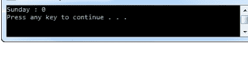

**图 5.1**

显示命名的枚举值

- 6. 现在将 `days` 设置为 `Days.Saturday + 1`。
- 7. 再次按 `Ctrl+F5` 运行应用程序，并观察输出是否与图 5.2 中显示的内容一致。

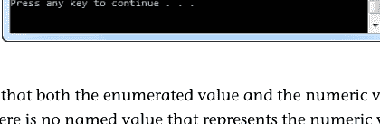

**图 5.2**

显示一个不属于枚举类型的枚举值

您会注意到枚举值和数值都是 7。这是因为没有命名值来表示数值 7，因此运行时别无选择，只能直接将其视为数字。这就是您应避免对枚举执行算术运算的一个好理由。

### 标志枚举

到目前为止，您一直在查看表示离散值的枚举，但现实中并不总是如此。以星期为例，您可能决定应用程序的用户需要指定星期的任何组合。

枚举还提供了在**标志枚举**中组合值的功能。使用标志枚举时，您可以使用按位 OR 运算创建新的组合值。

以 `Days` 枚举为例，您可以将其转换为标志枚举，如列表 5.3 所示。

## 列表 5.3 标志枚举

```csharp
[Flags]
public enum Days
{
    None = 0,
    Sunday = 0x001,
    Monday = 0x002,
    Tuesday = 0x004,
    Wednesday = 0x008,
    Thursday = 0x010,
    Friday = 0x020,
    Saturday = 0x040,
}
```

若要允许组合标志枚举的值，所有值必须是 2 的幂。这是必要的，因为当多个值组合时，必须仍有办法识别构成该组合的哪些离散值。因此，在定义标志枚举时，必须始终指定值。


### Flags 特性

普通枚举和标志枚举之间的另一个区别在于 `Flags` 特性的使用，该特性指定关于枚举的额外元数据。当使用由组合其他值制成的值时，`Flags` 特性还会更改枚举值的字符串表示形式（来自 `ToString` 方法）。

虽然使用 `Flags` 特性并非强制要求，但强烈建议使用，因为它不仅向编译器提供了明确的意图指示，也向其他程序员提供了指示。

与简单枚举中零值可以是 `None` 或最常用的默认值不同，标志枚举始终应将零值命名为 `None`，并且它始终意味着所有标志均未设置。

### 动手尝试

### 使用标志枚举

通过遵循以下步骤，您修改 `Days` 枚举使其成为标志枚举，并添加了一些常用组合。如果您已关闭 Visual Studio，请先重复上一个练习。

- 1. 将 `Days` 枚举修改为列表 5.3 中所示的枚举。
- 2. 添加以下组合：
    - a. `Weekend = Sunday | Saturday`
    - b. `Workdays = Monday | Tuesday | Wednesday | Thursday | Friday`
- 3. 将 `Main` 方法中 `days` 变量的值设置为组合：`Days.Saturday | Days.Sunday`
- 4. 输入以下语句来确定 `days` 变量是否设置了特定标志：


```csharp
Console.WriteLine(days.HasFlag(Days.Saturday));
Console.WriteLine(days.HasFlag(Days.Friday));
```

- 5. 按 `Ctrl+F5` 运行应用程序，并观察输出是否与 **图 5.3** 中显示的内容一致。

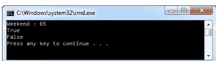

**图 5.3**

使用 **HasFlag** 和命名枚举值的结果

- 6. 将 `days` 变量的值设置为组合：`Days.Weekend | Days.Friday`

- 7. 按 `Ctrl+F5` 运行应用程序，并观察输出是否与 **图 5.4** 中显示的内容一致。

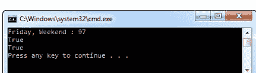

**图 5.4**

使用 `HasFlag` 和未命名枚举值的结果

### 结构

也称为**结构体**的结构旨在当您需要简单的用户定义类型时作为类的轻量级替代方案。结构与类相似，可以包含与类相同的所有成员，但它们属于值类型而非引用类型。然而，结构与类不同，具体体现在以下方面：

- 结构不支持继承。结构隐式继承自 `System.ValueType`（后者又继承自 `System.Object`）。结构与类一样，可以继承接口。

- 结构体是隐式密封的，这意味着你不能从结构体继承。

- 结构体不能包含析构函数，或者声明默认构造函数并初始化实例字段。如果结构体提供了任何构造函数，则所有字段都必须在该构造函数调用中被赋值。

## 顺便一提

### 基础类库中包含的结构体

除了 `string` 和 `object` 之外的所有原始数据类型都实现为结构体。.NET 框架提供了 200 多个公开的结构体。以下是一些常用结构体：

- `System.DateTime`

- `System.DateTimeOffset`

- `System.Guid`

- `System.TimeSpan`

- `System.Drawing.Color`

- `System.Drawing.Point`

- `System.Drawing.Rectangle`

- `System.Drawing.Size`

在 C# 中，结构体的声明方式与类相同，只是使用 `struct` 关键字取代了 `class` 关键字。

## 方法

就像类可以定义方法一样，结构体也可以。这些方法可以是静态方法或实例方法；不过，结构体更常见的情况是包含静态公共方法和私有实例方法。

## 运算符重载

由于结构体是用户定义的值类型，你不能对定义为你自己的结构体之一的变量使用大多数常见运算符，例如相等运算符。这是一个重大的限制，但幸运的是，C# 通过运算符重载的概念提供了一种解决这一问题的方法。

如果你把运算符简单地看作是以特殊命名的方法，那么运算符重载只是方法重载的一种特殊形式。要声明一个重载运算符，你需要定义一个公共静态方法，其标识符是关键字 `operator` 以及你正在声明的实际运算符符号。此外，你正在重载的运算符至少有一个参数必须与包含类型相同。可重载的运算符定义在表 5.1 中。

**表 5.1**

**可重载的运算符**

| 类别 | 运算符 |

| :--- | :--- |

| 一元运算符 | + - ! ~ ++ -- true false |

| 乘法运算符 | * / % |

| 加法运算符 | + - |

| 移位运算符 | << >> |

| 关系运算符 | < > <= >= |

| 逻辑运算符 | & \| ^ |

| 相等运算符 | == != |

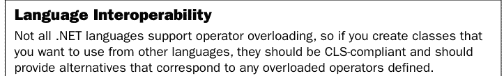

复合运算符在这列表中明显缺失，但如果你回忆起这些运算符同时执行算术操作和赋值，通过重载相应的算术运算符，你可以让对应的复合赋值运算符使用你新重载的运算符。

通常，运算符应该始终以对称组的形式进行重载。例如，如果你重载了相等运算符，你也应该重载不等运算符。这种对称重载指南的唯一例外是按位取反运算符 (~) 和非运算符 (!)。用于运算符重载的逻辑对称组如表 5.2 所示。

**表 5.2**

**对称运算符重载组**

| 类别 | 运算符组 |

| :--- | :--- |

| 一元运算符 | + - <br> ++ -- <br> true false |

| 乘法运算符 | * / % |

| 加法运算符 | + - |

| 移位运算符 | << >> |


**表 5.2 对称运算符重载组（续）**

| 类别 | 运算符组 |

| :--- | :--- |

| 关系运算符 | < > <br> <= >= |

| 逻辑运算符 | & \| ^ |

| 相等运算符 | == != <br> Equals GetHashCode |

## 转换运算符

与用户定义的结构体允许你重载运算符以支持对数据的常见操作类似，你还可以通过创建重载的转换运算符来影响转换和转型过程。同样，如果你把转换和转型看作是以特殊命名的函数，那么转换重载也是方法重载的一种特殊形式。

> **注意！**
>
> **隐式或显式转换**
>
> 隐式转换是扩宽转换，因为原始值在转换过程中不会丢失任何内容。显式转换是收窄转换，因为原始值的数据在转换过程中可能会丢失。
>
> 在定义自己的转换运算符时，你应该牢记这些行为。如果你定义的转换可能导致数据丢失，它应定义为显式转换。如果转换是安全的，意味着没有数据丢失的可能性，它应定义为隐式转换。

你已经看到了内置数字类型如何具有隐式转换（不需要特殊语法）和显式转换（需要特殊语法）。你可以通过声明自己的转换运算符来为自己的类型重载这些隐式和显式转换，这些规则类似于声明运算符重载的规则。

要声明一个转换运算符，你需要定义一个 `public static` 方法，其标识符是关键字 `operator`，并且返回类型是你转换到的类型。你转换的来源类型是转换运算符的单一参数。

如果你想声明隐式转换，在 `operator` 关键字之前使用关键字 `implicit`；否则，使用关键字 `explicit` 来声明显式转换。转换运算符有时与运算符重载一起使用，以减少必须定义的运算符重载数量。

## 动手试一试

### 结构体中的运算符重载

通过执行以下步骤，你将实现一个自定义结构体来表示摄氏度和华氏度。

1. 创建一个新的控制台应用程序。

2. 添加一个新的代码文件，命名为 `Celsius.cs`，其中定义一个结构体，外观如下：

```csharp
struct Celsius
{
    private float degrees;

    public float Degrees
    {
        get
        {
            return this.degrees;
        }
    }

    public Celsius(float temperature)
    {
        this.degrees = temperature;
    }

    public static Celsius operator +(Celsius x, Celsius y)
    {
        return new Celsius(x.Degrees + y.Degrees);
    }

    public static implicit operator float(Celsius c)
    {
        return c.Degrees;
    }
}
```

3. 添加另一个代码文件，命名为 `Fahrenheit.cs`，其中定义一个与 `Celsius` 类似但命名为 `Fahrenheit` 的结构体。

4. 在两个结构体中，为 - 运算符定义一个运算符重载。遵循与 + 运算符重载相同的模式。

5. 在两个结构体中，定义一个隐式转换运算符，从 `float` 转换为相应的结构体类型。遵循从结构体类型转换为 `float` 的隐式转换运算符相同的模式。

6. 接下来，在每个结构体中定义一个显式转换运算符，用于在彼此之间进行转换。使用以下公式进行转换：

   - 摄氏度转华氏度：`(9.0f / 5.0f) * c.Degrees + 32`

   - 华氏度转摄氏度：`(5.0f / 9.0f) * (f.Degrees - 32)`

7. 在 `Program.cs` 的 `Main` 方法中，输入以下内容：

```csharp
Fahrenheit f = new Fahrenheit(100.0f);
Console.WriteLine("{0} fahrenheit = {1} celsius", f.Degrees, (Celsius)f);

Celsius c = 32f;
Console.WriteLine("{0} celsius = {1} fahrenheit", c.Degrees,
(Fahrenheit)c);

Fahrenheit f2 = f + (Fahrenheit)c;
Console.WriteLine("{0} + {1} = {2} fahrenheit", f.Degrees, (Fahrenheit)c,
f2.Degrees);

Fahrenheit f3 = 100f;
Console.WriteLine("{0} fahrenheit", f3.Degrees);
```

8. 使用 `Ctrl+F5` 运行应用程序，并观察输出是否与图 5.5 中所示的内容匹配。

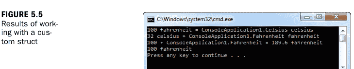

显然，这不是很有用，因为某些值使用类型名称进行显示。

9. 添加对 `ToString()` 方法的重写，返回调用 `this.Degrees.ToString()` 的结果。

10. 使用 `Ctrl+F5` 运行应用程序，并观察输出是否与图 5.6 中所示的内容匹配。

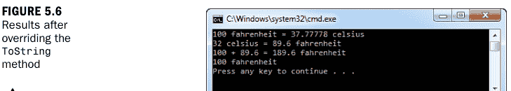

## 构造和初始化

就像类必须被赋予初始状态一样，结构体也必须如此。对于类，这始终需要通过类构造函数发生；然而，由于结构体是值类型，你可以创建结构体变量而不调用构造函数。例如，我们可以像这样创建一个新的 `NumberStruct` 变量：

`NumberStruct ns1;`

### 结构体初始化

这会创建一个新的变量，但字段仍处于未初始化状态。其结果是，如果你尝试访问结构体字段，你将收到一个编译器错误。如列表 5.4 所示，通过调用构造函数，你可以确保字段被初始化。结构体初始化的另一个方面是，如果源对象（赋值语句右侧的对象）没有完全初始化，你则不允许将一个结构体变量赋值给另一个结构体变量。这意味着以下操作是合法的：

```csharp
NumberStruct ns1 = new NumberStruct();
NumberStruct ns2 = ns1;
```

然而，以下操作是不合法的：

```csharp
NumberStruct ns1;
NumberStruct ns2 = ns1;
```

### 自定义默认构造函数

与类不同，结构体不能有自定义的默认构造函数，你也不能在结构体构造函数之外初始化字段。因此，当创建结构体时，所有字段最初都被设置为零值。

你可以提供重载的构造函数并利用构造函数链。但是，当你提供重载的构造函数时，所有字段都必须由你的构造函数显式初始化，或者通过链式构造函数初始化。

值得注意的是，如果零值对于其他字段来说是可接受的，你仍然可以在默认构造函数中进行链式调用。


### 列表 5.4 比较结构体和类

```csharp
struct NumberStruct
{
    public int Value;
}

class NumberClass
{
    public int Value = 0;
}

class Test
{
    static void Main()
    {
        NumberStruct ns1 = new NumberStruct();
        NumberStruct ns2 = ns1;
        ns2.Value = 42;

        NumberClass nc1 = new NumberClass();
        NumberClass nc2 = nc1;
        nc2.Value = 42;

        Console.WriteLine("Struct: {0}, {1}", ns1.Value, ns2.Value);
        Console.WriteLine("Class: {0}, {1}", nc1.Value, nc2.Value);
    }
}
```

由于 `ns1` 和 `ns2` 都是 `NumberStruct` 值类型，它们各自拥有独立的存储位置，因此对 `ns2.Number` 的赋值不会影响 `ns1.Number` 的值。然而，由于 `nc1` 和 `nc2` 都是引用类型，对 `nc2.Number` 的赋值会影响 `nc1.Number` 的值，因为它们包含相同的引用。

### 注意！

**属性还是公共字段**

关于结构体和属性存在一些争论。有些人认为即使像在结构体这样简单的类型中，也应该始终使用属性；而另一些人则认为结构体直接将其字段设为公共是完全可以接受的。

虽然使用公共字段更简单，但这允许你的值类型变为可变的，而这通常不是我们想要的。在定义自己的结构体时，请记住它们是值类型，并且就像字符串是不可变的，它们也应该是不可变的。为此，你应该提供允许设置私有字段的构造函数，以及用于获取值的只读属性。

产生的输出如图 5.7 所示。

### 图 5.7

类与结构体的区别

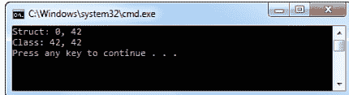

### 总结

枚举类型和结构体构成了你编程基础的重要部分。既然你已经了解了类、结构体和枚举类型，你就拥有了创建自定义专业数据类型的工具，以满足你的业务应用程序需求。枚举类型允许你定义一组离散的命名值，而结构体允许你定义自己的轻量级值类型。

### 问与答

**问。** ***为什么枚举类型是有用的？***

**答。** 枚举类型允许你定义一组离散的数值，这些数值可以被赋予易于理解的名称（标识符）。这使得你的代码更具自文档性，同时也有助于确保正确性。

**问。** ***枚举类型的值能否组合起来以标识原始枚举类型中不存在的值？***

**答。** 这可以通过使用标志枚举来实现，其中所有显式值必须是唯一的 2 的幂。可以使用按位或运算符组合值，以形成原始枚举中不存在的新值。

**问。** ***结构体是值类型还是引用类型？***

**答。** 尽管结构体可以被视为轻量级的类，但它们实际上是值类型。

### 练习题

#### 测验

1. 枚举类型的底层类型有哪些可能？

2. 如果没有显式指定，枚举的默认类型是什么？

3. 提供 `Flags` 特性有什么作用？

4. 结构体支持继承吗？

5. 你能为结构体重载运算符吗？

6. 结构体可以有自定义的默认构造函数吗？

#### 答案

1. 枚举只能基于以下类型：`byte`、`short`、`int`、`long`、`sbyte`、`ushort`、`uint` 或 `ulong`。

2. 如果你没有显式为枚举指定类型，它基于 `int` 类型。

3. 通过在枚举上提供 `Flags` 特性，你清楚地表明允许将枚举值组合以形成新值。此外，当在组合值上调用时，`ToString` 方法的运行时行为也会改变，以显示其组成部分值。

4. 结构体不支持类继承，但它们支持接口实现继承。

5. 是的，结构体支持运算符重载。

6. 不，结构体不允许自定义默认构造函数。你可以提供额外的重载构造函数，但在构造函数结束时，所有字段必须被初始化。

### 练习

1. 在 `Exif` 项目文件夹下的 `PhotoViewer.Exif` 命名空间中添加一个名为 `ColorRepresentation` 的公共枚举。此枚举应包含以下命名值：

   - `Uncalibrated`

   - `sRGB`

2. 在 `Exif` 项目文件夹中，创建一个名为 `ExifMetadata` 的公共结构体，包含以下字段：

   - `private string cameraModel;`

   - `private ushort? colorRepresentation;`

   - `private string creationSoftware;`

   - `private string dateTaken;`

   - `private string equipmentManufacturer;`

   - `private decimal? exposureCompensation;`

   - `private ushort? exposureMode;`

   - `private decimal? exposureTime;`

   - `private ushort? flashMode;`

   - `private decimal? focalLength;`

   - `private uint? height;`

   - `private decimal? horizontalResolution;`

   - `private ushort? isoSpeed;`

   - `private decimal? lensAperture;`

   - `private ushort? lightSource;`

   - `private decimal? verticalResolution;`

   - `private uint? width;`

添加一个具有以下签名的公共构造函数，将每个字段设置为 null：

`public ExifMetadata(Uri imageUri)`


为每个字段添加公共只读属性。对于 `colorRepresentation`、`flashMode`、`exposureMode`、`lightSource` 和 `dateTaken` 字段，使用以下代码：

```csharp
public ColorRepresentation ColorRepresentation
{
    get
    {
        ColorRepresentation value = Exif.ColorRepresentation.Uncalibrated;
        if (this.colorRepresentation.HasValue)
        {
            if (!String.IsNullOrWhiteSpace(Enum.GetName(typeof
                (ColorRepresentation), this.colorRepresentation)))
            {
                value = (ColorRepresentation)this.colorRepresentation;
            }
        }

        return value;
    }
}

public DateTime? DateTaken
{
    get
    {
        DateTime? result = null;
        if (!String.IsNullOrWhiteSpace(this.dateTaken))
        {
            DateTime date;
            if (DateTime.TryParse(this.dateTaken,
                DateTimeFormatInfo.InvariantInfo, DateTimeStyles.None, out date))
            {
                result = date;
            }
        }

        return result;
    }
}

public ExposureMode ExposureMode
{
    get
    {
        ExposureMode value = Exif.ExposureMode.Unknown;
        if (this.exposureMode.HasValue)
        {
            if (!String.IsNullOrWhiteSpace(Enum.GetName(typeof
                (ExposureMode), this.exposureMode)))
            {
                value = (ExposureMode)this.exposureMode;
            }
        }
```

```csharp
return value;
}
}
public FlashMode FlashMode
{
    get
    {
        FlashMode value = FlashMode.FlashDidNotFire;
        if (this.flashMode.HasValue && this.flashMode % 2 == 1)
        {
            value = FlashMode.FlashFired;
        }
        return value;
    }
}
public LightSource LightSource
{
    get
    {
        LightSource value = Exif.LightSource.Unknown;
        if (this.lightSource.HasValue
            && !String.IsNullOrWhiteSpace(Enum.GetName(typeof(LightSource), this.lightSource)))
        {
            value = (LightSource)this.lightSource;
        }
        return value;
    }
}
```

- 3. 在 `Photo` 类中添加一个名为 `metadata` 的私有字段，其数据类型为 `PhotoViewer.Exif.ExifMetadata`。在接口和类中添加一个只读属性，用于返回 `metadata` 字段。

## 第 6 小时

### 事件与事件处理

**本小时你将学到：**

- 理解事件
- 订阅和退订
- 发布事件
- 触发事件

C# 本质上是一种命令式编程语言，它允许你使用过程（方法）来描述如何完成任务。过程式编程定义了将要执行的确切语句及其执行顺序。由于用户交互通常比较有限，这种类型的编程最常见于命令行或非交互式程序中。

相比之下，事件驱动编程是一种编程风格，其中程序流程由事件决定。事件简单地说就是任何感兴趣的事情，例如用户操作（鼠标点击或按键）或来自其他程序或同一程序其他部分的消息。在 C# 中，触发（或发送）事件的类是**发布者**，接收（或处理）事件的类是**订阅者**。尽管你可以出于多种原因使用事件，但它们最常用于信号用户操作，如图形用户界面中的键盘相关事件（按键按下）和鼠标相关事件（鼠标移动、按钮点击等）。

在本小时中，你将学习事件驱动编程的基础知识，包括如何定义自己的事件、发起和响应事件，以及通过事件传递数据。

### 理解事件

事件遵循发布/订阅模型，其中发布者决定何时触发事件。订阅者决定针对该事件采取的操作。事件可以有多个订阅者，在这种情况下，当事件触发时，事件处理程序会被同步调用。如果事件没有订阅者，它实际上永远不会被触发。订阅者可以处理来自多个发布者的多个事件。

> **顺便提一下**
>
> **委托**
>
> 用传统编程术语来说，事件是一种回调形式，它允许将方法作为参数传递给其他方法。在 C# 中，这些回调被称为委托。事件处理程序实际上只是通过委托调用的方法。
>
> 你可以将委托视为类似于 C 或 C++ 函数指针或 Delphi 闭包，并且是一种类型安全且安全的编写回调的方式。委托在调用者的安全权限下运行，而不是在声明者的权限下运行。委托类型仅定义方法签名，任何具有兼容签名的方法都可以与委托关联。委托签名与普通方法签名之间的一个关键区别是，返回类型包含在签名中，并且允许在参数列表中使用 `params` 修饰符。

### 订阅和退订

当你希望响应由其他类发布的事件时，你可以通过定义一个签名与事件委托签名匹配的事件处理程序方法来订阅该事件。然后，你使用赋值运算符（`+=`）将事件处理程序附加到事件上。列表 6.1 展示了如何基于 `ElapsedEventHandler` 委托订阅事件。

**列表 6.1 订阅事件**

```csharp
var timer = new Timer(1000);
timer.Elapsed += new ElapsedEventHandler(TimerElapsedHandler);

void TimerElapsedHandler(object sender, ElapsedEventArgs e)
{
    MessageBox.Show("The timer has expired.");
}
```

第一个参数始终应该是名为 `sender` 的 `object` 参数，它表示触发事件的对象。第二个参数表示传递给事件处理程序方法的数据。这始终是 `EventArgs` 类型或从 `EventArgs` 派生的名为 `e` 的类型。事件处理程序方法应始终具有 `void` 返回类型。

**方法组推断**

虽然列表 6.1 中显示的代码是附加事件处理程序方法的传统方式，但 C# 允许你使用一种称为方法组推断的更简单的语法。列表 6.1 中显示的代码在此处展示，但使用了方法组推断：

```csharp
var timer = new Timer(1000);
timer.Elapsed += TimerElapsedHandler;

void TimerElapsedHandler(object sender, EventArgs e)
{
    MessageBox.Show("The timer has expired.");
}
```

尽管 Visual Studio 自动生成使用较传统语法的附带事件处理程序，但在附带自己的事件处理程序方法时，使用方法是方法组推断是很常见的。

方法名可以是任何你想要的，但最好保持一致性，并使用由提供事件的对象的名称、处理的事件的名称和单词 `Handler` 组合而成的名称。

尽管以这种方式订阅事件在许多类中很常见，但 Visual Studio 使订阅事件变得很容易，特别是那些由任何用户界面控件发布的事件。

以下步骤展示了如何在 Windows Presentation Foundation (WPF) 应用程序中订阅按钮的 `Click` 事件：

- 1. 确保按钮已选中，然后单击设计视图中属性窗口顶部的“事件”选项卡，如图 6.1 所示。如果你没有看到属性窗口，请右键单击你要处理事件的窗体或控件并选择属性。

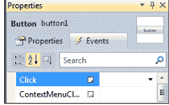

**图 6.1**

属性窗口

- 2. 双击你要处理的事件。这会导致 Visual Studio 在你的代码中创建一个空的事件处理程序方法，如图 6.2 所示。

**图 6.2**

生成的事件处理程序方法

```csharp
private void button1_Click(object sender, RoutedEventArgs e)
{
    
}
```

Visual Studio 也会为你附带事件处理程序，如图 6.3 所示。对于 WPF 应用程序，这是在描述控件的 XML 标记，或 XAML 中完成的。

**图 6.3**

在 XAML 中附带事件处理程序

```xml
<Window x:Class="EventsWpf.MainWindow"
       xmlns="http://schemas.microsoft.com/winfx/2006/xaml/presentation"
       xmlns:x="http://schemas.microsoft.com/winfx/2006/xaml"
       Title="MainWindow" Height="350" Width="525">
    <Grid>
        <Button Content="Button" Click="button1_Click" Height="23" />
    </Grid>
</Window>
```

如果你创建一个基于 Windows Forms 的应用程序，过程是类似的，但 Visual Studio 会在窗体的 `InitializeComponent` 方法中附带事件处理程序，而不是在 XAML 中，如图 6.4 所示。

**图 6.4**

在代码中附带事件处理程序

```csharp
this.button1.Text = "Button1";
this.button1.UseVisualStyleBackColor = true;
this.button1.Click += new System.EventHandler(this.button1_Click);
```

当你双击事件时，Visual Studio 使用默认命名约定。如果你想使用不同的事件处理程序方法名称，只需在事件旁边的文本区域中输入名称，然后按 Enter 键以让 Visual Studio 创建事件处理程序方法。如果你双击控件本身而不是事件，Visual Studio 将为控件的默认事件创建事件处理程序方法。

### 订阅事件

要订阅 Windows Forms 应用程序和 WPF 应用程序中用户界面控件发布的事件，请遵循这些步骤。

- 在 Visual Studio 中打开 Hour6 解决方案。
- 通过双击文件在 EventsWinForms 项目中打开 Form1.cs。
- 在 Form1 的设计视图中，选择按钮并为 `Click` 事件添加事件处理程序。
- 在生成的事件处理程序方法中，添加以下语句：

```csharp
MessageBox.Show("You pressed the button.");
```

- 通过按下 `Ctrl+F5` 运行应用程序。当你点击按钮时，你应该看到如图 6.5 所示的对话框出现。

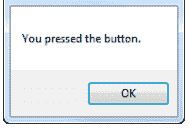

**图 6.5**

来自事件处理程序的消息框

- 通过双击文件在 EventsWpf 项目中打开 MainWindow.xaml。
- 在 MainWindow 的设计视图中，选择按钮并为 `Click` 事件添加事件处理程序。在生成的事件处理程序方法中，添加与步骤 4 中相同的语句。
- 通过在解决方案资源管理器窗口中右键单击项目，然后从调试菜单中选择“启动新实例”选项来运行应用程序，如图 6.6 所示。

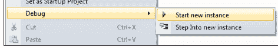

**图 6.6**

解决方案资源管理器上下文菜单

- 当你点击按钮时，你应该看到如图 6.7 所示的对话框出现。

## 图 6.7

来自事件处理程序的消息框

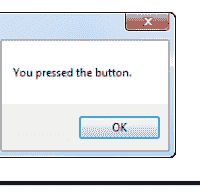

当你不希望事件被触发时再调用你的事件处理程序，必须从该事件中取消订阅。此外，在释放订阅者对象之前，你也应该取消对事件的订阅。如果你不取消对这些事件的订阅，发布对象将继续保留指向代表订阅者事件处理程序的委托的引用，从而阻止垃圾回收器释放你的订阅者对象。

要取消对事件的订阅，你可以从 XAML 标记中移除该特性，或者使用减法赋值运算符（`-=`），如下所示：

```csharp
timer.Elapsed -= TimerElapsedHandler;
```

## 匿名方法

在前面的示例中，你附加了一个命名方法作为事件处理程序委托。你还可以使用加法赋值运算符将匿名方法附加到事件上。匿名方法提供了一种编写未命名内联语句块的方式，该语句块可以在委托调用中执行。

清单 6.1 中所示的代码在这里使用匿名方法替代了命名委托：

```csharp
var timer = new Timer(1000);
timer.Elapsed += delegate(object sender, EventArgs e)
{
    MessageBox.Show("The timer has expired.");
}
```

尽管将匿名方法用作事件处理程序提供了很大的便利性，但它并没有提供从事件中取消订阅的简便方法。

## 发布事件

类和结构体都可以通过简单的事件声明来发布事件（尽管事件更常见于类中）。事件可以基于任何有效的委托类型；然而，标准做法是让你的事件基于 `EventHandler` 和 `EventHandler<T>` 委托。这些是 .NET Framework 中为定义事件而预定义的委托类型。

定义自己的事件时，你需要做的第一个决定是是否需要随事件发送自定义数据。.NET Framework 提供了 `EventArgs` 类，预定义的事件委托类型支持该类。如果需要随事件发送自定义数据，应该创建一个继承自 `EventArgs` 的新类。如果不需要发送自定义数据，可以直接使用 `EventArgs` 类型，但之后无法在不破坏兼容性的情况下更改它。因此，即使初始为空，你也应该始终创建一个继承自 `EventArgs` 的新类，以提供将来添加数据的灵活性。

清单 6.2 展示了一个自定义 `EventArgs` 派生类的示例。

### 清单 6.2 自定义 EventArgs 派生类

```csharp
public class CustomEventArgs : System.EventArgs
{
    private object data;

    public CustomEventArgs(object data)
    {
        this.data = data;
    }

    public object Data
    {
        get
        {
            return this.data;
        }
    }
}
```

声明事件的常见方式是使用类似字段的语法。如果没有自定义 `EventArgs` 类，你将使用 `EventHandler` 委托类型，如清单 6.3 所示。

### 清单 6.3 简单的事件声明

```csharp
public class Contact
{
    public event EventHandler AddressChanged;
}
```

如果你有自定义 `EventArgs` 类，则使用泛型 `EventHandler<T>` 委托，并用你自己的 `EventArgs` 类替换 `T`。

尽管类似字段的事件定义最为常见，但它并不总是最有效的，特别是对于拥有大量事件的类而言。考虑一个拥有大量事件的类。通常只有少数事件有订阅者。使用字段声明风格，你为每个事件创建一个字段，这会导致大量不必要的开销。

为了解决这个问题，C# 还允许使用类似属性的语法来定义事件，如清单 6.4 所示。

### 清单 6.4 使用事件属性进行事件声明


```csharp
public class Contact
{ 
    private EventHandlerList events = new EventHandlerList();
    private static readonly object addressChangedEventKey = new object();

    public event EventHandler AddressChanged
    {
       add
       {
          this.events.AddHandler(addressChangedEventKey, value);
       }
       remove
       {
          this.events.RemoveHandler(addressChangedEventKey, value);
       }
    }
}
```

第 3 行声明了一个 `EventHandlerList`，它是专门设计用于包含事件委托列表的。这使你能够使用一个单一变量，该变量包含每个具有订阅者的事件的条目。接下来，第 4 行声明了一个名为 `addressChangedEventKey` 的静态只读 `object` 变量，它表示在 `EventHandlerList` 中用于该事件的键。最后，第 6 到 16 行声明了实际的事件属性。

这种语法你应该很熟悉，因为它与定义属性的语法几乎相同。区别在于，你拥有的是 add 和 remove 访问器，而不是 get 和 set 访问器。add 访问器简单地将在的委托实例添加到列表中，而 remove 访问器则将其移除。这两个访问器都使用事件属性的预定义键来向列表添加或移除实例。

既然你了解了发布事件的基础知识，一种方便且一致的方式来描述事件何时发生是将它们归类为前事件（pre-events）和后事件（post-events）。

后事件是最常见的事件类型，它们在对象状态发生变化后发生。前事件，也称为 `可取消事件`（cancellable events），在对象状态改变之前发生，并提供取消事件的能力。这些事件使用 `CancelEventArgs` 类来存储事件数据。`CancelEventArgs` 类简单地添加了一个代码可以读写 的 `Cancel` 属性。如果你创建或拥有可取消事件，应该从 `CancelEventArgs` 类派生你自己的自定义事件数据类。

## 引发事件

如果没有机制来启动该事件，定义事件就没有太大用处。事件启动称为 `引发` 或 `触发` 事件，并遵循标准模式。通过遵循模式，处理事件变得更加容易，因为结构定义明确且一致。

清单 6.5 基于清单 6.1 中的示例，展示了完整的事件处理程序机制。

### 清单 6.5 完整的事件处理程序

```csharp
public class Contact
{
    public event EventHandler<AddressChangedEventArgs> AddressChanged;

    private string address;

    protected virtual void OnAddressChanged(AddressChangedEventArgs e)
    {
        EventHandler<AddressChangedEventArgs> handler = AddressChanged;
        if (handler != null)
        {
            handler(this, e);
        }
    }

    public string Address
    {
        get { return this.address; }
        set
        {
            this.address = value;
            AddressChangedEventArgs args = new AddressChangedEventArgs(this.address);
            OnAddressChanged(args);
        }
    }
}
```

第 3 行使用 `EventHandler<T>` 委托声明了事件。第 7 到 14 行声明了一个用于引发事件的 `protected virtual` 方法。通过将此方法设为 `protected` 和 `virtual`，任何派生类都有能力通过重写该方法而不是订阅事件来处理事件。对于派生类来说，这是一种更自然且便捷的机制。最后，第 22 和 23 行声明了一个新的 `EventArgs` 类并引发事件。如果事件没有自定义数据，你可以使用 `EventArgs.Empty` 字段来表示空的 `EventArgs`。

### 顺便提一下

#### 使用事件“属性”时引发事件

如果使用类似属性的语法，实际用于引发事件的方法需要稍作不同，以便从处理程序列表中检索事件处理程序，如下所示：

```csharp
protected virtual void OnAddressChanged(AddressChangedEventArgs e)
{
    var handler = events[addressChangedEventKey] as EventHandler<AddressChangedEventArgs>;
    if (handler != null)
    {
        handler(this, e);
    }
}
```

按照惯例，事件引发方法的名字以 “On” 开头，后跟事件名称。对于非密封类上的非静态事件，该方法应声明为 `protected virtual` 方法。对于静态事件、密封类上的非静态事件或结构体上的事件，该方法应为 `public`。该方法始终应具有 `void` 返回类型，并接收一个名为 `e` 的参数，其类型应为适当的 `EventArgs` 类。

该方法的主体也遵循标准模式，即创建事件的临时副本（第 9 行），以避免如果最后一个订阅者在空值检查（第 10 行）之后、事件引发（第 12 行）之前立即取消订阅时发生竞争条件的可能性。

> **转至 ▶** 第 23 小时 “理解线程、并发和并行性”，以获取更多关于竞争条件的信息。

### 小心！

#### 多线程与事件

这种模式仅防止一种可能的竞争条件，即事件在检查后变为 `null`，且仅在代码是多线程时相关。在编写多线程事件时，必须防范复杂性，例如确保在执行依赖于该状态的代码之前，必要的状态仍以线程安全的方式存在。

### 自己动手试一试

#### 发布和引发事件

通过以下步骤，你将探索如何发布和引发事件。

- 1. 在 Visual Studio 中打开 `Hour6` 解决方案。
- 2. 向 `PublishAndRaise` 项目中添加一个名为 `AddressChangedEventArgs` 的类。该类应遵循清单 6.2 中所示的相同模式。
- 3. 添加一个名为 `Contact` 的类，其形式应如清单 6.5 中所示。
- 4. 按 `Ctrl+F5` 运行应用程序。输出结果应如图 6.8 所示。请确保将 `PublishAndRaise` 项目设置为启动项目。


## 总结

在本章中，你学习了 C# 如何通过引发和响应事件来创建高度交互的应用程序。你还了解到，事件不仅仅是指通过图形用户界面进行的用户交互，事件还提供了一个丰富而复杂的通知系统，你的类可以使用该系统。

通过 Visual Studio 2010 编辑器，你已经看到为响应通过用户界面引发的事件而创建自己的事件处理程序是多么容易。

## 问答

**问：什么是委托（delegate）？**

**答。** 委托是一种类型安全且安全的编写回调（callback）的方式，类似于 C++ 中的函数指针或 Delphi 中的闭包。使用委托允许你封装对方法的引用。调用被引用方法的代码在编译时无需知道将调用哪个方法。委托在调用者的安全权限下运行，而不是在声明者权限下运行。

**问：什么是事件（event）？**

**答。** 事件是程序的外部刺激，例如用户操作（鼠标点击或按键）、来自其他程序的消息，或者同一程序的其他部分。

**问：EventArgs 类是什么？**

**答。** `EventArgs` 类用于存储事件的数据。虽然可以直接使用它，但最好为你的事件派生一个新类，即使该类的初始内容为空。

**问：事件的两种类型是什么？**

**答。** 事件的两种类型是前事件（pre-events）和后事件（post-events）。前事件是在对象状态改变之前引发的可取消事件。后事件是在对象状态改变之后引发的。

## 工作坊

### 测验

1. 声明事件最常见的方式是什么？使用它有什么缺点？
2. 使用类似属性的语法声明事件需要什么两个访问器成员？
3. 对于非密封类中的非静态事件，引发事件的标准模式要求方法具有什么可访问性？
4. 查看清单 6.3 中声明的 `OnAddressChanged` 方法，为什么要制作事件委托的副本？

### 答案

1. 定义事件最常见的方式是使用类似字段（field-like）的语法。对于拥有大量事件的类，特别是当合理地认为只有少数事件有订阅者时，这种语法会为每个事件创建一个字段，从而导致大量的不必要的开销。
2. 声明事件的类似属性语法使用 `add` 和 `remove` 访问器。`add` 访问器只是将输入委托添加到列表中，而 `remove` 访问器将其移除。
3. 对于非密封类中的非静态事件，该方法应声明为 `protected virtual` 方法，这使得任何派生类都能通过使用重写（override）来处理事件。
4. 制作委托的临时副本是为了避免一种可能的竞态条件（race condition），即事件被重置为 `null`，从而导致在引发事件时出现运行时错误。

### 练习

1. 扩展你在上一个练习中编写的应用程序，添加一个可取消的 `AddressChanging` 事件。如果事件被取消，则不实际更改 `address` 变量的值。修改 `AddressChangedEventArgs` 类以包含地址的旧值和新值，这些值将由订阅者类中的事件处理程序打印出来。

此页有意留白。

# 第二部分

# C# 编程

- **第 7 章：** 控制程序流程 147
- **第 8 章：** 使用字符串和正则表达式 167
- **第 9 章：** 处理数组和集合 195
- **第 10 章：** 使用异常处理错误 227
- **第 11 章：** 理解泛型 245
- **第 12 章：** 理解查询表达式 267

此页有意留白。

## 第 7 章

## 控制程序流程

**本章学习目标：**

- 选择语句
- 迭代（循环）语句
- 跳转语句

从本质上讲，C# 是一种过程式编程语言，因此语句按照它们在源代码中出现的顺序依次执行。这种执行顺序被称为**程序流程**。正如你可能想象的那样，仅遵循严格的执行顺序会提供很少的灵活性。缺少的是根据测试条件的结果来控制或更改执行哪些语句的方法。C# 提供了**控制流语句**，它们改变执行顺序。

所有控制流语句具有相同的基本特征；它们基于给定的条件集选择任意数量的语句以执行。这些语句分为三个主要类别，按其基本行为描述。选择语句和跳转语句关系最为密切。它们都选择只执行一次的语句，而迭代语句则重复执行该语句。跳转语句是无条件的，但选择语句和迭代语句允许条件限制将执行哪些语句以及执行多少次迭代。

在本章中，你将学习每种不同控制流语句的语法，了解它们的行为，以及如何编写和测试控制程序流程的条件。更重要的是，你将了解它们之间的区别，以及何时应使用一种类型的控制流语句而不是另一种。

### 选择语句

选择语句可能是可用的控制流语句中最常见的形式。它们允许基于表达式的值执行单个语句（从多个可能的语句中）。

#### if 语句

最基本的选择语句是 `if` 语句，它基于布尔表达式的结果选择语句。

`if` 语句的基本语法是

```csharp
if (boolean-expression)
    embedded-statement
```

稍微高级一点的语法是

```csharp
if (boolean-expression)
    consequence-statement
else
    alternative-statement
```

如果 `boolean-expression` 的结果评估为 `true`，控制将转移到 `consequence-statement`。如果 `boolean-expression` 的结果评估为 `false` 且存在 `else` 部分，控制将转移到 `alternative-statement`。当控制到达执行的语句的末尾时，它然后转移到下一个语句。

执行的语句可以是任何有效语句，包括另一个 `if` 语句。在此语法中，第二个语句被称为嵌套 `if` 语句。

在清单 7.1 所示的代码中，如果条件 `(y > 10)` 评估为 `false` 且条件 `(x > 10)` 评估为 `true`，则显示“y <= 10”。

**清单 7.1** 嵌套 if 语句

```csharp
int x = 20, y = 10;

if (x > 10)
{
    if (y > 10)
    {
        Console.WriteLine("y > 10");
    }
    else
    {
        Console.WriteLine("y <= 10");
    }
}
```

### “不匹配的 Else” 问题

编写 `if` 语句时的一个常见问题被称为“不匹配的 else”问题，即代码的格式与实际控制流不匹配：

```csharp
int x = 20, y = 10;

if (x > 10)
    if (y > 10)
        Console.WriteLine("y > 10");
else
    Console.WriteLine("y <= 10");
```

这里的代码在视觉上看起来像是 `else` 是 `if (x > 10)` 的替代部分。实际上，它是 `if (y > 10)` 的替代部分。

为了帮助防止这个问题，一个好主意是始终使用大括号以明确哪个 `else` 对应哪个 `if`。


如果你需要检查一系列互斥的条件，可以通过将 `if` 语句连接到前一个 `if` 语句的 `else` 部分来级联 `if` 语句。在这样的系列中，所有 `if` 语句将按顺序执行，直到其中一个评估为 `true`。

清单 7.2 显示了一个级联 `if` 语句。如果条件 `(x > 10)` 评估为 `true`，则显示 `"x > 10"`。如果条件 `(x < 10)` 评估为 `true`，则显示 `"x < 10"`；否则，显示 `"x = 10"`。

**清单 7.2** 级联 `if` 语句

```csharp
int x = 20, y = 10;
if (x > 10)
{
    Console.WriteLine("x > 10");
} else if (x < 10)
{
    Console.WriteLine("x < 10");
} else
{
    Console.WriteLine("x = 10");
}
```

## 试一试

### 使用 if 语句

为了了解 `if` 语句的工作原理，请按照以下步骤操作。请在本练习结束时保持 Visual Studio 处于打开状态，因为你稍后会用到该应用程序。

- 1. 在 Visual Studio 中打开 `SelectionStatements` 项目。
- 2. 右键单击 `Form1.cs` 文件并选择“查看代码”上下文菜单选项，以此打开该文件。
- 3. 在代码编辑器中，找到名为 `CheckGuess` 的方法，其外观如下所示

    ```csharp
    private Result CheckGuess(decimal guess)
    {
        Result result;
        return result;
    }
    ```

- 4. 修改 `CheckGuess` 方法，以便根据作为方法参数传递的数值返回相应的 `Result` 值。
- 5. 查看 `buttonCheckGuess_Click` 方法，检查其中包含的嵌套 `if` 语句。
- 6. 按 `F5` 运行应用程序。输入猜测值，并观察程序如何根据你的猜测做出响应。

## switch 语句

`switch` 可以被视为级联 `if` 语句的自然延伸。它们提供类似的功能，但更紧凑且更灵活。`switch` 语句根据与表达式值对应的标签选择一个语句列表。

`switch` 语句的语法如下

```csharp
switch (expression)
{
    case constant-expression :
        statement-list
        break;

    default :
        statement-list
        break;
}
```

`switch` 的主体是 **switch-block（switch 块）**，包含一个或多个 `switch-section`（switch 部分）。每个 `switch-section` 至少包含一个标签，后跟一个 `statement-list`（语句列表）。

`expression` 的类型决定了 `switch` 的 **governing type（支配类型）**，可以是 `sbyte`、`byte`、`short`、`ushort`、`int`、`uint`、`long`、`ulong`、`char`、这些类型的可空版本、`string` 类型或枚举类型。`expression` 仅求值一次。

`switch-section` 的标签必须是支配类型中唯一的常量表达式，并且必须可以隐式转换为支配类型。对于支配类型为 `string` 或可空类型的 `switch`，允许使用 `null` 作为 `case` 标签。


### 基于字符串的 switch

`expression` 的求值是区分大小写的，因此只有当标签完全匹配时，`switch-section` 才会被执行。


如果 `expression` 的值与 `case` 标签中的某个常量匹配，则控制权转移到该标签之后的第一条语句。如果找不到匹配的 `case`，则控制权转移到 `default` 标签之后的第一条语句（如果存在）；否则，控制权转移到 `switch` 之后的下一条语句。

在清单 7.3 中，如果条件 `(x == 0)` 或 `(x == 1)` 评估为 `true`，则显示 `x` 的值；否则，显示 `"Invalid"`。

### 清单 7.3 一个简单的 switch 语句

```csharp
int x = 4;

switch (x)
{
    case 0:
        Console.WriteLine("x = " + x);
        break;

    case 1:
        Console.WriteLine("x = " + x);
        break;

    default:
        Console.WriteLine("Invalid");
        break;
}
```

你可能已经注意到，`case 0` 和 `case 1` 的代码是相同的。为了消除这种冗余，你可以提供一个没有中间语句的标签列表。

## 贯穿（Fall Through）

与 C 和 C++ 等其他编程语言不同，C# 中的 `switch` 语句不允许 `switch-section` 贯穿。贯穿发生在从一个 `switch-section` 开始执行并继续执行到另一个 `switch-section` 的情况中。

为了防止贯穿，C# 要求所有 `switch-section` 必须以具有不可达终点的语句结束，无条件跳转语句是其中一个例子。最常见的是 `break` 语句。

通过不允许这种贯穿行为，C# 消除了在 C 和 C++ 程序中发现的常见错误，并且允许更改 `switch-section` 的顺序而不影响语句的行为。

清单 7.4 显示了与清单 7.3 中相同的 `switch` 语句，但使用了 `case` 贯穿。因为没有中间语句，所以不违反“无贯穿规则”，控制权转移到列表中最后一个标签之后的第一条语句。

### 清单 7.4 使用 Case 贯穿的 switch 语句

```csharp
int x = 4;
switch (x)
{
    case 0:
    case 1:
        Console.WriteLine("x = " + x);
        break;

    default:
        Console.WriteLine("Invalid");
        break;
}
```

## 作用域

`switch` 语句内部的作用域由整个 `switch-block` 界定，而不是由每个 `switch-section` 界定。这意味着在 `switch-section` 内部声明的任何局部变量或常量都是整个 `switch-block` 的局部变量，而不仅仅是该 `switch-section` 的局部变量。

如果你需要将作用域限制在特定的 `switch-section` 内，你可以通过用花括号包围语句列表来创建额外的嵌套作用域。

## 试一试

### 使用 switch 语句

通过按照以下步骤操作，你可以了解 `switch` 语句的工作原理。如果你关闭了 Visual Studio，请先重复上一个练习。

- 1. 在代码编辑器中，找到名为 `buttonCheckGuess_Click` 的方法。该方法包含一个嵌套的 *if* 语句，根据 `CheckGuess` 方法的返回值确定显示哪些 *Label* 控件。
- 2. 修改 `buttonCheckGuess_Click` 方法，使其对 `CheckGuess` 方法的返回值使用 *switch* 语句，而不是嵌套的 *if* 语句。
- 3. 按 `F5` 运行应用程序。输入猜测值，并观察程序如何根据你的猜测做出响应，其结果应与上一个练习的行为完全相同。

## 迭代语句

虽然选择语句根据表达式的值执行一次语句，但迭代语句（也称为 **循环（looping）** 语句）会重复执行同一语句。迭代语句在每次通过循环的 **迭代（iteration）** 时都会对其表达式求值。**前测试循环（top-tested loop）** 在语句执行前对表达式求值，而 **后测试循环（bottom-tested loop）** 在语句执行后对表达式求值。

若要提前终止循环，而不重新评估表达式，你可以使用以下任何跳转语句：`break`、`goto`、`return` 或 `throw`。`continue` 语句将控制权传递给下一次迭代。

### while 语句

`while` 语句是一种前测试循环，它重复执行嵌入的语句，直到 `boolean-expression` 求值为 `false`。由于表达式在每次迭代前求值，因此该语句可以执行零次或多次。

`while` 语句的语法如下

```csharp
while (*boolean-expression*)
    *embedded-statement*
```

如果对 `boolean-expression` 的求值结果为 `true`，则控制权转移到 `embedded-statement`。当语句执行完毕后，控制权转移到循环的开始处，在那里重新评估表达式。

如果对 `boolean-expression` 的求值结果为 `false`，则控制权转移到 `while` 语句之后的下一条语句。如果 `boolean-expression` 的结果最初为 `false`，则 `embedded-statement` 永远不会执行。

在清单 7.5 中，循环体内的语句一直执行，直到 `i` 大于或等于 10。如果 `i++` 语句未包含在循环体中或 `boolean-expression` 中，循环将永远执行。

### 清单 7.5 while 语句

```csharp
int i = 0;
while (i < 10)
{
    Console.WriteLine(i);
    i++;
}
```

## 试一试

### 使用 while 语句

通过按照以下步骤操作，你可以了解 `while` 语句的工作原理。请在本练习结束时保持 Visual Studio 处于打开状态，因为你稍后会用到该应用程序。

- 1. 在 Visual Studio 中打开 `IterationStatements` 项目。
- 2. 右键单击 `Form1.cs` 文件并选择 **View Code** 上下文菜单选项，以此打开该文件。
- 3. 在代码编辑器中，修改 `PowersOfTwoWhileLoop` 方法，使其在 `while` 循环中执行以下语句。

```csharp
this.textBoxOutput.AppendText(String.Format("{0}^2 = {1}\r\n", i, Math.Pow(i, 2)));
i++;
```

- 4. 按 `F5` 运行应用程序。输入最大值，选择 While 单选按钮，然后单击 **Generate** 按钮。

### do 语句

`do` 语句也会重复执行嵌入的语句，直到 `boolean-expression` 求值为 `false`。与 `while` 语句不同，`do` 语句是一种 *后测试（bottom-tested）* 循环，因此在评估 `boolean-expression` 之前，`embedded-statement` 会被执行一次。这意味着它保证至少执行一次。

`do` 语句的语法如下

```csharp
do
    *embedded-statement*
while (*boolean-expression*);
```

如果布尔表达式求值结果为真，则控制权转移到循环的开头，嵌入式语句将再次执行。如果布尔表达式求值结果为假，则控制权转移到 `do` 语句之后的下一条语句。

在示例 7.6 中，如果 `i` 小于 10，循环体内的语句将会执行。与 `while` 语句一样，如果 `i++;` 语句未包含在循环体内，也未作为布尔表达式的一部分，循环将永远执行。

## 示例 7.6 do 语句

```csharp
int i = 0;
do
{
    Console.WriteLine(i);
    i++;
}
while (i < 10);
```

## 动手试一试

### 使用 do 语句

若要了解 `do` 语句的工作方式，请按照这些步骤操作。如果已关闭 Visual Studio，请先重复上一个练习。请务必保持此练习结束时 Visual Studio 处于打开状态，因为稍后您将使用此应用程序。

- 1. 在代码编辑器中，修改 `PowersOfTwoDoLoop` 方法，使其在 `do` 循环中执行以下语句：

```csharp
this.textBoxOutput.AppendText(String.Format("{0}^2 = {1}\r\n", i, Math.Pow(i, 2)));
```

- 2. 按 `F5` 运行应用程序。输入最大值，选中 Do 单选按钮，然后单击生成按钮。
- 3. 探索若从循环体中移除自增语句并将其作为 `while` 条件的一部分会发生什么。

## for 语句

`for` 语句可能是最容易被误解的迭代语句，因为它看起来最复杂；然而，它与其他迭代语句提供的基本行为相同。它也会重复执行嵌入式语句，直到指定的表达式求值结果为假。

`for` 语句的语法为

```
for ( 初始化程序 ; 条件 ; 迭代器 )
    嵌入式语句
```

`for` 语句最常用于顺序处理和遍历数组。

使 `for` 语句看起来复杂的是三个不同的表达式或部分，它们都是可选的。即使省略某一部分，每个部分也必须用分号分隔。

初始化程序可以是单个局部变量初始化，也可以是逗号分隔的局部变量初始化语句列表。在初始化程序中声明的任何局部变量的作用域仅限于条件、迭代器和嵌入式语句。

> **你知道吗？**
>
> **初始化程序声明空间**
>
> 将整个 `for` 语句视为定义在“不可见的括号”内，这些括号定义了初始化程序的局部变量声明空间。

条件必须是布尔表达式。如果省略条件，表达式默认为 `true`。

最后，迭代器可以是单个表达式，也可以是逗号分隔的表达式列表，通常用于更改在初始化程序中声明的对应局部变量。

> **注意！**
>
> **无限循环**
>
> 正如使用 `while` 语句可以创建无限循环一样，通过省略声明中的三个部分，也可以创建永久运行的 `for` 语句：
>
> ```csharp
> for ( ; ; )
> {
>     Console.WriteLine("line");
> }
> ```

再次查看示例 7.5 中的 `while` 语句，你应该会发现一些类似于 `for` 语句不同部分的元素。`while` 语句和 `for` 语句可以互换使用；`for` 语句是用更紧凑的方式编写相同代码的方法。图 7.1 展示了 `while` 语句和 `for` 语句之间的比较，这应该能让它们之间的关系变得清晰。


## 图 7.1

`for` 语句和 `while` 语句的比较

观察 `for` 语句执行时发生的事件序列，它与 `while` 语句的序列相同：

- 1. 如果存在初始化程序，则执行它。如果有多个表达式，它们将按照书写顺序执行。初始化程序在语句开始时执行一次。
- 2. 如果条件求值结果为真，控制权转移到嵌入式语句。
- 3. 执行嵌入式语句。
- 4. 如果存在，则求值迭代器中的语句，并重新评估条件。如果条件求值结果为假，控制权转移到 `for` 语句之后的下一条语句。

## 动手试一试

### 使用 for 语句

按照以下步骤，你将了解 `for` 语句的工作方式。如果已关闭 Visual Studio，请先重复上一个练习。请务必保持此练习结束时 Visual Studio 处于打开状态，因为稍后您将使用此应用程序。

- 1. 在代码编辑器中，修改 `PowersOfTwoForLoop` 方法，使其在 `for` 循环中执行以下语句：

```csharp
this.textBoxOutput.AppendText(String.Format("{0}^2 = {1}\r\n", i,
    Math.Pow(i, 2)));
```

- 2. 按 `F5` 运行应用程序。输入最大值，选中 For 单选按钮，然后单击生成按钮。
- 3. 探索若更改初始化程序和迭代器表达式会发生什么。

## foreach 语句

`foreach` 语句为数组或集合中的每个元素执行一个语句。与 `for` 语句不同，`foreach` 语句不能用于向源集合添加或移除项。

`foreach` 语句的语法为

```
foreach ( 类型 标识符 in 表达式 )
   嵌入式语句
```

如果表达式是数组类型，则执行隐式转换到 `IEnumerable`；否则，集合必须实现 `IEnumerable` 或 `IEnumerable<T>`，或者提供适当的 `GetEnumerator` 方法。

### 迭代变量

`foreach` 语句的类型和标识符是**迭代变量**，对应一个作用域仅限于嵌入式语句的只读局部变量。

随着迭代遍历集合中的元素，迭代变量代表当前元素。

`foreach` 语句是唯一不包含需求值的条件的迭代语句。嵌入式语句将继续执行集合中的所有元素，或者直到跳转语句终止循环为止。对于集合或一维数组，元素按递增顺序遍历，从索引 0 开始。如果表达式是多维数组，则按递增顺序遍历元素，从最右侧维度开始，然后是下一个左侧维度，并继续向左。

如果集合不包含任何元素，则嵌入式语句不会执行。

示例 7.7 中的代码在单独一行上显示字符串的每个字符。

## 示例 7.7 foreach 语句

```csharp
string s = "This is a test.";

foreach (char c in s)
{
    Console.WriteLine(c);
}
```

## 动手试一试

### 使用 foreach 语句

若要了解 `foreach` 语句的工作方式，请按照这些步骤操作。

- 在代码编辑器中，修改 `PowersOfTwoForEachLoop` 方法，使其在 `foreach` 循环中执行以下语句：

`this.textBoxOutput.AppendText(String.Format("{0}^2 = {1}\r\n", i, Math.Pow(i, 2)));`

- 按 `F5` 运行应用程序。输入最大值，选中 Foreach 单选按钮，然后单击生成按钮。

## 跳转语句

跳转语句与选择和迭代语句不同，因为它们无条件且立即将控制权转移到新位置，称为跳转语句的*目标*。

## goto 语句

虽然不常用，但 C# 确实提供了 `goto` 语句，该语句将控制权转移到由标签标记的语句。`goto` 语句还可以目标 `switch` 语句中的特定 `case` 或 `default` `case`。

`goto` 语句的语法为

```csharp
goto identifier;
goto case constant-expression;
goto default;
```

与 `break` 和 `continue` 语句一样，任何位于同一块中 `goto` 语句之后的语句都不会执行。

强烈建议在日常实践中避免使用 `goto` 语句，因为容易误用，并可能导致难以阅读和维护的代码。大量使用 `goto` 语句的代码通常被称为“意大利面”代码，因为程序流程与一盘意大利面的相似性。

> 顺便提一句

## break 语句

`break` 语句用于退出最近的 `switch`、`while`、`do`、`for` 或 `foreach` 语句。如果多个语句相互嵌套，则只退出最内层的语句。

清单 7.8 展示了与图 7.1 中相同的 `for` 语句，但使用了 `break` 语句，使循环在四次迭代后终止。

### 清单 7.8 break 语句

```csharp
for (int i = 0; i < 10; i++)
{
    Console.WriteLine(i);
    if (i == 3)
    {
        break;
    }
}
```

### ▼ 动手实践

#### 使用 break 语句

通过执行以下步骤，你可以看到 `break` 语句在不同迭代语句中的工作方式。请在本练习结束时保持 Visual Studio 处于打开状态，因为稍后你会用到这个应用程序。

1. 在 Visual Studio 中打开 `JumpStatements` 项目。
2. 右键单击 `Form1.cs` 文件，并选择“查看代码”上下文菜单项来打开它。
3. 在代码编辑器中，修改以下方法，以便在计算完 2 的幂之后，当循环迭代计数器等于 `breakAfter` 参数时包含一个 `break` 语句：
    - `PowersOfTwoBreakDoLoop`
    - `PowersOfTwoBreakForLoop`
    - `PowersOfTwoBreakForEachLoop`
    - `PowersOfTwoBreakWhileLoop`
4. 按 `F5` 运行应用程序。输入一个中断迭代值，选择一个单选按钮，并单击 Generate（生成）按钮。
5. 更改 `break` 语句的位置，使其发生在计算 2 的幂之前。
6. 再次按 `F5` 运行应用程序。输入一个中断迭代值，选择一个单选按钮，并单击 Generate（生成）按钮。你应该会注意到，对于在第 4 步中选择的相同迭代语句和中断迭代值，输出是不同的。

## continue 语句


continue 语句开始最近的 `while`、`do`、`for` 或 `foreach` 语句的新一次迭代。如果多个语句相互嵌套，`continue` 语句仅适用于最内层的语句。位于 `continue` 和循环体结束之间的任何语句都将被跳过。

重要的是要认识到，`continue` 语句会导致表达式或 `for` 语句的迭代器部分重新求值。

清单 7.9 展示了与图 7.1 中相同的 `for` 语句，但使用了 `continue` 语句，使前三个迭代被跳过。

### 清单 7.9 continue 语句

```csharp
for (int i = 0; i < 10; i++)
{
    if (i < 3)
    {
        continue;
    }

    Console.WriteLine(i);
}
```

**动手实践**

### 使用 continue 语句

要了解 `continue` 语句在不同迭代语句中的工作方式，请执行以下步骤。如果你关闭了 Visual Studio，请先重复上一个练习。

1. 在代码编辑器中，修改以下方法，以便在计算 2 的幂之前，当循环迭代计数器小于 `skip` 参数时包含一个 `continue` 语句：

    - `PowersOfTwoContinueDoLoop`

    - `PowersOfTwoContinueForLoop`

    - `PowersOfTwoContinueForEachLoop`

    - `PowersOfTwoContinueWhileLoop`

2. 按 `F5` 运行应用程序。输入一个跳过迭代值，选择一个单选按钮，并单击 `Generate`（生成）按钮。

3. 更改 `continue` 语句的位置，使其发生在计算 2 的幂之后。

4. 再次按 `F5` 运行应用程序。输入一个跳过迭代值，选择一个单选按钮，并单击 `Generate`（生成）按钮。由于 `continue` 语句发生在计算之后，因此它对迭代没有影响。

## return 语句

在第 3 小时“C# 方式理解类和对象”中，当学习方法和属性时，你 already 见过 `return` 语句。`return` 语句使控制流返回到包含该 `return` 语句的成员调用者处。`return` 语句可以与表达式一起使用，正如你在第 3 小时的示例中所见，在这种情况下，它只能用于具有非 `void` 返回类型的类成员。`return` 语句也可以在没有表达式的条件下使用，在这种情况下，它只能用于具有 `void` 返回类型的类成员，包括构造函数和终结器。

## 摘要

在本小时中，你从基础方面转向了学习如何通过做出决策、在特定条件下重复代码段以及无条件跳转到代码的不同部分来控制应用程序。

了解如何控制应用程序的流程是编程中最核心的概念。这些看似简单的流程控制语句为 C# 语言提供了最大的力量和灵活性，使应用程序能够以解决特定问题的方式运行。

## 问答

**问。C# 中有哪些类型的控制流语句？**

**答。C# 提供三种类型的控制流语句：**

- 选择语句，它允许根据表达式的值从多个可能的语句中选择一个单一语句执行。

- 迭代语句，它根据在每次迭代中求值的表达式值反复执行相同的语句。

- 跳转语句，它无条件地将控制转移到新位置。

**问。`while` 语句和 `do` 语句有什么区别？**

**答。`while` 语句提供顶部测试循环，而 `do` 语句提供底部测试循环。这意味着 `while` 循环中的嵌入语句可能执行零次或多次，而 `do` 循环中的嵌入语句至少执行一次。**

## 练习区

### 测验

1. `switch` 语句是否允许为多个情况使用相同的代码？

2. `switch` 语句能否拥有多个 `default`（默认）情况？

3. 以下 `while` 语句将执行多少次？

```csharp
int i = 10;
while (i < 10)
{
    Console.WriteLine(i);
    i++;
}
```

4. 以下 `do` 语句将执行多少次？

```csharp
int i = 10;
do
{
    Console.WriteLine(i);
    i++;
} while (i < 10)
```

5. 这个 `for` 语句会做什么？

```csharp
for (int i = 0; ; i++)
{
    Console.WriteLine(i);
}
```

A. 生成编译器错误。

B. 打印 `i` 的值一次。

C. 什么都不做。

D. 永远打印 `i` 的值。

6. `for` 语句的三个组件是必须的吗？

7. `foreach` 语句中声明的标识符可以在迭代作用域之外使用吗？

8. 当到达 `jump` 语句时，`jump` 语句之后发生的语句会被执行吗？

9. 迭代语句的嵌入语句中支持 `jump` 语句吗？

### 答案

1. 是的，如果多个情况按顺序指定且不包含中间语句，则可以使用相同的代码。

2. 否，`switch` 语句只能有一个 `default` 情况。

3. 该语句将不会执行，因为条件首先进行测试，由于 `i` 等于 10，测试失败。

4. 该语句将执行一次。在第一次迭代结束时，条件进行测试，由于 `i` 等于 10，测试失败。

5. 正确答案是 D。通过省略 `for` 循环的条件部分，它将永远继续处理，因为没有终止条件。

6. 否，`for` 语句中的每个组件都是可选的。

7. 这被称为迭代变量，等效于一个作用域限定在嵌入语句内的只读局部变量。

8. 否。`jump` 语句无条件地将控制转移到新位置，因此同一作用域内出现在 `jump` 语句之后的任何语句都不会被执行。

9. 是的，所有迭代语句都支持在嵌入语句中使用 `jump` 语句。

### 练习

1. 向 `IPhoto` 接口添加一个 `Refresh` 方法，具有以下签名：

```csharp
public void Refresh()
```

在 `Photo` 类中实现此方法。该方法应包含一个单一的 `if` 语句。对于布尔表达式，测试以确定 `this.source` 不为 `null`。对于后果语句，使用以下代码：

```csharp
this.image = BitmapFrame.Create(this.source);
this.metadata = new ExifMetadata(this.source);
this.exists = true;
```

对于替代语句，使用以下代码：

```csharp
this.image = null;
this.metadata = new ExifMetadata();
this.exists = false;
```

在 `PhotoViewer(Uri)` 构造函数中，在设置 `source` 字段的语句之后，添加对 `Refresh()` 的调用。

## 使用字符串和正则表达式

### 本小时你将学习：

- 字符串

- 字符串操作

- 类型和复合格式化

- 标准格式字符串和自定义格式字符串

- `StringBuilder`

- 正则表达式

随着计算机编程从主要关注执行复杂的数值计算演变为提供解决更广泛业务问题的方案，编程语言的重心已逐渐转向字符串数据及其操作。字符串数据 simply 就是单个字符的逻辑序列。`System.String` 类封装了你对字符串最常执行的数据操作、排序和搜索方法，使 C# 能够丰富地支持字符串数据及其操作。

> **String 还是 string？**

> 在 C# 中，`string` 是 `System.String` 的别名，因此两者等效。你可以使用任何你偏好的命名约定，不过通常的做法是在指代数据类型时使用 `string`，而在访问类的静态成员时使用 `String`。

在本小时中，你将学习如何在 C# 中处理字符串，包括如何操作和连接字符串、提取子字符串以及构建新的字符串。在掌握基础知识后，你将学习如何使用正则表达式执行更复杂的模式匹配和操作。

## 字符串

在 C# 中，字符串是一个不可变的 Unicode 字符序列，一旦创建就不能被修改。字符串最常见的创建方式是声明一个 `string` 类型的变量，并给它赋一个带引号的字符序列，这被称为**字符串字面量**，如下所示：

```csharp
string myString = "Now is the time.";
```

### 顺便说说

#### 字符串驻留

如果在同一个程序集中有两个相同的字符串字面量，运行时只会为该程序集中该字面量的所有实例创建一个字符串对象。这个过程称为**字符串驻留**（string interning），C# 编译器利用它来消除重复的字符串字面量，从而在运行时节省内存空间并减少执行字符串比较所需的时间。

在使用相等性运算符比较字符串字面量时，字符串驻留有时会产生意想不到的结果：

```csharp
object obj = "String";
string string1 = "String";
string string2 = typeof(string).Name;

Console.WriteLine(string1 == string2); // true
Console.WriteLine(obj == string1); // true
Console.WriteLine(obj == string2); // false
```

第一个比较测试的是值相等性，即检查两个字符串是否具有相同的内容。第二和第三个比较使用引用相等性，因为你在比较一个 `object` 和一个 `string`。如果你将这段代码输入程序中，你会看到两个关于“可能的非预期引用比较”的警告，并进一步提示你将左侧强制转换为类型“`string`”以获取值比较。

因为字符串驻留仅适用于字面字符串值，*string2* 的值没有驻留，因为它不是字面量。这意味着 `obj` 和 *string2* 实际上在内存中引用的是不同的对象，所以引用相等性检查失败。

这些字符串字面量可以包含特殊的**转义序列**来表示非打印字符，例如以反斜杠字符（`\\`）开头的制表符或换行符。如果你希望将反斜杠字符作为字符串字面量的一部分包含在内，也必须对其进行转义。表 8.1 列出了定义的 C# 字符转义序列。

创建字符串字面量的另一种选择是**逐字字符串**（verbatim string）字面量，它们以开引号前的 `@` 符号开头。逐字字符串字面量的好处在于，编译器会将字符串完全按照书写形式处理，即使它跨越多行或包含转义字符。只有双引号字符需要转义，通过包含两个双引号字符来实现，以便编译器知道字符串在哪里结束。

### 表 8.1 C# 字符转义序列

| 转义序列 | 描述 |

| :--- | :--- |

| \ ' | 单引号，用于字符字面量。 |

| \ " | 双引号，用于字符串字面量。 |

| \\ | 反斜杠。 |

| \0 | Unicode 字符 0。 |

| \a | 警报（字符 7）。 |

| \b | 退格（字符 8）。 |

| \f | 换页符（字符 12）。 |

| \n | 换行符（字符 10）。 |

| \r | 回车符（字符 13）。 |

| \t | 水平制表符（字符 9）。 |

| \v | 垂直制表符（字符 11）。 |

| \uxxxx | 用于十六进制值为 xxxx 的字符的 Unicode 转义序列。也可包含 1 到 4 个数值的可变长度版本。 |

| \uxxxxxxxx | 用于十六进制值为 xxxxxxxx 的字符的 Unicode 转义序列，用于生成 Unicode 代理对。 |

当编译器遇到逐字字符串字面量时，它会将其转换为正确转义的字符串字面量。清单 8.1 展示了四个不同的字符串。前两个声明是等效的，尽管逐字字符串字面量通常更易读。后两个声明也是等效的，其中 `multiplines2` 代表转换后的字符串字面量。

### 清单 8.1 字符串字面量

```csharp
string stringLiteral = "C:\\Program Files\\Microsoft Visual Studio 10\\VC#";
string verbatimLiteral = @"C:\Program Files\Microsoft Visual Studio 10\VC#";

string multiplines = @"This is a ""line"" of text.
And this is the second line.";
string multiplines2 =
"\"This is a \"\"line\"\" of text.\nAnd this is the second line.";
```

### 顺便说说

#### ToString 方法

也可以通过调用 `ToString` 方法创建字符串。由于 `ToString` 由 `System.Object` 声明，因此每个对象都保证拥有该方法；不过，默认实现只是简单地返回类的名称。所有预定义的数据类型都重写了 `ToString` 以提供有意义的字符串表示。

#### 空字符串

空字符串与未赋值的字符串变量（即 `null`）不同，它是一个在引号之间不包含任何字符的字符串（`""`）。

#### String.Empty 还是 ""

`""` 和 `String.Empty` 之间没有实际区别，因此选择哪个最终取决于个人偏好，尽管 `String.Empty` 通常更易读。

判断字符串是否为空的最快、最简单的方法是测试其 `Length` 属性是否等于 0。然而，由于字符串是引用类型，字符串变量可能为 `null`，这将导致在尝试访问 `Length` 属性时发生运行时错误。由于判断字符串是否为空是如此常见的情况，C# 提供了静态方法 `String.IsNullOrEmpty`，如清单 8.2 所示。

### 清单 8.2 String.IsNullOrEmpty 方法

```csharp
public static bool IsNullOrEmpty(string value)
{
    if (value != null)
    {
        return (value.Length == 0);
    }
    return true;
}
```

通常也会将仅包含空白字符的字符串视为空字符串。你可以使用静态 `String.IsNullOrWhiteSpace` 方法，如清单 8.3 所示。

### 清单 8.3 String.IsNullOrWhiteSpace 方法

```csharp
public static bool IsNullOrWhiteSpace(string value)
{
    if (value != null)
    {
        for (int i = 0; i < value.Length; i++)
        {
            if (!char.IsWhiteSpace(value[i]))
            {
                return false;
            }
        }
        return true;
    }
    return true;
}
```

使用 `String.IsNullOrEmpty` 或 `String.IsNullOrWhiteSpace` 中的任何一个都有助于确保正确性、可读性和一致性，因此在你需要判断字符串是否为 `null`、空或仅包含空白字符的所有情况下都应使用它们。

## 字符串操作

`System.String` 类提供了一组丰富的方法和属性，用于与字符串交互并操作字符串。事实上，`System.String` 定义了 40 多个不同的公共成员。

尽管字符串是一等数据类型，且字符串数据通常作为整体进行操作，但字符串仍然由单个字符组成。你可以使用 `Length` 属性来确定字符串中字符的总数。与其他语言（如 C 和 C++）中的字符串不同，C# 中的字符串不包含终止字符。由于字符串由单个字符组成，因此可以将字符串视为字符数组，并通过位置访问特定字符。

### 处理子字符串

子字符串是包含在较大的原始值中的较小字符串。`System.String` 提供的多个方法使你能够查找和提取子字符串。

要提取子字符串，`String` 类提供了重载的 `Substring` 方法，该方法允许你指定起始字符位置，并可选择指定要提取的子字符串长度。如果你不提供长度，结果子字符串将延伸到原始字符串的末尾。

清单 8.4 中的代码创建了两个子字符串。第一个子字符串将从字符位置 10 开始并延续到原始字符串的末尾，结果为字符串 “brown fox”。第二个子字符串结果为字符串 “quick”。

### 清单 8.4 处理子字符串

```csharp
string original = "The quick brown fox";
string substring = original.Substring(10);
string substring2 = original.Substring(4, 5);
```

以这种方式提取子字符串是一种灵活的方法，特别是与其他方法结合使用时，你可以查找特定字符在字符串中的位置。

**IndexOf** 和 **LastIndexOf** 方法分别报告指定字符或字符串的第一个和最后一个出现的索引。如果需要查找一组字符中任意字符的第一个或最后一个出现位置，你可以分别使用 **IndexOfAny** 或 **LastIndexOfAny** 的重载。如果找到匹配项，则返回该字符或匹配字符串起始位置的索引（或更直观地说，偏移量）；否则，返回 –1 值。如果正在搜索的字符串或字符为空，则返回 0 值。

## 从零开始计数

通过字符位置访问字符串时，如 **IndexOf**、**LastIndexOf**、**IndexOfAny** 和 **LastIndexOfAny** 方法所做的那样，C# 从 0 而不是 1 开始计数。这意味着字符串的第一个字符位于索引位置 0。理解这些方法的更好方式是，它们返回的是相对于字符串开头的偏移量。

## 动手试一试

### 处理子字符串

要实施清单 8.4 中所示的代码并查看如何创建子字符串，请遵循以下步骤。在本练习结束时请保持 Visual Studio 打开，因为你稍后会使用此应用程序。

-   创建一个新的控制台应用程序。

-   在 `Program.cs` 文件的 **Main** 方法中，输入清单 8.4 中所示的语句，接着输入打印每个字符串值的语句。


- 使用 `Ctrl+F5` 运行应用程序，并观察输出是否与图 8.1 中所示的一致。

图 8.1

处理子字符串的结果


- 修改两个子字符串调用，分别使用 `IndexOf` 和 `IndexOfAny`，以产生与图 8.1 中所示相同的输出。

## 字符串比较

要执行字符串比较以确定一个字符串是否等于或包含另一个字符串，你可以使用 `Compare`、`CompareOrdinal`、`CompareTo`、`Contains`、`Equals`、`EndsWith` 和 `StartsWith` 方法。

静态 `Compare` 方法有 10 种不同的重载版本，使你可以控制从大小写敏感性、用于执行比较的文化规则、被比较的两个字符串的起始位置，到要比较的字符串中的最大字符数等所有内容。

> **字符串比较规则**
>
> 默认情况下，使用任何 `Compare` 方法进行的字符串比较都是大小写敏感且感知文化的。使用相等 `=` 运算符进行的比较始终使用序数比较规则执行。


如果你希望基于每个字符的数值序数来比较字符串，还可以使用静态 `CompareOrdinal` 重载，仅有两种，可选地指定两个字符串的起始位置以及要比较的字符串中的最大字符数。

`CompareTo` 方法将当前字符串与指定字符串进行比较，并返回一个整数值，指示当前字符串在排序顺序中是位于指定字符串之前、之后，还是在相同位置。

`Contains` 方法使用序数排序规则进行搜索，使你可以确定指定字符串是否存在于当前字符串中。如果找到指定字符串或它是一个空字符串，该方法返回 true。

`StartsWith` 和 `EndsWith` 方法共有六种，确定当前字符串的开头或结尾是否与指定字符串匹配。就像 `Compare` 方法一样，你可以选择性地指示是否希望进行大小写不敏感的搜索以及应使用哪种文化规则。

> **更改大小写**
>
> 虽然字符串比较方法提供了执行大小写不敏感的字符串比较的方式，但你也可以将字符串转换为全大写或全小写的表示形式。这对于字符串比较很有用，对于标准化字符串数据的表示也很有用。


## 动手试一试

### 字符串比较

要执行不同的字符串比较，请遵循以下步骤。如果你关闭了 Visual Studio，请先重复上一个练习。在本练习结束时请确保保持 Visual Studio 打开，因为你稍后将使用此应用程序。

- 在 `Program.cs` 文件的 `Main` 方法中，输入以下语句：

```
Console.WriteLine(original.StartsWith("quick"));
Console.WriteLine(substring2.StartsWith("quick"));
Console.WriteLine(substring.EndsWith("fox"));
Console.WriteLine(original.CompareTo(original));
Console.WriteLine(String.Compare(substring2, "Quick"));
Console.WriteLine(original.Contains(substring2));
```

- 使用 `Ctrl+F5` 运行应用程序，并观察输出是否与图 8.2 中所示的一致。


规范大小写的标准方法是使用 `ToUpperInvariant` 方法，该方法使用不变文化的规则创建字符串的全大写表示形式。要创建全小写表示形式，建议你将 `ToLowerInvariant` 方法，该方法使用不变文化的规则。除了不变方法外，你还可以使用 `ToUpper` 和 `ToLower` 方法，这些方法根据你使用的重载不同，使用当前文化或指定文化的规则。

## 修改字符串的一部分

虽然执行字符串比较很常见，但有时你需要修改整个字符串或其一部分。由于字符串是不可变的，这些方法实际上返回一个新的字符串，而不是修改当前字符串。

要从字符串中去除空白和其他字符，你可以使用 `Trim`、`TrimEnd` 或 `TrimStart` 方法。`TrimEnd` 和 `TrimStart` 分别去除当前字符串末尾或开头的空白，而 `Trim` 去除两端的空白。

要将字符串扩展或填充到特定长度，你可以使用 `PadLeft` 或 `PadRight` 方法。默认情况下，这些方法使用空格进行填充，但它们都有一个重载，使你可以指定要使用的填充字符。

`String` 类还提供了一组重载方法，使你可以删除或替换现有字符串中的字符来创建新的字符串。`Remove` 方法删除从指定字符位置开始的所有字符，直到字符串末尾或指定数量的位置。`Replace` 方法通过执行大小写敏感但不感知文化的序数搜索，简单地将指定字符或字符串的所有出现替换为另一个字符或字符串。

## 动手试一试

### 修改字符串的一部分

要使用 `Replace` 和 `Remove` 方法，请遵循以下步骤。

- 在 `Program.cs` 文件的 `Main` 方法中，删除所有 `Console.WriteLine` 语句，只保留字符串变量声明。

- 输入 `Console.WriteLine` 语句，打印由以下操作创建的字符串：
  - 在 `original` 中将所有 `o` 字符替换为 `x` 字符
  - 删除 `original` 中索引位置 4 之后的所有字符
  - 删除 `original` 中索引位置 4 之后的 5 个字符

- 在你输入的每个 `Console.WriteLine` 语句之后，再输入另一个 `Console.WriteLine` 语句，打印 `original` 的当前值。

- 使用 `Ctrl+F5` 运行应用程序，并观察输出是否与 **图 8.3** 中所示的一致。


图 8.3

字符串修改的结果

## 字符串连接、合并和拆分

你已经看到了几种从字符串字面量和子字符串创建新字符串的方法，但你也可以通过结合现有字符串的过程来创建新字符串，这个过程称为字符串连接。


### 使用加法进行字符串连接

加法运算符实际上只是调用 `Concat` 方法的适当重载。

字符串连接通常以两种不同的方式发生。最常见的是使用重载的加法 `+` 运算符来组合两个或多个字符串。你也可以使用 `Concat` 方法的九种不同重载之一，这使你可以连接无限数量的字符串。这两种方法都在清单 8.5 中展示。

#### 清单 8.5 字符串连接

```
string string1 = "this is " + " basic concatenation.";
string string2 = String.Concat("this", "is", "more", "advanced",
"concatenation");
```

与连接紧密相关的是合并字符串的概念，它使用 `Join` 方法。与 `Concat` 方法不同，`Join` 在给定的一组字符串的每个元素之间连接指定的分隔符。

如果合并字符串是结合一组字符串，那么相反的过程就是根据分隔字符将字符串拆分成不定数量的子字符串，这通过使用 `Split` 方法完成，该方法接受一组字符或一组字符串作为分隔集。

清单 8.6 展示了一个合并字符串然后基于某个分隔字符进行拆分的示例。首先，创建一个包含 10 个字符串的数组，然后使用 `#` 作为分隔字符进行合并。然后将生成的字符串基于相同的分隔字符进行拆分，并将每个单词打印在单独的行上。

#### 清单 8.6 合并和拆分字符串

```
string[] strings = new string[10];
for (int i = 0; i < 10; i++)
{
strings[i] = String.Format("{0}", i * 2);
}
string joined = String.Join("#", strings);
Console.WriteLine(joined);
```

## 使用 StringBuilder 的可变字符串

由于字符串是不可变的，每当你执行任何字符串操作时，都会创建新的临时字符串。为了允许创建和操作可变字符串而不创建新字符串，C# 提供了 `StringBuilder` 类。如果将连接固定数量的字符串，优先使用字符串连接。如果将连接任意数量的字符串，例如在迭代语句内部，则优先使用 `StringBuilder`。

`StringBuilder` 支持将数据追加到当前字符串的末尾、在指定位置插入数据、替换数据以及从当前字符串中移除字符。追加数据使用 `Append` 或 `AppendFormat` 方法的任一重载。

`Append` 方法将文本或对象的字符串表示形式添加到当前字符串的末尾。`AppendFormat` 方法支持使用复合格式将文本添加到当前字符串的末尾。由于 `AppendFormat` 使用复合格式，您可以向其传递格式字符串，您将在下一节中了解它。

清单 8.7 展示了与清单 8.6 中相同的连接和拆分字符串示例，但使用 `StringBuilder` 而不是字符串数组。

**清单 8.7 使用 StringBuilder**

```csharp
StringBuilder stringBuilder = new StringBuilder();
for (int i = 0; i < 10; i++)
{
    stringBuilder.AppendFormat("{0}#", i * 2);
}

// 移除末尾的 '#' 字符。
stringBuilder.Remove(stringBuilder.Length - 1, 1);

string joined = String.Join("#", stringBuilder.ToString());
Console.WriteLine(joined);

foreach (string word in joined.Split(new char[] { '#' }))
{
    Console.WriteLine(word);
}
```

要插入数据，应使用 `Insert` 的任一重载。插入数据时，必须提供插入开始的当前 `StringBuilder` 字符串中的位置。要移除数据，请使用 `Remove` 方法并指示移除开始的起始位置以及要移除的字符数。

可以使用 `Replace` 方法或其任一重载将当前 `StringBuilder` 字符串中的字符替换为另一个指定字符。`Replace` 方法还支持替换当前 `StringBuilder` 字符串子串中的字符，该子串由起始位置和长度指定。


### StringBuilder 容量

内部而言，`StringBuilder` 字符串在缓冲区中维护以容纳连接。仅当缓冲区没有足够空间容纳新数据时，`StringBuilder` 才需要分配额外的内存。

此内部缓冲区的默认大小或容量为 16 个字符。当缓冲区达到容量时，将根据 `capacity` 指定的字符数分配额外的缓冲区空间。`StringBuilder` 还具有最大容量，即 `Int32.MaxValue`，或 $2^{31}$ 个字符。

当前字符串的长度可以使用 `Length` 属性设置。通过将 `length` 设置为大于当前容量的值，容量会自动改变。同样，通过将 `Length` 设置为小于当前容量的值，当前字符串会被缩短。

## 类型格式化

格式化允许您将类、结构或枚举值的实例转换为字符串表示形式。所有从 `System.Object` 派生的类型自动继承无参的 `ToString` 方法，默认情况下，该方法返回类型名称。所有预定义的值类型都重写了 `ToString` 以返回该类型的一般格式。

由于从 `ToString` 获取类型名称通常没有用处，您可以重写 `ToString` 方法并提供您的类型的有意义字符串表示形式。清单 8.8 展示了 `Contact` 类重写 `ToString` 方法。

**清单 8.8 重写 ToString**

```csharp
class Contact
{
    private string firstName;
    private string lastName;

    public override string ToString()
    {
        return firstName + " " + lastName;
    }
}
```

### 重写 ToString

在您开始为所有类添加 ToString 重写之前，请注意 Visual Studio 调试工具广泛使用 ToString 来确定在通过调试器查看对象时显示什么值。


对象的值通常具有多种表示形式，`ToString` 允许您传递格式字符串作为参数，该参数决定字符串表示形式应如何呈现。格式字符串包含一个或多个格式说明符，它们定义字符串表示形式应如何呈现。

### 标准格式字符串

标准格式字符串包含单个格式说明符，它是定义更完整格式字符串的单个字符，以及影响结果中显示数字位数的可选精度说明符。如果支持，精度说明符可以是 0 到 99 之间的任何整数值。所有数值类型、日期和时间类型以及枚举类型都支持一组预定义的标准格式字符串，包括 `G` 标准格式说明符，它表示值的通用字符串表示形式。

标准格式说明符如表 8.4 所示。

**表 8.4 标准格式说明符**

| 格式说明符 | 描述 |
| :--- | :--- |
| `G`, `g` | 表示通用字符串表示形式。<br><br>对于所有数值类型，结果采用定点或指数表示法中最紧凑的一种。精度说明符指示有效数字的数量。<br><br>对于所有日期和时间类型，表示通用日期/时间模式。`G` 表示长时间模式，而 `g` 是短时间模式。<br><br>对于枚举类型，尽可能将枚举项显示为字符串值，否则显示当前实例的整数值。如果枚举设置为具有 Flags 特性，则每个有效项的字符串值将连接在一起，用逗号分隔。如果未设置 Flags 特性，无效值将显示为数字项。 |
| `X`, `x` | 对于整数类型，结果为十六进制字符串。精度说明符指示结果字符串中的数字数量。<br><br>对于枚举类型，将枚举项显示为十六进制值。该值根据需要以前导零表示，以确保值至少为八位长度。 |
| `D`, `d` | 对于整数类型，结果为带有可选负号的整数数字字符串。精度说明符指示最小数字数量。<br><br>对于枚举类型，将枚举项显示为尽可能短表示形式的整数值。 |
| `E`, `e` | 仅由数值类型支持。结果为值的指数表示法。精度说明符指示小数位数，默认为 6。 |
| `F`, `f` | 对于所有数值类型，结果为带有可选负号的整数和小数数字字符串。精度说明符指示小数位数。<br><br>对于日期和时间类型，表示完整日期/时间模式。`F` 表示长时间模式，而 `f` 是短时间模式。<br><br>对于枚举类型，尽可能将枚举项显示为字符串值。如果值可以完全显示为枚举中各项的总和，即使没有 Flags 特性，则每个有效项的字符串值将连接在一起，用逗号分隔。如果无法完全由枚举项确定值，则将该值格式化为整数值。 |
| `N`, `n` | 仅由数值类型支持。结果为带有分组分隔符和小数点以及可选负号的整数和小数数字字符串。精度说明符指示所需的小数位数。 |
| `P`, `p` | 仅由数值类型支持。结果为数字乘以 100 并显示百分号。精度说明符指示所需的小数位数。 |

## 表 8.4 标准格式说明符

| 格式说明符 | 描述 |
| :--- | :--- |
| `R` , `r` | 仅由 Single、Double 和 BigInteger 支持。结果是一个可以往返转换为相同数字的字符串。精度说明符将被忽略。 |
| `M` , `m` | 仅由日期和时间类型支持。表示月/日模式。 |
| `O` , `o` | 仅由日期和时间类型支持。表示往返日期/时间模式。 |
| `R` , `r` | 仅由日期和时间类型支持。表示 RFC 1123 模式。 |
| `s` | 仅由日期和时间类型支持。表示可排序的日期/时间模式。 |
| `t` | 仅由日期和时间类型支持。表示短时间模式。 |
| `T` | 仅由日期和时间类型支持。表示长时间模式。 |
| `U` | 仅由日期和时间类型支持。表示通用可排序日期/时间模式。 |
| `U` | 仅由日期和时间类型支持。表示通用完整日期/时间模式。 |
| `Y` , `y` | 仅由日期和时间类型支持。表示年/月模式。 |

使用标准格式字符串来格式化 Days 枚举值的示例见列表 8.9。

### 列表 8.9 标准格式字符串

```csharp
Days days = Days.Monday;
string[] formats = { "G", "F", "D", "X" };
foreach (string format in formats)
{
    Console.WriteLine(days.ToString(format));
}
```

就像你可以重写 `ToString` 方法一样，你可以通过定义 `ToString(string)` 方法为你的类定义标准格式说明符，该方法应支持以下内容：


- 一个代表通用格式的 “G” 格式说明符。你对无参数 `ToString` 方法的重写应仅调用 `ToString(string)` 并传入 “G” 标准格式字符串。
- 一个等于 null 引用且应被视为等同于 “G” 格式说明符的格式说明符。

列表 8.10 展示了第 5 小时“创建枚举类型和结构体”中更新后的 `Celsius` 结构体，该结构体支持使用格式说明符以华氏度和开尔文表示数值。

### 列表 8.10 在 `ToString` 中支持标准格式字符串

```csharp
struct Celsius
{
    public float Degrees;

    public Celsius(float temperature)
    {
        this.Degrees = temperature;
    }

    public string ToString()
    {
        return this.ToString("C");
    }

    public string ToString(string format)
    {
        if (String.IsNullOrEmpty(format))
        {
            format = "C";
        }
        format = format.ToUpperInvariant().Trim();
        switch(format)
        {
            case "C":
            case "c":
                return this.Degrees.ToString("N2") + " °C";

            case "F":
            case "f":
                return (this.Degrees * 9 / 5 + 32).ToString("N2") + " °F";

            case "K":
            case "k":
                return (this.Degrees + 273.15f).ToString("N2") + " K";

            default:
                throw new FormatException();
        }
    }
}
```

## 自定义格式字符串

自定义格式字符串由一个或多个自定义格式说明符组成，用于定义值的字符串表示形式。如果格式字符串包含单个自定义格式说明符，它前面应加上百分号 (%)，以免与标准格式说明符混淆。

所有数值类型以及日期和时间类型都支持自定义格式字符串。许多标准的日期和时间格式字符串是自定义格式字符串的别名。使用自定义格式字符串还提供了极大的灵活性，因为它允许你通过组合多个自定义格式说明符来定义自己的格式。

表 8.5 描述了自定义格式说明符。

列表 8.11 使用两个不同的自定义格式字符串显示了一个 `DateTime` 实例。

## 表 8.5 自定义格式说明符

| 格式说明符 | 描述 |
| :--- | :--- |
| "0" | 仅由数值类型支持。如果存在对应的数字，零将被替换为该数字；否则，结果中显示零。 |
| "#" | 仅由数值类型支持。如果存在对应的数字，井号将被替换为该数字；否则，结果中不显示数字。 |
| "." | 仅由数值类型支持。确定结果中十进制分隔符的位置。 |
| "," | 仅由数值类型支持。作为组分隔符，它在每组之间插入本地化的组分隔符字符。作为数字缩放说明符，每指定一个逗号，数字就除以 1,000。若要作为数字缩放说明符使用，它必须紧邻在显式或隐式小数点的左侧。 |
| "%" | 仅由数值类型支持。将数字乘以 100，并在结果中插入本地化的百分号符号。 |
| "‰" | 仅由数值类型支持。将数字乘以 1,000，并在结果中插入本地化的千分比符号。‰ 符号是 Unicode 符号 U+2030。 |
| "E0", "E+0", "E-0", "e0", "e+0", "e-0" | 仅由数值类型支持。如果后面跟随至少一个 0，则使用指数符号格式化结果。“E”或“e”的大小写表示结果中指数符号的大小写，零的数量决定指数的最小位数。加号 (+) 表示指数前始终有符号字符，而减号 (–) 表示仅负指数前有符号字符。 |
| ; | 仅由数值类型支持。为正数、负数和零定义具有不同格式字符串的部分。如果只包含一个部分（这是默认情况），则格式字符串适用于所有值。如果包含两个部分，第一个部分适用于所有正值和零，而第二个部分适用于负值。如果包含三个部分，第一个部分适用于正值，第二个部分适用于负值，第三个部分适用于零。 |
| "d" | 仅由日期和时间类型支持。月份中的天数，从 1 到 31。 |
| "dd" | 仅由日期和时间类型支持。月份中的天数，从 01 到 31。 |
| "ddd" | 仅由日期和时间类型支持。星期几的缩写名称。 |
| "dddd" | 仅由日期和时间类型支持。星期几的全称。 |
| "g", "gg" | 仅由日期和时间类型支持。时期或纪元。 |
| "h" | 仅由日期和时间类型支持。小时，使用 12 小时制，从 0 到 11。 |
| "hh" | 仅由日期和时间类型支持。小时，使用 12 小时制，从 00 到 11。 |
| "H" | 仅由日期和时间类型支持。小时，使用 24 小时制，从 0 到 23。 |
| "HH" | 仅由日期和时间类型支持。小时，使用 24 小时制，从 00 到 23。 |
| "K" | 仅由日期和时间类型支持。时区信息。 |
| "m" | 仅由日期和时间类型支持。分钟，从 0 到 59。 |
| "mm" | 仅由日期和时间类型支持。分钟，从 00 到 59。 |
| "M" | 仅由日期和时间类型支持。月份，从 1 到 12。 |
| "MM" | 仅由日期和时间类型支持。月份，从 01 到 12。 |
| "MMM" | 仅由日期和时间类型支持。月份的缩写名称。 |
| "MMMM" | 仅由日期和时间类型支持。月份的全称。 |
| "s" | 仅由日期和时间类型支持。秒，从 0 到 59。 |
| "ss" | 仅由日期和时间类型支持。秒，从 00 到 59。 |
| "t" | 仅由日期和时间类型支持。上午/下午标识符的第一个字符。 |
| "tt" | 仅由日期和时间类型支持。上午/下午标识符。 |
| "y" | 仅由日期和时间类型支持。年份，从 0 到 99。 |
| "yy" | 仅由日期和时间类型支持。年份，从 00 到 99。 |
| "yyy" | 仅由日期和时间类型支持。年份，最少三位数字。 |
| "yyyy" | 仅由日期和时间类型支持。年份作为四位数字。 |
| "yyyyy" | 仅由日期和时间类型支持。年份作为五位数字。 |
| "z" | 仅由日期和时间类型支持。与 UTC 的小时偏移量，无前导零。 |
| "zz" | 仅由日期和时间类型支持。与 UTC 的小时偏移量，单位数值有前导零。 |
| "zzz" | 仅由日期和时间类型支持。与 UTC 的小时和分钟偏移量。 |

## 表 8.5 自定义格式说明符（续）

| 格式说明符 | 描述 |
| :--- | :--- |
| `:` | 仅由日期和时间类型支持。时间分隔符。 |
| `/` | 仅由日期和时间类型支持。日期分隔符。 |
| `'string', "string"` | 字符串字面量分隔符。括号内的字符应原样复制到结果中。 |
| `\` | 转义字符，使下一个字符被解释为字面字符，而不是自定义格式说明符。 |
| 其他 | 所有其他字符均原样复制到结果字符串中。 |

## 示例 8.11 自定义格式字符串

```csharp
DateTime date = new DateTime(2010, 3, 22);

// 显示 3
Console.WriteLine(date.ToString("%M"));

// 显示 Monday March 22, 2010
Console.WriteLine(date.ToString("dddd MMMM dd, yyyy"));
```

# 复合格式化

你已经在之前使用 `Console.WriteLine` 和 `StringBuilder.AppendFormat` 的一些示例中见过复合格式化。使用复合格式化的方法接受复合格式字符串和对象列表作为参数。复合格式字符串定义了一个模板，该模板由固定文本和称为格式项的带索引占位符组成，这些占位符对应列表中的对象。复合格式化不允许你指定比列表中对象数量更多的格式项，尽管你可以在列表中包含比格式项更多的对象。

格式项的语法如下：

`{index[,alignment] [:formatString]}`

匹配的花括号和索引是必需的。

索引对应于其所代表对象在方法参数列表中的位置。索引从零开始，但多个格式项可以使用相同的索引，并且格式项可以按任意顺序引用列表中的任意对象。

可选的对齐组件指示首选的字段宽度。正值产生右对齐字段，而负值产生左对齐字段。如果该值小于格式化字符串的长度，则忽略对齐组件。

`formatString` 组件使用你刚刚了解的标准或自定义格式字符串。如果未指定 `formatString`，则使用常规格式说明符“G”代替。

在示例 8.12 中，第一个格式项 `{0:D}` 被 `date` 的字符串表示替换，第二个格式项 `{1}` 被 `temp` 的字符串表示替换。

## 示例 8.12 复合格式化

```csharp
Celsius temp = new Celsius(28);

// 使用 String.Format 进行复合格式化。
string result = String.Format("On {0:d}, the high temperature was {1}.",
    DateTime.Today, temp);
Console.WriteLine(result);

// 使用 Console.WriteLine 进行复合格式化。
Console.WriteLine("On {0:d}, the high temperature was {1}.",
    DateTime.Today, temp);
```

# 正则表达式

通常称为模式，正则表达式描述了一组字符串。正则表达式应用于字符串，以检查该字符串是否匹配提供的模式，返回子字符串或子字符串集合，或者返回代表原始字符串修改后的新字符串。

> **正则表达式兼容性**
>
> .NET 框架中的正则表达式被设计为与 Perl 5 正则表达式兼容，结合了其他正则表达式实现（如 Perl 和 awk）中最受欢迎的功能，并包含其他实现中尚未见过的功能。

**你知道吗？**

正则表达式本身就是一种编程语言，旨在通过同时使用字面文本字符和元字符来进行文本操作。字面字符是目标字符串中应该匹配的字符，而元字符则告知正则表达式解析器（负责解释正则表达式并将其应用于目标字符串）如何操作，因此你可以将它们视为命令。这些元字符赋予了正则表达式灵活性和处理能力。表 8.9 描述了正则表达式中常用的元字符。

## 表 8.9 常用的正则表达式元字符

| 元字符 | 描述 |
| :--- | :--- |
| `.` | 匹配除换行符（`\n`）外的任意单个字符。 |
| `[ ]` | 匹配括号内包含的单个字符。可以使用 – 字符指定字符范围。 |
| `[^ ]` | 匹配括号内未包含的单个字符。 |
| `^` | 表示匹配应从行的开头开始。 |
| `$` | 表示匹配应在行的末尾结束。 |
| `\w` | 匹配单词字符。这等价于 `[a-zA-Z_0-9]`。 |
| `\W` | 匹配非单词字符。 |
| `\s` | 匹配空格字符。这等价于 `[ \n\r\t\f]`。 |
| `\S` | 匹配非空格字符。 |
| `\d` | 匹配十进制数字。这等价于 `[0-9]`。 |
| `\D` | 匹配非数字字符。 |
| `*` | 匹配前面的元素零次或多次。 |
| `+` | 匹配前面的元素一次或多次。 |
| `?` | 匹配前面的元素零次或一次。 |
| `{n}` | 正好匹配前面的元素 n 次。 |
| `{n,}` | 至少匹配前面的元素 n 次。 |
| `{n,m}` | 至少匹配前面的元素 n 次，但最多不超过 m 次。 |
| `\|` | （选择运算符）匹配运算符之前或之后的表达式。 |
| `( )` | 定义一个未命名的捕获组。 |
| `(?<name>)` | 定义一个命名的捕获组。 |
| `(?<number>)` | 定义一个编号的捕获组。 |

# C# 中的正则表达式类

正则表达式由 `System.Text.RegularExpressions` 命名空间中的多个类在 .NET 框架中实现，这些类提供支持解析和应用正则表达式模式以及与捕获组相关的功能。

### `Regex` 类

`Regex` 类提供了正则表达式解析器的实现，以及将该模式应用于输入字符串的引擎。使用此类，你可以快速解析大量文本以查找特定模式，并轻松提取和编辑子字符串。

`Regex` 类提供了实例成员和静态成员，允许以两种不同的方式使用它。当你创建 `Regex` 类的特定实例时，表达式模式不会被编译和缓存。然而，通过使用静态方法，表达式模式会被编译和缓存。正则表达式引擎默认缓存最近使用的 15 个静态正则表达式。如果你广泛使用一组固定的正则表达式，你可能更倾向于使用静态方法而不是等效的实例方法。

### `Match` 和 `MatchCollection` 类

当使用 `Regex` 类的 `Match` 方法将正则表达式应用于字符串时，找到的第一个成功匹配由 `Match` 类的实例表示。`MatchCollection` 包含通过重复应用正则表达式直到第一次不匹配为止找到的 Match 集合。

### `Group` 和 `Capture` 类

`Match.Groups` 属性表示单个匹配中捕获组的集合。每个组由 `Group` 类表示，该类包含由 `Captures` 属性返回的 `Capture` 对象集合。`Capture` 表示单个子表达式匹配的结果。

### 使用正则表达式进行字符串验证

正则表达式最常用于通过测试字符串是否符合特定模式来验证字符串。为了实现这一点，你可以使用 `IsMatch` 方法的一个重载。示例 8.13 展示了使用正则表达式验证美国 Zip+4 邮政编码。

## 示例 8.13 使用正则表达式进行验证

```csharp
string pattern = "^\\d{5}(-\\d{4})?$";
Regex expression = new Regex(pattern);

Console.WriteLine(expression.IsMatch("90210")); // true
Console.WriteLine(expression.IsMatch("00364-3276")); // true
Console.WriteLine(expression.IsMatch("3361")); // false
Console.WriteLine(expression.IsMatch("0036-43275")); // false
Console.WriteLine(expression.IsMatch("90210-")); // false
```

### 使用正则表达式匹配子字符串

正则表达式也可用于搜索匹配特定正则表达式模式的子字符串。此搜索可以执行一次，在这种情况下返回第一个出现的位置，也可以重复执行，在这种情况下返回出现位置的集合。

以这种方式搜索子字符串使用 `Match` 方法查找匹配模式的第一次出现，或者使用 `Matches` 方法返回一系列成功且非重叠的匹配。

# 摘要

继续远离编程的基础方面，你学习了 C# 如何使你能够处理字符串数据。

# 问答

**问。字符串是否不可变？**

**答。** 是的，C# 中的字符串是不可变的，任何修改字符串内容的操作实际上都会创建一个具有更改值的新字符串。

**问。当 @ 符号位于字符串字面量前面时意味着什么？**

**答。** @ 符号是逐字字符串符号，它使 C# 编译器将字符串完全按照其书写方式处理，即使它跨越多行或包含特殊字符。

**问。C# 支持哪些常见的字符串操作函数？**

**答。** C# 支持以下常见的字符串操作：
- 确定字符串长度
- 修剪和填充字符串
- 创建子字符串、连接字符串以及基于特定字符拆分字符串
- 删除和替换字符
- 执行字符串包含和比较操作
- 转换字符串大小写

**Q. `StringBuilder` 类有什么好处？**

**A.** `StringBuilder` 类允许您创建和操作可变字符串，并且最常用于循环内部的字符串连接。

**Q. 什么是正则表达式？**

**A.** 正则表达式是一种描述字符串集合的模式，用于优化文本操作。

## 车间

### 测验

1. 什么是字符串驻留（String Interering）以及为什么要使用它？
2. 使用逐字字符串字面量时，嵌入的双引号字符必须转义吗？
3. 测试空字符串的推荐方式是什么？
4. `IndexOf` 和 `IndexOfAny` 方法有什么区别？
5. 任何字符串操纵函数都会导致创建新的字符串吗？
6. 以下语句的输出是什么，为什么？

```csharp
int i = 10;
Console.WriteLine(i.ToString("P"));
```

7. 以下语句的输出是什么，为什么？

```csharp
DateTime today = new DateTime(2009, 8, 23);
Console.WriteLine(today.ToString("MMMM"));
```

8. 以下 `Console.WriteLine` 语句的输出是什么？


```csharp
Console.WriteLine("{0}", 10);
Console.WriteLine("{0, 3}", 10);
Console.WriteLine("{0: d4}", 10);
```

```csharp
int a = 24;
int b = -24;

Console.WriteLine(a.ToString("##(##)"));
Console.WriteLine(b.ToString("##(##)"));
```

9. 在循环内部使用 `StringBuilder` 进行字符串连接的好处是什么？

10. 以下正则表达式模式是什么意思？

```
[\\w-]+@([\\w-]+\.|)+(\\w-)+
```

# 答案

1. C# 编译器使用字符串驻留来消除重复的字符串字面量，以节省运行时的空间。

2. 双引号字符是逐字字符串字面量中唯一必须转义的字符，以便编译器可以确定字符串在哪里结束。

3. 测试空字符串的推荐方式是使用静态方法 `String.IsNullOrEmpty`。

4. `IndexOf` 方法报告在单个字符或字符串中找到的第一个出现的索引，而 `IndexOfAny` 方法报告在字符集中找到的任何字符的第一个出现。

5. 是的，因为字符串是不可变的，所以所有字符串操作函数都会导致创建一个新的字符串。

6. 输出将是 "1,000.00 %"，因为 "P" 数字格式说明符会导致数字乘以 100 并显示带有百分号的值。

7. "MMMM" 自定义日期和时间格式说明符代表月份的完整名称，因此输出将是 "August"（八月）。

8. 输出将如下所示：

   ```text
   10
     10
   0010
   24
   (24)
   ```

9. 因为 `StringBuilder` 表示可变字符串，所以在循环内部使用它进行字符串连接可以防止在每次迭代中创建多个临时字符串来执行连接。

10. 这是一个用于将字符串解析为电子邮件地址的简单正则表达式。分解来看，它的意思是“匹配一个或多个单词字符，后跟 @ 字符，后跟一个包含一个或多个单词字符的组，后跟一个点 (.) 字符，其中该组重复一次或多次，后跟一个或多个单词字符。”

# 练习

1. 在 `AddressBook` 项目的 `Contact` 类中添加一个名为 `DisplayAs` 的只读字符串属性。`get` 访问器应使用 `String.Format` 按照 `DisplayStyle` 属性指示的顺序返回 `FirstName` 和 `LastName` 属性。

2. 重写 `PhoneNumber` 上的 `ToString` 方法，使用 `StringBuilder` 返回格式正确的电话号码。如果 `CountryCode` 或 `Extension` 属性没有有效值，则应将其排除。（`CountryCode` 的任何非零值都是有效的，`Extension` 的任何非空字符串值都是有效的。）

3. 在 `PhoneNumber` 上实现一个 `Validate` 方法，该方法使用静态方法 `RegEx.IsMatch` 来验证电话号码。使用调用 `this.ToString` 的结果作为 `IsMatch` 方法的输入值。正则表达式模式应该类似于：

   ```
   ^(\+[2-9]\d{3})? \d{7}( \d{4})? [2-9]\d{2}-\d{4}$
   ```

<!-- This page intentionally left blank -->

# 第 9 小时

## 使用数组和集合

**本小时您将学习：**

- 一维和多维数组
- 锯齿形数组
- 数组索引
- 数组初始化
- 索引器
- 集合
- 集合接口
- 集合初始化器

计算机程序解决的大多数问题都涉及处理大量数据。有时候有大量独立且不相关的数据单元，但很多时候有大量相关的数据单元。C# 提供了一组丰富的集合类型，使您可以管理大量数据。

数组是最简单的集合类型，也是唯一具有直接语言支持的类型。虽然其他集合类型比数组提供了更多的灵活性，包括创建您自己的专用集合的能力，但它们通常以相似的方式使用。

在接下来的一个小时里，您将学习如何使用不同类型的数组，包括多维数组和锯齿形数组。当您了解如何使用数组时，您将开始使用 .NET Framework 提供的一些不同的集合类，其中包含 40 多个不同的类、基类和接口。

# 数组

数组是一个数值索引的集合，其中所有对象都是同一种类型。虽然 C# 提供了直接的语言支持来创建数组，但通用类型系统意味着您隐式地创建了一种 System.Array 类型。因此，C# 中的数组是引用类型，分配给引用数组本身的内存分配在托管堆上。然而，数组的元素，即包含在数组中的单个项，是根据它们自己的类型分配内存的。

在其最简单的形式中，数组类型变量的声明看起来像这样：

`type[] identifier;`

## 顺便提一下

### 数组

C# 中的数组与 C 中的数组不同，因为它们实际上是 System.Array 类型的对象。因此，C# 数组通过属性和方法提供了类所提供的强大功能和灵活性，同时具备 C 风格数组提供的简单语法。

该类型指示了将包含在数组中的每个元素的类型。因为类型只声明一次，所以数组中的所有元素都必须是该相同类型。方括号是**索引运算符**，它告诉编译器您正在声明给定类型的数组；它们是数组声明和普通变量声明之间唯一的区别。与 C 等其他语言不同，维度的大小是在实例化数组时指定的，而不是在声明时指定的。

要创建一个可以包含五个整数值数组，您可以这样指定：

`int[] array = new int[5];`

## 注意！

### 数组大小

在 C# 中，通过 Length 属性获得的数组大小是数组所有维度中元素的总数，而不是数组的上界。因为 C# 使用基于零的索引方案来处理数组，所以数组中的第一个元素位于位置 0。因此，以下语句声明了一个包含 5 个元素、索引从 0 到 4 的数组：

`int[] array = new int[5];`

数组的长度为 5，但上界为 4。

这种类型的数组声明创建了一维矩形数组。矩形数组中每行的长度必须是相同的。这种限制导致矩形形状，这也是矩形数组名称的由来。至

声明多维矩形数组时，使用方括号内的逗号指定数组的维度数，即数组的**秩**。最常见的多维数组是二维数组，可以将其视为行和列。数组的维度不能超过 32 维。

除了矩形多维数组外，C# 还支持锯齿数组（jagged arrays）。由于锯齿数组的每个元素本身也是一个数组，因此该数组的每行不需要像矩形数组那样具有相同的大小。

### 锯齿矩形数组

在以下代码中，创建了一个包含六个元素（三行，每行两个元素）的二维数组 `a`，以及一个一维数组 `j`，其元素分别为一维数组，各包含一个、两个和三个元素：

```
int[,] a = {
    {10, 20},
    {30, 40},
    {50, 60} };

int[][] j = {
    new[] {10},
    new[] {20, 30},
    new[] {40, 50, 60} };
```

当您尝试创建矩形数组的锯齿数组时，情况可能会变得令人困惑。以下代码的类型是什么？

```
int[,][,] j2;
```

这实际上是一个二维数组（三行，每行两个元素），其每个元素都是一个一维数组。若要初始化这样的数组，您需要编写：

```
j2 = new int[3,2][,];
```

因此，如果可以的话，使用泛型集合通常更好。完全清楚 **List<int[,]>** 表示二维数组的列表，而 **List<int[,]>** 表示元素为 **List<int>** 的二维数组。

类型系统要求所有变量在使用前必须初始化，并为每种数据类型提供默认值。数组也不例外。对于包含数值元素的数组，每个元素初始设为 0；对于包含引用类型（包括字符串类型）的数组，每个元素初始为 **null**。由于锯齿数组的元素是其他数组，因此它们最初也是 **null**。

## 数组索引

为了使数组有用，需要访问数组中的特定元素。这是通过将所需元素的数字位置置于索引运算符中来实现的。


要访问多维数组或锯齿数组的元素，必须提供两个索引位置。

### 动手试试

**数组索引**

按照以下步骤，您将了解如何通过索引访问数组。

1. 创建一个新的控制台应用程序。
2. 在 `Program.cs` 文件的 Main 方法中，声明一个名为 `array` 的包含五个元素的整数数组。
3. 编写一个 for 语句，将数组的每个元素初始化为其索引位置乘以 2。
4. 编写另一个 for 语句，打印每个元素的值，使其遵循以下格式，其中 `index` 和 `value` 分别对应数组索引和该索引处的值：

   ```
   array[index] = value
   ```
5. 使用 **Ctrl+F5** 运行应用程序，并观察输出是否与图 9.1 中显示的内容一致。

**图 9.1**

使用数组索引器的结果


## 数组初始化

使用 **new** 运算符创建数组并将数组元素初始化为其默认值。在这种情况下，秩说明符对于编译器了解数组的大小是必需的。以这种方式声明数组时，必须编写额外的代码。

列表 9.1 显示了您在前面的练习步骤 3 中应该编写的内容。

**列表 9.1** 传统的数组初始化

```
class Program
{
    static void Main()
    {
        int[] array = new int[5];
        for(int i = 0; i < array.Length; i++)
        {
            array[i] = i * 2;
        }
    }
}
```

幸运的是，C# 提供了一种简写形式，允许数组声明和初始化写成无需重述数组类型的形式。这种简写形式称为**数组初始化器**，可用于数组的局部变量和字段声明，或紧跟在数组构造函数调用之后。数组初始化器是由逗号分隔并由花括号包围的变量初始化器序列。当与多维数组一起使用时，每个变量初始化器是一个表达式或嵌套的数组初始化器。

当数组初始化器用于单维数组时，它必须由一系列与数组元素类型赋值兼容的表达式组成。这些表达式从索引 0 开始初始化元素，表达式的数量决定了所创建数组的长度。

列表 9.2 展示了如何使用简单的数组初始化器，从而得到与列表 9.1 中所示相同的已初始化数组。

**列表 9.2** 数组初始化

```
class Program
{
    static void Main()
    {
        int[] array = {0, 2, 4, 6, 8};
    }
}
```

虽然数组初始化器对单维数组很有用，但对于使用嵌套数组初始化器的多维数组而言，它们变得非常强大。在这种情况下，数组初始化器中的嵌套层级必须等于数组的维度数。最左侧的维度由最外层的嵌套级别表示，最右侧的维度由最内层的嵌套级别表示。

例如，语句

```
int[,] array = { {0, 1}, {2, 3}, {4, 5}, {6, 7}, {8, 9} };
```

等同于以下内容：

```
int[,] array = new int[5, 2];
array[0, 0] = 0; array[0, 1] = 1;
array[1, 0] = 2; array[1, 1] = 3;
array[2, 0] = 4; array[2, 1] = 5;
array[3, 0] = 6; array[3, 1] = 7;
array[4, 0] = 8; array[4, 1] = 9;
```

# System.Array 类

System.Array 类是数组的基类，但只有运行时和编译器可以显式地从它派生。尽管存在此限制，但有超过 25 个不同的静态方法可供使用。这些方法主要操作一维数组，但由于一维数组是最常见的数组类型，这种限制通常并不十分严格。更常用的方法如表 9.1 所示。

**表 9.1** System.Array 的常见静态方法

| 名称 | 描述 |
| :--- | :--- |
| BinarySearch | 使用二分查找算法在排序的一维数组中搜索值。 |
| Clear | 根据元素类型，将数组中指定范围的元素设置为零、false 或 null。 |
| Exists | 确定指定数组是否包含符合指定条件的元素。 |
| Find | 搜索符合定义条件的元素并返回整个数组中的第一个匹配项。 |
| FindAll | 获取所有符合定义条件的元素。 |
| ForEach | 对数组中的每个元素执行指定操作。 |
| Resize | 如有必要，将数组大小更改为指定的新大小。如果大小保持不变，则没有任何变化；如果大小变大，则创建新数组并将元素从旧数组复制到新数组中。 |
| Sort | 对指定数组中的元素进行排序。 |
| TrueForAll | 确定数组中的每个元素是否都符合定义的条件。 |

## 索引器

您通过索引运算符已经看到访问数组是多么有用且简单。虽然无法重写索引运算符，但您自己的类可以提供索引器，使其能够像数组一样被索引。

索引器的声明方式与属性类似，但有一些重要的不同之处。最重要的不同之处如下：

- 索引器通过签名而非名称来标识。
- 索引器必须是实例成员。

索引器的签名是其形式参数的数量和类型。由于索引器通过签名标识，只要它们的签名在类中是唯一的，就可以包含重载的索引器。

要声明索引器，请使用以下语法：

```
type this [type parameter]
{
    get;
    set;
}
```

允许用于索引器的修饰符是 new、virtual、sealed、override、abstract，以及四种访问修饰符的有效组合。请记住，由于索引器必须是实例成员，因此不允许为 static。索引器的形式参数列表必须至少包含一个参数，但可以包含多个参数，用逗号分隔。这与方法的形式参数列表类似。索引器的类型决定了 get 访问器返回的对象的类型。索引器应始终提供 get 访问器（尽管这不是强制要求的），但不需要提供 set 访问器。仅提供 get 访问器的索引器是只读索引器，因为它们不允许发生赋值。

### 动手试试

**索引器**

要为自定义类创建索引器，请遵循以下步骤。

1. 创建一个新的控制台应用程序。
2. 添加一个名为 `IndexerExample.cs` 的新类文件，并用以下代码替换其内容：

```
class IndexerExample
{
    private string[] array = new string[4] { "now", "is", "the", "time" };

    public int Length
    {
        get
        {
```

```csharp
return this.array.Length;
}
}

public string this[int index]
{
get
{
return this.array[index];
}
set
{
this.array[index] = value;
}
}
}
```

- 3. 在 `Program.cs` 文件的 `Main` 方法中，声明一个名为 `example1` 的新 `IndexerExample` 类型变量。
- 4. 编写一个 `for` 语句，打印每个元素的值，使其遵循以下格式，其中 `index` 和 `value` 分别对应数组索引以及该索引处的值：

  ```
  index[index] = value
  ```
- 5. 使用 Ctrl+F5 运行应用程序，观察输出是否与图 9.2 中显示的内容一致。


- 6. 现在，声明一个名为 `example2` 的新 `IndexerExample` 类型变量，并编写一个 `for` 语句，将 `example2` 的值设置为 `example1` 的逆序值。该 `for` 语句应如下所示：

  ```csharp
  for (int i = example1.Length - 1, j = 0; i >= 0; i--, j++)
  {
    example2[j] = example1[i];
  }
  ```
- 7. 将第 4 步中编写的 `for` 语句复制到你刚才编写的代码下方，并修改它以打印 `example2` 的值。你可能希望在 `for` 语句开始之前打印一个空行。
- 8. 使用 Ctrl+F5 运行应用程序，观察输出是否与图 9.3 中显示的内容一致。


**图 9.3**

使用自定义索引器操作两个实例的结果

## 泛型集合

尽管数组是 C# 中唯一内置支持对象集合概念的数据结构，但基础类库提供了一组丰富的集合及与集合相关的类型来作为补充，这些类型提供了更大的灵活性，并允许你为自己的数据类型派生自定义集合。

这些类型被分为类和接口，并进一步分为非泛型和泛型集合。非泛型集合不具有类型安全性，因为它们仅适用于 `object` 类型，且仅提供用于向后兼容旧版本的 .NET Framework。泛型集合更受青睐，因为它们提供了类型安全性和比非泛型集合更好的性能。泛型集合的数量几乎是**非泛型集合的两倍**。

**转到**

第 11 小时 “理解泛型”，以获取有关泛型类型的更多信息。

> **Silverlight 中的泛型集合**
>
> Silverlight 版本的 .NET Framework 移除了非泛型集合，因为没有需要保持兼容性的遗留代码。

**你知道吗？**

### 列表

在集合类型集合中，`List<T>` 是其中最接近数组的一种，可能也是最常用的集合。与数组一样，它也是按数字索引的对象集合。与数组不同，`List<T>` 会按需动态调整大小。


列表的默认容量为 16 个元素。当你添加第 17 个元素时，列表的大小会自动加倍。如果预先知道列表包含的元素数量（或近似数量），使用其中一个重载构造函数或在添加第一个项目之前设置 `Capacity` 属性来设置初始容量可能会很有益。

表 9.2 列出了 `List<T>` 的一些常用属性和方法。如果将其与 `System.Array` 的常见静态方法进行比较（参见表 9.1），你会发现它们有大量的相似之处。

**表 9.2** `List<T>` 的常用成员

| 名称 | 说明 |
| --- | --- |
| Capacity | 获取或设置列表在不进行大小调整的情况下可以包含的元素总数 |
| Count | 获取列表中实际包含的元素总数 |
| Add | 将对象添加到列表的末尾 |
| AddRange | 将对象集合添加到列表的末尾 |
| BinarySearch | 使用二进制搜索算法在已排序列表中搜索值 |
| Clear | 从列表中移除所有元素 |
| Contains | 确定某个元素是否在列表中 |
| Exists | 确定列表是否包含符合指定条件的元素 |
| Find | 搜索符合定义条件的元素并返回整个列表中的第一个匹配项 |
| FindAll | 检索所有符合定义条件的元素 |
| ForEach | 对列表中的每个元素执行指定的操作 |
| Sort | 对列表中的元素进行排序 |
| TrimExcess | 将容量设置为列表中实际元素的数量 |
| TrueForAll | 确定列表中的每个元素是否都符合定义的条件 |

与 `List<T>` 相关的是 `LinkedList<T>`，它是一种通用的双向链表，当元素最常添加到列表中的特定位置并且对元素的访问始终是顺序时，它可能是更好的选择。

### 亲自试一试

#### 操作 `List<T>`

要了解 `List<T>` 的工作原理，请遵循这些步骤。请在本练习结束时保持 Visual Studio 处于打开状态，因为你稍后将使用此应用程序。

- 1. 创建一个新的控制台应用程序。
- 2. 在 `Program.cs` 文件的 `Main` 方法中，使用以下语句声明一个名为 `list` 的新整数列表：

```csharp
List<int> list = new List<int>();
```

- 3. 编写一个 `for` 语句，将列表的 16 个元素初始化为该索引位置乘以 2。
- 4. 编写一个 `foreach` 语句，打印每个元素的值。
- 5. 现在，打印 `Capacity` 属性的值。
- 6. 使用 `Ctrl+F5` 运行应用程序，观察输出是否与图 9.4 中显示的内容一致。


**图 9.4**

操作 `List<T>` 的结果

- 7. 现在，复制你在第 3 步到第 5 步中编写的代码。
- 8. 再次使用 `Ctrl+F5` 运行应用程序，观察输出是否与图 9.5 中显示的内容一致。


**图 9.5**

操作 `List<T>` 的结果（续）

## 集合

尽管 `List<T>` 功能强大，但它没有虚成员，也不提供一种防止列表被修改的方式。由于没有虚成员，它不容易被扩展，这可能限制了它作为自己集合的基类的实用性。

为了创建可以像数组一样通过数字索引访问的自定义集合，你可以将集合派生自 `Collection<T>`。也可以通过创建实例并提供集合中包含的对象类型来立即使用 `Collection<T>` 类。表 9.3 显示了 `Collection<T>` 的一些常用成员。

**表 9.3** `Collection<T>` 的常用成员

| 名称 | 说明 |
| :--- | :--- |
| Count | 获取集合中实际包含的元素数量 |
| Add | 将对象添加到集合的末尾 |
| Clear | 从列表中移除所有元素 |
| Contains | 确定某个元素是否在集合中 |

### 亲自试一试

#### 操作 `Collection<T>`

通过遵循这些步骤，你可以看到 `Collection<T>` 是如何工作的。如果你关闭了 Visual Studio，请先重复上一个练习。请确保在本练习结束时保持 Visual Studio 处于打开状态，因为你稍后将使用此应用程序。

- 1. 将 `list` 的声明从 `List<int>` 类型更改为 `Collection<int>` 类型。你可能需要包含 `System.Collections.ObjectModel` 命名空间。
- 2. 通过将 `Console.WriteLine` 语句更改为打印 `Count` 属性的值来修正两个编译器错误。
- 3. 使用 `Ctrl+F5` 运行应用程序，观察输出是否与图 9.6 中显示的内容一致。


**图 9.6**

操作 `Collection<T>` 的结果

为了派生自己的集合类，`Collection<T>` 提供了几个你可以重写以自定义集合行为的受保护虚方法。这些虚方法如表 9.4 所示。

**表 9.4** `Collection<T>` 的受保护虚成员

| 名称 | 说明 |
| :--- | :--- |
| `ClearItems` | 从集合中移除所有元素。可以更改 `Clear` 方法的行为。 |
| `InsertItem` | 在指定的索引处将元素插入集合。 |
| `RemoveItem` | 移除指定索引处的元素。 |
| `SetItem` | 替换指定索引处的元素。 |

## 动手试一试

### 派生自定义集合

若要派生一个具体的（封闭的）整数集合，请遵循以下步骤。如果你已关闭 Visual Studio，请先重复上次的练习。

1. 添加一个名为 `Int32Collection` 的新类，该类派生自 `Collection<int>` 并重写 `InsertItem` 方法。重写的 `InsertItem` 方法的主体应如下所示：

```csharp
protected override void InsertItem(int index, int item)
{
    Console.WriteLine("Inserting item {0} at position {1}", item, index);
    base.InsertItem(index, item);
}
```

2. 将 `list` 的声明类型从 `Collection<int>` 更改为 `Int32Collection`。
3. 使用 `Ctrl+F5` 运行应用程序，观察输出与图 9.6 中所示内容一致。如果你向上滚动控制台窗口，应该能看到重写的 `InsertItem` 方法的输出，如 图 9.7 所示。


与 `Collection<T>` 相关的是 `ReadOnlyCollection<T>`，它可以立即像使用 `Collection<T>` 一样使用，也可以用于创建你自己的只读集合。也可以从 `List<T>` 的实例创建只读集合。最常用成员如表 9.5 所示。

### 表 9.5 ReadOnlyCollection<T> 的常用成员

| 名称 | 描述 |
|---|---|
| Count | 获取集合中实际包含的元素数量 |
| Contains | 确定某元素是否在集合中 |
| IndexOf | 搜索指定元素并返回第一次出现的索引 |

**ReadOnlyCollection<T>**

你可以将 `ReadOnlyCollection<T>` 视为围绕现有可变集合的包装器，如果试图更改它，它会抛出异常。底层集合仍然是可变的。


## 字典

`List<T>` 和 `Collection<T>` 对于通用集合非常有用，但有时需要一个集合，它可以在一组键和一组值之间提供映射，且不允许重复的键。

`Dictionary<TKey, TValue>` 类提供这种映射，并允许使用键而不是数字索引进行访问。要向 `Dictionary<TKey, TValue>` 实例添加元素，必须提供键和值。键必须是唯一的且不能为 null，但如果 `TValue` 是引用类型，值可以为 null。`Dictionary<TKey, TValue>` 类的常用成员如表 9.6 所示。

### 表 9.6 Dictionary<TKey, TValue> 的常用成员

| 名称 | 描述 |
|---|---|
| Count | 获取字典中包含的键/值对的数量 |
| Keys | 获取包含字典中键的集合 |
| Values | 获取包含字典中值的集合 |
| Add | 将指定的键和值添加到字典中 |
| Clear | 从字典中移除所有键和值 |
| ContainsKey | 确定字典是否包含指定的键 |
| ContainsValue | 确定字典是否包含特定的值 |
| Remove | 从字典中移除具有指定键的值 |

与 `List<T>` 和 `Collection<T>` 不同，当枚举字典的元素时，字典返回表示键及其关联值的 `KeyValuePair<TKey, TValue>` 结构。因此，在使用 `foreach` 语句遍历字典元素时，`var` 关键字非常有用。

通常，字典不会为其包含的元素提供排序，这些元素在枚举期间按任意顺序返回。虽然 `List<T>` 提供 `Sort` 方法来对列表元素进行排序，但字典不提供。如果你需要一个在添加或删除元素时保持排序的集合，实际上你有两种选择：`SortedList<TKey, TValue>` 或 `SortedDictionary<TKey, TValue>`。这两个类很相似，在检索元素时提供相同的性能，但在内存使用和元素插入/删除性能方面有所不同：

- `SortedList<TKey, TValue>` 使用更少的内存。
- `SortedDictionary<TKey, TValue>` 对未排序数据提供更快的插入和删除速度。
- `SortedList<TKey, TValue>` 在从已排序数据一次性填充列表时更快。
- `SortedList<TKey, TValue>` 在通过索引检索键和值时更高效。

`SortedList<TKey, TValue>` 和 `SortedDictionary<TKey, TValue>` 的常用成员如表 9.7 所示。

### 表 9.7 SortedList 和 SortedDictionary 的常用成员

| 名称 | 描述 |
| :--- | :--- |
| Capacity | (仅在 `SortedList<TKey, TValue>` 中可用。) 获取或设置列表可包含的元素数量。 |
| Count | 获取列表中键/值对的数量。 |
| Add | 将指定的键和值添加到列表中。 |
| Clear | 从列表中移除所有键和值。 |
| ContainsKey | 确定列表是否包含指定的键。 |
| ContainsValue | 确定列表是否包含特定的值。 |
| Remove | 从列表中移除具有指定键的值。 |
| TrimExcess | 如果存储的元素实际数量少于当前容量的 90%，则将容量设置为该数量。 |
| TryGetValue | 获取与指定键关联的值。 |

## 动手试一试

### 使用字典

若要使用 `Dictionary<TKey, TValue>` 和 `SortedDictionary<TKey, TValue>` 通过任意键存储和检索数据，请遵循以下步骤。

1. 创建一个新的控制台应用程序。
2. 在 `Program.cs` 文件的 `Main` 方法中，声明一个名为 `dictionary` 的新 `Dictionary<string, double>`。
3. 添加以下行以初始化字典：

```csharp
dictionary.Add("Speed Of Light", 2.997924580e+8F);
dictionary.Add("Gravitational Constant", 6.67428e-11F);
dictionary.Add("Planck’s Constant", 6.62606896e-34F);
dictionary.Add("Atomic Mass Constant", 1.660538782e-27F);
dictionary.Add("Avogadro’s number", 6.02214179e+23F);
dictionary.Add("Faraday Constant", 9.64853399e+4F);
dictionary.Add("Electron Volt", 1.602176487e-19F);
```

4. 编写一个 `foreach` 语句，打印键的名称及其关联的值。你可以使用 `var` 或 `KeyValuePair<string, double>` 作为迭代变量的类型。
5. 使用 `Ctrl+F5` 运行应用程序，观察输出与图 9.8 中所示内容一致。注意，输出按照值在字典中的输入顺序显示。


6. 将 `dictionary` 的声明更改为 `SortedDictionary<string, Double>`。
7. 使用 `Ctrl+F5` 运行应用程序，观察输出与图 9.9 中所示内容一致。注意，仅通过更改声明，输出就按键的字母顺序排序显示。


## 集合（Set）

在数学中，集合是一个不包含重复元素的集合，这些元素以随机顺序存储和访问。除了标准的插入和删除操作外，集合还支持超集、子集、交集和并集操作。

.NET 中的集合可通过 `HashSet<T>` 和 `SortedSet<T>` 类提供。`HashSet<T>` 等同于数学集合，而 `SortedSet<T>` 在插入和删除元素时维护排序顺序，且不影响性能。这两个类都不允许重复元素。这些类共享几乎相同的公共接口，如表 9.8 所示。

### 表 9.8 HashSet<T> 和 SortedSet<T> 的常用成员

| 名称 | 描述 |
| :--- | :--- |
| Count | 获取集合中包含的元素数量。 |
| Max | 获取集合中的最大值。(仅适用于 `SortedSet<T>`。) |
| Min | 获取集合中的最小值。(仅适用于 `SortedSet<T>`。) |
| Add | 将指定元素添加到集合中。 |
| Clear | 从集合中移除所有元素。 |
| Contains | 确定集合是否包含指定元素。 |
| ExceptWith | 从集合中移除指定集合中的所有元素。 |
| IntersectWith | 修改当前集合，使其仅包含在集合和指定集合中都存在的元素。 |

## 表 9.8 HashSet<T> 和 SortedSet<T> 的常用成员

| 名称 | 说明 |
| --- | --- |
| IsProperSubsetOf | 确定集合是否为指定集合的真子集。 |
| IsProperSupersetOf | 确定集合是否为指定集合的真超集。 |
| IsSubsetOf | 确定集合是否为指定集合的子集。 |
| IsSupersetOf | 确定集合是否为指定集合的超集。 |
| Overlaps | 确定集合和指定集合是否包含共同元素。 |
| Remove | 从集合中移除指定元素。 |
| RemoveWhere | 从集合中移除所有符合指定条件的元素。 |
| Reverse | 返回一个枚举器，该枚举器按相反顺序迭代集合。（仅限 `SortedSet<T>`。） |
| SetEquals | 确定集合和指定集合是否包含相同的元素。 |
| SymmetricExceptWith | 修改当前集合，使其仅包含存在于集合或指定集合中但不同时存在的元素。 |
| TrimExcess | 将集合的容量设置为包含的实际元素数量，并向上取整至附近的值。（仅限 `HashSet<T>`。） |
| UnionWith | 修改当前集合，使其包含存在于集合和指定集合中的所有元素。 |

## 为什么使用 HashSet<T>？

与其他大多数泛型集合不同，`HashSet<T>` 的名称是基于其实现细节而非其用途来命名的。原因是 Set 是 Visual Basic 中的保留字，因此只能通过转义使用：

```vb
Dim s as [Set] of Int
```

为了避免使用这种语法，.NET 框架的设计者选择了一个与任何保留字都不冲突的名称。

## 你知道吗？

## 动手试一试

### 处理集合

通过执行这些步骤，您将了解如何处理 `HashSet<T>` 和 `SortedSet<T>`。

- 1. 创建一个新的控制台应用程序。
- 2. 在 `Program.cs` 文件的 `Main` 方法中，声明两个整数集合，如下所示：

```csharp
HashSet<int> even = new HashSet<int>() { 0, 2, 4, 6, 8, 10, 12 };
HashSet<int> odd = new HashSet<int>() { 1, 3, 5, 7, 9, 11 };
```

- 3. 打印在 `even` 和 `odd` 之间执行 `SetEquals` 调用的结果。
- 4. 使用 `Ctrl+F5` 运行应用程序，并观察输出为 `False`。


- 5. 通过执行 `UnionWith` 方法计算 `even` 和 `odd` 的并集。
- 6. 使用 `foreach` 语句打印 `even` 集合的内容。
- 7. 再次使用 `Ctrl+F5` 运行应用程序，并观察输出包含原始 `even` 集合中的数字和 `odd` 集合中的数字。
- 8. 通过执行 `IntersectWith` 方法计算 `even` 和 `odd` 的交集。
- 9. 重复步骤 3 中录入的代码行。
- 10. 再次使用 `Ctrl+F5` 运行应用程序，并观察最终输出与图 9.10 所示内容一致。


- 11. 将 `even` 和 `odd` 的声明更改为使用 `SortedSet<int>`。
- 12. 再次使用 `Ctrl+F5` 运行应用程序，并观察最终输出与图 9.11 所示内容一致。


# 栈和队列

栈和队列是相对简单的集合，它们表示后进先出（LIFO）集合或先进先出（FIFO）集合。尽管这些是简单的集合，但它们仍然非常有用。队列可用于按接收顺序存储数据以进行顺序处理，而栈可用于语句解析等操作。通常，当操作应限制在列表的开头或结尾时，会使用栈和队列。

`Stack<T>` 类提供以数组实现的栈，其中操作始终在该数组的末尾发生，并且可以包含重复元素和 null 元素。`Stack<T>` 提供一个简单的公共接口，如表 9.9 所示。

## 表 9.9 Stack<T> 的常用成员

| 名称 | 说明 |
| :-- | :-- |
| Count | 获取栈中包含的元素数量 |
| Clear | 从栈中移除所有元素 |
| Contains | 确定元素是否在栈中 |
| Peek | 返回栈顶元素而不将其移除 |
| Pop | 移除并返回栈顶元素 |
| Push | 将元素插入栈顶 |
| TrimExcess | 如果实际元素数量小于当前容量的 90%，则将容量设置为栈中实际元素数量 |

## 处理 Stack<T>

要实现一个整数栈，请按照这些步骤操作。

- 1. 创建一个新的控制台应用程序。
- 2. 在 `Program.cs` 文件的 `Main` 方法中，声明一个名为 `stack` 的整数栈。
- 3. 将值 0、2 和 4 推入栈中。
- 4. 通过调用 `Peek()` 方法打印当前栈顶。
- 5. 将值 6、8 和 10 推入栈中。
- 6. 通过调用 `Pop()` 方法打印当前栈顶，然后再次通过调用 `Peek()` 方法打印。
- 7. 使用 `Ctrl+F5` 运行应用程序，并观察输出与图 9.12 所示内容一致。


`Queue<T>` 类提供以数组实现的队列，其中插入操作始终发生在数组的一端，而移除操作发生在另一端。`Queue<T>` 也允许重复元素和 null 作为元素。`Queue<T>` 提供一个简单的公共接口，如表 9.10 所示。

## 表 9.10 Queue<T> 的常用成员

| 名称 | 说明 |
| :--- | :--- |
| Count | 获取队列中包含的元素数量 |
| Clear | 从队列中移除所有元素 |
| Contains | 确定元素是否在队列中 |
| Dequeue | 移除并返回队列开头的元素 |
| Enqueue | 将元素添加到队列末尾 |
| Peek | 返回队列开头的元素而不将其移除 |
| TrimExcess | 如果实际元素数量小于当前容量的 90%，则将容量设置为队列中实际元素数量 |

## 动手试一试

### 处理 Queue<T>

通过执行这些步骤，您将实现一个整数队列。

- 1. 创建一个新的控制台应用程序。
- 2. 在 `Program.cs` 文件的 `Main` 方法中，声明一个名为 `queue` 的整数队列。
- 3. 通过调用 `Enqueue()` 方法将值 1、3 和 5 添加到队列末尾。
- 4. 通过调用 `Peek()` 方法打印当前队列开头。
- 5. 将值 7、9 和 11 添加到队列中。
- 6. 通过调用 `Dequeue()` 方法打印当前队列开头，然后再次通过调用 `Peek()` 方法打印。
- 7. 使用 `Ctrl+F5` 运行应用程序，并观察输出与图 9.13 所示内容一致。


**图 9.13** 处理 `Queue<T>` 的结果

# 集合初始化器

就像数组提供数组初始化语法且对象提供对象初始化语法一样，集合也提供集合初始化语法，其形式为**集合初始化器**。如果您回顾本小时的练习，会发现已经使用了集合初始化器。

集合初始化器允许您指定一个或多个元素初始化器，这些初始化器允许您初始化实现 `IEnumerable` 的集合。使用集合初始化器可以省略对集合 `Add` 方法的多重调用，而是让编译器为您添加这些调用。元素初始化器可以是值、表达式或对象初始化器。

> **集合初始化器仅适用于 Add 方法**
>
> 集合初始化器只能与包含 `Add` 方法的集合一起使用。这意味着它们不能用于如 `Stack<T>` 和 `Queue<T>` 之类的集合。

集合初始化器的语法类似于数组初始化器。您仍然必须调用 `new` 运算符，但可以使用数组初始化语法来填充集合。清单 9.3 展示了与清单 9.2 相同的示例，但使用 `List<int>` 和集合初始化器。

## 清单 9.3 集合初始化

```csharp
class Program
{
    static void Main()
    {
        List<int> list = new List<int>() { 0, 2, 4, 6, 8 };
    }
}
```

集合初始化器也可以更复杂，允许您使用对象初始化器作为元素初始化器，如清单 9.4 所示。

## 清单 9.4 复杂集合初始化

```csharp
class Program
{
    static void Main()
    {
        List<Contact> list = new List<Contact>()
        {
            new Contact() { FirstName = "Scott", LastName = "Dorman" },
            new Contact() { FirstName = "Jim", LastName = "Morrison" },
            new Contact() { FirstName = "Ray", LastName = "Manzarek" }
        };
        
        foreach(Contact c in list)
        {
            Console.WriteLine(c);
        }
    }
}
```

通过在集合初始化器中启用对象初始化器，可以使用集合初始化器来处理任何类型的集合，包括字典，这些集合的 `Add` 方法接受多个参数。

## 集合接口

回顾一下所有不同集合的公共成员和属性，你可能会注意到它们在公共接口上存在一些相似性和一致性。这种一致性源于这些集合类所实现的一组接口。有些类实现的接口比其他类更多，但它们都至少实现了一个接口。

集合接口可以分为提供特定集合实现合约的接口和提供支持性实现的接口，例如比较和枚举功能。在第一组中，提供特定集合行为的接口只有四个：

- `ICollection<>` 定义了操作泛型集合的方法和属性。
- `IList<T>` 扩展了 `ICollection<>`，提供了操作元素可按索引单独访问的泛型集合的方法和属性。
- `IDictionary<TKey, TValue>` 扩展了 `ICollection<>`，提供了操作键/值对泛型集合的方法和属性，其中每个键值对的键必须是唯一的。
- `ISet<T>` 扩展了 `ICollection<>`，提供了操作具有唯一元素并提供集操作的泛型集合的方法和属性。

第二组也只包含四个接口，如下所示：

- `IComparer<T>` 定义了一个用于比较两个对象的方法。该接口与 `List<>`.Sort 和 `List<>`.BinarySearch 方法一起使用，并提供了一种自定义集合排序顺序的方法。`Comparer<>` 类提供了该接口的默认实现，通常足以满足大多数需求。
- `IEnumerable<>` 扩展了 `IEnumerable`，并通过暴露一个枚举器来支持对集合的简单迭代。包含此接口是为了与非泛型集合保持一致，通过实现此接口，泛型集合可以在任何期望使用 `IEnumerable` 的地方使用。
- `IEnumerable<T>` 也支持对集合的简单迭代。
- `IEqualityComparer<T>` 提供了一种方式来为你提供类型 T 的自定义相等性定义。`EqualityComparer<T>` 类提供了该接口的默认实现，通常足以满足大多数需求。

## 可枚举对象和迭代器

如果你查看 `IEnumerable<T>` 和 `IEnumerator<T>` 的定义，你会发现它们很相似。这些接口（及其非泛型对应项）构成了通常所说的*迭代器模式*。

这种模式基本上允许你向实现 `IEnumerable<T>` 的对象（也称为**可枚举对象**）请求一个枚举器（一个实现 `IEnumerator<T>` 的对象）。当你拥有一个 `IEnumerator<T>` 时，你就可以逐个元素地枚举（或迭代）数据。

例如，列表 9.5 中的代码展示了一个典型的 `foreach` 语句，它遍历整数列表的内容，并打印每个值。

### 列表 9.5 一个简单的 foreach 语句

```csharp
List<int> list = new List<int>() { 0, 2, 4, 6, 8 };
foreach(int i in list)
{
    Console.WriteLine(i);
}
```

这段代码实际上被编译器转换为看起来像列表 9.6 中所示的代码。

### 列表 9.6 编译器展开的 foreach 语句

```csharp
List<int> list = new List<int>() { 0, 2, 4, 6, 8 };
IEnumerator<int> iterator = ((IEnumerable<int>)list).GetEnumerator();
while (iterator.MoveNext())
{
    Console.WriteLine(iterator.Current);
}
```

`GetEnumerator` 方法由 `IEnumerable<T>` 接口定义（事实上，它是该接口定义的唯一成员），它仅仅提供了一种可枚举对象暴露枚举器的方法。正是通过枚举器（通过 `MoveNext` 方法和 `Current` 属性（由 `IEnumerator<T>` 和 `IEnumerator` 接口定义）），你可以向前遍历可枚举对象中包含的数据。

## 为什么有两个接口？

通过保持可枚举对象（`IEnumerable<T>`）和针对该对象的枚举器（`IEnumerator<T>`）之间的区别，你可以对同一个可枚举源进行多次迭代。显然，你不希望这些迭代在遍历数据时相互干扰，因此你需要两个独立的表示（枚举器）来提供当前数据元素以及移动到下一个元素的机制。

## 顺便提一下

幸运的是，所有的泛型集合（以及非泛型集合）已经实现了 `IEnumerable<T>`, `IEnumerable`, `IEnumerator<T>`, 和 `IEnumerator`，因此你可以直接使用它们，而不必自己编写迭代器机制的额外复杂性。

如果你希望自己的类提供类似的行为怎么办？你当然可以让你的类实现 `IEnumerable<T>` 并编写自己的 `IEnumerator<T>` 派生类，但如果你使用迭代器，这样做就不是必须的。这允许编译器为你完成所有繁重的工作。

迭代器是一个方法、属性 get 访问器或运算符，它返回一组有序的值，这些值都是同一类型。`yield` 关键字告诉编译器其所在的代码块是一个迭代器块。`yield` return 语句返回每个元素，而 `yield` break 语句结束迭代。此类迭代器方法、访问器或运算符的主体有以下限制：

- 不允许使用不安全代码块。
- 参数不能是 ref 或 out 参数。
- `yield` return 语句不能位于 try-catch 块内的任何位置。如果它后面跟着一个 `finally` 块，它可以位于 try 块中。
- `yield` break 语句可以位于 try 块或 catch 块中，但不能位于 `finally` 块中。
- `yield` 语句不能位于匿名方法中。

列表 9.7 展示了使用迭代器产生与列表 9.6 相同输出的代码。

## 列表 9.7 一个简单的迭代器

```csharp
class Program
{
    static IEnumerable<int> GetEvenNumbers()
    {
        yield return 0;
        yield return 2;
        yield return 4;
        yield return 6;
        yield return 8;
    }

    static void Main()
    {
        foreach(int i in GetEvenNumbers())
        {
            Console.WriteLine(i);
        }
    }
}
```

迭代器可以做的事情远不止简单地产生值。只要你遵守前面提到的限制，迭代器可以具有任意程度的复杂性，用于确定要产生的值。列表 9.8 产生与列表 9.7 相同的输出，但使用了一个更复杂的迭代器。

## 列表 9.8 一个更复杂的迭代器

```csharp
class Program
{
    static IEnumerable<int> GetEvenNumbers()
    {
        for (int i = 0; i <= 9; i++)
        {
            if (i % 2 == 0)
            {
                yield return i;
            }
        }
    }

    static void Main()
    {
        foreach(int i in GetEvenNumbers())
        {
            Console.WriteLine(i);
        }
    }
}
```

## 总结

在本章中，你学习了如何使用数组和集合来处理大量数据。数组是最简单的集合类型，并得到语言的直接支持，而其他集合类型，如 `List<T>` 和 `Stack<T>`，提供了更多的灵活性，使你能够创建自己专门的集合。你还学习了索引器如何使你的类提供与数组和集合相同的基于索引的访问类型。最后，你查看了可用的不同集合接口，并看到了如何轻松地使用初始化器语法声明和初始化数组和集合。

这完成了你的编程基础。你现在知道了语言语法以及创建自己的类、结构体、枚举和集合的基础知识，以及如何操作字符串数据和控制程序流程。

## 问答

- **问.** 什么是数组？
  **答.** 数组是一个按数字索引的对象集合，这些对象都具有相同的编译时类型。
- **问.** C# 中的数组是从零开始还是从一开始索引？
  **答.** C# 中的数组使用从零开始的索引方案。
- **问.** C# 中的数组可以调整大小吗？
  **答.** C# 中的数组可以使用 `Array.Resize` 静态方法间接调整大小，该方法根据需要创建一个新数组，并将旧数组中的值复制到新数组中。
- **问.** 什么是索引器？
  **答.** 索引器是一种特殊类型的属性，它允许类像数组一样被索引。索引器通过签名而不是名称来标识，并且必须是实例成员。
- **问.** 什么是 `List<>` 集合？
  **答.** `List<>` 集合是最常用的集合，类似于数组，但根据需要动态调整大小。
- **问.** 什么是字典？
  **答.** 字典是一种不允许重复的集合，可以提供一组键和一组值之间的映射。
- **问。** `HashSet<T>` 和 `SortedSet<T>` 之间有什么区别？
  **答。** `HashSet<T>` 等同于数学集合，而 `SortedSet<T>` 在插入和移除元素时保持排序顺序，且不影响性能。这两个类都不允许重复元素。
- **问。** 什么是 `I*Enumerable*<T>` 接口？
  **答。** `I*Enumerable*<T>` 继承自 `IEnumerable`，并通过暴露枚举器来支持对集合的简单迭代。包含此接口是为了与非泛型集合保持一致，通过实现此接口，泛型集合可以在任何期望 `IEnumerable` 的地方被使用。
- **问。** 什么是数组初始值设定项和集合初始值设定项？
  **答。** 数组初始值设定项和集合初始值设定项是一种特殊的语法，可让你轻松声明和初始化数组或集合的内容。数组初始值设定项允许你省略数组类型，仅为数组提供值。集合初始值设定项允许你通过为初始值设定项中的每个元素提供值，从而省略对集合 `Add` 方法多次调用。

## 工作坊

### 测验

- 1. 数组的内存是如何分配的？
- 2. 索引器允许使用哪些修饰符？


### 3. 何时使用 `Collection<T>` 而不是 `List<T>`？

### 4. 当枚举字典中的元素时，返回什么对象？

### 5. `Stack<T>` 中有哪些修改状态的操作？

### 6. `IDictionary<TKey, TValue>` 扩展了哪个接口？

### 7. `IComparer<T>` 和 `IEqualityComparer<T>` 之间有什么区别？

### 8. 能否使用集合初始值设定项来初始化 `Add` 方法接受一个以上参数的集合？

### 答案

- 1. 数组隐式地是 `System.Array` 对象的实例，因此它们是引用类型，用于引用数组本身的内存分配在托管堆上。然而，数组元素的分配基于其自身类型。

- 2. 索引器允许的修饰符包括 `new`、`virtual`、`sealed`、`override`、`abstract` 以及四个访问修饰符的有效组合。

- 3. `List<T>` 并非设计为易于扩展，因为没有虚成员供派生类重写以修改行为。`Collection<T>` 确实有可重写的虚成员，因此当你需要自定义集合行为时，`Collection<T>` 是首选。

- 4. 当枚举字典中的元素时，字典返回一个 `KeyValuePair<TKey, TValue>` 结构，该结构表示一个键及其关联的值。

- 5. `Stack<T>` 类提供 `Clear`、`Pop` 和 `Push` 方法，分别用于移除所有元素、移除顶部元素或插入一个元素。

- 6. `IDictionary<TKey, TValue>` 扩展了 `ICollection<T>` 接口。

- 7. `IComparer<T>` 定义了一个用于比较两个对象的方法，而 `IEqualityComparer<T>` 提供了一种方式为类型 `T` 提供自定义的相等性定义。

- 8. 是的，可以使用集合初始值设定项来初始化 `Add` 方法接受一个以上参数的集合。

### 练习

- 1. 添加一个名为 `PhotoCollection` 的新公共类，该类派生自 `ObservableCollection<IPhoto>`。此类应有一个名为 `directory` 的字符串字段，一个接受字符串参数并将字段设置为参数值的公共构造函数，以及一个名为 `Path` 的公共属性，用于获取或设置 `directory` 字段的值。

- 2. 向 `MainWindow` 类添加一个名为 `photos` 的私有 `PhotoCollection` 字段和一个名为 `Photos` 的只读属性。在 `MainWindow` 类的构造函数中，添加一条语句，将新的 `PhotoCollection` 实例赋值给 `photos` 字段。

# 第 10 小时

# 使用异常处理错误

**本小时学习内容：**

- 理解异常
- 使用标准异常
- 抛出异常
- 处理异常
- 重新抛出捕获的异常
- 溢出和整数算术

当应用程序执行时，可能会遇到许多可能的错误条件。C# 使用**异常**来处理这些错误条件，异常将有关错误的信息封装在单个类中。异常旨在仅用于故障报告，因此它们提供了一致的方式来报告和响应这些故障。异常不旨在提供控制程序流程、报告成功条件或作为反馈机制的手段。它们用于报告执行期间发生的故障。

在许多语言中，特别是非面向对象语言中，报告故障的标准机制是使用返回代码。然而，在面向对象语言中，根据故障发生的上下文，返回代码并不总是可行的。返回代码也容易被忽视；当不被忽视时，它们引入了大量复杂性以正确处理所有可能的故障位置。

在本小时中，你将学习 C# 提供的异常处理机制；你还将学习如何抛出和捕获异常。你将学习如何选择正确的异常类型来抛出，有哪些异常可供使用（包括如何创建自己的自定义异常），最后探讨使用异常时的一些性能考虑因素。

## 理解异常

异常提供了一种清晰、简洁且安全的方式来表示运行时发生的故障，通常携带有关故障原因的详细信息。其中一些信息包括调用堆栈跟踪，它显示了如果当前块正常返回将会发生的执行路径。

异常并不旨在提供一种处理预期错误（例如可能来自用户操作或输入的错误）的方式。在这些情况下，通过验证操作或输入的正确性来预防错误要好得多。异常也不是针对编码错误的保护。它们可能是由编码错误引起的，但应该修复这些错误，而不是依赖异常。

当应用程序提供在异常发生时显式执行的代码时，异常即被视为已处理。因此，当未找到此类代码时，会发生未处理的异常。

所有异常都派生自 `System.Exception`。当托管代码调用其他非托管代码或外部服务（如 Microsoft SQL Server）并发生错误条件时，.NET 运行时会将该错误条件封装在 `System.Exception` 派生的异常中。

> **你知道吗？**
>
> **RuntimeWrappedException**
> C++ 等语言允许你抛出任何类型的异常，而不仅仅是派生自 `System.Exception` 的异常。在这些情况下，公共语言运行时将这些异常封装在 `RuntimeWrappedException` 中。这维持了语言之间的兼容性。

`System.Exception` 提供了几个属性，提供有关发生错误的详细信息：

- 最常用的是 `Message` 属性，它以用户可读的描述提供有关异常原因的详细信息。通常，此属性的内容是几句话，以一般术语描述错误。
- `StackTrace` 属性包含调用堆栈跟踪，这有助于确定错误发生的位置。如果在运行时可提供调试信息，堆栈跟踪将包括源文件名称和错误发生的行号。
- `InnerException` 属性通常用于当一个异常被封装在另一种类型的新异常中时。原始异常存储在 `InnerException` 属性中，以便错误处理代码可以检查原始信息。
- `HelpLink` 属性可以包含指向包含有关异常的额外详细信息的帮助文件的 URL。
- `Data` 属性是一个 `IDictionary`，这是字典的非泛型版本，用于以键/值对的形式持有任意数据。

### 使用标准异常

尽管 .NET Framework 提供了 200 多个公共异常类，但常用的只有大约 15 个。其余的异常通常派生自这些标准异常之一。

除 `Exception` 外的两个主要基类是 `SystemException`，它是几乎所有运行时生成异常的基类，以及 `ExternalException`，用于发生在运行时之外或针对运行时之外环境的异常。

`Exception`、`SystemException` 和 `ExternalException` 类应仅用作更具体的派生异常的基类，应避免直接从 `SystemException` 派生自己的异常。

表 10.1 中列出的其余标准异常，由运行时抛出的异常（你自己的代码不应抛出这些异常）以及可以从你的代码抛出且应该抛出的异常组合而成。

### 表 10.1 标准异常

| 异常类型 | 描述 |
|---|---|
| `ArgumentOutOfRangeException` | 仅当数组或集合被错误索引时由运行时抛出 |
| `NullReferenceException` | 仅当解除引用空引用时由运行时抛出 |
| `AccessViolationException` | 仅当访问无效内存时由运行时抛出 |
| `InvalidOperationException` | 当成员处于无效状态时抛出 |
| `ArgumentException` | 所有参数异常的基类 |

# 异常类型

| 异常类型 | 描述 |
| :--- | :--- |
| `ArgumentNullException` | 由不允许参数为 null 的方法抛出 |
| `ArgumentOutOfRangeException` | 由验证参数是否在给定范围内的方法抛出 |
| `COMException` | 封装 COM HRESULT 信息的异常 |
| `SEHException` | 封装 Win32 结构化异常处理信息的异常 |
| `OutOfMemoryException` | 当内存不足无法继续执行程序时，由运行时抛出 |
| `StackOverflowException` | 当执行栈溢出时由运行时抛出，通常是因为包含过多的嵌套方法调用，一般发生在深度或无界递归中 |
| `ExecutionEngineException` | 当公共语言运行时（CLR）的执行引擎中发生内部错误时，由运行时抛出 |

如果您仔细校验传递给公开方法的参数，当传入无效参数时，应抛出 `ArgumentException` 或其子类型之一。

对于接收非预期 `null` 参数的方法，应使用 `ArgumentNullException`；当参数值超出可接受范围时，应使用 `ArgumentOutOfRangeException`。

如果属性或方法调用不适合对象当前的状态，您可以抛出 `InvalidOperationException`。这与 `ArgumentException` 不同，后者不依赖于对象状态来确定是否抛出。

### 参数验证

如果调用者难以直接确定参数何时有效，您应考虑提供方法供其检查。

其余的标准异常应被视为保留异常。您应避免在自己的代码中抛出这些异常，也不要从中派生自己的异常。

您应执行参数检查，以防止发生 `IndexOutOfRangeException` 或 `NullReferenceException`。

# 抛出异常

您使用 `throw` 关键字抛出异常。由于 `Exception` 是一个类，因此必须使用 `new` 关键字创建其实例。以下代码抛出一个新的 `Exception` 对象：

```csharp
throw new System.Exception();
```

当异常被抛出时，程序执行立即停止，异常沿着调用栈向上传播，寻找合适的处理程序。如果找不到处理程序，会发生以下三种情况之一：

- 如果异常发生在析构函数内，该析构函数将被中止，如果基类存在析构函数，则调用基类的析构函数。
- 如果调用栈中包含静态构造函数或静态字段初始化程序，则抛出包含原始异常的 `TypeInitializationException`，原始异常位于 `InnerException` 属性中。
- 如果到达线程的起点，该线程将被终止。在大多数情况下，这意味着如果异常一路传播到 `Main()` 方法而未找到兼容的处理程序，应用程序将被终止。无论异常源自哪个线程，都会发生这种情况。

知道何时应抛出异常需要理解编码错误和执行错误之间的区别。编码错误可以通过修改代码来避免，因此没有理由使用异常来处理这些错误。编码错误可以在编译时修复，您可以采取措施确保它们在运行时永远不会发生。


> 你知道吗？当遇到意外的错误条件时，会抛出异常。这通常发生在类成员无法执行其设计功能时。无论您在代码中采取多少预防措施，这些执行错误都无法完全避免。程序执行错误可以通过代码进行程序化处理。系统执行错误则是您的代码无法处理的那些错误。

# 处理异常

异常处理使用异常对象和**保护区域**。将**保护区域**视为一段旨在让您能够处理异常的代码特殊块。几乎任何一行代码都可能导致异常，但大多数应用程序实际上不需要处理这些异常。只有当您能因此采取有意义的行动时，才应处理异常。

在 C# 中，您使用 `try` 关键字声明保护区域，也称为**try 块**，受保护的语句用大括号括起来。关联的处理程序位于保护区域的右大括号之后。保护区域必须至少关联以下处理程序之一：

- **finally 处理程序**，无论是否遇到异常，只要保护区域退出时就会执行。保护区域最多只能有一个 finally 处理程序。
- 与特定异常或其任何子类兼容的 **catch 处理程序**。保护区域可以有多个 catch 处理程序，但特定异常类型只能在单个处理程序中指定。

当发生异常时，将定位包含当前指令（导致异常的指令）的第一个保护区域，且该区域具有匹配的 catch 处理程序块。如果当前方法不包含匹配项，则搜索调用该方法的方法，依此类推，直到找到匹配项或到达调用栈顶部，在这种情况下应用程序将终止。如果找到匹配项，程序执行将返回到异常点，执行任何 finally 处理程序，然后执行 catch 处理程序。

### 顺便说一句

**通用 Catch 处理程序**

您也可以通过仅使用 `catch` 关键字来指定 catch 处理程序，这通常被称为通用 catch 处理程序。然而，应避免这样做。在 .NET Framework 1.0 和 1.1 版本中，存在非托管代码抛出未被运行时正确处理的异常的情况。

因此，这些异常未被包装在 `System.Exception` 派生异常中，只能被空的 catch 块捕获。此问题已在 .NET 2.0 中修复，现在这些异常被包装在 `RuntimeWrappedException`（继承自 `System.Exception`）中，因此不再需要这种空的 catch 块。

根据提供的处理程序，保护区域可以细分为三种模式：

- **Try-Catch** — 仅提供一个或多个 catch 处理程序
- **Try-Finally** — 仅提供 finally 处理程序
- **Try-Catch-Finally** — 提供一个或多个 catch 处理程序以及一个 finally 处理程序

当您指定 catch 块时，可以提供异常类型，或者提供异常类型和一个标识符，称为**catch 处理程序变量**。catch 处理程序变量在 catch 处理程序的作用域内定义一个局部变量，使您能够在 catch 块内部引用异常对象。由于 catch 处理程序变量仅限于该特定 catch 处理程序的作用域，且只会有一个 catch 处理程序执行，因此多个 catch 处理程序可以使用相同的标识符。但是，您不能将相同的标识符用作任何方法参数或其他局部变量。

列表 10.1 展示了编写 catch 处理程序的最常见方式，并使用 catch 处理程序变量。

**列表 10.1 声明 Catch 处理程序**

```csharp
try
{
    int divisor = Convert.ToInt32(Console.ReadLine());
    int result = 3/divisor;
}
catch (DivideByZeroException ex)
{
    Console.WriteLine(ex.Message);
}
```

如果您有多个嵌套的 try 块，每个块都可能具有匹配的 catch 处理程序，它们的嵌套顺序决定了它们的执行顺序。当找到兼容的 catch 处理程序后，其他 catch 处理程序将不会执行。列表 10.2 展示了捕获多个异常的例子，并展示了如何编写不使用 catch 处理程序变量的 catch 处理程序。

**列表 10.2 捕获多个异常**

```csharp
try
{
    int divisor = Convert.ToInt32(Console.ReadLine());
    int result = 3/divisor;
}
catch (DivideByZeroException)
{
    Console.WriteLine("Attempted to divide by zero");
}
catch (FormatException)
{
    Console.WriteLine("Input was not in the correct format");
}
catch (Exception)
{
    Console.WriteLine("General catch handler");
}
```

如果列表 10.2 中的 try 块导致 `DivideByZeroException`，输出将是 "Attempted to divide by zero"。如果 try 块导致 `FormatException`，输出将是 "Input was not in the correct format"。其他任何异常将生成 "General catch handler" 作为输出。然而，如果重新排列 catch 块，使通用 catch 块排在第一位，程序将无法编译。

# 吞没异常

编写什么也不做只是记录错误的 catch 块是很常见的。虽然这在某些情况下很重要，但通常可以由顶层调用者完成，并且不需要在每个函数中执行。

这会导致一个被称为“吞没异常”的问题，当您捕获异常但未对其采取任何行动，或未允许其向上传播到调用链时，就会发生这种情况。这也会带来问题，因为您实际上是在隐藏异常而未对其采取任何行动，这可能导致难以追踪的间歇性问题。

看待这种情况的最佳方式是，只有当您确实需要执行有意义的清理工作（例如关闭文件或数据库连接）作为异常的结果时，才应捕获异常。

请记住，只有当异常发生时，catch 处理程序才会执行，因此不应将其用于清理活动。如果您确实需要执行某种清理活动，应在 finally 处理程序中进行。这意味着，除非您能合法地因异常采取某些行动，否则应使用 try-finally 模式，而不是 try-catch 或 try-catch-finally 模式。

## 亲自试一试

### 处理异常

要了解如何通过抛出和捕获几种不同的异常来处理异常，请按照以下步骤操作。

1. 创建一个新的控制台应用程序。

2. 在 `Program.cs` 文件中，实现以下函数：

```csharp
private static void ThrowsException()
{
    Console.WriteLine("即将抛出 InvalidOperationException");
    throw new InvalidOperationException();
}
private static void PrintString(string message)
{
    if (message == null)
    {
        throw new ArgumentNullException("message");
    }
    Console.WriteLine(message);
}
```

3. 在 `Program.cs` 文件的 `Main` 方法中，调用 `ThrowsException` 方法。

4. 使用 Ctrl+F5 运行应用程序。你会首先看到控制台窗口，如**图 10.1** 所示。


**图 10.1** 由缺乏类型安全导致的运行时异常

如果你运行的是 Windows Vista 或更高版本，可能会看到**图 10.2** 中所示的对话框。


**图 10.2** 检查解决方案的 Windows 应用程序故障对话框

Visual C# 2010 Express 版不支持 JIT 调试，因此在该对话框完成后，你将看到显示的异常信息，如**图 10.3** 所示。


**图 10.3** 异常信息和堆栈跟踪详细信息

显示的信息是异常信息，表明这是一个未处理的 `System.InvalidOperationException` 类型的异常。它还显示了堆栈跟踪信息，其中包括方法调用堆栈、文件名和行号。这些堆栈跟踪信息有助于你识别代码中发生异常的位置。

如果你安装了带有 MSDN 版本的 Visual Studio，你会看到一个对话框，如**图 10.4** 所示，允许你关闭或调试应用程序。


**图 10.4** 关闭或调试应用程序对话框

5. 如果你按下“关闭程序”按钮，控制台窗口应看起来像**图 10.3**。如果你按下“调试”按钮，你会看到 Visual Studio 即时（Just-In-Time）调试器对话框。

6. 再次使用 `Ctrl+F5` 运行应用程序，但这次当出现**图 10.3** 所示的对话框时，按下“调试”按钮。这将显示 Visual Studio 即时调试器对话框，如**图 10.5** 所示。

如果你按下“是”按钮，控制权将返回 Visual Studio，并且包含异常的该行被设置为当前语句，如**图 10.6** 所示。

通过点击“操作”下方的“查看详细信息”链接，你可以看到异常的详细信息，如**图 10.7** 所示。


**图 10.5** Visual Studio 即时调试器对话框


**图 10.6** 异常助手


**图 10.7** 异常详细信息对话框

7. 将 `ThrowsException` 的调用包裹在一个 try/catch 块中，专门捕获 `InvalidOperationException` 并将其赋值给名为 `ex` 的捕获处理程序变量。在捕获处理程序主体中，打印 `Message` 属性的值。

8. 使用 `Ctrl+F5` 运行应用程序。你会看到**图 10.8** 所示的控制台窗口。


**图 10.8** 已处理异常的控制台输出

请注意，这次应用程序没有终止，而是显示了与异常相关联的消息。

9. 将 `Main` 的主体更改为以下内容：

```csharp
try
{
    PrintString(null);
}
catch (InvalidOperationException ex)
{
    Console.WriteLine(ex.GetType().Name);
    Console.WriteLine(ex.Message);
}
catch (ArgumentNullException ex)
{
    Console.WriteLine(ex.GetType().Name);
    Console.WriteLine(ex.Message);
}
catch (Exception ex)
{
    Console.WriteLine(ex.GetType().Name);
    Console.WriteLine(ex.Message);
}
```

10. 使用 `Ctrl+F5` 运行应用程序。你会看到**图 10.9** 所示的控制台窗口。


**图 10.9** `ArgumentNullException` 的控制台输出

11. 现在更改 catch 处理程序的顺序，使 `catch(Exception)` 处理程序位于最前。你应该注意到立即出现两个编译器错误，表明额外的两个 catch 处理程序将不会执行，因为之前的处理程序捕获了基类异常类型，如**图 10.10** 所示。


**图 10.10** 顺序错误的多个 catch 处理程序

通常，你应避免在代码中捕获非具体的异常，例如 `Exception`、`SystemException` 和 `ExternalException`。你也应避免捕获关键的系统异常，例如 `StackOverflowException` 或 `OutOfMemoryException`。对于这些类型的异常，通常无法做出有意义的响应来加以处理，而捕获它们可能会掩盖运行时问题，并使调试和故障排除过程复杂化。

## 损坏状态异常

损坏状态异常是指在你的应用程序之外（例如操作系统内核中）发生的异常，表明正在运行的进程完整性可能存在问题。大约有 12 种损坏状态异常，它们与常规异常不同。

常规异常和损坏状态异常之间的区别不在于异常的类型，而在于其抛出的上下文。默认情况下，即使你捕获 `Exception`，也无法使用 catch 块捕获损坏状态异常。

### 顺便说一下

### 重新抛出捕获的异常

如果你捕获异常的目的仅仅是用于日志记录或其他实际上并未处理异常条件的活动，你应该重新抛出该异常。重新抛出异常使其能够继续沿着调用堆栈向上寻找合适的 catch 处理程序。

正如 `throw` 关键字允许你指定要抛出的新异常（如前一小节所见），它也用于重新抛出异常。

为了保留堆栈跟踪信息，即使你的 catch 处理程序包含一个捕获处理程序变量，你也应该仅使用 `throw` 关键字来重新抛出异常。清单 10.3 中显示的两种重新抛出方法之间存在一个细微差别，直到你尝试调试问题前不会明显显现。这个差别在于随异常发送的堆栈跟踪信息。

## 清单 10.3 重新抛出异常

```csharp
try
{
    // 导致 InvalidOperationException 的某个操作
}
catch (InvalidOperationException ex)
{
    Console.WriteLine("发生了无效操作");
    throw ex;
}
catch (Exception)
{
    Console.WriteLine("通用 catch 处理程序");
    throw;
}
```

在第一种方法中，针对 `InvalidOperationException` 的 catch 处理程序使用 `throw ex` 重新抛出异常，这导致堆栈跟踪在失败的方法以下被截断。这意味着当你查看堆栈跟踪时，看起来异常似乎源自你的代码。但这并不总是事实，特别是当你正在向上冒泡一个由 CLR 生成的异常（例如 `SqlException`）时。

这是一个被称为“破坏堆栈”的问题，因为你不再拥有完整的堆栈跟踪信息。这之所以发生，本质上是因为你正在创建一个新的异常来抛出。

通过使用单独的 `throw`（如针对 `Exception` 的 catch 处理程序所做的那样），你可以保留堆栈跟踪信息。你可以通过查看为这两个代码块生成的 IL（中间语言）来确认这一点。这使得区别显而易见，因为在第一个示例中，调用的 IL 指令是 `throw`，而在第二个中，调用的指令是 `rethrow`。

## 包装异常

你还可以将捕获的异常包装在另一种异常中，然后抛出该新异常。这通常用于实际异常没有提供有意义的信息或在上层上下文中没有意义的情况。

当你包装异常时，你从 catch 处理程序中抛出一个新异常，并且应始终将原始异常包含为内部异常。由于堆栈跟踪信息重置到新异常发生的点，包含内部异常是查看原始堆栈跟踪和异常详情的唯一方法。清单 10.4 展示了抛出包装异常的正确方式。

# 列表 10.4 抛出包装异常

```csharp
try
{
    // 某个可能失败的操作
}
catch (Exception ex)
{
    throw new InvalidOperationException("操作失败", ex);
}
```

包装异常应该是罕见的情况，并且需要仔细考虑。如果您对是否应该包装异常有任何疑虑，请不要包装它。包装异常可能会隐藏错误实际发生的方法或位置，并可能导致花费大量时间调试问题。它还会使调用者更难处理异常，因为他们现在不仅要处理原始异常，还要处理您包装后的异常，并从其中提取真正的异常进行处理。

# 溢出和整数算术

在小时 2“理解 C# 类型”中，您了解到所有基本数值数据类型都具有固定范围。该范围的最小值和最大值可以分别通过 `MinValue` 和 `MaxValue` 属性访问。因此，如果您尝试向 `int.MaxValue` 添加 1，会发生什么？

这个问题的答案取决于使用的编译器设置。C# 编译器默认生成静默允许溢出发生的代码，将值回绕为可能的最大负值。在许多情况下，这种行为是可以接受的，因为发生这种情况的风险较低。

与整数算术操作的高频率相比，溢出的风险极低，对每次操作执行溢出检查的开销会造成性能问题。

如果您需要防止静默溢出的整数算术操作，或者希望控制溢出检查行为，可以使用 `checked` 和 `unchecked` 关键字。这些关键字提供显式控制，因为它们会覆盖指定的任何编译器设置。


# Checked 和 Unchecked

在 `checked` 上下文中，导致算术溢出的语句会引发异常。在 `unchecked` 上下文中，溢出将被忽略，结果会被截断。只有某些数值计算会受到 `checked` 或 `unchecked` 上下文的影响：

- 整数类型之间的显式转换

- 使用以下运算符的表达式：

  - ++ -- - (一元) + - * /

`checked` 或 `unchecked` 关键字可以应用于语句块，其中块内部所有直接的整数算术都会受到影响，如列表 10.5 所示。

# 列表 10.5 Checked 和 Unchecked 块

```csharp
int max = int.MaxValue;
checked
{
    int overflow = max++;
    Console.WriteLine("整数算术导致了溢出异常。");
}

unchecked
{
    int overflow = max++;
    Console.WriteLine("整数算术导致了静默溢出。");
}
```

关键字也可以应用于整数表达式，在这种情况下，包含的表达式将在 `checked` 或 `unchecked` 上下文中求值。包含的表达式必须用括号括起来。

在列表 10.6 中，第 2 行总是导致 `OverflowException`，而第 3 行从不导致 `OverflowException`。但是，第 4 行取决于程序编译时采用的编译器设置。

# 列表 10.6 Checked 和 Unchecked 表达式

```csharp
int x = int.MaxValue;
int a = checked(x + 1);
int b = unchecked(x + 1);
int c = x + 1;
```

# 摘要

在本小时中，您了解了异常以及如何在应用程序中使用它们。异常由意外错误引起，如果处理不当，可能会导致应用程序崩溃。重要的是，只能够在可以采取有意义措施的地方捕获异常。您看到了 C# 编译器如何帮助您按正确顺序捕获异常，首先捕获最派生的异常。最后，您学习了如何以 `checked` 和 `unchecked` 方式执行整数算术，这有助于防止整数溢出发生。

# 问答

问。什么时候应该使用异常？

答。异常提供了一种清晰、简洁、安全且稳健的方式来表示运行时发生的故障，应在遇到意外错误条件时使用，通常是在类成员无法执行其设计功能时。

问。什么是未处理异常？

答。未处理异常是指当应用程序没有提供在该异常发生时执行的显式代码时发生的异常。

问。什么是 try-catch 块？

答。`try-catch` 块是一个受保护的区域，包含一个或多个异常处理程序。

问。什么是 try-finally 块？

答。`try-finally` 块是一个不包含异常处理程序的受保护区域，无论是否发生异常，只要 try 块退出时都会执行。

# 练习

### 测验

1. 所有异常的基类是什么？

2. 什么是 `RuntimeException`？

3. 是否应该以编程方式处理 `ArgumentException`（或其任何子类）或 `InvalidOperationException`？

4. 什么是损坏状态异常？

5. 如果抛出异常，且调用栈中包含静态构造函数或静态字段初始化器，会发生什么？

6. 什么时候应该处理异常？

# 答案

1. 所有异常的基类是 `System.Exception`。

2. 当另一种语言（如 C++）抛出不从 `System.Exception` 派生的异常时，该异常会被包装在 `RuntimeWrappedException` 中，以保持语言之间的兼容性。

3. 通常，`ArgumentException`、其任何子类以及 `InvalidOperationException` 代表编码错误，最好在编译时纠正，而不是在应用程序中以编程方式处理它们。

4. 损坏状态异常是在应用程序外部上下文中发生的异常，表明运行过程的完整性可能存在问题。默认情况下，无法捕获损坏状态异常。

5. 如果调用栈中包含静态构造函数或静态字段初始化器，则会抛出 `TypeInitializationException`，其中包含原始异常，位于 `InnerException` 属性中。

6. 通常，您应该仅在能够因异常执行某些有意义操作的最接近点处理异常。因此，您应该更经常使用 try-finally 模式，而不是 try-catch 或 try-catch-finally 模式。

# 练习题

1. 将以下代码添加到 `Photo(Uri)` 构造函数的开头：

```csharp
if (path == null)
{ 
    throw new ArgumentNullException("path"); 
}
```

将 `if` 语句包裹在 try-catch 块中。使用以下代码作为 `catch(InvalidOperationException)` 处理程序：

```csharp
this.source = null;
this.Refresh();
```

2. 修改 `ToString` 方法，使得如果 `this.source` 为 `null`，则返回空字符串。

# 小时 11

# 理解泛型

## 本小时您将学习：

- 为什么应该使用泛型

- 理解泛型类型参数

- 约束

- 泛型类型的默认值

- 使用泛型方法

- 创建泛型类

- 结合泛型和数组

- 泛型接口中的协变

- 使用元组

您已经看到对象如何引用任何类的实例。这使您能够创建操作任何数据类型的类。使用这种方法可能会出现几个重大问题。仅与 object 一起工作时，类无法将输入限制为仅特定类型。为了对数据执行有意义的操作，必须将其从 object 转换定义为更明确的类型。这不仅增加了复杂性，还牺牲了编译时的类型安全性。

C# 中的泛型通过消除转换或执行装箱和非装箱转换的需求，解决了这个问题，从而实现了编译时类型安全的泛化。泛型以非泛型类无法实现的方式结合类型安全性、可重用性和效率。泛型最常见的用途是集合，您在小时 9“使用数组和集合”中看到过；但是，您可以使用泛型创建自己的自定义泛型类型和方法。

在本小时中，您将学习泛型的工作原理以及如何创建自己的泛型类型。

## 为什么你应该使用泛型

在第 9 章中，你看到了如何创建一个整数数组。因为你明确声明了数组中每个元素的数据类型为 `int`，编译器会验证你只将整数值分配给每个元素。你还使用针对整数值定义的方法和操作符对每个元素进行操作。想象一下，要找到一个任意整数数组的最小值需要编写多少代码（见示例 11.1）。

### 示例 11.1 查找最小值

```csharp
public int Min(int[] values)
{
    int min = values[0];
    foreach (int value in values)
    {
        if (value.CompareTo(min) < 0)
        {
            min = value;
        }
    }
    return min;
}
```

如果你希望此方法适用于任何数值类型，会发生什么？如果没有泛型，你需要为每种数值类型编写不同版本的 `Min`，唯一的区别在于数据类型。虽然这肯定是可行的，但它会在代码中引入大量的复杂性和冗余。

知道 `IComparable` 接口定义了 `CompareTo` 方法后，你可以使用对象以更通用的方式编写此代码。这将允许你只需编写一次代码，就能将其用于任何数值类型的数组，如示例 11.2 所示。

### 示例 11.2 使用对象查找最小值


```csharp
public object Min(object[] values)
{
    IComparable min = (IComparable)values[0];
    foreach (object value in values)
    {
        if (((IComparable)value).CompareTo(min) < 0)
        {
            min = (IComparable)value;
        }
    }
    return min;
}
```

不幸的是，虽然你通过只需编写一次代码而获益，但也失去了任何类型安全性。此外，整数数组不能转换为对象数组。由于此方法处理的是对象，当传入一个定义如下的数组时会发生什么：

`object[] array = { 5, 3, "a", "hello" };`

这是合法的，因为该数组持有类型为 `object` 的元素，任何值都可以隐式转换为 `object`。

### 自己动手试试

#### 不使用泛型查找最小值

通过遵循这些步骤，你将看到创建未使用泛型的通用方法会阻止类型安全性，但仍能正确编译。请在完成本练习后保持 Visual Studio 处于打开状态，因为你稍后会使用这个应用程序。

- 1. 创建一个新的控制台应用程序。
- 2. 在 `Program.cs` 文件中，实现示例 11.1 和 11.2 中显示的两个函数。确保将这些方法声明为 `static`。
- 3. 修改 `Min` 的两个版本，使每个版本的第一行都有一个 `Console.WriteLine`，以打印出执行的是哪个方法。
- 4. 在 `Program.cs` 文件的 `Main` 方法中，声明并初始化一个名为 `array` 的包含五个元素的整数数组，后面跟一个 `Console.WriteLine` 语句以打印最小值。
- 5. 使用 `Ctrl+F5` 运行应用程序，确保输出显示你的数组的正确最小值。
- 6. 将 `array` 的声明从 `int` 更改为 `long`。
- 7. 你会注意到对 `Min` 的调用有一个红色波浪线，并且错误窗口中报告了两个错误。这是因为没有接受 `long[]` 作为参数的 `Min` 实现。
- 8. 将 `array` 的声明从 `long` 更改为 `object`，以移除编译器错误。
- 9. 再次使用 `Ctrl+F5` 运行应用程序，确保输出显示你的数组的正确最小值。（这应该与步骤 4 中显示的值相同。）
- 10. 将 `array` 的元素更改为以下：

`{ 5, 3, "a", "hello", 1 };`

- 11. 使用 `Ctrl+F5` 运行应用程序，观察输出是否与图 11.1 中显示的一致。


**图 11.1**

因缺乏类型安全而生成的运行时异常

不仅失去了类型安全性，你还执行了 *n*+1 次转换操作，其中 *n* 是数组中元素的数量。正如你可能猜测的那样，数组越大，此方法就越昂贵。

使用泛型，这个问题变得简单。你获得了只需编写一次代码的能力，而不会失去类型安全性或引发多次转换操作。示例 11.3 显示了使用泛型定义的同一个 **Min** 方法。如果你将其与示例 11.1 中定义的方法进行比较，你会发现它们几乎相同。

### 示例 11.3 使用泛型查找最小值

```csharp
public T Min<T>(T[] values) where T: IComparable<T>
{
    T min = values[0];
    foreach (T value in values)
    {
        if (value.CompareTo(min) < 0)
        {
            min = value;
        }
    }
    return min;
}
```

> **顺便提一下**
>
> `where T : IComparable<T>`
>
> 这个约束可能有点令人困惑，因为它看起来像存在循环依赖。事实上，它实际上很直观，意思是 T 必须是能够与其他 T 进行比较的类型。

最大的区别在于，泛型版本在方法名称后使用由 **<T>** 语法指定的泛型类型参数 *T*。类型参数充当在编译时提供的实际类型的占位符。在这个例子中，我们知道用于替代 T 的任何实际类型都必须实现 `IComparable<T>` 接口，其中接口的 T 是泛型方法的类型参数。这约束或限制了类型参数为实现该接口的任何类型。

### 注意！

#### C# 泛型、C++ 模板和 Java 泛型

虽然 C# 泛型、Java 泛型和 C++ 模板都提供对参数化类型的支持，但它们在许多方面存在显著差异。C# 泛型的语法类似于 Java，且比 C++ 模板更简单。

C# 泛型的所有类型替换都发生在运行时，从而保留了实例化对象的泛型类型信息。在 Java 中，泛型是一种仅由语言结构实现的技术，仅在编译器中通过称为类型擦除的技术实现。因此，实例化对象的泛型类型信息在运行时不可用。这与 C++ 模板不同，C++ 模板在编译时展开，为每个模板类型生成额外的代码。

在某些情况下，C# 泛型不提供与 C++ 模板和 Java 泛型相同数量的灵活性。例如，C# 泛型不支持 Java 泛型中那种针对类型参数的通配符概念。此外，也不可能像 C++ 模板那样在类型参数上调用算术运算符。

### 自己动手试试

#### 使用泛型查找最小值

要修改之前练习中编写的代码以使用 `Min` 函数的泛型版本，请遵循这些步骤。如果你关闭了 Visual Studio，请先重复之前的练习。

- 1. 在 `Program.cs` 文件中，实现示例 11.3 中显示的泛型函数。确保将此方法声明为 `static`，并进行相同的更改，在方法名的第一行添加一个 `Console.Write` 调用以打印出来。
- 2. 更改 `array` 的声明，使其为 `int[]`，并将元素再次更改为所有数值，以便你的程序能正确编译和运行。
- 3. 使用 `Ctrl+F5` 运行应用程序。注意你仍然使用的是非泛型的强类型 `Min` 版本。
- 4. 仅更改 `array` 的类型，使其为 `long[]`。
- 5. 再次使用 `Ctrl+F5` 运行应用程序。注意你现在使用的是泛型的 `Min` 版本。
- 6. 仅将 `array` 的元素更改为以下：

`{ 5, 3, "a", "hello", 1 };`

- 7. 再次运行应用程序。这次，不会运行并生成运行时异常，而是收到两个编译器错误，说明不能将类型 ‘string’ 隐式转换为 ‘long’，如图 11.2 所示。


## 理解泛型类型参数

正如方法有参数，且这些参数在运行时的值是实参一样，泛型类型和方法也有类型参数和类型实参。类型参数充当在编译时提供的类型实参的占位符。

这不仅仅是将类型参数替换为所提供类型的简单文本替换。当编译泛型类型或方法时，CIL 包含将其标识为具有类型参数的元数据。在运行时，JIT 创建一个构建类型，用提供的类型参数替换在适当的位置。

泛型类型或方法可以具有多个类型参数，在类型参数规范中用逗号 (`,`) 分隔。一些泛型集合类，例如 `Dictionary<TKey, TValue>` 和 `KeyValuePair<TKey, TValue>`，使用多个类型参数。我们在稍后讨论的 `Tuple` 类也是泛型的，最多有八个类型参数。

### 约束

约束允许你在编译时对用于类型实参的类型应用限制。这些限制使用 `where` 关键字指定，如你在示例 11.3 中所见。当你约束一个类型参数时，允许的操作和方法数量增加到约束类型及其继承链中所有类型所支持的那些。

有六种可能的约束，如表 11.1 所示。

**表 11.1 泛型类型参数约束**

| 约束 | 描述 |

| :--- | :--- |

| where T : struct | 类型实参必须是值类型，除了 Nullable 值类型。 |

| where T : class | 类型实参必须是引用类型。这适用于任何类、接口、委托或数组类型。 |

表 11.1 泛型类型参数约束

| 约束 | 描述 |

| :--- | :--- |

| where T : new() | 类型参数必须具有公共无参数构造函数，并且是具体类型。如果与其他约束一起使用，new() 约束必须指定在最后。 |

| where T : <基类名称> | 类型参数必须是或派生自指定的基类。 |

| where T : <接口名称> | 类型参数到指定类型的转换必须是恒等转换或隐式引用转换。约束接口可以是泛型的，并且可以指定多个接口约束。 |

| where T : U | 类型参数必须是、或派生自为 U 提供的参数，而 U 是另一个泛型类型参数。 |

约束向编译器保证，在类型参数上调用的任何运算符或方法都将被支持。没有约束的类型参数称为无约束类型参数，仅支持简单的赋值以及调用 `System.Object` 支持的方法。此外，由于编译器无法保证无约束类型参数支持 `!=` 和 `==` 运算符，因此不能将这些运算符与无约束类型参数一起使用。

单个类型参数可以有多个约束，并且你可以对多个参数应用约束：

`CustomDictionary<TKey, TValue>`

where TKey : IComparable

where TValue : class, new()

## 使用泛型测试值相等性

即使你应用了 `where T : class` 约束，也应该避免在类型参数上使用 `==` 和 `!=` 运算符。这些运算符测试的是引用同一性，而不是值相等性。

即使这些运算符在类型中被重载，这种情况仍然会发生，因为编译器只知道 T 是引用类型。结果，它只能使用 `System.Object` 中定义的、适用于所有引用类型的默认运算符。

测试值相等性的推荐方式是应用 `where T : IComparable<T>` 约束，并确保在用于构建泛型类的任何类中都实现了该接口。通过应用此约束，你可以使用 `CompareTo` 方法来执行值相等性测试，正如你在清单 11.3 中看到的那样。

### 顺便说一下

**类型参数约束** 是用作另一个类型参数约束的泛型类型参数。类型参数约束最常见于泛型方法必须将其类型参数约束为包含类型的类型参数的情况，如清单 11.4 所示。在此示例中，T 是 `Add` 方法的类型参数约束，意味着 `Add` 接受一个 `List<U>`，其中替代 U 的任何类型必须等于或派生自 T。

### 清单 11.4 方法上的类型参数约束

```
public class List<T>
{
    public void Add<U>(List<U> items) where U : T
    {
    }
}
```

当你要强制两个类型参数之间的关系时，也可以在泛型类中使用类型参数约束，如清单 11.5 所示。在此示例中，你声明 `Example` 具有三个类型参数（T、U 和 V），其中替代 T 的任何类型必须等于或派生自 V，而 U 和 V 是无约束的。

### 清单 11.5 类上的类型参数约束

```
public class Example<T, U, V> where T : V
{
}
```

## 泛型类型的默认值

请记住，C# 是一种强类型语言，要求在变量被使用前必须对其完成确定赋值。为了简化这一要求，每种类型都有一个默认值。显然，你无法事先知道默认值应该是 null、0 还是零初始化的结构体。那么，你如何指定可以代表任何类型的类型 T 的默认值呢？

C# 提供了 `default` 关键字，它代表基于指定实际类型的类型参数的适当默认值。这意味着对于引用类型它返回 null，对于所有数值型值类型它返回零。如果类型参数是结构体，则结构体的每个成员将根据成员类型适当地初始化为 null 或零。对于可空值类型，它返回 null。

## 使用泛型方法

泛型方法与它们的非泛型对应物没有区别，只是使用一组泛型类型参数而不是具体类型来定义。泛型方法是运行时生成方法的蓝图。如果你回顾清单 11.3，你已经在其中使用了一个泛型方法。

### 非泛型类中的泛型方法

泛型方法不仅限于泛型类。非泛型类包含泛型方法是完全合法的，而且相当常见。

泛型类也可以包含非泛型方法，这些方法可以完全访问泛型类的类型参数。

### 顺便说一下

通过在对泛型方法使用约束，你可以利用约束保证可用的更专业操作。由泛型类定义的类型参数对于泛型和非泛型方法都可用。由于这一原因，如果泛型方法与包含类定义了相同的类型参数，则提供给内部 T 的参数会隐藏提供给外部 T 的参数，并生成编译器警告。如果你需要一个使用与类实例化时提供的不同类型参数的方法，你应该为类型参数提供不同的标识符，如清单 11.6 所示。

### 清单 11.6 类型参数隐藏

```
class GenericClass<T>
{
    void GenerateWarning<T>()
    {
    }

    void NoWarning<U>()
    {
    }
}
```

当你调用泛型方法时，必须为该方法定义的类型参数提供实际的数据类型。清单 11.7 显示了调用在清单 11.3 中定义的 `Min<T>` 方法的一种方式。

### 清单 11.7 调用泛型方法

```
public static class Program
{
    static void Main()
    {
        int[] array = {3, 5, 7, 0, 2, 4, 6};
        Console.WriteLine(Min<int>(array));
    }
}
```

虽然这是可以接受的，但得益于类型推断，在大多数调用中这并不是必需的。当你省略类型参数时，编译器会尝试基于方法参数发现或推断类型。清单 11.8 显示了使用类型推断的相同调用。

### 清单 11.8 使用类型推断调用泛型方法

```
public static class Program
{
    static void Main()
    {
        int[] array = {3, 5, 7, 0, 2, 4, 6};
        Console.WriteLine(Min(array));
    }
}
```

由于类型推断依赖于方法参数，它不能仅从约束或返回值推断类型。这意味着你不能将其用于没有参数的方法。

对于泛型方法，类型参数是方法签名的一部分。这使得泛型方法可以通过声明具有相同形式参数列表但类型参数不同的多个泛型方法来实现重载。

> **你知道吗？**
>
> **类型推断与重载解析**
>
> 类型推断发生在编译时，并且发生在编译器尝试解析重载方法签名之前。当发生类型替换时，非泛型方法和泛型方法可能具有相同的签名。在这种情况下，将使用最具体的方法，即始终是非泛型方法。

## 创建泛型类

当你查看不同的集合类型时，你已经看到泛型类正在发挥作用。泛型类最常与集合一起使用，因为对于存储的任何数据类型，集合的行为都是相同的。正如泛型方法是运行时生成方法的蓝图一样，泛型类是运行时构建类的蓝图。

不仅在 .NET Framework 内部使用泛型类，你也可以创建自己的泛型类。这与创建非泛型类没有区别，只是你提供的是类型参数而不是实际的数据类型。

在创建自己的泛型类型时，请记住一些重要的问题：

- **哪些类型应该是类型参数？** 通常，参数化的类型越多，你的类型就越灵活。然而，使用多少类型参数有一些实际限制，因为随着类型参数数量的增加，代码的可读性可能会降低。
- **应该应用哪些约束？** 有多种方式来确定这一点。一种方法是应用尽可能多的约束，同时仍然允许你处理预期的类型。另一种方法是应用尽可能少的约束，以便泛型类型具有最大的灵活性。两种方法都是有效的，但你也可以采取更务实的方法，只应用将类限制为实现其定义目的所必需的约束。例如，如果你知道你的泛型类只应该与引用类型一起工作，那么你会应用 `class` 约束。这防止了你的类与值类型一起使用，但使你可以使用 `as` 运算符并检查 null 值。
- **是否应该在基类和子类中提供行为？** 泛型类可以像非泛型类一样用作基类。因此，这里的设计选择与非泛型类的设计选择相同。
- **是否应该实现泛型接口？** 根据你设计的泛型类型，你可能需要实现（并可能创建）一个或多个泛型接口。你的类将如何被使用也决定了实现哪些接口（如果有的话）。

正如非泛型类可以从具体的或抽象的非泛型基类继承一样，泛型类也可以从非泛型具体基类或抽象基类继承。然而，泛型类也可以从其他泛型类继承。

### 泛型结构体和接口

结构体也可以是泛型的，并使用与类相同的语法和类型约束。泛型结构体与泛型类之间的唯一区别与非泛型类和结构体之间的区别相同。

泛型接口使用与泛型类相同的类型参数语法和约束，并遵循与非泛型接口声明相同的规则。一个显著的例外是，由泛型类型实现的接口对于所有可能的构造类型保持唯一。这实际上意味着，在类型参数替换后，由...实现的两个泛型接口


同一个泛型类如果相同，该泛型类的声明就是无效的。尽管泛型类可以继承自非泛型接口，但对于与泛型类一起使用，泛型接口是首选。

要理解泛型类的继承，你首先需要理解开放类型和封闭类型之间的区别。开放类型是指涉及类型参数的类型。更具体地说，它是一个未为其类型参数提供任何类型实参的泛型类型。封闭类型也被称为构造类型，是指不开放的泛型类型。（也就是说，它已经为其所有类型参数提供了类型实参。）

泛型类可以继承自开放类型或封闭类型。派生类可以为其基类的所有类型参数提供类型实参，在这种情况下，它是一个构造类型。如果派生类不提供任何类型实参，则它是一个开放类型。尽管泛型类可以继承自封闭或开放类型，但非泛型类只能继承自封闭类型；否则，编译器将无从知晓应使用哪个类型实参。

清单 11.9 展示了一些从开放类型和封闭类型继承的示例。

## 清单 11.9 泛型的继承


```csharp
abstract class Element { }

class Element<T> : Element { }

class BasicElement<T> : Element<T> { }

class Int32Element : BasicElement<int> { }
```

在此示例中，`Element<T>` 从 `Element` 派生，它是一个开放类型。`BasicElement<T>` 从 `Element<T>` 派生，它也是一个开放类型。`Int32Element` 是一个构造类型，因为它从构造类型 `BasicElement<int>` 派生。

然而，派生类可以为其基类的部分类型参数提供类型实参，在这种情况下，它是一个开放构造类型。可以将开放构造类型视为介于开放类型和封闭类型之间；也就是说，它已经为至少一个类型参数提供了实参，但同时也仍有至少一个类型参数需要提供实参才能成为构造类型。

将清单 11.9 中的示例扩展，创建一个具有两个类型参数 `T` 和 `K` 的开放类型 `Element`，清单 11.10 展示了创建开放构造类型的不同可能性。

### 继承自开放构造类

```csharp
class Element<T, K> { }

class Element<T> : Element<T, int> { }

class Element2<K> : Element<string, K> { }
```

如果开放构造类型指定了约束，则派生类型必须提供符合这些约束的类型实参。这可以通过自身指定约束来实现。子类上的约束可以与基类应用的约束相同，也可以是这些约束的超集。清单 11.11 展示了从一个带约束的开放构造类继承的示例。

### 继承自带约束的开放构造类

```csharp
class ConstrainedElement<T>
    where T : IComparable<T>, new()

class ConstrainedElement1<T> : ConstrainedElement<T>
    where T : IComparable<T>, new()
```

最后，如果泛型类实现了一个接口，则该类的所有实例都可以转换为该接口。

## 结合泛型与数组

在第 9 课时中，你了解到所有下界为零的一维数组都自动实现 `IList<T>`。因此，你可以创建一个泛型方法来遍历 `IList<T>` 的内容，该方法适用于任何集合类型（因为它们都实现 `IList<T>`）以及任何一维数组。

清单 11.12 展示了此类泛型方法的一个示例。

### 使用泛型方法打印集合项

```csharp
public static class Program
{
    public static void PrintCollection<T>(IList<T> collection)
    {
        StringBuilder builder = new StringBuilder();
        foreach(var item in collection)
        {
            builder.AppendFormat("{0} ", item);
        }
        Console.WriteLine(builder.ToString());
    }
}
```

```csharp
public static void Main()
{
    int[] array = {0, 2, 4, 6, 8};
    List<int> list = new List<int>() { 1, 3, 5, 7, 9};
    PrintCollection(array);
    PrintCollection(list);

    string[] array2 = { "hello", "world" };
    List<string> list2 = new List<string>() { "now", "is", "the", "time" };
    PrintCollection(array2);
    PrintCollection(list2);
}
```

## 泛型接口中的方差

类型方差指的是使用不同于最初指定类型的类型的能力。**协变**允许你使用比指定类型更派生的类型，而**逆变**允许你使用比指定类型更基础（派生程度更低）的类型。C# 支持返回类型的协变和参数的逆变。

C# 中的泛型集合是**不变**的，这意味着你必须使用与指定形式类型完全匹配的类型。因此，不可能在预期是基础类型的位置替换为包含更派生类型的集合。例如，如果你有一个汽车集合，你不能将其视为警车集合，因为它可能包含一辆不是警车的汽车。同样，你也不能将其视为车辆集合，因为你可以将一辆卡车（显然不是汽车）放入车辆集合中，但不能放入汽车集合中。

> **实现泛型方变接口的类**
>
> 实现泛型方变接口的类始终是不变的。

这里真正的实际问题在于集合是可变的。如果你能将集合限制在只读行为子集内，就可以使其具备协变性，从而可以毫无问题地将汽车序列视为车辆序列。

在 C# 中，如果其类型参数被声明为协变或逆变，则该接口是*方变*的。协变和逆变仅当两种类型之间存在引用转换时才适用。这意味着你不能对值类型使用方差。你也不能对 `ref` 或 `out` 参数使用方差。

表 11.2 中列出的几个泛型集合接口支持方差。

| 接口 | 方差 |
| --- | --- |
| IEnumerable<T> | T 是协变的。 |
| IEnumerator<T> | T 是协变的。 |
| IQueryable<T> | T 是协变的。 |
| IGrouping<TKey, TElement> | TKey 和 TElement 是协变的。 |
| IComparer<T> | T 是逆变的。 |
| IEqualityComparer<T> | T 是逆变的。 |
| IComparable<T> | T 是逆变的。 |

## 自己动手试一试

### 探索方差

通过按照以下步骤操作，你可以通过修改清单 11.12 中显示的代码来探索方差是如何工作的。

- 1. 创建一个新的控制台应用程序，并将 `Program.cs` 的内容修改为清单 11.12 所示的样子。
- 2. 使用 Ctrl+F5 运行应用程序，观察输出是否与图 11.3 中显示的内容一致。


**图 11.3**

打印数组的内容

- 3. 修改 `PrintCollection<T>`，使其不再是一个泛型方法，并且集合的类型为 `IEnumerable<object>`。
- 4. 你应该会立即看到图 11.4 中显示的编译器错误。


**图 11.4**

编译器错误

- 5. 通过注释掉无效的代码行来修正这两个错误。请记住，方差不适用于值类型，这就是产生编译器错误的原因。
- 6. 再次运行应用程序，观察输出是否与图 11.5 中显示的内容一致。


### 扩展方变泛型接口

编译器不会从继承的接口中推断方差，这要求你显式指定派生接口是否支持方差，如清单 11.13 所示。

#### 清单 11.13 扩展泛型方变接口

```csharp
interface ICovariant<out T>
{
}

interface IInvariant<T> : ICovariant<T>
{
}

interface IExtendedCovariant<out T> : ICovariant<T>
{
}
```

尽管 `IInvariant<T>` 接口和 `IExtendedCovariant<out T>` 接口都扩展了同一个协变接口，但只有 `IExtendedCovariant<out T>` 也是协变的。你可以以相同的方式扩展逆变接口。

如果派生接口是不变的，你也可以在同一个派生接口中扩展协变和逆变接口，如清单 11.14 所示。

#### 清单 11.14 同时扩展协变和逆变接口

```csharp
interface ICovariant<out T>
{
}

interface IContravariant<in T>
{
}

interface IInvariant<T> : IContravariant<T>, ICovariant<T>
{
}
```

但是，如果基接口是开放接口，则不能使用协变接口扩展不变接口，反之亦然，如清单 11.15 所示。

## 创建您自己的变体泛型接口

正如您可以定义自己的泛型接口一样，您也可以使用 `in` 和 `out` 关键字与泛型类型参数来定义您自己的变体泛型接口。

`out` 关键字将泛型类型参数声明为协变的，而 `in` 关键字将泛型类型参数声明为逆变的。接口还可以针对不同类型参数同时支持协变和逆变。与既出现在声明处也出现在调用处的 `ref` 和 `out` 关键字不同，这些关键字仅出现在接口声明中。

**顺便说一下**

**清单 11.15** 以逆变方式扩展不变接口

```csharp
// Generates a compiler error.
interface IInvalidVariance<in T> : ICovariant<T>
{
}
```

## 处理元组

元组是一种具有特定数量和序列值的数据结构。元组通常用于

- 表示一组数据
- 提供对数据集合的简单访问
- 从方法中轻松返回多个值

尽管元组最常见于函数式编程语言（如 F#、Ruby 或 Python），但 .NET 框架提供了几个表示包含从一到七个值的元组的 `Tuple` 类。还有一个 n 元组类，其中 n 是任何大于或等于 8 的值。这个 n 元组类与 1 到 7 元组类略有不同，区别在于元组的第八个组件是另一个 `Tuple` 对象，它定义了剩余的组件。

**试一试**

**处理元组**

要创建一个新的 Tuple<T1, T2> 实例并访问该元组的值，请遵循以下步骤。

1. 创建一个新的控制台应用程序。
2. 在 Program.cs 文件中创建一个返回 Tuple<int, string> 的新方法：

```csharp
public static Tuple<int, string> GenerateTuple()
{
    return Tuple.Create(1, "hello, world");
}
```

3. 在 **Main** 方法中，输入以下代码：

```csharp
var t = GenerateTuple();
Console.WriteLine(t.GetType());
Console.WriteLine("{0}:{1}", t.Item1, t.Item2);
```

4. 按 Ctrl+F5 运行应用程序；您应该看到图 11.6 中显示的内容。


## 总结

在本小时的学习中，您了解了为什么泛型编程很重要，以及它如何使您能够以一种可重用的方式解决问题，无论使用什么数据类型。您学习了类型参数的工作方式，以及如何约束这些类型参数以提供对允许类型的限制。

您学习了如何创建自己的泛型类、接口和方法，包括在非泛型类中创建泛型方法的能力。最后，您学习了如何显式指定泛型接口的类型参数的变异性。

通过创建自己的泛型类型和使用现有的泛型集合进行泛型编程，是一个灵活且强大的概念，它使您只需编写单一实现就能保持类型安全性。

# 问答

问：泛型最常见的用途是什么？

答：泛型最常见于集合类和接口中，尽管您也可以将它们用于自己的类。

问：使用泛型可以防止哪些问题？

答：使用泛型使您可以编写一个类型安全的单一实现，并且不需要装箱或拆箱操作。

问：C# 泛型像 Java 泛型还是 C++ 模板？

答：虽然语法与两者都相似，但实现是不同的。Java 泛型是仅语言层面的构造，泛型类型信息在运行时未知。C++ 模板在编译时展开，为每个模板类型生成额外的代码。

问：什么是类型约束？

答：约束使您能够在编译时对可用于类型参数的类型施加限制，并向编译器保证在任何类型参数上调用的任何运算符或方法都受支持。

问：非泛型类可以包含泛型方法吗？

答：可以，泛型方法可以定义在泛型类或非泛型类中。

问：泛型接口的协变和逆变是什么？

答：变异性被定义为两种泛型类型仅基于其类型参数的已知赋值兼容性而具有赋值兼容性的能力。协变使接口方法能够拥有比类型参数最初指定的更派生的返回类型。逆变使接口方法能够拥有比类型参数最初指定的较少派生的参数类型。

# 练习场

## 测验

1. 使用泛型测试值相等性的正确方法是什么？
2. 什么是类型参数约束？
3. 什么是封闭类型和开放类型？

## 答案

1. 使用泛型测试值相等性的正确方法是应用 where T : IComparable<T> 并使用 CompareTo 方法来执行值相等性测试。
2. 类型参数约束是指当一个泛型参数被用作另一个泛型参数的约束时。
3. 开放类型是一个未为其类型参数提供任何类型参数的泛型类型。封闭类型是一个非开放的泛型类型（即，已为其所有类型参数提供了类型参数）。

## 练习

1. 向 ExifMetadata 结构添加以下方法：

```csharp
private static Nullable<T> QueryMetadata<T>(BitmapMetadata metadata, string query)
where T : struct
{
    Nullable<T> result = new Nullable<T>();

    if (metadata.ContainsQuery(query))
    {
        try
        {
            object queryResult = metadata.GetQuery(query);
            if (queryResult.GetType() == typeof(T))
            {
                result = (T)queryResult;
            }
            else
            {
                try
                {
                    result = (T)Convert.ChangeType(queryResult, typeof(T));
                }
                catch (InvalidCastException)
                {
                    result = null;
                }
                catch (FormatException)
                {
                    result = null;
                }
                catch (OverflowException)
                {
                    result = null;
                }
            }
            catch
            {
                result = null;
            }
        }
    }

    return result;
}
```

用以下代码替换构造函数的内容：


```csharp
BitmapFrame frame = BitmapFrame.Create(imageUri,
    BitmapCreateOptions.DelayCreation, BitmapCacheOption.None);
BitmapMetadata metadata = (BitmapMetadata)frame.Metadata;
this.cameraModel = metadata.CameraModel;
this.creationSoftware = metadata.ApplicationName;
this.dateTaken = metadata.DateTaken;
this.equipmentManufacturer = metadata.CameraManufacturer;

this.colorRepresentation = QueryMetadata<ushort>(metadata,
    "System.Image.ColorSpace");
this.exposureCompensation = QueryMetadata<decimal>(metadata,
    "System.Photo.ExposureBias");
this.exposureMode = QueryMetadata<ushort>(metadata, "System.Photo.ProgramMode");
this.exposureTime = QueryMetadata<decimal>(metadata,
    "System.Photo.ExposureTime");
this.flashMode = QueryMetadata<ushort>(metadata, "System.Photo.Flash");
this.focalLength = QueryMetadata<decimal>(metadata, "System.Photo.FocalLength");
this.height = QueryMetadata<uint>(metadata, MetadataPaths.Height);
this.horizontalResolution = QueryMetadata<decimal>(metadata,
    "System.Image.VerticalResolution");
this.isoSpeed = QueryMetadata<ushort>(metadata, "System.Photo.ISOSpeed");
this.lensAperture = QueryMetadata<decimal>(metadata, "System.Photo.FNumber");
this.lightSource = QueryMetadata<ushort>(metadata, "System.Photo.LightSource");
this.verticalResolution = QueryMetadata<decimal>(metadata,
    "System.Image.HorizontalResolution");
this.width = QueryMetadata<uint>(metadata, MetadataPaths.Width);
```

*此页故意留空*

## 第12小时

## 理解查询表达式

#### 本小时你将学习：

- 介绍 `LINQ`
- 选择、筛选、分组、排序和连接数据
- 标准查询操作符方法
- 表达式 `Lambda` 和语句 `Lambda`

在第 9 小时“处理数组和集合”中，你学习了应用程序如何操作存储在集合中的数据。应用程序还需要操作存储在其他数据源中的数据，例如 SQL 数据库或 XML 文件，甚至通过 Web 服务访问的数据。传统上，针对这些不同数据源的查询需要不同的语法，并且不会在编译时执行类型检查。

例如，假设有一个客户集合。你如何在该集合中搜索具有特定职位的所有客户？利用你目前所学的内容，你需要编写代码，迭代集合中的每个元素，检查相应字段并返回匹配你搜索的职位标题的那些项。如果你的客户数据来源发生改变，不再是内存中的集合，而是 XML 文件或从 Web 服务调用中检索的数据，会发生什么？你很可能需要重写搜索逻辑以适应这个新的数据源。

在本小时中，你将学习 `LINQ` 和查询表达式，它们使你能够编写一个可以在任何支持的数据源上正确工作的单一查询。

### 介绍 LINQ

`.NET Framework` 中的查询表达式是称为语言集成查询（`LINQ`）的技术集的一部分，该技术将查询功能直接集成到 C# 语言中。`LINQ` 在 `.NET Framework 3.5` 中引入，通过为每种类型的数据源（SQL 数据库、XML 文档、Web 服务、ADO.NET 数据集以及任何支持 `IEnumerable` 或 `IEnumerable<T>` 接口的集合）提供相同的查询语言，消除了处理数据和处理对象之间常见的语言不匹配问题。

`LINQ` 使查询成为一等语言结构，就像算术操作和控制流语句在 C# 中是一等概念一样。`LINQ` 中的查询表达式可以通过处理执行的操作而不是关注结构，以一致的方式查询和转换任何支持的数据源中的数据。

`LINQ` 查询语法类似于结构化查询语言（SQL）查询，使用一些相同的关键词，并提供许多相同的优势。你可以自由更改底层被查询数据的结构，而无需更改查询本身。虽然 SQL 旨在仅处理关系数据，但 `LINQ` 实际上支持更多的数据结构。

列表 12.1 展示了一个针对 `Contact` 对象集合的查询。暂时假设列表是通过调用 `GetContacts` 填充的。

#### 列表 12.1 一个 LINQ 查询

```csharp
class Contact
{
    public int Id { get; set; }
    public string Company { get; set; }
    public string LastName { get; set; }
    public string FirstName { get; set; }
    public string Address { get; set; }
    public string City { get; set; }
    public string StateProvince { get; set; }
}

IEnumerable<Contact> contacts = GetContacts();

var result =
    from contact in contacts
    select contact.FirstName;

foreach (var name in result)
{
    Console.WriteLine(name);
}
```

这个简单的查询展示了 C# 语言支持的**声明式语法**，也称为**查询理解语法**。这种语法使你能够使用类似 SQL 的查询语法来编写查询，提供了大量的灵活性和表达能力。虽然查询表达式中的所有变量都是强类型的，但在大多数情况下，你不需要显式提供类型，因为编译器可以推断它。

> **LINQ 查询语法**
>
> 如果你熟悉 SQL，那么 `LINQ` 使用的查询语法会让你感到熟悉。最明显的区别是，`from` 运算符出现在 `select` 运算符之前，而不是像 SQL 中那样出现在其后。

### 选择数据

虽然列表 12.1 中显示的代码看起来很简单，但实际上发生的情况很多。你首先应该注意到的是使用了一个名为 `result` 的隐式类型变量，其实际类型为 `IEnumerable<string>`。查询表达式的结果（赋值运算符右侧的代码）实际上是一个查询，而不是查询的结果。`select` 子句返回一个对象，该对象表示从序列（`contacts` 列表）中投影结果（`contact.FirstName` 值）的操作。因为结果是字符串，所以 `result` 必须是字符串的可枚举集合。它此时并未实际检索数据；相反，它只是返回一个稍后才会获取数据的可枚举集合。

该查询字面上表示“从由 `contacts` 指定的数据源中的每个元素（称为 `contact`）中选择 `FirstName` 字段”。你可以将在 `from` 子句中指定的 `contact` 变量看作类似于 `foreach` 语句的迭代变量。它对应于一个作用域仅限于查询表达式的只读局部变量。`in` 子句指定包含要查询元素的数据源，`select` 子句表示在迭代期间仅选择每个元素的 `contact.FirstName` 字段。

虽然这种语法在选择单个字段时工作得很好，但选择多个字段甚至以某种方式转换数据（例如组合字段）也很常见。幸运的是，`LINQ` 也允许这些场景，使用类似的语法。你实际上有多种选择来执行这些类型的选择。

第一种方法 simply 是在 `select` 语句中连接字段，从而仍然返回单个字段，如列表 12.2 所示。

#### 列表 12.2 一个连接数据的 LINQ 查询

```csharp
var result =
    from contact in contacts
    select contact.FirstName + " " + contact.LastName;

foreach(var name in result)
{
    Console.WriteLine(name);
}
```

顺便说一句

显然，这种选择形式仅在有限数量的情况下有效。一种更灵活的方法是返回多个字段，基本上返回数据的一个子集，如列表 12.3 所示。

#### 列表 12.3 一个返回匿名类型的 LINQ 查询

```csharp
var result = from contact in contacts select new { Name = contact.LastName + ", " + contact.FirstName, DateOfBirth = contact.DateOfBirth };

foreach(var contact in result)
{
    Console.WriteLine("{0} born on {1}", contact.Name, contact.DateOfBirth);
}
```

在这种情况下，你仍然返回一个 **IEnumerable**，但它的类型是什么？如果你查看列表 12.3 中的 `select` 子句，你应该注意到它返回一个新类型，其中包含来自 `contact.FirstName` 和 `contact.LastName` 字段的值。这个新类型实际上是一个包含名为 `Name` 和 `DateOfBirth` 属性的**匿名类型**。该类型是匿名的，因为它没有名称。你并没有显式声明一个与返回值对应的新类型；编译器为你生成了它。

> **匿名类型**
>
> 能够以这种方式创建匿名类型是 `LINQ` 工作方式的核心，如果没有 `var` 提供的类型推断，这是不可能的。

### 亲自动手

### 选择数据

要使用 `select` 查询语句选择数据，请按照以下步骤操作。请保持 Visual Studio 开启，因为你稍后会将使用该应用程序。

- 1. 在 Visual Studio 中打开 `Hour12` 解决方案。
- 2. 打开 `Program.cs` 并添加一个查询，该查询为 `contacts` 集合中的每个 `contact` 选择 `LastName` 属性。
- 3. 编写一个 `foreach` 语句来打印查询结果。
- 4. 按 `Ctrl+F5` 运行应用程序。输出应类似于图 12.1。


- 5. 编写一个额外的查询，将 `LastName` 和 `FirstName` 的连接选择到新匿名类型的 `Name` 属性中。
- 6. 编写一个 `foreach` 语句来打印查询结果。
- 7. 按 `Ctrl+F5` 运行应用程序。输出应类似于图 12.2。


### 筛选数据

选择数据很重要，但以这种方式选择数据不提供限制返回数据的选项。就像 SQL 提供 *where* 子句一样，`LINQ` 提供

……（前文缺失）子句，返回一个包含匹配指定条件的元素的枚举集合。清单 12.4 在清单 12.3 的查询中应用了 `where` 子句，将结果限制为 `StateProvince` 值等于 `"FL"` 的联系人。

### 清单 12.4 过滤后的 LINQ 查询

```csharp
var result =
    from contact in contacts
    where contact.StateProvince == "FL"
    select new { customer.FirstName, customer.LastName };

foreach (var name in result)
{
    Console.WriteLine(name.FirstName + " " + name.LastName);
}
```

`where` 子句首先被应用，生成一个枚举集合，随后 `select` 子句作用于该集合，最终生成一个包含 `FirstName` 和 `LastName` 属性的匿名类型。

## ▼ 动手试一试

### 过滤数据

按照以下步骤，你可以学习如何编写过滤结果数据的查询语句。如果你已关闭 Visual Studio，请先重复上一项练习。请务必在结束本练习时保持 Visual Studio 处于打开状态，因为你稍后会用到这个应用程序。

- 1. 修改你之前编写的两个查询，使其包含一个 `where` 子句，将结果集过滤为姓氏以 `"M"` 开头的联系人。
- 2. 按 `Ctrl+F5` 运行应用程序。输出结果应与图 12.3 相似。


## 分组与排序数据

为了支持更复杂的场景，例如对返回的数据进行排序或分组，`LINQ` 提供了 `orderby` 和 `group` 子句。你可以按升序（从小到大）或降序（从大到小）对数据进行排序。由于升序是默认值，因此你无需显式指定。清单 12.5 展示了按照 `LastName` 字段排序的清单 12.1 中的查询。

### 清单 12.5 使用 OrderBy 的 LINQ 查询

```csharp
var result =
    from contact in contacts
    orderby contact.LastName
    select contact.FirstName;

foreach (var name in result)
{
    Console.WriteLine(name);
}
```

你可以按多个字段排序，并可以混合使用升序和降序来创建相当复杂的 `orderby` 语句，如清单 12.6 所示。

### 清单 12.6 使用复杂 OrderBy 的 LINQ 查询

```csharp
var result =
    from contact in contacts
    orderby
        contact.LastName ascending,
        contact.FirstName descending
    select customer.FirstName;

foreach (var name in result)
{
    Console.WriteLine(name);
}
```

数据分组遵循类似的模式，但 `group` 子句取代了 `select` 子句。对数据进行分组时的区别在于，返回的结果是 `IEnumerable<IGrouping<TKey, TElement>>` 对象，你可以将其视为列表的列表。这需要两个嵌套的 `foreach` 语句来访问结果。

清单 12.7 展示了与清单 12.1 相同的查询，但这次是按姓氏的首个字符进行分组。

### 清单 12.7 使用 Group 的 LINQ 查询

```csharp
var result =
    from contact in contacts
    group contact by contact.LastName[0];

foreach (var group in result)
{
    Console.WriteLine("Last names starting with {0}", group.Key);
    foreach (var name in group)
    {
        Console.WriteLine(name);
    }

    Console.WriteLine();
}
```

如果你需要引用分组操作的结果，可以使用 `into` 关键字创建一个标识符，以便进一步查询。这种可组合形式被称为**查询延续**（query continuation）。

清单 12.8 执行了与清单 12.7 相同的查询，但仅返回包含超过三个条目的那些分组。

### 清单 12.8 使用 Group 和 Into 的 LINQ 查询

```csharp
var result =
    from contact in contacts
    group contact by contact.LastName[0] into namesGroup
    where namesGroup.Count() > 2
    select namesGroup;

foreach (var group in result)
{
    Console.WriteLine("Last names starting with {0}", group.Key);
    foreach (var name in group)
    {
        Console.WriteLine(name);
    }

    Console.WriteLine();
}
```

## ▼ 动手试一试

### 分组与排序数据


要编写执行分组、排序及其他聚合函数的查询语句，请按照以下步骤操作。如果你已关闭 `Visual Studio`，请先重复上一项练习。请务必在结束本练习时保持 `Visual Studio` 处于打开状态，因为你稍后会用到这个应用程序。

- 1. 编写一个新的查询，按姓氏的首个字符对 `contacts` 集合进行分组。
- 2. 编写一个 `foreach` 语句来打印分组键，并包含一个嵌套的 `foreach` 语句来打印组中每个联系人的姓氏。
- 3. 按 `Ctrl+F5` 运行应用程序。输出结果应与图 12.4 相似。


**图 12.4**

数据分组

## 连接数据

`LINQ` 还允许你通过将多个数据源连接到一个或多个公共字段上来合并它们。连接数据对于查询那些关系无法直接跟踪的数据源至关重要。与 `SQL` 不同，`SQL` 支持使用多种不同的运算符进行连接，而 `LINQ` 中的连接操作是基于键的相等性的。

在扩展之前仅使用 `Contact` 类的示例的基础上，执行连接操作至少需要两个类。`Contact` 类再次展示在清单 12.9 中，同时还包含一个新的 `JournalEntry` 类。继续假设 `contacts` 列表是通过调用 `GetContacts` 填充的，而 `journal` 列表是通过调用 `GetJournalEntries` 填充的。

### 清单 12.9 Contact 和 JournalEntry 类

```csharp
class Contact
{
    public int Id { get; set; }
    public string Company { get; set; }
    public string LastName { get; set; }
    public string FirstName { get; set; }
    public string Address { get; set; }
    public string City { get; set; }
    public string StateProvince { get; set; }
}

class JournalEntry
{
    public int Id { get; set; }
    public int ContactId { get; set; }
    public string Description { get; set; }
    public string EntryType { get; set; }
    public DateTime Date { get; set; }
}

IEnumerable<Contact> contacts = GetContacts();
IEnumerable<JournalEntry> journal = GetJournalEntries();
```

`LINQ` 中最简单的 *join* 查询在功能上等同于 `SQL` 中的 *inner join*，并使用 *join* 子句。与可以使用多种不同运算符的 `SQL` *joins* 不同，`LINQ` 中的 *joins* 只能使用相等运算符，被称为**等值连接**（equijoins）。

清单 12.10 展示了一个查询，该查询使用 `Contact.ID` 和 `JournalEntry.ContactId` 字段作为连接键，将 `Contact` 对象列表连接到 `JournalEntry` 对象列表。

### 清单 12.10 使用 Join 的 LINQ 查询

```csharp
var result =
    from contact in contacts
    join journalEntry in journal
    on contact.Id equals journalEntry.ContactId
    select new
    {
        contact.FirstName,
        contact.LastName,
        journalEntry.Date,
        journalEntry.EntryType,
        journalEntry.Description
    };
```

清单 12.10 中的 *join* 子句创建了一个名为 `journalEntry` 的 *范围变量*（range variable），其类型为 `JournalEntry`，然后使用 *equals* 运算符连接这两个数据源。

`LINQ` 还有一个 *group join*（分组连接）的概念，在 `SQL` 查询中没有对应的部分。*group join* 使用 *into* 关键字，并创建具有层次结构的结果。就像你对 *group* 子句所做的那样，你需要嵌套的 *foreach* 语句来访问结果。

**注意！**

**顺序很重要**

在处理 `LINQ` *joins* 时，顺序很重要。要被连接的数据源必须位于 *equals* 运算符的左侧，而连接的数据源必须位于右侧。在此示例中，`contacts` 是要被连接的数据源，而 `journal` 是连接的数据源。

幸运的是，编译器可以捕获这类错误并生成编译错误。如果你在 `join` 子句中交换参数，你会得到以下编译错误：

> 名称 'journalEntry' 不在 'equals' 左侧的作用域内。请考虑交换 'equals' 两侧的表达式。

另一个需要注意的重要事项是，`join` 子句使用的 `equals` 运算符与相等性（`==`）运算符不同。

清单 12.11 展示了一个连接 `contacts` 和 `journal` 的查询，并返回按联系人姓名分组的结果。组中的每个条目都有一个由返回的匿名类型中的 `JournalEntries` 属性表示的日志条目枚举集合。

### 清单 12.11 使用 Group Join 的 LINQ 查询

```csharp
var result =
    from contact in contacts
    join journalEntry in journal
    on contact.Id equals journalEntry.ContactId
    into journalGroups
    select new
    {
        Name = contact.LastName + ", " + contact.FirstName,
        JournalEntries = journalGroups
    };
```

## 扁平化数据

虽然选择数据和连接数据通常返回形状正确的结果，但这种层次结构有时处理起来会显得繁琐。`LINQ` 允许你创建返回扁平化数据的查询，方式与查询 `SQL` 数据源时非常相似。

假设你修改 `Contact` 和 `JournalEntry` 类，在 `Contact` 类中添加一个名为 `Journal` 的 `List<JournalEntries>` 字段，并从 `JournalEntry` 类中移除 `ContactId` 属性，如清单 12.12 所示。

### 清单 12.12 修订后的 Contact 和 JournalEntry 类

```csharp
class Contact
{
    public int Id { get; set; }
    public string Company { get; set; }
    public string LastName { get; set; }
    public string FirstName { get; set; }
}
```

```csharp
public string Address { get; set; }
public string City { get; set; }
public string StateProvince { get; set; }
public List<JournalEntry> Journal;
}

class JournalEntry
{
    public int Id { get; set; }
    public string Description { get; set; }
    public string EntryType { get; set; }
    public DateTime Date { get; set; }
}

IEnumerable<Contact> contacts = GetContacts();
```

然后，你可以使用以下查询对联系人集合进行查询，以获取特定联系人的日记条目列表，如下所示（列表 12.13）。

### 列表 12.13 选择可枚举集合的 LINQ 查询

```csharp
var result =
    from contact in contacts
    where contact.Id == 1
    select contact.Journal;

foreach(var item in result)
{
    foreach(var journalEntry in item)
    {
        Console.WriteLine(journalEntry);
    }
}
```

虽然这样可行并能返回结果，但它仍然需要嵌套的 `foreach` 语句才能生成正确的结果。幸运的是，`LINQ` 提供了一种查询语法，支持从多个数据源进行选择，从而能够以扁平化的方式返回数据。列表 12.14 中的代码展示了如何编写此查询，通过使用多个 `from` 子句，只需一个 `foreach` 语句即可。

### 列表 12.14 选择扁平化数据的 LINQ 查询

```csharp
var result =
    from contact in contacts
    from journalEntry in contact.Journal
    where contact.Id == 1
    select journalEntry;

foreach(var journalEntry in result)
{
    Console.WriteLine(journalEntry);
}
```

## 标准查询运算符方法

你刚刚看到的所有查询都使用声明式查询语法；然而，它们也可以用标准查询运算符方法调用来编写，这些方法实际上是定义在 `System.Linq` 命名空间中的 `Enumerable` 类的扩展方法。编译器将使用声明式语法的查询表达式转换为等效的查询运算符方法调用。

只要你在 `using` 语句中包含 `System.Linq` 命名空间，就可以看到任何实现了 `IEnumerable<T>` 接口的类上的标准查询运算符方法，如图 12.5 所示。


虽然声明式查询语法支持几乎所有的查询操作，但有一些操作，例如 `Count` 或 `Max`，没有等效的查询语法，必须以方法调用的形式表达。由于每个方法调用都返回一个 `IEnumerable`，因此你可以通过串联方法调用来组合复杂的查询。这就是编译器在编译你的声明式查询表达式时替你做的事情。

列表 12.15 展示了使用方法语法而非声明式语法的列表 12.4 中的相同查询，两者的输出将是相同的。`Where` 方法对应于 `where` 子句，而 `Select` 方法对应于 `select` 子句。

### 声明式还是方法语法

使用声明式语法还是方法语法的选择完全是个人偏好，取决于你觉得哪一种更易读。无论选择哪一种，执行查询的结果都将相同。

*顺便提及*

### 列表 12.15 使用方法语法的 LINQ 查询

```csharp
var result = contacts
    .Where(contact => contact.StateProvince == "FL")
    .Select(contact => new { contact.FirstName, contact.LastName });

foreach(var name in result)
{
    Console.WriteLine(name.FirstName + " " + name.LastName);
}
```

## 语言子表达式（Lambdas）

在列表 12.15 中，你可能注意到传递给 *Where* 和 *Select* 方法的参数与你之前使用的不同。这些参数实际上包含代码而不是数据类型。在第 6 小时“事件和事件处理”中，你学习了委托，它允许将方法作为参数传递给其他方法，以及匿名方法，它允许你编写一个未命名的内联语句块，可以在委托调用中执行。

这些概念的组合就是 `lambda`，它是一种可以包含表达式和语句的匿名函数。`Lambdas` 使你能够以更方便、更紧凑的方式编写通常使用匿名方法或泛型委托编写的代码。

### 顺便提及

#### Lambdas 和委托

由于 `lambdas` 是编写委托的更紧凑方式，你可以在通常使用委托的任何地方使用它们。因此，`lambda` 的正式参数类型必须与相应的委托类型完全匹配。返回类型也必须能隐式转换为主委托的返回类型。

虽然 `lambdas` 没有类型，但它们可以隐式转换为任何兼容的委托类型。这种隐式转换使你无需显式赋值即可传递它们。

`C#` 中的 `lambdas` 使用 `lambda` 运算符 (`=>`)。如果你在方法上下文中思考 `lambda`，运算符的左侧指定正式参数列表，运算符的右侧包含方法体。适用于匿名方法的所有限制也适用于 `lambdas`。

列表 12.15 中 *Where* 方法的参数 `contact => contact.StateProvince == "FL"` 读作“contact 指向 contact.StateProvince 等于 FL”。

### 捕获和定义的变量

`Lambdas` 还具有“捕获”变量的能力，这些变量可以是包含方法的局部变量或参数。这使得 `lambda` 的主体可以通过名称访问被捕获的变量。如果被捕获的变量是局部变量，则必须在 `lambda` 中使用它之前确保其已被赋值。被捕获的参数不能是 `ref` 或 `out` 参数。

然而，要小心，因为被 `lambdas` 捕获的变量在引用它的委托超出作用域之前不会 eligible 垃圾回收。在 `lambda` 内部引入的任何变量在外部包含方法中不可见。这也适用于输入参数名称，因此你可以对多个 `lambdas` 使用相同的标识符。

**你知道吗？**

## 表达式 Lambdas

当 `lambda` 在运算符右侧包含表达式时，它是一个**表达式 lambda**，并返回该表达式的结果。表达式 `lambda` 的基本形式是

```csharp
输入参数 => 表达式
```

如果只有一个输入参数，括号是可选的。如果你有任何其他数量的输入参数，包括没有参数，则括号是必需的。

正如泛型方法可以推断其类型参数的类型一样，`lambdas` 也可以推断其输入参数的类型。如果编译器无法推断类型，你可以显式指定类型。列表 12.16 展示了表达式 `lambda` 的不同形式。

### 列表 12.16 表达式 Lambda 示例

```csharp
x => Math.Pow(x, 2)
(x, y) => Math.Pow(x, y)
() => Math.Pow(2, 2)
(int x, string s) => s.Length < x
```

如果你将表达式 `lambda` 的表达式部分视为方法的主体，那么表达式 `lambda` 包含一个隐式 `return` 语句，返回表达式的结果。

### 包含方法调用的表达式 Lambdas

虽然列表 12.16 中的大多数示例在运算符右侧使用了方法，但如果你创建将在另一个领域（如 `SQL Server`）中使用的 `lambdas`，你不应该使用方法调用，因为它们在 `.NET Framework` 公共语言运行时边界之外没有意义。

### 试一试

**使用表达式 Lambdas**

按照这些步骤，你将学习如何使用表达式 `lambdas` 与 `LINQ` 查询方法。如果你关闭了 `Visual Studio`，请先重复上一个练习。

- 1. 修改你在之前练习中编写的声明式查询表达式，以使用相应的标准查询方法。
- 2. 按 `Ctrl+F5` 运行应用程序。输出应与之前练习的输出匹配。

## 语句 Lambdas

在右侧由花括号包围一个或多个语句的 `lambda` 称为语句 `lambda`。语句 `lambda` 的基本形式是

```csharp
(输入参数) => { 语句; }
```

与表达式 `lambdas` 一样，如果只有一个输入参数，括号是可选的；否则，它们是必需的。语句 `lambdas` 也遵循相同的类型推断规则。

虽然表达式 `lambdas` 包含隐式 `return` 语句，但语句 `lambdas` 不包含。你必须显式指定语句 `lambda` 中的 `return` 语句。`return` 语句仅使 `lambda` 表示的隐式方法返回，而不是外部包含的方法。列表 12.17 展示了语句 `lambda` 的不同形式。

### 列表 12.17 语句 Lambda 示例

```csharp
(x) => { return x++; };

CheckBox cb = new CheckBox();
cb.CheckedChanged += (sender, e) =>
{
    MessageBox.Show(cb.Checked.ToString());
};

Action<string> myDel = n =>
{
    string s = n + " + "World";
    Console.WriteLine(s);
};

myDel("Hello");
```

语句 `Lambda` 表达式不能包含目标位于 `Lambda` 表达式自身作用域之外的 `goto`、`break` 或 `continue` 语句。类似地，正常的范围规则会阻止从外层 `Lambda` 表达式分支进入嵌套的 `Lambda` 表达式。

## 预定义委托


虽然 `Lambda` 表达式是 `LINQ` 的一个组成部分，但你可以将其用于任何可以使用委托的地方。因此，`.NET Framework` 提供了许多预定义委托，可用于表示作为参数传递的方法，无需你先声明显式的委托类型。

由于返回布尔值的委托很常见，`.NET Framework` 定义了一个 `Predicate<T>` 委托，它被 `Array` 和 `List<>` 类中的许多方法使用。

尽管 `Predicate<T>` 定义了一个总是返回布尔值的委托，但 `Func` 委托系列封装了一个具有指定返回类型和 0 到 16 个输入参数的方法。

由于 `Predicate<T>` 和 `Func` 委托都有返回类型，`Action` 委托系列表示具有 `void` 返回类型的方法。与 `Func` 委托一样，`Action` 委托也接受 0 到 16 个输入参数。

## 延迟执行

与许多传统的数据查询技术不同，直到你实际遍历 `LINQ` 查询时，该查询才会被评估。这种称为**惰性求值**的方法的一个优点是，它允许原始集合中的数据在查询执行之后、查询识别的数据检索之前发生变化。最终，这意味着你始终拥有最新的数据。

尽管 `LINQ` 倾向于使用惰性求值，但使用任何聚合函数的查询都必须首先遍历所有元素。这些函数（如 `Count`、`Max`、`Average` 和 `First`）返回单个值，并且在不使用显式 `foreach` 语句的情况下执行。

## 延迟执行与链接查询

延迟执行的另一个优点是它允许高效地链接查询。因为查询对象表示的是查询本身，而不是查询的结果，所以它们可以轻松地进行链接或重用，而不会导致潜在的高成本数据获取操作。


你还可以通过将 `foreach` 语句紧接在查询表达式之后，或调用 `ToList` 或 `ToArray` 方法来强制立即评估，有时这被称为**贪婪求值**。你还可以使用 `ToList` 或 `ToArray` 将数据缓存到单个集合对象中。

## 总结

`LINQ` 采用了诸如 Haskell 等功能语言以及其他研究语言的最佳理念，并将它们结合在一起，引入了一种一致的方式来自定义查询数据，无论原始数据源是什么，都使用简单的声明式或基于方法的语法。通过允许以与源无关的方式编写查询，`LINQ` 使得可以访问多种数据源，包括数据库、XML 文件和内存集合。

使用类似于 SQL 查询的语法，`LINQ` 的声明式语法使得查询成为与算术运算和控制流语句一样的一等语言构造。`LINQ` 实际上实现为 `IEnumerable<T>` 接口上的一组扩展方法，这些方法接受 `Lambda` 表达式作为参数。`Lambda` 表达式以表达式 `Lambda` 或语句 `Lambda` 的形式存在，是编写匿名委托的一种紧凑方式。

当你刚开始使用 `LINQ` 时，你不需要大量使用 `Lambda` 表达式，但随着你对它们越来越熟悉，你会发现它们极其强大。

## 问答

- **问. 什么是 LINQ？**

  - **答.** `LINQ` 是一组技术，它将查询功能直接集成到 C# 语言中，并通过为每个受支持的数据源提供相同的查询语言，消除了处理数据和处理对象之间常见的语言不匹配。

- **问. 什么是 Lambda 表达式？**

  - **答.** `Lambda` 表达式代表了一种紧凑和简洁的方式来编写匿名委托，并且可以在任何传统委托可以使用的地方使用。

## 练习

### 测验

- 1. `LINQ` 的声明式语法和方法语法之间有区别吗？

- 2. `LINQ` 查询何时执行？

- 3. `Lambda` 表达式的底层委托类型是什么？

### 答案

- 1. 选择使用声明式语法还是方法语法完全是个人的选择，取决于你认为哪种更容易阅读。无论选择哪种，执行查询的结果都将相同。

- 2. 默认情况下，`LINQ` 利用查询的延迟执行。这意味着查询实际上不会执行，直到使用 `foreach` 语句遍历结果时。

- 3. `Lambda` 表达式本质上是无类型的，因此它们没有底层类型；然而，它们可以隐式转换为任何兼容的委托类型。

### 习题

- 1. 修改 `AddressBook` 项目中 `MainWindow` 类的 `Search_Click` 方法，使其将 `this.DataContext` 设置为对 `contacts` 集合查询的结果。此查询应选择集合中 `FirstName` 或 `LastName` 属性包含 `this.searchCriterias.Text` 中值的任何元素。

- 2. 修改 `Search_Click` 方法，使得如果搜索类别复选框被选中，也使用选定的类别进行查询。

# 第三部分

# 数据处理

- 第 13 小时：使用文件和流 289

- 第 14 小时：处理 XML 311

- 第 15 小时：处理数据库 329

## 第 13 小时

# 使用文件和流

**本小时您将学习：**

- 文件和目录

- 读取和写入数据

- 二进制文件

- 缓冲流

- 文本文件

在第 9 小时“处理数组和集合”和第 12 小时“理解查询表达式”中，您学习了应用程序如何与存储在集合中的数据一起工作，以及如何查询和操作这些数据。虽然这些是常见的活动，但许多应用程序需要从磁盘上的文件或存储中读取或获取数据。

`.NET Framework` 将文件视为数据流。**流**是数据包（表示为字节）的顺序流。数据流有一个底层存储介质，通常称为**后备存储**，它为流提供源。幸运的是，`.NET Framework` 通过提供的 `File`、`Directory` 和 `Path` 类使文件和目录的处理变得更加容易。

`System.IO` 命名空间包含您需要处理有缓冲和无缓冲流的所有类。缓冲流允许操作系统创建自己的内部缓冲区，用于以最高效的增量读取和写入数据。

在本小时中，您将学习如何使用 `File`、`Directory` 和 `Path` 类探索和文件管理系统，以及读写文件。您还将学习如何使用 `Stream` 类或其任何派生类执行更复杂的读写操作。

## 文件和目录

你可以将文件看作是具有明确名称和持久后备存储的字节序列。文件通过目录路径、磁盘存储以及文件和目录名称进行操作。`.NET Framework` 在 `System.IO` 命名空间中提供了多个类，使处理文件变得容易。

## 处理路径

路径是一个字符串，提供文件或目录的位置，可以包含绝对或相对位置信息。**绝对路径**完全指定了一个位置，而**相对路径**指定了部分位置。使用相对路径时，当前位置是定位指定文件的起点。

> **当前位置**
>
> 每个进程都有一个进程范围的“当前位置”，通常是（但不总是）进程可执行文件加载的位置。

`Path` 类提供静态方法，以跨平台方式对路径字符串执行操作。虽然大多数 `Path` 类成员不与文件系统交互，但它们会验证指定的路径字符串是否包含有效字符。表 13.1 显示了常用方法。

**表 13.1** `Path` 类的常用方法

| 方法 | 描述 |
| :--- | :--- |
| `ChangeExtension` | 更改扩展名 |
| `Combine` | 将字符串组合为路径 |
| `GetDirectoryName` | 获取指定路径的目录名 |
| `GetExtension` | 获取指定路径的扩展名 |
| `GetFileName` | 获取指定路径的文件名和扩展名 |
| `GetFileNameWithoutExtension` | 获取指定路径的文件名（不含扩展名） |
| `GetPathRoot` | 获取指定路径的根目录 |
| `GetRandomFileName` | 获取随机名称 |

## 表 13.1 `Path` 类中常用的方法

| 方法 | 描述 |
| :--- | :--- |
| `GetTempFileName` | 创建一个具有唯一随机名称的临时文件，并返回该文件的完整路径 |
| `GetTempPath` | 获取临时文件夹的路径 |

## 特殊目录

Windows 操作系统包含许多应用程序常用的“特殊”文件夹。通常，这些文件夹由操作系统设置；然而，用户在安装某个版本的 Windows 时也可以显式地设置它们。因此，在许多机器上，这些文件夹的位置或名称可能并不相同。

查找这些“特殊”目录（例如 Windows 目录）的最合适方法是使用 `Environment.GetFolderPath` 方法。该方法接受 `Environment.SpecialFolder` 枚举值中的一个，用于指示要获取其路径的特殊文件夹。

表 13.2 展示了一些常用的 `Environment.SpecialFolder` 值。

### 表 13.2 常见的 `Environment.SpecialFolder` 值

| 成员 | 描述 |
| :--- | :--- |
| `ApplicationData` | 作为当前漫游用户的应用程序专用数据通用存储位置的目录。 |
| `CommonApplicationData` | 作为所有用户使用的应用程序专用数据通用存储位置的目录。 |
| `LocalApplicationData` | 作为当前非漫游用户使用的应用程序专用数据通用存储位置的目录。 |
| `CommonDocuments` | 包含所有用户通用文档的文件系统目录。此特殊文件夹适用于 Windows NT 系统、Windows 95 以及安装了 shfolder.dll 的 Windows 98 系统。 |
| `Desktop` | 逻辑桌面，而非物理文件系统位置。 |
| `DesktopDirectory` | 用于在桌面上物理存储文件对象的目录。请勿将此目录与桌面文件夹本身混淆，后者是一个虚拟文件夹。 |
| `MyDocuments` | “我的文档”文件夹。此成员等效于 `Personal`。 |
| `Personal` | 作为文档通用存储位置的目录。 |
| `System` | 系统目录。 |
| `Windows` | Windows 目录或 SYSROOT。这对应于 `%windir%` 或 `%SYSTEMROOT%` 环境变量。 |

## `DirectoryInfo` 和 `FileInfo` 类

`DirectoryInfo` 和 `FileInfo` 类都继承自 `FileSystemInfo` 类，该类包含文件和目录操作共有的方法，并且可以表示文件或目录。当实例化 `FileSystemInfo` 时，目录或文件信息会被缓存，因此必须使用 `Refresh` 方法对其进行刷新，以确保信息的实时性。

`DirectoryInfo` 类包含提供众多属性和方法的实例成员，用于执行常见的操作，如复制、移动、创建和枚举目录。`DirectoryInfo` 类中常用的方法和属性列于表 13.3 中。

### 表 13.3 常见的 `DirectoryInfo` 成员

| 成员 | 描述 |
| :--- | :--- |
| `Create` | 创建一个目录 |
| `CreateSubdirectory` | 在指定路径上创建一个子目录 |
| `Delete` | 删除当前目录，可选择性删除所有文件和子目录 |
| `EnumerateDirectories` | 获取当前目录中目录信息的一个可枚举集合 |
| `EnumerateFiles` | 获取当前目录中文件信息的一个可枚举集合 |
| `EnumerateFileSystemInfos` | 获取当前目录中文件和目录信息的一个可枚举集合 |
| `FullName` | 获取当前目录的完整路径 |
| `MoveTo` | 将当前目录及其所有文件和子目录移动到新位置 |
| `Name` | 获取当前目录的名称 |
| `Parent` | 获取当前目录的父目录 |
| `Refresh` | 刷新缓存的目录信息 |
| `Root` | 获取路径的根部分 |

示例 13.1 展示了 `DirectoryInfo` 类如何执行一些常见操作。

### 示例 13.1 使用 `DirectoryInfo` 类

```csharp
public class DirectoryInfoExample
{
    public static void Main()
    {
        string tempPath = Path.GetTempFileName();

        DirectoryInfo directoryInfo = new DirectoryInfo(tempPath);
        try
        {
            if (directoryInfo.Exists)
            {
                Console.WriteLine("The directory already exists.");
            }
            else
            {
                directoryInfo.Create();
                Console.WriteLine("The directory was successfully created.");
                directoryInfo.Delete();
                Console.WriteLine("The directory was deleted.");
            }
        }
        catch (IOException e)
        {
            Console.WriteLine("An error occurred: {0}", e.Message);
        }
    }
}
```

`FileInfo` 类包含提供众多属性和方法的实例成员，用于执行常见的文件操作，如复制、移动、创建和打开文件。常用的方法和属性列于表 13.4 中。

### 表 13.4 常见的 `FileInfo` 成员

| 成员 | 描述 |
| :--- | :--- |
| `AppendText` | 创建 `StreamWriter` 以将文本追加到当前文件 |
| `CopyTo` | 将当前文件复制到新文件 |
| `Create` | 创建一个文件 |
| `CreateText` | 创建或打开文件以写入文本 |
| `Delete` | 删除当前文件 |
| `Directory` | 获取父目录 |
| `DirectoryName` | 获取父目录的名称 |
| `Exists` | 确定当前文件是否存在于磁盘上 |
| `Extension` | 当前文件的扩展名 |
| `FullName` | 获取当前文件的完整路径 |
| `IsReadOnly` | 获取或设置一个值，以确定当前文件是否为只读 |
| `Length` | 当前文件的大小 |
| `MoveTo` | 将当前文件移动到新位置 |
| `Name` | 获取当前文件的名称 |
| `Open` | 打开一个文件 |
| `OpenRead` | 打开现有文件以进行读取 |
| `OpenText` | 打开现有文本文件以进行读取 |
| `OpenWrite` | 打开现有文件以进行写入 |
| `Refresh` | 刷新缓存的文件信息 |
| `Replace` | 用当前文件的内容替换指定文件的内容 |

示例 13.2 展示了 **FileInfo** 类如何执行一些常见操作。

### 示例 13.2 使用 `FileInfo` 类

```csharp
public class FileInfoExample
{
    public static void Main()
    {
        string tempFile = Path.GetTempFileName();

        FileInfo fileInfo = new FileInfo(tempFile);
        try
        {
            if (!fileInfo.Exists)
            {
                using (StreamWriter writer = fileInfo.CreateText())
                {
                    writer.WriteLine("Line 1");
                    writer.WriteLine("Line 2");
                }
            }

            fileInfo.CopyTo(Path.GetTempFileName());
            fileInfo.Delete();
        }
        catch (IOException e)
        {
            Console.WriteLine("An error occurred: {0}", e.Message);
        }
    }
}
```

> **流是可释放的**
>
> 在使用完流后，请确保通过调用 **Close** 方法来释放该流。你也可以将流包裹在 **using** 语句中，这是确保流正确关闭的首选方式。
>
> *顺便提一下*

## 动手试一试

### 使用 `DirectoryInfo` 和 `FileInfo` 类

要了解如何使用 **DirectoryInfo** 和 **FileInfo** 类，请按照以下步骤操作。请在本练习结束时保持 Visual Studio 打开，因为稍后你会用到此应用程序。

- 1. 创建一个新的控制台应用程序。

- 2. 在 `Program.cs` 文件的 **Main** 方法中，在 `C:\Windows\Web\Wallpaper` 目录上创建一个新的 **DirectoryInfo** 实例。使用以下代码获取此文件夹的路径：

## 目录和文件类

如果你不想创建 `DirectoryInfo` 或 `FileInfo` 类的实例，可以使用 `Directory` 或 `File` 类。这些类仅提供静态方法，用于执行 `DirectoryInfo` 和 `FileInfo` 类提供的相同的目录和文件操作。

`Directory` 类的常用方法如表 13.5 所示。

### 表 13.5 `Directory` 类的常用方法

| 方法 | 描述 |
| :--- | :--- |
| `CreateDirectory` | 创建指定路径中的所有目录 |
| `Delete` | 删除指定目录 |


| `EnumerateDirectories` | 获取指定路径中目录名的可枚举集合 |

| `EnumerateFiles` | 获取指定路径中文件名的可枚举集合 |

| `EnumerateFileSystemEntries` | 获取指定路径中所有文件和子目录名称的可枚举集合 |

| `Exists` | 指示指定路径是否存在于磁盘上 |

| `GetCurrentDirectory` | 获取当前工作目录 |

| `GetDirectoryRoot` | 获取指定路径的卷信息、根信息或两者 |

| `GetLogicalDrives` | 获取当前计算机上逻辑驱动器的名称 |

| `GetParent` | 获取指定路径的父目录 |

| `Move` | 将文件或目录（包括所有文件和子目录）移动到新位置 |

代码清单 13.3 展示了与代码清单 13.1 相同的操作，但使用的是 `Directory` 类而不是 `DirectoryInfo` 类。

## 代码清单 13.3 使用 Directory 类

```csharp
public class DirectoryInfoExample
{
    public static void Main()
    {
        string tempPath = Path.GetTempFileName();

        try
        {
            if (Directory.Exists(tempPath))
            {
                Console.WriteLine("The directory already exists.");
            }
            else
            {
                Directory.CreateDirectory(tempPath);
                Console.WriteLine("The directory was successfully created.");
                Directory.Delete(tempPath);
                Console.WriteLine("The directory was deleted.");
            }
        }
        catch (IOException e)
        {
            Console.WriteLine("An error occurred: {0}", e.Message);
        }
    }
}
```

`Directory` 类和 `DirectoryInfo` 类之间的一个显著区别在于 `EnumerateFiles`、`EnumerateDirectories` 和 `EnumerateFileSystemEntries` 方法。在 `Directory` 类中，这些方法仅返回目录和文件名的 `IEnumerable<string>`，而在 `DirectoryInfo` 类中，它们分别返回 `IEnumerable<FileInfo>`、`IEnumerable<DirectoryInfo>` 和 `IEnumerable<FileSystemInfo>`。

`File` 类的常用方法如表 13.6 所示，代码清单 13.4 展示了与代码清单 13.2 中相同的操作，但使用的是 `File` 类而不是 `FileInfo` 类。

### 表 13.6 File 类的常用方法

| 方法 | 描述 |

| :--- | :--- |

| `AppendAllLines` | 将行追加到文件，然后关闭文件 |

| `AppendAllText` | 将指定的字符串追加到文件，如果文件不存在则创建该文件 |

| `AppendText` | 创建用于向当前文件追加文本的 `StreamWriter` |

| `Copy` | 将现有文件复制到新文件 |

| `Create` | 创建文件 |

| `CreateText` | 创建或打开文件以写入文本 |

| `Delete` | 删除指定的文件 |

| `GetAttributes` | 获取指定文件的属性 |

| `Move` | 将指定的文件移动到新位置 |

| `OpenRead` | 打开现有文件以进行读取 |

| `OpenText` | 打开现有文本文件以进行读取 |

| `OpenWrite` | 打开现有文件以进行写入 |

| `ReadAllBytes` | 打开二进制文件，将内容读取到字节数组中，然后关闭文件 |

| `ReadAllLines` | 打开文本文件，将所有行读取到字符串数组中，然后关闭文件 |

| `ReadAllText` | 打开文本文件，将所有行读取到一个字符串中，然后关闭文件 |

| `ReadLines` | 读取文件的行 |

| `Replace` | 用另一个文件的内容替换指定文件的内容 |

| `SetAttributes` | 设置指定文件的属性 |

| `WriteAllBytes` | 将指定的字节写入新文件，然后关闭文件 |

| `WriteAllLines` | 将一个或多个字符串写入新文本文件，然后关闭文件 |

| `WriteAllText` | 将字符串写入新文件，然后关闭文件 |

## 代码清单 13.4 使用 File 类

```csharp
public class FileExample
{
    public static void Main()
    {
        string tmpFile = Path.GetTempFileName();
        try
        {
            if (!File.Exists(tmpFile))
            {
                using (StreamWriter writer = File.CreateText(tmpFile))
                {
                    writer.WriteLine("Line 1");
                    writer.WriteLine("Line 2");
                }
            }

            File.Copy(tmpFile, Path.GetTempFileName());
            File.Delete(tmpFile);
        }
        catch (IOException e)
        {
            Console.WriteLine("An error occurred: {0}", e.Message);
        }
    }
}
```

## 使用目录和文件类

通过遵循以下步骤，你可以学习如何使用 `Directory` 和 `File` 类。如果你已关闭 Visual Studio，请首先重复上一个练习。请确保在练习结束时保持 Visual Studio 打开，因为你稍后需要使用该应用程序。

- 1. 修改对 `EnumerateDirectories` 的调用，改为调用 `Directory` 类中同名方法，遍历 `C:\Windows\Web\Wallpaper` 目录。使用以下代码获取该文件夹路径：

```csharp
Path.Combine(
    Environment.GetFolderPath(Environment.SpecialFolder.Windows),
    "Web",
    "WallPaper")
```

- 2. 修改嵌套的 `foreach` 语句以调用 `Directory.EnumerateFiles`。由于该方法返回路径字符串而不是 `FileInfo`，因此还需要修改打印文件名和创建时间的语句，以从生成的路径字符串中获取文件名，并使用 `File` 类上的相应静态方法来检索创建日期和时间。

- 3. 使用 `Ctrl+F5` 运行应用程序。输出结果应与上一个练习步骤 6 生成的输出相匹配。

## 读取和写入数据

处理文件中的数据（无论是通过读取还是写入）都使用流，由 `Stream` 类表示。.NET 框架提供的所有基于流的类都继承自此类。`Stream` 类的常用成员如表 13.7 所示。

### 表 13.7 Stream 类的常用成员

| 成员 | 描述 |

| :--- | :--- |

| `CanRead` | 指示当前流是否支持读取 |

| `CanWrite` | 指示当前流是否支持写入 |

| `Close` | 关闭当前流 |

| `CopyTo` | 将当前流的内容复制到另一个流 |

| `Flush` | 清除所有缓冲区并将任何缓冲的数据写入后备存储 |

| `Read` | 从当前流读取一系列字节 |

| `Write` | 将一系列字节写入当前流 |

## 二进制文件

当你对文件的内容不确定时，通常最好将其视为二进制文件，它本质上只是一个字节流。要从二进制文件中读取数据，请使用 `File` 类的静态 `OpenRead` 方法，该方法返回一个 `FileStream`：

```csharp
FileStream input = File.OpenRead(Path.GetTempFileName());
```

然后可以使用生成的 `FileStream` 上的 `Read` 方法，将数据读取到你提供的缓冲区中。缓冲区只是一个字节数组，用于保存 `Read` 方法返回的数据。你需要传入缓冲区、要读取的字节数以及数据在缓冲区中存储的偏移量。`Read` 方法从后备存储中读取指定数量的字节到缓冲区，并返回实际读取的总字节数：

```csharp
byte[] buffer = new byte[1024];
int bytesRead = input.Read(buffer, 0, 1024);
```

当然，从流中读取并不是你唯一可以执行的操作。将二进制数据写入流也是一项常见活动，其实现方式类似。首先使用 `File` 类的 `OpenWrite` 方法打开一个用于写入的二进制文件，然后使用生成的 `FileStream` 上的 `Write` 方法将数据缓冲区写入后备存储。`Write` 方法传入包含要写入数据的缓冲区、开始读取的缓冲区偏移量以及要写入的字节数：

```csharp
FileStream output = File.OpenWrite(Path.GetTempFileName());
output.Write(buffer, 0, bytesRead);
```

列表 13.5 展示了一个完整示例，演示如何从一个二进制文件读取数据并将其写入另一个文件。此示例会持续读取和写入字节，直到 `Read` 方法通过返回 0 来表明没有更多字节可供读取为止。

## 列表 13.5 二进制读取和写入

```csharp
public class BinaryReaderWriter
{
    const int BufferSize = 1024;

    public static void Main()
    {
        string tempPath = Path.GetTempFileName();
        string tempPath2 = Path.GetTempFileName();

        if (File.Exists(tempPath))
        {
            using (FileStream input = File.OpenRead(tempPath))
            {
                byte[] buffer = new byte[BufferSize];
                int bytesRead;

                using (FileStream output = File.OpenWrite(tempPath2))
                {
                    while ((bytesRead = input.Read(buffer, 0, BufferSize)) > 0)
                    {
                        output.Write(buffer, 0, bytesRead);
                    }
                }
            }
        }
    }
}
```

## 动手试一试

### 二进制读取和写入

若要使用 `File` 和 `FileStream` 类执行二进制读取和写入，请遵循以下步骤：

1. 在 Visual Studio 中打开 **BinaryReadWrite** 项目。

2. 双击该文件打开 `Program.cs`。

3. `Main` 方法中已包含部分代码，其中包括一个与列表 13.5 中所示类似的 *if* 语句。修改该 *if* 语句的语句块，以从 *fileName* 字段中指示的文件中读取数据并写入临时文件。请参考列表 13.5 中的代码作为指南。

4. 修改 `while` 语句，在每次 `Write` 之后递增 `bufferCounter` 字段。

5. 使用 `Ctrl+F5` 运行应用程序。输出结果应与图 13.3 中所示的内容相似。


**图 13.3** 执行二进制读取和写入的结果

6. 修改 `BufferSize` 的值，并使用 `Ctrl+F5` 再次运行应用程序。观察 `BufferSize` 的不同值如何改变所需的缓冲区总数。

## 缓冲流

使用上一个示例中的基本 `FileStream`，你需要提供用于读取的缓冲区以及该缓冲区的大小。在许多情况下，让操作系统决定要读取的字节数可能更高效。

`BufferedStream` 类使操作系统能够创建自己的内部缓冲区，并以它认为最高效的增量来填充该缓冲区。它仍然按照你提供的增量来填充你提供的缓冲区，但该缓冲区是从内部缓冲区而非直接从底层存储中填充的。要创建一个缓冲流，你需要从另一个 `Stream` 构造一个新的 `BufferedStream` 实例，如列表 13.6 所示，该列表展示了使用 `BufferedStream` 实例作为输入和输出流的上一示例代码。

**列表 13.6 缓冲读取和写入**

```csharp
public class BufferedReaderWriter
{
    const int BufferSize = 1024;

    public static void Main()
    {
        string tempPath = Path.GetTempFileName();
        string tempPath2 = Path.GetTempFileName();

        if (File.Exists(tempPath))
        {
            using (BufferedStream input = new BufferedStream(File.OpenRead(tempPath)))
            {
                byte[] buffer = new byte[BufferSize];
                int bytesRead;

                using (BufferedStream output = new BufferedStream(File.OpenWrite(tempPath2)))
                {
                    while ((bytesRead = input.Read(buffer, 0, BufferSize)) > 0)
                    {
                        output.Write(buffer, 0, bytesRead);
                    }
                }
            }
        }
    }
}
```

## 文本文件

在 `Stream` 类上使用 `Read` 和 `Write` 方法不仅适用于二进制文件，也适用于文本文件，即仅包含文本数据的文件。问题在于你读取和写入的是字节数组而不是字符串，这并不方便。为了更轻松地处理文本文件，.NET 框架提供了 `StreamReader` 和 `StreamWriter` 类。

尽管 `StreamReader` 提供了 `Read` 方法，可以每次从底层存储中读取一个字符，但它还提供了 `ReadLine` 方法，可以将一行字符作为字符串读取。一行被定义为跟随在字符序列之后的换行符（`"\n"`）、回车符（`"\r"`）或回车换行符（`"\r\n"`）。如果到达输入流的末尾，`ReadLine` 返回 `null`；否则，它返回该行的字符，不包括终止字符。要写入文本数据，你可以使用 `StreamWriter` 类的 `WriteLine` 方法。

列表 13.7 展示了一个读取和写入文本数据的示例。

**列表 13.7 读取和写入文本数据**


```csharp
public class TextReaderWriter
{
    public static void Main()
    {
        string tempPath = Path.GetTempFileName();
        string tempPath2 = Path.GetTempFileName();

        if (File.Exists(tempPath))
        {
            using (StreamReader reader = File.OpenText(tempPath))
            {
                string buffer = null;

                using (StreamWriter writer = new StreamWriter(tempPath2))
                {
                    while ((buffer = reader.ReadLine()) != null)
                    {
                        writer.WriteLine(buffer);
                    }
                }
            }
        }
    }
}
```

## 动手试一试

### 缓冲读取和写入

若要使用 `File`、`StreamReader` 和 `StreamWriter` 类执行文本读取和写入，请遵循以下步骤：

1. 在 Visual Studio 中打开 `TextReadWrite` 项目。

2. 双击该文件打开 `Program.cs`。

3. `Main` 方法中已包含部分代码，其中包括一个与列表 13.3 中所示类似的 `if` 语句。修改该 `if` 语句的语句块，以读取并写入 `fileName` 字段中指示的文件。请参考列表 13.7 中的代码作为指南。

4. 修改 `while` 语句，在每次 `Write` 之后递增 `bufferCounter` 字段。

5. 使用 `Ctrl+F5` 运行应用程序。输出结果应与图 13.4 中所示的内容相似。


**图 13.4** 执行缓冲读取和写入的结果

## 使用 File 类读取和写入数据

由于从文件读取和写入数据（无论是文本还是二进制）是一项常见任务，`File` 类提供了几个使此过程比直接处理流更便捷的方法。

要读取或写入二进制数据，可以分别使用 `ReadAllBytes` 和 `WriteAllBytes` 方法。这些方法打开文件，读取或写入字节，然后关闭文件。列表 13.8 中所示的代码使用 `ReadAllBytes` 和 `WriteAllBytes` 方法执行与列表 13.5 相同的操作。

**列表 13.8 使用 File 类进行二进制读取和写入**

```csharp
public class BinaryReaderWriterFile
{
    public static void Main()
    {
        string tempPath = Path.GetTempFileName();
        string tempPath2 = Path.GetTempFileName();

        if (File.Exists(tempPath))
        {
            byte[] data = File.ReadAllBytes(tempPath);
            File.WriteAllBytes(tempPath2, data);
        }
    }
}
```

使用 `ReadAllLines` 和 `ReadAllText` 方法读取以及 `WriteAllLines` 和 `WriteAllText` 方法写入，读取和写入文本数据同样简单。`ReadAllLines` 方法将文件中的所有行读取到一个字符串数组中，其中每一行都是数组中的一个新元素，而 `ReadAllText` 将所有行读取到一个单个字符串中。

`WriteAllLines` 方法将字符串数组的每个元素写入文件，而 `WriteAllText` 方法将字符串的内容写入文件。这两种方法都会创建一个新文件，或者如果文件已存在则覆盖该文件。要向现有文件追加文本，你可以使用 `AppendAllLines` 或 `AppendAllText` 方法。如果需要打开一个流，你可以使用 `AppendText` 方法。

列表 13.9 中所示的代码使用 `ReadAllLines` 和 `WriteAllLines` 方法执行与列表 13.7 相同的操作。

**列表 13.9 使用 ReadAllLines 和 WriteAllLines**

```csharp
public class TextReaderWriterFile
{
    public static void Main()
    {
        string tempPath = Path.GetTempFileName();
        string tempPath2 = Path.GetTempFileName();

        if (File.Exists(tempPath))
        {
            string[] data = File.ReadAllLines(tempPath);
            File.WriteAllLines(tempPath2, data);
        }
    }
}
```

使用 `ReadAllLines` 甚至 `ReadAllText` 的一个缺点是，整个文件必须首先被读入内存。为了解决这个问题并返回一个 `IEnumerable<string>` 集合，您可以使用 `ReadLines` 方法。由于该方法返回一个 `IEnumerable<string>`，您可以立即开始遍历返回的集合，而无需等待整个集合返回。清单 13.10 中显示的代码使用 `File.ReadLines` 方法执行与清单 13.9 相同的操作。

## 清单 13.10 使用 WriteAllLines 和 ReadLines

```csharp
public class TextReaderWriterFile
{
    public static void Main()
    {
        string tempPath = Path.GetTempFileName();
        string tempPath2 = Path.GetTempFileName();

        if (File.Exists(tempPath))
        {
            File.WriteAllLines(tempPath, File.ReadAllLines(tempPath2));
        }
    }
}
```

## 本章小结

在本小时的学习中，您学习了如何使用流来读写文本和二进制文件。虽然您只专注于使用 `FileStream` 和 `StreamWriter` 类，但使用 `FileStream` 进行读写的机制对于任何 `Stream` 派生类来说本质上是相同的。

您还学习了 .NET Framework 如何通过 `File`、`Directory`、`FileInfo`、`DirectoryInfo` 和 `Path` 类简化对文件、目录和字符串路径的操作。

## 问答

- **问。** *什么是流？*

  - **答。** 流是表示为字节的数据包的顺序流动。数据流具有底层存储介质，通常称为后备存储，它为流提供来源。

- **问。** 相对路径和绝对路径之间有什么区别？

  - **答。** 绝对路径完全指定了一个位置，而相对路径指定了一个部分位置。使用相对路径时，当前位置是定位指定文件的起点。

- **问。** `FileSystemInfo` 类用于什么？

  - **答。** `FileSystemInfo` 类包含文件和目录操作共用的方法，可以表示文件也可以表示目录。它是 `DirectoryInfo` 和 `FileInfo` 类的基类。

- **问。** `Directory` 类与 `DirectoryInfo` 类有什么不同？

  - **答。** `Directory` 类仅提供静态方法，而 `DirectoryInfo` 类仅提供实例方法，并缓存指定目录的信息。

- **问。** 二进制文件和文本文件之间有什么区别？

  - **答。** 二进制文件只是字节的流，而文本文件则已知仅包含文本数据。

## 练习室

### 测验

1. `Path` 类的成员如何与文件系统直接交互？

2. 应该在 `FileSystemInfo` 实例上使用什么方法来更新其中包含的缓存信息？

3. `DirectoryInfo` 和 `Directory` 类上的 `EnumerateDirectories` 方法之间有什么区别？

4. `File.OpenRead` 方法的返回类型是什么？

5. `File.OpenText` 方法的返回类型是什么？

6. `File.ReadAllLines` 方法和 `File.ReadLines` 方法之间有什么区别？

### 答案

1. 大多数 `Path` 类成员不与文件系统交互；不过，它们确实会验证指定的路径字符串是否包含有效字符。

2. `FileSystemInfo` 类包含一个 `Refresh` 方法，应使用该方法来更新缓存的文件或目录信息。

3. `DirectoryInfo.EnumerateDirectories` 返回 `IEnumerable<DirectoryInfo>`，而 `Directory.EnumerateDirectories` 返回 `IEnumerable<string>`。

4. `File.OpenRead` 方法返回一个仅用于读取指定文件的 `FileStream`。

5. `File.OpenText` 方法返回一个打开指定文本文件的 `StreamReader`。

6. `File.ReadAllLines` 必须将整个文件读入内存并返回包含行的字符串数组，而 `File.ReadLines` 返回 `IEnumerable<string>`，使您能够在读取整个文件之前开始遍历集合。

### 练习

1. 修改 `PhotoCollection` 类，将 `directory` 字段替换为名为 `directoryInfo` 的字段，其数据类型为 `DirectoryInfo` 类。修改 `Path` 属性，使 `get` 访问器返回 `FullName` 属性的值，而 `set` 访问器在验证 `value` 不为 `null` 或空字符串后，从 `value` 创建一个新的 `DirectoryInfo` 实例。

2. 添加一个名为 `Update` 的私有方法，该方法执行以下操作：

   - a. 清空集合。

   - b. 如果 `DirectoryInfo.Exists` 为 `true`，则遍历目录中所有扩展名为“.jpg”的文件，并将一个新的 `Photo` 实例添加到集合中。此代码应放在一个捕获 `DirectoryNotFoundException` 的 `try-catch` 块中。`catch` 处理程序应包含以下代码：

```csharp
System.Windows.MessageBox.Show("No Such Directory");
```

## 第 14 小时

## 处理 XML

**您将在本小时学到的内容：**

- 理解 XML DOM

- 使用 LINQ to XML

- 选择和查询 XML

- 修改 XML

虽然处理文本文件很常见，并且通过 `System.IO` 命名空间提供的类变得更加容易，但这些类并不便于您轻松地以 XML 形式处理和操作结构化文本。XML 代表可扩展标记语言（Extensible Markup Language），是一种简单且灵活的文本文本格式，能够以平台无关的方式交换数据。

XML 作为数据交换格式的使用不仅流行于 .NET Framework，也流行于其他 Microsoft 产品中。.NET Framework 通过 SOAP 和 Windows 通信基础（WCF）将其用于 Web 服务，将其用作 Windows 呈现基础（WPF）和 Silverlight 可扩展应用程序标记语言（XAML）文件的文件格式，用作 Windows 工作流基础（WF）文件的文件格式，并且是 ADO.NET 的一部分。

尽管 XML 基于文本且人类可读，但必须有一种方法来以编程方式操作 XML。这是通过使用 XML 解析器实现的。.NET Framework 提供两种 XML 解析器。一种是基于流的解析器，它读取 XML 流时进行解析；另一种是基于树的解析器，必须在构建树之前将整个流读入内存。

在本小时中，您将了解 .NET Framework 提供的不同 XML 类，以及如何使用它们来创建和操作 XML 文件。

### 理解 XML DOM

为了以编程方式读取和操作 XML 文档，它必须通过 XML 文档对象模型（DOM）在内存中表示。DOM 提供了一种通用且结构化的方式来表示内存中的 XML 数据，最常用于将 XML 数据读入内存以更改其结构、添加或删除元素，或修改元素中包含的数据。

清单 14.1 显示了一个示例 XML 文档，图 14.1 显示了相应的 DOM 结构。

## 清单 14.1 XML 数据

```xml
<books>
   <book>
      <title>Sams Teach Yourself Visual C# 2010 in 24 Hours</title>
      <isbn-10>0-672-33101-2</isbn-10>
      <author>Dorman</author>
      <price currency="US">39.99</price>
      <publisher>
         <name>Sams Publishing</name>
         <state>IN</state>
      </publisher>
   </book>
</books>
```

**图 14.1** XML DOM 表示


在图 14.1 中，每个圆圈代表 XML 数据中的一个元素。较浅的圆圈代表**文档根**，即起始元素。文档根节点是包含文档本身的顶级节点。除文档根以外的所有节点都有一个单一的父节点，即直接位于它们上方的节点。当节点具有相同的父节点时，例如 `author`、`isbn-10`、`publisher`、`price` 和 `title` 节点，它们是该父节点的子节点或后代节点。处于同一层级的节点是兄弟节点。

### 使用 LINQ to XML

LINQ to XML 通过 LINQ 扩展方法公开 XML DOM，使您能够操作和查询已加载到内存中的 XML 文档。使用 LINQ to XML 创建和操作 XML 文档所需的所有类都包含在 `System.Xml.Linq` 命名空间中。最常用类如图 14.2 所示。


## XDocument

`XDocument` 类表示一个 XML 文档实例。除非您需要指定文档类型声明、处理指令（由 XML 解析器使用）或顶级注释，否则您很少与 `XDocument` 实例交互。相反，您应该使用 `XElement` 类。

## XElement 和 XAttribute

`XElement` 类表示一个 XML 元素，是最常用的类之一，提供了许多用于创建、修改和查询 XML 数据的有用方法和属性。XML 属性是与 XML 元素关联的名称-值对，由 `XAttribute` 类表示。与元素不同，它们

而不是 XML 树中的节点。因为属性只是与元素关联的名称-值对，所以它们必须拥有仅在该元素内唯一的名称。

`XElement` 类包含该元素的属性列表。`XAttribute` 类中最常用的属性是 `NextAttribute` 和 `PreviousAttribute`，它们对于浏览元素上的属性序列非常有用。

使用 `XElement` 实例创建列表 14.1 中 XML 的代码如列表 14.2 所示。

## 列表 14.2 使用 LINQ to XML 创建 XML

```csharp
XElement document = new XElement("books",
new XElement("book",
new XElement("title", "Sams Teach Yourself Visual C# 2010 in 24 Hours"),
new XElement("isbn-10", "0-672-33101-2"),
new XElement("author", "Dorman"),
new XElement("price", new XAttribute("currency", "US"), 39.99M),
new XElement("publisher",
new XElement("name", "Sams Publishing"),
new XElement("state", "IN")))));
```

相比之下，使用由 `System.Xml` 命名空间中的类支持的标准 DOM 方法，如列表 14.3 所示。

## 列表 14.3 使用 XML DOM 创建 XML


```csharp
XmlDocument document = new XmlDocument();

XmlElement booksElement = document.CreateElement("books");
XmlElement bookElement = document.CreateElement("book");
XmlElement titleElement = document.CreateElement("title");
titleElement.InnerText = "Sams Teach Yourself Visual C# 2010 in 24 Hours";
XmlElement isbn10Element = document.CreateElement("isbn-10");
isbn10Element.InnerText = "0-672-33101-2";
XmlElement authorElement = document.CreateElement("author");
authorElement.InnerText = "Dorman";
XmlElement priceElement = document.CreateElement("price");
priceElement.InnerText = "39.99";
XmlAttribute currencyAttribute = document.CreateAttribute("currency");
currencyAttribute.Value = "US";
priceElement.Attributes.Append(currencyAttribute);

XmlElement publisherElement = document.CreateElement("publisher");
XmlElement publisherNameElement = document.CreateElement("name");
publisherNameElement.InnerText = "Sams Publishing";
XmlElement publisherStateElement = document.CreateElement("state");
publisherStateElement.InnerText = "IN";

booksElement.AppendChild(bookElement);
bookElement.AppendChild(titleElement);
bookElement.AppendChild(isbn10Element);
bookElement.AppendChild(authorElement);
bookElement.AppendChild(priceElement);
bookElement.AppendChild(publisherElement);

publisherElement.AppendChild(publisherNameElement);
publisherElement.AppendChild(publisherStateElement);

document.AppendChild(booksElement);
```

可以看到，列表 14.3 中的代码长度几乎是列表 14.2 的三倍，并且更难阅读和理解。此外，如果你查看列表 14.2 中 `price` 元素的声明，你可以直接将值设置为十进制数，而在列表 14.3 中的相同代码必须将值设置为字符串。这种差异在检索值时变得非常重要。`XElement` 和 `XAttribute` 类都允许你通过使用到所需类型的直接转换来读取其内容。如果直接转换指定的转换失败，它将抛出 `FormatException`。


## SetElementValue 和 SetAttributeValue

使用列表 14.2 中显示的构造函数语法并不是创建 XML 的唯一方法。你也可以使用 `XElement` 类提供的 `SetElementValue` 和 `SetAttributeValue` 方法。

这些方法使得维护名称-值对列表作为子元素或属性集合变得容易，允许你添加、修改或删除这些对。如果提供的名称尚未作为子元素或属性存在，它将为你创建；否则，其值将被更改为你指定的值。如果值为 `null`，则该元素或属性被移除。在修改或删除子元素或属性时，第一个具有指定名称的元素或属性将被修改或移除。

下面的代码展示了如何创建与列表 14.2 中生成的相同 XML，但使用了 `SetElementValue` 和 `SetAttributeValue` 方法：

```csharp
XElement document = new XElement("books",  
        new XElement("book",  
        new XElement("publisher")));

XElement bookElement = document.Element("book");
XElement publisherElement = document.Element("publisher");

bookElement.SetElementValue("title",  
    "Sams Teach Yourself Visual C# 2010 in 24 Hours");
bookElement.SetElementValue("isbn-10", "0-672-33301-2");
bookElement.SetElementValue("author", "Dorman");
bookElement.SetElementValue("price", 39.99M);
bookElement.Element("price").  
    SetAttributeValue("currency", "US");

publisherElement.SetElementValue("name", "Sams Publishing");
publisherElement.SetElementValue("state", "IN");
```

列表 14.4 展示了检索 `price` 元素值的两种方法。

## 列表 14.4 使用直接转换检索 XElement 的值

```csharp
decimal price = (Decimal)(document.Element("book").Element("price"));
price = (Decimal)document.XPathSelectElement("//price");
```

### 顺便说一下

**XML 字符编码**

`XElement` 和 `XAttribute` 类自动处理包含无效 XML 字符的文本的编码和解码。给定以下语句

```csharp
XElement comments = new XElement("comments",
"This line contains special characters <node> & </node>");
```

结果会自动编码为：

```xml
<comments>This line contains special characters &lt;node&gt; &amp;
&lt;/node&gt;</comments>
```

当检索值时，它会被自动解码。

## 动手试一试

## 创建 XML 文档

通过遵循这些步骤，你将了解如何使用 LINQ to XML 类来创建 XML 文档。请在此练习结束时保持 Visual Studio 打开，因为你稍后还会使用这个应用程序。

1. 创建一个新的控制台应用程序。
2. 在 `Program.cs` 文件的 `Main` 方法中，实现列表 14.2 中的代码。
3. 编写一条语句，用于打印步骤 2 中创建的 `XElement` 的内容。
4. 使用 `Ctrl+F5` 运行应用程序。输出应该看起来像图 14.3。

### 图 14.3 创建 XML 文档


## XName 和 XNamespace

XML 名称表示 XML 文档中元素或属性的名称，由两部分组成：XML 命名空间和本地名称。XML 命名空间使你能够唯一地限定元素和属性的名称，有助于避免 XML 文档不同部分之间的冲突。当你声明了一个 XML 命名空间后，你可以选择一个仅在该命名空间内唯一的本地名称。

在使用 XML 命名空间时，你会利用 XML 前缀，允许你为 XML 命名空间创建一个快捷方式。虽然 XML 前缀可以使 XML 文档更可读，但增加了复杂性，因为它们的意义依赖于其上下文。.NET Framework 提供了 `XNamespace` 类来表示 XML 命名空间。

`XName` 类表示本地名称。在 LINQ to XML 中，任何需要 XML 名称的地方都使用 `XName`。幸运的是，`XName` 包含从 `string` 的隐式转换，因此你很少直接处理 `XName`。每个 `XName` 都包含一个 `XNamespace`。如果元素不在命名空间中，则 `XNamespace` 为 `XNamespace.None`。

> **顺便说一下**
>
> **XML 命名空间**
>
> XML 命名空间声明与 XML 属性具有相同的语法，因此人们通常将它们视为属性，尽管它们并不是。LINQ to XML 在 XML 树中将命名空间表示为属性，以简化编程接口。如果你需要确定一个属性是否实际上是命名空间声明，可以使用 `IsNamespaceDeclaration` 属性。

列表 14.5 中的代码展示了使用命名空间创建列表 14.2 中相同 XML 的过程。

## 列表 14.5 使用 LINQ to XML 和命名空间创建 XML

```csharp
XNamespace ns = "http://www.w3.org/1999/xhtml";
XElement document = new XElement(ns + "books",
    new XElement(ns + "book",
        new XElement(ns + "title",
            "Sams Teach Yourself Visual C# 2010 in 24 Hours"),
        new XElement(ns + "isbn-10", "0-672-33101-2"),
        new XElement(ns + "author", "Dorman"),
        new XElement(ns + "price", new XAttribute("currency", "US"), 39.99M),
        new XElement(ns + "publisher",
            new XElement(ns + "name", "Sams Publishing"),
            new XElement(ns + "state", "IN")))));
```

这产生了列表 14.6 中所示的 XML。

## 清单 14.6 XML 数据

```
<books xmlns="http://www.w3.org/1999/xhtml">
    <book>
        <title>Sams Teach Yourself Visual C# 2010 in 24 Hours</title>
        <isbn-10>0-672-33101-2</isbn-10>
        <author>Dorman</author>
        <price currency="US">39.99</price>
        <publisher>
            <name>Sams Publishing</name>
            <state>IN</state>
        </publisher>
    </book>
</books>
```

尽管 LINQ to XML 类会自动处理命名空间声明，但有时可能需要通过提供命名空间前缀来控制命名空间在 XML 数据中的表示方式。可以通过显式定义用于命名空间的前缀来实现，方法包括一个 `xmlns` 属性，如清单 14.7 所示。

## 清单 14.7 使用 LINQ to XML 创建带有命名空间前缀的 XML

```
XNamespace ns = "http://www.w3.org/1999/xhtml";
XElement document = new XElement(ns + "books",
    new XAttribute(XNamespace.Xmlns + "ns", ns),
    new XElement(ns + "book",
        new XElement(ns + "title",
            "Sams Teach Yourself Visual C# 2010 in 24 Hours"),
        new XElement(ns + "isbn-10", "0-672-33101-2"),
        new XElement(ns + "author", "Dorman"),
        new XElement(ns + "price", new XAttribute("currency", "US"), 39.99M),
        new XElement(ns + "publisher",
            new XElement(ns + "name", "Sams Publishing"),
            new XElement(ns + "state", "IN")))));
```

这生成了清单 14.8 中所示的 XML。

## 清单 14.8 带有命名空间前缀的 XML 数据

```
<ns:books xmlns:ns="http://www.w3.org/1999/xhtml">
    <ns:book>
        <ns:title>Sams Teach Yourself Visual C# 2010 in 24 Hours</ns:title>
        <ns:isbn-10>0-672-33101-2</ns:isbn-10>
        <ns:author>Dorman</ns:author>
        <ns:price currency="US">39.99</ns:price>
        <ns:publisher>
            <ns:name>Sams Publishing</ns:name>
            <ns:state>IN</ns:state>
        </ns:publisher>
    </ns:book>
</ns:books>
```

当处理使用命名空间的文档时，通常通过 URI 而不是命名空间前缀来访问命名空间。这允许你使用全限定名，也称为**扩展名**，其形式为 `{namespace:name}` 名称。

例如，清单 14.6 中 `title` 元素的扩展名是 `{http://www.w3.org/1999/xhtml}` `title`。

### 原子化

`XNamespace` 对象是**原子化**的，这意味着如果两个对象具有完全相同的 URI，它们将共享同一个实例。虽然在创建 `XElement` 或 `XAttribute` 实例时使用扩展名是可能的，但这会有潜在的性能影响。每次遇到包含扩展名的字符串时，都必须解析该字符串以找到原子化的命名空间和名称。


### 动手试一试

#### 处理 XML 命名空间

要修改你在上一个练习中编写的代码以处理 XML 命名空间，请遵循以下步骤。如果你已关闭 Visual Studio，请先重复上一个练习。请确保在结束本练习时保持 Visual Studio 处于打开状态，因为你稍后将使用此应用程序。

- 1. 添加一条新的语句，声明一个 `XNamespace` 实例，定义一个 `http://www.w3.org/TR/html4` 的命名空间。
- 2. 修改你之前编写的语句，将刚刚声明的命名空间包含进来，并使用前缀为 `ns` 的命名空间，并将命名空间作为元素名称的一部分包含进去。
- 3. 使用 `Ctrl+F5` 运行应用程序。输出应如图 14.4 所示。


### 选择和查询 XML

当拥有通过 `XElement` 实例在内存中表示的 XML 文档时，你几乎总是需要选择或查询信息。所有派生自 `XNode` 的类都提供了用于直接导航到 XML 树中特定节点的方法和属性。

`FirstNode` 和 `LastNode` 属性分别返回第一个和最后一个子节点，而 `NextNode` 和 `PreviousNode` 属性使你能够向前和向后遍历节点集合。`Parent` 属性使你能够直接导航到父节点。

清单 14.9 展示了如何使用清单 14.1 中简化版的 XML 来使用这些导航属性的示例。

## 清单 14.9 使用 XElement 的导航属性


```csharp
XElement document = new XElement("book",
    new XElement("title", "Sams Teach Yourself Visual C# 2010 in 24 Hours"),
    new XElement("isbn-10", "0-672-33101-2"),
    new XElement("author", "Dorman"),
    new XElement("price", new XAttribute("currency", "US"), 39.99M));

Console.WriteLine(document.LastNode);
Console.WriteLine(document.FirstNode);
Console.WriteLine(document.LastNode.Parent);
Console.WriteLine(document.LastNode.PreviousNode);
Console.WriteLine(document.FirstNode.NextNode);
```

`XElement` 还提供了 `FirstAttribute` 和 `LastAttribute` 属性，它们返回与调用它们的 `XElement` 关联的第一个和最后一个属性。如果元素不包含任何属性，这两个属性都将返回 `null`；如果元素只包含一个属性，它们都返回相同的值。当检索到第一个或最后一个属性后，你可以使用 `NextAttribute` 和 `PreviousAttribute` 属性在属性集合中向前和向后移动。

虽然这些属性很方便，但它们提供的灵活性有限。如果你将 XML 树中的每个节点视为一个节点序列，那么就可以使用你在第 12 小时“理解查询表达式”中使用的相同 LINQ 查询。这是完全可能的，因为每个节点集合都是一个 `IEnumerable<>` 实例。

## 清单 14.10 对 XElement 的 LINQ 查询

```
foreach (var o in document.Elements()
    .Where(e => (string)e.Element("author") == "Dorman"))
{
    Console.WriteLine(o);
}
```

清单 14.10 中显示的代码使用了 `Elements` 方法来返回当前 `XElement` 的所有子元素的 `IEnumerable<>` 序列。

在这种情况下，所有子元素都返回；但是，如果提供一个名称作为参数，则只会返回具有相同名称的那些子元素。

### LINQ to XML 和 XPath 查询

当使用 `System.XML` 中提供的传统 XML DOM 类时，你必须使用 XPath 查询来选择节点集合或单个节点。在 LINQ to XML 中，这不再必要，但通过 `System.Xml.XPath` 命名空间提供的一组扩展方法得到支持。

这些扩展方法是：

- `CreateNavigator` — 为 `XNode` 创建一个 `XPathNavigator`。
- `XPathEvaluate` — 评估一个 XPath 表达式，返回包含表达式结果的对象。
- `XPathSelectElement` — 使用 XPath 表达式选择一个 `XElement`。
- `XPathSelectElements` — 使用 XPath 表达式选择一个元素集合。

提供给 `Where` 方法的 lambda 表达式将结果序列限制为包含作者元素且其值等于字符串 `"Dorman"` 的序列。`Element` 方法用于返回名称与提供的名称相对应的第一个 `XElement`。

通过 `Attributes` 和 `Attribute` 方法选择属性同样简单。`Attribute` 方法返回名称与提供的名称相对应的单个属性，如果找不到匹配的属性则返回 `null`。`Attributes` 方法返回当前 `XElement` 的 `IEnumerable<XAttribute>` 属性序列。虽然 `Attributes` 方法可以接受名称作为参数，但如果找不到匹配的属性，它总是返回一个空集合，或者返回包含一个元素的集合，因为属性在每个元素内必须具有唯一名称。

### 动手试一试

#### 选择 XML

通过遵循这些步骤，你可以了解如何使用 LINQ to XML 选择特定元素。如果你已关闭 Visual Studio，请先重复上一个练习。请确保在结束本练习时保持 Visual Studio 处于打开状态，因为你稍后将使用此应用程序。

1. 用清单 14.10 中显示的代码替换上一个练习中打印 `XElement` 实例内容的语句。确保更改你要查询的元素名称以包含 `XNamespace`。
2. 使用 `Ctrl+F5` 运行应用程序。输出应如图 14.5 所示。


3. 修改 `XElement` 实例，使用 `Load` 方法从名为 `books.xml` 的文件中加载数据。
4. 修改 `foreach` 语句，使其仅打印所有 `book` 元素的标题。
5. 使用 `Ctrl+F5` 再次运行应用程序。输出效果应如图 14.6 所示。


将所有这些结合起来，就可以执行相当复杂的查询，这些查询可以返回经过**重塑**（即从一种结构表示形式转换为另一种结构表示形式）的 XML。

例如，列表 14.11 中显示的 XML 可以被重塑为列表 14.12 中显示的形式。

### 列表 14.11 源 XML

```xml
<books>
    <book title="Sams Teach Yourself Visual C# 2010 in 24 Hours" author="Dorman" />
    <book title=".NET Common Language Runtime Unleashed" author="Burton" />
    <book title="ASP.NET 2.0 Unleashed" author="Walther" />
    <book title="ASP.NET 3.5 Unleashed" author="Walther" />
    <book title="C# 3.0 Unleashed: With the .NET Framework 3.5" author="Mayo" />
    <book title="C# Unleashed" author="Mayo" />
</books>
```

### 列表 14.12 目标 XML

```xml
<books>
    <author name="Dorman">
        <book title="Sams Teach Yourself Visual C# 2010 in 24 Hours"/>
    </author>
    <author name="Burton">
        <book title=".NET Common Language Runtime Unleashed" />
    </author>
    <author name="Walther">
        <book title="ASP.NET 2.0 Unleashed" />
        <book title="ASP.NET 3.5 Unleashed" />
    </author>
    <author name="Mayo">
        <book title="C# 3.0 Unleashed: With the .NET Framework 3.5" />
        <book title="C# Unleashed" />
    </author>
</books>
```

在使用列表 14.13 中所示的 LINQ to XML 查询时，假设数据已加载到一个名为 `books` 的 `XElement` 中。

### 列表 14.13 使用 LINQ 查询转换源 XML

```csharp
XElement booksByAuthor = new XElement("books",
    from book in books.Elements("book")
    group book by (string)book.Attribute("author") into author
    select new XElement("author", new XAttribute("name", (string)author.Key),
        from book in author
        select new XElement("book",
            new XAttribute("title", (string)book.Attribute("title")))));
```

## 修改 XML

虽然创建和选择 XML 很重要，但修改 XML 同样重要。可以使用 `XNode` 及其派生类提供的方法来轻松实现这一点。在修改 XML 时，用于导航到被修改节点的技术会影响修改发生的时间。当使用上一节开头显示的属性（如 `FirstNode` 或 `LastNode`）时，结果在调用时立即产生。如果你删除或替换一个节点，该操作会在内存中持有的 XML 树中立即执行。当使用对 XML 的查询时，修改方法会在查询表达式被枚举时应用于查询结果。这遵循 LINQ 的默认行为，即延迟查询执行。

前面你看到了如何使用 `SetElementValue` 和 `SetAttributeValue` 方法来添加新的元素或属性、删除元素或属性，或更改现有元素或属性的值。你还可以使用 `SetValue` 方法来更改当前元素或属性的值。列表 14.14 中的代码使用 `SetValue` 来更改 `price` 元素的内容。

### 列表 14.14 使用 SetValue

```csharp
XElement books = XElement.Load("books2.xml");
XElement book = books.Elements("book").
    FirstOrDefault(b => (string)b.Element("author") == "Dorman");
book.Element("price").SetValue(34.99);
```

替换数据同样简单，使用 `ReplaceAll`、`ReplaceAttributes`、`ReplaceNodes` 或 `ReplaceWith` 方法即可。`ReplaceAll` 方法替换当前元素的所有子节点和属性，而 `ReplaceAttributes` 和 `ReplaceNodes` 方法分别替换所有属性和所有子节点。

**注意！**

### ReplaceWith 和子节点

`ReplaceWith` 方法仅将当前元素替换为新元素。如果你要替换的元素有任何子节点，这些子节点不会自动包含在新元素的子节点中。

`ReplaceWith` 方法仅用指定的元素替换当前元素。列表 14.15 中的代码使用 `ReplaceWith` 方法完全用新元素替换 `price` 元素。

### 列表 14.15 使用 `ReplaceWith`

```csharp
XElement books = XElement.Load("books2.xml");
XElement book = books.Elements("book").
    FirstOrDefault(b => (string)b.Element("author") == "Dorman");
book.Element("price").ReplaceWith(new XElement("price", 34.99));
```

要删除当前元素或属性，请使用 `Remove` 方法。要删除与当前元素关联的所有属性，请使用 `RemoveAttributes` 方法。要删除所有子节点，请使用 `RemoveNodes` 方法。要从当前元素中删除所有子节点和属性，请使用 `RemoveAll` 方法。列表 14.16 中的代码删除了包含值为“Dorman”的 `author` 元素的 `book` 元素。

### 列表 14.16 使用 `Remove`

```csharp
XElement books = XElement.Load("books2.xml");
books.Elements("book").
    FirstOrDefault(b => (string)b.Element("author") == "Dorman").Remove();
```

最后，添加新元素使用 `Add`、`AddAfterSelf`、`AddBeforeSelf` 或 `AddFirst` 方法。`Add` 方法将提供的内容作为子节点添加到当前元素，而 `AddFirst` 将内容作为第一个子节点添加。`AddAfterSelf` 和 `AddBeforeSelf` 方法分别将内容作为当前节点之后或之前的同级节点添加。列表 14.17 中的代码向 `book` 元素添加一个新的子元素。

### 列表 14.17 使用 Add

```csharp
XElement books = XElement.Load("books2.xml");
XElement book = books.Elements("book").
    FirstOrDefault(b => (string)b.Element("author") == "Dorman");
book.Add(new XElement("summary", ""));
```

## 试一试

### 修改 XML

要使用 LINQ to XML 修改上一练习中的 XML，请遵循以下步骤。在这个练习中，你将探索如何修改 XML。如果你已关闭 Visual Studio，请先重复上一练习。

1. 在上一个练习的第 4 步中编写的 `foreach` 语句之后，添加一个新的 `foreach` 语句，将空的 `summary` 子元素插入为每个 `book` 元素的第一个元素。
2. 添加一个名为 `publisher` 的 `books` 的新子元素，其中包含以下子元素：
   - `<name>Sams Publishing</name>`
   - `<state>IN</state>`
3. 将 `book` 元素从根 `books` 元素移动到 `publisher` 的 `books` 子元素中。
4. 使用 `Ctrl+F5` 运行应用程序。输出效果应如图 14.7 所示。


**图 14.7**

修改 XML 的结果

## 摘要

在本小时的内容中，你学习了如何使用 LINQ to XML 处理 XML 数据。你学习了 `XElement` 类如何使你能够创建 XML 文档，以及 `XNamespace` 类如何简化了对 XML 命名空间的操作。接下来，你学习了如何使用 `XNode` 派生类提供的属性和方法以及声明式 LINQ 查询语法来选择和查询 XML。最后，你学习了如何通过删除、替换和创建新的元素和属性来修改 XML。

## 问答

- 问：什么是 XML 文档对象模型 (DOM)？
  答：DOM 提供了一种通用的和结构化的方式，用于在内存中表示 XML 数据，通常用于将 XML 数据读取到内存中，以更改其结构、添加或删除元素，或修改元素中包含的数据。
- 问：什么是文档根节点？
  答：文档根节点是包含文档本身的顶级节点。
- 问：什么是子节点和同级节点？
  答：当节点具有相同的父节点时，它们是该父节点的子节点。所有处于同一级别的节点是同级节点。
- 问：什么是 `XElement` 类？
  答：`XElement` 类表示一个 XML 元素，并且是最常用的，因为它可以表示整个文档或文档中的一个元素。

## 工作坊

### 测验

1. `SetElementValue` 可以执行哪三种操作？
2. 是否可能显式为 xml 命名空间定义前缀？
3. `XElement` 和 `XAttribute` 类是否处理 XML 字符编码和解码？

### 答案

- 1. `SetElementValue` 方法允许您添加新的子元素、更改现有子元素的值或删除子元素。如果提供的名称尚不作为子元素存在，则会自动为您创建该元素；否则，子元素的值将更改为您指定的值。如果值为 `null`，则移除该子元素。在修改或删除子元素或属性时，具有指定名称的第一个元素会被修改或删除。
- 2. 是的，可以通过包含 `xmlns` 属性来指定命名空间前缀。
- 3. 是的，`XElement` 和 `XAttribute` 类会自动处理包含无效 XML 字符的文本的编码和解码。

### 练习

- 1. 在 `AddressBook` 项目的 `Contact` 类中添加一个 `Save` 方法，将当前实例作为 XML 保存到文件中。
- 2. 在 `Contact` 类中添加一个静态 `Load` 方法，加载给定的 XML 文件并从中创建一个新的 `Contact` 实例。

## 数据库操作

### 本节您将学到：

- 理解 `ADO.NET`
- 使用 LINQ 处理 `DataSet`
- 使用 LINQ 处理 SQL

与数据库交互是许多应用程序必须完成的任务。数据库本质上只是一个数据存储库，类似于文本文件或 XML 文件。可想而知，像这样使用文件来存储数据并不总是最佳方案。因此，大多数应用程序使用关系型数据库，它将数据组织为表、行和记录。每个表组织为行，每一行代表一条单一记录。行进一步组织为列，且表中的每一行都具有相同的列结构。

`.NET` 框架通过 `ADO.NET` 提供了一组丰富的类用于数据库交互，`ADO.NET` 是一个专门设计用于简化使用数据库的应用程序开发的对象库，此外还有 LINQ to ADO.NET。

在本节中，您将简要学习 `ADO.NET` 和 LINQ to ADO.NET。

### 前提条件


本节中的所有示例和练习都需要您安装 SQL Server 或 SQL Server Express（2005 或更高版本）。如果您已经安装了 Visual Studio 2010 Premium 或 Ultimate，那么 SQL Server 2008 Express 应该已经安装好了。如果没有，您可以从随书附带的 DVD 中安装 SQL Server 2008 Express。

安装 SQL Server Express（或 SQL Server）后，您需要安装 AdventureWorks 示例数据库。这些示例使用 OLTP 数据库的 AdventureWorksLT 版本，您可以从 `http://msftdbprodsamples.codeplex.com/` 安装。

### 理解 ADO.NET

`ADO.NET` 库是一个功能强大的框架，使您可以构建能够检索和更新关系型数据库中信息的应用程序。遵循语言和平台独立性的理念，`ADO.NET` 建立在数据提供程序的概念之上。`ADO.NET` 支持的每个数据库系统（如 SQL Server、Oracle 和 DB2）都有一个数据提供程序，实现了连接数据库、执行查询和更新数据的机制。由于每个提供程序实现相同的接口，您可以编写不依赖于底层数据库的代码。

`ADO.NET` 中的主要类之一是 `DataSet`，它代表数据库的一部分。`DataSet` 不需要与数据库保持持续连接，从而允许您以断开连接的方式工作。为了更新数据库和 `DataSet`，您需要定期将 `DataSet` 重新连接到其父数据库并执行所需的更新。

**顺便提一下**

**`ADO.NET` 数据提供程序**

`ADO.NET` 数据提供程序封装了连接数据库、执行命令和获取结果所需的逻辑。它在底层数据源和您的应用程序代码之间提供了一个轻量级层。

`.NET` 框架目前附带五个数据提供程序，每个都在其独立的命名空间中：

► SQL Server 数据提供程序 (`System.Data.SqlClient`)

► OLE DB 数据提供程序 (`System.Data.OleDb`)

► ODBC 数据提供程序 (`System.Data.Odbc`)

► Oracle 数据提供程序 (`System.Data.OracleClient`)

► EntityClient 提供程序 (`System.Data.EntityClient`)

尽管 SQL Server 和 Oracle 都支持 OLE DB，但您应该使用专门的 SQL Server 或 Oracle 提供程序，因为它们是针对这些数据库系统优化的。

为了实现所有这些功能，`DataSet` 必须表示数据库表以及这些表之间的关系。数据库表的集合可通过 `Tables` 属性获取，每个表表示为一个 `DataTable` 实例。`Relations` 属性是 `DataRelation` 实例的集合，每个 `DataRelation` 表示两个表之间的关系。

`DataTable` 最常用的是作为对数据库执行查询的结果创建的，它代表该数据库中的一个实际表。数据库表中的每一列都表示为 `DataColumn`，通过 `DataTable` 的 `Columns` 属性暴露。`DataTable` 还包含一个 `Rows` 属性，它为数据库表中的每个实际行返回一个 `DataRow` 对象。

如果您将 `DataSet` 视为数据库的抽象，那么您需要一种方法来弥合 `DataSet` 和底层数据库之间的差距。这是通过 `DataAdapter` 完成的，它主要用于通过 `Fill` 和 `Update` 方法在数据源和 `DataSet` 之间交换数据。这样做的好处是 `DataSet` 可以表示来自多个数据库的表。

### 使用数据读取器进行只读访问

`DataSet` 和 `DataAdapter` 都允许与数据库进行双向交互，使您既能读取也能写入数据。如果您只需要读取数据（这是常见情况），您可以创建一个 `DbDataReader`，或其派生类如 `SqlDataReader`。创建 `DataReader` 最简单的方法是使用 `DbCommand` 中可用的 `ExecuteReader` 方法。

`DbDataReader` 提供对一组表（通常称为 **消防栓光标**）的已连接、仅向前、只读访问。（“消防栓光标”这一名称源于访问数据的方式与通过消防栓快速、仅向前、连续水流相似的快速、仅向前、连续数据流的相似性。）

因此，它们是轻量级对象，非常适合用于填充控件数据，然后断开数据库连接。

最后，您需要通过 `DbConnection` 表示与数据源的连接，通过 `DbCommand` 表示数据库命令（如 SQL 语句或存储过程）。创建 `DbConnection` 后，它可以与许多不同的 `DbCommand` 实例共享。

每个数据提供程序通常提供特定于该数据库系统的 `DbConnection` 和 `DbCommand` 的自定义子类。例如，SQL Server 数据提供程序提供 `SqlConnection` 和 `SqlCommand` 类。

### 必需的引用

要使用 `ADO.NET`，您需要确保项目引用了 `System.Data` 程序集，并且包含了您使用数据提供程序的正确命名空间。

**顺便提一下**

**注意！**

列表 15.1 展示了如何使用 `ADO.NET` 和 SQL Server 数据提供程序提供的类来执行查询。

**列表 15.1 简单的 ADO.NET 查询**

```
using (SqlConnection connection = new SqlConnection())
{
    connection.ConnectionString = @"Integrated Security=SSPI;
    database=AdventureWorksLT2008;server=.\\local)\\SQLEXPRESS";

    try
    {
        using (SqlCommand command = new SqlCommand())
        {
            command.Connection = connection;
            command.CommandText = @"SELECT *
                FROM [AdventureWorksLT2008].[SalesLT].[Customer]
                WHERE [CompanyName] = 'A Bike Store'";

            connection.Open();
            SqlDataReader reader = command.ExecuteReader();
            while (reader.Read())
            {
                Console.WriteLine("{0} {1} {2}",
                    reader.GetString(2),
                    reader.GetString(3),
                    reader.GetString(5));
            }

            connection.Close();
        }
    }
    catch (SqlException e)
    {
        Console.WriteLine("An error occurred: {0}", e.Message);
    }
}
```

为了确保数据库命令和连接实例被正确释放并关闭连接，最好将它们放在 `using` 语句中。

**顺便提一下**

### 连接池

大多数数据提供程序也提供连接池支持。您可以将连接池视为一组可用的数据库连接。当应用程序需要连接时，提供程序从池中提取下一个可用的连接。当应用程序关闭连接时，该连接会返回到池中，以备下一个需要连接的应用程序使用。

因此，您不应将连接保持得比需要的更久。相反，在需要时打开连接，使用完毕后立即关闭它。

## 动手试一试

### 使用 ADO.NET

若要使用适用于 SQL 的 `ADO.NET` 数据提供程序来插入记录并查询表，请按照以下步骤操作。

- 1. 创建一个新的控制台应用程序。
- 2. 使用 `using` 指令包含 `System.Data.SqlClient` 命名空间。
- 3. 在 `Program.cs` 文件的 `Main` 方法中，实现清单 15.1 中显示的代码。
- 4. 就在第二个 `using` 语句（声明 `SqlCommand` 实例的那个）之前，编写一个 `using` 语句，创建一个 `SqlCommand` 以向数据库插入一条记录。由于 SQL 语句不返回任何数据，请避免在 `command` 上调用 `ExecuteReader` 方法，而是使用 `ExecuteNonQuery` 方法。请使用以下文本作为 `CommandText` 属性的值：

```
@"INSERT INTO [AdventureWorksLT2008].[SalesLT].[Customer]
(NameStyle, Title, FirstName, LastName, CompanyName, PasswordHash,
PasswordSalt, ModifiedDate)
VALUES (0, 'Mr.', 'Scott', 'Dorman', 'A Bike Store', 'aaaaa', 'aaa',
" + DateTime.Now.ToString("G") + "");
```

- 5. 使用 `Ctrl+F5` 运行该应用程序。输出结果应如图 15.1 所示。


**图 15.1**

使用 `ADO.NET` 的结果

### 理解 LINQ to ADO.NET

`LINQ to ADO.NET` 实际上是三种独立的技术，使您可以与关系型数据库进行交互。图 15.2 展示了 `LINQ to ADO.NET` 技术之间的关系，以及其他支持 `LINQ` 的数据源，以及 C# 等更高级的编程语言之间的关系。

### 使用 LINQ to DataSet

`LINQ to DataSet` 建立在现有的 `ADO.NET` 架构之上，使您可以轻松快速地构建针对存储在 `DataSet` 中的数据的查询。它并非旨在取代应用程序中的 `ADO.NET`，而是使您能够使用 `LINQ` 语法编写查询，并填补 `DataSet` 有限查询能力留下的空白。


**前往**

第 24 小时，“下一步：Silverlight、PowerShell 和 Entity Framework”，以获取有关 `LINQ to Entities` 和 `Entity Framework` 的更多信息。

要使用 `LINQ to DataSet`，您必须首先填充 `DataSet`。加载数据后，您可以开始使用您在 `LINQ to Objects`（第 12 小时，“理解查询表达式”）和 `LINQ to XML`（第 14 小时，“处理 XML”）中已经学习过的相同技术对其进行查询。这些查询可以针对 `DataSet` 中的单个表执行，也可以使用 `Join` 和 `GroupJoin` 查询运算符针对多个表执行。

清单 15.2 在功能上等同于清单 15.1 中显示的查询，只是使用了 `LINQ to DataSet` 查询。此代码首先创建一个 `SqlDataAdapter`，然后用数据填充 `DataSet` 实例。此代码对于 `ADO.NET` 和 `LINQ to DataSet` 都是必需的。但是，通过使用 `DataTable` 上的 `AsEnumerable` 扩展方法，您可以针对数据执行标准 `LINQ` 查询。

#### 清单 15.2 一个简单的 LINQ to DataSet 查询

```
string connectionString = @"Integrated Security=SSPI;
 database=AdventureWorksLT2008;server=(local)\SQLExpress";
string selectSQL = @"SELECT * FROM [AdventureWorksLT2008].[SalesLT].[Customer]";
SqlDataAdapter adapter = new SqlDataAdapter(selectSQL, connectionString);
DataSet ds = new DataSet();
adapter.Fill(ds);
foreach (var customer in ds.Tables[0].AsEnumerable()
 .Where(row => row.Field<string>("CompanyName") == "A Bike Store"))
{
 Console.WriteLine("{0} {1} {2}",
 customer.Field<string>("Title"),
 customer.Field<string>("FirstName"),
 customer.Field<string>("LastName"));
}
```

正如 `LINQ to XML` 添加了 XML 特定的扩展一样，`LINQ to DataSet` 也添加了几种 `DataSet` 特定的扩展。这些扩展使针对 `DataRow` 对象集进行查询变得更加容易，使您可以比较行序列或直接访问 `DataRow` 的列值。


#### 所需引用

要使用 `LINQ to DataSet`，您需要确保项目引用了以下程序集：

- `System.Core`
- `System.Data`
- `System.Data.DataSetExtensions`
- 根据您连接数据库的方式，是 `System.Data.Common` 还是 `System.Data.SqlClient`

您还需要包含 `System.Linq` 和 `System.Data` 命名空间。

### LINQ to SQL

`LINQ to SQL` 使您可以使用与内存集合或其他任何 `LINQ` 数据源相同的查询语法，直接针对 SQL 数据库编写查询。虽然 `ADO.NET` 将数据库映射到由 `DataSet` 表示的概念数据模型，但 `LINQ to SQL` 直接映射到应用程序代码中的对象模型。当您的应用程序执行时，`LINQ` 语法查询由 `LINQ to SQL` 翻译为 SQL 语言查询，然后发送到数据库执行。当返回结果时，`LINQ to SQL` 将其转换回数据模型对象。

要使用 `LINQ to SQL`，您必须首先创建代表数据库的对象模型。有两种方法可以做到：

- 对象关系设计器（O/R Designer），它是 Visual Studio 2010 的一部分，提供了一个丰富的用户界面，用于从现有数据库创建对象模型。O/R Designer 仅支持 SQL Server Express、SQL Server 2000、2005 和 2008 数据库。
- `SQLMetal` 命令行工具，适用于大型数据库或 O/R Designer 不支持的数据库。

当您决定如何生成对象模型时，您需要决定要生成什么类型的代码。使用 O/R Designer，您可以生成提供基于属性的映射的 C# 源代码。如果使用 `SQLMetal` 命令行工具，您还可以生成包含映射元数据的外部 XML 文件。

#### 顺便说一下

**创建对象模型**

实际上还有第三种创建对象模型的方法，即使用代码编辑器手写对象模型。由于这容易出错，特别是在创建代表现有数据库的对象模型时，因此不推荐这样做。

您可以使用代码编辑器修改或完善由对象关系设计器或 `SQLMetal` 命令行工具生成的代码。

创建对象模型后，您可以通过编写 `LINQ` 查询在应用程序中使用它。清单 15.3 中的代码展示了一个完整的示例，从定义 `DataContext` 到执行查询并观察结果，产生的结果与清单 15.1 和清单 15.2 中显示的代码相同。

#### 清单 15.3 一个简单的 LINQ to SQL 查询

```
DataContext dataContext = new DataContext(@"Integrated Security=SSPI;\n-database=AdventureWorksLT2008;server=(local)\SQL EXPRESS");

Table<Customer> customers = dataContext . GetTable <Customer >();
IQueryable<Customer> query =
    from customer in customers
    where customer.CompanyName == "A Bike Store"
    select customer;

foreach(Customer customer in query)
{
    Console.WriteLine("{0} {1} {2}",
        customer.Title,
        customer.FirstName,
        customer.LastName);
}
```

#### 注意！

**所需引用**

要使用 `LINQ to SQL`，您需要确保项目引用了以下程序集：

- `System.Core`
- `System.Data.Linq`

您还需要包含 `System.Linq` 和 `System.Data.Linq` 命名空间。

您必须首先通过 `DataContext` 建立对象模型与数据库之间的连接。然后创建一个 `Table<T>` 类，它充当您要查询的表。虽然实际上并非如此，但您可以将 `DataContext` 想象为类似于 `DBConnection`，将 `Table<T>` 想象为类似于 `DataTable`。然后定义并执行您的查询。

## 动手试一试

### 使用 LINQ to SQL

按照以下步骤，您使用 O/R Designer 和 `LINQ to SQL` 插入一条记录，然后查询一个表。

- **1. 创建一个新的控制台应用程序。**


## 2. 使用 `using` 指令包含 `System.Data.Linq` 命名空间。

## 3. 使用 O/R Designer 创建对象模型。
为此，通过选择 `LINQ to SQL Classes` 向项目添加一个新项，如图 15.3 所示。将该文件命名为 `AdventureWorksLT`。


## 4. 在生成的编辑器中，单击服务器资源管理器链接以显示 Visual Studio 服务器资源管理器工具窗口，如图 15.4 所示。


## 5. 在图 15.5 所示的服务器资源管理器窗口中，添加一个新的数据连接。

## 6. 当显示图 15.6 所示的添加连接对话框时，单击“更改”按钮以选择 `Microsoft SQL Server` 作为数据源。

### 图 15.5

服务器资源管理器


### 图 15.6

添加连接对话框


7. 现在，“添加连接”对话框应如图 15.7 所示。请务必按照图示设置“服务器名称”和“数据库名称”字段，并单击“确定”按钮。

### 图 15.7

SQL Server 的添加连接对话框


8. 展开刚刚添加的连接以查看可用的表，如图 15.8 所示。


### 图 15.8

展开的数据连接

9. 选择 `Customer` 表并将其拖放到 `AdventureWorksLT.dbml` 编辑器窗口中，如图 15.9 所示。这将创建代表 `Customer` 表的实体类。


### 图 15.9

显示表的对象关系图设计器

10. 在 `Program.cs` 文件的 `Main` 方法中，实现清单 15.3 中显示的代码。

11. 使用 `Ctrl+F5` 运行应用程序。输出结果应如图 15.10 所示。

### 图 15.10

运行查询的结果


选择数据（也称为**投影**）只需编写一个 LINQ 查询并执行它即可实现。`LINQ to SQL` 还允许你在数据库中增加、修改或删除数据。每次使用 `LINQ to SQL` 进行修改时，你只是在修改本地缓存。你所做的更改在调用 `DataContext` 实例的 `SubmitChanges` 方法之前不会发送到数据库。

要向数据库添加新记录，你只需创建适当数据模型对象的新实例，并调用 `Table<T>` 实例的 `InsertOnSubmit` 方法。清单 15.4 中的代码展示了向 `Customers` 表添加新 `Customer` 记录的示例，它等效于你之前编写的用于使用 ADO.NET 插入新记录的代码。

### 清单 15.4 添加新记录

```csharp
DataContext dataContext = new DataContext(@"Integrated Security=SSPI;
database=AdventureWorksLT2008;server=(local)\SQLEXPRESS");

Table<Customer> customers = dataContext.GetTable<Customer>();

Customer customer = new Customer();
customer.NameStyle = true;
customer.Title = "Mr.";
customer.FirstName = "Scott";
customer.LastName = "Dorman";
customer.PasswordHash = "aaaaa";
customer.PasswordSalt = "aaaa";
customer.ModifiedDate = DateTime.Now;
customers.InsertOnSubmit(customer);

dataContext.SubmitChanges();
```

更新现有实体只需使用 `LINQ to SQL` 查询从数据库中检索特定对象，然后修改其属性，如清单 15.5 所示。

### 清单 15.5 更新记录

```csharp
DataContext dataContext = new DataContext(@"Integrated Security=SSPI;
database=AdventureWorksLT2008;server=(local)\SQLEXPRESS");

Table<Customer> customers = dataContext.GetTable<Customer>();

Customer customer =
    (from customer in customers
     where customer.LastName == "Dorman"
     select customer).First();

customer.Title = "Mr.";

dataContext.SubmitChanges();
```

删除项目同样简单，因为你使用 `DeleteOnSubmit` 方法将项目从其所属集合中移除，然后调用 `SubmitChanges`。清单 15.6 展示了从数据库中删除记录的示例。

### 清单 15.6 删除记录

```csharp
DataContext dataContext = new DataContext(@"Integrated Security=SSPI;
database=AdventureWorksLT2008;server=(local)\SQLEXPRESS");

Table<Customer> customers = dataContext.GetTable<Customer>();

IQueryable<Customer> query =
    from customer in customers
    where customer.LastName == "Dorman"
    select customer;

if (query.Count() > 0)
{
    customers.DeleteOnSubmit(query.First());
}

dataContext.SubmitChanges();
```

## 定义自定义 DataContext

在以上所有示例中，你使用了由 `LINQ to SQL` 提供的 `DataContext` 类。`GetTable` 方法允许你实例化任何实体类，即使该表不包含在 `DataContext` 连接到的底层数据库中。只有当你的程序正在执行时，你才能发现这个问题。因此，建议你创建专门针对你要使用的数据库的特定 `DataContext` 类。

要创建派生的 `DataContext` 类，你只需从 `DataContext` 继承，然后将各种 `Table<>` 集合作为公共成员提供。清单 15.7 展示了一个用于 `AdventureWorksLT` 数据库的强类型 `DataContext` 类，以及如何在简单查询中使用它。

### 清单 15.7 自定义 DataContext

```csharp
public partial class AdventureWorksLT : DataContext
{
    public Table<Customer> Customers;
    public Table<Order> Orders;

    public AdventureWorksLT(string connection) : base(connection) { }
}

AdventureWorksLT dataContext = new AdventureWorksLT(@"Integrated Security=SSPI;
database=AdventureWorks;server=(local)\SQLEXPRESS");

IQueryable<Customer> query =
    from customer in dataContext.Customers
    where customer.CompanyName == "A Bike Store"
    select customer;

foreach (Customer customer in query)
{
    Console.WriteLine("{0} {1} {2}",
        customer.Title,
        customer.FirstName,
        customer.LastName);
}
```

## 摘要

在本章中，你学习了 ADO.NET 和 LINQ to ADO.NET 技术如何使操作数据库变得简单。你学习了使用 ADO.NET 的基础知识，然后在此基础上进一步了解如何使用 LINQ to DataSets 在 DataSet 的数据上添加复杂查询。接着，你学习了如何使用 LINQ to SQL 创建代表数据库的对象模型，从而轻松地从数据库中查询、添加、更新和删除数据。最后，你看到了为 LINQ to SQL 创建自定义数据上下文的简便方法。

## 问答

- **问. 什么是关系数据库？**

  - **答.** 关系数据库只是一个将数据组织成表、行和记录的存储库。

- **问. 什么是 ADO.NET？**

  - **答.** `ADO.NET` 库是一个丰富的框架，使你能够轻松构建可以检索和更新关系数据库中信息的应用程序。

- **问. ADO.NET 是否需要与数据库保持持续连接？**

  - **答.** 不需要，大多数 `ADO.NET` 类的设计都不要求与数据库保持持续连接，从而允许你以断开连接的方式工作。`DataReader` 类及其所有派生类确实需要与数据库保持持续连接。

- **问. 什么是 LINQ to ADO.NET？**

  - **答.** `LINQ to ADO.NET` 实际上是三种独立的技术，使你能够与关系数据库交互：`LINQ to DataSet`、`LINQ to SQL` 和 `LINQ to Entities`。

- **问. 什么是 LINQ to SQL 对象模型？**

  - **答.** `LINQ to SQL` 对象模型直接将应用程序中的对象映射到（或表示）底层数据库中的对象（表）。

- **问. LINQ to SQL 可以用于更新数据吗？**

  - **答.** 是的，`LINQ to SQL` 可以用于更新数据。它还可以用于添加新数据或删除现有数据。

## 练习场

### 测验

1. 随 `.NET Framework` 提供的 ADO.NET 数据提供程序有哪些？

2. 使用 `LINQ to DataSet` 需要哪些引用？

3. 使用 `LINQ to SQL` 需要哪些引用？

4. 创建自定义 `DataContext` 类有什么好处？

### 答案

1. `.NET Framework` 目前随附五种数据提供程序，分别支持 SQL Server、Oracle、任何符合 OLE DB 标准的数据库、任何符合 ODBC 标准的数据库以及实体数据模型（它是实体框架的一部分）。

2. `LINQ to DataSet` 需要引用以下程序集：

    - `System.Core`
    - `System.Data`
    - `System.Data.DataSetExtensions`
    - `System.Data.Common` 或 `System.Data.SqlClient`

3. `LINQ to SQL` 需要引用以下程序集：

    - `System.Core`
    - `System.Data.Linq`

4. 通过提供各种 `Table<T>` 集合作为公共成员，创建自定义 `DataContext` 有助于确保你只能访问底层数据库定义的表。

## 练习题

本章没有练习题。

# 第四部分

# 使用 Visual Studio 构建应用程序

- 第 16 小时：在 Visual Studio 中进行调试 347
- 第 17 小时：构建 Windows 应用程序 363
- 第 18 小时：使用数据绑定和验证 385
- 第 19 小时：构建 Web 应用程序 407

# 在 Visual Studio 中进行调试

**本小时你将学到：**

- 为代码添加注释
- 编译器和运行时错误
- 在 Visual Studio 中进行调试
- 可视化数据

在第 1 小时“.NET 框架和 C#”结束时，你了解到 Visual Studio 是一个完整的集成开发环境，实际上由许多不同的工具组成。到目前为止，你主要只使用了 Visual Studio 中的代码编辑器和编译器工具。还有另一组同等重要的工具：调试工具，统称为 Visual Studio 调试器。

这些工具使你可以检查应用程序在运行时的内部状态。调试器使你可以执行的一些任务如下：

- 检查你的代码
- 控制应用程序的执行
- 评估和修改变量
- 查看发生异常时的变量内容

在这一小时中，你将学习使用 Visual Studio 调试器的基础，以及如何使用它来帮助你定位和纠正应用程序缺陷（或称 bug）。所有的调试工具都可以通过 Visual Studio 中的“调试”菜单访问，包括允许你查看和修改应用程序信息及各种调试器窗口和对话框。

## 为代码添加注释

虽然为代码添加注释实际上并不是 Visual Studio 调试器的功能，但它是最简单的方法之一，可以从一开始就减少 bug。良好的注释使理解代码正在做什么变得更容易，更重要的是，理解为什么以特定方式做。注释是写给程序员看的，应该清晰和精确。一个难以理解或错误的注释，比没有注释好不了多少。

### XML 注释

你应该养成使用习惯的另一种形式的注释是 `XML 注释`。`XML 注释`通常每行以三个斜杠（`///`）开始。斜杠后面的所有内容必须是有效且格式良好的 XML。最简单的 XML 注释看起来像这样：

```
/// <summary>
/// 这是一个总结注释，通常用一两句话描述方法或属性的功能。
/// </summary>
```

这些注释通常使用 `SandCastle` 等外部工具来为你的代码创建文档。`XML 注释`的另一个好特性是，Visual Studio 代码编辑器会自动使用它们来为你自己的代码生成 IntelliSense 提示。

`XML 注释`也可以通过以 `/**` 字符序列开始并以 `*/` 结束来界定。

注释只是被 C# 编译器忽略的文本。注释实际上在编译期间从代码文本中移除，因此对性能没有影响。为了让编译器识别文本为注释，它们必须以两个斜杠（`//`）开始。斜杠右边的所有内容，包括斜杠本身，都是注释。这意味着注释可以单独位于一行，例如：

```
// 这是一个整行注释。
```

它也可以出现在代码行的末尾，通常称为 **行尾注释**，例如：

```
string name; // 名称应包括名和姓。
```

### 限定注释

C# 还支持一种由 C 编程语言普及的注释风格，这种风格只需要一个开始（`/*`）和结束（`*/`）注释字符序列；中间的所有内容（包括开始和结束字符序列）都被视为注释。

虽然这种注释风格可以用于单行注释，但它更常用于多行注释。例如，使用此风格的多行注释可以写如下所示：

```
/* 这是一个跨越多行的注释的开始，
   但不需要每行开头的
   字符。 */
```

Visual C# 编辑器自动在首行之后的每一行开头添加单个星号（`*`）字符。通过在每行添加 `//` 字符也可以轻松实现多行注释。

在你的代码中添加清晰和精确的注释意味着你不需要依赖记忆来理解代码片段的“什么”和“为什么”。当你稍后查看该代码，或者其他人必须查看你的代码时，这一点最为重要。因为注释成为代码文本内容的一部分，它们除了应该书写清晰外，还应遵循良好的写作原则。

为了写好一个注释，你应尽力记录代码的目的（为什么，而不是如何）并尽可能清楚地表明代码背后的推理和逻辑。理想情况下，注释应在编写代码的同时编写。如果你等待，你很可能不会回过头来添加它们。

## 编译器和运行时错误

错误可以在你的应用程序的任何时候发生，包括当你编写代码时。这些错误是编译器或构建错误，实际上会阻止编译器成功地将你的代码编译成程序集。运行时错误发生在你的应用程序实际执行期间，形式为异常，这些错误正是 Visual Studio 调试器使你可以定位和诊断的。

整数除法的一条基本规则是你不能将数字除以零。如果你尝试在编译时这样做，你会看到一个编译器错误，如图 16.1 所示。

要轻松找到编译器错误的位置，你可以双击错误列表中的条目，直接跳转到代码中的该行。

## 单元测试

虽然注释良好的代码有助于代码维护，但编写单元测试是记录并验证代码功能的有效方式。

有各种单元测试框架，包括随 Visual Studio 提供的 `MSTest` 框架。无论你选择哪个单元测试框架，基本前提相似。你编写一个独立于主代码的单元测试，测试单个“单元”（通常是方法或属性），以确保该方法在所有可能的情况下都能可靠地产生正确结果。单元测试还使你有信心进行代码更改，确信这些更改没有改变预期行为或结果。

**图 16.1**

错误列表中显示的编译器错误


很可能这不是原本打算的意思。相反，你想除以一个由用户提供的除数，如清单 16.1 所示。此代码检索由用户提供的值，将其转换为整数值，然后将其用作除数。

**清单 16.1** 使用用户提供的除数进行除法


```csharp
static void Main(string[] args)
{
    string input = Console.ReadLine();
    int divisor = Convert.ToInt32(input);
    int x = 10 / divisor;
    Console.WriteLine(x);
}
```

虽然这段代码编译并运行没有任何错误，但如果输入的除数是零，或者更糟的是，根本不是数字，会发生什么？

如果你在 Visual Studio 外部运行，你的应用程序会因为两种可能的未处理异常之一而崩溃：

- `System.DivideByZeroException`: 尝试除以零。
- `System.FormatException`: 输入字符串格式不正确。

## 在 Visual Studio 中进行调试

然而，如果你在 Visual Studio 内部运行，你获得了在发生异常时调试应用程序的能力，如图 16.2 所示。


**图 16.2**

Visual Studio 调试器在异常处中断

### 在异常处中断

在调试会话期间，你的应用程序在所有异常处中断可能不是期望的行为。这种行为是可配置的，允许你仅在特定异常处中断，仅在未处理异常处中断，以及其他一些选项。

你可以通过“调试”菜单上的“异常”选项来访问这些设置。

**顺便一提**

Visual Studio 调试器在发生 `DivideByZeroException` 的点暂停（通常称为中断）程序执行。包含异常的行默认以黄色高亮显示，并且代码编辑器左侧的灰色栏（称为边距）包含一个指示执行点的黄色箭头。异常助手（详细展示在图 16.3 中）也会出现，并显示异常类型、异常消息、故障排除提示和纠正措施。在这种情况下，异常助手指示你尝试了除以零，并且没有纠正措施。

除了异常助手，Visual Studio 还包括许多帮助你识别和消除程序错误的工具；主要的有如下几个：

- 变量窗口
- DataTips
- 立即窗口
- 断点
- 执行控制

## 变量窗口

变量窗口在您调试期间显示变量的名称、值和类型。虽然查看变量的当前值在调试时很有帮助，但修改变量的值则更为有用。幸运的是，变量窗口允许您做到这一点。通过双击值列，或使用“编辑值”上下文菜单，您可以编辑该变量的值。当值被修改后，它会以红色显示，如图16.4所示。

Visual C# Express 提供两个变量窗口：局部变量窗口（`Locals` window）和监视窗口（`Watch` window）。这些窗口在调试期间显示在代码编辑器下方，可以通过“调试窗口”菜单访问。

## Visual Studio MSDN 版本

如果您使用的是 Visual Studio MSDN 版本的任意一个，您将拥有 Visual C# Express 版本中不具备的一些额外功能。除了局部变量窗口和监视窗口外，您还有一个自动窗口（`Autos` window），它显示当前行和上一行代码中使用的变量。与局部变量窗口类似，调试器也会自动填充自动窗口。虽然监视窗口允许您检查许多变量或表达式，但快速监视对话框（`Quick Watch` dialog）允许您一次检查单个变量或表达式，对于快速查看单个值或大型数据结构非常有用。您还拥有多个监视窗口，实际上是四个，而不仅仅是一个。

如图16.5所示的局部变量窗口（`Locals` window）显示当前处于作用域内的所有局部变量。


### 图 16.5

局部变量窗口

监视窗口允许您直接输入表达式。您可以输入的最简单表达式是变量名称；但是，调试器接受大多数有效的语言表达式。表达式求值器不接受 lambda 表达式或 LINQ 查询语法表达式。要在监视窗口中求值表达式，您可以执行以下操作：

- 1. 点击空白行的名称列，输入变量名称或表达式。
- 2. 将变量或表达式从代码编辑器拖动到空白行。
- 3. 使用所选表达式的“添加监视”上下文菜单。

## 具有副作用的表达式

改变数据的表达式被认为具有副作用。当您将此类表达式输入监视窗口时，每次监视窗口求值该表达式时，副作用都会发生。如果您没有意识到表达式具有副作用，这可能导致意外结果。

当已知表达式具有副作用时，它仅在您第一次输入时求值。后续的求值被禁用；但是，您可以通过点击值旁边出现的更新图标（类似绿色圆圈内两个相反方向环绕的绿色箭头）来覆盖此行为。

调试器自动调用属性获取器（`get` accessors）以显示结果，因此具有副作用的属性在调试过程中可能会导致不需要的行为。实际上，调试器假设属性获取器遵循最佳实践，这意味着它们具有以下特点：

- 1. 快速
- 2. 无副作用
- 3. 从不抛出异常

> 注意！欲了解有关动态类型的更多信息，请参见第 21 小时“动态类型和语言互操作性”。

当表达式被添加到监视窗口后，它将一直保留在那里，直到您将其移除。如果表达式不再处于作用域内，它会以禁用状态显示。

当监视窗口显示动态对象时，会添加一个特殊的“动态视图”（`Dynamic View`）节点，该节点显示动态对象的成员，但不允许编辑值。

## 使用数据提示（DataTips）

您还可以使用数据提示（`DataTip`）查看当前值，这是查看程序中变量和对象信息的一种更方便的方式。在调试时，将鼠标指针悬停在源代码编辑器中的变量上，数据提示就会显示，如图16.6所示。就像在局部变量窗口中一样，您可以通过点击数据提示来编辑值。


默认情况下，数据提示是瞬时的，当鼠标光标移开变量时会消失。数据提示也可以被固定，如图16.7所示，通过点击数据提示右侧的“固定在源代码”图标（图钉），将其固定在源文件中的特定位置。


虽然数据提示仅在调试会话期间可见，但固定的数据提示会在编辑器的页边距中显示一个图钉图标，您可以将鼠标光标悬停在该图标上以查看上次调试会话中的值，如图16.8所示。


通过点击“从源代码取消固定”图标，您可以让数据提示浮动在任何打开的窗口之上。固定或浮动的数据提示将在任何后续调试会话中（包括重启 Visual Studio 后）在同一位置可见。

## 共享数据提示（DataTips）

您还可以将数据提示导出为 XML 文件，以便与在同一项目中工作的其他开发人员共享。

要导出数据提示，请在“调试”菜单上点击“导出数据提示”，导航到您想要保存 XML 文件的位置，为文件提供名称，然后点击“确定”。要导入数据提示，请在“调试”菜单上点击“导入数据提示”，并选择适当的 XML 文件。

## 你知道吗？

### 使用立即窗口

立即窗口允许您求值表达式、执行语句、打印变量值以及执行许多其他操作。除了允许您执行语言语句外，立即窗口还支持特定的 Visual Studio 命令。

例如，要显示异常发生时 `divisor` 变量的值，您可以立即窗口中输入以下语句：

```text
>Debug.Print divisor
>? divisor
? divisor
divisor
```

这些命令中每一个的结果如图16.9所示。您可以使用上和下箭头键循环浏览之前输入的命令。


### 图 16.9

立即窗口

### 理解断点

当使用 Visual Studio 调试器调试应用程序时，您的应用程序要么正在执行（运行），要么处于中断模式。中断模式发生在调试器由于异常、用户定义的断点或手动中断执行而导致程序执行中断时。大多数调试器功能仅在您的应用程序处于中断模式下可用。

要手动中断程序的执行，您可以使用“调试”菜单中的“全部中断”（`Break All`）。这将导致调试器停止所有在调试器下运行的程序的执行。

顾名思义，断点告知调试器您的应用程序应该在某个特定点中断执行。当设置断点时，该行默认显示为红色，并且在编辑器页边距中显示一个实心红色圆圈，如图16.10所示。

## 图 16.10

一个已启用的断点


设置断点有多种方法。要在整行上设置断点，您可以点击代码行旁边的页边距，将鼠标光标悬停在代码行上使用“插入断点”上下文菜单选项，或者将插入点（由垂直线表示的文本光标）放置在代码行中并按 `F9` 键。

设置断点后，您的应用程序每次在调试器下运行时都会在该位置中断。当您不再需要该断点时，可以通过点击页边距中的断点符号来移除它。您也可以将鼠标光标悬停在包含断点的代码行上，使用“删除断点”上下文菜单选项，或者将插入点放置在代码行中并按 `F9` 键。

然而，有时您只想禁用断点。为此，您可以右键点击页边距中的断点符号，或将鼠标光标悬停在包含断点的代码行上，并使用“禁用断点”上下文菜单选项。您也可以将插入点放置在代码行中并按 `Ctrl+F9` 键。禁用的断点，如图16.11所示，在编辑器页边距中显示为红色轮廓圆圈，并且包含断点的行周围有红色边框。

## 图 16.11

一个已禁用的断点


*顺便说一句*

## Visual Studio MSDN 版本

如果您使用的是 Visual Studio MSDN 版本的任意一个，您将拥有 Visual C# Express 版本中不具备的一些额外断点功能。

最明显的一个是创建跟踪点（`tracepoint`）的能力。跟踪点是一种断点，默认情况下不会中断程序执行，而是执行自定义操作。跟踪点最常用于在程序到达特定点时打印消息。

除了跟踪点之外，还可以通过应用条件来限制断点实际导致调试器中断程序执行的时间。调试器在到达断点时评估条件表达式。如果满足条件，调试器将中断程序执行；否则，程序将继续执行。与条件紧密相关的是，你还可以指定断点在命中特定次数后触发。默认情况下，每次命中断点时，程序执行都会中断。

最后，你可以使用“断点”窗口显示当前所有断点和跟踪点。“断点”窗口还允许你为单个断点或一组断点添加标签。当你想要标记一组相关的断点时，标签非常有用。

若要重新启用断点，请在页边空白处右键单击断点符号，或者将鼠标光标放置在包含断点的代码行上，并使用**启用断点**上下文菜单选项。你还可以将光标放置在代码行中，然后按下 `Ctrl+F9` 键。

## 控制程序执行

当应用程序处于中断模式时，最常见的调试过程之一是逐行执行代码。Visual Studio 调试器提供了四种执行方式：

- 单步步入（`Step Into`）
- 单步步过（`Step Over`）
- 单步步出（`Step Out`）
- 单步步入特定位置（`Step Into Specific`）

“单步步入”和“单步步过”都指示调试器执行下一行代码。唯一的区别在于，如果该行包含一个函数，“单步步过”会执行整个函数并停在函数外的第一行，而“单步步入”则会停在函数内部的第一行代码。

当你位于某个函数调用内部并希望返回到调用该函数的位置时，可以使用“单步步出”，它会恢复执行直到函数返回，然后停在函数外的第一行。

有时“单步步入”或“单步步过”并不够，特别是在存在嵌套函数调用的情况下。此时，你希望步入特定嵌套层级的某个特定函数调用。为此，你可以使用“单步步入特定位置”上下文菜单，它允许你选择要步入的函数。

默认情况下，当前正在执行的行会以黄色高亮显示，并在页边空白处显示黄色箭头符号，如图 16.12 所示。

“单步步入”、“单步步过”、“单步步出”和“单步步入特定位置”操作都会使你的程序执行逐行“向前”移动。有时，在开始调试后，你希望执行到某个特定点然后再次中断。你可以通过找到目标行，添加一个新断点，然后使用 `F5` 键继续执行来实现这一点。

然而，这并不总是必要的。你还可以继续执行直到到达当前光标位置。为此，请在源代码编辑器中右键单击某一行，并选择“运行至光标”上下文菜单。

## 使用调用堆栈窗口

虽然在调试时执行代码和处理变量功能强大，但有时了解你之前的执行路径也很重要。这些信息可以通过“调用堆栈”窗口查看，如图 16.13 所示，该窗口显示堆栈中每个函数的名称及其使用的编程语言。


再次强调，与代码编辑器一样，黄色箭头指示包含当前执行点的堆栈帧。“局部变量”和“监视”窗口中显示的信息来自该帧。通过双击调用堆栈中的另一行，或者右键单击另一行并在上下文菜单中选择“切换到此帧”，你可以将上下文切换到堆栈上的另一个帧。绿色箭头指示具有当前上下文的帧，该帧中执行的代码行以绿色高亮显示，如图 16.14 所示。

> **注意！**
>
> ### 切换调用堆栈帧
>
> 当你切换到另一个调用堆栈帧时，当前执行点仍保留在原始帧中。当你继续执行或执行任一单步操作时，执行将从原始帧继续，而不是从你选择的帧继续。

## 可视化数据


**图 16.14**

切换到另一个调用堆栈帧

## 设置下一条语句

虽然将上下文切换到另一个堆栈帧很有用，但有时需要重新执行之前已执行的行，甚至跳过部分代码。这可以通过手动设置下一条要执行的语句来实现。

你可以通过上下移动黄色箭头来指示下一条语句。你也可以将鼠标光标放置在目标行上，并使用“设置下一条语句”上下文菜单。

## 设置下一条语句

当你设置下一条执行语句时，程序会直接跳转到该位置。这意味着旧执行点和新执行点之间的任何指令都不会被执行。此外，这也意味着如果执行点向后移动，中间的任何指令都不会被撤销。

由于这样做通常会导致调用堆栈损坏，并最终引发运行时错误，因此不可能将下一条语句移动到另一个函数或作用域。

> **注意！**

## 可视化数据

在调试时查看变量的值非常有用，而且随着数据结构变得越来越复杂，这一能力的强大之处愈发凸显。不幸的是，有时通过更适合其数据类型或值的查看方式来看待数值会更易于理解。例如，包含 HTML 的字符串如果以 Web 浏览器中显示的样子查看，显然更易于理解；包含 XML 的字符串如果你能直观地看到 XML 结构，则更易于理解。

Visual Studio 包含五个标准可视化器：

- 文本、HTML 和 XML 可视化器，它们都可以处理字符串对象
- WPF 树形可视化器，用于显示 WPF 对象视觉树的属性
- 数据集可视化器，适用于 `DataSet`、`DataView` 和 `DataTable` 对象

> ### **顺便一提**
> **可视化器**
>
> 你可以下载许多额外的可视化器。安装新的可视化器很简单，只需将文件复制到以下位置：
>
> `My Documents\Visual Studio 2010\Visualizers`

当某种数据类型有可用的可视化器时，你会在数据提示（如图 16.15 所示）、变量窗口或快速监视对话框中看到放大镜图标。通过单击放大镜，你会看到一个可用可视化器的菜单；选择其中一个会在指定的可视化器窗口中显示变量的值。


```csharp
string input = Console.ReadLine();
int divide = input.4 * "3" k32(input);
```

## 总结

在本章中，你学习了如何使用 Visual Studio 调试工具来诊断和辅助修复应用程序运行时错误的基本方法。你了解了提供有意义的代码注释的重要性，以及编译时错误和运行时错误之间的区别。

最后，你学习了 Visual Studio 调试器提供的不同工具，包括变量窗口和立即窗口。你还学习了如何控制程序执行以及设置断点在特定位置停止程序执行。

## 问答

**问：断点的目的是什么？**

**答。** 断点在特定点挂起应用程序的执行。

**问：局部变量窗口和自动变量窗口之间有什么区别？**

**答。** 局部变量窗口显示属于当前作用域的变量，通常是目前正在执行的过程或函数。自动变量窗口仅显示当前正在执行的语句和前一条语句的变量。

## 练习

### 测验

1. 使用哪些字符表示单行注释？
2. 代码编辑器页边空白处或调用堆栈窗口中的黄色箭头指示什么？
3. 在调试时可以修改变量的值吗？

### 答案

1. 使用两个正斜杠 (`//`) 字符表示单行注释。
2. 黄色箭头指示下一条要执行的语句。
3. 是的，可以通过局部变量、自动变量、监视和立即窗口修改变量的值。也可以通过数据提示进行修改。

### 习题

1. 实现图 16.1 中显示的代码，但对其进行修改，使用 `Int32.TryParse` 方法代替直接调用 `Convert.ToInt32`。此外，修改 `Divide` 方法，使其包含一个 `try-catch` 块，如果在捕获到 `DivideByZero` 异常时显示一条友好的消息。

## 第 17 小时

### 构建 Windows 应用程序

**本节你将学到：**

- 理解 WPF
- 创建 WPF 应用程序
- 样式化布局


既然你已完成本书的前三部分，你应该已经熟悉了 `.NET Framework` 和 `C#` 语言。你学习了引用类型和值类型的基本区别，包括如何创建自己的类型。你了解了语言特性，如扩展方法、自动属性、Lambda 表达式、事件和异常。现在你知道了如何创建和查询数据集合，以及如何操作文件系统、XML 和数据库中的文件与目录。简而言之，你现在应该已经掌握了利用 `.NET Framework` 提供的所有必要的语言技能，来创建利用用户界面库的复杂应用程序。

尽管 `.NET Framework` 提供了两个用于开发 Windows 应用程序的不同类库——Windows Forms 和 Windows Presentation Foundation（WPF）库，但 WPF 提供了构建富 Windows 应用程序时更加完整和统一的模型。在本课时中，你将学习如何构建一个基本的 WPF 应用程序。你会看到如何通过可视化设计工具以及可扩展应用程序标记语言（XAML）以直观的方式来实现这一点。最后，你将学习如何使用 WPF 视觉样式来对应用程序进行样式化，从而构建一个易于定制的应用程序。

## 理解 WPF

Windows Presentation Foundation（WPF）提供了一个统一的编程模型，使你能够构建包含用户界面元素、媒体和文档的 Windows 应用程序。然而，WPF 不仅仅局限于用户界面。它是一个下一代呈现系统，使你能创建范围广泛的视觉丰富的独立和浏览器宿主应用程序。WPF 的核心是一个分辨率无关的基于矢量的渲染引擎，旨在充分利用现代图形硬件。WPF 是 `.NET Framework` 的一部分，你所需的大多数类型都位于 `System.Windows` 命名空间中。

### 处理标记和代码后置

如果你之前开发过 ASP.NET 应用程序，那么标记和代码后置的概念你应该已经非常熟悉。在 WPF 应用程序中，你使用标记语言来实现应用程序的外观；使用编程语言（如 `C#`）在标记“背后”实现行为。这种外观与行为的清晰分离带来了以下优势：
- 降低了开发和维护成本。
- 开发效率更高，允许应用程序的外观与其他实现应用程序行为的开发人员同时创建。
- 多个设计工具可以创建和共享标记。

### 标记

WPF 使用可扩展应用程序标记语言（XAML），它是一种基于 XML 的组合式标记语言。由于 XAML 基于 XML，由它组合的用户界面（UI）被组装成一个元素树，即嵌套元素的层次结构。元素树提供了一种创建和管理用户界面的逻辑方式。

图 17.1 展示了一个完全用 XAML 编写的简单 WPF 应用程序。具体来说，XAML 分别使用 `Window` 和 `Button` 元素定义了一个窗口和一个按钮，然后设置各种属性来指定文本、大小等。


图 17.1 WPF 中的“Hello World”

所需的 XAML 如清单 17.1 所示。

**清单 17.1 简单的 XAML**

```xml
<Window x:Class="WpfApplication1.MainWindow"
        xmlns="http://schemas.microsoft.com/winfx/2006/xaml/presentation"
        xmlns:x="http://schemas.microsoft.com/winfx/2006/xaml"
        Title="Hello World" Height="162" Width="328">

    <Grid Height="111" Width="303">
        <Button Content="Hello, world from WPF!"
            Margin="82,37,93,32"
            Name="button1"
            Height="42"
            HorizontalAlignment="Center"
            VerticalAlignment="Center" />
    </Grid>
</Window>
```

**`x:Class` 属性**

`x:Class` 属性指定类名，而不是包含该类的文件名称。如果你使用内置的重构支持重命名类，Visual Studio 会更新 XAML，但它不会更改实际的文件名。如果你重命名文件，Visual Studio 不会自动重命名该类。为了避免混淆，你的文件名和类名始终应该匹配。


### 代码后置

虽然这个简单应用程序包含一个按钮，但它并没有多大功能。该应用程序没有提供响应用户交互（如响应事件、调用业务逻辑或访问数据）的行为。这种行为通常在与标记关联的代码中实现，称为代码后置。

你可以通过向 `Button` 元素添加以下属性来响应按钮的 `Click` 事件：

```
Click="button1_Click"
```

这只是在标记中建立了事件与代码后置文件中方法之间的关联。所需的实际代码后置如清单 17.2 所示。在此示例中，代码后置实现了一个名为 `MainWindow` 的类，该类继承自 `Window` 类。标记中的 `x:Class` 属性将标记与其代码后置类关联起来。还会为你自动生成一个调用 `InitializeComponent` 的默认公共构造函数。`button1_Click` 方法实现了按钮 `Click` 事件的事件处理程序。

```csharp
public partial class MainWindow : Window
{
    public MainWindow()
    {
        InitializeComponent();
    }

    private void button1_Click(object sender, RoutedEventArgs e)
    {
        MessageBox.Show("You clicked the button!");
    }
}
```

图 17.2 展示了点击按钮后的结果。


**应用程序**

打包基于 XAML 的内容并将其作为应用程序交付给用户所需的类型和服务，是 WPF 所称的**应用程序模型**的一部分。通过应用程序模型，你可以创建独立和浏览器宿主应用程序。

由于独立应用程序和浏览器宿主应用程序通常很复杂，并且需要应用程序范围的服务（如共享属性和启动管理），WPF 提供了 `Application` 类。与其他基于 WPF 的资源一样，`Application` 类由标记和代码后置组成。清单 17.3 展示了清单 17.1 中应用程序的 Application 标记组成的 XAML。

```xml
<Application x:Class="WpfApplication1.App"
             xmlns="http://schemas.microsoft.com/winfx/2006/xaml/presentation"
             xmlns:x="http://schemas.microsoft.com/winfx/2006/xaml"
             StartupUri="MainWindow.xaml">
    <Application.Resources> </Application.Resources>
</Application>
```

你已经在上一节中看到了一个独立应用程序的示例。这些应用程序使用 `Window` 类来创建窗口和对话框，这些窗口和对话框可以通过菜单、工具栏和其他 UI 元素访问。窗口的主要目的是托管和显示内容，如媒体、XAML 页面、Web 页面和文档。

浏览器宿主应用程序，也称为 XAML 浏览器应用程序（XBAP），使用页面（来自 `Page` 类）和页面功能（来自 `PageFunction<T>` 类）。使用 XBAP，你可以使用超链接在页面之间导航。由于 XBAP 托管在浏览器中（Internet Explorer 6 或更高版本），它们使用部分信任安全沙箱来强制执行类似施加于基于 HTML 的应用程序的限制。XBAP 可以在完全信任沙箱下运行，但用户会收到安全警告对话框，使它们可以决定是否运行该应用程序。

### 理解 WPF 布局

创建用户界面要求你按位置和大小排列控件，形成一个布局，该布局必须适应窗口大小和显示设置的变化。WPF 提供了一个强大的布局和渲染系统，为你处理这些复杂性。布局系统基于相对定位而不是固定定位，并管理控件之间的交互以确定布局。WPF 为你提供了几种布局控件，并且你可以使用自己定制的布局控件来扩展布局系统。默认的布局控件如下：
- **`Canvas`**——你可以将 `Canvas` 布局想象成艺术家的画布。`Canvas` 的所有子控件必须提供自己的布局。应谨慎使用 `Canvas`，因为它没有固有的布局特性，并使用精确定位。`Canvas` 提供的布局系统类似于 Windows Forms 或其他使用精确 x 和 y 坐标来定位控件的布局系统。
- **`DockPanel`**——子控件对齐到面板的边缘。默认情况下，`DockPanel` 的最后一个控件填充剩余空间。
- **`Grid`**——子控件通过行和列进行定位，很像表格。
- **`StackPanel`**——子控件垂直或水平堆叠。
- **`WrapPanel`**——子控件按从左到右的顺序排列，当控件数量超过所提供的空间能显示的数量时，它们会换行到下一行。`WrapPanel` 还支持从上到下的顺序，其中当控件数量超过可用空间所能显示的数量时，它们会被换行显示到下一列。

图 17.3 展示了一个使用 `DockPanel` 的示例。该布局的 XAML 代码如清单 17.4 所示。


## 清单 17.4 使用 DockPanel 创建布局的 XAML 代码

```xml
<Window x:Class="WpfApplication1.Layouts"
    xmlns="http://schemas.microsoft.com/winfx/2006/xaml/presentation"
    xmlns:x="http://schemas.microsoft.com/winfx/2006/xaml"
    Title="Layouts" Height="182" Width="272">
    <Grid>
        <DockPanel>
            <Border DockPanel.Dock="Top" BorderThickness="1" BorderBrush="Black">
                <TextBlock Height="35">Dock = "Top"</TextBlock>
            </Border>
            <Border DockPanel.Dock="Bottom" BorderThickness="1" BorderBrush="Black">
                <TextBlock Height="31" >Dock = "Bottom"</TextBlock>
            </Border>
            <Border DockPanel.Dock="Left" BorderThickness="1" BorderBrush="Black">
                <TextBlock Width="93">Dock = "Left"</TextBlock>
            </Border>
            <Border BorderThickness="1" BorderBrush="Black">
                <TextBlock>Fill</TextBlock>
            </Border>
        </DockPanel>
    </Grid>
</Window>
```

与所有 WPF 元素一样，布局可以嵌套使用，从而允许你创建复杂的布局。

### 使用图形、动画和媒体

WPF 提供了一个灵活且丰富的图形环境，支持分辨率和设备无关的图形、更高的精度、高级的图形和动画支持，以及硬件加速支持。无论实际屏幕分辨率如何，WPF 中的所有图形度量均使用像素（1/96 英寸）作为单位。

WPF 提供以下支持：
- 二维形状，如矩形和椭圆
- 用于创建自定义形状的二维几何图形
- 二维效果，如渐变、视频绘图、旋转和缩放
- 三维渲染，它与二维图形集成，使你可以显示渲染在三维形状上的二维图像

除了二维和三维图形功能外，WPF 还提供了动画支持。这使你可以让控件放大、抖动、旋转或淡入淡出，从而创建独特且有趣的过渡效果。

WPF 直接支持使用媒体（如图像、视频和音频）来传达信息。许多控件（包括 `Image` 控件）都隐式地知道如何显示图像。音频和视频都通过 `MediaElement` 控件获得支持，该控件功能强大，足以作为自定义媒体播放器的基础。

### 理解文本、排版和文档

通过 OpenType 字体支持和 ClearType 增强功能，WPF 支持高质量的文本渲染和操作。WPF 还内置了对处理流式文档、固定格式文档和 XML 纸张规范（XPS）文档的支持。

流式文档通过随窗口大小和显示设置的变化而动态重新排版内容，从而优化查看和可读性。当需要精确呈现时（例如在桌面出版应用中），可以使用固定格式文档。XPS 是一种开放、跨平台的文档格式，WPF 对 XPS 文档的支持建立在固定格式文档支持的基础上。

### 数据绑定

WPF 中的数据绑定是通过一个精密且灵活的绑定引擎处理的，该引擎允许你将控件（目标）绑定到数据（源）。此绑定引擎提供了一种简单且一致的方式来呈现和交互数据。许多控件内置了对显示单个数据项或数据项集合的支持，并且控件可以绑定到各种数据源，包括 `.NET` 对象和 XML。WPF 的数据绑定功能非常强大，许多以前只能通过代码实现的功能，现在可以直接在 XAML 中实现。

## 创建 WPF 应用程序

在接下来的本小时内容中，你将从创建一个新项目、布局窗体并添加控件开始，着手创建一个照片查看器应用程序。

首先，使用“新建项目”对话框创建一个新的 WPF 应用程序项目，如图 17.4 所示。在“名称”字段中输入 `PhotoViewer`。


与处理控制台应用程序一样，Visual Studio 为你创建了一个解决方案和项目。这一次，Visual Studio 不再显示生成的 *C#* 类文件，而是显示应用程序主窗口的可视化设计器、控件工具箱和属性窗口。图 17.5 展示了刚刚创建完项目后 Visual Studio 应呈现的样子。

基于 XAML 的用户界面可视化设计器分为两个部分。默认情况下，上半部分显示布局的可视化表示，下半部分显示 XAML。你可以在两个部分中进行修改，在一个部分中所做的更改将反映到另一个部分中。图 17.6 展示了 XAML 设计器的更详细视图。

你可以轻松地在 XAML 和设计窗格之间切换，包括交换它们的位置，使用选项卡和“交换窗格”按钮（图中以圆圈标出），如图 17.7 所示。

你还可以通过“设计”和“XAML”选项卡右侧的按钮更改窗格的方向，在水平（默认）或垂直布局之间切换，或者完全折叠 XAML 窗格，如图 17.8 所示。

编辑窗口的底部是所选元素的轮廓，如图 17.9 所示。这直观地展示了你当前选中的元素（以粗体显示）以及包含当前选中元素的可视化元素路径。


**图 17.5**

创建 WPF 应用程序后的 Visual Studio


**图 17.6**

XAML 编辑界面的详细视图


**图 17.7**

设计和 XAML 选项卡

## 第 17 小时：构建 Windows 应用程序


最左侧的按钮显示一种树状视图，称为文档大纲，它展示了窗口中的所有可视化元素及其相互关系（参见图 17.10）。在本示例中，由于窗口没有其他元素，文档大纲并不重要。然而，当你开始添加控件和创建复杂布局时，文档大纲和所选元素轮廓都有助于在布局中进行导航。


如果你查看 Visual Studio 生成的 XML，`x:Class` 属性指定了实现该窗口的类的全限定名称。在这种情况下，该类是 `PhotoViewer` 命名空间中的 `MainWindow`。窗口的 `Title`（标题）、`Width`（宽度）和 `Height`（高度）也已指定。这些值可以直接在 XML 中或通过属性窗口进行修改，如图 17.11 所示。


`xml:ns` 命名空间属性定义了 WPF 使用的模式。这些模式包含你可以集成到 WPF 应用程序中的所有控件和其他项的定义。

将窗口标题更改为 `WPF Photo Viewer`，可以通过属性窗口或直接修改 XAML 来完成。

### 创建布局

现在你可以开始为照片查看器应用程序创建布局了。如果你再次查看 XAML，你会注意到 `Window` 已经包含一个名为 `Grid` 的子元素。在这种情况下，`Grid` 未显式定义任何行或列，因此它是一个 1x1 的表格。对于照片查看器应用程序，你需要一个包含两行和两列的网格结构。


如果你点击设计选项卡中的大片空白区域，点击 XAML 中 `Grid` 元素之间的空行，或点击文档大纲中的 `Grid`，`Grid` 将成为所选元素。你可以通过鼠标在视觉上设计表格结构，将鼠标光标移到设计窗格中网格蓝色阴影的边缘。这会显示一条浅蓝色指导线，横跨网格，指示将创建行或列的位置。当指导线处于正确位置时，你可以点击鼠标左键来创建行或列。图 17.12 展示了这种操作示例的样子。


你也可以通过属性窗口编辑 `Grid` 的 `ColumnDefinitions` 和 `RowDefinitions` 属性来修改结构，如图 17.13 所示。


这将显示一个集合编辑器对话框，如图 17.14 所示，使你可以轻松添加行和列，并同时配置它们的属性。使用集合编辑器通常是最简单的方法，特别是当你需要添加大量行或列时。事实上，如果你需要更改现有行或列的任何内容，必须使用集合编辑器或直接修改 XAML 来完成。

无论是通过可视化方式创建行和列定义，还是使用集合编辑器，这两种方法都会对 XAML 进行修改。这意味着你也可以直接编辑 XAML 来创建行和列定义。如果你已经创建了行和列，请确保生成的 XAML 看起来像清单 17.5 中所示的那样。否则，请将该清单中所示的行和列定义添加到 XAML 中 `Grid` 元素之间。

### 清单 17.5

`Grid` 行和列定义

```
<Grid.RowDefinitions>
    <RowDefinition Height="Auto" />
    <RowDefinition Height="*" />
</Grid.RowDefinitions>
<Grid.ColumnDefinitions>
    <ColumnDefinition />
    <ColumnDefinition Width="250" />
</Grid.ColumnDefinitions>
```

### 顺便提一下

#### 高度和宽度大小设置

WPF 中的一切内容都是以像素为度量单位，以与分辨率无关的方式渲染的。尽管宽度和高度通常被视为仅仅是数值，但 WPF 也理解一些特殊值。

通过提供实际数值，你是在告诉 WPF 宽度或高度应精确为那个大小。但是，如果你希望 WPF 根据内容自动均匀分配空间，你应该输入 `Auto` 值。

为了按比例分配行或列（如果还有固定大小或自动大小的行或列，则使用剩余空间），你可以使用所谓的星号大小设置。要使用星号大小设置，你将星号符号 (`*`) 指定为值。在使用星号大小设置时，你可以指示一个权重值，该值控制分配给该元素的可用空间比例。例如，使用 `*` 作为高度的行将接收一份可用空间，而使用 `2*` 的行将接收两份可用空间。

现在你已经构建了布局的框架，你需要开始向其中添加控件。为了让照片查看器应用程序显示图像，它需要知道应显示文件系统中的哪个文件夹。为此，将清单 17.6 中的 XAML 添加为 `Grid` 的子元素，位于行和列定义的正下方。这会创建一个位于第 0 行第 0 列的 `DockPanel1`，其中包含一个按钮和两个标签。请记住，默认情况下，`DockPanel` 的最后一个子元素会自动填充剩余空间。

### 清单 17.6 创建 DockPanel

```
<DockPanel Grid.Row="0" Grid.ColumnSpan="2" Margin="10">
    <Button DockPanel.Dock="Right" Width="Auto">Browse...</Button>
    <Label DockPanel.Dock="Left" Margin="0,0,0,0">Path:</Label>
    <Label Name="ImagesDirectory" Margin="0,0,10,0" />
</DockPanel>
```

接下来，为按钮的 `Click` 事件添加一个事件处理程序。最简单的方法是双击按钮，或者双击“属性”窗口中“事件”选项卡下针对所选按钮列出的 `Click` 事件。这将同时在代码隐藏文件中创建事件处理方法，并在 XAML 中创建相关的属性。你也可以手动执行此操作，这需要编辑 XAML 和代码隐藏文件。

在事件处理方法中，你需要显示一个允许用户选择文件夹的对话框。当他们选择一个文件夹后，你希望在一个名为 `ImagesDirectory` 的标签中显示该文件夹路径。

#### ShowDialog(IWin32Window) 方法

`System.Windows.Forms` 中几乎所有的对话框都有一个 `ShowDialog` 方法，该方法接受一个 `IWin32Window` 作为所有者。这使得它们能够以模态方式显示，并知道所属窗口是谁。不幸的是，WPF 应用程序没有一个底层 `IWin32Window` 供你使用。

`PhotoViewer` 应用程序中包含了名为 `WPFInteropExtensions` 的类，其中包含一个 `ShowDialog` 扩展方法，使你能够实现与 `ShowDialog(Win32Window)` 相同的结果。要使用此扩展方法，你需要确保包含了 `PhotoViewer.Utilities` 命名空间。


为此，你需要添加对 `System.Windows.Forms` 程序集的引用，以及 `System.Windows.Forms` 命名空间的使用指令。然后你可以创建 `FolderBrowserDialog` 类的新实例并调用 `ShowDialog` 方法。如果 `ShowDialog` 的结果是 `DialogResult.OK`，则显示选定的路径。

使用清单 17.7 中的代码作为事件处理程序的主体。

### 清单 17.7 事件处理方法主体

```
using (FolderBrowserDialog folderBrowser = new FolderBrowserDialog())
{
    folderBrowser.ShowNewFolderButton = false;
    if (folderBrowser.ShowDialog(this) == System.Windows.Forms.DialogResult.OK)
    {
        this.ImagesDirectory.Content = folderBrowser.SelectedPath;
    }
}

e.Handled = true;
```

因为 `FolderBrowserDialog` 继承自 `IDisposable`，所以当你使用完它时，你希望确保释放任何资源，因此它被包裹在一个 `using` 语句中。通过将 `ShowNewFolderButton` 设置为 `false`，你是在告诉对话框不应显示“新建文件夹”按钮。

`if` 语句测试 `ShowDialog` 方法的结果，以确定其是否等于 `System.Windows.Forms.DialogResult.OK`，如果是，则将标签的内容设置为 `SelectedPath` 属性的值。


#### XAML 中的 Name 属性

你可以以这种方式引用 `Label` 控件，因为你在 XAML 中为其 `Name` 属性提供了值。在幕后，编译器实际上在一个分部类中生成了代码，其中包含一个代表 `Label` 控件的字段。


#### 路由事件

路由事件是指可以在元素树的多个监听器上调用处理程序的事件，而不仅仅是在引发该事件的元素上。由于 WPF 的复合性质以及 WPF 允许用户与不仅仅是传统用户界面元素进行交互的特性，WPF 中的许多事件都是路由事件。以下是用于路由事件的三种不同策略：

- 冒泡，其中调用事件源上的事件处理程序。然后事件路由到连续的父元素，直到到达树根。
- 直接，其中仅调用事件源上的事件处理程序。这类似于 Windows Forms 应用程序中事件的行为方式。
- 隧道，其中调用事件源上的事件处理程序。然后事件路由到连续的父元素，直到到达树根，或者其中一个元素明确表示事件已被处理，其他事件处理程序不应响应该事件。

使用 `F5` 运行应用程序。当窗口出现时，点击“浏览”按钮以显示文件夹浏览器对话框，选择一个文件夹，并点击“确定”。你应该会看到所选文件夹的路径显示在“路径”标签之后。窗口应该类似于图 17.15 中所示的样子。


### 图 17.15

选择目录后的照片查看器

你可以想象，像那样截断显示长路径名并不是理想的。如果你想要显示包含完整路径的工具提示怎么办？幸运的是，`Label` 控件有一个 `ToolTip` 属性，正好用于此目的。

在许多应用程序中，你需要通过代码设置工具提示的文本内容，很可能是在设置标签内容的同时。然而，在 WPF 中，你可以直接在 XAML 中将工具提示的内容绑定到标签的内容。这使得两个控件之间的关联是声明式的，而不是编程式的。要创建此绑定，请向 `ImagesDirectory` 标签添加以下属性：

```
ToolTip="{Binding Path=Content, RelativeSource={RelativeSource Self}}"
```

此属性告诉 `ToolTip` 属性，它应从声明它的同一控件（`RelativeSource Self`）的 `Content` 属性（即 `Path`）中获取其内容。

现在再次运行应用程序并选择与之前相同的文件夹。当鼠标悬停在显示的路径上时，如图 17.16 所示，将显示一个工具提示，显示完整路径。


### 图 17.16

数据绑定的工具提示

#### 调试 XAML 绑定

XAML 的数据绑定功能强大，使你可以编写包含很少自己编写的 C# 代码的应用程序。在幕后，编译器正在替你生成代码以使绑定生效。

> **注意！**
> 尽管这是一个巨大的优势，但由于执行的代码是由编译器生成的，当绑定未能正确工作时，诊断问题可能会很困难。

现在，你已准备好为布局添加其余的控件。窗口左侧包含一个 `ListBox` 控件，用于显示照片；还有一个 `Slider` 控件，允许你调整列表中显示图像的大小。窗口右侧包含一个 `StackPanel`，由一系列 `Label` 控件组成，用于显示关于所选照片的属性。完成后的布局应如图 17.17 所示。


实现此布局所需的 XAML 如清单 17.8 所示。

### 清单 17.8 剩余布局的 XAML

```xml
<DockPanel Grid.Row="1" Grid.Column="0" Margin="5,0,7,5">
    <DockPanel DockPanel.Dock="Bottom" Margin="5">
        <Label DockPanel.Dock="Left">Zoom:</Label>
        <Slider Name="ZoomSlider" Margin="10,0,0,0" Orientation="Horizontal"
            Minimum="80" Maximum="320" Value="160" TickFrequency="80"
            TickPlacement="BottomRight" SmallChange="5" LargeChange="20" />
    </DockPanel>
    <GroupBox>
        <ScrollViewer VerticalScrollBarVisibility="Auto"
            HorizontalScrollBarVisibility="Disabled">
            <ListBox IsSynchronizedWithCurrentItem="True" Name="PhotosListBox"
                Margin="5" SelectionMode="Extended" ItemsSource="{Binding}"
                SelectedIndex="0">
            </ListBox>
        </ScrollViewer>
    </GroupBox>
</DockPanel>

<GridSplitter Grid.Column="1" Grid.RowSpan="2" HorizontalAlignment="Left"
    VerticalAlignment="Stretch" Width="15" Background="Transparent"
    ShowsPreview="True" />

<GroupBox Grid.Column="1" Grid.Row="1" Margin="7,0,5,5">
    <ScrollViewer VerticalScrollBarVisibility="Auto"
        HorizontalScrollBarVisibility="Disabled">
        <StackPanel>
            <Label>Source:</Label><Label Content="{Binding Path=Source}" />
            <Label>Size:</Label><Label/>
            <Label>Date Image Taken:</Label><Label/>
            <Label>Camera Manufacturer:</Label><Label/>
            <Label>Camera Model:</Label><Label/>
            <Label>Creation Software:</Label><Label/>
            <Label>Lens Aperture:</Label><Label/>
            <Label>Focal Length:</Label><Label/>
            <Label>ISO Speed:</Label><Label/>
            <Label>Exposure Time:</Label><Label/>
            <Label>Exposure Mode:</Label><Label/>
            <Label>Exposure Compensation:</Label><Label/>
            <Label>White Balance Mode:</Label><Label/>
            <Label>Color Representation:</Label><Label/>
        </StackPanel>
    </ScrollViewer>
</GroupBox>
```

虽然创建一个功能有限的用户界面似乎是一项繁重的工作，但它比传统的用户界面开发具有几个显著优势。最简单但可能最重要的优势是，你可以将 XAML 文件交付给面向图形的人员，他们可以应用样式和其他视觉资源使应用程序脱颖而出，同时你可以继续开发应用程序的核心功能。只要底层的用户界面控件不发生变化，设计师和开发人员就可以继续工作而互不干扰。

#### 为布局添加样式

为布局添加样式实际上可以指代许多不同的含义，每种含义具有不同程度的复杂性。在光谱的一端，是直接将颜色、背景图像和其他各种视觉元素应用于控件。在另一端，则是创建完整的样式表（类似于 Web 开发中的级联样式表 [CSS]）以及数据模板，这些模板可以彻底改变控件的外观。

每个 WPF `Window` 和 `Application` 都可以包含定义样式和数据模板的资源。在 `Window` 中定义的资源放置在 `Window.Resources` 元素中，并且仅局部用于该窗口。如果你需要整个应用程序可用的资源，可以将它们放置在 `App.xaml` 文件中的 `Application.Resources` 元素中。

由于样式和数据模板可能会变得相当庞大，WPF 还支持资源字典的概念。资源字典仅仅是一个在 `ResourceDictionary` 元素内包含样式和数据模板的 XAML 文件。要包含资源字典，只需向 `Window.Resources` 或 `Application.Resources` 添加一个 `ResourceDictionary` 元素，并提供包含这些资源的 XAML 文件。

例如，查看照片查看器应用程序的用户界面，你可能希望提供简单的渐变着色。如果不使用样式，你设置的每个属性都必须在每个标签上重复。然而，通过创建样式模板，你可以一次创建样式，然后将其应用于每个标签。只要样式的键名不改变，你就可以更改样式定义，而无需更改可能正在使用它的任何 XAML。

`PhotoViewer` 项目已经包含一个名为 `Resources.xaml` 的资源字典，但它未包含在 `Application.Resources` 中。将其添加到 `Application.Resources` 中，如清单 17.9 所示。

### 清单 17.9 带有资源字典的 App.xaml


```xml
<Application x:Class="PhotoViewer.App"
    xmlns="http://schemas.microsoft.com/winfx/2006/xaml/presentation"
    xmlns:x="http://schemas.microsoft.com/winfx/2006/xaml"
    StartupUri="MainWindow.xaml">
    <Application.Resources>
        <ResourceDictionary Source="Resources.xaml"/>
    </Application.Resources>
</Application>
```

此资源字典已经包含几个样式模板。其中一些只需包含资源字典即可自动应用，因为它们适用于特定控件的任何实例。为 `GroupBox` 定义的样式就是一个例子。

清单 17.10 显示了一个简单的样式，可以应用于 `StackPanel` 控件中的每个标题标签。

## 清单 17.10 Label 控件的样式

```xml
<Style x:Key="MetadataHeader" TargetType="{x:Type Label}">
    <Setter Property="Background">
        <Setter.Value>
            <LinearGradientBrush StartPoint="0,0.5" EndPoint="1,0.5" >
                <LinearGradientBrush.GradientStops>
                    <GradientStop Offset="0.5"
                        Color="{x:Static SystemColors.ControlDarkDarkColor}" />
                    <GradientStop Offset="2" Color="Transparent" />
                </LinearGradientBrush.GradientStops>
            </LinearGradientBrush>
        </Setter.Value>
    </Setter>
    <Setter Property="Foreground"
        Value="{StaticResource {x:Static SystemColors.ControlTextColor}}" />
    <Setter Property="FontWeight" Value="Bold" />
</Style>
```

`x:Key` 属性定义了样式的名称。你在 XAML 文件中将该名称应用于用户界面元素时使用此名称。`TargetType` 定义样式将应用到的类的类型名称。在清单 17.10 中，你定义了一个名为 `MetadataHeader` 的样式，它将被应用于 `Label` 类型的任何实例。此样式为背景属性定义了线性渐变，并设置了文本前景颜色和字体粗细。要应用此样式，请向 `StackPanel` 中每个用于标题的 `Label` 控件添加以下属性：

`Style="{StaticResource MetadataHeader}"`

如果你再次运行应用程序，你应该看到新的样式，如图 17.18 所示。


**图 17.18**

重新设置样式的

## 摘要

在本节课中，你快速概述了 Windows Presentation Foundation 及其允许你执行的操作。你创建了一个简单的 WPF 应用程序，并添加代码以响应用户事件。最后，你学习了如何为你的应用程序创建样式，从而相对轻松地完全改变其外观。

此时，应用程序运行良好且外观不错，但实际上尚未执行任何操作。在下一节课中，当更详细地了解 WPF 提供的数据绑定功能时，你将学习如何将剩余部分整合在一起。

## 问答

问：*Windows Presentation Foundation 是什么？*

答：Windows Presentation Foundation (`WPF`) 是一种表示技术，提供统一的编程模型，使你能够构建包含用户界面元素、媒体和文档的 Windows 应用程序。

问：*采用标记和代码后置样式开发有什么好处？*

答：这实现了外观与行为之间的清晰分离，提供了以下好处：

- a. 降低开发和维护成本。

- b. 开发效率更高，允许应用程序的外观与实现应用程序行为的其他开发人员同时创建。

- c. 可以使用多种设计工具来创建和共享标记。

## 工作坊

### 测验

1. `Grid` 中列和列的星号大小调整是什么？

2. 什么是路由事件？

## 答案

- 1. 如果要按比例分配行或列（当存在固定尺寸或自动尺寸的行或列时，使用剩余空间），你可以使用所谓的**星号尺寸**（star sizing）。要使用星号尺寸，你需要指定星号符号（*）作为值。在使用星号尺寸时，你可以指定一个权重值，以控制分配给该元素的可用空间比例。例如，高度使用 * 的行将获得一倍的可用空间，而使用 2* 的行将获得两倍的可用空间。

- 2. 路由事件是指不仅可以在触发事件的元素上，还可以在元素树中的多个监听器上调用处理程序的事件。

## 练习

本章没有练习题。

# 使用数据绑定和验证

**本小时您将学到：**

- 理解数据绑定

- 数据转换

- 绑定到集合

- 处理数据模板

- 验证数据

在上一小时中，您学习了如何创建 Windows 演示基础（WPF）应用程序，并看到了 WPF 如何使您能够干净地将应用程序的用户界面部分与业务逻辑分离开来。您学习了如何处理由用户界面引发的事件，以便您的应用程序除了看起来美观之外还能完成其他功能。虽然通过仔细的用户界面设计可以控制用户输入，但验证输入以确保输入信息正确也是常见的做法。除了接受和验证用户输入外，应用程序通常还需要向用户显示数据——无论是出于信息目的还是为了让用户修改数据。在 WPF 应用程序中，使用数据绑定最轻松地完成此任务。

您已经在 `AddressBook` 和 `PhotoViewer` 应用程序中使用了 WPF 的数据绑定功能。事实上，这两个应用程序的大部分都使用了绑定，不仅将控件绑定到后端数据，还将控件的属性绑定到其他控件的属性。

在本小时中，您将更深入地了解如何使用 WPF 的数据绑定功能，以及如何验证用户输入的数据，以确保其符合应用程序需求中指定的业务规则。

## 理解数据绑定

WPF 中的数据绑定功能使应用程序能够以简单且一致的方式呈现和交互数据。您可以将元素绑定到来自各种来源的数据，包括 CLR 对象和 XML。数据绑定使您能够在用户界面控件和业务逻辑之间建立连接。如果数据提供了必要的通知，且绑定具有必要的设置，当数据更改时，绑定到它的用户界面元素将自动反映这些更改。此外，数据绑定还使底层数据源能够自动更新，以反映通过用户界面所做的更改。

如图 18.1 所示，您可以将数据绑定视为绑定目标和绑定源之间的桥梁。大多数绑定包含以下四个组件：

- 绑定目标对象

- 目标属性

- 绑定源对象

- 绑定源对象中要使用的值的路径


绑定目标必须始终是 `DependencyObject`，它表示参与依赖属性系统的对象。WPF 提供的所有用户界面对象都继承自 `UIElement`，而 `UIElement` 又继承自 `DependencyObject`。目标属性也必须是依赖属性，即由 `DependencyProperty` 对象支持的属性。幸运的是，大多数 `UIElement` 属性都是依赖属性，并且除了只读属性外，默认支持数据绑定。

再次查看图 18.1，您会看到绑定可以从源到目标（OneWay），从目标到源（OneWayToSource），或者双向（TwoWay）：

- 在 **OneWay** 绑定中，源属性的更改会自动更新目标，通常用于隐式只读的控件绑定时。

- 在 **TwoWay** 绑定中，源属性或目标属性的更改会更新另一方，通常用于可编辑表单或其他完全交互界面。大多数属性默认为 **OneWay** 绑定；但是，某些属性（如用户可编辑控件的属性，例如 `TextBox` 的 `Text` 属性）默认为 **TwoWay** 绑定。

- 在 **OneWayToSource** 中，目标属性的更改会自动更新源。您可以将其视为 **OneWay** 绑定的反向操作。

- 还有一种 **OneTime** 绑定模式，它使源属性仅用于初始化目标。当这种情况发生时，后续的更改不会更新目标。

对于 **TwoWay** 或 **OneWayToSource** 绑定，为了更新源属性，它们会监听目标属性的变化。为了知道何时应更新源，绑定使用 `UpdateSourceTrigger` 属性。当 `UpdateSourceTrigger` 的值为 `PropertyChanged` 时，源属性会在目标属性更改时立即更新。如果值为 `LostFocus`，源属性仅在目标属性在用户界面中失去焦点时更新。对于大多数依赖属性，`UpdateSourceTrigger` 属性的默认值是 `PropertyChanged`。某些属性，如 `TextBox` 的 `Text` 属性，默认为 `LostFocus`。

## 创建绑定

在上一小时中，您编写了一个事件处理程序，直接设置 `Label` 控件的 `Content` 属性（参见第 17 章中的列表 17.7）。虽然您编写的代码有效，但缺少一些重要的部分。如果您将事件处理程序更改为列表 18.1 中显示的代码，`Label` 将不再显示路径。显然，这不是期望的行为。

**列表 18.1** 创建绑定

```csharp
using (FolderBrowserDialog folderBrowser = new FolderBrowserDialog())
{
    folderBrowser.ShowNewFolderButton = false;
    if (folderBrowser.ShowDialog(this) == System.Windows.Forms.DialogResult.OK)
    {
        this.photos.Path = folderBrowser.SelectedPath;
    }
}

e.Handled = true;
```

一种选择是将 `photos.Path` 属性和 `ImagesDirectory.Content` 属性都设置为相同的值。更好的选择是使用 WPF 的数据绑定功能，以便每次 `photos.Path` 属性更改时，`ImagesDirectory.Content` 属性都能自动反映该更改。

通过在 `ImagesDirectory` `Label` 的 XAML 中添加以下属性可以轻松实现：

```xml
Content="{Binding Path=Path}"
```

此属性告诉 `Label`，`Content` 属性绑定到具有名为 `Path` 的属性的某个对象。

接下来，您需要修改 `Path` 属性的 set 访问器，以便在其值更改时提供通知。您可以通过在设置 `directoryInfo` 字段后添加以下一行来实现：

```csharp
this.OnPropertyChanged (new PropertyChangedEventArgs ("Path"));
```

## 您知道吗？

### INotifyPropertyChanged 接口

由于 `PhotoCollection` 类继承自 `ObservableCollection<T>`，它已经包含了必要的 `System.ComponentModel.INotifyPropertyChanged` 接口。该接口定义了一个公共事件：`PropertyChanged` 事件。您也可以在自定义类中使用此接口。通常，您需要实现必要的事件和一个类似于此处显示的事件处理程序：

```csharp
protected virtual void OnPropertyChanged (PropertyChangedEventArgs e)  
{  
if (this.PropertyChanged != null)  
{
this.PropertyChanged (this, e);
}
}
```

任何值更改后需要通知的属性都应调用 `OnPropertyChanged` 方法。

如果您仔细观察，会注意到没有指定源对象；但源对象是四个必需组件之一。实际上，如果没有指定绑定源，绑定实际上什么也不做。

这是如何工作的？当绑定引擎遇到未指定源的绑定时，它会向上遍历可视元素的层次结构，寻找 `DataContext`。当它找到一个 `DataContext` 时，它会将其用作绑定源。

在这种情况下，你希望将 `DataContext` 设置为一个已经实例化的对象。修改 `App.xaml` 文件，使其呈现为清单 18.2 中所示的内容。

## 清单 18.2 应用程序 XAML

```xml
<Application x:Class="PhotoViewer.App"
    xmlns="http://schemas.microsoft.com/winfx/2006/xaml/presentation"
    xmlns:x="http://schemas.microsoft.com/winfx/2006/xaml"
    Startup="OnApplicationStartup">
   <Application.Resources> </Application.Resources>
</Application>
```

然后，在 `App.xaml.cs` 中，添加事件处理方法，如清单 18.3 所示。

## 清单 18.3 OnApplicationStartup 事件处理程序

```csharp
void OnApplicationStartup(object sender, StartupEventArgs args)
{
    MainWindow mainWindow = new MainWindow();
    mainWindow.Show();
    this.MainWindow.DataContext = mainWindow.Photos;
}
```

除了设置 `DataContext` 之外，还可以通过设置绑定的 `Source` 属性来指定绑定源。你还可以使用 `ElementName` 属性，当你想要绑定到应用程序中的其他元素时，该属性非常有用。当你将绑定指定为控件模板或样式的一部分时，`RelativeSource` 属性也很有用。

# 动手试一试

### 为 PhotoViewer 应用程序添加数据绑定

按照以下步骤，你将为 `PhotoViewer` 应用程序添加数据绑定。

- 如果你尚未操作，请修改 `App.xaml` 和 `App.xaml.cs` 文件，使其分别如清单 18.2 和清单 18.3 所示。

- 将 `Button_Click` 事件处理程序修改为清单 18.1 中所示的内容。

- 在 `MainWindow.xaml` 中，为 `ImagesDirectory` 标签的 `Content` 属性添加绑定，使其绑定到 `mainWindow.Photos` 的 `Path` 属性。

- 对于详细信息 `StackPanel` 中的每个 `Label` 控件，为其 `Content` 属性添加绑定，指向 `Photo` 类的相应属性。指定标题的 `Label` 控件不需要任何绑定，它们可以帮助你确定应使用哪个属性作为绑定源。（不用担心为 *Size* 提供绑定；你将在下一节中这样做。）

- 运行应用程序并选择一个包含图像的目录。你应该看到图像显示在左侧列表中，元数据详细信息显示在右侧。当你选择不同的图像时，详细信息应该会发生变化。

## 数据转换

当你运行应用程序时，你可能会注意到，某些照片详细信息看起来并不像它们本可以那样用户友好。例如，曝光时间显示为十进制值，任何由枚举支持的元数据详细信息仅显示其命名值。WPF 中的数据绑定功能允许你将绑定一侧的值更改或转换为另一侧可以接受的形式。图 18.2 展示了数据转换在绑定结构中的位置。


虽然 WPF 提供了许多标准的默认转换器（例如，用于在 *Color* 和 *Brush* 之间进行转换），但有时你需要创建自己的转换器：

- 数据需要根据文化不同而显示不同，例如货币或日历日期/时间值。

- 数据需要以比存储方式更可读的形式显示，例如将十进制值显示为分数。

- 数据绑定到多个控件或控件的多个属性，且每个都需要以不同方式显示数据。

- 使用的数据旨在更改其他值，例如图像源或文本样式。

要创建自己的转换器，你需要实现 `IValueConverter` 接口。`Convert` 方法执行从源到目标的数据转换，而 `ConvertBack` 方法执行从目标到源的数据转换。清单 18.4 展示了一个用于曝光时间的自定义转换器，它在十进制值和一个显示该十进制分数形式的字符串值之间进行转换。

## 清单 18.4 曝光时间转换器


```csharp
public class ExposureTimeConverter : IValueConverter
{
    public object Convert(object value, Type targetType, object parameter,
        CultureInfo culture)
    {
        object result = DependencyProperty.UnsetValue;
        
        if (value != null)
        {
            decimal exposure = (decimal)value;
            exposure = Decimal.Round(1 / exposure);
            result = String.Format("1/{0} sec.", exposure.ToString());
        }
        
        return result;
    }
    
    public object ConvertBack(object value, Type targetType, object parameter,
        CultureInfo culture)
    {
        object result = DependencyProperty.UnsetValue;
        
        if (value != null)
        {
            string exposure = ((string)value).Substring(2);
            result = (1 / Decimal.Parse(exposure));
        }
        
        return result;
    }
}
```

创建好转换器后，你可以将其作为资源添加到 XAML 文件中，如下所示。这里假设存在一个映射到定义 `ExposureTimeConverter` 的 CLR 命名空间的 XML 命名空间 `er`：

```xml
<er:ExposureTimeConverter x:Key="ExposureTimeConverterReference" />
```

最后，你可以在自己的绑定中使用该转换器，方法是将其添加到 XAML 中的绑定里。以下展示了使用新转换器的曝光时间 `Label1` 的绑定：

```xml
<Label Content="{Binding Path=Metadata.ExposureTime,
    Converter={StaticResource ExposureTimeConverterReference}}" />
```

实现了 `IValueConverter` 接口的转换器只能转换单个值。虽然这对许多转换器来说已经足够，但有时需要从多个源属性，甚至多个源对象生成最终值。例如，`PhotoViewer` 应用程序显示图像的大小，但 `Photo` 类不包含 `Size` 属性。它确实包含 `Width` 和 `Height` 属性，可用于显示大小。要创建一个可与多个值配合工作的转换器，你需要创建一个实现了 `IMultiValueConverter` 的类。清单 18.5 展示了多值转换器的示例。在生产应用程序中，你应该确保转换在面临异常时是健壮的。为了使示例保持简单，此处省略了异常处理代码。

## 清单 18.5 大小多值转换器

```csharp
public class PhotoSizeConverter : IMultiValueConverter
{
    public object Convert(object[] values, Type targetType, object parameter,
        CultureInfo culture)
    {
        if (values[0] == null || values[1] == null)
        {
            return String.Empty;
        }
        else if (values[0] == DependencyProperty.UnsetValue ||
                 values[1] == DependencyProperty.UnsetValue)
        {
            return String.Empty;
        }
        else
        {
            return String.Format("{0}x{1}", values[0], values[1]);
        }
    }

    public object[] ConvertBack(object value, Type[] targetTypes,
        object parameter, CultureInfo culture)
    {
        if ((string)value == String.Empty)
        {
            return new object[2];
        }
        else
        {
            string[] sSize = new string[2];
            sSize = ((string)value).Split('x');

            object[] size = new object[2];
            size[0] = UInt32.Parse(sSize[0]);
            size[1] = UInt32.Parse(sSize[1]);
            return size;
        }
    }
}
```

在 XAML 中将多值转换器添加为资源的方式与单值转换器相同，但将其用作绑定的一部分则有所不同。不再使用像之前那样简单的绑定，你需要使用 `MultiBinding`。`MultiBinding` 允许你将目标的属性绑定到一组源属性列表，并获取单个值。由于 `MultiBinding` 由独立的 `Binding` 元素组成，如有必要，每个绑定都可以有自己的转换器。

清单 18.6 展示了如何在 XAML 中使用 `PhotoSizeConverter`。

## 清单 18.6 使用多值转换器

```xml
<Label1> <Label.Content> <MultiBinding Converter="{StaticResource PhotoSizeConverterReference}"> <Binding Path="Metadata.Width"/> <Binding Path="Metadata.Height"/> </MultiBinding> </Label.Content> </Label1>
```

`MultiBinding` 中各个 `Binding` 元素出现的顺序，就是这些值在传递给 `Convert` 方法的数组中的存储顺序。

无论是单值还是多值转换器，它们都具有文化感知能力。`Convert` 和 `ConvertBack` 方法都有一个 `culture` 参数，可以根据文化信息来更改转换。

`Convert` 和 `ConvertBack` 方法还有一个名为 `parameter` 的参数，可用于更改转换。此参数提供了灵活性，使得单个转换器可以根据转换器参数参数的值产生不同的格式。

### ConverterParameter 属性

> `MultiBinding` 的 `ConverterParameter` 属性不是 `DependencyProperty`，因此你不能对其进行绑定。如果你需要 `IMultiValueConverter` 根据其他某个源属性的值表现不同，你需要找到提供该值的替代方式。一个简单的选项是将该值作为列表中的最后一个绑定元素包含进来。

**小心！**

例如，如果你为 `AddressBook` 应用程序创建一个 `NameConverter`，可以根据 `DisplayAsStyle` 枚举以不同的格式显示联系人的名和姓，XAML 可能如清单 18.7 所示。

## 列表 18.7 使用转换器参数

```xml
<TextBlock>
    <TextBlock.Text>
        <MultiBinding Converter="{StaticResource nameConverter}"
                      ConverterParameter="LastNameFirstName">
            <Binding Path="FirstName"/>
            <Binding Path="LastName"/>
        </MultiBinding>
    </TextBlock.Text>
</TextBlock>
```

## 试一试

### 创建和使用转换器

若要创建额外的数据转换器并修改绑定以便在 `PhotoViewer` 应用程序中使用它们，请遵循以下步骤。

1. 如果您尚未这样做，请将列表 18.4 和列表 18.5 中显示的转换器添加到 `PhotoViewer` 应用程序中。
2. 为曝光模式、闪光模式、镜头光圈和焦距添加转换器。所有这些的 `ConvertBack` 方法都应返回 `Binding.DoNothing`，这指示绑定引擎不执行任何操作。对于曝光模式和闪光模式转换器，`Convert` 方法应返回代表枚举值的“友好”名称。镜头光圈值通常以“f值”表示，因此镜头光圈转换器的 `Convert` 方法应返回格式化为 `String.Format(“f / {0:#.#}”, value)` 的值。焦距转换器的 `Convert` 方法应返回格式化为 `String.Format(“{0} mm”, value)` 的值。
3. 修改 `Resources.xaml` 文件，将转换器作为资源添加。
4. 修改 `MainWindow.xaml` 文件，根据需要为 `Label` 元素添加适当的转换器。请记住，对于 `Size` 转换器，您需要使用 `MultiBinding`。
5. 运行应用程序并选择一个包含图像的目录。当您选择图像时，详细信息应发生变化并使用转换器进行显示。

## 绑定到集合

到目前为止，您一直在处理与单个对象的绑定。那么，显示所选目录中文件的列表框是如何绑定的？这是绑定到一个对象集合，具体来说，是在第 9 小时“处理数组和集合”中，您在 `MainWindow` 类中创建的 `PhotoCollection` 实例。通常，您会使用 `ItemsControl`（如 `ListBox`、`ListView` 或 `TreeView`）来显示集合，并将 `ItemsSource` 属性绑定到集合实例。默认情况下，`ItemsSource` 属性支持单向绑定。

列表 18.8 显示了 `PhotoViewer` 应用程序用于执行此操作的 XAML。

### 列表 18.8 绑定 ItemsControl

```xml
<ListBox
    Name="PhotosListBox"
    Margin="5"
    SelectionMode="Extended"
    SelectedIndex="0"
    IsSynchronizedWithCurrentItem="True"
    ItemsSource="{Binding}"
    Style="{StaticResource PhotoListBoxStyle}"
</ListBox>
```

列表 18.8 中显示的代码使用了空绑定语法 `{Binding}`，这使得 `ListBox` 使用其父级的 `DataContext`。由于省略了路径，`ItemsSource` 属性绑定到整个对象。

## 使用集合视图

当您已将 `ItemsControl` 绑定到集合时，您可以使用集合视图对数据进行排序、筛选或分组。集合视图是绑定源集合之上的一层，使您能够基于排序、筛选或分组查询来导航和显示数据，而不改变底层集合。由于视图不会改变底层集合，您可以创建引用相同源头的多个视图，从而以不同方式显示相同的数据。

当您直接绑定到集合时，实际上您是绑定到 WPF 为该集合创建的默认视图。此默认视图由绑定到同一集合的所有绑定共享。如果您需要在代码隐藏文件中访问默认视图，可以使用静态的 `CollectionViewSource.GetDefaultView` 方法。


### 实现集合

如果您希望集合能够被数据绑定引擎使用，以便插入或删除操作自动更新 UI 元素，则该集合必须实现 `System.Collections.Specialized.INotifyCollectionChanged` 接口。此接口定义了应在集合发生更改时引发的 `CollectionChanged` 事件。

WPF 提供了 `ObservableCollection<T>` 类，您将其用作 `PhotoCollection` 类的基础类，该类已经实现了 `INotifyCollectionChanged` 接口。除非您有高级场景并希望实现自己的集合用于数据绑定，否则应考虑使用 `ObservableCollection<T>`。

为了完全支持值传递，集合中支持可绑定属性的每个对象还必须实现 `INotifyPropertyChanged` 接口。

表 18.1 显示了为不同的源集合类型创建的默认视图。

### 表 18.1 默认视图

| **源集合类型** | **集合视图类型** | **备注** |
| :--- | :--- | :--- |
| IEnumerable | 基于 CollectionView 的内部类型 | 无法对项进行分组 |
| IList | ListCollectionView |  |
| IBindingList | BindingListCollectionView |  |

### 排序

集合视图允许您根据提供的比较条件对数据应用顺序或更改默认顺序。由于集合视图是基于客户端的数据视图，且不对底层集合进行任何更改，因此可以应用或移除排序，而无需重新查询集合内容。


### 创建 CollectionViewSource

您还可以使用 `CollectionViewSource` 直接在 XAML 中创建视图，它是继承自 `CollectionView` 的类的 XAML 代理，如下所示：

```xml
<Window.Resources>
    <CollectionViewSource x:Key="view" Source="{Binding Source={x:Static Application.Current}, Path=Contacts}" />
</Window.Resources>
```

这创建了一个名为 `view` 的新资源，该资源绑定到当前应用程序对象的 `Contacts` 集合。

### 列表 18.9 更改视图的排序顺序

```csharp
// 假设 view 已在其他地方实例化，
// 并且 view 中包含的对象有一个名为 LastName 的属性。

// 清除可能已添加的任何现有 SortDescriptions。
// 只有在更改排序时才需要这样做。
view.SortDescriptions.Clear();

// 添加一个新的排序，将按 LastName 属性升序排序。
view.SortDescriptions.Add(
    new SortDescription("LastName", ListSortDirection.Ascending));
```

### SortDescription 结构

`SortDescription` 结构体的 `propertyName` 参数支持通过“点”符号表示法引用嵌套属性。例如，要为 `Contact.XfnRelationships.Me` 属性创建 `SortDescription`，您需要为 `propertyName` 参数值使用：

`"XfnRelationships.Me"`

当对数据类型为枚举的属性进行排序时，项的顺序与枚举声明中的顺序相同。

### 顺便说一下

### 分组

除了用于查看 `IEnumerable` 集合的内部类之外，所有集合视图都支持分组功能。这允许用户将数据划分为逻辑组。组可以是显式的，即由用户决定；或者是隐式的，即组是根据数据动态生成的。

列表 18.10 显示了如何为集合视图添加分组。

### 列表 18.10 在视图上添加分组

```csharp
// 假设 view 已在其他地方实例化，
// 并且 view 中包含的对象有一个名为 LastName 的属性。

// 清除可能已添加的任何现有 GroupDescriptions。
view.GroupDescriptions.Clear();

PropertyGroupDescription groupDescription = new PropertyGroupDescription();
groupDescription.PropertyName = "LastName";
view.GroupDescriptions.Add(groupDescription);
```

### 筛选

筛选更改视图显示的数据，而不改变底层集合。将筛选视为生成数据子集。筛选涉及使用委托来执行实际的筛选操作。

要为 `AddressBook` 应用程序添加筛选功能，以显示所有姓氏以字母“D”开头的联系人，请实现如列表 18.11 所示的方法。

### 列表 18.11 用于筛选的方法


```csharp
private void NameFilter(object sender, FilterEventArgs e)
{
    Contact contact = e.Item as Contact;
    if (contact != null)
    {
        e.Accepted = contact.LastName.StartsWith("D");
    }
    else
    {
        e.Accepted = false;
    }
}
```

如果您直接使用其中一个 `CollectionView` 类，您将使用 `Filter` 属性设置回调。但是，如果您使用 `CollectionViewSource`，则需要添加事件处理程序，如下所示：

```csharp
view.Filter += new FilterEventHandler(NameFilter);
```

### 当前项指针

由于 WPF 始终通过视图将集合绑定，因此所有到集合的绑定都有一个当前项指针。无论您是使用集合的默认视图还是指定自己的视图，这都是成立的。排序操作保留在最后一个选定项上的当前项指针，但集合视图会围绕它进行重构。例如，如果选定项在排序前位于列表开头，排序后它可能位于列表中间。如果应用筛选器且选定项在筛选发生后仍保留在视图中，则它继续作为选定项；否则，筛选后视图的第一个项将成为当前项。`Path` 值中的斜杠 (`/`) 字符指示视图的当前项。

列表 18.12 显示了一些绑定，并假设数据上下文是一个集合视图。

## 列表 18.12 绑定到当前项

```xml
// 绑定到整个集合。
<Label Content="{Binding}" />

// 绑定到集合中的当前项。
<Label Content="{Binding Path=/}" />

// 绑定到集合中当前项的 LastName 属性。
<Label Content="{Binding Path=/LastName}" />
```

当像 `Label` 这样不支持 `ItemsSource` 属性的元素绑定到集合视图时，它们会自动绑定到该视图的当前项。`CollectionViewSource` 对象会自动同步当前选定的项，但如果 `ItemsControl` 未绑定到 `CollectionViewSource`，你需要将 `IsSynchronizedWithCurrentItem` 属性设置为 `true` 才能使此功能正常工作。

可以想象，当前项指针对于创建主从样式绑定也非常有用。在这种绑定中，用户界面的一个部分显示整个集合（可能以摘要或简化的形式），而另一部分显示当前项的完整详细信息。

## 使用数据模板

在上一小时的末尾，你学习了如何通过完全更改控件的外观来为你的应用程序设置样式。这些视觉样式仅更改控件的外观；它们并不指定控件如何可视化数据。要更改控件可视化数据的方式，你可以使用 `DataTemplate`。当将 `ItemsControl`（如 `ListBox`）绑定到集合时，这特别有用。

如果没有 `DataTemplate`，`ItemsControl` 在尝试显示集合中的对象时会调用 `ToString`。虽然你可以重写 `ToString` 以提供有意义的字符串表示，但这并不总是最佳方法（或者可能根本不可行）。解决方案是定义一个 `DataTemplate`，它允许你更改 `ItemsControl` 用于显示数据的视觉结构。

列表 18.13 显示了 `PhotoViewer` 应用程序使用的 `DataTemplate`，使得 `ListBox` 控件显示图像的缩略图而不是文件名。

### 列表 18.13 定义 DataTemplate

```xml
<DataTemplate DataType="{x:Type er:Photo}">
    <Grid VerticalAlignment="Center" HorizontalAlignment="Center" Margin="6">
        <!-- 阴影 -->
        <Border HorizontalAlignment="Stretch" VerticalAlignment="Stretch"
                CornerRadius="4" Background="#44000000">
            <Border.RenderTransform>
                <TranslateTransform X="5" Y="5" />
            </Border.RenderTransform>
            <Border.BitmapEffect>
                <BlurBitmapEffect Radius="8" />
            </Border.BitmapEffect>
        </Border>
        <!-- 图像模板 -->
        <Border Padding="4" Background="White" BorderBrush="#22000000"
                BorderThickness="1">
            <StackPanel Orientation="Vertical">
                <Image Source="{Binding Image.Thumbnail}" />
                <Label Content="{Binding Metadata.DateTaken}">
                    <Label.ToolTip>
                        仅限 JPEG 图像...
                    </Label.ToolTip>
                </Label>
            </StackPanel>
        </Border>
    </Grid>
</DataTemplate>
```

在这种情况下，`DataTemplate` 为 `DataType` 属性指定了一个值。这与 `Style` 的 `TargetType` 属性类似，表明该 `DataTemplate` 应被显示该类型对象的任何控件使用。

你還可以指定 `x:Key` 属性，在这种情况下，你需要明确地将模板与控件关联起来。列表 18.14 显示了这样的关联，假设该 `DataTemplate` 有一个值为 `photoTemplate` 的 `x:Key` 属性。

### 列表 18.14 关联 DataTemplate

```xml
<ListBox
    ItemsSource="{Binding}"
    ItemTemplate="{StaticResource photoTemplate}">
```

### 验证数据

如果你的应用程序接受用户输入（大多数应用程序都是如此），你可能需要根据业务规则验证该输入，以确保用户输入了预期的信息。在 WPF 中，验证检查可以基于类型、范围、格式或某些其他特定于应用程序的需求，它们是数据绑定引擎的一部分。

为了添加验证检查，你需要将 `ValidationRules` 与你的 `Binding` 关联起来，如列表 18.15 所示。

### 列表 18.15 将 ValidationRules 与 Binding 关联

```xml
<TextBox Name="LastName">
<TextBox.Text>
<Binding Path="LastName" UpdateSourceTrigger="PropertyChanged">
<Binding.ValidationRules>
<ExceptionValidationRule />
</Binding.ValidationRules>
</Binding>
</TextBox.Text>
</TextBox>
```

如你所见，`ValidationRules` 属性接受一个 `ValidationRule` 对象的集合。`ExceptionValidationRule` 是一个内置验证规则，用于检查在更新绑定源期间抛出的异常。如果源对象实现了 `IDataError` 接口，你可以使用内置的 `DataErrorValidationRule` 来检查由 `IDataError` 实现引发的错误。

> **ValidatesOnException 和 ValidatesOnDataErrors**
> 
> 作为明确包含 `ExceptionValidationRule` 的替代方案，你可以将 `ValidatesOnExceptions` 属性设置为 `true`。同样地，你可以将 `ValidatesOnDataErrors` 属性设置为 `true`，而不是明确包含 `DataErrorValidationRule`。

为了提供你自己的特定于应用程序的验证规则，你可以从 `ValidationRule` 类派生一个新的类并实现 `Validate` 方法。列表 18.16 显示了 `AddressBook` 应用程序的一个验证规则，它可以验证电话号码。

### 列表 18.16 自定义 ValidationRule

```csharp
class PhoneNumberValidationRule : ValidationRule
{
public override ValidationResult Validate(object value, CultureInfo cultureInfo)
{
string stringValue = value.ToString();
string pattern = @"^((\+?\d+)\s?(\(\d{3}\)\s?\w{3}[-\.\w{4})\s?\w{3}[-\.\w{4}])+";

if (String.IsNullOrEmpty(stringValue) ||
Regex.IsMatch(stringValue, pattern))
{
return ValidationResult.ValidResult;
}
else
{
return new ValidationResult(false, "Value is not a valid phone number.");
}
}
}
```

**注意！**

### UpdateSourceTrigger 属性

当 `UpdateSourceTrigger` 的值为 `PropertyChanged` 时（如列表 18.15 所示），绑定引擎会在每次按键时更新源值。这也意味着 `ValidationRules` 集合中的每个规则都会在每次按键时进行检查。

虽然确定用户输入了无效值是数据验证的主要用途，但你也可以提供视觉反馈，表明该值无效。为此，你首先需要定义一个 `ControlTemplate`，它定义了控件的视觉和结构外观。例如，列表 18.17 定义了一个 `ControlTemplate`，在包含错误的控件前放置一个红色星号符号。

### 列表 18.17 自定义 ControlTemplate

```xml
<ControlTemplate x:Key="validationTemplate">
<DockPanel>
<TextBlock Foreground="FireBrick" FontSize="18">*</TextBlock>
<AdornedElementPlaceholder />
</DockPanel>
</ControlTemplate>
```

`AdornedElementPlaceholder` 元素指示实际包含错误的控件将被放置的位置。

要使用此 `ControlTemplate`，你需要将 `UIElement` 的 `Validation.ErrorTemplate` 属性设置为自定义的 `ControlTemplate`，如列表 18.18 所示。

### 列表 18.18 设置 Validation.ErrorTemplate 属性

```xml
<TextBox Name="PhoneNumber" 
Validation.ErrorTemplate="{StaticResource validationTemplate}">
<TextBox.Text>
<Binding Path="PersonalInformation.HomePhone" 
UpdateSourceTrigger="PropertyChanged">
<Binding.ValidationRules>
<ExceptionValidationRule />
<sb:PhoneNumberValidationRule />
</Binding.ValidationRules>
</Binding>
</TextBox.Text>
</TextBox>
```

如果你没有指定 `ErrorTemplate`，将使用默认模板。此默认模板在被装饰的控件周围定义了一个红色边框。

## 自己动手

### 验证输入

要为 `AddressBook` 应用程序添加验证规则，请按照以下步骤操作。

- 1. 将列表 18.16 中显示的验证规则添加到 `AddressBook` 应用程序中。
- 2. 在 `AddressBook` 应用程序中添加一个名为 `EmptyStringValidationRule` 的新验证规则，以验证要验证的对象不是空字符串。
- 3. 将列表 18.17 中显示的 `ControlTemplate` 添加到 `ContactEditor.xaml` 文件的 `Window.Resources` 元素中。
- 4. 修改 `ContactEditor.xaml` 文件，使以下元素的绑定设置 `Validation.ErrorTemplate` 属性并包含指定的验证规则：

| 元素 | 验证规则 |
| :--- | :--- |
| 名 (First Name) | `EmptyStringValidationRule` |
| 姓 (Last Name) | `EmptyStringValidationRule` |
| 家庭电话 (Home Phone) | `PhoneNumberValidationRule` |
| 移动电话 (Mobile Phone) | `PhoneNumberValidationRule` |
| 工作电话 (Work Phone) | `PhoneNumberValidationRule` |
| 寻呼机 (Pager) | `PhoneNumberValidationRule` |
| 传真 (Fax) | `PhoneNumberValidationRule` |

- 5. 运行应用程序并点击工具栏上的“添加联系人”按钮以显示 `ContactEditor` 窗体。输入一些无效数据，观察无效字段的视觉表示形式更改为 `ControlTemplate` 定义的样子。

## 摘要

在本小时中，你学习了 WPF 中的数据绑定，并为 `PhotoViewer` 应用程序添加了绑定使其更加完整。接着，你学习了数据转换器如何改变绑定一侧的值，使其成为绑定另一侧所接受的值。然后你学习了如何绑定到集合以及学习了集合视图如何让你在不影响底层集合的情况下对数据进行排序、分组或筛选。你了解到数据模板允许你更改控件显示数据的结构表示，这在绑定到集合时特别有用。最后，你学习了验证如何在数据绑定中工作，通过编写一些自定义验证规则并在 AddressBook 应用程序中使用它们。

## 问答

- **Q.** *绑定的四个组成部分是什么？*
  - **A.** 绑定由绑定目标对象、目标属性、绑定源对象以及指向绑定源对象中值的路径组成。

- **Q.** *什么是 OneWayToSource 绑定？*
  - **A.** `OneWayToSource` 绑定会在目标属性更改时自动更改源属性。

- **Q.** *什么是数据转换器？*
  - **A.** 数据转换器是一个类，它实现了 `IValueConverter` 或 `IMultiValueConverter`，并允许你在通过绑定的任一方向将值转换为不同的值。

- **Q.** *为什么集合视图有用？*
  - **A.** 集合视图允许你针对同一个源集合创建多个独立的视图，这些视图可以被筛选、分组或排序，而不会影响到底层集合。

- **Q.** *数据模板用于什么？*
  - **A.** 数据模板允许你更改控件显示数据的方式。

- **Q.** *WPF 提供任何内置的验证规则吗？*
  - **A.** 是的，WPF 提供了 `ExceptionValidationRule`，它检查在更新绑定源时抛出的异常，以及 `DataErrorValidationRule`，用于检查实现了 `IDataError` 接口的控件引发的错误。

## 练习场

### 测验

1. 当绑定引擎遇到未指定源对象的绑定时会发生什么？
2. `MultiBinding` 的 `ConverterParameter` 属性能否从另一个绑定获取其值？
3. WPF 是否直接绑定到集合？
4. 为了提供自定义验证规则，你继承自哪个类？
5. 控件模板中的 `AdornedElementPlaceholder` 元素是什么？

### 答案

1. 当绑定引擎遇到未指定源对象的绑定时，它会沿视觉元素的层级向上查找，寻找 `DataContext`。找到 `DataContext` 后，它会将其用作绑定源。
2. 由于 `MultiBinding` 的 `ConverterParameter` 属性不是 `DependencyProperty`，因此无法对其进行绑定。
3. 尽管你可能指定直接绑定到集合，但 WPF 实际上绑定到该集合默认的 `CollectionView`。
4. 为了提供自定义验证规则，你必须派生自 `ValidationRule`。
5. 控件模板中的 `AdornedElementPlaceholder` 元素指示了将被装饰的控件放置的位置。

### 练习

本章没有练习。

## 第 19 小时

## 构建 Web 应用程序

**本小时你将学习：**

- 理解 Web 应用程序架构


### 使用 ASP.NET

### 创建 Web 应用程序

### 理解数据验证

到目前为止，你一直专注于构建在桌面运行的应用程序。这些应用程序使你在应用程序中能够充分利用 Windows 平台的丰富功能。它们也带来了潜在的部署顾虑，因为这些应用程序通常必须安装在最终用户的计算机上。虽然像 `ClickOnce` 这样的技术缓解了这些问题，但在某些时候，构建这样的应用程序并不是最合适的选择。


**Visual C# Express 版**

如果你使用的是 `Visual C# 2010 Express`，你无法构建 Web 应用程序。相反，你需要安装 `Visual Web Developer 2010 Express`。如果你使用的是 Visual Studio 的 MSDN 版本之一，你已经有构建 Web 应用程序所需的一切。

在本小时中，你将学习使用 Web 应用程序和 `ASP.NET Framework` 创建富桌面应用程序的替代方案。你将探索 `.NET Framework` 提供的不同类，这些类使你可以创建 Web 应用程序，并查看 Web 应用程序架构与传统桌面应用程序架构的不同之处。

## 理解 Web 应用程序架构

Web 应用程序驻留在 Web 服务器上，并通过 Web 浏览器（如 Internet Explorer）进行访问。这些应用程序可以高度分布式部署，使得应用程序和数据库驻留在一个物理位置，但可以通过互联网或企业广域网在全球范围内访问。即使如今，尽管计算机硬件取得了进步，网络带宽仍然是一种稀缺资源，应当谨慎使用。

在任何网络上分布式运行的应用程序都可能因网络性能下降而受到影响。最终，你依赖于各种网络交换机、服务器和路由器将请求从 Web 浏览器发送到你的 Web 应用程序。

Web 浏览器与 Web 应用程序之间的通信使用超文本传输协议（HTTP）。通常，Web 服务器（如 Internet Information Services (`IIS`)）知道如何读取 HTTP 请求并托管 Web 应用程序。当该请求被接收和处理后，服务器向客户端发送 HTTP 响应。大多数 HTTP 响应由超文本标记语言（HTML）页面组成，Web 浏览器知道如何将其转换或渲染为视觉表示形式。

由于 HTTP 通信的请求/响应特性，它通常被称为无连接协议。连接仅在发送响应或接收请求期间建立；除此之外，浏览器和服务器之间没有活动连接。

## 使用 ASP.NET

为了帮助使构建 Web 应用程序更容易，并秉承“使简单的事情更容易，使困难的事情成为可能”的总体主题，微软开发了 `ASP.NET` Web 应用程序框架。这是微软活动服务器页面（ASP）技术的继任者，并基于公共语言运行时构建，使你可以使用任何针对 `.NET Framework` 的编程语言编写 `ASP.NET` 应用程序。

使用 `ASP.NET` 构建的应用程序可以使用更传统的 Web 窗体或 `ASP.NET MVC` 框架。`ASP.NET MVC` 框架是一个利用模型-视图-控制器模式的应用程序框架。本小时概述了使用传统 Web 窗体模型构建应用程序。

使用 Web 窗体构建的应用程序使用一个或多个包含在 `ASPX` 文件中的页面。这些 `ASPX` 文件使用 HTML 以及其他定义服务器端 Web 控件和用户控件的标记来描述用户界面。使用 C# 编写的应用程序逻辑包含在代码后置文件中。该代码后置文件通常具有与 `ASPX` 文件相同的名称，但扩展名为 `.cs`。这种安排听起来很熟悉，因为它与 WPF 使用的模型类似。

清单 19.1 展示了一个简单的 `ASP.NET` 页面，它是第 1 小时““.NET Framework 和 C#”中你编写的“Hello, world”应用程序的 Web 应用程序等价物。

### 清单 19.1 HelloWorld.aspx

```xml
<%@ Page
Title= "Hello, world"
CodeFile= "HelloWorld.aspx.cs"
Inherits= "HelloWorldWeb.HelloWorld"
%>

<html>
<body>
<form id="form1" runat= "server">
</form>
</body>
</html>
```

如你所见，清单 19.1 中的页面并不令人兴奋。它包含一个 `Page` 指令，指定了以下内容：

- 代码后置文件 (`CodeFile`)
- 页面所衍生的类 (`Inherits`)
- Web 浏览器显示的页面标题 (`Title`)

所有 `ASP.NET` 页面必须包含一个指定 `runat= "server"` 的 HTML `form` 元素，该元素包含在 `<html>` 和 `<body>` 标签内。

随附的代码后置文件如清单 19.2 所示。

### 清单 19.2 HelloWorld.aspx.cs

```csharp
namespace HelloWorldWeb
{
public partial class HelloWorld : System.Web.UI.Page
{
protected void Page_Load(object sender, EventArgs e)
{
Response.Write("Hello, world from the Web.");
}
}
}
```

这个简单 Web 应用程序的输出如 图 19.1 所示。

# 图 19.1

来自 Web 的 Hello, world


`Page` 类支持多种你可以处理的事件，其中最常见的事件如表 19.1 所示。

## 表 19.1 常见的 Page 事件处理程序

| 事件处理方法名 | 描述 |
| :--- | :--- |
| `Page_Load` | 发生在服务器控件被加载到页面对象时 |
| `Page_LoadComplete` | 发生在加载阶段的末尾 |
| `Page_PreLoad` | 发生在页面初始化的开始阶段 |
| `Page_PreRender` | 发生在页面 Load 事件之前 |
| `Page_PreRender` | 发生在页面加载完成之后但渲染之前 |
| `Page_PreRenderComplete` | 发生在页面内容渲染之前 |
| `Page_Unload` | 发生在服务器控件从内存中卸载时 |

# 顺便提一下

> **在没有 IIS 的情况下开发 Web 应用程序**
>
> 你不需要安装 Internet Information Services (`IIS`) 即可开发和测试 Web 应用程序。Visual Studio 2010（所有版本）都包含一个内置 Web 服务器，在运行应用程序时会使用它。对于托管生产级 Web 应用程序，仍应使用 `IIS`。

正如 WPF 提供用于应用程序级事件和代码的 `App.xaml` 一样，`ASP.NET` 应用程序提供了一个 `Global.asax`。表 19.2 展示了 `Global.asax` 处理的常见事件。

| 事件处理方法名 | 描述 |
| :--- | :--- |
| `Application_Start` | 用于设置应用程序环境，仅在应用程序首次启动时调用 |
| `Session_Start` | 发生在任何新用户访问网站时 |
| `Application_BeginRequest` | 作为响应请求时 HTTP 执行链中的第一个事件发生 |
| `Application_AuthenticateRequest` | 发生在安全模块已确定用户身份时 |
| `Application_Error` | 发生抛出未处理异常时 |
| `Session_End` | 发生在用户会话结束或超时时。默认情况下，用户离开网站 20 分钟后会超时 |
| `Application_End` | 用于在应用程序结束时清理应用程序环境 |

## 创建 Web 应用程序

在本小时的剩余部分，你将通过创建新项目、布局表单以及添加控件，来创建一个基于 Web 的照片查看器应用程序。

首先，使用“新建项目”对话框创建一个新的 `ASP.NET Web` 应用程序项目，如图 19.2 所示。在名称字段中，输入 `PhotoViewWeb`。

Visual Studio 会为桌面应用程序创建解决方案和项目，这一次，它不仅显示生成的 C# 类文件或 XAML 设计器，而是显示应用程序 `default.aspx` 页面的代码编辑器以及属性窗口。图 19.3 展示了刚刚创建项目后 Visual Studio 的样子。

这个编辑界面与 WPF XAML 编辑器使用的类似。`ASPX` 页面的编辑器可以显示源标记、布局的可视化表示，或者同时显示两者的拆分视图。默认情况下，编辑器显示源标记。你可以在任一视图中进行更改，在一个视图中所做的更改会反映在另一个视图中。

### 图 19.2

新建项目对话框


### 图 19.3

创建 Web 应用程序后的 Visual Studio


图 19.4 展示了 `ASPX` 编辑器的更详细视图。

你可以轻松地在 `ASPX` 和设计面板之间切换（包括拆分视图），使用方法如图 19.5 所示。

在编辑窗口底部是所选元素的大纲，如图 19.6 所示。它以视觉方式显示你选择的元素（以浅黄色高亮显示）以及包含当前所选元素的视觉元素路径。

如果你查看 Visual Studio 生成的 `ASPX`，`Page` 指令指定了代码隐藏文件和实现该 Web 窗体的类。在这种情况下，代码文件名为 `Default.aspx.cs`，类为 `PhotoViewWeb._Default`。页面*标题*也已指定。由 `Page` 指令、HTML 元素或 `ASP.NET` 控件定义的任何属性都可以在 `ASPX` 中直接更改，或者使用属性窗口（如图 19.7 所示）进行更改。

### 图 19.4

ASPX 编辑界面的详细视图


### 图 19.5

设计和源代码选项卡


### 图 19.6

所选元素大纲


### 图 19.7

属性窗口

通过属性窗口或直接在 `.ASPX` 中，将页面标题更改为**Web Photo Viewer**。

## 创建布局

现在你准备好开始为应用程序创建布局了。如果你再次查看 `.ASPX`，你会注意到页面已经包含两个内容控件。这些内容控件是 `ASP.NET` 提供的模板引擎的一部分。该模板引擎利用了母版页的概念，母版页定义了一个结构和布局，可用于整个网站。母版页具有占位符控件，由 `<asp:ContentPlaceHolder>` 元素标识，指示可以放置动态内容的位置。Web 应用程序可以利用多个母版页，母版页也可以嵌套。

### 母版页

你可以将母版页背后的概念理解为类似于许多文字处理应用程序中的邮件合并功能。子页面使用映射到母版页中定义的占位符的 `ContentPlaceHolder` 控件，母版页定义了页面的其余部分。当发出请求时，`ASP.NET` 将子页面的输出与母版页的输出合并，并将合并的内容发送给用户。

图 19.8 更详细地展示了项目结构，显示已为你创建了一个名为 `Site.Master` 的母版页。


如果你再次查看图 19.4 中显示的 `Page` 指令，你会看到它定义了关联的母版页。Web 窗体不需要与母版页关联，但如果关联，内容只能放置在映射到母版页内容占位符的内容控件内。如果你试图在这些内容控件之外添加文本，Web 应用程序将在运行时生成错误，如图 19.9 所示。

### 图 19.9

解析错误


应用程序的默认页面应该显示相册列表，如图 19.10 所示。

### 图 19.10

Web Photo Viewer 默认页面


所需的 HTML（将包含在 `MainContent` 占位符中）如图 19.3 所示。

### 列表 19.3 `PhotoViewerWeb` 布局的标记

```
<asp:DataList ID="albm" runat="server" RepeatDirection="Horizontal"
            RepeatColumns="3" CssClass="groupbox" Height="100%">
            <ItemTemplate>
                <table>
                    <tr>
                        <td>
                            
                        </td>
                        <td>
                            <asp:HyperLink runat="server" ID="albmLink" />
                            <br>
                            <asp:Label runat="server" ID="albmCount" />
                        </td>
                    </tr>
                </table>
            </ItemTemplate>
        </asp:DataList>
```

## 设置布局样式

可以使用级联样式表 (`CSS`) 文件（称为样式表）或通过直接在每个元素上声明的内联样式来为布局设置样式。内联样式的好处是随元素一起声明，但无法轻松共享。`CSS` 文件允许你定义可由多个页面共享的全局样式。

使用内联样式为元素设置样式时，你为每个包含 CSS 属性和值的元素添加一个 `style` 属性。例如，要为第二个表格行（`tr` 元素）的第一个表格单元格（`td` 元素）设置边框，你可以使用以下代码：

```
style="border: thick solid #E5EBD8;"
```

这定义了一个内联样式，将边框宽度设置为“thick”，边框样式设置为“solid”，边框颜色设置为“#E5EBD8”。

如果你再次查看图 19.8，你会注意到一个 `Styles` 文件夹。默认情况下，当你创建新的 Web 应用程序项目时，`Site.Master` 页面已包含一个名为 `site.css` 的样式表。你可以修改此样式表，用自己的替换它，或者通过在 `Site.Master` 页面中提供另一个样式表链接来添加额外的样式表，如图 19.4 所示。

### 列表 19.4 在主页中包含样式表链接

```
<head runat="server">
  <link href="Styles/PhotoViewer.css" rel="stylesheet" type="text/css" />
</head>
```

你还可以通过在 `HeadContent` `ContentControl` 中包含额外的样式表，仅为特定的子页面引入样式表，如图 19.5 所示。

### 列表 19.5 在子页面中包含样式表链接

```
<asp:Content ID="HeaderContent" runat="server" ContentPlaceHolderID="HeadContent">
  <link href="Styles/PhotoViewer.css" rel="stylesheet" type="text/css" />
</asp:Content> 
```

`CSS` 样式表允许你定义将应用于任何元素的样式。这些样式是你能够定义的最广泛类型的样式，并使用元素选择器。你还可以使用 ID 选择器定义应用于特定命名元素的类。

使用元素选择器或 ID 选择器将样式应用于元素是自动完成的。

你还可以定义 `CSS` 类，这些类仅应用于通过其 `class` 属性明确包含该类的元素。`CSS` 类的优势在于，你可以为 `class` 属性提供多个类（由空格分隔）。如果你希望将 `CSS` 类应用于 `ASP.NET` Web 控件，请使用 `CssClass` 属性。

列表 19.3 中显示的 HTML 已经包含了为 `DataList` 控件设置样式所需的 `CssClass` 属性。当你应用样式表时，无论是应用到主页还是直接应用到子页面，页面都会使用定义的样式进行渲染。

完整的 `PhotoViewer.css` 文件如列表 19.6 所示。

### 列表 19.6 PhotoView.css 文件

```
.groupbox
{
    border: thick solid #E5EBD8;
    border-collapse:separate!important;
}

.dropshadow
{
    border-top: 1px solid #220000;
    border-left: 1px solid #220000;
    border-bottom: 4px solid #440000;
    border-right: 4px solid #440000;
}

.metadata-header
{
    background-color: #CDCDCD;
}

#MainContent_albums td span
{
    font-style:italic;
}
```


样式表中以点 (`.`) 开头的声明是 CSS 类定义。最后定义的样式使用 ID 选择器和元素选择器的组合。此样式表明，它将应用于 ID 为 `MainContent_album` 的元素中任意表格单元格 (`td` 元素) 内的任何 `span` 子元素。

### 顺便提一下

**使用样式表而非内联样式**

虽然你可以使用内联样式代替在单独文件中定义 CSS（甚至可以将两者混合使用），但你应尽可能多地使用样式表。

内联样式有一定的局限性，因为你无法轻松构建样式，无法将相同样式应用于某特定元素的所有实例或任何元素，也无法将样式应用于具有特定名称的元素。

CSS 样式表有助于使你的 Web 应用程序标记更具可维护性，并让你能够轻松修改样式，甚至完全替换样式表以彻底改变 Web 应用程序的外观。

## 理解数据绑定

ASP.NET 支持单向和双向数据绑定，其方式类似于 WPF，但功能更有限。数据绑定表达式包含在 `<%#` 和 `%>` 分隔符之间，并使用 `Eval`（单向）或 `Bind`（双向）函数。这些表达式在调用控件或 `Page` 类的 `DataBind` 方法时解析。

为了使列表 19.3 中显示的页面有用，你需要为 `Label` 控件提供文本，并为 `HyperLink` 控件提供文本和导航 URL。这可以通过数据绑定轻松实现。默认页面代表一个相册查看器，需要绑定到相册集合。在 `Default.aspx.cs` 的 `Page_Load` 方法中，添加如列表 19.7 所示的代码。

### 列表 19.7 Default.aspx.cs 的 Page_Load 方法

```
albums.DataSource = new AlbumCollection(
    Path.Combine(Request.PhysicalApplicationPath, "Albums"));
albums.DataBind();
```

第一行创建一个新的 `AlbumCollection` 实例。`Request.PhysicalApplicationPath` 属性表示包含 Web 应用程序的 Web 服务器上的物理路径。第二行告诉 ASP.NET 运行时引擎实际执行绑定。现在你需要将绑定表达式添加到用户界面控件中，如列表 19.8 所示。

### 列表 19.8 添加绑定表达式

```
<asp:HyperLink runat="server" ID="hlItem"
    NavigateUrl='<%# Eval("Name", "viewAlbum.aspx?id={0}") %>'
    Text='<%# Eval("Name") %>' />
<br>
<asp:Label runat="server" ID="lblItem"
    Text='<%# Eval("Count", "{0} pictures") %>' />
```

`Eval` 方法获取当前数据项中数据字段的名称，以及可选的用于显示数据的格式化字符串。此格式化字符串使用与 `String.Format` 方法相同的格式化语法。请注意，你不需要指定绑定的容器（或数据上下文）。这是因为 `Eval` 方法使用命名容器，它通常是包含完整记录的数据绑定控件的最小部分。因此，你只能在数据绑定控件（如 `DataList`）模板内的绑定表达式中使用 `Eval`。

## 嵌入式 ASP.NET 代码块

`<% %>` 标签表示嵌入式代码块，这是在页面渲染阶段执行的服务器代码。如果 `Page` 指令包含 `Language` 属性，则嵌入式代码必须使用指定的语言编写。常见的嵌入式代码块类型如下：

- `<% %>` — 最简单的嵌入式代码块形式，可以包含任何代码

- `<%@ %>` — 指令

- `<%# %>` — 数据绑定表达式

- `<%= %>` — 用于将文本数据写入页面，等效于 `<%= Response.Write() %>`

- `<% -- %>` — 服务器端注释

如果你需要在其他控件中使用数据绑定，你仍然可以直接使用 `DataBinder.Eval` 方法来实现。事实上，你刚才看到的绑定表达式内部调用了 `DataBinder.Eval`，并传递 `Container.DataItem` 作为第一个参数，它引用当前数据容器的当前数据项。

你可以将 `Label` 控件的绑定表达式重写为如下形式：

```
<%# DataBinder.Eval(Container.DataItem, "Count", "{0} pictures") %>
```

### 顺便提一下

使用 `Bind` 方法与 `Eval` 方法类似，并使用相同的语法。区别在于 `Bind` 建立双向绑定，使你也能够更新源控件。

## 理解数据验证

正如桌面应用程序允许你验证用户输入一样，Web 应用程序也是如此。然而，对于 Web 应用程序执行数据验证，你可以选择验证发生的位置——服务器端或客户端。当验证逻辑复杂或只能在服务器端执行时（例如，将数据与数据库进行验证），最好使用服务器端验证。

执行服务器端验证类似于在桌面应用程序中执行验证的方式。你为必要的事件（例如 `TextBox` 控件的 `TextChanged` 事件）添加事件处理程序，以执行所需的验证。但是，要执行服务器端验证，页面（及其所有数据）必须发送到服务器进行验证，然后将响应发送回客户端。


**服务器端验证与安全性**

如果输入数据可能存在安全影响，即使你也在执行客户端验证，进行服务器端验证也很重要。你不应该信任客户端始终传递格式良好的数据，因为潜在的攻击者可能会编写自己的客户端来绕过你的客户端验证。

客户端验证涉及使用验证控件，这些控件会智能地生成客户端 JavaScript 和动态 HTML (DHTML) 代码（对于旧版浏览器，验证控件生成服务器端代码）。ASP.NET 提供以下验证控件：

- **`RequiredFieldValidator`**— 可用于确保用户已向控件输入数据。

- **`CompareValidator`**— 将输入的数据与常量值、另一个控件的属性值或从数据库检索的值进行比较。

- **`RangeValidator`**— 检查输入的数据，以确保其落在给定值范围内部或外部。

- **`RegularExpressionValidator`**— 确定输入的数据是否与指定的正则表达式匹配。如果输入的数据为空，验证总是成功。

➤ **CustomValidator**（自定义验证器）——允许你定义自己的自定义验证逻辑。

每个验证控件仅执行单一且定义明确的验证，但你可以组合多个验证控件以执行更复杂的验证。当验证控件确定某个控件包含无效数据时，它会在该控件旁边显示提供的错误消息。

你还可以使用 `ValidationSummary`（验证摘要）控件，以便以列表、项目符号列表或单个段落的格式汇总页面上所有验证控件的错误消息。

验证控件的常用属性如表 19.3 所示。

### 表 19.3 常见验证控件属性

| 名称 | 描述 |

| :--- | :--- |

| **ControlToValidate** | 验证控件将对其求值的输入控件的 ID。 |

| **Display** | 验证控件的显示行为。可接受的值为：<br>➤ None（无）——验证控件从不显示（最常与 ValidationSummary 控件组合使用）。<br>➤ Static（静态）——如果验证失败，验证控件显示错误消息，即使控件通过验证，也为错误消息分配了空间。<br>➤ Dynamic（动态）——如果验证失败，验证控件显示错误消息，且仅当控件通过验证时，才为错误消息分配空间。 |

| **ErrorMessage** | 如果验证失败，在 ValidationSummary 控件中显示的消息。如果未同时设置 Text 属性，当验证失败时，此文本也会在验证控件中显示。 |

| **Text** | 当验证失败时，在验证控件中显示的消息。如果未设置此项，则使用 ErrorMessage 的值。 |

清单 19.9 展示了一个使用部分验证控件的简单 ASPX 页面。

### 清单 19.9 使用验证控件

```html
<%@ Page Language="C#" AutoEventWireup="True" %>

<!DOCTYPE html PUBLIC "-//W3C//DTD XHTML 1.0 Transitional//EN"
  "http://www.w3.org/TR/xhtml1/DTD/xhtml1-transitional.dtd">
<html>
  <head>
    <title>Validation Controls</title>
  </head>
  <body>
    <form id="Form1" runat="server">
      <h3>Validator Example</h3>
      Enter a number from 1 to 30:
      <asp:TextBox ID="TextBox1" runat="server" /><br />
      <asp:RequiredFieldValidator
          ID="RequiredFieldValidator1"
          ControlToValidate="TextBox1"
          Display="None" ErrorMessage="You must enter a value."
          runat="server" />
      <asp:RegularExpressionValidator
          ID="RegularExpressionValidator1"
          ControlToValidate="TextBox1"
          Display="None" ValidationExpression="\d+"
          ErrorMessage="You must enter a numeric value."
          runat="server" />
      <asp:RangeValidator
          ID="Range1"
          ControlToValidate="TextBox1"
          Display="None"
          MinimumValue="1"
          MaximumValue="30"
          Type="Integer"
          ErrorMessage="The value must be from 1 to 30"
          runat="server" />
      <p />
      <asp:ValidationSummary runat="server" />
      <p />
      <asp:Button ID="Button1" Text="Submit" runat="server" />
    </form>
  </body>
</html>
```

图 19.11 展示了输入无效数据后的这个简单验证器示例。


**图 19.11**

验证器示例

# 摘要

在本节中，你学习了如何构建 Web 应用程序，包括如何应用样式、数据绑定和验证。正如你所见，虽然构建 Web 应用程序与构建 WPF 桌面应用程序有许多相似之处，但也有许多不同之处。虽然许多开发者熟悉这两类应用程序，但大多数人往往倾向于专精于其中一类。

# 问答

**问.** *什么是 Web 窗体？*

**答.** Web 窗体是一个 `ASPX` 页面，它使用 HTML 描述用户界面标记，通常还包含一个代码后置文件。

**问.** *Global.asax 文件用于什么？*

**答.** `Global.asax` 文件为 Web 应用程序提供应用程序级别的事件和代码，这与 `App.xaml` 文件在 WPF 应用程序中的作用非常相似。

**问.** *如何为 Web 应用程序应用样式？*

**答.** 可以使用层叠样式表（CSS）为 Web 应用程序应用样式。

## 练习

### 小测验

1. 什么是母版页？

2. Web 窗体是否总是需要与母版页关联？

3. 如何在 Web 窗体中指定数据绑定表达式？

### 答案

1. 你可以将母版页背后的概念视为类似于许多文字处理应用程序中的邮件合并功能。子页面使用映射到母版页中定义占位符的 `ContentPlaceholder` 控件，而母版页定义了页面的其余部分。当发起请求时，ASP.NET 将子页面的输出与母版页的输出合并，并将合并后的内容发送给用户。

2. 不，可以创建不与母版页关联的 Web 窗体。

3. 数据绑定表达式包含在 `<%#` 和 `%>` 分隔符之间，并使用 `Eval`（单向）或 `Bind`（双向）函数。当调用控件或 `Page` 类的 `DataBind` 方法时，这些表达式会被解析。

## 演练

本章没有演练题目。

# 第五部分

# 深入探索

- 第 20 小时：使用特性进行编程 427

- 第 21 小时：动态类型与语言互操作性 439

- 第 22 小时：内存组织与垃圾回收 451

- 第 23 小时：理解线程、并发性与并行性 461

- 第 24 小时：下一步：Silverlight、PowerShell 和实体框架 479

*此页故意留白*

# 第 20 小时

# 使用特性进行编程

## 本小时你将学到什么：

- 理解特性

- 使用常见特性

- 使用自定义特性

- 在运行时访问特性

在第 1 小时“.NET 框架和 C#”中，你了解到 C# 支持面向组件的编程，它允许你创建自包含、自文档化、可再分发的代码单元，即程序集。元数据指定了类型、属性、事件、方法及其他代码元素之间的关系。特性使你能向程序集添加额外的元数据，提供了一种将声明式信息与代码关联的方式。特性会被编译并存储在生成的 CLI 中，并可以在运行时访问。

.NET 框架提供并使用了特性来实现许多不同的目的。在第 5 小时“创建枚举类型和结构”中，你看到了特性的一个例子，当时你学习了标志枚举。特性还用于描述安全性、描述如何序列化数据、限制 JIT 编译器的优化、以及控制应用程序开发期间属性和方法的可见性等，其中包含许多其他用途。要添加自己的自定义元数据，你需要使用自己创建的自定义特性。

在本小时中，你将更多地了解特性——如何使用它们、创建自己的自定义特性，以及在运行时访问它们。

# 理解特性

虽然特性几乎可以添加到任何代码声明（包括程序集、类、方法、属性和字段）中，但许多特性仅适用于特定的代码声明。例如，有些特性仅适用于方法，而另一些则仅适用于类型声明。


### 特性名称

虽然最佳实践建议所有特性名称都以“Attribute”一词结尾，以便可以轻松地将它们与其他类型区分开来，但在代码中使用它们时无需指定“Attribute”后缀。例如，`[Flags]` 等同于 `[FlagsAttribute]`。特性的实际类名是 `FlagsAttribute`。

要在代码声明上放置特性，需将该特性的名称用方括号 (`[ ]`) 括起来，并直接放在应用该特性的声明之前。例如，清单 20.1 中显示的 `System.IO.FileShare` 枚举应用了 `FlagsAttribute`。

### 清单 20.1 使用 FlagsAttribute

```csharp
[Flags]
public enum FileShare
{
    None = 0, Read = 0x001,
    Write = 0x002, ReadWrite = 0x003,
    Delete = 0x004, Inheritable = 0x010,
}
```

代码声明可以拥有多个特性，并且对于同一个声明，某些特性可以指定多次，如清单 20.2 所示。

### 清单 20.2 特性的其他用法

```csharp
[Conditional("DEBUG"), Conditional("EXAMPLE")]
void Method() { }

void TestMethod([In][Out] string value) { }
void TestMethod2([In, Out] string value) { }
```

当你将特性应用于代码声明时，实际上你是在调用特性类的一个构造函数。这意味着你可以向特性提供参数，如清单 20.2 中的 `ConditionalAttribute` 所示。

构造函数定义的参数称为位置参数，因为它们必须按照定义的顺序指定，且不能省略。属性也使用命名参数，这些参数是可选的，且可以按任意顺序指定。位置参数必须始终先指定。例如，清单 20.3 中显示的属性都是等效的。

### 清单 20.3 属性参数

```csharp
[DllImport("kernel32.dll")]
[DllImport("kernel32.dll", SetLastError = false, ExactSpelling = true)]
[DllImport("kernel32.dll", ExactSpelling = true, SetLastError = false)]
```

> **命名字段参数**

属性使用的命名参数与你在第 3 小时“以 C# 方式理解类和对象”中所学的命名参数不同。当用于属性时，它们更像对象初始化器（你也在第 3 小时中学过）；实际上它们对应于属性的公有读写属性，从而轻松地允许你设置属性值。


属性应用到的代码声明的类型称为目标。表 20.1 显示了可能的目标值。

### 表 20.1 属性目标

| 目标 | 应用于 |

|:---|:---|

| assembly | 整个程序集 |

| module | 当前程序集模块 |

| field | 类字段 |

| event | 事件 |


| `method` | 方法、属性 `get` 访问器或属性 `set` 访问器 |
| `param` | 方法或属性 `set` 访问器参数 |
| `property` | 属性 |
| `return` | 方法、索引器属性或属性 `get` 访问器的返回值 |
| `type` | 结构、类、接口或枚举 |

虽然属性通常应用于其前面的元素，但你也可以明确指定其应用的目标。例如，你可以指定属性应用于方法、其参数还是其返回值，如清单 20.4 所示。

### 清单 20.4 属性参数

```csharp
[CustomAttribute]
string Method()
{
    return String.Empty;
}

[method: CustomAttribute]
string Method()
{
    return String.Empty;
}

[return: CustomAttribute]
string Method()
{
    return String.Empty;
}
```

## 使用通用属性

.NET 框架定义了许多你可以用于自己应用程序的属性。最常见的是 *Obsolete* 属性、*Conditional* 属性以及一组全局属性。

### Obsolete 属性

*Obsolete* 属性表明某个代码声明不应再被使用，并导致编译器生成警告或错误，具体取决于属性的配置方式。此属性可以不带参数使用，但建议提供解释并指明是否应生成编译器警告或错误。清单 20.5 显示了使用 *Obsolete* 属性的示例。

### 清单 20.5 Obsolete 属性

```csharp
public class Example
{
    [Obsolete("Consider using OtherMethod instead.", false)]
    public string Method()
    {
        return String.Empty;
    }

    public string OtherMethod()
    {
        return "Test";
    }
}
```

### Conditional 属性

**Conditional** 属性表明某个代码声明依赖于预处理器条件编译符号（例如 `DEBUG`），并且可以应用于类或方法。编译器使用此属性来确定调用是否包含在内或省略。如果在编译期间存在条件符号，则包含该调用；否则不包含。如果将 **Conditional** 属性应用于方法，则该方法必须没有返回值。清单 20.6 显示了使用 **Conditional** 属性的示例。

### 清单 20.6 Conditional 属性

```csharp
public class Example
{
    [Conditional("DEBUG")]
    public void DisplayDiagnostics()
    {
        Console.WriteLine("Diagnostic information.");
    }

    public string Method()
    {
        return "Test";
    }
}
```

**Conditional** 属性还可以应用于自定义属性，在这种情况下，只有当定义了编译符号时，该属性才会添加元数据信息。

### #if 和 #endif 预处理器符号

使用 **Conditional** 属性与使用 `#if` 和 `#endif` 预处理器符号类似，但可以提供一种更干净的替代方案，从而减少错误。下面显示了清单 20.6 中所示的类使用 `#if`/`#endif` 代替 **Conditional** 属性的情况。

> **顺便说一下**

```csharp
public class Example
{
    #if DEBUG
        public void DisplayDiagnostics()
        {
            Console.WriteLine("Diagnostic information.");
        }
    #endif

    public string Method()
    {
        return "Test";
    }
}
```

虽然你可以混合使用 `Conditional` 属性和 `#if`/`#endif` 预处理器符号，但如果这样做，你需要非常小心。使用 `#if`/`#endif` 移除代码发生在编译过程的较早阶段，可能会导致编译器无法编译 `Conditional` 方法。

### 全局属性

虽然大多数属性应用于特定的代码声明，但有些属性应用于整个程序集或模块。这些属性出现在源代码中，位于任何 `using` 指令之后，但位于任何代码声明（如类或命名空间声明）之前。

> **顺便说一下**
>
> **程序集清单**
>
> 程序集清单包含描述程序集内部元素关系的数据，包括版本和安全信息。清单通常包含在编译后的文件中。

通常，全局属性放置在 `AssemblyInfo.cs` 文件中，但如果这些文件在单个编译路径中编译，它们也可以出现在多个文件中。常用的全局属性显示在表 20.2 中。

### 表 20.2 全局属性

| 属性 | 目的 |
| :--- | :--- |
| **程序集标识属性** |  |
| `AssemblyName` | 程序集的名称 |
| `AssemblyVersion` | 程序集的版本 |
| `AssemblyCulture` | 程序集支持的语言环境 |
| `AssemblyFlags` | 指示是否允许多个程序集副本共存 |
| **信息属性** |  |
| `AssemblyProduct` | 指定程序集的产品名称 |
| `AssemblyTrademark` | 指定程序集的商标 |
| `AssemblyInformationalVersion` | 指定程序集的信息版本 |
| `AssemblyCompany` | 指定程序集的公司名称 |
| `AssemblyCopyright` | 指定程序集的版权 |
| `AssemblyFileVersion` | 指定 Windows 文件版本资源的版本号 |
| `CLSCompliant` | 指示程序集是否符合 CLS |
| **程序集清单属性** |  |
| `AssemblyTitle` | 指定程序集清单的标题 |
| `AssemblyDescription` | 指定程序集清单的描述 |
| `AssemblyConfiguration` | 指定程序集清单的配置 |
| `AssemblyDefaultAlias` | 指定程序集清单的友好默认别名 |

## 使用自定义属性

如果你需要为自己的应用程序提供自定义元数据，可以通过定义派生自 **Attribute** 的属性类（直接或间接触发）来创建自定义属性。

例如，你可以定义一个包含与代码更改相关联的 Team Foundation Server 工作项号的自定义属性，如清单 20.7 所示。

### 清单 20.7 创建自定义属性

```csharp
[AttributeUsage(AttributeTargets.All, Inherited = false, AllowMultiple = true)]
public sealed class WorkItemAttribute : System.Attribute
{
    private int workItemId;

    public WorkItemAttribute(int workItemId)
    {
        this.workItemId = workItemId;
    }

    public int WorkItemId
    {
        get
        {
            return this.workItemId;
        }
    }

    public string Comment
    {
        get;
        set;
    }
}
```

自定义属性有一个公有构造函数，其参数构成了属性的位置参数。任何公有读写字段或属性——在这种情况下是 `Comment` 属性——都成为命名参数。最后，`AttributeUsage` 属性表明 `WorkItem` 属性在任何声明上都是有效的，它可以应用多次，并且不会自动应用于派生类型。

然后，你可以如清单 20.8 所示使用此属性。

### 清单 20.8 应用自定义属性

```csharp
[WorkItem(1234,
        Comment = "Created a test class to show how attributes can be used.")]
public class Test
{
    [WorkItem(5678, Comment = "Changed property to use auto-property syntax.")]
    public int P
    {
        get;
        set;
    }
}
```

## 在运行时访问属性

如果你无法在运行时访问该信息，那么通过属性向应用程序添加元数据并没有太大作用。.NET 框架通过称为反射的过程提供对运行时类型信息的访问，包括属性提供的元数据。由于属性提供元数据，与属性关联的代码实际上直到查询属性时才执行。

使用 `Attribute.GetCustomAttribute` 方法检索自定义属性很容易。清单 20.9 显示了在运行时访问清单 20.7 中定义的自定义属性和清单 20.8 中定义的简单类的示例。图 20.1 显示了清单 20.9 的输出。


## 代码清单 20.9 在运行时访问单个特性

```csharp
public class Program
{
    public static void Main(string[] args)
    {
        WorkItemAttribute attribute =
            Attribute.GetCustomAttribute(typeof(Test), typeof(WorkItemAttribute))
            as WorkItemAttribute;

        if (attribute != null)
        {
            Console.WriteLine("{0}: {1}", attribute.WorkItemId, attribute.Comment);
        }
    }
}
```

`Attribute.GetCustomAttribute` 返回单个特性。如果代码元素上定义了多个同类型特性，或者你需要处理多个不同类型的特性，你可以使用 `Attribute.GetCustomAttributes` 方法来返回一个自定义特性数组。然后，你可以枚举该结果数组，从数组元素中检查并提取信息，如代码清单 20.10 所示。

## 代码清单 20.10 在运行时访问多个特性

```csharp
public class Program
{
    public static void Main(string[] args)
    {
        var workItems = from attribute in
                        Attribute.GetCustomAttributes(typeof(Test)).
                        OfType<WorkItemAttribute>()
                        select attribute;

        foreach (var attribute in workItems)
        {
            Console.WriteLine("{0}: {1}", attribute.WorkItemId,
                              attribute.Comment);
        }
    }
}
```

## 总结

特性提供了一种简单而强大的方式来为你的应用程序添加元数据。它们在 .NET 框架中广泛使用，用于调用非托管代码、描述类、方法和接口的 COM 属性、描述哪些类成员应被序列化以用于持久化、指定安全要求以及控制 JIT 编译器优化，这只是其中几项用途。

在这一章中，你学习了特性，包括 .NET 框架提供的一些常见特性。然后，你创建了自己的自定义特性，并学习了如何在运行时检索该特性并访问其值。

## 问答

- **问。** *什么是特性？*
  **答。** 特性是一个用于向代码元素添加元数据的类。

- **问。** *什么是位置特性参数？*
  **答。** 位置特性参数是特性所需的参数，必须按特定顺序提供。它们由特性的构造函数参数定义。

- **问。** *如何定义自定义特性？*
  **答。** 自定义特性通过创建一个继承自 `Attribute` 的类来定义。

## 练习场

### 测验

1. `Obsolete` 特性能否生成编译器错误？
2. `Conditional` 特性是否影响编译？
3. 有哪些两种方法可以在运行时检索自定义特性？

## 答案

1. 是的，如果将第二个位置参数设置为 `true`，`Obsolete` 特性可以生成编译器错误。
2. 是的，`Conditional` 特性可以影响编译。如果特性参数中指定的条件符号不存在，则不会包含对该方法的调用。
3. 在运行时检索自定义特性的两种方法是 `Attribute.GetCustomAttribute` 和 `Attribute.GetCustomAttributes`。

## 练习题

本章没有练习题。

*此页故意留白*

# 动态类型与语言互操作性

## 本章学习内容：

- 使用动态类型
- 理解 DLR
- 与 COM 互操作
- 反射互操作性

在第 1 小时“**.NET 框架与 C#**”中，你了解到 .NET 框架的第四个主要组件是动态语言运行时，即 `DLR`。`DLR` 建立在公共语言运行时（`CLR`）之上，并为动态语言（如 `IronRuby` 和 `IronPython`）提供语言服务。尽管 C# 语言一直允许你编写与动态语言交互的代码——例如，调用在 JavaScript 对象中定义的方法——但实现这些交互所需的语法远非简单。该语法还会根据你所针对的特定动态语言而变化。

借助 `DLR`，C# 可以提供一个简单且一致的语言语法来与动态语言进行交互。在这一章中，你将学习动态类型，并了解如何使用它们与动态语言进行互操作。

## 使用动态类型

动态类型由 `dynamic` 关键字指示，其操作绕过了 C# 编译器提供的编译时类型检查。相反，这些操作在运行时解析。绕过静态类型检查简化了对 COM API（如 Office API）和动态语言（如 `IronPython` 和 `JavaScript`）的访问。

`dynamic` 关键字指示属性、字段、索引器、参数、返回值或局部变量的类型。它也可以是显式转换的目标类型，或作为 `typeof` 运算符的参数。

### 顺便提一下：动态类型

尽管本章中使用了“动态类型”这一术语，但实际上只有一种“动态”类型，就像只有一种“object”类型一样。当在本章中使用“动态类型”时，指的是被当作 `dynamic` 类型处理的不同类型。

虽然看起来可能有些矛盾，`dynamic` 类型的变量在编译时是静态类型化的 `dynamic` 类型，并且在大多数情况下表现得像是 `object`。当编译器遇到 `dynamic` 类型时，它假设该类型可以支持任何操作。如果代码无效，错误将仅在运行时捕获。

### 动手尝试：探索动态类型

要查看动态类型在编译时和运行时的行为，请遵循以下步骤。

1. 在 Visual Studio 中创建一个新的控制台应用程序。
2. 添加一个名为 `SimulatedDynamic` 的新类，如下所示：

```csharp
class SimulatedDynamic
{
    public SimulatedDynamic() { }
    public void Method1(string s)
    {
        Console.WriteLine(s);
    }
}
```

3. 通过添加以下语句来修改 **Program** 类的 **Main** 方法：

```csharp
SimulatedDynamic c1 = new SimulatedDynamic();
c1.Method1(3);
```

4. 尝试编译应用程序。你应该接收到图 21.1 中显示的编译器错误。
5. 更改你在第 3 步中输入的第一个语句，使 `c1` 的类型为 `dynamic`。


**图 21.1**

错误消息

6. 按 `Ctrl+F5` 运行应用程序。你应该注意到应用程序现在可以编译，但会抛出运行时异常，如图 21.2 所示。


**图 21.2**

RuntimeBinder 异常

7. 更改第二个语句，使传递的参数为字符串 “3” 而不是整数值 3。
8. 再次按 `Ctrl+F5` 运行应用程序，并观察输出是否与图 21.3 中显示的一致。


**图 21.3**

探索动态类型的输出


当你最初尝试编译你刚写的程序时，编译器确定你试图执行的方法不存在，因为 `c1` 被静态类型化为 `SimulatedDynamic` 类型。但是，当你将其静态类型更改为 `dynamic` 时，编译器不再执行类型检查，从而导致运行时异常发生。

## 在运行时确定动态类型

在编译时，`dynamic` 变量被编译为 `object` 类型，编译器确保存储关于每条语句试图做什么的元数据。在运行时，这些信息会被检查，任何无效的语句都会导致运行时异常。

当运行时遇到“动态”类型（实际上只是一个带有额外元数据的 `object` 类型，指示它应该被动态评估）时，它

使用对象的运行时类型来确定实际类型应该是什么。在上一个练习的步骤 6 中，方法参数的运行时类型是 `System.Int32`。这导致运行时尝试解析具有以下签名的方法：

```csharp
void Method1(int)
```

由于类型 `SimulatedDynamic` 中不存在这样的方法，因此会抛出运行时异常。然而，在步骤 8 中，运行时尝试解析具有以下签名的方法：

```csharp
void Method1(string)
```

该方法确实存在。

## 转换

大多数动态操作的结果是另一个动态对象。然而，动态对象与其他类型之间存在转换，这使得您可以轻松地在动态行为和非动态行为之间切换。

所有预定义数据类型与 `dynamic` 之间存在隐式转换，这意味着列表 21.1 中显示的所有以下语句都是有效的。

### 列表 21.1 与动态类型的隐式转换

```csharp
dynamic d1 = 42;
dynamic d2 = "The quick brown fox";
dynamic d3 = DateTime.Now;

int s1 = d1;
string s2 = d2;
DateTime s3 = d3;
```

### 注意！

### 动态转换

存在的隐式转换是动态转换，像所有动态操作一样，它们在运行时解析。您应该小心，不要将动态和非动态转换混合使用。例如，尝试将 `d3` 赋值给 `s1` 会导致运行时异常。

## 动态重载解析

由于 `dynamic` 类型值的实际类型直到运行时才已知，如果一个或多个方法参数被指定为 `dynamic`，那么该方法可能直到运行时才能解析。编译器首先尝试正常的重载解析，如果找到精确匹配，则使用该方法的重载。这意味着，如果多个方法都匹配相同的运行时类型，并且运行时无法确定如何解析该歧义，则方法解析会因模糊匹配异常而失败。

考虑列表 21.2 中显示的代码。

### 列表 21.2 包含动态方法的类

```csharp
class MethodResolution
{
    public void M(int i) { }
    public void M(int i, dynamic d) { }
    public void M(dynamic d, int i) { }
    public void M(dynamic d1, dynamic d2) { }
}
```

以下代码将在运行时失败，如图 21.4 所示。

```csharp
dynamic m = new MethodResolution();
m.M(42, 7);
```


**图 21.4 运行时模糊方法调用异常**

此方法调用是模糊的，因为两个参数的运行时类型都是 `System.Int32`。当运行时尝试解析方法 `M` 时，它将这些方法视为如在列表 21.3 中定义的那样。

### 列表 21.3 用于方法解析的动态方法

```csharp
class MethodResolution
{
    public void M(int i) { }
    public void M(int i, object d) { }
    public void M(object d, int i) { }
    public void M(object d1, object d2) { }
}
```

根据该重载列表，它们都不是最佳匹配，因为每个方法在其中一个参数上比另一个匹配得更好。由于无法解析该方法，因此会抛出运行时错误。

## 理解 DLR

为了让 C# 能够处理动态类型，它利用了 DLR，这是一个位于 CLR 之上的运行时环境，为动态语言提供语言服务和支持。这使得动态语言能够享受静态类型语言所享有的同等程度的语言互操作性，并为这些语言引入了动态对象。图 21.5 显示了 DLR 的基本架构，并展示了它如何与 .NET Framework 的其他部分集成。


与 ADO.NET 数据提供程序类似，DLR 使用绑定器来封装语言语义并指定如何执行操作。这不仅实现了统一的语法，还使静态类型语言能够使用 DLR 提供的服务。

语言绑定器使用 LINQ 表达式树来执行操作。为了支持这一点，DLR 扩展了 LINQ 表达式树，以包含控制流、赋值和其他语言特定的节点。代码中执行动态对象操作的任何位置都被视为**动态调用站点**，DLR 会缓存所涉及的动态类型的元数据以及关于正在执行的操作的信息。如果随后再次执行该操作，信息将从缓存中检索，从而提高性能。

最后，为了支持与其他语言的互操作性，DLR 提供了 `IDynamicMetaObjectProvider` 接口以及 `DynamicObject` 和 `ExpandoObject` 类。

> **理解 `IDynamicMetaObjectProvider`**
>
> `IDynamicMetaObjectProvider` 接口表示一个动态对象。如果您有定义动态对象行为的高级场景，应该创建 `IDynamicMetaObjectProvider` 自己的实现；否则，应该从 `DynamicObject` 派生或使用 `ExpandoObject`。

如果您需要一个对象来在运行时动态添加或删除成员，您可以创建一个 `ExpandoObject` 的实例。`ExpandoObject` 的实例可以在任何支持 DLR 的语言之间共享。例如，您可以在 C# 中创建一个实例，并将其用作 IronPython 函数的参数。列表 21.4 展示了一个使用 `ExpandoObject` 动态添加新属性的简单示例。

### 列表 21.4 使用 ExpandoObject

```csharp
dynamic expando = new ExpandoObject();

expando.ExampleProperty = "This is a dynamic property.";
Console.WriteLine(expando.ExampleProperty);
Console.WriteLine(expando.ExampleProperty.GetType());
```

图 21.6 显示了列表 21.4 中代码的输出。


如果您需要为类定义特定操作，以便在动态使用时生效，您可以将您的类从 `DynamicObject` 派生。正如 `ExpandoObject` 实例一样，任何支持 DLR 的语言都可以共享派生的 `DynamicObject` 类型的实例。

列表 21.5 中的代码显示了一个动态字典，它允许您通过键访问字典值，就好像它们是实际属性一样。它重写了 `TrySetMember` 和 `TryGetMember` 方法以提供这种动态语法。

### 列表 21.5 创建自定义动态对象

```csharp
public class CustomDictionary : DynamicObject
{
    Dictionary<string, object> internalDictionary =
        new Dictionary<string, object>();

    public int Count
    {
        get
        {
            return internalDictionary.Count;
        }
    }

    public override bool TryGetMember(GetMemberBinder binder, out object result)
    {
        return this.internalDictionary.TryGetValue(binder.Name.ToLower(),
            out result);
    }

    public override bool TrySetMember(SetMemberBinder binder, object value)
    {
        this.internalDictionary[binder.Name.ToLower()] = value;
        return true;
    }
}
```

列表 21.6 显示了如何使用这个新字典。

### 列表 21.6 使用自定义动态对象

```csharp
public class Program
{
    static void Main(string[] args)
    {
        dynamic contact = new CustomDictionary();
        contact.FirstName = "Ray";
        contact.LastName = "Manzarek";

        Console.WriteLine(contact.FirstName + " " + contact.LastName);
    }
}
```

列表 21.6 中代码的输出如图 21.7 所示。


## 试一试

### 创建自定义动态类型

要实现自定义动态字典并查看如何在运行时使用它，请遵循以下步骤。

- 1. 在 Visual Studio 中创建一个新的控制台应用程序。
- 2. 添加一个名为 `CustomDictionary` 的新类，其样式如列表 21.5 所示。
- 3. 修改 `Program` 类的 `Main` 方法，使其样式如列表 21.6 所示。
- 4. 通过按 `Ctrl+F5` 运行应用程序。输出应与图 21.7 中显示的内容匹配。
- 5. 更改您在步骤 3 中输入的第一个语句，使 `contact` 被定义为 `dynamic` 类型。
- 6. 为接触类添加额外的“属性”，并在 `Console.WriteLine` 语句中输出它们。
- 7. 再次按 `Ctrl+F5` 运行应用程序，并观察输出结果变为显示新添加的属性。

# 与 COM 互操作

尽管 .NET Framework 一直允许你与 COM 进行互操作，特别是与 Office COM API，但 DLR 极大地简化了你需要编写的代码。由于许多 COM 方法将类型作为 `object` 返回，动态类型使你能够轻松地将它们作为动态对象来处理。

为了与 COM API 互操作，你需要使用主要互操作程序集（PIA），它在非托管的 COM API 和托管的 .NET 应用程序之间形成桥梁。为此，你在 Visual Studio 项目中添加对 PIA 的引用，使你的应用程序可以访问已定义的类型。添加引用后，你可以选择仅嵌入你的应用程序实际使用的那些类型。


**嵌入式主要互操作程序集**

由于每个 PIA 必须包含 COM API 中定义的每种类型、接口、枚举等的托管等价物，因此一些 PIA（例如 Office PIA）可能相当大。

仅嵌入应用程序使用的互操作类型有助于减少部署大小，并且完全不需要部署 PIA。此外，通过将 COM 签名中的对象出现视为动态的，这还允许你避免处理 COM API 时的许多复杂性。

清单 21.7 中的代码展示了如何使用 COM 互操作打开 Microsoft Word 文档的简单示例。

### 清单 21.7 不使用动态类型的 COM 互操作

```csharp
public static void Main(string[] args)
{
    object missing = System.Reflection.Missing.Value;
    object readOnly = false;
    object isVisible = true;
    object fileName = "SampleDocument.docx";

    Microsoft.Office.Interop.Word.ApplicationClass wordApp =
        new Microsoft.Office.Interop.Word.ApplicationClass();
    wordApp.Visible = true;
    Document doc = wordApp.Documents.Open(ref fileName, ref missing,
        ref readOnly, ref missing, ref missing, ref missing, ref missing,
        ref missing, ref missing, ref missing, ref missing, ref isVisible,
        ref missing, ref missing, ref missing, ref missing);

    doc.Activate();
}
```

将其与清单 21.8 中显示的代码进行对比，该代码执行相同的操作，但使用动态类型。此代码还利用了命名参数和隐式类型化，展示了所有这些功能如何结合使用，允许你编写简洁的代码，既易于阅读又易于维护。

### 清单 21.8 使用动态类型的 COM 互操作

```csharp
public static void Main(string[] args)
{
    var wordApp = new Microsoft.Office.Interop.Word.ApplicationClass();
    wordApp.Visible = true;
    string fileName = "SampleDocument.docx";

    Document doc = wordApp.Documents.Open(fileName, ReadOnly: true, Visible: true);
    doc.Activate();
}
```

# 反射互操作性

更进一步，假设你想调用 `Calculator` 对象的 `Multiply` 方法。如果 `Calculator` 对象是用 C# 定义的，你可以轻松做到，如清单 21.9 所示。

### 清单 21.9 在 C# 对象中调用方法

```csharp
var calculator = GetCalculator();
int sum = calculator.Multiply(6, 7);
```

如果你不知道 `Calculator` 对象是用 .NET 编写的，或者需要因为编译器无法确定该对象实现了 `Multiply` 方法而使用反射，你就需要使用如清单 21.10 所示的代码。

### 清单 21.10 以反射方式调用方法

```csharp
object calculator = GetCalculator();
Type type = calculator.GetType();
object result = type.InvokeMember("Multiply", BindingFlags.InvokeMethod, null,
            calculator, new object[] { 6, 7 });
int sum = Convert.ToInt32(result);
```

如你所见，这远没有那么简单。然而，通过利用动态类型，代码变成了清单 21.11 中所示的样子。

### 清单 21.11 以动态方式调用方法

```csharp
dynamic calculator = GetCalculator();
int sum = calculator.Multiply(6, 7);
```

如果 `Calculator` 对象是在 IronPython 等动态语言中定义的，清单 21.11 中显示的相同代码仍然可以使用。唯一的区别在于 `GetCalculator` 方法的实现，它需要创建一个 IronPython 运行时的实例并加载相应的文件，如清单 21.12 所示。

### 清单 21.12 从 IronPython 获取动态对象

```csharp
dynamic GetCalculator()
{
    ScriptRuntime pythonRuntime = Python.CreateRuntime();
    return pythonRuntime.UseFile("calculator.py");
}
```

## 摘要

包含动态语言运行时（DLR）大大扩展了 .NET Framework 可以支持的语言数量。它还使 C# 等静态类型语言能够轻松访问在动态语言中定义的对象。使用动态类型允许你使用基本上与对象是静态定义时相同的代码语法来访问动态对象。

在本小时中，你学习了使用动态类型的基础知识，包括如何使用 `ExpandoObject` 以及如何通过继承 `DynamicObject` 创建自己的自定义动态对象。在探索 DLR 的基本架构后，你学习了如何在处理 COM API（如 Office COM API）以及在其他语言（如 IronPython）中定义的对象时使用动态类型。

## 问答

*   **问。** 什么是动态类型？
*   **答。** 动态类型是一种其操作绕过编译时类型检查，而是在运行时解析的类型。
*   **问。** `ExpandoObject` 的好处是什么？


*   **答。** `ExpandoObject` 允许你创建对象实例，该实例允许你在运行时动态添加或移除成员。

*   **问。** 你可以创建自己的动态对象吗？

*   **答。** 可以，你可以通过继承 `DynamicObject` 或实现 `IDynamicMetaObjectProvider` 来创建自己的动态对象。

*   **问。** 嵌入主要互操作程序集类型有什么好处？

*   **答。** 仅嵌入应用程序使用的互操作类型有助于减少部署大小，并且完全不需要部署 PIA。此外，通过将 COM 签名中的对象出现视为动态的，这还允许你避免处理 COM API 时的许多复杂性。

# 练习场

## 测验

*   1. 动态类型的静态编译时类型是什么？

*   2. `DLR` 使用哪种 `LINQ` 功能来执行动态操作？

## 答案

*   1. 动态类型在编译时静态类型为 `dynamic`。

*   2. `DLR` 语言绑定器利用 `LINQ` 表达式树来执行动态操作。

## 练习

本章没有练习。

# 第 22 小时

# 内存组织与垃圾回收

## 本小时您将学习：

*   内存组织

*   垃圾回收

*   理解 `IDisposable` 接口

*   使用 `Dispose` 模式

*   声明和使用终结器

在第 1 小时“ .NET Framework 和 C#”中，你了解到 `.NET Framework` 提供的好处之一是自动内存管理。这有助于你创建更稳定的应用程序，通过防止许多常见的编程错误，并允许你将时间集中在应用程序所需的业务逻辑上。即使有自动内存管理，了解垃圾回收器如何与你的程序和你创建的类型交互仍然很重要。

你在第 2 小时“理解 C# 类型”中简要学习了值类型和引用类型。值类型的简单定义是值类型是完全自包含的，并且是“按值”复制的。另一方面，引用类型包含对实际数据的引用。由于值类型的变量直接包含其数据，因此一个变量上的操作不可能影响另一个变量。两个引用类型的变量可以指向同一个对象，从而允许一个变量上的操作影响另一个变量。

在本小时中，你将学习 `CLR` 中内存组织的一些基础知识，垃圾回收器如何工作，以及 `.NET Framework` 如何提供确定性终结机制。

## 内存组织

为了更好地理解类型的运作方式，你需要对 `CLR` 用于在内存中存储数据的两种机制——栈和堆——有基本的了解。图 22.1 展示了栈内存和堆内存的概念视图。


理解栈内存最简单的方法是将其比作餐厅里的一摞盘子。最后放上去的盘子是最先被取走的。这也被称作后进先出（Last-In, First-Out, LIFO）队列。`.NET Framework` 使用栈内存来存储局部变量（迭代器块中使用的局部变量或被 lambda 或匿名方法捕获的局部变量除外）以及临时值。你可以将栈内存视为提供了一种廉价的垃圾回收机制，因为放置在栈上的变量的生命周期是已知的。

然而，堆内存更像是一面空槽墙壁。每个槽都可以指示其是否已满，或者是否不再被使用并准备好被回收。当槽被填满后，其内容只能被替换为与其原始内容相同类型的对象。只有当槽被回收后，它才能被重用（并且可以更改其类型）。

### 垃圾回收

由类定义的类型是引用类型。当你使用 `new` 运算符创建引用类型的实例时，运行时实际上会代表你执行几个操作。主要发生的两个操作如下：

-   内存被分配并初始化为零。

-   执行类的构造函数以初始化已分配的内存。

此时，你的对象已初始化并准备就绪供使用。由于运行时代表你分配了内存，因此可以合理地期望它也会在某个不确定的未来时刻释放该内存。释放内存的责任由垃圾回收器承担。

关于垃圾回收器如何工作的简单视图是，当它运行时，会发生以下操作：

-   假定每个引用类型实例都是“垃圾”。

-   垃圾回收器确定哪些实例仍然是可访问的。这些类型被视为“存活”，并被标记以指示它们仍然可达。

-   未标记的引用类型所占用的内存被释放。

-   随后对托管堆进行压缩（通过移动内存），以减少碎片并整合已使用的内存空间。随着“存活”对象被移动，其标记被清除，为下一次垃圾回收周期做准备。


> **对象生命周期**
>
> 每个对象实例都有一个生命周期，即对象被有效引用指向的持续时间。只要对象至少有一个有效引用，它就不能被销毁。通过创建指向对象的更多引用，你可能会延长其生命周期。

### 理解 IDisposable

由于内存释放发生在不确定时间点，`.NET Framework` 提供了一种机制，通过 `IDisposable` 接口，允许你在内存被回收之前提供显式的清理行为。此接口提供了一种执行确定性资源释放的方法。它还为需要控制资源分配的类型提供了一致的模式，供其利用。

列表 22.1 展示了 `IDisposable` 接口的定义，该接口提供单个公共方法，名为 `Dispose`。

**列表 22.1    IDisposable 接口**

```cpp
public interface IDisposable
{
   void Dispose();
}
```

实现此接口的类型，通常称为*可丢弃类型*，为使用该类型的代码提供了一种方式，以表明该类型符合垃圾回收条件。如果该类型持有任何非托管资源，调用 `Dispose` 应该会立即释放这些非托管资源；然而，调用 `Dispose` 方法实际上并不会导致实例被垃圾回收。

### using 语句

即使某个类型实现了 `IDisposable`，`.NET Framework` 也无法确保你实际调用了 `Dispose` 方法。当考虑到异常发生的后果时，这个问题会更加复杂。如果发生异常，根据调用代码的编写方式，可丢弃类型可能永远没有机会实际执行其清理工作。

在第 10 小时“使用异常处理错误”中，你了解到可以将调用代码放在 `try-finally` 块中，并将对 `Dispose` 方法的调用放在 `finally` 处理程序中。虽然这是正确的实现，但很容易出错（特别是当你需要嵌套多个受保护区域时），并可能导致代码难以阅读。

为缓解这些问题，C# 提供了 `using` 语句。你在第 13 小时“使用文件和流”中见过 `using` 语句的示例。`using` 语句提供了一种简洁明了的方式来指示对象的预期生命周期，并确保当该生命周期结束时调用 `Dispose` 方法。

`using` 语句的语法是

```
`using (resource-acquisition) embedded-statement`
```

当编译器遇到 `using` 语句时，它实际生成的代码类似于列表 22.2 中所示的内容。

**列表 22.2 using 语句的编译器生成扩展**

```
{
    DisposableObject x = new DisposableObject();
    
    try
    {
        // use the object.
    }
    finally
    {
        if (x != null)
        {
            ((IDisposable)x).Dispose();
        }
    }
}
```

在此扩展中，有一些微妙但重要的一点需要注意。第一点是最外层的括号。这定义了一个包含扩展的范围，更具体地说，有助于确保在 **using** 语句中定义的变量只能在该定义范围内访问。第二点是，用于资源获取的局部变量是只读的，并且从 **using** 块语句内部修改变量是一个编译时错误。最后，由于编译器显式地将对象转换为 `IDisposable` 接口（以确保它正在调用正确的 `Dispose` 方法），**using** 语句只能与实现 `IDisposable` 接口的类型一起使用。

### 使用 Dispose 模式

要实现 dispose 模式，你需要提供 `IDisposable` 接口的实现。然而，实现 `IDisposable` 接口实际上只是该模式的一部分。在 `Contact` 类的上下文中，完整的 dispose 模式如列表 22.3 所示。

> **何时应该实现 Dispose 模式？**
>
> 通常，只有在你直接控制非托管资源时，才应该实现 dispose 模式。
>
> - 你直接控制非托管资源。
> - 你直接控制其他可丢弃资源。

**列表 22.3 基本 Dispose 模式**

```
public class Contact : IDisposable
{
   private bool disposed;

   public void Dispose()
   {
      Dispose(true);
      GC.SuppressFinalize(this);
   }

   protected virtual void Dispose(bool disposing)
   {
      if (!this.disposed)
      {
         if (disposing)
         {
            // Release only managed resources here.
         }

         // Release only unmanaged resource here.
         this.disposed = true;
      }
   }
}
```

公共 `Dispose` 方法应始终如所示实现。两个调用的顺序很重要，且不应更改。这种顺序确保仅当 `Dispose` 操作成功完成时才调用 `GC.SuppressFinalize`。当 `Dispose` 调用 `Dispose(true)` 时，该调用可能会失败，但随后垃圾回收器可以调用 `Dispose(false)`。实际上，这是两个不同的调用，可以执行代码的不同部分，因此即使 `Dispose(true)` 失败，`Dispose(false)` 可能不会失败。

所有的资源清理都应包含在 `Dispose(bool disposing)` 方法中。如有必要，你应该通过测试 `disposing` 参数来保护清理过程。这对于托管和非托管资源都应该这样处理。`Dispose(bool disposing)` 在两种不同的场景中运行：

- 如果 `disposing` 为 true，则该方法由用户代码直接或间接调用。托管和非托管资源都可以被释放。

- 如果 `disposing` 为 false，则该方法由运行时从终结器内部调用，你不应该引用其他对象。只有非托管资源可以被释放。

使用 dispose 模式的好处在于，它为类型的用户提供了一种方式，以显式表明他们已使用该实例完毕，并且其资源应被释放。

### 声明和使用终结器

dispose 模式并不是 `.NET Framework` 允许你在对象内存被回收之前执行显式资源清理的唯一方式。另一种方式是使用终结器，这是一种特殊的、在对象变得不可访问后自动调用的方法。重要的是要意识到，终结器方法不会在垃圾回收器意识到对象不可达之前被调用。

终结器方法看起来像类的默认构造函数，除了方法名以波浪号（~）字符为前缀。列表 22.4 展示了如何为 `Contact` 类实现终结器。

**列表 22.4 实现终结器**

```
public class Contact : IDisposable
{
private bool disposed;
public Contact()
{
}
```

- Contact()

{

    Dispose(false);

}

public void Dispose()

{

    Dispose(true);

    GC.SuppressFinalize(this);

}

protected virtual void Dispose(bool disposing)

{

    if (!this.disposed)

    {

        if (disposing)

        {

            // 在此处仅释放托管资源。

        }

        // 在此处仅释放非托管资源。

        this.disposed = true;

    }

}

关于声明和使用终结器（finalizers），有以下几条重要规则：

- 终结器执行的确切时间和顺序是未定义的。

- 终结器方法在 GC 线程上运行，而不是在应用程序的主线程上运行。

- 终结器仅适用于引用类型。

- 您不能为终结器方法指定访问修饰符。

- 您不能为终结器方法提供参数。

- 您不能重写或重载终结器方法。

- 您不能在自己的代码中直接调用终结器方法；只有垃圾回收器才能调用终结器方法。

虽然终结器通常用于确保即使调用代码未调用 `Dispose` 方法，资源也能得到释放，但仅仅因为实现了 dispose 模式并不意味着必须提供终结器。然而，如果您确实实现了终结器，请务必同时也实现 dispose 模式。

### 注意！

终结器实际上很难编写正确，因为在对象终结过程中，许多关于运行时环境状态的常规假设并不成立。

使您的类可终结（finalizable）意味着在终结器运行之前，它无法被垃圾回收，这意味着您的类至少要多经历一次额外的垃圾回收周期。此外，如果编写不当，终结器方法有可能创建对正在被终结的实例的新引用，在这种情况下，该实例将再次变得有效。

## 总结

`.NET Framework` 在您代理下出色地完成了内存分配和释放的处理，使您能够专注于应用程序所需的业务逻辑。然而，了解 `.NET Framework` 管理内存的基本机制，以及更重要的是了解它提供哪些机制来让您影响这种管理，是大有裨益的。

在本课时中，您学习了 `.NET Framework` 管理内存的不同方式，包括通过托管堆和栈。您看到了 `using` 语句如何确保可释放对象调用其 `Dispose` 方法，以及如何在自己的类中通过 dispose 模式实现 `IDisposable` 接口。

## 问答

**Q. CLR 用于在内存中存储数据的两种机制是什么？**

**A.** `CLR` 使用栈和堆内存来存储数据。

**Q. 什么是对象生命周期？**

**A.** 每个对象实例都有一个生命周期，它是对象被有效引用指向的执行时长。

**Q. `IDisposable` 接口的主要用途之一是什么？**

**A.** `IDisposable` 接口旨在提供一种执行确定性资源释放的方式。它还提供了一种一致的范式，需要控制资源分配的类型可以利用这种范式。

**Q. using 语句可以与未实现 IDisposable 的类型一起使用吗？**

**A.** 不可以，需要 `IDisposable` 接口，因为编译器生成的 using 语句扩展会将对象强制转换为该接口，以确保调用了 `Dispose` 方法的正确实现。

**Q. 什么时候应该实现 dispose 模式？**

**A.** 通常，只有在以下情况下才应实现 dispose 模式：

- 您直接控制非托管资源。

- 您直接控制其他可释放资源。

**Q. 如果您实现了 IDisposable，是否也应该实现终结器？**

**A.** 不，仅仅因为实现了 `IDisposable` 接口并不意味着也应该实现终结器。然而，如果您确实实现了终结器，则也应该实现 `IDisposable` 接口。

## 练习场

### 测验

1. 使用 `new` 运算符时，代表您发生的两个主要操作是什么？

2. 调用 `Dispose` 是否会导致可释放对象立即被垃圾回收？

3. 实现终结器对垃圾回收有什么影响？

### 答案

1. 发生的两个主要操作是：

   1. 分配内存。

   2. 执行该类的构造函数以初始化分配的内存。

2. 不，调用 `Dispose` 不会导致对象立即被垃圾回收。然而，它可以导致对象立即释放其维护的任何非托管资源。

3. 使您的类可终结意味着在终结器运行之前，它无法被垃圾回收，这意味着您的类至少要多经历一次额外的垃圾回收周期。此外，如果编写不当，终结器方法有可能创建对正在被终结的实例的新引用，在这种情况下，该实例将再次变得有效。

### 练习

本章没有练习。

## 第 23 课时

### 理解线程、并发和并行性

#### 本课时您将学习：

- 理解线程和线程处理

- 并发和同步

- 理解任务并行库

- 使用并行 LINQ

- 潜在陷阱

到目前为止，您编写的所有应用程序以及当今存在的大部分软件都是为单线程执行而设计的。这主要是因为单线程执行的编程模型减少了复杂性，并且更容易编码。然而，随着处理器技术从单核向多核架构不断演进，应用程序开始利用多线程和多核带来的好处变得越来越普遍。不幸的是，使用多个线程和核心带来了一整套新的问题和复杂性。`.NET Framework` 通过并行计算平台，简化了编写能够利用多线程和多核优势的应用程序的任务。该平台构成了 `.NET Framework` 提供的多线程功能的基础，例如托管线程池，并包括常见循环指令、对象 `LINQ` 和新线程安全集合的并行实现。

在本课时中，您将学习编写多线程应用程序的基础知识，以及并行计算平台如何使您能够以自然且简单的方式编写高效且可扩展的代码，从而利用多个处理器。

## 理解线程和线程处理

Windows 操作系统（以及大多数现代操作系统）将不同的正在运行的应用程序分离到进程中；一个进程可以在内部执行一个或多个线程。线程是操作系统可以分配处理器时间的基本工作单元。一个线程维护其自己的异常处理程序、调度优先级，以及一种在调度其之前保存其上下文的方法。

Windows 操作系统支持一种称为**抢占式多任务**的线程策略，它创造了多个处理器上多个线程同时执行的效果。为此，操作系统将可用的处理器时间分配给每个需要的线程，依次为每个线程分配该时间的一小部分。当线程的时间片用尽时，它会被挂起，另一个线程恢复运行。当发生这种被称为**上下文切换**的转移时，被抢占线程的上下文会被保存，以便其恢复时，可以使用相同的上下文继续执行。在多处理器系统上，操作系统可以利用多个处理器的优势，更有效地调度更多的线程，但基本策略保持不变。


.NET Framework 进一步将进程扩展为应用程序域（通过 `AppDomain` 类表示），这些是轻量级的托管子进程。单个进程可能有多个应用程序域，每个应用程序域可能有一个或多个托管线程（由 `Thread` 类表示）。托管线程可以在同一进程中的应用域之间自由移动，这意味着可能有一个线程在多个应用程序域之间移动，或者多个线程在单个应用程序域中执行。

使用多个线程是提高应用程序响应能力的最强大技术，它允许应用程序几乎同时处理数据和响应用户输入。例如，您可以使用多个线程执行以下操作：

- 与 Web 服务器或数据库通信
- 执行长时间运行或复杂的操作
- 在后台执行其他任务时保持用户界面响应

当此相同的应用程序在具有多个处理器的计算机上运行时，无需修改即可表现出显著的性能提升。

然而，这里存在一个权衡。线程处理会消耗操作系统资源来存储进程、应用程序域和所需的上下文信息。线程。你创建的线程越多，处理器就必须花费更多的时间来跟踪这些线程。控制代码执行以及知道何时应该销毁线程可能很复杂，并且是频繁出现 bug 的根源。

## 并发与同步

并发的一个简单定义是同时执行多个可能会相互交互的任务。由于这种交互，多个线程可能会同时访问相同的资源，这可能导致诸如死锁和饥饿等问题。

死锁指的是两个或两个以上线程彼此等待对方释放资源（或者两个以上线程在环形链中等待资源）的状态。饥饿与死锁类似，是指一个或多个线程永远被拒绝访问资源的状态。

> 线程安全
>
> 线程安全是指保护资源免受多个线程并发访问。成员受保护的类被称为线程安全的。

由于这些潜在的并发问题，当多个线程可以访问相同资源时，必须同步这些调用。这可以防止一个线程在访问该资源时被中断。公共语言运行时提供了几种不同的同步基元，使你能够控制线程交互。尽管许多同步基元共享某些特性，但它们可以粗略地分为以下三类：

- 锁
- 信号
- 互锁操作

### 处理锁

如果多个线程试图同时访问同一资源会发生什么？假设这个资源是 `Stack<int>` 的一个实例。如果没有任何形式的保护，多个线程可以同时操作该栈。如果一个线程试图查看顶部值，而另一个线程正在推入一个新值，peek 操作的结果是什么？

锁通过每次将控制权交给一个线程来保护资源。锁通常是独占的，尽管不一定非要如此。非独占锁通常很有用，允许有限数量的线程访问资源。当线程请求访问被锁定的资源时，它会进入睡眠状态（通常称为阻塞），直到锁可用。

独占锁最容易通过使用 `lock` 语句实现，它控制对一段代码的访问，通常称为临界区。`lock` 语句最好用于保护小的代码块，这些代码块不超过单个方法。`lock` 语句的语法如下：

```
lock ( expression )
embedded-statement
```

`lock` 语句的表达式必须始终是一个引用类型值。

> 应避免的锁表达式
>
> 你不应该锁定公共类型，使用 `lock(typeof(PublicType))`，或类型的实例，使用 `lock(this)`。如果外部代码也试图锁定相同的公共类型或实例，可能会导致死锁。
>
> 使用 `lock("typeName")` 锁定字符串字面量也会带来问题，这是由于 CLR 执行的字符串驻留。由于整个程序集中只共享一个实例，在字符串字面量上放置锁会导致访问该字符串的任何位置也被锁定。
>
> 最佳实践是定义一个用于加锁的只读私有或私有静态对象。

Listing 23.1 展示了使用锁创建线程安全的增量和减量操作的示例。

#### LISTING 23.1 lock 语句

```csharp
public class ThreadSafeClass
{
    private int counter;
    private static readonly object syncLock = new object();

    public int Increment()
    {
        lock(syncLock)
        {
            return this.counter++;
        }
    }

    public int Decrement()
    {
        lock(syncLock)
        {
            return this.counter--;
        }
    }
}
```

`Monitor` 类也通过 `Enter`、`TryEnter` 和 `Exit` 方法保护资源，可以与 `lock` 语句一起使用以提供额外的功能。`Enter` 方法允许单个线程一次访问受保护的资源。如果你希望被阻塞的线程在指定的间隔后放弃等待，可以使用 `TryEnter` 方法。使用 `TryEnter` 可以帮助检测和避免潜在的死锁。

#### Monitor 和 lock

虽然 `Monitor` 类比简单的 `lock` 语句更强大，但它容易出现孤儿锁和死锁。通常，你应该尽可能使用 `lock` 语句。

`lock` 语句更简洁，并且保证了对 `Monitor` 方法的正确调用实现，因为编译器会为你生成展开代码。

编译器将 Listing 23.1 中显示的 `lock` 语句展开为如下代码：

```csharp
bool needsExit = false;
try
{
    System.Threading.Monitor.Enter(syncLock, ref needsExit);
    this.counter = value;
}
finally
{
    if (needsExit)
    {
        System.Threading.Monitor.Exit(syncLock);
    }
}
```

通过使用 `try-finally` 块，`lock` 语句有助于确保即使在抛出异常的情况下，锁也会被释放。

线程在临界区内使用 `Wait` 方法交出资源控制权，并阻塞直到资源再次可用。`Wait` 方法通常与 `Pulse` 和 `PulseAll` 方法结合使用，这使得即将释放锁或调用 `Wait` 的线程将一个或多个线程放入就绪队列，以便它们可以获取锁。

> 注意！

## 使用信号

如果需要允许一个线程向另一个线程通信事件，则不能使用锁。相反，你需要使用同步事件（或称为信号），它们是处于已信号化或未信号化状态的对象。线程可以通过等待未信号化的同步事件而挂起，并可以通过发出信号来激活。

主要有两种类型的同步事件。自动重置事件由 `AutoResetEvent` 类实现，其行为类似于游乐场中的旋转门，每次发出信号时允许单个线程通过旋转门。这些事件在线程被激活时自动从已信号化状态变为未信号化状态。另一方面，手动重置事件由 `ManualResetEvent` 和 `ManualResetEventSlim` 类实现，其行为更像一扇大门；当发出信号时，门被打开，并保持打开状态，直到再次关闭。

通过调用其中一种等待方法，如 `WaitOne`、`WaitAny` 或 `WaitAll`，线程等待事件被信号化。`WaitOne` 使线程等待直到单个事件被信号化，而 `WaitAny` 使其等待直到指示的一个或多个事件被信号化。另一方面，`WaitAll` 使线程等待直到所有指示的事件都被信号化。为了发出信号事件，调用 `Set` 方法。`Reset` 方法使事件回到未信号化状态。

## 互锁操作

互锁操作通过 `Interlocked` 类提供，该类包含可用于同步对多个线程共享的变量访问的静态方法。互锁操作是原子的，意味着整个操作是不可中断的工作单元，并且是 Windows 操作系统的本地操作，因此速度极快。

互锁操作在配合 `volatile` 内存保证（通过字段上的 `volatile` 关键字提供）使用时，可以创建提供强大无阻塞并发的应用程序；然而，它们确实需要更复杂的底层编程。对于大多数用途，简单的锁是更好的选择。

## 其他同步基元

虽然 `lock` 语句以及 `Monitor` 和 `SpinLock` 类是最常见的同步基元，但 .NET 框架提供了其他几种同步基元。对剩余基元的详细解释超出了本书的范围，但你将了解每个基本概念。

### 互斥体（Mutex）

如果你需要同步不同进程或跨应用程序域中的线程，可以使用互斥体（`Mutex`），它是“互斥”（mutually exclusive）一词的缩写。全局互斥体被称为命名互斥体，因为它必须赋予唯一名称，以便多个进程可以访问同一对象。

### 读写锁

一种常见的多线程场景是，特定线程（通常称为写线程）修改数据并且必须独占访问资源。只要写线程不活动，任意数量的读线程都可以访问资源。使用 `ReaderWriterLockSlim` 类可以轻松实现此场景，该类提供 `EnterReaderLock` 和 `EnterWriterLock` 方法来获取和释放锁。

### 信号量

信号量仅允许指定数量的线程访问资源。达到该限制时，请求访问的额外线程将等待，直到某个线程释放信号量。与互斥体一样，信号量可以是全局的或本地的，并且可以跨应用程序域使用。与 `Monitor`、`Mutex` 和 `ReaderWriterLockSlim` 不同，当一个线程获取信号量而另一个线程释放它时，也可以使用信号量。

## 理解任务并行库

编写多线程和并行代码的首选方式是使用任务并行库（TPL）。TPL 简化了向应用程序添加并行性和并发性的过程，使你更具生产力。TPL 为你处理了将进程扩展以最高效地利用多个处理器的复杂性，而不是要求你理解这些复杂性。

## 理解并发

尽管 TPL 简化了多线程和并行应用程序的编写，但并非所有代码都适合并行运行。为了有效使用 TPL，你仍然需要了解基本的线程概念，例如锁和死锁。

### 数据并行

当对源集合（或数组）中的元素并发执行相同操作时，这被称为数据并行。数据并行操作将源集合分区，以便多个线程可以并发地操作不同的片段。`System.Threading.Tasks.Parallel` 类通过 `For` 和 `ForEach` 方法支持数据并行操作，这些方法分别提供了 for 和 foreach 循环的方法级并行实现。

列表 23.2 展示了一个传统的 foreach 语句及其对应的 `Parallel.ForEach`。

**列表 23.2 foreach 与 Parallel.ForEach 的比较**

```csharp
List<string> source = new List<string>();

foreach (var item in source)
{
    Process(item);
}

System.Threading.Tasks.Parallel.ForEach(source, item => Process(item));
```

使用 `Parallel.For` 或 `Parallel.ForEach` 时，你编写循环逻辑的方式与编写传统的 for 或 foreach 循环非常相似。TPL 负责创建线程和排队工作项的低层工作。

由于 `Parallel.For` 和 `Parallel.ForEach` 是方法，你不能使用 `break` 和 `continue` 语句来控制循环执行。为了支持这些功能，这两个方法的几个重载允许你停止或中断循环执行，以及其他功能。这些重载使用辅助类型来启用此功能，包括 `ParallelLoopState`、`ParallelOptions` 和 `ParallelLoopResult`、`CancellationToken` 以及 `CancellationTokenSource`。

### 线程安全集合

每当多个线程需要访问一个集合时，该集合必须是线程安全的。`System.Collections.Concurrent` 命名空间中提供的集合是专门设计的线程安全集合类，应优先于其通用对应项使用。

> 线程安全集合
>
> 虽然这些集合类是线程安全的，但这仅仅意味着当从多个线程使用时，它们不会产生未定义的结果。然而，你仍然需要注意锁和线程安全性问题。

例如，使用 `ConcurrentStack` 时，你无法保证以下代码会成功：

```csharp
if (!stack.IsEmpty)
{
    stack.Pop();
}
```

即使在这个示例中，你仍然需要锁定栈实例，以确保没有其他线程可以在 `IsEmpty` 检查和 `Pop` 操作之间访问它，如下所示：

```csharp
lock (syncLock)
{
    if (!stack.IsEmpty)
    {
        stack.Pop();
    }
}
```

并发集合类如表 23.1 所示。

**表 23.1 并发集合**

| 类 | 描述 |
| :--- | :--- |
| `BlockingCollection<T>` | 为实现了 `IProducerConsumerCollection<T>` 的线程安全集合提供阻塞和有界功能 |
| `ConcurrentBag<T>` | 表示对象的线程安全、无序集合 |
| `ConcurrentDictionary<TKey, TValue>` | 表示键值对的线程安全集合 |
| `ConcurrentQueue<T>` | 表示线程安全的第一入-第一出 (FIFO) 集合 |
| `ConcurrentStack<T>` | 表示线程安全的最后入-第一出 (LIFO) 集合 |
| `OrderablePartitioner<TSource>` | 表示将可排序数据源拆分为多个分区的特定方式 |
| `Partitioner` | 为数组、列表和可枚举对象提供通用的分区策略 |
| `Partitioner<TSource>` | 表示将数据源拆分为多个分区的特定方式 |

### 任务并行

你可以将任务视为表示异步操作。你可以使用 `Parallel.Invoke` 方法轻松创建和运行隐式任务，该方法允许你并发运行任意数量的任意语句，如下所示：

```csharp
Parallel.Invoke(() => DoSomeWork(), () => DoSomeOtherWork());
```

`Parallel.Invoke` 接受一个 `Action` 委托数组，每个委托代表要执行的一个任务。创建委托的最简单方法是使用 lambda 表达式。

如列表 23.3 所示，你还可以通过实例化 `Task` 或 `Task<TResult>` 类并传递封装任务执行代码的委托来显式创建和运行任务。

**列表 23.3 显式创建新任务**

```csharp
class Program
{
    public static void Main(string[] args)
    {
        var task = new Task(() => Console.WriteLine("Hello from a task."));
        task.Start();
        Console.WriteLine("Hello from the calling thread.");
    }
}
```


如果不需要将任务创建和调度分离，首选方法是使用 `Task.Factory.StartNew` 方法，如列表 23.4 所示。

**列表 23.4 使用 Task.Factory 创建任务**

```csharp
Task<double>[] tasks = new Task<double>[2]
{
    Task.Factory.StartNew(() => Method1()),
    Task.Factory.StartNew(() => Method2())
};
```

### 等待任务

为了等待任务完成，`Task` 类提供了 `Wait`、`WaitAll` 和 `WaitAny` 方法。`Wait` 方法允许你等待单个任务完成，而 `WaitAll` 和 `WaitAny` 方法允许你等待任务数组中任意或所有任务完成。

等待任务完成的最常见原因如下：

- 主线程依赖于任务执行的工作结果。
- 你需要处理任务中可能抛出的异常。任务引发的任何异常都会由 `Wait` 方法抛出，即使该方法是在任务完成后调用的。

列表 23.5 展示了一个使用 `Task.WaitAll` 方法等待任务数组完成的简单示例。

**列表 23.5 等待任务**

```csharp
Task[] tasks = new Task[2]
{
    Task.Factory.StartNew(() => Method1()),
    Task.Factory.StartNew(() => Method2())
};

Task.WaitAll(tasks);
```

### 处理异常

当任务引发异常时，这些异常会被包装在 `AggregateException` 中，并传播回与任务联接的线程。调用代码（即等待任务或尝试访问任务 `Result` 属性的代码）通过使用 `Wait`、`WaitAll`、`WaitAny` 方法或 `Result` 属性来处理这些异常。列表 23.6 展示了在任务中处理异常的一种方法。

**列表 23.6 在任务中处理异常**

```csharp
var task1 = Task.Factory.StartNew(() =>
{
    throw new InvalidOperationException();
});

try
{
    task1.Wait();
}
catch (AggregateException ae)
{
    foreach (var e in ae.InnerExceptions)
    {
        if (e is InvalidOperationException)
        {
            Console.WriteLine(e.Message);
        }
        else
        {
            throw;
        }
    }
}
```


如果你不使用 TPL 来处理多线程代码，你应该在工作线程中处理异常。在大多数情况下，工作线程中发生的未处理异常可能会导致应用程序终止。然而，如果 `ThreadAbortException` 或 `AppDomainUnloadedException` 在工作线程中未被处理，只有该线程会终止。

### AggregateException 和 InnerExceptions

建议捕获 `AggregateException` 并枚举 `InnerExceptions` 属性以检查所有原始抛出的异常。如果不这样做，其效果等同于在非并行代码中捕获基础 `Exception` 类型。

### 使用并行 LINQ (PLINQ)

并行 LINQ 是对象 LINQ 的并行实现，并带有额外的并行操作运算符。通过利用任务并行库，PLINQ 查询可以根据并发度进行扩展，并通过更有效地使用可用的处理器核心来加快对象 LINQ 查询的速度。

`System.Linq.ParallelEnumerable` 类提供了 PLINQ 的几乎所有功能。表 23.2 展示了常见的 PLINQ 运算符。

**表 23.2 常见的 ParallelEnumerable 运算符**

| 运算符 | 描述 |
| :--- | :--- |
| `AsParallel()` | PLINQ 的入口点，指示如果可能则应并行化查询的剩余部分 |
| `AsSequential()` | 指定查询的剩余部分应以顺序（非并行）方式运行 |

### 表 23.2 常用 ParallelEnumerable 运算符

| 运算符 | 描述 |
| :--- | :--- |
| `AsOrdered()` | 指定 PLINQ 应保留源序列的顺序，直到查询结束或顺序发生改变 |
| `ForAll()` | 并行地对源序列中的每个元素调用指定的操作 |
| `Aggregate()` | 并行地在序列上应用累加器（聚合）函数 |

要创建 PLINQ 查询，您需要在数据源上调用 `AsParallel()` 扩展方法，如清单 23.7 所示。

### 清单 23.7 一个简单的 PLINQ 查询

```csharp
var source = Enumerable.Range(1, 10000);
var evenNums = from num in source.AsParallel()
    where Compute(num) > 0
    select num;
```

## 潜在陷阱

此时，您可能会想充分利用 TPL，并将所有的 for 循环、foreach 循环以及 LINQ to Objects 查询都并行化；但不要这样做。并行化查询和循环执行会引入复杂性，可能导致在顺序代码中不常见（甚至不可能）出现的问题。因此，您需要仔细评估每个循环和查询，以确保它是并行化的良好候选者。

在决定是否使用并行化时，您应该注意以下准则：

- 不要假设并行总是更快。建议在决定使用 PLINQ 之前始终测量实际的性能结果。一个基本的经验法则是，源元素较少且用户委托较快的查询不太可能加速。
- 不要通过使过多数据源并行化来过度并行化查询。这在嵌套查询中最为常见，通常最好只并行化外层数据源。
- 不要调用非线程安全的方法，并限制调用线程安全的方法。调用非线程安全的方法可能导致数据损坏，而这可能未被检测到。调用大量线程安全的方法（包括静态线程安全方法）可能会导致查询显著减速。（这包括对 `Console.WriteLine` 的调用。示例使用此方法是为了演示目的，但您不应在自己的 PLINQ 查询中使用它。）
- 尽可能使用 `Parallel.ForAll`，而不是 `foreach` 或 `Parallel.ForEach`，后者必须将查询结果合并回到一个线程中，以便由枚举器串行访问。
- 不要假设 `Parallel.ForAll`、`Parallel.ForEach` 和 `Parallel.For` 的迭代实际上会并行执行。因此，您不应该编写依赖于迭代并行执行正确性的代码。
- 不要写入共享内存位置，如静态变量或类字段。虽然这在顺序代码中很常见，但从多个线程这样做可能导致竞争条件。您可以使用 `lock` 语句来帮助防止这种情况，但同步的代价实际上可能会损害性能。
- 不要在 UI 线程上执行并行循环，因为这样做会使您的应用程序用户界面失去响应。如果操作复杂到需要并行化，应将其卸载到后台线程上运行，使用 `BackgroundWorker` 组件或通过调用 `Task.Factory.StartNew` 启动任务实例在任务内运行循环。

## 总结

创建能够高效扩展到多处理器的应用程序可能相当具有挑战性，会给应用程序逻辑增加额外的复杂性，并可能引入死锁或其他难以发现的竞争条件形式的 bug。

.NET Framework 中的任务并行库提供了解决线程管理底层细节的简便方法，并为并行处理任务和查询提供了高度抽象。.NET Framework 用于许多任务（如异步 I/O 完成、计时器回调、`System.Net` socket 连接和异步委托调用）的托管线程池使用任务并行库提供的任务和线程功能。

## 问答

**问：任务并行库的好处是什么？**

**答。** 任务并行库简化了向应用程序添加并行性和并发的过程，使您能够专注于应用程序逻辑而非理解将进程扩展以最高效地使用多处理器的复杂性，从而提高生产力。

**问：什么是应用程序域？**

**答。** 应用程序域是一个轻量级托管子进程。

**问：使用多个线程的一些常见原因是什么？**

**答。** 使用多个线程的一些常见原因如下：

1. 与 web 服务器或数据库通信
2. 执行长时间运行或复杂的操作
3. 在后台执行其他任务时允许用户界面保持响应

**问：什么是并发性？**

**答。** 并发性是同时执行多个可能相互交互的任务。

**问：什么是锁？**

**答。** 独占锁通过每次只将一个线程的控制权交给该线程来保护资源。非独占锁允许每次有限数量的线程访问。

**问：使用 `System.Collections.Concurrent` 命名空间中提供的集合之一有什么好处？**

**答。** `System.Collections.Concurrent` 命名空间中提供的集合是专门设计的线程安全集合类，在编写多线程应用程序时应优先使用它们，而不是使用其通用对应物。

**问：什么是并行 LINQ (PLINQ)？**

**答。** PLINQ 是 LINQ to Objects 的并行实现，具有用于并行操作的额外运算符。

## 练习

### 测验

1. 什么是死锁？
2. .NET Framework 提供的同步原语有哪三个类别？
3. C# 中的 lock 语句是如何被编译器展开的？
4. 为什么不应该对字符串字面量加锁？
5. Parallel 类提供了哪三个主要方法？

### 答案

1. 死锁是指两个或更多线程相互等待对方释放资源，或超过两个线程在圆形链中等待资源的条件。
2. .NET Framework 提供的同步原语可以大致分为以下类别：
   A. 锁
   B. 信号
   C. 互锁操作
3. lock 语句被编译器展开为以下代码：

```csharp
bool needsExit = false;
try
{
    System.Threading.Monitor.Enter(syncLock, ref needsExit);
    this.counter = value;
}
finally
{
    if (needsExit)
    {
        System.Threading.Monitor.Exit(syncLock);
    }
}
```

4. 对字符串字面量加锁是有问题的，因为 CLR 执行的字符串驻留。由于只有单个实例在程序集中共享，对字符串字面量加锁会导致访问该字符串的任何位置也被锁定。
5. Parallel 类提供了 For 和 Foreach 方法用于执行并行循环，以及 Invoke 方法用于并行执行任务。

### 练习

本章没有练习。

## 后续步骤：Silverlight、PowerShell 和 Entity Framework

### 本小时您将学习：

- 理解 Entity Framework
- 介绍 PowerShell
- Silverlight

.NET Framework 不断演进，更多的技术正在编写或修改以利用其提供的功能。这些创新包括 Microsoft Silverlight、PowerShell 和 Entity Framework，仅举几例。在本小时中，您将学习这些技术中的一些以及它们可能如何在您自己的应用程序中使用。

### 理解 Entity Framework

前面您学习了 ADO.NET 以及如何使用 LINQ to SQL 开发与数据库交互的应用程序。Entity Framework 扩展了 ADO.NET 的基本功能，以支持开发以数据为中心的应用程序。

传统上，在开发以数据为中心的应用程序时，您不仅要对数据库表、关系和业务逻辑建模，还必须直接与数据库交互以存储和检索数据。尽管 LINQ to SQL 有助于解决其中一些问题，但 Entity Framework 通过创建定义所建模实体和关系的 **域模型**，使您能够在更高的抽象层次上工作。

实体框架随后将此领域模型（通常称为**概念模型**）转换为特定于数据源的命令。这种方法使您可以开发应用程序，而无需担心对特定数据源的依赖关系。

当领域模型定义完成后，实体框架随后将关系表、列和外键约束映射到逻辑模型中的类。这种方法在定义和优化逻辑模型方面提供了极大的灵活性。生成的类是分部类，使您可以轻松扩展它们。

要通过实体框架访问或修改数据，您需要对概念模型执行查询以返回对象，方法如下之一：

- LINQ to Entities 提供对概念模型直接查询的 LINQ 支持。随后，实体框架和 LINQ 都可以使用 LINQ to Entities 查询返回的对象。
- Entity SQL，它是 SQL 的一个与数据源无关的版本，直接作用于概念模型。
- 查询生成器方法，使您可以使用类似于 LINQ 扩展方法的语法创建 Entity SQL 查询。

为了简化实体模型的创建，Visual Studio 2010 包含实体数据模型设计器，如图 24.1 所示。图 24.1 中显示的模型是根据您在第 15 小时“与数据库协作”中使用的 AdventureWorksLT 数据库创建的。

### 图 24.1

实体数据模型设计器


## EntityClient 数据提供程序

由于实体框架建立在传统的 ADO.NET 服务之上，它包含 *EntityClient* 数据提供程序，该程序负责将实体查询转换为特定于数据源的版本，并将实体数据转换为其对象等效物。

也可以像使用其他任何 ADO.NET 数据提供程序一样使用 *EntityClient* 提供程序，使您可以执行返回数据读取器的 Entity SQL 查询。

### 顺便提一下

此设计器使您可以直观地创建和修改模型中的实体、映射、关联和继承。

它由以下组件组成：

- 可视化设计表面
- 映射详细信息窗口，允许您查看和编辑映射
- 模型浏览器窗口，以树视图显示概念模型和逻辑模型

开始使用实体框架最简单的方法是将新的 ADO.NET 实体数据模型项添加到您的项目中。这将启动实体数据模型向导，使您可以从现有数据库生成实体数据模型，或创建一个空的数据模型。

创建数据模型后，您可以轻松使用 LINQ to Entities 对数据上下文执行查询，如图 24.1 所示。此查询从 Products 表中选择前 10 条记录并显示产品名称。实体数据模型向导创建了 AdventureWorksLT2008_DataEntities 和 Product 类。

运行此查询的结果如图 24.2 所示。


### 图 24.2

选择前 10 个产品

## 列表 24.1 使用 LINQ to Entities 进行查询

```
using (AdventureWorksLT2008_DataEntities context =
    new AdventureWorksLT2008_DataEntities())
{
    IQueryable<Product> productsQuery = (from product in context.Products
                                         select product).Take(10);

    Console.WriteLine("Product Names:");
    foreach (var prod in productsQuery)
    {
        Console.WriteLine(prod.Name);
    }
}
```

## 介绍 PowerShell

PowerShell 是一种基于 .NET 框架的命令行脚本技术。虽然它最常由 IT 专业人员（如系统管理员）使用，但服务器应用程序（如 Microsoft Exchange）除了传统的图形界面外，越来越普遍地通过 PowerShell 提供管理功能。

PowerShell 命令被称为 cmdlet（读作 command-let），它实际上是内置于 shell 中的单个函数命令行工具。您可以将 cmdlets 视为等同于完整的命令行应用程序。Cmdlets 可以单独使用，但当与其他 cmdlets 组合时，它们提供最灵活的功能和强大的功能。

图 24.3 显示了一个简单的 PowerShell 脚本，用于显示本地计算机上运行的前 10 个进程。

### 图 24.3

运行 PowerShell 脚本


此脚本使用了两个不同的 cmdlets，并将其组合成一个管道。get-process cmdlet 返回本地计算机上运行的所有进程。然后，该输出作为输入传递给 select cmdlet，select cmdlet 返回前 10 个项目。

由于 PowerShell 基于 .NET 框架构建，因此您可以使用 C# 创建新的 cmdlets。例如，列表 24.2 显示了一个自定义 cmdlet，它模拟了内置的 get-process cmdlet。

## 列表 24.2 创建自定义 Cmdlet

```
[Cmdlet(VerbsCommon.Get, "Procs", SupportsShouldProcess = true)]
public GetProcessCmdlet : PSCmdlet
{
 protected override void ProcessRecord()
 {
 WriteObject(System.Diagnostics.Process.GetProcesses(), true);
 }
}
```

## Silverlight

虽然 ASP.NET 提供的样式表和代码后置功能使您可以创建复杂的 Web 应用程序，但它们并不能使您创建具有与桌面应用程序相同丰富度或可以在离线模式下运行的应用程序。

Silverlight 是一种跨平台、跨浏览器和跨设备的技术，使您能够以 Web 应用程序提供的分发简便性和灵活性，拥有 Windows 应用程序的功率和丰富性。与传统的基于 Web 的应用程序不同，Silverlight 应用程序可以在 Web 或桌面上运行，无需额外的代码或运行时环境，并且也可以在“浏览器外”运行，使它们可以像本地应用程序一样安装。

Silverlight 使用与 WPF 相同的基于 XAML 的渲染技术，并共享 Visual Studio 中的同一个可视化设计编辑器。这使您可以利用桌面应用程序开发技能来创建 Web 应用程序。

Silverlight 还可以让您超越浏览器，提供对“toast”通知窗口、离线数字版权管理 (DRM) 和许多其他功能的支持。对于在受信任环境中运行的应用程序，Silverlight 应用程序可以读取和写入特定用户目录（如文档、图片、音乐和视频）中的文件，并运行其他桌面应用程序。

> **Silverlight CLR**

虽然 Silverlight 运行在 .NET 框架之上，但为了支持在多个平台和多个浏览器上运行的能力，它使用了一种自定义的公共语言运行时版本，称为 Silverlight CLR。

虽然提供了 CLR 的许多功能，但某些功能，如非泛型集合、ASPNET 运行时、Windows Forms 类和网络同步 API，并未提供。

## 总结

通过本书的学习过程，您已学习了 C# 编程语言的基础知识。从这些基础知识出发，您学习了高级概念，如处理文件、流和 XML 数据，并学习了如何查询数据库。然后，您使用这些技能创建了 Windows 和 Web 应用程序。之后，您被介绍了使用任务并行库进行并行编程、如何与动态语言交互，以及如何与其他语言和技术互操作，例如 COM 和 Windows API。

虽然您已到达本书的结尾，但您作为 C# 开发者的职业生涯才刚刚开始。我鼓励您继续学习并扩展您的知识，正如 .NET 框架和 C# 编程语言不断演变一样。

## 索引

## 符号

- + (加法运算符), 47
- = (赋值运算符), 47
- `/* */` (注释), 348-349
- `//` (注释), 348
- `&&` (条件 And 运算符), 50
- `||` (条件 OR 运算符), 50
- `--` (递减运算符), 48-49
- `/` (除法运算符), 48
- `==` (等于运算符), 50
- `\` (转义序列), 169
- `\^` (转义序列), 169
- `\\` (转义序列), 169
- `^` (异或运算符), 50
- `>` (大于运算符), 50
- `>=` (大于或等于运算符), 50
- `++` (递增运算符), 48


- 递增值列表, 48

- 示例应用程序, 49

- `=>` (lambda 运算符), 280

- `<` (小于运算符), 50

- `<=` (小于或等于运算符), 50

- `&` (逻辑 AND 运算符), 50

- `|` (逻辑 OR 运算符), 47

- `%` (取模运算符), 48

- `*` (乘法运算符), 48

- `!` (非运算符), 51

- `!=` (不等于运算符), 50

- `??` (空值合并运算符), 54

- `.` 正则表达式元字符, 188

- `?` 正则表达式元字符, 188

- `$` 正则表达式元字符, 188

- `*` 正则表达式元字符, 188

- `( )` 正则表达式元字符, 188

- `[ ]` 正则表达式元字符, 188

- `[^ ]` 正则表达式元字符, 188

- `^` 正则表达式元字符, 188

- `|` 正则表达式元字符, 188

- `+` 正则表达式元字符, 188

- `;` (分号), 19

- `-` (减法运算符), 48

- `///` (XML 注释), 348

# A

- 转义序列 \a，169

- Abs 方法（BigInteger 类型），46

- 绝对路径，290

- AbsoluteUri 方法（Uri 类），44

- 抽象类，104-105

  - 接口组合，107

  - 列表，104-105

  - 示例应用程序，105

- 抽象，65

- 访问修饰符

  - 规则，68

  - 支持，69

- 可访问性

  - 访问修饰符

    - 规则，68

    - 支持，69

  - 默认值，68

  - 定义，68

  - 显式声明，69

- 访问

  - 运行时特性，434

  - 多个特性，435

  - 单个特性，434-435

  - Web 应用程序，408

- AccessViolationException，229

- Add 方法

  - 集合初始化器，218

  - Dictionary<TKey, TValue> 类，209

  - HashSet<T> 类，212

  - SortedSet<T> 类，212

  - SortedDictionary<TKey, TValue> 类，210

  - SortedList<TKey, TValue> 类，210

  - TimeSpan 类型，42

  - XML 元素，324-325

- AddAfterSelf 方法，324

- AddBeforeSelf 方法，324

# AddDays 方法，42

AddFirst 方法，324

AddHours 方法，42

加法运算符 (+)，48

加法运算符，47

AddMinutes 方法，42

AddMonths 方法，42

AddressChangedEventArgs 类，140-141

AddYears 方法，42

ADO.NET，330

- 连接池，332

- 数据提供程序，330

- 数据源连接，331

- DataSet 类，330, 331

- 查询，332

- 只读数据库访问，331

- 必需的引用，331

- 示例应用程序，333

Aggregate() 运算符，473

AND

- 条件运算符 (&&)，50

- 逻辑运算符 (&)，50

动画 (WPF)，369

匿名方法 (事件处理程序)，136

匿名类型 (LINQ 查询)，270

Append 方法，177

AppendAllLines 方法，298

AppendAllText 方法，298

AppendFormat 方法，177

AppendText 方法

- File 类，298

- FileInfo 类，294

Application 类，366

应用程序模型 (WPF)，366-367

- 浏览器托管应用程序，367

- 独立应用程序，367

# 应用程序

- ADO.NET，333

- 算术运算符，49

- 数组索引，197-198

- 基类成员，重写，103

- 二进制文件，302-303

- break 语句，160-161

- 类

  - 抽象类，105

  - 创建，71

  - 继承，99

- Collection<T> 类，206-207

- 集合，派生，208

- 构造函数链，100

- continue 语句，161-162

- 创建自定义动态类型，446-447

- 自定义索引器，201-203

- 数据验证，403

- 调试，351

  - 在异常处中断，351

  - 编译器错误，349

  - DataTips，354-355

  - 异常助手，351-352

  - 表达式副作用，353-354

  - 运行时错误，349

  - 用户提供的除数，350

  - 变量窗口，352-354

- 字典，211-212

- Directory 类，300

- DirectoryInfo 类，295-296

- do 语句，155

- 动态类型，440-441

- 错误消息，441

- 输出，441

- 运行时异常，441

- 枚举，116-117

- 事件，发布/引发，140-141

- 异常处理，235-239

  - 控制台窗口，235

  - 异常助手，237

  - 异常详细信息对话框，237

  - JIT 调试器对话框，237

  - JIT 调试支持，236

  - 多个 catch 处理程序顺序错误，239

  - 多个异常，238

  - 运行时异常，238

  - 堆栈跟踪信息，236

  - 带 MSDN 版本的 Visual Studio，236

  - Windows Vista 或更高版本对话框，235

- 表达式 lambda，282

- File 类，300

- FileInfo 类，295-296

- 标志枚举，118-119

- foreach 语句，159

- 泛型变体接口，259-260

  - 打印数组内容，259

  - 编译器错误，259

  - 结果，260

- Hello world

  - 类声明，29

  - 默认代码，28-29

  - 指令，28-29

  - 命名空间声明，29

  - 运行，30

  - 显示文本，29

- if 语句，150

- 查找整数最小值

  - 使用泛型，249-250

  - 不使用泛型，247-248

- 实现整数栈，216

- 接口，108

- LINQ 查询

  - 过滤数据，272

  - 分组数据，274-275

  - 排序数据，274-275

  - 选择数据，270-271

- LINQ to SQL，337-340

  - 添加连接对话框，338

  - 添加项对话框，337

  - 展开的数据连接，339

  - 对象关系设计器，337

  - 对象关系设计器显示表，339

  - 结果，340

  - 服务器资源管理器，338

- List<> 类，205-206

- 逻辑/关系运算符，51

- 托管的，8-9

- 方法，78

- 命名参数，81

- 可空类型，55

- 运算符重载，123-124

- 可选参数，81

- 多态性，99

- 预定义类型，40-41

- 属性，74

- 队列，217

- 作用域和声明空间比较，68

- 集，214-215

- 独立的，367

- for 语句，157-158

- 字符串

  - 比较，174

  - 修改，175

  - 创建子字符串，172

- 开关，152-153

- 文本文件，读取和写入，305

- 元组，262

- 值类型转换，58

- Web。参见 Web 应用程序

- 基于 Web 的照片查看器应用程序

  - ASPX 编辑器，413

  - CSS，416-418

  - 数据绑定，418-420

  - 默认页面，415

  - HTML，416

  - 创建布局，414-416, 414-415

  - 布局表，416-418

  - 新建项目对话框，412

  - 属性窗口，413

  - 选中元素大纲，413

  - 查看 Visual Studio，412

- while 语句，154

- WPF，创建，370

  - 集合编辑器，373-374

  - 完成的布局，378-379

  - 添加控件，375

  - 选择目录，377

  - 文档大纲，372

  - 事件处理程序，375-376

  - 网格行/列定义，374

  - 创建网格行/列，373

  - 新建项目对话框，370

  - 属性窗口，372

  - 路由事件，376

  - 选中元素大纲，372

  - ShowDialog 扩展方法，375

  - 调整网格行/列大小，374

  - 编辑结构，373

  - 显示工具提示，377

  - 查看 Visual Studio，371

  - 调试 XAML 绑定，377-378

  - XAML 设计器，371

  - XAML/设计选项卡，371-372

  - 编写的 XAML，364

  - 布局样式。参见 WPF，布局样式

# XML

- 创建文档，316, 319

- 修改，325

- 选择，321-322

# 架构

- DLR，444

- Web 应用程序，408

# ArgumentException，229, 230

# ArgumentNullException，230

# ArgumentOutOfRangeException，230

# 参数

- 检查，231

- 命名，80

- 列表，80

- 示例应用程序，81

- 可选参数，79

- 顺序，80

- 位置，80

- 验证，230

# 算术方法

- DateTime 类型，42

- 标准数学运算，48

# 算术运算符，47-48

- 递增/递减，48

- 值递增列表，48

- 溢出，241

  - checked/unchecked 块，242

  - checked/unchecked 表达式，242

- 示例应用程序，49

- 标准数学运算，48

# Array 类，200

# 数组，196

- Array 类，200

- C# 与 C 对比，196

- 创建五个整数值，196

- 泛型组合，257-258

- 索引，197-198

- 初始化器，198-200

- 列表，198-199

- 多维数组，199-200

- 一维数组，199

- 整数。参见整数

- 锯齿状矩形，197

- 列表，对比，203

- 多维的，197

- 参数，75

- 大小，196

- 语法，196

# AsOrdered() 运算符，473

# AsParallel() 运算符，472

# ASP.NET，408-411

- ASPX 文件，409

- CSS，416-418

  - 应用，417-418

  - 应用到元素，417

  - 子页面链接，417

  - 类，417

  - 内联样式，对比，418

  - 母版页链接，417

- 数据绑定，418-420

  - 嵌入代码块，419

  - 表达式，418, 419

  - 格式化字符串，419

  - 控件的文本/导航 URL，418-419

# 数据验证

- 客户端验证，420-421

- 服务器端验证，420

- 验证控件，420-422

- 验证器示例，422

# 事件处理程序

- Global.asax，411

- Page，410

# Hello world 应用程序，409-410

- 代码列表，409

- 代码隐藏文件，409

- 输出，410

# Page 指令，409

- 母版页，414-415

- MVC 框架，408

- 基于 Web 的照片查看器应用程序，411

  - ASPX 编辑器，413

  - 默认页面，415

  - HTML，416

  - 创建布局，414-416

  - 布局样式，416-418

  - 新建项目对话框，412

  - 属性窗口，413

  - 选中元素大纲，413

  - 查看 Visual Studio，412

# ASPX 文件，409

# 程序集标识特性，432

# 程序集清单，432

# 程序集清单特性，433

# AsSequential() 运算符，472

# 赋值运算符，47-48

- =，47

- 复合，48, 49

- 值递增列表，48

- 示例应用程序，49

# 原子化 (XML 命名空间)，319

# Attribute 方法，321

# 特性，428

- 应用，428

- 应用多个，428

- 类，417

- Conditional，431-432

- CssClass，417

- 自定义，433

  - 应用，434

  - 创建，433-434

  - 在运行时检索，434-435

- #endif 预处理器符号，431-432

- Flags，118

- 全局，432-433

  - 程序集标识，432

  - 程序集清单，432, 433

  - 常见的，433

  - 信息性的，433

- #if 预处理器符号，431-432

- Name，376

- 名称，428

- Obsolete，430-431

- 参数，428

  - 列表，429

  - 命名，429

  - 位置，429

- 运行时访问，434

- 多个特性，435

- 单个特性，434-435

- 目标

  - 识别，430

  - 列表，429

- x:Class，365

- XML

  - 添加，324-325

  - 更改值，323

  - 移除，324

  - 替换数据，324

  - 选择，321

  - 更改值，323

# Attributes 方法

- FileInfo 类，294

- 选择 XML 特性，321

# 自动内存管理。

- 参见垃圾回收

# 自动属性

- 声明，71

- 缺点，72

# 自动复位事件，466

# AutoResetEvent 类，466

# B

- 转义序列 \b，169

# 基类成员

- 隐藏，101

- 重写，101-103

- 密封，103

# BCL (基类库)，14, 120

# BigInteger 类型，45-46

- 列表，46

- 方法，46

# 二进制文件，读取和写入，301-303

- 列表，302

- ReadAllBytes 方法，306

- 示例应用程序，302-303

- WriteAllBytes 方法，306

# BinarySearch 方法，200

# BlockingCollection<> 类，469

# bool 类型，37, 38

# 布尔值，38

# 装箱操作，56

# break 语句，152, 160-161

- 列表，160

- 示例应用程序，160-161

# 在异常处中断，351

# 破坏堆栈，240

# 断点，355-357

- 禁用，356

- 启用，356

- 重新启用，357

- 设置，356

# Visual Studio MSDN 版本功能，356-357

# 浏览器托管应用程序，367

# 缓冲流，303-304

# BufferedStream 类，303

# 按钮 Click 事件，133-134

# byte 类型，37

# C

# C#

- 创建者，344

- 演变，xvi

- 灵感来源，18

- 语言特性，18

# C++

- 模板，249

# Cal

- 计算属性

  - 创建，73

  - 声明，73

- 调用堆栈窗口，358-359

- 调用方法，76

- 驼峰命名法，23

# Cancel

- CancelEventArgs 类，138

# Can

- CanRead 方法，301

- CanWrite 方法，301

# Capacity

- 方法

  - 列表，203

  - SortedDictionary<TKey, TValue> 类，210

  - SortedList<TKey, TValue> 类，210

# Cap

- Capture 类，189

- 层叠样式表。参见 CSS

# Case

- 大小写敏感性

  - 标识符，23

  - 字符串，173

# Catch

- catch 处理程序，232-233

  - 声明，233

  - 变量，233

# Cha

- 链接

  - 构造函数，83, 84, 100

  - LINQ 查询，283

- ChangeExtension 方法，290

# C

- char 类型，37

- 字符

  - 编码，316

  - 转义序列，168-169

# CI

- CIL（通用中间语言），9

# Cl

- class 特性，417

- class 关键字，65

- 类库（.NET Framework）。参见框架类库

- 类

  - 抽象，104-105

    - 列表，104-105

    - 示例应用程序，105

  - 可访问性

    - 访问修饰符，68, 69

    - 默认，68

    - 声明，68

    - 显式声明，69

  - AddressChangedEventArgs，140-141

  - Application，366

  - Array，200

  - AutoResetEvent，466

  - BufferedStream，303

  - CancelEventArgs，138

  - Collection<T>

    - 方法/属性，206

    - 示例应用程序，206-207

    - 虚方法，207

  - CollectionViewSource，396

  - 并发集合，469-470

  - Console，29


# 常量，70

# Contact

- 创建，71
- 默认构造函数，82
- 处置模式，455
- 扩展方法，88
- LINQ 查询数据，扁平化，277-278
- LINQ 查询数据，联接，275-276
- 属性应用，74
- 创建，71

# CSS，417

# DataContext，341-342

# DataSet，330

- 数据库表，331
- 填充，334

# DateTime，88

# De

## 声明空间

- 定义，67
- 列表，66
- 作用域比较
  - 应用程序，68
  - 语句块，66
- 声明，29
- 定义，64, 65

## 派生，99-100

## `Dictionary<TKey, TValue>`，209

## Directory

- `DirectoryInfo` 类，对比，298
- 列表，297-298
- 方法，297
- 示例应用程序，300

## `DirectoryInfo`，292-293

- `Directory` 类，对比，298
- 列表，293
- 方法，293
- 示例应用程序，295-296

# Do

## 向下转型，97

# Dy

## `DynamicObject`，444

# En

## 封装，64-65

# E

## `EventArgs`，137

## `Exception`，228-229

## `ExpandObject`，444, 445

## `ExternalException`，229

# F

## 字段

- 类似常量的行为
  - 创建，70
  - 默认值，69
  - 定义，69
  - 示例应用程序，71

## File，297

- 列表，299-300
- 方法，298-299
- 示例应用程序，300

# Fi

## `FileInfo`，292

- 列表，295
- 方法，294
- 示例应用程序，295-296

# G

## 泛型

- 创建，254-255
- 继承，256-257
- 接口实现，257
- 类型参数
  - 约束，252
  - 可变接口，258

## `HashSet<T>`，212-213

# I

## 继承，92-103

- 类层次结构设计，96
- 派生类，94-95
- 设计，103
- 实现，96
- 接口，106
- 成员隐藏，101
- 成员重写，101-103
- 多重，94
- 示例应用程序，99
- 成员封闭，103
- “信任但验证”原则，98

## 实例化，81-82

## `Interlocked`，466

## JournalEntry

- LINQ 查询数据，扁平化，277-278
- LINQ 查询数据，联接，275-276

# L

## `LinkedList<T>`，204

## `List<T>`，205-206

# M

## `ManualResetEvent`，466

## `ManualResetEventSlim`，466

## 方法

- 调用，76
- 声明，74-75
- 定义，74
- 扩展，87-88
- 作为输入，76
- 重载，76-77
- 示例应用程序，78
- 签名，77
- 静态，75
- 参数。参见参数

## `Monitor`，465

## 嵌套，85-86

## 对象初始化器，88-89

# P

## `Parallel`，468

## `ParallelEnumerable`，472

## `partial`，86

## `Path`，290-291

## `Program`，29

# Pr

## 属性

- 自动，71, 72
- 计算，73
- 声明，71-72
- 定义，71
- 操作，73
- 只读，73
- 示例应用程序，74
- 设置访问器，72
- 只写，73

# Q

## `Queue<T>`，216-217

# R

## `ReaderWriterLockSlim`，467

## `ReadOnlyCollection<T>`，208-209

## 正则表达式，189

# S

## 作用域

- 声明空间
  - 比较应用程序，68
  - 定义，66
  - 列表，66
- 嵌套和隐藏，66-67
- 语句块，66

## `switch` 语句，152

## 变量，20

## 可见性，66

## `SortedDictionary<TKey, TValue>`，210-211

## `SortedSet<T>`，212-213

## `SpinLock`，466

## `Stack<T>`

- 方法，215
- 示例应用程序，216

## 静态，86-87

## `Stream`，300-301

## `StreamReader`，304-305

## `StreamWriter`，304-305

# St

## `String`，171, 175

## `StringBuilder`，177

- `Append/AppendFormat` 方法，177
- 容量，178
- 列表，177

# Su

## 结构体，对比，119-120, 125-126

# Sy

## `SystemException`，229

# T

## `Task`，471

## 元组，261

# U

## 向上转型，97

## `Uri`，44-45

- 方法，44
- 属性，45

## `UriBuilder`，45

# W

## `WPFInteropExtensions`，375

# X

## `XAttribute`，314

## `XDocument` 类，313

## `XElement`，314

- 导航属性，320
- `SetAttributeValue` 方法，315
- `SetElementValue` 方法，315
- 值，检索，316

## `XName`，317

## `XNamespace`，317-319

## `XNode`，319-320

# Clauses

- `group`，273-274
- `join`，276
- `orderby`，273

# Clear method

- `Array` 类，200
- `Dictionary<TKey, TValue>` 类，209
- `HashSet<T>` 类，212
- `Queue<T>` 类，216
- `SortedDictionary<TKey, TValue>` 类，210
- `SortedList<TKey, TValue>` 类，210
- `SortedSet<T>` 类，212
- `Stack<T>` 类，215

# ClearItems method

- 207

# CLI

- （通用语言基础设施），14

# Click events

- 133-134

# Client-side validation

- 420-421

# Close method

- 301

# CLR

- （通用语言运行时），8-9

# Common intermediate language

- 9

# CTS

- （通用类型系统），9-10
- 内存管理，12-13
- 虚拟执行系统，9-12

# CLS

- （通用语言规范），11, 38-39

# Cmdlets

- 482
- 自定义，创建，483
- `get-process`，482
- `select`，482

# Code

## 注释，348

- 优点，349
- 定界符，348-349
- 语法，348
- 编写，349
- XML，348

# Debugging

- 在异常处中断，351
- 编译器错误，349

# Diagnostics

- `DataTips`，354-355
- 异常助手，351-352
- 表达式副作用，353-354
- 运行时错误，349
- 用户提供的除数，350
- 变量窗口，352-354
- XML 绑定，377-378
- 列表。参见列表
- 可维护性，64
- 单元测试，349-350

# Code-behind

- 365-366

# Coding errors

- 231

# Collection Editor dialog

- 373-374

# Collection views

- 395-396
- 当前项指针，398-399
  - 默认，396
  - 过滤数据，398
  - 分组，397
  - 排序，396-397

# Collection<T> class

- 方法/属性，206
- 示例应用程序，206-207
- 虚方法，207

# Collections

- 203
- 绑定到集合，395
- 集合视图，395-396
  - 当前项指针，398-399
  - 过滤数据，398
  - 数据分组，397
  - `INotifyCollectionChanged` 接口，396
  - `INotifyPropertyChanged` 接口，396
  - 照片查看器应用程序示例，395
  - 数据排序，396-397
- `Collection<T>` 类，206-207
  - 方法/属性，206
  - 示例应用程序，206-207
  - 虚方法，207
- 派生，208

# Dictionaries

- 209-212
- `Dictionary<TKey, TValue>` 类，209
  - 示例应用程序，211-212
  - 排序元素，210-211

# Generic

- 203

# Initializers

- 217-218
- `Add` 方法，218
- 复杂，218-219
  - 列表，218
  - 语法，218

# Interfaces

- 218-220
- 特定集合行为，219
- 支持实现，219-220

# Lists

- 与数组对比，203
- 容量，203
- `LinkedList<T>` 类，204
- `List<T>` 类应用程序，205-206
- `List<T>` 类方法/属性，204
- 非泛型，203

# Queues

- 215
- `Queue<T>` 类，216-217
  - 示例应用程序，217

# ReadOnlyCollection<T> class

- 208-209

# Sets

- 212
- 类方法，213
- 类，212
- 示例应用程序，214-215

# Stacks

- 215-216
- 整数，实现，216
- `Stack<T>` 类，215

# Thread-safe

- 469-470

# CollectionViewSource class

- 396

# ColumnDefinitions property

- 373

# COM interoperability

- 447
- 使用动态类型的示例，448
- 主要互操作程序集，447
- 不使用动态类型的示例，447-448

# Combine method

- 290

# COMException

- 230

# Command section (Visual Studio Start page)

- 26

# Comments (code)

- 348
- 优点，349
- 定界符，348-349
- 语法，348
- 编写，349
- XML，348

# Common intermediate language (CIL)

- 9

# Common language infrastructure (CLI)

- 14

# Common language runtime. See CLR

# Common language specification

- 11, 38-39

# Common type system. See CTS

# Compare method

- 字符串比较，173
- `Uri` 类，44

# CompareOrdinal method

- 173

# CompareTo method

- `Guid` 类型，44
- 字符串比较，173

# CompareValidator control

- 420

# Compiler errors

- 349

# Complex collection initializers

- 218-219

# Complex iterators

- 222

# Component-oriented programming

- 18, 65

# Composite formatting (strings)

- 186-187
- 列表，187
- 语法，186-187

# Compound assignment operator

- 48
- 值递增列表，48
- 示例应用程序，49

# Concatenation (strings)

- 176

# Concurrency

- 死锁，463
- 定义，463
- 饥饿，463

# Concurrent collection classes

- 469-470
- `ConcurrentBag<T>` 类，469
- `ConcurrentDictionary<TKey, TValue>` 类，469
- `ConcurrentQueue<T>` 类，469
- `ConcurrentStack<T>` 类，469

# Conditional attribute

- 431-432

# Conditional operators

- 47, 52
- AND，50
- 右结合性，52
- 短路求值，52
- 语法，52
- 类型，52

# Connection pooling

- 332

# Console applications

- ADO.NET，333
- 算术运算符，49
- 数组索引，197-198
- 基类成员，重写，103
- 类继承，99
- 类，创建，71
- 自定义动态类型，创建，446-447
- 自定义索引器，201-203
- 字典，211-212
- `DirectoryInfo` 类，295-296
- 动态类型，440-441
  - 错误消息，441
  - 输出，441
  - 运行时异常，441
- 枚举，116-117
- 异常处理，235-239
  - 控制台窗口，235
  - 异常助手，237
  - 异常详细信息对话框，237
  - JIT 调试器对话框，237
  - JIT 调试支持，236
  - 错误顺序中的多个 catch 处理程序，239
  - 多个异常，238
  - 运行时异常，238
  - 堆栈跟踪信息，236

如何使此索引更有用？请通过电子邮件联系我们：`indexes@sampublishing.com`

# 控制台应用程序

- 带 MSDN 版本的 Visual Studio，236
- Windows Vista 或更高版本对话框，235
- `FileInfo` 类，295-296
- 泛型变体接口，259-260
  - 数组内容，打印，259
  - 编译器错误，259
  - 结果，260
- Hello world
  - 类声明，29
  - 默认代码，28-29
  - 指令，28-29
  - 命名空间声明，29
  - 运行，30
  - 文本，显示，29
- 查找整数最小值
  - 使用泛型，249-250
  - 不使用泛型，247-248
- 实现整数栈，216
- LINQ to SQL，337-340
  - 添加连接对话框，338
  - 添加项对话框，337
  - 展开的数据连接，339
  - O/R 设计器，337
  - O/R 设计器显示表格，339
  - 结果，340
  - 服务器资源管理器，338
- `List<>` 类，205-206
- 逻辑/关系运算符，51
- 方法，78
- 可空类型，55
- 运算符重载，123-124
- 多态性，99
- 预定义类型，40-41
- 属性，74
- 队列，217
- 作用域和声明空间
  - 比较，68
  - 集合，214-215
  - 子字符串，172
  - 元组，262
- 值类型转换，58
- `Console` 类，29
- 控制台窗口，29

# 常量

- 声明，21, 22
- 定义，21, 70
- 魔术数字，21-22
- 值，70
- 变量，比较，21

# 约束

- 泛型方法，253
- 泛型类型参数，250-252
- 类列表，252
- 列表，251
- 方法列表，252
- 多个，251
- 值相等性测试，251-252

# 构造函数

- 链接，83-84, 100
- 默认，82
- 派生类，99-100
- 重载，82-83
- 专用，82-83
- 静态，85
- 结构体，124-125

# Contact 类

- 创建，71
- 默认构造函数，82
- 释放模式，455
- 扩展方法，88
- LINQ 查询数据
  - 扁平化，277-278
  - 连接，275-276
  - 属性应用，74

# Contains 方法

- `HashSet<>` 类，212
- `Queue<>` 类，216
- `ReadOnlyCollection<>` 类，208-209
- `SortedSet<>` 类，212
- `Stack<>` 类，215
- 字符串比较，173

# ContainsKey 方法

- `Dictionary<TKey, TValue>` 类，209


- `SortedDictionary<TKey, TValue>` 类，210

- `SortedList<TKey, TValue>` 类，210

# ContainsValue 方法

- `Dictionary<TKey, TValue>` 类，209

- `SortedDictionary<TKey, TValue>` 类，210

- `SortedList<TKey, TValue>` 类，210

- 上下文关键字，24

- `continue` 语句，161-162

    - 列表，161

    - 示例应用程序，161-162

- 逆变

    - 泛型接口，258

    - 接口，扩展，260-261

# 控制流语句

- 迭代语句，153

    - `do`，154-155

    - `for`，155-158

    - `foreach`，158-159

    - `while`，153-154

- 跳转语句，159

    - `break`，160-161

    - `continue`，161-162

    - `return`，162

- 选择语句，148

    - `if`，148-150

    - `switches`，150-153

# 控件

- 添加到 WPF 应用程序，375

- 验证，420-422

    - ASPX 页面，422

    - 组合，421

    - 错误消息，汇总，421

    - 列表，420-421

    - 属性，421

- `ControlToValidate` 属性，421

- 转换运算符，122

- 转换

    - 装箱/拆箱操作，56

    - 动态，442

    - 值类型到引用类型，54

        - 装箱/拆箱操作，56

        - 显式转换，57

        - 隐式转换，56

        - 示例应用程序，58

- `Convert` 方法，391, 393

- `ConvertBack` 方法，393

- `ConverterParameter` 属性，393

- `Copy` 方法，298

- `CopyTo` 方法

    - `FileInfo` 类，294

    - `Stream` 类，301

- 损坏状态异常，239

- `Count` 方法

    - `Dictionary<TKey, TValue>` 类，209

    - `HashSet<>` 类，212

    - `Queue<>` 类，216

    - `ReadOnlyCollection<>` 类，208-209

    - `SortedDictionary<TKey, TValue>` 类，210

    - `SortedList<TKey, TValue>` 类，210

    - `SortedSet<>` 类，212

    - `Stack<>` 类，215

- 协变，258, 260, 261

- `Create` 方法

    - `DirectoryInfo` 类，292

    - `File` 类，299

    - `FileInfo` 类，294

- `CreateDirectory` 方法，297

- `CreateNavigator` 方法，321

- `CreateSubstring` 方法，292

- `CreateText` 方法

    - `File` 类，299

    - `FileInfo` 类，294

- CSS (级联样式表)，ASP.NET 应用程序，416-418

    - 应用，417-418

    - 应用到元素，417

    - 子页面链接，417

    - 类，417

    - 内联样式，比较，418

    - 母版页链接，417

- `CssClass` 属性，417

- CTS (公共类型系统)，9-10

- CLS (公共语言规范)，11

    - 类型安全，10

- 文化参数，393

- 当前项指针，398-399

- 自定义特性，433

    - 应用，434

    - 创建，433-434

    - 运行时检索，434-435

- 创建自定义 `cmdlets`，483

- 自定义动态类型

    - 创建，445-446

    - 功能，446

- 自定义格式字符串，183-186

    - `DateTime` 实例列表，183-186

    - 说明符，183-186

- 创建自定义索引，201-203

- 自定义验证规则，401

- `CustomValidator` 控件，421

# D

- `\d` 正则表达式元字符，188

- `\D` 正则表达式元字符，188

- 数据绑定 (ASP.NET)，418-420

    - 嵌入式代码块，419

    - 表达式，418-419

    - 格式字符串，419

    - 控件的文本/导航 URL，418-419

- 数据绑定 (WPF)，369, 386

    - 绑定到集合，395

    - 集合视图，395-396

    - 当前项指针，398-399

    - 过滤数据，398

    - 分组数据，397

    - `INotifyCollectionChanged` 接口，396

    - `INotifyPropertyChanged` 接口，396

    - 照片查看器应用程序示例，395

    - 排序数据，396-397

    - 组件，386

    - 创建，387

    - 数据转换器，390

        - 添加到 XAML 文件，391

        - 创建，390-391

        - 感知文化的，393

        - 多值，392-393

        - 带 Converter 参数的多值，394

        - 照片查看器应用程序，394

    - 事件处理程序，389

    - `OneTime`，387

    - `OneWay`，386

    - `OneWayToSource`，387

    - 照片查看器应用程序，389-390

    - 源对象，388-389

    - 源属性，更新，387

    - 目标对象，386

    - 目标属性，386

    - `TwoWay`，387

    - 数据验证，400-403

        - `AddressBook` 应用程序，403

        - 自定义验证规则，401

        - 添加验证检查，401

        - 视觉反馈，402

    - XAML 应用程序代码，389

- 数据转换器 (WPF 数据绑定)，390

    - 添加到 XAML 文件，391

    - 创建，390-391

    - 感知文化的，393

    - 多值，392-393

    - 带 Converter 参数的多值，394

    - 照片查看器应用程序，394

- 数据隐藏，64-65

- 数据并行性，468

    - `ForEach` 方法示例，468

    - 指南，473-474

    - 控制循环执行，468

    - `Parallel` 类，468

    - 线程安全集合，469-470

- `Data` 属性，229

- 数据提供程序

    - ADO.NET，330

    - EntityClient，481

- 数据模板，399-400

    - 与控件关联，400

    - 定义，399-400

- 数据验证，400-403

    - `AddressBook` 应用程序，403

    - 自定义验证规则，401

    - 添加验证检查，401

    - 视觉反馈，402

    - Web 应用程序，420

        - 客户端，420-421

        - 服务器端，420

    - 验证控件，420-422

        - `Validator` 示例，422

- 数据库

    - ADO.NET，330

    - 连接池，332

    - 数据提供程序，330

    - 数据源连接，331

    - `DataSet` 类，330-331

        - 查询，332

        - 必需的引用，331

        - 示例应用程序，333

    - LINQ to ADO.NET，333

    - LINQ to DataSet，333-335

    - LINQ to SQL. 参见 LINQ to SQL

    - 先决条件，329-330

    - 只读访问，331

    - 记录

        - 添加，340

        - 删除，341

        - 更新，340-341

    - `DataContext` 类，341-342

    - `DataSet` 类，330

        - 数据库表，331

        - 填充，334

- `DataTips`，354-355

    - 浮动，354

    - 固定，354

    - 共享，355

- 日期和时间值

    - `DateTime` 类型，39-42

        - 算术方法，42

        - 属性，41-42

    - `TimeSpan` 类型，42-43

- `Date` 属性，41

- `DateOfBirth` 字段，71

- `DateOfBirth` 属性，74

- `DateTime` 类，88

- `DateTime` 类型，39-42

    - 算术方法，42

    - 属性，41-42

- `Day` 属性，41

- `DayOfWeek` 属性，41

- `Days` 枚举

    - 作为标志枚举，118-119

    - 实现，116-117

- `Days` 方法，42

- 死锁，463

- 调试代码

    - 错误

        - 编译器，349

        - 运行时，349

        - 用户提供的除数，350

    - Visual Studio 调试器，350

    - 在异常上中断，351

    - 断点，355-357

    - 命名空间，29

    - 示例应用程序，211-212

    - 调用堆栈窗口，358-359

    - 可选参数，78

    - 排序元素，210-211

    - 属性，71-72

    - 编译器错误，349

    - 受保护区域，232

        - 结构体，120

        - 变量，20, 22

    - XML 命名空间，317

    - 表达式副作用，353-354

    - 立即窗口，355

    - MSDN 版本功能，352

    - 下一条语句，359

    - 运行时错误，349

    - 逐步执行代码，357-358

    - 变量窗口，352-354

    - 可视化工具，350-360

    - XAML 绑定，377-378

- `decimal` 类型，37, 38

- 声明空间

    - 定义，67

    - 列表，66

    - 作用域比较

        - 应用程序，68

        - 语句块，66

- 声明语句，22

- 声明

    - 可访问性，69

    - 数组，196

    - 计算属性，73

    - `catch` 处理程序，233

    - 类，29

    - 常量，21-22

    - 默认构造函数，82

    - 隐式/显式转换，122

    - 索引器，201

    - 继承，106

    - 方法，74-75

- 分隔注释，348-349

- `Dequeue` 方法，216

- 派生类，构造函数，99-100

- 设计类

    - 层次结构，96

    - 继承，103

- 字典，209-212

    - `Dictionary<TKey, TValue>` 类，209

    - 资源，380

- `Directory` 方法，294

    - `DirectoryInfo` 类，292-293

    - 与 `Directory` 类比较，298

    - 列表，293

    - 方法，293

    - 示例应用程序，295-296

- `Delete` 方法

    - `Directory` 类，297

    - `DirectoryInfo` 类，292

    - `File` 类，299

    - `FileInfo` 类，294

- 删除

    - 数据库记录，341

    - 字符串字符，175

    - XML 元素/属性，324

- `Directory` 类

    - 比较，298

    - 列表，297-298

    - 方法，297

    - 示例应用程序，300

    - 路径

        - 相对，290

    - 特殊

        - 查找，291

        - `SpecialFolder` 值，291-292

- `Directory` 方法，294

    - `DirectoryInfo` 类，292-293

    - 与 `Directory` 类比较，298

    - 列表，293

    - 方法，293

    - 示例应用程序，295-296

*我们如何使这个索引更有用？请通过电子邮件发送至 indexes@sampublishing.com*

## 目录

- `DirectoryName` 方法，**294**

- `Display` 属性，**421**

- 可释放类型，**454**

- `Dispose` 方法

    - 可释放类型，**454**

    - 释放模式，**456**

- 释放模式

    - 优势，**456**

    - `Contact` 类示例，**455**

    - `Dispose` 方法，**456**

    - 实现，**455**

- 除法运算符 (`/`)，**48**

- `DivRem` 方法，**46**

- DLR（动态语言运行时），**8, 16, 444**

    - 架构，**444**

    - 自定义动态类型，**446**

        - 创建，**445-447**

        - 功能，**446**

    - 定义动态操作，**445**

    - `ExpandObject` 类，**445**

    - `IDynamicMetaObjectProvider`，**444**

    - 互操作性支持，**444**

    - 语言绑定器，**444**

- `do` 语句，**154-155**

    - 列表，**155**

    - 示例应用程序，**155**

    - 语法，**154**

- `DockPanel`，创建，**375**

- 文档支持 (WPF)，**369**

- DOM（文档对象模型），**XML**，**312-313**

    - 创建 **XML**，**314-315**

    - XPath 查询，**321**

- `double` 类型，**37, 38**

- 向下转型，**97**

- `dynamic` 关键字，**440**

- `dynamic` 语言运行时。请参阅 **DLR**

- 动态语言，**9**

- 动态类型，**39, 439**

    - COM 互操作性，**447**

    - 转换，**442**

    - 自定义

        - 应用程序，**446-447**

        - 创建，**445-446**

        - 功能，**446**

    - `dynamic` 关键字，**439**

    - 方法，调用，**449**

    - 重载解析，**442-443**

    - 运行时，**441-442**

    - 示例应用程序，**440-441**

    - 变量，**440**

- `DynamicObject` 类，**444**

## E

- Ecma International，**14**

- `ElapsedEventHandler` 委托，**132-133**

- 嵌入式 ASP.NET 代码块，**419**

- `Empty` 方法，**44**

- 空字符串，**170-171**

    - 测试，**170**

    - 空白字符，**170-171**

- 封装，**64-65**

- `#endif` 预处理符号，**431-432**

- `EndsWith` 方法，**173**

- `Enqueue` 方法，**216**

- `Enter` 方法，**465**

- `EnterReaderLock` 方法，**467**

- `EnterWriterLock` 方法，**467**

- Entity Data Model 设计器，**480-481**

- Entity Data Model 向导，**481**

- Entity Framework，**479-480**

    - 概念模型查询，**480**

    - 创建数据模型，**481**

    - Entity Data Model 设计器，**480-481**

    - Entity Data Model 向导，**481**

- EntityClient 数据提供程序，**481**

    - 查询，**481-482**

- `enum` 关键字，**114**

- `EnumerateDirectories` 方法

    - `Directory` 类，**297**

    - `DirectoryInfo` 类，**292**

- `EnumerateFiles` 方法

    - `Directory` 类，**297**

    - `DirectoryInfo` 类，**292**


## EnumerateFileSystemEntries 方法，297

## EnumerateFileSystemInfos 方法，293

## 枚举，114, 220

### 定义，114

### Days

#### 作为标志枚举，118-119

#### 实现，116-117

### 标志，117-119

#### Flags 特性，118

#### 列表，117-118

#### 示例应用程序，118-119

#### 值，组合，118

### 列表，114-115

### 多个命名字段，115

### 操作，116

#### 示例应用程序，116-117

### 基类型，116

### 值

#### 逗号，114

#### 数字，115-116

## 显式转换

### 相等性运算符，47

### 等于运算符 (==)，47

### ErrorMessage 属性，421

### 错误

#### 编译器，349

#### 运行时，349

### EscapeUriString 方法，44

### EventArgs 类，137

### 事件

#### 委托，132

#### 处理程序

##### 匿名方法，136

##### 附加到事件，132-133

##### Global.asax，411

##### Page，410

##### 引发事件，139

##### WPF 应用程序，添加，375-376

##### WPF 数据绑定，389

#### 多线程，140

#### 后置事件，138

#### 前置事件，138

#### PropertyChanged，388

#### 发布，132, 136-138

##### 发送自定义数据，137

##### 自定义 EventArgs 派生类，137

##### 委托类型，136

##### 类似字段的语法，137

##### 类似属性的语法，138

##### 示例应用程序，140-141

#### 引发，139-141

##### 事件处理程序，139

##### 方法名称，140

##### 类似属性的语法，140

##### 示例应用程序，140-141

#### 路由事件，376

#### 订阅，132

##### 匿名方法，136

##### 按钮 Click 事件示例，133-134

##### 附加事件处理程序，132-133

##### 方法组推断，133

##### 用户界面控件发布，135-136

#### 同步，466

#### 取消订阅，136

### 演变

#### C#，xvi

#### .NET Framework，344

### Exception Assistant，351-352

### Exception 类，228-229

### 异常，228

#### 参数

##### 检查，231

##### 验证，230

#### ArgumentException，230

#### ArgumentNullException，230

#### ArgumentOutOfRangeException，230

#### 在异常处中断，351

#### 损坏状态，239

#### Exception 类，228-229

#### ExternalException 类，229

#### 处理，232

##### catch 处理程序变量，233

##### catch 处理程序，232-233

##### 声明 catch 处理程序，233

##### 清理活动，234

##### 损坏状态异常，239

##### 避免关键系统异常，239

##### finally 处理程序，232

##### 捕获多个异常，233-234

#### 避免非具体异常，239

#### protected 区域，232-233

#### 示例应用程序，235-239

#### 吞掉异常，234

### InvalidOperationException，230

#### 重新抛出，239-240

##### 破坏堆栈，240

##### 列表，240

### RuntimeWrappedException，228

#### 标准，229-230

#### 吞掉，234

### SystemException 类，229

### 任务，处理，471-472

#### 抛出，231

##### 无处理程序，231

##### 时机，231

##### 意外错误条件，232

#### 包装，240-241

### ExceptWith 方法，212

### 排他锁，464

### 异或运算符 (^)，50

### ExecutionEngineException，230

### Exists 方法

#### Array 类，200

#### Directory 类，297

#### DirectoryInfo 类，293

#### File 类，299

#### FileInfo 类，294

### 扩展名称 (XML 命名空间)，319

### ExpandObject 类，444-445

### 显式转换，57, 122

## 显式接口实现

### 显式接口实现，109

### explicit 关键字，122

### Exposure Time 转换器，391

### 表达式

#### ASP.NET 数据绑定，418-419

#### 定义，19

#### Lambda 表达式，281-282

##### 示例，281

##### 方法调用，282

##### 示例应用程序，282

#### 常规，187

##### 类，189

##### 兼容性，187

##### 元字符，188

##### 字符串验证，189-190

##### 子字符串匹配，190

#### 副作用，353-354

#### for 语句，156

## 扩展

### 泛型变体接口，260-261

### 接口，106

### Extensible Application Markup Language。请参阅 XAML

### Extensible Markup Language。请参阅 XML

### 扩展方法，87-88, 294

### ExternalException 类，229

### 提取子字符串，171

## F

### `\f` 转义序列，169

### 贯穿执行 (类)，152

### 字段，20

#### 常量样行为

##### 创建，70

##### dateOfBirth 字段，71

##### 默认值，53, 69

#### 定义，69

#### firstName，70

#### lastName，70

#### 列表，20-21

#### public，126

#### 只读，21

#### 示例应用程序，71

### File 类，297

#### 列表，299-300

#### 方法，298-299

#### 示例应用程序，300

### FileInfo 类，292

#### 列表，295

#### 方法，294

#### 示例应用程序，295-296

### 文件，290

#### ASPX，409

#### 二进制，读写，301-303, 306

##### 列表，302

##### ReadAllBytes 方法，306

##### 示例应用程序，302-303

##### WriteAllBytes 方法，306

#### File 类，297

##### 列表，299-300

##### 方法，298-299

##### 示例应用程序，300

#### FileInfo 类，292

##### 列表，295

##### 方法，294

##### 示例应用程序，295-296

#### 路径，290-291

##### 绝对路径，290

##### Path 类，290-291

##### 相对路径，290

#### 文本，读写，304-307

### 筛选

#### 集合视图，398

#### LINQ 查询，271-272

### 终结器，456

#### 实现，456-457

#### 规则，457

#### 编写，458

### finally 处理程序，232

### Find 方法，200

### FindAll 方法，200

### 查找特殊目录，291

### FirstAttribute 属性，320

### firstName 字段，70

### FirstName 属性，74

### FirstNode 属性，319-320

### 标志枚举，117-119

#### Flags 特性，118

#### 列表，117-118

#### 示例应用程序，118-119

#### 值，组合，118

### Flags 特性，118

### FlagsAttribute 特性，428

### 扁平化 LINQ 查询数据，277-278

#### Contact 类和 JournalEntry 类列表，277-278

#### 可枚举集合，278

#### 列表，278

### float 类型，37

### Flush 方法，301

### for 语句，155-158

#### 表达式，156

#### 无限循环，156

#### 初始化器，156

#### 示例应用程序，157-158

#### 语法，156

#### while 语句，对比，156-157

### ForAll() 运算符，473

### ForEach 方法

#### Array 类，200

#### 数据并行性，468

### 大于等于运算符

### foreach 语句，158-159

#### 迭代变量，158

#### 示例，158

#### 示例应用程序，159

#### 语法，158

### 格式化

#### 复合格式化，186-187

#### 类型，178

### Fragment 属性，45

### 框架类库，8, 13

#### 可用类型，13

#### 基类库，14

##### 功能区域，14

##### 命名空间，14-16

###### 常用，15-16

###### 类型名称，15

### FromDays 方法，42

### FromHours 方法，42

### FromMilliseconds 方法，43

### FromMinutes 方法，43

### FromSeconds 方法，43

### FullName 方法

#### 声明，73

#### DirectoryInfo 类，293

#### FileInfo 类，294

## G

### 垃圾回收，452

#### 处置模式，455

##### 优点，456

##### Contact 类示例，455

##### Dispose 方法，456

###### 实现，455

##### 终结器，456

###### 实现，456-457

###### 规则，457

#### 编写，458

#### IDisposable 接口，453

#### using 语句，454

##### 编译器生成的代码，454-455

##### 语法，454

### 泛型

#### 数组组合，257-258

#### 与 C++ 模板比较，249

#### 类

##### 创建，254-255

##### 继承，256-257

##### 接口实现，257

#### 集合，203

#### 查找整数值最小项

##### 使用泛型应用程序，249-250

##### 使用泛型代码示例，248-249

#### 对象，246-247

#### 无泛型

##### 应用程序，247-248

##### 无泛型代码示例，246

#### 接口，255-256, 258-261

#### 与 Java 泛型比较，249

#### 方法，253

##### 调用，253-254

##### 约束，253

##### 非泛型类，253

##### 打印数组项

###### 示例，257-258

##### 类型推断，254

##### 类型参数隐藏，253

##### 类型参数，254

#### 结构，255

#### 类型参数，250

##### 约束，250-252

##### 默认值，252

##### 多个，250

##### 类型安全性，247

##### 值相等性，251-252

### get 访问器（索引器），201

### GetAttributes 方法，299

### GetCurrentDirectory 方法，297

### GetCustomAttribute 方法，434-435

### GetDirectoryName 方法，290

### GetFullPath 方法，297

### GetEnumerator 方法，220

### GetExtension 方法，290

### GetFileName 方法，290

### GetFileNameWithoutExtension 方法，290

### GetFolderPath 方法，291-292

### GetLogicalDrives 方法，297

### GetParent 方法，297

### GetPathRoot 方法，290

### get-process cmdlet，482

### GetRandomFileName 方法，290

### GetTempFileName 方法，291

### GetTempPath 方法，291

### 全局特性，432-433

#### 程序集标识，432

#### 程序集清单，432-433

#### 常用，433

#### 信息性，433

### Global.asax 事件处理程序，411

### 全局唯一标识符 (GUIDs)，43-44

### goto 语句，159

### 图形 (WPF)，369

### 大于运算符 (>)，50

### 大于等于运算符 (>=)，50

## GreatestCommonDivisor 方法

### GreatestCommonDivisor 方法，46

### Group 类，189

### group 子句 (LINQ 查询)，273-274

### 组联接 (LINQ 查询)，276-277

### 分组

#### 集合视图，397

#### LINQ 查询数据，273

#### 示例，273-274

#### 示例应用程序，274-275

### GUIDs (全局唯一标识符)，43-44

## H

### 处理程序

#### 事件

##### 匿名方法，136

##### 附加到事件，132-133

#### Global.asax，411

#### Page，410

#### 引发事件，139

#### 路由事件，376

#### WPF 应用程序中添加，375-376

#### WPF 数据绑定，389

#### 异常，232

##### catch 处理程序变量，233

##### catch 处理程序，232-233

##### 声明 catch 处理程序，233

##### 清理活动，234

##### 损坏状态异常，239

##### 关键系统异常，239

###### 避免，239

##### finally 处理程序，232

##### 捕获多个异常，233-234

##### 非特定异常，239

###### 避免，239

##### 受保护区域，232-233

##### 示例应用程序，235-239

##### 吞噬异常，234

#### 任务，471-472


## HashSet<T> 类，212-213

- 堆内存，452
- Hello world 应用程序
  - ASPNET，409-410
    - 代码示例，409
    - 代码隐藏文件，409
    - 输出，410
    - Page 指令，409
  - 类声明，29
    - 默认代码，28-29
    - 指令，28-29
    - 命名空间声明，29
    - 运行，30
    - 显示文本，29
- HelpLink 属性，229
- 隐藏
  - 基类成员，101
  - 作用域，66-67
- Host 属性，45
- Hour 属性，41
- Hours 方法，43
- HTTP (超文本传输协议)，408

## I

- I (逻辑或运算符)，50
- `ICollection<T>` 接口，219
- `IComparable<T>` 接口，248
- `IComparer<T>` 接口，219
- 标识符
  - 大小写敏感性，23
  - 关键字
    - 常用，23-24
    - 上下文，24
  - 名称，23
  - 规则，21
- `IDictionary<TKey, TValue>` 接口，219
- `IDisposable` 接口，453
- `IDynamicMetaObjectProvider` 接口，444
- `IEmergencyVehicle` 接口，108
- `IEnumerable<T>` 接口，219
- `IEnumerator<T>` 接口，220
- `IEqualityComparer<T>` 接口，220
- `#if` 预处理器符号，431-432
- `if` 语句，148-150
  - 级联，149
  - 不匹配的 else 问题，149
  - 嵌套，148
  - 示例应用程序，150
  - 语法，148
- IIS (互联网信息服务)，410
- `IList<T>` 接口，219
- 立即窗口 (Visual Studio 调试器)，355
- 实现继承，96
- 隐式转换
  - 转换运算符，122
  - `dynamic`，442
  - 预定义类型，56
- `implicit` 关键字，122
- `IMultiValueConverter` 接口，392
- 增量运算符 (`++`)，48
  - 增加值示例，48
  - 示例应用程序，49
- 索引器，200
  - 数组，197-198
  - 创建自定义，201-203
  - 声明，201
  - get/set 访问器，201
  - 修饰符，201
  - 与属性比较，201
  - 签名，201
- IndexOf 方法
  - `ReadOnlyCollection<T>` 类，208-209
  - 子串，172
- IndexOutOfRangeException，229
- 无限循环，156
- 信息性特性，433
- 继承
  - 类，92-103
    - 设计类层次结构，96
    - 派生类，94-95
    - 设计，103
    - 泛型，256-257
    - 成员隐藏，101
    - 成员重写，101-103
    - 多重，94
    - 示例应用程序，99
    - 密封成员，103
    - 信任但需验证哲学，98
  - 集合，218-219
  - 实现，96
  - 接口，106, 108
- 初始化程序
  - 数组，198-200
    - 示例，198-199
    - 多维数组，199-200
    - 单维数组，199
  - 集合，217-218
    - Add 方法，218
    - 示例，218
    - 语法，218
  - 结构，125
- InnerException 属性，229
- `INotifyCollectionChanged` 接口，396
- `INotifyPropertyChanged` 接口，388, 396
- InsertItem 方法，207
- InsertOnSubmit 方法，340
- 安装可视化工具，360
- 实例变量，20
- 实例化类，81-82
- `int` 类型，37
- 整数
  - 算术运算溢出，241
  - checked/unchecked 块，242
  - checked/unchecked 表达式，242
  - `BigInteger` 类型，45-46
  - 除法，48
  - 递增/递减，48
  - 查找最小值，使用泛型应用程序，249-250
  - 使用泛型代码示例，248-249
  - 对象，246-247
- 接口，105-109
  - 抽象类组合，107
  - 集合，218-220
    - 特定集合行为，219
    - 支持实现，219-220
  - 与合同比较，105
  - 声明，106
  - 显式实现，109
  - 扩展，106
  - 泛型，255-257
  - 泛型变体，258-261
    - 类实现，258
    - 逆变，258
    - 协变，258
    - 扩展，260-261
    - 示例，258-259
    - 示例应用程序，259-260
  - `IComparable<T>`，248
  - `IDisposable`，453
  - `IDynamicMetaObjectProvider`，444
  - `IMultiValueConverter`，392
  - 继承，106, 108
  - `INotifyCollectionChanged`，396
  - `INotifyPropertyChanged`，388
  - `IValueConverter`，391
    - 示例应用程序，108
- `Interlocked` 类，466
- 互锁操作，466
- 内部可访问性，69
- 内部可访问性
  - 无泛型
    - 应用程序，247-248
    - 无泛型代码示例，246
    - 实现堆栈，216

## I

**IIS（Internet 信息服务）**，410

互操作性

COM，447

带动态类型

示例，448

主要互操作性程序集，447

不带动态类型

示例，447-448

反射，448-449

调用方法

动态调用，449

在 C# 中调用方法，448

调用方法

通过反射调用，448

IronPython 动态对象，449

IntersectWith 方法，212

InvalidOperationException，229, 230

Invoke 方法，470

调用方法

C#，448

动态调用，449

通过反射调用，448

IronPython 动态对象，449

`ISet<>` 接口，219

IsEven 方法，46

IsFile 方法，44

IsNamespaceDeclaration 属性，317

IsNullOrEmpty 方法，170

IsNullOrWhiteSpace 方法，170-171

IsOne 方法，46

IsProperSubsetOf 方法，213

IsProperSupersetOf 方法，213

IsReadOnly 方法，294

IsSubsetOf 方法，213

IsSupersetOf 方法，213

IsZero 方法，46

迭代语句，153

do，154-155

列表代码，155

示例应用程序，155

语法，154

for，155-158

表达式，156

无限循环，156

初始化器，156

示例应用程序，157-158

语法，156

while 语句对比，156-157

foreach，158-159

迭代变量，158

列表代码，158

示例应用程序，159

语法，158

while，153-154

列表代码，154

示例应用程序，154

与 for 语句对比，156-157

语法，153

迭代变量，158

迭代器，220

复杂的，222

foreach 语句列表代码，220

迭代器，215

列表代码，221-222

对相同源进行多次迭代，221

有序值序列，221

`IValueConverter` 接口，391

## J

锯齿形矩形数组，197

Java 泛型，249

JIT（即时）编译器，12

JIT 调试器对话框，237

join 子句（LINQ 查询数据），276

Join 方法，176-177

连接

LINQ 查询数据，275-277

Contact 类和 JournalEntry 类

列表代码，275-276

相等运算符，277

分组连接，276-277

join 子句，276

排序，276-277

字符串，176-177

JournalEntry 类（LINQ 查询数据）

扁平化，277-278

连接，275-276

跳转语句，159

break，160-161

列表代码，160

示例应用程序，160

continue，161-162

列表代码，161

示例应用程序，161-162

return，162

即时编译，12

## K

Keys 方法，209

关键字

class，65

常用，23-24

上下文关键字，24

dynamic，440

enum，114

explicit，122

implicit，122

this，83

throw，231, 239

try，232

## L

标签

控件样式，380-381

switch 语句段，151

Lambda 表达式，280

委托替代，280

表达式，281-282

示例，281

方法调用，282

示例应用程序，282

运算符，47, 280

语句，282-283

变量，捕获，281

语言绑定器（DLR），444

语言集成查询。参见 LINQ

LastAttribute 属性，320

先进先出（LIFO），452

LastIndexOf 方法，172

lastName 字段，70

LastName 属性，74

LastNode 属性，319-320

布局

ASP.NET 应用程序，414-416

母版页，414-415

样式，416-418

照片查看器应用程序

集合编辑器，373-374

完成版，378-379

添加控件，375

选择目录，377

事件处理程序，375-376

网格行/列定义，374

创建网格行/列，373

ShowDialog 扩展方法，375

调整网格行/列大小，374

编辑结构，373

显示工具提示，377

WPF，367-368

默认布局控件，367-368

DockPanel 示例，368

WPF 样式，379

Label 控件样式，380-381

资源字典，380

样式/数据模板资源，380

惰性求值，283

Length 属性

FileInfo 类，294

StringBuilder 类，178

字符串，171

小于运算符 (<)，50

小于或等于运算符 (<=)，50

生命周期

对象，453

变量，20

LIFO（先进先出），452

LinkedList<T> 类，204

LINQ（语言集成查询），268

LINQ 查询

链接，283

Contact 对象集合

列表代码，268

数据选择，269-271

匿名类型，270

连接数据，269-270

示例应用程序，270-271

延迟执行，283

过滤数据，271-272

扁平化数据，277-278

Contact 类和 JournalEntry 类

列表代码，277-278

可枚举集合，278

列表代码，278

分组数据，273-274

列表代码，273-274

示例应用程序，274-275

连接数据，275-277

Contact 类和 JournalEntry 类

列表代码，275-276

相等运算符，277

分组连接，276-277

join 子句，276

排序，276-277

Lambda 表达式，280

委托替代，280

表达式，281-282

Lambda 运算符，280

语句，282-283

变量，捕获，281

惰性求值，283

排序数据，273

列表代码，273

示例应用程序，274-275

预定义委托，283

查询推导语法，269

与 SQL 语法对比，269

标准查询运算符方法，279-280

语法，268

XElement 类，320-321

LINQ to ADO.NET，333

LINQ to DataSet，333-335

查询，334

必需的引用，335

LINQ to SQL，335-342

添加数据库记录，340

DataContext 类，341-342

删除数据库记录，341

创建对象模型，335-336

投影，340

查询，336

必需的引用，336

示例应用程序，337-340

更新数据库记录，340-341

LINQ to DataSet，333-335

查询，334

必需的引用，335

LINQ to SQL，335-342

数据库记录

添加，340

删除，341

更新，340-341

DataContext 类，341-342

创建对象模型，335-336

投影，340

查询，336

必需的引用，336

示例应用程序，337-340

添加连接对话框，338

添加项对话框，337

展开的数据

连接，339

O/R 设计器，337, 339

结果，340

服务器资源管理器，338

LINQ to XML，313

字符编码，316

创建 XML，314

修改应用程序，325

命名空间

原子化，319

创建 XML，317-318

声明，317

扩展名称，319

前缀，318

示例应用程序，319

选择 XML，321-322

SetAttributeValue 方法，315

SetElementValue 方法，315

转换源 XML，323

XAttribute 类，314

XDocument 类，313

XElement 类，314, 316

创建 XML 文档，316

XName 类，317

XNamespace 类，317-319

XPath 查询，321

Lippert, Eric，xv-xvi

List<T> 类应用程序，205-206

列表代码

抽象类，104-105

Add 方法，325

ADO.NET 查询，332

数组初始化器，198-199

ASP.NET

绑定，添加表达式，419

子页面样式表链接，417

应用 CSS 样式，417-418

Hello World 应用程序，409

母版页样式表链接，417

Page_Load 方法，418

验证控件，422

特性

Conditional，431-432

FlagsAttribute 特性，428

多个特性，428

Obsolete，430-431

参数，429

运行时访问，435

目标标识，430

BigInteger 类型，46

二进制文件，读写，302, 306

绑定到集合，395

break 语句，160

缓冲流，330-340

声明计算属性，73

类与结构对比，125-126

代码后置类，365-366

集合初始化器，218

集合视图

当前项指针，399

过滤，398

分组，397

排序，397

COM 互操作性

带动态类型，448

不带动态类型，447-448

复杂集合初始化器，218-219

列表代码

复杂迭代器，222

构造函数链接，84

continue 语句，161

创建 XML，314-315

自定义特性

应用，434

创建，433-434

创建自定义 csmidlet，483

自定义动态类型

创建，445-446

功能，446

创建数据绑定，387

数据并行性，ForEach 方法，468

数据模板

与控件关联，400

定义，400

数据库记录

添加，340

删除，341

更新，340-341

DataContext 类，342

声明默认构造函数，82

派生类构造函数，99-100

Directory 类，297-298

DirectoryInfo 类，293

dispose 模式，455

do 语句，155

创建 DockPanel，375

动态类型

隐式转换，442

重载解析，443

空字符串

测试，170

空白字符，170-171

Entity Framework，查询，481-482

枚举，114-116

事件发布

自定义 EventArgs 派生类，137

类似字段的语法，137

类似属性的语法，138

事件

引发，139

订阅，132-133

异常处理

声明 catch 处理程序，233

捕获多个异常，233-234

ExpandObject 类，445

曝光时间转换器，391

字段，20-21

File 类，299-300

FileInfo 类，295

实现终结器，456-457

标志枚举，117-118

foreach 语句，158

foreach 语句迭代器，220

泛型类继承，256

开放式构造类，257

带约束的开放式构造类，257

泛型方法

调用，253-254

类型推断，254

类型参数隐藏，253

泛型类型参数约束

类，252

方法，252

泛型变体接口

协变/逆变，扩展，260, 261

扩展，260

网格行/列定义，374

IDisposable 接口，453

if 语句

级联，149

嵌套，148

实现继承，96

增量值，48

整数算术运算

checked/unchecked 块，242

checked/unchecked 表达式，242

查找整数最小值

使用泛型，248-249

对象，246-247

不使用泛型代码列表，246

调用方法

C#，448

动态调用，449

通过反射调用，448

迭代器，221-222


Label 控件样式，380-381

Lambda 表达式

表达式，281

语句，282-283

LINQ 查询

针对 XElement 类，320-321

Contact 对象集合，268

数据选择，269-270

可枚举集合，278

过滤数据，272

# 列表

- 数据扁平化，277-278
- 组联接，277
- 数据分组，273-274
- 数据联接，275-276
- 数据排序，273
- 标准查询运算符方法，280
- LINQ to DataSet 查询，334
- LINQ to SQL 查询，336
- lock 语句，464-465
- 方法
  - 声明，74-75
  - 重载，77
- 多重接口继承，108
- 多值转换器
  - 添加到 XAML，393
  - Converter 参数，394
  - 大小示例，392
- 命名参数，80
- 空合并运算符，54
- 对象初始化程序，88-89
- 可选参数，79
- 重载构造函数，83
- 照片查看器应用程序
  - 布局，378-379
  - PLINQ 查询，473
- 使用... 打印数组项
  - 泛型方法，257-258
- 只读字段，21
- Remove 方法，324
- ReplaceWith 方法，324
- 重塑 XML，返回，322-323
- 资源字典，380
- 重新抛出异常，240
- 作用域和声明空间，66
- SetValue 方法，323
- 源 XML，转换，323
- 字符串
  - 复合格式化，187
  - 连接，176
  - 自定义格式字符串，183-186
  - 连接和拆分，176-177
  - 字面量，169
  - 标准格式，181
  - StringBuilder 类，177
  - ToString 方法，重写，182
  - 验证，190
- 子字符串，创建，171-172
- switch 语句，151-152
- 任务
  - 创建，470-471
  - 异常处理，471-472
  - 等待完成，471
- 文本文件，读写，304-305, 307
- ToString 方法，重写，178-179
- 信任但验证理念，98
- UriBuilder 类，45
- using 语句，454
- 验证数据
  - 自定义验证规则，401
  - 添加验证检查，401
  - 视觉反馈，402
- 基于 Web 的照片查看器应用程序，416
- while 语句，154
- WPF
  - 应用程序事件处理程序，375-376
  - 数据绑定，389
  - 包装异常，241
- XAML，365
- XML，创建
  - DOM，312
  - LINQ to XML，314
  - 命名空间前缀，318
  - 命名空间，317-318
  - XML 树节点导航，320
- 列表
  - 数组，对比，203
  - 容量，203
  - LinkedList<T> 类，204
  - List<> 类
    - 应用程序，205-206
    - 方法/属性，204
- 字面量
  - 字符串
    - 字符转义序列，168-169
    - 列表，169
    - 逐字，168-169
  - 值，21-22
- 局部变量，20
- LocalPath 方法，44
- Locals 窗口，352-353
- lock 语句，464
  - Enter/TryEnter 方法，465
  - 列表，464-465
  - 避免的 lock 表达式，464
  - Monitor 类，465
- 锁，463-466
  - 互斥，464
  - lock 语句，464
  - Enter/TryEnter 方法，465
  - 避免的表达式，464
  - 列表，464-465
  - Monitor 类，465
  - SpinLock 类，466
  - Wait 方法，465

## M

- 逻辑运算符，50-51
  - AND (&)，47
  - 列表，51
  - OR (|)，47
  - 规则，51
  - 示例应用程序，51
  - XOR，47
- long 类型，37
- 循环
  - 无限循环，156
  - 语句。参见迭代语句
- 魔术数字，21-22
- Main 函数，29
- 可维护代码，64
- MakeRelativeUri 方法，44
- 托管应用程序，8-9
- 托管代码，8, 17
- 托管线程，462
- 管理内存。参见内存管理
- 操纵字符串，171
- 手动重置事件，466
- ManualResetEvent 类，466
- ManualResetEventSlim 类，466
- 标记，364-365
- 母版页 (ASP.NET)，414-415
- Match 类，189
- MatchCollection 类，189
- Max 方法
  - BigInteger 类型，46
  - HashSet<T> 类，212
  - SortedSet<T> 类，212
- 内存管理
  - 自动，12-13
  - 处置模式，455
    - 好处，456
    - Contact 类示例，455
    - Dispose 方法，456
    - 实现，455
    - 终结器，456
      - 实现，456-457
      - 规则，457
      - 编写，458
  - 垃圾回收，453
  - 堆，452
  - IDisposable 接口，453
  - 栈，452
  - using 语句，454
    - 编译器生成的代码，454-455
    - 语法，454
- Message 属性，228
- 方法组推断，133
- 方法
  - Add
    - 集合初始化程序，218
    - XML 元素，324-325
  - AddAfterSelf，324
  - AddBeforeSelf，324
  - AddFirst，324
  - Anonymous，136
  - Append，177
  - AppendFormat，177
  - 算术，42
  - Array 类，200
  - Attribute，321
  - Attributes，321
  - BigInteger 类型，46
  - 调用，76
  - Collection<T> 类，206-207
  - Compare，173
  - CompareOrdinal，173
  - CompareTo，173
  - Contains，173
  - Convert，391, 393
  - ConvertBack，393
  - 声明，74-75
  - 定义，74
  - Dictionary<TKey, TValue> 类，209
  - Directory 类，297
  - DirectoryInfo 类，293
  - Dispose
    - 可释放类型，454
    - 处置模式，456
  - EndsWith，173
  - Enter，465
  - EnterReaderLock，467
  - EnterWriterLock，467
  - 事件引发者，140
  - 扩展，87-88
  - File 类，298-299
  - FileInfo 类，294
  - 终结器，456
    - 实现，456-457
    - 规则，457
    - 编写，458
  - ForEach
    - Array 类，200
    - 数据并行性，468
  - 泛型，253
    - 调用，253-254
    - 约束，253
    - 非泛型类，253
    - 打印数组项
      - 示例，257-258
    - 类型推断，254
    - 类型参数，254
    - 类型参数，约束，252
    - 类型参数，隐藏，253
  - GetCustomAttribute，434-435
  - GetEnumerator，220

*我们如何让此索引更有用？请通过电子邮件联系 indexes@samspublishing.com*

## 方法

- GetFolderPath，291-292
- Guid 类型，40-44
- HashSet<> 类，213
- IndexOf，172
  - 作为输入，76
- InsertOnSubmit，340
- Invoke，470
- 调用
  - C#，448
  - 动态调用，449
  - 反射调用，448
- IsNullOrEmpty，170
- IsNullOrWhiteSpace，170-171
- Join，176-177
- LastIndexOf，172
- List<> 类，204
- onPropertyChanged，388
- 重载，76-77
  - 示例列表，77
  - 返回类型，77
  - 签名，77
- PadLeft，175
- PadRight，175
- Page_Load，418
- 参数，75-76
  - 输出，76
  - 引用，76
  - 值，75
  - 可选。参见可选参数
- Path 类，290-291
- Queue<> 类，216-217
- ReadOnlyCollection<> 类，208-209
- Remove
  - 字符串字符，175
  - XML 元素/属性，324
- RemoveAttributes，324
- RemoveNodes，324
- Replace，175
- ReplaceAll，324
- ReplaceAttributes，324
- ReplaceNodes，324
- ReplaceWith，316-324
- 示例应用程序，78
- Search，78-79
- SetAttributeValue，315
- SetElementValue，315
- SetValue，323
- ShowDialog，375
- 签名，77
- SortedDictionary<TKey, TValue> 类，210-211
- SortedList<TKey, TValue> 类，210-211
- SortedSet<> 类，213
- Stack<> 类，215
- 标准查询运算符，279-280
- StartNew，471
- StartsWith，173
- static，75
- Stream 类，301
- 字符串比较，173-174
- 结构体，120
- TimeSpan 类型，43
- ToLowerInvariant，174
- ToString，170
  - 重写，178-179, 182
  - 类型格式化，178-179
- ToUpperInvariant，174
- Trim，175
- TrimEnd，175
- TrimStart，175
- TryEnter，465
- Uri 类，44
- VerifyEmailAddress
  - 调用，76
  - 声明，74-75
- Wait，465
  - Task 类，471
  - 线程信号，466
- WaitAll，471
- WaitAny，471
- XPath 命名空间，321。另参见属性
- Milliseconds 方法，43
- Min 方法
  - BigInteger 类型，46
  - HashSet<> 类，212
  - SortedSet<> 类，212
- MinusOne 方法，46
- Minute 属性，41
- Minutes 方法，43
- 不匹配的 else 问题，149
- 修改
  - 索引器，201
  - 字符串，174-175
  - XML，323
    - 添加元素，324-325
    - 更改数据，323
    - 删除
      - 元素/属性，324
      - 替换数据，324
      - 示例应用程序，325
- 取模运算符 (%)，48
- Monitor 类，465
- Month 属性，41
- Move 方法
  - Directory 类，297
  - File 类，299
- MoveTo 方法
  - DirectoryInfo 类，293
  - FileInfo 类，294
- 多维数组，197
- 多个异常，捕获，233-234
- 多重继承，94, 108
- 多线程，462
- 乘法运算符 (*)，48
- 乘法运算符，47
- 多线程事件，140

## 多值转换器

- 392-393
- 添加到 XML，393
- Converter 参数，394
- 大小示例，392

## 可变字符串

- 追加数据，177
- 字符，替换，178
- 数据，添加/删除，178
- StringBuilder 类，177
- 容量，178
- 列表，177

## 互斥量 (线程同步)

- 467

## N

- \n 转义序列，169
- [n) 正则表达式
  - 元字符，188
- (n, ] 正则表达式
  - 元字符，188
- Name 属性，376
- Name 方法
  - DirectoryInfo 类，293
  - FileInfo 类，294
- ?<name> 正则表达式
  - 元字符，188
- ?name' 正则表达式
  - 元字符，188
- 命名参数，80
  - 列表，80
  - 示例应用程序，81
- 命名参数，429
- 名称
  - 属性，428
  - 扩展名，319
  - 标识符，23
  - XML，317
- 命名空间
  - 声明，29
  - Framework 类库，14-16
    - 常见，15-16
    - 类型名称，15
    - System，15
    - System.Collections.Generic，15
    - System.Data，15
    - System.Diagnostics，15
    - System.Globalization，15
    - System.Linq，16
    - System.Net，16
    - System.ServiceModel，16
    - System.Text，16
    - System.Web，16
    - System.Windows，16
    - System.Windows.Controls，16
    - System.Windows.Forms，16
    - System.Xml，16
  - XML，317


# 原子化，319
- 创建 XML，317-318
- 声明，317
- 扩展名，319
- 前缀，318
- 示例应用程序，319
- XPath，321

## 导航 XML 树节点
- 针对... 的 LINQ 查询
  - `XElement` 类，320-321
- 属性
  - `XElement`，320
  - `XNode`，319-320

## 嵌套
- 类，85-86
- `if` 语句，148
- 作用域，66-67

# .NET Framework
- 类库，8, 13
  - 可用类型，13
  - 基础类库，14
    - 功能区域，14
    - 命名空间，14-16
- CLR (公共语言运行时)
  - 公共中间语言，9
  - CTS (公共类型系统)，9-10
  - 内存管理，12-13
  - 虚拟执行系统，9-12
- CLS (公共语言规范)，11, 38-39
- 组件，8
- CTS (公共类型系统)，9-10
- CLS (公共语言规范)，11
- 类型安全，10
- 动态语言运行时。参见 DLR
- 演进，344
- 函数，484
- JIT (即时) 编译器，12
- LINQ (语言集成查询)，268
- 托管应用程序，8-9
- 托管代码/非托管代码，8
- 并行计算平台，8, 16-17
- Silverlight 版本，203

- 新建项目对话框，27-28
- `NewGuid` 方法，44
- `next` 语句，359
- `NextAttribute` 属性，320
- `NextNode` 属性，319-320
- 节点 (XML 树，导航)
  - 针对... 的 LINQ 查询
    - `XElement` 类，320-321

# N

## 节点（XML 树，导航）
- 属性
- `XElement`，320
- `XNode`，319-320
- 非泛型集合，203
- 不等于运算符 (`!=`)，50
- 非运算符 (`!`)，51
- `Now` 属性，41
- `[n,m]` 正则表达式
  - 元字符，188
- 可空类型，53
- 可空类型
  - 定义，54
  - 空合并运算符，54
  - 示例应用程序，55
  - 语法，54
  - 值，54
- 空合并运算符 (`?`)，54
- 空合并运算符，47
- `NullReferenceException`，229
- `\d` 正则表达式
  - 元字符，188
- `\w` 正则表达式
  - 元字符，188

# O

- `OneWayToSource` 数据绑定，387
- `onPropertyChanged` 方法，388
- `Open` 方法，294
- `OpenRead` 方法
  - `File` 类，299，301
  - `FileInfo` 类，294
- `OpenText` 方法
  - `File` 类，299
  - `FileInfo` 类，294
- `OpenWrite` 方法
  - `File` 类，299，301
  - `FileInfo` 类，294

## 运算符
- 加法，47
- 算术，47-48
- 增量/减量，48
- 增量值列表，48
- 示例应用程序，49
- 标准数学运算，48
- 赋值，47-48
  - `=`，47
  - 复合赋值，48
  - 增量值列表，48
  - 示例应用程序，49
- 条件，47，52
  - 右结合，52
  - 短路求值，52
  - 语法，52
  - 类型，52
- 条件
  - 逻辑与 (`&&`)，50
  - 逻辑或 (`||`)，50
- 转换，122
- 定义，47
- 枚举，116
- 相等性，47
- 异或运算符 (`^`)，50
- 增量/减量，48
- 增量值列表，48
- 整数算术运算，溢出，241-242
- Lambda，47，280
- 逻辑，50-51
  - 逻辑与 (`&&`)，50
  - 列表，51
  - 逻辑或 (`||`)，47
  - 规则，51
  - 示例应用程序，51
  - 异或 (XOR)，47
- 乘法，47
- 非 (`!`)，51
- 空合并，47
- 重载，120-122
  - 语言支持，121
  - 列表，121
  - 示例应用程序，123-124
  - 对称组，121-122
- PLINQ，473
- 优先级，47
- 主要运算符，47
- 关系运算符，47，49，51
- 位移，47
- 类型测试，47
- 一元，47
- 可选参数，78-79，81
  - 实参，79
  - 声明，78
  - 缺点，79
  - 列表，79
  - 与必选参数对比，79
  - 非托管编程接口，79
- OR
  - 条件运算符 (`||`)，50
  - 异或运算符 (`^`)，50
  - 逻辑运算符 (`|`)，47

# O

- `\o` 转义序列，169
- 对象初始化器，88-89
- `object` 类型，38-39
- 面向对象编程，18
  - 优势，64
  - 封装，64-65
  - 多态性，95
- 对象生命周期，453
- `Obsolete` 特性，430-431
- `OnApplicationStartup` 事件处理程序，389
- `One` 方法，46
- `OneTime` 数据绑定，387
- `OneWay` 数据绑定，386
- `OrderablePartitioner<TSource>` 类，470
- `order by` 子句，273
- 排序
  - 实参，80
  - LINQ 连接，276-277
  - LINQ 查询数据，273
  - 列表，273
  - 示例应用程序，274-275
- `OutOfMemoryException`，230
- 输出参数，76
- 溢出的整数算术运算，241
  - `checked`/`unchecked` 块，242
  - `checked`/`unchecked` 表达式，242
- `Overlaps` 方法，213
- 重载
  - 构造函数，82-83
  - 动态类型，442-443
  - 方法，76-77
    - 示例列表，77
    - 返回类型，77
    - 签名，77
  - 运算符，120-122
    - 语言支持，121
    - 列表，121
    - 示例应用程序，123-124
    - 对称组，121-122
- 重写
  - 基类成员，101-103
  - `ToString` 方法，178-179，182

# P

- 填充字符串，175
- `PadLeft` 方法，175
- `PadRight` 方法，175
- `Page` 事件处理程序，410
- `Page_Load` 方法，418
- `Parallel` 类，468
- 并行计算平台 (.NET Framework)，8，16-17
- 并行 LINQ. 参见 PLINQ
- `ParallelEnumerable` 类，472
- 并行性. 参见数据并行性
- 数据，468
  - `ForEach` 方法示例，468
  - 准则，473-474
  - 控制循环执行，468
- `Paral` 类，468
- 线程安全集合，469-470
- 任务，469-472
  - 异常处理，471-472
  - 准则，473-474
  - `Invoke` 方法，470
  - 创建任务，470-471
  - 等待任务，471
- 参数，75-76
  - 实参
    - 顺序，80
    - 位置实参，80
    - 命名实参. 参见命名实参
  - 数组，75
  - 特性，428
    - 列表，429
    - 命名，429
    - 位置，429
  - 区域性，393
  - 泛型类型，250
    - 约束，250-252
    - 默认值，252
    - 多个，250
  - 可选，78-79，81
    - 实参，79
    - 声明，78
    - 缺点，79
    - 列表，79
    - 与必选参数对比，79
    - 非托管编程接口，79
  - 输出，76
  - 引用，76
  - 必选，79
  - 值，75
- `Parent` 方法
  - `DirectoryInfo` 类，293
  - `XNode` 类，319-320
- `Parse` 方法，44
- 分部类，86
- `Partitioner` 类，470
- `Partitioner<TSource>` 类，470
- 部分大写转换，23
- `Password` 属性，45
- `Path` 类，290-291
- `Path` 属性，45
- 路径，290-291
  - 绝对路径，290
  - `Path` 类，290-291
  - 相对路径，290
- `Peek` 方法
  - `Queue<T>` 类，217
  - `Stack<T>` 类，215
- 照片查看器应用程序
  - 添加数据库绑定，389-390
  - 数据转换器，394
  - 文档大纲，372
  - 标签控件样式，380-381
  - 布局
    - 集合编辑器，373-374
    - 完成，378-379
    - 添加控件，375
    - 选择目录，377
    - 事件处理程序，375-376
    - 定义网格行/列，374
    - 创建网格行/列，373
    - `ShowDialog` 扩展方法，375
    - 调整网格行/列大小，374
    - 编辑结构，373
    - 显示工具提示，377
    - 新建项目对话框，370
    - 属性窗口，372
    - 资源字典，380
    - 选中元素大纲，372
    - 在 Visual Studio 中查看，371
    - 基于 Web，411
      - ASPX 编辑器，413
      - CSS，416-418
      - 数据绑定，418-420
      - 默认页面，415
      - HTML，416
      - 创建布局，414-416
      - 布局样式，416-418
      - 新建项目对话框，412
      - 属性窗口，413
      - 选中元素大纲，413
      - 在 Visual Studio 中查看，412
      - XAML 设计器，371-372
- `PhotoSizeConverter`，393
- PIAs (主要互操作程序集)，447
- PLINQ (并行 LINQ)，472
  - 定义，472
  - 运算符，473
  - 创建查询，473
- 指针类型，36
- 多态性，95，99
- `Pop` 方法，215
- `Port` 属性，45
- 位置实参，80
- 位置参数，429
- 后事件，138
- PowerShell，482
  - `cmdlets`，482
    - 创建自定义 `cmdlets`，483
    - `get-process`，482
    - `select`，482
  - 运行进程脚本，482
- 优先级 (运算符)，47
- 预定义委托，283
- 预定义类型，37-38
  - `bool`，37
  - `byte`，37
  - `char`，37
  - CLS 兼容，38-39
  - `decimal`，37
  - `double`，37
  - `float`，37
  - 隐式转换，56
  - `int`，37
  - `long`，37
  - `object`，38-39
  - 示例应用程序，40-41
  - `sbyte`，37
  - `short`，37
  - `string`，38
  - `uint`，37
  - `ulong`，38
- 抢占式多任务，462
- 前事件，138
- `PreviousAttribute` 属性，320
- `PreviousNode` 属性，319-320
- 主要互操作程序集 (PIAs)，447
- 主要运算符，47
- `private` 访问级别，69
- `Program` 类，29
- 项目，26
  - 创建，27-28
    - 新建项目命令，27
    - 新建项目对话框，27-28
    - 保存，30
    - 查看，26
- 属性
  - 自动
    - 声明，71
    - 缺点，72
  - 计算型
    - 创建，73
    - 声明，73
  - `Capacity`，203
  - `Collection<T>` 类，206
  - `ColumnDefinitions`，373
  - `ConverterParameter`，393
  - `DateOfBirth`，74
  - `DateTime` 类型，41-42
  - 声明，71-72
  - 定义，71
  - `Exception` 类，228-229
  - `FirstAttribute`，320
  - `FirstName`，74
  - `FirstNode`，319-320
  - `FullName`
  - 与索引器对比，201
  - `IsNamespaceDeclaration`，317
  - `LastAttribute`，320
  - `LastName`，74
  - `LastNode`，319-320
  - `Length`，171，178
  - `List<T>` 类，204
  - `NextAttribute`，320
  - `NextNode`，319-320
  - 操作，73
  - `Parent`，319-320
  - `PreviousAttribute`，320
  - `PreviousNode`，319-320
  - 只读，73
  - `Relations`，331
  - 示例应用程序，74
  - `set` 访问器，72
  - 结构，126
  - `Tables`，331
  - `TimeSpan` 类型，43
  - `UpdateSourceTrigger`
    - `ValidationRules` 集合，402
    - WPF 数据绑定，387
  - `Uri` 类，45
  - `UriBuilder` 类，45
  - `ValidatesOnDataErrors`，401
  - `ValidatesOnExceptions`，401
  - 验证控件，421
  - `ValidationRules`，401
  - 只写，73. 另见方法
- `PropertyChanged` 事件，388
- `protected` 访问级别，69
- `protected` 区域 (异常处理)
  - 声明，232
  - 模式，233
- `public` 访问级别，69
- `public` 字段结构，126
- 发布事件，132，136-138
  - 发送自定义数据，137
  - 自定义 `EventArgs` 派生类，137
  - 委托类型，136
  - 字段式语法，137
  - 属性式语法，138
  - 示例应用程序，140-141
- `Push` 方法，215

# Q

- 查询
  - ADO.NET，332
  - Entity Framework，481-482
  - Entity Framework 概念模型，480
  - LINQ to DataSet，334
  - LINQ to SQL，336
  - PLINQ，473
  - XPath，321
- 查询 (LINQ)
  - 链式调用，283
  - `Contact` 对象集合列表，268
  - 数据选择，269-271
    - 匿名类型，270


        - 连接数据，269-270

        - 示例应用程序，270-271

    - 延迟执行，283

    - 过滤数据，271-272

    - 扁平化数据，277-278

        - Contact 类和 JournalEntry 类列表，277-278

        - 可枚举集合，278

        - 列表，278

    - 分组数据，273-274

        - 列表，273-274

        - 示例，274-275

    - 连接数据，275-277

        - Contact 类和 JournalEntry 类列表，275-276

        - 等于运算符，277

        - 组连接，276-277

        - join 子句，276

        - 顺序，276-277

    - Lambda，280

        - 替换委托，280

        - 表达式，281-282

        - Lambda 运算符，280

        - 语句，282-283

        - 捕获变量，281

    - 延迟求值，283

    - 排序数据，273

        - 列表，273

        - 示例应用程序，274-275

    - 预定义委托，283

    - 查询表达式语法，269

    - 与 SQL 语法对比，269

    - 标准查询运算符方法，279-280

    - 语法，268

    - XElement 类，320-321

- XML

    - LINQ 查询，320-321

    - 返回重塑后的 XML，322-323

    - XPath 查询，321

- `Queue<T>` 类，216-217

- 队列，215

    - `Queue<T>` 类，216-217

    - 示例应用程序，217

# R

- `\r` 转义序列，169

- 引发事件，139-141

    - 事件处理程序，139

    - 方法名称，140

    - 属性式语法，140

    - 示例应用程序，140-141

- RangeValidator 控件，420

*我们如何让这个索引更实用？请通过电子邮件联系我们：indexes@sampublishing.com*

## Read 方法

- 二进制文件, 301

- `Stream` 类, 301

- `StreamReader` 类, 304-305

- ReadAllBytes 方法

  - 二进制文件, 306

  - `File` 类, 299

- ReadAllLines 方法

  - `File` 类, 299

  - 文本文件, 306

- ReadAllText 方法

  - `File` 类, 299

  - 文本文件, 306

- `ReaderWriterLockSlim` 类, 467

- 读取

  - 二进制文件, 301-303

  - 列表, 302

  - ReadAllBytes 方法, 306

  - 示例应用程序, 302-303

  - 缓冲流, 303-304

  - 只读数据库访问, 331

  - 文本文件, 306-307

- ReadLines 方法

  - `File` 类, 299

  - 文本文件, 307

- 只读字段, 21

- 只读属性, 73

- `ReadOnlyCollection<T>` 类, 208-209

- 最近项目列表 (Visual Studio 启动页), 26

- 记录 (数据库)

  - 添加, 340

  - 删除, 341

  - 更新, 340-341

- 引用参数, 76

- 引用类型, 19, 36

  - 类别, 36

  - 值类型转换, 54

  - 装箱/拆箱操作, 56

  - 显式转换, 57

  - 隐式转换, 56

  - 示例应用程序, 58

  - 值类型对比, 19

- 反射互操作性, 448-449

  - 调用方法

    - C#, 448

    - 动态调用, 449

    - 反射调用, 449

    - IronPython 动态对象, 449

- Refresh 方法

  - `DirectoryInfo` 类, 293

  - `FileInfo` 类, 294

- `Regex` 类, 189

  - 正则表达式, 187

  - 类, 189

  - 兼容性, 187

  - 元字符, 188

  - 字符串验证, 189-190

  - 子串匹配, 190

- RegularExpressionValidator 控件, 420

- 关系运算符, 47, 49, 51

- Relations 属性, 331

- 相对路径, 290

- Remainder 方法, 46

- Remove 方法

  - `Dictionary<TKey, TValue>` 类, 209

  - `HashSet<T>`/`SortedSet<T>` 类, 213

  - `SortedDictionary<TKey, TValue>` 类, 210

  - `SortedList<TKey, TValue>` 类, 210

  - 字符串字符, 175

  - XML 元素/属性, 324

- RemoveAttributes 方法, 324

- RemoveItem 方法, 207

- RemoveNodes 方法, 324

- RemoveWhere 方法, 213

- Replace 方法

  - `File` 类, 299

  - `FileInfo` 类, 294

  - 字符串字符, 175

- ReplaceAll 方法, 324

- ReplaceAttributes 方法, 324

- ReplaceNodes 方法, 324

- ReplaceWith 方法, 324

- 必需参数, 79

- RequiredFieldValidator 控件, 420

- 重塑 XML，返回, 322-323

- Resize 方法, 200

- 资源清理

  - 释放模式

    - 优点, 456

    - Contact 类示例, 455

    - Dispose 方法, 456

    - 实现, 455

  - 终结器

    - 实现, 456-457

    - 规则, 457

    - 编写, 458

- 资源字典, 380

- 重新抛出异常, 239-240

  - 中断堆栈, 240

  - 列表, 240

- return 语句, 162

- 返回类型, 77

- Reverse 方法, 213

- Root 方法, 293

- 路由事件, 376

## 规则

- 访问修饰符, 68

- 自定义验证规则, 401

- 终结器, 457

- 标识符, 21

- 逻辑运算符, 51

- 字符串比较, 173

## 运行时环境

- 公共语言运行时

  - 公共中间语言, 9

  - CTS (公共类型系统), 9-10

  - 内存管理, 12-13

  - 虚拟执行系统, 9-12

- 动态语言运行时, 8, 16

## 运行时错误

- 349

## S

### \s 正则表达式

- 元字符, 188

### \$ 正则表达式

- 元字符, 188

## 安全性

- 线程, 463

- 类型, 247

## 保存

- 项目, 30

- 解决方案, 30

## sbyte 类型

- 37

## Scheme 属性

- 45

## 作用域

- 声明空间对比 示例应用程序, 68

- 定义, 66

- 列表, 66

- 嵌套和隐藏, 66-67

- 语句块, 66

- switch 语句, 152

- 变量, 20

- 可见性, 66

## Search 方法

- 78-79

## Seconds 方法

- 43

## SEHException

- 230

## select 命令

- 482

## 选择

- LINQ 查询数据, 269-271

  - 匿名类型, 270

  - 连接数据, 269-270

  - 示例应用程序, 270-271

- XML

  - 属性, 321

  - LINQ to XML, 321-322

## 选择语句

- if, 148-150

  - 级联, 149

  - else 不匹配问题, 149

  - 嵌套, 148

  - 示例应用程序, 150

  - 语法, 148

- switch 语句, 150-153

  - 表达式值, 151

  - 贯穿, 152

  - 列表, 151

  - 示例应用程序, 152-153

  - 作用域, 152

  - 区段, 151

  - 语法, 150-151

## 信号量

- 467

## 分号 (;)

- 19

## 服务器端验证

- 420

## set 访问器

- 索引器, 201

- 属性, 72

## SetAttributes 方法

- 299

## SetAttributeValue 方法

- 315

## SetElementValue 方法

- 315

## SetEquals 方法

- 213

## SetItem 方法

- 207

## 集合

- 212

- 类方法, 213

- 类, 212

- 示例应用程序, 214-215

## SetValue 方法

- 223

## 共享 DataTips

- 355

## 移位运算符

- 47

## short 类型

- 37

## 短路求值

- 52

## ShowDialog 方法

- 375

## Sign 方法

- 46

## 信号

- 466

## 签名

- 索引器, 201

- 方法, 77

## Silverlight

- 203, 483-484

## 尺寸

- 数组, 196

- WPF 应用程序网格行/列, 374

## Solution Explorer

- 26

## 解决方案

- 26

- 保存, 30

- 查看, 26

## SortDescription 结构体

- 397

## SortedDictionary<TKey, TValue> 类

- 210-211

## SortedList<TKey, TValue> 类

- 210-211

## SortedSet<T> 类

- 212-213

## 排序集合视图

- 396-397

## 特殊目录

- 291-292

- 查找, 291

- SpecialFolder 值, 291-292

## 专用构造函数

- 82-83

## SpinLock 类

- 466

## 拆分字符串

- 176-177

## Stack<T> 类

- 方法, 215

- 示例应用程序, 216

## 栈内存

- 452

## StackOverflowException

- 230

## 堆栈

- 215-216

- 中断, 240

- 整数堆栈实现, 216

- Stack<> 类, 215

## StackTrace 属性

- 228

## 独立应用程序

- 367

## 标准异常

- 229-230

## 标准格式字符串

- 179-182

- Days 枚举值列表, 181

- 说明符

  - 定义, 181-182

  - 列表, 179-181

  - ToString 方法, 重写, 182

## 标准查询运算符方法

- 279-280

## 星号大小

- 374

## 启动

- Solution Explorer, 26

- Visual Studio, 25-26

  - 命令部分, 26

  - 最近项目列表, 26

  - 选项卡内容区域, 26

## StartNew 方法

- 471

## StartsWith 方法

- 173

## 饥饿

- 463

## 语句

- 块, 19, 66

- 控制流。参见 控制流语句

- 声明, 22

- 定义, 19

- goto, 159

- 迭代, 153

  - do, 154-155

  - for, 155-158

  - foreach, 158-159

  - while, 153-154

- 跳转, 159

  - break, 160-161

  - continue, 161-162

  - return, 162

- lambda, 282-283

- lock, 464

  - Enter/TryEnter 方法, 465

  - 列表, 464-465

  - 避免使用的 lock 表达式, 464

  - Monitor 类, 465

- next, 359

- 选择, 148

  - if, 148-150

  - switch, 150-153

- 风格, 19

- using, 454

  - 编译器生成的代码, 454-455

  - 语法, 454

- 空白, 19

## 静态类

- 86-87

## 静态构造函数

- 85

## 静态方法

- 75

## 静态变量

- 20

## Stream 类

- 300-301

## StreamReader 类

- 304-305

## 流

- 缓冲, 303-304

- 释放, 295

- Stream 类, 300-301

- StreamWriter 类, 304-305

## String 类

- 171-175

## StringBuilder 类

- 177

- Append/AppendFormat 方法, 177

- 容量, 178

- 列表, 177

## 字符串

- 38, 168

- 大小写, 173-174

- 字符, 删除, 175

- Contains 方法, 173

- Compare 方法, 173

- CompareOrdinal 方法, 173

- CompareTo 方法, 173

- Contains 方法, 173

- EndsWith 方法, 173

- 规则, 173

- 示例应用程序, 174

- StartsWith 方法, 173

- 组合格式, 186-187

  - 列表, 187

  - 语法, 186-187

- 连接, 176

- 自定义格式, 183-186

  - DateTime 实例列表, 183-186

  - 说明符, 183-186

- 空, 170-171

  - 测试, 170

  - 空白字符, 170-171

- 字符串驻留, 168

- 连接, 176-177

- 字面量

  - 字符转义序列, 168-169

  - 列表, 169

  - 逐字, 168-169

- 修改, 174-175

- 可变

  - 追加数据, 177

  - 字符替换, 178

  - 数据添加/删除, 178

- StringBuilder 类, 177-178

- StringBuilder 类列表, 177

- 字符数, 171

- 填充, 175

- 正则表达式, 187

  - 类, 189

  - 兼容性, 187

  - 元字符, 188

  - 字符串验证, 189-190

  - 子串匹配, 190

- 拆分, 176-177

- 标准格式, 179-182

  - Days 枚举值列表, 181

  - 说明符, 179-182

  - ToString 方法, 重写, 182

- String 类, 171

- ToString 方法, 170

- 类型格式化, 178

- 验证, 189-190

- 零基计数, 172

## 结构体

- 类对比, 119-120, 125-126

- 公共, 120

- 构造函数, 124-125

- 转换运算符, 122

- 自定义默认构造函数, 125

- 声明, 120

- 定义, 119

- 泛型, 255

- 初始化, 125

- 方法, 120

- 运算符重载, 120-122

  - 语言支持, 121

  - 列表, 121

  - 示例应用程序, 123-124

  - 对称组, 121-122

- 属性, 126

- 公共字段, 126

## SortDescription

- 397

## 订阅

- 事件, 132

- 匿名方法, 136

- 按钮 Click 事件示例, 133-134

- 事件处理程序, 附加, 132-133

- 方法组推断, 133

- 用户界面控件发布, 135-136

## 子串

- 171-172

- 创建, 171-172

- 提取, 171

- IndexOf/LastIndexOf 方法, 172

- 正则表达式匹配, 190

## Subtract 方法

- 43

## 减号运算符 (-)

- 48

## 吞掉异常

- 234

## switch 语句

- 150-153

- 表达式值, 151

- 贯穿, 152

- 列表, 151

- 示例应用程序, 152-153

- 作用域, 152

- 区段, 151

- 语法, 150-151

## 对称运算符重载组

- 121-122

## SymmetricExceptWith 方法

- 213

## 线程同步

- 463

- interlocked 操作, 466

- 锁, 463-466

- 互斥量, 467

- 读者-写者锁, 467

- 信号量, 467

- 信号, 466

## System.Data 命名空间

- 15

## System.Collections.Generic 命名空间

- 15

## System.Data 命名空间

- 15


## `System.Diagnostics` 命名空间

- 15

## `System.Environment.FailFast` 命名空间

- 231

## `System.Exception` 类

- 229

## `System.Globalization` 命名空间

- 15

## `System.IO` 命名空间

- 15

## `System.Linq` 命名空间

- 16

## `System.Net` 命名空间

- 16

## `System.Security` 命名空间

- 16

## `System.ServiceModel` 命名空间

- 16

## `System.Text` 命名空间

- 16

## `System.Web` 命名空间

- 16

## `System.Windows` 命名空间

- 16

## `System.Windows.Controls` 命名空间

- 16

## `System.Windows.Forms` 命名空间

- 16

## `System.Xml` 命名空间

- 16

## T

## 目标 (特性)

- 识别, 430
- 列表, 429

## T \t 转义序列

- 169

## 选项卡内容区域 (Visual Studio 启动页)

- 26

## Tables 属性

- 331

## 目标 (特性)

- 识别, 430
- 列表, 429

*我们如何让此索引更有用？请通过电子邮件 `indexes@sampublishing.com` 联系我们*

# 任务类

- **`任务类`**, 471
- **`任务并行库`**。参见 [`TPL`](#tpl)
- **`任务`**
    - 创建
        - 显式创建，470
        - `StartNew` 方法，471
    - 并行性，469-472
    - 异常处理，471-472
    - 指南，473-474
    - `Invoke` 方法，470
    - 任务创建，470-471
    - 等待任务，471
    - 等待完成，471
- **`模板`**, 399-400
    - 与控件关联，400
    - 定义，399-400
- **`三元运算符`**。参见 [`条件运算符`](#conditional-operators)
- **`测试`**
    - 空字符串，170
    - 单元测试，349-350
    - 泛型的值相等性，251-252
- **`文本`**
    - 控制台窗口，显示，29
    - WPF，369
- **`文本文件，读取和写入`**，306-307
    - `ReadAllLines` 方法，306
    - `ReadAllText` 方法，306
    - `ReadLines` 方法，307
    - `ReadLine` 方法，304-305
    - 示例应用程序，305
    - `WriteAllLines` 方法，306-307
    - `WriteAllText` 方法，306-307
    - `WriteLine` 方法，304-305
- **`Text` 属性**，421
- **`this` 关键字**，83
- **`线程`**，462
    - 并发问题，463
    - 数据并行性，468
    - `ForEach` 方法示例，468
    - 循环执行，控制，468
    - `Parallel` 类，468
    - 线程安全集合，469-470
    - 缺点，463
    - 托管的，462
    - 多个，462
    - 抢占式多任务，462
    - 安全性，463
    - 同步，463
    - 互锁操作，466
    - 锁，463-466
    - 互斥锁，467
    - 读者-写者锁，467
    - 信号量，467
    - 信号，466
    - 任务并行性，469-472
        - 异常处理，471-472
        - `Invoke` 方法，470
        - 任务创建，470-471
        - 等待任务，471
    - `TPL`。参见 [`TPL`](#tpl)
- **`throw` 关键字**，231, 239
- **`抛出异常`**，231
    - 无处理器，231
    - 重新抛出，239-240
    - 破坏堆栈，240
    - 列表，240
    - 时机，231
    - 包装，240-241
- **`TimeOfDay` 属性**，41
- **`TimeSpan` 类型**，42-43
- **`Today` 属性**，41
- **`ToLowerInvariant` 方法**，174
- **`工具提示，显示`**，377
- **`ToString` 方法**，170
    - 重写，178-179, 182
    - 类型格式化，178-179
- **`TotalDays` 方法**，43
- **`TotalHours` 方法**，43
- **`TotalMilliseconds` 方法**，43
- **`TotalMinutes` 方法**，43
- **`TotalSeconds` 方法**，43
- **`ToUpperInvariant` 方法**，174
- **`TPL (任务并行库)`**，467
    - 数据并行性，468
    - `ForEach` 方法示例，468
    - 循环执行，控制，468
    - `Parallel` 类，468
    - 线程安全集合，469-470
    - 并行化指南，473-474
- **`PLinq`**
    - 定义，472
    - 运算符，473
    - 查询，创建，473
    - 任务并行性，469-472
        - 异常处理，471-472
        - `Invoke` 方法，470
        - 任务创建，470-471
        - 等待任务，471
- **`跟踪点`**，356-357
- **`Trim` 方法**，175
- **`TrimEnd` 方法**，175
- **`TrimExcess` 方法**
    - `Hashset<T>` 类，213
    - `Queue<T>` 类，217
    - `SortedDictionary<TKey, Tvalue>` 类，211
    - `SortedList<TKey, TValue>` 类，211
    - `SortedSet<T>` 类，213
    - `Stack<T>` 类，215
- **`TrimStart` 方法**，175
- **`信任但验证理念`**，98
- **`try` 关键字**，232
- **`TryCreate` 方法**，44
- **`TryEnter` 方法**，465
- **`TryGetValue` 方法**，211
- **`TryParse` 方法**，44
- **`元组`**，261
    - 类，261
    - 示例应用程序，262
- **`TwoWay` 数据绑定**，387
- **`类型参数（泛型）`**，250
    - 约束，250-252
    - 默认值，252
    - 多个，250
- **`类型`**
    - 匿名，270
    - `BigInteger`，45-46
        - 列表，46
        - 方法，46
    - 类别，36-37
    - 比较，19
    - `DateTime`，39-42
        - 算术方法，42
        - 属性，41-42
    - 默认值，53
    - 定义，19
    - 可释放的，454
    - 动态，39, 440
        - COM 互操作性，448
        - 转换，442
        - 自定义，创建，445-447
        - `dynamic` 关键字，439-440
        - 方法，调用，449
        - 重载解析，442-443
        - 运行时，441-442
        - 示例应用程序，440-441
        - 变量，440
    - 枚举，114
        - `Days`，116-117
        - 定义，114
        - 标志枚举，117-119
        - 列表，114-115
        - 多个命名值，115
        - 数值，115-116
        - 操作，116
        - 示例应用程序，116-117
        - 底层类型，116
        - 值，114
    - 格式化，178
    - `Guid`，43-44
    - 推断，254
    - `null`，53
    - 可空
        - 定义，54
        - 空合并运算符，54
        - 示例应用程序，55
        - 语法，54
        - 值，54
    - 指针，36
    - 预定义，36-38
        - `bool`，37-38
        - `byte`，37
        - `char`，37
        - CLS 兼容性，38-39
        - `decimal`，37-38
        - `double`，37-38
        - `float`，37
        - 隐式转换，56
        - `int`，37
        - `long`，37
        - `object`，38-39
        - 示例应用程序，40-41
        - `sbyte`，37
        - `short`，37
        - `string`，38
        - `uint`，37
        - `ulong`，38
        - `ushort`，38
    - 引用，19, 36
        - 类别，36
        - 值类型转换，54
        - 安全性，247
        - 测试运算符，47
    - `TimeSpan`，42-43
    - 统一类型系统，37
- **`URLs`**
    - `Uri` 类，44-45
    - `UriBuilder` 类，45
- **`值`**，19, 36, 58
- **`var`**，39
- **`variant`**，39
- **`void`**，39

# 向上转换

- **`向上转换`**，97
- **`UpdateSourceTrigger` 属性**
    - `ValidationRules` 集合，402
    - WPF 数据绑定，387
- **`更新数据库记录`**，340-341
- **`Uri` 类**，44-45
    - 方法，44
    - 属性，45
- **`Uri` 属性**，45
- **`UriBuilder` 类**
    - 列表，45
    - 属性，45
- **`URIs（统一资源标识符）`**，44-45
- **`UserName` 属性**，45
- **`using` 语句**，454
    - 编译器生成的代码，454-455
    - 语法，454
- **`UtcNow` 属性**，42
- **`\uxxxx` 转义序列**，169
- **`\xxxxxxxx` 转义序列**，169

# V

- **`\v` 转义序列**，169
- **`ValidatesOnDataErrors` 属性**，401
- **`ValidatesOnExceptions` 属性**，401
- **`验证`**，400-403
    - `AddressBook` 应用程序，403
    - 参数，230
    - 控件，420-422
    - ASPX 页面，422
    - 组合，421
    - 错误消息，汇总，421
    - 列表，420-421
    - 属性，421
    - 自定义验证规则，401
    - 字符串，189-190
    - 验证检查，添加，401
    - 视觉反馈，402
    - Web 应用程序，420
        - 客户端，420-421
        - 服务器端，420
    - 验证控件，420-422
        - `Validator` 示例，422
    - **`ValidationRules` 属性**，401
    - **`ValidationSummary` 控件**，421
- **`值参数`**，75
- **`值类型`**，19, 36
    - `bool`，37-38
    - `byte`，37
    - `char`，37
    - 转换为引用类型，54
        - 装箱/拆箱操作，56
        - 显式转换，57
        - 隐式转换，56
        - 示例应用程序，58
    - `decimal`，37-38
    - `double`，37-38
    - `float`，37
    - `int`，37
    - `long`，37
    - `null`，53
    - 可空
        - 定义，54
        - 空合并运算符，54
        - 示例应用程序，55
        - 语法，54
        - 值，54
    - 引用类型，对比，19
    - `sbyte`，37
    - `short`，37
    - `switch` 表达式，151
    - `uint`，37
    - `ulong`，38
- **`值`**
    - 常量，70
    - 日期和时间值。参见
        - 日期和时间值
        - 默认，53
    - 枚举
        - 逗号，114
        - 多个命名值，115
        - 数值，115-116
    - 标志枚举，118
    - 泛型类型，252
    - GUIDs，40-44
    - 递增/递减，48
    - 查找整数最小值
        - 带泛型代码列表，248-249
        - 对象，246-247
        - 带泛型应用程序，249-250
        - 不带泛型应用程序，247-248
        - 不带泛型代码列表，246
    - 整数，45-46
    - 字面量，21-22
    - 可空类型，54
    - **`可空`**
    - **`URLs`**
        - `Uri` 类，44-45
        - `UriBuilder` 类，45
        - XML 元素/属性，323
- **`Values` 方法**，209
- `var` 类型，39
- **`变量窗口 (Visual Studio 调试器)`**，352-354
    - `Locals` 窗口，352-353
    - `Watch` 窗口，352-353
- **`变量`**
    - 捕获，281
    - `catch` 处理器，233
    - 常量，对比，21
    - 声明，20, 22
    - 默认值，53
    - 定义，20
    - 动态类型，440
    - 字段。参见 字段
    - 实例，20
    - 迭代，158
    - 生命周期，20
    - 局部，20
    - 作用域，20
    - 空间，20
    - 静态，20
- **`协变 (泛型接口)`**，258-261
    - 类实现，258
    - 逆变，258
    - 协变，258
    - 扩展，260-261
    - 列表，258-259
    - 示例应用程序，259-260
- **`variant` 类型**，39
- **`逐字字符串字面量`**，168-169
- **`VerifyEmailAddress` 方法**
    - 调用，76
    - 声明，74-75
- **`VES (虚拟执行系统)`**，9-12
- **`虚方法`**，207
- **`Visual Studio`**
    - 优点，24
    - 调试器，350
        - 在异常处中断，351
        - 断点，355-357
        - 调用堆栈窗口，358-359
        - 编译器错误，349
        - `DataTips`，354-355
        - 异常助手，351-352
        - 表达式副作用，353-354
        - 立即窗口，355
        - MSDN 版本功能，352
        - 下一语句，359
        - 运行时错误，349
        - 用户提供的除数，350
        - 单步调试代码，357-358
        - 变量窗口，352-354
        - 可视化工具，350-360

# W

- **`\W` 正则表达式元字符**，188
- **`Wait` 方法**，465
    - `Task` 类，471
    - 线程信号，466
- **`WaitAll` 方法**，471
- **`WaitAny` 方法**，471
- **`等待任务`**，471
- **`Watch` 窗口**，352-353
- **`Web 应用程序`**
    - 访问，408
    - 架构，408
    - ASP.NET，408-411
        - ASPX 文件，409
        - 客户端验证，420-421
        - CSS，416-418
        - 数据绑定，418-420


- 嵌入式代码块，419
- `Global.asax` 事件处理器，411
- 你好世界应用程序，409
- 母版页，414-415
- MVC 框架，408
- 页事件处理器，410
- 服务器端验证，420
- 验证控件，420-422
- 基于 Web 的照片查看器应用程序。参见 基于 Web 的照片查看器

- 数据验证，420
  - 客户端，420-421
  - 服务器端，420
  - 验证控件，420-422

- `Validator` 示例，422
- HTTP 408
- IIS，410

## Web 应用程序

- 性能，408
- Visual C# Express 版本，407

## 基于 Web 的图像查看器应用程序，411

- ASPX 编辑器，413
- CSS，416-418
- 数据绑定，418-420
- 默认页面，415
- HTML，416
- 布局，创建，414-416
- 布局样式，416-418
- “新建项目”对话框，412
- 属性窗口，413
- 选中元素轮廓，413
- Visual Studio，查看，412

## while 语句，153-154

- 列表，154
- 示例应用程序，154
- 与 for 语句比较，156-157
- 语法，153

## 空白

- 空字符串，170-171
- 语句，19

## 窗口

- 调用堆栈，358-359
- 控制台，29
- Immediate（立即窗口），355
- 变量，352-354
- 局部变量窗口，352-353
- 监视窗口，352-353

## WPF (Windows Presentation Foundation)，364

- 动画，369
- 应用程序模型，366-367
- 浏览器托管应用程序，367
- 独立应用程序，367
- 应用程序，创建，370
- 集合编辑器，373-374
- 完成的布局，378-379
- 控件，添加，375
- 目录，选择，377
- 文档大纲，372
- 事件处理程序，375-376
- 网格行/列定义，374
- 网格行/列，创建，373
- “新建项目”对话框，370
- 属性窗口，372
- 路由事件，376
- 选中元素轮廓，372
- `ShowDialog` 扩展方法，375
- 调整网格行/列大小，374
- 结构，编辑，373
- 工具提示，显示，377
- Visual Studio，查看，371
- XAML 绑定，调试，377-378
- XAML 设计器，371-372
- 绑定到集合，395
- 集合视图，395-396
- 当前项指针，398-399
- 过滤数据，398
- 分组数据，397
- `INotifyCollectionChanged` 接口，396
- `INotifyPropertyChanged` 接口，396
- 图像查看器应用程序示例，395
- 排序数据，396-397
- 代码后置，365-366
- 数据绑定，369, 386
  - 组件，386
  - 创建，387-389
  - 事件处理程序，389
  - OneTime，387
  - OneWay，386
  - OneWayToSource，387
  - 图像查看器应用程序，389-390
  - 源对象，388-389
  - 源属性，更新，387
  - 目标对象，386
  - 目标属性，386
  - TwoWay，387
  - XAML 应用程序代码，389
- 数据转换器，390
  - 添加到 XAML 文件，391
  - 创建，390-391
  - 感知区域性，393
  - 多值，392-393
  - 带有 Converter 参数的多值，394
  - 图像查看器应用程序，394
- 数据模板，399-400
  - 与控件关联，400
  - 定义，399-400
- 文档支持，369
- 元素，嵌套，368
- 图形，369
- 布局，367-368
  - 默认布局控件，367-368
  - DockPanel 示例，368
- 标签控件样式，380-381
- 资源字典，380
- 样式/数据模板资源，380
- 标记，364-365
- 文本，369
- 验证数据，400-403
  - AddressBook 应用程序，403
  - 自定义验证规则，401
  - 添加验证检查，401
  - 视觉反馈，402

**WPF Interop Extensions 类，375**

**包装异常，240-241**

**Write 方法**
- 二进制文件，301
- `Stream` 类，301

**WriteAllBytes 方法**
- 二进制文件，306
- `File` 类，299

**WriteAllLines 方法**
- `File` 类，299
- 文本文件，306-307

**WriteAllText 方法**
- `File` 类，299
- 文本文件，306-307

**WriteLine 方法，304-305**

**只写属性，73**

**写入**
- 二进制文件，301-303
- 列表，302
- 示例应用程序，302-303
- `WriteAllBytes` 方法，306
- 缓冲流，303-304
- 代码注释，349
- 终结器，458
- 文本文件，306-307
- `WriteAllLines` 方法，306-307
- `WriteLine` 方法，306-307

`WriteLine` 方法，304-305

单元测试，349-350

## X

**XAML (Extensible Application Markup Language, 可扩展应用程序标记语言)，364-365**
- 绑定，调试，377-378
- `CollectionViewSource` 类，396
- 数据转换器，添加，391
- 设计器，371
- `Name` 属性，376
- 图像查看器应用程序布局，378-379

**`XAttribute` 类，314**

**XBAPs (XAML browser applications, XAML 浏览器应用程序)，367**

**x:Class 属性，365**

**`XDocument` 类，313**

**`XElement` 类，314**
- 导航属性，320
- `SetElementValue`/`SetAttributeValue` 方法，315
- 值，检索，316

**XML (Extensible Markup Language, 可扩展标记语言)，309**
- 属性，选择，321
- 注释，348
- DOM，312-313
- 创建 XML，314-315
- XPath 查询，321
- 添加元素/属性，324-325
- 移除，324
- 替换数据，324
- 值，更改，323
- LINQ to XML，313
- 字符编码，316
- 创建 XML，314
- 修改应用程序，325
- 选择 XML，321-322
- `SetElementValue`/`SetAttributeValue` 方法，315
- 转换源 XML，323
- `XAttribute` 类，314
- `XDocument` 类，313
- `XElement` 类，314
- 检索 XElement 值，316
- 创建 XML 文档，316
- `XName` 类，317
- `XNamespace` 类，317-319
- XPath 查询，321
- 命名空间。请参阅 LINQ to XML，修改命名空间，323
- 名称，317
- 命名空间，317
- 原子化，319
- 创建 XML，317-318
- 声明，317
- 扩展名称，319
- 前缀，318
- 示例应用程序，319
- 重塑，返回，322-323
- 使用 LINQ to XML 选择，321-322
- 树节点，导航
- 针对 `XElement` 类的 LINQ 查询，320-321

## XML (Extensible Markup Language, 可扩展标记语言)

`XElement` 属性，320

`XNode` 类属性，319-320

**`XName` 类，317**

`XNamespace` 类，317-319

**`XNode` 类，319-320**

`XOR` 逻辑运算符，47

XPath 命名空间，321

XPath 查询，321

`XPathEvaluate` 方法，321

`XPathSelectElements` 方法，321

## Y

**`Year` 属性，42**

## Z

**`Zero` 方法，46**

*此页故意留白*

# Sams Teach Yourself

当你只有时间看答案时™


无论你的需求如何，无论你的时间框架如何，总有一本适合你的 Sams Teach Yourself 书籍。以 Sams Teach Yourself 书籍为指导，你可以在尽可能短的时间内快速掌握几乎任何新产品或技术。保证如此。

学习如何使用你的电脑做新的事情不应该枯燥或耗时。Sams Teach Yourself 让学习任何事物变得快速、简单，甚至有点有趣。

**ASP.NET 4.0 in 24 Hours (24 小时精通 ASP.NET 4.0)**

Scott Mitchell

**ISBN-13:** 9780672333057


**SharePoint Foundation 2010 in 24 Hours (24 小时精通 SharePoint Foundation 2010)**

Mike Walsh

**ISBN-13:** 9780672333163


**ADO.NET Entity Framework in 24 Hours (24 小时精通 ADO.NET Entity Framework)**

Paul Kimmel

**ISBN-13:** 9780672333037


**Visual Basic 2010 in 24 Hours (24 小时精通 Visual Basic 2010)**

James Foxall

**ISBN-13:** 9780672331138


**Windows Workflow Foundation in 24 Hours (24 小时精通 Windows Workflow Foundation)**

Robert Eisenberg

**ISBN-13:** 9780321486998


注册你拥有的 Addison-Wesley, Exam Cram, Prentice Hall, Que, 和 Sams 产品以解锁丰厚福利。

要开始注册过程，只需访问 `informit.com/register` 登录或创建一个账户。然后，系统将提示你输入出现在产品封底的 10 位或 13 位 ISBN。

注册你的产品可以解锁以下福利：

- 访问补充内容，包括附加章节、源代码或项目文件。
- 一张用于下一次购买的优惠券。

注册福利因产品而异。福利将列在你的账户页面下的“已注册产品”中。

# 关于 InformIT — 值得信赖的技术学习来源

INFORMIT 是领先技术出版品牌的家园包括 Addison-Wesley Professional, Cisco Press, Exam Cram, IBM Press, Prentice Hall Professional, Que, 和 Sams。在这里，你可以获得来自技术作者、创造者、创新者和领袖的优质且值得信赖的内容和资源。无论你是在寻找关于新技术的书籍、有用的文章、及时的网络杂志，还是访问 Safari Books Online 数字图书馆，InformIT 都有解决方案。

## InformIT

**InformIT**是培生集团旗下的品牌，也是全球领先科技出版商的在线平台。它是您获取可靠且专业内容与知识的来源，为您提供来自科技界顶级品牌、作者和贡献者的访问权限。

## 在 InformIT 学习 IT

正在寻找关于新技术的书籍、电子书或培训视频？需要及时且相关的信息和教程？在寻找专家的意见、建议和小技巧？**InformIT 拥有解决方案。**

- 订阅各种newsletter（新闻通讯）以了解新书发布和特别促销。访问 `informit.com/newsletters`。
- 在 `informit.com/podcasts` 访问专家制作的免费播客。
- 在 `informit.com/articles` 阅读最新的作者文章和样章。
- 在 `safari.informit.com` 访问 Safari Books Online 数字图书馆中的数千本书籍和视频。
- 在 `informit.com/blogs` 获取来自专家博客的技巧。

访问 `informit.com/learn` 以发现访问最热门技术内容的所有方式。

## 你是 IT 圈的人吗？

通过 RSS 订阅源、Facebook、Twitter、YouTube 等与培生的作者和编辑建立联系！访问 `informit.com/socialconnect`。

## 免费试用 Safari Books Online

获取 5,000 多本书籍和视频的在线访问权限


### 免费试用——立即开始！

**www.informit.com/safartrial**

- 快速找到可靠的答案
  只有 Safari 允许您搜索来自顶级技术出版商的数千本畅销书，包括 Addison-Wesley Professional、Cisco Press、O'Reilly、Prentice Hall、Que 和 Sams。
- 掌握最新的工具和技术
  除了获取大量技术书籍库存外，Safari 丰富的视频教程收藏让您可以向领先的视频培训专家学习。

### 等等，还有更多！

- 保持竞争优势
  通过“Rough Cuts”（未定稿内容），您可以访问正在撰写的书稿，并抢先了解最新技术。
- 紧跟新兴技术
  “Short Cuts”（简捷指南）和“Quick Reference Sheets”（快速参考表）是简短、精炼、集中的内容，旨在让您快速掌握新的和尖端技术。


## 免费在线版

您购买的《Sams Teach Yourself Visual C# 2010 in 24 Hours: Complete Starter Kit》（Sams 24小时精通 Visual C# 2010：完整入门套件）包含通过 Safari Books Online 订阅服务获取 45 天免费在线版的访问权限。几乎每一本 Sams 书籍都可以通过 Safari Books Online 在线阅读，此外还有来自 Addison-Wesley Professional、Cisco Press、Exam Cram、IBM Press、O'Reilly、Prentice Hall 和 Que 等出版社的 5,000 多本其他技术书籍和视频。

**Safari Books Online** 允许您搜索特定答案、复制和粘贴代码、下载章节，并紧跟新兴技术。

## 在 www.informit.com/safarifree 激活您的免费在线版

- **步骤 1：** 输入兑换码：`GITAQGBI`。
- **步骤 2：** 新的 Safari 用户请完成简短的注册表单。Safari 订阅用户只需登录即可。

如果您在注册 Safari 或访问在线版时遇到困难，请发送电子邮件至 `customer-service@safaribooksonline.com`


