# SAP 扩展仓库管理：流程、功能与配置


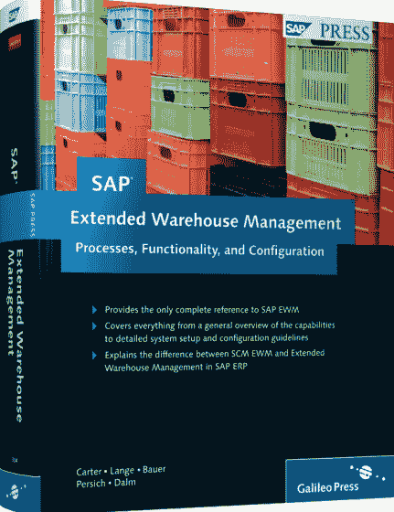


- 12.2.1 补货通用配置 501


21.6.2 计算计划工作量 ........................ 704


作者感谢 SAP 开发团队、套件解决方案管理团队以及咨询团队的同事们，他们为本书提供了第一手知识和宝贵的反馈。特别是，作者感谢 Bernd Ernesti 和 Thomas Griesser 的开发团队，特别是 Grabowski、Andreas Daum、Bernhard Hauser 和 Jan Kappallo 的个人贡献。虽然作者感谢这些个人以及下文列出的其他人员提供的帮助，但作者本人对本文的内容及任何遗漏承担全部责任。

我们还要感谢 Jenifer Niles、Erik Herman 以及 SAP PRESS 的编辑团队，在本书编写过程中投入的时间、精力和耐心。


我要感谢我在 SAP 的朋友和同事，特别是许多鼓励我推进该项目的人，感谢他们在本书创作过程中提供的支持。特别地，我想感谢我的合作作者，以及 Richard Kirker 和 Madhu Madhavan，他们对我的贡献付出的积极参与和宝贵见解。还要感谢我在 SAP 的管理团队，特别是 Bernd Charnock 和 Kerstin Geiger，他们对项目以及我参与项目的支持。最后，我特别想感谢我的朋友和家人的爱与支持——特别是我的妻子 Teresa 以及两个孩子 Evan 和 Meredith，在本书编写期间不得不忍受我许多小时的缺席。

# Joerg Lange

我要感谢我在 Ratingen 的 SAP 咨询工业制造部门的同事们，他们提供了详细的评审和反馈，特别是 Markus Plessmann、Stefan Kalms 和 Stefan Reichert。还要感谢我的妻子 Rebecca，她在整个本书写作期间提供了卓越支持。

# Frank-Peter Bauer

非常感谢我的妻子在编写阶段的理解。并感谢上述 EWM 标准开发部门的同事，以及来自 EWM 解决方案咨询的 Gunther Sanchez 的支持。

# Christoph Persich

我要感谢我的朋友和同事在本书创作期间提供的支持。特别感谢 EWM 解决方案咨询的 Matthias Schilka 提供的卓越支持。

# Tim Dalm

我还要感谢 Harald Breitling 提供的宝贵建议。

SAP® 扩展仓库管理 (EWM) 应用提供了管理高销量分发业务中复杂场景的功能。


本书为您提供了理解 SAP EWM 解决方案所需的信息，包括它支持的功能、如何设置这些功能，以及如何启动利用这些功能来支持您的仓库业务的项目。在本章中，我们将首先提供有关 SAP 仓库应用程序的一些背景和历史，告诉您 SAP EWM 是如何演变的，告知您 EWM 品牌的变体，并告诉您本书的目标读者以及如何使用。我们希望本书能够为您提供信息并进行教育，并帮助您在 EWM 实施方面做出正确的决策。

## ##1.1 背景与历史

在过去的几十年里，仓库已经从简单的接收、存储和发货设施演变为全规模、高通量的流转式分发运营中心。全球竞争迫使企业持有更少的库存，并比过去更快、更精准地将产品推向市场。竞争也驱动本地和全球企业变得更加精益、高效，并对市场和内部业务环境的变化做出更快的反应。不断变化的业务优先级、产品季节性的增加、更快的业务周期以及更频繁的兼并收购仅仅是导致仓库面临巨大压力的一些市场条件，要求其在提高效率的同时，仍为业务提供灵活性，以应对不断变化的需求。

与此同时，劳动力、原材料和房地产成本的非比例增长威胁着要推高仓储成本，阻碍了公司的盈利能力。对于某些公司来说，这种执行高效物流运营的压力太大，或者成本太高，他们日益转向外包解决方案（例如第三方物流提供商），以具有成本效益的方式处理产品量和不断变化的业务需求。然而，这只是将负担转移给了一个全新的群体，由于他们不仅要保持单一组织的灵活性，还要在多个组织之间保持灵活性，这些压力变得更加剧烈，而且这些组织通常具有不同的产品、业务需求和管理风格。

仓库“以少胜多”的压力增加导致了业务流程复杂性的随之增加。反之，业务流程复杂性的增加需要仓库经理人才的增加，以及帮助这些经理经营业务的系统能力的提升。

仓库管理系统 (WMS) 软件行业的演变与仓储和分销市场的变化并行，随着专门从事标准化软件的公司交付了日益强大的 WMS，支持着日益复杂的业务流程。然而，仍有公司倾向于运行自己的定制系统，这些系统充满了针对其业务的特定功能，并由程序员大军提供支持。但越来越多的公司意识到，使用满足其业务需求的标准软件解决方案在总拥有成本 (TCO) 方面具有优势。这些公司正在转向像 SAP 这样的软件供应商。

自 1972 年以来，SAP 专门为通用业务流程提供标准软件解决方案。自公司成立后一年发布 R/1 以来，SAP 不断演进其产品以进入新市场。通过20 世纪 70 年代和 80 年代的 R/2 时，SAP 提供的软件不仅满足财务和采购等后台功能的需求，还越来越多地进入产品、销售和分销的前线。20 世纪 90 年代初，SAP 交付了其旗舰产品 R/3，并在整个生命周期内不断增强该应用程序。SAP R/3 产品在 21 世纪初演变为今天被称为 SAP ERP。在此期间（20 世纪），SAP 继续精炼和扩展这些产品，一个又一个版本的发布新及修订的功能。作为这一波新及扩展功能的一部分，SAP 在 2005 年交付了 SAP EWM 的第一个版本。当时，EWM 是 SAP 解决方案的一部分，无法单独交付。从那时起，SAP 提供了作为 SAP 扩展部署 EWM 的能力，让 EWM 脱离了其 S 起源，并拥有了自己的命名和品牌——SAP EWM。

## 1.2 SAP WMS 的演变

即使在 R/2 时代，SAP 就包含了仓库内定位的功能。当时，它是一个基础的定位系统，但它为 SAP 进入仓库管理 (WM) 领域奠定了基础。1993 年，SAP 发布了 R/3 2.0 版本，并带来了第一个基于客户端服务器框架的仓库应用程序。当时，SAP WM 只涵盖仓库应用程序的基本功能，即跟踪仓库内多个货位的产品，并为货位中的产品分配托盘识别标签（托盘 ID）。在 SAP 术语中，这些托盘 ID 被称为存储单元。

自最初发布以来，SAP 扩展了其 WM 应用程序，增加了功能，包括：

- 集成 SAP R/3 生产计划、质量管理和物流信息系统（在 SAP R/3 3.0 和 3.1 版本中）

- 波次拣、仓库监控以及集成 SAP R/3 人力资源 (HR)（在 SAP R/3 4.0 版本中）


# SAP 扩展仓库管理 (EWM) 简介

- 支持去中心化 WM 和射频支持（在 SAP R/3 Release 4.5 中）
- 支持处理单元（HU）管理（一种库存管理级的方法，用于跨工厂、存储位置和仓库的跟踪托盘 ID）以及包装站功能（在 SAP R3 Release 4.6 中）
- 针对处理可由多个资源执行的多步移动的任务和资源管理（在 SAP R/3 Enterprise (4.7) 扩展集 1.1 中）
- 支持堆场管理、越库直堆和增值服务（VAS）（在 SAP R/3 Enterprise (4.7) 扩展集 2.0 中）

与此同时，全球企业开始使用 SAP WM 系统来管理日益复杂的仓库和配送中心。随着产品的增长，客户群也随之扩大，如今，SAP WM 已在全球 5000 多家 SAP 客户中部署。

2005 年，SAP 发布了其 SCM 软件的 5.0 版本，并随之发布了第一个版本的 SAP SCM EWM 软件。该版本的 WM 软件在架构上与 ERP 中的 WM 完全分离。尽管它们在功能方面具有一些共同点，但 SAP EWM 的设计从底层开始就考虑了复杂、高度自动化、高通量配送中心的需求。

该解决方案的设计基于 SAP 内部行业、解决方案和开发专家，以及一组开发合作伙伴的共同努力，这些合作伙伴在广通量规划、订单履行和分销运营方面带来了丰富的业务专业知识。SAP 与开发伙伴合作，进行了一项持续三年的战略性开发项目，旨在设计并部署一套标准的软件解决方案，以便在市场上与最先进的 WMS（仓库管理系统）相竞争。SAP 和开发伙伴致力于此，构建了一套完整的软件解决方案，用以管理其复杂、高通量的服务零部件运营 —— 不仅仅是一个 WMS，还是一个能够完美协调以管理整个运营的规划和履行系统。如今，这些应用程序（包括 SAP CRM、SAP ERP 和 SAP SCM，包含服务零部件规划和 EWM 应用）作为 SAP 服务与资产管理行业解决方案的一部分共同营销。用于服务零部件的行业解决方案组件通常被统称为“SAP 服务零部件管理解决方案”。

尽管 SAP 的开发合作伙伴原意是使用该解决方案来管理装满服务零部件的配送中心，且该解决方案是与其他特定的服务零部件应用程序一同交付的，但 SAP EWM 解决方案的设计初衷是用于多个行业。例如，EWM 的第一个版本（作为 SAP SCM 5.0 的一部分）提供了支持复杂、高通量配送中心需求的功能，包括：

- 货位优化 (slotting)
- 拆分合并 (deconsol)
- 越库直堆 (cross-docking)
- 堆场管理 (yard management)
- 复杂的内部路由
- 组套 (kitting)
- 增值服务 (VAS)

在 EWM 2007（也称为 EWM 5.1）中，SAP 增加了以下支持：

- 劳动管理 (LM)
- 内部仓库流程的射频识别 (RFID)
- 套件库存 (kit-to-stock)
- 额外的收货功能
- 支持毛重 (catch weight)
- 直接连接自动化物料处理设备或物料流系统 (MFS)
- 批次管理的增强
- 序列号处理的增强
- 手动创建出库单

在最近的几年里，SAP 为 SAP EWM 增加了额外功能，以支持消费品和零售公司的需求，如今，该解决方案已面向所有需要复杂 WMS 的行业。具体而言，在 EWM 7.0 中，SAP 增加了以下支持：

- 图形化仓库布局
- 额外的资源管理功能，包括：
  - 任务交错 (task interleaving)
  - 执行约束
  - 支持半系统引导式作业
- 额外的越库直堆支持，包括：
  - 机会主义性越库
  - 零售商品分销
  - 生产越库
- 支持从 EWM 管理的仓库进行生产供应

在发布 EWM 7.0 后，SAP 将包括 EWM 在内的 SCM 平台通过增强包（enhancement package）模型来部署新功能。该模型已应用于 ERP 发布的 SAP ERP 2005（即现在的 SAP ERP 6.0），现在同样的模型将用于 SCM、CRM 以及其他主要的 SAP 业务应用程序。增强包允许 SAP 在主要版本发布之间通过定期更新来交付增强的功能。这些更新可以通过业务函数（business functions）根据需要激活。

业务函数包含一组相似或相关的函数，允许您决定激活哪些业务函数，而无需一次性激活增强包交付的所有功能。这可以节省您测试增强包应用的大量时间，因为您只需要测试受激活业务函数影响的功能。反之，业务函数允许您更快地将功能部署给终端用户。增强包模型允许 SAP 向市场推出新功能，实现了共赢。

第一个增强包功能将通过不同的业务函数交付，这将允许您安装增强包，然后激活一个或所有（或不激活）业务函数，并据此测试您的解决方案。在接下来的几年里，SAP 将继续通过增强包为 EWM 7.0 版本添加额外特性。

## 1.3 EWM 品牌

当 SAP 发布其 SAP R/3 Enterprise 扩展集 2.0 功能以支持管理、越库和 VAS 时，它为这组功能分配了一个非正式名称“扩展仓库管理”（Extended Warehouse Management）。虽然您不会在系统的任何地方找到这个名称，但这些功能被统称为这个绰号，以便 SAP 员工和合作伙伴能够与客户有效地讨论这些新功能。

一个常见的困惑是，适用于 ERP WM 的 EWM 品牌并不包含任务和资源管理 (TRM)。TRM 是随 R/3 扩展集 1.1 发布的，而 EWM 的命名仅适用于扩展集 2.0。

有时令人困惑的是，EWM 的命名并不适用于扩展集 2.0 为 ERP WM 交付的所有功能。例如，动态循环盘点（允许用户携带射频设备前往仓库的存储货位并启动临时循环盘点的功能）是在扩展集 2.0 中引入的，但并未包含在 EWM 功能中。适用于 ERP WM 的 EWM 品牌仅包含三个功能：越库、堆场管理和 VAS。

当 SAP 在 2005 年发布 SCM 5.0 时，它交付了 EWM。如前所述，该版本的 EWM 与 SAP ERP WM 仅在名称上有关联。SAP SCM EWM 交付在 SCM 平台上，与 SAP ERP 以及任何 SAP ERP WM 或 SAP ERP EWM 完全分离。它在表格、结构和程序上与 ERP 应用有所不同。在某些方面，它使用了相同的概念和范式，但在另一些方面，它显著不同，并以独特的方式执行相同的功能。为了更加清晰，图 1.1 提供了 EWM 所指代功能的视觉图。然而，在本文中我们将关注图表的右侧 —— SCM WM。

2007 年，SAP 将 EWM 从 SCM Basis 中解耦，以便公司准备将该解决方案作为 ERP 的插件（add-on）进行部署。插件是一种可以部署在另一个应用程序平台之上的产品，而无需与底层软件技术架构耦合或依赖于它。允许 EWM 作为插件部署，意味着各种规模的企业并不一定拥有技能、人力或资金来部署 SCM。


# SAP 扩展仓库管理 (EWM) 简介

服务器可以在其 ERP 服务器上部署 EWM，并享受最新仓储应用程序带来的优势。

正如之前简要提到的，2005 年，SAP 宣布将将其 ERP 应用程序迁移到增强包（Enhancement Pack）模型，并且 ERP 2005 版本（后重命名为 ERP 6.0）将是未来几年的“首选”版本。这种增强包模型允许 SAP 更快地交付新功能，并允许客户在实施增强包后，通过自由选择激活哪些业务功能，从而更快速、更方便地实现这些新功能。


| SAP ERP 4.6C | SAP SCM 5.0 |
| :--- | :--- |
| 核心仓库 (WM) | 扩展仓库管理 (EWM) |
| 拣货 (Picking) | - 拣货 (Picking) |
| 入库 (Putaway) | - 入库 (Putaway) |
| 补货 (Replenishment) | - 解码 (Deconsolidation) |
| 波次拣货 (Wave Picking) | - 补货 (Replenishment) |
| 两步拣货 (2-Step Picking) | - 波次拣货 (Wave Picking) |
| 等 | - 两步拣货 (2-Step Picking) |
| | - 开始 (Starting) |
| | - 增值服务 (Value Added Services) |
| | - 越库 (Cross-Docking) |
| | - 堆场管理 (Yard Management) |
| SAP ERP 4.7 EE 1.1 | SAP EWM 5.1 |
| - 任务与资源管理 (Task & Resource Management) | - 劳动力管理 (Labor Management) |
| SAP ERP 4.7 EE 2.0 | SAP EWM 7.0 |
| - 动态盘点 (Dynamic Cycle Count) | - 生产供应 (Production Supply) |
| ERP EWM | - 交叉越库 (Opp. Cross-Docking) |
| - 增值服务 (Value Added Services) | - 商品配送 (Merchandise Dist.) |
| - 越库 (Cross-Docking) | |
| - 堆场管理 (Yard Management) | |

> 注意：这是一个简化模型，并不涵盖所有应用程序或发布版本的全部。

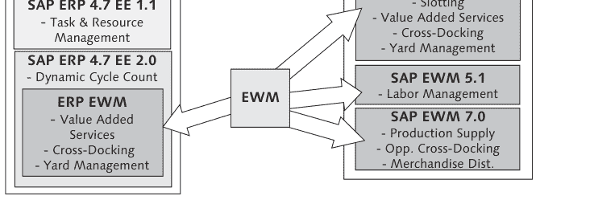

**图 1** EWM 的名称可以适用于 ERP 和 SCM 的功能。在本文中，我们将关注右侧的功能。

当 SAP 在 2007 年交付 ERP 的第二个增强包（即 SAP ERP 2005 增强包 2）时，它承诺允许将 EWM 作为 ERP 的插件进行部署。现在，客户可以选择在 SCM 平台上部署 EWM，也可以选择在其现有的 ERP 平台上部署 EWM，这使他们能够自由地在 ERP 平台上提供图 1.1 右侧的所有功能。在第 26 章“部署 EWM”中，我们将进一步讨论将 EWM 作为 ERP 插件部署的选项。


在本文中，我们旨在为项目负责人、实施顾问、项目团队成员、业务分析师以及负责 SAP EWM 解决方案实施、维护或解决问题的业务用户提供知识、信息和参考资料。对于需要充分了解应用程序以决定在何处如何部署 EWM 的关键决策者，本文也可能在他们的决策过程中提供帮助。本文将涵盖 EWM 解决方案能力的概述、解决常见业务问题的配置方法，以及扩展解决方案以满足更复杂或独特业务需求的可能性。本文将提供详细的系统配置和设置说明，以及针对复杂高流量分销操作中常见业务关注问题的解决方案描述。

在介绍之后，本文的第二部分将涵盖基础仓库设置，包括仓库结构、仓库主数据、库存管理和仓库文档类型。该部分将为理解后续章节提供基础，并为开始实施 EWM 的用户提供参考。

第三部分将涵盖基础仓储流程的配置和设置，包括入库处理、出库处理、内部移动（包括补货和重新理货）以及物理盘点。

第四部分将涵盖特殊专题，如越库、堆场管理、增值服务 (VAS) 和数据采集（包括使用支持射频的设备和 RFID 进行移动数据输入）。


无论您是为了全面阅读本文还是将其放在桌子上作为实施期间的简便参考（或两者兼顾），我们认为您会喜欢并觉得它有趣且有用。


在本章中，我们介绍了 SAP EWM 并描述了本文的内容。希望这能让您了解本文的内容以及如何使用它。在接下来的章节中，我们将描述 EWM 的组织结构和主数据。

ERP 中的组织结构为库存管理 (IM) 中的物料移动提供了基础，通常应该模拟您公司的运营环境。


建模仓库结构的第一步是建模供应链的组织结构，并设置使用扩展仓库管理 (EWM) 运行的仓库。组织结构在 SAP ERP 系统中设置。典型结构看起来像金字塔（见图 2.1），公司代码位于顶层，工厂位于下一层，存储位置位于下一层，然后是下一层的仓库。然而，金字塔有时看起来基础不稳定，因为它往往只到存储层才变大，而且仓库的数量可能少于存储位置的数量。您的组织结构与我们的示例有所不同——这里的示例仅用于说明目的。

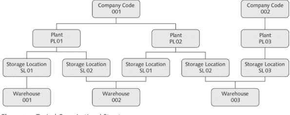

图 2.1 典型组织结构

金字塔的顶层是公司代码。公司代码通常是一个财务结构，因为公司财务状况的汇总通常在公司级进行。您经常会在日常用语中听到组织的公司级被称为部门（divisions）或地区（regions）。

每个公司代码应包含一个或多个工厂。设置单独公司代码的典型原因包括：

- 在多个国家设有地点
- 拥有不同产品或不同业务线的部门
- 可能导致对不同地点和产品进行独立核算的其他财务考虑

在图 2.1 提供的示例中，我们展示了多个公司代码，以说明单个仓库可以关联到多个工厂，即使这些工厂被分配给多个公司代码。

在书中，我们经常引用实施指南 (IMG)。要从任何 SAP 系统访问 IMG，请使用事务代码 SPRO，或从 SAP 菜单遵循路径 TOOLS • CUSTOMIZING • EXECUTE PROJECT。事务代码可以输入图形用户界面 (GUI) 的事务代码框中，如图 2.2 所示。登录系统后，可以通过选择标题栏中的 SAP 菜单选择菜单项（见图 2.2）。

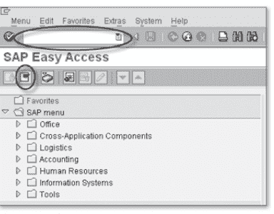

图 2.2 SAP GUI

要在 ERP 系统中创建公司代码，在 IMG 中遵循路径 ENTERPRISE STRUCTURE • DEFINITION • FINANCIAL ACCOUNTING • EDIT, COPY, DELETE, CHECK COMPANY CODE • 新代码。

对于公司代码，还可以使用特殊功能在一个事务中复制公司代码以及相关表。在 IMG 中访问此事务，遵循路径 ENTERPRISE STRUCTURE • DEFINITION • FINANCIAL ACCOUNTING • EDIT, COPY, DELETE, CHECK COMPANY CODE 相关路径。

公司代码数据由财务会计师或实施团队中负责该活动的组设置。在对公司代码级进行任何更改之前，建议与财务会计团队协调，因为更改可能会产生深远影响。


金字塔的下一层是工厂。每个工厂必须分配给单个公司代码，但可以包含一个或多个存储位置。工厂通常用于将库存分为地理或逻辑位置。位于这些工厂的库存在其相应的工厂中估值，该库存价值汇总到公司代码级进行财务跟踪。

拥有多个工厂有很多原因，但地理隔离是最常见的理由。另一个原因可能是为了进行财务跟踪而分离库存，而不影响公司代码级的财务合并。还有一个原因可能是为了销售团队的目的分离库存。例如，某个销售团队可能希望为一组客户持有库存，这些库存可能被隔离到单独逻辑工厂，但物理上可能位于相同的地点。

要在 ERP 系统中创建工厂，在 IMG 中遵循路径 ENTERPRISE STRUCTURE • DEFINITION • LOGISTICS GENERAL • DEFINE, COPY, DELETE, CHECK PLANT • DEFINE PLANT。要将工厂分配给相关的公司代码，在 IMG 中遵循路径 ENTERPRISE STRUCTURE • ASSIGNMENT • LOGISTICS – GENERAL • ASSIGN PLANT TO CODE。


为了允许分配给公司代码的工厂内发生交易，必须进行额外的设置，但我们提供这些信息只是为了让你对组织结构有一个直观的了解，这将有助于决定如何使用 SAP 组织结构对自己的组织进行建模。


金字塔的下一级是存储位置。每个存储位置必须分配给单个工厂，但每个工厂可以分配多个存储位置（如图 2.1 所示）。将库存划分为多个存储位置的原因之一是由于物理隔离。例如，库存可以储存在同一地理位置的多个建筑中，这些建筑彼此靠近，使得库存从一个位置转移到另一个位置变得简单，而不需要运输或单据。

当建筑之间的距离远到需要在建筑之间进行运输时，通常使用运输订单进行库存转移。使用运输订单允许您通过出货交单执行请求，该交单可以提供必要的运输单据。它允许创建入库交单。

创建存储位置，请遵循菜单路径：进入结构 • 定义 • 物料管理 • 维护存储位置。

存储位置是工厂特定的，因此没有需要将存储位置额外分配给工厂。存储位置数据库表 (T001L) 的键同时包含了工厂和存储位置。因此，多个工厂的存储位置名称可以相同。这允许所有由 EWM 管理的工厂使用相同的存储位置名称，如“可销售 (AFS)”和“码头收货 (ROD)”。

然而，也可以采用比图 2.1 所示的结构更简便的组织结构。在图 2.3 中，您可以看到最简单的可能组织结构，具有单个公司代码、单个工厂、单个存储位置和单个仓库。

存储位置 | 2.2

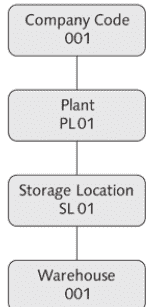

**图 2.3** 包含仓库的最简单组织结构

虽然对于 EWM 管理的仓库可以使用这种简单的组织结构，但也可以使用 EWM 中的某个功能，使 EWM 管理仓库的典型组织结构变得稍微复杂一些。许多仓库经理倾向于在库存接收到不可用于拣货的位置时对其进行隔离，即使在 IM (库存管理) 层级上也是如此。换句话说，当收到库存时，它在 IM 中更新，反映在 FI (财务会计) 中，并且可以支付供应商（如果收货与外部采购订单相关）。然而，库存位于一个存储位置，该位置可以配置为不允许将库存承诺给客户订单或提交给出货交单。在标准交付配置中，此存储位置命名为 ROD（“码头收货”），如图2.4 所示。

当产品被放入仓库时，EWM 系统会自动将其转移到可用于拣货的存储位置。在标准交付配置中，此存储位置命名为 AFS（“可销售”），如图 2.4 所示。在本书中，我们将引用 ROD 和 AFS 存储位置，但您可以根据需要为它们命名。AFS 存储位置可以配置为允许将库存承诺给客户订单并提交给出货交单，从而使 AFS 存储位置成为一个“可拣货”的存储位置。

在第 4 章“物料主数据”中，我们将讨论 EWM 中的库存类型如何映射到这些存储位置，从而对仓库中产品的存储位置分配实现完全的控制和灵活性。但现在，让我们看看如何在 ERP 和 EWM 中创建仓库。

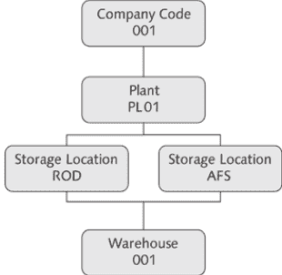


一旦创建并分配了工厂和存储位置，完成 ERP组织结构的最后步骤是：

- 创建仓库
- 将仓库分配给工厂和存储位置
- 指定如何管理该仓库

### 2.3.1 定义仓库编号

在创建和分配仓库之前，您必须决定如何分配仓库。在做出这些决定之前，有几个概念是需要的。

首先，可以将多个存储位置分配给单个仓库。这是为了允许前面描述的多个存储位置范式，该范式允许您通过存储位置将可拣货库存和不可拣货库存进行隔离开来。它还允许使用存储位置对库存进行逻辑划分，即使产品属于同一个工厂。当同一工厂拥有库存时，它允许您使用 IM 进行逻辑隔离来管理产品，而不影响财务会计。

其次，这些存储位置并不要求属于同一个工厂。虽然在 SAP 仓库管理软件的早期版本中，在 SAP R/3 4.0 版本之前，仓库只能分配给属于同一工厂的存储位置和单个存储位置，但在过去的几年中，单一工厂限制并不是一个约束，并且不会影响今天实施 SAP ERP 的任何人。允许产品属于多个工厂提供了灵活性，可以在同一个物理空间内管理商店，同时在财务会计目的上将其保持逻辑分离。

而且，最后，分配给仓库的工厂并不要求属于同一个公司代码。这允许您在同一个仓库中存储来自多个业务部门（可以作为单独的公司代码管理）的产品，甚至在同一个货位中。

让我们再次查看本章初的图。在图 2.5 中，您可以看到之前讨论的概念反映在所引入的示例组织结构中。

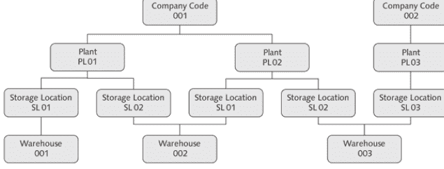

**图 2.5** 分配多个位置的仓库示例组织结构

# 组织结构

在同一物理空间存储产品的同时保持逻辑分离的能力是通过跟踪仓库的方法实现的。所有库存都跟踪到货位级，库存数据包含有关拥有库存的工厂和存储位置的信息，这在 SAP 中被称为“数量 (quant)”。在第 6 章“仓库库存管理”中，我们将进一步讨论数量并提供有关如何使用的更多细节。

一旦您决定了创建多少仓库、如何分配它们以及如何管理它们，就可以开始在 ERP 的组织结构中配置仓库。首先，通过以下路径在 ERP 系统的 IMG 中创建仓库：进入结构 • 定义 • 物流执行 • 定义 • 复制/删除/检查仓库编号。在图 2.6 中，您可以看到该事务包含创建、更改、复制或删除仓库编号的能力，编号仅为 3 个字符，描述为 25 个字符。

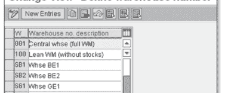

图 2.6 ERP 中仓库编号的定义


接下来，你把仓库分配给工厂和存储位置。若要在 IMG 中进行分配，请遵循菜单路径：企业结构 ENTERPRISE STRUCTURE • 分配 ASSIGN • 物流执行 LOGISTICS EXECUTION • 分配 WAREHOUSE NUMBER TO PLANT/STORAGE LOCATION。只需将工厂、存储位置和仓库号输入表中，如图 2.7 所示。


| 打印类型 | 区域 | 仓库号描述 |
|---|---|---|
| 0001 | 0088 | 中心（全功能 WM） |
| 0001 | 0995 | |
| 0002 | 0168 | 中心（全功能 WM） |
| 0003 | 0001 | 简易 WM（无库存） |
| 0003 | 0008 | 中心（全功能 WM） |
| SP51 | AFS | S51 WhBE1 |
| SP51 | ROD | S51 WhBE1 |
| SP52 | AFS | S52 WhBE2 |
| SP52 | ROD | S52 WhBE2 |
| SP61 | AFS | S61 WhOE1 |
| SP61 | WM | S61 WhOE1 |
| SP61 | ROD | S61 WhOE1 |
| SP62 | AFS | S62 WhOE2 |
| SP62 | ROD | S62 WhOE2 |
| SP71 | AFS | S71 WhPL |
| SP71 | ROD | S71 WhPL |
| SP81 | AFS | S801 WhUB1 |
| SP81 | WM | S801 WhUB1 |
| SP81 | ROD | S801 WhUB1 |
| SP91 | AFS | S902 WhUS2 |
| SP91 | ROD | S902 WhUS2 |
| SP92 | AFS | S902 WhUS2 |

图 2.7 ERP 中工厂和存储位置到仓库号的分配

> **注意**
> 在本书中，我们假设你正在使用两个存储位置 ROD 和 AFS 来区分不可用库存和可用库存。此外，除非另有说明，否则我们假设你使用的是简单的结构，即将仓库分配给单个工厂和一个简单的公司代码。

### 2.3.2 集成到 DWM 和 EWM

一旦你完成了仓库到工厂/存储位置组合的分配，ERP 系统将能够确定哪个仓库与 IM 交易和交货相关。在 ERP 系统中创建的每个 IM 交易都必须在交易行项目（MSE 表）上分配一个工厂和一个存储位置。当对已分配仓库的工厂和存储位置执行 IM 交易时，相关的仓库号将被分配到该行项目。如果仓库由去中心化仓库管理 (DWM) 或 EWM 管理，则该交易将接口到相关系统。

同样，在创建入货交单或出货交单时，每个行项目都会分配一个工厂和一个存储位置。根据行项目级别分配的工厂和存储位置，将确定仓库并将其分配给该行项目。如果确定的仓库由 DWM 或 EWM 管理，则交单将集成到相关系统。


一旦定义了仓库，你就可以指定如何管理仓库。也就是说，你是使用 ERP 仓库管理 (ERP WM)、DWM 还是 EWM 来管理仓库。如果你使用 ERP WM，则无需再做其他操作——你可以开始在 ERP 中设置仓库。如果你使用 DWM 或 EWM，在设置剩余的仓库结构之前，还需要执行几个步骤。

DWM 本质上是第二个 ERP 系统，其配置方式略有不同，允许你将交单分配到外部 ERP 系统，并仅管理该 ERP 系统上的仓库功能。如果你想设置 DWM 系统，在 IMG 中，你将遵循菜单路径：物流执行 LOGISTICS EXECUTION • 去中心化 WMS 集成 DECENTRALIZED WMS INTEGRATION • 中央处理 CENTRAL PROCESSING • 应用 APPLICATION • 激活去中心化 WMS。如图 2.8 所示，系统中的每个仓库都会显示在此表中。如果你想激活 DWM，你需要在表中创建一个新条目。

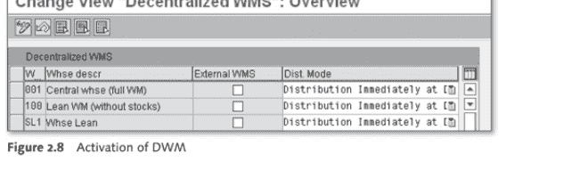

图 2.8 激活 DWM

> **注意**
> 除非对其中一个仓库使用 DWM，否则没有必要配置前面的设置。我们在此引入讨论只是为了指出 DWM 和 EWM 设置之间的区别。

要激活 EWM 仓库，请首先通过遵循 ERP IMG 菜单路径：与其他 SAP 组件集成 INTEGRATION WITH OTHER SAPYSCOM COMPONENTS • 扩展仓库管理 EXTENDED WAREHOUSE MANAGEMENT • 分配仓库号到去中心化系统的仓库号 ASSIGN WAREHOUSE NUMBER TO WAREHOUSE NUMBER OF DECENTRALIZED SYSTEM，将 ERP 中的仓库号分配给 EWM 中的仓库号。在图 2.9 中，你可以看到这种分配是仓库号与 EWM 仓库号之间简单的一对一分配。

## 更改视图“分配仓库号

| 分仓库号到去中心化系统的仓库号 | WHN DecB |
|---|---|
| 001 中心明细（全功能 WM） | |
| 109 简易 WM（无库存） | |
| S1 Whse BE1 | SPB1 |
| S2 Whse BE2 | SPB2 |
| S1 Whse GE1 | SPG1 |
| S2 Whse GE2 | SPG2 |
| S1 Whse Lean | SPL1 |
| SP1 Whse PL | SPP1 |
| S1 Whse UB1 | SPU1 |

图 2.9 EWM 仓库号到 ERP 仓库的分配

注意，ERP 系统在此事务中不直接读取 SCM 表，因此不会对在表中输入的 EWM 仓库号进行验证。每个仓库在表中都是可见的，因此仅为相关的 ERP 仓库输入 EWM 仓库号。

除了分配仓库号外，你还必须激活 EWM 仓库并在表 T340D 中设置额外的 EWM 相关参数（如图 2.10 所示）。若要在 ERP IMG 中进行设置，请遵循菜单路径：物流执行 LOGISTICS EXECUTION • 备件零件管理 (SPM) • 集成 SPM。

# 组织结构

> **注意**
> 尽管 EWM 设置的菜单路径是备件零件管理，但 EWM 是跨行业的。然而，EWM 设置的菜单路径是备件零件管理，EWM 是跨行业的。

要激活 EWM 仓库，请首先通过遵循 ERP 菜单路径：与其他 SAP 组件集成 INTEGRATION WITH OTHER SAPYSCOM COMPONENTS • 扩展仓库管理 EXTENDED WAREHOUSE MANAGEMENT • 分配仓库号到去中心化系统的仓库号 ASSIGN WAREHOUSE NUMBER TO WAREHOUSE NUMBER OF DECENTRALIZED SYSTEM，将 ERP 中的仓库号分配给 EWM 中的仓库号。在图 2.9 中，你可以看到这种分配是仓库号与 EWM 仓库号之间简单的一对一分配。

> **注意**
> 除非对其中一个仓库使用 DWM，否则没有必要配置前面的设置。我们在此引入讨论只是为了指出 DWM 和 EWM 设置之间的区别。

要激活 EWM 仓库，首先通过遵循 ERP 菜单路径：与其他 SAP 组件集成 INTEGRATION WITH OTHER SAPYSCOM COMPONENTS • 扩展仓库管理 EXTENDED WAREHOUSE MANAGEMENT • 分配仓库号到去中心化系统的仓库号 ASSIGN WAREHOUSE NUMBER TO WAREHOUSE NUMBER OF DECENTRALIZED SYSTEM，将 ERP 中的仓库号分配给 EWM 中的仓库号。（*此处原文存在重复，已根据指令要求按逻辑翻译*）

## 更改视图“分配仓库号，

| 分配仓库号到去中心化系统的仓库号 | WHN DecB |
|---|---|
| 001 中心明细（全功能 WM） | |
| 109 简易 WM（无库存） | |
| S1 Whse BE1 | SPB1 |
| S2 Whse BE2 | SPB2 |
| S1 Whse GE1 | SPG1 |
| S2 Whse GE2 | SPG2 |
| S1 Whse Lean | SPL1 |
| SP1 Whse PL | SPP1 |
| S1 Whse UB1 | SPU1 |

图 2.9 EWM 仓库号到 ERP 仓库的分配

注意，ERP 系统在此事务中不直接读取 SCM 表，因此不会对在表中输入的 EWM 仓库号进行验证。每个仓库在表中都是可见的，因此仅为相关的 ERP 仓库输入 EWM 仓库号。

除了分配仓库号外，你还必须激活 EWM 仓库并在表 T340D 中设置额外的 EWM 相关参数（如图 2.10 所示）。若要在 ERP IMG 中进行设置，请遵循菜单路径：物流执行 LOGISTICS EXECUTION • 备件零件管理 (SPM) • 集成 SPM。

# 组织结构

> **注意**
> 尽管 EWM 设置的菜单路径是备件零件管理，但 EWM 是跨行业的。然而，EWM 设置的菜单路径是备件零件管理，EWM 是跨行业的。

（注：原文文本中存在多处重复段落，已根据“不要重复输出原文”的原则进行了去重处理，仅保留核心翻译内容）


图 2.10 激活仓库管理

在图 2.10 中，你可以看到与激活 EWM 的参数：

- **外部仓库管理**：REFERENCE TO EXTERNAL WAREHOUSE 指标应设置为 EXTENDED MANAGEMENT。
- **与仓库通信**：COMMICATION WITH THE WAREHOUSE 指标应设置为 ASYNC。
- **未检查交单**：DISTRIBUTE UNCHECKED DELIES TO WAREHOUSE 指标决定是否将未检查的交单分到仓库。如果你使用客户关系管理 (CRM) 进行订单管理，并且启用了直接交货场景（这表示在 CRM 中创建未检查的交单），如果你也想将这些未检查的交单分配到 EWM，请选择此指标。
- **分配模式**：DISTRIBUTION MODE FOR THE DELIVERY 指标控制何时分配交单。大多数情况下，你将其设置为创建文档时分配，但在某些情况下，你需要在交单提交仓库之前对其进行修改。在这种情况下，将值设置为停止分配。
- **DWM 中的序列号**：SERIAL NUMBERS in DECENTRALIZED Warehouse Management 指标控制序列号在 DWM 中的管理。对于 EWM 管理的仓库，应始终允许序列号。

## 2.3.4 交单分单指示

为了确保交单正确集成到相关系统，配置必须允许根据仓库分配进行分单。如果控制交单分分的设置不正确，交单将无法发送到仓库管理系统。若要在 ERP 系统的 IMG 中按交单类型级别设置分单指示，请遵循菜单路径：物流执行 LOGISTICS EXECUTION • 出货 SHIPPING • 交单 DELIVERIES • 定义交单分单标准 DEFINE SPLIT CRITERIA FOR DELIVERIES • 按仓库号分单 DEFINE SPLIT BY WAREHOUSE NUMBER • 按交单类型分单 DEFINE DELIVERY SPLIT BY DELIVERY TYPE。如图 2.11 所示，你应该对每个预期分发到 EWM 的交单类型激活设置。

| 交单类型 | 描述 | 交单分单 - 仓库 |
|---|---|---|
| DV: | | |
| CEM | 现金销售 | |
| DIG | 入货交单管理 | ☑ |
| DOG | 出货交单管理 | ☑ |
| CTR | 中心拣货更改 | ☑ |
| EG | 粗收货 | ☑ |
| EL | 入货交单 | ☑ |
| GPLT | SIV 方式交单 | | |
| HID | 入货订单管理 | ☑ |
| HSD | 出货订单管理 | ☑ |

图 2.11 按交单类型分单


# 组织结构

要激活按仓库的设置，请遵循菜单路径：Logistics EXECUTION • SHIPPING • DELIVERIES • DEFINE SPLIT CRITERIA FOR DELIVERIES • DELIVERY SPLIT BY WAREHOUSE NUMBER • DETER DELIVERY SPLIT BY WAREHOUSE NUMBER。如图 2.12 所示，您应该激活每个将要使用 EWM 的仓库的设置。

| 仓库编号 | 仓库编号，描述 | 按仓库编号拆分交 |
|---|---|---|
| D01 | 中央西部 (全功能 WM) | |
| 1B8 | 精益 WM (无库存) | |
| S81 | BE1 仓库 | |
| S82 | BE2 仓库 | |
| S61 | OE1 仓库 | |
| S62 | OE2 仓库 | |
| SL1 | 精益仓库 | |
| SP1 | PL 仓库 | |
| S01 | US1 仓库 | |
| S02 | US2 仓库 | |
| SU3 | US3 仓库 | |

图 2.12 按 ERP 仓库编号拆分交货

## 2.3.5 连接 ERP 到 EWM

现在您已经创建了仓库、分配了仓库、指定了仓库管理方式并正确设置了交货拆分指示，那么 IM 事务和交货在创建时将设置为从 ERP 系统分发到相关的仓库管理系统。

设置 ERP 和 EWM 连接的下一步是设置应用链路启用（ALE）层。在第 8 章“从 ERP 到 EWM 的集成”中，我们将讨论 ALE 的设置以及 ERP 和 EWM 集成所需的其他步骤。在此期间，我们将在下一节继续与仓库结构相关的 EWM 设置的讨论。

## 2.3.6 在 EWM 中定义仓库

连接 ERP 和 EWM 的最后步骤是在 EWM 系统中创建仓库，并在 ERP 仓库编号与 EWM 仓库编号之间建立链接。ERP 仓库编号限制为三个字符，而 EWM 仓库编号允许四个字符。在 EWM 仓库编号中增加额外的字符是为了诸如将单个 EWM 实例分配给多个 ERP 实例等选项提供额外的灵活性。

要在 EWM 系统的 IMG 中创建仓库编号，请遵循路径：EXTENDED WAREHOUSE MANAGEMENT • Master Data • Define WareHOUSE Numbers。如图 2.13 所示，EWM 中的仓库编号为四个字符，描述为四十个字符。如前提到的，这允许将 EWM 连接到多个 ERP 系统的灵活性，而无需担心在两个系统中具有相同的仓库编号。仓库描述中的额外字符还允许您在文本中添加额外的描述符。注意，还有一个详细的表格视图，您可以通过双击该行或选择某行并选择“详情”（DETAILS）按钮来访问，但详细视图不包含任何额外数据，因此我们未将其包含。

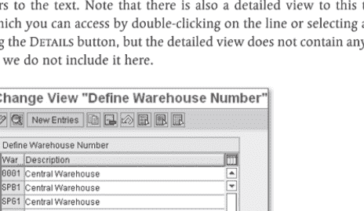

**图 2.13** 在 EWM 中定义仓库编号

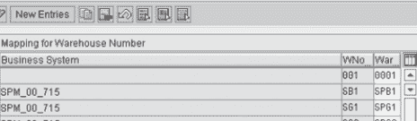

**图 2.14** 将 ERP 中的仓库分配到 EWM 中的仓库

## 2.3.7 将 EWM 中的仓库分配到 ERP 仓库

要在 EWM 系统的 IMG 中将 EWM 仓库编号分配给相应的 ERP 仓库编号，请遵循菜单路径：EXTENDED WAREHOUSE MANAGEMENT INTERFACES ERP INTEGRATION GENERAL SETTINGS MAP WAREHOUSE NUMBERS FROM ERP SYSTEM TO EWM。图 2.14 显示了映射，该映射也可以包含业务系统。由于此处包含了业务系统，您应该在按照第 8 章所述在 ERP 和 EWM 系统之间完成基础技术集成后执行此步骤。

## 2.3.8 分配业务伙伴和供应链单元

完成仓库配置后，您还必须为仓库分配一些主数据属性，包括供应链单元和业务伙伴。我们第 5 章“其他仓库主数据”中进一步讨论业务伙伴和供应链单元。要将业务伙伴和供应链单元分配给仓库，在 EWM 的 SAP Easy Access 菜单中，遵循 EXTENDED Warehouse Management SETTINGS ASSIGNMENTS: WAREHOUSE NUMBERS/BUSINESS PARTNERS 菜单路径，或使用事务代码 `/SCWM/LGNBP`。图 2.15 显示了业务伙伴和供应链单元分配到

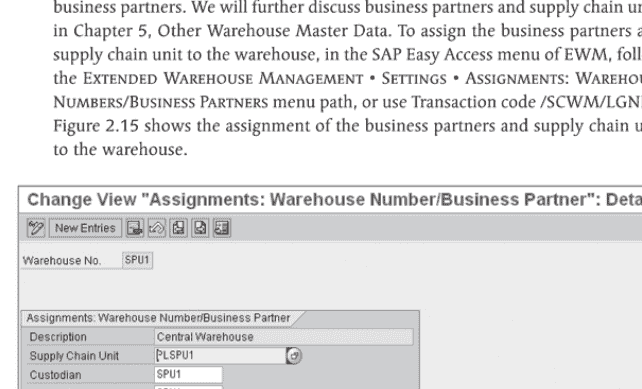

## 2.4 总结

在本章中，我们描述了支持 EWM 所需组织结构。组织结构的一部分在 ERP 中设置，部分在 EWM 中设置。现在您应该能够从零开始创建自己的组织结构，并将 ERP 仓库编号链接到 EWM 仓库。一旦完成，您就可以继续在 EWM 系统中设置仓库。在接下来的章节中，我们将描述支持业务流程所需的主数据设置，然后开始描述仓库的设置。

SAP 扩展仓库管理 (EWM) 仓库结构旨在允许您将物理仓库建模到仓库管理系统中，并提供灵活性，让您将软件功能与您的仓库业务流程紧密建模。

# 3 仓库结构

一旦您设置了组织结构、将仓库链接到 ERP 中的工厂和存储位置，并按照第 2 章“组织结构”所述将 EWM 中的仓库链接到 ERP 仓库，就可以开始在 EWM 系统中设置仓库结构。

仓库结构为建模仓库流程提供了基础。将仓库划分为区域并细分这些区域允许可以使用灵活的结构来建模这些流程。

根据仓储和配送领域的多年经验，我们的观察是，尽管经验丰富的专家希望或努力复制具有一致流程的仓库，但仓库会形成自己的特征。每个仓库都会开始调整结构和流程以匹配其必须执行的活动，即使是相同的仓库，运行方式也大不同。仓库经理和主管带来自己的经验并调整流程。工业工程师从经验中学习并调整布局和结构。仓库员工本身从经验中学习并调整布局和结构。有时调整会在蓝图阶段发生，由工程师在区域或范围内推广时进行。有时会采用当地做法并对建筑进行调整。土地成本会影响自动化程度的多少。有时客户会改变订单模式，或者整个行业的变化会导致仓库流程改变。

## 3.1 存储类型

存储类型是仓库内部最高级别的组织（如图 3.1 所示）。存储类型的最基本定义是一组具有相似特征的仓库货位。


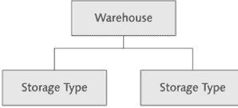

**图 3.1** 仓库与存储类型之间的关系

常用存储类型的示例包括：

- 固定位格区域，也称为主拣货区；固定位格区域可以是：
  - 高位货架的低层级，可通过地面级设备上的订单拣货员访问
- 托盘流式货架（通常用于箱装、内包装或单件拣货）
- 高位区域，通常用于溢货存储或通用存储
- 地面存储区域，通常用于溢货存储或通用存储
- 大件存储区域，通常用于溢货存储或通用存储
- 穿梭货架，通常用于溢货存储或通用存储
- 特殊存储区域，例如用于危险品
- 自动存储和检索区域

此外，您还可以创建存储类型来控制以下内容：

- 用于入库和出库移动的中间位格
- 拣货点
- 识别点
- 暂存区
- 工作中心
- 门
- 场位位格（用于入出出库挂车）

我们将在后面的章节中讨论这些额外主题，因此在这里我们不再进行详细介绍。

存储类型层级分配了多个参数，包括上架和移除策略、处理单元（HU）管理指示器（一种用于唯一托盘标识的方法，我们将在第 4 章主数据中进一步描述），以及控制产品如何放入、移出或存储在分配给该存储类型的位格中的其他设置。若要在 EWM 系统的实施指南 (IMG) 中配置存储类型，请遵循菜单路径：EXTENDED WAREHOUSE MANAGEMENT • MASTER DATA • DEFINE STORAGE TYPE。由于分配给存储类型的参数是产品在仓库中存储方式的基础，因此在接下来的章节中，我们将描述这些每个参数，以及如何使用它们来控制产品在存储类型位格中的移动和存储。

请注意，存储类型配置中的某些设置是相互依赖的。如果字段值与交叉检查字段值所对应的允许值不匹配，您在尝试更新字段时将收到错误消息。在这种情况下，您需要再次更新字段值，或者更新交叉检查字段值以继续更新并保存设置。

> 注意，这些设置中的每一个都是针对每个存储类型的，因此您必须对仓库中的每个区域做出这些决策。这些是您仓库中最重要的设置之一，您应该仔细考虑。理解这些设置并知道如何使用它们，对于帮助确定在仓库中创建多少个以及什么类型的存储类型非常重要。因此，详细理解每个设置至关重要。

记住，目标是使用仓库管理系统对您的仓库业务流程进行建模。您应该让系统帮助您按照您想要的方式工作，而不是让系统规定您应该如何工作。

### 3.1.1 通用

“通用”(General)部分控制与移动类型（即：上架、移除、补货）不相关的存储类型通用设置。在图 3.2 中，您可以看到分配给“通用”部分的参数。

## 存储类型角色 (Storage Type Role)

存储类型角色用于定义存储类型的使用方式。大多数用于在仓库存储产品的存储类型其参数将分配为空值（或空格）。该值的文本描述为“标准存储类型”(STANDARD STORAGE TYPE)。可以分配其他值来指示该存储类型被用于某些特殊目的，例如拣货点、工作中心、生产供应或其他目的。使用下拉选择从可用存储类型角色列表中进行选择。

| 通用 (General) | | 存储行为 (Storage Behavior) | |
| :--- | :--- | :--- | :--- |
| 存储类型角色 | | 可用数量批 | |
| 可用数量层级 | | 危险品管理 | |
| HU 要求 | X | 数量分类 | |
| 最大位格数 | | 外部步骤 | |
| 检查最大位格数 | | 不分解产品 | |
| 使用固定位模式 | | 默认距离 | |
| 不自动分配固定存储位 | | 类型层级 |

图 3.2 存储类型设置的通用部分

## 可用数量层级 (Level of Available Quantity)

可用数量层级决定了在出库移除期间如何确定可用数量。只有两个选项：“存储位格”(Storage Bin) 和“最高层级 HU”(HIGHEST-LEVEL HU)。如果可用数量是在存储位格级确定的，则在创建仓库任务时不会为任务分配任何 HU。这将允许仓库操作人员在执行出库移除时从任何可用的 HU 中选择库存。例如，对于大件存储类型，可用数量应设置为存储位格层级。这将允许仓库操作人员从其可以访问的任何 HU 中移除产品，而不是可能被告知从无法访问的 HU 中移除库存。

如果可用数量是在最高层级 HU 定的，则在创建仓库任务时会将 HU 分配给仓库任务，仓库操作人员在出库移除期间无法灵活指定不同的 HU。当仓库任务中必须指定 HU 时（例如暂存区、包装站、合并站和计数站），应将可用数量设置为最高层级 HU。

## HU 要求 (HU Requirement)

在 EWM 中，HU 的利用与 ERP 仓库管理 (ERP WM) 大不相同。在 EWM 中，可以在同一个仓库、同一个存储类型中存储带 HU 和不带 HU 的产品。

在存储类型层级，HU 字段用于指定如何使用 HU。选项包括：
- 允许 HU 但不需要
- 需要 HU
- 不允许 HU

## 最大位格数 (Maximum Number of Bins)

最大位格数 (Max. No. Bins) 指允许的位格最大数量。此字段让您确保单个产品不会填满存储类型。

也可以在主数据中按产品设置最大位格数。如果在主数据中指定，它将覆盖存储类型中的值。在任何情况下，只有在勾选“检查最大位格数”时，才会检查最大位格数。

## 检查最大位格数 (Check Max No Bins)

此指示器控制在存储类型或产品主数据中检查指示最大位格数的字段。如果没有勾选，则不进行检查。

## 使用固定位格 (Use Fixed Bins)

每个存储类型只能使用固定位格或动态位格。如果存储类型使用固定位格，则应勾选此指示器。

## 固定位格模式 (Fixed Bins Mode)

如果设置了使用固定位格，固定位格模式将控制如何上架到固定位格。如果指示设置为“仅上架到最优固定位格”（为空或空格），则只有通过上架算法确定的固定位格对该物料有效。如果指示设置为“优先上架最优固定位格”，则上架算法将首先尝试将库存上架到最优固定位格，然后尝试其他（包括规避位格）。

最优固定位格是由理货算法确定的。如果理货确定产品应移动到不同的位格（一组固定位格），则新位格将分配给产品，而之前分配的位格如果在此时包含库存，则将在固定位格分配表中标记为规避（在 STORAGE BIN avoidable 字段中）。可以通过快速访问菜单中的路径 EXTENDED WAREHOUSE MANAGEMENT • MASTER DATA • STORAGE BIN • MAINTAIN FIXED STORAGE BIN 查看固定位格分配，或使用事务代码 /SCWM/BINMAT。如之前提到的，我们将在第 7 章仓库文档类型中进一步讨论理货和固定位格的分配。

## 不自动分配固定存储位 (Do Not Assign Fixed Storage Bin)

在上架确定期间，系统可以分配一个尚未分配为物料固定位格的位，是因为没有分配固定位格，或者分配的固定位格不足且所有固定位格已满。在这种情况下，如果设置了“不自动分配固定存储位”指示器，在上架确定期间选中的上架位将不会自动分配为物料的固定位格。否则，如果没有设置该指示器，则该位格将在位格分配表中分配为固定位格（可以如前所述访问该表）。


# 标准仓库

在高位货架存储或通用存储区域中，该参数将设置为**标准仓库**（**STANDARD WAREHOUSE**），这表示库存没有特殊的处理行为。

- 托盘存储区域：在初始上库期间，将创建相同的子位（sub-bins）。子位是位位的一部分，创建用于存储单个单位的材料。例如，如果你在位位中可以容纳两个美国托盘或三个欧洲托盘，则会创建两个或三个子位，取决于你向位位中添加的是美国托盘还是欧洲托盘的库存。

- 散货存储：对于散货仓库（例如，某个区域内，多个相同产品的托盘在同一个仓库位位中堆叠，有时托盘会延伸到位位的深度），这种存储行为是将托盘上库到同一个仓库存储位位中。

## 可用数量：批次

此参数控制位位层面的批次数据管理。如果位位中有多个批次，你可以选择单独控制批次，或者仅管理位位中产品的总数量，而不考虑存储在该处的实际批次。这一概念类似于 ERP 中的文档批次概念，即跟踪材料的总数量，而仅在接收或发货等某些活动期间采集批次信息。

如果你想在仓库请求中指定批次（这可能由销售订单交货、生产供应请求或其他活动触发），或者如果你想在仓库中执行批次确定，以指定仓库任务所需的批次，那么你应该以特定批次的方式管理批次的可用数量（值留空或空格）。如果你没有此类需求并希望允许仓库操作员灵活地确定拣货批次，那么你可以选择以批次中立的方式管理批次的可用数量（值为“1”）。

## 危险品管理

你可以使用 `HAZARD.SUB.MGMT` 根据危险品规则检查某些库存是否可以在某个区域内混合。如果你想在存储类型中的产品上库期间执行危险品检查，你应该设置此参数以在存储类型级别执行检查（值为“1”）或在存储类型和分区级别执行检查（值为“2”）。如果留该字段为空，则不进行任何危险品检查。

## 数量分类

数量分类（**QUANTITY CLASSIFICATION**）与包装规格（pack spec）结合使用，根据请求的产品数量确定移除产品的正确位置——例如，请求的数量是部分箱、整箱还是整托盘（或这些者的组合）。具体而言，它用于以下方式：

- 在移除或上库的存储类型确定期间，根据产品的请求数量读取包装规格。数量分类源自包装规格中与请求数量相匹配的层级。然后，根据确定的数量分类读取存储类型序列确定结果。如果在存储类型中分配了小批量/大批量数量策略，则将根据相应存储类型的数量分类触发级联效应。

- 从包装规格级别（如之前确定的），采用分配的操作计量单位作为仓库任务的替代计量单位，并把包装规格层级的 HU（运输单元）类型也应用于仓库任务。

- 根据舍入设置，仓库任务的数量可能会根据包装规格中分配的 HU 类型分配的数量进行四舍五入。

数量分类的允许值可以在 IMG 中指定，路径为：EXTENDED WAREHOUSE MANAGEMENT > CROSS-PROCESS SETTINGS > WAREHOUSE TASK > DEFINE QUANTITY CLASSIFICATIONS。

## 外部步骤

分配给存储类型的外部步骤（**EXTERNAL STEP**）仅当移动到存储类型的 HU 尚未实现面向过程的存储控制（POSC）路线配置中的分配步骤时才有效。在这种情况下，分配给存储类型的步骤将替换分配给 HU 的上一个完成的外部步骤。对于工作中心的存储类型，将比较分配给工作中心的流程步骤，而不是分配给存储类型的步骤。

## 不拆分产品

分配给存储类型的外部步骤，仅当移动到存储类型的 HU 尚未实现面向过程的存储控制（POSC）路线配置中的分配步骤时才有效。在这种情况下，分配给存储类型的步骤将替换分配给 HU 的上一个完成的外部步骤。对于工作中心的存储类型，将比较分配给工作中心的流程步骤，而不是分配给存储类型的步骤。


## 确认入库

CONF_PUTAWAY 指示器控制是否必须在入库到此存储类型时对仓库任务进行确认。如果源存储类型不需要移货确认，或者目标存储类型不需要入库确认，则不需要对仓库任务进行确认，且货物会在仓库任务创建时立即进行转移。然而，如果源存储类型需要移货确认，或者目标存储类型需要入库确认，则任务可以被确认，并且在任务确认之前，货物不会进行转移。我们将在第 5  章“其他仓库主数据”和第 20  章“组套”中进一步讨论任务的确认。

## HU 类型检查

如果选择了此参数，并且仓库任务是使用 HU 分配创建的，则系统将检查与 HU 关联的 HU 是否允许位于相应的存储类型中。该存储类型允许的 HU 在 EWM IMG 中配置，路径为：外部仓库管理 EXTERNAL WAREHOUSE MANAGEMENT • CROSS-PROCESS SETTINGS • HANDLING UNITS • BASICS • DEFINE HU TYPES FOR EACH STORAGE TYPE。

如果为存储类型激活了 HU TYPE CHECK，则为存储类型创建的所有货位都必须分配 STORAGE Bin Type（货位类型）。

## 存储控制/入库完成

STOR.CTRL/PUT.COMPL 参数决定该存储类型应作为确定 POSC 时产品的最终终点。代表存储物理仓库货位的存储类型选择了此参数，并应包括拣货点和 ID 存储类型以及报废区。中间存储类型（包括用于工作中心、合并、包装、点数和质量检查的类型以及两步拣货的中间区域）不应选择此参数。

## 入库规则

PUTAWAY RULES 用于确定系统在货物入库仓库时确定目标货位的逻辑。选项包括：

## 添加到现有库存/空货位

系统首先尝试根据存储类型的其他规则（例如：混合库存、混合库存类型、拆分规则等）将货物添加到已包含货物的货位中。如果没有找到已包含货物的合适货位，则它将搜索下一个可用的空货位。

## 合并组

存储类型内的货位被分配到合并组，只有来自该合并组的货物可以放入该货位中。您可能希望使用此设置，例如在包装区域，以确保货物按合并组收集在单个货位中。我们将在第 8 章“从 ERP 到 EWM 的集成”中进一步讨论合并组。

## 通用存储区域

通用存储区域用于控制中间存储货位的库存（包装区域、收发货区域、去合并区、检验区、报废区以及两步拣货的中间区域）。通常，在存储区域中，每个存储段创建一个货位，并将存储类型设置为允许添加存储和混合存储，以便入库不被排除。

## 空货位

货物仅入库到存储类型内的空货位。不会向已包含货物的货位添加额外货物。

## 禁止添加库存

ADDN. STOCK FORBIDDEN 参数决定在货位已包含库存后是否可以向该货位添加额外库存。可能的值包括：

- 允许添加到现有库存

此值允许向货位添加额外的库存。

- 通常不允许添加到现有库存

此值阻止向货位中添加货物。

- 由产品入库配置文件决定

如果选择此选项，则使用产品入库配置文件来确定是否可以将新库存添加到现有库存中。

# 3 | 仓库结构

## 注意

可以通过 IMG 中的菜单路径访问产品入库配置文件：扩展仓库管理 EXTENDED WAREHOUSE MANAGEMENT • GOODS RECEIPT PROCESS • STRATEGIES • DEFINE PRODUCT PUTAWAY PROFILE。相关的产品入库配置文件根据产品主数据分配给产品的入库控制指示确定。入库控制指示的设置可以通过 IMG 中的菜单路径访问：扩展仓库管理 EXTENDED WAREHOUSE MANAGEMENT • GOODS RECEIPT PROCESS • STRATEGIES • STORAGE TYPE SEARCH • DEFINE PUTAWAY CONTROL INDICATOR。
在后续章节中，我们将多次引用产品入库配置文件或其他存储类型参数设置。

## 存储段检查

STOR. SECTION CHECK 参数控制存储段确定和检查功能。存储段确定是根据存储段确定配置，在自动入库货位确定过程中确定可能的可能的存储段的过程。我们将在第 7 章中详细讨论此功能。存储段检查是在手动指定存储货位期间确定入库允许的存储段的过程。

可能的值包括：

- 无存储段确定或检查
- 存储段确定和检查
- 存储段确定，不检查

## 入库时拆分

此参数控制如果整个数量无法放入初始货位，则正在入库的数量是否可以拆分到多个货位。可能的值包括：

- 入库时不拆分
- 入库时拆分
- 由产品主数据决定

在最后的情况下，由产品主数据以及产品主数据存储类型视图中的 SPLIT DURING PUTAWAY 值控制是否发生拆分。

## 阈值添加

此值根据货位存储容量的百分比分配。如果确定 SPLIT DURING PUTAWAY 相关，则勾选此指示器。只有当货位的可用容量超过 THRESHOLD Addition 参数的值时，才会执行拆分。这让您控制拆分数量的大小，确保系统不会引导操作员将少量货物放入已有库存的货位并将剩余部分放在另一个货位，因为这会降低操作效率。

> 示例
如果货位持有 100 个小部件，且 THRESHOLD Addition 设置为 10%，则只有在某些情况下才会执行入库拆分。

## 入库存储控制

如果您使用 POSC 确定入库路径，则 STOR.CTRL 指示器用于确定创建哪种类型的任务（即仓库任务或 HU 仓库任务）。选项有：

- 存储控制：动态评估
任务的创建基于存储过程定义中的设置（位于仓库管理 • CROSS-PROCESS SETTINGS • WAREHOUSE TASK • DEFINE PROCESS-ORIENTED STORAGE CONTROL • STORAGE PROCESS • ASSIGN STORAGE PROCESS）

- 存储控制：使用 HU 入库
无论入库任务的数量，系统都使用 HU 仓库任务。

- 存储控制：使用产品 WT 入库
系统始终使用产品仓库任务入库。

如果不使用 POSC，您只需在无存储过程的仓库类型级别指定设置。

## 通用 WT

WT GENERIC（仓库任务通用）参数控制在任务创建期间将确定哪些目标数据。

选项包括：

- 不通用（存储类型、存储段和货位）
- 存储类型和存储段
- 仅存储类型

### 示例

当为入库到包装站创建仓库任务（并且不使用合并组来确定入库货位）时，可以在创建仓库任务期间仅确定存储类型（或存储类型和存储段）。然后，当仓库操作员确认仓库任务时，操作员可以根据货位的物理可用指定入库货位。

## 混合存储

Mixed STORAGE 参数指示货物如何在货位中混合。

选项包括：

- 无限制混合存储
您可以在货位中混合货物，而不检查该货位是否允许混合货物或混合批次；HU 内部的货物和批次混合由 Mixed STORAGE in HU 指示器控制。
- 多个相同产品批次的非混合 HU
您可以将相同产品批次的多个 HU 放入同一个存储位。

- 同一产品不同批次的多个 HU
您可以将不同批次的多个 HU 放入存储位，但它们必须是同一种产品。

- 每个货位允许一个 HU
您只能向货位放入一个 HU；HU 是否可以包含混合货物由 Mixed STORAGE in HU 指示器控制。


## HU 中的混合存储

HU 中的混合 STORAGE 参数指示了在将 HU 存入到存储类型时，产品如何在该 HU 中进行混合。

选项包括：

- 不允许混合存储
  你不能在 HU 上混合不同的产品或批次；HU 中的产品必须是相同的产品和批次号。
- 每个 HU 相同产品的多个批次
  你可以在 HU 上混合不同的批次，但它们必须是相同的产品。
- HU 中的无限制混合存储
  你可以在 HU 中混合不同的产品和批次，而无需检查该 HU 是否允许混合产品或混合批次。

## 数量对收货日期的添加

如果存储类型允许添加到现有库存，则即使新库存的收货日期与原始库存不同，也可能接收库存并将其添加到相同的存储位格或 HU 中。由于数量单元（quant）上只有一个收货日期，`QUANTADDSTK GRD` 指示控制了是否可以添加具有不同收货日的额外库存，并并在可以添加库存时指定了如何处理收货日期。

选项包括：

- 允许——最新日期优先
  允许添加到现有库存，并将收货日期更新为不同库存中最新的收货日期。
- 允许——最早日期优先
  允许添加到现有库存，并将收货日期更新为不同库存中最早（即最旧）的收货日期。
- 不允许
  如果收货日期不同，则不允许将新库存添加到现有库存中。
- 由产品入货策略决定
  如果选择此选项，则将使用产品入货策略中的相关字段设置来决定是否可以将新库存添加到现有库存中。

## 数量对库存保质期 (SLED) 的添加

如果存储类型允许添加到现有库存，则即使新库存的 SLED 与原始库存不同，也可能接收库存并将其添加到相同的存储位格或 HU 中。由于数量单元（quant）上只有一个 SLED 字段，`QUANTADDSTKSLED` 指示控制了是否可以添加具有不同 SLED 日期的额外库存，并并在可以添加库存时指定了如何处理 SLED 日期。

选项包括：

- 最新日期优先
  允许添加到现有库存，并将 SLED 日期更新为不同库存中最新的 SLED 日期。

- 最早日期优先
  允许添加到现有库存，并将 SLED 日期更新为不同库存中最早（即最旧）的 SLED 日期。

- 不允许
  如果 SLED 日期不同，则不允许将新库存添加到现有库存中。

- 由产品入货策略决定
  如果选择此选项，则将使用产品入货策略中的相关字段设置来决定是否可以将新库存添加到现有库存中。

## 数量对库存证书号的添加

如果存储类型允许添加到现有库存，即使新库存的证书号与原始库存不同，也可能接收库存并将其添加到相同的存储位格或 HU 中。由于数量单元（quant）上只有一个证书号字段，`QNTADDSTKCertNo.` 指示控制了是否可以添加具有不同证书号的额外库存，并在可以添加库存时指定了如何处理证书号。

选项包括：

- 允许——删除
  允许不同证书号的库存添加到存储位格或 HU，并删除数量单元上的证书号。

- 不允许
  不允许将不同证书号的库存存入同一个存储位格或 HU。

- 产品入货策略决定
  如果选择此选项，则使用 PRODUCT PUTAW PROFILE 中的相关字段设置来决定系统对于证书号的响应。

## ID 节点激活

识别点（ID point）是临时放置产品的位置，以便在入货前进行识别，或者临时放置直到操作人员或适当设备可以执行入货。ID 点也称为取货点和落货点。如果选择此参数，则该存储类型将激活 ID 点，且向该存储类型的入货将根据布局导向存储控制 (LOSC) 指导移动到 ID 点，最后再存入目标存储类型。可以通过 IMG 中的菜单路径 Extended Warehouse Management • Cross-Process Settings • Warehouse Task • Define Layout-Oriented Storage Process Control 访问 LOSC。

## 不入库 HU

如果选择此参数，则不允许将 HU 存入存储类型。如果在入货过程中使用 HU 管理库存，当选择此参数时，在确认入货仓库任务时，将创建一个产品仓库任务，将产品从资源上的 HU 移动到最终目标位格。

## 检查最大存储类型数量

`CHECK MAX.STQTY` 参数控制在创建任务期间是否检查产品主数据类型视图（表 `/SAPAO/MATL-WHST`）中的存储类型最大数量。如果选择了该参数，且存入存储类型会导致该存储类型中相同产品的总数量超过最大数量，则将不允许入库，并将检查入货序列中的下一个存储类型（我们将在第 8 章中详细讨论入货策略）。

## 删除库存标识

库存标识 (Stock ID) 是分配给在仓库内移动的某组产品的唯一标识指示符。我们将在第 5 章中讨论删除库存 ID 的。此参数控制在任务确认且产品放入位格时是否删除库存 ID。如果不再需要该标识或为了在入货时维护唯一标识符，则您应该选择此指示符。请注意，在仓库中用于存储的所有存储类型上都有必须选择此指示符。如果没有选择，在更新存储类型设置时会导致错误消息。

| 示例 | 如果你使用库存 ID 来执行和跟踪小零件容器到存储位格的移动，并且在产品入货后不再需要维护库存 ID，则你应该为入货的目标存储类型选择 `DELETE STOCK IDENTIFICATION` 指示符 |

## 空位格搜索规则

如果搜索策略要求将产品存入空位格，`SRChRuleEMPTYBin` 指示控制位格在搜索期间的排序方式。选项包括：

- 排序到定义
  根据存储位格主数据指定的排序字段对位格进行排序。

- 靠近固定位格
  根据位格与产品固定拣货位格的距离进行排序。

- 产品决定
  使用产品主数据存储类型视图上的空位格搜索规则（字段名在屏幕上显示为 `Emp.STORBIN`）来决定如何对空位格进行排序。

## 级别：添加到库存

如果你允许对存储类型中的现有库存进行参数控制，`LEVEL: Addition to Stock` 参数控制在创建仓库任务期间在哪个级别添加库存。选项包括：

- 位格级添加库存
  即使存储位格中已存在 HU，当指定此选项时，在创建仓库任务期间不指定目标 HU；操作员在确认仓库时必须指定目标 HU。当操作员需要根据入货时该 HU 的物理可用性来灵活指定 HU 时，选择此选项是合适的。

- 最高 HU 级添加库存
  当指定此选项时，系统在创建仓库任务期间确定目标 HU。当你确定操作员可以访问指定的 HU 时，选择此选项是合适的。

## 容量检查

此指示符决定是否根据存储位格主数据中指定的无维度容量对位格进行容量检查（或者也可以在位格类型设置中指定，可以通过 IMG 路径 EXTENDED WARE MANAGEMENT • MASTER DATA STORAGE BINS • DEFINE STORAGE BIN TYPES 访问）。

选项包括：

- 不根据特征检查
  不对分配给存储位格或位格类型的总容量进行检查。

- 根据产品检查
  根据产品主数据单位衡量选项卡中分配给单位的无维度容量指示符，对位格的总容量进行检查。

- 根据 HU 类型检查
  根据包装容量确定的 HU 容量利用率对位格的总容量进行检查。


根据包装材料主数据中的“单位”（UNIT OF MEASURE）选项页确定处理单元（HU）的料。

- 检查容量、关键数据和 HU 类型

如前所述，将根据产品主数据和 HU 类型数据，对货位的总容量（Total Capacity）进行检查。如果任一计算结果超过了总容量（TOTAL CAPACITY），则将不允许入库。

- 不检查关键数据、重量和体积

如果选择了此选项，则将不再对无单位的容量指示或指定的最大重量和体积进行检查。对于货位没有固有容量的存储类型（例如中间存储类型），应选择此选项；也应适用于包含工作中心的存储类型。

> 注意
> 除非选择了“不检查关键数据、重量和体积”选项，否则只要在存储位主数据中指定了重量和体积，系统在入库确认（putaway）期间始终会执行重量和体积检查。
> 出于功能和性能考虑，您应该避免对中间存储类型进行容量检查，在大多数情况下，甚至包括工作中心，因为这些货位的容量不受物理限制。

## 早期容量检查

`EARLY CAPAC` 指示会在检查存储区域内单个货位的容量之前，触发货位类型的容量检查，并导致系统从存储区域中移除所有位类型未超过所需容量的货位。并非所有情况都需要激活，但如果您使用具有不同容量的货位，它可以显著提高入库货位确定的性能。

## 入库数量分类

`PUTAWQTYCLASS` 指示用于目标货位的容量检查。在确定入库货位期间，系统会读取与存储类型（或产品主数据中的存储类型视图）分配的入库数量分类（PUTAWAY QUANTITY CLASSIFICATION）相关的包装规格级别，并根据包装规格级别中分配的数量检查货位的容量。结合舍入，例如，您可以通过分配与产品包装规格中箱数相关的相应的入库数量分类，来指定在给定的存储类型中仅存储产品的整箱。

数量分类的可能值在表 `/SCWM/TQUAN-CLA` 中设置，该表可以通过 IMG 菜单中的“EXTENED WAREHOUSE MANAGEMENT • CROSS-PROCESS SETTINGS • WAREHOUSE TASK • DEFINE QUANTITY CLASSIFICATIONS”访问。

## 分拆后的舍入

如果入库任务根据分拆规则（见上一节“入库期间分拆”）进行分拆，`ROUNDING AFTER SPLIT` 参数控制在计算分拆后如何对分拆数量进行舍入。选项包括：

- 不舍入
分拆数量计算后不进行舍入。
- 向下舍入 WT 数量为单位的倍数
根据之前分配的入库数量分类，将仓库任务向下舍入为单位的倍数。

> 示例
> 如果 `SPLIT DURING PUTAWAY` 规则定义入库时发生分拆，且已包含库存的存储类型内货位的容量足够额外增加三箱和五个件，则检查 `ROUNDING AFTER SPLIT` 规则，以确定实际入库货位的数量是否应向下舍入为单位的倍数。如果指定 `ROUNDING AFTER SPLIT` 规则为仓库任务向下舍入，且 `PUTAWAY QUANTITY CLASS` 指定为“箱”（Cases），则入库任务将舍入为入库三整箱到存储位，剩余的五将入库到另一个货位。

## 混合库存类型

`Mix. STCK TYPES` 指示控制是否可以在货位中混合不同的库存类型。当混合库存类型放入货位时，将使用不同的物料数（quant number）跟踪添加到货位的库存，以便单独跟踪不同库存类型的库存。

## 混合所有者

EWM 仓库中的所有库存都分配有一个所有者（owner）。如第 6 节“仓库库存管理”所述，所有者“代表拥有库存的组织方”（有关所有者使用的更多信息，请参阅第 6 节）。所有者存储在物料数（quant data）中，它是判断在现有库存上添加新库存时是否可以使用相同物料数的额外因素（即：相同批次的相同产品添加到相同货位，但所有者不同，则需要新的物料数进行跟踪）。`Mixed Owners` 指示指定了在所有者与现有物料数不同的情况下，是否可以将新库存添加到货位中。如果勾选了复选框，则同一货位内的产品将不允许混合所有者。我们将在第 5 节进一步讨论库存所有者的概念。

## 混合处置权限方

EWM 仓库中的所有库存还分配给一个处置权限（party entitled to dispose）。处置权限被定义为“有权处置库存的工厂或组织”，“且“通常是计划库存的工厂，并执行 ATP 检查的工厂”。在许多情况下（物流服务提供商除外），处置权限方与拥有库存的所有者是同一个。与所有者一样，处置权限方存储在物料数（quant data）中，它是判断在现有库存上添加新库存时是否可以使用相同物料数的额外因素（即：相同批次的相同产品添加到相同货位，但需要新的物料数进行跟踪）。`Mixed Parties Entitled` 指示指定了在处置权限方与现有物料数不同的情况下，是否可以将新库存添加到货位中。如果勾选了复选框，则同一货位将不允许混合处置权限方。

## 混合检验单据

如果库存处于检验状态（由于被分配给质量检验单据），`Mixed INSP Docs` 指示控制是否可以将分配不同检验单据的产品组放入同一货位。如果选择了该指示，则不允许将分配不同检验单据的材料放入同一货位。向货位添加不同检验单据的库存将导致创建物料数。

## 混合特殊库存

特殊库存是分配给某些特殊目的的，例如销售订单库存或项目库存。目的和参考号被分配给物料数（quant），以便在整个仓库中跟踪特殊库存。如果选择了 `MIXED SPStock`，则不允许将分配不同特殊库存指示的材料组放入同一货位，也不允许分配相同特殊库存指示但不同特殊库存参考号的库存。如果没有选择该指示，向货位添加不同特殊库存指示或特殊库存参考号将允许。

### 3.1.3 出库控制

`STOCK REMOVAL CONTROL` 部分包含与从存储类型出库或移除相关的参数。出库并不限于针对客户的捡货、库存运输订单或生产供应。在此背景下，出库是指从存储类型的货位到另一个货位的任何移动，包括同一存储类型内的货位以及任何其他存储类型（例如中间存储类型）。我们将在第 8 节详细讨论出库。在图 3.4 中，可以看到分配给 `STOCK REMOVAL CONTROL` 部分的参数。

| 出库控制 | 捡货策略激活 |
|---|---|
| [x] 确认移除 | [ ] 用于粗略货位确定 |
| [ ] 资源上库存 | 出库规则 |
| [ ] 负库存 | |
| [ ] HU 捡货控制 | 整单位 |

图 3.4 存储类型设置中的出库控制部分

#### 确认移除

如果选择了此指示器，从存储类型中的存储位进行移除将需要确认。如果源存储类型不需要移除确认，且目标存储类型不需要入库确认，则无需确认仓库任务，库存将


在创建储储任务时会立即传输。然而，如果源端需要确认移出，或者目的地需要确认上库，则任务可以被确认，但在任务确认之前，库存不会进行传输。我们将在第 7 章和第 22 章“数据采集与资源优化”中进一步讨论任务。

## 资源上的库存

如果选择了此指示器，则在选择存储类型时，将考虑相关资源或物料处理设备上的库存。例如，对于连接了拣货点（或 P&D 区域）的存储类型，您可能希望考虑已从该存储类型拣出并正往拣货点途中位于资源上的移出库存。通过这样，您就不会因为库存正处于存储类型与其分配的拣货点之间的转运过程中而忽略这部分库存。

## 负库存

此参数控制储货位内是否允许存在负库存。选项包括：

- 不允许负库存
储货位内不允许有负库存；仅可以选择储货位内的可用库存进行移出。

- 允许负可用数量
在创建移出任务时，只要总库存超过可用数量，即使可用库存不足以满足请求数量，任务也允许从储货位移出库存；总库存代表当前位位内的可用库存加上计划上库到该位位的库存（例如，针对上库或补货任务）。然而，在足够的库存放入储货位之前，操作员将不允许确认任务。

- 允许负库存
在创建移出任务时，即使总库存（可用库存加上上库库存）不足以满足请求数量，任务也可以安排从储货位移出库存。即使在确认后库存为负数，任务也将允许被确认。

### 示例

当拣货策略建议始终从主拣货位进行拣货时（无论库存储在仓库的何处），在创建移出仓库任务时，应以此主拣货位作为源储货位，并进行相应的调度（或应使用拣货员导向的补货技术）。要启用此策略，应将 NEGATIVE 状态指示器设置为允许负库存，以便无论情况如何都能生成拣货任务。

如果您希望确保在忽略储货位内可用库存或计划上库库存的情况下，始终从该储货位中选择库存，则应该将指示器设置为始终允许负库存。然而，这种策略存在风险，即当拣货位没有可用库存且没有计划上库时，操作员可能会被引导至该拣货位。

## HU 拣货控制

HU PICKING CTRL 表示如果一个完整的同质托盘（即仅包含一个数量，且所有数量具有相同的库存数据）从储货位移出，HU 将受到何影响。选项包括：

- 将带有底层 HU 的源 HU 采用拣货 HU
在任务确认期间，源 HU 作为底层 HU 被采纳到目的地拣货 HU 中。

- 源 HU 建议目的地 HU
在任务确认期间，源 HU 被采纳作为目的地 HU。

- 仓库过程类型控制目的地 HU 的建议
存储过程控制中的设置控制对目的地 HU 的建议。可以通过菜单路径 EXTENDED WAREHOUSE MANAGEMENT • CROSS-PROCESS SETTINGS • WAREHOUSE TASK • DEFINE WAREHOUSE PROCESS TYPE 访问存储过程控制设置。对于仓库任务分配的存储过程，使用 CONTROL FOR HU Pick 指示器来确定 HU 建议方案。

- 仅将内容（产品和底层 HU）采纳到拣货 HU
仅将源 HU 的内容（产品或底层 HU）采纳到目的地拣货 HU 中。

3 | 仓库结构

> 注意
此指示器仅控制仓库任务目的地屏幕上的默认选择。如果情况需要输入不同的值，操作员可以覆盖默认选择。

## 拣货点激活状态

如果选择了此指示器，则该存储类型将有一个激活的拣货点。拣货点是存储类型内的一个工作中心，在库存移出期间，用于从源储货位移出部分 HU。如果需要部分数量，操作员将被引导将 HU 降至拣货点，在拣货点取出目标数量，然后将部分 HU 放回目标类型。如果未指定目标存储类型，则将使用上库策略来确定目标存储类型。

## 用于粗略位确定

如果您设置了此指示器，那么当存储类型中的产品不足以满足需求时，在粗略位确定期间，该存储类型将分配给发货单行。通过这种方式，您可以使用订单相关的补货（从交货读取粗略位）来驱动补货；当创建拣货仓库任务时，储货位将有足够的库存（可用库存或上库库存，取决于任务创建相对于补货任务执行的时间）来满足拣货请求。

## 移出规则

STOCK RULE 定义了在选择应将哪个过量分配给移出仓库的任务时，如何对库存过量进行排序（例如，指定先进先出 (FIFO)、后进先出 (LIFO)、先过期先出 (FEFO)、最佳数据 (BDD) 等）。可能的条目在表 -SCWM/T334RR 中配置，可以通过 IMG 中的菜单路径 EXTENDED WAREHOUSE MANAGEMENT • GOODS ISSUE PROCESS • STRATEGIES • SPECIFY STOCK REMOVAL RULE 访问。存储类型是确定移出规则时检查的多个位置中的最后一个位置。在检查移出规则之前，会检查存储类型搜索序列和存储类型组的分配。

82

## 整单位舍入

仓库中的存储类型可以指定特定的用途，例如整托盘拣货（例如批量）、箱拣货（例如楼层或 A 层）拣货、托盘流或到输送带的箱拣货，或每个位位拣货。如果您使用该存储类型进行整单位拣货，可以指定对在该存储类型中拣货的数量进行适当舍入。选项包括：

- 不舍入
对从存储类型移出的数量进行舍入。

- 任务数量向下舍入到单单位
每个仓库任务的数量向下舍入到单单位；这对于在需要多个托盘时为整托盘拣货创建单独的仓库非常有帮助。

- 任务数量向下舍入到单位的倍数
每个仓库任务的数量向下舍入到单位的倍数；对于将数量向下舍入整箱或整托盘特别有用，剩余部分将从另一个存储类型拣货。

- 任务数量向上舍入到单位的倍数
每个仓库任务的数量向上舍入到单单位的倍数；对于适用于数量将被移至拣货点，并在那里可以分成所需数量和放入库存的剩余数量（可能在适合剩余数量的其他位置）。

## 3.1.4 货物移动控制

GOODS MO CONTROL 部分包含控制产品进入和离开存储类型各个方面方面的参数。在图 3.5 中，您可以看到分配给 GOODS MO CONTROL 部分的参数。

| 货物移动控制 | | |
|---|---|---|
| 可用性组 | 002 | [x] 必填 |
| 非依赖库存类型 | | [x] 无 OI |
| 变更位位 | | |

图 3.5 存储类型设置中的货物移动控制部分


## 可用组 (Availability Group)

根据 SAP 高级计划与优化 (APO)，分配给存储类型的可用性组通过控制哪些存储位置存储在 ERP 库存管理 (IM) 中，从而在全局可用量承诺 (gATP) 中控制存储类型内的库存可用性。通过遵循从 ERP 系统到 EWM 的“扩展仓库管理 • 接口 • ERP 集成 • 货物移动 • 映射存储位置”的菜单路径，将可用性组映射到 IMG 中相应的 IM 存储位置。有关可用性组使用的更多细节和示例，请参见第 6 章。

## 非依赖库存类型 (Non-Dependent Stock Type)

非依赖库存类型定义了库存的质量状态（例如：非限制、质检中、冻结）。如果存储类型仅用于特定非依赖库存类型的库存，则应将此指示设置为相关值。选项包括：

- 非限制性库存
- 质检库存
- 冻区块
- 退货冻区块

> 注意：退货冻区块是不计值的，对 APO 的 gATP 不可见。它用于未经过检查的退货库存。由于尚未进行处理，因此不应供销售或在库存中计值。

## 过账变更存储位 (Posting Change Bin)

如果对存储位中的库存执行过账变更以将其从一种库存类型更改为另一种，则“过账”指示控制产品是留在原存储位还是移动到另一个存储位。选项包括：

- 过账变更始终在存储位内 (Posting Change Always in Storage Bin)

无论之前的混合存储位置设置如何（即使仅更改部分数量），过账变更始终在同一存储位内的库存上执行，库存不会发生移动。

## 根据混合存储设置过账变更 (Posting Change According to Mixed Storage Setting)

只要更改与存储类型的混合存储设置不冲突，就在同一存储位内的库存执行过账变更；如果更改与设置冲突，更改的库存将通过仓库任务移动到另一个适当的存储位。

- 过账变更绝不在存储位内（创建运输订单）

过账变更始终会导致库存通过仓库任务从原始存储位移动到不同的存储位。

## 强制 (Mandatory)

如果选择此指示，则只允许分配给该存储类型的可用组的库存进入该存储类型。如果您将已分配给不同可用组的库存放入存储类型，系统将将库存过账到目标存储类型的新可用组，并根据适用情况将相关的存储位置转移过账到 ERP IM。

## 无发货 (No GI - Goods Issue)

如果选择了 GI 指示，则可能无法从存储类型中的存储位过账发货。此指示通常选择用于存储的仓库存储位，但不应设置在中间存储类型或异常处理存储类型。

## 库存类型角色 (Stock Type Role)

如果存储类型仅用于存储特定库存类型的库存（正常库存、待报废库存或海关冻结库存），则应将此指示设置为相关的库存类型。选项包括：

- 海关冻区块
- 报废库存
- 正常库存

当不同库存类型的库存移动到存储类型内的存储位时，它将自动移动到分配为该存储类型“库存类型角色 (STOCK TYPE ROLE)”的库存类型。例如，您可以专门创建一个存储类型用于存放准备好报废的库存或属于“海关冻区块 (CUSTOM BLOCKED STOCK)”库存类型的库存。在这种情况下，一旦库存移动到存储类型，它就会自动移动到新的库存类型。

## 3.1.5 补货 (Replenishment)

补货 (REPLENISH) 部分包含了与从其他仓库存储位向存储类型补货产品相关的参数。我们将在第 10 章出库处理中进一步讨论补货。在图 3.6 中，您可以看到分配给补货部分的参数。

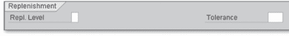

## 补货水平 (Replenishment Level)

补货水平决定了在补货运行期间（即创建补货任务时）读取哪些库存。选项包括：

- 固定存储位的存储位级 (Storage Bin Level for Fixed Bins)
将读取单个固定存储位的库存水平，并根据存储位可用库存与所需数量相比计算补货数量。

- 存储类型级 (Storage Type Level)
将读取整个存储类型的库存水平，并根据整个存储类型的可用库存与所需数量相比计算补货数量。

> 注意：所需数量的计算取决于执行哪种类型的补货。我们将在第 11 章生产供应中进一步讨论补货策略。

## 容差 (Tolerance)

容差 (TOLERANCE) 在补货期间使用，用于检查补货数量是否足以以认为补货请求完成。容差定义为百分比。如果实际补货数量少于请求数量（即欠交），但该数量在请求数量的指定百分比范围内，则该请求被视为履行，且不再创建进一步的补货任务。

## 3.2 存储区 (Storage Sections)

存储区是存储类型的细分（如图 3.7 所示），代表一组通常具有某种属性的存储位。例如，您可以根据存储的产品（大件批量货物与标准尺寸托盘）或产品的周转速度（快速与慢速）对存储类型进行细分。您可以拥有任意数量的存储区，取决于字段大小。

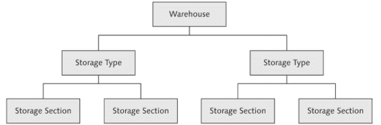

**图 3.7** 仓库、存储类型和存储区之间的关系

存储区在 EWM 中仅用于确定入库位。从 EWM 5.1 开始，您不再需要为存储类型创建任何存储区——例如，对于中间存储类型，完全避免创建区域可能是合理的。

## 仓库结构 (The Warehouse Structure)

要创建存储区，在 EWM IMG 中遵循路径“扩展仓库管理 • 主数据 • 定义存储区”。图 3.8 显示了创建存储区的事务。

在第 8 章中，我们将讨论如何在入库策略期间使用存储区来确定在仓库中放置产品的位置。

## “存储区”视图：概览

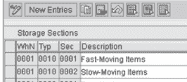

**图 3.8** 创建存储区

## 3.3 存储位 (Storage Bins)

存储位代表仓库中存储产品的物理位置或存储空间。如图 3.9 所示，每个存储位都分配给一个仓库、存储类型和一个存储区。存储位在仓库内通常根据网格命名，网格坐标通常用于表示存储位的位置。该网格可以进一步细分为通道、货架、堆垛、区域、层级等。

为仓库的存储位命名是一门独特的艺术，而如何命名仓库区域最好留给工业工程师和仓库经理决定，他们对在给定条件下“最佳”方案通常有很强的意见。无论您决定如何命名存储位，EWM 系统都应该


# 储位 | 3-3

只要您保持在参数范围内操作，就可以容纳您的命名规范。储位长度为 18 个字符（相比于 ERP WM 中的储位长度仅为 10 个字符），因此在命名上具有一定的灵活性（例如，您可以决定在储位名称中包含连字符以提高可读性——只需记住，系统操作人员在每次手动输入时都必须手动输入连字符）。

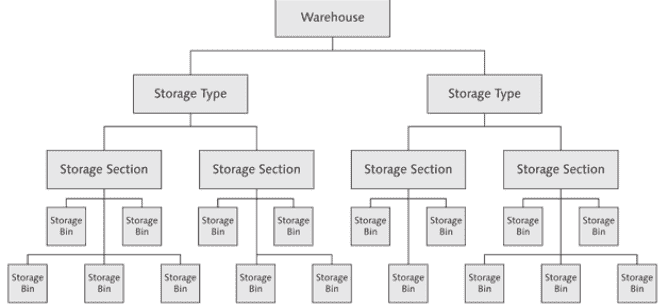

**图 3.9** 储位分配给仓库、存储类型和存储段

> 注意
> 储位不是配置，而是主数据。这允许终端用户根据需要创建储位，以最大限度地提高运营效率并尽地减少管理开销。对于谁允许创建储位的控制通过权限概念进行管理，将在第 25 章“权限、角色与数据归档”中进一步讨论。

## 3.3.1 创建储位

要创建储位，请从 SAP 易用访问菜单（Easy Access Menu）遵循 EXTENDED WAREHOUSE MANAGEMENT • MASTER DATA • STORAGE BIN • CREATE STORAGE BIN 路径，或使用事务代码 `/SCWM/LS01`。在图 3.10 中，您可以看到储位创建事务。

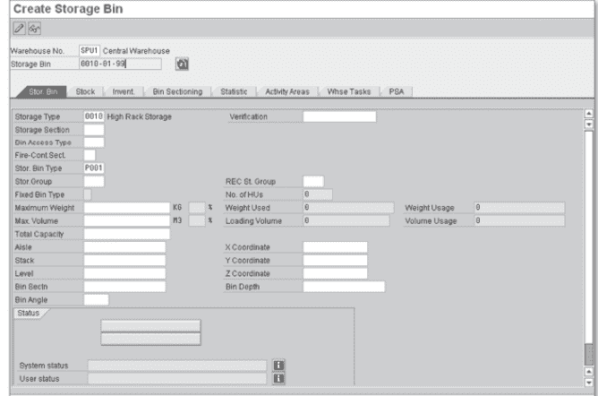

图 3.10 创建储位屏幕

要创建储位，您必须输入仓库编号、储位名称和存储类型。与 ERP WM 不同，EWM 中的储位名称是唯一的，不会在不同存储类型之间重复。这同样适用于中间存储类型以及用于大型通用存储区域的存储类型。除了仓库、储位和存储类型外，以下信息也可以可选分配给储位：

- **存储段（如果可选的话）**
  之前描述过存储段，它用于上货期间的存储段搜索策略（在第 9 章“入库处理”中讨论）。

- **储位访问类型**
  储位访问类型用于资源管理以确定任务的执行优先级。要在 IMG 中维护储位访问类型，请遵循菜单路径 EXTENDED WAREHOUSE MANAGEMENT • MASTER DATA • STORAGE BINS

- **定义储位访问类型。**
  要维护与储位访问类型相关的执行优先级，在易用访问菜单中，遵循 EXTENDED WAREHOUSE MANAGEMENT • MASTER DATA • RESOURCE MANAGEMENT • MAINTAIN EXECUTION PRIORITIES 路径，或使用事务代码 `/SCWM/EXECPR`。

- **防火段**
  防火段用于识别仓库中处于特定防火区域内的区域，并可用于创建报告，例如每个防火段内可能包含哪些危险品。

- **储位类型**
  存储类型可以根据储位的大小或条件将存储类型分组。例如，您可以根据大小隔离储位。储位类型用于确定允许的 HU（包装单元）类型。在 IMG 中，遵循菜单 EXTENDED Warehouse MANAGEMENT • MASTER DATA • STORAGE BINS • DEFINE STORAGE BIN TYPES。若要在 IMG 中为每个存储类型分配允许的 HU 类型，请遵循菜单路径 EXTENDED WAREHOUSE MANAGEMENT • GOODS RECEIPT PROCESS • STRATEGIES • STORAGE BIN DETERMINATION • HU TYPES • DEFINE HU TYPES FOR EACH STORAGE BIN TYPE。

> 注意
> 如果仓库存储类型中激活了 HU 类型检查，则储位类型将成为必填字段。

- **存储组**
  存储组可进一步细分存储类型，以便在 LOSC（面向布局的存储控制）确定中间存储类型（将在第 12 章“内部仓库移动”中进一步讨论）。要在 IMG 中创建存储组的可能条目，请遵循菜单路径 EXTENDED WAREHOUSE MANAGEMENT • CROSS-PROCESS SETTINGS • WAREHOUSE TASK • DEFINE STORAGE GROUPS FOR LAYOUT-ORIENTED STORAGE CONTROL。要在 IMG 中根据源、目标类型与存储组的组合定义中间存储类型，请遵循菜单路径 EXTENDED WAREHOUSE MANAGEMENT • CROSS-PROCESS SETTINGS • WAREHOUSE TASK • DEFINE LAYOUT-ORIENTED STORAGE PROCESS CONTROL。

- **资源执行约束存储组**
  资源执行约束 (REC) 存储组用于将储位分组以进行 REC 检查。REC 用于确定同时有多少资源可以在仓库区域内工作，旨在通过防止拥堵来优化仓库作业人员的效率。要在 IMG 中定义 REC 存储组的可能条目，请遵循菜单路径 Extended WAREHOUSE MANAGEMENT • CROSS-PROCESS SETTINGS • RESOURCE MANAGEMENT CONTROL DATA • Assign RESOURCE EXECUTION CONSTRAINTS TO REC STORAGE Group（注意，您应首先创建第 5 章进一步讨论的用于资源类型分组 ID）。要在 SAP 易用访问菜单中激活每个 REC 存储组的 REC，请遵循菜单路径 Extended WAREHOUSE MANAGEMENT • MASTER DATA • RESOURCE MANAGEMENT • Activate RESOURCE EXECUTION CONTROL FOR STORAGE Groups。在第 5 章中，我们将详细讨论如何创建和分配 REC。

- **容量信息**
  您可以定义储位的最大重量、体积和总容量（无单位）。一旦您在储位上维护了重量和体积，如果超过了其中任何一项，将不允许上货。分配中指定的单位为相关的计量单位。

- **XYZ 坐标**
  X、Y、Z 坐标指定了仓库的位置，并用于路径计算。命名来自三维地图的 XYZ 坐标。您可以通过将布局叠加到地图上确定仓库的 XYZ 坐标。

- **用于可视化的储位信息，如巷道、层、段、深度和角度**
  这些信息用于仓库布局以确定某些参数，并也可向仓库工作人员提供额外信息。

> 注意
> 首次实施劳动管理的实践者的常见问题是，他们如何确定在仓库中放置原点 (0,0,0) 点。因为距离计算是基于点之间的相对差异，因此原点在哪里并不重要。然而，这更容易人们理解位置之间的相对关系。这允许所有位置分配 XYZ 坐标，因此您在确定原点时可能需要很好考虑这一点。

另一个常见问题是应该使用何种计量单位。同样，这并不重要。您只需要在做决定时考虑相关字段的限制。该字段为小数类型，允许小数点前 10 位数字，小数点后 3 位。因此，常用的计量单位有英尺、码或米。

- **系统状态**
  系统状态字段提供了当前分配给储位的某些系统状态代码。例如，如果激活了上货代码和出库，将在这里反映。状态代码仅为四位数，但如果您想获取代码的详细信息，请点击系统状态字段右侧的 按钮（如图 3.10 所示）。

- **用户状态**
  用户状态字段提供了当前分配给储位的状态代码。这些用户状态可以手动分配给储位，也可以通过业务事务分配。您可以在 IMG 中遵循菜单路径 EXTENDED WAREHOUSE MANAGEMENT • MASTER DATA • STORAGE BINS • DEFINE USER PROFILE 创建您自己的用户状态配置文件以及对应配置的用户状态代码。

您还可以在 SAP 易用访问菜单中通过遵循 EXTENDED WAREHOUSE MANAGEMENT • MASTER DATA • STORAGE BIN • ADD USER STATUS FOR STORAGE BINS 路径，为一组储位分配用户状态，或使用事务代码 `/SCWM/BINSTAT`。为储位分配用户状态的前提是必须通过仓库编号控制将状态配置文件分配给仓库编号。要在 IMG 中访问仓库编号控制，请遵循菜单路径 EXTENDED WAREHOUSE MANAGEMENT • MASTER DATA • DEFINE WAREHOUSE NUMBER CONTROL。


为货位创建并分配用用状态的一个主要优势是，每个货位可以由于多种原因被锁定，并且任何一个单一原因都足以阻止该货位进行上架操作。因此，你可以出于多个原因锁定货位，并在问题解决时逐一移除每个锁定原因，而无需完全解锁货位，因为其他锁定原因仍然有效。这允许你同时跟踪和维护货位被锁定的所有不同原因，如果只有一个锁定原因代码，你将不得不手动完成这些工作。

- *验证字段 (Verification field)*

验证字段在移动端数据输入事务期间，用于验证用户是否处于正确的货位。验证字段应与物理位于货位上的条形码匹配。你可以使用简单的技术，例如将验证字段设置为与货位名称相同、检查货位末尾的校验位（以确保用户正确输入了货位），或者如果你倾向于“盲”确认并确保操作员始终扫描货位，可以使用随机验证字段方案。如果你是逐个创建货位，可以在货位中手动输入验证字段，或者可以使用第 3.3.6 节“创建验证字段”介绍的方法。

如果您想更改现有的存储货位，请使用扩展仓库管理 • 主数据 • 存储货位 • 修改存储货位菜单路径，`/SCWM/LS02`。要显示现有的存储货位，请使用扩展仓库管理 • 主数据 • 存储货位 • 显示存储货位菜单路径，或事务代码 `/SCWM/LS03`。

## 3.3.2 使用货位结构生成存储货位

为了方便初始创建或添加大量存储货位，SAP 提供了一个工具，允许您为货位命名指定结构、分配分配并根据结构批量创建存储货位。要在 IMG 中创建存储货位结构，请遵循菜单路径扩展仓库管理 • 主数据 • 存储货位 • 定义货位结构。

在创建货位结构之前，您应该维护货位的存储货位标识符。这些标识符允许您指定货位结构中的哪些部分与巷道、堆垛、层级、分区和深度关联。要在 IMG 中创建存储货位标识符，请遵循菜单路径扩展仓库管理 • 主数据 • 存储货位 • 为货位结构定义存储货位标识符。

大多数情况下，货位结构是自显易懂的。你创建一个带有起始和结束货位名称的组，告诉系统货位之间的增量应该是，为该组分配参数，包括存储类型、货位类型、存储区域、防火分区、货位访问类型和存储组。如果这些参数任何一个发生变化，你都应该创建另一个序列来根据不同的参数创建货位（或者如果只有少数与其他的不同，你可以决定稍后更改它们）。然而，有几个概念值得进一步详细解释，即模板、结构和增量。

### 存储货位结构 — 模板 (Template)

模板用于定义货位名称本身的结构，类似于货位名称的元数据。使用三个字符来定义结构：

- N 代表数字字符（即 0 到 9）
- A 代表字母
- C 代表常量（即此序列中的每个货位名称在该位置上都具有相同的值）

当您将这些字符组合成一个序列时，就定义了货位名称的格式。

> 示例
> 为一组从 A01A 到 A99D 的货位创建一个货位结构，您将指定结构为 `CNNACCCCCCCCC`。注意，货位名称末尾的空字符应用 C 填充，以指定其为常量。该结构定义了第一个字符是常量（即在该序列中它始终为 A），第二和三个字符是数字，第四个字符是字母，其余是常量（空格）。

注意，如果您有连续两个或多个字符需要作为一个组一起递增（例如从 001 到 999 或从 AAA 到 CCC），这些项应在侧进行分组，并赋予相同的货位模板字符。

### 存储货位结构 — 结构 (Structure)

接下来，您定义货位的增量。在此处，您定义哪组字符被用作巷道、堆垛、层级、分区和深度。请注意，您在这里使用的指示符是您之前定义的存储货位标识符。

### 示例

使用之前相同的货位序列 A01A 到 A99D，存储货位结构将定义为 `ASLL`（如果 A 在巷道的存储货位标识符中被定义，S 在堆垛中被定义，L 在层级中被定义）。其余部分将留空。

### 存储货位结构 — 增量 (Increments)

一旦分配了模板和结构，就可以定义存储货位增量。您应该只为货位模板中在起始值和结束值之间递增的部分定义增量。另外注意，您可以以单值增量增加值（例如 01, 02 或 03），也可以以多值增量增加值（例如 01, 03, 05）。此外，您可以独立地增加单个字符的值，也可以一起增加一组字符的值。

### 示例

对于提供的示例 A01A 到 A99D，增量将非常直观。如果您想创建奇数值（例如 A01A, A03A, A05A），您将增量指定为 `02`。再举一个例子，假设货位只到 06，即 A02、A04、A06、A12、A14、A16、A22、A24、A26。在这种情况下，您将保持相同的模板和结构，但请确保指定：

起始值：A02A
结束值：A26D
增量：12

## 生成存储货位

一旦配置了结构，就可以使用这些结构生成存储货位。要生成货位，您必须使用易访问菜单中用于货位生成的事务，遵循扩展仓库管理 • 主数据 • 存储货位菜单路径，或使用事务代码 `/SCWM/L10`。虽然当通过 IMG 访问结构时可以使用“创建货位”按钮，但无法在配置事务中使用该按钮。从易访问菜单的事务内部，只需双击代表您想要创建的序列行，选择“创建货位”按钮，验证列出的货位是您想要创建的，然后选择“创建”按钮。

> 注意
> 您可以使用此事务更改一组货位以匹配当前为货位序列设置的参数。即使货位已创建，仍使用“创建货位”按钮来访问将要更改的货位列表。当您访问事务时，将仅显示当前定义为默认仓库的仓库的货位序列。如果您从未通过运行需要仓库的事务设置过默认仓库，或者在用户配置文件的自定义数据中指定参数（可以通过菜单路径系统 • 用户配置文件 • 自定义数据进行访问），那么在第一次调用事务时，系统将要求输入仓库号。

> 注意
> 如果进入货位生成事务并想更改默认仓库，请遵循菜单路径表视图 • 其他视图。此后，仓库号存储在参数 ID `/SCWM/LGN` 中，在任何使用该参数 ID 确定默认仓库的事务中都不需要再次输入。


## 3-3-3 储位批量修改

一旦创建了存储位，您就可以一次性更改现有存储位的若干参数。要访问储位批量修改事务，在 EWM 易访问菜单中，依次执行 EXTENDED WAREHOUSE MANAGEMENT • MASTER DATA • STORAGE BIN • MASS CHANGE TO STORAGE BINS 菜单路径，或使用事务代码 `/SCWM/LS11`。在选择屏幕上，通过选择标准选择一个储位范围以查看工作列表（如图 3.11 所示），您可以选择要更新的一个或多个储位，选择储位字段（图中圈出），在弹出窗口中为您想要更改的字段输入新数据，并按回车（或选择绿色勾选）。如果您想更改所有所选条目的字段，请选择相应字段右侧的重置复选框。一旦字段的任何数据发生更改，表格中的“已更改”（Bin Changed）字段将出现星号。当您保存事务时，数据将被写入数据库，储位也将发生更改。但如果您在不保存的情况下退出，将不会弹出提示消息，数据也不会被写入数据库，因此请在退出前不要保存数据。

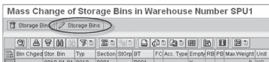

**图 3.11** 储位批量修改。

## 3-3-4 设置储位排序

为了让仓库任务按照您的要求排序，您必须为每个仓库、活动区域和活动组合创建储位排序。在 SAP 易访问菜单中创建储位排序序列，依次执行 EXTENDED WAREHOUSE MANAGEMENT • MASTER DATA • STORAGE BIN • SORT STORAGE BINS 菜单路径，或使用事务代码 `/SCWM/SBST`。输入仓库编号以及可选的活动区域和活动。如果活动区域或活动为空，系统将确定所有可能的项并创建每个组合。生成的列表仅为仿真，向您显示预期结果（如图 3.12 所示），您必须点击执行（EXECUTE）按钮来生成储位排序。

### 储位排序仿真

| WWN | Storage Bin | Activity | Seq. | AA | Typ | Section | Sort Seq |
|---|---|---|---|---|---|---|--|
| SFPU1 | 0010-01-01 | PICK | 1 | 00010 | 0010 | 0001 | 1 |
| SFPU1 | 0010-01-02 | PICK | 1 | 00010 | 0010 | 0001 | 2 |
| SFPU1 | 0010-01-03 | PICK | 1 | 00010 | 0010 | 0001 | 3 |
| SFPU1 | 0010-01-04 | PICK | 1 | 00010 | 0010 | 0001 | 4 |
| SFPU1 | 0010-01-05 | PICK | 1 | 00010 | 0010 | 0001 | 5 |

图 3.12 储位排序仿真

> 必须在系统中创建储位排序，以便在创建仓库任务时找到正确的源储位。如果一组储位未创建储位排序，则这些储位在确定仓库储位期间将被跳过。因此，如果您创建了新的储位、活动区域或活动，必须重新生成储位排序，以便任务创建正常运行。

## 3-3-5 固定储位分配

要使用固定储位拣货技术（将在第9章中进一步描述），您需要在固定储位存储类型内分配固定储位。在 SAP 易访问菜单中手动分配固定储位，执行 EXTENDED WAREHOUSE MANAGEMENT • MASTER DATA • STORAGE BIN • MAINTAIN FIXED STORAGE BIN 菜单路径，或使用事务代码 `/SCWM/BINMAT`。在图 3.13 中，您可以看到若干物到固定储位的现有分配。

要将新物分配到固定储位，点击显示/更改按钮切换到更改模式，然后点击顶部的追加行（APPEND Row）（图 3.13 中圈出）。这将在顶部创建一个新行，您可以手动输入数据。

## 3 | 仓库结构

### 仓库编号 SPU1：维护固定储位

| WHN | EntTo | Storage Bin | Type | Product | DBChanged | Changed On | Max Qty | Display/Uom | Min. Qty | Display/Uom |
|---|---|---|---|---|---|---|---|---|---|---|---|
| SPU1 | SPU1 | 0020-01-0B | B | 0050 | SPE_PTS_0001 | 07.09.2006 | 0,000 | | 0,000 | |
| SPU1 | SPU1 | 0020-01-B3 | B | 0020 | SPE_PTS_0002 | 18.12.2006 | 0,000 | | 0,000 | |
| SPU1 | SPU1 | 0020-01-D3 | D | 0020 | SPE_PTS_0003 | 15.11.2006 | 0,000 | | 0,000 | |
| SPU1 | SPU1 | 0020-01-A2 | A | 0020 | SPE_PTS_0004 | 25.02.2009 | 0,000 | | | |
| SPU1 | SPU1 | 0020-01-B4 | B | 0020 | SPE_PTS_0005 | 23.09.2008 | 0,000 | | | |
| SPU1 | SPU1 | FLOW-30-01-1 | FLOW | 0020 | SPE_FEB_001 | 15.09.2006 | 250,000 | | 55,000 | |
| SPU1 | SPU1 | FLOW-30-01-2 | FLOW | 0020 | SPE_FEB_009 | 15.06.2006 | 250,000 | | 55,000 | |

图 3.13 更改模式下的物料到储储分配

要让系统自动分配存储类型中的可用储位到物料，请遵循路径 EXTENDED WAREHOUSE MANAGEMENT • MASTER DATA • STORAGE BIN • ASSIGN STORAGE BIN TO PRODUCTS。如图 3.14 所示，您必须输入物料、仓库编号、存储类型和要分配的储位数量。系统将确定可用储位并分配给物料，信息栏将显示储位数量。

### 将储位分配到物料

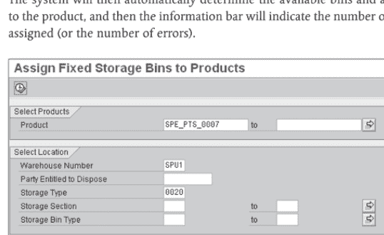

图 3.14 固定储位分配事务

在易访问菜单中删除固定储位分配，执行 EXTENDED WAREHOUSE MANAGEMENT • MASTER DATA • STORAGE BIN • DELETE STORAGE BIN ASSIGNMENT 路径，或使用事务代码 `/SCWM/FBINDEL`。系统将删除指定参数的任何固定储位分配。

## 3.3.6 创建校验字段

除了可以手动输入储位的校验字段外，只要符合描述模式，您还可以一次性创建多个储位的校验字段。在易访问菜单中，分配校验字段，执行 Extended Warehouse MANAGEMENT • MASTER DATA • STORAGE BIN • MAINTAIN VERIFICATION FIELD 路径，或输入事务代码 `/SCWM/LX45`。在图 3.15 中，您可以看到创建校验字段的选择屏幕。

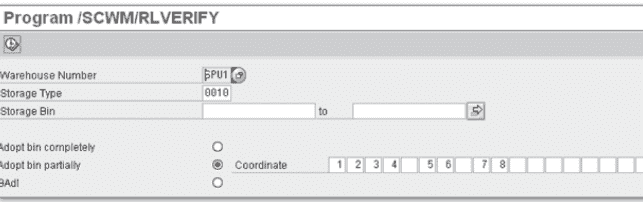

图 3.15 维护校验字段的选择屏幕

在选择屏幕上，除了仓库编号、存储类型和储位的选择标准外，还要指定如何构建每个储位的校验字段。选项包括：

- 完全采用储位（Adopt bin completely）：直接采用整个储位名称作为校验字段。
- 部分采用储位（Adopt bin partially）：仅采用储位的字符作为校验字段。您可以使用此选项删除储位名称中的连字符、常见前缀或储位名称中的任何其他字符。要指定将字符包含在校验字段中，只需在对应于该字符在校验字段中位置的坐标字段中输入两位数字（参见图 3.16 中图 3.15 指定选择的结果）。

## BAdI

您可以使用业务添加（BAdI）以其他方式处理储位名称来确定校验字段、在储位名称末尾添加校验位、创建随机但唯一的校验字段，或使用任何其他方案确定合适的校验字段。

一旦您指定了选择内容和储位名称采用标准，执行事务即可在后续屏幕上看到仿真结果（如图 3.16 所示）。检查仿真结果后，选择更新（UPDATE）按钮用校验字段更新存储表（/SCWM/LAGP）。

| 程序 /SCWM/RLVERIFY | |
|---|---|
| 更新 | |
| 仓库编号 SPUT 存储类型 0010 | |
| 储位. | 校验码 |
| 0010-01-01 | 0010101 |
| 0010-01-02 | 0010102 |
| 0010-01-03 | 0010103 |
| 0010-01-04 | 0010104 |

**图 3.16** 基于选择屏幕输入的校验字段仿真


# 打印仓库位置标签以进行验证

| 仓库编号 | SPU1 |
|---|---|
| 存储库位 | 0920-01-01 to 0920-01-10 |
| 存储类型 | 0920 |
| 存储区域 | |
| 数据选择 | |
| 存储库位 (LOPLA) | |
| 验证 (VERIF) | |

在为已分配为物料的固定库位的存储库位打印标签时，通常在库位标签上同时打印产品标识也是有意义的。因此，EWM 还提供了一个事务和标准表单用于打印固定库位存储标签。在 SAP 易访问菜单中，按照以下路径：EXTENDED WAREHOUSE MANAGEMENT（扩展仓库管理）• MASTER DATA（主数据）• STORAGE BIN（存储库位）• PRINT STORAGE BIN，或者调用事务 `/SCWM/FIXBIN`。图 3.18 显示了打印固定库位标签的选择屏幕。标准 Smartform `/SCWM/FIXBIN_LABEL` 用于此类标签。如果您想增强该表单，可以使用事务 `SMARTFORMS` 创建自己的表单并将其分配为事务内的表单名称。

**图 3.17** 打印存储位位置标签的事务

对于两个库位标签打印事务，当您执行事务时，会出现像图 3.19 所示的弹出框。指定输出设备和其他打印机请求数据，并选择 `PRINT`（打印）或 `PRINT PREVIEW`（打印预览）按钮继续。

| 打印参数 | |
|---|---|
| 输出设备 | Ip01 |
| 表单名称 | /SCWM/BIN_LABEL |
| 表单类型 | |
| 打印机参数 | |
| 输出后删除 | |
| 立即打印 | |
| 打印请求名称 | BinPr1 |
| 副本数量 | 1 |
| 新打印请求 | |
| 权限 | |

| 仓库编号 | SPU01 |
| 存储库位 | 至 |
| 存储类型 | 0020 |
| 产品 | |
| 数据选择 | |
| [ ] 存储库位 (LOPLA) | |
| [ ] 验证 (VERIF) | |

| 打印参数 | |
|---|---|
| 输出设备 | iP01 |
| 表单名称 | /SCWM/FBIN_LABEL |
| 表单类型 | |

| 打印机 | |
|---|---|
| 输出后删除 | X |
| 立即打印 | X |
| 打印请求名称 | F1x1n |
| 副本数量 | 1 |
| P_TDNEW | X |
| 权限 | |

图 3.18 打印存储固定库位位置标签的事务

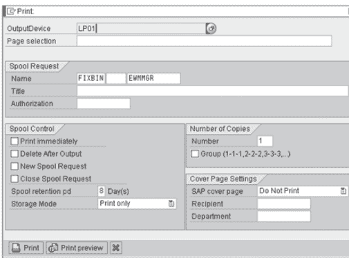

| 输出设备 | LP01 |
| 页面选择 | |

| 打印请求 | |
| 名称 | FIXBIN EWMAGR |
| 标题 | |
| 权限 | |

| 打印机控制 | 副本数量 | |
|---|---|---|
| [ ] 立即打印 | 数量 | 1 |
| [ ] 输出后删除 | 分组 (1-1-1-2-2-3-3-3,...) | |
| [ ] 新打印请求 | | |
| [ ] 关闭打印请求 | 封面设置 | |
| 打印机留存时间 | SAP 封面 | 不打印 |
| [x] 0(s) | 收件人 | |
| 存储模式 | 仅打印 | 部门 | |


图 3.19 库位标签打印事务在选择屏幕后出现的打印输出弹出框

# 3-4 活动区域

活动区域是 EWM 的一种新结构（即它们在 ERP WM 中不存在）。活动区域代表一组存储库位，它们被分组用于创建与特定活动（如拣货、上架或物理盘点）相关的仓库订单。活动区域用于按照之前在“库位排序”节中描述的，按活动定义库位排序。图 3.20 描述了仓库、存储类型、存储区域、存储库位和活动区域之间的关系。请注意，如图所示，您可以将同一个库位分配给多个活动区域。

要在 IMG 中创建活动区域，请遵循路径：Extended WAREHOUSE MANAGEMENT • MASTER DATA • ACTIVITY AREAS（活动区域）• DEFINE ACTIVITY AREA（定义活动区域）。如图所示，创建活动区域的操作非常简单——您只需要输入仓库、存储类型、活动区域和文本描述即可。额外的字段 `JOINED` 用于指示该活动区域是一个高级别的活动区域，用于使用“拣货、包装和通过”规则。在设置合并指示器后，要在 EWM IMG 中将活动区域合并在一起，请遵循路径：Extended WAREHOUSE MANAGEMENT • CROSS-PROCESS SETTINGS（跨流程设置）• WAREHOUSE ORDER（仓库订单）• JOIN ACTIVITY AREAS TOGETHER（合并活动区域）。

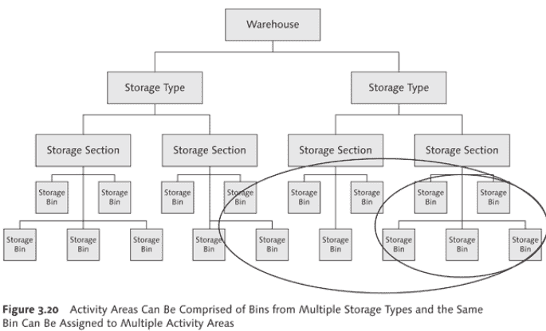

## 仓库结构

## 修改“定义活动区域”视图：概览

| 变量 | AA | 说明 | 合并 |
|---|---|---|---|
| SPU1 | 0001 | 收货 | |
| SPU1 | 0010 | 存储类型 0010 的活动区域 | |
| SPU1 | 0020 | 存储类型 0020 的活动区域 | |

要在 EWM 中从存储类型自动创建活动区域，请遵循路径：Extended WAREHOUSE MANAGEMENT • MASTER DATA • ACTIVITY AREAS • GENERATE ACTIVITY AREA FROM STORAGE TYPE。输入仓库编号、存储类型和活动（或留空），执行事务即可创建活动区域。

创建活动区域后，必须将库位分配给活动区域。遵循路径 ... MASTER DATA • ACTIVITY AREAS • ASSIGN BINS TO ACTIVITY AREAS。在简单的示例中，只需将存储类型分配给活动区域（如图 3.22 所示）。您还可以使用序列号指示库位可以分配给多个活动区域。

## 修改“活动区域”视图：概览

| 仓库 | AA | 序列号 | 存储 | 巷开始 | 巷结束 |
|---|---|---|---|---|---|
| SPU1 | 0019 | 1 | | |
| SPU1 | 0020 | 1 | | | |
| SPU1 | 0021 | 1 | | | |

图 3.22 按存储类型的隐式分配

活动区域用于确定如何将仓库任务分组为仓库订单。在第 7 章中，我们将详细描述活动区域。

# 3.5 门和暂存区

仓库门是进行装卸货作业的场所。许多仓库有多个门，暂存区通常是仓库内在装货之前或卸货之后放置产品的物理区域。这些活动与堆场在 EWM 中统称为收发（S&R）流程。

## 仓库门

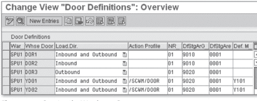

图 3.23 创建仓库门

对于每个门，您可以指定方向为入库、出库或两者（尽管目前仅用于信息目的）。操作配置文件用于确定后处理框架（PPF）操作，例如打印从堆场移动空拖车到门的请求。

默认暂存区组和默认暂存区是系统无法通过以下配置确定暂存区时使用的值，默认运输方式也是如此。

## 暂存区

要在 IMG 中创建暂存区，请遵循路径：Extended WAREHOUSE MANAGEMENT • MASTER DATA • STAGING AREAS • Define STAGING AREAS。您可以在图 3.24 中看到创建暂存区及其相关参数的表格视图。

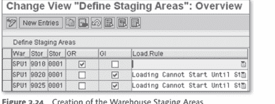

图 3.24 仓库暂存区的创建


要将暂存区/门确定组（STAGING AREA/DOOR DETERMINATION GROUP）分配给仓库产品以用于暂存区和门确定，你必须首先在配置中创建确定组。要在 IMG 中创建确定组，请遵循菜单路径：EXTENDED WAREHOUSE MANAGEMENT • MASTER DATA • STAGING AREAS • DEFINE STAGING AREA AND DOOR DETERMINATION GROUPS。

## 将暂存区分配给门

在创建仓库大门、暂存区和确定组后，你可以维护规则来确定哪些暂存区/门确定组与仓库大门相关。这种确定分配给产品，因此可以用于确定哪些门分配给哪些产品（例如，散装货物与托盘货物，或冷冻货物与常温货物）。在图 3.25 中，你可以看到用于维护允许的暂存区/门……的表格。

此外，在创建仓库大门和暂存区之后，你可以将暂存区组分配给仓库大门（见图 3.26）。

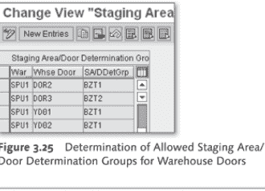

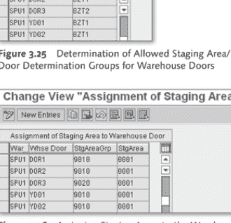

## 3.6 工作中心

工作中心是仓库中发生特殊过程的场所，包括包装、合并、增值服务 (VASS)、计数、质量检查、识别点或拣货点活动以及其他活动（这些特殊过程将在后面的章节中进一步讨论）。工作中心可以单独引用，也可以进一步分组为工作中心组。例如，可以将工作中心指定为仓库任务的目标位置，或者仓库任务可以指定操作员应将路线或 HU 送到工作中心组（技术上由 EWM 识别为存储中心），在这种情况下，最终的工作中心只有在任务确认时才会确定。这允许在最后一刻确定相关的工作中心，为考虑工作中心的可用容量提供了最佳可能性。

### 3.6.1 工作中心布局

所有工作中心使用相同的用户界面，但用户界面的可用功能由工作中心布局定义。可以在 IMG 中指定工作中心布局，路径遵循菜单路径：EXTENDED WAREHOUSE MANAGEMENT • MASTER DATA • WORK CENTER • SPECIFY WORK CENTER LAYOUT。因为在创建工作中心时指定仓库布局，所以你应该在开始创建工作中心之前验证或创建仓库布局。

仓库布局分配了多个参数，这些参数控制哪些树结构或按钮可用、允许哪些函数、调用哪些 BAdIs 以及显示哪些标签页。这些选项非常直观易懂，不需要在这里对每个选项进行详细解释，但如果你对设置参数的影响有疑问，你可能想在沙箱环境（作为实施项目的一部分建立的专用系统环境，专门用于测试和尝试不同的系统选项）中设置一个工作中心并尝试不同的设置。系统交付了几种常用工作中心功能的布局，在许多情况下你可能可以使用现有的布局。

### 3.6.2 创建工作中心

要在 IMG 中创建工作中心，请遵循菜单路径：Extended WAREHOUSE MANAGEMENT • DATA • WORK CENTER • DEFINE WORK CENTER。在图 3.27 中，你可以看到为我们的示例仓库创建的工作中心，包括为出库包装站和质量检查创建的新工作中心。

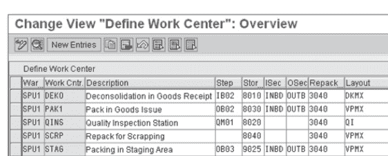

图 3.27 定义工作中心

对于每个工作中心，除了仓库、工作中心名称和描述外，还会分配以下设置：

- 步骤 (Step)
  定义分配给工作中心的外部存储过程步骤。如上文关于存储类型的节所述，当 HU 移动到存储类型时，如果该 HU 与 POSC（进程化拣货控制）相关，系统将将存储类型的外部步骤与 HU 的最新外部步骤进行比较，如果存储类型的外部步骤大于当前分配给 HU 的外部步骤（即在路程中较靠后），则替换它。对于用于工作中心的存储类型，此检查在工作中心层级执行，因为每个工作中心可以分配单独的外部步骤。

- 存储类型 (Storage Type)
  指定工作中心的存储类型。存储类型必须是以下之一：
  - E — 工作中心
  - B — 拣货点
  - I — 暂存区组中的工作中心
  - C — 识别点

## 入库段 (Inbound Section)
入库段是一个存储段，用于存储在工作中心等待处理的产品。

## 出库段 (Outbound Section)
出库段是一个存储段，用于存储已经在工作中心处理过的产品。

## 重新包装仓库流程类型 (Repack Warehouse Process Type)
用于在存储类型上进行重新包装的流程类型。如果没有指定流程类型，将使用重新包装的默认流程类型（例如 3040）。

## 布局 (Layout)
根据上一节定义的用于在工作中心执行的操作的用户界面布局。

## RF: HU 准备就绪 (HU Ready for Input)
此字段决定是否在移动数据输入（无线频率）事务中显示识别（IDENTIFICATION）字段。如果启用此字段，仓库操作员可以创建新 HU 或使用现有 HU。

## 打印确定程序 (Print Determination Procedure)
打印确定程序是用于确定与 HU 打印相关的因素的程序。

## 过程 (Process)
如果工作中心用于处理拣货点的数量，则该过程是从拣货点回传传输使用的流程类型（我们将在9章讨论拣货点）。

## 返回存储类型 (Return Storage Type)
如果工作中心用于处理拣货点的数量，则返回存储类型是用于将未使用材料从拣货点入库的存储类型。

- 返回段 (Return Section)
  如果工作中心用于处理拣货点的数量，则返回段是用于将未使用材料从拣货点入库的存储段。

- 来自拣货点的 HU (HU From PP)
  如果工作中心用于处理拣货点的数量，此字段定义了用于将 HU 移回返回存储类型的 HU 任务流程类型。

- 活动 (Activity)
  活动定义了确定工作中心内文本显示的活动。

- 计划活动区域 (Plan Activity Area)
  此字段定义了劳动管理（Labor Management）使用的默认活动区域。

- 保存 (Save)
  如果选择此字段，系统将在仓库中执行每项操作后自动保存数据。使用此操作可能对系统不利，但在用户保存之前中断事务时，可以为用户节省大量时间。交付的工作中心的默认值为此字段处于激活状态。

- 重新包装时的排他锁 (Exclusive Lock When Repacking)
  此字段决定在重新包装过程中是否对源 HU 设置排他锁。如果选择了此字段，则使用排他锁。除非你需要多个操作员同时拆解一个 HU，否则你应该激活排他锁。未这样做可能会导致操作员在重新包装时无法更新 HU 上的头部信息（因为一旦激活了共享锁，就无法再设置排他锁）。

- 根据合并组重新包装时检查 (Check When Repacking According to Consolidation Group)
  此字段决定在重新包装时通过可用的 BAdI 对合并组进行检查。选项包括：
  - 不检查
  - 重新包装产品时检查
  - 重新包装 HU 和产品时检查


# 根据路线停靠在重新包装时进行检查

此字段决定了在重新包装时，是否通过可用的 BAdI 根据路线上的站点进行检查。选项包括：

- 不检查
- 在重新包装产品时检查
- 在重新包装 HU（包装单元）和产品时检查

# 重新包装活动仓库任务

检查此参数以确定是否可以对活动仓库任务上的产品或 HU 进行重新包装。选项包括：

- 不允许重新包装活动中的 WT
- 允许重新包装活动中的 WT

## 在工作中心是否可以测量毛重数量

此参数决定是否允许操作员在工作中心使用电子秤采集实际的毛重数量。如果工作中心不允许这样做，系统将完全忽略产品的毛重属性。

## 3.6.3 优化工作中心确定

这些设置用于确定在工作中心确定期间以什么顺序使用哪些字段来确定工作中心，目的是减少工作中心确定表中所需的条目数量。

如图 3.28 所示，“出货时的工作中心确定”（WORK CENTER DETERMINATION IN GOODS ISSUE）可以包含路线（ROUTE）、活动区域（ACTIVITY AREA）和合并组（CONSOLIDATION GROUP）。因此，确定工作中心的可能条目数量可能很大。要在 SAP 易访问中访问工作中心确定表，请按照路径操作：扩展仓库管理 • 主数据 • 工作中心（EXTENDED WAREHOUSE MANAGEMENT • MASTER DATA • WORK CENTER）

- 确定出货时的工作中心菜单路径，或使用事务代码 /SCWM/PACKSTDT。

摘要 | 3-7

# 修改视图“出货时的工作中心确定”

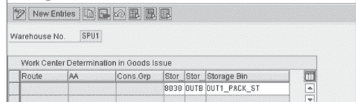

图 3.28 确定表

为了加速并仅检查相关条目，系统首先从工作中心确定表中选择符合所有标准的条目（或“完全限定条目”）。如果找不到完全限定条目，它将使用访问优化表，按照顺序进行，确定合格条目是否符合必要标准，并选择找到的第一个匹配。在图 3.29 中，你可以看到访问优化表，它允许你选择哪些条目是相关的，以及应该使用什么顺序来检查条目组合。

# 修改视图“优化出货时的工作中心确定”

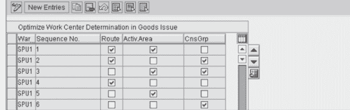

图 3.29 工作中心定的访问优化

# 3.7 摘要

在本章中，我们描述了仓库结构及其元素，包括如何配置它们的详细信息。你现在应该对如何设置存储类型、存储区域、活动区域、门口和暂存区以及工作中心有了良好的了解。既然你已经理解了如何设置仓库结构，我们现在可以开始描述主数据和事务过程了。

在文中多处，我们将引用本章，而不是再次描述如何设置仓库的组织元素。如果你在查找相应章节时遇到困难，建议你查阅目录或索引以找到我们引用的特定主题。

有效的主数据管理对于任何 SAP 实施的成功至关重要，它有助于使应用程序对机构的价值最大化。

# 4 产品主数据

良好的主数据通常被认为是系统成功实施的最重要方面之一，SAP 扩展仓库管理（EWM）在这方面也如此。系统的主数据结合配置，用于控制在系统中执行的过程。两者的区别在于主数据受系统终端用户的直接控制。因此，终端用户理解并清晰地传达应如何维护主数据以允许系统有效运行至关重要。在本章中，我们将讨论与 ERP 和 EWM 中的产品相关的主数据。

## 4.1 ERP 物料主数据

物料主数据（或在 EWM 中被称为产品主数据）可能是系统中最重要的主数据。每个仓库操作都涉及产品，而该操作的每个方面 —— 涉及哪些步骤、如何流转、涉及哪些货位等 —— 都是根据产品主数据中存储的信息决定的。

EWM 的产品主数据源于或集成了 ERP 的物料主数据。在它们的主从关系中，ERP 是主，因为物料是在 ERP 中创建，然后通过 ERP-EWM 接口使用核心组件接口（CIF）技术分发到 EWM。一旦 ERP 数据接口到 EWM，就可以向产品主数据添加额外的 EWM 数据，以控制该产品的仓库过程。

除了为 EWM 产品主数据提供基准外，ERP 物料主数据本身还包含重要数据，用于控制 ERP 的过程（例如：可用性检查规则、采购和生产计划）。在本节中，我们不会涵盖 ERP 物料主数据的每个视图或每个字段 —— 你有许多来源可以获取这些信息。然而，我们将讨论与 EWM 活动相关的字段字段，并描述使用这些字段控制 EWM 行为的正确方法。

要从易访问菜单显示 ERP 中的现有物料，请遵循 物流管理 • 物料 • 显示（LOGISTICS • MATERIALS MANAGEMENT • MATERIAL • DISPLAY），或使用事务代码 MM03。修改使用 MM02。创建使用 MM01。

> 注意
在接后的章节和整本书中，我们对物料和产品进行一般性，尽管在特定行业应用程序中，相同的数据可能使用“商品”（articles）来称为。

## 4.1 物料主数据的现有视图

除了新增的视图外，ERP 物料主数据的若干个视图还包含了应传递给 EWM 的信息。我们在表 4.1 中描述的现有视图包括：

- 基础数据
- 单位
- 销售：常规/工厂
- 工厂数据/存储 1

表 4.1 列出了来自这些视图的在标准 CIF 期间应传递到 EWM 的字段。

| ERP 视图 | ERP 字段 | EWM 视图 | EWM 字段 |
| --- | --- | --- | --- |
| 所有视图 | 物料编号 | 所有视图 | 产品编号 |
| 所有视图 | 物料描述 | 所有视图 | 产品描述 |
| 基础数据 | 物料组 | 属性 | 物料组 |
| 基础数据 | 产品层次结构 | 属性 | 产品层次结构 |
| 基础数据 | 通用类别组 | 存储 | 项目类别组 |
| 单位 | 分母 | 单位 | 分母 |
| 单位 | 替代单位 | 单位 | 替代单位 |
| 单位 | 分子 | 单位 | 分子 |
| 单位 | 基本单位 | 单位 | 基本单位 |
| 单位 | EAN/UPC | 单位 | EAN/UPC |
| 单位 | EAN 类别 | 单位 | EAN 类别 |
| 单位 | 长/宽/高 | 单位 | 长/宽/高 |
| 单位 | 单位 | 单位 | 单位 |
| 单位 | 体积 | 单位 | 体积 |
| 单位 | 体积单位 | 单位 | 体积单位 |
| 单位 | 毛重 | 单位 | 毛重 |
| 单位 | 净重 | 单位 | 净重 |
| 单位 | 重量单位 | 单位 | 单位 |


# 4 产品主数据

| ERP 视图 | ERP 字段 | EWM 视图 | EWM 字段 |
| --- | --- | --- | --- |
| 单位 | 嵌套后的剩余体积 | 单位 | 嵌套后的剩余体积 |
| 单位 | 最大堆叠系数 | 单位 | 最大堆叠系数 |
| 单位 | 容量 | 单位 | 容量消耗 |
| 单位 | 工厂单位类别 | 单位 | 单位类别 |
| 销售：通用/工厂数据 | 运输组 | 属性 | 运输组 |
| 销售：通用/工厂数据（以及基础数据） | 包装材料类型 | 包装数据 | 包装材料类型 |
| 销售：通用/工厂数据 | 允许的包装重量 | 包装数据 | 最大重量 |
| 销售：通用/工厂数据 | 超重容差 | 包装数据 | 超重容差 |
| 销售：通用/工厂数据 | 允许的包装体积 | 包装数据 | 最大体积 |
| 销售：通用/工厂数据 | 允许的体积容差 | 包装数据 | 允许体积容差 |
| 销售：通用/工厂数据 | 已关闭 | 包装数据 | 已关闭 |
| 工厂数据/存储 1 | 批次管理 | 属性 | 需要批次管理 |
| 工厂数据/存储 1 | 最小剩余保质期 | 属性 | 最小剩余保质期 |
| 工厂数据/存储 1 | 总保质期 | 属性 | 保质期 |
| 工厂数据/存储 1 | SLED 舍入规则 | 属性 | 舍入规则 |
| 工厂数据/存储 1 | 存储百分比 | 属性 | 剩余保质期 % |

从 ERP 物料主现有视图传输到 EWM 的字段（续）

## 4.1.2 WM 执行

添加仓库执行（WM Execution）视图专门用于与 EWM 集成，其中若干与 EWM 相关的字段可见可见，包括以下章节中的字段（见图 4.1）。

> 注意
> 某些与 EWM 相关的字段已从 MARC 表（以工厂为键）复制到 MARA 表（键仅包含物料号）。当与 EWM 相关时，数据应在 MARA 表中维护（通过 WM 执行和 WM 包装视图），因为 MARC 数据不会复制到 EWM（例如，WM 执行视图上的序列号配置文件来自 MARA 表，并由它复制到 EWM —— 而来自“工厂数据/存储 2”的 MARC 字段未被复制）。
> 如果您的系统中在 WM 执行视图上没有显示所有字段，请参考在线支持系统 (OSS) Note 958143，关于程序 `SPL_MAT_FIELDS_CORRECT_T13JF` 的执行，该程序解决了有关字段显示的某些问题。

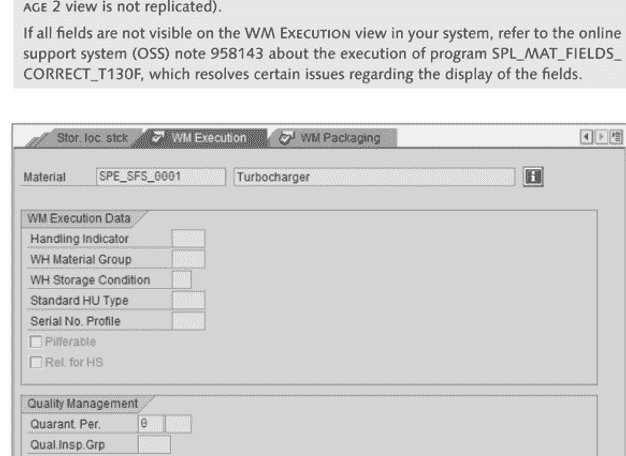

图 4.1 ERP 物料主的 WM 执行视图

## 处理指示

处理指示（HANDLING INDICATOR）用于确定产品从一个位置移动到另一个位置时的处理方式（例如：易碎、不使用夹具）。要在 ERP 实施指南 (IMG) 中指定处理指示的条目，请遵循菜单路径 INTEGRATION WITH OTHER MYSAP.COM Components • Extended Warehouse Management • ADDITIONAL MATERIAL ATTRIBUTES • ATTRIBUTE VALUES FOR ADDITIONAL MATERIAL MASTER FIELDS • DEFINE HANDLING INDICATOR。

## 仓库物料组

仓库物料组（WH Material Group）被传输到 EWM 产品主存储视图上的仓库产品组字段中。它用于将物料分组，以确定仓库中的某些流程。要在 ERP IMG 中指定仓库物料组的条目，请遵循菜单路径 INTEGRATION WITH OTHER MYSAP.COM Components • Extended Warehouse Management • ADDITIONAL MATERIAL ATTRIBUTES • ATTRIBUTE VALUES FOR ADDITIONAL MATERIAL MASTER FIELDS • DEFINE Warehouse MATERIAL GROUP。

## 仓库存储条件

仓库存储条件（WH Storage Condition）用于指定产品必须在某些条件下存储（例如：干燥、凉爽、冷冻）。要在 ERP IMG 中指定仓库存储条件的可能条目，请遵循菜单路径 INTEGRATION WITH OTHER MYSAP.COM Components • Extended Warehouse Management • ADDITIONAL MATERIAL ATTRIBUTES • ATTRIBUTE VALUES FOR ADDITIONAL MATERIAL MASTER FIELDS • DEFINE Warehouse STORAGE CONDITION。

# 标准处理单元 (HU) 类型

标准 HU 类型（Standard HU TYPE）识别应用于混合产品的 HU 类型，在这种情况下不需要包装指令。要在 ERP IMG 中指定标准 HU 类型的条目，请遵循路径 INTEGRATION WITH OTHER MYSAP.COM Components • Extended Warehouse Management • ADDITIONAL MATERIAL ATTRIBUTES • ATTRIBUTE VALUES FOR ADDITIONAL MATERIAL MASTER FIELDS • DEFINE HANDLING UNIT TYPE。

# 序列号配置文件

序列号配置文件（Serial NO. PROFILE）用于指定如何在仓库中管理序列号。例如，您可以在序列化配置文件和相关过程中指定业务交易是否需要序列化、是否可选的或不相关、是否应将序列号附加到设备上、在交易之前必须存在序列号主记录等。我们将在第 6 章“仓库库存管理”中进一步讨论序列号。要在 ERP IMG 中创建条目并指定相关参数，请遵循菜单路径 INTEGRATION WITH OTHER MYSAP. COMPONENTS • EXTENDED WAREHOUSE MANAGEMENT • ADDITIONAL MATERIAL ATTRIBUTES • ATTRIBUTE VALUES FOR ADDITIONAL MATERIAL MASTER FIELDS • DEFINE SERIAL-NUM-PROFILE。

# 易盗性

易盗指示（PILFERABLE）用于指示极易被盗窃（或损耗、被偷窃）的物料。

# 危险物质相关

危险相关指示（REL. HS）允许您指示系统应读取与在仓库存储产品相关的危险数据。数据被传输到 EWM 产品主中的危险物质存储相关字段（HAZARDOUS SUBSTANCE STORAGE-RELEVANT）。

## 隔离期

隔离期（QUARANT.PER）是产品在向客户发货之前在仓库中停留的时间。

## 检验组

质量检验组（QUAL.INSP.GRP）可将物料分组以确定质量检验。要在 ERP IMG 中指定检验组的可能条目，请遵循菜单路径 INTEGRATION WITH OTHER MYSAP.COM COMPONENTS • EXTENDED WAREHOUSE MANAGEMENT • ADDITIONAL MATERIAL ATTRIBUTES • ATTRIBUTE VALUES FOR ADDITIONAL MATERIAL MASTER FIELDS • DEFINE QUALITY GROUP。

> 注意
> 后文中描述的重量相关字段未在图 4.1 的 WM 执行选项卡上显示。字段只有在 ERP 中激活了重量后才会出现。有关重量的详细信息，请参见第 6 章。

## 物流单位

物流单位（LOGISTICS UNIT OF Measure）是用于仓库中移动重量管理产品的单位。它与用于 ERP 中估值的基本单位分开。对于重量管理的物料，所有交易都必须以基本单位和物流单位的形式输入。

# 重量相关

重量相关（Catch WEIGHT RELEVANT）指示用于识别产品是使用重量管理的。该指示被传输到 EWM 产品主存储视图上的重量产品字段（Catch WEIGHT PRODUCT）。

# 重量数量重量配置文件

重量数量重量配置文件（Catch WEIGHT PROFILE FOR Catch WEIGHT QUANTITY）指定了重量管理产品的数量输入方式。它被传输到 EWM 产品主存储视图上的重量配置文件字段（Catch WEIGHT PROFILE）。要在 ERP IMG 中创建重量数量配置文件的条目，请遵循菜单路径 INTEGRATION WITH OTHER MYSAP COMPONENTS • EXTENDED WAREHOUSE MANAGEMENT • ADDITIONAL MATERIAL ATTRIBUTES • ATTRIBUTE VALUES FOR ADDITIONAL MATERIAL MASTER FIELDS • DEFINE CATCH WEIGHT INPUT CONTROL。

## 重量容差组

重量容差组（Catch WEIGHT TOLERANCE GROUP）指定了计划重量转换值上下允许的容差，在此之前系统会提供警告或错误消息。要在 ERP IMG 中创建重量容差组的可能条目，请遵循路径 INTEGRATION WITH OTHER MySAP COMPONENTS • EXTENDED WAREHOUSE MANAGEMENT • ADDITIONAL MATERIAL ATTRIBUTES • ATTRIBUTE VALUES FOR ADDITIONAL MATERIAL MASTER FIELDS • DEFINE CATCH WEIGHT TOLERANCE GROUPS。

# 4.1-3 WM 包装

WM 包装视图也专门为了与 EWM 集成而添加的，若干与 EWM 相关的字段在其中可见，包括下文中的字段（见图 4.2）。


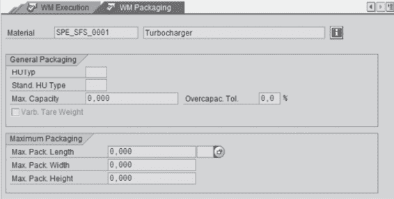

图 4.2 ERP 物料主数据的 WM 包装视图

## HU 类型

`HUTYP` 字段指定了当产品被用作包装材料创建 HU 时，使用的默认 HU 类型。若要在 ERP IMG 中为 HU 类型创建可能的条目，请遵循以下菜单路径：INTEGRATION WITH MYSAP.COM COMPONENTS • EXTENDED WAREHOUSE MANAGEMENT • ADDITIONAL MATERIAL ATTRIBUTES • ATTRIBUTE VALUES FOR ADDITIONAL MATERIAL MASTER FIELDS • DEFINE HANDLING UNIT TYPE。

## 标准 HU 类型

来自 WM 包装视图的 `Stand. HU TYPE` 字段与 WM 执行视图中的字段相同。字段描述请参见前一节。

## 最大容量

`MAX.CAPACITY` 表示根据“计量单位”（UNITS OF MEASURE）视图中的无单位 `CAPACITY` 指示器，封装在包装材料内的产品可使用的最大容量。

## 超容量容差

有时，`MAX.CAPACITY` 可能无法指定在 HU 内部封装产品的绝对最大容量利用。在这种情况下，你可以使用 `MAXIMUM OVERCAPAC. TOL.` 来指定在仓库操作员认为适当的情况下，允许超过该值的百分比容差。该数据将传输到 WM 产品主数据“包装”（Packaging）选项卡上的 `EXCESS CAPACITY TOLERANCE` 字段。

## 变变皮重

`VARB. TARE WEIGHT` 复选框用于指示包装材料的皮重是可变的（即不是固定的）。该指示器将传输到 EWM 产品主数据“包装”选项卡上的 `TARE Weight Variable` 字段。

## 最大包装长度/宽度/高度

这些参数指定了封装在内部的产品的最大长度、宽度和高度。

## 最大包装计量单位

此计量单位适用于 `MAX. PACK. LENGTH, WIDTH, AND HEIGHT` 字段。

## 4.1.4 将 ERP 物料主数据集成到 EWM

一旦在 ERP 中更新并保存主数据，必须将其传输到 EWM。数据通过 CIF 进行传输。CIF 是用于 EWM 和 SAP ERP 之间交换所有主数据的方法。CIF 是 SAP ERP 作为 SAP ECC 6.0（也称为 SAP ERP 6.0，以前称为 SAP ERP 2005）的集成部分。如果你将 CIF 与早期版本的 SAP ERP（或 SAP R/3）配合使用，可以对 ERP 或 R/3 应用应用相关的 R/3 插件（如果可用），或者使用中间文档 (IDoc) 方法集成主数据。我们稍后解释 IDOC 方法，但首先让我们查看用于连接主数据的 CIF 方法。

## 通过 CIF 集成主数据

要通过 CIF 传输数据，必须先创建一个 CIF 集成模型，该模型指定了传输哪些数据以及数据应传输到哪个目标系统。CIF 接口与传输到计划与优化（APO）接口相同；因此访问创建和管理 CIF 模型事务的菜单路径与 APO 相同。要在 SAP Easy Access 菜单中访问 ERP 中的事务，请遵循 LOGISTICS • CENTRAL FUNCTIONS • SUPPLY CHAIN PLANNING INTERFACE • CORE INTERFACE ADVANCED PLANNER AND OPTIMIZER • INTEGRATION MODEL • Create 菜单路径，或使用事务代码 `CFM1`。你可以使用此事务根据给定参数创建集成模型。

由于应避免在多个模型中包含相同的数据，生成集成模型的最有效方法是决定哪些数据应包含在哪个模型中，并为选择屏幕创建变体以生成这些集成模型。管理主数据和事务数据有更详细的策略，我们将在书中不再介绍，但如果使用简单的方法，数据管理可以非常简单。例如，在图 4.3 所示的屏幕中，可以看到遵循基本模式的物料、工厂、客户和供应商被选中发送到 EWM 系统。

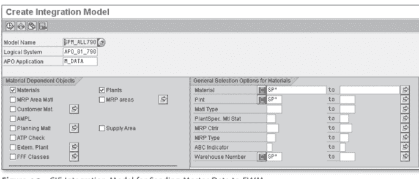

图 4.3 向 EWM 发送主数据的 CIF 集成模型

> 注意：在创建 CIF 集成模型之前，你必须通过创建远程函数（RFC）目标和逻辑系统来指定你的 EWM 系统。一旦建立与 EWM 系统的连接，可以在激活 CIF 集成模型期间指定逻辑系统。为了建立你的 ERP 和 EWM 系统之间的通信，你应该寻求 SAP NetWeaver 顾问或系统管理团队的帮助（特别是如果你本身没有权限进行操作的话）。

你还可以通过选择单个数据元素旁边的附加条目箭头，在选择中指定附加参数，如图 4.4 中的客户和供应商所示。相关的选择标准随后将出现在右窗中，并且当你保存时，这些标准也将包含在变体中。

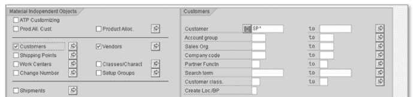

图 4.4 创建 CIF 集成模型的附加选择标准

## 产品主数据

一旦你输入了选择标准并将其保存为变体（或选择了已有的变体），你就必须执行事务以选择要包含在模型的数据。在显示屏幕上，你只需点击图 4.5 所示的 `GENERATE` 按钮，即可深入数据以检查哪些已被选中。

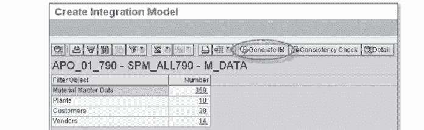

图 4.5 创建集成模型期间数据选择的结果屏幕

一旦创建了集成模型，就需要对其激活它以收集数据并将其发送到 EWM 系统。要激活集成模型，从 Easy Access 菜单开始，遵循菜单路径 LOGISTICS • CENTRAL FUNCTIONS • SUPPLY CHAIN PLANNING INTERFACE • CORE INTERFACE ADVANCED PLANNER AND OPTIMIZER • INTEGRATION MODEL • ACTIVATE。要激活集成模型，你应该在 `MODEL`、`LOGICAL SYSTEM` 和 `APO APPLICATION` 字段中指定与创建集成模型时相同的选择标准，如图 4.6 所示。

## 激活或取消激活集成模型

| Selection Criteria | | | |
|---|---|---|---|
| Model | SPM_ALL790 | | |
| Logical System | APO_01790 | | |
| APO Application | M_DATA | | |

图 4.6 激活 CIF 集成模型的选择屏幕

如果创建了新的集成模型并需要激活，可以通过选择左侧的应用程序指示器来访问。此时右窗的视图看起来类似于图 4.7。要激活新模型，一种方法是直接点击“New Status”列中的红色 X，这将红色 X 变为复选标记。当你选择 `START` 按钮时，新模型将被激活。

| Integration Models | | | | | |
|---|---|---|---|---|---|
| APO_01_790 | SPM_ALL790 | M_DATA | | | |
| Created on | Changed at | Created by | Status | New Status |
| 07.04.2008 | 21:44:10 | 101463 | X | ✓ |
| 09.02.2007 | 20:09:53 | SANTOLLO | 101463 | X |

图 4.7 激活CIF集成模型


一旦您创建并激活了 CIF 模型，ERP 物料主数据就应该在 EWM 系统中可用。下一步是在 EWM 系统中创建与仓库相关的数据，这将允许产品在仓库中进行管理。

## 通过 IDoc 集成主数据
在将 IDoc 集成到旧版本的 ERP（ERP 6.0 之前的版本，此前称为 ERP 2005）时，您可能需要使用 IDoc 方法来集成事务数据，甚至可能包括主数据（用于 CIF 的 R/3 插件在这些情况下不适用或未实现）。在这种情况下，您应该熟悉用于复制主数据的 IDoc。这与从 ERP 将数据传输到中心化仓库管理 (DWM) 系统使用的相同方法。该方法在各种来源中都有详细介绍，但在如今的 EWM 实施中并不广泛使用，因此我们不会在本文中进行详细介绍。

## 4.2 EWM 产品主数据

一旦主数据通过 CIF（或 IDocs）从 ERP 分发，产品主数据（EWM 侧的名称）必须扩展以包含仓储数据。至少，您必须创建产品主数据的仓库视图，以便在任何仓库事务中使用该产品。要为产品主数据创建仓库数据，请从 EWM 的 SAP 易访问菜单按照 EXTENDED WAREHOUSE MANAGEMENT • MASTER DATA • PRODUCT • MAINTAIN WAREHOUSE PRODUCT 路径，或使用事务 `/SCWM/MAT1`。

> 注意
> 对于以斜杠 (/) 开头的 EWM 事务代码，由于 SAP 系统不允许您直接使用以斜杠开头的事务，您必须在事务代码前加上一个斜杠 (/n)，这通常用于结束现有事务并调用新事务。要调用事务 `/SCWM/MAT1`，您必须在事务代码框中输入 `/nSCWM/MAT1`。这是使用“收藏”调用您最常用事务的另一个原因，因为每个事务可以节省几次击键。

在仓库产品主数据创建的初始屏幕（如图 4.8 所示），您必须指定产品编号、仓库编号和处置实体。正如我们在第 3 节“仓库结构”中讨论的那样，处置方被定义为“有权处置库存的工厂或组织”，而且通常是“计划库存并执行 ATP 检查的工厂”。在许多情况下（物流服务提供商案例除外），处置方与拥有库存的工厂是同一个。

一旦在选择屏幕上输入数据并按回车键，假设该产品在仓库中尚不存在，则保存事务。表 `/SAPAO/MATEXEC` 上将创建相关条目。这是在 EWM 中执行大多数仓库事务所需的最小数据。

| 显示/更改/创建仓库产品 |
| :--- | :--- |
| 产品编号 | SPE_SFS_0001 |
| 仓库编号 | SPU1 |
| 处置方 | SPU1 |

**图 4.8** 创建、更改或显示仓库产品的初始屏幕

然而，如果您想进一步指定以各种方式影响事务的参数，则应该检查并更新仓库主数据中视图或选项卡上的数据。在接下来的章节中，我们将检查每个视图上的数据，并讨论这些数据如何影响仓库事务，从而影响仓库中的产品和流程流。

请注意，视图上的所有数据实际上与仓库过程相关。由于 EWM 和 APO 产品视图显示相同的“表头”视图（有单独的事务可以访问 APO 视图），因此并非所有数据都与仓库相关。在某些情况下，数据仅供参考。但是，您应该意识到，如果更改了这些数据，并且 APO 过程在与 EWM 过程相同的系统和客户端执行，那么您也可能会影响 APO 过程。因此，在更改任何现有数据时应谨慎。

## 注意
当用户在更改 EWM 系统中的相同字段后更改 ERP 物料主数据上的该字段时，更改会被覆盖；但在某些情况下，如果用户更改了物料主数据上的另一个字段，更改不会用 ERP 的原始值覆盖已更改的值。对于您担心仓库更改会被 ERP 数值覆盖的字段，您应该在实施项目期间测试拟议的主数据更新流程。

## 4.2.1 通用

关于产品的通用信息包括产品编号本身、产品描述、组织信息和基本计量单位。您可以在图 4.9 中看到通用数据。这些通用数据始终显示在产品主数据维护屏幕的顶部，各个选项卡位于通用数据下方。

# 仓库产品维护

| 产品 | 基本单位 | EA |
| :--- | :--- | :--- |
| SPE_SF_0001 | | |
| 产品描述 | Turbocharger-test | | |
| 仓库编号 | Central-Warehouse | | |
| 处置方 | SPE-Plant-USA1 | | |

**图 4.9** EWM 产品主数据上的产品通用数据

产品编号长度允许 40 个字符，因此支持 ERP 的长物料编号（或 LAMA）功能，该功能最初是汽车行业创建的，现在已用于多个行业。产品编号是所有相关表的第一个条目，因此您无法在 EWM 系统中更改产品编号。

描述长度允许 60 个字符，并从 ERP 接口。它可以在 EWM 中更改，例如，如果您想存储额外信息以区分其他产品。（注：此处原文存在大量重复性错误，已根据逻辑清理）。


熟悉仓库操作的管理员。请注意，你只能为每个物料设置一次已检查（CHECKED By）用户名，一旦设置了 CHECKED BY 用户名，在产品的更改模式下，其他用户将不再显示设置为检查（SET TO CHECKED）按钮。该按钮对同一用户继续显示，该用户可以再次更新按钮的日期和时间，但其他用户无法更新。此外，当操作人员点击 SET TO CHECKED 按钮时，这不会影响哪个操作人员可以使用 SET TO CHECKED 按钮（例如，如果一个操作人员设置了检查数据并将用户名设置为第二个操作人员的用户名，SET TO CHECKED 按钮仍然仅对第一个操作人员显示，而对第二个显示）。

# 物料组

物料组（MATERIAL GROUP）是可以分配给多个物料的标识符，用于将它们分组以便进行分析和报告，或者在 ERP 中通过物料编号下拉选择框进行选择。尽管 EWM 的标准下拉选择框未使用物料组，但作为你实施项目的一部分，你可以在产品选择下拉框中创建自定义标签，允许在选择中使用物料组或产品主数据中的其他参数。

## 产品确定

产品确定字段（PRODUCT DETERM）用于供应商网络协作（SNC）在从供应商处订单时确定供应商产品。EWM 不使用该字段。

## 产品层级

产品层级（PRODUCT HIERARCHY）是另一种物料分组方法，类似于物料组。然而，产品层级还用于价格确定、获利分析和其他报告工具。在 ERP 中，可以使用分级选择方法分配产品层级。

注意，虽然你可以在 EWM 中更改产品层级分配，但 EWM 不会从 ERP 获取产品层级配置，因此你无法以相同的方式使用钻取选择（drilldown selection）。事实上，EWM 并不知道产品层级的具体级别——那里只存储了分配的值。它存储在 EWM 中的主要目的是为了用于报告或打印可能需要产品层级的文档。

## 产地

产地（COUNTRY OF ORIGIN）通常是产品制造的国家或原始来源地。例如，它被用于打印某些进出口文件。请注意，EWM 产品物料的产地字段并非源自 ERP 物料主数据“外外贸易：出口数据”视图中的产地字段。它也与批次主记录的产地字段分开，批次主记录的产地字段可以直接集成到 ERP 批次主记录属性中。你应该讨论并决定你的组织如何使用存储产地数据的最佳位置，以及哪些表或输出将包含来自何种来源的产地数据。

## 运输组

运输组（TRANSPORT GROUP）用于路由和运输要求相似的物料进行分组。CRM、ERP 和 EWM 使用它来确定交货的路线分配。

# 批次管理要求

批次管理（BATCH MGMT REQT）复选框指示物料是否按批次管理（如果激活复选框，则物料将按批次处理）。取决于批次是在公司级、物料级还是工厂级确定的，该指示可以存储在 ERP 的不同表中（但在相同的屏幕中显示）。例如，如果批次是在物料级确定的，批次指示存储在 ERP 的 MARA 表，而如果批次是在物料和工厂级确定的，批次指示存储在 ERP 的 MARC 表。请注意，当数据传递到 EWM 时，EWM 不会同样地区分它是如何存储批次管理复选框的。

## 毛重

毛重（Gross WEIGHT）是产品按照指定的计量单位包装时，产品和包装的总重量。

## 体积

使用指定的计量单位时（或如果产品不在容器中则由产品本身消耗），存储产品的容器的体积按计量单位存储。

## 堆叠因子

堆叠因子（STACKING FACTOR）用于指定有多少托盘可以堆叠在一起。该因素例如用于 SCM 的运输规划，以确定运输单元（TU）可以容纳多少托盘。然而，EWM 不使用该因素来确定散货位中可以堆叠多少托盘。同样，该因素也没有用于确定在装时容器内可以存储多少物品。相反，这些确定是使用包装规格（pack specs）得出的。此堆叠因子字段并非源自 ERP 物料主数据“销售：常规/工厂”视图中的堆叠因子字段。

# SDP 相关性

此字段用于确定产品在需求计划（DP）和供应网络计划（SNP）中的相关性。EWM 不使用该字段。

# 货期（单选按钮）

此单选按钮用于指定 EWM 中根据货期管理产品。它源自 ERP 中的 MARA-SLED_BBD 字段。

# 最短货期（单选按钮）

此单选按钮用于指示如果产品针对文档类别（以及文档和项目类型，如果相关）进行了配置，则该产品与最小剩余货期检查相关。

# 基于货期的计划

APO 使用此指示在计划产品时，是否应该考虑当前库存产品的成熟程度和货期。

# 货期

货期（SHELF LIFE）是产品在仓库中保存或使用的时间。在 EWM 中，它根据制造日期或收货日期（如果制造日期未知）计算货期有效期。该数据从 ERP 物料主数据“工厂数据/存储 1”视图中的总货期（TOTAL SHELF LIFE）字段接口。在 EWM 中，此字段仅以天为单位，因此如果是按周或月存储则进行转换（参见 ERP 物料中的之前的说明）。

# 最小货期

要求最小货期（REQ.MIN.SH LIFE）指定了为了交货必须剩余的货期天数。它根据 EWM IMG 中通过路径“扩展仓库管理 > 交叉设置 > 批次管理 > 交货设置”进行的最小货期设置进行检查。该值源自 ERP 物料主数据“通用工厂数据/存储 1”视图中的最小剩余货期（MINIMUM REMAINING SHELF LIFE）字段。

指定最小货期会影响按货期管理的库存的最后交货日的计算。在仓库监控中，具有要求最小货期的产品的最后交货日计算为最佳日期减去要求最小货期（否则，最后交货日的计算方式为最佳日期减去货期乘以剩余货期百分比）。收货时，如果激活了前述配置且产品主数据中填充了最小剩余货期，则会对最小剩余货期进行公差检查。

# 舍入规则

舍入规则（ROUNDING Rule）可以指定在确定货期有效期时使用收货日期以外的其他日期。示例规则包括周开始、下周开始和每月开始，还有其他几种。例如，如果制造日期与仓库收货日期之间通常存在一段时间且实际制造日期未知，则可以使用此规则。舍入


该规则目前未被 EWM 使用，但您可以在计算 BBD/保质期（SLED）期间在 BAdI 中使用它。

## 成熟时间 (Maturation Time)

成熟时间是指产品制造后在发货给客户之前必须经过的时间。这种要求在食品或制药行业很常见，在这些行业中，产品必须保存一段时间以便测试，或者产品在运输前必须在某些条件下（例如在冰箱或冷冻室）存放一段时间，以确保整个产品处于适合长期储存或运输的正确温度。成熟时间包含在产品的总保质期内，在规划时必须考虑进去。它未用于 EWM。

## 最大保质期 (Required Maximum Shelf Life)

REQ.MAX.SH.LIFE 是规划时可以考虑的最大保质期。该字段未被 EWM 使用。

## 剩余保质期百分比 (Percent Remaining Shelf Life)

此字段用于确定内部转移（例如从一个站点到另一个站点）时产品必须剩余的总保质期百分比。

## 4.2.3 单位 (Units of Measure)

与 ERP 物料主数据中的单位（Units OF Measure）视图一样，EWM 产品主数据中的单位（Units OF MEAS.）标签页（如图 4.11 所示）定义了替代单位到基本单位的转换（例如：箱到托、托到个、桶到加仑、袋到公斤等），它用于定义与替代单位相关的参数，这些参数可能与基单位不同（例如：长度、宽度、高度、容量等）。正如之前提到的，如果结果不是简单的基单位乘以每个替代单位的基单位数量，那么定义替代单位的尺寸和容量将特别有用。

## 注意事项 (Note)

EWM 产品主数据单位（UNIT of MEAS.）标签页上的大多数字段与之前描述的物料主数据字段完全相同，数据通过 CIF 接口直接从 ERP 传输到 EWM。因此，我们不再花时间去描述每一个字段，而仅描述命名或存在性上有所差异的字段。

## 分母 (Denominator)

此字段代表了从基本单位转换为替代单位时使用的分母。在 ERP 物料主数据中，它用简单的字段描述 X 表示。

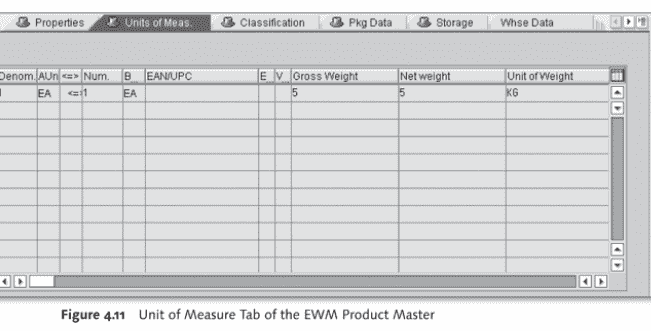

## 替代单位 (Alternate Unit)

替代单位是适用于行中所有值的度量单位。

## 分子 (Numerator)

此字段代表了从基本单位转换为替代单位时使用的分子。在 ERP 物料主数据中，它用简单的字段描述 Y 表示。

## 基单位 (Base Unit)

基单位（BASE UNIT）是存储库存和财务数据时所有交易均转换的单位。

| 示例 |
| :--- |
| 如果以“箱”为单位入库并收到了 3 箱，且每箱数量为 40 个，则将箱数乘以 40 并除以 1，以确定库存中的“个”数量（在这种情况下为 120 个）以及财务会计（FI）中的计值“个”数量。 |

## EAN/UPC

可以按单位存储材料的国际物品条码（EAN）或通用产品代码（UPC）。通常，产品替代单位（例如箱或托）的 EAN 或 UPC 可能与单个单位（或“个”）的 EAN 或 UPC 不同，这样当用扫描器扫描产品的 EAN 或 UPC 条形码时，系统可以区分两者。

## EAN 类别 (EAN Category)

如之前所述，EAN 类别与 EAN/UPC 字段相关，用于定义 EAN/UPC 代码的类别以及 EAN/UPC 是外部分配还是内部分配。请注意，在 EWM 上，EAN 类别字段不包含可能条目的下拉选择——输入应仅在 ERP 中进行。在 EWM 上提供它仅供参考。在 EWM 中，字段名在表头中完全拼出，而在 ERP 中，字段名缩写为 Ct。

## GTIN 变 (Variant GTIN)

此字段用于描述全球贸易标识码（GTIN）的变体。GTIN 变体用于通信 SAP Auto ID 基础设施（AII），以支持使用射频识别（RFID）技术的流程。该字段仅存在于 EWM 产品主数据中（即 ERP 物料主数据中不存在）。

## 毛重 (Gross Weight)

毛重是指产品按照指定的单位进行包装时，产品及其包装的总重量。

## 净重 (Net Weight)

当产品按照指定的单位进行包装时，净重通常是指产品重量（不包括包装）。例如，一箱包装了 12 个产品的净重，通常计算为产品的净重，不包括包装（外部、内部或两者都有，取决于贵机构或行业对“净重”术语的定义）。

## 重量单位 (Unit of Weight)

定义重量所在单位的字段在 EWM 产品主数据中描述为 UNIT OF WEIGHT，在 ERP 物料主数据中描述为 WEIGHT UNIT。

## 体积单位 (Unit of Volume)

定义体积所在单位的字段在 EWM 产品主数据中描述为 UNIT OF VOLUME，在 ERP 物料主数据中描述为 VOLUME UNIT。

## 容量消耗 (Capacity Consumption)

之前描述的无单位容量消耗指示器在 EWM 产品主数据的表头中显示为 CAPACITY CONSUMPTION，在 ERP 物料主数据中显示为 CAPA。

## 长度/宽度/高度 (Length/Width/Height)

使用指定的单位时，容器的长度、宽度、高度按单位存储。

## 尺寸单位 (Unit of Dimension)

尺寸单位（UNIT OF DIMENSION）适用于长度、宽度、高度。如果检查的产品或单位的尺寸单位不同，则必须确保尺寸单位是准确的。

## 注意事项 (Note)

在 EWM 中，长度、宽度和高度可用于理货（Slotting）和货位的容量确定。在理货期间，根据确定规则确定容量，该规则允许简单的尺寸检查、基于 Z 轴的旋转以及基于旋转和倾斜的维度（三维旋转以如何放入货位）。

## 最大堆叠因子 (Maximum Stacking Factor)

最大堆叠因子（MAXIMUM STACKING FACTOR）从 ERP 传输，但未用于 EWM 中的标准容量确定。然而，您可以在可用的容量确定 BAdI 中使用它，例如在入库或装载期间。该字段在 EWM 产品主数据的表头中缩写为 Max.Stack FACTOR，在 ERP 物料主数据（单位视图）中缩写为 Max.Stack。

## 嵌套剩余体积 (Remaining Volume after Nesting)

REMAIN VOLUME AFTER NEST 指定了当相同物品堆叠在其内部时剩余的体积。该值以总体积的百分比表示，并用于指定产品和单位的容量确定。这适用于可堆叠物品，如杯子、椅子、某种梯子或其他类似物品。如果没有指定值，则该物品在容量确定时不被视为嵌套。

指定嵌套后剩余体积的指示器在 EWM 产品主数据的表头中缩写为 Rem.Vol.AfterNest，在 ERP 物料主数据中缩写为 RemVolNest。

## 单位类别 (Unit of Measure Category)

用于捕重管理中并行单位确定的单位类别（UNIT OF MEASURE CATEGORY）在 EWM 产品主数据的表头中缩写为 UOM Category，在 ERP 物料主数据中缩写为 CATEGORY OF UNIT OF。

## 4.2.4 分类 (Classification)

分类（CLASSIFICATION）标签页提供了分配给配置产品的参考产品和类的相关信息。额外的分类分配（例如物料类、批次类）在此处不显示。


## 4.2.5 包装数据

产品主数据的 PKG DATA 标签页提供了与 HU（处理单元）内产品包装相关的信息。如图 4.12 所示，该视图被分为三个区域。BASIC DATA: PACK 部分包含与包装材料内部产品相关的信息，因此与仓库中的可发运货物品有关。

仓库中使用的每种包装材料也通过产品编号指定，BASIC DATA: PACKAGING MATERIAL 部分与这些包装材料相关。在某些情况下，某些产品仅允许某些包装材料，产品和包装材料的数据用于帮助确定哪些包装材料适用于哪些产品。

| 属性 | 测量单位 | 分类 | 图数据 | 存储 | 谁的数据 |
|---|---|---|---|---|--|
| 基础数据：包装 | | | | | |
| 包装组 | PG01 | | | | |
| 包装参考 | | | | | |
| 标准 HU 类型 | E1 | | | | |
| 基础数据：包装材料 | | | | | |
| 包装材料类型 | 0001 | HU 类型 | E1 | | | |
| 形式名称 | | | | | |
| PDF 表单名称 | | | | | |
| 容量 | | | | | |
| 最小重量 | 0,000 | 超额重量容差 | 0,0 % | | | |
| 皮重变量 | | | | | |
| 最大体积 | 0,000 | 超额体积容差 | 0,0 % | | | |
| 闭合包装 | | 填充水平 | 0 % | | | |
| 最大容量 | 0,000 | 超额容量容差 | 0,0 % | | | |
| 最大长度 | 0,000 | | | | | |
| 最大宽度 | 0,000 | | | | | |
| 最大高度 | 0,000 | | | | | |

图 4.12 EWM 产品主数据中的包装数据标签页

## EWM 产品主数据 | 4.2

CAPACITIES 部分也与包装材料相关，用于确定包装材料的容量，这决定了单个包装材料单元可以容纳多少个产品。

前三个部分的字段包括后续章节中描述的字段。

### 包装组

PACKING 字段用于将需要相似包装材料的材料分组。例如，液体可能需要包装在水桶或防水容器中，而危险品可能需要包装在专为防止溢出或泄漏设计的容器中。此数据从 ERP 组：PACKAGING Materials 传输到 EWM。在 EWM 中，该数据通过允许的包装类型来确定允许的包装材料。

要在 EWM IMG 中配置允许的包装组，请遵循路径：Extended Warehouse Management • Cross-Process Settings • Handling Units • Basics • Define Packing Groups for Products。这些值应与 ERP 系统中 MATERIAL GROUP: PACKAGING Materials 的允许值一致（或至少与 EWM 中将使用的值一致）。

### 包装参考产品

REF FOR PACK 字段可用于简化 EWM 中包装规格（pack specs）的确定。当 EWM 为产品确定包装规格时（例如，用于自动包装或入库时），您可以使用 REFERENCE PRODUCT FOR PACKING 仅为此参考产品维护包装规格。

例如，如果创建了产品 PROD01 并在 EWM 中维护了该产品的包装规格，您可以创建产品 PROD02 并将 PROD01 分配为包装参考产品。然后可以在 EWM 中基于参考产品设置包装规格条件记录，这将为产品 PROD02 找到产品 PROD01 的包装规格。

### 标准 HU 类型

STD HU Type 识别在包装指令不相关时，用于混合产品应使用的 HU 类型。可以通过遵循 EWM IMG 中的菜单路径 Extended Warehouse Management • CROSS-PROCESS SETTINGS • HANDLING UNITS • BASICS • DEFINE HU TYPES 来配置允许的 HU 类型。该数据从 ERP 材料主数据 WM Packaging 视图上的 STANDARD HU Type 字段传输。

### 包装材料类型

Pack.Mat.Type 识别包装材料的类型，并用于 ERP 和 EWM 中确定允许的包装材料。该字段可以在 ERP 材料主数据的 Basic Data 1 和 SALES: GENERAL/PLANT 视图中找到。您可以通过 Extended Warehouse Management • Cross-Process Settings • Handling Units • Basics • Define Material Types 路径在 EWM IMG 中配置允许的值，这些值通常应与 ERP 中相关字段的允许条目同步。

要配置允许的包装材料类型，请遵循菜单路径：Extended Warehouse Management • Cross-Process Settings • Handling Units • Basics • MAINTAIN ALLOWED Packaging Material Types For Packaging Group。

## HU 类型

HU Type 指定了当产品用作包装材料创建 HU 时使用的默认 HU 类型。可以通过遵循 EWM IMG 中的菜单路径 Extended Warehouse Management • Cross-Process Settings • Handling Units • Basics • Define HU Types 来指定允许的 HU 类型。该数据从 ERP 材料主数据 WM Packaging 视图上的 HU Type 字段传输。

### 名称

Form NAME 指定了为使用该产品作为包装材料的 HU 打印 HU 标签的 Smart Form。标签可以在包装规格中指定为辅助包装材料，然后标签将生成。

### PDF 表单名称

PDF form name 指定了为使用该产品作为包装材料的 HU 打印 HU 标签的 Smart Form。标签可以在包装规格中指定为辅助包装材料，然后标签将生成。

### 最大重量

MAX WEIGHT 指定了包装材料内可以包装的最大重量。该数据从 ERP 材料主数据 WM Packaging 视图上的 MAXIMUM WEIGHT 字段传输。

### 最大体积

MAX. VOLUME 指定了包装材料内可以包装的最大体积。该数据从 ERP 材料主数据 WM Packaging 视图上的 MAXIMUM VOLUME 字段传输。

### 闭合包装

CLOSED PACKAGING 指示器指定包装材料为闭合容器。如果设置了指示器，则总数不会超过包内材料的体积。例如，带有盖子的容器将认为视为闭合容器，无论它是空的、半满的还是满的，其体积都不会改变。相反，托盘不是闭合容器，其体积取决于包装的完整程度。CLOSED PACKAGING 指示器源自 ERP 包装材料主数据 SALES: GENERAL/PLANT 视图中的 CLOSED 指示器。

### 填充水平

FILLING LEVEL 指定了包装材料内应填充的总积的最大百分比。FILLING LEVEL 仅供参考使用，但可以在自定义事务或自定义检查中使用（例如，在 BADI 中）。

## 最大容量

MAX. CAPACITY 表示包装材料内产品可以使用的最大容量，根据 UNITS of Measure 标签页中的无单位 Capacity 指示器。该数据从 ERP 材料主数据 WM Packaging 视图上的 MAXIMUM Capacity 字段传输。

### 超额容量容差

有时，MAX CAPACITY 可能无法指定包装在 HU 内产品的绝对最大容量利用率。在这种情况下，您可以使用 EXCESS CAP TOL 指定在仓库操作员认为适当的情况下允许超过 MAX CAPACITY 的百分比容差。


来自 ERP 物料主数据 WM PACKAGING 视图上的 OVERCAPACITY TOLERANCE 字段。

## 最大长度

MAX. LENGTH（最大长度）指定了可以包装在材料内部的产品的最大长度。由于多种原因，这可能与包装材料单位的长度不同。首先，包装主数据单位视图中的长度、宽度和高度分配，可用于指示包装材料在可运输形式下的参数（例如，为了出运而处于“拆解”状态或拆卸状态的纸箱）。其次，容器内部区域的长度、宽度和高度可能与容器外部的长度、宽度和高度不同，当容器较厚时（例如塑料周转箱或运输液体的钢箱）。该数据从 ERP 物料主数据 WM PACKAGING 视图上的 MAXIMUM PACKAGING 字段传输。

## 最大宽度

MAX. WIDTH（最大宽度）指定了可以包装在材料内部的产品的最大宽度。由于上述原因，这可能与包装材料单位的长度不同。数据从 ERP 物料主数据 WM PACKAGING 视图上的 MAXIMUM PACKAGING WIDTH 字段传输。

## 最大高度

MAX. HEIGHT（最大高度）指定了可以包装在材料内部的产品的最大高度。由于上述原因，这可能与包装材料单位的长度不同。数据从 ERP 物料主数据 WM PACKAGING 视图上的 MAXIMUM HEIGHT 字段传输。

## 最大包装长度/宽度/高度的单位

UNIT OF MEASURE（单位）字段（见图 4.12 MAX. HEIGHT 字段右侧）适用于 MAX. LENGTH、MAX. WIDTH 和 MAX. HEIGHT 字段。数据从 ERP 物料主数据 WM PACKAGING 视图上类似的 UNIT OF MEASURE 字段传输。

## 4.2.6 存储

存储（Storage）选项卡（如图 4.13 所示）提供了如何存储产品的信息，包括分组信息、序列号配置文件、重信息以及危险或危险材料数据。存储选项卡的字段将在下面的章节中进行描述。

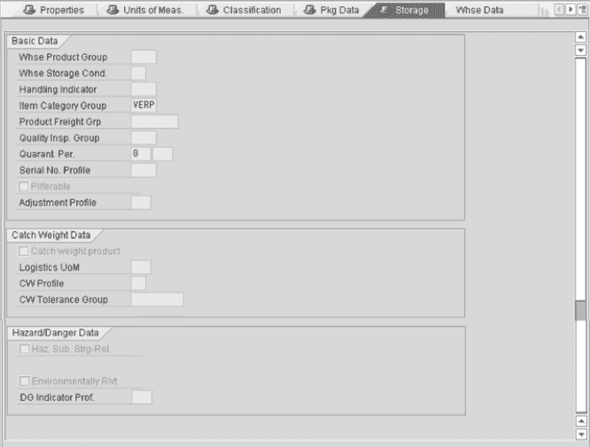

图 4.13 EWM 产品组视图

## 仓库产品组

WH PRODUCT GROUP（仓库产品组）用于将物料分组，以确定仓库中的某些流程。特别是，WHSE PRODUCT GROUP（仓库产品组）用于包装规范的存在性检查确定（表 /SCWM/TPSMGR），也用于固定货位分配的删除指示确定（表 /SCWM/TFBIN_UNAS）。若要在 EWM IMG 中指定固定货位分配的删除指示的确定，请遵循菜单路径：Extended Warehouse Management • GOODS Receipt PROCESS • STRATEGIES • DELETE FIXED BIN ASSIGNMENT。若要在 EWM IMG 中为 WISE PRODUCT Group 创建可能的条目，请遵循菜单路径：Extended Warehouse Management • MASTER DATA • PRODUCT • DEFINE Warehouse Product Group。

## 仓库存储条件

Warehouse Storage Cond.（仓库存储条件）用于指定产品必须在某些条件下存储（例如：干燥、凉爽、冷冻室）。若要在 EWM IMG 中创建可能的条目，请遵循菜单路径：Extended Warehouse Management • MASTER DATA • PRODUCT • DEFINE Storage Condition。该数据从 ERP 物料主数据 WM Execution 视图上的 Warehouse Storage Condition 字段传输。

## 处理指示

Handling Indicator（处理指示）用于确定产品从一个位置移动到另一个位置时应如何处理（例如：易碎、无夹具）。若要在 EWM IMG 中指定 Handling Indicator 的可能条目，请遵循菜单路径：Extended Warehouse Management • MASTER DATA • PRODUCT • DEFINE HANDLING INDICATOR。该数据从 ERP 物料主数据 WM Execution 视图上的 Handling Indicator 字段传输。

## 项目类别组

Item Category Group（项目类别组）采纳自 ERP 物料主数据 Basic Data 1 视图上的 General Item Category Group 字段。它不包含对 EWM 中可能条目的检查，也不用于 EWM 中的任何特定目的。它在产品主数据中提供仅供参考目的（或供 BAdIs 或其他自定义代码使用）。

## 产品运费组

Product Freight GRP（产品运费组）用于在运单订单管理中确定适当的运费代码和运单类别。若要在 EWM IMG 中为 Product Freight GRP 创建可能的条目，请遵循菜单路径：Extended Warehouse Management • GOODS ISSUE PROCESS • TRANSPORTATION MANAGEMENT • BASICS • DEFINE Product Freight Groups。

## 检验组

Quality INSP. GROUP（质量检验组）可将物料分组，以确定质量检验的相关性。若要在 EWM IMG 中为 QUALITY-INSP. GROUP 创建可能的条目，请遵循菜单路径：Extended Warehouse MANAGEMENT • CROSS-PROCESS SETTINGS • QUALITY MANAGEMENT • SETTINGS FOR INSPECTION RULES • DEFINE QUALITY INSPECTION GROUP。

Quality INSP. GROUP 也用于计数值区间的确定，可以通过 EWM IMG 中的菜单路径：Extended Warehouse MANAGEMENT • CROSS-PROCESS SETTINGS • QUALITY MANAGEMENT • SETTINGS FOR INSPECTION RULES • MAINTAIN VALUE INTERVAL FOR COUNTING 访问。它还用于指定检验性库存被禁止的货物移动，可以通过 EWM IMG 中的菜单路径：Extended Warehouse MANAGEMENT • CROSS-PROCESS SETTINGS • QUALITY MANAGEMENT • FORBID GOODS MOVEMENTS OF INSPECTION STOCKS 访问。

## 隔离期

QUANT. PERIOD（隔离期）是产品在发货之前必须在仓库中停留的时间。这对于需要隔离期但未按批次管理的产品特别有用。对于按批次管理的产品，批管理通常是一种更稳健的方法。数量右侧的字段（如图 4.13 所示）是隔离期的单位（例如：天、周）。

## 序列号配置文件

SERIAL. PROFILE（序列号配置文件）用于指定如何在仓库中管理序列号（我们将在第 6 章进一步讨论序列号）。SERIAL. PROFILE 派自 GENERAL DATA/STORAGE 2 视图上的 Serial Number Profile 字段。若要在 EWM IMG 中为 Serial Number Profile 创建可能的条目，请遵循菜单路径：Extended Warehouse Management • MASTER DATA • PRODUCT • DEFINE NUMBER PROFILES (SIC) • DEFINE WAREHOUSE NUMBER-INDEPENDENT NUMBER PROFILES。

你也可以通过菜单路径 Extended Warehouse Management • MASTER DATA • PRODUCT • DEFINE NUMBER PROFILES (SIC) • DEFINE WAREHOUSE-DEPENDENT NUMBER PROFILES 为配置文件指定依赖于仓库的设置，但必须先在仓库无关的章节中设置配置文件。

## 易盗性

PILFER（防盗）指示用于指示被盗窃概率较高（损耗或盗窃）的物料。目前未用于任何入库策略的确定，但可以在可用 BAdIs 中确定相关的入库策略、区域或货位。

## 调整配置文件

ADJUSTMENT PROFILE（调整配置文件）用于商品配送（一种零售行业使用的特定越库功能，将在第 17 章越库中描述）定义如何将入库产品分配到出库订单。若要在 EWM-IMG 中创建调整配置文件，请遵循菜单路径：Extended Warehouse Management • CROSS-PROCESS SETTINGS • CROSS-DOCKING (CD) • PLANNED CROSS-DOCKING • MERCHANDISE DISTRIBUTION • DEFINE ADJUSTMENT PROFILE。注意，HOUSE DATA 选项卡上也有 ADJUSTMENT PROFILE 字段，它在仓库级别是相关的（它们使用相同的配置节点，创建可能的条目）。如果在产品级别设置了调整配置文件，则数据也应位于 ERP 文章主数据的调整配置文件 (MARA-ADPROF) 中，然后它将适用于所有仓库。

## 重量产品

CATCH WEIGHT PRODUCT（重量产品）指示器用于确保使用重量进行管理产品。该指示器派自 ERP 物料主数据 WM EXECUTION 视图上的 CATCH WEIGHT RELEVANT 字段。

## 物流单位

LOGISTICS UOM（物流单位）是用于在仓库中移动重计划产品的单位。它与用于 ERP 中物料估值的基础单位是分开的。对于重计划产品，所有


交易必须同时按基础单位和物流单位输入。它也派生自 ERP 物料主数据的 WM 执行（WM Execution）视图。

# 捕重配置 (Catch Weight Profile)

CW PROFILE 规定了对于捕重管理产品如何输入数量。要在 EWM IMG 中创建捕重配置的可能条目，请遵循菜单路径：扩展仓库管理 • 主数据 • 产品 • 捕重 • 为捕重数量定义捕重配置（DEFINE CATCH WEIGHT PROFILE FOR CATCH WEIGHT Quantities）。该字段派生自物料主数据 WM 执行视图中的“用于捕重数量的配置”。

# 捕重容差组 (Catch Weight Tolerance Group)

CW Tolerance 指定了在计划捕重转换值上下允许的容差，系统在提供警告消息或错误消息之前允许这些容差（警告和错误消息提供了不同的值）。要在 EWM IMG 中创建捕重容差组的可能取值，请遵循菜单路径：扩展仓库管理 • 主数据 • 产品 • 捕重 • 定义捕重容差组（DEFINE CATCH WEIGHT TOLERANCE GROUPS）。

# 危险物质储运相关 (Hazardous Substance Storage-Relevant)

HAZ. SUB. STR-REL 指示器允许指示系统读取危险物质数据，以确定与在仓库存储产品相关的额外数据。我们将在第 23 章“与其他 SAP 应用集成”中讨论危险物质数据的存储方式。该字段派生自 ERP 物料主数据 WM 执行视图上的“危险物质相关”指示器。

# 环境相关 (Environmentally Relevant)

ENVIRONMENTALLY RLVT 指示器指定产品对环境具有潜在影响。

# 危险品指示器配置 (Dangerous Goods Indicator Profile)

DG INDICATOR PROF. 指定产品是否与某些危险品过程、检查和文档相关。它传输自 ERP 物料主数据基础数据 2 视图的危险品配置（该字段仅适用于某些物料类型）。

# 4.2.7 仓库数据 (Warehouse Data)

WHSE DATA 标签（如图 4.14 所示）提供了与仓库存储产品相关的信息，包括与过程相关的参数、周期计数指示器、上架和删除控制指示。WHSE DATA 标签的字段将在后续章节中描述。

| 单位 | 分类 | 包装数据 | 存储 | 仓库数据 | 槽位规划 | 存储类型 |
|---|---|---|---|---|---|---|
| 普通数据 | | | | | | |
| 过程区块配置 | | | | | | | |
| 过程类型确定 | | | | | Fix | | |
| 产品负载类别 | | | | | | | |
| 周期计数指示器 | | | | | | | |
| 最小货架期 | | | | | | | |
| 基础出库 | | 无反冲出库 | | | | |
| 关联固定 | | 数量关联未固定 | | | | |
| 消费相关 VAS | | | | | | | |
| 文档批次 | | | | | | | |
| 调整配置 | | | | | | | |
| 保护 C (商品 D) | | | | | | | |
| 上架 | | | | | | | |
| 上架控制指示器 | | | | | Fix | | |
| 计划上架控制指示器 | | | | | | | |
| 存储区域指示器 | | | | | | | |
| 存储位类型 | | | | | | | |
| 散货存储 | | | | | | | |
| 删除 | | | | | | | | |
| 删除控制指示器 | | | | | Fix | | |
| 计划删除 ID | | | | | | | | |
| 特性确定组 | | | | | | | |
| 两步拣货 | | | | | | | | |
| 暂存区/门口/操作 | | | | | | | | |

图 4.14 EWM 物料主数据的仓库数据视图

# 过程区块配置 (Process Block Profile)

PROCESS BLOCK PROF 允许在执行某些仓库过程（例如：仓库任务创建或确认、发货、收货、盘点）时触发警告或错误消息。要在 EWM IMG 中创建过程区块配置的可能条目，请遵循菜单路径：扩展仓库管理 • 主数据 • 产品 • 定义过程区块配置（DEFINE PROCESS BLOCK PROFILE）。

# 过程类型确定指示器 (Process Type Determination Indicator)

PROC TYPE DET. IND. 用于确定仓库活动相关的过程类型。要在 EWM IMG 中创建过程类型确定指示器的可能条目，请遵循菜单路径：扩展仓库管理 • 跨过程设置 • 仓库任务 • 定义确定过程类型的控制指示器（DEFINE CONTROL INDICATORS FOR DETERMINING WAREHOUSE PROCESS TYPES）。要在 EWM IMG 中根据过程类型确定指示器确定过程类型，请遵循菜单路径：扩展仓库管理 • 跨过程设置 • 仓库任务 • 定义确定过程类型的控制指示器。

# 产品负载类别 (Product Load Category)

PROD LOAD CATEGORY 用于确定涉及产品活动的劳动力管理（LM）工作量（将在第 21 章“劳动力管理”中讨论）。要在 EWM IMG 中指定产品负载类别的允许条目，请遵循菜单路径：扩展仓库管理 • 跨过程设置 • 仓库任务 • 定义精确时间确定 • 定义产品负载类别（DEFINE PRODUCT LOAD CATEGORIES）。要在 EWM IMG 中从产品负载类别确定工作量，请遵循菜单路径：扩展仓库管理 • 跨过程设置 • 仓库任务 • 定义精确时间确定 • 定义精确时间计算（DEFINE EXACT TIME CALCULATION）。

# 周期计数指示器 (Cycle Count Indicator)

CYCLE COUNT INDICATOR（周期计数指示器）用于确定仓库中周期计数频率。要在 EWM IMG 中创建周期计数指示器的可能条目，请遵循菜单路径：扩展仓库管理 • 跨过程设置 • 仓库任务 • 定义确定过程类型的控制指示器。要在 EWM IMG 中根据过程类型确定指示器确定过程类型，请遵循菜单路径：扩展仓库管理 • 跨过程设置 • 仓库任务 • 定义确定过程类型的控制指示器（注：此处原文中两个路径描述有重复，已按样翻译）。

（此处根据原文逻辑，由于描述存在重复，已完整翻译）... 翻译内容省略... 危险 物质 储运相关指示器（此处根据原文逻辑，已翻译内容）。该字段派生自 ERP 物料主数据 WM 执行视图上的“危险物质相关”指示器。

# 环境相关 (Environmentally Relevant)

ENVIRONMENTALLY RLVT 指示器指定产品对环境具有潜在影响。

# 危险品指示器配置 (Dangerous Goods Indicator Profile)

DG INDICATOR PROF. 指定产品是否与某些危险品过程、检查和文档相关。它传输自 ERP 物料主数据基础数据 2 视图的危险品配置（该字段仅适用于某些物料类型）。

# 4.2.7 仓库数据 (Warehouse Data)

WHSE DATA 标签（如图 4.14 所示）提供了与仓库存储产品相关的信息，包括与过程相关的参数、周期计数指示器、上架和删除控制指示。WHSE DATA 标签的字段将在后续章节中描述。

（此处表格部分保持格式并翻译内容）

| 单位 | 分类 | 包装数据 | 存储 | 仓库数据 | 槽位规划 | 存储类型 |
|---|---|---|---|---|---|---|
| 普通数据 | | | | | | |
| 过程区块配置 | | | | | | | |
| 过程类型确定 | | | | | Fix | | |
| 产品负载类别 | | | | | | | |
| 周期计数指示器 | | | | | | | | |
| 最小货架期 | | | | | | | | |
| 基础出库 | | 无反冲出库 | | | | | |
| 关联固定 | | 数量关联未固定 | | | | | |
| 消费相关 VAS | | | | | | | | |
| 文档批次 | | | | | | | |
| 调整配置 | | | | | | | | |
| 保护 C (商品 D) | | | | | | | | |
| 上架 | | | | | | | | |
| 上架控制指示器 | | | | | Fix | | | |
| 计划上架控制指示器 | | | | | | | | |
| 存储区域指示器 | | | | | | | | |
| 存储位类型 | | | | | | | | |
| 散货存储 | | | | | | | | |
| 删除 | | | | | | | | |
| 删除控制指示器 | | | | | Fix | | | |
| 计划删除 ID | | | | | | | | |
| 特性确定组 | | | | | | | | |
| 两步拣货 | | | | | | | | | |
| 暂存区/门口/操作 | | | | | | | | | |

图 4.14 EWM 物料主数据的仓库数据视图

# 过程区块配置 (Process Block Profile)

PROCESS BLOCK PROF 允许在执行某些仓库过程（例如：仓库任务创建或确认、发货、收货、盘点）时触发警告或错误消息。要在 EWM IMG 中创建过程区块配置的可能条目，请遵循菜单路径：扩展仓库管理 • 主数据 • 产品 • 定义过程区块配置（DEFINE PROCESS BLOCK PROFILE）。

# 过程类型确定指示器 (Process Type Determination Indicator)

PROC TYPE DET. IND. 用于确定仓库活动相关的过程类型。要在 EWM IMG 中创建过程类型确定指示器的可能条目，请遵循菜单路径：扩展仓库管理 • 跨过程设置 • 仓库任务 • 定义确定过程类型的控制指示器（DEFINE CONTROL INDICATORS FOR DETERMINING WAREHOUSE PROCESS TYPES）。要在 EWM IMG 中根据过程类型确定指示器确定过程类型，请遵循菜单路径：扩展仓库管理 • 跨过程设置 • 仓库任务 • 定义确定过程类型的控制指示器。

# 产品负载类别 (Product Load Category)

PROD LOAD CATEGORY 用于确定涉及产品活动的劳动力管理（LM）工作量（将在第 21 章“劳动力管理”中讨论）。要在 EWM IMG 中指定产品负载类别的允许条目，请遵循菜单路径：扩展仓库管理 • 跨过程设置 • 仓库任务 • 定义精确时间确定 • 定义产品负载类别（DEFINE PRODUCT LOAD CATEGORIES）。要在 EWM IMG 中从产品负载类别确定工作量，请遵循菜单路径：扩展仓库管理 • 跨过程设置 • 仓库任务 • 定义精确时间确定 • 定义精确时间计算（DEFINE EXACT TIME CALCULATION）。

# 周期计数指示器 (Cycle Count Indicator)

CYCLE COUNT INDICATOR（周期计数指示器）用于确定仓库中周期计数频率。要在 EWM IMG 中创建周期计数指示器的可能条目，请遵循菜单路径：扩展仓库管理 • 跨过程设置 • 仓库任务 • 定义确定过程类型的控制指示器。要在 EWM IMG 中根据过程类型确定指示器确定过程类型，请遵循菜单路径：扩展仓库管理 • 跨过程设置 • 仓库任务 • 定义确定过程类型的控制指示器。

（此处根据原文逻辑，由于描述存在重复，已翻译内容）... 翻译内容省略... 危险 物质 储运相关指示器（此处根据原文逻辑，已翻译内容）。该字段派生自 ERP 物料主数据 WM 执行视图上的“危险物质相关”指示器。

# 环境相关 (Environmentally Relevant)

ENVIRONMENTALLY RLVT 指示器指定产品对环境具有潜在影响。

# 危险品指示器配置 (Dangerous Goods Indicator Profile)

DG INDICATOR PROF. 指定产品是否与某些危险品过程、检查和文档相关。它传输自 ERP 物料主数据基础数据 2 视图的危险品配置（该字段仅适用于某些物料类型）。

# 4.2.7 仓库数据 (Warehouse Data)

WHSE DATA 标签（如图 4.14 所示）提供了与仓库存储产品相关的信息，包括与过程相关的参数、周期计数指示器、上架和删除控制指示。WHSE DATA 标签的字段将在后续章节中描述。

（此处表格部分保持格式并翻译内容）

（表格已在上文翻译）

## 最小货架期 (Required Minimum Shelf Life)

REQD Min. Shelf Life 决定了收货期间产品所需的剩余寿命天数（将在第 9 章中讨论）。

## 反冲出库 (Backflush Withdrawal)

BACKFL. Withdrawal 指示器用于生产供应流程，指定在订单确认时进行反冲。

## 关联固定 (Correlation Fix)

Correlation Fix 指示器定义了订单上的项目数量是否固定到增值服务（VAS）订单。如果数量关联固定，则抬头数量将自动调整。有两种可能的取值——表示数量关联固定，另一种表示未固定（留空）。

# 消费相关 VAS (Consumption-Relevant-VAS)

CONSUM-REL. VAS 勾选框用于辅助产品（我们将在第 19 章“增值服务”中讨论），指示在 VAS 执行期间应消耗辅助产品。

## 文档批次 (Documentary Batch)

DOCUMENTARY Batch 字段用于指示是否使用批次跟踪，允许在收货或发货时捕捉批次。我们将在第 6 章中进一步讨论文档批次。

## 调整配置 (Adjustment Profile)

ADJUST PROFILE 用于商品配送（一种越库功能，将在第 17 章中描述）定义如何将入库产品分配到出库订单。要在 EWM IMG 中创建调整配置，请遵循菜单路径：扩展仓库管理 • 跨过程设置 • 越库 (CD) • 计划越库 • 商品配送 • 定义调整配置（DEFINE ADJUSTMENT PROFILE）。注意，存储标签上也有一个 ADJUSTMENT PROFILE 字段，它在产品级别相关（并且它们使用相同的字段帮助，因此使用相同的配置节点）。如果调整配置在仓库级别设置，它将仅按仓库生效。

## 数量分类 (Quantity Classification for Merchandise Distribution)

Quant CLAS (Merch D) 字段用于商品配送，确定以什么数量处理产品（例如：件、箱、托盘）。

# 上架控制指示器 (Putaway Control Indicator)

Putaway Control IND. 用于指定如何在仓库中上架产品。具体而言，它用于在上架策略的存储类型确定期间确定顺序指示器（将在第 9 章中进一步描述）。要在 EWM IMG 中创建上架控制指示器的可能条目，请遵循菜单路径：扩展仓库管理 • 收货过程 • 槽位规划 • 主数据。


## EWM 入库控制指示主 | 4.2

定义入库控制指示。要使用入库控制指示来确定库位搜索序列，请在 EWM IMG 中按照以下菜单路径操作：扩展仓库管理 • 收货流程 • 策略 • 库位 • 为入库指定库位搜索序列。

该指示右侧的 **Fix（固定）** 复选框用于指示入库控制指示是固定的，不应被位优（Slotting）功能自动更改。如果未设置 FIX 指示，则可以在位优期间对入库控制指示进行评估。

## 计划入库控制指示

如果在执行位优程序时使用了“保存结果”选项，则会设置**计划入库控制指示（PLANNED PUTAWAY CTRL IND.）**。在这种情况下，数据保存在 `PLANNED...` 字段中，直到激活位优运行。一旦激活位优运行，计划入库控制指示数据将移动到激活的入库控制指示字段，计划字段将被清空。

## 库区指示

**库区指示（STORAGE SECTION INDIC）** 用于在入库库位确定期间确定相关的库区。在 EWM IMG 中为库区指示创建可能的条目，请按照菜单路径操作：扩展仓库管理 • 收货流程 • 策略 • 库区搜索 • 创建库区指示。要检查库区指示在入库库位确定期间如何使用，请在 EWM IMG 中按照菜单路径操作：扩展仓库管理 • 收货流程 • 策略 • 维护库区搜索序列。

> 注意
> 在“仓库数据”和“库位类型”视图可以找到库区指示。如果在相关库位类型的“库位类型数据”视图发现了库区指示，则该库区指示将用于库位确定。如果没有，则使用在“仓库数据”视图上的指示。同样，位优期间确定的库区指示只影响库位类型数据视图而不影响仓库数据视图（因此，您可以在仓库数据视图中手动指定默认库区指示，而不会影响位优期间确定的结果）。

## 库位类型

**库位类型（Storage BIN TYPE）** 指示器用于在未找到与仓库“库位类型”视图上指定的最佳库位类型匹配的库位时，为入库库位确定确定相关的库位类型。在 EWM IMG 中为库位类型创建可能的条目，请按照菜单路径操作：扩展仓库管理 • 收货流程 • 策略 • 库位确定 • 定义库位类型。要检查库位类型在入库库位确定期间如何使用，请在 EWM IMG 中按照菜单路径操作：扩展仓库管理 • 收货流程 • 策略 • 库位确定 • 替代库位类型序列。

> 注意
> 关于库区指示的注释也适用于库位类型指示器。如果如前所述在 IMG 节点中未指定替代库位类型序列，则在库位类型搜索期间只能找到指定的最佳库位类型的库位。最后，此配置仅适用于未使用 HU 类型来确定相关库位类型序列的情况。

## 大件存储指示

大件存储库位通常是地面存储库位（即没有货架的），可以存放多个产品的多个单位（通常是托盘或大型存储容器）。**大件存储指示（Bulk STORAGE IND.）**用于指定产品在大件存储库位中如何堆叠。特别地，大件存储指示决定了库位中可以存储多少个托盘（由分配给物料的大件存储指示和分配给库位的库位类型共同决定）。要在 EWM IMG 中为大件存储指示指定可能的条目，请按照菜单路径操作：扩展仓库管理 • 收货流程 • 策略 • 入库规则 • 存储行为：大件存储 • 定义大件存储指示。要检查如何使用大件存储指示来确定库位可以容纳多少个单位，请在 EWM IMG 中按照菜单路径操作：扩展仓库管理 • 收货流程 • 策略 • 入库规则 • 存储行为：大件存储 • 定义大件结构。

## 出货控制指示

**出货控制指示（STK RMVL. CTRL）**用于指定在仓库中应该拣哪些产品。具体而言，它用于在拣货策略的库位确定期间确定搜索序列指示（这将在第10章“出库处理”中进一步详细描述）。要在 EWM IMG 中创建出货控制指示的可能条目，请按照菜单路径操作：扩展仓库管理 • 出货流程 • 策略 • 定义出货控制指示。要使用出货控制指示确定库位搜索序列，请在 EWM IMG 中按照菜单路径操作：扩展仓库管理 • 出货流程 • 策略 • 为出货确定库位搜索序列。为了优化选择库位搜索序列的访问策略（即指定在确定时按什么顺序使用哪些字段），请在 EWM IMG 中按照菜单路径操作：扩展仓库管理 • 出货流程 • 库位类型确定的访问策略优化。

出货控制指示右侧的 **Fix（固定）** 复选框用于指示出货控制指示是固定的，不应被位优功能自动更改。如果未设置 Fix，则可以在位优期间对出货控制指示进行评估。

## 计划出货 ID

如果在执行位优程序时使用了“保存结果”选项，则会设置**计划出货 ID（PLANNED STOCK REMVL ID）**。在这种情况下，数据保存在 `PLANNED...` 字段中，直到激活位优运行。一旦激活位优运行，计划出货 ID 将移动到激活的 `STK RMVL` 字段，计划字段将被清空。

## 货物确定组

**库存确定组（Stock Determination Group）**是用于在特定过程中确定仓库中库存的相关性和相对优先级的方法。您可以根据库存所有权、库存类型和流程类型，确定何时应使用特定类型或属于特定所有者的库存。例如，您可以确定外协库存的拣货相对顺序，或者将质量库存包含在补货活动中但不允许其被拣货。库存确定组允许您对货物进行分组以便库存确定。要在 EWM IMG 中为库存确定组指定允许的条目，请按照菜单路径操作：扩展仓库管理 • 跨流程设置 • 库存确定 • 维护库存确定。要检查库存确定组在库存确定中的如何使用，请在 EWM IMG 中按照菜单路径操作：扩展仓库管理 • 跨流程设置 • 配置库存确定。

## 两步拣货

两步拣货是合并需求（例如在波次中）、将合并的库存数量从源库位移至合并区域，然后将其拆分到各个需求的过程。EWM 产品主数据中的**两步拣货**指示用于指定哪些物料适用于两步拣货方法。如果指示设置为 2，则该产品适用于两步拣货。如果指示为空，则该产品不适用于两步拣货。

## 暂存区/码头确定组

**暂存区/码头确定组（StagArea/DoorDet.Grp）**用于在装卸过程中确定暂存区或码头。要在 EWM IMG 中为暂存区/码头确定组指定可能的条目，请按照菜单路径操作：扩展仓库管理 • 主数据 • 暂存区 • 定义暂存区和码头确定组。要在 EWM IMG 中将暂存区/码头确定组分配给码头，请按照菜单路径操作：扩展仓库管理 • 主数据 • 码头 • 将暂存区/码头确定组分配给码头。

要在入库接收的暂存区和码头确定中使用暂存区/码头确定组，请在 EWM 访问菜单中按照路径操作：扩展仓库管理 • 设置 • 收发货 • 暂存区和码头确定（入库），或使用事务代码 `/SCWM/STATET_IN`。要在出货发运的暂存区和码头确定中使用暂存区/码头确定组，请在 EWM 访问菜单中按照路径操作：扩展仓库管理 • 设置。


发货与收货 • 暂存区和门口确定（出库）菜单路径，或使用事务代码 `/SCWM/STADET_OUT`。要指定暂存区和门口的访问序列，在 EWM 易访问菜单中，遵循扩展仓库管理 • 设置 • 发货与收货 • 暂存区和门口的访问序列菜单路径，或使用事务代码 `/SCWM/STADET_ASS`。

## 4.2.8 位规划 (Slotting)

位规划页签（如图 4.15 所示）包含与产品位位规划相关的信息（将在第 9 章中进一步讨论），包括状态、需求数据以及与产品尺寸相关的指标。位规划页签中的字段将在后续章节中描述。

| 计量单位 | 分类 | 包装数据 | 存储 | 仓库数据 | 位规划 | 存储类型 |
|---|---|---|---|---|---|---|
| 通用数据 | | | | | | |
| 位规划状态 | | | | | | |
| 上次位规划运行时间 | | | | 仓库时区 | | |
| 要求/需求数据 | | | | | | | |
| 需求量 | 0,000 | | | | [ ] 固定 | | |
| 销售订单行目 | 0,000 | | | | [ ] 固定 | | |
| 建议存储数量 | 0,000 | | | | [ ] 固定 | | |
| 请求计算最大数量/存储类型 | | | | | | | |
| 尺寸数据 | | | | | | | |
| 尺寸比例 | 0,00 | | | | | | |
| 重量指标 | | | | | [ ] 固定 | | |
| 体积指标 | | | | | [ ] 固定 | | |
| 长度指标 | | | | | [ ] 固定 | | |
| 宽度指标 | | | | | [ ] 固定 | | |
| 高度指标 | | | | | [ ] 固定 | | |

图 4.15 EWM 产品主数据中的位规划页签

> 注意：字段右侧的“固定”标志通常表示该数据是固定的，不应在位规划期间更新。

### 位规划状态

SLOTTING 指标指定位规划的当前状态，以及是否可以重新评估位规划（或是否允许重新规划）。可能的值包括：

- 产品尚未位规划/允许位规划
- 产品尚未位规划/不允许位规划
- 产品已位规划/允许重新规划
- 产品已位规划/不允许重新规划

### 上次位规划运行时间

此只读指标指定了上一次执行位规划运行的日期和时间。

### 需求量

DEMAND QUANTITY 字段在位规划运行期间使用，用于确定在给定时间段内必须从仓库发货的总数量。它可以存储在 EWM 产品主数据中并从其读取，也可以在位规划运行期间直接从 APO 读取（如果在位规划运行选择中适当指定了参数，则可以在位规划运行期间将其存储在 EWM 产品主数据中）。

### 销售订单行目

SALES ORDER ITEMS 字段在位规划运行期间使用，用于确定在给定时间段内从仓库发货的销售订单行总数。它可以存储在 EWM 产品主数据中并从其读取，也可以在位规划运行期间直接从 APO 读取（如果在位规划运行选择中适当指定了参数，则可以在位规划运行期间将其存储在 EWM 产品主数据中）。

### 建议存储数量

RECOMM. STORAGE Qty 字段在位规划运行期间使用，用于确定产品在给定仓库内的建议存储数量。它可以存储在 EWM 产品主数据中并从其读取，也可以在位规划运行期间直接从 APO 读取（如果在位规划运行选择中适当指定了参数，则可以在位规划运行期间将其存储在 EWM 产品主数据中）。

### 请求计算存储类型中的最大数量

此指标用于确定在位规划运行期间确定存储类型中最大数量时使用的字段（这是存储在产品主数据存储类型视图上的参数）。可能的值包括：

- 需求量
- 订单行数
- 建议仓库库存

## 尺寸

DIMENSION RATIO 用于货位确定（包含尺寸检查的货位）。如果长度、宽度和高度之间计算出的比例超过了分配给产品的尺寸比例，则不允许计算该比例的方向。有关货位确定的更多信息，请参阅第 9 章。

### 重量/体积/长度/宽度/高度指标

这些指标用于根据重量、体积、宽度和高度对产品进行分组。它们可以在位规划期间确定，并可用于入库货位确定期间的位类型确定。

## 4.2.9 存储类型数据

EWM 产品主数据中的 STORAGE 视图（如图 4.16 所示）包含与从指定存储类型放置和移除库存有关的信息。注意，一个产品可能有多个存储类型。如果是这样，多个存储类型将显示在 STORAGE TYPES 视图的左窗中。要创建新的存储类型视图，在更改模式下，选择 CREATE 图标（在 4.16 中圈出），在屏幕上输入数据，然后点击 ADOPT DATA 按钮（CREATE 按钮左侧）。要更改特定存储类型的数据，只需在左窗中选择该存储类型。

存储类型视图上的字段将在后续章节中描述。

> 注意：字段右侧的“固定”标志通常表示该数据是固定的，不应在位规划期间更新。

### 存储类型

TYPE 字段指示适用于哪个存储类型。可以通过点击 CREATE 按钮（如图 4.16 所示）、在屏幕上输入存储类型和其他相关数据，然后点击屏幕顶部的 ADOPT 为存储类型创建新数据。一旦创建了存储类型数据，该存储类型将显示在左侧的列表中。要显示或更改与存储类型相关的数据，只需单击该存储类型。


图 4.16 存储类型视图。注意，创建按钮仅在更改模式下激活。

### 存储区域指示

STOR. SECT.INDIC 用于将产品组分配到存储搜索序列，该序列反过来用于确定入库区域搜索期间使用的存储区域序列。要在 EWM IMG 中为 STORAGE SECTION INDICATOR 创建可能的输入，遵循路径扩展仓库管理 • 收货与发货 • 策略 • 存储搜索 • 存储指示。要检查 EWM IMG 中分配给每个存储类型的存储搜索序列和存储区域指示，遵循路径扩展仓库管理 • 收货与发货 • 策略 • 存储搜索 • 维护存储搜索序列。最后，要在 EWM IMG 中指定哪些存储类型适用于存储区域确定和存储区域检查，遵循路径扩展仓库管理 • 收货与发货 • 策略 • 存储搜索 • 存储区域检查。我们在第 9 章讨论入库策略时将进一步讨论 STORAGE SECTION INDICATOR。

> 注意如前所述，STORAGE SECTION INDICATOR 位于 Warehouse DATA 和 STORAGE TYPE 视图中。详细信息请参阅之前的注释。

### 计划存储区域指示

PL STOR SECT.IND. 是在执行位规划程序期间使用保存结果选项时设置的值。在这种情况下，数据被存储在计划字段中，直到位规划运行激活。一旦激活位规划运行，PLANNED STORAGE SECTION INDICATOR 数据将移动到活动的 STORAGE SECTION INDICATOR 字段中，计划字段将被清除。

### 货位类型

STOR BIN TYPE 指标用于在入库货位确定期间，如果没有找到与 Warehouse 视图中指定的最佳货位类型匹配的货位，则确定用于入库的相关货位类型。要在 EWM IMG 中为 STOR. BIN TYPE 创建可能的输入，遵循路径扩展仓库管理 • 收货与发货 • 策略 • 货位确定 • 定义货位类型。


路径 扩展仓库管理 • 收货流程 • 策略
• 储位确定 • 备用储位类型序列。

> 注意
> 关于存储区域类型分段指示器（STORAGE SECTION INDICATOR）的注释也适用于储位类型（STORAGE BIN TYPE）指示器。此外，如果如前未在 IMG 节点中指定备用储位类型序列，则在储位类型搜索期间只能找到指定的最佳储位类型的储位。最后，此配置仅适用于 HU 类型未被用于确定相关储位类型序列的情况。

## 计划储位类型

计划储位类型（PLANNED STORAGE BIN TYPE）指示器是在执行位优化程序期间如果使用了“保存结果”选项，则在位优化（slotting）期间设置的值。在这种情况下，数据将保存在 PLANNED...... 字段中，直到启动位优化运行。一旦启动位优化运行，计划储位类型指示器将移动到激活储位类型（STORAGE BIN TYPE）字段，且计划字段将被清空。

## 最大储位数量

“最大储位数量”（Max. NO. Bins）字段指定了在指定的存储类型内应分配的最大固定拣货储位数量。它可以手动指定，也可以在执行位优化期间进行确定。

## 计划最大储位数量

计划最大储位数量（PL. MAX. BINS）指示器是在执行位优化程序期间如果使用了“保存结果”选项，则在位优化期间设置的值。在这种情况下，数据将保存在 PLANNED... 字段中，直到启动位优化运行。一旦启动位优化运行，计划最大储位数量（PLANNED MAXIMUM NUMBER OF BINS）指示器将移动到激活的最大储位数量（MAXIMUM NUMBER OF BINS）字段，且计划字段将被清空。

## 空储位搜索

空储位搜索（EMP. STORBIN SCH）指定了当入库储位搜索确定在指定的存储类型内应找到一个空储位时使用的排序规则（例如，如果在 EWM IMG 中为存储类型分配了“向现有库存/空储位添加空位”入库规则）。空储位搜索的可能条目包括：

- 根据定义排序：根据入库储位排序（事务代码/SCWM/SBST）对储位进行排序。

- 靠近固定储位：
系统尝试将产品放置在尽可能靠近固定储位的空储位中。

- 产品决定：
此选项用于在存储类型级别指定规则——如果您为存储类型指定的储位搜索规则是“产品决定”的，那么在产品上，您应该指定上述规则之一。

## 阈值添加


如果激活了“入库期间拆分”（SPLIT DURING PUTAWAY），则会检查“阈值添加”（THRESHOLD ADD）参数。在这种情况下，只有当储位的可用容量超过阈值添加指示器时，库存才会添加到储位中（因此拆分也可能发生）。因此，您使用阈值添加指示器是为了确保系统不会让操作人员操作多个储位来填充较小的可用容量。

入库期间拆分（SPLIT DURING PUTAWAY）可以通过两种方式之一激活。将 IMG 中存储类型配置设置中的入库期间拆分指示器设置为“SPLIT DURING PUTAWAY”，或者将指示器设置为“产品主数据决定”（PRODUCT MASTER DECIDES），并激活产品主数据存储类型视图上的入库期间拆分指示器。

> 储位 A 包含 8 件产品 X，这利用了储位可用容量的 80%（即该储位可以容 10 件）。如果对产品 X 执行 5 件的额外入库，并且也激活了入库期间拆分（如前所述），系统将首先尝试向储位 A 添加尽可能多的货物，然后再为库存寻找另一个储位。但是，它必须检查可用容量是否超过了该产品特定存储类型的阈值添加指示器。如果阈值添加设置为 10%，小于可用容量的 20%，则 2 件库存将添加到储位 A，其余部分添加到另一个储位。另一方面，如果阈值添加设置为 30%，超过了可用容量（20%），则系统将跳过此储位并继续寻找其他可用储位。

## 入库期间拆分

如果 IMG 中入库存储类型的存储类型配置设置中的“入库期间拆分”（SPLIT DURING PUTAW）被设置为“产品主数据决定”（PRODUCT MASTER DECIDES），则产品主数据中存储类型视图上的入库期间拆分指示器将控制系统在入库储位确定期间是否尝试在多个储位上拆分入库数量。请参见阈值添加指示器说明中的解释和示例，以详细说明如何结合使用入库期间拆分指示器和阈值添加参数。

不补货指示器（No Replenishment）控制补货程序运行期间是否尝试在指定的存储类型内重新填充物料。您可以使用此指示器指定某些材料与补货无关，即使相同存储类型中的其他材料与补货有关。

## 最小补货数量

最小补货数量（MIN. REPLENISH. QTY）指定了在指定的存储类型内进行补货期间移动的最小数量。例如，您可以指定一次只移动一整箱或一整托盘，即使请求的补货数量少于一整箱或一整托盘。这有助于减少执行补货次数，并通过减少执行补货的工作量，确保操作人员在补货活动期间不会被强制拆分整箱。最小补货右侧的字段代表计量单位（UNIT OF MEASURE）。

## 计划最小补货数量

计划补货数量（PL. REPLENISH. QTY）是在执行位优化程序期间如果使用了“保存结果”选项，则在位优化期间设置的值。在这种情况下，数据将保存在 PLANNED... 字段中，直到启动位优化运行。一旦启动位优化运行，计划补货数量（PLANNED QUANTITY）将移动到激活的最小补货数量（MIN. REPLENISH. QTY）字段，且计划字段将被清空。最小补货数量右侧的计量单位字段适用于计划补货数量。

## 最小数量

最小数量（Minimum QUANTITY）指定了在存储类型内应存储的产品最小数量。它用于计划补货（即，如果在执行补货程序时选择了“计划补货”PLANNED REPLISHMENT ，可以通过快速访问菜单中的扩展仓库管理 • 工作调度 • 计划补货路径，或使用事务代码 /SCWM/REPL 访问）。最小数量右侧的字段是指定参数的计量单位。

## 计划最小数量

计划最小数量（PLANNED. Minimum QTY）是在执行位优化程序期间如果使用了“保存结果”选项，则在位优化期间设置的值。在这种情况下，数据将保存在 PLANNED... 字段中，直到启动位优化运行。一旦启动位优化运行，计划最小数量指示器将移动到激活的最小数量（Minimum QUANTITY）字段，且计划字段将被清空。最小数量右侧的计量单位字段适用于计划补货数量。

## 最大数量

最大数量（MAXIMUM QUANTITY）指定了在存储类型内应存储的产品最大数量。它用于计划补货（可以通过前述方式访问）。最大数量右侧的字段是指定参数的计量单位。

## 计划最大数量

计划最大数量（PLANNED MAXIMUM QTY）是在执行位优化程序期间如果使用了“保存结果”选项，则在位优化期间设置的值。在这种情况下，数据将保存在 PLANNED... 字段中，直到启动位优化运行。一旦启动位优化运行，计划最大数量指示器将移动到激活的最大数量（MAXIMUM QUANTITY）字段，且计划字段将被清空。最大数量右侧的计量单位字段适用于计划最小数量。


# 固定数量

QTIES FIXED 标志适用于之前描述的最小和最大数量。它用于指示这些数量是固定的，不应由位优化功能（slotting function）自动更改。如果未勾选“固定”（Fix）复选框，则可以在位优化期间对数量进行评估。

## 最小数量（最大数量的百分比）

此参数提供了指定最小数量（Minimum QUANTITY）的替代方法。如果您在此字段中输入一个数字（0 到 100 之间），则最小数量将计算为最大数量（MAXIMUM QUANTITY）的百分比。

## 数量分类

产品主数据存储类型（STORAGE TYPE）视图中的数量分类（QUANTITY CLASSI.）用于在存储类型配置设置中未指定数量分类时，确定包装规格（pack spec）的操作计量单位。

## 入库数量分类

PUTAWAYCLASS 用于目标位格的容量检查。在通过入库位格确定位格来验证存储位格容量时，如果为产品主数据中的存储类型分配了入库数量分类（PUTAWAY QUANTITY CLASSIFICATION），则将根据分配的数量分类对包装规格的容量利用率进行格格检查。

## 入库序列

PUTAWAY SEQUENCE 用于在入库位格确定期间对存储类型组内的存储类型进行排序。它可以通过位优化设置，也可以在产品主数据中手动指定。

PUTAWAY SEQUENCE 字段右侧的“固定”（Fix）复选框用于指示入库序列是固定的，不应由位优化功能自动更改。如果未勾选“固定”复选框，则可以在位优化期间对入库序列进行评估。

## 计划入库序列

PLANNED PUTAWAY SEQ. 指示是在执行位优化程序期间使用“保存结果”（SAVE Results）选项时，在位优化期间设置的值。在这种情况下，数据将保存在 PLANNED... 字段中，直到激活位优化运行。一旦激活位优化，PLANNED PUTAWAY SEQ. 指示将移动到激活的 PUTAWAY SEQUENCE 字段中，计划字段将被清空。

## 入库时跳过

SKIP PUTAWAY 指示用于指定在入库位格确定期间确定目标存储位格时，应跳过指定的存储类型。它可以在位优化期间或手动设置。

## 计划跳过入库

PLANNED SKIP PUTAWAY 指示是在执行位优化程序期间使用“保存结果”（Save Results）选项时，在位优化期间设置的值。在这种情况下，数据将保存在 PLANNED... 字段中，直到激活位优化运行。一旦激活位优化，PLANNED SKIP PUTAWAY 指示将移动到激活的 SKIP DURING PUTAWAY 字段中，计划字段将被清空。

# 4-3 总结

在本章中，我们描述了 ERP 和 EWM 中相关的产品主数据字段。现在您应该很好地理解如何在 ERP 中设置产品数据、将数据传输到 EWM，以及在 EWM 中设置其他额外数据。在下一章中，我们将描述额外的 EWM 主数据（业务伙伴、供应链单元、包装、运输、生产、资源和其他主数据）。这些知识将为理解如何设置数据以支持您的业务流程提供基础，这些业务流程将在后面的章节中进行描述。


除了产品主数据外，其他重要的主数据对于扩展仓库管理（EWM）实施的成功至关重要。

# 5 其他仓库主数据

除了产品主数据外，还有其他必须在 EWM 系统中维护的重要主数据，以确保事务数据的成功处理。特别是，这些包括：

- 业务伙伴 (BP) 数据
- 供应链单元
- 包装材料
- 包装规格（pack specs）
- 运输路线
- 生产主数据
- 资源

这些数据中的每一个对于在系统中执行某些业务流程都非常重要，接下来的章节中将详细说明每项数据，以及它们对其重要的业务流程。

## 5.1 业务伙伴数据

BP 是您外部（包括组织内部和外部）进行业务往来的实体，并且对各种业务流程至关重要。这些业务实体中的每一个都必须在 EWM 系统中表示，以确保在整个业务过程中理解并准确跟踪它们与各种业务流程的关联性。BP 可能包括：

- 客户
- 供应商
- 第三方供商
- 承运商
- 货运代理
- 工厂
- 员工

每个 BP 在 BP 数据中必须包含不同的详细信息，并可以从不同的源集成到 EWM，但它们都在 EWM 中使用相同的数据结构和相同的事务进行维护或显示。要从 SAP 易菜单访问任何 BP 的 BP 数据，请遵循 EXTENDED WAREHOUSE MANAGEMENT MASTER DATA • MAINTAIN BUSINESS PARTNER 路径，或使用事务代码 BP。

每个 BP 都可以分类为个人、组织或组。如果您在 EWM 系统中从头创建 BP，你必须通过从业务栏选择相应的按钮（或从菜单栏选择相应的菜单路径）来选择这些选项之一。图 5.1 显示了初始显示的 BUSINESS PARTNER 事务。

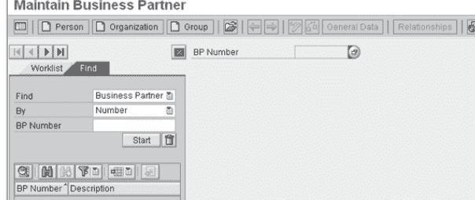
**图 5.1 初始显示的 BUSINESS PARTNER 事务**

在事务的左侧，可以使用 FIND 选项卡来查找任意类型或特定类型的多个 BP，只需在 FIND 和 By 下拉框中输入相关标准。注意，选择标准将根据选择的内容而不同。可以使用星号作为通配符进行选择。例如，如果您将 FIND 设置为 ORGANATIONS 并将 BY 设置为 NUMBER，那么可以在 NUMBER 选择标准中输入 SPU* 并点击启动按钮（如图 5.2 所示）。

还可以通过指定 FIND 和 BY 标准、留空额外的选择标准并点击启动按钮查找特定类型（甚至是所有类型）BP 列表。

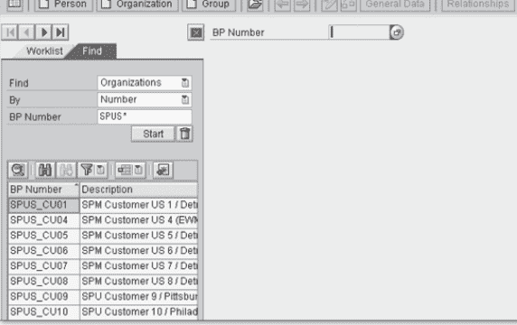
**图 5.2 在查找中使用通配符选择组织**

双击列表中的结果将显示该 BP 的详细数据。要切换到维护视图，从按钮栏选择 DISPLAY AND CHANGE 按钮（如图 5.3 所示），或按 FG。

如果您点击查找选项卡内的垃圾桶按钮（同样如图 5.3 所示），它将删除您输入的选择标准（不会删除所有符合选择标准的 BP）。

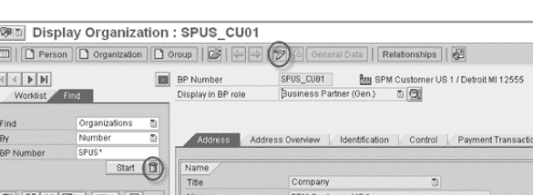
**图 5.3 从列表中选择条目后 BP 的视图**

还要注意 BP 编号正下方的 DISPLAY IN ROLE 下拉框。每个 BP 可以在多个角色中维护，有效的角色取决于 BP 的类型。例如，客户可能适用于通用 BP 角色（用于定义客户的通用数据）、财务服务 BP（用于定义客户作为付款方的数据）以及销售方 BP（用于定义客户作为产品销售方的数据）。也可能存在严格创建为收货方的客户，这需要它们具有相应的收货方数据。注意，某些数据将在各种角色视图之间复制，而其他数据可能特定于某个角色。如果数据从源系统（如 SAP ERP）复制，相关角色将在接口期间自动创建。

要创建 BP 的额外视图，请通过选择 DISPLAY AND CHANGE 按钮切换到更改模式（如图 5.3 所示），然后在 CHANGE IN BP ROLE 选择框中选择一个额外的角色。如果是除了 BUSINESS PARTNER (GEN.) 角色和 FINANCIAL SERVICES BP 以外的任何角色


角色已经维护，它们将在下拉选择中在角色名称右侧标有 (MAINTAINED) 标记（如图 5.4 所示）。

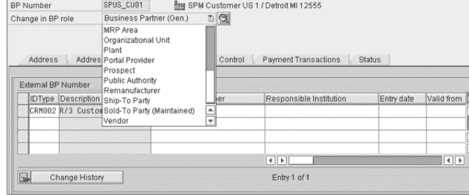

除了 IDENTIFICATION 选项卡上的标识码外，仓库管理员没有理由频繁更新 BP（业务伙伴）的主数据。相反，BP 数据通常归属于数据源系统（例如 SAP ERP）以及负责维护这些系统中数据的管理员所有。

接下来的章节描述了不同类型的 BP 数据、它们通常是如何创建的，以及哪些数据与 EWM 业务流程最相关。

## 5.1.1 客户

客户主数据通过核心接口 (CIF) 从 ERP 接口到 EWM。它最初可能在 ERP 中创建，也可能在客户关系管理 (CRM) 系统中创建并接口到 ERP。

客户主数据包含了客户的基本信息，包括客户名称、地址、各种联系信息以及各种通常与仓库操作不相关（但在某些情况下可能有用）的数据，例如税务分类、付款详情和状态信息。

与仓库流程相关的详细信息包括地址信息（必须打印在货运单据和其他表单上，并且也用于路线确定）、标识码（如图 5.4 所示）以及客户的营业时间（如图 5.5 所示，可能用于确定出货交单的预计发货日期和时间）。

| 标识码 | ID 类型描述 | 标识码 | 负责机构 | 录日期 | 有效日期 |
|---|---|---|---|---|--|
| CRM002 | R/3 客户编号 | SPUS_C0B1 | | | |

> 图 5.5 BP 的标识码，可用于确定某些仓库文档的 BP 数据

维护标识码非常重要，因为它们根据分配给源文档的 BP 来决定某些仓库文档所使用的相关 BP 数据。例如，标识 CRM002 用于确定分配给 ERP 中出货单的收货伙伴的交货通知 (ODN)（后续的出货订单 (ODO) 和出货单 (OD)）的客户编号。换句话说，伙伴不是直接从 ERP 的出货单带入 EWM 中的 ODN，而是使用 EWM 中维护的 BP 数据来确定相关的伙伴信息。在图 5.4 所示的情况下，标识码与 BP 编号相同。这种分配是为了简单起见，且在您自己的实施中通常也是如此，但可能并不总是这样。例如，在第三方物流环境中，出货单的源系统 BP 编号可能与仓库中用于相关 BP 的编号不同。

在显示模式下，您可以在 CONTROL 选项卡上选择客户的相应营业时间。从 CONTROL 选项卡的 BUSINESS HOURS 部分选择相关按钮将将显示弹出框，如图 5.6 所示。请注意，相关的选择将会在按钮右侧标有“have been maintained”（已维护）文本（在图 5.6 中被弹出框遮挡），且不会显示为灰色。

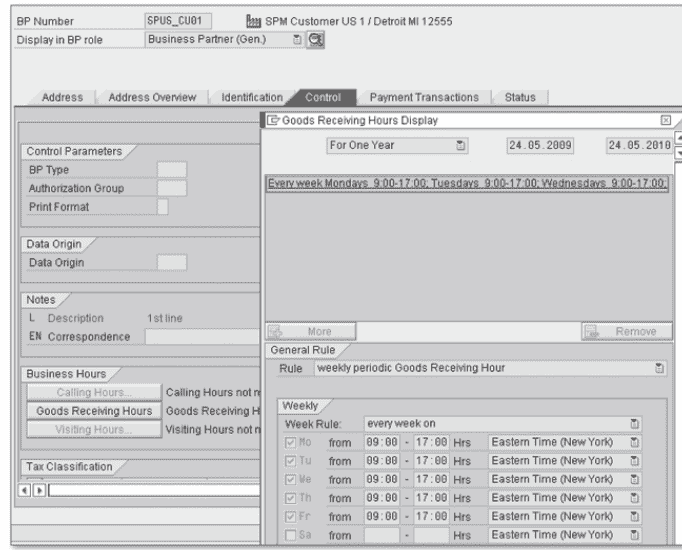

图 5.6 来自控制选项卡的 BP 营业时间

同时作为销售方和收货方的客户 BP 的典型角色包括 BUSINESS PARTNER (GEN.)、FINANCIAL SERVICES BP 和 SOLD-TO PARTY。

> 注意：
> 如果客户既是销售方又是收货方，则在创建 SOLD-TO PARTY 业务伙伴角色之外，不需要*额外创建 SHIP-TO PARTY 业务伙伴角色。只需保留 SOLD-TO PARTY 角色（在接口创建业务伙伴期间应自动创建）即可。

## 5.1.2 供应商

供应商主数据也通过 CIF 从 ERP 接口到 EWM。它最初可能在 ERP 中创建，也可能在 CRM 系统中创建并接口到 ERP。

供应商主数据包含了供应商名称的基本信息、地址、各种联系信息以及各种通常与仓库操作不相关（但在某些情况下有用）的数据，例如税务分类、付款详情（例如用于退款付款）和状态信息。

供应商业务伙伴数据的结构与客户业务伙伴数据非常相似，但有几个例外。首先，IDENTIFICATION 选项卡中的标识码必须包含 ID 类型 CRM004（R/3 供应商编号）。其次，典型的业务伙伴角色包括 BUSINESS PARTNER (GEN.)、FINANCIAL SERVICES BP 和 VENDOR。

在 IDENTIFICATION 选项卡上，供应商 BP 角色的可用数据较少，INDUSTRIES 和 Tax Numbers 部分不再相关。

## 5.1.3 员工

员工主数据也可以通过 CIF 从 ERP 接口到 EWM。它最初可能在 ERP 中创建，也可能在 CRM 系统中创建并接口到 ERP。

员工主数据包含了名称、地址、各种联系信息以及各种通常与仓库操作不相关（但在某些情况下有用）的基本信息，例如税务分类、付款详情和状态信息。

供应商业务伙伴数据的结构与客户业务伙伴数据非常相似，但有几个例外。首先，IDENTIFICATION 选项卡中的标识码必须包含 ID 类型 CRM004（R/3 供应商编号）。其次，典型的业务伙伴角色包括 BUSINESS PARTNER (GEN.)、FINANCIAL SERVICES BP 和 VENDOR。


# 供应链单元：维护

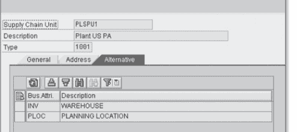

图 5.7 SCU 的业务属性

## 5.2.2 将 SCU 分配给仓库

每个仓库都分配分配一个 SCU。在 SAP EWM 的易访问菜单中，通过遵循 `EXTENDED WAREHOUSE MANAGEMENT + SETTINGS + ASSIGNMENTS: WAREHOUSE NUMBERS/BUSINESS PARTNERS` 路径，或使用事务代码 `/SCWM/LGNBP`，可以将相关的 BP 和 SCU 分配给仓库。图 5.8 显示了将 BP 和 SCU 分配给仓库的事务（如第 2 章“组织构型”中所讨论的那样）。

## “分配：仓库编号/业务伙伴”更改视图详情

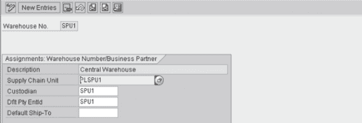

图 5.8 SCU 和 BP 分配给仓库

## 5.2.3 在运输中使用 SCU

SCU 也用于 EWM 的各种发货和收货实体。例如，在创建运输通道、区域、路线和承运商配置文件时，会引用 SCU。我们将在第 5.3 节“运输主数据”中更详细讨论这些运输要素。

## 5.2.4 为 SCU 分配日历

你可以为每个 SCU 分配一个日历。这非常重要，例如用于确定实体的日历，并用于作为路线确定的一部分来确定预计日期。通过 EWM 易访问菜单，遵循 `EXTENDED WAREHOUSE MANAGEMENT • MASTER DATA • SHIPPING AND RECEIVING • ROUTE DETERMINATION • ASSIGN CALENDAR TO SUPPLY CHAIN UNIT` 路径，或使用事务代码 `/SCTM/DEPCAL`。注意，你可以通过该事务在日历部分指定名称并选择旁边的 `CREATE` 按钮创建一个新的出发日历。要分配现有的日历（或多个日历），请选择底部中的 `APPEND` 行按钮（它看起来也像 `CREATE` 按钮）。图 5.9 显示了日历分配。

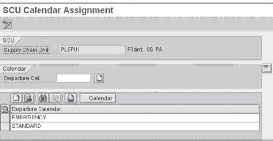

## 5.3 运输主数据

用于管理 EWM 内运输的主数据主要用于支持路线确定。来自高级计划与优化 (APO) 的路线指南 (RGE) 被 EWM 用于路线确定，因此，RGE 使用的相同元素也被 EWM 使用，包括接下来描述的元素。我们将在第 9 章“入库处理”和第 10 章“出库处理”中进一步讨论路线确定及其对交付处理的影响。

### 5.3.1 前提配置

必须配置某些配置元素以支持运输主数据。特别是需要运输模式、运输种类（针对危险品）、运输工具、请求类型、装运条件和运输组。

- 在 EWM 实施指南 (IMG) 中创建运输模式，遵循 `SCM BASIS • MASTER DATA • TRANSPORTATION LANE • MAINTAIN TRANSPORT MODE` 菜单路径。
- 在 EWM IMG 中为危险品创建运输种类（如果你需要为运输工具分配一个），遵循路径 `SCM BASIS • EH&S SERVICES • DANGEROUS GOODS MANAGEMENT • SPECIFY MODE-OF-TRANSPORT CATEGORIES`。
- 在 EWM IMG 中创建运输工具，遵循路径 `SCM BASIS • MASTER DATA • TRANSPORTATION LANE • MAINTAIN MEANS OF TRANSPORT`。
- 在 EWM IMG 中创建请求类型，遵循路径 `ROUTING GUIDE • DEFINE REQUEST TYPES FOR ROUTING GUIDE`。
- 在 EWM IMG 中创建装运条件，遵循路径 `EXTENDED WHOUSE MANAGEMENT • CROSS-PROCESS SETTINGS • DELIVERY PROCESSING • GENERAL SETTINGS • DEFINE SHIPPING CONDITIONS`。
- 在 EWM IMG 中创建运输组，遵循路径 `SCM BASIS • MASTER DATA • PRODUCT • MAINTAIN TRANSPORT GROUP`。
- 此外，要在 EWM IMG 中维护运输组和运输工具之间的兼容性，遵循路径 `Extended WAREHOUSE MANAGEMENT • CROSS-PROCESS SETTINGS • SHIPPING AND RECEIVING • GENERAL SETTINGS • DEFINE COMPATIBILITY OF MEANS OF TRANSPORT AND TRANSPORTATION GROUP`。

### 5.3.2 运输层级

要创建运输路线，必须先创建一个运输层级。在 EWM 易访问菜单中创建运输层级，遵循 `ADVANCED PLANNING AND OPTIMIZATION • MASTER DATA • HIERARCHY • MAINTAIN Hierarchy` 路径，或使用事务代码 `/SAPAPO/RELHSHOW`。在创建运输层级时，你应该分配对象类型 7（运输区域）和结构类别 4（扩展层级）。图 5.10 显示了运输层级的样式。注意，没有必要完成层级；只需创建它即可。

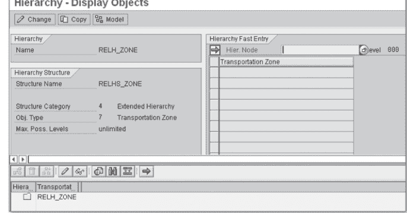

图 5.10 创建运输层级

### 5.3.3 运输通道

运输通道是两个位置之间运输的直接链接，无论它们是内部工厂、客户还是供应商。运输通道用于定义在路线确定期间哪些产品可以发货以及哪些运输工具可用。要在易访问菜单中维护运输通道（如图 5.11 所示），遵循 `EXTENDED WAREHOUSE MANAGEMENT • MASTER DATA • SHIPPING AND RECEIVING • ROUTE DETERMINATION • TRANSPORTATION LANE`，或使用事务代码 `/SAPAPO/SCC_TL`。

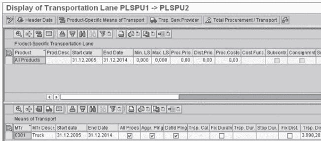

图 5.11 给定位置之间所有产品的相关运输通道

### 5.3.4 运输区域

当创建路线或路段时，会创建一个相应的运输区域。运输区域用于将位置分组并减少主数据。运输区域类型包括邮政编码区域、直接区域和地区区域。

- 邮政编码区域使用邮政编码范围指定相关性。
- 直接区域使用单个位置。
- 地区区域使用国家和地区；在 REG 页上指定国家。

> 注意：一旦你在多个选项页上输入了运输区域的选择标准，它就被定义为混合区域，此设置无法撤销，因此在输入相关性时要小心。

运输区域事务可确定哪些位置通过运输区域链接，还可以用于通过选择底部的相应选项页（如图 5.12 所示）确定哪些路线使用了该路段。

通过 EWM 易访问菜单维护运输区域，遵循 `Extended Warehouse Management • MASTER DATA • SHIPPING AND RECEIVING • ROUTE DETERMINATION • MAINTAIN ZONES FOR ROUTES`，或使用事务代码 `/SCTM/ZONE`。

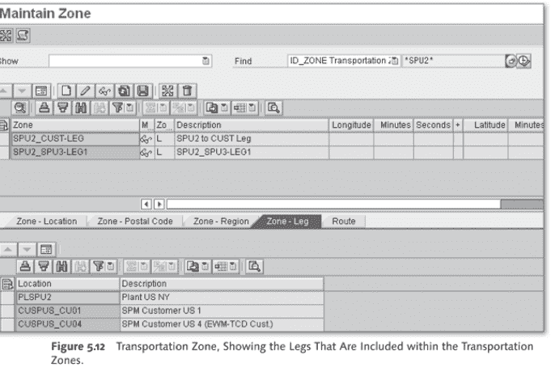

### 5.3.5 运输路线

运输路线用于描述使用特定运输方式在两个位置之间的运输特征。因此，EWM 中的信息应反映运输货物的物理路线特征。在路线确定期间会读取运输路线以确定从一个位置到另一个位置运输最相关的路线，生成的路线用于确定 ODO 的其他特征，例如为了让货物按照要求到达目的地所需的发货日期。在 SAP EWM 易访问菜单中维护运输路线，遵循 `Extended Warehouse Management • Master Data • Shipping and Receiving • Route Determination • Maintain Route`，或使用事务代码 `/SCTM/ROUTE`。图 5.13 显示了路线的抬头。

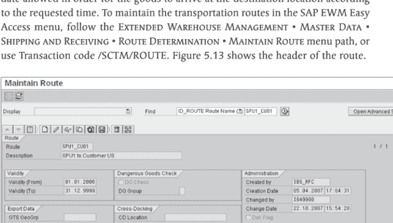


越库作业（Cross-Docking），以及对重量、体积和尺寸的限制。这些信息也用于路线确定，以确定该路线是否对于运输的货物相关。

对于每条路线，您还可以通过事务底部的标签页分配以下特征（如图 5.14 所示）：

- 程段（Legs）：包括源地和目的地（通过相应的 SCU）以及运输工具
- 越库路线（CD Routes）：用于为越库路线分配入库路线和出库路线
- 请求类型（Request Types）：指示与路线相关的出交货单（ODOs）的请求类型
- 提前期（Lead Times）：指定特定请求类型所需的提前期
- 货运条件（Shipping Conditions）：反映了与路线相关的 ODO 允许的运输条件
- 运输组（Transp. Groups）：反映了与路线相关的 ODO 允许的运输组

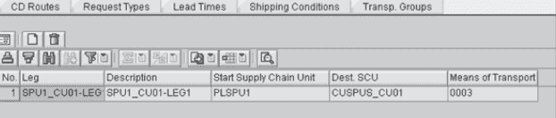

> 图5.14 分配给运输路线的程段和其他条件

我们将在第 10 章讨论出库处理时进一步讨论运输路线，并在第 9 章讨论入库处理时讨论，因为运输路线在入库和出库方向上都是相关的。此外，路线还用于确定将装运单元（HUs）加载到分配给特定路线的运输单元（TUS）上的相关性，以及其他的运输活动。

### 5.3.6 作为合作伙伴的承运商

在 ERP 中，承运商作为具有特殊特征的供应商创建。同样，当承运商信息分发到 EWM 时，它以 BP 的形式存储在 EWM 中。要在 SAP EWM 易菜单中访问 BP 事务，请遵循 EXTENDED WAREHOUSE MANAGEMENT • MASTER DATA • MAINTAIN BUSINESS PARTNER 菜单路径，或使用事务代码 BP。

承运商将包含 BP 角色 CRM010（Carrier）。承运商的标准承运字母代码（SCAC）通常存储在 BP 的标识页中，ID 类型为 BUP006（标准承运字母代码），此外还有 R/3 供应商编号，它存储在 ID 类型 CRM004（R/3 供应商编号）中。

### 5.3.7 承运商配置

与承运商相关的仅对 EWM 有用的额外数据存储在承运商配置中（如图 5.15 所示）：

- 通讯数据（communication data）：通讯数据包括邮寄地址、电话号码、传真号码和地址。
- 行政数据（administrative data）：行政数据包括与 EWM 中创建和更改承运商配置数据相关的数据。
- 地理信息和运输工具（geographical information and means of transport）：与承运商配置相关的地理信息包括分配给配置的程段和运输工具。这些用于路线确定，以确定路线相关的承运商配置。运输工具可以属于一个层级，路线确定将考虑逻辑区域和优程段的运输工具。
- 运费代码集（freight code sets）：运费代码用于与货运代理和其他服务供应商通信，运费集用于对单个运费代码分组。将运费集分配给承运商配置定义了与承运商相关的允许运费集（因此也是运费代码）。要在 EWM IMG 中创建运费集和运费代码的允许条目，请遵循菜单路径 EXTENDED Warehouse MANAGEMENT • GOODS ISSUE PROCESS • TRANSPORT MANAGEMENT • BASICS • DEFINE FREIGHT CODE SETS, FREIGHT CODES, AND DETERMINATION。
- 运输组和产品运费集（transportation group and product freight sets）：分配给承运商配置的 TRANSP. GROUPS AND PRODUCT FREIGHT SET 指明允许的值，并在路线确定期间，它们与 ODO 物料的分配值（TRANSP. GROUPS AND PRODFREIGHT SET）进行比较。
- 运输成本（transportation costs）：运输成本可以根据承运商配置计算，方法是固定运输成本和尺寸成本之和，这是一种取决于行驶距离、行驶时间、数量（例如托盘数）或站点数等因素的可变成本（然而，系统目前未提供标准方法用于为此运费计算）。

要在 SAP EWM 易菜单中维护用于路线定的承运商配置，请遵循 EXTENDED WAREHOUSE MANAGEMENT • MASTER DATA • SHIPPING AND RECEIVING • ROUTE DETERMINATION • CARRIER PROFILE FOR ROUTING GUIDE 路径，或使用事务代码 /SCTM/TSPP。

## 维护承运商配置

| 承运商 (Carrier) | 承运商描述 (Carrier Description) | 街道 (Mo Street) | 房屋 (Hous) | 邮编 (Post C) | 城市 (City) | 州 (Rg) | 国家 (Cty) | 时间 (Time) | 电话号码 (Telephone number) |
| :--- | :--- | :--- | :--- | :--- | :--- | :--- | :--- | :--- | :--- |
| CARRIER1 | Carrier J/Philadelphia | 123 Main Street | | 12345 | Philadelphia, PA | PA | US | EST | |

| 程段 (Leg) | 描述 (Description) | 运输工具 (MTr) | 方式描述 (Description of Means) | 出交运输 (DO Transp.) |
| :--- | :--- | :--- | :--- | :--- |
| SPI1_CU0-LE1 | | 0001 | Truck | |
| SPI1_CU0-CUST | | 0001 | Truck | |

图 5.15 承运商配置数据

## 5-4 包装材料

包装材料是任何用于收集或容纳仓库内存储或运输材料的材料。辅助包装材料通常是在准备运输期间添加的材料，用于保护运输中的材料（例如，缓冲或防止运输中的位移或其他移动；也常称为“填充物”）。

EWM 中的包装材料以具有特定特征的产品形式创建。与其他产品一样，创建产品的主系统是 ERP，包装材料在那里作为产品类型创建。在第 4 章产品主中，我们专门讨论了与包装材料相关的字段，包括：

- 容量信息
- 包装材料类型
- 允许重量
- 允许体积
- 关闭
- 包装材料类型
- HU 类型
- 表单名称

在创建 HU 时，包装材料分配给工作中心（例如整合、包装、增值服务），辅助材料可以在 VAS 执行期间消耗。我们将在第 19 章增值服务中进一步讨论包装材料和辅助包装材料。

## 仓库产品 (Warehouse Product)

| | | | | | |
| :--- | :--- | :--- | :--- | :--- | :--- |
| 产品 (Product:): | SPE_PALLET | 基本单位 (Base Unit) | EA | | |
| | | | | | |
| 产品描述 (Prod. Descript.) | Service Parts: Execution Pallet | | | | |
| 仓库编号 (Warehouse No.) | SP01 | 中央仓库 (Central Warehouse) | | | |
| 处置 (Ent. to Dispose) | SP01 | SPM Plant USA 1 | | | |
| 包装组 (Packing Group) | P601 | | | | |
| 包装参考 (Ref/t for Pack) | | | | | |
| 标准 HU 类型 (Std HU Type) | E1 | | | | |
| 基本数据：包装材料 (Basic Data: Packaging Material) | | | | | |
| 包装类型 (Pack.Mist.Type) | 8001 | HU 类型 | E1 | | |
| 表单名称 (Form Name) | | | | | |
| PDF 表单名称 (PDF form name) | | | | | |
| 容量 (Capacities) | | | | | |
| 最大重量 (Maximum Weight) | 40 | LB | 超超差 (Excess Wgt Tolerance) | 5.0 % | |
| 净重变量 (Tare Weight Variable) | | | | | |
| 最大体积 (Max. Volume) | 3.500 | FT3 | 体积超差 (Excess Volume Vol.) | 0.0 % | |
| 关闭包装 (Closed Packaging) | | | 填充水平 (Filling Level) | 100 % | |
| 最大容量 (Max. Capacity) | 150.000 | | 容量超差 (Excess Cap. Tol.) | 5.0 % | |
| 最大长度 (Max. Length) | 1.500 | | | | |
| 最大宽度 (Max. Width) | 1.500 | | | | |
| 最大高度 (Max. Height) | 1.500 | FT | | | |

> 图 5.16 EWM 产品主包装数据视图中包装材料的容量信息

## 5.5 包装规范 (Packaging Specifications)

包装规范（Pack specs）旨在为系统提供信息以确定如何将产品分组在 HU 中，并为用户提供在分组分组时应执行哪些活动的信息。包装规范利用了集成产品和过程工程（IPPE）引擎，该引擎被供应商网络协作（SNC）和高级优化（APO）以及 EWM 使用。


## 5.5.1 包装规范的结构

在图 5.17 中，你可以看到包装规范的结构，它由抬头（HEADER）、内容（CONTENTS）、层级（LEVELS）、元素组（ELEMENT GROUPS）、元素（ELEMENTS）、步骤（STEPS）和包装材料（PACKAGING MATERIALS）组成。这些组件将在后续章节详细介绍。


图 5.17 包装规范结构

如图 5.17 所示，包装规范由以下组件组成：

- HEADER：抬头包含包装规范的名称（或编号）、更改次数、状态、描述、规范分组、层集分配、其他管理信息（例如创建用户名、日期、时间、源系统等）、舍入数据以及通过文档管理系统分配的文档链接（如果相关）。在查看抬头记录时，你还可以访问确定条件，这些条件用于确定包装规范的相关性。

- CONTENTS：内容可以指定一个或多个产品，或者另一个包装规范。

- LEVELS：层级代表包装规范内部不同的分组（不要与包装箱内产品的物理层混淆，后者可以在层级内定义）。在层级内部，你可以定义相关的层级类型、目标数量、最小数量和每层数量。对于每个层级，你分配的目标数量表示分配到当前层级的上一个包装层级的单位数量。

示例：如果一个产品在仓库存储时通常是每个托盘包装 24 个单元，每层 6 个（共 4 层），那么你可以创建一个包装规范，并将内容分配为 1，将层的目标数量各设为 24，并将层数设为 6。总数量将自动计算为每个 24 个，层数将自动计算为 4 层（注意这些数量与图 5.18 所示的截图匹配）。

要在 EWM IMG 中配置层级类型（可可选分配给包装规范层级），请遵循菜单路径：SCM BASIS • PACK • PACKAGING SPECIFICATION • MAINTAIN STRUCTURE OF PACKAGING SPECIFICATION • DEFINE LEVEL TYPE。

- ELEMENT GROUPS：元素组可以通过将现有的元素组分配给包装规范而不是逐个创建元素，来简化创建新包装规范的过程。当你手动将元素分配到包装规范时，系统会自动创建一个元素组并为该元素组分配编号。该元素组反可以通过包装规范维护中的选择 ASSIGN ELEMENT GROUP 选项分配给订阅的包装规范，相应的元素将被自动分配。

你应该通过菜单路径 SCM BASIS • PACK • PACKAGING SPECIFICATION • DEFINE GENERAL PACKAGING SPECIFICATION PARAMETERS 在 EWM IMG 中为元素组分配号范围。

- ELEMENTS：对于每个层级，与该层级相关的元素，包括包装材料和工作步骤。如前所述，当你手动定义一组新元素时，会自动创建一个元素组，随后你可以在定义后续包装规范的元素时使用它。要将元素组（及相应的元素）分配到包装规范，只需输入元素组编号，相应的元素将被分配。如果你手动输入元素，可以分配元素类型；包装材料及包装材料的质量；HU 相关性；工作步骤分配；重量、体积和尺寸数据；数量分配（用于包装规范的舍入）；HU 类型；业务单位；外部步骤；舍入参数以及元素的长文本（这些可以打印在包装工作中心的包装标签上）。

要在 EWM IMG 中为元素类型创建允许的条目并指定元素类型的相关参数，请遵循菜单 SCM BASIS • PACKAGING SPECIFICATION • MAINTAIN STRUCTURE OF PACKAGING SPECIFICATION • DEFINE ELEMENT。

对于可以分配给元素的工作步骤，从 SAP Easy Access 菜单开始，请遵循菜单路径 EXTENDED WAREHOUSE MANAGEMENT • MASTER DATA • PACKAGING SPECIFICATION • MAINTAIN PACKAGING WORK STEP 或使用事务代码 /SCWM/PSWORKSTEP。在创建工作步骤时，你可以指定工作步骤描述和长文本，这将作为执行包装操作的操作员的工作说明。如果有额外的备份文档，可以通过文档管理系统将其链接到工作步骤。

## 5.5.2 创建包装规范

要创建规范或维护现有的包装规范，请遵循 EXTENDED WAREHOUSE MANAGEMENT • MASTER DATA • PACKAGING SPECIFICATION 菜单路径，或使用事务代码 /SCWM/PSPACKSPEC。从主界面选择一个现有的包装规范，或选择创建新的选项，你将将看到维护界面，如图 5.18 所示。图中所示的包装规范是收货入库时包装材料的简单示例。请注意，每个 HU 的包装数量是分配给层级的，而不是内容（如上一节示例所示）。

# 修改材料 SPE_PTS_ 的包装规范 10000002


**图 5.18** 产品简单托盘化的包装规范

要创建包装，你需要创建并分配号范围并定义通用参数。要在 EWM IMG 中创建号范围，请遵循菜单路径 SCM BASIS • PACK • PACKAGING SPECIFICATION • NUMBER RANGE。要定义通用参数，请遵循 SCM BASIS • PACK • PACKAGING SPECIFICATION • DEFINE GENERAL PACKAGING SPECIFICATION PARAMETERS。

此外，你可以创建包装组。这些组允许你为特定目的分配预定义的结构。例如，对于组装或 VAS 等流程，请遵循路径。

## 5.5.3 激活包装规范

一旦创建了规范，就必须激活它才能使用。要激活包装规范，在包装规范维护内部，选择激活按钮。或者，在 PACKAGING SPECIFICATION OVERVIEW 屏幕上，可以选择包装规范并选择激活（或下拉菜单中的 Activate Packspec）。

> 根据你在维护规范时所做的更改，系统可能不允许在详细视图中成功激活规范。如果发生这种情况，请在维护视图中保存规范并返回 PACKAGING SPECIFICATION OVERVIEW 屏幕并在那里激活。

一旦激活了包装规范，你将无法更改活动版本。如果你想进行更改，需要创建包装规范的新版本并激活该新版本。从 PACKAGING SPECIFICATION OVERVIEW 屏幕选择相应的包装规范，并点击 CREATE NEW VERSION 按钮。一旦创建了新版本，你可以在旧版本激活的同时维护新版本。一旦你更新了新版本，旧版本将不再激活——一次只能有一个活动版本。如果你在更新包装规范时不想使用其他包装规范，可以通过 ACTIVATE 按钮旁下拉菜单中的 DEACTIVATE PACKSPEC 选项来禁用原始版本；然而，即使你禁用了原始版本，也必须创建一个新版本进行编辑。


对于多个实例，您需要单独维护包装规格，或者升级包装规格分发以同步包装规格。

要设置分发，您必须首先通过远程功能（RFC）连接系统。您的技术支持团队通常负责设置系统之间的基本技术连接。一旦建立了 RFC 连接，您需要在源系统中指定用于创建包装规格的 RFC 连接分发。要指定相关的 RFC 连接，请在 EWM IMG 中按照以下菜单路径操作：SCM Basis • PACK • AGING SPECIFICATION • DEFINE RFC CONNECTION FOR PACKAGING SPECIFICATION Distribution。一旦您设置了包装规格的 RFC 目标，就不再需要进行其他设置来触发分发（即没有需要调度的批处理程序）。但是，如果您需要手动重新分发包装规格，则提供有一个可用程序 (SCWM/PS_DISTRIBUTION)。

## 5-5-5 包装规格的确定

- 包装规格用于 EWM 中的各种过程，包括：
-   入货交单（ID）中的自动包装
-   创建储储订单（WO）期间的包装物料确定
- 出货交单（OD）中的包装物料确定
- 分拣策略（desol）期间的包装物料确定
- 在包装站进行包装时的包装物料确定，包括出货交单、过账和转储
- 库位优化（Slotting）
- 内部仓库流程（用于托盘数据或操作计量单位的确定）

包装规格的确定使用熟悉的条件技术。要配置条件表、访问序列、条件类型和确定过程，请从 EWM IMG 访问菜单路径 SCM BAS • MASTER DATA LAYER • PACK • PACKAGING SPECIFICATION • DETERMINATION OF AGING SPECIFICATIONS 下的节点。

要为确定包装规格创建条件记录，您必须进入包装规格维护（如前面的章节所述），选择一个包装规格并进入包装规格的更改模式。如果包装规格已激活，则必须创建一个新版本、更新新版本并激活新版本，如前面的章节所述。在包装规格维护中，在表头级别，选择 DETERMINATION（确定）选项卡。在 DETERMINATION 选项卡上，在 CONDITION（条件）列中，输入一个新的条件类型，从结果弹出的对话框中指定条件键组合（如果相关），并为该条件键输入相关的确定特征。一旦您创建了条件记录，这些记录将根据包装规格确定的配置在相关过程中被读取，并相应地执行包装。

## 5.6 生产主数据

为了支持生产供应的物料拣货和准备过程（将在第 11 章“生产供应”中进一步描述），在 ERP 和 EWM 中必须创建多个主数据元素。在 ERP 中，必须创建支持生产供应的传统主数据，包括：

- 物料
- 物料清单 (BoM)
- 路线
- 工作中心
- 生产供应区域 (PSAs)

此外，在 EWM 中，必须创建以下数据并与 ERP 主数据关联：

- 物料
- PSAs
- PSA 内部的库位

我们已经在第 4 章中讨论了物料的创建和更新。在接下来的章节中，我们将讨论在 EWM 中创建 PSA 和库位的可能方法。

## 5.6.1 创建生产供应区域

PSA 代表产品存储的区域，直到在生产区域被立即需要。通常，PSA 是仓库中的一个物理区域，且靠近生产区域。处理 PSA 的各种方法将在第 11 章中介绍。PSA 可以集成来自 ERP 的数据来创建（因为 PSA 也在 ERP 中创建），也可以直接在 EWM 中创建。两种选项将在接下来的章节中描述。

## 从 ERP 集成生产供应区域

可以通过集成来自 ERP 的供应区域数据在 EWM 中创建 PSA。这种方法实际上使用使用 EWM 系统中生成的报告的“拉取”机制。要在 SAP EWM 简易访问菜单中执行该报告，请遵循 EXTENDED WAREHOUSE MANAGEMENT • INTERFACES • ERP INTEGRATION • REPLICATE PRODUCTION SUPPLY AREA (PSA) 菜单路径，或使用事务代码 /SCWM/PSA_REPLICATE。事务的选择屏幕将如图 5.19 所示。


图 5.19 从 ERP 到 EWM 的 PSA 集成选择屏幕

TRIGGER AT PSA 复选框控制是否在 EWM 的 PSA 中设置同名指示。如果是，一旦库存交付到 PSA，将立即触发库存发货。请注意，如果选择了此选项，您还必须在 EWM IMG 中定义自动发货的设置（可以通过 EWM IMG 中的菜单路径 Extended WARE-HOUSE MANAGEMENT • GOODS ISSUE PROCESS • OUTBOUND DELIVERY • PRODUCTION SUPPLY • MAINTAIN SETTINGS FOR AUT. GOODS ISSUE FOR PRODUCTION SUPPLY 访问）。

## 在 EWM 中直接创建生产供应区域

您也可以从简易访问菜单遵循 Extended Warehouse Management • Master Data • Production Supply Area (PSA) • Define PSA 菜单路径，或使用事务代码 /SCWM/PSA 在 EWM 中创建 PSA。在仓库选择屏幕上（如果需要），输入仓库。在表维护中，选择 New Entries（新条目）按钮，然后输入数据，如图 5.20 所示。


5.20 手动创建 PSA 注意 TRIGGER AT PSA 复选框与上一节描述的相同。

## 5.6.2 映射供应区域

一旦在 EWM 中创建了 PSA，必须将其映射到 ERP 以确保生产供应。要映射 PSA，从 EWM 简易访问菜单遵循 Extended Warehouse Management • Interfaces • ERP Integration • Map Production Supply Area (PSA) 路径，或使用事务代码 /SCWM/PSAP。在表上，点击 New（新建）按钮，如图 5.21 所示（PSA 必须存在）。

| 其他主数据 |


图 5.21 将 EWM PSA 映射到 ERP

### 5.6.3 分配供应库位

从仓库转移产品的准备区域根据 PSA、产品或物料组分配库位。要维护分配分配，可以使用两个事务之一，以略不同的方式输入分配。要为每个条目输入 PSA、产品组和授权，请遵循 EWM 简易访问菜单 EXTENDED WAREHOUSE MANAGEMENT • MASTER DATA • ASSIGN BIN TO PSA/PRODUCT/ENTITLED IN WARE NUMBER，或使用事务代码 /SCWM/PSAGE。如果未指定默认仓库，则需要指定仓库，然后显示表（如图 5.22 所示）。


图 5.22 根据授权和产品在 PSA 内分配库位

> 注意
> 生产准备库位将在存储类型 1000 中创建。可以使用业务配置 (BC Sets) /SCWM/PROD_SUPPLY 和 /SCWM/DLV_PROD_SUPPLY_FOR_TEST 创建存储类型（以及其他相关的生产供应设置）。参见第 26 章“部署扩展仓库管理”，获取有关自动更新 BC Sets 的更多信息。


 按按授权的 PSA 创建库位

在创建按授权和产品的 PSA 库分配时，分配中的某些选项控制生产供应的执行以及存储库位或准备区域的确定。首先，您可以通过指定产品号或物料组（但不同时）来选择将产品或一组产品分配给 PSA。这样，通过物料组对分配分组，可以减少所需的主数据创建量。其次，您可以选择静态输入存储库位，


## 5 | 其他仓库主数据

或者您也可以让系统根据拣货区确定确定库位。为此，请选择 Stage Determ. OUTB. Del 复选框（位于图 5.23 中 STORAGE Bin 分配下方）。如果您选择了此选项，则必须从 SAP 易访问菜单中维护出货过程的拣货区确定，操作路径为：EXTENDED WAREHOUSE MANAGEMENT • SHIPPING AND RECEIVING • STAGING AREA AND DOOR DETERMINATION (OUTBOUND)，或使用事务代码 `/SCWM/STAD_OUT_`。您应该要么维护此设置，要么维护静态库位分配（但两者不可兼得）。第三，您可以指定箱件补货时的数量计算方法（将在第 11 章中进一步说明）。箱件补货方法数量的选项包括：

- *与箱件补货无关*：如果选择此选项，则不需要额外的条目。
- *基于包装规范的箱件补货*：如果选择此选项（在按回车后），QTY CLASSIFIC.、NO. CONTAINERS CONT. IN PSA 字段和 MIN. NO. 字段将可以输入，并应在这些字段中输入相关数据。
- *基于数量的箱件补货*：如果选择此选项（在按回车后），REPLMT QTY、MIN. PROD. QTY in PSA 和 Unit 字段将可以输入，并应在这些字段中输入相关数据。

您也可以通过 SAP 易访问菜单维护 PSA 库位分配，路径为：EXTENDED WAREHOUSE MANAGEMENT • MASTER DATA • PRODUCTION SUPPLY AREA (PSA) • ASSIGN BIN TO PRODUCT/ENTITLED PSA，或使用事务代码 `/SCWM/TPSASTAGE`。这提供了相同数据的另一种视图（来自表 `/SCWM/TPSASTAGE`），但它允许您细化视图，仅显示单个被授权方和 PSA 的条目（见图 5.24）。必须在初始选择屏幕上输入这些数据（仓库、被授权方和 PSA），才能看到如图 5.24 所示的表格。

> 注意
创建新条目或钻入条目进行显示或更改时，使用的是与图 5.23 相同的视图。

### 更改视图“按授权方/产品分配 PSA”：概述

| 仓库编号. | SP21 | | | | | |
| :--- |---|---|---|---|---|---|
| 授权方 | SP01 | | | | | |
| PSA | PS61 | 生产供应区 1 | | | | |

使用事务 `/SCWM/PASASTAGE2` 的 PSA 库位分配的不同视图，它使用不同的细化方法显示相同的数据。

## 5-7 资源

资源是仓库内通过执行仓库任务来执行工作的实体。资源可以是一个工人，也可以是设备，例如手动操作的叉车、自动导引车、输送机或其他在仓库内从一个地方移动到另一个地方车。

## 更改视图“资源”：概述

| 资源 | 资源类型 | 资源组 | OrtPresDvc | 队列 | 标准库位 | 存储库位 |
| :--- | :--- | :--- | :--- | :--- | :--- | :--- |
| FTD-Z1 | RT01 | RGAL | PRES | INBOUND | 0010-01-01 | |
| FTD-Z-2 | RT01 | RGAL | PRES | INBOUND | 0010-01-01 | |
| FTD-INT | RT01 | RGAL | | INTERLEAVE | 010-01-01 | |
| FTD-OUT | RT01 | RGAL | PRES | OUTBOUND | 0010-01-01 | |
| FTD-P1 | RT01 | RGAL | PRES | INBOUND | 0010-01-01 | |

图 5.25 资源及其关联属性的维护

资源是在简单的表中创建的，允许分配资源名称以及相关的资源类型、资源组、显示设备、队列和标准库位（或起始库位）。您也可以在表格中（见 5.25）看到资源的当前存储库位。这些字段及其用途将在后续章节中描述。要从 SAP 易访问菜单访问资源维护，请遵循路径：EXTENDED WAREHOUSE MANAGEMENT • MASTER DATA • RESOURCE MANAGEMENT • MAINTAIN Resource 菜单，或使用事务代码 `/SCWM/RSRC`。

## 5.71 资源类型

资源类型是具有相似属性的资源分组。每个资源都被分配给一个资源类型，资源的资源类型用于确定该资源可以访问哪些类型的库位以及资源可以运输哪些 HU 类型。要通过 SAP EWM IM 访问资源类型（见图 5.26），请遵循菜单路径：EXTENDED WAREHOUSE MANAGEMENT • Cross-Process SETTINGS • RESOURCE MANAGEMENT • DEFINE RESOURCE TYPES。

### 更改视图“定义资源类型”：概述


> 注意
NO INTERLEAVING 复选框、速度分配（水平和垂直）以及位置管理分配也分配给资源类型，而不是分配给单个资源。具有其他特征但速度不同的资源，或者在错插或位置管理方面具有不同设置的资源需要创建额外的资源类型。

一旦创建了资源类型，您就可以通过选择资源类型并选择左侧的树形结构来分配允许的库位类型和 HU 类型。

## 5.7.2 执行优先级

在创建资源类型并分配了允许的库位类型和 HU 类型后，您可以为库位类型分配优先级。要从易访问菜单分配优先级，请遵循 Extended Warehouse Management • Master Data • Resource Management • Maintain Priorities 路径，或使用事务代码 `/SCWM/EXECPR`。在选择屏幕上输入仓库后，进入 Define Resource Types，双击 Maintain Access 或 Maintain HU GRP。


| 资源类型 | 资源类型 | 描述 | 资源类型 | U | 位置管理 |
| :------|---|---|---|---|---|
| 访问类型优先级 | RT01 | 资源类型 01 | | | |
| HU 组优先级 | | | | |
| 仓库类别优先级 | | | | |
| 模式权重 | | | | |

图 5.27 用于分配资源类型

> 注意
在模式下，可能无法为资源类型、允许的访问类型或 HU 组创建新条目。这些必须在之前描述的配置中添加。

一旦选择例如访问类型分配的文件夹，您就可以为每个访问类型指定优先级（见图 5.28）。优先级被赋予两个字符的数值，数值越大，分配该访问类型的 WO 被选中的概率越高。访问类型、HU 类型和仓库类别被共同用于计算 WO 总优先级的公式，该公式还考虑了根据分配模式对各个因素的权重。我们将在第 22 章进一步讨论 WO 优先级。


图 5.28 为资源类型分配访问类型和优先级

每个资源类型的 HU 类型优先级分配方式类似，看起来也与访问类型类型的优先级分配相似。

## 5-7-3 资源组

资源组用于管理资源队列分配的资源组（参见本章后面关于队列和队列序列的部分）。要从易访问菜单维护资源组，请遵循 EXTENDED WAREHOUSE MANAGEMENT • MASTER DATA • RESOURCE MANAGEMENT • MAINTAIN WAREHOUSE GROUP 路径，或使用事务代码 `/SCWM/RGRP`。视图是一个简单的表格，仅包含资源组名称（四个字符）和描述（与大多数描述一样，取决于特定语言），见图 5.29。


图 5.29 资源组的维护


# 5.7-4 队列 (Queues)

队列用于管理仓库中工作订单（WO）的分配。每个工作订单被分配到一个队列，每个仓库资源组被分配到一个队列序列，工作订单可以从该序列分配给资源。

> 注意
工作订单也可以手动分配给队列，但这种方式比自动化方法效率低，通常仅用于异常情况。

要在 EWM IMG 中定义分配给工作订单的队列，请遵循菜单路径：扩展仓库管理 -> 跨流程设置 -> 资源管理 -> 定义队列。在这里可以选择以下活动。

## 定义队列 (Define Queues)

通过此功能（见图 5.30），你可以定义队列并提供描述、分配队列类型、操作环境，并指定分配给队列的工作订单是否允许系统引导处理（系统引导处理将在第 22 章中详细描述）。

## “队列定义”视图 (Change View "Queue Definition": Overview)

| 仓库 | 队列 | 描述 | Q.T | 操作环境 |
|---|---|---|---|---|
| SP1 | 入 (INBOUND) | 收货队列 | | 资源管理已激活 |
| SP1 | 交错 (INTERLEAVE) | 交错队列 | | 资源管理已激活 |
| SP1 | 内部 (INTERNAL) | 内部移动 | | 资源管理已激活 |
| SP1 | 出 (OUTBOUND) | 发货队列 | | 资源管理已激活 |

图 5.30 队列定义

## 定义队列确定标准 (Define Queue Determination Criteria)

一旦定义了队列，接下来就可以定义确定工作订单分配哪个队列的标准。注意，队列确定首先针对仓库任务执行的（因此确定数据来自仓库任务），然后在从仓库任务创建工作订单时进行队列分配——分配到不同队列的任务将分配不同的工作订单，因此队列分配只需要存储在工作订单级别。

队列确定使用的参数（见图 5.31）包括：
- 源活动
- 目的活动
- 库位访问类型
- 仓库处理类型
- 活动

## “分配队列确定标准”视图 (Change View "Assign Queue Determination": Overview)


图 5.31 队列确定标准

## 定义队列访问序列 (Define Queue Access Sequences)

为了在大规模队列确定表中提高队列确定效率，并在仓库任务适用多个条目时建立确定记录的优先级，需要建立队列确定访问序列（见图 5.32），它指定了按什么顺序检查字段组合。例如，你可以指定系统检查活动区域和仓库处理类型的组合，如果没有符合该标准的条目，系统将仅根据处理类型检查条目。


图 5.32 队列访问序列规范，队列确定检查字段的顺序

## 5.7-5 队列序列 (Queue Sequences)

队列序列分配给资源组，用于在系统系统引导处理期间确定分配给资源的工作订单（系统引导处理将在第 22 章详细描述）。分配到序列中第一个队列的工作订单优先级高于分配到第二个队列的工作订单，依此类推。要从 EWM 易访问菜单创建队列序列（见图 5.33），请遵循菜单路径：扩展仓库管理 -> 主数据 -> 资源管理 -> 维护资源组队列序列，或使用事务 `/SCWM/QSEQ`。

5 | 其他仓库主数据


图 5-33 资源组队列序列分配

## 5.7-6 队列类型 (Queue Types)

队列类型是队列组，在任务交错期间使用，用于识别哪些队列将是下一个考虑执行工作订单的对象。队列类型在之前描述的队列维护中分配给队列（见图 5.30）。要在 EWM IMG 中创建队列类型（见图 5.34），请遵循菜单路径：扩展仓库管理 -> 跨流程设置 -> 资源管理 -> 定义队列类型。


图 5-34 队列类型定义

> 注意
队列类型是可选的。如果你不实施交错处理，则没有必要设置队列类型或队列序列。

## 5.7-7 队列类型序列 (Queue Type Sequences)

队列序列指定了在交错过程中选择队列类型的顺序（交错过程将在第 22 章详细描述）。

图 5.35 资源组队列序列分配


图 5.35 交错任务队列序列规范

## 5.7-8 标准库位或“起始库位”（Standard Bin or "Start Bin"）

分配给资源的标准库位（或起始库位）（见图 5.25）是用于确定任务开始距离的库位。

## 5.7-9 跟踪当前库位 (Tracking the Current Bin)

存储库位字段（前述图 5.25）用于存储资源访问的最后一个位置。

> 注意
尽管存储库位是允许输入的，但你不应该在那里维护它，因为它在执行期间会被覆盖。你应该只按照描述维护标准库位。

## 5.7-10 用户 (Maintaining Users)

维护用户允许你根据用户 ID 指定登录 RF 事务（SCWM/RF）的默认参数（见图 5.36）。注意，不必为用户指定默认条目，但如果设置了默认值，将限制 RF 启动屏幕所需的数据输入。此外，如果你想为用户指定非标准的个性化设置以个性化其 RF 屏幕体验，你需要在用户表中创建一个条目。


图 5.36 RF 设备用户默认数据指定

## 5.7-11 资源执行约束 (Resource Execution Constraints - RECs)

REC 用于缓解易发生拥堵或受拥堵影响的仓库区域的拥堵，通过指定在特定时间内区域内可以操作的资源数量来实现。


**图 5.37** 当资源使用系统引导确定时，在确定工作订单（WO）时会考虑 RECs

## 更改视图“定义资源执行”

| 定义资源执行约束 (REC) | WMS | 资源类型 | ID 组织资源.类型 | 资源数量 |
| :--- | :--- | :--- | :--- | :--- |
| EP01 | RT01 | | 1 |
| EP01 | RT01 | | 2 |

**图 5.38** 定义 RECs，包括用于分组资源类型的 ID 的创建以及工作区域内允许的资源数量的分配

> 如果系统中存在支持行驶时间和距离计算的数据，则系统实际上会确定资源到达仓库任务源储位所需的时间。如果系统确定当前区域内正在其中一个资源将在新资源到达之前完成工作并离开该区域，则它将确定该 WO 对该资源仍具有潜在相关性。

要启用 RECs，你必须对资源进行分组、对储位进行分组，并设置每种类型的资源进入分组储位区域的数量。要这样做，你必须定义 RECs，将 RECs 分配给 REC 存储组，将 REC 存储组分配给储位，并激活 REC 存储组的 REC 检查。

## 定义 RECs

为了允许系统确定区域内允许的资源数量，你必须先对资源。这些组由识别号 ID GRP Res Type 表示。在表中（见图 5.38）中，你为每个仓库和资源类型分配一个或多个此类识别号，并为每个编号指定用于该组的资源数量。稍后你会将这些 ID 分配给 REC 存储组，并将存储组分配给储位，从而完成分配。要创建 ID GRP Res Type，在 EWM IMG 中，按照菜单路径：扩展仓库管理 • 跨流程设置 • 资源管理 • 控制数据 • 定义资源执行约束 (REC)。

## 将 RECs 分配给 REC 存储组

一旦你创建了分组资源类型的 ID，就可以创建 REC 暂存组并将分组资源类型的 ID 分配给 REC 暂存组（见图 5.39）。在 EWM IMG 中，按照菜单路径：扩展仓库管理 • 跨流程设置 • 资源管理 • 控制数据 • 将资源执行约束分配到 REC 存储组。


图 5.39 将 RECs 分配给 REC 暂存组与分组资源类型的组合

## 将 REC 存储组分配给仓库储位

一旦你创建了 REC 暂存组，就可以将 REC 暂存组分配给仓库储位。在第 3 章“仓库结构”中，我们详细描述了储位维护。要访问储位更改事务……

## 激活 REC 存储组

一旦你创建了 REC 存储组，就可以激活 REC 检查（见图 5.40，在 EWM IMG 中通过遵循菜单路径扩展仓库管理 • 主数据 • 资源管理 • 激活存储组的执行控制，或使用事务代码 /SCWM/REC/ACTIVATE）。只需激活你希望系统检查的每个 REC 存储组的复选框。


图 5.40 按每个 REC 存储组激活 REC

## 5.7.12 处理器

处理器是一种特殊的 BP（业务伙伴），代表 LM 中的员工。处理器用于存储与员工劳动活动相关的数据，例如劳动定额、仓库相关性、每项活动的性能预期以及员工的默认参数。要创建处理器，在 EWM 简易访问菜单中，按照菜单路径：扩展仓库管理 • 主数据 • 资源管理 • 处理器 • 创建处理器，或使用事务代码 /SCMB/PRR1。

## 注意

必须正确创建并分配 BP 规则才能启动处理器的创建。如果事务无法启动，请参阅关于创建和分配 BP 角色类别及 BP 角色的后续章节。

在创建处理器时，你应该在 ADDRESS 和 ADDRESS 概览选项卡上分配相关数据，然后在 IDENTIFICATION 选项卡上（见图 5.41）分配用户 SAP EWM 用户名。这允许通过登录 ID 将员工与处理器关联。此外，你还可以分配一个人员编号（该编号应与 SAP HCM 系统（原名为 SAP HR）中的员工编号对应）以及一个外部 BP 编号（该编号对应于其他外部系统的员工或 BP 编号）。


图 5.41 在处理器 BP 的标识选项卡上分配用户和员工编号

除了分配用户的标识信息外，你还分配分配用于 LM 内计算的某些参数（这些将在第 21 章中进一步讨论）。例如（见图 5.42），你可以分配：

- 用户的劳动定额（可供业务增强组件 BAd 使用）
- HR 相关的业务系统（用于与 HR 交换数据）
- 每个仓库活动的某些默认参数（如果任何水平小于 100%，则可用于规划以考虑用户由于某些原因未达到 100% 的标准）。


图 5.42 将 LM 属性分配给处理器

## 5.7 | 其他仓库主数据

> 注意
要进入 分配 部分，在 WAREHOUSE 部分输入仓库编号后，你必须选择仓库并点击 EXTERNAL 按钮。

保存处理器后，将分配 BP 编号（假设对 BP 角色使用内部分配）。

## 为处理器创建 BP 角色

在创建处理器之前，必须确保系统中已存在 BP 角色。如果 BP 角色已存在，将无法启动处理器创建事务。如果 BP 角色不存在，你必须创建角色类别和 BP 角色。要创建角色类别和 BP 角色，在 EWM IMG 中，按照菜单路径：跨应用组件 • 业务伙伴 • 基础设置 • 业务伙伴角色 • 定义 BP 角色。首先，你应该创建一个角色类别，类似于图 5.43 中的。


图 5.43 用于 LM 的 BP 角色类别

一旦你创建了角色类别，就可以创建 BP 角色，类似于图 5.44 中的。

## 定义处理器维护的应用程序事务

一旦你创建了业务角色类别和 BP 角色，必须确保将 BP 角色分配给处理器维护事务。要将角色类别和 BP 角色分配给事务，在 EWM IMG 中，按照菜单路径：跨应用组件 • SAP 业务伙伴 • 业务伙伴 • 基础设置 • 业务伙伴角色 • 定义应用程序事务。在表中，对于创建、更改和显示事务（分别为 /SCMB/PRR1, /SCMB/PRR2, /SCMB/PRR3），确保已分配 BP 角色类别或处理器的 BP 角色，见图 5.45。


图 5.44 用于 LM 的 BP 角色


# 更改视图 "SAP BP: Application Transactions":详情

| 事务代码 | SCWM/PRDR1 | 创建处理器 |
| :--- | :--- | :--- |
| SAP BP: Application Transactions | | |
| 活动 | 01 | 创建 |
| BP 角色类别 | LM0001 | 处理器 |
| BP 角色 | | |
| BP 组、类别 | | |
| 角色分组 | | | |

图 5-45 将 BP 角色类别（BP 角色）分配给创建处理器的应用程序事务

## 5.7-13 显示设备（Presentation Devices）

为了让仓库操作人员使用支持 RF 的移动数据录入设备（这些设备将在第 22 章中进一步讨论），必须在 EWM 中将设备类型设置为“显示设备”。要从 EWM 易用访问（Easy Access）菜单中创建显示设备，请遵循 EXTENDED WAREHOUSE MANAGEMENT • MASTER DATA • MAINTAIN PRESENTATION Devices 路径，或使用事务代码 `/SCWM/PRDVC`。在表中，你可以为显示设备指定以下标准：

- 显示设备名称和描述
- 显示配置（Display profile）：此配置用于 RF 屏幕管理器以确定应该使用哪些自定义显示屏幕（如果有）。如果使用默认屏幕，请分配值 **.**。
- 显示设备类型：此单字符字段用于信息目的，不驱动系统中的任何标准功能。
- 数据录入类型：此单字符字段用于信息目的，不驱动系统中的任何标准功能。
- 功能键数量：功能键数量指的是根据可用功能键的数量定义 RF 屏幕上功能键布局应如何定义的配置。有关功能键数量配置的更多详情，请参阅第 22 章。
- 清除所有（Clear all）：如果设置了此指示，将启用 CLEAR ALL 功能，允许用户再次点击屏幕上的 CLEAR 按钮以清空屏幕上的所有输入字段。
- 快捷键（Shortcut）：如果设置了此指示，屏幕上将显示 SHORTCUT 字段。如果为相关的功能代码配置启用了它，则允许用户在快捷字段中输入快捷键，而不是按下相关的功能键。
- 默认（Default）：如果设置了此指示，则相应的显示设备被设置为用户登录移动数据录入事务（`/SCWM/RFUI`）时的默认显示设备。应只设置一个作为默认。
- 信息、错误、警告和成功消息的声音：如果 RF 设备启用了声音，你可以使用它在向用户生成消息时发送信号以产生声音。
- 资源（Resource）：你可以为显示设备分配一个资源用于信息目的，但这并不阻止其他资源使用该显示设备，也不会阻止已分配的资源使用其他显示设备。

一旦创建了显示设备，你可以在登录移动数据录入事务（`/SCWM/RFUI`）时，使用 SAP GUI、SAP Console 或移动互联网事务服务器（ITS）指定该显示设备。

> 与设备资源号（资源号无法被多个仓库操作员同时使用）不同，你不需要为每一台支持 RF 的设备都创建一个新的显示设备，因为它们是可以重复使用的。因此，创建显示设备的一种实用用方法是为每种类型的显示设备创建一个显示设备（而不是逐个单独创建）。如果任何重要参数在设备之间发生变化，你将需要在 EWM 中创建一个新的显示设备，但如果并非如此，你只需为每种设备类型创建一个设备，就可以显著减少数据的创建和维护量。

## 5.8 总结

在本章中，我们描述了 EWM 使用的额外主数据（除了第 4 章中涵盖的产品主数据外）。你现在应该很好地了解如何设置自己的主数据以支持你的仓库业务流程。在接下来的章节中，我们将开始描述在你开始 EWM 中设置这些流程之前需要理解的库存管理和文档概念。

在本章中，我们将讨论使用扩展仓库管理（EWM）对库存的不同类型和管理方法。我们将特别区分 ERP 的功能（这些功能可能与 EWM 的功能名称相同）以及它们是如何相互集成的。

## 6 仓库库存管理

EWM 的核心能力是其提供的处理不同类型库存的功能。在本章中，我们将讨论管理库存的不同方法。我们将从介绍什么是数量（quants）以及它们如何构建仓库库存开始。我们还将解释 EWM 如何管理货位中的库存；资源（如叉车和拣货车）上的库存；以及运输单元（TUs）上的库存。

之后，我们将讨论库存所有权的组织模型：EWM 通过分配有权处置的方、所有者和保管人来管理库存。如果你想用 EWM 管理多个工厂的库存或寄货库存，这一点非常重要。

批次管理在 EWM 中是完全集成的。我们将描述如何使用批次管理以及文档批次如何工作。详细说明，EWM 如何灵活地处理序列号。我们还将解释 EWM 仅对交货项目使用序列号，但其方式是序列号作为一种库存属性，并完全透明地显示序列号在每一时刻的位置。

我们还将描述 HU（箱货物单元）管理如何集成到仓库管理中，并对 TUs 进行简要介绍。我们还将解释库存识别（stock ID）的概念。如果你通过从一个仓库到另一个仓库的库存运输订单（STOs）管理多个仓库，库存 ID 特别有用。然后我们将引入库存确定和估值。最后，我们将描述特殊库存的处理，例如销售订单库存和项目库存。

### 6.1 数量（Quants）

数量是同一位置上具有特定数量的产品的段。

### 6.1.1 数量的定义

数量只能通过仓库移动（例如仓库任务 WT 或过账更改）创建和删除。数量的数量可以通过移动具有相同特征（如库存类型、批次号、所有者）的产品来增加。也可以通过移动部分数量来减少。当你放入空货位时，系统会在该存储中生成数量。当你从存储中移除时，系统会自动删除该数量。

在数量记录中，系统管理汇总的数据。这些数据包括：

- 数量的位置（货位、HU 或 TU）
- 产品和数量
- 库存类型
- 库存用途
- 批次号

#### 6.1.2 添加到现有数量

对于某些数量属性，你可以配置当新数量带有不同属性进入同一位置时，系统应如何反应。比较的特征包括收货日期、SLED 和证书号。在图 6.1 中，你可以看到存储类型配置表上的这些元素。

## 6.1.3 显示数量

可以通过 SAP 访问菜单中的 EWM 监控、EXTENDED WAREHOUSE MANAGEMENT • MONITORING • WAREHOUSE MANAGEMENT 监控路径或使用事务 `/SCWM/MON` 显示数量。显示数量的监控节点是：STOCK AND BIN • PHYSICAL STOCK（见图 6.2）。

数量的一些特殊属性可以直接更改，而无需创建 WT 或过账更改，包括：

- 收货日期和时间
- SLED
- 原产国（COO）
- 证书号

你可以通过从图 6.3 中 PHYSICAL STOCK 视图选择 CHANGE ATTRIBUTES 下拉菜单来更改这些属性。


## 6 仓库库存管理


在未使用批次管理的情况下，产地（COUNTRY OF ORIGIN）和货质期（SLED）只能针对数量进行更改。在接下来的章节中，我们将描述 EWM 中的产地和 SLED。

## 6.1.4 储位、资源和运输单元上的库存可视可见性

在 SAP EWM 中，库存不仅可以存放在储位上，还可以存放在资源（如叉车、拣货车等）和运输单元（TU）上。在接下来的章节中，我们将详细描述这些每一个对象：

### 储位上的库存

大多数情况下，EWM 将将库存存储在储位上。这包括最终存储中的库存（如货架存储、堆垛存储和通用存储区域）、中间存储类型中的库存（如暂存区）以及工作中心中的库存（如包装工作中心或质量检查 (QI) 工作中心）。

## 资源上的库存

对于某些射频（RF）事务，一旦在 EWM 事务中扫描了 HU，库存可能就会过账到资源上。并不是所有的 RF 事务都会导致库存移动到资源——这取决于事务类型和活动的持续时间。例如，当用户扫描 HU 进行入库时，库存会移动到资源。HU 的入库是一个通常耗时较长的过程，在操作期间对资源具有库存可视性是有合理的。因此，在这种情况下，用户一扫描 HU 进行入库，EWM 就会自动将该 HU 过账到资源上（见图 6.4）。

### 储位上的库存


图 6.4 扫描 HU 时将库存放置到资源上

如果在以下实施指南（IMG）路径中将相应的队列设置为 ACTIVE（激活），则库存将过账到资源上：EXTENDED Warehouse Management • CROSS-PROCESS SETTINGS • RESOURCE MANAGEMENT • DEFINE QUEUES（如图 6.5 所示）。

## 更改“队列定义”视图：概述


图 6.5 如果资源管理设置为激活，库存过账到资源

### 运输单元上的库存

对于 EWM 中的入库流程，交单和 HU 可以分配给 TU。如果交单分配给 TU，则收货将针对 TU 进行过账，库存过账到 TU 而不是储位。要在 EWM IMG 中启用将库存过账到 TU，请遵循菜单路径 EXTENDED WAREHOUSE MANAGEMENT • CROSS-PROCESS SETTINGS • SHIPPING AND RECEIVING • GENERAL SETTINGS • CONTROL OF GOODS MOVEMENTS。在图 6.6 中，你可以看到分配货物移动过账到 TU 的配置表。

## 更改“收发货货物移动控制”视图：概述


图 6.6 货物移动过账分配的配置表

对于 EWM 中的出库流程，如果出库交单分配了活动 TU 且装载通过过程导向存储控制（POSC）完成，则库存将放在 TU 上。装载的目标是 TU。

## 库存监控

所有三个级别（储位、资源和 TU）的库存都可以通过 EWM 监控器进行选择和显示。在库存显示选择屏幕的底部有三个复选框，用于排除对储位、资源或 TU 的选择。出于性能考虑，默认仅取消了 EXCLUDE Storage Bin（排除储位）复选框。如果你想查看资源上的库存，必须取消勾选该框。图 6.7 显示了如何只选择资源上的库存。


图 6.7 选择资源上的库存

## 6.1.5 实物库存与可用库存、入库和出库库存

EWM 区分实物库存（物理储位上的库存）和可用库存（可用于创建任务单 WT 的库存）。你可以使用库存概览来监控储位的入库和出库库存。

### 实物库存与可用库存

可以使用 EWM 监控器显示实物和可用库存（节点 STOCK AND BIN • PHYSICAL STOCK AND BIN • AVAILABLE STOCK）。实物库存显示显示位置物理可用的库存。从技术上讲，实物库存显示会单独显示每一个数量（quant）。

可用库存显示可用于创建 WT 的库存。可用库存不会被其他 WT 预留。开放状态 WT 中的出库库存不被视为可用。开放状态 WT 中的入库库存在 WT 确认之前尚未被视为可用库存。

在 EWM IMG 中，你可以指定以何种方式汇总可用库存：

*   要么在 HU 级别（最高层 HU）或在储位级别
*   要么按批次号或不分批次

图 6.8 显示了一个存储类型，它将可用库存保持在最高 HU 级别并区分批次。要访问 EWM IMG 中的自定义设置，请遵循菜单路径 EXTENDED WAREHOUSE MANAGEMENT • MASTER DATA • DEFINE STORAGE TYPE。

所需的移除过程决定了你应该为存储类型选择哪种级别的可用库存。如果你希望 EWM 系统告诉仓库员工拣选哪个 HU，则将可用数量级别设置为 HU 级别。如果你希望系统仅显示数量并由仓库员工手动选择最佳 HU，则你将可用数量级别设置为储位级别。这通常发生在块存储（或散装存储）中，相同产品的托盘或容器被叠放并相邻放在同一个储位中。这时，是仓库员工而不是系统手动选择下一个最佳托盘。

## 更改“存储类型定义”视图：详细信息


图 6.8 可用库存层级的自定义

可用库存的工作原理类似。如果你设置区分批次，系统将建议该批次。在 6.9 中，我们有一个 LIME 的示例，其中我们不需要指定 —— 我们只需要在确认期间指定 HU。


图 6.9 系统示例

## 入库和出库库存

在 EWM 监控器的库存概览中，你可以显示入库和出库库存。这代表了计划添加或移除的开放 WT 中的数量。在 EWM 监控器中，使用节点 STOCK AND BIN • STOCK OVERVIEW。

| 类型 | 储位 | 资源 | TU | 入 | TU | 入库 | 数量 | 出库 | 可用 | 批次 | 单位 |
|---|---|---|---|---|---|---|---|---|---|---|
| 0020 | 0020-07-A | | | | | 0 | 1 | 13 | EA | |
| 0020 | 0020-07-B | | | | | 0 | 0 | 2 | EA | |
| 0020 | 0020-07-B | | | | 1 | 0 | | | |

图 6.10 0020-07-A 出库和 0020-07-B 入库的库存概览

## 6.1.6 物流库存管理 (LIME)

为了存储仓库库存，EWM 使用了 LIME。LIME 是一个用于实时和高度灵活的库存数量管理的引擎。作为一个引擎，LIME 是一套独立的代码，设计用于用于多个应用程序。这些应用程序之一是 SAP EWM，还有其他的，包括 ERP 重量管理。

LIME 由 100 多个数据库表、许多类和函数模块组成极其强大的框架。它提供了高效读取当前库存和历史库存的查询。LIME 的主表是 /LIME/NTREE，它以树结构包含库存层次（有一个根节点类型“R”，下面是位置节点类型“L”和 HU 节点类型“H”），以及 /LIME/EQUAN，它包含库存项目节点（类型“S”）的数量。此外，还有以 /SCWM/STOCK_、SCWM/HU_ 和 /SCWM/LOC_ 开头的索引表，以及相应的 HU 和位置影子表。可以将 LIME 库存与 SAP Netweaver Business Warehouse (BW) 接口。

除了 LIME 表外，EWM 在两个 EWM 表中存储额外的库存信息。表 /SCWM/QUAN 存储 LIME 表未存储的额外数据，包括收货日期、SLED 和其他信息。表


/SCWM/AQUA 包含汇总的可用数量，被 EWM 中许多处理位置确定的部分使用。

## 6.2 库存类型

在 EWM 中，您可以根据库存类型对不同的库存进行细分。这些类型通常指示了产品的可用性，例如，库存是否可用、是否被锁定或是否处于质量检收状态。

表 6.1 列出了 EWM 中存在的标准交付库存类型。

| 库存类型 | 描述 |
|---|---|
| B5 | 上架期间锁定 (Blocked in Putaway) |
| B6 | 仓库锁定 (Blocked Warehouse) |
| C1 | 关关 -- 上架可用 (Free in Putaway) |
| C2 | 关关 -- 未入收上架 (Unrcd-Use Putaway) |
| C3 | 关关 -- 上架质检 (Quality in Putaway) |
| C4 | 关关 -- 仓库质检 (Quality in Warehouse) |
| C5 | 关关 -- 上架期间锁定 (Blocked in Putaway) |
| C6 | 关关 -- 仓库锁定 (Blocked in Warehouse) |
| D1 | 越库作业可用 (Free for Cross-Docking) |
| F1 | 上架不受限制 (Unrestricted-Use in Putaway) |
| F2 | 仓库不受限制 (Unrestricted-Use Warehouse) |
| Q3 | 上架质检中 (Stock in QI in Putaway) |
| Q4 | 仓库质检中 (Stock in QI in Warehouse) |
| S5 | 上架报废 (Scrapping from Putaway) |
| S6 | 仓库报废 (Scrapping from Warehouse) |

表 6.1 EWM 标准交付库存类型

EWM 中的大多数类型以对的形式存在——一个用于上架，一个用于仓库库存。例如，F1 是上架不受限制库存的库存类型，而 F2 是仓库不受限制库存的库存类型。这些库存类型配对的原因是 EWM 中的库存类型与 ERP 中的存储位置和特定库存类别组合相结合。在前面的示例中，库存类型 F1 链接到收货平台存储位置 (ROD)，库存类型 F2 链接到可销售存储位置 (AFS)，两者都使用库存类别（空白），代表自由库存。其他库存类型也是如此，如图 6.11 所示。库存类型在 EWM IMG 中定义，路径为：SCM Basis • LOGISTICS INVENTORY MANAGEMENT ENGINE • BASIC SETTINGS • APPLICATION-SPECIFIC SETTINGS • DETERMINE STOCK TYPE。


| ROD 中的库存类型 | 描述 | AFS 中的库存类型 | 描述 |
| --- | --- | --- | --- |
| B5 | 上架期间锁定 | | B6 | 仓库锁定 |
| C3 | 关关 -- 上架质检 | | C4 | 关关 -- 仓库质检 |
| C5 | 关关 -- 上架期间锁定 | | C6 | 关关 -- 仓库锁定 |
| F1 | 上架不受限制 | | F2 | 仓库不受限制 |
| Q3 | 上架质检中 | | Q4 | 仓库质检中 |
| S5 | 上架报废 | | S6 | 仓库报废 |

图 6.11 属于 ROD 和 AFS 存储位置的库存类型

## 可用性组

EWM 中的库存类型和 ERP 中的位置通过可用性组链接。要访问 EWM IMG 中的映射表，请按照路径：Extended WAREHOUSE MANAGEMENT • INTERFACES • ERP INTEGRATION • GOODS MOVEMENTS • MAP STORAGE LOCATIONS FROM ERP SYSTEM TO EWM，如图 6.12 所示。

## 修改视图“ERP 存储位置映射表”


**图 6.2** 可用性组 (AGr) 到 ERP 存储位置的映射

EWM 类型通过 EXTENDED WAREHOUSE MANAGEMENT • GOODS RECEIPT PROCESS • CONFIGURE FOR PUTAWAY 链接到 EWM IMG 中定义的可用性组之一，如图 6.13 所示。在表格中，第九列 (N) 称为位置无关的库存类型，等同于 ERP 中的库存类别。最后一列 (R) 是库存类型。


**图 6.13** 可用性组 (AGr) 到库存类型 (ST) 的映射

## 可用库存

可用库存在使用方面没有限制。该库存也被称为不受限制库存或不受限制使用的库存；其目的是在仓库内自由地拣货、上架和移动。可用库存的标准交付 EWM 库存类型有 F1（上架不受限制，存储位置 ROD）和 F2（仓库不受限制，存储位置 AFS，可用性组 002）。

## 锁定库存

当库存损坏或在无法使用时，可以过账为锁定。搜索可用库存的普通单据无法拣货或使用锁定库存。锁定库存的标准交付 EWM 库存类型有 B5（上架锁定，存储位置 ROD，可用性组 001）和 B6（仓库锁定，存储位置 AFS，可用性组 002）。

## 质检库存

需要检查的库存（例如，从外部供应商收到的货物）被过账为质检 (QI) 库存。为入库项目创建质检单据，并在收货时将库存过账到质检中。例如，在中心。质检的标准交付 EWM 库存类型有 Q3（上架质检，存储位置 ROD，组001）和 Q4（仓库质检，存储位置 AFS，组002）。

## 库存类型与存储类型的链接

您可以配置存储类型，使库存始终过账到新的可用性组。在图 6.14 中，您可以看到控制此类过账的字段。可用性组 002 表示该存储类型允许分配的可用性组。注意勾选了强制选择框。要在 EWM IMG 中访问这些设置，请遵循路径：EXTENDED WAREHOUSE MANAGEMENT • MASTER DATA • DEFINE STORAGE TYPE。

| 库存类型 | 6.2 |
|---|---|
| 移动控制 | |
| 可用性组 | 002 |
| 非依赖库存类型 | |
| 更改货位 | |

**图 6.14** 存储类型内的移动控制

## 在配置中设置新库存类型

在客户实施 EWM 期间，一项常见任务是创建新的库存类型。要创建并使用映射到新 ERP 存储位置库存类型，您应该：

- 1. 在 ERP 中为工厂创建一个新的存储位置，并将工厂/存储位置分配给仓库编号
- 2. 在 EWM IMG 中创建一个新的可用性组——例如，可用性组 202——路径为：EXTENDED WAREHOUSE MANAGEMENT • GOODS RECEIPT PROCESS • CONFIGURE AVAIL GROUP FOR PUTAWAY • DEFINE AVAIL GROUP。
- 3. 在配置中为 LIME 创建新的库存类型——例如，Z2——路径为：SCM BASIS • LOGISTICS INVENTORY MANAGEMENT ENGINE (LIME) • BASIC SETTINGS • APPLICATION-SPECIFIC SETTINGS • DETERMINE STOCK TYPE。在 EWM 中，您只能使用在 LIME 中定义的库存类型。
- 4. 在 EWM 中创建一个与 LIME 库存类型同名的新库存类型（示例中为 Z2），并为其分配可用性组 (Z02)。在 EWM IMG 中配置 EWM 库存类型，路径为：EXTENDED WAREHOUSE MANAGEMENT • CONFIGURE STOCK TYPE。
- 5. 为新的 ERP 工厂和存储位置组合创建一个接口映射目，并为其分配 EWM 可用性组 (Z02)，路径为：EXTENDED WAREHOUSE MANAGEMENT • INTERFACES • ERP INTEGRATION • GOODS MOVEMENTS • MAP STORAGE LOCATIONS FROM ERP SYSTEM TO EWM。
- 6. 可选，如果您希望将库存移动到特定存储类型以自动过账到您的新库存类型，请为其分配可用性组 Z202 并勾选强制选择框。


# 备注

在 ERP 系统中，产品的可用性通过不同的库存类别（stock categories）在 ERP 系统中管理。库存类别包括自由（无限制）、阻塞和质量库存。在 EWM 中，我们使用库存类型（stock types）来区分库存——EWM 库存类型是 ERP 库存类别和 ERP 存储位置的组合。例如，标准已交货库存类型 Bs 可能指向存储位置 ROD 中的受阻塞库存（库存类别“S”），而 Be 则可能指向存储位置 AF5 中的受阻塞库存。

## 6.3 所有者 (Owner)

在 EWM 中，所有者是代表拥有库存的组织方方的业务伙伴（BP）。EWM 允许支持供应商代存（vendor consignment）。当您从外部供应商订购时，您可以将其跟踪为您所所属方内部的供应商代存库存。货物仍是外部供应商的财产，不属于您的价值库存。您始终可以使用过账变更（posting changes）将此类库存从代存库存转换为您自己的库存。然而，您也可以为发货单拣选并发运供应商代存货物。在供应商代存库存的情况下，所有者是拥有库存的外部供应商的 BP。否则，所有者是 ERP 工厂的 BP。由于这是最常见的场景，工厂的 BP 也称为“默认所有者”。

接下来，我们将向您展示 EWM 系统中供应商代存库存的入库流程示例。在 ERP 系统中，我们创建了一个采购文档和一个入库交单特殊库存指示 K（供应商代存库存）。入库交单被同步到 EWM。在图 6.15 中，您可以看到该交单具有库存用途 C（代存库存）和一个特定的所有者。请注意，所有者与 Ext. 和 TO DISPOSE（处置方）是不同的。在这种情况下，所有者是 SPE、VNDO，它是 ERP 系统中的一个供应商，在 EWM 中是具有伙伴角色 BPP000 且维护了标识类型 CRM004 的 BP。这些字段在 EWM BP 中的维护是在核心接口（CIF）期间自动完成的（详见第 4 节“产品主数据”中的详细描述）。

当为该 ID 创建上架（（putaway WTs）时，库存用途和所有者会被复制到任务中。您可以根据库存用途 C 为代存库存确定特定的存储位类型搜索序列。一旦确认 WT，最终存储位上的库存也包含库存用途和所有者，如图 6.16 所示。

## 维护入库交单 - 仓库编号 SPU1 (时区 CST)


图 6.15 货物的入库交单

## SAP 仓库管理 - 仓库编号 SPU1


图 6.16 上架完成后 EWM 显示器中所有者 SPE_VENDO 的数量

在 ERP 系统中，收货过账和从存储位置到 ROD AF 的转移过账使用的是相同的库存指示 K（代存（供应商）），如图 6.17 所示。

## 6 仓库库存管理

### 显示物料单据 4900000616：概览

| 项目详情... | | | | |
|---|---|---|---|---|
| 过账日期 | 13.07.2009 | 物料单 | SPU100000010400 | 名称 | IBS_RFC | |
| 项目 | 数量 UMn | 物料描述 | 存储位置 | 批次 | 重. | 批次 T | GC | |
|---|---|---|---|---|---|---|---|---|---|
| 1 | | EA SPE_SFS_0006 空气过滤器 | SPU1 | ROD | | 311 K | | | |
| 2 | | EA SPE_SFS_0005 空气过滤器 | SPU1 | AFS | | 311 K+ | | | |

**图 6.17** ERP 中的过账具有特殊库存指示 K

## 6.4 处置方 (Party Entitled to Dispose)

在 EWM 中，处置方是代表有权处置仓库库存的方或组织 BP。通常情况下，这是库存存放并进行 ATP 检查（可用性检查）的工厂 BP。如果您想在一个仓库中管理多个工厂的库存，可以使用多个处置方来跟踪库存。在 EWM 中所有涉及库存管理的事务中，都可以输入有权的处置方，以便在 EWM 显示器中选择库存，如图 6.18 所示。


**图 6.18** 仓库显示器中针对特定处置方的库存选择

在交单处理中，处置方来自分配给交单的 ERP 工厂。如果您在 EWM 中手动创建交单，则必须在交单用户界面的默认值设置中维护处置方，如图 6.19 所示。此规则同时适用于入库交单和出货交单（ODO）。


**图 6.19** 维护处置方

/SCWM/MAT1 中的仓库特定产品数据使得例如，针对所有者的增值服务（VAS）可以根据每个处置方具有不同的视图，如图 6.20 所示。


**图 6.20** 处置方的选择

### 6.4.1 仓库中来自工厂的库存

在 EWM 仅为一个工厂存储库存的简单情况下，只有一个处置方，如图 6.21 所示。


**图 6.21** 单工厂的组织结构

| 分配：仓库编号 | | | | | |
|---|---|---|---|---|---|
| 新条目 | | | | | |
| 编号 | SPU2 | | | | |
| 描述 | SPU2 | | | | |
| 供应链单元 | SPU2 | | | | |
| 托管人 | SPU2 | | | | |

处置方在 EWM 中通过仓库管理 • 主数据 • 分配仓库进行维护。

### 6.4.2 来自多个工厂的库存

在某些行业中，特别是物流提供商，在同一个仓库中存储多个工厂的库存是常见做法。例如，ERP 和 EWM 中的组织结构可能如图 6.23 所示。在这种情况下，工厂 SP1A 和 SP1B 的库存在同一个仓库中进行管理。每当更新库存时，必须指定相应的处置方。


**图 6.23** 两个处置方的库存

如果向仓库分配了多个处置实体，则必须为仓库分配一个托管人。托管人是代表另一个 BP 存储、管理或进一步处理库存的 BP，但不转移所有权。因此，托管人通常是仓库的所有者。托管人仅实际占库存，而所有者拥有法律所有权。不要将托管人与所有者混淆。

托管人是仓库的所有者，而处置方是库存的所有者。（托管人可能被称为库存的“持有者”。）

> 注意 尽管托管人具有很高的业务性，但在 EWM 的任何用户界面上均不可见。相反，您通过仓库编号指定托管人。在技术上，托管人被用于 LIME，其中某些库存索引表以托管人作为键字段。

### 6.4.3 处置方的背景

对于 SAP ERP 中的每个工厂，EWM 中都有一个可用的 BP。在标准设置下，该 BP 的名称与工厂相同。每个工厂 BP 必须具有与 ERP BP 匹配的标识类型的标识。如图 6.24 所示，且匹配 ERP BP 的标识就是处置方之一。


图 6.24 将标识类型 CRM011 分配给工厂 BP


## 6.4.4 保管人、处置权方与所有者的关系

为了帮助你理解使用保管人（Custodian）、处置权方（Party Entitled to Dispose）和所有者（Owner）的 EWM 概念，并清晰展示这三个对象之间的联系与区别，我们将提供一个示例。在这个示例中，保管人是仓库 A 的所有。保管人只有一个。在 EWM 中，你需要为公司 A 创建 BP（事务 BP）并将其分配为仓库属性。

为了简化维护，通常选择工厂的 BP 作为保管人。因此，即使仓库的所有者是公司 A，且工厂名为 PL01，你也使用 BP PL01 作为保管人。这为你节省了创建额外 BP 的步骤。然而，当你在同一仓库内为多个工厂使用库存时，你会将公司 A 指定为保管人。

对于你管理库存的每一个工厂都有一个处置权方。如果你在 EWM 储位中管理一个工厂（例如 PL01）的库存，那么你只有一个处置权方。这时，你可以利用储位节点的“默认处置权方”（Default Party Entitled to Dispose）属性并将其设置为 PL01，这样你就不需要一直设置此值。如果你想管理多个工厂（例如 PL01 和 PL02）的库存，你会有多个处置权方，每个工厂一个。在这种情况下，为储位节点分配默认处置权方就没有意义了，因此你留该字段为空。

所有者是拥有库存的方，通常是库存所属的 ERP 工厂。例如，对于工厂 PL01 和 PL02，所有者将是 PL01 或 PL02 之一。如果你使用供应商代运，在消耗库存之前，真正的所有者仍然是供应商。例如，如果你在工厂 PL01 中拥有来自供应商 VEND01 的库存，那么所有者就是 VEND1。ERP 工厂仍然是库存的处置权方，但供应商（代运库存所有者）是所有者。

## 6.5 批次管理

批次用于许多行业，如制药、化工和制造业，以通过特性来区分产品。你可以通过批次捕获库存的技术、物理或化学属性，并在储储处理中使用这些特性。

## 储位库存管理

如果你有一个产品（例如油漆），它可以通过属性、粘度和到期日进行表征。你可以创建一个可以启用批次管理的产品主数据。首先，分配一个具有这三个特性的批次类。然后在入库处理期间，你可以设置一个批次并维护其特性。如果你收到发运具有特定粘度要求的绿色油漆的客户订单，EWM 将根据客户的需求建议最佳批次。

在 EWM 中使用批次管理，你可以使用以下功能：

- EWM 中的批次主数据处理
  批次主数据可以由 ERP 分发、在 EWM 中手动创建，或在创建入库交单期间动态地自动创建。
- 出货处理中的批次确定
  你可以为每个出货交单（ODO）设置并显示选择标准，并根据这些标准在拣货过程中确定批次。在创建储位任务（WT）时，系统仅选择符合这些标准的批次。
- 预定批次
  如果你在出货交单中指定批次，系统将使用你指定的批次。
- 批次状态管理
  EWM 中的批次可以具有“不受限制”和“受限制”的状态。当批次被设置为受限制时，你可以规定该批次不允许任何移动。你还可以阻止其进行发货或收货过。
- 监控
  使用 EWM 监控器，你可以根据批次特性选择库存。
- 记录性批次
  记录性批次不在系统中进行库存管理。你可以使用它们来存储额外信息并在 ERP 系统中进行跟进。有关记录性批次的更多信息，请参阅第 7 章“仓库单据类型”。

在接下来的章节中，我们将更详细解释这些功能。

### 6.5.1 EWM 中的批次管理

如果你想在 EWM 中使用批次，你需要在 ERP 中也启用批次管理。批次在 ERP 系统中集中管理——作为“主数据系统”。从 ERP，批次和类/特性通过 CIF 分发到所有连接的 EWM 系统。你可以在 EWM 中创建或更改批次。当你在 EWM 中创建或更改批次时，批次数据会被传输到 ERP 系统，ERP 将批次数据分发到所有其他 EWM 系统。

> 注意
 如果你想在连接 ERP 的 EWM 中使用批次，必须在物料级设置唯一的批次名称。若要在 ERP IMG 中指定批次级别，请遵循菜单路径：LOGISTICS • GENERAL • BATCH MANAGEMENT • SPECIFY BATCH LEVEL AND ACTIVATE STATUS MANAGEMENT • BATCH LEVEL。ERP 和 EWM 之间的通信不支持其他级别的批次，例如工厂级别的批次。

此外，你还需要 EWM 中进行以下通用自定义设置：

- 你必须在 EWM 中定义批次编号范围。该编号范围用于 EWM 创建批次时（例如在创建入库交单时自动创建）。若要在 EWM IMG 中定义编号范围，请遵循菜单路径：EXTENDED WAREHOUSE MANAGEMENT • CROSS-PROCESS SETTINGS • BATCH MANAGEMENT • DEFINE NUMBER RANGE FOR BATCH。
- 你必须在 EWM IMG 中设置批次的更新控制，路径为 EXTENDED WAREHOUSE MANAGEMENT • CROSS-PROCESS SETTINGS • BATCH MANAGEMENT • UPDATE CONTROL。

| 批次更新控制（集中化和去中心化） | 业务系统 | 批次更新 |
| :--- | :--- | :--- |
| 空 | 同步 | |
| 1 | 同步 | 发生错误时更新 |
| 2 | 异步 | 发生错误时更新 |


## 库存管理

当 EWM 创建或更改批次时，它会尝试调用 ERP 系统以告知更改。如果你使用默认更新控制（空），如果调用发生错误（例如 ERP 系统离线或批次锁定），系统将触发错误消息。对于更新控制值 1 和 2，EWM 不显示直接错误消息并将异步更新批次。这允许你在 EWM 中连续操作。

要为产品启用批次管理，你必须在 ERP 的物料中勾选相应的复选框。然后分配批次类 023。在分配批次类时，你也可以将对象特性 LOBHERKL（COO）、LOBMVDFAT（货货期）和 LOBMZUSTD（批次状态）分配给批次类。这三个特性（有效期和批次状态）在 EWM 中存储属性。一旦你对带有这些字段的库存进行收货，分配的特性值将自动传输到相应的库存字段。这些值会影响 EWM 中的过程，例如储位任务的创建。

通过遵循 EXTENDED WAREHOUSE MANAGEMENT • MASTER DATA • PRODUCT • MAINTAIN BATCHES FOR PRODUCT 菜单，或使用事务 /SCWM/WM, BATCH_MAINT，可以在 EWM 快速访问中编辑和创建批次。通过此事务，你可以更改批次的特性，如图 6.26 所示。

批次状态作为批次的特性之一，可防止受限制状态批次的交单进行收货或发货，或防止受限制状态批次库存创建储位任务。若要在 EWM IMG 中控制状态管理，请遵循菜单路径：EXTENDED WAREHOUSE MANAGEMENT • Cross-Process Settings • BATCH MANAGEMENT • BATCH STATUS MANAGEMENT。

### 6.5.2 收货过程中的批次

在 ERP 系统中创建入库交单时，批次号作为交单项目的一部分分发到 EWM。如果批次在 EWM 中已有主数据记录，则你可以创建拣货任务，批次号将被放入库存。如果批次在 EWM 中尚未具有主数据记录，则你可以通过入库交单在前台创建创建，或在创建入库交单期间自动创建。如果没有批次号，系统将从定义的确定新编号。


数值范围（如前所述）。如果 EWM 创建了批次主记录，则交货将被复制到新批次中，包括 COO、有效期、SLED 和生产日期。

### 批次：显示

| 批次描述 | |
| --- | --- |
| 产品: | FM_PRD_01 |
| 批次 | FM_TEST_01 |
| 管理数据 | |
| 创建日期 | 10.05.2009; 21:25:42 |
| 分类 ZFM_FOOD_FM_PRD_01 的值 | FM_T |
| 特性描述 | 值 |
| --- | --- |
| 有效期，货架 | 01.06.2009 |
| 批次生产日期 | 12.05.2009 |
| 批次状态 | 已释放 |
| 原产国 | US |

**图 6.26** EWM 中批次特性的维护

> 注意
若要在创建期间将额外的评估传输到批次主记录中，您可以实现可用的业务组件 (BAdIs)，包括 BAdI /SCWM/DLV_BATCH_VAL 和 /SCWM/DLV_BATCH_CHAR。

### 6.5.3 出货流程中的批次

从 ERP 系统开始，您可以为出货交货分配批次选择标准，并随交货分发 EWM。在创建捡货单（WT）时，在搜索合适的批次时会考虑指定的选择标准。如果批次数量不足以满足所需数量，系统将确定多个符合选择标准的批次。

## 6 仓库库存管理

> 注意
您可以通过点击 /SCWM/PRDI 中 ODO 项目选项卡上的 SELECTION 按钮在 EWM 中显示选择标准。

如果您在出货交货中输入批号，系统将使用您指定的批次。您也可以在创建 WT 期间手动指定批号，而不是让 EWM 确定批次号。如果您手动指定批次，EWM 系统将检查您输入的批次是否符合选择标准（您可以在 EWM IMG 中通过路径 扩展仓库管理 > 跨流程设置 > 批次管理 > 交货营销进行控制）。

在创建 WT 期间，您还可以通过根据批次选择标准列出产品的可用库存列表，然后在显示的批次之间手动分配所需数量。如果您为某个 ODO 捡选了多个批次，EWM 将在交货项目中执行批次分拆，您可以通过选择该项目并点击 BATCH SPLIT 按钮在交货事务中可视化地查看批次分拆。

## 6.6 文档批次管理

文档性批次是一种特殊的批次，它不进行库存管理。这意味着您可以通过文档性批次保证产品的可追溯性，但不需要对该产品进行库存管理。在表 6.2 中，您可以看到标准批次管理和文档批次管理之间的主要区别。

| 功能 | 标准批次管理 | 文档批次管理 |
|---|---|---|
| 批次主记录 | 可用 | 不可用 |
| 用位置清单 | 是 | 仅限 ERP 系统 |
| 批次状态管理 | 可能 | 不可能 |
| 批次搜索 | 可能 | 不可能 |
| 批次库存 | 是 | 否 |
| 分类分配 | 可能 | 不可能 |

表 6.2 不同批次管理技术的功能

通过将 EWM 产品主记录中的 DOCUMENTARY BATCH 指示设置为 1，可以启用文档性批次管理，如图 6.27 所示。您可以手动维护此字段，或使用报告从 ERP 系统分发此设置。在下一节中，我们将更详细讨论文档性批次设置的分发。

# 仓库产品维护

| 产品 | 基础单位 | EA |
| --- | --- | --- |
| SPE_SFS_B103 | | |
| 产品描述 | 引擎（批次管理） | |
| 仓库编号 | SPIU2) 中央仓库 | |
| 待处置入库 | SPIU2) 美国 2 工厂 | |

图 6.27 在 EWM 中为产品启用文档性 批次管理

当您设置 DOCUMENTARY BATCH 指示时，您可以在入货交货和 ODO 的项目中维护文档性批次号。在创建 WT 时，您也可以指定文档性批次号。在收货时，当您确认入库的 WT 时，必须在确认 WT 时记录文档性批次号。文档性批次不会过账到库存，因为文档性批次不进行库存管理。您可以为每个交货项目类型指定必须指定文档性批次，还是仅作为可选。若要在 EWM IMG 中指定交货项目类型的设置，请遵循路径 扩展仓库管理 • 跨流程设置 • 批次管理 • 设置文档性批次。

### 6.6.1 将文档性批次管理设置分发到 EWM

在图 6.27 中，您可以看到通过将 EWM 产品主记录中的相应指示设置为 1 来在 EWM 中启用文档性批次管理。通常，您会在 ERP 系统中设置此参数。然而，此功能不受 CIF 处理。因此，您可以使用 EWM 系统中的报告来分发有关文档性批次的 ERP 设置。要从 EWM 易访问菜单开始分发，请遵循路径 扩展仓库管理 • 主数据 • 产品 • 同步 ERP/EWM 设置（文档性批次）菜单。

> 注意
在 EWM 中，您也可以通过 Badi 启用文档性批次。

## 6.7 序列号管理

EWM 中的序列号管理用于唯一标识产品。通过序列号，您可以跟踪产品所在的位置以及移动时间。序列号管理为您提供了库存发生一切情况的透明度。然而，这涉及额外的行政工作。

在 EWM 中，有三种不同级别的序列号要求。这非常重要，因为每个级别在透明度和管理工作方面都不同。序列号控制选项包括：

- 1. 序列号要求 A：文档项目序列号。该序列号要求允许您在收货前为入货交货项目输入序列号，或在出货前为出货交货项目输入序列号。结果是您可以检查使用了哪个交货进行进出处理。但是，您无法。
- 2. 序列号要求 B：仓库级序列号。该序列号要求强制您在出货和收货时输入序列号。根据这些输入，系统始终能够提供仓库中有哪些序列号的概述。然而，在收货过账后，您在仓库内部处理产品。
- 3. 序列号要求 C：库存管理中的序列号。该序列号要求允许您在仓库库存中跟踪序列号，甚至精确到货位。这种要求是最详细的，因为您始终知道产品在哪里。为了在详细级别跟踪序列号，序列号变成了数量（quant）属性，并且在每次仓库事务期间必须输入序列号。


仓库操作员需要进行行政工作以配合序列号跟踪。

图 6.28 提供了序列号要求方法的概述及其各自的影响。

| 序列号要求“A - 单据层级” | 序列号要求“B - 仓库级” | 序列号要求“C - 库存级” |
|---|---|---|
| 可以输入（取决于交货类型是强制还是可选） | 必须在收货前输入（如果是临时序列号，则在上架时输入） | 必须在收货前输入（如果是临时序列号，则在上架时输入） |
| 可以输入（取决于交货类型是强制还是可选） | 必须在出货前输入 | 必须在出货前输入 |
| 通常情况下，无法输入序列号。例外：拣货仓库任务。 | 通常情况下，无法输入序列号。例外：拣货仓库任务。 | 移动必须输入序列号 |

**图 6.28** EWM 序列号要求概述

## 注意

序列号与产品结合时总是唯一的。这意味着同一个序列号可以用于不同的产品，但不能在同一时间用于同一个产品（换句话说，同一个产品的序列号不能同时在仓库中输入两次，因为序列号/产品组合应该是唯一的）。例如，您可以对产品 MAT_4711 和 MAT_4712 进行收货，它们都有相同的序列号 ENGINE_A701。在您从仓库中移除该序列号（例如通过出货、实物盘点或报废）之前，不允许再次对产品 MAT_4711 和序列号 ENGINE_A701 过收货。

序列号管理影响 EWM 中所有涉及库存的区域，包括：

- 产品主数据
- EWM 流程（包括桌面端 GUI 和移动端数据事务）
- 交单处理
- 工作中心处理（例如包装或质检 QL）
- 盘点 (PI)
- 仓库监控器
- 与 SAP ERP 的集成

在接下来的章节中，我们将描述 EWM 中序列号管理的影响。首先，我们将解释如何通过为产品维护序列号配置文件来激活序列号。我们将详细说明序列号配置文件上的所有字段。然后，我们将解释序列号如何在交单处理和仓库任务（WT）处理中使用。最后，我们将描述在您开始使用序列号之前需要检查的一些通用设置。

## 6.7.1 设置序列号配置文件

如果您在与 SAP ERP 结合的情况下序列号，则需要维护两个独立的序列号配置文件。一个是物料主数据 `SALES: GENERAL/PLANT` 视图上的旧配置。这使得物流单据（如交货单）可以使用序列号。我们将此配置称为 LES 序列号配置文件。

此外，在物料主数据的 `WM EXECUTION` 视图上有一个新配置。该配置仅与 EWM 结合时相关。它需要在 ERP 和 EWM 系统中维护为相同的内容。我们将此配置称为 EWM 序列号配置文件。在接两个子节中，我们将描述这两个配置。

## ERP 中的序列号配置文件

需要维护 ERP 物料主数据 `SALES: GENERAL/PLANT` 视图上的 `LES SERIAL NUMBER PROFILE`，以便在 ERP 中使用序列号。该配置可以通过 ERP IMG 中的菜单路径 `LOGISTICS EXECUTION • SHIPPING • BASIC SHIPPING FUNCTIONS • SERIAL NUMBERS • DETERMINE SERIAL NUMBER PROFILES` 定义。当您设置此 LES 序列号配置文件时，建议在配置（Customizing）中禁用库存检查，因为源自 EWM 的货物移动不会在 ERP 系统中注册序列号。在图 6.29 中，您可以看到 ERP 物料主数据维护的相关部分，可以在此处分配此序列号配置文件。


图 6.29 ERP 物料主数据 Sales: General/Plant 视图上的 LES 序列号配置文件

在与 EWM 结合时，需要维护物料主数据 `WM Execution` 视图上的 `EWM SERIAL NUMBER PROFILE`。当您通过 CIF 将物料主数据传输到 EWM 系统时，该文件会被传输到 EWM 的仓库产品主数据。在图 6.30 中，您可以看到 ERP 物料主数据的 `WM Execution` 视图，可以在此处分配 EWM 序列号配置文件。


图 6.30 ERP 物料主数据 WM Execution 视图中的 EWM 序列号配置文件

EWM 相关的序列号配置文件可以通过 ERP IMG 中的菜单路径 `INTEGRATION WITH OTHER SAP COMPONENTS • EXTENDED WAREHOUSE MANAGEMENT • ADDITIONAL MATERIAL ATTRIBUTES • ATTRIBUTE VALUES FOR ADDITIONAL MATERIAL MASTER FIELDS • DEFINE SERIAL NUMBER PROFILE` 定义。配置表看起来与对应的配置表完全相同，您应该手动同步 ERP 和 EWM 中表中的设置。

## EWM 中的序列号配置文件

在 EWM 中，您通过 IMG 菜单路径 `EXTENDED WAREHOUSE MANAGEMENT • MASTER DATA • PRODUCT • DEFINE SERIAL NUMBER PROFILES • WAREHOUSE NUMBER-INDEPENDENT SERIAL NUMBER PROFILES` 在配置中定义序列号配置文件。注意，此表是 ERP 系统表中镜像。通常，您在 ERP 物料主数据中维护此字段，数据会传输到 EWM；因此，此表必须在两个地方维护并手动同步。除了这种仓库无关的序列号配置文件，还有仓库相关的序列号配置文件。我们稍后会解释这两种配置的区别。在图 6.31 中，您可以看到仓库无关序列号配置文件的定义。


图 6.31 设置仓库无关的 EWM 序列号配置文件

序列号配置文件包含以下信息：

- 描述 (Description)：配置文件的简短描述。在维护或显示仓库产品主数据时可以看到。在输入新配置文件时，也可以在输入帮助（F4帮助）中看到它。建议在序列号配置文件中说明用户可以预期序列号要求（如图 6.31 所示）。

- 序列号前缀 (Serial Number Prefix)：当让 EWM 为您的收货单自动分配序列号时，可以使用此字段为序列号添加前缀。如果前缀是 `SERC_`，编号范围是 `61000610`，您将获得如 `SERC_61000611`、`SERC_61000612` 等序列号。如果您为产品或产品范围创建序列号配置文件，维护前缀（例如 `ENGINE#`）是有意义的。

- 对象名称和范围 (Object Name and No. range)：您可以使用这两个字段为产品自动创建序列号。您可以指定范围对象的名称以及该对象中的范围。这将用于获取自动编号的下一个序列号。您可以使用事务 `SERNO` 创建范围对象和范围。如果维护了序列号前缀（如本章前面所述），它将始终添加到此范围的数字之前。

> 注意
如果不维护范围对象和范围，仍然可以使用自动编号。要实现这一点，必须勾选编号复选框（在下一个项目中描述）。

- 编号 (Numbering)：如果不维护范围对象和范围，可以勾选自动编号复选框。在这种情况下，每个产品的编号都从 1 开始。每个产品的最后一个数字存储在 SAP 表 `/SCWM/SERH` 的 `LSER` 字段中。每创建一个序列号，该数字就会加 1。如果维护了序列号前缀（如前所述），它将始终作为从范围范围确定的数字的前缀。

> 注意
如果维护了范围对象和范围，即使您勾选了编号复选框，序列号也将从编号范围生成。


如果您没有维护号段对象和间隔，但勾选了编号（NUMBERING）复选框，则使用来自表 /SCWM/SERH 的自动编号。

如果您没有维护号段对象和间隔，且没有勾选编号（NUMBERING）复选框，则无法使用自动编号。

## 序列号要求

在此字段中，您可以为序列号配置指定序列号要求。可能的输入选项包括：

- A - 文档项目序列号要求
- B - 库位层级序列号要求
- C - 凭证管理中的序列号要求
- D - 无序列号要求

我们在本节较早已经描述了序列号要求 A - C。您可以将序列号要求 D 与依赖库位的的序列号配置（本节稍后描述）结合使用，以便在没有序列号的情况下进行库位操作。

## 基本单位

在此，您指定序列号的单位。通常，这是在单位级别——例如，单位 EA 或 PC。

## 依赖库位的的序列号配置

在 ERP 系统的物料主维护中，您分配一个适用于所有库位的的序列号配置（即它与库位无关）。在 EWM 中，您可以通过分配一个依赖库位的序列号配置来覆盖来自 ERP 系统的序列号配置。

在处理产品时，EWM 首先搜索依赖库位的序列号配置。如果产品主数据中没有维护，则 EWM 使用与库位无关的。通过这种方式，您可以让产品在某个库位中需要序列号，而在另一个库位中不需要。另一个例子是，您可以分配一个具有序列号要求 A 的依赖库位的配置。对于特定的库位，您可以通过分配具有序列号要求 C 的依赖库位的配置来覆盖此项要求。在 EWM 的配置中，您通过 IMG 路径 EXTENDED WAREHOUSE MANAGEMENT • MASTER DATA • PRODUCT • DEFINE SERIAL NUMBER PROFILES • DEFINE WAREHOUSE-DEPENDENT SERIAL NUMBER PROFILES 来定义依赖库位的序列号配置。

在接下来的章节中，我们将描述 EWM 如何使用序列号，并结合所有相关流程步骤的插图进行说明。大多数情况下，我们会隐式地提到序列号要求 C，因为它是最复杂的且带有约束。我们将简要提到对于其他两种序列号要求并非必要的某些步骤。

## 6.7.2 出单处理中的序列号

在本节中，我们将描述 EWM 如何在出单处理中使用序列号。首先，我们将讨论入库单，然后是出库单。在两种情况下，我们都会解释与 ERP 系统的集成。

### 入库单处理的序列号

在入库单中，序列号可以在来自供应商的通知中指定（通过电子数据交换 EDI、供应商网络协作 SNC 或其他集成方法），在 ERP 的入库单中指定（手动输入、扫描或自动创建），或在 EWM 的入库单中指定（手动输入、扫描或自动创建）。在图 6.32 中，您可以看到创建入库单事务（事务 VL31N）。要在 ERP 交货单中输入序列号，请选择菜单项 EXTRAS • SERIAL Numbers。会弹出一个弹出窗口，您可以在其中输入交货项目的序列号（见图 6.32）。


图 6.32 ERP 事务：创建入库单

在 ERP 中，也可以为 HU（包装单元）项目分配序列号。在事务 VL31N 中，您可以使用 Pack 按钮（或菜单功能 EDIT • PACK）跳转到 HU 概览。在 HU 概述中，有一个 TRL 内容标签页，其中包含一个用于分配序列号的 Serial Nos. 按钮（见图 6.33）。

### 入库单包装单元的处理

| 包装物料 | 包装 HU | 包装建议 | 单个输入 | Ta-content | 描述 |
|---|---|---|---|---|---|
| 所有带有学习术语的项目概览 | | | | | |
| 线性规格 | | | | 批次 | 描述 |
| 0 | 100001450 | SPE_PALLET | | | 备件外溢 | 发动机 |
| 0 | 100001450 | SPE_PALLET_2110 | | EA | |
| 0 | 100001451 | | | | 备件外溢 | 发动机 |
| 1 | 1.0000150 | | | | 维护序列号 |
| 包装单元 | 100001450 | 项目 | 2 | | | |
| 物料 | SPE_PALLET_2110 | | | | | |
| 无序列号 | | | | | |

图 6.33 在 ERP 入库单中按 HU 项目分配序列号

除了事务 VL31N 外，您还可以使用事务 VL60（它提供了与 EWM 结合的高级功能）创建入库单。事务 VL60 仅允许为交货项目分配序列号（见图 6.34），而不是 HU 项目。

如果您在入库单中使用 ERP 系统中创建的序列号，您可以在 EWM 中手动覆盖这些序列号。在 EWM 中，根据入库单会创建一个 IDN（更多信息请参见第 7 章 仓库单据类型）。在创建通知时，会评估产品主数据中的序列号配置并确定序列号要求。序列号要求将显示在 IDN 项目（事务 /SCWM/IDN）和入库单项目（事务 /SCWM/PRDI）上，见图 6.35。

## 6 仓库库存管理

ID 处理 - VL60 均可用：创建入库单


图 6.34 事务 VL60 中输入序列号的按钮


图 6.35 EWM 交货项目中的序列号要求

在 EWM 中，您可以在交货项目的 SERIAL Numbers 标签页下查看所有序列号（见图 6.36），无论它们是分配给 ERP 中的交货项目还是 HU 项目。这更容易获取所有序列号的概览。如果您没有从 ERP 系统接收任何序列号，该标签将为空。

### 序列号管理

| 状态 | 日期/时间 | 位置 | 伙伴 | 参考单据 | 额外数量 | 文本 | 序列号 |
|---|---|---|---|---|---|---|---|
| | | 选择 | 创建拆分项目 | | | | | |
| | 自动 | | 库存标识 | SN Prox | | | | |
| 序列号 | 按模板 | | | | | | | |

图 6.36 EWM 入库单项目的序列号标签页

在此标签页中，您可以在表格最左侧的列中手动输入序列号。或者，您可以使用 CHOOSE 功能之一来自动创建序列号（CHOOSE • AUTOMATIC）或使用模板（CHOOSE • TEMPLATE），见图 6.36。选择自动序列号创建功能会弹出一个窗口，您可以在其中指定要创建多少个序列号。通过设置 TOTALITY 复选框来创建序列号。


图 37 入库单序列号创建弹出框

如果您通过左侧确认此对话框，将根据您的序列号配置生成序列号。如果您通过模板序列号，将会出现不同的窗口，见 6.38。


图 6.38 通过模板创建序列号

在 NUMBER 选择选项中，您输入起始和结束序列号字符串，EWM 将自动确定需要创建多少个序列号。EWM 将起始和结束序列号分为前缀和数字（后缀）部分。只有当前缀部分相同且结束数字大于起始数字时才能生成序列号。在 6.38 的示例中，将创建 ENGINE_A700、ENGINE_A701 和 ENGINE_A702。

### 入库收货

如果您使用序列号要求 B 或 C，只有在指定了所需的序列号或启用了序列号的情况下（在下一节描述），才能进行收货。如果您使用序列号要求 A，则可以在没有序列号的情况下进行收货。这意味着对于这种序列号要求，不强制序列号。收货时，序列号从 EWM 发回 ERP。在 ERP 系统中，您可以在物料单据中查看序列号（通过物料单据项目的 GOTO • SERIAL NUMBER 菜单路径）以及入库单项目（通过 Extras • NUMBERS 菜单路径）。

### 出单处理中的序列号

与入库过程类似，您可以在 ERP 出库单项目中指定序列号（通过 Extras • NUMBERS 菜单路径）。这可能用于，例如客户订单了特定的序列号。此过程中的序列号称为确定的序列号。如果您使用序列号要求 C，EWM 需要此来创建捡货任务。您必须提取特定的序列号或拒绝捡货（执行拒绝拒绝）。

在任何情况下，您无法在 EWM 出库单中分配或更改任何序列号。相反，它们通过确认捡货任务来分配。如果用户在 EWM 中确认捡货任务，则被要求指定序列号。序列号将从捡货任务复制到出库单项目。有关分配序列号到任务的更多细节，请参考第 6.7.4 节 仓库任务中的序列号。


## 出货交货的发货

如果您使用序列号需求 B 或 C，只有在指定了所需的序列号的情况下才能过账发货。相反，您可以在没有序列号的情况下过账发货（这意味着对于该需求级别未强制执行序列号）。在出货交货的发货时，序列号将从 EWM 回传到 ERP。在 ERP 系统中，您可以在物料单据（通过菜单 GO TO • Serial Number on a material document item）和出货交货项目上（通过菜单 EXTRAS • SERIAL NUMBERS）查看序列号。

## 6.73 临时序列号

如果在过账收库之前没有输入任何序列号，EWM 可以分配一个临时序列号。临时序列将在入库流程的某个步骤中会被“真实”序列号替换——最晚在确认入库仓库任务时。要在 EWM IMG 中启用临时序列号，请遵循路径菜单：Extended Warehouse Management • Master Data • PRODUCT • DEFINE SERIAL NUMBER PROFILES • SETTINGS FOR WAREHOUSE PROFILES。

临时序列号始终以 $ 开头，长度为 30 个字符（例如：$20 090721756053790000000001）。EWM 在内部存储它们，并将其分配给交货和库存——但它不会在任何 UI 上显示它们。

EWM 使用临时序列号用于仓库层级的序列号或库存管理中的序列号（序列号需求 B 和 C）。通常，对于这两种编号需求，只有在指定了所需的序列号的情况下才能过账收库或发货。如果您使用临时序列号，系统允许您过账收库，但在确认入库仓库任务并到达最终货位之前，您必须将其替换为有效的序列号。

> 注意
> 如果您想在 ERP 系统中跟踪序列号信息，请不要使用临时序列号。一旦您使用了临时序列号并在稍后时间将其替换为自己的序列号，EWM 将不再向 ERP 系统报告这些序列号。结果是 ERP 系统没有关于 EWM 中序列号状态的更新信息。


### 6.7.4 仓库任务中的序列号

如果您使用序列号需求 C，系统始终需要知道您移动了哪些序列号。对于序列号需求 A 和 B，您通常无法在确认仓库任务（WT）确认期间指定序列号。只有在捡货（Picking）时才能指定序列号。关于在捡货仓库任务中分配序列号的更多信息，请参阅以下章节：仓库任务中的序列号。

如果您确认仓库任务并发现库存差异，您需要指定缺少了哪一个序列号。同样，如果您在工作中心对库存进行重新包装，如果重新包装了部分数量，您需要指定您重新包装了哪些序列号。只有在无差异的情况下进行入库，或重新包装整个汉堡包（HU）时，系统始终知道序列号且不再询问。

### 入库仓库任务中的序列号

如图 6.39 所示，在屏幕底部的表格中，您为仓库任务确认输入序列号。那里还有三列复选框，您可以在其中指示该行包含存在的序列号（ACTUAL）还是缺失序列号（Diff）。您还可以使用 SERIAL NUMBERS Diff 按钮为仓库任务输入差异。如果您选择了此功能，EWM 将尝试确定可能的预定义序列号并在输入帮助中显示它们。在捡货时的低水位检查期间指定序列号时（在第 10 章出货处理中进一步详细描述），您可以使用项目详细视图中的 SERIAL NUMBERS LS（低水位）按钮，或为每个序列号设置 LS（低水位）复选框。如果您使用了临时序列号，则必须在入库仓库任务确认时输入实际的序列号。

## 序列号管理 | 6.7

## 在仓库监视 SPU2 中确认仓库任务


图 6.39 入库时出现差异的情况下指定的序列号

### 捡货仓库任务中的序列号

对于捡货仓库任务，您需要手动指定想要捡拾的序列号。如果您需要告诉系统您从货位中捡拾了哪一个序列号，这是必须的。在图 6.40 中，您可以看到 RF 捡货事务。在源数据（源货位、源 HU、数量）经过验证后，会弹出一个新屏幕要求序列号。在 6.40 的示例中，您可以看到需要输入两个序列号。


图 6.40 移动数据输入事务中捡货仓库任务的序列号输入


图 6.41 移动数据输入事务中捡货仓库任务指定的多个序列号

一旦扫描了序列号，屏幕将列表形式显示选定的序列号。如果输入了多个序列号，您可能需要向上向下滚动查看所有。

> 注意
> 如果您使用序列号 A，您也可以在捡货时指定序列号。

### 6.7.5 序列号 仓库监视器中的序列号

在仓库监视器中，您可以在 STOCK BIN • SERIAL NUMBER 节点查看序列号详情。您可以在图 6.42 中看到系统知道每个序列号的确切位置（在哪个货位）。


图 6.42 序列需求 C 在 EWM 监视器中的序列号

同样，在仓库监视器中，如果您分配了序列号 B，可以在 STOCK AND BIN 节点看到它，如图 6.43。在这种情况下，系统只知道序列号在仓库中，但不知道在哪里。


图 6.43 序列需求 B 在 EWM 监视器中的序列号

### 6.7.6 在 EWM 中使用序列号的常规设置

要在 EWM 中使用序列号，您需要检查序列号长度和交货项目类型的设置，如后续章节所述。

#### 序列号长度

除了为产品分配配置外，您还需要按仓库编号指定常规设置。您可以分配序列号的最大长度，并允许或禁止临时序列号。如图 6.44 所示，要指定这些设置，在 EWM IMG 中遵循路径：Extended Warehouse Management • Master Data • PRODUCT • DEFINE SERIAL NUMBER PROFILES • SERIAL NUMBERS: SETTINGS FOR WAREHOUSE NUMBER。


图 6.44 为仓库指定序列号属性

> 注意
> EWM 中的序列号长度可达30个字符。但是，如果您想在 ERP 系统中使用主数据记录，EWM 中的序列号只能18个字符。如有必要，可以使用 BADI (/SCWM/EX/ERP_SN) 进行 ERP 系统和 EWM 之间的序列号映射，这允许您在 EWM 中处理长达30个字符的序列号。

#### 交货项目类型的序列

对于序列号需求 A 使用序列号，必须在相关的交货项目类型上勾选 SERIALIZATION 复选框。如果为项目类型勾选了此复选框，只有在输入了交货项目完整数量的序列号时才能过账收或发货。如果没有勾选该复选框，您可以输入较少的序列号，但系统在执行期间不会提供错误信息。


# 6.8 处理箱单元（HU）管理

在过去，SAP 将 HU 定义为由包装材料和包含在其上方或内部的货物组成的物理单元，且 HU 始终是产品和包装材料的组合。该定义中有趣的一点是，SAP 通常处理带有内容的 HU ——这意味着 SAP 无法处理空 HU。

对于 EWM 而言，情况不再如此：你可以创建空 HU。你可以通过移出库存使满载 HU 排空，它仍然存在。HU 管理在设计上完全集成到 EWM 中。所有过程都依赖于 HU 的存在，例如多步入库和出库处理（使用 POSC 和 LOSC）。此外，HU 可以相互嵌套，形成 HU 的层级结构，将在下一节中详细描述。

> 注意
> 要在 EWM 中使用 HU，不需要在 ERP 系统的物流执行系统（LES）组件中开启 HU 管理。LES 管理涉及复杂的“伙伴存储位置”（partner storage locations）设置，这在与 EWM 配合使用时是不需要的。即使没有激活 LES 管理，你仍然可以在出库交单中拣/发货来自 EWM 的 HU，并在入库交单中使用计划的 HU。

## 6.8.1 HU 层级结构

一个 HU 由一个 HU 头数据和可能的 HU 项目组成。HU 的 HU 头数据包含：包装材料、重量、体积和尺寸数据、HU 类型以及状态（包括系统状态和用户状态）。HU 项目由产品、辅助包装材料和其他 HU 组成。如果一个 HU 项目是嵌套的 HU，那么它内部也可以包含其他项目。在图 6.45 中，你可以看到 EWM 中几处嵌套 HU 的示例。左侧的示例包含一个装有纸箱的托盘。托盘和纸箱都被建模为 HU，并且都分配了相应的 HU 编号（HU 100 和 101）。右侧的示例包含一个托盘（HU 102），托盘上上有三个小纸箱（HU 103、104 和 105）、物料 4712（直接放置在托盘上，未嵌套）以及一种辅助包装材料 4713（在这种情况下，是一条将三个纸箱固定在一起的捆扎带带）。

# 仓储库存管理


图 6.45 EWM 中嵌套 HU 的示例

> 注意
> EWM 内部对存储位、资源和 TU 使用对象 HU 对象。然而，这些内容对用户是隐藏的。你不会在用户界面上看到这些任何内容。结果是，即使在将库存从一个货位移动到另一个货位，EWM 内部始终会将物品封装在 HU 上。

## 6.8.2 包装材料

包装材料是一种用于其他待包装材料的容器的产品，用以创建一个 HU（HU 是包装材料加上其中包含的产品）。作为 EWM，包装材料是一种产品，与之相关的某些主数据可以控制它，例如 HU 的容量、皮重、皮体积，以及当产品用作 HU 的包装材料时关于 HU 的其他数据。包装材料的示例包括托盘、纸箱和容器。你可以在第 5 章“其他仓储主数据”中找到有关包装材料的更多信息。

## 6.8.3 EWM 中的空 HU

当拣货员移除货架上托盘的最后一个产品时，托盘变为空了。在 EWM 中，你可以根据包装材料类型配置是否希望 EWM 继续跟踪货位上的 HU，或者是否希望该 HU 消失。若要在 EWM IMG 中指定设置，请遵循菜单路径：EXTENDED WAREHOUSE MANAGEMENT • CROSS-PROCESS SETTINGS • HANDLING UNITS • BASICS • DEFINE PACKAGING MATERIAL TYPES。你可以在图 6.46 中看到配置设置。


图 6.46 包装材料类型设置

### 6.8.4 打印 HU

你可以从 EWM 打印 HU 文档。你可以设置 EWM 在创建 HU 或 HU 到达仓库的某个步骤时自动打印列表或标签，但你也可以手动触发打印，例如从工作中心触发打印。HU 文档可以包含有关 HU 本身的信息，如 HU 编号和条形码、合并组、包装材料，也可以包含有关内容物的信息，如物料、危险品、目的地、所有者和其他信息。

EWM 中的 HU 打印基于 Adobe Forms 技术或 SAP Forms 技术。在接后的描述中，我们将重点放在 Smart Forms 技术上，因为这是 EWM 中打印最广泛的方法。

当保存 HU 或确认仓库任务（WT）时，系统会调用后处理框架（PPF）（关于 PPF 的更多细节请参阅第 24 章）并尝试打印相关文档。如果 PPF 动作定义存在记录，则 PPF 将触发打印。

### 6.8.5 EWM/标准版中用于打印 HU 的 Smart Forms

在标准 EWM 解决方案中，提供了几个标准的用于打印 HU 的 Smart Forms，包括表 6.3 中的表。

# 仓储库存管理

| Smart Form | 说明 | PPF 动作定义 |
|---|---|---|
| /SCWM/HU_LABEL | 打印 HU 标签 | HU_LABEL |
| /SCWM/HU_SHPLABEL | 打印货运标签 | HU_SHLABEL |
| /SCWM/HU_TO | 打印 EWM 仓库任务 | HU_TO |
| /SCWM/HU_CONTENT | 打印带有序列号的 HU 内容文档 | HU_CONTENT |
| /SCWM/HU_EXPRESS | 打印快递运输标签 | HU_EXPRESS |
| /SCWM/HU_SERIAL | 打印带有序列号标签的 HU | HU_SERIAL |
| /SCWM/HU_HAZARD | 打印危险品标签 | HU_HAZARD |

**表 6.3** EWM 标准中用于打印 HU 的 Smart Forms

你也可以通过将表单从 SAP 标准复制到客户命名空间来定义自己的 Smart Forms。然后你可以按照意愿修改表单，或者从零创建。通常，在 SAP 实施项目中，标准表单的布局和内容会发生变化，因为公司通常有独特的特定需求。

## 6.8.6 HU 的 PPF 框架和条件维护

正如前面讨论的，EWM 中的打印 HU 由 PPF 控制。有关设置 PPF 和创建条件记录的更多信息，请参阅第 24 章。

> 注意
> 设置打印时的一个常见问题是，EWM 在确定时显示“未找到条件”，尽管条件记录已经创建且配置正确。该问题的原因是，EWM 在创建对象时通常会搜索打印条件记录，然后将其保存到缓存表中。这也适用于 HU。在 EWM 中设置打印时，我们建议通过创建新的 HU 进行测试，而不是使用现有的。

此外，PPF 可以在打印期间写入确定和处理日志。你可以通过将参数 /SCWM/HU_PRT_PRO 设置为 X 来开启这些日志。注意，日志随时间推移可能会变得很大，确保在需要时开启日志，例如在解决表单问题时。

## 6.8.7 状态管理

HU 利用 EWM 的通用状态管理功能。这允许你记录 HU 的各种物理状态（如计划或已实现）以及属性（例如移动锁定或自定义锁定）。通用状态使用系统状态和用户状态。系统状态供 SAP 标准且无法更改。通过使用用户状态配置文件，你可以分配用户状态并使用它们记录各种属性，例如通过打印它们触发 BAd 的后续操作。要在 EWM IMG 中创建用户状态配置文件（如图 6.47 所示），请遵循菜单路径：EXTENDED WAREHOUSE MANAGEMENT • CROSS-PROCESS SETTINGS • HANDLING UNITS • BASICS • DEFINE USER STATUS PROFILE。

# 修改状态配置文件：用户状态


图 6.47 创建 HU 用户状态配置文件

创建 HU 用户状态配置文件后，你可以在 EWM IMG 中将状态配置文件分配给包装材料类型，路径为：EXTENDED WAREHOUSE MANAGEMENT • CROSS-PROCESS SETTINGS • HANDLING UNITS • BASICS • DEFINE PACKAGING MATERIAL TYPES。完成后，用户状态配置文件即可启用。当你创建新 HU 时，它将获得分配的用户状态配置文件，如图 6.48 所示。


## 入库交付的包装中心包装


图 6.48 包装工作中心内 HU 的系统状态和用户

如图 6.48 中的框 01 所示，该 HU 被分配了用户状态 `INIT`。这是默认用户状态。通过点击框 01 的右侧，会显示左侧的弹出窗口。在其中，你可以指定是否显示用户状态（框 02）。在框 03 中，你可以看到系统状态。某些状态可以通过屏幕底部的复选框进行设置（如框 04 所示）。例如，状态 SPBW 对应于锁定移动（MOVEMENTS BLOCKED）复选框。

## 6.8.8 使用序列运输箱代码 (SCCC) 号对 HU 进行唯一标识

每个 HU 在 EWM 系统中必须是可唯一标识的。在客户端范围内，可以通过使用编号范围对象（标准交付或普通设置）来确保这种唯一性。如果你需要保证跨系统的唯一性，可以使用不重叠的编号范围区间，或者分配一个 SCCC18 号。

由于供应链不同方之间的全球网络化，通信变得越来越重要。高效处理的基础是通用的编号标准，该标准由国际标准化组织（UCC、EAN International）定义。UCC/EAN128 及其每个组件 SSCC/运输单元数量（NSU）被定义为这些标准的一部分，并可用于标识 HU。更多信息，请参阅 EWM IMG 中的 IMG 文档，路径为：Extended Warehouse Management • CROSS-PROCESS SETTINGS • HANDLING UNITS • EXTERNAL IDENTIFICATION • SSCC NUMBER ASSIGNMENT ACCORDING TO EAN128 • MAINSSCC GENERATION FOR EACH WAREHOUSE NUMBER。

## 6.9 运输单元 (TU)

EWM 中的 TU 是用于运输货物的车辆最小装载单元。对于火车，TU 通常是平台车；对于卡车，则是挂车或卡车本身（如果它也能承载库存）。

TU 可以分配给车辆。车辆是一种运输工具，例如火车机车或卡车引擎。车辆可以装载一个或多个 TU。

对于库存管理，重要的是知道 EWM 中的 TU 可以承载库存——它们是数量表（quant table）的关键字段，与储位非常相似。更多详情，请参见第 6.1.4 节“储位、资源和 TU 的库存可见性”。关于 TU 和车辆的更多详情，请参阅第 18 章“场地管理”。

## 6.10 库存标识

库存 ID 是一个唯一数字，你可以用它标识带有所有属性的库存，例如数量、批量或库存类型。库存 ID 通常在拣货时生成。它可以简化库存的后续处理，例如在包装时。

然而，最大的好处在于使用 ERP 中的库存订单（STO）将产品从一个 EWM 管理的仓库运到另一个。在这种情况下，库存 ID 从发送端 EWM 传输到 ERP 系统，再从 ERP 传输到接收端 EWM。这意味着你可以在发送仓库的拣货/货标签上打印库存 ID（例如条形码）。在接收仓库，你只需简单扫描该数字，系统就知道你正在处理哪种库存。在接收端 EWM 仓库中，你可以在整个接收过程中使用库存 ID，例如入库清点、拆分、包装和上架。

> 注意
在 ERP 系统中，库存 ID 保存为 HU 项目的一部分，存储在 VEPO-SPE-ID-PLATE 字段中。这意味着只有当你对 STO 交付单也使用 HU 时，库存 ID 才会生效。

## 6.10.1 创建库存标识

在创建仓库任务（WT）时会创建库存 ID，通常是在创建拣货 WT 时。你可以在 WT 的仓库作业类型（WPT）中定义应创建一个新的库存 ID，如图 6.49 所示。若要在 EWM IMG 中访问 WPT 配置，请遵循菜单路径：EXTENDED WAREHOUSE MANAGEMENT • CROSS-PROCESS SETTINGS • Warehouse TASK • DEFINE WAREHOUSE PROCESS TYPE。


图 6.49 库存 ID 创建控制

库存 ID 控制的可能值为：

- *（空值）—— 无库存标识
EWM 不为 WT 使用库存 ID。现有的库存 ID 将被删除。

- A – 仅在外部预定的时进行库存标识
EWM 使用由 ERP 系统提供的（来自发送仓库）的库存 ID。如果没有提供库存 ID，则不会创建。

- B – 如果不存在则创建库存标识
EWM 使用由 ERP 系统提供的（来自发送仓库）的库存 ID。如果没有提供库存 ID，则不会创建。

- C – 始终重新分配库存标识
EWM 会创建一个新的库存 ID，即使该库存已存在另一个库存 ID。当创建库存 ID 时，该库存 ID 的编号由库存 ID 设置。

## 6.10.2 删除库存标识

在确认仓库任务（WT）时会删除库存 ID。某些存储类型具有此复选框（见 img/e980c215205bdc7c96a868f9ac2cf304_281_0.png - 图 6.48 包装工作中心内 HU 的系统状态和用户）。

## 6.10.3 库存标识的使用

在接收端 EWM 仓库中，你可以在整个接收过程中使用库存 ID，例如入库清点、拆分、包装和上架。

## 6.10.4 库存标识的拆分

当你结合批次使用货期时，EWM 会创建一个新的 ID。剩余数量保留原始 ID。

## 6.11 货期控制

货期控制控制物料可以保留多长时间。它对多个功能产生影响：

- 主数据
- 入库过程
- 出货过程
- 监控
- 打印

## 6.11.1 货期控制的主数据

在 ERP 和 EWM 物料主中都有用于货期控制的主数据字段。在图 6.51 中，你可以看到 EWM 产品主中 SHELF LIFE 选项卡的相关字段。


物料：
总保货期：50
要求的最小保货期：20


图 6.51 EWM 产品主数据的保货期主数据

## 6.11.2 收货过程中的 SLED 控制

在收货过程中，EWM 可以检查 SLED 日期（最晚使用日期）。如果您在产品主数据中指定了要求的最小保货期，EWM 将检查交货项目的 SLED 日期是否符合最小保货期，如图 6.52 所示。

物料：
总保货期：50
要求的最小保货期：20


图 6.52 收货时检查 SLED 数据

如果剩余保货期大于要求的最小保货期，则接受交货。另一方面，如果计算出的剩余保货期短要求的最小保货期，则交货项目将被锁定（状态为“红色”）。如果 EWM 未锁定交货项目，您可以进行部分或完全收货。您可以在 EWM IMG 中设置 EWM 如何通过收货检查库存的剩余保货期，路径为：EXTENDED WAREHOUSE MANAGEMENT • EXTENDED WAREHOUSE MANAGEMENT • CROSS-PROCESS SETTINGS • BATCH MANAGEMENT • MAKE SETTINGS FOR Delivery 菜单路径，如图 6.53 所示。

## 更改“交货中的批次管理和 SLED 检查”视图


**图 6.53** 标识中的 BBD/SLED 控制

要锁定交货项目，您需要在 EWM 自定义中通过 IMG 路径激活特定的状态类型，该路径为：EXTENDED WAREHOUSE MANAGEMENT • EXTENDED WAREHOUSE MANAGEMENT • CROSS-PROCESS SETTINGS • DELIVERY PROCESSING • STATUS MANAGEMENT • DEFINE STATUS PROFILES。在入入交货项目的状态配置（SCL/INB_PRD_DLV_STANDARD）中，您可以激活状态类型 DSL（ck OK Remaining ShLife）。如果保货期与产品主数据中要求的最小保货期不符，则交货项目将被锁定。

您可以使用入库交货项目的下拉菜单手动批准或重置入库交货内的 SLED/BBD（最早使用日期）检查，如图 6.54 所示。如果您手动批准检查，EWM 将检查状态设置为 OK, MANUALLY（手动）。然后您可以过收货。

## 仓库库存管理

| 项目 | 状态 | 日期/时间 | 地点 | 合作伙伴 | 参考文档 | 入库数量 |
|---|---|---|---|---|---|---|
| | | | 批次 | 处理代码 | BBR 容差 | |
| | | | | | 批准容差违规 | |
| 锁定 | 项目 | 级别 | 项目类别描述 | 项目类型描述 | 重置容差违规 | |
| | 10 | 标准交货项目 | 库存 - 入库 | 批准 BBD 违规 | |
| | | | | | | 重置 BBD 违规 | |

图 6.54 手动批准入库交货的 BBD 违规

如果产品未按批次处理，您在确认货单（WT）确认之前更新收到的库存的 SLED。如果产品按批次处理，您可以更改现有批次的 SLED 属性。根据批次属性的更改，EWM 会更改库存和入库交货中的批次。EWM 更新对应于批次特性的 SLED。

## 6.11.3 发货过程中的 SLED 控制

EWM 使用发货策略来确定系统应该在何处搜索库存。发货策略定义了系统搜索的存储类型以及如何对库存进行排序。库存策略之一是 SLED。在这种情况下，您通过 VFDAT（失效日期）对库存进行排序。要在 EWM IMG 中指定发货规则，请遵循菜单路径：EXTENDED WAREHOUSE MANAGEMENT • GOODS PROCESS • STRATEGIES • SPECIFY STOCK REMOVAL RULE。

如果您使用带有 SLED 和批次管理的产品，可以使用批次确定来查找具有最小保货期的库存。通过批次确定，可以创建一个包含属性值的选择类。这在 ERP 系统中完成并传递到 EWM。通过 LOB_RLZ 字段（存储剩余保货期），可以搜索保货期大于或等于 60 天的批次。

## 6.11.4 仓库库存 SLED 监控

您可以显示 BBD 或 SLED 过期的库存（因此无法使用）。在入库交货 STOCK • BBD/SLED OVERVIEW 中，可以指定 BBD 或 SLED 作为参考日期。通过监控器顶部的 CHANGE STOCK 方法，可以更改所选库存的类型（例如，更改为报废库存的类型）。

## 12 净重管理（Catch Weight Management）

净重管理（CWM）主要适用于肉类/乳制品行业，由于生物因素或存储期间的变化，产品的重量会变化。使用 CWM 的结果之一是，ERP 和 EWM 中具有两个独立的计量单位。虽然逻辑单位始终是基准单位，但估值单位可以不同。例如，对于逻辑单位，通常使用件或箱；对于估值单位，使用千克或磅等单位。

在 EWM 中启用 CWM 的建议方法连接到已启用 CWM 的 SAP 系统。然而，您也可以仅在 EWM 中对某些产品使用重量。这对于无法或不想在 ERP 中切换 CWM 的客户可能是合理的。可以通过维护产品主数据中的并行计量单位来实现，其行为与 ERP 中开启 CWM 时相同。CWM 影响 EWM 中的多个区域，包括：
- 产品主数据
- 交货处理
- EWM
- 质量检查
- 物料盘点
- 仓库管理
- 与 SAP ERP 的集成

### 6.12.1 按产品激活 CWM

在 EWM 产品主数据（事务 /SCWM/MAT1）中通过维护并行计量单位来按产品激活 CWM，如图 6.55 所示。

| 分母 | 替代数量 | B | EV | 毛重 | 净重 | 计量单位 | 单位类别 | 替代计量单位 |
|---|---|---|---|---|---|---|---|
| 1 | EA | =e1 | | 3 | | K6 | A: 平行逻辑单位和估值单位 |
| 2 | KG | =e1 | EA | 2 | 2 | | A: 平行逻辑单位（基准单位为估值单位） B: 平行计量单位 C: 替代平行逻辑单位 D: 替代计量单位 |

图 6.55 在 EWM 产品主数据中激活 CWM

计量单位的维护通常在 ERP 系统中完成，并通过 CIF 传递到 EWM。选择 UOM CATEGORY A 或 B。

可以为产品分配 CW 配置文件和 CW 容差组，因为此步对于 CWM 的工作并非必需的。这些字段在产品主数据（事务 /SCWM/MAT1）的存储 选项卡可用。

| 净重数据 |
|---|---|
| 净重产品 | EA |
| 逻辑单位 | |
| CW 配置文件 | |
| CW 容差组 | |

图 6.56 EWM 产品主数据存储选项卡上的额外净重参数


CWM 配置（CWM PROFILE）控制了必须在 CWM 中输入并行数量的步骤（例如，在收货、出货和工作中心）。

容差组（TOLERANCE GROUP）允许系统检查用户是否为物流数量和并行数量输入了可接受的值——也就是说，输入的值是否在允许的容差范围内。可以使用 CWM 容差组帮助减少数据输入过程中的错误。要在 EWM IMG 中配置皮重（catch weight）容差组的正向输入条目，请遵循菜单路径：扩展仓库管理（EXTENDED WAREHOUSE MANAGEMENT） • 主数据（MASTER DATA） • 产品（PRODUCT） • 皮重（CATCH WEIGHT） • 定义皮重容差组（DEFINE CATCH WEIGHT TOLERANCE GROUPS）。

## 6.12.2 CWM 集成到 EWM 流程

您可以控制在确认带有价值（Val.）的仓库任务（WT）时是否强制用户输入并行数量。见图 6.57。要在 EWM IMG 中配置仓库作业类型，请遵循菜单路径：扩展仓库管理（EXTENDED WAREHOUSE MANAGEMENT） • 跨流程设置（CROSS-PROCESS SETTINGS） • 仓库任务（WAREHOUSE TASK） • 定义仓库作业类型（DEFINE WAREHOUSE PROCESS TYPE）。

### 更改“仓库作业类型”详情


图 6.57 仓库作业类型设置上的价值数量输入所需的复选框

VAL. QTY INPUT REQ 复选框强制用户输入数量，但即使未勾选该复选框，用户也可以在确认任务期间（事务 /SCWM/TO_CONF）输入并行数量，如图 6.58 所示。

## 仓库库存管理

在 EWM 监视器的库存中，您可以看到并行数量和 VAL. MEASURED 字段，该字段控制并行数量是否已经过测量。例如，如果用户在收货或仓库任务确认之前输入了并行数量，且系统已知准确的并行数量，则 VAL. MEASURED 字段设置为 A（已测量价值数量）。如果用户在未输入并行数量的情况下输入了仓库任务，则源地和目的地的库存 VAL. MEASURED 字段将设置为值 B（未测量价值）。

## 在仓库编号 QHS51 中确认仓库任务


图 6.58 为皮重产品指定并行数量确认 CWM

## 6.12.3 集成

在入货交单处理期间，您可以在过收货之前更改并行数量。这意味着您可以输入一个与通知的交货数量不同的数量。系统在实际过收货期间会自动更正交货数量。

当您没有包装单元（HUS）的入货交单时，可以更改交货项目 ADDL 数量上的并行数量。当您点击顶部的价值（VALUATION）数量时，会弹出价值数量弹出窗口，如图 6.60 所示。

SAP 仓库监视器 - 仓库编号 QH51


图 6.59 EWM 监视器中的 CWM 库存

## 维护入货交单 - 仓库编号 QH51 (欧洲时区 CET)


图 6.60 在收货前更改交货项目的并行数量

当您使用 HU 时，您可以在事务 /SCWM/PRD1 的入货交单用户界面中更改并行数量，如图 6.61 所示。您可以看到在此情况下并行数量（为 6 KG）是通知数量或计划数量（来自产品主数据）。一旦在入货交单或 EWM 处理步骤中指定了价值，入货交单中的并行数量就会更新。


图 6.61 使用 HU 在入货交单上的价值数量分配

## 6.12.4 CWM 集成到盘点

为皮重管理产品创建盘点（PI）文档与标准产品相同。在执行盘点单的计数时，该过程会变得频繁，如图 6.62 所示。皮重产品可以同时输入物流数量和并行数量。系统在账面单位和并行单位中显示账面库存数量，如图 6.62 计数条目右侧所示。

## 皮重管理 | 6.12

您可以在自定义中指定用户不得手动输入皮重。在这种情况下，盘点可以输入物流数量，系统将使用产品主数据中的转换因子在后台自动确定相应的并行数量。此设置基于您在创建盘点单时输入的输入的原因代码，您可以在 EWM IMG 中通过菜单路径进行配置：扩展仓库管理（EXTENDED WARE-HOUSE MANAGEMENT） • 内部仓库流程（INTERNAL WAREHOUSE PROCESSES） • 盘点（PHYSICAL INVENTORY） • 仓库特定设置（WAREHOUSE-NUMBER-SPECIFIC SETTINGS） • 原因和优先级（REASON AND PRIORITY） • 定义盘点原因（DEFINE REASON FOR PHYSICAL INVENTORY）。

盘点单 - 过程 - 仓库编号 QH51 年份 2009

| 差异差异 | 差异合计 | 库存清单 | 差异详情 | 引用 | 变更历史 |
|---|---|---|---|---|---|
| 盘点单 | | 1 2009 | | | | |
| 计数数据 | | | | | | |
| 父级观察 | 储位 | | 在位数量: 100 | E4 | 异常 | 1 | 7 |
| 储位号 | 0026-01-01-B | 储位空 | 在 BLU 上: 100 | KG | E4: 单位 | EA |
| | | | 到货数量: 0 | KG | 零计数 | EA |
| 类别 | 层级 | 1 | | | 价值数量: 0 | KG | AI8: 4.974 | KS |
| 产品 | LRX12345678 | | | | | | |
| | 皮重测试材料 052 | 序列号管理 | Ent3Disp | | | | |
| 库存类型 | 非限制 | | | | | | |


在收货时，你只能更改现有库存的现有批次。如果你更改了此项，则还必须指定一个异常代码。EWM 会更改库存和入库交单中的批次。EWM 还会更新对应新批次特性的 COO（所有者）。

出货交单的行为与入库交单类似。在确认仓库任务（WT）时，分配给项目的库存、批次以及作为批次特性的 COO 也会被复制。客户可以使用批次选择字段在出货交单中指定 COO。

## 6.14 物料确定与估值

在本节中，我们将描述 EWM 中产品的储位确定和估值。

### 6.14.1 物料确定

通过使用储位确定，你可以影响 EWM 如何以何种顺序以及从何种存储类型提取请求库存中的每种产品。储位确定在创建仓库任务期间执行。特别是，你可以用它*按所有者*或*按库存类型*对序列进行分组和排序。例如，你可以指定 EWM 首先考虑同一产品的自自有库存和寄售库存。在内部移动的情况下，当原始库存类型无法满足需求数量时，你可以指定 EWM 同时也考虑不同的库存类型。

要使用储位确定，你必须在配置中维护“储位确定组”。你将此组分配给产品主数据。然后，对于每个组，你指定 EWM 应如何确定库存。若要在 EWM IMG 中维护 STOCK DETERMINATION GROUPS（如图 6.64 所示），请遵循菜单路径 EXTENDED WAREHOUSE MANAGEMENT • CROSS-PROCESS SETTINGS • STOCK DETERMINATION • MAINTAIN STOCK DETERMINATION GROUPS。

在储位确定组中，你指定参数 WM Handling，该参数用于在创建仓库任务期间确定用于移库的相关库存。WM Handling 的选项包括：

- **WM 优先级**
这意味着 EWM 将使用标准的移库策略（例如，带优先级的先进先出 (FIFO)）。在这些策略内部，EWM 将使用你分配给“储位确定组”的所有者或库存类型。例如，你可能希望对合作伙伴 001 和 002 的产品以同等的重要性使用自有库存和寄售库存，但在库存类型之间遵守 FIFO。


图 6.64 储位确定组的设置

- 储位确定优先级

这意味着储位确定的配置及其顺序具有优先级。例如，你可能希望先选取你的自有库存（使用 FIFO），然后是合作伙伴 001 的寄售库存（使用 FIFO），最后是合作伙伴 002 的寄售库存（使用 FIFO），而不必跨库存类型进行 FIFO 维护。

你在 EWM 产品主数据的“仓库数据”（WAREHOUSE DATA）选项卡的“移库”（STOCK REMOVAL）部分分配“储位确定组”，如图 6.65 所示。


图 6.65 EWM 产品主数据中的储位确定组

在创建并分配储位确定组后，你必须为分配的储位确定组分配不同的库存类型或所有者。若要在 EWM IMG 中指定储位确定的设置，请遵循菜单路径 EXTENDED WAREHOUSE MANAGEMENT • CROSS-PROCESS SETTINGS • STOCK DETERMINATION • CONFIGURE STOCK DETERMINATION。在图 6.66 提供的示例中，对于活动为 PICK AND STOCK DETERMINATION 且组为 01 的仓库任务，如果原始请求的是库存类型 F2，EWM 也会考虑库存类型 F1。

## 新条目：已添加条目的详情

| 仓库编号. | SPU2_中央仓库 |
|---|---|
| EntlDisp | SPU2 |
| Activity | PICK |
| Sts Det Orp | 01 储位确定组 01 |
| 序列号. | 1 |

图 6.66 储位确定设置规范

另一个示例，假设你有了如表 6.4 所示的针对不同所有者的 SPU2 储位确定设置。

| 储位确定组 | 特性 | 入库值 | 允许值 | 估值 |
|---|---|---|---|---|
| 01 | 所有者 | SPU2 | SPU2 | 10 |
| 01 | 所有者 | SPU2 | Partner_001 | 1 |

表 6.4 储位确定简化示例

在这种情况下，如果你使用具有优先级策略的储位确定，EWM 首先仅在自有仓库（根据分配的估值 10）中搜索自有库存。在自有库存中，它使用正常的移库策略，例如 FIFO。如果 EWM 无法填充仓库任务所需的数量，它还会搜索 Partner_001 的寄售库存（估值 1）以满足需求数量。在该库存中，它使用正常的移库策略，例如 FIFO。

如果你使用 WM 优先级策略，EWM 会搜索你自有仓库的库存，并（同时）搜索所有者 Partner_001 的寄售库存。它将合并所有找到的库存并遵守正常的移库策略，例如 FIFO。注意，这意味着对于“WM 优先级”策略，估值并不重要。

## 6.14.2 物料估值

通常，EWM 不存储或使用产品的估值。EWM 是一个物流模块，所有的财务会计和控制都在 ERP 系统中进行。然而，为了在入库期间的库存差异和盘点，需要在 EWM 中提供可用产品成本。

要从 ERP 系统和 EWM 确定产品成本，请遵循 Extended Warehouse Management • Physical Inventory • Determine and Set Prices from ERP，或使用事务 `/SCWM/VALUATION`。图 6.67 显示了设置的估值结果。

| 产品 | Ent.Disc | 估值控制 | 移动价格 | 标准价格 |
|---|---|---|---|---|
| A0001310909 | SPU1 | V | 150,00 | 0,00 |
| A169962240 | SPU1 | V | 40,00 | 0,00 |
| A1301719020 | SPU1 | V | 30,00 | 0,00 |
| A1312719010 | SPU1 | V | 30,00 | 0,00 |
| A3440180721 | SPU1 | V | 30,00 | 0,00 |
| 8EV-10001 | SPU1 | V | 20,00 | 0,00 |
| 8EV-10002 | SPU1 | V | | 1,30 |
| 8EV-10003 | SPU1 | V | | 1,10 | 1,60 |

图 6.67 从 ERP 向 EWM 导入估值

## 6.15 特殊库存

特殊库存与普通库存分离，因为它专门为特定的销售订单项目或项目库存预留。这两种选项在 EWM 中都有自己的特殊类型和编号，这使得这些库存只能用于各自的用途。当仓库中存在特殊库存时，可以在 EWM 监视器中（例如在物理库存节点）显示相应的特殊类型和库存编号分配。你可以通过交货移动或过更改将库存过入特殊类型（见下一节示例）。

### 6.15.1 销售订单库存

针对单个客户的库存由特殊类型销售订单库存（SOS）管理。你可以将库存过入 SOS，例如使用过更改，如图 6.68 所示。如果库存是专门为履行销售订单而从供应商订购的，你也可以直接接收到 SOS。在后的情况下，采购订单和入库交单中指定了特殊类型和特殊库存编号。


> 图 6.68 创建过更改以将库存过入销售订单库存


# 总结 | 6.16


**图 6.69** 用于 SOS 的仓库物理库存（数量）

## 6.15.2 项目库存

项目库存是针对项目系统（PS）中定义的项目特定工作分解结构元素（WBS 元素）储存在仓库中的库存。这些组件仅能为该 WBS 元素提取。这种库存可以在 EWM 监控器中查看，类似于 SOS 视图。项目库存使用特殊库存类型 PJs。

## 6.16 总结

在本章中，我们描述了 EWM 中用于管理仓库库存的许多功能和方法。这应该为你理解这些功能提供基础，这些功能利用这些库存管理技术对库存进行隔离和区分，从而确保你始终对仓库中的库存拥有认知和可见性，并具备处理它们的能力。在接下来的章节中，我们将通过描述仓库文档类型以及与 ERP 的集成方法，进一步加强你对 EWM 基本概念的理解，然后我们将开始描述利用这些基本概念的仓库功能。

在本章中，我们将介绍不同的仓库文档类型，并解释它们的含义和用途。

## 7 仓库文档类型

在后续章节中，我们将描述扩展仓库管理（EWM）中最重要的文档类型。我们将从用于入货交付和出货交付处理的文档类型开始。之后，我们将解释仓库任务（WT），它是单个产品或处理单元（HU）的单次移动，以及仓库订单（WO），它是仓库任务的组合。然后我们将展示 EWM 如何将出货交付项目合并为波次。波管理在 EWM 中非常灵活，且与 ERP 仓库管理相比显著增强。

之后，我们将讨论用于管理盘点流程的实物盘点（PI）文档。接下来，我们将涵盖增值服务（VAS）订单，这是用于管理 VAS 活动的特殊文档类型，例如产品的包装、上油或重新喷漆。

然后，我们将查看库存转储单和过账变更单。创建转储单是为了计划仓库内从一个储位到另一个储位的移动，而创建过账变更单是为了计划仓库内从一种库存类型到另一种库存类型的移动。最后，我们将解释 EWM 中的质检文档。

## 7.1 入货交付文档

EWM 中的入货流程通常在 ERP 系统中启动。在 ERP 中，入货交付文档是参考订单或调度协议创建的，可以是手动创建，也可以基于通过电子数据交换（EDI）收到的高级发货通知（ASN）或在供应商网络协作（SNC）解决方案内创建。保存入货交付文档后，ERP 会检查该交付是否属于由 EWM 管理的仓库编号。如果入货交付由 EWM 管理，则该文档会被传输到 EWM 系统。如果交付项目中使用的工厂和存储位置组合属于 EWM 仓库编号，则该交付即为 EWM 管理。ERP 中入货交付类型的设置必须根据仓库编号拆分交付正确设置，以便文档能够正确分发到 EWM。

当 EWM 从 ERP 接收入货交付时，EWM 中会创建一个名为入货交付通知（IDN）的文档。该文档包含了后台入货交付的所有信息。

IDN 是一个主要存在于 EWM 中的文档。你通常不会主动处理 IDN —— 它被用作中间文档。IDN 没有有意义的后续功能（例如创建仓库任务）。唯一可能的操作是使用标题上方的两个按钮激活或拒绝 IDN，如图 7.1 所示。IDN 的主要作用是保存来自 ERP 的原始入货信息，并作为创建 EWM 入货交付（入货交付；后文所述）的中间文档。例如，如果你需要为创建交付表单指定某些拆分标准。

# 维护入货交付通知 - 仓库 SPU2 (时区 CST)


图 7.1 EWM 中带有后处理框架（PPF）激活动作的 IDN

IDN 一旦创建，就有两种可能的后续 —— 你可以拒绝 IDN，也可以可以激活它。拒绝 IDN 意味着在 EWM 和 ERP 中将交付数量设为零。你可以使用此功能，例如，当你从供应商处获知产品实际上不会到达仓库，或者 ERP 中的管理员在入货交付中犯了错误时。另一方面，激活 IDN 将导致 EWM 中创建后续文档 —— IDN 的激活通常设置为在后台创建（见下注），因此如果你在 ERP 系统中创建入货交付文档，你就会 EWM 中获得生成的入货交付。EWM 入货交付作为进一步处理的文档。

> 注意
> 在 EWM 标准中，IDN 的激活是自动发生的。然而，激活是可配置的。在 PPF 中，动作定义 /SCDL/IDR_TRANSFER 的动作配置 /SCDL/IDR 和 SCDL/DELIVERY 的处理时间设置为 3 —— 立即处理。

> 若要关闭激活，你可以将处理时间设置为 1 —— 使用选择报告进行处理。关于 PPF 的更多信息，请参见第 24 章。


图 7.2 入货交付中的文档

在图 7.2 中，你可以看到 ERP 入货交付文档与 EWM IDN 以及 EWM 入货交付关联的图表。在简单流程中，有一个 ERP 入货交付、一个 EWM IDN 和一个 EWM 入货交付。然而，EWM 也允许一个 IDN 对应多个入货交付。这在某些业务场景下是有意义的，例如在收货时确定某个交付项目（产品）将稍后到达。情况下，你可以从当前入货交付中分离该交付行并让 EWM 创建另一个入货交付。两个入货交付具有相同的 IDN 作为参考。

关于入货交付的更多信息，请参见第 9 章。

## 7.2 出货交付文档

EWM 中的出货流程通常从 ERP 系统发起。在 ERP 中，出货交付文档是参考客户销售订单（来自 ERP 或客户关系管理 CRM）或库存运输订单创建的。保存出货交付文档后，ERP 判断交付项目中的工厂和存储位置组合是否属于由 EWM 管理的仓库。如果由 EWM 管理，则该文档会被传输到 EWM。ERP 中出货交付类型的设置必须根据仓库编号拆分交付正确设置，以便文档能够正确分发到 EWM。


（入库单据），因此如果你在 ERP 系统中创建出货交单，你将获得 EWM ODO。ODO 是 EWM 中出货处理的主文档。

在对 ODO 进行过发过过账时，EWM 会创建第三份文档——EWM 出货交单，它有时被称为最终交单（FD）。图 7.3 所示插图展示了 EWM 出货流程中的文档是如何相互关联的。在最简单的情况下，你有一个 ERP 出货交单、一个 EWM ODR、一个 EWM ODO 和一个 EWM 出货交单（即文档之间存在 1:1 的关系）。EWM 还允许一个 ODR 对应多个 ODO，以及一个 ODR 对应多个出货交单（即存在 1:n 关系，其中一个文档可以有多个后续文档）。


**图 7.3** ODR、ODO 和 OD 之间的关系

有关出货处理的更多信息，请参见第 10 章“出货处理”。

## 7.3 仓库任务

WT（仓库任务）文档用于表示仓库中的物理移动和过账变更。仓库中存在两种类型的 WT。对于物理移动，EWM 区分了针对库存的 WT（也称为产品仓库任务）和针对 HU 的 WT（也称为处理单位任务，或简称为 HU 任务）。

对于过账变更，WT 用于记录数据库上库存价值的更改（例如，所有者或库存类型）。过账变更的 WT 通常有两个项目（一个项目用于原始数据，第二个项目用于更改后的数据）。它们具有特殊的 WT 类别范围和数字范围，因此很容易与物理移动区分开。

EWM 中仓库任务的类别包括：

- 1 — 入库 (Putaway)
- 2 — 取货 (Stock Removal)
- 3 — 仓库内部移动 (Internal Warehouse Movement)
- 4 — 过账变更 (Posting Change)

> 注意
> 要创建 WT，你必须定义并分配两个编号区间（例如，物理移动使用 01，过账变更使用 02）。要在 EWM 实施指南 (IMG) 中创建编号范围，请遵循菜单路径：Extended WAREHOUSE MANAGEMENT • MASTER DATA • DEFINE NUMBER RANGES • DEFINE NUMBER RANGES FOR WAREHOUSE TASKS/WAREHOUSE DOCUMENTS。要在 EWM IMG 中将编号区间分配给仓库，请从前面的 IMG 路径中选择“将编号区间分配给仓库”活动。

会根据每个 WT 的状态跟踪仓库任务的处理状态。WT 可能的状态包括：

- (空) — 开启 (Open)
- A — 已取消 (Cancelled)
- B — 等待 (Waiting)
- C — 已确认 (Confirmed)

当你创建一个 WT 时，它通常以初始状态 OPEN 创建，这表示你可以通过确认或取消它来操作该 WT。一旦 WT 状态变为确认的 A 或取消的 O，你就无法更改它或将状态切回为开启。状态 B（等待，也称为非活动）分配给属于 EWM 多步存储控制的 WT（该部分将在第 13 章“配置多步仓库移动”中进行进一步描述）。此状态表示在执行等待中的 WT 之前，必须确认另一个 WT。依赖 WT 的确认将自动更新等待中的 WT，并在适当时将状态更新为 OPEN。

除了 WT 和 HU WT 之外，第三种变体是堆场 WT (yard WTs)。在接下来的子节中，我们将详细解释这三种 WT 变体。

### 7.3.1 产品仓库任务

产品 WT 是仓库内部的库存移动。产品 WT 始终包含产品编号、数量、源和目标位置（存储货位或资源）。产品 WT 通常用于拣货、入库和内部移动（存在某些例外）。对于这些过程，最初生成产品 WT 以确定原始源位置和目标货位，然后由存储控制功能（面向过程导向的存储控制 POSC）和布局导向的存储控制 LOSC）。如果它们相关，则被用于确定多步移动的中间步骤。当根据存储控制生成的第一个 WT（其将中间位置作为目标货位）被激活时，产品 WT（维护最终位置作为目标货位）处于 WAITING 状态（如前所述）。在可以激活并进入目标货位进行最终移动之前，产品 WT 保持在 WAITING 状态。

内部移动的产品 WT 也可以通过 EWM Access 菜单中的路径 EXTENDED WAREHOUSE MANAGEMENT • WORK SCHEDULING • CREATE WAREHOUSE TASK WITHOUT REFERENCE • MOVE PRODUCT 创建，或者使用事务代码 `/SCWM/ADPROD`。

### 7.3.2 处理单位仓库任务

HU WT 用于在仓库中移动扩展 HU——包括其内容。HU WT 始终包含 HU 编号以及源和目标位置。它不包含任何产品编号或数量，但通过 HU 编号间接链接到 HU 的内容。POSC 仅在全量移动的情况下相关，因此之前描述的中间任务始终是 HU 任务。有关配置多步仓库移动的更多信息，请参见第 13 章。

除了入库和出货流程的 HU WT 之外，你可以通过 EWM Access 菜单中的路径 EXTENDED Warehouse MANAGEMENT • WORK SCHEDULING • CREATE Warehouse TASK WITHOUT REFERENCE • MOVE PRODUCT 为内部移动添加临时 WT，或者使用事务代码 `/ADPROD`。

除了入库和出货流程的 HU WT 之外，你可以通过 EWM Access 菜单中的路径 EXTENDED Warehouse MANAGEMENT • WORK SCHEDULING • CREATE Warehouse TASK WITHOUT REFERENCE • MOVE PRODUCT 为内部移动添加临时 WT（注：此处原文重复，已已翻译），或者使用事务代码 `/SCWM/ADPROD`。

### 7.3.3 堆场任务

HU WT 用于在仓库中移动扩展 HU——包括其内容。HU WT 始终包含 HU 编号以及源和目标位置。它不包含任何产品编号或数量，但通过 HU 编号间接链接到 HU 的内容。POSC 仅在全量移动的情况下相关，因此之前描述的中间任务始终是 HU 任务。有关配置多步仓库移动的更多信息，请参见第 13 章。

堆场 WT 用于移动车辆。堆场 WT 的源和目标是堆场货位、门口或检查点。你可以通过 EXTENDED WAREHOUSE MANAGEMENT • SHIPPING AND RECEIVING • YARD MANAGEMENT • CREATE YARD  创建堆场 WT，或者使用事务代码 `/SCWM/YM`。

## 7.4 订单

EWM 使用 WO 文档将一个或多个 WT 组合成工作包。在后续章节中，我们将详细解释订单概念以及订单创建规则。

### 7.4.1 订单概念

当 WT 传递给订单创建时，EWM 首先搜索库存并创建一个或多个 WT。此功能根据某些规则、过滤器和配置文件创建 WO（见图 7.4）。通过适当使用 WOCR 和良好的 WO，你可以优化员工和资源的效率。


### 7.4.2 订单类型

你可以将订单创建与波次管理相结合，有效管理出货流程。波用于在 WT 创建之前将交付项目分组以便同时处理项目。你可以为波中的所有交付项目创建拣货 WT，然后订单创建将处理所有的 WT 以创建更高效的 WO。

### 7.4.3 订单创建规则

当 WT 传递给订单创建时，它们将根据定义的 WOCR 进行处理。订单创建的事件序列如下：


1. 所有的运输单（WT）都根据活动区域（AA）和队列进行分组。具有相同 AA 和队列的 WT 组将独立地传递到下一步。
注意：如果 AA 应基于 WT 的源料位或目标物料位，则可以在仓库处理类型（WPT）中进行设置。

2. 需要进行 EWM 自定义来确定每个 AA 存在哪些工作订单创建选择准则（WOCR）。
您可以为每个 AA 设置多个 WOCR 并将它们按顺序排列。
EWM 从第一个 WOCR 开始，并将所有的 WT 传递给它。
注意：如果没有设置 WOCR，EWM 将使用一个名为 DEF 的默认 WOCR。

3. EWM 对 WT 应用了项目过滤器和小计过滤器。您可以使用这些过滤器过滤掉不符合标准的任务，例如所有重量大于特定重量的任务。小计过滤器用于过滤不符合合并组（consolidation group）的 WT（“小计”的标准始终是合并组）。例如，如果针对某个特定合并组所处理的 WT 数量少于 x 个，则可以过滤掉该合并组的所有 WT。

4. 根据自定义设置，所有未通过 WOCR 过滤器的 WT 都将传递到序列中的下一个 WOCR。
注意：如果该 AA 的序列中没有剩余 WOCR，EWM 将分配一个名为 UNDE（意味着未确定）的默认 WOCR。

5. 通过过滤器的 WT 现在将进行排序。此步骤的排序被称为入库排序。您可以配置触发排序的标准。例如，如果您想根据由料位序列定义的捡货路径进行捡货，则可以使用料位的序列号。

6. 接下来对排序后的 WT 根据限制进行检查。您可以为每个 WOCR 配置限制，例如每个工作订单（WO）最多 10 个任务。限制不会更改 WOCR，仅影响单个 WO 的大小。

7. 接下来发生另一个名为包装排序（pack sorting）的功能。包装排序允许您对 WT 进行排序，例如按体积降序排列。

8. 接下来，对每个 WO 应用包装配置文件。可以根据重量、体积或尺寸数据将包装材料分配给 WO。可以根据确定的包装材料创建捡货箱单元（HU）并将其分配给 WO。如果 WT 根据包装材料的容量无法完全放入一个捡货 HU 中，则可以将其分成多个 HU。

最后，执行最后一次排序，称为 WT 排序。通过 WT 排序，您可以再次对 WT 进行排序，例如按捡货路径。这允许您对 WO 内部的捡货任务进行排序（而之前的排序发生在 WT 分拆为 WO 之前，因此之前的排序主要用于确定每个 WO 中包含哪些项目）。

最后，创建的 WO（分组到 (WO) 中的相关 WT）被保存到数据库中，假设它们是以打开状态创建的，则可以由仓库员工执行。

## 7-4-3 用于物理盘点单的仓库订单

WO 也用于对盘点（PI）文档进行分组，并将工作包分配给执行计数的仓库员工。有关物理盘点的更多信息，请参阅第 14 章“盘点”。

## 7.5 波次

波次用于对交货项目分组，并同时为该交货项目创建 WT 和 WO。这可以优化捡货效率，并便于对出货过程进行监控和跟踪。

波次可以自动或手动创建。为了方便自动创建波次，您可以使用波次模板。锁定时间、计划捡货和释放时间以及容量数据等属性是从波次模板中确定的。要从易访问菜单创建波次模板，请遵循“扩展仓库管理 • 波次调度 • 维护波次模板”路径，或使用事务代码 `/SCWM/WAVETIMP`。相关波次模板的确定基于条件技术。要从 EWM 易访问菜单指定确定波次模板的条件，请遵循“扩展仓库管理 • 工作调度 • 波次管理 • 维护确定波次模板的条件”路径，或使用事务代码 `/SCWM/WDGCM`。

## 波次管理 - 仓库 SPU1


**图 7.5** 使用波次事务处理现有波次

如果您想手动创建新波次或显示现有波次，EWM 提供单一事务（如图 7.5 所示），结合了波次处理的所有重要活动。要从 SAP 易访问菜单访问波次处理事务，请遵循“扩展仓库管理 • 工作调度 • 波次管理 • 维护波次”路径，或使用事务 `/SCWM/W`。有关出货处理波次管理的更多信息，请参阅第 10 章。

## 7.6 物理盘点单

PI 文档是盘点过程的基础。它们用于计划盘点、执行计数、记录计数数据以及过计数期间可能发生的差异。要从 SAP 易访问菜单创建 PI 文点单，请遵循“扩展仓库管理 • 物理盘点 • 创建物理盘点单”路径，或使用事务代码 `/SCWM/PI_CREATE`。要从易访问菜单处理现有的 PI 文档（如图 7.6 所示），请遵循“扩展仓库管理 • 物理盘点 • 处理物理盘点单”路径，或使用事务代码 `/SCWM/PI_PROGRESS`。

## 物理盘点单 - 处理


在处理 PI 文档时，可以执行以下功能：

- 激活/取消：未激活的 PI 文档尚未分配给 WO，因此无法由资源处理。要计数和打印 PI 文档，必须先激活它们。
- 计数：在计数 PI 文档时，可以输入计数员、计数日期、产品、批次和库存数量。
- 重新计数：如果您对计数结果产生怀疑（或差异超过允许容差），则可以触发重新计数。在这种情况下，系统会自动创建一个引用原始单的新 PI 单，新的计数单可以再次在仓库执行。
- 删除：如果 PI 文档状态为“已激活”、“未激活”或“已关闭”，则可以删除。如果已经过账，则不能再删除 PI 文档。
- 过账：当您过账 PI 文档时，完成该文档并触发库存差异过账（差异由差异分析器评估）。
- 打印：如果您希望获得纸质计数结果并让管理员随后在 EWM 文档中输入计数，可以打印 PI 文档。打印的文档也称为 PI 计数单。

有关物理盘点的更多信息，请参阅第 14 章。

## 7.7 VAS 订单是包含与仓库执行增值服务相关信息的文档。典型的 VAS 活动包括贴签、涂油、包装产品（根据客户或内部要求）或编织。VAS 订单用于告知仓库员工在执行 VAS 时必须执行的工作，以及应处理哪些产品（包括产品、包装材料和辅助包装材料）。VAS 订单可以打印、在 VAS 事务中显示（如图 7.7 所示）或在 VAS 工作中心显示。

VAS 订单由以下组件组成：

- 抬头：抬头包含（除其他字段外）总体和用于创建订单的包装规范。
- VAS 活动：VAS 活动包含（除其他字段外）产品（例如包装材料）、数量、活动状态字段、持续时间、执行活动的工作中心以及内部路线的步骤。
- 仓库请求项目：仓库请求项目包含执行 VAS 活动的产品和数量。
- 辅助产品：辅助产品可记录其他产品的消耗（例如油）。


# 仓库文档类型

# 维护 VAS - 仓库编号 SPU1- 出库流程


**图 7.7** VAS 订单的维护

VAS 订单始终与交货项目和包装规范相关，后者是用于生成 VAS 活动的首要主数据。有关关于 VAS 的更多信息，请参阅第 19 章“增值服务”。

# 7.8 货位转移与过账

EWM 区分了货位转移（stock transfer）和过账（posting change）。货位转移是指货物从仓库内的一个位置移动到另一个位置。另一方面，如果需要更改库存属性（如类型），则使用过账（这通常涉及向 ERP 传输库存属性数据，取决于与 ERP 库存类别的映射关系）。

要在 EWM 中创建货位转移或过账，你可以直接创建储物任务（WT），也可以先创建一个仓库请求（WR），然后参考 WR 创建储物任务。

要从 EWM 快速访问菜单直接为货位转移创建储物任务，请遵循“扩展仓库管理 • 作业计划 • 创建无参考储物任务 • 移动产品”菜单路径，或使用事务 `/SCWM/ADPROD`（对于包装包 HU，也可以使用事务 `/SCWM/ADHU`）并选择“储物任务”按钮。若要先创建 WR，请使用相同的事务，但选择“创建请求（创建 + 保存仓库请求）”按钮。通过这种方式生成 WR 时，会创建一个 EWM 内部交货单据，然后可以使用它进行后续处理。这允许你例如为货位转移创建多个 WR，将它们合并为一个波次（wave），然后释放库存以优化库存拣货。

要从 EWM 快速访问菜单创建过账（例如，更改库存类型），请遵循“扩展仓库管理 • 交货处理 • 为产品进行过账更改”菜单路径，或使用事务 `/SCWM/POST`，并点击“创建过账”按钮。或者，如果你想先创建 WR，请使用相同的事务，并选择“创建仓库请求（创建 + 保存仓库请求）”按钮（如图 7.8 所示）。

你也可以通过遵循“扩展仓库管理 • 交货处理 • 维护内部货位转移”菜单路径，或使用事务代码 `/SCWM/IM_ST` 从 EWM 快速访问菜单创建货位转移的 WR。你还可以通过遵循“扩展仓库管理 • 交货处理 • 过账 • 维护过账”菜单路径，或使用事务代码 `/SCWM/IM_PC` 从 EWM 快速访问菜单创建过账的 WR。

关于内部移动（包括货位转移和过账）的更多信息，请参阅第 12 章“仓库内部移动”。

 仓库文档类型


图 7.8 为库存类型创建过账

# 7.9 质量检查单据

质量检查（QI）单据用于存储需要检查的库存信息。在图 7.9 中，你可以看到用于支持入库处理的 QI。有关 QI 的更多信息，请参阅第 9 章“入库处理”。


# 7.10 总结

在本章中，我们简要描述了 EWM 使用的主要文档类型以及如何使用它们。你现在对 ERP 和 EWM 之间的集成有了良好的基础。在接下来的章节中，我们将介绍 SAP EWM 的基础设置，并在后续章节中详细介绍其功能。

# 8. 从 ERP 到 EWM 的集成

在 SAP 项目的实施阶段，首要步骤之一是系统设置。在本章中，我们将解释为 EWM 部署环境所需的特定步骤。通常，EWM 是通过远程函数调用（RFC）连接到 ERP 系统的。EWM 的设计部分基于 SAP 供应链管理（SCM）。这意味着在 ERP 系统中可以管理财务（FI）、控制（CO）、销售与分（SD）、生产计划（PP）以及物料管理（MM）等应用程序。

## 从 ERP 到 EWM 的集成

注意：除了部署 SCM 平台的选项外，SAP 现在还提供了将 EWM 作为插件安装到 ERP 系统的选项。插件的优点是减少了一个需要维护系统。从集成角度来看，ERP 和 EWM 之间的接口使用队列 RFC（qRFC）技术处理主数据和应用数据。在图 8.1 中，你可以看到支持入库交付的 qRFC 示例。

 图 8.1 通过 qRFC 集成 EWM 与 ERP

对于 2005 年之前的 SAP ERP 版本，可以使用中间文档（IDoc）处理 ERP 和 EWM 之间的交货单据。IDoc 接口基于用于连接 ERP 到分布式管理（DWM）系统的接口。虽然 IDoc 接口支持 EWM 的基本流程，但这种接口方法不支持所有的 EWM 流程。由于 IDoc 接口不是主要的接口方法且将在有限范围内实施，我们在此不进行详细描述，有关 IDoc 接口的更多信息，请参阅第 23 章“与其他应用程序集成”。

# 8.1 基础系统设置

在 ERP 和 EWM 系统从 SAP 视角完成安装后，你可以从业务流程的角度开始连接 ERP 和 EWM。在开始流程时，在基础设置期间需要考虑以下步骤（以及其他）：

- 在 ERP/EWM 中创建 RFC
- 命名本地系统并分配给客户端
- 在 ERP 中定义 RFC 目的
- 设置目标系统和队列类型
- 在 ERP 中维护 qRFC 监控设置
- 设置数据传输的用户参数
- 激活额外的物料主屏幕和额外的屏幕序列
- 维护编号范围
- 激活服务零件管理（SPM）增强功能
- 定义独立的业务系统
- 设置 qRFC 控制
- 在 EWM 中设置 ERP 版本控制参数

有关这些步骤的更多细节可以在 SAP EWM-ERP 集成指南中找到。


SOLAR02. 在事务中，选择 SCM 配置结构。在那里，你会找到关于 EWM 的节点，称为“EWM 基本设置”（Basic Settings for EWM）。这些节点包含相关指南的最新版本。

## 8.2 主数据集成

EWM 和 ERP 之间主数据的交换和同步是通过 qRFC 的一种特殊实现来管理的，即 SAP CIF。在本节中，我们将介绍 CIF、CIF 的不同功能、如何使用它将主数据初始传输到 EWM，以及如何对其进行管理。

> 注意
> 从 SAP ECC 6.0 开始，CIF 是 ERP 系统的集成部分。要为早期版本的 ERP 系统安装相关的通信层，你必须导入相关的 SAP R/3 APO 插件。

在接下来的章节中，我们将描述 CIF 在涉及 ERP 和 EWM 集成方面的以下功能：

- 从 ERP 到 EWM 的主数据初始传输
- 从 ERP 到 EWM 的已更改主数据传输
- 对 EWM 中主数据对象创建方法的控制
- 用于管理数据传输的工具

## 主数据对象的初始传输

在 ERP 中创建的新数据（例如，新的物料主记录）可以自动传输到 EWM，无需人工干预。为了触发主数据的自动传输，你可以调度一个作业定期运行，或者根据 EWM 中更改指针的创建来运行，以便更改能够立即传输。在本章的末尾，我们将展示如何创建批作业。在此，我们将首先向你展示主数据的手动传输是如何运作的，以便你理解自动传输的背景。

要开始主数据集成，你应该从创建一个新的物料（MATERIAL）开始（如图8.2所示）。要从 ERP 易访问菜单创建物料主数据，请遵循 LOGISTICS • MATERIALS MANAGEMENT • MATERIAL MASTER • MATERIAL • CREATE (GENERAL) • IMMEDIATELY 菜单路径，或使用事务代码 `MM01`。在主数据过程中使用的与 EWM 相关的数据字段将在第 4 章“产品主数据”中详细说明。


图 8.2 在 ERP 中创建新的物料主数据

在创建并保存物料后，你需要创建并激活一个 CIF 集成模型以进行传输到 EWM。要从 ERP 易访问菜单创建集成模型，请遵循 LOGISTICS • CENTRAL FUNCTIONS • SUPPLY CHAIN PLANNING INTERFACE • CORE INTERFACE ADVANCED PLANNER AND OPTIMIZER • INTEGRATION MODEL • CREATE 菜单路径，或使用事务代码 `CFM1`。创建完成后，从 SAP 易访问菜单激活模型，请遵循 LOGISTICS • CENTRAL FUNCTIONS • SUPPLY CHAIN PLANNING INTERFACE • CORE INTERFACE ADVANCED PLANNER AND OPTIMIZER • INTEGRATION MODEL • ACTIVATE 菜单路径，或使用事务代码 `CFM2`。

使用 CIF 的第一步创建新的集成模型。在事务 `CFM1` 中，你必须输入模型名称、 APO 应用（参见以下关于命名的说明）以及 EWM 系统的逻辑系统名称。对于模型名称和 APO 应用，只要是唯一的可以使用任何字符串。你将再次使用这些值来激活、更改或删除模型。由于你可能会反复使用模型选择来创建和激活模型，你应该为这些事务（包括 CFM1 和 CFM2）创建一个命名恰当的选择变体，并在变体中指定模型名称、APO 应用和逻辑系统。如果你按照本章后面介绍的那样自动化创建和激活模型以捕获新物料，你也将使用此变体名称。

## 从 ERP 到 EWM 的集成

> 注意
> CIF 最初是为主数据集成到 SAP APO 而开发的，因此 ERP 内对 CIF 的大多数引用标题中都会包含 APO 名称，尽管 CIF 也用于主数据到 EWM 的集成。不要产生混淆——它是同一个 CIF！

下一步是选择你想包含在此集成模型中的对象。在事务屏幕的左窗格中，有复选框和 SELECT OPTION。通过勾选对象类型的复选框，可以将这些类型包含在集成模型中。例如，如果你勾选了 MATERIALS 和 PLANTS，你就将这两种类型都包含在模型中。然后，选择相关对象的 `SELECT OPTION` 按钮，在屏幕右窗格显示选择数据。在右侧，你然后输入应该包含的筛选条件。在图 8.3 中，你可以看到右侧选择屏幕上勾选了 MATERIALS 复选框并输入了 `EWMBOOK_CIF_TEST*`。这指定了创建此集成模型时，每个以 `EWMBOOK_CIF_TEST` 作为物料编号前缀的物料都将被包含在。

## 创建集成模型


图 8.3 为物料数据创建新的集成模型

最后，要创建模型，从工具栏上选择 `EXECUTE` 按钮。将根据你的筛选条件选择主数据对象，并在生成的摘要页上显示主数据对象的数量（每个对象名称）。从摘要页，你可以检查已选的数据（通过点击 `NUMBER` 列中的热链接）并判断是否符合预期。如果你发现漏了某些内容，可以返回并更改选择。否则，你可以点击 `GENERATE` 按钮（如图 8.4 所示）保存新模型。


图 8.4 集成模型：所选对象概览

一旦生成集成模型，下一步是激活它。激活集成模型将触发物料（你在上一步创建的物料）传输到 EWM。要激活模型，启动事务 `CFM2`，在选择屏幕上输入模型数据（模型名称、逻辑系统和 APO 应用）并执行。结果将是显示所选模型的概览。状态位于屏幕右侧，显示 `PREVIOUS STATUS` 和 `NEW STATUS`。如果你正在对现有模型进行新激活，将看到多个条目，每个版本一个。要激活模型选择，选择行并点击 `ACTIVE/INACTIVE` 按钮——`NEW STATUS` 将变为绿色勾选。然后，点击 `START` 按钮启动传输。现在，所选集成模型已激活，物料已传输到 EWM。物料的任何更改现在都将自动并立即传输到 EWM。

## 激活或取消集成模型


图 8.5 启动集成模型的激活

## 将客户和供应商传输到 EWM

客户和供应商到 EWM 的传输与之前描述的物料传输非常相似。你使用 `CFM1` 创建集成模型，勾选 `CUSTOMERS` 框并在右侧填充筛选条件。然而，有一个重要的区别——在 CIF 传输客户和供应商期间，你可以控制是只想在 EWM 中创建业务伙伴（BP）还是同时创建两者。EWM 需要这两种对象。因此，当你设置包含客户和供应商的集成模型时，你必须将 `Loc.BP/BP` 字段设置为 `2`（CREATE BOTH），如图 8.6 所示）。


图 8.6 创建集成模型期间的客户选择。注意要关注创建 Loc.BP/BP 复选框

## CIF 管理

有许多工具和事务可用于管理 CIF。管理 CIF 的事务包括表 8.1 所示的内容。


# 主数据集成 | 8.2

| 事务 | 说明 |
| --- | --- |
| CFM1 | 创建集成模型 |
| CFM2 | 激活集成模型 — 用于手动激活 |
| CFM3 | 激活集成模型 — 用于在后台激活 |
| CFM4 | 显示集成模型的选择 |
| CFM5 | 集成模型对象搜索 — 允许你搜索数据对象（例如材料 EWMBOOK_CIF_TEST01）包含哪个集成模型 |
| CFM6 | 修改集成模型 |
| CFM7 | 删除集成模型 |
| CFG1 | 显示应用日志 |
| SMQ1 | qRFC 监控（出队列）— 在 ERP 系统中调用，CIF 队列以 "CIF" 为前缀 |
| SMQ2 | qRFC 监控（入队列）— 在 EWM 系统中调用，CIF 队列以 "CIF" 为前缀 |

**表 8.1** CIF 管理的常用事务

# 定期将新主数据自动传输到 EWM

在之前的章节中，我们展示了如何手动创建和激活集成模型。然而，当你有大量物料需要管理时，手动传输所有新主数据往往是不可行的。因此，自动化这些步骤是有意义的。为了设置将新主数据自动传输到 EWM，你应该执行以下步骤（在后文中将进行详细说明）：

- 1. 使用事务 CFM1 为集成模型创建创建变体
- 2. 使用事务 CFM7 为删除非活动集成模型创建变体
- 3. 使用事务 CFM3 为激活集成模型创建变体
- 4. 使用事务 SM36 调度后台作业
- 5. 在第一步中，你使用事务 CFM1 进行集成模型创建，并将输入的选择保存为变体。该变体稍后将用于后台作业。在 CFM1 中，你输入模型名称、逻辑系统和 APO 应用，并选择你想要传输的对象（例如：物料、客户、供应商、批次）。对于这些对象类型每一种，你都可以通过屏幕右侧的选选项进行特殊选择，仅将你想要处理的对象传输到 EWM。例如，如果你处理批次，则应该使用特殊限制 ORG. AREA 等于 A 且 CLASS TYPE 等于 023。

在指定选择标准后，将它们保存到选择变体（使用工具栏上的保存按钮），并为变体选择一个名称（回想早之前为创建和激活选择变体命名相似名称的建议）。然后，按照之前的描述创建集成模型。

在下一步中，你为删除非活动集成模型创建一个变体。使用事务 CFM7，你可以输入模型名称、逻辑系统和 APO 应用，勾选 INACTIVE IMS Only 复选框，并将这些选择保存为变体。

然后，你使用事务 CFM3 为激活第一步中创建的集成模型创建变体。再次输入模型名称、逻辑系统和 APO 应用。此外，你应该勾选 IGNORE FAULTY QUEUE ENTRIES 和 DO NOT ISSUE WARNING IN CASE OF PARALLEL CIF LOAD 字段，然后将这些选择标准保存为变体。

最后，你调度一个新的作业，该作业按以下顺序执行这三个步骤：

- 删除现有的集成模型
- 创建新的集成模型
- 激活新的集成模型

要从 SAP 菜单栏调度作业，请遵循 SYSTEM • SERVICES • JOBS • DEFINE JOBS 菜单路径，或使用事务代码 SM36。为新作业分配作业名称，并通过点击 STEPS 按钮将三个步骤分配给该作业。为作业创建指定程序名称并严格按照表 8.2 中的顺序创建三个步骤。

| 后台作业步骤数 | ABAP 程序名称 | 变体 |
|---|---|--|
| 1 | RIMODDEL | IM_EWM_01_DEL |
| 2 | RIMODGEN | IM_EWM_01_CRE |
| 3 | RIMODAC2 | IM_EWM_01_ACT |

**表 8.2** 自动主数据传输作业的步骤

# 交付集成 | 8.3

在定义作业后，指定 START CONDITION，你可以在其中输入作业首次触发的特定日期和时间以及运行作业的周期设置（例如每小时）。

# 8.3 交付集成

ERP 和 EWM 之间的主要通信机制是交付接口。当 ERP 系统中创建未绑定的交付或出货交 (OD) 时，系统会检查交付项目的工厂和存储位置组合，以确定分配到哪个仓库（根据工厂和存储位置分配到仓库编号的自定义设置）。如果仓库编号相关，且该仓库由 EWM 管理，则 ERP 将触发交付单据向 EWM 的分发。

向 EWM 分发交付需要 ERP 中存在分发模型。你可以手动创建此分布模型，但我们通常建议你使用自定义活动自动执行设置。可以通过以下 ERP IMG 路径找到该活动：Integration WITH OTHER MYAP COMPONENTS • Extended WAREHOUSE MANAGEMENT • Basic SETTINGS FOR EWM Linkage • Generate Distribution Model ERP => EWM，或使用事务代码 /SPE/OL19。要开始设置，输入 ERP 仓库编号、EWM 系统的逻辑系统名称以及分布模型视图的名称，如图 8.7 所示。


**图 8.7** 为交付创建分布模型

# 8.3 从 ERP 到 EWM 的集成

要检查结果，你可以通过以下路径 SAP NETWEAVER • APPLICATION SERVER • IDOC INTERFACE • ENABLING DISTRIBUTION AND BUSINESS PROCESSES • MAINTAIN DISTRIBUTION 查看创建的分布模型（如图 8.8 所示）：


**图 8.8** 分配仓库编号的分布模型

> 注意：分布模型条目是不传输的。通常不建议从开发或测试系统向生产系统重新设置分布模型。

由于参考单据持有入库和出库交付的 ERP 系统名称，EWM 使用此系统名称来确定去向。在过账接收或发货时，EWM 使用后处理框架 (PPF) 的动作触发向 ERP 的货物移动。在表 8.3 中，你可以看到用于数据处理传输（在 ERP 或 EWM 中）的函数模块。

| 方向 | 处理步骤 | 函数模块 | 系统 |
|---|---|---|---|
| 入库 | 在 EWM 中创建入库交付 | /SCWM/INB_DLV_SAVEREICA | EWM |
| 入库 | 向 EWM 发送收货 | | ERP |
| 入库 | 向 ERP 发送过账更改（例如 AFS） | /SPE/GOODSMVT_CREATE | ERP |
| 入库 | 向 EWM 发送交付完成 | /SPE/INB_DELIVERY_CONFIRM_DEC | ERP |
| 出库 | 在 EWM 中创建出库交付 | /SCWM/OUT_DLV_SAVEREICA | EWM |
| 出库 | 向 ERP 发送发货 | /SPE/INB_DELIVERY_CONFIRM_DEC | ERP |

**表 8.3** ERP 和 EWM 交付处理期间使用的过程和函数模块

# 8.4 采购订单和生产订单集成

使用 EWM 中的期望收货 (EGR) 允许你接收并保存从采购订单、计划协议或生产订单传输的数据，以便从中生成 EGR 文据。这些 EGR 文据随后可以作为模板创建入库交付单据。对于没有为采购订单接收或创建预发通知 (ASN) 或入库交付的情况，这特别有用。

要从 ERP 向 EWM 传输开放订单、计划协议或生产订单，ERP 和 EWM 中都有可用的报告。ERP EWM 版本本质上执行相同的功能，因此使用哪一个并不重要，只是 ERP 报告会记录它发送到 EWM 的采购单据，且在这种情况下应用程序日志（错误信息）留在 ERP 端。

两个报告都可以调度在后台运行。


## 8.4.1 从 ERP 向 EWM 拉取预期收货

要从 EWM 易访问菜单将 ERP 中的 EGR 文档拉取到 EWM，请遵循“扩展仓库管理 • 交单处理 • 入库交货 • 预期收货 • 生成或删除预期收货”路径，或使用事务 `/SCWM/ERP_EGR_DELETE`（该事务调用报告 `/SCWM/ERP_DIV_DELETE`）。此报告会删除 EWM 中现有的预期收货文档，并根据输入的时间段从 SAP ERP 请求新的预期收货（通常由调度周期决定）。你可以使用“日志”查看后台运行的创建和删除日志（见图 8.9）。


## 8.4.2 从 ERP 向 EWM 推送预期收货

要通过 ERP 易访问菜单从 ERP 推送 EGR 文档（如图 8.10 所示），请遵循“物流 • 物流执行 • 入库流程 • 入库交货收货 • 扩展入库处理 • 后续功能 • 预期收货维护”路径，或使用事务 `/SPE/EGR`（该事务调用报告 `SPE/INB_EGR_CREATE`）。此报告的工作与 EWM 版本类似。如果你勾选“测试模式”复选框，系统不会实际在 EWM 中进行任何更改，仅显示哪些数据将被传输。


**图 8.10** 从 ERP “推送” EGR 文档的报告

## 8.5 总结

在本章中，我们描述了 ERP 和 EWM 之间的基本通信机制，包括主数据和事务数据。你现在应该理解如何手动传输主数据，以及如何自动化传输以便其自动发生。你还应该理解如何设置事务数据的通信，以便其始终往返通信，而无需额外的人工操作。在接下来的章节中，我们将开始描述 SAP EWM 支持的功能流程，以及你如何使用这些流程来管理你的仓库操作。

入库处理涉及所有针对进货的物理和系统流程。入库流程取决于货物是从供应商交付还是从生产线交付。

# 9 入库处理

收货和上架处理包含了所有可能与入库处理相关的流程步骤，包括卸货、收货过账、合并、质量检查、增值服务（VASS）（例如为上架准备贴标签）以及向最终目标货位的上架执行（如图 9.1 所示）。由于涉及许多可能的流程步骤，入库流程可能相当复杂。为了避免仓库流程中出现瓶颈，扩展仓库管理 (EWM) 提供了优化和加速入库流程的功能，包括：

- 入库流程步骤的灵活建模，包括仓库布局的考虑
- 集成的质量检查程序，包括根据使用决策自动执行后续活动
- 动态确定拆分的相关性，以实现高效的上架执行
- 动态确定 VASS 的相关性（例如闲置或标记），包括辅助产品管理
- 在执行收货流程步骤期间保持库存的完全透明
- 在仓库监控中查看所有相关流程步骤的概述，包括整体收货状态

EWM 还支持各种业务环境，包括主要使用预发通知（ASN）处理入库收货的环境（这在汽车、高科技和零配件行业很常见），以及那些没有 ASN 信息并使用采购订单进行入库收货的入库处理（这在消费品、零售和时尚行业更为常见）。在后一种情况下，你的组织可能直接与采购订单（在 EWM 中表示为预期收货 EGR）工作，或根据采购订单在 ERP 中创建入库交货。此外，你还可以根据生产订单或流程订单或基于这些订单的入库交货执行入库收货。简而言，启动入库流程的方法有很多，我们将尝试在本章中描述所有的方法。

本章分为以下几个部分：

- 收货通知 (GRN)，作为高效收货流程的基础
- 卡车到达，包括签到、运输单元 (TU) 的创建
- 行政收货，包括卸货、收货过账
- 卸货与收货，包括混合托盘的拆分
- 上架处理，包括质量检查和增值服务 (VAS) 的执行
- 货位优化 (Slotting)，为产品确定上架策略的过程
- 质量管理，用于管理检查和计数

## 9.1 收货通知

仓库可以通过多种方式通知待处理的收货，包括：

- 你的供应商可以通过电子数据交换 (EDI) 或供应商网络协作 (SNC) 提前通知你入库交货，这将生成一个将要传输的入库交货。
- 通过将采购订单或生产订单数据（作为 EGR）从 ERP 同步到 EWM，告知仓库预期的货物。

### 9.1.1 基于预发通知的收货通知

你可能会收到供应商关于他们发往你仓库的货物的通知，可以通过 EDI 提交或在 SNC 中启动。在 ERP 中，你可以使用收货数据创建入库交货，以通知仓库入库的产品、数量、批次、包装信息和日期。一旦在 ERP 中创建了 ASN，就可以传输到 EWM 在那里进一步处理。在接下来的章节中，我们将进一步描述该流程中的详细步骤。

#### ASN 创建

使用 ASN 对仓库的主要优势包括：

- 在 ERP 和 EWM 中自动创建入库交货，简化了收货流程的行政工作。
- 你可以使用入库交货数据计算预计工作量（更多细节请见第 21 章劳动力管理），并使用这些数据规划你的资源。
- 当卡车司机到达仓库时，你可以根据 ASN 提供的信息（如跟踪单号）将入库交货分配给车辆或 TU。

> 注意
> 为了允许参考采购订单创建入库交货文档，必须为相关的采购订单项目分配确认控制键。在确认控制键的自定义设置中，有一个设置允许你将采购订单行包含在入库交货文档中。你还可以使用确认控制键来区分提供 ASN 的供应商和你那些手动创建入库交货或使用 EGR 的供应商。

使用 ASN 的入库流程的文档流概述见图 9.1。要开始该流程，你创建一个 PO 并发送给供应商（供应商可能会进行确认以承认他已收到并计划


（发运请求的产品）。然后他发运产品，发送入货数据（如前所述，通过 EDI 或 SNC，或者他也可以手动发送），然后由你手动创建后续步骤）。当 SAP ERP 接收到这些数据时，会对其进行验证，然后为 ASN（发货通知）创建入收单。


图 9.1 基于 ASN 的收货单据流程

## ERP 中的入收单创建

当 ERP 中创建入收单且该交单与 EWM 相关时，系统会通过队列远程函数调用（启用 qRFC 的函数模块，通过接口 /SPE/INB_DELIVERY_SAVEREPLICA）调用 EWM，从而在 EWM 中创建一个名为入货通知（IDN）的文档。IDN 复制了所有相关的物流数据，以支持来自 ERP 交单的入货过程，包括发货通知、采购订单号以及可能的运输信息（如承运商和集装箱号）。IDN 是在 EWM 中创建入收单的依据，也是 EWM 向 ERP 系统发送事后确认消息的依据。IDN 文档本身不用于 EWM 内部的进一步处理。

如果在 ERP 中验证 ASN 期间发生错误，ERP 将在详细信息发送到 EWM 之前为错误的交单项目分配错误状态。在 EWM 中，IDN 项目将被锁定执行，直到 ERP 中解决错误并将修正后的入收单同步到 EWM 为止。

## EWM 中 IDN 的创建

在 EWM 中创建 IDN 期间，系统还会验证交单文档是否完整且一致，以便在系统能够用于后续处理。

在创建 IDN 期间，会自动执行以下检查：

- 完整性检查 —— EWM 确定交单文档中的所有相关字段是否已填写。为了推进流程而必须填写的输入和输出字段是必填字段。需要针对某操作检查的必填字段。每当执行此操作时，系统会自动检查相应字段的完整性。完整性检查的设置保存在完整性配置文件中。在访问完整性检查时，系统通过文档类型和项目类型确定分配的完整性配置，从而确定必填字段的相应设置。
- 一致性检查 —— 确定交单文档、配置（Customizing）和主数据之间是否存在数据不一致。一致性检查包含以下检查等：
  - 检查文档类型、文档类别、项目类型和项目类别是否与交单处理配置中的设置对应。
  - 检查交货日期是否在期间
  - 检查产品数据是否与产品主数据对应（例如，产品 ID 和允许的单位）
  - 检查位置数据是否与位置主数据对应

你可以在 EWM 易访问菜单中手动执行上述检查，路径为：EXTENDED WAREHOUSE MANAGEMENT • DELIVERY PROCESSING • INBOUND • `INBOUND DELIVERY NOTIFICATION`，或者使用事务代码 `/SCWM/IDN`（如图 9.2 所示）。你还可以使用此事务来查看 IDN 的内容，或者在系统未自动完成时手动激活 IDN。在图中，你可以看到 CHECK（检查）、ACTIVATE（激活）和 REJECT（拒绝）按钮被圈了起来。

## 维护入货通知 - 仓库 SPU1 (北京时 CST)


图 9.2 处理 IDN 的用户界面

如果在一致性检查期间发现错误，IDN 将以错误状态保存，你必须在 ERP 或 EWM 中解决错误。如果你在 ERP 中解决了错误，ERP 将向 EWM 发送消息（通过接口 /SCWM/INB_DELIVERY_REPLACE）。只要入收单在 EWM 中尚未被处理（即只要尚未为入收单创建仓库任务 (WT)，且收货尚未被显式过账），EWM 就会处理此更改。

如果在 EWM 中解决了错误，并且流程在 EWM 中继续创建入收单及随后的收货，则 EWM 将随收货确认将更改的数据发送到 ERP（通过接口 /SPE/INBDELIVERY_REPLACE）。ERP 然后决定是否接受修正后的数据，或者如果根据 ERP 的判断仍存在错误，则在系统允许收货过账之前，你可能需要在 ERP 中手动处理入收单。如果你随后在 ERP 中修正了入收单，则 ERP 将通过 ERP 的 qRFC 入入队列再次返回最初发送给 EWM 的消息。你可以重启消息处理，ERP 将相应继续处理。

## IDN 创建后 ASN 的更改

有时，你的供应商会针对现有的入收单发送 ASN 数据的更改或 ASN 拒绝。ERP 将接收这些消息并将其转发到 EWM。在 EWM 中，系统将检查现有的入收单是否可以用更改或被拒绝的数据进行替换。只要没有为相应的入收单创建仓库任务 (WT) 且收货已经过账，EWM 将允许替换入收单。如果不符合这些条件，EWM 将拒绝来自 ERP 系统的消息（如有，你必须手动通知供应商）。另一方面，如果 EWM 接受了更改，它将替换 EWM 中的 IDN 和入收单，并向 ERP 发送确认消息（通过接口 /SPE/INB_DELIVERY_REPLACE）。

## IDN 创建期间的库存类型确定

EWM 在创建 IDN 期间确定相关的库存类型。虽然 ERP 中的库存是根据工厂、库位和库存类型进行跟踪，但 EWM 中的库存是根据工厂和库存类型进行跟踪（如图 9.3 所示）。

ERP 工厂被映射为 EWM 中的工厂。对于每个工厂，你可以维护不同的库存类型，这些类型是根据可用组（映射到工厂和库位）和非位置相关库存类型定义的（如阻塞库存、检验中库存和剩余库存）。要在 EWM 实施指南 (IMG) 中设置可用组和库存类型映射，请遵循路径 EXTENDED WAREHOUSE MANAGEMENT • GOODS RECEIPT PROCESS • CONFIGURE AVAILABILITY GROUP FOR PUTAWAY。

| 入收单 | 入收单 |
| :--- | :--- |
| 激活 | |
| • 完整性检查 • 一致性检查 | 决定特定的 |

9.3 EWM 中库存类型的确定

你可以为收货过程设置不同的库存类型（例如，用于上架的非限制库存类型 F1 和用于仓库的非限制库存类型 F2）。根据不同的库存类型，你可以控制库存是在收货过账后立即可捡货，还是在确认上架后方可可捡货。

当 ERP 入收单同步到 EWM 时，可用组根据入收单行项目的工厂和库位确定，非位置相关库存类型根据库存类别确定（例如指示海关相关或报废相关）。然后，根据库存类型角色和可用性，EWM 确定入收单的库存类型。该库存类型保存在 IDN 中，并传输到 EWM 入收单。

## 通过激活 IDN 创建入收单

一旦 IDN 经过检查并保存，就可以参考 IDN 创建入收单。你可以使用后处理框架 (PPF) 通过 PPF 方法 /SCL/IDR_TRANSFER 激活 IDN 来自动创建入收单。你也可以通过事务 `/SCWM/IDN` 手动激活 IDN 来生成入收单（如图 9.2 所示）。

入收单是包含触发和监控整个入货过程所需的所有数据的文档，从货物进入场内开始，直到存储在最终上架货位结束。入收单在整个入货过程中一直作为参考对象，包括执行以下操作期间（但不限于）：

- 在场内注册运输工具 (TU)
- 卸载运输工具 (TU)
- 将交单的产品放入库存（上架）
- 进行收货过账
- 调整收货数量（在收货存在差异的情况下，包括多货或短货）


# 收货通知 | 9.1

- 拆分入货交（可以根据部分数量收货、缺失的包装单元（HU）或其他标准将入货交 拆分为多个入货交）
- 创建和删除入货交项目（删除入货交项目会导致创建拆分交货）

**从 IDN 创建入货交期间确定的数据**

在创建入货交期间，系统会确定仓库特定的数据，并将其保存在 EWM 的入货交中，包括下文描述的数据。

仓库类型根据单据类型、项目类型和入货交的优先级（可选）确定。处理类型控制例如 EWM 是否应立即确认储储作业单 (WT)，并用于确定过程导向型存储控制 (POSC) 期间的相关步骤。

库门根据仓库流程类型和暂存区/门位确定组确定（该组可用于区分在库门或暂存区卸货期间的需求）。自动门位确定和分配可以在 EWM 易访问菜单中设置，路径为：扩展的仓库管理 • 设置 • 发货和收货 • 暂存区和门位确定（入库），或者使用业务组件 (BAdI) `/SCWM/EX_SR_STADET` 通过事务代码 `/STADET` 来定义自动门位的客户特定逻辑。

如果供应商发送的入货交数据不包含任何包装信息，你可以在 EWM 中自动包装任何未包装的物品。要启用自动包装，你必须在 EWM 中创建并激活包装规范（pack specs），并设置包装规范的确定。包装规范的确定基于业务特征（例如供应商、产品等）进行设置。如果在单据类型的自定义配置中设置了“无自动包装”指示器，则 EWM 在创建入货交时不会执行自动包装。

如果激活了用于初始处理步骤创建 WT 的 PPF 操作（例如，在应用程序 `/SCD/DELIVERY` 中使用操作 `/SCWM/PRD_IN_TO_CREATE` 以及操作方法文件 `/S/PRD_IN` 基于 PPF 进行卸货），则在保存入货交时将触发每个入货交项目 HU 的创建。为此，卸货必须是作为 POSC 中入货流程的第一步（有关存储控制的详细信息，请参见第 13 章“配置多位置仓库移动”）。

粗略上库位通过劳动力管理 (LM) 的预处理功能确定，用于规划每个入货步骤的工作负载（例如工作中心的活动区域和最终上库位）。粗略上库位确定仅在 LM 激活时才会执行。上库位是根据上库位确定（在本章后文描述）确定的。

如果入货交分配了批次或拆分估值，则会在 EWM 中创建相关主数据，包括到期时间和原产地的特征数据。

入货交的优先级可以使用高级计划与优化 (APO) 的优先级分来确定，这允许堆场内的多个运输单元具有最佳卸货顺序。APO 在项目级别计算优先级分，并将计算出的优先级分传递给 ERP，随后 ERP 传递给 EWM。EWM 将优先级分保存在入货交项目中。要计算抬头级别的聚合优先级，你可以使用 BADI `/SCWM/EX_DLV_DET_LOAD`；要在 TU 级别聚合优先级分，你可以使用 BAdI `/SCWM/EX_SR_PRIOP`。

# 9.1.2 针对采购订单/生产订单的收货通知

如果仓库无法通过 ASN 获取即将到达货物的信息，你可以从 ERP 复制采购订单和生产订单数据。在 EWM 中，这些对象被翻译为 EGR（预期收货通知），EGR 可用于触发仓库中的后续操作。传输预期收货信息有两种机制：你可以从 EWM 内部从 ERP 拉取数据（通过调度报告 `/SCWM/ERP_DLV_DELETE`），或者你也可以从 ERP 将数据推送到 EWM。有关 ERP 与 EGR 集成的更多详细信息，请参阅第 8 章（从 ERP 到 EWM 的集成）。使用 EGR 进行入货处理的主要优势包括：

- 你可以使用 EGR 数据通过劳动力管理 LM 规划工作负载（更多信息请参阅第 21 章“劳动力管理”）。你可以查看预期入货的聚合概览（包括体积、重量、HU 数量和入货交项目数量，基于产品、供应商、承运商和时间段等选择标准），你可以使用事务 `/SCWM/GRWORK`。根据结果，你可以在仓库中规划活动，例如为定义时间段内的入货处理安排适当资源或适当数量的库门。
- 即使 EWM 和 ERP 之间的连接临时不可用，你也可以在仓库中执行收货流程步骤。

在图 9.4 中，你可以看到使用 EGR 的收货流程概览。


**图 9.4** 基于采购订单/生产数据的收货单流

在创建 GRN 时，EWM 会自动验证单据是否完整且一致（与为 IDN 描述的方式相同），以便其可在系统中用于后续处理。此外，你还可以在 GRN 处理事务中手动执行验证检查，你可以通过以下 EWM 易访问菜单访问该事务，路径为：扩展的仓库管理 • 交货处理 • 入货交 • 预期收货 • 维护收货通知。

一旦 GRN 验证通过，你可以从 GRN 手动（通过事务 `/SCWM/GRN`）或自动（类似于本章之前描述从 IDN 创建入货交的方式）创建 EGR。你可以使用 PPF 方法 `/SCDL/GRN_TRANSFER` 激活 GRN，从而触发 EGR 的创建。


# 收货通知

- GRN 收货通知
- EGR 预计收货
- IDR 入货交单通知
- PDI 入货交单

文档类型也用于对文档分类并定义文档的主要业务用途。用于入货处理过程的一些示例文档类型（可配置）包括：

- INB 入货交单
- INBP 来自生产的入货交单

要在 EWM IMG 中维护文档类型，请遵循扩展仓库管理（Extended Ware-HOUSE MANAGEMENT • 收货过程 GOODS RECEIPT PROCESS • 入货交单 INBOUND DELIVERY • 设置 MANUAL SETTINGS • 定义入货交单过程文档类型 DEFINE DOCUMENT TYPES FOR INBOUND DELIVERY PROCESS）菜单，或者您可以在相同路径下选择使用向导定义文档类型（Use Wizard to Define DOCUMENT TYPES）选项来使用向导。

在入货交单类型的自定义中，您可以指定以下属性：

- 更改文档的处理方法
- 留存期
- 配置文件分配，例如状态配置、操作配置、字段控制配置、合作伙伴配置等。
- 允许的前置文档类型规范。

文档类型与文档类别（预定义并与标准事务和文档流相关）的每种组合代表 EWM 业务过程中的一个文档。在表 9.1 中，您可以看到文档类型与文档类别组合以及生成的文档示例。

| 文档类型 | 文档类别 | 文档 |
|---|---|---|
| INB | IDR | 入货交单通知 |
| INB | PDI | 入货交单 |

**表 9.1** 定义入货处理入货交单类型与文档类组合示例

入货交单项目包含此类数据：

- 产品数据（例如：产品编号、批次号、原产国）
- 交货数量
- 移动数据（例如：仓库处理类型、货物移动位点）
- 状态和运输条件（例如：收货状态、超交和短交的容差限制

入货交单项目由项目类型、文档类别和项目类别的组合定义。项目由 SAP 定义且无法更改。它们描述了项目的基本业务属性。对于标准交单项目，项目类别为 DLV。

项目类型根据完整的业务过程对文档类型下的项目进行分类。项目类型定义了交单文档中项目的业务特性。入货过程的示例项目类型（可配置）包括：

- IDLV — 标准项目
- ICR — 客户退货

您可以通过遵循扩展仓库管理（EXTENDED WAREHOUSE MANAGEMENT • 收货过程 GOODS RECEIPT PROCESS • 入货交单 INBOUND DELIVERY • 设置 MANUAL SETTINGS • 定义入货交单过程项目类型 DEFINE ITEM TYPES FOR INBOUND DELIVERY PROCESS）路径在 EWM IMG 中维护项目类型，或者可以在相同路径下选择使用向导定义入货交单过程项目类型（USE WIZARD TO DEFINE ITEM TYPES FOR INBOUND DELIVERY Process）选项。

在项目类型的自定义中，您可以定义，例如：

- 配置文件（例如状态配置、字段控制配置、合作伙伴配置等）
- 过程管理和控制参数（例如文档批次要求，或针对新产品体积、重量和测量所需的触发警告消息）

对于文档类型和项目类型，我们提到可以分配不同类型的配置。您可以维护并分配到交单类型或项目类型的配置包括：

- 状态配置：用于为文档类型分配不同的状态类型（例如：完成、收货、质量检查）

- 数量抵消配置：用于计算文档的未结数量，或计算例如请求数量和减少数量（数量抵消配置仅与项目类型相关）

- 文本配置：用于分配存储在文档类型和项目类型上的可能的长文本（通常用于维护备注、提供说明、在文档上打印等）。

- 字段控制配置：用于确定在交单文档处理期间显示和更改哪些字段

- 不完整性配置：用于确保交单文档中的所有相关字段都已填写，以便文档可以进一步处理

- 操作配置：用于确定触发处理的相关的 PPF 动作。仓库任务（WT）的创建（操作配置仅与文档类型相关）。在图 9.5 中，可以看到使用标准操作配置 /SCDL/PRD_JN 进行入货处理的 PPF 动作示例，包括创建上货仓库任务和打印卸货清单。有关 PPF 处理的更多详细信息，请参见第 24 章“后处理框架和表单打印”。

- 合作伙伴配置：用于为抬头类型或项目类型指定相关的合作伙伴角色（例如：供应商、接收办公室）

- 参考文档配置：用于指定允许的参考文档类别（例如：采购订单、ERP 文档（即交单）等）

- 日期配置：用于灵活定义交单处理的日期类型（例如：收货的开始/结束、卸货的开始/结束、上货的开始/结束）

您可以通过遵循扩展仓库管理（EXTENDED WAREHOUSE MANAGEMENT • 跨过程设置 CROSS-PROCESS SETTINGS • 交单处理 DELIVERY PROCESSING）菜单路径在 EWM IMG 中维护所有这些配置，然后选择相关的配置元素（例如状态管理 STATUS MANAGEMENT、数量抵消 QUANTITY OFFSETTING 等）。

当创建入货交单时，EWM 根据源文档（例如 ERP 入货交单）的参数和目标文档的文档类别确定文档类型和项目类型。


# 入货处理


**图 9.5** 入货处理的 PPF 动作示例

要确定目标文档类型（例如：INB），EWM 使用以下参数进行确定：

- 源文档的文档类别（例如：IDR）
- 源文档的文档类型（例如：INB）
- 目标文档的文档类别（例如：PDI）

要在 EWM IMG 中定义文档类型确定，请遵循路径扩展仓库管理（Extended Warehouse Management • 收货过程 GOODS RECEIPT PROCESS • 入货交单 INBOUND DELIVERY • 定义入货交单过程文档类型确定 DEFINE DOCUMENT TYPE DETERMINATION FOR INBOUND DELIVERY PROCESS）。

要在 EWM IMG 中将文档类型映射到 ERP，请遵循路径扩展仓库管理（Extended Warehouse Management • 接口 INTERFACES • ERP 集成 INTEGRATION • 交单处理 DELIVERY PROCESSING • 从 ERP 系统映射文档类型 MAP DOCUMENT TYPES FROM ERP SYSTEM）。

要确定入货交单项目的库存类型，EWM 首先确定可用组。要在 EWM IMG 中自定义可用组确定，请遵循路径扩展仓库管理接口（Interfaces • ERP 集成 ERP Integration • 货物移动 Goods Movements • 从 ERP 系统映射存储位 Storage Locations FROM ERP SYSTEM）。根据可用组、ERP 入货交单的非依赖库存类型和类型角色（正常库存、报废库存、客户锁定），EWM 确定入货交单项目的库存类型。在 EWM IMG 中配置可用组，请遵循路径扩展仓库管理（收货过程 Goods Receipt Process • 配置上货可用组 Configure Availability Group for Putaway）。


在 SAP 应用中，你可以将自定义设置汇集到业务配置集（BC Sets），这允许你将设置从一个系统传输到另一个系统。SAP 还使用 BC Sets 收集配置设置，并将其与标准代码一起交付给客户。这允许你通过激活相关的 BC Sets 来选择你想要在系统中启用的流程。在第 26 节“部署扩展仓库管理”中，你可以找到更多关于访问和激活 BC Sets 的信息。在 EWM 中，交付了以下 BC Sets，它们与制作入库处理的设置切相关：

- SCWM/DLV_STANDARD：创建不带捕重管理（catch weight management）的交货处理流程（你也可以使用此 BC Set 示例自定义）
- SCWM/DLV_STANDARD_CW：启用支持捕重管理的标准交货处理流程
- SCWM/DLV_INBOUND_PROD：为 EWM 中生产订单的入库交货创建单据类型、项目类型、所需的客户配置文件以及 ERP 集成
- SCWM/DLV_EXPGR：为 EGR（预计收货收货）创建单据类型、项目类型、所需的客户配置文件以及 ERP 集成，并确定从 EGR 创建入库交货时的单据类型和项目类型
- SCWM/DLV_EXPGR_PROD：为生产的 EGR 创建单据类型、项目类型、所需的客户配置文件以及 ERP 集成，并确定从 EGR 创建入库交货时的单据类型和项目类型

## 9.2 卡车到达与堆场管理

一旦仓库通过 ASN 或 EGR 收到待收货通知，入库流程的下一步是卡车到达仓库。当卡车到达仓库的检查站时，你可以使用收收发货（S & R）组件的堆场管理功能，注册到达堆场的车辆和 TU（运输单元）。

## 注意

使用堆场管理（包括创建 TU 和车辆）是完全可选的。这对于 EWM 入库处理并非强制性。

如果你使用堆场管理来管理堆场活动（包括车辆和 TU 的到达和移动），那么注册到达堆场的车辆和 TU 是执行堆场活动的前提。

车辆代表运输工具（MTR），它指定车辆的类型，例如拖引挂车的卡车、牵引轨道车的发动机或运输集装箱的船只 • 或者车辆可以是附属车辆，例如。要从 EWM 系统的易访问菜单中指定 MTR，请遵循菜单路径 ADVANCED PLANNING AND OPTIMIZATION • MASTER DATA • TRANSPORTATION LANE • MAINTAIN MEANS OF TRANSPORT。车辆可以包含一个或多个 TU。

TU 作为入库交货的容器，因此是高效收货处理的基础。TU 是车辆用于运输货物的最小单位。TU 可以是车辆的固定部分，也可以独立于车辆。TU 通过在 EWM 的 HU（包装单元）实体中分配包装材料来对其进行逻辑跟踪。通过将这些包装材料与 MTR 关联，你可以定义车辆的结构规则。进入 EWM 易访问菜单，请遵循菜单路径 EXTENDED WAREHOUSE MANAGEMENT • SETTINGS • SHIPPING AND RECEIVING • LINK BETWEEN PACKAGING MATERIAL (TU) AND MEANS OF TRANSPORT。在这里，你可以定义每辆车辆应有多少 TU 以及它们的排列顺序。你还可以指定 TU 是可选的还是强制的。例如，如果 TU 是车辆的固定部分，则应将其设置为强制性 TU。

你在检查站执行的步骤取决于车辆和 TU 数据是否已通过 ASN 提前提供，还是由你在车辆到达后首次记录这些数据。若要从 EWM 易访问菜单将车辆和 TU 办理入场（如图 9.6 所示），请遵循 EXTENDED WAREHOUSE MANAGEMENT • SHIPPING AND RECEIVING • YARD MANAGEMENT • ARRIVAL AT/DEPARTURE FROM CHECKPOINT 菜单路径，或使用事务代码 `/SCWM/CWMD`（注：原文为/SCWM/CWM，此处可能为笔误，但按原文翻译或保留格式）`/SCWM/CWM`。

## 注意

使用堆场管理（包括创建 TU 和车辆）是完全可选的。这对于 EWM 入库处理并非强制性。

如果你使用堆场管理来管理堆场活动（包括车辆和 TU 的到达和移动），那么注册到达堆场的车辆和 TU 是执行堆场活动的前提。

车辆代表运输工具（MTR），它指定车辆的类型，例如拖引挂车的卡车、牵引轨道车的发动机或运输集装箱的船只 • 或者车辆可以是附属车辆，例如。要从 EWM 系统的易访问菜单中指定 MTR，请遵循菜单路径 ADVANCED PLANNING AND OPTIMIZATION • MASTER DATA • TRANSPORTATION LANE • MAINTAIN MEANS OF TRANSPORT。车辆可以包含一个或多个 TU。

TU 作为入库交货的容器，因此是高效收货处理的基础。TU 是车辆用于运输货物的最小单位。TU 可以是车辆的固定部分，也可以独立于车辆。TU 通过在 EWM 的 HU 实体中分配包装材料来对其进行逻辑跟踪。通过将这些包装材料与 MTR 关联，你可以定义车辆的结构规则。进入 EWM 易访问菜单，请遵循菜单路径 EXTENDED WAREHOUSE MANAGEMENT • SETTINGS • SHIPPING AND RECEIVING • LINK BETWEEN PACKAGING MATERIAL (TU) AND MEANS OF TRANSPORT。在这里，你可以定义每辆车辆应有多少 TU 以及它们的排列顺序。你还可以指定 TU 是可选的还是强制的。例如，如果 TU 是车辆的固定部分，则应将其设置为强制性 TU。

你在检查站执行的步骤取决于车辆和 TU 数据是否已通过 ASN 提前提供，还是由你在车辆到达后首次记录这些数据。若要从 EWM 易访问菜单将车辆和 TU 办理入场（如图 9.6 所示），请遵循 EXTENDED WAREHOUSE MANAGEMENT • SHIPPING AND RECEIVING • YARD MANAGEMENT • ARRIVAL AT/DEPARTURE FROM CHECKPOINT 菜单路径，或使用事务代码 `/SCWM/CWM`。

## 9.2 卡车到达与堆场管理

一旦仓库通过 ASN 或 EGR 收到待收货通知，入库流程的下一步是卡车到达仓库。当卡车到达仓库的检查站时，你可以使用收收发货（S & R）组件的堆场管理功能，注册到达堆场的车辆和 TU。

（注：此处原文存在大量重复，根据“不要重复输出原文”原则，译文仅翻译核心逻辑及后续内容）

## 注意

使用堆场管理（包括创建 TU 和车辆）是完全可选的。这对于 EWM 入库处理并非强制性。

如果你使用堆场管理来管理堆场活动（包括车辆和 TU 的到达和移动），那么注册到达堆场的车辆和 TU 是执行堆场活动的前提。

车辆代表运输工具（MTR），它指定车辆的类型，例如拖引挂车的卡车、牵引轨道车的发动机或运输集装箱的船只 • 或者车辆可以是附属车辆，例如。要从 EWM 系统的易访问菜单中指定 MTR，请遵循菜单路径 ADVANCED PLANNING AND OPTIMIZATION • MASTER DATA • TRANSPORTATION LANE • MAINTAIN MEANS OF TRANSPORT。车辆可以包含一个或多个 TU。

TU 作为入库交货的容器，因此是高效收货处理的基础。TU 是车辆用于运输货物的最小单位。TU 可以是车辆的固定部分，也可以独立于车辆。TU 通过在 EWM 的 HU 实体中分配包装材料来对其进行逻辑跟踪。通过将这些包装材料与 MTR 关联，你可以定义车辆的结构规则。进入 EWM 易访问菜单，请遵循菜单路径 EXTENDED WAREHOUSE MANAGEMENT • SETTINGS • SHIPPING AND RECEIVING • LINK BETWEEN PACKAGING MATERIAL (TU) AND MEANS OF TRANSPORT。在这里，你可以定义每辆车辆应有多少 TU 以及它们的排列顺序。你还可以指定 TU 是可选的还是强制的。例如，如果 TU 是车辆的固定部分，则应将其设置为强制性 TU。

你在检查站执行的步骤取决于车辆和 TU 数据是否已通过 ASN 提前提供，还是由你在车辆到达后首次记录这些数据。若要从 EWM 易访问菜单将车辆和 TU 办理入场（如图 9.6 所示），请遵循 EXTENDED WAREHOUSE MANAGEMENT • SHIPPING AND RECEIVING • YARD MANAGEMENT • ARRIVAL AT/DEPARTURE FROM CHECKPOINT 菜单路径，或使用事务代码 `/SCWM/CWM`。

## 9.3 入库处理

[图片：入库处理流程]

如果交货信息是通过 ASN 提供的，那么在入库交货从 ERP 创建时会自动创建 TU。

当车辆到达仓库时，你可以检查车牌号（SCAC）、司机名称等额外信息。在 EWM 中，车辆的状态从“已计划”（PLANNED）变为“已激活”（Active）。这取决于 EWM 中的设置。你可以通过 EWM 路径 EXTENDED WAREHOUSE MANAGEMENT • SETTINGS • CROSS-PROCESS SETTINGS • SHIPPING AND RECEIVING • GENERAL SETTINGS 来访问这些设置。

在创建堆场移动任务后，你可以通过 EXTENDED WAREHOUSE MANAGEMENT • SETTINGS • SHIPPING AND RECEIVING 访问这些设置，或使用事务代码 `/SCWM/YMOVE`。

在创建堆场移动任务（一种特殊的移动任务）时，可以为车辆和 TU 创建堆场移动。

堆场移动也可以在堆场环境中通过射频（RF）环境执行，如图 9.7 所示。如果你使用 RF 环境，请遵循路径 05 INTERNAL PROCESSES • 06 YARD MOVEMENTS • 01 Create YARD 或事务代码 `/SCWM/RFUI`。

[图片：9.7 堆场移动 RF 界面]

对于堆场移动，包装单元（HU）始终是空的。也就是说，TU 的内容（包括交货和 HU）永远不会装入 TU-HU。如果是在堆场中移动 TU-HU，系统只考虑包装材料（即 HU）。这意味着货物在 EWM 报告中不会随 TU 移动，尽管它们是间接关联的。


要为 TU（运输单元）定义包装材料类型（这在 EWM IMG 中基本上是一种带有虚拟 HU 指示的特殊 HU 类型），请遵循菜单路径：EXTENDED WAREHOUSE MANAGEMENT • CROSS-PROCESS SETTINGS • HANDLING UNITS • BASICS • DEFINE PACKAGING MATERIAL TYPES。

要在 EWM 易访问菜单中将包装材料类型分配给 TU，请遵循菜单路径 EXTENDED WAREHOUSE MANAGEMENT • SETTINGS • SHIPPING AND RECEIVING • LINK BETWEEN PACKAGING MATERIAL (TU) AND MEANS OF TRANSPORT，或使用事务代码 `/SCWM/PM_MTR`。

## 9.3 准备收货

当卡车到达仓库后，你可以执行行政活动以为收货做准备。一旦司机将必要的纸据（有时称为送货单、交货单、入货文档、ASN 纸据等；通常由提单和装箱单组成）交给收货办公室的收货文员，该文员将执行行政活动——即根据为 ASN 创建的入货交单对纸据进行核对；或者如果尚未存在该 ASN 的入货交单，则根据纸据创建入货交单（在 EWM 中直接调用入货交单创建开始）。

### 9.3.1 基于 ASN 的行政收货

如果入货交单是参考 ASN 创建的，则该入货交单已传输到 EWM（如本章前面的描述），你可以使用 EWM 入货交单来执行收货流程的行政任务。首先，收货办公室的文员可以将交付的纸据与 EWM 中的入货交单文档对比。要访问入货交单信息（如图 9.8 所示），从 EWM 易访问菜单开始，遵循路径 EXTENDED WAREHOUSE MANAGEMENT • DELIVERY PROCESS • INBOUND DELIVERY • MAINTAIN INBOUND DELIVERY，或使用事务 `/SCWM/PRDI`。要开始处理，你可以根据相应的搜索参数（例如 ASN 跟踪号、采购订单号或 ERP 入货交单号）选择入货交单。


图 9.8 处理入货交单

你也可以使用仓库监视器根据各种搜索标准或使用用户/角色特定的监视器节点（例如，预设特定日期范围内的状态入货交单）来选择相关的入货交单。要从 EWM 易访问菜单访问仓库监视器（如图 9.9 所示），请遵循路径 EXTENDED WAREHOUSE MANAGEMENT • MONITORING • WAREHOUSE MANAGEMENT，或使用事务代码 `/SCWM/MON`。有关如何为仓库监视器节点设置预定义的选择标准的更多信息，请参阅第 15 章“仓库监视与报告”。


图 9.9 在仓库监视器中显示 ID

一旦你获得了带有交付纸据的入货交单信息，就可以继续进行入货交单的 WT 创建。另一方面，如果你在入货交单中发现差异，可以使用正确的信息进行调整。在入货交单处理过程中，必要时你还可以添加额外的入货交单项目。

除了验证入货交单的物料、数量和 HU 之外，你还可以验证 TU 活动的分配（如果相关）。如果你想通过 RF 或通过打印 WT 卸货单来卸载卡车，则这种分配是必要的。如果尚不存在 TU 活动分配，你可以从签入流程中将入货交单分配给 TU 活动。在分配 TU 活动时，你可以根据各种搜索参数（例如 TU 活动号、车牌、承运商编号、停车场等）进行搜索。

如果没有自动确定并分配门位（如前文所述），你可以从 EWM 访问菜单遵循 Extended Warehouse Management • Shipping Receiving • Maintain DOOR Assignment 路径，或使用事务代码 `/SCWM/DOOR` 手动将门分配给 TU 活动。手动分配门时，你可以根据门的状态（例如哪些门是空的）搜索门。

如果没有自动创建卸货 WT（如前文所述），你可以通过 SAP 访问菜单遵循 Extended WAREHOUSE MANAGEMENT • SHIPPING AND RECEIVING • UNLOAD 路径，或使用事务代码 `/SCWM/UNLOAD` 创建卸货仓库任务。要打印卸货指令，你可以使用应用程序 `/SCDL/DELIVERY` 中的 PPF 操作 `/SCDL/PRD_IN_UNLOAD_LIST_PRINT` 以及操作配置文件 `/SCDL/PRD_IN`。（有关使用 PPF 操作进行打印的更多信息，请参阅第 24 章）。

如果你没有收到入货的 ASN，可以使用事务 `VL60` 在 ERP 中创建入货交单。要在事务 `VL60` 中创建入货交单，输入送货单项目并通过手动创建入货 HU 来包装这些项目。保存入货交单时，它将自动复制到 EWM。在 EWM 中，你可以使用相关的 PPF 操作触发创建入货交单的动作。

### 9.3.2 基于 EGR 的行政收货

如果 ERP 中尚未创建入货交单，你也可以根据 EGR 直接在 EWM 中手动创建入货交单，只要交单是参考采购订单或生产订单创建的。要从 EWM 易访问菜单创建参考采购订单的入货交单（见入货处理图 9.10），请遵循路径 Extended Warehouse Management • DELIVERY PROCESSING • Inbound DELIVERY • GR PREPARATION - External Procurement，或使用事务代码 `/SCWM/GRPE`。要从 EWM 易访问菜单创建参考生产订单的入货交单，请遵循路径 Extended Warehouse Management • DELIVERY PROCESSING • INBOUND DELIVERY • GR PREPARATION - Production，或使用事务代码 `SCWM/GRPI`。在创建入货交单之前，必须根据本章描述使用报告 `/SCWM/ERP_DLV_DELETE` 下载 EGR 数据。


图 9.10 基于采购订单数据创建 ID

在创建入货交单时，TU 号、承运商和 SCAC 代码是可选输入，但你可能仍希望输入它们以使用某些报告功能。输入 TU 数据后，你可以使用相应的选择参数根据采购订单或生产订单数据搜索可用 EGR。在左侧面板上，EWM 将显示相关的 EGR，你可以标记想要创建入货交单的 EGR 项目，然后使用“复制标记项目”功能。EWM 将生成入货交单，从 EGR 复制相关数据并在对话框中提供生成的交付数据。当你保存入货交单（在 EWM 中自动激活）时，它将作为入货交单复制到 ERP 中。

在从 EGR 创建入货交单的事务中，你还可以：

- 删除新创建的交单抬头和项目
- 将交付项目分配给 TU 活动
- 为交付项目创建批次并执行批次拆分
- 维护序列号
- 导航到包装和拆包事务（事务 `/SCWM/PACK`）

一旦你创建了入货交单，你可以像之前描述的 ASN 入货交单方法一样分配门或触发门确定。

## 9.4 卸货与收货

一旦入货交单创建并验证完毕，你可以开始物理收货流程，包括卸货、对卸货货物进行外观检查以及过账。在后续章节中，我们将进一步描述这些过程。

### 9.4.1 卸货

在 EWM 中，卸货有两种变体——简单卸货和复杂卸货。简单卸货允许你通过入货交单或 TU 界面手动标记入货交单的卸货状态。复杂卸货发生在物理仓库中，需要仓库操作员执行 WT 将单个托盘从 TU 上卸下。正如你可以想象的，为了更精确地控制业务流程。在后续章节中，我们将描述如何执行简单卸货和复杂卸货。


# 复杂卸货

在 EWM 中，复杂卸货过程利用运输单（WT）来促进卸货流程。如果已经创建了卸货 WT（如上文第 9.3.1 节所述，基于 ASN 的行政货物收货），您可以使用移动数据输入（RF）事务来确认这些 WT，也可以使用桌面端事务。若要在桌面端确认卸货 WT，请从 EWM 易访问菜单开始，按照 `EXTENDED WAREHOUSE MANAGEMENT • SHIPPING AND RECEIVING • UNLOADING` 路径操作，或使用事务代码 `/SCWM/UNLOAD`。

对于 WT，源位对应于入库交货单项目中的货物移动位。对于与上库相关的交货单项目，货物移动位的确定方式如下：

- 如果对运输单元（TU）过过货物收货，则货物移动位为空。
- 如果自动或手动确定了门位确定和分配，则货物移动位根据门存储位和供应链单元（SCU）的分配来确定。要更新分配，请从 EWM 易访问菜单开始，按照 `Extended WAREHOUSE MANAGEMENT • SHIPPING AND RECEIVING • MASTER DATA • ASSIGN DOOR STORAGE BIN AND SUPPLY CHAIN` 路径操作，或使用事务代码 `/SCWM/DOOR_SCU`。
- 如果未分配门，则货物移动位由确定的仓库处理类型的源位决定。
- 如果通过第一个或第二个选项未找到货物移动位，则货物移动位从暂存位复制。

卸货 WT 的目的地对应于入库交货单项目中的暂存区。要在 EWM 易访问菜单中维护暂存区和门确定，请按照 `EXTENDED WHOUSE MANAGEMENT • SETTINGS • SHIPPING AND RECEIVING • STAGING AREA AND DOOR DETERMINATION (INBOUND)` 路径操作，或使用事务代码 `/SCWM/STADET_IN`。在这种情况下，系统会在确认卸货 WT 之前自动过过收货。

# 9.4.2 目视检查与完整性检查

货物卸货后，您可以进行目视检查和完整性检查。如果您在完整性检查期间发现数量差异，可以通过货物收货事务（事务 `/SCWM/GR`）或入库交货单处理用户界面（事务 `/SCWM/PRDI`）来更正入库交货单。如果数量差异是由损坏、丢失或货期数据过期引起的，您可以在项目级别调整数量。

在交货单处理中，您可以使用处理代码来控制特定的异常情况，例如当交货数量多于或少于交付数量时。EWM 支持管理这些异常的三种可能选项：

- 不调整数量：在这种情况下，EWM 不调整交货数量，但会在交货单中保存一个处理代码以备记录。
- 调整交货数量：在这种情况下，EWM 会调整交货数量并在交货单中保存一个处理代码，但传输的数量不进行调整。
- 调整交货数量和已传输的交货数量：在这种情况下，EWM 会同时调整交货数量和已传输的交货数量。结果是交货单被拆分，调整后的数量留在原始交货单上，剩余数量移动到新的交货单，随后该交货单也会传输到 ERP。

例如，EWM 为 100 件货物生成一个 IDN。单据流也带有 100 件的数量。EWM 生成了一个入库数量为 100 件的入库交货单。在入库交货单中，操作人员指定 EWM 将入库交货数量调整为 90 件，因为缺少了 10 件。在处理代码的自定义中，它被定义为对交货数量和传输的交货数量均进行调整。EWM 将单据流中的入库交货单数量从 100 件调整为 90 件，并在收货过程中进行交货拆分，这意味着 EWM 使用 10 件的差额生成了另一个入库交货单，然后该单据同步到 ERP。

除了使用处理代码来指示数量差异外，您还可以使用异常代码来指示如收到损坏货物等异常。异常代码随后可以使用 PPF 触发后续操作，类似于在 WT 确认期间使用异常代码。例如，异常代码可以触发对 HU（箱）的检查。要触发检查，您将使用检验对象类型 (IOT) 预检 HU。IOT 定义了软件组件、过程和对象，以便在质量检验引擎（QIE；我们将在本章稍后进一步描述）中创建检验单据。检查完成后，您可以决定如何处理受损产品，并从检验单据处理中触发适当的后续操作。

# 9.4.3 过过货物收货

在检查并验证入库货物后，您可以在事务 `/SCWM/PRD` 或 `/SCWM/GR` 中手动过过收货。在过过收货时，您可以对整个入库交货单过账，也可以执行部分收货。

如果您倾向于自动过账，可以让 EWM 在确认上库时过入库交货单收货。上库是在单个 WT 中确认的，这将导致入库交货单的部分收货。无论是手动还是自动过账，您都可以在入库交货单的单据流中查看各个部分收货。如果您使用上库 HU，则只能对完整的 HU 进行收货。

一旦在 EWM 中对入库交货单过过收货，收货将通过 PPF 操作 `/SCDL/MSG_PRD_IN_GR_SEND` 传输到 ERP，该操作调用业务应用程序编程接口 (BAPI)/SPE/INB_DELIVERY_CONFIRM_DEC。

# 9.5 上库处理

货物卸货验证并过过收货后，可以将其上库仓库。在入库过程中，在货物卸货和最终上库之间存在额外的处理步骤。例如，在执行最终上库之前，可能需要进行质量检查、分拣或重新包装。在 EWM 中，入库接收和上库的多步骤流程通过仓库控制控制。在第 13 章中，我们将详细介绍如何设置 POSC 和布局方向控制 (LOSC)，它们分别负责根据所需的流程和仓库物理布局确定货物在仓库中的路由。同时，我们将从过程角度提供简要描述，以便您良好理解这些在入库处理中如何使用。


你可以看到以下流程步骤被定义为 HU（箱单元）入库过程的 POSC（过程顺序控制）的一部分：

- 1. 在门口卸载 HU
- 2. 执行质量检查，包括数点
- 3. 拆解混合托盘，以便将其分开存入仓库
- 4. 将拆解后的 HU 存入最终库位

EWM 根据入库交货单类型、物料类型以及仓库流程类型（以及其他标准）通过 POSC 确定相关流程。在图 9.12 中，你可以看到 POSC 用于确定相关流程的决策过程的图形化表示。如前所述，POSC 需要 HU 来管理内部仓库流程。其原因之一是 POSC 使用 HU 来存储过程控制信息。


图 9.12 入库过程中的 POSC 确定

| 注意事项 |
| :--- |
| 在 EWM 中，HU 的定义比 ERP 更灵活且更易使用，你并不一定需要在 ERP 中使用 HU 管理的 HU 才能在 EWM 中使用 HU（有关在 EWM 中使用 HU 的更多信息请参见第 6 章）。因此，你不必因为 POSC 仅与 HU 作用而担心。 |

## 9.5.2 入库过程的布局型存储控制

如果你在将库存从仓库的某个区域转移（例如：取货/卸货点、取货点、识别点等）时有时需要使用中间库位，你可以在 EWM 中使用 LOSC（布局型存储控制）管理这一需求。LOSC 在第 13 章中进行了详细描述。

## 9.5.3 入库处理的组合存储控制

如前所述，如果同时使用 POSC 和 LOSC，则在执行存储控制期间，系统始终首先检查 POSC。一个包含 POSC 和 LOSC 的仓库存储流程示例可能包括以下流程步骤：

- 1. 在门口卸载 HU (POSC)
- 2. 在工作中心拆解 HU (POSC)
- 3. 在 ID 点识别货物 (LOSC)
- 4. 将 HU 存入最终目标库位 (POSC)

在接下来的章节中，我们将详细描述可能的入库活动或流程步骤。

## 9.5.4 入库过程中的质量检查

当从外部供应商接收产品时，甚至从你网络中的其他点接收产品时，你可能希望对产品进行检查或计数，以确保符合你对在仓库存储产品的要求。在 EWM 中，利用 QIE（质量检查引擎）来促进这些检查。QIE 是供应链管理 (SCM)set的一个功能，可用于各种应用程序。在 EWM 中，你可以单独使用 QIE 管理质量检查（包括详细数点），也可以将 QIE 与 ERP 质量管理 (QM) 集成，以便根据 QM 的要求对仓库库存进行检查。

## 质量检查类型

在 EWM 中，如果你在入库过程中需要检查产品、包装材料或运输工具，，可以执行以下类型的检查：

### 入库处理

- 收货流程的检查
- 对整个入库交货单的检查
- 对交付的 HU 进行检查
- 对交付的产品进行数点
- 针对供应商入库交货单的交付产品进行检查
- 针对客户退货的交付产品进行检查

### 质量检查过程

当入库交货单涉及检查时，系统会生成一份检查单，用于描述检查对象并包含主要属性，如检查对象类型、检查规则、数量和检查状态。检查时间可以在自定义配置中定义。你可以在激活入库交货单期间或入库交货单转移到 YARD（场地）时创建检查单。

定义的 IOT（检查对象类型）指定了 QIE 可能创建检查单的软件组件、流程和对象。在激活的检查对象类型的情况下，EWM 会查找检查规则。如果系统找到检查规则，它将根据检查对象类型创建检查单。

你也可以手动创建检查单，例如针对入库 HU。要从 EWM 快速访问菜单中触发手动创建检查单，请遵循菜单路径：EXTENDED Warehouse Management • WORK SCHEDULING • INSPECTION DOCUMENT • PROCESS PRODUCT Inspection Document（或使用事务代码 `/SCWM/QIDPR`）或 Process HU Inspection Document（或使用事务代码 `/SCWM/QIDHU`）或 Process Delivery Inspection Document（或使用事务代码 `/SCWM/QIDDDH`）。

当你执行收货（或物料的首次部分收货）时，EWM 会释放检查单。一旦检查单被释放，EWM 将确定质量检查的工作中心，并创建移动到工作中心的任务单 (WT)(基于相关的存储控制）。

如果你通过 QIE 触发抽样检查（如果样本与库存相关），EWM 会生成两个任务单。第一个 WT 用于将样本运送到工作中心，另一个 WT 用于存入未检查的剩余数量。一旦你检查了样本，你可以通过在检查单中设置相应的决策代码来记录结果。要更新检查单，如图 9.13 所示，从 EWM 快速访问菜单，遵循菜单路径：EXTENDED WAREHOUSE MANAGEMENT • EXECUTION • QUALITY INSPECTION AND COUNT，或使用事务代码 `/SCWM/QINSP`。你也可以在 RF 设备上执行。

对于入库 HU，你也可以手动创建检查单。通过在检查单中设置相应的决策代码来记录结果。要更新检查单，如图 9.13 所示，从 EWM 快速访问菜单，遵循菜单路径：EXTENDED HOUSE MANAGEMENT • EXECUTION • QUALITY INSPECTION AND COUNT，或使用事务代码 `/SCWM/QINSP`。你也可以在 RF 设备上执行。

对于物料，你必须在检查单中指定决策代码。此外，根据决策代码可以触发后续操作（例如，通过 PPF 触发邮件、工作流、创建报废的任务单），这在 EWM 中触发后续操作（例如，创建报废的任务单）。


图 9.13 在工作中心执行质量检查

> 注意事项
> 在 EWM 中，HU 的定义比 ERP 更灵活且更易使用，你并不需要在 ERP 中使用 HU 管理的 HU 才能在 EWM 中使用 HU（有关在 EWM 中使用 HU 的更多信息请参见第 6 章）。因此，你不必因为 POSC 仅与 HU 作用而担心。

工作中心的布局可以在自定义配置中定义。

在 EWM 的整体收货过程中，你可以进行多次质量检查。作为一个示例，图 9.14 显示了进行两次检查的收货过程。第一次是货车到达时的初步检查。第二次是在 HU 层面进行的质量检查。

在本章的后面，我们将更详细地讨论 QIE，并提供有关 EWM 中质量检查设置的配置和实现的更多信息。

## 9.5.5 拆解

拆解流程允许你将入库交货单收到的混合托盘拆解为多个用于入库的 HU。在创建任务单期间，EWM 会在创建非活动产品任务单时确定收到的混合托盘是否需要拆解。


当接收到混合箱（HU）时，EWM 在创建非活动产品工作单（WT）期间，确定所有包含产品的相关活动区域以及分配的合并组。如果确定了不同的活动区域，EWM 将根据定义的存储控制为拆分工作中心创建一个 HU。

在图 9.15 中，你可以看到在创建入库任务期间执行的检查图形化描述，用于确定是否需要进行拆分（deconsolidation）。

| ERP | EWM | QIE |
| --- | --- | --- |
| 创建入货交单 | 复制并激活入货交单 | 创建检查单（预检查） |
| | 在卡车层级进行检查和质量决策 | 存储检查结果/缺陷和质量决策 | 卡车到达 |
| | 在 HU 层级进行检查 | 为每个不良 HU 创建检查单 | 卡车卸货 |
| | 在 HU 层级进行质量决策 | 存储质量决策 |
| | 启动后续操作（例如报废） | |

图 9.15 确定是否需要拆分的逻辑

如果混合 HU 中的产品被分配到在同一个活动区域进行入库，则可以在 EWM IMG 中按照菜单路径 **扩展仓库管理 • 货物收货过程 • 拆分 • 定义拆分属性** 来定义拆分属性。在此处，你可以为每个活动区域定义以下拆分属性：

- 接收 HU 中的最大 WT 数量
- 入库 HU 中的最大 WT 数量

如果 WT 的数量超过入库 HU 中允许的最大 WT 数量，则入库 HU 将被定向至拆分站，在那里对其内容进行拆分。例如，如果你接收到一个包含十五种不同产品的混合 HU，且这些产品存储在同一个活动区域，EWM 将检查接收 HU 的最大 WT 数量参数，以确定混合 HU 是否可以直接用于入库，还是 HU 必须定向到拆分工作中心。例如，如果参数设置为十，则该 HU 在最终入库之前将被拆分。

要访问 EWM IMG 中用于拆分的重要自定义设置，请遵循菜单路径 **扩展仓库管理 • 货物收货过程 • 拆分**。例如，你可以指定：

- 拆分属性定义
- 确定拆分工作中心（注意：确定的工作中心更具体）
- 定义拆分工作中心

在图 9.16 中，你可以看到拆分工作中心的桌面事务，可以通过 EWM 快速访问菜单并遵循 **扩展仓库管理 • 执行 • 货物收货中的拆分** 菜单路径，或使用事务代码 `/SCWM/DCONS` 访问。在图中所示的示例中，该工作中心具有单独定义的入库和出库区域，这有助于在逻辑上对 HU 进行隔离，类似于工作中心的物理布局。

```。

除了桌面事务外，你还可以使用相关的 RF 事务（`/SCWM/RFUD`）执行拆分。如果你使用的是标准交付的 RF 菜单，请遵循菜单路径 **03 入库流程 • 02 拆分**。

在工作中心处，你在执行拆分过程中会创建入库 HU。**入库 HU 中的最大 WT 数量**参数用于确定在建议关闭 HU 之前，可以合并到目标入库 HU 的最大 WT 数量（通常等同于产品和目标货位组合的数量）。当你关闭 HU 时，入库 WT 将被激活，你可以执行入库到最终目标货位的 WT 操作（这通常在 RF 设备上执行）。


**图 9.16** 拆分工作中心示例

若要在 EWM IMG 中指定工作中心的设置，请遵循路径 **扩展仓库管理 • 主数据 • 工作中心**。在此处，你可以指定：

- 工作中心布局
- 工作中心定义（你为其分配的布局）

### 9.5.6 增值服务 (VAS)

在入库处理期间，你可以选择激活 VAS 以执行某些活动，例如重新包装、贴标签、涂油（用于保护）或其他在产品入库到目标货位之前需要执行的活动。为了触发这些活动，EWM 会在创建入货交单期间（或首次提交货物收货过时）检查相关 VAS 的自定义和主数据。如果 VAS 相关，EWM 会自动创建 VAS 订单，然后检查包装规范是否存在。

要在 EWM IMG 中设置 VAS 相关性检查，请遵循菜单路径 **扩展的仓库管理 • 跨流程设置 • 增值服务 (VAS) • 定义 VAS 相关性**。

VAS 订单包装规范的确定是基于条件技术的。要在 EWM IMG 中设置与条件检查相关的配置（包括访问序列、条件类型和确定程序），请遵循菜单路径 **SCM 基础 • 包装 • 包装规范 • 包装规范的确定**。

有关 VAS 订单和 VAS 处理的更多信息，请参见第 19 章“增值服务”。

### 9.5.7 入库

入库过程步骤可以分为两部分——入库准备（根据各种参数确定目标货位）和入库执行（仓库人员确认在准备步骤中创建的 WT）。在创建入库任务期间，入库物理存储货位是通过选择合适的入库货位确定的。

#### 入库策略

入库策略用于根据产品特征确定产品的货位位置。在 EWM 中，入库策略包括：

- **手动输入**：在创建 WT 时手动输入目标货位。因此，EWM 不确定活动区域或货位。（指定的货位可以根据存储区域检查进行限制。）
- **固定货位**：该策略用于入库到预分配给产品的货位。在 EWM 中，可以将一个或多个固定货位分配给仓库（即使在同一个存储类型内）。在产品主数据的存储类型选项卡上，你可以指定允许的仓库最大数量。
- **固定货位附近**：该策略用于入库到位于固定货位正方的存储区域。
- **通用存储**：该策略用于不适用入库策略的通用存储区域。通用存储是一种仓库组织类型，其中每个活动区域定义了一个或多个货位。通常情况下，货位不会通过入库策略确定，而是通过过程类型或存储控制，或者手动输入。
- **加入现有库存**：该策略用于入库到已包含该产品的货位，前提是货位有足够的容量。如果系统找不到具有相同产品的货位，或者货位没有足够的容量，EWM 将搜索下一个空货位。注意：此策略可能会违反先进先出（FIFO）原则，仅在容量限制或流程效率优于 FIFO 管理需求的情况下使用。
- **空货位**：该策略用于将入库到空货位，并支持“随机”组织的仓库（即只要在适当的存储类型、区域和货位类型内，位置并不重要）。
- **大宗存储**：该策略用于通过堆叠相似的托盘或容器来节省空间的仓库区域。注意：此策略也直接违反 FIFO 原则，但你可以通过指定一个窗口（以入库天数为单位）来缓解，在该窗口内你可以在同一个货位放置库存，之后必须在新货位放置库存。
- **托盘存储**：该策略用于在货架上存储托盘的仓库区域。EWM 处理不同的 HU 类型（例如托盘）并允许-


## 入库处理

将它们分类到合适的存储位。在这种策略中，只有具有相同 HU 类型（包装单元）的 HU 才能放入同一个存储位中。

在入库准备期间，通过按照以下顺序评估序列来确定目标存储位（如图 9.17 所示）：

- 1. 确定存储类型序列
- 2. 确定存储区域序列
- 3. 确定存储位类型序列
- 4. 确定存储位入库


图 9.17 创建仓库任务期间期间存储数据的确定

在接下来的章节中，我们将讨论目标位确定的每个组件。

## 存储类型搜索序列

为了开始确定入库相关的存储位，EWM 使用在配置中指定的存储类型搜索序列。存储类型搜索序列的选择基于各种标准（如图 9.18 所示），包括仓库编号、产品主数据的入库控制指示 (PACI)、数量分类（根据产品确定的包装规格或产品主数据）、库存类型、权利实体以及危险品分级。系统随后从存储类型搜索序列确定其用于查找目标位时将使用的存储类型序列。

**图 9.18** 存储类型搜索序列示例

PACI 控制某些产品（例如托盘产品、箱装产品等）以优先方式入库到某些存储类型中。PACI 关联到特定的存储类型搜索序列。要在 EWM IMG 中定义存储类型搜索序列，请遵循菜单路径：扩展仓库管理 • 收货流程 • 策略 • 存储类型搜索。在此节点下，您可以指定：

- 入库存储类型搜索序列的定义
- 存储类型分配到存储类型搜索序列
- 入库控制指示符的定义
- 入库存储类型搜索序列的规范
- 入库存储类型搜索的访问策略优化

在图 9.19 中，你可以看到不同产品组的存储类型搜索序列示例。


**图 9.19** 存储类型搜索序列确定

## 存储区域搜索序列

在下一步中，EWM 确定每个存储类型可能的存储区域。对于存储区域确定，EWM 使用存储区域搜索序列。该序列指定了系统在哪些存储区域搜索存储位。在产品主数据上，您可以使用存储区域指示符 (SSI) 对产品进行分组，使得相似的产品从存储区域放置的角度将以类似的方式处理（例如，慢速产品与快速产品）。然后使用存储区域指示符（结合其他标准，如仓库编号、存储类型和危险分级）来确定存储区域搜索序列，如图 9.20 所示。

要在 EWM IMG 中设置存储区域搜索，请遵循菜单路径：扩展仓库管理 • 收货流程 • 策略 • 存储区域搜索。

入库处理 | 9-5

- 存储区域指示符
- 存储区域搜索序列
- 存储区域检查


图 9.20 每个存储类型的存储区域序列确定

## 存储位类型序列

在下一步中，EWM 确定每个存储类型可能的存储位类型。存储位类型根据其物理属性对存储位进行分组（例如，大位与小位）。在存储位类型设置上，您指定在入库期间是否检查 HU 类型。如果勾选了检查，则将根据仓库编号、存储位类型和 HU 类型确定存储位类型序列（如图 9.21 所示）。

要在 EWM IMG 中设置存储位类型确定，请遵循菜单路径：扩展仓库管理 • 收货流程 • 策略 • 存储位确定。在此节点下，您可以指定：

- 存储位类型
- 存储位类型分配到存储类型
- 每个存储类型和存储位类型的 HU 类型定义

387

## 9 入库处理


**图 9.21** 每个存储类型的存储位类型确定

## 存储位确定

存储类型、存储区域和存储位序列的确定导致了确定存储位的可能组合。图 9.22 显示了可能组合的示例矩阵。


**图 9.22** 存储类型、存储区域和存储位类型的可能组合矩阵

可以为存储类型、存储区域和存储位类型定义优先级，以控制存储位确定期间检查备选方案的顺序。如果存储位类型的优先级是一个较小的数字，例如

388

在考虑备选存储区域或存储类型之前，会先调查备选的存储位类型。EWM 根据组合优先级（如图 9.23 所示）以及存储类型的设置来确定目标存储位。

| 存储区域 1 | 存储区域 2 | 存储区域 3 |
|---|---|---|
| 存储位类型 1 | 存储位类型 2 | |

| 优先级 | 存储类型 | 存储区域 | 存储位类型 |
|---|---|---|---|
| 低 | 1 | 1 | 1 |
| 中 | 1 | 2 | 2 |
| 高 | 1 | 2 | 2 |
| | 1 | 3 | 1 |

> **图 9.23** 基于存储类型设置的存储类型、存储区域组合组合确定

## 存储类型设置

存储类型配置中的设置在确定目标存储方面起着重要作用，因为它决定了所使用的策略和确定位的检查。在第 3 章中，我们详细讨论了存储类型设置。特别是对于入库确定，您应该特别关注以下主题相关的设置：

- 存储区域检查
- HU 类型检查
- 混合存储检查
- 禁止加入现有库存
- 空位（注意：根据定义排序适用于跨行库存入库）
- 容量检查
- 入库规则

在许多情况下，入库策略取决于存储类型定义中各种设置的相互作用。例如，如果您想使用加入现有库存策略，必须以指定方式指定以下字段：

- 存储行为：定义为标准仓库，这意味着该存储类型中的存储位没有特殊属性。
- 入库规则：设置为加入现有库存/空位。
- 禁止加入现有库存：意味着具有特定属性的产品数量可以放入具有相同产品和属性的存储位中作为现有库存加入。如果允许加入现有库存，则相应的条目为空。
- 混合存储：根据需求指定适当设置。如果您指定每个存储位只允许一个 HU，则可能会限制加入库存的机会。如果您存储散装物，存储位在混合存储检查中被视为 HU。因此，如果只允许一个 HU，不能同时存储包装和未包装库存。

另一个例子，如果您想使用空位策略，必须如下设置：

- 存储行为：定义为标准仓库
- 入库规则：设置为空位

要进一步定义入库规则（并检查特殊规则的相关变文档），请遵循菜单路径：扩展仓库管理 • EWM IMG，收货流程 • 策略 • 入库规则。

## 队列分配

在创建入库任务和相应的订单时，生成的订单将根据 EWM 资源设置分配到相应的队列。


管理。有关资源管理和队列确定的更多详细信息，请参阅第 5 章“其他仓库主数据”和第 22 章“数据容量与资源优化”。

## 上架执行

您可以在桌面事务（针对基于纸质的流程，包括仓库监控）中执行上架任务和仓库订单，也可以使用相关的 RF 事务。例如，若要在 EWM 快速访问菜单中确认工作订单（WO），可以使用 `EXTENDED WAREHOUSE MANAGEMENT • EXECUTION • CONF WAREHOUSE TASK` 菜单路径；或者可以使用事务代码 `/SCWM/WM/RFUI` 在 RF 事务中确认工作订单（如果您使用的是标准交付菜单，请从事务代码 `/SCWM/WM/RF` 开始，并遵循菜单路径 `03 INBOUND PROCESSES • 03 PUTAWAY • 03 PUTAWAY BY WO`）。您还可以根据前述的队列确定使用系统引导的选项。

## 异常处理

仓库面临的首要挑战之一是妥善地处理发生的异常情况。在 EWM 中，您可以使用异常代码来描述不同仓库流程中的异常情况。可以为不同的文档类型（如入货交货或出货交货）、收货期间的产品短缺、拣货期间的产品短缺（拣货拒绝）以及可能存在处理异常的其他其他仓库情况定义异常代码。您可以在 RF 和桌面事务中输入异常代码，并定义哪些代码可以在哪些语境下使用，以确保它们被妥善使用。

您可以使用异常代码不仅用于跟踪异常发生的情况，还可以触发上架执行的后续动作（后续动作可以在配置中定义）。异常代码被分配给内部过程代码，这些过程代码控制着在使用异常代码时触发后续动作。

例如，当目标储货位不可访问时，可以定义一个在上架期间使用的异常代码。通过将内部过程代码 `CHBD` 分配给该异常代码，可以驱动订单进入特殊屏幕，让用户更改储货位。

在表 9.2 中，您可以看到标准 EWM 配置中提供的用于 RF 和桌面事务的一些内部过程代码示例，以及由此产生的系统行为。

| 内部过程代码 | 描述 | 系统行为 |
|---|---|---|
| CHBA | 更改批次 | RF：启动新屏幕；桌面：打开相应的输入字段 |
| CHBD | 更改目标储货位（位置） | RF：启动新屏幕更改目标储货位；桌面：输入更改目标储货位所需的异常代码 |
| CHHU | 更改目标 HU | RF：启动新屏幕更改目标 HU；桌面：输入更改目标 HU 的异常代码 |
| DIFF | 指定差异数量 | 根据分配给异常代码的差异类别更改仓库订单（WT）、储货位和交货过项目的数量 |
| SKFD | 跳过当前验证字段 | RF：当前验证字段将关闭（例如可以读取条形码） |
| SKVA | 跳过完整验证 | RF：所有验证字段都将关闭 |

**表 9.2** 可分配给异常代码的内部过程代码示例及其产生的系统行为

有关异常处理的更多信息，请参阅第 16 章“异常处理”。

## 可用性组到 ERP 存储位置的映射

当上架被确认时，库存可以转移到在目标存储类型设置中定义的可用性组。正如第 6 章所述，可用性组用于映射到 ERP 的存储位置，因此，上架确认可能导致库存立即从一个存储位置转移到另一个存储位置，随后转移到 APO 以更新全局 ATP 检查的库存可用性。例如，当库存从码头上架到最终储货位时，库存可能会从收货平台（ROD）存储位置转移到可售（AFS）存储位置。

## 9.6 动位规划 (Slotting)

动位规划为产品确定存储概念的过程，以确保货物最高效的存储和拣货。在 EWM 中，您可以通过快速访问菜单中的 `EXTENDED WAREHOUSE MANAGEMENT • MASTER DATA • SLOTTING • PRODUCTS FOR WAREHOUSE` 路径触发动位规划功能，或者使用事务代码 `/SCWM/SLOT`。您还可以根据之前描述的队列确定使用系统引导。

在入货过程中，EWM 根据以下主数据（如重量、体积）、包装数据和需求数据评估并更新与上架相关的存储参数：

- 上架指示（帮助在上架位确定确定存储类型搜索序列）
- 存储类型中的最大数量
- 存储区指示（帮助在上架位确定确定存储区搜索序列）
- 储货位类型（帮助确定储货位类型）

> 注意
> 为了计算存储类型中的最大数量等参数，动位规划需要相关产品的需求数据。这些需求数据可以在 SAP APO（零件计划）中确定并通过 RFC 传输到 EWM，参见第 23 章“与其他程序的集成”，或者您可以在 EWM 产品主中更新需求数据。

当执行动位规划时，它会在 EWM 产品主中创建计划值，随后可以通过激活这些值写入实际值（可以作为独立进程运行，使用事务代码 `/SCWM/SLOTACT`）。例如，

您可能在动位规划期间确定产品的上架指示应从 0001 更改为 0002，但您不想立即更改。EWM 将评估后的值存储在产品主中的 `PLANNED PUTAWAY INDICATOR` 字段中，当您激活它时，新值将取代旧值，以后在上架位确定将使用新值。您还可以在动位规划期间指定立即保存动位结果（存储在计划值中）、不保存（允许在保存前检查结果）或保存并激活（立即更新实际值而不是保存到计划值）。

在动位规划期间，上架指示、存储区指示和储货位类型是使用条件技术（或位类型确定规则）确定的。为了支持系统评估，您必须为这些字段创建适当的条件规则，这些规则指示了用于评估和分配新值的阈值。

在后续章节中，我们将提供一个动位规划设置示例，并描述这些设置，以便您良好地如何使用它们来支持自己的动位规划实现。

## 在动位规划中使用条件技术

图 9.24 所示的示例描述了根据产品主中 Slotting 选项卡中的需求数据设置确定上架指示。需求为 50 PC 的产品应存储在存储类型 MM（中等移动），而需求为 5 PC 的产品应存储在存储类型 MS（慢移动）。在下文中，我们将描述如何进行设置以支持这一需求。

首先，您应该在 EWM IMG 中遵循路径 `EXTENDED WAREHOUSE MANAGEMENT * MASTER DATA * GOODS RECEIPT PROCESS * SLOTTING * MASTER DATA * STORAGE TYPE SEARCH SEQUENCE * DEFINE STORAGE TYPE SEARCH SEQUENCE FOR PUTAWAY AND ASSIGN STORAGE TYPES TO STORAGE SEARCH SEQUENCE` 来定义上架存储类型搜索序列（如图 9.25 所示）。


货位优化 | 9.6

| 存储类型 | 存储区域 | 储物位类型 |
|---|---|---|
| 1 | 1 | 1 |


**图 9.24** 基于需求数据的入库控制指示确定示例

每日需求量：
50 PC => 产品必须存储在存储类型 MM 中
5 PC => 产品必须存储在存储类型 MM 中
仓库编号 0200


**图 9.25** 存储类型搜索序列定义示例

# 9 入库处理

接下来，您应该在 EWM IMG 中指定**入库控制指示**（如图 9.26 所示），路径为：扩展仓库管理 (Extended WAREHOUSE MANAGEMENT) • 收货流程 (GOODS RECEIPT PROCESS) • 货位优化 (SLOTTING) • 主数据 (MASTER DATA) • 定义入库控制指示 (DEFINE PUTAW CONTROL INDICATOR)。

## 更改“存储类型类型搜索序列”视图：概览


**图 9.26** 入库控制指示定义示例

接下来，您需要定义可以影响货位优化的可能“需求类别”。在产品主数据中，您可以分配三个不同的需求和数据名称：需求数量、货位条目和推荐存储数量。如要在 EWM IMG 中检查或创建需求类型（如图 9.27 所示），请遵循路径：扩展仓库管理 (Extended WAREHOUSE MANAGEMENT) • 主数据 (MASTER DATA) • 收货流程 (GOODS RECEIPT PROCESS) • 货位优化 (SLOTTING) • 影响参数 (INFLUENCING PARAMETERS) • 定义需求类型 (DEFINE REQUIREMENT TYPE)。

## 更改“入库控制指示”视图：详细信息


**图 9.27** 不同需求类型的定义

接下来，定义货位优化的**需求指示**，并在 EWM IMG 中分配**指示**（如图 9.28 所示），路径为：扩展仓库管理 (Extended WAREHOUSE MANAGEMENT) • 主数据 (MASTER DATA) • 收货流程 (GOODS RECEIPT PROCESS) • 货位优化 (SLOTTING) • 影响参数 (INFLUENCING PARAMETERS) • 间隔 (INTERVALS) • 定义需求指示并为需求指示分配间隔 (DEFINE REQUIREMENT INDICATORS AND ASSIGN INTERVALS TO REQUIREMENT INDICATOR)。

## 更改“需求类别”视图：概览

| | 说明 |
|---|---|
| B200 01 | 需求数量 |
| B200 02 | 订单条目数 |
| B200 03 | 推荐仓库库存 (RSQ) |

**图 9.28** 创建需求指示并分配数量间隔的示例

要设置条件技术，您必须根据 EWM IMG 中预定义的确定程序、条件类型和访问序列（如图 9.29 所示），编辑入库控制指示的“条件表”，路径为：扩展仓库管理 (EXTENDED WAREHOUSE MANAGEMENT) • 主数据 (MASTER DATA) • 收货流程 (GOODS RECEIPT PROCESS) • 货位优化 (SLOTTING) • 条件技术 (CONDITION TECHNIQUE) • 条件表 (CONDITION TABLES) • 编辑入库控制指示条件表 (EDIT CONDITION TABLE FOR PUTAWAY CONTROL INDICATOR)。

## 更改“货位优化需求指示”视图 -

| | 说明 | 类型 |
|---|---|---|
| B200 01 | 中等移动需求指示大小 | 91 |
| B200 02 | 慢速需求指示大小 | 91 |

## 更改“货位优化需求指示 - 分配”-

| 仓库物料类型 | 序号 | 需求类型 | 值 | 仓库/需求指示 |
|---|---|---|---|---|
| B200 01 | 1 | | EA RS | |
| B200 01 | 2 | | EA RM | |

**图 9.29** 带有仓库编号和需求数量字段的条件表示例

要在 EWM IMG 中注册并创建条件维护组及条件维护表，请遵循路径：扩展仓库管理 (EXTENDED WAREHOUSE MANAGEMENT) • 主数据 (MASTER DATA) • 收货流程 (GOODS RECEIPT PROCESS) • 货位优化 (SLOTTING) • 条件技术 (CONDITION TECHNIQUE) • 用户界面设置 (SETTINGS FOR USER INTERFACE) • 注册条件维护组并创建条件维护组 (REGISTER CONDITION MAINTENANCE GROUP AND CREATE CONDITION MAINTENANCE GROUP)。

接下来，在 EWM IMG 中定义货位优化的**仓库编号参数**（如图 9.30 所示），路径为：扩展仓库管理 (Extended WAREHOUSE MANAGEMENT) • 主数据 (MASTER DATA) • 收货流程 (GOODS RECEIPT PROCESS) • 货位优化 (SLOTTING) • 一般设置 (GENERAL SETTINGS) • 定义货位优化仓库编号参数 (DEFINE WAREHOUSE Number Parameters for Slotting)。在货位优化参数的定义中，您应特别注意计算默认需求指示的需求类型，特别是用于计算订单条目指示的需求类型、用于计算需求数量指示的需求类型以及用于计算库存指示的需求类型。

## 条件表 CUS_M_PC 显示


图 9.30 仓库需求类型的分配

最后，您可以通过扩展仓库管理 (EXTENDED WAREHOUSE MANAGEMENT) • 主数据 (MASTER DATA) • 货位优化 (SLOTTING) • 货位优化条件维护 (CONDITION MAINTENANCE FOR SLOTTING) 菜单路径，或使用事务代码 `/SCWM/GCMC` 创建**条件记录**（假设相关条件表已存在）。如图 9.31 所示，我们根据需求指示分配了入库控制指示。

# 货位优化 | 9.6

## 更改“货位优化仓库编号参数”视图：详细信息


图 9.31 基于中速和慢速移动指示确定入库控制指示的条件表示例

## 储物位类型确定规则

除了使用条件技术确定货位优化的最佳储物位类型外，您也可以使用储物位确定规则来确定。若要在 EWM IMG 中为每个存储类型指定将使用哪种选项，请遵循路径：扩展仓库管理 (EXTENDED WAREHOUSE MANAGEMENT) • 收货流程 (GOODS RECEIPT PROCESS) • 货位优化 (SLOTTING) • 一般设置 (GENERAL SETTINGS) • 定义货位优化存储类型参数 (DEFINE STORAGE TYPE PARAMETERS FOR SLOTTING)。如果您将储物位类型确定指定为“储物位类型确定规则”（BIN TYPE DETERMINATION AS STORAGE BIN TYPE DETERMINATION RULES），则您还应该指定相关的确定规则。确定规则的选项包括：

- 最大重量
- 容量因子：产品
- 简单体积检查
- 简单尺寸检查
- 带有 Z 轴旋转的尺寸检查
- 带有旋转的尺寸检查
- 重量检查与简单体积检查
- 重量检查与简单尺寸检查
- 重量检查与带有旋转的尺寸检查

## 执行货位优化

一旦完成设置，可以手动使用事务 `/SCWM/SLOT` 执行货位优化，也可以定期调度后台作业以更新计划指示。

# 9.7 EWM 中的质量管理

为了支持收货的检验过程，EWM 利用了 SCM 业务。QIE 通用地支持 SAP 解决方案和非 SAP 应用的质量检验。

### 9.7.1 质量引擎架构

QIE 在技术上设计为异构系统的插件。当 QIE 引入 SCM 环境时，可以支持在 SCM 内执行。图 9.32 显示了 QIE 架构。


图 9.32 QIE 架构

### 9.7.2 质量引擎数据

IOT 定义了软件组件（例如 EWM）、触发检验的业务过程键以及可以在 QIE 中创建检验文档的对象类型（例如产品）。EWM 的 IOT 已由 SAP 预定义。在后续章节中，我们将详细描述这些 IOT。

#### 预检验入货交单 IOT

使用此 IOT 会导致系统自动创建完整交单的检验文档。

如果激活了 ID，EWM 将根据当前检验对象类型和仓库编号的检验规则自动生成完整交单的检验文档。检验规则可以在 EWM 快速访问菜单中定义，路径为：扩展仓库管理 (Extended Warehouse Management) • 主数据 (Master Data) • 质量管理 (Quality Management) • 维护检验规则，或使用事务代码 `/SCWM/QRSETUP`。EWM 在创建检验文档时会自动释放它，因此当货物物理到达时它已经可用。

#### 预检验储物位 IOT

无法提前对储物位进行计划检验。必须在 RF 事务（事务 `/SCWM/RFUI`）中使用相应的异常代码手动创建检验文档。

对于装载在 TU 中的每个多个交货，所有的储物位都可以被分类为合格或不合格。在对所有储物位进行分类后，系统会自动创建储物位检验文档。在此过程中，它会为每个交货生成一个检验文档，并为该检验文档中的每个储物位生成一个条目。


# IOT 入库交货计数

系统会自动创建此单据，具体取决于入库交货处理中检验单创建的配置。系统在创建单据时会将其释放。计数始终是 100% 检验。

对于计数和产品检验，系统会检查检验单创建的日期/时间。如果已到达该日期/时间，EWM 将查找检验规则以及任何定义的动态修改标准。根据找到的检验规则，EWM 将库存类型更改为限制库存。

# IOT 质量检验退货交货

此 IOT 用于指导客户退货的检验。

# IOT 质量检验产品/批次入库交货

此 IOT 驱动对接收到 EWM 的单个产品/批次进行检验。

# IOT 质量检验产品/批次仓库——内部

此 IOT 用于对已存在于仓库的产品/批次生成检验。

# 检验规则

如果检验对象类型处于激活，系统将查找检验规则。只有在存在检验规则时才能生成检验单。在检验规则中，可以指定以下属性：

- 检验单创建规范（例如，检验程序，100% 检验）
- 检验范围的确定类型（检验程序，采样程序）
- 检验频率规范（动态修改）
- 检验决策代码

还可以在检验规则上附带文档，例如检验说明。

# 结果、决策和发现

当选择一个对象进行检验时，会创建一个检验单。检验单的目的是收集与检验相关的数据，例如规格、结果以及对被检对象进行接受或拒绝的决策（例如检验单或样本）。

检验单还包括样本和项目。项目用于对被检产品的单位进行分组，以便进行进一步的业务处理。一个检验单可以包含多个项目。如果为检验规则中指定了项目的代码组，则可以在检验单中对项目进行单独评估。

“发现”描述了偏离要求的情况，并可以为检验单、检验单项目或样本创建。

根据决策，可以定义后续操作，这些操作将触发上架、报废、库存转移和退货交货等后续流程。后续操作适用于产品的质量检验。

# 9.7.3 计数

计数是收货过程中的质量检验程序，用于确保入库交货项目数量与实际数量之间的一致性。计数有两种形式——显式计数和隐式计数。

在隐式计数中，在特定的计数工作中心进行计数。系统根据 POSC 设置确定计数站的位置（存储类型、段、位）（有关 POSC 的更多详细信息，请参见第 13 章）。

> 注意
显式计数仅用于箱货物（HU）。

在隐式计数中，计数在确认上架质单（WT）期间进行。如果确定了差异，则带差异确认质单并必须输入异常代码。

在下文中，我们将以计数程序为例，描述质量检验的主要配置设置。

首先，你必须根据必须支持的过程生成 IOT（如图 9.33 所示）。要在 EWM IMG 中生成 IOT，请遵循菜单路径：EXTENDED Warehouse MANAGEMENT • CROSS-PROCESS SETTINGS • QUALITY MANAGEMENT • BASICS •GENNATE INSPECTION OBJECT TYPES VERSION。


**图 9.33** 示例：为计数生成检验对象类型

接下来，你必须在 EWM IMG 中激活通用 IOT（如图 9.34 所示），遵循菜单路径：EXTENDED Warehouse MANAGEMENT • CROSS-PROCESS SETTINGS • QUALITY MANAGEMENT • BASICS • MAINTAIN INSPECTION OBJECT TYPES VERSION。

| IOT | 描述 | 版本 | 软件组件 | 对象类型 | 过程 |
|---|---|---|---|---|---|
| 1 | 入库初步检验 | 3 | SCM_EWM | DLV | INBC_VERS |
| 2 | 入库交货计数 | 3 | SCM_EWM | PROD | INBCK_VERS |
| 3 | 质量检验退货交货 | 1 | SCM_EWM | PROD | INBCU_VERS |

**图 9.34** 示例：计数检验对象类型的激活

接下来，你必须按照与检验规则确定相关的顺序定义搜索检验规则的属性，如图 9.35 所示。要在 EWM 易访问菜单中激活这些属性，请遵循 EXTENDED Warehouse MANAGEMENT • MASTER DATA • QUALITY MANAGEMENT • MAINTAIN INSPECTION RULE 路径，使用事务代码 /SCWM/QRSETUP。

# 更改视图“维护检验对象类型版本”：概览


图 9.35 搜索检验规则的 IOT 属性定义示例

接下来，你必须在 EWM IMG 中为你的仓库定义 IOT（如图 9.36 所示），遵循菜单路径：EXTENDED WAREHOUSE MANAGEMENT • CROSS-PROCESS SETTINGS • QUALITY MANAGEMENT • BASICS • WAREHOUSE-DEPENDENT ACTIVATION OF INSPECTION TYPE。你可以定义何时创建检验单。

# 更改视图“属性”：概览


图 9.36 搜索检验规则的属性定义

接下来，你必须从位置定义用于创建检验单的项目类型。要在 EWM 中定义项目类型，请遵循 Warehouse MANAGEMENT • CROSS-PROCESS SETTINGS • QUALITY MANAGEMENT • SETTINGS FOR INSPECTION RULES • DEFINE ITEM TYPES。

# 入库处理

更改视图“仓库相关检验类型”：详细


图 9.37 项目类型的定义

接下来，根据后续操作代码定义后续操作（如图 9.38 所示）。可用的代码代码：

- 报废：对受影响库存过账
- 详细检验：创建内部检验单
- 库存转移：在 ERP 中创建库存订单
- 交货上架：创建入库交货类型的质单
- 外部确定后续操作：预计外部控制（此操作仅适用于退货）

要在 EWM IMG 中定义后续操作，请遵循路径 EXTENDED WAREHOUSE MANAGEMENT • CROSS-PROCESS SETTINGS • QUALITY MANAGEMENT • RESULT • MAINTAIN FOLLOW-UP ACTION。

# 更改视图“属性”：概览

| 对话框 | 元素类型 | S1TM02 | 项目类型 |
|---|---|---|---|
| 项目类型 | | | |
| 属性 | 属性 | 已选择 | |
| COD | | | |
| DOCU | | | |
| DOCTYPE | | | |
| ENTITLED | | | |
| ICATLOCK | | | |
| ITEMTYPE | | | |
| LGNUM | | | |
| PARTNO | | | |
| PRODUCTID | | | |

图 9.38 上架后续操作的示例

# 更改视图“后续操作”：概览

| 对话框 | 后续操作 | | |
|---|---|---|---|
| 新条目 | | | |
| 后续操作 | FollowUpActs | 后续操作 |
| 后续操作的 | | | |

**图 9.39** 决策的创建示例

接下来，定义决策代码并将其分配给预定义的代码组（如图 9.39 所示）。决策代码对于关闭检验单是相关的，并且可以根据决策代码定义后续操作。要在 EWM IMG 中定义决策代码，请遵循路径 EXTENDED WHOUSE MANAGEMENT • CROSS-PROCESS SETTINGS • QUALITY MANAGEMENT • RESULT • DEFINE DECISIONS。在图 9.39 所示的示例中，如果评估为正（接受），则执行后续操作 A（上架）。

你可以选择地为计数维护数量区间。在数量区间中，你可以定义一个最大数量。如果入库交货项目的数量低于定义的数量，则将创建一个质量检验单。要在 EWM 中维护数量区间，请遵循路径 EXTENDED WAREHOUSE MANAGEMENT • CROSS-PROCESS SETTINGS • QUALITY。


管理 • 检验规则设置 • 维护计数数值间隔。

你也可以维护计数的数值间隔范围。在数值间隔中，你可以定义一个最大值。如果入库货项的值低于定义的值，则将创建一个质量检验单据。
在 EWM IMG 中维护数值间隔，请遵循菜单路径：扩展仓库管理 • 跨流程设置 • 质量管理 • 检验规则设置 • 维护计数数值间隔。

在下一步中，你必须创建一个检验规则。如需从 EWM 易访问菜单中维护检验规则，请遵循菜单路径：扩展仓库管理 • 主数据 • 质量管理 • 维护检验规则，或使用事务代码 `/SCWM/QRSETUP`。如果使用显式计数，则必须为检验规则分配一个过程步骤。

如果执行显式计数，则必须为工作中心定义额外的通用设置。每个工作中心必须分配到一个仓库编号、存储类型和存储位。因此，必须定义存储类型和存储位。要为工作中心创建存储位，请从 EWM 易访问开始，遵循菜单路径：扩展仓库管理 • 主数据 • 存储位 • 创建存储位，或使用事务代码 `/SCWM/LS01`。

你还必须为质量检验定义工作中心布局。该布局控制界面上显示的区域和选项页。如要在 EWM IMG 中指定工作中心布局，请遵循菜单路径：扩展仓库管理 • 主数据 • 工作中心 • 指定工作中心布局。

当你在配置中定义工作中心时，你会将工作中心布局分配给它。有关设置工作中心设置的更多信息，请参阅第 3 章。

## 9.8 总结

在本章中，我们描述了不同的入库流程步骤，包括收货通知（GRN）、卡车到达、行政收货、卸货以及基于装运通知（ASN）和基于预期收货识别入口的收货和上库处理。我们描述了如何利用 EWM 功能来支持你的仓库需求，以及如何在 EWM 中设置它们。

此外，我们还描述了分拣（Slotting）和质量检验流程、它们如何在入库流程中使用以及如何设置这些流程。现在你应该对整个入库流程和配置中的主要设置有了良好的理解。

在下一章中，我们将详细讨论出货处理。

## 10 出货处理

仓库的主要目标之一是在正确的时间将正确的产品交付到正确的地方，因此出货处理（包括拣货、包装、暂存、装载和其他相关活动）在扩展仓库管理（EWM）中起着至关重要的作用。

出货处理通常从客户关系管理（CRM）或 ERP 系统中创建销售订单开始。这些订单在仓库管理系统（WMS）中的集成允许由仓库履行订单，仓库不仅负责高效地存储产品，还确保货物按时交付到目的地（因此有了常见的格言：“在正确的时间将正确的部件运到正确的地方”）。仓库的次要目标是高效地交付产品——这不仅支持了按时交付到目的地的目标，还确保了仓库运营的可持续性。

为了支持仓库中的高效处理，EWM 提供了各种特性和功能，允许对活动进行高效的并行处理，以便产品更快到达目的地，并优化过程中的资源利用率。

在本章中，我们将讨论出货处理的业务流程以及支持仓库高效处理的特性功能，包括交货处理、波次拣货、拣货任务创建、仓库订单（WO）创建、存储控制、包装、装载、发货以及如增值服务（VAS）等特殊活动。

## 10.1 创建出货单据

出货流程始于创建出货单据，随后用于触发仓库中的出货处理。出货单据可以在 ERP 中创建（基于 CRM 或 ERP 中的销售订单，或手动创建且不引用前序单据），也可以直接在 EWM 中创建。在接下来的章节中，我们将讨论用于创建出货单据的流程。

### 10.1.1 销售订单的出货处理

出货流程的基本目标是将产品交付请求方，这些方可能是客户、供应链中的其他仓库或其他内部客户（如技术人员）。WMS 的角色是执行仓库流程。交货管理、开票和会计处理由相应的 ERP 和 CRM 系统支持。

在本节中，我们将提供整个出货业务流程的概述，以便你理解 EWM 功能建立基础。图 10.1 显示了整体的“订单到现金流”（ORDER to CASH）流程，该流程从营销和订单管理、可用性检查和订单数量承诺开始，然后创建出货交货请求并将其传输到仓库。

| 订单到现金流 | 售前活动 | 订单处理 | 库存源源 (ATP) | 发货发库 | 开票 | 付款/会计 |
| :--- | :--- | :--- | :--- | :--- | :--- | :--- |
| 销售订单 | 出货单据 | | | | | |
| 212 | B0006687 | EWM 仓库活动 | | | | |
| | 出货请求 | 出货单据订单 | 出货单据 | | | | |


销售订单在 CRM 或 ERP 中创建，随后在 ERP 中创建出货单据。

> 注意：对于 CRM 订单，有时存在服务备管理的特殊情况，即直接分发会导致 ERP 中创建未检查的单据，而不是像通常那样复制销售订单。这种可能性在第 23 章“与其他系统的集成”中进一步讨论。

如果 ERP 中创建的出货单据上的产品与仓库相关（如第 2 章所述），则将创建出货单据并复制到 EWM，在 EWM 中创建出货请求（ODR）。基于 ODR，可以启动仓库中的后续处理，首先是创建出货单据订单（ODO）。在 EWM 中，ODO 是仓库内出货处理的起点。引用 ODO 将创建仓库任务（WT）和仓库订单（WO），并执行拣货、暂存和装载的物理过程。在出货单据（在 EWM 中简单称为“出货单据”）结束时进行过账并创建最终交付（或“最终交付”或“最终出货单据”）。该出货单据作为回传 ERP 的依据，触发 ERP 出货单据的发货以及后续步骤，如开票和订单更新（如果相关）。在图 10.1 中，你可以看到“发货/发库”箭头下方描述的单据流引用。

你也可以在 ERP 中不引用销售订单创建出货单据。不引用创建的出货单据将以相同的方式复制到 EWM 并在 EWM 中以相同的方式处理。在 EWM 中，不区分是否带引用创建的——对 EWM 的唯一影响是 ERP 中的交货类型可能不同（也可能相同），这会影响 ERP 中 ODR 和后续 ODO 单据类型的确定。

当在仓库接收出货单据并创建 ODR 时，ODR 的单据类型和项目类型将根据配置中的映射表进行确定。


# 扩展仓库管理 • ERP 集成接口 • 交货处理 • 从 ERP 系统到 EWM 的单据类型映射以及从 ERP 系统到 EWM 的物类型映射。

我们将在后续章节中讨论出货流程中的仓库操作部分，但首先我们将讨论当 EWM 通过直接出货交单触发的出货交单流程。

## 10.1.2 直接出货交单流程

除了前面描述的销售订单驱动流程外，仓库中也可能存在必须自发创建出货交单的情况。例如：

- 如果在履行客户订单后卡车上留有剩余空间，您可以将某些产品“推送”（例如，常见易耗品或生农产品）到目的地（例如，如果您正在发货到自己的零售店）
- 在有紧急需求的情况下，应客户要求（即“被拉取”）在卡车上增加额外产品（例如订单中遗漏的物品或客户的紧急应急需求）
- 您可以将可退还的包装材料（例如可重复使用的托盘或金属容器）发给供应商或供应链中需要这些材料的另一个点
- 您可以从仓库直接向终端客户销售产品（即直接销售或柜台销售）。

因此，EWM 允许您直接在 EWM 系统中创建 ODO（交单），随后将交单同步到 ERP（更新库存并支持开票）。在图 10.2 中，您可以看到创建直接交单期间涉及流程的图形描述。高级计划优化器 (APO) 和全球贸易服务 (GTS) 是这些场景的可选系统，但如果您想检查直接销售的库存可用性，或者在全球贸易场景中管理产品（例如，跨境运输、从国际地点接收并处于保税库存的仓库产品），则这些系统是必要的。

在 EWM 中，创建直接 ODO 时，EWM 会首先检查数量是否可以从 EWM 发货，然后可选根据 APO 中的全局 ATP (gATP) 或根据 ERP 检查库存可用性。如果必须检查出口法规，可以调用 GTS 执行额外检查。如果所有检查均通过，EWM 将创建 ODO 随后在 ERP 中创建出货交单。在 EWM 中，您将参考 ODO 执行仓库活动，就像在之前描述的流程中一样。对于直接出货交单，通常需要立即开票（发货前开票 (IBGI)，在本章稍后详细描述）。因此，EWM 触发 ERP 中的流程并从那里执行打印。当您过 ODO 过过货时，确认信息也会发送到 ERP，与销售订单相关的流程一样。在 ERP 中，针对 ERP 出货交单过过货，并触发后续与交货相关的开票（如果尚未执行 IBGI）。

| EWM | APO (可选) | ERP | GTS (可选) |
|---|---|---|---|
| 手动创建出货交单 | 可用性检查 | | |
| | | 可用性检查 | 合规性检查 |
| 保存 | 发布需求 | 远程分发并创建 | | |
| 后续仓库活动 | | 保存 / 确认步骤 | | |
| 过过过货 | | 后续流程 | | |

图 10.2 直接 ODO 流程

## 10.2 仓库出货处理概述

在接下来的段落中，我们将在深入探讨各个主题之前，先提供 EWM 中出货流程的概述。在概述期间，我们将参考图 10.3 至 10.6 以提供视觉参考，以便您很好地理解整体流程，这将帮助您理解所需的详细信息。

正如我们在上一节中讨论的，您可以从 ERP 中的出货交单开始该流程，该交单被传输到 EWM 并生成 ODR（一种特殊的仓库请求）。您也可以在创建直接出货交单时通过创建 ODO 来开始流程，但无论 ODO 是如何创建的，ODO 之前的仓库中流程都是相同的。在 10.3 中，您可以看到该流程的开始，即从创建 ODR 开始。


图 10.3 EWM 中出货流程概述 - 准备拣货

一旦在 EWM 中创建了 ODR，您可以通过激活 ODR 来参考 ODR 创建 ODO（这也可以通过处理框架 (PPF) 自动化；更多详细信息请参见第 24 节“处理框架和表单打印”）。要在 EWM 易访问菜单中手动激活 ODR，请遵循扩展仓库管理 • 交货处理 • 出货交单 • 维护出货交单请求菜单，或使用事务代码 /SCWM/ODR。在事务中，根据可用选项选择 ODR 或使用高级搜索，然后通过选择 ACTIVATE 按钮激活 ODR（您图 10.4 中看到；注意图中的 ODR 是锁定状态且未激活；要查找 ODR 锁定的原因，请选择 CHECK 按钮）。如果成功激活 ODR，EWM 将创建 ODO。


**图 10.4** 未激活的 ODR

在激活 ODR 和创建 ODO 期间，将执行以下确定以为 ODO 分配参数：

- 路线确定（我们稍详细讨论）
- en固组确定
- 仓库类型确定

一旦创建了 ODO，您可以选择直接创建 WT（仓库任务），或者可以将请求项目（类似于 ODO 项目）分组为波次并释放波次以触发任务的创建。我们将在本章稍后讨论波次处理。在此期间，我们将讨论 WT 的手动创建，以便继续流程。

> 注意
> 波次是根据 ODO 项目而非 ODO 表头创建的，因此您可以创建波次，使 ODO 跨越多个波次。这很重要，例如为了根据活动区域创建波次来分组拣货（这也是 EWM 波次处理与 ERP WM 使用的波次概念之间的区别）。

要维护 ODO，从 EWM 易访问菜单，遵循扩展仓库管理 • 交货处理 • 出货交单 • 维护出货交单菜单路径，或使用事务代码 /SCWM/PRDO。在图 10.5 中，您可以看到一个带有拣货相关项目的 ODO。要在 ODO 维护中创建拣货的 WT（您可以在图 10.5 中看到），请遵循菜单路径出货交单 • 后续功能 • 仓库任务。或者，您可以使用 EWM 易访问菜单中专门用于为 ODO 创建 WT 的事务，遵循扩展仓库管理 • 作业调度 • 为仓库请求创建仓库任务 • 出货交单的库存移货菜单路径，或使用事务代码 /SCWM/TODLY_O。

在创建 WT 期间，EWM 确定拣货的相关位置并将库存分配给 WT。它通过检查 ODO 项目的产品主数据中的库存移货控制指示来确定拣货位置，确定分配给控制指示的存储类型搜索序列，并根据存储类型的库存移货策略搜索存储类型，以找到可用库存。一旦找到合适的库存（来自一个或多个货位），每个货位的每次拣货将分配给单独的 WT，并根据仓库类型以及源和活动区域（以及其他参数）确定 WT 的参数。


# 仓库中的出货处理概述 | 10.2

# 维护出货交接订单 - 仓库编号 SPU1 (时区 CST)

| 出货交接请求 | 出货交接订单 | 出货交接 | 80000675 |
|---|---|---|---||
| 显示 | | 查找 | ERP 文档 | | |
| | | | 计划生产 | 路线 | 装载 | 货物发货 |
| | | | | | | | | |
| Ms | 锁定 | 文档维护 | 单据调用详情 | 单据类型描述 | 合作伙伴编号 | 装运 | 门点编号 | 拣货 |
| 2301 | 出货交接订单 | 出货交接订单 SPU1 | | 未开始 |
| 项目 | 状态 | 日期/时间 | 位置 | 合作伙伴 | 参考单据 | 添加数量 | 文本 | HU | Tra |
| | 子项目 | 交货组 | 出货交接 | 处理代码 | GTS |
| Mo | 锁定 | 级别 | 交货组 | 项目调用详情 | 项目类型描述 | 出货交接 | 产品 |
| 10 | 标准交货项目 | 标准项目 - 出货交接 | SPE_SFS_0612 |

图 10.5 ODO 的维护

在创建拣货任务（WT）期间以及保存 WT 之前，仓库订单（WO）也会同时创建。在创建 WT 的同时创建 WO 的目的是将 WT 分组组合到 WO 中，使每个 WO 代表一个可以由仓库中的资源执行的工作包。此外，在创建 WO 期间应用的仓库订单创建规则（WOCRs）旨在对 WT 进行解析和排序，从而创建逻辑工作包以优化拣货操作。在创建 WO 期间检查的规则中，包括队列分配；每个 WO 必须被分配给单个队列，因此，确定了单独队列的 WT 将自动分配到不同的 WO 中。在本章的后半部分，我们进一步详细讨论 WOCR 和队列确定。

一旦创建了 WT 和 WO，您就可以开始在仓库中执行出货处理的物理执行（如图 10.6 所示）。拣货执行可以通过纸质拣货单据（通过 PDF 操作从 WO 打印）或通过射频（RF）事务（这些使用 WO 的队列分配来管理工作向资源的分配）来完成。在本章的后半部分，我们将讨论如何执行拣货任务的确认。


图 10.6 EWM 中的出货流程概述 — 拣货执行

根据过程导向型存储控制（POSC）的设置，以下过程在出货处理期间可能相关：

- 拣货
- 组套
- 增值服务
- 包装
- 暂存
- 装载

如果包装与您的出货流程相关，那么一旦确认了拣货，产品将交付到适当的包装站（在本章的后半部分，我们将进一步讨论如何确定包装站）。

# 注意事项

您可以在确认 WT 期间通过分配拣货处理单元（HU）在拣货过程中执行包装。在 POSC 中，您需要指定拣货 HU 是否足以作为最终 HU 使用，或者是否应通过排除或包含包装步骤作为存储控制的一部分，在包装站对拣货 HU 进行重新包装或过度包装。

在包装站（建模为工作中心），您可以通过使用桌面事务（适用于带有 PC 的工作站）或使用 RF 事务（更适用于只有小型便携设备或移动工作站的站位）来执行包装步骤。在包装站，您还可以为所需的出货 HU 生成客户标签。

一旦完成包装，您在包装站关闭 HU，这将根据存储控制触发后续任务的生成。根据工作中心的设置，产品可以移动到工作中心的出货区域，从该区域将创建下一个 WT。如果下一步是暂存步骤，则会确定相应的暂存区并将其分配为 WT 的目的地（在本章的后半部分，我们讨论了如何确定暂存区和门点）。如果没有启用自动创建的 PPF 操作，您也可以手动创建 WT。然后，您将确认从工作中心到暂存区域的移动。

一旦产品到达暂存区，装载任务通常是下一个相关的流程步骤。由于装载任务通常使用 RF 事务手动创建，因此当 WT 移动到暂存区并被确认时，不会自动创建 WT。当卡车到达出货装载门且产品准备好装载时，您可以在 RF 设备上创建装载 WT，或者执行更简单的装载过程（在本章的后半部分，我们将讨论复杂装载与简单装载）。

从装载过程开始，卡车管理（以及加载在相应的产品）是使用 EWM 收发货功能（包括堆场管理）和货运订单管理功能执行的。有关堆场管理的更多信息，请参见第 18 章“堆场管理”。

# 出货处理

加载产品后，可以选择对 ODO 进行货物发货，或者可以选择通过堆场管理检出功能自动化货物发货。一旦过账发货，将创建最终的出货交接文档并将文档传输到 ERP。在 ERP 中，将过账发货并执行后续操作。

在以下章节中，我们将讨论出货过程的某些方面。某些主题（如开票）将在相应的章节中介绍。

# 路线确定

路线确定在出货过程的各个阶段进行。路线目的目的是确定使用哪条路线来运输产品。在拣货开始之前知道将使用哪条路线是重要的。

### 执行路线确定

路线确定由路线引擎（RGE）执行，它是供应链管理（SCM）的一个组件，并且可以被包括 EWM 在内的各种应用程序使用。路线确定的通用角色是根据起始位置、目的地、交付日期等运输相关数据从可用路线中选择最佳路线。通常情况下，路线确定是在后台执行的自动化过程。但是，您也可以在准备 ODO 时根据最新信息手动分配路线。

> 虽然 ERP 和 EWM 中的路线在目的上相似，但在 ERP 中与通过 RGE 设置的路线之间存在差异。例如，RGE 的路线分配了段和站点，可以在系统之间分发，使用 gATP 提供更强大的路线和供应商计划功能，支持越库路线并可以模拟。此外，可以根据文档类型在 EWM 中激活 RGE。

在 10.7 中，可以看到 EWM 创建的路线示例。可以看到该路线包含三个部分——路线头、路线头详情（段、CD 路线以及用于指定相关性的标签，即请求类型、提前期、运输条件和运输组）以及路线详情（每个段的站点、供应商和出发日历）。

| | | O_ROUTE 路线名称 | UPS GROUND | 打开高级搜索 |
|---|---|---|---|---|---|---||
| 路线 | 描述 | 有效起始 | 有效期（至） | GTS OES | GS | CO | CD 位置 | 最小索引 | 最大索引 | 超期最小 | 超期最大 |
| UPS GROUND | UPS 地面 | | 01.01.2006 | 31.12.9999 | | | | | 0 | 150 | | 156 |

| | | | | | | | | | | | | |
|---|---|---|---|---|---|---|---|---|---|---|---|---|
| 序号 | 描述 | 起始供应链 | 目标 SCU | 运输工具 |
| 1 | SPI1-CUS_01 | SPI1-CUS_01 | CUS1_BPU1 | CUSPUS_CU01 | 0051 |

图 10.7 EWM 中的路线维护


路由确定在出库过程的多个位点被调用，包括：

- 在 CRM 中创建订单期间
- 在 EWM 中创建 ODR 期间
- 在 EWM 中创建 ODO 期间

在图 10.8 中，你可以看到 RGE 何时以及从哪个系统被调用。当创建单据或发生变更事件时，EWM 系统会调用路由确定程序。

如果你使用 CRM 系统进行订单创建，可以在执行 gATP 检查时调用 RGE 以确定路由并将其分配给销售订单。当在 EWM 中根据从 ERP 接收的出库单（outbound delivery，该出库单是参考 CRM 销售订单创建的）创建 ODR 时，你可以再次调用 RGE，根据最新的可用信息重新确定路由。


在 EWM 中，你可以在创建或更改 ODR、ODO 和出库单期间调用 RGE。然后可以根据包括日期、日历、承运商、运输工具和危险品指示在内的各种参数确定路由。你可以配置路由确定为自动调用，或者留到根据需要手动调用。在这种情况下，例如，你可以始终使用从 ERP 出库单传递的路由（无论该路由是在 CRM 中还是在 ERP 中根据 ERP 的路由确定确定的），但保留了根据需要手动触发单据的选项。

在 EWM 的单据处理中，可以执行某些检查（触发式或手动）以验证单据数据是否与分配的路由保持一致。如果不一致，单据将被锁定，你必须在重新分配路由或其他其他方式解决问题后手动释放单据。验证检查基于日期、产品、重量/体积、请求类型、危险品等参数。

之所以设置单独的 ODR 和 ODO 单据的原因之一是路由确定。由于 ODR 的不同单独项目可以分配到不同的路由，从 ODR 生成 ODO 可能会导致 ODR 项目拆分到不同的 ODO 中（基于不同的路由）。例如，如果订购的项目之一是危险品，无法通过某种运输方式发运，则危险品的路由可能与其他项目不同，从而导致单独的 ODO，以便单独处理该物品的拣货、包装和发货。这特别有用，例如，如果用于不同运输方式的不同承运商的运输调度是分开的。

在图 10.9 中，你可以看到在 EWM 出库处理期间何时可以调用 RGE。

在路由确定期间，RGE 使用成本配置文件（基于固定运输成本、依赖距离的成本、依赖时间的成本和依赖重量的成本）计算运输成本。然后运输成本可以作为确定最佳路由的因素。

## 10.3.2 设置路由确定

为了支持路由确定，你必须使用下方段落中描述的事务在 EWM 主数据中设置并验证某些背景信息。

若要在 EWM 快速访问菜单中维护位置，请遵循菜单路径 EXTENDED WAREHOUSE MANAGEMENT • MASTER DATA • SHIPPING AND RECEIVING • ROUTE DETERMINATION • LOCATION，或使用事务代码 /SAPAPO/LOC3。

若要在 EWM IMG 中维护日历，请遵循 SCM Basis • CONFIGURABLE PROCESS SCHEDULING • CALENDAR AND TIME ZONES • MAINTAIN PROCESS SCHEDULING CALENDAR (Time Stream) 菜单路径，或使用事务代码 /SCMB/SCHED_CAL。


若要在 EWM 快速访问菜单中维护区域，请遵循 Extended WAREHOUSE MANAGEMENT • MASTER DATA • SHIPPING AND RECEIVING • ROUTE DETERMINATION • MAINTAIN ZONES 路由路径，或使用事务代码 /SCTM/ZONE。

若要在 EWM 快速访问菜单中维护路由，请遵循 Extended WAREHOUSE MANAGEMENT • MASTER DATA • SHIPPING AND RECEIVING • ROUTE DETERMINATION • MAINTAIN Route 路由路径，或使用事务代码 /SCTM/ROUTE。

若要在 EWM 快速访问菜单中维护承运商配置文件，请遵循 Extended WAREHOUSE MANAGEMENT • MASTER DATA • SHIPPING AND RECEIVING • ROUTE DETERMINATION • CARRIER PROFILE FOR ROUTING 引导路径，或使用事务代码 /SCTM/TSPP。

若要在 EWM 快速访问菜单中维护运输成本配置文件，请遵循 Extended WAREHOUSE MANAGEMENT • MASTER DATA • SHIPPING AND RECEIVING • DEFINE GENERAL TRANSPORTATION COST-PROFILE 菜单路径，或使用事务代码 /SAPAPO/TPK。

若要在 EWM 快速访问菜单中模拟和测试路由，请遵循 Extended WAREHOUSE MANAGEMENT • MASTER DATA • SHIPPING AND RECEIVING • ROUTE DETERMINATION • SIMULATE ROUTE Determination 菜单路径，或使用事务代码 /SCTM/RGINT。

## 10.4 仓库过程步骤详情

在接下来的章节中，我们将详细描述与支持整个出库过程相关的各种过程步骤以及 EWM 中的设置（配置和主数据），正如本章之前描述的那样。

### 10.4.1 仓库过程类型确定

在创建 ODO 期间，系统为每个交单行项目确定一个仓库过程类型。该仓库过程类型在 EWM 确定 ODO 相关的后续过程方面起着主要作用。仓库过程类型指定了过程类型，并用于指定参数。该仓库过程类型在 EWM 中在确定 ODO 的相关后续过程方面起着主要作用。仓库过程类型指定了过程类型，并用于指定过程的参数。例如，仓库过程类型在存储控制中被使用，因此决定了仅对拣货、包装和发运操作的相关性。

在 EWM 的单据处理中，可以执行某些检查（触发式或手动）以验证单据数据是否与分配的路由保持一致。如果不一致，单据将被锁定，你必须在重新分配路由或其他其他方式解决问题后手动释放单据。验证检查基于日期、产品、重量/体积、请求类型、危险品等参数。

之所以设置单独的 ODR 和 ODO 单据的原因之一是路由确定。由于 ODR 的不同单独项目可以分配到不同的路由，从 ODR 生成 ODO 可能会导致 ODR 项目拆分到不同的 ODO 中（基于不同的路由）。例如，如果订购的项目之一是危险品，无法通过某种运输方式发运，则危险品的路由可能与其他项目不同，从而导致单独的 ODO，以便单独处理该物品的拣货、包装和发货。这特别有用，例如，如果用于不同运输方式的不同承运商的运输调度是分开的。

在图 10.9 中，你可以看到在 EWM 出库处理期间何时可以调用 RGE。

在路由确定期间，RGE 使用成本配置文件（基于固定运输成本、依赖距离的成本、依赖时间的成本和依赖重量的成本）计算运输成本。然后运输成本可以作为确定最佳路由的因素。

## 10.3.2 设置路由确定

为了支持路由确定，你必须使用下方段落中描述的事务在 EWM 主数据中设置并验证某些背景信息。

若要在 EWM 快速访问菜单中维护位置，请遵循菜单路径 EXTENDED WAREHOUSE MANAGEMENT • MASTER DATA • SHIPPING AND RECEIVING • ROUTE DETERMINATION • LOCATION，或使用事务代码 /SAPAPO/LOC3。

若要在 EWM IMG 中维护日历，请遵循 SCM Basis • CONFIGURABLE PROCESS SCHEDULING • CALENDAR AND TIME ZONES • MAINTAIN PROCESS SCHEDULING CALENDAR (Time Stream) 菜单路径，或使用事务代码 /SCMB/SCHED_CAL。


若要在 EWM 快速访问菜单中维护区域，请遵循 Extended WAREHOUSE MANAGEMENT • MASTER DATA • SHIPPING AND RECEIVING • ROUTE DETERMINATION • MAINTAIN ZONES 路由路径，或使用事务代码 /SCTM/ZONE。

若要在 EWM 快速访问菜单中维护路由，请遵循 Extended WAREHOUSE MANAGEMENT • MASTER DATA • SHIPPING AND RECEIVING • ROUTE DETERMINATION • MAINTAIN Route 路由路径，或使用事务代码 /SCTM/ROUTE。

若要在 EWM 快速访问菜单中维护承运商配置文件，请遵循 Extended WAREHOUSE MANAGEMENT • MASTER DATA • SHIPPING AND RECEIVING • ROUTE DETERMINATION • CARRIER PROFILE FOR ROUTING 引导路径，或使用事务代码 /SCTM/TSPP。

若要在 EWM 快速访问菜单中维护运输成本配置文件，请遵循 Extended WAREHOUSE MANAGEMENT • MASTER DATA • SHIPPING AND RECEIVING • DEFINE GENERAL TRANSPORTATION COST-PROFILE 菜单路径，或使用事务代码 /SAPAPO/TPK。

若要在 EWM 快速访问菜单中模拟和测试路由，请遵循 Extended WAREHOUSE MANAGEMENT • MASTER DATA • SHIPPING AND RECEIVING • ROUTE DETERMINATION • SIMULATE ROUTE Determination 菜单路径，或使用事务代码 /SCTM/RGINT。

## 10.4 仓库过程步骤详情

在接下来的章节中，我们将详细描述与支持整个出库过程相关的各种过程步骤以及 EWM 中的设置（配置和主数据），正如本章之前描述的那样。

### 10.4.1 仓库过程类型确定

在创建 ODO 期间，系统为每个交单行项目确定一个仓库过程类型。该仓库过程类型在 EWM 中在确定 ODO 相关的后续过程方面起着主要作用。仓库过程类型指定了过程类型，并用于指定过程的参数。例如，仓库过程类型在存储控制中被使用，因此决定了仅对拣货、包装和发运操作的相关性。

在 EWM 的单据处理中，可以执行某些检查（触发式或手动）以验证单据数据是否与分配的路由保持一致。如果不一致，单据将被锁定，你必须在重新分配路由或其他其他方式解决问题后手动释放单据。验证检查基于日期、产品、重量/体积、请求类型、危险品等参数。

之所以设置单独的 ODR 和 ODO 单据的原因之一是路由确定。由于 ODR 的不同单独项目可以分配到不同的路由，从 ODR 生成 ODO 可能会导致 ODR 项目拆分到不同的 ODO 中（基于不同的路由）。例如，如果订购的项目之一是危险品，无法通过某种运输方式发运，则危险品的路由可能与其他项目不同，从而导致单独的 ODO，以便单独处理该物品的拣货、包装和发货。这特别有用，例如，如果用于不同运输方式的不同承运商的运输调度是分开的。

在图 10.9 中，你可以看到在 EWM 出库处理期间何时可以调用 RGE。

在路由确定期间，RGE 使用成本配置文件（基于固定运输成本、依赖距离的成本、依赖时间的成本和依赖重量的成本）计算运输成本。然后运输成本可以作为确定最佳路由的因素。

## 10.3.2 设置路由确定

为了支持路由确定，你必须使用下方段落中描述的事务在 EWM 主数据中设置并验证某些背景信息。

若要在 EWM 快速访问菜单中维护位置，请遵循菜单路径 EXTENDED WAREHOUSE MANAGEMENT • MASTER DATA • SHIPPING AND RECEIVING • ROUTE DETERMINATION • LOCATION，或使用事务代码 /SAPAPO/LOC3。

若要在 EWM IMG 中维护日历，请遵循 SCM Basis • CONFIGURABLE PROCESS SCHEDULING • CALENDAR AND TIME ZONES • MAINTAIN PROCESS SCHEDULING CALENDAR (Time Stream) 菜单路径，或使用事务代码 /SCMB/SCHED_CAL。


若要在 EWM 快速访问菜单中维护区域，请遵循 Extended WAREHOUSE MANAGEMENT • MASTER DATA • SHIPPING AND RECEIVING • ROUTE DETERMINATION • MAINTAIN ZONES 路由路径，或使用事务代码 /SCTM/ZONE。

若要在 EWM 快速访问菜单中维护路由，请遵循 Extended WAREHOUSE MANAGEMENT • MASTER DATA • SHIPPING AND RECEIVING • ROUTE DETERMINATION • MAINTAIN Route 路由路径，或使用事务代码 /SCTM/ROUTE。

若要在 EWM 快速访问菜单中维护承运商配置文件，请遵循 Extended WAREHOUSE MANAGEMENT • MASTER DATA • SHIPPING AND RECEIVING • ROUTE DETERMINATION • CARRIER PROFILE FOR ROUTING 引导路径，或使用事务代码 /SCTM/TSPP。

若要在 EWM 快速访问菜单中维护运输成本配置文件，请遵循 Extended WAREHOUSE MANAGEMENT • MASTER DATA • SHIPPING AND RECEIVING • DEFINE GENERAL TRANSPORTATION COST-PROFILE 菜单路径，或使用事务代码 /SAPAPO/TPK。

若要在 EWM 快速访问菜单中模拟和测试路由，请遵循 Extended WAREHOUSE MANAGEMENT • MASTER DATA • SHIPPING AND RECEIVING • ROUTE DETERMINATION • SIMULATE ROUTE Determination 菜单路径，或使用事务代码 /SCTM/RGINT。

## 10.4 仓库过程步骤详情

在接下来的章节中，我们将详细描述与支持整个出库过程相关的各种过程步骤以及 EWM 中的设置（配置和主数据），正如本章之前描述的那样。

### 10.4.1 仓库过程类型确定

在创建 ODO 期间，系统为每个交单行项目确定一个仓库过程类型。该仓库过程类型在 EWM 中在确定 ODO 相关的后续过程方面起着主要作用。仓库过程类型指定了过程类型，并用于指定过程的参数。例如，仓库过程类型在存储控制中被使用，因此决定了仅对拣货、包装和发运操作的相关性。

在 EWM 的单据处理中，可以执行某些检查（触发式或手动）以验证单据数据是否与分配的路由保持一致。如果不一致，单据将被锁定，你必须在重新分配路由或其他其他方式解决问题后手动释放单据。验证检查基于日期、产品、重量/体积、请求类型、危险品等参数。

之所以设置单独的 ODR 和 ODO 单据的原因之一是路由确定。由于 ODR 的不同单独项目可以分配到不同的路由，从 ODR 生成 ODO 可能会导致 ODR 项目拆分到不同的 ODO 中（基于不同的路由）。例如，如果订购的项目之一是危险品，无法通过某种运输方式发运，则危险品的路由可能与其他项目不同，从而导致单独的 ODO，以便单独处理该物品的拣货、包装和发货。这特别有用，例如，如果用于不同运输方式的不同承运商的运输调度是分开的。

在图 10.9 中，你可以看到在 EWM 出库处理期间何时可以调用 RGE。

在路由确定期间，RGE 使用成本配置文件（基于固定运输成本、依赖距离的成本、依赖时间的成本和依赖重量的成本）计算运输成本。然后运输成本可以作为确定最佳路由的因素。


# ODO 3300


图 10.12 将交付位置分配到波

要将项目分配到波，你可以通过波模板设置波的自动确定，也可以手动创建或更改波。要在 EWM 快速访问菜单中维护波，请遵循 EXTENDED WARE-HOUSE MANAGEMENT • WORK SCHEDULING • WAVE MANAGEMENT • MAINTENANCE 路径，或使用事务代码 `/SCWM/WAVE`。在图 10.13 中，你可以看到我们创建了一个包含多个 ODO 项目的波。在顶部窗格中可以看到波头信息，在底部窗格中可以看到分配的仓库请求项目。要分配额外项目，选择“仓库请求”（WAREHOUSE REQUESTs）选项卡、选择请求项目的筛选条件、从列表中选择合适的项目，并点击“分配”（Assign）按钮。如果你希望系统根据波模板和波模板确定条件自动分配波，请选择项目并点击“自动分配”（ASSIGN AUTOMATIC）按钮。

# 波管理 - 仓库 SPU1


图 10.13 波监控事务

## 使用波模板管理波

为了方便管理波的创建、释放和执行，可以使用波模板将仓库请求项目组合在一起。波模板在过程中起到两个作用，即：

- 促进仓库请求项目自动分配到波，这可以在创建仓库请求期间或创建之后执行
- 为波一致性地分配控制波处理的参数（包括释放方法、波类型（用于在报告中选择波）、波类别（作为 WOCR 中的过滤器）、波开始时间及波完成时间、能力概况和日历分配）

波模板的常见用途是为特定的时段、每周的特定（或每天）创建模板，以便计划在这些时间段内进行捡货的项目能够根据销售订单的所需的交货日期以及 ODO 中确定的可能路线，按照 ODO 中指定的时要求进行适当的分组、分配到波、释放并在仓库中进行处理。如果你想根据捡货类型（如前所述）按仓库区域隔离捡货，则需要创建单独的波模板并适当设置波模板确定。例如，如果你想在发货前四小时开始捡货大件货物，但仅在发货前两小时开始捡货箱箱，那么你应该根据典型的发货窗口设置两个具有不同释放时间的波模板。你会设置波模板确定，使得大件货物被分配到一个波（该波至少提前四小时释放），而箱箱项目分配到另一个波（该波在两小时后释放）。

由于波模板是主数据，你可以在生产环境中灵活地创建或更改模板（只要你有相应的权限）。要在 EWM 快速访问菜单中维护波模板，请遵循 EXTENDED WAREHOUSE MANAGEMENT • WORK SCHEDULING • WAVE MANAGEMENT • MAINTAIN WAVE TEMPLATES 路径，或使用事务 `/SCWM/WAVETMP`。在图 10.14 中，你可以看到一个带有波视图“波模板时间释放”和“捡货完成时间”相关参数的波模板。


**图 10.14** 维护 EWM 波模板

在波模板的头（图 10.14 中的 DEFINE TEMPLATE 级别），你还分配了波的释放策略。可能的释放策略包括自动（AUTOMATIC，由批处理触发）、手动（MANUAL）或立即（IMMEDIATE）。

除了创建波模板外，你必须按照下一节所述设置 PPF 操作和条件，以便自动分配项目到波。

## 自动波分配

要为仓库请求项目自动确定波模板（无论你希望自动触发还是手动触发），都必须使用条件技术。确定过程会检查仓库请求头、项目或拆分项目的某些数据对应哪个波模板。波的确定和创建在技术上通过 PPF 操作执行（有关 PPF 的更多信息，请参见第 24 章）。在创建仓库请求时，EWM 会检查分配的进程类型是否适用于自动创建波。如果适用，EWM 会调度 PPF 操作，该操作可以设置为立即处理或仅通过相关报告处理。要激活自动波创建过程（如图 10.15 所示），请在 EWM IMG 中遵循路径 WAREHOUSE MANAGEMENT • GOODS ISSUE PROCESS • WAVE MANAGEMENT • GENERAL SETTINGS • SET AUTOMATIC WAVE CREATION FOR WAREHOUSE PROCESS TYPE。


图 10.15 按仓库进程类型激活自动波分配

当执行 PPF 操作（无论是立即执行还是随后通过事务 PPFP 执行）时，它会检查条件表以确定仓库请求是否适用于波。如果找到波模板，它会将项目分配到现有波或创建一个新波。自动分配的一个重要方面是仓库请求的计划完成时间。EWM 根据完成时间调度波，以确保项目被处理并离开仓库。

要维护波模板的条件记录（CONDITION RECORDS）（如图 10.16 所示），请遵循 EWM 快速访问菜单中的 EXTENDED WAREHOUSE MANAGEMENT • WORK SCHEDULING • WAVE MANAGEMENT • MAINTAIN CONDITIONS 路径，或使用事务 `/SCWM/WDGCM`。

| | CCIC | Doc. Cut | Whse In | Templ | Valid From | Valid To |
|---|---|---|---|---|---|---|
| Status | EWM | PDO | SPUI | 01.02.2009 | 31.12.9999 |
| EWM | | | | | | |

要选择记录，选择左侧的键字段之一并点击“选择记录”（SELECT RECORDS）按钮生成选择屏幕。要创建新记录，切换到更改（CHANGE）模式，只需在右侧的空白行输入数据并在输入数据后按一次回车。如果尚未显示空白记录，选择“条件类型”（CONDITION TYPE）字段中的下拉框以分配条件类型，然后维护界面将打开。

### 波处理

一旦创建了波，你可以使用波进一步处理分配给波的仓库请求项目。在大多数情况下，你会释放波为波请求项目创建捡货任务 WT（以及仓库订单 WO）。然而，通过波处理事务（SCWM/WAVE）或仓库监控（SCWM/MON），你还可以锁定、取消锁定、拆分或删除波、合并波、分配未分配项目，或对波执行其他活动。如果波模板的释放策略为手动（MANUAL），则你必须使用监控或波处理事务来适时释放波。

## 10.4.3 出货过程中的仓库订单创建

如前节所述，你可以通过释放波或手动为 ODO 创建交货项目 WI 来启动 WI 的创建。在创建 WI 时，会同时创建 WO，以确保 WI 始终分配给适当的 WO 进行执行。（虽然你可以直接确认 WT，但执行 WI 的常用方法是执行相应的 WO。）

在创建 WO 期间，WOCR 用于适当对 WT 进行分组，以便在逻辑上将它们组合在一起，供仓库资源进行高效处理。在图 10.17 中，你可以看到 WO 的创建过程，包括我们在下文中详细描述的流程中的各个步骤。


图 10.17 WO 创建与捡货任务排序


注意

用于分组工作订单（WO）的储存任务（WT）是那些在源端同时创建的任务。例如，如果您直接从销售订单（ODO）创建 WT，则只有这些 WT 将被捆绑在 WO 中。另一方面，如果您通过释放一个包含多个 ODO 目的的波次（Wave）来创建 WT，那么在释放期间创建的所有 WT 都将被考虑捆绑到 WO 中。因此，您创建 WT 的方法以及波次的释放时间（以及由此每个波次中可以包含的项目数量）将影响任务向 WO 的绑定，从而影响仓库流程的效率。

- 1. 在步骤 1 中，选择将为创建任务的仓库请求项目（例如，针对 ODO 或波次），并启动任务生成。
- 2. 在步骤 2 中，根据存储类型确定和拣货策略创建具有适当源存储位和目标存储位的 WT，并为 WT 确定活动区域。
- 3. 在步骤 3 中，按活动区域对 WT 进行分组。只有具有相同活动区域和队列分配的 WT 才会分到一个 WO 中。
- 4. 在步骤 4 中，根据活动区域序列中第一个 WOCR 的项目过滤器对 WT 进行过滤（如图表右上角的自定义所示）。项目过滤器可能包括（例如）最小或最大重量或体积、处理时间、路由、波次类别等。不符合项目过滤器标准的项目传递到下一个 WOCR。
- 5. 在步骤 5 中
- 6. 在步骤 6 中，通过了小计过滤器和限值检查的项目根据拣货路径进行排序（以便 WO 的项目按适当顺序排列）。步骤 6 的结果是一个完整的 WO，一旦 WO 完成，它将在仓库中执行。剩余项目返回步骤 5 再次检查小计过滤器和限值，该过程将持续进行，直到所有项目都分配给 WO，或者仅剩余未通过小计过滤器或限值的项目。未通过小计过滤器的单个项目将传递给下一个 WOCR。
- 7. 在步骤 7 之前，选择活动区域序列中的下一个 WOCR。
在步骤 7、8 和 9 中，剩余项目的处理方式与步骤 4、5 和 6 类似，但是根据下一个 WOCR 进行。
- 8. 循环将持续进行，直到分配给活动的 WOCR 序列耗尽。此时，剩余项目将根据余数规则分组，根据活动区域、队列和合并组对任务进行分组。

如步骤 6 所述，根据自定义将 WT 捆绑在一起后，根据排序规则对 WT 进行排序，这允许根据定义的拣货路径对 WO 项目进行排序，以提高拣货员的效率。排序规则可以根据各种字段（包括存储位排序）动态定义。定义排序规则（如图 10.18 所示）并将其分配给 EWM IMG 中的 WOCR，请遵循菜单路径：Extended Warehouse Management（扩展仓库管理） • Cross-Process Settings • Warehouse Order • Define Sort Rules For Warehouse Tasks。


图 10.18 储存任务的排序规则

要根据存储位排序定义排序规则，可以分配排序字段 `PATH-\SEQ` 以在排序规则中使用存储位排序，必须对活动 PICK PICK 修正存储位排序（在第 3 章“仓库结构”中有详细说明）。要更新存储位排序，如图 10.19 所示，在 EWM 快速访问菜单中，遵循路径 EXTENDED WARE MANAGEMENT • MASTER DATA • STORAGE Bin Sort Storage bins，或使用事务代码 `/SCWM/SBST`。

# 存储位排序模拟

| WHN | 存储位 | Activity | Seq.No | AA | Typ | Section | Sort Area | Sort Seq |
|---|---|---|---|---|---|---|---|---|
| SPFU1 | 0010-01-01 | PICK | 1 | 0010 | 0001 | 0001 | 1 | 1 |
| SPFU1 | 0010-01-02 | PICK | 1 | 0010 | 0001 | 0001 | 2 | 2 |
| SPFU1 | 0010-01-03 | PICK | 1 | 0010 | 0001 | 0001 | 3 | 3 |
| SPFU1 | 0010-01-04 | PICK | 1 | 0010 | 0001 | 0001 | 4 | 4 |
| SPFU1 | 0010-01-05 | PICK | 1 | 0010 | 0001 | 0001 | 5 | 5 |

**图 10.19** 活动区域上的存储位排序

在射频 (RF) 设备（使用事务代码 `/SCWM/RFUI`）执行期间，您可能需要对 WT 进行重新排序。要根据存储位排序定义排序规则，可以分配排序字段 `PATH-\SEQ` 以在排序规则中使用存储位排序，必须对活动 PICK 修正存储位排序（在第 3 章“仓库结构”中有详细说明）。要更新存储位排序，如图 10.19 所示，在 EWM 快速访问菜单中，遵循路径 EXTENDED WARE MANAGEMENT • MASTER DATA • STORAGE Bin Sort Storage bins，或使用事务代码 `/SCWM/SBST`。


**图 10.19** 活动上的存储位排序

在射频 (RF) 设备（使用事务代码 `/SCWM/RFUI`）执行期间，您可能需要对 WT 进行重新排序。要根据存储位排序定义排序规则，可以分配排序字段 `PATH-\SEQ` 以在排序规则中使用存储位排序，必须对活动 PICK 修正存储位排序（在第 3 章“仓库结构”中有详细说明）。要更新存储位排序，如图 10.19 所示，在 EWM 快速访问菜单中，遵循路径 EXTENDED WARE MANAGEMENT • MASTER DATA • STORAGE Bin Sort Storage bins，或使用事务代码 `/SCWM/SBST`。

# 存储位排序

| WHN | 存储位 | Activity | Seq.No | AA | Typ | Section | Sort Area | Sort Seq |
|---|---|---|---|---|---|---|---|---|
| SPFU1 | 0010-01-01 | PICK | 1 | 0010 | 0001 | 0001 | 1 | 1 |
| SPFU1 | 0010-01-02 | PICK | 1 | 0010 | 0001 | 0001 | 2 | 2 |
| SPFU1 | 0010-01-03 | PICK | 1 | 0010 | 0001 | 0001 | 3 | 3 |
| SPFU1 | 0010-01-04 | PICK | 1 | 0010 | 0001 | 0001 | 4 | 4 |
| SPFU1 | 0010-01-05 | PICK | 1 | 0010 | 0001 | 0001 | 5 | 5 |

| WHN | 存储位 | Activity | Seq.No | AA | Typ | Section | Sort Area | Sort Seq |
|---|---|---|---|---|---|---|---|---|
| SPFU1 | 0010-01-01 | PICK | 1 | 0010 | 0001 | 0001 | 1 | 1 |
| SPFU1 | 0010-01-02 | PICK | 1 | 0010 | 0001 | 0001 | 2 | 2 |
| SPFU1 | 0010-01-03 | PICK | 1 | 0010 | 0001 | 0001 | 3 | 3 |
| SPFU1 | 0010-01-04 | PICK | 1 | 0010 | 0001 | 0001 | 4 | 4 |
| SPFU1 | 0010-01-05 | PICK | 1 | 0010 | 0001 | 0001 | 5 | 5 |

**图 10.19** 活动区域上的存储位排序

| WHN | 存储位 | Activity | Seq.No | AA | Typ | Section | Sort Area | Sort Seq |
|---|---|---|---|---|---|---|---|---|
| SPFU1 | 0010-01-01 | PICK | 1 | 0010 | 0001 | 0001 | 1 | 1 |
| SPFU1 | 0010-01-02 | PICK | 1 | 0010 | 0001 | 0001 | 2 | 2 |
| SPFU1 | 0010-01-03 | PICK | 1 | 0010 | 0001 | 0001 | 3 | 3 |
| SPFU1 | 0010-01-04 | PICK | 1 | 0010 | 0001 | 0001 | 4 | 4 |
| SPFU1 | 0010-01-05 | PICK | 1 | 0010 | 0001 | 0001 | 5 | 5 |

| WHN | 存储位 | Activity | Seq.No | AA | Typ | Section | Sort Area | Sort Seq |
|---|---|---|---|---|---|---|---|---|
| SPFU1 | 0010-01-01 | PICK | 1 | 0010 | 0001 | 0001 | 1 | 1 |
| SPFU1 | 0010-01-02 | PICK | 1 | 0010 | 0001 | 0001 | 2 | 2 |
| SPFU1 | 0010-01-03 | PICK | 1 | 0010 | 0001 | 0001 | 3 | 3 |
| SPFU1 | 0010-01-04 | PICK | 1 | 0010 | 0001 | 0001 | 4 | 4 |
| SPFU1 | 0010-01-05 | PICK | 1 | 0010 | 0001 | 0001 | 5 | 5 |

**图 10.19** 活动区域上的存储位排序

| WHN | 存储位 | Activity | Seq.No | AA | Typ | Section | Sort Area | Sort Seq |
|---|---|---|---|---|---|---|---|---|---|
| SPFU1 | 0010-01-01 | PICK | 1 | 0010 | 0001 | 0001 | 1 | 1 |
| SPFU1 | 0010-01-02 | PICK | 1 | 0010 | 0001 | 0001 | 2 | 2 |
| SPFU1 | 0010-01-03 | PICK | 1 | 0010 | 0001 | 0001 | 3 | 3 |
| SPFU1 | 0010-01-04 | PICK | 1 | 0010 | 0001 | 0001 | 4 | 4 |
| SPFU1 | 0010-01-05 | PICK | 1 | 0010 | 0001 | 0001 | 5 | 5 |

| WHN | 存储位 | Activity | Seq.No | AA | Typ | Section | Sort Area | Sort Seq |
|---|---|---|---|---|---|---|---|---|---|
| SPFU1 | 0010-01-01 | PICK | 1 | 0010 | 0001 | 0001 | 1 | 1 |
| SPFU1 | 0010-01-02 | PICK | 1 | 0010 | 0001 | 0001 | 2 | 2 |
| SPFU1 | 0010-01-03 | PICK | 1 | 0010 | 0001 | 0001 | 3 | 3 |
| SPFU1 | 0010-01-04 | PICK | 1 | 0010 | 0001 | 0001 | 4 | 4 |
| SPFU1 | 0010-01-05 | PICK | 1 | 0010 | 0001 | 0001 | 5 | 5 |

| WHN | 存储位 | Activity | Seq.No | AA | Typ | Section | Sort Area | Sort Seq |
|---|---|---|---|---|---|---|---|---|---|
| SPFU1 | 0010-01-01 | PICK | 1 | 0010 | 0001 | 0001 | 1 | 1 |
| SPFU1 | 0010-01-02 | PICK | 1 | 0010 | 0001 | 0001 | 2 | 2 |
| SPFU1 | 0010-01-03 | PICK | 1 | 0010 | 0001 | 0001 | 3 | 3 |
| SPFU1 | 0010-01-04 | PICK | 1 | 0010 | 0001 | 0001 | 4 | 4 |
| SPFU1 | 0010-01-05 | PICK | 1 | 0010 | 0001 | 0001 | 5 | 5 |

| Warehouse Order Creation |
|---|
| Warehouse No. |01 |
| Item Filter | |
| Creation Cat | Pick Path |
| Subtotal Filter | PIPA |
| WOC Sorting | PIPA |
| Packing Profile | CART |
| Ship.Pack. | |
| Dest.Time | MIN |
| Dest.Stor Type | |
| Dest.Stor. Bin | |
| Storage Process | OUT2 |
| WOC Create | |
| WOC Sorting | |

10.4.4 存储类型确定

在步骤 7 之前，选择活动区域序列中的下一个 WOCR。在步骤 7、8 和 9 中，剩余项目的处理方式与步骤 4、5 和 6 类似，但是根据下一个 WOCR。

循环将持续进行，直到分配给活动的 WOCR 序列耗尽。此时，剩余项目将根据余数规则分组，根据活动区域、队列和合并组对任务进行分组。

要开始存储确定过程，EWM 首先确定它可以搜索的存储类型序列，然后为每个存储类型确定在给定存储类型内进行拣货的拣货规则。图 10.22 显示了存储类型搜索序列和拣货策略。


图 10.22 拣货策略


要在 EWM IMG 中指定库位类型搜索序列（如图 10.24 所示），请遵循菜单路径：Extended WAREHOUSE MANAGEMENT • GOODS ISSUE PROCESS • STRATEGIES • Determine STORAGE TYPE SEARCH SEQUENCE FOR STOCK REMOVAL。

## 修改“确定库位类型搜索序列：出库”视图：O


图 10.24 访问序列、搜索序列和出库策略

为了优化用于出库库位类型确定的访问序列（这可以减小确定表的大小并加快程序对表的访问速度），请在 EWM IMG 中遵循菜单路径：Extended WAREHOUSE MANAGEMENT • GOODS ISSUE PROCESS • STRATEGIES • OPTIMIZATION OF ACCESS STRATEGIES FOR STORAGE TYPE DETERMINATION IN STK RMVL。在图 10.25 中，你可以看到访问序列优化的典型设置。

## 修改“确定库位类型类型的访问策略优化”视图


图 10.25 库位类型确定访问策略优化

## 10.4-5 出库策略

出库策略是仓库区域内的一种方法，用于确定从库存中捡取产品的货位。一旦系统根据库位类型搜索过程确定了库位类型，则会将出库策略应用于给定的库位类型。你在系统中将出库策略映射到库位类型或库位类型组。

SCM EWM 和 ERP 仓库管理 (WM) 的相似之处在于它们都使用了出库策略概念，但应用这些策略的方法有所不同。在 ERP WM 中，静态和预定义的出库策略被指定为出库策略的允许条目。在 EWM 中，你可以灵活地为出库策略定义一个排序模板，系统使用该模板对选择过程中的数量进行排序。你还可以根据需求创建自己的出库策略。然后，将出库规则分配给包含在库位类型搜索序列中的库位类型。在 10.26 中，你可以看到 ERP WM 的静态出库策略与 SCM EWM 中可以创建的灵活出库规则的对比。

| 策略 | ERP WM 排序属性 | SCM - EWM 排序属性 | 自定义出库规则 |
|---|---|---|---|
| FIFO | 最早数量 | 过期日期 | 运输单元中最早的数量 |
| 严格 FIFO | 跨库位类型的最早数量 | 库存分类 | 所有资源中的货位数量 |
| LIFO | 最近的数量 | 原产地 | | 特定原产地的 FIFO |
| 优先处理部分数量 | 部分数量 | 所有者 | 特定所有者的 LIFO |
| 根据数量建议 | 货位数量 | 批次 | 固定货位批次的部分数量 |
| 货架寿命到期日 | 过期日期 | 资源 | .... |
| 固定货位 | 固定货位 | HU - ID | .... |
| 用户出口 | 客户特定 | 开放的 HU LB | .... |

图 10.26 ERP WM 和 EWM 中出库策略的差异

在 10.27 中，你可以看到出库规则（STOCK REMOVAL RULE）排序字段的分配，包括标准系统中可用于包含在规则排序中的字段列表。根据可用字段，支持的策略定义在下面的章节中，包括先进先出 (FIFO)、严格 FIFO（跨所有库位类型的 FIFO）、后进先出 (LIFO)、部分数量、大/小（一种支持托盘分离并按区域捡取的策略）、货架寿命到期日 (SLED)、固定货位以及在可用业务插件 (BADI) 中开发的自定义策略。

## 修改“出库规则”视图：概述


图 10.27 EWM 中的出库策略

## FIFO

这种出库策略与其他基于日期的策略一样，是使用出库规则中的排序实现的，其依据是数量中的收货日期。

## 严格 FIFO

该策略确保通过库位类型组在所有捡货区域应用 FIFO 规则。库存根据单个库存组内定义的排序进行排序。对于每个库位类型搜索序列，你可以以不同的方式对库位类型进行分组。

## LIFO

对于某些仓库组织或某些行业，某些产品不能使用 FIFO 原则移除。例如，在建筑材料行业，需要从库存中移除的木材等产品堆放在已存储在仓库的产品之上。如果你对这些产品使用 FIFO 策略，仓库工人必须先移除位于上面的产品，才能获得收货日期最早的产品。LIFO 策略就是为这种情况提供的。当系统搜索合适的数量以从库存中移除时，它会建议最后放入库存的数量。

## 优先处理部分数量

使用这种策略，系统将覆盖用于库存管理的 FIFO 原则，以优化仓库的容量利用率。它允许你让库位类型中的部分 HU（箱单元）数量尽可能少。

## 固定货位

使用这种策略，系统将固定货位确定为源。固定货位分配给库位类型（例如，如果需要多个货位来满足库存量）。如果你允许货位出现负库存，则必须使用补货控制来确保货位可用。

## SLED

使用这种策略，系统确保首先移除货架寿命到期最早的产品。该策略的实现与其他与其他日期的策略类似；在出库规则中，将 SLED 字段指定为排序标准。

## 在可用 BAd 中开发的自定义策略

如果出库规则的程序无法提供足够的活性来解决你的需求（例如，如果你需要决策树启发式算法），SAP 在 EWM 中提供了一个可以在其中指定自定义出库策略的 BAd。访问 EWM 中的 BAd，请遵循菜单路径：WAREHOUSE MANAGEMENT • BUSINESS ADD-Ins (BAdIs) FOR EXTENDED WAREHOUSE MANAGEMENT • GOODS ISSUE PROCESS • STRATEGIES • STOCK REMOVAL • STRATEGIES • DELETION OF QUANT BUFFER AND FILTERING AND/OR SORT。

## 10.4.6 出货过程中的控制

由于出货过程包含多步骤处理（可能包括捡货、包装、组装、加工、准备和装运等步骤），控制在过程中起着重要作用。在配置仓库移动章节中，我们已经描述了控制机制（POSC 和 LOSC）。在本节中，我们将描述与出货过程相关的特定控制要点。

在图 10.28 中，你可以看到出货处理多步骤过程的示例，包括捡货、包装、准备和装运步骤（这是几乎每个仓库的典型流程）。

使用 POSC，可以设置此流程，使得流程中的下一个步骤始终在上一个步骤创建时被确定，因此始终会选择合适的货位以驱动仓库内任务的高效执行。例如，当从源库位类型执行捡货时，运输订单（WT）的目标货位将根据控制自动确定为相应包装工作中心的入库区域。

在出货过程中也可以结合使用 POSC 和 LOSC。例如，再次参考图 10.28，如果活动区域 0020 的库位类型分配了捡货点，产品从高架位置掉落到捡货点以移除捡货所需的足够数量，然后放回库存，则控制将


# 仓库流程步骤详情 | 10.4

请考虑必须从源存储位中捡取全部数量并送至 ID 点，然后必须将部分数量移至 ID 点的捡货箱单元（Pick HU）进行捡货，然后该捡货 HU 将送至工作中心的入库区域。


图 10.28 出货过程中的 POSC

## 10.4.7 捡货执行 — 捡货优化

一旦创建了订单（WO），您就可以在仓库中开始执行订单。在接下来的章节中，我们将描述使用捡货单进行手动捡货的过程，以及使用移动数据输入（RF）事务执行订单的过程。

## 10.4.8 使用捡货单执行

如果您倾向于使用纸质捡货单在仓库或仓库部分区域执行执行订单，可以通过执行以下步骤利用 EWM 的功能来管理此过程：

- 1. 如前所述创建订单
- 2. 借助订单的 PPF 操作在选定的打印机上打印捡货单
- 3. 在仓库中执行捡货并在纸质捡货单上记录捡货结果
- 4. 使用桌面图形用户界面（GUI）事务确认订单
- 5. 管理异常情况并在必要时触发后续流程，例如创建新的捡货任务以覆盖短缺捡货

> 注意
虽然纸质流程在捡货执行期间未经过优化（因为仓库操作人员没有机会与系统进行实时交互），但您仍然可以使用波次管理和订单创建的功能来帮助优化捡货流程。

### 打印捡货单

EWM 使用 PPF 和条件技术启用了打印过程，这些技术在第 24 章中进行了详细描述。在本节中，我们将描述特定于出货处理的打印功能。

EWM 提供了两种用于打印捡货单的标准表单，但在项目中，通常会创建特定于业务需求的自定义表单（例如，带有公司标志、特定格式或覆盖独特业务需求的额外字段）。要创建自己的表单，您可以使用标准表单作为基准，或者在开始创建之前仅查看它们以检查其工作原理。交付的标准表单是 SmartForms（可通过事务 SMARTFORMS 访问），它们包括：

- /SCWM/WO_MULTIPLE — 多次打印的订单
- /SCWM/WO_SINGLE — 单次打印的订单

### 确认仓库订单

一旦您在仓库中执行了捡货任务，就可以如图 10.29 所示，在 EWM 快速菜单中通过 EXTENDED WAREHOUSE MANAGEMENT • EXECUTION • CONFIRM WAREHOUSE TASK 菜单路径，或使用事务代码 /SCWM/TO_CONF 来确认订单。您也可以在仓库监控器（事务 /SCWM/MON）中使用适用于 WO 和 WTI 的标准方法直接确认任务。

# 仓库流程步骤详情 | 10.4

## 在仓库 SPU1 中确认仓库任务


**图 10.29** 仓库任务（WT）的确认

您也可以使用移动数据输入事务来确认 WT，可以通过桌面界面（UI）使用事务代码 /SCMW/RFUI 访问。专为移动设备设计的简单 UI 事务有时是用户快速输入在纸上执行的事务的理想选择。然而，如果您计划经常通过这种方式确认订单，您可能希望考虑创建一个特殊的验证配置，以限制用户需要键入的验证字段并将该配置分配给桌面用户。

## 10.4.9 使用移动设备执行

通常倾向于通过移动设备在仓库中执行出货处理的订单，因为它允许更高效的处理，并提供了在执行期间通过验证数据来减少错误的机会。它还让用户能够直接与系统实时交互，减少了将数据输入系统的工作量，并允许用户和系统更准确地实时应对意外问题（例如，短缺捡货或验证错误）。最后，如果您使用系统引导流程（在接后的章节中将详细描述），系统将根据仓库操作员的任务分配以及其上次执行的活动，分配最合适的活动（即使用交插作业）。

要确认您开始的订单，请在 EWM 快速菜单中按照 EXTENDED WAREHOUSE MANAGEMENT • EXEC 菜单路径，或使用事务代码 /SCWM/RF 启动移动数据输入事务。实际上，移动设备通常配置为在登录时立即调用事务，因此您无需手动选择事务。一旦登录 RF 环境，就可以开始从菜单中选择处理功能了。有关 RF 事务的更多信息，请参见第 22 章“数据采集与资源优化”。

> 虽然 RF 菜单是可以配置的，且您可以在自己的实现中更改它，在本节的剩余部分中，我们使用的菜单路径假设您使用的是标准交付的菜单配置。（括号内是在配置中将菜单选项分配给菜单结构时使用的对象 ID。）

登录并指定资源后，RF 菜单提供了多种确认捡货订单的方法。由于您使用的是标准配置，以下是根据您的资源分配提供的的系统引导捡货的选项。

登录并指定资源后，RF 菜单提供了多种确认捡货订单的方法。在您的资源分配中，以下是系统引导捡货的选项（菜单路径在下方提供）：

对于系统引导的捡货，有两种选项，如下：

- 系统引导选择（System-guided）：使用此选项时，将完全根据您的队列分配进行系统引导。菜单：GUIDED • SELECTION (WKSYSG)
- 按队列系统引导（System-guided by Queue）：在事务开始时，您指定要工作的队列，系统仅分配该队列的订单。菜单：GUIDED BY QUEUE (WKSYSQ)

您还可以通过以下选项指定您想在仓库中执行的特定活动：

- 按订单捡货（Pick by Warehouse Order）：如果您知道要处理的订单号，可以使用此选项。例如，您可能收到了一组出货的标签。如果订单号是条码，可以扫描条码以开始。（您可以在桌面事务中手动输入）。菜单：MANUAL SELECTION BY WO (WKMNWO)
- 按处理单元捡货（By Handling Unit）：如果您捡取整个 HU 且其已确定为 WT 的源 HU，可以使用此选项。菜单：MANUAL SELECTION BY HU (WKMNHU)
- 按捡货请求捡货（By Picking Request）：如果您知道捡货请求号（在出货情况下为 ODO 号），可以使用此选项。此选项非常有用，例如在紧急捡货情况下，提供了一个特定的捡货订单号。菜单：MANUAL SELECTION BY WR (WKMNWR)

### 出货处理

虽然不同的事务看起来相似，但它们由于对象 ID 和上下文不同。例如，PICKING 子菜单下的事务虽然看起来与系统引导或手动菜单下的选项相似，但它们被分配到不同的上下文，因此，您可能会被分配到不同的订单，或者不允许处理您手动指定的订单。例如，如果您选择了手动系统引导选项，您可能会被分配到一个入库订单，而如果您选择了系统引导捡货选项，您将只分配到捡货订单。

在移动设备上，您还可以使用异常代码，其反应与在桌面事务上使用相同的异常代码不同。例如，如果您在捡货期间使用特定的异常代码表示货位中没有货物，您可以通过 RF 事务触发，直接前往补货的源位，以将货物移至捡货位（这被称为补货）。在桌面事务上，相同的异常代码不会触发此类后续活动——它只会更新 WT 上的确认数量，并可能向主管或库存控制发送警报。有关异常代码的更多信息，请参见第 16 章。

在移动事务上，您可以通过在异常代码框输入代码 LIST 来查看当前上下文下可能的异常代码列表（如果代码


LIST 已在当前环境中启用。在图 10.30 中，你可以看到在异常代码框中输入的代码以及生成的可能代码列表。

| SB1n 0020-01-01-C | | | 1. 全额拣货拒绝 + 补货 |
| SrceHU | HUWH | 2. 全额拣货拒绝 |
| Prod. SPE_SFS_0014 | | 3. 部分拣货拒绝 |
| 空压缩机 | | 4. 货物移库拒绝 |
| 5 Aqty EA | 5. 部分拣货拒绝 + 补货 |
| DesHU | | 6. 更改目的地 HU |
| F1 Detail F2 Query F3 HUWM F4 WTLst > L1 | | 物 |

图 10.30 拣货期间的异常代码列表框

## 10.4.10 取消拣货

如果你在拣货已确认后仍取消拣货，你可以在 EWM 快速访问中，通过菜单路径 WAREHOUSE MANAGEMENT • EXECUTION • CANCEL PICKING（仓库管理 • 执行 • 取消拣货），或使用事务代码 `/SCWM/CANCPICK` 来取消拣货（见图 10.31）。当你取消拣货时，仓库请求将重新初始化，必要时你可以创建一个新的拣货任务单（WT）。

取消拣货 - 仓库编号 SP1

| 显示 | | 字段 | DOCNO_H 单据编号 | 2381 | | 开启高级搜索 | |
| 仓库请求项目 | 处理单元 | | |
| | | | | | 取消 WT | 释放库存 | 释放库存 + 创建 WT | |
| 物料 | 数量/ODLV | 释放库存 | 创建 WT | 代码 | 按数量 | 拣货人 | 在 HU 中 | 开启属性属性的 HU | OBDelivSprl | 出货详情 | LWH |
| 2301 20/ODLV SPE_SFS_0017 | 2 EA | EA | 2 EA | | | | | | | | |
| 库存 | 开启的产品 WT | | |
| | 序列号 | 释放库存 | 释放库存 + 创建 WT | | |
| 数量. 无. 项目 | 区域 | 储物位 | 最高.HI | 产品 | 批次 | RU | 拣货人 | 实际数量 | 价值数量 | 已测量 | 取消数量 | 按单位分组 |
| +001 20 W000 HU001 FACK_DENIAL | SPE_SFS_0017 | | 2 EA | | | | | |

图 10.31 取消拣货的任务单

## 10.4.11 拣货拒绝

如果仓库库存不足以满足仓库请求项目，你可以对拣货进行“拒绝”或“短缺”处理，从而允许你在不确认所有请求数量的情况下对出货订单单（ODO）进行过账发货。虽然订单的 gATP 检查通常会处理确定适当的适当可用性，并仅对可用库存发送请求，但在某些情况下，库存可能仍然不可用。例如，库存管理中的库存数量可能由于储物位内产品计数错误而导致错误，或者库存在仓库中丢失且正在调查中（在此期间库存仅在差异分析器中可用，库存管理在检查可用性时不知道库存已丢失），或者库存可能仅位于不可拣货的储物位中（例如，在故障的物料流系统 (MFS) 中）。

你可能会在不同的时间发现库存短缺。例如，你可能在尝试创建工作单（WF）时发现系统找不到足够的库存，或者可能在拣货时发现储物位中的库存不足以满足工作单（WO）上的请求。

在 EWM 中，有几个特殊功能可以帮助你管理发生此类情况。在第一种情况下，当系统在库存中无法找到 ODO 请求的数量时，你可以配置系统自动执行拣货拒绝。

在第二种情况下，当你在储物位发现短缺并通过在拣货期间入的异常代码执行拣货拒绝时，如果仓库中无法找到其他库存，则系统可以执行拣货拒绝。根据配置，拣货拒绝的情况可以立即传输到 ERP（甚至在 ODO 过账发货之前），这样该产品的未交数量就可以转发到另一个仓库，并履行客户订单。

## 10.4.12 拣货、包装与移交

在处理大量小批量物品的大型仓库中，通常可以启用多区域流程：将物品拣货到容器中，然后将容器传递到下一个区域以拣货更多物品（示例见图 10.32 中的图）。有时，该过程可以通过手动或自动输送系统实现，各个区域还可能配备打印机或灯光拣货系统以支持区域内的拣货过程。EWM 提供了标准功能支持这种“拣货、包装与移交”需求，包括直接控制输送系统的选项。

在图 10.32 的插图中，你可以看到 HU 被运输到两个拣货站。在各个拣货站，仓库工作人员从 HU 中拣取所需的产品并将其放置在输送系统中移动到下一个站点。为了支持这一点，EWM 创建了两个 WO——每个区域一个——然后将 WO 分组成一个顶 WO（Top WO）。用于跨多个区域收集产品并可能发货给客户的 HU 被分配给顶 WO。一旦所有 WO 都被确认，HU 将被移动到最终发货区域。

在插图中，你还可以看到左侧对象之间的关系（WT、WO、顶 WO），以及右侧这些对象与物理过程之间的关系。


图 10.32 对象与过程之间的关系

>

在处理大量小批量物品的大型仓库中，通常可以启用多区域流程：将物品拣货到容器中，然后将容器传递到下一个区域以拣货更多物品（示例见图 10.32 中的图）。有时，该过程可以通过手动或自动输送系统实现，各个区域还可能配备打印机或灯光拣货系统以支持区域内的拣货过程。EWM 提供了标准功能支持这种“拣货、包装与移交”需求，包括直接控制输送系统的选项。

>

在图 10.32 的插图中，你可以看到 HU 被运输到两个拣货站。在各个拣货站，仓库工作人员从 HU 中拣取所需的产品并将其放置在输送系统中移动到下一个站点。为了支持这一点，EWM 创建了两个 WO——每个区域一个——然后将 WO 分组成一个顶 WO（Top WO）。用于跨多个区域收集产品并可能发货给客户的 HU 被分配给顶 WO。一旦所有 WO 都被确认，HU 将被移动到最终发货区域。

>

在插图中，你还可以看到左侧对象之间的关系（WT、WO、顶 WO），以及右侧这些对象与物理过程之间的关系。

>

>

图 10.32 对象与过程之间的关系

>

为了支持拣货、包装与移交流程，你必须将每个拣货区域映射为区域（见第 3 章）并指定区域已连接。在 IMG 中维护区域，访问路径 WAREHOUSE MANAGEMENT • MASTER DATA • ACTIVITY AREAS。

>

接下来，你必须将区域连接起来，并指定 WO 的顺序（见图 10.33）。在 IMG 中访问路径 WAREHOUSE MANAGEMENT • CROSS-PROCESS SETTINGS • WARE ORDER • JOIN ACTIVITY AREAS。

>

>

图 10.33 分配区域

>

对于拣货、包装与移交场景，你还应该定义区域的起点和终点（已定义为区域）（见图 10.34）。在 EWM 快速访问中，访问路径 WAREHOUSE MANAGEMENT • MASTER DATA • STORAGE • ASSIGN/END BIN FOR ACTIVITY AREA。在将它们作为起点和终点之前，必须创建储物位，见第 3 章（使用事务 `/SCWM/LSO1`）。

>

>

图 10.34 为区域分配起点/终点

>

你还必须创建订单创建规则（WOCR）支持顶 WO、包装与移交过程（如图 10.35 所示）。对于拣货、包装与移交，可用的创建类别如下：

- 拣货、包装与移交：系统驱动——对于系统驱动选项，顶 WO 中的 WO 顺序是根据区域连接设置中指定的顺序确定的（如你之前在图 10.33 中所示）。
- 拣货、包装与移交：用户驱动——对于用户驱动选项，顺序在执行期间手动确定，例如通过 MFS 确定。

| 仓库编号. | SPU1 |
| WO 创建规则 | APPP |
| 仓库订单创建规则 | |
| 描述 | 拣货、包装与移交 |
| 创建类别 | C 拣货、包装与移交：系统驱动 |
| 项目筛选 | |
| 小计筛选 | |
| 限制 | |
| 入库排序 | CONS |
| WO 排序 | PIPA |
| 包装配置 | CART |
| 出货:包装:配置 | |
| 准备时间 | 5 |
| 时间单位 | MIN |
| 目标储位类型 | |
| 目标储位选择 | |
| 目标储物位 | |
| 储位过程 | |
| ☐ 确定工作中心 | |
| ☐ WO 锁定 | |

图 10-35 拣货、包装与移交 WORC

在仓库的某些区域，你可能无法在储物位处直接从 HU 中移除产品。这可能是由于产品的尺寸或形状、用于移除产品的设备类型或储物位的限制造成的。在这种情况下，你可能希望设置一个拣货点，其中


你可以交付 HU（处理单位）以移除用于拣取的库存（移至发运 HU），并将 HU 返回到原始源位。在 EWM 中，此拣货点被建模为一个工作中心，你可以在那里执行拣货操作。要配置拣货点，请为该拣货点创建一个拣货点存储类型，指定该 HU 管理的存储类型为拣货激活，并在 LOSC 中将拣货点分配给该存储类型。

如图 10.36 所示，当你生成拣货的任务（WT）时，最初会创建一个拣货 WT，并创建一个 HU WT 将 HU 移动到拣货点。在拣货点，你通过可用的 RF 事务执行从源 HU 到发运 HU 的转换。从那里，发运 HU 根据 POSC（进程顺序控制）移动到后续区域（可能是发货区、VAS 工作中心或包装站），并触发额外的 WT 将原始 HU 移动到储位。

| 储储位 | 拣货点 | 发货区 |
| :--- | :--- | :--- |
| | 拣货 WT 'B' | 处理单位-WT |
| 处理单位-WT | 拣货 WT | |
| | 处理单位-WT | |

图 10.36 拣货点流程

拣货点的执行可以使用移动操作组合（可以通过事务 /SCWM/RFUI 访问），因为拣货点在技术上被建模为一个工作中心。这些事务包括：

- 登录拣货点 — 用于登录工作中心
- 创建单体 HU — 用于创建发运 HU
- 拣货点 — 用于执行拣货、贴标签，或查询波次或合并组中剩余的工作量
- 维护 — 用于关锁发运 HU，这将触发根据 POSC 将 HU 移动到下一个目的地。

## 10.4 包装

为了对待发货的产品进行合并（这可以减少工作量并可能降低运费），你可以在拣货期间将拣选的产品分组到更大的包装中（如果支持将任务合并为 WT），或者在包装工作中心进行分组（例如，产品是从不同区域拣取的，且无法在拣货期间进行合并）。在 EWM 中，可以根据分配的合并组对产品进行包装，该组依据依据：

- 仓库编号
- 路线（如前所述分配给 ODO）
- 收货方（分配给 ODO）
- 交货单行项目优先级（从 ERP 交货单传输到 ODO）

根据这些标准，合并组被分配给 ODO 项目，并在任务创建期间被分配给相应的 WT。取决于 WOCR（仓库订单控制规则）的设置，仓库可能仅为单个合并组创建（然后可以包装到单个也可用于发运的 HU 中），或者为多个合并组创建（这些需要在包装站重新包装）。

在 EWM 中，包装站被建模为一个工作中心。因此，你可以在工作中心通过桌面事务执行包装，也可以使用移动事务。若要在 EWM 快速访问菜单中访问包装的桌面事务（如图 10.37 所示），请遵循 EXTENDED WAREHOUSE MANAGEMENT • EXECUTION • PACKING - GENERAL 路径，或使用事务代码 /SCWM/PACK。

### 仓库流程步骤详情

### 发货步骤 OB02 中的包装工作中心

| | | 创建 HU | 重新包装 HU | 重新包装产品 | 差异 | 更改 HU | 分配 S |
| :--- | :--- | :--- | :--- | :--- | :--- | :--- | :--- |
| 区域/边界 | 产品 | | | | | | | |
| 包装工作中心输出区域 | R0 | | | | | | | |
| | | 物料 | | 01_HU_ST | | | | |
| | | 压缩器 | | | | | | |
| | | 合并组 | | | | | | |
| | | HU 数量 | 1 | | | | | |
| | | 详细 1 | 详细 2 | 连续 | 可能的目标 HU | 来自自 | |
| | | 重量 | | | | | | |
| | | 罐高度 | K5 | 东体积 | | | | |
| | | 最大高度 | K5 | 最大体积 | | | | |
| | | 装载高度 | | | | | | |
| | | 变量 | | 关闭 | 存在 ML | 5 |

图 10.37 工作中心包装桌面事务

若要访问移动包装功能（可以通过事务代码 /SCWM/RFUI 访问），如果你使用的是标准交付的 RF 菜单，请遵循菜单 04 OUTBOUND PROCESSES • 02 PACKING。你将在那里找到包装工作站可以执行的功能选项，与之前为拣货点工作中心定义的选项类似（如图 10.38 所示）。

| 01 登录包装站 |
| 02 创建单体 HU |
| 03 自动重新包装 HU |
| 04 自动重新包装 HU 项目 |
| 05 创建单体 HU (无 WOC) |
| 06 手动重新包装 HU |
| 菜单 |
| F1 注销 |

图 10.38 工作中心包装 RF 菜单

要确保需要包装的产品移动到适当的包装站，包括 POSC 中适当流程中的包装阶段（有关 POSC 的更多信息，请参见第 13 章）。

此外，你必须指定包装工作中心的适当确定方法。对于工作中心的确定，可以使用灵活确定或静态确定。对于静态确定，你可以直接在 WOCR 中指定包装站工作中心的储位。对于灵活确定，你必须在 WOCR 中指定使用灵活确定（通过选择 WOCR 内的“确定工作中心”选项），然后必须配置确定表（如图 10.39 所示）。

| 发货确定 | 路线 | 合并组 | 储位 |
| :--- | :--- | :--- | :--- |
| | | 0030 | OUT1_ST1 |
| | | 0030 | OUT1_ST2 |

图 10.39 包装工作中心的确定

## 10.41 暂存区和门确定

一旦产品包装在一起，下一阶段就是运输流程。当你在包装站关闭 HU 时，会创建 WT 根据 POSC 将 HU 移动到下一个目的地。如果 POSC，EWM 会检查暂存区和门确定。在图 10.40 中，你可以看到暂存区、暂存组和仓库门的表格。该表用于确定路线和出库。

为了限制自定义表的大小（从而减少你的时间投入）并提高选择性能，你可以在 EWM 访问菜单中使用事务代码 /STADET_OUT 指定确定暂存区的访问序列。

| 路线 | 白色 P | D | SN | 度 | 序列 | 组 | 数量 | 暂存位 | 白色门 |
| :--- | :--- | :--- | :--- | :--- | :--- | :--- | :--- | :--- |
| SPU1_001 | SNT | | 0 | 1 | | 0920 | 0001 B1-ZONE | STAGING BAY | YO16 |
| SPU1_002 | PIK | | 0 | 1 | | 0925 | 0001 STAGING BAY | YO16 |
| TX_LA_1 | 2014 | | | 0 | 1 | | 0925 | 0001 STAGING BAY |

图 10.40 出库流程中的暂存区和门确定

### 维护交货单 - 仓库编号 SPU1 (CST 时区)

| | | | | | | | | | | | | 路线 | 白色 N | | | 白色门 | 拣货状态 | 包装状态 | 装载 |
| :--- | :--- | :--- | :--- | :--- | :--- | :--- | :--- | :--- | :--- | :--- | :--- | :--- | :--- | :--- | :--- | :--- | :--- |
| 1601 | 交货单 | 交货单 | SPU1 | SPU1 | | 未开始 | 未开始 | 未开始 | | | | | | | | | |
| 1710 | 交货单 | 交货单 | SPU1 | SPU1 | | 未开始 | 未开始 | 未开始 | | | | | | | | | |
| 2301 | 交货单 | 交货单 | SPU1 | SPU1 | | 部分完成 | 未开始 | 未开始 | | | | | | | | | |

图 10.41 确定了暂存区的 ODO 项目


# 10.4.16 装载、发货、运单管理

一旦包装单元（HU）到达暂存区，仓库内的处理即完成，收发货（S&R）活动（包括装载、堆场管理和运输）将用于管理剩余流程。

要开始装载过程，你可以创建一个装载清单，该清单提供了在运输单元（TU）上共同装载并发运物品的可见性。

TU 是一种特殊的 HU，用于反映运输所需的卡车、挂车或集装箱（包括相关数据，如承运商、车牌号、司机等）。它用于管理收发货和堆场管理功能，并跟踪场内卡车的状态和移动。在 EWM 中，你可以将 HU 或交货项目分配给 TU，以反映哪些项目被装载到卡车上你也可以独立于 TU 管理车辆。有关在堆场中管理车辆和 TU 的更多信息，请参阅第 18 章。要维护 TU，请在 EWM 快速访问菜单中，遵循 EXTENDED Warehouse MANAGEMENT • SHIPPING AND RECEIVING • CREATE TRANSPORT 菜单路径，或使用事务代码 /SCWM/TU。

为了准确跟踪产品移动，你可能希望采集有关卡车到达、开始装载、结束装载和卡车离开的信息。为了支持这些信息的采集，你可以对 TU 使用装载和堆场管理流程。

要跟踪装载过程（反映产品从暂存区到装货口挂车的移动），你可以使用简单装载或复杂装载过程。简单装载仅会导致装载状态的更改，并捕获装载的时间戳。装载状态可以在 ODO 级或 TU 级更改并存储。你可以在 EWM 快速访问菜单中通过 EXTENDED Warehouse MANAGEMENT • SHIPPING AND RECEIVING • LOAD 菜单路径，或使用事务代码 /SCWM/LOAD 来执行装载。

如果你倾向于跟踪单个托盘装载到 TU（这更接近物理过程的建模），你可以通过创建和确认装载工作单（WT）来使用复杂装载过程。当你确认装载 WT 时，HU 将被分配给 TU。在之前描述的装载事务 (/SCWM/LOAD) 中，你可以管理复杂的装载 WT。

## 仓库流程步骤详情

仓库编号 SPU1 的装载 (2009.12.10-2009.12.10)


图 10.42 装载事务

你也可以通过移动事务（事务 /SCWM/RFUI）一步到位创建并确认交货单（WI）来执行复杂装载。为了以多种方式简化装载过程，EWM 提供了以下移动事务来管理收发货流程：

- 按交货装载
- 按货运装载
- 按 TU 装载
- 按装货口装载
- 按 HU 装载
- 按路线装载
- 构建车辆

最后，你可以通过 PPF 根据装载完成情况（例如，当最后一个 HU 装载到 TU 上时）触发发货的自动过账。你也可以选择通过出场堆场管理自动自动化发货过账，正如我们将在本章稍后讨论的，这在第 18 章中也有讨论。有关 PPF 处理的更多信息，请参阅第 24 章。

# 10.4.17 运单管理

为了解决与仓库流程相关的运输管理的基本需求，包括将订单合并到货运中（可能与外部运输规划系统集成）、打印发货所需的单据，以及将货运信息传递给货运代理或子系统以进行规划或执行，你可以使用 EWM 的运单管理组件。

在运单管理中，运输的规划和执行通过货运（收集共同从源地发运到目的地的 ODO）和运单文档（收集在同一份运单上共同发运的货运）进行管理。

货运根据其单据类型定义。货运可以是：

- 计划货运：创建用于分组 ODO 并向外部运输规划系统发送请求。
- 最终货运：根据 TU 的最终装载而创建。
- 提单（Bill of lading）：在分配给该运单文档的所有货运完成最终装载后，从运单文档中创建。

图 10.43 显示了出库流程的图表，包括：

- 将 ODO 分配给计划货运（步骤 1）
- 从计划货运创建运输请求（步骤 2）
- 根据对运输请求的规划结果，基于计划货运创建运单文档（步骤 3）
- 创建装载的 TU（步骤 4）
- 在货运最终装载后创建最终货运（步骤 5）
- 根据最终货运的创建更新运单文档（步骤 6）
- 在分配给运单文档的最后一个货运完成最终装载后创建提单（一种货运类型，而不仅仅是打印单据）
- 使用提单参考号更新 ODO

## 仓库流程步骤详情

| ERP | 仓库活动 | 收发货与堆场管理 | 运单管理 | 外部 TMS |
|---|---|---|---|---|---|
| | 交货处理 | 仓库活动 | | 创建 | |
| 出库交货 80000100 | 出库交货订单 (ODR) 2221 | 出库交货 (ODD) 2221 | 分配运输单元及活动 | 计划货运 2221 | 更新 |
| | | 拣货 WT 22 | 拣货 WT 22 | 更新运单 22 | 更新规划 |
| | | 出库交货 (OD) 2221 | 更新 BOL 号 | 创建单据 | 更新合并 |
| | | | 在最终装载创建 | 最终货运 2221 | |

# 18. 发货前开票

在仓库中，有时根据客户需求或国际运输要求，需要根据某些单据包含实际发票，甚至在货运送达时包含实际发票。另一方面，你可能希望在产品离开设施后再过账发货（这通常会触发开票）。在这种情况下，你可能希望使用发货前开票（IBGI）流程在发货过账之前创建并打印发票。在 EWM 中，你可以触发 IBGI 流程，将在 CRM 或 ERP 中创建发票。如果在 CRM 或 ERP 中正确设置了打印机，则可以在仓库的打印机上打印发票。在图 10.44 中，你可以看到 IBGI 流程的流程图，它通过创建最终出库交货来触发 IBGI 流程（该交货通常只在发货过账时才创建，但在 IBGI 过程中已提前创建）。

| SCM EWM | | ERP |
|---|---|---|
| 出库交货请求 (ODR) 80000100 | | 出库交货 80000100 销售订单 100 |
| 出库交货订单 (ODO) 2221 | | |
| 拣货 WT 22 | | |
| 出库交货 (ODO) 23 | 打印机确定（使用打印配置）发票 423 |

图 10.44 跨 ERP系统的 IBGI 流程概述

一旦 ODO 的拣货完成，你可以在 ODO 维护事务 (/SCWM/PRDO) 中从 ODO 创建最终出库交货。一旦创建出库交货，你可以在 EWM 快速访问菜单中遵循 EXTENDED WAREHOUSE MANAGEMENT • DELIVERY PROCESSING • OUTBOUND DELIVERY • MAINTAIN OUTBOUND DELIVERY 菜单路径，或使用事务代码 /SCWM/FD 来触发发票的创建。在 EWM 中，你分配 IBGI 的打印配置，该配置将被传输到 ERP（或 CRM）以驱动发票打印的打印机确定。

你也可以从 TU 维护事务 (/SCWM/TU) 中触发发票的创建和打印，这将为分配给 TU 的所有出库交货打印发票。


## 仓库流程步骤详情 | 10.4

一旦你创建了最终出货单，你就无法再调整 ODO 的捡货数量。如果需要调整捡货数量，必须删除该出货单。

此外，发票一旦创建，就无法对其进行更改。为了克服这一限制，你必须先取消发票（通常需要对纸质副本进行销毁或标记），然后在调整数量后，可以再次请求创建发票。

> 注意
> 启用 IBGI 流程的配置在在线帮助 (http://sap.com) 中有更详细描述。你必须在 ERP 和 EWM 系统中更新与 IBGI 相关的配置。如果 ERP 中激活了 IBGI，则 IBGI 指示将从 EWM 传递到出货单。

如果你使用 CRM 计费，还必须在 CRM 中进行相应的设置以启用 IBGI（包括业务伙伴状态设置）。

## 10.4.9 过发过

可以通过多种方式在 EWM 中过过发过，其中某些我们已经提到过（例如 TU 装载或对堆场内的 TU 执行出库时）。你也可以从 ODO（事务代码 /SCWM/PRDO）或从 S&R 事务（例如事务代码 /SCWM/TU）手动过发过发。

为了在后台触发过发过发，使用了 PPF，并且必须根据需求进行适当的自定义（例如，仅在满足特定条件时触发过发发）。有关使用 PPF 的更多信息，请参见第 24 章。

EWM 支持部分过发发，前提是所有物料可以同时交付。例如，如果你正在装载一辆卡车但并非所有的 HU（货物单元）或产品都能装下车，你可以只对实际装上卡车的物品过发过发。一旦在 EWM 中过发过发，该出货单（仅包含已过发发的项目）将复制到 ERP，在 ERP 中相应的单据（以及相关文档）将被更新。

你也可以从 EWM 取消过发发，前提是你使用的 ERP 版本也支持与 EWM 一起取消过发发。要取消（或逆转）过发发，请进入出货单维护事务（事务代码 /SCWM/FD），并选择 GOODS ISSUE 按钮旁边的下拉框中的 REVERSE Goods Issue（逆转过发）选项。

## 10.5 总结

在本章中，我们描述了仓库内的出货流程，包括捡货、包装、上架、装载、发票打印和过发。我们还提供了一些关于如何使用 WOCR 优化出货流程以及如何使用资源管理功能优化执行的提示。我们还讨论了用于管理运输规划的 S&R 流程，以及用于仓库和堆场功能的执行，以管理货门、卡车和拖车。

在下一章中，我们将讨论一种用于向生产供应区域 (PSA) 提供材料的特殊出货流程，以支持生产活动。

用于制造半成品或成品的原材料或组件可以通过扩展仓库管理 (EWM) 进行管理，并通过生产供应集成供应到生产现场。

## 11 生产供应

当在 ERP 中创建生产订单或工艺订单时，执行生产所需的原材料或组件可以由扩展仓库管理 (EWM) 处理。在这种情况下，必须将 EWM 直接与 ERP 生产计划 (PP) 模块集成，以支持生产执行。集成可以通过多种方式建立，取决于生产区域和仓库的组织结构。在本章中，我们将描述支持生产供应集成的各种组织结构设置方式，并描述执行生产供应的事务流程。

## 11.1 生产供应的组织结构

EWM 和 PP 之间的基本集成方法是使用生产供应区域 (PSA)。PSA 对于产品的逻辑位置取决于仓库和生产区域的组织结构。组织结构的三个基本选项将在后续章节中描述。

### 11.1.1 单一 EWM 仓库

处理生产供应最常见的场景是在单个仓库中管理库存，包括 PSA。在这种情况下，使用一个单独的存储位置来管理生产区域，且仓库内 PSA 中的库存也在该生产存储位置内进行管理。库存根据从生产订单中生成的生产上架请求移动到 PSA（有关如何生成生产上架请求的更多信息，请参阅第 11.3 节“执行生产供应”）。当库存移动到仓库中的 PSA 时，它们将自动移动到生产储位。当库存通过直接方式或通过反冲方式发发到生产订单时，库存将自动从仓库的 PSA 中移除。图 11.1 显示了仓库内货位与 ERP 中组织区域之间的关系和链接，以及同一仓库场景下货流的正常方向。图中注意，生产储位被分配到与 ERP 中可售 (AFS) 和 码头接收 (ROD) 存储位置相同的仓库。

| EWM | ERP |
|---|---|
| 仓库 1 | 仓库 1 |
| PSA | 生产 |
| 仓库货位 | AFS |
| | ROD |

**图 11.1** 生产供应的单一仓库场景

### 11.1.2 独立 EWM 仓库

也可以在独立的仓库中管理库存，一个用于仓库库存，另一个用于生产区域库存（包括生产供应）。在这种情况下，从仓库移动到 PSA 的库存实际上是多步移动的，因为它们需要从仓库移动到仓库。一旦库存到达 PSA，将库存发到生产订单的过程与单一仓库场景相同。图 11.2 显示了仓库货位与 ERP 中组织区域之间的关系和链接，以及多仓库场景下货流的正常方向。注意生产存储位置分配到 ERP 中 AFS 和 ROD 存储位置所在的独立仓库。


图 11.2 生产供应的多仓库场景

## 11.1.3 非 EWM 管理的存储位置

也可以这样管理库存：即 PSA 中的库存不由仓库管理，但在执行生产上架期间库存会自动从仓库转移到生产存储位置。在这种情况下，将库存发到生产订单不再需要与 EWM 交互，因为库存已位于生产存储位置。图 11.3 显示了仓库货位与 ERP 中组织区域之间的关系和链接，以及非 EWM 管理 PSA 场景下货流的正常方向。注意生产存储位置未分配给 EWM 管理的存储位置。


图 11.3 非 EWM 管理的的生产供应

### 11.1.4 配置生产供应的组织结构

之前描述的组织结构在 ERP 和 EWM 中的配置方式相同，具体见第 2 章“组织结构”和第 3 章“仓库结构”。最大的区别在于 ERP 中对生产存储位置的分配以及 EWM 中 PSA 的创建。在单一仓库场景下，生产存储位置被分配到与 AFS 和 ROD 存储位置相同的仓库（注意此处 AFS 和 ROD 用于示例，您的实际存储位置可能不同）。在多仓库场景下，生产存储位置被分配到独立仓库，且 EWM 中的 PSA 存储类型和货位也在独立仓库中设置。在非 EWM-PSA 场景下，生产存储位置完全没有分配给仓库，且 EWM 中的 PSA 存储类型和货位仅作为临时存储类型在单一仓库内创建。

除了在本章前几节描述的设置组织结构外，你还必须在 ERP 和 EWM 中设置若干配置设置和主数据以支持生产供应场景。在 EWM 中，有多个业务配置集 (BC Sets) 可用于设置场景的一些基本设置。这些不同的 BC Sets 被汇总到一个层级集合，其中包括 /SCWM/PROD_PROD_FOR_TEST。要在 EWM 中执行 BC Sets，请遵循 TOOLS • CUSTOMIZING • BUSINESS CONFIGURATION SETS 路径或使用事务代码 SPR20。

你必须在 ERP 中设置的额外配置设置包括：

- 用于生产供应交货创建的移动类型和交货类型配置，通过实施指南 (IMG) 节点：LOGISTICS EXECUTION • EXTENDED WAREHOUSE MANAGEMENT INTEGRATION • PRODUCTION PLANNING AND CONTROL • DEFINE DELIVERY TYPE DETERMINATION

- 根据从供应源过发过发，自动创建到生产存储位置的入库交单（仅适用于多仓库场景），使用出货单的 SPED 输出类型，通过 IMG 节点的子组件进行。


# 设置到生产的集成 | 11.2

配置 • 出货 • 基础出货功能 • 输出控制 • 输出确定 • 维护出货单的输出确定

你必须在 EWM 中设置的额外配置设置包括：

- 通过 IMG 节点：Extended Warehouse Management • INTERFACES • ERP INTEGRATION • DELIVERY PROCESSING • Map Document Types from ERP to EWM，将 ERP 交货单类型映射到相关的 EWM 文档类型。
- 通过 IMG 节点：Extended Warehouse Management • INTERFACES • ERP INTEGRATION • DELIVERY PROCESSING • Map Item Types from ERP System to EWM，将 ERP 交货单的项目映射到相关的 EWM 项目类型。
- 通过 IMG 节点：Extended Warehouse Management • Goods Issue Process • OUTBOUND DELIVERY • Define Document Type Determination for Outbound Delivery Process，定义出货单的单据类型确定。
- 通过 IMG 节点：Extended Warehouse Management • Goods Issue Process • OUTBOUND DELIVERY • Define Item Type Determination for Outbound Delivery Process，定义出货单的类型类型确定。
- 通过 IMG 节点：Extended Warehouse Management • INTERNAL Warehouse Processes • DELIVERY PROCESSING • Define Document Type Determination for the POSTING Change Process，定义过账更改的单据类型确定。
- 通过 IMG 节点：Extended Warehouse Management • INTERNAL Warehouse Processes • DELIVERY PROCESSING • Define Item Type Determination for the Posting Change Process，定义过账更改的类型类型确定。
- 通过 IMG 节点：Extended Warehouse Management • Goods Receipt Process • INBOUND DELIVERY • Define Document Type Determination for Inbound Delivery Process，定义入货交单的单据类型确定。
- 通过 IMG 节点：Extended Warehouse Management • Goods Receipt Process • INBOUND DELIVERY • Define Item Type Determination for Inbound Delivery Process，定义入货交单的类型类型确定。
- 通过 IMG 节点：EXTENDED WAREHOUSE MANAGEMENT • INTERFACES • ERP INTEGRATION • GOODS MOVEMENTS • MAP STORAGE LOCATIONS FROM ERP SYSTEM TO EWM，将存储位置分配给相应的可用组（与下文中分配给存储类型的组相同）。
- 通过 IMG 节点：EXTENDED WAREHOUSE MANAGEMENT • MASTER DATA • PRODUCT • DEFINE STOCK TYPES，为生产供应物配置相关的库存类型（注意，相关的库存类型取决于你使用的场景）。
- 通过 IMG 节点：EXTENDED WAREHOUSE MANAGEMENT • MASTER DATA • DEFINE STORAGE TYPE，配置用于生产供应仓库任务的存储类型，并分配相应的存储类型角色（角色应设置为“K”）和可用组（与前面的步骤中映射到存储位置的可用组相同）。
- 通过 IMG 节点：EXTENDED WAREHOUSE MANAGEMENT • CROSS-PROCESS SETTINGS • WAREHOUSE TASK • DEFINE WAREHOUSE PROCESS TYPE，配置用于生产供应仓库任务的流程类型（对于生产供应和消耗过账，流程类型通常分别为 2100 和 4100）。
- 通过 IMG 节点：EXTENDED WAREHOUSE MANAGEMENT • CROSS-PROCESS SETTINGS • WAREHOUSE TASK • DETERMINE WAREHOUSE PROCESS TYPE，配置流程类型确定。
- 如果必要，通过 IMG 节点：EXTENDED WAREHOUSE MANAGEMENT • GOODS ISSUE PROCESS • OUTBOUND DELIVERY • PRODUCTION SUPPLY AND EXTENDED WAREHOUSE • SETTINGS FOR AUT. GOODS ISSUE FOR PRODUCTION SUPPLY AND GOODS ISSUE PROCESS • OUTBOUND DELIVERY • PRODUCTION SUPPLY • POST GOODS ISSUE FOR CONSUMPTION POSTING，为消耗交货过账配置自动发货。

在 ERP 中必须为生产供应场景设置的主数据包括：

- 支持生产过程的数据，包括产品、物料清单 (BoM)、工作中心和路线
- PSA — 要从 ERP 易访问菜单创建 PSA，请遵循路径 LOGISTICS • LOGISTICS EXECUTION • MASTER DATA • WHOUSE • PRODUCTION SUPPLY • PSA AREA • CREATE/Change，或使用事务代码 PK05

注意
一旦创建了 PSA，你必须通过工作中心维护事务将其分配给前面步骤中创建的工作中心。

- 控制周期记录 — 要从 ERP 易访问菜单创建控制周期记录，请遵循路径 LOGISTICS • EXECUTION • MASTER DATA • WHOUSE • PRODUCTION SUPPLY • CONTROL PRODUCTION SUPPLY • CREATE，或使用事务代码 LPK1。在控制周期中，你指定生产供应数量的方法，包括以下选项：
- 拣货零件 (Pick parts) — 按订单逐个挑选组件并供应给 PSA
- 释放订单 (Release order) — 允许独立于单个订单请求零件；特别是使用 EWM 进行生产供应来处理订单时
- 箱装零件 (Crate parts) — 用于存储在箱或其他标准尺寸容器中的材料，并允许根据 PSA 当前持有的容器的空情况独立请求零件；箱装零件的补货直接在 EWM 中通过事务 /SCWM/REPL 生成。

注意
为每个供应到生产订单的组件创建控制周期记录，或者你可以为工厂和 PSA 创建通用的控制周期记录。

在 EWM 中必须为支持生产场景设置的主数据包括：

- 产品，如第 4 章“产品主数据”中详细描述的
- PSA — 要从 EWM 易访问菜单创建 PSA，请遵循路径 Extended WAREHOUSE MANAGEMENT • MASTER DATA • PRODUCTION SUPPLY AREA (PSA) • DEFINE PSA，或使用事务代码 /SCWM/REPL。如果你手动创建 PSA，还需要通过 Extended Warehouse Management • INTERFACE INTEGRATION • MAP PRODUCTION SUPPLY AREA (PSA) 路径或使用事务代码 /SCWM/PSAMAP 创建 EWM PSA 与 ERP PSA 之间的映射
- 或者，你也可以遵循路径 Extended Warehouse Management • INTERFACES ERP INTEGRATION • REPLICATE PRODUCTION SUPPLY AREA (PSA) 路径或使用事务代码 /SCWM/PSA_REPLICATE 将 PSA 从 ERP 传输到 EWM
- 生产准备存储类型中的货位，如第 5 章“其他仓库主数据”中详细描述的
- 将货位分配给产品和 PSA — 要从 EWM 易访问菜单将货位分配给产品、PSA 和相关方，请遵循路径 EXTENDED WAREHOUSE MANAGEMENT • MASTER DATA • PRODUCTION SUPPLY AREA (PSA) • ASSIGN BIN TO PSA/PRODUCT/ENTITLED IN WAREHOUSE NUMBER，或使用事务代码 /SCWM/PSASTAGE。或者，你也可以通过路径 Extended WAREHOUSE MANAGEMENT • MASTER DATA • PRODUCTION SUPPLY AREA (PSA) • ASSIGN BIN TO PRODUCT/ENTITLED IN PSA 或使用事务代码 /SCWM/PSASTAGE2 进行分配

# 11.3 执行生产供应

现在你已经了解了支持生产供应过程所需的设置，我们将在后续章节中描述所支持的业务流程。生产供应执行的基本步骤包括：

- 生成生产订单（或工艺订单）
- 释放生产订单
- 启动生产准备
- 执行生产拣货
- 确认生产订单
- 对生产组件进行冲销或直接发货
- 完结并结算生产订单

在本章中，我们将关注生产过程中与 EWM 相关的部分，包括生产准备、拣货以及发货或冲销。

注意
在本章中，我们将主要关注使用单一仓库拣货零件的常见生产供应场景。使用多个仓库或 PSA 不在仓库中的场景工作方式类似，但会有某些差异，如后续章节所示。


## 11.3.1 生产备料

一旦创建并释放了生产订单，即可进行生产备料。生产备料是指请求仓库将产品输送至 PSA（生产供应区）的过程，以便生产操作人员获取必要的组件，从而无缝地继续生产流程。要执行生产备料，可以从 Easy Access 菜单中通过 `LOGISTICS • PRODUCTION • FLOW CONTROL • ORDER • CHANGE` 路径，或使用事务代码 `CO02` 访问 ERP 中的生产订单（也可以执行订单的创建、释放和保存）。在输入订单号并按回车访问订单信息后（如图 11.4 所示），遵循 `FUNCTIONS • WM MATERIAL STAGING • EXECUTE` 菜单路径并保存订单。结果是在 ERP 中创建一个出货交单，该交单将分发到 EWM，用于为订单拣组件并交付至 PSA。


图 11.4 在 ERP 中创建生产订单

> 注意
> 您也可以使用拉取列表流程（使用事务代码 `MF60`）为工单的释放订单生成物料备料。

要检查为生产备料创建的交单，请使用出货交单监控器查看出货交单（从 SAP Easy Access 菜单开始，遵循 `LOGISTICS • LOGISTICS EXECUTION • OUTBOUND PROCESS • GOODS ISSUE FOR OUTBOUND DELIVERY • LISTS AND LOGS • OUTBOUND DELIVERY MONITOR` 菜单路径，如图 11.5 所示，您可以使用 PSA 或生产订单号找到相关的出货交单）。通过双击交单号可以查看交单详情。注意，在交单显示的标准屏幕中看不到生产订单号，但交单行与生产订单相关联（这就是为什么您可以像前面描述那样使用生产订单号来选择交单）——您可以在表 `LIPS`、`SE16` 字段 `AUFNR` 中查看 ERP 交单行与生产订单之间的链接。


图 11.5 根据生产订单号在 ERP 中选择生产供应的出货交单

## 11.3.2 执行生产拣货

一旦在 ERP 中创建了出货交单，它将被传输到 EWM（与第10章出库处理中的描述相同），您可以执行该出货交单的拣货。然而，它与销售订单的出货交单有一个显著区别——生产供应的出货交单实际上是一个过账交单（在过账之前是创建过账请求——这就像从出货请求 (ODR) 创建出货订单 (ODO) 一样，从过账请求创建过账通常是自动的）。在此，要启动流程您必须使用过账维护事务。从 EWM Easy Access 菜单启动事务，遵循 `EXTENDED WAREHOUSE MANAGEMENT • DELIVERY PROCESSING • POSTING CHANGE • MAINTAIN POSTING CHANGE` 菜单路径，或使用事务代码 `/SCWM/IM_PC`。在交单维护事务中，您可以根据生产订单号或 ERP 出货交单号选择交单。在图 11.6 中，您可以看到根据生产订单号选择过账的情况。

### 维护过账 - 仓库编号 SPU1 (时区 CST)


图 11.6 根据 ERP 生产订单号选择生产供应的过账

从交单维护事务中，您可以遵循 `POSTING CHANGE • FOLLOW-ON FUNCTIONS • WARE-HOUSE TASK` 菜单路径生成仓库任务。从那里，过账交单的正常拣货和过账将以第10章出库处理中描述的 ODO 处理类似的方式进行。

要通过 EWM 仓库监控器（事务 `/SCWM/MON`）访问相关文档，请务必通过 `DOCUMENTS • POSTING CHANGES` 菜单路径使用过账更改节点，如图 11.7 所示。

### SAP 仓库管理监控器 - 仓库编号 SPU1


**图 11.7** 通过仓库监控器中的过账更改节点选择生产供应的过账交单

当过账交单过账并传输到 ERP 时，库存将从仓库移动到生产存储区。如果生产存储区不是仓库管理的，则会从仓库移动库存。在多仓库场景下，入库交单将在 ERP 中被自动处理并将库存增加到 PSA。在单仓库场景下，也可以使用两步流程配置从仓库到 PSA 的库存转运。

## 11.3.3 发货与冲销

一旦从仓库向生产存储区供应组件并将过账传输到 ERP，生产操作人员对 PSA 中的剩余组件进行冲销。或者，操作人员可以通过库存管理触发发货（通过事务 `MIGO`）。在何种情况下，发货都不会立即发生，而是创建一个出货交单并提交到 EWM（如果生产存储区是仓库管理的），在那里进行自动处理并过账到 ERP。由于库存已在生产存储区，因此可以直接发货。

## 11.4 总结

在本章中，我们描述了从仓库向生产存储区供应生产订单组件的设置和事务处理。我们描述了流程选项、设置所需的配置数据以及事务流程。您现在应该能够设置基础流程并执行生产供应。在接下来的章节中，我们将描述 EWM 的内部流程、监控与分析、异常处理以及仓库内的若干特殊流程。

## 12 内部移动

备料、重组和内部转移等内部移动是确保仓库运营的重要方面。有效利用这些活动可以提高订单交付时间和仓库空间利用率。

在本章中，我们将讨论内部移动的配置和使用，包括：

- 备料（包括五种基础备料策略）
- 重组（包括监控仓库可能的重组移动的告警）
- 临时移动
- 过账更改

有效使用内部移动有助于改进仓库运营。在本章结束时，您应该能够理解并使用 EWM 为内部移动提供的各种选项。

### 12.1 备料

在备料期间，将物料数量从储备区移动到主区域或拣货区。拣货区根据该区域物料的需求进行填充。所需的物料数量可以针对整个存储类型确定，也可以在固定货位场景下为主区域中的每个单独货位确定。

在 EWM 中五种基础备料策略（我们将在本章中详细讨论每一种策略），即：


- 计划补货
- 订单相关补货
- 箱补货
- 直接补货
- 自动补货

在后续章节中，我们将简要解释计划补货与非计划补货之间的区别，然后查看补货的基本配置并详细讨论五种补货策略。

## 12.1.1 计划补货与非计划补货

在 EWM 中，补货策略有两种基本类型：计划和非计划。计划补货、订单驱动补货和箱部件补货属于计划补货策略，这意味着它们是在特定时间执行的。您可以通过遵循 EXTENDED WAREHOUSE MANAGEMENT • WORK SCHEDULING • SCHEDULE REPLENISHMENT 菜单路径手动执行，或者使用事务代码 `/SCWM/REPL` 执行。您还可以通过使用变体来调度程序 `/SCWM/REPLISHMENT` 的执行，以批模式运行补货报告（如本章稍后图 12.9 所示）。

非计划补货策略包括直接补货和自动补货，它们是在执行事务时根据需要触发的。例如，当捡拣货员被引导至数量不足的固定货位时，会触发补货；在自动补货的情况下，当确认捡货任务时源数量低于最低水平时，也会触发补货。这些非计划补货活动不以批模式进行。

## 12.1.2 补货配置

在以下对补货所需配置的描述中，我们将参考一个简单场景：主（或前置拣捡）存储类型 0050 从备用存储类型进行补货（如图 12.1 所示）。

| 备用货位 | 主货位 | | |
| :--- | :--- | :--- | :--- |
| | | 门 1 |
| | | 暂存区 1 |
| | | | | | | | | 门 2 |
| | | | | | | | | 暂存区 2 |
| | | | | | | | | | 门 3 |
| | | 存储类型 0050 | | 暂存区 3 |

图 12.1 从备用货位到主货位的补货

## 存储类型配置：存储类型级或货位级补货

在设置补货过程期间，您必须首先评估在固定货位场景下，存储类型的补货是在存储类型级还是存储货位级执行。在存储类型配置中（通过 EWM IMG 中的路径 EXTENDED WAREHOUSE MANAGEMENT • MASTER DATA • DEFINE STORAGE 访问），使用 `REPL. LEVEL` 标识器来标记这种区别。在图 12.2 中，您可以看到用于此区别的存储类型设置。

您可以选择使用存储类型补货策略根据物料在存储类型中的总量进行补货。在这种情况下，将考虑物料主数据中的最小和最大数量。您也可以使用固定货位的货位级策略补货存储类型中的单个固定货位。在这种情况下，最小和最大数量取自固定货位表中指定的数量（事务 `/SCWM/BINMAT`，见第 5 章其他仓库主数据）。

## 基础补货配置

每种类型补货的基础配置可以在 EWM 实施指南 (IMG) 中找到，路径为 EXTENDED WAREHOUSE MANAGEMENT • INTERNAL WAREHOUSE PROCESSES • REPLENISHMENT CONTROL。首先，您可以指定补货执行时间，如图 12.3 所示。通过定义执行时间指示器并为补货策略维护它，系统通过将输入的执行时间加上当前系统时间，来计算仓库任务或补货仓库请求的计划完成时间。


**图 12.2** 存储类型 0050 的存储类型定义


**图 12.3** 补货执行时间

然后，您可以通过 EXTENDED WAREHOUSE MANAGEMENT • INTERNAL WAREHOUSE PROCESSES • REPLENISHMENT CONTROL • ACTIVATE REPLENISHMENT STRATEGIES IN STORAGE TYPE 菜单路径，在 EWM IMG 中配置旨在用于特定存储类型的 EWM 策略，如图 12.4 所示。

## 修改“补货策略”视图


图 12.4 在存储类型中激活补货策略

对于每个存储类型的每种补货策略，您可以指定多个设置（如图 12.5 所示），包括：

- REPL. STRAT.
在此情况下，已激活了补货策略 `1 PLANNED REPLENISHMENT`。
- WHSE PROC. TYPE
在执行计划补货时，可以使用标准的交付仓库处理类型 `3010`。该处理类型也用于确定提取补货数量的备用区域。
- QTY TYPE USED
为了计算货位中的当前库存，可以使用物理数量。
- WT IMMED.
当执行补货时，立即创建仓库任务。

| 仓库编号 | 0001 仓库 |
| :--- | :--- |
| 存储类型 | 0050 |
| 补货策略 | 1 PLANNED REPLENISHMENT |
| 处理类型 | 3010 |
| 使用数量 | 物理数量 |
| 执行时间指示 | |

**图 12.5** 补货设置

在补货的最后一个设置中，您可以分配仓库请求的项目类型。此自定义可以在 EWM IMG 中通过路径 EXTENDED WAREHOUSE MANAGEMENT • INTERNAL WAREHOUSE PROCESSES • REPLENISHMENT CONTROL • MAINTAIN DOCUMENT/ITEM CATEGORIES FOR REPLISHMENT 找到。立即创建仓库任务的优势是它们可以分配到波。波可以在高峰之外发布。

| 仓库 | 输入 | 描述 | 项目类型 |
| :--- | :--- | :--- | :--- |
| 0001 | 2010 | 补货 | SRPL |

**图 12.6** 创建补货的文档和项目

## 12.1.3 计划补货

在计划补货期间，系统根据最小QTY计算补货。当库存低于最小数量时触发补货控制。系统将补货数量向下取整为补货数量的倍数。根据计算出的数量创建仓库任务或请求。

作为前提，您必须通过 EXTENDED WAREHOUSE MANAGEMENT • MASTER DATA • BIN • MAINTAIN FIXED BIN 菜单路径或使用事务代码 `/SCWM/BINMAT` 在 EWM 快速访问菜单中从固定表中分配货位。在图 12.7 中，您可以看到固定存储类型（在示例中为 0050）内的货位分配。

| 仓库 | 结束章节 | 存储货位 | 类型 | 产品 | 存储位置 | 修改日期 | 最大数量 | 单位 | 最小数量 | 单位 | 固定 |
| :--- | :--- | :--- | :--- | :--- | :--- | :--- | :--- | :--- | :--- | :--- |
| SPU1 | 0050-01-03-E | 0050 | SPE_PTS_0002 | | 26.08 2009 | 100,000 | | 10,000 | | ☑ |

图 12.7 产品维护固定货位

除了配置和固定货位分配外，您还可以在产品主数据上指定最小QTY和补货数量（在第4章生产主数据中详细说明）。在图 12.8 中，您可以看到该产品存储类型 0050 的最小补货数量设置为 4 EA。

要从 EWM 快速访问菜单中执行计划补货，请遵循 EXTENDED WAREHOUSE MANAGEMENT • WORK SCHEDULING • SCHEDULE REPLISHMENT 菜单路径，或使用事务代码 `/SCWM/REPL`。如图 12.9 所示的示例，计划补货针对物料 SPE_PTS_0002 在货位 0050-01-03-E（在存储类型 0050 中）进行。


# 仓库产品维护


**图 12.8** 仓库产品维护 — 存储类型数据。

补货计算的结果是，当 EA 将补充到目的地 0050-01-03-E 时，在保存补货项目时将立即创建仓库任务（WT）（如选择 WT IMMED 指示所示）。在图 12.10 中，你可以看到根据图 12.9 中的选择生成的**计划补货项目**（PLANNED REPLENISH ITEMS）。

# 计划补货

| 补货策略 | |
| --- | --- |
| [x] 查找补货 |
| [ ] 订单相关补货 |
| [ ] 创建部件补货 |

| 位置/产品 | | | | | | |
| --- | --- | --- | --- | --- | --- |
| 仓库编号 | SPU1 | | | | | |
| 有权处置的当事人 | SPU1 | | | | | |
| PSA | 00056 | 到 | | | | |
| 存储类型 | | 到 | | | | |
| 存储区域 | | 到 | | | | |
| 存储位位 | SPE_PTS_0002 | 到 | | | | |
| 产品 | | | | | | |

图 12.9 补货事务选择屏幕

# 选择补货项目

| WN | 提示 | 存储位位 | 产品 | 补货数量 | 单位 | 仓库百分率 | WT | 立即 |
| --- | --- | --- | --- | --- | --- | --- | --- | --- |
| SPU1 | 0050 | 00050-01-03-E | SPE_PTS_0002 | 92 | EA | | 3010 | X |

图 12.10 计划补货项目

### 示例

此处详细显示了前述示例中计划补货的计算细目。

| 当前位位数量： | 5 EA |
| --- | --- |
| 最小数量： | 10 EA |
| 最大数量： | 100 EA |
| 最小补货数量： | 4 EA |

补货数量计算为最大位位数量与当前位位数量之差，然后舍入为最小补货数量的倍数。

最大数量 – 当前位位数量 = 100 EA – 5 EA = 95 EA
将 95 EA 舍入到最近的最小补货数量（4 EA）倍数，计算出的补货数量为 92 EA。

# 12.1.4 订单相关补货

在订单相关补货期间，系统根据所选开放出货交单（ODO）的数量计算补货。要执行订单相关补货，你必须先为存储类型激活订单相关补货策略。在图 12.11 中，你可以看到存储类型的订单相关补货设置。


图 12.11 在存储类型 0050 中激活订单相关补货

为了让订单相关补货考虑 ODO，必须对该 ODO 项目进行**粗略位位确定**（ROUGH BIN DETERMINATION）。若要在 EWM IMG 中为 ODO 项目确定的业务类型激活粗略位位确定，请遵循菜单路径 EXTENDED WAREHOUSE MANAGEMENT • CROSS-PROCESS SETTINGS • WAREHOUSE TASK • DEFINE WAREHOUSE PROCESS TYPE（如图 12.12 所示）。

# 更改视图“仓库过程类型”：详情

| 仓库编号 | SPUI | 仓库处理类型 | 2019 | 移除 | |
|---|---|---|---|---|---|
| 仓库过程类型 | | | | | | |
| 通用设置 | | | | | | |
| 仓库处理类别 | 2 | | | | 禁止手动 WT |
| 活动 | | PICK | | | 立即确认 |
| 优先级 | | | | 建议确认 |
| 拣货拒绝控制 | | | | | 无自动补货 |
| WO 规则 | | | | | | |
| WOCR 活动区域 | | | | | 跳过处理块配置文件 |
| 打印确定程序 | | | | | 要求输入日期 |
| SI 控制 | | | | | 负库存 |
| 分割后舍入 | | | | | | |
| 仓库请求设置 | | | | | | |
| 仓库内部单据类型 | | | | | 完全拣货 |
| 仓库内部项目类型 | | | | | 粗略位位确定 |
| 可用性组 | | | | | 自动创建波次 |
| | | | | | 选择无存储过程的 HU |

图 12.12 在过程类型上开启粗略位位确定

如果 ODO 的粗略位位确定成功，则 ODO 项目上的存储位（STORAGE BIN）应被填充（如图 12.13 所示）。如果在粗略位位确定期间确定了两个或多个位，则 ODO 项目上的存储位字段为空并在表 /SCWM/DB_ITEMSPL 中创建条目。

当位位中的库存小于所需数量（所有 ODO 数量的总和）时，会触发补货控制。在相关补货中，系统将补货数量向上舍入为最小补货数量的倍数（如图 12.9 所示），以确保补货数量满足开放仓库请求的需求。

# 仓库内部移动

维护出货交单 - 仓库编号 SPU1 (时区 CST)

| 出货请求 | 联邦 | RFCODD_ERP | S6000027E | 开放高级搜索 | | |
|---|---|---|---|---|---|---|
| 显示 | | | | | | |
| | | | | 事务过程 | 路线 | 载荷 | 工作单发货 |
| | | | | | | | | | | | | | |
| | | | | | | | | | | | | | |
| 工作单 | 文档/手持器 | 位置 | 合作伙伴 | 引用 | 添加数量 | T/dy | 运输 | 装箱单 | 发货 |
| 3171 | 出货交单 | 出货交单 | SPU1 | 未开始 | 未开始 | 未开始 | | |
| | | | | | | | | | | | | | |
| 名称 | 状态 | 日期 | 位置 | 合作伙伴 | 引用 | 添加数量 | T/dy | 处理代码 | SPU | 选择 |
| | | | | | | | | | | | | | |
| 仓库数据 | | | | | | | | | | | | | |
| | | | | | | | | | | | | | | | |
| 仓库编号 | 3114 | 锁定备注 | | | | | | | | 无限制使用 | | |
| 仓库 | | | | | | | | | | | | | SPU West USA 1 / Pab Abo CA 12345 |
| 日期 | 2023 | | | | | | | | | | | SPU West USA 1 / Pab Abo CA 12345 |
| 存储位位 | | | | | | | | | | | | | | |
| 类型 | | | | | | | | | | | | | |

图 12.13 ODO 上的粗略位位演示

要触发订单相关补货任务的创建，你使用计划补货任务创建事务（事务 /SCWM/REPL）。然而，屏幕上关于开放仓库请求的筛选条件（例如发货日期、波次时间、波次模板）现在是相关的（如图 12.14 所示）。

| 计划补货 | |
| --- | --- |
| [x] 查找补货 |
| [ ] 订单相关补货 |
| [ ] 创建部件补货 |
| 位置/产品 | | | | | | |
| --- | --- | --- | --- | --- | --- |
| 仓库编号 | SPU1 | | | | | |
| 有权处置的当事人 | SPU1 | | | | | |
| PSA | 00056 | 到 | | | | |
| 存储类型 | | 到 | | | | |
| 存储区域 | | 到 | | | | |
| 存储位位 | SPE_PTS_0002 | 到 | | | | |
| 产品 | | | | | | |
| 选择开放仓库请求 | |
| 发货日期 | |
| 波次时间 | |
| 波次模板 | |

图 12.14 订单相关补货的筛选条件

### 示例

此处详细显示了前述示例中计划补货的计算细目。

| 当前位位数量： | 5 EA |
| --- | --- |
| 最小数量： | 10 EA |
| 最大数量： | 100 EA |
| 最小补货数量： | 4 EA |

补货数量计算为最大位位数量与当前位位数量之差，然后舍入为最小补货数量的倍数。

最大数量 – 当前位位数量 = 100 EA – 5 EA = 95 EA
将 95 EA 舍入到最近的最小补货数量（4 EA）倍数，计算出的补货数量为 92 EA。


图 12.15 计划补货项目

在我们的示例中，由于开放 ODO 的数量为 20 EA，而物料主上的最小补货数量为 3 EA，计算出的补货数量为 21 EA（如图 12.15 所示）。

| 示例 | |
| --- | --- |
| 当前位位数量： | 0 EA |
| 最小数量： | 10 EA |
| 最大数量： | 100 EA |
| 最小补货数量： | 3 EA |

总 ODO 数量 = 20 EA

将总 ODO 数量（20 EA）向上舍入到最近的补货数量（3 EA）倍数，得到补货数量为 21 EA。

| WN | 提示 | 存储位位 | 产品 | 补货数量 | 单位 | 仓库百分率 | WT | 立即 |
| --- | --- | --- | --- | --- | --- | --- | --- | --- |
| SPUT | 0050 | 00050-01-04-E | SPE_PTS_0002 | 21 | EA | | 3010 | X |

在订单相关补货中，通过在筛选条件中选择超过最大值指示器，可以超过产品或存储位指定的最大数量（如图 12.16 所示）。即使补货数量可以超过存储位的最大数量，在创建仓库任务（WT）时仍会考虑存储位的容量（存储位总数量的利用率仍不允许超过存储位容量）。


# 选择开放式仓库请求

| | | |
|---|---|---|
| Opods 订单日期 | | |
| 拣货提前期（日期） | | |
| 拣货提前期（时间） | 00:00:00 | | |
| 波次释放时间起始 | 00:00:00 | 波次释放时间结束 | 00:00:00 |
| 波次 | 至 | | |
| 波次模板 | 至 | | |

**图 12.16** 在与订单相关的补货期间指定超过最大数量的指标

## 12.1.5 箱体部件补货

箱体部件通常以固定数量进行补货，例如整托托盘或其他固定尺寸的容器，与现有的订单数量无关（例如在看板技术中）。箱体部件补货允许您组织这些箱体部件到生产供应区域 (PSA) 的补货。可以通过与之前描述的其他补货类型相同（在 EWM IMG 中）的方法为存储类型激活箱体部件补货，遵循以下菜单路径：EXTENDED WAREHOUSE MANAGEMENT（扩展仓库管理）• INTERNAL WAREHOUSE PROCESSES（内部仓库流程）• REPLENISHMENT CONTROL（补货控制）• ACTIVATE REPLENISHMENT STRATEGIES IN STORAGE TYPE（在存储类型中激活补货策略）。

要启用箱体补货，必须通过 EWM 快速访问遵循菜单路径 EXTENDED WAREHOUSE MANAGEMENT • MASTER DATA（主数据）• PRODUCTION SUPPLY AREA (PSA) DEFINE PSA 创建一个 PSA，或使用事务代码 `/SCWM/PSA`（如 12.17 所示）。

还需要还需要在 EWM 快速访问菜单中为 PSA 分配货位（如图 12.18 所示），遵循菜单路径 EXTENDED WAREHOUSE MANAGEMENT • MASTER DATA • PRODUCTION SUPPLY AREA (PSA) • ASSIGN BIN TO PSA/PRODUCT/ ENTITLED IN Warehouse Number（按仓库号分配货位到 PSA/产品/权限），或使用事务代码 `/SCWM/PSASTAGE`。

## 更改视图“定义生产供应区域”：


**图 12.17** 定义 PSA

此外，您还可以为待处理实体和 PSA（如图 12.18 所示）指定最小生产数量（一旦货位低于此最小数量，补货将开始）以及箱体部件补货数量（该数量决定了补货数量，该数量将计算为此箱体数量的倍数）。

## 更改视图“按权限/产品分配货位到 PSA”：


**图 12.18** 为 PSA 分配货位

在图 12.19 中，您可以看到为此示例创建的补货项目。REPL. QTY（补货数量）计算为 10 EA，因为箱体部件补货数量为 5 EA，且 PSA 中的 MIN. PROD. QTY（最小生产数量）为 10 EA（如图 12.18 所示在产品的 PSA 分配中指定）。因此，2 箱 5 EA 的箱将等于 10 EA 的最小数量，导致 REPL. QTY 为 10 EA。

## 选择补货项目


图 12.19 为 PSA 创建的补货项目

## 12.1.6 直接补货

直接补货仅在固定货位场景下可行。它在货位被拒绝期间启动，当异常代码引用内部流程 `REPLENISHMENT`（补货）时。系统根据最大和最小数量计算补货量，并假设货位上的数量为零。系统将补货数量向下取整为最小补货数量的倍数。

当拣货员到达货位并发现物不足时，他可以通过射频 (RF) 环境中的异常代码触发直接补货。此时有两个选项：

- 可以为不同的资源在后台创建补货（如果储物区域距离需要补货的货位较远，通常是有益的）。
- 拣货员本人可以补货货位（如果储物位与固定货位非常近且拣货员易于到达，则可能有用）。这种策略被称为拣货员驱动补货。在这种情况下，RF 中将显示一个补货仓库任务，作为拣货员订单 (WO) 中的下一个处理项目。前提是，系统必须在允许的存储类型中找到库存（如图 12.20 所示）。拣货员驱动补货仅在 RF 场景下可行。

在补货策略设置中，除了激活 `PICKER-DRIVEN REPLENISHMENT`（拣货员驱动补货）外，您还可以为补货任务指定 `STORAGE TYPE GROUP`（存储类型组），或为源货位确定指定存储类型。

## 更改视图“补货策略设置”：详细信息

| 仓库编号. | 中央仓库 |
|---|---|
| 存储类型 | 0050 固定存储 |
| 补货策略 | 直接补货 |
| 仓库流程类型 | 3010 |
| 使用的数量类型 | 物理数量 |
| 预计执行时间 | |
| [x] 拣货员补货 | [ ] 仅考虑未锁定库存 |
| 存储类型 0020 | [x] 立即执行仓库任务 |
| 存储类型组 | [ ] 不考虑入库数量 |
| | [ ] WT 创建时的数量 |

**图 12.20** 存储类型 0050 激活直接补货

在图 12.19 中，您可以看到为此示例创建的补货项目。REPL. QTY 计算为 10 EA，因为箱体部件补货数量为 5 EA，且 PSA 中的 MIN. PROD. QTY 为 10 EA（如图 12.18 所示在产品的 PSA 分配中指定）。因此，2 箱 5 EA 的箱将等于 10 EA 的最小数量，导致 REPL. QTY 为 10 EA。


**图 12.21** 拣货员驱动补货示例

### 12.1.7 自动补货

自动补货是另一种未计划的补货技术。当在配置中激活此补货策略（通过 EXTENDED WAREHOUSE MANAGEMENT • INTERNAL WAREHOUSE PROCESSES • REPLENISHMENT CONTROL • ACTIVATE REPLISHMENT STRATEGIES IN STORAGE TYPE 菜单路径）时，当您确认仓库任务且货位数量低于最小数量时，它会自动触发特定货位的补货。系统根据最大和最小数量计算补货量，并将补货数量向下取整为最小补货数量的倍数。

## 12.2 理货

在理货期间，通过槽位（slotting）确定的原始存储概念与仓库中的实际位置进行比较。为了确定哪些产品位于非最佳位置，理货使用了在配置中维护的评估点。

理货的一个典型案例是以前没有高需求或具有季节性需求的物品（例如雨伞），因此存储在较慢移动的区域。在最近一次的槽位运行（例如在 9 月）之后，该产品被确定在未来几个月需求更高，因此被划位到快速移动区域，并分配到较大的货位类型（如图 12.22 所示）。


**图 12.22** 从慢移动区域到快速移动区域的理理货

### 12.2.1 理货的额外通用配置

理货的通用配置与之前描述的补货设置类似（参见图 12.3 - 12.6 及相关文本）。在随后的章节中，我们关注与理货相关的仓库流程类型的设置（标准交付配置中的流程类型 3020）。


# 理排通用配置

理排的通用自定义可以在 EWM IMG 中找到，路径为菜单路径：EXTENDED WAREHOUSE MANAGEMENT • INTERNAL WAREHOUSE PROCESSES • WAREHOUSE OPTIMIZATION（扩展仓库管理 • 内部仓库流程 • 仓库优化）。在这里，你可以执行理排活动的默认值设置，如图 12.23 所示。对于每个仓库，你可以指定一个默认进程类型，以及在创建理排任务时，物料需要移动到最优存储类型，或存储类型组中的最优存储类型。在这里，你还可以指定理排的执行时间。


图 12.23 理排默认值的配置

若要在 EWM IMG 中为理排的仓库请求指定文档类型和项目类型，请遵循菜单路径：EXTENDED WAREHOUSE MANAGEMENT • INTERNAL WAREHOUSE PROCESSES • WAREHOUSE OPTIMIZATION • SPECIFY DOCUMENT TYPE AND ITEM TYPE FOR REARRANGEMENT（为理排指定文档类型和项目类型）。当需要创建理排仓库请求而不是立即创建仓库任务时，将使用这些文档和项目类型（见图 12.24）。仓库请求的优点可以在适当的时间释放理排任务，以平衡仓库的工作流。


图 12.24 理排的文档和项目类型配置

# 评估点

在创建理排任务期间，系统可以向你建议哪些理排执行效益最高。这种评估基于评估点的设置，或者所谓的槽位索引（slotting index）。

为了让理排确定当前的非优位置与其最优位置相比哪些是最差的，使用了这些评估点。评估点可以在 IMG 中三个不同的自定义区域中进行维护（分别用于存储类型、存储段和库位类型搜索策略）。通过遵循 EWM IMG 中的路径 EXTENDED Warehouse Management • Goods Receipt Process • Strategies（扩展仓库管理 • 收货流程 • 策略），可以找到它们，如下：

- STORAGE TYPE SEARCH • ASSIGN STORAGE TYPES TO STORAGE TYPE SEARCH（存储类型搜索 • 将存储类型分配给存储类型搜索）
- STORAGE SECTION SEARCH • MAINTAIN STORAGE SECTION SEARCH SEQUENCE（存储段搜索 • 维护存储段搜索序列）
- BIN DETERMINATION • ALTERNATIVE Storage BIN TYPE SEARCH SEQUENCE（库位确定 • 替代库位类型搜索序列）

在理排期间，存储类型、存储段和库位类型的评估点将从三个自定义表中相加，以计算每个当前库位的总体评估。在这种评估中，*数字表示与最优位置相比位置较差*。

PUTAW STORAGE TYPE SEARCH SEQUENCE（入库存储类型搜索序列）的配置指定了入库搜索序列中每个存储类型的点值（如图 12.25 所示）。在例示例中，搜索序列中的第一个存储类型（0020）没有获得评估点，但序列中的第二个存储类型（0050）获得了 100 分的“惩罚”。

| WH | Seq No. | Type | Sto | EvWhItem | Description |
|---|---|---|---|---|---|
| SPU1 | 0020 | 1 | | | | 在存储类型 0020 中入库 |
| SPU1 | 0020 | 2 | 0050 | 100 | | 在存储类型 0020 中入库 |

图 12.25 存储类型的评估点

与存储类型搜索序列中的评估点分配类似，STORAGE SECTION SEARCH SEQUENCE No.（如图 12.26 所示）根据入库存储段搜索序列中的存储段分配分值。在例示例中，对于 STORAGE TYPE 0020 和存储段指示器 FAST，序列中的第一个存储段（0001）没有获得任何评估点，而序列中的第二个存储段（0002）获得了 10 个“惩罚”分，依此类推。

> 槽位索引的评估点在序列中是累加的。换句话说，给定序列中第三个序号的总槽位索引是第一序号和第二个序号的评估点之和。在图 12.26 提供的示例中，段 003 中的一个物品的存储段总计获得 20 分（0 + 10 + 10）评估点。

# “存储段搜索”视图：概览

| WHN | Typ | HazR1 | HazR2 | Sequence No. | Sec | EvWhisItem |
|---|---|---|---|---|---|---|
| SPU 0020 | | | | FAST | 1 | 0001 |
| SPU 0020 | | | | FAST | 2 | 0002 | 10 |
| SPU 0020 | | | | FAST | 3 | 0003 | 10 |

**图 12.26** 存储段的评估点

对于库位类型，也可以在 ALTERNATIVE STORAGE BIN TYPE SEQUENCE 中分配评估点（见图 12.27）。目前位于给定 STORAGE TYPE 0020 且具有最优库位类型，但实际上处于非优库位类型的产品，将根据产品所在的实际库位类型分配评估点。在提供的示例中，分配库位类型 B001 但实际位于库位类型 P002 的产品将根据序列中每一步评估点的总和获得 6 个（3 + 3）评估点（见之前的说明）。

# “替代库位”视图

| 替代库位类型序列 |
| WHN Type | Bin Type | Seq No. | Bin Type | Evistern |
|---|---|---|---|---|
| SPU1 0020 | B061 | 1 | B002 | 3 |
| SPU1 0020 | B061 | 2 | P002 | 3 |
| SPU1 0050 | B061 | 1 | P002 | 3 |

图 12.27 替代库位的评估点

# 12.2.2 确定最优库位的主数据

为了在理排期间确定最优库位，必须在主数据中指定理排数据。这些产品数据可以手动维护，也可以通过槽位运行。如之前所述，理排比较当前库位与最优位置。

为了确定存储类型、存储段和库位，主数据必须指定存储类型序列、存储段序列和替代库位序列的相关设置。在主数据中，你可以指定 PACI（手动或通过槽位）。PACI 反用于确定存储类型序列（详情见第 9 章）。根据存储类型序列，序列中的第一个存储类型被定义为最优存储类型（通常分配零评估点，见图 12.25）。

在示例中，PACI 分配了 0020，它分配给存储类型序列 0020。该存储类型序列（见图 12.25）第一个存储类型为 0020，然后是 0050。由于 STORAGE TYPE 0020 是序列中的第一个存储类型，它是最优存储类型，而非优存储类型分配评估点。


图 12.28 EWM 主数据中的入库控制指示分配

当我们查看最优存储类型的数据视图时，存储段指示（用于确定存储段搜索序列）和最优库位类型（也用于确定替代库位类型）分配在那里。

在图 12.29 所示的示例中，分配了 StorSect.Indic. FAST（存储段搜索序列见图 12.26）。在这种情况下，槽位运行确定该物料目前是快速移动产品，并且为了最优存储，产品需要存储在段 0001 中（根据分配给 FAST 指示器的序列）。因此，段 0001 是最优段。在示例中，库位类型 B001 是在该存储类型中存储物料的最优库位类型（替代库位类型见图 12.27）。


# 仓库产品维护


图 12.29 在 EWM 产品主数据的存储类型视图中，为存储类型分配存储货段指示器和存储位类型。

## 12.2.3 执行重排

你可以通过 EWM 快速访问菜单路径 `EXTENDED WAREHOUSE MANAGEMENT • WORK SCHEDULING • REARRANGEMENT`（扩展仓库管理 • 工作调度）或使用事务代码 `/SCWM/REAR` 在前台执行重排。你也可以在后台执行（有一个专门的后台版本程序，可以通过事务代码 `/SCWM/REAR_BATCH` 访问）。你可以在前台事务中通过不同的视图来分析仓库状况，并评估建议的重排方案。你可以通过 **STORAGE BIN TYPE**（存储位类型）、**STORAGE SECTION**（存储货段）或存储位类型/存储货段组合来查看分析结果（见图 12.30）。

在事务中，你还可以使用 **EMPTY Bins**（空存储位）查看每个存储类型和存储位类型组合中存在多少个各类型的存储位。如果该存储位类型和货段没有可用存储位，你可以使用此视图查看是否可以将物料重排到新的更优存储位。

## 仓库编号 SPU1 的重排


**图 12.30** 重排的存储位视图

在图 12.30 的示例中，你可以在 **STORAGE BIN TYPES** 标签页看到当前存储位类型 P002 的条目。你还可以看到该材料的最优存储位类型为 B001，且我们有 3 个物品位于次优位置。

当你高亮条目并点击 **DETAILS**（详情）按钮时，可以查看其当前存储位位置的具体数量信息。在这里，对于这些存储位中的每一个，你都能看到计算出的评估分。例如，B0020-11-13-E 中的物料位于优优存储位 0020，不会获得任何惩罚分；因为它位于存储类型 0003，所以获得了 20 分。并且由于位于存储类型 0020 中的次优 **STORAGE BIN TYPE** P002，又增加了 6 分。因此，惩罚分总数为 26 分。

在建议的任务列表中，你可以根据计算出的评估分，确定哪些移动对使产品更接近最优存储概念最有益。在示例中，STORAGE BIN 0050-01-03-E 中的物料是最相关的待移动产品，因为它的评估分最高。

对建议移动的相同评估也可以在 **STORAGE SECTIONS**（存储货段）标签页上进行，但该视图中的摘要是根据当前存储货段执行的（见图 12.31）。注意，评估分与货段在同一列，列中括号中的值是物料所在的存储类型。

## 仓库编号 SPU1 的重排


图 12.31 重排的存储货段视图

## 12.2.4 重排告警

当特定区域的利用率过高时，重排可能尤为相关。为了监控仓库并根据利用率识别重排机会，你可以为仓库库存状况创建告警。要在 EWM IMG 中指定告警的阈值，请遵循菜单路径 `EXTENDED WAREHOUSE MANAGEMENT • INTERNAL WAREHOUSE PROCESSES • WAREHOUSE OPTIMIZATION • DEFINE THRESHOLD VALUES FOR STOCK SITUATION`（扩展仓库管理 • 内部仓库流程 • 仓库优化 • 定义库存状况阈值）。例如，如图 12.32 所示，你可以为相关的阈值级别指定下限阈值、上限以及告警优先级。

## 修改“库存状况阈值”视图


图 12.32 库存阈值

一旦你维护了阈值和告警级别，就可以使用事务 `/SCWM/WWM_ANA`（你也可以通过菜单 `EXTENDED WAREHOUSE MANAGEMENT • WORK SCHEDULING • ANALYZE STOCK SITUATION` 访问）来评估库存状况并触发告警。你还可以调度作业（报告 `/SCWM/RWM_ANALYSIS`）来定期评估标准并触发告警。

要查看告警（如 12.33 所示，同时超过了低阈值和高阈值），访问 EWM 快速访问菜单中的 **ALERT MONITOR**（告警监控），路径为 `SCM Basis • ALERT MONITOR` 或使用事务代码 `/SAPAPO/APMON1`。


图 12.33 EWM 库存状况 — 高阈值

你还可以评估库存状况以查看是否超过了最大存储位数量（见图 12.34）。在这种情况下，例如产品 SPE_SFS_0221 占据了 4 个类型为 P002 的存储位，因此在存储类型 0020 中的 P002 超过了上限 2，创建了告警。

| 状态 | 优先级 | 类型 | 最大 | 当前 | 创建时间 |
| :--- | :--- | :--- | :--- | :--- | :--- |
| 超过高阈值 | 1 | SPU0120 | SPE_SFS_001 | 2 | 0 |
| 超过高阈值 | 2 | SPU0120 | SPE_PLI | 7 | 0 |
| 超过高阈值 | 3 | SPU0120 | SPE_SFS_021 | 4 | 0 |
| 超过高阈值 | 4 | SPU0120 | SPE_PTS_002 | 3 | 0 |
| 超过高阈值 | 5 | SPU0120 | NW-01- | 2 | 0 |
| 超过低阈值 | 1 | SPU0120 | SPE_PTS_002 | 1 | 0 |
| 超过低阈值 | 2 | SPU0120 | SPE_SFS_011 | 1 | 0 |

## 12.3 临时移动

临时移动是将产品或包装单位从一个位置转移到另一个位置。EWM 为此类移动提供了两个主要的事务。两者都可以通过 EWM 快速访问菜单路径 `EXTENDED WAREHOUSE MANAGEMENT • WITHOUT REFERENCE • WORK SCHEDULING • CREATE WAREHOUSE TASK`（扩展仓库管理 • 无引用 • 工作调度 • 创建仓库任务）访问。若要移动单个数量的产品，可以选择 **MOVE PRODUCT**（或使用事务代码 `/SCWM/MADPROD`）；要移动包含完整内容的包装单位，则选择 **HANDLING UNIT**（或使用事务代码 `/SCWM/ADHU`）。

### 12.3.1 RF 创建和执行临时仓库任务

你也可以通过 RF 设备创建并确认临时仓库任务。如图 12.36 所示，操作员将 4 个 SPE_SFS_0001 从 0020-10-01-A 移动到 GI0。如果你使用交付的移动数据输入菜单访问临时移动事务，请遵循路径 `05 INTERNAL PROCESSES > 04 CREATE ADOC WT`。要创建产品仓库任务，在源存储位屏幕上指定源位和产品，然后指定数量和目标位。如果你想在目标位指定一个 HU 号，请指定目标 HU 或

## 在仓库 BPU1 中创建 HU 仓库任务


**图 12.35**  HU 的临时移动

在图 12.35 中，你可以看到事务 `/SCWM/ADHU` 的视图。要移动 HU，你只需选择要移动的 HU、目标位以及仓库处理类型（在本例中为 9999）。根据目标位会自动确定存储类型和货段，因此你不需要在界面上输入它们。你只需点击 **CREATE** 按钮（提供保存前可以查看的预览），或者在勾选 **CONFIRM** 的情况下点击 **CREATE + SAVE**。

如果指定的仓库处理类型允许立即确认，你可以选择立即确认仓库任务。


可以留空（如果存储类型允许）。一旦您在最终屏幕上确认了信息并按回车键，仓库任务将被保存。如果仓库流程类型允许立即确认并建议立即确认，则仓库任务将立即被创建并确认——因此，您应该考虑创建一个用于仓库 RF 事务的允许并建议立即确认的流程类型。


图 12.3 RF 中的即时产品 WT 创建与确认

## 12.4 过账变更

过变更（Posting changes）可以从 ERP 驱动，也可以在扩展仓库管理 (EWM) 中启动。ERP 中生成过账变更单据并作为过账变更请求传输到 EWM。当请求激活时，根据过账变更请求生成仓库过账变更，并参考过账变更生成仓库任务。根据相关配置，EWM 可以通过后处理框架 (PPF) 动作自动生成执行过账变更的仓库任务。

过账变更也可以直接在 EWM 中生成（见图 12.37），通过 EWM 快速访问菜单中的 EXTENDED WAREHOUSE MANAGEMENT • WORK SCHEDULING • MAKE POSTING CHANGE FOR product 路径，或使用事务 `/SCWM/POST`。

## 仓库编号 SPU1 的过账变更


**图 12-37** 过账变更 – 执行库存变更

在创建 EWM 过账变更期间，您可以根据多个标准选择物料，包括产品编号、存储位、HU 或所有者。然后，您可以为该物料输入一个流程类型和一个需要更改的属性。在示例中，产品从不受限制使用的仓库（库存类型 F2）过账到区块仓库（库存类型 B5）。有关关于 EWM 中库存变更的更多信息，请参阅第 6 章“仓库库存管理”。

在创建过账变更时，您可以决定是应立即创建过账变更，还是创建一个仓库请求（随后可以从该请求创建过账变更）。

## 12.5 总结

在本章中，我们回顾了使用 EWM 进行内部仓库移动的使用和设置，包括补货、重新理位、即时移动和过账变更。对于补货，我们回顾了每种补货策略。对于重新理位，我们讨论了重新理位移动的执行和配置，以及如何使用警报分析仓库库存状况。最后，我们讨论了即时移动和过账变更的使用和执行。

在下一章中，我们将讨论如何使用面向过程的存储控制 (POSC) 和面向布局的存储控制 (LOSC) 在仓库中进行多步移动的配置和配置。

存储控制允许您在入库、出库和内部仓库处理中设置、控制和显示复杂的仓库流程。根据存储控制的设置，扩展仓库管理 (EWM) 将如何在仓库内执行多步移动。

## 13 配置多步仓库移动

为了管理仓库中的多步移动，EWM 利用一种名为“存储控制”的流程来控制产品移动。存储控制基于仓库中执行的流程和仓库布局，并能够实现仓库中每个流程步骤的可追溯性和库存可见性。在本章中，我们将描述控制仓库中多步移动的两种方法以及如何设置它们。

### 13.1 引言

仓库中使用两种类型的存储控制。面向过程的存储控制 (POSC) 用于设置和控制仓库中的流程，在其中可以灵活地定义不同的流程步骤（如卸货、质检、拣货等）。面向布局的存储控制 (LOSC) 用于在产品移动中考虑仓库布局（例如，将产品移动到高架，或在从使用不同设备的仓库区域到另一个区域时将产品移动到中间位置或传送带）。

**注意**
POSC 仅对处理单元 (HU)set。

### 13.1.1 入库存储控制

在图 13.1 中，您可以看到几种典型的入库流程变体。在第一个示例（从 1 号门开始）中，使用了 POSC，入库流程包括以下流程步骤：

- 1. 卡车在门口使用 HU 仓库任务进行卸货。


- 2. EWM 根据质检规则确定必须进行检验。因此，在确认卸货仓库任务后，EWM 自动创建 HU 仓库任务，将 HU 移动到质检工作中心。在工作中心进行质检。

- 3. EWM 根据相关包装规范的确定以及与增值服务 (VAS) 订单的相关性确定托盘需要重新包装。因此，当 HU 在质检工作中心关闭时，EWM 自动创建移动到 VAS 工作中心的 HU 仓库任务。在 VAS 工作中心，货物被重新包装到合适尺寸的 HU 中。

- 4. 在执行重新包装后，EWM 创建移动到最终货位的位的 HU 仓库任务。

第二个示例（从 2 号门开始）使用了 POSC 和 LOSC 的组合。在此示例中，入库流程包括以下步骤：

- 1. 卡车在门口卸货。

- 2. EWM 确定该区域为取货/送货点。当确认卸货任务时，EWM 根据 LOSC 创建移动到暂存区的 HU 仓库任务。

- 3. 当在暂存区确认 HU 仓库任务时，EWM 自动激活入库任务。

在此示例中，步骤 1 和 3 使用 POSC 定义，而步骤 2 通过 LOSC 设置。请注意，EWM 总是先检查 POSC，然后检查 LOSC。

在入库处理中，在配置中用于确定流程类型的存储过程（见图 13.2）被分配给仓库流程类型（有关入库处理的更多详细信息，请参阅第 9 章“入库处理”）。要在实施指南 (IMG) 中定义流程类型，请遵循菜单路径 SCM Extended WAREHOUSE MANAGEMENT • CROSS-PROCESS SETTINGS • WAREHOUSE TASK • DEFINE WAREHOUSE PROCESS TYPE。

## 配置多步仓库移动


图 13.2 入库处理中的存储过程确定

### 13.1.2 出库存储控制

在图 13.3 中，可以看到基于不同流程步骤的出库处理变体。在第一个示例（用实心数字显示）中，出库流程包括以下流程步骤：

- 1. 执行拣货仓库任务，并将产品拣货到拣货 HU 中。在确认最后一个拣货仓库任务时，EWM 确定必须进行合并（根据合并组设置），并自动创建将拣货 HU 移动到包装工作中心的仓库任务。
- 2. 在包装工作中心，仓库操作员将来自拣货 HU 的货物包装到装箱 HU 中。在后台，EWM 为从一个 HU 到另一个 HU 的移动创建产品仓库任务。
- 3. 当装箱 HU 在包装工作中心关闭时，EWM 确定下一步是暂存，并自动创建将装箱 HU 移动到正确暂存区的仓库任务。
- 4. 由于装载卡车的 HU 仓库任务通常是在卡车到达门口时手动创建的，因此 EWM 不自动创建装载任务。


图 13.3 显示出存储控制的出库流程示例

在图 13.3 的第二个示例中（用浅色圆圈中的数字所示），你可以看到 POSC 和 LOSC 的结合。在这种情况下，出库流程包含以下步骤：

- 1. 根据确定的采货策略，在托盘存储区域（PALLET STORAGE AREA）创建捡货仓库任务。EWM 确定已为托盘存储区域分配了一个拣货点（PICK POINT），并创建了一个 EWM 仓库任务，以将完整的 HU 移动至拣货点。
- 2. 仓库操作员在 HU 管理的拣货点执行捡货，并确认捡货仓库任务。
- 3. 当 HU 关闭时，EWM 确定下一个流程步骤是暂存步骤（Staging step），并自动创建将拣货 HU 移动到正确暂存区（STAGING AREA）的仓库任务。当存储区域的原始 HU 关闭时（HU 上还有剩余库存），EWM 会自动创建 HU 仓库任务，将 HU 移回托盘存储区域。

## 配置多步仓库移动

- 4. 在暂存区确认 HU 仓库任务时，EWM 确定下一个流程步骤是装运步骤（Loading step）。因为装运 HU 仓库任务通常在卡车到达门口时手动创建，因此 EWM 不会自动创建装运任务。

在前面的示例中，步骤 2、3 和 4 是使用 POSC定义的，而步骤 1（移动到拣货点）是使用 LOSC 设置的。

对于出库场景，存储过程在配置中被分配到仓库订单规则（WOCR）中（如图 13.4 所示；有关出库处理的更多细节，请参阅第 10 章“出库处理”）。要在 EWM IMG 中定义 WOCR，请遵循菜单路径 SCM Extended Warehouse Management • CROSS-PROCESS SETTINGS • WAREHOUSE ORDER • DEFINE ORDER CREATION RULE FOR WAREHOUSE ORDERS。


图 13.4 仓库内部移动的存储过程控制

## 13.1.3 仓库内部移动的存储过程确定

图 13.5 显示了一个利用存储控制的内部移动示例（在此情况下为补货）。

在图 13.5 的示例中执行了以下流程步骤：

- 1. EWM 根据确定的补货策略，创建一个从托盘存储区域（PALLET STORAGE AREA）到小零件存储区域（SMALL PARTS STORAGE AREA）的非活动补货产品任务。EWM 根据补货仓库任务的合并组确定产品必须重新装箱，并自动创建一个从托盘存储区域到解分工作中心（DECONSOLATION WORK CENTER）的 HU 仓库任务。

### 解分工作中心


图 13.5 显示存储控制的内部流程示例

- 2. 仓库员工将捡货 HU 中的产品重新装箱到补货 HU 中。
- 3. 当小零件区的补货 HU 关闭时，EWM 激活补货产品仓库任务。

仓库内部移动的存储过程确定取决于控制了哪些流程。在前面示例所描述的补货场景中，存储过程与 WOCR 关联。另一个仓库内部流程的示例是取消捡货（事务 /SCWM/CANPICK）；在例例中，存储过程与仓库流程类型关联。

在接下来的章节中，我们将详细描述 POSC 和 LOSC。

## 13.2 以流程为导向的存储控制 (POSC)

POSC 用于映射仓库中的复杂流程，包括入库、采货和内部移动。根据产品的需求，可能需要执行不同的流程步骤。因此，POSC 的配置首先是对产品根据其物理和存储特性（等）必须在仓库中移动的存储过程进行定义。

### 13.2.1 存储过程定义

存储过程通过定义外部流程步骤，然后在配置中将这些步骤分配给存储过程来设置。外部流程步骤可以通过分配内部流程步骤来灵活定义，这些由 SAP 预定义且无法更改。要在 EWM IMG 中分配内部流程步骤（如图 13.6 所示），请遵循菜单路径 SCM Extended Warehouse MANAGEMENT • CROSS-PROCESS SETTINGS • WAREHOUSE TASK • DEFINE PROCESS-ORIENTED STORAGE CONTROL。


图 13.6 配置中的外部流程步骤定义

对于每个流程，你只能分配内部流程步骤。例如，对于内部处理，你可以将内部流程步骤分配为捡货、包装、卸货、清点、VAS（增值服务）或质量检收。对于入库过程，你可以分配内部流程步骤解分、包装、入库或 VAS。对于采货，你可以分配内部流程步骤捡货、包装、暂存或装运。

### 以流程为导向的存储控制 13.2

注意：内部流程步骤清点（Count）、VAS、解分和质量（Quality）是 SAP 预定义的，并且还有动态流程步骤。

一旦你将内部流程步骤分配给外部步骤，EWM 会自动确定是否需要执行这些流程步骤，且它们不需要包含在定义的存储过程中。在图 13.7 中，你可以看到一个入库流程示例。


图 13.7 存储过程定义

对于存储过程，你可以通过选择存储过程并双击 STORAGE PROCESS 文件夹来分配流程步骤（如图 13.8 所示）。


图 13.8 为存储过程分配流程步骤

在示例 18 中，入库存储过程由五个流程步骤组成。对于每个流程步骤，你还会指定以下设置：

- 自动创建后续仓库任务（Auto.WT）：如果你选择此标记，EWM 将自动创建后续仓库任务。
- 产品/HU 仓库任务：此指示用于指定入库处理期间创建的仓库任务（是产品仓库任务还是 HU 仓库任务），并用于指定在越运直通的情况下，在哪个流程步骤之后创建 HU 仓库任务（有关这些直通场景的更多细节，请参阅第 17 章“直通”）。在示例中，流程步骤 IB02（解分）设置了该指示，指定在工作中心创建产品仓库任务。

流程步骤中的时间设置被系统用于估计总处理时间。

一旦设置了存储过程，就可以就可以流程配置中配置目标位置。为此，选择 PROCESS STEP 文件夹并为每个外部步骤指定相关参数（例如 HU 的目标位），如图 13.9 所示。


图 13.9 POSC 中仓库流程类型和目标位的确定

在图 13.9 的示例中，流程步骤 IB02（解分）可能的目标位置取决于 HU 类型组。如果 HU 是托盘，则 HU 类型组不是箱（ZBOX）或袋（ZBAG）。在这种情况下，目标位将使用基于规则的方法确定，这将根据解分设置确定解分工作中心。与目标位置确定不同


对于 POSC（基于规则的确定），可以更详细地指定源数据（例如，应为特定的暂存区确定一个特定的工作中心）。要在 EWM IMG 中配置拆分位置（deconsolidation location），请遵循菜单路径：SCM Extended Warehouse Management • GOODS Receipt Process • DECONSOLIDATION • SPECIFY DECONSOLIDATION STATION。另一方面，如果收到的托盘是一个箱子（HU 组 ZBOX）或一个袋子（HU 类型组 ZBAG），则 HU 仓库的终为 VAS-DEKO（如为 HU 类型组所指定的）。

此外，您还可以指定用于为外部流程步骤创建相应 HU 仓库任务的仓库处理类型。

## 13-3 基于布局的存储控制

LOSC 专门用于根据仓库布局的物理限制来控制仓库内的移动。例如，EWM 可以自动确定从储货位 A 到储货位 B 的仓库移动无法执行，但必须经过储货位 C。EWM 在使用识别点、中间区域和拣货点期间会使用 LOSC。在图 13.10 中，你可以看到一个使用 LOSC 确定仓库任务目的地的示例。

| 收货区 | 高位架 | |
|---|---|---|
| HU 非激活仓库任务 | HU | |
| 存储类型 9010 | | 存储类型 0080 |
| 激活仓库任务 | 中间 | 激活仓库任务 |
| | HU 存储类型 0081 | |

**图 13.10** LOSC 示例

在图 13.10 所示的示例中，在收货（GR）区接收了一个同质的 HU。EWM 根据入货策略在由 HU 管理的存储类型 0080（高位架）中确定目标储货位。EWM 还确定该 HU 只能通过中间区域存放在最终目的地储货位。因此，EWM 创建了一个从收货区到最终目的地储货位的非激活 HU 仓库任务，以及一个从收货区到中间区域的激活 HU 仓库任务。当激活 HU 仓库任务在中间区域被确认时，EWM 根据 HU 的新位置更改非激活 HU 仓库任务的源位置并激活该仓库任务。然后，你可以确认激活 HU 仓库任务到达目的地储货位。

如果目标存储类型未被管理，EWM 将创建一个指向最终目的地储货位的非激活产品仓库任务和一个指向中间区域的激活 HU WT。当 HU WT 被确认时，EWM 将更改并激活该非激活 WT 以进行执行。

要设置此示例，你必须通过配置中间区域的存储类型并创建储货位，将中间区域定义为中间位置（见图 13.11）。请遵循菜单路径 SCM Extended Warehouse Management • MASTER DATA • STORAGE TYPE。关于设置存储类型和储货位的更多信息，请参见第 3 章“仓库结构”。

## 查看“存储类型定义”：详情

| 仓库编号 | 0001 中央仓库 | BC Set：更改字段值 |
|---|---|---|
| 新条目 | [ ] [ ] [ ] [ ] [ ] | |
| 存储类型 | 0001 | 高位架存储区 0080 的 D 点 | |
| 通用 | | |
| 存储类型角色 | A | 存储行为 |
| 可用数量 | | 可用数量：批次 |
| HU 要求 | X | 危险品子管理 |

**图 13.11** 标识点的存储类型定义

一旦你创建了中间存储类型和存储储货位，你就可以为 LOSC 指定中间存储类型和储货位（见图 13.12）。要在 EWM IMG 中定义 LOSC，请遵循菜单路径 SCM Extended Warehouse Management • Cross-Process Settings • WAREHOUSE TASK • DEFINE LAYOUT-ORIENTED STORAGE PROCESS CONTROL。

## 更改“基于布局的存储控制”视图：概述

| 基于布局的存储中心 | 仓库 | 存储类型 | DType | 整个 HU | HU | 序列 | 中间存储类型 | 中间存储 | 中间储货位 | 流程类型所属 | O 点 | 拣货点 |
|---|---|---|---|---|---|---|---|---|---|---|---|---|
| | | | | | | | | | | | | | |

图 13.12 LOSC 配置

在 LOSC 的设置中，你可以指定以下设置：

- 源存储和目标存储类型
- 存储组
- 整个 HU 指标：整个 HU 指标用于指定是取回整个 HU、空 HU 还是仅进行部分取回。
- HU 类型组：HU 组可用于指定哪些特定的 HU 需要移动到中间位置。
- 中间存储类型、分区和储货位
- 仓库处理类型：仓库处理类型是用于创建到达中间存储位置的仓库任务的处理类型。

## 13.4 总结

在本章中，我们描述了在 EWM 中使用 POSC 和 LOSC 设置入库、出库和仓库内部流程仓库流程的各种可能性，并提供了示例来澄清相关的配置设置。现在你应该对 POSC 和 LOSC 机制以及它们在 EWM 中的用法有了良好的理解。

在下一章中，我们将讨论仓库中的盘点（PI）流程。

无论是法律强制（如在许多国家）还是仅仅是最佳实践，盘点（PI）都是每个仓库管理解决方案中绝对必要的。通过提供几种盘点方法，SAP 扩展仓库管理 (EWM) 支持你进行盘点。

## 14 盘点

在本章中，我们将提供 SAP EWM 支持盘点（PI）的功能概述。我们将讨论 PI 的主要对象、PI 支持的流程以及资源管理的集成。

### 14.1 引言

在本章中，我们将讨论*基于位置的盘点*和*基于产品的盘点*。基于位置的盘点是指仓库中一个特定的位置，所有的产品和处理单元（HU）都必须进行计数。在这种情况下，系统将为该区域提供盘点单（例如，整个存储类型或分开的储货位）。这种计数方法通常用于年度盘点。

基于产品的盘点仅由所选的产品驱动；这可以包括仓库中的多个储货位或 HU。此程序通常用于价值较高的产品。

你还可以对仓库中不同的库存类别执行盘点，例如锁定库存、质检中或可用库存。

由于 SAP EWM 可以使用不同的仓库编号管理多个仓库，因此在仓库级别有特定的盘点设置（如图 14.1 所示）。要在 EWM 实现（IMG）中访问仓库特定的设置，请遵循菜单路径 WAREHOUSE MANAGEMENT • INTERNAL WAREHOUSE PROCESSES • PHYSICAL INVENTORY • WAREHOUSE-NUMBER-SPECIFIC SETTINGS • SPECIFY PHYSICAL-INVENTORY-SPECIFIC SETTINGS IN THE WAREHOUSE。


**图 14.1** 仓库级别的盘点设置


从 EWM IMG 维护财年变体（如图 14.2 所示），遵循菜单路径 ADVANCED PLANNING AND OPTIMIZATION • SUPPLY CHAIN PLANNING • DEMAND PLANNING (DP) • BASIC SETTINGS • MAINTAIN FISCAL YEAR VARIANTS。

## 对话框视图“期间文本”概述


图 14.2 财年变体的定义

- 程序

如果您没有使用用于盘点（PI）的移动数据输入（该部分在第 22 章中有进一步描述），则该程序指的是打印的条件程序（该部分同样在第 22 章中有进一步描述）。

- 所有者 / 处置权限方

如果选择了这些参数，EWM 将根据仓库的默认设置建议所有者和处置权限方。

- 允许修正

如果勾选此指示器，则可以使用差异分析器对已输入库存计数的 PI 文档进行修正。差异分析器用于管理仓库中发现的差异（在 PI 或或其他过程中），并将其整合到 ERP 的库存中。

- **允许百分比和无容差检查**
该检查在计数输入期间执行，以确保计数的准确性和数据输入的准确。您可以指定允许的百分比变化，也可以完全停用容差检查。容差检查仅向用户提供警告消息，提示验证已输入的计数值。

## 14.2 实体盘点流程

实体盘点（PI）的目的是确保仓库库存的准确结算。为了确保库存结算过程稳定且安全，在 EWM 中对 PI 过程进行了建模。这有助于控制，例如，防止仓库人员在没有额外控制且没有获得仓库主管批准的情况下增加或减少库存。

定义的 PI 步骤包括：

- **创建非激活的 PI 文档**
非激活的 PI 文档用于计划实体盘点。只要文档未激活，您就无法执行库存计数，但可以使用这些非激活文档，例如用于计划清点工作量。

- **激活 PI 文档**
激活 PI 文档将开始实际执行清点。通过激活 PI 文档，EWM 会自动为 PI 盘点创建仓库订单（WO），这些订单可以在移动设备上执行。

- **计数和重新计数**
文档创建并激活后，仓库用户必须对库存。计数结果将保存到文档中，如果计数结果获得批准，货位的库存将自动更新。如果触发了重新计数，将创建一个新的 PI 文档，用户必须再次对货位或产品进行计数。

## 库存差异过账

当计数（和重新计数）完成后，库存文档将完成或“过账”，计数结果将记账。计数数量与账面数量之间的差异将过账到差异区域，并在差异分析器中可见。

一旦成功执行了 PI 的所有步骤，PI 文档将包含计数的细节，包括计数结果、差异数量、计数日期和清点人。

EWM 中有不同的 PI 过程，对于每种过程，您创建 PI 文档的方式不同。在本章的后后部分，我们将进一步描述这些差异程序。在此，我们将描述 PI 对象以及如何使用它们来处理 PI。

## 14.3 实体盘点对象

EWM 中有支持 PI 过程的特定对象——即 PI 文档、PI 区域和差异分析器。在接下来的章节中，我们将更详细地描述这些对象及其属性。

### 14.3.1 实体盘点文档

PI 过程始终从创建 PI 文档开始。这些文档代表要计数的项目，后续过程始终记录在此对象上。PI 文档构成了仓库中执行清点活动的基础。由于它是执行计数的资源的主要指令对象，因此该文档包含了所有关于计数的信息，包括计划的计数日期、盘点程序（例如：即时盘点、循环盘点等）、盘点原因和优先级、要计数的商品及其货位位置、文档状态，以及在库存盘点计数期间是否应锁定存储货位。

图 14.3 展示了 PI 文档的可能状态，包括在过程中的哪些点可以进行容差检查。

实体盘点


图 14-3 PI 文档流程概述

## 容差检查

PI 中的常见业务需求是在过程的不同点包含容差检查。特别是在是在清点高价值产品时，您可能希望控制计数结果以及调整仓库管理系统库存状况的最终过账。因此，SAP EWM 支持为单个用户分配容差组。这些容差组可以在输入计数结果和过账期间（用于调整系统数量）使用。

容差检查在后台执行，无需用户交互，并可以包括对数值和偏差的检查。

- **差异容差组**
- **过账容差组**
- **重新计数的容差组**

## 容差库存定义（根据第 536 页的上下文推断）

要在 EWM IMG 中管理容差组，请遵循菜单路径 EXTENDED WARE MANAGEMENT • INTERNAL WAREHOUSE PROCESSES • PHYSICAL INVENTORY • REASON AND PRIORITY。容差检查可以在后台无需任何用户交互，并包括对数值和偏差的检查。

- **差异容差组**
- **过账容差组**
- **重新计数的容差组**

## 创建实体盘点文档

SAP EWM 支持根据计数手动和自动创建 PI 请求（非激活文档）和可执行 PI（激活文档）。在图 14.5 中，您可以看到创建 PI 文档的示例。

实体盘点

| 库存项目数据 | 状态 | 1 / 1 |
|---|---|---|
| 程序：即时实体盘点（特定货位） | | |
| 盘点数据 | | |
| 激活锁定位置 | | |
| 锁定指示器 | | |
| P 计数日期 2009.11.28 23:59:59 | | |
| 原因 UPLD 非计划实体盘点 | | |
| PI 优先级：1 高 | | |
| 参考 | | |
| 位置数据 | | |
| 存储货位 0010 0001 0010-01-03 | | |

图 14.5 PI 文档的创建

## “盘点原因”视图概述

| 实体盘点原因 | 优先级 | PI | 自动 |
|---|---|---|---|
| 原因描述 | | | |
| 0001 CLIV 循环盘点 | 2 | | |
| 0001 LSP 低锁定检查 | 1 | | |
| 0001 PTPI 入库盘点 | 2 | | |
| 0001 STND 标准实体盘点 | | | |
| 0001 UNAS 未分配 | 3 | | |
| 0001 UPLD 非计划实体盘点 | 1 | | |

图 14.6 盘点原因的配置

优先级的可能值仅为单字符数字，包括 1 到 9 的值。此外，您可以为原因代码分配其他属性（例如，立即激活请求以便自动创建可执行的 PI）。

您可以将不同的 PI 原因分配给可用的 PI 过程。根据盘点程序，您可以更改原因以影响 PI 过程的行为。要在 EWM IMG 中将原因分配给各个 PI 过程，请遵循菜单路径 EXTENDED WAREHOUSE MANAGEMENT • INTERNAL WAREHOUSE PROCESSES • PHYSICAL INVENTORY • REASON AND PRIORITY。


显示视图“物理库存过程默认原因定义”：


**图 14.7** 每个 PI 过程的原因定义

PI 处理事务让您能够所有已处理 PI 文档的透明度，无论其状态如何。要从 EWM 快速访问菜单处理 PI 文档（如图 14.8 所示），请遵循“扩展仓库管理 • 物理库存 • 处理物理库存单据”菜单路径，或使用事务码 `SCWM/PI_PROCESS`。在图中，您可以看到 PI 文档在清点和处理过程中的不同处理状态。


**图 14.8** 处理 PI 文档

## 14.3.2 物理库存区域

通过使用 PI 区域，您可以根据 PI 需求按照不同的货位分组对仓库进行结构划分。在定义 PI 区域时，可以分配某些属性，包括：

- 是否允许上架 PI
- 是否允许低库存/零库存 PI
- 清点后是否要自动过账（过账）
- 打印输出中是否建议账面库存
- 是否允许将 HU（包装单元）清点为完成
- 打印输出中是否包含产品数据
- 低库存 PI 或检查的阈值

一旦创建了 PI 区域，它们将被分配给活动区域。活动区域的货位排序执行方法与活动 INVE 按照第 3 章“仓库结构”中描述的方法相同。若要在 EWM IMG 中将活动分配给物理库存区域（如图 14.9 所示），请遵循菜单路径“扩展仓库管理 • 内部仓库过程 • 物理库存 • 特定于仓库的设置 • 将物理库存区域分配给活动区域”。


**图 14.9** PI 区域到活动区域的分配

还可以指定每个 PI 区域可以使用哪些 PI 过程（例如：连续盘、循环盘、年度盘）。要在 EWM IMG 中指定允许的过程（如图 14.10 所示），请遵循菜单路径“扩展仓库管理 • 内部仓库过程 • 物理库存 • 特定于区域的设置 • 定义物理库存区域”。

## 更改视图“允许的单据类型”概述

| 对话结构 | 允许的单据类型 | 过程 |
| --- | --- | --- |
| 物理库存区域 | 物理库存区域 | AL 年度物理盘点 |
| 允许的单据 | 0001 | AS 年度盘点 |
| | 0002 | CC 循环盘 |
| | 0003 | FI 临时物理盘点 |
| | 0004 | HS 临时物理盘点 |
| | 0005 | NL 低库存 |

图 14.10 每个区域允许的 PI 过程

## 14.3.3 差异分析器

差异分析器是一个工具，允许您在任何差异进入 ERP 系统之前（此时 ERP 系统将对财务 (FI) 和控制 (CO) 进行调整）对这些差异进行分析。这种对在拣货或 PI 期间发现的明显偏差的审查，可以帮助您发现仓库中的差异并协调 ERP 系统中的库存状况，甚至可以帮助您识别调账差异，从而避免向 ERP 过账差异。当您将差异过账到 ERP 时，汇总的差异将作为库存差异过账到相应的 ERP 存储位置，并在 ERP 中创建物料单据（正常情况下，将在事务 `MB51` 等中可见）。结果还会产生过账财务单据。在图 14.11 中，您可以看到 EWM 和 ERP 与差异分析器 (DIFFERENCEYZER) 的交互。

产生的差异可以在差异分析器中以单级或累计级显示。单级视图由业务过程驱动，即某个产品发生了特定的偏差。这里包含了指向相关单据（例如，拣货任务或 PI 文档）的链接。累计差异显示了涉及任何偏差的产品数量，并以汇总视图显示它们，而没有指向触发这些偏差的业务过程链接。汇总的库存差异在差异分析器中以库存桶的形式显示，必须与 ERP 系统同步。在图 14.12 中，您可以看到差异分析器中显示的单级差异。

## 14 | 物理库存


图 14.11 在 PI 中使用差异分析器


图 14.12 EWM 差异分析器中的差异显示

从 EWM 快速访问菜单启动差异分析器，请遵循“扩展仓库管理 • 物理库存 • 差异分析器”菜单路径，或使用事务码 `SCWM/DIFF_ANALYZE`。

从差异分析器过账差异时，将进行容差检查以防止用户向 ERP 进行过账。要在 EWM 快速访问菜单中为差异分析器分配用户，请遵循“扩展管理 • 设置 • 物理库存 • 将用户分配给容差组”路径，或使用事务 `SCWM/PL_DIFF`。

在图 14.13 中，您可以看到差异分析器的集成。


**图 14.13** 过程与差异分析器的使用

### 14.3.4 使用外部系统的物理库存

您还可以使用外部系统进行库存清点，因此 EWM 提供了上传货位（事务 `SCWM/PI_UPLOAD`）和数量数据（事务 `SCWM/PL_DOWNLOAD`）。

目前，EWM 未提供循环盘 PI 功能。因此，如果您需要这些库存程序，必须使用第三方系统来确定哪些货位需要清点。在循环盘中，系统使用公式确定必须清点的货位。然后您可能需要在外部系统中下载样本并在 EWM 中执行循环盘 PI。

此外，您可以在 EWM 中开发额外的逻辑并使用相应的业务编程接口 (BAPI) 创建、删除或过账库存单据：

- `/SCWM/BAPI_PL_DOCUMENT_CREATE`
- `/SCWM/BAPI_PL_DOCUMENT_DELETE`
- `/SCWM/BAPI_PL_DOCUMENT_COUNT`
- `/SCWM/BAPI_PL_DOCUMENT_POST`

这些功能可以用于，例如，如果需要在空盘处理等过程中在后台触发清点，或者在特殊情况下，当您使用物料流系统 (MFS) 时系统确定用户将空盘放在传送带上。

## 14.3.5 与 ERP 库存比较

如果 ERP 和 EWM 之间发生库存不一致，可以通过 EWM 快速访问菜单识别并修正这些不一致，遵循“扩展仓库管理 • 物理库存 • 定期处理 • ERP 库存比较”路径，或使用事务码 `SCWM/WM/ERP_STOCKCHECK`。

在 ERP 中，库存是在存储位置级别累计的。由于 EWM 在更细粒度的级别跟踪库存，该事务假设 EWM 库存水平是正确的，并根据 EWM 库存数量调整 ERP 中的库存状况。

## 14.3.6 自动过账差异

可以通过 EWM 快速访问菜单遵循“扩展仓库管理 • 物理库存 • 定期处理 • 向 ERP 系统过账差异”路径，或使用事务码 `SCWM/WM_ADJUST` 向 ERP 过账差异。您还可以调度该报告以自动将差异过账到 ERP 系统。您可以使用此报告，例如对于低价值差异，以减少管理 PI 过程的行政开销。为了确保在后台仅过账适当的差异，请使用执行报告的后台用户。


必须分配给相应的容差组——只有在允许容差范围内的差异才会自动过账。

## 14.4 支持的盘点方法

为了反映仓库中盘点（PI）的不同业务流程需求，EWM 提供了多种盘点方法。在接下来的章节中我们将详细描述每种支持的方法。

### 14.4.1 临时盘点

临时盘点是在财年期间任何时间对储物位或产品进行计数。临时盘点单据的创建通常是手动完成的。例如，如果资源在拣货过程中遇到库存差异并使用异常代码确认仓库库存，可以将该异常代码与立即创建非计划盘点单据关联。

### 14.4.2 年度盘点

年度盘点的目标是在定义的时间范围内（通常为每年一次）对所有库存进行计数和记录。在年度盘点期间，你可以禁止库存移动。你会对仓库中的每个位进行盘点，甚至可以对处于持续盘点且在本财年内未发生库存移动的储物位执行盘点。

### 14.4.3 低水位检查（特定储物位）

低水位检查是在确认仓库库存期间可以执行的程序。它用于储物位在移除库存后仅含有少量产品的情况。通常，拣货员可以快速建立库存水平，从而节省了单独向储物位发送计数器进行核数的时间。低水位盘点的目的是验证库存的可用性，这在库存水平较低时尤为关重要——这有助于与客户保持高水平的服务水平。

在确认仓库任务时，SAP EWM 会在后台自动生成盘点单据。特定储物位产品数量的低水位（或限制）值可以自由定义。这是低水位检查的一种变体；如果限制值为零。零库存检查的额外价值在于，拣货员确认了储物位为空且可以用于入库——这使入库操作员受益，当他到达确认入库任务时，可以确保入库货物能够放入储物位中。

### 14.4.4 入库盘点

你可以在财年内的首次入库时对储物位进行盘点。在首次入库期间，仓库员工在入库后确认位中的库存是否与仓库任务中确认的数量一致。

一旦入库盘点成功执行，在该财年内该储物位将不再执行其他盘点（即使输入了新数量或储物位已清空）。

### 14.4.5 循环盘点

循环盘点用于在财年期间定期对产品进行计数。为了区分不同产品（例如快速周转产品与慢周转产品），你可以根据循环盘点（CC）指示设置计数间隔。对于每个 CC 指示，你以工作日为单位指定计数之间的间隔（见图 14.14）。然后你将产品（EWM 产品主数据）分配给不同的 CC 指示。这让你能够安排仓库中快速周转产品的盘点频率高于慢周转产品。在此领域，使用工厂日历（如本章较早部分所述，分配给特定仓库的盘点设置）对于仓库相关工作日的计算是必不可少的。若要在 EWM IMG 中配置循环盘点指示，请遵循菜单路径：Extended Warehouse Management • Internal Warehouse PROCESSES • PHYSICAL INVENTORY • WAREHOUSE-NUMBER-SPECIFIC SETTINGS • CONFIGURE CYCLE COUNTING。

支持的盘点方法 | 14.4


**图 14.14** 按每个 CC 指示设置计数周期

要创建循环盘点的盘点单据，你可以将带有变体的创建事务作为后台作业调度。这有助于定期减轻单据处理的行政负担（通常每天或每周执行一次）。

### 14.4.6 储物位检查

储物位检查是一种你可以使用的程序，用于检查产品是否实际存储在它应所在的储物位中，而无需进行详细计数。在这种情况下，储物位中的产品数量并不重要，因此储物位检查不是一种真正的盘点程序；它仅仅是对产品位置的验证。

你可以在活动区域（ACTIVITY AREA）上维护储物位检查的周期性，还可以在配置中通过工作日间隔分配来影响它（见图 14.15）。若要在 EWM IMG 中配置每个盘点区域储物位检查的周期，请遵循路径：EXTENDED WAREHOUSE MANAGEMENT • INTERNAL WAREHOUSE PROCESSES • PHYSICAL INVENTORY • PHYSICAL-INVENTORY-AREA-SPECIFIC SETTINGS • PERIODIC OF STORAGE BIN CHECK.


**图 14.15** 维护储物位检查的周期性

## 14.5 与资源管理的集成

除了纸质驱动的盘点单据执行，EWM 还支持在射频（RF）环境中进行计数（在第 22 章中进一步描述）。在 RF 环境中执行盘点计数有若干优点，包括：

- 不需要打印盘点单据
- 不需要手动输入计数结果
- 在系统中实时记录结果
- 正确准确的数据输入（通过避免可能的键入错误）

在确认仓库任务时，SAP EWM 会在后台自动生成盘点单据。某个储物位上产品数量的低水位（或限制）值可以自由定义。盘点任务一旦激活，将被打包在一个分类为“Physical Inventory”的任务中。

在 EWM RF 环境中，你可以选择使用系统引导过程或手动执行计数单据。在第 22 章中进一步描述的，通过事务 /SCWM/RFWUI 访问 RF 事务的资源组可以分配给队列。根据必须执行盘点的仓库区域，系统可以确定队列。自动确定基于配置的，但管理员随后可以在 EWM 监视器中进行更改。

如果你使用系统引导过程执行盘点计数，则需要额外的设置来管理队列。这类似于管理其他仓库流程的队列，例如，你可能希望根据区域的物理参数来管理哪些资源执行盘点。关于跨队列管理工作负载的更多信息，请参阅第 22 章。

如果权限允许，仓库操作员也可以 RF 事务中指定任务（从而间接指定盘点单据），选择手动处理。

与资源管理的集成 | 14-5

图 14.16 展示了在 RF 环境中创建和执行盘点（或“库存”）单据的基本流程。请注意，主管可以通过仓库监视器管理资源的工作负载来控制过程，包括队列中盘点单据的直接分配、重新分配和优先级排序。


当员工使用移动设备执行盘点时，EWM 会自动捕获时间和盘点单据的计数。在图 14.17 中，你可以看到可以在 RF 设备上用于采集计数信息的移动数据输入屏幕示例。

| Bin | 0050-08-04-C | HS |
|---|---|---|
| VIOGERC_CH_1 | | EA |
| test | T1 | EA |
| 000000061 Stx BP00001V SC | BP00001V | |
| K G F2 GR | 14 07.0029 SLED | |
| | | GF |
| F1 ZeroSt F2 Newt F3 Clum | | |

图 14.17 通过移动数据输入事务进行盘点


类似于额外的移动端数据输入事务（在第 22 章中进一步描述），通过 RF 框架进行的事务可以根据屏幕流、校验字段和其他特性进行配置。

一旦对储位进行了盘点，计数数据也将存储在该储位上，并可以通过储位显示事务（包括事务 `/SCWM/LS03`）可见，如图 14.18 所示。


**图 14.18** 储位显示上的 PI 数据

## 14.6 显示内容的监控

了解财年底末尚未盘点的仓库货位和产品数量，对于规划实现完全盘点的仓库非常重要。当你完成了所有分配给 PI 区域的储位的盘点时，该 PI 区域可以视为完全盘点。当你完成了所有相关 PI 区域的盘点时，仓库被视为完全盘点。当你统计了该产品每个财年的全部库存量并拥有处置权时，该产品可以被视为完全盘点。

SAP EWM 通过 EWM 监控器中的监控功能解决了确保仓库完全盘点的需求。从 EWM 快速访问菜单访问 EWM 监控器，请遵循 `EXTENDED WAREHOUSE MANAGEMENT • WAREHOUSE MANAGEMENT MONITOR` 路径，或使用事务 `/SCWM/MON`。

## 实盘进度 | 14.6

EWM 监控器中关于 PI 进度的查询包括：

- 与产品相关的查询（如图 14.19 所示）
- 与 PI 区域相关的查询
- 与 CC 相关的查询

要访问监控器中的查询，请通过菜单路径 `PHYSICAL INVENTORY ● PHYSICAL INVENTORY PROGRESS` 选择文件夹下方的节点。


*图 14.19 EWM 监控器中的 PI 报告*

在仓库监控器中，你可以以聚合视图或详细视图显示 PI 区域的状态。聚合视图包含仓库区域内已盘点的货位总数和待盘点的货位。在详细视图中，你可以确定哪些特定的储位尚未被盘点，哪些已经过盘点，以及关于储位的其他信息。你可以直接触发创建 PI 文档，以完成仓库区域的相关盘点工作。

仓库监控器中的额外查询允许你显示盘点概览（如图 14.20 所示）和差异概览。可以在仓库管理监控器中根据选择标准中指定的时间跨度查询所有注册差异的摘要。

## 实盘


图 14.20 EWM 监控器中的 PI 盘点概览

按库存盘点程序或其他标准分组或排序的所有 PI 文档概览，可以在 EWM 监控器中显示。对于选定的每个文档，你可以通过选择监控器中相应的方法来执行各种过程（包括显示、激活、去激活、重新分配、打印和更改盘点文档的优先级），在选择相关文档并使用 `METHOD` 旁边的下拉选择（如图 14.21 所示）。


图 14.21 EWM 监控器中的 PI 文档概览

## 14.7 总结

在本章，我们描述了与 PI 相关的对象、PI 方法以及执行和监控 PI 的过程，以帮助你确保符合法规性并维护仓库准确的库存。在接下来的章节中，我们将进一步讨论使用仓库监控器监控仓库的方法，以及使用监控器和 SAP Netweaver Business Warehouse (BW) 分析仓库处理的执行情况。

SAP 提供了各种工具来监控和报告仓库活动，包括仓库管理监控器（将仓库对象的报告收集到单个用户界面中）、简易图形框架 (EGF)、图形化仓库布局 (GWL) 以及 SAP Netweaver Business Warehouse (BW)（带有适用于扩展仓库管理 (EWM) 的提取器和内容）。

## 15 仓库监控与报告

在 EWM 中，有不同的选项可以让仓库主管不断了解仓库的当前状况，包括：

- 仓库管理监控器，用于显示有关仓库文档和过程的信息
- 简易图形框架，用于带自动刷新功能实时图形化显示重要的仓库数据
- 图形化仓库布局，用于以二维图形显示仓库（包括储位、资源和库存）

除了仓库监控器功能外，还可以根据预定义的数据源从 EWM 提取数据到 SAP BW（包括执行的工作负载、增值服务 (VASSs) 和仓库订单 (WOs））。在 BW 中，你可以分析复制的数据以帮助提高仓库效率，并根据业务预测执行劳动力需求的长期规划。

在后续章节中，我们将详细描述 EWM 和 BW 不同的仓库监控和报告功能。

### 15.1 仓库管理监控器

仓库管理监控器（通常简称为监控器）是 EWM 中的一个核心工具，使主管能够监控仓库过程。在活动过期的情况下，监控器会发出警报，主管根据需要采取纠正措施。除了监控功能外，仓库监控器还用于执行 EWM 中的工作。


### 15.1.1 仓库监控器概览

仓库监控器让主管控制并监控仓库活动。SAP 提供了一个标准监控器，提供了入库、出库和内部过程的视图。监控器还包含警报监控功能，可以突出实际和潜在的问题状况，如过期的波次或过期的入库出库活动。

SAP 在仓库监控器中提供了多种预定义的报告，用于入库、出库和实盘 (PI)、资源管理、库存和储位可见性以及劳动管理 (LM)，以及执行仓库工作的方法，如确认仓库任务、更改资源队列、合并或释放波次等。

此外，SAP 设计的仓库监控器允许你根据需求对其进行非常灵活的调整。监控器基于一个框架，允许客户特定的采用和增强，以创建拥有你自己的报告和方法的监控器。你可以创建或隐藏节点以实现特定的仓库活动视图。

仓库管理监控器主要由文档视图和过程视图组成。在图 15.1 中，你可以看到仓库监控器的基本布局，以显示订单为例。如图所示，仓库管理监控器由三个屏幕组成。左侧子屏幕显示层级树，其中包含了分配给预定义节点的所有相关对象类（例如：Wo、VAS 订单、资源等）。节点以文件夹结构呈现。要展开节点，请选择文件夹左侧的箭头。

要打开输入报告选择标准的屏幕，请双击任何像打开文件夹的节点。生成的选择标准（你可以在图 15.2 中看到示例）仅适用于该节点及其相关的对象类。


SAP P9Q1 仓库管理视器


## 15.1 仓库管理监视器的布局

- 用于导航的层级节点树
- 基于所选父节点的子数据
- 基于所选节点的父数据

## 15.2 仓库订单屏幕示例

监视器的右区域（如图 15.1 所示）被分为两个子屏幕：一个根据你定义的选择标准显示数据（例如，活动区域 0050 的所有仓库订单 WO），另一个下方显示子数据（例如，所选 WO 中包含的所有仓库任务）。在两个子屏幕中，你都可以在列表和表单视图之间切换（表单视图提供了所选对象的集中视图）。从这些子屏幕中，你可以执行各种活动，包括：

- 直接导航到事务显示详细数据（例如，你可以导航到波次管理或 WO 确认）
- 利用多种可用方法之一（见图 15.3）对所选对象（例如，WO）执行操作


图 15.3 WO 可用方法示例

- 利用 ABAP 列表查看器 (ALV) 功能，如排序、打印、更改布局、显示显示变体等
- 调整子屏幕大小（使用与其他窗口应用程序类似的拖放功能）
- 查看各种类型的警报，包括：
    - 执行期间期间由于异常引发的警报（如图 15.4 所示，在卸货期间，由于装载中缺少处理单元 (HU)，在射频 (RF) 设备上显示了异常）

在接下来的章节中，我们将描述各种个性化和调整仓库监视器的方法。

## # SAP 仓库管理监视器 - 仓库编号 P9Q1

| | 入库 | 异常 | 离库异常 | 处理器 | 总代码 | 上下文描述 | 步骤 | 执行步骤描述 |
| :--- | :--- | :--- | :--- | :--- | :--- | :--- | :--- | :--- |
| | | | HU 或正在标记 | WE/ISSCH_LPT | HU 卸货（上架） | U01 | RF 卸 HU HU |

图 15.4 仓库管理监视器中的警报监控

## # 15.1.2 个性化仓库监视器

仓库管理监视器框架可以增强监视器以适应你的需求。例如，你可以创建一个包含自定义内容的完全新的监视器，或者你可以增强 SAP 标准监视器，并选择让更改对所有用户可用或仅对特定用户可用。例如，你可以通过方式定制 SAP 监视器：

- 隐藏无关的节点或分支
- 为标准节点创建选择变体
- 创建标准节点的变体
- 基于标准节点创建你自己的变体节点
- 根据业务需求创建执行工作的新方法

在接下来的章节中，我们将详细描述这些选项，并说明如何执行这些更改。

### 隐藏节点或分支

要隐藏节点或分支，只需右键点击文件夹并选择“HIDE NODES”（隐藏节点）选项。要恢复节点，请从菜单栏选择“SHOW HIDDEN NODES”（显示隐藏节点）按钮。一旦节点被隐藏，你将在相同的监视器视图中不再看到它，但其他用户将继续看到该节点——也就是说，你的隐藏节点特定特定用户 ID，不会影响其他用户。

如果你想为所有用户永久隐藏节点，需要在配置中禁用节点，我们将在本章稍后部分描述。

### 为标准节点创建选择变体

使用选择变体允许你指定选择标准，这样你就不需要每次运行报告时重新输入。要为标准节点创建选择变体，可以右键点击像打开文件夹的节点并设置“SELECTION CRITERIA”（选择）选项（如图 15.5 所示）。在以下示例中，我们将为分配到特定队列的 WO 创建选择变体。因此，通过右键点击“WAREHOUSE ORDERS”（仓库订单）文件夹。


#### 选择变体的创建

一旦我们选择选择选项，选择屏幕就会弹出，我们可以指定选择标准，如图 15.6 所示。

在选择屏幕上，你应该指定选择标准，然后使用屏幕底部的“SAVE”（保存）按钮将选择标准保存为选择变体。在生成的 ATTRIBUTES（变体属性）屏幕上，你可以定义动态选择标准（如图 15.7 所示），并为选择变体分配名称和描述。

## # SAP 仓库管理监视器 - 仓库编号 P9Q1

| 显示节点 | 订单 | 取消的 WO | 锁定的 WO | 已确认的 WO | 处理中的 WO |
|---|---|---|---|---|---|
| [ ] 出库 | | | | | |
| [ ] 入库 | | | | | |
| [ ] 盘点 | | | | | |
| [ ] 仓库任务 | | | | | |
| [ ] 更改 | | | | | |
| [ ] 检查 | | | | | |
| [ ] 检查 | | | | | |
| [ ] 创建 | | | | | |
| [ ] 技术 | | | | | |
| [ ] 变体 | | | | | |
| [ ] 类型 | | | | | |
| [ ] 变体 | | | | | |


仓库管理监控 | 15.1

## 修改视图“定义对象类”：概述

| 对话框结构 | 定义对象类 | 显示文本 |
| --- | --- | --- |
| ☐ 定义对象类 | Obj Class | 文本 |
| ☐ 定义类别 | MRO | 出货交单 Outbound Delivery Order Outb Del Order |
| ☐ 定义节点配置文件 | MIRFC | 过期变更 Posting Changes |
| ☐ 定义节点 | | |

图 15.8 对象类的定义

在第二步中，你定义**类别 (CATEGORIES)**。该类别允许对节点进行逻辑分组。在我们的示例中（见图 15.9），我们创建了一个名为 IDES 的新类别。

## 修改视图“定义类别”：概述

| 对话框结构 | 定义类别 | 显示文本 |
| --- | --- | --- |
| ☐ 定义对象类 | IDES | IDES |
| ☐ 定义类别 | INBOUND | 入库 Inbound | Inbound |
| ☐ 定义节点配置文件 | NISP | 检验 Inspection | Inspection |
| ☐ 定义节点 | | |

图 15.9 类的定义

在第三步中，你定义**节点配置文件 (NODE PROFILE)**。节点配置文件定义了节点特性，例如对象类关联、用于选择的功能模块、列表和视图的结构等。只有当你需要定义新的列表和视图结构时，才需要新的节点配置文件。在我们的示例中（见图 15.10），我们为 ODO 使用标准节点配置文件。

## 修改视图“定义节点配置文件”：概述

| 对话框结构 | 定义节点配置文件 | 显示文本 禁用 |
| --- | --- | --- | --- |
| ☐ 定义对象类 | Node Prof | 文本 | |
| ☐ 定义类别 | P0000068 | 包装建议 Packing Proposal | Pack Proposal |
| ☐ 定义节点配置文件 | | | |
| ☐ 定义节点 | P0000111 | 出货交单项目 Outbound Delivery Order Item CbDelOrder Item |

图 15.10 节点配置定义

在第四步中，你定义**节点 (NODE)**。节点定义了层级树中的文件夹。树节点可以添加到现有节点，也可以仅显示在层级树的第一级（类别节点）。在我们的示例中，我们定义了两个节点——一个用于层级树的第一级（见图 15.11），另一个是分配 ODO 节点配置文件的子节点。


**图 15.11** 节点定义示例

在第五也是最后一步中，你定义**监控 (MONITOR)** 和**节点层级 (NODE HIERARCHY)**。在仓库监控中，你可以根据自己的层级树创建监控。例如，你可能只想为出货过程或入库过程创建单独的监控。要在 WM IMG 中设置监控和层次，请遵循路径：EXTENDED WAREHOUSE MANAGEMENT • MON-ITOR • WAREHOUSE MANAGEMENT MONITOR • DEFINE Monitors。在我们的示例中，我们将将新节点 (IDES) 分配给标准 SAP 监控。

要分配节点层级，我们首先将节点 (IDES) 分配给子节点（包含 ODO 的节点配置文件），如图 15.12 所示。


**图 15.12** 节点层级定义——子节点到父节点

接下来，我们将节点 (IDES) 分配给父节点 ROOT（如图 15.13 所示），这使得我们的新节点显示在层级树的第一级。

## 新条目：新增条目概述


图 15.13 节点层级定义——到根节点

一旦设置好了自定义设置，我们的新节点就会显示在仓库监控中，如图 15.14 所示。

## SAP 仓库管理监控 - 仓库编号 P9Q1


图 15.14 仓库监控中新节点的显示

## 创建新方法

你可以在仓库监控中使用方法来管理仓库订单 (WOs) 和过程。虽然提供了几种标准方法，但你也可以创建并分配自己的方法来增强监控功能。一旦定义了方法，你可以通过菜单路径 EXTENDED WAREHOUSE MANAGEMENT • MONITORING • WAREHOUSE MANAGEMENT MONITOR • DEFINE OBJECT CLASS METHODS 将其分配到 EWM IMG 中的相关对象类。

## 15.2 简单图形框架

简单图形框架 (Easy Graphics Framework, EGF) 是一种通用工具，旨在为各种应用程序提供一个中央框架，用于开发能够以易理解和易用的图形格式显示关键信息的驾驶舱。EGF 提供实时图形显示或自动刷新，能够立即访问应用程序内流程运行情况的概述。此外，EGF 还提供了在驾驶舱中或集成在应用程序屏幕（子屏幕）中显示图形的工具。


# 仓库驾驶舱 - 仓库编号 P9Q1


**图 15.20** 仓库驾驶舱中显示的开放工作单（WO）的 TMS 显示

## 自定义仓库驾驶舱对象

在配置中，除了 SAP 提供的图表类型外，你还可以分配自己的图表类型。要在 EWM IMG 中定义图表类型，请遵循菜单路径：EXTENDED WAREHOUSE MANAGEMENT • MONITORING • EASY GRAPHICS FRAMEWORK • DEFINE CHART TYPES。创建图表类型后，你可以将其分配给 EGF 对象。

## 定义 EGF 对象

你还可以为仓库驾驶舱创建除 SAP 提供的对象之外的对象。要使用你的数据创建自己的对象，需要几个步骤。为了说明这些可能性，我们将展示一个在仓库驾驶舱中集成 Web 页面的示例。

在第一步中，我们定义了 EGF 接收数据的服务提供者。对于每个 EGF 对象，你必须在配置中分配一个服务提供者。该服务提供者实现了 EGF 提供的 ABAP 面向接口。通过接口方法，EGF 在运行时从应用程序检索数据。在图 15.21 中，你可以看到服务提供者如何工作的图形描述。


**图 15.21** EGF 中简化数据流概述

要开始创建服务提供者，你必须首先使用事务 SE24 创建对象类型。


**图 15.22** 为服务提供者创建对象类型

EGF 可以与各种接口、方法和函数模块配合。在我们的示例中，分配了服务提供者接口 /SCWM/IF_EGF_SP。


**图 15.23** 将服务提供者接口分配到对象类型

一旦接口分配给对象类型，必须实现 GET_URL 方法。该方法从应用程序获取 URL。此 URL 构成了 EGF 将显示的图形的链接。对于我们的示例，该实现看起来如图 15.24 所示的方法定义。

仓库监控与报告

## 类生成器：类 Z_CL_SAP 修改

| 参数 | 类型规格 | 描述 |
| --- | --- | --- |
| IV_OBJECT_ID | TYPE ~SCWMDE_EGF_OBJECT_ID | EGF 对象 |
| IV_CELL_ID | TYPE ~SCWMDE_EGF_CELL_ID | 单元标识符 |
| IV_CHAR_TYPE | TYPE ~SCWMDE_EGF_CHAR_TYPE | EGF 图表类型 |
| IV_REFRESH | TYPE ~APAB_BOOL | 标志：通过刷新调用 |
| IV_CHART_ONLY | | 标志：仅刷新图表 |
| IV_HEIGHT | TYPE INT4 | 高度 |
| IV_WIDTH | TYPE INT4 | 宽度 |
| IT_COCKPIT_INPUT | TYPE ~SCWMTT_DB_SELECTOP_TABLE OPTIONAL | 选择参数 |
| IT_OBJECT_INPUT | TYPE ~SCWMTT_DB_SELECTOP_TABLE OPTIONAL | 选择参数 |
| ET_MSG | TYPE ~SCWMDE_EGF_MESSAGES | EGF 消息 |

方法无效（修订版）

```
1 method /SCM/IF_EGF_SP_GET_URL.
2
3 ev_url = 'http://www.sap.com/index.jsp'.
4
5 endmethod.
```

**图 15.24** 服务提供者方法 GET_URL 的实现

一旦激活对象类型，我们将通过菜单路径 SCM EXTENDED WAREHOUSE MANAGEMENT • MONITORING • EASY GRAPHICS FRAMEWORK • DEFINE OBJECTS 在 EWM IMG 中将其分配给新定义的对象（如图 15.25 所示）。

## 新条目：新增条目的详情

| 对话结构 | EGF 对象 | ZSAP |
| --- | --- | --- |
| objects | | |
| Input Data | | |
| Charts | | |
| Functions | objects | 在仓库驾驶舱中集成 SAP URL |
| Input Data | Description | Z2_CL_SAP |
| | EGF Object Service Prov | |
| | EGF Chart Type | URL |
| | Multi-installation | |
| | Activate Drilldown | | |
| | Deact Input Display | | |
| | Refresh Rate | | |
| | Authorization Group | | |

**图 15.25** EGF 中对象定义的示例

## 易图形框架 | 15.2

在第三步中，你将新对象分配给驾驶舱。在我们的示例中，我们用新对象增强了仓库驾驶舱中 SAP 提供的对象（如图 15.26）。要在 EWM IMG 中定义驾驶舱，请遵循菜单路径：EXTENDED WAREHOUSE MANAGEMENT • MONITORING • EASY GRAPHICS FRAMEWORK • DEFINE OBJECTS。

## 新条目：新增条目的详情


**图 15.26** 将新对象分配给驾驶舱

## 15.3 图形布局

图形布局 (GWL) 允许你将仓库可视化为一张二维地图。使用 GWL，你可以显示仓库的状态。在图 15.27 中，你可以看到分配的最终结果。


**图 15.27** 显示关键指标的 URL

## 15.4 仓库报告

为了驱动仓库操作的改进并根据动力需求进行适当规划，获取关键指标和属性的聚合详细视图是重要的。为了便于此类分析，EWM 将实际和执行数据分发到 BW，以便在其中进行分析。

### 15.4-1 EWM 与 BW 集成的概述


并从 EWM 上传到 BW。这些数据通过提取、转换和加载（ETL）过程从 EWM 传递到 BW，该过程负责上传并协调数据，将其导入 BW 中的特定内容表中，即持久暂存区（PSA）。从 PSA 开始，数据在整个 BW 系统中流动，并提供给查询，查询是 BW 报告的基础。由于性能是一项重要需求，上传的 EWM 数据在 BW 中会针对特定的报告目的进行聚合和分区。

BW 对来自多个源系统的数据进行协调，以便将其整合到单一的报告方法中。这种协调和规范化是在 BW 在将提取的数据从 PSA 上传到信息提供者（InfoProviders，如数据存储对象（DSOs）和信息立方体（InfoCubes）的期间完成的，这些信息提供者用于存储数据。信息提供者负责对报告相关数据进行聚合和分区。

当 EWM 报告相关数据被提取、转换并上传到信息提供者时，查询可以直接从信息提供者请求数据，并将其提供前端系统以便在报告工具中进行可视化。

在图 15.29 中，你可以看到此过程的图形化概述。


  15.29 EWM 与 BW 系统之间的数据流

## 15-.2 EWM 特有报告内容

从 EWM 上传的数据上传由位于 EWM 中的数据源（DataSources）执行。数据源决定了业务事件的哪些字段需要传输到 BW，这些字段包含在提取结构（extract structure）中。数据源还描述了提取器的属性。

数据源包含一个提取结构（一个数据字典 (DDIC) 结构）以及关于提供数据类型的信息。这些数据被复制到 BW 端 PSA 中的信息源（InfoSources）中。在表 15.1 中，你可以看到 EWM 中可用的数据源列表。

| 数据源 | 描述 |
|---|---|
| OWM_LGNUM_ATTR | 仓库属性 |
| OWM_MS_TEXT | 测量服务名称 |
| OWM_LGNUM_TEXT | 仓库编号描述 |
| OWM_DLVI | 交货项目 |
| OWM_PL_DLVI | 与交货项目相关的执行数据 |
| OWM_EXCCODES | 异常 |
| OWM_EWL | 执行的负载 |
| OWM_MS_RESULT | 测量服务结果 |
| OWM_BIN | 储货位 |
| OWM_VAS | 增值服务 |
| OWM_WO | 仓库订单 |
| OWM_WT | 仓库任务 |
| OWM_WT_WO | 仓库订单和仓库任务 |

表 15.1 EWM 可用数据源列表

## 15-4.3 用于报告的 BW 对象

在本节中，我们将介绍用于报告的 BW 对象。在图 15.29 中，你可以看到此过程的图形化概述。

从 EWM 上传到 BW 的数据进行协调。


### 信息包（InfoPackages）

当 EWM 报告相关数据被提取、转换并上传到信息提供者时，查询可以直接从信息提供者请求数据，并将其提供前端系统以便在报告工具中进行可视化。

### 信息提供者（InfoProviders）

BW 对来自多个源系统的数据进行协调，以便将其整合到单一的报告方法中。这种协调和规范化是在 BW 在将提取的数据从 PSA 上传到信息提供者（如数据存储对象 (DSOs) 和信息立方体 (InfoCubes) 的期间完成的，这些信息提供者用于存储数据。信息提供者负责对报告相关数据进行聚合和分区。

### 数据存储对象（DSOs）

数据存储对象（DSOs）是信息提供者的一种，负责对报告相关数据进行聚合和分区。

### 信息立方体（InfoCubes）

信息立方体（InfoCubes）是信息提供者的一种，负责对报告相关数据进行聚合和分区。

### 提取器（Extractors）

### 数据源（DataSources）

从 EWM 上传的数据上传由位于 EWM 中的数据源执行。数据源决定了业务事件的哪些字段需要传输到 BW，这些字段包含在提取结构中。数据源还描述了提取器的属性。

### 持久暂存区（PSA）

从 PSA 开始，数据在整个 BW 系统中流动，并提供给查询，查询是 BW 报告的基础。


包含上次提取时间的时间戳。该增量相关字段存储在 BW 增量队列（Delta Queue）中，并在每次增量数据提取时对其进行更新。

在 EWM 中，预配置了以下用于拉取（pull）提取的数据源：

- 执行负载（数据源 0WM_EWL）
- 储位任务和订单（数据源 0WM_WT_WO）

## 推送提取（Push Extraction）

在推送提取处理过程中，初始提取和增量提取之间存在显著差异。在初始提取期间，数据不是从数据库表中获取的，而是来自数据源特定的配置表。在处理初始提取之前，必须维护这些配置表以提供与报告相关的数据。信息包（InfoPackage）访问配置表中的数据并通过 BW 进行提取。

使用为推送数据提取设置的数据源时，增量确定由应用程序的更新处理进行管理。应用程序的更新过程在在线过账期间（例如，确认储位任务）被激活，并*推送*与报告相关的数据到 BW 增量队列。此过程在执行提取之前必须被激活。一旦 BW 通过相应的信息包向 EWM 请求数据，数据将从 BW 增量队列提取并传输到 BW。

在 EWM 中，预配置了以下用于推送数据提取的数据源：

- 储位（数据源 0WM_BIN）
- Delivery项目（数据源 0WM_DLVI）
- 增值服务（数据源 0WM_VAS）
- 储位订单（数据源 0WM_WO）
- 储位任务（数据源 0WM_WT）

## 15.4.5 报告工具

SAP 提供了各种报告和分析工具在 BW 中显示查询。一种选项是业务 Explorer（BEx）。这些工具允许业务专家创建并分发必要的报告和分析。它们相互集成并具有用户友好、直观的界面。可以在 Web 端和 Microsoft® Excel 上对 BW 信息进行详细分析。你还可以定义针对演示和打印优化的格式报告。额外的 Web 应用程序和格式报告可以轻松转换为 PDF 文件并打印。

此外，SAP Business Objects 套件中也有报告和分析工具。其中一个是 Crystal Reports，它允许你创建报告并多种格式发布，包括 Microsoft® Word 和 Excel、电子邮件或 HTML（可在 Web 上发布）。另一个来自 Business Objects 套件的工具是 xCelis，它允许将数据转换为具有洞察力的仪表板。这些仪表板使决策者能够监控业务性能、识别关键数据关系，并使用假设分析场景来理解潜在性能。多个报告和数据可以从多个位置汇总到单个仪表板中——为您提供公司仓储数据的全局视图。图 15-31 显示了一个关注 EWM LM数据的仪表板示例。

## LM 管理


图 15-31 基于 EWM 数据在 Business Objects 中创建的 LM 仪表板示例

## 15.5 总结

在本章中，我们描述了 EWM 中的仓库监控和报告功能，包括仓库监控、EGF、驾驶舱和 GWL。我们还描述了基于从 EWM 提取数据到 SAP BW 以及 BW 特有报告内容的仓储报告可能性。你现在应该对 EWM 的监控和报告能力有了良好的理解。

在本章中，我们将讨论如何有效使用异常代码来管理仓库业务过程中发现的异常。

## 16 异常处理

为了随着时间的推移缩小现实世界（物理仓库）与系统数据之间的差距，必须尽快将检测到的不一致输入仓库管理系统。扩展仓库（EWM）提供了高级功能，用于实时记录和管理仓库处理过程中发生的的异常。

例如，如果一名仓库员工被分配了一个拣货储位任务，系统会告诉他拣货数量和应该拣货的储位。当仓库员工到达储位时，他发现该储位是空的，或者储位中没有全部所需的数量（或为“短缺”）。通过 EWM 异常处理，员工可以通过移动数据输入事务输入适当的异常代码来描述问题。系统可以按照你在自定义中指定的方式做出反应——例如，它可以锁定储位以进行后续处理、为该储位创建实盘（PI）单据、触发储位补货，或引导员工前往 EWM 产品的另一个储位。

异常处理完全集成到 EWM 中。你可以在每次货物移动和几乎每个流程步骤中输入异常代码。SAP 在 EWM 的标准设置中提供了约 40 个异常代码，你可以根据需要创建任意新代码（在字段大小定义的理论限制范围内，即为四个字符）。每个异常代码都有明确定义的业务含义——例如，更改储位任务数量、锁定储位、更改交付数量、创建实盘单据、启动工作流或触发 SAP 警报框架中的警报。这些业务含义是可以配置的。

在接下来的章节中，我们将提供更多关于异常处理的信息。首先，我们将解释如何配置异常代码，并提供一个示例。之后，我们将演示如何在应用程序中使用新的异常代码。然后我们还将描述新异常代码如何在应用程序中使用，最后，我们将描述异常代码的配置。

## 16.1 配置异常代码

在本节中，我们将解释如何在自定义（Customizing）中配置异常代码，以及如何分配如触发警报之类的后续操作。我们将从一些技术信息开始，以便你理解 EWM 异常代码的基础。

### 16.1.1 EWM 异常代码技术信息

有几个异常处理概念对于，因此我们将在后续章节中解释它们。这些术语包括内部代码、业务上下文、执行步骤和异常代码配置。

### 内部代码

你可以使用内部代码来定义 EWM 在分配异常代码时如何反应。你可以自由定义异常代码（如本章图 16.2 所示，最多四个字符），并给它任何名称。但为了让 EWM 在使用异常代码时知道做什么，必须为异常代码分配一个内部代码。常用代码的示例见表 16-1。

| 内部代码 | 描述 |
| :--- | :--- |
| BDF | 缺货（全部数量） |
| BIDP | 缺货（部分数量） |
| CHBD | 更改目标储位（位置） |
| COCO | 确认修正 |
| DIFF | 差异过账 |

表 16-1 EWM 内部代码示例

### 业务上下文和执行步骤

异常代码和内部代码组织为业务上下文和执行步骤。上下文和步骤由 SAP 定义，所有内部代码都分配到一个或多个业务上下文和执行步骤。上下文示例包括确认任务（内部移动）、确认任务、质量检查后的后续操作以及 MFS 通信点。分配给异常代码的可能执行步骤也由 SAP 提供，其中常用的见表 16-2。

| 执行步骤 | 描述 |
| :--- | :--- |
| 02 | 桌面产品储位任务 |
| 05 | RF 源数据产品操作 |
| 06 | RF 目标数据产品操作 |
| 16 | 工作中心桌面差异 |
| 17 | RF 包装 |

表 16-2 EWM 执行步骤示例

若要在 EWM 实施指南（IMG）中查看业务上下文和执行步骤，请遵循菜单路径 EXTENDED WAREHOUSE MANAGEMENT • CROSS-PROCESS SETTINGS • EXCEPTION HANDLING • MAINTAIN BUSINESS CONTEXT FOR EXCEPTION CODES。

## 异常代码配置

异常代码的可用性可以根据分配给用户的文件限制给某些用户。例如，你可以分配某些异常代码


并对更合格的仓库员工进行广泛的后续操作。通过将用户 ID 与异常代码配置关联，可以确保只有此组人员才能执行特殊的异常代码。若要在 EWM 快速访问菜单中为异常代码配置分配 ID，请遵循菜单路径：EXTENDED WAREHOUSE MANAGEMENT • SETTINGS • ASSIGN USER TO EXCEPTION CODE PROFILE，或使用事务代码 /SCWM/EXCUSERID。

## 16.1.2 定义新异常代码

要在 EWM IMG 中创建新的异常代码，请遵循菜单路径：EXTENDED WAREHOUSE MANAGEMENT • CROSS-PROCESS SETTINGS • EXCEPTION HANDLING • DEFINE EXCEPTION CODES（如图 16.1 所示）。在图中的示例中，如果收到的产品不可用，我们希望为具有数量差异的入库差异创建一个新的异常代码，并要求操作员减少交货数量。（注意：是否允许对不可用或缺失的产品调整交货数量取决于公司的业务政策，图 16.1 中的示例可能不适用（无论何情况下）。


图 16.1 IMG 中维护异常代码的对话结构

要创建新的异常代码，您必须首先输入异常代码（EXCEPTION CODE）名称和描述（DESCRIPTION），如图 16.2 所示。在描述的右侧，我们选择了“带历史”（With Hist）复选框。选择此指示将允许您在 EWM 监控（事务 /SCWM/MON）中根据业务上下文、执行步骤和日期（通过节点：ALERT • EXCEPTION）等标准评估已处理的异常。

### 新条目：新增条目概述

| 对话结构 | 创建异常代码 | 描述 | 带历史 | 数量 |
| --- | --- | --- | --- | --- |
| ☐ 创建异常代码 | War Exception Code | 不可用，发退回给供应商 | ☐ | ☐ |
| ☐ 定义异常代码 | SPIZ UNUS | | ☐ | |
| ☐ 维护过程参数 | | | | |
| ☐ 出现差异时调整交货 | | | | |

**图 16.3** 通过选择行并双击创建异常代码

接下来，您通过选择对话结构中的下一个活动——定义异常代码（DEFINE EXCEPTION CODE）来定义异常代码。在此节点中，您需要定义新异常代码在哪些业务上下文上下文中是有效的。要创建一个新条目（如图 16.3 所示），请选择业务上下文：TPT WAREHOUSE TASK (PUTAWAY）。屏幕右下角的弹出窗口显示了在该业务上下文中可用的执行步骤。对于第一个条目，我们将选择 STEP 02 (DESKTOP PRODUCT WAREHOUSE TASK)，以便该异常代码在确认产品仓库任务时可在桌面事务中可用。

### 新条目：新增条目详情

| 对话结构 | 仓库编号. | SPIZ |
| --- | --- | --- |
| ☐ 创建异常代码 | 异常代码 | UNUS |
| ☐ 定义异常代码 | 业务上下文 | TPT Confirm Warehouse Task (Putaway) | 找到 8 个条目 |
| ☐ 维护过程参数 | 步骤: | |
| ☐ 维护后续操作（工作流） | ☐ 业务上下文中的执行步骤 (T) | ☐ ☐ |
| ☐ 维护后续操作（状态管理） | 异常代码证明 | | |
| ☐ 维护后续操作（警报） | 定义异常代码 | | |
| ☐ 维护工作流连接 | 锁定 | 步骤描述 |
01 桌面仓库任务
02 桌面产品仓库任务
03 源数据上的 RF 智能任务操作
04 目标数据上的 RF 智能任务操作
05 RF 产品仓库操作
06 目标数据上的 RF 产品 WT 操作

**图 16.3** 为异常代码维护新的业务上下文和执行步骤

您还可以为异常代码定义多个相关的业务上下文和执行步骤。例如，您在图 16.4 中可以看到，我们指定了异常代码不仅在桌面事务中可用，在 RF 事务 STEP 05 (RF PRODUCT WT ACTION ON SOURCE DATA) 中也可用。

16 | 异常处理

## 更改“定义异常代码”概述


图 16-4 异常代码 UNUS 已分配给两个执行步骤

在您定义了异常代码 UNUS 有效的上下文后，您必须通过维护过程参数（对话结构中的下一个活动——MAINTAIN PROCESSETERS）来定义系统在上下文中使用异常代码时应如何反应。此活动必须对每个定义的业务上下文/执行步骤组合执行。开始时，选择行（例如，在我们的案例中是 TPT O2），双击 MAINTAIN PROCESSETERS 文件夹，并选择 NEW ENTRIES 按钮——您可以在那里维护内部过程代码。

内部过程代码描述了与异常代码相关的业务影响。要检查可能的条目，您可以使用值帮助查看允许哪些条目。在图 16.5 中，您可以看到 SAP 交付的标准配置所定义的可能条目。我们在示例中创建的异常代码旨在减少交货数量并确认带有差异的仓库任务，因此我们将选择代码 DIFF – POST WITH DIFFERENCE。

选择代码并按 [回车] 后，屏幕上可能会显示额外的过程参数，这些参数用于捕获更多关于异常代码的详细信息。在本例，我们需要减少交货数量并确认带有差异的仓库任务，因此我们将选择代码 DIFF – POST WITH DIFFERENCE。

590

## 配置异常代码

### 新条目：新增条目详情


图 16.5 为每个步骤维护过程代码

### 新条目：新增条目详情


图 16.6 为过程代码维护差异类别

如果需要更改交货数量（如我们的示例所示），您还需要在“出现差异时调整交货”（Delivery Adjustment in Case of Differences）中指定相关参数。在先前的节点中选择相关条目后，双击该活动并选择 NEW ENTRIES 按钮。在此自定义活动中，您定义系统应如何处理差异。例如，您可以像图 16.7 所示，为所有物料类型使用分配的过程代码 DIFF. CAT for INBOUND DELIVERY 进行调整。

591

### 新条目：新增条目详情


图 16.7 出现差异时的交货调整

一旦您为 STEP 05 设置了异常代码，就必须对其他执行步骤重复此过程，然后该异常代码即可（在我们的案例中，桌面和 RF 事务均如此）。

您还可以分配后续操作，例如触发工作流、通过 SAP 状态设置状态或通过 SAP 警报管理触发警报。要分配后续操作，请在定义异常代码文件夹中选择异常代码，并在对话结构的下一级选择生成后续操作的文件夹（例如，状态管理、工作流或警报）。由于我们的异常代码 UNUS 不需要，我们在分配了交货调整参数后停止了。

## 16.2 使用异常代码

根据本章之前节定义的配置，可以在桌面或 RF 事务中确认任务时使用异常代码。在本节中，我们将描述如何使用异常代码，并通过使用我们在上一节创建的异常代码 UNUS 来说明。回顾我们新异常代码 UNUS 的目的是在入库期间确定产品不可用时，确认带有数量差异的仓库任务并相应减少交货数量。

### 桌面事务上的异常代码

异常代码可以在桌面事务中使用，例如在确认任务期间。在图 16.8 中，您看到我们分配了一个异常


在事务 /SCWM/TDOLV 中在以前台确认的同时对仓库任务进行代码化处理。在此示例中，我们选择了仓库订单 (WO)，它包含一个计划数量为 3 EA 的仓库任务。为了确认带有差异的仓库任务，我们选择了“在以前台确认”(CONFIRM IN FOREGROUND)，调整了数量（将实际确认数量 ACT.QTY (DEST) 减少到 2 EA，并将差异数量 DEST.DIFF. Qty 设置为 1 EA（我们可以指定其中一个并让系统为计算另一个），并输入了异常代码 NUS。当我们保存确认时，交货数量从 3 EA 调整为 1 EA。如果已经过账了收货，它将通过 1 EA 的收货取消进行更正。

# 在仓库编号 SP2 中确认仓库任务

| | | | 仓库订单 | 数量 | 队列 | 开始时间 | 固定 | 状态 | 确认由/波次 |
|---|---|---|---|---|---|---|---|---|---|
| 200003 | | | | | | 08:00:00 | | | |
| | | | | | | | | | |
| | | | | | | | | | | |
| | | | | | | | | | | | |
| 仓库任务 | 3003 | | 入库概率 (PutawayProbif) | 入库交货计划 (Putaway PI) | | | | | 1 / 1 |
|  任务状态 | 在以前台确认 | | L,ChE | L,ChE | | | | | CW-Request |
| | | | DFT_EFE_001 | | | | | | | | HU 出库 |
| | | | | | 1 个 WT 到子系统 | | | | | | |
| | | | | | 非 SAP S | | | |
| 批次 | 9016 | 0061 | 0061-01-8 | | | | 锁定类型 (Y) | 来源 | 仓库处理/类型: 1010 |
| 目标货位 | 0050 | 0061 | | | 目标 HU | | | | | | | |
| 剩余确认数量 | | | | | | | | | | 步骤 |
| 实际交货数量 | | | | | | | 17 07 2009 04 17 59 | | | | | |
| | | | | | | | | | | | | SP2U |
| | | | | | | | | | | | 0 |
| | | | | | | | | | | | 10 |
| 异常代码 | | | | | | .Doc.Prof F01 30099 | | | | 10 |
| | | | | | .Doc.Dealer F01 30099 | | | | 10 |

图 16.8 带有异常代码的入库任务确认

# RF（移动数据输入）事务中的异常代码

当操作员操作移动设备时，他们可以实时将工作输入到仓库管理系统中，并获得系统的直接响应。此外，还可以实时输入并处理不一致的情况。例如，如果操作员在拣货或入库过程中遇到不可预见的情况，他可以使用 EWM 异常处理告知系统发生了哪种异常，并让 EWM 有机会以最佳方式对情况做出反应。

为了说明这一点，我们将再次参考之前的示例。在我们的示例中，我们正在入库产品的过程中，并发现 1 EA 无法使用。在按 HU 入库 (PUTAWAY BY HU) 的 RF 屏幕上，我们看到第一个仓库的任务源数据（源货位、产品和数量）。请求数量为 3 EA —— 我们想将其减少到 2 EA。如果我们尝试在不输入异常代码的情况下减少数量，将会收到错误消息，如图 16.9 所示。系统提醒我们我们需要代码来指定差异数量。


图 16.9 数量差异时，需要在 RF 中输入异常代码

在 RF 屏幕上，如果我们知道异常代码，可以在屏幕右下角的异常代码框中指定它，或者可以使用特殊异常代码 (LIST) 根据业务上下文调出可能的异常代码列表。

我们的异常代码（不可用，退回供应商）在该页面上未出现，因此我们按下键盘上的翻页键或使用右侧的向下箭头按钮查看更多条目，如图 16.10 所示（我们通过翻页按钮出现在页面上这一事实知道还有更多条目——如果没有额外的条目，它就不会出现，正如图 16.11 所示）。

# 使用异常代码 | 16.2

| | |
|---|---|
| 1. 入库交货的差异费用 (FZ Forward) | |
| 2. 入库交货的差异费用 | |
| 3. 入库交货的差异费用 (发货至仓库) | |
| 4. 入库交货/出货至仓库的差异费用 | |
| 5. 源货位的差异费用 | |
| 6. 仓库的差异费用 | |
| 项目 | Y |

图 16.10 使用 LIST 显示允许的异常代码列表

| | |
|---|---|
| 7. 所有有效异常列表 | |
| 8. 仓库任务拆分 | |
| 9. 不可用，退回供应商 | |
| 项目 | [9] |

图 16.11 异常代码第二页。可以通过在 item 字段中输入数字来选择代码。

我们的异常代码（不可用，退回供应商）现在出现在列表的第 9 位。我们可以通过点击屏幕上的按钮（如果使用触摸屏移动设备）或通过在 ITEM 字段中输入数字直接从列表中选择异常代码。

> 注意
异常代码 LIST 还需要在异常处理中定义。然而，在标准 EWM 中，大多数上下文和执行步骤已经完成了此操作。如果你定义了自己的上下文或执行步骤，请确保包含 LIST 作为允许输入，否则用户将无法使用。

一旦我们从列表中选择了异常代码，它就会分配给事务，我们可以继续处理差异数量。因为异常代码关联了内部代码 DIFF，系统知道我们想要输入差异数量，因此出现了一个新屏幕来输入数量，如图 16.2 所示。输入数量后，可以按保存返回上一个屏幕。或者，如果你正在处理产品序列（输入差异的那个），点击 F2 按钮（或按键盘上的 F2 键）。

| 产品 | SPE_FS_01 | SN | B |
|---|---|---|---|
| 引擎 (SN 请求 B) | EA | | |
| 源数量 | 3 | | |
| 实际数量 | 2 | | |
| 差异数量 | 1 | | |

图 16.2 仓库确认期间指定差异的 RF 异常处理屏幕

仓库任务确认，你可以在仓库监控（例如事务 /SCWM/MON，使用节点：仓库任务）查看使用的异常代码和数量调整。如果有交货数量调整，交货数量将减少差异，分配的处理代码如图 16.3 所示。

# 维护入库交货 - 仓库编号 SPU2 (CST 时区)

| 入库交货通知 | 入库交货 | ... | 装载 | ... | 收货 |
|---|---|---|---|---|---|
| 节点 | 锁定文档 | | | | 收货 | 卸载 | 转运 |
| | 3009 | 入库交货 SPU2 | SPU2 | | |

| 项目 | 日期/时间 | 货位 | 伙伴 | 参考文档 | 添加数量 | 文本 | HU | 运输 |
|---|---|---|---|---|---|---|
| 处理代码 | 引用 | | | | | | |
| 仓库 供应商 | 数量 | 收货 | 卸载 | 入库 | 何处 | PI 窗口 | 增量 | |
| 10 | | EA | 未开始 | 完成 | 完成 | 0,0 | |

| 货位 | 参考文档 | 添加数量 | 文本 | 序列号 | 层级 | 入库 | |
|---|---|---|---|---|---|---|

| 处理代码描述 | 数量 | 行 |
|---|---|---|
| 3001 | 供应商差异：调整文档 | 1 - EA |

图 16.3 入库期间，通过异常代码调整了交货数量

在 EWM 中配置异常代码时，可以通过菜单路径扩展仓库管理 • 跨流程设置 • 异常处理 • 异常代码配置，在 EWM IMG 中测试异常代码的有效性。此工具允许你使用应用程序数据测试后续操作（业务工作流和警报），而无需创建测试对象（例如，仓库任务、PI 文档等）。它还可以显示为业务上下文和执行步骤定义的所有异常代码。

> 注意
当你使用允许输入异常代码的 EWM 事务并想要推导出相应的业务上下文和执行步骤以配置相关异常代码时，只要具备基本的调试技能（或与具备能力的 ABAP 开发人员合作），就可以进行验证。开始在类 /SCWM/ML_EXCEPTION_APPL 和方法 VERIFY_EXCEPTION_CODE 中设置断点（有多种方法），然后继续事务并输入异常代码。一旦系统进入你刚刚设置的断点，你可以在变量 IV_BUSCON 中查看当前业务上下文，并在变量 IV_EXCSTEP 中查看当前执行步骤。

# 16.3 管理运输订单 (STO) 异常

STO 是 ERP 系统中的一种文档，用于从一个仓库订单并运输库存。当库存在发送仓库和接收仓库处理并运输时，可能会发生数量异常，产品可能会损坏或丢失。EWM 异常处理提供了在这种情况下处理数量差异的功能。

# 16.3.1 STO 的背景和概述

当 ERP 系统中创建 STO 时（例如从仓库 WH1 到 WH2），ERP 首先为发货仓库 (WH1) 创建出库交货文档并发送到 EWM 系统。在 EWM 中，出库交货的行为与其他任何出库交货相同 —— 主要区别是收货方不是客户而是工厂（尽管工厂伙伴以这种方式更新，使其在某些方面看起来看起来WM 是客户）。在最简单的情况下，你在 EWM 中拣选库存并对出库交货订单 (ODO) 过过发货。根据货物


## 16.3.2 STO 差异的通用自定义

在 EWM 中，出货交单被传输到 ERP，并在 ERP 中对出货交单进行过账。根据 ERP 中的配置，可以自动为收货仓库“WH2”创建收货交单（如果您在出货交单上使用了 SPEED 输出条件），或者您也可以通过参考 STO 手动创建。如果是自动创建，收货交单可以从出货交单复制所有数据（包括处理单元 (HU)、序列号、批次等），并且收货交单会被发送到指定的 EWM 系统，在在该系统中进行收货过账并执行上架。然而，在仓库 WH2 执行上架操作期间，仓库员工可能会发现数量差异，并可以使用 STO 异常处理报告这些差异。

当收货仓库的员工识别出异常时，他可以决定谁对差异负责——“承运商”或运送（也称为货运代理）。此决定反映在异常代码中，他在确认上架仓库任务时输入该代码。在标准交付配置中，EWM 为 STO 入库处理期间的数量差异提供了两个异常代码，如表 16.3 所示。

| 异常代码 | SAP 说明 | 过程代码（调整交单） |
| --- | --- | --- |
| DIFC | 入库交单的差异费用（货运代理承担） | CARR |
| DIFE | 入库交单的差异费用（发货方） | SHIP |

**表 16.3** 带有交单调整的 STO 差异异常代码

## 16.3.3 STO 差异的通用自定义

在我们开始处理上述异常代码之前，首先介绍一些必须完成的通用自定义。在 ERP 中，库存转运订单差异的 EWM 异常代码必须映射到*原因代码*。要在 EWM IMG 中映射异常代码，请遵循以下路径：LOGISTICS EXECUTION • SERVICE PARTS MANAGEMENT (SPM) • CROSS-PROCESS SETTINGS (SPM) • DELIVERY • DEFINE MAPPING FOR WAREHOUSE EXCEPTION CODE。如图 16.14 所示，异常代码可以映射到责任方以及针对溢装 (DFG1)和短装 (DFG2)的原因代码。

## 新条目：新增条目概览


图 16.14 将 EWM 异常代码映射到 ERP 原因代码

维护此自定义表对于 ERP 正确解释异常情况是必要的。注意，EX.COD 列并不是用户在 EWM 中输入的异常代码，而是调整交单的过程代码，该代码在交单时从 EWM 传输到 ERP。

## 16.3.4 承运商责任

通过选择异常 DIFC，收货仓库员工定义了**承运商**对差异负责。在这种情况下，发货仓库将不会参与该过程。

如果您使用“在途库存”（这是可配置的，通常用于 STO 处理），差异数量将首先过账到收货仓库工厂的在途库存中。然而，这只是暂时的，因为当收货交单完成时（即由 EWM 设置交单完成指示时），数量差异将从在途库存过账到消耗。

为了与承运商跟进该过程，您必须手动创建借/贷凭单并通知承运商。数量调整（以及随后的财务调整）只会影响收货仓库（以及 ERP 中的工厂/存储位置），因为现在产品的所有权本质上已转移给了承运商。

## 16.3.5 发货方责任

如果*发货仓库*对差异负责，则您在收货仓库中使用异常代码 DIFE。当您完成收货交单时（即由 EWM 设置交单完成指示时），差异数量将从收货工厂的“在途库存”过账到发货工厂的特殊存储位置。在该过程的标准交付自定义中，该存储位置命名为收货证明 (POD)。

在图 16.15 中，您可以看到参与处理发货方差异的实体组织结构示例。该示例显示了从仓库 A 到仓库 B 的 ST。在 ERP 系统中，仓库 A 被分配给工厂 A，并配有“已在甲板上接收 (ROD)”和“可销售 (AFS)”存储位置。对于处理这些 STO，POD 存储位置也被分配给工厂 A。相应，仓库 B 被分配给工厂 B，同样拥有 ROD 和 AFS 存储位置。如果还有从仓库 B 到仓库 A 的 STO，则应也为工厂 B 分配额外的 POD 存储位置，以处理潜在的差异。


**图 16.15** 带有 POD 存储位置的 STO 差异组织设置

要在 ERP IMG 中定义 STO 差异的 POD 存储位置（如图 16.16 所示），请遵循菜单路径：LOGISTICS EXECUTION • SERVICE PARTS MANAGEMENT (SPM) • CROSS-PROCESS SETTINGS (SPM) • PROOF OF DELIVERY • DEFINE POD STORAGE LOCATION FOR SHIPPER DISCREPANCIES。

## 管理库存转运订单 (STO) 异常 | 16.3

> 注意
> POD 存储位置不应分配给 EWM 仓库编号。只要库存留在 ERP 自定义中，就完全在库存管理 (IM) 中维护。

## 修改“定义差异的存储位置”


图 16.16 存储位置的位置

## 16.3.6 为发货仓库的修正交单

当您将“在途库存”过账到 POD 存储位置时，同时会为发货仓库创建一个特殊的修正交单。根据差异数量的正负，该修正交单是收货交单或出货交单。一旦在 ERP 中创建，修正交单将传输到 EWM，可以在那里进行手动接受或拒绝。

如果拒绝了修正交单，差异数量将留在原处并必须手动清除。如果在 EWM 中接受了修正交单，差异数量将过账到 EWM 差异分析，可以在那里进行审核。

> 注意
> 您可以通过设置相应的后处理框架 (PPF) 操作来配置系统在 EWM 中自动接受入库修正交单。您可以通过激活 /SCWM/PRD_OUT_POST_ODIS 操作（针对操作 /SCDL/DELIVERY 和过程配置 /SCDL/PRD_OUT_IDIS）来设置出货的 PPF。对于收货，可以针对过程配置 /SCDL/PRD_IN_IDIS 激活 /SCWM/PRD_IN_POST_GR_IDIS。

在 EWM 差异分析中，可以通过开启事务默认值中的 PENDING CLAIM 复选框来显示 STO 差异，如图 16.17 所示。


图 16.17 EWM 差异分析中的 STO 差异

如果在发货仓库的某处发现了丢失的库存，那么 EWM 差异分析中会出现另一个，但符号相反。如果差异合并过账到 ERP 系统，由于对库存的影响为零，因此也不会产生财务影响。

在 EWM 中，STO 差异数量有时被称为待处理数量 (PCQ) 或未分配位数量 (UBQ)。有关管理库存差异的更多信息（包括 EWM 差异分析中的 PCQ），请参见第 14 章盘盘。

> 注意
> 若要在 EWM 中执行修正交单的必要设置（单据类型、项目类型等），您可以通过事务 SCPR20 激活业务配置 (BC) 集 /SCWM/DLV_CORRECTION，并将自动更新正确的设置。有关激活 BC 集的更多信息，请参见第 26 章部署扩展仓库管理。

## 16.4 管理越库直交中的异常

越库直交是一种通过将货物直接从收货区域移动到发货区域来加速仓库处理的方法，带有-


## 管理越库作业中的异常 | 16.4

首先执行进入仓库的上库操作。有不同的越库作业方法，将在第 17 节“越库作业”中进行详细说明。

运输越库作业场景的差异处理与 STO（运输订单）的差异处理类似。收货仓库的仓库员工决定将差异过账给谁。在这种情况下，责任可以分配给承运商、发货仓库或上一个仓库（在多个越库步骤的情况下，上一个仓库可能与发货仓库不同）。表 16.4 列出了管理越库作业期间异常的异常代码。

| 异常代码 | 描述 | 处理代码（用于调整交货） |
| :--- | :--- | :--- |
| DIFC | 入库交货的差异费用（发货方/承运人） | CARR |
| DIFE | 入库交货的差异费用（发货方/仓库） | SHIP |
| DIPP | 入库交货的差异费用（收货方/收货仓库） | PREF |

**表 16.4** 管理越库作业期间数量异常的异常代码

承运人和发货人之间的差异处理方式与上一节说明 STO 的相同。相反，如果上一个仓库负责差异，库存差异将过账到分配给上一个仓库的工厂 POD 存储位置，并显示在定义的上一个仓库的 EWM 差异分析器中。

如果您为处理越库数量差异定义了自己的异常代码，则必须确保您遵循以下关于越库异常处理的信息。EWM 管理越库库存的方式就像它同时属于入库交货和出货交货。因此，为了允许异常代码更新出货交货和入库交货，您必须适当设置配置，包括以下设置要求：

- 您必须使用内部处理代码 DIFF 定义异常代码
- 您必须将交货更新方法分配给内部处理代码（类似于图 16.7）。对于越库，您将入库交货项目类型和出货交货项目类型都分配给内部处理代码
- 您为入库交货和出货交货项目类型分配处理代码
- 您必须激活越库标志（如图 16.7 所示）

必须激活此越库标志，以便 EWM 异常处理能够更新交货数量，即使异常本身发生在错误的业务上下文中。例如，您确认一个过道后 HU（包装单元）交易的仓库任务并检测到异常，您在业务上下文 TPI WH Task: CONFIRM (STOCK REMOVAL) 中输入该异常。然而，入库交货项目类型并不属于此业务上下文，而是属于 TPT WH Task: CONFIRM (PUTAWAY)。尽管如此，由于调整激活了越库标志，允许进行过账。

## 16.5 确认修正

通常，当您在 EWM 中确认仓库任务时，随后无法对仓库任务执行任何更改。仓库任务的取消只能在确认之前进行，而数量更改只能在确认仓库任务期间进行。

然而，这一通用规则有一个例外——您可以通过确认修正更改 EWM 中已确认的上库仓库任务的数量。如果仓库员工已经确认了上库仓库任务，随后发现库存存在问题（例如，有一个部件损坏或缺失），则可以使用确认修正。通过确认修正，您可以修正仓库任务，同时调整入库交货项目数量和收货数量，以匹配给供应商的数量。

可以使用桌面事务或 RF 事务执行确认修正。如果您使用标准交付的 RF 菜单配置（事务代码 /SCWM/RFUI），确认 RF 事务可以通过菜单路径 03 INBOUND PROCESSES • 03 PUTAWAY • 04 CONFIRMATION CORRECTION • 02 CONFIRMATION CORRECTION BY WT / SI / WO / BIN。桌面确认修正可以通过选择 CORRECT THE CONFIRMATION 按钮访问。

## 确认修正

使用确认修正时，适用以下条件：

- 1. 仓库任务必须是已确认的仓库任务。
- 2. 入库交货必须与交货关联。
- 3. 仓库任务的目标存储类型必须是最终存储类型。
- 4. 您必须在配置中为入库交货定义了延迟。
- 5. EWM 支持定义了状态配置的越库作业。
- 6. 入库交货项目尚未完成。
- 7. 您必须为越库定义一个异常代码并将其分配给交货。

您可以对越库进行多次修正，包括配置中指定的延迟。当您确认上库的仓库任务时，EWM 会检查该仓库任务是否需要修正。如果需要，它将使用 PRDI_SET_DWM_xxx（其中 xxx 是交货单号）调度作业。您可以使用后台作业监控器 (SM37) 查看作业。


## 16.6 总结

在本章中，我们描述了您在 EWM 管理异常时可以使用的方法，包括如何配置和使用异常代码、管理 STO 异常、管理越库异常以及处理上库的确认修正。现在您应该熟悉如何配置和使用这些异常处理方法来管理仓库操作中的意外或非预设情况。在后续章节中，我们将继续描述仓库特殊流程的细节，包括越库、堆场管理、增值服务、组装和人员管理。

## 17 越库作业

在本节中，我们将讨论各种越库方法以及如何配置和实现每种方法。

越库是一种优化仓库货物处理的方法，通过将入库（来自生产或外部供应商）直接用于出货处理而不将其存储在仓库中。越库（如图 17.1 所示）从仓库的角度来看具有若干优点，包括：

- 减少仓库中的物处理，可能避免损坏和额外的装卸需求
- 加快货物在仓库中的流动，可能缩短交付周期
- 减少存储空间需求和库存成本
- 通过合并越库货物和来自存储的货物降低运输成本

通常，越库有两种类型：计划越库和机会性（或非计划）越库。当您使用计划越库时，越库特定货物决定在货物到达仓库之前就已经做出。当您使用机会性越库时，决定是在货物到达仓库时根据实际需求情况（包括开放的客户订单或交货或向供应链其他位置转移的需求）做出的。

扩展仓库管理 (EWM) 支持五种越库方法，包括：

- 运输越库 (TCD)

- 商品分拣

- 机会性越库（由 EWM 触发）


- 推送式部署 (PD)
- 从收货中挑选 (PFGR)

# 入库 | 出库

| GR 区域 | 质量检查 | 包装 | GI 区域 | |
|---|---|---|---|---|
| 1 号门 | | | | |
| 2 号门 | | | | |
| 3 号门 | 托盘存储 | 小零件件存储 | | |

**图 17.1** 越库可视化

TCD（运输越库）和商品分发是属于计划的越库方法。其他方法是越库的偶然性方法。

> 注意：EWM 还支持供应商越库。供应商越库是 TCD 过程的一种变体，来自供应商的货物不直接发送到接收设施，而是通过一个或多个越库仓库进行路由，例如，为了将多次入库合并为共同的货运。支持此过程的先决条件在 Release 6.0 的标准 ERP 系统中已可用；但需要额外激活几个业务增强 (BAdI) 才能启用该过程。OSS 备注 859252 提供了有关如何实现供应商越库的更多细节。

是否执行越库的决定是在不同的系统中做出的，取决于越库方法（见图 17.2）。对于 TCD，决定是在 EWM 中根据发送端 EWM 仓库的 EWM 路由确定性做出的。对于商品分发，决定是在 ERP 中根据采购订单做出的。由 EWM 触发的偶然性越库直接在 EWM 中决定（正如其名称所示）。与 PD 和 PFGR 相关的决定在高级计划与优化 (APO) 系统中做出。


**图 17.2** EWM 支持的越库方法概述

在本章中，我们将进一步描述 EWM 支持的每种越库方法，描述其业务功能，并告知您如何设置它们以便在您的仓库中使用。

注意
在仓库中使用越库过程的能力不仅取决于系统功能，还取决于仓库布局和您的业务需求。并非每个仓库都能实施越库过程，因为存在如先进先出 (FIFO) 或过期先出 (FEFO) 等需求，而且对于那些在技术上可以实施越库的仓库，由于某些原因，这样做可能也没有意义。在您开始实施新的越库之前，我们强烈建议您咨询组织内的物流专家，甚至是行业专家或顾问。

# 17.1 运输越库 (TCD)

在本节中，我们将描述 EWM 中的 TCD 过程。如前所述，TCD 是计划的越库方法之一。关于 TCD 是否适用于仓库过程的决定，是由 EWM 在原始发送仓库在出货交货单 (ODO) 路由确定期间做出的。如果路由确定表明将货物发送到另一个仓库，然后（可能连同其他货物）比直接发送到最终位置更好，则系统将分配一个越库路由，并将 ODO 的收货方更改为越库仓库。此外，原始收货方在路由确定期间被分配给伙伴角色“最终收货方”，以便通过中间单据跟踪最终目的地。

一旦货物由 EWM 为该 ODO 发货并传输到 ERP（已分配了越库路由和最终收货方），ERP 确定越库是相关的并创建一对交单——进入越库仓库的入库交单和从越库仓库到最终位置的出货交单。这些交单相关联，这意味着来自越库入库交单的库存被“保留”给越库出货交单（因此，运输越库在越库仓库是“计划”的）。当货物到达越库仓库时，搬运单元 (HUs) 从车上卸下（仅包装好的产品对 TCD 有意义，因此所有项目在技术上都在 HU 上，即使对于该货运只有一个逻辑 HU），并且可以从入库货位直接移动到出库货位。

可以使用 ERP 系统中的 TCD 监控器监控 TCD 过程。您可以从 SAP Easy Access 菜单中按照 `LOGISTICS • LOGISTICS EXECUTION • TRANSPORTATION CROSS-DOCKING • TRANSPORTATION CROSS-DOCKING MONITOR` 路径启动监控器，或使用事务代码 `/SPE/CDMON`。图 17.3 显示了 TCD 过程的越库监控器，包括来自原始发送位置（工厂 SPU1）的 OD，以及越库位置（工厂 SPU2）的一对交单。当选定 TCD 文据时，您可以在右侧查看更多关于交单头部的细节，并在底部面板查看关于交单项目的详细信息。

# 运输越库 (TCD) | 17.1


在接下来的章节中，我们将讨论越库路由及其对路由确定的影响、支持越库所需的 ERP 系统组织设置和自定义配置，以及 TCD 对 EWM 内部库存处理的影响。

## 17.11 越库路由

为了支持 EWM 中的 TCD 过程，您在 EWM 中创建了特殊的越库路由。在创建 ODO 时，EWM 路由确定会确定源地和目的地之间的所有路由。结果可以是从源地到目的地的直接路由（线性路由），或者是越库路由。在某些情况下，使用越库路由运货可能比使用线性路由更快——例如，线性路由发生频率很低，而越库路由发生频率较高。使用越库路由的另一个可能是成本效益，因为它允许您将一个仓库的货物与其他仓库的货物合并，在单次货运中到达目的地。

EWM 中的越库路由由至少两个路由组成——一个入库线性路由和一个出库线性路由。在图 17.4 中，您可以看到两个仓库的示例——SPU1 和 SPU2。在示例中，您希望在仓库 SPU2 执行越库（注意越库路由始终为特定的越库位置创建的）。然后您分配入库线性路由 SPU1_SPU2（从 SPU1 到 SPU2）和出库线性路由 SPU2_CUST（从 SPU2 到客户）。

当仓库 SPU1 的路由运行时，没有从 SPU1 到 CUST 的直接路由。然而，系统会检查越库路由（通过检查其入库和出库线性路由），并判定 SPU1 到 SPU2 是有效的。


图 17.4 越库路由示例

在图 17.5 中，您可以看到此越库路由在 EWM 系统中的外观，分配了越库位置和越库路由。

# 维护路由


**图 17.5** EWM 中的越库路由

一旦确定了越库路由，出货交单的收货方将更改为越库位置，原始收货方被分配给伙伴角色“最终收货方”。在 ERP 中对该出货交单和出货交单进行后续过货期间，系统触发创建越库仓库（示例中的 SPU2）的交对（入库交单和出货交单）。

### 17.1.2 TCD 库存位置

在 TCD 期间，途中库存属于发送方，在越库仓库期间所有权不变。这意味着在 TCD 过程中，ERP 中的库存始终留在触发 TCD 的工厂中（示例中的 SPU1）。只有从最后一个越库仓库的最终过货（因为链中可能有多个越库仓库），才会移除触发点的库存。因此，TCD 需要 ERP 中特殊的组织设置。您需要为每个可以触发 TCD 过程的工厂定义特殊的越库库存位置，如图 17.6 所示。在图中，您可以看到为工厂 SPU1 分配了一个额外的越库库存位置 CDU2，该库存位置


被分配至仓库 SPU2（而工厂 SPU1 的所有其他存储位置分配至仓库 SPU1）。

| 源设施 | 越装库设施 | 目的地 |


图 17.6 定义特殊的越装库存储位置

要在 ERP 实施指南 (IMG) 中维护越装库存储位置（如图 17.7 所示），请遵循菜单路径：LOGISTICS EXECUTION • SERVICE PARTS MANAGEMENT (SPM) • TRANSPORTATION CROSS-DOCKING (SPM) • MAIN STORAGE LOCATIONS AND SHIPPING POINTS FOR CD WAREHOUSES。

## 显示视图“CD 工厂与存储位置之间的关系”

| 供应工厂 | 接收的 CD 工厂 | 存储位置 | 存储位置描述 | 发货点描述 |
|---|---|---|---|---|
| SPU1 | SPU2 | CDU2 | CrossDock-2 | SPU2 SP US 2 NY |
| SPU1 | SPU3 | CDU3 | CrossDock-3 | SPU1 SP US 1 PA |
| SPU2 | SPU3 | CDU2 | CrossDock-3 | SPU2 SP US 2 NY |

图 17.7 ERP 中越装库存储位置的设置

对于 ERP 中的 TCD 存储位置，您必须定义可用性组和库存类型，如第 6 章“仓库库存管理”所述。在上一个示例中，我们将可用性组 CD2 分配给存储位置 CDU2，并为该可用性组创建了一个也称为 CD2 的新库存类型。

## 17.1.3 TCD 集成到 EWM 库存处理

TCD 可以在使用或不使用存储控制的情况下（如第 13 章“配置多步仓库移动”所述的 HU 多步移动）。换句话说，您可以在已创建入货单和出货单配对的越装库仓库中执行库存处理，无论是包含或不包含多个步骤的存储过程。在何种情况下，将越装库入货单和出货单关联在一起的标准都是 TCD 过程单号。在图 17.8 中，您可以在越装库设施入货单的 REF. Document CAT 中看到 TCD 过程编号。


**图 17.8** 越装库 ID 中的 TCD 过程编号

TCD 过程编号是触发越装库过程的发送仓库中原始出货单的编号。在图 17.9 中，您可以在来自越装库设施的出货单 (ODO)的 REFERENCE Documents 选项卡中看到 TCD PROCESS NUMBER 和分配的 ERP INBOUND REFERENCE。

## 维护出货订单 - 仓库编号（太平洋标准时区 PST）


图 17.9 越装库 ODO 中的 TCD 过程编号

在接下来的章节中，我们将比较不使用存储控制的过程与使用存储控制的过程。

## 不使用存储控制的 TCD 场景

##在不带存储控制使用 TCD，EWM 将为越装库仓库的 ODO 创建一个激活的 HU 仓库任务。因为 TCD 中仅与包装的产品相关，您将始终捡取整个 TCD HU。如果您尝试为入货单创建激活的入库仓库任务，EWM 将显示错误消息，因为该库存仅用于越装库。

当为 ODO 创建捡货 HU 仓库任务时，系统将确定货位——对于不使用存储控制的 TCD，最常见的情况是发货区的暂存区。当您捡取与 TCD 相关的 HU 时，EWM 将使用捡货 HU 仓库任务同时更新相应的入货单和 ODO。

## 使用存储控制的 TCD 场景

如果您在带存储控制的情况下使用 TCD，EWM 将首先为越装库仓库入货单的最高级 HU 确定入库步骤——例如，根据过程导向的存储控制 (POSC)，入货单可能涉及卸货和合并（有关如何使用过程控制的更多信息请参见第 13 章）。

在过账确认后，您可以通过以下方式为 TCD HU 创建 HU 捡货仓库任务：释放相应的波次（如果 ODO 行已分配到波次）、手动为 ODO 创建 HU 仓库任务，或者如果您在当前过程步骤的自定义设置中具有 Prod/HU WT 标识符（例如卸货）。EWM 将创建捡货 HU 仓库任务。如果最高 HU 仍处于入货处理中（例如，卸货或合并尚未完成），EWM 将创建非激活状态的捡货 HU 。一旦最高级的入货步骤完成，EWM 将自动激活捡货仓库任务。

## 17.1.4 针对委托包商的 TCD

委托包商是负责包装入货产品的组织（有关委托包商的信息，请参见第 9 章“入货处理”）。委托包商可以用多种方式进行建模。如果最高 HU 仍处于入货处理中（例如，卸货或合并尚未完成），EWM 将创建非激活状态的捡货 HU 。一旦最高级的入货步骤完成，EWM 将自动激活捡货仓库任务。

（注：此处原文存在重复段落，已按要求翻译并处理）

## 17.1.5 关于 TCD 的其他说明

以下注释也适用于 TCD：

- 如果不带存储控制使用 TCD，EWM 将为越装库仓库的 ODO 创建一个激活的 HU 仓库任务。因为 TCD 中仅与包装的产品相关，您将始终捡取整个 TCD HU。如果您尝试为入货单创建激活的入库仓库任务，EWM 将显示错误消息，因为该库存仅用于越装库。

- 当 ODO 创建捡货 HU 仓库任务时，系统将确定货位——对于不使用存储控制的 TCD，最常见的情况是发货区的暂存区。当您捡取与 TCD 相关的 HU 时，EWM 将使用捡货 HU 仓库任务同时更新相应的入货单和 ODO。

- 如果在带存储控制的情况下使用 TCD，EWM 将首先为越装库仓库入货单的最高级 HU 确定入库步骤——例如，根据过程导向的存储控制 (POSC)，入货单可能涉及卸货和合并（有关如何使用过程控制的更多信息请参见第 13 章）。

- 在过账确认后，您可以通过以下方式为 TCD HU 创建 HU 捡货仓库任务：释放相应的波次（如果 ODO 行已分配到波次）、手动为 ODO 创建 HU 仓库任务，或者如果您在当前过程步骤的自定义设置中具有 Prod/HU WT 标识符（例如卸货）。EWM 将创建捡货 HU 仓库任务。如果最高 HU 仍处于入货处理中（例如，卸货或合并尚未完成），EWM 将创建非激活状态的捡货 HU 。一旦最高级的入货步骤完成，EWM 将自动激活捡货仓库任务。

## 17.2 EWM 触发的乐观越装

与其他方法不同，EWM 触发的乐观越装是一个不需要其他应用程序支持的过程。换句话说，您可以在已创建入货单和出货单配对的越装库仓库中执行库存处理，无论是包含或不包含多个步骤的存储过程。在何种情况下，将越装库入货单和出货单关联在一起的标准都是 TCD 过程单号。在图 17.8 中，您可以在越装库设施入货单的 REF. Document CAT 中看到 TCD 过程编号。

TCD 过程编号是触发越装库过程的发送仓库中原始出货单的编号。在图 17.9 中，您可以在来自越装库设施的出货单 (ODO)的 REFERENCE Documents 选项卡中看到 TCD PROCESS NUMBER 和分配的 ERP INBOUND REFERENCE。

## 17.2.1 乐观越装的变体

乐观越装可以从入货处理或出货处理启动。

### 入货驱动

在创建入库仓库任务时，EWM 将检查是否存在匹配数量和到日期的 ODO 项目。然后，不是创建入库仓库任务，EWM 将创建一个引用 ODO 项目的越装任务。

EWM 在入库仓库任务期间还会检查待入库的库存（在 FIFO 或 FEFO 方面）是否更符合 ODO 项目（除非仓库任务涉及质量检查）。此时 EWM 将取消打开的捡货仓库任务，并创建一个新的引用 ODO 项目的越装仓库任务。

### 出货驱动

在创建捡货仓库任务期间，EWM 将检查发货确认区域是否存在更符合 ODO 项目的库存。然后，不是创建捡货仓库任务，而是创建一个引用 ODO 项目的越装仓库任务。为了让出货乐观越装创建越装仓库任务，库存必须已经过过发货确认，发货确认必须是捡货定位的一部分，捡货策略不是 FIFO，且入货项目不能涉及质量检查。此外，当为了满足捡货仓库任务需要拆分 HU 时，将跳过 HU；对于混合 HU 则完全跳过。

## 17.2.2 激活乐观越装

乐观越装功能编写在示例 BADI 实现中。您必须通过复制示例类来实现这些 BADI 以激活该功能。要激活乐观越装，您必须执行本节所述的步骤。

### 创建越装库 BADI 的实现

乐观越装入货的 BADI 可以在 EWM IMG 中激活，路径为：Extended Warehouse Management • Business Add-Ins (BAdIs) for Extended Warehouse Management • Cross Process SETTINGS • Cross-Docking (CD) • Optimistic Cross-Docking • EWM-Triggered Optimistic Cross-Docking • Optimistic Cross-Docking Inbound。在此，您必须使用示例类 /SCWM/CL_EI_ED_OPP_INBOUND 创建该 BADI 的实现。

乐观越装出货的 BADI 可以在 EWM IMG 中激活，路径为：Extended Warehouse Management • Business ADD-INS (BAdIs) for Extended Warehouse Management • Cross Process Settings。


越库存储 (CD) • 机会性越库存储 • EWM 触发的机会性越库存储 • 机会性越库存储（出库）。在此处，你必须使用示例类 /SCWM/CI_EI_CD_OPP_OUTBOUND 创建此 BADI 的实现并激活该实现。

## 创建产品类型组和产品组

要激活机会性越库存储，你必须定义产品组（PRODUCT GROUPS），稍后你可以将其分配给产品（如图 17.10 所示）。要在 EWM IMG 中定义产品组，请遵循菜单路径 SCM BASIS • MASTER DATA • PRODUCT GROUPS • DEFINE PRODUCT GROUPS。

| 组类型 | 产品组 |
|---|---|
| CI | OPCD_INBOUND |
| CD | OPCD_OUTBOUND |

图 17.10 定义产品组

在创建产品组（PRODUCT GROUPS）之前，你可能需要在 EWM IMG 中定义产品组类型（PROD. GROUP TYPES），请遵循菜单路径 SCM BASIS • MASTER DATA • PRODUCT GROUPS • DEFINE PRODUCT GROUP TYPES。

## 更改视图“激活机会性越库存储”


图 17.21 仓库层级的机会性越库存储激活

## 在仓库层级激活机会性越库存储

为了执行前述的检查和活动，你必须针对仓库激活 EWM 触发的机会性越库存储（如图 17.11 所示）。要在 EWM IMG 中为仓库激活它，请遵循菜单路径 EXTENDED WAREHOUSE MANAGEMENT • CROSS-PROCESS SETTINGS • CROSS-DOCKING (CD) • OPPORTUNISTIC CROSS-DOCKING • EWM-TRIGGERED OPPORTUNISTIC CROSS-DOCKING • ACTIVATE EWM-TRIGGERED OPPORTUNISTIC CROSS-DOCKING。

## 维护包含收货区域的采货策略

对于机会性越库存储，出O 项目的拣货仓库任务将被创建，以从入库存储类型中拣货库存。因此，你必须在 EWM IMG 的采货策略中分配相关的入库存储类型，遵循菜单路径 EXTENDED WAREHOUSE MANAGEMENT • GOODS PROCESS • STRATEGIES • SPECIFY STOCK TYPE SEARCH SEQUENCE。

## 维护库存确定

由于机会性越库存储的仓库任务将分配给已到货头但尚未上架的入库库存（例如库存类型 F1），因此你需要维护 EWM 库存确定（更多详细信息请参阅第 6 章）。虽然 ODO 项目通常搜索空闲库存（例如库存类型 F2），但入库库存（例如库存类型 F1）需要在越库相关的库存确定组内进行维护。

开始之前，你必须首先在 EWM IMG 中为越库维护一个新的库存确定组（如图 17.12 所示），请遵循菜单路径 EXTENDED WAREHOUSE MANAGEMENT • CROSS-PROCESS SETTINGS • STOCK DETERMINATION • MAINTAIN STOCK DETERMINATION GROUPS。

| 仓库 (Wa) | 组 (StCreGrp) | 说明 | WM 处理 |
|---|---|---|---|
| EWM2 | CD | OPGFCD | WM 优先 |

图 17.12 为机会性越库存储创建新的库存确定组

接下来，你必须允许分配了普通库存类型（例如 F2）的 ODO 项目使用入库库存类型（例如 F1），如图 17.13 所示。要在 EWM IMG 中指定库存确定，请遵循菜单路径 EXTENDED WAREHOUSE MANAGEMENT • CROSS-PROCESS SETTINGS • STOCK DETERMINATION • CONFIGURE STOCK DETERMINATION。

| 仓库编号 | EWM2 中央仓库 |
|---|---|
| 发货到分 (Ent.toDisp) | BP0001V |
| 活动 | PICK |
| 库存确定机会 | CD (OPPC0) |
| 序列号 | 1 |

| 配置库存确定 |
| 库存所有者 | C 库存类型 |
|---|---|
| 入库值 | F2 |
| 允许值 | F1 |
| 估值 | 18 |

图 17.13 支持机会性越库存储的出库交货库存确定

## 开启仓库任务到 RF 队列的分配

即使存在拣货仓库任务，入库驱动的越库也会考虑适当的 ODO 项目。只有在射频 (RF) 环境中执行时（即，如果拣货不是基于纸质的或发送到物料系统），这些仓库任务才会被取消并被越库仓库任务取代。因此，如果你想使用入库驱动的机会性越库，必须在 EWM IMG 中设置 RF 队列确定，遵循菜单路径 Extended WAREHOUSE MANAGEMENT • CROSS-PROCESS SETTINGS • RESOURCE MANAGEMENT • DEFINE QUEUES。

## 维护机会性越库存储的主数据

最后，为了激活产品的机会性越库存储，你必须将产品组（你在前面的步骤中创建的）分配给产品主 SAP APO 视图中 PROPERTIES 2 选项卡下的产品。要从 EWM 易访问菜单访问此产品主视图，请遵循 Extended WAREHOUSE MANAGEMENT • MASTER DATA • PRODUCT • MAINTAIN PRODUCT 路径，或使用事务代码 /SAPAPO/MD1。

如果你配置了库存确定，你还需要在产品主的 PROPERTIES 2 选项卡中分配库存确定组（STOCK DETERMINATION GROUP）。

## 商品分销

商品分销是零售特有的功能，用于规划商品流。零售商通过配送中心规划、控制和管理其商品流。商品分销在 ERP 中通过分配表（推）或集合订单（拉）进行计划。一旦入库交货和出库交货发送到 EWM，EWM 接口也包含哪些入库交货和出库交货相互分配的信息。在收货期间，如果数量与预期不同，可以在 ODO 中进行数量调整。根据 ERP 的决策，EWM 使用商品分销越库或流转商品分销。对于商品分销越库，商品直接从收货区域运到发货区域，无需上架。对于流转，商品被运到重新包装区，然后运到发货区域。在这种情况下，收货和发货之间没有入库。

## ERP 和 EWM 中的基础配置

要在 ERP 中激活商品分销，你需要在 ERP IMG 的以下路径进行相关设置：

- LOGISTICS - GENERAL • MERCHANDISE DISTRIBUTION
- INTEGRATION WITH OTHER SAP COMPONENTS • ATTRIBUTES • EXTENDED WAREHOUSE MANAGEMENT • ADDITIONAL MATERIAL ATTRIBUTES • VALUES FOR ADDITIONAL MATERIAL MASTER FIELDS • DEFINE ADJUSTMENT PROFILE

要在 EWM 中支持商品分销，你需要在 EWM IMG 中启用商品分销，遵循菜单路径 EXTENDED WAREHOUSE MANAGEMENT • CROSS-PROCESS SETTINGS • CROSS-DOCKING (CD) • PLANNED CROSS-DOCKING • MERCHANDISE DISTRIBUTION • BASIC SETTINGS FOR MERCHAND DISTRIBUTION。

## 商品分销越库

如前所述，对于商品分销越库，商品直接从收货区域运到发货区域，无需上架。入库交货和出库交货相互关联。

## 接收者驱动的流转

对于接收者驱动的流转，库存从收货区域拣取并运到越库暂存区。从那里，创建具有同质合并组的拣货仓库任务。对于流转，单个合并组不能用于多个客户，因此每个客户创建一个拣货仓库订单（WO）（因此得名为“接收者驱动”或“客户驱动”）。从越库暂存区，通过确认相关的仓库订单将库存拣货到拣货单元（HU）。


## 商品驱动的流转

在商品驱动的流转中，货物从收货区被转运到拣货点工作站。（拣货点是通过拣货将货物交付到单个订单的区域。）在拣货点工作站，根据产品将货物重新包装成拣货交箱（Pick HUs）。从这些拣货交箱中确认客户的最终拣货仓库任务。

## 17.4 推送部署和从收货区拣货

PD 和 PFGR 是机会性越库装流程，通过 APO 系统由事件驱动的数量分配触发（见图 17.14）。如本章开头所述，对于机会性越库装流程，你使用标准收货流程处理标准入货交单。从收货开始，EWM 决定到达的货物是否进行越库装。

| EWM | APO | CRM |
| :--- | :--- | :--- |
| 过收收货 | 增加 ROD 库存 | 开始 EDQA | 更新缺货订单 |
| | | 1. 检查 CRM 缺货 | |
| | | 2. 推送部署需求 | |
| 上架延迟 n 秒 | 触发 PD STO 创建 | 触发出货交单 | |
| 创建出货交单 | 创建出货交单 | | |
| 创建 CD 拣货 WT | | | |
| 创建剩余上架 WT | | | |

图 17.14 SAP APO 中的事件驱动数量分配

注意

使用 PD 和 PFGR 的前提是一个包含 SAP EWM、SAP APO 和 SAP 客户关系管理 (CRM) 的系统体系。

在 EWM 中对入货交单进行收货过账时，EWM 中上架仓库任务的可能会延迟（根据 EWM IMG 中定义的上架延迟配置，菜单路径为：扩展仓库管理 • 跨流程设置 • 仓库任务 • 定义上架延迟）。同时，收货过账通过接口传输到 ERP，随后从 ERP 传输到 APO。在 APO 中，一个名为“事件驱动分配”（EDQA）的工作流开始执行检查，以判断是应该上架还是履行客户订单 (PFGR) 或来自其他仓库的需求 (PD)。

第一次检查是针对客户订单。如果有可用的未客户订单（缺货），EDQA 将为 ERP 创建一个出货交单。该交单发送到 EWM，在 EWM 中创建越库装的拣货仓库任务，并直接从收货区拣货。

如果其他仓库有未满足的需求，APO 系统将在 ERP 系统中创建库存转移订单 (STO)，并为该 STO 创建一个出货交单。该出货交单发送到 EWM，在 EWM 中创建越库装仓库任务，并再次从收货区拣货。

如果 EDQA 工作流确定不会发生越库装，则 EWM 中的上架延迟将在未在此期间创建出货交单的情况下到期，随后可以在 EWM 内部创建“正常”的上架仓库任务。

有关 APO 中推送部署的更多信息，请参阅 SAP 在线帮助 (http://help.sap.com) 中针对 SAP SCM 的帮助应用程序，菜单路径为：SAP 供应链管理 (SAP SCM) • SAP 高级计划与优化 (SAP APO) • 备件计划 (SPP) • 部署。

有关 SAP ERP 中推送部署的更多信息，请参阅 SAP ERP 核心组件 (ECC) 的 SAP 在线帮助，菜单路径为：SAP ERP 核心组件 • 物流 • 物流 • 备件管理 (LO-SPM) • 运输越库装 • 推送部署。

有关 ERP 中从收货区拣货的更多信息，请参阅 ECC 的 SAP 在线帮助，菜单路径为：SAP 核心组件 • 物流 • 物流 - 通 (LO) • 备件管理 (LO-SPM) • 运输越库装 • 从收货区拣货。

## 17.4.1 EWM 收货时的上架延迟

当你在 EWM 中对入货交单过货时，系统会检查仓库流程 (WPT) 和库存类型是否涉及上架延迟。要在 EWM IMG 中设置上架延迟，请遵循菜单路径：扩展仓库管理 • 跨流程设置 • 仓库任务 • 定义上架。上架延迟以秒为单位定义（见图 17.15）。

如果你定义了自动创建上架任务，则任务创建只有在上架延迟作为后台调度的作业自动到期后才会被触发。你可以通过事务 SM37 查看这些作业或检查你的状态。


图 17.15 上架延迟的定义

如果入货交单项目与自定义条目具有相同的库存类型和 WPT，则 EWM 将启动上架延迟，从而延迟上架仓库任务的生成。如果 WPT 和库存类型不相关，EWM 将无延迟地生成上架仓库任务（这意味着它不会执行 PD 或 PFGR）。

另一方面，如果上架延迟是相关的，则在上架延迟结束之前，不应为入货交单项目创建上架仓库任务（在之前描述的作业执行之前，不会自动创建任何任务）。如果你尝试手动为入货交单创建上架仓库任务，系统将触发适当的消息来警告你。然而，该消息只是一个警告，因此用户可以跳过它，但如果跳过了该消息，可能会错失越库装的机会。

## 17.4.2 PD 和 PFGR 与 EWM 控制

当你在 EWM 中为入货交单过货时，系统会检查仓库流程 (WPT) 和库存类型是否涉及上架延迟。要在 EWM IMG 中设置上架延迟，请遵循菜单路径：扩展仓库管理 • 跨流程设置 • 仓库任务 • 定义上架。上架延迟以秒为单位定义（见图 17.15）。

如果你定义了自动创建上架任务，则任务创建只有在上架延迟作为后台调度的作业自动到期后才会被触发。你可以通过事务 SM37 查看这些作业或检查你的状态。

*(注：此处原文 e980c215205bdc7c96a868f9ac2cf304_626_0之后段落有重复，已根据上下文逻辑更正)*

如果入货交单项目与自定义条目具有相同的库存类型和 WPT，则 EWM 将启动上架延迟，从而延迟上架仓库任务的生成。如果 WPT 和库存类型不相关，EWM 将无延迟地生成上架仓库任务（这意味着它不会执行 PD 或 PFGR）。

另一方面，如果上架延迟是相关的，则在上架延迟结束之前，不应为入货交单项目创建上架仓库任务（在之前描述的作业执行之前，不会自动创建任何任务）。如果你尝试手动为入货交单创建上架仓库任务，系统将触发适当的消息来警告你。然而，该消息只是一个警告，因此用户可以跳过它，但如果跳过了该消息，可能会错失越库装的机会。

## 17.4.2 PD 和 PFGR 与 EWM 的集成

PD 和 PFGR 集成到 EWM 中。为了展示这是如何操作的，让我们看一个示例（见图 17.16）。在我们的示例中，你收到一个包含三个产品的入货交单。其中一个产品需要 PD 或 PFGR。另外两个用于上架。因此，你从卡车上卸 HU（存储流程的第一步），并将其带到分拣工作中心（存储流程的第二步）。

在工作中心，你对 HU 进行分拣。你拆开 HU 并需要 PD 的产品重新装入另一个 HU。EWM 在分拣后还确定了 HU 的出货存储流程，另外两个产品将被装入上架 HU，你对该执行后续步骤直到将其上架到最终位置。


图 17.16 越库装与存储的集成

## 17.5 总结

对于 HU 的第一个产品，EWM 确定 WPT 和库存类型涉及上架延迟。通过这种方式，EWM 延迟了整个入货交单的卸货仓库任务的创建。随后，SAP APO 确定一个产品需要 PD 或 PFGR 并通知 SAP ERP。SAP ERP 创建出货交单并发送到 EWM。然后，EWM 创建一个非活动的拣货产品仓库任务，将 HU 从收货区移至发货区。该仓库任务为越库装预留了库存。在上架延迟过期后，EWM 为其他产品创建相应的非活动上架仓库任务。

卸货完成后，EWM 检查是否需要分拣。EWM 确定 HU 需要分拣，因为非活动拣货仓库任务具有不同的合并组。记住，对于上架仓库任务，合并组来自目标位的活动区域，而 EWM 创建拣货仓库任务时，合并组来自 ODO 项目。

因此，EWM 创建一个仓库任务将 HU 从收货区带到分拣工作中心。EWM 同时更新非活动的拣货和上架产品任务。这些非活动仓库任务现在从分拣工作中心指向最终位置（上架）和发货区（越库装）。

在本章中，我们描述了 EWM 使用的各种越库装方法。你现在应该对这些流程有了良好的了解，它们可能如何适用于你的仓库，以及如果你想为你的操作启用它们，应该如何设置。在后续章节中，我们将继续描述仓库内的特殊流程，现在开始堆场管理。


将仓库管理扩展到存放拖车的收发货堆场，这对于库存的跟踪和控制正变得越来越常见且有用。

# 18 堆场管理

“堆场”可以松散地定义为仓库外的区域，用于存储入库和出库拖车，并可能供进出拖车的车辆使用。管理堆场内拖车和车辆的系统通常被称为堆场管理系统，在过去几年里已变得越来越流行。从库存管理（IM）的角度来看，制造商和分销商越来越关注库存在整个供应链中的位置，而不仅仅是在仓库内部。因此，仓库管理系统的自然延伸是跟踪存储在仓库外部区域（即堆场）的物。

在 SAP 扩展仓库管理 (EWM) 中，堆场管理功能已作为收发货功能的一部分原生构建在仓库管理系统中——它不是插件、扩展，也不会与仓库管理系统解耦。将堆场管理系统直接整合到仓库管理系统中具有以下优势：系统可以共享结构和流程（因此，我们在后续章节中讨论的话题听起来会非常熟悉），并且你可以设计覆盖入库和出库配送端到端业务流程的集成流程。此外，你可以在仓库监控器中使用相同的报告工具来查看堆场管理活动和仓库活动（我们将在本章稍后部分讨论）。

EWM 中的堆场管理完全是一个可选流程。如果你想从 EWM 实施指南 (IMG) 为你的仓库激活堆场管理，请遵循菜单路径：Extended Warehouse Management • Cross-Process Settings • Shipping and Receiving • Yard Management • Activate Y MANAGEMENT FOR WAREHOUSE。

# 18.1 堆场结构

堆场管理结构的基本元素是堆场。堆场在 EWM 系统中被建模为一个存储类型（Storage Type）。该存储类型可以与物理仓库中的存储类型和储位位于同一个逻辑仓库结构中，你也可以创建一个独立的逻辑仓库用于用于堆场。例如，如果堆场与其他仓库共享，那么为堆场创建一个独立的逻辑仓库可能是有意义的。创建堆场，请使用第 3 章“仓库结构”中描述相同的方法。要在 EWM IMG 中分配仓库和存储类型以控制堆场，请遵循菜单路径：EXTENDED WAREHOUSE MANAGEMENT • MASTER DATA • SHIPPING AND RECEIVING • YARD MANAGEMENT • DEFINE USING STORAGE TYPE。

你可以选择性在堆场存储类型内定义存储段（Storage Sections），以划分堆场的存储区域。要从 EWM IMG 为堆场存储类型创建存储段，请遵循菜单路径：EXTENDED Warehouse MANAGEMENT • MASTER DATA • SHIPPING AND RECEIVING • YARD MANAGEMENT • STRUCTURE • DEFINE YARD USING STORAGE AREAS。

在堆场内用于移动和存储运输单元（TUs）及车辆的结构元素包括：

- 检查点（Checkpoints）
  检查点用于检查进出堆场的 TU 和车辆。要从 EWM IMG 创建检查点，请遵循菜单路径：EXTENDED WAREHOUSE MANAGEMENT • MASTER DATA • SHIPPING AND RECEIVING • YARD MANAGEMENT • DEFINE CHECKPOINTS。

一旦创建了检查点，应将它们分配给相关的堆场储位和供应链单元（SCU）。要从 ERP 易访问菜单进行此项分配，请遵循 EXTENDED Warehouse Management • MASTER DATA • SHIPPING AND RECEIVING • YARD MANAGEMENT • ASSIGN CHECKPOINT TO YARD BIN AND SCU 菜单路径，或使用事务 /SCWM/YM_CHKPT_BIN。

- 仓库门（Warehouse doors）
  仓库门代表仓库中用于装卸以及连接堆场与仓库的物理门。TU 被分配到门，以便将运输单元装入或卸出仓库。要从 EWM IMG 创建仓库门，请遵循菜单路径Extended WAREHOUSE MANAGEMENT • MASTER DATA • WAREHOUSE DOOR • DEFINE WAREHOUSE DOOR。

仓库门也被分配给堆场储位，这样当 TU 位于仓库时，可以通过仓库监控器在堆场储位查看库存。要从 EWM 易访问菜单将堆场储位分配给仓库门，请遵循 EXTENDED WAREHOUSE MANAGEMENT • MASTER DATA • SHIPPING AND RECEIVING • YARD MANAGEMENT • ASSIGN WAREHOUSE DOOR TO Yard Bin 菜单路径，或使用事务代码 /SCWM/YM_DOOR_BIN。

- 停车位（Parking spaces）
  停车位用于在拖车或车辆位于堆场时进行存储。要从 EWM 易访问菜单创建停车位，请遵循 EXTENDED MANAGEMENT • MASTER DATA • SHIPPING AND RECEIVING • YARD MANAGEMENT • CREATE STORAGE BIN 菜单路径，或使用事务代码 /SCWM/LS01。有关如何创建储位的更多细节，请参阅第 3 章中关于创建仓库储位的章节。

在图 18.1 中，你可以看到堆场及其结构元素的图形化表示。

堆场的每个结构元素都被分配到堆场存储类型内的一个储位。这使得 EWM 库存管理引擎可以使用与仓库内相同的方法来跟踪库存位置，并允许 EWM 使用相同的方法通过运输单（WTs）跟踪储位之间的库存移动（这将在后续部分进一步讨论）。

要从 EWM IMG 将仓库门分配给堆场储位，请遵循 EXTENDED WAREHOUSE MANAGEMENT • MASTER DATA • SHIPPING AND RECEIVING • YARD MANAGEMENT • ASSIGN WAREHOUSE DOOR TO Yard Bin 菜单路径，或使用事务代码 /SCWM/YM_DOOR_BIN。

要从 EWM IMG 将检查点分配给堆场储位，请遵循 EXTENDED WAREHOUSE MANAGEMENT • MASTER DATA • SHIPPING AND RECEIVING • YARD MANAGEMENT • ASSIGN CHECKPOINT TO YARD BIN AND SCU 菜单路径，或使用事务 /SCWM/YM_CHKPT_BIN。

 图 18.1 示例堆场的图形化表示

## 注意
在将仓库门和检查点分配给堆场储位之前，你需要创建储位并在必要时将它们分配给堆场段。在创建储位时，考虑储位的命名，以便用户能够直观感知储位在仓库或堆场中的位置。有关创建储位的更多信息，请参阅第 3 章中的详细章节。

# 18.2 运输单元和车辆

堆场管理以及收发货功能负责通过堆场将产品进入和离开仓库。运输工具（包括拖车、集装箱（通常称为“罐”）和其他类型的容器）通过称为 TU（运输单元）的对象进行管理。用于运输这些工具的卡车、铁路引擎和其他车辆通过称为车辆的对象进行管理。这些车辆和 TU 可以灵活地用于管理任何类型运输工具到达或离开的所有内外产品。

## 18.2.1 创建运输单元

你可以使用三种方法之一创建 TU。首先，你可以从 TU 用户界面（UI）创建。其次，你可以从签入/签出 UI 创建（在后续部分详细描述）。最后，你可以根据预发通知（ASN）或来自 ERP 的入库单据自动创建 TU。无论你选择哪种方法，TU 的创建都是快速方便的，并通过将单据分配给 TU 来持有有关运输进入和离开仓库产品的重要数据。

要从 TU UI 创建 TU，请从 EWM 访问菜单并遵循 EXTENDED Warehouse MANAGEMENT • SHIPPING AND RECEIVING • PROCESS TRANSPORT UNIT 路径，或使用事务代码 /SCWM/TU。该事务也可用于创建或更改 TU；将单据、处理单元（HU）或车辆分配给 TU；或读取或处理有关 TU 的其他信息。要创建 TU，选择 CREATE 按钮，或遵循 TRANSPORTATION UNIT • CREATE 菜单路径，并在弹出窗口中输入所需数据（如图 18.2 所示）。

 图 18.2 创建 TU


在 TU 创建屏幕上，可以输入以下数据：

- TU
  外部 TU 编号用于跟踪 TU 在整个堆场内的移动。它通常应该代表某些指标，这些指标可以在 TU 本身上找到，以便数据能与物理 TU 匹配。（每个 TU 也会创建一个内部 TU 编号，但终端用户通常不对其进行功能性使用。）

- CARRIER（承运商）
  在此处分配承运商，并应在 EWM 中作为具有 CARRIER 角色的业务伙伴设置。

- SCAC
  标准承运代理代码 (SCAC) 是一种用于识别特定区域承运商的唯一代码。

- MEANS OF TRANS.（运输方式）
  运输方式用于标识运输 TU 的方法。

- PACK. MATERIAL（包装材料）
  包装材料用于识别 EWM 中定义的、用于包装 TU 内货的包装材料。某些数据（例如 TU 的载容量）是从包装材料中派生出来的。

- ROUTE（路线）
  可以将运输路线分配给 TU。

- S&R ACTY DIR.（收发活动方向）
  该方向指示 TU 打算用于入库还是出库活动。如果在创建时未知，可以留空值 Und，当为 TU 分配入库或出库单据时，会自动分配。

- S&R ACT START AND START TIME（收发活动开始及时间）
  与 TU 相关的收发活动预计开始时间（例如，TU 的预计卸货时间）。

## S&R ACTY END Date and End Time（收发活动结束时间和时间）

与 TU 相关的收发活动预计结束时间（例如，为了避免仓库产生滞期费，必须完成卸货的时间）。

一旦创建了 TU，您可以在选择字段中输入选择标准并执行搜索功能来选择 TU，从而读取其与其关联的数据。您也可以一次选择多个 TU，如图 18.3 所示。


图 18.3 TU 内的 TU 选择与维护

## 注意事项

对于已经在堆场内的运输工具，没有必要重新创建 TU。在可以使用现有 TU 之前，例如，如果承运商定期往返您的仓库运行路线，而您想在当天将其办理入场，您可以重用前日的 TU，而不是每天都创建新的。这有助于消除不必要的数据输入、数据维护和重复的表项输入。

## 18.2.2 运输单元 UI 的其他功能

一旦创建了 TU，您可以在 TU 维护事务中对 TU 执行以下活动：

- 修改 TU 抬头上的某些数据，包括路线、车牌号、TU 的额外标识码、计划开始和结束时间、总重量和封号
- 分配单据或单据项目（入库或出库）
- 分配 HU（箱单元）
- 分配车辆
- 分配货位
- 开始并完成 TU 的装载或卸载（简单的装卸，将在后续章节中详细说明）
- 创建装载或卸载 WT（工作单据）（对于复杂的装卸，将在后续章节中详细说明）
- 锁定或解锁 TU 并分配原因代码
- TU 到达货位或离开货位
- TU 到达检查点或离开检查点
- 执行 TU 执行收货或发货（这将对所有分配的单据执行相关活动）
- 复制、删除或归档 TU 或执行各种其他维护功能

## 运输单元的入场

通过 TU UI 进行 TU 入场的最常用用途是创建一个入库 TU、分配入库单据，然后同时对 TU 进行入场，这对于办理此前未预约的拖车的仓库文职员来说是一项常见的业务实践。在入场/出场 UI 中也可以执行类似的功能，不同之处是您无法在该 UI 中分配单据，因此，如果需要分配单据且您希望在一次事务中完成所有活动，则应使用 TU UI。

> 注意
在从 TU 对 TU 或车辆进行入场或出场之前，您必须通过点击按钮栏右上角的 `DEFAULT VALUES` 按钮为您的用户定义默认值，并在弹出框中输入默认数据（如图 18.4 所示）。


图 18.4 在 TU UI 中分配的用户默认值

## 简单与复杂的装卸载

简单的装载功能可以被描述为一种一步程序，它分配了装载或卸载状态，而不需要对单个产品或 HU 进行详细输入。相比之下，复杂的装卸载是指创建 WT 来跟踪每个 HU 在装载到 TU 上或从 TU 上卸载时的活动。您使用简单还是复杂的装卸可能取决于各种标准，并由面向过程的存储控制 (POSC) 的设置来驱动。如果对装卸状态的检查不是为了发货或收货过账，那么装卸过程是完全可选的，因此您应该考虑是否要将其设为强制性步骤。简单和复杂的卸装载过程将在第 9 章“入库处理”和第 10 章“出库处理”中进一步说明。

## 18.2.3 创建车辆

车辆是用于将 TU 从一地运送到另一处的卡车、机车引擎、船或其他设备。通常，车辆会随 TU 一起到达堆场，您将需要跟踪车辆到达和离开的情况。要创建或维护车辆，可以使用 TU UI 或入场/出场事务。要使用车辆 UI，请从易访问菜单遵循管理路径或使用事务代码 `/SCWM/VEH`。

在车辆 UI 中，要创建一个新车辆，选择 `CREATE` 按钮。在生成的弹出屏幕（如图 18.5 所示）中输入车辆的相关数据，包括：

- 车辆编号
- 承运商
- SCAC
- 运输方式
- 收发活动开始及时间
- 收发活动结束时间和时间


图 18.5 创建车辆

## 18.2.4 车辆 UI 的其他功能

一旦创建车辆，您可以使用屏幕右上角的选择框再次选择车辆进行维护（如图 18.6 所示），或点击 `ADVANCED SEARCH` 按钮输入额外的选择标准。

对于生成的车辆，您可以选择车辆并执行以下功能：

- 修改车辆抬头上的某些数据，包括车牌号、司机、语言、额外车辆、车辆总重量以及计划到达和离开
- 分配（或删除分配）TU
- 查看分配的单据（根据分配给 TU 的单据）
- 为分配给车辆 TU 的单据执行简单的装卸（或反向装卸）发货或收货
- 为分配的对象生成提运单
- 锁定或解锁车辆并分配原因代码
- 车辆到达货位或离开货位（连同分配的 TU）
- 车辆到达检查点或离开检查点（连同分配的 TU）
- 为分配给车辆的 TU 执行收货或发货（这将对所有分配的单据执行相关活动）
- 复制、删除或归档车辆或执行其他维护功能


图 18.6 车辆维护


## 18.3 入场与出场

通常，仓库堆场被围 own在一个带大门的区域内，并在出入口处设有守卫站或其他入场/出场设施。在其他情况下，堆场是开放的，卡车司机将前往办理货物入场或出场。无论何种情况，都可以可以使用相同的系统流程处理拖车和车辆的入场与出场。

当物理车辆或拖车到达仓库时，它会在检查点（物理或虚拟，如前所述）进入堆场入场。如果 TU（运输单元）或车辆已存在，可以直接在入场/出场事务中进行处理。TU 可能已通过以下两种方式之一至少创建过：

- 在 ASN（预货单）上分配拖车编号，当入货交货从 ERP 系统接口传输时，EWM 会自动生成 TU。
- 从 EWM 易访问菜单手动创建入场/出场事务，通常是在承运人对入货送货或卸货进行预约调度后。

如需从 EWM 易访问菜单访问入场/出场事务，请遵循 EXTENDED WAREHOUSE MANAGEMENT > SHIPPING AND RECEIVING > YARD MANAGEMENT > ARRIVAL/DEPARTURE FROM CHECKPOINT 菜单路径，或使用事务代码 /SCWM/CICO。要为拖车或车辆办理入场，使用屏幕右上角的选择标准选择相应的 TU（或车辆）（或点击 OPEN ADVANCED SEARCH 按钮查找更多选择选项），然后在屏幕上选择该 TU 或车辆并点击 ARRIVAL AT CHECKPOINT（到达检查点）按钮（如图 18.7 所示）。如果你操作错误，可以取消到达（在下一步完成之前），通过选择 ARRIVAL AT CHECKPOINT 按钮旁边的下拉框并选择 CANCEL ARRIVAL AT CHKPT + SAVE（取消检查点到达 + 保存）选项。

同样，如果你想为即将离开堆场的拖车办理出场（通常是空拖车或刚在仓库装载的拖车，也可能是由于某些原因需要再次离开堆场的入货拖车），对于该 TU 或车辆，请在屏幕上选择它，并按下 DEP. FROM CHECKPOINT（离开检查点）按钮。也可以通过选择 DEP. FROM CHECKPOINT 按钮旁边的下拉框并选择 CANCEL DEP. FROM CHKPT + save（取消检查点离开 + 保存）选项来取消离开。

## 堆场移动 | 18.4

TU SPM-TU-1//11 (08.08.2009-08.08.2009) 检查点入场/出场

| | 查找 | 运输单元 | SPF-TU-1 | 打开高级搜索 |
|---|---|---|---|---|---|---|
| 显示 | | 检查点市场 | 检查点公司 | | | |
| | | | | | | |
| | | | | | | |
| Tuvwan. | 实例 | S/R 存档 | Tuvwan/Tuvwan/No | 直接 | 模式 | 激活状态 | 类型 | SDvPIStart | SGTPIEnd | EnTimPIStart | EnTimPIEnd | SDvPIEnd |
| 1 | 200051 | 11 | SPM-TU-1 | | 0 | 激活 | 1 | 08.02.2007 | 09:29:36 | 06.02.2007 | 09:59:38 | 08.02.2007 |

图 18.7 堆场管理入场/出场 UI

> 注意
你也可以如前节所述，从它们各自的 UI（事务/SCWM/TU 和 SCWM/VEH）对 TU 和车辆办理入场或出场。

## 18.4 堆场移动

车辆和 TU 到达堆并在检查点办理入场后，需要在堆场内移动，移动堆场停车位或仓库货门。要移动车辆或 TU，你可以使用堆场移动 UI，也可以使用启用 RF 的移动数据事务（在第 22 章“数据采集与资源优化”中进一步描述）。如需通过图形用户界面 (GUI) 事务创建堆场移动，请从 EWM 易访问菜单开始，遵循 EXTENDED Warehouse MANAGEMENT • SHIPPING AND RECEIVING • YARD MANAGEMENT • CREATE WT IN YARD 移动路径，或使用事务代码 SCWM/YMOVE。

### 选择移动对象

要选择要移动的对象，使用屏幕右上角的选择框（如图 18.8 所示），或点击 OPEN ADVANCED SEARCH 按钮为选择添加额外标准。

### 创建堆场移动任务

要创建 WT（仓库任务），可以直接在顶部面板的标题视图中输入 WT 相关数据（取决于你分配的布局，你可能需要向右滚动获取数据），或通过选择 SWITCH TO FORM 切换到表单视图（FORM VIEW）并在那里输入相关数据（如图18.9 所示）。

### 在堆场 Y1U1 中创建仓库任务


图 18.8 选择用于堆场的相关 TU

> 注意：如果你在进入表单视图之前输入 WT 数据，请务必选择你想在表单视图中查看的对象，否则你将看到一个空白表单。

### 在堆场中创建仓库任务


图 18.9 堆场移动的目的地

> 注意：如果你在进入表单视图之前输入 WT 数据，请务必选择你想在表单视图中查看的对象，否则你将看到一个空白表单。

输入 WT 数据时，必须输入目的地，无论是停车位、仓库门还是检查点。

> 注意
你也可以如前节所述，从它们各自的 UI（事务/SCWM/TU 和 SCWM/VEH）对 TU 和车辆办理入场或出场。

### 常见流程

- 全车入场 → 移动到堆场 → 卸货门 → 从门离开 → 到检查点 → 出场
- 全车入场 → 移动到堆场 → “现场”卸货 → 从门离开 → 到检查点 → 出场
- 全车入场 → 移动到堆场 → 卸货门 → 从门离开 → 移动回堆场 → 到检查点 → 出场
- 全车入场 → 移动到堆场 → 卸货门 → 从门离开 → 移动空拖车到堆场 → 装货门 → 从门离开 → 移动满载拖车到堆场 → 到检查点 → 出场
- 空拖车入场 → 移动到堆场 → 装货门 → 从门离开 → 移动满载拖车到堆场 → 到检查点 → 出场

还有其他可能的变体，但这些让你了解堆场内移动是如何发生的。

## 18.5 监控堆场

要监控堆场内的活动或对象，可以使用堆场仓库的仓库管理器（参考本章介绍，你可以将堆场分配给仓库或创建一个独立的仓库）。如需从 EWM 易访问菜单访问仓库管理器，请遵循 EXTENDED WAREHOUSE MANAGEMENT • MONITORING • WAREHOUSE MANAGEMENT MONITOR 菜单路径，或使用事务代码 /SCWM/MON。

例如，在仓库管理器内部遵循 STOCK AND BIN • YARD BINS • YARD MOVES 菜单路径并勾选 OPEN WTS ONLY，你可以可以选择堆场内的开启 WT，即“堆场移动”（如图 18.10 所示）。注意，你也可以通过选择 WT 并点击 MORE METHODS 按钮执行与 WT 相关的某些操作（例如取消 WT、分配 WT 等）。


图 18.10 在仓库管理器中选择开启的 WT


-   堆场内的货物（STOCK AND BIN • YARD MANAGEMENT • YARD BINS • POSTED STOCK ON TUS IN YARD）

-   堆场内的空空位（STOCK AND BIN • YARD MANAGEMENT • YARD BINS — 选择 LIMIT RESULT TO FREE OBJECTS 限制至空对象）

-   堆场内的 TUS 以及 TUS 上的货物（STOCK AND BIN • YARD MANAGEMENT • YARD BINS • TRANSPORT UNITS IN YARD — 选择 TUS 并点击 DELIVERY Item 按钮）

-   门的状态以及门内的 TUS 列表（STOCK AND BIN • YARD MANAGEMENT • YARD Doors (CURRENTLY)）

-   堆场概览（STOCK AND BIN • YARD MANAGEMENT • YARD OVERVIEW）

> 注意
这些节点专门提供了有关堆场的信息，当您查看有关主仓库的信息时也可以访问这些节点（例如，在首次进入事务时在默认值中指定主仓库，或通过选择 DEFAULT VALUES 按钮）。在访问该节点的报告时，请确保在选择屏幕上为堆场门指定了堆场编号。
您也可以通过堆场监器中其他部分的节点找到有关堆场箱、堆场门和堆场移动的信息。例如，要查找堆场移动列表，可以遵循 DOCUMENTS • WT 菜单路径并选择搜索 OPEN WTs 的选项。

# 18.6 将堆场数据接口到 ERP

除了有关交货单包含哪些产品以及收货和发货时发生的状态更改的信息外，堆场相关数据还通过交货单在 EWM 和 ERP 之间往返传输。

对于入货交货单，如果从 ASN 从供应商或承运商收到 TU 号，则可以将 TU 号从 ERP 传递给 EWM。当此 TU 号在入货交货单上传递给 EWM 时，如果它尚不存在，EWM 将自动创建一个 TU。

此外，当 TU 检入堆场（甚至在收货之前）时，入场状态将传输到 ERP，随后 ERP 将数据传输到全局可用承诺（global ATP，或 gATP），告知堆场中有哪些库存。全局 ATP 使用此信息在从 CRM 或 ERP 收到材料可用性请求时检查堆场库存的可用性，如果堆场库存根据 ATP 规则集被设置为相关，则可以根据堆场内的库存确认可用性。

# 18.7 总结

在本章中，您学习了 EWM 支持堆场管理的能力以及如何设置它，包括堆场的设置以及 TU 和车辆的创建、检入、检出和移动。在后续章节中，我们将讨论 EWM 内部额外的特殊流程，包括增值服务（VAS）、套件（Kitting）和劳动力管理（Labor Management）。

在本章中，我们将引入增值服务（VAS）的主题，并讨论如何为各种业务流程配置和实施 VAS。

# 19 增值服务 (VAS)

VAS 活动是增强仓库中产品价值的活动。这些活动通常由仓库操作员在仓库的工作中心执行。VAS 活动的示例包括包装、油封（或其他保护处理活动）、组装、套件、贴标签和价格标记。例如，VAS 可能是将材料包装在特定客户要求的箱中并贴上标签的活动，如图 19.1 所示。


图 19.1 VAS 活动示例 — 包装和贴标签

为了管理仓库中的 VAS 活动，扩展仓库管理（EWM）使用了 VAS 订单。VAS 订单是 EWM 中的文档，指定了需要执行的 VAS 活动和使用的辅助材料。它们还被用于跟踪在 VAS 活动上花费的时间。

VAS 活动的执行将向执行该 VAS 的客户计费。例如，如果客户根据特定配置请求包装，则可以作为 VAS 活动提供，然后向该客户计费。因此，用于 VAS 的时长和材料量对于支持计费至关重要。

在本章中，我们将回顾 EWM 中的 VAS。首先，我们将查看 VAS 的配置和主数据设置。然后，我们将查看在 执行 执行期间工作中心的使用。最后，我们将回顾 VAS 订单如何与仓库的其他物流流程一起执行。

# 19.1 VAS 的配置和主数据

有几个用于支持 VAS 的配置和主数据元素，如果您要为仓库设置 VAS，理解这些元素是非常关重要的。在本节中，我们将详细描述这些内容。

# 19.1.1 VAS 的配置

在接下来的章节中，我们将回顾 EWM 中支持 VAS 的配置。

# 产品组类型和产品组

在 EWM 中，您可以在入库或出库处理期间自动为材料创建 VAS 订单，也可以手动创建。当您知道特定材料在入库或发货之前始终需要某些 VAS 活动时，可以设置自定义来自动生成 VAS 订单。

要自动为材料创建 VAS 订单，需要将其分配给 VAS 特定的产品组类型和产品组。要在 EWM 实施指南中创建可能的组类型（如图 19.2 所示），请遵循菜单路径 SCM BASIS • PRODUCT • DEFINE GROUP TYPES。


图 19.2 维护组类型

对于每个产品组类型，您可以创建一个或多个产品组。这样，您可以使 VAS 仅对入库相关、出库相关或两者都相关。

| 产品组类型 | 产品组 |
| :--- | :--- |
| VAS | 入库 |
| VAS | 出库 |

图 19.3 维护产品组

| 堆场编号 | 文档类别 |
| :--- | :--- |
| PDO | OUTB |
| 项目类型 | ODLV |
| 产品组 | OUTBOUND |
| 包装规格程序 | 创建仓库请求 |
| VAS 订单 | 仓库请求 |
| 存在性检查 | 不进行性检查 |
| 合作伙伴角色 | STTPR |
| 日期/时间 | DELIVERY |

图 19.4 VAS 相关性控制

# 维护 VAS 相关性

要在 EWM IMG 中维护，请遵循菜单路径 EXTENDED WAREHOUSE MANAGEMENT • CROSS-PROCESS SETTINGS • VALUE-ADDED SERVICES (VAS) • DEFINE RELEVANCE FOR VAS。在这里，您可以找到哪些文档类型和项目类型适用于 VAS。在图 19.4 中，我们可以看到我们指定了 VAS 适用于项目为 ODLV 且产品组为 OUTBOUND 的出货单。

以下字段对于驱动 VAS 流程同样重要：

-   包装规格程序：此设置用于确定包装规格（pack spec），它是创建 VAS 订单所需的。
-   VAS 订单：此参数决定在接收仓库请求（项目）时（即创建 ODO 时）是否可以自动创建 VAS 订单。
-   规格存在性检查：此参数用于确定是否需要执行规格性检查。可能 ODO 与 VAS 相关，但除非能确定规格，否则无法创建 VAS 订单。此设置允许您检查规格是否存在，并在未找到时指定显示警告消息还是错误消息。
-   合作伙伴角色：指定的合作伙伴角色将从需求文档中查找正确的规格。在图 19.4 所示的示例中，使用合作伙伴角色 STTPR（收货人）来确定规格，因为该文档类型是出货单。
-   日期/时间类型：此字段指定将使用文档的什么日期/时间类型来确定规格。

# 堆场设置

在堆场层面也有特定的 VAS 设置，如图 19.5 所示。可以通过遵循 EWM IMG 中的菜单路径 EXTENDED WAREHOUSE MANAGEMENT • CROSS-PROCESS SETTINGS • VALUE-ADDED SERVICES (VAS) • WAREHOUSE NUMBER-DEPENDENT VAS SETTINGS 进行维护。

在堆场设置中，您可以指定以下内容：

-   VAS 范围
-   堆场的执行实体（PERFORMING ENT.）


## 更改视图“VAS：仓库号处的设置”：详情


图 19-5 仓库级 VAS 设置

- PROD. GROUP TYPE（包装规格产品组类型），源自产品主数据，用于确定 VAS 相关性
- UTILSTOCK TYPE（VAS 辅助物库存类型），用于指定辅助产品 VAS 消耗过账的库存类型
- PINDTIME PRODGrpType（计划时间产品组类型），用于确定工步骤持续的计划时间。

## 19.1.2 VAS 的主数据

在接下来的章节中，我们将回顾创建 VAS 订单所需的主数据。这些主数据分别来自产品主数据和包装规格。

### 维护物料主数据

如前所述，VAS 相关性基于产品的产品组分配。产品组在产品主数据的高级与优化（APO）视图的 `PROPERTIES 2` 选项卡上分配（见图 19.6），可以通过 EWM 快速访问菜单中的路径 `EXTENDED WAREHOUSE MANAGEMENT • MASTER DATA • PRODUCT • MAINTAIN PRODUCT` 或使用事务代码 `/SAPAPO/MAT1` 访问。

# 增值服务 (VAS)


图 19.6 在物料主数据上维护产品组

## 创建 VAS 的包装规格

在第 5 章“其他仓库主数据”中，我们详细讨论了包装规格的创建。在本节中，我们将专门查看如何为 VAS 创建包装规格。要从 EWM 快速访问菜单创建包装规格或维护现有包装规格，请遵循 `EXTENDED WAREHOUSE MANAGEMENT • MASTER DATA • PACKAGING SPECIFICATION • MAINTAIN PACKAGING SPECIFICATION` 路径，或使用事务代码 `/SCWM/PACKSPEC`。

为了确定创建 VAS 订单所需的包装规格，必须为配置中维护的条件程序维护条件记录（在本章前面所述）。该条件记录可以分配到 `DETERMINATION` 选项卡上的包装规格上（如图 19.7 所示）。


图 19.7 包装规格确定条件记录分配

## VAS 的配置和主数据

在 19.8 中，你可以看到包装规格的层级详情。包装规格的一个层级对应于 VAS 执行期间需要执行的活动或一组活动。在创建 VAS 订单期间，包装规格的级别将被采纳为 VAS 订单活动。对于示例所示的包装规格，2 个产品 `SPE_SFS_0017` 将工作中心包装到包装材料 `SPE_BOX` 中。在随后的步骤中，一个层级将应用于箱箱。


**图 19.8** 用于 VAS 活动的包装规格

在层级上，你必须分配一个外部步骤。外部步骤对应于 VAS 工步骤，用于确定执行该包装规格层级 VAS 活动的工作中心，如图 19.9 所示。

# 19 | 增值服务 VAS


| 包装规格 | | | PS 状态 | A.激活 | 更改或 | 1 |
|---|---|---|---|---|---|---|
| 包装 | 号 5 | 用标签和打钩重新包装项目 | | | | |
| 描述 | | | | | | | | |
| 内容 | | | | | | | | |
| 产品 | SPE_SFS_017 | | | | | | | |
| 分配的标签和重新包装 | | | | | | | | |
| 贴标签 | | | | | | | | |
| 包装材料 | SPE_BOS_ | | | | | | | |
| 层级 | V0S1 分配的标签和重新包装 | 序列号 | HU 创建 | | | | | |
| | 总数量 | 1 | | E4 | | | | |
| 最小数量 | | 层 | 0 | 层数 | 0 | | | | |
| 分配元素 | 重量、尺寸 | 仓库 | 舍入 | 文本 | 附加数据 | | | | |
| 执行工程 | 不相关 | | | | | | | | |
| 经典数量 | | | | | | | | | |
| HU 标题 | | 大号 | | | | | | | |
| 外部步骤 | VSPL | | | | | | | |

图 19.9 包装规格层级的仓库选项卡

## 19.2 VAS 订单创建

如之前所述，当创建 VAS 订单时，包装规格的层级将被复制到 VAS 订单中，参考单据（例如出货单 ODO 或入货单）的数量将被接纳。

在 EWM 中，你可以手动或自动创建 VAS 订单。在手动创建或显示 VAS 订单时，你可以使用以下事务，取决于使用的源文档：

- `/SCWM/VAS_I` — 收货 VAS
- `/SCWM/VAS_O` — 发货 VAS
- `/SCWM/VAS_KTS` — 组装 VAS
- `/SCWM/VAS_KTR` — 逆向 VAS
- `/SCWM/VAS_INT` — 内部操作 VAS

## 19.3 仓库过程中的 VAS 集成

EWM 中的 VAS 功能与入、出货过程紧密集成。当物料在入库或运输之前需要 VAS 活动时，可以通过流程控制自动路由到 VAS 中心。在工作中心，可以执行 VAS 活动，然后继续流程，例如创建入库任务或创建到发货区的出任务。

### 19.3.1 发货过程 VAS

发货期间可以使用 VAS。例如，物料可能需要发送给需要箱箱包装的客户。集成的发货过程包含以下步骤：

- 接收客户的 ODO，系统可能确定该客户需要 VAS 活动，并自动创建 VAS 订单。
- 拣货员从源位提取产品，产品路由到 VAS 工作中心，拣货员确认目标位。
- 在工作中心，包装工根据客户规格重新包装产品并贴标签。所有 VAS 活动完成后，VAS 订单被标记为完成，并消耗辅助材料。
- VAS 执行后，发货过程通过创建到发货区的仓库任务继续。


图 19.10 集成 VAS 的发货过程

在 19.10 中，你可以看到支持上述过程的存储过程配置。通过路径 `EXTENDED WAREHOUSE MANAGEMENT • CROSS-PROCESS SETTINGS • WAREHOUSE TASK • DEFINE PROCESS-ORIENTED STORAGE` 可以找到 EWM 中的流程控制配置。描述的过程包含拣货步骤 (OB01)、VAS 步骤 (SPVK) 和发货步骤 (OB93)。

在图 19.11 中，你可以看到描述过程的 ODO。在项目的单据流选项卡上，你可以看到单据类别 VAS。


**图 19.11** 分配了 VAS 订单的 ODO

在图中，你可以看到确定了流程类型 VS11，并负责存储过程的确定。在第 10 章“发货处理”中，提供了更多关于流程类型在发货存储过程确定中作用的细节。你也可以在图中看到为物料确定了包装和规格 9，并将用于执行 VAS 订单。

## 19.3.2 仓库过程中的 VAS

流程的下一步是为 ODO 创建拣货仓库任务，这可以在事务 `/SCWM/TODLV_O` 中执行（如图 19.12 所示）。你可以在图中看到物料从源位 (025-01-01-E) 拣选，并确定了目标位 (VAS_PACK_BIN1)。

## 创建仓库任务 - 仓库号 SPU1 - 出货

| 入库 | 出货 | 过账更改 | 库存转移 | | | | | | | | | |
|---|---|---|---|---|---|---|---|---|---|---|---|---|
| 显示 | | | | | 查找 DLVNO 仓库请求 | 3196 | | | | | |
| 仓库请求 | 包装单元 | | | | | | | | | | | |
| | 创建 | 保存 | 创建 | 删除 | | | | | | | | |
| 状态 | 仓库重 | 仓库流程类型 | HU 数量 | 单位 | 请求 | HU 开启位 | HU | HU 开启状态 | 匹配 | 产品 | 产品更改 |
|---|---|---|---|---|---|---|---|---|---|---|---|
| | 3196 | | VS011 | 2 | EA | | 2 | EA | 0 | EA | | SPE_SFS_0017 | 空过滤器 |

| 仓库任务 | 默认值 | 可出货库存 | 其他库存 | 序列号 | 拣货拒绝 |
|---|---|---|---|---|---|---|
| 仓库请求 | 3196 | | 10 | | | |
| | 新项目 | | 删除 | | | |
| C | 无比例 | 存储状态 | SSTO | 类型 | 安全 | 源存储位 | 内部源 TU | D 类型 | D 安全 | 目标存储位 | 源 TU | 源来源 |
|---|---|---|---|---|---|---|---|---|---|---|---|---|
| | | 0025 | 0001 | | 0025-01-01-E | | | 8030 | 0001 | VAS_PACK_BIN1 | | |

**图 19.12** 创建拣货仓库任务（注意目标位在 VAS 仓库中心内）。

如第 10 章解释，当使用流程控制时，必须使用拣货包装单元 (HU)。HU 的存在允许存储过程在为 VAS 订单重新包装期间，从一个 HU 传递到另一个 HU。

当拣货任务已确认且拣货 HU 上的产品已送到工作中心时，可以使用工作中心处理事务启动 VAS 活动。


## 19.3.2 使用 VAS 工作中心和 VAS 执行

在工作中心中，可以对 VAS 订单执行操作。要通过 EWM 快速访问菜单显示 VAS 执行工作中心（如图 19.13 所示），请按照 EXTENDED WAREHOUSE MANAGEMENT • EWM EXECUTION • CREATE CONFIRMATION 路径访问 VAS 菜单，或者使用事务代码代码 /SCWM/VASEXEC。


*图 19.13 在工作中心处理 VAS 订单*

通过点击工作中心中的 PACKSPEC 按钮，你可以查看或打印包装规范，详细了解需要执行的 VAS 活动的细节。在图 19.14 中，你可以看到包装规范的预览。从打印结果可以看出，订单 SPM_SFS_0017 的 2 个（EA）应该包装在包装材料 SPE_BOX 中，然后贴上标签。

## VAS 执行

执行 VAS 订单（如图 19.13 所示），首先要点击 VAS 订单中 VAS ACTIVITY & ITEMS 上的 START 按钮。这将根据当前日期和时间输入 VAS 订单的开始日期和时间（你也可以手动更改）。接下来，根据包装规范（见图 19.14）确定的活动内容执行 VAS 订单活动，包括：

## VAS 在仓库流程中的集成

- 使用包装材料 SPE_BOX 创建 HU（这可以在工作中心扫描区域的 REPACK PRODUCT 标签页中执行，如图 19.13 所示）
- 将 2 个（EA）材料 SPE_SFS_0017 包装到箱中（也可以在同一个 REPACK PRODUCT 标签页中完成；输入数据后，如图 19.13 所示，点击 EXECUTE 按钮）
- 给箱子贴标签，在这种情况下，这仅在包装规范上显示为一个工作步骤


图 19.14 VAS 工作中心包装规范打印预览

在 VAS 执行结束时，可以输入结束日期，然后根据是否有差异（variance）完成 VAS 订单状态。你也可以选择 End, W/O VARIANCES 按钮，自动更新结束时间并在无差异完成订单。

对于较大数量或耗时较长的活动，你可以在执行活动时更新完成数量（例如在班次结束时），而不仅仅是在完成的 VAS 订单结束时。

## 19.3.3 工时代码和辅料的消耗

在 VAS 处理过程中，你还可以使用工时代码捕捉额外的工作或精力。在图 19.15 中，你可以看到在 VAS 工作中心维护工时代码。在这个示例中，你可以看到 VAS 执行期间需要额外的清理工作，并选择了工时代码 EF1A。工时代码被记录在 VAS 订单中，并在以后进行评估（例如用于计费）。


在图 19.15 中，你还可以看到 QTY TO BE CONSUMED（待消耗数量），可以对辅料包装材料 SPE_BOX 进行维护。如果辅料包装材料在产品主数据中指定为 CONSUMPT-REL（如图 19.16 所示），则在 VAS 订单完成后，将自动对指定数量进行发货。

要对辅料发货，请求的数量必须在工作中心的货物移动货位中可用。该货位可以通过 EWM 快速访问菜单，按照路径 Extended Warehouse Management • MASTER DATA • ASSIGN STORAGE BINS FOR VAS CONSUMPTION POSTING 菜单，或使用事务代码 /SCWM/73000001 进行分配。

# 仓库产品维护


图 19.16 产品主数据中辅料包装材料的 VAS 相关性

## VAS 订单执行后的存储过程延续

一旦完成 VAS 活动，你可以通过创建仓库任务将产品移动到下一个 VAS 活动的工作中心来继续流程。这可能是必要的，例如如果需要在不同的工作中心执行多个 VAS 活动。你可以通过选择如图 19.17 所示的 Create VAS Warehouse TASK 按钮来创建后续仓库任务。

在我们的示例中，不需要执行其他 VAS 活动。因此，我们只需点击 COMPLETE PROCESS STEP FOR HU 按钮。如图 19.17 所示，HU 步骤已完成，并为存储过程的下一步创建了仓库任务。在示例中，下一个仓库任务是移动到发货暂存区准备。

## 工作中心 VAS - 带 VAS 的出库包装


图 19.17 工作中心 VAS - 带 VAS 的出库包装

## 入库流程的 VAS 集

与出库流程类似，你在图 19.17 中看到 HU 步骤已完成，并为存储过程的下一步创建了仓库任务。在示例中，下一个仓库任务是移动到发货暂存区准备。

## 入库流程的 VAS 集

与出库流程类似，你在图 19.17 中看到 HU 步骤已完成，并为存储过程的下一步创建了仓库任务。在示例中，下一个仓库任务是移动到发货暂存区准备。

## 入库流程的 VAS 集

与出库流程类似，你在图 19.17 中看到 HU 步骤已完成，并为存储过程的下一步创建了仓库任务。在示例中，下一个仓库任务是移动到发货暂存区准备。

## 入库流程的 VAS 集

与出库流程类似，你在图 19.17 中看到 HU 步骤已完成，并为存储过程的下一步创建了仓库任务。在示例中，下一个仓库任务是移动到发货暂存区准备。

## 入库流程的 VAS 集

与出库流程类似，你在图 19.17 中看到 HU 步骤已完成，并为存储过程的下一步创建了仓库任务。在示例中，下一个仓库任务是移动到发货暂存区准备。

## 入库流程的 VAS 集

与出库流程类似，你在图 19.17 中看到 HU 步骤已完成，并为存储过程的下一步创建了仓库任务。在示例中，下一个仓库任务是移动到发货暂存区准备。

## 入库流程的 VAS 集

与出库流程类似，你在图 19.17 中看到 HU 步骤已完成，并为存储过程的下一步创建了仓库任务。在示例中，下一个仓库任务是移动到发货暂存区准备。

## 入库流程的 VAS 集

与出库流程类似，你在图 19.17 中看到 HU 步骤已完成，并为存储过程的下一步创建了仓库任务。在示例中，下一个仓库任务是移动到发货暂存区准备。

## 入库流程的 VAS 集

与出库流程类似，你在图 19.17 中看到 HU 步骤已完成，并为存储过程的下一步创建了仓库任务。在示例中，下一个仓库任务是移动到发货暂存区准备。

## 19.4 总结

在本章中，我们回顾了 EWM 中 VAS 使用、设置和执行。首先我们讨论了 VAS 的配置和主数据，然后查看了如何将其集成到出库、入库和内部流程中。我们还回顾了如何在工作中心执行 VAS 订单，以及辅料。在后续章节中，我们将通过描述组装（Kitting）、劳动管理（LM）和移动数据采集来继续讨论仓库中的特殊流程。

## 20 组装（Kitting）

在本章中，我们将讨论各种组装方法、其触发方式以及如何在扩展仓库管理（EWM）中执行组装。

套装是一组根据物料清单（BOM）定义的产品集合，并且始终以完整组装的形式交付给客户。客户订购套装；在仓库中，他们要么拣捡现有套装，要么拣捡组件并组装；仓库发套装给客户；客户服务对整个套装计费（基于套装定价，而不是单个组件的价格）。

EWM 支持在仓库中进行的各种组装功能，包括：

- 订单组装（Kit to Order）：使用订单组装流程，会在销售订单请求时创建套装。如果你在下单时没有某些套装的库存，或者你通常不备货此类套装，你可以在出库交付处理期间在组装工作中心使用订单组装流程。EWM 支持分别从 SAP ERP 销售订单或 SAP 客户关系管理（CRM）销售订单发起的订单组装流程。
- 库存组装（Kit to Stock）：使用库存组装功能，你可以创建套装并将其存储在仓库中，以加速后续的出库交付处理。库存组装可以从 ERP（基于高级计划与优化/APO 或物料需求计划 MRP 的需求）触发，也可以在 EWM 本地手动生成。
- 反向组装（Reverse Kitting）：反向组装功能用于将套装拆分为其组件。

套装由一个套装头物和套装组件组成。套装头物是客户订购的对象，也是发货和计费的对象。套装组件是用于组装套装的材料。在图 20.1 中，我们展示了


套件示例。在这种情况下，它是一个简单的刹车包（BRAKE KIT），由 2 个刹车盘（BRAKE ROTOR DISKS）和 4 个碳金属闸片（CARBON-METALLIC PADS）组成。

| 项目 | 类别 | 材料 | 数量 |
|---|---|---|--|
| 10 | 套件抬头料 | 刹车包 | 1 个 |
| 20 | 套件组件 | 刹车盘 | 2 个 |
| 30 | 套件组件 | 碳金属闸片 | 4 个 |

刹车包的结构示例

EWM 不将套件结构保存为主数据。相反，它从 ERP 系统以交货物料和子子项的形式接收这些信息。这允许套件在原始销售订单中进行灵活调整，例如，客户不需要套件的每个组件，或者客户需要将额外的组件与套件一起包装。

> 注意
> EWM 不支持嵌套套件，即套件中的套件。

## 20.1 使用 ERP 销售订单进行按需套配 (Kit to Order)

你可以在 EWM 中使用按需套配功能在订单处理期间组装套件，并向客户发货和开票。因为在大多数情况下，套件是通过销售订单请求的，因此此过程被称为按需套配。在本节中，我们将涵盖在 ERP 系统销售与分 (SD) 模块中创建的销售订单的按需套配流程。EWM 也支持使用 CRM 销售订单进行按需套配，我们将在下一节中介绍。

如果在 ERP 中创建了销售订单，系统会检查用户录入物料是否分配了销售物料清单 (BoM)。如果找到销售 BoM，系统将执行 BoM 展开，并为销售订单中套件的每个组件创建一个子项。销售订单保存后，可以创建一个包含销售订单中套件信息的交货单，并将交货单传输到 EWM 系统。

## 使用 ERP 销售订单进行按需套配

在 EWM 中，套件组件与拣货有关，但套件抬头料与之无关，这是根据 ERP 交货项目类型确定的项目类型确定的。因此，在创建拣货仓库任务时，系统仅为套件组件创建任务。

套件组件的组装可以使用三种不同的方法执行（将在后续章节中进一步详细说明）：

- 在工作中心，使用增值服务 (VAS) 订单
- 在工作中心，但不使用 VAS 订单
- 在拣货期间（不使用 VAS 订单）

以下规则与 EWM 中的按需套配流程有关：

- 套件抬头和套件组件之间保持固定的数量比例，该比例由套件结构定义。数量比例始终描述一种线性相关性。当在仓库处理期间在套件抬头级别或套件组件层级更改数量时（例如，通过拣货拒绝），数量将根据固定的数量比例重新计算。
- 套件始终交付给客户
- 套件抬头和套件组件始终被安排在同一日期
- 套件的所有组件必须来自同一个仓库
- 同一个套件的所有组件必须包装在同一个处理单元 (HU) 中
- 组装后的套件在 EWM 中不表示为自身的“专用”对象——即没有“单一套件 ID”
- 定价仅在套件抬头层级执行

### 20.1.1 使用 VAS 订单在工作中心进行按需套配

在这种变体中，套件在工作中心组装，并使用 VAS 订单来记录组装。通过 VAS 订单，可以监控套配进度并报告套配活动的持续时间以及执行该活动的操作员。在接下来的章节中，我们将描述支持使用 VAS 订单在工作中心进行套配过程所需的详细流程步骤。

## 创建用于套配的销售订单

套配过程的第一步是在 ERP 中创建销售订单（使用事务码 VA01）。输入套件抬头料料号后，系统会确定 BoM 并进行 BoM 展开，创建销售订单的子项（如图 2.02 所示）。在此示例中，套件的数量结构非常简单——有一个套件抬头料，其中包含每个组件各一个。HL 项目列（高层级项目的缩写）显示了项目之间的关系（例如，项目 20 和 30 属于项目 10）。


图 2.02 基于销售 BoM 创建套件的 ERP 销售订单

> 注意
> 在创建销售订单期间，可以调整从销售 BoM 读取的套件结构。如果你在销售订单中调整了套件结构，后续文档也会反映更改后的套件结构。如果销售订单对应多个数量，则每个结构已更改的套件将在仓库中组装。

## 使用 ERP 销售订单进行按需套配

## 为 ERP 创建套配交货单

销售订单保存后，在 ERP 中创建一个出交货单（如图 20.3 所示）。出交货单接了销售订单的整个结构，包括项目类别（根据 ERP 物流执行配置中的复制控制确定）和 HL 项目。


图 20.3 用于套配的出交货单

## 创建销售 BoM

示例中使用的销售 BoM 可以在 ERP 中通过销售与分 • 产品 • 物料清单进行维护。在图 20.4 中，你可以看到抬头项目。


图 20.4 结构的销售 BoM

## 将套配交货单传输到 EWM

一旦出交货单保存，它将传输到 EWM，创建交货请求 (ODR)。在图 20.5 中，抬头项目不可拣货，而套件组件可以。


图 20.5 包含层级的 EWM DO

## 在 EWM 中创建 VAS 订单

要使用 VAS 记录套配活动，必须在 EWM 实现指南 (IMG) 扩展仓库管理 • 交叉设置 • 增值服务 (VAS) • 定义项目类型的 VAS 相关性。需要时，会为套件抬头料创建一个 VAS 订单（如图 20.4 所示）。EWM 在文档流中保存 VAS 订单号。

套件抬头料 VAS 订单具有某些与套配相关的特殊功能，包括：

- 套配活动之前的活动（例如上油）以及套配活动，基于在组装套件之前执行所有活动并使用套件组件进行套配
- 套配活动之后的活动（例如包装）具有套件抬头料

## 为 VAS 订单创建包装规格

上一个示例中的 VAS 订单仅包含一个组装套件的活动。如果你有更多活动（例如上油或包装），始终可以轻松地识别套配活动，因为它勾选了 KittingACT 标记（如图 20.6 所示）。正如我们在第 19 章增值服务中所述，VAS 使用包装规格作为主数据。图 20.6 显示的 VAS 订单中的 KittingACT 标记被勾选，是因为分配的包装规格层级的层级类型被定义为套配层级类型。要在 EWM IMG 中将层级类型定义为套配层级类型（如图 20.7 所示），请遵循菜单路径扩展仓库管理 • 主数据 • 包装规格 • 维护包装规格结构 • 定义层级类型。


20 | 组装 (Kitting)

# 维护 VAS - 仓库编号 FIT -


图 20.6 组装 VAS 订单

# 更改“级别类型定义”视图：详细


图 20.7 为组装定义级别

如前所述，如果组装 VAS 订单中包含多个活动，则组装指示器将指定哪个活动为组装活动。例如，让我们描述一个具有三个级别的包装规范，包括：

字体 组件润油处理
- 组装套件，以及
- 套件打包

在此示例中，润油是针对套件组件进行的，因此你希望仓库人员在套件组件级别上记录 VAS 订单中的第一个活动。第二个 VAS 活动（组装）产生套件。因此，你为此级别设置组装指示器。在第三个 VAS 活动（打包）中，仓库人员记录她打包了多少个套件。

图 20.8 显示了来自 VAS 订单的包装规范（如图 20.6 所示）。你可以看到，套件创建（CREATION）级别（在左侧树形中选择）是基于级别类型 KIT（我们在图 20.7 中创建的）。


图 20.8 用于创建 VAS 订单的包装规范

如果你使用面向过程的存储控制，则必须将相应的仓库过程处理步骤（例如，VSKS）分配给包装规范的组装级别。

# 在 EWM 工作中心拣货套件组件并创建套件

一旦在仓库中创建了捡货仓库任务且货物已确认到捡货 HU 中，捡货 HU 将被送送到捡货工作中心。（注意：你也可以配置 EWM 在捡货期间创建套件，这将在本章节稍后介绍）。

要从 SAP 易访问菜单访问处理工作中心套件的事务，请遵循 扩展仓库管理 • 执行 • 创建 VAS 创建 (CREATE CREATION FOR VAS) 菜单路径，或使用事务代码 `/SCWM/VASEXEC`。在在此事务中（如图 20.9 所示），屏幕左上方以树形视图显示包含拣货货物的 Pick HU。你可以在左下角的第二个树形视图中看到包含组装活动的 VAS 订单。在树形视图顶部，有一个套件创建按钮。使用该按钮通知系统你已经组装了套件。系统随后创建一个套件表头项目，并根据货物计算其数量。生成的套件表头项目将作为新节点插入树中，位于捡货 HU 和货物之间。


图 20.9 组装工作中心中的套件创建和 VAS 订单处理

注意，生成的套件表头此时是 HU 的一个“虚拟”或“占位”项目。该 HU 随后将显示在例如打包和 VAS 工作中心中。此项目还被系统用于发货过账，以检查

字体

# 使用 ERP 销售订单进行套件到订单

打包好的套件是否完整，以便发布发货过账。这些 HU 项目在打印 HU 详情时也可以打印。

使用 VAS 订单（你可以通过选择工作中心屏幕左下面板上的 VAS 订单来访问，VAS 进度选项页将在右下面板可用），你可以通过按钮捕获组装的开始和结束日期时间来记录组装进度，输入工作量代码（例如可以用于捕获执行 VAS 订单所需的努力程度）。你还可以点击 PackSpec 按钮来显示或打印组装说明。

一旦套件组装完成，你可以点击针对 HU 的完成过程步骤 (COMPLETE PROCESS STEP FOR HU) 按钮从工作中心释放 HU。然后，根据面向过程的存储控制创建下一步的仓库任务（例如，将 HU 运输到发货区）。最后，你对 ODO 进行货物过账，发货过账将复制到 ERP 系统。

你可以在 EWM IMG 中定义用于套件表头材料收货的移动类型（如图 20.10 所示），路径为： 物流执行 • 服务零件管理 (SPM) • 出库流程 • 套件到订单 (KIT TO ORDER) • 设置套件头的收货移动类型 (SET GOODS RECEIPT MOVEMENT TYPE FOR Kit Headers)。


图 20.10 为套件头的收货分配移动类型到项目类别

在组装的标准交付配置中，移动类型 521（无订单收货）被分配给项目类别 KIT。如果你使用其他项目类别或想使用其他移动类型，则必须为额外的项目类别维护此表。

## 20.1.2 无 VAS 的工作中心套件到订单

你也可以在工作中心处理套件，但不使用 VAS 订单。此过程与带有 VAS 的设置非常相似，但例外如下：

字体 你不需要在 EWM 中详细记录组装过程。如前所述，因为没有 VAS 订单和包装规范，你无法记录组装的开始和结束时间。
- 你不是在特殊工作中心进行组装，而是使用通用工作中心。

从配置角度来看，此过程的设置与带有 VAS 的设置非常相似，区别如下：

字体 为了避免 VAS 订单，通过 EWM IMG 中的 扩展仓库管理 • 跨过程设置 • VAS • 定义 VAS 相关性 (DEFINE RELEVANCE FOR VAS) 禁用 VAS。
- 如果使用面向过程的存储控制，通过 扩展仓库管理 • 主数据 • 工作中心 • 特定工作中心布局 (SPECIFIC WORK CENTER LAY) 配置工作中心。

## 20.1.3 拣货期间套件到订单

你也可以在执行捡货订单 (WO) 时无需 VAS 订单创建套件。这意味着你不是在特殊工作中心处理套件，而是将套件组件确认到 Pick HU 中。在以下情况下你可以这样创建套件：

字体 你不需要在 EWM 中记录组装过程。如前所述，因为没有 VAS 订单和包装规范，你无法记录组装时间或显示组装说明。
- 你不是在工作中心进行组装，而是在拣货期间创建套件。

要启用拣货期间套件到订单，你必须设置系统在创建 Pick HU 时自动为套件表头生成 HU 项目。要在 EWM IMG 中进行此设置，请遵循 扩展仓库管理 • 出货 • 出货交付 • 手动设置 • 定义出货交付项目类型 (DEFINE ITEM TYPES FOR OUTBOUND DELIVERY) 路径，并在过程管理和控制 (PROCESS MANAGEMENT AND CONTROL，如图 20.11 所示) 中为相关项目类型激活项目自动 (ITEM AUTOMALLY) 指示器（例如，针对 PDO 的项目 QKM）。

## 使用 CRM 销售订单

使用 SAP CRM 的销售订单也支持套件到订单。虽然 EWM 内部的步骤完全相同，但流程的起点有所不同。在 CRM 中创建销售订单时，你在销售订单中输入套件表头材料和数量，CRM 将触发 SAP 供应链管理 (SCM) 中的基于规则的全局 ATP 检查。如果仓库中有（由于执行了套件到库存或套件退回仓库），全局 ATP 将像普通材料一样向 CRM 确认套件的可用性。

如果仓库中没有套件库存，全局 ATP 通过调用 SCM 集成产品与工艺工程 (IPPE) 来确定套件结构，结构包含套件表头材料和组装套件所需的组件。然后，全局 ATP 对套件组件进行可用性检查，并在假设组件可用的情况下，确认销售订单项目的数量。


完成后，您可以在 CRM 销售订单中查看套件结构（如图 20.12 所示）。

# 从库存创建销售 ZSFS


**图 20.12** 创建具有复杂套件结构的 CRM 销售订单

CRM 销售订单保存后，它将作为一条未检查的交单传输到 ERP 系统（假设您通过激活 CRM 中的服务备件管理系统配置，使用了到 ERP 的直接交单分发方法集成）。在 ERP 中，未检查的交单将通过事务 `V11OUC` 进行处理和检查。已检查的交单被传输到 EWM，EWM 根据来自 ERP 系统的已检查交单创建 ODR，随后创建 ODO。

从这一点起，剩余的步骤与使用 ERP 销售订单的过程相同。最后，当 EWM 中过账 ODO 的发货过账且 ODO 传输到 ERP（随后在 ERP 中过账 ODO 货物）时，CRM 销售订单将更新并可以进行 CRM 计费。

## 20.2 套件到库存

除了针对出货订单的套件之外，您还可以使用 EWM 中的套件到库存过程，根据对订单的预先了解或预测（例如，基于预测或促销活动）执行来自客户订单的套件头。套件到库存过程是一个简单、高效的套件创建过程，在仓库管理系统中执行并记录。

套件的创建可以在 ERP 系统中根据生产订单触发（该订单可以根据规划需求手动或自动创建，例如使用来自 SAP 服务备件计划的套件到库存过程），也可以在 EWM 系统中直接使用 VAS 订单触发。

## 20.2.1 使用 ERP 生产订单进行套件到库存

您可以通过之前描述的创建或自动创建生产订单，在 ERP 系统中启动套件到库存过程。通过生产订单，您可以通过释放生产订单来触发套件头的入货交单和套件组件的出货交单。

创建的交单被发送到 EWM，并分别转换为 ODR 和入货交单通知 (IDN) 以及 ODO 和入货交单。对于入货交单，将自动创建一个 VAS 订单（如图 20.13 所示），然后您在套件工作站确认 VAS 订单（如前所述），然后通过出货交单发放套件组件，并通过入货交单对套件头进行收收账，收收账将传输到 EWM 系统。由于交单的更新，ERP 系统中的生产订单将相应更新。

根据 VAS 订单，您可以按照前面的节所述，在 EWM 系统中执行并记录该过程。如果需要，您也可以交单事务 `/SCWM/PRDI` / `/SCWM/PRDO` 中处理交单。然而，在这里您仅可以使用货物移动过账等基本功能。您无法使用装装卸、路线确定、GTS 检查和海关处理等功能。图 20.13 显示了套件到库存 VAS 订单的示例。

20 | 套件

## 维护 VAS - 仓库编号 SPU1 - 套件到库存

| 入库过程 | 出货过程 | 套件到库存 | 反向套件 | 内部过程 |
| :--- | :--- | :--- | :--- | :--- |
| 显示 | 查找 | | 打开高级搜索 | |
| 数据 | | | 更改模式 | 数据源 | 1 / 1 |
| VAS_ID-Added-Senc | | | | | | |
| 68 | | | | | | |
| 仓库编号 | SPU1 | 时区 | CST | 计划、结束日期 | 26.10.2009 14:21:04 |
| 状态 | A 未处理中 | 创建者 | 19_RFC | 创建日期 | 26.10.2009 02:21:04 |
| 工作量 | | | 修改者 | 19_RFC | 修改日期 | 26.10.2009 02:21:05 |
| 包装用户 | 45 | | | | | |
| 仓库资源 | 206 | | 执行入库 | 不相关 | | |
| 项目编号 | 0 | | | | | |
| 物料 | PP 操作 | 物料据 | | | | | |
| | WR 工作中心 | | | | | | |
| 描述编号. | 产品 | WR 数量 | Obj/U | 状态 | 完成 | 停止列 | 工作列 | 步骤 | 命中背景 | 持续时间 | 时间单位 |
| :--- | :--- | :--- | :--- | :--- | :--- | :--- | :--- | :--- | :--- | :--- | :--- |
| 1 | SFP_XTS_CMP_01 | 10 | 0 | 0 | EA 3669 | | 10 Test CMP KTS SPU1 | SPU1 | | | |
| 2 | SFP_XTS_CMP_02 | 5 | 0 | 0 | EA 3669 | | 20 Test CMP KTS SPU1 | SPU1 | | | |
| 条款 | 辅助产品 | 工作负载 | | | | | | | | | | |
| | WR Glt | 完成 | 开启 Go | 条件 | 文档 | 参考 | 之前参考 | 产品描述 | 分配 | 所有者 | | |
| | | | | | | | | | | | |
| 项目号 | 产品 | WR 数量 | Obj/U | 状态 | 完成 | 停止列 | 工作列 | 步骤 | 命中背景 | 持续时间 | 时间单位 |
| | | | | | | | | | | | |
| 1 | SFP_XTS_CMP_01 | 10 | 0 | 0 | EA 3669 | | 10 Test CMP KTS SPU1 | SPU1 | | | |
| 2 | SFP_XTS_CMP_02 | 5 | 0 | 0 | EA 3669 | | 20 Test CMP KTS SPU1 | SPU1 | | | |

## 20.2.2 使用 ERP 生产订单进行套件到库存

（注：除了针对出货订单的套件之外，您还可以使用 EWM 中的套件到库存过程，根据对订单的预先了解或预测（例如，基于预测或促销活动）执行来自客户订单的套件头。套件到库存过程是一个简单、高效的套件创建过程，在仓库管理系统中执行并记录。）

套件的创建可以在 ERP 系统中根据生产订单触发（该订单可以根据规划需求手动或自动创建，例如使用来自 SAP 服务备件计划的套件到库存过程），也可以在 EWM 系统中直接使用 VAS 订单触发。

您可以通过之前描述的手动或自动创建生产订单，在 ERP 系统中启动套件到库存过程。通过生产订单，您可以通过释放生产订单来触发套件头的入货交单和套件组件的出货交单。

创建的交单被发送到 EWM，并分别转换为 ODR 和入货交单通知 (IDN) 以及 ODO 和入货交单。对于入货交单，将自动创建一个 VAS 订单（如图 20.13 所示），然后您在套件工作站确认 VAS 订单（如前所述），然后通过出货交单发放套件组件，并通过入货交单对套件头进行收收账，收收账将传输到 EWM 系统。由于交单的更新，ERP 系统中的生产订单将相应更新。

根据 VAS 订单，您可以按照前面的节所述，在 EWM 系统中执行并记录该过程。如果需要，您也可以在交单事务 `/SCWM/PRDI` / `/SCWM/PRDO` 中处理交单。然而，在这里您仅可以使用货物移动过账等基本功能。您无法使用装装卸、路线确定、GTS 检查和海关处理等功能。图 20.13 显示了套件到库存 VAS 订单的示例。


当您保存 VAS 订单时，系统会为套件抬头创建一个 ODO，并为套件组件创建一个入货交单。当交单分别过货或收货时，这两个交单都会传输到 ERP。

> 注意
> 在反向套件（Reverse Kitting）的情况下，ODO 和入货交单在 EWM 本地创建，系统不会创建或使用 ODR 或 IDN。

## 20.4 总结

在本章中，我们描述了套件流程以及支持该流程所需的配置。您现在应该已经了如何设置和使用订单套件、库存套件以及反向套件流程。在接下来的章节中，我们将完成与劳动管理（LM）和数据采集相关的流程主题讨论，然后转向技术主题（后处理框架 PPF、权限和角色以及部署选项）。

劳动管理为衡量和评估仓库员工及流程的有效性提供了基础，允许组织持续改进其仓库劳动力成本。

## 21 劳动管理

大多数仓库操作的动力引擎是其员工劳动力。员工提供能量和动力，在典型的仓库中移动大部分产品（在手动驱动或自动动力设备的辅助下）。另一方面，员工劳动力构成了大多数仓库大部分成本，根据《现代物处理在线》（mhtonline.com，2005年9月）的数据，这占总运营成本的 60% 或更多。因此，仓库经理通常对产品生产率对其成本结构的影响极其关注。近年来引入的最工具之一是劳动管理（LM）软件的出现，它有助于根据既有标准跟踪并报告员工生产率（这些标准可能包括对工程劳动标准 ELS 的利用，以及为仓库手动任务建立标准的行业最佳实践），并比较仓库工作人员的生产性时间与非生产性时间。在实际操作中，劳动管理通常遵循“可衡量的即可改进的”这一旧规则，许多仓库经理发现，实施一项有效的劳动管理计划（不仅包括软件，还包括有效的反馈机制，通常还有一套奖惩体系）可以帮助他们显著降低劳动力成本。

在 5.1 版本中，SAP 在 SAP扩展仓库管理（EWM）中引入了 LM 系统，包括使用工程劳动标准（ELS）作为基准，以预测特定任务在仓库中执行的预期时间。除了具有上传和存储 ELS（或其他基于更简单标准的劳动力标准）的能力外，SAP 还提供了以下功能：

- 自动捕获直接活动的实际执行时间
- 通过手动数据输入捕获间接活动

### 劳动管理

- 根据标准计算计划工作量
- 报告计算的计划工作量与实际工作量之间的比较
- 根据未来的工作量进行运营规划
- 在 EWM 内报告一段时间内的员工绩效，或将数据传输到 ERP 人力资源（HR）

在本章中，我们将描述用于执行上述活动的方法、如何配置和设置它们、如何使用测量服务计算并报告员工绩效结果，以及如何通过报告结果或将其传输到 HR 来支持有效的劳动管理计划。

### 21.1 激活劳动管理

EWM LM 默认对任何仓库或活动都不是激活状态。要激活 LM，您必须先在仓库级别激活它，然后激活相关的内部流程步骤，然后就可以禁用不相关的外部流程步骤——换句话说，您通过异常管理每个激活流程步骤的外部流程步骤的禁用。要在 EWM 实施指南（IMG）中激活仓库的 LM（如图 21.1 所示），请遵循 EXTENDED WAREHOUSE MANAGEMENT • LABOR MANAGEMENT • ACTIVATE LABOR MANAGEMENT 菜单路径，然后选择 ACTIVATE LM FOR WAREHOUSE NUMBER（进入事务时该项已默认选中）。

| 对话框结构 | 为仓库编号激活 LM | 描述 | LMActive |
| :--- | :--- | :--- | :--- |
| 为仓库激活 LM | War | 0001 中央仓库 | |
| 为内部步骤激活 LM | Bmf1 EWM 仓库 | | ☑ |
| 禁用外部步骤 LM | Bmf2 位于 1000 厂的 EWM | | ☑ |

图 21.1 激活仓库的 LM

一旦您激活了仓库的 LM，您还必须为内部流程步骤激活 LM（如图 21.2 所示）。要在 EWM IMG 中访问内部流程步骤的激活，请遵循之前指定的相同菜单路径，选择仓库，然后选择 ACTIVATE LM FOR INTERNAL PROCESS 步骤。

#### 更改“激活内部流程步骤 LM”视图：概览


图 21.2 激活内部流程步骤的 LM

对于每个流程步骤，EWM IMG 中可能为每个内部流程步骤分配一个或多个外部流程步骤，遵循菜单路径 EXTENDED WAREHOUSE MANAGEMENT • LABOR MANAGEMENT • DEFINE EXTERNAL PROCESS STEPS。

#### 更改“外部存储流程步骤”视图：概览


图 21.3 外部流程步骤的创建以及对内部流程步骤的分配

您可以禁用分配给已激活 LM 的内部步骤的任何外部流程步骤。如果没有显式禁用外部流程步骤，只要内部流程步骤处于激活状态，它就是隐式激活的（如图 21.4 所示），遵循 EXTENDED WAREHOUSE MANAGEMENT • LABOR MANAGEMENT • ACTIVATE LABOR MANAGEMENT 路径。

#### 更改“禁用步骤步骤 LM”视图：概览


图 21.4 禁用外部步骤

### 21.2 劳动管理主数据

为了启用 LM 流程，必须专门创建某些主数据。具体而言，您必须创建处理器来分配劳动活动，还必须创建公式和条件。

#### 21.2.1 处理器

处理器对应负责执行仓库活动的员工，并被分配执行仓库订单（WO）或其他活动（见后续章节）。在 EWM 易访问中，通过 EXTENDED WAREHOUSE MANAGEMENT • MASTER DATA • RESOURCE MANAGEMENT • PROCESSOR • CREATE 菜单路径或使用事务 /SCWM/PRR1 创建处理器。在处理器的标识页签中，分配 USER NAME 将处理器的活动与员工登录关联，并分配 PERSONNEL NUMBER 以允许数据传递到 HR。

| BP 编号 | 101 | Gary Thomas |
| :--- | :--- | :--- | :--- |
| 更改 BP 角色 | 处理器（已维护） | | |
| 地址 | 地址概述 | 标识 | LM 属性 |
| 个人数据 | | | |
| 性别 | 未知 | 女 | 男 |
| 婚姻状况 | | | |
| 国籍 | | | |
| 员工数据 | | | |
| 人员编号 | | | |
| 用户名 | Enh2_CLERK | | |
| 标识码 | | | |
| 外部 BP 编号 | | | |


> **图 21.5** 维护处理器主数据，作为 BP 角色“处理器”并分配用户名

#### 21.2.2 公式和条件

公式和条件用于评估和计算根据 ELS 的实际工作量以及计划预期工作量。条件用于评估每个工作步骤的标准时间（见后续章节），并使用“如果满足条件，则标准时间 = 公式”的概念算法。因此，公式用于在满足条件时计算工作步骤的标准时间。

##### 公式

要在 EWM 易访问菜单中创建公式，请遵循 EXTENDED WAREHOUSE MANAGEMENT • SETTINGS • LABOR MANAGEMENT • FORMULA 编辑器路径，或使用事务 /SCWM/LM_FE。如图 21.6 所示，您可以为标准时间的计算创建单独的公式。


（工程定额劳动标准 ELS）以及用于规划目标。每个公式都分配了重量、长度、体积和时间的计量单位，以防输入变量以不同的单位计算，从而确保所有活动的标准时间评估具有一致性。


**图 2.16** 劳动力管理（LM）的公式维护

当你创建一个新公式时，可以使用公式编辑器下方预定义的字段和函数（如图 2.7 所示）。如前所述，公式用于计算工作步骤的标准时间，因此你将使用来自工作步骤的可用变量作为操作数，包括来自工作单单（WO）、产品、包装规范和工作量的字段。你还可以将已创建的其他公式作为操作数复用到新公式中，这意味着你可以创建复杂的公式（但你可能不能创建一个使用公式 ABC 的递归公式）。此外，你可以在公式中使用计算过的测量服务——例如，你可以使用某个区域的每小时平均拾货量来计算一组拾货的预期工作量，而每小时平均拾货量可能已经评估为一项计算测量服务。测量服务将在第 15 章“仓库监控与报告”中进行详细解释。

通过公式，你可以将固定时间和变时间合并到标准时间的计算中。例如，对于活动 0020 中的一次拾货，你可以指定标准时间的计算为：每个拾货单位的 15 秒移动时间，加上到达货位和验证货位数据的 10 秒固定时间。

## 劳动力管理主数据 | 21.2

在创建公式时，可以通过双击左下窗格中的字段来添加新字段。你可以在搜索框中输入文本并按 FIND 按钮搜索窗格内的字段。你还可以对字段进行过滤和排序以缩小列表。你还可以通过双击右下窗格中的函数来添加函数，或者单击函数并按带有输入帮助的 INSERT 按钮在引导辅助下使用该函数。FIND、FILTER 和 SORT 函数在那里也可用。


**图 21.7** 为公式分配字段和函数

在编辑公式时，你必须使用底部的选择器和编辑器上方函数（例如 CHANGE、DELETE、INSERT LINE BREAK）来更新公式（将光标放置在你想要处理的目标上）。如果你更喜欢在自由文本模式下输入公式，请选择编辑器上方的 EXPERT MODE。要保存公式，它必须没有语法错误。要在不保存的情况下检查语法，请选择编辑区域上方 CHECK 按钮。如果你想将公式传输到目标系统（例如从你的开发系统到质量保证环境或生产环境），可以勾选 INCLUDE IN TRANSPORT REQUEST 复选框。在将公式包含在传输请求后，你无法删除该公式，但可以使用 ACTIVE 指示器控制其是否激活。

## 条件

从 EWM 快速访问菜单创建条件，请遵循扩展仓库管理（EXTENDED WAREHOUSE MANAGEMENT）• 设置（SETTINGS）• 劳动力管理（LABOR MANAGEMENT）• 条件编辑器（CONDITION EDITOR）路径，或使用事务代码 /SCWM/LM_CE。如图 21.8 所示，你可以为标准计算（ELS）、预处理项目或预处理表头创建条件。创建、编辑和传输条件的方法与公式相同，但在创建条件时，记住它们被作为条件进行评估，并且应该具有条件运算符（例如 >、< =）。如果没有运算符而只是计算一个值，则条件将始终被评估为真（True）。因此，如果你有一个没有运算符的条件并执行了语法检查，系统将告诉你该条件没有语法错误，但是不完整的。


**图 21.8** 条件维护

用于构建预处理表头和预处理项目条件的字段包括来自产品、交货项目、包装规范以及同一层级（即表头）的其他条件的字段。用于构建 ELS 条件的字段包括来自产品、工作单（WO）、包装规范、工作量以及 ELS 的其他条件的字段。

## 21.3 工程定额劳动标准

工程定额劳动标准（ELS）是一个通用的行业术语，指通过相加任务组成部分的单独标准来计算出的劳动标准。例如，一次拾货任务由以下单独过程组成：移动到位置、确认货位、从货位取出要拾取的物品、将物品放在物料处理设备的适当容器中、登上设备并移动到下一个位置。拾货任务的 ELS 可以通过累加执行这些每个单独步骤所需的时间来计算。该标准可能包含一个固定时间（例如，无论拾货数量如何，确认货位、登上设备和准备移动到下一个位置的总时间）以及一个变动时间，变动时间可能取决于（例如）要拾货的数量。

同时，劳动标准可能以不同的方式确定。例如，如果要拾取的物品非常小，操作员可能一次取好几个，这会导致单次拾取花费更多时间，但每个单位的时间更短。另一方面，如果要拾取的物品很大，操作员必须一次取一个，每个单位花费的时间较少，但总时间更长。因此，你可能希望在某些条件下按一种方式计算劳动标准，而在其他条件下按另一种方式。

### 21.3.1 工程定额劳动标准

为了满足这些需求，EWM 允许你创建由多个步骤组成的 ELS，每个步骤都可能应用各种条件和公式来计算总劳动标准。要在 IMG 中创建 ELS，请遵循菜单路径 劳动力管理（Labor Management）• 确定劳动标准（Determine Labor Standards）。如图 21.9 所示，你可以：

- 定义工作步骤
- 定义工作步骤的标准时间
- 定义并分配工作步骤序列

或者，如果你的工作步骤序列仅包含一个工作步骤且它只出现在一个活动分配中，你可以使用直接 ELS 定义（DIRECT ELS DEFINITION）来创建 ELS。如果你使用直接 ELS 定义，工作步骤和工作步骤序列将自动创建（包括标准时间分配）。


**图 2.19** 使用直接 ELS 创建工作步骤、序列和分配的标准时间（或公式）

在向工作步骤分配标准时，你可以分配标准时间，也可以分配公式。如果你分配了公式，可以通过选择该行并按表格右侧的 FORMULA 按钮来查看公式。由于条件和公式是在此配置表中分配的，在更新此配置表之前，你必须创建这些条件和公式（它们被视为主数据但可以传输）。如果你计划传输配置表，还必须确保条件和公式在目标系统中存在，无论是通过传输还是手动创建。

## 21.3.2 上传工程定额劳动标准

除了之前提到的在配置表中创建标准外，你还可以从外部系统上传标准。例如，工业工程公司提供软件或服务帮助公司配置 ELS。如果你咨询了这些组织之一，或者你通过 EWM 系统之外的某种方式自行创建了标准，你可能希望在 SAP 中上传这些标准，以减少手动创建或维护标准的工作（特别是标准可能会随着流程和程序、产品组合或劳动技能随时间的推移而发生变化）。


要从 EWM 快速访问菜单上传您的 ELS，请遵循 EXTENDED WAREHOUSE MANAGEMENT • SETTINGS • LABOR MANAGEMENT • UPLOAD ENGINEERED LABOR STANDARDS 菜单路径，或使用事务代码 `/SCWM/ELS_UPLOAD`。如图 21.10 所示，通过此事务您不仅可以上传 ELS，还可以上传公式和条件、工序、工序序列以及工序序列分配。


**图 21.10** 上传 ELS 或支持计算 ELS 的数据

您可以选择 UPLOAD LOCAL FILE（上传本地文件）选项从个人电脑上传数据文件，也可以从 SAP 应用服务器 (AS) 上传文件（对于非常大的数据文件通常更好；若要将数据文件传输到 AS，请联系当地的 SAP Basis 或 SAP NetWeaver 联系人）。输入文件必须以逗号分隔或分号分隔的格式创建。文件的第一行将被忽略，因为它通常包含头信息（如字段名）。输入文件中每行数据的结构取决于所上传的数据类型，如表 21.1 所示。

| 数据类型 | 结构 |
|---|---|
| 公式和条件 | /scwm/s_els_up_frml |
| 工序 | /scwm/s_els_up_st |
| 标准时间 | /scwm/s_els_up_ste |
| 工序序列 | /scwm/s_els_up_seq |
| 工序序列分配 | /scwm/s_els_up_ass |

**表 21.1** ELS 上传程序中上传数据类型的结构

## 21.4 直接人工活动

直接人工活动是指通常支持仓库某些增值活动的劳务活动，包括拣货、包装、上架、补货、执行库存盘点 (PI) 计数、执行增值服务、堆场管理移动等。

### 21.4.1 记录开始和结束时间

当操作人员执行与劳动管理（LM）相关的直接人工活动时，您应该记录活动执行的开始和结束时间，以便将其与该活动计算的劳动标准进行比较。当操作人员在支持 RF 的设备通过移动数据输入事务执行活动时，开始和结束时间会自动捕获，您无需进行其他操作来记录执行时间。当操作人员在没有移动数据输入支持的情况下执行活动，且仓库活动随后通过图形用户界面 (GUI) 事务输入系统（例如使用打印表单执行的拣货或上架任务，或在纸上执行的盘点），那么您必须要求操作人员记录开始和结束时间，并在他们进入 GUI 事务时输入（如图 21.11 所示）。注意，LM ACTIVE 标志已激活，表示应输入开始和结束时间。如果您没有分配处理人员和执行时间，在保存 LM 相关的工作单 (WO) 确认时将发生错误消息。

## 在仓库编号 EWM2 仓库中确认仓库任务


图 21.11 在确认 WO 期间向 EWM 表头手动输入开始和结束时间

在仓库中执行与 LM 相关的活动时，会创建一个已执行的工作负载文档以捕获 LM 相关信息。这些已执行的工作负载文档可以在仓库监视器中查看（事务 `/SCWM/MON$，通过 LABOR MANAGEMENT • EXECUTED WORKLOAD 节点，如图 21.12 所示）。

## SAP 仓库管理监视器 - 仓库编号 EWM2


图 21.12 仓库监视器中选择的已执行负载文档

### 21.4.2 距离和时间

员工在资源上执行仓库活动的总执行时间包括分配给该活动的货位之间的移动距离，以及从开始执行新活动之前的资源最后位置的移动距离。在大型仓库甚至是大型活动区域中，移动时间可能占据 WO 总执行时间的很大比例。因此，EWM 持续维护资源的位置，并计算资源在各个货位之间移动以执行总活动（例如 WO 的单个任务或 PI 的单个货位）时经过的总移动距离，包括从上一个活动的最后位置到新位置的距离。该距离被记录在已执行的工作负载文档中，以便计算员工的劳动标准。

要根据移动距离计算移动时间，将在标准公式中使用分配资源的平均速度（时间 = 距离/速度）。资源的加速、减速以及仓库停止时间不考虑在内，因此您在计算仓库内资源的平均速度时必须考虑这些因素。

为了让 EWM 能够计算计划和已执行负载的移动距离，您必须填充货位的 XYZ 坐标，并在 EWM 快速访问菜单中指定移动距离的设置（通过 EXTENDED WAREHOUSE MANAGEMENT • SETTINGS • TRAVEL DISTANCE CALCULATION，事务 `/SCWM/TDC/SETUP`）。在此，您定义了资源的平均速度、资源类型的网络有效性、边缘以及排除的资源类型。

除了描述网络的设置外，您还应该为资源指定默认货位。当资源的最后位置未知时，该货位将作为移动距离计算的起始位置。如果资源的最后位置已知，它将存储在资源上并在仓库监视器（事务 `/SCWM/MON`）可见。由于完整描述设置资源、网络和移动距离的复杂性，我们不再进行详细描述。在线帮助文档中有良好的描述（http://help.sap.com)。

如果您需要增强直接人工活动的移动距离计算方法，还有用于移动距离计算的业务添加 (BADI)。还有用于更改移动距离计算中的货位列表以及使用货位影响移动距离计算的 BAdIs。要在 EWM IMG 中访问 BAdIs，请遵循路径 Extended Warehouse Management • Cross-Process Settings • Travel Distance Calculation。

## 21.5 间接人工活动

除了仓库的直接活动外，可能存在各种您想要跟踪和报告的间接活动。间接活动可能包括管理活动，或其他涉及仓库运行但与产品未直接相关的其他活动。间接活动的示例包括管理任务（例如创建 WO 或管理仓库人员活动）、清洁仓库、对物料处理设备进行预防性维护或更换电池、任何类型的带薪休息、审计仓库活动、装卸货物或其他许多活动。对于花费这些活动的时间，EWM 允许您创建不同的活动类型并允许仓库人员通过 GUI 或 RF 事务输入间接活动。

### 21.5.1 创建间接活动类型

要在 EWM IMG 中创建间接活动类型，请遵循路径 Extended Warehouse Management • Labor Management • Define External Process Steps。如图 21.13 所示，外部流程步骤并非按仓库创建，因此您可以跨仓库复用它们以映射不同的内部流程步骤。请注意，在此不仅创建了间接活动类型，还创建了其他外部存储流程步骤，因此在更改或删除现有步骤时要小心。相关的内部流程步骤定义在跨客户端表 `/SCWM/TIPROCS` 中，该表在 IMG 中没有对应的配置节点。


## 更改“外部存储过程步骤”视图：概述


**图 2113** 创建外部存储过程步骤

## 21.5.2 在 GUI 上输入间接活动

当仓库操作员打开间接任务，或者当他们完成任务并准备在 EWM 系统中输入开始和结束时间时（或当管理员负责为其他员工输入间接劳动任务时），他们可以通过 GUI 或移动设备输入任务。要从 EWM 的 GUI 输入间接任务，请遵循 扩展仓库管理 • 劳动力管理 • 维护间接劳动任务路径，或使用事务代码 `/SCWM/ILT`。如图 21.14 所示，您可以使用屏幕顶部的设置开始时间（SET Start Time）和停止时间（STOP Time）按钮，也可以手动输入。

## 21.5.3 在移动设备上输入间接活动

您也可以使用移动设备来采集间接劳动任务的开始和结束时间。要从移动设备（或通过 GUI 事务 `/SCWM/RFUI`）进入事务，请从标准交付菜单遵循 05 内部流程 • 08 劳动力管理 • 01 间接劳动任务报告路径。如图 21.15 所示，那里也存在相同的设置开始时间和停止时间按钮，或者您可以手动输入。当操作员使用 RF 设备输入事务时，他们只能为自己的处理器输入间接劳动任务，而不能为其他处理器输入。如果管理员需要为另一个用户输入间接劳动任务，他们应该使用之前描述的 GUI 事务。


**图 21.14** 在 GUI 上输入间接劳动任务


**图 21.15** 在移动设备上输入间接劳动任务

## 21.6 为规划计算工作量

在执行仓库中的活动 之前，您可能希望估算执行这些活动所需的工作量，以便为特定时段规划劳动力。EWM 通过计算计划工作量来辅助这一过程。要开始此过程，您必须首先通过分配规划活动区域来设置工作量规划，然后就可以执行工作量计算。

### 21.6.1 分配规划活动区域

如果无法通过工作中心、存储区域或存储类型确定仓库任务的活动区域，则在未分配规划活动区域的情况下计算计划工作量。要从 EWM IMG 为工作中心、存储区域和存储类型分配相关的规划活动区域，请遵循 扩展仓库管理 • 劳动力管理 • 分配规划活动区域路径（如图 21.16 所示）。活动区域确定中使用的规则和序列在 IMG 节点的帮助文档中有明确定义。


### 21.6.2 计算计划工作量

一旦为特定活动创建了工作订单（WO），您就可以通过 EWM 快速访问菜单中的 扩展仓库管理 • 劳动力管理 • 规划 • 规划与模拟菜单路径，或使用事务代码 `/SCWM/PL` 生成计划工作量。要生成计划工作量（如图 21.17 所示），在查找框中输入外部步骤或活动区域，或使用打开高级搜索（OPEN ADVANCED SEARCH）按钮输入额外标准并执行；然后从顶部窗格选择对象并选择评估公式（EVALUATE PLANNING FORMULA）按钮。要检查或更改计算中使用的公式，选择显示/更改公式（DISPLAY/CHANGE Formula）按钮（图 21.17 中圈出）。执行活动所需的资源（在此情况下为特定波次的工作订单）在评估公式后显示在顶部窗格中。如果您使用高级搜索选项，还可以选择自动规划（AUTOMATIC Planning）复选框，这将在进行选择的同时触发规划评估。

LM 规划 - 仓库编号 EWM2

| 步骤 | 步骤描述 | 模拟版本 | 公式 | 公式/条件描述 | 资源 | 重量 | 单位 |
|---|---|---|---|---|---|---|---|
| PILM | 激活 LM 捡货 | 3 | 200015 | 09.12.2009 | PICK | BP_1000 | 54 KG | 126 KG M |
| PILM | | 3 | 200016 | 09.12.2009 | 1 E | PICK | BP_1000 | 72 KG | M |

图 21.7 为给定选择创建计划工作量

### 21.6.3 预处理

您也可以使用规划和模拟来评估尚未生成工作订单的交货或周期。要评估预处理，请使用高级搜索并选择预处理（PREPROCESSING）以触发系统评估。如果您只创建了 50% 的交据，可以在评估期间指定一个需要考虑的百分比。例如，如果您只创建了 50% 的工作量，您可以指定此值，以便系统能够估算总工作量。

在执行规划和模拟之前，您必须遵循 扩展仓库管理 • 劳动力管理 • 设置预处理路径在 IMG 中配置设置。

## 更改“预处理”视图：概述


图 21.18 头设置

要指定预处理的交付数据和时间，请遵循 扩展仓库管理 • 劳动力管理 • 定义交货/时间路径（如图 21.19 所示）。


图 21.19 预处理的交付数据和时间分配

## 21.6.4 仓库监控器中的计划工作量

当您进行选择并生成计划工作量时，数据会被保存，以便您稍后在仓库监控器中查看（如图 21.20 所示）。


| | | | | | | | | 步骤 | 描述 | 移库 | 仓库 | 订单 | 计划日期 | 重量 |
|---|---|---|---|---|---|---|---|---|---|---|---|---|---|---|
| | | | | | | | | 4 | 激活 LM 捡货 | | | | 2022.04.12 | 54 |
| | | | | | | | | 5 | 激活 LM 捡货 | | | | 2022.04.12 | 72 |

**图 21.20** 仓库监控器中的计划工作量视图

##

## 21.6.5 运营规划

运营规划也可以规划和模拟事务中进行（事务 `/SCWM/PL`，见上文）。在规划和模拟事务中，您可以利用基于活动文档的计划工作量、预处理的计划工作量、可用处理器信息以及计算测量服务的结果来计算并报告总计划工作量。

一旦您整合了这些源并计算出总工作量，就可以模拟更改仓库各种参数的结果（例如，用于执行计划工作量的仓库处理器数量以及哪些特定的处理器，使用生成模拟行（GENERATE SIMULATION LINES）按钮），并在模拟内更改参数。例如，如图 21.21 所示，您可以更改汇总工作量或正在处理的总重量。在这种情况下，由于公式包含了重量作为输入参数，在更改参数并重新计算工作量后，模拟中的计划工作量也随之发生了。


# LM 计划 - 仓库编号 EWM2


**图 21.21** 参数更改后结果结果的计划工作量仿真

## 21.6.6 装载计划与仿真结果

如果计划和仿真结果是在独立系统中创建的，您也可以从文件中加载它们。要从 EWM 易访问菜单加载计划和仿真结果，请遵循扩展仓储管理 • 劳动力管理 • 计划 • 装载计划与仿真结果菜单路径，或使用事务 `/SCWM/PL_LOAD`。

## 21.7 员工绩效

能够评估员工绩效是许多公司实施 LM 的关键原因之一。在 EWM 中，您可以创建员工绩效文档，通过将执行的工作量与所执行活动的预期持续时间进行比较，来衡量并评价员工绩效；员工和主管可以查看执行的工作量文档，以便评估特定时间段内的员工绩效。

### 21.7.1 创建员工绩效文档

要从 EWM 易访问菜单创建员工绩效文档，请遵循扩展仓储管理 • 劳动力管理 • 员工绩效 • 员工绩效概述菜单路径，或使用事务代码 `/SCWM/EPERF`。如图 21.22 所示，您可以选择处理人员并按处理人员创建员工绩效文档。绩效文档一旦创建，必须经过相关人员批准后传输到 HR（通过同一事务）。PERF 文档状态指示文档的当前状态（已创建、审批中、已批准、已传输、待删除或已删除）。

一旦绩效文档被创建并获得批准，就可以将其传输到 HR（如第 23 节所述）。要从 EWM 易访问菜单触发数据发送到 HR，请遵循扩展仓储管理 • 劳动力管理 • 员工绩效 • 发绩效文档到 HR 菜单路径，或使用事务 `/SCWM/EPD_TRANSFER`。

一旦您创建了文档或文档已批准，您只能通过访问“发送绩效文档到 HR”功能来删除该文档。


图 21.22 创建员工绩效文档

### 21.7.2 效率与利用率

在评估员工绩效时，有两个重要的计算意义需要理解。这两项衡量是效率和利用率。当效率和利用率都很高时，员工的总效能达到最佳状态。

#### 效率

效率是衡量员工实际绩效与预期绩效（在预期工作量中计算）的比较。效率以百分比形式报告，计算方法为实际时间除以预期时间。

#### 利用率

利用率衡量的是员工总工作时间内有多少比例用于直接活动。利用率的计算方法为实际时间除以总工作时间。可以通过可用 BAdI 从 ERP HR 导入数据来评估总工作时间。在 B 中，您可以调用 HR 应用程序接口 (BAPI) `BAPI_TIMEAVAILSEDULE_BUILD` 来确定员工的工作小时。要在 EWM IMG 中访问该 B，请遵循菜单路径：扩展仓储管理 • 业务增强 (BADIs) 用于扩展仓储管理 • 劳动力管理 • 处理人员可用时间 • BDi: 确定处理人员可用时间。

### 21.7.3 移动设备上的计算结果

员工可以在移动设备上查看其绩效（如图 21.23 所示），以跟踪他们在特定时间段内的个人生产力。他们可以访问当天、昨天、本周、本月或其他时间段（允许输入手动选择标准）的结果。要在移动设备上的标准菜单上访问该事务（您也可以通过事务代码 `/SCWM/RFUI` 在 GUI 上访问），请遵循菜单路径 05 内部流程 • 08 劳动力管理 • 02 显示 员工自助服务。

| 04.12.2009 | 00:00:00 |
| :--- | :--- |
| 至 04.12.2009 | 23:59:59 |
| 直接 | 00:21:41 | 间 | 00:00:00 |
| 总计 | 00:21:41 | 计划 | 00:01:04 |
| 差额 | 00:22:13 | 发送计划 | -00:20:37 |
| 出勤 | 00:00:00 | 利用率 | 0,00 | % |
| 效率 | 4,92 | % |


### 21.7.4 在仓库监控器中查看员工绩效

主管可以在仓库监控器（事务 `/SCWM/MON`）上查看员工执行的工作量文档，以评估他们在选定时间内的绩效，如图 21.12 所示。此外，仓库经理或主管（任何具有相应权限）可以：

- 日期区域
- 日期和处理人员
- 日期步骤
- 日期和处理人员
- 日期处理人员

## 21.8 总结

在本章节中，我们介绍了 EWM 的基本功能以及如何开始。更多特定细节请参考 SAP 在线帮助 (http://help.sap.com)。在接下来的章节中，我们将继续描述 LM 的功能。


对于桌面 PC，SAP 并没有为这些移动平台提供完整的 SAP GUI。SAP 提供的解决方案在这些设备上使用了不同的前端技术（这受限于设备通常有限的处理和可视化能力驱动）。移动设备与 SAP 之间实时连接的常用方法是使用轻客户端方法，例如 telnet 客户端或网络浏览器。有关 SAP 移动策略的更多信息，请参阅 http://service.sap.com 上的 SAP 移动策略主题。

有关移动设备常用连接选项以及轻客户端对比的更多细节，请参阅标题为《在六种架构风格之间进行选择》报告（Gartner 09/01/2006）。根据 Gartner，移动应用的六种可能架构包括：

- 厚客户端（Thick Client）——数据和代码存储在设备上
- 丰富客户端（Rich Client）——代码存储在设备上，可能有少量客户端数据或完全没有
- 流式（Streaming）——设备上的流式客户端
- 轻客户端（Thin Client）——浏览器或类似的通用客户端
- 消息（Messaging）——使用电子邮件、手机短信（通过短消息系统或短信）、即时消息作为数据传输
- 无客户端（No Client）——使用设备原生功能，如语音识别

除了轻客户端之外，其他选项也可以通过 SAP NetWeaver 实现（SAP 系统的技术基础）。我们不会讨论“无客户端”和“流式”集成——这些选项在仓储应用中并不常用。通过 SAP Workflow，你可以轻松地发送电子邮件或短信，但这仍然不是仓库移动设备上处理业务的常用方法。最常用的方法是丰富客户端、厚客户端和轻客户端，因此我们的讨论将集中在这些选项上。

在图 22.1 中，你可以看到常用 RF 技术的架构以及丰富客户端和厚客户端所需的离线集成。此图表也适用于其他 SAP NetWeaver 系统——只有 EWM RF 框架组件是 SAP EWM 系统特有的。


## 数据采集与资源优化


图 22.1 用于移动客户端集成的常用 SAP 系统布局

移动设备支持的离线实现完全不同且复杂，因此在实施过程中通常需要更多投入。我们的经验表明，实现与离线相同的流程的工作量大约是六到十倍。对于离线流程，可以使用 SAP NetWeaver 作为标准技术。所需的主要组件包括一个额外的中间件服务器和一个额外开发的移动客户端。通常，由于每个仓库都有不同需求，此客户端设备逻辑需要针对你的个人需求进行专门开发。离线实现的关键挑战在于，数据必须存储在客户端上，并在之后复制到系统中。然而，此客户端设备需要额外的业务逻辑，因此如果业务逻辑发生变化，可能需要对所有移动设备进行部署，并并在所有移动客户端上安装新版本。此外，当移动流程完成后，需要与后端系统进行同步。因此，这种方法在仓库中正变得越来越少见，但在某些情况下仍在使用。

你也可以使用直接与 SAP 系统通信的第三方客户端。然而，这仍然需要额外的工作和自定义开发（这限制了 SAP 的标准支持可能性）。必须在移动客户端和接口上准备额外开发，并且每个操作都必须封装并通过接口（例如 RFC）提供。将逻辑放在客户端设备和后端系统上的这种努力通常会对解决方案的总拥有成本（TCO）产生负面影响。

通常，每个仓库在物理上都不同，每家公司和每个行业处理业务流程的方式略有不同。当在移动设备上处理业务流程时，支持这些流程的屏幕和步骤流通常是不同的。因此，移动设备的集成要求你更改、增强或替换移动事务的逻辑。当逻辑和数据存储在设备上时，你必须特别考虑：

- 部署
当逻辑必须更改时（这通常发生于你的仓库管理系统部署的生命周期内），所有逻辑必须部署或重新安装到移动设备的客户端上。

- 工具与开发
许多工具在运行移动设备的操作系统上是不可用的。如果你在设备上需要这些工具，可能需要自己开发它们。

- 性能与稳定性
这种范式下最常见的故障点通常是移动设备，因此编码和开发必须非常优秀。所有可以由后端服务器处理的内容都可以提高性能。

- 设备无关性
当必须更换设备或操作系统更改时，无法保证应用程序的支持。如果你的其中一个设备在一段时间后必须更换，原始操作系统可能不再可用。另一方面，使用 HTML 等标准可以解决这个问题。

在表 22.1 中，我们记录了每种情况的参数：

| 条件 | 在线（全连接） | 丰富客户端或离线 | 离线或连接 |
| :--- | :--- | :--- | :--- |
| 原生接口 | 否 | 是 | 是 |
| 浏览器或 telnet | 是 | 否 | 否 |

表 22.1 与移动集成相关的参数

| 条件 | 在线（全连接） | 丰富客户端或离线 | 离线或连接 |
| :--- | :--- | :--- | :--- |
| 客户端上的业务逻辑 | 是 | 是 | 否 |
| 本地数据 | 所有都需要同步 | 需要部分同步 | 否 |
| 信号中断 | 否 | 有限 | 完全支持 |
| 外设支持 | 是 | 是 | 否 |
| 多设备支持 | 有限 | 有限 | 完全 |
| TCO | 低 | 中 | 高 |

表 22.1 与移动集成方法相关的参数（续）

EWM 目前仅支持通过轻客户端和 ITSmobile 进行在线通信方法。由于这些方法是通用的而非特定于应用程序，它们也可以适用于其他系统。EWM 的每个移动事务都是在 RF 框架内部开发的。虽然屏幕看起来简单，但必须考虑许多因素量以确保设备的生产性使用。例如设备的尺寸和格式限制。同时，有效的数据采集需要仓库任务执行的优化、与其他硬件的集成、辅助仓库人员的用户友好界面（例如通过颜色或声音），以及各种数据源端口（包括条码、RFID 标签和语音拣货功能）。

## 资源管理与仓库优化

资源是仓库中执行仓库功能的员工或设备。在接后的章节中，我们将讨论资源管理的组件、利用资源管理的系统引导处理选项以及资源的监控。


EWM 资源管理直接集成在 EWM 系统中（与 ERP 任务和资源管理不同，后者是作为 ERP 仓库管理的扩展开发的）。资源管理的目标是利用可用资源优化仓库作业的执行。资源管理由不同的业务对象组成，需要创建某些主数据并进行配置。在接下来的章节中，我们将描述支持资源管理的主数据和配置。

## 22.3.1 用户

EWM 用户与 SAP 系统用户相同，对于每个用户，你可以维护某些与资源管理相关的默认值（包括个性化配置、仓库和资源），这样用户在每次登录移动设备时都无需输入这些值。在图 22.2 中，你可以看到 EWM 用户的设置，可以通过扩展仓库管理 -> 主数据 -> 资源管理 -> 维护用户路径或使用事务代码 `/SCWM/USER` 访问 EWM 访问菜单。


图 22.2 EWM 用户主数据创建，作为默认值用于 RF 菜单

个性化配置在配置中创建，并允许将用户分配到 RF 菜单，以便特定的事务对用户可用。要在 EWM 实施指南 (IMG) 中创建个性化配置，请遵循扩展仓库管理 -> 移动数据 -> RF 框架 -> 定义事务路径，然后选择定义个性化配置节点，然后定义个性化配置节点。要访问 EWM IMG 中的 RF 管理器，请遵循扩展仓库管理 -> 移动数据 -> RF 框架 -> RF 管理器路径。

自动登录指示器允许你指定是否应提示每个用户输入额外信息。如果选择了该参数，用户将直接重定向到 RF 菜单，而无需提示。

## 22.3.2 资源

资源通常指仓库操作员使用的设备，也可以指自动化设备，甚至在未使用时操作员本人。要在 EWM 访问菜单中创建资源（如图 22.3 所示），请遵循扩展仓库管理 -> 主数据 -> 资源管理 -> 维护资源路径，或使用事务代码 `/SCWM/RSRC`。


**图 22.3** 创建资源

对于每个资源，你可以分配以下参数：

- 资源组——用于系统引导处理（在本章稍后描述）。
- 资源类型——用于资源的物理分类。
- 默认显示设备——影响屏幕布局（EWM 提供一个 8 行 40 列的屏幕布局，这是车载设备的常用屏幕尺寸，但你可以根据屏幕尺寸为显示设备指定不同的屏幕）。
- 队列——作为系统引导处理的默认队列（用户登录资源后可以在仓库监控中更新队列分配）。
- 标准位——当当前存储位未知时用于距离计算。
- 存储位——代表资源的当前存储位，由系统自动更新，因此在这里分配内容的作用不大。

## 22.3.3 队列

队列代表所有等待处理的 WO 的容器。在创建 WO 期间会确定正确的队列。队列管理的设置在 EWM IMG 中通过路径扩展仓库管理 -> 跨过程设置 -> 资源管理 -> 定义队列 -> 定义队列准则进行。

一旦定义了队列，你还必须通过 EWM IMG 中的路径扩展仓库管理 -> 跨过程设置 -> 资源管理 -> 定义队列 -> 定义队列准则来设置队列确定。队列确定基于源和目的区域、位访问类型、仓库处理类型和作业（见图 22.4）。


> 注意
要在 RF 事务中确认队列中的任务，必须分配操作环境 3（RF，资源管理）。只有在找到有效队列并分配 WO 后，才能在 RF 中确认任务。为了检查队列的正确确定，有时需要在创建 WO 期间调试函数 `/SCWM/QUEUE_DET`。此外，你可以搜索资源索引（表 `/SCWM/WO_RSRC_TY`），所有的开放 WO 都存储在那里。

## 22.3.4 资源组

资源组用于对资源分组以确定队列顺序（见图 22.5）。要在 EWM 易访问菜单中创建资源组，请遵循扩展仓库管理 -> 主数据 -> 资源管理 -> 维护资源组路径，或使用事务代码 `/SCWM/RGRP`。

| 资源类型 |  |
|---|---|
| 1WK1 | 工人组一 |
| 1WC2 | 工人组二 |
| 1FC1 | 叉车组一 |
| 1FC2 | 叉车组二 |
| 2FC1 | 重型叉车组一 |

图 22.5 定义资源组以聚类不同资源

为了系统引导处理，必须按照顺序将队列分配给资源组（见图 22.6）。要通过 EWM 易访问菜单维护队列顺序，请遵循扩展仓库管理 -> 主数据 -> 资源管理 -> 维护资源组队列顺序路径，或使用事务代码 `/SCWM/QSEC`。因为 WO 是根据队列顺序从队列中选择的，这代表了根据资源类型对 WO 进行的优先级排序。

| 资源类型 | 序号 | 队列 | 交叉 |
| --- | --- | --- | --- |
| 所有 | 1 | 出库 | ☐ |
| 所有 | 2 | 入库 | ☐ |
| 所有 | 3 | 内部 | ☐ |

图 22.6 资源组的队列顺序

> 注意
此顺序也用于用户通过移动事务移动处理单元 (HU)例如捡货或上库）。在第一个屏幕输入 HU 后，系统会选择相应的 WO。但是，只有当队列存储在资源组优先级顺序中，EWM 才允许处理该 WO。换句话说，你可以通过指定优先级顺序中的允许队列来管理资源类型的作业。

## 22.3.5 资源类型

资源类型指示资源的物理特征（见图 22.7）。例如，在资源类型的配置中，你可以指定资源速度，并指定允许的位访问类型和允许的类型组。要在 EWM IMG 中创建资源类型，请遵循路径。

一旦你创建了资源组和资源类型，就可以像本章之前讨论的那样将它们分配给资源。

## 22.4 系统引导处理

系统引导处理通过拉原理工作。换句话说，当资源在系统引导事务中请求新 WO 时，EWM 根据配置搜索下一个最优 WO。如图 22.8 所示，EWM 在标准交付的 RF 菜单（通过事务 `/SCWM/RFUI` 访问）中提供了两种系统引导处理选项，包括：

- 系统引导选择——系统首先搜索下一个队列，然后在确定的队列中搜索最优 WO。
- 按队列系统引导——用户指定队列，系统仅在指定的队列中搜索下一个最优 WO。


当用户通过系统引导选择请求下一个仓库作业单（WO）时，系统将按照以下顺序确定相关的 WO：

- 1. 已分配的仓库作业单
  您可以在仓库监控器中分配 WO，所有的额外选择都将被此分配覆盖。

- 2. 默认队列
  默认队列存储在资源上，如果选择了系统引导选项但未指定特定队列，则使用该队列。

- 3. 下一个最优队列
  如果默认队列中没有 WO（且用户没有从 RF 菜单中选择“按队列系统引导”的选项），则将根据队列序列确定下一个队列，该序列已在本章前文所述，并在图 22.6 中所示。注意：如果您更改了队列序列，所有分配给该队列序列的资源在下一次 WO 选择时都会受到影响。

- 4. 确定队列内的最优 WO
  分配到确定队列的 WO 将根据各种准则进行排序和评估，包括优先级，以及（如果相关）最晚开始日期（LSD）和时间。该时间是根据出货交货订单（ODO）的预计发货时间以及根据存储控制的预计活动（例如：拣货、包装、装载）为 WO 计算的。

图 22.9 是描述 EWM 队列管理的图。在示例中，资源 FM2 仅分配给出库队列，因此仅分配给该队列的 WO。相反，资源 SM3 首先分配给入库队列序列，然后是补货，最后是出库队列。如果入库队列中有 WO，资源 SM3 在检查其他队列之前优先分配这些 WO。


慢速资源组
* 资源 SM1
* 资源 SM2
* 资源 SM3

队列执行序列：
1 入库队列
2 补货队列
3 出库队列

快流资源组
* 资源 FM1
* 资源 FM2
* 资源 FM3

队列执行序列：
1 出库队列

图 22.9 SAP EWM 队列管理

优先级索引也用于排序具有相同 LSD 的 WO。您可以使用舍入（从而使 LSD 相似的订单的优先级索引起作用）来确保 LSD 接近的 WO 被归类为相同的 LSD。这种舍入是通过确定 WO 时间的模式触发的，如图 22.10 所示。要在自定义配置中设置模式以触发 LSD 时间的舍入，请在 EWM IMG 中遵循菜单路径：扩展仓库管理（EXTENDED WAREHOUSE MANAGEMENT） • 跨流程设置 • 资源管理 • 定义模式（DEFINE MODES）。

如果 LSD 不相关，系统将根据 WO 号对 WO 进行排序以优先考虑选择。索引的计算基于为资源类型设置的执行优先级（在事务 `/SCWM/EXECPR` 中）。您还可以使用可用的业务增强（BaAd）来指定您自定义的 WO 优先级排序逻辑——例如，您可以添加自己的启发式算法以进一步优化优先级排序。

# 更改“模式”视图：概述

| 仓库 | 模式 | 舍入间隔 | USM | 描述 |
| --- | --- | --- | --- | --- |
| 0001 | | 30 | MIN | 实物盘点 |
| 0001 | P | 10 | MIN | 拣货 |
| 0001 | R | 20 | MIN | 补货 |

# 新条目：新增条目概述

| 仓库 | 活动 | 模式 |
| --- | --- | --- |
| 0001 | PICK | P |
| 0001 | INVE | I |
| 0001 | REPL | R |

**图 22.10** 通过路由确保 LSD 的模式定义

> 注意
> WO 的优先级排序由资源管理负责。在 WO 分配给资源后，系统会考虑另一种优化——即在订单创建到仓库作业单创建规则（WOCR）执行期间的排序执行（详见第 7 章“仓库文档类型”和第 10 章“出库处理”）。这些不同优化方案之间的相互作用决定了您的操作效率，因此很好地理解它们至关重要。

从 EWM 7.0 版本开始，您还可以使用以下与资源管理相关的附加功能：

- 交错处理（Interleaving）
  不同类型任务的交错（例如，入库上架和补货）允许您减少“空载”，即设备上没有货物时的资源运输。WO 确认后，可以将序列中的下一个队列分配给该资源，并从下一个队列分配下一个 WO。如需激活交错处理，请在 EWM IMG 中将队列分组为队列类型，路径为扩展仓库管理（EXTENDED WAREHOUSE MANAGEMENT） • 跨流程设置 • 资源管理 • 定义队列（DEFINE QUEUES），然后在 EWM 易访问菜单中通过路径扩展仓库管理（Extended WAREHOUSE MANAGEMENT） • 主数据 • 资源管理 • 维护类型队列序列（或使用事务 `/SCWM/TSQS`）来定义队列索引。

### 半系统引导处理 

半系统引导处理允许系统（在系统引导模式下）将操作员发送到某个区域而不为操作员指定处理单元（HU），允许其根据 HU 的物理可用性指定其想要运输的 HU（这非常有用，例如在从堆叠有许多行整齐托板的暂存区进行上货时）。

### 资源执行约束 (REC)

REC 允许您限制在给定区域工作的资源，以避免拥堵。系统可以计算分配给该区域的 WO 执行时间，在这一期间内，只要预定义的资源已分配，则不允许额外的资源进入该区域（即该区域没有额外任务）。若要在 EWM IMG 中指定允许的资源数量和类型，请遵循菜单扩展仓库管理（EXTENDED WAREHOUSE MANAGEMENT） • 跨流程设置 • 资源管理 • 控制数据 • 定义资源执行约束（REC）。若要根据您自己的算法计算 REC，请使用 BAdI `/SCWM/EX_RECGRP_LEAVETIME_CALC`；如果 REC 存储组未被空闲，您还可以使用 BAdI `/SCWM/EX_RECGRP_ENGAGED_HANDLE()`。

EWM 资源管理的系统引导处理基于自定义配置中建立的规则。当仓库发生变化（例如发生事故）时，系统不会自行做出反应。您可以与系统交互并在仓库监控器中更改评估后的优先级，但 EWM 不会计算每个资源的路由并确定要处理的 WO。如果您想进一步优化选择，可以使用上述用于系统引导处理的 BAdIs。

### 22.4.1 资源监控

您可以通过仓库监控器可视化 EWM 资源管理数据。在监控器中选择资源（见图 22.11）后，可以执行与资源相关的各种活动，包括：

- 向操作员发送消息（操作员在移动设备上按下下一个按钮时将收到消息）

# 数据采集与资源优化

- 登录或注销资源（这在用户忘记注销时非常有用）
- 维护资源以更改其参数

| SAP 仓库监控器 - 仓库编号 EWMZ | | |
| --- | --- | --- | --- | --- | --- | --- | --- | --- | --- | --- |
| 仓库名称 | 仓库编号 | EWMZ | 最后更改 | 日期 | 时间 | 类型 | 用户 | 队列 | 日期 | 大小 | 消息号 |
| 用户资源 | 更改队列 | 更改优先级 | | | 18.06.2009 | 14:14:21 | FWEE | | | |

在仓库监控器中，您还可以使用 QUEUE 函数查看按队列划分负载。每个队列代表一个工作池，允许您对资源负载进行规划（见图 22.12）。您可以通过提供的方法更改现有 WO，包括：

- 锁定或解锁 WO
- 在前台确认或取消 WO（这将触发桌面事务）或在后台执行
- 更改 WO 的队列（如果仓库操作员使用系统引导事务，您可以通过更改 WO 的队列来更改工作优先级）
- 将 WO 分配（或取消分配）给特定资源（如果尚未处理）
- 更改 LSD（通过更改 LSD，可以影响队列内的优先级排序）

在 EWM 监控器中，您可以维护自己的用户选择标准并将其保存为选择变体，您也可以创建并保存自己的显示变体。您还可以使用表格函数进行图形化可视化，但为了确保自动刷新，您必须使用易用图形框架（EGF）（如图 22.13 所示）。有关仓库监控器和 EGF 的更多信息，请参阅第 15 章“仓库监控与报告”。


# SAP 仓库管理监控器 - 仓库监控 EWM2


图 22.12 仓库监控器中的资源工作负载


图 22.13 通过 EWM 监控器进行资源管理的图形化负载

## 22.5 RF 框架

我们已经提到了 EWM 框架的灵活性优势，但现在将在接下来的章节中详细地讨论这些优势。然后，我们将继续描述 RF 框架的特性和设置。

### 22.5.1 EWM RF 框架的优势

RF 框架的主要优势包括集成、管理和灵活性。

### 不同类型设备的集成

RF 框架允许你将业务逻辑从用户界面中封装出来。你可以像之前讨论用户配置文件时描述的那样，根据移动设备的屏幕尺寸生成用户界面。我们将在本章的后续部分进一步讨论这些。

### 使用模板进行事务管理

使用 RF 框架允许你为不同的位置自定义 RF 事务，这在 EWM 实施部署到多个站点时通常是需要的，因为每个站点都有自己的一的需求的需求。使用 RF 框架，你可以指定每个仓库或根据屏幕尺寸使用不同的代码集或不同的屏幕，从而最大限度地减少为每个站点创建、测试、部署和支持不同逻辑的时间和精力（与之相比，例如创建单独的事务或在同一事务内创建单独的逻辑）。

### RF 模板的灵活性

RF 框架的自定义允许你灵活增强可用逻辑和屏幕布局，而无需开发新逻辑。使用 RF 框架可以轻松替换 EWM 标准业务逻辑，允许你部署自己的业务逻辑，并根据每个仓库更改业务逻辑。

关于使用 RF 框架的最佳实践指南可以在 SAP 服务市场（[http://service.sap.com]）处找到，如果你打算以任何方式增强 RF 事务，那么你的开发团队应该审阅这些指南。尽管 RF 框架有初始的学习曲线，但恰当的使用该框架来增强你的解决方案（而不是纯粹的 ABAP 开发）将帮助你随着时间的推移降低总成本（TCO）。

### 22.5.2 RF 框架的设置

在接下来的章节中，我们将描述 RF 框架的技术设置（更倾向于技术读者）。这里提到的几乎所有设置都可以在 EWM IMG 中访问，起始路径为 EXTENDED WAREHOUSE MANAGEMENT • MOBILE DATA ENTRY。

### 屏幕管理器


**图 22.14** EWM 屏幕管理器 — 生成新的显示配置文件

### 屏幕尺寸和显示配置文件

为了生成不同的屏幕尺寸（这可能需要支持不同类型的设备），你使用屏幕管理器来创建显示配置（DISPLAY PROFILE），你可以通过 EWM IMG 中的菜单路径 EXTENDED Warehouse Management • MOBILE DATA ENTRY • RADIO FREQUENCY (RF) FRAMEWORK RF • SCREEN MANAGER 访问它，或者使用事务代码 `/SCWM/RFSCR`。在这里，你可以复制显示配置并更改屏幕尺寸（见图 22.14）。系统将生成新的 ABAP 屏幕并计算元素的位置。之后，如果屏幕比原始屏幕小，你可能需要通过在屏幕编辑器（通过事务 SE51）中手动调整屏幕来更改某些屏幕元素。

登录 RF 设备时，你可以指定相关的显示设备（Presentation Device）（或者可以如之前所述的那样按资源默认）。为了在 EWM Easy Access 菜单中维护显示设备（如图 22.15 所示），请遵循路径 EXTENDED WAREHOUSE MANAGEMENT • MASTER DATA • MAINTAIN PRESENTATION devices `/SCWM/PRDVC`。用于确定屏幕的额外层用于将前端与业务逻辑隔离开来。一旦你创建了显示设备，就会分配显示配置，该配置定义了使用哪个屏幕（如前所述）。

| 显示视图“显示设备”：概览 | PresDevice | Description | Displ.Prof | PresDevType | Data Entry | FreqQty | Clear All | Shortcut | Default |
| :--- | :--- | :--- | :--- | :--- | :--- | :--- | :--- | :--- | :--- |
| PRES | | | | | | | | | |
| RF1 | | | C | | | | | | |

图 22.15 显示设备维护

对于显示设备，你还需要指定是否使用快捷键字段（通过 SHORTCUT 复选框）。快捷键字段用于输入异常代码或对于没有可用功能键的设备的功能键。如果启用快捷键字段，光标在离开屏幕之前始终跳转到此字段。当使用具有物理功能键的设备类型时，你可能希望禁用此以减少用户交互的步骤。

你还必须为仓库指定显示配置文件（如图 22.16 所示）。此设置建立了 RF 框架与 EWM 仓库编号之间的 1:1 链接。显示配置文件是与 RF 框架相关的多个表中使用的关键字段，允许你例如在不同的仓库路径位置使用不同的事务。要在 EWM IMG 中分配显示配置，请遵循菜单路径 EXTENDED WAREHOUSE MANAGEMENT • MOBILE DATA ENTRY • ASSIGN PRESENTATION TO WARE。

### RF 框架 | 22-5


图 22.16 为仓库分配显示配置文件

### 菜单

你可以通过 RF 管理器使用拖放功能创建菜单（如图 22.17 所示）。访问路径 EXTENDED WAREHOUSE MANAGEMENT • MOBILE DATA ENTRY • RADIO FREQUENCY FRAMEWORK • SCREEN MANAGER，或使用事务代码 `SCWM/RFMENU`。菜单包含显示配置和个性化配置（如前所述分配给用户）。


图 22.17 通过 EWM 管理器创建菜单

### 22.5.3 增强 EWM RF 事务

在 EWM 框架中，业务逻辑与用户界面分离，并在自定义中维护。RF 框架负责这种灵活性，并允许你增强现有的 EWM RF 事务。然而，在我们开始之前，应该警告你在该区域小心，因为你正在影响业务逻辑。起初，RF 框架的复杂性可能会令人生畏，但很快你就会发现这为你提供了以灵活的方式增强事务的能力。

> 注意
> 提醒一下，标准的最佳实践是尽可能少地更改。你对现有自定义的所有更改在运行时都会评估，并可能对业务逻辑产生负面影响。

EWM RF 框架的核心是一个用于定义事务步骤的大型视图簇。要在 EWM IMG 中访问此视图簇，请遵循路径 EXTENDED WAREHOUSE MANAGEMENT • MOBILE DATA ENTRY • RF FRAMEWORK • DEFINE STEPS IN LOGICAL TRANSACTIONS。你可以使用事务 SE54 查看视图簇的详情 —对象名称为 `/SCWM/RF_CUSTOM`。

> 注意
> 在本文中为了简洁，我们不会解释自定义的每个细节，而是提供 RF 框架的概述。更多信息可以在在线帮助、表字段的字段帮助以及 RF 指南中获得，后者可以在 SAP 服务市场（http://service.sap.com）获取。RF 指南专门针对使用 RF 框架增强现有事务或创建新事务的开发者。

所有交付的 RF 事务都在此视图簇中自定义（它们不像 ERP WM 中那样通过单独的事务代码访问）。逻辑事务的定义在父节点下的节点中自定义（如图 2.18 所示）。例如，你可以定义：

- 显示配置文件和个性化配置文件

这些用于根据不同的仓库编号或不同的用户组将逻辑与屏幕隔离开来。

- 步骤和状态

这些用于将流程划分为各个步骤、分配步骤的顺序并将屏幕分配给步骤。


# RF框架 | 22-5

- 功能代码及功能代码文本
  这些用于创建功能按钮，并允许您从屏幕上触发各种功能。

- 验证配置档
  这些用于驱动 RF 屏幕上输入值的验证。

- 逻辑事务步骤流
  业务逻辑在此处配置；您可以通过更改后续步骤的分配，或通过更改分配给处理步骤的函数模块来更改逻辑。在所分配的函数模块中，所有的业务逻辑都是用 ABAP 实现的。

- 将逻辑事务步骤映射到子屏幕
  在运行时，如果步骤被指定为前台步骤，则会显示此表中指定的屏幕。若要更改屏幕，可以复制并修改屏幕，并将新屏幕作为新行分配到此表中。


**图 22.18** RF 增强增强类簇

在图 22.19 中，您可以看到逻辑事务步骤到子屏幕的映射。

# 数据采集与资源优化

> 注意
如果简单地更改现有的配置，您将无法看到标准功能是如何工作的。我们建议始终将现有条目复制到新条目，用于不同的演示配置档或个性化配置档。

# 更改视图“映射逻辑事务步骤到子屏幕”：概述


图 22-19 EWM 框架 — 将子步骤映射到事务步骤

有时 EWM 会提供通用事务。例如，PI**** 事务就是我们可以增强交付功能的一个很好的示例。例如，您可以创建一个事务，如 PIZZZZ。这允许您使用自定义事务来增强事务功能，同时在您需要继续使用 em 时，为默认配置档保留标准事务（或再次将标准事务复制到另一个事务中）。然而，SAP 并没有为 EWM 中的每个业务过程都提供通用事务。

# 22.5.4 EWM RF 事务的个性化

EWM 为移动事务的个性化提供了大量机会，这些事务由个性化配置档驱动（该配置档可以按演示类型创建）。正如我们在在本章前面描述过的，您可以通过事务 /SCWM/USER 将个性化配置档分配给 EWM 用户。

要个性化移动事务，您可以执行以下活动：

# 移动在线用户界面技术比较

- 按用户组和个性化配置档在菜单管理器中创建个性化菜单。这允许您控制哪些用户可以访问事务或业务功能。

- 按用户组和个性化配置档使用不同的屏幕（在中心视图类簇中指定）。对于每个用户组，您可以自定义不同的屏幕。例如，可以在函数模块中选择不同的数据并显示在屏幕上。

- 每个用户组使用不同的验证配置档。根据用户组和个性化配置档，您可以指定不同的验证配置档，以确保用户在屏幕上扫描并验证对象（例如，在入库过程中验证目标位框的质量，这可能对新手是需要的，而对经验丰富的用户则不需要）。

# 22.6 移动在线用户界面技术比较

SAP EWM 通过 EWM 和 RF 框架提供了业务逻辑以及增强和个性化移动事务的能力。这些事务的执行取决于为移动设备上的用户提供适当的用户界面。支持用户界面呈现的技术选择通常取决于移动设备的硬件和软件。在后续章节中，我们将描述支持移动设备的可能技术。

# 22.6.1 SAP Console

SAP Console 用于支持基于文本的设备（如图 22.20 所示）。它是一个非常稳定的解决方案，已广泛部署用于移动客户端集成到系统架构中。


图 22.20 SAP Console 的用户界面

在图 22.21 中，您可以看到用于支持 SAP Console 架构的图形化表示。SAP Console 和所需的 telnet 服务器运行在额外的服务器上。SAP Console 将 SAP 接口协议 DIAG 转换为 Telnet 协议并将数据传输到设备。移动设备上的客户端呈现基于字符的用户界面，如图 22.20 所示的界面。telnet 客户端的主要要求是它必须支持 VT220 终端仿真。


图 22.21 SAP Console 详细系统布局

SAP Console 本身只是一个没有数据库的转换器，因此它不会在地方保存额外数据。它就像一个黑盒，在运行时转换用户界面。有关使用 SAP Console 的更多信息和建议，请参阅在线支持系统 (OSS) 注意 540469。

自 2009 年以来，SAP Console 也支持 UTF-8 而不仅仅是特定的代码页。在过去，韩语和西里尔字体无法在同一个 SAP Console 实例中并行使用，但 SAP 现在为该问题提供了解决方案（更多信息，请参阅 OSS 注意 1316470）。

# 22.6.2 Web SAPConsole

在过去的几年中，一种名为 WebConsole 的 SAPConsole 特殊版本用于支持浏览器，但它已被 ITSmobile 取代。由于我们不再推荐 WebConsole，将不再详细介绍该技术。WebConsole 的系统架构类似于 SAP Console，但它需要浏览器和 Web 服务器（如 IIS 或 Apache）。WebConsole 同样设计为黑盒，将数据转换为 HTML。由于 ITSmobile 替代了它，我们不再推荐 WebConsole。关于该技术的定义，见 OSS 注意 104618。

# 22.6.3 ITSmobile

SAP 事务服务器 (ITS) 是第一种用于通过浏览器使用 SAP 事务的方法。在过去，它被用于人力资源 (HR) 和供应商关系管理 (SRM) 应用。该技术非常稳定，且拥有数千用户的用户非常常见。通过 ITSmobile，SAP 进一步增强了 ITS 以优化支持移动设备。ITSmobile 仅仅是一种用户界面技术，业务逻辑完全在 ABAP 中实现。ITSmobile 不是中间件（即支持瘦客户端）。它运行在与 EWM 相同的服务器上，因为它是 NetWeaver 的组件。在图 22.22 中，您可以看到通过 ITSmobile 在浏览器中显示的 EWM 示例。


图 22.22 增强型 Emobile 屏幕

ITS 的第一个版本是独立部署的（正如 SAP Console 架构，在后端系统和客户端之间需要一台额外的服务器）。随着 SAP NetWeaver 6.40 (ERP2004)，SAP 将 ITS 引入后端和 SAP 内核。在 SAP NetWeaver 7.00 中，只有集成版本。第一个 EWM 版本基于 SAP NetWeaver 7.00 (EWM 5.0 和 EWM 5.10)，EWM 可以使用集成版本。

## 注意
ERP 仓库管理的客户也使用 ITSmobile 技术，那里可以使用独立版本。最低版本为 R/3 6.6。独立版本需要一些努力，但之后迁移到集成版本可以快速完成。从 ERP2005 开始，ITSmobile 的集成版本也可用于 EWM WM。

ITSmobile 有两种方式部署：

- 执行期间生成 HTML
SAP 提供了 SAP GUI for HTML，其布局看起来与原生 SAP GUI 非常相似（如图 22.23 所示），但它在 浏览器中运行。


图 22.23 通过设计时的生成器在 SAP GUI 模板上的 EWM 监控器

- 创建业务对象服务
此选项提供了 ITSmobile 的基础。SAP 交付了一个用于集成移动设备的生成器。由于在移动设备上使用 Web GUI 性能不佳（因为 ITS 生成 HTML 和 JavaScript


## 移动端用户界面技术对比 | 22.6

（对于桌面 PC 是最优的，但不适用于移动设备），ITSmobile 生成轻量级 HTML，这对于移动设备是最的（仅包含所需的 HTML 和 JavaScript）。

注意

显示业务功能用户界面的常见瓶颈是移动设备。因此，项目的成功可能取决于提供足够吞吐量的适当设备和操作系统。强烈建议为您的项目在充足的实验室进行适当的性能测试。

ITSmobile 是一种基于 Web 的 HTML 技术，依赖于浏览器作为向用户的呈现机制。移动设备有两种常见的操作系统——Windows Mobile 和 Windows CE。通常 Windows 的浏览器比 Windows Mobile 更更新。在当今的市场中，操作系统的常见版本是 Windows CE 5.0 和 Windows Mobile 6.1。然而，浏览器有自己独立的版本号（尽管最新 Windows Mobile 平台上的浏览器图标看起来像 IE 7.0）。市场上也有工业级浏览器，但几乎所有的浏览器都使用微软的标准渲染引擎。因此，移动设备软件的主要决策标准是操作系统。SAP ITSmobile 也支持 Windows Mobile，但在性能、功能和布局方面存在您必须考虑的局限性。

在图 22.24 中，您可以看到通过 ITSmobile 启用 ABAP 事务的流程视觉描述。

SAP 持续改进了 ITSmobile 技术和生成器。因此，我们建议您在实施项目尽可能使用最新的版本和支持包。在开始集成之前，实施任何额外的相关说明（Notes）有助于防止进一步问题的出现。虽然 SAP 的软件和实施合作伙伴提供了生成器，但在决定在实施中使用哪一个之前，您应该考虑各种解决方案的能力和局限性。

## 数据捕获与资源优化

| RF 框架增强与标准使用 | 技术集成 | 移动应用程序改进 | 测试管理与上线 |
|---|---|---|---|---|
| 业务流程研究 | SAP Gui 原型 | 桌面 HTML 原型 | 移动原型 | 上线服务集成 |
| 需求蓝图设计 | 生成 ITSMobile 模板 | 在移动设备上集成移动端事务 | 支持 | |
| 业务逻辑增强 (ERP, EWM, AII) | 服务创建 | | | 知识管理 |
| 语音事务开发 | 安装独立版-ITS | B/3 - 4.6C / 4.7 | 额外的客户特定需求（设计或硬件） | 培训 |

SAP ITSMobile 服务集成

图 22.24 ITSMobile 服务实施流程

> 注意
ITSmobile 生成器产生的 HTML 可以通过 CSS 类进行增强。然而，不建议更改生成的 HTML 模板。虽然 ITS 提供了替换标准 HTMLB 生成器的功能，但在您的项目中进行此类更改之前，应对其进行非常仔细的分析。如果更改了生成的 HTML，SAP 将不再提供支持。HTML 模板的更改等同于普通修改。总的来说，SAP ITSMobile 提供了足够的机会在不修改 ITSMobile 生成器的情况下添加额外的逻辑。


图 22.25 显示了 ITSMobile 技术的路径以及其在移动设备上对 HTML 的显示。深入理解图中代表的技术对于在移动设备上实施 ITSMobile 至关重要。

## 移动端用户界面技术对比 | 22.6


图 22.25 ITSMobile 特性表 (Facet Sheet)

### 22.6.4 SAP ABAP 和 Java Web Dynpro

Web Dynpro 技术是 SAP NetWeaver 提供的一种新型 SAP 开发方法。Web Dynpro 同时提供 Java 和 ABAP 版本。然而，Java Web Dynpro 变体目前不支持与移动设备的集成——只有 Java 版本的 Web Dynpro 支持此。在图 22.26 中，您可以看到 Java Web Dynpro 技术的系统架构。

使用 Dynpro，开发者仅创建元数据，服务器在运行时（通过客户端识别）根据客户端创建正确的 HTML。对于不同的客户端，HTML 生成器必须进行增强和更改，这会增加维护工作并要求对客户端有详细的了解。Web Dynpro 还允许使用 SAP 提供的特殊 HTML 命令——无法使用额外的标准 HTML 命令。额外的外围集成需要您在生成的 HTML 中添加额外的 HTML 和 JavaScript。ITSmobile 和 Java Web Dynpro 类似，主要区别在于 HTML 和 JavaScript 的创建方式以及增强它们的难易程度。


**图 22.26** Web Dynpro 架构

RF 框架不直接与 Java Web Dynpro 技术通信，且所有交付的标准移动事务均仅用 ABAP 开发，无法与 Java Web Dynpro 使用。此外，如果您使用 Java Web Dynpro，将无法使用 EWM RF 框架，并且必须在 Java Web Dynpro 中自行实现移动数据事务。因此，Java Web Dynpro 在项目中并不常用。基于工作量和总拥有成本 (TCO)，同时实施 ITSmobile 和 Java Web Dynpro 通常没有意义，因此，在基于浏览器的设备上部署时，通常选择 ITSmobile。

### 22.6.5 第三方集成

通过 SAP 提供的接口也可以实现其他客户端或软件的第三方集成。大多数情况下，集成直接通过 RFC 或额外的服务器进行（例如，当需要离线场景时）。然而，SAP 不支持这种开发，仅在 EWM 内提供了接口。可以使用交付的函数模块，但必须启用 RFC（可以通过创建 RFC 封装程序来实现），在某些情况下它们必须经过增强。在您的实施项目期间，您必须详细分析需要哪些函数。即使不需要额外的开发（例如在服务器端进行某些增强以提供客户端理解的正确数据）。

### 22.6.6 Windows 终端服务器和 Citrix 集成

在移动应用程序中，您可能希望使用 Windows 终端服务器 (WTS) （如 Citrix）在移动设备上运行 SAP GUI。即使完整的 GUI 可以在设备上运行，您也可以选择此选项，例如如果您想在进入 RF 覆盖的“盲区”时避免连接断开。虽然您可以通过 SAP GUI 直连维持一段时间的连接，但 WTS 管理断开的能力更好。

WTS 集成是瘦客户端（Thin Client）集成的一个示例。SAP GUI 运行在多客户端服务器上。使用 WTS 连接时，例如可以在设备超出 RF 网络范围时触发自动登录。使用这种集成技术，如果您仅使用条码扫描（其作用就像键盘输入），则不需要考虑 SAP 系统的额外工作量。另一方面，如果您使用 RFID 集成，额外的硬件和外围集成可能需要额外的工作量。

## 22.7 其他技术的集成

除了键输入和条码扫描的移动数据输入方法外，您还可以其他输入方法，例如语音拾拣（pick-by-voice）或 RFID 输入。在接下来的章节中，我们将描述您可以使用这些输入方法来利用 EWM 的各种方法。

### 22.7.1 语音拾拣集成

语音拾拣是一种与系统通信的方法，允许操作员对着麦克风说话以确认仓库库存。例如，当屏幕提示或通过扬声器的语音命令提示时（扬声器可能位于设备上或耳机中），他可以说数量或库位验证数据。为了支持这种执行方法，市场上有多种软件解决方案。这些解决方案合作伙伴部署了多种集成方法，这些方法与 EWM 的集成是可行的。在某些情况下，合作伙伴可能会使用单独的服务器捕捉语音交互。


...拾货并将数据集成回 SAP，在其他情况下，供应商可能通过 Web SAPConsole 或 ITSmobile 直接提供到 SAP 的直接集成。（在第 23 节“与其他应用程序的集成”中，我们描述了这些语音集成的其他选项）。然而，在本章中，我们将重点介绍最接近 SAP 标准交付的方法。

SAP 在 ITSmobile 中提供了一种基于 W3C Voice-XML 标准的语音拾货集成。通过 SAP ITSmobile，用户可以直接与 SAP 系统进行通信，而不需要额外的服务器或中间件。在图 22.27 中，你可以看到使用 Voice XML 浏览器配合 ITSmobile 进行语音拾货的系统架构图。


**图 22.27** ITSmobile 语音架构

与 SAP 系统的通信通过 Voice XML（一种由 W3C 标准组织定义的通用标准）双向进行。如果系统向用户发送语音命令，则会将 XML 数据流发送到运行在移动设备上的客户端。该客户端必须理解 Voice XML 并将其转换为语音。在相反方向，客户端必须使用语音识别将语音翻译成字符串，并将此数据传回 SAP 系统。

通常，语音客户端是经过专门“训练”的，只理解特定的命令或词汇。可以实现额外的逻辑来改进和提高拾货过程的效率。这些额外逻辑可以存储在移动端事务中。例如，在 ABAP Workbench（事务 SE80）中，ABAP 开发人员可以向屏幕属性中添加信息。另一方面，为了在事务中实现这些更改以支持移动语音过程，则需要开发一个存储特殊命令的特殊移动端事务。

SAP EWM 目前没有提供可直接在 EWM 标准中使用的语音事务。目前的移动端拾货事务无法使用，因为其屏幕流程没有针对语音过程进行优化。SAP 不提供此类标准的原因之一是语音过程通常具有很强的客户特定性。对实施语音过程的客户的经验表明，每个客户都会专门设计其语音驱动的流程，以优化仓库中的该流程，因为这些是高频次流程。

自己实现实现移动语音解决方案需要你：

- 开发一个 ABAP 事务（例如，即使是不使用 RF 框架 开发的简单事务也是可能的）
- 使用语音 HTML 生成器创建并开发 ITSmobile 服务
- 在理解 Voice XML 并能够将语音转换为字符串（通过语音识别）的设备上部署移动浏览器

由于涉及特殊的技能组合，以及对使用特殊硬件的需求，在仓库中实施语音解决方案通常涉及引入实施合作伙伴和硬件合作伙伴（如果实施合作伙伴不转售硬件）。

## 22.7.2 RFID 集成

RFID 是一种技术，允许读取器在没有直接视线的情况下，从具有特定格式的标签（或电子产品代码 EPC 标签）上读取信息。数据通过射频信号在空中传输。SAP 支持使用自动-ID 基础设施（AII）解决方案将 RFID 集成到仓库内的业务流程中。在本章中，我们不会涵盖 RFID 的所有细节，但我们将简要描述支持 RFID 扫描的业务流程以及集成数据的方法。

在仓库中，至少有三个 RFID 提供某些收益的业务流程，包括：

- 集合处理 —— 为了避免逐个扫描纸箱，你可以使用门或移动设备读取所有物体并将数据传输到系统。可能需要取决于业务流程的额外检查来同步数据。
- 数据验证 —— 为了确保容器内包含所有必要物品，你可以使用门读取物体并让系统评估所有必要产品是否在容器上。视觉显示（如指示灯）表示数据是正确的。
- 物体自动跟踪 —— 与产品移动相关的数据会被自动存储，数据仓库可以用于报告。例如，可以使用 SAP 事件管理器或自动-ID 对象仓库来报告产品移动、状态或当前位置。

## 使用 SAP Auto-ID 基础设施进行系统集成

在启用条形码的过程中，你可以用扫描器扫描条形码，数据将立即传递到光标所在的字段。这种场景的集成集成并不复杂。然而，使用 RFID 时，流程管理和集成要复杂一些。

为了管理这些场景，EWM 依赖 SAP AII 来捕获并报告（通过 RFC 接口）支持业务流程所需的信息。所有运行运行在 SAP NetWeaver 栈上，并支持以下功能：

- 硬件的集成和管理（如移动 RFID 设备和门禁读取器）
- 集成后台运行且无用户界面的硬件接口（如 RFID 设备和 RFID 打印机）
- 管理不同流程的规则引擎
- ID 类型的灵活定义以管理不同的 RFID 标准
- 移动设备的集成，包括 ITSmobile 支持的移动端事务
- 其他技术的集成
- 用于集成 ERP 文档的文档管理
- 显示文档、对象和事件的 Web Dynpro 用户界面

RFID 有两种集成方法，即：

- 门的特定特定集成
- 移动设备的前端集成

移动设备的前（或前景）集成可以通过 ITSmobile 启用，但这种集成比简单的条形码扫描集成更复杂。ITSM 技术生成 HTML 编码，并且仅在浏览器中运行。因此，设备制造商必须提供可以从 浏览器调用并与 RFID 天线通信的驱动程序。（今天，只有少数设备制造商支持这一要求）。只要提供了驱动程序，ITSM 就会提供一个捕获和集成 RFID 数据的框架。

## SAP EWM 中的 RFID 集成

EWM 中支持以下启用 RFID 的流程：

- 卸货
- 装载
- 仓库任务确认
- “贴标并发货”（或“拍打并发货”）* 过程

你也可以使用 RFID 实现其他过程，但你必须针对这些其他过程专门编写集成的代码。

图 22.28 是支持 RFID 的入库流程的图形表示。RFID 过程始于卸货期间对 RFID 标签的识别。All 向 EWM 发送消息，并触发卸货和收货过账。如果目标货位有静态读取器，也可以自动执行 HU 仓库任务的确认。

数据捕获和资源优化


图 22.28 EWM 中启用 RFID 的入库流程


EWM 和 AII 都支持打印 RFID HU 标签。

在图 22.30 中，你可以看到 AII 与 EWM 之间集成的技术架构。这种集成通过 RFC 实现。移动设备可以通过 AII 或 EWM 集成到 AII 中，因为这两个系统都运行在 SAP NetWeaver 上，且 ITSmobile 可同时用于两者。由于 EWM 提供了与 RF 框架更好的集成，因此将移动设备直接集成到 EWM 中通常是有益的。

AII 后台的案例集成。当读取 RFID 标签时，设备控制器会创建 XML 消息并发送到 AII。根据 XML 消息中包含的命令和设备 ID，可以通过 Rule ENGINE 在 AII 中触发各种进程，包括将数据发送到 EWM 以确认业务流程步骤。当 EWM 通过 RFC 接口接收到数据时，将执行相关进程（例如：装载、卸载、任务确认）。


图 22.30 SAP EWM 和 SAP AII 的 RFID 架构

## 22.8 总结

在本章中，我们描述了 EWM 移动数据采集的各种方法，包括移动设备集成以及 EWM 如何通过 RF 框架处理移动设备的特定挑战。我们还提供了不同用户界面技术的概述，以及将移动设备集成到 EWM 的不同可能性。最后，我们描述了语音拣货和 RFID 的集成。

在接下来的章节中，我们将讨论 EWM 与其他组件的集成、后处理框架 (PPF) 以及权限、角色和归档。

扩展仓库管理 (EWM) 直接和间接地与其他多个 SAP 组件和其他应用程序集成，以创建一个用于支持储储流程的整体解决方案。

## 23 与其他应用程序的集成

为了实现仓库中的某些流程，SAP EWM 解决方案直接或间接地与其他 SAP 组件的各种功能集成，包括：

- 客户关系管理 (CRM)
- 供应商网络协作 (SNC)
- 服务备件计划 (SPP)
- 全球可用性承诺 (gATP)
- 全球贸易服务 (GTS)
- 环境、健康与安全 (EHS)
- 商业智能 (BI)
- ERP 的各种组件，包括：
    - 主数据
    - 库存管理 (IM)
    - 采购
    - 销售与分销 (SD)
    - 生产计划 (PP)
    - 财务 (FI)
    - 人力资源 (HR)
- 物流系统 (MFS)
- 仓库子系统

在本章中，我们将描述与这些其他应用程序的交互、目的，并在某些情况下简要描述集成。在其他情况下，我们可能会引用详细描述集成设置的章节。

## 23.1 与 CRM 和 ERP 的集成

CRM 与 EWM 之间的集成是间接的——一个系统所需的数据从另一个系统传递到 ERP，然后 ERP 将数据传递到目标系统。例如，合作伙伴（BP）（客户、供应商、员工等）可以在 CRM 中创建并传输到 ERP，然后 BPs 从 ERP 复制到 EWM。在另一侧，例如出货状态数据或已拣货的项目将从 EWM 传递到 ERP，然后 ERP 将数据传递给 CRM。

理解这种集成如何运作非常，这样你就可以进行正确的设置并测试，以确保端到端的业务流程正常运行。因此，后续章节描述了从 CRM 到 EWM 以及从 EWM 到 CRM 的集成方法。

在 SAP 环境中并不要求有 CRM 系统，许多流程可以在没有 CRM 的情况下支持 EWM，但 CRM 提供了一些独特的功能。关于由部署选项支持的场景更多信息，请参见第 26 章“部署仓库管理”。

### 23.1.1 合作伙伴

如果使用 CRM 系统进行订单管理，你必须在 CRM 系统和 ERP 系统拥有 BP 数据（包括客户、供应商、第三方供应商、货运代理、工厂和员工），并且 BP 数据必须集成到 EWM 系统。你可以选择使用 CRM 作为 BP 数据的主系统，在这种情况下数据随后集成到 ERP 然后到 EWM；或者你可以使用 ERP 作为 BP 数据的主系统，在这种情况下数据随后集成到 CRM 和 EWM。无论哪种方式，EWM 中的数据都直接来自 ERP 或间接来自 CRM。在第 5 章“仓库主数据”中，我们详细描述了 BP 数据如何从 ERP 集成到 EWM。那里没有描述 CRM 与 ERP 的集成，因为它与 EWM 集成无关。

### 23.1.2 出货订单和交货

出货订单（或销售订单）和交货通过 ERP 直接从 CRM 集成到 EWM。在 CRM 中创建的出货订单作为销售订单或未检查交货集成到 ERP。使用哪种方法取决于 CRM 中的直接交付标志。在 CRM 和 ERP 的后续版本中，备件管理标志在此分发中也起过作用，但随着 ERP 的后续发布，对备件管理标志的依赖显著减少，CRM 中的直接交付标志已成为接口的唯一相关标志。

如果在 CRM 中激活了直接交付标志，在 CRM 中创建销售订单会导致 ERP 中创建未检查交货。未检查的出货交货通过 LOGISTICS • LOGISTICS EXECUTION • OUTBOUND PROCESS • OUTBOUND DELIVERY • CREATE • COLLECTIVE PROCESSING OF DOCUMENTS DUE FOR DELIVERY • CHECK AND COMBINE UNCHECKED OUTBOUND DELIES ERP 访问菜单路径或使用事务 VL10 转换为检查交货。一旦创建了未检查交货，交货将与 EWM 接口并创建出货请求 (ODR)。在 EWM 中，ODR 被转换为出货订单 (ODO)。在 EWM 中对 ODO 进行拣货和发货，创建一个 EWM 出货单，并将出货单回传到 ERP。在 ERP 中，通过来自 EWM 的集成对出货单的状态更新随后集成到 CRM 的销售订单中。ERP 与 EWM 之间的集成方法和设置在第 10 章“出货处理”中详细描述。

如果 CRM 中没有以上一段描述的方式激活直接交付标志，当出货单发货从 EWM 过账到 ERP 时，ERP 中销售订单的状态和单据流将更新，随后更新 CRM 销售订单。

### 23.1.3 CRM 销售订单更新

一旦 ERP 中创建了销售订单的出货单并分配到 EWM，CRM 上销售订单项目的状态将更新为“已完全交付”。当创建并确认仓库任务且 ODO 在 EWM 中过账货物时，将创建最终出货单并传输到 ERP，在那里更新 ERP 出货单。来自 ERP 对出货单的更新随后更新 CRM 订单。一旦 CRM 销售订单被确认，可以在 CRM 中执行开账。

### 23.1.4 退货订单处理

在 CRM 中创建的退货订单作为退货交货传输到 ERP，确认的收货交货随后在 ERP 中创建（基于客户通过电子数据交换 (EDI) 提交的退货预货通知 (ASN)，或从 SNC 接收或在 ERP 中手动创建）。生成的收货交货随后与入货订单收货交货相同的方式传输到 EWM，正如第 9 章“入货处理”中所详细描述的那样。在 EWM 中（可选）进行检查并对交货过收货。检查结果通过检查单据从 EWM 传输到 ERP，随后由 ERP 在检查确认中传输到 CRM。在 CRM 中，你可以根据检查结果进行定价和开账（给客户的贷记/还款），包括在 EWM 详细检查期间分配的代码。图 23.1 显示了使用 CRM 和 SNC 进行退货订单处理涉及的详细步骤。

如果 CRM 未参与退货订单流程，则可以在 ERP 中创建退货订单并将退货交货传输到 EWM。在 EWM 中，可以接收退货订单并将收货传输到 ERP 的收货交货中。在 ERP 中进行的后续开账将为客户提供贷记。在 ERP 6.0 Enhancement Package 4 版本中，使用 ERP 销售订单或 ERP 开账时，EWM 的检查结果不会影响开账。


图 23.1 使用 CRM 和 SNC 的 SAP 投诉与退货流程

## 23.2 与 SNC 的集成

SNC 可以通过互联网与供应商和客户进行协作。对于包含物流流程的 SNC 场景，与 EWM 相关的数据将通过 ERP 与 EWM 进行接口连接。在本节中，我们将描述包含 EWM 集成的 SNC 场景。

### 23.2.1 与 ASNs 的集成

当您在 ERP 中创建采购订单时，您可以通过 EDI 或 SNC 将采购订单提交给供应商。当供应商准备发货并将产品物理发运到您的仓库时，他可能会通过您的 SNC 系统向您提交发货通知（ASN）。如果是这样，在 SNC 中创建的 ASN 将导致在 ERP 中创建收货交单，如果 ASN 中包含相关的包装信息，该交单也会包含这些信息。该收货交单随后集成到 EWM 并创建收货交单通知（IDN）。IDN 由 EWM 根据 EWM 中的设置自动或手动创建为一份收货交单。收货交单到 EWM 的集成以及在 EWM 中对收货交单的处理将在第 9 章中详细描述。

### 23.2.2 退货 ASNs 的集成

当客户由于任何原因想要退货时，您可以创建一个退货销售订单并为他们提供退货授权（RMA）编号。当客户收到 RMA、准备退货产品并物理发运产品时，他们可以通过 SNC 发送发货通知来告知您。发货通知会导致 ERP 中创建收货交单，包括发货通知中包含的任何相关包装信息。该收货交单分发到 EWM，在其中会创建一个 IDN。

根据 IDN 创建 EWM 收货交单，同时用于退货产品检查的相关检验单也会绑定到收货交单上。一旦接收并检查了产品，检查结果和收货交单状态将传递到 ERP，在 ERP 中更新检查结果，随后将检验确认传输到 CRM 以支持客户的贷项结算账单。图 23.1 详细显示了这一过程。

EWM 中对退货的收货交单处理，包括设置质量检查引擎以支持退货产品的入库检查，在第 9 章中也有详细描述。

## 23.3 与 SPP 的集成

EWM 通过直接和间接（SPP）方式集成。SPP 是 SCM 的组件，用于替代高级计划与优化（APO）规划服务零件或其他类似产品，涵盖主数据和事务处理过程。在本节中，我们将描述如何直接从 EWM 读取 SPP 需求数据以支持动位分析（slotting），以及采购和转运 SPP 流程是如何间接集成到 EWM 的。

### 23.3.1 动位分析的需求和预测

在动位分析期间，EWM 可以使用来自 EWM 产品主数据的需求和预测数据（这些数据可以从外部源上传到产品主数据），也可以在动位分析运行期间直接从 SPP 系统读取需求和预测数据。如果 EWM 从 SPP 读取数据，它就不需要（实际上也没有）存储在动位分析运行期间使用的数据。在图 23.2 中，您只需读取数据，然后就可以看到在 SPP 中录入的预测数据（情况下它是手动创建的，但也可以由 SPP 生成）。


图 23.2 SPP 内的预测数据

在图 23.3 中，您可以看到动位分析期间读取了本月及未来四个月的预测数据，并将其用于确定动位分析参数。

| 动位分析 - 仓库编号 SPU1 | | | | | | | | |
| :--- | :--- | :--- | :--- | :--- | :--- | :--- | :--- |
| 模式 | 日 | 产品 | 包装规格 | 模拟细节 | 模拟聚合 (AI) | 模拟 | |
| 异常状态 | D4BDisp | 产品 | UHN GMP | PackGrp SHUT | WhatsProd | 仓库条件 | 处理 IC | 货期 | 舍入规则 |
| 代码 | SPU1 | SPE_PTS_0002 | EA | | | | | | | | |
| 概览 | | | | | | | | | | |
| 产品 SPE_PTS_0002 - 有权处置人员至 SPU1 - 仓库编号 St... | 37 | | | | | | | | | |
| 读取数据 | 3 | | | | | | | | | |
| 确定维度指标 | 6 | | | | | | | | | |
| 处理需求数据 | 6 | | | | | | | | | |
| 读取目标库存 - 步骤未激活 | 1 | | | | | | | | | |
| 读取库存项目数量 - 步骤未激活 | 1 | | | | | | | | | |
| 时间间隔开始：11.2009 | 1 | | | | | | | | | |
| 时间间隔结束：04.2010 | 1 | | | | | | | | | |
| 需求数据 (3,000.00) 读取成功 | 1 | | | | | | | | | |

**图 23.3 直接从 SPP 读取需求数据并用于动位分析**

> 注意
> 在 EWM 的 5.0 和 5.1 版本之间，事务数据层（TDL）发生了变化。为了确保 TDL 设置正确，如果 EWM 与 SPP 之间的连接出现问题，请查看 OSS 备注 B6899（TDL：SPP 的设置）。

### 23.3.2 供应商采购的入货

当 SPP（或 APO 或物料需求计划 MRP）确定需要采购零件时，它将在 ERP 中创建一个计划订单。在 ERP 系统中，如果是内部生产，则将其转换为生产订单；如果是外部生产，则转换为采购订单。

优的方法是自动创建收货交单，或者您也可以在 ECM 中手动创建收货交单。

### 23.3.3 转运的入、出货交单

当 SPP（或 APO）识别需要转移库存时，它将在 SCM 中创建一个转运申请。一旦转运申请获得批准，ERP 中将创建一个库存运输订单（STO）。如果发送地是 EWM 管理的，则会创建出货交单并分发到 EWM。一旦出货交单经过拣货、包装并发运，您即可进行过账发货。

### 23.3.4 套件入库 (Kit to Stock)

当 SPP 识别需要特定套件的库存时，它将在 ERP 中创建一个计划订单。在 ERP 系统中，该计划订单被转换为生产订单。如果生产订单是为 EWM 管理的存储位置创建的，且包含组件的发地和套件的接收地，则可以触发 EWM 的套件过程。

必须创建并释放生产订单，然后从生产订单触发仓库管理发货。仓库管理发货会导致出货交单的创建，随后分发到 EWM。在 EWM 中，套件组件被拣货并包装（无论是在拣货过程中，还是在单独的套件工作中心进行，取决于 EWM 的设置），并交付到生产订单工作中心的生产准备区。套件收货的入货交单与上述出货交单同时创建，并在 EWM 中找到。根据入货交单，您可以在 EWM 中执行套件的收货。

## 23.4 与 Global ATP 的集成

除了依赖 Global ATP 确认 CRM 或 ERP 中销售订单中的项目可用性外，EWM 还通过间接方式与 Global ATP 集成以支持越库作业流程。具体而言，Global ATP 内部的事件驱动数量分配（EDQA）会在仓库内执行收货时检查开放的缺货订单和 STO 需求，如果可以确认缺货订单或创建 STO，则生成的出货交单将被创建并传输到 EWM。


图 23.4 使用 EDQA 在全局 ATP 中进行越库相关性检查的流程

## 23-5 与全局 SAP 贸易服务 (GTS) 的集成

EWM 也与 SAP GTS 间接集成，用于跟踪保储库库存并为国家间的货物转运创建内部统计（intrastate declarations）。

保储库库存的概念是：从国外运的某些库存可能仅与其在同一国家消费时需要支付的进口税有关，且仅在消费时产生（而不是在留在仓库中等待处理期间）。如果货物在支付关税之前就从库存中重新分配发出去，则可以完全避免支付关税。对已付税和未付税库存（也称为保储库库存）水平的跟踪是 GTS 的功能，并取决于库存移动和相关关税支付的实时更新。

为了启用保储库库存功能，出入仓库的库存从 EWM 传输到 ERP，并从 ERP 传输到 GTS。在 GTS 中，根据源地和目的地（即产品是在国内发运还是运往国外）确定出库移动是从已付税库存还是未付税库存中提取的——对于国内运输，优先消耗关税库存（并对任何从未付税库存中提取的数量安排支付关税），对于国际运输的库存，则优先消耗未付税库存（因此避免了需要支付的关税，尽管接收国可能对消费产生相关的关税）。

EWM 中的内部过程（如库存调整和报废程序）也与 GTS 集成。对于标记为保储库存的物料，在 ERP 中对库存进行调整会在 GTS 中生成工作列表条目；当您生成计划报废时，GTS 中将生成海关申报单和报废列表，以支持海关当局的授权。一旦未付货物的报废获得批准，您就可以执行运输订单和出货单以交付待报废物料，包括 EWM 中的拣货。

GTS 还支持为国家间的 STO 移动创建内部统计文档。分配给从 EWM 回到 ERP 的出货单（OD）的运输模式和路线用于 GTS 确定是否需要内部统计申报。如果是，则由 GTS 创建内部统计申报。

## 23.6 与其他应用的集成

EWM 与 SAP ERP EHS（也称为 EH&S）集成，用于：

-   确定要与其他材料一起运输的危险品的路线兼容性
-   为装运单上的危险品信息打印提供适当文本
-   对仓库入库的危险物质进行存储检查
-   通过 RF 启用设备为仓库工作人员提供适当文本
-   提供仓库内危险物质的库存列表

为了支持上述过程，EHS 危险品主数据、危险物质主数据和短语管理数据从 ERP 传输到 EWM 并存储在 EWM 中，用于路线确定、入库位位确定、文档打印和 RF 处理。

EHS 主数据通过应用链接和启用 (ALE)分别从 ERP 传输到 EWM，并在产品主数据 CIF 集成之后传输。

## 23.7 与 BW 的集成

SAP 在 SAP BW 中提供了交付内容以及交付的提取器，用于将数据从 EWM 传输到 BW，以便进一步分析仓库相关数据。与 BW 的连接以及使用 BW 进行仓库分析的描述将在第 15 章“仓库监控与报告”中进一步说明。

## 23.8 主数据集成

EWM 中的某些主数据在其他系统中启动，例如在 CRM、ERP、SCM、其他 EWM 系统，甚至在遗留系统中启动。例如，物料主数据源于 ERP，然后在 EWM 系统中通过仓库特定的数据进行增强；业务伙伴（BP）在 CRM 或 ERP 中启动；包装规范可以在一个 EWM 系统中创建并传输到其他相关的 EWM 系统；产品需求数据（如果不是直接从 SPP 捕获）可以从遗留的需求捕获或预测系统集成。

这些主数据在正文中有详细描述，特别是在第 4 章“产品主数据”和第 5 章。

## 23.9 与库存管理 (IM) 的集成

为了启用全局 ATP 和 FI 等过程（这些过程依赖于 ERP 中的实时库存更新以及库存到其他系统的集成），EWM 必须不断通知 ERP 仓库库存的变化。有时通过事务性业务过程调整库存，例如入货交单的收货或出货交单的发货；有时通过过账更改更新库存（过账更改可以在 ERP 或 EWM 中启动）；有时可能根据物理盘点 (PI) 发现的差异、在放置或移除期间发现的库存数量差异、入库收货或库存转运中的差异，由于任何系统或过程故障导致的或其他同步情况对库存进行调整。我们将简要描述 EWM 和 ERP 之间库存值的集成和更新方法。

### 23.9.1 来自入货交单和出货交单的调整

当在 EWM 中针对入货交单或 OO 过账收货或发货时，相应的文档（入货交单或最终出货单）会被传输到 ERP，随后过账 ERP 中的交单。在 ERP 中过账交单期间，物料单将在 ERP 物料管理 (MM) 中过账，相关的财务过账也在 ERP FI 中发生。交单的单据流显示物料单，从物料单您可以直接访问财务文档。这些过程在第 9 章和第 10 章中有详细介绍。

### 23.9.2 过账更改

过账更改可以从 ERP 驱动，也可以在 EWM 中启动。当通过 ERP 过账更改时，会在 ERP 中创建过账单并传输到 EWM 作为过账更改请求。当请求激活时，EWM 中会根据过账请求生成过账更改。执行过账更改的仓库任务可能会根据相关配置通过 EWM 的后处理框架 (PPF) 操作自动触发。

过账更改也可以通过在 EWM 中创建过账更改并适当指定源和库存类型直接生成（有关 EWM 中库存类型的更多信息，请参见第 6 章“库存管理”）。对于这些手动生成的过账更改，由于所有数据已提供，PPF 操作会自动创建仓库任务。

过账更改将在第 12 章“内部仓库移动”中进一步说明。

### 23.9.3 物理盘点调整

仓库交易期间和物理盘点期间发现差异导致的库存调整将通过差异分析器传输到 ERP，可以通过 EWM 易访问菜单中的扩展仓库管理 > 物理盘点 > 定期处理 > 差异分析，或使用事务代码 /SCWM/DIFF_ANALYZER。盘点调整将在第 14 章“物理盘点”中详细讨论。

由 ERP 驱动的库存调整将通过相应的集成文档传输到 ERP，包括用于请求调整或库存类型更改的转过账请求、成本中心或其他货物的出货交单，以及来自供应商收货或客户退货的入货交单。这些主题在第 9、10 和 12 章中有介绍。

### 23.9.4 库存比较与同步

通常情况下，EWM 和 ERP 之间的库存应通过入货交单和出货交单、转过账和盘点调整等标准集成保持同步。然而，可能由于某些原因导致库存不同步。在这种情况下，比较 EWM 和 ERP 之间的库存可能是很有用的。这可以通过 EWM 中的库存比较事务完成，该事务可以通过 EWM 易访问菜单中的扩展仓库管理 > 物理盘点 > 定期处理 > ERP 库存比较来访问，或使用事务代码 /SCWM/ERP_STOCKCHECK。

在库存比较事务中，您可以比较所有产品的库存或选定产品的库存，并且可以指定查看所有比较结果还是仅查看 ERP 和 EWM 之间存在差异的产品。您还可以指定是否考虑未处理的队列或


在库存差异评估中使用了中间文档 (IDocs)。如果存在未处理的队列，你可能需要考虑这些队列；但在某些情况下你可能不需要——例如，当你试图调解库存时，存在某些由于某些原因无法处理的未处理队列。

在图 23.5 中，你可以看到比较的选择屏幕。注意，我们包含了一个特定的物料号，并取消了默认选择的“仅显示差异”（DISPLAY DIFFERENCES ONLY），以显示比较的实际结果。


**图 23.5** EWM 与 ERP 库存比较的选择屏幕

在图 23.6 中，你可以看到实际结果。注意，在这种情况下，ERP 和 EWM 的总库存数量是对应的。


**图 23.6** ERP 与 EWM 库存比较结果

## 23.10 与采购的集成

EWM 通过间接和直接的方式与 ERP 的采购功能集成。一方面，会为采购订单创建 ASN（提前发货通知），生成的入货交单会被传输到 EWM。另一方面，采购订单可以直接从 ERP 传输到 EWM，生成的 EGR（预期收货）可用于在 EWM 中执行收货，而无需依赖入货交单的创建。在接下来的章节中，我们将描述这些集成方法以及一种不需要预先创建采购订单的入库收据的方法。

入库处理（包括入货交单和 EGR 的处理）在第 9 章描述。

### 23.10.1 ASN 和入货交单的传输

当你在 ERP 中创建采购订单时，你可以通过 EDI 或电子消息将采购订单传输给供应商，也可以通过各种方式（传真、电子邮件）通知供应商。同样，供应商也可以通过 EDI、电子消息、电子邮件、传真或其他方式提供采购订单确认和 ASN。如果通过电子方式接收 ASN，你可以通过 VL31N 或 VL60 手动创建入货交单。随后，入货交单会自动传输到 EWM。在 EWM 中，当产品到达时，可以使用入货交单处理收货。

### 23.10.2 下载采购订单的预期收货

如果供应商未提供 ASN 或你没有为采购订单创建入货交单，你也可以选择将采购订单作为 EGR 下载到 EWM 并处理货物收货。例如，如果供应商因为空间允许而在与入货交单上产品相同的集箱中提供了产品，但供应商没有提前通知你，你可以使用 EGR 为现有的入货交单添加额外项目。要下载 EGR，你可以在 EWM 中调度报告 /SCWM/ERP_DLV_DELETE`，或者在 SAP ERP 中执行报告 /ERP/INB_EGR_CREATE 以在 EWM 系统中生成 EGR。


### 23.10.3 在 EWM 中创建入货交单

如果不存在入货交单且不存在 EGR，你可以在 EWM 内创建入货交单。在入货交单处理事务 /SCWM/PRDI 中，你可以创建入货交单。选择“创建入货交单”按钮将直接调用 ERP 入货交单事务 (VL60)。一旦创建了入货交单，交单将立即在 ERP 和 EWM 中可用。然后，你可以继续如前所述使用入货交单在 EWM 中进行处理。

## 23.11 与销售与销的集成

EWM 与 ERP SD 直接集成，用于销售订单和退货订单的入货交单。

### 23.11.1 从 ERP 到 EWM 的交单集成

当你在 ERP 中创建向客户交付产品的销售订单时，随后可以参考销售订单创建出货交单。当为映射到由 EWM 控制的仓库的工厂和存储位置创建出货交单时（参阅第 2 章“组织结构”，获取更多有关工厂和存储位置到仓库映射的详细信息），交单将传输到相关的 EWM 系统，在那里创建一个 ODR（出货订单请求）。一旦你在 EWM 中参考 ODR 创建了 ODO，且 ODO 已处理并过过发货，就会创建最终的出货交单。出货交单将传输到 ERP，发货也会发生。

参阅第 8 章“从 ERP 到 EWM 的集成”和第 10 章获取更多关于出货交单集成的详细信息。

### 23.11.2 使用 ERP SD 支持的过程

与 CRM 相比，使用 EWM  ERP SD 支持的功能存在某些差异。ERP SD 支持以下功能：

- 服务备件订单的直接销售（包括序列号要求）
- 内部消耗的发货（例如，用于柜台销售）
- 发货前开票
- 出货交单的发货取消
- 订单组装（使用销售物料清单 BoM）；虽然销售 BoM 不能用于 EWM 的其他场景
- 带有到发货设施的 STO（库存运输订单）的出货集箱（需要全局 ATP）
- 保储库存（需要 GTS）
- 退回供应商 (RTV)
- 退回工厂

## 23.12 与 PP 的集成

EWM 与 PP 集成用于入库处理（生产收货）、出库处理（原材料或组件供应）以及套件流程。

### 23.12.1 生产收货

EWM 通过下载生产订单以执行收货来与 PP 直接集成。当你在 ERP 中创建生产订单时，你可以像之前描述采购订单那样将生产订单提取到 EWM 生成 EGR。当产品从生产到达时，可以使用这些 EGR 来执行收货。关于使用生产订单 EGR 的更多信息，请参阅第 9 章。

### 23.12.2 生产供应

当你创建一个一个必须由仓库提供原材料或组件的生产订单时，你可以通过指定或确定由 EWM 控制的仓库作为组件供应地点（自动或手动）来集成 EWM。关于使用 EWM 作为生产供应源的更多信息，请参阅第 11 章。

### 23.12.3 套件成组

如果你有定期向客户供应套件的需求，可以选择使用套件流程提前进行套件化。套件需求可以由 APO（或 SPP）生成并传输到 ERP，也可以直接在 ERP 中生成。在 ERP 中，会根据需求创建生产订单，或者你可以手动生成生产订单。用于组件发货的入货交单和套件收货随后将传输到 EWM，在 EWM 中，套件流程的执行通过增值服务 (VAS) 完成。关于套件流程的更多信息，请参阅第 20 章“套件化”。

> 注意 套件流程也可以在 EWM 中作为 VAS 发起，而无需 ERP PP 集成。


## 23.13.2 物料估值

在物理盘点（PI）过程中，物料估值用于比较差异过账与用户允许的容差之间的差异（关于 PI 过程的更多细节，请参见第 14 章物理盘点，包括差异清理）。物料估值通过报告 `/SCWM/VALUATION_SET` 定期从 ERP 提取，该报告可以调度为批处理或手动运行。估值存储在表 `/SCWM/T_VALUATE` 和 `/SCWM/T_VAL_SPLIT`（用于分估值），但在标准产品主数据视图中不可见。你可以在差异清理期间在差异分析器（事务 `/SCWM/DIFF_ANALYZER`）查看差异值。

## 23.13.3 VAS 计费

在执行 VAS（增值服务）订单期间捕获的数据（包括执行数量和订单的实际执行情况）可以作为内部或外部 VAS 计的依据。虽然标准实现中未提供账单执行，但你可以根据实际结果通过多种方式自行创建账单情况，包括从入货交货或出货交货向 ERP 提供信息，或在账单执行期间直接从 EWM 读取数据。

## 23.14 与 HR 的集成

EWM 支持劳动力管理（LM）数据的捕获并将这些数据传输到 ERP HR 模块（SAP 人力资源管理，HCM），以支持 HR 内部的绩效工资或其他绩效评估过程。

### 23.14.1 员工数据

HR 的员工编号手动分配给 EWM 中的员工 BP。如第 5 章所述，员工 BP 最初可以先在 CRM 或 ERP 中创建，然后传输到 EWM 成为类型为员工的 BP。一旦在 EWM 中创建了 BP，你就可以直接在 EWM 中更新 HR 。此员工编号分配是 EWM 向 HR 发送绩效数据的前提条件。在图 23.7 中，你可以看到员工编号分配给 EWM 中的员工 BP。注意，员工编号（以及登录用户名）分配在员工 BP 的“标识”（IDENTIFICATION）选项卡上。

![img/e980c215205bdc7c9a868fac2cf304_775.png]
**图 23.7** 为 EWM 中的员工伙伴分配人员编号和其他其他数据

### 23.14.2 绩效数据

在 EWM 中，你可以通过遵循 `EXTENDED WAREHOUSE MANAGEMENT • LABOR MANAGEMENT • EMPLOYEE PERFORMANCE OVERVIEW` 菜单路径，或使用事务 `/SCWM/PERF` 来查看员工绩效数据。有关 LM 内部绩效报告的更多信息，请参见第 21 章劳动力管理。

随后，你可以通过遵循 `EXTENDED WAREHOUSE MANAGEMENT • LABOR MANAGEMENT • EMPLOYEE PERFORMANCE • SEND PERFORMANCE TO HR` 菜单路径，或使用事务 `/SCWM/TRANSFER` 将绩效数据从 EWM 传输到 HR。数据通过直接调用 ERP 中的业务应用接口（BAPI）传输到 HR 以更新薪酬。绩效数据随后可以在 HR 内部使用，以支持绩效工资或其他绩效评估过程。

## 23.15 与物流系统的集成

在 EWM 的第一个版本中，EWM 系统通过仓库控制单元（WCU）连接到物流系统（MFS），该 WCU 也称为物流单元（MFU）。EWM 与 WCU 的通信方式与其通过 RFC 连接与仓库子系统通信的方式相同（更多细节见第 23.16 节与仓库子系统的集成）。然后，WCU 通过 TCP/IP 与 MFS 的可编程逻辑控制器（PLC）通信。

在随后的版本中（如 EWM 5+），EWM 通过 TCP/IP 直接与 MFS 的 PLC 通信。用于 PLC 通信的容器通常被称为电文（telegram）。电文在 EWM 和 MFS 之间往返传递以发送请求或确认。在 EWM 系统中，仓库任务通过电文发送到 MFS，来自 MFS 的仓库任务确认也反映了从一个通信点到另一个通信点或通信点与货位之间的移动。通信点通过输送段或其他自动化设备连接，这些设备设计用于将某种类型的容器从一点移动到另一个点，如图 23.8 所示。

MFS 的基本组件包括 PLC、通信通道、通信点、输送段和资源。通信通道用于传输消息。通信点是设备路径上 EWM 和 PLC 交换信息的点。输送段是产品在通过 MFS 时可以前进的输送带长度。输送段用于可视化移动状态并检查容量。要在 EWM实施指南（IMG）中配置这些项目，请遵循菜单路径 `EXTENDED WAREHOUSE MANAGEMENT • MATERIAL FLOW SYSTEM (MFS) • MASTER DATA`。一旦配置了相关设置，你还必须对通信点、PLC、通信通道和资源执行主数据更新。要更新主数据，请遵循菜单路径 `EXTENDED WAREHOUSE MANAGEMENT • MASTER DATA • MATERIAL FLOW SYSTEM (MFS)`。

![img/e980c215205bdc7c9a868fac2cf304_777.png]
图 23.8 示例 MFS 的组件

你还必须配置 MFS 动作。这些动作用于在从特定通信点接收到特定类型的电文时触发后续活动。要配置 MFS 动作并在 EWM IMG 中为每个 PLC 或每个 PLC 接口类型指定电文结构，请遵循菜单路径 `EXTENDED WAREHOUSE MANAGEMENT • MATERIAL FLOW SYSTEM (MFS) • TELEGRAM`。最后，你必须配置 EWM 系统如何处理由电文返回的错误。遵循菜单路径 `EXTENDED WAREHOUSE MANAGEMENT • MATERIAL FLOW SYSTEM (MFS) • EXCEPTION`。

关于 MFS 的设置和使用，请访问在线帮助（http://www.sap.com）。

## 23.16 与仓库子系统的集成

在复杂的仓库场景中，通常需要将仓库系统与各种子系统集成（除了之前描述的与 MFS 的连接）。与仓库子系统的集成如下：

### 23.16.1 与仓库控制单元的集成

要与 WCU 或负责管理仓库任务的其他子系统集成，你可以利用 IDoc 技术发送仓库任务。可用的 IDoc 包括：

创建仓库任务（Create Warehouse Task）
确认仓库任务（Confirm Warehouse Task）
移动 HU（Move HU）
完成波（Complete Wave）
创建并发送 HU（Create and Send HUs）
订单取消请求（Cancellation Request for Warehouse Order）
锁定货位（Block Bin）

发送出货 IDoc 的触发器编码在应用程序中（位于函数组 `/SCWM/LSUB` 中，以 `/SCWM/SUB_XXXX` 开头的函数中；你可以在该应用程序中找到相关触发器）。入货 IDoc 根据 IDoc 类型进行处理。

### 23.16.2 与语音拣货系统的集成

SAP EWM 并未提供通过所谓的“语音拣货”执行仓库订单的原生功能，但是 EWM 可以通过多种方式集成语音拣货系统。不同的合作伙伴使用的这些集成方法的一种是将其语音引擎与 SAPConsole 或 ITSmobile 移动设备直接集成。这种方法使用了 EWM 的标准功能（第 22 章数据采集与资源优化，有关 EWM 移动数据采集功能的更多详细信息），包括拣货引导补货或其他由适当异常代码驱动的过程。

合作伙伴常用的另一种集成方法是存储转发处理技术，其工作方式与其他子系统的集成类似（在本章之前所述）。通过这种方法，仓库订单被传输到供应商的系统中，供应商通过语音接口与操作员通信以管理这些任务的执行。这种方法并不一定支持所有原生 移动数据事务的功能，但这些功能在任何情况下并非都是。另一方面，这种方法提供了某些优势，包括可以在简单的语音设备上运行系统。某些供应商甚至通过廉价设备（如标准手机）执行语音操作，提供了可能的成本优势。

## 23.17 总结

在本章中，我们描述了 EWM 与其他应用程序（包括 SAP 和非 SAP 应用程序）之间的直接和间接集成方法。深入了解集成能力有助于你理解 EWM 与你的信息技术格局与其他应用程序协作时的完整功能，并帮助你理解哪些端到端业务流程可以使用 EWM 支持。


后续操作的触发（如打印和创建仓库任务）在扩展仓库管理（EWM）中是通过后处理框架（PPF）进行管理的。通过正确实现 PPF，您可以解决许多仓库需求需求并减少管理工作量。

## 24 后处理框架 (PPF) 与表单打印

在本章中，我们将讨论 PPF 在 EWM 系统不同区域的用法。PPF 是一个灵活的框架，是 SAP 应用程序平台的一部分（因此可以被其他 SAP 产品以及 EWM 内部的各个区域使用）。PPF 的开发是为了处理不同输出类型的操作，例如使用智能表单（smart forms）进行打印、发送电子邮件或传真。对于 EWM，它还被用于触发后续操作，例如创建仓库任务。在 EWM 的打印操作中，PPF 替代了在 ERP 仓库管理等领域使用的输出控制（output control）。

PPF 的基本目的是在后台触发操作（如工作流或客户特定的用户出口）。操作本身应仅在满足特殊条件时才触发；因此，PPF 提供了灵活性，可以根据业务需求配置系统行为。PPF 提供了管理、调度、启动和监控操作的工具。框架的灵活性是其强大优势，由于这种灵活性，SAP EWM 使用 PPF 执行各种功能。在接下来的章节中，我们将描述 EWM 使用 PPF 的细节。

## 24.1 PPF 概述

在 EWM 中，PPF 用于各种应用程序，包括交货处理、收发货处理以及仓库管理中的打印（例如：处理单元 (HU)、仓库订单 (WO)、实盘 (PI) 文、增值服务 (VAS)订单等）。除了打印表单、标签和其他文档外，PPF 还用于创建仓库任务、过账入账和发货等功能。在图 24.1 中，你可以看到涉及触发 PPF 操作的一些应用程序、操作和逻辑检查的图形化描述。

### 显示视图“PPF：自定义中的应用程序”：概述


**图 24.1** PPF 对象概述

当触发 PPF 操作时（只要满足调度条件），该操作就会被调度。操作调度后，它将通过后台进程被选择并执行。理解这一点非常重要，因为它可能会影响任何自定义增强的设计，并为在出现问题时如何排查应用程序提供依据。

## 24.2 PPF 的管理

你可以通过事务代码 `SPPFFCADM` 访问通用 PPF 自定义（你也可以在每个相关应用程序的 EWM 实施指南 (IMG) 中访问操作配置文件和条件）。使用通用管理事务，你可以更改与 PPF 相关的所有设置。在应用程序自定义中（如图 24.2 所示），你可以看到使用 PPF 的各种应用程序。对于 EWM，相关的应用程序区域包括：

- SCDL/DELIVERY – 交货处理
- SCWM/SHP_RCV – 收发货处理
- SCWM/WME – 仓库管理引擎


**图 24.2** PPF 管理

你必须理解的主要考虑领域包括配置文件和操作的定义、条件配置，以及调度条件和启动条件的配置。在接下来的章节中，我们将进一步详细描述这些领域。

### 24.2.1 定义操作配置文件和操作

如果你在 PPF 管理中选择 `DEFINE ACTION PROFILES AND ACTIONS` 选项，将看到 SAP 提供的功能。在 EWM 中，每个类型的交货单据都有独立的 ACTION PROFILE（例如：入库交货通知 IDN、出货交货请求 ODR、出货交货订单 ODO 等），如图 24.3 所示。对于每种交货类型，当交货被创建或更改时，如果相关，就会检查并触发 PPF 操作。收发处理和仓库管理引擎也是如此。


图 24.3 所有 EWM 交货类型的操作配置文件

要检查每个 ACTION PROFILE 的操作定义（ACTION DEFINITIONS）（如图 24.4 所示），只需从列表中选择操作配置文件并双击 `Action Definition` 标题即可。


图 24.4 PPF 操作定义

对于每个 ACTION DEFINITION，都有一个包含业务逻辑的方法或函数。如果你不需要检查操作定义，可以将其去激活（通过勾选 `INACTIVE` 复选框）。这将节省性能，但在去激活它之前，你应该确保你不需要该检查。

> 注意
> 如果你想通过 PPF 操作自动过账入账，可以添加新操作并分配 PPF 方法 `/SCWM/GM_POSTING`。此 PPF 方法是业务逻辑的。

### 24.2.2 条件配置

在条件配置中（通过图 24.2 所示的 PPF 管理访问），你可以看到 PPF 所有功能的概述，包括 ACTION PROFILES、ACTION DEFINITIONS 以及调度细节。在图 24.5 中，可以看到条件概述。

| 概述 | 处理细节 | 调度条件 | 启动条件 |
| :--- | :--- | :--- | :--- |
| 调度条件 | /SCWM/GM_1450 | | |
| 文本 | 交货请求状态 为 | | |
| 编辑条件 | 无条件 | | |
| 定义条件 | 定义参数 | 显示参数 | |
| 维护值 | 修改值 | 显示值 | |
| | 初始化值 | | |

图 24.5 PPF 条件概述

你可以根据之前在操作自定义中定义的操作创建或更改。例如，你可以覆盖现有操作并选择自己的设置。在操作定义中，你可以选择使用默认值还是自定义设置。

你还可以更改 SCHEDULE CONDITION 和 START CONDITION 设置。

#### 处理时间

如果你想更改系统行为，例如在创建入库交货时创建仓库任务，你必须将处理时间改为 `IMMEDIATE PROCESSING` 并检查调度条件是否满足你的需求。处理时间允许以下设置：

- 保存单据时处理
- 立即处理
- 使用选择报告处理

如果选择了后者，则使用选择报告 `SPPPPROCESS` 来确定何时处理 PPF 操作。该报告可以在后台调度，也可以通过 `SPPF` 手动执行。如果你需要重新处理失败的 PPF 操作，也应该使用此事务。

#### 调度 PPF 操作的调度条件

不同操作的调度可以通过调度条件进行维护，调度条件通过操作定义访问，如图 24.5 所示。例如，调度条件 `/SCWM/WHIR_IN_YARD` 负责创建仓库任务的调度。业务逻辑在增强点（BDi）中开发，因此如果业务逻辑不符合你的需求，可以使用自定义条件替换标准调度条件。

#### 执行 PPF 操作的启动条件

操作被调度后，必须执行，但在操作执行之前，会检查启动条件。如果不满足启动条件，则不执行该操作。启动条件为空表示该操作可以启动。

> 注意
> SAP 开发者网络 (SDN) 上有更多关于 PPF 的信息 (http://sdn.sap.com)。你可以找到建模指南和实施指南，它们为你提供了关于 PPF 的更详细信息和更多使用示例。


## 24-3 在 EWM 中使用 PPF 进行打印

EWM 中的打印相关性是使用灵活条件技术确定的。如前文所述，打印是通过 PPF 启动的；为了获得额外的灵活性，EWM 使用条件技术来确定打印相关性。这使你能够根据自己的需求定义哪些字段应被用于打印确定，而无需额外的 ABAP 逻辑。你可以在配置（customizing）中创建条件表和访问序列，而仓库管理员可以直接在生产系统中作为主数据创建条件记录。这让你们在管理打印业务宜时拥有了极大的灵活性。

我们在这里不会详细介绍条件技术或如何配置它——有许多来源可以获取这些信息。相反，我们将提供一个示例，向你展示它的工作原理。

我们的示例是关于打印拣货单的。拣货单可能是一个交货单（WO），例如包含多个仓库任务。对于 WO 对象，在 PPF 配置中存在相应的动作。确定何时应该打印 WO 是根据计划条件（schedule condition）执行的。当 WO 更改时，EWM 会检查条件表条目，以确定是否执行打印。

为了启用打印，还必须维护某些打印参数，例如表单、打印参数和其他字段。这些参数在“打印交货单”（PWO）应用程序中分组，你可以通过事务代码 `/SAPND/GCM` 访问它。

但你可以进一步影响确定过程。你可以使用提供的字段，也可以通过创建带有新字段的自定义表来更改确定。要检查可用字段，你可以使用事务 `/SCWM/PRWO`。通过配置，你可以创建自己的访问规则，以确定应该检查哪些参数以及打印机确定应如何工作。例如，你可以在确定中使用仓库编号、仓库流程类型和作业区域等参数，以便让你根据执行拣货的作业区域选择打印机。在图 24.6 中，你可以看到基于可用可选字段创建条件记录的示例。


## 24.4 总结

在本章中我们讨论了 PPF 以及如何使用它灵活地确定 WO 后续动作（包括打印）的相关性。虽然在本章中没有涵盖所有的技术细节，但你应该对这些功能如何工作以及如何开始设置它们有了基本的了解。

在接下来的章节中，我们将涵盖权限、角色和归档，然后我们将讨论部署选项以及开始实施的技巧。

在你的仓库管理应用中正确控制权限和角色，可以让你保护自己的业务，确保正确的人员拥有执行其工作所需活动的权限。归档有助于通过删除可能减慢速度的旧数据，让你的系统保持全速运行状态。

## 25 权限、角色和数据归档

扩展仓库管理（EWM）中有一些概念，这些概念同样适用于 SAP 供应链管理（SCM）的其他方面或其他应用程序，例如 SAP ERP 或 SAP 客户关系管理（CRM）。在这些概念中包含了权限和归档。虽然这些概念在 EWM 中有特定的应用，但其通用概念和实现方法对于 EWM 和其他应用程序来说是相同的。在本章中，我们将简要讨论这些主题并将并将放在适用于 EWM 的方面，以及你在实施期间为了对这些主题做出明智决策需要了解的知识。这些信息将帮助你设置这些组件。

## 25.1 权限和角色

ERP、SCM 以及其他应用程序和组件用于控制权限和角色的相同概念也应用于 SAP EWM。这些概念允许你控制每个个人可以访问哪些事务，以及每个个人可以执行哪些组织元素的操作。这种控制允许你确保组织中的每个个人都有足够的权限来执行其工作所需的活动，但没有权限执行他们未被授权的活动。这种控制还让你能够确保整个组织范围内执行适当的职责分离（这是全球许多地区财务会计控制法规的一个重要原则）。

### 25.1.1 权限概念

SAP 中通过以下概念控制权限：角色（可以是单角色，也可以是复合角色，复合角色是单角色的集合）、权限配置文件（可以从角色生成或手动创建；此外还有复合配置文件）、权限对象和权限字段。这些对象共同工作，定义了用户可以执行哪些事务，以及在事务的哪些组织元素或对象类型中用户可以执行该活动。这些对象按客户端创建，并可以使用更改和传输系统从一个客户端传输到另一个客户端（或从一个系统传输到另一个系统）。

### 用户主记录

SAP 系统中的每个用户都分配有一个用户 ID，并应使用它登录系统并执行事务。用户控制自己的密码和与用户 ID 相关的某些其他数据，但系统管理员控制与用户主记录相关的其他数据，包括权限和角色分配。

### 单角色

角色允许向具有相似工作描述的多个用户分配权限和登录菜单。角色被分配给单个用户 ID，或者你可以将单角色组合成复合角色并将复合角色分配给用户。你也可以向单个用户分配多个单角色，以防该用户拥有多个工作角色而其他用户没有具有相似的工作描述的情况。

### 复合角色

复合角色是单角色的集合，可以分配给个人用户，以便使用单角色分配多个角色。例如，需要访问某些活动的所谓“超级用户”可能会被分配复合角色。

### 权限配置文件

权限配置文件为角色生成的。在生成权限配置文件之前，对用户的角色分配是无效的。

### 权限

权限允许你根据权限对象的字段值在 SAP 系统中执行特定的活动。权限通过分配已生成权限配置文件的活动角色来授予用户。

### 权限对象

权限对象是字段的集合，在创建权限时可以分配允许的值。权限对象用于检查基于多个条件（通过 AND 条件连接）的复杂权限。

### 权限字段

权限字段是在权限对象检查内部检查的单个字段。

### 25.1.2 EWM 权限控制

控制 EWM 内用户权限的最简单方法是将一个或多个现有单角色分配给单个用户（参见 25.1.3 与 EWM 交付的标准角色）。但很有可能，你会希望将角色组合成复合角色，或者根据组织中个人执行的活动来调整单角色。为了实现，你应该复制现有角色并进行相应调整，或者创建你自己的单角色或复合角色。在创建角色时，你可以选择精确到组织级别（例如仓库编号）或特定字段值（例如出货单类型）来控制权限，并分配给角色的权限配置文件。


## 25.1.3 EWM 交付的标准角色

EWM 提供了多个标准角色，可以直接开箱即用，您也可以复制它们并创建自己的角色，以符合您的组织需求。以下是 EWM 交付的角色（注意：这些是角色名称文本，而非技术性角色名称）：

- EWM: 仓库主管 (Warehouse Supervisor)
- EWM: 仓库专家 (Warehouse Expert)
- EWM: 收库仓库专家 (Warehouse Specialist for Goods Receipt)
- EWM: 出库仓库专家 (Warehouse Specialist for Goods Issue)
- EWM: 堆场管理仓库专家 (Warehouse Specialist for Yard Management)
- EWM: 仓库操作员 (Warehouse Worker)
- EWM: 存货计划员 (Inventory Planner)
- EWM: 实物库存盘点员 (Physical Inventory Counter)
- EWM: 仓库信息显示 (Display of Warehouse Information)
- EWM: ERP 集成 (ERP Integration)
- EWM: 动力计划员 (Labor Planner)
- EWM: 动力专家 (Labor Specialist)
- EWM: 仓库分析师 (Warehouse Analyst)
- EWM: 身份管理集成 (Identity Management Integration)

要从 SAP 易访问菜单检查哪些权限属于角色，请遵循 `TOOLS • ADMINISTRATION • USER MAINTENANCE • ROLE ADMINISTRATION • ROLES` 菜单路径，或使用事务代码 `PFCG`。要查看角色允许哪些事务，输入或选择角色名称，然后转到菜单（menu）选项卡（如图 25.1 所示）。要查看可能的角色，可以使用事务 `PFCG` 中角色字段的下拉选择（上一个菜单路径），也可以使用信息系统报告来查找相关角色。例如，您可以使用各种选择标准（包括事务代码），通过 `TOOLS • ADMINISTRATION • USER MAINTENANCE • INFORMATION SYSTEM • ROLES • ROLES BY COMPLEX SELECTION CRITERIA` 菜单路径，或使用事务代码 `S_BCE_68001425` 来查找角色。

## 显示角色


**图 25.1** 角色维护中的“菜单”选项卡，显示了该角色允许的事务代码

在查看角色时，要查看详细的权限对象，请转到 `AUTHORIZATIONS` 选项卡并选择 `DISPLAY AUTHORIZATION DATA` 按钮（如图 25.2 所示）。请注意，标准角色中没有任何组织元素的分配。如果您想控制组织层面的权限，应将标准角色复制到新角色并更新新角色。

## 显示角色

| 角色 | /SCWR/SUPERVISOR | 角色文档 |
| --- | --- | --- |
| 描述 | EWM: Warehouse Supervisor | |
| 描述 | 菜单 | 权限 | 用户 | MiniApps | 个性化 |
| 创建者 | | 最后更改日期 | |
| 用户 | SAP | SAP |
| 日期 | 28.07.2005 | 18.06.2008 |
| 时间 | 15:23:32 | 14:00:17 |
| 关于权限配置的信息 | | |
| 配置文件名称 | T_AF989121 | |
| 配置文件测试 | Prt zur Role /SCWR/SUPERVISOR | |
| 状态 | 当前版本未生成 | |
| 维护权限数据并生成配置文件 | | |
| 显示权限数据 | | |

图 25.2 - 角色维护中的“权限”选项卡。要查看详细权限，请选择“显示权限数据”按钮

## 25.2 数据归档

归档允许您移除不再需要的数据并将其存储在另一个介质上，以备将来可能需要访问。为了确保在归档文档时从正确的表中删除所有相关数据，SAP NetWeaver 系统提供了通过归档对象存档数据的方法，这些对象与功能流程或数据对象相关。

当归档对象时，涉及三个基本步骤。首先，将数据对象写入归档文件，然后从数据库中删除，最后将归档文件存储在另一个存储介质（例如复制到存储系统或磁带）。此外，对于单个对象，可能涉及预处理步骤。例如，您可能需要设置删除标记或归档标记，指示该数据对象已从在线数据库归档到离线存档。例如，对于交货，可以通过调用事务 `/SCD/BO_ARCHIVE` 为过期的交货设置归档标记，在其中您可以指定文档类别和其他与数据选择相关的参数。您还可以调度这些准备活动，以便数据在下次归档运行期间准备好进行归档。

## 注意

已收集并传输（复制或接口传输）到其他系统（例如，业务信息仓库或 ERP）的数据与 EWM 中的对象不同时激活。如有必要，必须对这些系统中的数据单独进行归档。

SAP EWM 提供了几个标准归档对象，用于归档数据库增长的主要来源。例如，仓库订单、仓库任务、入库交货、出库交货请求 (ODR)、出库订单 (ODO)、交货、增值服务 (VAS) 以及其他事务活动包含在标准归档对象中。要查找可用标准对象的列表，可以检查 SAP 在线帮助 (http://help.sap.com) 的相关部分，或者调用事务 `SARA` 并使用 `ARCHIVING Object` 字段的下拉框。

作为实施项目的一部分，您应该让实施团队和业务用户定义在线数据库中数据的预期寿命。这将让您能够与归档团队一起为 EWM 系统定义归档策略。

## 25.3 总结

在本章中，我们简要介绍了归档的主题，并提供了有关权限的信息，如果您需要更多信息，建议咨询 SAP 在线帮助 (http://help.sap.com) 或相关章节。在倒数第二章中，我们将描述 EWM 的部署选项；介绍 eCATTS 并告诉您如何使用它们进行配置；最后，我们将结束本文。


硬件或应用程序的计划停机时间。对于采用 24 小时或 7 天配送运营的全球或跨国企业及供应链来说，这尤为关键。

- 版本控制
由于部署在同一实例上的应用程序始终与版本绑定，因此您应该仔细考虑针对新应用程序的升级计划是否允许您保持版本同步。例如，如果您需要让规划模块的响应速度比仓储模块更快（或反之），并且您的升级频率更高，那么您可能需要考虑频繁升级对其他应用程序的影响。

- 支持包和批处理备注（note）应用
与版本控制方面的考虑类似，您还必须考虑为某个应用程序应用支持包和在线系统支持 (OSS) 备注的计划是否也会影响到其他应用程序。

## 26.1.2 在 ERP 上部署 EWM

除了 SCM 部署选项外，SAP 在 2007 年将 EWM 引入为 ERP 的插件（在第 1 章中也有描述）。当 EWM 作为 ERP 的插件安装时，整个应用程序（包括配置表、实施性指南 (IMG) 节点、程序、事务代码、快速访问菜单和其他必要的技术组件）将直接安装在 EWM 服务器上（同时带有用于在 ERP 上运行 EWM 的足够的 SCM 基础组件）。为了最大限地减少创建插件应用程序以及与其他插件开发的量，ERP 功能（如销售和分 (SD)、生产计划 (PP) 等模块）与 EWM 之间的接口在技术上保持不变。

SAP 允许任何 ERP 插件实现 EWM 的主要原因是让已安装 ERP 的客户群体能够享受 SCM 的功能，而无需部署 SCM 实例。然而，之前提到的关于在同一实例上运行多个应用程序的考虑也适用于将 EWM 作为插件部署到 ERP 中。

在本书中，我们主要关注在 SCM 服务器上部署 EWM 的选项方案，但由于集成概念基本上是相同的（甚至配置和快速访问菜单事务的菜单路径也是相同的），因此在大多数情况下我们不作区分。

## 26.1.3 与 ERP 的标准连接

将 EWM 连接到 ERP 的标准方法是通过用于主数据的核心接口 (CIF) 技术和用于事务型数据的队列远程函数调用 (qRFC)。这些标准将在第 8 章“从 ERP 到 EWM 的集成”中进行详细介绍，因此我们在此不再对其进行介绍。

## 26.1.4 将 EWM 连接到旧版本的 ERP

只要 ERP 版本是 ERP 2005 或更高，EWM 与 ERP 之间的标准连接即可工作。对于早期的 ERP 版本（最早的 SAP ERP 4.6C，这是第一个引入 CIF 技术的版本），可以使用用于主数据的 CIF 和用于事务数据的中间文档 (IDocs) 组合。该接口与已用于将 EWM 连接到去中心化仓库管理 (DWM) 系统的接口非常相似（DWM 基本上是一个独立的 ERP 系统，被配置作为独立的仓库管理系统运行，具有与 ERP 仓库管理应用程序类似的仓库管理能力）。

目前这不是一个非常受欢迎的选项，随着越来越多的客户将其 ERP 实例升级到 ERP 2005 以利用增强包模型（在第 1 章中进一步描述），随着时间的推移将继续变得越来越流行。但任何选择将 EWM 连接到 ERP 2005 之前的 ERP 实例的客户都应该联系 SAP，获取有关在 EWM 中进行正确设置以启用此功能的更多信息。

一旦您将早期版本的 SAP 升级到 ERP 2005 或更高版本

## 26.1.5 将 EWM 连接到非 SAP ERP

许多客户询问如何将 SAP EWM 连接到非 SAP ERP 系统。虽然 SAP 不提供直接连接到其他 ERP 系统的连接套件或预配置选项，但只要投入足够的精力且客户接受或能够接受，在技术上是可行的。通过正确的努力，只要客户接受或可以接受，在技术上是可行的。虽然 SAP 不提供直接连接到其他 ERP 系统的连接套件或预配置选项，但只要投入足够的精力且客户接受或可以接受，在技术上是可行的。通过正确的努力，只要客户接受或可以接受，在技术上是可行的。通过合适的工作量，为了为了在合适的限制的情况下部署 EWM，最简单的方法是使用合适的工作量，通过 SAP 技术（以前称为 APO）进行数据处理。这允许数据通过 SAP 集成 (PI) 或 SAP XI 进行异步传输。由于这目前不是一个非常流行的选项，我们将在书中详细介绍有关如何在合适的限制条件下部署 EWM，但如果您的公司考虑连接 SAP ERP 并部署 EWM，应联系 SAP 代表以根据您的情况获得建议。

## 26.1.6 在混合仓库环境中部署 EWM

EWM 可以在许多使用其他仓库技术（（ SAP 和非 SAP）的情况下部署。由于仓库数量是在工厂和存储位置级别（见第 2 章“组织结构”）分配的，且对仓库管理的决定是在仓库级别做出的，您可以选择使用 ERP 仓库管理、DWM、SCM EWM、ERP 插件或非 SAP 仓库管理系统——或者可以使用各种技术的组合。

## 26.1.7 EWM 容量估算与确定部署服务器数量

对 EWM 服务器进行合理的容量估算是确保应用程序响应速度的重要方面。为了帮助您进行合理的容量估算，SAP 提供了工具（包括位于 http://service.sap.com/quicksizer 的 SAP Quickizer）和服务（由 SAP 代表提供），帮助您了解运行 EWM 应用程序需要多少处理能力。

SAP Quickizer 是一个允许您输入预期数据量的工具（包括平均和峰值）。一旦您输入了这些信息，该工具就可以计算运行应用程序所需的 SAP（或应用程序无关的处理单元）。然后，可以将 SAP 测量值与数据库和应用程序服务器的容量进行比较，以确定现有硬件是否足够，或者您是否需要升级或购买新硬件。您的硬件供应商可以根据对所需 SAP 数量的评估帮助您购买必要的硬件。Quickizer 工具是基于 SAP 及其合作伙伴对 SAP 应用程序 EWM 的各种测试设计的。在 Quickizer 中输入有关 EWM 的数据，如果您将 EWM 作为插件部署到 ERP，请确保在 EWM 部分输入所有相关数据（如图 26.1 所示）。

在更复杂的情况下或数据量非常大的情况下，由于 SAP Quickizer 内置的限制和假设失效，您可能需要更多容量估算方面的帮助。在这些情况下，您应该咨询 SAP 或您的硬件合作伙伴，以获得计算容量需求方面的额外帮助。例如，如果 Quickizer 输出的总 SAP 数量接近或超过 30,000 个 SAP，您可能考虑获得额外的帮助来评估硬件需求。


根据 Quicksizer 的输出或你对硬件要求的个人评估，你可以确定是否需要为你的数据库和应用程序准备一台或多台服务器。然而，可能还有其他因素导致你部署在多个实例上，包括：

-   服务器距离仓库的物理距离
-   现场本地运营与中心或区域支持的本地运营需求
-   你的策略（或你的托管合作伙伴的策略）对于区域性与区域性支持的部署
-   服务器的可用性和运行时间，特别是对于全球供应链

## 26.1.8 决定 EWM 服务器的部署位置

无论你拥有一个还是多个 EWM 实例，下一步都必须决定在何种地理位置部署服务器。对于某些公司来说，这是一个很容易的决定，因为他们已经有了对所有应用程序进行集中部署、对仓储应用进行本地部署、在数据中心进行区域部署，或者由托管主机决定应用程序部署位置的托管环境。在其他情况下，为了可用性或支持，现有范式可能会发生变化。例如，许多公司将旧版应用程序部署在单个仓库本地，但当将环境迁移到 SAP 应用程序（包括 EWM）时，他们可能会选择在集体数据中心进行集中或区域性部署。虽然这通常可以通过利用中心位置的专家来降低成本，但也降低了本地仓库控制系统可用性的灵活性，并可能引入广域网（WAN）中断的风险，从而影响系统的可用性。

在考虑对托管 EWM 应用程序的服务器采用集中部署策略时，你应该仔细考虑是否已采取充分措施以确保仓库在需要时可以访问应用程序，包括通信线路的冗余以及与供应商就带宽、速度和通信可用性签署适当的服务水平协议（SLA）。特别是传输速度是一个需要考虑的重要因素，尤其是在使用支持射频（RF）的移动设备等关键过程中的实时通信中。

## 26.1.9 EWM 的高可用

由于仓储功能对于确保客户满意具有至关性，部署 EWM 的公司通常会询问如何确保其仓储应用程序的稳定和可用。由于 EWM 基于 SCM 应用程序，通过镜像和适当备份管理高可用环境的相同技术适用于 EWM，也适用于任何其他 SCM 环境（这与用于 ERP 或其他应用程序的技术也相似）。即使是尚未为 ERP 环境考虑过高可用（通常定义为给定时间内的运行时间达到 99.9%）的公司，也可能希望为其 EWM 应用程序考虑具有适当 SLA（由供应商提供甚至内部提供）的高可用性。如果你的公司没有考虑实现高可用性，你应该针对可能的系统宕机考虑适当的应急计划，并据此设计你的流程。

## 26.2 自动配置

SAP 提供了使用业务配置集（BC Sets）自动配置 EWM 中某些业务过程的方法。BC Sets 是用于收集配置集的容器，以便将其传输到另一个系统或进行重复更新（如果由于某些原因条目被定期清除，例如在经过充分刷新的测试系统中）。

BC Sets 是 SAP 在其各种应用程序中提供的通用技术，其详细信息有广泛的。。关于 BC Sets 的更多信息，或关于构建或增强 BC Sets，我们建议你查阅 SAP 在线帮助（http://help.sap.com）中的文档和 OSS Note 669542。

### 26.2.1 用于 EWM 配置的 BC Sets

有 400 多个可用的 BC Sets 用于配置 EWM 业务过程。要从 SAP Easy Access 菜单访问与 EWM 相关的 BC Sets，请遵循 TOOLS • CUSTOMIZING • BUSINESS CONFIGURATION SETS • ACTIVATION 的 BC Sets 菜单路径，或使用事务代码 SCPR20。在事务中，对于 BC Set 字段，输入 `/SCWM/**` 并按回车键，或选择字段旁边的下拉框。要在下拉列表中显示多于默认数量的条目，将 MAXIMUM NO. of HITS 字段更改为更大的数字，按回车键。生成的列表（图 26.2 部分所示）显示了与 EWM 相关的 BC Sets 完整列表。

| BC Set ID | BC 描述 | 修改者 | 修改日期 | 组件 | 版本 | 版本 |
| :--- | :--- | :--- | :--- | :--- | :--- | :--- |
| SCWMBC_AFRI | 活动区 | | 16.04.2006 | SCVWM | 500 | |
| SCWMBC_AFRI_BRN | 从存储库位到活动区 | | 04.05.2006 | SCVWM | 500 | |
| SCWMBC_AFRI_SORT | 活动区的分拣差异 | | 16.04.2006 | SCVWM | 500 | |
| SCWMBC_AFRI_RULE | 活动区规则 | | 01.07.2006 | SCVWM | 500 | |
| SCWMBC_GROUP | 可用性组 | | 05.02.2006 | SCVWM | 500 | |
| SCWMBC_LIME_RULE | EWM 基础设置 | | 20.05.2006 | SCVWM | 500 | |
| SCWMBC_NUM_RANG | 依赖编号范围 | | 09.07.2006 | SCVWM | 700 | |
| SCWMBC_PROD_XCT | 基础数据 - 产品中心 | | 28.09.2006 | SCVWM | 500 | |
| SCWMBC_WHSE_JDEP | 与仓库无关 | | | SCVWM | 500 | |
| SCWMBC_BASE | 基础 | | | SCVWM | 500 | |
| SCWMBC_WHSE_STRUCT | 仓库结构 | | | SCVWM | 500 | |
| SCWMBC_GSE | 依赖编号的 | | | SCVWM | 500 | |
| SCWMBC_STOR_IND | 存储指示 | | | SCVWM | 500 | |
| SCWMBC_STK_TYPE | 存储类型控制 | | | SCVWM | 500 | |
| SCWMBC_TRANS | 定义事务 | | | SCVWM | 500 | |
| SCWMBC_CON_GROUP | 定义汇总组 | | | SCVWM | 500 | |

**图 26.2** 从 BC Set 激活中选择与 EWM 相关的部分列表

要确定哪些 BC Sets 与你的业务流程相关，你可以检查本文描述它们以及如何设置的章节（详细信息请参见附录），或者与你的顾问或 SAP 代表联系。

> 注意
> 部分 BC Sets 是包含其他 BC Sets 的集合集，因此可能需要包含每个 BC Set，因为在某些情况下需要一个 BC Set 在另一个之前执行。当这些情况发生时，BC Sets 会包含依赖项并按顺序执行它们。

## 26.2.2 执行和排错 BC Sets

要执行 BC Sets，在 BC 激活事务中（SCPR20，选择之前的路径），输入或选择 BC Set 的名称，然后点击 ACTIVATE 按钮（如图 26.3 所示）。


图 26.3 激活 BC Set

点击激活按钮后，如果需要，创建或分配传输请求号，然后指定所需的变量字段数据（例如仓库编号或其他从默认更改为自定义输入的数据），并点击 COPY VALUES 按钮。在激活选项屏幕上，选择相关选项。一旦 BC Set 完成激活，你将看到激活日志，其中包含一组指示 BC Set 中的条目是否成功（绿灯）或未成功（红灯），以及是否发生了警告消息（黄灯）或信息消息（蓝色圆圈带 I），如选择信息列中的问号所示。如果发生错误，通过选择标记可能会获得更多信息。

解决 BC Set 中的错误可能需要对先决表中的现有数据进行验证，甚至在一个或多个表中进行手动输入，这取决于哪些依赖关系以及哪些条目失败，或者可能有一个在运行 BC Set 之前应该运行的 BC Set。如果是这种情况，你只需运行先决 BC Set，然后再次运行你的 BC Set，以确保在配置表中创建了所有相关条目。


# 数据加载


图 26.4 业务配置集激活日志

> 注意
> 在某些情况下，执行的业务配置集（BC Sets）在第一次执行时可能会出现错误，但再次执行时却正常，这可能是由于依赖项导致的。因此，如果您在第一次执行 BC Set 时遇到错误，建议在花费额外时间解决错误之前再次执行 BC Set。

## 26.3 数据加载

在本节中，我们将讨论为准备上线或在正常业务运行过程中，加载主数据和事务数据的各种方法。

### 26.3.1 加载业务伙伴

在 EWM 最初发布时，SAP 建议在 CRM 中创建业务伙伴（BPs），并通过 CIF 分发到其他系统。由于 SAP 已经减少了 EWM 对 CRM 的依赖，现在建议在 CRM 中创建并分发到 CRM、APO/SPP、gATP 等其他系统，或者在 ERP 中创建并分发到相关的目标系统（可能包括 EWM，如果您想从 ERP 而不是 CRM 分发数据，甚至包括 CRM）。传统的更新 CRM 和 ERP 中业务伙伴更新的方法包括：

- 遗留系统迁移工作台 (LSMW)
- eCATT
- 批量数据通信 (BDC)
- 自定义程序

有关在 CRM 或 ERP 中创建业务伙伴的更多细节，您应该咨询 SAP 在线帮助 (http://help.sap.com) 或 SAP Press 相关书籍。

一旦您在 CRM 或 ERP 中创建了业务伙伴，应按照第 5 章“其他仓库主数据”中的详细描述将其集成到 EWM，然后使用标准的 BP 更新工具（事务 BP）在 EWM 中进行更新，或者您也可以选择使用事务 MASSD 对业务伙伴进行批量更新（注意，如果技术对象类型未指明为“Business Partner”，则为 BUS1006）。

### 26.3.2 加载产品

加载产品的过程在第 4 章“产品主数据”中有了详细描述。然而，在初始数据加载期间，手动执行这些步骤可能会非常繁琐。使用某些自动化方法来加速初始数据加载过程可能会大有益处。

加载产品的第一步是在 ERP 系统中创建正确参数的物料主数据（如果那里尚未存在）。多年来，有几种经过测试的方法可以将物料主数据加载到 ERP，包括 LSMW、eCATT/cCATT、BDC 或自定义加载程序。一旦在 ERP 中创建了物料，您就可以使用 CIF 技术将其传输到 EWM。一旦物料主数据传输到 EWM，必须创建 EWM 物料主记录并输入数据（这可以通过一步或两步完成）。

要创建 EWM 产品主数据记录，您只需进入产品主数据创建事务（事务 /SCWM/MAT1），输入产品、仓库和处置权限，点击“创建”按钮并保存事务。您也可以在执行创建和更新的同一步骤中同时输入数据，但也可以选择使用其他方法来更新数据，因此在某些情况下，分两步执行更新可能会更有利。

在输入数据的同时自动创建产品主数据记录的选项包括 eCATT、BDC 或自定义程序。在不同时输入数据的情况下自动创建产品主数据记录的选项包括 eCATT、BDC、业务增强 (BAdI)（BADI SMOD_APOCF005 在 CIF 集成结束时调用）或自定义程序。在记录创建后自动更新产品主数据的选项包括 eCATT、BDC、批量更改（通过 SCM Basis • MASTER DATA • GENERAL MASTER DATA FUNCTIONS • MASS MAINTENANCE 菜单路径，或通过事务 MASSD）、LSMW（其作为工具集提供，但没有为 EWM 产品主数据提供特定的交付内容）以及自定义程序。

### 26.3.3 加载储物位

除了逐个创建储物位的手动方法（事务 /SCWM/LSL01）和从模板生成储物位的方法（事务 /SCWM/LSL10）外，您还可以从数据文件创建储物位。要从 EWM 易访问菜单上传储物位，请遵循 WAREHOUSE MANAGEMENT • INTERFACES • DATA UPLOAD • LOAD STORAGE Bins 菜单路径，或通过事务代码 /SCWM/SBUP。您可以使用“Upload LOCAL FILE”选项从您的个人电脑上传数据文件，也可以从 SAP 应用服务器上传文件（这对于非常大的文件通常更好；要将数据传输到应用程序服务器，请联系您的本地 Basis 或 SAP NetWeaver 联系人）。输入文件必须以逗号分隔格式创建，且结构必须与 EWM 的 /SCWM/S_LAGP_LSMW 结构对应。文件的第一行将被忽略，因为它通常包含头信息（如字段名）。

> 注意
创建逗号分隔文件的一种简单方法是使用您喜欢的电子表格程序创建一个表格，然后以 .csv 扩展名保存表格。在表格中，结构字段的字段名应在第一行对齐，相应的数据应在随后的行中对齐。使用逗号分隔文件上传数据时，第一行通常会被忽略，这允许您确保数据正确。注意，您必须包含结构的所有字段——即使是计划上传数据的字段。

您也可以使用 LSMW 上传储物位，使用对象 0215（储物位 (EWM)）。启动 LSMW

### 26.3.4 加载位排序

除了更新位排序的手动方法（事务 /SCWM/SBMST）外，您还可以通过从数据文件自动更新位排序。要从 EWM 易访问菜单上传位排序，请遵循 WAREHOUSE MANAGEMENT • INTERFACES • DATA UPLOAD • LOAD BIN SORTING 菜单路径，或使用事务代码 /SCWM/STRUP。您可以使用“UPLOAD LOCAL FILE”选项从您的个人电脑上传数据，也可以从 SAP 应用服务器上传文件（这对于非常大的文件通常更好；要将数据传输到应用程序服务器，请联系您的本地 Basis 或 SAP NetWeaver 联系人）。输入文件必须以逗号分隔格式创建，且结构必须与 /SCWM/S_LAGPS_LSMW 结构对应。文件的第一行将被忽略，因为它通常包含头信息（如字段名）。

您也可以使用 LSMW 上传位排序，使用对象 0216（位排序）。启动 LSMW

### 26.3.5 加载包装规格

除了更新包装规格（pack spec）的手动方法外，您还可以通过从数据文件自动创建包装规格。要从 EWM 易访问菜单上传包装规格，请遵循 WAREHOUSE MANAGEMENT • MASTER DATA • PACKAGING SPECIFICATION • INITIAL DATA TRANSFER OF PACKAGING SPEC 或菜单路径 WAREHOUSE MANAGEMENT • INTERFACES • DATA UPLOAD • INITIAL DATA TRANSFER OF PACKAGING specifications 菜单路径，或使用事务代码 /SCWM/IPU。您可以使用“PHYSICAL FILE”名称选项从您的个人电脑上传数据文件，也可以从 SAP 应用服务器上传文件（这对于非常大的文件通常更好，通过指定“LOCAL FILE”名称选项（要将数据传输到应用程序服务器，请联系您的本地 Basis 或 SAP NetWeaver 联系人）。您可以使用屏幕右侧的单选按钮选择传输数据或上传数据，并结合屏幕底部的选项，您可以选择重新提交输入文件、查看列表详细信息或显示所有日志历史。


仅查看更新日志（在当前运行期间不更新数据库）。请参见图 26.5 的更新选择屏幕视图。


**图 26.5** 上传包装规格的选择屏幕

输入文件必须是以逗号分隔格式创建的文本文件。该文本文件应包含包装规格不同层级的记录，并应根据以下标准在记录的第一个数据字段中标识记录类型：

- " " — 第一字段为空的记录将被忽略（例如，你可以将其此用于表头行或不需要打印的注释行）
- "*" — 包含注释，该注释将打印在日志中中
- "H" — 表头数据，格式类似于结构 `/SCWM/S_PS_DL_HEADER`
- "C" — 内容数据，格式类似于结构 `/SCWM/S_PS_DL_CONTENT`
- "L" — 层级数据，格式类似于结构 `/SCWM/S_PS_DL_LEVEL`
- "E" — 层元素数据，格式类似于结构 `/SCWM/S_PS_DL_LEVEL_ELEMENT`
- "R" — 条件记录，格式类似于结构 `/SCWM/S_PS_DL_CONDITION`

单个包装规格的元素必须是连续的，并根据 `/SCWM/S_PS_DL_KEY` 结构顺序编号，该结构包含之前提到的每个结构。有关文件格式的更多信息，请通过事务 `SE38` 检查程序 `/SCWM/R_PS_DATA_LOAD` 开头的注释。

## 26.3.6 加载库存

在仓库实施 EWM 时，切换到新解决方案时必须执行的任务之一是将库存值装载到货位中。虽然有方法可以使用标准功能执行库存更新（例如，在 ERP 中执行收货，这将创建一个入入交单并将其传递给 EWM，然后在 EWM 中参考入入交单处理过库），但对于对于加载大量库存来说并不是一种非常有效的方法。因此，SAP 提供了一种 EWM 方法直接将值上传到 EWM，包括存储货位层级数据、批次数据、序列化数据等。

要从 EWM 快速访问菜单加载数据，请遵循 `EXTENDED Warehouse Management • Interfaces • Data Upload • Data Transfer` 方法或使用事务代码 `/SCWM/IS`。你可以使用 `LOCAL` 文件选项从你的个人电脑上传数据文件，也可以使用 `Application Server` 选项从 SAP 应用程序服务器上传文件（对于非常大的数据文件通常更好）（要将数据传输到应用程序服务器，请联系你的本地业务部门或 SAP NetWeaver 联系人）。输入文件必须以逗号分隔格式创建，且结构必须与 EWM 的 `/SCWM/S_STOCK_UPLOAD_EXT` 结构对应（删除开头的客户端编号，因为它通常包含头信息（例如字段名））。

一旦创建了文件并指定了仓库编号和文件名（以及其他相关参数），点击圈出的上传按钮（见图 26.6），它将从文件中上传数据，执行某些验证，并提供一份从文件中上传的记录列表（在 `Status` 列中带有索引，指示数据验证是否通过）。当数据验证通过时，点击“开始库存数据传输”按钮（按钮栏左侧的执行图标，同样在图 26.6 中被圈出），数据将上传到 EWM。如果你没有勾选“ERP 中不发布数据”复选框，库存数据也将传递到 ERP，以更新 ERP 中的库存数量和财务状况。

## 库存数据传输

| 仓库编号. | EP01 | 每个过账 HU 数量 | 50 |
|---|---|---|---|
| 语言 | EN | ERP 中不发布数据 | |
| 来源 | | | |
| 本地文件 | C:\EXMTETesting\upload.csv | | | |
| 应用程序服务 | 1 上传 | [ ] 显示数据 | | |
| 状态 | 产品 | 所有/角色 | 批次 | 类型 | 使用 | Ext | Disp | 角色 | 来源 | 数量 | BU | HU 类型 | 存储货位 | 收货日期 | 收货时间 |
|---|---|---|---|---|---|---|---|---|---|---|---|---|---|---|---|---|---||
| | SPE_SFS_0011 | BP | F2 | SPU1 | BP | | | | 1.000 | EA | | | 0050-01-B | 00:00:00 |
| | SPE_SFS_0012 | BP | F2 | SPU1 | BP | | | | 1.000 | EA | | | 0050-01-C | 00:00:00 |
| | SPE_SFS_0013 | BP | F2 | SPU1 | BP | | | | 1.000 | EA | | | 0050-01-D | 00:00:00 |

**图 26.6** 库存数据传输事务，文件上传

## 27.1 我们涵盖的内容

在第 1 部分（第 1 章）中，我们介绍了该应用程序、仓库管理的背景和历史，以及本文的目的和意图。在第 2 部分（第 2 至 7 章）中，我们描述了基本的仓库设置、组织结构、产品主数据和其他主数据、仓库管理概念和文档类型。在第 3 部分（第 8 至 14 章）中，我们描述了不同类型的仓库移动：入库处理、出库处理、内部移动、多步移动的设置以及实地盘 (PI)。在第 4 部分（第 15 至 25 章）中，我们涵盖了仓库处理中的各种特殊主题，包括异常处理、越库作业、堆场管理、增值服务 (VAS)、与其他程序的集成、处理框架 (PPF)、授权、角色和存档。在第 5 部分（第 26 章）中，我们涵盖了 EWM 的各种组件，包括部署选项和自动配置。

## 27.2 核心学习收获

希望你从本文中所获得了我们意图提供的大部分内容，并且你现在比以前更有能力去领导或参与实施项目，或者就 EWM 是否适合你的业务做出决定。无论你是从头到尾读完全，还是在感兴趣的话题之间跳跃，亦或仅将其作为参考指南，我们都希望其中的内容为你提供了推进项目所需的细节。

正如你可以想象的，尽管本文篇幅很长，我们无法详尽涵盖每个主题以回答你可能提出的每一个问题。我们的意图是提供该应用程序的基础知识，以便你可以在适合自己的领域继续扩展知识，利用来自 SAP、SAP Press 以及广泛的 SAP 合作伙伴网络的其他知识共享资源。

## 27.3 EWM 的未来

由于 SAP EWM 代表了 SAP 仓库应用程序的战略平台，我们预计 SAP 将继续投入该应用程序，并继续支持各行业各种类型运营的需求和要求，以便在竞争激烈的供应链软件市场中有效竞争。随着应用程序的扩展和演进，我们希望在后续活动中提供有关该应用程序涵盖主题的更多信息。

## 27.4 下一步工作

现在你已经到达结尾，我们希望你不仅仅是合上书把它放在架上，而是让它触手可及，以便在你对 EWM 应用程序及其支持你仓库流程的使用有任何问题时，能够随时查阅。


如果您对 SAP EWM 有任何其他问题，我们鼓励您探索 SAP 提供的各种资源，包括：

- * *SAP 在线帮助*: http://help.sap.com • SAP BUSINESS SUITE • SAP Extended Warehouse MANAGEMENT
- * *服务市场*: http://service.sap.com/scm • WAREHOUSING
- * *SAP 社区网络*: http://sdn.sap.com

所有 SAP 应用（包括 EWM）都有各种论坛、维基、博客、文章、在线学习机会和其他资源。可以在此处找到 EWM 基：http://wiki.sdn.sap.com/wiki/display/SCM/SAP+Extended+Warehouse+Management

## 缩写

| 缩写 | 说明 |
| --- | --- |
| AA | 活动区域 (Activity Area) |
| AII | 自动识别基础设施 (Auto ID Infrastructure) |
| ALV | ABAP 列表查看器 (ABAP List Viewer) |
| APO | 高级计划与优化 (Advanced Planning and Optimizer) |
| ASN | 预发货通知 (Advance Shipping Notice) |
| ATP | 可承诺量 (Available To Promise) |
| BAdI | 业务增强 (Business Add-In) |
| BAPI | 业务应用程序接口 (Business Application Programming Interface) |
| BBD | 有期日期 (Best Before Date) |
| BC Set | 业务配置集 (Business Configuration Set) |
| BI | 业务智能 (现为 "BW") |
| BIW | 业务信息仓库 (现为 "BW") |
| BP | 业务伙伴 (Business Partner) |
| BW | 业务数据仓库 (原为 "BI") |
| CATT | 计算机辅助测试工具 (Computer Aided Test Tool) |
| CC | 周期盘点 (Cycle Count) |
| CCI | 周期盘点指示 (Cycle Count Indicator) |
| CD | 越库作业 (Cross-Docking) |
| CICO | 签入/签 (Check-In / Check-Out) |
| CIF | 核心接口 (Core Interface) |
| CMS | 计算量量服务 (Calculated Measurement Service) |
| CO | 控制 (Controlling) |
| CRM | 客户关系管理 (Customer Relationship Management) |
| DSO | 数据存储对象 (Data Store Object) |
| DWM | 分布式仓库管理 (Decentralized Warehouse Management) |
| eCATT | 扩展计算机辅助测试工具 (Extended Computer Aided Test Tool) |
| EGF | 易用图形框架 (Easy Graphics Framework) |
| EGR | 预期收货 (Expected Goods Receipt) |
| EH&S | 环境、健康与安全 (Environment Health and Safety) |
| ELS | 工程劳动标准 (Engineered Labor Standards) |
| EM | 事件管理 (原为 SCMEM) |
| EPC | 电子产品代码 (Electronic Product Code) |
| ERP | 企业资源计划 (Enterprise Resource Planning) |
| ETL | 提取、转换、加载 (Extract Transform Load) |
| EWM | 扩展仓库管理 (Extended Warehouse Management) |
| FEFO | 先期先出 (First-Expiration / First-Out) |
| FI | 财务 (Finance) |
| FIFO | 先进后出 (First-In / First-Out) |
| GI | 出库 (Goods Issue) |
| GR | 收货 (Goods Receipt) |
| GRN | 收货通知 (Goods Receipt Notification) |
| GWL | 图形仓库布局 (Graphical Warehouse Layout) |
| HU | 交货单元 (Handling Unit) |
| IBGI | 发票前出货 (Invoice Before Goods Issue) |
| ID | 入库单 (EWM) (Inbound Delivery) |
| ID | 标识 (Identification) |
| IDN | 入库单通知 (Inbound Delivery Notification) |
| IM |  Inventory管理 (Inventory Management) |
| IOT | 检验对象类型 (Inspection Object Type) |
| iPPE | 集成产品与工艺工程 (Integrated Product and Process Engineering) |
| KTO | 来组生产 (Kit-to-Order) |
| KTR | 反向套配 (Reverse Kitting) |
| KTS | 来组库存 (Kit-to-Stock) |
| LIME | 精益库存管理引擎 (Lean Inventory Management Engine) |
| LM | 劳动管理 (Labor Management) |
| LOSC | 面向布局的存储控制 (Layout-Oriented Storage Control) |
| LSMW | 旧系统迁移工作台 (Legacy System Migration Workbench) |
| MFS | 物流系统 (Material Flow System) |
| OD | (最终)出库单 (EWM) (Outbound Delivery) |
| ODO | 出库订单 (Outbound Delivery Order) |
| ODR | 出库请求 (Outbound Delivery Request) |
| PACI | 货位分配控制指示 (Putaway Control Indicator) |
| Pack Spec | 包装规范 (Packaging Specification) |
| PC | 过账变更 (Posting Change) |
| PCR | 过账变更请求 (Posting Change Request) |
| PD | 推送部署 (Push Deployment) |
| PFGR | 从收货拣货 (Pick From Goods Receipt) |
| PGI | 过账出库 (Post Goods Issue) |
| PI | 盘库存 (Physical Inventory) |
| PI | 过程集成 (原为 XI) |
| PLC | 可编程逻辑控制器 (Programmable Logic Controller) |
| PO | 采购订单 (Purchase Order) |
| POSC | 面向过程的存储控制 (Process-Oriented Storage Control) |
| PPF | 后处理框架 (Post-Processing Framework) |
| PS | 项目系统 (Project Systems) |
| PSA | 生产区域 (Production Supply Area) |
| PSA | 持久暂存区 (Persistent Staging Area) |
| QI | 质量检验 (Quality Inspection) |
| QIE | 质量检验引擎 (Quality Inspection Engine) |
| qRFC | 队列远程调用 (Queued Remore Function Call) |
| RF | 频 (Radio Frequency) |
| RFC | 远程调用 (Remote Function Call) |
| RFID | 射频识别 (Radio Frequency User Identification) |
| RFUI | 频用户界面 (事务代码 /SCWM/RFUI) |
| RGE | 路线指南引擎 (Routing Guide Engine) |
| S&R | 运输与收货 (Shipping and Receiving) |
| SCAC | 标准承运人字母代码 (Standard Carrier Alpha Code) |
| SCEM | 供应链事件管理器 (现为 "EM") |
| SCM | 供应链管理 (Supply Chain Management) |
| SCU | 供应链单元 (Supply Chain Unit) |
| SLED | 保质期 (Shelf-Life Expiration Date) |
| SNC | 供应商网络协作 (Supplier Network Collaboration) |
| SOS | 销售订单库存 (Sales Order Stock) |
| SPP | 服务零件计划 (Service Parts Planning) |
| SSI | 存储区域指示 (Storage Section Indicator) |
| STO | 储运订单 (Stock Transport Order) |
| TCD | 运输越库 (Transportation Cross-Docking) |
| TCO | 总成本 (Total Cost of Ownership) |
| TLB | 运输装载器 (Tranport Load Builder) |
| TMS | 定制量量服务 (Tailored Measurement Service) |
| TU | 运输单元 (Transportation Unit) |
| UI | 用户界面 (User Interface) |
| VAS | 值服务 (Value-Added Service) |
| WAN | 广域网 (Wide Area Network) |
| WBS | 工作分解结构 (Work Breakdown Structure) |
| WCU | 仓库控制单元 (Warehouse Control Unit) |
| WME | 仓库管理引擎 (Warehouse Management Engine) |
| WO | 仓库订单 (Warehouse Order) |
| WOCR | 仓库订单创建规则 (Warehouse Order Creation Rule) |
| WR | 仓库请求 (Warehouse Request) |
| WT | 仓库任务 (Warehouse Task) |
| XSI | 快速发货接口 (eExpress Ship Interface) |
| YM | 堆场管理 (Yard Management) |

## 作者


M. Brian Carter 自 1997 年起在 SAP 工作，专注于仓储和配送。他目前服务与资产管理部门的解决方案经理，负责服务零件管理的 SAP 解决方案业务。在加入 SAP 之前，Brian 曾在一家第三方物流公司从事运营工作。Brian 住在宾夕法州，与妻子 Teresa 和两个孩子 Evan 和 Meredith。


Joerg Lange 自 2002 年起在 SAP Deutschland AG & Co. KG 担任高级顾问和项目经理，为物流领域（特别是仓库）的客户提供服务。2004 年，他与妻子 Rebecca 和儿子 Jonas 住在德国。


# 索引

待售 (AFS), 40, 41

可用数量
批次, 62

## B

反冲结算 (Backflushing), 157, 276, 480
反冲结算取回 (Backflush withdrawal), 157, 283, 685
条码, 719
基本计量单位, 119, 141
基本计量单位, 132, 139
基础测量服务, 567

批次 (Batch)
- 在发货处理过程中, 255
- 在收货处理过程中, 254
- 更新控制, 253

批次数据通信 (BDC), 808
批次管理 (Batch Management), 120, 136, 251
单据批次管理 (Documentary batch management), 265
启用, 254
BC Set, 804
激活, 806
集体, 805
生产供应, 472
提单, 365, 641
货运订单管理单据, 464
物料清单 (Bill of material), 203, 474, 667
开账 (Billing)
- 交货相关, 415

储位类型, 90, 214
- 资源允许, 725
- 在队列确定中, 723
储位类型确定, 165
储位类型序列序, 384, 505
保储库存, 414, 773
保储仓库库存, 765
账面盘点, 540
业务伙伴 (BP) 角色类别, 224
大件存储, 57, 62, 383
大件存储标识, 360
大件存储结构, 160
业务增强 (BAdI)
- 计算劳工因子, 222
资源执行限制, 729
货期比较的日期确定, 157
确定处理器的可用时间, 710
在 ERP 中启用单据批次, 258
增强产品编号, 134
增强仓库图形布局, 575
映射序列号 ERP->EWM, 276
通过 PPF 过过货物移动, 785
仓库订单的优先级排序, 727
存储分组的资源执行限制, 729
/SCWM/DLV_BATCH_CHAR, 255
/SCWM/DLV_BATCH_VAL, 255
/SCWM/EX_CORE_SR_STOCK_ID, 288
/SCWM/EX_DLV_DET_LOAD, 352
/SCWM/EX_ERP_SN, 276
/SCWM/EX_RECGRP_ENGAGED_HANDL, 729
/SCWM/EX_RECGRP_LEAVEATIME_CALC, 729
/SCWM/EX_SR_PRIOP, 352
SMOD_APOCF005, 809
为库存 ID 指定您的唯一编号, 285
库存移除策略, 444
将额外估值转移到批次, 255
距离计算, 781
校验字段, 102
用于物理盘点的业务应用程序接口 (BAPIs), 544
业务配置集, 360
业务上下文, 586, 587
业务探索器 (BEx), 582
业务工作时间, 181
业务智能
- 增量提取, 581
- 初始提取, 581
业务伙伴, 52, 175
- 员工, 775
- 标识码, 180
装载, 807
工厂, 183
处理器, 691
角色, 178
业务伙伴角色
- 处理器, 224
业务伙伴类型, 176
业务系统系统, 134
差异组, 292
测量的估值, 294
皮重配置配置文件 (Catch weight profile), 154
皮重配置配置文件, 154
用于皮重数量的皮配置文件, 124
皮重相关, 124
皮重差异组, 124, 154
类别, 563
计量单位类别, 120
更改者, 134
变更单据, 355
检查者, 134
检查交货, 680
签入, 344, 367, 642
签出, 642
检查点, 362, 632

## C

- 波次日历分配, 431
维护日历, 426
取消拣货, 452
能力, 120, 145
能力检查, 75, 92, 390
早的, 76
能力消耗, 120, 142
波次能力配置文件, 431
能力利用率, 509
承运人, 176, 183, 193, 367, 462
承运人配置文件, 193, 427
皮重 (Catch weight), 123, 150
在工作中心测量, 114
皮重管理, 360
激活, 292
ERP 激活, 292
在 EWM 交货中, 294
集成到 EWM 流程, 467
配置文件, 292
- CIF, 330
Citrix, 747
关闭, 148
关闭封箱, 120, 148
关闭标识, 605
代码组, 407
用于数据加载的逗号分隔文件创建, 809
通信点, 777
公司代码, 37, 39
- 分配工厂, 39
完成性检查, 370
复杂装载, 462
复杂卸货, 369, 370
复合角色, 790
条件配置, 785
条件 (劳工管理), 694
条件维护组, 397
用于波次模板确定的记录, 834
条件表, 397
条件技术, 394, 787
创建, 398
用于波次分配, 433
条件类型, 397
确认修正, 604
一致性检查, 347
合并组, 436, 458
确定, 417
合并组, 67, 113, 378, 520, 522, 624
合并员, 183
与 VAS 相关的消耗, 158
控制周期记录, 475
控制标识, 359
用于过程类型确定的控制标识, 359
控制 (ERP), 541
输送系统, 453
输送带, 574
核心接口 (CIF), 117, 119, 179, 182, 334, 766, 801, 808
自动传输, 335
集成模型, 126
初始传输, 330
修正交货, 601
关联修复, 157
计数, 374, 402
显式的, 403
隐式的, 403
对入库交货计数, 402
计数程序, 531
原产地, 356
带批次管理, 299
货物准备, 484, 496, 487
货物部件, 208, 496
创建者, 134
越库越运 (Cross-docking), 33, 607
异常, 602
越库越运监控, 610
越库越运路线, 192, 223, 611
水晶报告, 583
货币单位, 532
保管人, 249
客户, 175, 179
供应链单位, 184
通过 CIF 传输, 127
客户关系管理 (CRM), 310, 411
客户维护, 179
检查, 402
海关业务伙伴, 183
海关局, 183
切换, 812
循环盘点标识, 156, 546
循环盘点, 546

## D

危险货物, 150, 187, 766
危险货物标识, 154
数据归档, 794
数据输入类型, 226
数据源, 555, 577
数据对象, 576
日期配置文件, 357
日期类型, 357
去中心化仓库管理, 130, 800
决策代码, 377, 407
合并越运, 334, 375, 378, 380
合并工作中心, 380
交货, 757
集成 ERP-EWM, 337
在情况下, 591
交货日期, 347
序列化, 276
交货优先级, 359
交货处理, 781, 783
交货标识, 49
交货状态, 354
- 增量提取, 581
需求数据, 163, 396, 761
需求数量, 164
分母, 119, 140
确定, 446
确定程序, 397
差异分析器, 453, 541, 602, 769
差异类别, 590
尺寸检查, 143
尺寸比例, 160
直接分配, 413, 757
直接劳工活动, 698
直接出货交货 (EWM), 414, 416
直接补货, 484, 498, 439
直接销售, 772
显示配置文件, 226, 733
距离计算, 64
交货的分配模式, 337
分配类别, 354
类型, 354
单据批次, 158
单据类别, 358
单据流, 413
单据类型, 358, 359, 428
分配, 369
门口确定, 364, 370, 460, 57, 107
早期能力检查, 76
简单图形 (EGF), 555, 730
电子数据交换 (EDI), 307
效率, 710
工作代码, 662
电子数据交换 (EDI), 344
电子产品 (EPC), 749
元素, 198
员工, 176, 182
业务伙伴编号, 222
性能级别, 222
员工性能, 688, 708
查看结果, 710
空储位, 67, 509
上架规则, 168
搜索规则, 74
空储位, 383
空储位搜索, 168
结束时间, 698
工程劳工标准, 222, 687
增强模型, 32, 34
针对 EWM 的插件, 799
集成到非 SAP, 800
有权处置, 131, 497
环境相关, 154
设备, 209
评估点, 500, 503, 504, 508
事件驱动数量分配, 764
事件管理器, 750
驱动程序, 462
如何使用, 130
动态盘点, 37
动态选择标准, 560

## E

EAN 类别, 119, 141
EAN / UPC, 119, 321
EWM 触发越库越运, 618
异常代码, 377, 391, 451, 453, 499, 569, 585
差异类别, 590
在 RF 中, 593
列表, 595
用法, 592
异常配置文件, 588
异常处理, 585
承运人责任, 599
发货人责任, 599
容量容差, 126, 148
体积容差, 148
重量容差, 120, 147
交换基础 (XI), 801
执行工作量, 708
执行代码配置文件, 586
资源类型的执行优先级, 727
异常优先级, 211
异常步骤, 586, 587
补货异常时间, 485
预期收货, 339, 344, 345, 352, 354, 355, 360, 373
出口条例, 414
过期日期, 352
扩展配置辅助工具 (eCATTS), 808
扩展仓库管理 (EWM)
插件, 33, 34, 328
部署, 377
开发伙伴, 366
IDoc 接口, 329
集成到 ERP, 50
释放, 33
外部产品编号, 384
- 外部步骤, 63
外部仓库管理, 48
提取时间计算, 156
外部转换加载, 576

## F

- 工厂日历, 532
快转物, 501
字段控制配置文件, 357
填充水位, 148
最终交货, 311
最终收货方, 613
财务
集成, 774
财务 (ERP), 541
最终出货交货, 413, 466
最终发货, 464
财务 (FI), 39
发现, 403
火灾隔离区域, 91
先进先出 (FIFO), 444, 383
财务盘点财年分配, 532
固定储位, 57, 60, 99, 483, 488, 498
库存移除策略, 444
固定储位, 383
落地存储, 375
流动货架, 577
后续操作, 377, 391, 403, 406
预测数据, 761
外国贸易组织单位, 183


## G

- GANTT 图表，566
- Gaylords, 149
- 通用项目类别组，119, 151
- 通用存储，383
- EWM 的地理位置，803
- GET_URL，571
- 全球贸易项目代码 (GTIN)，141
- 全球贸易服务中心 (GTS)，414
- 货物出货，467
    - 取消，467, 773
    - 生产用，480
    - 自动过账，463
    - 针对 ODO（出货交单）的过账，422
    - 逆向/冲销，468
- 货物移动储物位，356, 370
- 货物移动控制，83
- 收货，350
    - 来自生产线，343
    - 来自供应商，343
- 收货通知 (GRN)，353
- 收货办公室，354
- 收货过账，343
- 图形用户界面，38
- 图形仓储布局，555
    - 定义对象，574
- 毛重，119, 136, 142
- 组资源类型，219
- 拣货物箱单元，659
- 拣货控制，81
- 打印，279
- SSCC 编号，282
- 状态管理，281
- 结构，277
- 类型检查，66
- 物箱单元管理 (ERP)，374
- 物箱单元类型，195
- 物箱单元储储任务，312
- 危险货物，150
- 危险材料，57, 62
- 危险等级，385
- 危险材料等级，441
- 危险物质，766
- 与存储相关的危险物质，154
- 高度，119, 142
- 高度指示器，165
- 层级树，564
- 高可用性，804
- 高货架存储，57
- 人力资本管理 (HCM)，222
- 人力资源 (HR)，183
- 集成，775
- HU（物箱单元）类型，125, 146
- HU 储储任务
    - 非活动，519

## H

- 处理指示器，121, 151
- 物箱单元 (HU)，451, 574
    - 在包装站关闭，421
    - 空的物箱单元，278
    - 拣货用，421
    - 运输用，462
- 包装材料，278
- 实物盘点，531

## I

- 识别码，180
- 识别点，57, 73, 375
- ID 点，447
- IDoc（中间文档），126, 130, 779
- 实施指南 (IMG)，38
- 入货交单，40, 355, 365, 783
    - 项目类型，374
    - 分拆，350
    - 类型，374

## Index

- 入货交单项目，370
- 入货交单通知 (IDN)，308, 346, 355, 760, 783
    - 激活，308
- 入库处理，556
- 不完整性配置文件，429
- 不完整性检查，347
- 不完整性配置，357
- 间接活动，688, 701
    - nEnter，702
    - 间接活动类型，701
- 信息立方 (InfoCubes)，576, 578, 579
- 信息包 (InfoPackages)，578
- 信息提供者 (InfoProviders)，576, 578
- 初始提取，581
- 检验
    - 针对退货，760
    - 样本，370
    - 外观，370
- 检验结论，402
- 检验单，372, 376, 401, 402, 403
    - 混合，728
- 检验单项目，403
- 检验频率，402
- 检验对象，376
- 检验对象类型，372, 376, 402, 404
    - 激活，405
- 检验程序，402
- 检验规则，376, 401, 402, 408, 518
- 检验状态，376
- 集成产品与过程工程 (iPPE)，196, 679
- 集成模型，126, 331
    - 激活，128
- 临时储物位，575
- 交叉拣货，728
- 中间文档 (IDoc)，126, 130, 779
- 内部消耗，772
- 内部过程代码，391, 586
- 内部仓库移动，483
- 国际物品代码 (EAN)，141
- 互联网事务服务 (ITS)，741
- 内部声明，766
- 盘点，343
- 库存管理，41
    - 集成，768
- 盘点程序，533
- 发货发票 (IBGI)，465, 467, 772
    - 场内，376, 405
- iPPE，679
- 项目类别，356
- 物品类别组，119, 151
- 项目过滤器
    - 针对仓库订单创建，436
    - 项目类型，356, 359, 428
    - 确定，413
- ITMobile，713, 718, 740, 741, 748, 750, 751, 753, 780
    - 使用 ERP，742

## K

- 看板 (Kanban)，496
- 套件组件，667
- 套件头部物，667
- 套件拆解，684
- 套件装，157, 620
    - 套件头部移动类型，677
    - 套件装规格，673
    - 针对 VAS（增值服务）订单的，673
- 套件工作中心，776
- 套件到订单，668, 773
    - 使用 CRM 订单，679
    - 使用 ERP 订单，668
- 拣货期间的件到订单，678
- 套件到库存，681, 764, 773
    - 从 EWM 订单启动，682
    - 使用 ERP 订单，681

## L

- 物流单位，124
- 标签化，381
- 物品代码 (LAMA)，132
- 劳动活动
    - 下限阈值
        - 直接，698
        - 针对警报，509
    - 间接，701
- 低水位盘点，545
- 劳动因子，222
- 低水位计数，540
- 劳动管理，156, 183, 555, 556, 574, 687
    - 阈值值，540
    - 激活，688

## M

- 禁用外部步骤，689
- MARA，121
    - 员工绩效，708
- MARC，121
    - 绩效数据，776
- 主数据
    - 工作中心计划区域，113
    - 自动到 EWM，335
    - 劳动管理数据
        - 集成，768
        - 装载，813
- 物料描述，119
- 物料类别组，119, 151
- 物料流，574, 575, 777
    - 移除库存，444
- 物料组，119, 135
- 物料主数据 (ERP)，117, 130
    - 布局型存储，372, 446, 457
    - 基础数据，119
    - 导出日期，136
    - 针对路线确定，423
- 物料号，119
- 物料计划区域，184
- 物料资源区域，183
- 物料管理 (MM)，39
    - 维护，426
    - 评估，775
- 物料集成，751
- 成熟时间，139
- 物流服务，833
- 物料能力，125, 148
- 物料长度，119, 142
    - 单位，119
- WM 执行，121, 152, 154
- WM 包装，124, 147
- 可用数量水位，59
- 托盘号，367, 462
- 水位，165
- 提前期，192
- 旧有系统迁移 (LSMW)，808
- 大/小，119, 120, 148
- 先进后出 (LIFO)，444
- 包装材料，119, 145
- 最晚开始日期 (LSD)，726, 727
- 通用/工厂，119, 120, 148
- 外贸，414
- 场内，376, 405
- iPPE，679
- 项目类别，356
- 物品类别组，119, 151
- 项目过滤器
    - 针对仓库订单创建，436
    - 项目类型，356, 359, 428
    - 确定，413
- ITMobile，713, 718, 740, 741, 748, 750, 751, 753, 780
    - 使用 ERP，742

## N

- 最大储物位数，60, 168
- 最大占用储物位数，510
- 最大包装高度，126, 149
- 最大包装长度，126, 149
- 最大包装宽度，126, 149
- 最大数量，171, 489, 500
- 最大堆叠数量，120, 143
- 最大库存类型，73
- 最大重量，120, 147
- 运输方式，187, 361, 636
- 经理，735, 739
- 货物分配，153, 158, 623
- 交叉装货，624
- 方法，558, 665
- 最小生产数量，497
- 最小数量，171, 489, 500
- 最小数量（最大数量百分比），172
- 最小保质期，120
- 最小补货数量，489, 493, 498, 500
- 混合检验，748
- 混合检验相关方，78
- 混合托盘，378
- 混合权限方，355
- 混合库存类型，77
- 混合存储，70, 390
- 移动输入，450
- 移动设备，449
- 运输类别，187
- 监控，564
- 近固定储物位，383
- 临固定储物位，169
- 负库存，80
- 净重，119, 142
- 新产品，356
- 节点，563
- 层级，564
- 节点，574
- 隐藏仓库，559
- 无货物出货，85
- 依赖库存类型，84
- 无补货，170
- 分子数，119, 140

## O

- 对象，572
- 对象类，562
- 对象类型，571
- 在线支持 (OSS)，799
- 劳动计划，688
- 劳动规划，707
- 最佳交叉装货，607
- 最佳储物位类型，506
- 最佳位置，500
- 最佳区域，506
- 最佳储物位，505
- 最佳存储类型，504
- 最佳储物位类型，505
- 订单次数，483
- 组织结构
- 容差，125, 149
- 所有者，244
- 实物盘点分配，533
- 混合，238
- 出货交单，40, 411, 466, 757
- 出货交单 (ERP)，413, 416
- 无参考创建，413
- 出货交单 (最终, EWM)，413
- 出货交单订单 (ODO)，416, 492, 783
    - 从 ODR 创建，425
    - 维护，418
    - 路线确定，424
- 出货交单项目，492
- 出货交单订单 (ODOS)
    - 预计运输时间，726
- 出货交单请求 (ODO)，310, 413, 716, 782
    - 激活，417
    - 激活期间的路线确定，425
    - 创建期间的路线确定，424
- 出货订单，757
- 出货过程
    - 概述，412
- 出货处理，411, 556

## P

- 包装材料，194, 278, 365, 662
- 容量，195
- 关闭指示器，195
- 运输单位，636
- 持久性堆放区，576
- 个性化配置，720, 725, 736, 738, 739
- 人员号，182
- 包装材料类型，120, 146, 195, 365
- 包装规格，196, 351, 382, 385, 441, 518, 654
    - 激活，200
    - 创建，199
    - 确定，202
    - 分配，201
    - 存在检查，652
    - 水位，655
    - 层级，198
    - 装载，810
    - 打印，660
- 包装规格程序，652
- 包装，369, 413, 420, 458, 751
    - 自动，351
    - 包装组，119, 145
- 包装列表，365
- 包装站，421
- 托盘存储，62, 383
- 停车场，367
- 停车位，633
- 合作伙伴配置配置，357
- 部分数量
    - 移除库存策略，444
- 合作伙伴角色，652
- 合作伙伴实体，349, 385
    - 混合，78
- 处置权方，207, 246
    - 实物盘点分配，533
- PD，625
- PDF 表单，146, 195
- 待处理投诉数量，602
- 剩余保质期百分比，120, 139
- 绩效
    - 员工，708
    - 绩效等级，222


# 索引

PFGR, 625
短语管理, 767
实盘库存, 531, 556
调整, 769
允许修正, 533
区域, 540
清点, 534
监控, 550
自动过过差异, 544
处理, 539
与 ERP 同步, 769
实盘区域
实盘库存状态, 551
实盘单据, 535
激活, 534
创建, 534
优先级, 537
实盘方法, 545
实盘流程, 538
分配到实盘区域, 540
语音拣货, 713, 719, 747
波次拣货完成时间
针对波次, 432
拣货拒绝, 391, 453
拣货执行
通过纸质拣货单, 419
拣货包装单元 (HU), 421, 447
拣货点, 57, 456
激活, 82
来自 HU, 113
拣货单, 419
拣货、包装与通过, 105, 453
拣货引导补货, 451
拣货, 413, 420
拣货单, 447, 448
拣货路径, 436
拣货员驱动补货, 499
拣货货位, 519
饼图, 566
可移动的, 123, 153
计划越库, 607
计划最大货位数量, 168
计划最大数量, 171
计划最小数量, 171
计划最小补货 170
计划入库控制指示, 159
计划入库顺序, 172
计划补货, 171, 484, 489
计划补货任务, 494
计划发货, 464
计划跳过入库, 173
计划存储货位类型, 168
计划存储区域指示器, 167
计划值, 393
计划工作量, 688, 704
在仓库监视器, 706
规划活动区域, 704
规划与模拟结果
装载, 708
保质期规划, 137
工厂, 38, 39, 176, 183, 349
供应链单元, 184
通过 CIF 传输, 127
端口
供应链单元, 184
可能的组类型, 650
过账更改, 322, 483, 513, 768
货位, 84
用于生产供应, 479
过账发货过账, 413
后处理框架 (PPF), 107, 279, 350, 417, 513, 768
波次分配操作, 433
用于过账发货, 467
用于打印拣货单, 447
用于打印拣货单, 448
打印, 787
PPF 操作
处理时间, 786
预检包装单元, 372, 401
预检入入交货, 401
生产订单, 345, 762
预处理, 705
生产计划, 203, 469
显示设备, 226, 722, 734
集成, 773
生产供应, 157, 773
消息提示音, 226
BC 集合, 472
显示设备类型, 226
集成, 472
组织结构, 472
显示配置, 734, 735, 736, 738
用于...拣货, 478
保护, 381
暂存, 477
主拣货区域, 483
暂存区域确定, 208
打印, 781, 787
生产供应 (PSA), 203, 849, 496
工作中心确定程序, 112
分配货位, 206, 476
打印机确定
在 ERP 中创建, 203
用于发票定价, 466
在 EWM 中, 474, 475
优先级索引, 727
映射, 205
优先级点, 354
从 ERP 传输, 475
过程块配置文件, 156
产品提前期, 156
过程代码, 371, 596
产品主数据, 117, 130, 359, 806
仓库确定过程指示器, 359
分类, 143
过程指示器, 428
常规数据, 132
过程集成 (POSCO), 373, 420, 446, 459, 657
全局数据, 133
包装数据, 119, 120, 144
属性, 119, 120, 144
过程步骤, 505
外部, 524
内部, 524
分拣, 163
产品类型, 156, 359, 492, 658
存储, 119, 120, 133
衡量类型, 119, 139
用于工作中心, 112
过程类型确定, 428
过程类型指示器, 156
处理器, 183, 221, 690
定义过账, 224
产品描述, 119, 132
产品编号, 119, 130, 132
产品确定, 135
产品运费, 151
产品组, 194
特定特定实盘, 531
产品组, 651, 653
产品组类型, 653
产品层次结构, 119, 135
非活动, 519
仓库任务, 312
可编程控制器, 777
拉取, 581
项目备货, 305
采购订单, 343, 345, 365, 762, 771
数量调整, 371
固定数量, 172
数量分类, 63, 158, 172, 385, 441
数量间隔, 407
数量抵消, 357
隔离期, 123, 152
查询, 576, 578
队列访问序列, 214
队列分配, 212, 556
队列确定, 213, 391, 818, 722
队列远程调用 (RFC), 346
队列序列, 215, 723
队列类型, 216, 728
快速尺寸器, 801
后推货架, 57
推送, 581, 582
确认入库, 66
入库, 343, 505
分拆期间, 68
存储控制, 69
入库指示器, 158, 343, 385, 397, 505
入库延迟, 627
入库实盘, 546
入库数量类, 76
入库数量分类, 172
入库规则, 66, 390
入库顺序, 172
入库策略, 382
R/3 添加, 130
R/3 插件, 126
射频 (RF), 803
拣货交易, 419
射频识别 (RFID), 141, 713, 749
重排, 483, 500, 505
执行, 507
在后台执行, 507
实盘原因代码, 537
在码头接收 (ROD), 40
建议存储数量, 814
质检产品/批次入交货, 402
质检产品/批次仓库内部, 402
质检退交货, 402
质检, 343, 374, 375
质检引擎, 372, 760
质检组, 123, 152
质量管理, 375
库存数量 (Quant), 230, 443
添加到现有库存数量, 231
默认货位, 700
物理存储, 534
执行优先级, 211
存储在, 80
资源执行存储组, 91, 220
参考单据配置, 357
包装参考产品, 145
资源管理, 391, 531, 556, 713, 720
注册, 350
取消集成实盘, 548
释放方法, 431
波次释放策略, 432
零售, 153
涉及危险物质, 123, 154
保留期, 355
嵌套后的剩余体积, 120, 143
退货物授权, 700
再制造厂, 183
退货订单, 758
远程调用 (RFC), 127, 202, 713
第三方模块集成退货, 746
检验, 760
重新包装, 381
退货给供应商, 773
补货, 86, 170, 181, 483
反向过账发货, 468
计划, 489
反向切割, 684
公差, 86
RFC 目的地, 127
按存储类型补货, 86, 483
补货水平, 76, 485
补货策略, 382
补货数量, 76, 485
补货任务, 494
资源执行约束 (REC), 219, 729
分配到存储货位, 220
资源执行约束组, 91, 220
资源组, 212, 722, 723
资源类型, 210, 700, 722, 724, 727


# 运输区域

- 暂存区确定，208
- 供应链单元，184
- 暂存区 / 门口确定组，162, 351, 364
- 收货方，181, 458
- 卸货平台，462
- 快捷方式确定，460
  - 适用于 RF 显示设备，734
- 缩减，153
- 标准货位，217, 722
- 简单卸货，462
- 简单卸货，369
- 标准承运商字母代码，636
- 模拟
  - 劳动力计划，705
- 标准 HU 类型，122, 125, 145
- 单一角色，790
- 尺寸评估，798, 801
- 起始位，217
- 在入库期间跳过，173
- 贴标即发货 (Slap and ship)
  - RFID 支持，751
- 起始条件，785, 786
- 开始时间，698
- 状态
  - 货位优化 (Slotting)，143, 159, 171, 393, 398, 500, 705, 761
    - 适用于 RF Framework，736
  - 激活计划值，393
  - 货位索引，503, 505
- 慢速移动，501
- 智能表单，146, 279, 448
- 销售订单方，181
- 排序字段
- 状态配置文件，356
- 状态锁定，164
- 钢制箱，149
- 步骤流
  - 适用于 RF Framework，737
  - 分配至拣货规则，444
- 排序规则
  - 适用于仓库订单创建，437
  - 适用于 RF Framework，736
- 步骤
- 源系统，575
- 特殊库存，304
- 混合，79
- 速度表，566
- 入库期间拆分，169, 170
- SPL_MAT_FIELDS_CORRECT_T130F，121
- 库存
- 锁定，242
- 托管人，249
- 来自自 EWM 中的一个工厂，227
- 来自自 EWM 中的多个工厂，249
- 入库和出库，238
- 在资源上，233
- 在运输单元上，234
- 所有者，244
- 有处置权的参与方，246
- 物理和可用，236
- S&R 活动，636
- 堆叠因子，137
- 暂存，413, 420, 460
- 暂存区组，460
- 暂存区，57, 108, 364, 370, 520
  - 分配至门，109
  - 确定，421, 460
- 质量检查，242
- 估值，303
- 可见性，233
- 库存类别，349, 531
- EWM 和 ERP 之间的库存比较，544
- 库存数据
- 装载，812
- 库存确定，300
- 库存确定具有优先级，303
- WM 优先，303

# 索引

- 库存确定组，162
- 库存识别，74, 283
  - 创建，284
  - 删除，285
  - 拆分，286
  - 使用，285
- 资源上的库存，80
- 盘点库存过账，534
- 拣货控制，79
- 拣货控制指示，161, 418, 441
- 拣货规则，82
- 拣货策略，436, 440, 443, 521
- 库存转储，322, 406
- 库存转运订单差异，598
- 库存转运订单，40
- 库存类型，41, 239, 349, 359, 385, 514, 653
  - 新库存类型的定义，243
  - 适用于生产供应，474
  - 不依赖位置的，359
  - 角色，359
  - 存储类型角色，85
  - 库存类型角色，350
- 存储行为，61, 390
- 货位，88, 582
  - 分配至生产供应区，496
  - 创建，89
  - 显示物理盘点信息，550
  - 生成，97
  - 标签，102
  - 批量更改，98
  - 粗货位确定，493
  - 排序，98
  - 结构，94
  - 系统状态，93
    - 资源跟踪，722
  - 类型，91
- 用户状态，93
- 存储货位检查，547
- 固定货位层级，485
- 存储货位特定盘点，531
- 装位排序，810
- 存储货位类型，160, 167, 388, 393
- 存储类型序列，387
- 存储概念，500
- 存储控制，66, 372, 517
  - 布局导向，375, 517, 522
  - 流程导向，517, 524, 527
- 入库，69
- 存储组，91, 529
- 存储位置，39, 40, 349
  - 创建，40
  - 存储百分比，120
  - 存储过程，525, 526
- 存储分段，87, 387
  - 检查，68
  - 堆场管理，632
- 存储分段检查，387
- 存储分段指示器，159, 167, 386, 393, 504, 506
- 存储分段搜索，159
- 存储分段序列，167, 384, 386, 504, 505
- 存储类型，56, 165, 166
  - 拣货确定，440
  - 适用于生产供应，474
  - 适用于工作中心，111
  - 适用于堆场管理，632
  - 层级，65
  - 主要拣货（或正向），484
  - 补货策略，499
  - 留，484
- 存储类型确定，442
- 访问策略，499
- 存储类型组，499
- 存储类型角色，58
- 存储类型搜索，159, 161, 384, 385, 394, 418, 440, 441, 505
- 交叉转运，780
- FIFO 先后出，444
- 次优存储类型，505
- 小计过滤器
  - 仓库订单创建，436
  - 供应商交叉转运，608
  - 供应商网络 (SNC)，307, 344
    - 退货处理，758
    - 供应链单元，52
    - 分配至仓库，185
    - 支持包装，799
  - 系统生成的队列，450, 726
  - 系统生成的执行，391
  - 系统生成的处理，724, 726, 729
- 系统生成的选择
  - 适用于移动设备，746
- 第三方集成
- 第三方物流，180
- 第三方供应商，176
- 阈值增加，69, 169, 170
- 阈值，566
- 上次货位优化运行，164
- 容差补货，86
- 容差分析器，543
- 容差盘点，534, 536
- 容差组
- 拣货、包装和通过的仓库订单，454
- 总货架期，120
- 交通灯，566
- 拖车装载，462
- 贴标并发货
  - RFID 支持，751
  - 标签调试，752
- 定制测量，567
- 皮重，195
- 变动皮重，147
- 目标指示，398
- 任务和资源管理 (ERP)，720
- TCD 代码号，615
- 电报，777
- telnet，740
- 终端供应链单元，184
- 文本型 RF 设备，739
- 文本配置文件，357
- 重量，153
- 第三方客户，316
- 事务代码，368
- 事务层，762
- 转换 (BI)，580
- 运输成本配置文件，425, 427
- 运输成本，194
- 运输交叉转运，610
- 不使用存储控制，616
- 使用存储控制，616
- 运输组，120, 187, 136, 192, 194
  - 路线确定，423
- 运输层级，188
- 运输车道，188
- 运输模式，187
- 运输请求，464
- 运输路线，191
- 运输服务提供商，184
- 运输区域，189
- 两步拣货，362

# 索引

- 活动，369
- 签入，638
- 包含在存储类型搜索中，441
- 距离，700
- 距离计算，370
- 行程时间，700
- 验证配置文件，737
- 测量估值，294
- 估值数量，295
- 增值订单，519
- 增值服务，33, 157, 343, 381, 420
- 配置，650
- 确定相关性，651
- 入库处理，664
- 内部处理，665
- 主数据，653
- 订单创建，556
- 出库处理，557
- 包装规格，654
- 仓库设置，652
- 工作中心，660
- 取值区间，408
- 计数取值区间，152
- 变动皮重，126
- 变体 GTIN，141
- VAS 账单，649
- VAS 订单，382, 665
- 冲回 VAS 订单
- 车辆，660
- 文本，357
- 文本型 RF 设备，739
- 文本配置文件，357
- 重量，153
- 第三方客户，316
- 事务代码，368
- 事务层，762
- 转换 (BI)，580
- 运输成本配置文件，425, 427
- 运输成本，194
- 运输交叉转运，610
- 不使用存储控制，616
- 使用存储控制，616
- 运输组，120, 187, 136, 192, 194
  - 路线确定，423
- 运输层级，188
- 运输车道，188
- 运输模式，187
- 运输请求，464
- 运输路线，191
- 运输服务提供商，184
- 运输区域，189
- 两步拣货，362


# 索引

重组, 502
仓库存储条件, 122, 151
- 仓库子系统
集成, 779
仓库任务 (WTs), 312, 413, 582, 718
- 创建, 418, 495
- 为 ODO 的任务, 418
- 通用, 70
- 状态, 312
仓库任务确认
RFID 集成, 751
用于重组, 508
波次处理 (Wave), 318
- 分配/取消分配, 434
- 锁定/解锁, 434
- 创建, 418, 429
- 删除, 434
- 用于补货, 488
- 合并, 434
- 释放, 434
波次类别, 431
波次完成时间, 431
波次截止时间, 432
波次管理, 556
波次释放时间, 431
波次开始时间, 431
波次模板, 318, 431
波次类型, 431
Web Dynpro, 745, 751
Web Dynpro Java, 713
Web SAPConsole, 713, 740, 748, 780
Web Services, 713
重量指示, 165
重量单位, 119
广域网 (WAN), 403
宽度, 119, 142
宽度指示, 165
Windows CE, 743
Windows Mobile, 743
Windows 终端服务器 (WTS), 447
WM 执行, 121
WM 包装, 124
工作中心, 57, 110, 195, 203, 376, 408, 657, 660, 663
去拆分, 379
拆分 (Deconsolidation), 523
确定, 114
用于装箱, 458
用于拣货点, 82, 457
用于生产供应, 474
入库区, 112
布局, 377, 408
出库区, 112
质量检查, 512
员工
作为资源, 209
工作流, 781
工作负载
实际, 688
计划计算, 703
计划中, 688
工作步骤, 695

# X

xCelsius, 583
XML 浏览器, 748
XYZ 坐标, 92, 574, 575, 700
原点, 93

# Y

堆场 (Yard), 344
堆场管理, 33, 360, 364, 421, 462, 631
- 监控, 646
储货位, 57
堆场移动, 362
堆场移动, 643
创建, 643
堆场仓库任务, 314

# Z

- 零库存检查, 546
零库存盘点, 540
区域
  维护, 427

