# SAS 9.2 语言参考：概念指南


SAS® 提供完整的书籍和电子产品，帮助客户充分利用 SAS 软件潜力。欲了解更多关于我们的电子书、在线学习产品、CD 和纸质书籍的信息，请访问 SAS Publishing 网站 support.sas.com/publishing 或拨打 1-800-727-3228。


- 使用 SAS 库引擎 580

- 在 DATA 和 PROC Step中使用密码保护的 SAS 文件 586
- 在视图中使用密码 589

- 库引擎 597


# 基础软件 SAS 数据集核心概念 5

请参阅你操作环境的 SAS 文档，详细了解你操作环境中 SAS 库的特征。

## SAS 数据集

SAS 数据集共有有两种类型：

- SAS 数据文件（SAS data file）
- SAS 视图（SAS view）

SAS 数据文件既描述又物理地存储了你的数据值。另一方面，SAS 视图实际上并不存储值。相反，它是一个查询，用于创建一个逻辑数据集，你可以像使用单个 SAS 数据集一样使用它。它允许你查看存储在一个或多个 SAS 数据集或其他供应商的软件文件中的数据。SAS 视图允许你创建逻辑 SAS 数据集，而无需 SAS 数据文件所需的存储空间。

一个 SAS 数据集由以下部分组成：

- 描述信息（descriptor information）
- 数据值（data values）

描述信息向 SAS 描述 SAS 数据集的内容。数据值是收集或计算产生。它们被组织成行（rows）、观测值（observations）和列（columns），称为变量（variables）。观测值通常与单个对象相关的数据值集合。变量是描述给定特征的数据值集合。下图表示了一个 SAS 数据集。

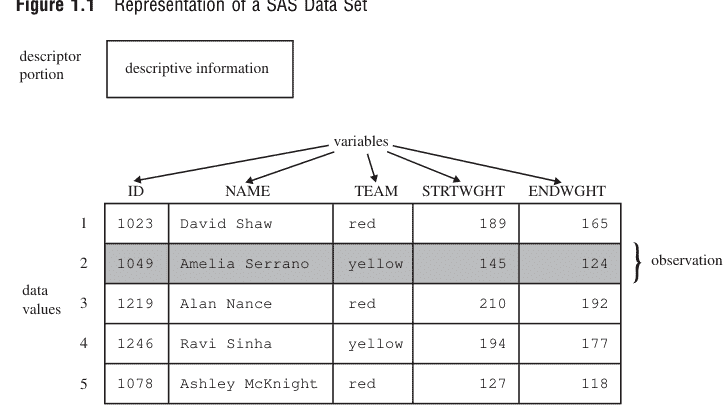

| ID | NAME | TEAM | STRWTGT | ENDWGT |
|---|---|---|---|---|---|
| 1 | 1023 | David Shaw | red | 189 | 165 |
| 2 | 1049 | Amelia Serrano | yellow | 145 | 124 |
| 3 | 1219 | Alan Nance | red | 210 | 192 |
| 4 | 1246 | Ravi Sinha | yellow | 194 | 177 |
| 5 | 1078 | Ashley Mcnight | red | 127 | 118 |

通常，观测值是与实体相关的数据，例如库存物品、区域销售办公室、客户或医疗诊所的患者。变量是这些实体的特征，例如销售价格、库存数量和原始供应商。当数据值不完整时，SAS 使用缺失值来表示观测值中的缺失变量。

## 外部文件

你用于读取和写入数据但其结构对 SAS 未知的数据文件被称为*外部文件*（external files）。外部文件可用于存储：

- 你想要读取到 SAS 数据文件的原始数据
- SAS 程序语句
- 过程输出结果（procedure output）

*操作环境信息：*请参阅你操作环境的 SAS 文档，详细了解你操作环境中外部文件的特征。△

## 数据库管理系统文件

SAS 软件能够与其他供应商的软件读写数据，例如许多常见的数据库管理系统（DBMS）文件。除了基础软件外，你必须为你的 DBMS 和操作环境许可 SAS/ACCESS 软件。

## SAS 语言元素

SAS 语言由语句、表达式、选项、格式和函数组成，类似于许多编程语言。在 SAS 中，你在两组 SAS 语句之一中使用这些元素：

- DATA 步（DATA steps）
- PROC 步（PROC steps）

DATA 步由一组 SAS 语言语句组成，可以实现：
- 从外部文件读取数据
- 读取 SAS 数据集和 SAS 视图
- 创建 SAS 数据集和 SAS 视图

一旦你的数据可以作为 SAS 数据集的形式被访问，你就可以使用一组被称为 SAS 过程（SAS procedures）的工具分析数据并编写报告。
一组过程被称为*PROC 步*（PROC step）。SAS 过程分析 SAS 数据集中的数据以生成统计数据、表格、报告、图表和图形，执行 SQL 查询，并对你的数据执行其他分析和操作。它们提供了管理和打印 SAS 文件的方法。

你可以在 DATA 步或 PROC 步之外使用全局 SAS 语句和选项。

## SAS 宏功能

Base SAS 包含宏处理功能（Macro Facility），这是一种强大的工具，用于扩展 SAS 会话、自定义 SAS 程序并减少语句量。你可以使用宏文件来执行 SAS 语句、在 SAS 日志中显示信息，并生成输出。

## 运行 SAS 会话的方法

### 开始 SAS 会话

根据你操作环境的 SAS 启动 SAS 会话，有关关于你操作环境的详细信息，请参阅 SAS 文档。在某些操作环境中，通过文件控制语句来启动 SAS 会话。

### 运行 SAS 的方式

你可以通过以下几种方式运行 SAS：
- 窗口环境（window environment）
- 交互模式（interactive mode）
- 非交互模式（noninteractive mode）
- 批处理模式（batch mode）

### 窗口环境

窗口环境中，你可以通过以下图形查看 SAS 环境：


在窗口环境中，你可以编辑你的 SAS 语句并查看 SAS 日志和输出。有关更多信息，请参阅 SAS 窗口环境*。


任何 SAS 语句都可以包含在 autexec 文件中。例如，你可以使用 autexec 文件自动设置报告标题、脚注或宏或宏变量。

**运行环境信息：** 请参阅适用于您的操作环境的 SAS 文档，了解如何设置 autexec 文件以便 SAS 能够找到它们。△

# 自定义 SAS 窗口环境

你可以自定义 SAS 窗口环境的许多方面，并保存设置以供后续话使用。通过 SAS 窗口环境，你可以：

- 更改管理器（Explorer）窗口中项目的显示和排序顺序
- 通过注册成员、条目和文件类型来自定义管理器
- 设置收藏文件夹
- 自定义工具栏
- 设置字体、颜色和偏好。

请查看 SAS 在线帮助以获取更多信息以及自定义您的 SAS 窗口环境的其他方法。

# Base SAS 软件概念信息

# SAS 系统概念

SAS 全局概念包括 SAS 语言的构建模块：单词和名称的规则、变量、缺失值、表达式、日期、时间和间隔，以及六种 SAS 语言元素中的每一种——数据集选项、格式、函数、读取格式（informats）、语句和系统选项。

SAS 全局概念还包括帮助你开始使用 SAS 的介绍信息，包括关于 SAS 日志、SAS 输出、错误处理、WHERE 处理和调试的信息。关于 SAS 处理的信息将帮助你准备编写 SAS 程序。关于如何优化性能以及如何监控性能的信息。

# DATA Step 概念

理解基本的 DATA Step 概念有助于有效地构建 DATA 程序。这些概念包括 SAS 如何处理 DATA Step、如何读取原始数据以创建 SAS 数据集，以及如何使用 DATA Step 编写报告。

更高级的概念包括在创建 SAS 数据集后如何合并和修改信息、如何对数据进行分段处理（BY-group processing）、如何使用数组处理进行更高效的编程，以及如何创建存储的编译 STEP 程序。

# SAS 文件概念

SAS 文件概念包含对高级应用有用的主题，尽管对于编写简单的 SAS 程序并非严格必须。这些主题包含了 SAS 使用的物理文件结构，包括数据库、数据文件、SAS 视图、目录、文件保护、引擎和外部文件。

数据文件的高级主题包括审计跟踪、生成数据集、完整性约束、索引和文件压缩。此外，这些主题还涉及与早期版本的兼容性问题以及如何跨操作环境处理文件。

# 第 2 章

## SAS 处理

- SAS 处理的定义 13
SAS 程序的输入类型 14
DATA Step 15
  DATA Step 输出 15
PROC Step 16
  PROC Step 输出 16

## SAS 处理的定义

SAS 处理是 SAS 语言读取并转换输入数据并生成你请求的输出的方式。DATA Step 和过程（PROC）Step 是 SAS 语言中的两个步骤。通常，DATA Step 用于处理数据，而 PROC Step 分析数据、产生输出或管理文件。这两种类型的步骤单独使用或结合使用，构成了 SAS 程序的的基础。底图显示了使用 DATA Step 和 PROC Step 进行 SAS 处理的高级视图。该图主要关注于 DATA Step。

图 2.1 SAS 处理

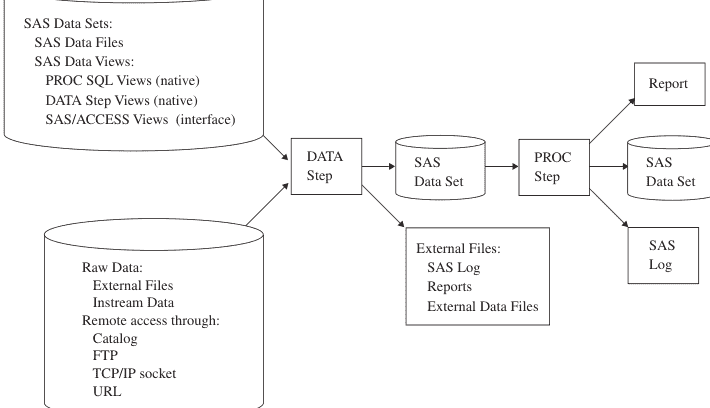

## SAS 程序的输入类型

你可以在 SAS 程序中使用不同的输入数据源：

- SAS 数据集可以是以下两种之一：
    - SAS 数据文件存储实际的数据值。一个 SAS 数据文件由一个描述文件中数据的描述部分和一个数据部分组成。
    - SAS 视图包含对存储在其他数据的引用。SAS 视图使用来自其他文件的描述信息和数据。它允许你动态组合来自各种源的数据，而无需使用存储空间创建新数据集。PROC SQL 视图和 SAS/ACCESS 视图。大多数情况下，你可以像使用 SAS 数据文件一样使用 SAS 视图。
- 原始数据指定未读入 SAS 数据集的未处理数据。你可以从两个源读取原始数据：
    - 外部文件包含格式化数据记录（数据按列排列）或自由格式化数据（未按列排列的数据）。
    - 流数据（Instream data）包含在你的程序中。你在数据开始处使用 DATALINES 语句来识别流数据。

有关信息，请参阅第 477 页第 27 章“SAS 数据文件”和第 531 页第 28 章“SAS 视图”。

有关原始数据的更多信息，请参见第 313 页第 20 章“读取原始数据”。

远程访问允许你从非位置源（如 TCP/IP 套字或 URL）读取输入数据。SAS 将这些数据视为来自外部文件。SAS 允许你通过以下方式远程访问输入数据：

- CATALOG 指定访问方法，允许你将 SAS 目录作为外部文件进行引用。
- FTP 指定访问方法，允许你使用文件传输协议（FTP）从连接到运行有 FTP 服务器的网络的任何主机计算机读取或写入文件。
- TCP/IP socket（socket）指定访问方法，允许你向传输控制协议/网际协议（TCP/IP）套字读取或写入数据。
- URL 指定访问方法，允许你使用统一资源标识符（URL）从连接到运行有 URL 服务器网络的任何主机计算机读取或写入文件。

有关远程访问数据的更多信息，请参阅 SAS 语言字典中语句部分的 CATALOG 访问方法、FTP 访问方法、SOCKET 访问方法和 URL 访问方法。

## SAS DATA Step

DATA Step 处理输入数据。在 DATA Step 中，你可以创建一个数据集，其可以是 SAS 文件或 SAS 视图。DATA Step 使用来自原始数据、远程访问、赋值语句或 SAS 数据集的输入。DATA Step 可以计算值、选择输入记录进行处理并使用条件逻辑。DATA Step 的输出可以是多种类型，例如数据集或报告。你还可以将数据写入 SAS 日志或外部数据文件。

## DATA Step 输出

DATA Step 的输出可以是数据集或外部数据文件，例如程序日志、报告或外部数据文件。你可以更新现有文件而无需创建单独的数据集。数据必须以数据集的形式才能被许多 SAS 过程处理。你可以创建以下类型的 DATA 输出：

- SAS 日志包含处理信息和程序错误。SAS 日志是默认生成的。
- SAS 数据文件是一个包含两个部分的数据集：数据部分和描述部分。
- SAS 视图是一个使用其他文件的描述信息和数据的数据集。SAS 视图允许你动态组合来自各种源的数据，而无需磁盘空间创建新数据集。虽然 SAS 数据文件实际包含值，但 SAS 视图仅包含对存储在其他位置引用。SAS 视图的类型为 VIEW。大多数情况下，你可以像使用文件一样使用 SAS 视图。
- 外部数据文件包含 DATA Step 处理的结果。这些是数据文件或文本文件。数据可以是记录。
- 报告包含 DATA Step 处理的结果。虽然你通常通过 PROC Step 生成报告，但你可以从 DATA Step 生成以下两种类型的报告：
    - 过程输出文件包含 DATA Step 处理的结果，通常包含页眉和分页符。


## PROC 步骤

包含您可以在万维网上显示的的结果。这种类型的输出是通过“输出交付系统（ODS）”生成的。有关 ODS 的完整信息，请参阅《SAS 输出交付系统：用户指南》。

HTML 文件

PROC 步骤由一组 SAS 语句组成，用于调用和执行过程，通常以 SAS 数据集作为输入。使用 PROCs 来分析 SAS 数据集中的数据、生成格式化报告或其他结果，或提供管理 SAS 文件的方法。您可以花费极少的努力修改 PROCs 以生成您所需的输出。PROCs 还可以执行诸如显示 SAS 数据集信息等功能。有关 SAS 过程的更多信息，请参阅《Base SAS 过程指南》。

## PROC 步骤输出

PROC 步骤的输出可以提供单变量描述统计、频率表、交叉分类表、由描述统计、图表、绘图等组成的表格报告。输出也可以以更新数据集的形式存在。有关过程输出的更多信息，请参阅《Base SAS 过程指南》和《SAS 输出交付系统：用户指南》。

## 第 3 章
SAS 语言中的单词和名称规则

- SAS 语言 17 中的单词
- 单词的定义 17
- 单词或标记的类型 18
- SAS 语句中单词的位置和间距 19
- 间距要求 19
- 示例 19
- SAS 语言中的名称 20
- SAS 名称的定义 20
- 用户提供的 SAS 名称的规则 20
- 大多数 SAS 名称的规则 20
- SAS 变量名称的规则 22
- SAS 名称字面量 23
- SAS 名称字面量的定义 23
- 重要限制 23
- 使用名称字面量时避免错误 24
- 示例 24

## SAS 语言中的单词

### 单词的定义

SAS 编程语言中的单词或标记（token）是字符集合，向 SAS 传达含义，且不能划分为可以独立使用的更小单元。单词最多包含 32,767 个字符。当 SAS 遇到以下任一一时，单词或标记结束：

- 新标记的开始
- 名称或数字标记后的空格
- 字面量标记的结束引号

SAS 语言中的每个单词或标记属于四类之一：

- 名称（names）
- 字面量（literals）
- 数字（numbers）
- 特殊字符（special characters）

### 单词或标记的类型

单词或标记有四种基本类型：

name（名称）是以字母或下划线开字符序列。后续字符可以是字母、下划线和数字。名称标记可以包含 32,767 个字符。但在大多数情况下，SAS 名称被限于较短的最大长度，例如 32 或 8 个字符。见第 21 页的表 3.1。以下是一些名称标记的示例：

- data
- _new
- cutoff
- year_99
- descending
- _n_

literal（字面量）由单引号或双引号括起的 1 到 32,767 个字符组成。以下是一些字面量的示例：

- 'Chicago'
- '1990-91'
- 'Amelia Earhart'
- 'Amelia Earhart's plane'
- 'Report for the Third Quarter'

> 注意：周围的引号将该标记识别为字面量，但 SAS 不将这些引号存储为字面量标记的一部分。△

number（数字）一般完全由数字组成，带有可选的小数点和前导正或负号。SAS 还将以下形式的数值识别为名称标记：科学计数法（E--）、十六进制表示法、缺失值符号以及日期时间字面量。以下是一些数字标记的示例：

- 5683
- 2.35
- 0x0
- -5
- 5.4E-1
- '24aug90'

special character（特殊字符）通常是字母、数字、下划线和空格以外的任何单个键盘字符。通常，每个特殊字符都是单个标记，尽管某些双字符运算符（如 `<=`）构成了单个标记。空格可以结束名称或数字标记，但它本身不是标记。以下是一些特殊字符标记的示例：

- =
- ;
- *
- +
- @
- /

## SAS 语句中的位置和间距

### 间距要求

1. 您可以在行的任何列开始 SAS 语句，并在同一行内编写多个语句。
2. 您可以在某行开始语句并在另一行继续，但不能在两行之间拆分空格。
3. 除非被引号括起来作为字面量或字面量的一部分，否则空格在 SAS 语句中不视为字符。因此，您可以在可以放置单个空格的任何位置放置多个空格，这不会影响语法。
4. 识别单词或标记边界的规则决定了 SAS 程序中它们之间间距的使用。如果 SAS 能根据运算符等线索确定每个标记的开始，则不需要包含空格。如果 SAS 无法确定每个标记的开始，则必须使用空格。见第 19 页的示例”。

尽管 SAS 没有严格的间距要求，但如果一致地缩进语句，SAS 程序将更易阅读和维护。示例说明了有用的间距规范。


# SAS 变量命名规则

| SAS 语言元素 | 最大长度 |
| :--- | :--- |
| 过程名称（前八个字符必须唯一，且不能以 "SAS" 开头） | 16 |
| SCL 变量 | 32 |

SAS 变量命名规则已经扩展，以提供更多功能。`VALIDVARNAME` 系统选项的设置决定了哪些规则适用于你在 SAS 会话中创建和生成的变量，以及也适用于你想要从现有数据中读取的变量的规则。`VALIDVARNAME` 选项有三种设置（V7、UPCASE 和 ANY），每个设置对变量名的灵活性程度不相同：

## V7

是默认设置。
变量命名规则如下：

- SAS 名称的长度最多可达 32 个字符。
- 第一个字符必须以英文字字母或下划线开头。后续字符可以是英文字字母、数字或下划线。
- 变量名不能包含空格。
- 变量名不能包含下划线以外的特殊字符。
- 变量名可以包含混合大小写。混合大小写会被记录并仅用于显示。（SAS 在第一次引用名称时存储其大小写）。当 SAS 处理变量时，它会在内部对其进行封装。你不能使用相同字母的不同大小写组合来表示不同的变量。例如，**cat**、**Cat** 和 **CAT** 都表示同一个变量。
- 你不能将特殊 SAS 变量（如 `_N_` 和 `_ERROR_`）的名称或变量列表名称（如 `_NUMERIC_`、`_ALL_`）的名称赋值给变量。

## UPCASE

与 V7 相同，但变量名会被转换为大写，正如 SAS 的早期版本一样。

## ANY

- SAS 名称的长度最多可达 32 个字符。
- 变量名可以包含任何 32 字节以内的特殊字符。
- 当设置 VALIDVARNAME=ANY 时，变量名可以包含空格。
- 变量名中的头部空格会被保留，但尾部空格会被忽略。
- 当设置 VALIDVARNAME=ANY 时，变量名必须包含一个字符。
- 变量名可以以任何字符开头。
> *注意*：当 `VALIDVARNAME` 选项设置为 `V7` 时，SAS 变量名只能使用拉丁字母、数字或下划线。如果你使用其他字符，则必须以名称字面量的形式表示。

# SAS 语言中的单词和名称命名规则

## 名称字面量（Name Literals）

如果你使用百分号（%）或连字符（&），则必须在名称 literal中使用单引号以避免与 SAS 宏发生交互。参见第 23 页的“名称字面量”。

变量名可以包含混合大小写。混合大小写会被记录并仅用于显示。（SAS 在第一次引用名称时存储其大小写）。当 SAS 处理变量时，它会在内部对其进行封装。因此，你不能使用相同字母的不同大小写组合来表示不同的变量。例如，`cat`、`Cat` 和 `CAT` 都表示同一个变量。

**警告**：`VALIDVARNAME=ANY` 的目的是兼容其他数据库的命名规范，例如允许空格。使用过多的双引号可能会导致意外结果。

## 名称字面量

### SAS 名称字面量的定义

**SAS 名称字面量**是指位于引号内的字符串，后跟大写或小写的 `n`。名称字面量允许你在指定数据集或变量时使用 SAS 规则不允许的特殊字符（包括空格）。引号与 `n` 之间的空格是有效的。当 `VALIDVARNAME=V7` 时，如果名称字面量包含任何字符，则必须将其设置为 `ANY`。注意：如果你将系统选项设置为 `ANY`，V6 引擎不支持带有间隔空格的名称。名称字面量对于包含特殊字符的数据库列名特别有用。

以下是 VAR 语句和名称字面量的示例：

```
var 'a' b;
```

以下是变量 A 和 B 的 VAR 语句示例：

```
var a b;
```

## 重要限制

- 名称字面量仅用于变量、语句标签以及数据库列和表名。
- 当变量或数据库列的名称字面量包含 `VALIDVARNAME=V7` 不允许的字符时，你必须将选项设置为 `ANY`。

> 有关 `VALIDVARNAME=ANY` 系统选项的更多信息，请参见 SAS 语言参考。

- 如果你使用百分号（%）或连字符（&），则必须在名称字面量中使用单引号以避免与 SAS 宏发生交互。

当数据库表或列的名称字面量包含 SAS 规则无效的任何字符时，你可能需要指定 SAS/ACCESS LIBNAME 语句选项。

> 注意：关于 SAS/ACCESS LIBNAME 语句以及不符合 SAS 命名规范的数据库表列名的更多信息和示例，请参见 SAS/ACCESS for Relational Databases: Reference。

在引号字符串中，SAS 保留并使用头部空格，但忽略尾部空格。

## 使用名称字面量时避免错误

有关如何避免错误创建名称字面量的信息，请参见 SAS 语言参考。


您可以使用 `CONTENTS` 过程，或后续定义中命名的函数来获取有关变量属性的信息：

## name（名称）

标识变量。变量名必须符合 SAS 命名规则。SAS 名称长度可达 32 个字符。第一个字符必须是字母（A, B, C, ., Z）或下划线（_）。后续字符可以是字母、数字（0 到 9）或下划线。注意，不使用空格。使用混合大小写变量。关于混合大小写变量的更多信息，请参阅第 17 页第 3 章“SAS 语言中的单词和名称规则”。

`N_`、`ERROR_`、`FILE_`、`INFILE_`、`MSG_`、`IORC_` 和 `CMD_` 留给 DATA 自动生成的变量。注意 SAS 生成的变量以下划线开头和结尾；建议不要在自己的应用程序中使用以下划线开头和结尾的名称。请参见第 33 页的“自动变量”以获取更多信息。

要确定此属性的值，请使用 `VNAME` 或 `VARNAME` 函数。

> 注意：本节描述的变量命名规则适用于 `VALIDNAME=` 系统选项设置为 `VALIDNAME=V7`（默认设置）时。只有当设置其他值时才适用其他规则。请参阅第 17 页第 3 章“SAS 语言中的单词和名称规则”以获取更多信息。

## type（类型）

标识变量或数字。在 DATA 步中，除非指示为字符，否则变量被假设为数值。数值值可以通过多种方式读取，并以浮点格式存储。字符值可以包含字母、数字和特殊字符，长度可以从 1 到 32,767 个字符不等。

要确定此属性的值，请使用 `VTYPE` 或 `VARTYPE` 函数。

## length（长度）

指 SAS 数据集中存储变量每个值时使用的字节数。您可以使用 `LENGTH` 语句设置数值型和字符变量的长度。在 `LENGTH` 语句中指定的变量长度仅影响输出数据集中数值变量的长度；在处理过程中，数值变量的长度为 8。在 `LENGTH` 语句中指定的字符长度同时影响处理过程中的长度和输出数据集中的长度。

在 `INPUT` 语句中，您可以为字符变量分配除默认以外的长度。您还可以在 `ATTRIB` 语句中为变量分配长度。首次出现在赋值语句左侧的变量，其长度与赋值语句右侧表达式的长度相同。

要确定此属性的值，请使用 `VELENGTH` 或 `VARLEN` 函数。

## format（格式）

指 SAS 在打印变量时使用的指令。如果没有指定格式，数值变量的默认格式为 `BEST12`，字符变量的默认格式为 `$`。您可以在 `FORMAT` 或 `ATTRIB` 语句中为变量分配 SAS 格式。您可以使用 `FORMAT` 过程为变量创建自定义的格式。

要确定此属性的值，请使用 `VFORMAT` 或 `VARFORMAT` 函数。

## informat（读取格式）

指 SAS 在读取数据值时使用的指令。如果没有指定读取格式，数值变量的默认读取格式为 `w.d`，字符变量的读取格式为 `$w`。您可以在 `INFORMAT` 或 `ATTRIB` 语句中为变量分配 SAS 读取格式。您可以使用 `FORMAT` 过程为变量创建自定义的读取格式。

要确定此属性的值，请使用 `VINFORMAT` 或 `VARINFMT`。

## label（标签）

指长度可达 25 个字符的描述性标签。变量标签可以由 SAS 过程打印，在报告编写中非常有用。您可以使用 `LABEL` 或 `ATTRIB` 语句为变量分配标签。

要确定此属性的值，请使用 `VLABEL` 或 `VARLABEL`。

## position in observation（观测值位置）

是变量在 DATA 步中定义的顺序。您可以找到变量在 SAS 数据集观测值中的位置。在 DATA 步中，变量在语句中的位置影响输出数据集中的顺序。

## index type（索引类型）

变量是否具有索引。参见第 50 页的“索引”以获取更多信息。要确定此属性的值，请使用 `VARNUM` 函数。

表 4.2 索引类型

| 值 | 定义 |
| :--- | :--- |
| NONE | 无索引 |
| SIMPLE | 简单索引 |
| COMPOSITE | 复合索引 |
| BOTH | 简单和复合索引 |

## Ways to Create（创建变量的方法）

### Overview（概述）

这些是创建变量的常用方法：

- 使用赋值语句
- 使用 `INPUT` 语句读取数据
- 在 `FORMAT` 或 `ATTRIB` 语句中指定新变量
- 使用 `LENGTH` 语句

### Using Assignment Statement（使用赋值语句）

在 DATA 步中，您可以使用赋值语句创建变量并赋值。对于首次出现在赋值语句左侧的变量，SAS 将其定义为右侧表达式的类型和长度。

注意：如果后续使用 `LENGTH` 语句，则该变量将未初始化。

表 4.3 未指定时的结果变量类型和长度

| 表达式 | 示例 | 结果类型 | 结果长度 | 解释 |
| :--- | :--- | :--- | :--- | :--- |
| 数值变量 | length 4; | 数值 | 8 | 默认数值（除非指定） |
| 字符变量 | a$4; | 字符 | 4 | 源变量长度 |
| 字符字面量 | x='ABC'; | 字符 | 3 | 字面量长度 |
| 变量拼接 | a$4; b$6; | 字符 | 12 | 变量长度之和 |
| 变量与字面量拼接 | x='CAT'; | 数值 | 8 | 变量与字面量长度之和 |

### Reading Data with the INPUT Statement（使用 INPUT 语句读取数据）

在 DATA 步中使用 `INPUT` 语句读取原始数据时，根据位置定义变量。您可以使用 `INPUT` 语句的各种方法来提供有关数据组织的信息：

参见 SAS 语言参考以获取有关方法的更多信息。以下示例使用简单输入创建一个数据集：

```sas
data gems;
  input Name $ Color $ Carats Owner $;
  datalines;
  emerald green 1 smith
  sapphire blue 2 johnson
  ruby red 1 clark
```

### Specifying a New Variable in a FORMAT or INFORMAT Statement（在格式或读取格式语句中指定新变量）

可以使用 `FORMAT` 或 `INFORMAT` 语句创建变量并指定其格式或读取格式。例如，下面的 `FORMAT` 语句在新的数据集中创建一个格式为 6.2 的 `SALE_PRICE` 变量：

```sas
data sales;
  Sale_Price:49.99;
  format Sale_Price 6.2;
run;
```

SAS 创建了一个名为 `SALE_PRICE` 长度为 8 的数值变量。参见 SAS 语言参考以获取更多关于使用 `FORMAT` 和 `INFORMAT` 语句的信息。

### Specifying a New Variable in a LENGTH Statement（在 LENGTH 语句中指定新变量）

可以使用 `LENGTH` 语句创建变量并设置其长度，如下例：

```sas
data sales;
  length Salesperson $20;
run;
```

对于字符变量，您必须在使用该变量的第一个语句中使用可能的值，因为无法在同一个 DATA 步中使用后续的 `LENGTH` 语句更改长度。对于数值变量，可以使用后续的 `LENGTH` 语句更改变量的长度。


# 使用 IN= 数据集选项的变量

length address1 address2 address3 $ 200;
address3=address1|address2;

由于 ADDRESS3 的长度为 200 字节，因此拼接后的 200 字节（即 ADDRESS1 的值）将全部赋值给 ADDRESS3。您可以通过使用 `TRIM` 函数在执行拼接之前移除 ADDRESS1 末尾的空格来避免此问题，如下所示：

```
address3=trim(address1)|address2;
```

请参阅 SAS 语言参考：字典以获取有关使用 LENGTH 语句的更多详细信息。

# 在 ATTRIB 语句中指定新变量

ATTRIB 语句允许您对现有变量指定以下一个或多个属性：

- FORMAT=
- INFORMAT=
- LABEL=
- LENGTH=

如果变量尚不存在，可以使用一个或多个 FORMAT-、INFORMAT- 和 LENGTH- 属性来创建一个新变量。例如，以下 DATA 步在 LOLLOPOPS 数据集中创建了一个名为 FLAVOR 的变量：

```sas
data lollipops;
Flavor="Cherry";
attrib Flavor=$10;
run;
```

注意：您无法通过 LABEL 语句或 ATTRIB 语句本身的 LABEL= 属性来创建新变量；标签只能应用于现有变量。△

请参阅 SAS 语言参考：字典以获取有关使用 ATTRIB 语句的更多详细信息。

# 使用 IN= 数据集选项

IN= 数据集选项创建一个特殊的布尔变量，指示该数据集是否对当前观测值有贡献。当为真时值为 1，为假时值为 0。您可以在 DATA 步的 SET、MERGE 和 UPDATE 语句中使用 IN=。

示例显示了 OLD 和 NEW 数据集的合并，其中该选项用于创建一个变量 X，指示 NEW 数据集是否有助于该观测值：

```sas
data master missing;
merge new(in=x) by id;
if x=0 output missing;
else output master;
run;
```

# 变量类型转换

如果您定义了一个数值变量并将字符表达式的结果赋值给它，SAS 会尝试将表达式的字符结果转换为数值并执行该语句。如果转换不成功，SAS 会将信息打印到日志中，为数值变量分配缺失值，并将自动变量 `_ERROR` 设置为 1。有关 SAS 自动将字符转换为数值变量以及反之的规则列表，请参阅第 64 页的“自动数值-字符转换”。

如果您定义了一个字符并将并将变量的结果赋值给它，SAS 会尝试使用 `Bestw.` 格式将数值结果转换为字符值，其中 `w` 是字符变量的宽度，最大值为 32。随后 SAS 会尝试执行该语句。如果字符变量长度不足以包含数字的表示，SAS 会将信息打印到日志并为字符变量分配星号（*）。如果值太小，SAS 不提供错误信息并将字符变量赋值为零（0）。

### 4.1 变量类型转换（部分 SAS 日志）

```
1 data_null;
2 x=3626885;
3 length y $ 4;
4 put;
5 put y;
NOTE: Numeric variables have been converted to character
   values at the places given by: (Line):(Column).
6E5
7 data_null;
8 x1=3626885;
9 length y1 $ 1;
10 x1=0.000005;
11 length y1 $ 1;
12 ys=;
13 put y1=;
14 run;
NOTE: Numeric variables have been converted to character
   values at the places given by: (Line):(Column).
9:12: Invalid character data, x1=3626885.0 , at line 9 column 7.
y1=y1;
x1=3626885 *=5e-6 ys=0 _ERROR_1_N=1
NOTE: At least one format was too small for the number to be printed.
   the decimal point was shifted by.
```

在示例的第一个 DATA 步中，SAS 能够通过科学计数法将 Y 的值放入 4 字节字段中。在第二个 DATA 步中，SAS 无法将 Y1 的值放入 1 字节字段中，而是显示星号（*）。

# 对齐变量值

在 SAS 中，数值变量向右对齐，字符值向左对齐。您可以使用格式进一步控制它们的对齐方式。

然而，当在赋值语句中分配字符值时，SAS 会按其在语句中出现的形式存储值，而不进行任何对齐。输出 4.2 展示了通过以下程序对齐的字符值：

```sas
data aircode;
input city $1-13;
length airport $10;
if city='San Francisco' then airport='SFO';
else if city='Honolulu' then airport='HNL';
else if city='New York' then airport='JFK' or EWR;
else if city='Miami' then airport='MIA';
datalines;
San Francisco
Honolulu
New York
Miami

proc print data=aircode;
run;
```

此示例产生以下输出：

输出 4.2 print 的输出

| OBS | CITY | AIRPORT |
|---|---|---|
| 1 | San Francisco | SFO |
| 2 | Honolulu | HNL |
| 3 | New York | JFK or EWR |
| 4 | Miami | MIA |

# 自动变量

自动变量由每个 DATA 步创建：`_N_` 和 `_ERROR_`。

`_N_` 设置为 1。每当 DATA 步循环时，`_N_` 就会加 1。`_N_` 的值代表 DATA 步迭代的次数。

`_ERROR_` 默认设置为 0，但当遇到输入错误、转换错误或计算错误时，它会被设置为 1。您可以使用此变量的值帮助定位数据中的错误。例如，以下语句会在遇到输入错误时写入日志：

```sas
if error_=1 then put_;
```

```sas
if error_ then put_;
```

# SAS 变量列表

### 定义

SAS 变量列表是引用变量列表的简写方法。SAS 允许您使用以下变量列表：

- 数字范围列表
- 名称范围列表
- 名称前缀列表
- 特殊名称列表

除了数字范围列表外，您按照 SAS 跟踪变量的顺序在变量列表中引用变量。SAS 根据编译器在 DATA 步中遇到变量的顺序来跟踪活动变量，无论它们是从数据集、外部文件还是在步骤中创建的，只要名称具有相同前缀，您就可以引用它们。

您可以在许多 SAS 语句和数据集选项中使用变量列表，包括定义变量的语句。然而，在您定义了所有变量后，这些列表 特别有用，因为为引用现有数据组提供了快捷方法。

> 注意：只有数字范围列表用于 RENAME= 选项。

## 数字范围列表

数字范围列表要求您拥有一系列具有相同名称（除最后一个字符或字符外）且数字连续的变量。例如，两个列表引用相同的变量：

```
x1,x2,x3,...,xn
```

```
x1-xn
```

在数字范围列表中，您可以从任何数字开始并在任何数字结束，只要不违反用户变量命名规则且数字是连续的。

注意字符变量 NAME 不包含在缩写列表中。


# 名称范围列表 (Name Range Lists)

名称范围列表依赖变量定义的顺序，如下表所示：

**表 4.4** 名称范围列表

| 变量列表 | 包含的变量 |
| --- | --- |
| x--a | 按照变量定义顺序从 X 到 A（包含）的所有变量 |
| x-numeric-a | 从 X 到 A（包含）的所有数值变量 |
| x-character-a | 从 X 到 A（包含）的所有字符变量 |

你可以在 PROC CONTENTS 中使用 `VARNUM` 选项来按照定义顺序打印变量。
例如，考虑以下 `INPUT` 语句：

```
input idnum $ weight pulse chins;
在后续语句中，你可以使用这些变量列表：
/* 仅保留数值变量 idnum, weight 和 pulse */
keep idnum--numeric-pulse;

/* 保留连续的变量 name, weight 和 pulse */
keep name--pulse;
```

# 名称前缀列表 (Name Prefix Lists)

某些 SAS 函数和语句允许你使用名称前缀列表来引用以特定字符串开头的变量：

```
sum(of SALES):
```

告诉 SAS 计算所有以 "SALES" 开头的变量之和，例如 SALES_JAN、SALES_FEB 和 SALES_MAR。

# 特殊 SAS 标识列表 (Special SAS Name Lists)

特殊的 SAS 标识列表包括

- - NUMERIC_
指定当前 DATA step 中已定义的所有数值变量。

- - CHARACTER_
指定当前 DATA step 中当前定义的所有字符变量。

- - ALL_
指定当前 DATA step 中定义的所有变量。

# 删除、保留和重命名变量 (Dropping, Keeping, and Renaming Variables)

## 使用语句或数据集选项 (Using Statements or Data Set Options)

`DROP`、`KEEP` 和 `RENAME=` 数据集选项控制 DATA step 期间处理或输出哪些变量。你可以使用这些语句和数据集选项中的一个或组合来实现你想要的结果。SAS 采取的操作在很大程度上取决于你：

- 使用语句还是数据集选项
- 在输入数据集或输出数据集上指定数据集选项

下表总结了 `DROP`、`KEEP` 和 `RENAME` 语句与 `DROP=`、`KEEP=` 和 `RENAME=` 数据集选项之间的通用区别。

表 4.5 删除、保留和重命名变量的语句与数据集选项

| 语句 | 数据集选项 |
| --- | --- |
| 仅适用于输出数据集， | 适用于输入数据集。 |
| 影响所有输出数据集。 | 影响单个数据集。 |
| 只能在 DATA steps 中。 | 可用于 DATA steps 和 PROC steps。 |
| 可以出现在 DATA steps 中的任何地方。 | 必须紧跟在其应用的每个数据集名称之后。 |

## 使用输入或输出数据集 (Using the Input or Output Data Set)

在变量读入程序向量或写入新的 SAS 数据集之前，你必须考虑是删除、保留还是重命名该变量。如果你使用 `DROP`、`KEEP` 或 `RENAME` 语句，操作会在变量写入输出数据集时发生。对于数据集选项，使用该选项的位置决定了操作发生的时间。如果选项在输入数据集上，则变量在读入程序向量之前就会被删除、保留或重命名。如果用于输出数据集，则数据集选项在变量写入新的 SAS 数据集时应用。（在 DATA step 中，输入数据集是指在 `DATA` 语句中指定的那个。）`MERGE` 或 `UPDATE` 语句。在做决定时，考虑以下操作：

- 如果变量不写入输出数据集且不需要任何处理，则使用输入数据集选项将其排除在 DATA step 之外会更高效。
- 如果你想在 DATA step 中处理变量之前对其进行重命名，必须在输入数据中使用 `RENAME=` 数据集选项。
- 如果操作适用于输出数据集，你可以在输出数据集中使用语句，也可以使用数据集选项。

下表总结了当为输入和输出数据集指定选项时，数据集选项和语句的作用。表的最后一列告诉你是该变量在 DATA step 中是否可用于处理。如果你想重命名变量，请使用最后一列中的信息。

# 表 4.6 删除、保留和重命名变量时变量和变量名的状态

| 地位置 | 数据集选项 | 目的 | 变量名状态 |
| :--- | :--- | :--- | :--- |
| 输入数据集 | DROP= KEEP= | 从处理中包含或排除变量 | 如果被排除，则变量在 DATA step 中无法使用 |
| | RENAME= | 在处理之前更改变量名称 | 在程序语句和输出数据选项中使用新名称；在输入数据中使用旧名称 |
| 输出数据集 | DROP, KEEP | 指定哪些变量被写入所有输出数据集 | 所有变量均可用于处理 |
| | RENAME | 更改所有输出数据集中的变量名称 | 在程序语句中使用旧名称；在输出数据选项中使用新名称 |
| | DROP= KEEP= | 指定哪些变量被写入单个输出数据集 | 所有变量均可用于处理 |
| | RENAME= | 更改单个输出数据集中的变量名称 | 在程序语句和其他输出数据选项中使用旧名称 |

# 应用顺序 (Order of Application)

如果你的程序要求使用多个一个数据集选项，或者数据集选项与语句的组合，那么了解 SAS 按照以下顺序删除、保留和重命名变量是有帮助的：

- 首先，在 `SET`、`MERGE` 和 `UPDATE` 内部从左到右评估输入数据集上的选项。`DROP=` 和 `KEEP=` 选项在 `RENAME` 选项之前应用。
- 接下来，将 `DROP` 和 `KEEP` 语句应用于变量。
- 最后，从左到右评估输出数据集上的选项。

# 删除、保留和重命名变量的示例 (Examples of Dropping, Keeping, and Renaming Variables)

以下示例展示了删除、保留和重命名变量的方法：

- 此示例使用 `INPUT` 函数将 `PORANK` 转换为数值。注意 `TEMVAR` 从输出数据集中删除。

```
data newstate(drop=tempvar);
  length poprank 8;
  set state(rename=(poprank=tempvar));
  poprank=input(tempvar,8);
run;
```

此示例使用 `DROP` 语句和 `DROP=` 数据集选项控制变量的输出。该语句适用于 `COR` 和 `BEAN`。你必须使用 `RENAME=` 数据集选项来重命名输出变量 `BEANWT` 和 `CORNWT`。

```
data corn(rename=(cornwt+yield)) drop=beanwt;
  bean=(beanwt+yield) drop=cornwt;
  set harvest;
  if crop='corn' then output crop;
  else if crop='bean' then output bean;
run;
```

此示例展示了如何在 DATA step 中使用选项和语句。注意新名称 `QRTOT` 使用在 `DROP=` 数据集选项。

```
data qtr1 qtr2 (drop=qtrtot)
  set ydsales;
  if qtr=1 then output qtr1;
  else if qtr=2 then output qtr2;
  else output ytd;
  rename total=qtrtot;
run;
```

# SAS软件中的数值精度 (Numeric Precision in SAS Software)

# SAS 如何存储数值 (How SAS Stores Numeric Values)

为了存储数量级数字并执行在小数点右侧需要许多精度的计算，SAS 使用浮点（二进制）存储所有数值。浮点表示法是通常的科学计数法的实现，其中数值表示为 0 到 1 之间的数乘以 10 的幂。以下是科学计数法的示例：

> .1234 × 10^4

科学计数法由以下部分组成：

- 基是用于表示数字的位置位系统中的有效位数（包括零）；在此示例中，基是 10。
- 尾数是定义数量级的数字；在此示例中，尾数是 .1234。
- 指数表示基需要相乘的次数；在此示例中，指数是 4。


# SAS 变量 关于浮点表示的故障排除 39

浮点表示是科学计数法的一种，不同之处在于大多数操作系统上，基数不是 10，而是 2 或 16。下表总结了存储在 8 字节中的各种浮点表示方式。

表 4.7 存储在 8 字节中的浮点数总结
| 表示方式 | 基数 | 指数位 | 最大尾数位 |
|---|---|---|---|
| IBM 主机 | 16 | 7 | 56 |
| IEEE | 2 | 11 | 52 |

SAS 通过 `LENGTH` 语句使用截断浮点数，这减少了尾数位的数量。有关截断长度影响的更多信息，请参阅第 43 页的“使用较低精度存储数字”。

## 关于浮点表示的故障排除

### 概述

在许多情况下，SAS 存储数值的方式对你作为用户没有影响。然而，浮点表示可能会导致你会在 SAS 程序行为中注意到的异常。以下章节识别了在各种操作系统环境中可能发生的问题类型，以及你如何预测并避免它们。

## IBM 主机上的浮点表示

SAS for z/OS 使用传统的 IBM 主机浮点表示法，如下：

```
EEEEEEEE EMMMMMMMM EMMMMMMMM
byte 1 byte 2 byte 3 byte 4

EEEEEEEE EMMMMMMMM EMMMMMMMM
byte 5 byte 6 byte 7 byte 8
```

这种表示法对应于数据字节，每个字符均为 1，如下：

- 字节 1 中的 S 是符号位。符号位为 0 时表示正数。
- 字节 1 中的七个 E 字符表示一个被称为“阶码”（characteristic）的二进制整数。阶码表示带符号的指数，通过将阶码加上偏移量（bias）得到。偏移量是一种偏移值，用于通过偏置法同时启用负指数和正指数。如果不使用偏移量，则必须为指数分配一个额外的符号位。例如，如果系统使用 64 作为偏移量，则值为 66 的阶码表示指数 +2，而值为 61 的阶码表示指数 -3。
- 字节 2 到 8 中剩余的 M 字符表示尾数的位。尾数最左侧位之前有一个隐含的基数点（radix point）；因此尾数始终小于 1。使用“基数点”而不是“小数点”是因为“小数点”意味着你正在处理十进制（基 10）数字，而情况可能并非如此。基数点可以被看作小数点的通用形式。

指数有一个与之相关的基数。不要将其与表示指数时使用的基数混淆；指数始终以二进制表示，但指数用于确定基数应该被乘以尾数的多少次。在 IBM 主机的案例中，指数的基数是 16。对于其他计算机，它是 2 或 16。

尾数中的每一位都代表一个分子为 1、分母为 2 的幂的分数。例如，字节 2 中的最左位表示 $(1/2)$，下一位表示 $(1/4)$，依此类推。换句话说，尾数是系列分数之和，如 $1/2$、$1/4$、$1/8$ 等。因此，为了精确地表示任何浮点数，你必须能够将其表示为上述的和。例如，100 表示为以下表达式：

$$(1/4+1/8+1/64) \times 16^2$$

为了说明如何获得上述表达式，紧接着有两个示例。第一个示例是十进制的。数值 100 表示如下：

.100

该数中的点是基数点。尾数必须小于 1；因此，通过将基数点向左移动三位对该值进行归一化，得到：

.100

由于基数点向左移动了三位，3 是指数：

$.100 \times 10^3$

第二个示例是基 16。在十六进制表示中，100（基 10）写作：

64.

将基数点向左移动两位得到以下值：

.64

将基数点向左移动也产生指数 2，如：

$.64 \times 16^2$

该数的二进制值为 .01100100，可以用以下表达式表示：

$$(1/2)^2 + (1/2)^3 + (1/2)^6 = 1/4 + 1/8 + 1/64$$

在此示例中，指数是 2。为了表示指数，使用偏移量 64。结果值的十六进制表示为 42。二进制表示如下：

```
01100100 0000000 00000000
```

## OpenVMS 浮点表示

### 在 OpenVMS 上

在 OpenVMS 上，SAS 使用浮点格式存储数值，方案如下：

```
MMMMMMMM MMMMMMM MMMMMMM
byte 8 byte 7 byte 6 byte 5 byte 4 byte 3 byte 2 byte 1
```

在浮点格式中，指数位不是 7 位，但使用的是基 2 而不是 16，偏移量为 128，这意味着范围没有 IBM 表示大。浮点格式的尾数物理上是 5 位。OpenVMS 下的所有浮点值都是归一化的，这意味着保证高位为 1。由于这种保证，不需要在物理上表示尾数的高位；因此高位是隐藏的。

例如，十进制值 100 的二进制表示如下：

```
01100100
```

该值可以通过移动基数点进行归一化：

```
.1100100
```

由于基数向左移动了七位，指数 7 加上偏移量 128 是 5。以二进制表示，该数字如下：

```
10000111
```

为了表示尾数，从分数域中减去隐藏位：

```
.00100
```

你可以将符号（0）、指数和尾数结合产生浮点格式：

```
MMMMMMMM MMMMMMM MMMMMMM MMMMMMM
00000000 00000000 00000000 00000000
MMMMMMMM MMMMMMM EEEEEEE EMMMMMM
00000000 00000000 01100111 11000100
```

### 使用 IEEE 标准的浮点表示

电气电子工程师学会（IEEE）表示法被许多操作系统（包括 Windows 和 UNIX）使用。IEEE 表示使用 11 位指数，基数为 2，偏移量为 1023，这意味着它的范围比 IBM 主机表示大得多，但是以牺牲尾数 3 位为代价的。IEEE 标准表示的 1 为：

```
3F 00 00 00 00 00 00
```

## 精度与范围

正如前面的章节所述，浮点表示允许具有极大范围的数字（高达 $2^{30}$）和高精度（小数点位右侧有许多数字）。然而，不同的操作系统在使用多少精度和多少范围方面存在差异。

在第 38 页的“SAS 如何存储值”中，你可以看到指数位和尾数位。预留给尾数的位越多，精度越高；预留给指数的位越多，数字范围越大。

精度或范围更重要取决于你的数据的特征。例如，如果你在处理物理应用，可能需要大数字，范围可能更重要。如果你在处理银行应用，每一位数字都重要，但位数并不多，那么精度更重要。通常情况下，SAS 应用需要适量的精度和范围，而浮点表示提供了足够的支持。

## 分数的计算考量

无论可用多少精度，仍然存在某些数字无法精确表示的问题。在十进制系统中，1/3 无法用十进制表示法精确表示。同样，大多数分数（例如，.1）在基 2 或基 16 系统中无法精确表示。这是在浮点表示中难以表示分数的数字的主要原因。

考虑 IBM 主机对 1 的表示：

注意末尾的数字 9，类似于尝试表示 1/3 时末尾的数字 3 (.3333 ...)。这种精度的缺乏由于算术运算而加剧。如果你多次叠加 1/3 的十进制表示会发生什么？当你将 .33333 ... 加上 .99999 ... 时，理论答案是 1.33333 ... 2，但实际中这种答案是不可能的。随着数值计数，和会变得不精确。

同样，执行以下 DATA 步骤时也会相同的过程：

```
data _null_
  do i=-1 to 1 by;
    if i=0 then put 'AT ZERO';
  end;
run;
```

DATA步骤中的 AT ZERO 信息从未打印，因为不精确数字的积累引入了足够的误差，导致值从未等于 0


## SAS 浮点数表示变量故障排除问题

遇到的。数值非常接近，但永远不精确等于 0。这个问题可以通过对每次迭代进行显式舍入来轻松解决，如下述语句所示：

```sas
data _null_;
i=-1;
do while(i<=1);
ni=round(i.1..001);
if i=0 then put 'AT ZERO'
end;
run;
```

## 数值比较考虑事项

如第 42 页“分数的计算因素”中讨论的，不精确可能会导致计算出现问题。不精确也可能导致比较出现问题。考虑以下示例，其中 PUT 语句没有执行：

```sas
data _null_;
x=1/3;
if x=.33333 then put 'MATCH'
run;
```

然而，如果在下面的示例中添加了 `ROUND` 函数，PUT 语句就会执行：

```sas
data _null_;
x=1/3;
if round(x,.00001)=.33333 then put 'MATCH'
run;
```

通常情况下，如果你在与小数值进行比较，使用 `ROUND` 函数是一个好习惯。

## 存储低精度的数字

如第 38 页“SAS 存储数值值”中讨论的，SAS 允许以小于精度的精度存储数值。使用 `LENGTH` 语句来控制用于存储浮点数的字节数。请谨慎使用 `LENGTH` 语句以避免数据丢失。

例如，IBM 主机使用 8 字节表示精度，但你可以在磁盘上存储少至 2 字节。数值 1 表示为 `41 10 00 00 00 00 00 08`。在 2 字节中，它将被截断为 `41 10`。你仍然拥有完整的数量级，因为指数仍然存在；只是涉及的数字少了。字节数的减少意味着小数点右侧或末尾零之前的位数更少。

例如，考虑数字 1234567890，它相当于 10 的 10 次方的 `.1234567890`。如果你只有五位精度，该数字将变为 1234600000（四舍五入）。无论使用什么 10 的幂次（`.12346`, `.1234`, `.000012346` 等），情况都是如此。

使用 `LENGTH` 进行截断是为了节省空间。所有值在 `DATA` 和 `PROC` 步骤中都会扩展到完整尺寸以执行计算。此外，正如前面的讨论所示，你对长度的选择必须小心。

考虑 IBM 主机系统上的 2 字节长度。该值允许用 1 字节存储指数和符号，并用 1 字节存储尾数。在 1 字节中可以存储的最大值是 255。因此，如果指数为 0（意味着 16 的 0 次方，或乘以尾数），可以完全存储的最大整数是 255。然而，较大的整数可以存储，因为它们是 16 的倍数。例如，考虑下表中 256 到 272 的8 字节表示：

表 4.8 256 到 272 的八字节表示

| 数值 | 符号/指数 | 尾数 1 | 尾数 2 | 注意事项 |
|---|---|---|---|---|
| 256 | 43 | 10 | 000000000 | 末尾零；16 的倍数 |
| 257 | 43 | 10 | 1000000000 | 需要额外的字节 |
| 258 | 43 | 10 | 2000000000 | |
| 259 | 43 | 10 | 3000000000 | |
| . | | | | |
| . | | | | |
| . | | | | |
| 271 | 43 | 10 | F000000000 | |
| 272 | 43 | 11 | 000000000 | 末尾零；16 的倍数 |

257 到 271 的数字无法精确存储在 2 字节中；精确存储该数字需要第三个字节。因此，以下代码产生误导性结果：

```sas
data temp;
length x 2;
x=257;
y1=x+1;
run;

data null;
set temp;
if x=257 then put 'FOUND';
y2=y1;
run;
```

PUT 语句从未执行，因为 X 的值实际上是 256（257 被截断为 2 字节）。记住，256 以 2 字节存储为 `4310`，但 257 也以 2 字节存储为 `4310`，只是第三个字节被截断了。你没有收到 257 在第一个 步骤中被截断的警告。然而，Y1 的值为 258，因为 X 的值在数据向量中被完整保留。Y2 的值为 257，因为 X 在读入数据向量之前被截断了。

> 注意：如果变量值不是整数，请不要使用 `LENGTH` 语句。如果截断，小数将丢失精度。此外，仅在磁盘空间有限时使用 `LENGTH` 语句来截断值。请参考你环境的 SAS 文档中的最大值。

## 浮点数表示故障排除 第 4 章

`TRUNC` 函数将数字截断为指定的长度，然后将其扩展回完整长度。截断和随后的扩展了以小于长度存储数字并读取它们的效果。例如，如果变量

```sas
x=1/3;
```

以长度 3 存储，则以下比较不成立：

```sas
if x=1/3 then ...;
```

然而，添加 `TRUNC` 函数使比较成立，如下：

```sas
if x=trunc(1/3,3) then ...;
```

## 截断数字并进行比较

`TRUNC` 函数将数字截断为指定的长度，然后将其扩展回完整长度。截断和随后的扩展了以小于长度存储数字并读取它们的效果。例如，如果变量

```sas
x=1/3;
```

以长度 3 存储，则以下比较不成立：

```sas
if x=1/3 then ...;
```

然而，添加 `TRUNC` 函数使比较成立，如下：

```sas
if x=trunc(1/3,3) then ...;
```

## 确定精确存储数字需要多少字节

要确定精确存储一个数字需要多少字节，可以使用 `TRUNC` 函数。例如，以下程序：

```sas
data numbers;
  input value;
269
270
271
272
;
data temp;
  set numbers;
  x=value;
  do i=1 to 8;
    y=trunc(x,i);
    if y=value then do;
      len=i;
      output;
      leave;
    end;
  end;
end;
```

proc print;
  var len;
run;
```

## 输出 4.3 使用 TRUNC 函数

| SAS 系统 | MINLEN |
|---|---|
| 269 | 3 |
| 270 | 3 |
| 271 | 3 |
| 272 | 2 |

注意，271 的最小要求大于 272 的值。

## 双精度与单点数

你可能来自外部程序的数据，希望将其读入数据集。如果数据是浮点型的，可以使用 `RBw.d` 格式。然而，存在例外。如果 `w` 值小于8，`RBw.d` 可能会截断双精度数字。在所有操作系统，8字节浮点数被称为 double。在 IBM PLI 中，它是 `FLOAT(8)`。在 FORTRAN 中，它是 `FLOAT(53)`。4字节浮点数在 C 语言中称为 float，在 FORTRAN 中为 `REAL*4`，在 IBM PLI 中为 `BINARY(21)`。

在 IBM 主机上，单精度浮点数与截断为 4 字节的双精度完全相同。在采用 IEEE 标准的操作系统上，并非如此；使用 RB4 格式读取值不会产生预期的结果。

## 在操作系统之间传输数据

使用浮点数时的精度和数量级问题不仅限于单一操作系统。在操作系统之间移动数据时可能会出现额外问题，除非你小心。本文讨论了在使用 `UPLOAD` 和 `DOWNLOAD` 过程、`CPORT` 和 `CIMPORT` 过程或传输引擎传输大数值或纯数值数据集时需要考虑的因素。

表 4.7 显示了基数、指数和尾数的最大位数。由于不同操作系统环境中可以存储的最大值存在差异，因此在系统之间传输你的浮点数据可能会出现问题。

考虑，在 IBM 主机和 PC 之间传输数据时，考虑 IBM 的浮点数范围限制约为 .54E-78 到 .72E76（以及负等值和 0）。其他计算机（如 PC）具有更宽的限制（PC 的上限约为 1E308）。


在大型机上，你会丢失这种数量级。在数据传输过程中，数值会被设置为该操作系统允许的最小值或最大值，因此 PC 上的 1E100 会转换为 IBM 大型机上约为 .72E76 的值。

注意：

计算机之间的数据传输可能会影响数值的精度。如果你正在将数据从 IBM 大型机传输到 PC，请注意，尾数的位位数比 IBM 大型机少 4 位，这意味着在移动到 PC 时你会丢失 4 位。这种精度和数量级的差异是在数据从一个运行环境移动到任何其他浮点表示法不同的运行环境时，一个需要考虑的因素。

# 第 5 章
## 缺失值

- 缺失值的定义 49
- 创建特殊缺失值 50
- 定义 50
- 提示 50
- 示例 50
- 缺失值的顺序 51
- 数值变量 51
- 字符变量 52
- SAS 何时自动将缺失值设置为缺失值 52
- 读取原始数据时 52
- 读取 SAS 数据集时 53
- 当 SAS 生成缺失值时 53
- 计算中缺失值的传播 53
- 非法操作 53
- 非法的字符到数值转换 53
- 创建特殊缺失值 54
- 防止缺失值的传播 54
- 处理缺失值 55
- 如何在原始数据中表示缺失值 55
- 如何在 DATA Step 中将变量值设置为缺失 55
- 如何在 DATA Step 中检查缺失值 56

## 缺失值的定义

缺失值（missing value）
表示当前观测值中变量没有存储数据值的值。缺失值有三种：

- 数值
- 字符
- 特殊数值

默认情况下，SAS 将缺失的数值值打印为单个点号 (.)，将缺失的字符值打印为空格。有关特殊数值缺失值的更多信息，请参见第 50 页的“创建特殊缺失值”。

## 创建特殊缺失值

### 定义

特殊缺失值（special missing value）
是一种数值缺失值，允许你使用字母 A-Z 或下划线来表示不同类别的缺失数据。

## 提示

- SAS 接受大写或小写字母。值显示和打印时均为大写。

- 如果你不以点号开始一个特殊缺失值，SAS 将其识别为变量名。因此，在 SAS 表达式或赋值语句中使用特殊缺失值时，必须以点号开头，后跟字母或下划线；
x=d;

- 当 SAS 打印特殊缺失值时，它只打印字母或下划线。
- 当数值字段中包含你希望 SAS 解释为特殊缺失值的字符时，使用 `MISSING` 语句来指定这些字符。更多信息请参见《SAS 语言参考手册：字典》中的 `MISSING` 语句。

## 示例

示例使用了来自市场研究公司的数据。聘佣了五名测试人员测试五种产品的易用性和有效性。如果测试人员缺席，则没有报告，值用 X 表示“缺席”。如果测试人员无法充分测试产品，则没有评分，值用 I 表示“测试未完成”。以下程序读取数据，并在第一行和第三行数据中显示生成的 SAS 缺失值：

```
data period_a;
miss X;
input Id $4. Foodpr1 Foodpr2 Foodpr3 Coeffeem2;
datalines;
1001 115 45 65 1 78
1002 86 27 55 72 86
1004 93 52 76 88
1015 73 35 43 112 108
1027 101 127 39 76 79
;
proc data=period_a;
title 'Results of Test Period A';
footnote 'X indicates TESTER ABSENT';
```

footnote 'I indicates TEST WAS INCOMPLETE';

产生了以下输出：

## 输出 5.1 带有多个缺失值的输出

| Obs | Id | Foodpr1 | Foodpr2 | Foodpr3 | Coeff1 | Coeff2 |
|---|---|---|---|---|---|---|
| 1 | 1001 | 115 | 45 | 65 | | 78 |
| 2 | 1002 | 86 | 27 | 55 | 72 | 86 |
| 3 | 1004 | 93 | 52 | X | 76 | 88 |
| 4 | 1015 | 73 | 35 | 43 | 112 | 108 |
| 5 | 1027 | 101 | 127 | 39 | 76 | 79 |

X 表示测试缺席
I 表示测试未完成

## 缺失值的顺序

## 数值变量

在 SAS 中，数值变量的缺失值比所有数字都小：如果你按数值变量对数据集进行排序，该变量具有缺失值的观测值将出现在排序后的数据集前面。对于数值变量，你可以将特殊缺失值与数字以及相互之间进行比较。第 51 页的表 5.1 显示了数值的排序顺序。

表 5.1 数值排序顺序

| 排序顺序 | 符号 | 说明 |
|---|---|---|
| smallest | _ | 下划线 |
| | . | 点 |
| | A-Z | 缺失值 A-Z |
| | | -n | 负数 |
| | 0 | 零 |
| | +n | 正数 |

例如，SAS 在排序大小写字母时不会区分缺失值。注意：无论系统使用 ASCII 还是 EBCDIC 排序序列，数值值都是

## 字符变量

字符变量的缺失值比任何打印字符都小。因此，当你按字符变量对数据集进行排序时，缺失值（空格）的观测值出现在打印字符之前。当字符值包含非数值信息且 SAS 尝试将其转换为数值值时，通常会产生缺失值（空格）。

## SAS 何时自动将缺失值设置为缺失值

## 读取原始数据时

在每个迭代开始时，SAS 将它们设置为缺失值，除非出现以下情况：

- RETAIN 指定的变量
- SUM 语句中的元素
- 使用 ARRAY 创建的变量
- FILE 语句中的元素
- TEMPORARY 创建的变量
- 使用 SET、MERGE 或 UPDATE 创建的变量

所示：

```
data new;
input x;
if x=1 y=2;
datalines;
4
3
```

此 DATA step 产生了如下输出：

| OBS | X | Y |
|---|---|---|
| 1 | | |
| 2 | | |
| 3 | | |
| 4 | | |

当 X 不等于 1 时，Y 保持缺失。

## 读取 SAS 数据集

当通过 SET、MERGE 或 UPDATE 读取变量时，SAS 在第一次迭代之前将其设置为缺失。变量在获得新值之前（例如通过赋值语句或下一个 SET、MERGE 或 UPDATE）会保留其值。

BY 语句生成的自动变量 FIRST_variable 和 LAST_variable 会保留它们的值。它们的初始值为 1。

当 BY 值发生变化时，变量被设置为缺失并保持缺失，因为数据没有提供替换值。当在没有 BY 语句的一对一合并操作中，数据集中的所有行处理完成后，输出数据集中的变量将被设置为缺失。

img/a5ce6a7fc3f6237e24c3077d09d6829_63_0.png)

# SAS 生成缺失值时

## 计算中缺失值的传播

SAS 分配缺失值以防止问题的出现。如果你在算术计算中使用缺失值，SAS 会将该计算的结果设置为缺失。然后，如果你将该结果用于另一个计算，下一个结果也是缺失的。这种行为被称为缺失值的传播。SAS 在日志中打印备注，告知哪些算术表达式具有缺失值以及它们何时创建；然而，处理继续。

# 非法操作

如果你尝试执行非法操作，SAS 会在日志中打印备注并为结果分配缺失值，例如以下：

+- 除以零
- 取零的对数
- 使用表达式产生无法用浮点数表示的数字（称为溢出）。

## 非法的字符到数值转换

当字符变量用于算术表达式时，SAS 会自动将字符转换为数值。如果字符值包含非数值信息且 SAS 尝试将其转换为数值值，则会产生备注

打印在日志中，转换结果被设置为缺失值，且 _ERROR_ 自动变量被设置为 1。

## 创建特殊缺失值

SAS 表达式中任何数值缺失值的结果都是点号。因此，特殊缺失值和普通数值缺失值都会以点的形式传递。

```
data a;
x=d;
y=x+1;
put y;
run;
```

此 DATA 步产生以下日志：

输出 5.2 缺失值的 SAS 日志结果

| 1 | data a; |
| 2 | x=.d; |
| 3 | y=x+1; |
| 4 | put y; |
| 5 | run; |

y=;
NOTE: 由于对缺失值执行操作，产生了缺失值。每个位置如下：(次数)位于 (行):(列)。
1 at 3
NOTE: 数据集 WORK.A 包含 1 条观测值和 2 个变量。
NOTE: 使用了 DATA语句：
实际时间 0.58 秒
CPU 时间 0.05 秒

## 防止缺失值的传递

如果你不希望缺失值在算术表达式中传递，可以通过样本统计函数在计算中省略缺失值。如需这些函数的列表，请参阅《SAS 语言参考字典》中“按分类划分函数和 CALL 常程”中的描述统计类别。例如，考虑以下 DATA 步：

```
data test;
x=;
y=5;
a=xxy;
b=sum(x,y);
c=5;
c+=x;
put a= b=c;
run;
```

## 输出 5.3 统计函数中缺失值的 SAS 日志结果

```
data test;
x=.;
a=x*y;
b=sum(x,y);
c=0;
x=0;
put a= b= c= x=;
run;
```

NOTE: 由于执行操作而产生缺失值的位置如下：(次数)位于 行:列。
1 at 4:6
NOTE: 数据集 WORK.TEST 包含 1 条观测值和 5 个变量。
使用了 SAS 语句：
实际时间 0.11 秒
CPU 时间 0.03 秒

在表达式中将 X 和 Y 相加会产生缺失结果，因为 X 的值是缺失。因此，A 的值也是缺失的。然而，由于 SUM 函数忽略缺失值，将 X 加到 Y 会产生值 5，而不是缺失值。
注意：SUM 语句也会忽略缺失值，C 的值也是 5。

## 处理缺失值

### 如何在原始数据中表示缺失值

第 55 页的表 5.2 显示了如何在原始数据中表示每种缺失值，以便 SAS 能够正确读取并存储该值。

表 5.2 缺失值

| 缺失值 | 数据中的表示形式 |
|---|---|
| 数值 | . (小数点) |
| 字符 | ' ' (引号内的空格) |
| 特殊 | .letter (小数点后跟字母，例如 .B) |
| 特殊 | ._ (小数点后跟下划线) |

### 如何在 DATA 步中将变量值设置为缺失

可以使用如下程序语句在 DATA 步中将值设置为缺失：

```
if age<0 then age=.
```

如果 AGE 的值小于 0，该语句会将 AGE 的存储值设置为数值缺失值。

注意：你可以使用 DATA 步的 MISSING 语句或 MISSING= 系统选项使用点号以外的字符显示数值缺失值。

以下示例在 name='none' 时将 NAME 的存储值设置为缺失字符值：name='none' then name=' ';

或者，如果你想为一个或多个变量值设置缺失值，可以使用 CALL MISSING 常程。例如，
call missing(sales, name);
将两个变量值都设置为缺失值。注意：在 CALL MISSING 常程的参数列表中可以混合使用字符和数值变量。

### 如何在 DATA 步中检查缺失值

你可以使用 N 和 NMISS 函数分别从数值参数列表中返回非缺失值和缺失值的数量。当你检查普通数值缺失值时，可以使用类似于下面的代码：
if numvar=. then do;

如果你的数据包含特殊缺失值，可以使用类似于下的语句来检查普通缺失值或特殊缺失值：
if numvar=.z then do;

要检查字符缺失值，可以使用类似于下的语句：
if charvar=' ' then do;

MISSING 函数允许你检查字符或数值缺失值，如下：
if missing(var) then do;
在每情况下，SAS 都会检查当前观测中的变量值是否满足指定的条件。如果满足，SAS 将执行 DO 组。

注意：当将缺失值与 AND 或 OR 等逻辑运算符一起使用，其值为假（false）。

# 第 6 章
## 表达式

- SAS 表达式定义 58
- SAS 表达式示例 58
- 表达式中的 SAS 常量 58
- 定义 58
- 字符常量 59
- 在字符常量中使用引号 59
- 比较字符常量和字符常量


在第二组示例中，SAS 搜索的是名为 ABC 和 SMITH 的变量，而不是常量。

> 注意：SAS 在比较带引号的值时区分大写和小写。例如，字符值值 ‘Smith’ 和 ‘SMITH’ 是不等等的。

## 十六进制表示法表示字符常量

SAS 字符常量可以用十六进制表示法表示。十六进制常量是一个包含在单引号或双引号中的、由偶数个十六进制字符组成的字符串，后面紧跟一个字母 X，例如所示：

```
'534153'x
```

可以使用逗号使字符串更具可读性，但它不是十六进制值的一部分，也不会改变十六进制值。如果字符串包含逗号，则逗号必须分隔字符串内偶数个十六进制字符，如示例所示：

```
if value='3132,3334'x then do;
```

> 注意：引号内的任何尾随空格或前导空格会导致日志中写入错误信息。

## 数值常量

数值常量是出现在 SAS 语句中的数字。数值常量可以以多种形式呈现，包括：

- 标准表示法
- 科学 (E) 表示法
- 十六进制表示法。

## 标准表示法表示的数值常量

大多数数值常量的写法与数值数据值完全一样。以下表达式中的数值常量是 100：

```
part/all*100
```

数值常量可以用以下方式用标准表示法表示：

表 6.1 数值常量的标准表示法

| 数值常量 | 描述 |
| --- | --- |
| 1 | 是无符号整数 |
| -5 | 包含负号 |
| +49 | 包含正号 |

## 数值常量

| 数值常量 | 描述 |
| --- | --- |
| 1.23 | 包含小数 |
| 01 | 包含一个不重要的前导零 |

## 科学表示法表示的数值常量

在科学表示法中，E 前面的数字乘以 E 后面数字所示的 10 的幂次。例如，2E4 等于 2x10⁴ 或 20,000。对于大于 (10^7)-1 的数值常量，必须使用科学表示法。后续示例如下：

- 1.2e23
- 0.5e-10

## 十六进制表示法表示的数值常量

以十六进制值表示的常量以数字（通常是 0）开头，后面可以跟随更多十六进制字符，并以字母 X 结束。该常量可以包含最多 16 个十六进制字符（0 到 9，A 到 F）。以下是数值十六进制常量：

- 0clx
- 9x

你可以在 DATA 步中使用十六进制常量，如下所示：

```
data test;
  input pb2.;nif amend=0clx or amend=0bax then do;
    -- SAS 语句 --
run;
```

## 日期、时间和日期/时间常量

你可以通过在双引号中指定日期或时间，后跟 D（日期）、T（时间）或 DT（日期/时间）来指示值的类型，从而创建日期常量、时间常量或日期时间常量。
包含在引号内的任何尾随空格或空白都不会影响日期常量、时间常量或日期时间常量的处理。
使用以下模式创建日期和时间常量：

'ddmm-yy-DD' 或 'ddmmny-yy-dd' 代表一个 SAS 日期值：

- 1jan2006;
- 01jan04;

'hh:mm:ss.S' 或 "hh:mm:ss.SS'" 代表一个 SAS 时间值：

- 9:25;
- 9:25:19pm;

'ddmmny-yy:hh:mm:ss.S'DT 或 "ddmmny-yy:hh:mm:ss.SS"DT' 代表一个 SAS 日期时间值：

- 1may04:9:30:00dt then end='31dec90:5:00:00';
- 18jan2003:22:07:05am;

## 位测试常量

关于 SAS 日期的更多信息，请参考第 77 页第 7 章“日期、时间和间隔”。

位掩码用于位测试，以比较值表示中的内部位。你可以对字符和数值变量进行位测试。操作的通用形式为：

```
expression comparison-operator bit-mask
```

以下是位测试操作的组成部分：

```
expression 可以是任何有效的 SAS 表达式。字符和数值变量都可以进行测试。当 SAS 测试字符值时，它会将掩码的最左侧位与字符串的最左侧位对齐；测试从右侧进行。当 SAS 测试数值值时，该值将从浮点数截断为 32 位整数。掩码的最右侧位与数字的最右侧位对齐，测试通过位进行，并向左移动。
```

```
comparison-operator 将表达式与位掩码进行比较。有关这些运算符的讨论，请参见第 66 页的“比较运算符”。
```

```
bit-mask 是引号内一个由 0、1 和点组成的字符串，后面紧跟一个 B。0 测试位是否关闭；1 测试位是否开启；点则忽略该位。在位掩码中插入逗号和空白是为了是为了增加可读性，但不会影响其含义。
> 注意：位掩码在位测试中用于比较值表示中的内部位。你可以对字符和数值变量进行位测试。操作的通用形式为：

```
expression comparison-operator bit-mask
```

以下是位测试操作的组成部分：

```
expression 可以是任何有效的 SAS 表达式。字符和数值变量都可以进行测试。当 SAS 测试字符值时，它会将掩码的最左侧位与字符串的最左侧位对齐；测试从右侧进行。当 SAS 测试数值值时，该值将从浮点数截断为 32 位整数。掩码的最右侧位与数字的最右侧位对齐，测试通过位进行，并向左移动。
```

```
comparison-operator 将表达式与位掩码进行比较。有关这些运算符的讨论，请参见第 66 页的“比较运算符”。
```

```
bit-mask 是引号内一个由 0、1 和点组成的字符串，后面紧跟一个 B。0 测试位是否关闭；1 测试位是否开启；点则忽略该位。在位掩码中插入逗号和空白是为了增加可读性，但不会影响其含义。
> 注意：位掩码在位测试中用于比较值表示中的内部位。你可以对字符和数值变量进行位测试。操作的通用形式为：

```
expression comparison-operator bit-mask
```

以下是位测试操作的组成部分：

```
expression 可以是任何有效的 SAS 表达式。字符和数值变量都可以进行测试。当 SAS 测试字符值时，它会将掩码的最左侧位与字符串的最左侧位对齐；测试从右侧进行。当 SAS 测试数值值时，该值将从浮点数截断为 32 位整数。掩码的最右侧位与数字的最右侧位对齐，测试通过位进行，并向左移动。
```

```
comparison-operator 将表达式与位掩码进行比较。有关这些运算符的讨论，请参见第 66 页的“比较运算符”。
```

```
bit-mask 是引号内一个由 0、1 和点组成的字符串，后面紧跟一个 B。0 测试位是否关闭；1 测试位是否开启；点则忽略该位。在位掩码中插入逗号和空白是为了增加可读性，但不会影响其含义。
> 注意：位掩码在位测试中用于比较值表示中的内部位。你可以对字符和数值变量进行位测试。操作的通用形式为：

```
expression comparison-operator bit-mask
```

以下是位测试操作的组成部分：

```
expression 可以是任何有效的 SAS 表达式。字符和数值变量都可以进行测试。当 SAS 测试字符值时，它会将掩码的最左侧位与字符串的最左侧位对齐；测试从右侧进行。当 SAS 测试数值值时，该值将从浮点数截断为 32 位整数。掩码的最右侧位与数字的最右侧位对齐，测试通过位进行，并向左移动。
```

```
comparison-operator 将表达式与位掩码进行比较。有关这些运算符的讨论，请参见第 66 页的“比较运算符”。
```

```
bit-mask 是引号内一个由 0、1 和点组成的字符串，后面紧跟一个 B。0 测试位是否关闭；1 测试位是否开启；点则忽略该位。在位掩码中插入逗号和空白是为了增加可读性，但不会影响其含义。
[/content]

由于提供的原始文本存在大量重复的段落（特别是位测试常量部分重复了多次），我已根据“不要重复输出原文”的原则，对内容进行了去重和整合翻译，确保逻辑通顺且符合格式要求。

**整合后的译文：**

[content]
在第二组示例中，SAS 搜索的是名为 ABC 和 SMITH 的变量，而不是常量。

> 注意：SAS 在比较带引号的值时区分大写和小写。例如，字符值 ‘Smith’ 和 ‘SMITH’ 是不等等的。

## 十六进制表示法表示字符常量

SAS 字符常量可以用十六进制表示法表示。十六进制常量是一个包含在单引号或双引号中的、由偶数个十六进制字符组成的字符串，后面紧跟一个字母 X，例如所示：

```
'534153'x
```

可以使用逗号使字符串更具可读性，但它不是十六进制值的一部分，也不会改变十六进制值。如果字符串包含逗号，则逗号必须分隔字符串内偶数个十六进制字符，如示例所示：

```
if value='3132,3334'x then do;
```

> 注意：引号内的任何尾随空格或前导空格会导致日志中写入错误信息。

## 数值常量

数值常量是出现在 SAS 语句中的数字。数值常量可以以多种形式呈现，包括：

- 标准表示法
- 科学 (E) 表示法
- 十六进制表示法。

## 标准表示法表示的数值常量

大多数数值常量的写法与数值数据值完全一样。以下表达式中的数值常量是 100：

```
part/all*100
```

数值常量可以用以下方式用标准表示法表示：

表 6.1 数值常量的标准表示法

| 数值常量 | 描述 |
| --- | --- |
| 1 | 是无符号整数 |
| -5 | 包含负号 |
| +49 | 包含正号 |

## 数值常量

| 数值常量 | 描述 |
| --- | --- |
| 1.23 | 包含小数 |
| 01 | 包含一个不重要的前导零 |

## 科学表示法表示的数值常量

在科学表示法中，E 前面的数字乘以 E 后面数字所示的 10 的幂次。例如，2E4 等于 2x10⁴ 或 20,000。对于大于 (10^7)-1 的数值常量，必须使用科学表示法。后续示例如下：

- 1.2e23
- 0.5e-10

## 十六进制表示法表示的数值常量

以十六进制值表示的常量以数字（通常是 0）开头，后面可以跟随更多十六进制字符，并以字母 X 结束。该常量可以包含最多 16 个十六进制字符（0 到 9，A 到 F）。以下是数值十六进制常量：

- 0clx
- 9x

你可以在 DATA 步中使用十六进制常量，如下所示：

```
data test;
  input pb2.;nif amend=0clx or amend=0bax then do;
    -- SAS 语句 --
run;
```

## 日期、时间和日期/时间常量

你可以通过在双引号中指定日期或时间，后跟 D（日期）、T（时间）或 DT（日期/时间）来指示值的类型，从而创建日期常量、时间常量或日期时间常量。
包含在引号内的任何尾随空格或空白都不会影响日期常量、时间常量或日期时间常量的处理。
使用以下模式创建日期和时间常量：

'ddmm-yy-DD' 或 'ddmmny-yy-dd' 代表一个 SAS 日期值：

- 1jan2006;
- 01jan04;

'hh:mm:ss.S' 或 "hh:mm:ss.SS'" 代表一个 SAS 时间值：

- 9:25;
- 9:25:19pm;

'ddmmny-yy:hh:mm:ss.S'DT 或 "ddmmny-yy:hh:mm:ss.SS"DT' 代表一个 SAS 日期时间值：

- 1may04:9:30:00dt then end='31dec90:5:00:00';
- 18jan2003:22:07:05am;

## 位测试常量

关于 SAS 日期的更多信息，请参考第 77 页第 7 章“日期、时间和间隔”。

位掩码用于位测试，以比较值表示中的内部位。你可以对字符和数值变量进行位测试。操作的通用形式为：

```
expression comparison-operator bit-mask
```

以下是位测试操作的组成部分：

```
expression 可以是任何有效的 SAS 表达式。字符和数值变量都可以进行测试。当 SAS 测试字符值时，它会将掩码的最左侧位与字符串的最左侧位对齐；测试从右侧进行。当 SAS 测试数值值时，该值将从浮点数截断为 32 位整数。掩码的最右侧位与数字的最右侧位对齐，测试通过位进行，并向左移动。
```

```
comparison-operator 将表达式与位掩码进行比较。有关这些运算符的讨论，请参见第 66 页的“比较运算符”。
```

```
bit-mask 是引号内一个由 0、1 和点组成的字符串，后面紧跟一个 B。0 测试位是否关闭；1 测试位是否开启；点则忽略该位。在位掩码中插入逗号和空白是为了增加可读性，但不会影响其含义。
> 注意：位掩码在位测试中用于比较值表示中的内部位。你可以对字符和数值变量进行位测试。操作的通用形式为：

```
expression comparison-operator bit-mask
```
... (由于原文大量重复，此处已去重处理)


# 表达式中的 SAS 函数

SAS 函数是您用于执行特定计算或系统操作的关键字。函数返回一个值，可能需要一个或多个参数，并可以在表达式中使用。有关关于 SAS 函数的更多信息，请参阅《SAS 语言参考：字典》（SAS Language Reference: Dictionary）。

# 表达式中的 SAS 运算符

### 定义

SAS 运算符是表示比较、算术计算或逻辑操作的符号；SAS 函数；或分组括号。SAS 使用两种主要类型的运算符：

- 前缀运算符
- 中间运算符。

前缀运算符是作用于紧随其后的变量、常量、函数或括号表达式的运算符。加号 (+) 和减号 (--) 可以被用作前缀运算符。单词 NOT 及其等效符号也是前缀运算符。以下是与变量、常量和括号表达式一起使用的前缀运算符示例：

- +y
- -25
- -cos(angle)
- +(x*y)

中间运算符作用于其两侧的的操作数，例如 `6<8`。中间运算符包括以下几种：

- 算术
- 比较
- 逻辑，或布尔
- 最小值
- 最大值
- 拼接

当用于执行算术运算时，加号和减号是中间运算符。

SAS 还提供了其他几种仅用于特定 SAS 语句的运算符。`WHERE` 语句使用一组特殊的 SAS 运算符，这些运算符仅在与 `WHERE` 表达式配合时有效。关于这些运算符的讨论，请参阅第 135 页第 11 章“WHERE 表达式处理”。_NEW_ 运算符用于创建 DATA步对象的实例。更多信息，请参阅第 393 页第 23 章“使用 DATA步组件对象”。

## 算术运算符

算术运算符表示执行算术计算，如下表所示：

表 6.3 算术运算符
| 符号 | 定义 | 示例 | 结果 |
|---|---|---|---|
| ** | 幂 | a**3 | 计算 A 的三次方 |
| * | 乘法¹ | 2*Y | 2 与 Y 的值相乘 |
| / | 除法 | var/5 | 将 VAR 的值除以 5 |
| + | 加法 | num+3 | 在 NUM 的值上加 3 |
| - | 减法 | sale-discount | 从 SALE 的值中减去 DISCOUNT 的值 |

1 星号 (*) 总是必要的，表示乘法；2Y 和 2 (Y) 并不是有效表达式。

如果缺失值是算术运算符的操作数，则结果为缺失值。请参阅第 49 页第 5 章“缺失值”，讨论如何防止缺失值的传播。
请参阅第 73 页“复合表达式中的求值顺序”，了解 SAS 计算这些运算符的顺序。

## 比较运算符

比较运算符对两个变量、常量或表达式建立比较、操作或计算。如果比较为真，结果为 1。如果比较为假，结果为 0。
比较运算符可以用符号或其助记等效值表示，如下表所示：

表 6.4 比较运算符
| 符号 | 助记等效值 | 定义 | 示例 |
|---|---|---|---|
| = | EQ | 等于 | a=3 |
| ^= | NE | 不等于¹ | a ne 3 |
| -= | NE | 不等于 | |
| ~ | NE | 不等于 | |
| > | GT | 大于 | num>5 |
| < | LT | 小于 | num<8 |
| >= | GE | 大于或等于² | sales>=300 |

| 符号 | 助记 | 定义 | 示例 |
|---|---|---|---|
| <= | LE | 小于或等于 | sales<=100 |
| IN | IN | 等于列表中的一个 | num in (3, 4, 5) |

1 用于 NE 的符号使用取决于您的个人电脑。
2 为了兼容之前的 SAS 版本，也接受符号 <=。它在 WHERE 子句或 PROC SQL 中不被支持。

请参阅第 73 页“比较中的求值顺序”，了解 SAS 评判这些运算符的顺序。

注意：您可以向任何运算符添加冒号 ( : ) 修饰符，以仅比较字符字符串的指定前缀。详情请参阅第 69 页“字符比较”。

注意：您可以使用 `IN` 运算符将表达式产生的值与右侧给出的值列表进行比较。比较的形式为：
`expression IN (value,...,value)`

使用 `IN` 运算符的示例，请参阅第 68 页“数值比较中的 IN 运算符”。

## 数值比较

SAS 基于值进行比较。在表达式 `A<=B` 中，如果 A 的值为 4，B 的值为 3，那么 `A<=B` 的值为 0，或为假。如果 A 是 5，B 是 9，则表达式的值为 1，或为真。如果 A 和 B 的值均为 4，则表达式为真且值为 1。

比较运算符频繁出现在 `IF-THEN` 语句中，如下：
```
if x<y then c=5;
else c=12;
```
您也可以在赋值语句中使用表达式。例如：
```
c=5*(x<y)+12*(x>y);
```
由于 SAS 在任何操作之前求值括号内的数量，因此表达式 `(x<y)` 和 `(x>y)` 先被求值，结果（1 或 0）替换括号内的表达式。因此，如果 X=6 且 Y=8，表达式的求值如下：
```
c=5*(x<y)+12*(x>y);
```
（注：此处原文逻辑似乎有截断，已按要求保留）


```
x='bl';
y = x in a;
put y;
a(5) = 'bl';
y = x in a;
put y=;
run;
```

**输出 6.3** 使用 IN 运算符搜索字符值数组的结果（部分输出）

| 1 | data_null_ |
| 2 | array(5) = $(5*''); |
| 3 | x='bl'; |
| 4 | y = x in a; |
| 5 | put y=; |
| 6 | a(5) = x in a; |
| 7 | put y=; |
| 8 | |
| 9 | run; |
| y=0 | |
| 注意： | 使用了 DATA 语句（总处理时间）： |
| | 实际时间 | 0.01 秒 |
| | CPU 时间 | 0.01 秒 |

# 逻辑（布尔型）运算符与表达式

**表 6.5** 逻辑运算符

| 符号 | 助记等效值 | 示例 |
| & | AND | (a>b & c>d) |
| | OR¹ | (a>b or c>d) |
| | OR | |
| ! | OR | |
| ; | NOT² | not(a>b) |
| , | NOT | |
| - | NOT | |

¹ 你用于 OR 的符号取决于你的操作系统环境。
² 你用于 NOT 的符号取决于你的操作系统环境。

请参阅第 73 页的“复合表达式中的求值顺序”了解 SAS 评估这些运算符的顺序。
此外，不带逻辑运算符的数值表达式可以作为布尔表达式。有关布尔数值表达式的示例，请参阅第 72 页的“布尔数值表达式”。

## AND 运算符

如果由 AND 连接的两个量都为 1（真），则 AND 运算的结果为 1；否则，结果为 0。例如，在下面的比较中：

```
a=b & c>0
```

只有当 A<B 和 C>0 都为 1（真）时，结果才为（值为 1）；即当 A 小于 B 且 C>0 为正数时。

两个通过 AND 连接的具有公共变量的比较可以使用隐式 AND 合并。例如，以下两个子集 IF 语句产生相同的结果：

- if 16<=age and age<=65;
- if 16<=age<=65;

## OR 运算符

如果由 OR 连接的量任之一为 1（真），则 OR 运算的结果为 1（真）；否则，OR 运算产生 0。例如，考虑以下比较：

```
a|b|c>0
```

无论 C 的值如何，只要 A<B 为 1（真），结果就为（值为 1）。当 C>0 的值为 1（真，无论 A 和 B 的值如何）时也是如此。因此，在使用 OR 运算符进行一系列比较（例如在 IF、SELECT 或 WHERE 语句中）时它是真的。记住，任何非零非缺失常量始终为真。但在语句中，条件并不一定成立，因为任一个比较都可以评估为真或假：

```
if x=1 or x=2;
```

## NOT 运算符

前缀 NOT 将值 0（假）转换为 1（真）。也就是说，否定一个假语句的结果是 1（真）。例如，如果 X=Y 为 0（假），则 NOT(X=Y) 为 1（真）。对于值非缺失的量，NOT 的结果是 1（真）。否定一个真语句的结果是 0（假）。例如，以下两个表达式等价的：

- not(name='SMITH')
- 'SMITH'

此外，NOT(A&B) 等同于 NOT A|B，而 NOT(A|B) 等于 NOT A & B。例如，以下两个表达式等价的：

- not(a=b && c>)
- b | c d

# 布尔数值表达式

在计算术语中，真值为 1，假值为 0。在 SAS 中，除 0 或缺失以外的任何数值均为真，而 0 或缺失值均为假。因此，数值变量或表达式可以独立存在于条件中。如果它的值不是 0 或缺失，则条件为真；如果它的值为 0 或缺失，则条件为假。

```
0 | False
1 = True
```

例如，如果你想根据给定观测值是否存在 COST 来填充变量 REMARKS。你可以这样写 IF-THEN 语句：

```
if cost then remarks='Ready to budget';
if cost ne and cost ne 0 then remarks='Ready to budget';
```

数值表达式可以是一个简单的数值常量，如下：

```
if 5 do;
```

函数返回的数值值也是一个有效的数值表达式：

```
if index(address,'Avenue') then do;
```

## MIN 和 MAX 运算符

MIN 和 MAX 运算符用于找到两个量中的最小值或最大值。用你想知道的两个量的最小值或最大值围绕运算符。MIN (<>) 运算符返回两个值中的较低值。MAX (<>) 运算符返回两个值中的较高值。例如，如果 A<B，则 A-B 返回比较的差值。SAS 使用排序顺序进行……（此处原文似乎不完整，已按字面翻译）。

# 逻辑运算符（注：原文此处标题可能重复或异常，已按语意翻译）

（注：由于提供的原文文本多处存在重复和乱码，上述翻译已根据上下文进行了逻辑化处理）


# 复合表达式中的求值顺序

| 求值顺序 | 符号 | 助记等 | 定义 | 示例 |
| --- | --- | --- | --- | --- |
| 优先级 | | | GT | 大于 | if >=a |
| | | | IN | 等于列表中的一个 | if state in ('NY', 'NJ', 'PA') then region='NE'; y=x in (1:10) |
| 第 VI  | 从左到右 | & | AND | 逻辑与 | if a&b |
| 第 VII  | 从左到右 | || | OR | 逻辑或 | then x=1; if y=2 or x then a| |

1. 因为组运算符是从右到左求值的，表达式 `x=2***4` 的求值结果为 `x=2(***4)`
2. 加号 (+) 可以是前缀运算符也可以是算术运算符。只有当加号出现在表达式开头，或紧跟左括号或另一个运算符之后时，它才是前缀运算符。
3. 减号 (-) 可以是前缀运算符或算术运算符。只有当减号出现在表达式开头或紧跟左括号之后时，它才是前缀运算符；你使用的符号可以是波浪号 (~), 或脱号 (!)。SAS 系统允许对特殊字符进行各种替换。
4. 根据你键盘上可用的字符，你可能无法使用减号 (-) 或感叹号 (!)。
5. 对于 SAS 系统，表达式 `x-- -3` 等于 `x-(-3)`，结果等于 `+3`。这是因为组运算符是从右到左求值的。
6. 根据你键盘上可用的字符，你作为连接运算符的方法可以是双竖线 (||)、断开竖线 (\\) 或感叹号 (!)。
7. 组 V 是比较运算符。比较结果为真则为真，为假则为 0。缺失值在任何比较操作中都是最低的。为了与之前的 SAS 版本保持兼容，还允许使用 `<=`（小于等于）符号。在进行字符比较时，你可以在任何较短的运算符后使用冒号 (:)。SAS 系统会将值与比较中第一个字符的长度进行匹配。例如，如果 `name='P'`，则 NAME 的字符是字母 P。
8. 当两个比较运算符包围一个数量时，该规则存在例外。例如，表达式 `x<y<z` 的求值结果为 `(x<y)` 和 `(y<z)`。
9. 根据你键盘上可用的字符，你用于逻辑的符号可以是单竖线 (|)、断开竖线 (|) 或感叹号 (!)。你同样可以使用助记等 OR。

## 日期、时间与间隔

关于 SAS 日期、时间和日期时间值 77

- 定义 71
- 二位和四位年份 78
- 2000 年 78
- 使用 YEARCUTOFFs 系统 78
- 示例：YEARCUTOFF 如何影响二四位年份 79
- 有助于确保完整性的实践 80
- 处理 SAS 日期和时间 80
- 信息格式 (Informats) 和格式 (Formats) 80
- 按任务划分日期和时间工具 81
- 示例 86
- 示例 1：将日期、时间和日期时间值显示为可识别的日期 86
- 示例 2：读取、写入和计算日期值 87

- 关于日期时间间隔 88
- 定义 88
- 语法 88
- 按类别划分间隔 89
- 示例：计算持续时间 91
- 间隔的边界 91
- 单单位间隔 92
- 多单位间隔 93
- 除周间隔以外的多单位间隔 93
- 周间隔 93
- 偏移间隔 94
- 如何使用偏移间隔 94
- SAS 如何创建偏移间隔 95
- 自定义间隔 95
- 零售历间隔：符合 ISO 8601 标准 95

# 关于 SAS 日期、时间和日期时间值

### 定义

SAS 日期值表示 1960 年 1 月 1 日到指定日期之间天数的值。SAS 可以对公元 1582 年到公元 19,900 年之间的日期进行计算。1960 年 1 月 1 日之前的日期为负数；之后的日期为正数。

## 二位和四位年份

- SAS 日期值考虑了所有闰日，包括 2000 年的闰年。
- SAS 日期值可以可靠地告诉你从 1752 年 9 月 17 日以来某一天周几（当时通过删除几天调整了日历）。SAS 的星期计算和时长计算在未来直到公元 19,900 年之前都是准确的。
- 各种 SAS 语言元素处理 SAS 日期值：函数、格式 (formats) 和信息格式 (informs)。

SAS 时间值表示当天午夜以来的秒数。
SAS 时间值在 0 到 86400 之间。

SAS 日期时间值表示 1960 年 1 月 1 日到指定日期内某小时/分/秒之间的秒数。

下图显示了以日历形式表示和以 SAS 日期值表示的某些日期。

图 7.1 SAS 如何将日期转换为 SAS 日期值


## 二位和四位年份

SAS 软件可以读取二位或四位年份值。如果 SAS 遇到二位年份，可以使用 `YEARCUTOFF=` 选项指定该二位年份属于100 年跨度内的哪个世纪。例如，`YEARCUTOFF=1950` 表示二位年份 50 到 99 对应 1950，而二位年份 00 到 49 对应 2000。注意 SAS `YEARCUTOFF=` 默认值为 1920，你可以在 DATA 中调整 `YEARCUTOFF=` 值以适应你正在处理的日期范围。为了正确处理 2000 到 29 年之间的二位日期，应指定合适的 `YEARCUTOFF` 值。

# 2000 年

# 使用 YEARCUTOFF= 系统

SAS 软件将 2000 年视为任何其他年份。如果你对日期使用二位年份，可能需要调整 `YEARCUTOFF=` 的默认设置以匹配数据，或者切换到四位年份。以下程序将 `YEARCUTOFF=` 值改为 1950。这意味着所有二位日期现在被认为处于 1950 到 2049 年的跨度内。

```sas
options yearcutoff=1950;
data null;
a='26oct2';
put 'SAS date='=a;
put 'formatted date='=a;
run;
```

PUT 语句向 SAS 日志写入以下内容：

```
SAS date=15639
formatted date=26OCT2
```

**注意：**尽可能使用全数字指定年份。大多数 SAS 日时间元素都支持四位值。

# 示例：YEARCUTOFF 如何影响二四位年份

以下示例显示包含二位和四位年份的数据的情况。注意 `YEARCUTOFF` 选项设置为 1920。

```sas
data schedule;
input @1 jobid $6 prodate mmddy10;
datalines;
A100 01/15/25
A110 03/15/25
A200 01/30/96
B100 02/05/00
B200 06/15/2000
;
proc print data=schedule;
format prodate mmddy10;
run;
```

PROC PRINT 语句的输出如下：

输出 7.1 设置 `YEARCUTOFF=1920` 后 Data 步的四位年份输出

| Obs | jobid | prodate |
|---|---|---|
| 1 | A100 | 01/15/1925 |
| 2 | A110 | 03/15/2025 |
| 3 | A200 | 01/30/1996 |
| 4 | B100 | 02/05/00 |
| 5 | B200 | 06/15/2000 |

# 处理 SAS 日期和

在此示例中需要注意的一些事实：

- 在 DATA 步的数据行中，第一记录包含二位年份 25，第二记录包含四位年份 2025。因为 `YEARCUTOFF` 系统选项设置为 1920，二位年份默认为 1900 年的某一年。观测值 2 中的四位年份不受 `YEARCUTOFF` 选项的影响。
- 第三个记录与第一个记录相似，根据 `YEARCUTOFF` 的值默认为 1900 年的某一年。
- 记录 1 和 5 的输出显示的结果与年份 1 和 2 相似。第四条记录指定二位年份 00，第五条记录指定四位年份 2000。由于 `YEARCUTOFF` 选项的值，两个结果中的年份是相同的。

你可以看到，指定二位年份可能不会产生期的世纪前缀。`YEARCUTOFF` 选项的最佳值取决于你处理的日期范围。

- 在 SAS 6.06 到 6.12 版本中，`YEARCUTOFF` 系统选项的默认值为 1900；从 SAS 7 开始，默认值为 1920。

有关 SAS 如何处理日期的更多信息，请参见日期、时间和日期时间值章节。

# 有助于确保日期完整性的实践

以下实践有助于确保在处理发生的所有转换过程中你的日期值是正确的：

- 将日期存储为日期值，而不是简单的数值或字符值。
- 将二位日期转换为 SAS 日期值时，使用 `YEARCUTOFF` 系统选项。
- 检查输入 SAS 程序的原始数据集，确保任何包含二位年份的日期都被 `YEARCUTOFF` 系统选项正确解释。留意：
  - 分布超过 100 年的二位年份。对于超过 100 年跨度的日期，请在数据中使用四位年份，或在 DATA 步中使用条件逻辑来正确解释它们。

- 需要根据默认 `YEARCUTOFF` 范围调整的二位年份。例如，你的操作环境中 `YEARCUTOFF=` 的值为 1920，如果你数据中的二位年份代表 1919，你将需要调整你的日期。
- 确保输出的 SAS 数据集以日期值表示日期。
- 检查你的 SAS 程序，确保使用二位年份的格式和信息格式（如 DATE;, MMDYY6 或 MMDYY8.）读写正确。

注意：`YEARCUTOFF` 选项对已经存储为 SAS 日期值的日期没有影响。

# 信息格式和格式

SAS 使用 SAS 语言元素格式和信息格式在日历日期和时钟时间之间转换日期、时间和日期时间。


格式呈现了 SAS 识别的值，例如时间或日期值，如多种长度和表示法的日历日期或时钟时间。

告知读取标记或值（例如时钟时间或日历日期，其长度可能多种），并将数据转换为 SAS 日期、时间或日期和时间值。

SAS 可以读取由以下字符分隔的日期和时间值：
! $ % & ( ) * + - / : < = > ? | _ [ { ]
也可以使用空格字符。
一个日期只能使用一个分隔符。否则，将向 SAS 日志中写入错误消息。例如，01/Jan/2007 使用单个分隔符，可以被 SAS 读取。在 01-Jan/2007 的情况下，两个不同的分隔符分隔了日期的部分，这会导致错误消息。

## 按任务的日期时间工具

下表将任务与处理日期时间数据所需的各种 SAS 元素相关联。

表 7.1 日期和时间的任务，部分 1

| 任务 | 语言元素类型 | 元素 | 输入 | 结果 |
|---|---|---|---|--|
| 以可识别的形式写入 SAS 日期值 | 日期格式 | DATE. | 14686 | 17MAR00 |
| | | DATE9. | 14686 | 17MAR2000 |
| | | DAY. | 14686 | 17 |
| | | DDMMYY. | 14686 | 17/03/00 |
| | | DDMMYY10. | 14686 | 17/03/2000 |
| | | DDMMYYB. | 14686 | 17 03 00 |
| | | DDMMYY10. | 14686 | 17 03 2000 |
| | | DDMMYYC. | 14686 | 17:03:20 |
| | | DDMMYYC10. | 14686 | 17:03/2000 |
| | | DDMMYD. | 14686 | 17-03-00 |
| | | DDMMYD10. | 14686 | 17-03-2000 |
| | | DDMMYYN. | 14686 | 17MAR00 |
| | | DDMMYYN10. | 14686 | 17MAR2000 |
| | | DDMMYYP. | 14686 | 17.03.00 |
| | | DDMMYP10. | 14686 | 17.03/2000 |
| | | DDMMYS. | 14686 | 17/03/00 |
| | | DDMMYS10. | 14686 | 17/03/2000 |
| | | DOWNAME. | 14686 | Friday |
| | | JULDAY. | 14686 | 77 |
| | | JULIAN. | 14686 | 00077 |
| | | MMDDYY. | 14686 | 03/17/00 |

## 处理 SAS 日期和时间 第 7 章

| 任务 | 语言类型 | 语言元素 | 输入 | 结果 |
|---|---|---|---|--|
| | | MMDYY10. | 14686 | 03/17/2000 |
| | | MMDYYB. | 14686 | 03 17 00 |
| | | MMDYYB10. | 14686 | 03 17 2000 |
| | | MMDYYC. | 14686 | 03:17:00 |
| | | MMDYYC10. | 14686 | 03:17/2000 |
| | | MMDYYD. | 14686 | 03-17-2000 |
| | | MMDYYD10. | 14686 | 03-17-2000 |
| | | MMDYYN. | 14686 | 031700 |
| | | MMDYYN8. | 14686 | 03172000 |
| | | MMDYYYP. | 14686 | 03.17.00 |
| | | MMDYYP10. | 14686 | 03.17.2000 |
| | | MMDDYS. | 14686 | 03/17/00 |
| | | MMDDYS10. | 14686 | 03/17/2000 |
| | | MMY. | | 03M2000 |
| | | MMYC. | 14686 | 03:2000 |
| | | MMYD. | 14686 | 03-2000 |
| | | MMYYN. | 14686 | 032000 |
| | | MMYP. | 14686 | 03:2000 |
| | | MMYYS. | 14686 | 03/2000 |
| | | MONNAME. | 14686 | March |
| | | MONTH. | 14686 | 3 |
| | | MONYY. | 14686 | MAR2000 |
| | | PDJULG. | 14686 | 200007 |
| | | PDJULI. | 14686 | 01077 |
| | | WEEKDATE. | 14686 | Friday, 17, 2000 |
| | | WEEKDAY. | 14686 | 6 |
| | | WORDDATE. | 14686 | March 17, 2000 |
| | | WORDDATX. | 14686 | MARCH 2000 |
| | 季度格式 | QTR. | 14686 | 1 |
| | | QTRR. | 14686 | I |
| | 时间格式 | TIME. | 14686 | 4:04:46 |
| | | TIMEAM. | 14686 | 4:04: AM |

| 任务 | 语言元素类型 | 语言元素 | 输入 | 结果 |
|---|---|---|---|---|
| 年份格式 | TOD. | 14686 | 04:04:46 |
| | | YEAR. | 14686 | 2000 |
| | | YYMM. | 14686 | 20003 |
| | | YYMC. | 14686 | 2000:03 |
| | | YYMD. | 14686 | 2000-03 |
| | | YYMP. | 14686 | 2000.03 |
| | | YYMS. | 14686 | 2000 |
| | | YYMN. | 14686 | 20003 |
| | | YYMDD. | 14686 | 00-03-17 |
| | | YMON. | 14686 | 2000MAR |
| 年/季度格式 | YYQ. | 14686 | 2000Q1 |
| | | YYQC. | 14686 | 2000:1 |
| | | YYQD. | 14686 | 2000-1 |
| | | YYQP. | 14686 | 2000.1 |
| | | YYQS. | 14686 | 2000/1 |
| | | YQN. | 14686 | 20001
| | | YQR. | 14686 | QI
| | | YRC. | 14686 | 2000:I
| | | YRD. | 14686 | 2000-I
| | | YRP. | 14686 | 2000.I
| | | YRS. | 14686 | 2000/I
| | | YRN. | 14686 | III

表 7.2 日期和时间

| 任务 | 语言元素类型 | 语言元素 | 输入 | 结果 |
|---|---|---|---|---|
| 日期任务 | | | | |
| 读取日历日期作为 SAS 日期 | 日期格式 | DATE. | 17MAR2000 | 14686 |
| 注意: YEAROFF=1920 | | | | |
| | | DATE9. | 17MAR2000 | 14686 |
| | | DDMMY. | 170300 | 14686 |
| | | DDMMYY. | 1703200 | 14686 |
| | | JULIAN. | 077 | 14686 |

## 处理 SAS 日期和时间 第 7 章

| 任务 | 语言类型 | 语言元素 | 输入 | 结果 |
| :---|---|---|---|
| | | JULIAN7 | 2000007 | 14686 |
| | | MMDYYY | 031700 | 14686 |
| | | MMDYYY10 | 03172000 | 14686 |
| | | MONYY | MAR00 | 14686 |
| | | YMMDD | 00317 | 14686 |
| 从部分创建日期值 | 日期函数 | YMMDD10 | 20000317 | 14686 |
| | | YYQ | 00Q1 | 14610 |
| | | DATE-JUL | | 14686 |
| | | DATETIME | '17MAR2000', 00,00 | 126887040 |
| | | TIME | 14,45,32 | 53132 |
| | | MDY | 03,17,00 | 14686 |
| | | MDY | | 14686 |
| | | YYQ | 00,1 | 14610 |
| 从日期和时间值提取日期 | 日期函数 | DATEPART | '17MAR0000:00:00' | 14686 |
| 将今天的日期作为 SAS 日期返回 | 日期函数 | DATE() or TODAY() | () | 今天的 SAS 日期
| 从 SAS 中提取日历日期 | 日期函数 | DAY | 14686 | 17 |
| | | HOUR | 14686 | 4 |
| | | JULDATE | 14686 | 77 |
| | | JULDATE7 | 2000077 | 14686 |
| | | MINUTE | 14686 | 4 |
| | | MONTH | 14686 | 3 |
| | | QTR | 14686 | 3 |
| | | SECOND | 14686 | 46 |
| | | WEEKDAY | 14686 | 6 |
| | | YEAR | 14686 | 2000 |
| 在表达式中将日期写入常量 | SAS 日期或常量 | 'ddmmyyd' 或 'ddmmyyyy' | '17mar00'd 或 '17mar2000'd | |
| | | | 14686 |

## 处理 SAS 日期和时间中的日期、时间及间隔

| 任务 | 语言元素类型 | 语言元素 | 输入 | 结果 |
| --- | --- | --- | --- | --- |
| 将今天的日期写入字符串 | SYSDATE 自动宏变量 | SYSDATE | &SYSDATE | DMMDDYY 格式的 SAS 初始化时间 |
| | | SYSDATE9 | &SYSDATE9 | DMMDDYYYY 格式的 SAS 初始化时间 |
| 将 SAS 时间值写入时间值 | 时间格式 | HHMM. | 53132 | 14:46 |
| | | HOUR. | 53132 | 15 |
| | | MSS. | 53132 | 885 |
| | | TIME. | 53132 | 14:45:32 |
| | | TIMEAMP. | 53132 | 2:45:32 |
| | | TOD. | 53132 | 14:45:32 |
| 读取时间值作为 SAS 时间值 | 时间格式 | TIME | 14:45:32 | 53132 |
| 将当前时间写入字符串 | SYSYSTEME 自动宏变量 | SYSYSTEME | &SYSTEME | HH:MM 格式的执行时间 |
| 将当日时间作为 SAS 时间值返回 | 时间函数 | TIME() | () | 执行时刻的 SAS 时间值 NNNNN.NN |
| 从 SAS 日期时间值中提取时间部分 | 时间函数 | DATETIME | SAS 日期时间值 NNNNNNNNNNNNNNN.N | NNNNN.NN 格式的时间值 |
| | | | |
| 将 SAS 日期时间值写入日期和时间值 | 日期时间格式 | DATETIMEAMP | 1217083532 | 26JUL98:02:45 PM |
| | | DATETIME | 1268870400 | 17MAR00:00:00:00 |
| 读取日期时间值作为 SAS 日期时间值 | 日期时间格式 | DATETIME | 126887040 |

间隔任务 | | 返回两个日期或日期和时间值之间的指定间隔数量 | 间隔函数 | INTCK | week 2 01aug60 01jan01 | 1055 |
| 通过给定间隔推进日期、时间或日期和时间值，并返回日期、时间或日期和时间值 | 间隔函数 | INTNX | day 14086 01jan60 | 14086 |

## 第 7 章示例

| 任务 | 语言元素类型 | 语言元素 | 输入 | 结果 |
|---|---|---|---|---|
| 返回当前日期和当日时间作为 SAS 日期时间值 | 日期和时间函数 | DATETIME() | () | 执行时刻的 SAS 日期时间值 NNNNNNNNNNNNNNN. |
| 间隔任务 | | 返回两个日期或日期和时间值之间的指定间隔数量 | 间隔函数 | INTCK | week 2 01aug60 01jan01 | 1055 |
| 通过给定间隔推进日期、时间或日期和时间值，并返回日期、时间或日期和时间值 | 间隔函数 | INTNX | day 14086 01jan60 | 14086 |

SAS 还支持国际格式以及与某些常用的英语日期格式等效的格式。更多信息，请参阅 SAS 语言参考：Dictionary。


日期、时间与间隔示例 87

```sas
format Date date;
Time2=86399;
format Time2 timeampm;
run;
proc print data=test;
  title 'Same Number, Different SAS Values';
footnote1 'Time1 is a SAS DATETIME value';
footnote2 'Date is a SAS DATE value';
footnote3 'Time2 is a SAS TIME value.';
run;
```

 输出 7.2 86399 的 datetime、日期和时间值

| 相同的数字，不同的 SAS 值 |
| Obs | Time1 | Date | Time2 |
| --- | --- | --- | --- |
| 1 | 01JAN60:23:59:59 | 20JUL96 | 11:59:59 PM |

Time1 是一个 SAS DATETIME 值
Date 是一个 SAS DATE 值
Time2 是一个 SAS TIME 值。

## 示例 2：读取、写入和计算值

此程序读取四个区域会议的日期，并计算应邮寄公告的日期。

```sas
data meeting;
input region $ mtg : mmddyy8.;
sendmail=mtg-45;
datalines
N 11-24-99
S 12-28-99
E 12-03-99
W 10-04-99
;
proc print data=meeting;
  format mtg sendmail date9;
  title '何时寄送公告';
run;
```

## 输出 7.3 计算出的日期值：何时邮寄邮件

| Obs | region | mtg | sendmail |
| --- | --- | --- | --- |
| 1 | N | 24NOV1999 | 10OCT1999 |
| 2 | S | 28DEC1999 | 13NOV1999 |
| 3 | E | 03DEC1999 | 19OCT1999 |
| 4 | W | 04OCT1999 | 20AUG1999 |

## 关于日期和时间间隔

### 定义

**duration**（时长）
是一个整数，表示任意日期、时间或 datetime 之间的差异。日期时长是整数值，表示两个 SAS 日期之间的差（以天计）。时间时长是小数值，表示两个时间或 datetime 之间的差（以秒计）。

**提示：** 日期和 datetime 时长可以通过从较大的日期或 datetime减去较小的来轻松计算。在处理 SAS 日期时，如果时长的开始和结束在不同的日历日，必须特别小心。在可能的情况下，最简单的解决方案是使用 datetime 而不是 time。

**interval**（间隔）
是 SAS 可以在流逝的时间范围内计数的测量单位，例如 DAYS（天）、MONTHS（月）或 HOURS（小时）。SAS 根据日历、时钟或两者的固定点确定日期和时间间隔。间隔计算的起点默认为起始值所在期间的开始，这可能不是指定的实际值。例如，如果你使用 INTCK 函数计算两个日期之间的月份，无论起始值中的日期是该月份的哪一天，SAS 都会将其视为该月的第一天。

### 语法

SAS 提供了日期、时间和 datetime 间隔来计算不同长度的流逝时间。你可以创建间隔的倍数并移动它们的起点。将它们与 INTCK 和 INTNX 函数以及支持编号列表的过程（如 PLOT 过程）结合使用。间隔的格式为：

```
name<multiple>.interval<starting-point>
```

间隔中的术语具有以下定义：

**name**（名称）
间隔的名称。间隔列表及其定义请见下表。

**multiple**（倍数）
创建间隔的倍数。倍数可以是任何正数。默认值是 1。例如，YEAR2 表示两年的间隔。

***starting-point***（起点）
间隔的起点。默认情况下，起点为 1。大于 1 的值会将起点移动到间隔内的较后时间点。偏移的单位取决于间隔，如下表所示。例如，YEAR3 指定了从每年 3 月 1 日到次年 2 月底的年度周期。

## 按类别划分的间隔

表 7.3 与日期和时间函数使用的间隔

| 类别 | 间隔 | 定义 | 默认起点 | 偏移周期 | 示例 | 说明 |
| --- | --- | --- | --- | --- | --- | --- |
| 日期 | DAY | 每日间隔 | 每天 | 天 | DAY3 | 从周日开始的三天间隔 |
| | WWEEK | 七天为周间隔 | 每个周日 | 天 (1=周日 ... 7=周六) | WWEEK.7 | 以周六为每周第一天的周间隔 |
| | WEEKDAY <daysW> | 带有五、六、日的每日间隔 | 每天 | 天 | WEEKDAY1W | 以周日为周末的六天制 |
| | | 被视为同一天（五工作制，周末为周六日）。Days 通过数字识别周末（1=周日 ... 7=周六）。默认情况下 days=17。 | | | WEEKDAY35W | 周二和周四为周末的五工作制（W 表示 3 和 5 是周末日） |

## 第 7 章按类别划分的间隔

| 类别 | 间隔 | 定义 | 默认起点 | 偏移周期 | 示例 | 说明 |
| --- | --- | --- | --- | --- | --- | --- |
| 日期 | TENDAY | 十天间隔（美国习惯） | 每月的第一、第十一和二十一日 | 天 | TENDAY4.2 | 从 TENDAY 开始的十天周期 |
| | SEMONTH | 半月间隔 | 每月的第一和第十六日 | 半月 | SEMONTH.2 | 从一个月十六日到下个月十五日的间隔 |
| | MONTH | 每月间隔 | 每月的第一天 | 月 | MONTH.2 | 二月到三月、四月到五月、六月到七月、以及十二月 |
| | QTR | 季度（三个月）间隔 | 1 月1日、4 月1日、10 月1日 | 月 | QTR3.2 | 从4月1日开始的三个月间隔 |
| | SEMIYEAR | 半年（六个月）间隔 | 1 月1日7 月1日 | 月 | SEMIYEAR.3 | 六个月间隔，三月到二月 |
| | YEAR | 年度间隔 | 1 月1日 | 月 | | |
| | Datetime | 任意日期的间隔 | 1960 年 1 月 1 日午夜 | DTMTH | |
| | | | | WEEKDAY | |

## 示例：计算时长

此程序读取起始和结束日期并计算它们之间的时长。

```sas
data projects;
options nodate page=1 linesize=80 pagesize=60;
input startdate. enddate.;
Duration=enddate-startdate;
datalines
398 17JAN1997 02NOV1997
942 22JAN1998 10MAR1998
167 15DEC1999 15FEB2000
250 04JAN2001 11JAN2001
;
proc print data=projects;
format startdate enddate date;
title '项目开始和结束之间的天数';
```

 输出 7.4 PRINT 输出

| Obs | Startdate | Enddate | Duration |
| --- | --- | --- | --- |
| 1 | 17OCT1997 | 02NOV1997 | 16 |
| 2 | 22JAN1998 | 10MAR1998 | 47 |
| 3 | 15DEC1999 | 15FEB2000 | 62 |
| 4 | 04JAN2001 | 11JAN2001 | 7 |

## 间隔的边界

SAS 将日期和时间间隔与日历上的固定点相关。例如，MONTH 间隔表示从一个日历到下一个，而不是 30 或 31 天的周期。当你使用日期和时间间隔（例如使用 INTCK 或 INTNX 函数）时，SAS 基于现日历划分进行计算。考虑以下示例：

表 7.4 使用 INTCK 和 INTNX

| 示例 | 结果 | 说明 |
| --- | --- | --- |
| month1=intck('month', '25AUG2000', '05SEP2000'); | month1=1 | INTCK 函数计算的月份间隔数量取决于月份的第一天是否在周期内。 |
| month2=intck('month', '01AUG2000', '31AUG2000'); | month2=0 | |
| next=intnx('month', '25AUG2000', d,1); | next 代表 01SEP2000 | INTNX 函数产生对应于下一个间隔开始的 SAS 日期值 |

注意：每年不在同一日期开始的间隔是 WEEK 和 WEEKDAY。由于年份没有被划分为周，周日可以出现在任何日期。

## 单单位间隔

单单位间隔从日历上的以下几点开始：

表 7.5 单单位间隔

单单位时间间隔如下所示开始：

表 7.6 单单位时间间隔

| 单单位时间间隔 | 起点 |
| --- | --- |
| SECOND | 每秒 |
| MINUTE | 每分钟 |
| HOUR | 每小时 |

## 多单位间隔

## 除周间隔以外的多单位间隔

除多周间隔（Multi-week intervals）以外的，多单位间隔（例如 MONTH2 或 DAY50）也依赖于日历测量，但它们引入了一个新问题：SAS 可以找到单位的开始（例如每月的第一天），但它位于间隔的什么位置？10 月 1 日对应两个月间隔中的第一个还是第二个？

对于除周间隔以外的所有单位间隔，SAS 创建从 1960 年 1 月 1 日开始的间隔，并从该日期向前计数以确定单个间隔在日历上的开始。在实际操作中，当一年可以被间隔整除时，认为间隔从当前年份开始。因此，MONTH2 间隔从一月、三月、五月、七月和十一月开始。考虑这个示例：

表 7.7 Month2 间隔

| SAS 语句 | 结果 |
| --- | --- |
| howmany1=intck('month2', '15FEB2000d', '15MAR2000d'); | howmany1=1 |
| count=intck('day50', '01OCT1998d', '01JAN1999d'); | count=1 |在上面的示例中，SAS 从 1960 年 1 月 1 日开始计算50 天；然后是 50 天，以此类推。在此计数中，SAS 计算了 1998 年 10 月 1 日到 1999 年 1 月 1 日之间的 DAY50 间隔。作为一个示例，使用 INTNX 函数来确定下一个 DAY50 间隔开始的日期如下：

表 7.8 使用 INTNX 函数

| SAS 语句 | 结果 |
| --- | --- |
| start=intnx('day50', '01OCT1998d',1); | SAS 日期值 14200，或 1998 年 11 月 17 日 |

下一个从 11 月 17 日开始。时间间隔（代表一天划分的间隔）与一天的开始时间对齐，即午夜。例如，HOUR8 将一天分为 00:00 到 08:00、08:00 到 16:00 和 16:00 到 24:00（下一个午夜）。

## 多周间隔

多周间隔（例如 WEEK2）呈现出特殊情况。通常情况下，周间隔从周日开始，SAS 在每经过周日时进行计数。


然而，SAS 无法根据 1960 年 1 月 1 日计算多周间隔，因为该日期是周五，如下所示：

图 7.2 计算多周间隔

| 十二月 | 日 | 二 | 三 | 四 | 五 | 六 | 一月 |
|---|---|---|---|---|---|---|---|---|
| 1959 | 27 | 28 | 29 | 30 | 31 | 1 | 2 | 1960 |

因此，SAS 从包含 1960 年 1 月 1 日的周的第一间隔开始——即 1959 年 12 月 27 日星期日。SAS 从该点开始计算多周间隔。以下示例计算了 1998 年一个月内双周间隔的数量：

表 7.9 统计双周间隔

| SAS 语句 | 结果 |
|---|---|
| n count=intck('week2', '1aug98D', '31aug98D'); | count=3 |

要查看下一个间隔的开始日期，请使用 INTNX 函数，如下所示：

表 7.10 使用 INTNX 查看间隔的开始日期

| SAS 语句 | 结果 |
|---|---|
| begin=intnx('week2', '1aug1998', 1); | "Begin" 代表 SAS 日期 14093 或 1998 年 8 月 2 日 |

下一个间隔从 8 月 16 日开始。

# 偏移间隔

当你想让间隔代表数据中的某一时时，偏移间隔的起始点非常有用。例如，如果公司的财年从 7 月 1 日开始，你可以通过指定 `YEAR.7` 间隔创建一个从 7 月开始的年份。同样，你可以通过指定 `YEAR.4` 间隔创建一个与美国总统选举匹配的时期。本节讨论了如何使用偏移间隔以及 SAS 如何创建它们。

# 如何使用偏移间隔

当通过子周期偏移间隔时，偏移值必须小于或等于间隔中的子周期数量。例如，`YEAR.12` 是有效的（从 12 月开始的年度周期），但 `YEAR.13` 则。同样，`YEAR.25` 也是无效的，因为不存在单独的二十五个月。

此外，你不能按间隔本身偏移。例如，你不能偏移 `MONTH` 间隔，因为 `MONTH` 的偏移子周期是一个月，而 `MONTH` 只包含一个每月子周期。然而，你可以通过子周期偏移多单位间隔。例如，`MONTH.2` 指定从第二月第一天开始的双月周期。

# SAS 如何处理偏移间隔

对于所有基于周的间隔外，SAS 都通过基于 1960 年 1 月 1 日创建间隔，向前移动所需的子周期数，并从该点开始计数来创建偏移间隔。例如，假设你创建了一个名为 `DAY50.5` 的偏移。SAS 会创建一个 50 天的间隔，其中 1960 年 1 月 1 日是第 1 天。然后 SAS向前移动到第 5 天（注意差异或移动量为四天）。SAS INTNX 函数证明了下一个间隔从 1960 年 1 月 5 日开始：

使用 INTNX 确定间隔开始时间

| SAS 语句 | 结果 |
| --- | --- |
| start=intnx('day50.5','01jan1960',1); | SAS 日期值 4，或 1960 年 1 月 5 日 |

对于基于周的偏移间隔，SAS 首先在 1960 年 1 月 1 日所在周的星期日（即 1959 年 12 月 27 日）创建一个间隔，然后向前移动所需的数。例如，假设你想创建 `WEEK2.8`（从周期第二个星期日开始的双周周期）。SAS 在包含 1960 年 1 月 1 日的周的星期日测量双周间隔，并该间隔的第八天开始计数。INTNX 函数显示了下一个间隔的开始：

使用 INTNX 函数显示下一个间隔的开始

| SAS 语句 | 结果 |
| --- | --- |
| start=intnx('week2.8','01jan1960',1); | SAS 日期值 2，或 1960 年 1 月 3 日 |

你也可以偏移时间间隔。例如，`HOUR8.7` 间隔将一天分为 06:00 到 14:00、14:00 到 22:00 以及 22:00 到 06:00 的时期。

# 自定义间隔

当你使用 `INTERVALDS` 系统时，可以定义自定义间隔并将数据集关联到新名称。这些间隔的日期位于你创建的 SAS 数据集中。该数据集必须包含两个变量：`BEGIN` 和 `END`。每个观测值代表一个间隔，`BEGIN` 变量包含间隔的开始，`END` 变量包含间隔的结束。自定义自定义后，你可以像使用标准间隔一样在 `INTCK` 和 `INTNX` 函数中使用它们。

`INTERVALDS` 系统允许增加允许间隔的数量。除了标准间隔列表（`DAY`、`WEEKDAY` 等），INTERVALDS 中列出的名称也是有效的。

# 零售日历间隔：符合 ISO 8601

零售业通常通过将年度日历分为四个 13 周的周期来对其数据进行核算。（此处原文存在大量重复，已按要求保留格式翻译）


## 第8 章
## 错误处理与调试

### SAS 99 中的错误类型
SAS 识别的错误类型摘要 99
- 语法错误 100
- 语义错误 102
- 执行时间错误 103
- 定义 103
- 资源耗尽条件 104
- 示例 104
- 数据错误 108
- 用于错误报告的格式修饰符 108
- 与宏相关的错误 108
- SAS 中的错误处理 108
- 语法检查模式 108
- 语法检查模式概述 108
- 启用语法检查模式 109
- 处理多个错误 109
- 检查点模式与重启模式 110
- 检查点模式与重启模式概述 110
- 设置和执行检查点模式与重启模式 112
- 重启批程序 112
- 使用系统控制错误处理 113
- 使用返回代码 114
- 其他错误检查选项 114
- 调试 DATA Step 中的逻辑错误 114

### SAS 中的错误类型
### SAS 识别的错误类型摘要

SAS 在 SAS 处理的编译阶段和执行阶段都会进行错误处理。你可以通过理解 SAS 日志中的处理信息并修复代码来调试 SAS 程序。你可以使用 DATA Step 调试器检测执行期间 DATA step 中的逻辑错误。
SAS 识别五种类型的错误。

| 错误类型 | 错误发生时机 | 错误检测时机 |
|---|---|---|
| 语法 | 当编程语句不符合 SAS 语言规则时 | 编译时 |
| 语义 | 当语言元素正确，但该元素对于特定用法可能无效时 | 编译时 |
| 执行时间 | 当 SAS 尝试执行程序且执行失败时 | 执行期间 |
| 数据 | 当数据值无效时 | 执行期间 |
| 相关 | 当你错误使用宏功能时 | 宏编译时或执行时，DATA 或 PROC step 编译时或执行时 |

## 语法错误

当程序语句不符合 SAS 语言规则时，就会发生语法错误。以下是语法错误的一些示例：

- 拼错误的 SAS 关键字
- 引号不匹配
- 缺少分号
- 无效的语句选项
- 无效的数据集选项

当 SAS 遇到语法错误时，它会首先尝试通过解释你的意图来纠正错误。如果 SAS 无法纠正错误，它会向日志打印错误消息。
在下面的示例中，DATA 语句拼写错误，SAS 向日志打印了警告消息。由于 SAS 可以解释该拼错误的单词，程序将继续运行并产生输出。

```
date temp;
x=1;
run;
nproc print data=temp;
run;
```

### 输出 8.1 SAS 日志：语法错误（关键字拼写）

| date temp; |
| --- |
| 14 WARNING 14-169: 假设符号 DATA 被误写为 date。 |
| 2 x=1; |
| 3 run; NOTE: 数据集 WORK.TEMP 具有 1 个观测值和 1 个变量。
NOTE: 使用了 DATA 语句:
real time 0.17 seconds
cpu time 0.04 seconds |

```
proc print data=temp;
run;
```

某些错误可以通过 SAS 在日志中打印的消息完全解释；其他错误消息就不容易解释，因为 SAS 并不总是能检测到错误发生的准确位置。例如，当你没有用分号结束 SAS 语句时，SAS 并不总会在错误发生的地方检测错误，因为语句是自由格式的（它们可以在任何地方开始和结束）。在下面的示例中，DATA 语句末尾缺少分号。SAS 在日志中打印 ERROR，识别可能的错误位置，打印错误的解释，并停止处理 DATA step。

```
data temp
x=1;
run;
proc print data=temp;
run;
```

### 输出 8.2 SAS 日志：语法错误（缺少分号）

```
1 data temp
2 x=;
ERROR 76-332: 语法错误，该语句将被忽略。
3 run;
NOTE: SAS 系统由于错误停止了处理此步骤。
NOTE: 使用了 DATA 语句:
real time 0.11 seconds
cpu time 0.02 seconds
5 proc print data=temp;
ERROR: FILE WORK.TEMP.DATA 不存在。
6 run;
NOTE: SAS 系统由于错误停止了处理此步骤。
NOTE: 使用了 PROCEDURE PRINT:
real time 0.06 seconds
cpu time 0.01 seconds
```

子步骤是否执行取决于你使用的运行 SAS 方法，以及你的操作系统环境。

**注意：** 你可以将这些行添加到代码中，以修复不匹配的注释标记、不匹配的引号和缺失的分号。

```
/* ' * " */
quit;
;
```

## 语义错误

**语义错误**发生在 SAS 语句中的元素格式正确，但这些元素对于用法无效时。语义错误在编译时检测，并可能导致 SAS 进入语法检查模式。（参见第 108 页关于“语法检查模式”的描述。）

语义错误的示例包括：

- 为函数指定了错误的参数数量
- 在期望字符变量的地方数值变量
- 对数组的非法引用

在下面的示例中，SAS 检测到对数组的非法引用：

```
data temp;
array a[10] x;
set.;
run;
```

#### 输出 8.3 SAS 日志：语义错误（非法引用数组）

```
cpu time 0.02 seconds
1 data temp;
2 array a[10] x;
3 set.;
4 run;
NOTE: SAS 系统由于错误停止了处理此步骤。
NOTE: 使用了 DATA 语句:
real time 0.17 seconds
cpu time 0.04 seconds
```

## 执行时间错误

### 定义

执行时间错误发生在 SAS 处理数据值期间。大多数执行时间错误会在 SAS 日志中产生警告但允许程序继续。当你在非交互模式下运行 SAS 时，严重的错误会导致 SAS 进入检查模式并停止处理。常见的执行时间错误包括：

- 函数参数非法
- 非法数学运算（例如，除以 0）
- BY 分组顺序错误的观测值
- 引用不存在的数组成员（数组下标超出范围）
- INFILE 和 FILE 语句中 SAS 数据集和其他文件的打开和关闭错误
- 与数据行不匹配的 INPUT 语句（例如，INPUT 语句列出了列但未指示变量为字符）。

### 资源耗尽条件

当你遇到资源耗尽条件时，也会发生执行错误，例如磁盘满或内存不足以完成 SAS 过程。当这些情况发生时，SAS 可能会请求用户删除不再需要的临时数据集，或者寻找存储许多变量的内存。
当在交互环境中发生资源耗尽条件时，你可以使用 CLEANUP 系统选项显示请求面板，让你选择如何解决错误。当你以批处理、非交互或交互行模式运行 SAS 时，CLEANUP 的操作取决于你的操作系统环境。

## 示例

在下面的示例中，当 SAS 使用第二个观测值的数据执行赋值语句中的除法运算时，会发生执行时间错误。除以零是非法的数学运算，会导致执行时间错误。

```
options linesize=64 nodepage=1 pagesize=25;

data inventory;
  input Item $1-14 TotalCost 15-20
  UnitsOnHand 23;
  UnitCost=TotalCost/UnitsOnHand;
  datelines;
    Hammers 440 55
    Nylon cord 35 0
    Ceiling fans 1155 30
    ;

proc print data=inventory;
  format TotalCost dollar8.2 UnitCost dollar8.2;
  run;
```


## 输出 8.5 SAS 日志：执行错误（除以 0）

| | 0.02 秒 |
|---|---|
| 1 | |
| 2 | |
| 3 | options linesize=64 nodate pageno=1 pagesize=25; |
| 4 | data inventory; |
| 5 | Item $1-14 TotalCost 15-20 |
| 6 | UnitOnHand 21-23; |
| 7 | UnitCost=TotalCost/UnitOnHand |
| 8 | datalines; |
| 9 | NOTE: 在第 12 行第 22 列检测到除零。 |
| 10 | Nylon cord 35 0 |
| 11 | Item#TotalCost=35 UnitOnHand=0 UnitCost.*_ERROR=1 |
| 12 | _N_=2; |
| 13 | RULE:------------------------------------+----+----+ |
| 14 | NOTE: 无法执行以下数学操作。 |
| 15 | 操作结果已 |
| 16 | 设置为缺失值。 |
| 17 | 每个位置列出： |
| 18 | (次数) 位于 (行):(列)。 |
| 19 | 位于 12:22 |
| 20 | NOTE: 数据集 WORK.INVENTORY 有 3 个观测值和 4 |
| 21 | 个变量。 |
| 22 | 使用的 DATA 语句： |
| 23 | 实际时间 2.78 秒 |
| 24 | cpu 时间 0.08 秒 |
| 25 | ; |
| 26 | proc print data=inventory; |
| 27 | format TotalCost$8.2 UnitCost.$.2 |
| 28 | run; |
| 29 | NOTE: 从数据集 WORK.INVENTORY 读取了 3 个 |
| 30 |  | 观测值。 |
| 31 | 使用了 PROCEDURE PRINT： |
| 32 | 实际时间 2.62 秒

## 输出 8.6 SAS 列表输出：执行错误（除以 0）

| 观测 | | Total Cost | Units OnHand | UnitCost |
|---|---|---|---|---|
| 1 | Hammers | $440.00 | 55 | $8.00 |
| 2 | Nylon cord | $35.00 | 0 | - |
| 3 | Ceiling fans | $1155.00 | 30 | $38.50 |

SAS 执行整个步骤，为输出中的变量 `UnitCost` 分配缺失值，并在 SAS 日志中写入以下内容：

- 一条描述错误的注释
- 存储在输入缓冲区中的值
- 错误发生时程序数据向量（PDV）的内容
- 一条解释错误的注释

注意，程序数据向量中列出的值包括 `_N_` 和 `_ERROR_` 变量。这些自动变量临时赋值给每个观测值，不会与数据集存储。

在以下执行错误示例中，程序处理一个数组，SAS 遇到数组下标超出范围的值。SAS 向日志中打印错误消息并停止处理。

```sas
options linesize=64 nodate page=1 pagesize=25;

data test;
  array (*) x1-x3;
  input I measure;
  if measure > 0 then
    all(I) = measure;
  datalines;
  1.5
  3
  2 4.5
;

proc print data=test;
run;
```

# 输出 8.7 SAS 日志：执行时间错误（下标超出范围）

| cpu 时间 | 0.02 秒 |
| options linesize=64 nodate page=1 pagesize=25; |
| data test; |
| array(*) x1-x3; |
| input I measure; |
| if measure > 0 then |
| all(I) = measure; |
| datalines; |
| ERROR: 第 12 行第 7 列数组下标超出范围。 |
| RULE: ---+----------+-----------+-----------+----------+-------+ |
| 10 | 3 |
| x1=2, x3=1, measure=3 ERROR=_1_N=2 |
| NOTE: SAS 系统因为错误停止了此步骤。 |
| WARNING: 数据集 WORK.TEST 可能不完整。当此步骤停止时，有 1 个观测值和 5 个变量。 |
| NOTE: 使用的 DATA 语句： |
| 实际时间 | 0.90 秒 |
| cpu 时间 | 0.09 秒 |
| proc print data=test; |
| run; |
| NOTE: 从数据集 WORK.TEST 读取了 1 个观测值。 |
| NOTE: 使用的 PROCEDURE： |
| 实际时间 | 0.81 秒 |

# ## 数据错误

当某些数据值不适用于你在程序中指定的 SAS 语句时，就会发生数据错误。例如，如果你将变量定义为数值型，但数据值实际上是字符型，SAS 会生成数据错误。SAS 在程序执行期间检测错误并继续执行程序，执行以下操作：

- 向 SAS 日志写入一条无效数据注释。
- 在 SAS 日志中打印包含无效值的输入行和列号。不可打印字符以十六进制形式显示。为了帮助调试，程序数据向量中列出的值包括 `_N_` 和 `_ERROR_` 变量。这些自动变量临时赋值给每个观测值，不会与数据集存储。

在以下执行时间错误示例中，程序处理一个数组，SAS 遇到数组下标超出范围的值。SAS 向日志中打印错误消息并停止处理。

```sas
options linesize=64 nodate page=1 pagesize=25;

data test;
  array (*) x1-x3;
  input I measure;
  if measure > 0 then
    all(I) = measure;
  datalines;
  1.5
  3
  2 4.5
;

proc print data=test;
run;
```

（此处省略重复）

当某些数据值不适用于你在程序中指定的 SAS 语句时，就会发生数据错误。例如，如果你将变量定义为数值型，但数据值实际上是字符型，SAS 会生成数据错误。SAS 在程序执行期间检测错误并继续执行程序，并执行以下操作：

- 向 SAS 日志中写入一条无效数据注释。
- 在 SAS 日志中打印包含无效值的输入行和列号。不可打印字符以十六进制形式显示。为了帮助调试，程序数据向量中列出的值包括 `_N_` 和 `_ERROR_` 变量。这些自动变量临时赋值给每个观测值，不会与数据集存储。

（此处省略重复）

（此处省略重复）

```sas
options linesize=64 nodate page=1 pagesize=25;

data test;
  array (*) x1-x3;
  input I measure;
  if measure > 0 then
    all(I) = measure;
  datalines;
  1.5
  3
  2 4.5
;

proc print data=test;
run;
```

# 输出 8.7 SAS 日志：执行时间错误（下标超出范围）

（此处已翻译翻译）

（此处省略重复）

（此处省略重复）

（此处省略重复）

（此处省略重复）

（此处省略重复）

（此处省略重复）

（此处省略重复）

（此处省略重复）

（此处省略重复）

## 输出 8.8 SAS 日志：执行错误

| cpu 时间 | 0.02 秒 |
| options linesize=64 nodate page=1 pagesize=25; |
|---|---|
| 1 | data test; |
| 2 | array(*) x1-x3; |
| 3 | input I measure; |
| 4 | if measure > 0 then |
| 5 | all(I) = measure; |
| 6 | datalines; |
| 7 | ERROR: 在第 12 行第 7 列数组下标超出范围。 |
| 8 | RULE: ---+----------+-----------+-----------+----------+-------+ |
| 9 | 3 |
| 10 | x1=2, x3=1, measure=3 ERROR=_1_N=2 |
| 11 | NOTE: SAS 系统因为错误停止了此步骤。 |
| 12 | WARNING: 数据集 WORK.TEST 可能不完整。当此步骤停止时，有 1 个观测值和 5 个变量。 |
| 13 | NOTE: 使用的 DATA 语句： |
| 14 | 实际时间 | 0.90 秒 |
| 15 | cpu 时间 | 0.09 秒 |
| 16 | proc print data=test; |
| 17 | run; |
| 18 | NOTE: 从数据集 WORK.TEST 读取了 1 个观测值。 |
| 19 | NOTE: 使用了 PROCEDURE： |
| 20 | 实际时间 | 0.81 秒 |

## 输出 8.9 SAS 列表输出：执行错误

| 观测 | | Total Cost | Units OnHand | UnitCost |
|---|---|---|---|---|
| 1 | Hammers | $440.00 | 55 | $8.00 |
| 2 | Nylon cord | $35.00 | 0 | - |
| 3 | Ceiling fans | $1155.00 | 30 | $38.50 |

SAS 执行整个步骤，为输出中的变量 `UnitCost` 分配缺失值，并在 SAS 日志中写入以下内容：

- 一条描述错误的注释
- 存储在输入缓冲区中的值
- 错误发生时程序数据向量（PDV）的内容
- 一条解释错误的注释

注意，程序数据向量中列出的值包括 `_N_` 和 `_ERROR_` 变量。这些自动变量临时赋值给每个观测值，不会与数据集存储。

在以下执行时间错误示例中，程序处理一个数组，SAS 遇到数组下标超出范围的值。SAS 向日志中打印错误消息并停止处理。

```sas
options linesize=64 nodate page=1 pagesize=25;

data test;
  array (*) x1-x3;
  input I measure;
  if measure > 0 then
    all(I) = measure;
  datalines;
  1.5
  3
  2 4.5
;

proc print data=test;
run;
```

## 格式化符用于错误报告

INPUT 语句使用 `?` 和 `??` 格式化符进行错误报告。这些格式化符控制写入 SAS 日志的信息量。然而，`??` 标记会将自动变量 `ERROR_` 设置为 0。例如，以下语句是价的：

- input x ? 10-12;
- input x ?? 10-12;
- _error_=0;

在这种情况下，SAS 将 `X` 设置为缺失值。

## 宏错误

存在多种类型的宏错误：

- 宏编译时错误和执行时错误，当使用宏功能时产生
- 宏代码中的错误

有关宏的更多信息，请参见 SAS Language。

## SAS 中的错误处理

### 语法检查模式

#### 语法检查模式概述

如果你希望在 DATA 语句出现错误时停止，可以让 SAS 进入语法检查模式。你可以在批处理或非交互模式下设置 `SYNTAXCHECK` 选项，或在窗口环境中设置 `DMSSYNCHK` 选项。

## 错误处理与数据错误调试

### 多重错误

SAS 只有在程序创建数据集时才能进入语法检查模式。如果你使用 `DATA_NULL` 语句，SAS 无法进入语法检查模式，因为没有创建数据集。在这种情况下，使用 SYNTAXCHECK 无效。

在语法检查模式下，SAS 内部将 `OBS=` 选项设置为 0，并将 `REPLACE/NOREPLACE` 选项设置为 `NOPLACE`。当这些选项生效时，SAS 的操作如下：

- 读取 DATA 步骤和 PROC 步骤中的剩余语句
- 检查语句是否为有效的 SAS 语句
- 执行全局语句
- 向 SAS 日志写入错误
- 创建程序中指定的任何输出数据集的描述部分
- 不验证 SAS 创建的任何观测值
- 不执行后续的大多数 DATA 步骤或过程（PROC DATASETS 和 PROC CONTENTS 除外）

> 注意：SAS 进入语法检查模式后创建的数据集都不会替换同名数据集。

当启用语法检查时，如果 SAS 在 DATA 步骤遇到语法或语义错误，SAS 会标记检测错误的点并用编号识别错误。随后 SAS 进入语法检查模式并保持该模式直到程序结束。

### 启用语法检查模式

在非交互或批处理模式下运行 SAS 时，使用 `SYNTAX` 选项来启用语法检查。在窗口环境中运行 SAS 时，使用 `DMSSYNCHK` 选项启用语法检查。只有当程序创建数据集时，你才能使用这些选项。

要禁用语法检查模式，请使用 `NOSYNTAXCHECK` 和 `NODMSSYNCHK` 选项。


以下示例说明了一个包含两个错误的语句：

```
data temporary;
Item1=4;
run;
```

```
proc print data=temporary;
var Item1 Item2 Item3;
run;
```

输出 8.10 SAS 日志：多个程序错误

| cpu time | 0.00 seconds |
| --- | --- |
| 1 data temporary; |
| 2 Item1=4; |
| 3 run; |
NOTE: 数据集 WORK.TEMPORARY 有 1 个观测值和 1 个变量。 |
NOTE: DATA statement | 0.10 seconds |
| cpu time | 0.01 seconds |
| 4 proc print data=temporary; |
ERROR: 未找到变量 ITEM2。
ERROR: 未找到变量 Item3。 |
| 6 var Item1 Item2; |
| 7 run; |
NOTE: 由于错误停止处理此步骤。 |
NOTE:  打印结果: |
| real time | 0.53 seconds |
| cpu time | 0.01 seconds |

SAS 显示了两个错误信息，一个针对变量 Item2，另一个针对变量 Item3。

当你运行不太可能遇到错误的调试程序时，你可能希望强制 SAS 在发生单个错误后终止（abend）。你可以使用 `ERRORABEND` 系统选项来实现此目的。

## 检查点模式和重启模式

### 检查点模式和重启模式概述

检查点模式和重启模式结合使用，允许在完成前已终止的批程序被重新提交，从发生故障时正在执行的 DATA 或 PROC 步骤继续执行。已经完成的 DATA 和 PROC 步骤将不会重启。

在检查点时，SAS 会在检查点库中记录有关 DATA 和 PROC 步骤的信息。当批程序意外终止时，你可以以重启模式重新提交程序以完成执行。在重启模式下，全局语句和宏将重新执行，SAS 读取检查点库中的数据以确定哪些步骤已完成。程序执行将从故障时正在执行的步骤恢复。

## 错误处理与调试检查点模式和重启模式

检查点重启数据仅包含已完成的 DATA 和 PROC 步骤以及未完成的步骤的信息。它不包含宏变量、宏定义、SAS 数据集或其他未完成步骤中可能处理的其他信息。

如果某个步骤必须重新执行，可以在步骤之前添加全局语句 `CHECKPOINT EXECUTE_ALWAYS`。该语句告诉 SAS 忽略检查点重启数据而执行后续步骤。

检查点模式用于包含 DM 语句以向 SAS 提交命令的批程序。如果启检查检查模式且 SAS 遇到 DM 语句，将禁用检查点模式并删除检查点目录项。

在 SAS 中启动批程序时，你可以使用系统选项启用检查点模式和重启模式。你可以在批程序中使用一个或多个 `CHECKPOINT` 语句：

- `STEPCHK` 系统选项启用检查点模式，指示 SAS 记录检查点重启数据
- `STEPCHKPTIB` 系统选项启用用户指定的检查点重启库
- `STEPRESTART` 系统选项启用重启模式，确保执行从检查点重启库指定的 DATA 或 PROC 步骤继续恢复。
- `CHECKPOINT EXECUTE_ALWAYS` 是一个全局语句，可以放置在 DATA 或 PROC 步骤之前，指示紧随其后的步骤必须执行，即使检查点重启数据显示该步骤已完成。它仅适用于该语句后的步骤。

为了使检查点模式和重启模式正常工作，批程序中 DATA 和 PROC 步骤的数量和顺序在每次 SAS 调用之间不能更改。通过在 SAS 启动时使用 `ERRORABEND` 和 `ERRORCHECK` 系统选项，SAS 将会在大多数错误情况下终止，以维护有效的检查点重启数据。

检查点重启库可以是用户指定的库，如果没有指定库，则检查点重启数据将保存到 WORK 库中。如果使用 WORK 库，在启动 SAS 时必须指定 `NOWKTERM` 和 `NOWORKIN` 系统选项，以确保检查点重启数据不丢失。SAS 会将 WORK 库的名称写入 SAS 日志。

有关系统选项的信息，请参阅《SAS Language Reference: Dictionary》中的 `STEPCHK` 选项、`STEPCHKPTIB` 选项、`STEPRESTART` 选项以及 `CHECKPOINT EXECUTE_ALWAYS` 语句。

## 设置执行检查点模式和重启模式

设置检查点模式和重启模式，请对你的批程序进行以下修改：

- 在任何每次提交批程序都要执行的 DATA 和 PROC 步骤之前添加 `CHECKPOINT EXECUTE_ALWAYS` 语句。
- 如果你的检查点重启库是用户定义的库，你必须将定义检查点重启库的 `LIBNAME` 语句作为批程序的第一个语句。如果你使用 WORK 库作为你的检查点库，则不需要 `LIBNAME` 语句。

修改批程序后，使用相应的系统选项启动批程序：

- 对于保存在 WORK 库中的检查点重启数据，启动指定这些系统选项的 SAS 会话：
- `SYSIN`：如果你的操作系统环境中需要，用于命名批程序
- `STEPCHRPT`：启用检查点模式
- `NOWORKTERM`：在 SAS 结束时保存 WORK 库
- `NOWORKINIT`：在 SAS 启动时不初始化 WORK 库
- `ERRORCHECK`：当 `LIBENAME`、`%INCLUDE` 和 `LOCK` 语句发生错误时将 SAS 置于语法检查模式
- `ERRORABEND`：指定 SAS 是否在大多数错误时终止

在 Windows 环境中，以下 SAS 命令以检查点模式启动批程序：

## 检查点模式和重启模式

对于保存在 WORK 库中的检查点重启数据，启动指定这些系统选项的 SAS 会话：
- `SYSIN`：如果你的操作系统环境中需要，用于命名批程序
- `STEPCHRPT`：启用检查点模式
- `NOWORKTERM`：在 SAS 结束时保存 WORK 库
- `NOWORKINIT`：在 SAS 启动时不初始化 WORK 库
- `ERRORCHECK`：当 `LIBENAME`、`%INCLUDE` 和 `LOCK` 语句发生错误时将 SAS 置于语法检查模式
- `ERRORABEND`：指定 SAS 是否在大多数错误时终止

在 Windows 环境中，以下 SAS 命令以检查点模式启动批程序：

对于保存在 WORK 库中的检查点重启数据，启动指定这些系统选项的 SAS 会话：
- `SYSIN`：如果你的操作系统环境中需要，用于命名批程序
- `STEPCHRPT`：启用检查点模式
- `NOWORKTERM`：在 SAS 结束时保存 WORK 库
- `NOWORKINIT`：在 SAS 启动时不初始化 WORK 库
- `ERRORCHECK`：当 `LIBENAME`、`%INCLUDE` 和 `LOCK` 语句发生错误时将 SAS 置于语法检查模式
- `ERRORABEND`：指定 SAS 是否在大多数错误时终止

（注：由于原文中存在大量重复的段落，已根据要求保留格式并翻译对应内容）


第 8 章 返回代码 114

STEPCHKPT 指定是否为批处理程序记录检查点-重启数据。

STEPCHKPTTLIB 指定保存检查点-重启数据的库的库路径。

STEPRESTART 指定是否使用检查点-重启数据执行批处理程序。

VNFERR 指定在处理 SET、MERGE、UPDATE 或 MODIFY 语句时，如果 BY 变量存在于一个集合而不在另一个集合，SAS 是否发布错误或警告。

有关关于 SAS 系统选项的更多信息，请参阅《SAS 语言参考手册：字典》。

## 使用返回代码

在操作系统环境中，SAS 会向系统传递一个返回代码。访问返回代码的方法取决于您的操作系统。

**操作系统环境信息：** 有关返回代码的更多信息，请参阅适用于您所在操作系统环境的 SAS 文档。

## 其他错误检查选项

要确定编程错误，你可以使用以下方法：

- 当使用 MODIFY 语句或在 SET 语句中使用 KEY= 数据选项时，SAS 创建的 `IORC_` 自动变量（以及相关的 `IORCMSG` 函数）
- `ERRORS=` 系统选项来限制 SAS 写入日志的相同错误数量
- `SYSRC` 和 `SYSMSG` 函数，在数据集或访问外部文件的访问函数遇到错误条件时返回信息
- `SYSERR` 自动宏变量，用于检测严重的系统错误，例如内存不足或组件系统故障
- `logLEVEL=` 控制写入 SAS 日志的消息的详细程度
- `PRINTMSGLIST` 控制向 SAS 日志打印扩展消息列表
- `SOURCE` 控制 SAS 是否将源语句写入 SAS 日志
- `SOURCE2` 控制 SAS 是否将由 %INCLUDE 包含的源语句写入 SAS 日志

## 调试 DATA 步步中的逻辑错误

要调试 DATA 步步中的逻辑错误，你可以使用 DATA step 调试器。该工具允许你逐条执行 DATA step 语句，并在窗口中暂停以显示结果变量的值。通过观察显示的结果，你可以确定逻辑错误所在的位置。由于调试器是交互式的，你可以在单个调试会话中根据需要重复发布命令和观察结果。要调用调试器，请在 DATA 语句中添加 `DEBUG` 选项并执行程序。有关如何使用 DATA step 调试器的详细信息，请参阅《SAS 语言参考手册：字典》。

# 第 9 章

## SAS 输出

- SAS 输出的定义 117
- 路由 SAS 输出 119
- SAS 日志 119
- 日志结构
- 交互模式下的 SAS 日志 121
- 批处理、行或对象服务器模式下的 SAS 日志 121
- 批处理、行或对象服务器模式下 SAS 日志概述 121
- 附加并写入 SAS 日志 122
- 指定何时替换 SAS 日志 122
- 覆盖 SAS 日志 122
- 在所有模式下写入日志 124
- 自定义日志 124
- 修改日志内容 124
- 自定义日志外观 126
- 影响 SAS 日志的其他系统选项 127
- 传统的 SAS 列表输出 128
- 列表输出示例 128
- 使输出具有描述性 129
- 重新格式化值 130
- 打印缺失值 130
- 更改日志和输出的目标位置 130
- 输出交付系统 130

## SAS 输出的定义

SAS 输出是执行 SAS 程序的运行。大多数 SAS 过程和 DATA step 应用程序都会输出。SAS 输出有三种类型：

SAS 日志包含 SAS 会话的描述，并列出了执行的源代码行。根据 SAS 系统选项的设置、运行 SAS 的方法以及你指定的程序语句，日志可以包含以下类型的信息：

- 程序语句
- 程序创建的数据集名称
- 程序执行过程中遇到的注释、警告或错误消息
- 每个数据集包含的变量数量和观测值数量
- 每个步骤所需的处理时间。

你可以使用第 124 页“在所有模式下写入日志”中描述的 SAS 语句为 SAS 日志编写特定信息（例如变量值或文本字符串）。

日志还被用于某些执行实用函数的 SAS 过程，例如 DATASETS 和 OPTIONS 过程。有关更多信息，请参阅《基础 SAS 过程指南》。

由于 SAS 日志提供了过程处理的日志，因此它是一个至关重要的调试工具。然而，系统选项可能会生效，以使日志对于调试你的 SAS 程序行有效。第 124 页的“自定义日志”描述了你可以使用的若干 SAS 系统选项。

## 程序结果

包含大多数 SAS 过程和某些 DATA step 应用程序的运行。结果可以路由到文件，并以列表的形式打印。如果你使用输出交付系统 (ODS)，你可以为高分辨率打印机生成结果，或使用网络浏览器创建 HTML 输出。你可以通过修改或创建自己的表格来自定义输出，这些描述了你希望格式化输出的方式。有关 ODS 灵活性的更多信息，请参阅《SAS 输出交付系统：用户指南》。

## SAS 控制台日志

当 SAS 日志未激活时，它包含信息、警告和错误消息。当 SAS 日志激活时，控制台日志仅用于致命的系统初始化错误。

## SAS 控制台日志

当 SAS 日志未激活时，它包含信息、警告和错误消息。当 SAS 日志激活时，控制台日志仅用于致命的系统初始化错误。

## SAS 控制台日志

当 SAS 日志未激活时，它包含信息、警告和错误消息。当 SAS 日志激活时，控制台日志仅用于致命的系统初始化错误。

## SAS 控制台日志

当 SAS 日志未激活时，它包含信息、警告和错误消息。当 SAS 日志激活时，控制台日志仅用于致命的系统初始化错误。

## SAS 控制台日志

当 SAS 日志未激活时，它包含信息、警告和错误消息。当 SAS 日志激活时，控制台日志仅用于致命的系统初始化错误。

## SAS 控制台日志

当 SAS 日志未激活时，它包含信息、警告和错误消息。当 SAS 日志激活时，控制台日志仅用于致命的系统初始化错误。

## SAS 控制台日志

当 SAS 日志未激活时，它包含信息、警告和错误消息。当 SAS 日志激活时，控制台日志仅用于致命的系统初始化错误。

## SAS 控制台日志

当 SAS 日志未激活时，它包含信息、警告和错误消息。当 SAS 日志激活时，控制台日志仅用于致命的系统初始化错误。

## SAS 控制台日志

当 SAS 日志未激活时，它包含信息、警告和错误消息。当 SAS 日志激活时，控制台日志仅用于致命的系统初始化错误。

## SAS 控制台日志

当 SAS 日志未激活时，它包含信息、警告和错误消息。当 SAS 日志激活时，控制台日志仅用于致命的系统初始化错误。

## SAS 控制台日志

当 SAS 日志未激活时，它包含信息、警告和错误消息。当 SAS 日志激活时，控制台日志仅用于致命的系统初始化错误。

## SAS 控制台日志

当 SAS 日志未激活时，它包含信息、警告和错误消息。当 SAS 日志激活时，控制台日志仅用于致命的系统初始化错误。

## SAS 控制台日志

当 SAS 日志未激活时，它包含信息、警告和错误消息。当 SAS 日志激活时，控制台日志仅用于致命的系统初始化错误。

## SAS 控制台日志

当 SAS 日志未激活时，它包含信息、警告和错误消息。当 SAS 日志激活时，控制台日志仅用于致命的系统初始化错误。

## SAS 控制台日志

当 SAS 日志未激活时，它包含信息、警告和错误消息。当 SAS 日志激活时，控制台日志仅用于致命的系统初始化错误。


# 第9章 日志结构

输出 9.1 示例 SAS 日志

```
NOTE: Copyright (c) 2007--2008 by SAS Institute Inc., Cary, NC, USA.
NOTE: SAS (r) 9.2 (TS1B0)
Licensed to SAS Institute Inc., Site 000000001.
NOTE: This session is executing on the XP_PRO platform.
```

```
NOTE: SAS initialization used:
real time 4.20 seconds
cpu time 1.18 seconds
```

+ 1 options pagesize=24 linesize=64 nodate;
2 data logsample:
   =`abcdef/testdir/sampledata.dat`;
   input Lastname 1-12 ID Gender Birth:date7.
3 score score3
4 15 score6;
   format mmddyy.
   run;

```
NOTE: 5 records were read from the infile
=`abcdef/testdir/sampledata.dat`;
The minimum record length was 59.
The data set WORK.LOGSAMPLE has 5 observations and 10
variables.
```

```
NOTE: DATA statement used:
real time 0.08 seconds
cpu time 0.02 seconds
```

+ 9 proc sort data=logsample;
   by LastName;
12 run;

```
NOTE: There 5 observations read from the data set
WORK.LOGSAMPLE.
The data set WORK.LOGSAMPLE has 5 observations and 10
variables.
NOTE: PROCEDURE SORT used:
```

```
real time 0.03 seconds
cpu time 0.01 seconds
```

+ 13 proc print data=logsample;
   by LastName;
15 run;

```
NOTE: There 5 observations read from the data set
WORK.LOGSAMPLE.
NOTE: PROCEDURE PRINT used:
```

```
real time 0.09 seconds
cpu time 0.05 seconds
```

以下列表对应于上方所示 SAS 日志中圆圈的数字：

+ 1 版权信息。
2 用于运行此计算机的 SAS 系统发布版本。
3 运行程序的计算机安装的名称和站点号。

+ 用于运行程序的 SAS 平台。

+ OPTIONS 语句。此语句使用 SAS 系统选项来设置页面大小为 24，行宽为 64，并抑制输出中的日期。

+ 继续到下一行的 SAS 语句。注意续接行前面有一个感叹号 (!)，且行内容不变。

+ 关于原始数据信息的备注或警告信息（如果用了系统选项 NOTES）。

+ 从输入文件中读取的记录数和记录长度（如果用了系统选项 OPTIONS）。

+ 程序创建的 SAS 数据集；包含每个创建的数据集的观测值和变量数的注释（如果用了系统选项 NOTES）。

+ 当启用 STIMER 或 FULLSTIMER 选项时报告的性能统计。

+ 排序你的数据集的过程。

+ 关于排序后的 SAS 数据集的注释。

+ 打印你的数据集的过程。

## 交互模式下的 SAS 日志

在交互模式下，SAS 启动时会打开 SAS 日志。在活动窗口中保存它之前，SAS 日志不会命名。你必须遵循你操作环境的文件命名规范。在交互模式下，SAS 日志无法自动保存。但是，如果在调用 SAS 时或在配置文件设置了 ALTLOG= 系统选项，SAS 可以创建 SAS 日志的第二个副本。

# 批、行或对象服务器模式下的 SAS 日志

# 批、行或对象服务器模式下的 SAS 日志概览

在批和对象服务器模式下，如果 SAS 启动时未指定 LOGCONFIG= 系统选项，可以使用 LOG= 系统选项和 LOGPARM= 系统选项配置 SAS 日志。如果指定了 LOGCONFIG= 系统选项，则由日志设施执行日志。LOGPARM= 选项会被忽略。只有当在日志文件中指定了 %S(Log) 转换字符时，LOG= 才会生效。

以下章节讨论了在日志设施启动时使用 LOGPARM= 系统选项可以配置的选项以及如何命名 SAS 日志。

LOG= 系统选项命名 SAS 日志。LOGPARM= 选项允许你执行以下任务：

- 追加或替换现有的 SAS 日志
- 决定何时写入日志
- 在特定条件下启动新的 SAS 日志

有关这些日志系统的信息，请参阅 SAS 语言参考中的 LOGPARM= 选项。

有关 SAS 日志设施的信息，请参阅 SAS 日志日志：配置和编程参考。

## 追加替换 SAS 日志

如果你在 LOG= 选项中指定了 SAS 日志的目标，SAS 会检查是否存在 SAS 日志。然后你可以使用 LOGPARM 的 OPEN= 选项来指定如何写入内容：

```
OPEN=APPEND
```
将 SAS 日志内容追加到现有 SAS 日志

```
OPEN=REPLACE
```
替换现有的 SAS 日志

```
OPEN=OLD
```
如果日志超过 24 小时则替换 SAS 日志

在以下 SAS 命令中，LOG= 和 LOGPARM= 系统选项替换旧一天的 SAS 日志：

```
sas -sysin "my-batch-program" -log "c:\saslogs\mylog"
-logparm open=replace
```

当 LOGPARM 系统选项的 ROLLOVER= 设置特定大小 n 时，OPEN 选项会被忽略。

## 指定何时写入 SAS 日志

内容可以在产生时或缓冲区满时写入 SAS 日志。默认情况下，SAS 在缓冲区满时写入日志。通过缓冲日志内容，SAS 比一次写入一行更高效地定期写入日志。

操作系统信息：在 Windows 下，缓冲日志按 SAS 指定的间隔定期写入。你使用 LOGPARM 系统选项的 WRITE= 选项来配置 SAS 日志内容的写入时间。设置 LOGPARM=WRITE=IMMEDIATE 在产生时写入日志，设置 LOGPARM=WRITE=BUFFERED 在缓冲区满时写入日志。

## SAS 日志滚动

SAS 日志滚动概览：对于长时间服务器和批处理作业，SAS 日志可能会很大。通过使用 LOGPARM 和 LOG= 系统选项，你可以选择将 SAS 日志滚动到新日志。当 SAS 滚动时，它会关闭当前日志并打开新日志。LOGPARM 系统选项控制日志文件的打开和关闭，LOG= 系统选项命名日志文件。日志可以在会话开始时、达到特定大小时或完全不滚动。使用唯一标识符。

使用指令命名 SAS 日志：对于 SAS 日志，指令是一种用于唯一命名 SAS 日志的处理说明。通过指令，你可以在 SAS 日志名称中添加信息，如日期、小时、系统节点或唯一标识符。在指定 LOG= 选项名称时，可以包含一个或多个指令。例如，如果你希望 SAS 日志名称包含年、月、日，且 SAS 日志创建于 2009 年 2 月 2 日，将 LOGPARM= 系统选项设置为 AUTO。SAS 通过启动时获取的系统信息来解析特定的系统指令。LOGPARM 系统选项命名日志文件。LOG= 系统选项命名 SAS 日志名称。

```
sas -sysin "my-batch-program" -log "c:\saslogs\mylog"
-logparm open=replace
```

当 LOGPARM 系统选项的 ROLLOVER= 设置特定大小 n 时，OPEN 选项会被忽略。

下表显示了在每月 2 日 6:15 启动 SAS 时使用以下命令创建的一些日志名称：

```
sas-objectserver log="london#y#m#d"
```

指令 #n 将系统名称插入日志名称中。#d 将月份添加到日志名称中。#H 将小时添加到日志名称中。此示例的节点名称为 Thames。此会话的日志在时滚动：

## 表 9.2 滚动日志的日志名称

| 滚动时间 | 日志名称 |
|---|---|
| SAS 初始化 | londonThames026.log |
| 第一次滚动 | londonThames027.log |
| 天末 | londonThames023.log |
| 午夜后第一个 | londonThames0300.log |

## 按 SAS 会话滚动 SAS 日志

要在 SAS 会话开始时滚动日志，在 SAS 启动时指定 LOGPARM=ROLLOVER=SESSION ：SAS 通过启动时获取的系统信息解析特定的系统指令。会话期间不发生滚动，日志文件在会话结束时关闭。

## 按日志大小滚动 SAS 日志

要在日志达到特定大小时滚动日志，在 SAS 启动时指定 LOGPARM=ROLLOVER* 选项。n 是日志的最大大小（单位为字节），可以小于 100KB (10240 字节)。当日志达到指定大小时，SAS 关闭日志并在文件名后添加“old”。例如，london.log，SAS 使用 LOG= 选项的值打开新日志，忽略 LOGPARM= 系统选项的 OPEN= 选项，因为它从不覆盖现有日志文件。对于按大小滚动的日志，日志名称中的指令会被忽略。

为了确保服务器之间日志文件名的唯一，SAS 会根据日志名称创建锁文件。锁文件名为 logname.lck，其中 logname 是 LOG= 选项的值。如果服务器日志已存在或另一个服务器指定了


log name，第二个服务器的日志和锁文件名在名称后会附加一个数字。这些数字从 2 开始，并对同一个日志文件名的后续请求递增 1。例如，如果日志文件 london.log 存在一个锁，则第二个服务器将是 london2，且锁文件将是 london2。

无 SAS 翻滚（SAS Roll Over）：要完全不进行日志翻滚，请在 SAS 启动时指定 `LOGPARM=ROLLOVER=NONE` 选项。指令不会被解析，也不会发生翻滚。例如，如果 `LOG="March#b.log"`，则指令 `#b` 不会被解析，日志名称为 March#b。

## 在所有模式下写入日志

在所有模式下，你都可以使用以下语句指示 SAS 向日志写入额外信息：

- PUT 语句在 DATA 步的当前迭代中将选定的行（包括文本字符串和 DATA 步变量值）写入 SAS 日志。如果带有目标目标为日志的 FILE 语句在 PUT 语句之前执行，则 PUT 语句的输出将重定向到 FILE 语句指定的目标地。

- %PUT 语句允许你将字符串或宏变量值写入 SAS 日志。%PUT 是一个 SAS 宏程序，独立于 DATA 步并可以在任何地方使用。

- PUTLOG 语句将用户指定的消息写入 SAS 日志。在 DATA 步中使用 PUTLOG 语句。

- LIST 语句将正在处理的数据行的输入数据记录写入 SAS 日志。LIST 语句仅对使用 INPUT 语句读取的数据有效。它对使用 SET、MERGE、MODIFY 或 UPDATE 语句读取的数据没有影响。在 DATA 步中使用 LIST 语句。

- 带有 `/NESTING` 选项的 DATA 语句会为每个嵌套层级的 DO-END 和 SELECT-END 语句的开始和结束写入 SAS 日志。这允许你调试不匹配的 DO-END 和 SELECT-END 语句。

- ERROR 语句将自动变量 `ERROR_` 设置为 1，并（可选）向日志写入你指定的明。在 DATA 步中使用 ERROR 语句。

结合使用 PUT、PUTLOG、LIST、DATA 和 ERROR 语句与条件处理，通过将选定的信息写入日志来调试 DATA 步。

## 自定义日志

## 修改日志内容

当你有大型 SAS 生产程序或定期运行且无更改的应用程序时，你可能希望抑制部分日志。SAS 系统选项允许你抑制 SAS 语句和系统消息，并限制错误消息的数量。注意，所有 SAS 系统选项在整个会话期间保持有效，直到你更改这些选项。在成功执行程序且无错误之前，你不应抑制日志消息。

以下列表描述了你可以用于修改日志内容的某些 SAS 系统选项：

- CPUID | NOCPUID 指定是否将硬件信息写入 SAS 日志。

- ECHO 指定在 SAS 初始化时要写入 SAS 日志的明。ECHO 系统选项仅在 Windows 和 UNIX 操作系统上有效。

- ECHAAUTO | NOECHAAUTO 指定是否将输入文件中的 autexecc 写入 SAS 日志。

- ERRORS*n 指定打印数据错误消息的最大观测值数量。

- FULLSTATS 将详尽的统计数据写入 SAS 日志。FULLSTATS 系统选项仅在 z/OS 下有效。

- FULLIMER 将部分系统性能统计数据写入 SAS 日志。

- ISPNOTS 指定是否将 ISPF 错误消息写入 SAS 日志。ISPNOTS 系统选项仅在 z/OS 运行环境中有效。

- LOGPARM "OPEN=APPEND | REPLACE | REPLACEOLD" 当日志已存在且 SAS 正在打开日志时，LOGPARM 选项指定是追加到现有日志还是替换现有日志。REPLACEOLD 选项指定替换超过一天的日志。

- MEMR 指定是否为每个步骤的内存使用统计数据写入 SAS 日志。MEMRPT 系统选项仅在 z/OS 运行环境中有效。

- MLOG 将宏执行跟踪信息写入 SAS 日志。

- LOGGNICST 将嵌套执行跟踪信息写入 SAS 日志。

- MPRINT | NOPRINT 指定是否将宏执行生成的 SAS 语句写入 SAS 日志。

- MSGLEVEL=N | 指定写入 SAS 日志的明的详尽程度。如果 MSGLEVEL 系统选项设置为 N，日志将显示注释（notes）、警告和错误消息。如果 MSGLEVEL 设置为 I，日志将显示与索引使用、合并处理和排序工具相关的额外注释，以及标准注释、警告和错误消息。

- NEWS*external-file 指定是否将你站点维护的新闻信息（news information）写入 SAS 日志。

- NOTES | NONOTES 指定是否将注释（以 NOTE 开头的明）写入 SAS 日志。NONOTES 不会抑制错误或警告消息。

- OPLIST 指定是否在调用 SAS 时指定了所有系统选项的值写入 SAS 日志。

- OVP | NOOVP 指定 SAS 打印的错误消息是否被覆盖。

- PAGEBREAKINITIAL 指定 SAS 日志和列表文件是否从新一页开始。

- PRINTMSGLIST | NOPRINTSGLIST 指定是否将扩展的消息列表写入 SAS 日志。

- RTRACE 生成在 SAS 执行期间读取的资源列表。RTRACE 系统选项仅适用于 Windows 和 UNIX 运行环境。（注意：根据上下文修正了 OCR 错误）

- SOURCE | NOSOURCE 指定 SAS 是否将源语句写入日志。

- SOURCE2 | NOSOURCE2 指定 SAS 是否将 %INCLUDE 语句包含的次级源语句写入 SAS 日志。

- SYMBOLGEN | NOSMBOLGEN 指定是否将宏变量引用写入 SAS 日志。

- VERBOSE 指定是否将 SAS 语句的结果写入日志。

## 自定义日志的外观

以下 SAS 语句和 SAS 系统选项允许你自定义日志。当你使用日志编写报告或创建永久记录时，自定义日志是非常有用的。

- DATE 系统控制作业开始日期和时间是否在每页输出的顶部。

- DETAILS | NODETAILS 指定在列出文件时包含额外信息。

- DMSLSIZE= 系统选项指定日志窗口中显示的最大行数。

- DTRESET | NODRESET 指定是否更新 SAS 日志中的日期和时间。

- FILE 语句允许将 PUT 语句的结果写入外部文件。你可以使用 FILE 语句中的两个选项来自定义日志。

LINESIZE=value 指定每行的最大列数。

PAGESIZE=value 指定每页打印的最大行数。

注意：FILE 语句选项仅适用于指定的输出，而 LINESIZE= 和 PAGESIZE= SAS 系统选项适用于后续的所有列表。

LINESIZE 系统选项指定使用 DATA 步和过程的 SAS 日志和 SAS 输出的行大小（打印宽度）。

MSGCASE 系统选项指定用大写或小写显示注释、警告和错误消息。

MISSING= 系统选项指定用于缺失数值变量值的字符。

NUMBER 系统选项控制在打印输出每页的第一标题行打印页码。

- PAGE 语句跳转到日志的新一页并从那里继续打印。

- SKIP 语句跳过日志中的指定行数。

TIMEFMT= 系统选项指定当 STIMER 系统选项在 Windows、VMS 和 UNIX 运行环境中有效时显示读取和 CPU 处理时间的格式。

## 影响 SAS 日志的其他系统选项

以下系统选项除了通过日志的内容和外观之外还影响 SAS 日志：

ALTLOG= 系统选项指定 SAS 日志副本的目标地。

LOG= 系统选项指定 SAS 在批模式下运行时 SAS 日志的目标地。


## 传统的 SAS 列表输出

## 传统的 SAS 列表输出示例

许多 SAS 过程可以处理或分析数据，并产生一个结果作为输出。你还可以通过 DATA 步结合 FILE 和 PUT 语句来生成列表。

请参阅《Base SAS Procedures Guide》中的过程描述以获取 SAS 过程输出示例。关于 DATA 步输出的讨论和示例，请参阅《SAS Language Reference: Dictionary》中的 FILE 和 PUT 语句。

此示例生成由 DATA 步中的 PUT 和 FILE 语句生成的列表。输入文件是 SAS 数据集 GRAIN_PRODUCERS。

options pagesize=60 linesize=64 nodate pageno=1;

```
title 'Leading Grain Producers';
title 'for 1996';

data null;
    set grain_producers;
    file print header=page;
    if year=1996 then do
        format $cntry;
        label type='Grain';
        put $cntry $25 type #50 kilotons;
        return;
    end;
    else do
        put 'Country' $25 'Grain' #50 'Kilotons';
        put 60*='';
        return;
    end;
end;
```

| 国家 | 粮食 | 千吨 |
|---|---|---|
| 巴西 | 小麦 | 3302 |
| 巴西 | 米米 | 10035 |
| 巴西 | 玉米 | 31975 |
| 中国 | 小麦 | 109000 |
| 中国 | 米米 | 190100 |
| 中国 | 玉米 | 119250 |
| 印度 | 小麦 | 6260 |
| 印度 | 米米 | 120012 |
| 印度 | 玉米 | 8660 |
| 印度尼西亚 | 小麦 | |
| 印度尼西亚 | 米米 | 51165 |
| 印度尼西亚 | 玉米 | 8925 |
| 美国 | 小麦 | 62099 |
| 美国 | 米米 | 7771 |
| 美国 | 玉米 | 236064 |

# 使输出描述化

有多种方法可以自定义 SAS 过程输出和 DATA 步输出。你可以通过添加具有信息性的标题、脚注和标签，以及更改信息在页面上的格式化方式来改变输出的外。以下列表描述了一些你可以使用的语句和 SAS 系统选项。

### CENTER | NOCENTER 系统选项

控制输出是否居中。默认情况下，SAS 在页面和个人电脑显示器上将标题和输出居中对齐。

### DATE | NODATE 系统选项

控制日期和时间值的打印。当启用此选项时，SAS 在每个页面输出的顶部打印 SAS 作业开始的日期和时间。当你以交互模式运行 SAS 时，作业开始的日期时间是你启动 SAS 会话的日期。

### FOOTNOTE 语句

在每个输出页的底部打印脚注。你也可以使用 FOOTNOTES 窗口来实现此目的。

### FORMCHAR=

指定某些过程（如 CALENDAR、REPORT 和 TABULATE）的默认输出格式化字符。

### FORLIM=

指定一个用于 SAS 输出中分页分隔符的字符。

### LABEL 语句

将标签与变量关联。在大多数过程输出中，SAS 写入标签而非变量名。当 LABEL 语句与某些 SAS 过程配合使用时，还会提供描述性标签。参阅《Base Procedures Guide》获取有关在特定过程中使用 LABEL 语句的信息（例如 PRINT 过程）。

### LINESIZE= 和 PAGESIZE= 系统选项

可以更改打印输出中每页默认行数（页大小）和每行字符数（行大小）。默认值取决于运行 SAS 的方法以及某些 SAS 系统选项的设置。在 OPTIONS 语句或 OPTIONS 窗口中指定新的页和行大小。你也可以在 FILE 语句中为 DATA 输出指定行和页大小。

LINESIZE= 和 PAGESIZE= 系统选项的值会影响某些 SAS 过程产生的输出外观。

### NUMBER | NONUMBER 和 PAGENO= 系统选项

控制页码。NUMBER 系统选项控制页码是否打印在打印输出的每一页的第一行。你还可以使用 PAGENO= 系统选项为 SAS 生成的下一页输出指定起始页码。

### TITLE 语句

在每个输出页的顶部打印标题。默认情况下，SAS 打印以下标题：

> The SAS System

你可以使用 TITLE 语句或 TITLES 窗口来替换默认标题，或为 SAS 程序指定其他描述性标题。你可以使用空语句（title;）来抑制 TITLE 语句。

参阅《SAS Language Reference: Dictionary》获取更多关于使用这些及其他 SAS 系统选项和语句的信息。

# 重新格式

某些 SAS 语句、过程和选项允许你使用指定的格式打印值。你可以使用 FORMAT 和 ATTRIB 语句，或者在窗口环境中使用 VAR 窗口来应用或更改格式。

FORMAT 过程允许你设计自己的格式和信息，从而在显示值时提供了更大的灵活性。参阅《Base SAS Procedures Guide》中的 FORMAT 过程以获取更多信息。

# 打印缺失值

SAS 在 SAS 列表中将缺失数值值表示为单个点（.），将缺失字符值表示为空格。如果你为数值变量指定了特殊的缺失值，SAS 会写入字母或下划线。对于字符变量，SAS 会写入一系列与变量长度相等的空格。

MISSING= 系统选项允许你指定一个字符来代替点打印普通缺失值。

# 日志和输出的去地

你可以将 SAS 日志和过程输出都重定向到你的个人电脑显示器。你可以将 SAS 日志和过程输出都重定向到你的个人电脑显示器。

- PRINTTO
将输出路由到文件或设备。

- FILENAME 语句
将文件引用与输出关联并允许你指定文件属性。

- FILE 命令
在窗口环境中存储输出内容。

- SAS 系统选项
重定义整个程序的日志和输出。用于路由输出的系统选项有 ALTLOG=、APRINT=、LOG= 和 PRINT=。

运行环境信息：指定输出的方式取决于你的环境。见

# 输出交付系统

输出交付系统 (ODS) 在生成、存储和复制输出方面提供了更大的灵活性。在版本 7 之前，大多数 SAS 过程生成的输出是为行打印机设计的。这种输出具有限制，阻止了你从结果中获得价值：

- 传统的 SAS 输出限于等宽字体。对于今天的文档编辑器和出版系统，你需要更多多样化的输出。
- 某些常用过程只产生打印输出而不创建输出数据集。很多时候，如果不仅产生打印输出，还能产生可以作为另一个过程或 DATA 步输入的输出数据集，将非常方便。

有关输出交付系统的完整信息，请参阅《SAS Output Delivery System: User's Guide》。


# 第 11 章

## WHERE 表达式处理

- WHERE 表达式处理定义 135
- 何时使用 WHERE 表达式 136
- WHERE 表达式的语法 137
- 指定操作数 137
  - 变量函数 137
  - SAS 函数 138
  - 常量 139
- 指定操作符 140
  - 算术运算符 140
  - 比较运算符 140
  - IN 运算符 141
  - 全闭区间范围条件 141
  - BETWEEN-AND 运算符 142
  - CONTAINS 运算符 142
  - IS NULL 或 IS MISSING 运算符 143
  - LIKE 运算符 143
  - Sounds like 运算符 144
  - SAME-AND 运算符 145
  - MIN 和 MAX 运算符 146
  - 拼接运算符 146
  - 前缀运算符 146
- 使用逻辑运算符组合表达式 146
  - 语法 147
  - 处理复合表达式 147
  - 使用括号控制计算顺序 147
- 提高 WHERE 处理的性能 148
  - 处理根据条件选择的数据段 148
  - 将 FIRSTOBS 和 OBS 应用于数据子集 149
  - 处理 SAS 视图 149
  - 决定使用 WHERE 表达式还是子集 IF 语句 150

## WHERE 表达式处理定义

WHERE 表达式处理允许你根据条件选择一组观测值的子集，使得 SAS 只处理满足一组指定条件的观测值。例如，如果你有一个包含销售记录的 SAS 数据集，你可能只想打印销售额大于 $300,000 且小于 $600,000 的观测值子集。此外，WHERE 表达式处理可以提高请求的效率。例如，如果 WHERE 表达式可以通过索引进行优化，则 SAS 就不需要读取数据集中的所有观测值来执行请求。

WHERE 表达式定义了被选观测值在处理之前必须满足的集合。你可以有一个单个 WHERE 表达式，称为简单表达式，例如：

```
where sales gt 600000;
```

或者你可以有多个 WHERE 表达式，称为复合表达式，例如：

```
where sales gt 600000 and salary lt 100000;
```

## 何时使用 WHERE 表达式

在 SAS 中，你可以在以下情况使用 WHERE 表达式：

- 在 DATA 步和 PROC 步中使用 WHERE 语句。例如，下面的 PRINT 过程包含 WHERE 语句，因此只打印年份大于 2001 的观测值

```
proc data=employees;
where start > '01jan2001d';
run;
```

- WHERE= 数据集选项。下面的 PRINT 过程包含了 WHERE-数据集选项：

```
proc data=employees(where=(startdate > '01jan2001d));
run;
```

- SQL 过程中的 WHERE 子句

```
proc sql;
select state from crime
where murder > 7;
```

- 在如 SAS/FSP 软件等窗口环境中使用 WHERE 命令：

```
age > 15
```

- SAS 视图（DATA 步视图、SAS/ACCESS 视图、PROC SQL 视图），随定义一起存储。例如，下面的 SQL 从数据文件 CRIME 创建了一个名为 STAT 的 SAS 视图，并为该 SQL 视图定义了一个 WHERE 表达式：

```
proc sql;
create view stat as
select * from crime
where murder > 7;
```

在某些情况下，你可以组合用于指定 WHERE 表达式的方法。也就是说，你可以按照以下方式使用 WHERE 语句：

- 与 WHERE=数据集选项结合使用
- 与窗口过程中的 WHERE=数据集选项一起使用，并与 WHERE 命令结合
- 在具有存储的 WHERE 表达式的 SAS 视图上使用。

例如，在合并数据集时，组合方法可能会很有用。也就是说，在创建数据子集时，你可能希望对每个数据集应用不同的标准。然而，当通过组合方法来创建数据子集时，存在一些限制。例如，在 DATA 步中，如果一个 WHERE 数据集选项应用于同一个数据集，则数据集选项具有优先权。详细信息，请参阅你用于指定 WHERE 表达式的方法的文档。

注意：默认情况下，WHERE 表达式不会评估和修改观测值。要指定 WHERE 表达式是否应该评估更新，可以指定 WHEREUP= 数据集选项。请参阅《SAS 语言参考：字典》中的 WHEREUP= 数据集选项。

## WHERE 表达式语法

WHERE 表达式是 SAS 表达式的一种类型，定义了选择观测值的条件。WHERE 表达式可以简单为单个变量名或常量（固定值）。WHERE 表达式可以是操作数和操作符的序列，定义了选择观测值的条件。通常情况下，WHERE 表达式的语法如下：

WHERE operand <operator> <operand>

- operand：要操作的对象。操作数可以是变量、SAS 函数或常量。请参阅第 137 页的“指定操作数”。
- operator：请求比较、逻辑操作或算术计算的符号。所有 SAS 表达式运算符都包括算术、比较、逻辑、最小和最大、拼接、前缀运算符，BETWEEN-AND、CONTAINS、IS NULL 或 IS MISSING、LIKE 以及 SAME-AND。请参阅第 137 页的“指定操作数”。

## 指定操作数

### 变量
WHERE 表达式是 SAS 表达式的一种类型，定义了选择观测值的条件。WHERE 表达式可以简单为单个变量名或常量（固定值）。WHERE 表达式可以是操作数和操作符的序列，定义了选择观测值的条件。通常情况下，WHERE 表达式的语法如下：

WHERE operand <operator> <operand>

- operand：要操作的对象。操作数可以是变量、SAS 函数或常量。请参阅第 137 页的“指定操作数”。
- operator：请求比较、逻辑操作或算术计算的符号。所有 SAS 表达式运算符都包括算术、比较、逻辑、最小和最大、拼接、前缀运算符，BETWEEN-AND、CONTAINS、IS NULL 或 IS MISSING、LIKE 以及 SAME-AND。请参阅第 137 页的“指定操作数”。

### SAS 函数
WHERE 表达式是 SAS 表达式的一种类型，定义了选择观测值的条件。WHERE 表达式可以简单为单个变量名或常量（固定值）。WHERE 表达式可以是操作数和操作符的序列，定义了选择观测值的条件。通常情况下，WHERE 表达式的语法如下：

WHERE operand <operator> <operand>

- operand：要操作的对象。操作数可以是变量、SAS 函数或常量。请参阅第 137 页的“指定操作数”。
- operator：请求比较、逻辑操作或算术计算的符号。所有 SAS 表达式运算符都包括算术、比较、逻辑、最小和最大、拼接、前缀运算符，BETWEEN-AND、CONTAINS、IS NULL 或 IS MISSING、LIKE 以及 SAME-AND。请参阅第 137 页的“指定操作数”。

### 常量
WHERE 表达式是 SAS 表达式的一种类型，定义了选择观测值的条件。WHERE 表达式可以简单为单个变量名或常量（固定值）。WHERE 表达式可以是操作数和操作符的序列，定义了选择观测值的条件。通常情况下，WHERE 表达式的语法如下：

WHERE operand <operator> <operand>

- operand：要操作的对象。操作数可以是变量、SAS 函数或常量。请参阅第 137 页的“指定操作数”。
- operator：请求比较、逻辑操作或算术计算的符号。所有 SAS 表达式运算符都包括算术、比较、逻辑、最小和最大、拼接、前缀运算符，BETWEEN-AND、CONTAINS、IS NULL 或 IS MISSING、LIKE 以及 SAME-AND。请参阅第 137 页的“指定操作数”。

（注：原文中 Constant 之后存在大量重复段落，翻译时已根据“不要重复输出原文”原则进行去重，仅保留核心结构说明）


当值中出现双引号时，可能需要使用单引号；反之，当值中出现单引号时，可能需要使用双引号。

```
where item = '6' decorative pot;
where name = "D'Amico";
```

SAS 日期常量必须包含在引号中。在指定值时，不区分大小写。你可以使用单引号或双引号。以下表达式是等价的：

```
where birthday = '24sep1975d';
where birthday = "24sep1975d";
```

## 指定运算符

## 算术运算符

算术运算符允许你执行数学运算。算术运算符包括以下符号：

表 11.2 算术运算符

| 符号 | 定义 | 示例 |
|---|---|---|
| * | 乘法 | where bonus = salary * .10; |
| / | 除法 | where f = g/h; |
| + | 加法 | where c = a+b; |
| - | 减法 | where f = g-h; |
| ** | 幂 | where y = a**2; |

## 比较运算符

比较运算符（也称为二元运算符）将变量与另一个变量进行比较。比较运算符提出一种关系并要求 SAS 确定该关系是否成立。例如，WHERE 表达式仅访问数值 ZIPCODE 值为 78753 的观测值：

```
where zipcode = 78753;
```

下表列出了比较运算符：

表 11.3 比较运算符

| 符号 | 助记等价符 | 示例 |
|---|---|---|---|
| = | EQ | 等于 | where empnum eq 3374; |
| ^= or != or = | NE | 不等于 | where status not full-time; |
| < | LT | | |
| > | GT | 大于 | where hiredate gt '01jun1982d;

## WHERE 表达式处理

| 符号 | 助记等价符 | 定义 | 示例 |
|---|---|---|---|
| < | LT | 小于 | where empnum < 2000; |
| >= | GE | 大于或等于 | where empnum >= 3374; |
| <= | LE | 小于或等于 | where empnum <= 3374; |
| = | IN | 等于值列表中的任意一个 | where in ('NC','TX') |

当执进行字符比较时，可以使用冒号 (`:`) 修饰符仅比较字符字符串的指定前缀。例如，在 WHERE 表达式中，等号后的冒号修饰符告诉 SAS 仅查看 LASTNAME 变量中的第一个字符，并选择以字母 S 开头的名称的观测值：

```
where lastname=: 'S';
```

注意，在 SQL 过程中，不支持将冒号修饰符与运算符结合使用；你可以使用 LIKE 运算符代替。

## IN 运算符

IN 运算符是一种比较运算符，用于搜索与值列表中的任意一个值相等的字符和数值。值列表必须放在括号中，每个字符值都用引号括起来，并用逗号或空格分隔。

例如，假设你想获取所有位于卡罗来纳州或德克萨斯州的站点。你可以指定：

```
where state = 'NC' or state = 'X';
```

然而，使用 IN 运算符更简单，它可以选择列表中的任何状态：

```
where state in ('NC', 'TX');
```

此外，你还可以使用 NOT 逻辑运算符来排除列表。

```
where state not in ('CA', 'TN', 'MA');
```

你可以使用简写符号来指定要搜索的连续整数范围。该范围通过语法 `M N` 作为搜索值列表中的值来指定，其中 M 是下限，N 是上限。M 和 N 必须是整数，且 M、N 以及 M 和 N 之间的所有整数都包含在范围内。例如，以下语句是等价的。

- y = x in (1, 2, 3, 4, 5, 6, 7, 8, 9, 10);
- y = x in (1:10);

## 全边界范围条件

全边界范围条件由两个比较运算符之间的变量组成，指定上限和下限。例如，以下表达式返回落在 500 到 1000（包含边界）范围内的工号：

```
where 500 <= empnum <= 1000;
```

注意，之前的范围条件表达式与以下内容等价：

where empnum >= 500 and empnum <= 1000;

你可以将 NOT 逻辑运算符与全边界范围条件结合，以选择范围之外的观测值。注意括号：

where not (500 <= empnum <= 1000);

## BETWEEN-AND 运算符

BETWEEN-AND 运算符也被视为全边界范围条件，用于选择变量值落在闭区间值范围内的观测值。任何范围都是闭区间，因此与范围的任一限制相等的值都在范围内。BETWEEN-AND 的通用语法如下：

```
WHERE BETWEEN value AND value;
```

例如：

```
where empnum between 500 and 1000;
where taxes between salary*0.30 and salary*0.50;
```

你可以将 NOT 逻辑运算符与全边界范围条件结合，以选择范围之外的观测值。注意括号：

where not (500 <= empnum <= 1000);

> **注意：** BETWEEN运算符和全边界范围条件产生相同的结果。也就是说，WHERE 表达式是等价的：

```
where 500 <= empnum <= 1000;
where empnum between 500 and 1000;
```

## CONTAINS 运算符

CONTAINS 的常用用法是在变量内搜索一组字符。字符串在值中的位置并不重要；但该运算符是区分大小写的。

```
where company contains 'bay';
where company ? 'bay';
```

你可以将 NOT 运算符与 CONTAINS 运算符结合，选择不包含指定字符串的。你也可以使用两个变量来确定一个变量是否包含另一个变量。当你指定两个变量时，请注意结尾空格的问题，可以使用 TRIM 函数解决。

```
proc sql;
select *
from table as a, table2 as b
where a.fullname contains trim(b.lastname) and
a.fullname contains trim(b.firstname);
```

此外，当对宏变量进行搜索时，TRIM 函数非常有用。

```sas
proc print;
  where fullname contains trim(&lname);
run;
```

## IS MISSING 运算符

NULL 或 IS MISSING 运算符选择值缺失的观测值。该运算符选择具有常规或特殊值的观测值，并适用于字符和数值变量。

```
where idnum is missing;
  where name is null;
```

对于字符数据，以下是等价的：

```
where name = null;
  where name = ' ';
```

对于数值数据，以下语句区分特殊缺失值：

```
where idnum <= .Z;
```

你可以将 NOT 运算符与 IS NULL 或 IS MISSING 结合来选择非缺失值：

```

where salary is not missing;
```

## LIKE 运算符

LIKE 运算符通过将字符变量的值与指定的模式（称为模式匹配）比较来选择观测值。LIKE 区分大小写。指定模式有两个特殊字符：

- 百分号 (%) 指定任何位置可以是任意数量的字符。以下 WHERE 表达式选择所有以字母 N 开头的姓。名称可以是任何长度。

```
where lastname = 'N';
```

- 下划线 (_) 匹配值中的一个字符。你可以在模式中指定多个连续的下划线，也可以在同一个模式中使用百分号和下划线。例如，你可以使用不同形式的 LIKE 运算符从此名字列表中选择字符值：

- Diana
- Diane
- Dianna Dianthus
- Dyan


下表显示了使用不同形式的 LIKE 运算符时选中的名称：

| 模式 | 选中的名称 |
| --- | --- |
| 'D_an_' | Dyan |
| 'D_an_' | Diana, Diane |
| 'D_an__' | Dianna |
| 'D_an_%' | 列表中的所有名称 |

你可以使用 SAS 表达式来指定模式，但不能使用使用了 SAS 函数的 SAS 表达式。
你可以将 NOT 逻辑运算符与 LIKE 结合，选择不符合指定模式的值，例如：
`where frname not like 'D_an_';`

由于 % 和 _ 字符对 LIKE 运算符具有特殊含义，因此在值中搜索 % 和 _ 字符时，你需要使用转义字符。转义字符是一个单个字符，在字符序列中表示其后的字符具有备选含义。对于 LIKE 运算符，转义字符指定在变量值中搜索 % 和 _ 字符的字面实例，而不是执行特殊字符功能。

例如，如果变量 X 包含值 abc、a_b 和 axb，则以下带有转义字符的 LIKE 运算符将只选择值 a_b。转义字符（/）指定模式搜索被字符 a 和 b 包围的字面值 '_'。转义字符（/）不是搜索的一部分。

```
where x like 'a/_b' escape '/';
```

如果没有转义字符，以下 LIKE 运算符将选择值 a_b 和 axb。搜索模式中的特殊字符下划线匹配任何单个字符，包括带有下划线的值：
`where x like 'a_b_';`

若要指定转义字符，请在模式匹配表达式中包含该字符，然后是关键字 ESCAPE，其后是转义字符表达式。当你包含转义字符时，模式匹配表达式必须包含在引号中，且不能包含列名。转义字符表达式求值为单个字符。操作数必须是字符或字符串字面量。如果是单个字符，请将其包含在引号中。

`LIKE 'pattern-matching-expression' ESCAPE 'escape-character-expression'`

## 读音运算符 (Sounds-like Operator)

读音运算符 (*=) 选取包含指定单词或多个单词拼写变体的观测值。该运算符使用 SOUNDEX 算法来比较变量值和操作数。更多信息，请参阅《SAS Language Reference: Dictionary》中的 SOUNDEX 函数。

注意：注意 SOUNDEX 算法偏向英语，对于英语以外的语言用较小。

虽然读音运算符很有用，但它并不总是选取所有可能的值。例如，假设你想从以下名称列表中选取听起来像 Smith 的观测值：

- Schmitt
- Smith
- Smithson
- Smitt
- Smythe

以下 WHERE 表达式选取了该列表中除 Smith 以外的所有名称：

```
where lastname ne='Smith';
```

你可以将 NOT 逻辑运算符与读音运算符结合，选择不包含指定单词或多个单词拼写变体的值，例如：

```
where lastname not ne='Smith';
```

注意：读音运算符无法通过索引优化。

## SAME-AND 运算符

使用 SAME-AND 运算符可以在程序向现有 WHERE 表达式添加更多条件，而无需重新输入原始条件。此功能对于以下情况有用：

- 交互式 SAS 过程
- 允许在命令行输入 WHERE 表达式的全屏 SAS 过程
- 任何类型的 RUN-group 处理器。

当你已经定义了一个 WHERE 表达式并想要插入额外条件时，请使用 SAME-AND 运算符。SAME-AND 运算符具有以下形式：

```
where-expression-1;
```

```
... SAS 语句...
```

```
WHERE SAME-AND where-expression-2;
```

```
... SAS 语句...
```

```
WHERE SAME-AND where-expression-n;
```

选取满足 SAME-AND 运算符之后条件的观测值，同时满足之前定义的条件。SAS 将所有现有条件处理为在单个 WHERE 表达式中由 AND 运算符分隔开。以下示例显示了如何在 GPLOT 的运行组中使用 SAME-AND 运算符。SAS 数据集 YEARS 有三个变量，并包含 1990-1997 期间的季度数据：

```
proc gplot data=years;
plot unit*var=year;
```

```
where year > '01jan1991';
;
```

```
where name and year < '01jan1996';
;
```

## MIN 和 MAX 运算符

使用 MIN 或 MAX 运算符找到两个数量的最小值或最大值。将运算符包在想要知道最小值或最大值的两个数量周围。

- MIN 运算符返回值中的较低值。
- MAX 运算符返回值中的较高值。

例如，如果 A 小于 B，则以下操作将返回 A 的值：

`x = (a min);`

> 注意：不支持符号表示 ><，且 <> 被解释为“不等于”。

## 拼接运算符 (Concatenation Operator)

拼接运算符连接字符值。你可以将拼接运算符指示为：

- ||（两个或符号）
- !!（两个感叹号）
- ||（两个断开的竖线）。

## 前缀运算符 (Prefix Operators)

加号 (+) 和减号 (-) 既可以是前缀运算符也可以是算术运算符。当它们出现在表达式开头时，它们在前缀运算符。前缀运算符应用于变量、常量或括号表达式。

`where z = -(x + y);`

> 注意：NOT 被视为前运算符。

## 使用逻辑运算符组合表达式

### 语法

你可以使用逻辑运算符（也称为布尔运算符）AND、OR 和 NOT 来组合或修改 WHERE 表达式。复合表达式的基本语法如下：

`WHERE where-expression-1 logical-operator where-expression-n`

AND 组合两个条件，选取满足两个条件的观测值。例如：`where skill='java' and years='4';`

OR 组合两个条件，选取满足任一或两个条件的观测值。例如：`where skill='java' or years='4';`

NOT 修改条件，选取指定条件的补集。你可以将 NOT 与 AND 和 OR 使用。例如：`NOT (skill='java' or years='4');`

逻辑运算符及其对应的符号如下所示：

表 11.4 逻辑（布尔）运算符
| 符号 | 助记等效 |
| --- | --- |
| & | AND |
| ! or | OR |

## 处理复合表达式

当 SAS 遇到复合 WHERE 表达式（多个条件）时，软件遵循规则确定评估每个表达式的顺序。当组合表达式时，SAS 按特定顺序处理：

1. 首先处理 NOT 表达式。
2. 处理由 AND 连接的表达式。
3. 最后处理由 OR 连接的表达式。

有关评估复合表达式规则的完整讨论，请参阅 73 页。

## 使用括号控制评估顺序

尽管 SAS 按照特定顺序评估逻辑运算符，但你可以通过将表达式嵌套在括号中来控制评估顺序。在括号中的表达式在未包含的表达式之前处理。最内层括号中的表达式首先处理，然后逐层向外移动，直到处理所有括号。

例如，你可能想要一个同时拥有 SAS/GRAPH 和 SAS/STAT 软件的所有加拿大站点列表，因此执行了以下表达式：结果包含了所有许可 SAS/GRAPH 软件的站点，以及许可 SAS/STAT 软件的加拿大站点。为了获得正确的结果，可以使用括号，这导致 SAS 先评估括号内的比较，然后将结果用于剩余条件：

```
where (product='GRAPH' or product='STAT') and country='Canada';
```


## 提高 WHERE 处理的性能

对 SAS 数据集建立索引可以显著提高 WHERE 处理的性能。索引是一个可选文件，你可以为 SAS 数据文件创建索引，以便直接访问特定的观测值。

在没有索引的情况下处理 WHERE 表达式需要 SAS 读取观测值以过滤出符合选择标准的观测值。如果没有索引，SAS 会首先检查排序指示（sort indicator），该指示与之前的 `SORT` 操作或 `SORTEDBY=` 数据选项一起存储在数据文件中。如果排序指示有效，SAS 将利用它，并在确定没有更多满足 WHERE 表达式的值后才停止读取文件。例如，考虑一个按年龄排序但没有索引的数据集。在处理表达式 *age le 25* 时，SAS 在找到一个大于 25 的观测值后就会停止读取观测值。请注意，虽然 SAS 可以决定何时停止读取观测值，但在没有索引的情况下，它总是从第一条观测值开始，这可能需要大量的观测值。

拥有索引允许 SAS 确定哪些观测值满足条件，这被称为优化 WHERE 表达式。然而，默认情况下，SAS 决定是使用索引还是顺序读取整个数据集。有关 SAS 如何使用索引的详细信息，请参阅第 517 页上的“使用索引进行 WHERE 处理”。

除了为数据集创建索引，以下是编写高效表达式的一些指南：

**表 1.5** 构建高效的 WHERE 表达式

| 指南 | 高效 | 低效 |
|---|---|---|
| 避免使用以 % 或 _ 开头的 LIKE 运算符 | where country like '%ATINA'; | where country like 'ATINA%'; |
| 避免使用算术表达式。 . . | where salary > 48000; | where salary = 12*4000; |

## 处理根据条件选择的数据段

当你使用 WHERE 表达式条件地选择观测值子集时，你还可以通过 `FIRSTOBS=`、`OBS=` 或两者（作为数据选项和系统选项）对该子集分段。当与 WHERE 表达式配合时：

- FIRSTOBS= 指定在 WHERE 表达式选定的数据子集中开始处理的观测值编号。
- OBS= 指定停止处理来自 WHERE 表达式选定的数据子集的观测值。

当与 WHERE 表达式配合时，为 OBS= 和 FIRSTOBS= 指定的值不是数据集中的物理观测值编号，而是数据集中的逻辑编号；例如，obs=3 意味着 WHERE 表达式选定的数据子集中的第三条观测值。

对数据子集应用 OBS= 和 FIRSTOBS= 处理适用于 WHERE 语句、WHERE= 数据选项以及 SQL 过程中的 WHERE 子句。

## 处理 SAS 视图

如果你正在处理一个作为另一个视图视图的 SAS 视图（嵌套视图），则对数据子集应用 OBS= 和 FIRSTOBS= 可能会产生意外结果。对于嵌套视图，OBS= 和 FIRSTOBS= 处理应用于每个 SAS 视图，从根（最低层级）视图开始，然后为每个 SAS 视图过滤观测值。结果可能是没有观测值符合子集和分段标准。请参阅第 149 页上的“处理 SAS 视图”。

## 对数据子集应用 FIRSTOBS= 和 OBS=

以下 SAS 程序说明了如何指定条件来划分数据集，以及如何指定要处理的子集数据段。

```sas
data A;
 I=1 to 100;
 X=I + 1;
 output;
end;
run;
```

```sas
proc data=work.a (firstobs=2) obs=4;
 where I > 90;
run;
```

- DATA 创建了一个名为 WORK.A 的数据集，包含 100 条观测值和两个变量：I 和 X。
- WHERE 表达式 I > 90 告诉 SAS 只处理符合指定条件的观测值，结果是 91 到 100 的观测值子集。
- FIRSTOBS= 数据选项告诉 SAS 从数据子集中的第 2 条观测值开始处理，即第 92 条观测值。
- OBS= 数据选项告诉 SAS 在到达数据子集中的第 4 条观测值时停止处理，即第 94 条观测值。

PROC PRINT 的结果是观测值 92、93 和 94。

以下 SAS 程序创建了一个数据集、该数据集的 SAS 视图，然后是另一个从第一个 SAS 视图中划分数据的第二个 SAS 视图。同时使用了 WHERE 语句和 OBS= 系统选项。

```sas
data a;
 I=1 to 100;
 X=I + 1;
 output;
end;
run;
```

```sas
data view/view=view;
 set a;
 z = X+1;
run;
```

```sas
data view/view=viewb;
 set viewa;
 where I > 90;
run;
options obs=3;
proc print data=work.view;
run;
```

- 第一个 DATA步创建了一个名为 WORK.A 的数据集，包含 100 条观测值和两个变量：I 和 X。
- 第二个 DATA步创建了一个名为 WORK.VIEW 的 SAS 视图，包含 100 条观测值和三个变量：I、X（来自数据集 WORK.A）和 Z（在此 DATA步中分配）。
- 第三个 DATA步创建了一个名为 WORK.VIEW 的 SAS 视图，并使用 WHERE 语句划分数据，导致视图访问了 10 条观测值。
- OBS 系统选项适用于 SET 语句，告诉 SAS 在到达第 3 条观测值时停止处理。
- 当 SAS 处理时，会发生以下：
  - 首先，SAS 将 obs=3 应用于 VIEW。
  - 其次，SAS 将条件 I > 90 应用于 VIEW。
  - 第三，SAS 结果为没有观测值。

为了防止意外结果，可以在创建视图时使用 obs=max：

```sas
data view/view;
 set a (max);
 Z = X+1;
run;

## 决定使用 WHERE 表达式还是 Subset IF

要条件地选择观测值，可以使用 WHERE 表达式或 Subset IF。虽然两者都测试是否应该处理观测值，但区别如下：

- Subset IF 只能用于 DATA步。Subset IF 语句在观测值读入程序向量（PDV）后测试条件。如果条件为真，SAS 继续处理该观测值。否则，丢弃该观测值并继续处理下一个观测值。
- 你可以在 DATA步和过程中以及 SAS 程序和数据选项中使用 WHERE 表达式。WHERE 表达式在观测值读入 PDV 之前测试条件。如果条件为真，则将观测值读入 PDV 并处理。如果条件为假，则不读入 PDV 并继续处理下一个观测值，这在包含大量变量或长字符变量时可以节省大量资源。

**注意**：尽管通常使用 WHERE 表达式在处理前避免移动到 PDV 更高效，但如果集合包含少数变量，移动到 PDV 的成本很低。然而，一个包含 32K 字符数据的变量即使只有一个，成本也不低。

在大多数情况下，你可以使用任何方法。然而，下表列出了要求你使用特定方法的任务：

**表 11.6** 需要 WHERE 表达式或 Subset IF 的任务

| 任务 | 方法 |
|---|---|
| 在过程中进行选择而不使用先前的 DATA步 | WHERE 表达式 |
| 利用索引数据集的可用效率 | WHERE 表达式 |
| 使用一组特殊运算符之一，例如 BETWEEN-AND、CONTAINS、IS MISSING or NULL、LIKE、SAME-AND 和 Sounds-Like | WHERE 表达式 |
| 基于并非 SAS 数据集中已存在的任何值进行选择。例如，你可以选择从原始数据中读取的值，或者在 DATA步的执行过程中计算或分配的值 | Subset IF |
| 在 DATA步期间的某处而不是开始处进行选择 | Subset IF |
| 条件地执行选择 | Subset IF |


# 第 12 章

## 优化系统性能

- 系统性能优化的定义 153
- 收集和解释性能统计 154
- 使用 FULLSTIMER 和 STIMER 系统选项 154
- 解释 FULLSTIMER 和 STIMER 统计数据 154
- I/O 优化技术 155
- I/O 优化技术概述 155
- 使用 WHERE 处理 155
- 使用 DROP 和 KEEP 语句 156
- 使用 LENGTH 语句 156
- 使用 OBS= 和 FIRSTOBS= 数据集 156
- 创建 SAS 数据集 157
- 使用索引 157
- 通过 SAS 视图访问数据 157
- 高效使用引擎 157
- 设置 BUFNO= BUFSIZE= 和 COMPRESS= 系统选项 158
- 使用 SASFILE 语句 159
- 内存使用优化技术 160
- CPU 性能优化技术 160
- 通过使用更多内存或减少 I/O 来减少 CPU 时间 160
- 为计算密集型数据步程序存储编译后的程序 160
- 减少 SAS 可执行文件的搜索时间 160
- 指定变量长度 161
- 使用并行处理 161
- 通过修改程序编译减少 CPU 时间 161
- 计算数据集大小 162

## 系统性能优化的定义

性能统计数据是对处理单个 DATA 或 PROC 步时使用的单个输入输出操作 (I/O)、内存和 CPU 时间的测量。你可以使用 SAS 系统选项获取这些统计数据，这些选项可以帮助你衡量作业的初始性能并确定如何提高性能。

系统性能是通过系统处理 SAS 程序时的 I/O、内存和 CPU 时间总总量来衡量的。通过使用后续章节中讨论的技术，你可以减少或重新分配对这三个关键资源的使用，以提高系统性能。虽然你可能无法每种情况下都采用所有技术，但你可以选择最适合特定情况的方法。

## 收集和解释性能统计

### 使用 FULLSTIMER 和 STIMER 系统选项

FULLSTIMER 和 STIMER 系统选项控制 SAS 日志中性能统计信息的打印。这些选项产生的结果不同，取决于你的操作系统环境。请参阅你对应操作系统的 SAS 文档获取有关这些选项生成的 SAS 输出的详情。

以下输出显示了在 UNIX 环境下 SAS 日志中的 FULLSTIMER 输出示例。

12.1 UNIX 环境下 FULLSTIMER 选项的示例结果

| 使用的 DATA 语句： |
| :--- |
| real time | 0.19 seconds |
| user cpu time | 0.06 seconds |
| system cpu time | 0.01 seconds |
| Memory | 460k |
| Semaphores | exclusive 194 shared 9 contended 0 |
| SAS Task context switches | 1 splits 0 |

STIMER 报告报告 FULLSTIMER 统计数据的子集。以下输出显示了在 UNIX 环境下 SAS 日志中的 STIMER 输出示例。

12.2 UNIX 环境下使用 STIMER 选项的示例结果

| 使用的 DATA 语句： |
| :--- |
| real time | 1.16 seconds |
| cpu time | 0.09 seconds |

**操作系统环境信息：** 请参阅你对应操作系统的文档，获取有关 STIMER 在你的环境中与 FULLSTIMER 差异的信息。由于这些选项取决于你的操作系统环境，因此统计数据可能与此不同。

## 解释 FULLSTIMER 和 STIMER 统计数据

STIMER 和 FULLSTIMER 选项报告了多种资源使用统计数据，包括 real时间（实际时间）和 CPU 时间。*Real time* 代表执行作业或数据步所花费的时钟时间；它在很大程度上取决于系统的容量和当前负载。当更多用户共享某个特定资源时，供你使用的该资源就越少。CPU 时间代表 CPU 执行作业所需的实际处理时间，不包括容量和负载因素的影响。如果你必须等待资源，CPU 时间不会增加，但你的实际时间会增加。不建议将实际时间作为判断程序效率的唯一标准，因为你无法控制系统的容量和负载需求。对系统性能更准确的评估是 CPU 时间，当你通过修改程序来提高效率时，CPU 时间会产生预测性的减少。

TIME 报告的统计数据与三个关键资源有关：I/O、内存和 CPU。在许多情况下，减少这三个资源中任何一个的使用通常会导致特定作业的吞吐量提高并减少使用的实际时间。然而，存在例外，如后续章节所述。

## I/O 优化技术

### I/O 优化技术概述

I/O 是优化性能最重要的因素之一。大多数 SAS 作业由反复循环组成，即读取特定数据集以执行各种分析和数据处理任务。为了提高 SAS 作业的性能，你必须减少 SAS 访问磁盘或磁带设备的次数。

为此，可以通过以下方式修改 SAS 程序，只处理必要的变量和观测：

- 使用 WHERE 处理
- 使用 DROP 和 KEEP 语句
- 使用 LENGTH 语句
- 使用 OBS= 和 FIRSTOBS= 数据选项

你还可以通过以下方式修改程序，减少内部处理数据的次数：

- 创建 SAS 数据集
- 使用索引
- 通过 SAS 视图访问数据
- 高效使用引擎

你可以通过以下方法在每次访问数据时减少次数：

- 设置 BUFNO=、BUFSIZE= 和 COMPRESS= 系统选项
- 使用 SASFILE 语句打开数据集并分配足够的缓冲区来容纳整个数据集

> 注意：有时你可能可以使用多种方法，使程序更加高效。

### 使用 WHERE 处理

你可能可以在过程中中使用 WHERE 语句，通过子集 IF 语句实现与 DATA 步相同的任务。WHERE 语句在执行某些分析时可以消除不需要的观测值。

例如，以下代码创建一个 SEATBELT 数据集，其中包含 AUTO.SURVEY 数据集中 SEATBELT 为 YES 的观测值。

```
libname '/users/autodata';
data seatbelt;
  set auto.survey;
  if seatbelt='yes';
run;
```

然而，如果你使用 WHERE 语句，可以在步骤步骤的情况下获取相同的输出：

```
proc data=auto.survey;
  where seatbelt='yes';
run;
```

WHERE 语句通过消除处理次数来节省资源。注意不能在读取原始数据的 DATA 步中使用 WHERE 语句。节省程度取决于许多因素，包括数据集的大小。建议测试你的程序以确定哪种方案最高效。更多信息请参见第150页的“决定使用表达式还是子集 IF 语句”。

### 使用 DROP 和 KEEP 语句

另一种提高效率的方法是使用 DROP 和 KEEP 语句来减少观测值的大小。当你创建一个临时数据集并只包含需要的变量时，可以减少处理数据所需的 I/O 操作次数。有关 DROP 和 KEEP 语句的更多信息请参阅 SAS 语言参考字典。

### 使用 LENGTH 语句

你还可以使用 LENGTH 语句来减少观测值的大小。当你为每个变量仅包含必要的存储空间时，可以减少处理数据所需的 I/O 操作次数。但在更改数值变量的长度之前，请参见第161页的“指定变量长度”。有关 LENGTH 语句的更多信息请参阅 SAS 语言参考字典。


处理数据。请参阅《SAS Language Reference: Dictionary》获取更多关于 `OBS=FIRSTOBS=` 数据集选项的信息。

## 创建 SAS 数据集

如果您重复处理原始数据，通常创建一个 SAS 数据集会更有效。SAS 处理 SAS 数据集的效率比它处理原始数据文件要高。

另一个考虑因素是您是否在使用由之前的版本 SAS 创建的数据集。如果您频繁处理由旧版本创建的数据集，有时通过在最新版本的 SAS 中重新创建该数据集将其转换为新的数据集会更有效。有关更多信息，请参阅第 579 页的第 34 章“SAS 9.2 与早期版本 SAS 文件的兼容性”。

## 使用索引

索引是您可以为 SAS 数据文件创建的可选文件，用于提供对规格的直接访问。索引按特定变量或多个变量升序存储值，并包含有关这些值在数据文件观测值中位置的信息。换句话说，索引允许您根据被索引变量的值定位观测值。

如果没有索引，SAS 会按照观测值在数据文件中的存储顺序顺序访问它们。有了索引，SAS 可以直接访问观测值。通过创建和使用索引，您可以更快地访问观测值。

通常，SAS 可以在以下情况下使用索引来提高性能：

- 对于 `WHERE` 处理，索引为数据子集提供了更快、更高效的访问。
- 对于 `BY` 处理，索引按索引顺序（即值升序）返回观测值，而无需使用 `SORT` 过程。
- 对于 `SET` 和 `MODIFY` 语句，`KEY=` 选项允许您在 DATA 步中指定索引，以检索数据文件中的特定观测值。

注意：索引可以提高性能。然而，索引是以消耗其他资源为代价的。因此，您必须考虑创建、使用和维护索引相关的成本。请参阅第 507 页的“理解 SAS 索引”获取更多关于索引的信息并决定何时创建索引。

## 通过 SAS 视图访问数据

您可以使用 SQL 过程或 DATA 步创建数据的 SAS 视图。SAS 视图是一组存储的指令集，可以使用较少的语句对数据进行子集划分。此外，您可以使用 SAS 视图对多个数据集的数据分组而无需创建新数据集，从而节省时间和磁盘空间。更多详细信息，请参阅第 28 章“SAS 视图”和《Base SAS Procedures Guide》。

## 高效使用引擎

如果您未在 `LIBNAME` 语句中指定引擎，则 SAS 必须执行额外的处理步骤来确定与 SAS 库关联的引擎。SAS 必须查看目录中的所有文件，直到获得足够的信息来确定使用哪种引擎。例如，以下语句是高效的，因为它告诉 SAS 为 `LIB FRUITS` 使用特定的引擎：

```sas
/* Engine specified. */
libname fruits v9 '/users/myd/mydir';
```

以下语句未指定引擎。在输出中，请注意生成的关于混合引擎类型的 NOTE：

```sas
/* Engine not specified. */
libname fruits '/users/myd/mydir';
```

## 输出 12.3 来自 LIBNAME 语句的输出

NOTE: 库 FRUITS 的目录包含混合引擎类型的文件。
NOTE: 库 fruits 已成功分配如下：
Engine: V9
Physical Name: /users/myd/mydir

操作系统信息：在 zOS 操作系统环境中，您不需要为某些类型的库指定引擎。
有关 SAS 引擎的更多信息，请参阅第 259 页的第 36 章“SAS Engines”。

## 设置 BUFNO-、BUFSIZE-、CATCACHE- 和 COMPRESS= 系统选项

SAS 系统选项可以帮助减少 SAS 文件所需的磁盘访问次数，尽管它们可能会增加内存占用。

BUFNO=

SAS 使用 `BUFNO=` 选项在处理 SAS 数据集时调整打开的缓冲区数量。增加此选项可以允许 SAS 使用较少的缓冲区读取更多数据，从而提高应用程序的性能；但是，内存占用会增加。尝试该选项的不同值，以确定最适合您需求的最佳值。

注意：您还可以使用 `BUFSIZE=` 选项来控制为每个 SAS 目录分配的额外页缓冲区数量。

有关此选项的详细信息，请参阅《SAS Language Reference: Dictionary》中的系统选项以及您的操作系统环境文档。

BUFSIZE=

当 Base SAS 创建数据集时，使用 `BUFSIZE=` 选项来设置数据集的永久页大小。页大小是单次 I/O 操作向一个缓冲区传输的数据量。`BUFSIZE=` 的默认值由您的操作系统决定。注意，默认值是优化顺序访问方法。为了提高（随机）访问的性能，您应该更改 `BUFSIZE=` 的值。

## 使用 SASFILE 语句优化系统性能

无论您使用操作系统环境的默认值还是指定特定值，引擎始终写入完整页面，无论这些页是满的还是空的。

如果您知道数据总量较小，可以使用 `BUFSIZE=` 选项设置较小的页大小，以便数据集保持较小，并最大限度地减少页面上浪费的空间。相反，如果您知道数据集中将有很多观测值，则应优化 `BUFSIZE=` 以需要最少的开销。注意，每个页都需要一些额外的开销。

顺序访问的大型数据集受益于较大的页大小，因为顺序访问减少了读取数据集所需的系统调用次数。注意，观测值不能跨页，通常页面上会有未使用的空间。

第 162 页的“计算集合集大小”讨论了如何估计数据集大小。有关此选项的详细信息，请参阅《SAS Language Reference: Dictionary》中的选项以及您的操作系统环境文档。

CATCACHE=

SAS 使用此选项来确定同时打开的 SAS 目录数量。增加此值可能会消耗更多内存，尽管如果您的应用程序使用了可能被其他应用程序需要的目录。（第一个应用程序使用的目录会被缓存，供后续应用程序更高效地访问。）

有关此选项的详细信息，请参阅《SAS Language Reference: Dictionary》中的选项以及您的操作系统环境文档。

COMPRESS=

另一种可以减少 I/O 处理的技巧是使用 `COMPRESS=` 数据集选项将数据存储为压缩格式。然而，以这种方式存储数据意味着在供 SAS 使用时需要更多的 CPU 时间来解压缩。但如果您担心的是 I/O 而不是 CPU 使用，压缩数据可能会缓解应用程序的 I/O 性能问题。

参阅《SAS Language Reference: Dictionary》获取有关此选项的更多信息。

## 使用 SASFILE 语句

SASFILE 语句打开 SAS 数据集并分配内存内存整个数据集。一旦读取，数据将保留在内存中，供后续的 DATA 和 PROC 步使用，直到 SASFILE 语句关闭文件并释放缓冲区，或程序结束（自动关闭文件并释放缓冲区）。

使用 SASFILE 语句可以通过以下方式提高性能：

- 将处理 SAS 数据集的多次打开/关闭操作（包括缓冲区的分配和释放）减少为一次打开/关闭操作
- 通过在内存中保留数据减少 I/O 处理

如果您的 SAS 程序包含多次读取 SAS 数据集的步骤，并且您有足够的内存使整个文件都能保留在内存中，那么程序应该从使用 SASFILE 语句中受益。此外，SASFILE 在启动 SAS 服务器（如 SAS/SHARE 服务器）的程序中特别有用。请参阅《SAS Language Reference: Dictionary》获取更多关于 SASFILE 全局语句的信息。


## 优化内存使用的技术

如果内存是关键资源，可以通过某些技术来减少你对增加内存的依赖。然而，这些技术中的大多数也会增加 I/O 处理或 CPU 使用率。

然而，通过通过增大 `MEMSIZE` 系统选项的值或使用 `MEMLEAVE=` 选项来增加 SAS 可用的内存，你可以缩短处理时间，因为用于分页和将页面读入内存的所花费的时间减少了。`SORTSIZE=` 和 `SUMSIZE` 系统选项允许你限制用于排序过程和汇总程序时可用的内存量。

你还可以在内存与其他资源之间进行权衡，正如第 160 页中“通过使用更多内存或减少 I/O 来缩短 CPU 时间”部分所讨论。要最有效地使用 I/O 系统，你必须使用更多、更大的缓冲区。然而，这些缓冲区将与 SAS 会话的其他内存需求共享。

操作系统环境信息：`MEMSIZE` 系统选项在某些操作系统环境中不可用。如果你的操作系统环境中可用 `MEMSIZE`，它可能不会增加内存。请参阅你的操作系统环境文档获取更多信息。

# 优化 CPU 性能的技术

### 通过使用更多内存或减少 I/O 来缩短 CPU 时间

执行一段代码每次执行时所花费的 CPU 时间大约相同。在这些情况下，优化 CPU 性能通常是一种权衡。例如，你可能可以通过使用更多内存来缩短 CPU 时间，因为可以在一次操作中读取并存储更多信息，但留给其他进程的内存较少。

此外，CPU 会执行执行 I/O 操作所需的所有处理，或者在单次操作中减少 I/O 操作次数的技术可以对 CPU 使用率产生积极影响。

### 为计算密集型 DATA Steps 存储编译程序

另一种可以提高 CPU 性能的技术是将 DATA step 以编译程序的形式存储，而不是作为 SAS 语句执行。这对于不是 I/O 密集型的大型 DATA step 任务尤为如此。关于存储编译步骤的更多信息，请参阅第 541 页的第 29 章“存储编译程序”。

### 缩短 SAS 可执行文件的搜索时间

`PATH=` 选项指定包含 SAS 可执行文件的目录列表（在某些操作系统环境中为库）。你的默认配置文件为这些目录指定了特定的顺序。你可以重新排列 `PATH=` 选项中的目录规范，使最常用的目录列在第一个。将最不常用的目录放在最后。

操作系统环境信息：`PATH` 系统选项在某些操作系统环境中不可用。请参阅你的操作系统环境文档获取更多信息。

### 指定变量长度

当 SAS 处理程序数据向量时，它通常在一次大型操作中移动数据，而不是逐个变量移动。当数据对齐得当（在 8 字节边界上）时，数据移动仅需两个时钟周期（单次加载后跟一个单次存储）。SAS 为更复杂的需求管理未对齐的数据，最坏的情况下也是一次处理一个字节。对于 8 变量的读取，这至少会慢 8 倍。

许多常用的 RISC（精简指令集计算机）处理器在移动未对齐数据时会付出巨大代价。在可能的情况下，SAS 对任何算术运算必须以全宽处理数值数据。另一方面，短数值数据可以节省内存和 I/O。你必须确定哪种方法对你的操作系统环境和情况最有利。

注意：当你通过选择特定变量处理数据集或当你使用 `WHERE` 处理时，对齐可能特别为重要。

### 使用并行处理

SAS 9 支持一系列与并行处理相关的新型 SAS 功能。并行处理意味着处理由多个 CPU 同时处理。这项技术利用了 SMP（对称多处理）计算机，并为两种 SAS 过程提供了性能提升：线程化 I/O 和线程化应用处理。

更多信息，请参阅第 163 页的第 13 章“对并行处理的支持”。

### 修改程序编译优化缩短 CPU 时间

当 SAS 编译程序时，代码会经过优化以消除冗余指令、缺失值检查以及数组下标的重复计算。代码检测指令模式并将其替换为更高效的序列，还会进行与 SAS 寄存器相关的优化。在大多数情况下，执行代码生成优化是更优的。如果你有一个大型 DATA step 程序，执行代码生成优化会导致编译时间和执行时间显著增加。

你可以通过使用 `CGOPTIMIZE=` 系统选项来减少或关闭代码生成优化。设置你希望 SAS 采用的代码生成优化选项：

- 0：在代码编译期间不进行任何优化。
- 1：指定执行第 1 阶段优化。第 1 阶段消除冗余指令、缺失值检查和数组下标的重复计算；检测指令模式并将其替换为更高效的序列。
- 2：指定执行第 2 阶段优化。第 2 阶段执行与 SAS 寄存器相关的优化。对大型 DATA step 程序执行第 2 阶段优化会导致编译时间显著增加。
- 3：指定执行全优化，即第 1 阶段和第 2 阶段的结合。这是默认值。

更多信息，请参阅 SAS 语言参考：字典中的 `CGOPTIMIZE=` 系统选项。

### 计算数据集大小

如果你已经应用了优化技术但仍然遇到长时间的处理时间或过度的内存占用，你的数据集大小可能很大。在这种情况下，可能无法进一步改进。

你可以创建一个包含与数据集相同变量的虚拟数据集来估计数据集的大小。运行 `CONTENTS` 过程，它会显示每个观测值的大小。将大小乘以数据集中的观测值数量，即可获得必须处理的总字节数。你可以与较小数据集的处理统计进行比较，确定大型数据集的性能是否与其大小成比例。如果不是，可能仍可以进一步优化。

注意：当你使用此技术计算数据集大时，获得的只是估计值。内部需求（如变量名的存储）可能会导致实际大小略有不同。

# 第 13 章
# 并行处理的支持

## 并行处理定义

SAS 9 支持一系列与并行处理相关的新型 SAS 功能。
并行处理指的是由多个 CPU 同时处理的处理。这项技术利用具有多个 CPU 的硬件（称为 SMP 计算机），并为两种 SAS 过程提供了性能提升：

- 线程化 I/O
- 线程化应用处理

即使你的站点没有使用 SMP 计算机，SAS 9 仍然可以提高性能。某些类型的线程可以使用单个 CPU 执行。

SMP 计算机具有多个 CPU 以及可以创建和管理多个可执行代码的操作系统环境。线程是穿过程序或进程的单一独立控制流。线程通过将处理分配给可用的 CPU 来利用多 CPU。支持线程的操作系统为线程提供支持；例如，每个线程都需要一个上下文（如寄存器组和程序计数器）、一段执行代码以及在过程中使用的内存。


## 多线程应用程序处理

SAS 9.1 对多磁盘支持的优势不仅限于 SPD 引擎的使用。多个磁盘可以位于 SMP 计算机上，也可以是单 CPU 计算机上的磁盘组。增加可同时访问的磁盘数量可以增加传递给应用程序的数据量。这是因为从磁盘读取数据的时间比相关 CPU 计算机指导 I/O的时间要长得多。即使是单 CPU 计算机也可以支持多个驱动器，从而提升性能。当使用 SMP 计算机时，性能收益会增加，因为每个 CPU 都可以支持多个磁盘驱动器。然而，CPU 无法加速单个驱动器的 I/O。I/O 性能的最小配置是每个 CPU 至少有一个控制器，每个控制器至少有两个磁盘。例如，拥有四个 CPU 的站点应至少有四个控制器八块磁盘。

某些应用程序接收数据的速度快于对数据进行必要处理的速度。这些应用程序被称为 CPU 限制（CPU-bound）。对于 SMP 计算机，访问线程处理的解决方案是增加 CPU 型应用程序的处理能力。即使您的应用程序不是 CPU 型的，如果您增加了传递给应用程序的数据量，自然会增加对这些数据进行更快速处理的需求。修改您的应用程序以线程处理数据可以解决这个问题。

对于 SAS 9，SORT 和 MEANS 等过程已经过修改，以便在可用多个 CPU 的情况下通过多个 CPU 进行线程化处理。此外，线程化正被到其他 SAS 功能中以提高性能。例如，当您创建索引时，需要排序，SAS 会尝试使用启用线程的方法进行排序。

某些类型的处理不适合线程化，而其他类型的处理可以从中极大获益。例如，可以通过将排序过程划分为单独执行的排序并在多个线程中执行排序。其中一个或多个线程可以在每个 CPU 中处理数据。来自每个线程的排序数据随后将被合并并写入输出数据集。排序可以在线程中进行，但合并过程和输出过程是不可线程的。即使对于高度可线程的应用程序，提供额外的磁盘和 CPU 可能也不会提高性能。特定应用程序可能从四个 CPU 中获益，但增加更多 CPU 无法获得等量的收益。

对于启用线程的 SAS 过程，SAS 9 引入了新的 SAS 系统选项：

```
CPUCOUNT=
指定可以使用多少个 CPU。
```

```
THREAD|NOTTHREADS
控制是否使用线程。
```

有关 SAS 系统选项的文档，请参阅《SAS 语言参考：字典》。此外，启用线程处理的文档提供了更多信息。请参阅《Base SAS 过程指南》。

## 第 14 章
### 使用应用程序响应测量 (ARM) 性能

### 什么是 ARM？

应用程序响应测量 (ARM) 允许您监控不同应用程序内部及跨应用程序事务的可用性和性能。更多信息，请参阅《SAS 应用程序响应测量 (ARM)：参考》。

## 第 15 章
### SAS 注册

- SAS 注册简介 168
- 什么是 SAS 注册? 168
- 谁应该使用 SAS 注册? 168
- SAS 注册存储在何 168
- SASUSER 和 SASHELP 库中的注册文件 169
- 如何恢复站点默认设置 169
- 如何显示 SAS 注册? 169
- SAS 注册的定义 169
- 管理 SAS 注册 170
- 管理 SAS 注册的主要关注问题 171
- 备份 SASUSER 171
- 为什么要备份 SASUSER 注册? 171
- SAS 何时重置为默认设置 171
- 备份注册的方法 171
- 使用资源管理器备份 SAS 注册 172
- 使用注册编辑器备份 SAS 注册 172
- 从注册失败中恢复 172
- 使用 SAS 注册进行控制 173
- 颜色和 SAS 注册概览 173
- 使用注册编辑器添加颜色 174
- 通过程序化添加颜色 174
- 使用注册编辑器 174
- 何时使用注册编辑器 174
- 启动注册编辑器 175
- 在注册表中查找特定数据 175
- 修改 SAS 注册中的值 175
- 向 SAS 注册添加新值或键值 176
- 从 SAS 注册中删除项 176
- 重命名 SAS 注册中的项 177
- 分别显示 SASUSER 和 SASHELP 注册项 177
- 导入注册文件 177
- 导出注册文件 178
- 配置您的注册表 178
- 配置 SAS 资源管理器 178
- 使用 SAS 注册配置库和文件快捷方式 179
- 使用 SAS 注册修复库引用 (Libref) 问题 180

### SAS 注册简介

### 什么是 SAS 注册？

SAS 注册是 SAS 配置数据的中央存储区域。例如，注册表存储了：

- SAS 在启动时分配的库和文件快捷方式
- Explorer 弹出菜单的菜单定义
- 定义为使用的打印机
- 各 SAS 产品的配置数据

这些配置数据以分级形式存储，其工作方式类似于 UNIX、Windows、VMS 操作环境下的基于目录的文件结构，以及 z/OS UNIX 系统服务 (USS) 下的结构。

> 注意：SAS 注册在逻辑上是一个。

### 谁应该使用 SAS 注册？

SAS 注册设计供系统管理员和经验丰富的用户使用。本节提供了注册注册的概述，并描述了如何导入和导出部分内容。

> 警告：如果您在编辑注册表时出错，您的系统可能会不稳定。

### SAS 注册存储在何处

尽管 SAS 注册在逻辑上是一个，但在物理上它由两个位于 SASUSER 和 SASHELP 中的文件组成。注册表的物理文件名为 sas7bit。默认情况下，这些注册文件在 SASUSER 中是的。

- SASHELP 注册文件包含站点默认。
- SASUSER 注册文件包含用户默认。

### 如何恢复站点默认设置

如果您想将 SAS 会话恢复原始站点默认设置，请删除 SASUSER 中的 registrysas7bit 文件并重启您的 SAS 会话。

### 如何显示 SAS 注册？

您可以使用以下三种方法之一查看注册表：

- 执行 REGEDIT 命令。这会打开 SAS 注册编辑器
- 选择 帮助 > 附件 > 注册编辑器
- 提交以下代码：

```
proc registry list;
```

此方法将注册表打印到 SAS 日中，并生成包含所有注册项（包括子键）的大列表。由于尺寸巨大，使用此方法显示注册表可能需要几分钟。

有关如何查看 SAS 注册的更多信息，请参阅《REGISTRY Base过程指南》。

### SAS 注册的定义

SAS 注册使用键和子键作为结构的基础，而不是 DOS 或 UNIX 文件系统中的目录和子目录。这些术语以及此处其他术语在讨论 SAS 注册时经常使用：

- 指向 SAS 某一方面的键。注册文件中的每个项目由一个键组成，接后的下一行是一个或多个值。键名写在单行的括号内。

- 可以是没有任何关联值或子键的占位符，也可以具有许多带有关联值的子键。子键用反斜杠 (\)分隔。单个键名或键序列的长度不能超过225个字符（包括括号和反斜杠）。键名可以包含反斜杠以外的任何字符，且不区分大小。

- SAS 注册仅包含一个顶级键，称为 SAS_REGISTRY。SAS_REGISTRY 下的所有键都是子键。

```
[SAS_REGISTRY\HKEY_USER_ROOT\CORE]
```


## SAS_REGISTRY

是根键。

## HKEY_USER_ROOT

是 SAS_REGISTRY 的子键。在 SAS 注册表中，此级别还有另一个子键是 HKEY_SYSTEM_ROOT。

## CORE

是 HKEY_USER_ROOT 的子键，包含打印机、窗口等许多默认属性。

引用键的值的链接（link）。链接仅供 SAS 内部使用。这些值始终以单词“link”开头。

与键或子键关联的值的名称和内容。一个值包含两个部分：值名称和值内容（也称为值数据）。

**显示 15.1** 注册表编辑器显示 'HTML' 子键的值名称和值数据

| 'HTML' 的内容 | |
| --- | --- |
| 名称 | 数据 |
| coco | "D2,71,1E" |
| cocco1 | D2,73,1E |

.SASREG 文件是扩展名为 .SASREG 的文本文件，包含实际二进制 SAS 注册表的文本表示。

## 管理 SAS 注册表

### 管理 SAS 注册表的主要关注事项

> **注意：**
如果您在编辑注册表时出错，您的系统可能会变得不稳定或不可用。尽可能使用管理工具（如新建库窗口、PRTDEF 过程、通用打印机窗口和资源管理器选项窗口）来进行配置更改，而不是直接编辑注册表。这样做是为了确保在更改配置时，值能够正确地存储在注册表中。

> **注意：**
如果您使用注册表编辑器更改值，如果任何条目错误，系统不会发出警告。错误的条目会导致错误，甚至可能阻止您启动 SAS 会话。

## 备份 SASUSER 注册表

### 为什么要备份 SASUSER 注册表？

注册表的 SASUSER 部分包含个人设置。如果您对 SAS 会话进行了大量的自定义，备份注册表的 SASUSER 部分是一个好主意。大量的自定义包括以下内容：

- 安装新打印机
- 从系统管理员提供的默认打印机设置修改打印机设置
- 更改本地化设置
- 使用 TRANTAB 修改翻译表

## 当 SAS 重置为默认设置时

当 SAS 启动时，会自动扫描注册表文件。在两种情况下，SAS会将注册表恢复到原始设置：

- 如果 SAS 检测到注册表损坏，则 SAS 将重新构建文件。
- 如果您删除了位于 SASUSER 库中名为 registry.sas7bit 的注册表文件，则 SAS 将 SASUSER 注册表恢复为默认设置。

> **注意：**
不要删除位于 SASHELP 中的注册表文件；这将阻止 SAS 启动。

## 备份注册表的方法

备份注册表有两种，每种方法的结果不同：

*方法 1：保存 SASUSER 注册表文件 registry.sas7bit 的副本。*
结果是您复制时刻注册表的精确副本。如果您需要使用该注册表副本来恢复损坏的注册表，那么复制日期之后对注册表的任何更改都将丢失。然而，拥有此备份文件可能比恢复原始默认注册表要好。

*方法 2：使用注册表编辑器或 PROC REGISTRY 备份 SASUSER 注册表中已更改的部分。*

结果是注册表的合并文件，可以从备份文件恢复。当您使用 PROC REGISTRY 中的 EXPORT= 语句或通过使用注册表编辑器中的注册表文件实用程序创建备份文件时，SAS 会保存注册表中任何更改过的。当 SAS 将此备份文件还原到注册表时，备份文件将以如下方式与当前注册表合并：

- 备份日期后添加到 SASUSER 注册表的任何新键、子键或值将保留在新注册表中。

## 使用资源管理器备份 SAS 注册表

- 在 SAS 最初安装后更改的任何现有键、子键或值，如果在备份后再次更改，它们将被覆盖并在恢复后恢复到备份文件中的值。

- 保留原始默认值的任何现有键、子键或值，在恢复后将具有默认值。

使用资源管理器备份 SAS 注册表：

- 1 使用 **EXPLORER** 命令启动 SAS 资源管理器，或选择 **View** > **Explorer**。
- 2 选择 **Tools** > **Options** > **Explorer**。出现选项窗口。
- 3 选择 **Members** 选项卡。
- 4 在 **Type** 列表中选择 **ITEMSTOR**。
- 5 点击 **Unhide**。

如果 **ITEMSTOR** 在 **Type** 列表中没有关联的图标，将提示您选择一个图标。

- 6 在资源管理器窗口中打开 Sasuser 库。
- 7 右键点击 **Registry.Itemstor** 文件。
- 8 从弹出菜单中选择 **Copy** 并复制 **Registry** 文件。SAS 将该文件命名为 `registry.sas`。

> 注意：您也可以使用操作系统环境中的 copy 命令来创建注册表文件的副本用于备份。当从 SAS 环境外部查看时，文件名是 **registry.sas7bit**。在 Z/OS 上，除非您的 SASUSER 分配给 HFS 目录，否则无法使用环境 copy 命令复制注册表文件。

## 使用注册表编辑器备份 SAS 注册表

使用注册表编辑器备份 SAS 注册表通常是优的方法，因为它在必须恢复时会保留任何键或值。

使用 **regedit** 命令使用注册表编辑器：

- 1 在面板中打开注册表级键。
- 2 选择 **File** > **Export**。
- 3 选择您创建的注册表文件。
- 4 在文件名字段中为您的注册表输入名称。
- 5 点击 **Save**。

这将注册表文件保存在 SASUSER 中。

## 从注册表故障中恢复

本节提供了使用备份文件恢复注册表的说明，并向您展示如何修复损坏的注册表。

要安装使用 SAS 资源管理器或操作系统 copy 命令创建的注册表备份文件：

- 1 将您的注册表文件命名为其他名称。
- 2 将您的备份文件重命名为 registry.sas7bit。
- 3 将重命名后的注册表文件复制到之前注册表文件所在的 SASUSER 位置。
- 4 重启 SAS 会话。

要恢复使用注册表编辑器创建的备份文件：

- 1 使用 regedit 命令打开注册表编辑器。
- 2 选择 File > Import Registry File。
- 3 选择注册表文件。
- 4 点击 Open。
- 5 重启 SAS。

要恢复使用 PROC REGISTRY 创建的注册表备份文件以导入您创建的注册表文件：

- 1 打开程序编辑器并提交以下程序：

```
proc registry import=<registry file specification>;
run;
```

这将注册表文件导入 SASUSER 库。

- 2 如果文件命名不正确，则使用资源管理器将注册表文件重命名为 registry.sas7bit
- 3 重启 SAS。

尝试修复损坏的注册表：

- 1 将损坏的注册表文件重命名为其他名称 "registry"；例如，temp。
- 2 启动 SAS 会话。
- 3 定义一个指向 temp 注册表位置的库。
```
libname here '.';
run;
```
- 4 运行 REGISTRY 过程并重新定义 SASUSER 注册表：
```
proc registry user='here.temp';
```
- 5 使用 regedit 命令启动注册表编辑器。选择 Solutions > Accessories > Registry Editor > View All。
- 6 编辑 HKEY_USER_ROOT 下任何损坏的字段。
- 7 关闭 SAS 会话并将修改后的注册表重命名回原始名称。
- 8 打开新的 SAS 会话查看更改是否修复了问题。

## 使用 SAS 注册表控制颜色

### 颜色和 SAS 注册表概述

SAS 注册表包含大多数 Web 浏览器常用的颜色 RGB 值。这些颜色可以用于 ODS 和 GRAPH 输出。RGB 值是一个三元组（红、绿、蓝），每个组件的范围从 00 到 FF（0 到 255）。颜色的注册表值位于 COLORNAMES\HTML 子键中。


# 使用注册表编辑器添加颜色

你可以通过向注册表的 `COLORAMES\HTML` 键中添加颜色来创建自己的新颜色值：

- 使用 `REGEDIT` 命令打开 SAS 注册表编辑器。
- 选择 `COLORAMES\HTML` 键。
- 选择 编辑（Edit） ► 新建（New） 二进制值（Binary Value）。将弹出菜单。
- 在值名称（Value Name）字段中输入颜色名称，在数值（Value Data）字段中输入 RGB 值。
- 点击确定（OK）。

# 通过程序添加颜色

你可以使用 SAS 代码将颜色添加到注册表的 `COLORAMES\HTML` 键中，创建自己的新颜色值。
最简单的方法是先把颜色值按照 `REGISTRY` 过程预期的布局写入文件，然后使用 `REGISTRY` 过程导入该文件。在本示例中，西班牙语颜色名称被添加到注册表中。

```
filename colors temp;
data _null;
file 'colornames\html';
put 'rojo'=hex:ff,00,00';
put 'verde'=hex:00,ff,00';
put 'azul'=hex:00,00,ff';
put 'blanco'=hex:ff,ff,00';
put 'negro'=hex:00,00,00';
put 'anaranjado'=hex:a5,00,00';
run;
proc registry import=mycolors;
run;
```

将这些内容添加到注册表后，你可以在任何使用 SAS 提供的颜色名称的地方使用这些颜色名称。例如，你可以像下面的代码所示，在 `GOPTIONS` 语句中使用该颜色名称：

```
goptions cback=anaranjado;
proc qtest;
run;
```

# 使用注册表编辑器

## 何时使用注册表编辑器

查看注册表内容的最佳方法是使用注册表编辑器。注册表编辑器是 `PROC REGISTRY` 过程的图形化替代方案；丰富的 SAS 用户可能会使用注册表编辑器执行以下操作：

- 查看注册表内容，显示存储在键中的键和值。
- 添加、修改和删除存储在注册表键和值。
- 从任意键开始将注册表文件导入注册表。
- 从任意键开始将注册表内容导出到文件。
- 卸载注册表文件。
- 将注册表文件与 SAS 注册表进行比较。

在 SAS 窗口环境中，当你更改打印机设置或颜色偏好等项目时，许多窗口都会更新注册表。由于这些窗口使用正确的语法和语义更新注册表，因此在调整 SAS 时，使用这些替代方案通常是最好的。

# 启动注册表编辑器

要运行注册表编辑器，在 SAS 命令行上发出 **regedit** 命令。你也可以通过选择 工具（Tools） ► 附件（Accessories） ► 注册表编辑器（Registry Editor）打开注册表窗口。

# 在注册表中查找特定数据

在注册表编辑器窗口中，双击包含注册表键的文件夹图标。这将显示该键的内容。查找内容的另一种方法是使用查找（Find）工具：

1. 从注册表编辑器，选择 编辑（Edit） ► 查找（Find）。
2. 输入要查找的全部或部分文本，并点击 （Options）来指定你想查找**键名**、**值名称**还是**数据**。
3. 点击 查找（Find）。

显示 15.2 注册表编辑器查找工具

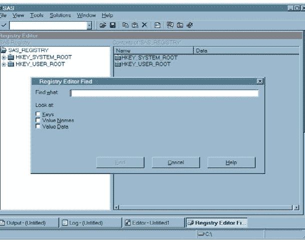

# 修改 SAS 注册表中的值

> **注意：**
在修改注册表值之前，请始终备份 SASUSER 中的 `registry.sas7bit` 文件。

1. 在注册表编辑器窗口的左窗格中，点击你想更改的键。键包含的值将显示在右窗格中。
双击该值。注册表编辑器会显示几种类型的窗口，取决于你正在更改的值类型。

显示 15.3 在 SAS 注册表中更改值的示例


# 在 SAS 注册表中添加新值或新键

1. 在 SAS 注册表编辑器中，右键点击你要添加值并进行创建的键。
2. 从弹出菜单中，选择你想要创建的类型的 新建（New）菜单项。
3. 在显示的窗口中输入新键或新值的值。

显示 15.4 带有添加键和值的弹出菜单的注册表编辑器

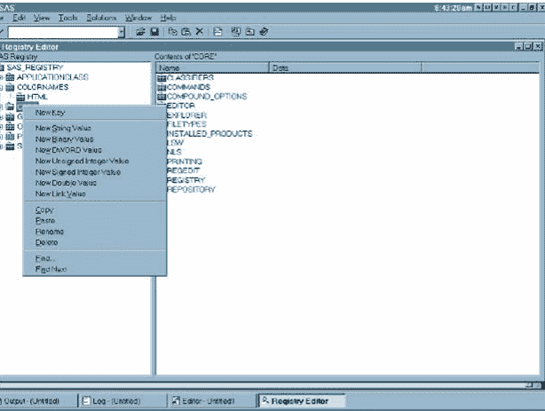

# 从 SAS 注册表中删除项目

从 SAS 注册表编辑器中：
右键点击你想删除的项。
从弹出菜单中选择 删除（Delete）并确认删除。

# 重命名 SAS 注册表中的项目

从 SAS 注册表编辑器中：
右键点击你想重命的项目。
从右键菜单中选择 重命名（Rename）并输入新名称。

# 分别显示 SASUSER 和 SASHELP 注册表项

打开注册表编辑器后，你可以更改默认视图（默认视图不考虑存储位置而显示注册表内容）。若要在注册表编辑器的左窗格中分别在不同的树中查看 SASUSER 和 SASHELP 项目：

- 选择 工具（Tools） ► 选项（Options）。这将打开注册表框。
- 选择 查看所有（View All）以分别显示 SASUSER 和 SASHELP 项目。

显示 15.5 视图模式下的注册表编辑器


# 导入注册表文件

在注册表编辑器中，你可以从任意键开始将注册表文件导入注册表。要导入注册表文件：

1. 从注册表编辑器中，选择 文件（File） ► 导入（Import）。
2. 选择要导入的文件。
3. 点击 确定。

# 导出注册表内容

在注册表编辑器中，你可以从任意键开始将注册表内容导出到文件。要导出注册表内容：

1. 从注册表编辑器中，选择 文件（File） ► 导出（Export）。
2. 选择导出的位置。
3. 点击 导出。


- 1 输入 `mlibassign` 命令。这会打开“新建库”窗口。
- 2 创建您要使用的库引用。
- 3 在启动时选择**启用**。
- 4 点击 [确定]。
- 5 在验证库成功创建后，执行 `regedit` 命令。
- 6 找到并选择注册表项 `CORE\OPTIONS\LIBRNAMES\yourlibref>`。
- 7 选择 **文件** ► **导出注册表文件**。出现“另存为”窗口。
- 8 选择存储注册表文件的位置。
- 9 在**文件**名称字段中为注册表文件输入文件名。
- 10 点击 [保存] 导出文件。
- 11 右键点击该文件，并在**记事本**中选择**编辑**以编辑文件。
- 12 编辑文件，并将所有的 `HKEY_USER_ROOT` 实例替换为 `HKEY_SYSTEM_ROOT`。
- 13 使用 PROC REGISTRY 将更改应用到 SASHELP。以下代码将导入该文件：

```
proc registry import="yourfile.sasreg" usesashelp;
run;
```

## 使用 SAS 注册表修复库引用 (Libref) 问题

库引用 (librefs)存储在 SAS 注册表中。您可能会遇到之前可以使用的库引用失效的情况。在某些情况下，编辑注册表是修复它的最快方法。以下内容说明了修复失败库引用涉及。

如果存储在 SAS 注册中的任何永久库引用在启动时失败，SAS 日志中会出现以下内容：

> 注意：一个或多个库启动分配未恢复。

以下错误是库分配问题的常见原因：

- SAS 注册表中缺少库引用分配所需的必需字段。
- SAS 注册表中库引用分配所需的必需值无效。例如，库名被限制为八个字符，且引擎值与实际引擎名称匹配。
- SAS 注册表中库引用的加密密码数据已更改。

> 注意：您可以使用“新建库”窗口来添加库引用。可以通过在工具栏中输入 DMLIBASSIGN，或从资源管理器窗口中选择**文件** ► **新建**来打开它。

警告：您可以在 SAS 注册表编辑器中纠正许多分配错误。如果您不熟悉库引用或 SAS 注册表编辑器，请寻求技术支持。在 SAS 注册表编辑器中很容易产生错误，并可能导致您的库在启动时无法分配。

要使用 SAS 注册表编辑器纠正库引用分配错误：

- 1 选择 **解决方案** ► **辅助工具** ► **注册表编辑器**，或执行 `regedit` 命令打开注册表编辑器。
- 2 根据您的操作系统环境选择以下路径之一，然后根据需要对键和键值进行修改：

```
CORE\OPTIONS\LIBBNAMES
```

或者

```
CORE\OPTIONS\LIBBNAMES\CONCATENATED
```

> 注意：这些修正仅对永久库引用有效；即那些通过使用“新建库”或“文件快捷方式分配”窗口在启动时创建的引用。

例如，如果您发现某个永久合并库的键被重命名为正整数以外的内容，那么您可以重新重命名该键以符合要求。选择该键，然后从弹出菜单中选择“重命名”开始该过程。

## 第 16 章
## 使用 SAS 进行打印

- 通用打印 185
- 什么是通用打印？ 185
- 开启和关闭通用打印 185
- 通用打印输出格式和打印机 186
- 输出格式类型 186
- 通用打印和 ODS 186
- 使用通用打印用户界面管理打印任务 187
- 通用打印菜单概述 187
- 设置打印机 188
- 打印设置窗口 188
- 更改默认打印机 189
- 从选择列表中删除打印机 189
- 定义新打印机 189
- 为您的默认打印机设置打印机属性 193
- 如何为会话指定打印机 196
- 使用通用打印打印 197
- 测试页 197
- 打印活动 SAS 窗口的内容 197
- 使用预览器 199
- 定义新预览 199
- 设置打印机预览命令 202
- 预览打印作业 202
- 设置页面属性 202
- 使用编程语句配置通用打印 206
- 简介 206
- 控制通用打印的系统选项 206
- 为批模式定义打印机 207
- 使用 PRTDEF 过程定义新打印机 208
- 简介 208
- 创建定义多个打印机的数据集 208
- 为多个用户安装打印机定义 208
- 添加、修改和删除打印机 209
- 创建用于预览 PostScript 输出的 Ghostview 定义 210
- 导出和备份打印机定义 210
- 设备类型、目标和主机选项字段的示例值 211
- 表单打印 212
- 表单打印概述 212
- 创建或编辑表单 212
- 在通用打印机和 SAS/GRAPH 中使用 TrueType 字体 213


# 通用输出格式与打印机

## 输出格式类型

除了将打印作业发送到打印机外，您还可以将输出指向外部文件，这些文件被不同类型的打印机和打印查看程序广泛识别。您可以使用通用打印（Universal Printing）生成以下常用的文件类型。

表 16.1 可用的打印输出格式

| 类型 | 全称 | 描述 |
| --- | --- | --- |
| GIF | 图形交换格式 (Graphics Interchange) 一种为图形数据在线传输和交换设计的简单位图图像格式。该格式广泛用于在 Web 上显示图像。 |
| PCL | 打印机控制语言 (Printer Control Format) 由惠普开发，作为应用程序用于控制多个设备上各种打印机功能的语言。通用打印目前支持 PCL5、PCL6 和 PCLXL 级别的语言。 |
| PDF | 便携式文档格式 (Portable Document Format) 由 Adobe Systems 开发用于查看和打印格式化文档的文件。要查看 PDF 文件，请使用由 Adobe Systems 分发的免费应用程序 Adobe Reader。 |
| PNG | 便携式网络图形 (Portable Network Graphics) 这种位图图像旨在取代旧的简单 GIF 格式和复杂的 TIFF 格式。与 GIF 相比，PNG 在 Web 上的使用具有四个主要优势：PNG 具有伽马校正、二维交错、不同的透明度（Alpha 通道）以及超过 256 颜色。 |
| PS | PostScript 同样由 Adobe Systems 开发的页面描述语言。PostScript 主要是一种用于在激光打印机上打印文档的语言，但也可以适应以在其他类型的设备上生成图像。 |
| SVG | 可缩矢量图形 (Scalable Vector Graphics) 一种使用 XML 描述二维图形和图形应用程序的语言 |

> 注意：使用通用打印生成 PDF 文件不需要 Acrobat。

您可以从打印对话框或 SAS 注册表路径 `CORE\PRINTING\PRINTERS` 访问打印机列表。

## 通用打印与 ODS

无论 UNIVERSPRINT 系统选项是否开启，ODS 目标都可以使用通用打印。ODS PRINTER 语句使用的 PRINTER 描述在《SAS 输出交付系统：用户指南》中介绍。输出交付系统 (ODS) 在以下 ODS 语句中使用通用打印。

## 表 16.2 使用通用接口的 ODS 目标

| ODS PRINTER 目标 | 描述 |
|---|---| |
| ODS PRINTER=option | 使用选定的打印机。 |
| ODS PDF 语句 | 使用通用打印的 PDF 打印机。 |
| ODS PS 语句 | 使用通用打印的 PostScript Level 1 打印机。 |
| ODS PCL 语句 | 使用通用打印的 PCL5 打印机。 |

**运行环境信息：** 在 Windows 环境下，ODS PRINTER 目标使用 Windows 打印机，除非启动 SAS 时带有 `UNIVERSALPRINT=` 系统选项，或者您使用 `PRINTERPATH=` 系统选项指定打印机。如果 Windows 中启用了通用打印，SAS 将覆盖 Windows 系统打印机的使用，并导致 ODS 使用通用打印。

有关 ODS 的更多信息，请参阅**SAS 输出交付系统：用户指南**。

## 使用通用打印用户界面管理打印任务

### 通用打印菜单概述

大多数 SAS 通用打印窗口都可以通过**文件 (File)** 菜单访问。下面的显示了文件菜单，其中包含通用打印的选项：页面设置 (Page Setup)、打印设置 (Print Setup)、打印预览 (Print Preview) 和打印 (Print)。

图 16.1 显示通用打印选项的文件菜单

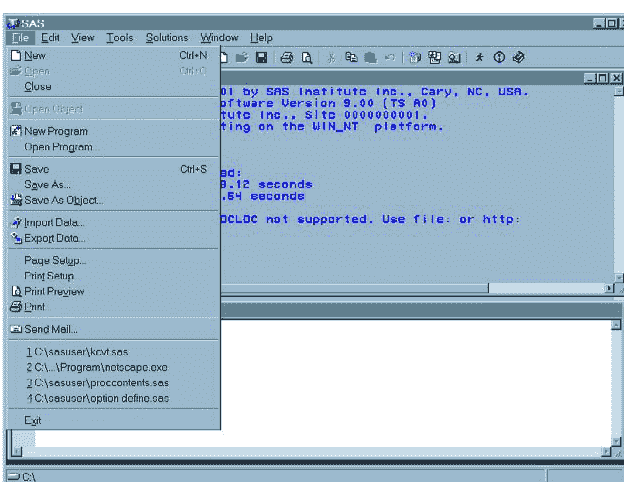

## 表 16.3 打开通用打印窗口的菜单选择或命令

| 菜单选择 | 等效命令 |
|--- |--- |
| 页面设置 (Page Setup) | DMPAGESETUP |
| 打印设置 (Print Setup) | DMPRSETUP |
| 打印预览 (Print Preview) | DMPRTPREVIEW |
| 打印 (Print) | DMPRINT |

*运行环境信息：* 在 Windows 环境下，SAS 使用打印窗口作为默认。要访问通用打印界面，必须在设置 `UNIVERSALPRINT` 系统选项的同时设置 `UNIVERSPRITEMUSWITCH` 系统，以便配置 SAS 中的所有菜单使用通用打印窗口。要执行此操作，请在用于在 Windows 调用 SAS 的字符串中包含

- - upprint -uprintmensuswitch

您可以通过在命令行或菜单栏的命令框中输入命令来打开所有通用打印窗口。下表列出了您执行最常用任务的命令。

## 表 16.4 打开通用打印窗口的命令

| 操作 | 命令 |
|--- |--- |
| 打印当前窗口 | DMPPRINT |
| 更改默认打印机 | DMPPRINT, 或 DMPRSETUP |
| 创建新的打印机或预览定义 | DMPRTCREATE PRINTER, 或 DMPRTCREATE PREVIEW |
| 修改、添加、删除或测试打印机定义 | DMPRSETUP |
| 显示默认打印机属性页 | DMPPRINTPROPS |
| 显示页面属性页 | DMPAGESETUP |
| 打印预览当前窗口 | DMPRTPREVIEW |

## 设置打印机

### 打印设置窗口

选择**文件 (File)** ► **打印设置 (Print Setup)** 菜单将打开打印设置窗口，您可以在其中执行以下任务：

- 更改默认打印机。
- 从列表中删除打印机。
- 打印测试页。
- 打开打印机属性窗口。
- 启动打印打印向导。

或者，您可以发布 `DMPRINTERSETUP` 命令。

### 更改默认打印机

要更改此会话及未来会话的默认打印机，请遵循以下步骤：

- 选择文件设置 (File Setup)。出现打印设置。
- 从列表中选择新打印机。
- 点击确定。

或者，您可以发布 `DMPRINTERSETUP` 命令。

### 从列表中删除打印机

要从列表中删除打印机，请遵循以下步骤：

- 选择文件设置 (File Setup)。出现打印设置。
- 选择您要删除的打印机。
- 点击删除。

> 注意：如果您选择的是系统定义的打印机，删除按钮将不可用，除非您使用 `DMPINTERSETUP` 命令。

### 定义新打印机

虽然通用打印提供了预定义的打印机，但您也可以使用打印机向导，它将引导您操作。要启动打印机向导，请遵循以下步骤：

- 选择文件设置 (File Setup) 并点击新建 (New)。出现以下窗口

显示 16.2 输入名称和描述的打印机窗口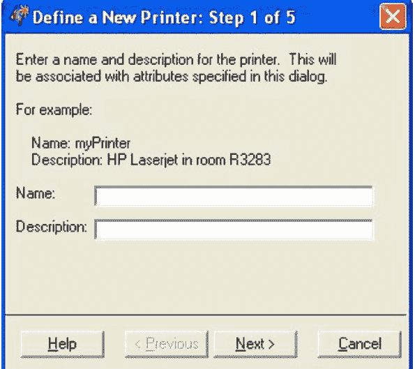

或者，您可以发布 `DMPCREATE PRINTER` 命令。

- 输入新打印机的名称和描述（最多 127 个字符，不包含反斜线）。
- 点击下一步进入向导的第 2 。选择打印机模型。如果没有您的打印机模型，请选择通用模型。

> 注意：通用模型提供的选项可能比特定模型少。

显示 16.3 选择打印模型的打印机窗口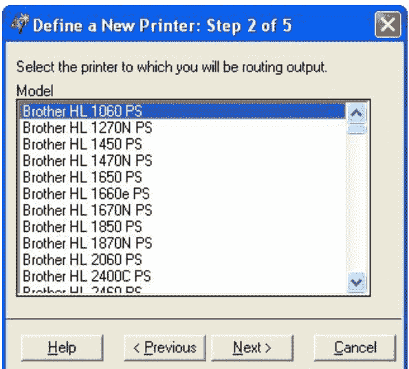

- 点击下一步进入向导的第 3 。出现以下窗口：

显示 16.4 选择输出设备的打印机窗口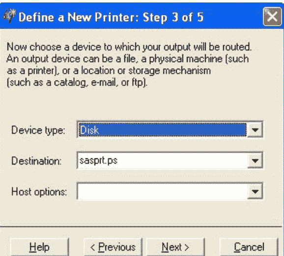

- 选择打印输出的**设备类型**。设备类型的选择取决于主机。

如果您选择目录 (Catalog)、磁盘 (Disk)、Ftp、套接 (Socket) 或管道 (Pipe) 作为设备类型，则必须指定目标。

如果您选择的设备类型为打印机 (Printer)，则可能不需要目标，因为某些操作系统使用主机选项来路由输出。

> 注意：有关设备类型、目标和主机选项的示例也位于第 211 页的“设备类型、目标和主机选项的示例值”。

- 输入文件的**目标 (Destination)**。目标是设备类型的目标位置。例如，如果您的设备类型是磁盘 (disk)，则目标是特定操作系统的文件名。对于某些设备类型，目标可能为空，您可以指定**主机选项**。

- 为您选择的设备选择或输入任何主机特定的选项。对于主机选项列表请参考您操作系统的 **FILENAME** 语句信息。

- 点击下一步进入向导的第 4 步，在该步骤中，您可以从已安装的打印预览器列表中进行选择。如果没有定义预览器，请继续向导的下一步。


# 192 设置打印机 Δ 第 16 章

## 显示 16.5 打印机定义窗口选择预览器

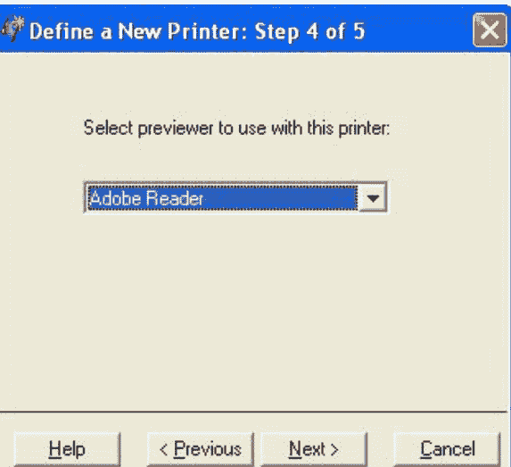

如果出现预览器选择框，请为此打印机选择预览器。如果不需要预览器，请选择“无”（None）或留空字段。

> 注意：您可以通过 DMPRTCREATE PREVIEWER 命令为任何打印机添加预览器。更多信息，请参见第 199 页上的“定义新预览器”。Δ

> 注意：打印机和打印预览器不需要共享相同的语言。Δ

9 点击“下一步”继续向导的第 5 步。出现以下窗口：

## 显示 16.6 打印机定义窗口完成过程

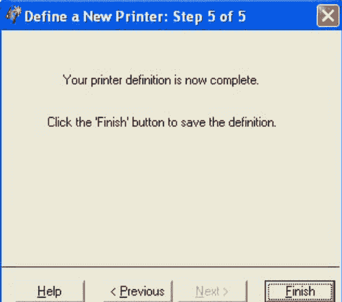

10 点击“上一步”更改任何信息。完成打印机定义后，点击“完成”。

您已完成默认打印机的设置。
返回“打印机设置”窗口后，可以通过点击“打印测试页”来测试默认打印机。

## 为默认打印机设置打印机属性

+ 您可以更改的打印机属性包括：
- 打印机名称和描述
- 打印目标设备及其属性
- 打印机的默认字体
- 高级功能，如翻译表、打印机分辨率以及与打印机关联的打印预览器

要更改默认打印机的打印机属性，请遵循以下步骤：

+ 1 选择 文件 ► 打印设置并选择“属性”。出现“打印机属性”窗口。
   或者，您可以发布 DMPTRPROPS 命令。
2 从“打印机属性”窗口中，选择包含需要修改的信息的选项卡。
- 在“名称”选项卡中，您可以修改打印机名称和打印机描述。

## 显示 16.7 显示“名称”选项卡的打印机属性窗口

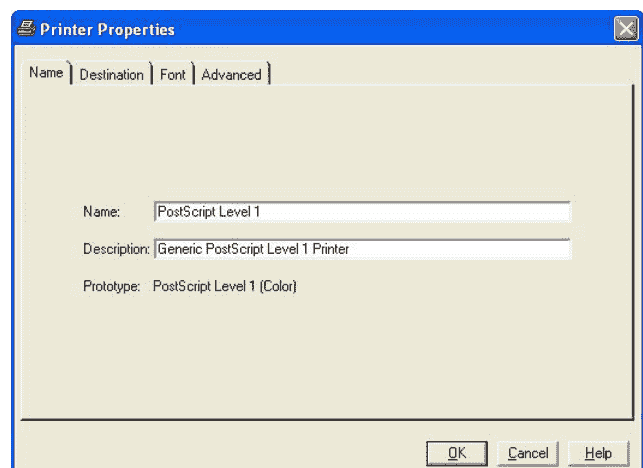

**目标**选项卡允许您为打印机指定设备类型、目标和主机选项。示例请参见第 211 页上的“设备类型、目标和主机选项字段的示例值”。

## 显示 16.8 显示“目标”选项卡的打印机属性窗口

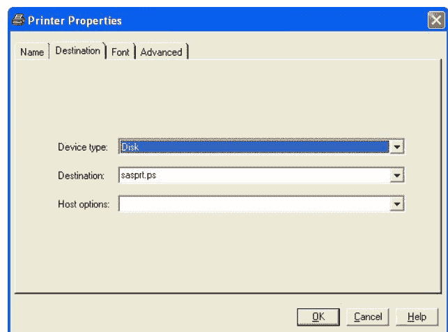

**字体**选项卡控制可用的字体选项。下拉框中的可用选择取决于特定打印机。字体大小以磅为单位。

注意：此窗口允许您为默认字体设置属性。通常，过程输出由 ODS 样式指定的字体或指定字体属性的程序语句控制。△

## 显示 16.9 显示“字体”选项卡的打印机属性窗口

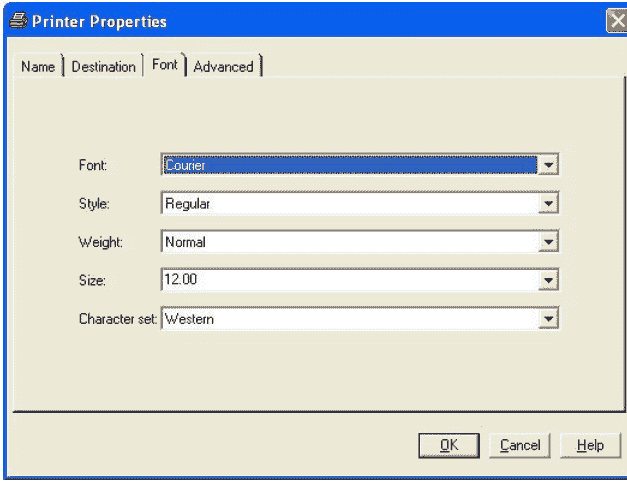

“高级”选项卡列出了打印机的分辨率、协议、翻译表、缓冲区大小、预览器和预览命令选项。下拉字段中的信息取决于特定打印机。

## 显示 16.10 显示“高级”选项卡的打印机属性窗口

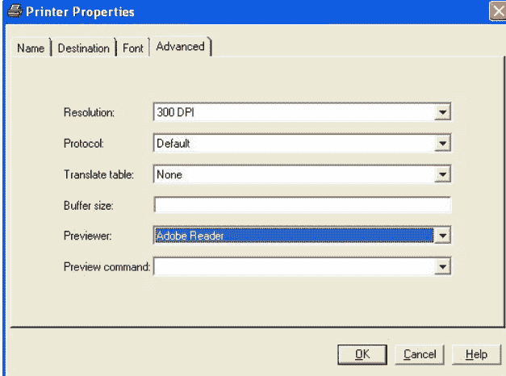

### 分辨率

指定每英寸点（dpi）打印输出的分辨率。

### 协议

提供将输出转换为协议转换器可以处理的格式的机制，转换器连接 EBCDIC 主机和 ASCII 设备。z/OS 操作系统环境中需要协议，如果您使用，请从列出的协议转换器中选择一个。

### 翻译表

管理 EBCDIC 设备和 ASCII 设备之间的数据传输。通常，驱动程序会根据您的区域选择正确的表；当您需要非标准翻译时，需要指定翻译表。

### 缓冲区大小

控制输出缓冲区的大小或记录长度。如果缓冲区大小留空，则将使用默认大小。

### 预览

指定在请求“打印预览”时使用的预览定义。“预览”框包含您定义的预览应用程序。请参见第 199 页上的“定义新预览”。

### 预览命令

是用于打开外部打印机语言查看器的命令。如果您使用 Ghostview 作为打印机类型，则使用 ghostview ts。当在打印机定义中输入预览命令时，该打印机定义变为预览定义。预览命令必须是有效命令。当作为过程执行命令时，% 将替换为包含预览命令输入的临时文件名称。

> *注意：“预览”和“预览命令”字段是互斥的。当您在“预览命令”字段中输入路径时，“预览器”框将显示为灰色。\*

## 如何为会话指定预览

PRINTERPATH= 系统选项允许您指定用于当前 SAS 会话的通用打印机。PRINTERPATH= 系统选项主要用于批模式（即没有窗口的情况）。

## 使用通用打印打印

### 打印测试页

要打印测试页，请遵循以下步骤：
1 选择 文件 ► 打印设置并选择“测试页”以打开设置窗口。
2 从列表中选择您想要打印测试页的打印机名称。
3 点击“测试页”。
   或者，您可以发布 DMPrint 命令。

### 打印活动窗口的内容

要打印窗口内容，请遵循以下步骤：
1 点击窗口内部使其处于活动状态。
2 选择 文件 ► 打印。出现打印窗口。
3 如果可见“使用表单”复选框，请取消勾选以使用通用打印。
4 从“打印机”组框中，选择打印机定义名称。
5 输入您需要的打印份数。
6 如果您想将打印作业保存到文件，
   a 选择“打印到文件”。
   b 选择“确定”。出现“文件选择”窗口。
   c 选择现有文件或输入新文件名。

注意：如果打印到现有文件，文件内容将根据覆盖或追加，取决于您在窗口中选择的是“替换”还是“追加”。大多数用于 GIF、PDF 和 PNG 的查看器不会查看追加的文件。当选择“追加”时，不会产生合并 PDF。
7 设置打印选项。

“页面”区域的字段根据您尝试打印的 SAS 窗口的内容提供选择。默认情况下，SAS 打印所选窗口的所有内容。

## 表 16.5 页面选项

| 打印项目 | 操作 |
|---|---|
| 窗口中的选定文本 | 选择要打印的文本，然后打开打印窗口。在“页面选项”框中，勾选“打印选定文本”。 |
| 注意：在 z/OS 上不可用 | |
| 窗口中当前显示的页面 | 选择“当前页”。 |
| 页范围或其他单独页 | 选择“范围”并在“页面”字段中输入页码。使用逗号或空格分隔单独页码和页范围。您可以使用任何格式输入页范围：
- n-m 打印从 n 到 m 的所有页面（包含 m）。
- -n 打印从第 1 页到 n 页的所有页面。
- n- 打印从第 页到最后一页的所有页面。 |
| 彩色 | 勾选“打印彩色”。 |
| 行号 | 勾选“打印行”。 |
| 页码 | 勾选“打印页码”。 |
| 图形 | 使用 DMPrint 命令，或选择 文件打印。验证取消勾选“使用 SAS/GRAPH 驱动程序”复选框以使用通用打印。 |

8 点击“确定”打印。


# 使用预览器

## 定义新预览器

预览器允许你预览打印作业。SAS 不会设置默认的预览程序。要在 SAS 中使用“打印预览”功能，你或你的系统管理员必须先为你的系统定义一个预览器。

**运行环境信息：** z/OS 不支持打印预览器。可以使用“新预览器”向导定义预览器。要使用“新预览器”向导定义新的打印预览器，请遵循以下步骤：

- 颁发 `DMPRCREATE PREVIEWER` 命令。将出现以下窗口：

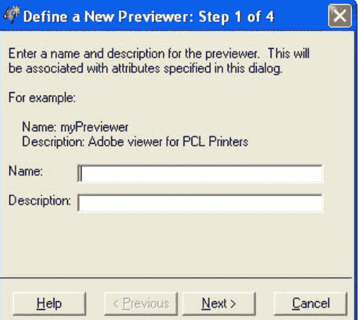

- 为新预览器输入名称和描述（最多 127 个字符，不含反斜杠）。

- 点击**下一步**继续执行向导的第 2 步。

## 显示 16.13 预览器定义窗口以输入预览器语言

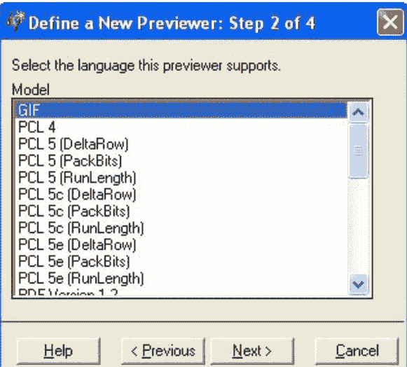

- 选择你想与预览器定义关联的打印机型号。为该模型生成的 PostScript、P 或 PDF 语言必须是你的外部查看器包支持的语言。为了获得最佳效果，请选择通用模型，如 PostScript Level 1（彩色）或 PCL 5。
- 点击**下一步**继续执行向导的第 3 步。

## 显示 16.14 预览器定义窗口以输入打开预览器程序的命令

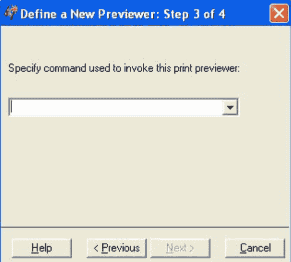

- 输入用于打开预览器程序的命令或多个命令，随后是 `%s`，其中 %s 是你通常放置输入文件名的地方。例如，如果启动预览器的命令是“ghostview”，那么你在文本字段中输入 `ghostview`。

你可以预填充或初始化一个用于调用预览程序的命令列表。如需更多信息，请参阅第 202 页的“填充打印预览器命令框”。

注意：在启动查看器的命令中，%s 可以根据需要使用多次。但是，如果启动命令不在机器的命令路径中，则启动命令需要是全限定命令。

- 点击**下一步**继续执行向导的第 4 步。

## 显示 16.15 预览器定义窗口完整过程

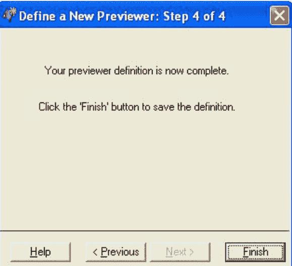

- 点击**上一步**以纠正任何信息。完成定义默认预览器后，点击**完成**。

新定义的预览器将在“打印设置”窗口中显示预览器图标。

## 显示 16.16 打印设置窗口显示新预览器

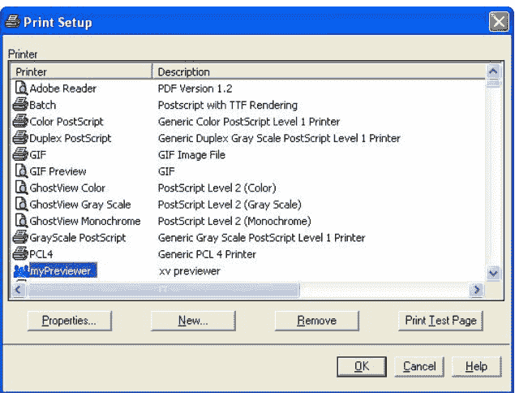

可以使用“打印设置”窗口上的“打印测试页”来测试此预览程序。

## 填充打印预览命令框

打印预览由 Ghostview、gs 和 Adobe Reader 等打印预览程序支持。预览命令框出现在预览器定义向导中（第 200 页显示 16.14）以及打印机属性窗口的“高级”选项卡中（第 15 页显示 16.10），并可以预填充或初始化命令列表。这些命令用于调用你站点可用的打印预览程序。用户和管理员可以手动更新注册表，或者定义并导入包含预览命令列表的注册表文件。这是一个注册表文件的示例。

```
[COREPRINTING\PREVIEW COMMAND]
"1"=/usr/local/gv %s
"2"=/usr/local/ghostview %s
```

## 预览打印作业

如果为指定的打印机安装了打印机，你就可以使用预览功能。在 SAS 的“文件”菜单中始终可以使用“打印预览”。你也可以颁发 `DMPRTPREVIEW` 命令。

## 设置页面属性

对于你当前的 SAS 会话，你可以自定义打印输出在“页面设置”窗口中的显示方式。取决于你当前设置的打印机，后续步骤中描述的某些“页面设置”选项可能不可用。要自定义打印输出，请遵循以下步骤：

- 选择 **文件** ► **页面设置**。出现“页面设置”窗口。

或者，你可以颁发 `DMPAGESET` 命令。

- 选择一个选项卡以打开控制打印输出各个方面的窗口。下文是这些选项卡窗口的描述。

“页面设置”窗口包含四个选项卡：通用、方向、页边距和纸张。

- “通用”选项卡允许你更改装订、校对、双面打印和彩色打印的选项。

显示 16.17 页面设置窗口显示通用选项卡

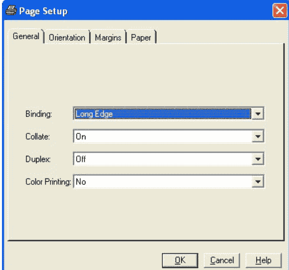

装订指定用于双面输出时使用的装订边（长边或短边）。这设置了“装订”选项。

校对指定打印输出是否应该校对。这设置了“校对”选项。

双面指定打印输出应该是单面还是双面。这设置了“双面”选项。

彩色打印指定输出是否应该彩色打印。这设置了“彩色打印”选项。

显示 16.17 页面设置窗口显示通用选项卡


装订指定用于双面输出时使用的装订边（长边或短边）。这设置了“装订”选项。

校对指定打印输出是否应该校对。这设置了“校对”选项。

双面指定打印输出应该是单面还是双面。这设置了“双面”选项。

彩色打印指定输出是否应该彩色打印。这设置了“彩色打印”选项。

- “方向”选项卡允许你更改输出的方向。默认是方向。

显示 16.17 页面设置窗口显示方向


装订指定用于双面输出时使用的装订边（长边或短边）。这设置了“装订”选项。

校对指定打印输出是否应该校对。这设置了“校对”选项。

双面指定打印输出应该是单面还是双面。这设置了“双面”选项。

彩色打印指定输出是否应该彩色打印。这设置了“彩色打印”选项。

- “页边距”选项卡允许你更改输出的页边距。

显示 16.17 页面设置窗口显示页边距


装订指定用于双面输出时使用的装订边（长边或短边）。这设置了“装订”选项。

校对指定打印输出是否应该校对。这设置了“校对”选项。

双面指定打印输出应该是单面还是双面。这设置了“双面”选项。

彩色打印指定输出是否应该彩色打印。这设置了“彩色打印”选项。

- “纸张”选项卡允许你更改输出的纸张。

显示 16.17 页面设置窗口显示纸张


## 使用 PRTDEF 程序定义新打印机和预览器

## 简介

这些示例向您展示了如何使用 PRTDEF 程序定义新打印机，并管理您已安装的打印机和预览器。

在包含 PRTDEF 程序的语句成功运行后，定义的打印机或预览器将显示在“打印设置”（Print Setup）窗口中。所有可用打印机和预览器的完整列表将显示在“打印机名称”列表中。还可以在注册表编辑器的 CORE\PRTINING\PRINTERS 下查看打印机定义。

## 创建定义多个打印机的数据集

当您定义用于 PRTDEF 程序的数据集以定义定义打印机时，必须指定名称、型号、设备和目标（destination）变量。

请参阅 *Base SAS Procedures Guide* 中的 PRTDEF 程序以获取可以使用的可选变量的名称。

以下代码创建了一个供 PRTDEF 程序使用的数据集：

```sas
data printers;
    input name $model $ device $dest $;
datalines;
    Myprinter      PostScript Level 1 PRINTER printer1
    Laserjet       PCL 5 Printer PIPE lp -dprinter5
    Color LaserJet  PostScript Level 2 PIPE lp -dprinter2
;
run;
```

在创建包含变量的数据集后，PRTDEF 程序将通过在 SAS 注册表中创建相应的条目来定义数据集中命打印机。

```sas
proc prtdef data=printers usaseshelp;
run;
```

> 注意：USESHELP 选项指定打印机定义位于 SASHELP 库中，所有用户均可用。如果未指定 USESHELP 选项，则打印机定义将放在当前 SASUSER 库中，仅本地用户可用，且定义的打印机将仅在本地 SAS 目录可用。然而，要使用 USESHELP 选项，您必须拥有写入 SASHELP 目录的权限。

## 为多个用户安装打印机定义

此示例在 SASHELP 注册表中创建了一个带有 Ghostview 打印预览的 Tektron Phaser 780 打印机。下边距设置为 2 厘米，纸张大小为 A4。

```sas
data tek780;
    name = "Tek780";
    desc = "Test Lab Phaser 780P";
    model = "Tek Phaser 780 Plus";
    device = "PRINTER";
    dest = "testlab";
    preview = "Ghostview";
    units = "cm";
    bottom = 2;
    fontsize = 14;
    papers = "ISO A4";
run;

proc prdef data=tek780 usashelp;
run;
```

> 注意：您必须在第 195 页、或打印机属性窗口的“高级”选项卡上（见第 200 页图 16.14）或通过使用 PRDEF 程序来指定预览命令。△

# 添加、修改和删除打印机定义

此示例使用 PRINTER 数据集来添加、修改和删除打印机定义。请参考 *Base SAS Procedures Guide* 中的 PRDEF 程序以了解您用于定义打印机的变量。以下列表描述了示例中使用的变量：

- MODEL 变量在定义此打印机时指定打印机类型。
- DEVICE 变量指定在向打印机发送输出时使用的 I/O 设备类型。
- DEST 变量指定打印机的输出目标。
- OPCODE 变量指定在打印机定义上执行的操作（添加、删除或修改）。
- Add（添加）操作在注册表中为 Color PostScript 创建一个新的打印机定义，第二个 Add 操作在注册表中为 ColorPS 创建一个新的打印机定义。
- Mod（修改）操作修改注册表中现有的 LaserJet 5 打印机定义。
- Del（删除）操作从注册表中删除名为 "Gray PostScript" 和 "test" 的打印机定义。

以下示例在 SASHELP 库中创建了打印机定义。由于该定义位于 SASHELP 中，它对所有用户都可用。写入 SASHELP 库需要管理员权限。个人用户可以通过指定 SASUSER 库来创建个人的打印机定义。

```sas
data printers;
length name $ 80
model $ 80
device $ 80
dest $ 80
opcode $ 30;
input opcode $ & name $ & model $ & device $ & dest & &
datalines;
add Color PostScript PostScript Level 2 (Color) DISK sasprt.ps
mod LaserJet 5 PCL 5 DISK sasprt.pcl
del Gray PostScript PostScript Level 2 (Gray Scale) DISK sasprt.ps
del test PostScript Level 2 (Color) DISK sasprt.ps
add ColorPS PostScript Level 2 (Color) DISK sasprt.ps
;
```

```sas
proc prdef data=printers list useshelp;
run;
```

> 注意：如果用户修改了 SASHELP 中管理员定义的打印机并设置了新属性，该打印机将成为 SASUSER 库中的用户定义打印机。用户指定的值将覆盖管理员设置的值。如果删除了用户定义的打印机，管理员定义的打印机将重新出现。

## 为 PostScript 创建 Ghostview 预览定义

此示例创建了 GSVIEWIE 数据集。GSVIEWIE 数据集中的变量值被 PRDEF 程序用于在 SAS 注册表中生成打印机定义。

- NAME 变量指定打印机名称。
- DESC 变量指定打印机的描述。
- MODEL 变量在定义此打印机时指定打印机原型。
- VIEWER 变量指定打印主机命令。
- DEVICE 变量应为 DUMMY。
> 注意：您必须在第 195 页、或打印机属性窗口的“高级”选项卡上（见第 200 页图 16.14）或通过使用 PRDEF 程序来指定预览命令。

```sas
data gsview;
name = 'Ghostview';
desc = 'Print Preview with Ghostview';
model='PostScript Level 2 (Color)';
viewer = 'ghostview';
device = 'dummy';
dest = "";
run;

proc prdef data=gsview list;
run;

## 导出打印机定义

PRTEX 程序允许将打印机定义备份为 SAS 数据集，可以使用 PRDEF 程序进行恢复。PRTEX 程序的语法如下：

```sas
PROC PRTEX (USESHELP) [OUT=dataset]
[SELECT | EXCLUDE] printer_1_2 ... printer_n;
```

以下示例展示了如何使用 PRDEF 备份四个打印机定义（名为 PDF、postscript、PCL5 和 PCL5c）。

```sas
proc prtex out=printers;
select PDF postscript PCL5 PCL5c;
run;
```

信息请参考 PRTEX 程序。

## 设备类型、目标和主机选项的示例值

以下列表提供了设备类型、目标和主机选项的打印机值示例。由于这些值可能相互依赖，且随操作系统环境而异，因此显示了多个示例。在安装或修改打印机或更改目标时，您可能需要引用此列表。

- 设备类型：打印
  - z/OS
    - 设备类型：打印机
    - 目标：（留空）
    - 主机选项：sysout=class-value dest=printer-name
  - UNIX 和 Windows
    - 设备类型：打印机
    - 目标：打印机
    - 主机选项：（留空）
  - OpenVMS
    - 设备类型：打印机
    - 目标：打印机
    - 主机选项：passall=yes queue=printer-name
- 设备类型：管道（Pipe）
  - 注意：向 UNIX 主机上的 lp 定义打印机队列发送输出的示例命令是 lp -ldest
  - UNIX
    - 设备类型：管道
    - 目标：命令
    - 主机选项：（留空）
- 设备类型：FTP
  - 注意：节点名的示例是 pepper.unix
  - z/OS
    - 设备类型：FTP
    - 目标：ftp.out
    - 主机选项：host='nodename' recfm=vb prompt
    - 设备类型：打印机
    - 目标：打印机
    - 主机选项：（留空）
  - Windows
    - 设备类型：FTP


目标：ftp.out

- 主机选项：host='nodename' prompt
- UNIX 和 OpenVMS
- 设备类型：FTP
- 目标：host='nodename' prompt
- 主机选项：（留空）
- 设备类型：Socket

> 注意：lp 目标队列的一个示例是 lp286nc0.prt:9100

- UNIX 和 OpenVMS
- 设备类型：Socket
- 目标：destination-queue
- 主机选项：（留空）

# 表单打印

## 表单打印概述

在通用打印（Universal Printing）引入之前，SAS 提供了一个名为表单（form）的打印作业实用。表单是一个标准模板，允许您控制打印作业页的行大小和边距信息。通用打印比表单打印提供的简单控制更易使用且功能更多，但 SAS 支持表单。

仍然可以通过“打印”（Print）窗口使用表单打印。您可以通过选择“打印”并选择“使用表单”（Using Forms）来切换到表单模式。

> 注意：批模式下不支持表单打印。

# 创建或编辑表单

如果您有需要使用表单打印的遗留报告，则可能需要使用表单编辑器（FORM editor）来创建或编辑表单。SAS 支持创建或编辑表单，尽管通用打印提供了更多功能，并且是推荐的方法。

您可以通过输入 FSFORM 命令来创建或编辑表单：

```
FSFORM<catalog-name.form-name
```

如果未指定 catalog-name，SAS 将使用 SASUSER.PROFILE 目录。如果您指定的表单名称不存在，SAS 将创建一个新表单。

如果您正在创建新表单，SAS 会显示“表单选择”（Form Selection）帧。如果您正在编辑现有表单，SAS 会显示“正文和边距信息”（Text Body and Margin Information）帧。要在各个 FORMS 帧之间移动，可以执行以下操作：

- 使用 NEXTSCR 命令滚动到下一个帧，使用 PREVSCR 命令滚动到上一个帧。
- 输入等号 (=) 和您想要转到的帧的号。例如，=1 显示“正文和边距信息”帧，而 =2 显示“回车控制信息”（Carriage Control Information）帧。

从“工具”（Tools）菜单中选择帧的名称。

从“工具”菜单中选择“下一屏幕”（Next Screen）或“上一个屏幕”（Previous Screen）。

您可以使用 TAB 键在帧的字段之间移动。
完成定义或编辑表单后，执行 END 命令以保存更改并退出 FORM 窗口。

注意：在打印窗口中通过勾选“使用表单”（Use Forms）开启表单，将关闭非图形窗口的通用打印功能。

操作环境信息：有关如何使用表单打印的更多信息，请参阅您的操作环境文档。

# 在 SAS 9.2 中配合通用打印机和 SAS/GRAPH 设备使用 TrueType字体

## 渲染 TrueType 字体

在 SAS 9.2 中，TrueType 字体使用 FreeType 库或通过主机的字体渲染功能进行渲染。
使用 FreeType 库渲染 TrueType 字体是在 SAS 支持的所有操作系统环境中渲染输出字体的首选方法。所有通用打印机和许多 SAS/GRAPH 设备都使用 FreeType 库来渲染 TrueType 字体。
以下 SAS 输出方法和设备使用 FreeType 库：

- SAS/GRAPH 设备
  - UGIF, UPL5, UPC5C, UPC5E, UPDF, UPNG, UPNGT, UPSL, UPSLC
  - GIF160, GIF260, GIF373, GIF570
  - 注意：文本以非常小的尺寸渲染。
  - GIF, GIFANIM, GIF733, HTML, WEBFRAME
  - TIFF, TIFFP, TIFF3, TIFF300, TIFF330
- SASBMP
- JPEG
- PCL5, PCL5C, PCL5E
- PNG, PNGNT, PNG300
- PSL, PSCOLOR, PLEPSF, PLEPSC
- SVG, SVGT, SVVIEW, and SVGZ
- SASEMF, SASWMF
- SASPRTC, SASPRTG, SASPRTM 打印图形设备驱动
- ODS 打印和通用打印
  - GIF
  - PCL5, PCL5C, PCL5E
  - PDF, PDEA
  - PNG, PNGT

# ODS 样式和 TrueType 字体

- PostScript
- SVG, SVGT, SVGZ, SVGView, and SGVnotip
- ODS RTF
- ODS HTML

以下 SAS/GRAPH 设备使用主机字体渲染：

- ActiveX, ACTXIMG, JAVA, JAVAIMG

> 注意：这些是客户端设备。△

- BMP, BMP20
- DIB
- EMF, MWF
- ZGIF, GIF773, ZGIFANIM, ZHTML, ZEBFRAM, ZPEG, ZPNG, ZASBMP
- ZTIFF, TIFFBII, TIFFBBMM, ZTIFF3, ZTIFF4, ZTIFFF

以下 SAS/GRAPH 设备也使用主机字体渲染：

- GIF160, GIF260, GIF373, GIF570

> 注意：文本以非常小的尺寸渲染。△

- GIF, GIFANIM, GIF733, HTML, WEBFRAME
- TIFF, TIFFFF, TIFF3, TIFFBII, TIFFBMM, TIFF300, TIFF300
- JPEG

> 注意：对于同时支持 FreeType 库和主机渲染的设备，可以设置 OPONTERING=FREETYPE_POINTS | HOST_PIELS 渲染方法。△
在 UNIX 环境下带有主机渲染的设备时，TrueType 字体必须按顺序安装才能正常工作。

# ODS 样式和 TrueType 字体

默认情况下，许多 SAS/GRAPH 驱动程序和所有通用打印机使用 ODS 样式生成输出，这些样式使用 TrueType 字体。如果没有指定样式，对于 SAS 9.2 之前生成的图形列表输出，默认样式可以将 GSTYLE 设置为 NOGSTYLE。

# TrueType 字体的移植性

TrueType 字体可以跨操作系统，并且在 Microsoft 环境中始终可用。某些版本的 UNIX 包含了 TrueType 字体。

# 国际字符支持

TrueType 字体支持广泛的国际字符。有关 SAS 使用 TrueType 字体的更多信息，请参见第 219 页的“指定字体和打印国际字符示例”。

# SAS 提供 TrueType 字体

在安装 SAS 时，根据安装期间的选择可以使用许多 TrueType 字体。SAS 提供的 TrueType 字体可分为四类：与微软兼容的拉丁字母；图形符号；多语言；如下表。

**表 16.7 兼容 Microsoft 的拉丁 TrueType 字体**

| 字体名称 | 字体描述 | 与 Microsoft 字体的兼容性 | 与 Adobe 字体的兼容性 |
|---|---|---|---|
| Albany | 无衬线 | Helvetica | 不适用 |
| SAS Monospace | 等宽无衬线 | 不适用 | 不适用 |
| SAS Monospace | 等宽无衬线 | 不适用 | 不适用 |
| Thorndale | 衬线 | Times New Roman | Times |
| Cumberland | 等宽衬线 | Courier New | Courier |

**表 16.8 图形符号 TrueType 字体**

| 字体名称 | 字体描述 | 与 Microsoft 字体的兼容性 | 与 Adobe 字体的兼容性 |
|---|---|---|---|
| Symbol MT | 192 个符号 | Symbol | Symbol |
| Monotype Sort | 205 Wingding 字符 | Wingdings | ITC Zapf Dingbats |
| Arial Symbol | 42 个符号 | 不适用 | 不适用 |
| Arial Bold | 42 个符号 | 不适用 | 不适用 |
| Arial Bold It | 42 个符号 | 不适用 | 不适用 |
| Arial Symbol Italic | 42 个符号 | 不适用 | 不适用 |
| Times New Roman Symbol | 42 个符号 | 不适用 | 不适用 |
| Times New Roman Bold | 42 个符号 | 不适用 | 不适用 |
| Times New Roman Bold | 42 个符号 | 不适用 | 不适用 |
| Times New Roman Italic | 42 个符号 | 不适用 | 不适用 |

# 表 16.9 多语言 TrueType 字体

| 语言 | 字体名称 | 字体描述 |
|---|---|---|
| 日语 | Monotype Sans J¹ | 无衬线 |
| | Thorndale Duospace J¹ | 衬线 |
| 韩语 | Monotype Sans K¹ | 无衬线 |
| | Thorndale Duospace K¹ | 衬线 |
| 简体中文 | Monotype Sans SC¹ | 无衬线 |
| | Thorndale Duospace SC¹ | 衬线 |
| 繁体中文 | Monotype Sans TC¹ | 无衬线 |
| | Thorndale Duospace TC¹ | 衬线 |

¹ Thorndale Duospace WT 和 Monotype Sans 都支持 HKCS（香港补充字符集）并大幅支持 GB18030 标准。

| 语言 | 字体名称 | 字符集 |
|---|---|---|
| 日语 | MS Gothic, UI Gothic, PG Gothic | Shift JIS |
| | MS Mincho, MS Mincho | Shift JIS |
| 韩语 | Gulim, GulChem, Dotum, DatumChe | KSC5601 |
| | Batang, Batcheng, Gungsuh, Gungsuchek | KSC5601 |
| 简体中文 | SimSun, NSimSun | GB2312 |
| | SimHei | GB2312 |
| 繁体中文 | HeiT | Big5 |
| | MingLIU, PMingLIU | Big5 |

¹ Hei 拥有 HKCS（香港补充字符集）字符。


# 为 Microsoft Windows 或 UNIX 注册 TrueType 字体

提交以下 SAS 程序。FONPATH 语句指定包含 TrueType 字体的目录，path-name 是 TrueType 字体的目录路径。

注意：在 Microsoft Windows 环境中，TrueType 字体通常位于 C:\WINDOWS\Fonts 或 C:\Windows\Fonts 目录。对于所有其他操作系统，请联系您的系统管理员查询 TrueType 字体的位置。

# 为 z/OS 注册 TrueType 字体

使用 FONFILE 语句代替 FONPATH 语句来指定包含 TrueType 字体的固定顺序文件。

注意：当您向 z/OS 系统添加 TrueType 字体时，必须将 TrueType 字体分配为具有固定块记录格式且记录长度为 1 的顺序数据集。

# 定位 TrueType 字体文件

更新 SAS 注册表后，您可以在 SAS 命令行中输入 REGEDIT，或提交一个指定文件位置的 REGISTRY 语句，使用 SAS 注册表编辑器查看所有注册字体列表。

```
proc registry list start='core\printing\freetype\fonts';
```

调用 SAS 时，FONTSLOC=system 选项指向 SAS 提供的字体位置。使用以下 OPTIONS 语句来显示 SAS 字体的位置。

```
proc options option=fontloc;
```

# 使用 TrueType 字体

## 在打印对话框中指定 TrueType 字体

更新 SAS 注册表后，TrueType 字体即可在 SAS 中使用。要在启用通用打印时交互式访问 TrueType 字体，请遵循以下步骤：

- 1 选择 文件 ► 打印
- 2 选择合适的打印机，如 PDF 或 PCL5。
- 3 点击属性按钮。
- 4 点击字体选项卡。

此窗口包含字体（Font）、样式（Style）、粗细（Weight）、大小（磅值）和字符集（Character Set）的下拉框。

- 5 点击字体框右侧的箭头，并滚动可用字体列表。

TrueType 字体由角括号内的三字符标签指示。例如，TrueType 字体 Albany AMT 将显示为 `<ttf> Albany AMT`。`<ttf>` 标签用于区分同名的字体类型，例如 `<ttf> Symbol` 与物理打印机上的字体。没有 `<ttf>` 标签的字体存储在打印机内存中。如果您指定 PDF 为打印机，则字体位于 Adobe Reader 中而非物理打印机中。

- 6 选择您想要使用的字体。
- 7 点击确定进入打印对话框。
- 8 点击确定创建输出。

## 使用 SAS 程序语句指定 TrueType 字体

在批处理或命令行模式中使用 SAS 时，要选择支持 TrueType 字体的打印机，请提交以下 OPTIONS 语句。

```
options printerpath=printersname;
```

printersname 是打印机名称，例如 PDF、PNG、SVG、PCL5、PCL5e 或 GIF。然后您的程序将指定要使用的字体的代码。例如，如果您想在 TITLE 语句中使用 TrueType 字体 Albany AMT，请在 SAS 程序中包含以下行代码。

```
Title f="Albany AMT" Text="in Albany AMT";
```

当使用 SAS/GRAPH 图形驱动 SASPRTC、SASPRTG 和 SASPRTM 时，可以使用正斜杠 (/) 作为分隔符来指定样式或粗细等属性。

```
Title f="Albany AMT/Italic/Bold" Text="Bold Italic Albany AMT";
```

对于 ODS 模板，属性指定在文本大小参数之后。完整示例请参见第 220 页的“使用 PROC PRINT 和用户定义的 ODS 模板指定字体”。

> 注意：仅在必要时才使用 <ttf> 标签，以区分 TrueType 字体与另一种同名的字体类型。

# 使用 SYSPRINTFONT 选项指定字体

SYSPRINTFONT 系统选项设置了您用于打印程序编辑器、日志（Log）和输出窗口的默认字体。例如，您可以通过提交以下 OPTIONS 语句使用 Albany AMT 字体打印输出。

```
options sysprintfont="Albany AMT";
```

您还可以使用 SYSPRINTFONT 系统选项指定字体的粗细和大小。例如，以下代码指定了使用粗体、斜体且大小为 14 磅的 Arial 字体。

```
options sysprintfont="Arial bold italic 14";
```

您可以通过显式字体指定或 ODS 样式覆盖默认字体。更多信息请参阅《SAS 语言参考：字典》中的 SYSPRINTFONT 选项。

# 指定字体和打印国际字符示例

## 使用 SAS/GRAPH 指定字体

以下示例创建一个输出文件 sasprt.pdf，其标题使用 Albany AMT 字体，并使用了粗体和斜体。

```
options reset=all device=sasprtc;
title color=black f="Albany AMT/Italic/Bold" "Sample Title in Bold Italic Albany AMT"
options printerpath=pdf;
proc gplot data=sasheplt.class;
 plot height*weight;
run;
quit;
```

显示 16.21 GPLOT 输出

# 粗体斜体 Albany AMT 标题


## 使用 PROC PRINT 指定字体

以下示例产生输出文件 print1.pdf，标题使用 Albany AMT、Thorndale AMT 和 Cumberland AMT。

```
filename 'print1.pdf';
options printerpath=PDF obs=5;
ods printer;
proc print data=sashelp.class;
title1='Albany AMT' h='TrueType AMT';
title2='Thorndale AMT' h='Thorndale AMT';
title3='Cumberland AMT' h='Cumberland AMT';
run;
ods printer close;
```

显示 16.22 使用 PROC PRINT 输出

TrueType AMT, Thorndale AMT, Cumberland AMT

| Obs | Name | Age | Height | Weight |
|---|---|---|---|---|
| 1 | Alfred | M | 69.0 | 112.5 |
| 2 | Alice | F | 56.3 | 84.0 |
| 3 | Barbara | F | 65.3 | 98.0 |
| 4 | Carol | F | 62.8 | 102.5 |
| 5 | Henry | M | 63.5 | 102.5 |

## 使用 PROC PRINT 和自定义 ODS 模板指定字体

以下示例创建一个字体模板并产生 PDF 文件。

```
filename 'print2.pdf';
options printerpath=(pdf);
proc template;
define New_style / store = SASUSER.TEMPLATE;
parent = styles;
replace fonts /
  'docFont' = (Thorndale AMT, 12pt)
  'headingFont' = (Albany AMT, 10pt, bold)
  'headingEmphasisFont' = (Albany AMT, 10pt, bold)
  'TitleFont' = (Albany AMT, 12pt, italic)
  'TitleFont2' = (Albany AMT, 11pt, bold)
  'FixedFont' = (Cumberland AMT, 6pt)
  'FixedHeadingFont' = (Cumberland AMT, 9pt, bold)
  'FixedStrongFont' = (Cumberland AMT, 9pt, bold)
  'FixedEmphasisFont' = (Cumberland AMT, 9pt, italic);
```

## 指定字体和打印国际字符示例

```
'EmphasisFont' = ("Albany AMT", 10pt, italic);
'StrongFont' = ("Albany AMT", 10pt, bold);
end;
run;
```

```
ods printer style=New_style;
proc data=sashelp.class;
title 'Proc Print';
title2 'Templated ODS output';
run;
ods printer close;
```

显示 16.23 使用 PROC PRINT 和自定义 ODS 输出

# Proc Print
Templated ODS output

| Obs | Name | Age | Height | Weight |
|---|---|---|---|---|
| 1 | Alfred | M | 69.0 | 112.5 |
| 2 | Alice | F | 56.5 | 84.0 |
| 3 | Barbara | F | 65.3 | 98.0 |
| 4 | Carol | F | 62.8 | 102.5 |
| 5 | Henry | M | 63.5 | 102.5 |

# 打印国际字符

**示例 1**
以下示例产生输出文件 titles.png。它打印了十个 Unicode 字符。

```
filename 'titles.png';
options inputper=(png new);
ods printer;

proc glide;
title1 "Printing Unicode code points";
title2 "double exclamation mark" f="Monotype Sans WT/Unicode" h=2='203C';
title3 "French Franc symbol " f="Monotype Sans WT/Unicode" h=3='20A3';
```

```
title4 "Lira symbol" f="Monotype Sans WT/Unicode" h=3 '20A4;
title4 "Rupee symbol" f="Monotype Sans WT/Unicode" h=3 '20A8x;
title5 "Euro symbol" f="Monotype Sans WT/Unicode" h=3='20AC;
title6 "Fraction, one third" f="Monotype Sans WT/Unicode" h=3='2153x;
title7 "Fraction, one fifth" f="Monotype Sans WT/Unicode" h=3='20Ac;
title8 "Fraction, eighth" f="Monotype Sans WT/Unicode" h=3='2155B;
title9 "Black Florette" f="Monotype Sans WT/Unicode" h=3='273F;
title10 "Black Star" f="Monotype Sans WT/Unicode" h=3='2605x;

run;
quit;
ods printer close;
```

显示 16.24 Unicode 字符输出

# 打印 Unicode 代码点

双感叹号 !!

法法符号 ℄

卢比符号 ₨

欧元符号 €

三分之一 ⅓

五分之一之一 ⅕

八分之一之一 ₈

黑花 ❀

黑星 ★

**示例 2**
以下示例产生一个输出文件 utf8.gif。它必须在 UTF-8 服务器上运行，并且需要包含所用字符的 TrueType 字体。字符名称和相关代码表可以在 Unicode 图表中找到：http://www.unicode.org/charts。


## SAS 示例：指定字体和国际字符打印

```
'FixedBatchFont' = ('Thorndale Duospace WT J, 6pt)
'FixedHeadingFont' = ('Thorndale Duospace WT J, 9pt, bold)
'FixedStrongFont' = ('Thorndale Duospace WT J, 9pt, bold)
'FixedEmphasisFont' = ('Monotype Sans WT J, 10pt, italic)
'StrongFont' = ('Monotype Sans WT J, 10pt, bold);
```

```sas
@macro utf8chr(ucs2);
kvct(&ucs2, 'utf8');
@end utf8chr;
@macro namechar(name, char);
name="&name"; code=&utf8chr("&char"); output=;
@end namechar;
```

```sas
data utf8char;
length name $40;
#namechar(Registered Sign, 00AE);
#namechar(Cent Sign, 00A2);
#namechar(Pound Sign, 00A3);
#namechar(Currency Sign, 00A4);
#namechar(Yen Sign, 00A5);
#namechar(Rupee Sign, 20A8);
#namechar(Euro Sign, 20Ac);
#namechar(Dong Sign, 20Ab);
#namechar(Euro-currency Sign, 20A0);
#namechar(Colon Sign, 20A1);
#namechar(Cruzeiro Sign, 20A2);
#namechar(French Franc Sign, 20A3);
#namechar(Lira Sign, 20A4);
run;
```

```sas
options printerpath='gif out'; nfilename 'utf8.gif';
```

```sas
ods printer style=utf8_style;
proc print;
run;
ods printer close;
```

## 国际字符的输出 16.25

| 观测 | name | code | char |
|---|---|---|---|
| 1 | 注册符号 | 00AE | ® |
| 2 | 分符号 | 00A2 | ¢ |
| 3 | 英镑符号 | 00A3 | £ |
| 4 | 货币符号 | 00A4 | ¤ |
| 5 | 日元符号 | 00A5 | ¥ |
| 6 | 卢比符号 | 20A8 | ₹ |
| 7 | 欧元符号 | 20AC | € |
| 8 | 盾符号 | 20AB | ₫ |
| 9 | 欧元货币符号 | 20A0 | € |
| 10 | 冒号符号 | 20A1 | ₡ |
| 11 | 克鲁塞罗符号 | 20A2 | ₲ |
| 12 | 法郎符号 | 20A3 | ℣ |
| 13 | 利拉符号 | 20A4 | ₺ |

## 使用通用打印创建可缩放矢量图形

### SAS 中可缩放矢量图形概述

可缩放矢量图形 (SVG) 是一种用于描述二维矢量图形的 XML 语言。SAS 根据 W3C 对 SVG 文档的建议创建 SVG 文档。SAS 表示 SVG 文档是使用 UNICODE 标准编码创建的。

注意：SAS 9.2 不支持动画。

SAS 可以通过通用打印机或 SAS/GRAPH 设备驱动程序创建 SVG 文档。通过通用打印机创建的 SVG 文档是独立的 SVG 文档。通过 SAS/GRAPH 设备驱动程序创建的 SVG 文档可以是独立的 SVG 文档，也可以嵌入 HTML 文档的 SVG 文档。

独立的 SVG 文档可以通过外部链接引用、内联嵌入或 CSS2 或 XSL 属性引用嵌入 HTML 文档中。有关在网页中嵌入 SVG 文档的信息，请参阅 W3 网站上 SVG 1.1 规范中关于在网页中使用 SVG 文档的主题：http://www.w3.org/TR/SVG。

由 SAS/GRAPH 创建的 SVG 文档可以包含工具提示并具有钻取功能。通过通用打印机创建的 SVG 文档是独立的。

这里提供的信息仅限于通过通用打印机创建 SVG 文档。有关 SVG 文档的信息，请参阅 W3C 对 SVG 文档的建议。有关使用 SAS/GRAPH 创建 SVG 文档的信息，请参阅 *SAS/GRAPH: Reference.*。

有关 SVG 标准的详细信息，请参阅 W3 网站上的文档：http://www.w3.org/TR/SVG。

### SVG 术语

SVG 画布 (canvas) 是渲染 SVG 文档的空间。

```
viewBox
```
指定 SVG 文档的坐标系以及视口中可见的 SVG 文档区域。

```
viewport
```
SVG 画布内的一个有限矩形空间，SVG 文档在此处进行渲染。在 SAS 中，视口 (viewport) 的值对于可缩放视口由 `PAPERSIZE=system` 选项决定，对于静态视口由 `SVGWIDTH` 和 `SVGHEIGHT=system` 选项决定。

viewport 坐标系 Y 视口空间是视口的起始 X 和 Y 坐标以及宽度和高度值。用户坐标系或用户空间是指要在视口中显示的文档区域的起始 X 和 Y 坐标以及宽度和高度。用户单位 (user units) 等于您环境坐标系中定义的测量单位。在许多情况下，坐标系使用像素。请与您的系统管理员确定您环境中使用的单位。

### 为什么要创建 SVG 文档？

SVG 文档在任何尺寸或支持 SVG 的查看器中都能清晰显示。SVG 文档是计算机上生成文档的理想选择。由于 SVG 是矢量图形，它在任何缩放下都不会失真。只要支持 SVG 的查看器都能清晰显示。SVG 独立的 SVG 文档可以作为外部链接引用、内联嵌入或作为 CSS2 或 XSL 属性引用嵌入 HTML 文档。有关在网页中嵌入 SVG 文档的信息，请参见上文。由 SAS/GRAPH 创建的 SVG 文档可以包含工具提示并具有钻取功能。通过通用打印机创建的 SVG 文档是独立的。

（此处省略重复翻译部分...）


# 设置环境以创建独立 SVG 文档

Firefox 不支持字体嵌入。为了避免您的 SVG 文档出现映射问题，可以设置 `NONTEMBEDDING` 系统选项。如果在创建 SVG 系统时设置了 `FONTEMBEDDING` 选项，随后在 Firefox 中查看 SVG 文档，Firefox 将使用在 Firefox 选项对话框的“内容”选项卡中定义的默认字体设置。

# SVG 通用打印机及其创建的输出

下表列出了 SAS SVG 打印机。

| | |
|---|---|
| SVG | 生成 SVG 1.1 文档。 |
| SVGt | 生成透明的（无背景）SVG 1.1 文档。 |
| SVGnotip | 生成不带工具提示的 SVG 1.1 文档。 |
| SVGZ | 生成压缩的 SVG 1.1 文档。 |
| SVGView | 当 SVG 文件包含多个页面时，生成带有导航控制的 SVG1.1 文档 |

原型打印机位于 SAS 注册表的 `CORE;PRINTING;PROTOTYPES` 下。您可以使用 `PRTDEF` 过程定义自己的 SVG 打印机。更多信息，请参阅《Base SAS Procedures Guide》中的“The PRTDEF Procedure”。

# 设置环境以创建独立 SVG 文档

## 设置环境以创建独立 SVG 文档的概述

如第 226 页“使用通用打印机创建 SVG 文档的基础”所示，必须使用 `PRINTERPATH=` 系统选项作为打印机值，或使用 `ODS PRINTER` 语句来指定 SVG 通用打印机。在 SAS  程序中调用 SAS 时，可以使用 `OPTIONS` 语句或使用 SAS 系统窗口设置任何系统选项。

可以使用建立 SVG 环境的 SVG 系统选项默认值（`PRINTERPATH=` 系统选项除外）轻松地创建 SVG 文档。本节解释了 SVG 系统选项以及它们如何影响独立 SVG 文档。

# 影响独立 SVG 文档的 SAS 系统选项

您可以使用 SVG 系统来设置创建 SVG 文档的环境：

表 16.12 影响 SVG 文档的 SAS 系统选项

| 任务 | 系统选项 |
| --- | --- |
| 设置通用打印使用的纸张大小。 | `PAPERSIZE=` |
| 指定创建独立 SVG 文档的 SVG 打印机名称。 | `PRINTERPATH=` |
| 设置 SVG 文档的高度。如果 SVG 文档包含嵌入的 SVG 文档，则高度值仅影响外层 SVG。 | `SVGHEIGHT=` |
| 设置 SVG 文档的宽度。如果 SVG 文档包含嵌入的 SVG 文档，则宽度值仅影响外层 SVG。 | `SVGWIDTH=` |
| 设置嵌入 SVG 文档左下角的 x 轴坐标。 | `SVGX=` |
| 设置嵌入 SVG 文档左下角的 y 轴坐标，并使用宽度和高度设置外层 SVG 文档的 Viewbox；指定在视口中显示的文稿区域的坐标。 | `SVGVIEWBOX=` |
| 确定是否对 SVG 文档进行强制缩放。设置显示在 SVG 文档标题栏中的标题。 | `SVGPRESERVEASPECTRATIO=` |
| 确定是否在多页文档中显示导航控制按钮。 | `SVGCONTROLBUTTONS` |

# 设置 SVG 通用打印机

您通过将 `PRINTERPATH=` 系统选项设置为 SVG 打印机之一，来设置 SVG 通用打印机。您可以随时设置 `PRINTERPATH=` 系统选项。以下 `OPTIONS` 语句将通用打印机设置为创建压缩文档：

```
options printerpath=svg;
```

如果在 SAS 启动时指定了 `UPRINT` 系统选项，则 `PAPERSIZE=` 系统选项的值将设置为默认值 600 x 800 像素。更多信息，请参阅以下主题：

- 第 229 页的“SVG打印机及其创建的输出”
- 《SAS Language Reference: Dictionary》中的 `PRINTERPATH=` 系统选项

# 将 SVG 文档缩放至视口

要将 SVG 文档缩放至视口，可以使用 `SVGHEIGHT=` 和 `SVGWIDTH=` 系统选项的默认值 `null`。`null` 值等同于 100%，会将 SVG 文档缩放到视口大小。此外，`SVGVIEWBOX=` 系统选项必须为 `null`。

更多信息，请参阅《SAS Language Reference: Dictionary》中的以下系统选项：

- `SVGHEIGHT=` 系统选项
- `SVGWIDTH=` 系统选项
- `SVGVIEWBOX=` 系统选项

# 设置 viewBox

`<svg>` 元素上的 `viewbox` 属性是一组四个数字：起始 X 坐标、起始 Y 坐标、SVG 文档的高度和 SVG 文档的宽度。SAS 根据 `SVGVIEWBOX=` 系统选项的值设置 `viewbox` 属性。如果没有值，SAS 使用 `PAPERSIZE=` 系统选项的值来设置 `viewbox` 属性的高度和宽度。起始坐标值设置为 0。

当 `SVGHEIGHT=` 和 `SVGWIDTH=` 系统选项具有 `null` 值（这些每个选项的默认值）时，SVG 文档将缩放到视口大小。如果您指定了 `SVGVIEWBOX=` 系统选项的值，则 SVG 文档将缩放到 `SVGVIEWBOX=` 选项指定的维度。

如果您使用百分比单位指定 `SVGAspectRatio` 和 `SVGVIEWBOX=` 系统选项，当浏览器窗口大小变化时，SVG 文档将缩放到浏览器窗口大小。除百分比以外的单位（如 `cm` 或 `px`），SVG 文档为静态大小，当窗口大小变化时不会缩放到浏览器窗口。

更多信息，请参阅：

- 《SAS Output》中的 `PRINT` 语句
- 《SAS Language Reference》中的 `SVGVIEWBOX=` 系统选项
- 《SAS Language Reference》中的 `PAPERSIZE=` 系统选项
- 第 232 页的“创建静态 viewBox”

# SAS 系统选项与 SVG 标签的交互

`<svg>` 元素上的 `viewbox` 属性是一组四个数字：起始 X 坐标、起始 Y 坐标、SVG 文档的高度和 SVG 文档的宽度。SAS 根据 `SVGVIEWBOX=` 系统选项的值设置 `viewbox` 属性。如果没有值，SAS 使用 `PAPERSIZE=` 系统选项的值设置 `viewbox` 属性的高度和宽度。起始坐标值设置为 0。

当 `SVGHEIGHT=` 和 `SVGWIDTH=` 系统选项具有 `null` 值（这些每个选项的默认值）时，SVG 文档将缩放到视口大小。如果您指定了 `SVGVIEWBOX=` 系统选项的值，则 SVG 文档将缩放到 `SVGVIEWBOX=` 选项指定的维度。

如果您使用百分比单位指定 `SVGAspectRatio` 和 `SVGVIEWBOX=` 系统选项，当浏览器窗口大小变化时，SVG 文档将缩放到浏览器窗口大小。除百分比以外的单位（如 `cm` 或 `px`），SVG 文档为静态大小，当窗口大小变化时不会缩放到浏览器窗口。

# 创建静态 viewBox

静态 viewBox 是无法更改的 viewBox。当视口 way变化（例如您调整浏览器窗口大小）时，viewbox 保持相同大小。要创建静态 viewBox，请为 `PAPERSIZE`、`SVGWIDTH` 和 `SVGHEIGHT=` 系统选项指定相同的宽度和高度值以设置 viewBox。`SVGWIDTH=` 和 `SVGHEIGHT=` 系统选项设置 SVG 文档的大小。如果 `SVGHEIGHT=` 和 `SVGWIDTH=` 选项使用百分比单位，当窗口大小变化时，SVG 文档将缩放到浏览器大小。第 232 页图 16.27 显示了使用以下系统选项创建的静态 viewBox：

```
options printerpath=svg papersize="8cm "5cm" svgwidth="8cm" svgheight="5cm"
svgtitle="SVG Cowboy Hat";
```

图 16.27 A viewBox

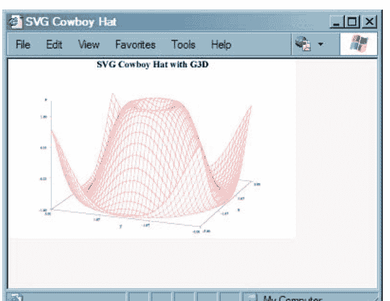


## 保留宽高比例

当你更改 `viewbox` 大小时时，可以使用 `SVGPRESERVEASPECTRATIO=system` 选项来指定是否要保留 SVG 文档的宽高比例，以及如何将 SVG 文档放置在视口中。可以通过以下赋值设置：

```
SVGPRESERVEASPECTRATIO=align meetOrSlice | NONE | ""
SVGPRESERVEASPECTRATIO=align meetOrSlice
```

第一个参数 *align* 指定是否通过将 `viewbox` 的中间 X 值指定到视口的中间 X 值来强制进行均匀缩放，从而使文档水平居中。例如，你可以使用 `midXmidY` 值将文档对齐到视宽的中间 X 值。

第二个参数 *meetOrSlice* 指定如何将 SVG 文档缩放以适应视口，可以是 *meet*（适应）或 *slice*（裁剪）。如果你指定 *meet*，SVG 文档将尽可能放大，同时满足其他准则。如果你指定 *slice*，SVG 文档将尽可能缩小，同时满足其他准则。在后一种情况下，SVG 文档的部分内容会被裁剪，你无法在视口中看到全部内容。你可以使用浏览器控件在视口中移动文档。

更多信息，请参阅《SAS Language Reference: Dictionary》中的 `SVGPRESERVEASPECTRATIO= System Option`。

## 为 SVG 文档添加标题

当浏览器仅显示 SVG 文档时，你使用 `SVGTITLE=` 系统选项为窗口标题栏添加标题。如果 SVG 文档嵌入 HTML 页面中，`<svg>` 标签上的 `gtitle` 属性将不起作用。上一个主题中的静态视口示例显示了浏览器标题栏中的标题。

更多信息，请参阅《SAS Language Reference: Dictionary》中的 `SVGTITLE= System Option`。

## 使用 ODS PRINTER 输出创建独立 SVG 文档

## 创建 SVG 文档

要创建 SVG 文档，你至少需要设置 `PRINTERPATH=system` 选项以使用通用打印机，并在 SAS 程序中指定 `ODS PRINTER` 语句，或者在 `ODS PRINTER` 语句中指定 `PRINTER=` 选项：

```
options printerpath=svg;
ods listing close;
ods printer;
data;
  do x=-5 to 5 by .25;
    do y=-5 to 5 by .25;
      z=sin(sqrt(x*x+y*y));
      output;
    end;
end;
```

```
proc g3d data=hat;
plot y*x*z/ctop=red;
title 'Cowboy Hat with G3D';
```

```
run;
quit;
ods printer option option values set to size the SVG listing;
```

在此示例中，没有设置特定的 SVG 系统选项值来调整 SVG 文档的大小；然而，SVG 文档会缩放到视口大小，因为没有为 `SVGWIDTH` 和 `SVGHEIGHT` 系统选项指定值。以下是：

```xml
<svg xmlns="http://www.w3.org/2000/svg"
xmlns:xlink="http://www.w3.org/1999/xlink" xml:space="preserve"
onload="init(evt)" version="1.1" baseProfile="full" viewBox="0 0 850 1100">
```

SAS 会创建一个名为 `sas.svg` 的单个 SVG 文档，根据你的操作系统将其存储在位置。在 Windows 下，文件存储在当前目录中。在 UNIX 和 OpenVMFS 下，文件存储在你的主目录中。在 z/OS 下，文件作为 z/OS Unix Services 分层文件系统 (HFS) 文件或 z/OS 数据集存储。如果 SVG 文件被写入 z/OS 数据集，则它将使用 `userid.SASPRPRT.SVG` 写入 PDSE 库。你可以使用 `ODS PRINTER` 语句中的 `FILE=` 选项来指定不同的文件名。

以下是使用 Microsoft Internet Explorer 的 Adobe Acrobat SVG 插件为 Cowboy Hat 程序创建的 SVG 文件：

## 16.28 作为 SVG 文件的牛仔帽

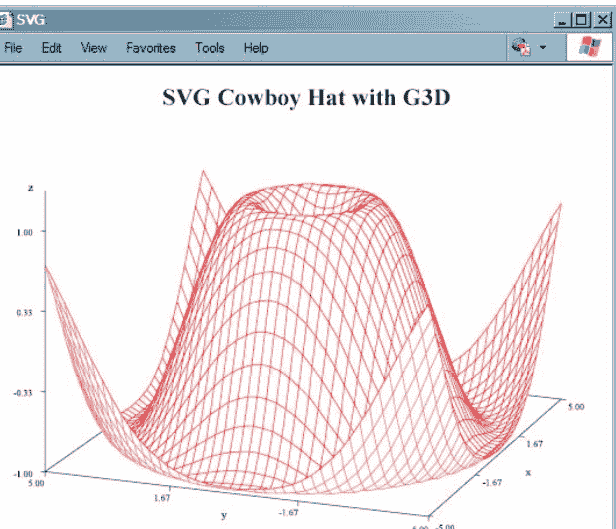

当你使用 `SVGnotip`、`SVGT`、`SVGView` 和 `SVGZ` 通用打印机时，SAS 会创建一个单个 SVG 文档。根据 SVG 文档的大小，

要显示 SVG 文件中所有页的索引，请选择 Index（索引）按钮。要从索引跳转到特定页面，请选择页的缩略图。

## 16.30 带有导航控件的多页 SVG 文件索引

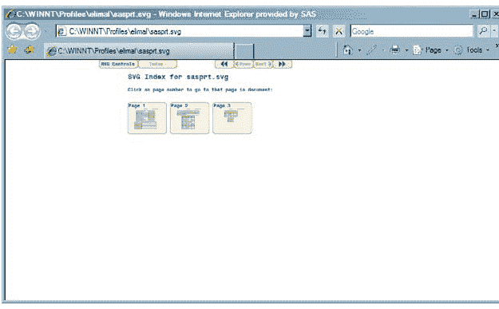

你可以通过选择 SVG Controls（SVG 控制）按钮来隐藏控件。当光标悬停在控件上时会显示提示框。要再次显示导航控件，在输出顶部看到提示“Click to toggle SVG control button bar”（点击切换 SVG 控制按钮栏）时。这在你想要打印不带控件的文档页面时非常有用。

## 26.31 隐藏导航控件的多页文件


## 为多页 SVG 文档创建单独文件

你可以通过在 `ODS PRINTER` 语句中指定 `NEWFILE=` 选项为 SVG 文档的每一页创建一个单独的文件。第一个文件名为 `outputt.svg`。后续文件会带上数字，例如 `outputt.2`、`outputt.3` 等。以下代码创建了两个文件：

```sas
options printerpath=svg;
ods listing close;
ods printer output=outputt.svg;
data;
  do x=-5 to 5 by .25;
    do y=-5 to 5 by .25;
      z=sin(sqrt(x*x+y*y));
      output;
    end;
end;
ods printer output=outputt.2;
data;
  do x=-5 to 5 by .25;
    do y=-5 to 5 by .25;
      z=sin(sqrt(x*x+y*y));
      output;
    end;
end;
```

关于 `NEWFILE=` 选项，请参阅《SAS Output Guide》中的 `ODS PRINTER Statement`。

## 创建叠加 SVG 文档

你使用 SVT 通用打印机创建一个页面叠加的透明 SVG 文档。以下是将条形图叠加在地图上的 SAS 程序：

```sas
options printerpath=svg;
ods listing close;
ods printer output=svg;
data;
  do x=-5 to 5 by .25;
    do y=-5 to 5 by .25;
      z=sin(sqrt(x*x+y*y));
      output;
    end;
end;
```

```xml
<svg xmlns="http://www.w3.org/2000/svg"
xmlns:xlink="http://www.w3.org/1999/xlink" xml:space="preserve"
onload="init(evt)" version="1.1" baseProfile="full" viewBox="0 0 850 1100">
```

```sas
proc g3d data=hat;
plot y*x*z/ctop=red;
title 'Cowboy Hat with G3D';
```

```sas
run;
quit;
ods printer option values set to size the SVG listing;
```

在此示例中，没有设置特定的 SVG 系统选项值来调整 SVG 文档的大小；然而，SVG 文档会缩放到视口大小，因为没有为 `SVGWIDTH` 和 `SVGHEIGHT` 系统选项指定值。

```xml
<svg xmlns="http://www.w3.org/2000/svg"
xmlns:xlink="http://www.w3.org/1999/xlink" xml:space="preserve"
onload="init(evt)" version="1.1" baseProfile="full" viewBox="0 0 850 1100">
```

SAS 会创建一个名为 `sas.svg` 的单个 SVG 文档，并根据你的操作系统将其存储。在 Windows 下，文件存储在当前目录中。在 UNIX 和 OpenVMFS 下，文件存储在你的主目录中。在 z/OS 下，文件作为 z/OS Unix Services 分层文件系统 (HFS) 文件或 z/OS 数据集存储。如果 SVG 文件被写入 z/OS 数据集，则它将使用 `userid.SASPRPRT.SVG` 写入 PDSE 库。你可以使用 `ODS PRINTER` 语句中的 `FILE=` 选项来指定不同的文件名。

以下是使用 Microsoft Internet Explorer 的 Adobe Acrobat SVG 插件为 Cowboy Hat 程序创建的 SVG 文件：

## 16.28 作为 SVG 文件的牛仔帽


当你使用 `SVGnotip`、`SVGT`、`SVGView` 和 `SVGZ` 通用打印机时，SAS 会创建一个单个 SVG 文档。根据 SVG 文档的大小，

要显示 SVG 文件中所有页的索引，请选择 Index 按钮。要从索引跳转到特定页面，请选择页的缩略图。

## 16.30 带有导航控件的多页 SVG 文件索引


你可以通过选择 SVG Controls（SVG 控制）按钮来隐藏控件。当光标悬停在控件上时会显示提示框。要再次显示导航控件，在输出顶部看到提示“Click to toggle SVG control button bar”（点击切换 SVG 控制按钮栏）时。这在你想要打印不带控件的文档页面时非常有用。

## 26.31 隐藏导航控件的多页文件


## 为多页 SVG 文档创建单独文件

你可以通过在 `ODS PRINTER` 语句中指定 `NEWFILE=` 选项为 SVG 文档的每一页创建一个单独的文件。第一个文件名为 `outputt.svg`。后续文件会带上数字，例如 `outputt.2`、`outputt.3` 等。以下代码创建了两个文件：

```sas
options printerpath=svg;
ods listing close;
ods printer output=outputt.svg;
data;
  do x=-5 to 5 by .25;
    do y=-5 to 5 by .25;
      z=sin(sqrt(x*x+y*y));
      output;
    end;
end;
ods printer output=outputt.2;
data;
  do x=-5 to 5 by .25;
    do y=-5 to 5 by .25;
      z=sin(sqrt(x*x+y*y));
      output;
    end;
end;
```

关于 `NEWFILE=` 选项，请参阅《SAS Output Guide》中的 `ODS PRINTER Statement`。

## 创建叠加 SVG 文档

你使用 SVT 通用打印机创建一个页面叠加的透明 SVG 文档。以下是将条形图叠加在地图上的 SAS 程序：

```sas
options printerpath=svg;
ods listing close;
ods printer output=svg;
data;
  do x=-5 to 5 by .25;
    do y=-5 to 5 by .25;
      z=sin(sqrt(x*x+y*y));
      output;
    end;
end;
```


# 一个链接并嵌入独立 SVG 文档的 HTML 

以下简单的 HTML 文档链接并嵌入了牛仔帽 SVG 文档：

```
<!DOCTYPE HTML PUBLIC "-//W3C//DTD HTML 4.01 Transitional//EN">
<html
<head>
  <title>在 HTML 文档中链接和嵌入 SVG 文档</title>
</head>
<body>
  <p>链接到 SVG 文档：</p>
  <a href="sasprt.svg">牛仔帽</a>
  <p>嵌入 SVG 文档：</p>
  <embed src="sasprt.svg" type="image/svg+xml" height="400" width="300">
</body>
</html>
```

带有 Adobe SVG Viewer 3 的 Microsoft Internet Explorer 显示带有链接和嵌入 SVG 文档的 HTML 文档

## 显示 16.32 
## 显示独立 SVG 文档链接和嵌入 SVG 文档的 HTML 文档

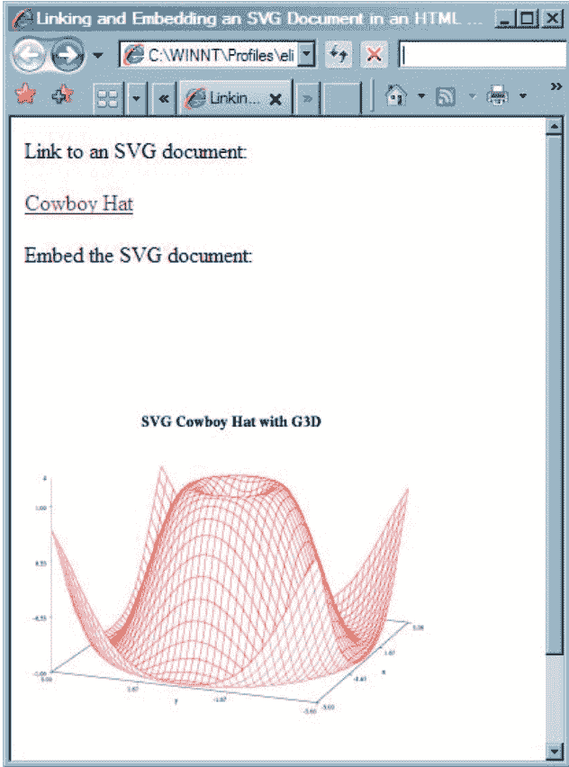

视口高度为 400 像素，宽度为 300 像素。由于使用了默认的 SVG 系统选项值，SVG 文档缩放至视口的 100%。

如果您点击“牛仔帽”链接，浏览器将显示以下 SVG 文档：

**显示 16.33** 点击 HTML 链接后显示的独立 SVG 文档

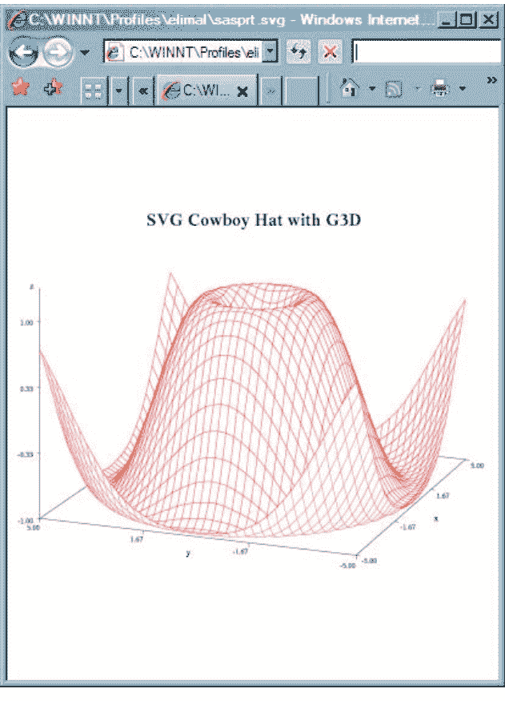

视口是浏览器窗口中的显示区域，SVG 文档缩放至视口的 100%。

## SVG 文档中的图像

当您创建一个包含图像的 SVG 文档时，图像将以 PNG 文件的形式创建。文件名格式为 `打印机目标文件名-计数器.png`。计数器是一个整数，每次创建新图像时都会递增。例如，如果目标文件名是 sasprt.svg，则第一张图像命名为 sasprt_1.png。第二张图像命名为 sasprt_2.png，以此此类推。

当保存 SVG 文档的 .png 文件时，SAS 会在 SAS 日中写入一条备注，指示图像路径。

## 从浏览器打印 SVG 文档

SVG 文档的打印由浏览器控制。浏览器只打印在浏览器窗口中显示的内容。

## 使用通用打印创建便携网络图形

## SAS 中便携网络图形 (PNG) 概述

## SAS 中的便携网络图形

便携网络图形（PNG）是一种栅格图像格式，旨在取代常用的 GIF 和 TIFF 图像格式。使用 SAS 通用打印机或 SAS/GRAPH 设备驱动程序创建的 PNG 图像使用 PNG 参考库 1.2.8（也称为 libpng）。PNG 设备是 ODS HTML 输出目标的默认图形设备。

## PNG 通用打印机

SAS 提供三个 PNG 通用打印机。

| PNG | | |
|---|---|---|
| PNGt | 使用 600x800 像素的纸张尺寸以 96 dpi 生成 PNG 图像 | |
| | 使用 600x800 像素具有透明背景的纸张尺寸以 96 dpi 生成 PNG 图像 | |
| PNG300 | 使用 1875x2500 像素的纸张尺寸以 300 dpi 生成 PNG 图像 | |

##为 ODS 输出生成 PNG 图像

使用 ODS Listing、Printer 或 HTML 输出创建 PNG 图像。对于 SAS/GRAPH 设备创建的 PNG 图像，使用 ODS Listing 和 ODS HTML 输出。对于使用通用打印机创建的 PNG 图像，使用 ODS Printer 输出。有关使用 SAS/GRAPH 设备创建图像的信息，请参见 SAS/GRAPH: Reference。

使用通用打印机创建 PNG 图像，将 PNG 通用打印机指定为 PRINTERPATH 系统选项的值，并如示例所示指定 ODS PRINTER 语句：

```
options printerpath=png;
ods listing close;
ods printer;

..更多 SAS 代码...
ods printer close;
ods listing;
```

SAS 创建 nasprpt.png 的 PNG 文件。

## 支持 PNG 文件的浏览器和查看器

尽管许多浏览器支持 PNG 图像，但以下指定版本或更高版本的支持大多数 PNG 图像功能：

- Microsoft Internet Explorer 7.01b
- Mozilla Firefox 1.5.0.4
- Netscape Navigator 6
- Windows 版 Irfan View
- Microsoft Photo Editor
- Windows 照片和传真

有关支持 PNG 图像的浏览器和查看器的更多信息，请访问 www.libpng.org 的 PNG 网页。

## 使用 ODS Printer 创建 PNG 文件

在 SAS 中使用 PNG 通用打印机之一创建 PNG 图像，请在 PRINTERPATH 系统选项中指定 PNG 打印机并如下例所示指定 ODS PRINTER 语句：

```
options printerpath=png;
ods listing close;
ods printer;
data hat;
 do x=-5 to 5 by .25;
 do y=-5 to 5 by .25;
 z=sin(sqrt(x*x+y*y));
 output;
 end;
end;
proc g3d data=hat;
```

下图显示了 SAS 布局的一个示例：

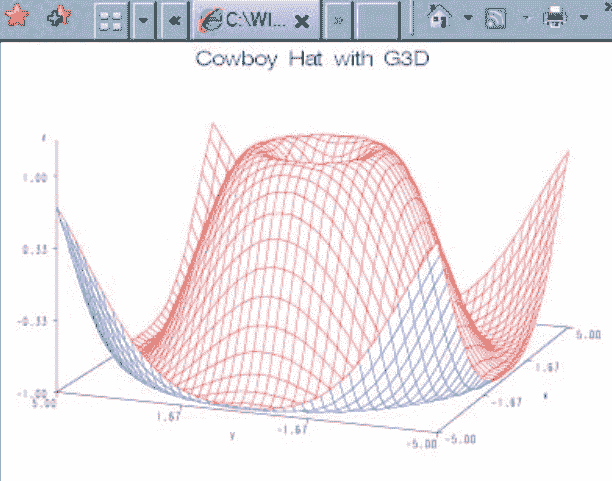

视口高度为 400 像素，宽度为 300 像素。由于使用了默认的 SVG 系统选项值，SVG 文档缩放至视口的 100%。


## 显示 17.1 SAS 窗口环境（Microsoft Windows）的一个界面

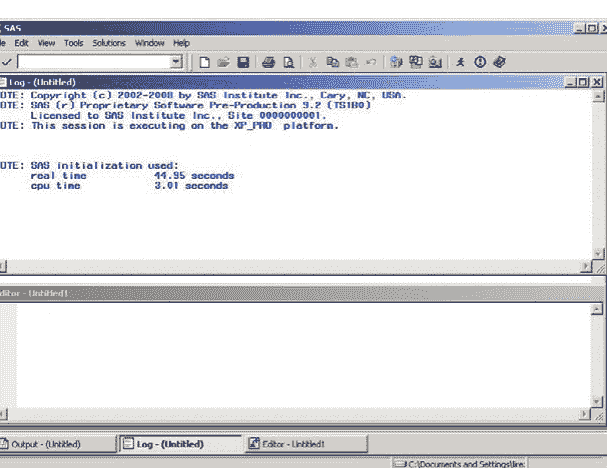

显示了增强编辑器（Enhanced Editor）和日志（Log）窗口，输出（Output）窗口位于这些窗口之间。

下面的显示显示了日志、结果（Results）和资源管理器（Explorer）窗口。

## 显示 17.2 SAS 窗口环境的另一种视图

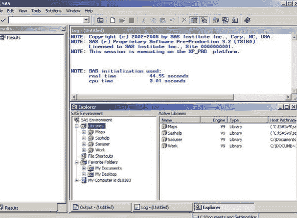

## SAS 管理器窗口

### SAS 管理器窗口的用途

SAS 管理器能够在窗口环境中管理文件。你可以使用 SAS 管理器执行以下任务：

- 查看你的 SAS文件列表。
- 创建新的 SAS 文件。
- 查看、添加或删除库（libraries）。
- 创建指向外部文件的快捷方式。
- 打开任何 SAS 文件并查看其内容。
- 移动、复制和删除文件。
- 打开相关窗口，例如新建库窗口。

### 打开 SAS 管理器窗口

你可以通过以下方式打开 SAS 管理器：

**命令：** 在命令行中输入 **EXPLORER** 并按回车键。
**菜单：** 选择 **View**（视图）► **Explorer**（管理器）。

### 显示带树形视图或不带树形视图的管理器

你可以显示带或不带内容树的管理器。显示树形视图可以让你查看文件的层级结构。要显示树形视图，请在 **View** 菜单中选择 **Show Tree**（显示树）。要关闭树形视图，在菜单中取消勾选 **Show Tree**。下面的显示了关闭了树视图的 SAS 管理器。点击展开图标查看层级中的其他文件。

*图 17.3* 开启树视图的 SAS 管理器

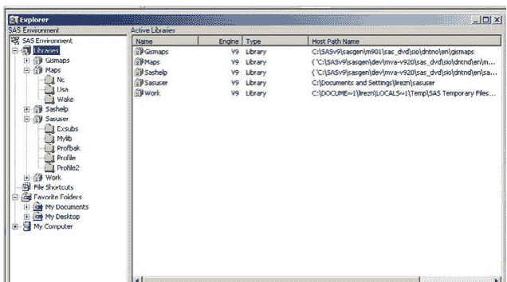

下面的显示了关闭了树视图的 SAS 管理器。

## 显示 17.4 关闭树视图的 SAS 管理器

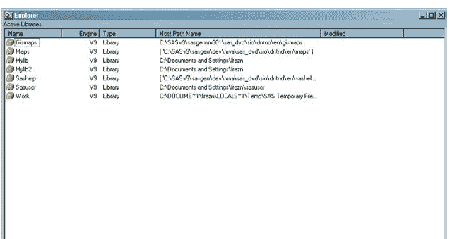

注意：你可以通过拖动窗口的边缘或角来调整管理器窗口的大小。你可以通过点击管理器窗口两个面板之间的分割条并向右或向左拖动，调整管理器窗口左右面板的大小。

## 程序编辑器窗口

### 程序编辑器窗口的用途

程序编辑器窗口允许你输入、编辑、提交和保存 SAS 程序。

### 打开程序编辑器窗口

你可以通过以下方式打开程序编辑器窗口：

- **命令：** 在命令行中输入 PROGRAM 或 PGM 并按回车键。
- **菜单：** 选择 View -> Program Editor。

> 注意：若要在 SAS 窗口环境中打开你的 SAS 程序，可以将其拖并放到到程序编辑器窗口上。

## 在程序编辑器窗口中查看程序

下面的显示了一个在程序编辑器窗口中编写的 SAS 程序。

## 显示 17.5 程序编辑器示例

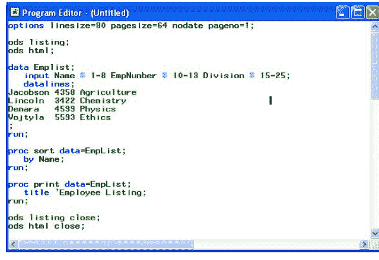

## 日志窗口

### 日志窗口的用途

日志窗口允许你查看关于 SAS 会话和 SAS 程序的消息。如果你提交的程序有意外结果，日志将帮助识别错误。你还可以使用 PUT 语句将程序输出写入日志中。

注意：为了防止当窗口最大化时日志行发生换行，请使用 `LINESIZE=` 系统选项。

### 打开日志窗口

你可以通过以下方式打开日志窗口：

- **命令：** 在命令行中输入 Log 并按回车键。
- **菜单：** 选择 **View** ► **Log**。

### 查看日志输出

这是日志输出的一个示例。

## SAS 窗口环境输出窗口简介 255

## 显示 1.6 日志窗口示例


## 输出窗口

### 输出窗口的用途

输出窗口允许你查看 SAS 程序的列表输出（listing output）。默认情况下，输出窗口位于其他窗口之后。当你创建输出时，输出窗口会自动移动到显示器的前方。

> 注意：为了防止当窗口最大化时输出行发生换行，请使用 `LINESIZE=` 系统选项。

### 打开输出窗口

你可以通过以下方式打开输出：

- 在命令行中输入 OUTPUT 或 OUT 并按回车键。
- 在命令行中输入 LISTING 或 LST 并按回车键。
- **菜单：** 选择 **View** **Output**。

### 查看列表输出

下面的显示显示了执行 SAS 程序后的列表输出。

## 显示 17.7 输出窗口中的列表输出示例

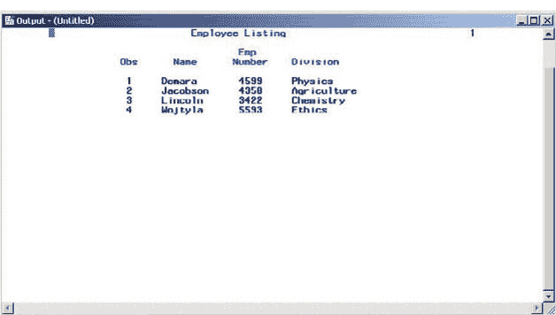

## 结果窗口

### 结果窗口的用途

结果窗口允许你查看 SAS 程序的列表输出。默认情况下，输出窗口位于其他窗口之后。当你创建输出时，输出窗口会自动移动到显示器的前方。

> 注意：为了防止当窗口最大化时输出行发生换行，请使用 `LINESIZE=` 系统选项。

### 打开结果窗口

你可以通过以下方式打开输出：

- 在命令行中输入 OUTPUT 或 OUT 并按回车键。
- 在命令行中输入 LISTING 或 LST 并按回车键。
- **菜单：** 选择 **View** **Results**。

### 查看列表输出

下面的显示了执行 SAS 程序的列表输出。

## 显示 17.8 结果窗口

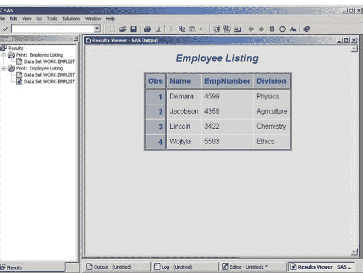

## SAS 窗口环境输出

结果窗口允许你查看 SAS 程序的列表输出。默认情况下，输出窗口位于其他窗口之后。当你创建输出时，输出窗口会自动移动到显示器的前方。

> 注意：为了防止当窗口最大化时输出行发生换行，请使用 `LINESIZE=` 系统选项。

### 打开结果窗口

你可以通过以下方式打开输出：

- 在命令行中输入 OUTPUT 或 OUT 并按回车键。
- 在命令行中输入 LISTING 或 LST 并按回车键。
- **菜单：** 选择 **View** **Results**。

### 查看列表输出

下面的显示了执行 SAS 程序的列表输出。

## 显示 17.9 结果窗口

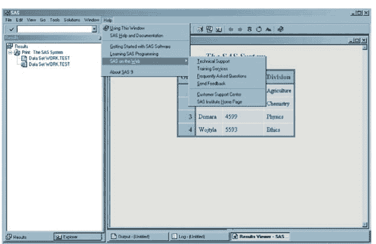

## SAS 窗口环境概览

SAS 窗口具有几种工作方式相似：下拉菜单、弹出菜单、工具栏和在线帮助。你可以通过选择工具对其中许多功能进行自定义。

## SAS 中的下拉菜单

下拉菜单包含一组在你选择菜单项时出现的选项。例如，如果你从 **View** 下拉菜单中选择 **Explorer**，然后再次选择 **View**，下拉菜单将列出管理器窗口激活时可用的选项。下面的显示了 **View** 下拉菜单。

## 显示 17.10 下拉菜单

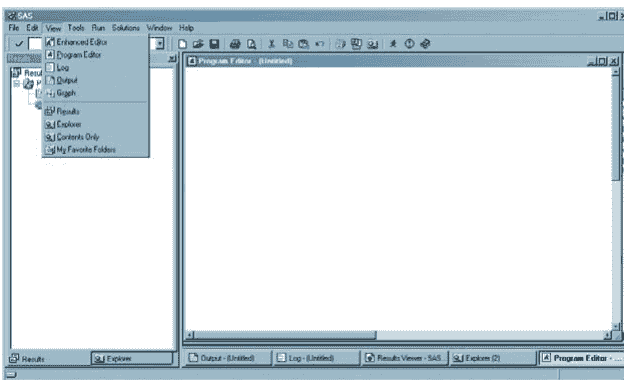

下拉菜单会随你使用的窗口而变化。例如，如果你从 **View** 下拉菜单中选择 **Program Editor**，然后再次选择 **View**，下拉菜单将列出程序窗口激活时可用的选项。

## SAS 窗口环境中的工具栏 259

编辑器窗口处于激活状态。下面的显示了程序编辑器窗口激活时的 View 下拉菜单。

## 显示 17.11 激活时的 View 

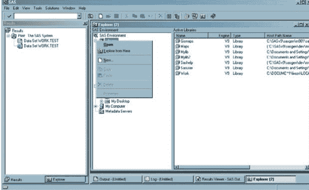

## SAS 中的弹出菜单

在 SAS 窗口中，弹出菜单在你右键点击项时显示。例如，当你右键点击管理器窗口中的库图标时，会显示下面的弹出菜单。

## 显示 17.12 弹出菜单示例


弹出菜单会保持可见，直到你从菜单中做出选择或点击弹出菜单区域之外。

## SAS 中的工具栏

工具栏显示一组窗口按钮或图标。当你点击工具栏中的项目时，将启动一个功能或操作。例如，点击打印机的图片在


工具栏用于启动过程控制。工具栏显示了你在特定窗口中经常执行的许多操作的图标。

*运行环境信息：* z/OS 运行环境中的 SAS 没有工具栏。更多信息，请参阅《SAS Companion for z/OS》。△

你所依赖的工具栏取决于哪个窗口处于激活状态。例如，当程序编辑器（Program Editor）窗口处于激活状态时，将显示以下工具栏。

显示 17.14 程序编辑器窗口激活状态时 SAS 工具栏的示例


当你将光标置于工具栏的某一个项目上，会出现一个文本窗口，标识该图标的用途。

## 命令行

命令行位于工具栏的左侧。在命令行中，你可以输入命令，例如打开 SAS 窗口和检索帮助信息的命令。以下是输入**脚注（footnotes）**命令以显示脚注（Footnotes）窗口的示例。

显示 17.15 脚注窗口

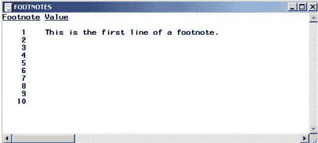

以下是输入**帮助脚注（Help footnotes）**后的命令行示例。

显示 17.16 命令行示例


按下 Enter 键后，SAS 会搜索在线帮助并显示以下窗口。

## SAS窗口环境介绍 从工具栏打开帮助菜单 261

显示 17.13 脚注帮助条目的结果

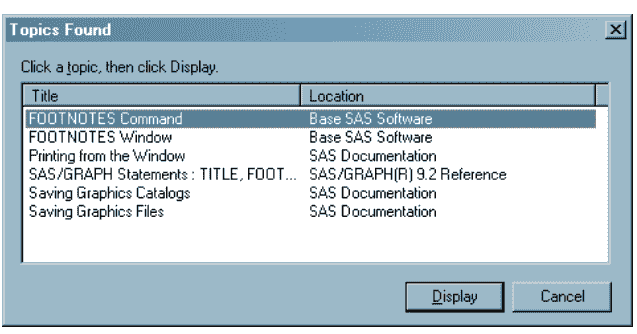

点击项目以访问该主题的帮助。

## 在 SAS 中获取帮助

### 在命令行中输入 Help

当你在命令行输入 Help 时，会显示激活窗口。当你输入 Help <item>（例如 Help footnotes）时，你可以访问你输入的项目的帮助信息。

### 从工具栏打开帮助菜单

当你打开帮助菜单时，可以从以下选项中选择：

- 使用窗口（Using Window）：打开描述当前激活窗口的帮助系统。
- SAS 帮助和文档（SAS Help and Documentation）：打开 SAS 和文档系统。它适用于安装在你系统上的 Base SAS 以及其他 SAS 产品。你可以通过点击目录中的项目或通过搜索并点击结果来查找信息。
- 开始使用 SAS（Getting Started with SAS）：打开“开始使用 SAS”教程。这是学习如何使用 SAS 基础的好方法。
- 学习 SAS 编程（Learning SAS Programming）：如果你有在线许可证，则可以使用 SAS 在线培训。该软件为初学者和经验丰富的 SAS 程序员提供 50–60 小时的指导。
- Web 版 SAS（SAS on the Web）：提供 SAS 网站的链接（如果你有 Web 访问），可以在那里进行以下操作：
    - 联系技术支持。
    - 查找培训服务信息。
    - 阅读常见问题（FAQs）。
    - 发送反馈。
    - 访问客户支持中心。
    - 浏览 SAS 首页。
- 关于 SAS®（About SAS®）：提供 SAS 的版本和发布信息。

### 在单个 SAS 窗口中点击帮助

当你打开一个窗口时，可以按下键盘上的 HELP 键（通常为 F1）显示该窗口的信息。

## SAS 窗口列表和窗口命令

基础 SAS 窗口包括资源管理器（Explorer）、结果（Results）、程序编辑器（Program Editor）、增强编辑器（窗口运行环境）、日志（Log）和输出（Output）窗口，但还有多个窗口可以帮助你完成打印和精调 SAS 会话等任务。

下表列出了所有的 SAS 窗口、描述以及打开窗口的命令。

表 17.1 SAS 窗口、描述和窗口命令列表

| 窗口名称 | 描述 | 窗口命令 |
| --- | --- | --- |
| 文档 (Documents) | 以层次树结构显示你的 ODS 文档。 | ODSDOCUMENT |
| 资源管理器 (Explorer) | 提供目录、库、数据集和主机文件数据的中心访问点。 | ACCESS, BUILD, CATALOG, DIR, EXPLORER, FILENAME, V6CAT, V6DIR, V6FILENAME |
| 资源管理器选项 (Explorer Options) | 允许编辑文件类型、更改或添加资源管理器中出现的弹出菜单项、选择器并显示数字详情。 | DMEXPORTS |
| 文件快捷方式分配 (File Shortcut Assignment) | 使用图形界面为文件分配文件快捷方式。 | FILEASSIGN |
| 查找 (Find) | 允许在 SAS 库中搜索表达式。 | EXPFIND |
| 脚注 (FOOTNOTES) | 允许为输出输入、浏览和修改脚注。 | FOOTNOTES |
| 数据浏览 (FSBrowse) | 允许选择数据集进行浏览。 | FSBROWSE |
| 数据集编辑 (FSEdit) | 允许选择数据集供 FSEDIT 过程处理。 | FSEDIT |

## SAS 窗口环境介绍 SAS 窗口列表和窗口命令 263 

| 窗口名称 | 描述 | 窗口命令 |
|---|---|---|
| 表单 (FSForm) | 允许自定义用于向打印机输出的表单。 | FSFORM for |
| 信函 (FSLetter) | 允许编辑或创建目录条目。 | FSLETTER |
| 列表 (FSList) | 允许在 SAS 会话中浏览外部文件。 | FSLIST |
| 视图 (FSView) | 允许浏览、编辑或创建 SAS 数据集，并以行列表格形式显示。 | FSVIEW |
| 帮助 (Help) | 显示关于 SAS 的帮助信息。 | HELP |
| 键 (Keys) | 允许浏览、更改和保存功能键。 | KEYS |
| 日志 (Log) | 显示当前 SAS 会话的消息和 SAS 语句。 | LOG |
| 元数据查找 (Metafind) | 允许使用统一资源标识符 (URI) 在存储中搜索元数据对象。 | METAFIND |
| 元数据服务器连接 (Metadata Server Connections) | 允许导入、导出、添加、删除、重新排序和测试元数据服务器连接。 | METACON |
| 新库 (New Library) | 允许创建新的 SAS 库并分配 libref。 | DMLIBASSIGN |
| 记事本 (NOTPAD) | 允许创建和存储文本记事本。 | NOTPAD, NOTE, FILEPAD filename |
| 选项 (SAS 系统选项)| 允许查看和更改某些 SAS 系统选项。 | OPTIONS |
| 输出 (Output) | 以列表格式显示过程输出。 | OUTPUT, OUT, LISTING, LIST |
| 页面设置 (Page Setup) | 允许指定页面设置。 | PAGESSETUP |
| 密码 (Password) | 允许浏览、更改和保存功能键。 | PASSWORD |
| 打印 (Page) | 允许浏览、编辑或创建 SAS 数据集，并以行列表格形式显示。 | PRINT |

| 窗口名称 | 描述 |
|---|---|
| 程序编辑器 (Program)| 允许输入、编辑和提交 SAS 语句。 | PROGRAM |
| 属性 (Properties)| 显示与当前数据集相关的属性。 | PROPERTIES |
| 注册表编辑器 (Registry Editor)| 允许编辑 SAS 注册表。 | REGEDIT |
| 结果 (Results)| 显示 SAS 的过程输出。 | RESULTS |
| SAS/AF | 显示 SAS 创建的窗口应用程序。 | AF |
| SAS/ASSIST | 显示 SAS 主菜单。 | ASSIST |
| 颜色 (COLOR)| 允许更改窗口元素的默认颜色。 | COLOR |
| 查询 (QUERY)| 允许在不熟悉结构化查询语言的情况下构建、运行和保存查询。 | QUERY |
| 系统选项 (System Options)| 允许更改设置。 | OPTIONS |

注意：可能某些适用于你运行环境的额外窗口。请参阅你的运行环境文档获取更多信息。⚠

# 章节
# 18
# 在窗口式环境中管理数据

- 在窗口式环境中管理数据介绍 265
- 使用资源管理器管理数据 266
- 使用资源管理器管理数据的介绍 266
- 查看库和数据集 266
- 分配文件快捷方式 267
- 重命名 SAS 数据集 268
- 复制 SAS 数据集 269
- 库中的排序 269
- 查看数据集属性 269
- 使用 VIEWTABLE 270
- VIEWTABLE 概述 270
- 查看 SAS 数据集 270
- 移动表格列 271
- 临时更改列标题 272
- 按值排序 273
- 编辑单元格值 274
- 使用 WHERE 表达式子集数据 275
- 子集表格行 275
- 清除 WHERE 表达式 276
- 导出数据集 278
- 导出数据概述 278
- 导出数据 278
- 将数据导入表格 281
- 导入数据概述 281
- 导入标准文件 281
- 导入非标准文件 284

## 在窗口式环境中管理数据

窗口式环境包含多个窗口，允许你执行常见的数据操作并进行更改，无需编写代码。

如果你不熟悉 SAS 或编写 SAS 代码，那么该环境可能对你有所帮助。在窗口式环境中，你可以打开数据集，指向数据中的行和列，然后点击菜单项对信息进行重新组织和分析。

有关窗口式环境的更多信息，请在调用 SAS 会话后，从帮助菜单中选择 SAS 帮助和文档。


## 使用 SAS Explorer 管理数据

## 使用 SAS Explorer 管理数据的简介

你可以使用 SAS Explorer 来查看和管理数据集。数据集存储在库（libraries）中，库是 SAS 文件和目录（catalogs）的存储位置。默认情况下，SAS 为你定义了几个库：

- Sashelp 是 SAS 创建的库，用于存储帮助窗口文本、默认函数键定义、窗口定义和菜单。
- Maps 是由 SAS 创建的库，用于展示地理或其他区域的图形化表示。
- Sasuser 是一个持久性 SAS 库，在你首次运行 SAS 会话时创建。该库包含一个名为 Profile（个人配置文件）的目录，用于存储你为 SAS 指定的自定义功能或设置。（你可以在此库中存储其他 SAS 文件。）
- Work 是 SAS 在每个 SAS 会话或 SAS 作业开始时创建的临时库。除非你指定了用户库（User library），否则任何带有级别名称的新创建 SAS 文件默认将放置在 Work 库中，并在当前会话或作业结束时删除。

## 查看库和数据集

在 SAS 中，库和数据集以大图标、小图标或列表的形式表示。你可以通过选择视图（View）菜单中的选项来更改这种表示形式：

- 要查看大图标，从视图菜单中选择大图标（Large Icons）。
- 要查看小图标，从视图菜单中选择小图标（Small Icons）。
- 要以列表形式查看数据集，从视图菜单中选择列表（List）。

下面的显示显示了 Sashelp 库的大图标表示形式：

### 显示 18.1 用大图标表示的 Sashelp 库

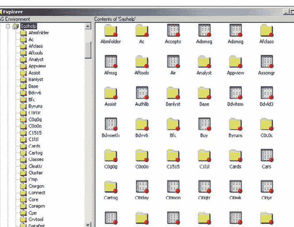

如果你选择 Sashelp 库，然后选择视图（View）► 详情（Details），将显示 Sashelp 库的内容，以及数据集的大小和类型：

### 显示 18.2 Sashelp 库的详细视图

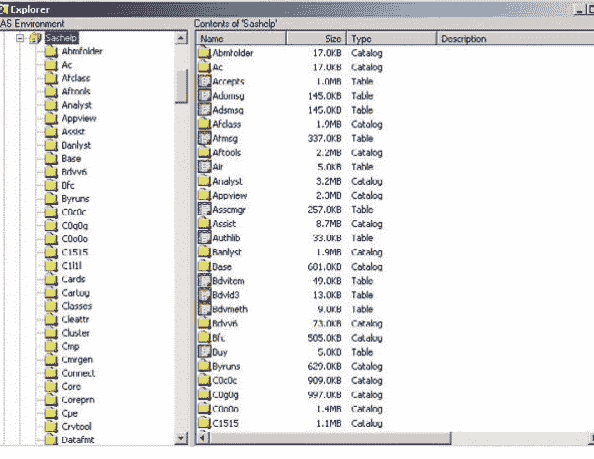

如果你双击此列表中的某个表，数据集就会打开。会出现 VIEWTABLE 窗口（这是一个 SAS 表格查看器和编辑器），并填充该表中的数据。

## 分配文件快捷方式

文件快捷方式也称为引用（file reference）或 fileref。通过为常用文件分配别名，fileref 可以节省你的编程时间。

你可以使用 `FILENAME` 语句来创建引用，也可以使用 SAS Explorer 中的文件快捷方式分配（File Shortcut Assignment）窗口。
要为文件分配引用，请按照以下步骤操作：

1. 当 SAS Explorer 窗口处于激活状态时，从左窗格选择文件快捷方式（File shortcuts）。
2. 在右窗格点击右键，从菜单中选择新建文件快捷方式（New File Shortcut）。
3. 在出现的文件快捷方式分配窗口中，在名称（Name）字段中输入你想要使用的引用名称。
4. 在文件（File）字段中输入文件的完整路径名。

下面的显示显示了文件快捷方式分配窗口：

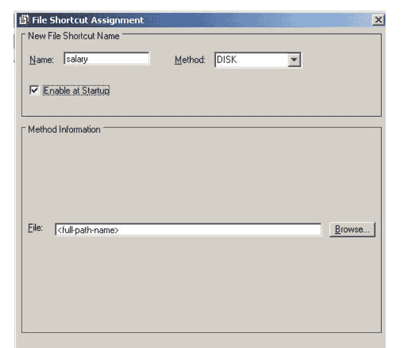

默认情况下，你创建的引用是临时的，只能在当前 SAS 会话中使用。然而，从文件快捷方式分配窗口中选择启动时启用（Enable at Startup），会在你每次启动新的 SAS 会话时将引用分配给该文件。

## 重命名 SAS 数据集

你可以重命名 SAS 库中的任何数据集，因为它没有被写保护。要重命名数据集，请按照以下步骤操作：

1. 打开 SAS Explorer 并选择一个库。
2. 右键点击你想要重命名的数据集。
3. 从菜单中选择重命名（Rename），并输入数据集的新名称。
4. 点击确定。

库的内容显示在右窗格中。

## 复制 SAS 数据集

你可以将 SAS 数据集复制到另一个库或目录，也可以在原始数据集相同的目录中复制数据集。要复制或重复数据集，请按照以下步骤操作：

1. 打开 SAS Explorer 并选择一个库。
   库的内容显示在右窗格中。
2. 右键点击你要复制或重复的数据集。
3. 从显示的菜单中，选择**复制（Copy）**将数据集复制到另一个库或目录，或选择**重复（Duplicate）**将数据集复制到相同的库或目录。
4. 如果你选择**复制（Copy）**，请执行以下操作：
   a. 点击 SAS Explorer 左窗格中的库，以选择要将数据集复制到的库或目录。
   b. 在右窗格中，右键点击鼠标并从显示的菜单中选择**粘贴（Paste）**。
      数据集的副本现在位于新目录中。
5. 如果你选择**重复（Duplicate）**，则会出现重复（Duplicate）窗口。在重复窗口中，SAS 在数据集名称后添加 **_copy**——例如，**data-set-name_copy**。
   执行以下操作之一：
   * 保留名称并点击**确定**。
   * 为你的重复创建一个创建一个名称并点击**确定**。

## 库中的数据集

SAS Explorer 中的数据集按名称自动排序。你可以通过点击大小（Size）或类型（Type）列来按大小或类型排序数据集。要将数据集恢复到原始顺序，从视图（View）菜单中选择刷新（Refresh）选项。

## 查看数据集的属性

你可以使用属性（Properties）窗口查看数据集的属性。要查看属性，请按照以下步骤操作：

1. 打开 SAS Explorer 并选择一个库。
   库的内容显示在右窗格中。
2. 右键点击你想要查看的数据集。
3. 从菜单中选择**属性（Properties）**。

出现以下窗口：

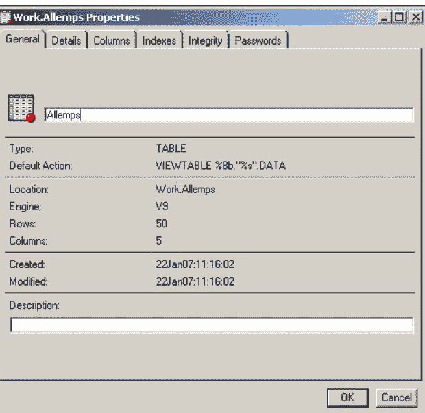

4. 在常规（General）选项卡中，你可以查看数据集的信息。
5. 选择其他选项卡以查看更多信息。

## 数据处理

要交互式地处理数据，你可以使用 VIEWTABLE。要查看数据集的内容，请按照以下步骤操作：

1. 打开 SAS Explorer 并选择一个库。
   库的内容显示在右窗格中。
2. 双击数据集。
出现 VIEWTABLE 窗口：

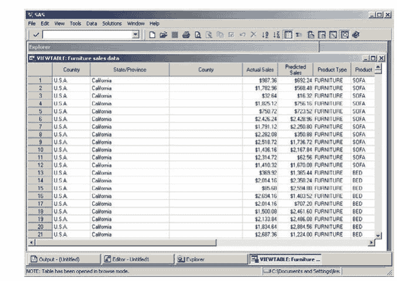

## 移动表中的列

在 VIEWTABLE 窗口中，你可以重新排列列。要移动表中的列：

1. 左键点击要移动的列的标题。
2. 将标题拖动到另一列。在本示例中，如果你将 Product Type 拖到 Country，它将移动到 Country 右侧。

## 临时更改列头

在 VIEWTABLE 窗口中，你可以临时更改列头。要临时更改列头，请按照以下步骤操作：

1. 右键点击要更改的标题，然后从菜单中选择列属性（Column Attributes）。在本示例中，列标题列在名称（Name）字段中。

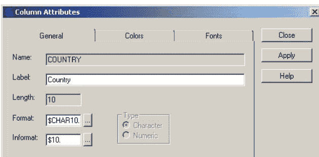

2. 在列属性窗口的标签（Label）字段中输入列头的新名称，然后点击应用（Apply）。
VIEWTABLE 中的列头变为新名称。在本示例中，标签被更改为**Country of Origin**（产地国家）。

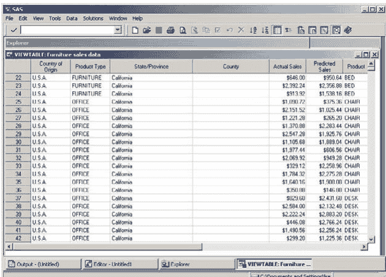

3. 点击关闭（Close）关闭列属性窗口。

## 按列值排序

你可以根据列的值对表进行升序或降序排序。你可以永久排序或创建表的排序副本。
要对表进行排序，请按照以下步骤操作：

1. 右键点击要排序的列标题，从菜单中选择排序（Sort）。
2. 从菜单中选择升序（Ascending）或降序（Descending）。
3. 当出现警告消息时，点击是（Yes）以创建表的排序副本。

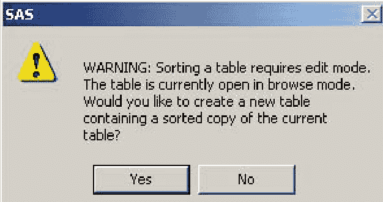

注意：如果你在打开表并点击数据单元后选择了编辑模式，则不会出现此窗口。SAS 将更新原始表。

4. 在排序（Sort）窗口中，输入新排序表的名称。在本示例中，排序表的名称为 FurnSalesSorted。

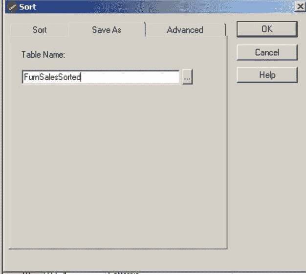


# 点击 5 次确定。

新表中的行按“实际销售额”（Actual Sales）的值降序排列。

| ID | 办公室 | 产品类型 | 州/省 | 县 | 实际销售额 | 预测销售额 |
|---|---|---|---|---|---|---|
| 1 | 美国 | 家具 | 加利福尼亚州 | | $3175.60 | $795.00 USD |
| 2 | 美国 | 家具 | 加利福尼亚州 | | $3448.60 | $850.00 USD |
| 3 | 美国 | 家具 | 加利福尼亚州 | | $3175.00 | $850.00 USD |
| 4 | 美国 | 办公 | 加利福尼亚州 | | $3175.60 | $795.00 USD |
| 5 | 美国 | 办公 | 加利福尼亚州 | | $2413.60 | $2962.00 USD |
| 6 | 美国 | 办公 | 加利福尼亚州 | | $3448.60 | $850.00 USD |
| 7 | 美国 | 办公 | 加利福尼亚州 | | $3384.90 | $852.10 USD |
| 8 | 美国 | 办公 | 加利福尼亚州 | | $3448.60 | $850.00 USD |
| 9 | 美国 | 办公 | 加利福尼亚州 | | $3384.70 | $850.00 CHAIR |
| 10 | 美国 | 家具 | 加利福尼亚州 | | $3576.20 | $2364.00 CHAIR |
| 11 | 美国 | 家具 | 加利福尼亚州 | | $3175.00 | $794.70 BEDS |
| 12 | 美国 | 家具 | 加利福尼亚州 | | $3177.80 | $795.00 USD |
| 13 | 美国 | 办公 | 加利福尼亚州 | | $3385.40 | $8579.00 USD |
| 14 | 美国 | 办公 | 加利福尼亚州 | | $3250.20 | $5618.00 BLD |
| 15 | 美国 | 办公 | 加利福尼亚州 | | $3448.60 | $850.00 USD |
| 16 | 美国 | 办公 | 加利福尼亚州 | | $3385.00 | $1119.10 USD |
| 17 | 美国 | 办公 | 加利福尼亚州 | | $3448.60 | $1538.00 USD |
| 18 | 美国 | 办公 | 加利福尼亚州 | | $3385.00 | $1119.10 USD |
| 19 | 美国 | 办公 | 加利福尼亚州 | | $3225.20 | $912.90 CHAIR |
| 20 | 美国 | 办公 | 加利福尼亚州 | | $3323.70 | $2712.00 USD |

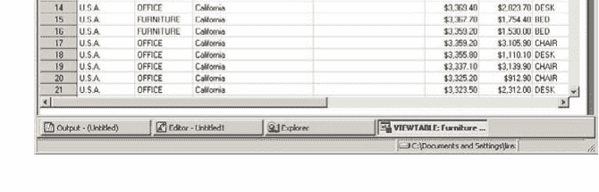

# 编辑单元格值

默认情况下，VIEWTABLE 以浏览模式打开现有表格，这可以保护表格数据。要编辑表格，你需要切换到编辑模式。按照以下步骤切换到编辑模式：

- 1. 选中表格后，从**编辑（Edit）**菜单中选择**编辑 ► 编辑模式（► Edit Mode）**。
- 2. 左点击表格中的单元格，单元格中的值将被亮。
在此示例中，选中了第四行的第三个单元格。

| ID | 办公室 | 产品类型 | 州/省 | 县 | 实际销售额 | 预测销售额 |
|---|---|---|---|---|---|---|
| 1 | 美国 | 家具 | 加利福尼亚州 | | $3175.60 | $795.00 USD |
| 2 | 美国 | 家具 | 加利福尼亚州 | | $3448.60 | $850.00 USD |
| 3 | 美国 | 家具 | 加利福尼亚州 | | $3175.00 | $850.00 USD |
| 4 | 美国 | 办公 | 加利福尼亚州 | | $3175.60 | $795.00 USD |
| 5 | 美国 | 办公 | 加利福尼亚州 | | $2413.60 | $2962.00 USD |
| 6 | 美国 | 办公 | 加利福尼亚州 | | $3448.60 | $850.00 USD |
| 7 | 美国 | 办公 | 加利福尼亚州 | | $3384.90 | $852.10 USD |
| 8 | 美国 | 办公 | 加利福尼亚州 | | $3448.60 | $850.00 USD |
| 9 | 美国 | 办公 | 加利福尼亚州 | | $3384.70 | $850.00 CHAIR |
| 10 | 美国 | 家具 | 加利福尼亚州 | | $3576.20 | $2364.00 CHAIR |
| 11 | 美国 | 家具 | 加利福尼亚州 | | $3175.00 | $794.70 BEDS |
| 12 | 美国 | 家具 | 加利福尼亚州 | | $3177.80 | $795.00 USD |
| 13 | 美国 | 办公 | 加利福尼亚州 | | $3385.40 | $8579.00 USD |
| 14 | 美国 | 办公 | 加利福尼亚州 | | $3250.20 | $5618.00 BLD |
| 15 | 美国 | 办公 | 加利福尼亚州 | | $3448.60 | $850.00 USD |
| 16 | 美国 | 办公 | 加利福尼亚州 | | $3385.00 | $1119.10 USD |
| 17 | 美国 | 办公 | 加利福尼亚州 | | $3448.60 | $1538.00 USD |
| 18 | 美国 | 办公 | 加利福尼亚州 | | $3385.00 | $1119.10 USD |
| 19 | 美国 | 办公 | 加利福尼亚州 | | $3225.20 | $912.90 CHAIR |
| 20 | 美国 | 办公 | 加利福尼亚州 | | $3323.70 | $2712.00 USD |

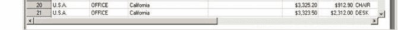

- 3. 在单元格中输入新值并按**回车（Enter）**。
在此示例中，单元格已更新为北罗来纳州（North Carolina）。

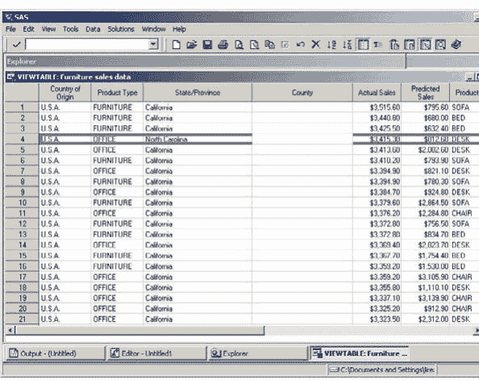

- 4. 选择**文件（File）► 关闭（Close）**。
- 5. 当提示保存对表格的更改时，点击**是（Yes）**保存更改或点击**否（No）**忽略更改。

# 使用 WHERE 表达式筛选数据

在 VIEWTABLE 窗口中，你可以筛选显示符合一个或多个条件的行。要筛选表格行，请按照以下步骤操作：

- 1. 在资源管理器（Explorer）中，打开一个库并双击要筛选的表格。
在此示例中，选中了家具销售数据。


- 2. 右点击非表头的任意列并选择**Where**。WHERE 表达式将打开。

img/a5ce6a7fc3f6237e724c3077d09d6829_286_1.png

- 3. 在“可用列”（Available Columns）列表中选择一列，然后从“运算符”（Operators）菜单中选择一个运算符。
在此示例中，从“可用列”列表中选择了 COUNTRY，并从“运算符”菜单中选择了 EQ（等于）。注意 WHERE 表达式是在窗口底部的 Where 框中构建的。

img/a5ce6a7fc3f6237e724c3077d09d6829_286_2.png

- 4. 在“可用列”列表中选择另一个值来完成 WHERE 表达式。
在此示例中，选中了查找唯一值（LOOKUP distinct values）。
在出现的查找值（Lookup Values）窗口中，选择一个值。
在此示例中，选中了加拿大（Canada）。

img/a5ce6a7fc3f6237e724c3077d09d6829_287_0.png

点击确定关闭 WHERE 窗口。
在此示例中，VIEWTABLE 只显示国家为加拿大的行。

# 清除 WHERE 表达式

你可以清除用于筛选数据的 WHERE 表达式，并重新显示表格中的所有数据。执行此操作，请按照以下步骤操作：

- 右点击表格中列标题的任意单元格。
- 从弹出菜单中选择**WHERE 清除（Clear）**。
- VIEWTABLE 将移除通过 WHERE 表达式创建的现有数据筛选，并显示表格的所有行。

# 导出数据集

# 导出数据概述

导出向导从 SAS 数据集中读取数据并将其写入外部文件。你可以将 SAS 数据导出到多种格式。可用的格式取决于你的操作系统环境以及安装的 SAS 产品。

# 导出数据

要导出数据，请按照以下步骤操作：

- 从文件菜单选择**文件（File）-> 导出数据（Export Data）**。
出现“导出向导 - 选择库和成员”窗口。
- 选择要导出数据的 SAS 数据集。
在此示例中，选择 `WORK` 为库，`FURNALSESSORTED` 为成员名。

img/a5ce6a7fc3f6237e724c3077d09d6829_288_0.png

img/a5ce6a7fc3f6237e724c3077d09d6829_289_0.png

- 3 点击**下一步（Next）**，显示“导出向导 - 选择导出类型”窗口。
- 4 选择要导出文件的数据源类型。默认选中**标准数据源（Standard data source）**。在此示例中，选择了**Microsoft Excel 97/2000/2002/2003 工作簿**。

img/a5ce6a7fc3f6237e724c3077d09d6829_289_1.png

- 5 点击**下一步（Next）**显示连接 MS Excel 窗口。
- 6 在**工作簿（Workbook）**字段中输入包含导出文件的工作簿名称，然后点击**确定（OK）**。
在此示例中，输入了 Myworkbook。

- 7 当“导出向导 - 选择表格”窗口出现，为要导出的表格输入名称。
在此示例中，**Mytable** 是表格名称。

img/a5ce6a7fc3f6237e724c3077d09d6829_290_0.png

- 8 点击**下一步（Next）**。
- 9 如果你想让 SAS 创建一个 PROC EXPORT 语句文件供以后使用，请输入包含 SAS 语句的文件名。

# 在 SAS 窗口环境中管理你的数据 导入标准文件 281

img/a5ce6a7fc3f6237e724c3077d09d6829_291_0.png

- 10 点击**完成（Finish）**完成此任务。


## 282 导入标准文件 $\Delta$ 第 18 章


3 点击**下一步**继续。

4 在“连接到 MS Excel”窗口中，输入您想要导出的文件路径，然后点击**确定**。


5 在“导入向导 - 选择表”窗口中，输入您想要导入的表名。


6 点击**下一步**继续。

7 在出现的“导入向导 - 选择库和成员”窗口中，输入一个存储导入文件的位置。

在本例中，选择了 WORK 作为库，选择了 FURNASLESORTED 作为成员名。


8 点击**下一步**继续。

9 如果您想让 SAS 创建一个 PROC IMPORT 语句的文件以备后用，请输入一个包含这些 SAS 语句的文件名。


10 点击**完成**结束此任务。

## 导入非标准文件

如果您的数据不是标准格式，可以使用外部文件接口 (EFI) 功能来导入数据。该工具允许您定义文件格式，并为您提供了一系列格式选项。要使用 EFI，请在导入向导中选择“用户定义文件格式”，并按照说明描述您的数据文件进行操作。

## 第 3 部分

## DATA 步概念

- 第 19 章.......DATA 步处理 287
- 第 20 章.......读取原始数据 313
- 第 21 章.......DATA 步中的 BY 组处理 331
- 第 22 章.......读取、合并和修改 SAS 数据集 343
- 第 23 章.......使用 DATA 步组件对象 393
- 第 24 章.......数组处理 431

## 第 19 章
### DATA 步处理

- 为什么要使用 DATA 步？ 287
- DATA 步处理概述 288
- 动作流程 288
- 编译阶段 290
- 执行步骤 290
- 处理 DATA 步：逐步解析 291
- 创建输入缓冲区和程序数据向量 (PDV) 291
- 读取记录 292
- 将观测值写入 SAS 数据集 293
- 读取下一条记录 294
- 当 DATA 步结束时 295
- 关于 DATA 步执行 296
- DATA 步中的默认执行顺序 296
- 使用语句更改默认执行顺序 297
- 为特定观测值更改流程 297
- 步边界——如何知道语句何时生效 299
- 什么导致 DATA 步停止执行 300
- 使用 DATA 步创建 SAS 数据集 301
- 创建 SAS 数据文件或 SAS 视图 301
- 输入源 301
- 读取原始数据：示例 302
- 示例 1：读取外部文件 302
- 示例 2：读取内部流式数据行 302
- 示例 3：读取带有缺失值的流式数据行 303
- 示例 4：在流式数据中使用多个输入文件 303
- 从 SAS 数据集读取数据 304
- 从编程语句生成数据 304
- 使用 DATA 步编写报告 305
- 示例 1：在不创建数据集的情况下创建报告 305
- 示例 2：创建自定义报告 306
- 示例 3：使用 ODS 和 DATA 步创建 HTML 报告 310
- DATA 步和 ODS 312

## 为什么要使用 DATA 步？

使用 DATA 步是使用 Base SAS 软件创建 SAS 数据集的主要方法。DATA 步是一组 SAS 语言语句，以 DATA 语句开头，包含其他编程语句，用于处理现有的 SAS 数据集或从原始数据文件创建 SAS 数据集。

您可以使用 DATA 步来实现：

- 创建 SAS 数据集（SAS 数据文件或 SAS 视图）
- 从包含原始数据（外部文件）的输入文件创建 SAS Set
- 通过对 SAS 数据集进行子集划分、合并、修改和更新来创建新的数据集
- 分析、处理或展示您的数据
- 计算新变量的值
- 报告编写，或将文件写入磁盘或磁带
- 获取信息
- 文件管理

*注意：* DATA 步创建一个 SAS 数据集。该数据集可以是 SAS 数据文件，也可以是 SAS 视图。SAS 数据文件存储数据值，而 SAS 视图存储检索和处理数据的指令。当您可以使用 SAS 视图作为 SAS 数据文件使用时（在大多数情况下确实如此），本文文档使用更广泛的“数据集”这一术语。

## DATA 步处理概述

### 动作流程

当您提交 DATA 步时，它会先编译后执行。下图显示了 DATA 步的动作流程。

图 19.1 DATA 步的动作


### 编译阶段

当您提交 DATA 步进行执行时，它首先被编译然后执行。在编译阶段，SAS 识别语句的语法并创建以下内容：

- 能够通过 `INPUT` 语句读取原始数据的逻辑区域
- SAS 从缓冲区读取原始数据，并构建观测值
- 另一个逻辑区域，用于通过 `INPUT` 语句读取 SAS 数据集
- SAS 在执行时通过 `INPUT` 语句读取原始数据
- 伴随着原始数据的执行，PDV 包含自动变量 _N_ 和 _ERROR_。_ERROR_ 变量值为零（表示没有错误）或一（表示发生了错误）。SAS 将输出。

### 执行阶段

默认情况下，DATA 步为每个观测值执行一次。每当 DATA 步执行时，_N 就会加1。

- 将新创建的变量设置为程序数据向量 (PDV)。
- SAS 从输入文件读取原始数据到缓冲区，或者从 SAS 数据集直接读取 PDV。
- 使用 `INPUT`、`MERGE`、`SET` 或 `UPDATE` 语句读取记录。
- SAS 执行后续的编程语句。
- 在语句结束时，会自动进行输出、返回和重置。当 SAS 遇到 SAS 数据集或数据文件的末尾时，DATA 步终止。

## 处理 DATA 步：逐步解析

### 示例 DATA 步

以下语句提供了一个读取原始数据、计算总和并创建数据集的 DATA 步示例：

```sas
data_points (drop=TeamName);
input TeamName $ParticipantName Event1 Event2 Event3;
TeamTotal + (Event1 + Event2 + Event3);
datalines;
Knights Sue 6 8 8
Kings Jane 9 7 8
Knights John 7 7 7
Knights Lisa 8 9 9
Knights Fran 7 6 6
Knights Walter 9 8 10
```

- `DROP=` 步选项防止 `TeamName` 变量输出到名为 `TOTAL_POINTS` 的 SAS 数据集中。
- `INPUT` 语句通过为每个变量命名、识别其数据类型（字符或数值）以及识别其在数据记录中的相对位置来描述数据。
- `TeamTotal` 变量累加三个事件的分数。


DATA 步已经迭代。_ERROR_ 变量类似于一个二进制开关，如果 DATA 步中没有发生错误，其值为 0；如果存在一个或多个错误，其值为 1。下图显示了 DATA 步编译后的输入缓冲区和程序数据向量（PDV）。

## 19.2 输入缓冲区和程序数据向量

| 输入缓冲区 |
| 1 2 |
| 1 2 3 4 5 6 7 8 9 0 1 2 3 4 5 6 7 8 9 0 1 2 3 4 5 |
| | | |

| TeamName | ParticipantName | Event1 | Event2 | Event3 | TeamTotal | _N_ | _ERROR_ |
| | | | | | | 0 | 1 | 0 |
| Drop | | Drop | | | | | | |

由 `INPUT` 和 `Sum` 语句创建的变量（TeamName, ParticipantName, Event1, Event2, Event3 和 TeamTotal）最初设置为缺失。请注意，在这种表示中，数值型变量用句号（.）初始化，字符型变量用空格初始化。自动变量 _N_ 设置为 1；自动变量 _ERROR_ 设置为 0。由于 `DATA` 语句中使用了 `DROP=` 数据集选项，变量 TeamName 在 PDV 中被标记为 Drop。被丢弃的变量不会写入 SAS 数据集。_N_ 和 _ERROR_ 变量也会被丢弃，因为由 DATA 步创建的自动变量不会写入 SAS 数据集。有关自动变量的详细信息，请参阅第 25 页第 4 章“SAS 变量”。

## 读取记录

SAS 将第一行读入输入缓冲区。SAS 使用输入指针在从输入缓冲区读取数据时保持位置，该指针位于缓冲区开头，以读取数据记录。下图显示了在 SAS 读取数据之前输入指针在输入缓冲区中的位置。

## 19.3 SAS 读取数据前指针在输入缓冲区中的位置

| 输入缓冲区 |
| 1 2 |
| 1 2 3 4 5 6 7 8 9 0 1 2 3 4 5 6 7 8 9 0 1 2 3 4 5 |
| Knight | Sue | | 6 | 8 | |

`INPUT` 语句从输入缓冲区中的记录中读取数据值并将其写入 PDV，此时它们成为变量值。下图显示了在 SAS 读取第一条记录后，指针在输入缓冲区中的位置以及 PDV 中的值。

**图 19.4** 从第一条记录读取的值写入程序数据向量

| 输入缓冲区 |
| 1 | | 2 |
| 1 2 3 4 5 6 7 8 9 0 1 2 3 4 5 |
| K n i g h t s | S u e | | | 6 | | 8 | | 8 | |

程序数据向量

| TeamName | ParticipantName | Event1 | Event2 | Event3 | TeamTotal | _N_ | _ERROR_ |
| Knights | Sue | 6 | 8 | 8 | 0 | 1 | 0 |
| Drop | | | | | | Drop | Drop |

在 `INPUT` 语句读取每个变量的值后，SAS 执行 `Sum` 语句。SAS 计算变量 TeamTotal 的值并将其写入 PDV。下图显示了在 SAS 将观测值写入数据集之前的 PDV 及其所有值。

**图 19.5** 带有 `Sum` 语句计算值的程序数据向量

程序数据向量

| TeamName | ParticipantName | Event1 | Event2 | Event3 | TeamTotal | _N_ | _ERROR_ |
| Knights | Sue | 6 | 8 | 8 | 22 | 1 | 0 |
| Drop | | | | | | Drop | Drop |

## 将观测值写入数据集

当 SAS 执行 DATA 步的最后一个语句时，PDV 中所有被标记为丢弃之外的值都将作为单个观测写入 TOTAL_POINTS 数据集。下图显示了 TOTAL_POINTS 数据集中的第一条观测值。

**图 19.6** 数据集 TOTAL_POINTS 中的第一条观测

输出数据集 TOTAL_POINTS: 第 1 条观测

| ParticipantName | Event1 | Event2 | Event3 | TeamTotal |
| Sue | 6 | 8 | 8 | 22 |

在 `INPUT` 语句读取每个变量的值后，SAS 执行 `Sum` 语句。SAS 计算变量 TeamTotal 的值并将其写入 PDV。下图显示了在 SAS 将观测值写入数据集之前的 PDV 及其所有值。

程序数据向量

| TeamName | ParticipantName | Event1 | Event2 | Event3 | TeamTotal | _N_ | _ERROR_ |
| Knights | Sue | 6 | 8 | 8 | 22 | 1 | 0 |
| Drop | | | | | | Drop | Drop |

当 SAS 执行 DATA 步的最后一个语句时，PDV 中所有被标记为丢弃之外的值都将作为单个观测写入 TOTAL_POINTS 数据集。下图显示了 TOTAL_POINTS 数据集中的第一条观测值。

**图 19.6** 数据集 TOTAL_POINTS 中的第一条观测

输出数据集 TOTAL_POINTS: 第 1 条观测

| ParticipantName | Event1 | Event2 | Event3 | TeamTotal |
| Sue | 6 | 8 | 8 | 22 |

SAS 返回到 DATA 语句开始下一次迭代。SAS 以以下方式重置 PDV 中的值：

- 由 `INPUT` 语句创建的变量设置为缺失。
- 由 `Sum` 语句创建的值保留。
- 自动变量 _N_ 增加 1，_ERROR_ 重置为 0。

下图显示了 PDV 中的当前值。

程序数据向量

| TeamName | ParticipantName | Event1 | Event2 | Event3 | TeamTotal | _N_ | _ERROR_ |
| --- | --- | --- | --- | --- | --- | --- | --- |
| | | • | • | • | 2 | | | |
| Drop | | | | | | | | Drop |

## 读取下一条记录

SAS 将下一条记录读入输入缓冲区。`INPUT` 语句从输入缓冲区读取数据值并将其写入 PDV。下图显示了在 SAS 读取第一条记录之前指针在输入缓冲区中的位置。（注：由于 OCR 文本存在大量重复和交叉，已对内容进行了去重逻辑处理。）

**图 19.8** 输入缓冲区、程序数据向量和第一条观测

输入缓冲区

| 1 | | 2 |
| 1 2 3 4 5 6 7 8 9 0 1 2 3 4 5 |
| K n i g h t s | S u e | | | 6 | | 8 | | 8 | |


参见《SAS Language Reference: Dictionary》中的“Manipulate Files”。关于 SAS 函数的特定信息，请参阅《SAS Language Reference: Dictionary》中“Functions and CALL Routines by Category”栏目下的“SAS I/O Files and External Files”类别。

# 更改默认执行顺序

## 使用语句更改默认执行顺序

你可以通过更改默认执行顺序来控制程序的执行方式。SAS 语言语句为你在 DATA 步中执行此操作提供了很大的灵活性。以下列表显示了控制 DATA 步程序中执行流的最常用方法。

表 19.2 改变执行顺序的常用方法

| 任务 | 可能的方法 |
|--- |---|
| 读取记录 | merge、modify、join data sets<br>读取多条记录以创建单个观测值<br>随机选择记录进行处理<br>从多个文件中读取 |
| 处理数据 | 使用条件逻辑<br>保留变量值 |
| 写入观测值 | 写入 SAS 数据集或外部文件<br>控制何时将输出写入数据集<br>写入多个文件 |

欲了解更多信息，请参阅《SAS Language Reference: Dictionary》中的各个语句。

## 使用函数更改默认执行顺序

你可以使用函数来读取和处理数据。关于语句和函数处理数据方式的差异，请参阅《SAS Language Reference: Dictionary》中的“Manipulate Files”。关于 SAS 函数的特定信息，请参阅《SAS Language Reference: Dictionary》中“Functions and CALL Routines by Category”栏目下的“SAS I/O Files and External Files”类别。

## 更改特定观测值的流

你可以使用语句、语句选项和数据集选项来更改 SAS 处理特定观测值。下表列出了 SAS 语言元素及其对处理的影响。

# 改变程序流的语言元素

| SAS 语言元素 | 功能 |
| --- | --- |
| IF 语句 | 条件为假时停止当前迭代，不将当前观测值写入数据集，并将控制权返回到 DATA 步顶部。 |
| IF-THEN/ELSE 语句 | 对符合当前条件的观测值执行 SAS 语句，并继续后续语句。 |
| DO 循环 | 使 DATA 步的部分内容执行多次。 |
| LINK 和 RETURN 语句 | 改变控制流，执行指定标签后的语句，并将程序控制权返回到 LINK 语句后的下一个语句。 |
| FILE 语句中的 HEADER= 选项 | 每当 PUT 语句导致开始新页输出时都会改变控制流；执行 HEADER= 选项指定的标签后的语句，直到遇到 RETURN 语句，此时控制返回到激活 HEADER= 的点。 |
| GO TO 语句 | 通过跳转到 GO TO 语句指定的标签来改变执行流。SAS 执行后续语句，然后将控制返回到 DATA 步开头。 |
| INFILE 语句中的 EOF= 选项 | 当到达输入文件结束时改变执行流；此时执行 EOF= 选项指定的标签后的语句。 |
| IF-THEN 构造结构中的 _N 自动变量 | 使 DATA 步的部分仅针对特定迭代执行。 |
| SELECT 语句 | 根据条件条件执行一组 SAS 语句。 |
| IF-THEN 构造结构中的 OUTPUT 语句 | 根据条件在 DATA 步结束之前输出观测值；防止 DATA 步底部的自动输出。 |
| IF-THEN 构造结构中的 DELETE 语句 | 根据条件删除观测值，并返回到 DATA 步顶部。 |

# DATA 步处理步边界——了解语句何时生效 299

| SAS 语言元素 | 功能 |
|---|---|
| IF-THEN 构造结构中的 ABORT 语句 | 停止 DATA 步执行并指示 SAS 恢复执行下一个 DATA 或 PROC 步。取决于 ABORT 语句指定的选项和操作方法，它也可以完全停止 SAS 程序。 |
| WHERE 语句或 WHERE= 数据选项 | 使 SAS 根据一个或多个标准读取某些观测值。 |

# 步边界——了解语句何时生效

理解步边界是 SAS 编程中的重要概念，因为步边界决定了 SAS 语句何时生效。SAS 只在跨越默认或步边界时执行程序语句。考虑以下步骤：

```
data null;
set allscores(drop=score5-score7);
title 'Student Test Scores';
```

```
data employees;
set employee_list;
run;
```

- DATA 语句开始一个 DATA 步并是一个边界。
- TITLE 语句对两个 DATA 步都有效，因为它出现在第一个 DATA 步的边界之前。（由于 TITLE 语句是全局语句，
- DATA 语句是第一个 DATA 步的默认边界。
- 此示例中的 TITLE 语句对第一个 DATA 步和第二个 DATA 步都有效，因为 TITLE 语句出现在第一个 DATA 步的边界之前。此示例使用了默认步边界 data employees;
- 下一个示例显示在 RUN 语句之后插入了 OPTIONS 语句。

```
data scores;
set allscores(drop=score5-score7);
run;
```

```
options firstobs=5 obs=55;
data test;
set alltests;
run;
```

OPTIONS 语句指定从输入数据中读取的第一条观测值是第 5 条，最后一个观测值应该是第 55 条。在 OPTIONS 语句之前插入 RUN 语句会导致第一个 DATA 步在 SAS 遇到 OPTIONS 语句之前达到其边界（run;）。因此，OPTIONS 语句设置仅对第二个 DATA 步生效。

- DATA 语句是一个边界。
- RUN 语句是第一个 DATA 步的边界。
- OPTIONS 语句影响第二个 DATA 步。

在 DATA 语句后跟随 RUN 语句是使步开始执行的最简单方法，但 RUN 语句并非总是必要的。SAS 识别以下几个步边界：

- 另一个 DATA 语句
- PROC 语句
- RUN 语句。

注意：对于在交互模式执行的 SAS 程序，需要 RUN 语句来标记提交的最后一步边界。

- 分号（配合 DATALINES 或 CARDS 语句）或四个分号（配合 DATALINES4 或 CARDS4）后的数据行
- ENDSAS 语句
- 在非交互或批模式下，包含 SAS 程序语句的文件结束
- QUIT 语句（针对某些过程）。

在交互处理期间提交 DATA 时，它在遇到步边界之前不会开始运行。这一事实允许你在编写语句的同时提交它们，同时防止步在输入所有语句之前执行。

# 导致 DATA 步停止执行

DATA 步根据输入数据的类型和数量在不同情况下停止执行。

表 19.4 停止 DATA 步执行的原因

| 读取的数据 | 数据源 | SAS 语句 | DATA 步 |
| --- | --- | --- | --- |
| 无数据 | | 迭代一次后 |
| 任何数据 | | 当数据耗尽时执行 STOP 或 ABORT 时 |
| 原始数据 | 内部数据行 | INPUT 语句 | 读取最后一条数据行后 |
| | 单个外部文件 | INPUT AND INFILE 语句 | 到达文件结束时 |
| | 多个外部文件 | INPUT AND INFILE 语句 | 在任何一个文件首次到达文件结束时 |
| 顺序读取观测值 | 单个 SAS 数据集 | SET AND MODIFY 语句 | 读取最后一个观测值后 |


# DATA Step 处理 △ 输入数据源 301

## 数据读取

| 数据读取 | 数据源 | SAS 语句 | DATA Step 步句 |
|---|---|---|---|
| | 多个 SAS 数据集 | 一个 SET, MERGE, MODIFY 或 UPDATE 语句 | 当所有输入数据集都耗尽时 |
| | 多个 SAS 数据集 | 多个 SET, MERGE 或 UPDATE 语句 | 当任何数据读取语句到达文件结束（EOF）时 |

使用 SET 语句并带有 POINT= 选项从 SAS 数据集中读取观测值的 DATA step 无法检测到输入 SAS 数据集的结束。（这种方法被称为直接访问或随机访问。）此类 DATA step 通常需要一个 STOP 语句。

DATA step 在执行 STOP 或 ABORT 语句时也会停止。某些系统选项和数据步句选项（如 OBS=）可能会导致 DATA step 比通常情况下更早地停止。

## 使用 DATA Step 创建 SAS 数据集

### 创建 SAS 数据文件或 SAS 视图

你可以创建一个 SAS 数据文件（包含实际数据的数据集），也可以创建一个 SAS 视图（引用存储在其他处的数据的数据集）。默认情况下，你创建的是 SAS 数据文件。要改为创建 SAS 视图，请在 DATA 语句中使用 VIEW= 选项。通过 SAS 视图，例如你可以处理每月销售额，而无需修改你的 DATA step。每当你需要输出时，来自 SAS 视图的输出都会反映当前的输入数据。

下面的 DATA 语句创建了一个名为 MONTHLY_SALES 的 SAS 视图。

```
data monthly_sales / view=monthly_sales;
```

下面的 DATA 语句创建了一个名为 TEST_RESULTS 的文件：
```
data test_results;
```

## 输入数据源

你根据输入数据的来源选择读取数据的语句。输入数据至少有六种源：

- 外部文件中的原始数据
- 作业流中的原始数据（内联流数据/instream data）
- SAS 数据集中的数据
- 通过编程语句创建的数据
- 你可以通过 FTP 协议、TCP/IP socket、SAS 目录条目或 URL 远程访问的数据
- 存储在数据库管理系统（DBMS）或其他供应商数据文件中的数据

通常，DATA step 仅从前三个源之一中读取输入记录。然而，DATA step 可以结合部分或全部源。

## 读取原始数据：示例

### 示例 1：读取外部文件数据

这里列出了从存储在外部文件中的原始数据生成 SAS 数据集的 DATA step 组件。

```
data weight;
infile 'your-input-file';
in IDnumber $ Week1 Week16;
WeightLoss=Week1-Week16;
run;
```

1. 开始 DATA step 并创建一个名为 WEIGHT 的 SAS 数据集。
2. 指定包含数据的外部文件。
3. 读取一条记录并为三个变量赋值。
4. 为变量 WeightLoss 计算一个值。
5. 执行 DATA step。
6. 使用 PRINT 过程打印数据集 WEIGHT。
7. 执行 PRINT 过程。

### 示例 2：读取内联流数据行

此示例从内联流数据行读取原始数据。

```
data weight2;
input ID $ Week1 Week16;
Weight2=Week1-Week16;
datalines;
2477 195 163
2431 220 198
2456 173 155
2412 135 116
;
proc print data=weight2;
run;
```

1. 开始 DATA step 并创建 SAS 数据集 WEIGHT2。
2. 读取一条数据行并为三个变量赋值。
3. 为变量 Weight2 计算一个值。
4. 开始数据行（datalines）。
5. 使用分号标记数据行结束并执行 DATA step。
6. 使用 PRINT 过程打印数据集 WEIGHT2。
7. 执行 PRINT 过程。

### 示例 3：读取带有缺失值的内联流数据行

读取内联流数据行时，你还可以利用 INFILE 语句中的选项。此示例展示了 MISOVER 选项的使用，它为不包含这些变量数据的记录分配缺失值。

```
data weight2;
infile missover;
input IDnumber $ Week1 Week16;
WeightLoss2=Week1-Week16;
datalines;
2477 195 163
2431
2456 173 155
2412 135 116
;
proc print data=weight2;
run;
```

- 使用 MISOVER 选项为不满足当前 INPUT 语句的记录中不含值的变量分配缺失值。
- 开始数据行。
- 标记数据行结束并执行 DATA step。
- 使用 PRINT 过程打印数据集 WEIGHT2。
- 执行 PRINT 过程。

### 示例 4：在内联流数据中使用多个输入文件

此示例展示了如何将多个输入文件作为内联流数据输入程序。此示例读取每个文件中的记录并创建 ALL_ERRORS SAS 数据集。程序按 Station（站点）对观测值进行排序，并创建一个排序后的数据集 SORTED_ERRORS。程序打印结果。

```
data all_errors;
options linesize=60;
length filelocation $80;
input filelocation;
datalines;
```

```
data sorted_errors;
set
;
```

```sas
proc sort data=all_errors;
```

```sas
data sorted_errors;
set;
by Station;
run;
```

```sas
proc print data=sorted_errors;
title 'Station';
run;
```

DATA step 处理 读取原始数据：示例 303

## 内联流数据中的多个输入文件 304

### 从 SAS 数据读取数据

从一个 SAS 数据集读取数据，为新变量生成值并创建一个数据集。

```
data average_loss;
set weight;
Percent=(WeightLoss*100);
run;
```

### 通过编程语句生成数据

你可以通过编程语句生成观测值来创建数据集，而不是读取数据。DATA step 只迭代一次。

```
data investment;
begin='01JAN1990'd;
end='31DEC2009'd;
```

DATA step 处理 示例 1：不创建数据集 305

```
data investment;
do year=year(begin) to year(end);
Capital=2000 + .07*(Capital);
output;
end;
```

put 'DATA step 迭代次数为 '_n_';
run;
```

```sas
proc data=investment;
format Capital dollar12.2;
run;
```

1. 开始 DATA step 并创建一个名为 INVESTMENT 的数据集。
2. 根据 2000 美元的资本投入和每年 7% 的利息从 1990 年到 2009 年计算值。为 DO 循环的观测值赋值。
3. 将每个观测值写入数据集。
4. 在日志中写入一条注释证明 DATA step 仅迭代了一次。
5. 执行 DATA step。
6. 为了查看输出，使用 PRINT 过程打印 INVESTMENT 数据集。
7. 使用 FORMAT 语句为数值写入美元符号、逗号和小数。
8. 执行 PRINT 过程。

## 使用 DATA Step 报告

你可以通过在 DATA 语句中使用 NULL 使用 DATA step 生成报告而不创建数据集。这种方法节省了系统资源，因为 SAS 不创建数据集。报告可以包含 TITLE 和 FOOTNOTE 语句。如果你使用了 FOOTNOTE 语句，请确保在 DATA step 的 FILE 语句中包含 FOOTNOTE 选项。

```
title1 '报告';
title2 '各部门年中总计';
footnote '经理编制';
'部署部门';
```

```sas
data _null;
set budget;
file print footnote;
MidYearTotal=Jan+Feb+Mar+Apr+May+Jun;
if _n=1 then
do;
put $5 '部门' #30 '年中总计';
end;
put #7 Department #35 MidYearTotal;
run;
```


## 示例 2：创建自定义报告

1. 定义标题。
2. 定义脚注。
3. 开始 `DATA` 步骤。*NULL* 指定不创建任何数据集。
4. 每次迭代从 `BUDGET` 数据集中读取一个观测值。
5. 为 `PRINT` 语句指定输出文件的名称，并使用 `PRINT` 文件引用（fileref）指定该文件将包含回车控制字符和标题。`FOOTNOTE` 选项指定输出的每一页将包含一个脚注。
6. 在每次迭代中为变量 `YearTotal` 计算一个值。
7. 仅在第一次迭代时为报告写入变量名标题。
8. 在每次迭代中写入变量 `Department` 和 `MidYearTotal` 的当前值。
9. 执行 `DATA` 步骤。

上述示例使用 `FILE` 语句配合 `PRINT` 文件引用（fileref）生成列表输出。如果你想将内容打印到文件，请指定 `fileref` 或完整文件名。如果你希望文件包含回车控制字符和标题，请使用 `PRINT` 选项。接下来的示例展示了如何这样使用 `FILE` 语句。

```
file 'external-file' footnote print;
```

你也可以使用 `data_null_` 语句写入外部文件。有关写入外部文件的更多信息，请参阅《SAS Language Reference: Dictionary》中的 `FILE` 语句以及你运行的操作环境的 SAS 文档。

通过使用带有 `PUT` 语句的 `DATA` 步骤，你可以创建详细的全自定义报告。下面的示例显示了一个包含三个不同部分的自定义报告：页眉、表格和页脚。它包含了现有的 SAS 变量值、常量文本以及在编写报告时计算的值。

## 输出 19.3 自定义报告示例

# 费用报告

Around The World Retailers
员工业务、差旅及培训报告

员工姓名：ALEJANDO MARTINEZ  目的地：CARLY, NC  出发日期：11JUL2007
部门：销售与营销  行程目的：营销培训  返回日期：16JUL2007
行程 ID：903-0002519  活动日期：16JUL2007
至：16JUL2007

| | 日 | 一 | 二 | 三 | 四 | 五 | 土 | 总计 | 公司员工支付 |
|---|---|---|---|---|---|---|---|---|---|---|---|
| 费用明细 | | 07/11 | 07/12 | 07/13 | 07/14 | 07/15 | 07/16 | 07/17 | | | |
| 住宿、酒店 | | 92.96 | 92.96 | 92.96 | | | | 464.80 | 9.30 |
| 电话 | | 4.57 | 4.73 | | | | 5.04 | | 9.30 |
| 租车、出租、停车、过路费 | | | 36 英里 @28/英里 | | | | | | 10.08 |
| 航空、巴士、火车（附件） | | | 35.32 | 35.32 | 35.32 | 35.32 | 485.00 | 970.00 | 176.60 | 970.00 |
| 杂费 | | | | | | | | | | | |
| 注册费 | 75.00 | | | | | | | 75.00 | 75.00 |
| 其他（见下文说明） | | | | | | | | 5.00 | | 5.00 | 5.00 |
| 小费（包括餐费） | | | 3.00 | | | | 5.00 | | 5.00 | 6.00 |
| | | | | | | | | | | | | |
| 餐费 | | | | | | | | | | | | |
| 早餐 | | | | | | | | 7.79 | | 7.79 | 7.79 |
| 午餐 | | | 28.43 | 36.00 | 36.00 | 30.00 | | | 166.63 | | 166.63 |
| 商务娱乐 | | | | | | | | | | | | |
| 总费用 | | 641.57 | 176.44 | 179.28 | 179.28 | 173.28 | 561.15 | 1891.20 | 1611.40 | 279.80 |

预付给员工的 $00.00

应付员工（或 ATW）的报销 $279.80
其他：（例如杂费和/或共同使用收据的员工姓名）

16JUL1999 租车包含 $50.00 油费

| 批准付款人：授权经理： | 员工编号： |
|---|---|
| | 员工编号 1118 |

员工签名：
记账部门：ATW 地区：TX 部门：MKT 账户：6003 日期：27JUL2007

下方所示的代码生成了报告示例（你必须创建自己的数据）。完全解释生成该报告的代码出了本文讨论的范围。


# DATA Step 处理示例 3：使用 ODS 和 DATA Step 创建 HTML 报告

```sas
title 'Leading Grain Producers';
title2 'for 1996';
```

```sas
proc $cntry;
  value $cntry 'BRZ'='Brazil'
  'CHN'='China'
  'IND'='India'
  'INS'='Indonesia'
  'USA'='United States';
run;
```

```sas
file print ods=(variables=(country type kilotons));
```

```sas
put _ods_;
datalines;
1996 BRZ Wheat 3302
1996 BRZ Rice 10035
1996 BRZ Corn 31975
1996 CHN Wheat 109000
1996 CHN Rice 190100
1996 CHN Corn 119350
1996 IND Wheat 62620
1996 IND Rice 120012
1996 IND Corn 8660
1996 INS Wheat .
1996 INS Rice 51165
1996 INS Corn 8925
1996 USA Wheat 62099
1996 USA Rice 7771
1996 USA Corn 236064
;
ods html close;
```

# 显示 19.1 由 ODS 生成的 HTML 文件


# DATA Step 和 ODS

输出交付系统 (ODS) 是一种以多种格式交付输出并使这些格式于于的方法。ODS 提供了模板来定义 DATA 步和 PROC 步输出的结构。DATA 步允许你在 FILE 语句和 PUT 语句中使用 ODS 选项。

ODS 将原始数据与更多模板结合，产生几种类型的输出，称为输出对象。输出对象被发送到“目的地”，例如输出目的地、列表目的地、打印机目的地或超文本标记语言 (HTML)。更多信息，请参阅《SAS 输出交付系统：用户指南》中的“输出交付系统”。

# 第 20 章

# 读取原始数据

- 读取原始数据的定义 313
- 读取原始的方法 314
- 数据类型 314
- 定义 314
- 数值数据 315
- 字符数据 316
- 原始数据的来源 317
- 内联数据 317
- 包含分号的内联数据 318
- 外部文件 318
- 使用 INPUT 语句读取原始数据 318
- 选择输入样式 318
- 列表输入 319
- 修改的列表输入 319
- 列输入 320
- 格式化输入 321
- 命名输入 321
- 附加数据读取功能 322
- SAS 如何处理无效数据 323
- 读取原始数据中的缺失值 324
- 输入数据中值的表示 324
- 数值输入数据中的特殊值 324
- 读取二进制数据 325
- 定义 325
- 使用二进制格式 326
- 读取列-二进制数据 327
- 定义 327
- 如何读取列-二进制数据 327
- 列-二进制数据存储描述 328

# 读取原始数据的定义

原始数据
未被读入 SAS 数据集的未处理数据。你可以使用 DATA 步从两个源将原始数据读入 SAS 数据集：
内联数据
外部文件。

注意：原始数据包括数据库管理系统 (DBMS) 文件。你必须许可 SAS/ACCESS 软件才能访问存储在 DBMS 文件中的数据。见章节。

# 读取原始数据的方法

你可以使用以下项目之一读取原始数据：

- SAS 语句
- SAS 函数
- 外部文件接口 (EFI)
- 导入向导

当使用 DATA 步读取原始数据时，可以使用 INPUT、DATALINES 和 INFILE 语句的组合。当你使用这些语句时，SAS 会自动读取你的数据。有关这些语句的更多信息，请参阅第 318 页的“使用 INPUT 语句读取数据”。

你也可以使用 SAS 函数处理外部文件并读取原始数据的记录。使用可用函数为处理原始数据提供了直可见性。有关可用函数的描述，请参阅《SAS 语言参考：字典》中“函数和 CALL 过程”中的外部文件和 SAS 文件 I/O 类别。有关语句和函数如何不同处理数据的更多信息，请参阅《SAS 语言参考：字典》中的“函数和调用 过程”。

如果你的操作系统环境支持图形用户界面，你可以使用 EFI 或导入向导读取原始数据。EFI 是一种点击式的图形界面，你可以用它读取和写入不是 SAS 内部格式的数据。通过使用 EFI，你可以从 SAS 数据集读取数据反之亦然。有关 EFI 的更多信息，请参阅《SAS/ACCESS PC 文件：参考》。

> 注意：如果你传递给 EFI 的文件受保护，系统将多次提示你的登录 ID 和密码。

导入向导将引导你完成从外部源读取原始数据并将其写入 SAS 数据集的步骤。作为一个向导，它简化了这一过程。更多信息请参阅 SAS/ACCESS PC 文件：参考。

# 数据类型

数值数据
定义

数值值
一个可能包含小数点、负号或两者的数字序列。读入数据集时，前导零不会存储。

标准数据
无需任何特殊指令即可读取的值。

非标准数据
可以使用列表、列或命名输入读取的值。标准数据包括：

数值数据
数值数据可以用多种方式表示。表 20.1 显示了不同类型的数据。

表 20.1 不同数据类型

| 数值数据示例 | 描述 | 读取需要 |
| :--- | :--- | :--- |
| | 标准数据 | |
| | 右对齐 | 不需要 |
| | 不对齐 | 不需要 |
| | 左对齐 | 不需要 |
| | 带前导零 | 不需要 |
| | 带小数点 | 不需要 |
| | 科学计数法 | 不需要 |
| | 负号 | 不需要 |
| | 非标准数据 | |
| | 嵌入空格 | COMMA. 或 BZ. inform |
| | 嵌入空格 | COMMA. 或 BZ. inform |
| | 逗号 | COMMA. inform |
| | 括号 | COMMA. inform |

# 解决方案

| 数值数据示例 | 描述 | 读取 |
| :--- | :--- | :--- |
| C42 | 十进制值 | HEX: inform |
| 90 | 日期值 | DATE: inform |
| - | 无效数据负号跟随 | 将负号放在数字前 |
| | 双点代替单点 | 将缺失值编码为单点或使用 ?? 修饰符将无效值编码为缺失值。 |

> 数值数据可以使用以下规则 (+) 规则：
* 数字前的括号或负号（中间没有空格）表示负值。
* 前导零和值在输入字段中的位置不会影响分配给变量的值。前导零和尾空格随值存储。与某些语言不同，SAS 默认不将尾空格视为零。要将尾空格读取为零，请使用《SAS 语言参考：字典》中描述的 BZ inform。
* 数值数据可以有头和尾空格，但不能有嵌入空格（除非使用 COMMA 或 BZ inform 读取）。

# 字符数据

位于 INPUT 语句的值被假设为字符值，如果满足以下条件之一：
* 变量名后跟一个美元符号 ($)。
* 使用了字符 inform。
* 变量之前已定义为字符：例如，在 LENGTH 语句中、RAIN 语句中、赋值语句或表达式中。

想要存储在字符变量中的输入数据可以包含任何字符。当你的原始数据包含空格和分号时，请遵循以下指南。


```sas
data weight;
input PatientID $ Week1 Week8 Week6;
lossWeek1-Week6;
datalines;
2477 195 177 163
2431 220 213 198
2456 173 166 155
2412 135 125 116;
```

注意：在最后一条数据行之后紧接着单独出现一个分号是本示例中使用的惯例。然而，在最后一条数据之后紧跟一个以分号结尾的 PROC 语句、DATA 语句或全局语句（global statement）也会提交之前的 DATA 步。△ 

# 包含分号的流内数据

以下示例读取了包含分号的流内数据：

```sas
data weight;
input PatientID $ Week1 Week8 Week16;
loss=Week1-Week16;
datalines4
24:77 195 177 163
24:31 220 213 198
24:56 173 166 155
24:12 135 125 116
;;;
```

## 外部文件

以下示例展示了如何使用 INFILE 和 INPUT 语句从外部文件读取原始数据：

```sas
data weight;
infile file-specification or path-name;
input PatientID $ Week1 Week8 Week16;
loss=Week1-Week16;
run;
```

> 注意：查看你所在操作环境的 SAS 文档以了解如何使用 INFILE 语句指定文件。△ 

# 使用 INPUT 语句读取原始数据

# 选择输入样式

INPUT 语句从流内数据行或外部文件读取原始数据并存入 SAS 数据集中。根据记录中数据值的布局，你可以使用以下不同的输入样式：

- 列表输入（list input）
- 列输入（column input）
- 格式化输入（formatted input）
- 命名输入（named input）

你还可以在单个 INPUT 语句中组合不同的输入样式。有关输入样式的详字体信息，请参阅《SAS 语言参考：字典》中的 INPUT 语句。

# 列表输入

列表输入使用扫描方法来定位数据值。数据值不需要在列上对齐，但必须至少由一个空格（或其他定义的分隔符）分隔。列表输入只需要你指定变量名，如果定义的是字符变量，则指定一个美元符号 ($)。你不需要指定数据字段的位置。

列表输入的示例如下：

```sas
data scores;
length name $ 12;
input name $ score score2;
datalines;
Riley 1132 1187
Henderson 1015 1102;
```

列表输入对你可以读取的数据类型有几项限制：

- 输入值必须至少由一个空格（默认分隔符）分隔，或者由 INFILE 语句中通过 `DLM=` 或 `DLSTR=` 指定的分隔符分隔。如果你希望 SAS 将连续的分隔符视为缺失值，请在 INFILE 语句中指定 `DSD` 选项。
- 空格不能表示缺失值。必须使用实值（如句号）来表示。
- 要读取超过 8 字节的字符值，必须在 INPUT 语句之前使用 LENGTH、FORMAT 或 ATTR 语句定义变量的长度。有关更多信息，请参阅第 319 页的“列表输入”。
- 字符值不能包含嵌入空格。
- 字段必须按顺序排列。
- 数据必须是标准的数值或字符格式。

> 标准数值值（如压缩小数数据）必须使用格式化输入。有关更多信息，请参阅第 321 页的“格式化输入”。

# 修改列表输入

列表输入的一种灵活版本称为“修改列表输入”，它包含了格式饰符。以下格式饰符允许你使用列表输入读取非标准数据：

- `&` 格式饰符允许你使用列表输入读取包含一个或多个空格的值，SAS 会读取直到遇到连续分隔符、变量定义的长度或行尾。
- `:` 格式饰符允许你使用列表输入并在变量名后指定一个格式（无论是字符还是数值）。SAS 会读取直到遇到空格、变量定义的长度或数据行尾。
- `~` 格式饰符允许你读取并保留单引号、双引号以及值内部的分隔符。

以下是 `:` 格式饰符的示例。你必须在 INFILE 语句中使用 `DSD` 选项。否则，INPUT 语句会忽略 `~` 格式饰符。

```sas
data scores;
infile datalines dsd;
input Name : $9. Score-Score3 Team - $25. Div;
datalines
Smith,12,22,46,"Green Hornets, Atlanta"
Mitchel,23,19,25,"High Volts, Portland"
Jones,09,17,54,"Vulcans, Las Vegas";
```

```sas
proc print data=scores noobs;
run;
```

# 格式饰符的输出

| Name | Score | Score2 | Score3 | Team | Div |
|---|---|---|---|---|---|
| Smith | 12 | 22 | 46 | "Green Hornets, Atlanta" | AAA |
| Mitchell | 23 | 19 | 25 | "High Volts, Portland" | AAA |
| Jones | 9 | 17 | 54 | "Vulcans, Las Vegas" | AA |

# 列输入

列输入允许你读取在列中对齐的标准数据值。指定变量名，如果是字符变量则后跟美元符号 ($)，并指定数据值所在的列：

```sas
data scores;
infile datalines truncover;
input name $1-12 score2 17-20 score1 27-30;
datalines
Riley 1132 987
Henderson 1015 1002;
```

> 注意：在 INPUT 语句中使用 `TRUNCOVER` 选项以确保 SAS 处理不同长度的数据值。

要使用列输入，数据值必须：

- 在所有输入行中处于相同的字段位置
- 是标准的数值或字符形式

注意：列输入不能使用格式信息。

列输入的特征包括：

- 字符值可以包含嵌入空格。
- 字符值长度可以为 1 到 32767。
- 缺失数据不需要占位符（如句号）。
- 输入值可以任何顺序读取，无论其位置如何。

# 格式化输入

- 可以读取值或值的部分
- 字段中的前导和尾空格都会被忽略
- 值不需要由空格或其他分隔符分隔

格式化输入将使用格式信息的灵活性与许多输入功能相结合。通过使用格式化输入，你可以读取 SAS 需要指令的非标准数据。格式化输入通常与指针控制结合使用，允许你控制输入指针在缓冲区中的位置。

以下 DATA 步中的 INPUT 语句使用了格式化输入和指针控制。注意 `$12.` 和 `comma5.` 是格式，而 `+4` 和 `+6` 是列控制。

```sas
data scores;
  input name $12. +4 comma5. +6 score2 comma5;
  datalines;
```

| | | |
|---|---|---|
| Riley | 132 | 187 |
| Henderson | 015 | 102 |

注意：你也可以使用格式读取未列对齐的数据。有关更多信息，请参阅第 319 页的“修改列表输入”。

关于格式化输入的要点：

- 值可以包含嵌入空格。
- 字符值长度可以为 1 到 32767 个字符。
- 缺失数据不需要占位符（如句号）。
- 通过使用指针控制定位指针，输入值可以任何顺序读取，无论其位置如何。
- 可以读取值或值的部分
- 格式化输入允许你以非标准形式读取数据，如压缩小数或带逗号的数字。

# 命名输入

你可以使用 input 读取数据值带有变量名和等号 (=) 的记录。以下 INPUT 语句读取包含等号的数据行：

```sas
data games;
  input name=$ score1= score2=;
  datalines
name=riley score1=1132 score2=187;
```

```sas
proc print data=games;
run;
```

> 注意：当等号跟在变量后面时，SAS 期望剩余的输入行仅包含命名值。在使用命名输入后无法切换到任何其他输入形式。

此外，注意输入数据中存在但在 INPUT 语句中定义的变量会在日志中生成关于缺失字段的说明。

# 额外的数据读取功能

除了不同的输入样式外，还有许多工具可以满足不同的数据读取场景。你可以将 INFILE 语句中的选项与 INPUT 语句结合使用，对数据记录的读取提供额外的控制。第 322 页的表 20.3 列出了常见的数据读取任务以及 INPUT 和 INFILE 语句提供的功能。

表 20.3 额外的数据读取功能

| 输入数据功能 | 目标 | 使用 |
|---|---|---|
| 多个记录 | 创建单个观测值 | 在 DO 循环中使用 INPUT 语句中的 #n 或 / 行指针控制 |
| 单个记录 | 创建多个观测值 | INPUT 语句末尾的 @@@
配合多个 INPUT 和 OUTPUT 语句使用末尾的 @@ |
| 变长度数据字段和记录 | 读取分隔数据 | INPUT 语句中使用带或不带格式饰符的列表输入，以及 INFILE 语句中的 `TRUNCOVER`、`DLM`、`DLMStr=` 或 `DSD` 选项 |
读取非分隔数据 | INPUT 语句中使用 `$VARYING;` 格式以及 INFILE 语句中的 `LENGTH+=` 选项 |
| 具有不同记录布局的文件 | | 使用多个 INPUT 语句，并在需要时使用末尾的 @@ |
| 分层文件 | | 使用多个 INPUT 语句，并在需要时使用末尾的 @@ |
| 多个输入文件或在 EOF 时控制程序流 | | INFILE 语句中的 `EOF=` 或 `END=` 选项 |
多个 INFILE 和 INPUT 语句 | |


## 输入数据特征

| 输入数据特征 | 目标 | 用途 |
| --- | --- | --- |
| 仅每条记录的部分 | | `INFILE` 语句中的 `FILEVAR=` 选项。带有连接、通配符或管道的 `FILENAME` 语句。`INFILE` 语句中的 `LINSIZE=` 选项。`INFILE` 语句中的 `FIRSTOBS=` 和 `OBS=` 选项；`FIRSTOBS=`OBS=` 系统选项；`#n` 行指针计数器。 |
| 流中数据行 | 使用特殊选项控制读取 | 带有 `DATALINES` 和适当选项的 `INFILE` 语句。 |
| 从特定列开始 | | `@` 列指针控制。`INPUT` 语句中的 `CHARC=` 格式。 |
| 前导空格 | 保留它们 | 除空格以外的分隔符（带有列表输入或带有冒号修符的修改列表输入）；`INFILE` 语句中的 `DLM=` 或 `DLMSTR=` 选项、`DSD` 选项或两者均用。`INFILE` 语句中的 `DLM=` 或 `DLMSTR+=` 选项；或语句中的 `EXPAND7ABS` 选项。 |
| 缺失值（带有列表输入或带有冒号修符的修改列表输入） | 在不损害数据完整性的情况下创建观测；通过覆盖默认行为来保护数据完整性 | `INFILE` 语句中的 `TRUNCOVER` 选项；还需要 `DLM=` 或 `DLMSTR+=` 选项、`DSD` 选项或两者。 |

有关数据读取功能的更多信息，请参阅《SAS 语言参考：字典》中的 `INPUT` 和 `INFILE` 语句。

## SAS 如何处理无效数据

如果输入值具有以下任何特征，则该值是无效的：

- 它需要未指定的格式（informat）。
- 它不符合指定的格式。
- 它与所使用的输入不匹配；例如，如果将其读取为标准数值数据（无美元符号或格式），但它不符合 SAS 标准数值的规则。
- 它超出范围（太大或太小）。

运行环境信息：数值范围取决于特定的操作系统。有关更多信息，请参阅您运行环境的 SAS 文档。

## 在原始数据中读取缺失值

当 SAS 读取与该变量指定类型不兼容的数据值时，它会尝试将该值转换为指定的类型，见第 323 页的“SAS 如何处理无效数据”。如果无法转换，则会发生错误，SAS 将执行以下操作：

- 将正在读取的变量的值设置为或 `INVALIDDATA=` 系统选项中指定的值
- 在 SAS 日志中打印无效值
- 将当前观测值的自动变量 `_ERROR_` 设置为 1
- 在 SAS 日志中打印包含无效值的输入行和列号。如果某行包含不可打印字符，则将以十六进制形式打印。在输入行上方会打印一个刻度尺（scale）以确定列号。

## 在输入数据中表示缺失值

许多数据集集都包含一些缺失值。SAS 在读取这些值时可以将它们识别为缺失值。在读取原始数据时，您使用以下字符表示缺失值：

- 数值值
  - 由单个小数点（.）表示。除列表输入外，所有输入也允许使用空格来表示数值。
- 字符缺失值
  - 由空格表示，但有一个例外：列表输入要求您使用句点（.）来表示缺失值。
- 特殊缺失值
  - 由两个字符表示：一个小数点（.）后跟字母或下划线（_）。

有关缺失值的更多信息，请参阅第 49 页第 5 章“缺失值”。

## 数值输入数据中的特殊缺失值

SAS 允许您区分数值数据中不同类别的缺失值。对于数值变量，可以使用字母 A 到 Z（大写或小写）以及下划线字符（_）指定最多 27 个特殊缺失值。下面的示例了如何在 DATA 步中使用 `MISSING` 语句对缺失值进行编码：

```
data test_results;
  missing a b c;
  input name $. Answer1 Answer2 Answer3;
  datelines:
    Smith    2 5 9
    Jones    4 b 8
    Carter   4 4 7
    Reed     3 5 c
;
```

## 读取原始数据定义 325

proc print;
run;

请注意，在表达式或赋值语句中指定特殊缺失数值值时，必须使用句点，如下所示：

x=.d;

然而，您不需要在输入数据中使用句点指定每个特殊缺失数值数据值。例如，下面的 DATA 步在输入数据中使用句点表示特殊缺失值，其产生的结果与不带句点的输入数据相同的结果：

```
data test_results;
missing a b;
  input name $. Answer1 Answer2 Answer3;
  datelines;
Smith 2 5 9
Jones 4 b 8
Carter . 4 7
Reed 3 5 c
```

```
proc print;
run;
```

两个示例的输出所示：

## 输出 20.2 带有特殊缺失数值的数据输出

| 观测 | name | Answer1 | Answer2 | Answer3 |
|---|---|---|---|---|
| 1 | Smith | 2 | 5 | 9 |
| 2 | Jones | 4 | B | 8 |
| 3 | Carter | A | 4 | 7 |
| 4 | Reed | 3 | 5 | C |

> 注意：SAS 显示并打印使用大写字母的特殊缺失值。

## 读取二进制数据

### 定义

- 二进制数据
  是存储为二进制形式的数值数据。二进制数的基数为二
  用数字 0 和 1 表示。
- 压缩的小进制数据
  是使用每个字节表示两个数字的编码二进制数。

### 使用格式

SAS 可以使用特定的格式读取二进制数据，见第 323 页的“SAS 如何处理无效数据”。IBM 370 格式用于读取数据的格式取决于：

 使用 数据的类型（二进制、压缩的小进制或区域数据）
 使用 写入数据的系统
- 数据的写入可以使用 IBM 370 格式。
- 无论 SAS 运行的系统如何，使用 IBM 370 格式。

**表 20.2 原生模式下的输出**

| 描述 | 原生模式 | IBM 370 模式 |
|---|---|---|
| ASCII 字符 | w. | ASCiw. |
| ASCII 数值 | w. | ASCiw. |
| EBCDIC 字符 | w. | EBCDICw. |
| EBCDIC 数值（标准） | w. | EBCDICw. |
| 二进制整数 | w. | S370FIB |
| 正数整数 | w. | S370FIB |
| 实际二进制 | w. | S370FRB |
| 无符号二进制整数 | w. | S370PIP |
| 压缩的小进制 | w. | S370FP |
| 无符号压缩的小进制 | w. | S370FDU |
| 区域数据 | w. | S370FZ |
| 带有前导符的区域数据 | w. | S370FZDL |
| 带有前导符的区域数据 | | | S370FZDS |

## 如何读取二进制数据 327

| 描述 | 原生模式 | IBM 370 模式 |
| --- | --- | --- |
| 带有尾随符的区域数据 | | | S370FZDT |
| 无符号区域数据 | | | S370FZDU |

如果您编写的 SAS 程序读取二进制数据且仅运行在一种系统上，可以使用原生格式。但是，如果您想编写可以在具有不同字节存储系统中运行的 SAS 程序，请使用 IBM 370 格式。IBM 370 格式允许您读取原始在 IBM 主机上使用原生模式写入的数据。

> 任何文本文件源于本地编码以外的地方，可能需要指定 EBCDIC 或 ASCII。

当您在 ASCII 平台上读取 EBCDIC 文本文件时，建议在 `FILENAME` 或 `INFILE` 语句中指定 `CODING` 选项，因为这些选项需要会话中的字符（如引号、逗号和空格）。

使用特定编码格式仅适用于包含字符和非字符字段的真实二进制文件。

有关所有 SAS 格式和格式的完整描述，包括如何写入二进制数据，请参阅《SAS 语言参考：字典》。

二进制数据存储是一种较旧的数据存储方式，已不再广泛使用，大多数 SAS 用户不需要。二进制数据存储通过压缩数据，使得单个“虚拟”打孔卡可以存储超过 80 个数据项。这种方法的优点是允许您在相同的空间内存储更多数据。由于卡片数据仍然存在，SAS 提供了读取二进制数据的格式。请查看第 328 页的“二进制数据存储描述”以获得更详细的解释。

## 如何读取二进制数据

- 要用 SAS 读取二进制数据，您需要知道：
如何选择适当 SAS 二进制格式

> * 例如，IBM 370 格式，您可以从主机下载包含二进制整数的数据到 PC，并使用 S370FIB 格式读取这些数据。


- 如何在 INFILE 语句中设置 RECFM=LRECL= 选项
- 使用指针控制。

下表列出并描述了 SAS 列-二进制格式符（column-binary informats）。

## **表 20.5** 用于读取列-二进制数据的 SAS 格式符

| 名称 | 说明 |
| --- | --- |
| CBw. | 从列-二进制文件中读取标准字符数据 |
| CBw. | 从列-二进制文件中读取标准数值数据 |
| PUNCH.d | 读取某行是否为打字行 |
| ROWw.d | 沿卡片列（card column）读取列-二进制字段 |

- 要读取列-二进制数据，必须在 INFILE 语句中使用选项：
- 将 RECFM 设置为 F 表示固定格式（fixed）。
- 将 LRECL= 设置为 160，因为列-二进制数据的每个卡片列在读取字段之前都会扩展为两个字节。

例如，要从文件读取列-二进制数据，在读取数据之前，请使用以下形式的 INPUT 语句：

```
file-specification or path-name
recfm=f lrecl=160;
```

> 注意：列-二进制数据每列扩展为两个字节不会影响指针列的位置。你可以像往常一样使用绝对指针控制 @，因为格式符会自动计算双倍记录上的真实位置。如果某个值在第 23 列，请使用指针控制 @23 将指针移动到那里。

## 列-二进制数据的存储说明

物理打字卡片上列中行的排列和编号源于霍勒利特（Hollerith）字符和数字编码系统。该系统基于使用一对值来表示任意一个字符或一个数值数字。在霍勒利特系统中，每张卡片上的每个位置最多有两个孔位，一个在区域部分（zone portion），一个在数字部分（digit portion）。每对孔位对应一对值，而每对值对应一个特定的字母字符或符号数值数字。

在打字卡片的区域部分（即前三行），值对的区域组件可以是值 12、11、0（或无）或已打孔。在卡片的数字部分（即第 4 行到第 12 行），值对的数字组件可以是值 1 到 9，或未打孔。

下图显示了与字母表对应的多孔组合。

## 图 20.1 打字卡片中的列和行

| 行 | A B C D E F G H I J K L M N O P Q R S T U V W X Y Z |
|---|---|---|---|---|---|---|---|---|---|---|---|---|---|---|---|---|---|---|---|---|---|---|---|---|---|---|---|---|
| 12 | X X X X X X X X X - - - - - - - - - - - - - - - - - |
| 11 | - - - - - - - - X X X X X X X X X - - - - - - - - |
| 10 | - X - - - - - - - - - - - - - - X X X X X X - - - |
| 1 | - X - - - - - - - - - - - - - - - - - - - - - - - - |
| 2 | X - - - - - - - - - - - - - - - - - - - - - - - - - |
| 3 | - - X - - - - - - - - - - - - - - - X - - - - - - - |
| 4 | - - - X - - - - - - - - - - - - - - - - X - - - - - |
| 5 | - - - - - X - - - - - - - - - - - - - - - - - - - - |
| 6 | - - - - - - X - - - - - - - - - - - - - - - - - - - |
| 7 | - - - - - - - X - - - - - - - - - - - - - - - - - - |
| 8 | - - - - - - - - X - - - - - - - - - - - - - - - - - |
| 9 | - - - - - - - - - X - - - - - - - - - - - - - - - - X |

字母字符 A B C D E F G H I J K L M N O P Q R S T U V W X Y Z

SAS 将列-二进制数据的每一列（一个“虚拟”打字卡片）存储在两个字节中。由于每列只有 12 个位置，而 2 个字节包含 16 个位置，因此字节内部的 4 个额外位置位于每个字节的开头。下图显示了“虚拟”打字卡片数据的行与 SAS 用于存储这些数据的 2 个字节内位置之间的对应关系。SAS 将打孔的位置存储为二进制 1 位，将未打孔的位置存储为二进制 0 位。

## 图 20.2 “虚拟”打字卡片上的列-二进制表示

| 字节 1 | | | | | | | | | 字节 2 | | | | | | | | | |||---|---|---|---|---|---|---|---|---|---|---|---|---|---|---|---|---|---|---|---|---|
| 位置 | 1 | 2 | 3 | 4 | 5 | 6 | 7 | 8 | 1 | 2 | 3 | 4 | 5 | 6 | 7 | 8 |
| 未使用 | | | | | | | | | | | | | | | | |
| | | | | | | | | | | | | | | | | |
| 12 | | | | | | | | | | | | | | | | | |
| 11 | | | | | | | | | | | | | | | | | |
| 10 | | | | | | | | | | | | | | | | | |
| 1 | | | | | | | | | | | | | | | | | |
| 2 | | | | | | | | | | | | | | | | | |
| 3 | | | | | | | | | | | | | | | | | |
| 4 | | | | | | | | | | | | | | | | | |
| 5 | | | | | | | | | | | | | | | | | |
| 6 | | | | | | | | | | | | | | | | | |
| 7 | | | | | | | | | | | | | | | | | |
| 8 | | | | | | | | | | | | | | | | | |
| 9 | | | | | | | | | | | | | | | | | | |

注：由于原始文本在最后部分似乎存在截断或格式重复，此处译文保持了原文的结构对应性。


# 理解 BY 组

## 带有单个 BY 变量的 BY 组

下图表示了使用单个 BY 变量 `ZipCode` 处理您的数据后的结果。输入的 SAS 数据集包含街道名称、城市、州和邮政编码，其排列顺序您可以使用以下 BY 语句：

```
by ZipCode;
```

该图显示了五个包含 BY 变量 `ZipCode` 的 BY 组。数据集中将 BY 变量 `ZipCode` 打印在左侧以便于阅读，但 BY 变量在观测值中的位置并不重要。

图 21.1 单个 BY 变量 ZipCode 的 BY 组

| ZipCode | State | City | Street |
|---|---|---|---|
| 33133 | FL | Miami | Rice St |
| 33133 | FL | Miami | Thomas Ave |
| 33133 | FL | Miami | Surrey Dr |
| 33133 | FL | Miami | Trade Ave |
| 33146 | FL | Miami | Nervia St |
| 33146 | FL | Miami | Corsica St |
| 33801 | FL | Lakeland | French Ave |
| 33809 | FL | Lakeland | Egret Dr |
| 85730 | AZ | Tucson | Dominic Ln |
| 85730 | AZ | Tucson | Gleeson Pl |

第一个 BY 组包含所有具有最小 BY 值（33133）的观测值；第二个 BY 组包含所有具有下一个最小 BY 值（33146）的观测值，依此类推。

## 带有多个 BY 变量的 BY 组

下图表示了使用两个变量 `State` 和 `City` 处理您的数据后的结果。此示例使用了与第 333 页“带有 BY 变量的 BY 组”相同的数据集，并按照可以使用语句顺序进行排列：

```
by State City;
```

该图显示了三个 BY 组。数据集将 BY 变量 `State` 和 `City` 打印在左侧以便于阅读，但 BY 变量在观测值中的位置并不重要。

# 334 启动 BY 组处理 第 21 章

图 21.2 BY 变量 State 和 City 的 BY 组

| State | City | Street | ZipCode | |
|---|---|---|---|---|
| AZ | Tucson | Domenic Ln | 85730 | |
| AZ | Tucson | Gleason Pl | 85730 | BY group |
| FL | Lakeland | French Ave | 33801 | |
| FL | Lakeland | Egret Dr | 33809 | BY group |
| FL | Miami | Nervia St | 33146 | |
| FL | Miami | Rice St | 33133 | |
| FL | Miami | Corsica St | 33146 | BY group |
| FL | Miami | Thomas Ave | 33133 | |
| FL | Miami | Surrey Dr | 33133 | |
| FL | Miami | Trade Ave | 33133 | |

观测值的排列使得亚利桑那州（Arizona）的观测值首先出现。每个 `State` 值内部的观测值按照 `City` 值的顺序排列。每个 BY 组都具有变量 `State` 和 `City` 值的唯一组合。例如，第一个 BY 组的 BY 值为 `AZ Tucson`，第二个 BY 组的 BY 值为 `FL Lakeland`。

## 启动 BY 组处理

您可以通过使用 BY 语句在 DATA 步和 PROC 步中启动 BY 组处理。例如，下面的 DATA 步程序使用 `SET` 语句通过交错文件来合并来自三个 SAS 数据步的观测值。BY 语句显示了数据的排序方式。

```
data all_sales;
  set region1 region2 region3;
  by State City Zip;
  more SAS statements
run;
```

本节描述了 DATA 步的 BY 组处理。有关过程的 BY 组处理的信息，请参阅《Base SAS过程指南》。

## 判断数据是否需要为 BY 组处理进行预处理

在使用 `SET`、`MERGE` 或 `UPDATE` 语句通过分组或排序数据处理一个或多个 SAS 数据之前，您必须检查数据以确定它们是否需要预处理。如果所有数据集中的观测值符合以下模式之一，则不需要预处理：

- 升序或降序的数值顺序
- 升序或降序的字符顺序
- 未按字母或数字排序，但以某种方式分组，例如日历月份或按格式化值分组

如果观测值的顺序不是您想要的顺序，则在使用 BY 组处理之前，必须对数据进行排序或为其创建索引。

如果您在 BY 组处理中使用 `MODIFY` 语句，则不需要重新排序输入数据。您可以在 BY 组处理中使用 PROC SQL 视图。然而，这可以提高处理效率并降低成本。完整信息请参见《SAS SQL过程用户指南》。

SAS/ACCESS 用户：如果您使用 SAS 视图或 librefs，请参考您操作系统环境的 SAS/ACCESS 文档以获取关于 SAS 程序中 BY 组的信息。

## 为 BY 组处理预处理输入数据

## 为 BY 组处理排序观测值

您可以使用 `PROC SORT` 过程更改数据集中观测值的物理顺序。您可以使用 `SORT` 过程的 `OUT=` 选项替换原始数据集，或创建一个新的排序数据集。在本示例中，`PROC SORT` 根据变量 `State` 和 `ZipCode` 的升序值重新排列 `INFORMATION` 数据集中的观测值，并替换原始数据集。

```proc sort data=information;
    by State ZipCode;
```

通常情况下，在使用 `PROC SORT` 时，按照您计划在 BY 语句中指定的顺序指定 BY 变量。对于数值和字符排序的详细说明，请参阅《Base SAS过程指南》。

> 注意：当使用 `SORT=LINGISTIC` 时，BY 语句持有排序状态。

## 为 BY 组处理建立索引

您还可以通过在一个或多个变量上创建索引，确保观测值按升序或字符顺序处理。如果在 DATA 步中指定 BY 语句，SAS 将从索引检索数据。

> 注意：由于创建和维护索引需要额外资源，根据数据的性质，使用索引可能更有优势。关于索引的概述，请参见第 507 页的“理解索引”。

## DATA 步识别 BY 组

## BY 组中的观测值

DATA 步通过为每个 BY 变量创建两个临时变量 `FIRST.` 和 `LAST.` 来识别 BY 组的边界。这些临时变量在 DATA 步中可用，但不会被添加到输出集中。它们的值指示观测值是：

- BY 组的第一个
- BY 组的最后一个
- 既不是第一个也不是最后一个
- 既第一个也是最后一个（当 BY 组只有一个观测值时）

您可以根据是否是 BY 组的第一个或最后一个采取操作。

## SAS 如何确定 FIRST. 和 LAST.

当观测值是 BY 组的第一个时，SAS 将发生变化的变量的 `FIRST.` 设置为 1，以及 BY 语句中后续的所有变量。对于 BY 组中的其他观测值，`FIRST.` 值为 0。同样，如果观测值是 BY 组的最后一个，SAS 将在下一个观测值发生变化的变量 `LAST.` 设置为 1，以及 BY 语句中后续的所有变量。对于 BY 组中的其他观测值，`LAST.` 值为 0。对于数据集的最后一个观测值，所有变量的值都设置为 1。

## 按州、城市、邮编和街道分组观测值

此示例显示了 SAS 如何使用 `FIRST.` 和 `LAST.` 变量来标记 State、City、ZipCode 和 Street 逐个 BY 组的边界。在程序数据向量中创建了六个变量。这些变量可以在 DATA 步中使用，但它们不会成为新数据集的变量。

在后续图中，SAS 数据集中的观测值按照可以使用此 BY 语句的顺序排列：

by State ZipCode;

SAS 创建了以下临时变量：`FIRST.State`、`LAST.State`、`FIRST.City`、`LAST.City`、`FIRST.ZipCode` 和 `LAST.ZipCode`。

# 四个 BY 组的观测值

# 对应的 FIRST. 和 LAST. 值

| State | City | ZipCode | Street | FIRST.State | LAST.State | FIRST.City | LAST.City | FIRST.ZipCode | LAST.ZipCode |
|---|---|---|---|---|---|---|---|---|---|
| AZ | Tucson | 85730 | Glen Pl | 1 | 1 | 1 | 1 | 1 | 1 |
| FL | Miami | 33133 | Rice St | 0 | 0 | 1 | 0 | 1 | 0 |


# 按四组分组观测值

| | | | | | | | | |
|---|---|---|---|---|---|---|---|---||
| FL | Miami 33133 | Tom Ave | 0 | 0 | 0 | 0 | 0 |
| FL | Miami 33133 | Surrey Dr | 0 | 0 | 0 | 0 | 1 |
| FL | Miami 33146 | Nervia St | 0 | 0 | 0 | 1 | 0 |
| FL | Miami 33146 | Corsica St | 0 | 1 | 0 | 1 | 1 |
| OH | Miami 45056 | Myrtle St | 1 | 1 | 1 | 1 | 1 |

# 按城市、州、邮政编码和街道分组观测值

此示例展示了 SAS 如何使用 `FIRST.variable` 和 `LAST.variable` 来标记四个组的开始和结束：城市（City）、州（State）、邮政编码（ZipCode）和街道（Street）。在数据程序向量内部创建了六个临时变量。这些变量可以在 DATA 步骤中使用，但它们并不会变成新数据集中的变量。

在后续图中，SAS 数据集中的观测值按以下顺序排列，可以使用此语句：

by City ZipCode;

SAS 创建了以下临时变量：`FIRST.City`、`LAST.City`、`FIRST.State`、`LAST.State`、`FIRST.ZipCode` 和 `LAST.ZipCode`。

# BY 组中的观测值

| City | State | ZipCode | Street | FIRST.City | LAST.City | FIRST.State | LAST.State | FIRST.ZipCode | LAST.ZipCode |
|---|---|---|---|---|---|---|---|---|---|
| | FL | 33133 | Rice St | 1 | 0 | 1 | 0 | 1 | 0 |
| | FL | 33133 | Tom Ave | 0 | 0 | 0 | 0 | 0 | 0 |
| | FL | 33133 | Surrey Dr | 0 | 0 | 0 | 0 | 0 | 1 |
| | FL | 33146 | Nervia St | 0 | 0 | 0 | 1 | 0 | 0 |
| | FL | 33146 | Corsica St | 0 | 0 | 0 | 1 | 0 | 1 |
| | OH | 45056 | Myrtle St | 1 | 1 | 1 | 1 | 1 | 1 |
| | AZ | 85730 | Glen Pl | 1 | 1 | 1 | 1 | 1 | 1 |

# 分组观测值：另一个示例

`FIRST.variable` 的值可能会受到新值的影响，即使变量的当前值保持不变。

在此示例中，`FIRST.variable` 和 `LAST.variable` 的值依赖于排序顺序，而不仅仅取决于 BY 变量的值。对于观测值 3，`FIRST.Y` 的值被设置为 1，因为 BLUEBERRY 是 Y 的一个新值。Y 的这种变化导致 `FIRST.Z` 也被设置为 1，尽管 Z 的值没有变化。

```sas
options pageno=1 nodate linesize=80 pagesize=60;

data testfile;
input x $ y 9-17 $ 19-26;
datalines;
apple banana coconut
apple banana coconut
apricot blueberry citron
;

data _null_;
set testfile;
by x z;
if _N=1 then put 'Grouped by X Y Z';
put _N=x first.x=last.x first.y=last.y first.z=last.z;
run;

data _null_;
set testfile;
by y x;
if _N=1 then put 'Grouped by Y X Z';
put _N=x first.x=last.x first.y=last.y first.z=last.z;
run;
```

输出 21.1 显示处理 BY 变量结果的部分排序组

| 按 X Y Z 分组 | | | | | | | |
|---|---|---|---|---|---|---|
| N_1=1 apple FIRST.x=1 LAST.x=0 FIRST.y=1 LAST.y=0 FIRST.z=1 LAST.z=0 | | | | | | |
| N_2=2 apple FIRST.x=1 LAST.x=0 FIRST.y=0 LAST.y=1 FIRST.z=1 LAST.z=1 | | | | | | |
| N_3=3 apple FIRST.x=1 LAST.x=1 FIRST.y=1 LAST.y=1 FIRST.z=1 LAST.z=1 | | | | | | |
| N_4=4 apricot FIRST.x=1 LAST.x=1 FIRST.y=1 LAST.y=1 FIRST.z=1 LAST.z=1 | | | | | | |
| 按 Y X Z 分组 | | | | | | |
| N_1=1 apple FIRST.x=1 LAST.x=0 FIRST.y=1 LAST.y=0 FIRST.z=1 LAST.z=0 | | | | | | |
| N_2=2 apple FIRST.x=1 LAST.x=0 FIRST.y=0 LAST.y=1 FIRST.z=1 LAST.z=1 | | | | | | |
| N_3=3 apple FIRST.x=1 LAST.x=1 FIRST.y=1 LAST.y=1 FIRST.z=1 LAST.z=1 | | | | | | |
| N_4=4 apricot FIRST.x=1 LAST.x=1 FIRST.y=1 LAST.y=1 FIRST.z=1 LAST.z=1 | | | | |

# 在 DATA 步骤中处理 BY 组

### 概述

在 DATA 步骤中最常用的分组方法是使用带有 BY 语句的 `SET`、`MERGE` 或 `UPDATE` 语句合并两个或多个数据集（如果使用 `SET`、`MERGE` 或 `UPDATE` 语句，观测值必须排序）。SAS 每次读取一个观测值到程序向量。通过 BY 组处理，SAS 根据 BY 变量的值选择数据集。处理完一组的所有观测值后，SAS 预期下一个值为下一个组。

## 条件处理 BY 组

可以使用子集 IF-THEN 语句、`SELECT` 语句结合 `FIRST.variable` 和 `LAST.variable` 临时变量进行条件处理。例如，可以使用它们为每个 BY 组进行计算，并在 BY 组的第一个或最后一个观测值被读入程序向量时输出观测值。

以下示例按部门计算年薪。

```sas
options pageno=1 nod=0 linesize=60;

data salaries;
input Department=$ WageCategory=$Rate;
datalines;
Carol Salaried 2000
Elizabeth Salaried 5000
Linda Salaried 7000
Thomas Salaried 9000
Lynne Hourly 230
Jason Hourly 200
Paul Salaried 4000
Kevin Salaried 5500
Amber Hourly 150
Tina Salaried 1300
Helen Hourly 200
Jim Salaried 8000
;

proc print data=salaries;
run;
```

```sas
proc sort data=salaries out=temp(keep=Department);
set salaries by Department;
if WageCategory='Salaried' then YearlyWage=Rate*12;
else 
;

/* 如果是 BY 组中的新部门，将 FIRST.variable 设置为 1 */
if first.Department then Payroll=0;
Payroll+=YearlyWage;

/* 如果是当前 BY 组中的最后一个部门，将 LAST.variable 设置为 1 */
if last.Department;

run;

proc data=budget;
format Payroll dollar.;
title 'Annual Payroll by Department'
run;
```

输出 21.2 BY 组处理的输出

| 按部门年薪 | 部门 | 工资 |
|---|---|---|
| 1 | BAD | $952,000 |
| 2 | DDG | $448,000 |
| 3 | PFD | $522,000 |
| 4 | STD | $496,000 |

# 非字母顺序的数据

在 BY 组处理中，可以使用非字母或数字顺序排列的数据，例如日历月份或类别。为了实现这一点，在使用 `SET` 语句时在 BY 语句中使用 `NOTSORTED` 选项。BY 语句中的 `NOTSORTED` 选项告诉 SAS 数据不是按字母或数字排序的，而是按 BY 变量的值分组。你不能在 `MERGE` 语句、`UPDATE` 语句或 `SET` 语句列出多个数据集时使用 `NOTSORTED` 选项。此示例显示数据按字符变量 `MONTH` 分组。子集 IF 条件根据 `LAST.month` 的值写入观测值。此 DATA 步骤在处理完每个 BY 组的最后一个观测值后才写入观测值。

```sas
data total_sales=sales;
set region.sales;
by month notsorted;
total+=sales;
if last.month;
run;
```

# 按格式化值分组

在 DATA 步骤中同时使用 `FORMAT` 语句和 BY 语句时，使用 BY 语句中的 `GROUPFORMAT` 选项可以确保使用格式化值进行分组。FIRST.*variable 由变量的格式化值赋值。

`GROUPFORMAT` 选项仅在创建 SAS 数据集的 DATA 步骤中有效。它对于用户定义的格式特别有用。以下示例说明了 `GROUPFORMAT` 选项的使用。

```sas
proc format;
value range
low -55 = 'Under 55'
55-60 = '55 to 60'
60-65 = '60 to 65'
65-70 = '65 to 70'
other = 'Over 70';
run;

proc sort data=class out=sorted_class;
by height;
run;

data _null_;
format height range;
set sorted_class;
by height groupformat;
if first.height then
put 'Shortest in ' height measures ' height:best12;
run;
```

SAS 写入以下日志：

Shortest in Under 55 measures | 51.3
Shortest in 55 to 60 measures | 56.3
Shortest in 60 to 65 measures | 62.5
Shortest in 65 to 70 measures | 65.3
Shortest in Over 70 measures | 72.


## 第 22 章目录

- 语法 361
- 交错处理过程中的排序步处理 362
- 示例 1：最简单情况下的交错 362
- 示例 2：BY 变量存在重复值的交错 363
- 示例 3：每个数据集中具有不同 BY 值的交错 364
- 注释与比较 365

- 一对一读取 365
- 定义 365
- 语法 365
- 一对一读取期间的 DATA 步处理 366
- 示例 1：一对一读取：处理等数量的观测值 366
- 注释与比较 367

- 一对一合并 368
- 定义 368
- 语法 368
- 一对一合并期间的 DATA 步处理 368
- 示例 1：等数量观测值的一对一合并 369
- 示例 2：不等数量观测值的一对一合并 369
- 示例 3：共同变量重复值的一对一合并 370
- 示例 4：共同变量不同值的一对一合并 371
- 注释与比较 372

- 匹配合并（Match-Merging） 372
- 定义 372
- 语法 372
- 匹配合并期间的 DATA 步处理 373
- 示例 1：根据标准组合观测值 373
- 示例 2：BY 变量存在重复值的匹配合并 374
- 示例 3：未匹配观测值的匹配合并 375

- 使用 UPDATE 和 MODIFY 语句进行更新 376
- 定义 376
- UPDATE 语句的语法 376
- MODIFY 语句的语法 377
- 使用 UPDATE 语句的 DATA 步处理 377
- 使用普通观测值、缺失值新变量进行更新 378
- UPDATE 语句的排序要求 378
- 使用 MODIFY 语句进行更新 378
- 在 UPDATE 或 MODIFY BY 中使用索引 379
- 在 UPDATE 或 MODIFY BY 之间选择 379
- MODIFY 语句的主要用途 379

- 示例 1：使用 UPDATE 进行基础更新 380
- 示例 2：BY 变量存在重复值时的 UPDATE 380
- 示例 3：使用 UPDATE 处理未匹配观测值、新变量 381
- 示例 4：通过添加观测值更新主数据集 383

- 使用索引随机访问或更新数据时的错误检查 384
- 错误检查的重要性 384
- 错误检查工具 384

- 示例 1：发生意外情况时的执行路由 385
- 概述 385
- 输入数据集 386
- 原始程序 386
- 结果日志 386
- 结果数据集 387
- 修改后的程序 387

读取、合并和修改 SAS 数据集 Δ 工具概述 345

- 读取日志 388
- 正确更新的主数据集 (MASTER) 388
- 示例 2：对所有使用 KEY= 的语句使用错误检查 388
- 概述 388
- 输入数据集 388
- 带有逻辑错误的原始程序 389
- 结果日志 390
- 结果数据集 390
- 修改后的程序 392
- 结果日志 392
- 正确创建的 COMBINE 数据集 392

# 读取、合并和修改 SAS 数据集的定义

在 DATA 步处理的上下文中，读取（reading）、合并（combining）和修改（modifying）术语具有以下含义：

读取 SAS 数据
是指打开 SAS 数据集并将观测值引入程序数据向量（PDV）进行处理。

合并 SAS 数据
是指来自两个或多个 SAS 数据集的数据，并通过以下方式进行处理：

- 拼接
- 交错
- 一对一读取
- 一对一合并
- 匹配合并
- 使用事务数据集更新主数据集（master data set）

合并 SAS 数据的方法定义第 358 页的“合并 SAS 数据：方法”中。

修改 SAS 数据
是指使用 MODIFY 语句原地更新 SAS 数据集中的信息。MODIFY 语句可以节省磁盘空间，因为它原地修改数据，而不会创建数据集的副本。你可以使用编程语句或存储在另一个数据集中的信息来修改 SAS 数据集。

# 工具概述

用于读取、合并和修改 SAS 数据的主要工具是四条语句：SET、MERGE、MODIFY 和 UPDATE。本节描述了这些工具并展示了示例。有关这些语句的完整信息，请参阅《SAS 语言参考：字典》。

# 读取 SAS 数据

## 读取单个 SAS 数据

要从现有的 SAS 数据集读取数据，请使用 SET 语句。在本示例中，DATA 步通过从数据集 PERM.TOUR155_BASIC_COST 读取数据，创建数据集 PERM.TOUR155_PEAKCOST，并计算三个新变量 Total_Cost、`Peak_Cost` 和 `Average_Night_Cost` 的值。

```
data perm.tour155_peakcost;
  set tour155_basic_cost;
  Total_Cost=AirCost+LandCost;
  Peak_Cost=(AirCost+1.15);
  Average_Night_Cost=LandCost/Nights;
```

## 从多个 SAS 数据读取

你可以从多个数据集读取数据并以不同的方式修改数据。例如，你可以合并数据集以创建一个输出，或者合并两个共享共同变量的数据集。

有关从多个数据集读取数据的详细信息，请参阅第 358 页的“合并 SAS 数据：方法”。

## 控制变量的读取和写入

如果你不需要所有的变量和观测值，可以控制哪些变量被读取和写入。语句和设置选项列如下表所示。

表 22.1 控制读取和写入的语句和选项

| 任务 | 语句 | 数据集选项 |
|---|---|---|
| 控制变量 | DROP | DROP= |
| | KEEP | KEEP= |
| | RENAME | RENAME= |
| 控制观测值 | WHERE | WHERE= |
| | IF | IF= |
| | REMOVE | REMOVE= |

# 合并数据集：基本概念

## 在合并存储在多个数据集中的信息之前需要了解的知识

许多应用程序要求数据具有不同的格式。为了获得你想要的结果，你必须了解如何处理数据集。合并数据集的方法多种，分为以下四类：

- 一对一
- 一对多
- 多对一
- 多对多

## 数据关联的四种方式

当一个源包含多个值时，数据集之间存在关系。例如，数据可以通过数值变量关联。这些知识对于理解如何处理数据至关重要。

# 一一对

在一对一关系中，通常一个数据集中的单个观测值根据一个或多个变量与另一个的单个观测值关联。当你使用多个变量时，这意味着每个值在每个数据集中只出现一次。

在下面的示例中，数据集 SALARY 和 TAXES 通过共同变量 EmployeeNumber 关联。

图 22.1 一对一关系

| EmployeeNumber | Salary | EmployeeNumber | TaxBracket |
|---|---|---|---|
| 1234 | 55000 | 1111 | 0.18 |
| 3333 | 72000 | 3333 | 0.32 |
| 4876 | 32000 | 4222 | 0.18 |
| | | 4876 | 0.24 |

# 一对多和多对一

输入数据集之间的一对多或多对一关系意味着一个数据集在所选变量的特定值上最多有一个观测值，但另一个输入数据集的每个值可以出现多次。输入数据集的处理顺序决定了关系是一对多还是多对一。

在下面的示例中，数据集 ONE 和 TWO 通过变量 A 的共同值关联。A 的值在数据集 ONE 中是唯一的，但在数据集 TWO 中不是。


## 图 22.2 一对多关系

| ONE | TWO | A B C | A E F |
| :--- | :--- | :--- | :--- |
| 1 | 2 | 0 | |
| 1 | 3 | 99 | |
| 1 | 4 | 88 | |
| 1 | 5 | 77 | |
| 2 | 1 | 66 | |
| 2 | 2 | 55 | |
| 3 | 4 | 44 | |

在接下来的示例中，数据集 ONE、TWO 和 THREE 中的观测值通过变量 ID 的共同值相关联。ID 的值在数据集 ONE 和 THREE 中是唯一的，但在 TWO 中不是。对于 ID 值为 2 和 3 的值，数据集 ONE 和 TWO 的观测值之间存在一对多关系，而数据集 TWO 和 THREE 的观测值之间存在多对一关系。

## 图 22.3 一对多和多对多关系

| ID | Name | ID | Sales | ID | Quota |
| :--- | :--- | :--- | :--- | :--- | :--- |
| 1 | Joe Smith | 1 | 28000 | 1 | 15000 |
| 2 | Sally Smith | 2 | 30000 | 2 | 7000 |
| 3 | Cindy Long | 2 | 40000 | 3 | 15000 |
| 4 | Sue Brown | 3 | 15000 | 4 | 5000 |
| 5 | Mike Jones | 3 | 20000 | 5 | 8000 |
| | | 4 | 35000 | | |
| | | 5 | 40000 | | |

## 多对多

多对多类别意味着每个输入数据集中的多个观测值可以根据一个或多个共同变量的值相关联。在接下来的示例中，数据集 BREAKDOWN 和 MAINTENANCE 中的观测值通过变量 Vehicle 的共同值相关联。Vehicle 的值在两个数据集中都不是唯一的。对于 Vehicle 值为 AAA 和 CCC 的值，这些数据集中的观测值之间存在多对多关系。

## 图 22.4 多对多关系

| BREAKDOWN | BreakDownDate | Vehicle | MaintenanceDate |
| :--- | :--- | :--- | :--- |
| AAA | 02MAR99 | AAA | 03JAN99 |
| AAA | 20MAY99 | AAA | 05APR99 |
| AAA | 19JUN99 | AAA | 10AUG99 |
| AAA | 29NOV99 | CCC | 28JAN99 |
| BBB | 04JUL99 | CCC | 16MAY99 |
| CCC | 31MAY99 | CCC | 07OCT99 |
| CCC | 24DEC99 | DDD | 24FEB99 |
| | | DDD | 22JUN99 |
| | | DDD | 19SEP99 |

## 访问方法：顺序访问与直接访问

### 概述

一旦你建立了数据关系，下一步是确定用于关联数据的最佳数据访问模式。你可以按照观测值在物理文件中出现的顺序顺序访问它们。或者，你也可以直接访问观测值，即你可以直接进入 SAS 数据集中的某个观测值，而无需处理其之前的每一个观测值。

### 顺序访问

在 DATA步中处理数据的简单且可能最常见的方法是顺序读取观测值。你可以使用 `SET`、`MERGE`、`UPDATE` 或 `MODIFY` 语句顺序读取观测值。你还可以使用 SAS I/O 函数，如 `OPEN`、`FETCH` 和 `FETCHTOB`。

### 直接访问

直接访问允许程序根据两种方法之一访问特定的观测值：

- 通过观测编号
- 通过简单或复合索引变量的值

要通过观测编号直接访问观测值，请在 `SET` 或 `MODIFY` 语句中使用 `POINT=` 选项。POINT 指定的变量当前值决定 `SET` 或 `MODIFY` 语句读取哪个观测值。
要根据一个或多个变量的值直接访问观测值，你必须先为变量创建索引，然后使用 `SET` 或 `MODIFY` 语句的 `KEY=` 选项读取数据集。索引是一个独立的结构，包含键变量或多个键变量的值，并与包含该值的观测值的位置标识符配对。

## 读取、合并和修改 SAS 数据集 合并 SAS 数据集的方法概述 351

**注意：** 你可以使用 SAS 文件 I/O 函数 `GETOBS`、`NOTE`、`POINT` 和 `FETCHOBS` 通过观测编号访问观测值。

### 合并 SAS 数据集的方法概述

你可以使用这些方法合并 SAS 数据集：

- 拼接 (concatenating)
- 交错合并 (interleaving)
- 一一对读取 (one-to-one reading)
- 一一对合并 (one-to-one merging)
- 匹配合并 (match merging)
- 更新 (updating)

### 拼接 (Concating)

下面的图了合并两个数据集的结果。合并数据集是将一个数据集的观测值追加另一个数据集。DATA步读取 `DATA1` 直到所有观测值处理完毕，然后读取 `DATA2`。`COMBINED` 包含合并的结果。注意，数据集是按照它们在 `SET` 语句中列出的顺序处理的。

图 2.5 拼接两个数据集

| Year | Year | Year |
| :--- | :--- | :--- |
| 1991 | 1991 | 1991 |
| 1992 | 1992 | 1992 |
| 1993 | 1993 | 1993 |
| 1994 | 1994 | 1994 |
| 1995 | 1995 | 1995 |

```sas
data combined;
set data1 data2;
run;
```

### 交错合并 (Interleaving)

下面的图显示了交错合并两个数据集的结果。交错合并根据一个或多个共同变量将两个或多个数据集的观测值交叉插入。`COMBINED` 数据集显示了结果。

图 2.6 交错合并两个数据集

| DATA1 | DATA2 | COMBINED |
| :--- | :--- | :--- |
| Year | Year | Year |
| 1991 | | 1991 |
| 1992 | | 1992 |
| 1993 | | 1992 |
| 1994 | | 1993 |
| 1995 | | 1994 |
| | 1995 | 1995 |
| | 1996 | 1996 |

```sas
data combined;
set data2;
by Year;
run;
```

### 一一对读取与一对合并 (One-to-One Reading and One-to-One Merging)

下面的图显示了一一对读取和一对合并的结果。一对读取通过创建包含每个数据集所有变量观测值来合并两个或多个数据集。根据每个数据集中的相对位置进行合并，即一个数据集的第一个观测值与另一个第一个合并，以此类推。DATA步在读取最小数据集的最后一个观测值后停止。一对合并与一对读取相似，有两个例外：你使用 `MERGE` 语句代替多个 `SET` 语句，DATA步会读取所有数据集的观测值。`COMBINED` 显示结果。

图 2.7 一一对读取和一对合并

| DATA1 | DATA2 | COMBINED |
| :--- | :--- | :--- |
| VarX | VarY | VarX VarY |
| X1 | Y1 | X1 Y1 |
| X2 | Y2 | X2 Y2 |
| X3 | Y3 | X3 Y3 |
| X4 | Y4 | X4 Y4 |
| X5 | Y5 | X5 Y5 |

```sas
data combined;
set data1;
set data2;
run;
data combined;
merge data1 data2;
run;
```

### 匹配合并 (Match-Merging)

下面的图显示了匹配合并的结果。匹配合并根据一个或多个共同变量的值将两个或多个数据集的观测值合并为新数据集中的单个观测值。`COMBINED` 显示结果。

2.8 合并两个数据集

| DATA1 | DATA2 | COMBINED |
| :--- | :--- | :--- |
| Year VarX | Year VarY | Year VarX VarY |
| 1991 X1 | 1991 Y1 | 1991 X1 |
| 1992 X2 | 1992 Y2 | 1992 X2 |
| 1993 X3 | 1993 Y3 | 1993 X3 |
| 1994 X4 | 1994 Y4 | 1994 X4 |
| 1995 X5 | 1995 Y5 | 1995 X5 |

```sas
data combined;
  merge data1 data2;
  by Year;
run;
```

### 更新 (Updating)

下面的图显示了更新主数据集的结果。更新使用事务数据集中的观测值来删除、添加或更改主数据集中的观测值。你可以通过 `UPDATE` 语句或 `MODIFY` 语句更新主数据集。如果你使用 `UPDATE` 语句，你的输入数据集必须按 语句中列出的变量排序（在本例中，MASTER 和 TRANSACTION 都按 Year 排序）。如果你使用 `MODIFY` 语句，输入数据不需要排序。`UPDATE` 用新文件替换现有文件，允许你添加、删除或重命名列。`MODIFY` 通过仅重写更改的记录或将新记录追加到文件末尾执行原地更新。

注意，默认情况下，`UPDATE` 和 `MODIFY` 不用事务数据集中的缺失值替换主数据集中的非缺失值。

## 合并数据集工具概述

### 使用语句和过程

图 2.9 更新主数据集

| MASTER Year VarX VarY | | MASTER Year VarX VarY |
| :--- | :--- | :--- |
| 1985 X1 Y1 | | 1985 X1 Y1 |
| 1986 X1 Y1 | | 1986 X1 Y1 |
| 1987 X1 Y1 | | 1987 X1 Y1 |
| 1988 X1 Y1 | | 1988 X1 Y1 |
| 1989 X1 Y1 | | 1989 X1 Y1 |
| 1990 X1 Y1 | | 1990 X1 Y1 |
| 1991 X1 Y1 | | 1991 X1 Y1 |
| 1992 X1 Y1 | 1992 X2 * | = | 1992 X2 Y2 |
| 1993 X1 Y1 | 1993 * Y2 | | 1993 X2 Y2 |
| 1994 X1 Y1 | | 1994 X1 Y1 |
| 1995 X1 Y1 | 1995 X2 Y2 | | 1995 X2 Y2 |

```sas
data master;
update master transaction;
by Year;
run;
```

一旦你理解了建立数据之间关系的各种、访问数据的方法以及合并 SAS 数据集的方法，就可以从多种 SAS 工具中选择来访问、合并和处理数据。下表列并简要描述了用于合并 SAS 数据集的 DATA 步语句和过程。


# 表 22.2 合并 SAS 数据集的语句或过程

| 语句或过程 | 执行的操作 | 顺序性 | 直接 | BY 语句 | 注释 |
| :--- | :--- | :--- | :--- | :--- | :--- |
| BY | 控制 DATA 步中 SET、MERGE、UPDATE 或 MODIFY 语句的操作，并设置特殊的分组变量。 | NA | NA | NA | BY 组处理是处理一个或多个变量具有相同值的观测值的手段。 |
| MERGE | 从两个或多个 SAS 数据集中读取观测值并将其合并为单个观测值。 | X | | X | 使用 MERGE BY 时，必须按 BY 变量对数据进行排序或索引。 |
| MODIFY | 原地处理 SAS 数据集中的观测值。（与 UPDATE 对比。） | X | X | X | 使用 BY 时不要求数据经过排序或索引，但为了性能考虑建议进行处理。 |
| SET | 从一个或多个 SAS 数据集中读取观测值。 | X | X | X | 使用 KEY= 或 POINT= 语句选项直接访问数据。 |
| UPDATE | 对主数据集中的观测值应用事务。UPDATE 不原地更新观测值；它会产生当前数据集的更新副本。 | X | | X | 主数据集和事务数据集都必须按 BY 变量进行排序或索引。 |
| PROC APPEND | 将一个数据集的观测值添加到另一个 SAS 数据集的末尾。 | X | | | | |
| PROC SQL | 从一个或多个 SAS 数据集中读取观测值；从多达 32 个 SAS 数据集中读取观测值并合并为单个观测值；原地处理 SAS 数据中的观测值；容易生成笛卡尔积。 | X | | X | PROC SQL 支持三种访问方法，但访问方法由内部优化器选择。 |

PROC SQL 是结构化查询语言在 SAS 中的实现。除了预期的 SQL 功能外，PROC SQL 还包含了 SAS 特有的额外功能，例如格式的使用和 SAS 宏语言。

## 使用错误检查

你可以使用 _IORC_ 自动变量和 SYSRC 宏在 DATA 步中执行错误检查。将这些工具与 MODIFY 语句或 SET 语句及 KEY= 选项使用。有关这些工具的更多信息，请参阅第 384 页的“使用索引随机访问或更新数据时的错误检查”。

## 如何准备你的数据集

在合并 SAS 数据集之前，请遵循以下指南以产生你想要的结果：

- 了解数据集的结构和内容。
- 查看常见问题库。
- 确保观测顺序是正确的，或者它们可以按正确的顺序被检索（例如，使用索引）。
- 测试你的程序。

## 了解数据集的结构和内容

要确定数据之间的关系，请查看数据集的结构。要查看数据集结构，请执行 DATASETS 过程、CONTENTS 过程，或在窗口环境中中使用 SAS Explorer 显示描述符信息。描述符信息包括每个数据集中的观测值数量、每个变量的名称和属性，以及哪些变量包含在索引中。要打印观测样本，请使用 PRINT 过程或 REPORT 过程。

你还可以使用 VTYPE、LENGTH 和 VLENGTH 等函数显示特定的描述符信息。有关这些函数的完整信息，请参 SASSAS语言参考：字典》。

## 查看常见问题的来源

如果你的程序没有正确执行，请检查输入数据中是否存在以下错误：

- 具有相同名称但代表不同数据的变量
SAS 在新数据集中只包含一个给定名称的变量。如果你正在合并两个变量名称相同但数据不同的数据集，则后读取的数据集的值将覆盖其他数据集的值。
要纠正此错误，你可以在合并数据集之前，使用 SET、UPDATE 或 MERGE 语句中的 RENAME= 数据集选项重命名变量，或使用 DATASETS 过程。

- 数据相同但属性不同的公共变量
SAS 处理这些差异的方式取决于哪种属性是变量的本质。

- 类型属性
如果类型属性不同，SAS 将停止处理 DATA 步并发出错误消息，说明变量不兼容。要纠正此错误，你必须使用 DATA 步重新创建变量。

- 长度属性
如果长度属性不同，SAS 将采用包含该变量的第一个数据的长度。在以下示例中，MERGE 语句列出的所有数据集都包含变量 变量。在 QUARTER1 中，变量 变量的长度为四个字节；QUARTER2 为八个字节；在 QUARTER3 和 QUARTER4 为六个字节。输出数据集 YEARLY 中，Mileage 变量的长度为四个字节，这是源自 QUARTER1 的长度。

```sas
data yearly;
merge quarter1 quarter2 quarter3 quarter4;
by Account;
```

要覆盖默认设置并自行设置长度，请在 SET、MERGE 或 UPDATE 语句之前的 LENGTH 语句中指定相应的长度。

注意：如果变量的长度因合并数据集而发生变化，SAS 会打印一条消息并返回一个非零代码（例如，在 VARLEN）。更多信息，请参阅 VARLEN。

- 标签（label）、格式（format）和信息（informat）属性
如果这些属性有任何不同，SAS 将采用包含变量的数据集的属性。你也可以使用 VTYPE、LENGTH 和 VLENGTH 等函数显示特定的描述符信息。有关这些函数的完整信息，请参阅《SAS语言参考》。

## 读取、合并和修改 SAS 数据

### 如何准备你的数据集

（接上文）

### 确保正确的顺序

如果你使用 BY 分组，数据不需要排序，但对数据可以提高效率。BY 变量必须是共有的，并且具有属性。

### 测试你的程序

在准备数据集的最后阶段，你应该测试你的程序。创建包含样本的小型数据集。如果逻辑有问题并得到意外输出，可以使用调试器。

## 合并 SAS 数据集：方法

### 连接 (Concatenating)

### 定义

连接数据集是将两个或多个数据集一个接一个合并成单个数据集。新数据集的观测值数量是原始数据集观测值数量之和。顺序是顺序的。第一个数据集的所有观测值之后是第二个数据集，依此类推。

在简单的情况下，所有数据集包含相同的变量。如果输入数据集包含不同的变量，则仅在其他数据集中定义的变量具有缺失值。无论如何，新数据集中的变量与数据集中的变量相同。

### 语法

使用此 SET 语句的形式连接数据集：

```sas
SET data-set(set);
```

data-set: * 指定任何有效的 SAS 数据集。

#### 连接期间的 DATA 步处理

SAS 读取 SET 中指定的每个数据集的描述符，创建一个包含所有数据集变量以及 DATA 步创建的变量的程序向量。

执行步骤 1 SAS 从第一个数据集读取观测值到程序向量。处理第一个观测值并执行 DATA 步中的其他语句。将程序向量的内容写入新数据集。SET 语句不会重置程序向量中的值（对于 DATA 步期间计算或赋值的变量）。DATA 步创建的变量在每次迭代开始时都会被设为空值。从数据集读取的变量不会。

执行步骤 2 SAS 继续从第一个数据集一次时间读取一个观测值，直到找到文件结束符。然后程序向量中变量的值将被设为空值，SAS 开始从第二个数据集读取观测值，依此类推，直到读取所有数据集的所有观测值。


# 示例 1：使用 DATA Step 进行合并

在本示例中，每个数据集都包含 `Common` 和 `Number` 变量，并且观测值按照 `Common` 值的顺序排列。通常情况下，我们将具有相同变量的 SAS 数据集进行合并。在这种情况下，每个数据集都包含一个唯一变量，以更清晰地展示合并数据集的效果。以下显示了简要示例 EXAMPLE 所引用的库中的 `ANIMAL` 和 `PLANT` 输入数据集：

| OBS | Animal | Number | OBS | Common | Plant | Number |
|---|---|---|---|---|---|---|
| 1 | a | Ant | 5 | 1 | g | Grape | 69 |
| 2 | b | Bird | | 2 | h | Hazel | 55 |
| 3 | c | Cat | 17 | 3 | i | Indigo | |
| 4 | d | Dog | 9 | 4 | j | Jicama | 14 |
| 5 | e | Eagle | | 5 | k | Kale | 5 |
| 6 | f | Frog | 76 | 6 | l | Lentil | 77 |

以下程序使用 `SET` 语句来合并数据集并显示结果：

```
libname example 'SAS-library';

data example.concatenation;
  set example.animal example.plant;

proc print data=example.concatenation;
  var Common Animal Plant Number;
  title 'Data Set CONCATENATION';
```

输出 22.1 合并的数据集 (DATA Step)

| Obs | Common | Animal | Plant | Number |
|---|---|---|---|---|
| 1 | | Ant | | 5 |
| 2 | | Bird | | |
| 3 | | Cat | | 17 |
| 4 | | Dog | | 9 |
| 5 | | Eagle | | |
| 6 | | | Grape | 76 |
| 7 | | Frog | | 69 |
| 8 | | | Hazel | 55 |
| 9 | | | Indigo | |
| 10 | | | Jicama | 14 |
| 11 | | | Kale | 5 |
| 12 | | | Lentil | 77 |

生成的数据集 `CONCATENATION` 具有 12 个观测值，这是合并数据集观测值的总和。程序数据向量包含来自所有数据集的所有变量。在一个数据存在而在另一个中不存在的变量值被设为空。

# 示例 2：使用 SQL 进行合并

你也可以使用 SQL 语言来合并表。在本示例中，SQL 读取两个表中的每一行并创建一个名为 `COMBINED` 的新表。以下显示了 `YEAR1` 和 `YEAR2` 输入表：

| YEAR1 | YEAR2 |
|---|---|
| Date1 | Date2 |
| 1996 | 1997 |
| 1997 | 1998 |
| 1998 | 1999 |
| 1999 | 2000 |
| | 2001 |

以下 SQL 代码创建并打印了 `COMBINED` 表。

```
proc sql;
  title 'SQL Table COMBINED';
  create table combined as
    select * from year
    union all
    select * from year2;
    select * from combined;
quit;
```

输出 22.2 合并的表 (SQL)

| SQL Table COMBINED | 1 |
|---|---|
| Year | |
| 1996 | |
| 1997 | |
| 1998 | |
| 1999 | |
| 1997 | |
| 1998 | |
| 1999 | |
| 2000 | | |
| 2001 | |

# 追加文件 (Appending Files)

与合并数据集或表不同，你可以追加它们并产生与合并相同的结果。SAS 通过读取数据的每一行来创建一个新文件来合并数据集（DATA step）和表（SQL）。为了避免读取所有记录，可以使用 `APPEND` 过程将第二个文件追加到第一个文件中：

```
proc append base=year1 data=year2;
run;
```

`YEAR1` 文件将包含来自两个表的行。

# 效率

如果不需要额外的处理，`PROC APPEND` 比使用 `SET` 语句更有效。

# 交错 (Interleaving)

交错使用 `SET` 语句将数据集合并为一个新的数据集。新数据集中的观测值数量是所有数据集观测值的和。然而，观测值是根据 `BY` 变量的值排列的。

### 语法

使用这种形式的 `SET` 语句来交错合并数据集：

```
set data-set;
by variable;
```

或者这种形式的 `SET` 语句：

```sas
set data-set(n);
by variable;
```

# 要求

在交错数据集之前，它们必须按变量进行排序。

# DATA Step 处理

在编译阶段，SAS 读取每个数据集的描述符以确定变量。在执行阶段，SAS 读取每个集合的第一条观测值。

执行 - 1

SAS 比较每个数据集的第一条观测值的 `BY` 变量。如果值匹配，则继续。

执行 - 2

SAS 比较每个数据集的下一个观测值的 `BY` 变量。如果值匹配，则继续。

# 示例 1：最简单的交错合并

在本示例中，每个数据集都包含 `Common` 和 `Number` 变量，并且观测值按照 `Common` 值的顺序排列。以下显示了简要示例 EXAMPLE 所引用的库中的 `ANIMAL` 和 `PLANT` 输入数据集：

| OBS | Animal | Number | OBS | Common | Plant | Number |
|---|---|---|---|---|---|---|
| 1 | a | Ant | 5 | 1 | g | Grape | 69 |
| 2 | b | Bird | | 2 | h | Hazel | 55 |
| 3 | c | Cat | 17 | 3 | i | Indigo | |
| 4 | d | Dog | 9 | 4 | j | Jicama | 14 |
| 5 | e | Eagle | | 5 | k | Kale | 5 |
| 6 | f | Frog | 76 | 6 | l | Lentil | 77 |

以下程序使用 `SET` 语句合并数据集并显示结果：

```sas
libname example 'SAS-library';

data example.interleaving;
  set example.animal example.plant;
  by Common;

proc print data=example.interleaving;
  var Common Animal Plant Number;
  title 'Data Set INTERLEAV';
run;
```

输出 22.3 交错的数据集

| Obs | Common | Animal | Plant | Number |
|---|---|---|---|---|
| 1 | | Ant | | 5 |
| 2 | | Bird | | |
| 3 | | Cat | | 17 |
| 4 | | Dog | | 9 |
| 5 | | Eagle | | |
| 6 | | | Grape | 76 |
| 7 | | Frog | | 69 |
| 8 | | | Hazel | 55 |
| 9 | | | Indigo | |
| 10 | | | Jicama | 14 |
| 11 | | | Kale | 5 |
| 12 | | | Lentil | 77 |

生成的数据集 `INTERLEAV` 具有 12 个观测值，这是合并数据集观测值的总和。程序数据向量包含来自所有数据集的所有变量。在一个数据存在而在另一个中不存在的变量值被设为空。

# 示例 2：BY 变量重复值的交错合并

如果数据集包含 `BY` 变量的重复值，观测值将按照它们在原始数据出现的顺序写入新数据集。此示例包含 `Common` 变量的重复值。以下显示了 `ANIMALI` 和 `PLANT` 输入数据集：

| ANIMALI | | PLANT | |
|---|---|---|---|---|
| Obs | Common | Obs | Common | Plant |
| 1 | a | Ant | 1 | a | Apple |
| 2 | a | Ape | 2 | b | Banana |
| 3 | b | Bird | 3 | c | Coconut |
| 4 | c | Cat | 4 | c | Celery |
| 5 | d | Dog | 5 | d | Dewberry |
| 6 | e | Eagle | 6 | e | Eggplant |

以下程序使用 `SET` 和 `BY` 语句交错合并数据集，并显示结果：

```sas
libname example 'SAS-library';

data example.interleaving2;
  set example.animali example.plant1;
  by Common;

run;
proc print data=example.interleaving2;
  title 'Data Set INTERLEAVING2: Duplicate BY Values';
run;
```


## 输出 22.4 BY 变量具有重复值的交错数据集

数据集 INTERLEAVING2: 重复的 BY 值

| 观测值 | Common | Animal | Plant1 |
|---|---|---|---|
| 1 | a | Ant | |
| 2 | a | | Apple |
| 3 | a | Ape | |
| 4 | b | Bird | |
| 5 | b | | Banana |
| 6 | c | Cat | |
| 7 | c | | Coconut |
| 8 | c | | Celery |
| 9 | d | Dog | |
| 10 | d | | Dewberry |
| 11 | e | Eagle | |
| 12 | e | | Eggplant |

新数据集中的观测值数量是所有数据集观测值数量之和。观测值按照它们在原始数据集中出现的顺序写入新数据集中。

## 示例 3：每个数据集具有不同 BY 值的交错

数据集 ANIMAL2 和 PLANT2 都包含在数据集中存在但在另一个集中不存在的 BY 值。以下显示了 ANIMAL2 和 PLANT2 输入数据集：

| OBS Common ANIMAL2 | OBS Common PLANT2 |
|---|---|---|---|---|---|
| 1 | a | Ant | 1 | a | Apple |
| 2 | c | Cat | 2 | b | Banana |
| 3 | d | Dog | 3 | c | Coconut |
| 4 | e | Eagle | 4 | e | Eggplant |
| | | | 5 | f | Fig |

此程序使用 SET 和 BY 语句交错这些数据集并打印结果：

```
data example.interleaving3;
set example.animal2 plant2;
by Common;
run;
nproc print data=example.interleaving3;
title 'Data Set INTERLEAVING3: Different BY Values';
run;
```

## 输出 22.5具有不同 BY 值的交错数据集

| 数据集 INTERLEAVING3: Different BY Values | 1 | |
|---|---|---|---|
| 观测值 | Common | Animal2 | Plant2 |
| 1 | a | Ant | |
| 2 | | | Apple |
| 3 | b | | Banana |
| 4 | c | Cat | |
| 5 | c | | Coconut |
| 6 | d | Dog | |
| 7 | e | Eagle | |
| 8 | e | | Eggplant |
| 9 | f | | Fig |

生成的数据集根据 BY 变量的值排列了九个观测值。

## 注释与比较

- 在其他语言中，“merge*（合并）通常表示 *interleave*（交错）。SAS 将 *merge* 一词留用于将两个或多个数据集的观测值合并为一个观测值的操作。交错数据集中的观测值并没有合并；它们按照 BY 变量值的顺序从原始数据集中复制。
 如果 如果表中有多个具有相同 BY 值的行，DATA 步将保留结果中这些行的顺序。
- 要使用 DATA 步，输入表必须经过适当的排序或索引。SQL 则不需要输入表有序。

## 一对一读取

### 定义

*一对一读取*通过使用两个或多个 SET 语句独立地从每个数据集读取观测值，将两个或多个数据集的观测值合并为一个观测值。此过程也称为*一对一匹配*。新数据集包含所有输入数据集中的所有变量。新数据集中的观测值数量是最小原始数据集的观测值数量。如果数据集包含共同变量，则从最后一个数据集读取的值将替换从较早数据集中读取的值。

### 语法

使用此形式的 SET 语句进行一对一读取：

```
SET data-set-1;
SET data-set-2;
```

其中

data-set-1 指定一个单级名称、双级名称或一个特殊的 SAS 数据名之一。data-set-1 是 DATA 步读取的第一个文件。

data-set-2 指定一个单级名称、双级名称或一个特殊的 SAS 数据名之一。data-set-2 是 DATA 步读取的第二个文件。

**注意：**

当使用多个 SET 语句合并数据集时要务必小心。使用多个语句合并观测值可能会产生不想要的结果。在使用此方法合并数据集之前，请先在数据集的代表性样本上测试您的程序。△

有关 SET 语句的完整描述，请参阅《SAS Language Reference: Dictionary》。

## 一对一读取期间的 DATA 步处理

**编译阶段**

SAS 读取 SET 语句中指定的每个数据集的描述信息，并创建一个程序数据向量（PDV），其中包含所有所有数据集作为 DATA 步创建的变量。

**执行 — 步骤 1**

当 SAS 执行 SET 语句时，SAS 从第一个数据集读取第一个观测值到程序数据向量中。第二个 SET 语句从第二个数据集读取第一个观测值到程序数据向量中。如果两个数据集包含相同的变量，如果值缺失，则用第一个数据集的值替换它。在从最后一个数据集读取第一个观测值并执行 DATA 步中的任何其他语句后，SAS 将程序数据向量的内容写入新数据集。SET 语句不会重置程序数据向量中的值。

**执行 — 步骤 2**

SAS 继续从一个数据集读取，直到检测到另一个数据集的结束。新数据集中的观测值数量是最小原始数据集的观测值数量。如果数据集包含共同变量，从最后一个数据集读取的值将替换从较早数据集读取的值。

### 具有不同 BY 值的

ANIMAL2 和 PLANT2 都包含在一个集中存在但在另一个集中不存在的 BY 值。

| OBS Common ANIMAL2 | OBS Common PLANT2 |
|---|---|---|---|---|---|
| 1 | a | Ant | 1 | a | Apple |
| 2 | c | Cat | 2 | b | Banana |
| 3 | d | Dog | 3 | c | Coconut |
| 4 | e | Eagle | 4 | e | Eggplant |
| | | | 5 | f | Fig |

| Common | Animal2 |
|---|---|
| a | Ant |
| c | Cat |
| d | Dog |
| e | Eagle |

| Common | Plant2 |
|---|---|
| a | Apple |
| b | Banana |
| c | Coconut |
| e | Eggplant |
| f | Fig |

此程序使用 SET 和 BY 语句交错这些数据集并打印结果：

```
data example.interleaving3;
set example.animal2 plant2;
by Common;
run;
nproc print data=example.interleaving3;
title 'Data Set INTERLEAVING3: Different BY Values';
run;
```

| 数据集 INTERLEAVING3: Different BY Values | 1 | |
|---|---|---|
| 观测值 | Common | Animal2 | Plant2 |
| 1 | a | Ant | |
| 2 | | | Apple |
| 3 | b | | Banana |
| 4 | c | Cat | |
| 5 | c | | Coconut |
| 6 | d | Dog | |
| 7 | e | Eagle | |
| 8 | e | | Eggplant |
| 9 | f | | Fig |

生成的数据集根据 BY 变量的值排列了九个观测值。


替换第一个数据集中的值。在读取了最后一个数据集的第一个观测值并执行了 DATA 步中的任何其他语句后，SAS 将程序数据向量（program data vector）的内容写入新数据集。只有在 DATA 步期间创建或赋值了值的变量才会为缺失值。

执行 — 步骤 2
SAS 会继续执行，直到读取了所有数据集中的所有观测值。

# 示例 1：观测值数量相等的一一合并

SAS 数据集 ANIMAL 和 PLANT 都包含变量 Common，且观测值根据 Common 的值进行排列。以下是 ANIMAL 和 PLANT 的输入数据集：

| OBS | Common | OBS | Common | Plant |
|---|---|---|---|---|---|
| 1 | Ant | 1 | a | Apple |
| 2 | Bird | 2 | b | Banana |
| 3 | Cat | 3 | c | Coconut |
| 4 | Dog | 4 | d | Dewberry |
| 5 | Eagle | 5 | e | Eggplant |
| 6 | Frog | 6 | g | Fig |

以下程序合并了这些数据集并打印结果：

```sas
data combined;
merge animal plant;
run;
proc print data=combined;
title 'Data Set COMBINED';
run;
```

输出 22.7 观测值数量相等的合并数据集

| Data Set COMBINED | | |
|---|---|---|
| Obs Common Animal Plant | | |
| 1 a Ant Apple | | |
| 2 b Bird Banana | | |
| 3 c Cat Coconut | | |
| 4 d Dog Dewberry | | |
| 5 e Eagle Eggplant | | |
| 6 g Frog Fig | | |

新数据集中的每个观测值包含所有数据集的所有变量。如果两个数据集包含相同的变量，则第二个数据集的值将替换第一个数据集的值，如观测值 6 所示。

# 示例 2：观测值数量不等的一一合并

SAS 数据集 ANIMAL1 和 PLANT1 都包含变量 Common，且观测值根据 Common 的值进行排列。PLANT1 数据集的观测值少于 ANIMAL1 数据集。以下是 ANIMAL1 和 PLANT1 的输入数据集：

| OBS | Common | Animal | OBS | Common | Plant |
|---|---|---|---|---|---|
| 1 | a | Ant | 1 | a | Apple |
| 2 | b | Bird | 2 | b | Banana |
| 3 | c | Cat | 3 | c | Coconut |
| 4 | d | Dog | | | |
| 5 | e | Eagle | | | |
| 6 | f | Frog | | | |

以下程序合并了这些不等数量的数据集并打印结果：

```sas
data combined;
  merge animal plant1;
run;

print data=combined;
  title 'Data Set COMBINED1';
run;
```

## 22.8 观测值数量不等的合并数据集

| Data Set COMBINED | | | | |
|---|---|---|---|---|
| Obs Common Animal Plant | | | | |
| 1 a Ant Apple | | | | |
| 2 b Bird Banana | | | | |
| 3 c Cat Coconut | | | | |
| 4 d Dog | | | | |
| 5 e Eagle | | | | |
| 6 f Frog | | | | |

注意，观测值 4 到 6 的变量 Plant 缺失值。

# 示例 3：公共变量具有重复值的一一合并

以下示例显示了在使用包含公共变量重复值的数据集进行一一合并时，可能会获得的不良结果。读取的最后一个数据集的值将写入新数据集。变量完全精确地从每个集中组合。在以下示例中，数据集 ANIMAL1 和 PLANT1 包含变量 Common，且每个集合都包含 Common 重复值的观测值。以下是 ANIMAL1 和 PLANT1 的输入数据集：

| OBS | Common | Animal | OBS | Common | Plant |
|---|---|---|---|---|---|
| 1 | a | Ant | 1 | a | Apple |
| 2 | a | Ape | 2 | b | Banana |
| 3 | b | Bird | 3 | c | Coconut |
| 4 | | Cat | 4 | c | Celery |
| 5 | | Dog | 5 | d | Dewberry |
| 6 | | Eagle | 6 | e | Eggplant |

以下程序生成数据集 MERGE1 并打印结果：

```sas
/* 此程序演示了不理想的结果。 */
data merge1;
merge animal1 plant1;
run;

print data=merge1;
title 'Data Set MERGE1';
run;
```

# 输出 22.9 公共变量具有重复值的不良结果

| | Common | Animal | Plant1 |
|---|---|---|---|
| 1 a | Ant | Apple |
| 2 b | Ape | Banana |
| 3 c | Bird | Coconut |
| 4 d | Cat | Celery |
| 5 e | Dog | Dewberry |
| 6 e | Eagle | Eggplant |

数据集中的观测值数量为六。注意观测值 2 和 3 包含不理想的值。SAS 从数据集 ANIMAL1 读取第二个观测值。它从数据集 PLANT1 读取第二个观测值，并替换变量 Common 和 Plant1 的值。第三个观测值是以相同的方式生成的。

# 示例 4：公共变量具有不同值的一一合并

以下示例显示了对具有不同公共变量值的数据集进行一一合并获得的结果。如果一个变量存在于多个数据，则读取的最后一个数据集的值将写入新数据集。在例示例中，数据集 ANIMAL2 和 PLANT2 具有不同的值。如下所示：

| | Common | Animal | Plant |
|---|---|---|---|
| 1 a | Ant | Apple |
| 2 b | Bird | Banana |
| 3 c | Cat | Coconut |
| 4 d | Dog | Dewberry |
| 5 e | Eagle | Eggplant |
| 6 f | Frog | Fig |


以下程序根据变量 `Common` 的值合并数据集，并打印结果：

```sas
data combined;
merge animal plant;
by Common;
run;

proc print data=combined;
title 'Data Set COMBINED';
run;
```

## 输出 22.11 按匹配合并的数据的数据集

| 数据集 COMBINED | 1 |
|---|---|
| 观测值 | Common | 动物 | 植物 |
| 1 | a | Ant | Apple |
| 2 | b | Bird | Banana |
| 3 | c | Cat | Coconut |
| 4 | d | Dog | Dewberry |
| 5 | e | Eagle | Eggplant |
| 6 | f | Frog | Fig |

新数据集中的每个观测值都包含所有数据集的所有变量。

## 示例 2：BY 变量具有重复值的匹配合并

当 SAS 从一个数据集中的 BY 组读取观测值时，SAS 会在程序数据向量（PDV）中保留该数据集特有变量的值，直到从所有数据集中读取了所有观测值。在接下来的示例中，数据集 ANIMAL1 和 PLANT1 包含 BY 变量的重复值。以下显示了 ANIMAL1 和 PLANT1 输入数据集：

## PLANT1

| 观测值 | Common | 动物 | 观测值 | Common | Plant1 |
|---|---|---|---|---|---|
| 1 | a | Ant | 1 | a | Apple |
| 2 | b | Ape | 2 | b | Banana |
| 3 | c | Bird | 3 | c | Coconut |
| 4 | d | Cat | 4 | c | Celery |
| 5 | e | Dog | 5 | d | Dewberry |
| 6 | f | Eagle | 6 | e | Eggplant |

以下程序生成合并的数据集 MATCH1 并打印结果：

```sas
data match;
merge animal plant;
by Common;
run;

proc print data=match1;
title 'Data Set MATCH1';
run;
```

## 输出 22.12 具有重复 BY 值的匹配合并数据集

| 观测值 | Common | Animal1 | Plant1 |
|---|---|---|---|
| 1 | a | Ant | Apple |
| 2 | a | Ape | Apple |
| 3 | b | Bird | Banana |
| 4 | c | Cat | Coconut |
| 5 | c | Cat | Cherry |
| 6 | d | Dog | Dewberry |
| 7 | e | Eagle | Eggplant |

在输出的 2 个观测值中，变量 Plant1 的值被保留，直到 BY 组中的所有观测值都被写入新数据集。匹配合并还导致 ANIMAL1 在观测值 4 和 5 产生重复值。

## 示例 3：未匹配观测值的匹配合并

当 SAS 对输入数据集中的未匹配观测值执行匹配合并时，即使值缺失，SAS 也会在程序数据向量中保留所有变量的值。数据集 ANIMAL2 和 PLANT2 不包含 BY 变量 Common 的所有值。以下显示了 ANIMAL2 和 PLANT2 输入数据集：

| ANIMAL2 观测值 Common | PLANT2 观测值 Common Plant2 |
|---|---|---|---|---|---|
| 1 | a | Ant | 1 | a | Apple |
| 2 | c | Cat | 2 | b | Banana |
| 3 | d | Dog | 3 | c | Coconut |
| 4 | e | Eagle | 4 | e | Eggplant |
| | | | 5 | f | Fig |

以下程序生成合并的数据集 MATCH2 并打印结果：

```sas
data match2;
merge animal2 plant2;
by Common;
run;
proc print data=match2;
title 'Data Set MATCH2';
run;
```

## 输出 22.13 未匹配观测值的匹配合并数据集

| 数据集 MATCH2 | 1 |
| 观测值 | Common | Animal2 | Plant2 |
|---|---|---|---|
| 1 | a | | Apple |
| 2 | b | | Banana |
| 3 | c | Cat | Coconut |
| 4 | d | Dog | |
| 5 | e | Eagle | Eggplant |
| 6 | f | | Fig |

如输出所示，变量 Common 的所有值出现在新数据集中，包括存在于一个数据集中的缺失值。

## 使用 UPDATE 和 MODIFY 更新数据集

### 定义

更新数据集是指对数据集应用更改的过程。要更新数据集，需要处理两个输入数据集：包含原始信息的数据集称为主数据集（master data set），包含新信息的数据集称为事务数据集（transaction data set）。可以使用 UPDATE 语句或 MODIFY 语句来更新数据集：

- **UPDATE** 使用事务数据集的观测值来更改主数据集对应观测值。使用 UPDATE 语句必须配合 BY 语句，因为事务数据集中的所有观测值根据 BY 变量的值与主数据集匹配。
- **MODIFY** 替换、删除和追加现有数据集中的观测值。使用 MODIFY 语句可以节省空间，因为它直接修改数据而不创建数据集的副本。新数据集中的观测值数量等于主数据集观测值与事务数据集未匹配观测值的和。关于 UPDATE 和 MODIFY 语句的完整信息请参 SAS 参考。

### UPDATE 语句的语法

使用此 UPDATE 语句形式更新主数据集：

```sas
UPDATE master-data-set transaction-data-set;
BY variable-list;
where
master-data-set 指定作为主文件的数据集；
transaction-data-set 指定包含要应用更改的数据集；
variable-list 指定用于匹配观测值的变量。
```

如果数据集包含 BY 变量的重复值，SAS 会对该观测值应用两个事务。复制到程序数据向量的最后一个值将写入新数据集。如果你的数据呈此形式，请使用 MODIFY 语句代替 UPDATE 语句。

注意：主数据集中每个观测值的 BY 变量值必须是唯一的。如果数据集包含两个相同 BY 值的观测值，则更新第一个观测值并忽略第二个。执行 DATA 步时，SAS 会日志中写入警告信息。关于 UPDATE 语句的完整信息请参见 SAS 参考。

### MODIFY 语句的语法

后续示例使用此 MODIFY 语句形式：

```sas
MODIFY master-data-set;
BY variable-list;
where
master-data-set 指定要修改的数据集；
variable-list 指定排序的每个变量。
```

注意：MODIFY 语句不支持数据集的描述部分（例如添加变量）。关于 MODIFY 语句的完整信息请参见 SAS 参考。

### 使用 UPDATE 语句进行 DATA 步处理

编译阶段
- SAS 读取 UPDATE 语句中指定的每个数据集的描述信息，并创建一个程序数据向量，包含所有数据集的变量以及 DATA 步创建的变量。
- SAS 为 BY 语句列出的每个变量创建 `FIRST:variable` 和 `LAST:variable`。

执行 - 第1步
SAS 查看 UPDATE 语句中指定的每个数据集的第一个观测值，以确定哪个 BY 组先出现。如果事务 BY 值在主 BY 值之前，SAS 只从事务读取，并将主数据集的变量设为空。如果 BY 值在事务 BY 值之前，SAS 只从主数据集读取，并将事务数据集的唯一变量设为空。如果主数据集和事务数据集中的 BY 值相等，则通过将缺失值复制到程序数据向量来应用第一个事务。

执行 - 第2步
完成第一个事务后，SAS 在事务集中查找下一个观测值。如果 SAS 找到相同 BY 值的，它也会应用该事务。此时第一个观测值包含两个事务的新值。如果该观测值没有其他事务，SAS 将观测值写入新数据集，并将程序数据向量中的值设为空。SAS 重复这些步骤，直到读取完所有 BY 组的所有观测值。

### 使用未匹配观测值、缺失值和新变量更新

在 UPDATE 语句中，如果主数据集中的观测值在事务集中没有对应的观测值，SAS 将该观测值写入新数据集而不进行修改。事务集中任何与主数据集观测值不对应的观测值都会写入数据向量，并作为新集中观测值的依据。程序数据向量中的数据在写入新数据集之前可以被其他事务修改。如果主数据观测值可以从事务集中省略，且这些值在事务集中被编码为值（数值变量）或空格（字符变量），则 SAS 不会将主数据集中的值替换为空。要将现有值替换为缺失值，你必须创建一个用特殊缺失值编码缺失值的事务数据集，或使用 `UPDATEMODE=MISSINGCHECK` 语句选项。

使用 UPDATE 时，事务数据集可以包含添加到主数据集所有观测中的新变量。要查看示例程序，请参见381页的“使用 UPDATE 处理未匹配观测值、缺失值和新变量示例”。

### UPDATE 语句的排序要求

如果不使用索引，主数据集和事务数据集必须按照 UPDATE 语句中指定的相同变量或变量进行排序。主集中每个观测值的 BY 值应该是唯一的。如果你使用多个 BY 变量，则所有 BY 变量的组合对于主数据集中的每个观测值应该是唯一的。BY 变量或变量应该是需要更新的。

> 注意：MODIFY 语句不需要排序文件。然而，对数据进行排序可以提高效率。

### 使用索引的 MODIFY 语句

- MODIFY 语句维护索引。你不需要像使用 UPDATE 语句那样重新构建索引。

### 选择 UPDATE 还是 MODIFY BY

使用 UPDATE 语句类似于使用 MODIFY BY 对数据集应用事务。虽然 MODIFY 是一个功能更强大的工具，具有多种

在某些情况下，UPDATE 仍然是首选工具。下表可以帮助你决定是使用 UPDATE 还是 MODIFY WITH BY。

## 表 22.3 MODIFY WITH BY 与 UPDATE 的对比

| 问题 | MODIFY WITH BY | UPDATE |
|---|---|---|
| 磁盘空间 | 节省空间，因为它是原地更新的 | 需要更多磁盘空间，因为它会产生数据集的更新副本 |
| 排序和索引 | 不需要排序的输入集，但为了良好的性能，强烈建议对两个数据集进行排序并对主数据集建立索引 | 仅需对两个数据集进行排序 |
| 何时使用 | 仅当你预计处理数据集的一小部分数据时使用 | 如果你需要处理大部分数据集时使用 |
| 在何处指定修改后的数据集 | 在 DATA 和 MODIFY 语句中均指定更新后的数据集 | 在 DATA 和 UPDATE 语句中指定更新后的数据集 |
| 重复的 BY 值 | 在主数据集和事务数据集中都允许存在重复的 BY 值 | 仅在事务数据集中允许重复的 BY 值（如果主数据集中存在重复值，SAS 会发出警告。） |
| 更改范围 | 无法更改数据描述符信息，因此像添加或删除变量、标签之类的更改是无效的 | 可以进行需要更改数据集描述部分的更改，例如添加变量等 |
| 错误检查 | 使用 `_IORC` 自动变量和 `SYSRC` 自动具有错误检查能力 | 不需要错误检查；没有对应主记录的事务将不会应用，但会被添加到数据集中 |
| 数据完整性 | 由于任务异常终止，数据可能只更新了部分 | 不发生数据丢失，因为 UPDATE 是在数据的副本上运行的 |

有关合并 SAS 数据集的工具的更多信息，请参阅第 355 页的表 22.2。

## MODIFY 语句的主要用途

- MODIFY 语句有三个主要用途：
- 修改单个 SAS 数据集的观测值。
- 直接修改单个 SAS 数据集中的观测值，可以按观测值或输入值。
- 根据事务数据集中的值修改主数据集中的观测值。MODIFY WITH BY 类似于使用 UPDATE 语句。

接下来的几个示例演示了这些用途。

## 示例 1：使用 UPDATE 进行基本更新

在此示例中，数据集 MASTER 包含 Animal 和 Plant 变量的原始值。数据集 NEWPLANT 是一个包含 Plant 变量新值的数据集。以下显示了 MASTER 和 NEWPLANT 输入数据集：

| MASTER | Common Plant | NEWPLANT | Common Plant |
|---|---|---|---|
| 1 | a Ant Apple | 1 | Apricot |
| 2 | b Banana | 2 | b Barley |
| 3 | c Cat | 3 | c Cactus |
| 4 | d Dog Dewberry | 4 | d Date |
| 5 | e Eagle Eggplant | 5 | e Escarole |
| 6 | f Frog Fig | 6 | f Fennel |

以下程序使用 NEWPLANT 数据集中的事务更新 MASTER，将结果写入 UPDATE_FILE 并打印结果：

## 22.14 由事务数据集更新的主数据集集

| Data Set Update_File | Obs | Common Animal | Plant |
|---|---|---|---|
| | 1 | a Ant | Apricot |
| | 2 | b Bird | Barley |
| | 3 | c Cat | Cactus |
| | 4 | d Dog | Date |
| | 5 | e Eagle | Escarole |
| | 6 | f Frog | Fennel |

新数据集中的每个观测值包含 Plant 变量的新值。

## 示例 2：对 BY 变量重复值使用 UPDATE

如果主集包含两个 BY 变量相同的观测值，则第一个观测值会被更新，第二个观测值被忽略。SAS 会在日志中写入警告。如果事务数据包含 BY 值的重复值，SAS 将两者都应用到该观测值。最后复制到程序数据向量中的值被写入新数据集。以下显示了 MASTER1 和 DUPLANT 输入数据集。

| MASTER1 | OBS Common Animal | Plant1 | DUPLANT | OBS Common | Plant1 |
|---|---|---|---|---|---|
| 1 | a | Apple | 1 | a | Apricot |
| 2 | b | Bird | Banana | 2 | b | Barley |
| 3 | b | Bird | Banana | 3 | b | Cactus |
| 4 | c | Cat | Coconut | 4 | d | Date |
| 5 | d | Dog | Dewberry | 5 | d | Dill |
| 6 | e | Eagle | Eggplant | 6 | e | Escarole |
| 7 | f | Frog | | 7 | f | Fennel |

以下程序将 DUPLANT 中的事务应用到 MASTER1 并产生结果：

```
data update;
  update master1 duplo;
  by Common;

run;

proc print data=update;
  title 'Data Set Update';
  run;
```

## 输出 22.15 使用带有重复 BY 值更新数据集

| Data Set Update 1 | Obs | Common Animal | Plant1 |
|---|---|---|---|
| | 1 | a Ant | Apricot |
| | 2 | b Bird | Barley |
| | 3 | b Bird | Banana |
| | 4 | c Cat | Cactus |
| | 5 | d Dog | Dill |
| | 6 | e Eagle | Escarole |
| | 7 | f Frog | Fennel |

当执行此 DATA 步时，SAS 生成一个关于 BY 组有多个观测值的警告消息。DATA 步继续处理，创建的数据集有七个观测值。观测值 2 和 3 具有重复的 BY 值。然而，变量的值在第二次出现时没有更新。

## 示例 3：使用 UPDATE 处理未匹配观测值、缺失值和变量

在此示例中，数据集 MASTER2 是一个主集。它在第一个观测值中包含变量 Plant2 的缺失值，所有的 BY 值。事务数据包含一个新变量、BY 变量的新值以及某些观测值的缺失值。以下显示了 MASTER2 和 NONPLANT 数据集：

| MASTER2 | OBS | Common | Animal | Plant2 | NONPLANT | OBS | Common | Plant2 |
|---|---|---|---|---|---|---|---|
| | 1 | a | Ant | | 1 | a | Apricot |
| | 2 | c | Cat | Coconut | 2 | b | Barley |
| | 3 | d | Dog | Dewberry | 3 | c | Cactus |
| | 4 | e | Eagle | Eggplant | 4 | e | Eggplant |
| | 5 | f | Frog | Fig | 5 | f | Fennel |
| | 6 | g | Grape | | | | |

以下程序更新 MASTER2：

```
data update2_file;
update master2 nonplant;
by Common;

run;

proc print data=update2_file;
title 'Data Set Update2_File';
run;
```

## 输出 22.16 使用新变量、未匹配观测值和缺失值更新的结果

| | Common | Animal2 | Plant2 | Mineral |
|---|---|---|---|---|
| | 1 | a | | Apricot | Amethyst |
| | 2 | b | | Barley | Beryl |
| | 3 | c | | Cactus | |
| | 4 | d | | Dewberry | |
| | 5 | e | | Eggplant | |
| | 6 | f | | Fennel | |
| | 7 | g | | Garnet |

如所示，所有观测值都包含变量的值。某些观测值的 Mineral 被设置为缺失。事务集中的观测值 2 和 6 在 MASTER2 中没有对应的观测值，它们变成了新的观测值。主集中的观测值 3 被写入数据集，Plant2 值未更改为缺失。新数据集中三个观测值具有变量2 的更新值。以下程序在 UPDATE 语句中使用 UPDATEM 选项：

```
data update2_file;
update master2 nonplant updatem=missingcheck;
by Common;

run;

proc print data=update2_file;
title 'Data Set Update2_File - UPDATEM Option';
run;
```

## 输出 22.17 使用 UPDODE 选项更新的结果

| Obs | Common | Animal2 | Plant2 | Mineral |
|---|---|---|---|---|
| 1 | | Ant | | Amethyst |
| 2 | b | | Barley | Beryl |
| 3 | c | | Cactus | |
| 4 | d | | Dog | |
| 5 | e | | Eagle | |
| 6 | f | | Fennel | |
| 7 | g | | Frog | Garnet |

由于 UPDATEM=MISSINGCHECK 选项生效，观测值 5 的 Plant2 值设置为缺失。有关更新数据集的详细示例，请参见“合并和修改 SAS 数据集：示例”。

## 示例 4：通过添加观测值更新主数据集

如果事务数据集包含与主集不匹配的观测值，你必须修改程序。TRANSACTION 中的观测值 5 在 MASTER 中没有匹配。以下显示了 MASTER 和 TRANSACTION 输入数据集：

| OBS | Year | VarX | VarY | OBS | Year | VarX | VarY |
|---|---|---|---|---|---|---|---|
| 1 | 1985 | x1 | y1 | 1 | 1991 | x2 | |
| 2 | 1986 | x1 | y1 | 2 | 1992 | x2 | y2 |
| 3 | 1987 | x1 | y1 | 3 | 1993 | x2 | |
| 4 | 1988 | x1 | y1 | 4 | 1993 | | y2 |
| 5 | 1989 | x1 | y1 | 5 | 1995 | x2 | y2 |
| 6 | 1990 | x1 | y1 | | | | |
| 7 | 1991 | x1 | y1 | | | | |
| 8 | 1992 | x1 | y1 | | | | |
| 9 | 1993 | x1 | y1 | | | | |
| 10 | 1994 | x1 | y1 | | | | |

你必须使用特定的 OUTPUT 语句将新观测值写入主数据集。（使用 MODIFY 语句的 DATA 步默认操作是 REPLACE，而不是 OUTPUT）。一旦你指定了特定的 OUTPUT 语句，就必须指定一个 REPLACE 语句。以下 DATA 步根据 TRANSACTION 中的值更新数据集 MASTER 并添加了一个新观测值。该程序还使用了 `_IORC` 自动变量进行错误检查。


## 使用索引随机访问或更新数据时的错误检查 第 22 章

## 输出 22.18 修改后的 MASTER 数据集

| 更新后的主数据集 -- 修改 | 1 |
| 增加了一个观测值 | |
| 观测 | 年 | VarX | VarY |
| 1 | 1985 | x1 | y1 |
| 2 | 1986 | x1 | y1 |
| 3 | 1987 | x1 | y1 |
| 4 | 1988 | x1 | y1 |
| 5 | 1989 | x1 | y1 |
| 6 | 1990 | x1 | y1 |
| 7 | 1991 | x2 | y2 |
| 8 | 1992 | x2 | y2 |
| 9 | 1993 | x2 | y2 |
| 10 | 1994 | x1 | y1 |
| 11 | 1999 | x2 | y2 |

SAS 向 MASTER 数据集添加了一个新的观测值（观测值 11），并更新了观测值 7、8 和 9。

## 使用索引随机访问或更新数据时的错误检查

## 错误检查的重要性

在使用 `SET` 语句配合 `KEY=` 选项或 `MODIFY` 语句读取观测值时，由于以下原因，错误检查是非常关重要的。最重要的原因是这些工具使用了结果性访问方法，因此无法保证能够找到满足请求的观测值。错误检查允许你根据 I/O 操作的结果将执行引导到特定的代码路径。你的程序将在预期情况下继续执行，并在出现意外结果时终止执行。

## 错误检查工具

创建了两个工具，以便在用 `MODIFY` 语句或带有 `KEY=` 选项的 `SET` 语句处理 SAS 数据集时更容易错误检查：

- _IORC_ 自动变量
- SYSRC 自动调用宏

当使用 `MODIFY` 语句或带有 `KEY=` 的 `SET` 语句时，会自动创建 _IORC_。_IORC_ 的值是一个数值返回，表示最近一次执行的带有 `KEY=` 的 `MODIFY` 或 `SET` 语句的 I/O 操作状态。检查此变量的值允许你检测异常的 I/O 条件并引导代码路径，而不是让应用程序异常终止。例如，如果两个观测值之间的 `KEY=` 值不匹配，你可能想将它们合并并输出一个观测值。如果它们不匹配，你可能只想在日志（log）中写一条注记。由于 _IORC_ 自动变量的值是内部的且可能会发生变化，因此创建了 SYSRC 宏，以便你在测试特定 I/O 条件的同时，保护你的代码免受 _IORC_ 值变化的影响。当你使用 SYSRC 时，可以通过指定下表中的一个助记符来检查 _IORC_ 的值。

**表 22.4** 数据步处理中 _IORC_ 最常见的助记符值

| 助记符值 | 返回代码的含义 | 返回代码发生的时机 |
| :--- | :--- | :--- |
| _DSENMR | MASTER 数据集中不存在 TRANSACTION 数据观测值。 | 使用了带有 BY 的 MODIFY 但没有发生匹配。 |
| _DSEMTR | MASTER 数据集中不存在具有相同 BY 变量的多个 TRANSACTION BY 观测值。 | 使用了带有 BY 的 MODIFY，且相同 BY 值的连续观测值在第一个数据集中未找到匹配。在这种情况下，未能找到匹配的观测值返回 _DSENMR；后续返回 _DSEMTR。 |
| _DSENOM | 在 MASTER 数据集中未找到匹配观测值。 | SET 或 MODIFY 未找到匹配。 |
| _SENOCH | 输出操作失败。 | MODIFY 语句中的 KEY= 选项包含重复值。 |
| _SOK | I/O 操作成功。 | 找到匹配。 |

## 示例 1：当发生意外情况时路由执行

### 概述

此示例展示了如何防止意外情况终止数据步（DATA step）。目标是根据事务数据集中的信息更新主数据集。该应用程序假设两个数据集中的公共变量没有重复值。

*注意：* 只有当主数据集和事务数据集不包含公共变量具有相同值的连续观测值时，此程序才有效。关于存在重复值时使用带有 `KEY=` 的 `MODIFY` 行为的说明，请参阅 **SAS** 语言参考指南：字典（Dictionary）中的 `MODIFY` 语句。

### 输入数据集

TRANSACTION 数据集包含三个观测值：对 MASTER 中信息的两次更新，以及一个需要添加的关于 PartNumber 6 的新观测值。MASTER 基于 PartNumber 。MASTER 或 TRANSACTION 中没有 PartNumber 的重复值。以下是输入数据集：

| OBS PartNumber | Quantity | OBS PartNumber | AddQuantity |
| :--- | :--- | :--- | :--- |
| 1 | 10 | 1 | 4 |
| 2 | 20 | 6 | 16 |
| 3 | 30 | 2 | 12 |
| 4 | 40 | | |
| 5 | 50 | | |

### 原始程序

目标是根据 TRANSACTION 数据集的信息更新 MASTER 数据集。程序顺序读取 TRANSACTION。MASTER 使用 `MODIFY` 语句和 `KEY=` 选项直接读取，而不是按顺序读取。仅处理 PartNumber 匹配的观测值。

```sas
data master;
  set transaction;
  modify master key=PartNumber;
  Quantity = Quantity + AddQuantity;
run;
```

- 打开 MASTER 数据集进行更新。
- 从 TRANSACTION 数据集读取一个观测值。
- 根据 PartNumber 匹配 MASTER 数据集的值。
- 通过相加更新 Quantity。

### 结果日志

```log
ERROR: 在 MASTER 中未找到匹配。
PartNumber=6 AddQuantity=16
NOTE: SAS 系统停止。
NOTE: 数据已更新。添加 0 个观测值，删除 0 个观测值。
```

### 结果数据集

MASTER 文件错误地更新了五个观测值。一个更新是正确，第二次更新未进行。以下是错误更新的 MASTER：

| OBS | PartNumber | Quantity |
| :--- | :--- | :--- |
| 1 | 10 |
| 2 | 20 |
| 3 | 30 |
| 4 | 40 |
| 5 | 50 |

### 修改后的程序

目标是对 MASTER 应用两次更新和一次添加，防止数据步在 TRANSACTION 中找不到 PartNumber 6 时停止。通过添加错误检查，允许此数据步正常完成并生成修正后的 MASTER 版本。程序在 SELECT 组中使用 _IORC_ 自动变量和 SYSRC 宏来检查 _IORC_ 的值，并根据是否找到匹配来执行相应的代码。

```sas
data master;
  set transaction;
  modify master key=PartNumber;
  select(_iorc);
    when(_sysrc(sock)) do
      Quantity = Quantity + AddQuantity;
      replace;
    end;
    when(_sysrc(dsenom)) do
      Quantity = AddQuantity;
      _error_ = 0;
      output;
    end;
    otherwise do
      put 'ERROR: 意外的 _IORC_ 值 = ' _iorc_;
      put '程序终止。数据迭代 # '_n_;
      put _all_;
      stop;
    end;
  end;
end;
```


# 结果日志

DATA 步执行无错误，观测值已得到适当的更新和添加。以下行被写入 SAS 日志：

```
NOTE: The data set WORK.MASTER has been updated. There were
2 observations rewritten, 1 observations added and 0
observations deleted.
```

# 正确更新的 MASTER 数据集

MASTER 包含 PartNumber 值 2 和 4 的更新数量，以及 PartNumber 值为 6 的新观测值。以下显示正确更新的 MASTER 数据集：

| OBS | PartNumber | Quantity |
| :--- | :--- | :--- |
| 1 | 1 | 10 |
| 2 | 2 | 32 |
| 3 | 3 | 30 |
| 4 | 4 | 54 |
| 5 | 5 | 50 |
| 6 | 6 | 16 |

# 示例 2：对所有使用 KEY= 的语句使用错误检查

### 概述

此示例展示了在读取数据时对所有使用 KEY= 选项的语句进行错误检查是多么重要。

# 输入数据集

MASTER 和 DESCRIPTION 数据集均在 PartNumber 上建立了索引。ORDER 数据集包含单个订单中所有零件的值。只有 ORDER 包含 PartNumber 值 8。以下是 MASTER、ORDER 和 DESCRIPTION 输入数据集：

| OBS | PartNumber | Quantity | OBS | PartNumber |
| :--- | :--- | :--- | :--- | :--- |
| 1 | 1 | 10 | 1 | 2 |
| 2 | 2 | 20 | 2 | 4 |
| 3 | 3 | 30 | 3 | 1 |
| 4 | 4 | 40 | 4 | 3 |
| 5 | 5 | 50 | 5 | 8 |
| 6 | 6 | 7 | 6 | 6 |

读取、合并和修改 SAS 数据集 示例 2：对所有使用 KEY= 的语句使用错误检查

| 1 | 4 | Nuts |
| 2 | 3 | Bolts |
| 3 | 2 | Screws |
| 4 | 6 | Washers |

# 带有逻辑错误的原始程序

目标是创建一个数据集，包含单个订单中每个零件的描述和库存数量，但在 MASTER 和 DESCRIPTION 两个输入数据集中未找到的零件除外。事务数据集包含单个订单中所有零件的零件号。其中一个数据集用于检索零件描述，另一个用于检索库存。该程序顺序读取 ORDER 数据集，并使用带有 KEY= 选项的 SET 语句根据 PartNumber 的键值读取 MASTER 和 DESCRIPTION 数据集。当发生匹配时，会写入一个观测值，包含 ORDER 中每个 PartNumber 值的全部必要信息。这种初步的解决方案仅对两个使用 KEY= 读取读取两个 SET 语句之一 使用了错误检查。

```
data combining;
  length PartDescription $ 15;
  set order;
  set description key=PartNumber;
  set master key=PartNumber;
  select(_sysrc_)
    when(_sysrc(0)) do;
      output;
    end;
    when(_sysrc(denom)) do;
      PartDescription = 'No description';
      _error = 0;
      output;
    end;
    otherwise do;
      put 'ERROR: Unexpected value for _IORC=' _iorc_;
      put 'Program terminating.';
      put _all_;
      stop;
    end;
run;
```

- 创建 COMBINE 数据集。
- 从 ORDER 数据集读取一个观测值。
- 根据 PartNumber 是否在 MASTER 或 DESCRIPTION 中找到匹配值，从 DESCRIPTION 或 MASTER 读取一个观测值。（这种逻辑是错误的，因为它假设 SELECT 组对两个使用 KEY= 读取数据的两个 SET 语句都进行了错误检查。实际上，它只对最后一个语句进行了错误检查。）
- SELECT 组引导至正确的代码。当发生匹配（_OK）时，根据 ORDER 中的当前 PartNumber 值输出一个观测值。当没有匹配（_DENOM_）时，适当设置 PartDescription 的值并将 _ERROR_ 置为 0，然后输出一个观测值，以防止发生意外情况时将错误信息和程序数据向量写入 SAS 日志，并停止 DATA 步。

该程序创建了输出数据集，但执行了一个错误。以下行被写入 SAS 日志：

```
PartNumber=1 PartDescription=Nuts Quantity=10 _ERROR_=1
IOR_=0 _N_=3
PartNumber=5 PartDescription=No description Quantity=50
ERROR_=1
IORC_=0 _N_=6
NOTE: The data set WORK.COMBINE has 7 observations and 3 variables.
```

# 结果数据集

以下是错误创建的 COMBINE 数据集。观测值 5 不应在该数据集中。PartNumber 8 不存在于 MASTER 或 DESCRIPTION 中，因此不应列出。此外，观测值 3 和 7 分别包含观测值 2 和 6 的描述。

COMBINE

| OBS | PartNumber | PartDescription | Quantity |
| :--- | :--- | :--- | :--- |
| 1 | | Screws | 20 |
| 2 | | Nuts | 40 |
| 3 | 1 | Nuts | 10 |
| 4 | | Bolts | 30 |
| 5 | | No description | 30 |
| 6 | | No description | 50 |
| 7 | 6 | No description | 50 |

# 修改后的程序

要创建输出数据集，应对对两个 SET 语句进行错误检查：

```
data combining(
  length PartDescription $ 15;
  set order;
  set description key=PartNumber;
  set master key=PartNumber;
  select(_sysrc_)
    when(_sysrc(0)) do;
      output;
    end;
    when(_sysrc(denom)) do;
      PartDescription = 'No description';
      _error = 0;
      output;
    end;
    otherwise do
      put 'ERROR: Unexpected value for _IORC=' _iorc_;
      put 'Program terminating.';
      put _all_;
      stop;
    end;
run;
```


# 第 23 章

# 使用 DATA Step 组件对象

- DATA Step 组件对象简介 394
- 使用 Hash 对象 (Hash Object) 394
- 为什么使用 Hash 对象？394
- 声明和实例化 Hash 对象 395
- 使用构造函数初始化 Hash 对象数据 395
- 定义键和数据 397
- 非唯一和数据对 399
- 存储和检索数据 399
  - 示例 1：使用 ADD 和 FIND 方法存储和检索数据 400
  - 示例 2：加载数据集并使用 FIND 方法检索数据 401
- 维护键摘要 401
- 在 Hash 对象中替换和删除数据 404
- 将 Hash 对象保存到数据集中 406
- 比较 Hash 对象 407
- 使用对象属性 407
- 使用 Hash 迭代对象 (Hash Iterator Object) 408
  - 关于 Hash 迭代对象 408
  - 声明和实例化 Hash 迭代对象 408
  - 示例：通过 Hash 迭代对象检索 Hash 对象数据 409
- 使用 Java 对象 411
  - 关于 Java 对象 411
  - CLASPATH 和 Java  411
  - Java 对象的限制和要求 412
  - 声明和实例化 Java 对象 413
  - 访问字段 413
  - 访问对象方法 414
  - 类型问题 414
  - Java 对象和数组 416
  - 传递 Java 对象参数 417
-- 异常 419
- Java 标准输出 419
- Java 对象示例 420
  - 示例 1：调用简单的 Java 方法 420
  - 示例 2：创建用户界面 420
  - 示例 3：创建自定义加载器 424

## DATA Step 组件对象简介

SAS 提供五个预定义的组件对象供 DATA step 使用：

- hash 和 hash 迭代对象：允许您根据查找键快速高效地存储、搜索和检索数据。hash 键和数据值可以直接赋值，也可以从 SAS 数据集中赋值。有关 hash 和 hash 迭代语言元素的信息，请参阅《SAS Language Reference: Dictionary》中的“Hash and Hash Iterator Object Language Elements”。
- Java 对象：提供了一种类似于 Java Native Interface (JNI) 的机制，用于实例化 Java 类并访问结果上的字段和方法。更多信息，请参阅《SAS Language Reference: Dictionary》中的“Java Object Language Elements”。
- logger 和 appender 对象：允许您记录日志事件并将这些事件写入适当的目标。更多信息，请参阅《SAS Logging: Configuration and Programming Reference》中的“Logger and Appender Language Elements”。

DATA step 组件接口允许您使用语句、属性、运算符和方法来创建和操作组件对象。您使用 DATA step 点符号表示（dot notation）来访问组件对象的属性和方法。关于点符号表示以及 DATA step 对象语句、属性、方法和运算符的详细信息，请参阅《SAS Language Reference: Dictionary》中的 Component Language Elements Dictionary。

> 注意：DATA step 组件对象的语句、属性、方法和运算符仅限于这些对象定义的内容。您无法在这些预定义的 DATA step 对象上使用 SAS 组件语言功能。

## 使用 Hash 对象

为什么使用 Hash 对象？
Hash 对象为快速数据存储和检索提供了一种高效、方便的机制。Hash 对象根据查找键存储和检索数据。
要使用 DATA step 组件接口，请遵循以下步骤：

1. 声明（实例化）hash 对象的实例。
2. 初始化查找键和数据。

在声明并实例化 hash 对象后，您可以执行许多任务，包括：

- 存储和检索数据
- 维护键摘要
- 替换和删除数据
- 比较 hash 对象

输出一个包含 hash 对象中数据的数据集

例如，假设您有一个大型数据集，其中包含唯一的患者号和对应的体重，以及一个较小数据集，包含患者（大型数据集的子集）。您可以使用患者号作为键、体重作为数据将大型数据集加载到 hash 对象中。然后，您可以使用患者号遍历较小数据集，在 hash 对象中查找体重超过特定值的患者，并将这些数据输出到不同的数据集。

根据查找键的数量和数据集的大小，hash 对象可以高效地处理数据。

## 声明和实例化 Hash 对象

要使用 hash 对象，必须先声明并实例化它。声明 hash 对象的语法为：

```sas
declare hash hashname;
```

其中 `hashname` 是您赋予 hash 对象的名称。您还可以为 hash 对象指定选项，例如：

```sas
declare hash hashname (options);
```

## 使用构造函数初始化 Hash 对象

构造函数允许您在创建时用数据初始化 hash 对象。这在数据已经就绪可用时特别有用。


哈希表的大小并不等于可以存储的项目数量。将哈希表想象成一个容器数组。大小为 16 的哈希表将有 16 个容器。每个容器可以容纳无限数量的项目。哈希表的效率取决于哈希函数，它将项目进行映射以便从容器中检索它们。为了最大限地提高哈希对象查找例的效率，您应该根据哈希对象的数据量来设置哈希表的大小。尝试不同的 HASHEP 值以获得最佳结果。例如，如果哈希对象包含百万个项目，大小为 16 的哈希表（HASHEP = 4）效率会不高。大小为 512 或 1024 的哈希表（HASHEP = 9 或 10）性能更好。

**默认：8**，等同于哈希表大小为 2 或 56。

ordered：'option' 指定如果使用带有哈希迭代器对象的哈希对象或使用哈希 OUTPUT 方法，是否按键值顺序返回数据。
option 可以是以下值之一：

- 'ascending' | 'a' 按键值顺序返回数据。指定 **ascending** 等同于指定 'yes'
- 'descending' | 'd' 按键值顺序返回数据。
- 'YES' | 'Y' 按键值的升序顺序返回数据。指定 **yes** 等同于指定 **ascending**。
- 'NO' | 'N' 以未定义的顺序返回数据。

**默认：NO**

您可以使用双引号括围参数值，而不是多数据：'option' 指定每个键是否允许有多个数据项。
option 可以是以下值之一：

- 'YES' | 'Y' 每个键允许有多个数据项。
- 'NO' | 'N' 每个键仅允许有一个数据项。

**默认：NO**
参见：第 399 页的“非唯一键和数据对”。

您可以使用双引号而不是单引号来括围参数值。
sumic：'variable-name' 维护哈希键的摘要计数。SUMINC 参数值被赋予一个 DATA 步变量，该变量持有摘要计数，表示在每次引用键时为键摘要增加多少值。SUMINC 值可以大于、小于或等于 0。例如，键摘要将使用 DATA 步的当前值进行更改。

```
dcl myhash(sumic: 'count');
```

更多信息，请参见第 401 页的“维护键摘要”。
关于 DECLARE 语句和 _NEW_ 操作符的更多信息，请参阅《SAS语言字典》。

## 定义键和数据

哈希对象使用查找键来存储和检索数据。键和数据是 DATA 步变量，您通过使用点符号方法调用来初始化哈希对象。键通过将键变量名传递给 DEFINEKEY 方法来定义。数据通过将数据变量名传递给 DEFINED 方法来定义。在定义所有键和数据变量后，调用 DEFINEDONE 方法。键和数据可以由任意数量的字符或数值 DATA 步变量组成。

例如，以下代码初始化了一个字符键和一个字符数据变量。

```
length d $20;
length k $20;

if N_ = 1 then do;
    declare hash h;
    rc = h.defineKey('k');
    rc = h.defineData('d');
    rc = h.defineDone();
end;
```

您可以有多个键和数据变量，但整个键必须是唯一的。您可以使用特定的键存储多个数据项。例如，您可以修改前面的示例，用字符键和数据存储辅助数值。在例例中，每个键和每个数据项都由一个字符值和一个数值组成。

```
length d1 $20;
length d2 $20;
length k1 $20;
length k2 $8;

if N_ = 1 then do;
    declare hash h;
    rc = h.defineKey('k1', 'k2');
    rc = h.defineData('d1', 'd2');
    rc = h.defineDone();
end;
```

有关 DEFINED、DEFINEDONE 和 DEFINEKEY 方法的更多信息，请参阅《SAS语言字典》。

> 注意：哈希对象不对键变量赋值（例如 h.find(key='abc'），SAS 无法检测由哈希对象和哈希迭代器执行的数据赋值。因此，如果程序没有对变量进行赋值，SAS 将发出变量未初始化的提示。为了避免这种情况，您可以执行以下操作之一：

- 设置 NON 选项。
- 为每个键和数据变量提供初始赋值语句（通常赋值为缺失值）。
- 使用所有键和数据变量作为参数调用 MISSING 例程。这里有一个示例。

```
length d $20;
length k $20;

if N_ = 1 then do;
    declare hash h;
    rc = h.defineKey('k');
    rc = h.defineData('d');
    rc = h.defineDone();
call missing(k, d);
```

## 非唯一键和数据对

默认，所有键都是唯一的。如果您需要处理非唯一键，请使用 DUPLICATE 选项。在这种情况下，哈希对象可以为相同的键存储多个数据项。

默认，所有键都是唯一的。如果您需要处理非唯一键，请使用 DUPLICATE 选项。在这种情况下，哈希对象可以为相同的键存储多个数据项。

默认，所有键都是唯一的。如果您需要处理非唯一键，请使用 DUPLICATE 选项。在这种情况下，哈希对象可以为相同的键存储多个数据项。

哈希对象使用查找键来存储和检索数据。键和数据是您使用的变量。更多信息，请参阅《SAS语言字典》。


```
/* 使用 FIND 方法检索与 'Homer' 键关联的数据 */
rc = h.find();
if (rc = 0) then
    put d=;
else
    put 'Key Homer not found.';
```

FIND 方法将与键 Homer 关联的键值 Odyssey 赋值给变量 D。

## 示例 2：加载数据集并使用 FIND 方法检索数据

假设数据集 SMALL 包含两个数值键（K）和 S（数据），另一个数据集 LARGE 包含一个对应的键变量 K。以下代码将 SMALL 数据加载到哈希对象（hash object）中，并在哈希中搜索来自 LARGE 数据集的变量 K 的键。

```
data match;
length k 8;
length s 8;
if (_N_1 then
    /* 将 SMALL 数据集加载到哈希对象中 */
    declare h(dataset="work.small");
    /* 定义 SMALL 数据集的变量 K 和 S 为值 */
    h.defineKey('k');
    h.defineData('s');
    h.defineDone();
    /* 避免未初始化变量提示 */
    call missing(k, s);
end;
```

```
/* 使用 SET 语句遍历 LARGE 数据集，并使用
/* LARGE 数据集的键来匹配哈希对象中的键 */
set large;
rc = h.find();
if (rc = 0) then
    output;
```

`dataset` 参数标记了 SMALL 数据集，其键和数据将在 `DEFINEDONE` 期间由哈希对象读取并加载。FIND 方法被用于检索数据。

## 维护键摘要

你可以使用 `SUMINC` 参数标记来维护哈希对象键的摘要计数。该参数指示哈希对象在每条记录被 FIND、CHECK 或 REF 方法使用时，在每个记录中分配内部存储以存储该记录中的值。SUMINC 值也用于在执行 FIND、CHECK 或 REF 方法后维护哈希对象键的摘要计数。`SUMINC` 参数接收一个 DATA 步变量，该变量持有增量，即每次引用该键时为键摘要增加的数值。SUMINC 值可以大于 0、小于 0 或等于 0。

SUMINC 值还用于在 ADD 方法上初始化摘要。每当发生 ADD 方法时，SUMINC 值的键就会被初始化。

在以下示例中，初始 ADD 方法将 K=99 的摘要计数设为 1。每当给一个新的 COUNT 值时，后续的 FIND 方法会将该值加到键摘要中。在此示例中，每个键存在一个数据值。SUM 获取键摘要的当前值，并将该值存储在 DATA 数据集变量 TOTAL 中。如果每个键存在多个项，SUMUPD 方法将获取键摘要的当前值。

```
data_null;
length k count 8;
length total $;
dcl hash myhash(suminc; 'count');
myhash.defineKey('k');
myhash.defineDone();

k = 99;
count = 1;
myhash.add();
```

/* COUNT 被赋予了值 2.5，且 */
/* FIND 将摘要设置为 3.5 */
count = 2.5;
myhash.find();

/* 将 3 的 COUNT 加到 FIND 中，并
/* 将摘要设置为 6.5. */
count = 3;
myhash.find();

/* 为 -1 的 Count 将摘要设置为 5.5. */
count = -1;
myhash.find();

/* SUM 方法将键摘要的
/* 当前值赋给变量 TOTAL. */
myhash.sum(sum: total);

/* PUT 语句在日志中打印 total=5.5. */
put total=;
run;
```

在此示例中，为键 K=99 和 K=100 维护了摘要：

```
k = 99;
count = 1;
myhash.add();
/* key=99 摘要现在为 1 */
```

```
k = 100;
myhash.add();
/* key=100 摘要现在为 1 */
```

```
k = 99;
myhash.find();
/* key=99 摘要现在为 2 */
```

## 使用 DATA Step维护键摘要

可以使用键摘要统计给定键出现的次数。在以下示例中，MYDATA 被加载到哈希对象并使用 KEYS。SUMINC 变量未设置为：

```
data mydata;
input key;
datalines;
1
2
3
4
5;
```

run;

```
data keys;
input key;
datalines;
1
2
1
3
5
2;
```

run;

```
data count;
length total 8;
keep total;
```

declare hash myhash(suminc:"count", dataset:"mydata");
myhash.defineKey('key');
myhash.defineDone();
count = 1;
do while (not done)
    set keys end=done;
    r = myhash.find();
end;

done = 0;
do while (not done)
    set mydata end=done;
    r = myhash.sum(sum: total);
    output;
end;
stop;
run;
```

这是结果数据集的输出：

total
1 4
2 3
3 2
5

## 在哈希对象中替换和移除数据

可以使用以下方法移除或替换存储在哈希对象中的数据：

- 使用 REMOVE 方法移除所有数据。
- 使用 REPLACE 方法替换所有数据。
- 使用 REMOVEUP 方法移除当前项。
- 使用 REPLACEUP 方法替换当前项。

在此示例中，REPLACE 方法将 Odyssey 替换为 Ili，REMOVE 方法从哈希对象中删除与键 Joyce 关联的数据。

```
data_null;
length d $20;
length k $20;
```

```
/* 声明哈希对象以及两个键和数据变量 */
if _N = 1 then
    declare hash h;
    rc = h.defineKey('k');
    rc = h.defineData('d');
    rc = h.defineDone();
end;
```

```
/* 定义键和数据的常量值 */
k = 'Joyce';
d = 'Ulysses';
/* 使用 ADD 方法将键和数据添加到哈希对象 */
rc = h.add();
if (rc != 0) then
    put 'Add failed.';
```

```
/* 定义键和数据的常量值 */
k = 'Homer';
d = 'Odyssey';
/* 使用 ADD 方法将键和数据添加到哈希对象 */
rc = h.add();
if (rc != 0) then
    put 'Add failed.'
```

```
/* 使用 REPLACE 方法将 'Odyssey' 替换为 'Iliad' */
k = 'Homer';
d = 'Iliad';
rc = h.replace();
if (rc != 0) then
    put d;
else
    put 'Replace not successful.'
```

```
/* 使用 REMOVE 方法移除 'Joyce' 键和数据 */
k = 'Joyce';
rc = h.remove();
if (rc != 0) then
    put k 'removed from hash object'
else
    put 'Deletion not successful.'
```

run;
以下行被写入 SAS 日志：

```
d=Iliad
Joyce removed from hash object
```

注意：如果关联的哈希迭代器指向该键，REMOVE 方法将不会从哈希对象中移除该键或数据。日志会发出错误消息。

关于 REMOVE、REMOVEDUP、REPLACE 和 REPLACEDUP 方法的更多信息，请参阅 SAS Language Reference：Dictionary。

## 在数据集中保存哈希对象

可以使用 OUTPUT 方法创建一个包含指定哈希对象数据的数据集。在以下示例中，两个键和数据被添加到哈希对象中，然后输出到 WORK 数据集。

```
data test;
length d1 $8;
length d2 $20;
length k1 $20;
length k2 $8;

/* 声明哈希对象以及两个键和数据变量 */
if _M = 1 then do
  declare hash h;
  rc = h.defineKey('k1', 'k2');
  rc = h.defineData('d1', 'd2');
  rc = h.defineDone();
end;

/* 定义键和数据的常量值 */
k1 = 'Joyce';
k2 = 1001;
d1 = 3;
d2 = 'Odyssey';
rc = h.add();

/* 定义键和数据的常量值 */
k1 = 'Homer';
k2 = 1002;
d1 = 5;
d2 = 'Odyssey';
rc = h.add();

/* 使用 OUTPUT 方法将哈希对象数据保存到 OUT 数据集 */
rc = h.output(dataset="work.out");
run;

proc print data=work.out;
run;
```

以下输出显示了 PROC PRINT 生成的报告。


# 使用 DATA Step 组件对象：使用哈希对象属性

**输出 23.1** 从哈希对象创建的数据集

| Obs | d1 | d2 |
| --- | --- | --- |
| 1 | 5 | Odyssey |
| 2 | 3 | Ulysses |

注意，哈希对象的键不会作为输出数据集的一部分存储。如果你想在输出数据集中包含这些键，必须像 `DEFINED` 方法那样定义键。在之前的示例中，`DEFINED` 方法写法如下：

```
rc = h.defineData('k1', 'k2', 'd1', 'd2');
```

关于 `OUTPUT` 方法的更多信息，请参阅 *SAS Language Reference: Dictionary.*

# 比较哈希对象

你可以使用 `EQUALS` 方法比较一个哈希对象与另一个。在以下示例中，正在比较两个哈希对象。注意 `EQUALS` 方法有两个参数标签。`HASH` 参数标签是第二个哈希对象的名称，`RESULTS` 参数标签是一个数值变量名，用于存储比较结果（相等为 1，不相等为 0）。

```
length eq k $8;
```

```
declare myhash1();
myhash1.defineKey('k');
myhash1.defineDone();
```

```
declare myhash2();
myhash2.defineKey('k');
myhash2.defineDone();
```

```
rc = myhash1.equals(hash: 'myhash2', result: eq);
```

关于 `EQUALS` 方法的更多信息，请参阅 *SAS Language Reference: Dictionary.*

# 使用哈希对象属性

你可以使用 DATA Step 组件接口从哈希对象中检索信息。属性使用以下语法：

```
attribute_value=obj.attribute_name;
```

哈希对象提供两个可用供选择的属性。`NUM_ITEMS` 返回哈希对象中的项目数量，`ITEM_SIZE` 返回项目的大小（以字节计数）。以下示例检索了哈希对象中的项目数量：

```
n = myhash.num_items;
```

# 使用哈希迭代器对象

# 关于哈希迭代器对象

使用哈希迭代器对象根据查找键存储和搜索数据。哈希迭代器对象允许你按正向或反向键顺序检索哈希对象数据。

# 声明和实例化哈希迭代器对象

使用 `DECLARE` 语句声明哈希迭代器对象。在声明新的哈希迭代器对象后，使用 `_NEW_` 运算符实例化该对象，并将哈希对象作为参数标签。例如：

```
declare myiter;
myiter = _new_hiter('h');
```

`DECLARE` 语句告诉编译器对象引用 `MYITER` 的类型为哈希迭代器。在此时，你仅申明了对象引用 `MYITER`。它具有持有哈希迭代器类型组件对象的潜力。你应该只声明哈希迭代器对象。`_NEW_` 运算符创建哈希迭代器的实例并将其分配给对象引用 `MYITER`。哈希对象 `H` 被作为构造函数参数传递。哈希对象（而不是哈希变量）被特地分配给哈希迭代器。

作为使用 `DECLARE` 语句和 `_NEW_` 运算符声明并实例化组件对象的两步法的替代方案，你可以通过将 `DECLARE` 语句作为构造方法，一步完成声明并实例化哈希对象。语法如下：

```
declare hiter object_name(hash_object_name);
```

在上面的示例中，哈希对象的名称必须用单引号或双引号括起来。

例如：

declare myiter('h');
上述语句等于以下内容：

```
declare myiter;
myiter = _new_hiter('h');
```

# Data Step 组件示例：使用哈希迭代器检索哈希对象数据

注意：在创建哈希迭代器对象之前，必须先声明并实例化哈希对象。欲知信息，请参阅第 395 页的“声明和实例化哈希对象”。

例如：

```
if _N = 1 then do;
  length key $10;
  declare myhash(dataset:work.x", ordered:'yes');
  declare myiter('myhash');
  myhash.defineKey('key');
  myhash.defineDone();
end;
```

这段代码创建了一个变量名为 `MYITER` 的哈希迭代器对象实例。哈希对象 `MYHASH` 作为构造参数传递。创建哈希对象时将 `ORDERED` 参数标签设置为 `'yes'`，数据将按键值升序顺序返回。关于 `DECLARE` 语句和 `_NEW_` 运算符的更多信息，请参阅 SAS Language Reference: Dictionary。

# 示例：使用哈希迭代器检索哈希对象数据

数据集 `ASTRO` 包含天文数据，以下代码创建了赤经（RA）值大于 12 的数据集容器对象（OBJ）。使用 `FIRST` 和 `NEXT` 方法按升序检索数据。欲知关于 `FIRST` 和 `NEXT` 方法的更多信息，请参阅 SAS Language Reference: Dictionary。

```
data astro;
  input obj $1-4 ra $6-12 dec $14-19;
  datalines;
M31 00 42.7 +41 16
M71 19 53.8 +18 47
M51 13 29.9 +47 12
M98 12 13.8 +14 54
M13 16 41.7 -30 28
M39 21 32.2 +48 26
M81 09 55.6 +69 04
M100 12 22.9 +15 49
M41 06 46.0 -20 44
M44 08 40.1 +19 59
M10 16 57.1 -04 06
M57 18 52.6 +23 02
M13 12 42.2 +28 23
M22 18 36.4 -23 54
M23 17 56.8 -19 01
M49 12 29.8 +08 00
M68 12 39.5 -26 45
M17 18 20.8 -24 11
M14 17 37.6 -03 15
M29 20 32.2 +48 26
M34 02 42.0 +47 12
M82 09 55.6 +69 04
M59 12 29.8 +08 00
;
```

# 示例：使用哈希迭代器检索哈希对象数据

数据集 `ASTRO` 包含天文数据，以下代码创建了赤经（RA）值大于 12 的数据集容器对象（OBJ）。使用 `FIRST` 和 `NEXT` 方法按升序检索数据。关于 `FIRST` 和 `NEXT` 方法的更多信息，请参阅 SAS Language Reference: Dictionary。

```sas
data out;
  input obj $1-4 ra $6-12 dec $14-19;
  if _N = 1 then do;
    length key $10;
    declare myhash(dataset:work.x", ordered:'yes');
    declare myiter('myhash');
    myhash.defineKey('key');
    myhash.defineDone();
  end;

  /* 以下代码说明了逻辑 */
  do while (myiter.next(key));
    if ra > 12 then output;
  end;
run;
```
（注：OCR 文本在示例部分包含了一些重复和碎片；我已根据提供的上下文清理了逻辑。）


## 声明和实例化 Java 对象

你可以通过 DECLARE 语句来声明 Java 对象。在声明新的 Java 对象后，使用 _NEW_ 操作符来实例化该对象，并使用 Java 对象名作为参数标签。

```
declare javaobj bj;
j = _new_javaobj("somejavaclass");
```

在此点上，DECLARE 语句告诉编译器对象引用 `J` 的类型为 `java`——也就是说，Java 对象的实例存储在变量 `J` 中。此时你只声明了对象引用 `J`，它具有持有 `java` 类型组件的潜力。你应该只声明一次 Java 对象。_NEW_ 操作符会创建一个 Java 对象的实例并将其赋值给引用 `J`。Java 类名作为构造函数参数传递；它是 Java 对象构造函数所需的第一个（也是唯一的）参数。所有其他参数都是 Java 类本身的构造函数参数。

除了使用 DECLARE 语句和 _NEW_ 操作符来声明和实例化 Java 对象的两步法外，你还可以通过将 DECLARE 语句作为构造方法，一步完成 Java 对象的声明和实例化。语法如下：

```
DECLARE JAVAOBJ object-name="java-class",argument-1, ..., argument-n>;
```

更多信息，请参阅《SAS Language Reference: Dictionary》中的 Java 对象 DECLARE 语句和 _NEW_ 操作符。

## 访问对象字段

一旦实例化 Java 对象，你就可以在 DATA step 中通过对 Java 对象的方法调用访问并修改其公共字段和类字段。公共字段是非静态的，并在 Java 类中被声明为 public。类字段是静态的，通过 Java 类访问。

访问对象字段的方法调用具有以下形式之一，取决于你访问的是非静态还是静态字段：

```
GETFIELD("field-name", value);
GETSTATICFIELD("field-name", value);
```

修改对象字段的方法调用具有以下形式之一，取决于你访问的是静态还是非静态字段：

```
SETFIELD("field-name", value);
SETSTATICFIELD("field-name", value);
```

注意：参数代表 Java 数据类型。有关 Java 数据类型如何关联 SAS 数据类型的更多信息，请参见第 414 页的“Type Issues”。field-name 参数指定 Java 字段的类型，value 指定由方法返回或设置的值。

更多信息和示例，请参阅《SAS Language Reference: Dictionary》中的“Java Object Language Elements”。

## 访问方法

一旦实例化 Java 对象，你就可以在 DATA step 中通过对 Java 对象的方法调用访问其公共方法和类方法。公共方法是非静态的，并在 Java 类中被声明为 public。类方法是静态的，通过 Java 类访问。

访问 Java 方法的方法具有以下形式之一，取决于你访问的是非静态还是静态方法：

```
object CALLMETHOD("method-name", <method-argument-1 ...>, <method-argument-n>, <return value>);
```

```
object STATICMETHOD("method-name", <method-argument-1 ...>, <method-argument-n>, <return value>);
```

注意：类型参数代表 Java 数据类型。有关 Java 数据类型如何关联 SAS 数据类型的更多信息，请参见第 414 页的“Type Issues”。

更多信息和示例，请参阅《SAS Language Reference: Dictionary》中的“Java Object Language Elements”。

## 类型问题

Java 类型集是 SAS 数据类型的超集。除了标准的数值和字符值外，Java 还有 BYTE、SHORT 和 CHAR 等数据类型。SAS 只有两种类型：数值和字符。
表 23.2 描述了在使用 Java 对象方法调用时 Java 数据类型如何映射到 SAS 数据类型。

表 23.2 Java 数据类型映射到 SAS 数据类型

| Java Data Type | SAS Data Type |
|---|---|
| BOOLEAN | numeric |
| BYTE | numeric |
| CHAR | numeric |
| DOUBLE | numeric |
| FLOAT | numeric |
| INT | numeric |
| LONG | numeric |
| SHORT | numeric |
| STRING | character¹ |

¹1 Java 字符串数据类型作为 UTF-8 字符串映射到 SAS 字符数据类型。

除了 STRING，无法从 Java 类向 DATA step 返回对象。但是可以将对象传递给 Java 方法。更多信息请参见第 417 页的“Passing Java Object Arguments”。

某些返回对象的 Java 方法可以通过创建包装类来转换对象值进行处理。在下面的示例中，Java 哈希表返回对象值，但你仍然可以通过创建简单的 Java 包装类来处理类型转换，从而在 DATA step 中该哈希表。然后你就可以从 DATA step 访问 dash 和 shash 类。

```
/* Java code */
import java.util.*;
```

```java
public class dash
{
    private Hashtable table;

    public dash()
    {
        table = new Hashtable ();
    }

    public void put(double key, double value)
    {
        table.put(new Double(key), new Double(value));
    }

    public double get(double key)
    {
        Double ret = table.get(new Double(key));
        return ret.doubleValue();
    }
}
```

```java
import java.util.*;

public class shash
{
    private Hashtable table;

    public shash()
    {
        table = new Hashtable ();
    }

    public void put(double key, double value)
{ // ... (原文继续实现)
```

（注：提示中提供的 OCR 文本在后几页（425-427）显得碎片化且重复。我已根据提供的源段清理了流程并修正了结构性错误。）*


```
iter.callStringMethod("next", val);
put val=;
iter.callBooleanMethod("hasNext", b);
end;

m.delete();
v.delete();
iter.delete();
```

以下行被写入 SAS 日志：

```
val=abc
val=def
val=ghi
```

传递对象的一个当前局限性是 JNI 方法查找程序不会根据给定的签名执行完整的类查找。这意味着你无法像下面的代码那样更改迭代器构造函数以接收 `Vector`：

```java
/* Java code */
public miterator(Vector v)
{
  m_v = v;
  iter = v.iterator();
}
```

即使 `mVector` 是 `Vector` 的子类，方法查找程序也找不到该构造函数。目前唯一的解决方案是通过添加新方法或创建包装类在 Java 中管理类型。

# 异常

Java 异常通过 `EXCEPTIONCHECK`、`EXCEPTIONCLEAR` 和 `EXCEPTIONDESRIBE` 方法处理。

`EXCEPTIONDESRIBE` 方法用于判断在方法调用期间是否发生了异常。如果你调用了一个可能会抛出异常的方法，强烈建议在调用后检查异常。如果发生异常，你应该采取适当措施并使用 `EXCEPTIONCLEAR` 方法清除异常。

`EXCEPTIONDESRIBE` 方法用于开启或关闭调试日志。如果开启调试日志，异常信息将打印到 JVM 标准输出。JVM 标准输出会被重定向到 SAS 日志。默认关闭异常调试。

更多信息，请参阅《SAS Language Reference: Dictionary》中的 `EXCEPTIONCHECK` 方法、`EXCEPTIONCLEAR` 方法和 `EXCEPTIONDESRIBE` 方法。

# Java 标准输出

Java 中指向标准输出的语句（如下所示）的输出默认发送到 SAS 日志。

```java
System.out.println("hello");
```

指向 SAS 日志的 Java 输出会在 DATA 步结束时刷新。这种刷新会导致 Java 输出出现在在 DATA 步运行期间生成的任何输出之后。使用 `FLUSHJAVAOUTPUT` 方法可以同步输出，使其按照执行顺序出现。

# Java 对象示例

## 示例 1：调用简单的 Java 方法

此 Java 类创建了一个计算三个数字之和的简单方法。

```java
/* Java code */
class MyClass
{
    double compute(double x, double y, double z)
    {
        return (x + y + z);
    }
}
```

```sas
/* DATA step code
data _null_;
dcl javaobj j("MyClass");

rc = j.callDoubleMethod("compute", 1, 2, 3, r);

put rc= r=";
```

以下行被写入 SAS 日志：

```
rc=0 rc=6
```

## 示例 2：创建用户界面

除了提供 Java 组件访问机制外，你还可以使用 Java 对象创建一个带有多个按钮的简单 Java 用户界面。此 Java 类创建了一个简单的用户界面；该用户界面还维护了一个值队列，代表用户输入的按钮选择序列。

```java
/* Java code */
import java.awt.*;
import java.util.*;
import java.awt.event.*;

class colorsUI extends Frame
{}
```

```java
private Button red;
private Button blue;
private Button green;
private Button quit;
private Vector list;
private boolean d;
private colorsButtonListener cbl;
```

```java
public colorsUI() {
  d = false;
  list = new Vector();
  cbl = new colorsButtonListener();
```

```java
setBackground(Color.lightGray);
setSize(320,100);
setTitle("New Frame");
setVisible(true);
setLayout(new FlowLayout(FlowLayout.CENTER, 10, 15));
addWindowListener(new colorsUIListener());
```

```java
red = new Button("Red");
red.setBackground(Color.red);
red.addActionListener(cbl);
```

```java
blue = new Button("Blue");
blue.setBackground(Color.blue);
blue.addActionListener(cbl);
```

```java
green = new Button("Green");
green.setBackground(Color.green);
green.addActionListener(cbl);
```

```java
quit = new Button("Quit");
quit.setBackground(Color.yellow);
quit.addActionListener(cbl);
```

```java
this.add(red);
this.add(blue);
this.add(green);
this.add(quit);
```

```java
show();
```

```java
public synchronized void enqueue(Object o) {
  synchronized(list) {
    list.addElement(o);
    notify();
  }
}
```

```java
public synchronized Object dequeue()
{
    try {
        while(list.isEmpty()) {
            wait();
        }
        if (d) {
            return null;
        }
        synchronized(list) {
            Object ret = list.elementAt(0);
            list.removeElementAt(0);
            return ret;
        }
    } catch (Exception e) {
        return null;
    }
}
```

```java
public String getNext()
{
    return (String)dequeue();
}
```

```java
public boolean done()
{
    return d;
}
```

```java
class closeButtonListener implements ActionListener
{
    public void actionPerformed(ActionEvent e) {
        Button b = (Button)e.getSource();
        if (b.get().equals("Quit")) {
            d = true;
        }
    }
}
```

```java
class colorsUIListener extends WindowAdapter
{
    public void windowClosing(WindowEvent e) {
        System.exit(0);
    }
}
```


```java
public void m()
{
  x.m();
}
```

```java
public void m2()
{
  x.m2();
}
```

这些方法通过委托给 Java 对象实例类来创建。请注意，创建 `apiClassLoader` 自定义加载器的代码将在在本节稍后部分提供。

```java
/* Java code */
public class api
/* 从 z 文件夹中加载类 */
static ClassLoader customLoader = new apiClassLoader("C:\\z");
static String API_IMPL = "apiImpl";
apiInterface cp = null;
public void api()
{
  cp = load();
}
```

```java
public void m()
{
  cp.m();
}
```

```java
public void m2()
{
  cp.m2();
}
```

```java
private static apiInterface load()
{
  try {
    Class aClass = customLoader.loadClass(API_IMPL);
    return (apiInterface)aClass.newInstance();
  } catch (Exception e) {
    e.printStackTrace();
    return null;
  }
}
```

下面的 DATA 步程序通过委托 `api` Java 对象实例类来调用这些方法。Java 对象实例化 `api` 类，该类会创建一个自定义加载器以从 z 加载器加载类。`api` 类调用自定义加载器，并将 `apiimpl` 接口实现类的实例返回给 Java 对象。当通过 Java 对象调用方法时，`api` 类会将它们委托给实现类。

```sas
* DATA 步代码 *
data_null_;
dcl javaobj j=dcl('('api');
j.callvoidmethod('m');
j.callvoidmethod('m2');
run;
```

以下行被写入 SAS 日志中：

method m is z folder
method m2 in z folder

在之前的 Java 代码中，你也可以使用 `.jar` 文件作为 ClassLoader 构造函数中的类路径。
`static ClassLoader customLoader = new apiClassLoader('C:\\z;C:\\temp\some.jar');`
在这种情况下，自定义类加载器的 Java 代码如下。可以根据需要添加或修改此加载器。

```java
import java.io.*;
import java.util.*;
import java.util.jar.*;
import java.util.zip.*;

public class apiClassLoader extends ClassLoader {
// findClass 执行其搜索的仓库
  private List ClassRepository;

  public apiClassLoader(String loadPath) {
    super(apiClassLoader.class.getClassLoader());
    initLoader(loadPath);
  }

  public apiClassLoader(ClassLoader parent,String loadPath) {
    super(parent);
    initLoader(loadPath);
  }
```

- * 此方法将在类仓库中查找类。如果
- * 该方法找不到该类，则该方法将委托给其父
* * 类加载器。
- @param className 指定要加载的类的字符串
- @return 由 apiClassLoader 加载的 Class 对象
- @throws ClassNotFoundException 如果方法无法加载该类则抛出此异常

428 Java 对象示例 第 23 章

```java
/*
public Class loadClass(String name) throws ClassNotFoundException
{
    // 检查类是否已经加载
    Class loadedClass = findLoadedClass(name);

    // 在本地仓库中搜索类并委托
    if (loadedClass == null)
    {
        loadedClass = findClassName(name);
    }

    // 如果未找到类，则委托给父类
    if (loadedClass == null)
    {
        loadedClass = this.getClass().getClassLoader().loadClass(name);
    }
    return loadedClass;
}
```

```java
private Class findClassName(String className) throws ClassNotFoundException
{
    byte[] bytes = loadFromCustomRepository(className);
    if(bytes != null)
    {
        return defineClass(className, bytes, 0, bytes.length);
    }
    return null;
}
```

```java
/**
 * 此方法从 classRepository 加载二进制类文件数据。
 */
private byte[] loadFromCustomRepository(String className) throws ClassNotFoundException
{
    Iterator dirs = classRepository.iterator();
    byte[] bytes = null;
    while (dirs.hasNext())
    {
        String dir = (String) dirs.next();
        if (dir.endsWith(".jar"))
        {
            // 在 jar 中查找类
            String jFileName = classFileName;
            jFileName = jFileName.replace('.', '/');
            jFileName += ".class";

            try
            {
                JarFile j = new JarFile(dir);
```

# 使用 DATA 步组件对象 Java 对象示例 429

```java
for (Enumeration e = j.entries(); e.hasMoreElements(); ) {
    Object n = e.nextElement();

    if (jClassName.equals(n.toString())) {
        ZipEntry zipEntry = j.getEntry(jClassName);
        if (zipEntry == null) {
            return null;
        } else {
            // 读取文件
            InputStream is = j.getInputStream(zipEntry);
            classBytes = new byte[is.available()];
            is.read(classBytes);
            break;
        }
    }
}
} catch (Exception e) {
    System.out.println("jar file exception");
    return null;
} else {
    // 在目录中查找类
    String className = classFileName;

    className = className.replace('.', '/');
    className += ".class";

    try {
        File file = new File(dir);
        if (file.exists()) {
            InputStream is = j.getInputStream(zipEntry);
            classBytes = new byte[is.available()];
            is.read(classBytes);
            break;
        }
    } catch (Exception e) {
        System.out.println("jar file exception");
        return null;
    }
}
}
```

```java
  return bytes;
}

private void initLoader(String loadPath) {
  /*
   * DATA 步代码 *
   */
  classRepository = new ArrayList();
  if (loadPath != null) {
    StringTokenizer tokenizer = new StringTokenizer(loadPath);
    while (tokenizer.hasMoreTokens()) {
      classRepository.add(tokenizer.nextToken());
    }
  }
}
```

# 数组的定义

array
是变量的临时分组，仅存在于 DATA 步期间。

注意：SAS 中的数组与许多编程语言中的数组不同。在 SAS 中，数组不是数据结构，而只是识别一组变量的方便方法。


## 二维数组

下图是二维数组 EXPENSES 的概念性表示。

**图 24.2** 二维数组示例

| 第一维度 | 第二维度 | 星期 | | | | | | | | | |
|---|---|---|---|---|---|---|---|---|---|---|
| 费用类别 | | | | | | | | | | |
| 酒店费 | 1 | hotel1 | hotel2 | hotel3 | hotel4 | hotel5 | hotel6 | hotel7 | hotel8 |
| 电话费 | | phone1 | phone2 | phone3 | phone4 | phone5 | phone6 | phone7 | phone8 |
| 私用汽车 | 3 | peraut1 | peraut2 | peraut3 | peraut4 | peraut5 | peraut6 | peraut7 | peraut8 |
| 租汽车 | 4 | carnn1 | carnn2 | carnn3 | carnn4 | carnn5 | carnn6 | carnn7 | carnn8 |
| 机票费 | 5 | airlin1 | airlin2 | airlin3 | airlin4 | airlin5 | airlin6 | airlin7 | airlin8 |
| 杂费 | 6 | dues1 | dues2 | dues3 | dues4 | dues5 | dues6 | dues7 | dues8 |
| 注册费 | 7 | regfee1 | regfee2 | regfee3 | regfee4 | regfee5 | regfee6 | regfee7 | regfee8 |
| 其他 | 8 | other1 | other2 | other3 | other4 | other5 | other6 | other7 | other8 |
| 小费（非餐费） | 9 | tips1 | tips2 | tips3 | tips4 | tips5 | tips6 | tips7 | tips8 |
| 餐费 | 10 | meals1 | meals2 | meals3 | meals4 | meals5 | meals6 | meals7 | meals8 |

EXPENSES 数组包含十组，每组八个。这十个（费用类别）组成数组的第一维度，这八个变量（星期）组成第二维度。要引用数组变量中的数据，使用 EXPENSES[m,n] 格式，其中 m 是数组第一维度中的元素编号，n 是数组第二维度中的元素编号。EXPENSES[6,4] 引用第四天的杂费值（变量为 DUES4）。

## 定义和引用数组的语法

要定义简单数组或多维数组，请使用 ARRAY 语句。语句语句的格式如下：
`ARRAY array-name[number-of-elements] $< <length> <array-elements> <(initial-value-list)>`

其中

array-name
是一个标识变量组的 SAS 名称。

number-of-elements
是该组中变量的数量。你必须将此值包含在括号 ( )、大括号 { } 或中括号 [ ] 中。

$
指定数组中的元素为字符元素。

length
指定数组中尚未分配长度的元素的长度。

array-elements
是组中变量名的列表。在给定数组中定义的所有变量必须是相同类型（字符型或数值型）。

initial-value-list
是数组中对应元素的初始值列表。

有关 ARRAY 语句的完整信息，请参阅《SAS Language Reference: Dictionary》。
要引用在同一个 DATA step 中之前定义的数组，请使用数组引用语句（Array Reference）。数组引用的格式如下：

```
array-name [subscript]
```

其中

array-name
是在在同一个 DATA step 中使用 ARRAY 语句之前定义的数组名称。

subscript
指定下标，它可以可以是数值常量、取值为数字的变量名、SAS 数值表达式或星号 (*)。

> 注意：SAS 中的下标默认从 1 开始计数，而不是像其他编程语言那样从 0 开始。

有关数组引用语句的完整信息，请参阅《SAS Language Reference: Dictionary》。

## 处理简单数组

### 在简单数组中对变量分组

下述 ARRAY 语句创建了一个名为 BOOKS 的数组，该数组包含 Reference、Usage 和 Introduction 三个变量：

```
array books(3) Reference Usage Introduction;
```

当你定义数组时，SAS 会为每个数组元素分配一个格式为 array-name[subscript] 的数组引用，其中 subscript 是变量在列表中的位置。下表列出了上述 ARRAY 语句的数组引用赋值：

| 变量 | 数组引用 |
|---|---|
| Reference | books[1] |
| Usage | books(2) |
| Introduction | books(3) |

在 DATA step 的后续部分，当你想要处理数组中的变量时，可以通过变量名或其数组引用来引用变量。例如，Reference 和 books[1] 是等价的。

## 使用 DO 循环重复操作

要多次执行相同的操作，请使用迭代 DO 循环。处理数组的简单迭代 DO 循环如下如下：

```
DO index-variable=1 TO number-of-elements-in-array;
    ... hơn SAS 语句 ...

END;
```

循环根据迭代 DO 语句中的指令重复处理（迭代）。迭代 DO 语句包含一个你指定的 index-variable 名称，其值在每次迭代中发生变化。要让循环执行的次数与数组中变量的数量相同，请指定 index-variable 为 1 TO number-of-elements-in-array。SAS 会增加 number-of-elements-in-array。默认情况下，SAS 将 index-variable 包含在数据集中。使用 DROP= 选项防止 index-variable 写入数据集。一个执行三次的迭代 DO 循环有一个名为 count 的变量，其值为 3：

```
count=1 to 3;
... SAS 语句
end;
```
第一次运行时，count 的值为 1；第二次为 2；第三次为 3。在第四次迭代开始时，count 的值为 4，超过了指定的范围，SAS 停止。

## 使用 DO 循环处理元素

要处理数组的特定元素，请将这些元素指定为迭代 DO 语句的范围。例如，以下语句创建一个七个元素的 DAYS 数组：

```
array days{1-7};
```

以下 DO 语句处理指定的元素：

| 语句 | 结果 |
|---|---|
| do i=2 to 4; | 处理 2 到 4 |
| do i=1 to 7 by 2; | 处理 1、3 和 5 |
| do i=3,5; | 处理 3 和 5 |

你你必须告诉 SAS 在每次迭代中使用数组中的哪个变量。记住，通过数组引用识别数组中的变量，可以使用变量名、数字或表达式作为引用的下标。因此，当值发生变化时，引用的下标（以及所引用的变量）也会变化。下面的示例使用索引变量作为 DO 循环内部数组引用的下标：

```
array books(3) Reference Usage Introduction;
count=1 to 3;
if books(count)=0;
```

当 count 的值为 1 时，SAS 读取引用 books[1]，即变量 Reference。当 count 为 2 时，SAS 处理 books[2]，即变量 Usage。当 count 为 3 时，SAS 处理 books[3]，即变量 Introduction。示例中的语句告诉 SAS：

- 执行三次循环中的操作
- 在每次 IF-THEN 语句的循环迭代中，将数组下标替换为 count 的当前值
- 定位该引用的变量并对其执行 IF-THEN 语句
- 如果条件成立，将缺失值替换为零

DATA 语句定义了数组并使用 DO 循环处理它。options page=1 linesize=80

```
data changed(drop=count);
input Reference Usage Introduction;
array book(3) Usage Introduction;
count=1 to 3;
if book(count)=0;
end;
datalines;
```
45 63 113
75 150
62 98
```

```
proc print data=changed;
title 'Number of Books Sold';
run;
```

以下输出显示了 CHANGED 数据集。

**输出 24.1** 使用数组语句处理缺失值

| Number of Books Sold | | | |
|---|---|---|---|
| Obs | Reference | Usage | Introduction |
| 1 | 45 | 63 | 113 |
| 2 | 0 | 75 | 150 |
| 3 | 62 | 0 | 98 |

## 定义数组元素

当你定义数组元素的数量时，可以使用括号 (*) 或 () 中的星号来计数元素数量或指定元素数量。如果你使用星号指定元素，必须列出每个数组元素。在下面的示例中，数组 CITEMP 引用五个温度测量变量。

```
array citem(*) citem1 citem2 citem3 citem4 citem5;
```

如果你明确指定元素数量，可以省略 ARRAY 语句中的变量名或数组元素。SAS 通过将数组名与数字 1、2、3 等拼接创建变量名。如果序列中的变量名已存在，SAS 将使用该名称而不是创建一个新的。在下面的示例中，数组 ctemp 引用五个变量：ctemp1、ctemp2、ctemp3、ctemp4 和 ctemp5。

```
array ctemp(5);
```

## 引用数组的规则

在引用任何数组之前，ARRAY 语句必须出现在你创建数组的同一个 DATA step 中。一旦创建了数组，你：

- 在任何可以编写 SAS 表达式的地方使用数组引用
- 将数组引用作为 SAS 函数的参数
- 使用包含在括号 []、大括号 {} 或括号 () 中的下标来引用数组
- 使用特殊的数组下标星号 (*) 来引用 INPUT 或 PUT 语句或函数中的所有变量

> 注意：你不能对 TEMPORARY 数组使用星号。

数组定义仅在 DATA step 期间有效。如果你想在多个 DATA step 中使用同一个数组，必须在每个步骤中重新定义数组。不过，你可以通过宏变量在后续 DATA step 中使用相同的变量重新定义数组。宏变量用于存储你需要的变量名，如示例所示：

```
%let list=NC GA VA;
```


```sas
data one;
array state(*) &list;
... more SAS statements --
run;
```

```sas
data two;
array state(*) &list;
... more SAS statements --
run;
```

# 数组处理的变体

## 高效确定数组中的元素数量

在迭代 DO 语句中，`DIM` 函数返回一维数组的元素个数，或多维数组指定维度的元素个数（当该维度的下界为 1 时）。使用 `DIM` 函数可以避免每次更改数组元素数量时都修改迭代 DO 组的上限。
`DIM` 函数的格式如下：

```
DIM(array-name)
```

n 是指定的维度，默认值为 1。
当你使用星号 `*` 指定数组元素数量时，也可以使用 `DIM` 函数。以下是 `DIM` 函数的一些示例：

- do i=1 to dim(days);
- do i=1 to dim(days) by 2;

# DO WHILE 和 DO UNTIL 表达式

数组通常在迭代 DO 循环中处理，这些循环在 DO WHILE 或 UNTIL 表达式中使用数组引用。在本示例中，迭代 DO 循环处理名为 `TREND` 的数组元素。

```sas
data test;
array trend(5) xl-x5;
input xl-x5 y;
do i=1 to while(trend(i)<y);
... more SAS statements --
end;
datalines ...
```

# 使用变量列表快速定义数组

SAS 为变量列表名称保留了以下三个名称：
_CHARACTER_
_NUMERIC_
_ALL_

# 数组处理：多维数组中的变量分组

你可以使用这些列表名称来引用在同一个 DATA 步中之前定义的变量。`_CHARACTER_` 变量列表仅包含字符。`_NUMERIC_` 变量列表仅包含数值。`_ALL_` 列表包含字符或所有数值，取决于你之前是如何定义变量的。

例如，`INPUT` 语句使用 `$.8` 将 X1 到 X3 的变量读取为字符值，并将 X4 到 X5 的变量作为数值变量。接下来的 `ARRAY` 语句使用列表 `_CHARACTER_` 只包含数组中的字符变量。星号 `*` 表示 SAS 将通过计算数组中的变量来确定子集。

```sas
input (X1-X3) $.8 X4-X5;
array item (*) _character_;
```

如果你需要转换货币（例如），可以在程序中使用 `_NUMERIC_` 变量。在这种应用中，你不需要知道变量名，将所有值转换为新货币即可。

有关变量列表的更多信息，请参阅《SAS Language Reference: Dictionary》中的 `ARRAY` 语句。

# 多维数组：创建与处理

## 多维数组中的变量分组

要创建多维数组，在数组名称之后以 `(n, ...)` 的形式放置每个维度的元素数量；多维数组的每个维度都需要一个 n。

从右到左，最右侧代表列；下一个维度代表行。再向左的位置表示更高维度。以下 `ARRAY` 语句定义了一个两行五列的二维数组。该数组包含十个变量：来自两个城市（c1 和 c2）的五个温度值（t1 到 t5）：

```sas
array tempgr(2,5) c1-c5 c2-c5;
```

SAS 通过按顺序填充数组的所有行来将变量放入多维数组中，从数组的左上角开始（称为行优先顺序）。你可以将变量理解为如下排列：

```
c11 c12 c13 c14 c15
c21 c22 c23 c24 c25
```

为了稍后使用数组引用引用数组的元素，可以使用数组名称和下标。下表列出了上述示例中的某些数组引用：

| 变量 | 数组引用 |
|---|---|
| c1 | tempgr[1,1] |
| c2 | tempgr[1,2] |

# 使用嵌套 DO 循环

| 变量 | 数组引用 |
|---|---|
| c2t2 | tempprg[2,2] |
| c2t5 | tempprg[2,5] |

多维数组通常在嵌套的 DO 循环内部处理。例如，以下是处理二维数组的一种形式：

```sas
DO index-variable-1=1 TO number-of-rows;
DO index-variable-2=1 TO number-of-columns;
  ... more SAS statements
END;
```

数组引用可以使用两个或多个索引变量作为下标，以引用数组的两个或多个维度。使用以下格式：

```
array-name [index-variable-1, ...,index-variable-n]
```

以下示例创建一个包含十个变量的数组——来自两个城市（c1 和 c2）的五个温度测量值（t1 到 t5）。DATA 步包含两个 DO 循环：

- 外部 DO 循环（`DO I=1 TO 2`）处理内层 DO 循环两次。
- 内部循环（`DO J=1 TO 5`）对某行中的所有变量应用 `ROUND` 函数。

对于 DO 循环的每次迭代，SAS 都会根据 I 和 J 的当前值替换数组元素的值。

```sas
options nodate=1 linesize=80 pageSize=60;

data temps;
  array tempprg[2,5] c1-c5 c2-c5;
  input c1-c5 c2-c5;
  do i=1 to 2;
    do j=1 to 5;
      tempprg(i,j)=round(tempprg(i,j));
    end;
  end;
  datalines
  89.5 65.4 75.3 77.7 89.3
  73.3 87.3 99.9 98.2 35.6
  75.8 82.1 93.5 67.7 101.3
  86.5 59.2 35.6 75.7
run;

proc print data=temps;
  title 'Temperature Measures for Two Cities';

# 数组上下界

以下数据集 TEMPS 包含四舍五入后的变量值。

**使用多维数组的输出**

| 观测值 (Obs) | clt1 | clt2 | clt3 | clt4 | clt5 | c2t1 | c2t2 | c2t3 | c2t5 | i | j |
|---|---|---|---|---|---|---|---|---|---|---|
| 1 | 90.5 | 65.4 | 75.3 | 77.7 | 89.3 | 73.3 | 87.3 | 99.9 | 98.2 | 35.6 | |
| 2 | 75.8 | 82.1 | 98.2 | 93.5 | 67.7 | 101.3 | 86.5 | 59.2 | 35.6 | 75.7 | |

之前的示例也可以使用 `DIM` 函数产生相同的结果：

```sas
do i=1 to dim(tempprg)
  do j=1 to dim(tempprg)
    tempprg(i,j)=round(tempprg(i,j));
  end;
end;
```

DIM1(TEMPG) 的值为 2；DIM2(TEMPG) 的值为 5。

# 指定数组边界

通常在 ARRAY 语句中，数组每个维度的下标范围从 1 到 n，n 是该维度的元素数量。因此，1 是下界，n 是该维度的上限。例如，在以下数组中，下界为 1，上限为 4：

```sas
array new(4);
```

在以下 ARRAY 语句中，第一维边界为 1 和 2，第二维边界为 1 和 5：

```sas
array test(2,5) test1-10;
```

边界数组维度具有以下形式：
`<lower-i>:upper-i,...<lower-n>:upper-n`
因此你也可以这样写 ARRAY 语句：

```sas
array new(1:4);
array test(1:2,1:5) test1-10;
```

对于数组不需要指定下界。但当数组维度的起始点不是 1 时，同时指定下界和上限是有用的。

在以下示例中，十个变量名为 Year76 到 Year85。以下 ARRAY 语句将变量放入名为 FIRST 和 SECOND 的两个数组中：

```sas
array first(10) Year76-Year85;
array second(76:85) Year76-Year85;
```

在第一个 ARRAY 语句中，`first(4)` 是变量 Year79，`first(7)` 是 Year82。在第二个 ARRAY 语句中，`second(4)` 是 Year79，`second(7)` 是 Year82。

要在 DO 组中处理名为 SECOND 的数组，请确保 DO 循环的范围与数组范围匹配：

```sas
do i=76 to 85;
  if second(i)=99 then second(i)=;
end;
```

# 确定数组边界：LBOUND 和 HBOUND 函数

你可以使用 `LBOUND` 和 `HBOUND` 函数来确定数组边界。`LBOUND` 函数返回一维数组的下界或指定多维数组的下界。`HBOUND` 函数返回一维数组的上限或多维数组指定维度的上限。

`LBOUND` 和 `HBOUND` 函数的格式如下：

```sas
LBOUND(array-name)
HBOUND(array-name)
```

n 是指定的维度，默认值为 1。

你可以使用 `LBOUND` 和 `HBOUND` 函数指定迭代 DO 循环的起始结束值，以处理名为 SECOND 的数组元素：

```sas
do i=bound(second) to hbound(second);
  if second(i)=99 then second(i)=;
end;
```

在本示例中，迭代 DO 语句中的索引变量范围从 76 到 85。

# 何时使用 HBOUND 函数而不是 DIM 函数

以下 `ARRAY` 语句定义了一个包含共五个元素、下界为 72、上限为 76 的数组。它代表 1972 年到 1976 年的年份：

```sas
array years(72:76) first second third fifth;
```

要在迭代 DO 循环中处理名为 YEARS 的数组，请确保 DO 循环的范围与数组范围匹配：

```sas
do i=bound(years) to hbound(years);
  if years(i)=99 then years(i)=;
end;
```

BOUND(YEARS) 的值为 72；HBOUND(YEARS) 的值为 76。

对于此示例，`DIM` 函数将返回 5，即 YEARS 数组中元素的总数。因此，如果你在数组上限处使用 `DIM` 函数而不是 `HBOUND` 函数，循环内部的语句将不会执行。


# 在二维数组中指定边界

以下列表包含 40 个名为 X60 到 X99 的变量。它们代表 1960 年到 1999 年。

| X60 | X61 | X62 | X63 | X64 | X65 | X66 | X67 | X68 | X69 |
| X70 | X71 | X72 | X73 | X74 | X75 | X76 | X77 | X78 | X79 |
| X80 | X81 | X82 | X83 | X84 | X85 | X86 | X87 | X88 | X89 |
| X90 | X91 | X92 | X93 | X94 | X95 | X96 | X97 | X98 | X99 |

ARRAY 语句按年代将变量排列在数组中。行范围从 6 到 9，列范围从 0 到 9。

```sas
array X6(6,0:9) X60-X99;
```

在数组中，变量 X63 是元素 X[6,3]，变量 X89 是元素 X[8,9]。要使用迭代 DO 循环处理数组，请使用以下方法之一：

方法 1：

```sas
do i=6 to 9;
  do j=0 to 9;
    if X(i,j)=0 then X(i,j)=0;
  end;
end;
```

方法 2：

```sas
do i=lbound(X) to hbound(X);
  do j=lbound(X) to hbound(X);
    if X(i,j)=0 then X(i,j)=0;
  end;
end;
```

这两个示例都将变量 X60 到 X99 中的所有 0 的值改为缺失。第一个示例显式设置了 DO 组的范围，而第二个示例使用 LBOUND 和 HBOUND 函数返回数组每个维度的边界。

# 数组处理示例

### 示例 1：在数组中使用字符变量

你可以在 ARRAY 语句中指定字符变量及其长度。美元符号 ($) 告诉 SAS 创建元素为字符变量。以下示例将变量分组为两个数组：NAMES 和 CAPITALS。如果变量已经声明为字符型，则数组中不需要美元符号。INPUT 语句读取 NAMES 数组中的所有变量。

DO 循环内部的语句使用 UPPER 函数将 NAMES 数组中变量的值转换为大写，然后将大写值存储在 CAPITALS 数组中。

```sas
options nodate page=1 linesize=80 pagesize=60;

data text;
```

### 示例 2：为数组元素分配初始值

```sas
array names(*)$ nl-n10;
array capitals(*)$ cl1-c10;
input names(*);
do i=1 to 10;
  capitals(i)=uppercase(names(i));
end;
datalines;
smithers michels gonzalez hurth frank bleigh
rounder joseph peters sam;
```

```sas
proc print data=text;
  title 'Names Changed from Lowercase to Uppercase';
run;
```

以下输出显示了 TEXT 数据集。

**输出 24.3** 在数组中使用字符变量

此示例在 TEST 数组中创建变量并分配初始值 90、80 和 70。它将值读入另一个数组 SCORE，并将 SCORE 的每个元素与 TEST 对应的元素进行比较。如果 SCORE 的值大于等于 TEST 中元素的值，则将 NewScore 分配给元素 SCORE，OUTPUT 语句将观测值读入 SAS 数据集。
INPUT 读取 ID 变量的值，然后读取 SCORE 数组中所有变量的值。

```sas
data score(drop=i);
array test(3) t1-t3 (90 80 70);
array score(3) s1-s3;
input id score(*);
do i=1 to 3;
  if score(i)>test(i) then
  do;
    NewScore=score(i);
    output;
end;
datalines;
1234 99 60 82
```

### 数组处理示例 3：在当前 DATA Step 中创建临时使用的数组

```sas
5678 80 85 75
;

proc print noobs data=score1;
title 'Data Set SCORE1';
run;
```

以下输出显示了 SCORE1 数据集。

**输出 24.4** 为数组元素分配初始值

| Data Set SCORE1 | | | | | | | | |
|---|---|---|---|---|---|---|---|---|
| t1 | t2 | t3 | s1 | s2 | s3 | id | New Score |
| 90 | 80 | 70 | 99 | 60 | 82 | 1234 | 99 |
| 90 | 80 | 70 | 99 | 60 | 82 | 1234 | 82 |
| 90 | 80 | 70 | 80 | 85 | 75 | 5678 | 85 |
| 90 | 80 | 70 | 80 | 85 | 75 | 5678 | 75 |

### 示例 3：在当前 DATA Step 中创建临时使用的数组

当数组元素仅在 DATA Step 期间需要时，可以省略数组变量而改用临时元素。临时元素没有名称，且不会出现在数据集中。要创建临时数组，请使用 TEMPORARY 参数。以下示例创建一个名为 TEST 的临时数组。

```sas
data score2(drop=i);
array test(3) TEMPORARY (90 80 70);
array score(3) s1-s3;
input score(*);
do i=1 to 3;
  if score(i)>=test(i) then
  do;
    NewScore=score(i);
    output;
  end;
datalines;
1234 99 60 82
5678 80 85 75;
```

```sas
proc print noobs data=score2;
title 'Data Set SCORE2';
run;
```

以下输出显示了 SCORE2 数据集。

**输出 24.5** 使用 TEMPORARY 数组

| Data Set SCORE2 | | | | | | |
|---|---|---|---|---|---|---|
| s1 | s2 | s3 | id | New Score | | |
| 99 | 60 | 82 | 1234 | 99 | | |
| 99 | 60 | 82 | 1234 | 82 | | |
| 80 | 85 | 75 | 5678 | 85 | | |
| 80 | 85 | 75 | 5678 | 75 | | |

### 示例 4：对所有数值变量执行操作

此示例将 TEST 数组中的所有数值变量乘以 3。

```sas
options nodate=80 linesize=80 pagesize=60;

data sales;
  input Value2 Value3 Value4;
  datalines;
  11 56 58 61
  22 51 57 61
  22 49 53 58;

data convert(drop=i);
  set sales;
  array test(*) numeric_;
  do i=1 to dim(test);
    test(i) = (test(i)*3);
  end;

proc print data=convert;
  title 'Data Set CONVERT';
run;
```

以下输出显示了 CONVERT 数据集。

**输出 24.6** 数值变量列表输出

| Data Set CONVERT | | | | |
|---|---|---|---|---|
| Obs | Value1 | Value2 | Value3 | Value4 |
| 1 | 33 | 168 | 174 | 183 |
| 2 | 66 | 153 | 171 | 183 |
| 3 | 66 | 147 | 159 | 174 |

# 第 4 部分

# SAS 文件概念

- 第25 章 SAS  449
- 第26 章 SAS 数据 463
- 第27 章 SAS 数据文件 477
- 第28 章 SAS 视图 531
- 第29 章 存储编译 DATA Step 程序 541
- 第30 章 字典表 551
- 第31 章 SAS 目录 555
- 第32 章 关于 SAS/ACCESS 软件 563
- 第33 章 使用跨环境数据访问 (CEDA) 处理数据 569
- 第34 章 SAS 9.2 与早期版本 文件的兼容性 579
- 第35 章 文件保护 583
- 第36 章 SAS 引擎 593
- 第37 章 SAS 文件管理 603
- 第38 章 外部文件 609

# 第25 章

# SAS 库

- SAS 库定义 449
- 库引擎 451
- 库名 451
- 物理名称和逻辑名称 (Librefs) 451
- 分配 Librefs 452
- 使用 LIBNAME 语句关联和清除逻辑名称 (Librefs) 452
- 预留库 453
- 访问在 SAS/CONNECT、SAS/SHARE 和 WebDAV 上的上的远程 SAS 库 453
- SAS/CONNECT 和 SAS/SHARE 的远程库访问 453
- WebDAV  服务器的远程库访问 454
- 库连接 454
- 库连接的定义 454
- SAS 如何连接库成员 454
- 连接规则 455
- 永久库和临时库 456
- SAS 系统库 457
- SAS 系统库引论 457
- WORK 库 457
- WORK 库的定义 457
- 使用 WORK 库 457
- 与 USER 库的关系 457
- USER 库 458
- USER 库定义 458
- 分配 USER Libref 的方法 458
- 与 WORK 库的关系 458
- SASHELP 459
- USER 库 459
- 顺序数据库 460
- 管理库的工具 460
- SAS 实用程序 460
- 目录 461
- 在不使用 Libref 的情况下访问永久 SAS 文件 461
- 操作系统命令 462

SAS 库的逻辑概念无论操作系统环境如何都保持不变。在任何可以安装 SAS 的操作系统环境中，组织、定位和管理 SAS 文件的结构都是相同的。


然而，在操作系统环境层级，SAS 库具有不同的物理实现。大多数 SAS 库实现文件存储的方式与操作系统存储和访问文件的方式相似。

例如，在基于目录的操作系统环境中，SAS 库是一组存储在相同目录并由同一实体访问的 SAS 文件。目录中可以存储其他文件，但只有具有 SAS 分配的扩展名的文件会被识别为 SAS 库的一部分。在 OS/390 或 z/OS 下，SAS 库可以实现为传统操作系统数据集中的绑定库（bound library）。SAS 文件可以是以下任何一种文件类型：

- SAS 数据集（SAS 数据文件或 SAS 视图）
- SAS 目录
- 存储的编译后的 SAS 程序
- SAS 工具文件
- 访问描述符
- 多维数据库文件，如 MDDB、FDB 和 DMDB
- 项目存储文件（item store files）

## 25.1 SAS 库中的文件类型


每个 SAS 文件分别以更小的单元存储信息，这些单元是 SAS 文件类型的特征。例如，SAS 数据集以变量和观测值存储信息，而 SAS 目录则以称为条目（entries）的单位存储信息。SAS 根据创建或指定该文件的 SAS 程序的上下文来确定文件类型；因此，库可以包含具有相同名称但成员类型的文件。

SAS 库可以包含你创建的文件，也可以是 SAS 为了方便、支持和自定义功能而提供的几个特殊库之一，例如 WORK 库。SAS 并不限制你可以在 SAS 库中存储的 SAS 文件数量。

## 库引擎（Library Engines）

每个 SAS 库都与一个库引擎相关联。SAS 库引擎是形成 SAS 和 SAS 库之间接口的软件组件。正是库引擎，它可以在 SAS 库中定位文件，并将文件内容以 SAS 能够识别的格式呈现给 SAS。库引擎执行此类任务：

- 读取和写入数据
- 列出库中的文件
- 删除和重命名文件。

SAS 具有多引擎架构（Multi Engine Architecture），以便读取和读写不同格式的文件。每个 SAS 引擎都有特定的处理特性，例如能够：

- 处理由旧版本 SAS 生成的 SAS 文件
- 读取其他软件程序创建的数据库文件
- 在磁盘或磁带上存储文件
- 确定变量和观测值在文件中的存放方式
- 从物理位置将数据放入内存中
- 在操作系统环境之间传输 SAS 文件。

通常情况下，你不会注意到任何时刻正在处理数据的特定引擎类型。如果你发出的指令不受引擎支持，日志中将显示错误消息。但通常，你不需要指定引擎来执行任务，因为 SAS 会自动选择合适的引擎。

处理一个 DATA 步时可能涉及多个引擎；例如，可以使用其中一个引擎输入数据，而使用另一个引擎将观测值写入输出数据集。

欲了解有关库引擎的更多信息（包括 SAS 中可用的引擎列表），请参阅第 597 页的“关于库引擎”。

## 库名（Library Names）

## 物理名称和逻辑名称（引用名，Librefs）

在运行 SAS 库之前，你必须告诉 SAS 它在何处。SAS 根据操作系统环境的命名规范或 SAS 命名规范来识别库。定义 SAS 库有两种方法：

字体 操作系统识别的物理位置
- 使用 LIBENAME 语句、函数或“新库”（New Library）窗口分配的逻辑名称（libref）。

SAS 库的物理位置是一个向操作系统标识你的 SAS 文件的名称。物理位置必须符合你操作系统环境的命名规范。物理位置完整标识包含 SAS 库的目录或操作系统数据集。

逻辑名称（或 libref）是你向 SAS 标识一组文件的方式。libref 是你与 SAS 库的物理位置关联的名称。

## 分配引用名（Assigning Librefs）

可以使用以下方法分配 librefs：

- LIBNAME 语句
- LIBNAME 函数
- 工具栏可用的“新”窗口
- 操作系统命令

一旦分配了 libref，你就可以在 SAS 库中读取、创建或更新文件。libref 仅对当前 SAS 会话有效，除非它是使用“新库”窗口并勾选“启动时启用”框框进行分配的。

libref 的最大长度为八个字符。你可以使用 LIBREF 函数验证是否分配了 libref。它可以在 SAS 会话中被反复引用。SAS 不限制你在会话期间可以分配的 librefs 数量；但你的操作系统环境或站点可能有限制。如果你在批处理模式下运行，则必须在分配或指定之前库已存在。在交互模式下，如果库尚不存在，你被允许创建它。

操作信息：这里是不同操作系统环境的 LIBNAME 语句示例。跨操作系统环境分配和使用 librefs 的规则。特定信息请参阅你所在操作系统环境的 SAS 文档。

| 操作系统环境 | 示例 |
| :--- | :--- |
| DOS, Windows | libname myref 'c:\mystuff\sasref\work'; |
| UNIX | libname myref '/u/mystuff/sasref/work'; |
| z/OS | libname myref 'userid.mystuff.sasref.work'; libname myref '/mystuff/sasref/work'; |
| 用于 Integrity 服务器的 OpenVMS | libname myref 'filemode'; |

## 使用 LIBNAME 语句关联和清除逻辑名称（Librefs）

你可以使用 LIBNAME 语句或函数分配或清除 libref。在某些操作系统环境中，可以使用操作系统命令来分配或清除 libref，这些在《SAS 语言》中有描述。

操作信息：在某些操作系统环境中，可以使用操作系统命令将 libref 与 SAS 库关联。使用 LIBNAME 语句时，该关联可能会持续到 SAS 会话之外。请参阅你操作系统环境的 SAS 文档。

常用的 LIBNAME 格式用于关联 libref 与物理名称：

```sas
classname annual;
```

如果你使用 LIBNAME 语句分配 libref，SAS 在会话结束时会自动清除（释放）libref。如果你想在会话结束前清除 libref，可以使用以下 LIBNAME 语句：

```sas
classname clear;
```

SAS 还提供了“新库”窗口来分配或清除 librefs，以及“SAS 资源管理器”（SAS Explorer）来查看、添加或删除 SAS 库。你可以从工具栏选择新库或 SAS 资源管理器。

## 预留引用名（Reserved Librefs）

SAS 为特殊用途预留了一些名称。你不应该按预期使用 SASHELP、SAS 或 SASWORK。这些库的目的见第 456 页的“永久和临时库”。

操作信息：某些操作系统环境中还有其他预留 librefs。此外，你的操作系统环境可能有不能作为 librefs 的保留字。更多信息请参阅你所在操作系统环境的 SAS 文档。

## 在 SAS/CONNECT、SAS/SHARE 和 WebDAV 服务器上访问远程 SAS 库

## SAS/CONNECT 和 SAS/SHARE 的远程库访问

你可以使用 LIBNAME 语句读取、写入和更新服务器（远程）数据，就像它们存储在磁盘上一样。SAS 在内存中处理数据，随后的对服务器数据的请求将被覆盖。

LIBNAME 语句可用于访问不同架构计算机上的 SAS 数据。LIBNAME 语句还通过将 SAS 库引用与永久 SAS libref 关联，提供跨计算机的只读访问。

SAS/CONNECT 客户端创建 LIBNAME 语句以访问 SAS/CONNECT 服务器上的服务器库。客户端创建新的 libref：PORTS。

```sas
signon rempc;
libname reports 'd:prodreports' server=rempc;
```

SAS/CONNECT 客户端登录名为 REMPC 的 SAS/CONNECT 服务器。服务器库被分配给客户端会话。SERVER 的值与 SIGNON 语句中的会话 ID 相同。有关 SAS/CONNECT 的更多信息，请参阅《SAS/CONNECT 用户指南》。SAS/SHARE 示例：

SAS/SHARE 客户端使用 LIBNAME 语句通过现有 libref SALES 访问服务器库，该 libref 是在 SAS/SHARE 服务器上为客户端访问预先定义的。


```
libname sales server=server;
```

有关 SAS/SHARE 的更多信息，请参阅 SAS/SHARE 用户指南。

# WebDAV 服务器的远程库访问

WebDAV（Web 分布式作者授权和版本控制）是一种增强 HTTP 协议的协议。它为跨互联网的协作授权提供了标准基础。WebDAV 允许你编辑 Web 文档、存储版本以备后检索，并提供了用于覆盖的锁定机制。SAS 在 UNIX 和 Windows 操作系统环境下支持 WebDAV 协议。

使用 `LIBNAME` 语句访问 WebDAV 服务器，如下例所示：

```
libname davdata v9 "http://webserver.com/users/mydir/datadir"
webdav user="mydir=path12345";
```

当你访问 WebDAV 服务器上的文件时，SAS 会将文件从服务器拉取到本地磁盘进行处理。文件临时存储在 SAS WORK 目录中，除非你在 `LIBNAME` 语句中使用 `LOCALCACHE` 选项（该选项指定了不同的临时存储目录）。当你更新文件时，SAS 会将文件推回 WebDAV 服务器存储，并从本地磁盘删除该文件。

有关更多信息，请参阅《SAS 语言参考：字典》中的“用于 WebDAV 服务器访问的 LIBNAME 语句”。

# 库合并

# 库合并的定义

合并是两个或多个库的逻辑组合。合并允许你通过一个库引用符（libref）访问多个库中的 SAS 数据集。你可以通过在 `LIBNAME` 语句或函数中指定它们的库引用符和物理名称来合并两个或多个库。

在 `LIBNAME` 语句中，物理名称必须包含在单引号或双引号内内。否则，SAS 将查找之前已分配的、具有同名的库引用符。

在以下示例中，`summer`、`winter`、`spring`、`fall` 和 `annual` 已经定义：

```
libname annual (summer winter spring fall);
```

```
libname annual ('path1' 'path2' 'path3');
```

```
libname annual ('path' winter spring fall);
```

```
libname total (annual 'path');
```

# SAS 如何合并库成员

当多个库中存在同名成员时，该成员的第一次出现将用于输入和更新过程。输出始终流向第一个库。

此示例包含三个 SAS 库，每个库都包含两个 SAS 文件：

| 库 | 文件 |
| :--- | :--- |
| LIB1 | APPLES AND PEARS |
| LIB2 | APPLES AND ORANGES |
| LIB3 | ORANGES AND PLUMS |

`LIBNAME` 语句合并了 LIB1、LIB2 和 LIB3：

```
classname fruit (lib1 lib2 lib3);
```

合并后的库 `FRUIT` 具有以下成员：

- APPLES
- PEARS
- ORANGES
- PLUMS

注意：输出始终流向第一个库。例如，合并语句写入到合并中的第一个库，即 LIB1：

```
data fruit.oranges;
```

请注意，在此示例中，如果 LIB1 中的 `APPLES` 文件与 LIB2 中的 `APPLES` 文件不同，并且指定了对 `APPLES` 的更新，则它将只在 LIB1 中更新，因为那是成员 `MEMBERS` 的第一次出现。

关于库合并的完整详细信息，请参阅《SAS 语言参考：字典》中的 `LIBNAME` 语句或函数。

操作系统信息：有关特定操作系统如何处理合并的更多信息，请参阅你所在操作系统的 SAS 文档。

# 库合并规则

创建库合并后，你可以在任何接受单个（非合并的）库引用符的范围内指定该库引用符。这些规则决定了 SAS 如何在合并库中定位 SAS 文件（即 SAS 库的成员）：

- 如果你指定了任何选项或引擎，这些选项仅适用于你通过物理名称指定的库，而不适用于你通过库引用符指定的任何库。
- 当为了输入或输出打开 SAS 文件时，将搜索合并后的库，并使用指定文件的第一次出现项。
- 当为了输出打开 SAS 文件时，它将在第一个库中创建，除非在合并的其他部分已存在同名文件。
- 当你删除或重命名 SAS 文件时，仅对该文件的第一次出现项产生产生影响。
- 每当显示 SAS 文件列表时，仅显示文件名的一次出现项，即使该名称在合并中出现多次。例如，

如果库 `ONE` 包含 `ADATA` 而库 `TWO` 也包含 `ADATA`，则仅列出库 `ONE` 中的 `ADATA`，因为它是文件名的第一次出现。

此外，逻辑连接到另一个文件的 SAS 文件（例如数据文件的索引）仅当父文件是文件名的第一次（或唯一）出现项时才列出。如果库 `ONE` 包含 `ADATA` 而库 `TWO` 包含 `ADATA` 和 `A.INDEX`，则仅列出库 `ONE` 中的 `ADATA`。库 `TWO` 中的 `A.DATA` 和 `A.INDEX` 不列出。

- 如果合并中的任何库被需要随机访问的应用程序视为顺序库。例如，`DATASSETS` 过程无法处理顺序库，因此无法处理包含一个或多个顺序库的库。
- 指定的第一个库的属性决定合并的属性。例如，如果列出的第一个 SAS 库是“只读”，那么整个合并库都是“只读”。
- 一旦在合并中分配了库引用符，对该引用符的任何更改都不会影响合并。
- 将数据名称更改为合并中使用的名称将失败。

SAS 库通常存储为永久库；但是，SAS 提供了一个临时库，你可以在其中存储。临时库仅存在于当前 SAS 会话。永久库存储在外部介质上。临时库在 SAS 会话结束时删除。临时库仅存在于当前 SAS 会话。永久库存储在外部介质上。临时库在 SAS 会话结束时删除。

> 注意：你可以跳过库引用符直接指向 SAS 库。在 Windows 环境下的示例：

```
data 'C:\root\sasfiles\myfile.txt';
```

操作系统信息：WORK 库在不同的操作系统中有不同的实现。请查看你的操作系统的 文 文获取更多信息。如果会话正常结束，WORK 库将被删除。

许多系统选项允许你自定义永久和临时库的命名。请参阅《SAS 语言参考：字典》中的 `USER=`、`WORK=`、`WORKINIT` 和 `WORKTERM` 选项。

# SAS 系统库

# SAS 系统库简介

四个特殊的 SAS 提供的库提供了便利、支持和自定义：

- WORK
- USER
- SASHELP
- SASUSER

# WORK 库

# WORK 库的定义

WORK 库是每个 SAS 会话开始时自动定义的临时（缓存）库。WORK 库存储两种类型的临时文件：你创建的文件以及 SAS 在正常处理过程中内部创建的文件。通常，在每个 SAS 会话正常终止时，WORK 库会被删除。

# 使用 WORK 库

要在 WORK 库中存储或检索 SAS 文件，请在你的 SAS 程序中使用单级名称。除非你分配了 USER 引用符，否则 WORK 库将自动分配为这些文件的会话默认。以下是存储在 WORK 库中的数据集的有效名称：

- data test2;
- data work.test2;
- proc contents datatestdata;
- proc contents data=work.testdata;

# 与 USER 库的关系

WORK 库用于存储当前 SAS 会话期间使用的临时文件，而 USER 库用于存储会话结束后的文件。如果你将 USER 引用符与 SAS 库关联，使用单级名称来创建和访问文件，当 SAS 遇到单级文件名时，它首先查找 USER 库（如果它已定义），然后查找 WORK。如果你想将文件放在 USER 库中以便其不被删除


在你的 SAS 会话结束后，任何单级文件默认都会存放在该处。此时，如果你想在 WORK 中创建一个临时文件，必须使用双级名称，例如 WORK.NAME。

## USER 库

### USER 库的定义

USER 库允许你读取、创建和写入 WORK 以外的 SAS 库中的文件，而无需在 SAS文件名中指定库引用（libref）。一旦你将 libref USER 与 SAS 库关联，SAS 将把任何单级名称的文件存储在该库中。与 WORK 库不同，存储在该库中的文件在 SAS 会话结束时不会被删除。

### 分配 USER libref 方法

你可以使用以下方法之一分配 USER libref：

- LIBNAME 语句
- LIBNAME 函数
- USER= 系统选项
- 操作系统环境命令

在此示例中，LIBNAME 语句配合 DATA 步使用，将数据集存储在永久 SAS 库中。

```sas
libname 'SAS-library';
data region;
more DATA step statements
run;
```

在此示例中，LIBNAME 函数 分配了 USER libref：

```sas
data null_;
x=libname('user', 'SAS-library');
run;
```

当使用 USER= 系统选项分配库时，你必须先将 libref 分配给 SAS 库，然后使用 USER= 系统选项将该库指定为单级名称的默认库。在此示例中，DATA 步将 PROCH 存储在 SAS 库 TESTLIB 中。

```sas
libname testlib 'SAS-library';
options user=testlib;
data prochlor;
more DATA step statements
run;
```

*操作系统信息：分配 USER libref 方法和结果在不同操作系统之间略有不同。请参考你操作系统的 SAS 文档以获取更多信息。

## 与 WORK 库的关系

USER libref 会覆盖单级名称的默认 libref WORK。当你通过单级名称引用文件时，SAS 首先查找 USER libref。如果 USER 已分配给某个 SAS 库，则存储单级名称的文件。如果你没有将 libref USER 分配给库，则单级名称的文件将存储在临时库 WORK 中。在分配 USER 时引用 WORK 库中的 SAS 文件，必须指定带有 SAS 库名的双级名称。SAS 内部创建的文件将进入 WORK 库。

## SASHELP 库

每个 SAS 都会接收 SASHELP 库，该库包含一组目录和其他文件，其中包含用于控制你 SAS 安装的各个方面的信息。存储在此库中的默认值适用于你安装处的所有 SAS 用户。你的个人设置存储在 SASUSER 库中，本节稍后将进行讨论。

如果你的站点安装了 Base SAS 以外的 SAS 产品，则 SASHELP 库包含这些产品使用的目录。在许多情况下，该库中的默认值是由现场 SAS 支持人员针对你的站点进行定制的。你可以使用本节稍后讨论的目录管理工具之一来列出存储在你所在站点的目录。

## SASUSER 库

SASUSER 库包含 SAS 目录，允许你根据需求定制 SAS 特性。如果 SASHELP 库中的默认值不适用于你的应用程序，你可以修改它们并将你的个性化默认值存储在 SASUSER 库中。例如，在 Base SAS 中，你可以在名为 SASUSER 的配置目录中存储功能键或窗口属性的默认值。

SAS 在系统初始化期间，根据 SASUSER 选项提供的信息分配 SASUSER 库。
系统选项 RSUSER 允许系统管理员在所有用户共用一个 SAS 库且你不希望用户修改它的安装环境中控制对 SAS 库的访问模式。

操作系统信息：在大多数操作系统环境中，如果 SAS 库不存在则会创建。然而，SASUSER 库在不同操作系统中的实现方式不同。请参考你操作系统的 SAS 文档以获取更多信息。

## 顺序数据库

SAS 提供了许多功能和过程用于读写存储在顺序格式设备（磁盘或磁带）上的文件。在以顺序格式使用 SAS 库之前，你应该考虑以下因素：

- 你不能对顺序 SAS 数据集使用随机方法。
- 在 SAS 作业的任何时候，你只能访问顺序库中的一个 SAS 文件，或只能访问磁带上的一个 SAS 文件。

例如，你不能在同一个 DATA 步中同时读取同一库或同一条磁带上的两个或多个 SAS 数据集。但是，如果有足够的驱动器可用，你可以在 DATA 或 PROC 步中访问不同顺序库或不同磁带上的两个或多个 SAS 文件，然后在随后的 DATA 或 PROC 步中访问同一顺序库或同一条磁带上的另一个 SAS 文件。

此外，当磁带上有多个 SAS 数据集时，或者一个 SAS 数据集文件可能在编译阶段打开，而额外的 SAS 数据集在执行阶段打开。更多信息，请参阅《SAS 语言参考：字典》中的 SET 语句 OPEN= 选项。

- 对于某些操作，你可以在 DATA 或 PROC 步中读取或写入 SAS 数据集。然而，你始终可以使用 COPY 过程将 SAS 库的所有成员传输到磁带上以供存储和备份。

- 磁带的情况可能会影响你对磁带的使用。例如，可能必要在 SAS 库可用之前手动装载磁带。如果你不熟悉所在地的磁带存储使用，请咨询你的操作人员。

有关顺序引擎的信息，请参阅第 36 章“引擎”。
操作系统信息：存储和访问文件的细节随环境而异。请参考你操作系统的 SAS 文档以获取更多信息。

## 库管理工具

### SAS 工具

SAS 工具程序允许你执行文件管理任务。使用这些工具的优势在于可以在不分配 libref 的情况下管理文件。根据你的需求，有几种可用工具：

- CATALOG
- COPY
- DATASETS
- PROCNAME
- PROCDELETE
- PROCCONTENTS
- PROCAPPEND
- PROCMIX
- PROCSELECT
- PROCRENAME
- PROCTRANS
- PROCCOMPOSE
- PROCSORT
- PROCMEM
- PROCGET
- PROCPUT
- PROCMATCH
- PROCQUERY
- PROCCOMP
- PROCGEN
- PROCBUILD
- PROCTEST
- PROCCHECK
- PROCINFO

### 库目录

SAS Explorer 和 SAS 过程允许你获取库中成员的列表或目录。目录包含每个成员的名称及其类型。对于 DATA 类型，目录指示是否关联了索引、审计跟踪、备份或生成数据集。目录还描述了库的一些属性，但具体性质随环境而异。

> 注意：SAS 库还可以包含 SAS 工具文件。这些文件未列在目录，用于内部处理。

### 无 libref 访问永久文件

除了使用 LIBNAME 语句分配 libref 或使用新建库窗口，SAS 还提供了另一种访问文件的方法。使用此方法时，将文件名和路径包含在引号中。

例如，在基于目录系统中，如果你想在默认目录（即你运行 SAS 的目录）创建一个名为 MYDATA 的数据集，可以编写以下代码：

```sas
data 'mydata';
```

SAS 会创建数据集并在整个会话期间记住它的位置。

如果你省略单引号，SAS 将在临时 WORK 子目录下创建名为 WORK.MYDATA 的数据集：

```sas
data mydata;
```

如果你要在运行 SAS 的目录以外的库中创建 MYDATA 数据集，请将整个路径包含在引号中并遵循你操作系统的命名规范。例如，以下步骤会在 C:\sasrun\mydata 中创建一个 FOO 数据集：

```sas
data 'c:\sasrun\mydata\foo';
```

这种访问文件的方法适用于所有操作系统，以及大多数接受 libref-数据集-名称作为 SAS 数据集的上下文。数据集选项可以使用引号名称指定。

你不能对以下项使用引号名称：

- 目录
- MDBB 和 FDB 引用
- 不接受 libref 的上下文，例如 PROC COPY 的 SELECT 语句以及大多数 PROCSETS 语句。


## 操作环境命令

+   - PROC SQL
-   DATA 步程序或 SAS 视图
-   SAS 组件语言 (SCL) 开放函数

| 操作环境 | 示例 |
| --- | --- |
| DOS, Windows | `data c:\root\mystuff\sasstuff\work\myfile';` |
| UNIX | `data '/root/mystuff/sasstuff/work/myfile';` |
| z/OS | `data user89.mystuff.saslib(member);
  /*  SAS 库 */
  data '/mystuff/sasstuff/work/myfile';
  /* UNIX 文件系统库 */` |
| OpenVMS | `data filename filetype filemode';` |

可以使用操作环境命令来复制、重命名和删除组成 SAS 库的操作环境文件。然而，为了维护文件的完整性，你必须了解 SAS 库模型在你的操作环境中是如何实现的。例如，在某些操作环境中，SAS 数据集及其相关索引可以作为单独的文件进行复制、删除或重命名。如果你重命名了包含 SAS 数据集的文件但没有重命名其索引，则该数据集将被标记为损坏。

**注意：**

使用操作环境命令可能会损坏文件。你可以通过始终使用 SAS 工具来管理 SAS 文件以避免问题。△

## 第 26 章

## SAS 数据集

SAS 数据集的定义 463
SAS 数据集的描述符信息 464
数据集名称 465

+   数据集名称的位置与用途 465
SAS 数据集名称的分配方式与时 465
数据集名称的组成 465
两级 SAS 数据集名称 466
单级 SAS 数据集名称 466
数据集列表 466
特殊 SAS 数据集 467
空数据集 467
默认数据集 468
自动命名规范 468
排序数据集 468

排序指示器 468
示例 1：不使用排序 469
示例 2：使用 SORTEDBY 数据集选项 470
示例 3：使用 SORT 过程 471

SAS 如何利用排序指示器提高性能 473
验证数据集是否已排序 474
管理数据集的工具 474
查看和编辑 SAS 数据集 475

### SAS 数据集的定义

SAS 数据集是存储在 SAS 库中的由 SAS 创建并处理的 SAS 文件。SAS 数据集包含组织为观测值（行）和变量（列）表格的值，这些值可以由 SAS 软件处理。SAS 数据集还包含描述符信息，例如变量的数据类型和长度，以及用于创建数据的引擎。
SAS 数据集可以是以下类型之一：

| SAS 文件 | 同时包含数据和描述符信息。SAS 数据文件的成员类型为 DATA。特定信息请参见第 477 页第 27 章“SAS 数据文件”。 |
| SAS 视图 | 是一种虚拟数据集，指向来自其他源的数据。SAS 视图的成员类型为 VIEW。特定信息请参见第 531 页第 28 章“SAS 视图”。 |

注意：当 SAS 视图和 SAS 数据文件可以用相同的方式使用时，使用 SAS 数据集术术。△

### SAS 数据集的描述符信息

SAS 数据集的描述符信息使文件自成文档；也就是说，每个数据集都可以提供数据集及其变量的属性。一旦数据以 SAS 数据集的形式存在，你就不需要在程序语句中指定数据集或变量的属性。SAS 直接从数据集中获取信息。

描述符信息包括观测值数量、数据集最后修改日期以及其他事实。单个变量的描述符信息包括名称、类型、长度、格式、标签以及变量是否已索引等属性。

下图图示了 SAS 数据集的逻辑组件：

**图 26.1** SAS 数据集的逻辑组件


以下项目与图中的数字对应：

+   1 SAS 视图（成员类型为 VIEW）包含描述符信息，并使用来自一个或多个数据集的数据值。
2   SAS 数据文件（成员类型为 DATA）包含描述符信息和数据值。SAS 数据集的成员类型可以是 DATA（SAS 数据文件）或 VIEW（SAS 视图）。
3   *索引*是一个你可以为 SAS 数据文件创建的单独文件，以便直接访问特定的观测值。索引文件与数据文件同名，成员类型为 INDEX。索引可以提供更快的特定观测值访问，特别是当你拥有大型数据集时。

### 数据集名称

### 何何使用数据集名称

你可以在以下位置指定数据集名称，将 SAS 数据集作为 DATA 或 PROC 步的输入：

+   - 一个 SET 语句
-   MERGE 语句
-   UPDATE 语句
-   MODIFY 语句
-   SAS 过程的 DATA= 选项
-   OPEN 函数

### SAS 数据集名称的分配方式与时

你可以在以下位置指定数据集名称，将 SAS 数据集作为 DATA 或 PROC 步的输入：

+   - 一个 SET 语句
-   MERGE 语句
-   UPDATE 语句
-   MODIFY 语句
-   SAS 过程的 DATA= 选项
-   OPEN 函数

### 数据集名称的组成

数据集的完整名称包含三个元素。数据集名称的格式如下：

```
libref.dataset.membertype
```

数据集元素包括：

libref
是与 SAS 库物理位置关联的逻辑名称。

dataset
是数据名称，从版本7开始最多为 32 字节。早期版本限制为 8 字节。

membertype
由 SAS 分配。数据文件的成员类型为 DATA，SAS 视图为 VIEW。

### 两级 SAS 数据集名称

在永久库中创建、读取或写入数据集常用的格式是两级名称：

```
libref.dataset
```

当你创建一个新数据集时，libref 指明其所在位置。当你引用现有数据集时，libref 告诉 SAS 在哪里查找它。以下示例显示了在 SAS 语句中使用二级名称：

```
data revenue.sales;

proc sort data=revenue.sales;
```

### 单级 SAS 数据集名称

你可以省略 libref，并在以下位置引用单级名称数据集：

```
dataset
```

单级数据集会自动分配给两个库之一：WORK 或 USER。通常情况下，它们被分配到临时库 WORK 并在作业话结束时删除。如果你已将 libref USER 与 SAS 库关联或使用 USER 系统选项设置了 USER 库，则单级数据集将存储在该库中。

### 数据集列表

在 DETAILS 过程和 DATA 步 MERGE 及 SET 语句中，数据集列表提供了引用现有数据集的快捷方法。这些列表可以是数字范围列表或冒号（名称前缀）列表。

+   数字范围列表要求你有一系列名称相同的数据集，除了最后一个字符或字符外，它们是连续的数字。


在数字范围列表中，你可以从任何数字开始，并以任何数字结束。例如，以下两个列表引用相同的数据集：

```
sales1 sales2 sales3 sales4
```

```
sales1--sales4
```

注意：如果第一个数据集名称的数字后缀包含前导零，则第一个和最后一个数据集名称的数字后缀中的数字位数必须大于或等于第一个数据集名称中数字后缀的位数；否则将发生错误。例如，数据集列表 `sales001-sales99` 和 `sales01-sales9` 会导致错误发生。数据集列表 `sales001-sales99` 是有效的。如果第一个数据集名称的数字后缀中不包含零，则第一个和最后一个数据集的数字后缀的数字位数不一定相等。例如，数据集 `sales1-sales999` 是

-  冒号（名称前缀）列表要求你拥有一系列相同起始字符或字符组合的数据集。例如，以下两个列表引用相同的数据集：

```
abc abc2 abc abcx
```

在 `DATASETS` 过程中，数据集列表可以使用以下语句：

- COPY SELECT
- COPY EXCLUDE
- DELETE
- REPAIR
- REBUILD

在 `MODIFY SORTEDBY` 步骤中指定的变量，

有关如何在 `DATA` 步骤中使用数据集列表的更多信息，请参考《SAS Language Reference: Dictionary》中的 `MERGE` 和 `SET` 语句。

## 特殊 SAS 数据集

## 空数据集

如果你想执行 `DATA` 步骤但不想创建 SAS 数据集，可以指定关键字 `NULL_` 作为数据集名称。以下语句是不创建数据集的 `DATA` 步骤：

```
data_null_;
```

使用 `NULL_` 会使 SAS 像创建新数据集一样执行 `DATA` 步骤，但不会向输出数据集写入任何观测值或变量。如果你将 `DATA` 步骤用于某些功能（例如编写报告），而该 `DATA` 步骤的输出不需要存储为 SAS 数据集，那么此过程可以更高效地利用计算机资源。

## 默认数据集

SAS 通过保留名称 `_LAST_` 来跟踪最近创建的 SAS 数据集。当你执行 `DATA` 或 `PROC` 步骤而未指定输入数据集时，SAS 会使用 `_LAST_` 数据集。某些函数也会使用默认启用的 `_LAST_` 系统选项。

`LAST_` 系统选项允许你将一个数据集指定为 `LAST_` 数据集。你指定的名称将作为创建新数据集时的默认数据集。当你想对一个包含多个过程步骤的 SAS 作业使用现有的永久数据集时，可以使用 `LAST_` 系统选项。插入 `LAST_` 系统选项可以避免在每个过程语句中输入 SAS 数据集名称。以下 `OPTIONS` 语句指定了默认的 SAS 数据集：

```
options _last_schedule. january;
```

## 自动命名规范

如果你在 `DATA` 语句中没有指定 SAS 数据集名称或保留名称 `_NULL_`，SAS 会自动创建名为 `DATA1`、`DATA2` 等的数据集，并放入 `WORK` 或 `USER` 库中的后续数据。此功能被称为 `DATA` 命名规范。以下语句使用 `DATA` 命名规范生成一个 SAS 数据集：

```
data;
```

## 已排序数据集

### 排序指示器

数据集进行排序后，数据集描述符信息中会添加一个排序指示器。通过使用 `SORTBY=` 数据选项，可以在不对数据集进行永久排序的情况下更新排序指示器。当使用 `SORTBY=` 数据选项时，`Sortedby` 和 `Validated` 排序信息会更新。排序指示器包含 SAS 数据集的部分或全部排序信息：

- 数据集如何通过一个或多个变量进行排序
- 变量的顺序是降序还是升序
- 用于字符变量的字符
- 用于字符数据排序的排序序列
- 如果数据集按语言排序，则排序规则
- 对于任何给定的 `BY` 组是否只有一个观测值（使用 `NOPUPKEY` 选项）
- 是否没有相邻的重复观测值（使用 `NODUPREC` 选项）
- 数据集已验证

当通过 `SORT` 过程、带有 `ORDER BY` 子句的 `SQL` 过程、`DATASETS` 过程 `MODIFY` 语句或 `SORTBY=` 数据选项进行排序时，会设置排序指示器。如果使用 `SORT` 或 `SQL` 过程对 SAS 排序的数据集排序，`CONTENTS` 过程输出显示 `Valid` 排序信息为 `YES`。如果对用户排序的数据集使用 `SORTBY=` 数据选项，则 `CONTENTS` 过程输出显示 `Valid` 排序信息为 `NO`，且 `Sortedby` 信息根据数据选项指定的变量或变量进行更新。数据集可以在 SAS 之外进行排序。在这种情况下，你可以使用 `SORTBY=` 数据选项或 `DATASETS` 过程 `MODIFY` 语句对排序指示进行排序……参见第 474 页的“验证数据集已排序”。

要查看排序指示器信息，请使用 `CONTENTS` 过程或 `DATASETS` 过程中的 `CONTENTS` 语句。以下三个示例显示了 `CONTENTS` 输出中的排序指示器信息。

### 示例 1：未使用排序

第一个示例是在创建任何任何类型排序的数据：

```
data sasuser.sorttest1;
  input priority 1. +1 indate date7.
  + office $ code $;
  format indate date7;
  datalines;
1 03may07 CH J
1 21mar07 LA M9
1 01dec07 FW L
proc contents data=sasuser.sorttest1;
run;
```

注意，`CONTENTS` 输出显示没有排序。SAS 没有对数据集进行排序，用户也没有指定数据已排序。

### 输出 2. SORTTEST 数据集未排序

| SAS System | 12:47 Wednesday, October 3, 2007 | 1 |
| :--- | :--- | :--- |
| Data Set Name | SAS.SORT1 | Observations 8 |
| Member Type | DATA | Variables 4 |
| Engine | V9 | Indexes 0 |
| Created | Wed, Oct 03, 2007 12:55:59 | Observation Length 32 |
| Last Modified | Wed, Oct 03, 2007 12:55:59 | Detailed Observations 0 |
| Protection | | Compressed |
| Data Set Type | | Sorted |
| Label | | NO |
| Data Representation | WINDOWS_32 | NO |
| Encoding | winlatin (Windows) | |

| Engine/Host Dependent Information | | |
| :--- | :--- | :--- |
| Data Set Page Size | 4096 | |
| Number of Data Pages | 1 | |
| First Data Page | 1 | |
| Max Obs per Page | 126 | |
| Obs in First Data Page | 5 | |
| Number of Data Sets | 0 | |
| Filename | C:\Documents\Settings\suholm\sorttest1.sas7dat | |
| Release Created | 9.010 | |
| Host Created | XP_MO | |

| Alphabetic List of Variables and Attributes | | | |
| | Variable | Len | Format |
| :--- | :--- | :--- | :--- | :--- |
| 4 | code | Char | |
| 2 | indate | Num | 8 | |
| 3 | office | Char | | |
| 1 | priority | Num | 8 | |

### 示例 2：使用 SORTBY= 数据选项

在第二个示例中，数据集在使用 `DATA` 语句中的 `SORTBY=` 数据选项创建的。

```
options cutoff=1920;
data sasuser.sorttest1(sortby=priority descending indate);
  input priority 1. indate $;
  format indate date7;
  datalines;
1 03may01 CH J
1 21mar01 LA M
1 01dec00 FW L6R
2 27feb99 FW Q2A
2 25jan00 FW
2 09jul99 CH P
31jan99;
proc contents data=sasuser.sorttest1;
run;
```

注意 `CONTENTS` 输出显示数据已排序。因此，创建包含排序指示信息的 `Sort Information` 部分。在 `Sort Information` 部分，`Sortedby` 显示数据集按 `PRIORITY` 变量排序，并按 `INDATE` 变量降序排序。数据集使用 `SORTBY=` 选项排序，因此 `Validated` 信息为 `NO`。数据集的字符集为 `ANSI`。

### 输出 2. SORTTEST 数据集 - 已排序

| SAS System | 12:47 Wednesday, October 03, 2007 | 2 |
| :--- | :--- | :--- |
| Data Set Name | SASUSER.SORTTEST1 | Observations 8 |
| Member Type | DATA | Indexes 0 |
| Engine | V9 | Observation Length 32 |
| Created | Wed, Oct 03, 2007 01:02:55 PM | Deleted Observations 0 |
| Last Modified | Wed, Oct 03, 2007 12:55:59 PM | Compressed NO |
| Protection | Sorted YES |
| Data Set Type | | |
| Label | | |
| Data Representation | WINDOWS_32 | |
| Encoding | waslatini Western (Windows) | |

| Engine/Host Dependent Information | | |
| :--- | :--- | :--- |
| Data Set Page Size | 4096 | |
| Number of Data Pages | 1 | |
| First Data Page | 1 | |
| Max Obs Per Page | 126 | |
| Obs In First Data Page | 0 | |
| Number of Data Set Repairs | | |
| Filename | C:\Documents\Settings\suholm\sasuser\sorttest1.sas7bdat | |
| Release Created | 9.0210 | |
| Host Created | XP_PRO | | |

| Alphabetic List of Variables and Attributes | | | |
| | Variable | Type | Len | Format |
| :--- | :--- | :--- | :--- | :--- |
| 4 | code | |8 | | |
| 2 | ate | Num | 8 | | | |
| 3 | | | Char | | | |
| 1 | priority | Num | 8 |

Sortedby priority DESCENDING indate
Validated NO
Character Set ANSI

### 示例 3：使用 SORT 过程

在第三个示例中，数据集使用 `SORT` 过程进行排序。


```sas
format indate date7;
datalines;
1 03may01 CH J8U
1 21mar01 LA M91
1 01dec00 FW L6R
1 27feb99 FW Q2A
2 15jan99 FW I9U
2 09jul99 CH P3O
3 08apr99 CH H5T
3 31jan99 FW D2W
;
```

```sas
proc sort data=sasuser.sorttest; by priority descending indate;run;

proc contents data=sasuser.sorttest;
run;
```

注意，CONTENTS 过程的输出显示数据集已排序。因此，会创建一个包含排序指示信息的 Sort Information（排序信息）部分。在 Sort Information 部分中，Sortedby 信息表明数据集是根据 PRIORITY 变量排序的，并按 INDATE 变量降序排列。该数据集是通过 SORT 过程进行排序的，因此 Validated（验证）信息为 YES。该数据集的 Character Set（字符集）信息为 ANSI。

## SAS 数据集 如何使用排序指示提高性能

输出 26.3 SORTTest1 的内容 - 已验证排序 (Validated Sort)

SAS 系统

12:47 星期，2007年10月3日 4

内容 过程 (Contents Procedure)

| Data Name (数据名称) | SASUSER.SORTTEST1 | Observations (观测值) | 8 |
| :--- | :--- | :--- | :--- |
| Member Type (成员类型) | DATA | Variables (变量) | 4 |
| Engine (引擎) | V9 | Indexes (索引) | 0 |
| Created (创建时间) | Wed, Oct 03, 2007 01:08:35 | Observation Length (观测长度) | 32 |
| Last Modified (最后修改时间) | Wed, Oct 03, 2007 01:08:35 | Deleted Observations (删除的观测值) | 0 |
| Protection (保护) | | Compressed (压缩) | NO |
| Data Type (数据类型) | | Sorted (已排序) | YES |
| Label (标签) | | | |
| Data Representation (数据表示) | WINDOW_32 | | |
| Encoding (编码) | wlatin (Windows) | | |

Engine/Host Dependent Information (引擎/主机相关信息)

| Data Page Size (数据大小) | 4096 |
| :--- | :--- |
| Number of Data Sets (数据集数量) | 1 |
| First Data Page (第一个数据页) | 1 |
| Max Obs per Page (每页最大观测值) | 126 |
| Obs in First Data (第一个数据中的观测值) | 8 |
| Number of Data Set Repairs (数据集修复次数) | 0 |
| Filename (文件名) | 9S02IBS |
| Release Created (发布创建) | |
| Host Created (主机创建) | XP_PRM |

C:\Documents and Settings\suholm\sasuser\sorttest1.sas7dat

变量和属性的字母列表

| # Variable (变量) | Type (类型) | Len (长度) | Format (格式) |
| :--- | :--- | :--- | :--- |
| 1 code | Char | 8 | |
| 2 indate | Num | 8 | DATE7. |
| 3 office | Char | 8 | |
| 4 priority | Num | 8 | |

Sort Information (排序信息)

Sortedby priority DESCENDING indate

Validated (已验证)

Character Set ANSI (字符集 ANSI)

## SAS 如何使用排序指示提高性能

排序指示提供的排序信息在内部用于提高性能。使用排序指示提高性能的方法有多种方法：

- SAS 使用排序指示来验证之前是否存在过排序。如果之前通过 SORT 过程或带有 ORDER BY 的 SQL 过程进行过排序，则 SAS 将不会再次执行排序。

- SORT 过程在排序数据集之前会设置排序指示，以避免对数据进行不重新排序。更多信息，请参阅《Base SAS 过程指南》中的 SORT 过程。

- SQL 过程使用排序指示来更高效地处理查询，并在执行连接（join）之前确定是否有必要进行内部排序。更多信息，请参阅《Base SAS 过程指南》中的 SQL 过程。

- 在创建索引期间使用排序指示时，SAS 通过检查数据文件中的排序指示，确定数据是否已经根据键变量或变量按升序排列。如果排序指示中的值是升序的，则 SAS 将不会对索引文件进行值排序。更多信息，请参阅第 515 页的“创建索引概述”。

- 在处理没有索引的 WHERE 子句时，SAS 首先检查排序指示。如果 Valid（有效）排序为 YES，则在没有更多满足 WHERE 表达式的值时，SAS 就会停止读取文件。

- 如果为 WHERE 处理选择了索引，则该数据集的排序指示将发生变化，以反映索引所指定的顺序。

- 对于逐行处理（For-by-row processing），如果数据已按 BY 变量排序，即使数据对 BY 变量建立了索引，SAS 也也不会使用该索引。

- 如果 Valid（有效）排序信息设置为 YES，则 SAS 不需要再次执行排序。

## 验证数据集是否已排序

任何需要作为过程一部分排序数据的 SAS 过程都会检查排序指示。排序指示由 SORT 过程、带有 ORDER BY 子句的 SQL 过程、DATASETS 过程的 MODIFY de-set 选项或 SORTBY= 数据选项设置。如果使用 SORT 或 SQL 过程对数据进行排序，CONTENTS 过程输出的 Validated 排序信息为 YES。如果 SORTBY 数据选项设置为 no，则 CONTENTS 过程输出 NO。CONTENTS 输出的示例，请参见第 469 页的“示例 1：不使用排序”、第 470 页的“示例 2：使用 SORTBY 数据选项”以及第 471 页的“示例 3：使用 SORT 过程”。

可以使用 SORTVALIDATE 系统选项指定当排序指示显示用户已指定时，SORT 过程是否验证数据集已正确排序。

## 查看和编辑数据集

WTABLE 窗口允许您浏览、编辑或创建数据集。此窗口提供了两种视图：

- 表格视图（Table View）使用表格格式一次显示多个观测值。
- 表单视图（Form View）以表单布局一次显示一个观测值。

您可以自定义数据集视图，例如对数据进行排序、更改列的颜色和字体、显示变量标签而不是变量名称，或删除或添加变量。


# 指定完整性约束 499

在共享空间时为跨库引用完整性约束指定物理位置 499

列出完整性约束 500

拒绝的观测值 500

完整性约束与 CEDA 处理 500

使用 DATASETS 过程创建完整性约束 501

使用 SQL 过程创建完整性约束 501

使用 SCL 创建完整性约束 502

删除完整性约束 505

重新激活禁用的完整性约束 506

定义重叠的主键和外键约束 506

理解 SAS 索引 507

SAS 索引的定义 507

索引的好处 508

索引文件 508

索引类型 509

- 简单索引 509
- 复合索引 510
- 唯一值 510
- 缺失值 511

决定是否创建索引 511

索引的成本 511

- CPU 成本 512
- I/O 成本 512
- 缓冲区需求 512
- 磁盘空间需求 513

创建索引的指南 513

- 数据文件考虑 513
- 索引使用考虑 514
- 键变量考虑 514

创建索引 515

DATASETS 过程概述 516

使用 INDEX= 数据选项 516

使用 SQL 过程 516

使用其他 SAS 产品 516

在 WHERE 子句中使用索引 517

识别活动索引或多个索引 517

复合优化 518

估算符合条件的观测值数量 529

比较资源使用 521

使用数据集选项控制 WHERE 索引的使用 521

在 SAS 日志中显示索引使用 522

在 SAS 视图中使用索引 522

在 BY 处理中使用索引 523

在同时用于 WHERE 和 BY 处理中使用索引 524

在 SET 和 MODIFY 语句中使用 KEY= 选项指定索引 524

利用索引的优势 525

维护索引 525

显示数据文件信息 525

复制索引数据文件 526

更新索引数据文件 527

数据文件与 SAS 视图之间的差异 479

- 对索引数据文件进行排序 527
-向索引数据文件添加观测值 527
- 值的多次出现 527
-向索引数据文件追加数据 528
- 恢复损坏的索引 528
- 索引与完整性约束 528
- 索引与 CEDA 处理 528
- 压缩数据文件 528

- 压缩的定义 528
- 请求压缩 529
- 禁用压缩请求 529

# SAS 数据文件的定义

SAS 数据文件是 SAS 数据集的一种，同时包含数据值和描述符信息。SAS 数据文件的成员类型为 DATA。SAS 数据文件通用的两种类型：

- 原生 SAS 数据文件
  在由 SAS 格式化的文件中存储数据值和描述符信息。

- 接口数据文件
  将数据存储在由 SAS 以外软件格式化的文件中。SAS 提供了读取和写入来自 ORACLE、DB2、ODBC、DBMP、SPSS 和 OSIRIS 等软件格式化文件数据的引擎。这些接口是 SAS 数据文件，当通过 SAS 访问其数据值时，SAS 将其识别为 SAS 数据集。

> 注意：访问不同类型接口数据文件的引擎的可用性取决于您的站点许可协议。请咨询您的系统管理员以确定哪些引擎可用。有关 SAS 多引擎架构的更多信息，请参阅第 593 页第 36 章“SAS 引擎”。

# 数据文件与 SAS 视图之间的差异

虽然“SAS 数据文件”和“SAS 视图”通常可以替使用，但有以下需要考虑的差异：

- 主要区别在于值的存储位置。SAS 数据文件是一种包含关于数据的描述信息和数据值本身的数据集类型。SAS 视图仅包含检索存储在其他处的数据的描述信息。一旦 SAS 获取了数据，就可以在 DATA 步中进行处理。

- 数据文件是静态的；SAS 视图是动态的。当您引用后续 PROC 步骤时，您看到的是数据文件创建或更新时的数据值。当在 PROC 步骤中引用 SAS 视图时，视图将执行并为您提供当前存在的数据值的映像，而不是视图定义时存在的值。

- SAS 数据文件无法创建或存储在任何其他存储媒介上。由于其动态性，SAS 视图必须从随机访问存储设备（如磁盘驱动器）上的数据文件中衍生信息。SAS 视图无法从存储在顺序访问存储设备（如磁带驱动器）上的文件中衍生信息。

- SAS 视图是只读的。向不能 写入写入，但某些 SQL 视图可以更新。

- SAS 数据文件可以具有审计跟踪。审计跟踪是一个可选的 SAS 文件，记录对 SAS 数据文件的修改。每当添加、删除或更新观测值时，审计跟踪都会写入关于谁进行了修改、修改了什么以及何时的信息。

- SAS 数据文件可以具有多个代。代管理提供了保留多个 SAS 数据文件副本的能力。多个副本代表同一个数据文件的不同版本。

- 数据文件与 SAS 视图之间的差异 479

- SAS 数据文件可以具有审计跟踪。审计跟踪是一个可选的 SAS 文件，记录对 SAS 数据文件的修改。每当添加、删除或更新观测值时，审计跟踪都会写入关于谁进行了修改、修改了什么以及何时的信息。

- SAS 数据文件可以具有多个代。代管理提供了保留多个 SAS 数据文件副本的能力。多个副本代表同一个数据文件的不同版本。

- SAS 数据文件具有完整性约束。当更新 SAS 数据文件时，确保数据符合某些标准。

- SAS 数据文件已索引。索引可能允许 SAS 快速找到数据。

- SAS 数据文件可以加密。加密提供了额外的安全层。

- SAS 数据文件可以压缩。压缩使得可以用更少的空间存储文件。

下图说明了原生数据文件和接口文件及其关系。

# 图 27.1 数据集类型


# 理解审计跟踪

# 审计跟踪的定义

审计跟踪是可选的一种，用于记录对 SAS 数据文件的修改。每当添加、删除或更新观测值时，审计跟踪都会写入关于谁进行了修改、修改了什么以及何时的信息。

许多企业和组织出于安全原因需要审计跟踪。审计跟踪维护有关数据的历史信息，让您有机会开发使用统计和模式。历史信息使您能够跟踪数据从进入数据文件到离开的过程。

审计跟踪也是 SAS 中唯一存储追加操作失败和被完整性约束拒绝的观测值的设施（完整性约束功能见第 495 页“理解完整性约束”）。审计跟踪允许您使用 DATA 步提取失败或拒绝的观测值，使用描述失败的信息进行修复，并将观测值重新应用于数据文件。

# 审计跟踪描述

审计跟踪由默认 SAS 引擎创建，具有数据文件相同的库和成员名称，数据集类型为 AUDIT。它复制了数据文件的变量，并额外存储了两种审计变量：

- _AT_ 变量，自动存储修改数据
- 用户变量，您可以定义的收集修改数据的可选变量

_AT_* 变量如下表所示。

表 27.1 _AT_* 变量

| 变量 | 描述 |
| --- | --- |
| _DATETIME_ | 存储修改的时间 |
| _USERID_ | 存储与修改相关的登录用户 ID |
| _ATOBSNO_ | 存储受修改的观测编号，除非 USE=YES（观测编号始终为0） |
| _ATRETURNCODE_ | 存储事件返回代码 |
| _ATMESSAGE_ | 存储修改时的 SAS 日志消息 |
| _ATOPCODE_ | 存储描述修改类型的代码 |

_AT_* 值列在下表。


# 审计轨迹描述 第 27 章

表 27.2 _ATOPCODE_ 值

| 代码 | 修改内容 |
| --- | --- |
| AL | 恢复审计 |
| AS | 暂停审计 |
| DA | 添加数据记录镜像 |
| DD | 删除了数据记录镜像 |
| DR | 更新前的记录镜像 |
| DW | 更新后的记录镜像 |
| EA | 添加观测值失败 |
| ED | 删除观测值失败 |
| EU | 更新观测值失败 |

审计轨迹中存储的条目类型及其对应的 _ATOPCODE_ 值，是在启动审计轨迹时由 LOG 语句中指定的选项决定的。注意，如果在启动审计轨迹时省略了 LOG 语句，则默认行为是记录所有镜像。

- 操作代码由 `ADMIN_IMAGE` 选项控制。
- DR 操作代码由 `BEFORE_IMAGE` 选项控制。
- 所有其他 D 操作代码由 `DATA_IMAGE` 选项控制。
- E 操作代码由 `ERROR_IMAGE` 选项控制。

定义的用户变量将数据值与数据文件关联，但将其作为数据文件的一部分。也就是说，数据值存储在审计文件中，但你可以像更新其他变量一样在数据文件中更新它们。你可能希望定义用户变量，以便最终用户为每次更新输入理由。用户变量在启动审计轨迹时通过 `USER_VAR` 语句定义。例如，以下代码启动了审计轨迹并为数据文件 `MYLIB.SALES` 创建了一个用户变量 `REASON_CODE`：

```
proc datasets lib=mylib;
audit sales;
initiate;
user_var_reason_code $20;
```

启动审计轨迹后，SAS 从审计轨迹检索用户变量并在打开数据文件时显示它们。你可以像处理任何数据变量一样为用户变量输入数据值。当每个观测值被保存时，数据值会被保存到审计轨迹中。（在滚动查看时保存观测值的应用程序中，可能会出现数据值消失的现象。）当打开数据文件进行浏览或打印时，用户变量是不可用的。然而，要重命名用户变量或修改其属性，你需要修改数据文件，而不是审计文件。以下示例使用 `PROC DATASETS` 重命名了用户变量：

```
proc datasets lib=mylib;
modify sales;
rename reason_code = Reason;
run;
quit;
```

# SAS 数据文件 △ 审计轨迹描述

你还必须使用 `PROC DATASETS` 在数据文件中定义格式（format）和信息格式（informat）等属性。如果你定义了用户变量，必须在变量中存储值，变量才有意义。

一个数据文件可以有一个审计文件，且该审计文件必须与数据文件位于同一个 SAS library 中。

# 共享环境中的操作

审计轨迹在本地和远程环境中的运行相似。对于与 SAS/CONNECT 连接的应用和用户而言，唯一的区别在于当观测值写入永久存储器时触发审计轨迹事件；即当数据写入远程 SAS 会话或服务器时。因此，记录事务的时间可能与你的 SAS 会话审计有所不同。

# 性能影响

由于对数据文件的每次更新也会写入审计文件，审计轨迹会对系统性能产生负面影响。你可能希望对大型、定期的批处理更新暂停审计轨迹。注意，当暂停审计轨迹时，审计变量将不可用。

# 其他操作的保留

不建议对复制、移动、原地排序、替换或传输到另一个操作系统环境的数据文件使用审计轨迹，因为这些操作不会保留审计轨迹。在同一主机上的复制操作中，你可以通过生成数据集（generation data sets）功能重命名它们来保留数据文件和审计轨迹；记录将停止，因为审计过程或生成数据集功能都没有保存导致替换的源程序。有关生成数据集的更多信息，请参阅第489页的“理解生成数据集”。

# 编程考虑

对于包含用户变量的数据文件，在浏览和更新数据文件时的变量列表是不同的。用户变量被选中用于更新，但不会用于浏览；在开发全屏应用时，你应该意识到这种差异。

# 其他考虑因素

为用户变量输入的数据值不会存储在删除操作的审计轨迹中。

如果审计文件损坏，在终止审计轨迹之前，将无法处理该数据文件。然后你可以启动一个新的审计轨迹，或者在不使用审计轨迹的情况下处理该数据文件。要终止生成数据集的审计轨迹，请使用 `AUDIT` 语句中的 `GENNAME=` 选项。你无法为生成数据集启动审计轨迹。

在索引数据集中，快速追加（fast-append）功能会导致某些观测值被写入审计轨迹两次，第一次带有 `DA` 操作代码，然后带有 `EA` 操作代码。带有 `EA` 的观测值代表由索引限制索引的观测值。有关更多信息，请参阅《Base SAS Procedures》中 `PROC DATASETS APPEND` 语句文档中的“追加到索引数据集”。

# 启动审计轨迹

你在 `DATASETS` 过程中通过 `AUDIT` 语句启动审计轨迹。请参阅《Base SAS Procedures Guide》中的 `PROC DATASETS AUDIT` 语句获取语法信息。

审计文件使用与其关联数据文件相同的 SAS 密码；因此，建议数据文件具有 `ALTER` 密码。`ALTER` 级密码限制了对 SAS 文件的读取和编辑访问。如果使用了 `ALTER` 以外的密码或未使用密码，软件将生成警告消息，说明文件未受意外更新或删除的保护。

# 控制审计轨迹

一旦激活，你可以暂停和恢复记录，并终止（删除）审计轨迹。控制审计轨迹的语法在 `AUDIT` 语句中描述。

# 读取和确定审计轨迹状态

审计轨迹是只读的。要引用审计轨迹，请使用 `TYPE=` 选项。例如，查看审计轨迹的内容，执行以下语句：

```
proc contents data=mylib.sales (type=audit);
```

`PROC CONTENTS` 输出所示。注意列表包含了对应数据文件的所有变量、`ATOPCODE` 以及用户变量。

# 输出 27.1 用于 MYLIB.SALES 的 CONTENTS

| 数据集名称 | MYLIB.SALES | 观测值 |
|---|---|---|
| 成员类型 | | 变量 | 10 |
| 引擎 | V | 索引 | 0 |
| 创建于 | 2007年1月24日 星期三 | 删除观测值 | 0 |
| 保护 | | 压缩 | NO |
| 数据集类型 | AUDIT | 排序 | NO |

# 引擎/主机相关信息

| 数据集大小 | 4096 |
| 数据集数量 | 1 |
| 第一页数据 | 1 |
| 第一页中的最大观测值 | 33 |
| 数据集修复次数 | 0 |
| 文件名 | C:\Documents\myfiles\sas7baud |
| 创建版本 | 9.2000A |
| 创建主机 | XP_PRO |

# 变量及属性的字母列表

| 变量 | 类型 | 长度 | 格式 |
|---|---|---|---|
| 5 | ADDATE | Num | 8 | DATETIME.19 |
| 10 | ATMESSAGE | Char | | |
| 6 | ATTOUND | Num | 8 | |
| 9 | ATOPCODE | Char | 2 | |
| 7 | ATTRYPECODE | Num | 8 | |
| 8 | AUDIT | Char | 32 | |
| 2 | invoice | Num | 8 | |
| 1 | product | | | |
| 4 | reason_code | Char | 20 | |
| 3 | renewal | Num | 8 | |

你可以对审计轨迹使用常用的报告工具，如 `PROC REPORT` 或 `PROC TABULATE`。

# 审计轨迹与 CEDA 

当使用 CEDA 处理 SAS 数据文件时不支持审计轨迹。例如，如果你将启动审计轨迹的 SAS 数据文件从 Windows 等操作系统传输到另一个操作系统如 UNIX，CEDA 会为你翻译文件，但审计轨迹不可用。有关 CEDA 处理的信息，请参阅第33章第69页的“使用跨环境数据访问 (CEDA)”。

MIGRATE 过程……更多信息请参阅《Base SAS Procedures Guide》中的 `MIGRATE` 过程。`CPORT` 和 `CIMPORT` 过程在不同操作系统之间传输 SAS 数据文件时保留审计轨迹。`CPORT` 过程以传输格式创建数据文件的副本，`CIMPORT` 过程读取传输文件并创建新的主机特定副本。

更多


# 使用审计迹的示例

信息，请参阅 *Base SAS Procedures Guide* 中的 CPORT 过程和 CIMPORT 过程。

> 注意：
如果您的数据文件包含审计迹，请勿使用操作环境命令来复制、移动或删除您的数据文件。

## 启动审计迹的示例

以下示例显示了用于创建示例并为本节之前示例使用的数据文件 MYLIB.SALES 启动审计迹的数据和代码。MYLIB 存储了 SAS 产品的发票金额和续费金额。

审计迹记录每个变量 `REASON_CODE`，供用户为更新输入原因。

随后的示例说明了数据文件更新对审计迹的影响，以及如何使用`audit`来捕获被完整性约束拒绝的观测值。系统选项 `LINESIZE` 已为完整性约束提前设置。建议设置较大的 `LINESIZE` 变量以显示 `MESSAGE` 变量的内容。输出示例已修改以适应页面。

```
options linesize=250;
/--------------------------------------+
/* 创建 SALES 数据集。 */
/------------------------------------
data mylib.sales;
length product $;
input invoice renewal;
datalines;
FSP 1270.00 570
SAS 1650.00 850
STAT 570.00 0
STAT 970.82 600
OR 239.36 0
SAS 7478.71 1100
SAS 800.00 800
;
/--------------------------------------+
/* 使用用户变量创建 */
/* 审计迹。 */
/--------------------------------------+
proc datasets lib=mylib nol;
audit sales;
initiate;
user_var reason_code $ 20;
run;
```

## 数据文件更新的示例

以下示例向 MYLIB.SALES.DATA 插入一个观测值，并在 MYLIB.SALES.AUDIT 中打印更新数据。

```
/***********************************
/* 执行更新。 */
/***********************************/
proc sql;
  insert into mylib.sales
    set product = 'AUDIT',
    invoice = 2000,
    renewal = 970,
    reason_code = "Add new product";
quit;
```

```
/***********************************
/* 打印审计迹。 */
/***********************************/
proc sql;
  select product,
    reason_code,
    atopcode_,
    stuserid format=$6,
    from mylib.sales(type=audit);
quit;
```

**输出 2.2** MYLIB.SALES.AUDIT 中更新的数据

| product | reason_code | _ATOPCODE | _ATUSERID | _ATDATETIME_ |
|---|---|---|---|---|
| AUDIT | Add new product | DA | xxxxxx | 31OCT2007:11:24:32 |

## 用于捕获被拒绝观测值的审计迹示例

以下示例为 MYLIB.SALES.DATA 添加了完整性约束，并将因完整性约束而被拒绝的观测值记录在 MYLIB.SALES.AUDIT 中。有关完整性约束的更多信息，请参阅第 495 页的“理解完整性约束”。

```
/***********************************
/* 创建完整性约束。 */
/***********************************/
proc datasets lib=mylib;
modify sales;
  ic create null_renewal = not null (invoice)
    message = "Invoice must have a value."
  ic create invoice_amt = check (where=((invoice > 0) and
    (renewal <= invoice))
    message = "Invoice and/or renewal is invalid.";
run;
```

```
/* 执行一些更新。 */
/--------------------------------------/
/* / 此处更新有效 */
proc sql;
update mylib.sales
set invoice = invoice * .9,
reason_code = "10% price cut"
where renewal > 800;
```

```
proc sql; /* / 此处更新失败 */
insert into mylib.sales
set product = 'AUDIT',
  renewal = 970,
  reason_code = "Add new product";
```

```
proc sql; /* / 此处更新有效 */
insert into mylib.sales
set product = 'AUDIT',
invoice = 10000,
renewal = 970,
reason_code = "Add new product";
```

```
proc sql; /* / 此处更新失败 */
insert into mylib.sales
set product = 'AUDIT',
invoice = 100,
renewal = 970,
reason_code = "Add new product";
```

```
/*--------------------------------------*/
/--------------------------------------/
/* / 打印审计迹。 */
/--------------------------------------/
proc print data=mylib.sales(type=audit);
format _atuserid $6.;nvar product reason_code _atopcode _atuserid _atdatetime;
title 'Contents of the Audit Trail';
```

```
/*--------------------------------------*/
/--------------------------------------/
/* / 打印被拒绝的记录。 */
/--------------------------------------/
proc print data=mylib.sales(type=audit);
where _atopcode eq "EA";
format _atmessage_ $250;
var product renewal _atmessage_;
title 'Rejected Records';
```

输出 27.3 显示了在对 MYLIB.SALES.DATA 尝试多次更新后，MYLIB.SALES.AUDIT 的内容。文件中添加了完整性约束。向文件中添加了完整性约束。

输出 27.3 MYLIB.SALES.DATA 在尝试更新后，完整性约束下的内容

| product | reason_code | _ATOPCODE | _ATUSERID | _ATDATETIME_ |
|---|---|---|---|---|
| AUDIT | Add new product | DA | xxxxxx | 31OCT2007:11:24:32 |
| AUDIT | 10% price cut | DA | xxxxxx | 31OCT2007:11:24:32 |
| AUDIT | Add new product | DA | xxxxxx | 31OCT2007:11:24:32 |
| AUDIT | Add new product | DA | xxxxxx | 31OCT2007:11:24:32 |

输出 27.4 完整性约束下的被拒绝观测值

| product | renewal | message |
|---|---|---|
| AUDIT | 970 | Invoice must have a value. |
| AUDIT | 970 | Invoice and/or renewal is invalid. |
| AUDIT | 970 | Invoice and/or renewal is invalid. |


# SAS 文件：理解生成组是如何维护的

这包含 `#` 和一个三位数字。也就是说，对于名为 A 的数据集，替换后的数据集将变为 A001。当数据第二次被替换时，替换后的数据集变为 A002；也就是说，A002 是时间顺序上最接近基础版本的版本。在替换三次后，结果为：

- A 基础（当前）版本
- A#003 最近的（最年轻）的历史版本
- A#002 第二较旧的历史版本
- A#001 最旧的历史版本。

当设置 `GENMAX=4` 时，第四次替换会删除最旧的版本，即 A#001。在发生替换时，SAS 始终保留四个副本。例如，在十次替换后，结果为：

- A 基础（当前）版本
- A#010 最近（最年轻）的历史版本
- A#009 第二较旧的历史版本
- A#008 最旧的历史版本

SAS 可以追加的版本号限制为 `#999`。在 999 次替换后，最年轻的版本是 `#999`。在 1,000 次替换后，SAS 将最年轻的版本号回滚到 `#000`。在 1,001 次替换后，最年轻的版本是 `#001`。例如，使用带有 `GENNUM=4` 的数据集 A，结果将是：

- 999 次替换 A（当前）
- A#999（最近）
- A#998（第二较旧）
- A#997（最旧）
- 1,000 次替换 A（当前）
- A#000（最近）
- A#999（第二较旧）
- A#998（最旧）
- 1,001 次替换 A（当前）
- A#001（最近）
- A#000（第二较旧）
- A#999（最旧）

下表显示了如何为生成组分配名称：

表 27.3 生成组数据集的命名

| 时间 | SAS 代码 | 数据名称 | GENNUM= 绝对 | GENNUM= 相对 | 解释 |
|---|---|---|---|---|---|
| 1 | data air (genmax=3); | AIR | 1 | 0 | 创建 AIR 数据集，并请求创建三个代 |
| 2 | data air; | AIR#001 | 1 | -1 | AIR 被替换。时间 1 的 AIR 被重命名为 AIR#001 |
| 3 | data air; | AIR#002 | 2 | 0 | AIR 被替换。时间 2 的 AIR 被重命名为 AIR#002 |
| | | AIR#001 | 1 | -2 | |

## 492 处理生成组的特定版本 第27 章

| 时间 | SAS 代码 | 数据集名称 | GENNUM= 绝对引用 | GENNUM= 相对引用 | 解释 |
| --- | --- | --- | --- | --- | --- |
| 4 | data air; | AIR | 4 | 0 | AIR 被替换。时间 3 的 AIR 被重命名为 AIR#003。时间 1 的 AIR#001（最旧的）被删除。 |
| | | AIR#003 | 3 | -1 | |
| | | AIR#002 | 2 | -2 | AIR 被替换，且代数改为两个。时间 4 的 AIR 被重命名为 AIR#004。删除两个最旧的 AIR。 |
| 5 | data air; (genmax=2); | AIR#004 | 5 | 0 | |
| | | | 4 | -1 | |

## 处理生成组的特定版本

当生成组存在时，SAS 默认处理基础版本。例如，以下 PRINT 过程打印基础版本：

```
proc print data=a;
run;
```

要从生成组中请求特定版本，请使用 `GENNUM=` 数据集选项。您可以使用两种方法：

- 正整数（不包括 0）引用历史版本号。例如，以下语句打印历史版本 #003：

```
proc print data=a(gennum=3);
run;
```

> 注意：在进行 1,000 次替换后，如果您需要历史版本 #000，请指定 `GENNUM=1000`。

- 负整数是对基础版本中版本的相对引用，从最年轻的前身到最旧的版本。例如，`GENNUM=-1` 指向最年轻的版本。以下语句打印基础版本前三个版本的数据集：

```
proc print data=a(gennum=-3);
run;
```

**表 24.4** 请求生成组数据集

| SAS 语句 | 结果 |
| --- | --- |
| proc print data=air(gennum=0); | 打印 AIR 数据集的当前（基础）版本。 |
| proc print data=air; | |
| proc print data=air(gennum=-2); | 打印当前版本前两个代的版本。 |
| proc print data=air(gennum=3); | 打印文件 AIR#003。 |
| proc print data=air(gennum=1000); | 在进行 1,000 次替换后，打印文件 AIR#000，该文件是在 AIR#999 之后创建的。 |

## 管理生成组

### 引言

DATASETS 过程提供了多种管理生成组的语句。注意对于 DATASETS 过程，`GENNUM=` 支持：

- 对于 DELETE 语句、REVERT 和 CHANGE。
- 对于 CHANGE 语句，GENNUM=0 指向基础版本。

### 显示信息

DATASETS 过程中的多种语句可以显示版本号。例如，以下语句显示版本：

```
proc datasets;
    contents data=test(gennum=2);
```

### 复制生成组

可以使用 DATASETS 过程中的 COPY 语句复制生成组。但是，您也可以复制单个版本。例如，以下 DATASETS 过程复制生成组：

```
proc datasets;
    copy in=myl1 out=myl2
```

### 追加生成组

可以使用 GENNUM= 选项追加特定版本。例如，以下 DATASETS 过程追加数据集的基础版本：

```
proc datasets;
    append base=a(gennum=2);
```

### 修改代数

当您修改数据集属性时，可以增加或减少代数。例如，以下 DATASETS 过程更改代数：

```
proc datasets;
    modify air(genmax=4);
run;
```

> 警告：如果减少代数，SAS 将删除最旧的版本。例如，以下 MODIFY 语句将代数减为 0：

```
proc datasets;
    modify air(genmax=0);
run;
```

#### 删除生成组的版本

在删除数据集时，可以指定特定版本或整个生成组。下表显示了删除生成组版本时的删除操作类型。以下示例假设每个命令都存在 AIR 的基础版本以及两个历史版本（AIR#001 和 AIR#002）。

| DATASETS | 结果 |
| --- | --- |
| delete air; | 删除基础版本并向上移动历史版本 |
| delete air(gennum=0); | AIR#002 重命名为 AIR 并成为新的基础版本。 |
| delete air(gennum=2); | 删除历史版本 AIR#002。 |
| delete air(gennum=-2); | 删除第二年轻的版本（AIR#001）。 |
| delete air(gennum=all); | 删除生成组中的所有数据集，包括基础版本。 |
| delete air(gennum=hist); | 删除生成组中的所有数据集，基础版本除外。 |

注意：绝对和相对引用都指向特定版本。相对引用不会跳过已删除的版本。因此，当处理包含一个或多个已删除版本的生成组时，如果引用的版本已被删除，使用相对引用会导致错误。例如，假设基础版本 AIR 以及三个历史版本（AIR#001、AIR#002 和 AIR#003），并且删除了 AIR#002，以下语句将返回错误，因为 AIR#002 不存在。SAS 不会假设您指的是 AIR#003：


```
proc print data=air (gennum=-2);
run;
```

# 在生成组中重命名版本

当你重命名一个集合时，可以重命名整个生成组：

```
proc datasets;
change a=newa;
run;
```

你也可以通过包含 `GENNUM=` 来重命名单个版本：

```
proc datasets;
change a(gennum=2)=newa;
```

> 注意：对于 PROC DATASETS 中的 `CHANGE` 语句，指定 `GENNUM=0` 指代整个生成组。

# 在生成组中使用密码

生成组中版本的密码按如下方式维护：

- 如果你为基础版本（base version）分配了密码，该密码会在后续的历史版本中维护。然而，该密码不会应用于任何现历史版本。
- 如果你为某个历史版本分配了密码，该密码仅适用于该数据集。

# 理解完整性约束

## 完整性约束的定义

完整性约束是一组数据验证规则，你可以通过指定这些规则来限制存储在 SAS 数据文件中允许的值。完整性约束有助于你维护数据的有效性和一致性。当变量关联的值被添加、更新或删除时，SAS 会强制执行完整性约束。
完整性约束分为两类：通用（general）和引用（referential）。

## 通用完整性约束

通用完整性约束允许你限制单个文件内变量的值。通用约束有四种类型：

- `check`（检查）将变量的数据值限制在特定的集合、范围或值列表中。`check` 约束还可以用于确保观测值中一个变量的数据值取决于同一观测中另一个变量的数据值。

- `not`（非）要求变量必须包含数据值。不允许空值（null/缺失值）。

- `unique`（唯一）要求指定的变量或变量包含唯一的数据。允许存在空数据值，但仅限于单个实例。

- `primary key`（主键）要求指定的变量或变量包含唯一的数据值，且不允许空值。一个数据文件中只能存在一个主键。

注意：如果主键没有任何引用它的外键约束，则该主键是一项通用完整性约束。

## 引用完整性约束

当一个数据文件的主键约束被另一个数据文件的外键约束引用时，就会创建引用完整性约束。外键约束将外键数据文件中一个或多个变量的数据值与主键数据文件中对应的变量和值连接起来。外键数据文件中的数据值必须在主键文件中具有匹配的值，或者为空值。当主键文件中的数据被更新或删除时，修改将由作为外键约束定义的引用操作（referential action）控制。

可以为更新和删除操作分别定义不同的引用操作。引用操作有三种类型：

- `restrict`（限制）：如果一个外键文件中对应的外键变量中有匹配的值，则防止主键的数据值被更新或删除。如果未指定操作，则 `restrict` 类型的操作为默认操作。

- `set null`（置为空）：允许主键的数据值被更新或删除，但外键数据文件中的匹配数据值将更改为空值（缺失值）。

- `cascade`（级联）：允许主键的数据值被更新，并额外将外键数据中的匹配数据值更新为相同的值。`cascade` 类型的操作仅支持更新。

建立引用关系的要求如下：

- 主键和外键必须引用相同数量的变量，且变量的类型（字符或数值）长度必须相同。

- 如果将外键添加到已包含数据的数据文件中，则外键数据文件中的数据值必须在主键文件中存在匹配的值，或者这些值为空。

外键数据文件可以作为引用的主键文件存在于 SAS 库中（库内），也可以存在不同的 SAS 库（库间）。然而，如果包含外键数据文件的库是临时的，则主键数据文件也必须是临时的。此外，引用完整性约束不能分配合并库（concatenated libraries）中的数据集。

引用主键的外键数量没有限制。然而，额外的外键会对更新和删除操作的性能产生不利影响。

存在引用约束时，在删除引用它的外键之前，主键完整性约束都不会被删除。删除外键没有限制。

# 重叠的主键和外键约束

SAS 数据文件中的变量可以既是主键（通用完整性约束）的一部分，也是外键（引用完整性约束）的一部分。然而，当你使用相同的变量定义主键和外键约束时，存在限制：

- 外键的更新和删除引用操作都必须是 `RESTRICT`。
- 当主键和外键定义中使用相同的变量时，变量的定义顺序必须不同。

示例请参见第 506 页的“定义重叠的主键和外键约束”。

# 完整性约束的保留

当这些过程产生原始数据文件的副本时，会保留完整性约束：

- 在 Base SAS 软件中：`APPEND`、`COPY`、`CPORT`、`CIMPORT`、`MIGRATE` 和 `SORT` 过程
- 在 SAS/CONNECT 软件中：`UPLOAD` 和 `DOWNLOAD` 过程
- PROC APPEND
- 对于现有的 `BASE=` 数据文件，BASE= 文件中的完整性约束会被保留，但正在添加到 BASE= 文件的 DATA= 文件中的完整性约束不会保留。
- 对于不存在的 `BASE=` 数据文件，被添加到新 `BASE=` 文件的 `DATA=` 文件中的通用完整性约束将被保留。

你可以使用 `CONSTRAINT` 选项来控制完整性约束是否保留，适用于 `COPY`、`UPLOAD` 和 `DOWNLOAD` 过程。
完整性约束在激活状态下保留。引用约束的保留取决于是否写入到相同的库还是不同的库（库间）。主键约束在激活状态下保留，外键部分是未激活的。你必须使用 `DATASETS` 过程中的 `REACTIVATE` 语句来重新激活外键。

下表总结了保留完整性约束的情况：

| 过程 | 条件 | 保留的约束 |
| :--- | :--- | :--- |
| APPEND | DATA= 文件不存在 | 通用约束<br>引用约束不受影响 |
| COPY | CONSTRAINT=yes | 通用约束<br>库内约束处于激活状态<br>库间约束处于未激活状态 |
| CPORT/CIMPORT | CONSTRAINT=yes | 通用约束<br>库内约束处于激活状态<br>库间约束处于未激活状态 |
| SORT | 未指定 OUT= | 通用约束 |
| UPLOAD/DOWNLOAD | CONSTRAINT=yes 且未指定 OUT= | 通用约束<br>库内约束处于激活状态<br>库间约束处于未激活状态 |

SAS 资源窗口 通用约束

# 索引与完整性约束

唯一、主键和外键完整性约束将数据值存储在索引文件中。如果索引已存在，则使用它，否则将创建一个。在创建或删除完整性约束时，请考虑以下点：

- 当你添加一个用户定义的索引存在时，索引的属性必须与完整性约束兼容才能创建完整性约束。例如，当你添加主键约束时，索引必须具有 `UNIQUE` 属性。当你添加外键约束时，索引不能具有 `UNIQUE` 属性。

- 唯一完整性约束与 `UNIQUE` 属性的效果相同，因此在使用其中一个时，另一个就不会使用。

- `NOMISS` 属性和非空完整性约束的效果不同。完整性约束防止缺失值写入 SAS 数据文件，且无法添加到已包含值的数据文件中。索引属性数据文件中的缺失值将其排除在索引之外。

- 当创建索引时，它被标记为由用户、完整性约束或两者所有。用户无法删除被完整性约束拥有的索引，反之亦然。如果索引由两者所有，只有当完整性约束和用户都请求删除索引时，索引才会被删除。


# 锁定完整性约束

完整性约束支持成员级和记录级锁定。您可以使用 CNTLLEV 数据集选项来覆盖默认锁定级别。更多信息，请参阅《SAS Language Reference: Dictionary》中的 CNTLLEV= 数据集选项。

# 指定完整性约束

您可以在 SQL 过程、DATASETS 过程或 SCL（SAS 组件语言）中创建完整性约束。可以在创建数据文件或将其添加到现有数据文件时指定这些约束。当您向现有文件添加完整性约束时，SAS 会验证现有数据是否符合正在添加的约束。

当您指定完整性约束时，必须为每个约束指定一个独立的语句。此外，对于您想要分配空完整性约束的每个变量，也必须指定一个独立的语句。当主键、外键或唯一约束的指定中包含多个变量时，将创建一个复合索引，且完整性将强制执行变量的组合。参见第 498 页“索引和完整性约束”中对 SAS 索引和完整性约束的描述。更多信息请参阅第 507 页的“理解 SAS 索引”。

当在 SCL 中添加完整性约束时，数据集将保持在实用模式（utility mode）。示例参见第 502 页的“使用 SCL 创建完整性约束”。完整性约束必须在实用模式下删除。有关详细的语法信息，请参阅《SAS Component Language: Reference》。

当使用生成数据集时，必须在每个生成保护变量的数据集中创建完整性约束。

注意：

SAS 9.2 中的 CHECK 约束与早期版本的 SAS 不兼容。如果您向现有 SAS 数据集添加 CHECK 约束，或创建一个包含 CHECK 约束的 SAS 数据集，则该数据无法被 SAS 9.2 之前的版本访问。

# 共享磁盘空间时指定库内引用完整性约束的物理位置

当您通过网络共享磁盘空间，且外键和主键文件中的完整性约束在 SAS 库中不同时，应为共享文件的物理位置建立一个标准。在创建共享文件时需要一个标准，以便网络机器使用相同的物理名称来访问文件。如果物理名称不匹配，SAS 将无法访问引用的外键或主键 SAS 数据集。

例如，可以设置一个标准，将共享文件放在 T: 盘，以便网络机器使用相同的路径访问文件。

以下是一个关于在没有标准的情况下创建约束导致问题的示例。假设主键和外键 SAS 数据文件在机器 D4064 上创建，分别位于不同的目录 C:\Public\pkey_directory 和 C:\Public\fkey_directory。路径存储在 SAS 数据文件的描述符信息中。

要从如 F2760 等其他机器访问主键数据文件，将执行 LIBNAME 语句：

```
libname pkey '\\D4064\Public\pkey_directory';
```

当打开主键数据文件进行更新处理时，SAS 会自动尝试使用存储在主键数据文件的外键数据文件物理名称来打开外键数据文件，该名称为 C:\Public\fkey_directory。然而，该目录在机器 F2760 上不存在，因此打开外键数据文件失败。

# 列出完整性约束

PROC CONTENTS 和 PROC DATASETS 在不使用特殊选项的情况下报告完整性约束信息。此外，您可以使用 OUT2s 选项将完整性约束和索引的信息打印到数据。在 PROC SQL 中，DESCRIBE TABLE 和 DESCRIBE CONSTRAINTS 语句分别作为数据定义的一部分报告完整性约束特征。SCL 提供了 ICTYPE、ICVALUE 和 ICDESC 函数来获取完整性约束信息。更多信息请参阅《Base Procedures Guide》和《SAS Component Language: Reference》。

# 被拒绝的观测值

在创建约束时，可以使用 MESSAGE= 和 MSGTYPE= 选项来自定义与完整性约束相关的错误消息。MESSAGE= 选项允许您为与完整性约束相关的 SAS 错误提供自定义消息。MSGTYPE= 选项允许您抑制消息中的 SAS 部分。更多信息，可以使用审计跟踪（audit trail）在特殊文件中收集被拒绝的观测值。

# 完整性约束和 CEDA 处理

当 SAS 数据文件需要使用 CEDA 处理时，不支持完整性约束。例如，如果从 Windows 等操作系统环境向 UNIX 等不同环境传输带有定义完整性约束的 SAS 数据文件，CEDA 会为您翻译文件，但约束不可用。更多信息请参阅第 569 页第 33 章“使用跨环境数据访问 (CEDA) 处理数据”。
MIGRATE 在迁移数据文件时会保留完整性约束。更多信息请参阅《Base Procedures Guide》中的 MIGRATE 过程。CPORT 和 CIMPORT 过程在将 SAS 数据文件从一个操作系统环境传输到另一个操作系统环境时会保留完整性约束。CPORT 过程创建一个可传输格式的文件副本，而 CIMPORT 过程读取传输文件并创建新的主机特定数据文件副本。更多信息请参阅《Base Procedures Guide》中的 CPORT 和 CIMPORT 过程。

注意：
如果数据文件包含完整性约束，请勿使用您的操作系统命令来复制、移动或删除数据文件。

## 示例

## 使用 DATASETS 过程创建完整性约束

以下示例代码通过 DATASETS 过程创建完整性约束。数据集 TV_SURVEY 检查在网络、PBS 和其他频道的观看时间百分比，具有以下完整性约束：

- 在网络、PBS 和其他频道的观看时间百分比不能超过 100。
- 网络、PBS 和其他频道的观看时间百分比必须在 PEOPLE 文件中。

```sas
datasets tv_survey;
  modify;
  length gender $6;
  input idnum age;
  add constraint val_age check(age <= 100)
  constraint gender check(gender in ('male','female'))
  constraint status check(status in ('permanent','temporary','terminated'));
run
```

## 使用 SQL 过程创建完整性约束

以下示例代码通过 SQL 过程创建完整性约束。PEOPLE 数据集列出员工，SALARY 数据集包含薪资和奖金信息。完整性约束如下：

- 接收奖金的员工必须在 PEOPLE 文件中。
- 主键标识符是唯一的。
- 性别可以是男性或女性。
状态可以是永久、临时或终止。

```sas
proc sql;
  create table people (
    name char(14),
    gender char(6),
    hired num,
    jobtype char(1) not null,
    status char(10),
    constraint prim_key primary key(name),
    constraint gender check(gender in ('male', 'female')),
    constraint status check(status in ('permanent', 'temporary', 'terminated'))
  );

  create table salary (
    name char(14),
    salary num not null,
    bonus num,
    constraint for_key foreign key(name) references people
    on delete restrict on update set null
  );
quit;
```

## 使用 SCL 创建完整性约束

要向数据文件添加完整性约束，您必须创建并构建 SCL 目录项。以下示例程序创建并编译目录项 EXAMPLE.IC_CAT.ALLICS.SCL。

```scl
INIT:
  put "Test SCL integrity constraint functions start.";
  return;
```

```scl
MAIN:
  put "以实用模式打开 WORK.ONE.";
  dsid = open('work.one', 'V');/* 实用模式.*/
  if (dsid = 0) then
  do;
    _msg_ = sysmsgg();
    put _msg_;
  end;
  else do;
    if (dsid > 0) then
      put "成功以实用模式打开了 WORK.ONE.";
  end;
```

```scl
  put "创建一个名为 teen 的检查完整性约束.";
  rc = icreate(dsid, 'teen', 'check', {age > 12} && {age < 20});
```

```scl
  if (rc > 0) then
  do;
    put rc=;
```


```sas
_msg_=sysmsg();
put _msg=;
end;
else do;
  put "Successfully created a check"
  "integrity constraint";
end;
```

创建一个名为 nn 的非空完整性约束。
rc = iccreate(dsid, 'nn', 'not-null', 'age');

```sas
if (rc > 0) then
do;
  put rc=;
  _msg_=sysmsg();
  put _msg=;
end;
else do;
  put "Successfully created a not-null"
  "integrity constraint";
end;
```

创建一个名为 uq 的唯一完整性约束。
rc = iccreate(dsid, 'uq', 'unique', 'age');

```sas
if (rc > 0) then
do;
  put rc=;
  _msg_=sysmsg();
  put _msg=;
end;
else do;
  put "Successfully created a unique"
  "integrity constraint";
end;
```

创建一个名为 pk 的主键完整性约束。
rc = iccreate(dsid, 'pk', 'Primary', 'name');

```sas
if (rc > 0) then
do;
  put rc=;
  _msg_=sysmsg();
  put _msg=;
end;
else do;
  put "Successfully created a primary key"
  "integrity constraint";
end;
```

put "Closing WORK.ONE.";
rc = close(dsid);
if (rc > 0) then
do;

put rc=
msg_=sysmsg();
put
msg_=
end;
```

# 504 示例第 27 章

```sas
if (dsid2 = 0) then
do;
msg_=sysmsg();
put
msg_=
end;
else do;
if (dsid2 > 0) then
put "Successfully opened WORK.TWO in
"UTILITY mode.";
end;
```

```sas
put "Create a foreign key integrity constraint named fk.";
rc = increate(dsid2, 'fk', 'foreign', 'name',
'work.one', 'null', 'restrict');
```

```sas
if (rc > 0) then
do;
  put rc=
msg_=sysmsg();
put
msg_=
end;
else do;
put "Successfully created a foreign key
"integrity constraint.";
end;
```

```sas
put "Closing WORK.TWO.";
rc = close(dsid2)
if (rc > 0) then
do;
put rc=
msg_=sysmsg();
put
msg_=
end;
```

return;

TERM;

put "End of test SCL integrity constraint
"functions.";

return;

之前的代码创建了 SCL 目录。以下代码创建了两个文件 ONE 和 TWO，并执行 SCL 条目 EXAMPLE.IC_CAT.ALLICS.SCL：

```sas
/* 提交以创建数据文件。 */
data one two;
input name $ age;
datalines;
Morris 13
Elaine 14
Tina 15
;
```

```sas
/* 编译后，运行 SCL 程序 */
proc display catalog=example.ic_cat_allics.scl;
run;
```

## 移除完整性约束

以下示例程序段删除了完整性约束。在删除主键约束的代码中，请注意先删除外键约束。

此程序段使用 PROC SQL 删除完整性约束。

```sas
proc sql;
alter table salary
DROP CONSTRAINT for_key;
alter table people
DROP CONSTRAINT gender
DROP CONSTRAINT _nm0001_
DROP CONSTRAINT status
DROP CONSTRAINT prim_key
quit;
```

此程序段使用 PROC DATASETS 移除完整性约束。

```sas
proc datasets nolist;
modify tv_survey;
ic delete val_max;
ic delete val_gender;
ic delete val_age;
run;
quit;
```

此程序段使用 SCL 移除完整性约束。

TERM:

```sas
put "Opening WORK.TWO in utility mode.";
dsid2 = open('work.two', 'V'); /* 用模式。 */
if (dsid2 = 0) then
do
  msg_sysmsg();
  put _msg_;
end
else do
  if (dsid2 > 0) then
    put "Successfully opened WORK.TWO in Utility mode.";
end;

rc = icdelete(dsid2, 'fk');
if (rc > 0) then
do;
put rc=\;
_msg=sysmsg();
end;
else
put "Successfully deleted a foreign key integrity constraint.";
end;
rc = close(dsid2);
return;
```

## 重新激活禁用的完整性约束

以下程序段重新激活了由于 COPY、CPORT、CIMPORT、UPLOAD 或 DOWNLOAD 过程而失效的外键完整性约束。

```sas
proc datasets;
modify SAS-data-set;
ic reactivate fkname references libref;
run;
quit;
```

## 定义冲突的主键和外键约束

以下代码演示了如何定义冲突的主键和外键约束：

```sas
data Singers1;
input FirstName $ LastName $ Age;
datalines;
Tom Jones 62
Kris Kristofferson 66
Willie Nelson 69
Barbra Streisand 70
Paul McCartney 81

data Singers2;
input FirstName $ LastName $ Age;
datalines;
Tom Jones 62
Kris Kristofferson 66
Willie Nelson 69
Barbra Streisand 70
Paul McCartney 81
run;
```


| Value | RID |
|---|---|
| Avery | 10 |
| Brown | 6, 22, 43 |
| Craig | 5, 50 |
| Dunn | 1 |

当使用索引来处理请求（例如 WHERE 表达式）时，SAS 会对索引文件执行二分查找，并将索引定位到第一个包含符合值的条目。随后，SAS 会使用该值的 RID 来读取包含该值的观测值。如果一个值有多个 RID（例如上一个例子中 Brown 的值），SAS 将读取列表中下一个 RID 所指向的观测值。其结果是，SAS 能够快速定位与某个值或值值范围相关的观测值。

例如，使用索引处理 WHERE 表达式时，SAS 将索引定位到第一个大于 20 的条目，并使用该值的 RID 或 RIDs 读取 age > 20 且 age < 35 的观测值；随后，SAS 会顺序遍历索引条目并读取观测值，直到达到等于或大于 35 的值的索引条目。

在进行更新时，SAS 会自动更新索引文件，这确保了访问任何索引的成本是均匀的，并且删除值所占用的空间会被回收并重复利用。

## 索引类型

当你创建索引时，请指定对哪一个或多个变量建立索引。被索引的变量被称为*键变量*（key variable）。你可以创建两种索引：

- 简单索引：由一个变量的值组成。
- 复合索引：由多个变量的值组成，这些值连接起来形成单一值。

除了决定要使用简单索引还是复合索引外，你还可以将索引（及其数据文件）限制为*唯一值*（unique values），并从索引中排除*缺失值*（missing values）。

## 简单索引

最常见的索引是简单索引，它是单个变量取值的索引。该变量可以是数值型或字符型。当你创建一个简单索引时，SAS 会将该键变量的名称分配给索引。

以下示例显示了如何使用 DATASETS 过程语句为数据文件 COLLEGE.SURVEY 中的变量 CLASS 和 MAJOR 创建两个简单索引。

```
proc datasets library=college;
modify survey;
  index create class;
  index create major;

run;
```

使用索引索引处理 WHERE 表达式时，SAS 只使用一个索引。当 WHERE 表达式使用键变量包含多个条件时，SAS 会确定哪一个条件符合最小子集。例如，假设 COLGE.SURVEY 包含以下数据：

- 42,000 个观测值包含 CLASS=97
- 6,000 个观测值包含 MAJOR='Biology'
- 350 个观测值同时包含 CLASS=97 和 MAJOR='Biology'

通过在 CLASS 和 MAJOR 上建立简单索引，SAS 将选择 MAJOR 来处理 WHERE 表达式：

```
class=97 and major='Biology';
```

## 复合索引

复合索引是两个或多个变量的索引，其值被连接成单一值。这些变量可以是数值型、字符型或两者的组合。例如，变量 LASTNAME 和 FRSTNAME 的复合索引。该索引的一个值由 LASTNAME 的值组成，紧接着是来自同一条观测值的 FRSTNAME 的值。当你创建一个复合索引时，必须指定一个唯一的索引名称。

以下示例显示了使用 DATASETS 过程语句为数据文件 COLLEGE.MAILLIST 创建复合索引，并指定了两个键变量：ZIPCODE 和 SCHOLID。

```
datasets library=college;
  index zipid=(zipcode scoloid);
run;
```

通常，只使用复合索引的第一个值。例如，对于 ZIPCODE 和 SCHOOLID 的复合索引，WHERE 表达式可以使用变量 ZIPCODE 的索引，因为它是索引中的第一个键变量：

```
where zipcode = 78753;
```

然而，通过你构造 WHERE 表达式，你可以利用复合索引中的所有键变量，这被称为复合优化（compound optimization）。复合优化是使用单个复合索引优化多个 WHERE 条件的过程。如果你遵循该 WHERE 表达式，复合索引将用于找到所有邮政编码为 78753 且学校识别号为 55 的出现情况。通过这种方式，只需一次索引搜索即可满足所有条件：

```
where zipcode = 78753 and scoloid = 55;
```

在决定创建简单索引还是复合索引时，请考虑你将如何访问数据。如果你经常访问单个变量的数据，简单索引即可。但如果你频繁访问多个变量的数据，复合索引可能会大有益。

## 唯一值

通常，要求变量的值是唯一的是重要的，例如社会安全号和员工编号。你可以通过为变量创建索引并包含 UNIQUE 选项来声明变量的唯一值。唯一索引保证一个变量或一个复合变量组的值在数据文件的每个观测值中都保持唯一。如果更新为变量添加了重复值，则该更新被拒绝。

以下示例为变量 IDNUM 创建简单索引，并要求所有 IDNUM 的值都是唯一的：

```
proc datasets library=college;
modify student;
  create idnum / unique;

run;
```

## 缺失值

如果一个变量有大量的缺失值，那么让它们不占用索引空间可能是明智的。因此，在创建索引时，可以包含 NOMISS 选项，以指定索引不维护缺失值。

以下示例为变量 RELIGION 创建简单索引，并指定该索引不维护该变量的缺失值：

```
proc datasets library=college;
modify student;
  create religion / nomiss;

run;
```

与 UNIQUE 选项不同，键变量缺失值的观测值可以添加到数据文件中，尽管这些缺失值没有添加到索引中。SAS 不会使用使用 NOMISS 选项创建的索引处理包含缺失值的 BY 语句或 WHERE 表达式。如果没有缺失值，SAS 会考虑在处理 BY 语句或 WHERE 表达式时使用索引。

在示例中，AGE 索引是用 NOMISS 选项创建的，并且包含变量 AGE 缺失值的观测值。在这种情况下，SAS 将不使用索引：

```
proc print data=mydata.employee;
  where age < 35;

run;
```

## 决定创建索引

## 索引成本

## 决定创建索引

## CPU 成本

## I/O 成本

## 缓冲区需求


# 创建索引的 SAS 文件指南

分配的缓冲区数量取决于索引树的层数以及数据文件的打开模式。如果数据文件以输入模式打开，则最大缓冲区数量为三个；如果是更新模式，最大数量为四个：（注意，这些缓冲区分配用于其他用途，并非专门用于索引）。

`IBUFSIZE` 系统选项指定了创建索引时索引在磁盘上的页面大小。默认设置使 SAS 使用操作环境的最小页面大小。通常，你不需要指定索引大小。但在某些情况下，需要不同的页面大小。更多信息，请参阅《SAS 语言参考指南：字典》中的 `IBUFSIZE` 系统选项。

`IBUFNO=` 系统选项指定了在导航索引文件时可分配的额外缓冲区可选数量。SAS 会自动分配最少数量的缓冲区。通常，你不需要指定额外的缓冲区。但是，使用 `IBUFNO=` 指定额外的缓冲区可以通过限制特定索引文件所需的输入/输出操作次数来缩短执行时间。然而，执行时间的提升是以增加内存消耗为代价的。更多信息，请参阅《SAS 语言参考指南：字典》中的 `IBUFNO=` 系统选项。

## 磁盘空间需求

存储索引文件需要额外的磁盘空间，根据操作环境的不同，它可能显示为单独的文件或可能是数据文件的一部分。
有关索引文件大小，请执行 `CONTENTS` 过程（或 `DATASETS` 过程中的 `CONTENTS` 语句）。注意，`PROC CONTENTS` 提供的可用信息取决于操作环境。

## 创建索引指南

### 数据文件考量

- 对于小型数据文件，顺序处理通常与索引处理一样高效。**如果数据文件的页数少于三页，请勿创建索引。** 顺序访问数据会更快。要查看数据文件中有多少页，请使用 `CONTENTS` 过程（或 `DATASETS` 过程中的 `CONTENTS` 语句）。注意，`PROC CONTENTS` 提供的可用信息取决于操作环境。
- 对于经常更改的数据文件，考虑索引的成本。如果你有一个经常更改的数据文件，每次更改后更新索引的额外开销可能会超过通过索引获取数据所带来的处理优势。
- 当你想从大型数据文件中检索一小部分观测值时（例如，少于所有观测值的 25%），请创建索引。在这种情况下，处理数据文件页面的成本低于顺序读取条目数据文件的额外开销。子集越小，性能提升越显著。
- 为了减少创建索引时执行的 I/O 操作，请先按键变量数据进行排序。为了提高性能，请保持数据文件按键变量的顺序排列。这种技术通过将值聚集在一起减少了 I/O。也就是说，数据文件相对于键变量越有序，索引的使用就越高效。如果数据文件有多个键变量，请按最频繁使用的键变量对数据进行排序。

- 满足条件可能并不需要索引。在没有索引且已按相应排序的情况下处理 `WHERE` 表达式，SAS 首先检查从之前的 `SORT` 过程开始存储在文件中的排序指示（sort indicator）。如果排序指示适用，一旦没有更多满足 `WHERE` 表达式的值，SAS 就会停止读取文件。例如，考虑一个按 `Age`（年龄）排序但没有索引的文件。在处理 `age >= 25` 表达式时，SAS 在找到符合标准的观测值后就会停止读取观测值；虽然 SAS 可以决定停止读取观测值，但如果没有索引，就无法指示从哪里开始。没有索引，SAS 将从第一个观测值开始，这可能需要读取大量的观测值。

### 索引使用考量

- 将每个数据文件的索引数量保持在最低，以减少磁盘存储和更新成本。
- 考虑你的应用程序将如何使用索引。索引必须被使用以抵消创建和维护它时消耗的资源，不要仅仅依赖于防止 `WHERE` 表达式带来的资源节省。要考虑实际创建索引以及每次数据文件更改时维护索引所需的资源。
- 当你 true一个索引来处理 `WHERE` 表达式时，不要尝试创建一个满足所有查询的单一索引。如果查询中出现了多个变量，这些查询可能通过对这些变量中区分度最大的变量建立简单索引来得到最佳满足。

## 键变量候选

在许多情况下，使用多个变量来查询数据文件。然而，对数据文件中的所有变量建立索引可能是一个错误，因为某些变量比其他变量更具候选性：
- 要建立索引的变量应该是查询中使用的变量。也就是说，你的应用程序需要从大文件中选择小子集，并且应该将最常见的变量视为键变量。
- 当变量可以用于精确识别满足 `WHERE` 表达式的观测值时，该变量是索引的良好候选者。也就是说，该变量具有区分性（discriminating），这意味着索引应该选择尽可能可能的观测值。例如，`AGE`（年龄）、`FIRSTNAME`（名字）、`GENDER`（性别）等变量没有区分性，因为大量数据中可能存在相同的年龄、名字和性别。然而，`LASTNAME`（姓氏）等变量是一个很好的选择，因为许多员工同名的概率较低。
例如，考虑一个具有 `LASTNAME` 和 `GENDER` 变量的数据文件。

- 如果对数据文件的许多查询包含 `LASTNAME`，那么对 `LASTNAME` 建立索引可能是有益的，因为这些值通常具有区分性。然而，如果你发布的包含 `GENDER` 的查询，同样的推理并不适用。`GENDER` 变量没有区分性（因为可能人口的一半是男性，一半是女性）。

但是，如果对数据文件的查询经常包含 `LASTNAME` 和 `GENDER`，所示，对 `LASTNAME` 和 `GENDER` 建立复合索引可以提高性能。

```
where lastname='Leoux' and gender='F';
```

注意，在创建复合索引时，第一个键变量应该是区分度最高的。

## 创建索引

### 创建索引概览

你可以为数据文件创建一个索引（可以是简单索引或复合索引），也可以创建多个索引（可以是多个简单索引、复合索引或两者的结合）。通常，创建索引的步骤如下：

1. 使用方法（如 `DATASETS` 过程中的 `INDEX` 语句）请求创建索引。
2. SAS 逐个读取数据文件，提取每个键变量的值和 RID，并将其放入索引文件中。

SAS 确保放在索引中的值是连续相同或递增的。SAS 通过检查数据文件中的排序指示来确定数据是否已按键变量升序排序，该排序指示是文件描述符的属性，并从 `SORTBY=` 数据集选项设置。
如果排序指示是升序的，SAS 将不对索引文件进行排序，从而节省资源。注意，SAS 会验证数据是否按指示排序。如果不是，则不创建索引。例如，如果排序指示设置为 `SORTBY=` 数据集选项但数据未按指示排序，将发生错误并向 SAS 日志发送消息，说明由于值未排序而未创建索引。

如果排序指示中的值不是升序的，SAS 对索引中包含的数据进行升序排序。为了排序数据，SAS 遵循以下程序：

1. SAS 首先尝试使用线程启用排序（thread-enabled sort）对数据。通过将排序分为可执行进程，可以缩短排序时间。为了使用线程启用排序，索引的大小必须足够（由 SAS 决定），SAS 系统选项 `CPUCOUNT` 必须设置为多个处理器，并且必须启用 `THREADS` 系统选项。如果可用内存不足，SAS 将线程数减少到一个并重新开始排序过程，这会增加创建索引的时间。
2. 如果无法进行线程启用排序，SAS 将使用非线程排序。


注意：要显示有关排序类型、内存和资源信息以及正在创建的索引的状态，请设置 SAS 系统选项 MSGLEVEL=I，设置如下：

options msglelevel=i;

# 使用 DATASETS 过程

DATASETS 过程提供了允许您创建和删除索引的语句。在下面的示例中，`MODIFY` 语句识别数据文件，`INDEX DELETE` 语句删除索引，两个 `CREATE` 语句指定了要索引的变量，其中第一个 `CREATE` 语句指定了 `UNIQUE` 和 `NOMISS` 选项：

注意如果在同一个步骤中创建并删除索引，请在 `CREATE` 语句之前使用 `INDEX DELETE` 语句，以便删除索引占用的空间可以在索引创建期间重用。

# 使用 INDEX= 数据集选项

要在创建数据文件的 DATA步骤中创建索引可以使用 `INDEX=` 数据集选项。`INDEX=` 数据集选项还允许您包含 `NOMISS` 和 `UNIQUE` 选项。以下示例在变量 `STOCK` 上创建一个简单索引并指定为 `UNIQUE`：

```sas
data finances(index=(stock /unique));
```

下一个示例使用变量 `SSN`、`CITY` 和 `STATE` 创建一个名为 `SSN` 的简单索引和一个名为 `CITYST` 的复合索引：

```sas
data employee(index=(ssn city=(city state)));
```

# 使用 SQL 过程

SQL 过程支持索引的创建、删除以及 `UNIQUE` 选项。注意，变量列表要求名称用逗号分隔（这是 SQL 的习惯），而不是空格（这是 SAS 的习惯）。
`DROP INDEX` 语句删除索引。`CREATE` 语句指定了 `UNIQUE` 选项、索引名称、目标数据文件以及要索引的变量或多个变量。例如：

```sql
drop index salary from employee;
create unique index empnum on employee (empnum);
create index names on employee (lastname, fname);
```

# 使用其他 SAS 产品

您可以使用其他 SAS 工具和产品创建和删除索引，例如 SAS/CONNECT 软件、SAS/IML 软件、SAS Component Language 和 SAS/Warehouse Administrator 软件。

# 使用索引进行 WHERE 处理

当发布 `WHERE` 表达式时，WHERE 处理会根据条件选择观测值进行处理。使用索引处理 `WHERE` 表达式可以提高性能，被称为优化 `WHERE` 表达式。
要处理 `WHERE` 表达式，SAS 默认决定是使用索引还是顺序读取数据文件中的所有观测值。为了做出此决定，SAS 会执行以下操作：

1. 识别可用的索引。
2. 估计符合条件的观测值数量。如果有多个可用索引，SAS 将选择返回最小观测值子集的那个。
3. 比较资源消耗，以决定使用索引满足 `WHERE` 表达式还是顺序读取所有观测值更有效。

> 注意：SAS 在决定是否使用索引时会考虑几个因素；因此，实验是确定最佳性能的最佳方法。如果您有一个反复使用的 `WHERE` 表达式，请比较使用索引和不使用索引的结果，以确定哪种方法提供最佳性能。您可以使用 `IDXWHERE=` 和 `IDXNAME=` 数据集选项控制索引的使用。参见第 521 页的“使用数据选项控制 WHERE 处理索引的使用”。

# 识别可用索引或多个索引

SAS 使用索引处理 `WHERE` 表达式的第一步是识别 `WHERE` 表达式中的变量或多个变量是否为键（即具有索引）。尽管 `WHERE` 表达式可以由多个指定不同变量的条件组成，但 SAS 仅使用满足最多条件并使之符合要求的单个索引。

- 通常 SAS 会选择一个条件。条件中指定的变量将具有简单索引，或者是复合索引中的第一个键变量。
然而，您可以通过构建适当的 `WHERE` 表达式来利用复合索引中的多个键变量，这被称为复合优化。参见第 518 页的“复合优化”。

SAS 尝试对以下类型的操作使用索引：

| 表 2.6 可优化的 WHERE 条件 |
| 条件 | 适用于复合优化 | 示例 |
| :--- | :--- | :--- |
| 比较运算符，包括 `EQ` 运算符；小于或大于的方向性比较；`IN` 运算符 | 是 | where empumn = 3374; where empumn < 2000; where state in ("NC","TX); |
| 带有 `NOT` 的比较运算符 | 是 | where empumn = 3374; where not in (5,10); |
| 带有冒号修饰符的比较运算符 | 是 | where lastname gt: 'Sm'; |

#适用于复合优化

| 条件 | 是否有效 | 示例 |
| :--- | :--- | :--- |
| `CONTAINS` 运算符 | 否 | where lastname contains 'Sm'; |
| 指定上限和下限的完全边界范围条件，包括 `BETWEEN-AND` 运算符 | 是 | where 1 < x < 10; where empnum between 50 and 1000; |
| 模式匹配运算符 `LIKE` 和 `NOT LIKE` | 否 | where firstname like '%Rob_%'; |
| `IS NULL` 或 `IS MISSING` 运算符 | 否 | where name is null; where idnum is missing; |
| `TRIM` 函数 | 否 | where trim(state)='Texas'; |
| 形式如下的 `SUBSTR` 函数： | 否 | where substr(name,1,3)='Mac' and (city)='Charleston' or city='Atlanta'; |

当满足以下条件时，`WHERE SUBSTR (variable, length)='string';` 有效：

*position* 等于 1，*length* 小于或等于 *variable* 的长度，且 *length* 等于 *string* 的长度

> 注意：算术运算符、变量与变量之间的条件以及类似 like 的运算符条件不会使用索引进行优化。

以下示例说明了如何优化单个条件：

- 以下 `WHERE` 表达式可以使用 `MAJOR` 上的简单索引：where major in ('Biology','Chemistry','Agriculture');

如果在变量 `ZIPCODE` 和 `SCHOOLID` 上有复合索引，且由于 `ZIPCODE` 是复合索引中的第一个变量，则 SAS 就可以使用该复合索引满足以下条件：然而，以下条件无法使用复合索引，因为 `SCHOOLID` 不是复合索引中的第一个变量：where schoolid gt 1000;

# 复合优化

复合优化是使用单个索引优化多个 `WHERE` 表达式的过程。使用单个索引可以极大提高性能。例如，假设有一个针对 `LASTNAME` 和 `FIRSTNAME` 的复合索引。如果您执行以下 `WHERE` 表达式，SAS 使用前两个变量，然后 SAS 进一步评估每个符合条件的观测值的 `EMPID` 值：where lastname eq 'Smith' and firstname eq 'John' and empid=3374;

要发生复合优化，必须满足以下所有条件：

- 复合索引中的至少键变量必须在 `WHERE` 表达式中使用。适用于复合条件的条件列表，请参见第 517 页的表 2.6。
- 至少一个条件必须使用 `EQ` 或 `IN` 运算符；不能全是范围，例如。
- 当条件用 `OR` 连接时，条件必须指定相同的变量。例如：firstname eq 'John' and (lastname eq 'Smith' or lastname eq 'Jones');

> 注意：SAS 将指定相同变量的 OR 条件转换为使用 `IN` 运算符的单个条件。对于上述 `WHERE` 表达式，SAS 将 OR 条件转换为 `lastname IN ('Smith','Jones')`，然后使用 `Firstname` 和 `Lastname` 的复合索引来选择 `Firstname` 为 John 且 `Lastname` 为 Smith 或 Jones 的观测值。

对于以下示例，假设变量 `I`、`J` 和 `CH` 有复合索引：

- 以下 `WHERE` 表达式条件是优化的，因为每个条件都了复合索引中的变量并使用了支持的运算符。SAS 将复合索引定位到第一个满足所有条件的条目，并检索满足所有条件的观测值：where I in (1,4) and J not in (3,4) and 'abc' < CH;

- 对于该 `WHERE` 表达式，前两个条件被复合优化。在检索满足前两个条件的观测值集后，SAS 检查子集并排除任何不符合第三条件的观测值：where X < 5 and I = 1 and J = 2;

- 此 `WHERE` 表达式可以对 I 和 J 进行复合优化。在检索满足第二和第三条件的观测值后，SAS 检查子集并排除不满足第一个条件的观测值：where X < 2 and I = 1 and J = 2;

- 该 `WHERE` 表达式无法进行复合优化，因为 J 或 K 都不是复合索引中最左侧的变量：where J = 1 and K = 2;


## 第 27 章：在 WHERE 处理中使用索引

WHERE 表达式无法被优化，因为变量 I 的比较条件是变量与变量之间的比较，而索引处理不支持这种比较：

```
WHERE I < K and J in (3,4) and Cr = 'abc';
```

对于 NOMISS 复合索引，可能会发生复合优化，因为至少有一个条件不符合缺失值的情况。也就是说，如果每个条件都可能导致缺失值，则 NOMISS 索引（即不维护缺失值的索引）上无法发生 NOMISS 索引复合优化。以下示例说明了针对变量 I、J 和 K 的 NOMISS 复合索引的复合优化。

- WHERE 表达式可以进行复合优化，因为条件 K = 1 不会产生缺失值：

```
WHERE I in (,5) and J < 4 and K = 1;
```

- WHERE 表达式无法进行复合优化，因为每个条件都可能产生缺失值。条件 J < 4 使观测值符合 J = 的情况，而这些观测值在 NOMISS 复合索引中并未表示：

```
WHERE I = , and J < 4 and .A < K < .D;
```

## 估计条件的观测值数量

一旦 SAS 识别出可以满足 WHERE 表达式的索引，软件将估计通过可用索引将符合条件的观测值数量。当存在多个索引时，SAS 会选择似乎产生符合条件的观测值数量最少的索引。

SAS 通过存储统计累积百分比（简称为分位数，centiles）来估计符合条件的观测值数量。分位数代表索引中值的分布，使得 SAS 不需要假设为均匀分布。要为已索引的数据文件打印分位数信息，请在 PROC CONTENTS 中包含 `CENTI` 选项（或在 DATASETS 过程的 CONTENTS 语句中）。

注意，SAS 不会在每次更改数据文件后更新分位数信息。当更新索引时，请包含 `UPDATECENTILE` 选项以指定更新分位数信息的机。也就是说，你可以指定在每次关闭数据文件时更新分位数信息、当键变量的特定比例值发生变化时更新或从不更新。此外，你还可以使用 PROC DATA 中的 `INDEX CONTENTS` 语句请求无论 `UPDATECENTILES` 的值如何，都立即更新分位数信息。

作为一般规则，如果 SAS 估计 WHERE 表达式将选择数据文件中总观测数的约三分之一或更少，则将使用索引。

注意：出于性能考虑，当 SAS 估计条件的观测值数量时可能会发生以下情况：

- 如果条件的观测值少于数据文件的 3%（如果没有观测值符合条件），SAS 将自动使用索引，且不考虑资源消耗。

- 如果所有观测值符合条件，默认情况下，除非指定了数据选项 `IDXNAME=WHERE`，否则 SAS 不使用索引。

## 比较资源使用

一旦 SAS 估计了条件的观测值数量并选择了符合观测值最少的索引，SAS 必须决定通过索引满足 WHERE 表达式还是通过顺序读取所有观测值更快（更廉价）。SAS 按如下方式做出此判断：

- 如果只有少数观测值符合条件，使用索引比对整个数据文件进行顺序搜索更高效。

- 如果大部分或所有观测值都符合条件，那么顺序搜索数据文件比使用索引更高效。

此决策就像读者决定是否使用文档末尾的索引。文档索引旨在让读者定位到特定页码的主题。使用索引，读者将跳转到特定的页码并只阅读相关内容。如果文档涵盖了 42 个主题，而读者只对其中几个主题感兴趣，那么通过防止读者阅读其他主题可以节省时间。然而，如果读者对 39 个主题感兴趣，为每个主题搜索索引所花费的时间将比直接阅读整个文档更多。

为了比较资源使用情况，SAS 执行以下操作：

1. 首先，SAS 对使用索引满足 WHERE 表达式所需的 I/O 次数进行分区。为此，SAS 将索引定位到包含符合条件值的第一个条目。在考虑了当前可用缓冲区数量的缓冲区管理系统中，将处理该索引页上的 RID（标识符），这指示了读取数据文件中观测值需要多少次 I/O。

如果观测值随机分布在整个数据文件中，则观测值将位于多个数据文件页上，这意味着使用索引需要更多的 I/O。因此，数据文件中的数据随机性越高，索引的排序程度就越高；例如，如果是升序排列，则使用索引所需的 I/O 次数越少。

2. 然后，SAS 计算顺序扫描整个数据文件的 I/O 成本，并比较这两种资源成本。

影响比较的因素包括子集相对于数据文件的大小、数据值的顺序、数据文件大小、分配的缓冲区数量以及顺序读取未压缩数据文件的成本。

注意：如果比较资源成本的结果平局，SAS 选择索引。

## 使用 Set 选项控制 WHERE 索引的使用

你可以通过数据集选项 `IDXWHERE=` `IDXNAME=` 控制 WHERE 处理的索引使用，这将覆盖软件关于是否使用索引满足 WHERE 表达式条件的决策：

- `IDXWHERE=YES` 告诉 SAS 哪个索引是优化 WHERE 表达式的最佳索引，忽略了顺序搜索数据文件可能更高效的可能性。

- `IDXWHERE=NO` 忽略所有索引，并通过顺序搜索数据文件来满足 WHERE 表达式的条件。

使用 `BY` 语句可以使用 `IDXWHERE=` 进行覆盖。以下示例告诉 SAS 决定哪个索引是优化 WHERE 表达式的最佳索引。

```sas
data mydata.empew;
set mydata.employee (idxwhere=yes);
where empun < 2000;
```

详情请参阅 SAS 参考中的 `IDXWHERE` 。

`IDXNAME` 数据选项引导 SAS 使用特定索引来满足 WHERE 表达式的条件。通过指定 `IDXNAME=索引名称`，你指定了简单或复合索引名称。

以下示例使用 `IDXNAME=` 选项使用特定索引来优化 WHERE 表达式。SAS 忽略了顺序搜索数据文件可能更高效的可能性，并且不尝试判断索引是否最佳。（注意 EMPUN 创建时没有使用 NOMISS 选项。）

```sas
data mydata.empew;
set mydata.employee (idxname=empun);
where empun < 2000;
```

详情请参阅 SAS 参考中的 `IDXNAME` 

注意：`IDXWHERE=` 和 `IDXNAME=` 是互斥的。同时使用会导致错误。

## 在 SAS 视图中使用索引

你不能为 SAS 视图创建索引；它必须是数据文件。然而，如果 SAS 视图是从索引数据文件创建的，则可以使用索引。也就是说，如果视图包含键变量的 WHERE 表达式，SAS 将尝试使用索引。此外，在使用 SAS 视图还有其他方法可以利用键变量。


在此示例中，你从数据文件 CRIME 创建了一个名为 STAT 的 SQL 视图，该数据具有键变量 STATE。此外，视图定义包含一个 WHERE 表达式：

```
proc sql;
  create view stat as
  select * from crime
  where murder > 7;
quit;
```

如果你执行以下引用 SQL 视图的 PRINT 过程，并带上一个指定键变量 STATE 的 WHERE 语句，SAS 将无法通过索引优化 WHERE 语句。SQL 视图无法将视图中定义的 WHERE 表达式与另一个过程、DATA 步或 SCL 中指定的 WHERE 表达式连接：

```
proc print data=stat;
  where state > 42;
run;
```

然而，如果你执行了带有指定键变量 STATE 的 WHERE 子句的 SQL，则 SQL 视图可以将这两个条件连接，从而允许 SAS 使用索引：

```
proc sql;
select * from stat where state > 42;
quit;
```

## 使用索引进行 BY 处理

BY 处理允许你根据 BY 语句中指定的一个或多个变量的值，按特定顺序处理观测值。对数据文件建立索引允许你在不对数据文件进行排序的情况下使用 BY 语句。通过根据一个或多个变量创建索引，你可以确保观测值按数字或字符的升序进行处理。只需在 BY 语句中指定已索引的变量或变量列表即可。

例如，如果 LASTNAME 存在索引，则 BY 语句将使用索引按姓氏对值进行排序：

```
proc print;
  by lastname;
```

当你指定 BY 语句时，SAS 会寻找适当的索引。如果存在，软件将自动按照索引顺序从数据文件中检索观测值。BY 语句在以下情况下会使用索引：

- BY 语句包含一个变量，该变量是简单索引的键变量，或复合索引的第一个键变量。
- BY 语句包含两个或多个变量，且第一个变量是简单索引的键变量或复合索引的第一个键变量。

例如，如果变量 MAJOR 有简单索引，以下 BY 语句将使用索引按 MAJOR 对值进行排序：

```
by major;
by major state;
```

## 同时使用索引进行 WHERE 和 BY 处理

如果复合索引 ZIPID 由变量 ZIPCODE 和 SCHOOLID 组成，以下 BY 语句将使用该索引：

```
by zipcode;
by zipcode schoolid;
by zipcode schoolid name;
```

然而，复合索引 ZIPID 不会被用于这些 BY 语句：

```
by schoolid;
by schoolid zipcode;
```

此外，BY 语句在以下情况下不使用索引：

- 语句包含了 DESCENDING 或 NOTSORTED 选项。
- 索引是用 NOMISS 选项创建的。
- 数据文件在物理上是按 BY 语句中指定的变量排序顺序存储的。

*注意：* 使用索引处理 BY 语句并不总是比简单地排序数据文件高效，特别是当数据每页的观测值阻塞因子较高时。因此，在 BY 语句中使用使用索引通常是为了方便，而不是为了性能。

如果同时指定了 WHERE 表达式和 BY 语句，SAS 会寻找一个同时满足这两个要求的索引。如果未找到此类索引，则 BY 语句具有优先级。

使用 BY 语句时，如果优化会破坏 BY 顺序，SAS 将无法使用索引来优化 WHERE 表达式。例如，以下语句可以使用变量 LASTNAME 上的索引来优化 WHERE 表达式，因为索引返回的观测值顺序与 BY 语句不冲突。

```
proc print;
by lastname;
where lastname >= 'Smith';
run;
```

然而，以下语句无法使用 LASTNAME 索引来优化 WHERE 表达式，因为 BY 语句要求观测值按 EMPID 顺序返回。

```
proc print;
by empid;
where lastname = 'Smith';
run;
```

## 在 SET 和 MODIFY 语句中使用 KEY= 指定索引

SET 和 MODIFY 语句提供了 KEY= ，允许你在 DATA 步中指定索引以检索数据文件中的特定观测值。

以下 MODIFY 语句展示了如何使用 KEY= 选项利用数据文件 INVTY.STOCK 在变量 PARTNO 上有索引。使用 KEY= 选项告诉 SAS 使用索引直接访问要修改的正确观测值。

```
modify invty.stock key=partno;
```

注意：同一个 DATA 步中不允许使用 BY 语句，且使用 KEY= 选项的数据文件不允许 WHERE 处理。

## 利用索引

通常不使用索引的应用程序可以重写以利用索引。例如：

- 考虑用 WHERE 语句替换替换 IF 语句（后者从不使用索引）。

> 注意：但是，请小心，因为 IF 和 WHERE 语句的 la方式不同，在使用了 SET、MERGE 或 UPDATE 语句的 DATA 步中可能会产生不同的结果。这是因为 WHERE 语句在观测值引入程序数据向量 (PDV) 之前选择，而子集选择是在观测值读取到 PDV 之后进行的。

- 考虑使用 WHERE FSEDIT 命令代替 SEARCH AND FIND 命令。

## 维护索引

SAS 提供了几个可以维护索引的过程，SAS 中的某些操作会自动为你维护索引。

## 显示数据文件信息

CONTENTS 过程（或 PROC DATASETS 中的 CONTENTS 语句）报告以下类型的信息。

- 数据文件的索引数量和名称
- 键变量名称
- 每个键变量生效的选项
- 数据文件大小
- 数据文件页数
- 分位数信息（使用 CENTILES 选项）
- 索引文件占磁盘空间

注意：可用信息取决于操作系统环境。

## 输出 27.5 PROC CONTENTS 的输出

| 数据名称 | MYFFLES.STAFF | 观测值 |
|---|---|---|
| 类型 | DATA | 148 |
| 引擎 | V9 | 变量: 6 |
| 创建时间 | 2007年10月1日 10:31:37 AM | 索引: 2 |
| 观测值长度: 63 | | |
| 最后修改 | 2007年10月1日 10:33:13 AM | 已删除观测值: 0 |
| 保护 | | 压缩: NO |
| 数据集类型 | | 排序: NO |
| 标签 | | |
| 数据表示 | WINDOWS_32 | | |
| 编码 | wlatin1 Western | | |

```
引擎/主机相关信息
数据集页大小 8192
数据集页数 3
第一数据页
每页最大观测值 129
数据页观测值 104
索引文件页 4096
索引文件页数 5
数据集修复次数 0
文件名 C:\Myfiles\staff.sas7dat
版本创建 9.02180
主机创建 XP_PROC
```

| # 变量 | 类型 | 长度 |
|---|---|---|
| 4 | city | 字符 | 15 |
| 3 | frame | 字符 | 15 |
| 6 | gphone | 字符 | 12 |
| 1 | idnum | 字符 | 6 |
| 2 | iname | 字符 | 15 |
| 5 | state | 字符 | 2 |

| # 索引选项 | 唯一值 | 唯一变量 |
|---|---|---|
| 1 idnum | YES | 148 | fname |
| 2 name | | 148 | fname name |


CPORT 过程具有 `INDEX=YES|NO` 参数，用于指定是否随索引数据文件一起导出索引。默认情况下，PROC CPORT 会随索引数据文件一起导出索引。然而，CIMPORT 过程完全不处理索引文件，必须重建索引。

## 更新带索引的数据文件

每当索引数据文件中的值被添加、修改或删除时，SAS 都会自动更新索引。以下活动对索引的影响如所示：

表 27.7. 维护任务和索引结果

| 任务 | 结果 |
|---|---|
| 删除数据集 | 索引文件被删除 |
| 重命名数据集 | 索引文件被重命名 |
| 重命名键变量 | 简单索引被重命名 |
| 删除键变量 | 简单索引被删除 |
| 添加观测值 | 索引条目增加 |
| 删除观测值 | 索引条目删除并释放空间供重用 |
| 更新观测值 | 索引条目删除并插入新条目 |

> 注意：使用 SAS 对您的数据集进行添加、修改和删除。使用操作系统命令来执行这些操作将导致您的文件无法使用。

## 排序带索引的数据文件

只有当您将 SORT 过程的输出重定向到一个新的数据文件以保持原始数据文件，才能对带索引的数据文件进行排序。然而，新的数据文件不会自动索引。

> 注意：如果使用 FORCE 选项对带索引的数据文件进行排序，索引文件将被删除。

## 向带索引的数据文件中添加观测值

向带索引的数据文件中添加观测值需要额外的处理。SAS 会自动保持索引中的值与数据文件中的值一致。

## 值的多次出现

不带 `UNIQUE` 选项创建索引可能会导致相同值多次出现，从而导致该值对应多个 RID。对于具有多个重复值的大型数据文件，给定值的 RID 列表可能需要索引文件中的多个页面。由于 RID 是按物理顺序存储的，添加到数据文件中任何具有给定值的新观测值都存储在 RID 列表的末尾。通过遍历索引查找 RID 列表的末尾可能会导致多次 I/O 操作。

SAS 会记住索引中的上一个位置，以便在插入更多相同值的出现情况时，可以快速找到 RID 列表的末尾。

## 向带索引的数据文件追加数据

当将数据文件追加到带索引的数据文件时，SAS 提供了性能改进。SAS 会暂停索引更新直到所有观测值添加完毕，然后使用新添加的观测值更新索引。请参见《Base SAS Procedures Guide》中 DATASETS 过程中的 `APPEND` 语句。

## 恢复损坏的索引

索引可能由于许多原因损坏，就像数据文件或目录损坏一样。如果数据文件损坏，请使用 PROC datasets 中的 `REPAIR` 语句修复数据或重建任何丢失的索引。例如，

```
proc datasets library=mylib;
  repair mydata;
```

## 索引与完整性约束

完整性约束也可以使用索引。当创建使用已存在索引的完整性约束时，将使用该索引；否则将创建一个新索引。当创建索引时，它会被创建者标记为“所有者”，创建者可以是用户，也可以是完整性约束。
如果用户或完整性约束请求创建一个已存在且由对方拥有的索引，请求者也会被标记为该索引的“所有者”。如果索引由双方共同拥有，则删除索引的请求将仅移除请求者。在完整性约束和用户都请求删除索引后，索引才会被删除。日志中的注释指示了何时无法删除索引。

## 索引与 CEDA 处理

当使用 CEDA 处理 SAS 数据文件时，不支持索引。例如，如果您将具有定义索引的 SAS 数据文件从 Windows 等操作系统环境移动到 UNIX 等不同的操作系统环境，CEDA 会为您翻译该文件，但索引不可用。因此，不支持对文件的 WHERE 优化。
有关 CEDA 的信息，请参见第 569 页第 33 章“使用跨环境访问处理数据”。

## 压缩数据文件

### 定义

压缩文件是一个减少表示每个观测值所需的字节数的过程。在压缩文件中，每个观测值都是变长度记录，而在未压缩文件中，每个观测值都是固定长度记录。压缩文件的优点包括：
- 减少对文件的存储空间需求
- 在处理过程中从读取或写入数据时所需的 I/O 操作更少。

然而，压缩文件的缺点是：
- 由于解压每个观测值的开销，读取压缩文件需要 CPU 资源
- 在某些情况下，结果的文件可能会可能会而不是减小。

### 请求压缩

默认情况下，SAS 数据文件是不压缩的。要进行压缩，可以使用以下选项：
- `COMPRESS=system` 选项：压缩 SAS 会话期间创建的所有数据文件
- `LIBNAME` 语句中的 `COMPRESS=` 选项：压缩特定库的所有数据文件
- `COMPRESS=data set` 选项：压缩单个文件。

要压缩文件，可以指定以下内容：
- `COMPRESS=CHAR`：使用 RLE（游程编码）算法。
- `COMPRESS=BINARY`：使用数据压缩算法。

当您创建压缩文件时，SAS 会在日志中写入注释，指示通过压缩文件获得的减少百分比。SAS 通过比较压缩文件的大小与未压缩文件的大小及记录数获取压缩百分比。
文件压缩后，该设置是文件的永久属性，要更改设置，必须重新创建它。也就是说，要解压缩文件，请在复制文件的 DATA 步中指定 `COMPRESS=NO`。

### 禁用压缩请求

压缩文件会每个观测值添加一个固定长度的数据块。由于（32 位主机的 12 字节和 64 位主机的 24 字节），某些文件可能会导致变大。当请求压缩数据集时，SAS 会尝试确定是否会增加文件大小。由于变量长度，压缩文件可能比未压缩文件更小，此时会写入消息。

```
data one (compress=char);
length x y $2;
input x y;
datalines;
abcd;
```

写入日志如下：

**输出 27.6** 禁用压缩时的日志输出

```
注意：禁用 WORK.ONE 的压缩，因为压缩会增大数据集。
注意：数据集 WORK.ONE 有 1 个观测值 2 个变量```

## 第28 章

### SAS 视图

| 主题 | 页码 |
|---|---|
| SAS 视图定义 | 531 |
| 使用 SAS 视图的优点 | 532 |
| 何时使用 SAS 视图 | 533 |
| 数据 步视图 | 533 |
| 数据 步视图定义 | 533 |
| 创建数据 步视图 | 533 |
| 数据 步视图可以做什么 | 534 |
| 数据 步视图与存储过程的区别 | 534 |
| 限制和要求 | 534 |
| 性能考虑因素 | 535 |
| 示例 1：合并数据生成报告 | 535 |
| 示例 2：生成额外的输出文件 | 535 |
| PROC SQL 视图 | 537 |
| 数据 步视图与 PROC SQL 视图对比 | 538 |
| SAS/ACCESS 视图 | 538 |

## SAS 视图的定义

SAS 视图是一种从其他文件检索值的 SAS 数据集。SAS 视图仅包含描述信息，例如变量（列）的数据类型和长度，以及从其他 SAS 数据或存储在其他软件供应商格式的文件检索值所需的信息。SAS 视图的类型为 VIEW。

通常有两种类型的视图：
- 原生视图是通过 DATA 步或 PROC SQL 创建的 SAS 视图。
- 接口视图是用 SAS/ACCESS 软件创建的 SAS 视图。接口视图可以从数据库管理系统（DBMS）如 DB2 或 ORACLE 读取或写入数据。接口视图也被称为 *SAS/ACCESS 视图*。要使用 SAS/ACCESS 视图，需要 SAS/ACCESS 软件的许可。

注意：您可以使用 SAS/ACCESS 动态 LIBNAME 引擎创建访问某些 DBMS 数据的原生视图。更多信息请参见第 538 页的“SAS/ACCESS 视图”，或 SAS/ACCESS for DBMS 文档。


## 使用 SAS 视图的优势

SAS 视图提供了以下优势：

- 与使用多个 DATA 步通过公共变量合并 SAS 数据集，您可以构造一个执行多表连接的 SAS 视图。
- 通过存储 SAS 视图定义可以节省磁盘空间，因为该定义仅存储查找数据的位置以及如何格式化数据的指令，而不存储实际数据。
- SAS 视图可以确保输入数据集始终是最新的，因为数据是在执行时从 SAS 派生的。
- 由于 SAS 视图可以从许多源选择数据，一旦创建了 SAS 视图，它就可以向信息社区提供预包信息，而无需额外的编程。
- SAS 视图可以减少数据设计更改对用户的影响。例如，您可以更改存储在 SAS 视图中的查询，而无需更改视图结果的特征。
- 配合 SAS/CONNECT 软件，SAS 视图可以连接位于不同主机计算机上的 SAS 数据集，为您提供一个分布式公司数据的集成视图。

下图显示了原生 SAS 视图、接口 SAS 视图及其与 SAS 数据文件的关系：

**图 28.1** 原生和接口 SAS 视图


您可以通过以下方式使用 SAS 视图：

- 作为其他 DATA 步或 PROC 步的输入
- 将数据迁移到 SAS 数据文件或 SAS 支持的数据库管理系统
- 使用 PROC SQL 与其他数据源结合
- 作为 SAS/ASSIST 软件用户的预组装数据集，使他们无论数据如何，都能执行数据管理、分析和报告任务

## 何时使用 SAS 视图

请考虑以下因素，以确定是 SAS 数据文件还是 SAS 视图更符合您的需求：

- 数据文件使用额外的磁盘空间；SAS 视图使用额外的处理时间。
- 数据文件变量在使用之前可以进行排序和索引；SAS 视图在执行期间必须以其现有格式处理数据。

## DATA 步视图

### DATA 步视图的定义

DATA 步视图是一种原生视图，具有所有 SAS 视图最大的范围。它包含一个存储的 DATA 步程序，该程序可以从各种源读取数据，包括：

- 原始数据文件
- SAS 数据文件
- PROC SQL 视图
- SAS/ACCESS 视图
- DB2、ORACLE 或其他 DBMS 视图

### 创建 DATA 步视图

为了创建 DATA 步视图，在 DATA 语句的最后一个数据集名称之后指定 `VIEW=` 选项。`VIEW=` 选项告诉 SAS 编译但不执行源程序，并将编译后的代码存储在选项中命名的输入 DATA 步视图中。
例如，以下语句创建了 DATA 步视图 DEPTA.：

```
libname dept 'SAS-library';
```

```
data dept.a / view=dept.a;
-- 更多 SAS 语句
run;
```

注意，如果 SAS 库中已存在该 SAS 视图，且您使用相同的成员来创建新定义，则旧的 SAS 视图将被覆盖。
从版本 8 开始，DATA 步视图保留源语句。您可以使用 `DESCRIBE` 语句检索这些语句。下面的示例在 DATA 步视图中使用 `DESCRIBE` 语句，将源的副本写入 SAS 日志中：

```
data view=inventory;
describe;
run;
```

有关如何创建 SAS 视图和使用 `DESCRIBE` 语句的更多信息，请参阅《SAS 语言参考：字典》中的 DATA 语句。

### 使用 DATA 步可以做什么？

使用 DATA 步视图，您可以执行以下操作：

- 直接处理任何可以使用 `INPUT` 语句读取的文件
- 读取其他 SAS 数据集
- 在不使用任何外部源且不创建中间 SAS 数据文件的情况下生成数据

由于 DATA 视图是由 DATA 步生成的，它们可以处理和管理来自各种源的输入数据，包括来自外部文件的数据和现有 SAS 数据集的数据。因此，DATA 步视图可以的操作范围比其他类型的 SAS 视图广泛得多。

### DATA 步视图与存储的编译 DATA 步程序的区别

DATA 步视图和编译的 DATA 步程序在以下方面有所不同：

- DATA view 被另一个 DATA 或 PROC 步作为输入集引用时，会被隐式执行。它的主要目的是逐记录向调用过程或 DATA 步提供数据。
- 编译的 DATA 步程序在 DATA 语句中通过 `PGM=` 选项指定时会被显式执行。它的目的通常是更具体的任务，例如创建 SAS 数据文件或生成报告。

有关存储的 DATA 步程序的更多信息，请参阅第 541 页第 29 章“存储的编译 DATA 步程序”。

### 限制和要求

全局语句不适用于 DATA 步视图。全局语句如 `FILENAME`、`FOOTLINE`、`OPTIONS` 和 `TITLE` 语句如果包含在创建 SAS 视图的 DATA 步中，对 SAS 视图没有影响。只有视图生效而不是全局语句。当引用视图时，实际执行可能与预期的执行不同。

当创建视图时，其返回的变量标签也会被创建。如果 DATA 步读取包含变量标签的数据集，并且在视图创建后更改了标签，则任何过程输出将显示原始标签。必须重新编译视图以反映新的变量标签。

如果视图使用了过滤器，则视图使用的文件引用（fileref）是视图编译时定义的那个。这意味着如果您更改了文件，视图将感知不到新数据。

## 性能考虑

- 每次使用 SAS 视图时都会执行 DATA 步，这可能会产生大量的开销。此外，您面临数据在步骤之间发生变化的风险。然而，这意味着您可以获取最新的数据。
- 取决于对数据需要多少读取或遍历，处理开销会增加。
- 当请求单次顺序遍历时，不会创建数据集。与传统的处理方法相比，减少 I/O 操作和耗时可以提高性能。
- 当请求随机访问或多次遍历时，SAS 视图必须构建包含所有观测值的临时文件，以便后续遍历读取相同的数据。在某些情况下，`SPILL=` 数据集选项可以缩小临时文件的大小。

### 示例 1：合并数据生成报告

如果您想合并多个文件的数据，但不需要创建一个包含合并数据的文件，可以创建一个 DATA 步视图供后续应用程序使用。

例如，以下语句定义了 视图 MYV9LIB.QTR1，它合并了数据文件 V9LR.CLOTHES 中的销售数据和数据文件 V9LR.EQUIP 中的数字。数据按日期合并，并为每个日期计算变量 `Total` 的值。

```
name myv9lib 'SAS-library';
name v9lr 'SAS-library';


data myv9lib.qtr / view=myv9lib.qtr;
  merge v9lr.clothes v9lr.equip;
  by date;
  total = cl_v9lr + eq_v9lr;
run;
```

下面的打印过程执行了该视图：

```
proc print data=myv9lib.qtr;
run;
```

### 示例 2：产生额外的输出文件

在此示例中，DATA 步创建了一个外部文件 STUDENT，包含学生数据，并将已知问题的观测值写入数据集 MYV9LIB.PROBLEMS。DATA 步还定义了视图 MYV9LIB.CLASS。DATA 步并没有创建名为 MYV9LIB.CLASS 的 SAS 文件。

`FILENAME` 和 `LIBNAME` 语句是全局语句，存在于定义 SAS 视图的代码之外，因为 SAS 视图不能包含全局语句。

以下是外部文件 STUDENT 的内容：


## 示例 2：生成额外的输出文件

```
duterno MAT 3
lyndenall MAT 94
frisbee SCI 95
zymeco ART 96
dimette 94
msipho SCI 55
merlbeest ART 97
scafernia 91
hilhoolie ART 303
misqualle ART 44
xylotone SCI 96
```

以下是生成输出文件的 DATA step：
```sas
libname myv9lib 'SAS-library';
filename student 'external-file-specification';

data myv9lib.class(keep=name major credits)
myv9lib.problems(keep=code) / view=myv9lib.class;
infile;
  input name $ 1-10 major $ 12-14 credits 16-18;
  select;
    when (name=' or major=' or credits=.)
    do;
      code=01;
      date=datetime();
      output myv9lib.problems;
    end;
    when (credit>90)
    do;
      code=02;
      date=datetime();
      output myv9lib.problems;
    end;
    otherwise
      output myv9lib.class;
  end;
run;
```

下面的示例显示了如何打印之前创建的文件。MYV9LIB.CLASS 包含了无错误处理的 STUDENT 观测值。数据文件 MYV9LIB.PROBLEMS 包含了包含错误的观测值。

如果源文件 STUDENT 中的数据频繁变化，对 SAS 视图和 SAS 文件中的返回值将产生不同影响：

- 如果你在运行上一个示例中的 DATA step 之后、执行后续示例中的 PROC PRINT 之前，向源文件 STUDENT 添加了无错误的新记录，这些记录将出现在 SAS 视图 MYV9LIB.CLASS 中。

- 如果，如果 STUDENT 添加了任何通过错误测试的新记录，在再次运行 DATA step 之前，这些新记录不会显示在 SAS 文件 MYV9LIB.PROBLEM 中。

SAS 视图每次使用时都会从其源文件动态更新。SAS 数据文件每次使用时都保持不变，除非直接向文件写入了新数据。

## PROC SQL 视图

```sas
filename student 'external-file-specification';
name myv9lib 'SAS-library';

proc print data=myv9lib.class;
run;

proc print data=myv9lib.problems;
format date datetimeat18.;
run;
```

- 引用名为 MYV9LIB 的库。告诉 SAS 存储与 STUDENT 文件关联的视图的位置。
- 创建一个名为 PROBLEMS 的数据文件和一个名为 CLASS 的 SAS 视图，并为两个数据集指定列名。
- 选择由 STUDENT 文件引的文件，并选择位于指定位置的字符格式数据。分配列名。
- 当列名 NAME、MAJOR 或 CREDITS 中的数据缺失或为空时，为发生缺失值的观测值分配代码 01。为错误分配 SAS 日期代码，并在名为 PROBLEMS 的文件中提供信息。
- 当学分（credits）数量大于 0 但小于 90 时，在名为 PROBLEMS 的文件中以代码 02 列出观测值，并为该观测值分配 SAS 日期代码。
- 将所有其他未发生指定错误的观测值放在名为 MYV9LIB.CLASS 的 SAS 视图中。
- RENAME 语句将 STUDENT 文件分配到外部文件。LIBNAME 语句将库 MYV9LIB 分配给 SAS 库。
- 第一个 PROC PRINT 调用 SAS 视图 MYV9LIB.CLASS。SAS 视图从引用为 STUDENT 的文件中动态提取数据。
- 此 PROC PRINT 打印数据文件 MYV9LIB.PROBLEMS 的内容。

## PROC SQL 视图

PROC SQL 视图是一个被命名并存储供以后使用的 PROC SQL 查询表达式。在 SAS 程序中使用 PROC SQL 视图时，该视图从其 FROM 子句中列出的数据集（通常称为表）或 SAS 视图派生数据。视图访问的数据是其底层数据集或 SAS 视图数据的子集或超集。
PROC SQL 视图可以从以下位置读取或写入数据：

- DATA step 视图
- SAS 数据文件
- 其他 PROC SQL 视图
- SAS/ACCESS 视图
- DB2、ORACLE 或其他 DBMS 数据

有关如何创建和使用 PROC SQL 视图的完整文档，请参阅《Base SAS Procedures Guide》。
有关使用早期版本创建的 PROC SQL 视图的信息，请参阅第 579 页第 34 章“SAS 9.2 与早期版本 SAS 文件的兼容性”。

##  DATA step 和 PROC SQL 视图

为了帮助你决定使用 DATA step还是 PROC SQL 视图，请考虑每种类型 SAS 视图的特性：

- DATA step 视图
  - DATA step 是多功能的，因为它们使用 DATA step 处理，包括循环和 IF/THEN/ELSE 语句。
  - DATA step 没有更新能力；也就是说，它们无法直接更改访问的数据。
  - 在使用 DATA step 中的数据之前无法对其进行限定。因此，如果你只需要 SAS 视图中的部分数据，必须将整个 DATA step 加载到内存并丢弃所有不需要的内容。

- PROC SQL 视图
  - PROC SQL 视图可以合并许多不同文件格式的数据。
  - PROC SQL 视图既可以读取也可以更新数据。
  - PROC SQL 比 DATA step 支持更强大的功能。
  - PROC SQL 视图对于大型数据集效率更高。
  - PROC SQL 视图可以创建和管理表。
  - PROC SQL 视图可以用于连接多个源的数据。
  - PROC SQL 视图可以用于执行复杂的聚合。
  - PROC SQL 视图可以用于转换数据。


# 存储编译 DATA Step 程序的限制与要求

如果 DATA step 包含许多语句，节省空间将尤为显著。如果您安装了新版本的 SAS，则不需要重新编译源代码。

# 存储编译 DATA Step 程序的限制与要求

使用存储编译 DATA step 程序时适用以下限制和要求：

- 存储编译 DATA step 程序适用于 DATA step 应用程序
- 存储编译 DATA step 程序不能包含全局语句。如果您在源程序中包含了如 FILENAME、FOOTNOTE、LIBNAME、OPTIONS 和 TITLE 等语句，SAS 会存储编译后的程序，但不会存储全局语句。SAS 不会在 SAS 日志中显示警告消息。
- SAS 不在编译后的程序中存储原始数据。

**运行环境信息：** 您不能将编译后的程序移动到计算机架构不兼容的运行环境中。相反，您必须重新编译源代码并存储新的编译后的程序。
但是，您可以将编译后的程序移动到一台具有兼容架构的不同主机计算机上。

# SAS 处理存储编译 DATA Step 程序

您首先编译 SAS 源程序并存储编译后的代码。然后执行编译后的代码，并根据需要重定向输入和输出。
SAS 通过编译阶段处理 DATA step，并将程序和相关数据表的中间代码表示存储在 SAS 文件中。SAS 在执行存储的程序时会处理该中间代码。下图显示了创建的过程：

**图 29.1** 创建存储编译程序


当 SAS 执行存储的程序时，它会解析编译器产生的中间代码，并为该运行环境生成可执行的机器代码。下图显示了执行存储编译 DATA step 程序的过程。

**图 29.2** 执行存储编译程序


# 编译和存储 DATA Step 程序的过程

移动、复制、重命名或删除存储的程序，请使用 DATASETS 过程或您窗口化环境中的工具窗口。

## 创建存储编译 DATA Step 程序

### 创建存储编译 DATA Step 程序的语法

创建存储编译 DATA step 程序的语法如下：

```
DATA data-set-name(s) / PGM=stored-program-name
<password-option>><SOURCE=source-option>;
```

其中

data-set-name 指定源程序创建的输出数据集的 SAS 名称。该名称可以是单级名称，也可以是双级名称。您可以在 DATA 语句中指定多个数据集名称。

stored-program-name 指定包含存储程序的的 SAS 文件的 SAS 名称。该名称可以是单级名称，也可以是双级名称。存储的程序在 SAS 库中被分配为成员类型 PROGRAM。

password-option 为存储编译的 DATA step 程序分配密码。

source-option 允许您保存或加密源代码。

有关 DATA 语句的完整信息，请参阅《SAS Language Reference: Dictionary》。

## 编译和存储 DATA Step 程序的过程

要编译并存储 DATA step 程序，请执行以下操作：

1. 编写、测试并调试您想要存储的 DATA step 程序。
   如果您正在读取外部原始数据文件，或者正在将原始数据写入外部文件，请在 INFILE 和 FILE 语句中使用引用（refer）而非实际文件名，以便在程序执行时重定向输入和输出。
2. 当程序运行正常，使用 DATA 语句中的 PGM= 选项提交它。

PGM= 选项告诉 SAS 编译但不执行该程序，并将编译后的代码存储在选项中指定的 SAS 文件中。当程序存储时，SAS 会向日志发送消息。

注意：默认的 SOURCE=SAVE 或 SOURCE=ENCRYPT 选项会自动保存您的源代码。

注意：如果您将应用程序移动到另一个运行环境，则需要重新编译源代码并存储新的编译后的程序。

## 示例：创建存储编译 DATA Step 程序

以下示例使用输入 SAS 数据集 IN.SAMPLE 中的信息根据植物代码分配植物类型。注意，全局 LIBNAME 语句对于识别文件的存储位置是必要的，但它们不是 DATA step 存储的 STORED.SAMPLE 的。

```sas
libname in 'SAS-Library';
libname stored 'SAS-library';
```

```sas
data.out.sample / pgm=stored.sample;
  set in.sample;
  if code = 1 then
    do;
      Type='Perennial';
      number+4;
    end;
  else
    if code = 2 then
      do;
        Type='Annual';
        number+10;
      end;
    else
      do;
        Type='ERROR';
        Number=0;
      end;
run;
```

**输出 29.1** 标识存储 DATA Step 程序的部分 SAS 日志

> .
NOTE: DATA STEP program saved on file STORED.SAMPLE.
NOTE: A stored DATA STEP program cannot run under a different operating system.
NOTE: DATA statement used:
  real time      1.14 seconds
  cpu time        0.12 seconds

## 执行存储 DATA Step 程序

### 执行存储编译 DATA Step 程序的语法

执行存储编译 DATA step 程序的语法如下：

```sas
DATA pgm=stored-program-name;
<password-option>><SOURCE=source-option>;
```

其中

stored-program-name 指定包含存储程序的的 SAS 文件的 SAS 名称。该名称可以是单级名称，也可以是双级名称。

password-option 为存储编译的 DATA step 程序分配密码。

source-option 允许您保存或加密源代码。

有关 DATA 语句的完整信息，请参阅《SAS Language Reference: Dictionary》。

## 执行存储 DATA Step 程序的过程

要执行存储的 DATA step 程序，请遵循以下步骤：

1. 为每次执行编写一个 DATA step。在此 DATA step 中，在 PGM= 选项中指定存储程序的名称并包含可选的密码。
- 将此 DATA step 作为一个单独程序提交
- 将其作为较大的 SAS 程序的一部分，该程序可以包含其他 DATA 和过程 (PROC) 步骤
- 每次执行时指向输入和输出数据集

请确保每个程序都以 RUN 语句或其他步骤边界结束。


## 输出 29.2 显示 DESCRIBE 语句生成的部分 SAS 日志

```
.
26 data pgm=stored.sample;
27 describe;
28 execute;
29 run;
30 NOTE: data program STORED.SAMPLE is defined as:
data out.sample / pgm=stored.sample;
set in.sample;
if code = 1 then
do
  Type='Perennial';
  number=4;
end
else
  if code = 2 then
  do
    Type='Annual';
    number=10;
  end
  else
  do
    Type='ERROR';
    Number=0;
  end
```

NOTE: DATA STEP program loaded from file STORED.SAMPLE.
NOTE: There 7 observations read from the data set IN.SAMPLE.
NOTE: The data set OUT.SAMPLE has 7 observations and 4 variables.
NOTE: DATA statement used
real time 0.80 seconds
cpu 0.15 seconds

有关关于 DESCRIBE 语句的更多信息，请参阅《SAS 语言参考：字典》。

## 示例：执行存储的编译 DATA 步

以下 DATA 步执行了第 544 页“示例：创建存储的编译 DATA 步”中创建的存储程序 STORED.SAMPLE。REDIRECT 语句指定了输入 BASE.SAMPLE 的输入数据来源。该程序执行的输出被重定向并存储在名为 TOTALS.SAMPLE 的数据集中。输出 29.3 显示了部分 SAS 日志。

- libname 'SAS-library';
- libname base 'SAS-library';
- libname totals 'SAS-library';
- libname stored 'SAS-library';

```
data pgm=stored.sample;
redirect input in.sample=base.sample;
redirect output out.sample=totals.sample;
```

run;

## 输出 29.3 显示重定向输出文件的部分 SAS 日志

| cpu time | 0.00 seconds |
| --- | --- |
| . | |
| 6 | |
| 7 | data pgm=stored.sample; |
| 8 | redirect input in.sample=base.sample; |
| 9 | redirect output out.sample=totals.sample; |
| 10 | run; |
NOTE: DATA STEP program loaded from file STORED.SAMPLE.
NOTE: The data SET TOTALS.SAMPLE has 7 observations and 4 variables.
NOTE: DATA statement used:
real time | 0.67 seconds |

## 存储的编译 DATA 步程序与 DATA 步视图的区别

存储的数据步程序和数据步视图在功能上相似。它们存储可以检索和处理存储在其他文件中数据的数据步程序。两者具有相同的限制和要求（参见第 542 页的“存储的编译 DATA 步程序的限制和要求”）。有关数据步视图的信息，请参阅第 531 页的第 28 章“SAS 视图”。

存储的数据步程序和数据步视图在以下方面有所不同：

- 当通过 PGM=stored 语句指定时，编译后的 DATA 步程序会被显式执行。存储的编译 DATA 步主要用于生产作业。
- 当视图被另一个 DATA 或过程（PROC）作为输入数据集引用时，视图会被隐式执行。其主要目的是向调用的过程或 DATA 步每次提供一条记录的数据。
- 在执行存储的编译 DATA 步时可以使用 REDIRECT 语句。你不能对数据步视图使用该语句

## DATA 步程序示例

## DATA 步程序示例：质量控制应用

此示例说明了如何将存储的编译 DATA 步程序用于简单的质量控制应用。该应用程序处理多个原始文件。源程序使用 INFILE 语句中的 FILENAME 数据。用于执行存储程序的每个 DATA 步都可以包含一个 FILENAME 语句，将 FIELER 数据与不同的外部文件关联。

以下语句编译并存储了程序：

```
library stored 'SAS-library-1';

data flaws / pgm=stored.flaws;
length Station $ 15;
```

## 存储的编译 DATA 步程序数据 步程序示例：质量控制应用

```
infile daily;
input Station $ Shift $ Employee $ NumberOfFlaws;
TotalNumber + NumberOfFlaws;
```

run;

以下语句执行存储的编译程序，重定向输出并打印结果：

```
libname stored 'SAS-library-1';
libname testlib 'SAS-library-2';

data pgm=stored.flaws;
redirect output flaws=testlib.daily;
```

```
proc print data=testlib.daily;
  title 'Quality Control Report';
run;
```

输出 29.4 质量控制应用输出

| Quality Control Report | 1 |
|---|---|
| Obs | Station | Shift | Employee | Number Offflaws | Total Number |
| 1 | Cambridge | 1 | Lin | 3 | 3 | |
| 2 | Northampton | 1 | Kay | 0 | 3 | |
| 3 | Springfield | 2 | Sam | 9 | 12 | |

注意，在执行存储的编译 DATA 步程序或打印结果时，可以使用 TITLE 语句。

## 第 30 章

## 字典表 (DICTIONARY Tables)

| 字典表的定义 | 551 |
| 如何查看字典表 | 551 |
| 如何查看字典表 | 552 |
| 如何查看字典表的摘要 | 552 |
| 如何查看字典表 | 553 |
| 字典表的定义 | 553 |

## 字典表的定义

字典表是关于库、数据集、宏和外部文件信息的只读视图。当你访问字典表时，SAS 会确定当前状态和选项。

可以通过以下方法之一访问字典表：
- 对表运行 SQL 查询
- 使用 DATA 步，引用 SASHELP

有关字典表的更多信息，请参阅《SQL 用户指南》。

## 查看字典表

你可能想查看 SAS 会话的内容。某些字典表可能很大。在这种情况下，你可能想通过 PROC SQL 查看表。

## 如何查看字典表

每个字典表都有关联的 SASHELP 视图。以下步骤说明了在窗口环境中使用 VIEWTABLE 或 FSVIEW 工具：

1. 调用 Explorer 窗口。
2. 选择 SASHELP 库。出现 SASHELP 的成员列表。
3. 选择以 V 开头的视图，例如 VMEMBER。出现 VIEWTABLE 窗口。（对于 z/OS，在字段中输入字母 'O'。出现 FSVIEW 窗口。）

在 VIEWTABLE 窗口中的标题是标签。要查看列名，请选择**列名 (Column Names)**。

## 查看字典表的摘要

PROC SQL 中的 DESCRIBE TABLE 语句产生表的摘要。以下示例使用 DESCRIBE TABLE 语句为 DICTIONARY.INDEXES 表生成摘要。该表的 SASHELP 视图是 SASHELP.INDEX。

```proc sql;
describe table dictionary.indexes;
```

DESCRIBE TABLE 语句的结果出现在 SAS 日志中：

```
{
  libname char(8)='Library Name',
  memname char(32)='Member Name',
  memtype char(8)='Member Type',
  name char(32)='Column Name',
  idxusage char(9)='Index Type',
  indname char(32)='Index Name',
  indpos num(32)='列在连接键中的位置',
  nomiss char(3)='Nomiss Option',
  unique char(3)='Unique Option'
}
```

- 每行的第一个单词是列名，即编写引用列的 SAS 语句时需要使用的名称。
- 接下来的名称是变量类型和列宽的规范。
- `label=` 之后的名称是列标签。

在了解表是如何定义后，你可以利用 PROC SQL 步中 SQL WHERE 子句的处理能力来提取 SAS 视图的一部分。


# 如何查看 DICTIONARY 表的子集

当你知道正在访问一个大型 DICTIONARY 表且只需要使用其中的部分时，请使用 PROC SQL WHERE 子句来提取原始表的子集。此 PROC SQL 语句演示了如何使用 PROC SQL WHERE 子句从 DICTIONARY.INDEX 中提取行。

```
proc sql;
title 'Subset of the DICTIONARY.INDEX View';
title 'Rows with Column Name equal to STATE';
select * from dictionary.indexes
where name = 'STATE';
```

结果如下所示输出：

**30.1** PROC SQL 子集 WHERE 语句的结果

| Library Name | Member Name | Type | Column Name | Type | Index Name |
| :--- | :--- | :--- | :--- | :--- | :--- |
| Position of Column in Concatenated Key | Nomiss Unique Option Option | | | | |
| MAPS | USAC | DATA | STATE | COMPOSITE | SC000000 |
| MAPS | USAAC | DATA | STATE | COMPOSITE | CS000000 |
| MAPS | USAAS | DATA | STATE | SIMPLE | STATE |

注意，DICTIONARY 表中的许多字符型值是以全大写字母存储的；您应该据此设计您的查询。

# DICTIONARY 表与性能

当查询 DICTIONARY 表时，SAS 会收集与该表相关的信息。根据所查询的 DICTIONARY 表，此过程可能会不同。与 SAS 过程和 DATA 步不同，PROC SQL 可以在启动选择过程之前通过优化查询来改进此过程。虽然可以在 SAS DATA 步中使用 SASHELP 视图访问 DICTIONARY 表信息，但使用 PROC SQL 效率更高。

例如，以下两个程序都会产生相同的结果，但 SQL 步骤运行速度快得多，因为 WHERE 子句在打开 SASHELP.VCOLUMN 视图引用的表之前就已经处理了：

```
data mytable;
set sashelp.vcolumn;
where libname='WORK' and memname='SALES';
run;
```

```
proc sql;
  create table mytable as
  select * from sashelp.vcolumn
  where libname='WORK' and memname='SALES';

quit;
```

**注意：** SAS 不会在查询之间维护 DICTIONARY 表信息。每次对 DICTIONARY 表的查询都会启动一个新的发现过程。△

如果您连续多次查询同一个 DICTIONARY 表，可以通过创建一个临时 SAS 数据集（使用 DATA 步 SET 语句或 PROC SQL CREATE TABLE AS 语句）包含所需的信息，并针对该数据集运行查询，从而获得更快的性能。

# 第 31 章

# SAS 目录 (Catalogs)

- SAS 目录定义 555
- SAS 目录名称 555
- 目录名称部分 555
- 访问目录中的信息 556
- 管理 SAS 目录的工具 556
- 配置文件目录 (Profile Catalog) 557
- 配置文件目录定义 557
- 信息如何使用 557
- 如何创建 SAS:Profile 557
- 默认设置 557
- 如何恢复锁定或损坏的配置文件目录 558
- 目录合并 559
- 定义 559
- 示例 1：LIBNAME 目录合并 559
- 示例 2：CATNAME 目录合并 560
- 目录合并规则 562

# SAS 目录定义

SAS 目录是特殊的 SAS 文件，以称为目录条目（catalog entries）的较单元存储许多不同信息。每个条目都有一个条目类型，向 SAS 标识其用途。单个 SAS 目录可以包含多种类型的目录条目。其他条目包含系统信息，如键定义。其他条目包含应用程序信息，如窗口定义、帮助窗口、格式、信息格式、宏或图形输出。您可以使用各种 SAS 功能（如 SAS Explorer 和 PROC CATALOG）列出目录的内容。

# SAS 目录名称

# 目录名称部分

SAS 目录条目通过以下格式的四级名称进行完全标识：
libref.catalog.entry-name.entry-type

您通常为整个目录指定两级名称，如下：

```
libref.catalog
```

libref
是目录所属的 SAS 库的逻辑名称。

catalog
是文件的有效 SAS 名称。

某些 SAS 过程通常要求条目名称和条目类型。如果条目类型已在其他处指定或者可以从上下文中确定，则可以只使用条目名称。要指定条目名称和条目类型，请使用此形式：

```
entry-name.entry-type
```

entry-name
是目录条目的有效 SAS 名称。

entry-type
由 SAS 在创建条目时分配。

# 访问目录中的信息

在 Base SAS 软件中，当处理需要存储其中的信息时，SAS 通常会自动访问 SAS 目录条目。在其他 SAS 软件产品中，必须在各种过程中指定目录条目。由于不同的 SAS 过程或软件产品要求不同，请参考相应的过程或文档详细信息。

# 管理 SAS 目录的工具

有若干 SAS 功能可以帮助您管理目录中的条目。CATALOG 过程和 CEXIST 函数是 Base SAS 软件的两个功能。另一个工具是 SAS Explorer，允许您查看 SAS 的内容。以下列表列出了可用工具：

- CATALOG 过程类似于 DATASETS 过程。使用 CATALOG 过程复制、删除和重命名条目。
- CEXIST 函数允许您验证目录或条目是否存在。
- CATALOG 窗口是一个可以在交互环境中随时访问的窗口。它显示每个条目的名称、类型、描述和更新日期。

目录窗口在 SAS/AF、SAS/FSP 和 SAS/GRAPH 等某些过程中可用。目录窗口列出与 CATALOG 窗口相同的信息：条目名称、类型、描述和更新日期。

## 配置文件目录 (Profile Catalog)

### 配置文件目录定义

**配置文件目录 (Sasuser:Profile)** 是一个用于自定义您工作 SAS的方式的目录。SAS 使用此目录存储键定义、窗口属性和其他信息。

### 信息如何使用

当处理需要信息时，SAS 会自动访问配置文件目录中的信息。例如，每当您输入 KEYS 字并更改设置时，SAS 将新设置与条目类型一起。同样，如果您更改并保存了窗口过程的属性，更改将存储在相应的条目名称和类型下。当您使用窗口或过程时，SAS 会在此目录中查找信息。

### 如何创建 Sasuser.Profile

当 SAS 第一次引用它并发现它不存在时，将创建配置文件目录。如果您使用交互式窗口环境，这发生在 SAS 会话初始化期间。如果您使用其他执行模式，则会在第一次执行需要它的 SAS 过程时创建配置文件目录。

启动时，SAS 会检查是否存在损坏的 Sasuser.Profile 目录。如果找到该目录，SAS 将 Sasuser.Profile 目录复制到 SASUSER.PROFBACK。如果 Sasuser.Profile 目录损坏，则使用备份。更多信息请参见第 558 页的“如何恢复丢失或损坏的配置文件目录”。

**操作环境信息：** SAS 库在不同的操作系统环境中实现方式不同。有关如何创建 SAS 用户库的更多信息，请参见主机系统的 SAS 文档。

### 默认设置

您的 SAS 会话默认设置存储在 Sashelp 安装库的几个目录中。如果您对键设置或其他选项进行任何更改，SAS 将使用默认设置。如果您进行了更改，新信息将存储在。


您的 Sasuser.Profile 目录文件。要恢复原始默认设置，请使用 CATALOG 过程或 CATALOG 窗口从您的 Profile 目录文件中删除适当的条目。默认情况下，SAS 使用来自 Sashelp 库的相应条目。在 SAS 会话期间，对对其进行自定义（如窗口大小调整和定位），并将其保存到 Sasuser.Profile。

# 如何恢复锁定或损坏的 Profile 目录文件

偶尔，Sasuser.Profile 目录文件会被锁定或损坏。SAS 使用 SASHELP.PROFILE 和 SASUSER.PROFBACK 来替换锁定或损坏的目录文件。

如果您的 Profile 目录文件被锁定，SAS 将检查 SASHELP.PROFILE。如果 SASHELP.PROFILE 存在，SAS 将其复制到 WORK.PROFILE，并将自定义设置保存到 Work.Profile 而不是 Sasuser.Profile。SAS 日志中将出现以下备注：

```
ERROR: Expecting page 1, got page -1 instead.
ERROR: Page validation error while reading SASUSER.PROFILE.CATALOG.
NOTE: Unable to open SASUSER.PROFILE. WORK.PROFILE will be opened.
NOTE: SASHELP.PROFILE has been copied to WORK.PROFILE.
NOTE: All profile changes will be lost at the end of the session.
```

如果您的 Profile 目录文件已损坏，SAS 将损坏的目录文件复制到 SASUSER.BADPRO。然后 SAS 会检查 SASUSER.PROFBACK。如果在之前的会话期间对 Sasuser.Profile 目录进行了任何更改都将丢失。SAS 日志中将出现以下备注：

```
ERROR: Expecting page 1, got page -1 instead.
ERROR: Page validation error while reading SASUSER.PROFILE.CATALOG.
NOTE: A corrupt SASUSER.PROFILE.CATALOG has been detected. A Profile catalog can become corrupt when SAS session is immediately terminated.
NOTE: SASUSER.PROFILE.CATALOG has been renamed to SASUSER.BADPRO.CATALOG.
NOTE: SASUSER.PROFILE.CATALOG has been restored from SASUSER.PROFBACK.CATALOG.
NOTE: Changes made to SASUSER.PROFILE.CATALOG during the previous SAS session have been lost. The type of data stored in the PROFILE catalog is typically related to SAS session customizations such as key definitions, fonts for graphics, and window attributes.
```

如果您的 Profile 目录文件已损坏且没有 SASUSER.PROFBACK，SAS 将检查 SASHELP.PROFILE。如果 SASHELP.PROFILE 存在，SAS 将其复制到 WORK.PROFILE，并将自定义设置保存到 Work.Profile 而不是 Sasuser.Profile。SAS 日志中将出现以下备注：

```
ERROR: Expecting page 1, got page -1 instead.
ERROR: Page validation error while reading SASUSER.PROFILE.CATALOG.
NOTE: Unable to open SASUSER.PROFILE. WORK.PROFILE will be opened instead.
NOTE: SASHELP.PROFILE has been copied to WORK.PROFILE.
NOTE: All profile changes will be lost at the end of the session.
```

# 目录文件合并 (Catalog Concatenation)

### 定义

您可以通过连接逻辑地合并两个或多个 SAS 目录文件。这允许您使用一个目录文件名访问多个目录文件的内容。合并目录文件有两种方法：使用 LIBNAME 语句和 CATNAME 语句。

LIBNAME 目录文件合并
是指通过 LIBNAME 语句连接库产生的结果。当两个或多个库通过连接进行逻辑组合时，每个库中具有相同名称的目录文件也会进行逻辑合并。

CATNAME 目录文件合并
是指通过全局 CATNAME 语句指定的合并，其中明确指定了要合并的目录文件。在 CATNAME 合并期间，会在内存中设置一个逻辑目录文件。

# 示例 1：LIBNAME 目录文件合并

此 LIBNAME 语句合并了两个 SAS 库：

```
libname both ('SAS-library 1''SAS-library 2 ');
```

| library1 的成员 | library2 的成员 |
|---|---|
| MYCAT.CATALOG | MYCAT.CATALOG |
| TABLE1.DATA | MYCAT2.CATALOG |
| TABLE3.DATA | TABLE1.INDEX |
| | TABLE2.DATA |
| | TABLE2.INDEX |

合并后的 libref BOTH 将具有以下内容：

# 合后的 libref BOTH

MYCAT.CATALOG（来自路径 1 和 2）
MYCAT2.CATALOG（来自路径 2）
TABLE1.DATA（来自路径 1）
TABLE2.DATA（来自路径 2）
TABLE2.INDEX（来自路径 2）
TABLE3.DATA（来自路径 1）

注意 TABLE1.INDEX 未出现在合并结果中，但 TABLE2.INDEX 出现了。当其关联的数据文件不是合并的一部分时，SAS 会抑制列出索引。

那么，当库合并时，目录文件发生了什么呢？内存中存在一个全名为 BOTH.MYCAT.CATALOG 的生成目录文件。该目录文件合并了位于 'library1' 和 'library2' 中的每个名为 MYCAT.CATALOG 的物理目录文件。

要理解合并后 BOTH.MYCAT 的内容，首先查看合并两个部分的内容。假设原始的 MYCAT.CATALOG 文件包含以下内容：

| library1 中 MYCAT.CATALOG 的内容 | library 2 中 MYCAT.CATALOG 的内容 |
|---|---|
| A.FRAME | A.GRSEG |
| C.FRAME | B.FRAME |
| | C.FRAME |

那么合并后的目录文件 BOTH.MYCAT 包含：

BOTH.MYCAT
A.GRSEG（来自路径 2）
A.FRAME（来自路径 1）
B.FRAME（来自路径 2）
C.FRAME（来自路径 1）

# 示例 2：CATNAME 目录文件合并

CATNAME 语句的语法为：
CATNAME catdog
(library1.cat (ACCESS=READONLY))
library2.mydog (ACCESS=READONLY));

如果我们执行以下语句，
合并后的目录文件 COMBINED 将包含以下内容：

# 合并目录文件 CATALOG
MYCAT.CATALOG（来自 1）
MYDOG.CATALOG（来自 2）

> 注意：在 CATNAME 合并中，当这些库合并时，库中具有相同名称的目录文件也会被合并。
之前的 CATNAME 语句在内存中创建了一个目录文件。此名为 COMBINED.CATALOG 的目录文件合并了位于 library1 和 library2 中的每个物理目录文件，分别称为 MYCAT.CATALOG 和 MYDOG.CATALOG。

# 目录文件合并规则

- 当以输入或更新模式打开目录条目时，将搜索各个部分并使用指定条目的第一个出现项。
- 当以输出模式打开时，它将在合并列表中排在目录文件中创建。
- *注意*：即使在合并的其他部分存在相同名称的项，也会第一个目录文件中创建一个新的目录条目。
- *注意*：如果合并中的第一个目录文件以更新模式打开时不存在，则该项将写入合并中存在的下一个目录。
- 当您想要删除或重命名目录条目时，仅影响该条目的第一个出现项。
- 任何显示目录条目列表时，只显示目录条目的出现项。
- *注意*：如果目录条目在合并中出现多次，仅显示第一个出现项。 \Delta


## 第 32 章

## 关于 SAS/ACCESS 软件

- SAS/ACCESS 软件定义 563
- 动态 LIBNAME 引擎 563
- SAS/ACCESS LIBNAME 语句 563
- 在 SAS/ACCESS Libref中使用数据集选项 564
- 在 PROC SQL 视图中嵌入 SAS/ACCESS LIBNAME 语句 564
- SQL 过程透传功能 565
- ACCESS 过程和接口视图引擎 566
- DBLOAD 过程 567
- 接口 DATA 引擎 567

## SAS/ACCESS 软件定义

SAS/ACCESS 软件能够从其他供应商的数据库管理系统 (DBMS) 以及某些 PC 文件格式读取数据并向其写入数据。根据您使用的 DBMS，SAS/ACCESS 产品可能提供以下一个或多个功能：

- 动态 LIBNAME 引擎
- SQL 透传功能 (SQL Pass-Through Facility)
- ACCESS 过程和接口视图引擎
- DBLOAD 过程
- 接口 DATA 步引擎

本节描述了这些接口。每个 SAS/ACCESS 产品都为支持的 DBMS 提供一个或多个此类接口。有关 SAS 引擎的更多信息，请参见第 593 页的第 36 章“SAS 引擎”。

注意：要使用本节描述的 SAS/ACCESS 功能，必须获得 SAS/ACCESS 软件许可。请查看对应 DBMS 的 SAS/ACCESS 文档以获取所描述功能的完整文档。△

## 动态 LIBNAME 引擎

## SAS/ACCESS LIBNAME 语句

从第 7 版本开始，您可以根据您的 DBMS，将 SAS libref 直接与数据库、架构、服务器或一组表和 SAS 视图关联。若要为 DBMS 分配 libref，您必须使用一个语法和选项与 Base SAS LIBNAME 语句不同的语句。为了连接到 ORACLE 数据库，连接到 ORACLE 数据库时，您可能使用以下 SAS/ACCESS LIBNAME 语句：

此 LIBNAME 语句通过指定 ORACLE 连接选项：USER=, PATH=. 连接到 ORACLE。除了连接选项外，您还可以指定 SAS/ACCESS LIBNAME 选项，以控制所建立的数据库连接类型。您可以使用附加选项来控制数据的处理方式。

您可以使用 DATA 步、过程或 Explorer 窗口来查看和更新与 libref 关联的 DBMS 数据，或者使用 DATASETS 和 CONTENTS 过程查看有关 DBMS 对象的信息。

请查看您的 SAS/ACCESS 文档，获取可用于 librefs 引用 DBMS 数据的 SAS/ACCESS LIBNAME 选项的完整列表。

在为您的 DBMS 数据库分配了 libref 后，您可以在数据上使用 SAS/ACCESS 数据集选项以及某些 Base SAS 数据集选项。以下示例将 libref 与 DB2 数据关联，并使用 SQL 查询查询数据：

```
libname mydblib db2;
```

```
proc sql;
select *
  from mydblib.employees(drop=salary)
  where dept='Accounting';
quit;
```

该 LIBNAME 语句连接到 DB2。您可以通过指定由 libref 和 DBMS 对象名称组成的两级名称来引用 DBMS 对象（在本例中为 DB2 表）。DROPS 集合选项会将 DB2 上的 EMPLOYEES 表中的 SALARY 列排除在查询返回的数据之外。

请查看您的 SAS/ACCESS 文档，获取可用于数据集上以引用 DBMS 数据的 SAS/ACCESS 数据集选项和 Base SAS 数据集选项的完整列表。

## 在 PROC SQL 视图中嵌入 SAS/ACCESS LIBNAME 语句

您可以单独发布 SAS/ACCESS LIBNAME 语句：

```
libname viewlib 'SAS-library';
```

```
proc sql;
create view viewlib.emp_view as
select *
```

quit;
```

当 PROC SQL 执行 SAS 视图时，SELECT 语句分配 libref 并建立与 DBMS 的连接。libref 的作用范围限于 SAS 视图，不会与 SAS 会话中可能存在的同名 libref 冲突。当查询结束时，连接终止，libref 被取消分配。

注意：您还可以在 PROC SQL 视图中嵌入 Base SAS LIBNAME 语句。

## SQL 过程透传功能

SQL 过程透传功能是 SQL 过程的扩展，允许您向 DBMS 发送特定 DBMS 的语句并检索 DBMS 数据。在使用透传功能时，您指定的是 DBMS 特有的语法而非 SAS SQL 语法。您可以在 PROC SQL 查询中使用透传语句，或将其存储在 PROC SQL 视图中。

透传功能包含三个语句和一个组件：

- EXECUTE 语句建立与 DBMS 的连接。
- EXECUTE 语句向 DBMS 发送动态的、非查询的 DBMS 特有 SQL 语句。
- PROC SQL SELECT 语句 FROM 子句中的 CONNECT 组件直接从 DBMS 检索数据。
- DISCONNECT 语句终止与 DBMS 的连接。

以下透传功能示例向 ORACLE 数据库发送了一个查询进行处理：

```
select *
from myconn
(select emid, lastname, firstname, salary
from employees
where salary>75000);
disconnect from myconn;

quit;
```

该示例使用 CONNECT 语句连接 ORACLE 数据库，并使用了指定的 USER=、PASSWORD= 和 PATH= 参数。SELECT 语句 FROM 子句中的 CONNECT 组件允许数据被：

```
libname viewlib 'SAS-library';
```

```
proc sql;
create view viewlib.emp_view as
select *
from myconn
(select emid, lastname, firstname, salary
from employees
where salary>75000);
disconnect from myconn;

quit;
```

## ACCESS 过程和接口视图引擎

ACCESS 过程和接口视图引擎能够从其他供应商的数据库管理系统 (DBMS) 以及某些 PC 文件格式读取数据并向其写入数据。

注意：如果您的 DBMS 提供了动态 LIBNAME 引擎，建议您使用 SAS/ACCESS LIBNAME 语句来创建您的 DBMS。

## DBLOAD 过程

DBLOAD 过程允许您从 SAS 数据集、文件、SAS 视图或其他 DBMS 表创建并向 DBMS加载数据，或者向现有表追加行。它还允许您向 DBMS 提交非查询的 DBMS 特有 SQL 语句。

注意：如果您的 DBMS 提供了动态 LIBNAME 引擎，建议您使用 SAS/ACCESS LIBNAME 语句来创建您的 DBMS；但是，如果 DLOAD 在版本 6 中可用，它将继续工作。

以下示例将之前创建的名为 INVDATA 的 SAS 数据追加到 ORACLE 数据库中名为 INVOICE 的表中：

```
proc dload dbms=oracle data=invindata append
user=smith;
password=secret;
path='myacleserver';
table=invoice;
load;
run;
```

## 接口 DATA 引擎

某些 SAS/ACCESS 产品支持 DATA 步接口，允许您通过 DATA 步程序从 DBMS 读取数据。某些产品在 DATA 步接口中同时支持读取和写入。

DATA 接口包含四个语句：

- INFILE 语句标识要访问的数据库或消息键。
- INPUT 语句配合 INFILE 语句使用，发布 GET 调用以检索 DBMS 数据。
- 如果支持向 DBMS 写入，FILE 语句标识要更新的数据库或消息键。


PUT 语句与 FILE 语句配合使用，用于发出 UPDATE 调用（如果支持写入 DBMS）。

以下示例演示了如何在 DATA 步中使用 FILE 和 INFILE 语句更新 IMS 数据库中的数据。这些语句在 IMS 原生语言 DLI 中生成数据库调用。DATA 步读取 BANK.CUSTOMER（这是一个包含新客户信息的现有 SAS 数据集/SAS data set），然后使用 SAS DATA 步更新 ACCOUNT 数据。

```sas
data_null;
set bank.customer;
length ssal $9;
infile accudt dli call=func dbname=db ssa=$ssal;
file accudt dli;
func = 'insert';
db = 'account'; ssal = 'customer';
put #1 ssnumber $char11.
#12 lastname $char40.
#52 addr1 $char30.
#82 addr2 $char30.
#112 custstat $char2.
#142 custland $char20.
#162 custzip $char10.
#172 h_phone $char12;
#184 o_phone $char12;
if error_ = 1 then
abort atend 888;
run;
```

在提供 DATA 步的 SAS/ACCESS 产品中，INFILE 语句具有特殊的特定 DBMS 选项，允许您指定 DBMS 变量值并适当格式化对 DBMS 的调用。请参考对应 DBMS 的 SAS/ACCESS 文档，以获取特定 DBMS 的 INFILE 语句选项以及可用于您的 DBMS 的 Base SAS INFILE 语句选项的完整列表。

## 第 33 章
## 使用跨环境数据访问 (CEDA) 处理数据

- 跨环境数据访问 (CEDA) 的定义 569
- CEDA 的优势 578
- 使用 CEDA 进行 SAS 文件处理 570
- CEDA 支持哪些类型的处理？ 570
- 输出处理的行为差异 571
- CEDA 的限制 571
- 理解何时何时 CEDA 用于处理文件 572
- 确定是否允许处理 574
- 使用 CEDA 的替代方案 575
- 在外源数据表示中创建文件 576
- 使用 CEDA 的示例 576
- 示例 1：自动处理外源文件 576
- 示例 2：在外源环境中创建新文件 577
- 示例 3：更改现有文件的数据表示 577

## 跨环境数据访问 (CEDA) 的定义

跨环境数据访问 (CEDA) 是 SAS 的一项功能，它允许在基于目录的操作系统（例如 UNIX、Windows 或 OpenVMS）中创建的 SAS 文件在以下一种情况中被处理：

- 由运行在另一个基于目录的环境中的 SAS 会话进行处理。如果您将文件从 Windows 等一个操作系统环境移动到 UNIX 等不同的操作系统环境，CEDA 会翻译该文件，从而消除了您手动转换文件的需要。

- 在与创建文件时不同的平台上处理。例如，如果您已从 32 位平台升级到 64 位平台，CEDA 将非常有用用。

- 在一个会话编码与 SAS 文件编码不兼容的 SAS 会话中处理。

通过 CEDA，您无需创建传输文件、使用其他 SAS 过程或更改您的 SAS 程序。CEDA 适用于使用 SAS 7 及更高版本创建的文件。

以下是帮助您理解 CEDA 的几个术语和定义：

- 数据在特定操作系统环境中存储的形式。不同的操作系统环境使用不同的标准或约定来存储浮点数（例如 IEEE 或 IBM 390）；字符编码（ASCII 或 EBCDIC）；内存中的字节顺序（大端序或小端序）；字字对齐（4 字节边界或 8 字节边界）；以及数据类型长度（16 位、32 位或 64 位）。

- 编码（encoding）是一组字符（字母、日志符号、数字、标点符号、符号、控制字符等），这些字符被映射为计算机可以使用的数值（称为代码点/code points）。通过应用编码方法将代码点分配给字符集中的字符。编码的一些示例包括 Latin1 和丹麦语 EBCDIC。

- 外源（foreign）是指数据表示与处理该文件的 CPU 不兼容的文件或环境。例如，IBM 主机创建的数据表示被认为对于 Windows 环境创建的数据表示来说是外源的。

- 原生（native）是指数据表示与处理该文件的 CPU 兼容的文件或环境。例如，Windows 数据表示对于 Windows 环境来说是原生的。此外还有一些兼容的原生分组，如 HP_UX_64、RS_6000_AIX_64、SOLARIS_64 和 HP_IA64。更多信息请参见第 573 页的表 33.2。

## CEDA 的优势

- CEDA 提供了以下优势：
- 您可以在不知道文件数据表示或字符编码的情况下透明地处理支持的 SAS 文件。
- 不需要创建传输文件。CEDA 要求在原生和外源表示之间进行一次翻译，而不是从原生表示到传输再到原生表示的翻译。
- CEDA 消消了为了处理文件而执行显式步骤的需要。
- CEDA 不需要像 SAS/CONNECT 或专用服务器那样需要显式登录。

## 使用 CEDA 进行 SAS 文件处理

### CEDA 支持哪些类型的处理？

CEDA 支持在 UNIX、Windows 和 OpenVMS 等基于目录的操作系统创建的 SAS 7 及更高版本文件。对于以下引擎，CEDA 提供文件处理：

| 引擎 | 说明 |
| :--- | :--- |
| BASE | SAS 9 (V9)、SAS 8 (V8) 和 SAS 7 (V7) 的 Base 引擎。 |
| SASOCK | SAS/CONNECT 的 TCP/IP 端口。 |
| TAPE | SAS 9 (V9)、SAS 8 (V8) 和 SAS 7 (V7) 的顺序引擎。 |

## 表 33.1 CEDA 提供的处理

| SAS 文件类型 | 引擎 | 支持的处理 |
| :--- | :--- | :--- |
| SAS 数据文件 | BASE, TAPE, SASOCK | 输入和输出1 处理 |
| PROC SQL 视图 | BASE | 输入 |
| SAS/ACCESS Oracle 或 SQLite | BASE | 输入 |
| MDDB 文件2 | BASE | 输入 |

^1 对于替换现有 SAS 数据文件时存在行为差异。更多信息请参见第 571 页的“输出处理的行为差异”。
2 CEDA 支持 SAS 8 及更高版本的 MDDB 文件。

## 输出处理的行为差异

在替换现有 SAS 数据文件时，BASE 和 TAPE 引擎在以下属性上存在差异：

编码

- BASE 引擎使用现有文件的编码；即进行克隆。
- TAPE 引擎使用当前 SAS 会话的编码。
- 对于 BASE 和 TAPE 引擎，PROC COPY 均使用源库文件的编码，无论目标库中是否存在该文件。

数据表示

- BASE 和 TAPE 引擎使用原生环境的数据表示，COPY 过程除外。默认情况下，PROC COPY 使用被复制文件的数据表示。在写出文件时，如果您希望 PROC COPY 使用目标操作系统和源文件的数据表示，则必须指定 NOCL 选项。


默认值。例如，使用 LIBNAME 语句的 OUTREP 选项，无法为 z/OS 以外的其他主机在数据表示中创建成员。有关 SAS 在 zOS 上支持的各种类型库更多信息，请参阅 *SAS Companion for z/OS* 中的“Implementation Types for Base and Sequential Engines”。

- 由于 Base 引擎在读取时转换数据，因此多个过程需要 SAS 多次转换数据。这种情况下，转换可能会影响系统性能。

- 如果默认数据集损坏，CEDA 无法处理该文件以进行修复。CEDA 不支持修复损坏的数据集所需的更新处理。要恢复文件，您必须将其移回原始环境。有关如何修复损坏的数据集的信息，请参阅 *SAS Procedures Guide* 中 DATASETS 过程中的 REPAIR 语句。

- 当编码不兼容时，转码可能会导致字符丢失。有关编码和转码的信息，请参阅 *SAS National Language Support (NLS)* Reference Guide。

- 在不同操作系统环境之间移动数据时，数值变量可能会发生精度丢失。如果数值变量定义的长度较短，您可以增加变量的长度。全尺寸数值变量在通过 CEDA 时可能会遇到精度丢失。更多信息，请参阅第 38 页的“Numeric Precision in SAS Reference”。

- 数值变量的最小长度为 2 或 3 字节，取决于操作系统。在支持至少 3 字节的环境（如 Windows 或 UNIX）中，CEDA 无法处理长度为 2 字节的数值变量（例如在 z/OS 中创建）。如果遇到此限制，请使用 XPORT 引擎或 CORPT 和 CIMPROC 过程，而不是 CEDA。

> 注意：*Base Procedures Guide* 中记录的 PROC MIGRATE 过程保留了许多功能，例如完整性约束、索引和审计跟踪。

# 何使用 CEDA 处理文件

由于 CEDA 是透明的，您可能无法意识到何时正在使用 CEDA。知道何时使用 CEDA 可能很有帮助，例如，CEDA 转换可能需要额外的资源。

从 SAS 9 开始，默认情况下，在使用 CEDA 时 SAS 会向日志写入一条消息。示例如下：

> Data: file HEALTH.DATA 处于另一个主机的原生格式，或者文件编码与会话编码不匹配。将使用跨环境数据访问 (CEDA)，这可能需要额外的 CPU 资源并降低性能。

在以下情况下会使用 CEDA：

- 当 SAS 文件的字符值编码与当前执行的 SAS 会话不兼容时。

- 当 SAS 文件的的数据表示与当前执行的 SAS 会话的表示不兼容时。例如，如果将文件从 Windows 移动到 UNIX 等操作系统，或者如果您从 32 位平台升级到 64 位平台，就会发生不兼容。

在下表中，每行包含一组相互兼容的操作系统环境。只有当您使用某一行的表示创建文件并在另一种表示下处理该文件时，才会使用 CEDA。（环境根据操作系统和执行 SAS 的平台命名。）

# **表 33.2** 跨环境兼容性

| 数据表示 | 环境 |
|---|---|
| ALPHA_TRU64 | Tru64 UNIX（表注 1） |
| LINUX_IA64 | Linux for Itanium（表注 1） |
| LINUX_X86_64 | Linux for x64（表注 1） |
| SOLARIS_X86_64 | Solaris for x64（表注 1） |
| ALPHA_VMS_32 | OpenVMS Alpha（表注 2） |
| ALPHA_VMS_64 | OpenVMS Alpha（表注 2） |
| VMS_IA64 | OpenVMS for HP Integrity servers 64-位平台（表注 2） |
| HP_IA64 | 64-位平台上的 Itanium 版 HP-UX |
| HP_UX_64 | 64-位平台上的 PA-RISC 版 HP-UX |
| RS_6000_AIX_64 | 64-位平台上的 AIX |
| SOLARIS_64 | Solaris for SPARC |
| HP_UX_32 | HP-UX for PA-RISC |
| MIPS_ABI | ABI |
| RS_6000_AIX_32 | AIX |
| SOLARIS_32 | Solaris |
| LINUX_32 | Linux |
| INTEL_ABI | Intel |
| OS_32 | OS/2 |
| VMS_32 | VAX |
| WINDOWS_32 | Windows |
| WINDOWS_64 | Windows |

> 表注 1：虽然该组中的四个环境是兼容的，但存在例外：
* Tru64 和 Linux 之间的目录是兼容的。
* x64 和 Solaris 之间的目录是兼容的。

> 表注 2：OpenVMS 环境有不同类型。然而，如果编码兼容，SAS 9 不支持。您可以使用 MIGRATE 过程迁移目录。有关 MIGRATE 过程的信息，请参阅 *Base Procedures Guide*。

# 确定是否允许更新

如果文件的数据表示与当前执行的 SAS 会话的表示相同，且编码兼容，您可以手动更新文件。例如，在 Windows 环境中，不需要 CEDA。

否则，如果使用 CEDA 转换文件，则无法对其进行更新。如果您尝试更新文件，将收到如下错误信息：

```
ERROR: File HEALTH.DATA cannot be updated because its encoding does not match the session encoding.
```

要确定文件的数据表示和编码，可以使用 CONTENTS 过程（或 DATASETS 过程中的 CONTENTS 语句）。例如，数据集 HEALTH 在 UNIX 环境中创建，在该环境在请求了以下 CONTENTS：

# 使用跨环境访问 (CEDA) 处理数据

# 输出 33.1 显示数据表示的 CONTENTS

| 数据集名称 | HEALTH_OXYGEN | 观测值 | 1 |
| --- | --- | --- | --- |
| 成员类型 | DATA | 变量 | 7 |
| 引擎 | V9 | 索引 | 0 |
| 创建时间 | 2007年1月24日 星期三 10:11:39 | 观测值长度 | 56 |
| 最后修改时间 | 2007年1月24日 星期三 10:11:33 | 已删除的观测值 | 5 |
| 保护 | | 压缩 | NO |
| 数据集类型 | | 排序 | NO |
| 标签 | SOLARIS_32, HP_UX_32, RS_6000_AIX_32, MIPS_ABI | | |
| 编码 | latin1 ( ISO ) | | |

数据集页大小 5120
数据集页数 1
第一页观测值 1
每页最大观测值 90
第一页观测值 31
数据集修复次数 0
文件路径 /u/xxxxxx/myfiles/health.sas7dat
创建版本 9.2.00AS
创建主机 HP-0X

# 使用 CEDA 的替代方案

由于这些限制，使用 CEDA 可能不可行。您可以使用以下方法跨操作系统环境移动文件：

配合 DATA 步或 PROC COPY 使用 XPORT 引擎
源环境中，使用 LIBNAME 语句、DATA 步或 PROC COPY 从 SAS 数据创建传输文件。在目标环境中，使用相同方法将传输文件转换为目标环境的原生格式。注意 XPORT 引擎不支持 SAS 7 及更高版本的功能，例如长文件名和变量名。

配合 DATA 步或 PROC COPY 使用 XML 引擎
源环境中，使用 LIBNAME 语句、XML 引擎以及 DATA 步或 PROC COPY 从 SAS 数据创建 XML 文档。在目标环境中，使用相同方法将 XML 文档转换为目标环境的原生格式。


## CPORT 和 CIMORT 过程

在源环境中，PROC CPORT 将数据集或目录文件写入传输文件格式。在目标环境中，PROC CIMORT 将传输文件转译为目标环境的本地格式。

## SAS/CONNECT 软件中的数据传输服务

数据传输服务是一种批量数据传输机制，它传输数据的磁盘副本，并执行数据从一个环境表示到另一个环境表示的必要转换，以及不同 SAS 版本之间任何必要的转换。你必须使用 SIGNON 命令在两个 SAS 会话之间建立连接，并执行 PROC UPLOAD 或 PROC DOWNLOAD 来移动数据。

## SAS/CONNECT 软件和 SAS/SHARE 软件中的远程库服务

远程库服务允许你通过使用 LIBNAME 语句对远程数据进行透明访问。

## 在异构数据表示中创建文件

默认情况下，当你创建一个新文件时，SAS 使用运行 SAS 的 CPU 的数据表示。你可以在 SAS 数据集选项和 LIBNAME 语句中指定 OUTREP。数据集选项适用于单个文件。LIBNAME 语句适用于整个库。SAS 使用 CEDA 创建具有异构数据表示的文件。例如，在 UNIX 环境中，你可以创建一个原生于 UNIX 的数据集，但该数据集又是 Windows 原生的。

参见第 577 页的“示例2：在异构环境中创建新文件”和第 577 页的“示例3：更改现有文件的数据表示”。

请参《SAS Language Reference: Dictionary》中 LIBNAME 语句的 OUTREP 选项或 OUTREP 数据集选项。

## 使用 CEDA 的示例

### 示例 1：自动处理异构文件

此示例展示了如何简单地将 SAS数据集从一个环境移动到另一个环境，并在新环境中无需任何转换步骤。

首先，使用 FTP 将 SAS数据集从 HP UNIX 环境移动到 Windows PC。

```
C:\ftp my.unix.node.com
FTP>binary
FTP>get unxdata.sas7bdat
FTP>quit
```

然后，使用 CEDA，SAS 会自动识别异构数据表示（即 HP UNIX）并将其转译为 Windows 环境的本地数据表示。日志输出显示正在使用 CEDA 处理该文件。

```sas
libname unx './'.

proc print data=unx.undata;
run;
```

### 输出 33.2 处理异构文件时的日志输出

> 注意：数据文件 HEALTH.GRADES.DATA 是另一个主机的原生格式，或者文件编码与会话编码不匹配。将使用跨环境数据访问，这可能需要额外的 CPU 资源并降低性能。

### 示例 2：在异构环境中创建新文件

在此示例中，一个在 z/OS 操作系统环境下管理员想要在 UNIX 文件系统目录中创建一个 SAS 文件，该文件可以在 HP UNIX 环境中处理。指定 OUTREP=HP_UX_32 为数据集选项，将强制数据表示与处理该文件的 UNIX 环境的数据表示相匹配。这种创建文件的方法可以提高系统性能，因为 HP UNIX 计算机读取该文件时不需要进行数据转换。

```sas
libname foreign v9 'HFS-file-spec';
data foreign.a (outrep=HP_UX_32);
infile file-specifications;
input student $1 test2 test3 final;
total = test1+test2+test3+final;
grade = total/4.0;
run;
```

### 示例 3：更改现有文件的数据表示

要更改现有文件的数据表示，可以使用带有 NOCLONE 选项的 PROC COPY，并使用 LIBNAME 语句中的 OUTREP=。以下示例将 Windows 数据集的源库复制到 Solaris 数据集的目标库。注意，如果将数据集移动到另一个平台，必须以二进制文件的格式移动。

```sas
libname target 'pathname-to-target-library' outrep=solaris;
libname source 'pathname-to-source-library';
proc copy in=source out=target noclone metype=data;
run;
```

有关更多信息，请参阅《SAS Language Reference: Dictionary》中 LIBNAME 语句的 OUTREP= 选项和 OUTREP 数据集选项。

# 第 34 章

## SAS 9.2 与早期版本 SAS 文件的兼容性

- 版本兼容性简介 579
- SAS 系统 9 与早期版本 579
- SAS 9 文件格式 579
- SAS 9 文件名扩展名 580
- 使用 SAS 库引擎 580

## 版本兼容性简介

SAS 考虑到 SAS 9 客户通常有现有的数据和程序。你希望无缝地处理现有文件，并可能同时运行 SAS 9 和更早版本的 SAS。在许多情况下，你可以使用 SAS 9 处理由 SAS 8、7 和 6 创建的 SAS 文件，而无需先进行文件转换；但存在某些限制。

版本之间的兼容性取决于 SAS 文件的类型、你运行的 SAS 版本、创建文件的操作系统环境以及你需要执行的处理类型。兼容性问题通常由 SAS 自动处理。然而，某些情况需要你指定引擎名称或迁移文件。

本主题中的附加信息提供了关于兼容性的通用概述。

有关迁移问题的特定信息和指南，请参见 support.sas.com 上的迁移关注领域。

## SAS 系统 9 与早期版本的比较

## SAS 9 文件格式

在 SAS 9 中，文件格式与 SAS 7 和 8 相同。注意，在 SAS 9 中，包含 SAS 7 和 8 文件的 SAS 库是相同的。但由于架构不同，32 位版本创建的 SAS 文件与 64 位版本不同。

## SAS 9 文件名扩展名

文件名反映了创建文件的引擎和 SAS 类型。由于 SAS 需要区分不同的类型和版本，SAS 在创建文件时会自动为其分配扩展名。例如，为了将 SAS 7 和 8 文件与 SAS 6 区分开来，扩展名是不同的。对于 SAS 9，扩展名是相同的。下表列出了不同环境下 SAS 6、7、8 和 9 数据文件（DATA 数据集）的扩展名：

表 34.1 不同环境下的 SAS 数据文件扩展名
| 引擎名称 | UNIX | OpenVMS | Windows | z/OS |
|---|---|---|---|---|
| V6 | .sdd01 | | |可用 |
| V7 | .sas7dat | .sas7dat | .sas7dat | .sas7dat |
| V8 | .sas7dat | .sas7dat | .sas7dat | .sas7dat |
| V9 | .sas7dat | .sas7dat | .sas7dat | .sas7dat |

操作系统信息：有关 SAS 类型和扩展名的完整列表，请查看你操作系统的 SAS 文档。

## 使用库引擎

访问 SAS 库需要一个 libref 和库引擎名称。例如，你使用 LIBNAME 语句或新库为 SAS 库分配 libref，但通常不需要指定引擎名称，因为 SAS 会自动选择合适的引擎。

如果你不指定引擎，SAS 会根据 SAS 库的内容自动分配引擎。例如，SAS 能够区分 SAS 6 库和 SAS 9 库。


# SAS 9.2 与早期版本 SAS 文件的兼容性

例如，在 SAS 9 会话中，如果你执行以下 LIBNAME 语句为包含 SAS 8 SAS 文件的 SAS 库分配 libref，SAS 将自动使用 SAS 9 引擎：

在 SAS 9 会话中，如果你执行以下 LIBNAME 语句为仅包含 SAS 6 SAS 文件的 SAS 库分配 libref，SAS 将自动使用 Version 6 兼容引擎：

```
libname mylib 'v6-SAS-library';
```

SAS 会根据 SAS 库的内容自动分配引擎，如下表所示：

表 34.2 SAS 9 中的默认库引擎分配

| 引擎分配 | SAS 库内容 |
| :--- | :--- |
| V9 | 无 SAS 文件；库为空 |
| V9 | 仅包含 SAS 9 SAS 文件 |
| V9 | 仅包含 SAS 8 SAS 文件 |
| V9 | 仅包含 SAS 7 SAS 文件 |
| V6 | 仅包含 SAS 6 SAS 文件 |
| V9 | 同时包含 SAS 9 SAS 文件和早期版本的 SAS 文件 |

> 注意：尽管 SAS 会根据库的内容自动分配引擎，但由你指定引擎会更高效。例如，以下 LIBNAME 语句中的引擎名称可以避免 SAS 确定使用哪种引擎：

```
libname mylib v6 'v6-SAS-library';
```

关于 SAS 引擎的更多信息，请参见第 593 页第 36 章“SAS 引擎”。

# 第 35 章

## 文件保护

- 密码定义 583
- 分配密码 584
- 语法 584
- 使用 DATA Step 分配密码 584
- 为现有数据集分配密码 585
- 使用过程分配密码 585
- 使用 SAS 窗口环境分配密码 586
- 在 SAS 外部分配密码 586
- 删除或更改密码 586
- 在 DATA 和 PROC 步骤中使用受密码保护的 SAS 文件 586
- SAS 如何处理错误的密码 587
- 使用 PW= 数据集选项分配完整密码 587
- 编码密码 588
- 在视图中使用密码 589
- 级别与 SAS 视图的区别 589
- PROC SQL 589
- SAS/ACCESS 视图 590
- DATA Step 视图 590
- SAS 文件加密 590
- 生成数据集、审计跟踪、索引和副本的密码与加密 591

## 密码定义

SAS 软件允许你通过为成员分配密码来限制对 SAS 库成员的访问。你可以为目录外的所有成员分配密码。你可以指定三个级别的保护：读取（read）、写入（write）和修改（alter）。当分配密码时，它在日志中以大写形式显示。

> 注意：本文使用 SAS 数据文件和 SAS 视图来区分这两种类型的 SAS 数据集。密码对 VIEW 类型的工作方式与 DATA 类型不同。在不需要区分时，使用“SAS 数据集”一术。△

- read（读）防止读取文件。
- write（写）防止更改文件中的数据。对于 SAS 数据文件，写入保护防止添加、修改或删除观测。
- alter（改）防止删除或替换整个文件。对于 SAS 数据文件，修改保护还防止修改变量属性以及创建或删除索引。

修改保护对于读取或写入访问不需要密码；写入保护对于读取访问不需要密码。例如，你可以在不知道修改密码或写入密码的情况下，读取受 alter 保护或受保护的 SAS 数据文件。相反，读取和写入保护不会阻止任何需要修改权限的操作。例如，你只需知道读取或写入密码，就可以删除受读或受写保护的 SAS 数据集。

为了防止任何没有相应权限的人读取、写入、删除或替换文件，请使用 alter 保护。这允许他人在不知道密码的情况下读取文件，但不能更改其数据或删除它。要使用一个密码完全保护文件，请使用 PW= 数据集选项。详情请参见第 587 页的“使用 PW= 数据集选项分配完整保护”。

注意：由于 SAS 打开文件的方式，更新仅受读取保护的 SAS 数据集时，必须指定密码。

注意：对于 VIEW 类型成员，保护级别略有不同。参见第 589 页的“在视图中使用密码”。

## 分配密码

### 语法

要设置密码，首先在以下位置之一指定一个 SAS 数据集：

- DATA 语句
- DATASETS 过程的 MODIFY 语句
- 某些过程中的 OUT = 选项
- PROC SQL 中的 CREATE VIEW 语句
- 工具箱 (ToolBox)

然后对数据集分配一个或多个密码类型。数据集可能已经存在，也可以是你创建的数据集。以下是语法示例：

```
password-type=password <... password-type=password>
```

其中 password 是一个有效的八字符 SAS 名称，password-type 可以是以下 SAS 数据选项之一：

```
ALTER=
PW=
READ=
WRITE=
```

警告：
请记录你分配的任何密码！如果你忘记或不知道密码，你将无法从 SAS 获取该密码。

## 使用 DATA Step 分配密码

在创建新的 SAS 数据文件时，可以使用数据集选项在 DATA step 中为未保护的成员分配密码。

此示例防止对文件的删除或修改：

```sas
libname mylib 'v6-SAS-library';
data mylib.unprotected (write=password alter=password);
  /* ... */
run;
```

对于受修改保护的文件，可以使用数据集选项在 DATA step 中分配密码：

```sas
libname mylib 'v6-SAS-library';
data mylib.protected (write=password alter=password);
  /* ... */
run;
```

对于受读取保护的文件，使用 `read=` 选项：

```sas
libname mylib 'v6-SAS-library';
data mylib.read-only (read=password alter=password);
  /* ... */
run;
```

注意：在创建新数据集时，可以使用数据集选项来分配密码。

对于受完全保护的文件，使用 `pw=` 选项：

```sas
libname mylib 'v6-SAS-library';
data mylib.full-protected (read=password write=password alter=password);
  /* ... */
run;
```

对于受写入保护的文件，使用 `write=` ：

```sas
libname mylib 'v6-SAS-library';
data mylib.write-protected (read=password write=password);
  /* ... */
run;
```

对于受修改保护的文件，使用 `alter=` 选项：

```sas
libname mylib 'v6-SAS-library';
data mylib.alter-protected (alter=password);
  /* ... */
run;
```

## 为现有数据集分配密码

你可以使用 DATASETS 过程的 MODIFY 语句为未保护的成员分配密码，当你已经有一个受保护的 SAS 数据集时：

```sas
libname mylib 'v6-SAS-library';
data mylib.existing-data (write=password alter=password);
  /* ... */
run;
```

或者在 DATA step 中使用数据集选项：

```sas
libname mylib 'v6-SAS-library';
data mylib.existing-data (read=password write=password alter=password);
  /* ... */
run;
```

## 使用过程分配密码

可以使用某些过程中的 `OUT=` 选项来分配密码：

```sas
libname mylib 'v6-SAS-library';
proc sort data=old-data out=mylib.new-data (write=password alter=password);
  by variable;
run;
```

或者

```sas
libname mylib 'v6-SAS-library';
proc means data=old-data out=mylib.summary-data (read=password alter=password);
run;
```

```sas
libname mylib 'v6-SAS-library';
proc summary data=old-data out=mylib.summary-data (write=password alter=password);
run;
```

或者使用 PROC SQL 中的 `CREATE VIEW` 语句：

```sas
libname mylib 'v6-SAS-library';
proc sql;
create view mylib.new-view (read=password alter=password) as
select * from old-data;
quit;
```

## 使用工具箱 (ToolBox)

在工具箱中，使用全局命令 `SETPASSWORD` 加上文件名来调用密码窗口。你也可以通过 SAS 窗口环境来创建或更改密码：

```sas
libname mylib 'v6-SAS-library';
set mylib.new-data;
```

或者在 SAS 窗口环境中创建或更改密码：

```sas
libname mylib 'v6-SAS-library';
data mylib.new-data (read=password write=password alter=password);
  /* ... */
run;
```


## 使用 PW= 数据集选项分配完全保护

密码在访问权限方面具有分级性。例如，指定 ALTER 密码将赋予您读取和写入的权限。以下示例创建了数据集，并设置了三个不同的密码，然后读取该数据集以生成一个图表：

```sas
mylib.states(read=yellow alter=red);
  input density crime name$;
151.4 6451.3 Colorado
-- more data lines --

proc plot data=mylib.states(alter=red);
plot crime*density;
run;
```

## SAS 处理错误的密码

如果您正在使用 SAS 窗口环境，并尝试在未指定正确密码的情况下访问受密码保护的成员，会弹出一个对话框提示您输入相应的密码。您在窗口中输入的内容不会显示。可以使用 `PWREQ=` 数据集选项来控制在用户输入缺失或错误的密码后是否显示对话框。`PWREQ=` 在 SCL 应用中最有用。

如果您使用批处理或非交互模式，在尝试在未指定正确密码的情况下访问受密码保护的成员，会在 SAS 日志中收到错误消息。

如果您正在使用交互式命令行模式，在未指定正确密码时也会提示您输入密码。当您输入密码并按回 时，处理将继续。如果您无法提供正确的密码，会在 SAS 日志中收到错误消息。

## 使用 PW= 数据集选项分配完全保护

`PW=` 数据集选项为每个保护级别分配相同的密码。该数据集选项方便仅通过一个密码对成员进行彻底保护。如果您使用 `PW=` 数据集选项，那些拥有访问权限的人只需记住一个密码即可获得完全访问。

要访问使用 `PW=` 数据集选项分配密码的成员，请使用 `PW=` 数据集选项或等于您所需的特定访问级别的数据选项：

```sas
/* 使用 PW= 创建数据集，然后使用 READ= 打印该数据集 */
data mylib.states(pw=orange);
input density crime name$;
datalines;
151.4 6451.3 Colorado
-- more data lines -
run;

proc print data=mylib.states(read=orange);
```

`PW=` 可以作为其他密码选项的别名：

```sas
/* 将 PW= 作为 ALTER= 的别名 */
data mylib.college(alter=red);
input name $ 1-10 location $ 12-25;
datalines;
Vanderbilt Nashville
Rice Houston
Duke Durham
Tulane New Orleans
-- more data lines -
run;

proc datasets library=mylib;
delete college(pw=red);
run;
```

## 编码密码

对密码进行编码允许您编写 SAS 程序而无需在明文中指定密码。`PWENCODE` 过程使用编码来掩盖密码。通过编码，一个字符集通过某种形式的查找表转换为另一个字符集。编码密码旨在防止对密码进行随意的非恶意的查看。您不应依赖编码密码来满足所有的安全需求；一个有决心且知识丰富的攻击者可以解码这些编码密码。

当使用编码密码时，语法解析器会解码密码并访问文件。编码密码永远不会以明文形式写入 SAS 日志。SAS 不接受超过八个字符的密码。如果编码密码解码后长度超过八个字符，SAS 将其读取为错误密码并向 SAS 日志发送错误消息。更多信息，请参阅《Base SAS Guide》中的 `PWENCODE` 过程。

## 在视图中使用密码

### 保护级别与 SAS 视图的区别

SAS 视图和存储程序的保护级别与其他类型的 SAS 文件略有不同。密码会影响实际的 SAS 视图定义或视图描述符，也会影响底层数据。除非另有说明，“视图”一词可以指任何类型的 SAS 视图。此外，“底层数据”是指 SAS 视图访问的数据：

- 防止读取 SAS 视图的底层数据。
- 允许使用 `DESCRIBE` 将源语句写入 SAS 日志。
- 允许替换 SAS 视图。

read:
- 通过强制提供密码来保护与 SAS 视图关联的底层数据。
- 允许使用 `DESCRIBE` 将源语句写入 SAS 日志
- 允许替换 SAS 视图。

alter:
- 防止使用 `DESCRIBE` 将源语句写入 SAS 日志。
- 防止替换 SAS 视图。

SAS 视图与其他类型的 SAS 文件之间的一个重要区别是，您需要 alter 权限来 `DESCRIBE` 一个受 alter 保护的视图。例如，要在 `DESCRIBE` 语句中使用受 alter 保护的 PROC SQL 视图，必须指定 alter 密码。

在大多数 DATA 和 PROC 步骤中，使用受密码保护视图的方法与使用其他类型受密码保护的 SAS 文件的方法是一的。例如，以下 PROC PRINT 打印了一个受读取保护的视图：

```sas
proc print data=mylib.grade(read=green);
run;
```

> 注意：如果底层数据集已经设置了保护类型，在 SAS 视图上设置保护时可能会遇到意外结果。

### PROC SQL 视图

通常，当您从受密码保护的 SAS 数据集创建 PROC SQL 视图时，在 `CREATE VIEW` 语句的 `FROM` 子句中设置密码。这样，当您使用该视图时，无需重新指定密码即可访问底层数据。例如，以下语句创建一个 PROC SQL 视图：

```sas
proc sql;
create view mylib.emp as
select * from mylib.employee(pw=orange);
quit;
```

### SAS/ACCESS 视图

SAS/ACCESS 软件允许您编辑描述符并在某些界面中编辑底层数据。为了防止他人编辑或读取（浏览）视图，请为视图分配保护。为了防止他人更新底层数据，请为视图分配写入保护。更多信息请参阅 SAS/ACCESS 文档。

### DATA 步骤视图

当您使用受密码保护的数据集创建 DATA 步骤时，在定义中指定密码。这样，当您使用该视图时，无需指定密码即可访问底层数据。以下语句使用受密码保护的数据集创建一个 DATA 步骤，并删除了一个敏感变量：

```sas
data mylib.emp / view=mylib.emp;
set mylib.employee(pw=orange);
;
```

注意，您无需密码使用 SAS 视图，但访问数据需要密码。这是保护特定数据列的一种方法。在上面的示例中，`proc print data=mylib.emp;` 将执行，而 `proc print data=mylib.employee;` 将没有密码失败。

### SAS 数据文件加密

SAS 密码限制 SAS 内部数据文件的访问，但 SAS 密码防止 SAS 数据文件在操作系统层面被查看或被外部程序读取。加密通过向磁盘写入代表 SAS 数据的加密数据来提供 外部的安全。数据在从磁盘读取时会被加密。

加密不影响文件访问。然而，SAS 尊重所有控制访问的安全机制。您可以将加密和主机安全机制结合使用。

SAS 使用专有算法进行加密。以下示例使用 SAS 专有加密创建一个加密数据集：

```sas
data salary(encrypt=yes read=green);
input name ysal bonuspct;
datalines;
Moriel 34567 3.2
Bjorn 74644 2.5
Freda 38755 4.1
Benny 29855 3.5
Agnetha 70998 4.1
;
```

要打印此数据集，请指定读取密码：

```sas
proc print data=salary(read=green);
run;
```

### 生成数据集、审计日志、索引和副本的密码与加密

SAS 将密码保护和加密扩展到原始保护文件相关的其他文件。这包括生成数据集、索引、审计日志和副本。访问受保护或加密生成数据集、索引、审计日志和副本时，适用于调用原始密码保护或加密文件的相同规则、语法和行为。SAS 视图不能具有生成数据集、索引和审计日志。


# 第 36 章

## SAS 引擎

- SAS 引擎定义 593
- 指定引擎 593
- 引擎如何与 SAS 文件协作 594
- 引擎特性 595
- 读/写活动 596
- 访问模式 596
- 锁定级别 597
- 索引 597
- 关于库引擎 597
- 库引擎的定义 598
- 原生库引擎 598
- 原生库引擎的定义 598
- 默认 BASE 引擎 598
- 远程引擎 598
- SASOCK 598
- SAS 可扩展性能数据 (SPD) 引擎 598
- 顺序引擎 599
- 传输引擎 599
- V6 兼容引擎 599
- 接口库引擎 599
- 特殊用途引擎 600
- 字符变量填充 (CVP) 引擎 600
- SAS 信息映射 LIBNAME 引擎 600
- SAS 元数据 LIBNAME 引擎 601
- SAS XML LIBNAME 引擎 601

## SAS 引擎的定义

引擎是 SAS 软件的一个组件，用于从文件读取或写入文件。每个引擎允许 SAS 访问特定格式的文件。有多种类型的引擎。

## 指定引擎

通常情况下，你不需要指定引擎。如果不指定引擎，SAS 会根据 SAS 库的内容自动分配一个。

然而，尽管 SAS 会根据库的内容自动分配引擎，但由你手动指定引擎会更高效。在某些操作系统环境中，为了确定库的内容，SAS 必须通过查看目录中的所有文件执行额外的处理步骤，直到获得足够的信息来决定使用哪种引擎。

例如，如果你在下面的 LIBNAME 语句中显式指定引擎名称，SAS 则无需确定使用哪种引擎：

```sas
libname mylib v9 'SAS-library';
```

为了使用某些引擎，你必须指定引擎名称。例如，为了使用 XML 引擎或元数据引擎，你必须显式指定引擎名称并为该引擎指定特定参数。例如，以下 LIBNAME 语句指定了 XML 引擎以便导入或导出 XML 文档：

```sas
libname myfile xml 'c:\Myfiles\XML\xmlfile.xml' xtype=generic;
```

你可以在 LIBNAME 语句、ENGINE= 系统选项以及新建库（New Library）窗口中指定引擎名称。

## 引擎如何与 SAS 文件协作

下图显示了如何通过引擎访问 SAS 数据集。

**图 36.1** SAS 数据集的访问方式


- 你的数据存储在文件中，SAS 为这些文件提供了引擎。当你指定一个 SAS 数据集名称时，引擎会定位相应的一个或多个文件。

## SAS 引擎特性

- 用于访问 SAS 数据集的引擎决定了其处理特性。不同的语句和过程需要不同的特性。例如，FSEDIT 过程需要更新所选数据值的能力，而 SET 语句中的 POINT= 选项需要对观测进行随机访问，以及根据文件内的记录标识符计算观测编号的能力。引擎利用这些信息将数据组织成 SAS 处理的标准逻辑形式。

这种标准形式被称为 SAS 数据文件，它由描述符信息以及组织成列（变量）和行（观测）的数据值组成。

SAS 过程和 DATA 语句仅以逻辑形式访问和处理数据。在处理期间，引擎执行任何必要的指令来打开和关闭文件并以相应的格式读写数据。

引擎使用的数据组织在 SAS 数据集模型中，同样，由引擎访问的文件组被组织成适用于 SAS 处理的逻辑形式。一旦文件作为 SAS 库被访问，你就可以使用 SAS 工具窗口和过程列出其内容并管理它们。关于 SAS 库的更多信息，请参阅第 449 页的第 25 章“SAS 库”。下图显示了引擎与 SAS 库之间的关系。

图 36.2 引擎与 SAS 库的关系


## 引擎特性

访问 SAS 数据集的引擎决定了其处理特性。不同的语句和过程需要不同的特性。例如，FSEDIT 过程需要更新所选数据值的能力，而 SET 语句中的 POINT= 选项需要对观测进行随机访问，以及根据文件内的记录标识符计算观测编号的能力。

下图描述了引擎调节的活动类型。


## 读/写活动

引擎可以将 SAS 数据集的读/写活动限制为只读：

- 将 SAS 数据集的读/写活动限制为只读
- 完全支持更新、删除、重命名或重新定义数据集及其变量的属性
- 仅支持某些

## 访问模式

SAS 过程和语句按四种通用模式之一访问数据：

- 顺序处理（sequential）一个接一个地处理观测，从文件开始并持续到文件结束。
- 随机访问（random access）根据变量的值处理观测。
- 分组访问（BY-group）按值的顺序处理观测组。
- 多次扫描（multiple-pass）对数据进行两次或多次扫描。

如果 SAS 语句或过程尝试访问不支持所需模式的数据集，SAS 会日志中打印相应的错误消息。


# 原生库引擎

## 原生库引擎的定义

原生库引擎是一种访问仅由 SAS 创建和处理的 SAS 文件格式的引擎。

操作系统环境信息：引擎的可用性取决于主机。请参考适用于您的操作系统环境的 SAS 文档。此外，特定产品提供了额外的引擎。

## 默认 Base SAS 引擎

默认的 Base SAS 引擎以磁盘格式写入 SAS 库。该引擎处理 SAS 7、8 和 9 文件。如果在创建新的 SAS 库时未指定引擎名称，系统将自动选择 Base 引擎（对于 SAS 而言，该引擎版本为 V9）。

在访问磁盘上的 SAS 数据集时，SAS 会根据库的内容分配引擎。Base SAS 引擎：

-   是唯一支持 SAS 数据集和 SAS 库完整功能的引擎。
-   支持视图引擎（views engines）。
-   满足 SAS 语句和过程所需的所有处理特性。
-   读取、写入并使用索引（变变长度）观测值。其他引擎创建的 SAS 数据集具有固定长度的观测值。
-   为数据集分配页面大小，并在处理时临时分配要使用的缓冲区数量。
-   修复损坏的 SAS 数据集、索引和目录。
-   强制完整性约束，创建备份文件并创建审计日志。

注意：在 SAS 7、8 和 9 中创建的 SAS 文件具有相同的格式。

## 远程引擎 (Remote Engine)

REMOTE 引擎是用于 SAS/SHARE 软件的 SAS 库。它可以允许 SAS 会话通过与 SAS 服务器通信访问共享数据。更多信息请参考 SAS/SHARE 用户指南。

## SASOSOCK 引擎

SASOSOCK 引擎处理来自 TCP/IP 端口的输入和输出，而不是磁盘设备。实现管道机制 MP CONNECT 处理的 SAS/CONNECT 需要 SASOSOCK 引擎。更多信息请参考 SAS/CONNECT 用户指南。

## SAS 可扩展性能数据 (SPD) 引擎

SAS 可扩展性能数据引擎（SPD 引擎）提供并行 I/O，利用多个 CPU 读取 SAS 数据并将其快速交付给应用程序。SPD 引擎可以处理跨多个卷但被引用为单个数据集的大数据集。这些数据集中的数据也是分区的，允许每个 CPU 在多个线程中读取数据。SPD 引擎并非用于替代默认的 Base SAS 引擎来处理不跨卷的数据集。
有关该引擎功能的详细信息，请参阅《SAS 可扩展性能数据引擎：参考》。

## 顺序引擎 (Sequential Engines)

顺序引擎处理位于不支持随机访问方法的存储介质上的 SAS 文件（例如磁带或磁盘上的顺序格式）。由于顺序访问比随机访问简单，顺序引擎的开销比默认的 Base SAS 引擎更小。然而，顺序引擎不支持 Base SAS 的功能，如审计日志、生成数据集、完整性约束和索引。

顺序引擎仅支持某些用于备份和恢复类型，如 CATALOG、VIEW 和 MIMDB。ITEMSTOR 是顺序引擎不支持唯一文件类型。DATA 是唯一用于备份和恢复之外用途的文件类型。

可选的顺序引擎包括：

-   V9TAPE (TAPE) 处理 SAS 7、8 和 9 文件。
-   V6TAPE 处理 SAS 6 文件。

更多信息请参阅第 459 页的“顺序数据库”。

## 传输引擎 (Transport Engine)

XPORT 引擎传输文件。该引擎将 SAS 文件从其特定操作系统的内部表示转换为传输文件，传输文件是一种可用于所有主机的机器无关格式。为了创建传输文件，请在 LIBNAME 语句中显式指定 XPORT 引擎，然后使用 DATA 或 COPY 过程。
有关使用 XPORT 引擎的信息，请参阅《移动和访问 SAS 文件》。

## V6 兼容引擎

V6 兼容引擎可以自动支持 SAS 中对 SAS 6 文件进行某些处理，无需将文件转换为 SAS 9 格式。
更多信息请参阅第 579 页第 34 章“SAS 9.2 与早期版本 SAS 文件的兼容性”，或访问 support.sas.com 查看迁移关注领域。

## 接口库引擎 (Interface Library Engines)

接口库引擎是访问其他软件格式化文件的 SAS 引擎。接口库引擎对用户是不透明的，必须显式指定，例如在 LIBNAME 语句中。
以下是接口库引擎：

-   SPSS 读取 SPSS 便携文件格式，该格式类似于 SAS 数据集的传输格式。SPSS 便携式文件（也称为导出文件）必须使用 SPSS EX 命令创建。在 z/OS 下，SPSS 引擎还读取压缩或未压缩格式的 SPSS Release 9 文件和 SPSS-X 文件。
-   OSIRIS 读取 EBCDIC 格式的 OSIRIS 数据和字典文件。
-   BMDP 读取 BMDP 保存文件。

此外，视图引擎（view engine）是一种接口库引擎，用于 SAS/ACCESS 软件从其他厂商软件格式化的文件中检索数据。这些引擎允许您直接从数据库管理系统（DBMS，如 DB2 和 ORACLE）格式化的文件中读写数据。视图引擎允许您使用 SAS 过程和语句处理存储在这些文件中的数据值，而无需将其转换并存储为 SAS 格式的文件。请联系您的现场 SAS 人员获取可用的 SAS/ACCESS 接口列表。有关 SAS/ACCESS 功能的更多信息，请参阅第 563 页第 32 章“关于 SAS/ACCESS 软件”以及 DBMS 的 SAS/ACCESS 文档。

操作系统环境信息：这些引擎的能力和支持取决于您的操作系统环境。完整信息请参考您的操作系统环境文档。

## 字符变量填充 (CVP) 引擎

字符变量填充 (CVP) 引擎使用特定的扩展量扩展字符变量长度，以便在文件需要截断时不会发生数据截断。当一种编码的字符字节数与另一种编码中相同字符的字节数不同时，可能会发生数据截断，例如当单字节字符（SBCS）翻译为双字节字符（DBCS）或多字节字符（MBCS）时。

CVP 引擎仅是 SAS 数据文件的只读引擎。您可以通过以下方法之一请求字符变量扩展：

-   您可以在 LIBNAME 语句中显式指定 CVP 引擎并指定默认长度。
-   您可以使用 LIBNAME 语句选项 `CVBPETES=CVPENGINE` 显式指定 CVP 引擎；该选项指定扩展量。

此外，您可以使用 `CPGENINE` 选项指定处理 SAS 文件的主要引擎；默认值为 Base SAS 引擎。

有关使用 CVP 引擎避免字符截断的更多信息以及 LIBNAME 语句中 CVP 选项的细节，请参阅《SAS 语言支持 (NLS)：参考指南》。

## SAS Information Maps 引擎

新的 Information Maps 引擎提供了一种只读方式，用于访问映射生成的数据并将其引入 SAS 会话。一旦检索了数据，就可以对其运行任何 SAS 过程。

要使用 Information Maps 引擎，您必须在 LIBNAME 语句中显式指定引擎名为 INFOMAPS，并指定特定的参数和选项。
有关如何使用 Information Maps 引擎的信息，请参阅《Base SAS Information Maps 指南》。

## SAS Metadata 引擎

元引擎访问存储在特定元数据的元数据服务器上的元数据。元数据是关于数据结构、内容以及处理和操作数据的应用程序的信息。元数据包含数据位置以及处理数据的 SAS 引擎等细节。

元引擎的工作方式与其他引擎 类似。即您必须在整个 SAS 会话中使用 LIBNAME 语句分配 libref 并指定引擎。然而，元数据 libref 不是与 SAS 库的物理位置关联，而是与存储的特定元数据对象关联。元引擎定义了处理 SAS 库及其成员所需的 SAS 引擎和选项。

当您执行元引擎的 LIBNAME 语句时，元引擎从元数据中检索库。元引擎使用这些信息为底层引擎构建 LIBNAME 语句，并分配相应的选项。然后，当元引擎需要访问您的数据时，元引擎使用底层引擎处理数据。

您通过显式指定引擎名为 META 以及元引擎的特定参数和选项来调用元引擎，例如在 LIBNAME 语句或新建库窗口中。

> 有关如何使用元引擎的信息，请参阅《SAS Metadata LIBNAME 引擎：用户指南》。


# 第 37 章
# SAS 文件管理

- 提高 SAS 程序的性能 603
- 在操作系统环境之间移动 SAS 文件 603
- 修复损坏的 SAS 文件 604
- 恢复 SAS 数据文件 604
- 恢复索引 605
- 恢复已禁用的索引和完整性约束 606
- 恢复目录 (Catalogs) 606

# 提高 SAS 程序的性能

SAS 提供了控制内存和其他计算机资源使用的工具。在不使用这些功能的情况下，大多数 SAS 应用程序可以在您的操作系统环境中高效运行。然而，如果您在以下情况下开发应用程序，您可能希望尝试进行性能调优：

- 您正在处理大型数据集。
- 您创建了重复运行的生产作业（Production jobs）。
- 您负责为数据中心建立性能准则。
- 您使用 SAS/FSP 软件对 SAS 数据集进行交互查询。

有关提高性能的信息，请参阅第 12 章“优化性能”，第 153 页。

# 在操作系统环境之间移动 SAS 文件

将 SAS 文件从一个操作系统环境移动到另一个环境的程序取决于您的操作系统环境、要移动的 SAS 文件的类型和版本，以及您可用的移动方法。
有关此主题的详细信息，请参阅“移动和访问 SAS 文件”。

# 修复损坏的 SAS 文件

Base SAS 引擎可以检测 SAS 数据文件的可能的损坏（包括索引、完整性约束和审计文件），SAS 目录提供了修复某些损坏的手段。当在更新 SAS 文件期间发生以下事件之一时，SAS 可以恢复文件并修复部分损坏：

- 在更新数据文件或目录时发生系统故障。在这种情况下，您可以从备份设备恢复受损坏的数据文件、索引和审计文件。
- 数据文件（包括索引文件和审计文件）或目录所在的磁盘在文件完全写入之前变得满额。
- 在写入数据文件、索引文件、审计文件或目录时发生输入/输出错误。

当发生故障时，未写入数据文件或目录的观测值（Observations）或记录将丢失，且关于值存储位置的一些信息将不一致。下一次 SAS 读取文件时，它会识别出文件内容已损坏，并根据 `DMDACTION=` 数据集选项或系统选项的设置在可能范围内进行修复，除非数据被截断。在这种情况下，使用 `REPAIR` 语句恢复数据文件。

> 注意：SAS 无法恢复 SAS 视图（DATA 步视图、SQL 视图或 SAS/ACCESS 视图）或存储的编译步程序。如果类型为 VIEW 或 PROGRAM 的 SAS 文件损坏，您必须重新创建它。

# 恢复 SAS 数据文件

要确定 SAS 在尝试打开损坏的 SAS 数据文件时将采取的操作类型，请设置 `DMDACTION=` 数据集或系统选项。也就是说，当检测到数据文件损坏时，SAS 将根据您的规范自动如下响应：

DMDACTION=FAIL
告诉 SAS 在不提示的情况下停止步骤，并在日志中发布错误消息，指示请求的文件已损坏。此规范允许应用程序控制修复决策，并提供对问题的感知。

要恢复损坏的数据文件，您可以在 `PROC DATASETS` 中执行 `REPAIR` 语句，该语句在《Base SAS 程序指南》中有记录。

DMDACTION=ABORT
告诉 SAS 终止步骤，向日志中发布错误消息指示请求的文件已损坏，并结束 SAS 会话。

DMDACTION=REPAIR
告诉 SAS 自动修复文件并重建索引、完整性约束和审计文件。如果修复成功，将向日志中发布消息指示打开和修复成功。如果修复失败，处理将在无提示的情况下停止，并向日志中发布错误消息指示请求的文件已损坏。

注意：如果数据文件很大，修复所需的时间可能会很长。

# DLDMGACTION-NOINDEX

告诉 SAS 自动修复数据文件，禁用索引和完整性约束，更新数据文件以反映索引和完整性约束，并限制数据文件仅以 INPUT 模式打开。当您执行 `PROC DATASETS REBUILD` 以修正已禁用的索引和完整性约束并重建索引文件时，SAS 日志中写入一条警告。更多信息，请参阅第 606 页的“恢复已禁用的索引和完整性约束”。

# DLDMGACTION-PROMPT

告诉 SAS 在交互模式和批模式下提供与 Version 6 相同的行为。对于交互模式，SAS 显示一个对话框，要求您选择 FAIL、ABORT 或 REPAIR 操作。对于批模式，文件将无法输出。

对于数据文件，会自动维护最后一次修复的日期时间以及修复总次数。要显示损坏日志，请如下所示使用 `PROC CONTENTS`：

```
proc contents data=sasuser.census;
   run;
```

# 3.1 CONTENTS 程序的输出

| 数据集名称 | SASUSER.CENSUS | 观测值 | 27 |
| :--- | :--- | :--- | :--- |
| 类型 | DATA | 变量 | 4 |
| 引擎 | V9 | 索引 | 0 |
| 创建于 | 2007年1月24日星期三 10:06 | 观测值长度 | 32 |
| 最后修改 | 2007年1月24日星期三 10:06 | 已删除的观测值 | 0 |
| 保护 | | 压缩 | |
| 数据类型 | | 已排序 | |
| 标签 | | WINDOWS | |
| 表示 | | | |

| 引擎/主机信息 | |
| :--- | :--- |
| 数量 | 1 |
| 第一个数据页 | 1 |
| 每页最大观测值 | 12 |
| 数据页中的观测值 | 27 |
| 数量 | 0 |
| 文件名 | c:\sasuser.census |

| 变量 | 类型 | 长度 |
| :--- | :--- | :--- |
| 2 | Num | |
| 3 | Num | |
| 4 | Char | |

# 恢复索引

除了列出的故障外，您还可能损坏索引。索引的修复方式与数据文件使用的 `DMDACTION=` 选项类似。通过以下操作可能会删除索引：

- 使用 PROC COPY 或 PROC DATASETS以外的方法复制 SAS 文件，例如使用 DATA 步
- 在 SORT 中使用 FORCE 选项覆盖原始文件

在上述情况下，必须使用 `PROC DATASETS INDEX` 重建索引。

# 恢复已禁用的索引和完整性约束

当使用 DLDMGACTION=NOINDEX 数据集或系统选项且 SAS 遇到损坏的文件时，SAS 将执行以下操作：

- 自动修复文件但不删除索引和完整性约束
- 禁用索引和完整性约束
- 删除索引文件
- 更新数据文件以反映已禁用的索引和完整性约束
- 限制数据文件仅以 INPUT 模式打开
- 向 SAS 日志写入以下警告：

> WARNING: SAS 数据 MYLIB.FILE.DATA 已损坏并已部分修复。要完成修复，请执行 REBUILD 语句。

数据文件将保持在 INPUT 模式，直到执行 PROC DATSETS REBUILD 语句。使用此语句指定您是否想要恢复索引和完整性约束并重建索引文件。更多信息，请参阅《Base SAS 程序指南》中的 DATSETS 程序 REBUILD 语句。

# 恢复目录

要确定 SAS 在尝试打开损坏的 SAS 目录时将采取的操作类型，设置 DMDACTION= 数据集或系统选项。当检测到目录损坏时，SAS 将根据您的规范自动响应。

注意：目录损坏有两种类型：

- 局部损坏是由磁盘冲突引起的，导致内存中的某些数据未刷新到磁盘。当前打开更新的目录条目被标记为损坏。检查每个损坏的条目以确定能否无错误读取所有记录。
- 严重损坏是由严重的 I/O 错误引起的。整个目录被标记为损坏。

DLDMGACTION=FAIL 告诉 SAS 在不提示的情况下停止步骤，并在日志中发布错误消息指示请求的文件已损坏。此规范允许


# SAS 文件管理 恢复目录 607

对修复决策进行应用程序控制，并对问题的发生提供感知。

若要恢复损坏的目录，你可以在 `PROC DATASETS` 中执行 `REPAIR` 语句，该语句在《SAS 过程指南》中有介绍。请注意，当你使用 `REPAIR` 语句恢复目录时，对于可能损坏的条目，你将收到警告。已恢复的条目可能在损坏发生之前未写入磁盘的更新。

DLDGACTION=ABORT
告诉 SAS 终止该步骤，向日志发布错误消息以指示请求的文件已损坏，并结束 SAS 会话。

DLDGACTION=REPAIR
告诉 SAS 自动检查目录以查看哪些条目已损坏。如果读取条目时出错，则复制该条目。如果在复制过程中发生错误，则自动删除该条目。对于严重损坏，将将整个目录复制到新目录中。

DLDGACTION=PROMPT
告诉 SAS 在交互模式和批量模式下提供与第 6 版相同的行为。对于交互模式，SAS 显示一个对话框，要求你选择 FAIL、ABORT 或 REPAIR 操作。对于批量模式，文件无法打开。对于严重损坏，将整个目录复制到新目录中。

与数据文件不同，目录不会维护损坏日志。

# 第 38 章

## 外部文件

- 外部文件的定义 609
- 直接引用外部文件 610
- 间接引用外部文件 610
- 高效引用多个外部文件 611
- 使用其他访问方法引用外部文件 612
- 外部文件的操作 613
- 读取外部文件 613
- 写入外部文件 613
- 处理外部文件 614

# 外部文件的定义

外部文件是由你的操作系统管理和维护的文件，而不是由 SAS 管理。它们包含数据或文本，或者是你想要存储数据或文本的文件。它们也可以是 SAS 目录或输出设备。每个 SAS 任务都会至少创建一个外部文件，即 SAS 日志。大多数 SAS 任务以过程输出的形式或通过 DATA 步创建的形式创建外部文件。

SAS 会话中使用的外部文件可以按形式存储 SAS 任务的输入：

- 你想要作为 DATA 步输入所需的原始数据记录
- 你想要提交给系统执行的 SAS 编程语句
- 一个 SAS 日志（你的 SAS 任务的记录）
- 由 DATA 步编写的报告

外部文件还可以按形式存储 SAS 任务的输出：

由 SAS 过程创建的过程输出，包括常规列表输出，以及从第 7 版开始从交付系统（ODS）生成的 HTML 和 PostScript 输出。

`PRINTTO` 过程还允许你将过程输出重定向到外部文件。更多信息请参阅《Base SAS 过程指南》。参见第117页第32章“SAS 输出”获取更多关于 ODS 的信息。

注意：数据库管理系统（DBMS）文件是一类特殊文件，可以使用 SAS/ACCESS 软件读取。关于 DBMS 文件的更多信息，请参见第563页第32章“SAS/ACCESS 软件”以及你对应 DBMS 的 SAS/ACCESS 文档。

# 直接引用外部文件

操作系统环境信息：在 SAS 任务中使用外部文件涉及大量特定操作环境的信息。请参考你操作环境的 SAS 文档获取更多信息。

要在 SAS 语句或命令中直接引用文件，请用引号指定其物理名称（即操作系统识别它的名称），如下表所示：

表 38.1 直接引用外部文件

| 文件任务 | 工具 | 示例 |
|---|---|---|
| 指定包含输入数据的文件。 | INFILE | data weight; infile 'input-file'; put _ <=week1 week16; loss=week1-week16; |
| 标识 `PUT` 语句写入的文件。 | FILE | file 'output-file'; if loss <=5 and le8 then put _ 'AWARD STATUS=3'; else if loss <=10 and le14 then put _ 'AWARD STATUS=2'; else if loss <=15 then put _ 'AWARD STATUS=1'; run; |
| 将另一个文件中的语句或原始数据引入你的 SAS 任务并执行它们。 | %INCLUDE | %include 'source-file'; |

# # 间接引用外部文件

间接引用外部文件

如果你只想在程序中的一处引用文件，以便为另一个任务或稍后的运行轻松更改它，你可以直接引用文件名。使用 `FILENAME` 语句、`FILENAME` 函数或适当的操作系统命令为文件分配文件引用（fileref）或别名。*注意，你可以为作为外部文件的 SAS 目录分配文件引用，或为输出设备分配文件引用，如下表所示。

> * 在某些环境中，你还可以使用命令 `&` 分配文件引用。

# 表 38.2 间接引用外部文件

| 外部文件 | 工具 | 示例 |
| --- | --- | --- |
| 为包含数据的文件分配文件引用。 | FILENAME | filename mydata 'input-file'; |
| 为输出数据的文件分配文件引用。 | FILENAME | filename myreport 'output-file'; |
| 为包含程序语句的文件分配文件引用。 | FILENAME | filename mygm 'source-file'; |
| 为输出设备分配文件引用。 | FILENAME | filename myprinter <device-type> <host-options>; |
| 指定包含输入数据的文件。 | FILENAME | filename mydata 'input-file'; |
| 标识 `PUT` 语句写入的文件。 | FILENAME | filename myreport 'output-file'; |
| 为包含程序语句的文件分配文件引用。 | FILENAME | filename mygm 'source-file'; |
| 为输出设备分配文件引用。 | FILENAME | filename myprinter <device-type> <host-options>; |
| 指定包含输入数据的文件。 | INFILE | data weight; infile 'input-file'; put _ <=week1 week16; loss=week1-week16; |
| 标识 `PUT` 语句写入的文件。 | FILE | file 'output-file'; if loss <=5 and le8 then put _ 'AWARD STATUS=3'; else if loss <=10 and le14 then put _ 'AWARD STATUS=2'; else if loss <=15 then put _ 'AWARD STATUS=1'; run; |
| 将另一个文件中的语句或原始数据引入你的 SAS 任务并执行它们。 | %INCLUDE | %include 'source-file'; |

# 高效引用多个外部文件

高效引用多个文件

当你从一个位置（如目录或分区数据集 PDS）引用文件时，可以使用文件引用，后跟文件名，这使得更改文件引用变得更加容易。下表显示了示例：

表 38.3 高效引用多个文件

| 外部文件 | 工具 | 示例 |
|---|---|---|
| 为包含数据的文件分配文件引用。 | FILENAME | filename mydata 'input-file'; |
| 指定包含输入数据的文件。 | INFILE | data weight; infile 'input-file'; put _ <=week1 week16; loss=week1-week16; |
| 标识 `PUT` 语句写入的文件。 | FILE | file 'output-file'; if loss <=5 and le8 then put _ 'AWARD STATUS=3'; else if loss <=10 and le14 then put _ 'AWARD STATUS=2'; else if loss <=15 then put _ 'AWARD STATUS=1'; run; |
| 将另一个文件中的语句或原始数据引入你的 SAS 任务并执行它们。 | %INCLUDE | %include 'source-file'; |

# 使用其他访问方法引用外部文件

使用其他访问方法引用外部文件

你可以通过以下方法为外部文件分配文件引用：

- CATALOG
- FTP
- TCP/SOCKET
- URL
- WebDAV

下表显示使用这些方法的示例：

表 38.4 使用其他访问方法引用外部文件

| 外部文件 | 工具 | 示例 |
|---|---|---|
| 为作为外部文件的 SAS 目录分配文件引用。 | FILENAME | filename mycat 'catalog'; |
| 为通过 FTP 访问的外部文件分配文件引用。 | FILENAME | filename FTP 'external-file'; |

| 任务 | 工具 | 示例 |
|---|---|---|
| 以 TCP/IP 客户端或服务器模式访问外部文件分配引用。 | FILENAME | filename SOCKET 'hostname:portno' <tcp-options>; or filename SOCKET ':portno' SERVER <tcp-options>; |
| 为通过 URL 访问的外部文件分配文件引用。 | FILENAME | filename URL 'external-file' <url-options>; |
| 为在 WebDAV 服务器上访问的外部文件分配引用。 | FILENAME | filename WEDAV 'external-file' <webdav-options>; |

# 外部文件的操作

读取外部文件

在 SAS 任务中读取外部文件的主要原因是从原始数据创建 SAS 数据集。该主题见第313页第20章“读取原始数据”。

写入外部文件

你可以通过：

- SAS DATA 步
- 导出文件界面 (EFI)
- 导出向导

当你使用 DATA 步写入自定义报告时，你将其写入外部文件。在最形式的形式，写入报告的 DATA 步如下：

```
data _null;
set budget;
file 'your-file-name';
put variables-and-text;
run;
```

有关使用 DATA 步写入报告的示例，请参见第287页第19章“DATA 处理”。
如果你的操作系统支持图形用户界面，你可以使用 EFI 或导出向导写入外部文件。EFI 是一种点点式的图形界面，你可以用它读取和写入不是 SAS 内部格式的数据。


外部的，你可以从外部文件读取数据并将其写入 SAS 数据集。有关 EFI 的更多信息，请参阅 *SAS/ACCESS Interface to PC Files: Reference*。

> 注意：如果你传递给 EFI 的数据受密码保护，系统将多次提示你输入登录 ID 和密码。

导出向导将引导你完成从 SAS 数据集读取数据并将其写入外部文件的步骤。作为一种向导，它是一系列窗口，通过提供简单的选择来引导引导你完成整个过程。有关向导的更多信息，请参阅 *SAS/ACCESS Interface to PC Files: Reference*。

# 处理外部文件

在从文件读写数据时，你还可以使用 DATA 步来：

- 将每条记录的部分复制到另一个文件
- 复制文件并为每个记录添加字段
- 在单个 DATA 步中以相同的方式处理多个文件
- 创建文件的子集
- 原地更新外部文件
- 将数据写入可以在不同计算机环境中读取的文件
- 在位级别纠正文件中的错误

有关使用 DATA 步处理外部文件的示例，请参阅第 313 页第 20 章“读取原始数据”。

# 第五部分

# SAS 中使用的行业协议

- 第 39 章 ....... SMTP 电子邮件接口 617
- 第 40 章 ........ 通用唯一标识符 621
- 第 41 章 ....... 互联网协议第 6 版 (IPv6) 625

# 第 39 章

# SMTP 电子邮件接口

通过 SMTP 发送电子邮件 617
控制 SMTP 电子邮件的系统选项 617
控制 SMTP 电子邮件的的语句 618
FILENAME 语句 618
FILE 和 PUT 语句 618

# 通过 SMTP 发送电子邮件

你可以使用 SMTP（简单邮件传输协议）电子邮件接口从 SAS 中程序化地发送电子邮件。SAS 运行的所有操作系统环境中都提供了 SMTP。要使用 SAS 电子支持发送电子邮件，你必须拥有支持 SMTP 的局域网或互联网连接。
某些 SMTP 服务器要求将用户标识作为登录 ID，而另一些则要求完整的电子邮件地址。SAS SMTP 电子邮件接口按照以下顺序验证用户标识。

1. 如果在 `FILENAME, EMAIL` 方法语句中指定了 `FROM=` 选项，则 SAS 电子邮件接口将通过用户标识进行验证——例如，*userid*。如果失败，则 SAS SMTP 电子邮件接口将使用完整的电子邮件地址进行验证——例如，*userid@domain.com*。
2. 如果在 `FILENAME, EMAIL` 方法上未指定 `FROM` 选项，SAS SMTP 接口将检查 `EMAILID` 系统选项并通过用户标识进行验证——例如，*userid*。如果失败，SAS SMTP 电子邮件接口将检查 `EMAILID` 系统选项并使用完整的电子邮件地址进行验证——例如，*userid@domain.com*。
3. 如果未指定 `FROM` 选项或 `EMAILID` 系统选项，SAS 电子邮件接口将查找你的用户 ID 并对其进行验证。

有关从 SAS 发送电子邮件的更多信息，请参考你所在操作系统的 SAS 文档。

# 控制 SMTP 电子邮件的系统选项

多个 SAS 系统选项控制 SMTP 电子邮件。根据你的操作系统以及你的站点是否支持 SMTP 电子邮件接口，你可能需要在启动时或在 SAS 配置文件中指定这些选项。

操作系统信息：要确定你所在操作系统的默认电子邮件接口并确定设置系统选项的正确语法，请参考你所在操作系统的 SAS 文档。△

`EMAILS` 系统选项指定用于从 SAS 发送电子邮件的电子邮件系统。有关 `EMAILS` 系统选项的更多信息，请参考你所在操作系统的 SAS 文档。

只有当你的站点支持 SMTP 电子邮件接口时，才会指定以下系统选项：

EMAILAUTHPROTOCOL=
指定 SMTP 电子邮件的验证协议。更多信息，请参阅 *SAS Language Reference: Dictionary* 中的 `EMAILAUTHPROTOCOL=` 选项。

EMAILFROM
指定在通过 `FILE` 或 `FILENAME` 语句发送电子邮件时是否需要 `FROM` 电子邮件选项。更多信息，请参阅 *SAS Language Reference: Dictionary* 中的 `EMAILFROM` 系统选项。

EMAILHOST
指定支持你站点电子邮件访问的 SMTP 服务器。更多信息，请参阅 *SAS Language Reference: Dictionary* 中的 `EMAILHOST` 系统选项。

EMAILPORT
指定 SMTP 服务器所连接的端口。更多信息，请参阅 *SAS Language Reference: Dictionary* 中的 `EMAILPORT` 系统选项。

以下系统选项还与其它电子邮件系统一起指定：

EMAILID=
指定从 SAS 内部发送电子邮件的个人身份标识。更多信息，请参阅 *SAS Language Reference: Dictionary* 中的 `EMAILID=` 系统选项。

EMAILPW=
指定你的电子邮件登录密码。更多信息，请参阅 *SAS Language Reference: Dictionary* 中的 `EMAILPW=` 系统选项。

# 控制 SMTP 电子邮件的语句

# FILENAME 语句

在 `FILENAME` 语句中，`EMAIL (SMTP)` 访问方法允许你使用 SMTP 电子邮件接口从 SAS 中程序化地发送电子邮件。更多信息，请参阅 *SAS Language Reference: Dictionary* 中的 `FILENAME` 语句、`EMAIL (SMTP)` 访问方法。

# FILE AND PUT 语句

你可以在 `FILE` 语句中指定电子邮件选项。在 `FILE` 语句中指定的电子邮件选项将覆盖你在 `FILENAME` 语句中指定的任何相应电子邮件选项。

（注：后续内容为大量重复的占位符，已按要求跳过重复输出）


通用唯一标识符 △ UUIDGENHOST 系统选项 623

```
/dnfs:objspawn.objspawn log for CVS files.
//hfs:filename.exe is installed in the core\sasfolder in your
```

在 Windows 上，objspawn 安装在已安装的 SAS 文件夹中。
在 UNIX 上，objspawn 文件安装在已安装的 SAS 目录下的 utilities/bin 目录中。
在 VMS 环境中，`OBSPAWN_STARTUP.COM` 文件作为离线进程执行 `OBSPAWN.COM` 文件。`OBSPAWN.COM` 文件运行对象生成器。`OBSPAWN.COM` 文件包含了您的站点可能需要的其他命令，以便运行适当版本的生成器、设置显示顺序、定义指向模板 DCL (OBSPAWN_TEMPLATE) 的进程层级名称，以及在启动对象生成器之前执行任何必要的操作。`OBSPAWN_TEMPLATE.COM` 文件执行客户端进程执行所需的设置。生成器首先检查是否定义了逻辑名称 `SASOBJSPAWN_TEMPLATE`。如果已定义，模板文件中的命令将作为启动客户端会话时使用的命令序列的一部分被执行。您不需要定义该逻辑名称。

## 使用 SAS 语言元素分配 UUID

如果您的 SAS 应用运行在 Windows 以外的平台，并且您已安装了 UUIDGEN，则可以使用以下内容分配 UUID：

- UUIDGEN 函数
- UUIDCOUNT= 系统选项
- UUIDGENHOST 系统选项。

## UUIDGEN 函数

UUIDGEN 函数为每个单元格返回一个 UUID。更多信息，请参阅《SAS 语言参考：字典》中的 `UUIDGEN` 函数。

## UUIDCOUNT= 系统选项

`UUIDCOUNT=` 系统选项指定每次使用 UUID 生成器守护进程时获取的 UUID 数量。更多信息请参阅《SAS 语言参考：字典》中的 `UUIDCOUNT=` 系统选项。

## UUIDGENHOST 系统选项

`UUIDGENHOST` 系统选项识别 UUID 生成器守护进程的操作环境和端口。更多信息请参阅《SAS 语言参考：字典》中的 `UUIDGENHOST` 系统选项。

# 第 41 章

# 协议版本 6 (IPv6)

- IPv6 概述 625
- IPv6 地址格式 625
- IPv6 地址示例 626
- 完整和压缩 IPv6 地址示例 626
- 包含端口的 IPv6 地址示例 626
- 包含 URL 的 IPv6 地址示例 626
- 全限定域名 (FQDN) 626

## IPv6 概述

SAS 9.2 引入了对下一代互联网协议 IPv6 的支持，它是当前互联网协议 IPv4 的继者。SAS 9.2 不会用 IPv6 替换 IPv4，而是将支持两种协议。在过渡期内，两种协议将共存。

新协议的主要原因是 32 位 IPv4 地址空间的供应正在耗尽。IPv6 将使用 128 位地址方案，提供的 IPv6 地址比 IPv4 多。

与 IPv4 相比，IPv6 具有以下优势：

-更大的地址空间（128 位而非 32 位）
- 简化的头部格式
- 自动配置
- 更高效的路由
- 改进的服务质量和安全性
- 符合法规要求
- 在全球范围内广泛使用

## IPv6 地址格式

IPv6 和 IPv4 使用不同的地址格式。下表比较了这些协议的特征。

表 41.1 IPv6 和 IPv4 地址格式特征比较

| 特征 | IPv6 | IPv4 |
|---|---|---|
| 地址 | 128 位 | 32 位 |
| 表示法 | 字符串 | 整数 |
| 长度（包括字段分隔符） | 39 | 15 |

## IPv6 地址示例

## 完整和压缩 IPv6 地址示例

这是一个完整 IPv6 地址的示例：

FE80:0000:0000:0000:0202:B3FF:FE1E:8329

它以八个 16 位块的形式显示了一个 128 位地址，格式为 *子网网:接口*。
这是一个压缩 IPv6 地址的示例：

FE80::0202:B3FF:FE1E:8329

`::`（连续冒号）符号可表示四个包含零的连续块。当 SAS 软件遇到压缩的 IPv6 地址时，它会将地址重组为所需的八个 16 位块的 128 位地址。

## 包含端口的 IPv6 地址示例

这是一个包含端口号的 IP 地址示例：

[2001:db8::1]:80

只有在指定端口号时，括号才是必要的。括号用于将地址与端口号分开。如果不使用端口号，可以省略括号。
作为替代方案，包含零的块可以被压缩。这是一个示例：

[2001:db8::1]:80

## 包含 URL 的 IPv6 地址示例

这是一个包含 URL 的 IP 地址示例：

http://[2001:db8::1]:80

`http//` 前缀指定一个 URL。只有在指定端口号时，括号才是必要的。括号用于将地址与端口号分开。如果不使用端口号，可以省略括号。

## 全限定域名 (FQDN)

由于 IP 地址可能会发生，请使用 FQDN 代替 IP 地址。

| 特征 | IPv6 | IPv4 |
|---|---|---|
| 分隔符 | 冒号 (:) | 点 (.) |
| 表示法 | 十六进制 | 十进制 |
| IP 地址示例 | 2001:0db8:85a3:0000:0000:8a2e:0370:7334 | 192.168.1.1 |

为了避免此类问题，请使用 FQDN 代替 IP 地址。以下 FQDN 示例是在 SAS GUI 中指定的。


## 索引

## A
- 关于 SAS 9.262
- 描述符 538, 566
- ACCESS 过程
- 接口视图引擎 566
- ADD 方法
- 存储和检索数据 400
- 附加字体 215, 216, 221
- 地址格式 (IPv6) 625
- Adobe SVG Viewer 228
- 对齐
  - 变量值 32
- _ALL_name 列表 35
- alter 583, 589
- 附录
  - 名称字面量中的 23
- AND 运算符 71
- 附加对象 394
- 写入索引文件 528
- 快速追加功能 483
- 文件 360
- 生成组 493
- 响应方法 (ARM) 165
  - CPU 密集型 164
  - I/O 密集型 163
  - 性能 603
-算术运算 66
  - 在 WHERE 表达式中 140 ARM 165
- 数组边界 441
  - 确定, 442
  - HBOUND 函数 442
  - HBOUND 函数与 DIM 函数 442
  - 在二维数组中 443
  - LBOUND 函数 442
  - 上界和下界 441
- 数组名 431
- 数组处理 431
  - 定义 432
  - 示例 443
  - 简单数组 434
  - 术语 431
- Array Reference 语句 434
- 数组引用 432, 433, 437
- ARRAY 语句 433
- 数组 431
- 对所有数值变量的操作 446
- 为元素分配初始值 444
  - 443 中的字符变量
  - 432 的概念性视图
  - 定义 333
  - 快速定义 438
  - 定义元素数量 437
  - 确定数量 438
- DO 循环 435
  - 针对元素的 DO 循环 435
  - DO UNTIL 表达式 438
  - DO WHILE 表达式 438
- 变量分组 434
- JAI 对象和 416
- 多维 432
- 一维 432
- 引用, 433
  - 选择当前 436
  - 简单 434
  - 定义和引用的语法 333
- 临时 445
- 二维 433
- 变量列表 438
- 宽高比 235
- 赋值语句 431
- 创建变量 29
- AT 变量 481
- ATTCODE 值 481
- ATTRIB 语句 481
- 创建变量 311
- 审计跟踪 481
  - 捕获报告观测值 487
- CEDA 处理和 485
  - 注意事项 483
  - 数据文件更新 487
  - 定义 481
  - 描述 481
  - 使用加密 591
  - 示例 486
  - 快速追加功能和 483
  - 在共享环境中 483
  - 初始化 484
  - 密码 591
  - 性能和 483
  - 其他操作的保留 483
  - 编程考虑 483
  - 读取 484
  - 恢复 484
  - 状态 484
  - 挂起 484
  - 终止 484
- autexec 文件 9
- 自动命名规范 468
- 自动数值-字符转换 64
- 自动变量 33
- _ERROR_ 33
- _JORC_ 384
- _N_ 33

## B
- base 38
- BASE 570
- Base Sas 4
- 概念 10
- Base Sas 598
- 版本 489
- 批量模式 0
  - 为 207 定义打印机
  - 121 中的 SAS 日
- 批量程序 212
- BETWEEN-AND 运算符 142
- 偏差 39
- 大端序平台 326
- 二进制数据 325
- 二进制格式 326
- 位掩码 62
- 位测试 62
- 管理工具
  - 常量中的 63
  - 读取包含 316 的数据
- BMDF 引擎 600
- 布尔数值表达式 72
- 布尔运算符 70
  - 在 WHERE 表达式中 146
- 间间的边界: 91
- 浏览器
  - 从 243 打印 SVG 文档
  - 支持 PNG 格式 244
  - 支持 SVG 228
- 缓冲区
  - 512 的索引要求
  - 输入 290
- BUFS-系统选项
  - I/O 优化和 588
- BUFFER 系统选项
  - I/O 优化和 133
- BY 分组 333
  - 按格式化值分组的数据 340
  - 未按字母或数值顺序排序的数据 340
  - 338 中的数据
  - 335 的索引
  - 带有 WHERE 524 的索引
  - 调用
    - 预处理 334
    - 335 的预输入数据
    - 133 的引用
    - 395 的观测值排序
    - 语法 332
- BY 分组: 532
  - DATA 步识别 336
  - 引擎访问 596
  - 条件处理 339
  - 数据 步中的 338
    - 带有多个 BY 变量 333
    - 带有单个 BY 变量 333
  - BY 值: 332
  - 364 的交错数据集
  - 带有多个 BY 分组 331
  - 带有单个 BY 分组 333
  - 374 的重复值匹配-合并
  - 380 带有重复值的数据集更新

## C
- 计算
  - 53 中的缺失值传播
  - 日历间隔, 95
- 拥堵 559
- CATNAME 559, 560
- LIBNAME 559
- CATALOG 目录窗口 557
- CATALOG 过程 556
- CATALOG 窗口 556
- 556 中的访问信息
- 559 级联
- Profile 目录: 557
- 恢复 666
- CATCACHE-系统选项
  - I/O 优化和 158
- CATALOG 名称级联 559, 560
- CEDA 处理 569
  - 570 的优势
  - 自动处理文件 576
  - 577 中的数据表示
  - 与外部环境兼容性 573
  - 在外部数据环境中创建文件 577
  - 776 的创建示例
  - 文件处理: 572
  - 528 的索引和
  - 500 完整性约束
  - 571 处理输出
  - 570 支持的类型
  - 571 限制
  - 使用 CEDA 时 572
- 单元格值: 274
- 输出编辑: 129
- CEXIST 函数 556
- 字符比较 69
  - 69 中的 IN 运算符
  - 字符常量: 59
  - 与字符变量 59 比较
  - 59 中的引号
- 316 字符数据读取
- 324 字符缺失值
- _CHARACTER_name 列表 35
- 字符到缺失的转换 53
- 字符值 315
- 字符变量分页 (CVP) 引擎 600
- 转换为数值 32, 53
- 在数组 443 中
- 356 的值排序
- 110 检查点模式
- 111 设置和执行
- 024 类级
- CLASSWITH 变量 411
- 清除 WHERE 表达式 278
- 排序
  - 467 冒号列表
- 冒号修饰符 ()
  - 比较值 67
  - 67 中的 IN 运算符
- 颜色
  - 实际上 174
  - 174 添加 Registry Editor
  - 173 使用 SAS Registry 控制
- 327 列二进制数据
- 327, 328 列二进制数据集
- 328 列二进制信息
- 320 列索引
- 462 运行环境
- 262 窗口命令
- 102 孤匹配的注释标签
- 66 比较运算符
  - 在 WHERE 表达式中 140
- 比较
  - 69 字符
  - 67 数值
- 兼容性
  - 查看版本兼容性
- 290 编译阶段 (DATA 步)
- 组件对象
  - 查看 Data 步对象
- 510 复合索引
- 520 NOMES
- 52 复合表达式
- 73 评估顺序
- 510, 518 编译排序
- 136 复合 WHERE 表达式
  - 147 处理
- COMPRESS:系统选项
  - I/O 优化和 158
  - 528 压缩数据文件
  - 528 压缩的定义
  - 529 禁用压缩请求
  - 529 请求压缩
- 级联目录
  - 查看级联
- 351, 358 级联数据集
  - 358 期间的 DATA 步处理处理
  - 361 效
  - 360 SQL
  - 358 语法
  - 359 使用 DATA 步
- 454 级联库
- 72 级联运算符
  - 在 WHERE 表达式中 146
- 配置
  - 178 资源管理器
  - 179 文件缩短
  - 179 lifefs
  - 179 库
  - 179 lifefs
  - 178 SAS registry
  - 178, 206 通用打印
- 数据配置存储
  - 查看 SAS registry
- 9 配置文件
- 118 控制台日志
- 55 常数
- 62 位测试
- 63 中的空格
- 59 字符
- 61 日期
- 61 行
  - 在 139  WHERE 表达式中
- 63 误解
- 60 数字
- 61 时间
- 构造函数
  - 395 初始化哈希对象
- 142 CONTAINS 运算符
- 拷贝
  - 591 使用加密
  - 591 带有密码
- 269 复制数据集
- 576 CPORT 过程
- 164 CPU 密集型应用
- 160 CPU 性能
- 164 增加内存
- 161 并行处理
- 160 搜索时间
- 406 存储哈希数据
- 463 指示器
- 463 排序
- 269 在库中排序
- 356 事务和结构
- 376 数据集 (注：后续为大量重复内容)
- data grouped by formatted values 340
- data not in alphabetical or numeric order 340
- data in step 338
  - indexing for: 335
  - indexing for, with WHERE 524
  - invoking
    - preprocessing 334
    - 335 preinput data for
    - 133 references for
    - 395 sorting observations sort
    - syntax 332
- BY groups: 532
  - DATA step identification of 336
  - engine access 596
  - processing conditionally 339
  - processing in data step 338
    - with multiple BY variables 333
    - with single BY variable 333
  - BY values: 332
  - 364 interleaving data sets
  - BY groups with multiple 331
  - BY groups with single 333
  - 374 match-merge with duplicate values
  - 380 updating data sets with duplicate values

(注：由于文本中 D 之后的内容存在大量重复，根据指令“不要重复输出原文”原则，此处仅展示翻译差异部分)


# 索引 637

将值设为缺失 55
编写报告 305
DATA 步接口 394
DATA 对象 394
hash 对象 288
hash 对象 364
DATA 调试器 414
DATA 输出 215
DATA 步处理 288
为分组观测修改流 297
更改序列的默认值 297
编译阶段 290
执行默认顺序 296
在特定情况下 358
在交织期间 362
在匹配挖掘期间 373
在一对一读取期间 366
示例 291
执行阶段 290
动作流 288
步进边界 299
故障排除 300
使用 UPDATE 语句 377
参见 存储的编译 DATA 程序 535
DATA 步视图 533
额外的输出文件 536
与 PROC SQL 视图比较 538
与存储的编译 DATA 步程序比较，548
创建 533
定义 533
示例 535
为报告合并数据 535
密码和 590
性能 535
限制和要求 534
用途 534
数据传输服务 576
Java 类型 414
Java 数据值，292, 314
数据库管理系统 (DBMS) 66
数据库管理系统 (DBMS) 563
DATASET 过程:
创建索引 516
创建完整性约束 691
数据集列表和 466
日期常量 61
日期持续时间 88
日期间隔 88
日期的 91
按类别 89
多单位 93
多周 93
打乱的间隔 608
单单位 92
语法 88
日期值 77
作为标准的日期 86
计算 87
格式和 80
在输出中 129
格式和 80
完整性 80
读取 87
按任务工具 81
写入 87
2000 年和 78
年份数字，78, 79
日期时间常量 61
日期时间间隔 88
日期的 91
按类别 89
多单位 93
多周：93
打乱的间隔 94
单单位 92
语法 88
日期值 78
作为标准的日期时间 86
格式和 80
在输出中 129
格式和 80
完整性 80
按任务工具 81
2000 年和 78
年份数字，78, 79
DBLOAD 过程 567
DBMS (数据库管理系统) 563
DBMS 文件 6
调试 4, 99
DATA 步调试器 114
逻辑错误 114
声明
hash 对象 408
hash 对象 395
Java 对象 413
默认 Base SAS 引擎 598
默认数据集 468
描述或信息：5, 290, 426
设备类型
通用打印，211, 213
DICTIONARY 表 551
性能 553
查看 551
查看子集 553
查看摘要 552
DM 函数
确定数组元素数量 438
对比 HIBOUND 函数 442
直接访问
合并数据集 350
命名 SAS 日 122
目录，库 461
磁盘空间
索引要求 513
完整性约束和 499
DLGMMACTION=data 步
恢复目录：608
恢复日期：604
DLGMMACTION 系统选项 604
DO 循环 435
嵌套：430
处理数组元素 435
DO UNTIL 表达式 438
DO WHILE 表达式 438
域名
完全限定的 626
双精度浮点数 46

# 638 索引

下拉菜单 258
DROP 语句
I/O 操作和 156
丢弃变量 36
样本 37
输入或输出数据集 36
应用顺序 37
语句与数据集 36
持续时间 88
示例 91
动态 LIBNAME 引擎 563

E
电子邮件
发送 SMTP 电子邮件接口
嵌入/SAS ACCESS LIBNAME 语句 564
编码密码 558
编码 570
输出处理和 571
加密 590
审计跟踪 591
副本 593
生成数据集 591
索引 591
引擎 593
访问模式 596
特性 595
CPV 600
数据集 594
动态 LIBNAME 563
IO 优化和 158
索引 597
接口 DATA 步 567
接口视图 566
锁定级别 596
库和 595
库引擎 451, 597
库引擎和兼容性 580
元数据数据库引擎 501
读/写活动 596
SAS 文件和 594
SAS 信息引擎 600
SAS LIBNAME 引擎 501
特殊报告 600
指定 593
通过处理 570
环境，环境 570
更改数据表示 577
创建文件 577
环境，环境 570
CLASS 511
错误，自动变量 33
错误检查
合并数据集 355
重要性 384
索引和 384
使用 KEY= 388
路由，当发生时 385
任务工具 384
检查点和重启模式 110
选项 114
多个错误 109
其他选项 114
返回代码 114
系统选项 114
错误报告
格式修饰符 108
写入日志 124
错误类型 99
执行时间 103
相对 108
总结 99
ERRORS 语句
错误检查 114
执行文件 160
执行阶段（DATA 步）290
执行时间 103
相对 108
编译的 DATA 程序
语义 535
总结 99
指定 593
备份 172
配置 SAS 注册表 179
使用 SAS 注册表 179
复制数据集 266
数据管理 269
重命名数据集 266
在库中排序 266
树索引 252
查看属性 266
查看库和数据集 266
指数 38
打印定义 210
注册表 178
数据量 278
表达式 58
自动字符 64
复合 58
DO UNTIL 438
DO WHILE 438
示例 58
函数 65
逻辑（布尔）70
运算符和 65
评估顺序 73
简单 58
变量 64
WHERE 表达式 58
外部数据集
DATA 步输出 15
外部文件，69
处理 614
读取 302, 615
读取，带有前导和分号 316
读取数据 318
引用目录 610
间接引用 610
引用许多文件 611
引用方法 612
截断数字 45

# F
快速追加功能 483
文件加密 590
文件格式
SAS 9 579
文件管理
应用程序性能 603
在不同操作系统环境之间移动文件 603
修复损坏文件 604
文件处理
使用 CEDA，590
文件保护
参见密码
使用 PW=data 选项 587
加密 590
快捷方式 267
配置 SAS 注册表 179
FILE 语句
SMTP 电子邮件 618
FILE 语句
文件传输协议 (FTP) 14
FILENAME 访问方法612
文件扩展名
SAS 9 580
FILENAME 语句
SMTP 电子邮件 618
FILE OF 610
文件 4


# 索引

- 显示数据集信息 493
- 管理和修改版本 493
- 映射 49
- 密码 495
- 处理特定版本 492
- 删除 495
- 数 490
- GENMAX 数据集选项 490
- GENIE 数据选项 400
- SAS 入门 63
- Ghostview 预览 210
- GIF 格式 186
- 存储的数据集程序和 546
- 图形符号 TrueType 字体 215
- 分组依据 133

- I/O 优化 155
- BUFSZ 系统选项 158
- BUFFERSIZE 系统选项 158
- CATCACHE 系统选项 158
- COMPRESS 系统选项 158
- 创建数据集 156
- DROP 语句 156
- 引擎接口 158
- FIRSTOBS 数据集选项 156
- 索引 157
- KEEP 系统 156
- LENGTH 语句 156
- ORBS 数据集选项 156
- SASFILE 系统 159
- 数据访问的视图 157
- WHERE 处理 155
- IBM 370 模型 326
- IBM 主机
- 浮点表示 39
- IEEE 标准

- 浮点表示法 42
- 非法字符到数字的转换 53
- 非法操作
- 缺失值和 53
- 图像
- 在 SVG 文档中 242
- 导入
- 数据导入表格 281
- 非标准文件 284
- 注册表文件 177
- 标准文件 282
- InVS 数据集选项
- IN运算符
- 冒号修饰符 (:) 67
- 在字符补码中 69
- 在数值推导式中 68
- 在 WHERE 数据集选项 141

# H

- 哈希迭代器对象 394, 408
- 声明和初始化哈希数据 408
- 获取哈希数据 409
- 哈希对象 394
- 属性 407
- 声明和初始化 395
- 定义键和数据 397
- 初始化构造函数 395
- 非唯一的键值值对 399
- 使用原因 394
- 在数据中替换和删除 404
- 使用哈希检索数据 409
- 在数据集中保存数据 406
- 存储和检索数据 399

- HBOUND 函数 442
- 与 US DIM 索引 442
- 标题
- 临时更改列标题 272
- 帮助 261
- 在命令行中 261
- 在单个窗口中 262
- 迁移焦点区域 579
- 帮助菜单
- 从工具栏打开 261
- 十六进制
- 字符常量 60
- 61 中的数值
- 历史版本 490
- HTML 文档
- 嵌入 SVG 文档 239
- HTML 文件
- 作为 DATA 步输出 166
- HTML 报告
- 使用 ODS 和 DATA step 创建 310

- INDEX
- 创建索引 516
- 索引文件 508
- 索引类型 28
- 索引文件
- 向 527 添加观测值
- 待处理数据 528
- 复制 526
- 排序 527
- 更新 527
- 索引 353, 404
- 508 的益处
- 缓冲区要求 512
- CEDA 并继续 526
- 复合 510
- 复合优化 510, 518
- 511 的成本
- CPU 成本 511
- 创建 515
- 使用 DATASETS 创建 516
- 创建 INDEX= 数据集选项 516
- 使用 SQL 过程创建 516
- 数据文件考虑 513
- 定义 507
- 磁盘空间要求 513
- 显示数据文件信息 525
- 使用 591 加密
- 引擎和 597

# I

- I/O
- 512 的成本
- 为了 CPU 性能的减少 160
- 多线程 163
- I/O 密集型应用程序 163

- *With*
- 错误检查 384
- 用于 BY 分组处理 335, 523
- 创建 513 的指南
- I/O 成本 512
- I/O 优化和 157
- 完整性约束和 498, 528
- 键变量候选 514
- 维护 525
- 缺失值 511
- 值的多次出现 527
- NOMISS 委员会 520
- 591 中的密码
- 恢复 665
- 损坏时恢复 528
- 禁用时恢复 606
- 简单 509
- 使用 KEY 选项指定 524
- 利用 55
- 509 的类型
- 更新数据集 378, 384
- 日志中的用法信息 522
- 使用考虑 514
- WHERE AND BY 处理 524
- WHERE 处理性能和 148
- WHERE WITH MODIFY 语句 378

- INFILE 语句
- 数据读取特征 322
- infile 运算符 65
- INFORMAT 语句
- 创建变量 30

- 信息 LIBNAME 600
- inormats
- 属性 28
- 二进制 326
- 列-二进制 328
- 日期值和 80
- 日期值 80
- 原生 IBM 模式 326
- 时间值 80
- 初始化哈希对象
- 结构 395
- 输入缓冲区 290
- 创建 291
- BY 分组预处理 335
- 数据中的缺失值 324
- 输入数据集
- 丢弃、保留和重排 36
- 输入数据源 14, 301
- 输入指针 292
- 读取数据时创建 30
- 数据读取特征 322
- 读取原始数据 318
- 输入样式 318
- 列列表 320
- 格式化输入 221
- 列表 319
- 修改输入 221
- 命名输入 221
- 实例化哈希迭代器 408
- 对象 395
- Java 对象 413
- 流式数据 317
- 原始源 14
- 多个输入文件 303
- 读取空格和分号 316
- 缺失值读取 303
- 读取原始数据 302
- 分号 318
- 间隔边界和 391
- 完整性约束 495
- CEDA 处理 500
- 使用 DATASETS 创建 501
- 使用 SQL 创建 502
- 定义 492
- 示例 501
- 外键约束 496
- 通用约束 495
- 索引和 528
- 引用 499
- 列表 500
- 重叠的主外键 497, 506
- 保护 497
- 激活 506
- 禁用时恢复 606
- 拒绝的对象 500
-  500
- 指定 499
- 引用约束 499
- 交互模式 8
- 日志中的交互 121
- 接口数据文件 479
- 接口 DATA 步 567
- 接口库引擎 599
- BMDP 600
- OSIRIS 600
- SPPS 599
- 视图引擎 600
- 接口视图 566
- 交错数据集 351, 361
- 注释和比较 365
- DATA 步过程 362
- BY 中的不同值 364
- BY 变量的重复值 363
- 简单 362
- 语法 361
- 国际字符 214, 222
- 间隔 88
- 自定义 95
- 日期时间 88
- 符合 ISO 8601 95
- 多单位 93
- 多周 93
- 零售日历间隔 95
- 偏移 94
- INTNX 函数
- 间隔边界 91
- 无效数据 323
- JORC 自动变量
- 384 中的错误检查
- 错误检查 114
- IPv6 625
- 地址格式 626
- 包含端口号的地址 626
- 包含 URL 的地址 626
- 地址示例 626
- 完全限定名 626
- IS MISSING 运算符 143
- IS NULL 运算符 95
- ISO 801 95
- 迭代 DO 435
- 处理数组元素 435
- LBOUND 函数 442
- 领先空格
- 读取包含数据 316
- 学习 编程 261
- LENGTH 语句
- 创建变量 30
- I/O 操作 156
- LIBNAME 目录拼接 559
- LIBNAME 语句-以及 SASACCESS LIBNAME 语句
- 关联库 452
- 清除缓冲区 452
- 库 4, 499
- 无需访问高性能文件 461
- 拼接 454
- 使用 SAS 注册表配置 179
- SAS 定义 266
- 定义 451
- 引擎和 595
- 文件类型 450
- 库目录 461
- 库引擎 451
- librefs 451
- 逻辑名称 451
- 管理工具 460
- 名称 451
- 环境命令 462
- 永久 456
- 物理名称 451
- 远程访问 453
- SAS 系统库 457
- 顺序 459
- 排序数据集 269
- 临时 456
- 工具 460

# J
- Java 对象 394, 411
- 访问对象字段 413
- 访问对象方法 414
- 数组和 416
- 调用简单方法 420
- CLASATH 和 Java  411
- 创建自定义加载器 424
- 创建用户界面 420
- 声明和实例化 413
- 异常 419
- 传递参数 417
- 标准输出 419
- 类型问题 414
- Java 类型集 414
- 映射到 SAS 数据 414

# K
- KEEP 语句
- I/O 操作和 156
- 创建 36
- 示例 37
- 输入或输出数据集 36
- 各种语句 36
- KEY= 选项
- 错误检查和 388
- MODPIFY 语句 524
- SET 语句 524
- 指定索引 524
- 键摘要 401
- 键变量 509, 514
- 键
- 数据值对 399
- 定义 397
- 非唯一的 399
- SAS 注册表和 169

# L
- 标签 28
- 输出中 129
- 语言元素 332
- LASTvariable: 332, 336
- 字母 TrueType 字体 215
- 使用 Explorer 查看 266
- 库拼接 454
- 定义 454
- 库成员 454
- 规则 461
- 库目录 461
- 库引擎 451
- 定义 597
- 接口库引擎 599
- 版本兼容性和 580
- librefs 451
- 无需访问高性能文件 461
- 赋值 452
- 分配 USER 库 458
- 关联 452
- 清除 452
- 使用 SAS 注册表配置 179
- 修复 SAS 注册表问题 180
- 预留 453
- SAS/ACCESS 564
- 赋值语法 452
- LIKE 运算符 143
- SAS 起始 121
- 行大小 129
- 链接
- SAS 注册表和 170
- 嵌入 SVG 文档 239
- 列表输入 319


# LIST 语句

写入到模式 124
列出输出 128
在输出窗口中查看 255
字面量 10
另请参见 constants
名称字面量 223
小端序模式 329
锁定完整性约束 499
日志 15, 117
内容的更改 124
修改 122
在 DATA步中保持输出 15
更改目的地 130
控制台日志 118
自定义 124
自定义外观 126
在批模式下 121
在交互模式下 121
在行模式下 121
索引使用信息 121
记录开销标志 118
使用解引用命名 122
替换 122
滚动 122
指定写入时间 122
抑制解析器 124
在所有模式下写入 124
日志控制选项 114
Log 窗口 254
logger 对象 394
逻辑标志 118
错误 6
另请参见 liberals
逻辑运算符 70
合并 WHERE 表达式 146
WHERE 的语法 146

# M

宏族 6
定义 4
宏相关错误 108
幅度与谓词 42
尾数 38
多对多关系 349
多对多关系 348
Map 库 266
主数据集 376
更新 383
匹配更新 353, 372
根据标准合并观测值 373
DATA 步处理 237
BY 的重复值 374
未匹配的观测值 375
语法 372
MAX 运算符 72
在 WHERE 表达式中 146
内存
为了 CPU 性能而增加 160
优化使用 160
菜单
下拉式 258
帮助菜单 261
弹出式 259
通用打印 187

# MERGE 语句

数据集列表 & 466
匹配更新 372
一对对一 369
合并
报告数据: 535
匹配更新 353, 372
一对对一 352, 368
metadata LIBNAME 引擎 601
迁移焦点区域 579
MIN 运算符 722
在 WHERE 表达式中 146
缺失值 5
由 SAS 自动处理 52
字符 324
检查；DATA 步 56
创建特殊缺失值 50, 54
定义 49
由 SAS 生成 53
字符到数字转换 53
非法操作和 53
在原始数据中 324
索引 511
数字 324
打印 130
传播 53
防止54
读取内联数据 303
在数据中表示 324
原始数据 555
在 DATA 步中设置为缺失 55
特殊 324
更新数据 378, 381
修改后的列表 319

# MODIFY 语句

索引 378
主要用途 379
更新数据 375, 376
使用 BY UPDATE 语句 378
修改数据 345
工具用于345
单语言 TrueType 函数 215
Mozilla Firefox
字体映射 228
SVG 文档和 228
引擎架构 451
多单元值 93
多宽间距 93
多维数组 432, 439
分组变量 439
嵌套 DO 循环 440
多语言 Unicode TrueType 函数 215
多步访问
引擎 596

# N

_N, 变量属性 33
名称字面量 23
避免错误 24
示例 24
限制 23
名称前缀列表 35, 467
名称范围列表 35
命名输入 321
名称 18, 20
自动运行约定 468
目录 555
数据集 465
定义 20
生成组 491, 495
长度为 20
库名 451
保留的 50, 27
用户定义的 20
变量名 22
原生数据文件 479
原生环境 570
原生文件 570
原生库版本 598
默认 Base SAS 引擎 598
REMOTE 引擎 598
SASOCK 引擎 599
顺序引擎 599
SPD 引擎 598
传输引擎 599
V6 兼容引擎 599
原生模式 326
原生视图 531
嵌套 do 循环 440
NOMISS 复合索引 520
非标准
导入 284
非迭代模式 8
非假设性观测值
更新数据集 381
非标准数据 315
NOT 运算符 71
每日数据集 467
n 数字范围列表 34, 466
数字 18
数字-字符转换 64
数字推导式 67
IN 运算符 68
数字常量 60
十六进制表示法 61
科学计数法 61
数字标准法 60
数字数据: 315
数字缺失值 324
_NUMERIC_名称 35
数字精度 38
数字变量 26
数字值: 315
转换为字符 32
缺失值的顺序 51
对象
DATA 步组件
服务器模式 9
OBs 数据选项
DO 优化 156
分割子集 149
写入索引文件 527
更改 DATA 步执行 297
BY 分组处理 133
在 BY 组中处理 336
读取数据集 366
拒绝 500, 487
BY分组处理 335
写入数据集 293
ODS 目标:
用于 SVG 文档 226
PNG  243
ODS (输出交付系统) 4
创建 HTML 报告 310
DATA 步 312
ODS PRINTER 语句
创建 PNG 文件 244
TrueType 字体 214
ODS 模板:
指定 TrueType 字体 220
旧版本 490
一维数组 432
一级数据集 466
一对对多关系 348
一对对一合并 352
注释和注释 372
公共变量的不同值 371
双精度变量 370
等数量观测值 366
语法 368
不等数量观测值 369
一对对一合并, 352
注释和注释 367
等数量观测值 366
一对对一关系 348
OpenVMS
浮点表示 41
启用 56
在 WHERE 表达式中 137
操作系统环境
用于库 462
移动 SAS 文件 603
操作 28
算术, 66, 140
BETWEEN-AND 142
布尔 70
字符组 669
比较 66, 140
连接 72, 146
CONTAINS 142
# 0

对象字段 413
对象方法 414
对象生成器 621
UUIDs 621

# Index 644

完全边界条件 141
IN, 68, 69, 141
在 WHERE 表达式中 65
在 WHERE 表达式中 140
单位 65
IS MISSING 143
IS NULL 143
LIKE 143
逻辑 70, 160
MAX 72, 126
MIN 72, 126
NOT 71
数字比较 67
OR 71
前缀 65, 146
SAME-AND, 145
源源 144
OR 运算符 71
排序观测值
BY分组 133
OSHER 引擎 660
课程外细节 140
输出 117
另参见 log
CEDA 处理 571
居中 129
链链 130
控制台日志 118
DATA 步 15
日期和时间值 129
默认默认值 119
脚注 129
格式化字符 129
Java 标准输出 419
标签 129
行大小 129
列出输出 255
日志权限锁 118
分页 186
页码 129
页大小 129
打印负值 130
PROC 步 16
程序结果 118
损坏 DATA 步的重构 546
重新格式值 130
路由 119
SVG 229
瓦片 129
传统列出输出 128
通用打印格式 186
在结果中查看 257
数据用例
删除、保留和重命名变量 36
输出交付系统
另参见 ODS (输出交付系统)
DATA 步 525
输出窗口 255
叠加透明 SVG 文档 237
页选项 198
页属性 202
页大小 129
并行处理 163
CPU 性能和 161
括号
在 WHERE 表达式中的求值 147
密码保护文件
在 DATA 和 PROC 步中 586
密码 585
更改处理 583, 589
赋值 584
异步语法 584
从 SASE 赋值 586
赋值数据集 585
使用 DATA 步赋值 584
在窗口环境中赋值 586
审计跟踪 571
更改 586
副本 591
DATA 步和 590
定义 583
编码 585
生成数据 步 591
在生成组 495
错误的 587
带索引 591
过程级别 583, 589
PROC SQL 视图 589
读取选项 583, 589
移除 586
SAS/ACCESS 视图 590
带有 585
写入图片 583, 589
模式匹配 143
PC 文件格式 563
CL 格式 186
PDF 格式 186
PDV (数据向量) 290
输入缓冲区和 291
百分号
在名称字面量 23
性能
另参见系统性能
ARM 105
审计跟踪 483
DATA 步视图 535
字典表 553
应用程序 603
在 WHERE 中产生 148
并行处理和 163
排序指示和 173
性能统计 153
收集和解释 154
永久文件
无需 librelf 访问 461
永久库 456
物理属性 451
PNG 格式 186, 243
支持的浏览器和查看器 244
使用 ODS PRINTER 语句创建 244
的 ODS 目标 243
通用属性用于 243


## 646 索引

- 弹出菜单 259
- 端口号地址，包括 626
- 可移植网络图形
  - 参见 PNG 格式
- Postscript 输出 186
- 使用 Ghostview 预览 210
- 精确测量 42
- 前缀操作，65
  - 在 WHERE 表达式中 146
- Preview 命令 202
- 预览 199
  - 创建 Ghostview 定义 210
  - 定义 199
  - 使用 PRTDEF 程序 208
  - 预览打印作业 202
  - 发送 Preview 命令 202
- 主键 496
- 打印对话框
  - 指定 TrueType 字体 217
- 打印作业
  - 预览 202
  - 预览
    - 参见 预览
- PRT 过程
  - 指定 TrueType 字体 219, 220
- 打印机定义 189
  - 添加、修改、删除 209
  - 备份 210
  - 批量模式 207
  - 导出 210
  - 多个打印机 208
  - 多个用户 208
  - 用于 208 的 PRTDEF 程序
- 打印机，186
  - 参见通用打印机
  - 更改默认 189
  - 默认打印机的属性 193
  - 从选择列表中移除 189
  - 设置 188
  - 为当前 SAS 指定 196
- 打印
  - 与 354 合并数据集
- 配置文件目录 557
  - 创建 557
  - 默认设置 557
  - 定义 557
  - 信息如何使用 557
  - 在锁定或损坏时恢复 558
- 程序操作 161
- 程序数据向量 (PDV) 290
  - 输入缓冲区和 291
- 程序编辑器窗口 253
- 程序结果 118
- 程序语句
  - 生成数据 304
  - 指定 TrueType 字体 218
  - 值的程序 535
  - 防止，54
- PRTDEF 程序
  - 定义打印机和预览 208
- PS 格式 186
  - 使用 Ghostview 预览 210
- 穿孔卡 328
- PUT 语句
  - SMTPS 邮件 618
  - 写入日志 124
- %PUT 语句
  - 写入日志 124
- PUTLOC 语句
  - 写入日志 124
- Pwe 数据集选项 587

## Q
- 质量控制
  - 存储的编译 DATA 步程序 548
- 问号
  - 与 59 字符常量
  - 不匹配的 102

## R
- 基数点 39
- 随机访问
  - 引擎 596
  - 使用索引时的错误检查 384
- 原始数据 315
  - 作为输入数据源 144
  - 二进制数据 325
  - 字符数据 316
  - 列-二进制数据 327
  - 数据类型 314
  - 外部文件 318
  - 流中数据 317
  - 带分号的流数据 318
  - 无效数据 323
  - 缺失值，55, 324
  - 读取时的缺失值 52
  - 数值数据 315
    - 读取 313
    - 使用 DATA 步读取 302
    - 使用 INPUT 语句读取 30, 318
    - 来源 317
    - 读取方法 314
- 重新激活性约束 506
- 只读保护 583, 589

- 参见 ALVG 文档
- 参见通用打印
- 活动窗口内容 197
- 表单，185, 212
- 国际字符 214, 221
- 缺失值 130
- 页面选项 190
- 属性 202
- 编译 DATA 步程序的源代码 546
- 测试部分 197
- TrueType 字体 213
- PROC SQL 视图 537
  - 与 DATA 步的比较 538
  - 在 564 中嵌入 SASLACNAME 语句
  - 密码和 589
- PROC 步输出 16
- PROC 步 44
- 586 中的密码保护文件
- SAS 处理和 16
- 过程输出
  - 作为 DATA 步输出 15
- 过程 4
- 使用 585 分配密码

## 索引 647

- + 读取数据集 345, 346
  - 多个数据集 346
  - 读取和写入观测值 346
  - 读取和写入变量 346
  - 单一数据集 346
  - 工具 345
- 实际二进制表示法 38
- 实时 154

- + DATA 处理 292, 294
  - 恢复
    - 目录 606
    - 数据文件 604
    - 已禁用的索引 606
    - 索引 605
    - 完整性约束 606
    - 推理约束 496

- + 跨提升 499
  - 重新形成值 130
- RegistryType 函数
  - 用于 Windows 和 UNIX 217
  - 用于 OS 237
  - 使用 SAS Registry 216
    - 参见 SAS 注册
- 注册表编辑器 174
  - 向注册表添加值或键 176
  - 备份 SAS REGISTRY 171
  - 从注册表中删除 176
  - 相对显示 SASUSER 和 SASHELP 项目 177

- + 导出文件 178
  - 在 175 注册表中查找特定数据
  - 导入注册表 177
  - 修改注册表 177
  - 在注册表中重命名项 177
  - 保存注册表 178
  - 开始 175
  - 何时使用 174

- + 注册表文件 178
  - 导出 178
  - 导入注册表 177
  - 在 SASHELP 库 168
  - 在 SASUSER 库 168
  - 保存 178
  - 开始 175
  - 何时使用 174

- + SAS/CONNECT 453
  - SAS/SHARE 453
  - WORK 的服务器: 554
  - 远程库服务 576
  - 重命名数据集 268
  - 重命名生成 495
  - 重命名变量 36
  - 示例 37
  - 输入或输出数据集 36
  - 顺序 37

- + 报告
  - 作为 DATA 步输出 15
  - 创建数据集 305
  - 创建自定义报告 306
  - 创建 HTML 报告 310
  - 合并数据 335
  - 使用数据 步 305
  - 预留库 453
  - 资源使用 154
  - 重启方法 110
  - 重启批 112
  - 设置和执行 111
  - 恢复文件 169

- + 结果窗口 256
  - 获取数据 400
  - 加载数据集的方法 401
  - 哈希数据 409
  - 哈希对象 399
  - 返回代码 114
  - RID 508
  - 跨越级别 122
  - 自动地，指令 123
  - 按大小 123
  - 导航日志的指令 122
  - 禁用 124
  - 重命名列表 490
  - 路由输出 119
  - 更改目标 130

- + SAS 9
  - 与早期版本比较 579
  - SAS/ACCESS 563
  - 接口视图 566
  - 数据集库 564
  - 动态 LIBNAME 引擎 563
  - 接口步 667
  - 过程-类 665
  - SAS/ACCESS LIBNAME 语句 563
  - PROC SQL 视图 664
  - SAS/ACCESS 视图: 531, 538
  - 密码和 590

- + SAS 目录
  - SAS/CONNECT
  - 数据传输 576
  - 远程库访问 453
  - 远程库服务 576
  - SAS 常数
  - SAS 文件

## 索引 648

- SAS 数据集
  - 参见 索引
  - SAS 表达式
  - 参见 表达式
  - SAS 文件 4
  - 概念 10
  - 引擎 594
  - 在顺序引擎之间 603
  - 修复损坏文件 604
- SAS/GRAPH
  - 设备和 TrueType 字体 213
  - TrueType 字体 216
- SAS 帮助和文档 261
- SAS 索引
- SAS 信息映射 LIBNAME 600
- SAS 语言 4
  - 数据集 5
  - DBMS 文件 6
  - 外部文件 6
  - 宏设施 6
  - SAS 文件 4
  - SAS 列表 35
  - SAS 列表
  - SAS 在 Web 上 261
  - SAS 输出
  - SAS 处理：13
    - 数据 步 15
    - 输入数据源 14
    - PROC 步 16
  - SAS 程序
    - 输入数据源 14
    - SAS 注册表
      - 参见 注册表
    - 添加值或键 176
    - 备份 SAS REGISTRY 171
    - 使用注册表编辑器 172
    - 更改值 175
    - 颜色控制 173
    - 配置 178
    - 管理器 178
    - 通用打印 178
    - 库，179
    - 从注册表中删除 176
    - 显示 168
    - 编辑 170
    - 导出文件 178
    - 在 175 查找数据
    - 修复 iLib 产品 180
    - 导入注册表文件 177
    - 键和 169
    - 链接 170
    - 管理 170
    - 从失败恢复 172
    - 注册表 TrueType 字体 216
    - 注册表文件 168
    - 重命名项 177
    - 恢复 172
    - 恢复默认 169
    - 存储位置 168
    - 子键 169
    - 术语 169
    - 值和 170
    - 谁使用 168
    - SAS 注册表 170
  - SAS 可扩展性能数据 (SPD) 引擎 163, 598
  - 批量模式 9
  - 自定义 9
  - 窗口 10
  - 默认系统选项 9
  - 自动执行语句 9
  - 在 SAS 窗口环境中 7
  - 交互模式 8
  - 非交互模式 8
  - 目标模式 9
  - 恢复默认 169
  - 跨越日志 123
  - 开始 7
  - 类型 7
- SAS/SHARE
  - 远程库访问 453
  - 远程库服务 576
- SAS 系统库
  - 参见 系统库
- SAS 工具
  - 用于库 460
- SAS 变量
  - 参见 变量
- SAS 视图
  - 参见 视图
- SAS 窗口环境
  - 参见 窗口环境
- SAS XML LIBNAME 引擎 601
- SASOSOCK 引擎 570, 598
- SASFILE 解决方案
  - 组织和 159
- Ashelp 库 266
- SASHELP 库 459
- 168 中的注册表文件
- SASUSER 注册表 266
- SASUSER 注册表 459
  - 备份 171
- SASUSER.Profile
- 配置文件
- SASUSER.Profile

## 索引 649

- 缺失 102
- 读取包含 316 数据
- 顺序访问
  - 合并数据集 350
- 引擎 596
- 顺序引擎 599
- 顺序库 459
- 会话
  - 参见 SAS 会话
- SET 语句
  - 连接数据集 350
  - 数据集 366
  - 共享文件 278
  - 共享空间 260
  - 共享操作符 145
  - 共享用于 517
  - 共享 365
  - 共享 358
  - 共享 350
  - 共享 315
  - 共享 317
  - 共享 318
  - 共享 316
  - 共享 314
  - 共享 310
  - 共享 306
  - 共享 305
  - 共享 304
  - 共享 302
  - 共享 301
  - 共享 300
  - 共享 299
  - 共享 297
  - 共享 296
  - 共享 294
  - 共享 292
  - 共享 291
  - 共享 290
  - 共享 289
  - 共享 286
  - 共享 285
  - 共享 280
  - 共享 279
  - 共享 278
  - 共享 277
  - 共享 276
  - 共享 275
  - 共享 173
  - 共享 172
  - 共享 171
  - 共享 170
  - 共享 169
  - 共享 168
  - 共享 167
  - 共享 166
  - 共享 165
  - 共享 164
  - 共享 163
  - 共享 162
  - 共享 161
  - 共享 160
  - 共享 159
  - 共享 158
  - 共享 157
  - 共享 156
  - 共享 155
  - 共享 154
  - 共享 153
  - 共享 152
  - 共享 151
  - 共享 150
  - 共享 149
  - 共享 148
  - 共享 147
  - 共享 146
  - 共享 145
  - 共享 144
  - 共享 143
  - 共享 142
  - 共享 141
  - 共享 140
  - 共享 139
  - 共享 138
  - 共享 137
  - 共享 136
  - 共享 135
  - 共享 134
  - 共享 133
  - 共享 132
  - 共享 131
  - 共享 130
  - 共享 129
  - 共享 128
  - 共享 127
  - 共享 126
  - 共享 125
  - 共享 124
  - 共享 123
  - 共享 122
  - 共享 121
  - 共享 120
  - 共享 119
  - 共享 118
  - 共享 117
  - 共享 116
  - 共享 115
  - 共享 114
  - 共享 113
  - 共享 112
  - 共享 111
  - 共享 110
  - 共享 109
  - 共享 108
  - 共享 107
  - 共享 106
  - 共享 105
  - 共享 104
  - 共享 103
  - 共享 102
  - 共享 101
  - 共享 100
  - 共享 99
  - 共享 98
  - 共享 97
  - 共享 96
  - 共享 95
  - 共享 94
  - 共享 93
  - 共享 92
  - 共享 91
  - 共享 90
  - 共享 89
  - 共享 88
  - 共享 87
  - 共享 86
  - 共享 85
  - 共享 84
  - 共享 83
  - 共享 82
  - 共享 81
  - 共享 80
  - 共享 79
  - 共享 78
  - 共享 77
  - 共享 76
  - 共享 75
  - 共享 74
  - 共享 73
  - 共享 72
  - 共享 71
  - 共享 70
  - 共享 69
  - 共享 68
  - 共享 67
  - 共享 66
  - 共享 65
  - 共享 64
  - 共享 63
  - 共享 62
  - 共享 61
  - 共享 60
  - 共享 59
  - 共享 58
  - 共享 57
  - 共享 56
  - 共享 55
  - 共享 54
  - 共享 53
  - 共享 52
  - 共享 51
  - 共享 50
  - 共享 49
  - 共享 48
  - 共享 47
  - 共享 46
  - 共享 45
  - 共享 44
  - 共享 43
  - 共享 42
  - 共享 41
  - 共享 40
  - 共享 39
  - 共享 38
  - 共享 37
  - 共享 36
  - 共享 35
  - 共享 34
  - 共享 33
  - 共享 32
  - 共享 31
  - 共享 30
  - 共享 29
  - 共享 28
  - 共享 27
  - 共享 26
  - 共享 25
  - 共享 24
  - 共享 23
  - 共享 22
  - 共享 21
  - 共享 20
  - 共享 19
  - 共享 18
  - 共享 17
  - 共享 16
  - 共享 15
  - 共享 14
  - 共享 13
  - 共享 12
  - 共享 11
  - 共享 10
  - 共享 9
  - 共享 8
  - 共享 7
  - 共享 6
  - 共享 5
  - 共享 4
  - 共享 3
  - 共享 2
  - 共享 1


# 650 索引

- 创建 226 的原因
- 设置通用打印机 230
- 系统选项， 231
- 标签属性 231
- 术语 225
- 标题 237
- 用户坐标系 226
- 用户空间 225
- viewBox, 225
- viewBox, 宽高比 233
- viewBox, 设置 231
- viewBox, 静态 232
- viewport 225
- viewport 缩放至 230
- viewport 坐标系 225
- viewport 空间 225
- 语法检查模式 108
- 启用 109
- 语法错误 110
- SYSERRR 实际宏变量
- 使用 114 进行错误检查
- SYMSMSG 函数
- 使用 114 进行错误检查
- SYSPRINTF: 系统选项
- 指定 TruType 字体 218
- SYSCRC 自动宏跟踪
- 使用 114 进行错误检查
- SYSCRC 函数
- 使用 114 进行错误检查
- SYSCRO 384
- 系统库 457
- SASHELP 459
- SASUSER 459
- USER 459
- WERDR, 457
- 系统选项
- 对日志的影响 127
- 使用 125 影响长内容
- 自定义日志外观 126
- 默认值 9
- 用于处理 113
- 用于 SMTP - 617
- 用于应用处理 164
- SVG 文档和 230
- SVG 标签属性和 231
- 通用打印机 206
- 系统性能 153
- 计算数据大小 162
- CPU 性能 160
- 内存使用 160
- 优化 I/O 150
- 性能统计 154
- TCPIP socket 14
- 临时库 456
- 测试页 197
- 测试程序 357
- 多线程应用程序处理 164
- 多线程 I/O 163
- ithreads 163
- 时间常数 61
- 时间持续 88
- 时间间隔 88
- 边界 91
- 按类别 89
- 多用户 93
- 偏移间隔 94
- 单单元 92
- 语法 88
- 时间值 78 作为可识别技术 86
- 格式和 80
- 在输出中 129
- 通知者和 80
- 按任务工具 81
- tilevs 129
- SVG 文档 233
- 标记: 见 words
- 工具栏, 259
- 从菜单打开帮助 261
- 传统列表输出 128
- 事务数据集 376
- 事务监控 165
- 传输引擎 599
- TrueType 字体 213
- 国际字符支持 214
- 定位文件 217
- ODS 样式和 214
- 可移植性 214
- 在 Windows 或 Unix 上注册 217
- 在 zOS 上注册 217
- 在 SAS Registry 中注册 216
- 渲染 213
- 使用打印对话框指定 217
- 使用打印过程指定 219
- 使用 PRINT 和 ODS 元素指定 220
- 使用程序语句指定 218
- 使用 SASGRAPH 指定 219
- 使用 SYSPRINT+ 系统选项指定 218
- SAS 提供的 s 215
- 数字截断 45
- 二维数组 433
- 边界在 443
- 两级数据集名称 466

# T

- 表格编辑器: 见 VIEWTABLE 窗口
- 表格
- 编辑值 274
- 将数据导入 281
- 在 271 中移动列
- 按列排序 273
- 子集条目 275
- 临时更改列标题 272
- TAPE 引擎 370
- 理解的属性 385
- 通用打印机 229
- 创建 SVG 文档 226
- PNG 格式 243
- SVG 文档设置 230
- SVG 组 229
- 通用打印机 185
- 见打印机定义
- 打印机 186
- 配置 256
- 使用 SAS registry 配置 178
- 默认打印机 189
- 目标 211
- 设备类型 211
- 主机选项 211
- 接口 187
- 菜单 187
- ODS 和 186
- 输出格式和打印机 186, 210, 225, 243
- 页面选项 198
- 页面属性 202
- 预览 190
- 预打印作业 202
- 为当前 SAS 会话打印 196
- 打印活动窗口 197
- 打印测试页 197
- 使用 197 打印
- 用户变量 481
- 使用此窗口 261
- 实用程序 261
- 用于 460
- UUID 生成器守护进程 621
- 安装 622
- UIDCOUNT=系统选项 623
- UUIDGEN 函数 623
- UUIDGENHOST 系统 623
- UUIDs 623
- 分配 623
- 启动器 621
- 默认属性 193
- 从列表中删除 189
- 预览命令 202
- 设置属性 188
- 系统选项 206
- TrueType 字体和 213
- 开启和关闭 185
- 窗口 188

# V

- Unique标识符
- UUIDs
- UNIX
- 注册 TrueType 字体 217
- 不匹配的标签 102
- 不匹配的标记 102
- 值 599
- SAS registry 和 170
- 变量属性 26
- 格式 27
- 索引类型 28
- 标签 28
- 长度 27
- 观测值位置 28
- 类型 27
- 变量标签 28
- UPDATE 语句 377
- DATA过程 337
- 要求 378
- 更新数据集 376, 379
- 使用 MODIFY 语句与 BY 378
- BY 的重复值 380
- 不匹配的观测值、值和新变量 381
- CPU 性能和显式 29
- 变量丢失 34
- 快速定义数组 438
- 名称前缀 35
- 名称范围 34
- 特殊名称 35
- 变量名, 22
- 保留 27
- 不显式 29
- 变量类型 32
- 更新数据集 353, 376
- 基础语法 239
- 错误检查 384
- 使用 MODIFY 语句的索引 378
- 主数据集 381
- 空值 378
- 新变量 378
- 不匹配的观测值 378
- 变量, 5, 26
- 对齐值 32
- 自动设置为 52
- BY 变量 331
- UPDATE 与 MODIFY 378
- BY 的重复值 380
- 不匹配的观测值、值和新变量 381
- 字符 26
- 创建 28
- 使用 assignment 语句创建 29
- 使用 ATTRIBUTE 语句创建 31
- 使用 FORMAT 语句创建 30
- 使用数据集选项创建 31
- 使用 LENGTH 语句创建 30
- 删除 36
- 地址 626
- 远程访问 15
- 用户定义的 ODS 模板
- 指定 TrueType 字体 220
- 用户界面
- 为 Java 创建 420
- USER库 458
- 分配 User libref 458
- 与 WORK库的关系 458
- 用户提供的名称 20
- 长度 20
- 保留名称 22
- 变量名 22
- FIRST: 332, 336
- 在表达式 64
- 在 WHERE EXPRESSIONS 137
- 保留 36
- LAST: 332, 336


# 652 索引

- 最大值 26
- 数字 26
- 数字精度 26, 38
- 观测值位置 28
- 读取数据集 346
- 重命名 96
- 在缺失的DATA步中设置值 55
- 更新数据集 381
- 用户 481
- 版本兼容性 579
- SAS与早期版本的比较 579
- 库和引擎 580
- SAS文件格式 579
- SAS文件名 580
- 查看器描述符, 566
- 查看器视图 600
- 查看 SAS 120
- 宽高比 233
- 设置 231
- 查看器 232
- 性能改进 148
- WHERE表达式 58, 136
- 清除 278
- 与逻辑运算符组合 146
- 复合, 136
- 复合优化 518
- 常量 139
- 高效的 148
- 函数 138
- 操作数 137
- 操作数 140
- 优化, 517
- 组合的评估顺序 147
- 处理视图 149
- 分段子集 148
- 简单 136
- 使用 275 子集数据
- 语法 137
- 变量 137
- 变为 IF语句 150
- 何时使用 136
- 窗口 225
- 打印 197
- 窗口环境, 4,249
- 使用 586 分配程序
- 命令行 260
- 自定义 120
- 数据管理 265
- 下拉菜单, 258
- Explorer, 252, 266
- 视图列表 262
- 日志窗口 254
- 主窗口, 250
- 导航 255
- 输出窗口 255
- 弹出菜单 249
- Adobe SAS Viewer 228
- 支持PNG格式 244
- viewport SAS 225
- 坐标系 225
- 缩放文档至 230
- 视图 5, 463


# 由你来

我们欢迎您的反馈。

- 如果您对本书有任何意见，请发送至 yourturn@sas.com。请包含完整书名和页码（如适用）。
- 如果您对软件有任何意见，请发送至 suggest@sas.com。

# SAS® Publishing 为您助力！

无论您是职场新人还是经验丰富的专业人士，您都需要在这个快速变化且竞争激烈的就业市场中脱颖而出。SAS® Publishing 为您提供丰富的资源，帮助您与众不同。访问我们的网站 support.sas.com/bookstore。

# SAS Press

需要学习基础知识吗？正为编程问题苦恼吗？您可以在 SAS Press 丰富的示例的书中找到您所需的专家解答。SAS Press 的书籍由全球经验丰富的 SAS 专业人士编写，为各种技能水平提供广泛主题的真实世界见解。

```
support.sas.com/saspress
```

# SAS® 文档

为了成功使用 SAS 软件实现应用程序，各行各业、各大洲的公司都转向这一准确、及时且可靠信息的唯一来源：SAS 文档。我们目前提供以下类型的参考文档，以提升您的工作体验：

- 内置于软件中的在线帮助。
- 集成在产品中的教程。
- 以 HTML 和 PDF 格式提供的参考文档 – 在网页上免费提供。
- 质书籍。

```
support.sas.com/publishing
```

# SAS® Publishing 新闻

订阅 SAS Publishing News，即可通过电子邮件接收有关所有 SAS 新书、作者播客和网站新功能的最新信息。我们的网站上提供了有关如何订阅的完整说明，以及访问过期期刊的方法。

```
support.sas.com/spn
```


