# SAS 认证备考指南：SAS 9 基础编程，第三版


SAS Publishing 提供全系列的书籍和电子产品，帮助客户充分发挥 SAS 软件的潜力。欲了解更多关于我们的电子书、在线学习产品、CD 和纸质书籍的信息，请访问 SAS Publishing 网站 `support.sas.com/publishing` 或拨打 1-800-727-3328。

- 匹配合并处理 .............. 179
- 本章总结 .............. 191

在计算中使用日期和时间 ................................................................. 579

# 第 19 章 · 从多条记录创建单个观测值 ................................... 591

概述 ..................................................................................................................................... 591

使用行指针控制 ....................................................................................... 592

顺序读取多条记录 ...................................................................... 593

非顺序读取多条记录 ................................................................ 601

组合行指针控制 ............................................................................ 605

章节总结 .......................................................................................................................... 606

章节测试 .......................................................................................................................... 607

# 第 20 章 · 从单条记录创建多个观测值 ....................................... 613

概述 ..................................................................................................................................... 613

读取重复的数据块 ................................................................................... 615

读取重复字段的次数 ....................................................................... 623

读取数量可变的重复字段 ...................................................... 631

章节总结 .......................................................................................................................... 637

章节测试 .......................................................................................................................... 641

# 第 21 章 · 读取分级文件 .......................................................................... 647

概述 ..................................................................................................................................... 647

为每个细节记录创建一个观测值 ........................................................ 649

为每个表头记录创建一个观测值 ....................................................... 656

处理为每个表头记录创建一个观测值的 DATA Step ................... 662

章节总结 .......................................................................................................................... 665

章节测试 .......................................................................................................................... 668

# 词表 ..........................................................................................................

索引 ................................................................................................... 777

# 关于本书

## 读者

《SAS 认证准备指南：SAS®9 基础编程》适用于想要准备 SAS Base Programming for SAS®9 考试的新手或资深 SAS 程序员。

## 要求与细节

### 目的

《SAS 认证准备指南：SAS®9 基础编程》旨在帮助你准备参加 SAS Base Programming for SAS®9 考试。本书涵盖了测试的目标，包括基本概念、生成报告、创建和修改 SAS 数据集以及读取各种类型的原始数据。在尝试考试之前，你应该具备在 SAS®9 环境中的编程经验。

书中包含了测试，可以让你测试对每章内容的理解情况。此外，所有测试的答案都包含在书的最后。

> 注意：考试目标可能会发生变化。请访问 `support.sas.com/certify` 查看最新的考试目标。

### 编程环境

本书假设你正在窗口化环境中运行 Base SAS 或 SAS Enterprise Guide 软件。你将学习如何在 SAS 窗口环境工作空间或 SAS Enterprise Guide 工作空间中编写和管理你的 SAS 程序。

如果你不确定正在使用哪个编程工作空间，请从 SAS 主菜单中选择“帮助 `Help` 关于 `About`”。如果你使用的是 SAS Enterprise Guide，“关于”窗口将显示名称“Enterprise Guide”。如果你使用的是 SAS Windows 环境，“关于”窗口将显示名称“SAS for Windows”。

由于两个编程工作空间不同，你偶尔会在书中看到针对 SAS Enterprise Guide 或 SAS Windows 环境的特定信息说明。

### 本书中使用的图标说明

以下图标表示特殊信息：

| 图标 | 描述 |
| :--- | :--- |
|  | 指定对之前信息的补充信息。 |
| - | 指定注意事项。 |

### 如何创建练习数据

如果你使用 SAS 9.3 窗口环境，可以使用创建的示例数据来练习书中内容。要设置这些练习数据，从 SAS 菜单选择 帮助 `Help` 学习编程 `Learning Programming`。当出现训练示例数据时，点击 OK 创建名为 `sasuser` 的永久库。

你可以通过访问 SAS 培训与书店认证页面 `http://support.sas.com/cert/` 获取更多示例数据，并找到指南的任何更新。

### 在 SAS 窗口环境中设置结果格式

在 SAS 窗口环境中，你可以使用首选项 `Preferences` 来指定输出是 HTML 格式还是 LISTING 格式，或两者都是。你的设置将一直保存直到你进行修改，并适用于你创建的所有输出。SAS 认证准备指南通常以 HTML 格式显示输出，但书中某些程序使用了仅适用于 LISTING 输出的功能。要同时创建 HTML 和 LISTING 输出，请执行以下操作：

启动 `Start` 并选择工具 `Tools` 选项 `Options` 首选项 `Preferences`。然后勾选创建列表 `Create list` 和创建 HTML `Create HTML` 复选框。如果你想将 HTML 存储在所示文件夹之外的路径，请取消选择 WORK 文件夹框并浏览到所需的文件夹。点击 OK 保存首选项窗口。

> 注意：在 SAS 9.3 中，窗口环境中的输出是 Windows 和 UNIX 的默认设置，但在其他操作系统和批处理模式下并非如此。当你在批处理模式或其他操作系统上运行 SAS 时，LISTING 目标是打开的且为默认设置。由于你的注册表或配置文件的设置，你的默认值可能会不同。

有关如何注册官方 SAS Base Programming for SAS®9 考试的信息，请参阅 SAS 全球认证网站：`http://support.sas.com/certify`。

## 额外资源

在学习 SAS 编程时，其他资源可能会有所帮助。你可以根据需要参考它们，以增强对书中涵盖内容的理解。你可以从 SAS 软件或网络访问 SAS 帮助、文档和其他资源。

| 来自 SAS 软件 |
|---|---|
| 帮助 | SAS®9: 选择帮助 ↩ SAS 帮助和文档。<br>- SAS Enterprise Guide: 选择帮助 ↩ SAS Enterprise Guide 帮助。 |
| 文档 | SAS®9: 选择帮助 ↩ SAS 帮助和文档。<br>- SAS Enterprise Guide: 在网络上访问在线文档。见下文的“网络”。 |
| 网络 |  |
| 书店 | `http://support.sas.com/publishing/` |
| 培训 | `http://support.sas.com/training/` |
| 认证 | `http://support.sas.com/certify/` |
| SAS 学习版 | `http://support.sas.com/learn/le/` |
| SAS 全球学术计划 | `http://support.sas.com/learn/ap/` |
| SAS 按需服务 | `http://support.sas.com/ondemand/` |
| 知识库 | `http://support.sas.com/resources/` |
| 支持 | `http://support.sas.com/techup/` |
| 学习中心 | `http://support.sas.com/learn/` |
| 社区 | `http://support.sas.com/community/` |

## 语法规范

以下示例展示了书中所示 SAS 代码的通用形式：

```
DATA output-SAS-data-set
(DROP=variables(s) | KEEP=variables(s));
SET SAS-data-set <options>;
BY variable(s)
RUN;
```

在上面的通用形式中：

- `DATA`、`DROP=`、`SET`、`BY` 和 `RUN` 为大写粗体，因为必须按照所示方式拼写。
- *output-SAS-data-set*、*variable(s)*、*SAS-data-set* 和 *options* 为斜体，因为它们每个代表一个你提供的值。
- `<options>` 被括在角括号中，因为它是可选语法。
- `DROP=` 和 `KEEP=` 之间用竖线 `|` 隔开，以表示它们是互斥的。

书中展示的 SAS 语句和命令的通用形式仅包含你准备认证考试所需的语法。如需查看完整语法，请参阅相应的 SAS 参考指南。

# 第 1 章

## 基础编程

- 概述 . . . . . . . . . . . . . . . . . . . . . . . . . . . . . . . . . . 2
- 引言 . . . . . . . . . . . . . . . . . . . . . . . . . . . . . . . . . . 2
- 目标 . . . . . . . . . . . . . . . . . . . . . . . . . . . . . . . . . . 3
- SAS 程序 . . . . . . . . . . . . . . . . . . . . . . . . . . . . . . . . . . 3
- 简单的 SAS 程序 . . . . . . . . . . . . . . . . . . . . . . . . . . . . . 4
- SAS 程序的组件 . . . . . . . . . . . . . . . . . . . . . . . . . . . . . 4
- SAS 程序的特征 . . . . . . . . . . . . . . . . . . . . . . . . . . . . . 5
- SAS 程序的布局 . . . . . . . . . . . . . . . . . . . . . . . . . . . . . 5
- 处理 SAS 程序 . . . . . . . . . . . . . . . . . . . . . . . . . . . . . 6
- 日志消息 . . . . . . . . . . . . . . . . . . . . . . . . . . . . . 6
- 处理结果 . . . . . . . . . . . . . . . . . . . . . . . . . . . . . 6
- SAS 库 . . . . . . . . . . . . . . . . . . . . . . . . . . . . . . . . . . 9
- 存储的 SAS 文件 . . . . . . . . . . . . . . . . . . . . . . . . . . . . . 9
- 临时或永久存储文件 . . . . . . . . . . . . . . . . . . . . . . . . . . . 10
- 引用的 SAS 文件 . . . . . . . . . . . . . . . . . . . . . . . . . . . . . . 11
- 二级命名 . . . . . . . . . . . . . . . . . . . . . . . . . . . . . . . . . . 11
- 引用的临时 SAS 文件 . . . . . . . . . . . . . . . . . . . . . . . . . . . . . . 12
- 引用的永久 SAS 文件 . . . . . . . . . . . . . . . . . . . . . . . . . . . . . . . . . . 12
- SAS 命名规则 . . . . . . . . . . . . . . . . . . . . . . . . . . . . . . . . . . 13
- SAS 数据集 . . . . . . . . . . . . . . . . . . . . . . . . . . . . . . . . . . 13
- 数据集概述 . . . . . . . . . . . . . . . . . . . . . . . . . . . . . . . . . . . 13
- 描述部分 . . . . . . . . . . . . . . . . . . . . . . . . . . . . . . . . . . . . 14
- 数据部分 . . . . . . . . . . . . . . . . . . . . . . . . . . . . . . . . . . . . . . 15
- 观测值（行）. . . . . . . . . . . . . . . . . . . . . . . . . . . . . . . . . . . . . 15
- 变量（列）. . . . . . . . . . . . . . . . . . . . . . . . . . . . . . . . . . . . . . 15
- 缺失值 . . . . . . . . . . . . . . . . . . . . . . . . . . . . . . . . . . . . . . . . 16
- 变量属性 . . . . . . . . . . . . . . . . . . . . . . . . . . . . . . . . . . . . . 17


- own . . . . . . . . . . . . . . . . . . . . . . . . . . . . . . . . . . . . . . . . . . . 17
- 类型 . . . . . . . . . . . . . . . . . . . . . . . . . . . . . . . . . . . . . . . . . . . . 17
- 长度 . . . . . . . . . . . . . . . . . . . . . . . . . . . . . . . . . . . . . . . . . . . . 18
- 格式 . . . . . . . . . . . . . . . . . . . . . . . . . . . . . . . . . . . . . . . . . . . . 19
- 格式 (Informat) . . . . . . . . . . . . . . . . . . . . . . . . . . . . . . . . . . . . 19
- 标签 . . . . . . . . . . . . . . . . . . . . . . . . . . . . . . . . . . . . . . . . . . . . 20
- 使用编程空间 . . . . . . . . . . . . . . . . . . . . . . . . . . . . . . . . . . . . . 20
- 使用主 SAS 窗口 . . . . . . . . . . . . . . . . . . . . . . . . . . . . . . . . . . . . 20
- SAS 窗口功能 . . . . . . . . . . . . . . . . . . . . . . . . . . . . . . . . . . . . 22
- 窗口最小化和恢复 . . . . . . . . . . . . . . . . . . . . . . . . . . . . . . . . . . . . 22
- 窗口停靠和取消停靠 . . . . . . . . . . . . . . . . . . . . . . . . . . . . . . . . 22
- 发出命令 . . . . . . . . . . . . . . . . . . . . . . . . . . . . . . . . . . . . . . 23
- 弹出菜单 . . . . . . . . . . . . . . . . . . . . . . . . . . . . . . . . . . . . . . . 23
- 获取帮助 . . . . . . . . . . . . . . . . . . . . . . . . . . . . . . . . . . . . . . . . 24
- 自定义你的 SAS 环境 . . . . . . . . . . . . . . . . . . . . . . . . . . . . . . . . 24
- 资源管理器窗口 . . . . . . . . . . . . . . . . . . . . . . . . . . . . . . . . . . 24
- 导航资源管理器窗口 . . . . . . . . . . . . . . . . . . . . . . . . . . . . . . . . . . 25
- 代码编辑窗口 . . . . . . . . . . . . . . . . . . . . . . . . . . . . . . . . . . . . . . 25
- 增强编辑器窗口 . . . . . . . . . . . . . . . . . . . . . . . . . . . . . . . . . . . . 26
- 增强编辑器功能 . . . . . . . . . . . . . . . . . . . . . . . . . . . . . . . . . . . 26
- 清除编辑器 . . . . . . . . . . . . . . . . . . . . . . . . . . . . . . . . . . . . . 27
- 程序编辑器窗口 . . . . . . . . . . . . . . . . . . . . . . . . . . . . . . . . . . . 27
- 功能 . . . . . . . . . . . . . . . . . . . . . . . . . . . . . . . . . . . . . . . . . . . 27
- 使用 SAS 解决方案和工具 . . . . . . . . . . . . . . . . . . . . . . . . . . . . . . . 34
- 获取帮助 . . . . . . . . . . . . . . . . . . . . . . . . . . . . . . . . . . . . . . . . 34
- 本章总结 . . . . . . . . . . . . . . . . . . . . . . . . . . . . . . . . . . . . . . . 35
- 文本总结 . . . . . . . . . . . . . . . . . . . . . . . . . . . . . . . . . . . . . . . 35
- 本章测验 . . . . . . . . . . . . . . . . . . . . . . . . . . . . . . . . . . . . . . . . . 37

## 概述

## 引言

要有效地使用 SAS 进行编程，你需要了解关于 SAS 程序及其它们处理的 SAS 文件的基本概念。特别是，你需要熟悉 SAS 数据集。

在本章中，你将检查一个简单的 SAS 程序并查看它是如何工作的。你将学习有关 SAS 数据集的详细信息（这些文件包含以 SAS 可以理解的形式逻辑上排列的数据）。你将看到 SAS 数据集如何临时或永久地存储在 SAS 库中。最后，你将学习如何使用 SAS 窗口管理你的 SAS 会话并处理 SAS 程序。

## SAS 程序 3

图 1.1 包含 SAS 数据集和文件的 SAS 库

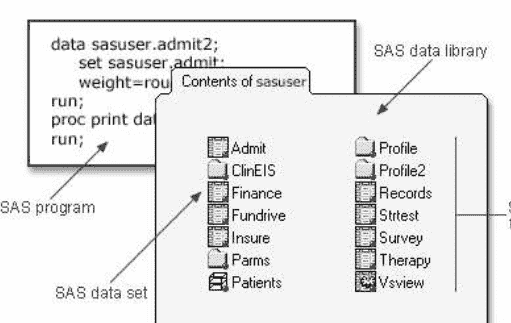

## 简单的 SAS 程序

此程序使用现有 SAS 数据集创建一个包含原始数据集子集的新 SAS 数据集。然后使用 `PROC PRINT` 打印新数据集的列表。SAS 数据集是以 SAS 可以理解的方式格式化的数据文件。

```
sasuser.admit2;
set sasuser.admit;
where age>39;
run;
proc print data=sasuser.admit2;
run;
```

让我们看看这个程序是如何工作的。

## SAS 程序的组件

示例 SAS 程序包含两个步骤：DATA 步骤和 PROC 步骤。

```sas
data sasuser.admit;
set sasuser.admit;
where age>39;
run;
proc print data=sasuser.admit;
run;
```

这两种步骤无论是单独使用还是组合使用，构成了大多数 SAS 程序。

一个 SAS 程序可以由一个 DATA 步骤、一个 PROC 步骤或 DATA 和 PROC 步骤的任何组合组成。

图 1.2 SAS 程序的组件

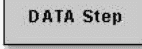

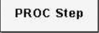

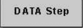

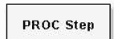

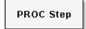

DATA 步骤通常用于创建或修改 SAS 数据集。它们也可以用于生成自定义的报告。例如，你可以使用 DATA 步骤来：

- 将你的数据放入 SAS 数据集
- 计算数值
- 检查并修正数据中的错误
- 通过子集化、超集、合并和更新现有数据集来生成新的 SAS 数据集。

在之前的示例中，DATA 步骤生成了一个包含原始数据集子集的新 SAS 数据集。新数据集仅包含年龄值大于 39 的观测值。

PROC（过程）步骤调用或执行预写的例程，使你能够分析和处理 SAS 数据集中的数据。PROC 步骤通常以报告的形式呈现数据。它们有时会创建包含过程结果的新 SAS 数据集。PROC 步骤可以列出、排序和汇总数据。例如，你可以使用 PROC 步骤来：

- 创建一个列出数据的报告
- 生成描述性统计数据
- 创建摘要报告
- 生成图表和统计图。

## SAS 程序的特征

接下来让我们看看示例程序中的单条语句。SAS 程序由 SAS 语句组成。一个 SAS 语句有两个重要的特征。

- 它通常以 SAS 关键字开头。
- 它始终以分号结束。

正如你所看到的，DATA 语句以 DATA 语句开头，而该语句以关键字 DATA 开头。PROC 语句以 PROC 语句开头，以关键字 PROC 开头。我们的示例程序包含以下语句：

表 1.1 SAS 程序语句

| 语句类型 | 示例程序代码 |
| :--- | :--- |
| 一个 DATA 语句 | data sasuser.admin2; |
| 一个 SET 语句 | set sasuser.admin; |
| 额外的编程语句 | where age>39; |
| 一个 RUN 语句 | run; |
| 一个 PROC PRINT 语句 | proc print data=sasuser.admin2; |
| 另一个 RUN 语句 | run; |

## SAS 程序的布局

SAS 语句是自由格式的。这意味着：

- 它们可以在一行的任何位置开始和结束
- 一条语句可以跨越几行
- 几条语句可以位于同一行。

空格或特殊字符用于分隔 SAS 语句中的*单词*。

> 你可以使用大写或小写指定 SAS 语句。在大多数情况下，包含在引号内的内容是区分大小写的。

你已经检查了我们示例程序的通用结构。但当你运行程序时会发生什么？

## 处理 SAS 程序

当你提交一个 SAS 程序时，SAS 开始读取语句并检查是否存在错误。

DATA 和 PROC 语句标记了步骤的开始。RUN 语句（对于大多数过程）结束了步骤。QUIT 语句（对于某些过程）标记了步骤的边界。DATA 语句（对于某些过程）也意味着步骤的结束。在我们的示例程序中，每个步骤都结束了。RUN 语句在 HTML 中显示了以下结果：

```sas
data sasuser.admin2;
set sasuser.admit;
where age>39;
run;
```

虽然 RUN 语句并不是总是需要的，但使用它可以使 SAS 程序更易读。每个步骤都结束了。图 1.3

#

假设你提交以下程序：

```sas
data sasuser.admin2;
set sasuser.admit;
where age>39;
run;
```

当程序被处理时，它创建了一个包含年龄大于 39 的观测值的新数据集（`sasuser.admin2`）。

### 过程输出

```sas
data sasuser.admin2;
set sasuser.admit;
where age>39;
run;
proc print data=sasuser.admin2;
run;
```

## SAS 系统

| ID | Name | Sex | Age | ActLevel |
| :--- | :--- | :--- | :--- | :--- |
| 2458 | Murray, W | M | 27 | HIGH |
| 2462 | Alair, C | F | 34 | MOD |
| 2501 | Bonaventure, T | F | 31 | LOW |
| 2523 | Johnson, B | M | 43 | MOD |
| 2544 | Jones, K | M | 51 | LOW |
| 2552 | Reberson, P | M | 29 | HIGH |
| 2555 | King, E | M | 35 | MOD |
| 2568 | Eberhardt, S | F | 49 | LOW |
| 2571 | Nunnally, A | F | 28 | LOW |
| 2572 | Osborn, M | F | 34 | MOD |
| 2574 | Peterson, U | M | 30 | MOD |
| 2575 | Dwight, J | F | 40 | HIGH |
| 2578 | Cameron, L | M | 47 | MOD |
| 2579 | Underwood, K | M | 60 | LOW |
| 2584 | Takashi, Y | F | 43 | MOD |
| 2589 | Wilcox, E | F | 41 | HIGH |
| 2595 | Warren, C | M | 54 | MOD |

### 其他类型的过程输出

- 有些 SAS 程序会打开交互式窗口（你可以直接修改数据的窗口），例如 REPORT 窗口。

```sas
proc report data=sasuser.admit;
columns id agelevel;
run;
```

图 1.5 交互式报告窗口

图 1.6 TABULATE 过程输出

| | Mean |
| :--- | :--- |
| F | 64.82 |
|   | 141.73 |
| M | 72.00 |
|   | 172.80 |

## SAS 库 (Libraries)

到目前为止你已经学习了 SAS 程序。现在让我们来看看 SAS 库，看看 SAS 数据集和其他 SAS 文件是如何组织和存储的。

## SAS 文件如何存储

每个 SAS 文件都存储在 SAS 库的一个层级中，库是 SAS 文件的集合。SAS 数据库（data library）是 SAS 信息的最高层组织形式。

例如，在 Windows 和 UNIX 环境下，库通常是位于同一文件夹或目录的一组 SAS 文件。

图 1.8 SAS 数据库

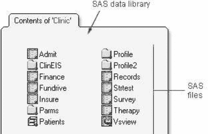

下表总结了在各种操作环境中 SAS 库的实现方式。

| 在此环境中... | SAS 库是... |
|---|---|
| Windows, UNIX, OpenVMS, OS/2 (基于目录的系统) | 存储在同一目录中的一组 SAS 文件。在该目录中也可以存储其他文件，但只有具有 SAS 文件扩展名的文件会被识别为 SAS 库的一部分。 |
| z/OS (OS/390) | 一种特殊格式的主机数据集，其中仅存储 SAS 文件。 |

表 1.2 环境与 SAS 库

## 临时或永久地存储文件

根据你在创建文件时使用的库名，你可以临时或永久地存储 SAS 文件。

图 1.9 临时 SAS 数据库

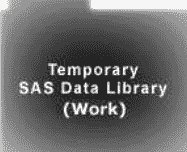

图 1.10 永久 SAS 数据库

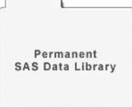

表 1.3 临时和永久 SAS 库

| 临时 SAS 库仅在当前 SAS 会话中有效。 | 临时存储文件：如果你在未指定库名时（或者指定的库名为 Work），则文件将存储在临时 SAS 数据库中。当你结束会话时，临时库及其所有文件将被删除。 |
| 永久 SAS 库在随后的 SAS 会话中可用。 | 永久存储文件：若要在 SAS 数据库中永久存储文件，你需要指定除默认库名 Work以外的库名。例如，在创建文件时指定库名 saser，则表示该文件将存储在永久 SAS 数据库中，直到你将其删除。 |

你可以在第 41 页的第二章“引用文件和设置选项”中学习如何设置永久 SAS 库。

## 引用 SAS 名称

## 二名称 (Two-Level Name)

在 SAS 程序中引用永久 SAS 数据集时，你使用由库文件名文件名（或数据集名称）组成的二级名称：

`libref.filename`

在二级名称中，`libref` 是包含该文件的 SAS 数据库名称，`filename` 是文件或数据集的名称。用一个句号（`.`）分隔 `libref` 和 `filename`。

图 1.11 二级 SAS 名称

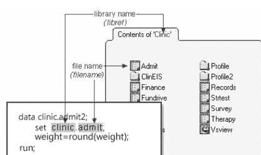

例如，假设我们要创建一个名为 Clinic 的新永久 SAS 数据库。在我们的示例程序中，`Clinic.Admit` 是 SAS 数据集 `Admit` 的二级名称，它存储在名为 `Clinic` 的库中。注意，`LIBNAME` 语句用于定义 `libref` `Clinic`，并并给 SAS 数据文件的物理位置。

```
libname clinic 'c:\Users\Name\sasuser';
data clinic.admit;
set clinic.admit;
weight =round(weight);
run;
```

图 1.12 二级名称 Clinic.Admit


## 引用临时 SAS 文件

要引用临时 SAS 文件，你可以指定默认 `libref` `Work`、一个句号和文件名。例如，二级名称 `Work.Test` 引用存储在临时 SAS 库 `Work` 中的名为 `Test` 的数据集。


### 图 1.13 二级临时 SAS 库 Work.Test

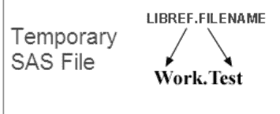

或者，你可以使用一级名称（仅文件名）来引用临时 SAS 库中的文件。当你指定一级名称时，默认认为 libref 为 `Work`。例如，一级名称 `Test` 也引用存储在临时 SAS 库 `Work` 中的名为 `Test` 的数据集。

### 图 1.14 一级临时 SAS 库 Test

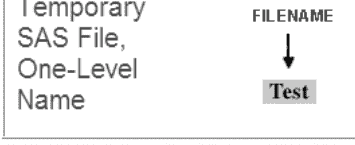

## 引用永久 SAS 文件

你可以看到 `Clinic.Admit` 和 `Clinic.Admit2` 是永久 SAS 数据集，因为库名是 `Clinic`而不是 `Work`。

### 图 1.15 引用永久 SAS 文件

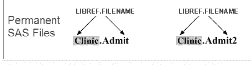

因此，在库中引用 SAS 文件时，库名为 `Clinic` 而不是 `Work`。例如，当你创建一个文件 `Clinic.Admit` 时，该文件将永久存储在 `Clinic` SAS 数据库中。

## SAS 命名规则

这些规则适用于数据集的名称（文件名部分）：

- 长度最多为 32 个字符。
- 必须以字母开头。
- 可以包含数字、字母或下划线（`_`）。
- 不能包含空格或特殊字符（下划线外）。

数据集名称和变量名的示例如下：

- `123data`（无效）
- `data_1`（有效）
- `SAS-data`（无效）

# 第1章 基础编程

### 图 1.19 SAS 数据集的组成部分：变量

| ID | Name | Policy | Company | PctInsured | Total | BalanceDue |
|---|---|---|---|---|---|---|
| 2458 | Murray, W. | 32968 | MUTALITY | 100 | 98.64 | 0.00 |
| 2462 | Almers, C. | 35624 | RELIABLE | 80 | 780.23 | 156.05 |
| 2501 | Bonaventure, T. | 37735 | AAR | | 47.38 | 9.48 |
| 2523 | Johnson, R. | 39022 | ACME | 50 | 122.07 | 61.04 |

该数据集包含七变量：`ID`、`Name`、`Policy`、`Company`、`PctInsured`、`Total` 和 `BalanceDue`。SAS 数据集可以存储成千上万个变量。

## 缺失值

SAS 数据集中的每个值和观测值都必须有一个值。如果某个观测值的数据值未知，则在 SAS 数据集中记录缺失值。

### 图 1.20 缺失数据值

| ID | Name | Policy | Company | PctInsured | Total | BalanceDue |
|---|---|---|---|---|---|---|
| 2458 | Murray, W. | 32968 | MUTALITY | 100 | 98.64 | 0.50 |
| 2462 | Almers, C. | 35624 | RELIABLE | 80 | 780.23 | 156.05 |
| 2501 | Bonaventure, T. | 37735 | AAR | | 47.38 | 9.48 |
| 2523 | Johnson, R. | 39022 | ACME | 50 | 122.07 | 61.04 |

## 变量属性

除了关于数据集的常规信息外，描述部分（descriptor portion）还包含关于数据每个变量属性的信息。这些属性包括变量名、类型、长度、格式、信息（informat）和标签（label）。

在编写 SAS 程序时，理解你所使用的变量属性非常重要。例如，你可能需要合并包含同名变量的 SAS 数据集。在这种情况下，变量类型必须相同（字符或数值）。

以下是 SAS 数据集 `insure.policy` 描述部分属性信息的部分列表。首先，让我们来看名称、类型和长度变量属性。

### 表 1.5 SAS 数据集 insure.policy 描述部分的变量属性

| Variable | Type | Length | Format | Informat | Label |
|---|---|---|---|---|---|
| Policy | Char | | | | Policy Number |
| Total | Num | 8 | | DOLLAR8.2 | COMMA10. | Total Balance |
| Name | Char | 20 | | | Patient Name |

### Name

每个变量都有一个符合 SAS 命名规范的名称。变量名遵循与 SAS数据集名称完全规则。与数据集名称一样，变量名：

- 可以是 1 到 32 个字符
- 必须以字母（A-Z，大写或小写）或下划线（`_`）开头
- 可以是数字、字母或下划线的任意组合

### 表 1.6 变量名属性

| Variable | Type | Length | Format | Informat | Label |
|---|---|---|---|---|---|
| Policy | Char | 8 | | | Policy Number |
| Total | Num | 8 | | DOLLAR8.2 | COMMA10. | Total Balance |
| Name | Char | 20 | | | Patient Name |

> 您的站点可以选择变量名在 SAS 6 中有效、自动转换为大写，或移除变量名的限制。

### Type

变量的类型是字符或数值。

- 字符型变量（如下所示）可以包含任何值。
- 数值型变量（如下所示）只能包含数值（0 到 9、+、. 以及用于科学计数法的 E）。

### 表 1.7 类型属性

| Variable | Type | Length | Format | Informat | Label |
|---|---|---|---|---|---|
| Policy | Char | 8 | | | Policy Number |
| Total | Num | 8 | | DOLLAR8.2 | COMMA10. | Total Balance |
| Name | Char | 20 | | | Patient Name |

变量的类型决定了缺失值的显示方式。在后续数据集中，`Name` 和 `Sex` 是字符变量，`Age` 和 `Weight` 是数值变量。

- 对于字符变量（如 `Name`），空格表示缺失值。
- 对于数值变量（如 `Age`），点（`.`）表示缺失值。

第1章

### 图 1.21 根据类型表示的缺失值

| Name | Sex | Age | Weight |
|---|---|---|---|
| | M | 48 | 128.6 |
| Laver | M | 58 | 158.3 |
| Jaffe | F | | 115.5 |
| Wilson | M | 28 | 170.1 |

### Length

变量的长度（用于存储它的字节数）与其类型相关。

- 字符变量可以是 32 个字符。在示例中，`Name` 的长度为 20。
- 所有数值变量默认为 8 字节，无论它们包含多少数字。

### 表 1.8 长度属性

| Variable | Type | Length | Format | Label |
|---|---|---|---|---|
| Policy | Char | 8 | | Policy Number |
| Total | Num | 8 | DOLLAR.2 | Total Balance |
| Name | Char | 20 | | Patient Name |

你已经看到每个变量都有名称、类型和长度。此外，你可以可选地定义格式、标签并了解更多关于它们的信息。

### Format

格式是影响数据写入方式的属性。SAS 提供了字符、数值和日期格式。你也可以自定义。使用特定格式写入值，请选择下方：

### 图 1.22 格式


### 数据集

例如，要在报告中显示数值 $1234.00，请使用所示的 `DOLLAR.2` 格式。

### 表 1.9 格式属性

| Variable | Type | Length | Format | Label |
|---|---|---|---|---|
| Policy | Char | 8 | | Policy Number |
| Total | Num | 8 | DOLLAR8.2 | COMMA10. | Total Balance |
| Name | Char | 20 | | Patient Name |

通常你必须指定值的宽度。根据格式的不同，你可能还需要指定小数位数。

### Informat

格式用于输出值，而信息（informat）决定值如何读取 SAS 数据。你必须使用信息读取包含字母或特殊字符的数值。

### 图 1.23 信息


例如，数值 $12,345.00 包含两个特殊字符：美元符号（）和逗号（）。你可以使用信息在移除美元符号和逗号的同时读取值，然后将结果存储为数值。对于 `Total`，指定了 `COMMA10.` 信息。

### 表 1.10 信息属性

| Variable | Type | Length | Format | Informat | Label |
|---|---|---|---|---|---|
| Policy | Char | 8 | | | Policy Number |

# 第1章 • 基础编程

| Variable | Type | Length | Format | Informat | Label |
|---|---|---|---|---|---|
| Total | Num | 8 | DOLLAR8.2 | COMMA10. | Total Balance |
| Name | Char | 20 | | | Patient Name |

### Label

变量可以有一个标签，由长达 256 个字符的描述性文本组成。默认情况下，许多报告通过名称识别变量。你可能希望通过给变量分配标签来显示关于该变量的更多描述性信息。

例如，你可以使用 `Policy Number`、`Total Balance` 和 `Patient Name` 作为标签，在报告中显示这些标签。

**表 1.11** 标签属性

| Variable | Type | Length | Format | Informat | Label |
|---|---|---|---|---|---|
| Policy | Char | 8 | | | Policy Number |
| Total | Num | 8 | DOLLAR8.2 | COMMA10. | Total Balance |
| Name | Char | 20 | | | Patient Name |

你甚至可能想使用标签来缩短报告中的长变量名！

## 使用编程工作空间

## 使用 SAS 主窗口

当你启动 SAS 时，默认会有几个主窗口供你使用。这些包括资源管理器（`Explorer`）、日志（`Log`）、输出（`Output`）、结果（`Results`）和代码编辑窗口。你用于编辑 SAS 程序的窗口可能根据操作系统和需求而异。

你使用这些 SAS 窗口来探索和管理文件、输入并提交 SAS 程序、查看消息以及管理输出。

稍后我们将浏览每个窗口。

## 使用编程工作区

### 图 1.24 使用主 SAS 窗口

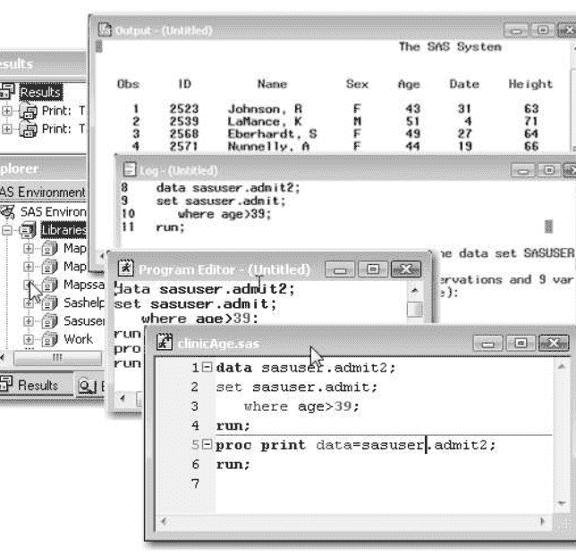

你的操作系统以及你在启动 SAS 时使用的任何选项都决定了：

- 默认显示哪些主 SAS 窗口
- 它们的常规外观
- 它们的位置

## SAS 窗口的特性

SAS 窗口具有许多帮助你完成工作的特性。例如，你可以：

- 最大化、最小化和恢复窗口
- 使用拉式菜单、弹出菜单和工具栏
- 获取更多帮助

> 本章及后续章节将展示 Windows 操作系统环境下的 SAS®9。

## 图 1.25 SAS 窗口的特性

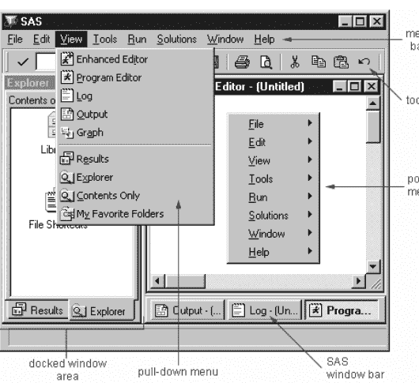

## 最小化和恢复窗口

在 Windows 环境中，你可以点击最小化按钮将未使用的窗口发送到 SAS 窗口栏。要将窗口恢复到原来的位置，请点击 SAS 窗口栏上的相应按钮。

在其他操作系统中，最小化窗口将其缩小为一个图标。

## 停靠和取消停靠窗口

在 Windows 和 OS/2 环境中，资源管理器（`Explorer`）和结果（`Results`）窗口默认停靠的，因此它们可以调整大小但不能最小化。如果你需要，可以选择“Window ⇔ Docked”来解锁活动窗口，或者可以在“偏选项”对话框中完全关闭停靠。

## 发布命令

在 SAS 中，你可以通过以下方式发布命令：

- 从菜单栏中选择
- 通过在命令框（或工具箱 Toolbox）或命令行行中输入命令

## 使用编程工作区 23

### 图 1.26 使用 SAS 命令框和菜单栏发布命令

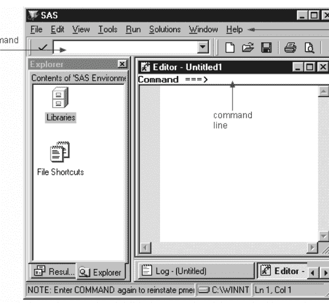

在大多数操作系统中，SAS 默认显示菜单栏。在 Windows 环境中，菜单栏的选择对应于活动窗口。如果菜单栏未显示，你可以在命令框（或工具箱）或命令行行中输入 *menus*。

在所有操作系统中，SAS 默认显示命令框（或工具箱）或命令行。你可以通过激活该窗口并按照所示所示使用工具菜单在特定窗口中显示命令行：

- 在 Windows 环境中，选择 **Tools ⇨ Options ⇨ Preferences**，然后选择 **View** 标签并勾选 **Command line** 复选框。
- 在 UNIX 和 OS 环境中，选择 **Tools ⇨ Options ⇨ Turn Command Line On**。
- 在 z/OS 环境中，你可以通过选择 **Tools ⇨ Options ⇨ Command...** 在窗口中同时显示命令行和菜单栏。

在 Windows 和 UNIX 操作系统中，你还可以通过激活窗口、在命令框（或工具箱）中输入 *command* 并按回车键在窗口中显示命令行。

> 请查看在线帮助以获取完整的命令行命令列表。

## 使用弹出菜单

弹出菜单是上下文敏感的；它们列出的操作仅与特定窗口有关。通常，你通过点击鼠标右键显示弹出菜单。如果你愿意，可以指定一个功能键来打开弹出菜单。只需选择 **Tools ⇨ Options ⇨ Keys** 并将 *popup* 设置为功能键。

在 z/OS 操作系统环境中打开弹出菜单，在项目旁边的选择字段中输入 *?*。

## 获取帮助

SAS 的所有窗口都提供帮助。从 Help（帮助）菜单中，你可以访问 SAS 的全面在线帮助和文档，也可以访问活动窗口的任务导向帮助。帮助菜单将在本章稍后部分进行详细详细讨论。

## 自定义你的 SAS 环境

你可以自定义 SAS 工作区的许多特性，如工具栏、弹出菜单、图标等。选择 Tools（工具）菜单来探索可用的一些自定义选项。

在本章中，你将学习如何使用 SAS 窗口的特性。现在让我们逐个查看主 SAS 窗口。

## 资源管理器窗口 (Explorer Window)

在资源管理器窗口中，你可以导航并管理文件和数据。资源管理器提供了文件和库的分级视图。你可以使用资源管理器：

- 创建新文件、打开现有文件
- 重命名、删除或移动文件
- 搜索数据

资源管理器窗口显示目录的树形视图。

## 图 1.27 SAS 的树形视图

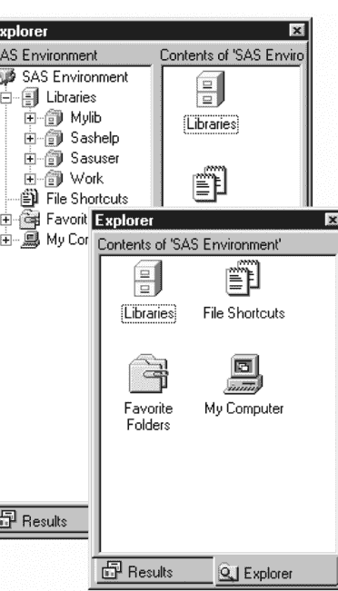

## 导航资源管理器窗口

在资源管理器窗口中，你可以通过树形视图浏览文件夹和库。你可以双击文件夹来展开或折叠它。你还可以使用搜索栏通过名称查找特定文件。

## 代码编辑器窗口

在 SAS 中，有两个主要的编辑器用于编写和编辑代码：

- 增强型编辑器 (Enhanced Editor)
- 程序编辑器 (Program Editor)

增强型编辑器在 Windows 环境中可用，并提供比标准程序编辑器更多的功能。

## 增强型编辑器窗口

在 Windows 环境中，增强型编辑器默认打开。你可以使用它来输入、编辑和提交 SAS 程序。在保存文件之前，初始标题为 Editor - Untitled。当编辑器的内容被修改时，标题中会添加一个星号。

## 图 1.28 增强型编辑器窗口

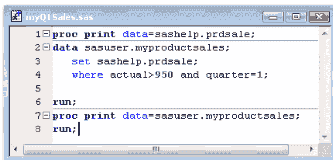

## 增强型编辑器特性

在增强型编辑器中，你可以执行标准编辑任务，例如：

- 以各种方式打开 SAS 程序（包括拖放）
- 输入、编辑和提交 SAS 程序
- 使用命令行或菜单
- 保存 SAS 程序
- 清空内容

此外，增强型编辑器提供了实用的功能，包括：

- SAS 语言的代码颜色和语法检查
- 可展开和折叠的章节
- 可录制的宏
- 支持快捷键（Alt 或 Shift 加）
- 多级撤销和重做

有关增强型编辑器的更多信息，请打开或激活编辑器窗口，然后选择 Help ⇨ Using This。

## 清空编辑器

在增强型编辑器中，代码提交后不会消失。要清空这些窗口，你可以激活窗口并选择 Edit ⇨ Clear All。

## 图 1.29 清空的编辑器窗口

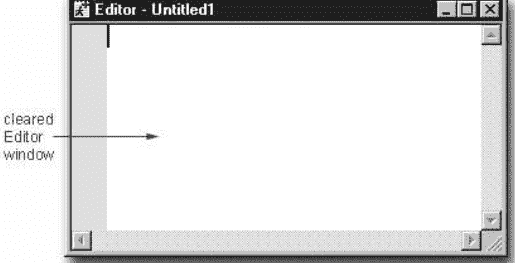

## 程序编辑器窗口

与增强型编辑器一样，在程序编辑器中输入、编辑和提交 SAS 程序。你还可以打开现有 SAS 程序。可以通过 View ⇨ Program Editor 显示程序编辑器窗口。

## 图 1.30 程序编辑器窗口


```
proc print data=mylib.productsales;
  var region division actual;
run;
```

## 特性

与增强型编辑器一样，在程序编辑器中你可以执行标准编辑任务，例如：

- 以各种方式打开 SAS 程序（包括拖放）
- 输入、编辑和提交 SAS 程序
- 使用命令行或菜单
- 保存 SAS 程序
- 清空内容
- 回调已提交的语句。

# 第 1 章 • 基础编程

然而，程序编辑器（Program Editor）并不提供增强编辑器（Editor）的一些功能，例如语法检查（此功能在 SAS 9.2 中可用）、可展开和折叠的会话以及可记录的宏。

有关这些功能的更多信息，请激活程序编辑器窗口，然后选择帮助（Help）⇒ 使用此窗口（Using This Window）。

## 清空编辑器

你随时可以通过激活窗口并选择编辑（Edit）⇒ 清空全部（Clear All），从程序编辑器窗口中清除程序代码。

当你在程序编辑器窗口中提交 SAS 程序时，窗口中的代码会自动清除。

## 日志窗口（Log Window）

日志窗口显示有关你的 SAS 会话以及你提交的任何 SAS 程序的消息。你可以通过选择查看（View）⇒ 日志（Log）来显示日志窗口。

图 1.31 日志窗口

```sas
data sensor_msalendata;
  if product='NEFI';
run;

NOTE: There were 1469 observations read from the data set HELP.PRGFILE.
NOTE: The data set NOT created (WORK.SENSORALDATA) has 0 observations and 0 variables.
NOTE: Statement executed in real time:
      CPU time: 0.45 seconds
      CPU clock: 0.02 seconds
```

## 输出窗口（Output Window）

在输出窗口中，你可以浏览你提交的 SAS 程序生成的 LISTING 输出。（你可以使用浏览器查看 HTML 输出。）

默认情况下，输出窗口位于代码编辑窗口和日志窗口之后。当你创建输出时，输出窗口会自动移动到显示器的最前端。

你可以随时通过选择查看（View）⇒ 输出（Output）来显示输出窗口。

## 图 1.32 输出窗口

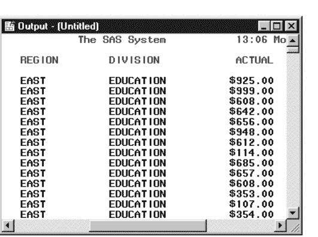

并不是所有的 SAS 程序都会在输出窗口中创建输出。某些交互式窗口。另一些则只在日志窗口中产生消息。

> 在大型机操作系统环境中，当你创建多页输出时，输出窗口边界上的消息表示该过程处于挂起状态。在下下面的示例中，`PROC PRINT` 处于挂起状态。

## 图 1.33 显示挂起过程的大机窗口

```
Output----------------PROC PRINT suspended-
File Edit View Tools Solutions Help
```

要移除消息并查看剩余的输出，只需滚动到输出底部即可。

## 结果窗口（Results Window）

结果窗口帮助你导航和管理提交的 SAS 程序的输出。你可以查看、保存和打印单个输出项。结果窗口使用树形结构来列出运行 SAS 后可能提供的各种类型的输出。

在大多数操作系统上，结果窗口位于资源管理器窗口（Explorer window）之后，在 fact提交创建输出的 SAS 程序之前，它是空的。之后，结果窗口会移动到你显示器的最前端。结果窗口为 LISTING 输出和 HTML 输出显示了不同的图标。在下面的示例中，第一个打印（Print）文件夹包含了这两种输出。

## 图 1.34 结果窗口

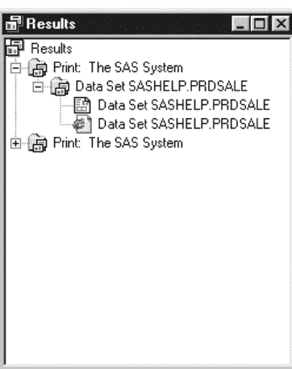

## 在结果窗口中查看输出

你可以随时通过选择查看（View）⇒ 结果（Results）来显示结果窗口。在 UNIX 和 Windows 的 SAS 窗口环境中，HTML 是默认输出类型。在这些环境中，当你提交 SAS 程序时，HTML 输出会自动显示在结果查看器（Results Viewer）中，文件将列在结果窗口中。在所有其他环境中，LISTING 是默认输出。

此处显示的左侧面板显示结果窗口，右侧面板显示结果查看器，其中显示默认 HTML 输出。结果窗口列出了 SAS 程序执行时创建的文件。

## 图 1.35 结果窗口和结果查看器


## 创建库（Libraries）

在本章早些时候，你已经看到 SAS 文件存储在库中。默认情况下，SAS 为你定义了几个库（包括 `Sashelp`、`Sasuser` 和 `Work`）。你还可以定义额外的库。

`Sashelp`：包含示例数据的只读库。

`Sasuser`：存储个人设置的永久库。

`Work`：包含会话文件的临时库。

## 图 1.36 激活库


## 图 1.37 定义库


## 使用 SAS 编程

在本章中，你将学习 SAS。你还可以使用 SAS 语句定义库。根据你的环境，你可以创建用于会话的数据。

## 创建和使用文件快捷方式

你已经看到资源管理器可以访问 SAS 文件。你还可以创建快捷方式。文件快捷方式（fileref）是标识文件的可选名称。

- SAS 编程语句
- 原始数据
- 过程输出

## 图 1.38 创建和使用文件快捷方式


## 章节总结

## 内容总结

## SAS 程序的组成

SAS 程序由两类型的步骤组成：`DATA` 步骤和 `PROC`（过程）步骤。这两个步骤单独使用或结合使用，构成了大多数 SAS 程序。一个 SAS 程序可以包含一个 `DATA` 步骤、一个 `PROC` 步骤，或者 `DATA` 和 `PROC` 步骤的任何组合。`DATA` 步骤通常用于创建或修改 SAS 数据集，但也可以用于生成自定义的报告。`PROC` 步骤是预先编写例程，使你能够分析和处理 SAS 数据集中的数据，并以报告的形式展示数据。它们有时会创建新的 SAS 数据集，这些数据集通常包含过程运行的结果。

## SAS 语句的特征

SAS 程序由 SAS 语句组成。一个 SAS 语句通常以 SAS 关键字开始，并始终以分号结束。`DATA` 步骤以关键字 `DATA` 开始。`PROC` 步骤以关键字 `PROC` 开始。SAS 语句是自由格式的，因此它们可以在可以在一行的任何地方开始和结束。一条语句可以跨越多行，多条语句也可以在同一行内。空格或特殊字符用于分隔 SAS 语句中的“单词”。

## 处理 SAS 程序

当你执行一个 SAS 程序时，SAS 会读取 SAS 语句并检查错误。当它遇到后续的 `DATA`、`PROC` 或 `RUN` 语句时，SAS 会执行程序中的上一个步骤。

每执行一次步骤，SAS 都会生成一个包含处理处理活动和处理结果的日志。SAS 日志收集了关于 SAS 程序处理以及可能发生的任何错误的消息。

处理结果可能有所不同。某些 SAS 程序会打开一个交互式窗口并调用创建报告形式输出的过程。其他 SAS 程序则执行诸如排序和管理数据等任务，这些任务除了日志中的消息外，没有可见的结果。

## SAS 库 (Libraries)

每个 SAS 文件都存储在 SAS 库中，SAS 库是 SAS 文件的集合，例如 SAS 数据集和目录。在 Windows 和 UNIX 环境中，SAS 库通常是同一文件夹或目录下的组 SAS 文件。

根据你所使用的库，你可以将 SAS 文件存储在临时 SAS 库或永久 SAS 库中。

- 在会话期间创建的临时 SAS 文件存储在一个特殊的工作空间（workspace）中，这是默认库。如果你在创建文件时没有指定库（或未指定任何），则文件将存储在临时 SAS 库中。当你结束会话时，临时库会被删除。
- 要将文件存储在 SAS 库中，你需要分配一个除 `Work` 以外的库。例如，通过将 `libref` `sasuser` 分配为 SAS 库，你可以指定库内的文件将存储直到你删除它们为止。

## 引用 SAS 文件

要引用 SAS 文件，你使用双层级名称 `libref.filename`。在双层级名称中，`libref` 是包含该文件的 SAS 库名，`filename` 是文件本身的名字。用点号分隔文件和文件名。

引用临时 SAS 文件时，使用默认库 `Work`、一个点号和文件名。或者，你也可以简单地使用单层级名称（文件名）来引用临时 SAS 库中的文件。引用 `Work` 以外任何库中的 SAS 文件均表示该 SAS 文件是永久存储的。

SAS 数据集的长度为 1 到 32 个字符，必须以字母（A-Z，大写或小写）或下划线（_）开头，并可以是数字、字母和下划线的任意组合。

## SAS 数据集

对于你使用 SAS 执行的许多数据处理任务，你以 SAS 数据集的形式访问数据，并使用 SAS 程序来分析、管理或展示数据。从概念上讲，SAS 数据集是由两部分组成的文件：描述部分（descriptor portion）和数据部分（data portion）。SAS 数据集还包含一个或索引，使 SAS 能够更有效地定位数据集中的记录。

SAS 数据集的描述部分包含关于数据集的属性信息。

SAS 数据集的数据部分是排列成矩形表格的数据值集合。数据集中的观测值（Observations）对应行或数据行。数据集中的变量对应列。如果某个特定观测值的数值未知，则在 SAS 数据集中记录一个缺失值。

## 变量属性

除了数据集的一般信息外，描述部分还包含数据集中每个变量的属性信息。属性信息包括变量名、类型和长度。变量的类型决定了 SAS 如何显示该变量的缺失值。对于字符变量，空格代表缺失值。对于数值变量，点（`.`）代表缺失值。你还可以为变量指定格式（format）、输入（input）和标签（label）属性。

## 使用 SAS 主窗口

你使用以下窗口来探索和管理你的文件、输入并提交 SAS 程序、查看消息以及查看和管理你的输出。

表 1.12 窗口及其用途

| 使用此窗口 ... | 为了 ... |
| :--- | :--- |
| 资源管理器 (Explorer) | 查看你的 SAS 文件；创建新的 SAS 库和 SAS 文件；执行大多数文件管理任务，如移动、复制和删除文件；为不是用 SAS 创建的文件创建快捷方式 |

## 第 37 章节测试

| 使用此窗口 ... | 为了 ... |
| :--- | --- |
| 增强型编辑器 (Enhanced Editor，代码编辑窗口) | 输入、编辑和提交 SAS 程序 |
| 程序编辑器 (Program Editor，代码编辑窗口) | 输入、编辑和提交 SAS 程序 |
| 日志 (Log) | 查看关于 SAS 会话以及你提交的任何 SAS 程序的消息 |
| 输出 (Output) | 浏览 SAS 程序的输出 |
| 结果 (Results) | 导航和管理 SAS 程序的输出；查看、保存和打印输出的单个项目 |

## 注意事项

- SAS 数据集的长度为 1 到 32 个字符，必须以字母（A-Z，大写或小写）或下划线（_）开头，并可以是数字、字母和下划线的任意组合。引用 `Work` 以外任何库中的 SAS 文件均表示该 SAS 文件是永久存储的。描述部分包含关于数据集的属性信息。数据集的数据部分是排列成矩形表格的数据值集合。数据集中的观测值对应行或数据行。数据集中的变量对应列。如果某个特定观测值的数值未知，则在 SAS 数据集中记录一个缺失值。除了数据集的一般信息外，描述部分还包含数据集中每个变量的属性信息。属性信息包括变量名、类型和长度。变量的类型决定了 SAS 如何显示该变量的缺失值。对于字符变量，空格代表缺失值。对于数值变量，点（`.`）代表缺失值。你还可以为变量指定格式、输入和标签属性。

## 章节测试

为每个问题选择最佳答案。

1. 数据集包含多少个观测值？

| 名称 | 性别 | 年龄 |
| :--- | :--- | :--- |
| Picker | M | 32 |
| Fletcher | F | 28 |
| Romano |  | 42 |

a. 3 个观测值，4 个变量
b. 3 个观测值，3 个变量
c. 4 个观测值，3 个变量
d. 无法确定某些值

2. 以下程序执行了多少个步骤？

```sas
data user.tables;
infile jobs;
input yyyymdd name $;
run;

proc sort data=user.tables;
by name;
run;

proc print data=user.tables;
run;
```

a. 三
b. 四
c. 五
d. 六

3. 数据集中 AccNum 是什么类型？

| AcctNum | 性别 |
| :--- | --- |
| 3456_1 | M |
| 2451_2 |  |
| Romano | F |
| Choi | M |

a. 数值
b. 字符
c. 可能是字符或数值
d. 无法确定某些值

4. 数据集中的 Wear 是什么类型？

| 品牌 | Wear |
| :--- | --- |
| Acme | 43 |
| Ajax | 34 |
| Atlas | . |

a. 数值
b. 字符
c. 可能是字符或数值
d. 无法确定某些值

5. 下哪个变量名是有效的？

a. `4BirthDate`
b. `SCost`
c. `_Items_`
d. `Tax-Rate`

6. 下哪个文件是永久文件？

a. `Sashelp.PrdSale`
b. `Sasuser.MySales`
c. `Profits.Quarter1`
d. 以上都是

7. 在 DATA 步骤中如何引用名为 Forecast 的临时数据集？

a. `Forecast`
b. `Work.Forecast`
c. `Sales.Forecast`（分配 libref Sales 后）
d. 仅 a 和 b

8. 数值变量 Balance 的默认长度是多少？

| 名称 | Balance |
| :--- | --- |
| Adams | 105.73 |
| Geller | 107.89 |
| Martinez | 97.45 |
| Noble | 182.50 |

a. 5
b. 6
c. 7
d. 8

9. 以下 SAS 程序包含多少条语句？

```sas
proc print data=new.prodsale;
label double;
var state day pricel price2; where state='NC';
label state='Name of State'; run;
```

a. 三
b. 四
c. 五
d. 六

10. 什么是 SAS 库？

a. SAS 文件的集合，例如 SAS 数据集和目录
b. 在某些操作系统环境中，SAS 文件的物理集合
c. 同一文件夹或目录下的组 SAS 文件
d. 以上都是

# 第 2 章：引用文件和设置选项

- 概述 ................................................................................................................................................................................................................. . 42
- 引言 ................................................................................................................................................................................................................. . . . . . . . . 42
- 目标 ................................................................................................................................................................................................................. . . . . . . . . 43
- 定义库 ................................................................................................................................................................................................................. . . . . . . . . 43


- 分配库引用 (Librerefs) 43
- 验证库引用 (Librerefs) 44
- 库引用生效时长 45
- 指定双级名称 45
- 引用其他格式的文件 46
- 指定引擎 47
- 接口库引擎 47
- SAS/ACCESS 引擎 47
- 查看 SAS 库 48
- 查看 SAS 库的内容 48
- 查看文件内容 49
- 使用 PROC CONTENTS 查看 SAS 库的内容 50
- 示例 50
- 使用 PROC DATASETS 52
- 使用 VARNUM 查看 SAS 数据集的描述信息 53
- 指定结果格式 54
- HTML 和列表格式 54
- 偏好窗口中的结果选项卡 55
- 内部浏览器 vs. 首选网络浏览器 56
- 内部浏览器 57
- 首选网络浏览器 57
- 设置系统选项 58
- 概述 58
- 修改系统选项 59
- 示例：DATE | NODATE 和 NUMBER | NONUMBER 选项 59
- 示例：PAGENEO= 选项 61
- 示例：PAGESIZE= 选项 61
- 示例：LSIZIZE= 选项 62
- 处理双位年份：符合 2000 年标准 63


# 第 2 章 • 引用文件和设置选项

- 如何处理四位年份 ................................................................................................................................................................................................................................................................................. . . . . . . . . . . . . 64
- 使用系统选项指定观测值 ................................................................................................................................................................................................................................................................................. . . . . . . . . . . . . 64
- 示例：`FIRSTOBS=` 和 `OBS=` 选项 ................................................................................................................................................................................................................................................................................. . . . . . . . . . . . . . . . . 65
- 针对特定数据集使用 `FIRSTOBS=` 和 `OBS=` ................................................................................................................................................................................................................................................................................. . . . . . . . . . . . . 67
- 示例：作为数据集选项的 `FIRSTOBS=` 和 `OBS=` ................................................................................................................................................................................................................................................................................. . . . . . . . . . . . . . . . 67
- SAS 系统选项窗口 ................................................................................................................................................................................................................................................................................. . . . . . . . . . . . . . 67

## 概述

## 引言

当你开始 SAS 会话时，首先设置环境会非常方便。

例如，你可能希望：

- 定义包含你打算使用的 SAS 数据集的库。
- 指定过程（`procedure`）输出是创建为 HTML（超文本标记语言）输出、`LISTING` 输出或其他类型的输出。
- 如果创建了任何 `LISTING` 输出，则设置其功能，例如是否显示日期和时间。
- 指定如何解释两位数的年份值。

本章将展示如何定义库、引用 SAS 文件以及为你的 SAS 会话指定选项。你还将学习如何指定要生成的输出格式。

## 图 2.1 SAS 系统选项窗口

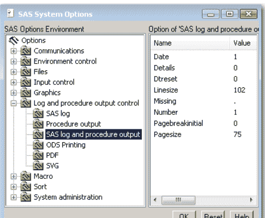

## 学习目标

在本章中，你将学习：

- 使用编程语句定义新库
- 引用在 SAS 会话期间使用的 SAS 文件
- 设置结果选项，以确定在桌面操作系统环境中生成的输出类型或输出类型（HTML、`LISTING` 输出或其他）
- 设置系统选项，以确定日期值的处理方式，并控制 SAS 会话期间创建的任何 `LISTING` 输出的外观

## 定义库

设置 SAS 会话的第一步通常是定义库。你也可以使用编程语句来分配库名。

记住，要引用永久 SAS 文件，你需要：

1. 为存储该文件的 SAS 库分配一个名称（`libref`）。
2. 使用 `libref` 作为文件两级名称的第一部分（`libref.filename`），以便在库内引用该文件。

## 图 2.2 定义库

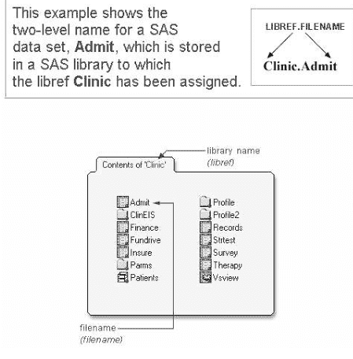

### 分配 Librefs

要定义库，可以使用 `LIBNAME` 语句。你可以将 `LIBNAME` 语句与任何 SAS 程序一起存储，这样在每次提交程序时都会分配 SAS 数据库。

通用形式，基本 `LIBNAME` 语句：

```
LIBNAME libref 'SAS-data-library';
```

其中

- `libref` 长度为 1 到 8 个字符，以字母或下划线开头，且仅包含字母、数字或下划线。
- `SAS-data-library` 是存储 SAS 数据文件的 SAS 数据库名称。库的物理名称指定取决于操作系统环境。

下方的 `LIBNAME` 语句在 Windows 环境下将 `libref` `Clinic` 分配给 SAS 数据库 `D:\Users\Qtr\Reports`。

```
libname clinic 'd:\users\qqreports';
```

书中的许多示例使用了 `libref` `sasuser`。以下 `LIBNAME` 语句在 Windows 操作系统环境中将 `libref` `sasuser` 分配给 `c:\Users\name\sasuser` 文件夹。

```
libname sasuser 'c:\Users\name\sasuser';
```

下表显示了各种操作系统环境中 SAS 数据库物理名称示例。

### 表 2.1 SAS 数据库的物理名称

| 环境 | 示例物理名称 |
|---|---|
| Windows | `c:\fitness/data` |
| UNIX | `/users/april/fitness/sasdata` |
| z/OS (OS/390) | `april.fitness.sasdata` |

本章中的代码示例是在 Windows 操作系统环境中所示。如果你在另一个操作系统环境中运行 SAS，特定平台的名称和位置将会有不同。其他情况下，SAS 编程代码在不同操作系统之间是相同的。

你可以使用多个 `LIBNAME` 语句来分配所需的任意 `librefs`。

### 验证 Librefs

分配 `libref` 后，检查日志（`Log`）窗口以验证 `libref` 是否分配成功是一个好习惯。

## 图 2.3 Clinic libref 的日志输出

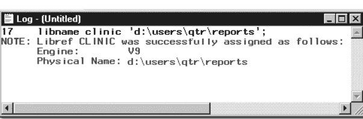

### Librefs 的有效持续时间

`LIBNAME` 语句是全局的，这意味着 `librefs` 会一直有效，直到你修改它们、取消它们或结束 SAS 会话。

因此，`LIBNAME` 语句为当前会话分配 `libref`。每当你开始一个 SAS 会话，都必须分配 `libref`。当你结束 SAS 会话或删除 `libref` 时，SAS 将不再具有访问权限。

记住，临时库是随 SAS 会话创建的，且仅在会话期间存在。

## 图 2.4 Librefs 的有效持续时间


### 指定库名称

当前为你的 SAS 会话定义的库列在资源管理器（`Explorer`）窗口的库（`Libraries`）项下。

## 图 2.5 指定库名称

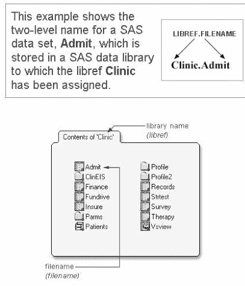

例如，为了让 `PRINT` 过程读取 `Clinic`，你如下指定两级名称：

```sas
proc print data=clinic;
run;
```

## 引用其他格式的文件

你可以使用 `LIBNAME` 语句不仅引用 SAS 文件，还可以引用其他软件（如数据库管理系统）创建的文件。对于某些文件类型，你需要告诉 SAS 使用哪种引擎（`engine`）。对于其他类型，SAS 会自动选择引擎。

引擎是 SAS 用于向文件写入和从文件中读取的一组内部指令。

## 图 2.6 引用其他格式的文件


### 指定引擎

要指示使用哪种引擎，你在 `LIBNAME` 语句中指定引擎名称，如下所示。

通用形式，其他格式的 `LIBNAME` 语句：

```
LIBNAME libref engine 'SAS-data-library';
```

其中

- `libref` 长度为 1 到 8 个字符，以字母或下划线开头，且仅包含字母、数字或下划线。
- `engine` 是你的操作系统环境支持的库引擎名称。
- `SAS-data-library` 是存储数据文件的库名称。

### 接口库引擎

接口库引擎支持对 BMDP、OSIRIS 和 SPSS 文件的只读访问。使用这些引擎，与 `libref` 关联的物理文件名是一个实际文件名，而不是库。

### 表 2.2 引擎及其描述

| 引擎 | 描述 |
|---|---|
| BMDP | 允许对 BMDP 文件的只读访问 |
| OSIRIS | 允许对 OSIRIS 文件的只读访问 |
| SPSS | 允许对 SPSS 文件的只读访问 |

有关接口库引擎的更多信息，请参考你操作环境 SAS 文档。

### SAS/ACCESS 引擎

如果站点许可了 SAS/ACCESS 软件，你可以使用 `LIBNAME` 语句访问存储在数据库中的数据。你可以访问的数据类型取决于你的操作系统环境以及拥有哪些 SAS/ACCESS 产品。

### 表 2.3 关系数据库及其关联文件

| 关系型数据库 | 非关系文件 | PC 文件 |
|---|---|---|
| ORACLE | ADABAS | Excel (.xls) |

## 查看 SAS 库

查看 SAS 库的内容

你已经了解到分配库可以访问不同类型的数据。第20页的“使用编程工作空间”解释过，在分配 `libref` 后，你可以查看：

- 被 `libref` 引用的库的详细信息
- 库的内容
- 库中文件的内容和属性

当前为你的 SAS 会话定义的库在资源管理器（`Explorer`）窗口的库（`Libraries`）项下。要查看库的详细信息，双击库（或从弹出菜单中选择库 ⇒ 打开）。然后选择查看 ⇒ 详细。

每个库的信息（名称、引擎、类型、主机名和修改日期）列在活动库（`Active Libraries`）项下。

## 图 2.7 查看活动库

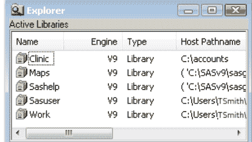

要查看库的内容，请双击库名（或选择库名），并在弹出菜单中选择 **Open**（打开）。系统将显示库中包含的文件列表。如果您开启了详细信息功能，还会列出每个文件的信息（名称、大小、类型、描述和修改日期）。

**图 2.8** 查看 SAS 库的内容

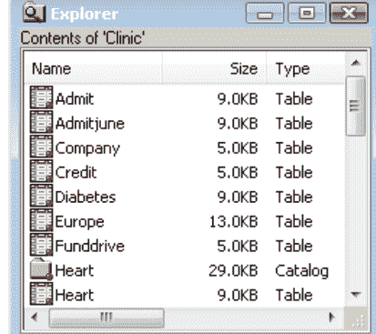

### 查看文件内容

要在窗口环境中显示文件内容，您可以双击文件名（或选择文件名），并在弹出菜单中选择 **Open**（打开）。如果您选择的是 SAS 数据集（类型为 Table 或 View），内容将在 `VIEWTABLE` 窗口中显示。

**图 2.9** 查看文件内容

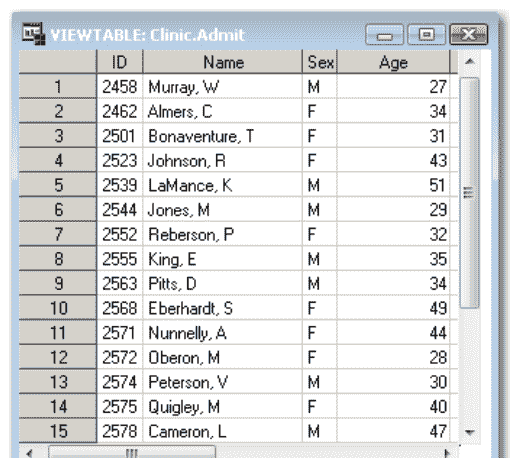

要显示文件的属性，您可以选择文件名，然后从弹出菜单中选择 Properties（属性）。

如果您处于 z/OS 操作系统环境中，可以在 Explorer 窗口中文件名旁选择字段中输入 `B` 或 `L`，以显示包含处理该文件选项列表的弹出菜单。

如果您已安装了 SAS/FSP 软件，可以在数据集旁边的选择字段中输入 `B` 或 `L`，分别用于逐条浏览数据集观测值或列出数据集的内容。更多信息，请参阅 SAS/FSP 文档。

如果未安装 SAS/FSP，可以使用 `PRINT` 过程 (`PROC PRINT`) 来查看 SAS 数据集的内容。您可以在第 112 页的“创建列表报告”中学习如何使用 `PROC PRINT`。

### 使用 PROC CONTENTS 查看 SAS 库的内容

您已经学习了如何使用 SAS 窗口来查看 SAS 库或 SAS 文件的内容。或者，您可以使用 `CONTENTS` 过程创建 SAS 输出，用于描述以下任一内容：

- 库的内容
- 单个 SAS 数据集的描述符。

通用格式，基本的 `PROC CONTENTS` 语句：

```sas
PROC CONTENTS DATA=SAS-file-specification NODS;
```

其中

- `SAS-file-specification` 指定整个库或库中的特定 SAS 数据集。
- `SAS-file-specification` 可以采用以下形式之一：
  - `<libref>SAS-data-name` 指定要处理的单个 SAS 数据集。
  - `<libref>_ALL_` 请求列出库中的所有文件。（使用句点 (.) 在 `libref` 后附加 `ALL_`）。
  - `NODS` 在您指定 `ALL_` 时抑制对每个文件详细信息的打印。（您只有在指定了 `ALL_` 时才能指定 `NODS`。）

#### 示例

要查看整个 `clinic` 库的内容，可以提交 `PROC CONTENTS` 语句：

```sas
proc contents data=clinic._all_ nodes;
run;
```

该语句的输出仅列出 Clinic 库中 SAS 文件的名称、类型、大小和修改日期。

## 图 2.10 使用 PROC CONTENTS 查看库的内容

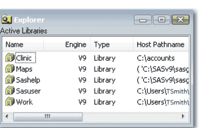

## 图 2.11 SAS 库 Clinic 的 PROC CONTENTS 输出

| # | Member Type | File Size | Last Modified |
| :--- | :--- | :--- | :--- |
| 1 | ADMIT | DATA | 9216 | 05Apr:11:10:52:56 |
| 2 | ADMIT | DATA | 9216 | 05Apr:11:12:35:45 |
| 3 | ADMIT | DATA | 9216 | 05Apr:11:10:52:56 |
| 4 | COMPANY | DATA | 5120 | 05Apr:11:10:52:56 |
| 5 | CREDIT | DATA | 5120 | 05Apr:11:10:52:56 |
| 6 | DIABETES | DATA | 9216 | 05Apr:11:10:52:57 |
| 7 | EUROPE | DATA | 13312 | 05Apr:11:10:52:57 |

要查看 `clinic.admit` 数据集的描述符信息，可以提交以下 `PROC CONTENTS`：

```sas
proc contents data=clinic.admit;
run;
```

该语句的输出列出了 `clinic.admit` 中按字母顺序排列的变量。

## 图 2.12 PROC CONTENTS 显示库中单个数据集的描述信息

| Data Name | CLINIC.ADMIT | Observations | 21 |
| :--- | :--- | :--- | :--- |
| Member Type | DATA | Variables | 9 |
| Engine | V9 | Indexes | 0 |
| Created | Tuesday, January 25, 2011 11:13:25 AM | Length | 64 |
| Last Modified | Tuesday, January 25, 2011 11:13:25 AM | Deleted Observations | 0 |
| Protection | | Compressed | NO |
| Data Type | | Sorted | NO |
| Data Representation | WINDOWS_32 | | |
| Encoding | latin Western (Windows) | |


## 图 2.13 PROC CONTENTS 显示库中单个数据集的引擎/主机信息

| Engine/Host Dependent Information |  |

| :--- | :--- |

| Data Set Page | 8192 |

| Number of Data Set Pages | 1 |

| First Data Page | 1 |

| Max Obs per Page | 127 |

| Obs in First Page | 21 |

| Number of Data Set Repairs | 0 |

| Filename | `c:\clinic\admit.sas` |

| Release Created | 9.0.1 |

| Host Created | W32 |

## 图 2.14 PROC CONTENTS 显示数据集按字母顺序排列的变量

| # | Variable | Type | Len | Format |

| :--- | :--- | :--- | :--- | :--- |

| 8 | ActLevel | Char | 4 |  |

| 4 | Age | Num | 8 |  |

| 5 | Date | Num | 8 |  |

| 9 | Fee | Num | 8 | 7.2 |

| 6 | Height | Num | 8 |  |

| 1 | ID | Char | 4 |  |

| 2 | Name | Char | 14 |  |

| 3 | Sex | Char | 1 |  |

| 7 | Weight | Num | 8 |  |

## 使用 PROC DATASETS

除了 `PROC CONTENTS`，您可以使用 `PROC DATASETS` 查看 SAS 数据集的内容。`PROC DATASETS` 还允许您执行许多管理任务，如复制、删除或修改文件。`PROC CONTENTS` 和 `PROC DATASETS` 在功能上有重叠。通常，这两者的功能相同：

- `CONTENTS` 过程
- `DATASETS` 过程中的 `CONTENTS` 语句

## 查看 SAS 库

```sas
PROC CONTENTS<options>;
RUN;
PROC DATASETS<options>;
CONTENTS<options>;
QUIT;
```

`CONTENTS` 过程和 `DATASETS` 中 `CONTENTS` 语句之间的区别在于 `DATA=` 选项中 `libref` 的默认值。对于 `PROC CONTENTS`，是 `Work` 或 `User`。对于 `CONTENTS` 语句，是输入库。注意 `PROC DATASETS` 支持 `RUN` 处理。它使用 `QUIT` 语句结束过程。`QUIT` 语句和 `RUN` 语句不是必须的。

然而，`PROC CONTENTS` 语句和 `DATASETS` 中 `CONTENTS` 语句的选项是相同的。例如，以下 `PROC` 语句产生基本相同的输出（有细微差异）：

```sas
proc datasets;
contents data=clinic._all_;

proc contents data=clinic._all_;
```

除了 `CONTENTS` 语句外，`PROC DATASETS` 还使用其他几个语句。这些语句允许您执行 `PROC CONTENTS` 无法完成的任务。更多关于 `PROC DATASETS` 的信息，请参见 SAS 文档。

## 使用 VARNUM 获取 SAS 数据集的描述信息

与 `PROC CONTENTS` 类似，您也可以使用 `PROC DATASETS` 显示 SAS 数据集的描述信息。

默认情况下，`PROC CONTENTS` 和 `PROC DATASETS` 按字母顺序列出变量。要按数据集逻辑位置（或创建顺序）列出变量名，可以在 `PROC CONTENTS` 或 `DATASETS` 中的 `CONTENTS` 语句中指定 `VARNUM` 选项。

例如，这两个程序中的任意一个都会包含所示变量列表：

```sas
proc datasets;
contents data=clinic.admit varnum;

proc contents data=clinic.admit varnum;
```

注意：如果您正在使用 `sasuser` 库中的示例数据，可能希望指定 `sasuser` 为 `libref`（而不是 `clinic`）：

```sas
contents data=sasuser.admit varnum;

proc contents data=sasuser.admit varnum;
```

## 第 2 章 • 引用文件和设置选项

## 图 2.15 VARNUM 显示数据集的描述信息

| Variables in Creation Order |  |

| # | Variable | Type | Len | Format |

| :--- | :--- | :--- | :--- | :--- |

| 1 | ID | Char | 4 |  |

| 2 | Name | Char | 14 |  |

| 3 | Sex | Char | 1 |  |

| 4 | Age | Num | 8 |  |

| 5 | Date | Num | 8 |  |

| 6 | Height | Num | 8 |  |

| 7 | Weight | Num | 8 |  |

| 8 | ActLevel | Char | 4 |  |

| 9 | Fee | Num | 8 | 7.2 |

## 指定结果格式

接下来，考虑您的 SAS 输出的外观和格式。

## HTML 和列表格式

在 SAS 9.3 及更高版本中，当 Windows 和 UNIX 操作系统在窗口模式下运行时，默认创建 HTML 输出。在其他平台上，可以使用编程语句创建 HTML 输出。在批模式下运行时，默认格式为 `LISTING`。

让我们看看两种结果格式。以下 `PROC PRINT` 输出是 SAS 数据集 `Clinic:Therapy` 的部分列表。

**图 2.16** 列表输出

| The SAS System | 11:02 Tuesday, April 12, 2011 |  |

| Obs | Date | Class | Math Jefferson | Swim |

| :--- | :--- | :--- | :--- | :--- |

| 7 | JUL2009 | 67 | 102 | 72 |

| 8 | AUG2009 | 71 | 77 | 54 |

| 10 | OCT2009 | 81 | 62 | 47 |

| 11 | NOV2009 | 94 | 58 | 31 |

| 12 | DEC2009 | 78 | 79 | 31 |

| 23 | OCT2010 | 87 | 58 | 53 |

| 24 | DEC2010 | 93 | 57 | 47 |

这是来自同一程序的 HTML 输出：

## 图 2.17 HTML 输出

## SAS 系统

| 观测 | 日期 | AerClass | WalkJogRun | 游泳 |

|---|---|---|---|---|

| 7 | JUL22009 | 67 | 102 | 72 |

| 9 | SEP2009 | 78 | 77 | 54 |

| 10 | OCT2009 | 81 | 62 | 47 |

| 11 | NOV2009 | 84 | 31 | 52 |

| 22 | OCT2010 | 78 | 70 | 41 |

| 23 | NOV2010 | 82 | 44 | 58 |

| 24 | DEC2010 | 93 | 57 | 47 |

- 如果你没有在桌面操作系统环境中运行 SAS，你可能想要跳过此主题，直接查看第 58 页的“设置系统选项”。有关在任何 SAS 平台上使用编程语句创建 HTML 输出的详情，请参第 280 页的“生成 HTML 输出”。

## 首选项窗口的结果选项卡

你使用首选项窗口来设置你喜欢的结果格式。你的偏好会被保存，直到你对其进行修改，并且它们适用于你创建的所有输出。

要在桌面操作系统环境中打开此窗口，选择**工具 ⇌ 选项 ⇌ 首选项**。然后点击**结果**选项卡。你可以使用记忆法 `TOPR`（读作“topper”）来记住这个序列。你可以选择**列表**、**HTML** 或两者。你还可以指定显示和存储结果的选项。

- 结果选项卡的选项可能会根据你的操作系统环境而有所不同。下面的示例来自 Windows 操作系统。

# 56 第 2 章 引用文件和设置选项

以下显示了指定了新默认设置的 SAS 结果选项卡。

**图 2.18** 带有新默认设置的 SAS 结果选项卡

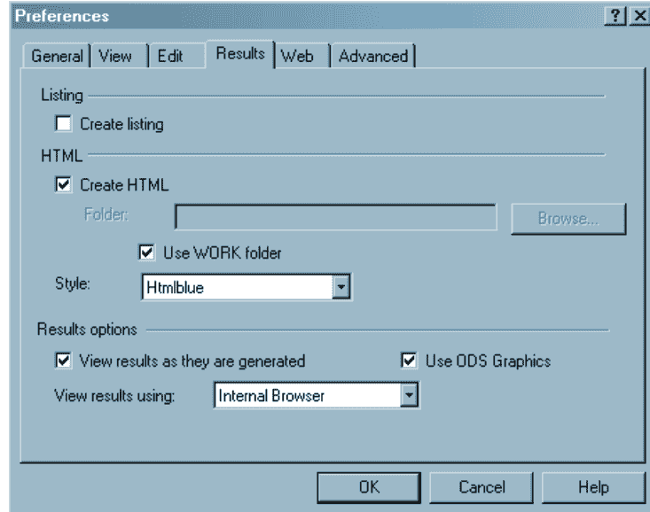

**结果**选项卡中的默认设置如下：

- 未选中**创建列表**复选框，因此不创建 `LISTING` 输出。
- 选中了**创建 HTML**复选框，因此创建了 HTML 输出。
- 选中了**使用 WORK 文件夹**复选框，因此 HTML 和图形图像文件都存在 `WORK` 文件夹中（而不是你的当前目录）。
- 从**样式**下拉列表中选择了默认样式 `HTMLBlue`。
- 选中了**使用 ODS 图形**复选框，因此启用了 ODS 图形。
- 在**使用以下方法查看结果：**下拉列表中选择了**内部浏览器**，因此在内部 SAS 浏览器中查看结果。

如果你创建了 HTML 文件，它们将存储在你指定的文件夹中，并会在整个 SAS 会话期间增量命名为 `sashtml.htm`、`sashtml1.htm`、`sashtml2.htm` 等。

现在来看查看 HTML 结果的两种选择：内部浏览器和首选网络浏览器。（这些选项仅在 Windows 操作系统环境的结果选项卡中出现。）

## 内部浏览器 vs. 首选网络浏览器

在 Windows 操作系统环境中，你可以在首选项窗口的的结果选项卡中选择这两个选项之一来查看 HTML 输出：

- 内部浏览器，称为结果查看器窗口。SAS 作为你 SAS 安装的一部分提供了此浏览器。

如果你选择首选网络浏览器，你的 HTML 输出将在独立于 SAS 的独立浏览器中显示。例如，下方的 HTML 输出显示在 Internet Explorer 中。

图 2.20 显示 HTML 输出的首选网络浏览器

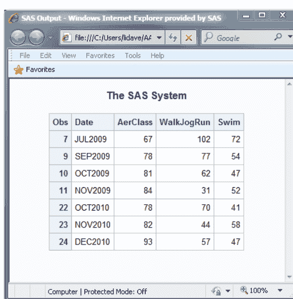

## 设置系统选项

## 概述

如果你将过程输出创建为 `LISTING` 输出，你也可以通过设置系统选项来控制输出的外观，例如：

- 行宽（日志和输出的最大宽度）
- 页面大小（每页输出的行数）
- 页码的显示
- 日期和时间的显示。

上述选项不影响 HTML 输出的外观。

除非另有指定，否则所有 SAS 系统选项都有用于使用的默认设置。例如，`LISTING` 输出中会自动显示页码（除非你的站点修改了此默认值）。*

## 图 2.21 显示默认设置的 LISTING 输出

| 输出 - [无标题] | 页码 -- 5 |

| 日期和时间 --10:31 星期二，1998年3月3日 |

| 性别 年龄 体重 |

| M | 27 | 72 | 168 |

| F | 34 | 66 | 152 |

| 页面大小 M | 31 | 61 | 123 |

| F | 43 | 63 | 137 |

| M | 51 | 71 | 158 |

| F | 28 | 行宽 193 |

| M | 32 | 67 | 151 |

| N | 35 | 70 | 173 |

| M | 34 | 154 |

## 修改系统选项

你可以在 SAS 程序的任何位置放置 `OPTIONS` 语句，以更改从该点开始的设置。然而，一种良好的做法是将 `OPTIONS` 语句放在 `DATA` 步之外，这样你的程序更易阅读和调试。由于 `OPTIONS` 语句是全局的，这些设置将一直有效，直到你修改它们或结束 SAS 会话。

## 示例：DATE AND NUMBER

默认情况下，页码和日期会随 `LISTING` 输出出现。`OPTIONS` 语句抑制了 `LISTING` 输出中页码和日期的打印。在以下示例中，`NODATE` 和 `NUMBER` 系统选项抑制了 `PROC PRINT` 输出中的页码显示。`PROC FREQ` 输出中不显示页码，但由于指定了 `DATE` 选项，日期会出现在 `PROC FREQ` 的顶部。

```sas
options nodate number;
proc print data=sasuser.diabetes
id sex age weight
where age>=30;
proc freq data=sasuser.diabetes
tables sex;
```

图 2.22 `sasuser.diabetes` 的 `PROC PRINT LISTING` 输出

| 观测 | 性别 | 年龄 | 体重 |

|---|---|---|---|

| 2 | 2462 | F | 34 | 152 |

| 3 | 2501 | F | 31 | 123 |

| 4 | 2537 | F | 43 | 137 |

| 5 | 2539 | F | 32 | 150 |

| 6 | 2552 | M | 35 | 173 |

| 7 | 2565 | M | 30 | 153 |

| 8 | 2563 | M | 34 | 154 |

| 9 | 2568 | F | 49 | 172 |

| 10 | 2571 | F | 44 | 140 |

| 11 | 2574 | M | 30 | 147 |

| 12 | 2575 | M | 40 | 163 |

| 13 | 2578 | F | 47 | 173 |

| 14 | 2579 | F | 60 | 191 |

| 15 | 2580 | F | 42 | 122 |

| 16 | 2589 | M | 41 | 141 |

| 17 | 2195 | M | 54 | 183 |

图 2.23 `sasuser.diabetes` 的 `LISTING` 输出

| 性别 | 百比 | 累计百分比 |

|---|---|---|

| F | 25.00 | 25.00 |

| M | 75.00 | 100.00 |

图 2.24 `sasuser.diabetes` 的 `PROC PRINT LISTING` 输出

| 观测 | ID | 性别 | 年龄 | 脉搏 | 血糖 |

|---|---|---|---|---|---|

| 1 | 2394 | F | 16 | 56 | 625 |

| 2 | 1125 | M | 48 | 156 | 256 |

| 3 | 5017 | F | 52 | 125 | 277 |

| 4 | 1387 | F | 52 | 147 | 319 |

| 5 | 4018 | M | 40 | 168 | 304 |

| 6 | 5438 | F | 42 | 128 | 247 |

| 7 | 2812 | M | 54 | 143 | 216 |

| 8 | 3125 | F | 56 | 150 | 215 |

| 9 | 1333 | M | 54 | 152 | 272 |

| 10 | 3947 | M | 52 | 132 | 271 |

| 11 | 1125 | F | 48 | 137 | 267 |

| 12 | 2501 | M | 52 | 135 | 338 |

| 13 | 3011 | F | 47 | 173 |

| 14 | 2579 | F | 60 | 191 |

| 15 | 2580 | F | 42 | 122 |

| 16 | 2589 | M | 41 | 141 |

| 17 | 2195 | M | 54 | 183 |

图 2.25 无数字的 `FRE LISTING` 输出

```sas
options nodate number;
proc freq data=sasuser.diabetes
tables sex;
run;
```

图 2.26 带 `PAGENO=` 的 `LISTING` 输出

| 观测 | 姓 | 第一季度 | 第二季度 | 第三季度 | 第四季度 |

|---|---|---|---|---|---|

| 1 | ADAMS | 18 | 18 | 20 | 20 |

| 2 | ALEXANDER | 15 | 15 | 20 | 20 |

| 3 | APPLE | 25 | 25 | 20 | 20 |

| 4 | ARTHUR | 15 | 15 | 15 | 15 |

| 5 | AVERY | 20 | 20 | 20 | 20 |

| 6 | BAREIT | 25 | 25 | 20 | 20 |

| 7 | BLAIR | 10 | 10 | 5 | 10 |

| 8 | BLACK | 5 | 5 | 10 | 10 |

| 9 | BRINKLEY | 12 | 12 | 14 | 14 |

| 10 | BRIDGET | 20 | 20 | 20 | 20 |

| 11 | BROWN | 18 | 18 | 18 | 18 |

| 12 | BRYANT | 16 | 16 | 18 | 18 |

| 13 | BURNETTE | 10 | 10 | 10 | 10 |

| 14 | CHEUNG | 20 | 20 | 20 | 30 |

| 15 | LEHMAN | 20 | 20 | 20 | 20 |

| 16 | VALADEZ | 14 | 18 | 40 | 25 |

## 示例：PAGESIZE= 选项

`PAGESIZE=` 选项（别名 `PS=`）指定每页输出包含多少行。在下面的示例中，每个页面 `PRINT` 过程产生 15 行（包括标题、日期等占用的行）。

```sas
options date pagesize=15;
proc print data=sasuser.admin;
run;
```

图 2.27 带 `PAGESIZE= 15` 的 `LISTING` 输出


| 观测 | 姓 | 第一季度 | 第二季度 | 第三季度 | 第四季度 |
|---|---|---|---|---|---|
| 12 | BROWN | 20 | 20 | 20 | 20 |
| 13 | BROWN | 18 | 18 | 18 | 18 |
| 14 | BRYANT | 16 | 16 | 18 | 18 |
| 15 | BURNETTE | 10 | 10 | 10 | 10 |
| 16 | CHEUNG | 30 | 30 | 30 | 30 |
| 17 | LEHMAN | 20 | 20 | 20 | 20 |
| 18 | VALADEZ | 14 | 18 | 40 | 25 |

# 62 第 2 章 • 引用文件和设置选项

## 示例：`LINESIZE=` 选项

`LINESIZE=` 选项（别名为 `ls`）指定过程和日志中打印行的宽度。不符合行宽的观测值将继续在另一行中显示。

在接下来的示例中，观测值超过了 64 个字符，因此观测值将持续后续后续。

```sas
cds listing,
options number linesize=64;
proc print data=flights.europe;
run;
cds listing close;
```

图 2.28 设置 `LINESIZE=` 选项的 LISTING 输出，第 1 页

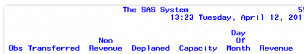

图 2.29 设置 `LINESIZE=` 选项的 LISTING 输出，第 2 页

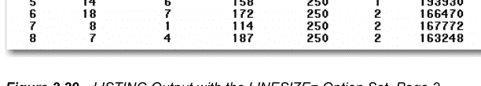

## 处理两位年份：符合 2000 年标准

如果你在数据行、外部文件或编程语句中使用两位年份，你应该考虑另一个重要的系统选项：`YEARCARTOFF=` 选项。该选项指定了使用哪一个 100 年跨度来解释两位值。

## 图 2.30 SAS 中默认的 100 年跨度

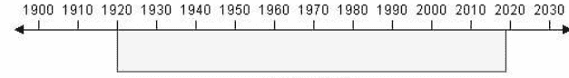

所有版本的 SAS 表示日期范围从公元 1582 年到公元 20,000 年（自动进行闰年、世纪和每四百年的调整。会忽略闰秒，且 SAS 不调整夏令时间）。然而，你应该注意 `YEARCUTOFF=` 的值，以确保你正确解释了数据中的两位年份。

通过其他系统选项，你可以在 `OPTIONS` 语句中指定 `YEARCUTOFF=` 选项：

```sas
options yearcutoff=1925;
```

## `YEARCUTOFF=` 选项的工作原理

当读取两位年份时，SAS 会根据从 `YEARCUTOFF=` 值开始的 100 年跨度对其进行解释。`YEARCUTOFF=` 的默认值是 1920。

## 图 2.31 默认 `YEARCUTOFF=` 日期 (1920)

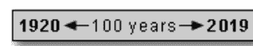

| 表 2.4 日期表达式及其解释方式 |
| 日期表达式 | 解释为 |
| :--- | :--- |
| 12/07/41 | 12/07/1941 |
| 18Dec15 | 18Dec2015 |
| 04/15/30 | 04/15/1930 |
| 15Apr95 | 15Apr1995 |

然而，你可以覆盖默认值，并将 `YEARCUTOFF=` 的值更改另一个 100 年跨度的起始年。例如，如果你指定 `YEARCUTOFF=1950`，那么 100 年的跨度将从 1950 年到 2049 年。

```sas
options yearcutoff=1950;
```

使用 `YEARCUTOFF=1950` 时，日期的解释如下：

## 图 2.32 当 `YEARCUTOFF=1950` 时日期的解释


# 表 2.5 日期表达式及其解释方式 |
| 日期表达式 | 解释为 |
| :--- | :--- |
| 12/07/41 | 12/07/2041 |
| 18Dec15 | 18Dec2015 |
| 04/15/30 | 04/15/2030 |
| 15Apr95 | 15Apr1995 |

### 四位年份的处理

请记住，`YEARCUTOFF=` 系统选项的值仅影响两位年份值。包含四位年份的日期值即使即使它不在 `YEARCUTOFF=` 系统选项设置的 100 年跨度内，也会被正确解释。

你可以在第 571 页的“读取日期时间值”中学习更多关于读取日期值。

## 使用系统选项指定观测值

你已经看到如何使用 SAS 选项来更改两位年份值的显示和解释。你还可以使用 `FIRSTOBS=` 和 `OBS=` 系统选项来指定要从 SAS 数据集中处理的观测值。

你可以根据需要指定其中一个或两个选项。也就是说，你可以使用：

- `FIRSTOBS=` 从特定的观测值开始处理
- `OBS=` 在特定的观测值后停止处理
- 共同使用 `FIRSTOBS=` 和 `OBS=` 处理一组观测值

`OPTIONS` 语句中 `FIRSTOBS=` 和 `OBS=` 选项的一般形式：

```sas
FIRSTOBS=n OBS=n
```

`n` 是一个正整数。对于 `FIRSTOBS= n`，指定要处理的第一个观测值的编号。对于 `OBS=`，指定要处理的最后一个观测值。默认情况下，`FIRSTOBS=` 为1。`OBS=` 的默认值是 MAX，即你的环境中可以表示的最大八字节整数。该数字取决于你的系统。这些选项适用于程序中的每一个数据集。

## 示例：`FIRST=` 和 `OBS=`

`clinic.heart` 数据集包含 20 个观测值。如果你指定 `FIRSTOBS=10`，SAS 将从第 10 个观测值开始读到最后一个（共 11 个观测值）。

```sas
options firstobs=10;
proc print data=sasuser.heart;
run;
```

`PROC` 步骤产生如下 `FIRSTOBS=10` 的输出图 2.33 `PROC` 输出

| Obs | Patient | Sex | Survive | Arterial | Heart |
| :--- | :--- | :--- | :--- | :--- | :--- |
| 10 | 509 | 2 | SURV | 79 | 84 |
| 11 | 742 | 1 | DIED | 100 | 54 |
| 12 | 609 | 2 | DIED | NONSHOCK | 93 | 101 |
| 13 | 318 | 2 | DIED | 72 | 81 |
| 14 | 412 | 1 | SURV | BACTER | 61 | 87 |
| 15 | 601 | 1 | DIED | BACTER | 84 | 101 |
| 16 | 402 | 1 | SURV | CARDIO | 88 | 137 |
| 17 | 98 | 2 | SURV | CARDIO | 84 | 87 |
| 18 | 4 | 1 | SURV | HYPOVOL | 81 | 149 |
| 19 | 50 | 2 | SURV | HYPOVOL | 72 | 111 |
| 20 | 2 | 2 | DIED | OTHER | 101 | 124 |

如果你指定 `OBS=10`，则 SAS 将读到第 10 个观测值，此处共 10 个观测值。（注意 `FIRSTOBS=` 已重置为默认值）。

```sas
options firstobs=10;
proc print data=sasuser.heart;
run;
```

现在 `PROC` 步骤产生此输出图 2.34 `FIRSTOBS=1` 和 `Obs=10` 的输出

| Obs | Patient | Sex | Survive | Arterial | Heart |
| :--- | :--- | :--- | :--- | :--- | :--- |
| 1 | 203 | 1 | SURV | NONSHOCK | 88 | 95 |
| 2 | 54 | 1 | DIED | HYPOVOL | 83 | 183 |
| 3 | 664 | 2 | SURV | CARD2 | 72 | 11 |
| 5 | 101 | 1 | DIED | NE2 | 80 | 130 |
| 6 | 10 | 2 | SURV | 87 | 107 | 471 |
| 7 | 529 | 1 | DIED | CARDIO | 103 | 106 |
| 8 | 524 | 2 | CARDIO | 145 | 99 | 156 |
| 9 | 426 | 1 | SURV | OTHER | 68 | 77 |
| 10 | 509 | 2 | SURV | OTHER | 79 | 84 |

在数据集中间结合 `FIRSTOBS=` 和 `OBS=` 观测值。例如，以下程序仅处理从第 10 到第 15 个观测值，共 6 个观测值：

```sas
options firstobs=10 obs=15;
proc print data=sasuser.heart;
run;
```

这是输出输出：图 2.35 `FIRSTOBS=10` 和 `Obs=15` 的 `PROC` 输出

| Obs | Patient | Sex | Survive | Shock | Arterial | Heart | Cardiac | Urinary |
| :--- | :--- | :--- | :--- | :--- | :--- | :--- | :--- | :--- |
| 10 | 509 | 2 | SURV | OTHER | 79 | 84 | 256 | 90 |
| 11 | 742 | 1 | DIED | HYPOVOL | 100 | 54 | 135 | 0 |
| 12 | 609 | 2 | DIED | NONSHOCK | 93 | 101 | 260 | 90 |
| 13 | 318 | 2 | DIED | OTHER | 72 | 81 | 410 | 405 |
| 14 | 412 | 1 | SURV | BACTER | 61 | 87 | 296 | 44 |
| 15 | 601 | 1 | DIED | BACTER | 84 | 101 | 260 | 377 |

## 第 2 章 引用文件和设置选项

图 2.36 SAS 系统选项窗口

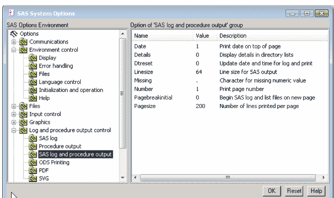

## 更改选项

要更改选项：

- 1. 展开 SAS Options Environment 下的组和子组，直到找到你想更改的选项。（子组中的选项列在窗口的右面板中。）

例如，上面的 SAS System Options 显示了“Log and procedure output control”（日志和过程输出控制）组下“SAS log and procedure output”（SAS 日志和过程输出）子组的选项。

## 快速查找选项

要在 SAS System Options 窗口中定位选项：

- 1. 将光标置于任何选项组或子组的名称上，显示其弹出菜单。
2. 点击 **Find Option**（查找选项）。出现 Find Option 对话框。
3. 输入你想查找的选项名称，并点击 **OK**。

SAS System Options 窗口将展开相应的选项子组。所有子组选项都会显示，并且你定位的选项会被高亮。

## 附加功能

在设置 SAS 会话时，你可以设置 SAS 系统选项，这些影响 LISTING 输出、写入 SAS 日志的信息等许多内容。以下是你可能在 SAS 中一起使用的一些额外系统选项：

表 2.6 选定的系统选项及其描述

| 选项 | 描述 |
| --- | --- |
| `FORMCHAR='formatting-characters'` | 指定输出设备的格式化字符。格式化字符用于构建表格轮廓以及各种过程（如 `FREQ` 和 `TABULATE` 过程）的分隔符。如果你在过程中未指定字符作为选项，则将使用 `FORMCHAR` 系统给出的默认规范。 |
| `FORDLIM='delimiter-character'` | 指定一个用于界定 SAS 输出中分页的字符。通常，分隔符字符为空。当分隔符字符为空时，每当发生分页，就会开始一个新物理页。 |
| `LABEL/NOLABEL` | 允许 SAS 过程临时将变量名替换为描述性标签。在使用任何过程之前，必须使 `LABEL` 系统选项生效。如果指定了 `NOLABEL`，则忽略过程的 `LABEL` 选项。默认设置为 `LABEL`。 |
| `REPLACE/NOPLACE` | 指定是否替换永久存储的 SAS 数据集。如果你指定了 `NOPLACE`，则不能用相同名称替换永久存储的 SAS 数据集。这可以防止你不意中替换现有的 SAS 数据集。默认设置为 `REPLACE`。 |
| `SOURCE/NOSOURCE` | 控制是否将 SAS 源语句写入 SAS 日志。`NOSOURCE` 指定不将 SAS 源语句写入 SAS 日志。默认设置为 `SOURCE`。 |

你还可以使用编程语句来单独控制过程输出中每个项目的结果格式。欲需更多信息，请参阅第 280 页的“生成 HTML 输出”。

## 第 2 章 引用文件和设置选项

### 在 SAS 库中引用 SAS 文件

要引用 SAS 文件，你需要为存储该文件的 SAS 库分配一个 `libref`（库引用）。然后，使用 `libref` 作为文件双层名称 (`libref,filename`) 的第一部分。要分配 `libref`，你可以提交 `LIBNAME` 语句。

你可以将 `LIBNAME` 语句与任何 SAS 程序存储在一起，以便在提交程序时自动分配 `libref`。`LIBNAME` 语句为当前的 SAS 会话分配 `libref`。每当你开始一个 SAS 会话时，都必须分配 `libref`，以便访问存储在 `work` 以外的永久 SAS 库中的文件。（`Work` 是 SAS 库的默认 `libref`。）

你还可以使用 `LIBNAME` 语句引用使用其他软件产品（如数据库管理系统）创建的文件中的数据。SAS 可以使用该文件类型的相应引擎对文件进行读写。对于某些文件，你需要告诉 SAS 使用哪种引擎。对于其他文件，SAS 会自动选择合适的引擎。

## 查看 Librefs

你的 SAS 会话中生效的 `librefs` 列在 Explorer 窗口的 Libraries 中。要查看详细信息，双击 Libraries（或从弹出菜单中选择 Libraries ⇒ Open）。然后选择 View ⇒ Details。库的名称、引擎、主机名和日期列在 Active Libraries 下。

## 查看库的内容

要查看库的内容，在 Explorer 窗口中双击库名称（或选择库名称并并从弹出菜单中选择 Open）。库中包含的文件列在 Contents 下。

## 查看文件的内容

如果你在窗口化环境中工作，可以通过双击 Explorer 窗口中 Contents 下的文件名（选择文件名并从弹出菜单中选择 Open）来显示文件的内容。如果你选择的是 SAS 数据集（data set），其内容将显示在 `VIEWTABLE` 窗口中。

如果你在 z/OS 操作系统环境中工作，可以在 Explorer 窗口中在文件名后输入 `?` 以显示弹出菜单，列出处理该文件的选项列表。

### 列出库的内容

要列出库的内容，使用 `CONTENTS` 过程。在 `libref` 后面加上点号和 `_ALL_` 选项以获取库中所有文件的列表。添加 `NODS` 选项以抑制文件的详细信息。作为 `PROC CONTENTS` 的替代方案，你可以使用 `PROC DATASETS`。

## 指定结果格式

在桌面操作系统环境中，你可以选择将 SAS 过程输出创建为 HTML 文档、listing（传统的 SAS 输出），或在 Preferences 窗口中选择你喜欢的的结果格式。要执行此操作，选择 Tools ⇒ Options ⇒ Preferences。然后点击 Results 选项卡。选择 listing、Create HTML 或 of。

如果你创建了 HTML，每个 HTML 文件将在你指定的浏览器中显示（在 Windows 环境中为 Viewer 窗口）。HTML 文件存储在你指定的位置，并增量命名为 `sashtml1.html`、`sashtml2.html` 等贯穿整个 SAS 会话。如果你希望永久存储 HTML 文件并在会话结束时删除它们，请使用 `WORK` 而不是指定文件夹。要指定 HTML 存储位置，输入路径或点击 Browse。

## 设置系统选项

对于你的 LISTING 输出，你还可以通过设置系统选项（如行大小、页大小、页码显示以及时间显示）来控制输出外观。（这些选项不影响 HTML 输出。）

除非另有指定，所有 SAS 系统选项都有默认值。例如，页码，你可以在 SAS 程序的任何位置放置 `OPTIONS` 语句来更改设置。由于 `OPTIONS` 语句是全局的，设置将一直有效直到你修改或注销。

如果你在 SAS 数据中使用两位年份，必须注意 `YEARCOUNTOF=` 选项，以确保正确解释 SAS 程序中的两位年份。该选项指定使用100年跨度来解释两位年份。

要指定从 SAS 数据集中处理观测值，可以使用 `FIRSTOBS=` 和 `OBS=` 选项。

你还可以使用 SAS Options 窗口设置系统选项。

## 附加功能

你可以设置一些常用的 SAS 系统选项。

## 语法

```
LIBNAME libref 'SAS-data-library';\LIBNAME libref engine='SAS-data-library';\OPTIONS;
PROC CONTENTS DATA=libref._ALL_NODS;
PROC DATASETS DATA=libref._ALL_NODS;

QUIT;
```

## 注意事项

- - `LIBNAME` 和 `OPTIONS` 语句仅对当前 SAS 会话有效。

## 第 2 章 引用文件和设置选项


- 当你处理日期值时，请检查 `YEARCUTOFF=` 系统选项的默认值，并在必要进行更改。

## 章节测验

为每个问题选择最佳答案。完成测验后，使用附录中的答案对照检查你的答案。

1. 如果你提交程序，输出结果是什么样的？

```sas
options pagesize=55 nonzero;
proc data=clinic.admit;
class actlevel;
var age weight;
table actlevel,(age weight)*mean;
run;
options linesize=80;
proc means data=clinic.heart min max maxdec=1;
var arterial cardiac urinary;
class service sex;
```

a. `PROC MEANS` 输出的行宽为 80 个字符，但 `PROC TABULATE` 输出没有行宽。

b. `PROC TABULATE` 输出没有页码，但 `PROC MEANS` 输出有页码。

c. 两个 `PROC` 步骤的每页输出均为 55 行且没有页码，且 `PROC MEANS` 输出的行宽为 80 个字符。

d. 日期在两个 `PROC` 步骤的输出中都不出现。

2. 如何在任何 SAS 平台上创建 HTML 格式的 SAS 输出？

a. 通过指定系统选项

b. 通过使用编程语句

c. 使用 SAS 窗口指定结果格式

d. 你无法在所有 SAS 平台上都创建 HTML 输出

3. 为了让日期值 `05May1955` 和 `04Mar2046` 被正确读取，`YEARCUTOFF=` 选项必须具有什么值？

a. 1947 到 1954 之间的值（包含边界）

b. 1955 或更高

c. 1946 或更高

d. 任何值

4. 当你为库（library）指定引擎时，你始终是在指定

a. 存储在库中的文件的格式。

b. 你正在使用的 SAS 版本。

c. 对其他软件供应商文件的访问。

d. 创建临时 SAS 文件的指令。

## 章节测验 73

5. 哪条语句打印存储名为 `Area51` 的库中所有文件的摘要？

a. `proc contents data=area51..all_nodes;`

b. `proc contents data=area51..all_noobs;`

c. `proc contents data=area51..all_noobs;`

d. `proc contents data=area51..all_nodes.`

6. 下面的 `PROC PRINT` 输出是在 `PROC TABULATE` 输出之后立即创建的。创建报告时指定了哪些系统选项？

```
10:03 Friday, March 17, 2000
Act Fee
Obs ID Height Level HIGH
1 2458 72 168 HIGH 85.20
2 2462 66 152 HIGH 124.80
3 2501 61 123 LOW 149.75
4 2523 63 137 MOD 149.75
5 2539 71 158 LOW 124.80
6 2544 76 193 HIGH 124.80
7 2552 67 151 MOD 149.75
8 2555 70 173 MOD 149.75
9 2563 73 154 LOW 124.80
```

a. `OBS=` `DATE` 且 `NONUMBER`

b. `NUMBER`, `PAGENO=1` 且 `DATE`

c. 仅 `NUMBER` 和 `DATE`

d. 以上都不是

7. 下列哪一项正确引用了存储在永久 SAS 库中名为 `SalesAnalysis` 的 SAS 数据集？

a. 

```sas
SalesAnalysis.totals;
```

b. 

```sas
totals.SalesAnalysis;
```

c. 

```sas
SalesAnalysis.quarter;
```

d. 

```sas
quarter.SalesAnalysis;
```

8. 如果 `YEARCUTOFF=` 设置为 1950，使用哪个时间范围来解释两位数的年份？

a. 1950-2049

b. 1950-2050

c. 1949-2050

d. 1950-2000

9. 假设你使用的是代码而不是 SAS 窗口，下列哪一个陈述是*错误的*？

a. `LIBNAME` 语句可以存储在 SAS 程序中，以便在提交时自动引用库。

b. 当删除库引用（libref）时，SAS 不再访问该库。但库的内容仍然存在于操作系统中。

c. 库引用可以在会话之间持续。

d. 你可以通过提交 `LIBNAME` 语句访问其他供应商创建的文件。

10. 语句 `libname spss 'c:\files\data.pss';` 的作用是？

a. 使用 OS 引擎定义名为 `spss` 的库

b. 定义名为 `Osiris` 的库

c. 使用默认引擎定义名为 `Osiris` 和 `spss` 的库

d. 使用 `SPSS` 引擎定义默认库

# 第 3 章 编辑和调试 SAS 程序

- 概述 ... 76

- 引言 ... 76

- 目标 ... 76

- 打开存储的 SAS 程序 ... 77

- 概述 ... 77

- 使用快捷键 ... 77

- 使用收藏夹 ... 78

- 使用窗口 ... 78

- 使用 `INCLUDE` 命令 ... 79

- 示例 ... 80

- 编辑 SAS 程序 ... 80

- `SAS` 程序结构 ... 80

- 使用增强编辑器 ... 81

- 输入和查看文本 ... 82

- 查找和替换文本 ... 82

- 使用缩写 ... 82

- 打开文件的多个视图 ... 83

- 设置增强编辑器选项 ... 83

- 程序编辑器功能 ... 84

- 行号 ... 84

- 文本编辑器行命令 ... 85

- 示例 1 ... 86

- 块文本编辑器行命令 ... 87

- 示例 1 ... 88

- 示例 2 ... 89

## 打开存储的 SAS 程序 77

- 清空 SAS 编程窗口

- 解释 SAS 日志中的错误信息

- 修正错误

- 解决常见问题。

## 打开存储的 SAS 程序

## 概述

你可以在代码编辑窗口中打开一个存储的程序，在其中你可以编辑该程序并重新提交。

你可以使用以下方式打开程序：

- 文件快捷方式

- 我的收藏文件夹 (`My Favorite Folders`)

- 打开 (`Open`) 窗口

- `INCLUDE` 命令。

在提供拖放功能的操作系统环境中，你还可以通过将 SAS 文件拖放到代码编辑窗口来打开它。

图 3.2 代码编辑器窗口

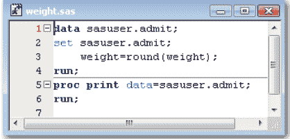

## 使用文件快捷方式

文件快捷方式在 SAS Explorer 窗口中可用。使用文件快捷方式打开程序：

1. 在 SAS Explorer 窗口的顶层，双击“文件快捷方式”。

2. 双击你想要打开的文件快捷方式，或从文件的弹出菜单中选择“打开”。

### 第 3 章 • 编辑和调试 SAS 程序

图 3.3 文件快捷方式

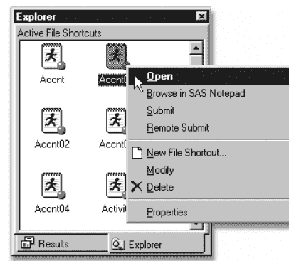

文件将在新的编辑窗口中打开，文件名显示为窗口标题。

- 你可以从弹出菜单中选择“提交”，直接从文件快捷方式执行文件。

- 请记住，在 z/OS (z/OS) 或 CMS 操作系统环境中，单击即可打开文件快捷方式。要打开文件，你：

  - 在项目旁输入 * 以显示弹出菜单。

  - 在项目旁输入 S 以模拟双击。

## 使用我的收藏文件夹

要查看和管理操作系统环境中的任何文件，可以使用“我的收藏文件夹”窗口。

要打开存储在“我的收藏文件夹”中的文件：

1. 选择 查看 (`View`) ⇨ 我的收藏文件夹。

2. 双击文件，或从文件的弹出菜单中选择“打开”。

文件将在新的编辑窗口中打开，文件名显示为窗口标题。

- 你可以从弹出菜单中选择“提交”，直接从“我的收藏文件夹”执行文件。

## 使用打开窗口

要使用“打开”窗口：

1. 在代码编辑窗口激活状态下，选择 文件 (`File`) ⇨ 打开 (`Open`)（或 `File` ⇨ 程序 `Program`）。

2. 在“打开”窗口中，点击你想要打开的文件（或输入文件路径）。

3. 点击“打开”或“确定”。

**图 3.4** 打开窗口

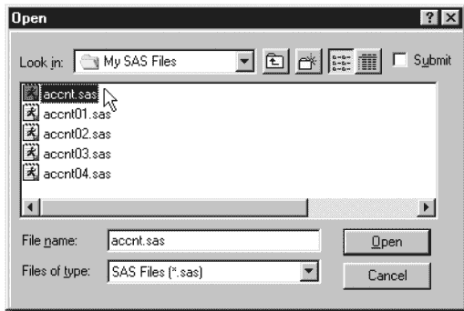

文件将在新的代码编辑窗口中打开，文件名显示为窗口标题。

- 在 Windows 环境中，可以在点击“打开”之前勾选“提交”复框，直接从“打开”窗口提交文件。

- “打开”窗口的外观因操作系统而异。在大型机环境中，文件不会列出，因此你必须输入文件的路径。

如果你不确定存储程序的文件名，可以采取以下操作之一：

- 使用“我的收藏文件夹”在你的操作系统环境中定位文件

- 使用 `X` 命令临时挂起你的 SAS 会话。

`X` 命令允许你在不结束 SAS 会话的情况下使用操作系统的功能。当你执行 `X` 命令时，你会临时退出 SAS 并进入主机系统。

在执行 `X` 命令后恢复 SAS 会话，请执行相应的主机系统命令，如下所示。

**表 3.1** 恢复 SAS 会话

| 操作系统环境 | 恢复 SAS 会话的主机命令 |
|---|---|
| z/OS | `RETURN` 或 `END` |
| UNIX | `exit` |
| Windows | `EXIT` |

## 执行 `INCLUDE` 命令

你也可以通过执行 `INCLUDE` 命令打开程序。

### 第 3 章 • 编辑和调试 SAS 程序

通用格式，基本 `INCLUDE` 命令：

`INCLUDE 'file-specification'`

其中 `file-specification` 是主机系统识别该文件的物理名称。

## 示例

假设你想在 Windows 环境中包含程序 `D:\Programs\Sas\myprog1.sas`。为此，你可以执行以下 `INCLUDE` 命令：

```
include 'd:\programs\sas\myprog1.sas'
```

由于这是一个命令（而不是 SAS 语句），因此末尾使用分号。

## 编辑 SAS 程序

现在你已经知道了如何打开 SAS 程序，让我们来复习一下 SAS 语句的特征，并查看如何增强 SAS 程序的可读性。

## SAS 程序结构

记住，SAS 程序由 SAS 语句组成。考虑下方代码编辑窗口中所示 SAS 程序。

图 3.5 示例 SAS 程序

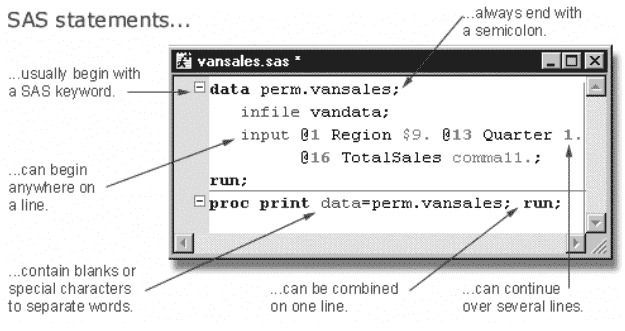

尽管你可以以几乎任何格式编写 SAS 语句，但一致的布局可以增强可读性并帮助你理解程序的目的。做法是：

- 在第一列开始 `DATA` 和 `PROC` 步

- 在步骤内缩进语句

- 在第一列开始 `RUN` 语句

- 在每个 `DATA` 步或 `PROC` 步之后包含 `RUN` 语句。

```
data sashelp.prdsale;
infile jobs;
input date name $ job $;
run;
proc print data=sashelp.prdsale;
run;
```

现在，让我们看看用于编辑 SAS 程序的增强编辑器（Enhanced Editor）窗口功能。

> 如果你在 Windows 以外的操作系统环境中运行 SAS，可以跳过增强编辑器窗口部分，改为查看 84 页的“程序编辑器特性”。

## 使用增强编辑器

当你在增强编辑器中编辑 SAS 程序时，可以利用许多有用功能。下节将展示如何：

- * 使用颜色区分来识别代码元素

- 在按下回车键时自动缩进下一行

- 折叠和展开 SAS 过程、`DATA` 步和宏的区域

- 标记代码行以便快速访问程序的不同部分

- 打开文件的多个视图。

图 3.6 增强编辑器窗口


# 84 第 3 章 • SAS 程序的编辑与调试

图 3.8 增强型编辑器选项窗口

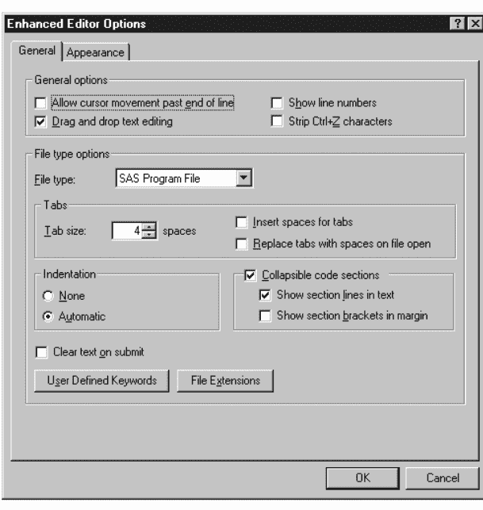

有关在增强型编辑器中设置选项的更多详细信息，请从增强型编辑器窗口选择 帮助 (`Help`) ↩ 使用此窗口 (`Using This Window`)。

## 程序编辑器功能

您可以使用程序编辑器窗口来提交 SAS 程序。您可以在此窗口中输入并编辑 SAS 程序，也可以打开在其他文本编辑器中创建的 SAS 程序。

若要在程序编辑器窗口中编辑 SAS 程序，可以显示行号。然后，您可以在行号区域内使用文本编辑器行命令和块文本编辑器行命令，在程序编辑器窗口内插入、删除、移动和复制行。

在所有操作系统环境中，您都可以使用行号、文本编辑器行命令和块文本编辑器行命令。根据您的操作系统环境，您还可以使用诸如拖放文本、使用 Enter 键插入行或标记并删除文本等功能。有关这些功能的详细信息，请参阅您操作系统环境的 SAS 文档。

## 行号

在某些操作系统环境中，程序编辑器窗口默认显示行号。在其他系统中，行号的使用是可选的。激活行号可以无论您的操作系统环境如何，都能让您更容易编辑程序。

图 3.9 行号

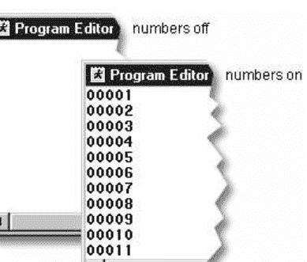

要开启行号，请在命令框中使用 `NUMS` 命令并按 Enter。若要关闭行号，请再次输入 `NUMS` 命令。使用 `NUMS` 命令激活的行号在整个 SAS 会话期间有效。

> 若要永久显示行号，请选择**工具 (`Tools`) ⇒ 选项 (`Options`) ⇒ 程序编辑器 (`Program Editor)`**。选择**编辑 (`Editing)` 表。选择**显示行号 (`Display line numbers)`选项。点击**确定 (`OK)`**。

## 文本编辑器行命令

文本编辑器行命令允许您删除、插入、移动、复制和重复文本。您在程序编辑器窗口的行号区域输入这些命令。下表总结了基本的文本编辑行命令。

表 3.2 文本编辑器行命令

| 命令 | 动作 |
|---|---|
| `Cn` | 复制 $n$ 行（其中 $n$ = 直到9999 的数字） |
| `Dn` | 删除 $n$ 行 |
| `In` | 插入 $n$ 空行 |
| `Mn` | 移动 $n$ 行 |
| `Rn` | 重复当前行 $n$ 次 |
| `A` | 之后（与 C、I 和 M 配合） |
| `B` | 之前（与 C、I 和 M 配合） |

您可以使用文本编辑器行命令执行此类操作：

## 表 3.3 使用文本编辑器命令的结果

| 命令 | 动作 |
| --- | --- |
| 00001 | 在行 00002 之后插入 3 行 |
| i3002 | |
| 00003 | |
| 0i001 | 在行 00001 之前插入 1 行 |
| 00002 | |
| 00003 | |
| 0i041 | 在行 00001 之前插入 4 行 |
| 00002 | |
| 00003 | |
| 00c2 | 在行 00003 之后复制 2 行（00001 和 00002） |
| 00002 | |
| 00a003 | |
| 00001 | 删除 3 行（00002、00003 和 00004） |
| 0d302 | |
| 00003 | |
| 00b01 | 在行 00001 之前移动 1 行（00003） |
| 00002 | |
| 00m03 | |

## 示例 1

在下例示例中，需要在行 00004 之后插入 `PROC PRINT` 语句和 `RUN` 语句。

## 图 3.10 不完整的程序

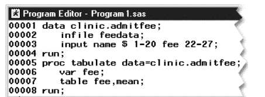

要在程序中插入 `PROC PRINT` 和 `RUN` 语句：

- 1. 在程序编辑器窗口行 00004 的行号区域任意位置输入 `i2`。将插入两个空行，光标将位于第一行新行。

- 2. 在行 00005 上输入 `PROC PRINT` 语句。

- 3. 在行 00006 上输入 `RUN` 语句。

**图 3.11** 完整的程序

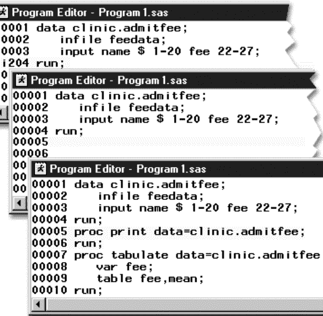

## 块文本编辑器行命令

块文本编辑器行命令允许您在程序编辑器窗口中删除、重复、复制和移动多行。块文本编辑器行命令包括：

**表 3.4** 块文本编辑器行命令

| 命令 | 动作 |
|---|---|
| `DD` | 删除一组行 |
| `CC` | 复制一组行 |
| `MM` | 移动一组行 |
| `RR` | 重复多行 |
| `A` | 之后（与 CC 和 MM 命令配合） |
| `B` | 之前（与 CC 和 MM 命令配合） |

若要使用块命令，请在受影响的第一行和最后一行指定命令，并按 Enter。

## 示例

在下例程序中，需要删除 `PROC TABULATE` 步骤。

图 3.12 原始程序


您可以使用 `DD` 块命令移除该步骤。使用 `DD` 命令：

- 1. 在行 00007 的行号区域任意位置输入 `DD` 以标记受影响的第一行。

- 2. 在行 00010 的行号区域任意位置输入 `DD` 以标记受影响的最后一行。

- 3. 按 Enter 删除行 00007-00010。

# 清除 SAS 编程窗口

运行 SAS 程序时，文本会积累在输出（Output）窗口和日志（Log）窗口中。

你会发现清除 SAS 编程窗口的内容非常有帮助。要清除输出窗口、编辑器（Editor）窗口、程序编辑器（Program Editor）窗口或日志窗口，分别激活每个窗口并选择 编辑（Edit）-> 全部清除（Clear All）。

**图 3.18** 清空的日志窗口

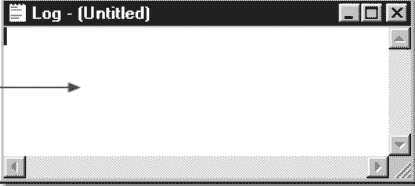


你也可以通过激活窗口并执行 `CLEAR` 命令来清除窗口内容。

> 从窗口中清除的文本无法找回。但在编辑器和程序编辑器窗口，你可以选择 `编辑（Edit）` -> `撤（Undo）` 来重新显示文本。

## 解释错误信息

### 错误类型

到为止，本章所示程序都没有错误，但编程错误确实会发生。SAS 可以检测出多种错误。最常见的有：

-- 语法错误：当程序语句不符合 SAS 语言规则时发生

- 数据错误：当某些数据值不适用于程序指定的 SAS 语句时发生。

本章侧重于识别和修正语法错误。

### 语法错误

当你提交程序时，SAS 会扫描每个语句以检查语法错误，然后执行该步骤（如果没有发现语法错误的话）。SAS 会进入下一个步骤并重复此过程。语法错误（例如关键字拼写错误）通常会阻止 SAS 执行发生错误的步骤。

你已经知道，在程序执行结束时，日志窗口会写入备注。当提交包含错误的程序时，有关问题的消息也会出现在日志窗口。当检测到语法错误时，日志将：

* 显示单词 `ERROR`

* 识别可能的错误位置

* 对错误给出解释。

### 示例

下面的程序包含一个语法错误。`DATA` 将 SAS 数据集 `Clinic.Admit` 复制到名为 `Clinic.Admitfee` 的新数据集中。`PROC` 应该打印新数据集中 `ID`、`Name`、`Actlevel` 和 `Fee` 变量的值。然而，`PROC PRINT` 语句中的 `print` 拼写错误了。

```
data clinic.admitfee;
set clinic.admit;
run;
proc prin data=clinic.admitfee;
var id actlevel fee;
run;
```

当提交程序时，日志窗口中的消息显示未找到过程 `PRIN`，且 SAS 停止处理 `PRINT` 步骤错误。`PRINT` 过程没有产生任何输出，因为第二个步骤执行失败。

图 3.19 显示错误信息的日志窗口

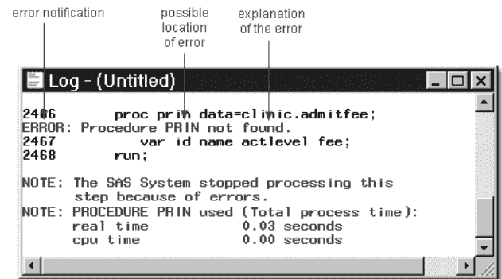

当你查看输出窗口中的结果时，语句或数据中的问题可能并不显而易见。因此，每次提交 SAS 程序时，检查日志窗口中的消息是非常重要的。

### 修正错误

#### 概述

要修改包含错误的程序，你可以在代码编辑窗口中对其进行编辑。你可以通过重写错误文本、删除文本或插入文本来纠正简单的错误，例如以下程序中的拼写错误。

```
data clinic.admitfee;
  set clinic.admit;

proc print data=clinic.admitfee;
  var id name actlevel fee;
```

- 如果你使用程序编辑器窗口，通常需要将已提交的语句从召回缓冲区（recall buffer）调回到程序编辑器窗口，在其中你可以修正问题。记住，可以通过执行 `RECALL` 命令或选择 `运行 <=> 召回上次提交（Run <=> Recall Last Submit）` 来召回语句。

在下面的程序中，`PROC PRINT` 语句中指定的 `PRINT` 关键字中插入了缺失的 `t`。

图 3.20 修正后的程序

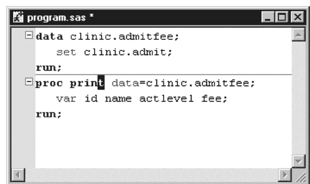

有些问题相对容易诊断和修正。但有时你可能不知道如何纠正错误。在线帮助提供了有关各个过程的信息，以及针对你操作系统环境的特定帮助。在 `帮助（Help）` 菜单中，如果你可以使用互联网，还可以选择 `Web 版 SAS` 以访问技术支持和常见问题的链接。

### 重新提交修改后的程序

修正程序后，你可以再次提交它。但在在此之前，清除日志窗口中的消息是一个好主意，这样你就不会将旧错误消息与新消息混淆。你可以重新提交程序并查看任何生成的输出。

图 3.21 正确的 `PROC PRINT` 输出

## SAS 系统

| Obs | ID | Name | ActLevel | Fee |
|---|---|---|---|---|
| 1 | 2458 | Murray, W | HIGH | 85.20 |
| 2 | 2462 | Almers, C | HIGH | 124.80 |
| 3 | 2501 | Bonaventure, T | LOW | 149.75 |
| 4 | 2523 | Johnson, R | MOD | 149.75 |
| 5 | 2539 | LaMance, K | LOW | 124.80 |
| 6 | 2544 | Jones, M | | |
| 7 | 2552 | | | |
| 8 | 2555 | | | |
| 9 | 2563 | | | |
| 10 | 2568 | | | |
| 11 | 2571 | | | |
| 12 | 2572 | | | |
| 13 | 2574 | | | |
| 14 | 2575 | | | |
| 15 | 2578 | | | |
| 16 | 2579 | | | |
| 17 | 2584 | | | |
| 18 | 2586 | | | |
| 19 | 2588 | | | |
| 20 | 2589 | | | |
| 21 | 2595 | | | |

## 第3章 • 编辑与调试程序

图 3.22 带有信息的程序

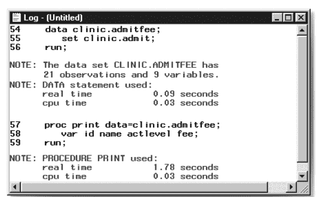

由于提交的步骤留在召回缓冲区中，重新提交无错误的程序会浪费资源。SAS忽略注释符号之间的文本。当你的程序没有错误时，见见页的“附加功能”。

### 解决常见问题

除了修正拼写错误，你可能还需要解决其他常见错误。这些包括：

- 缺少分号

- 引号未平衡

- 指定了无效选项

另一个常见问题是在程序末尾缺少 `RUN` 语句。虽然这在技术上不是错误，但可能会产生意外结果。下表列出了这些问题及其症状。

- 缺少 `RUN` 语句 | 顶部显示“`PROC`（或 `DATA`）正在运行” |

- 缺少分号 | 显示看似有效的语句存在错误 |

- 引号未平衡 | 显示引引字符串过长或语句歧义 |

- 无效选项 | 显示某个选项无效或未识别 |

### RUN 语句

SAS 程序中的每个步骤都与其他步骤独立地编译和执行。在编译步骤时，SAS 在遇到以下内容时识别当前步骤的结束：

* `DATA` 或 `PROC` 语句，表示新步骤的开始

* `RUN` 或 `QUIT` 语句，表示当前步骤的结束。

当提交下面的程序时，`DATA` 步骤执行，`PROC` 步骤不执行，因为没有后续的 `DATA` 或 `PROC` 语句表示新步骤的开始，也没有后续的 `RUN` 语句表示步骤的结束。

```
data clinic.admitfee;
set clinic.admit;
run;
proc print data=clinic.admitfee;
var id name active fee;
```

由于没有内容指示 `PROC` 步骤的结束，`PRINT` 过程将等待执行，并在活动窗口顶部显示“`PROC PRINT` message”。

#### 解决问题

要纠正此错误，请提交一个 `RUN` 语句以完成该 `PROC` 步骤。

```sas
run;
```

如果你正在使用程序编辑器（Program Editor），则不需要将程序重新调回程序编辑器窗口。

### 缺少分号

常见的错误之一是在语句末尾缺少分号。下面的程序在 `PROC PRINT` 语句的末尾缺少分号。

```sas
data clinic.admitfee
set clinic.admit

proc print data=clinic.admitfee
var id name actlevel fee;
```

当你省略分号时，SAS 会将缺少分号的语句以及随后的语句共同视为一条语句。随后，SAS 日志（Log）会列出与该合并后的语句相关的错误，而不是实际的错误（即缺失的分号）。

图 3.24 带有错误信息的日志窗口

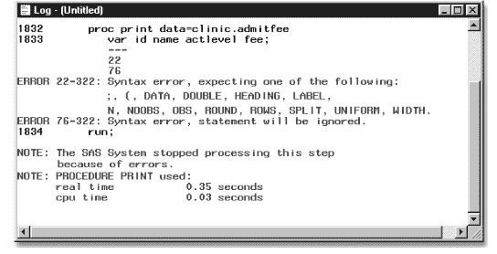

#### 解决问题

要纠正此错误，请执行以下操作：

- 1. 找到缺少分号的语句。你通常可以通过查看错误信息中的下划线关键字和工作绑定（working bindings）来定位缺少分号的语句。

- 2. 在适当的位置添加分号。

- 3. 重新提交修正后的程序。

- 4. 再次检查日志窗口，以确保没有其他错误。

### 引号不平衡

某些语法错误（例如下面程序中 `HIGH` 之后的缺少引号）会导致 SAS 误解程序中的语句。

```sas
data clinic.admitfee;
set clinic.admit;
where actlevel='HIGH';
run;

proc print data=clinic.admitfee;
  var id name actlevel fee;
run;
```

当程序被提交时，SAS 无法解析 `DATA` 步骤，活动窗口顶部会出现“`DATA STEP running`”的消息。

**图 3.25** 带有消息的程序编辑器

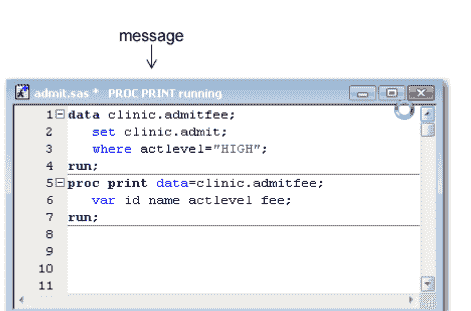

有时 SAS 日志中会出现警告信息，指示：

- 引号字符串过长

- 包含引号的语句（如 `TITLE` 或 `FOOTNOTE` 语句）由于无效选项或引用文本而产生歧义。

**图 3.26** 带有警告信息的日志


当引号不平衡时，SAS 往往无法检测到发生该语句的结束。简单地添加引号并重新提交程序通常*无法*解决问题。SAS 仍然认为引号是不平衡的。

因此，你需要在调回、修正并重新提交程序之前，通过取消已提交的语句（在 Windows 和 UNIX 操作系统中）或提交一行 SAS 代码（在 z/OS 操作系统中）来解决引号不平衡的问题。

如果你在问题发生时没有解决它，那么在当前 SAS 会话中提交的任何后续程序都可能产生错误。

#### 在 Windows 操作系统中解决错误

要在 Windows 操作系统中解决错误：

- 1. 按下 `Ctrl` 和 `Break` 键，或点击工具栏上的 `Break` 图标。

- 2. 选择 `1. Cancel Submitted Statements`（取消提交的语句），然后点击 `OK`。

图 3.27 任务管理器窗口


- 3. 选择 `Y` 以取消已提交的语句，然后点击 `OK`。

图 3.28 Break 窗口


- 4. 修正错误并重新提交程序。

#### 在 UNIX 操作系统中解决错误

要在 UNIX 操作系统中解决错误：

- 1. 打开会话管理（Session Management）窗口并点击 `Interrupt`（中断）。

**图 3.29** 会话管理窗口


- 2. 选择 **I. Cancel Submitted Statements**，然后点击 **Y**。

**图 3.30** 任务管理窗口


- 3. 修正错误并重新提交程序。

#### 在 z/OS 操作系统中解决错误

要在 z/OS 操作系统中解决错误：

- 1. 提交星号、引号、分号和 `RUN` 语句。

   *; run;

- 2. 删除包含星号、引号、分号和 `RUN` 语句的行。

- 3. 在适当的位置插入缺失的引号。

- 4. 提交程序。

你也可以在 Windows 和 UNIX 环境中使用上述方法。

### 无效选项

当你指定了一个无效选项时，会发生无效选项错误。在下面的程序中，`PRINT` 语句不支持 `KEYLABEL`。

```sas
data clinic.admitfee;
set clinic.admit;
where actlevel='HIGH';
run;

proc print data=clinic.admitfee keylabel;
  var id name actlevel fee;
run;
```

当语句包含无效选项时，日志中会出现指示其无效的消息。

图 3.31 带有错误的日志窗口


### 系统选项

SAS 包含了几个系统选项，允许你控制错误处理和日志消息。下表包含了这些选项的简要描述。

表 3.6 控制错误处理和日志消息的选项

| 选项 | 描述 |
| --- | --- |
| **ERRORS=n** | 指定用于打印错误消息的最大观测值数量。 |
| **FMTERR**, **NOFMTER** | 控制 SAS 在找不到格式时是否生成错误。`NOFMTER` 会产生警告而非错误。`FMTERR` 是默认值。 |
| **SOURCE**, **NOSOURCE** | 控制 SAS 是否将源语句写入日志。`SOURCE` 是默认值。 |

# 第 105 章总结

你可以使用 `DATA` 步调试器调试 `DATA` 步中的逻辑错误。该工具允许你发布命令来逐条执行 `DATA` 语句，并暂停在窗口中显示结果变量的值。通过观察显示的结果，你可以确定逻辑错误所在的位置。

调试器只能在交互模式下使用。由于调试器是交互式的，你可以在单个调试会话中根据需要重复发布命令和观察结果的过程。要调用调试器，请在 `DATA` 语句中添加 `DEBUG` 选项并提交程序。

```
data data.perm.publish / debug;
infile pubdata;
input BookID $ Publisher & $22. Year;
run;
proc data-perm.publish;
run;
```

图 3.32 调试器日志窗口


> 有关如何使用调试器的详细信息，请参阅 SAS 文档。

## 总结

### 文本总结

打开存储的 SAS 程序

存储在外部文件中的 SAS 程序可以使用以下方法在代码编辑窗口中打开：

- 文件快捷方式

- 我的收藏夹夹

- “打开（Open）”窗口

- `INCLUDE` 命令

### 编辑 SAS 程序

SAS 程序由 SAS 语句组成。尽管你可以以几乎任何格式编写 SAS 语句，但一致的布局可以增强可读性，并帮助你理解程序的目的。

在 Windows 操作系统环境中，增强编辑器（Enhanced Editor）允许你输入和查看文本：

- 选择一行或多行文本

- 使用颜色编码识别代码元素

- 在按 `Enter` 键时自动缩进下一行

- 折叠和展开 SAS 过程（`PROC`）、`DATA` 步和宏的章节

- 为代码行设置书签，以便快速访问程序的不同部分。

使用编辑器，你还可以查找并替换文本、使用缩写、打开文件的多个视图并设置增强编辑器选项。

程序编辑器（Program Editor）窗口允许你像使用文字处理程序一样编辑程序。你可以使用文本编辑器命令和块文本编辑器命令来编辑 SAS 程序。激活行号可以让你无论在什么操作系统环境下都更容易编辑程序。

请记住，SAS 语句在提交后会从程序编辑器窗口中消失。然而，你可以将程序调回程序编辑器窗口。

要将你的 SAS 程序保存到外部文件，首先激活程序编辑器窗口并选择“文件（File）⇔ 另存为（Save As）”。然后在“另存为”窗口中指定程序的名称。

### 清除 SAS 编程窗口

在 SAS 会话期间，文本和输出会在编辑器、程序编辑器、日志（Log）和输出（Output）窗口中积累。你可以选择“编辑（Edit）⇔ 全部清除（Clear All）”来清除窗口。

### 解析错误消息

提交包含错误的 SAS 程序时，错误消息会出现在日志窗口中。SAS 可以检测三种类型的错误：语法、执行数据。本章重点关注识别和解决常见的语法错误。

### 修正错误

要修改包含错误的程序，你可以在代码编辑窗口中修正错误。在程序编辑器窗口中，你需要在编辑之前调回已提交的语句。

在重新提交修改后的程序之前，清除日志窗口中的消息是好的，这样就不会新旧消息混淆。在重新提交之前，你可以从修改后的程序中删除任何无步骤。

### 解决常见问题

你可能需要解决几种常见问题：缺少 `RUN` 语句、缺少分号、引号不平衡以及无效选项。

#### 注意事项

- 建议将 `DATA` 步、`PROC` 步和 `RUN` 语句从左侧开始，并缩进步骤内的语句。

# 第 107 章测验

- 用 `RUN` 语句结束每个步骤。

- 每次提交 SAS 程序时都检查日志窗口中的消息。

- 在重新提交之前，你可以从修改后的程序中删除无步骤，或者只提交程序中修改过的步骤。

# 章测验

为每个问题选择最佳答案。完成测验后，使用附录中的答案检查你的答案。

1. 在编写和编辑 SAS 程序时，最好是：

   a. 在第一列开始 `DATA` 和 `PROC` 步。

   b. 缩进步骤内的语句。

   c. 在第一列开始 `RUN` 语句。

   d. 以上所有。

2. 假设你提交了一个包含错误的 SAS 程序。为了修改该程序，你应该执行以下哪些操作？

   a. 修正错误。清除日志窗口。

   b. 修正错误。重新提交程序。检查日志窗口。

   c. 修正错误。检查日志窗口。重新提交程序。

   d. 修正错误。重新提交程序。输出窗口。

3. 如果提交以下程序，会发生什么？

```
proc sort data=maxrates out=maxrates;
by region;
label='Heart Rate';
where resthr>90;
run;
```

   a. 激活窗口中出现“`PROC running`”消息。

   b. 激活窗口中出现“`DATA running`”消息。

   c. 激活窗口中出现“`SORT running`”消息。

   d. 以上所有。

4. 当检测到语法错误时通常会发生什么？

   a. SAS 继续该步骤。


b. SAS 继续该步骤，日志窗口显示关于错误的消息。

c. SAS 停止发生错误的步骤，日志窗口显示关于错误的消息。

d. SAS 停止发生错误的步骤，输出窗口显示关于错误的消息。

5. 语法错误发生在：

a. 某些数据值不适用于 SAS 语句。

b. 语句的格式正确，但其用法无效。

c. 程序语句不符合 SAS 规则。

d. 以上都不是。

6. 如何判断你是否指定了无效选项？

a. 日志消息显示语句似乎有效。

b. 日志消息显示选项未被识别。

c. 激活窗口顶部出现“`PROC running`”或“`DATA running`”消息。

d. 直到查看输出才能知道。

7. 下列哪个程序包含语法错误？

a. `proc sort data=sasuer.sales; by region;`

b. `data sasuer.sales; set mydata.sales; where sales<5000; run;`

c. `proc print data=sasuer.sales label='Sales Region';`

d. 以上都不是。

8. 在 Windows 或 UNIX 环境下提交以下程序后你应该做什么？

```
proc print data=mysales;
where state='NC';
```

a. 提交 `RUN` 语句完成 `PROC` 步。

b. 还原程序。然后添加引号并重新提交修改后的程序。

c. 取消已提交的语句。然后还原程序，添加引号并重新提交修改后的程序。

d. 还原程序。替换无效选项并重新提交修改后的程序。

9. 下列哪个命令在代码编辑窗口中打开文件？

a. `file 'd:\programs\sas\newprog.sas'`

b. `include 'd:\programs\sas\newprog.sas'`

c. `open 'd:\programs\sas\newprog.sas'`

d. 以上所有。

10. 假设你提交了一个短简单的 `DATA` 步。如果激活窗口长时间显示“`DATA running`”消息，可能发生了什么？

a. 你遗漏了一个关键字。

b. 你忘记用 `RUN` 语句结束 `DATA` 步。

c. 你指定了无效的数据集选项。

d. 某些数据值不适用于 SAS 语句。

# 第 4 章

## 创建列表报告

- 概述 ............................................................................................................................................................................................ 112

- 引言 ..................................................................................................................................................................................................... . . 112

- 目标 ................................................................................................................................................................................................................. . . . 112

- 创建基础报告 ..................................................................................................................................................................................................... . . 113

- 选择变量 ............................................................................................................................................................................................................................ . . 115

- 概述 ................................................................................................................................................................................................. . . . . . . 115

- 删除 `OBS` 列 ................................................................................................................................................................................................................. . . 116

- 识别观测值 .................................................................................................................................................................................................................... . . 117

- 使用 `ID` 语句 ...................................................................................................................................................................................................................... . . 117

- 示例 .................................................................................................................................................................................................................................................... . . . . . . . . . . . . . 117

- 选择观测值 .................................................................................................................................................................................................................................... . . 118

- 指定 `WHERE` 表达式 ........................................................................................................................................................................................................................ . . 119

- 使用 `CONTAINS` 操作子 ................................................................................................................................................................................................................... . . 120

- 指定复合 `WHERE` 表达式 ........................................................................................................................................................................................ . . 120

- `WHERE` 语句示例 ........................................................................................................................................................................................................................... . . 121

- 数据排序 ................................................................................................................................................................................................................................................................. . ............ 121

- 概述 ................................................................................................................................................................................................................................................................. . . . . . . . . . . . . . 122

- 示例 ................................................................................................................................................................................................................................................................................. .... . . . . . . . . . . . . . . . 122

- 生成列总计 ............................................................................................................................................................................................................................................ . . 124

- 概述 ................................................................................................................................................................................................................................................................................. .................... . . . . . . . . . . . . . . . . 124

- 请求小计 ........................................................................................................................................................................................................................................................................................................ . . 125

- 示例 .................................................................................................................................................................................................................................................................................................... . . . . . . . . . . . . . . . . . . . . .  . . . 126

- 使用 `BY` Groups 和 `ID` 变量创建自定义布局 ........................................................................................................................................................................ . . 127

- 示例 ................................................................................................................................................................................................................................................................................. . .... . . . . . . . . . . . . . . . . . . . . 128

- 在单独页面上请求小计 ........................................................................................................................................................................................................................ . . 128

- 示例 ................................................................................................................................................................................................................................................................................. . .... . . . . . . . . . . . . . . . . . . . . . . . . . . . 129


- `LISTING` 输出的双倍间距 . . 130
- 指定标题和脚注 . . 131
- 概述 . . 131
- `TITLE AND FOOTNOTE` 语句 . . 131
- 使用 `TITLES AND FOOTNOTES` 窗口 . . 131
- 示例 . . 132
- 示例：脚注 . . 133
- 修改和取消标题与脚注 . . 134
- 分配描述性标签 . . 135
- 为变量临时分配标签 . . 135
- 示例 . . 136
112 第 4 章 • 创建列表报告 . . 136
+ 使用单个或多个 `LABEL` 语句 . . 136
数据值格式化 . . 137
为变量临时分配格式 . . 137
指定 SAS 格式 . . 138
字段宽度 . . 139
小数位数 . . 139
示例 . . 139
使用永久分配的标签和格式 . . 140
其他功能 . . 141
本章总结 . . 142
文本总结 . . 142
语法 . . 144
示例程序 . . 144
要点回顾 . . 145
章节测验 . . 145

## 概述

## 引言

要列出数据集中的信息，你可以使用 `PROC PRINT` 步创建一个报告。然后，你可以通过额外的语句和选项增强报告，创建如下所示的报告。

**图 4.1** `PROC PRINT`

| 基础报告 | 列总计 |
| --- | --- |
| | |
| | |
| | |
| | |
| | |
| | |
| | |
| | |

## 排序与标签

## 选择的观测值和变量

## 目标

在本章中，你将学习：

- 指定要打印的 SAS 数据集
- 选择要打印的变量和观测值
- 根据一个或多个变量的值对数据进行排序
- 为数值变量指定列总计
- `LISTING` 输出的双倍行距
- 在过程输出中添加标题和脚注
- 为变量分配描述性标签
- 对变量值应用格式

## 创建基础报告

要生成列表报告，首先引用存储你的 SAS 数据集的库。如果你需要，还可以设置系统选项来控制报告的外观。然后提交一个基础的 `PROC PRINT` 步。

通用形式，基础 `PROC PRINT` 步：

```
PROC PRINT DATA=SAS-data-set;
RUN;
```

其中 `SAS-data-set` 是要打印的 SAS 数据集的名称。

在下面的程序中，`PROC PRINT` 语句调用 `PRINT` 过程，并指定 SAS 数据库中的 `Therapy` 数据集，该数据集已分配给库引用名 `Patients`。

```
libname patients ':\records\patients';
proc print data=patients.therapy;
run;
```

注意下方生成报告的布局。默认情况下：

- 数据集中所有的观测值和变量都会被打印
- 最左侧会出现一个观测值编号列
- 变量和观测值按照它们在数据集中出现的顺序出现。

114 • 第 4 章 • 创建列表报告

图 4.2 `Patients.Therapy` 数据集


务必在 SAS 的 `DATA=` 选项中指定等号。如果你省略了等号，你的程序将在 SAS 日志中产生类似下面的错误：

图 4.3 错误消息

```
35 proc print data patients.therapy;
---------------------
73
ERROR 73-322: Expecting an =.
36 run;

NOTE: The SAS System stopped processing this step because of errors.
```

## 选择变量

## 概述

默认情况下，`PROC PRINT` 步列出数据集中所有变量。可以使用 `PROC PRINT` 步中的 `VAR` 语句选择变量并控制它们出现的顺序。

通用形式，`VAR` 语句：

```
VAR variable(s);
```

其中 `variable(s)` 是一个或多个由空格分隔的变量名。

例如，下面的 `VAR` 语句指定按顺序仅打印 `Age`、`Height`、`Weight` 和 `Fee` ：

```
proc print data=clinic.admin;
  var age height weight fee;
run;
```

带有 `VAR` 语句的 `PROC PRINT` 步过程输出仅列出 `Age`、`Height`、`Weight` 和 `Fee` 变量的值。

116 第 4 章 • 创建列表报告

图 4.4 过程输出


除了选择变量，你还可以控制 `PROC PRINT` 显示用于列出观测值的默认 `Obs` 列。如果你愿意，可以选择不显示观测值。

图 4.5 打印观测值


## 删除 OBS 列

要删除 `Obs` 列，在 `PROC PRINT` 语句中指定 `NOOBS` 选项。

```
proc print data=work.example noobs;
var age height fee;
run;
```

## 识别观测值

你已经学习了如何删除 `Obs` 列。作为另一种选择，你可以使用一个或多个变量替换输出中的 `Obs` 列。

## 使用 ID 语句

要指定哪些变量替换 `Obs` 列，请使用 `ID` 语句。这种技术在观测值过长无法在行内打印时特别有用。

通用形式，`ID` 语句：

`ID variable(s);` 指定一个或多个替换每行的观测值。

## 示例

要根据员工的 ID 编号和姓替换 `Obs` 列，可以提交以下程序。

```
proc print data=sales.reps;
idum lastname;
run;
```

这是 HTML 输出：**图 4** HTML 输出

| IDnum | LastName | State | JobCode | Birth | HomePhone |
|---|---|---|---|---|---|
| 1269 | CANTON | STANFORD | M | NA1 | 4169.00 | 06MAR60 | 203/781-3335 |
| 1935 | FERNANDEZ | BRIDGEPORT | F | NA2 | 5181.00 | 31MAR42 | 203/675-2962 |
| 1417 | NEWKIRK | PATERSON | NJ | NA2 | 5270.00 | 03JUN50 | 201/732-661 |
| 1639 | NORRIS | NEW YORK | F | NA1 | 4433.00 | 02DEC28 | 05OCT58 | 384-177 |
| 1111 | JONES | BRIDGEPORT | M | NA1 | 4056.00 | 25JAN61 | 06JUL08 | 718- |
| 1352 | RIVERS | NEW YORK | M | NA2 | 5379.80 | 05MAY28 | 10OCT48 | 718/383-3345 |


| 1332 | STEPHENS | BRIDGEPORT | M | NA1 | 42178.00 | 07JUN69 | 203/675-1497 |

| 1443 | WELL | STANFORD | F | NA1 | 4274.20 | 01SEP56 | 203/781-556 |

在 Listing 输出中，`Idnum` 和 `Lastname` 列会在每个观测值重复。第 4 章 • 创建列表报告

图 4.7 LISTING 输出

| Idnum | LastName | FirstName | Sex | JobCode |

|---|---|---|---|---|

| 1269 | CASTON | FRANKLIN | CT | M | NA1 |

| 1935 | FERNANDEZ | PATRINA | BRIDGEPORT | CT | NA2 |

| 1417 | NEWKIRK | WILLIAM | PATERSON | NJ | NA2 |

| 1839 | NORRIS | DIANE | NEW YORK | F | NA1 |

| 1111 | RHODES | JAMES | FREEDOM | NJ | NA2 |

| 1352 | RIVERS | SIMON | NEW YORK | M | NA1 |

| 1332 | STEPHENS | ADAM | BRIDGEPORT | CT | NA1 |

| 1443 | WELL | AGRES | STANFORD | CT | F | NA1 |

| Idnum | LastName | Salary | Birth | HomePhone |

|---|---|---|---|---|

| 1269 | CASTON | 41690.00 | 06MAR60 | 01DEC80 | 203/781-3335 |

| 1935 | FERNANDEZ | 51081.00 | 03MAR62 | 19OCT69 | 203/675-2662 |

| 1417 | NEWKIRK | 52270.00 | 30JUN82 | 10OCT77 | 201/732-6661 |

| 1839 | NORRIS | 43343.00 | 05AUG71 | 05OCT21 | 712/346-2767 |

| 1111 | RHODES | 40586.00 | 17JUL61 | 03NOV80 | 201/812-1837 |

| 1352 | RIVERS | 5379.80 | 05MAY28 | 10OCT48 | 718/383-3345 |

| 1332 | STEPHENS | 42178.00 | 20FEB67 | 07JUN69 | 203/675-1497 |

| 1443 | WELL | 422.74 | 20NOV56 | 01SEP79 | 203/781-3546 |

如果 `ID` 语句中的变量也出现在 `WHERE` 语句中，则输出将包含该变量的两列。在下面的示例中，`Idnum` 变量出现了两次。

```
proc data=sales.reps;
 idnum lastname;
var idnum jobcode salary;
run;
```

图 4.8 IDNUM 输出

| Idnum LastName | Idnum Sex JobCode | Salary |

|---|---|---|---|---|

| 1269 CASTON | 1269 | M | NA1 | 41690.00 |

| 1935 FERNANDEZ | 1935 | | NA2 | 51081.00 |

| 1417 NEWKIRK | 1417 | | NA2 | 52270.00 |

| 1839 NORRIS | 1839 | F | NA1 | 43343.00 |

| 1111 RHODES | 1111 | M | NA1 | 40586.00 |

| 1352 RIVERS | 1352 | M | NA2 | 5379.80 |

| 1332 STEPHENS | 1332 | M | NA1 | 42178.00 |

| 1443 WELL | 1443 | F | NA1 | 422.74 |

通用形式，`WHERE` 语句：

# `WHERE *where-expression*`;

`where` `where-expression` 指定了选择观测值的条件。`*where-expression*` 可以是任何有效的 SAS 表达式。

例如，以下 `WHERE` 语句仅选择 `Age` 值大于 30 的观测值：

```
proc print data=clinic.admit;
var age height weight fee;
where age>30;
run;
```

以下是带有 `WHERE` 语句的 `PROC PRINT` 步骤过程输出：

**图 4.9** *带有 WHERE 语句的 PROC PRINT 输出*

| Obs | Age | Height | Weight | Fee |

|---|---|---|---|---|

| 2 | 34 | 66 | 152 | 124.80 |

| 3 | 31 | 61 | 123 | 149.75 |

| 4 | 43 | 63 | 137 | 149.75 |

| 5 | 51 | 71 | 158 | 124.80 |

| 7 | 32 | 67 | 151 | 149.75 |

| 8 | 35 | 70 | 173 | 149.75 |

| 9 | 34 | 73 | 152 | 124.80 |

| 10 | 49 | 64 | 172 | 124.80 |

| 11 | 44 | 66 | 140 | 149.75 |

| 14 | 40 | 69 | 163 | 124.80 |

| 15 | 47 | 72 | 173 | 124.80 |

| 16 | 60 | 71 | 191 | 149.75 |

| 17 | 43 | 65 | 123 | 124.80 |

| 20 | 41 | 67 | 141 | 149.75 |

| 21 | 54 | 71 | 183 | 124.80 |

# 指定 WHERE 表达式

在 `WHERE` 语句中，你可以指定 SAS 数据集中的任何变量，而不仅仅是 `VAR` 语句中指定的变量。`WHERE` 语句对字符和数值变量均有效。要根据字符变量的值指定条件，你必须：

- 用引号将值括起来
- 按照数据集中出现的完全格式，使用小写、大写或混合大小写字母编写该值。

你使用以下比较运算符在 `WHERE` 语句中表示条件：

# 第 4 章 • 创建列表报告

**表 4.1** `WHERE` 语句中的比较运算符

| 符号 | 含义 | 示例 |

|---|---|---|

| = eq | 等于 | where name='Jones, C.'; |

| ^= or nc | 不等于 | where temp ne 212; |

| > or gt | 大于 | where income>20000; |

| < lt | 小于 | where partno lt 'BG05'; |

| >= or ge | 大于或等于 | where id=='1543'; |

| <= or le | 小于或等于 | where pulse le 85; |

> 你可以在第151页的第5章“从外部文件创建数据集”中学习更多关于有效 SAS 表达式的知识。

# **使用 CONTAINS运算符**

`CONTAINS` 操作选择包含指定子字符串的观测值。`CONTAINS` 操作的符号为 `?`。你可以在代码中使用 `CONTAINS` 关键字或符号，如下所示。

# **指定复合 WHERE 表达式**

你还可以使用 `WHERE` 语句选择符合多个条件的观测值。要将一系列表达式链接组合复合表达式，你可以使用逻辑运算符，包括以下：

**表 4.2** 复合 `WHERE` 表达式运算符

| 运算符 | 含义 |

|---|---|

| AND | 和，两者。如果两个表达式都为真，则复合表达式为真。 |

| OR | 或，任一。如果其中一个表达式为真，则复合表达式为真。 |

# WHERE 语句示例

- 当同一变量的多个值进行测试时，在名称表达式中指定该变量：

`where actlevel='LOW' or actlevel='MOD';`

`where fee=124.80 or fee=178.20;`

- 你可以使用 `IN` 运算符作为方便的替代：

`where actlevel in ('LOW','MOD');`

`where fee in (124.80, 178.20);`

- 为了控制复合表达式的评估方式，你可以使用括号（括号内的内容先评估）：

`where (age<=55 and pulse>75) or area='A';`

`where age<=55 and (pulse>75) or area='A';`

# 数据排序

## 概述

默认情况下，`PROC PRINT` 按观测值在数据集中出现的顺序列出。要根据变量的值对报告进行排序，你必须在使用 `PRINT` 过程创建报告之前使用 `PROC SORT` 对数据进行排序。

## SORT 过程

- 重新排列 SAS 数据中的观测值
- 创建包含重排后观测值的新 SAS 数据集
- 默认替换原始 SAS 数据集
- 可以对多个变量进行排序
- 可以按升序或降序排序
- 不生成输出
- 将缺失值视为最小值

## 示例

通用形式，简单的 `PROC SORT`:

```
PROC SORT DATA=data OUT=set;
BY DESCENDING(variables);
```

- `DATA=` 选项指定要读取的数据集
- `OUT` 选项创建一个包含排序数据的输出数据集
- `BY(variables)` 在 `BY` 语句中指定用于排序的一个或多个变量
- `DESCENDING` 选项按降序指定观测值。如果 `BY` 语句中有多个变量，`DESCENDING` 仅适用于紧随其后的变量。如果你不使用 `OUT=` 选项，`PROC SORT` 将覆盖 `DATA=` 指定的数据集。在下面的程序中，`PROC SORT` 对永久数据集 `admit` 按 `Weight` 的值排序并创建一个临时数据集 `wgt`。然后 `PROC PRINT` 步骤打印 `wgt` 数据集。

```
proc sort data=clinic.admit out=work.wgt;
by weight age;
proc print data=work.wgt;
var weight age;
where age>30;
run;
```

报告按 `weight` 的升序显示观测值。图 4.10 按 `Age` 升序显示观测值

| Obs | Weight | Age | Height | Fee |

|---|---|---|---|---|

| 2 | 123 | 31 | 66 | 124.80 |

| 3 | 123 | 43 | 65 | 149.75 |

| 4 | 137 | 43 | 63 | 149.75 |

| 6 | 140 | 44 | 66 | 149.75 |

| 7 | 141 | 41 | 67 | 149.75 |

| 9 | 151 | 32 | 67 | 149.75 |

| 10 | 152 | 34 | 66 | 124.80 |

| 11 | 154 | 34 | 73 | 124.80 |

| 12 | 158 | 51 | 71 | 124.80 |

| 13 | 163 | 40 | 69 | 124.80 |

| 15 | 172 | 49 | 64 | 124.80 |

| 16 | 173 | 35 | 70 | 149.75 |

| 17 | 173 | 47 | 72 | 124.80 |

| 18 | 183 | 54 | 71 | 149.75 |

| 20 | 191 | 60 | 71 | 149.75 |

在 `BY` 语句中添加 `DESCENDING` 选项将按 `weight` 的降序和 `age` 的升序进行排序。注意 `DESCENDING` 仅适用于 `Weight` 变量。

```
proc sort data=clinic.admit out=work.wgtmit;
  by descending weight age;
run;
proc print data=work.wgtmit;
  var weight age fee;
  where age>30;
run;
```

图 4.11 按降序显示

| Obs | Weight | Age | Height | Fee |

|---|---|---|---|---|

| 2 | 191 | 60 | 71 | 149.75 |

| 4 | 183 | 54 | 71 | 149.75 |

| 5 | 173 | 35 | 70 | 124.80 |

| 6 | 173 | 47 | 72 | 124.80 |

| 7 | 172 | 49 | 64 | 124.80 |

| 9 | 163 | 40 | 69 | 124.80 |

| 10 | 158 | 51 | 71 | 124.80 |

| 11 | 154 | 34 | 73 | 124.80 |

| 12 | 152 | 34 | 66 | 124.80 |

| 13 | 151 | 32 | 67 | 149.75 |

| 15 | 141 | 41 | 67 | 149.75 |

| 16 | 140 | 44 | 66 | 149.75 |

| 18 | 137 | 43 | 63 | 149.75 |

| 19 | 123 | 31 | 61 | 149.75 |

| 20 | 123 | 43 | 65 | 124.80 |

# 生成列合计

要为数值变量生成列合计，你可以在 `PROC PRINT` 步骤的 `SUM` 语句中列出要汇总的变量。

通用形式，`SUM` 语句：

```
proc print data=clinic.insurance;
  var name policy;
  where pct <100;
  sum balanced;
run;
```

列合计出现在报告末尾，格式与变量相同。

图 4.12 合计

# 126 第 4 章 • 创建列表报告

`PRINT` 过程中的 `BY` 语句通用形式：

```
BY <DESCENDING>BY-variable-1
<...DESCENDING><BY-variable-n>>
<NOTSORTED>;
```

其中

- `BY-variable` 指定该过程用于形成 `BY` 分组的变量。你可以指定多个变量，并用空格分隔。
- `DESCENDING` 选项指定数据集按紧随其后的变量进行降序排序。
- `NOTSORTED` 选项指定观测值不一定按字母顺序或数字顺序排序。如果观测值在 `BY` 变量上的值相同，但在位置上是不连续的，该过程会将每个连续的集合视为一个单独的组。

> 如果你没有在 `BY` 语句中使用 `NOTSORTED` 选项，则数据集中的观测值必须按照你指定的所有变量进行排序，或者必须进行适当的索引。

## 示例

以下 `PROC PRINT` 中的 `SUM` 语句保留了变量 `Fee` 的列总计，而 `BY` 语句为 `ActLevel` 的每个值生成了小计。

```
proc sort data=clinic.admit out=work.activity;
by actlevel;
run;
proc print data=work.activity;
var age height weight fee;
where age>30;
sum fee;
by actlevel;
run;
```

在输出中，`BY` 变量名和值出现在每个 `BY` 分组之前。变量名和小计值出现在每个 `BY` 分组的末尾。

图 4.13 BY 分组输出：高

| Obs Age Height Weight Fee | |

|---|---|---|---|---|

| 2 | 34 | 66 | 152 | 124.80 |

| 4 | 44 | 66 | 140 | 149.75 |

| 5 | 40 | 69 | 163 | 124.80 |

| 7 | 41 | 67 | 141 | 149.75 |

| ActLevel | | | | 549.10 |

图 4.14 BY 分组输出：低

| Obs Age Height Weight | Fee |

|---|---|---|---|---|

| 8 | 31 | 61 | 123 | 149.75 |

| 9 | 51 | 71 | 158 | 124.80 |

| 10 | 34 | 73 | 154 | 124.80 |

| 11 | 49 | 64 | 172 | 124.80 |

| 13 | 60 | 71 | 191 | 149.75 |

| ActLevel | | | | 673.90 |

图 4.15 BY 分组输出：中

| Obs Age Height Weight | Fee |

|---|---|---|---|---|

| 15 | 43 | 63 | 137 | 149.75 |

| 16 | 32 | 67 | 151 | 149.75 |

| 17 | 35 | 70 | 173 | 149.75 |

| 19 | 47 | 72 | 173 | 124.80 |

| 20 | 43 | 65 | 123 | 149.75 |

| 21 | 54 | 71 | 183 | 149.75 |

| ActLevel | | | | 848.60 / 2071.60 |

## 使用 BY 分组和 ID 变量创建自定义布局

在之前的示例中，你可能注意到了 `BY` 变量的冗余信息。例如，在下面的部分 `PROC PRINT` 输出中，`BY` 变量 `ActLevel` 既通过 `BY` 分组识别，又通过小计识别。

图 4.16 使用 BY 分组和 ID 变量创建自定义布局

| Obs Age Height Weight | Fee |

|---|---|---|---|---|


| 2 | 34 | 66 | 152 | 124.80 |

| 4 | 44 | 66 | 140 | 149.75 |

| 5 | 40 | 69 | 163 | 124.80 |

| 7 | 41 | 67 | 141 | 149.75 |

| ActLevel | | | | 549.10 |

为了只显示一次 BY 变量标题，你可以结合使用 `ID` 语句、`BY` 语句和 `SUM` 语句。当 `ID` 语句指定的变量与 `BY` 语句相同时时：

- `Obs` 列会被抑制
- `ID/BY` 变量打印在最左侧列
- 每个 `ID/VALUE` 仅在每个 `BY` 分组的开始以及包含该组小计的行打印。

### 示例

`ID`、`BY` 和 `SUM` 语句共同工作产生如下所示输出。`ID` 变量每个 `BY` 分组仅列一次，每个总和列一次。行被抑制了。相反，`ID` 变量 `ActLevel` 标识了每个 `BY` 分组。

```
proc data=clinic.edit out=work.activity;
by actlevel;
run;
proc data=work.activity;
var age height weight fee;
where age>30;
sum fee;
by actlevel;
id actlevel;
run;
```

图 4.17 自定义输出示例

| ActLevel | Age Height Weight | Fee |

|---|---|---|---|---|

| HIGH | 34 | 66 | 152 | 124.80 |

| | 44 | 66 | 140 | 149.75 |

| | 40 | 69 | 163 | 124.80 |

| | 41 | 67 | 141 | 149.75 |

| | | | | 549.10 |

| LOW | 31 | 61 | 123 | 149.75 |

| | 51 | 71 | 158 | 124.80 |

| | 34 | 73 | 154 | 124.80 |

| | 49 | 64 | 172 | 124.80 |

| | 60 | 71 | 191 | 149.75 |

| | | | | 673.90 |

| MOD | 43 | 63 | 137 | 149.75 |

| | 32 | 67 | 151 | 149.75 |

| | 35 | 70 | 173 | 149.75 |

| | 47 | 72 | 173 | 124.80 |

| | 43 | 65 | 123 | 124.80 |

| | 54 | 71 | 183 | 149.75 |

| | | | | 848.60 / 2071.60 |

## 在单独页面请求小计

作为 `PROC PRINT` 报告的另一种增强，可以使用 `PAGEBY` 语句请求每个组打印在单独的页面上。

通用形式，`PAGEBY-variable`：

`PAGEBY-variable` 指定 `PROC PRINT` 步骤中出现的变量。当 `BY` 变量的值发生或其之前的任何 `BY` 变量的值发生变化时，`PROC PRINT` 开始打印新页面。`PAGEBY` 语句中的变量也必须在 `BY` 语句中指定。

### 示例

下面的 `PAGEBY` 语句在 HTML 输出中通过水平线分隔组。

```
proc sort data=clinic.admit out=work.activity;
by actlevel;
proc print data=work.activity;
var age fee;
where age>30;
sum fee;
by actlevel;
id actlevel;
pageby actlevel;
```

图 4.18 PAGEBY 示例：高

| ActLevel Age Weight Fee | |

|---|---|---|---|

| HIGH | 34 | 66 | 152 | 124.80 |

| | 44 | 66 | 140 | 149.75 |

| | 40 | 69 | 163 | 124.80 |

| | 41 | 67 | 141 | 149.75 |

| | | | | 549.10 |

图 4.19 PAGEBY 示例：低

| ActLevel Age Weight Fee | |

|---|---|---|---|

| LOW | 31 | 61 | 123 | 149.75 |

| | 51 | 71 | 158 | 124.80 |

| | 34 | 73 | 154 | 124.80 |

| | 49 | 64 | 172 | 124.80 |

| | 60 | 71 | 191 | 149.75 |

| | | | | 673.90 |

图 4.20 PAGEBY 示例：中

| MOD Age Weight Fee | |

|---|---|---|---|

| MOD | 43 | 63 | 137 | 149.75 |

| | 32 | 67 | 151 | 149.75 |

| | 35 | 70 | 173 | 124.80 |

| | 47 | 72 | 173 | 124.80 |

| | 43 | 65 | 123 | 124.80 |

| | 54 | 71 | 149 | 149.75 |

| | | | | 848.60 |

| | | | | 2071.60 |

## 双倍间距 LISTING 输出

如果你正在生成 `LISTING` 输出，控制布局的方法之一是使用双倍行距。要这样做，请在 `PROC PRINT` 语句中指定 `DOUBLE` 选项。

```
proc print data=clinic.stress double;
var resthr maxhr rechr;
where tolerance='I';
run;
```

- 双倍间距不适用于 HTML 输出。
- 要生成 SAS `LISTING` 输出，你必须选择 `Options ⇒ Preferences`。选择 `Results` 标签。选择 `Create listing`。

图 4.21 双倍间距 LISTING 输出

SAS 输出

| OBS RestHR | MaxHR | ReCHR |

|---|---|---|

| 2 | 68 | 171 | 133 |

| 3 | 78 | 177 | 139 |

| 8 | 70 | 167 | 122 |

| 11 | 65 | 181 | 141 |

| 14 | 74 | 152 | 113 |

| 15 | 75 | 158 | 108 |

| 20 | 78 | 189 | 138 |

# 指定标题和脚注

## 概述

你已经学习了如何构建打印过程输出。然而，你可能还希望通过以下方式让报告更易读：

- 添加标题和脚注
- 将变量名替换为描述性标签
- 格式化变量值

虽然本章重点关注 `PROC PRINT`，但这些增强功能适用于大多数 过程输出。

## TITLE 和 FOOTNOTE 语句

为了让你的报告更有意义且自解释，你可以使用 `PROC` 步骤为过程输出关联最多 10 个标题。同样，你可以在 `PROC` 步骤之前使用 `FOOTNOTE` 语句指定最多 10 个脚注。

> 因为 `TITLE` 和 `FOOTNOTE` 语句是全局语句，可以将它们放置在 `PRINT` 过程内部或之前。标题和脚注在读取 `TITLE` 或 `FOOTNOTE` 语句时就会分配；适用于后续的所有输出。

通用形式，`TITLE` 和 `FOOTNOTE` 语句：

其中 `n` 是 1 到 10 的数字，指定标题或脚注行，`'text'` 是要显示的实际标题或脚注。标题或脚注的最大长度取决于你的操作系统和 `LINESIZE=` 选项的值。关键字 `title` 等同于 `title1`。同样，`footnote` 等同于 `footnote1`。如果你没有指定标题，默认值为 `The SAS System`。

> 确保封装标题或脚注文本的引号匹配。

# 132 第 4 章 • 创建列表报告

要指定标题或脚注，请在文本应出现的行号旁边输入您想要显示的文本。如需取消标题或脚注，请删除现有的文本。请注意，在这些窗口中不需要将文本包含在引号内。

图 4.22 标题窗口

| 标题 (TITLE) | 值 (Value) |

|---|---|

| 1 | 患者的心率 |

| 2 | 增加的压力承受能力水平 |

| 3 | |

| 4 | |

| 5 | |

| 6 | |

| 7 | |

| 8 | |

| 9 | |

| 10 | |

### 示例：标题

下方的两个 `TITLE` 语句分别指定在第 1 行和第 3 行，为 `PROC PRINT` 输出定义了标题。

```sas
title 'Heart Rates for Patients with';
title 'Increased Stress Tolerance Levels';
proc print data=clinic.stress;
  var resthr maxhr rechr;
  where tolerance='I';
```

HTML 输出的标题行取决于您使用的 SAS 版本。在 SAS 版本 8 中，标题行直接连续出现，没有额外的间距来指示跳过的行号。在 SAS® 9 HTML 输出中，第 2 行是空的。

图 4.23 带标题的 HTML 输出：SAS®

SAS 版本 8 HTML 输出：

患者的心率

增加的压力承受

水平

| 观测值 (Obs) | RestHR | MaxHR | RecHR |

|---|---|---|---|

| 2 | 68 | 171 | 133 |

| 3 | 78 | 177 | 139 |

| 9 | 70 | 187 | 122 |

| 11 | 85 | 181 | 141 |

| 14 | 74 | 152 | 113 |

| 15 | 75 | 158 | 108 |

| 20 | 78 | 189 | 138 |

图 4.24 带标题的 HTML 输出：SAS®9

SAS®9 HTML 输出：

# 患者的心率

# 增加的压力承受水平

| Obs | RestHR | MaxHR | ReCHR |

|---|---|---|---|

| 2 | 68 | 171 | 133 |

| 3 | 78 | 177 | 139 |

| 8 | 70 | 167 | 122 |

| 11 | 65 | 181 | 141 |

| 14 | 74 | 152 | 113 |

| 15 | 75 | 158 | 108 |

| 20 | 78 | 189 | 138 |

在所有 SAS 版本的 `LISTING` 输出中，标题第 2 行是空的，如下。标题是默认创建的。

图 4.25 带标题的 LISTING 输出：所有版本

| 增加的压力承受能力的患者的心率 | |

| OBS | RestHR | MaxHR | ReCHR |

|---|---|---|---|

| 2 | 68 | 171 | 133 |

| 3 | 78 | 177 | 139 |

| 8 | 70 | 167 | 122 |

| 11 | 65 | 181 | 141 |

| 14 | 74 | 152 | 113 |

| 15 | 75 | 158 | 108 |

| 20 | 78 | 189 | 138 |

### 示例：脚注

下方的两个 `FOOTNOTE` 语句分别指定在第 1 行和第 3 行，为 `PROC PRINT` 输出定义了脚注。由于没有 `footnote2`，输出中的脚注 1 和脚注 2 之间会插入一个空行。

```sas
footnote 'Data from Treadmill Tests';
footnote '1st Quarter Admissions';
proc print data=clinic.stress;
var resthr maxhr rech;
where tolerance='I';
run;
```

脚注出现在过程输出的页页底部。注意脚注行是从底部向上推的。数字最大的 `FOOTNOTE` 语句出现在底部。

图 4.26 带脚注的 HTML 输出

| Obs | RestHR | MaxHR | ReCHR |

|---|---|---|---|

| 2 | 68 | 171 | 133 |

| 3 | 78 | 177 | 139 |

| 8 | 70 | 167 | 122 |

| 11 | 65 | 181 | 141 |

| 14 | 74 | 152 | 113 |

| 15 | 75 | 158 | 108 |

| 20 | 78 | 189 | 138 |

在 SAS `LISTING` 输出中，脚注第 2 行是空的，如下。脚注默认居中对齐。

图 4.27 带脚注的 LISTING 输出

| OBS | RestHR | MaxHR | ReCHR |

|---|---|---|---|

| 2 | 68 | 171 | 133 |

| 3 | 78 | 177 | 139 |

| 8 | 70 | 167 | 122 |

| 11 | 65 | 181 | 141 |

| 14 | 74 | 152 | 113 |

| 15 | 75 | 158 | 108 |

| 20 | 78 | 189 | 138 |

## 修改和取消标题与脚注

`TITLE` 和 `FOOTNOTE` 语句是全局语句。在您修改或取消它们之前，它们会在整个会话中一直有效。通过在 SAS 语句中指定行号来修改或取消标题。

```sas
title 1 '新标题';
title 2; /* 取消标题2 */
```

或者使用：

```sas
title '标题';
title; /* 取消所有标题 */
```

通过在 SAS 语句中指定行号来修改或取消脚注。

```sas
footnote 1 '新脚注';
footnote 2; /* 取消脚注2 */
```

或者使用：

```sas
footnote '脚注';
footnote; /* 取消所有脚注 */
```

# 138 第 4 章 创建列表报告

例如，下面的 `FORMAT` 语句将变量 `Fee` 的值写入带有美元符号且没有小数位的值。

```sas
proc print data=clinic.admit;
var actlevel fee;
where actlevel='HIGH';
format fee dollar4;
run;
```

图 4.29 FORMAT 语句示例

| Obs | ActLevel | Fee |

|---|---|---|

| 1 | HIGH | $85 |

| 2 | HIGH | $125 |

| 6 | HIGH | $125 |

| 11 | HIGH | $150 |

| 14 | HIGH | $125 |

| 18 | HIGH | $85 |

| 20 | HIGH | $150 |

## 指定 SAS 格式

下表描述了报告中常用的某些 SAS 格式。

| 表 4.4 格式 | 指定值包含 ... | 示例 |

|---|---|---|

| COMMAw.d | 包含逗号和小数位 | comma8.2 |

| DOLLAR w.d | 包含美元符号、逗号和小数位 | dollar6.2 |

| MMDDYY. | 格式为 09/12/97 (MMDDYY8.) 或 09/12/1997 (MMDDYY10.) 的日期值 | mmddyy10. |

| w. | 在 w 个空间内四舍五入到整数 | 7. |

| w.d | 在 w 个空间内四舍五入到 0 位小数 | 8.2 |

| $w. | w 个空间内的字符值 | $12. |

| DATEw. | 格式为 16OCT99 (DATE7.) 或 16OCT1999 (DATE9.) 的日期值 | date9. |

## 字段宽度

所有 SAS 格式都指定了用于输出显示值的总字段宽度 (`w`)。例如，假设变量 `Net` 的最长值是一个四位数，如 5400。要为 `Net` 指定 `COMAw.d` 格式，你需要指定 5 或更大的字段宽度。你必须计算逗号，因为它占据了输出中的一个位置。

> 当你使用 SAS 格式时，请确保指定的字段宽度 (`w`) 足够容纳最大的值。否则，值可能无法正常显示。

图 4.30 使用 FORMAT 语句指定字段宽度 (w)

| format netcomma5.0; |

|---|---|

| 5 , 4 0 0 |

| 1 2 3 4 5 | |

## 小数位

对于数值变量，你还可以指定输出中显示的小数位 (`d`)如果有的话）。数字将四舍五入到指定的小数位数。在上面的示例中，没有显示小数位。

将整数 2030 写为 2,030.00 需要八个位置，包括两个小数位和一个数点。

图 4.31 整数小数位

| format qtr3tax comma8.2; |

|---|---|

| 2 , 0 3 0 . 0 0 |

| 1 2 3 4 5 6 7 8 |

使用美元符号、逗号和两个小数格式化 15374 需要十个打印位置。

图 4.32 指定 10 位小数

| format totsales dollar10.2; |

|---|---|

| $ 1 5 , 3 7 4 . 0 0 |

| 1 2 3 4 5 6 7 8 9 10 | |

## 示例

此表向你展示了当使用不同的格式、字段宽度和小数位规范时，数据值是如何显示的。

| 表 4.5 使用格式显示数据值 |

| 存储值 | 格式 | 显示值 |

|---|---|---|

| 38245.3975 | COMMA12.2 | 38,245.40 |

| 38245.3975 | 12.2 | 38,245.40 |

| 38245.3975 | DOLLAR12.2 | $38,245.40 |

| 38245.3975 | DOLLAR9.2 | $38,245.40 |

| 38245.3975 | DOLLAR8.2 | 38,245.40 |

| 0 | MMDDYY8. | 01/01/60 |

| 0 | MMDDYY10. | 01/01/1960 |


| 0 | DATE7. | 01JAN60 |

| 0 | DATE9. | 01JAN1960 |

> 如果值太小，SAS 日志中将写入以下消息：“NOTE: 至少有一个 W.D 格式太小，无法打印该数字。小数点可能会被 ‘BEST’ 格式移动。”

## 使用永久分配的标签和格式

你已经见过如何为变量临时分配标签和格式。当你在 `PROC` 步骤中使用 `LABEL` 或 `FORMAT` 语句时，标签或格式仅适用于该步骤。

要永久分配标签和格式，你需要在 `DATA` 步骤中使用 `LABEL` 和 `FORMAT` 语句。这将标签和格式与变量关联起来，适用于后续所有步骤。

```sas
data new;
  set old;
  label salary = 'Salary';
  format salary dollar10.2;
run;
```

标签和格式存储在 SAS 数据集的描述头中。这确保了输出在不同的报告中保持一致。

## 生成列总和

要计算数值变量的总和，请在 `PROC PRINT` 步骤中使用 `SUM` 语句。如果在 `SUM` 语句中指定了变量，则不需要在 `VAR` 语句中再次指定。列总和出现在报告末尾，格式与变量值的格式相同。要生成小计，请在 `PROC PRINT` 步骤中同时添加 `SUM` 语句和 `BY` 语句。要仅显示一次 BY 标题，结合使用 `ID`、`BY` 语句和 `SUM` 语句。作为报告的增强，可以使用 `PAGEBY` 语句要求每个 BY 组单独分页打印。

## 双倍行距输出

要让 SAS LIST 输出为双倍行距，可以在 `PROC PRINT` 语句中指定 `DOUBLE` 选项。

## 指定标题

为了使报告更具意义且自解释，您可以使用 `TITLE` 语句为过程输出关联最多 10 个标题。定义标题后，它将一直有效，直到您修改它、取消它或结束 SAS 会话。重新定义标题会取消任何编号较大的标题行。要取消之前的所有标题，请指定 `NULL TITLE` 语句（没有数字或文本的 TITLE）。

## 指定脚注

要向输出中添加脚注，可以使用 `FOOTNOTE` 语句。与 `TITLE` 语句一样，`FOOTNOTE` 语句是全局的。脚注出现在页面输出的底部，脚注行从底部向上推。数字最大的 `FOOTNOTE` 语句显示在最底部。定义脚注后，它将一直有效，直到您修改它、取消它或结束 SAS 会话。重新定义脚注行会取消任何编号较大的脚注行。要取消之前的所有脚注，请指定空 `FOOTNOTE` 语句（没有数字或文本的 FOOTNOTE 语句）。

## 分配描述性标签

要使用具描述性的文本为报告中的列标记，您可以使用 `LABEL` 语句，该语句为变量分配描述性标签。要显示在 `LABEL` 语句中分配的标签，必须在 `PROC PRINT` 语句中指定 `LABEL` 选项。

## 格式化数据值

为了使数据值在过程输出显示时更易理解，可以使用 `FORMAT` 语句，它将格式与变量关联。`FORMAT` 语句仅对其所在的 PROC 步骤有效。格式仅影响数据值在输出中的显示方式，而不影响 SAS 数据集中存储的实际数据值。所有 SAS 格式都可以指定显示输出中值的总字段宽度 `w`。对于数值变量，您还可以指定在输出中显示的的小位数 `d`（如果有的话）。

## 使用永久分配的标签和格式

您可以在不向 PROC 步骤添加 `LABEL` 或 `FORMAT` 语句的情况下，利用已永久分配的标签或格式。

## 144 第 4 章 • 创建列表报告

### 语法

```
LIBNAME libref 'SAS-data-library';
OPTIONS options;
PROC SORT DATA=SAS-data-set OUT=SAS-data-set;
  BY variable(s);

RUN;
TITLE<n> 'text';
FOOTNOTE<n> 'text';
PROC PRINT DATA=SAS-data-set
  BY=<DESCENDING>BY-variable-1...<DESCENDING><BY-variable-n>>
  <NOTSORTED>;
  PAGEBY-BY-variable;
  NOOBS LABEL DOUBLE;
  ID variable(s);
  VAR variable(s);
  WHERE where-expression;
  SUM variable(s);
LABEL variable1='label1' variable2='label2'...;
FORMAT variable(s) format-name;

RUN;
```

### 示例程序

```
filename clinic 'c:\stress\labdata';
options nodate number pageno=15;
proc sort data=clinic.stress out=work.maxrates
  by maxhr;
  where tolerance='I' and reshr>60;

run;
title 'August Admission Fees';
footnote 'For High Activity Patients';
proc print data=work.maxrates label noobs
  id name;
  var reshr maxhr
  label reshr='Recovery HR';

run;
proc print data=clinic.admin label
  var actlevel fee;
  where actlevel='HIGH';
  label fee='Admission Fee';
  sum fee;
run
```

## 注意事项

- `VAR`、`WHERE`、`SUM` 和 `FORMAT` 语句仅在它们出现的 PROC 步骤中有效。
- 如果不使用 `OUT=` 选项，`PROC SORT` 会直接处理 `DATA=` 选项指定的数据集。
- `TITLE` 和 `FOOTNOTE` 语句在您修改它们或结束 SAS 会话之前一直有效。
- 确保 `TITLE`、`FOOTNOTE` 和 `LABEL` 语句中的文本带有引号。
- 要在 PRINT 输出中显示标签，请在 `PROC` 语句中添加 `LABEL`。
- 要为数据集永久分配标签或格式，将 `LABEL` 或 `FORMAT` 语句放在 `DATA` 步骤中。

## 测试

请为每个问题选择最佳答案。完成测试后，可以使用附录检查答案。

1. 下哪个 `PROC PRINT` 步骤创建以下内容？

| Date | On |

|---|---|

| 04MAR99 | 232 |

| 05MAR99 | 160 |

| 06MAR99 | 163 |

| 07MAR99 | 241 |

| 08MAR99 | 183 |

| 09MAR99 | 211 |

| 10MAR99 | 167 |

a. `proc print data=flights.lagardia noobs; var on flight; where on>=160; run;`

b. `proc print data=flights.lagardia; var on flight; where changed>3; run;`

c. `proc print data=flights.lagardia label; id date; var transferred flight; label='On' transferred='Changed'; where flight='219'; run;`

d. `proc print data=flights.lagardia noobs; id date; var date flight; where flight='219'; run;`

2. 如果标签没有与数据一起存储，以下哪个 `PROC PRINT` 步骤是正确的？

a. `proc print data=allsales.totals label; label='Region 8 Totals'; run;`

b. `proc print data=allsales.totals; label='Region 8 Totals'; run;`

c. `proc print data=allsales.totals noobs; run;`

d. `proc print data=allsales.totals label; run;`

3. 以下哪个语句从数据集中选择 Style 为 RANCH、SPLIT 或 TWSTORY 的观测值？

a. `where style='RANCH' or 'SPLIT' or 'TWSTORY';`

b. `where style in 'RANCH' or 'SPLIT' or 'TWSTORY';`

c. `where style in (RANCH, SPLIT, TWSTORY);`

d. `where style in ('RANCH', 'SPLIT', 'TWSTORY');`

4. 如果你想对数据进行排序并创建一个名为 Calc 的临时数据集来存储排序数据，你应该提交以下哪个步骤？

a. `proc sort data=work.calc out=finance.dividend; run;`

b. `proc sort dividend out=calc; by account; run;`

c. `proc sort data=finance.dividend out=work.calc; by account; run;`

d. `proc sort from finance.dividend to calc; by account; run;`

5. 使用哪些选项创建以下 `PROC PRINT` 输出？

| Patient | Arterial | Heart | Cardiac | Urinary |

|---|---|---|---|---|

| 203 | 88 | 95 | 66 | 110 |

| 54 | 83 | 183 | 95 | 0 |

| 664 | 72 | 111 | 332 | 12 |

| 210 | 74 | 97 | 369 | 0 |

| 101 | 80 | 130 | 291 | 0 |

a. the DATE system option and the LABEL option in PROC PRINT

b. the DATE and NONNUMBER system options and the DOUBLE and NOOBBS options in PROC PRINT

c. the DATE and NONNUMBER system options and the DOUBLE option in PROC PRINT

d. the DATE and NONNUMBER system options and the NOOBBS option in PROC PRINT

6. 以下哪些语句可以使用 `PROC PRINT` 步骤中创建此输出？

| Month | Instructors | AerClass | WalkJog | Run | Swim |

|---|---|---|---|---|---|

| 01 | 1 | 37 | 91 | 83 |

| 02 | 2 | 41 | 102 | 27 |

| 03 | 1 | 52 | 98 | 19 |

| 04 | 1 | 61 | 118 | 22 |

| 05 | 3 | 49 | 88 | 29 |

a. `var month instructors; sum instructors aerclass walkjogrun swim;`

b. `var month; sum instructors aerclass walkjogrun swim;`

c. `var month instructorsclass; sum instructors aerclass walkjogrun swim;`

d. all of the above

7. 执行以下程序会发生什么？

```sas
proc data=clinic.diabetes;
run;
proc print data=clinic.diabetes;
var age height weight pulse;
where sex='F';
run;
```

a. PROC PRINT 步骤成功运行，按排序打印观测值。

b. PROC SORT 步骤永久排序输入数据集。

PROC SORT 步骤产生错误并停止处理，但 PROC 步骤运行成功，并按原始（未排序）的顺序打印观测值。

PROC SORT 步骤运行成功，但 PROC PRINT 步骤产生错误并停止处理。

如果你提交以下程序，它会产生哪种输出？

```
proc sort data=finance.loans out=work.loans;
  by months amount;
run;
proc print data=work.loans noobs;
  var months;
  sum amount payment;
  where months<360;
run;
```

a.

| 月数 | 金额 | 付款 |

|---|---|---|

| 12 | $3,500 | $308.52 |

| 24 | $8,700 | $403.47 |

| 36 | $10,000 | $325.02 |

| 48 | $5,000 | $128.02 |

| | $27,200 | $1,165.03 |

b.

| 月数 | 金额 | 付款 |

|---|---|---|

| 12 | $3,500 | $308.52 |

| 24 | $8,700 | $403.47 |

| 36 | $10,000 | $325.02 |

| 48 | $5,000 | $128.02 |

| | 27,200 | 1,165.03 |

c.

| 月数 | 金额 | 付款 |

|---|---|---|

| 12 | $3,500 | $308.52 |

| 48 | $5,000 | $128.02 |

| 24 | $8,700 | $403.47 |

| 36 | $10,000 | $325.02 |

| | $27,200 | $1,165.03 |

d.

| 月数 | 金额 | 付款 |

|---|---|---|

| 12 | $3,500 | $308.52 |

| 24 | $8,700 | $403.47 |

| 36 | $10,000 | $325.02 |

| 48 | $5,000 | $128.02 |

| | | $1,165.03 |

9. 选择下面的语句，以选择符合条件的行：

- *金额小于或等于 $5000*
- *账户为 101-1092 或速率等于 0.095*

a. where amount <= 5000 and account='101-1092' or rate = 0.095;

b. where (amount le 5000 and account='101-1092') or rate = 0.095;

c. where amount <= 5000 and (account='101-1092' or rate eq 0.095;

d. where amount <= 5000 or account='101-1092' and rate = 0.095;

10. `PROC PRINT` 默认显示什么？

- a. `PROC PRINT` 不创建默认报告；你必须指定要显示的行和列。
- b. `PROC PRINT` 显示数据集中所有的观测值和变量。如果你需要一个额外的观测值编号列，可以请求它。
- c. `PROC PRINT` 按照以下顺序显示列：观测值编号列、所有字符变量、数值变量。
- d. `PROC PRINT` 显示数据集中所有的观测值、左侧的观测值列，以及在数据集中出现顺序的变量。

# 第 5 章 从外部文件创建 SAS 数据集

- 概述................22
- 引言................22
- 目标................23
- 原始数据................23
- 从原始文件创建 SAS 数据集的步骤................25
- 引用库................26
- 使用 `LIBNAME` 语句................26
- 引用原始文件................26
- 使用 `FILENAME` 语句................26
- 定义限定文件名................27
- 定义存储库................27
- 查看活动文件................28
- 引用限定文件名................28
- 引用存储库的文件................28
- 编写 `DATA` 步骤................29
- 数据命名................29
- 指定原始文件................30
- 列输入................30
- 标准和非标准数值数据................31
- 固定字段数据................32
- 描述数据................34
- 指定变量名................34
- 提交 `DATA` 步骤................34
- 验证数据................34
- 检查 `DATA` 步骤处理................35
- 打印数据集................36
- 读取整个原始数据文件................37
- 无效数据................37
- 创建和修改变量................39
- 概述................40


- SAS 表达式................40

- 在 SAS 表达式中使用运算符................40

- 赋值语句................42

- 常数................42

- 示例................43

- 语句................43

# 图 5.1 使用 DATA Step 创建 SAS 数据集


## 目标

在本章中，你将学习到：

- 引用 SAS 库

- 引用原始数据文件

- 为要创建的 SAS 数据集命名

- 指定要读取的原始数据文件

- 读取固定值中的标准字符和数值值

- 创建新变量并赋值

- 根据条件选择观测值

- 读取流内数据（instream data）

- 提交并验证 DATA Step 步程序

- 读取 SAS 数据集并将观测值写入原始数据文件

- 使用 DATA Step 从 Excel 工作表创建 SAS 数据集

- 使用 SAS/ACCESS LIBNAME 语句从 Excel 工作表读取数据

- 从 SAS 数据集创建 Excel 工作表

- 使用 IMPORT 过程读取外部文件

## 原始数据文件

原始数据文件是一个外部文本文件，其记录包含按字段组织的数据值。原始数据文件是非专有的，可以被各种软件程序读取。本章中的示例原始数据文件带有标尺，帮助你识别单个字段的开始和结束位置。标尺并不是原始数据文件的一部分。

154 第 5 章 • 从外部文件创建 SAS 数据集

# 图 5.2 原始数据文件

```
Raw Data File
Ruler      ---->-----+---------+----+----20
           Data 2810 61 MOD F
Organized- 2804 38 HIGH F
in Fields 2807 42 LOW M
           2816 26 HIGHER M
           2833 32 MOD F
           2823 29 HIGH M
```

下表描述了原始数据文件的记录布局，该文件包含了健康诊所患者运动压力测试结果。诊所的运动生理学家利用测试结果制定之前的运动治疗方案。文件包含固定字段。这意味着每个变量的值在所有记录中的位置都是相同的。

# 表 5.1 原始数据的记录布局

| 字段名称 | 起始列 | 结束列 | 字段描述 |
|---|---|---|---|
| ID | 1 | 4 | 病人 ID 号 |
| Name | 6 | 25 | 病人姓名 |
| RestHR | 27 | 29 | 静息心率 |
| MaxHR | 31 | 33 | 测试期间的最高心率 |
| RecHR | 35 | 37 | 测试后的恢复心率 |
| TimeMin | 39 | 40 | 时间，完成分钟（分钟） |
| TimeSec | 42 | 43 | 时间，秒（秒） |
| Tolerance | 45 | 45 | 本次测试与上次测试之间压力测试耐受能力的比较（I=增加，D=减少，S=相同，N=无上一次测试） |

## 从原始数据文件创建 SAS 数据集的步骤

让我们来看看从原始数据文件创建 SAS 数据集的步骤。在本章的第一部分，你将遵循这些步骤，从包含固定字段的原始数据文件中创建 SAS 数据集。

在从文件中读取原始数据之前，你可能需要引用将存储数据集的 SAS 库。然后，你可以编写 DATA Step 步程序来读取原始数据文件并创建 SAS 数据集。

要读取原始数据文件，DATA Step 必须向 SAS 提供以下指令：

- 外部文本文件的位置或名称

- 新 SAS 数据集的名称

- 标识外部文件的引用

- 要读取的数据值的描述

在使用 DATA Step 读取原始数据后，你可以使用 PROC PRINT 步来生成报告，显示新数据集中的数据值。

# 表 5.2 读取原始数据的基本语句

| 要执行此操作... | 使用此 SAS 语句... |
|---|---|
| 引用 SAS 数据库 | LIBRARY 语句 |
| 引用外部文件 | FILENAME 语句 |
| 命名 SAS 数据集 | DATA 语句 |
| 标识外部文件 | INFILE 语句 |
| 描述数据 | INPUT 语句 |
| 执行 DATA Step | RUN 语句 |
| 打印数据集 | PROC PRINT 语句 |
| 执行程序最后一步 | RUN 语句 |

你还可以使用额外的 SAS 语句来执行根据你的需求定制数据的任务。例如，你可能想根据现有变量的值创建新变量。

156 第 5 章 • 从外部文件创建 SAS 数据集

## 引用 SAS 库

### 使用 LIBNAME 语句

当你开始编写程序时，记住你可能需要使用 LIBNAME 语句来引用存储数据的持久性 SAS 库。

| 要执行此操作... | 使用此 SAS 语句... | 示例 |
|---|---|---|
| 引用 SAS 库 | LIBNAME 语句 | `libname taxes 'c:\users\sasuser';` |

例如，在 Windows 环境下，LIBNAME 语句将 libref Taxes 分配给 `C:\Acct\Q1\Report` 文件夹下的 SAS 库。

`libname taxes 'c:\acct\q1\report';`

（注：由于原文中存在大量重复的段落，此处仅翻译核心逻辑，后续重复部分遵循相同格式）

你不需要在所有情况下都使用 LIBNAME 语句。例如，如果你将数据存储在临时数据集中。

`libname taxes 'c:\acct\q1\report';`

（后续重复内容已省略，保持格式一致即可）

# 图 5.7 在聚合存储位置中引用文件

fileref

税收

```
data clinic.therapy;
infile tax(refund.dat);
input Name $ Dept $; 
run;
```

在 Windows 环境下，你可以省略文件扩展名，但在引用外部文件时需要加上引号，例如：

`infile tax('refund');`

关于引用存储在聚合存储位置的外部文件的详细信息，请参阅你操作环境的 SAS 文档。

# 编写 DATA 步程序

# 命名数据集

DATA 语句表示 DATA 步的开始，并为要创建的 SAS Set命名。

# 表 5.4 命名数据集

| 执行此操作... | 使用此 SAS 语句... | 示例 |
| --- | --- | --- |
| 引用 SAS 库 | LIBNAME 语句 | libname libref; 'SAS-data-library'; |
| 引用外部文件 | FILENAME 语句 | filename tests 'c:\users\tmill.dat'; |
| 命名 SAS 数据集 | DATA 语句 | data clinic.stress; |

通用格式，基本 DATA 语句：

`DATA SAS-data-set-i <...SAS-data-set-n>;`

其中 SAS-data-set 名称（格式为 libref.filename）表示创建数据集或多个数据集的位置。

请记住，SAS 数据集名称是一个两级名称。例如，两级名称 `Clinic.Admit` 指定数据集 `Admit` 存储在分配给 libref Clinic 的永久性 SAS 库中。

# 160 第 5 章 • 从外部文件创建 SAS 数据集

# 图 5.8 两级名称


# 指定原始数据文件

在读取原始数据时，使用 INFILE 语句指明数据所在的文件。

# 表 5.5 指定原始数据文件

| 执行此操作... | 使用此 SAS 语句... | 示例 |
|---|---|---|
| 引用 SAS 库 | LIBNAME 语句 | libname libref 'SAS-data-library'; |
| 引用外部文件 | FILENAME 语句 | filename tests 'c:\users\tmill.dat'; |
| 命名 SAS 数据集 | DATA 语句 | data clinic.stress; |
| 识别外部文件 | INFILE 语句 | infile tests; |

通用格式，INFILE 语句：

`INFILE file-specification <options>;`

其中

- - file-specification 可以采用 libref 格式以引用之前定义的引用，或采用 'filename' 格式指向文件的实际名称和位置

- - options 描述了输入文件的特征，并指定如何使用 INFILE 语句读取它。

要读取分配给 libref Tests 的原始数据文件，你需要编写以下 INFILE 语句：

```
infile tests;
```

你可以选择不使用 FILENAME 语句，而是通过在 INFILE 语句中指定完整的文件名和位置来识别原始数据文件。例如，以下语句直接指向 `C:\Irs\Personal\Refund.dat` 文件：

# 列输入

列输入指定了数值的实际列位置。然而，列输入仅适用于某些情况。当你使用列输入时，你的数据必须是：

- 标准字符或数值值

- 位于固定字段中。

编写 DATA 程序 161

# 标准和非标准数值数据

标准数值数据值只能包含：

- 数字

- 小数点

- 科学计数法或 E 记法的数字（例如 2.3E4）

- 正号或负号。

- 非标准数值数据包括：

- 包含特殊字符的值，例如百分号 (%)、美元符号 ($) 和逗号 (,) 

- 日期和时间值

- 分数、整数二进制、实数二进制和十六进制形式的数据。

由 fileref Staff 引用的外部文件包含某计算机制造商技术写作部门的人员信息。字段包含每个员工的姓名、姓、职位代码和年薪。

注意 Salary 的值包含逗号。因此，Salary 的值被视为非标准数值。你无法使用列输入读取这些值。

**图 5.9** 原始数据文件

# 原始数据文件 Staff

|----------10----------+20----------|
| EVANS DONNY 112 29,996.63 |
| HELMS LISA 105 18,567.23 |
| HIGGINS JOHN 111 25,200.00 |
| LARSON AMY 113 32,996.78 |
| MOORE MARY 112 28,945.89 |

# 固定字段数据

原始数据可以以不同的方式组织。以下外部分隔文件包含按列排列的数据。注意特定字段的值没有在相同的列开始和结束。你无法使用列输入读取此文件。

**图 5.10** 固定字段数据

|----------10----------+20----------|
| BARNES NORTH 360.98 |
| FARSON WEST 243.94 |
| LAWRENCE NORTH 195.04 |
| NELSON EAST 169.03 |
| STEWART SOUTH 238.45 |

174 # 162 第 5 章 • 从外部文件创建 SAS 数据

以下外部分隔文件包含按列排列的数据。注意特定字段的值没有在相同的列开始和结束。你无法使用列输入读取此文件。

# 固定字段数据

原始数据可以以不同的方式组织。以下外部分隔文件包含按列排列的数据。注意特定字段的值没有在相同的列开始和结束。你无法使用列输入读取此文件。

# 列输入

列输入指定了数值的实际列位置。然而，列输入仅适用于某些情况。当你使用列输入时，你的数据必须是：

- 标准字符或数值值

- 位于固定字段中。

# 标准和非标准数值数据

标准数值数据值只能包含：

- 数字

- 小数点

- 科学计数法或 E 记法的数字（例如 2.3E4）

- 正号或负号。

- 非标准数值数据包括：

- 包含特殊字符的值，例如百分号 (%)、美元符号 ($) 和逗号 (,)

- 日期和时间值

- 分数、整数二进制、实数二进制和十六进制形式的数据。

由 fileref Staff 引用的外部文件包含某计算机制造商技术写作部门的人员信息。字段包含每个员工的姓名、姓、职位代码和年薪。

注意 Salary 的值包含逗号。因此，Salary 的值被视为非标准数值。你无法使用列输入读取这些值。

**图 5.9** 原始数据文件

# 原始数据文件 Staff

|----------10----------+20----------|
| EVANS DONNY 112 29,996.63 |
| HELMS LISA 105 18,567.23 |
| HIGGINS JOHN 111 25,200.00 |
| LARSON AMY 113 32,996.78 |
| MOORE MARY 112 28,945.89 |

# 固定字段数据

原始数据可以以不同的方式组织。以下外部分隔文件包含按列排列的数据。注意特定字段的值没有在相同的列开始和结束。你无法使用列输入读取此文件。

**图 5.10** 固定字段数据

|----------10----------+20----------|
| BARNES NORTH 360.98 |
| FARSON WEST 243.94 |
| LAWRENCE NORTH 195.04 |
| NELSON EAST 169.03 |
| STEWART SOUTH 238.45 |

174 # 162 第 5 章 • 从外部文件创建 SAS 数据

以下外部分隔文件包含按列排列的数据。注意特定字段的值没有在相同的列开始和结束。你无法使用列输入读取此文件。

# 固定字段数据

原始数据可以以不同的方式组织。以下外部分隔文件包含按列排列的数据。注意特定字段的值没有在相同的列开始和结束。你无法使用列输入读取此文件。

# 列输入

列输入指定了数值的实际列位置。然而，列输入仅适用于某些情况。当你使用列输入时，你的数据必须是：

- 标准字符或数值值

- 位于固定字段中。

# 标准和非标准数值数据

标准数值数据值只能包含：

- 数字

- 小数点

- 科学计数法或 E 记法的数字（例如 2.3E4）

- 正号或负号。

- 非标准数值数据包括：

- 包含特殊字符的值，例如百分号 (%)、美元符号 ($) 和逗号 (,)

- 日期和时间值

- 分数、整数二进制、实数二进制和十六进制形式的数据。

由 fileref Staff 引用的外部文件包含某计算机制造商技术写作部门的人员信息。字段包含每个员工的姓名、姓、职位代码和年薪。

注意 Salary 的值包含逗号。因此，Salary 的值被视为非标准数值。你无法使用列输入读取这些值。

**图 5.9** 原始数据文件

# 原始数据文件 Staff

|----------10----------+20----------|
| EVANS DONNY 112 29,996.63 |
| HELMS LISA 105 18,567.23 |
| HIGGINS JOHN 111 25,200.00 |
| LARSON AMY 113 32,996.78 |
| MOORE MARY 112 28,945.89 |

# 固定字段数据

原始数据可以以不同的方式组织。以下外部分隔文件包含按列排列的数据。注意特定字段的值没有在相同的列开始和结束。你无法使用列输入读取此文件。

**图 5.10** 固定字段数据

|----------10----------+20----------|
| BARNES NORTH 360.98 |
| FARSON WEST 243.94 |
| LAWRENCE NORTH 195.04 |
| NELSON EAST 169.03 |
| STEWART SOUTH 238.45 |

提交 DATA Step 程序 165

```
TimeSec 42-43 Tolerance $ 45;
run;
```

# 图 5.15 SAS 数据集 sasuser。

| ID | Name | RestHR | MaxHR | ReCHR | TimeMin | TimeSec | Tolerance |
|---|---|---|---|---|---|---|---|
| 2458 | Murray, W | | 72 | 185 | 128 | 12 | 38 D |
| 2462 | Almers, C | | 68 | 171 | 133 | 10 | 5 I |
| 2501 | Bonaventure, T | | 78 | 177 | 139 | 11 | 13 I |
| 2523 | Johnson, R | | 69 | 162 | 114 | 9 | 42 S |
| 2539 | LaMance, K | | 75 | 168 | 141 | 11 | 46 D |
| 2544 | Jones, M | | 79 | 187 | 136 | 12 | 26 N |
| 2552 | Reberson, P | | 69 | 158 | 139 | 15 | 41 D |
| 2555 | King, E | | 70 | 167 | 122 | 13 | 13 I |
| 2563 | Pitts, D | | 71 | 159 | 116 | 10 | 22 S |
| 2568 | Eberhardt, S | | 72 | 182 | 122 | 16 | 49 N |

## 检查 DATA Step 处理


如果你提交下面的 `DATA` step，它将成功运行。

```
data sasuser.stress;
infile tests obs=10;
input ID 1-4 Name $ 6-25
RestHR 27-29 MaxHR 31-33
ReCHR 35-37 TimeMin 39-40
TimeSec 42-43 Tolerance $ 45;
run;
```

日志中的信息证实了原始数据文件已正确读取。日志中的注释表明

- 从原始数据文件中读取了 10 条记录
- 创建了 SAS集 `Sasuser.Stress`，包含 10 个观测值和 8 个变量。

### 图 5.16 SAS 日志

```
NOTE: The infile TESTS IS:
FileName=C:\My Files\tests.dat,
RECFM=V,LRECL=25
NOTE: 10 records were read from the infile TESTS.
The minimum record length was 80.
The maximum record length was 80.
NOTE: The data set SASUSER.STRESS has 10 observations
and 8 variables.
NOTE: DATA statement used 0.07 seconds
```

日志信息似乎表明 `DATA` step 程序正确访问了原始数据文件。在读取整个原始数据文件之前查看新数据集中的十个观测值是一个好主意。你可以提交一个 `PROC PRINT` step 来查看数据。

**表 5.7** 打印数据集

| 操作... | 使用此 SAS 语句... | 示例 |
|---|---|---|
| 引用 SAS 库 | `LIBNAME` 语句 | `libname libref 'SAS-data-library';` |
| 引用外部文件 | `FILENAME` 语句 | `filename tests 'c:\users\tmill.data';` |
| 命名 SAS 数据 | `DATA` 语句 | `data clinic.stress;` |
| 标识外部文件 | `INFILE` 语句 | `infile tests=10;` |
| 描述数据 | `INPUT` 语句 | `input ID $ 1-4 Name $ 6-25 ...;` |
| 执行 `DATA` step | `RUN` 语句 | `run;` |
| 打印数据集 | `PROC PRINT` 语句 | `proc print data=clinic.stress;` |
| 执行程序结束 | `RUN` 语句 | `run;` |

以下 `PROC PRINT` step 打印了 `Sasuser.Stress` 数据集。

```
proc print data=sasuser.stress;
   run;
```

`PROC PRINT` 输出表明 `Sasuser.Stress` 数据集在前十条记录中的读取正确。

### 图 5.17 PROC Print 输出

| Obs | ID | Name | RestHR | MaxHR | ReHR | TimeMin | TimeSec | Tolerance |
|---|---|---|---|---|---|---|---|---|
| 1 | 2458 | Murray, W | 72 | 185 | 128 | 12 | | 38 D |
| 2 | 2462 | Alers, C | 68 | 171 | 123 | 130 | | 5 I |
| 3 | 2501 | Bonaventure, T | 79 | 177 | 139 | | 11 | 13 I |
| 4 | 2523 | Johnson, R | 69 | 162 | 114 | 9 | | 42 S |
| 5 | 2539 | LaMance, K | 75 | 168 | 141 | 11 | 46 D |
| 6 | 2544 | Jones, M | 79 | 187 | 136 | 12 | | 26 N |
| 7 | 2552 | Reberson, P | 69 | 158 | 139 | 15 | | 41 D |
| 8 | 2555 | King, E | 70 | 167 | 122 | 13 | | 13 I |
| 9 | 2563 | Pitts, D | 71 | 159 | 116 | 10 | | 22 S |
| 10 | 2568 | Eberhardt, S | 72 | 182 | 122 | 16 | | 49 N |

## 读取整个文件

现在你已经检查了日志并数据，可以修改 `DATA` step 来读取整个文件。这样做需要从 `INFILE` 语句中移除 `OBS=` 并重新提交程序。

```
sasuser.stress;
infile tests;
input ID $ 1-4 Name $ 6-25
RestHR 27-29 MaxHR 31-33
ReHR 35-37 TimeMin 39-40
TimeSec 42-43 Tolerance $ 45;
run;
```

## 无效数据

当你提交修改后的 `DATA` step 并检查日志时，你会看到原始文件中第14行的变量 `ReHR` 有无效数据。此注释后面有一个尺子，实际数据包含了 `ReHR` 的无效值。

## 第5章 从外部文件创建 SAS 集

### 图 5.18 SAS 日志

```
SAS Log
NOTE: Invalid data for ReHR in line 14 35-37.
RULE:           ---1-------2-------3-------4-------5-
14.     2575 Quigley, M RestHR=74 MaxHR=152 ReHR=. TimeMin=11
TimeSec=26
ID=2575-Quigley, M __=14
NOTE: 21 records were read from the infile.
The minimum record length was 80.
NOTE: The data set SASUSER.STRESS has 21 observations
and 8 variables.
NOTE: DATA statement used 0.14 seconds
```

变量 `ReHR` 的 Q13 输入错误。`ReHR` 是数值型，但 Q13 不是有效名称。因此如日志所示，`ReHR` 被分配了缺失值。注意 `DATA` step 没有因为无效数据而失败而是继续执行。假设你必须编辑文件并修正，你可以修正无效数据并重新运行 `DATA` step。如果你这样做，日志将显示创建了 `Sasuser.Stress`，包含21个观测值、8个变量，且没有关于无效数据的消息。

### 图 5.19 SAS 日志

```
SAS Log
NOTE: The infile2 is:
File Name=C:\My Files\tests2.dat,
RECFM=V,LRECL=25
NOTE: 21 records were read from the infile2.
The minimum record length was 80.
NOTE: The data set SASUSER.STRESS has 21 observations
and 8 variables.
NOTE: DATA statement used 0.14 seconds
```

修正原始数据文件后，你可以再次打印数据以验证其正确性。

```
proc print data=sasuser.stress;
run;
```

### 图 5.20 PROC Print 输出

| Obs | ID | Name | RestHR | MaxHR | ReHR | TimeMin | Time Sec | Tolerance |
|---|---|---|---|---|---|---|---|---|
| 1 | 2458 | Murray, W | 72 | 185 | 128 | 12 | 38 D |
| 2 | 2462 | Allen, C | 68 | 171 | 133 | 10 | 5 I |
| 3 | 2501 | Bonaventure, T | 78 | 177 | 139 | | 11 | 13 I |
| 4 | 2523 | Johnson, R | 69 | 162 | 114 | 9 | 42 S |
| 5 | 2539 | LaMance, K | 75 | 168 | 141 | 11 | 46 D |
| 6 | 2544 | Jones, M | 79 | 187 | 136 | 12 | 26 N |
| 7 | 2552 | Reberon, P | 69 | 158 | 139 | 15 | 41 D |
| 8 | 2555 | King, E | 70 | 167 | 122 | 13 | 13 I |
| 9 | 2563 | Pitts, D | 71 | 159 | 116 | 10 | 22 S |
| 10 | 2568 | Eberhardt, S | 72 | 182 | 122 | 16 | 49 N |

## 表 5.8 在 SAS 表达式中使用运算符

| 运算符 | 操作 | 示例 | 优先级 |
| --- | --- | --- | --- |
| - | 负前缀 | `negative=-x;` | I |
| ** | 幂运算 | `raise=x**;` | I |
| + | 乘法 | `mult=x*y;` | II |
| / | 除法 | `divide=x/y;` | II |
| + | 加法 | `sum=x+y;` | III |
| - | 减法 | `diff=x-y;` | III |

当你在表达式中使用多个算术运算符时：

- 优先级 I 的操作将在优先级 II 操作之前执行，依此类推
- 优先级相同的连续操作将执行
- 在优先级 I 内部从左到右执行
- 在优先级 II 和 III 内部从左到右执行
- 你可以使用参数来控制操作顺序。

> 当用于算术运算符的值缺失时，表达式的结果也为缺失。赋值语句会将缺失值赋给表达式结果为缺失的变量。

你使用以下比较运算符来表示条件。

## 表 5.9 比较运算符

| 运算符 | 含义 | 示例 |
| --- | --- | --- |
| = eq | 等于 | `name=Jones, C.` |
| ^= or ne | 不等于 | `temp ne 212` |
| > gt | 大于 | `income>20000` |
| < lt | 小于 | `partno lt "BG05"` |
| >= or ge | 大于等于 | `id='1543'` |
| <= or le | 小于等于 | `pulse 85` |

要将一系列表达式链接为复合表达式，你需要使用逻辑运算符：

### 表 5.10 逻辑运算符

| 运算符 | 含义 |
|---|---|
| AND or & | 如果两个表达式都为真，则复合表达式为真。 |
| OR | 如果其中一个表达式为真，则复合表达式为真。 |

### 赋值语句更多示例

`DATA`步中的赋值语句通过将 `TimeMin` 的值乘以 60 然后加上 `TimeSec` 的值创建一个新变量 `TotalTime`。

```sas
data sasuser.stress;
infile tests;
input ID 1-4 Name $ 6-25 RestHR 27-29 MaxHR 31-33
RechR 35-37 TimeMin 39-40 TimeSec 42-43
Tolerance $ 45;
TotalTime=(timeMin*60)+timeSec;
run;
```

### 图 5.21 SAS 数据集 Sasuser（部分列表）

| ID | Name | RestHR | MaxHR | RechR | TimeMin | TimeSec | Tolerance | TotalTime |
|---|---|---|---|---|---|---|---|---|
| 2458 | Murray, W | 72 | 185 | 128 | 12 | 38 | | 758 |
| 2462 | Almers, C | 68 | 171 | 133 | 10 | 51 | | 605 |
| 2501 | Bonaventure, T | 78 | 177 | 139 | 13 | 67 | | 673 |
| 2523 | Johnson, R | 69 | 162 | 114 | 9 | 42 | | 582 |
| 2539 | LaMance, K | 75 | 168 | 141 | 11 | 46 | | 706 |

表达式也可以包含等号左侧的变量，如赋值语句所示。该语句将 `RestHR` 的值增加了 10%。

```sas
data sasuser.stress;
infile tests;
input ID 1-4 Name $ 6-25 RestHR 27-29 MaxHR 31-33
RechR 35-37 TimeMin 39-40 TimeSec 42-43
Tolerance $ 45;
reshthr=resthr*.10;
run;
```

当变量名出现在等号两侧时，使用右侧的原始值来评估表达式。结果被赋给左侧的变量。

```sas
data sasuser.stress;
infile tests;
input ID 1-4 Name $ 6-25 RestHR 27-29 MaxHR 31-33
RechR 35-37 TimeMin 39-40 TimeSec 42-43
Tolerance $ 45;
reshr=reshr*.10;
run;
```

## 日期常量

你可以使用日期常量在赋值语句中为变量赋值。要表示 SAS 日期格式的常量，指定日期为 'ddmmyy' 或 'ddmmyyyy'，紧跟一个点。

日期常量通用格式：'ddmmyy'

- dd 是日期的一位或两位
- mm 是月份的三字母缩写（JAN、FEB 和 on）
- yy 或 yyyy 分别是年份的两位或四位数确保将日期包含在引号中。

## 示例

在以下程序中，第二个赋值语句为 `TestDate` 赋值。

```sas
data sasuser.stress;
infile tests;
input ID 1-4 Name $ 6-25 RestHR 27-29 MaxHR 31-33
RechR 35-37 TimeMin 39-40 TimeSec 42-43
Tolerance $ 45;
TotalTime=(timemin*60)+timec;
TestDate='01jan2000';
run;
```

你也可以在赋值语句中使用 SAS 时间常量和日期常量。

`Time='9:25'; DateTime='18jan2005:27:05';`

## 数据子集

在读取数据时，可以通过仅处理符合条件的观测值来进行子集。要这样做，你可以在 `DATA` 步中使用过滤 `IF` 语句。

## 使用过滤 IF 语句

过滤 `IF` 语句使 `DATA` 语句继续处理满足 `IF` 语句指定的表达式条件的观测值。生成的 SAS 数据集包含原始外部文件或 SAS 数据的子集。

过滤 `IF` 语句通用格式：

`IF expression;`

其中 `expression` 是任何有效的 SAS 表达式。

- 如果表达式为真，`DATA` 步继续处理该观测值。
- 如果表达式为假，则不对该观测值处理后续语句，控制权返回 `DATA` 步的顶部。

## 示例

过滤 `IF` 语句仅选择 `Tolerance` 值为值为 D 的观测值。它位于 `DATA` 步中，使得其他语句不需要处理不需要的观测值。

```sas
data sasuser.stress;
infile tests;
input ID 1-4 Name $ 6-25 RestHR 27-29 MaxHR 31-33
RechR 35-37 TimeMin 39-40 TimeSec 42-43
Tolerance $ 45;
if Tolerance = 'D';
```

由于 `Tolerance` 是字符变量，值必须包含在引号中，且必须与数据集的大小一致。

> 查看关于 `WHERE` 语句和过滤 `IF` 语句的对比。

## 读取输入数据

## 概述

在本章中，我们的程序包含一个 `INFILE` 语句来识别外部文件。

```sas
data sasuser.stress;
infile tests;
input ID 1-4 Name $ 6-25 RestHR 27-29 MaxHR 31-33
RechR 35-37 TimeMin 39-40 TimeSec 42-43
Tolerance $ 45;
if Tolerance='D';
```

## 读取内联数据

`TotalTime=(timemin*60)+timec; run;` 然而，你也可以直接在 SAS 程序中读取内联数据行，而不是存储在外部文件中的数据。如果你想创建少量观测值并测试编程语句，读取内联数据非常有用。

要读取内联数据，你需要使用

- 位于 `DATA` 步最后且行之前的 `DATALINES` 语句
- 一个空语句（单个分号）来表示输入数据的结束。

```sas
data sasuser.stress;
input ID 1-4 Name $ 6-25 RestHR 27-29 MaxHR 31-33
RechR 35-37 TimeMin 39-40 TimeSec 42-43
Tolerance $ 45;
datalines;
```

数据行在此

`DATALINES` 语句通用格式：

- 一个 `DATA` 步中只能使用一个 `DATALINES` 语句。使用多个 `DATA` 步来输入多个数据集。
- 你也可以使用 `LINES;` 或 `CARDS;` 作为 `DATA` 步的最后语句并位于数据行之前。`LINES` 和 `CARDS` 都是 `DATALINES` 语句的别名。
- 如果你的数据包含分号，`DATALINES` 语句需要一个由分分号空语句。

## 示例


为了读取内联数据，你可以提交以下程序：

```sas
data sasuser.stress;
input ID 1-4 Name $ 6-25 RestHR 27-29 MaxHR 31-33
RechR 35-37 TimeMin 39-40 TimeSec 42-43
Tolerance $ 45;
TotalTime=(timemin*60)+timec;
datalines;
1 Murray, W 72 185 128 12 38 D
2 Almers, C 68 171 133 10 51 D
;
run;
```

> 注意，在 `DATALINES` 之后不需要 `RUN` 语句。

# 创建原始数据文件

如你所见，数据集已经通过 SAS 语句进行了修改。如果你想将新的观测值写入原始数据文件（raw data file），可以反转你一直遵循的过程，将 SAS 数据集中的观测值作为记录或行写入新的原始数据文件中。

# 使用 `_NULL_` 关键字

由于你的 SAS 程序的目标是创建一个原始数据文件而不是 SAS 数据集，因此在 `DATA` 语句中打印数据集名称是低效的。相反，关键字 `_NULL_` 允许你在不实际创建 SAS 数据集的情况下使用 `DATA` 步阶。`SET` 语句指定你想要读取的 SAS 数据集。

```sas
data null;
    set sasuser.stress;
```

下一步是指定输出文件。

# 指定原始数据文件

你使用 `FILE` 和 `PUT` 语句将 SAS 数据集中的观测值写入原始数据文件，就像你使用 `INFILE` 和 `INPUT` 语句创建 SAS 数据集一样。这两组语句的作用相同。

在将观测值写入原始数据文件时，使用 `FILE` 语句指定输出文件。

`FILE` 语句的一般形式：

`FILE-specification <options> <operating-environment-options>;`

其中

- `file-specification` 可以采用 `fileref` 来命名之前定义的文件引用，或者采用 *filename* 指向文件的实际名称和位置

- `options` 是用于创建输出文件的名称选项

- `operating-environment-options` 是特定于操作环境的名称选项（更多信息，请参阅 SAS 操作环境的文档）。

如果你想读取 `Sasuser.Stress` 数据集并将其写入 `fileref` `Newdat` 引用的原始数据文件，你可以从以下语句开始程序。

```sas
data null;
    set sasuser.stress;
    file newdat;
```

与其使用 SAS `fileref` 来标识原始数据文件，你可以选择在 `FILE` 语句中指定整个文件名和位置。例如，以下 `FILE` 语句直接指向 `C:\Clinic\Patients\Stress.dat` 文件。注意，指定文件名和位置的路径必须包含在内。

```sas
data null;
    set sasuser.stress;
    file 'c:\clinic\patients\stress.dat';
```

# 描述数据

当 `FILE` 语句指定输出原始数据文件时，`PUT` 语句则描述要写入原始数据文件的行内容。

使用列输出的 `PUT` 语句的一般形式：

`PUT variable startcol-endcol..;`

其中

- `variable` 是要写入其值的变量名
- `startcol` 表示在行中开始写入值的位置
- `endcol` 表示在行中结束值的位置。

通常情况下，`PUT` 语句镜像了 `INPUT` 语句的功能。在这种情况下，你正在处理列输出。因此，你需要为你想要创建的每个字段指定变量名、起始列和结束列。由于你正在创建原始数据，所以你不需要在字符变量名后跟跟美元符号 `$`。

```sas
data_null;
set sasuser.stress
file 'c:\patients\stress.dat';
put id $1-4 name 6-25 restr 27-29 maxhr 29-32 maxhr 35-37 timemin 39-40 timesec 42-43
tolerance 45-47;
run;
```

**图 5.23** 使用 `PUT` 语句输出 SAS 数据集 `sasuser.stress`

| ID | Name | ResR | MaxHR | ReChR | TimeMin | TimeSec | Tolerance | TotalTime |
| :--- | :--- | :--- | :--- | :--- | :--- | :--- | :--- | :--- |
| 2458 | Murray, W | 72 | 125 | 128 | 12 | 38 | D | 758 |
| 2539 | Lance, K | 75 | 168 | 141 | 11 | 46 | D | 706 |
| 2552 | Reberson, P | 69 | 158 | 139 | 15 | 41 | D | 941 |
| 2572 | Oberon, M | 74 | 177 | 138 | 12 | 11 | D | 731 |
| 2574 | Peterson, V | 80 | 164 | 137 | 14 | D | 849 |
| 2584 | Takahashi, Y | 76 | 163 | 135 | 16 | D | 967 |

生成的原始数据将如下：

**图 5.24** 创建原始数据文件

```
      10--+20--+30--+40--+50--
2458 Murray, W 72 125 128 12 38 D 758
2539 Lance, K 75 168 141 11 46 D 706
2552 Reberson, P 69 158 139 15 41 D 941
2572 Oberon, M 74 177 138 12 11 D 731
2574 Peterson, V 80 164 137 14 D 849
2584 Takahashi, Y 76 163 135 16 D 967
```

在后面的章节中，你将学习如何使用 `INPUT` 和 `PUT` 语句以其他形式和类型读写原始数据。如果在当前的 `DATA` 步阶中在 `PUT` 语句之前执行 `FILE` 语句，SAS 将将行写入 SAS 日志。如果你在 `PUT` 语句之前指定 `fileref`，SAS 将将行写入输出文件。

# 其他功能

在本节中，你学习了如何使用列输入的 `INPUT` 语句读取原始数据。你还学习了如何使用带列输入的 `FILE` 语句写入原始数据文件。然而，列输入适用于某些情况。当你使用列输入时，你的数据必须是：

- 标准字符和数值值。如果原始数据文件包含非标准值，你需要使用格式输入（formatted input），这是另一种输入样式。要了解格式输入，请参阅第 334 页的“读取数据集”。

- 固定字段。即特定变量在所有记录中必须位于相同位置。如果你的原始数据文件包含非固定字段的值，你需要使用列表输入（list input）。要了解列表输入，请参阅第 536 页的“读取自由格式数据”。

`INPUT` 语句的其他形式允许你读取：

- 非标准数据值，例如十六进制、压缩小数、日期以及包含美元符号和逗号的货币值
- 自由格式数据（非固定字段数据）
- 隐含小数
- 可变数据值
- 不同类型的

# 读取 Excel 数据

## 概述

除了原始数据文件，SAS 还可以读取 Microsoft Excel 数据。无论输入数据源是 SAS 数据集、原始数据文件还是另一个应用程序的文件，你都使用 `DATA` 步创建一个数据集。读取这些类型输入的区别在于如何引用数据。在 Excel 数据中你将使用以下方法之一：

- SAS/ACCESS `LIBNAME` 语句
- 导入向导（Import Wizard）

记住，Base SAS `LIBNAME` 语句通过指向物理位置将 SAS 名称（libref）与 SAS 库关联。但是，SAS/ACCESS `LIBNAME` 语句通过指向其位置将 SAS 名称与 Excel 工作簿文件关联。通过这样做，Excel 工作簿成为 SAS 中的一个新库，工作簿中的工作表成为库中的单个 SAS 数据集。下图插示了两个 `LIBNAME` 语句处理数据的差异。

图 5.25 比较 Libname 语句


下一张图显示了如何将 `DATA` 步用于三类型的输入数据。

图 5.26 使用不同类型输出的 DATA 步


注意在读取原始数据的 `DATA` 步中使用 `INFILE` 和 `INPUT` 语句，但在读取 Excel 工作表的 `DATA` 步中使用 `SET` 语句。

# 使用 Microsoft Excel 运行 SAS

- 你必须拥有 SAS/ACCESS Interface to PC Files 许可证才能使用引用 Excel 工作簿的 SAS/ACCESS `LIBNAME` 语句。
- 如果你运行 SAS 9.1 或早期版本并想要读取 Microsoft Excel 数据，你必须使用 Microsoft Excel 2003 或早期版本。
- 要读取 Microsoft Excel 2007 数据，你必须运行 SAS 9.2 或更高版本。
- 本节中的示例基于运行 Microsoft Excel 2007 的 SAS 9.2 版本。

# 读取 Excel 数据的步骤

让我们看看读取 Excel 工作簿文件的步骤。要读取 Excel 工作簿文件，`DATA` 步必须向 SAS 提供以下指令：

- 引用要读取的 Excel 工作簿的 libref
- 新数据集的名称和位置（使用另一个 `libref`）
- 要读取的工作表名称

表格列出了读取 Excel 数据并从 Excel 工作表创建 SAS数据集的基本语句。`PROC CONTENTS` 和 `PROC PRINT` 语句不是读取 Excel 数据和创建数据集的要求。但是，这些语句对于确认你的 Excel 数据已成功读取到 SAS 有帮助。

表 5.11 将 Excel 数据读取到 SAS 数据集的步骤

| 执行... | 使用此 SAS 语句... | 示例 |
| :--- | :--- | :--- |
| 引用 Excel 工作簿文件 | SAS/ACCESS `LIBNAME` 语句 | `libname results 'c:\users\exercise.xlsx';` |
| 输出 SAS 库的内容 | `PROC CONTENTS` | `proc contents data=all_;` |
| 执行 `PROC CONTENTS` 语句 | `RUN` 语句 | `run;` |
| 命名并创建新的 SAS 数据 | `DATA` 语句 | `work.stress;` |
| 读取 Excel 工作表（新数据集的输入数据） | `SET` 语句 | `set results.'ActLevelS';` |
| 执行 `DATA` 步阶 | `RUN` 语句 | `run;` |
| 查看特定数据集的内容 | `PROC PRINT` | `proc print data=stress;` |

# 182 第 5 章 • 从外部文件创建 SAS 数据集

| 执行此操作... | 使用此 SAS 语句... | 示例 |
|---|---|---|
| 执行 `PROC PRINT` 语句 | `RUN` 语句 | `run;` |

## SAS/ACCESS LIBNAME 语句

SAS/ACCESS `LIBNAME` 语句的通用形式如下：

通用形式，SAS/ACCESS `LIBNAME` 语句：

`LIBNAME libref 'location-of-Excel-workbook' '<options>';`

其中

* `libref` 是你与 Excel 工作簿关联的名称。
* `'location-of-Excel-workbook'` 是 Excel 工作簿的物理位置。

示例：

`libname results 'c:\users\exercise.xlsx';`

## 引用 Excel 工作簿

### 概述

本示例使用了与前一节中用于原始数据场景的场景类似的数据。这些数据显示了对健康诊所患者进行的运动压力测试的读数。

压力测试数据位于一个名为 `exercise.xlsx` 的 Excel 工作簿中（如下所示），该工作簿存储在 `c:\users` 文件夹中。

### 图 5.1 Excel 工作簿


注意上面的示例工作表，日期列在 Excel 中被定义为日期。也就是说，如果你右键点击单元格并在 Excel 中选择“设置单元格格式”，单元格的类别为“日期”。SAS 按其在 Excel 中的存储方式读取这些数据。如果日期在 Excel 中存储为文本，那么 SAS 将其读取为字符字符串。

要读取此工作簿，你必须创建一个 libref 指向工作簿的位置：

```
libname results 'c:\users\exercise.xlsx';
```

`LIBNAME` 语句创建了 `results`，它指向 Excel 中的 `exercise.xlsx`。该工作簿包含两个工作表：`tests` 和 `ActLevel`，它们现在可以作为数据集在 SAS 库 (`results`) 中。

在提交 `LIBNAME` 语句后，你可以查看 SAS Explorer 以查看 SAS 如何处理你的 Excel 工作簿。Explorer 允许你在 SAS 窗口环境中管理你的文件。

图 5.2 SAS Explorer 窗口

### SAS Explorer 窗口


Excel 工作簿中的每个工作表都被视为一个 SAS 数据集。

工作表名称在名称末尾带有一个美元符号 `$` 。

## 名称字面量 (Name Literals)

在下面的图中，注意 `LIBNAME` 语句如何创建了一个持久库 `results`，这是我们赋予工作簿文件及其位置的 SAS 名称 (libref)。新库包含两个 SAS 数据集，它们访问来自 Excel 工作表的数据。从此窗口中，你可以浏览 SAS 库的列表，或者显示 SAS 数据集的内部描述符部分。

注意 Excel 工作表末尾有特殊字符 (`$`)。所有的 Excel 工作表都通过此符号进行标识。但请记住，默认情况下 SAS 数据集名称不允许此类特殊字符。因此，为了让 SAS 允许在数据集名称中包含此字符，你必须为数据集名称分配一个名称字面量（name literal）。SAS 名称字面量是一个以引号内字符串形式表示的名称标记，其后跟着大写或小写的字母 `n`。名称字面量告诉 SAS 允许在数据集名称中使用特殊字符 (`$`)。

图 5.27 名称字面量


## 命名范围 (Named Ranges)

命名范围是工作表内部由你定义并分配名称的单元格范围。在示例中，该工作表包含一个命名范围 `tests_week_1`，SAS 将其识别为一个数据集。

命名范围 `tests_week_1` 及其父工作表 `tests` 将作为独立的数据集出现在 SAS Explorer 窗口中，不同之处在于，从命名范围创建的数据集没有被分配美元符号 (`$`) 。

有关关于命名范围的更多信息，请参阅你的 Microsoft Excel 文档。

图 5.28 命名范围


## 使用 PROC CONTENTS

除了使用 SAS Explorer 查看库数据外，你还可以使用带有 `_ALL_` 关键字的 `CONTENTS` 过程来生成关于数据库及其内容的信息。在示例中，`PROC CONTENTS` 输出 SAS 数据集的摘要，包括数据集名称、变量、数据类型和其他信息。该语句对于在进入 `DATA` 步骤之前确保 SAS 成功读取你的 Excel 数据非常有用。

```
proc contents data=results._all_
run;
```

**图 5.29** `CONTENTS` 过程输出

### CONTENTS 过程

```
proc contents data=results._all_
run;
```


上面的输出显示：

- 变量在 Excel 中存储为日期。
- 如果日期在 Excel 中存储为文本，那么 SAS 将其读取为字符字符串。
- 这显示了数据集的部分输出。

## 创建 DATA 步骤

要读取此工作簿，你必须创建一个 libref 指向工作簿的位置：

```
libname results 'c:\users\exercise.xlsx';
```

`LIBNAME` 语句创建了 `results`，它指向 Excel 中的 `exercise.xlsx`。工作簿包含两个工作表：`tests` 和 `ActLevel`，它们现在可以作为数据集在 SAS 库 (`results`) 中可用。

提交 `LIBNAME` 语句后，你可以查看 SAS Explorer 以查看 SAS 如何处理你的 Excel 工作簿。Explorer 允许你在 SAS 窗口环境中管理你的文件。

Excel 工作簿中的每个工作表都被视为一个 SAS 数据集。

工作表名称在名称末尾带有一个美元符号 `$` 。

名称字面量


此处：注意 Excel 工作表末尾有特殊字符 (`$`) 。所有的 Excel 工作表都通过此符号进行标识。但请记住，默认情况下 SAS 数据集名称不允许此类特殊字符。因此，为了让 SAS 允许在数据集名称中包含此字符，你必须为数据集名称分配一个名称字面量。SAS 名称字面量是一个以引号内字符串形式表示的名称标记，其后跟着大写或小写的字母 `n`。名称字面量告诉 SAS 允许在数据集名称中使用特殊字符 (`$`)。

命名范围是工作表内部由你定义并分配名称的单元格范围。在示例中，该工作表包含一个命名范围 `tests_week_1`，SAS 将其识别为一个数据集。

命名范围 `tests_week_1` 及其父工作表 `tests` 将作为独立的数据集出现在 SAS Explorer 窗口中，不同之处在于，从命名范围创建的数据集没有被分配美元符号 (`$`) 。

### 使用 PROC CONTENTS

除了使用 SAS Explorer 查看库数据外，你还可以使用带有 `_ALL_` 关键字的 `CONTENTS` 过程来生成关于数据库及其内容的信息。在示例中，`PROC CONTENTS` 输出 SAS 数据集的摘要，包括数据集名称、变量、数据类型和其他信息。该语句对于在进入 `DATA` 步骤之前确保 SAS 成功读取你的 Excel 数据非常有用。

```
proc contents data=results._all_;
run;
```

**CONTENTS 过程**

```
proc contents data=results._all_;
run;
```


上面的输出显示：

- 变量在 Excel 中存储为日期。
- 如果日期在 Excel 中存储为文本，那么 SAS 将其读取为字符字符串。
- 这显示了数据集的部分输出。

### 创建 DATA 步骤

要读取此工作簿，你必须创建一个 `libref` 指向工作簿的位置：

```
libname results 'c:\users\exercise.xlsx';
```

`LIBNAME` 语句创建了 `results`，它指向 Excel 中的 `exercise.xlsx`。工作簿包含两个工作表：`tests` 和 `ActLevel`，它们现在可以作为数据集在 SAS 库 (`results`) 中可用。

提交 `LIBNAME` 语句后，你可以查看 SAS Explorer 以查看 SAS 如何处理你的 Excel 工作簿。Explorer 允许你在 SAS 窗口环境中管理你的文件。

Excel 工作簿中的每个工作表都被视为一个 SAS 数据集。

工作表名称在名称末尾带有一个美元符号 (`$`) 。

### 名称字面量

在下面的图中，注意 `LIBNAME` 语句创建了一个持久库 `results`，这是我们赋予工作簿文件及其位置的 SAS 名称 (`libref`)。新库包含两个 SAS 数据集，它们访问来自 Excel 工作表的数据。从此窗口中，你可以浏览 SAS 库的列表，或者显示 SAS 数据集的内部描述符部分。

注意 Excel 工作表末尾有特殊字符 (`$`) 。所有的 Excel 工作表都通过此符号进行标识。但请记住，默认情况下 SAS 数据集名称不允许此类特殊字符。因此，为了让 SAS 允许在数据集名称中包含此字符，你必须为数据集名称分配一个名称字面量。SAS 名称字面量是一个以引号内字符串形式表示的名称标记，其后跟着大写或小写的字母 `n`。名称字面量告诉 SAS 允许在数据集名称中使用特殊字符 (`$`)。

命名范围是工作表内部由你定义并分配名称的单元格范围。在示例中，该工作表包含一个命名范围 `tests_week_1`，SAS 将其识别为一个数据集。

命名范围 `tests_week_1` 及其父工作表 `tests` 将作为独立的数据集出现在 SAS Explorer 窗口中，不同之处在于，从命名范围创建的数据集没有被分配美元符号 (`$`) 。

### 使用 PROC CONTENTS

除了使用 SAS Explorer 查看库数据外，你还可以使用带有 `_ALL_` 关键字的 `CONTENTS` 过程来生成关于数据库及其内容的信息。在示例中，`PROC CONTENTS` 输出 SAS 数据集的摘要，包括数据集名称、变量、数据类型和其他信息。该语句对于在进入 `DATA` 步骤之前确保 SAS 成功读取你的 Excel 数据非常有用。

```
proc contents data=results._all_;
run;
```

**CONTENTS 过程**

```
proc contents data=results._all_;
run;
```


上面的输出显示：

- 变量在 Excel 中存储为日期。
- 如果日期在 Excel 中存储为文本，那么 SAS 将其读取为字符字符串。
- 这显示了数据集的部分输出。


一旦你检查了日志并验证了数据，就可以修改 `DATA` 步，通过从 `INFILE` 语句中移除 `OBS=` 来读取原始数据文件。如果你正在处理包含无效数据的原始数据文件，`DATA` 步将继续执行。与语法错误不同，无效数据错误不会导致 SAS 停止。如果你有办法编辑无效数据，最好是正该错误并重新运行 `DATA` 步。

## 创建和修改变量

要修改值或创建新变量，请在任何 `DATA` 步中使用赋值语句。在赋值语句中，你可以指定任何表达式。你可以在赋值语句中使用日期常量来分配日期。你也可以在赋值语句中使用时间常量和日期时间常量。

## 数据子集化

要仅处理符合特定条件的观测值，请在 `DATA` 步中使用 `IF` 语句。

## 读取流内数据

要读取行而不是外部文件，请使用 `DATALINES` 语句直接在 SAS 程序中输入数据。省略 `DATA` 步末尾的 `RUN`。

## 创建原始数据文件

当你的 SAS 程序的目标是创建原始数据文件时，使用 `DATALINES` 语句直接在 SAS 程序中输入数据，并把数据写入到外部数据源。省略 `DATA` 步末尾的 `RUN`。`DATALINES` 允许你从 SAS 数据集创建原始数据文件。

## Excel 文件

除了可以读取 Excel 还可以使用 SAS/ACCESS `LIBNAME` 语句创建 Excel 工作表。

## 从 Excel 创建 SAS 数据集

你需要遵循几个步骤：

- 引用 Excel 工作表

- 为 SAS 数据集命名

- 识别原始数据的位置

- 描述要读取的数据值。

## 引用 Excel 工作簿

要开始程序，你可能需要使用 `LIBNAME` 语句来引用存储数据集的 SAS 库。

## 编写 DATA 步程序

`DATA` 语句表示 `DATA` 步的开始，并命名要创建的 SAS Set。

接下来，你使用 `INFILE` 语句指定原始数据文件。`INFILE` 语句中的 `OBS=` 选项允许你处理指定数量的观测值。

本章介绍了列输入，这是最简单的输入样式。列输入指定了值的实际列位置。`INPUT` 语句描述了要读取并放入 SAS 数据集中的原始数据。

## 提交程序

当你提交程序时，可以使用 `INFILE` 语句中的 `OBS=` 选项在读取整个文件之前验证读取的数据是否正确。

提交程序后，查看日志以检查 `DATA` 步的处理情况。你可以使用 `PROC PRINT` 过程打印数据集。

一旦你检查了日志并验证了数据，就可以修改 `DATA` 步，通过从 `INFILE` 语句中移除 `OBS=` 来读取原始数据文件。如果你正在处理包含无效数据的原始数据文件，`DATA` 步将继续执行。与语法错误不同，无效数据错误不会导致 SAS 停止。如果你有办法编辑无效数据，最好是正该错误并重新运行 `DATA` 步。

## 语法

## 读取原始文件或流内数据

```
LIBNAME libref 'sas-data-library';
FILENAME libref 'filename';
DATA SAS-data-set;
infile file-specification OBS=n;
input variable startcol-endcol...
IF expression;
DATALINES:
  instream data goes here if used
/* not used with DATALINES */
RUN;
PROC PRINT DATA=SAS-data-set;
RUN;
```

## 创建原始数据文件

```
LIBNAME libref 'SAS-data-library';
DATA _NULL_;
SET SAS-data-set;
FILE file-specification;
PUT variable startcol-endcol...
RUN;
```

## 从 Excel 工作簿读取数据

```
LIBNAME libref='location-of-Excel-workbook';
PROC CONTENTS DATA=libref_ALL_;
DATA SAS-data-set;
SET libref.'sheet_name$';
WHERE where-expression;
RUN;
PROC PRINT DATA=SAS-data-set;
RUN;
```

# 第 193 章练习题

| ID | 姓名 | Col1 | Col2 | Col3 | Col4 | 备注 |
|---|---|---|---|---|---|---|

| 2462 | Almers, C | 68 | 171 | 133 | 10 | I |
| 2501 | Bonaventure, T | 78 | 177 | 139 | 11 | I |
| 2523 | Johnson, R | 69 | 162 | 114 | 9 | 42 S |
| 2539 | Laance, K | 75 | 168 | 141 | 46 | D |
| 2544 | Jones, M | 79 | 187 | 136 | 12 | N |
| 2595 | Warren, C | 77 | 170 | 136 | 12 | 10 S |

```sas
proc data=clinic.group;
run;
```

# 读取 Excel 数据

```sas
libname sasuser 'c:\users\admit.xlsx' mixed=yes;
proc contents data=sasuser._all_;
run;
proc data=sasuser.worksheet1$;
run;
```

# 创建 Excel 工作表

```sas
libname clinic 'c:\Users\mylaptop\admitxl.xlsx' mixed=yes;
data clinic.admit;
set work.admit;
run;
```

## 注意事项

- `LIBNAME` 和 `FILENAME` 语句是全局的。`Librefs`（库引用）和 `filerefs`（文件引用）会一直有效直到您更改它们，或者 SAS 会话结束。

- 对于读取到 SAS 数据集的每个数据字段，您都必须在 `INPUT` 语句中指定以下内容：有效的 SAS 变量名、类型（字符或数值）、起始列，以及在必要时的结束列。

- 当您使用列输入（column input）时，可以从原始数据文件中读取任何或所有字段，可以以任何顺序读取字段，并且仅对单列值指定起始列。

- 列输入仅在某些情况下适用。当您使用列输入时，数据必须是标准的字符和数值值，且这些值必须位于固定字段中。也就是说，特定变量的值在所有记录中必须位于相同的位置。

# 章节练习

为每个问题选择最佳答案。完成测验后，您可以使用附录中的答案检查您的答案。

- 1. 哪一个 SAS 语句将 `fileref` 与原始数据文件 `C:\States\Data\crime.dat` 关联？

   a. `filename crime 'c:\states\data\crime.dat';`

   b. `filename crime c:\states\data\crime.dat;`

   c. `fileref crime 'c:\states\data\crime.dat';`

   d. `filename 'c:\states\data\crime' crime.dat;`

- 2. `Filerefs` 一直有效直到 ...

   a. 您更改它们。

   b. 您取消它们。

   c. 您结束 SAS 会话。

   d. 以上所有。

- 3. 哪一个语句识别了要用 `fileref` `Products` 读取的原始数据文件名，并指定 `DATA` 步只读取第 1-15 条记录？

   a. `infile products obs=15;`

   b. `infile products obs=15;`

   c. `input products obs=15;`

   d. `input products 1-15;`

- 4. 下列程序中哪一个正确地将数据集中的观测值写入原始数据文件？


SAS 数据集 `work.patients`

| ID | 性别 | 年龄 | 身高 | 体重 |
|---|---|---|---|---|

| 2304 | 16 | 61 | 102 | 100 |
| 1128 | 43 | 71 | 218 | 76 |
| 4425 | 48 | 66 | 162 | 80 |
| 1387 | 57 | 64 | 142 | 70 |
| 9012 | 39 | 63 | 157 | 68 |
| 6312 | 52 | 72 | 240 | 77 |
| 5438 | 42 | 62 | 168 | 83 |
| 3788 | 38 | 73 | 234 | 71 |
| 9125 | 56 | 64 | 159 | 70 |
| 3438 | 15 | 66 | 140 | 67 |

   a. `data _null_;`

      `set work.patients;`

      `infile 'c:\clinic\patients\referrals.dat';`

      `input id $1-4 sex $6 $ 8-9 height 11-12 weight 14-16 pulse 18-20;`

      `run;`

   b. `referals.dat;`

      `set work.patients;`

      `input id $1-4 sex $6 $ 8-9 height 11-12 weight 14-16 pulse 18-20;`

      `run;`

   c. `data _null_;`

      `set work.patients;`

      `file 'c:\clinic\patients\referrals.dat';`

      `input id $1-4 sex $6 $ 8-9 height 11-12 weight 14-16 pulse 18-20;`

      `run;`

   d. `data_null;`

      `set work.patients;`

      `file 'c:\clinic\patients\referrals.dat';`

      `input id $1-4 6 $ 8-9 height 11-12 weight 14-16 pulse 18-20;`

      `run;`

- 5. 哪个数据文件可以使用列输入读取？

   a. 图 5.33 原始数据：Hencerson CA 26 ADM, Joseph SC 33, Williams MN 40D, Rogan RETN

   b. 图 5.34 原始数据：2803 Deborah Campos 173.97, 2912 Bill Marin 205.14, Helen Stinson 194.08, 3122 Nicole Terry 187.65

   c. 图 5.35 原始数据：Avery John 601.23, Davison Sherrill 723.15, Holbrook Grace 489.76, Jansen Mike 638.42

   d. 以上所有。

- 6. 哪个程序产生了下面的输出？

图 5.36 原始数据和 SAS 数据

3427 Chen Steve

1436 Davis Lee

2812 King Vicky

1653 Sanchez Jack

| Obs | Name | FirstName | City |
|---|---|---|---|

| 1 | 3427 | Steve | Raleigh |
| 2 | 1436 | Lee | Atlanta |
| 3 | 2812 | Vicky | Memphis |
| 4 | 1653 | Jack | Atlanta |

   a. `data work.salesrep;`

      `infile empdata;`

      `input ID $1-4 LastName $6-12FirstName $14-18 City $20-29;`

      `run;`

   b. `data work.salesrep;`

      `infile empdata;`

      `input ID $1-4 Name $6-12FirstName $14-18 City $20-29;`

      `run;`

   c. `data work.salesrep;`

      `infile empdata;`

      `input ID $1-4 name $6-12name $14-18 City $20-29;`

      `run;`

      `proc print data=work.salesrep;`

      `run;`

   d. 以上所有。

- 7. 哪个语句按以下顺序读取字段：StockNumber, Price, Item, Style？

| Field Name | Start Column | End Column | Data Type |
|---|---|---|---|

| StockNumber | 1 | 3 | character |
| Finish | 5 | 9 | character |
| Style | 11 | 18 | character |
| Item | 20 | 24 | character |
| Price | 27 | 32 | numeric |

图 5.37 原始数据

310 oak pedestal table329.99

311 maple pedestal table369.99

312 brass floor lamp 79.99

313 glass table lamp 59.99

313 oak rocking chair 153.99

   a. `input StockNumber $1-3 Price 5-9 Style $11-18 Item $20-24 Price 27-32;`

   b. `input StockNumber $1-3 Price 27-32 Item $20-24 Finish $5-9 Style $11-18;`

   c. `input $StockNumber 1-3 Price 27-32 Item $20-24 Finish $5-9 Style $11-18;`

   d. `input StockNumber $1-3 Price 27-32 Item $20-24 Finish $5-9 Style $11-18;`

- 8. 哪个语句正确将 `Income` 值重新定义为增加 100%？

   a. `income=income*1.00;`

   b. `income=income+(income*2.00);`

   c. `income=income*2;`

   d. `income=*2;`

- 9. 哪个程序正确读取了数据？

   a. `data finance.loan;`

      `input datelines;`

      `if country='JAPAN';`

      `MonthAvg=amount/12;`

      `1998 CARS 194324.12`

      `1998 TRUCKS 142290.30`

      `1998 CARS 10483.44`

      `1998 TRUCKS 93543.64`

      `1998 CARS 22500.57`

      `1998 TRUCKS 10098.88`

      `1998 CARS 15066.43`

      `1998 TRUCKS 40700.34`

   b. `data finance.loan;`

      `input Year 1-4 Country $6-11`

      `Vehicle $13-18 Amount 20-28;`

      `if country='JAPAN';`

      `MonthAvg=amount/12;`

      `datalines;`

   c. `data finance.loan;`

      `input Year 1-4 Country $6-11`

      `Vehicle $13-18 Amount 20-28;`

      `if country='JAPAN';`

      `MonthAvg=amount/12;`

      `datalines;`

      `1998 CARS 194324.12`

      `1998 TRUCKS 142290.30`

      `1998 CARS 10483.44`

      `1998 TRUCKS 93543.64`

      `1998 CARS 22500.57`

      `1998 TRUCKS 10098.88`

      `1998 CARS 15066.43`

      `1998 TRUCKS 40700.34`

   d. `data finance.loan;`

      `input Year 1-4 Country $6-11`

      `Vehicle $13-18 Amount 20-28;`

# 200 第6 章 • 理解 DATA 步处理

语法 ..................................................................................................................................................... 229

示例程序 ................................................................................................................................................................... 229


要点回顾 .................................................................................................................................................................................... 229

章节测试 ............................................................................................................................................................................................ 230

## 概述

## 引言

第 152 页的“从外部文件创建 SAS 数据集”解释了如何读取数据、执行基础修改并创建新的 SAS 数据集。

本章将教你当 `DATA` 步读取原始数据时在*后台*发生了什么。你将检查程序数据向量（program data vector，`PDV`），它是 SAS 在创建 SAS 数据集时使用的一个逻辑框架。

```
Raw Data File Invent
|----10----+20----+
Bird Farmer     LG088 3 20
6 Glass Mugs   SB062 6 12
Glass Tray      BQ049 15 20
Padded Hangrs  MN256 23 0
Jewelry Box    AJ298 0
Red Apron      AQ077 9 12
Crystal Wave   AQ672 27 0
Picnic Basket LS930 21 10
Brass Clock     AN910 2 10
```

```
data perm.update;
 infile:
  -input Item # 1-13 IDnum # 15-19;
 InStock 21-22 BackOrd 24-25;
run;
total=instock+backord;
```

| ERROR | Item | IDnum | InStock | BackOrd | Total |

| :--- | :--- | :--- | :--- | :--- | :--- |

| 2 | 0 | 6 Glass Mugs | 6 | 12 | 18 |

| SAS Data Set Perm.Update | | | | | |

| Item | IDnum | InStock | BackOrd | Total |

| :--- | :--- | :--- | :--- | :--- |

| Bird Farmer | LG088 | 3 | 20 | 23 |

| 6 Glass Mugs | SB082 | 6 | 12 | 18 |

理解程序的运行方式可以帮你预测变量将如何创建和处理，从而规划你的修改，并解释和调试程序错误。它还提供了防止和纠正常见 `DATA` 步错误的策略。

# 目标

在本章中，你将学习：

- 识别 `DATA` 步被处理时发生的两个阶段
- 解释自动变量
- 识别发生错误的处理阶段
- 调试 SAS `DATA` 步
- 验证并清理无效数据
- 通过限制创建的观测值数量来测试程序
- 标记 SAS 日志中的错误

# 编写基础 DATA 步

第 152 页的“从外部文件创建 SAS 数据集”解释了如何编写 `DATA` 步以从存储在外部文件中的原始数据创建永久性 SAS 数据集。

```
data clinic.stress;
infile tests;
input ID 1-4 Name $6-25 RestHR 27-29
MaxHR 31-33 ReHR 35-37
TimeMin 39-40 TimeSec 42-43
Tolerance $5;
run;
```

部分原始数据文件测试

|----------+10--+20--+30--+40--+|

| :--- | :--- | :--- | :--- | :--- |

| 2458 Murray, W | 72 | 185 128 12 38 D |

| 2501 Broadway, T | 68 | 177 133 11 5 I |

| 2523 Johnson, R | 69 | 162 114 9 42 S |

| 2539 Ledford, K | 75 | 169 142 14 6 G |

| 2544 Jones, M | 79 | 187 136 12 26 N |

| 2552 Robertson, P | 69 | 158 139 15 41 D |

| 2555 King, E | 70 | 167 122 13 13 I |

你学习了如何创建 `DATA` 步以及如何检查日志以查看该步是否成功运行。

> 注意：`INFILE TESTS`。
> `Filename=\rawdata\tests.`
> `RECF=0,LRECL=256,FileSize(bytes)=376,`
> `LastModified=Mon 18Aug2011 22:23:09.`
> `CreateTime=Mon 18Aug2011:07:42:32`
> 注意：从 `INFILE TESTS` 读取了 8 条记录。
> 最小记录长度为 45。
> 最大记录长度为 46。
> 注意：数据集 `CLINICSRESS` 有 8 个观测值和 8 个变量。
> 注意：使用了 `DATA` 语句（总处理时间）：
> 实际时间 0.01 秒
> CPU 时间 0.00 秒

你还学习了如何使用 `PRINT` 过程显示数据集的内容。

```
proc data=clinic.stress;
```

202 第6 章 • 理解 `DATA` 步处理

图 6.1 `PRINT` 过程输出

| Obs | ID | RestHr | MaxHR | ReHR | TimeMin | TimeSec | Tolerance |

| :--- | :--- | :--- | :--- | :--- | :--- | :--- | :--- |

| 1 | Murray, W | 72 | 185 | 128 | 12 | 38 | D |

| 2 | Broadway, T | 68 | 177 | 133 | 11 | 5 | I |

| 3 | Johnson, R | 69 | 162 | 114 | 9 | 42 | S |

| 4 | Ledford, K | 75 | 169 | 142 | 14 | 6 | G |

| 5 | Jones, M | 79 | 187 | 136 | 12 | 26 | N |

| 6 | Robertson, P | 69 | 158 | 139 | 15 | 41 | D |

| 7 | King, E | 70 | 167 | 122 | 13 | 13 | I |

# SAS 如何处理程序

当你提交一个 `DATA` 步时，SAS 会处理该步并创建一个新的数据集。`DATA` 步分两个阶段进行：

img/8531a78915cd2275234ea33_21

- 在编译阶段，会扫描语句是否存在语法错误。当编译阶段完成后，数据集的描述将被创建。
- 如果 `DATA` 步执行成功，则开始执行阶段。在执行阶段，`DATA` 步读取并处理数据。

下图显示了 `DATA` 步的通用流程。我们在本章中检查编译阶段和执行阶段。

在编译阶段开始，缓冲区（内存区域）被创建，用于存储来自外部文件的记录。缓冲区仅在读取原始数据时创建。

缓冲区

| 1 | 2 | 3 | 4 | 5 | 6 | 7 | 8 | 9 | 10 | 11 | 12 | 13 | 14 | 15 | 16 | 17 | 18 | 19 | 20 | 21 |

| :--- | :--- | :--- | :--- | :--- | :--- | :--- | :--- | :--- | :--- | :--- | :--- | :--- | :--- | :--- | :--- | :--- | :--- | :--- | :--- | :--- |

| | | | | | | | | | | | | | | | | | | | | |

在缓冲区创建后，会创建程序数据向量。程序数据向量是 SAS 存放一个观测值的内存区域。

程序数据向量包含两个用于处理但不写入数据集的自动变量：

- `_N_` 计算 `DATA` 步执行的次数。
- `_ERROR_` 表示执行期间由数据引起的错误。默认值为 0，表示没有错误。当发生一个或多个错误时，该值被设置为 1。

程序数据向量

| N | ERROR |

| :--- | :--- |

# 第6 章 理解 DATA 步处理

# 语法检查

在编译阶段，SAS 还会扫描 `DATA` 步中的每个语句以查找语法错误。语法错误包括：

- 缺失或拼写错误的关键字
- 无效变量名
- 缺失或无效的标点符号
- 无效选项

# 数据集

当编译 `INPUT` 语句时，新数据集中的每个变量都会程序数据向量中分配一个空间。通常，变量属性（如长度和类型）在第一次遇到时确定。

`DATA` 步中通过赋值语句创建的变量也会添加到程序数据向量中。例如，赋值语句创建了变量 `Total`。变量的属性取决于语句中的表达式。由于表达式包含算术运算符并产生数值，因此 `Total` 被定义为数值型变量并分配了默认长度 8。

# SAS 数据集的描述部分

在 `DATA` 步的末（在本例中，遇到 `RUN` 语句时），编译阶段完成，并创建数据集的描述部分。该描述部分包括：

- 数据集的名称

# 编译阶段 205

- 变量的数量
- 变量的名称和属性

## SAS 系统

#### CONTENTS 过程

| 数据集名称 | PERM_UPDATE | 观测值 | 9 |

|---|---|---|---|

| 成员类型 | DATA | 变量 | 5 |

| 引擎 | US | 索引 | 5 |

| 创建时间 | 2011年5月05日 星期四 03:38:15 | 观测长度 | 48 |

| 最后修改 | 2011年5月05日 星期四 03:38:15 | 删除的观测值 | 0 |

| 保护 | | 压缩 | NO |

| 数据类型 | | 排序 | NO |

| 标签 | | WINDOWS_32 | |

| 数据表示 | Western (Windows) | | |

### 依赖于引擎/主机的信息

| 数据页大小 | 4096 |

|---|---|

| 第一个数据页 | 1 |

| 每页观测值 | 8 |

| 第一个数据页中的观测值 | 9 |

| 数据集修复路径 | C:\Documents and Settings\user-name\sasuser\update.set.dat |

| 文件名 | S03310 |

| 创建版本 | .PRO |

### 变量和属性的字母列表

| 变量 | 类型 | 长度 |

|---|---|---|

| BackOrd | Num | 8 |

| IDnum | Char | 5 |

| IDBack | Num | 13 |

| Item | Char | 13 |

| Total | Num | 8 |

此时，数据集包含了在输入数据和赋值语句中定义的五个变量。请记住，`_N_` 和 `_ERROR_` 不会被写入数据集。目前没有观测值，因为 `DATA` 步尚未执行。在执行期间，每条原始数据记录都会被处理，然后作为观测值写入数据集。

> 关于为变量分配属性的更多信息，请参阅 SAS 文档。

# 编译阶段总结

让我们复习编译阶段。

```
perm.update;
infile invent;
input Item $ 1-13 IDnum $15-19
InStock 21-22 BackOrd 24-25;
Total=instock+backord;
run;
```

在编译阶段，会创建输入缓冲区以持有来自外部文件的记录。

输入缓冲区

| 1 | 2 | 3 | 4 | 5 | 6 | 7 | 8 | 9 | 10 | 11 | 12 | 13 | 14 | 15 | 16 | 17 | 18 | 19 | 20 | 21 |

创建创建程序数据向量（`PDV`）以持有当前的观测值。

# 第6章 • 理解 DATA 步处理

程序数据向量

| N ERROR | Item | Idnum | InStock | BackOrder | Total |

创建 SAS 数据集的描述符部分。

# 数据集描述符（部分）

| 数据集名称: | PERM_UPDATE |

| 成员类型: | DATA |

| 引擎: | V9 |

| 创建时间: | 2011年5月03日 星期二 07:26:52 AM |

| 观测值: | 9 |

| 变量: | 5 |

| 索引: | 0 |

| 观测长度: | 48 |

# 执行阶段

## 概述

`DATA` 步编译完成后，它就准备好执行了。在执行阶段，会创建数据集的数据部分。数据部分包含数值。


在执行期间，输入原始数据文件中的每条记录被读入输入缓冲区，复制到程序数据向量，并作为观测值写入新数据集。输入文件中的每条记录都会执行一次 `DATA` 步，除非有额外的语句进行其他指示。

# 执行阶段 207


## 示例

以下 `DATA` 步从 `Invent` 文件中读取值，并执行九次，因为文件中有九条记录。

```
data perm.update;
infile invent;
input Item 1-13 IDnum $ 15-19
InStock 21-22 BackOrd 24-25;
Total=instock+backord;
run;
```

# 原始数据文件 Invent

| 1------10----------+20-------+ |

| Bird Feeder | LG088 3 20 |

| Glass Mugs | SB083 6 12 |

| Glass Tray | BE040 12 6 |

| Padded Hangers | MN256 15 20 |

| Jewelry Box | AJ498 3 0 |

| Red Apron | AJ072 9 12 |

| Crystal Vase | AJ672 27 0 |

| Picnic Basket | LS930 21 0 |

| Brass Class | AN910 2 10 |

# 变量初始化

在执行阶段开始时，`_N_` 的值为 1。没有数据错误，`_ERROR_` 的值为 0。

```
data perm.update;
infile invent;
input Item 1-13 IDnum $ 15-19
InStock 21-22 BackOrd 24-25;
Total=instock+backord;
run;
```

# 208 第6章 • 理解 DATA 步处理

| ERROR | Item | IDnum | InStock | BackOrd | Total |

|---|---|---|---|---|---|

| 1 | 0 | | * | | - 初始化为缺失 |

其余变量被初始化为缺失。缺失的数值值用点表示，缺失的字符值用空格表示。

# INFILE 语句

`INFILE` 语句识别原始数据的位置。

```
data perm.update;
infile invent;
input Item $ 1-13 IDnum $ 15-19
Stock 21-22 BackOrd 24-25;
total=stock+backord;
run;
```


| ERROR | Item | IDnum | InStock | BackOrd | Total |

|---|---|---|---|---|---|

| 1 | 0 | | * | |

# INPUT 语句

`INPUT` 语句将记录读入输入缓冲区。然后，将 1-13 列的原始数据读取并赋值给程序数据向量中的 `Item`。

```
data perm.update;
infile invent;
input Item $ 1-13 IDnum $ 15-19
Stock 21-22 BackOrd 24-25;
run;
```

# 执行阶段 209

| 原始数据文件 Invent |

|-------10-------20|

| Bird Feeder | LG088 3 20 |

| Glass Mugs | SB083 6 12 |

| Glass Tray | BE040 12 6 |

| Padded Hangers | MN256 15 20 |

| Jewelry Box | AJ498 3 0 |

| Red Apron | AJ072 9 12 |

| Crystal Vase | AJ672 27 0 |

| Picnic Basket | LS930 21 0 |

| Brass Class | AN910 2 10 |

| 程序数据向量 |

| ERROR | Item | IDnum | InStock | BackOrder | Total |

|---|---|---|---|---|---|

| 0 | | | | |

接下来，将 15-19 列的数据读取并赋值给程序数据向量中的 `IDnum`。

```
data perm.update;
infile invent;
input Item $ 1-13 IDnum $ 15-19
InStock 21-22 BackOrd 24-25;
run;
```

# 原始数据文件 Invent

| |10 |20 |

| Bird Feeder | LG088 3 20 |


| Glass Mugs | SB083 6 12 |

| Glass Tray | BE040 12 6 |

| Padded Hangers | MN256 15 20 |

| Jewelry Box | AJ498 3 0 |

| Red Apron | AJ072 9 12 |

| Crystal Vase | AJ672 27 0 |

| Picnic Basket | LS930 21 0 |

| Brass Class | AN910 2 10 |

接下来，将 `21-22` 列的数据读取并赋值给程序数据向量中的 `InStock`。

```sas
data perm.update;
infile invent;
input Item $ 1-13 IDnum $ 15-19
InStock 21-22 BackOrd 24-25;
run;
```

# 原始数据文件 Invent

| |10 |20 |

| Bird Feeder | LG088 3 20 |

| Glass Mugs | SB083 6 12 |

| Glass Tray | BE040 12 6 |

| Padded Hangers | MN256 15 20 |

| Jewelry Box | AJ498 3 0 |

| Red Apron | AJ072 9 12 |

| Crystal Vase | AJ672 27 0 |

| Picnic Basket | LS930 21 0 |

| Brass Class | AN910 2 10 |

接下来，将 `24-25` 列的数据读取并赋值给程序数据向量中的 `BackOrd`。

```sas
data perm.update;
infile invent;
input Item $ 1-13 IDnum $ 15-19
InStock 21-22 BackOrd 24-25;
run;
```

# 原始数据文件 Invent

| |10 |20 |

| Bird Feeder | LG088 3 20 |

| Glass Mugs | SB083 6 12 |

| Glass Tray | BE040 12 6 |

| Padded Hangers | MN256 15 20 |

| Jewelry Box | AJ498 3 0 |

| Red Apron | AJ072 9 12 |

| Crystal Vase | AJ672 27 0 |

| Picnic Basket | LS930 21 0 |

| Brass Class | AN910 2 10 |

| 程序数据向量 |

| ERROR | Item | IDnum | InStock | BackOrder | Total |

|---|---|---|---|---|---|

| 0 | | | | | |

接下来执行赋值语句。`InStock` 和 `BackOrd` 的值相加产生 `Total` 的值。

```sas
data perm.update;
infile;
input Item $ 1-13 IDnum $ 15-19
inStock 21-22 BackOrd 24-25;
total=stock+backord;
run;
```

# 执行阶段 211

| |10 |20 | |

| Bird Feeder | LG088 3 20 |

| Glass Mugs | SB082 6 12 |

| Glass Tray | BQ043 12 6 |

| Padded Hangers | MN256 15 20 |

| Jewelry Box | AJ498 3 0 |

| Red Apron | AQ072 3 12 |

| Crystal Vase | AQ072 27 0 |

| Picnic Basket | LS930 21 0 |

| Brass Clock | AN910 2 10 |

| ERROR | Item | IDnum | InStock | BackOrder | Total |

| 0 | Bird Feeder | LG088 | | 20 |

# DATA 步的结束

在 `DATA` 步结束时，会发生若干操作。程序数据向量中的值将作为第一条观测值写入输出数据集。

```sas
data perm.update;
infile invent;
input Item $ 1-13 IDnum $ 15-19
InStock 21-22 BackOrd 24-25;
Total=stock+backord;
run;
```

# SAS 数据集 Perm.Update

| Item | IDnum | InStock | BackOrder | Total |

| Bird Feeder | LG088 | 3 | 20 | 23 |

在执行阶段开始时，`_N_` 的值为 `1`。没有数据错误，`_ERROR_` 的值为 `0`。

接下来，控制返回 `DATA` 步顶部，`N_` 的值从 `1` 增到 `2`。最后，程序数据向量中的变量值被重置为缺失。注意自动变量 `_ERROR_` 在需要时会被重置为零。

```sas
data perm.update;
infile invent;
input Item $ 1-13 IDnum $ 15-19
InStock 21-22 BackOrd 24-25;
run;
```

## 212 第6章 理解 DATA 步处理

```sas
Total=instock+backord;
run;
```

## 原始数据文件 Invent

| Item | IDNum | InStock | BackOrd | Total |

|---|---|---|---|---|

| 鸟类喂器 | LG088 | 3 | 20 | 23 |

| 6个玻璃杯 | SB002 | 6 | 12 | 18 |

| 玻璃托 | SB046 | 6 | 6 | 12 |

| 填充挂衣架 | MS256 | 15 | 20 | 35 |

| 珠宝盒 | AJ498 | 23 | 0 | 23 |

| 红色围裙 | AQ072 | 9 | 12 | 21 |

| 水晶瓶 | RG072 | 27 | 0 | 27 |

| 野餐篮 | LS930 | 2 | 0 | 2 |

| 铜钟 | AN910 | 2 | 10 | 12 |

## 程序数据向量 Program Data Vector

| N | ERROR | Item | InStock | BackOrd | Total |

|---|---|---|---|---|---|

| 0 | | | | | |

## SAS 数据集 Perm.Update

| Item | IDNum | InStock | BackOrd | Total |

|---|---|---|---|---|

| 喂器 | LG088 | 3 | 20 | 23 |

## DATA 步的迭代

你可以看到 `DATA` 步像循环一样工作，重复执行语句以读取数据值并逐个创建观测值。每个循环（执行周期）被称为一次迭代。在第二次迭代开始时，`_N_` 的值为 `2`，而 `_ERROR_` 仍然为 `0`。注意输入指针指向了第二条记录。

```sas
data perm.update;
infile invent;
input Item $ 1-13 IDNum $ 15-19
InStock 21-22 BackOrd 24-25;
Total=instock+backord;
run;
```

## 213 执行阶段 1

```
Raw Data File Invent
+----------------------+20----+
Bird Feeder     LG088 3 20
Glass Mugs       SB082 6 12
Glass Tray      BQ049 12 6
Padded Hangers  MN256 15 20
Jewelry Box    AJ498 23 0
Red Apron      AQ072 9 12
Crystal Vase   AQ672 27 0
Picnic Basket  LS930 21 0
Brass Clock    AN910 2 10
```

```
Program Data Vector
+------+------+------+------+------+
ERROR  Rem  IDnum InStockBackOrd Total
 2     0     *      *      *      *
```

| Item | IDnum | InStock | BackOrd | Total |

|---|---|---|---|---|

| 鸟类喂器 | LG088 | 3 | 20 | 23 |

当 `INPUT` 语句第二次执行时，来自第二条记录的值被读取到输入缓冲区，然后进入程序数据向量。

```
Raw Data File Invent
+----------------------+20----V
Bird Feeder     LG088 3 20
Glass Mugs       SB082 6 12
Glass Tray      BQ049 12 6
Padded Hangers  MN256 15 20
Jewelry Box    AJ498 23 0
Red Apron      AQ072 9 12
Crystal Vase   AQ672 27 0
Picnic Basket  LS930 21 0
Brass Clock    AN910 2 10
```

```
Program Data Vector
+------+------+------+------+------+
ERROR  Rem  IDnum InStockBackOrd Total
 2     0  Glass Mugs SB082 6 12
```

| Item | IDnum | InStock | BackOrd | Total |

|---|---|---|---|---|

| 鸟类喂器 | LG088 | 3 | 20 | 23 |

此时，`Total` 的值根据当前 `InStock` 和 `BackOrd` 的值计算得出。`RUN` 语句表示 `DATA` 步循环的结束。

```sas
data perm.update;
infile invent;
input Item $1-13 IDnum $15-19
InStock $21-22 BackOrd $24-25;
total=instock+backord;
```

## 214 第6章 • 理解 DATA 步处理

## 原始数据文件 Invent

| | 10----| 20----|

|---|---|---|

| 鸟类喂器 | LG088 | 3 20 |

| 玻璃杯 | SB032 | 6 12 |

| 玻璃托 | BQ049 | 12 6 |

| 填充挂衣架 | MN256 | 15 20 |

| 珠宝盒 | AJ498 | 23 0 |

| 红色围裙 | AQ072 | 9 12 |

| 水晶瓶 | LS031 | 27 0 |

| 野餐篮 | | | |

| 铜钟 | AN910 | 2 10 |

| ERROR | Item | IDNum | InStock | BackOrd | Total |

|---|---|---|---|---|---|

| | 6个玻璃杯 | DG001 | | |

## SAS 数据集 Perm.Update

| Item | IDNum | InStock | BackOrd | Total |

|---|---|---|---|---|

| 鸟类喂器 | LG088 | 3 | 20 |

在 `DATA` 步结束处，程序数据向量中的值被写入第二个观测值。

```sas
data perm.update;
infile invent;
input Item $1-13 IDNum $15-19
InStock $21-22 BackOrd $24-25;
total=instock+backord;
run;
```

接下来，`_N_` 的值从 `2` 增加到 `3`，回到 `DATA` 步顶部，`Item`、`IDNum`、`InStock` 和 `Total` 的值被重置为空。

```sas
data perm.update;
infile invent;
input Item $1-13 IDNum $15-19
InStock $21-22 BackOrd $24-25;
total=instock+backord;
run;
```

## 215 执行阶段 2

```
Raw Data File Invent
---+------+----+
Bird Feeder     LG088 3 20
Glass Mugs       SB082 6 12
Glass Tray      BQ049 12 6
Padded Hangers  MN256 15 20
Jewelry Box    AJ498 23 0
Red Apron      AQ072 9 12
Crystal Vase   AQ672 27 0
Picnic Basket  LS930 21 0
Brass Clock    AN910 2 10
```

程序数据向量

| ERROR | Item | InStock | BackOrd | Total |

|---|---|---|---|---|

| 2 | | | | |

SAS 数据集 Update

| Item | IDnum | InStock | BackOrd | Total |

|---|---|---|---|---|

| 鸟类喂器 | LG088 | 3 | 20 | 23 |

| 6个玻璃杯 | SB082 | 6 | 12 | 18 |

| 玻璃托 | BQ049 | 12 | 6 | 18 |

| 填充挂衣架 | MN256 | 15 | 20 | 35 |

| 珠宝盒 | AJ498 | 23 | 0 | 23 |

| 红色围裙 | AQ072 | 9 | 12 | 21 |

| 水晶瓶 | AQ672 | 27 | 0 | 27 |

| 野餐篮 | LS930 | 21 | 0 | 21 |

| 铜钟 | AN910 | 2 | 10 | 12 |

执行以这种方式继续，直到在原始数据到达文件结束标记。当原始数据文件中没有更多记录可以读取时，新数据集的数据部分完成，步骤停止。

## 文件结束标记

```
Raw Data File Invent
---+------+----+
Bird Feeder     LG088 3 20
Glass Mugs       SB082 6 12
Glass Tray      BQ049 12 6
Padded Hangers  MN256 15 20
Jewelry Box    AJ498 23 0
Red Apron      AQ072 9 12
Crystal Vase   AQ672 27 0
Picnic Basket  LS930 21 0
Brass Clock    AN910 2 10
```

这是 SAS 创建的输出数据集：

## SAS 数据集 Update

| Item | IDnum | InStock | BackOrd | Total |

|---|---|---|---|---|

| 鸟类喂器 | LG088 | 3 | 20 | 23 |

| 6个玻璃杯 | SB082 | 6 | 12 | 18 |

| 玻璃托 | BQ049 | 12 | 6 | 18 |

| 填充挂衣架 | MN256 | 15 | 20 | 35 |

| 珠宝盒 | AJ498 | 23 | 0 | 23 |

| 红色围裙 | AQ072 | 9 | 12 | 21 |

| 水晶瓶 | AQ672 | 27 | 0 | 27 |

| 野餐篮 | LS930 | 21 | 0 | 21 |

| 铜钟 | AN910 | 2 | 10 | 12 |

当从原始数据读取变量时，SAS 在每个执行周期开始时将 `DATA` 步中每个变量的值设为空，例外如下：

- 在 `RETAIN` 语句中命名的变量
- 在语句中创建的变量
- 临时 `TEMPORARY` 数组中的数据元素
- 通过 `FILE` 或 `INFILE` 语句中的选项创建的任何变量
- 自动变量

相比之下，当从 SAS 数据集读取变量时，SAS 只在 `DATA` 步的第一次执行周期之前将值设为空。因此，变量会保留它们的值，直到新值可用（例如，通过赋值语句或下次执行 `SET` 或 `MERGE` 语句）。在 `SET` 或 `MERGE` 语句中使用选项创建的变量也会从一次执行之间保留它们的值。

你已经看到 `DATA` 步如何迭代读取原始数据文件中的记录。现在花一分钟回顾执行阶段的处理。

在执行阶段期间：

- 程序数据向量中的变量在每次执行 `DATA` 步之前初始化。
- 每个语句按顺序执行。
- `INPUT` 语句从 `INFILE` 语句标识的外部文件中读取下一个记录到输入缓冲区，然后将数据读入程序数据向量。
- 其他语句进一步修改当前观测值。
- 程序数据向量中的值在 `DATA` 步结束时写入 SAS 数据集。

## 217 执行阶段 3

- 程序流回到 `DATA` 步顶部
- `DATA` 步持续执行直到在外部文件中到达文件结束标记。


在执行阶段结束时，SAS 日志确认已读取原始数据文件，并显示数据集中的观测值和变量。

## SAS 日志

> 注意: 从 infile `INVENT` 读取了 9 条记录。

> 注意: 数据集 `PERM.UPDATE` 有 9 个观测值和 5 个变量。

你已经知道如何用 `PRINT` 过程显示数据集。

```sas
proc data=perm.update;
run;
```

**图 6.2 PRINT 过程的输出

| Item | IDNum | Stock | Back | Total |


|---|---|---|---|---|

| 1 | 鸟类喂器 | LG088 | 3 | 20 | 23 |

| 2 | 6个玻璃杯 | SB082 | 6 | 12 | 18 |

| 3 | 玻璃托 | BQ049 | 12 | 6 | 18 |

| 4 | 填充挂衣架 | MN256 | 15 | 20 | 35 |

| 5 | 珠宝盒 | AJ498 | 23 | 0 | 23 |

| 6 | 红色围裙 | AQ072 | 9 | 12 | 21 |

| 7 | 水晶瓶 | AQ672 | 27 | 0 | 27 |

| 8 | 野餐篮 | LS930 | 21 | 0 | 21 |

| 9 | 铜钟 | AN910 | 2 | 10 | 12 |

# 调试 DATA Step

## 诊断编译阶段的错误

现在你已经了解了 `DATA` step 是如何处理的，你可以利用这些知识来纠正错误。第75页的第3章“编辑和调试 SAS 程序”提供了编译阶段检测到的错误示例，包括：

- 拼写错误的关键字和数据集名称
- 不成对的引号
- 无效的选项

在编译阶段，`SAS` 可以解释某些语法错误（例如关键字 `DATA` 被拼写为 `DAAT`）。如果它无法解释该错误，`SAS` 会：

- 在日志（log）中打印 `ERROR` 单词，并在后跟一条错误消息
- 编译但不执行发生错误的该步骤，并打印消息以警告你：

> `NOTE: The SAS System stopped processing this step because of errors.`

某些错误可以通过 `SAS` 打印的消息进行解释；而其他错误则不容易解释。例如，由于 `SAS` 语句是自由格式的，当你未能用分号结束 `SAS` 语句时，`SAS` 无法检测到该错误。

## 诊断执行阶段的错误

正如你所见到的，错误可能发生在编译阶段，导致 `DATA` step 被编译但未执行。错误也可能发生在执行阶段。当 `SAS` 在执行阶段检测到错误时，根据错误的类型，可能会发生以下情况：

- 日志中显示备注（note）、警告（warning）或错误消息。
- 程序数据向量（`PDV`）中存储的值显示在日志中。
- 步骤的处理继续或停止。

假设你在 `INFILE` 语句中拼写错了文件引用名（fileref）。这不是语法错误，因为 `SAS` 直到执行阶段才会验证你所引用的文件。在编译阶段，假设文件引用名 `Invnt` 引用某个外部原始数据文件。

```sas
data perm.update;
  infile invnt;
  input Item 1-13 IDnum 15-19
  InStock 21-22 BackOrd 24-25;
  Total=instock+back;
run;
```

错误直到执行阶段开始才被检测到。由于没有被引用名 `Invnt` 引用的外部文件，`DATA` step 停止了处理。

```sas
3486 data perm.update;
3487 infile invent;
3488 input Item $ 1-13 IDnum $ 15-19 iStock 21-22 BackOrd 24-25;
3489 Total=instock+backord;
3490 run;

ERROR: No logical argument for filename invent.
NOTE: The SAS System stopped processing this step because of errors.
WARNING: The data set PERM.UPDATE may be incomplete, when this step was
thoses to have 4 or 5 variables.
WARNING: The data set PERM.UPDATE was not replaced because this step was stopped.

NOTE: DATA statement used (Total process time):
      real time 0.01 seconds
      cpu time 0.01 seconds
```

因为 `DATA` step 中的语句 `Invent` 错误地识别了原始数据。然而，数据集的描述部分（descriptor portion）中定义了正确的变量数量。

错误识别变量类型是另一个常见的执行错误。如你所知，`IDnum` 的值是字符。假设你忘记在 `INPUT` 语句的变量名后放置美元符号 `$`。这不是一个编译时错误，因为 `SAS` 在读取 `IDnum` 的值之前无法验证 `IDnum` 的类型。

### 原始数据 Invent

| Item | IDnum | InStock | BackOrd |

| :--- | :--- | :--- | :--- |

| Bird Feeder | LG088 | 3 | 20 |

| Glass Mugs | SB082 | 6 | 12 |

| Glass Tray | BQ049 | 12 | 6 |

| Padded Hangrs | MN256 | 15 | 20 |

| Jewelry Box | AJ498 | 23 | 0 |

| Red Apron | AQ072 | 9 | 12 |

| Crystal Vase | AQ672 | 27 | 0 |

| Picnic Basket | LS930 | 21 | 0 |

| Brass Clock | AN910 | 2 | 10 |

```sas
data perm.update;
infile invent;
input Item $ 1-13 IDnum $ 15-19
InStock 21-22 BackOrd 24-25;
Total=instock+back;
run;
```

在这种情况下，`DATA` step 完成了执行，观测值写入了数据集。然而，日志中出现了几条备注。

### SAS 日志

```sas
NOTE: Invalid data for IDnum in line 15-19.
RULE:      +-------+-------+3----+
07 Crystal Vase AQ672 27 0
Item=Crystal Vase IDnum.InStock=27 BackOrder=0
Total=27 _ERROR=1 _N=7
NOTE: Invalid data for IDnum in line 8-15.
08 Picnic Basket LS930 21 0
Item=Picnic Basket IDnum.InStock=21 BackOrder=0
Total=21 _ERROR=1 _N=8
NOTE: Invalid data for IDnum in line 9-15.
09 Brass Clock AN910 2 10
Item=Brass Clock IDnum.InStock=BackOrder=10
Total=12 _ERROR=1 _N=9

NOTE: 9 records were read from the infile.
NOTE: The data set PERM.UPDATE has 9 observations
and 5 variables.
```

每条备注都指出了每个观测值无效数据的位置。在这个示例中，无效数据位于所有观测值的第 15-19 列。每行（除 `RULE` 行外）显示了原始数据记录。注意第二个字段显示的 `IDnum` 的值显然是字符值。

```sas
NOTE: Invalid data for IDnum in line 15-19.
RULE:      +-------+-------+3----+
07 Crystal Vase AQ672 27 0
Item=Crystal Vase IDnum.InStock=27 BackOrder=0
Total=27 _ERROR=1 _N=7
NOTE: Invalid data for IDnum in line 8-15.
08 Picnic Basket LS930 21 0
Item=Picnic Basket IDnum.InStock=21 BackOrder=0
Total=21 _ERROR=1 _N=8
NOTE: Invalid data for IDnum in line 9-15.
09 Brass Clock AN910 2 10
Item=Brass Clock IDnum.InStock=BackOrder=10
Total=12 _ERROR=1 _N=9

NOTE: 9 records were read from the infile.
NOTE: The data set PERM.UPDATE has 9 observations
and 5 variables.
```

每行（除 `RULE` 行外）显示了原始数据记录。注意 `IDnum` 的值缺失。

### 调试 DATA Step 219

```sas
NOTE: Invalid data for IDnum in line 15-19.
RULE:      +-------+-------+3----+
07 Crystal Vase AQ672 27 0
Item=Crystal Vase IDnum.InStock=27 BackOrder=0
Total=27 _ERROR=1 _N=7
NOTE: Invalid data for IDnum in line 8-15.
08 Picnic Basket LS930 21 0
Item=Picnic Basket IDnum.InStock=21 BackOrder=0
Total=21 _ERROR=1 _N=8
NOTE: Invalid data for IDnum in line 9-15.
09 Brass Clock AN910 2 10
Item=Brass Clock IDnum.InStock=BackOrder=10
Total=12 _ERROR=1 _N=9

NOTE: 9 records were read from the infile.
NOTE: The data set PERM.UPDATE has 9 observations
and 5 variables.
```

每行（除 `RULE` 行外）显示了原始数据记录。注意 `IDnum` 的值缺失。每条备注都指出了每个观测值无效数据的位置。在这个示例中，无效数据位于所有观测值的第 15-19 列。

## 验证和清洗数据

当数据值不适用于程序中的 `SAS` 语句时就会发生数据错误。`SAS` 在程序执行期间检测数据错误。当检测到数据错误时，`SAS` 会继续执行程序。

通常，`SAS` 过程分析数据、产生输出或管理 `SAS` 文件。此外，`SAS` 过程可以用于检测无效数据。以下过程可以检测数据：

- `PROC PRINT`
- `PROC FREQ`
- `PROC MEANS`

`PRINT` 过程显示数据集，显示 `IDnum` 的值缺失。点号表示 `IDnum` 是数值值，尽管它本应被定义为字符变量。

| Obs Item | IDnum | InStock | BackOrd |

|---|---|---|---|

| Bird Feeder | 3 | 20 | 23 |

| Glass Mugs | 6 | 12 | 18 |

| Glass Tray | 12 | 6 | 18 |

| Padded Hangrs | 15 | 20 | 35 |

| Jewelry Box | 23 | 0 | 23 |

| Red Apron | 9 | 12 | 21 |

| Crystal Vase | 27 | 0 | 27 |

| Picnic Basket | 21 | 0 | 21 |

| Brass Clock | 2 | 10 | 12 |

`FREQ` 过程通过查看离散值来检测无效的字符和数值。你可以使用 `PROC FREQ` 来识别任何没有预期值的变量。

## 调试 DATA Step

在以下示例中，数据集包含变量 `Gender` 和 `Age` 包含的无效字符。`PROC FREQ` 显示变量的唯一值，因此对于查找无效值非常有用。你可以结合 `TABLES` 语句使用 `PROC FREQ` 为特定变量生成频数表。

```sas
proc freq data=work.Patients;
tables Gender Age;
run;
```

在输出中，你可以看到 `Gender` 的有效 (M) 和无效 (G) 值，以及 `Age` 的有效和无效 (242) 的值。在性别和年龄的 `FREQ` 表中，都需要对观测值进行数据清洗，如下所示：

`FREQ` 过程

| Gender | 频率 | 百比 | 累计频率 | 累计百分比 |

|---|---|---|---|---|

| F | 2 | 50.00 | 2 | 50.00 |

| G | 1 | 25.00 | 3 | 75.00 |

| M | 1 | 25.00 | 4 | 100.00 |

| Age | 频率 | 百比 | 累计频率 | 累计百分比 |

|---|---|---|---|---|

| 44 | 1 | 25.00 | 1 | 25.00 |

| 61 | 1 | 25.00 | 2 | 50.00 |

| 64 | 1 | 25.00 | 3 | 75.00 |

| 242 | 1 | 25.00 | 4 | 100.00 |

`MEANS` 过程也可以用于验证数据，因为它会生成描述性统计报告。例如，`PROC MEANS` 可以显示变量的有效范围。

`PROC MEANS` 的通用形式：

```sas
proc means data=dataset <统计量>;
var variable();
run;
```

- `VAR` 语句指定了分析变量及其顺序。
- 需要显示的统计量可以在 `PROC MEANS` 语句中指定。

使用相同的数据，我们可以提交 `MEANS` 来确定所有受试者的年龄在合理范围内。通过指定特定变量来获取数据的统计信息或范围。

```sas
proc means data=work.Patients;
var Age;
run;
```

`MEANS` 过程的输出显示范围从 44 到 242，这清楚表明 `Age` 列中存在无效数据。

| N | 平均值 | 标准差 | 最小值 | 最大值 |

|---|---|---|---|---|

| 4 | 102.750000 | 93.250117 | 44.000000 | 242.000000 |

## 数据清洗

一旦识别无效数据，可以使用赋值语句或条件句进行程序化清洗。例如，如果你的输入数据包含 `Gender` 字段，且该字段有一个无效值（M 或 F 以外的值），你可以通过将无效值更改有效值来清洗数据。为了避免覆盖原始数据集，可以使用 `DATA` 语句创建一个数据集。新数据集将包含原始数据集的所有数据，以及无效数据的正确值。

该示例假设在你的输入数据中，`Gender` 有一个无效值 G。这个错误可能是输入错误导致的。在检查数据后，你确定 G 实际上应该是 F。你可以通过赋值语句配合 `IF-THEN` 语句来修复 `Gender` 的无效数据：

```sas
data work.clean_data;
set work.patients;
gender=upper(Gender);
if Gender='G' then Gender='F';
run;
```

当你检查输入数据时，发现两个观测值的 `Age` 值无效。这些值超过了 110 的最大值。你可以通过有效的 `Empid` 唯一标识每个观测值。通过检查每个观测值的出生日期，你确定了 `Age` 的正确值。要更改数据，可以使用 `IF-THEN-ELSE` 语句：

```sas
data work.clean_data;
set work.patients;
if empid=3294 then age=65;
run;
```

# 228 第6章 理解 DATA 步处理

```
NOTE: Invalid value: Code=U Amount=10000 Rate=10.5 Account=101-1289 Months=8
type=unknown_ERROR_R=_N_3
NOTE: Some errors were read from the file LDAN.
The minimum record length was 28.
The maximum record length was 29.
NOTE: The data set WORK.TEST has 9 observations and 6 variables.
NOTE: PUT statement used at _process time:
real time 0.01 seconds
cpu time 0.01 seconds
```

## 条件处理

你可以使用带有条件逻辑（即 `IF-THEN/ELSE` 语句）的 `PUT` 语句来标记程序错误或超出范围的数据。在下面的示例中，`PUT` 语句用于标记变量 `Rate` 的缺失值或零值。

```sas
data finance.newcalc;
infile newloans;
input ID $ 1-4 Rate 5-8 Amount 9-19;
if rate=0 then
Interest=amount*(rate/12);
else put 'DATA ERROR ' rate=_N_;
run;
```

`PUT` 语句可以完成各种任务。本章展示了使用 `PUT` 语句帮助你调试程序或检查变量值的几种方法。有关关于 `PUT` 语句的完整说明，请参阅 `SAS` 文档。

## 章节总结

## 文本总结

## SAS 如何处理程序

`DATA` 步分两个不同的阶段进行处理。在编译阶段，会扫描每条语句以检查语法错误。在执行阶段，`DATA` 步会将观测值写入新的数据集。

## 编译阶段


在编译阶段开始时，会创建输入缓冲区和程序数据向量（Program Data Vector）。程序数据向量是用于一次处理一个观测值的内存区域。系统会创建两个自动变量：`_N_` 统计 `DATA` 步的执行次数，`_ERROR_` 信号数据错误的发生。`DATA` 语句将通过检查是否存在语法错误，例如无效的选项或拼写错误。

## 执行阶段

在执行阶段，系统会从输入文件中每次读取一条记录到输入缓冲区，将其复制到程序数据向量，然后作为观测值写入新的数据集。除非另有指示，否则 `DATA` 步会对输入文件中的每条记录执行一次。

## 在编译阶段诊断错误

缺失分号、拼写错误的关键字、无效选项会导致编译阶段出现语法错误。被检测到的错误会被下划线标记，并在日志中通过消息标识。如果 SAS 能解释语法错误，`DATA` 步将完成并执行；如果 SAS 无法解释该错误，`DATA` 步将完成但不执行。

## 在执行阶段诊断错误

非法的数学运算或处理字符变量会导致执行阶段出现数据错误。根据错误的类型，日志可能会显示警告并包含来自输入缓冲区或数据向量的无效数据，随后 `DATA` 步停止或继续。

## 测试你的程序

为了检测常见错误并节省开发时间，可以使用 `INFILE` 语句中的 `OBS=` 选项来限制 `DATA` 步期间读取或创建的观测数量。你还可以使用 `PUT` 语句检查变量值并在日志中生成自定义消息。有关 Informat 的信息，请参阅第 521 页的“使用 Informat”。

## 语法

```
DATA < NULL _SAS-data-set>;
  INFILE file-specification OBS=n;
  INPUT variable-1 informat-1
  .variable-n informat-n->;
  PUT specification(s);
```

```
RUN;
```

## 示例程序

```
data perm.update;
  infile invent;
  input Item $1-13 IDnum $15-19
  InStock 21-22 BackOrder 24-25;
  Total=instock+backord;
  run;
```

```
data work.test;
  infile loan;
  input Code $1 Amount 3-10;
  if code='1' then type='variable';
  else if code='2' then type='fixed';
  else put 'MY NOTE: invalid value: ' 
  code=; 
  run;
```

## 注意事项

- 产生、诊断和解决错误是编写程序的一部分。然而，检查常见错误将为你节省时间和精力的。请确保：

- 每条 SAS 语句都以分号结束

- 文件名拼写正确

- 在 SAS 输出中，缺失的数值用点号表示，而缺失的字符值留空。

- 在 `DATA` 步中定义变量的顺序决定了变量在数据集中的存储顺序。

- 标准字符值可以包含数字，但数值不能包含字符。

请为每个问题选择最佳答案。完成测验后，你可以使用附录中的答案对照你的答案。

- 1. 以下哪项在编译阶段*不是*创建的？

  a. 数据描述符 (data descriptor)

  b. 第一个观测值

  c. 程序数据向量

  d. `_N_` 和 `_ERROR_` 自动变量

- 2. 在编译阶段，SAS 扫描 `DATA` 步中的每条语句寻找语法错误。以下哪项*不*被视为语法错误？

  a. 错误的值和格式

  b. 无效的选项或变量名

  c. 缺失或无效的标点符号

  d. 缺失或拼错误的关键字

- 3. 另有指示，`DATA` 步执行...

  a. 每个编译阶段一次。

  b. 每条 `DATA` 步语句执行一次。

  c. 输入文件中的每条记录执行一次。

  d. 输入文件中的每个变量执行一次。

- 4. 在执行阶段开始时，`_N_` 的值为 1，`_ERROR_` 的值为 0，其余变量的值设置为：

  a. 0

  b. 1

  c. 未定义

  d. 缺失

- 5. 假设你运行的程序导致了三个 `DATA` 步错误。当处理包含错误的观测值时，自动变量 `_ERROR_` 的值为：

  a. 0

  b. 1

  c. 2

  d. 3

- 6. 以下哪些操作在迭代开始时发生？

  a. 自动变量 `_N_` 和 `_ERROR_` 加一。

  b. `DATA` 步停止。

  c. 写入数据集。

  d. 变量设置为缺失。

- 7. 仔细查看下方。根据 `INPUT` 语句，存储在数据集顺序是：

```
data perm.update;
  infile invent;
  input Item $1-13 IDnum $15-19
  InStock 21-22 BackOrder 24-25;
  Total=instock+backord;
  run;
```

  a. 定义的顺序

  b. 字母顺序

  c. 处理顺序

  d. 倒序

- 8. 如果 SAS 无法解释语法错误，`DATA` 步会发生什么？

  a. 完成并执行。

  b. 完成但不执行。

  c. 失败。

  d. 崩溃。

- 9. 下述程序哪里有问题？

```
data work.test;
  infile loan;
  input Code $1 Amount 3-10;
  if code='1' then type='variable';
  else if code='2' then type='fixed';
  else put 'MY NOTE: invalid value: ' 
  code=; 
  run;
```

  a. 缺失分号

  b. 语句缺失

  c. 变量

  d. 缺失美元符号

- 10. 日志消息中的哪项最可能是问题？

```
NOTE: Invalid value: Code=U Amount=10000 Rate=10.5 Account=101-1289 Months=8
type=unknown_ERROR_R=_N_3
```

  a. 缺失值

  b. 无效值

  c. 变量

  d. 缺失分号

## 章节测验

## 第 7 章 · 创建和应用自定义格式

有时，你可能想要创建自定义格式来显示变量值。例如，你可以对产品编号进行格式化，以描述性文本的形式显示，如下。

# 图 7.2 变量与自定义格式

| SAS 变量值 | 你的格式 | SAS 输出 |

|---|---|--|

| B012x | `$itemfmt.` | 35mm camera |

使用 `FORMAT` 过程，你可以为变量定义格式。你可以临时或永久地存储这些格式，并可以显示所有格式及其对应值描述的列表。

## 目标

在本章中，你将学习：

- 创建用于显示变量值的格式

- 永久地存储你创建的格式

- 将你的格式与变量关联联。

## PROC FORMAT 简介

## 概述

有时变量是根据代码存储的。例如，当 `PRINT` 过程显示 `Perm.Employee` 数据集时，注意 `JobTitle` 的值是编码的，并不易于解释。

### 显示 7.1 Perm.Employee 数据集

| FirstName | LastName | JobTitle | Salary |

|---|---|---|---|

| 1 | Donny | Evans | 112 | 29996.63 |

| 2 | Lisa | Helms | 105 | 18567.23 |

| 3 | John | Higgins | 111 | 25039.24 |

| 4 | Amy | Larson | 113 | 32698.78 |

| 5 | Mary | Moore | 112 | 28945.89 |

| 6 | Jason | Powell | 103 | 35059.55 |

| 7 | Judy | Riley | 111 | 25039.37 |

| 8 | Neal | Ryan | 112 | 28180.85 |

你可以为这些变量显示更具描述性的值。以下是包含 `JobTitle` 变量格式化值的报告可能后的样子。预定义的 SAS 格式在此处无法提供帮助。

## PROC FORMAT 简介 235

### 显示 7.2 带有 JobTitle 格式化值的 Perm.Employee 数据集

| FirstName | LastName | JobTitle | Salary |

|---|---|---|---|

| 1 | Donny | Evans | technical writer | 29986.63 |

| 2 | Luis | Helms | text processor | 18567.23 |

| 3 | John | Higgins | assoc technical writer | 25309.24 |

| 4 | Amy | Larson | senior technical writer | 32696.78 |

| 5 | Mary | Moore | technical writer | 26945.89 |

| 6 | Jason | Powell | manager | 35095.95 |

| 7 | Judy | Riley | assoc technical writer | 25309.37 |

| 8 | Neal | Pyan | technical writer | 26180.85 |

然而，你可以使用 `PROC` 过程来定义用于显示变量值的自定义格式。

## 调用 PROC FORMAT

要开始一个 `PROC FORMAT` 步骤，请使用 `PROC FORMAT` 语句。

`PROC FORMAT` 语句的一般形式：

```sas
PROC FORMAT <options>;
```

其中选项包括：

- `LIBRARY=` 指定一个 SAS 数据库，用于包含用户定义格式的永久目录。

- `FTLIB` 显示你目录中所有格式的列表，以及它们对应值的描述。

每当你 使用 `PROC FORMAT` 创建一个格式时，该格式都会被存储在格式目录中。如果 SAS 数据库尚未包含格式目录，SAS 会自动创建一个。如果你不指定 `LIBRARY=` 选项，格式将存储在名为 `Work.Formats` 的默认格式目录中。

由于 `libref` 的机制，任何存储在 `Work.Formats` 中的格式都是仅存在于当前 SAS 会话的临时格式。在当前会话结束时，目录将被删除。

## 永久存储你的格式

在 `PROC FORMAT` 语句中指定 `LIBRARY=` 选项时，你可以将格式存储在名为 `When` 的永久格式目录中。

```sas
PROC FORMAT LIBRARY=libref;
```

但首先，你需要使用 `LIBENAME` 语句将 `libref` 与要存储格式目录的永久 SAS 数据库关联。

```sas
libname library 'c:\sas\formatslib';
```

在随后的 `DATA` 或 `PROC` 步骤中将永久格式与变量关联时，你将使用 `Libref` 来引用格式目录的位置。

我们将在你学习如何创建它们之后再讨论永久用户定义格式的使用。

现在，你在此 `PROC FORMAT` 步骤中创建的任何格式都存储在名为 `Library.Formats` 的永久格式目录中。

```sas
libname library 'c:\sas\formats\lib';
proc format library=;
;
run;
```

在上面的程序中，`catalog.LibFormats` 位于 SAS 数据库 `C:\SasFormats\Lib`，该库被 libref `library` 引用。

注意 `LIB` 是 `LIBRARY=` 选项的可接受缩写。

```sas
proc format lib=library;
```

还要注意，你可以在 `LIBRARY=` 选项中指定目录名，并可以将格式存储在任何目录中。目录名必须符合 SAS 命名规范。

```sas
proc format lib=library.catalog;
```

现在你已经知道如何存储自己的格式，

## 定义格式

## 概述

你可以使用 `VALUE` 语句来定义范围。

`VALUE` 语句的一般形式：

```sas
VALUE name
  range='label1'
  range2='label2'
```

其中 `name` 是格式名称，`range` 是要标记的范围。

- name 必须是有效的 SAS 名称

- range 可以是一个值或一个范围

- label 必须用引号括

- label 最多可 256 个字符

- 如果你想在标签中显示单引号，请使用双引号，如下例：

## 指定值范围

你可以通过符号 `<` 指定不包含边界的范围。在本例中，0 到 13 的范围标记为 `child`。

```sas
proc format lib=library;
  value agefmt
    0-<13='child'
    13-<20='teenager'
    20-65='adult'
    65-100='senior citizen';
```

run;

你还可以使用 `LOW` 和 `HIGH` 关键字来指定范围的上下限。`LOW` 不包含数值。`OTHER` 关键字可用于标记任何未提及的值。

```sas
proc format lib=library;
  value agefmt
    low-<13='child'
    13-<20='teenager'
    OTHER='unknown';
```

run;

如果应用于字符格式，`LOW` 关键字包含字符值。

## 定义多个格式

要定义多个格式，可以在一个 `PROC FORMAT` 步骤中使用多个 `VALUE` 语句。在本例中，每个 `VALUE` 语句定义了一个不同的格式。

```sas
proc format lib=library;
value jobfmt
103='manager'
105='text processor'
111='assoc. technical writer'
112='technical writer'
113='senior technical writer'
value $opinion
'Y'=Yes
'N'=No
'U'=Undecided
'NOP'=No opinion';
```

run;

SAS 日志会打印注释，告知格式已创建。

# 图 7.3 SAS 日志

# SAS 日志（部分列表）

| 01 proc format lib=library; |

| 02 value jobfmt |

| 03 103='manager' |

| 04 105='text processor' |

| 05 111='assoc. technical writer' |

| 06 112='technical writer' |

| 07 113='senior technical writer' |

| 08 NOTE: Format Jobfmt has been written to LIBRARY.FORMATS. |

由于你已经定义了用于显示 `JobTitle` 值的 `JOBMT` 格式，可以将该格式用于 `PROC PRINT` 中以获得更具可读性的输出。

# 将用户自定义格式与变量关联

显示 7.3 未格式化数值的 JobTitle 数据集

| FirstName | LastName | JobTitle | Salary |

|---|---|---|---|---|

| 1 | Donny | Evans | 112 | 29996.63 |

| 2 | Lisa | Helms | 105 | 18567.23 |

| 3 | John | Higgins | 111 | 25309.24 |

| 4 | Amy | Larson | 113 | 32696.78 |

| 5 | Mary | Moore | 112 | 28945.89 |

| 6 | Jason | Powell | 103 | 35099.55 |

| 7 | Judy | Riley | 111 | 25039.37 |

| 8 | Neal | Ryan | 112 | 21810.85 |

显示 7.4 格式化值的 JobTitle 数据集

| FirstName | LastName | JobTitle | Salary |

|---|---|---|---|---|

| 1 | Donny | Evans | technical worker | 29996.63 |

| 2 | Lisa | Helms | text processor | 18567.23 |

| 3 | John | Higgins | assoc. technical worker | 25309.24 |

| 4 | Amy | Larson | senior technical worker | 32696.78 |

| 5 | Mary | Moore | Technical worker | 28945.89 |

| 6 | Jason | Powell | manager | 35099.55 |

| 7 | Judy | Riley | assoc. technical worker | 25039.37 |

| 8 | Neal | Ryan | technical worker | 21810.85 |

下一节将展示如何将你的格式应用于变量。

# 将用户自定义格式与变量关联

# 引用你的格式

请记住，用户定义的格式存储在格式目录（format catalog）中。例如，下面的程序显示了名为 `Library.Formats` 的目录中的格式 `JOBFMT`，该目录位于 Windows 环境下的 `C:\Sas\Sas\Formats\Lib`。

```sas
run;
```


若要在 SAS 会话中使用 `JOBFMT` 作为格式，你必须重新分配简短的库名。

`libname` `library` `'c:\sas\formats\lib'`;

SAS 在两个库中搜索格式 `JOBFMT`，顺序如下：

- 由 `libref` `Work` 引用的临时库
- 由 `libref` 引用的永久库

SAS 使用它找到的第一个指定格式实例。

- 你可以使用 `PROC CATALOG` 或 SAS 资源管理器窗口删除格式。

# 将你的格式分配给变量

与 SAS 格式一样，你可以在 `FORMAT` 语句中将用户定义的格式与变量关联。

```sas
data perm_employee;
infile empdata;
input $9 FirstName $ @1 LastName $ .7 JobTitle 3.
@9 Salary comma9;
format salary comma92 jobfmt;
```

不要担心本章中的指针控制符（例如 `@9 FirstName`）——它们不会影响格式的行为。要了解更多关于在 SAS 程序中使用 `@` 指针控制符的知识，请参阅第 514 页的“在固定字段中读取原始数据”。

请记住，你可以将 `FORMAT` 语句放在 `DATA` 步或 `PROC` 步中。通过将 `FORMAT` 语句放在 `DATA` 步中，你可以将格式与变量永久关联。注意，在使用用户自定义格式时不需要指定宽度值。

当你运行 `PRINT` 过程时，`Perm_employee` 的输出显示 `Salary` 带有逗号，并且在 `JobTitle` 的值处显示了描述性标签。

```sas
proc print data=perm_employee;
```

# 表 7.5 Salary 和 JobTitle 使用格式化格式的数据

| FirstName | LastName | JobTitle | Salary |
|---|---|---|---|
| 1 | Donny | Evans | technical writer | 29,996.63 |
| 2 | Lisa | Helms | text processor | 18,567.23 |
| 3 | John | Higgins | assoc technical writer | 25,399.74 |
| 4 | Amy | Larson | senior technical writer | 32,996.78 |
| 5 | May | Moore | technical writer | 28,945.89 |
| 6 | Jason | Powell | manager | 35,099.55 |
| 7 | Judy | Riley | basic technical writer | 25,299.37 |
| 8 | Neal | Pyan | technical writer | 28,180.85 |

将格式与变量关联时，请记住

- 在 `FORMAT` 语句中使用与 `VALUE` 语句中指定的相同的格式名称
- 在 `FORMAT` 语句中使用格式名称时，在名称末尾加句点。

注意：以下示例显示了如何创建一个格式然后在 `DATA` 步中使用该格式。如果你已经创建了 `JOBFMT` 格式，则不需要使用 `PROC FORMAT` 重新创建它。

```sas
library lib 'c:\sas\formats\lib';
proc format lib=lib;
value jobfmt
103='manager';
```

# 将用户自定义格式与变量关联

```sas
library lib 'c:\sas\formats\lib';
proc format lib=lib;
value jobfmt
103='manager';
105='text processor';
111='assoc. technical writer';
112='technical writer';
113='senior technical writer';
run;

libname perm 'c:\data';
filename edata 'c:\data\hires.txt';
data perm.employee;
infile edata;
input @9 FirstName $. @1 LastName $. +7 JobTitle 3.
@19 Salary comma9.
format salary comma.2 jobtitle;
run;
```

注意 `FORMAT` 语句中的 `comma.2` 末尾不需要句点。句点出现在宽度指定和位置之间。所有格式中只有用户定义的格式末尾需要句点。

如果你没有格式变量的所有值，那么 `VALUE` 语句未列出的值将按照它们在 SAS 设置中的形式打印：

```sas
proc format lib=library;
jobfmt
103='manager'
105='text processor';
run;

proc print data=perm.employee;
```

# 表 7.6 Perm.Employee 数据集

| FirstName | LastName | JobTitle | Salary |
|---|---|---|---|
| 1 | Donny | Evans | 29996.63 |
| 2 | Lisa | Helms | text processor | 18567.23 |
| 3 | John | Higgins | 111 | 25309.24 |
| 4 | Amy | Larson | 111 | 32996.78 |
| 5 | May | Moore | 112 | 28945.89 |
| 6 | Jason | Powell | manager | 35099.55 |
| 7 | Judy | Riley | 111 | 25209.37 |
| 8 | Neal | Ryan | 112 | 28180.85 |

构建永久格式目录时，很容易忘记特定格式名称的准确拼写或其值范围。在 `PROC FORMAT` 语句中添加 `FMTLIB` 关键字可以显示目录中的所有格式及其值。

```sas
libname library 'c:\sas\formats\lib';
proc format lib=library fmtlib;
run;
```

提交此 `PROC` 时，目录中每个格式的描述将作为输出显示。

# 第 7 章 创建和应用用户自定义格式

显示 7.7 SAS 输出：格式描述

| FORMAT NAME: JOBFT | LENGTH: 23 | NUMBER OF VALUES: 5 |
|---|---|---|
| MIN LENGTH: 10 | MAX LENGTH: 40 | DEFAULT LENGTH: 23 |
| START END (VER.) | | |
| 13MAY2011:10:02:13 | | |
| 103 | manager | | |
| 105 | processor | | |
| 111 | assoc technical writer | | |
| 112 | technical writer | | |
| 113 | senior technical writer | | |

除了名称、范围和标签外，格式描述还包括

- 标签的长度
- 此格式定义的数值数量
- 创建格式的 SAS 版本
- 创建的时间

# 章总结

## 总结

# 调用 PROC FORMAT

`FORMAT` 过程允许你替换变量的值。`LIBRARY=` 将新格式存储在指定的格式目录中；否则它们存储在名为 `Work.Formats` 的默认目录中。`FMTLIB` 关键字显示当前存储在目录中的格式和值。`VALUE` 语句为变量定义新格式。

# 定义唯一格式

格式可以为单个值、值范围或唯一值列表指定。唯一值必须用逗号分隔。使用字符值时，值必须在引号内，且格式名称必须以美元符号 `$` 开头。你可以使用小于号 `<` 指定不包含边界的数值范围。`HIGH`、`LOW` 和 `OTHER` 关键字用于标记未在范围的值。

# 将用户自定义格式与变量关联

要访问格式目录中的永久用户自定义格式，你需要使用 `LIBNAME` 语句引用目录库。若要在 `FORMAT` 语句中将用户自定义格式与变量关联，请在 `FORMAT` 和 `VALUE` 语句中使用相同的格式名称，但在 `FORMAT` 语句中使用格式名称时，要在名称末尾加句点。

## 语法

```sas
LIBNAME libref 'SAS-data-library';
```

# PROC FORMAT LIBRARY=libref FMTLIB;

```sas
VALUE format-name
range1='label1'
range2='label2'
...;
RUN;
DATA SAS-data-set;
INFILE data-file;
INPUT pointer variable-name informat;
FORMAT variable(s) format-name.;
RUN;
```

# 示例程序

```sas
classname library 'c:\sas\formats\lib';
proc format library=library fmtlib;
value jobfmt
103='manager'
105='text processor';

data perm.empinfo;
infile empdata;
input @9 FirstName @1 LastName $7.
+7 JobTitle 3. @19 Salary comma;
format salary comma.2 jobtitle jobfmt;
run;
```

## 注意事项

- 格式（即使是永久关联的）——不会影响 SAS 数据集中的变量值。仅改变值的显示方式。
- 当分配字符变量时，用户自定义格式名称必须以美元符号 `$` 开头。格式名称不能以数字结尾。
- 当你想在标签中显示单引号时，使用两个单引号。
- 在 `FORMAT` 语句中使用格式名称时，在名称末尾加句点。

# 章测验

为每个问题选择最佳答案。完成测验后，使用附录中的答案对照检查你的答案

1. 如果没有指定 `LIBRARY=` 选项，你的格式存储在 `Work.Formats` 中，它们持续 ...

a. 仅存在于当前过程。
b. 仅存在于当前 `DATA` 步。
c. 仅限当前 SAS 会话。
d. 永久地。

2. 下列哪种语句会将您的格式存储在永久性库中？

a. `libname 'c:\sas\formats\lib';`
`proc format lib=library;`
...;
b. `libname 'c:\sas\formats\lib';`
`format lib=library;`
...;
c. `library 'c:\sas\formats\lib';`
`proc format library;`
...;

3. 当使用 `VALUE` 语句创建格式时，新格式的名称

* 不能以数字结尾
* 不能以句号结尾
* 不能是 SAS 格式名称，且...

a. 不能是数据集变量的名称。
b. 长度至少为两个字符。
c. 长度至少为八个字符。
d. 如果与字符型变量一起使用，必须以美元符号 `$` 开头。

4. 下列哪一个 `FORMAT` 过程编写是正确的？

a. `proc format lib-library`
`value colorfmt;`
1='Red'
2='Green'
3='Blue'
`run;`
b. `proc format lib-library;`
`value colorfmt`
1='Red'
2='Green'
3='Blue'
`run;`
c. `proc format lib-library;`
`value colorfmt;`
1='Red'
2='Green'
3='Blue'
`run;`
d. `proc format lib-library`
`value colorfmt`
1='Red';
2='Green';

# 245 末测试

```
run= 'Blue';
```

5. 下列哪项是*错误*的？`VALUE` 语句中的范围可以指定...

a. 单一值，例如 24 或 'S'。
b. 数值范围，例如 0-1500。
c. 字符范围，例如 'A'-'W'。
d. 由逗号分隔的数值和字符值列表，例如 90,'B', 180,'D',270。

6. 标签（label）中可以使用多少字符？

a. 40
b. 96
c. 256

7. 哪个关键字可以用于标记缺失的数值以及任何未在范围内指定的值？

a. `LOW`
b. `MISSING`
c. `OTHER`

8. 您可以将 `FORMAT` 语句放在 `DATA` 步或 `PROC` 步中。当您将其放在 `DATA` 步中时会发生什么？

a. 您临时将格式与变量关联。
b. 您永久地将格式与变量关联。
c. 您用格式标签替换原始数据。
d. 您让格式对其他数据集可用。

9. 格式 `JOBFMT` 是在 `FORMAT` 过程中创建的。哪个 `FORMAT` 语句将其应用到程序输出中的变量 `JobTitle`？

a. `format jobtitle jobfmt;`
b. `format jobtitle jobfmt;`
c. `format jobtitle=jobfmt;`
d. `format jobtitle='jobfmt';`

10. 在 `PROC FORMAT` 语句中添加哪个关键字将显示您库中的所有格式？

a. `CATALOG`
b. `LISTFMT`
c. `FMTCAT`
d. `FMTTLIB`

# 第 8 章

生成描述性统计数据

- 概述 ................................................................................................................................................. . . . . . 248
- 引言 ................................................................................................................................. . . . . . . . . . . . . . . . . . . . . . . 248
- 目标 ................................................................................................................................................. . . . . . . . . . . . . . . . . . . . . . . 248
- 使用 `PROC MEANS` 计算统计数据 ........................................................................................................... 249
  过程语法 ................................................................................................................................................. . . . . . . . . . . . . . . . . . . . . . . 249
- 选择统计量 ..................................................................................................................................................................... 250
- 限制小数位数 ................................................................................................................................................................................... 253
- 在 `PROC MEANS` 中指定变量 ................................................................................................................................... 254
- 使用 `CLASS` 语句进行分组处理 ...................................................................................................... 255
- 使用 `BY` 语句进行分组处理 ............................................................................................................ 256
- 使用 `PROC MEANS` 创建摘要数据集 ........................................................................................ 258


概述 ............................................................................................................................................................ . . . . . 258

使用 `PROC MEANS` 指定统计量 .................................................................................... 259

- 使用 `PROC SUMMARY` 创建摘要数据集 ................................................................... 260

  示例 ............................................................................................................................................................ . . . . . . . . . . . . . . . 260

- 使用 `PROC FREQ` 生成频数表 ....................................................................................... 261

  过程语法 ................................................................................................................................................. . . . . . . . . . . . . . . . . . . . . . . 261

- 在 `PROC FREQ` 中指定变量 ........................................................................................................................ 263

  概述 ............................................................................................................................................................ . . . . . 263

  示例 ............................................................................................................................................................ . . . . . . . . . . . . . . . . 263

- 创建列联表 (Two-Way Tables) ................................................................................................................................................................... 265

- 创建多列表 (N-Way Tables) ................................................................................................................................................................... 267

  概述 ............................................................................................................................................................ . . . . . 267

  确定表格布局 ............................................................................................................................................................ 267

- 以列表格式创建表格 ........................................................................................................................................................ 268

  示例 ............................................................................................................................................................ . . . . . . . . . . . . . . . 268

  更改表格格式 .................................................................................................................................................... . . . 269

  抑制表格信息 ................................................................................................................................................................... 270

  示例 ............................................................................................................................................................ . . . . . . . . . . . . . . . . . 271

- 章总结 ................................................................................................................................................................... 272

- 文本总结 ....................................................................................................................................................................................... 272

- 语法 ................................................................................................................................................................................................................................................... 273

- 示例程序 ..................................................................................................................................................................................................... 274

## 第 8 章 产生描述性统计

要点回顾 ............................................................................................................................ 274

章节测 ....................................................................................................... 275

## 概述

## 引言

正如你所看到的，`PROC REPORT` 的主要功能之一是通过产生描述性统计数据来汇总大量数据。然而，某些 SAS 过程专门设计用于产生各种类型的统计数据并在有意义的报告中显示它们。你需要的描述性统计类型以及使用的 SAS 过程取决于你是需要汇总连续数据值还是离散数据值。

如果你要描述的数据值是连续型数值（例如

**图 8.1** `MEANS` 过程输出

| 变量 | N | 平均值 | 标准差 | 最小值 | 最大值 |
|---|---|---|---|---|---|
| Age | 20 | 47 | 13 | 15 | 63 |
| Height | 20 | 67 | 4 | 61 | 75 |
| Weight | 20 | 175 | 36 | 102 | 240 |
| Pulse | 20 | 75 | 8 | 65 | 100 |
| FastCog | 20 | 299 | 126 | 152 | 568 |
| PostCog | 30 | 355 | 126 | 206 | 625 |

如果你要描述的数据值是离散的（例如，眼睛的颜色），你可以使用 `FREQ` 过程来显示值的分布，例如百分比和计数。

**图 8.2** `FREQ` 过程输出

| 眼睛颜色 | 频率 | 百比 | 累积频率 | 百比 |
|---|---|---|---|---|
| Brown | 92 | 58.60 | 92 | 58.60 |
| Blue | 65 | 41.40 | 157 | 100.00 |

本章将向你展示如何使用 `MEANS`、`SUMMARY` 和 `FREQ` 过程来描述你的数据。

## 目标

在本章中，你将学习：

- 使用 `MEANS` 过程确定数值变量的计数 (`n`)、平均值、标准差、最小值和最大值
- 控制 `PROC MEANS` 输出中使用的的小数位数
- 指定要产生统计数据的变量
- 使用 `PROC SUMMARY` 过程产生与 `PROC MEANS` 过程相同的结果
- 描述 `SUMMARY` 和 `MEANS` 过程之间的区别
- 使用 `FREQ` 过程为分类数据创建单向频数表
- 创建二维和三维交叉频数表
- 控制交叉频率表的布局和复杂度。

## 使用 `PROC MEANS` 计算统计数据

描述性统计（如平均值、最小值和最大值）汇总了有用的数值数据。`MEANS` 过程提供了这些和其他数据信息汇总工具，以及控制输出的有用选项。

### 过程语法

`MEANS` 过程可以包含许多语句和选项来指定所需的统计数据。为了简单起见，让我们考虑过程的基本形式。

通用形式，基础 `MEANS` 过程：

```
PROC MEANS <DATA=SAS-data-set>
<statistic-keyword(s)> <option(s);

RUN;
```

其中：

- `SAS-data-set` 是要使用的数据集名称
- `statistic-keyword(s)` 指定要计算的统计数据
- `option(s)` 控制输出的内容、分析和外观。

在最简单的形式下，`PROC MEANS` 会打印数据集中每个数值变量的计数（非缺失值的数量）、平均值、标准差以及最小值和最大值。

```
proc means data=perm.survey;
run;
```

### 图 8.3 默认 `PROC MEANS` 输出

| 变量 | N | 平均值 | 标准差 | 最小值 | 最大值 |
|---|---|---|---|---|---|
| Item1 | 4 | 3.7500000 | 1.2583057 | 2.0000000 | 5.0000000 |
| Item2 | 4 | 3.0000000 | 1.6329932 | 1.0000000 | 5.0000000 |
| Item3 | 4 | 4.2500000 | 0.5000000 | 4.0000000 | 5.0000000 |
| Item4 | 4 | 3.7500000 | 1.2999940 | 2.0000000 | 5.0000000 |
| Item5 | 4 | 3.0000000 | 1.6329932 | 1.0000000 | 5.0000000 |
| Item6 | 4 | 3.7500000 | 1.2583057 | 2.0000000 | 5.0000000 |
| Item7 | 4 | 3.0000000 | 1.8627419 | 1.0000000 | 5.0000000 |
| Item8 | 4 | 2.7500000 | 1.5000000 | 1.0000000 | 4.0000000 |
| Item9 | 4 | 3.0000000 | 1.4412136 | 2.0000000 | 5.0000000 |
| Item10 | 4 | 3.2500000 | 1.2583057 | 2.0000000 | 5.0000000 |
| Item11 | 4 | 3.0000000 | 1.8627419 | 1.0000000 | 5.0000000 |
| Item12 | 4 | 2.7500000 | 0.5000000 | 2.0000000 | 3.0000000 |
| Item13 | 4 | 2.7500000 | 1.5000000 | 1.0000000 | 4.0000000 |
| Item14 | 4 | 3.0000000 | 1.4412136 | 2.0000000 | 5.0000000 |
| Item15 | 4 | 3.0000000 | 1.6329932 | 1.0000000 | 5.0000000 |
| Item16 | 4 | 3.0000000 | 1.9148542 | 2.0000000 | 4.0000000 |
| Item17 | 4 | 2.5000000 | 1.1547005 | 1.0000000 | 5.0000000 |
| Item18 | 4 | 3.2500000 | 1.2583057 | 2.0000000 | 5.0000000 |

### 选择统计数据

`MEANS` 过程产生的默认统计数据（计数、平均值、标准差和最大值）并不总是你需要的。你可能更倾向于限制平均值。或者你可能需要计算不同的统计数据，例如中位数或范围。要指定统计数据，请在 `MEANS` 语句中使用关键字。当你指定统计数据时，就不会产生默认。例如，要查看 `perm.survey` 的中位数范围，请使用 `MEDIAN` 和 `RANGE` 关键字。

```
proc means data=perm.survey median range;
run;
```

### 图 8.4 显示中位数范围的 `MEANS` 过程输出

| 变量 | 中位数 | 范围 |
|---|---|---|
| Item1 | 4.000000 | 3.000000 |
| Item2 | 3.000000 | 4.000000 |
| Item3 | 4.000000 | 5.000000 |
| Item4 | 3.750000 | 4.000000 |
| Item5 | 3.000000 | 4.000000 |
| Item6 | 3.750000 | 4.000000 |
| Item7 | 3.000000 | 4.000000 |
| Item8 | 2.750000 | 3.000000 |
| Item9 | 3.000000 | 5.000000 |
| Item10 | 3.250000 | 4.000000 |
| Item11 | 3.000000 | 4.000000 |
| Item12 | 2.750000 | 3.000000 |
| Item13 | 2.750000 | 4.000000 |
| Item14 | 3.000000 | 5.000000 |
| Item15 | 3.000000 | 5.000000 |
| Item16 | 3.000000 | 4.000000 |
| Item17 | 2.500000 | 5.000000 |
| Item18 | 3.250000 | 5.000000 |

以下关键字可用于 `PROC MEANS` 计算统计数据：

### 表 8.1 描述性统计

| 关键字 | 说明 |
|---|---|
| CLM | 平均值的双侧置信限 |
| CSS | 修正平方和 |
| CV | 变异系数 |
| KURTOS | 峰度 |
| LCLM | 平均值的单侧置信限 |
| MAX | 最大值 |
| MEAN | 平均值 |
| MODE | 出现数（SAS 9.2 新增） |
| MIN | 最小值 |


| N | 非缺失观测值的数量 |

| NMISS | 缺失观测值的数量 |

| RANGE | 范围 |

| SKEWNESS | 偏度 |

| STDDEV / STD | 标准差 |

| STDERR | 平均值的标准误 |

| SUM | 总和 |

| SUMWGT | 权重总和 |

| UCLM | 平均值的单侧置信限 |

| USS | 未修正平方和 |

| VAR | 方差 |

### 表 8.2 分位数统计

| 关键字 | 说明 |

|---|---|

| MEDIAN / P50 | 中位数或第 50 百位数 |

| P1 | 第 1 百位数 |

| P5 | 第 5 百位数 |

| P10 | 第 10 百位数 |

| Q1 / P25 | 下四位数或第 25 百位数 |

| Q3 / P75 | 上四位数或第 75 百位数 |

| P90 | 第 90 百位数 |

| P95 | 第 95 百位数 |

| P99 | 第 99 百位数 |

| QRANGE | 上下四位数之间的差：Q3-Q1 |

### 表 8.3 假设检验

| 关键字 | 说明 |

|---|---|

| PROBT | t 值绝对值更大的概率 |

| T | 用于检验总体平均值为 0 假设的 t |

### 限制小数位数

默认情况下，`PROC MEANS` 输出自动使用 `BESTw.` 格式在报告中显示数值。

`BESTw` 格式是 SAS 用于写入数值的默认格式。在没有格式指定的情况下，SAS 会根据可用的字段宽度选择提供最多信息的格式。有时，这会导致不必要的小数位，使得你的输出难以阅读。

```
proc means data=clinic.diabetes min max;
run;
```

### 图 8.5 使用 BESTw. 格式格式化的变量

| 变量 | 最小值 | 最大值 |

|---|---|---|

| Age | 15.0000000 | 63.0000000 |

| Height | 61.0000000 | 75.0000000 |

| Weight | 102.0000000 | 240.0000000 |

| Pulse | 65.0000000 | 100.0000000 |

| FastGluc | 152.0000000 | 568.0000000 |

| PostGluc | 206.0000000 | 625.0000000 |

要限制小数位数，请在 `PROC MEANS` 语句中使用 `MAXDEC=` 选项，并将其设置为偏好的长度。

通用形式，带 `MAXDEC=` 的 `PROC MEANS` 语句：

```
PROC MEANS <data=sas-data-set> MAXDEC=<statistic-keyword>=n;
```

其中 `n` 指定最大的小数位数。

```
proc means data=clinic.diabetes min max maxdec=0;
run;
```

# MEANS 过程

| 变量 | 最小值 | 最大值 |

| --- | --- | --- |

| Age | 15 | 63 |

| Height | 61 | 75 |

| Weight | 102 | 240 |

| Pulse | 65 | 100 |

| FastGluc | 152 | 568 |

| PostGluc | 206 | 625 |

## 在 PROC MEANS 中指定变量

默认情况下，`MEANS` 过程会对数据集中的每个数值变量生成统计信息。如果数据集很大，你通常只想关注某几个变量。例如，`ID` 的值不太产生有用的统计信息。

要指定 `PROC MEANS` 分析的变量，请添加 `VAR` 语句并列出变量。

通用格式，`VAR` 语句：

```
VAR variable(s);
```

`variable(s)` 指定要计算统计信息的数值变量。

```
proc data=clinic maxdec=0;
var age height;
run;
```

## 使用 CLASS 语句进行分组处理

**图 8.7** 选择 Age、Height 和 Weight 的输出

# MEANS 过程

| 变量 | 最小值 | 最大值 |

| --- | --- | --- |

| Age | 15 | 63 |

| Height | 61 | 75 |

| Weight | 102 | 240 |

除了单独列出变量外，你还可以使用变量范围。

```
proc means data=perm.survey maxdec=2;
  item1-item5;
run;
```

**图 8.8** 变量范围的输出

# MEANS 过程

| 变量 | 平均值 | 标准差 |

|---|---|---|

| Item1 | 3.75 | 0.63 |

| Item2 | 3.00 | 0.82 |

| Item3 | 4.25 | 0.25 |

| Item4 | 3.50 | 0.65 |

| Item5 | 3.00 | 0.82 |

你通常希望获得观测分组统计信息而不是整个数据集。例如，按区域分组的人口普查数字比查看总量更有用。要产生分组观测的独立分析，请在 `MEANS` 过程中添加 `CLASS` 语句。

通用格式，`CLASS` 语句：

```
CLASS variable(s);
```

`variable(s)` 指定用于分组处理的变量。`CLASS` 变量可以是字符或数值，但它们应该包含有限的离散值。如果使用了 `CLASS` 语句，`N Obs` 统计量将如下所示计算。下面的输出按 `Survive` 和 `Sex` 的值分类。`CLASS` 语句中的变量顺序决定了它们在表格中的顺序。

```
proc data=clinic maxdec=; arterial heart cardiac;
class survive sex;
```

图 8.9 按 Survive 和 Sex 的值分类

| Survive Sex | N Obs | 变量 | 平均值 | 标准差 | 最小值 | 最大值 |

| --- | --- | --- | --- | --- | --- | --- |

| DIED | 1 | 4 | Arterial | 92.5 | 10.5 | 83.0 | 103.0 |

| | | | Heart | 111.0 | 53.4 | 54.0 | 183.0 |

| | | | Cardiac | 176.8 | 75.2 | 95.0 | 260.0 |

| | | | Urinary | 98.0 | 186.1 | 0.0 | 377.0 |

| | 2 | 6 | Arterial | 94.2 | 27.3 | 72.0 | 145.0 |

| | | | Heart | 103.7 | 16.7 | 81.0 | 130.0 |

| | | | Cardiac | 318.3 | 102.6 | 156.0 | 424.0 |

| | | | Urinary | 100.3 | 15.7 | 0.0 | 405.0 |

| SURV | 1 | 5 | Arterial | 77.2 | 12.2 | 61.0 | 88.0 |

| | | | Heart | 109.0 | 32.0 | 77.0 | 149.0 |

| | | | Cardiac | 298.0 | 139.8 | 66.0 | 410.0 |

| | | | Urinary | 100.8 | 60.2 | 44.0 | 200.0 |

| | 2 | 5 | Arterial | 78.8 | 6.8 | 72.0 | 87.0 |

| | | | Heart | 100.0 | 13.4 | 84.0 | 111.0 |

| | | | Cardiac | 330.2 | 87.0 | 256.0 | 471.0 |

| | | | Urinary | 111.2 | 152.4 | 12.0 | 377.0 |

## 使用 BY 语句进行分组处理

与 `CLASS` 语句类似，`BY` 语句指定用于分类观测值的变量。通用格式，`BY` 语句：

```
BY variable(s);
```

`variable(s)` 指定用于分组处理的变量。但 `BY` 和 `CLASS` 有两点区别：

1. 与 `CLASS` 处理不同，`BY` 处理要求数据按 `BY` 变量的顺序已排序或索引。如果数据集尚未排序，在使用任何 `BY` 分之前需要运行 `SORT` 过程。排序数据集时要小心，如果不使用 `OUT=` 输出数据集，`PROC SORT` 将覆盖你的原始数据集。

2. `BY` 分组的布局与 `CLASS` 分组不同。注意下面的 `BY` 语句创建了四个表；`CLASS` 语句会产生一个大表。

```
proc sort data=clinic.heart out=work.heartsort;
by survive sex;
run;

proc means data=work.heartsort maxdec=1;
var arterial heart cardiac;
by survive sex;
run;
```

图 8.10 由 BY 创建的分组

# Means 过程

| 变量 | N | 平均值 | 标准差 | 最小值 | 最大值 |

|---|---|---|---|---|---|

| Arterial | 4 | 92.5 | 10.5 | 83.0 | 103.0 |

| Heart | 4 | 111.0 | 53.4 | 54.0 | 183.0 |

| Cardiac | 4 | 176.8 | 75.2 | 95.0 | 260.0 |

| Urinary | 4 | 98.0 | 186.1 | 0.0 | 377.0 |

| 变量 | N | 平均值 | 标准差 | 最小值 | 最大值 |

|---|---|---|---|---|---|

| Arterial | 6 | 94.2 | 27.3 | 72.0 | 145.0 |

| Heart | 6 | 103.7 | 16.7 | 81.0 | 130.0 |

| Cardiac | 6 | 318.3 | 102.6 | 156.0 | 424.0 |

| Urinary | 6 | 100.3 | 15.7 | 0.0 | 405.0 |

| 变量 | N | 平均值 | 标准差 | 最小值 | 最大值 |

|---|---|---|---|---|---|

| Arterial | 5 | 77.2 | 12.2 | 61.0 | 88.0 |

| Heart | 5 | 109.0 | 32.0 | 77.0 | 149.0 |

| Cardiac | 5 | 298.0 | 139.8 | 66.0 | 410.0 |

| Urinary | 5 | 100.8 | 60.2 | 44.0 | 200.0 |

| 变量 | N | 平均值 | 标准差 | 最小值 | 最大值 |

|---|---|---|---|---|---|

| Arterial | 5 | 78.8 | 6.8 | 72.0 | 87.0 |

| Heart | 5 | 100.0 | 13.4 | 84.0 | 111.0 |

| Cardiac | 5 | 330.2 | 87.0 | 256.0 | 471.0 |

| Urinary | 5 | 111.2 | 152.4 | 12.0 | 377.0 |

## 创建汇总数据集

概述：你可能希望使用 `OUTPUT` 语句创建一个输出数据集。但当你的类别包含许多级别时，`BY` 语句更容易使用。

## 使用 PROC MEANS 创建汇总数据集

通用格式，`OUTPUT` 语句：

`OUTPUT OUT=dataset statistic=variable();`

`OUT` 指定输出数据集的名称；`variable(s)` 指定要创建的变量名称。当你使用 `OUTPUT` 语句时，默认会对所有数值变量生成统计量 `N`、`MEAN` 和 `MAX`。要指定生成哪些统计信息，请使用 `OUTPUT` 语句中的 `OUT=` 。变量必须与 `VAR` 语句的顺序相同。你可以在 `OUTPUT` 语句中指定多个统计信息。

以下程序创建一个典型的 `PROC MEANS` 报告，并创建一个汇总数据。

```
proc means data=clinic.diabetes;
var age height weight;
class sex;
out=work.sum_gender
mean=AvgAge AvgHeight AvgWeight
min=MinAge MinHeight MinWeight;
```

图 8.11 由 PROC MEANS 创建的报告

MEANS 过程

| 性别 | 观测 | 变量 | N | 平均值 | 标准差 | 最小值 | 最大值 |

|---|---|---|---|---|---|---|---|

| F | 11 | Age | 11 | 48.9090909 | 13.3075508 | 16.000000 | 63.000000 |

| | | Height | 11 | 63.9090909 | 21.191765 | 61.000000 | 68.000000 |

| | | Weight | 11 | 50.4545455 | 18.4464828 | 102.000000 | 168.000000 |

| M | 9 | Age | 9 | 44.000000 | 12.3895117 | 15.000000 | 54.000000 |

| | | Height | 9 | 70.6666667 | 2.6475133 | 66.000000 | 75.000000 |

| | | Weight | 9 | 204.2222222 | 30.2893454 | 140.000000 | 240.000000 |

要查看输出数据集的内容，请提交以下 `PROC PRINT` 步骤。

```
proc print data=work.sum_gender;
run;
```

# 第 8 章 · 生成描述性统计

图 8.12 PROC PRINT 创建的数据集

| 观测值 | 性别 | _TYPE | _FREQ | 平均年龄 | 平均身高 | 平均体重 | 最小年龄 | 最小身高 | 最小体重 |

|---|---|---|---|---|---|---|---|---|---|

| 1 | 0 | 20.46000 | 66.9500 | 174.650 | 15 | 61 | 102 | | |

| 2 | F | 11 | 48.9091 | 63.9991 | 150.450 | 16 | 61 | | |

| 3 | M | 9 | 44.0000 | 70.6667 | 204.222 | 15 | 66 | 140 | |

你可以在 `PROC MEANS` 中使用 `NOPR` 选项抑制默认报告。例如，以下程序仅创建输出数据集：

```sas
proc data=clinic.diabetes noprint;
var age height;
class sex;
out out=work.sum_gender
mean=AvgAge AvgHeight AvgWeight;
run;
```

除了你指定的变量外，该过程还会向输出数据集添加 `_TYPE` 和 `FREQ` 变量。当未指定统计量时，`PROC MEANS` 还会添加 `_STAT_` 变量。有关这些变量的更多信息，请参阅 SAS MEANS 过程文档。

# 使用 PROC SUMMARY 创建数据集

你可以使用 `PROC SUMMARY` 创建摘要输出数据集。当你使用 `PROC SUMMARY` 时，你使用的与 `PROC MEANS` 相同的代码来生成输出数据集。这两个过程之间的区别在于，`PROC MEANS` 默认生成报告（记住你可以使用 `NOPR` 选项抑制默认报告）。相比之下，要在 `PROC SUMMARY` 中生成报告，你必须在 `PROC SUMMARY` 语句中包含 `PRINT` 选项。

## 示例

以下示例创建了一个输出数据集但不创建报告：

```sas
proc summary data=clinic.diabetes;
var age height;
class sex;
out out=work.sum_gender
mean=AvgAge AvgHeight AvgWeight;
```

如果你在上面的 `PROC SUMMARY` 语句中放置了 `PRINT` 选项，此程序产生的报告将与将 `SUMMARY` 替换为 `MEANS` 时相同。

```sas
proc summary data=clinic.diabetes print;
var age height;
class sex;
out out=work.sum_gender
mean=AvgAge AvgHeight AvgWeight;
run;
```

# 使用 PROC FREQ 生成频率表

**图 8.13** 指定 PRINT 选项的 SUMMARY 过程输出

| 性别 | N | 变量 | N | 平均值 | 标准差 | 最小 | 最大 |

|---|---|---|---|---|---|---|---|

| F | 11 | 年龄 | 11 | 48.9090909 | 13.307558 | 16.000000 | 63.000000 |

| | 11 | 身高 | 11 | 63.9090909 | 2.2191765 | 61.000000 | 68.000000 |

| | 11 | 体重 | 11 | 150.4545455 | 18.464828 | 102.000000 | 168.000000 |

| M | 9 | 年龄 | 9 | 44.0000000 | 12.3895117 | 15.000000 | 54.000000 |

| | 9 | 身高 | 9 | 70.6666667 | 2.6457513 | 66.000000 | 75.000000 |

| | 9 | 体重 | 9 | 204.2222222 | 30.2893454 | 140.000000 | 240.000000 |


# 使用 PROC FREQ 生成频率表

`FREQ` 过程既是一种描述性过程也是一种统计过程。它能生成单向和多向频率表，并简洁地描述变量值的分布。你可以使用 `FREQ` 过程创建交叉分类表，通过显示每个组合的观测值数量来对两个或多个分类变量进行汇总。

## 语法

`FREQ` 过程可以包含许多语句和选项来控制频率输出。为了简单起见，请考虑该过程的基本形式。

通用形式，基础 `FREQ` 过程：

```sas
PROC FREQ DATA=dataset;
RUN;
```

其中 `dataset` 是要使用的数据集名称。默认情况下，`PROC FREQ` 会创建一个包含数据集中每个值的频率、累积频率和累计百分比的单向表。这可能会产生过多的或不恰的输出。建议始终对 `PROCQ` 使用 `TABLES` 语句。

**图 8.14** 默认 `FREQ` 输出

| 变量 | 频率 | 百比 | 累积频率 | 累积百分比 |
|---|---|---|---|---|

| 值 | 观测值数量 | 值频率除以总观测数 | 上述所有值的频率和 | 该值的累积频率除以总观测数 |

例如，以下 `FREQ` 过程为 `Finance.Loans` 数据集的每个变量创建频率表。显示了 `Account` 和 `Amount` 的所有唯一值。

```sas
proc freq data=finance.loans;
run;
```

图 8.15 `Account` 和 `Amount` 的频率表

| Account | 频率 | 百比 | 累积频率 | 累积百分比 |
|---|---|---|---|---|

| 101-1092 | 1 | 11.11 | 1 | 11.11 |
| 101-1289 | 1 | 11.11 | 2 | 22.22 |
| 101-1731 | 1 | 11.11 | 3 | 33.33 |
| 101-3144 | 1 | 11.11 | 4 | 44.44 |
| 103-1135 | 1 | 11.11 | 5 | 55.56 |
| 103-1994 | 1 | 11.11 | 6 | 66.67 |
| 103-2335 | 1 | 11.11 | 7 | 77.78 |
| 103-3864 | 1 | 11.11 | 8 | 88.89 |
| 103-3891 | 1 | 11.11 | 9 | 100.00 |

# 在 PROC FREQ 中指定变量

## 概述

默认情况下，`FREQ` 过程为数据集中的每个变量创建频率表。但这并不总是你想要的。连续数值变量（例如 `DateTime`）会导致冗长的表格。同样，每个观测值都唯一的变量（例如 `FullName`）也不适用于 `FREQ` 处理。频率分布最适用于分类变量，其值最好通过计数而非平均值来汇总。

要指定由 `FREQ` 过程处理的变量，请包含 `TABLES` 语句。

通用形式，`TABLES` 语句：

```sas
TABLES variable(s);
```

`variable` 列出了要包含的变量。

## 示例

变量在 `TABLES` 中出现的顺序决定了它们在 `PROC FREQ` 报告中的列表顺序。考虑 SAS 数据集 `Finance.Loans`。`Rate` 和 `Months` 最好被描述分类变量，因为它们是频率表的最佳选择。

> 图 8.16 `Finance.Loans` 数据集的 `PROC PRINT` 报告

| Account | Amount | Rate | Months |
|---|---|---|---|

| 101-1092 | $22,000 | 10.00% | 6 |
| 101-1731 | $14,000 | | 2 |
| 101-1289 | $8,700 | | 3 |
| 101-3144 | $3,500 | | 4 |
| 103-1135 | $5,000 | | 5 |
| 103-1994 | $22,000 | | 6 |
| 103-2335 | $30,000 | | 7 |
| 103-3864 | $87,500 | | 8 |
| 103-3891 | $114,000 | | 9 |

```sas
proc freq data=finance.loans;
tables rate;
run;
```

# SAS FREQ 过程

| Rate | 频率 | 百比 | 累积频率 | 累积百分比 |
|---|---|---|---|---|

| 10.00% | 1 | 11.11 | 1 | 11.11 |
| | 1 | 11.11 | 2 | 22.22 |
| | 1 | 11.11 | 3 | 33.33 |
| | 1 | 11.11 | 4 | 44.44 |
| | 1 | 11.11 | 5 | 55.56 |
| | 1 | 11.11 | 6 | 66.67 |
| | 1 | 11.11 | 7 | 77.78 |
| | 1 | 11.11 | 8 | 88.89 |
| | 1 | 11.11 | 9 | 100.00 |

| Months | 频率 | 百比 | 累积频率 | 累积百分比 |
|---|---|---|---|---|

| 6 | 1 | 11.11 | 1 | 11.11 |
| 2 | 1 | 11.11 | 2 | 22.22 |
| 3 | 1 | 11.11 | 3 | 33.33 |
| 4 | 1 | 11.11 | 4 | 44.44 |
| 5 | 1 | 11.11 | 5 | 55.56 |
| 7 | 1 | 11.11 | 6 | 66.67 |
| 8 | 1 | 11.11 | 7 | 77.78 |
| 9 | 1 | 11.11 | 8 | 88.89 |

图 8.18 `Item1`–`Item3` 的频率表

| Item1 | 频率 | 百比 | 累积频率 | 累积百分比 |
|---|---|---|---|---|

| 2 | 1 | 11.11 | 1 | 11.11 |
| 4 | 1 | 11.11 | 2 | 22.22 |
| 5 | 1 | 11.11 | 3 | 33.33 |

| Item2 | 频率 | 百比 | 累积频率 | 累积百分比 |
|---|---|---|---|---|

| 1 | 1 | 11.11 | 1 | 11.11 |
| 3 | 1 | 11.11 | 2 | 22.22 |
| 4 | 1 | 11.11 | 3 | 33.33 |

# 创建双向表

到目前为止，你已经使用 `FREQ` 过程创建了单向频率表或更多变量。然而，对两个或多个变量进行频率交叉通常非常有帮助。例如，人口普查数据通常与代表地理区域的变量进行交叉分类。

简单的交叉分类是双向表。要创建双向表，在 `PROC FREQ` 步骤的 `TABLES` 语句中使用星号 (`*`) 连接两个变量。

通用形式，交叉分类的 `TABLES` 语句：

```sas
TABLES variable-1 *variable-2 < ... variable-n->;
```

## 第 8 章 • 生成描述性统计

当指定交叉表时，`PROC FREQ` 生成的表格包含以下单元格：

- 单元格频率
- 单元格占总频率的百分比
- 单元格占行频率的百分比
- 单元格占列频率的百分比。

例如，以下程序创建了所示的双向表：

```sas
proc format;
value wtfmt low-139='< 140'
140-180='140-180'
181-high='> 180';
value htfmt low-64='< 5'
65-70='5'-10'
71-high='> 10';
run;

proc freq data=clinic.diabetes;
tables weight*height;
format weight=wtfmt. height=htfmt.;
run;
```

**图 8.19** `PROC FREQ` 创建的双向表

`FREQ` 过程

| | 按身高划分体重表 | | | | | |
|---|---|---|---|---|---|---|

| 频率 | | | | | | |
| 百分比 | < 5 | 5'-10 | > 10 | 总计 | | |
| 行百分比 | 体重 | | | | | |
| 列百分比 | < 140 | 1 | 1 | 0 | 2 | | |
| | | 10.00 | 0.00 | 0.00 | 10.00 | | |
| | | 100.00 | 0.00 | 0.00 | | | |
| | | 28.57 | 0.00 | | | | |
| | | 140-180 | 5 | 5 | 0 | 10 | | |
| | | 25.00 | 25.00 | 0.00 | 50.00 | | |
| | | 50.00 | 0.00 | | | | |
| | | 71.43 | 62.50 | 0.00 | | | |
| | | > 180 | | | | | 8 | | |
| | | 0.00 | 15.00 | 25.00 | 40.00 | | |
| | | 0.00 | 37.50 | 62.50 | | | |
| | | 0.00 | 37.50 | 100.00 | | | |
| | | 总计 | 7 | | | 20 | | |
| | | | 35.00 | 40.00 | 25.00 | 100.00 | | |

注意，第一个变量 `Weight`（体重）构成表格行，第二个变量 `Height`（身高）构成列；反转 `TABLES` 语句中变量的顺序将反转它们在表中的位置。注意统计信息列在图例框中。

创建 N 路表

对于两个以上变量的频率分析，使用 `PROC FREQ` 创建 n 路交叉表。将生成一系列双向表，每个变量的每个层级对应一个表。

例如，假设你想在 `Clinic.Diabetes` 数据集的体重和身高的交叉表中添加 `Sex`（性别）变量。将 `Sex` 添加到 `TABLES` 语句中，并用星号 (`*`) 与其他变量连接。

```sas
tables sex*weight*height;
```

确定布局

变量的顺序非常重要。在 n 路表中，`TABLES` 语句中的最后两个变量成为双向表的行和列。`TABLES` 语句中位于最后两个变量之前的变量会对交叉表进行分层处理。

```
levels
^
tables sex*weight*height;
↑
行 + 列 = 双向表
```

注意下方所示程序生成的输出结构。

```sas
format
value wtfmt low-139='< 140'
140-180='-140-180'
181-high='> 180'
value htfmt low-64='< 5'
65-70='5-10'
71-high='> 10';

run;
proc freq data=clinic.diabetes;
tables sex*weight*height;
format weight wtfmt. height htfmt.;
run;
```

图 8.20 创建 N 路表

`FREQ` 过程

| 按身高划分体重的表 1 | | | | | | | |
|---|---|---|---|---|---|---|---|

| 控制性别=M | | | | | | | |
| 频率 | | | | | | | |
| 百分比 | < 5 | 5'-10 | > 10 | 总计 | | | |
| 行百分比 | 体重 | | | | | | |
| 列百分比 | < 140 | 1 | 1 | 0 | 2 | | | |
| | | 10.00 | 0.00 | 0.00 | 10.00 | | | |
| | | 100.00 | 0.00 | 0.00 | | | | |
| | | 28.57 | 0.00 | | | | | |
| | | 140-180 | 5 | 5 | 0 | 10 | | | |
| | | 25.00 | 25.00 | 0.00 | 50.00 | | | |
| | | 50.00 | 0.00 | | | | | |
| | | 71.43 | 62.50 | 0.00 | | | | |
| | | > 180 | | | | | 8 | | |
| | | 0.00 | 15.00 | 25.00 | 40.00 | | | |
| | | 0.00 | 37.50 | 62.50 | | | | |
| | | 0.00 | 37.50 | 100.00 | | | | |
| | | 总计 | 7 | | | 20 | | |
| | | | 35.00 | 40.00 | 25.00 | 100.00 | | |

| 按身高划分体重的表 2 | | | | | | |
|---|---|---|---|---|---|---|

| 控制性别=M | | | | | | |
| 频率 | | | | | | |
| 百分比 | < 5 | 5'-10 | > 10 | 总计 | | |
| 行百分比 | 体重 | | | | | | |
| 列百分比 | < 140 | 2 | 0 | 0 | | | |
| | | 10.00 | 0.00 | 0.00 | 18.18 | | | |
| | | 100.00 | 0.00 | 0.00 | | | |
| | | 28.57 | 0.00 | | | | | |
| | | 140-180 | 5 | 4 | 0 | 9 | | |
| | | 45.45 | 36.35 | 0..0 | 81.82 | | | |
| | | 55.56 | 44.44 | | | | | |
| | | 71.43 | | | | | | |
| | | > 180 | 0 | 0 | 0 | | | |
| | | 0.00 | 0.00 | 0.00 | | | | |
| | | 总计 | 7 | | | 11 | | |
| | | | 63.64 | 36.36 | 0.00 | 100.00 | | |

以列表格式创建表

概述

当指定三个或更多变量时，多层级的 n 路表会产生大量的输出。这种巨大的交叉表以列表的形式更容易阅读。虽然这消除了行列频率，但结果更加紧凑清晰。

- 当你指定统计选项时，`LIST`选项不可。

要生成交叉表的列表，在 `PROC FREQ` 步骤的 `TABLES` 语句中添加斜杠 (`/`) 和 `LIST` 选项。

```sas
TABLES variable-1 * variable-2 / LIST;
```

示例

将 `LIST` 选项添加到你的 `Clinic.Diabetes` 程序中，将其频率放入一个简单的短表中。

```sas
proc format;
  value wtfmt low-139='140'
    140-180='140-180'
    181-high='> 180';
  value htfmt low-64='< 5 '5'
    65-70='5-10'
    71-high='> 10';
end;

proc freq data=clinic.diabetes;
  tables sex*weight / list;
  format weight wtfmt. height htfmt;
run;
```

图 8.21 使用 `LIST` 选项创建的表

`FREQ` 过程

| 性别 | 体重 | 频率 | 百分比 | 累计频率 | 累计百分比 |
|---|---|---|---|---|---|

| F | < 140 | < 65 | 2 | 10.00 | 10.00 |
| F | 140-180 | 5 | 25.00 | 7 | 35.00 |
| F | 140-180 | 5'-10 | 4 | 20.00 | 11 | 55.00 |
| M | 140-180 | 5'-10 | 1 | 5.00 | 12 | 60.00 |
| M | > 180 | 5'-10 | 3 | 15.00 | 15 | 75.00 |
| M | > 180 | > 5'-10 | 5 | 25.00 | 20 | 100.00 |

更改表格格式

从 SAS 9 开始，在 `TABLES` 语句中添加 `CROSSLIST` 选项可以 ODS 列格式显示交叉表数据。该选项创建的表具有表格定义，你可以使用 `TEMPLATE` 过程对其自定义。注意下方所示程序生成的输出结构。

```sas
proc format;
  value wtfmt low-139='140'
    140-180='-140-180'
    181-high='> 180';
  value htfmt low-64='< 5'
    65-70='5-10'
    71-high='> 10';
end;

proc freq data=clinic.diabetes;
  tables sex*weight / crosslist;
```

图 8.22 由 `CROSSLIST` 选项创建的表：性别=F

| 性别 | 体重 | 频率 | 百分比 |
|---|---|---|---|

| F | < 140 | 2 | 18.18 |
| | 5'-10 | 0 | 0.00 |
| | > 10 | 0 | 0.00 |
| | 140-180 | 4 | 36.35 |
| | 5'-10 | 5 | 44.44 |
| | > 10 | 0 | 0.00 |
| | > 180 | 0 | 0.00 |

图 8.23 由 `CROSSLIST` 选项创建的表：性别=M

| 性别 | 体重 | 频率 | 百分比 |
|---|---|---|---|

| M | < 140 | 0 | 0.00 |
| | 5'-10 | 0 | 0.00 |
| | > 10 | 0 | 0.00 |
| | 140-180 | 1 | 11.11 |
| | 5'-10 | 0 | 0.00 |
| | > 10 | 0 | 0.00 |
| | > 180 | 3 | 33.33 |
| | 5'-10 | 5 | 55.56 |


| | > 10 | 0 | 0.00 |

| | > 180 | 0 | 0.00 |

### 抑制表格信息

另一种控制交叉表格式的方法是限制 `FREQ` 过程输出到某些特定的统计信息。记住当运行交叉表时，`PROC FREQ` 生成的表格包含以下单元格：

- 单元格频率
- 单元格占总频率的百分比
- 单元格占行频率的百分比
- 单元格占列频率的百分比。

你可以使用选项抑制这些统计信息之一。要控制交叉表的深度，在 `TABLES` 语句中添加以下选项的组合：

- `NOFREQ` 抑制频率
- `NOCPERCENT` 抑制百分比
- `NOROW` 抑制行百分比
- `NOCOL` 抑制列百分比。

示例

假设你想使用 `Clinic.Diabetes` 数据集中性别和体重的百分比。为了阻止频率计数以及行列百分比，在你的程序中添加 `NOFREQ`、`NOROW` 和 `NOCOL` 选项。

```
proc format;
  value wtfmt low-139='c 140'
  140-180='c 140-180'
  181-high='s 180';

run;

proc freq data=clinic.diabetes;
  tables sex*weight / nofreq norow nocol;
  format weight wtfmt.;

run;
```

图 8.24 抑制表格信息


注意 `Percent` 是保留在表例框中的唯一统计信息。

# 章节总结

## 摘要

### PROC MEANS 的目的

`PROC MEANS` 过程提供了一种计算描述性统计的简单方法。描述性统计（如平均值、最小值和最大值）为数值数据提供了有用信息。

### 指定统计量

默认情况下，`PROC MEANS` 会计算变量的 `n` 计数（非缺失值的数量）、平均值、标准差以及最小值和最大值。要指定特定的统计量，请在 `PROC MEANS` 语句中列出它们的关键字。

### 限制小数

由于 `PROC MEANS` 默认使用 `BEST` 格式，过程的输出可能包含不必要的小数。要限制小数，请使用 `MAXDEC=` 选项并将其设置为您偏好的长度。

### 在 PROC MEANS 中指定变量

默认情况下，`PROC MEANS` 会计算所有数值变量的统计量。要指定包含在 `PROC MEANS` 输出中的变量，请在 `VAR` 语句中列出这些变量。

### 使用 CLASS 语句进行分组处理

包含一个 `CLASS` 语句并指定变量名，按类别值对 `PROC MEANS` 输出进行分组。

### 使用 BY 语句进行分组处理

包含一个 `BY` 语句并指定变量名，按变量值对 `PROC MEANS` 输出进行分组。您的数据必须按这些变量进行排序。`BY` 语句不会计算统计量。

### 使用 PROC MEANS 创建摘要数据集

您可以使用 `PROC MEANS` 中的 `OUTPUT` 语句来创建一个包含汇总变量的输出数据集。当您使用 `OUTPUT` 语句而未指定 `统计量关键字=` 选项时，将为所有数值变量或 `VAR` 语句中列出的所有变量生成统计量 `N`、`MEAN`、`STD`、`MIN` 和 `MAX`。

### 使用 PROC SUMMARY 创建摘要数据集

您可以使用 `PROC SUMMARY` 创建输出数据集。生成输出数据集的 `PROC SUMMARY` 代码与使用 `PROC MEANS` 生成的代码完全相同。这两个过程之间的区别在于，`PROC MEANS` 默认生成报告，而 `PROC SUMMARY` 默认生成输出数据集。

# FREQ 过程

`FREQ` 过程既是一种描述性过程，也是一种统计过程，它可以生成单向频表和多向频数表。它通过报告变量值的分布来描述您的数据。

### 指定变量

默认情况下，`FREQ` 过程会为数据集中的每个变量创建频数表。要指定要分析的变量，请将其包含在 `TABLES` 语句中。

### 创建双向表

当 `TABLES` 语句包含由星号 (`*`) 连接的两个变量时，`PROC FREQ` 会生成交叉表。结果表显示以下值：

- 单元格频率
- 单元格占总频率的百分比
- 单元格占行频率的百分比
- 单元格占列频率的百分比

### 创建多向表

交叉表可以包含两个以上的变量。当三个或更多变量在 `TABLES` 语句连接时，结果是一系列按列出的第一个变量的值进行分组的双向表。

### 创建列表格式的表格

为了减少多向表输出的体积，请在 `TABLES` 语句中添加斜杠 (`/`) 或 `LIST` 选项。`PROC FREQ` 会打印紧凑的多列列表，而不是一系列表格。从 `SAS96` 开始，您可以使用 `CROSSLIST` 选项以 `ODS` 列格式格式化您的表格。

### 隐藏表格信息

您可以通过向 `TABLES` 语句中添加一个或多个选项来抑制特定统计量的显示：

- `NOFREQ` 隐藏单元格频率
- `NOCPERCENT` 隐藏单元格百分比
- `NOROW` 隐藏行百分比
- `NOCOL` 隐藏列百分比

# 语法

```
PROC MEANS <DATA=SAS-data-set>
  <statistic-keyword(s)> <option(s)>;
  VAR variable(s);
  CLASS variable(s);
  <BY variable(s)>;
  OUTPUT Out=SAS-data-set statistic=variable(s);

RUN;
```

# 第 8 章 • 产生描述性统计

```
PROC SUMMARY <DATA=$SAS-data-set>
<statistic-keyword(s)> <option(s)>;
VAR variable(s);
CLASS variable(s);
<BY variable(s)>;
<OUTPUT out=$SAS-data-set>;

RUN;
```

```
PROC FREQ<DATA=$SAS-data-set>
TABLES variable-1 *variable-2 ... variable-n>/NOFREQ/NOCPERCENT/NOROW/NOCOL/LIST;
```

### 示例程序

```
proc means data=clinic.heart maxdec=1;
var arterial urinary;
class sex;

proc summary data=clinic.diabetes;
var age height;
class sex;
out=work.sum mean=AvgHeight AvgWeight;

proc freq data=clinic.heart;
tables sex / nopercent;
```

# 注意事项

- 在 `PROC MEANS` 中，使用 `VAR` 语句限制输出的输出变量。排除日期等变量。
- 默认情况下，`PROC MEANS` 输出每个数值变量的全宽度。使用 `MAXDEC=` 限制小数以提高可读性。
- 在使用 `BY` 语句之前，可能需要对数据进行排序。
- `PROC MEANS` 和 `PROC SUMMARY` 产生相同的结果；但 `PROC MEANS` 默认输出报告，而 `PROC SUMMARY` 输出数据集。
- 如果不包含 `TABLES` 语句，`PROC FREQ` 会为数据集中的每个变量生成统计量。连续值会产生大量的输出。使用 `TABLES` 语句来排除此类变量。

### 测试

完成测验后，请使用附录中的答案进行检查。

1. `MEANS` 过程生成的默认统计量是...

a. n-count

b. 范围

c. 标准差

d. 标准误

2. 哪个语句将限制 `PROC MEANS` 分析的变量？

a. by transform;

b. class transform;

c. output transform;

d. var transform;

3. 数据集包含以下变量。哪个是 `PROC MEANS` 分析的对象？

a. ID

b. Age

c. Height

d. Weight

4. 关于 `BY` 处理，下列哪项是正确的？

a. `BY` 必须排序。

b. 当数据包含变量较少时，优先使用 `BY` 处理。

c. `BY` 处理会覆盖您的数据集。

5. 哪个语句产生了下方的 `PROC MEANS` 输出？

图 8.25 `PROC MEANS` 输出

| Survive | N Obs | Variable | Mean | Std Dev | Minimum | Maximum |
|---|---|---|---|---|---|---|

| | 4 | Arterial | 92.500000 | 10.472854 | 83.000000 | 103.000000 |
| | 4 | Heart | 81.000000 | 53.403610 | 54.000000 | 113.000000 |
| | 4 | Cardiac | 179.750000 | 72.252371 | 95.000000 | 263.000000 |
| | 4 | Urinary | 98.000000 | 18.134601 | 0 | 37.000000 |
| | 2 | 6 | Arterial | 94.969967 | 27.316054 | 81.000000 | 120.000000 |
| | 6 | Heart | 61.383333 | 102.602437 | 58.000000 | 145.000000 |
| | 6 | Cardiac | 318.333333 | 176.984532 | 158.000000 | 424.000000 |
| | 10 | Urinary | 100.333333 | 115.753120 | 0 | 405.000000 |
| | 2 | 5 | Arterial | 77.000000 | 12.942857 | 66.000000 | 88.000000 |
| | 5 | Heart | 119.000000 | 39.967347 | 77.000000 | 163.000000 |
| | 5 | Cardiac | 298.000000 | 139.849911 | 66.000000 | 410.000000 |
| | | 5 | Urinary | 100.000000 | 60.172527 | 72.000000 | 200.000000 |

a. class sex;

b. class variable sex;

c. by survive sex;

d. by survive sex;

6. 哪个程序可以创建以下输出？

图 8.26 输出

| Sex | N Obs | Variable | Mean | Std Dev | Minimum | Maximum |
|---|---|---|---|---|---|---|

| F | 11 | Age | 48.9090909 | 13.307508 | 16.000000 | 63.000000 |
| | | Height | 63.9090909 | 2.1191765 | 61.000000 | 68.000000 |
| | | Weight | 150.4545455 | 18.446428 | 102.000000 | 168.000000 |
| M | 9 | Age | 44.000000 | 12.389517 | 15.000000 | 54.000000 |
| | | Height | 70.6666667 | 2.6457513 | 66.000000 | 75.000000 |
| | | Weight | 204.2222222 | 30.28934354 | 140.000000 | 240.000000 |

- 7. 默认情况下，`PROC FREQ` 为哪些数据集变量创建频率和百分比表？
- a. 字符型变量
- b. 数值型变量
- c. 字符和数值型变量
- d. 无：必须始终指定变量
- 8. 频率分布对于包含以下内容的变量效果最好：
- a. 连续型值。
- b. 数值值。
- c. 分类值。
- d. 唯一值。
- 9. 哪一个 `PROC FREQ` 步骤产生了这个列表？

图 8.27 二列表


- a. proc freq data=clinic.diabetes;
tables height weight;
format height htfmf. weight wtfmf.;
- b. proc freq data=clinic.diabetes;
tables height weight;
format weight wtfmf. height htfmf.;
- c. proc freq data=clinic.diabetes;
tables height*weight;
format height htfmf. weight wtfmf.;
- d. proc freq data=clinic.diabetes;
tables weight*height;
format weight wtfmf. height htfmf.;

# 278 第8 章 • 生成描述性统计

- 10. 哪一个 `PROC FREQ` 步骤产生了这个表？

图 8.28 `PROC FREQ` 表

| | 性别按体重分类表 | | | |
| --- | --- | --- | --- | --- |
| | 体重 | | | |
| 性 | < 140 | 140-180 | > 180 | 合计 |
| 女 | 10.00 | 45.00 | 0.00 | 55.00 |
| 男 | 0.00 | 5.00 | 40.00 | 45.00 |
| 合计 | 2 | 10 | 8 | 20 |
| | | 10.00 | 50.00 | 100.00 |

- a. proc freq data=clinic.diabetes;
tables sex weight / list;
format weight wtfmt.;
run;
- b. proc freq data=clinic.diabetes;
tables sex*weight / nicol;
format weight wtfmt.;
run;
- c. proc freq data=clinic.diabetes;
tables sex weight / norow nicol;
format weight wtfmt.;
run;
- d. proc freq data=clinic.diabetes;
tables sex*weight / nofreq norow nicol;
format weight wtfmt.;
run;

# 第9 章

# 生成 HTML 输出

概述 ................................................................................................................................................. . . . . 280

引言 ................................................................................................................................................. . . . . . 280

目标 ..................................................................................................................................................................................... . . . . 281

输出交付系统 (`ODS`) ................................................................................................................ 281

  `ODS` 的优势 ................................................................................................................................................... 281

  `ODS` 如何工作 .......................................................................................................................................................................................... 283

打开和关闭 `ODS` 目标 ................................................................................................... 284

  `ODS` 目标 ........................................................................................................................................................................... 284


# 使用语句打开和关闭 ODS 目标
示例
关闭 HTML 目标
示例
一次关闭多个 ODS 目标
示例

# 使用选项创建 HTML 输出
## ODS HTML 语句
示例
## 查看您的 HTML 输出
## 在 Enterprise Guide 中创建 HTML 输出
## 从多个过程创建 HTML 输出

# 创建带目录的 HTML 输出
## 概述
示例
## 查看框架文件
## 使用目录

# 使用选项指定链接和路径
## 概述
## URL 子选项
示例：相对 URL
示例：绝对 URL
## PATH= 选项
示例：带有 URL=NONE 的 PATH= 选项
示例：没有 URL 子选项的 PATH= 选项
示例：带有指定 URL 的 PATH= 选项

# 更改 HTML 输出的外观
## 样式定义
示例

# 附加功能
# 自定义 HTML 输出

# 总结
## 文本总结
## 语法
## 示例程序
## 要点回顾

# 习题
## 概述
## 引言

在之前的章节中，你已经看到了传统的 SAS `LISTING` 输出和 `HTML` 输出。在 Windows 和 Unix 操作系统的窗口环境中，默认创建 `HTML` 输出。如果你不是在 Windows 和 Unix 操作系统的窗口环境中中使用 SAS，你可以设置选项来创建 `HTML` 输出。默认创建的 `HTML` 是带有默认格式的基础 `HTML 4.0`。

你可以使用 `ODS` 创建许多其他类型的输出。可以使用 `ODS` 语句创建 `RTF`、`PDF`、`Excel` 等。本章讨论 `HTML` 输出。

使用 `ODS`，你可以通过提交编程语句来自定义和管理 `HTML` 输出。创建 `HTML` 文件后，你可以在结果查看器或 Internet Explorer、Netscape Navigator 或任何完全支持 `HTML 4.0` 的 Web 浏览器中查看它们。

本章将介绍如何使用 `ODS` 创建和查看 `HTML` 输出。你还将学习如何对 `ODS` 输出应用样式。

> 默认情况下，你通过 Enterprise Guide 提交的所有代码都包含创建 `HTML` 输出的 `ODS` 语句。

# 输出交付系统 281

图 9.1 `LISTING` 输出与 `HTML` 输出

| 观测 | ID | 姓名 | 费用 |
|---|---|---|---|
| 1 | 2458 | Murray, W | 85.20 |
| 2 | 2462 | Almers, C | 124.80 |
| 3 | 2550 | Bonaventure, T | 149.75 |
| 4 | 2523 | Johnson, R | 149.75 |
| 5 | 2520 | LaMance, K | 124.80 |

`LISTING` 输出

## SAS 系统

| 观测 姓名 | ID | 费用 |
|---|---|---|
| 1 Murray, W | 2458 | 85.20 |
| 2 Almers, C | 2462 | 124.80 |
| 3 Bonaventure, T | 2501 | 149.75 |
| 4 Johnson, R | 2523 | 149.75 |
| 5 LaMance, K | 2539 | 124.80 |

`HTML` 输出

# 目标

在本章中，你将学习：

- 打开和关闭 `ODS` 目标
- 创建包含一个或多个过程输出的简单 `HTML` 文件
- 创建在框架中带有链接目录的 `HTML` 输出
- 使用选项指定链接和文件路径
- 查看 `HTML` 输出
- 为 `HTML` 输出应用样式。

# 输出交付系统

在学习编写 `ODS` 编程语句之前，稍微了解一下 `ODS` 会很有帮助。

# ODS 的优势

`ODS` 为你提供了格式选项，并使过程输出变得更加灵活。通过 `ODS`，你可以轻松创建各种格式的输出，包括：

- `HTML` 输出

# 282 第 9 章 • 生成 HTML 输出

# 图 9.2 HTML 输出

| Id | 姓名 | 性别 | 年龄 | 日期 | 重量 | 空气水平 | 费用 |
|---|---|---|---|---|---|---|---|
| 2588 | Ivan, H | F | 22 | 06/02/97 | 63 | 139 LOW | 85.20 |
| 2589 | Decker, B | M | 25 | 06/04/97 | 75 | 189 HIGH | 85.20 |
| 2543 | Murray, W | M | 27 | 06/05/97 | 72 | 168 HIGH | 85.20 |
| 4572 | Oberon, M | F | 28 | 06/05/97 | 62 | 118 LOW | 85.20 |
| 2544 | Jones, M | M | 29 | 06/07/97 | 76 | 193 HIGH | 124.80 |
| 2574 | Peterson, V | M | 30 | 06/08/97 | 69 | 147 MOD | 149.75 |

- `RTF` 输出

# 图 9.3 RTF 输出

| Id | 姓名 | 性别 | 年龄 | 日期 | 重量 | 空气水平 | 费用 |
|---|---|---|---|---|---|---|---|
| 2588 | Ivan, H | F | 22 | 06/02/97 | 63 | 139 LOW | 25.20 |
| 2589 | Decker, B | M | 25 | 06/04/97 | 75 | 189 HIGH | 85.20 |
| 2543 | Murray, W | M | 27 | 06/05/97 | 72 | 168 HIGH | 85.20 |
| 4572 | Oberon, M | F | 28 | 06/05/97 | 62 | 118 LOW | 85.20 |
| 2544 | Jones, M | M | 29 | 06/07/97 | 76 | 193 HIGH | 124.80 |


| 2574 | Peterson, V | M | 30 | 06/08/97 | 69 | 147 MOD | 149.75 |

- PDF 输出

# 图 9.4 PDF 输出


- 传统的 SAS LISTING 输出

# 图 9.5 LISTING 输出

| Id | 姓名 | 性别 | 年龄 | 日期 | 重量 | 空气水平 | 费用 |
|---|---|---|---|---|---|---|---|
| 2588 | Ivan, H | F | 22 | 06/02/97 | 63 | 139 LOW | 85.20 |
| 2589 | Decker, B | M | 25 | 06/04/97 | 75 | 189 HIGH | 85.20 |
| 2543 | Murray, W | M | 27 | 06/05/97 | 72 | 168 HIGH | 85.20 |
| 4572 | Oberon, M | F | 28 | 06/05/97 | 62 | 118 LOW | 85.20 |
| 2544 | Jones, M | M | 29 | 06/07/97 | 76 | 193 HIGH | 124.80 |
| 2574 | Peterson, V | M | 30 | 06/08/97 | 69 | 147 MOD | 149.75 |

此外，ODS 将你的输出保存在部分（数据和表定义），以保留数值精度。让我们看看 ODS 如何创建

# ODS 如何工作

当你提交创建输出的 SAS 程序 ODS 语句时，ODS 执行以下操作：

1. ODS 以输出对象的形式创建你的输出。每个输出对象包含过程或 DATA 步的结果（数据部分），还可以包含有关渲染结果的信息（表定义）。图 9.6 ODS 处理：输入


2. ODS 将输出对象发送到你指定的 ODS 目标，并根据目标创建格式化输出。例如，当 LISTING 和 HTML 目标打开时，ODS 会创建 LISTING 和 HTML 输出。图 9.7 ODS 处理：输出


3. ODS 在结果窗口中为每个输出对象创建链接，并用相应的图标标识每个输出对象。

# 284 第 9 章 • 生成 HTML 输出

图 9.8 结果窗口


让我们看看如何打开各种 ODS 目标。

# ODS 目标

你使用 ODS 语句为你的输出指定目标。每个目标创建特定类型的格式化输出。下表列出了目前支持的一些 ODS 目标。

| 此目标 ... | 生成 ... |
|---|---|
| HTML | 使用超文本标记语言 (HTML) 格式化的输出。这是默认目标。你不需要指定 ODS 语句产生基本的 HTML 输出。 |
| LISTING | 像传统 SAS 过程 (LISTING) 输出样的文本输出 |
| 标记语言族 | 使用可扩展标记语言 (XML) 等标记语言格式化的输出 |
| 文档 | 输出对象的层次，允许你在重新运行过程的情况下渲染多个 ODS 输出 |
| 输出 | SAS 数据 |
| 打印机族 | 为高分辨率打印机格式化的输出，例如 PostScript (PS)、便携式文档 (PDF) 或打印机语言 (PCL) 文件 |
| RTF | 用于 Word 的富文本格式输出 |

# 打开 ODS 目标

在本章中，我们主要处理 LISTING 目标和 HTML 目标。关于所有 ODS 目标的信息，请参阅输出交付系统的 SAS 文档。

# 使用语句打开和关闭 ODS 目标

对于你想每类型格式化输出，使用 ODS 语句打开目标。在程序结束时，使用另一个 ODS 语句关闭目标，以便你可以访问输出。

打开和关闭目标的 ODS 语句通用形式：

`ODS open-destination;`

`ODS close-destination;`

- `open-destination` 是一个关键字，以及你想创建的输出类型所需的任何选项，例如：

- `HTML FILE='html-file-pathname'`

- `LISTING`

- `close-destination` 是输出类型的关键字。

你可以以任何顺序发布 ODS 语句，取决于你需要打开还是关闭目标。大多数 ODS 目标默认关闭。你在程序开始时打开它们，并在结束时关闭它们。例外是 HTML 目标，它是默认的。

**图 9.9** 默认 ODS 目标

| 默认设置 | 目标 | 输出 |
|---|---|---|
| | 打开 | HTML |
| 输出对象 | | 关闭 | Listing |

## 示例

以下程序创建 HTML 输出，因为 HTML 目标默认打开的。没有其他打开的 ODS 目标，所以没有产生其他输出对象。

```
proc print data=sasuser.mydata;
run;
```

以下程序产生 HTML 和 LISTING 输出：

```
ods listing;
proc print data=sasuser.mydata;
run;
ods listing close;
```

此示例旨在演示如何打开和关闭 ODS 目标。你将在本章后面学习创建 HTML 输出的细节。

# 关闭 HTML 目标

正如你所学的，HTML 目标是默认打开的。因为打开的目标占用系统资源，如果你不想产生 HTML 输出，在程序开始关闭 HTML 目标是一个好主意。例如：

```
ods html;
```

HTML 目标将保持关闭，直到你结束 SAS 会话或重新打开目标。在程序结束将 ODS 重置为 HTML 输出（默认设置）是一个良好的编程习惯。例如：

```
ods html;
```

## 示例

以下程序只产生 LISTING 输出：

```
ods html;ods listing;
proc print data=sasuser.mydata;
run;
ods listing close;
ods html;
```

# 一次关闭多个 ODS 目标

通过在程序开始时打开每个 ODS 目标，你可以一次产生多种格式的输出。

当你有多个打开的 ODS 目标时，可以使用 ODS 语句中的 `ALL_` 关键字一次性关闭所有打开的目标。

## 示例

以下程序在 PROC 步之前打开 RTF 和 PDF 目标，并在程序结束时关闭所有 ODS 目标：

```
ods rtf file='RTF-file-pathname';\ods pdf file='PDF-file-pathname';
```

```
proc print data=sasuser.admit;
run;
```

```
ods _all_ close;
ods html;
```

# 使用选项创建 HTML 输出 287

请注意，最后一个 ODS 语句会重新打开 HTML 目标，这样 ODS 就会恢复为当前会话中后续的 DATA 或 PROC 步骤生成 HTML 输出。

现在你已经学习了如何打开和关闭 ODS 目标，让我们来看看如何使用选项来创建 HTML 输出。

## 使用选项创建 HTML 输出

### ODS HTML 语句

要创建简单的 HTML 输出，你不需要指定 ODS HTML 语句。然而，要创建带有选项的 HTML 输出，你需要使用 ODS HTML 语句打开 HTML 目标。

ODS HTML 语句一般格式：

```
ODS BODY=file-specification;
ODS CLOSE;
```

其中 `file-specification` 指定包含 HTML 输出的文件。该指定可以是：

- 包含 HTML 输出的引号字符串（仅使用文件名将文件写入你的工作目录位置，例如 `C:\Documents and Settings\username\My Documents\My SAS Files`）。示例：`ODS HTML BODY="report.html";`

- 一个文件引用（未加引号的文件快捷方式），该引用已通过 `FILENAME MYHTML "report.html";` 分配给 HTML 文件；

- 包含完整路径和 HTML 文件名的引号字符串（包括工作目录之外特定位置的完整路径）。示例：`ODS HTML BODY="c:/reportdir/myreport.html";`

- 格式为 `entry-name.html` 的 SAS 目录条目。注意目录名是在 `PATH=` 选项中指定的，而 `BODY=` 选项的 `entry-name.html` 值不需要加引号。示例：`ODS HTML PATH=work.mycat BODY=myentry BODY=.HTML;`

`FILE=` 也可以用于指定 HTML 输出。`FILE=` 是 `BODY=` 的别名。

你还可以使用 `PATH` 为文件显式指定目录路径。该选项将在接后的主题中讨论。

## 示例

下面的程序在 HTML 文件中创建 PROC PRINT 输出。`BODY=` 选项指定 Windows 操作系统下的文件 `F:\admit.html` 为包含 PROC 结果的文件。

```
ods body='f:\admit.html';
proc data=class.admin label;
var sex height weight actlevel;
 actlevel='Activity Level';
run;
ods html close;
ods html;
```

HTML 文件 `admit.html` 包含了 ODS HTML 语句和 ODS HTML CLOSE 语句之间所有过程步骤的结果。

图 9.10 HTML 输出

| 观测值 | 性别 | 年龄 | 身高 | 体重 | 活动水平 |
|---|---|---|---|---|---|
| 1 | M | 27 | 72 | 168 | HIGH |
| 2 | F | 34 | 66 | 152 | HIGH |
| 3 | F | 31 | 61 | 123 | LOW |
| 4 | F | 43 | 63 | 137 | MOD |
| 5 | M | 51 | 71 | 158 | LOW |
| 6 | M | 29 | 76 | 193 | HIGH |
| 7 | F | 32 | 67 | 151 | MOD |
| 8 | M | 35 | 70 | 173 | MOD |
| 9 | M | 33 | 74 | 154 | LOW |
| 10 | F | 49 | 64 | 172 | LOW |
| 11 | F | 44 | 66 | 140 | HIGH |
| 12 | F | 28 | 62 | 118 | LOW |
| 13 | M | 30 | 69 | 147 | MOD |
| 14 | F | 40 | 69 | 163 | HIGH |
| 15 | M | 30 | 69 | 147 | MOD |
| 16 | F | 40 | 69 | 163 | HIGH |
| 17 | F | 31 | 61 | 123 | LOW |
| 18 | M | 35 | 70 | 173 | MOD |
| 19 | F | 49 | 64 | 172 | LOW |
| 20 | F | 44 | 66 | 140 | HIGH |
| 21 | F | 28 | 62 | 118 | LOW |
| 22 | M | 30 | 69 | 147 | MOD |
| 23 | F | 40 | 69 | 163 | HIGH |
| 24 | M | 30 | 69 | 147 | MOD |
| 25 | F | 40 | 69 | 163 | HIGH |
| 26 | M | 35 | 70 | 173 | MOD |
| 27 | F | 32 | 67 | 151 | MOD |
| 28 | M | 29 | 76 | 193 | HIGH |
| 29 | F | 32 | 67 | 151 | MOD |
| 30 | M | 35 | 70 | 173 | MOD |

# 第 9 章 · 生成 HTML 输出

图 9.12 框架文件，Frame.html


# 使用目录

由 `CONTENTS=` 选项创建的目录包含每个过程输出的带编号的标题。每个标题下方都是一个指向该过程输出的链接。

在某些浏览器中，你可以选择一个标题来收起或展开目录。

图 9.13 目录


# 使用选项指定链接和路径

## 概述

当 ODS 为主体、内容和框架生成 HTML 文件时，它还会使用你在 ODS HTML 语句中指定的 ODS 文件名生成文件之间的链接。如果你指定了完整路径名，ODS 将在生成的链接中使用这些路径名。

# 使用选项指定链接和路径 293

ODS 语句创建一个包含到 `c:\records\toc.html` 和 `c:\records\data.html` 链接的框架文件，以及一个包含到 `c:\records\data.html` 链接的内容文件。

```
ods body='c:\records\data.html'
contents='c:\records\toc.html'
frame='c:\records\frame.html';
```

下面显示了 HTML 文件 frame 部分源代码。注意，链接使用了内容文件和主体文件规范中指定的内容名称。

**图 9.14** HTML 文件框架的源代码。

```
<FRAME MARGINWIDTH="0" MARGINHEIGHT="0" SRC="c:\records\toc.html"
NAME="contents" SCROLLING=auto>
<FRAME MARGINWIDTH="0" MARGINHEIGHT="0" SRC="c:\records\data.html"
NAME="body" SCROLLING=auto>
```

这些链接在本地查看 HTML 文件时可以工作。如果你想将这些文件放置在 Web 服务器上以便他人访问，那么链接需要包含完整的 URL、一个绝对链接，或者用于相对链接的 HTML 文件名。

# URL= 子选项

通过在 `BODY=` 或 `CONTENTS=` 文件规范中指定 `URL=` 子选项，你可以提供一个 URL，ODS 在该文件创建的所有链接中使用它。你可以在任何 ODS 文件规范中使用 `URL=` 子选项，但 `FRAME=` 除外（因为没有 ODS 文件引用框架文件）。

在文件规范中 `URL=` 子选项的通用形式：

```
(URL="Uniform-Resource-Locator")
```

其中 `Uniform-Resource-Locator` 是 HTML 文件的名称或 HTML 文件的完整 URL。ODS 在其创建的指向该文件的所有链接和引用中用此项代替文件规范。

- `URL=` 子选项对于构建可能从一个位置移动到另一个位置的 HTML 文件非常有用。如果内容和页面文件的链接使用简单的 URL（一个名称）构造，那么只要内容、页面和主体文件位于相同位置，它们就可以工作。

# 示例：相对 URL

在此 ODS HTML 语句中，`URL=` 子选项仅指定了 HTML 文件名。这是文件之间最常见的链接样式，因为更容易维护。只要所有文件都留在相同的目录或存储位置，就可以移动它们。

294 第 9 章 · 生成 HTML 输出

```
ods html body='c:\records\data.html' (url='data.html')
contents='c:\records\toc.html' (url='toc.html')
frame='c:\records\frame.html';
```

`frame.html` 的源代码仅包含主体和内容文件在 `URL=` 子选项中指定的 HTML 文件名。

**图 9.15** `frame.html` 源代码。

```
<FRAME MARWIDTH="4" MARGINHEIGHT="0" SRC="toc.htm"
NAME="contents" SCROLLING=auto>
<FRAME MARWIDTH="9" MARGINHEIGHT="0" SRC="data.htm"
NAME="body" SCROLLING=auto>
```

# 示例：绝对 URL

或者，在 ODS HTML 语句中，`URL=` 子选项指定了完整的超文本传输协议（HTTP）。这些文件可以存储在相同或不同的位置。

```
ods html body='c:\records\data.html'
(url='http://mysite.com/myreports/data.html')
contents='c:\records\toc.html'
(url='http://mysite.com/myreports/toc.html')
frame='c:\records\frame.html';
```

正如你使用 url 一样，`frame.html` 的源代码包含了主体和内容文件在 `URL=` 子选项中指定的整个 HTML 地址。

**图 9.16** `frame.html` 源代码。

```
<FRAME MARWIDTH="4" MARGINHEIGHT="0" SRC="http://mysite.com/myreports/data.html"
NAME="contents" SCROLLING=auto>
<FRAME MARWIDTH="9" MARGINHEIGHT="0" SRC="http://mysite.com/myreports/toc.html"
NAME="body" SCROLLING=auto>
```


当你使用 `URL=` 子选项指定完整 URL 时，你可能需要指定完整的 URL。

# PATH= 选项

到为止，你已经学会了将 `BODY=` 和 `CONTENTS=` 规范与 `URL=` 子选项来指定 HTML 文件的完整路径。然而，在 `PATH=` 语句中仅指定路径并使用 `URL=NONE` 会稍微简单一些。

当你使用 `URL=` 子选项指定完整 URL 时，你可能需要指定完整的 URL。

## 更改 HTML 输出外观 297

- Banker
- BarrettBlue
- Default
- HTMLblue
- Minimal.
- Statistical

通用格式，`STYLE=option`：

```
STYLE=style-name
```

其中 `style-name` 是有效的 SAS 或用户定义样式定义的名称。

> 不要为 `style-name` 加上引号。

## 示例

在下面的程序中，`STYLE=` 选项将 Banker 样式应用于 `PROC PRINT` 步骤的输出中：

```
ods html='c:\records\data.html'
  style=banker;
proc print data=clinic.admit label;
  var sex age height actlevel;
run;
ods html close;
ods html;
```

以下示例显示了应用 Banker 样式的 `PROC PRINT` 输出。

图 9.17 应用了 Banker 样式的 `PROC PRINT` 输出

| Obs | Sex | Age | Weight | ActLevel |
|---|---|---|---|---|
| 1 | M | 27 | 72 | 168 HIGH |
| 2 | F | 34 | 66 | 152 HIGH |
| 3 | F | 31 | 61 | 123 LOW |
| 4 | F | 43 | 63 | 137 MOD |
| 5 | M | 51 | 71 | 158 LOW |
| 6 | M | 29 | 76 | 193 HIGH |
| 7 | F | 32 | 67 | 151 MOD |
| 8 | M | 35 | 70 | 173 MOD |
| 9 | M | 34 | 73 | 154 LOW |
| 10 | F | 49 | 64 | 172 LOW |

要查看可用样式定义的完整列表，点击 Explorer 窗口上的 Results（结果）选项卡。右键点击 Results 图标并在弹出菜单中选择 Templates（模板）。在 Templates 窗口中打开 `Sashelp.tmpllst`。然后打开 Styles 文件夹。

298 第 9 章 • 生成 HTML 输出

可用样式定义的列表出现在 Templates 窗口的右侧面板中。

您的网站可能有自己的自定义样式定义。

## 附加功能

## 自定义 HTML 输出

您已经看到可以使用 `STYLE=` 选项将预定义样式应用于您的 HTML 输出。然而，您可能希望进一步自定义结果。

`ODS` 提供了使用表格、列等定义来让您自定义 HTML 输出的方法。这些定义描述了如何渲染 HTML 输出或部分 HTML 输出。您可以使用 `TEMPLATE` 过程创建样式定义。更多信息请参阅在线文档。

## 章节总结

## 文本总结

**输出交付系统**

输出交付系统 (`ODS`) 为 SAS 提供了新的结果格式化选项。`ODS` 将您的输出分为组成部分，以便将输出发送到您指定的任何 `ODS` 目标。

**打开和关闭 ODS 目标**

默认情况下，每个 `ODS` 目标都会创建一个不同类型的输出。HTML 目标是打开的并创建简单的 HTML 输出。但由于打开的目标会占用系统资源，如果您不需要创建 HTML 输出，建议关闭 HTML 目标。使用 `ODS` 语句，您可以同时创建多个输出。当您有多个 `ODS` 目标时，可以使用 `ODS _CLOSE` 语句关闭所有目标。

**使用选项创建 HTML 输出**

HTML 目标默认是打开的。但是，您可以使用 `ODS HTML` 语句来指定选项。使用 `BODY=` 或 `FILE=` 指定来创建一个包含过程结果的命名 HTML 主体文件。您还可以使用 `ODS HTML` 语句将多个过程的输出重定向到同一个 HTML 文件。

**创建带目录的 HTML**

为了管理多个过程输出，您可以使用 `ODS HTML` 语句配合 `CONTENTS-` 和 `FRAME=` 选项来创建一个指向您的 HTML 输出的目录。目录包含每个创建输出的过程的标题。

章节总结 99

## 为输出指定路径

您可以使用 `PATH=` 选项指定要存储 HTML 输出的目录。当使用 `PATH` 选项，不需要为 body、contents 或 frame 文件指定完整路径。通过在文件指定中使用 `URL=` 子选项，可以为 `ODS` 创建的所有链接提供 URL。

**更改 HTML 输出的外观**

您可以使用 `ODS HTML` 语句中的 `STYLE=` 选项更改输出的外观。许多预定义样式随 SAS 一起发布。

## 附加功能

`ODS` 提供了使用样式定义让您自定义 HTML 输出的方法。定义使用 `PROC TEMPLATE` 创建，并描述了如何渲染 HTML 输出或部分 HTML 输出。

## 语法

```
LIBNAME libref 'SAS-data-library';
ODS LISTING CLOSE;
ODS HTML PATH=file-specification
  <URL=Uniform-Resource-Locator>
BODY=file-specification
CONTENTS=file-specification
FRAME=<file-specification>
STYLE=<style-name>;
PROC PRINT DATA=$set,
RUN;
ODS HTML CLOSE;
ODS LISTING;
```

## 示例程序

```
libname 'c:\data8\patients';
ods html='c:\data8\records' (url=none)
body=data.html
contents=toc.html
frame=frame.html
style=brick;
proc print data=clinic.admit label;
var sex age weight actlevel;
label='Activity Level';
run;
proc print data=clinic.stress;
var id resthr maxhr;
run;
ods html close;
```

- 打开的目标使用系统资源。因此，在您创建其他类型的输出之前关闭 HTML 目标是一个好主意。
- 您不需要 `ODS HTML CLOSE` 来创建简单的 HTML 输出。但是，可以将 `ODS HTML CLOSE` 语句添加到过程的 `RUN` 语句之后。
- 如果使用 `CONTENTS=` 和 `FRAME=` 选项，从您的浏览器中打开 frame 文件来查看过程输出和目录。

## 章节测试

为每个问题选择最佳答案。

1. 使用 `ODS` 语句，可以生成多少类型的输出？
a. 1
b. 2
c. 3
d. 尽可能多

2. 如果将 `ODS` 设置为默认值，创建了哪些类型的输出？
`ods html='c:\my';`
a. HTML 和 PDF
b. 仅 PDF
c. HTML 和 LISTING
d. 默认没有输出

3. 关闭 HTML 目的目的是什么？
`ods HTML close;`
a. 节省系统资源。
b. 简化您的程序。
c. 使您的程序与其他平台兼容。
d. 使您的程序与之前的 SAS 版本兼容

4. 运行下面的代码，`D:\Output\body.html` 将包含什么？
```
ods html body='d:\output.html';
proc print data=work.alpha;
run;
proc print data=work.beta;
run;
ods html close;
```
a. Work.Alpha 的 `PROC PRINT` 输出。
b. Work.Beta 的 `PROC PRINT` 输出。
c. Work.Alpha 和 Work.Beta 的 `PROC PRINT` 输出。
d. 没有输出将写入 `D:\Output\body.html`。

5. 运行下面的代码，`D:\contents.html` 中的链接将加载哪个文件？
```
ods html body='d:\output\body.html'
contents='d:\output\contents.html'
frame='d:\output\frame.html';
```
a. `D:\Output\body.html`
b. `D:\Output\contents.html`
c. `D:\Output\frame.html`
d. `D:\Output\contents.html` 文件没有链接。

6. `CONTENTS=` 选项创建的目录包含每个：
a. 过程的。
b. 每个创建输出的过程。
c. 每个过程和 DATA 步骤。
d. 程序创建的每个 HTML 文件。

7. 运行下面的代码，`D:\Output\frame.html` 将显示哪个文件？
```
ods html body='d:\output\body.html'
contents='d:\output\contents.html'
frame='d:\output\frame.html';
```
a. `D:\Output\contents.html`.
b. `D:\Output\frame.html`.
c. `D:\Output\contents.html` 和 `D:\Output\body.html`.
d. 它显示其他文件。

8. 下面 `URL=` 子选项的目的是什么？
```
html body='d:\output\body.html' (url='body.html')
contents='d:\output\contents.html' (url='contents.html')
frame='d:\output\frame.html';
```
a. 为服务器文件创建绝对链接地址。
b. 为服务器文件创建相对链接地址。
c. 允许从本地驱动器加载 HTML 文件。
d. 将 HTML 输出发送到两个位置。

9. 创建下表时使用了哪个 HTML 选项？
# 302 第 9 章 • 生成 HTML 输出

| 观测 | 性别 | 年龄 | 身高 | 重量 | 活跃水平 |
|---|---|---|---|---|---|
| 1 | M | 27 | 72 | 168 | HIGH |
| 2 | F | 34 | 66 | 152 | HIGH |
| 3 | F | 31 | 61 | 123 | LOW |
- a. `format=banker`
- b. `format='bbanker'`
- c. `style=banker`
- d. `style='banker'`
- a. 它为从服务器加载 HTML 文件创建绝对路径。
- b. 它为从服务器加载 HTML 文件创建相对链接。
- c. 它允许从本地驱动器加载 HTML 文件。
- d. 它指定了 HTML 文件的输出位置。

# 第 10 章

# 创建和管理变量

| 概述 . . . . . . . . . . . . . . . . . . . . . . . . . . . . | 304 |
| 引言 . . . . . . . . . . . . . . . . . . . . . . . . . . . . | 304 |
| 目标 . . . . . . . . . . . . . . . . . . . . . . . . . . . . | | 304 |
| 创建和修改变量 . . . . . . . . . . . . . . . . | 305 |
| 累加总和 . . . . . . . . . . . . . . . . . . . . . . . | 305 |
| 示例 . . . . . . . . . . . . . . . . . . . . . . . . . . . . . | 305 |
| 初始化求和变量 . . . . . . . . . . . . . . . | 306 |
| 示例 . . . . . . . . . . . . . . . . . . . . . . . . . . . . . . | 307 |
| 条件赋值 . . . . . . . . . . . . . . . | 308 |
| 概述 . . . . . . . . . . . . . . . . . . . . . . . . . . . . . . | 308 |
| 示例 . . . . . . . . . . . . . . . . . . . . . . . . . . . . . . | 308 |
| 比较和逻辑运算符 . . . . | 309 |
| 示例：. . . . . . . . . . . . . . . . . . . . . . . . . . | 309 |
| 提供备选操作 . . . . | 311 |
| 为变量指定长度 . . . . . . | 312 |
| 概述 . . . . . . . . . . . . . . . . . . . . . . . . . . . . . . | 312 |
| 示例：. . . . . . . . . . . . . . . . . . . . . . . . . | 313 |
| 数据子集化 . . . . . . . . . . . . . . . . . . | 314 |
| 删除不需要的观测值 . . . . . | 314 |
| 示例 . . . . . . . . . . . . . . . . . . . . . . . . . . . . . . . | 315 |
| 选择变量 . . . . . . . . . . . . . . . | 315 |
| 示例 . . . . . . . . . . . . . . . . . . . . . . . . . . . . . . . | 316 |
| 示例 . . . . . . . . . . . . . . . . . . . . . . . . . . . . . . . | 317 |
| 分配永久标签和格式 . . . . | 317 |
| 概述 . . . . . . . . . . . . . . . . . . . | 317 |
| 示例 . . . . . . . . . . . . . . . . . . . . . . . . . . . . . . | 318 |
| 使用 SELECT 组条件赋值 | 319 |
| 概述 . . . . . . . . . . . . . . . . . . . . | 319 |
| 示例：基础 SELECT . . . | 320 |
| 示例：DATA 步中的 SELECT 组 . . . | 320 |
| 使用表达式指定 SELECT 语句 . . . | 321 |
| 指定不带表达式的 SELECT 语句 | 322 |
| 使用 DO 分组语句 | 323 |
| 概述 . . . . . . . . . . . . . . . . . . . . | 323 |
| 示例 . . . . . . . . . . . . . . . . | 323 |
| DO 组的缩进和嵌套 . . . | 324 |
| 本总结 . . . . . . . . . . . . . . . . | 325 |
| 文本总结 . . . . . . . . . . . . ................................. | 325 |
| 语法 . . . . . . . . . . . . ................................. | 326 |
| 示例程序 . . . . . . . . . . . . ................................... | 326 |
| 注意事项 . . . . . . . . . . . . ................................... | 327 |

# 本章测验

## 概述

## 引言

你已经学习了如何从存储在外部文件的原始数据创建 SAS 数据集。你还学习了如何对观测值子集以及如何为变量赋值。

本章介绍了创建和管理变量的其他技术。在本章中，你将学习如何保留和累加值、条件赋值以及为变量选择标签。

图10.1 数据集中的变量

| 观测 | ID | 姓名 | 静息心率 | 最大心率 | 恢复心率 | 容忍度 | 总时间 | 长度 |
|---|---|---|---|---|---|---|---|
| 1 | 2458 | Murray, W | 72 | 185 | 128 | D | 758 | Normal |
| 2 | 2539 | LaMance, K | 75 | 168 | 141 | D | 706 | Short |
| 3 | 2572 | Oberon, M | 74 | 177 | 138 | D | 731 | Short |
| 4 | 2574 | Peterson, V | 80 | 164 | 137 | D | 849 | Long |
| 5 | 2584 | Takahashi, Y | 76 | 163 | 135 | D | 967 | Long |

# 目标

在本章中，你将学习如何：
- 创建累加值的变量
- 保留变量
- 条件为变量赋值
- 当条件不成立时指定备选操作
- 为变量指定长度
- 删除不需要的观测值
- 选择变量
- 分配永久标签和格式。

# 创建和修改变量

# 累加总和

创建一个累加另一个值的变量通常很有用。假设你想创建 `Clinic.Stress` 数据集并添加新变量 `SumSec` 来累加跑步机测试的总秒数。

图10.2 `Clinic.Stress` 数据集（部分列表）


| ID | 姓名 | 静息心率 | 最大心率 | 恢复心率 | 时间分钟 | 时间秒 | 容忍度 | 总时间 |
|---|---|---|---|---|---|---|---|---|
| 2458 | Murray, W | 72 | 185 | 128 | | 38 | D | 758 |
| 2462 | LaMance, C | 68 | 171 | 133 | 10 | 5 | | 605 |
| 2501 | Bonaventure, T | 78 | 177 | 139 | 11 | 13 | | 673 |
| 2523 | Johnson, R | 69 | 162 | 114 | 9 | 42 | S | 582 |
| 2539 | LaMance, K | 75 | 168 | 141 | 11 | 46 | D | 706 |

要向累加变量添加表达式，你可以在 `DATA` 步中使用语句。

求和语句的一般形式：

`variable+expression;`

其中：

- `variable` 指定累加变量的名称。该变量必须是数值型。在读取第一个观测值之前，该变量会被设置为 0。
- `expression` 是任何有效的 `SAS` 表达式。
- 如果表达式产生缺失值，求和语句将忽略它。
- 求和语句加上号右侧表达式的结果。

## 示例

要找到跑步机测试的总秒数，你需要一个变量（在本例中为 `SumSec`），其值从 0 开始并随着每个观测值的总秒数而增加。计算跑步机测试的总秒数，你可以使用以下语句：

```sas
data clinic.stress;
infile tests;
input $ 1-4 Name $ 6-25 RestHR 27-29 MaxHR 31-33 ReHR 35-37 TimeMin 39-40 TimeSec 42-43 Tolerance $ 45;
TotalTime=(timemin*60)+timesec;
Sum+=TotalTime;
```

加号左侧变量（`SumSec`）的值从 0 开始，并随着每个观测值增加 `TotalTime` 的值。

| SumSec | | TotalTime | | 之前的总和 |
|---|---|---|---|---|
| 0 | | | | |
| 758 | = | 758 | + | 0 |
| 1363 | = | 605 | + | 758 |
| 2036 | = | 673 | + | 1363 |
| 2618 | = | 582 | + | |
| 3324 | = | 706 | + | 2618 |

# 初始化求和变量

在之前的示例中，求和变量 `SumSec` 在读取第一个观测值之前默认初始化为 0。但如果你想将 `SumSec` 初始化为一个不同的数字，例如之前跑步机压力测试的总秒数呢？

你可以使用 `RETAIN` 语句为求和语句赋值的变量分配一个 0 以外的初始值。

## RETAIN 语句

- 为保留变量分配一个初始值
- 防止变量在每次执行 `DATA` 步时都重新初始化。

# 创建和修改变量

通用格式，用于初始化变量的简单 `RETAIN` 语句：

`RETAIN variable = <initial-value>;`

where

- `variable` 是你想保留的变量。
- `initial-value` 为前面的值指定一个初始值（数值或字符）。
- `RETAIN` 语句：
    - 是一个仅在编译时执行的语句，如果变量不存在则会创建它们。
    - 如果你不提供初始值，则在第一次执行 `DATA` 步执行之前，将被保留的变量初始化为缺失值。
    - 对使用 `SET`、`MERGE` 或 `UPDATE` 语句读取的变量没有影响。（`SET` 和 `MERGE` 语句将在后面的章节讨论。）

## 示例

假设你想在创建 `Clinic.Stress` 数据集时，将 5400 秒（来自之前跑步机压力测试的累积总秒数）添加到该数据集的 `SumSec` 变量中。若要将 `SumSec` 的值初始化为 5400，请使用下所示的 `RETAIN` 语句。

```sas
data clinic_stress;
infile tests;
input ID 1-4 Name $ 6-25 RestHR 27-29 MaxHR 31-33
RecHR 35-37 TimeMin 39-40 TimeSec 42-43
Tolerance $ 45;
TotalTime=(timemin*60)+timesec;
retain SumSec 5400;
nsec=totaltime;
run;
```

现在，`SumSec` 的值从 5400 开始，并且每次观测都会根据 `TotalTime` 的值增加。

| SumSec | = | TotalTime | + | 前一个总计 |
|---|---|---|---|---|
| n | 5400 | | | |
| 6158 | = | 758 | + | 5400 |
| 6763 | = | 605 | + | 6158 |
| 7436 | = | 673 | + | 6763 |
| 8018 | = | 582 | + | 7436 |
| 8724 | = | 706 | + | 8018 |

# 条件赋值

## 概述

在上一节中，你通过求和语句将总秒数添加到跑步机压力中创建了变量 `SumSec`。这次，让我们创建一个变量，根据受试者在压力测试期间在跑步机花费的时间进行分类。这个新变量 `TestLength` 将基于现有变量 `TotalTime` 的值。`TestLength` 的值将根据条件赋值：

| 如果 TotalTime 为 ... | 则 TestLength 为 ... |
|---|---|
| 大于 800 | Long |
| 750-800 | Normal |
| 小于 750 | Short |


要条件执行操作，请使用 `IF-THEN` 语句。当 `IF` 子句中的条件为真时，`IF-THEN` 语句会执行 `SAS` 语句。

通用格式，`IF-THEN` 语句：

`IF expression THEN statement;`

where

- `expression` 是任何有效的 `SAS` 表达式。
- `statement` 是任何可执行的 `SAS` 语句。


## 示例

当 `TotalTime` 的值大于 800 时，为变量 `TestLength` 赋值 `Long`，请在你的 `DATA` 步中添加以下 `IF-THEN` 语句：

```sas
data clinic.stress;
  tests;
  input ID 1-4 Name $ 6-25 RestHR 27-29 MaxHR 31-33
RecHR 35-37 TimeMin 39-40 TimeSec 42-43
Tolerance $ 45;
  TotalTime=(timemin*60)+timesec;
  retain SumSec 5400;
  nsec=totaltime;
  if TotalTime>800 then TestLength='Long';
run;
```

只有当条件 `TotalTime>800` 为真时，`SAS` 执行赋值。如果条件为假，`TestLength` 的值将为缺失。

# 比较运算符

在编写 `IF-THEN` 语句时，可以使用以下任何比较运算符：

| 运算符 | 比较操作 |
|---|---|
| = 或 eq | 等于 |
| ^ 或 ne | 不等于 |
| > 或 gt | 大于 |
| < 或 lt | 小于 |
| >= 或 ge | 大于等于 |
| <= 或 le | 小于等于 |
| in | 等于列表之一 |

## 示例：

```sas
if test<85 and time<=20
then Status='RETEST';
if region in ('NE','NW','SW')
then Rate=25;
if target gt 300 or sales ge 50000
then Bonus=salary*.05;
```

你还可以使用这些逻辑运算符：

| 运算符 | 逻辑操作 |
|---|---|
| & | and |
| | | or |
| ^ | not |

当由 `AND` 连接的均为真时，使用 `AND` 运算符执行 `THEN` 语句。

```sas
if status='OK' and type=3
then Count=1;
if (age=check | time=3)
& error=1 then Test=1;
```

当由 `OR` 连接的任一表达式为真时，使用 `OR` 运算符执行 `THEN` 语句。

```sas
if (age>=check | time=3)
& error=1 then Test=1
if status='S' or cond='E'
then Control='Stop';
```

将 `NOT` 运算符与其他运算符结合反转比较逻辑。

```sas
if not (loghours>7500)
then Schedule='Quarterly'
if region not in ('NE','SE')
then Bonus=200;
```

字符值必须与数据集中出现的大小写一致，并包含在引号。

```sas
if status='OK' and type=3
then Count=1;
if status='S' or cond='E'
then Control='Stop';
if not (loghours>7500)
then Schedule='Quarterly';
```

第10章 创建和管理变量

# 312 第 10 章 • 创建与管理变量

```sas
记住，你可以使用 PUT 语句来测试你的条件逻辑。
data clinic.stress;
infile tests;
input ID $1-4 Name $ 6-25 RestHR MaxHR 27-29
ReCh 35-37 TimeMin 39-40 TimeSec 42-43
Tolerance $45;
TotalTime(timemin*60)+timesec;
retain SumSec 5400;
sumsec=totaltime;
if totaltime=800 then TestLength='Long';
else if 750<totaltime<=800 then TestLength='Normal';
else put 'NOTE: Check this Length: ' totaltime=;
```

## 为变量指定长度

### 概述

之前，你在 `DATA` 步中添加了 `IF-THEN` 和 `ELSE` 语句来创建变量 `TestLength`。`TestLength` 的值是根据 `TotalTime` 的值条件赋值的。

```sas
data clinic.stress;
infile tests;
input ID $1-4 Name $ 6-25 RestHR MaxHR 27-29
ReCh 35-37 TimeMin 39-40 TimeSec 42-43
Tolerance $45;
TotalTime(timemin*60)+timesec;
retain SumSec 5400;
sumsec=totaltime;
if totaltime=800 then TestLength='Long';
else if 750<totaltime<=800 then TestLength='Normal';
else if totaltime<750 then TestLength='Short';
run;
```

但当你运行此程序时会发生什么？

在编译期间，在赋值语句中创建新的字符变量，`SAS` 会分配与该变量遇到的第一个值相同字节数的的存储空间。在这种情况下，`TestLength` 的第一个值出现在 `IF-THEN` 语句中，该语句指定了一个四字符变量（`Long`）。因此，`TestLength` 被分配的长度为 4，任何更长的值（`Normal` 和 `Short`）都会被截断。

### 图 10.4 被截断的变量值

#### 变量 TestLength

（部分列表）

| TestLength |
| Norm |
| Shor |
| Shor |
| Shor |
| Norm |
| Shor |
| Long |
| ... |

该示例将字符常量赋值为新变量的值。你还可以看到其他 `SAS` 在变量类型和长度未显式设置时分配的默认类型和长度的示例。

你可以使用 `LENGTH` 语句在 `DATA` 步中其他地方引用第一个值之前，为 `TestLength` 指定长度（字节数）。

`LENGTH` 语句的一般形式：

`LENGTH variable(s) <> length;`

其中

- * `variable(s)` 要赋值给字符变量的名称
- * 如果变量是字符变量，则指定 `$`
- `length` 是指定变量长度的整数。

### 示例：

```sas
length Type $ 8;
length Address1 Address2 Address3 $200;
length FirstName $12 LastName $16;
```

在你的程序中，包含一个 `LENGTH` 语句以适应变量 `TestLength` 的最长值。最长值是 `Normal`，有六个字符。`TestLength` 是一个字符变量，你必须在变量后跟一个美元符号 (`$`) 。

```sas
data clinic.stress;
infile tests;
input ID $1-4 Name $6-25 RestHR 27-29 MaxHR 31-33
ReCh 35-37 TimeMin 39-40 TimeSec 42-43
Tolerance $45;
TotalTime=(timemin*60)+timsec;
retain SumSec 5400;
```

# 314 管理 第 10 章 • 创建与管理变量

```sas
sumsec+tottime;
length testLength $ 6;
if totaltime=800 then testlength='Long';
else if 750<totaltime<=800 then testlength='Normal';
else if totaltime<750 then TestLength='Short';
```

使 `LENGTH` 语句出现在 `DATA` 步中对该变量的任何引用之前。如果变量已由另一个语句创建，那么后使用 `LENGTH` 语句不会更改它的长度。

现在你已经向程序中添加了 `LENGTH` 语句，`TestLength` 的值不再被截断。

### 图 10.5 未被截断的变量值

#### 变量 TestLength

（部分列表）

| TestLength |
| Normal |
| Short |
| Short |
| Short |
| Normal |
| Long |
| ... |

## 数据子集

### 删除不需要的观测值

到本章为止，你已经学会了使用 `IF-THEN` 语句条件地执行赋值语句。但你可以在 `IF-THEN` 语句中指定任何可执行的 `SAS` 语句。例如，你可以使用带有 `DELETE` 语句的 `IF-THEN` 语句来确定在读取数据时省略哪些观测值。

- 当 `IF` 子句中的条件为真时，`IF-THEN` 语句执行 `SAS` 语句。
- `DELETE` 语句停止对当前观测值的处理。

`DELETE` 语句的一般形式：

`DELETE;`

要条件地执行 `DELETE` 语句，你提交以下一般形式的语句：

`IF expression THEN DELETE;`

如果表达式为真，则执行 `DELETE` 语句，并将控制返回到 `DATA` 步的顶部（观测值被删除）。如果为假，则不执行 `DELETE` 语句。

## 示例

`IF-THEN` 和 `DELETE` 语句删除 `RestHR` 值小于 70 的观测值。

```sas
data clinic.stress;
infile tests;
input ID $1-4 Name $6-25 RestHR 27-29 MaxHR 31-33
ReCh 35-37 TimeMin 39-40 TimeSec 42-43
if RestHR<70 then delete;
TotalTime=(timemin*60)+timsec;
retain SumSec 5400;
sumsec=totaltime;
length TestLength $6;
if totaltime=800 then testlength='Long';
else if 750<totaltime<=800 then testlength='Normal';
else if totaltime<750 then TestLength='Short';
```

### 选择变量

有时你可能需要在数据集中读取不需要保留的变量。在这种情况下，使用 `DROP=` 和 `KEEP=` 选项来指定要删除或保留的变量。如果删除的变量比保留的多，请使用 `KEEP=` 而不是 `DROP=`。你可以在数据名称后指定选项。

`DROP=` 和 `KEEP=` 的一般形式：

`(DROP=variable(s))(KEEP=variable(s))`

其中

- `DROP=` 或 `KEEP=` 选项位于括号内，包含要删除或保留的变量
- `variable(s)` 识别要删除或保留的变量

## 示例

假设你只想保留新变量 `Total` 而不是原始的 `TimeMin` 和 `TimeSec`。10.6 数据集（部分列表）

| ID | Name | RestHR | MaxHR | ReCh | TotalTime | TestLength |
|---|---|---|---|---|---|---|
| 2458 | Murray, W | 72 | 185 | D | 758 | Normal |


| 2539 | Laance, K | 75 | 168 | D | 706 | Short |

| 2552 | Robertson, P. | 69 | 158 | D | 941 | Long |

| 2572 | Oberon, M. | 74 | 177 | D | 731 | Short |

| 2574 | Peterson, V | 80 | 164 | D | 849 | Long |

| 2584 | Takashi, Y. | 76 | 163 | D | 967 | Long |

从数据集中排除变量另一种方法是使用 `DROP` 或 `KEEP` 语句。然而，`DROP=` 和 `KEEP=` 选项与 `DROP` 和 `KEEP` 语句的不同之处在于：`KEEP` 语句与 `DROP` 语句相似，但 `KEEP` 语句指定要输出的变量列表。如果保留的变量比删除的少，请使用 `KEEP` 语句。

`DROP` 和 `KEEP` 语句的一般形式：

`DROP variable(s);`

`KEEP variable(s);`

其中 `variable` 识别要删除或保留的变量。

# 指定永久标签和格式

## 示例

两个程序产生相同的结果。第一个示例使用 `DROP` 数据选项。第二个示例使用 `DROP` 语句。

```sas
data clinic.stress(drop=(timemin timec));
infile tests;
input ID $1-4 Name $6-25 RestHR 27-29 MaxHR 31-33
ReCh 35-37 TimeMin 39-40 TimeSec 42-43
Tolerance $45;
if tolerance='D',
TotalTime=(timemin*60)+timec;
retain Sumsec 5400;
sumsec=totaltime;
length TestLength $ 6;
if totaltime>800 then testlength='Long';
else if totaltime<=800 then testlength='Normal';
else if totaltime<750 then TestLength='Short';
run;
```

```sas
data clinic.stress;
infile tests;
input ID $1-4 Name $6-25 RestHR 27-29 MaxHR 31-33
ReCh 35-37 TimeMin 39-40 TimeSec 42-43
Tolerance $45;
if tolerance='D',
drop timemin timec;
TotalTime=(timemin*60)+timec;
retain Sumsec 5400;
sumsec=totaltime;
length TestLength $ 6;
if totaltime>800 then testlength='Long';
else if totaltime<=800 then testlength='Normal';
else if totaltime<750 then TestLength='Short';
run;
```

# 318 第 10 章 创建和管理变量

| 若要执行此操作... | 使用这种类型的语句 |

| --- | --- |

| 引用 SAS 数据库 / 引用外部文件 | `libname clinic 'c:\users\may\data'; filename tests 'c:\users\tmill.dat';` |

| 命名 SAS 数据集 - 识别外部文件 / 描述原始数据 | `data clinic.stress; infile tests cbs=80; input ID $ 1-4 Name $ 6-25 ...;` |

| 划分子集 | `if restr<70 then delete; if tolerance='D';` |

| 移除不需要的变量 | `drop timenec timesec;` |

| 创建或修改变量 | `TotalTime=(timenec*60)+timesec;` |

| 初始化并保留变量 | `retain SumSec 5400; sumsec=totaltime;` |

| 累加值 | |

| 指定变量的长度 | `length TestLength $ 6;` |

| 条件条件执行语句 | `if totaltime=800 then TestLength='Long'; else if 750<totaltime<800 then TestLength='Normal'; else if totaltime=750 then TestLength='Short';` |

| 为变量标记标签 | `LABEL` statement |

| 为变量设置格式 | `FORMAT` statement |

| 执行 DATA 步 | `run;` |

| 列出数据 | `proc print data=clinic.stress label;` |

| 执行最终程序步 | `run;` |

## 示例

为了为变量 `SumSec` 指定累积总秒 (+5,400) 和格式 `COMMA`，你可以提交以下程序：

```
data clinic.stress;
infile tests;
input ID $1-4 Name $ 6-25 RestHR 27-29 MaxHR 31-33
Rech 35-37 TimeMin 39-40 TimeSec 42-43
Tolerance $ 45;
if restr<70 then delete;
if tolerance='';
drop timenec timesec;
TotalTime=(timenec*60)+timesec;
retain SumSec 5400;
sumsec=totaltime;
```

# 使用 SELECT 组条件赋值值

```
length TestLength$ 6;
if totaltime>800 then testlength='Long';
else if totaltime<=800 then testlength='Normal';
else if totaltime>750 then TestLength='Short';
label sumsec='Cumulative Total Seconds (+5,400)';
format sumsec comma.;
```

完成了！当我们打印新数据集时，`SumSec` 已按照指定进行了标记和格式化。（不要忘记 `PROC PRINT` 语句中的 `LABEL` 选项。）

```
proc data=clinic.stress label;
```

```
run;
```

**图 10.7** 完成的 Clinic.Stress 数据集

| 观测 | ID | Name | RestHR | MaxHR | ReChR | Tolerance | TotalTime | Total Seconds (+5,400) | Length |

|---|---|---|---|---|---|---|---|---|---|

| 1 | 2458 | Murray, W | 72 | 185 | 128 D | | 758 | 6,158 | Normal |

| 2 | 2539 | LaMance, K | 75 | 168 | 141 D | | 706 | 6,984 | Short |

| 3 | 2572 | Oberon, M | 74 | 177 | 138 D | | 731 | 7,595 | Short |

| 4 | 2574 | Peterson, V | 80 | 164 | 137 D | | 849 | 8,444 | Long |

| 5 | 2584 | Takahashi, Y | 76 | 163 | 135 D | | 967 | 4,111 | Long |

> 注意 SAS 过程会自动使用永久标签和格式，不需要额外的语句。

> 如果你在 `PROC` 步中分配临时标签或格式，它们将覆盖 `DATA` 步中分配的永久标签或格式。

# 使用 SELECT 组条件赋值值

## 概述

在本章之前，你已经学习了条件处理的示例（`IF-THEN/ELSE` 语句和 `SELECT` 组），这些示例在条件为真时仅执行一个 SAS 语句。然而，你也可以使用 `DO` 组将一组语句作为一个单元执行。

要构造 `DO` 组，你使用 `DO` 和 `END` 语句结合其他 SAS 语句。

通用形式，简单的 `DO` 组：

```
DO;
  SAS语句
END;
```

where

* `DO` 语句开始 `DO` 组处理
* `DO` 和 `END` 之间的 SAS 语句被称为 `DO` 组，并作为一个单元执行
* `END` 语句终止 `DO` 组处理。

你可以将 `DO` 组用于 `IF-THEN/ELSE` 语句和 `SELECT` 组中，以作为条件操作的一部分执行多个语句。

| 此语句... | 执行此操作... |

|---|---|

| `SELECT` | 开始一个 `SELECT` 组。 |

| `WHEN` | 当特定条件为真时识别 SAS 语句。 |

| 此语句... | 执行此操作... |

| --- | --- |

| `OTHERWISE` (可选) | 如果没有满足任何 `WHEN` 条件，则执行语句。 |

| `END` | 结束一个 `SELECT` 组。 |

你可以根据个人喜好决定使用 `IF-THEN/ELSE` 语句还是 `SELECT` 组。

通用形式，`SELECT` 组：

```
SELECT <select-expression
WHEN-1 (when-expression-..., when-n>) statement;
WHEN-n (when-expression-..., when-n>) statement;
<OTHERWISE>;
END;
```

where

* `SELECT` 开始一个 `SELECT` 组。
* 可选的 `select-expression` 指定一个评估为单值的 SAS 表达式。
* `WHEN` 在特定条件为真时识别语句。
* `when-expression` 指定任何 SAS 表达式，包括复合表达式。你必须指定至少一个 `when-expression`。
* `statement` 是任何可执行语句。
* 可选的 `OTHERWISE` 语句在未满足任何条件时执行。
* `END` 结束一个 `SELECT` 组。

# 示例：基础 SELECT 组

以下代码是 `SELECT` 组的简单示例。注意在 `SELECT` 语句中指定了变量，并在 `WHEN` 语句中指定了要比较的值。当变量 `a` 的值为 1 时，`x` 乘以 10；为 3、4 或 5 时，`x` 乘以 100；如果是 2 或其他值，则什么都不会发生。

```
select (a);
when (1) x=x*10;
when (3,4,5) x=x*100;
otherwise;
end;
```

现在让我们在上下文中查看 `SELECT` 组。在下面的 `DATA` 步中，`SELECT` 组根据变量 `JobCode` 的值给 `Group` 变量赋值。代理（TA1、TA2 和 TA3）被归类为 `Other` 类别。

```
data emps (keep=salary);
  set sasuser.payrollmaster;
  length Group $ 20;
  select (jobcode);
    when ("FA1") group="Flight Attendant I";
    when ("FA2") group="Flight Attendant II";
    when ("FA3") group="Flight Attendant III";
    when ("ME1") group="Mechanic I";
    when ("ME2") group="Mechanic II";
    when ("ME3") group="Mechanic III";
    when ("NA1") group="Navigator I";
    when ("NA2") group="Navigator II";
    when ("NA3") group="Navigator III";
    when ("PT1") group="Pilot I";
    when ("PT2") group="Pilot II";
    when ("PT3") group="Pilot III";
    when ("TA1","TA2","TA3") group="Ticket Agents";
    otherwise group="Other";
end;
```

注意此 `SELECT` 语句包含一个 `select-expression`。你通过 `(jobcode)` 检查单个值。注意 `DATA` 步中的 `LENGTH` 指定 `Group` 的长度为 20。记住，如果没有 `LENGTH` 语句，`Group` 的值可能会被截断，因为 `Group` 的第一个值（Flight Attendant I）并不是长的。在比较 `when-expression` 中的值时，确保值与数据中的编码完全一致。例如，对于 `Sasuser.Payrollmaster` 中以大写字母存储的 `JobCode`，下面的 `when-expression` 将被评估为假。

```
when("F") group="Flight Attendant I";
```

在这种情况下，上面的 `SELECT` 组 `Group` 将被赋值为 `Other`。作为 `SELECT` 组的通用形式，你可以在 `SELECT` 语句中可选地指定 `select-expression`。SAS 评估 `when-expression` 的方式取决于你是否指定了 `select-expression`。

# 使用表达式指定 SELECT 语句

如果你在 `SELECT` 语句中指定了 `select-expression`，SAS 会比较 `select-expression` 的值与每个 `when-expression` 的值。也就是说，SAS 评估 `select-expression` 和 `when-expression`，比较两者是否相等，并返回真或假。

```
select;
when(toy="Bear" and month in ('OCT','NOV','DEC')) price=45.00;
when(toy="Bear" and month in ('JAN','FEB')) price=25.00;
when(toy="Bear") price=35.00;
otherwise;
end;
```

# 使用 DO 组组合语句

## 概述

在本章中，你已经看到了条件处理（`IF-THEN/ELSE` 语句和 `SELECT` 组）的示例，这些示例在条件为真时仅执行一个 SAS 语句。然而，你也可以使用 `DO` 组将一组语句作为一个单元执行。

要构造 `DO` 组，你使用 `DO` 和 `END` 语句结合其他 SAS 语句。

通用形式，简单的 `DO` 组：

```
DO;
  SAS语句
END;
```

where

* `DO` 语句开始 `DO` 组处理
* `DO` 和 `END` 之间的 SAS 语句被称为 `DO` 组，并作为一个单元执行
* `END` 语句终止 `DO` 组处理。

> 你可以在 `DO` 组中嵌套 `DO` 语句。

你可以将 `DO` 组用于 `IF-THEN/ELSE` 语句和 `SELECT` 组中，以作为条件操作的一部分执行多个语句。

## 示例

在这个简单的 `DO` 组中，`DO` 和 `END` 之间的语句仅在 `TotalTime` 大于 800 时执行。如果 `TotalTime` 小于或等于 800，`DO` 组中的语句不执行，程序将继续执行相应 `ELSE` 语句之后的赋值语句。

# 324 第10章 创建和管理变量

else if totaltime<750 then TestLength='Short';

run;

在 `SELECT` 组中，`DO` 和 `END` 之间的语句仅在 `Paycall` 的值为小时级时才会执行。注意，`DO` 组中出现了一个 `IF-THEN` 语句；`PUT` 语句仅在 `Hours` 大于 40 时执行。程序中的第二个 `END` 语句关闭了 `SELECT` 组。

```sas
data payroll;
set salaries;
select (paycall);
when ('monthly') amt=salary;
when ('hourly')
do;
amt=hrlwage*min(hrs,40);
if hrs>40 then put 'CHECK TIMECARD';
end;
otherwise put 'PROBLEM OBSERVATION';
end;
run;
```

## 缩进与嵌套 DO 组

你可以将 `DO` 组嵌套到任意层级，就像嵌套 `IF-THEN/ELSE` 语句一样。（系统的内存能力可能会限制你可以使用的嵌套 `DO` 语句的数量。详细信息，请参见 SAS 文档中关于系统内存可以支持多少层嵌套 `DO` 语句的内容。）

以下是嵌套 `DO` 组的示例：

```sas
do;
statements;
do;
statements;
do;
statements;
end;
end;
```

对 `DO` 组中的语句进行缩进是一个良好的习惯，如前面的语句所示，它们的位置指示了嵌套的层级。

> `DO` 语句还有其他三种形式：

- 迭代 `DO` 语句根据索引变量的值重复执行 `DO` 和 `END` 语句之间的语句。迭代 `DO` 语句包含一个 `WHILE` 或 `UNTIL` 子句。
- `DO UNTIL` 语句重复执行 `DO` 循环中的语句，直到条件为真，在每次执行 `DO` 循环迭代后检查该条件。
- `WHILE` 语句在条件为真时重复执行 `DO` 循环中的语句，在每次执行 `DO` 循环迭代前检查该条件。

你 可以在第 463 页的“使用 `DO` 循环生成数据”中学习这些 `DO` 语句的类型。

## 章节总结

### 文本总结

### 累加总和

使用语句将表达式的结果加到累加变量中。

### 初始化和保留变量

你可以使用 `RETA` 语句为由 `by` 语句赋值的变量分配一个初始值。

### 条件赋值


要根据条件执行操作，请使用 `IF-THEN` 语句。当 `IF` 表达式中的条件为真时，`IF-THEN` 语句执行 `SAS` 语句。你可以包含比较运算符和逻辑运算符；括括号内的逻辑比较会在其他表达式求值之前评估为真或假。使用 `ELSE` 语句在 `IF-THEN` 语句的条件为假时指定备选操作。

## 指定变量长度

在创建新字符变量时，`SAS` 会根据编译时遇到的第一个值中的字符数来分配相应字节的存储空间。这可能会导致值被截断。你可以在 `DATA` 步引用变量第一个值之前，使用 `LENGTH` 语句指定长度。

## 数据子集

要在读取时省略观测值，请在 `IF-THEN` 语句中包含 `DELETE` 语句。如果你需要读取并处理不想保留在数据集中变量，使用 `DROP=` 和 `KEEP=` 数据选项或 `DROP` 和 `KEEP` 语句。

## 指定永久标签和格式

你可以在 `DATA` 步中使用 `LABEL` 和 `FORMAT` 语句永久分配标签和格式。这些不会影响数据在数据集中的存储方式，只影响它们在输出中的显示。

## 使用 SELECT 组进行条件赋值

作为 `IF-THEN/ELSE` 语句的替代，你可以在 `DATA` 步中使用 `SELECT` 组进行条件处理。

## 使用 DO 组分组语句

你可以在 `DATA` 步中使用 `DO` 组将一组语句作为一个单元执行。你可以在 `IF-THEN/ELSE` 语句和 `SELECT` 组中使用 `DO` 组，将许多语句作为条件动作的一部分。

## 语法

```sas
LIBNAME libref 'SAS-data-library';
FILENAME libref 'filename';
DATA SAS-data-set[DROP=variable(s) KEEP=variable(s)];
INFILE file-specification <OBS=n>;
INPUT variable $% startcol-endcol...;
DROP variable(s);
KEEP variable(s);
RETAIN variable initial-value;
variable+expression;
LENGTH variable(s) <$ length;
IF expressionTHEN statement;
ELSE statement;
IFTHEN DELETE;
LABEL variable1='label1' variable2='label2' ...;
FORMAT variable(s) format-name;
SELECT <select-expression>;
WHEN-1 (when-expression-1 <..., when when-expression-n>) statement;
WHEN-n (when-expression-1 <..., when when-expression-n>) statement;
<OTHERWISEStatement>;
END;
```

```sas
RUN;
PROC PRINT DATA=$SAS-data-set LABEL;
RUN;
```

## 示例程序

```sas
data clinic.stress;
infile tests;
input ID $ 1-4 Name $ 6-25 ResHR 27-29 MaxHR 31-33
ReHR 35-37 TimeMin 39-40 TimeSec 42-43
Tolerance 45;
if tolerance='D' and resthr ge 70 do;
drop timemec;
ntotalTime=(timemec*60)+timesec;
retain SumSec 5400;
sumsec=totaltime;
length TestLength $ 6;
if totaltime>80 then testlength='Long';
else if totaltime<75 then TestLength='Normal';
else if totaltime<750 then TestLength='Short';
label sumsec='Cumulative Total Seconds (+5,400)';
format sumsec comma.6;
run;
```

章节测验 327

## 要点

- 与赋值语句一样，`sum` 语句包含关键字。
- 如果 `sum` 语句中的表达式产生空值，`sum` 语句将忽略它。然而，使用 `IF-THEN` 语句可以节省资源。
- 使用 `IF-THEN/ELSE` 语句可以根据条件减少概率。
- 确保 `LENGTH` 语句出现在任何引用变量的语句之前。后续使用 `LENGTH` 语句不会改变其长度。
- 标签和格式不会影响数据在数据集中的存储方式，只影响它们在输出中的显示。在 `DATA` 步中临时或永久分配。

章节测验

1. 哪个程序创建了所示输出？

图 10.8 输出

| 原始数据 | |

|---| |

| 310 oak | 329 |

| 311 maple | 69 |

| 312 brass | 79 |

| 313 glass | 59 |

| 314 chair | 153 |

图 10.9 输出 2

| StockNum | Finish | Item | TotalPrice |

|---|---|---|---|

| 310 oak | pedestal | 329 |

| 311 maple | pedestal | 69 |

| 312 brass | floor lamp | 79 |

| 313 glass | table lamp | 59 |

为每个问题选择最佳答案。完成测验后，可以在附录中检查答案。

a. `data test;`
`infile;`
`input StockNum $1-3 Finish $5-9 Style $11-18`
`Item $20-24 Price $26-31;`
`if finish='oak' then delete;`
`retain TotPrice:100;`
`totalprice=price;`
`drop price;`
`run;`
`proc print data=test2 noobs;`
`run;`

b. `data test2;`
`infile longterm;`
`input StockNum $1-3 Finish $5-9 Style $11-18`
`Item $20-24 Price $26-31;`
`if finish='oak' and price<200 then delete;`
`TotalPrice=price;`
`run;`
`proc print data=test2 noobs;`
`run;`

c. `data test2 (drop-price);`
`infile longterm;`
`input StockNum $1-3 Finish $5-9 Style $11-18`
`Item $20-24 Price $26-31;`
`if finish='oak' and price<200 then delete;`
`TotalPrice=price;`
`run;`
`proc print data=test2 noobs;`
`run;`

d. `data test2;`
`infile longterm;`
`input StockNum $1-3 Finish $5-9 Style $11-18`
`Item $20-24 Price $26-31;`
`if finish='oak' and price<200 then delete;`
`TotalPrice=price;`
`run;`
`proc print data=test2 noobs;`
`run;`

2. 变量在 `PROC PRINT` 输出中是如何标记和格式化的？

```sas
data credit;
infile creditdata;
input Account $1-5 Name $7-25 Type $27
Transact $29-35 Amount $37-50;
label amount='Amount of Loan';
format amount dollar12.2;
run;

proc print data=credit label;
label amount='Total Amount Loaned';
format amount comma10;
run;
```

a. label Amount of Loan, format DOLLAR12.2
b. label Total Amount Loaned, format COMMA10
c. label Amount, default format
d. `PROC PRINT` 步没有执行，因为同一个变量分配了两个标签和两个格式。

3. 考虑所示的 `IF-THEN` 语句。当语句执行时，哪个表达式首先评估？

## 第 329 章测试

```sas
if finlexam>=95
and (research='A' or
  (project='A' and present='A'))
then Grade='A';
```

- a. `finlexam=95`
- b. `research='A'`
- c. `project='A' and present='A'`
- d. `research='A' or (project='A' and present='A')`

4. 考虑下面所示的原始数据文件和程序。在第四条记录之后，`Count` 的值是多少？

```sas
data work.newnums;
infile numbers;
input Tens 2-3;
Count+tens;
run;
```

| | Tens |

|---|---|

| 1 | 10 |

| | 20 |

| | 40 |

| | 50 |

- a. 缺失 (missing)
- b. 0
- c. 30
- d. 70

5. 现在考虑修改后的程序。在第三个观测值之后，`Count` 的值是多少？

```sas
data work.newnums;
infile numbers;
input Tens 2-3;
retain Count 100;
count+tens;
run;
```

| | Tens |

|---|---|

| 1 | 10 |

| | 20 |

| | 40 |

| | 50 |

- a. 缺失 (missing)
- b. 0
- c. 100
- d. 130

6. 对于下所示的观测值，`IF-THEN` 语句的结果的结果是什么？

## 第 10 章 • 创建和管理变量

| Status | Type | Count | Action | Control |

|---|---|---|---|---|

| Ok | 3 | 12 | | Go |

```sas
if status='OK' and type=3
then Count+=1;
if status='S' or action='E'
then Control=Stop;
```

- a. `Count = 12 Control = Go`
- b. `Count = 13 Control = Stop`
- c. `Count = 12 Control = Stop`
- d. `Count = 13 Control = Go`

以下哪一项可以确定新变量的长度？

a. `DATA` 步中该变量第一次引用的长度
b. 赋值语句
c. `LENGTH` 语句
d. 以上所有

哪一组语句与下面的代码等效？

```sas
if code='1' then Type='Fixed';
if code='2' then Type='Variable';
if code='1' and code='2' then Type='Unknown';
```

- a. `if code='1' then Type='Fixed'; else if code='2' then Type='Variable'; else Type='Unknown';`
- b. `if code='1' then Type='Fixed'; else if code='2' then Type='Variable'; else Type='Unknown';`
- c. `if code='1' then type='Fixed'; else if code='2' and type='Variable'; else type='Unknown';`
- d. `if code='1' and type='Fixed'; then code='2' and type='Variable'; else type='Unknown';`

在 `DATA` 步中创建的 Variable Type 长度是多少？

```sas
data finance.newloan;
set finance.records;
totLoan+payment;
if code='1' then Type='Fixed';
else Type='Variable';
length type $ 10;
run;
```

- a. 5
- b. 8
- c. 10

## 第 331 章测试

10. 哪个程序包含错误？

- a. `data clinic.stress(drop=timemin timesec);`
`infile tests;`
`input ID $ 1-4 Name $ 6-25 RestHR 27-29 MaxHR 31-33`
`RecHR 35-37 TimeMin 39-40 TimeSec 42-43`
`Tolerance $ 45;`
`TotalTime=(timemin*60)+timesec;`
`SumSec+totaltime;`
`run;`

- b. `proc print data=clinic.stress;`
`label totaltime='Total Duration of Test';`
`format timsec 5.2;`
`drop sumsec;`
`run;`

- c. `proc print data=clinic.stress(keep=tottime timemin);`
`label totaltime='Total Duration of Test';`
`format timsec 5.2;`
`run;`

- d. `data clinic.stress;`
`infile tests;`
`input ID $ 1-4 Name $ 6-25 RestHR 27-29 MaxHR 31-33`
`RecHR 35-37 TimeMin 39-40 TimeSec 42-43`
`Tolerance $ 45;`
`TotalTime=(timemin*60)+timesec;`
`keep id tottime tolerance;`
`run;`

## 第 11 章：读取 SAS 数据集

| Topic | 页 |

|---|---|

| 概述 . . . . . . . . . . . . . . . . . . . . . . . . . . . . . . | 334 |

| 引言 . . . . . . . . . . . . . . . . . . . . . . . . . . . . . . | 334 |

| 目标 . . . . . . . . . . . . . . . . . . . . . . . . . . . . . . | 334 |

| 读取单个数据集 . . . . . . . . . . . . . . . . . . . . . . . . | 335 |

| 数据处理 . . . . . . . . . . . . . . . . . . . . . . . . . . . . . . | 336 |

| 概述 . . . . . . . . . . . . . . . . . . . . . . . . . . . . . . . | 336 |

| 示例 . . . . . . . . . . . . . . . . . . . . . . . . . . . . . . . . | 337 |

| 如何指定 DROP= 和 KEEP= 数据集 | 337 |

| BY 组处理 . . . . . . . . . . . . . . . . . . . . . . . . . . . | 338 |

| 组中的第一条和最后一条观测值 | 338 |

| 示例 . . . . . . . . . . . . . . . . . . . . . . . . . . . . . . . . | 338 |

| 子组中的第一条和最后一条观测值 | 340 |

| 示例 . . . . . . . . . . . . . . . . . . . . . . . . . . . . . . . . | 340 |

| 使用直接访问读取观测值 | 342 |

| 示例 . . . . . . . . . . . . . . . . . . . . . . . . . . . . . . . . | 342 |

| 使用 POINT= 防止连续循环 | 342 |

| 显式写入观测值 | 343 |

| 使用直接访问的复杂方法 | 344 |

| 检测数据集的结束 . . . . . . . . . . . . . . . . . . . . | 344 |

| 概述 . . . . . . . . . . . . . . . . . . . . . . . . . . . . . . . | 344 |

| 示例 . . . . . . . . . . . . . . . . . . . . . . . . . . . . . . . . | 344 |

| 理解如何读取数据集 . . . . . . . . . . . . . . . . | 346 |

| 编译阶段 . . . . . . . . . . . . . . . . . . . . . . . . . . . . | 346 |

| 执行阶段 . . . . . . . . . . . . . . . . . . . . . . . . . . . . | 347 |


| 附加功能 . . . . . . . . . . . . . . . . . . . . . . . . . . . | 353 |
| 章总结 . . . . . . . . . . . . . . . . . . . . . . . . . . . | 353 |
| 文本总结 . . . . . . . . . . . . . . . . . . . . . . . . . . . | 353 |
| 语法 . . . . . . . . . . . . . . . . . . . . . . . . . . . . . . . . | 354 |
| 示例程序 . . . . . . . . . . . . . . . . . . . . . . . . . . . . | 354 |
| 注意事项 . . . . . . . . . . . . . . . . . . . . . . . . . . . . | 355 |
| 章测试 . . . . . . . . . . . . . . . . . . . . . . . . . . . . . . . | 355 |

## 概述

## 引言

你已经学习了如何从原始数据创建 SAS 数据集。然而，你可能经常从现有的 SAS 数据集中创建一个数据集。要创建新数据集，你可以使用 DATA 步读取数据集。在读取数据集时，你可以使用 DATA 步的编程功能处理你的数据。

图 11.1 数据集图

**SAS 数据集 A**

| Num | VarA |
|---|---|
| 1 | A1 |
| 2 | A2 |
| 3 | A3 |

**读取 SAS 数据集 B**

| Num | VarA |
|---|---|
| 1 | A1 |
| 2 | A2 |
| 3 | A3 |

本章展示了如何使用 DATA 步读取现有的 SAS 数据集。当你创建新数据集时，你可以选择变量、根据一个或多个条件选择观测值，并条件地赋值。你还可以将格式和标签作为变量属性。

> 你还可以合并、连接或交叉合并两个或多个数据集。详情请参见第5章第151页的“从外部文件创建 SAS 数据集”和第360页的“合并 SAS 数据”。

## 目标

在本章中，你将学习：

- 从现有数据集创建新数据集
- 使用 BY 组处理观测值
- 按观测值编号读取观测值
- 在需要时停止处理
- 将观测值显式地写入输出数据集
- 检测数据集中的最后一条观测值
- 识别原始数据和 SAS 数据集在 DATA 步中的区别

## 读取单个数据集

数据集 `sasuser.admit` 包含诊所患者的健康信息、活动水平、身高和体重。假设你想创建一个包含组内所有大于五十岁的男性的小型数据集。

要创建该数据集，你必须首先引用存储 `admit` 的库。在编写了 DATA 步来命名要创建的数据集后，要指定 `SET` 语句中的数据集。DATA 步将从现有数据集 `admit` 中的所有观测值和变量读取到新数据集中。

# 336 第 11 章 • 读取 SAS 数据集

你可以向此示例添加一个 `PROC PRINT` 语句来查看 `Men50.males` 的输出。

```sas
proc print data=Men50.males;
title "Over 50";
run;
```

图 11.3 数据集 males 的 PROC PRINT 输出

## 50 岁以上的男性

| 观测值 (Obs) | ID | 姓名 (Name) | 性别 (Sex) | 年龄 (Age) | 日期 (Date) | 体重 (Weight) | 活动水平 (ActLevel) | 费用 (Fee) |
|---|---|---|---|---|---|---|---|---|
| 1 | 2539 | Laance, K | M | 51 | 4 | 71 | 158 LOW | 124.80 |
| 2 | 2579 | Underwood, K | M | 60 | 22 | 71 | 191 LOW | 149.75 |
| 3 | 2595 | Warren, C | M | 54 | 7 | 71 | 183 MOD | 149.75 |

## 数据处理

## 概述

在之前的示例中，你读取了 `admit` 数据集并在 DATA 步中使用 `WHERE` 语句对数据进行子集处理。对于你读取的任何数据集，你都可以使用 DATA 步的任何编程功能来处理你的数据。

例如，你可以使用在前章节中学习过的任何语句和数据集选项。

表 11.1 使用 DATA 步处理数据

| 要执行此操作... | 使用这种类型的语句... |
|---|---|
| 数据子集化 | `if research>70 then delete; if tolerance='D';` |
| 删除不需要的变量 | `drop timemec;` |
| 创建或修改变量 | `TotalTime=(timemec*60)+timemec;` |
| 初始化并保留变量累加值 | `retain SumSec 5400; sumsec+totaltime;` |
| 指定变量长度 | `length TestLength $ 6` |
| 条件执行语句 | `if totaltime>800 then TestLength<800 else if 750<=totaltime<800 then TestLength='Normal'; else if totaltime<750 then length='Short';` |
| 变量标签 格式化变量 | `label sumsec='Cumulative Total Seconds'; format sumsec comma,6;` |

## 示例

下面的 DATA 步读取了 `lab23.drug1h` 数据集，选择了选项并创建了新变量。

```sas
lab23.drug1h(drop=placebo uric);
set research.cltrials(drop=triglyc)
if sex='M' then delete;
if placebo='YES';
retain Date='22MAY1999'd;
retain Days 30;
days+1;
length Retest=$;
if cholesterol>190 then retest='YES';
else if cholesterol=190 then retest='CHECK';
else if cholesterol<150 then retest='NO';
label retest='Perform Cholesterol Test ?';
format enddate mddyyy..

run;
```

## 在何处指定 DROP= 和 KEEP= 数据选项

你已经学习过，你可以在命名 SAS 数据集的任何地方指定 `DROP=` 和 `KEEP=` 数据选项。取决于你是否想在输入时删除变量，可以在 `DATA` 语句或 `SET` 语句中指定 `DROP=` 和 `KEEP=`：

- 如果你从不引用变量且不希望它们出现在新数据集中，请在 `SET` 语句中使用 `DROP=` 选项。

在下面的 DATA 步中，`SET` 语句中的 `DROP=` 或 `KEEP=` 选项防止了 `Triglycerides` 和 `UricAcid` 被读取。这些变量将不会出现在 `Lab23.Drug1h` 数据集中。

```sas
lab23.drug1h(drop=placebo);
set research.cltrials(drop=triglycerides uricacid)
if placebo='YES';
```

- 如果你需要删除原始数据集中的某个变量（例如在子集 IF 语句中），可以在 `DATA` 语句的 `DROP=` 或 `KEEP=` 选项中指定该变量。否则，引用该变量的语句将使用该变量的内存值。

此 DATA 步使用 `Placebo` 变量来选择选项。为了从新数据删除 `Place`，`DROP=` 选项必须出现在 `DATA` 语句中。

```sas
lab23.drug1h(drop=placebo);
set research.cltrials(drop=triglycerides uricacid)
if placebo='YES';

run;
```

当在 `DATA` 语句中使用时，`DROP=` 选项只是从新数据集中删除变量。然而，它们在原始数据集中仍然存在，并在 DATA 步中可用。

## 使用 BY 组处理

### 查找组中的第一个和最后一个观测值

第 112 页的“创建列表报告”解释了如何在 `PROC SORT` 中使用 `BY` 语句对观测值进行排序，并在 `PROC PRINT` 中对观测值分组以计算小计。你也可以在 DATA 步中使用 `BY` 语句对观测值分组进行处理。

```sas
data temp;
set salary;
by dept;
run;
```

当你配合 `SET` 语句使用 `BY` 语句时：

- `SET` 语句中列出的数据集必须按 `BY` 变量（或变量组）的值排序，或者它们具有适当的索引。
- DATA 步为每个 `BY` 变量创建两个临时变量。一个名为 `FIRST.variable`（其中 `variable` 是 `BY` 变量名），另一个是 `LAST.variable`。它们的值为 1 或 0。`FIRST.variable` 和 `LAST.variable` 用于识别组中的第一个和最后一个观测值。表 11.2 组中的第一个和最后一个观测值

| | | |
|---|---|---|
| FIRST.variable | 1 | 组中的第一个观测值 |
| | 0 | 组的其他观测值 |
| LAST.variable | 1 | 组中的最后一个观测值 |
| | 0 | 组的其他观测值 |

## 示例

使用 `FIRST.variable` 和 `LAST.variable`，让我们看看不同的数据集。`usa` 数据集包含薪资信息。假设你想按部门计算年度薪资。在计算年度薪资之前，你需要按部门进行分组。图 11.4 `usa` 数据集的部分列表

| Dept | WageCat | WageRate |
|---|---|---|
| ADM20 | S | 39 |
| ADM30 | S | 50 |
| CAM10 | S | 41 |
| CAM10 | H | 28 |
| CAM20 | S | 33 |
| CAM30 | S | 21 |

以下程序计算按部门的年度薪资。注意 `Dept` 变量。

```sas
proc sort data=company.usa out=work.temp;
by dept;
run;
data company.budget;
if wagecat='S' then Yearly=wagerate*12;
else if wagecat='H' then Yearly=wagerate*2000;
if first.dept then Payroll=0;
payroll+=yearly;
if last.dept;
```

如果你现在能看到 PDV（程序数据视图），你会看到 `FIRST.Dept` 和 `LAST.Dept` 的值随着部门的变化而变化。图 11.5 选择的 PDV

| | Dept | Payroll | FIRST.Dept | LAST.Dept |
|---|---|---|---|---|
| 1 | ADM10 | 293472 | 1 | 0 |
| 2 | ADM10 | 519492 | 0 | 0 |
| 3 | ADM10 | 702912 | 0 | 0 |
| 4 | ADM10 | 955162 | 0 | 0 |
| 5 | ADM10 | 931630 | 0 | 1 |
| 6 | ADM20 | 407100 | 1 | 0 |
| 7 | ADM20 | 680100 | 0 | 0 |
| 8 | ADM20 | 949800 | 0 | 0 |
| 9 | ADM20 | 1360200 | 0 | 0 |
| 10 | ADM20 | 1773300 | 0 | 1 |
| 11 | ADM30 | 611250 | 1 | 0 |
| 12 | ADM30 | 1733880 | 0 | 1 |
| 13 | CAM10 | 1307096 | 1 | 0 |
| 14 | CAM10 | 1819330 | 0 | 0 |
| 15 | CAM10 | 2182450 | 0 | 0 |
| 16 | CAM10 | 2555160 | 0 | 1 |
| 17 | CAM20 | 1567312 | 1 | 0 |
| 18 | CAM30 | 9316308 | 0 | 1 |

图 11.6 薪资和

| Dept | Payroll |
|---|---|
| ADM10 | $293472.00 |
| ADM20 | $1773300.00 |
| ADM30 | $1733880.00 |
| CAM10 | $2555160.00 |
| CAM20 | $1567312.00 |
| CAM30 | $9316308.00 |

当你打印新数据集时，现在可以列出并汇总部门的年度薪资。

```sas
proc print data=company.budget noobs;
sum payroll;
format payroll dollar$12.2;

run;
```

### 查找子组中的第一个和最后一个观测值

当你指定多个 `BY` 变量时：

字体 每个变量的 `FIRST.variable` 在主变量值第一次出现时被设置为 1

- 主 `BY` 变量值的变化会强制使辅助变量的 `LAST.variable` 等于 /

## 示例

假设你想计算每个经理按工作类型的年度薪资。在你的程序中，你指定了两个 `BY` 变量：`Manager` 和 `JobType`。

```sas
proc sort data=company.usa out=work.temp;
by manager jobtype;
run;
data company.budget2(keep=manager jobtype payroll);
set work.temp;
by manager jobtype;
if wage='S' then Yearly=wagerate*12;
else if wage='H' then Yearly=wagerate*2000;
if first.jobtype then Payroll=0;
pay+yearly;
if last.jobtype;

run;
```

如果你现在能查看 PDV，你会看到 `FIRST.JobType` 和 `LAST.DebugType` 的值随着 `FIRST.Manager` 和 `LAST.Manager` 的值而变化。

# 图 11.7 PDV

选定的 PDV 变量

| N | 经理 | JobType | Payroll | FIRST. 经理 | LAST. 经理 | FIRST. JobType | LAST. JobType |
|---|---|---|---|---|---|---|---|
| 1 | Cox | 3 | 40710.0 | 1 | 0 | 1 | 1 |
| 2 | Cox | 50 | 41440.0 | 0 | 0 | 1 | 0 |
| 3 | Cox | 50 | 82350.0 | 0 | 0 | 0 | 1 |
| 4 | Cox | 240 | 27300.0 | 0 | 0 | 1 | 0 |
| 5 | Cox | 240 | 54270.0 | 0 | 1 | 1 | 0 |
| 6 | Delgado | 240 | 35520.0 | 1 | 0 | 1 | 1 |
| 7 | Delgado | 240 | 63120.0 | 0 | 0 | 0 | 1 |
| 8 | Delgado | 420 | 18870.0 | 0 | 0 | 1 | 0 |
| 9 | Delgado | 420 | 45830.0 | 0 | 0 | 1 | 1 |
| 10 | Delgado | 440 | 21759.6 | 0 | 1 | 0 | 1 |

现在你按工作类型对每个经理计算年度薪资总和。这里列出了两个经理（Cox 和 Delgado）的薪资。

```sas
proc print data=company.budget2 noobs;
by manager;
var jobtype;
sum payroll;
where manager in ('Cox','Delgado');
format payroll dollar12.2;
```

# 图 11.8 按工作类型和经理划分的薪资总和

Manager=Cox

| JobType | Payroll |
|---|---|
| 3 | $40,710.00 |
| 50 | $123,390.00 |
| 240 | $81,570.00 |
| Manager | $245,670.00 |

Manager=Delgado

| JobType | Payroll |
|---|---|
| 240 | $98,640.00 |
| 420 | $64,700.00 |
| 440 | $21,759.00 |
| Manager | $185,099.00 |

# 使用直接访问读取观测值

到目前，我们一直是按顺序读取输入数据集中的观测值。也就是说，我们是按照它们在物理文件中出现的顺序来访问它们的。然而，你也可以直接访问观测值，直接跳转到 SAS 数据集的某个观测值，而无需处理其之前的每一个观测值。

要通过观测编号直接访问观测值，可以在 SET 语句中使用 `POINT=` 选项。

`POINT=` 选项的一般形式：

`POINT=variable`

- `variable` 指定一个临时数值变量，其中包含要读取的观测值的编号。
- 它必须在执行 SET 语句之前赋值。


## 示例

假设你只想从数据集中读取第五个观测值。在下面的 `DATA` 步中，值 `5` 被赋值给变量 `ObsNum`。`POINT=` 选项读取 `ObsNum` 的值，以确定从 `company.usa` 数据集中读取哪一个观测值。

```sas
data work.getobs5;
obsnum=5;
set company.usa(keep=manager payroll) point=obsnum;
run;
```

但让我们提交这个程序会发生什么呢？

在之前的章节中学到，`DATA` 步会继续读取观测值，直到遇到输入数据的结束标记（end-of-file）。然而，由于 `POINT=` 选项只读取指定的观测值，SAS 无法像顺序读取那样读取文件结束指示。因此，提交以下程序会导致持续循环。

```sas
data work.getobs5;
obsnum=5;
set company.usa(keep=manager payroll) point=obsnum;
run;
```

### 使用 POINT= 防止持续循环

因为当你使用直接访问读取数据时没有文件结束条件，你必须使用 `STOP` 语句来防止持续循环。`STOP` 语句会导致 SAS 立即停止处理当前的 `DATA` 步，并在当前 `DATA` 步结束后恢复处理。

`STOP` 语句的一般形式：

`STOP;`

按 BY 组处理 343

所以，如果你添加了 `STOP` 语句，你的程序就不会再持续循环。

```sas
data work.getobs5;
obsnum=5;
set company.usa(keep=manager payroll) point=obsnum;
stop;
```

但它也不会向输出写入任何观测值！记住第 200 页的“理解数据处理”中所说的，`DATA` 步会在 `DATA` 步结束时写入输出。然而，在程序程序中，`STOP` 语句在 `DATA` 步结束之前立即停止了处理。

让我们看看如何在处理停止之前将观测值写入输出。

### 显式写入观测值

为了覆盖 `DATA` 步将观测值写入输出的默认行为，你可以在 `DATA` 步中使用 `OUTPUT` 语句。在 `DATA` 步中放置 `OUTPUT` 语句可以控制输出的时机。

`OUTPUT` 语句的一般形式：

`OUTPUT dataset(s);`

- `dataset(s)` 指定将观测值写入的数据集。

使用 `OUTPUT` 语句可以在 `DATA` 步结束之前就将观测值写入输出。如果你不使用 `OUTPUT` 语句，观测值只有在 `DATA` 步结束时才写入。

```sas
data work.getobs5;
obsnum=5;
set company.usa(keep=manager payroll) point=obsnum;
output;
run;
```

### 图 11.9 单一观测值

| 经理 | 薪资 |
|---|---|
| Delgado | 45830 |

当你使用直接访问读取数据时没有文件结束条件，你必须使用 `STOP` 语句来防止持续循环。`STOP` 语句会导致 SAS 立即停止处理当前的 `DATA` 步。

```sas
data work.getobs5;
obsnum=5;
set company.usa(keep=manager payroll) point=obsnum;
stop;
```

但它也不会向输出写入任何观测值！记住第 200 页的“理解数据处理”中所说的，`DATA` 步会在 `DATA` 步结束时写入输出。然而，在程序中，`STOP` 语句在 `DATA` 步结束之前立即停止了处理。

### 直接访问的更复杂方法

为了清晰地传达概念，本节的示例比较简单。然而，大多数 `POINT=` 选项用于高效地选择数据。

### 检测数据集结束

与其按顺序读取观测值，你可能想在读取数据时检测数据集的结束。为了实现这一点，你可以在 `SET` 语句中使用 `END=` 选项。

`END=` 选项的基本形式：

`END=variable`

- `variable` 创建一个临时变量，当遇到文件结束时，该变量被赋值为 1，否则初始化为 0。

#### 示例

假设你想对测试的秒数进行求和。如果你提交以下程序，将产生一个包含累计总和的新数据集。

```sas
data work.addtoend(drop=timeminsec);
sasuser.stress2(keep=timeminsec);
TotalMin+timemin;
TotalSec+time;
TotalTime=totalmin+60*totalsec;
run;
```

### 图 11.10 带有累计总和的数据集

| 总分钟 | 总秒 | 总时间 |
|---|---|---|
| 12 | 38 | 758 |
| 22 | 43 | 1363 |
| 33 | 56 | 2036 |
| 42 | 98 | 2618 |
| 53 | 140 | 3324 |
| 65 | 170 | 4070 |
| 80 | 211 | 5011 |
| 93 | 224 | 5804 |
| 103 | 246 | 6426 |
| 119 | 295 | 7435 |
| 134 | 297 | 8337 |
| 146 | 308 | 9068 |
| 160 | 317 | 9917 |
| 171 | 343 | 10603 |
| 185 | 370 | 11470 |
| 198 | 389 | 12269 |
| 214 | 396 | 13236 |
| 231 | 431 | 14291 |
| 246 | 472 | 15232 |
| 260 | 529 | 16129 |
| 272 | 539 | 16859 |

但如果你只想在新数据集中保留最终总量（最后一个观测值）呢？下面的程序使用 `END=` 变量来选择数据集的最后一个观测值。你在 `SET` 语句中指定 `END=`，并在处理需要的地方（子集 IF 语句）使用它。

```sas
data work.addtoend(drop=timeminsec);
sasuser.stress2(keep=timeminsec) end=last;
TotalMin+timemin;
TotalSec+timsec;
TotalTime=totalmin+60*totalsec;
if last;
run;
proc print data=work.addtoend noobs;
run;
```

现在新数据集中有一个观测值：

346 第 11 章 • 读取 SAS 数据集

图 11.11 包含一个观测的数据集


在之前的章节中，你学习了 `DATA` 步在读取原始数据时的编译和执行阶段。读取现有 SAS 数据集的 `DATA` 步处理非常相似。主要的区别在于，使用 `SET` 语句读取现有数据集时，SAS 会保留现有变量从一个观测值到下一个观测值的值。

让我们简要查看使用 `SET` 语句的 `DATA` 步的编译和执行阶段。在这个示例中，`DATA` 步读取数据集 `Finance.Loans`，创建了变量 `Interest`，并创建了新的数据集 `Finance.DueJan`。

```sas
data finance.duejan;
 set finance.loans;
 Interest=amount*(rate/12);
run;
```

图 11.12 新数据集 Finance.DueJan

| SAS 数据集 Finance.Loans | |
| Account | Amount | Rate | Months | Payment |
|---|---|---|---|---|
| 101-1092 | 22000 | 0.100 | 60 | 467.43 |
| 101-1731 | 114000 | 0.095 | 360 | 958.57 |
| 101-1289 | 10000 | 0.105 | 36 | 325.02 |
| 101-3144 | 3500 | 0.105 | 12 | 308.52 |

### 理解数据集是如何读取的

#### 编译阶段

- 1. 创建程序数据向量（Program Data Vector），其中包含自动变量 `_N_` 和 `_ERROR_`。

图 11.13 带有自动变量的程序数据向量

| Program Data Vector | ERROR |
|---|---|
| 1 | 0 |

- 2. SAS 还会扫描 `DATA` 步中的每个语句，寻找语法错误。
- 3. 当编译 `SET` 语句时，会为输入数据集中的每个变量在程序数据向量中添加一个槽位。输入数据集提供了变量名，以及类型和长度等属性。

检测数据集的结束 347

| ERROR | Account | Amount | Rate | Months | Payment |
|---|---|---|---|---|

- 4. 在 `DATA` 步中创建的任何变量也会添加到程序数据向量中。这些每个变量的属性由语句中的表达式决定。

程序数据向量

| ERROR | Account | Amount | Rate | Months | Payment | Interest |
|---|---|---|---|---|---|---|

- 5. 在 `DATA` 步的底部，编译阶段完成，新 SAS 数据集的描述符部分被创建。此时还没有观测值，因为 `DATA` 步尚未执行。

当编译阶段完成后，开始执行阶段。

#### 执行阶段

- 1. `DATA` 步为输入数据集中的每个观测值执行一次。例如，这个 `DATA` 步执行了四次，因为输入数据集 `Finance.Loans` 中有四个观测值。

- 2. 在执行阶段开始时 `_N_` 的值为 1。因为没有数据值，`_ERROR_` 的值为 0。其余变量初始化为缺失。缺失的数值值用点号表示，缺失的字符值用空格表示。

```sas
data finance.duejan:
set finance.loans;
interest=amount*(rate/12);
```

| Account | Amount | Rate | Months | Payment |
|---|---|---|---|---|
| 101-1092 | 22000 | 0.1000 | 60 | 467.43 |
| 101-1271 | 14000 | 0.0950 | 362 | 958.57 |
| 101-1289 | 10000 | 0.1050 | 36 | 325.02 |
| 101-3144 | 3500 | 0.1050 | 12 | 308.52 |

程序数据向量

| ERROR | Account | Amount | Rate | Months | Payment | Interest |
|---|---|---|---|---|---|---|
| 1 | 0 | | | | | |


SAS 数据集 Finance Duejan

| Account | Amount | Rate | Months | Payment | Interest |
|---|---|---|---|---|---|

- 3. `SET` 语句从输入数据集读取第一个观测值到程序数据向量中。

```sas
data finance.duejan;
set finance.loans;
Interest=amount*(rate/12);
run;
```

| SAS 数据集 Finance.Loans | |
| Account | Amount | Rate | Months | Payment |
|---|---|---|---|---|
| 101-1092 | 22000 | 0.1000 | 60 | 467.43 |
| 101-1731 | 114000 | 0.0950 | 360 | 958.57 |
| 101-1289 | 10000 | 0.1050 | 36 | 325.02 |
| 101-3144 | 3500 | 0.1050 | 12 | 308.52 |

| 程序数据向量 |
| ERROR | Account | Amount | Rate | Months | Payment | Interest |
|---|---|---|---|---|---|---|
| | 0 | 101-1092 | 22000 | 0.1000 | 60 | 467.43 |

然后，执行赋值语句计算 `Interest` 值。

```sas
data finance.duejan;
set finance.loans;
Interest=amount*(rate/12);
run;
```

| SAS 数据集 Finance.Duejan | |
| Account | Amount | Rate | Months | Payment |
|---|---|---|---|---|
| 101-1092 | 22000 | 0.1000 | 60 | 467.43 |
| 101-1731 | 114000 | 0.0950 | 360 | 958.57 |
| 101-1289 | 10000 | 0.1050 | 36 | 325.02 |
| 101-3144 | 3500 | 0.1050 | 12 | 308.52 |

| 程序数据向量 |
| ERROR | Account | Amount | Rate | Months | Payment | Interest |
|---|---|---|---|---|---|---|
| | 0 | 101-1092 | 22000 | 0.1000 | 60 | 467.43 | 183.333 |

| SAS 数据集 Finance.Duejan | |
| Account | Amount | Rate | Months | Payment |
|---|---|---|---|---|
| 101-1092 | 22000 | 0.1000 | 60 | 467.43 |

- 5. 在 `DATA` 步的第一次迭代结束，程序数据中的值被写入新数据集作为第一个观测值。

检测数据集的结束 349

```sas
data finance.duejan;
set finance.loans;
Interest=amount*(rate/12);
run;
```

| Account | Amount | Rate | Months | Payment |
|---|---|---|---|---|
| 101-1092 | 22000 | 0.1000 | 60 | 467.43 |
| 101-1731 | 11400 | 0.0950 | 360 | 958.57 |
| 101-1289 | 10000 | 0.1050 | 36 | 325.02 |
| 101-3144 | 3500 | 0.1050 | 12 | 308.52 |

程序数据向量

| ERROR | Account | Amount | Rate | Months | Payment | Interest |
|---|---|---|---|---|---|---|
| 1 | 101-1092 | 22000 | 0.1000 | 60 | 467.43 | 183.333 |

| SAS 数据集 Finance.Duejan | |
| Account | Amount | Rate | Months | Interest |
|---|---|---|---|---|
| 101-1092 | 22000 | 0.1000 | 60 | 183.333 |

- 6. `_N_` 的值从 1 增加到 2，控制返回 `DATA` 步顶部。记住，自动变量 `_N_` 跟踪了 `DATA` 步开始执行的次数。

```sas
data finance.duejan;
set finance.loans;
Interest=amount*(rate/12);
run;
```

SAS 数据集.Loans

| Account | Amount | Rate | Months | Payment |
|---|---|---|---|---|
| 101-1092 | 22000 | 0.1000 | 60 | 467.43 |
| 101-1731 | 11400 | 0.0950 | 360 | 958.57 |
| 101-1289 | 10000 | 0.1050 | 36 | 325.02 |
| 101-3144 | 3500 | 0.1050 | 12 | 308.52 |

程序数据向量

| ERROR | Account | Amount | Rate | Months | Payment | Interest |
|---|---|---|---|---|---|---|
| 2 | 101-1092 | 22000 | 0.1000 | 60 | 467.43 | 183.333 |

SAS 数据集 Duejan

| Account | Amount | Rate | Months | Payment | Interest |
|---|---|---|---|---|---|
| 101-1092 | 22000 | 0.1000 | 60 | 467.43 | 183.333 |

- 7. SAS 保留了通过 `SET` 语句从数据集读取的变量或通过求和语句创建的变量的值。所有其他变量（例如 `Interest` 变量）均被设置为缺失。

### 检测数据集的末尾 351

```sas
data finance.duejan;
set finance.loans;
Interest=amount*(rate/12);
run;
```

| 账户 | 金额 | 利率 | 月数 | 还款额 |
|---|---|---|---|---|
| 101-1092 | 22000 | 0.1000 | 60 | 467.43 |
| 101-1731 | 114000 | 0.0950 | 360 | 958.57 |


| 101-1289 | 10000 | 0.1050 | 36 | 325.02 |

| 101-3144 | 3500 | 0.1050 | 12 | 308.52 |

SAS 数据集 Finance Loans

```
N ERROR Account Amount Rate Months Interest Interest
2 0 101-1092 22000 0.1000 60 467.43 .
```

程序数据向量

| 账户 | 金额 | 利率 | 月数 | 还款额 | 利息 |
|---|---|---|---|---|---|
| 101-1092 | 22000 | 0.1000 | 60 | 467.43 | 183.333 |

SAS 数据集 Finance Duejan

- 9. 当 `SET` 语句执行时，第二个观测值会被读入程序数据向量中。

```sas
data finance.duejan;
set finance.loans;
Interest=amount*(rate/12);
run;
```

| 账户 | 金额 | 利率 | 月数 | 还款额 |
|---|---|---|---|---|
| 101-1092 | 22000 | 0.1000 | 60 | 467.43 |
| 101-1731 | 114000 | 0.0950 | 360 | 958.57 |
| 101-1289 | 10000 | 0.1050 | 36 | 325.02 |
| 101-3144 | 3500 | 0.1050 | 12 | 308.52 |

SAS 数据集 Finance Loans

程序数据向量

```
N ERROR Account Amount Rate Months Payment Interest
2 0 101-1731 114000 0.0950 360 958.57 .
```

SAS 数据集 Finance Duejan

| 账户 | 金额 | 利率 | 月数 | 还款额 | 利息 |
|---|---|---|---|---|---|
| 101-1092 | 22000 | 0.1000 | 60 | 467.43 | 183.333 |

- 10. 赋值语句再次执行，以计算第二个观测值的利息值。

# 352 第11章 读取 SAS 数据集

```sas
data finance.duejan;
set finance.loans;
Interest=amount*(rate/12);
run;
```

| 账户 | 金额 | 利率 | 月数 | 还款额 |
|---|---|---|---|---|
| 101-1092 | 22000 | 0.1000 | 60 | 467.43 |
| 101-1731 | 114000 | 0.0950 | 360 | 958.57 |
| 101-1289 | 10000 | 0.1050 | 36 | 325.02 |
| 101-3144 | 3500 | 0.1050 | 12 | 308.52 |

程序数据向量

| ERROR | 账户 | 金额 | 利率 | 月数 | 还款额 | 利息 |
|---|---|---|---|---|---|---|
| 2 | 101-1731 | 114000 | 0.0950 | 360 | 958.57 | 902.5 |

SAS 数据集 Duejan

| 账户 | 金额 | 利率 | 月数 | 还款额 | 利息 |
|---|---|---|---|---|---|
| 101-1092 | 22000 | 0.1000 | 60 | 467.43 | 183.333 |

- 11. 在 DATA 的底部，数据向量中的值会被写入数据集，作为第二个观测值。

```sas
data finance.duejan;
set finance.loans;
Interest=amount*(rate/12);
run;
```

SAS 数据集 Loans

| 账户 | 金额 | 利率 | 月数 | 还款额 |
|---|---|---|---|---|
| 101-1092 | 22000 | 0.1000 | 60 | 467.43 |
| 101-1731 | 114000 | 0.0950 | 360 | 958.57 |
| 101-1289 | 10000 | 0.1050 | 36 | 325.02 |
| 101-3144 | 3500 | 0.1050 | 12 | 308.52 |

程序数据向量

| ERROR | 账户 | 金额 | 利率 | 月数 | 还款额 | 利息 |
|---|---|---|---|---|---|---|
| 2 | 101-1731 | 114000 | 0.0950 | 360 | 958.57 | 902.5 |

SAS 数据集 Duejan

| 账户 | 金额 | 利率 | 月数 | 还款额 | 利息 |
|---|---|---|---|---|---|
| 101-1092 | 22000 | 0.1000 | 60 | 467.43 | 183.333 |

- 12. `_N` 的值从 2 增加到 3，控制返回 DATA 步。SAS 保留了通过 `SET` 语句读取或通过 sum 语句创建的变量。所有其他变量（如 `Interest` 的值）均被缺失值。

```sas
data finance.duejan;
set finance.loans;
Interest=amount*(rate/12);
run;
```

| 账户 | 金额 | 利率 | 月数 | 还款额 |
|---|---|---|---|---|
| 101-1092 | 22000 | 0.1000 | 60 | 467.43 |
| 101-1731 | 114000 | 0.0950 | 360 | 958.57 |
| 101-1289 | 10000 | 0.1050 | 36 | 325.02 |
| 101-3144 | 3500 | 0.1050 | 12 | 308.52 |

程序数据向量

| ERROR | 账户 | 金额 | 利率 | 月数 | 还款额 | 利息 |
|---|---|---|---|---|---|---|
| 2 | 101-1731 | 114000 | 0.0950 | 360 | 958.57 | 902.5 |

SAS 数据集 Duejan

| 账户 | 金额 | 利率 | 月数 | 还款额 | 利息 |
|---|---|---|---|---|---|
| 101-1092 | 22000 | 0.1000 | 60 | 467.43 | 183.333 |
| 101-1731 | 114000 | 0.0950 | 360 | 958.57 | 902.5 |

此过程持续到所有观测值读取完毕。

# 其他功能

DATA 步提供了许多其他处理数据集的编程功能。例如，你可以：

- 使用 IF-THEN/ELSE 逻辑结合 DO 和 DO 循环根据一个或多个条件控制处理
- 指定额外的数据集选项
- 处理数组变量
- 使用 SAS 函数

你还可以通过多种方式组合 SAS Set，包括匹配合并、交错、一对一合并和更新。

## 章节总结

# 文本总结

# 设置

在创建新数据集之前，必须为存储数据集的 SAS 库分配一个 libref（库引用）。

# 读取单个数据集

在引用存储数据集的库后，你可以编写 DATA 步来命名要创建的 SAS 数据集。然后使用 `SET` 语句。

# 选择变量

你可以使用 `SET` 语句后的 `DROP=` 或 `KEEP=` 选项选择想要删除或保留的变量。

# BY组处理

使用 `BY` 语句对观测值进行分组。当你在 `SET` 语句中使用 `BY` 语句时，SAS 会自动创建两个变量：`FIRST` 和 `LAST`。当你指定多个 BY 变量时，主 BY 变量的 `FIRST` 为1。

# 使用直接访问读取观测值

除了顺序读取数据外，你还可以使用 `POINT=` 选项直接访问特定的观测值。为了防止无限循环，请包含 `OUTPUT` 语句和 `STOP` 语句。

# 检测数据集的末尾

要确定数据集最后一个观测值何时读取，请使用 `SET` 语句中的 `END=` 选项。指定的变量初始化为 0，在读取最后一个观测值时设置为 1。

## 语法

```sas
LIBNAME libref 'data-library';
DATA data-set;
  SET data-set (KEEP=variable) (DROP=variable)
  POINT=variable END=variable;
```

# 示例程序

```sas
proc sort data=company.usa out=work.temp;
  by jobtype;

data company.budget2(keep=manager payroll);
  set work.temp;
  by jobtype;
  if wagecat='S' then Yearly=wrate*12;
  else if wagecat='H' then Yearly=wrate*2000;
  if first.jobtype then payroll=0;
```

```sas
payroll+yearly;
if last.jobtype;
run;

data work.getobs5;
num=5;
set company.usa(keep=manager payroll) point=obsnum;
output;
stop;
data work.addtoend(drop=timemin timesec);
set sansuser.stress2(keep=timemin timesec) end=last;
TotalMin+timemin;
TotalSec+timesec;
AddTime=totalmin*60+totalsec;
if last;
run;
```

- 执行 BY组处理时，`SET` 语句中列出的数据集必须按 BY 变量的值排序，或者具有适当的索引
- 使用直接访问读取数据时，必须防止无限循环。在 DATA 步中添加 `STOP` 语句。
- 不要为 `SET` 语句中的 `POINT=` 选项指定 `END=` 选项。

## 章节测试

为每个问题选择最佳答案。完成测试后，你可以根据附录中的答案检查答案。

- 1. 如果你提交以下程序，新数据集中会出现变量？

```sas
data work.cardiac(drop=age group);
set clinic.fitness(keep=age weight);
if group=2 and age<40;
run;
```

na. none
nb. Weight
c. Age, Group
nd. Age, Weight, Group

2. 下列哪个程序正确读取了 Orders 数据集并创建了 FastOrdr 数据集？

```sas
data catalog.fastordr(drop=ordtime);
set july.orders(keep=product units price);
if ordtime<4;
```

# 356 第11 章 • 读取 SAS 数据集

```sas
Total-units=price;
run;
```

- b. data catalog.orders(drop=ordrtime);

  set july.fastordr(keep=product units price);

  if ordrtime<4;

  Total-units=price;

  run;

- c. data catalog.fastordr(drop=ordrtime);

  set july.orders(keep=product units price);

  if ordrtime<4;

  Total-units=price;

  run;

- d. 以上都不是

- 3. 关于 BY 组处理（BY-group processing），下列哪个陈述是错误的？

当你在 `SET` 语句在使用 `BY` 语句时：

- a. `SET` 语句列出的数据集必须根据 BY 变量（变量）的值进行索引处理或排序。
- b. DATA 步会自动为 BY 语句中的每个变量创建两个变量：`FIRST.` 和 `LAST.`。
- c. `FIRST.` 和 `LAST.` 分别识别每个 BY 组中的第一个和最后一个观测值。
- d. `FIRST.` 和 `LAST.` 存储在数据集中。

- 4. 数据集 Usa 中有 500 个观测值。提交以下程序的结果是什么？

```sas
data work.getobs;
obsnum=5;
set company.usa(keep=manager payroll) point=obsnum;
run;
```

- a. 一个错误
- b. 一个空数据集
- c. 无限循环
- d. 一个包含一个观测值的数据集

- 5. 当使用直接访问（direct access）读取数据时，没有文件结束（end-of-file）条件，那么你的程序如何防止无限循环？

- a. 不要使用 `POINT=` 变量。
- b. 检查 `POINT=` 变量的无效值。
- c. 不要使用 `END=` 变量。
- d. 包含 `OUTPUT` 语句。

- 6. 假设数据集 Company.USA 有五个或以上的观测值，提交以下程序的结果是什么？

```sas
data work.getobs;
obsnum=5;
set company.usa(keep=manager payroll) point=obsnum;
output;
stop;
```

- a. 一个错误
- b. 一个空数据集
- c. 无限循环
- d. 一个包含一个观测值的数据集

- 7. 关于直接访问数据集（direct access），下列哪个陈述是*正确*的？

- a. 不能在 `POINT=` 中指定 `END=`
- b. 不能在 `END=` 中指定 `OUTPUT`
- c. 不能在 `END=` 中指定 `STOP`
- d. 不能在 `LAST.` 中指定 `FIRST.`

- 8. 提交以下程序的结果是什么？

```sas
data work.addtoend;
set clinic.stress2 end=last;
if last;
```

- a. 一个错误
- b. 一个空数据集
- c. 无限循环
- d. 一个包含一个观测值的数据集

- 9. 在 DATA 步处理开始的编译阶段（compilation phase），变量在程序数据向量（PDV）中创建，并且观测值被设置为：

- a. 空
- b. 缺失（missing）
- c. 0
- d. 没有观测值。

- 10. DATA 步执行：

- a. 如果使用 `POINT=` 选项和 `STOP` 语句，则连续执行。
- b. 为输出数据集中的每个变量执行一次。
- c. 为输入数据集中的每个观测值执行一次。
- d. 直到遇到 `OUTPUT` 语句为止。

# 第12 章

合并 SAS 数据集

概述 ..................................................................................................................................................... 360

引言 ................................................................................................................................................................................. . . . . 360

目标 ............................................................................................................................................................................................................ 362

一对一合并（One-to-One Merging） ................................................................................................................................................................................... 362

  概述 ................................................................................................................................................................................. . . . . 362

  一对一合并如何选择数据 ................................................................................................................................................................................... 363

  一对一读取如何工作 ................................................................................................................................................................................................. . . . . 363


# 示例：一对一合并 366

## 连接（Concatenating） 367

### 概述 367

### 连接如何选择数据 368

### 示例 368

## 追加（Appending） 369

### 概述 370

### 追加过程（APPEND Procedure）的要求 370

### 示例 371

### 在非结构化数据集上使用 FORCE 选项 371

### 示例 372

## 交错（Interleaving） 373

### 概述 373

### 交错如何选择数据 373

### 示例 374

## 匹配合并（Match-Merging） 375

### 概述 375

### 匹配合并如何选择数据 376

### 示例 377

### 示例：降序合并 378

## 匹配合并处理（Match-Merge Processing） 379

### 概述 379

### 编译阶段：设置新数据集 380

### 执行阶段：匹配合并观测值 381

### 处理未匹配的观测值和缺失值 384

## 重命名变量 385

## 排除未匹配的观测值 387

### 概述 387

### 创建临时 IN= 变量 387


# 360 第 12 章 合并 SAS 数据集

- 选择变量 ..................................................................................................................................... 389
- 概述 ................................................................................................................................................................... 389
- 何何指定 `DROP=` 和 `KEEP=` ................................................................................................ 390
- 附加功能 ................................................................................................................................................... 390
- 章节总结 ....................................................................................................................................... 391
- 文本总结 ................................................................................................................................................ 391
- 语法 ............................................................................................................................................................ 394
- 示例程序 ....................................................................................................................................... 395
- 注意事项 ................................................................................................................................................ 395
- 章节测验 ............................................................................................................................................ 396

## 概述

## 引言

在 SAS 编程中，常见任务是将两个或多个数据集的观测值合并一个新的数据集。使用 `DATA` 步，你可以通过多种方式合并数据集，包括以下方式：

| 合并方法 | 示例 |
|---|---|

| 一一合并 | `SAS` 数据集 `C` | `SAS` 数据集 `D` |
| | `Num` | `VarA` | `Num` | `VarB` |
| 1 | A1 | 2 | B1 |
| 3 | A2 | 4 | B2 |
| 5 | A3 | | | |

- 创建包含每个贡献数据集所有变量的观测值。
- 根据观测值在每个数据集中的相对位置进行合并。
- 语句：`SET`


## 合并方法

## 示例

## 连接 Concatenating

将一个数据集的观测值追加到另一个数据集的末尾。

语句：`SET`

| `SAS` 数据集 `A` | `SAS` 数据集 `C` |
| `Num` | `VarA` | `Num` | `VarB` |
| 1 | A1 | 1 | B1 |
| 2 | A2 | 2 | B2 |
| 3 | A3 | 3 | B3 |

合并后的 `SAS` 数据集

| `Num` | `VarA` | `VarB` |
| 1 | A1 | |
| 2 | A2 | |
| 3 | A3 | |
| 4 | | B1 |
| 5 | | B2 |
| 6 | | B3 |

## 追加 Appending

追加操作将第二个数据集中的观测值直接添加到原始数据集的末尾。

过程：`APPEND`

`BASE=` 数据集 `A`

`DATA=` 数据集 `B`

| `Num` | `Sex` |
| 1 | M |
| 2 | F |
| 3 | F |
| 4 | M |

| `Num` | `Sex` |
| 1 | F |
| 2 | F |
| 3 | M |
| 4 | F |
| 5 | M |

带有追加的数据集 `B`

`BASE=` 数据集 `A`

| `Num` | `Sex` |
| 1 | M |
| 2 | F |
| 3 | M |
| 4 | F |
| 5 | F |
| 6 | M |

## 交叉合并 Interleaving

根据一个或多个共同变量，将两个或多个数据集的观测值交叉排列。

语句：`SET`, `BY`

`SAS` 数据集 `C`

`SAS` 数据集 `D`

| `Num` | `Var` |
| 1 | C1 |
| 2 | C2 |
| 3 | C3 |
| 4 | C4 |

| `Num` | `Var` |
| 1 | D1 |
| 2 | D2 |
| 3 | D3 |

交叉合并

合并后的 `SAS` 数据集

| `Num` | `Var` |
| 1 | C1 |
| 2 | C2 |
| 3 | C3 |
| 4 | C4 |
| 5 | D1 |
| 6 | D2 |
| 7 | D3 |

## 第 12 章

合并 `SAS` 数据集

| 合并方法 | 示例 |
|---|---|

| **匹配合并** | `SAS` 数据集 `A` | `SAS` 数据集 `B` |
| `Num VarA` | `Num VarB` |
| 1 A1 | 1 B1 |
| 2 A2 | 2 B2 |
| 3 A3 | 4 B3 |
| --匹配合并-- | | |

合并后的 `SAS` 数据集

| `Num VarA VarB` |
| 1 A1 B1 |
| 2 A2 B2 |
| 3 A3 | |
| 4 B3 |
| | | |

你也可以使用 `PROC SQL` 根据共同值来连接数据集。`PROC SQL` 允许你执行许多其他类型的数据集连接。请参考“`SAS` 中的 `SQL` 处理”在线课程以获取更多培训。

本章展示了如何使用一一合并、连接、追加、交叉合并和匹配合并来合并数据集。当你使用 `DATA` 步合并数据集时，你对创建和操纵数据集具有高度的控制权。

## 目标

在本章中，你将学习到：

- 执行数据集的一对一合并
- 连接数据集
- 追加数据集
- 交叉合并数据集
- 匹配合并数据集
- 重命名任何同名变量以避免覆盖值
- 如果需要，仅选择匹配的观测值
- 预测匹配合并的结果

## 一一合并

### 概述

### 读取数据集

在第 34 页，你学习了如何使用 `SET` 语句合并数据集。这是一一合并。在一一合并中，如果数据集具有相同的变量，后一个数据集的值将覆盖先一个数据集。一一合并产生的观测值包含来自每个贡献数据集的变量。

### 示例：一对一合并

假设你在数据集 `Clinic.Patients` 中拥有基础患者数据（`ID`、性别和年龄），并想将其与 60 岁以下患者的其他患者数据（身高和体重）合并。身高体重数据存储在数据集 `Clinic.Measure` 中。两个数据集都按变量 `ID` 进行了排序。

注意，`Clinic.Patients` 包含 7 条年龄小于 60 的观测值，而 `Clinic.Measure` 包含 6 条观测值。

图 12.4 示例：一对一合并

| Obs | ID | Age |
|---|---|---|
| 1 | 1129 F | 48 |
| 2 | 1387 F | 57 |
| 3 | 2304 F | 16 |
| 4 | 2486 F | 63 |
| 5 | 4759 F | 60 |
| 6 | 5438 F | 42 |
| 7 | 6488 F | 59 |
| 8 | 9012 F | 39 |
| 9 | 9125 F | 56 |

| Obs | ID | Height | Weight |
|---|---|---|---|
| 1 | 1129 61 | 137 |
| 2 | 1387 64 | 142 |
| 3 | 2304 61 | 102 |
| 4 | 5438 62 | 168 |
| 5 | 6488 64 | 154 |
| 6 | 9012 63 | 157 |

要从第一个数据集中提取观测值并与第二个数据集的观测值合并，你可以提交以下程序：

```
data clinic.onezone;
set clinic.patients;
if age<60;
set clinic.measure;
```

生成的 `Clinic.Onezone` 包含 6 条观测值。`Clinic.Patients` 中的观测值没有被写入数据集，因为 `DATA` 语句到达文件末尾，停止了 `DATA` 步的处理。

图 12.5 一对一读取示例的结果数据集

### SAS 数据集 Cliniczone

| Obs | ID | Sex Age | Height | Weight |
|---|---|---|---|---|
| 1 | 1129 F | 48 61 | 137 |
| 2 | 1387 F | 57 64 | 142 |
| 3 | 2304 F | 16 61 | 102 |
| 4 | 5438 F | 42 62 | 168 |
| 5 | 6488 F | 59 64 | 154 |
| 6 | 9012 F | 39 63 | 157 |

## 合并 Concatenating

### 概述

使用 `SET` 语句合并 `SAS` 数据集的另一种方法是合并，它将一个数据集的观测值追加到另一个数据集。要合并集合，你需要在 `SET` 语句中指定数据集名称列表。

用于合并的通用 `DATA` 步形式：

```
DATA output-SAS-data-set;
  SET SAS-data-set-1 SAS-data-set-2;
```

其中

- `output-SAS-data-set` 指定了要创建的数据集名称
- `SAS-data-set-1` 和 `SAS-data-set-2` 指定了要读取的数据集。

### 合并是如何选择的

当程序合并数据集时，会从 `SET` 语句列出的第一个数据集读取所有观测值。然后从第二个数据集读取所有观测值，直到所有数据集都读取完毕。新数据集包含所有输入数据集的变量和观测值。

```
data concat;
  set a c;
```

图 12.6 如何合并选择

| `SAS Data Set A` | `SAS Data Set C` |
| `Num` | `VarA` | `VarB` |
|---|---|---|
| 1 | A1 | B1 |
| 2 | A2 | B2 |
| 3 | A3 | B3 |

合并后的数据集

| `Num` | `VarA` | `VarB` |
|---|---|---|
| 1 | A1 | |
| 2 | A2 | |
| 3 | A3 | |
| 1 | | B1 |
| 2 | | B2 |
| 4 | | B3 |

注意 `A` 和 `C` 包含一个名为 `Num` 的公共变量：`Num` 必须具有相同的类型，如果 `length` 属性不同，`SAS` 将停止 `DATA` 步并抛出关于变量不兼容的消息。在这种情况下，`A` 中 `Num` 的长度决定了 `Concat` 中 `Num` 的长度。如果 `label`、`format` 和 `informat` 属性不同，`SAS` 将取包含该变量的第一个数据集。

### 示例

以下 `DATA` 步通过合并 `Clinic.Therapy1999` 和 `Clinic.Therapy2000` 创建 `Clinic.Concat`。

```
data clinic.concat;
  set therapy1999 therapy2000;
run;
```

以下是 `Clinic.Concat` 的列表。前 12 条观测值来自 `Clinic.Therapy1999`，后 12 条观测值来自 `Clinic.Therapy2000`。

图 12.7 示例：合并

| Obs | Month | Year | Class | Run |
|---|---|---|---|---|
| 1 | 01 | 1999 | 26 | 78 |
| 2 | 02 | 1999 | 32 | 109 |
| 3 | 03 | 1999 | 15 | 106 |
| 4 | 04 | 1999 | 47 | 115 |
| 5 | 05 | 1999 | 95 | 121 |
| 6 | 06 | 1999 | 61 | 114 |
| 7 | 07 | 1999 | 67 | 102 |
| 8 | 08 | 1999 | 24 | 76 |
| 9 | 09 | 1999 | 78 | 77 |
| 10 | 10 | 1999 | 81 | 62 |
| 11 | 11 | 1999 | 84 | 31 |
| 12 | 12 | 1999 | 92 | 44 |
| 13 | 01 | 2000 | 37 | 91 |
| 14 | 02 | 2000 | 41 | 102 |
| 15 | 03 | 2000 | 52 | 98 |
| 16 | 04 | 2000 | 61 | 118 |
| 17 | 05 | 2000 | 49 | 88 |
| 18 | 06 | 2000 | 24 | 101 |
| 19 | 07 | 2000 | 45 | 91 |
| 20 | 08 | 2000 | 63 | 65 |
| 21 | 09 | 2000 | 60 | 49 |
| 22 | 10 | 2000 | 78 | 70 |
| 23 | 11 | 2000 | 82 | 44 |

## 追加 Appending

### 概述

合并 `SAS` 数据集的另一种方法是使用 `APPEND` 过程将一个数据集追加到另一个数据集。虽然追加和合并相似，但两种方法之间存在一些重要区别。合并时，`DATA` 步会创建一个全新的数据集，而 `PROC APPEND` 仅将一个数据集的观测值添加到“主”或 `BASE` 数据集的末尾。在执行 `APPEND` 过程时，`SAS` 不创建新数据集，也不会读取基础数据集。

### 第 1 章 合并 SAS 数据集

要追加 `SAS` 数据集，你需要指定一个 `BASE=` 数据集，即添加观测值的数据集，然后指定一个 `DATA=` 数据集，包含要追加到基础数据集的观测值。使用 `DATA=` 指定的数据集是两个数据集中 `SAS` 实际读取的。

`APPEND` 过程的通用形式：

```
PROC APPEND BASE=SAS-data-set
DATA=SAS-data-set;
RUN;
```

其中

- `BASE=` 指定要添加观测值的数据集
- `DATA=` 指定包含要追加到基础数据集的数据集

例如，以下 `PROC APPEND` 语句将数据集 `B` 的观测值追加到数据集 `A` 的末尾：

```
proc append base=A
data=B;
```

图 12.8 `PROC APPEND` 追加数据


### 在非结构化数据集中使用 FORCE 选项

为了对变量定义不匹配的数据集使用 `PROC APPEND`，你可以在 `PROC APPEND` 语句中使用 `FORCE` 选项。

带有 `FORCE` 选项的 `APPEND` 过程形式：

```
PROC APPEND BASE=SAS-data-set
DATA=SAS-data-set FORCE;
RUN;
```

当 `DATA=` 数据集包含符合任一标准的变量时，需要使用 `FORCE` 选项：

- 它们不在 `BASE=` 数据集中。
- 它们变量类型不同，例如，字符或数值。
- 它们比 `BASE=` 数据集中的变量长。


## 第 12 章 合并 SAS 数据集

如果变量在 `DATA=` 数据集中的长度比在 `BASE=` 数据集中更长，SAS 将截断 `DATA=` 数据集中的值，以适应 `BASE=` 数据集中指定的长度。

如果 `DATA=` 数据集中变量的类型与在 `BASE=` 数据集中的类型不同，SAS 将把 `DATA=` 数据集中该变量的所有值替换为缺失值，并保留 `BASE=` 数据集中指定的该变量的类型。

如果 `BASE=` 数据集包含 `DATA=` 数据集中未包含的变量，则将追加观测值，且 `DATA=` 数据集中的观测值在该不存在的变量上将具有缺失值。如果 `DATA=` 数据集包含 `BASE=` 数据集中未包含的变量，则该变量将从输出中丢弃。

## 示例

例如：

```
proc append base=sasuser.patients
data=clinic.append force;
run;
```

**图 12.10** 示例：带有 `FORCE` 选项的 `PROC APPEND`

| Base=sasuser.patients Data=clinic.append | | |

| Num | Sex | Num | Sex | State |

|---|---|---|---|--|

| 1 | M | 5 | Male | NC |

| 2 | F | 6 | Female | TX |

| 3 | F | 7 | Female | MA |

| 4 | M | 8 | Male | NC |

| Base=sasuser.patients |

| Append w/FORCE |

| Num | Sex |

|---|--|

| 1 | M |

| 2 | F |

| 3 | F |

| 4 | M |

| 5 | M |

| 6 | F |

| 7 | F |

| 8 | M |

`State` 被丢弃，**`Sex`** 的值被截断。

## 交叉合并 (Interleaving)

当在合并数据集时使用 `BY` 语句，结果将是交叉合并。交叉合并根据一个或多个共同变量，将两个或多个数据集的观测值交错排列。

要交叉合并数据集，请在 `SET` 语句中指定数据集列表，并在 `BY` 语句中指定一个或多个变量。

交叉合并的基本 `DATA` 步：

```
DATA output-data-set;
  SET SAS-data-1 SAS-data-2;
  BY variable(s);
```

- `output-data-set` 是要创建的数据集。
- `SAS-data-1` 和 `SAS-data-2` 是要读取的数据集。
- `variable(s)` 是用于交叉合并的一个或多个变量。
- 你可以在 `SET` 语句中指定任意数量的数据集。每个输入数据集必须根据 `BY variable(s)` 进行升序排序或索引。

SAS 按照 `BY` 变量列出的顺序读取每个数据集中的 `BY` 组，直到所有观测值处理完毕。新数据集包含所有输入数据集的所有变量，并包含所有输入数据集的总观测数。

```
data interlev;
  set c d;
  by num;
run;
```

图 12.11 交叉合并

| SAS Data Set C | SAS Data Set D |

| Num | Var | Num | Var |

|---|---|---|---|

| 1 | C1 | 2 | D1 |

| 2 | C2 | 3 | D2 |

| 2 | C3 | 3 | D3 |

| 3 | C4 | | |

| Combined Data Set |

| Num | Var |

| 1 | C1 |

| 2 | C2 |

| 2 | C3 |

| 3 | C4 |

## 示例

以下 `DATA` 步通过交叉合并 `Clinic.Therapy1999` 和 `Clinic.Therapy2000` 创建 `Clinic.Interlv`。

```
data clinic.interlv;
  set clinic.therapy1999 clinic.therapy2000;
  by month;
run;
```

下面是 `Clinic.Interlv` 的列表。注意，与之前的示例不同，观测值是按月份交叉合并而不是追加。

图 12.12 示例：交叉合并数据集

| Obs | Month | Year | Class | Swim |

|---|---|---|---|---|

| 1 | 01 | 1999 | 26 | | 78 |

| 2 | 01 | 2000 | 37 | | 91 |

| 3 | 02 | 1999 | 32 | | 109 |

| 4 | 02 | 2000 | 41 | | 102 |

| 5 | 03 | 1999 | 15 | | 106 |

| 6 | 03 | 2000 | 52 | | 98 |

| 7 | 04 | 1999 | 47 | | 115 |

| 8 | 04 | 2000 | 61 | | 118 |

| 9 | 05 | 1999 | 95 | | 121 |

| 10 | 05 | 2000 | 49 | | 88 |

| 11 | 06 | 1999 | 61 | | 114 |

| 12 | 06 | 2000 | 24 | | 101 |

| 13 | 07 | 1999 | 67 | | 102 |

| 14 | 07 | 2000 | 45 | | 91 |

| 15 | 08 | 1999 | 24 | | 76 |

| 16 | 08 | 2000 | 63 | | 65 |

| 17 | 09 | 1999 | 78 | | 77 |

| 18 | 09 | 2000 | 60 | | 49 |

| 19 | 10 | 1999 | 81 | | 62 |

| 20 | 10 | 2000 | 78 | | 70 |

| 21 | 11 | 1999 | 84 | | 31 |

| 22 | 11 | 2000 | 82 | | 44 |

| 23 | 12 | 1999 | 92 | | 44 |

| 24 | 12 | 2000 | 93 | | 57 |

## 匹配合并 (Match-Merging)

### 概述

到本章为止，我们根据输入数据集中观测值的顺序来合并数据集。但有时，你需要根据共同变量的值，将两个或多个数据集的观测值合并为新数据集中的单个观测值。这被称为匹配合并。

进行匹配合并时，你使用 `MERGE` 语句而不是 `SET` 语句来合并数据集。

匹配合并的通用 `DATA` 步形式：

```
DATA output-data-set;
  MERGE SAS-data-1 SAS-data-2;
  BY variable(s);
```

- `output-data-set` 是要创建的数据集。
- `SAS-data-1` 和 `SAS-data-2` 是要读取的数据集。
- `variable(s)` 是用于匹配的一个或多个变量。
- `DESCENDING` 表示按 `BY` 变量降序排列（数值型从大到小，字符型从 Z 到 A）。
- `MERGE` 语句中的数据集必须按照 `BY` 变量的值进行排序。
- 所有数据集的 `BY` 变量必须相同。

### 如何通过合并选择数据

通常情况下，在匹配合并期间，SAS 顺序检查每个数据集中的 `BY` 组，以查看值是否匹配，并将合并后的观测值写入新数据集。

```
data merged;
  merge a b;
  by num;
run;
```

图 12.13 如何合并数据

| SAS Data Set A | SAS Data Set B |

| Num | Var | Num | Var |

|---|---|---|---|

| 1 | A1 | 1 | B1 |

| 2 | A2 | 2 | B2 |

| 3 | A3 | | |

| Match-Merge |

| Combined Data Set |

| Var |

|---|

### 匹配合并

基础 `DATA` 步产生的输出数据集包含所有输入数据集的值。你可以添加语句和选项来选择匹配的观测值。如果某个输入数据集对于某个特定值没有观测值，则输出数据集在该变量上将缺失值。

图 12.14 带有缺失数据的合并

| Table 1 | | Table 2 | | All |

| Year | Var_X | Year | Var_Y | Year | Var_X | Var_Y |

|---|---|---|---|---|---|---|

| 1 | 01 | 1999 | 1 | 1991 | X1 | Y1 |

| 2 | 01 | 2000 | 2 | 1991 | X2 | Y2 |

| 3 | 02 | 1999 | 3 | 1992 | | |

| 4 | 02 | 2000 | | | 1993 | X3 | Y3 |

| 5 | 03 | 1999 | 5 | 1995 | X5 | Y5 |

在匹配合并中，通常一个数据集包含 `BY` 变量的唯一值，而其他数据集包含 `BY` 变量的多个值。

### 示例

假设你已按方式排序了 `Clinic.Demog` 和 `Clinic.Visit`：

```
proc sort data=clinic.demog;
  by id;
run;
proc print data=clinic.demog;
run;
```

图 12.15 示例：排序 `clinic.demog`

| Obs | ID | Age | Sex | Date |

|---|---|---|---|---|

| 1 | A001 | 21 | m | 05/22/75 |

| 2 | A002 | 32 | m | 06/15/63 |

| 3 | A003 | 24 | f | 08/17/72 |

| 4 | A004 | | | |

| 5 | A005 | 44 | f | 02/24/52 |

| 6 | A007 | 39 | m | 11/11/57 |

# 第 12 章 合并 SAS 数据集

图 12.16 示例：诊所开始，访诊

| Obs | ID | Sys | BP | Weight | Date |

|---|---|---|---|---|---|

| 1 | A001 | 140 | 85 | 195 | 11/05/98 |

| 2 | A002 | 138 | 90 | 198 | 10/13/98 |

| 3 | A003 | 145 | 95 | 200 | 07/04/98 |

| 4 | A002 | 121 | 75 | 168 | 04/14/98 |

| 5 | A003 | 118 | 68 | 125 | 08/12/98 |

| 6 | A003 | 112 | 65 | 123 | 08/21/98 |

| 7 | A004 | 143 | 86 | 204 | 03/30/98 |

| 8 | A005 | 132 | 76 | 174 | 02/27/98 |

| 9 | A005 | 132 | 78 | 175 | 07/11/98 |

| 10 | A005 | 134 | 78 | 176 | 04/16/98 |

| 11 | A008 | 126 | 80 | 182 | 05/22/98 |

你可以使用此数据，根据变量 `ID` 的值通过合并 `Clinic.Demog` 和 `Clinic.Visit` 来创建 `Clinic.Merged`。

```
data clinic.merged;
merge clinic.demog clinic.visit;
  by id;
run;
proc data=clinic.merged;
run;
```

注意所有观测值（包括未匹配的观测值和缺失数据的观测值）都被写入了输出数据集。

图 12.17 匹配合并输出

| Obs | ID | Age | Sex | Visit | Sys | BP | Weight |

|---|---|---|---|---|---|---|---|

| 1 | A001 | 21 m | 11/05/98 | 2 | 140 | 85 | 195 |

| 2 | A001 | 21 m | 10/13/98 | 2 | 138 | 90 | 198 |

| 3 | A003 | 21 m | 07/04/98 | 3 | 145 | 95 | 200 |

| 4 | A002 | 32 m | 04/14/98 | 1 | 121 | 75 | 168 |

| 5 | A003 | 24 f | 08/12/98 | 1 | 118 | 68 | 125 |

| 6 | A003 | 24 f | 08/21/98 | 2 | 112 | 65 | 123 |

| 7 | A004 | | 03/30/98 | 1 | 143 | 86 | 204 |

| 8 | A005 | 44 f | 02/27/98 | 1 | 132 | 76 | 174 |

| 9 | A005 | 44 f | 07/11/98 | 2 | 138 | 78 | 175 |

| 10 | A005 | 44 f | 04/16/98 | 3 | 134 | 78 | 176 |

| 11 | A007 | 39 m | 11/11/57 | | | | |

| 12 | A008 | | 05/22/98 | 1 | 126 | 80 | 182 |

### 示例：降序合并

该示例演示了合并两个按 `BY ID` 升序排序的数据集。若要按降序排序数据集并进行合并，可以提交以下代码：

```
proc sort data=clinic.demog;
  by descending id;
run;
proc sort data=clinic.visit;
  by descending id;
run;
data clinic.merged;
  merge clinic.demog clinic.visit;
  by descending id;
run;
proc data=clinic.merged;
run;
```

注意你在 `PROC` 步骤和 `DATA` 步的 `BY` 语句中都指定了 `DESCENDING` 选项。如果在 `DATA` 步中省略 `DESCENDING` 选项，将产生关于变量排序不正确的错误。数据将按 `BY` 变量的降序进行合并。

图 12.18：降序合并

| Obs | ID | Age | Sex | Date | Visit | Sys | BP | Weight |

|---|---|---|---|---|---|---|---|---|

| 1 | A008 | | 05/22/98 | 1 | 126 | 80 | 182 |

| 2 | A007 | 39 m | | 11/11/57 | | | |

| 3 | A005 | 44 f | | 02/27/98 | 1 | 132 | 76 | 174 |

| 4 | A005 | 44 f | | 07/11/98 | 1 | 132 | 78 | 175 |

| 5 | A005 | 44 f | | 04/16/98 | 3 | 134 | 78 | 176 |

| 6 | A004 | | 03/30/98 | 1 | 143 | 86 | 204 |

| 7 | A003 | 24 f | | 08/12/98 | 1 | 118 | 68 | 125 |

| 8 | A003 | 24 f | | 08/21/98 | 2 | 112 | 65 | 123 |

| 9 | A002 | 32 m | | | 121 | 75 | 168 |

| 10 | A001 | 21 m | | 11/05/98 | 1 | 140 | 85 | 195 |

| 11 | A001 | 21 m | | 10/13/98 | 2 | 138 | 90 | 198 |

| 12 | A001 | 21 m | | 07/04/98 | 3 | 145 | 95 | 200 |

## 匹配合并处理

### 概述

本章中的匹配合并示例非常简单。然而，匹配合并取决于你的数据和想要创建的输出数据集，可能会变得更加复杂。为了正确预测匹配合并的结果，你需要理解 `DATA` 步是如何执行匹配合并的。

当你提交一个 `DATA` 步时，它分两个阶段处理：

- **编译阶段**：SAS 检查 SAS 语句的语法并将其编译（翻译机器代码）。在此阶段，SAS 还会为输出数据集设置信息并创建程序数据向量（PDV），这是 SAS 每次存储一个观测值的内存区域。

图 12.19 匹配合并：编译阶段

| Name | EmpID | Name | Date | Amt |

|---|---|---|---|---|

| ANKERTON, L. | 11123 | ANKERTON, L. | 08OCT96 | 92 |

| DAVIS, R. | 22298 | ANKERTON, L. | 15OCT96 | 43 |

| MASTERS, T. | 33531 | DAVIS, R. | 04OCT96 | 16 |

| WOLMER, B. | 44483 | MASTERS, T. | 15OCT96 | 18 |

| | | THOMAS, A. | 21OCT96 | 27 |

# 程序数据向量

| Name | EmpID | Date | Amt |

|---|---|---|---|

| ANKERTON, L. | 11123 | 08OCT96 | 92 |

- **执行阶段**：`DATA` 步读取数据并执行后续的编程语句。当 `DATA` 步执行时，值被读入程序数据向量中的相应变量。从这里，变量作为单个观测值写入输出数据集。

图 12.20 匹配合并：执行阶段

# 程序数据向量

| Name | EmpID | Date | Amt |

|---|---|---|---|

| ANKERTON, L. | 11123 | 08OCT96 | 92 |

# Work.Claims

| Name | EmpID | Date | Amt |

|---|---|---|---|


| ANKERTON, L. | 11123 | 08OCT96 | 92 |

后续页面将详细介绍 `DATA` 步处理。在这些页面中，你将学习：

- `DATA` 步如何设置新数据集
- 当数据集中变量同名时发生什么
- 如何处理缺失值

## 编译阶段：设置数据集

如果同名变量出现在多个数据集中，则 `MERGE` 语句中的顺序决定了变量的长度。

图 12.21 编译阶段：设置数据集

```
data claims;
merge amounts;
by name;
run;
```

| Name | EmpID | Name | Date | Amt |

|---|---|---|---|---|

| ANKERTON, L. | 11123 | ANKERTON, L. | 08OCT96 | 92 |

| DAVIS, R. | 22298 | ANKERTON, L. | 15OCT96 | 43 |

| MASTERS, T. | 33531 | DAVIS, R. | 04OCT96 | 16 |

| WOLMER, B. | 44483 | MASTERS, T. | 15OCT96 | 18 |

| | | THOMAS, A. | 21OCT96 | 27 |

## 执行阶段：匹配合并观测

```
data claims;
merge amounts;
by name;
run;
```

| Name | EmpID | Name | Date | Amt |

|---|---|---|---|---|

| ANKERTON, L. | 11123 | ANKERTON, L. | 08OCT96 | 92 |

| DAVIS, R. | 22298 | ANKERTON, L. | 15OCT96 | 43 |

| MASTERS, T. | 33531 | DAVIS, R. | 04OCT96 | 16 |

| WOLMER, B. | 44483 | MASTERS, T. | 15OCT96 | 18 |

| | | THOMAS, A. | 21OCT96 | 27 |

### 程序数据向量

| Name | EmpID | Date | Amt |

|---|---|---|---|

| ANKERTON, L. | 11123 | 08OCT96 | 92 |

### 程序数据向量

| Name | EmpID | Date | Amt |

|---|---|---|---|

| ANKERTON, L. | 11123 | 08OCT96 | 92 |

### Work.Claims

| Name | EmpID | Date | Amt |

|---|---|---|---|

| ANKERTON, L. | 11123 | 08OCT96 | 92 |

图 12.22 执行阶段：匹配合并观测

图 12.23 执行阶段：PDV 匹配合并处理 383

| Work.Clients | | Work.Amounts | | |

| Name | EmplID | Name | Date | Amt |

| :--- | :--- | :--- | :--- | :--- |

| ANKERTON, L. | 11123 | ANKERTON, L. | 08OCT96 | 92 |

| DAYIS, R. | 22290 | ANKERTON, L. | 15OCT96 | 43 |

| MASTERS, T. | 33351 | DAYIS, R. | 04OCT96 | 16 |

| WOLMER, B. | 44483 | MASTERS, T. | 130OCT96 | 18 |

| | | THOMAS, A. | 210OCT96 | 15 |

| Program Data Vector | | | |

| Name | EmplID | Date | Amt |

| :--- | :--- | :--- | :--- |

| ANKERTON, L. | 11123 | 150OCT96 | 43 |

| Work.Claims | | | |

| Name | EmplID | Date | Amt |

| :--- | :--- | :--- | :--- |

| ANKERTON, L. | 11123 | 08OCT96 | 92 |

| ANKERTON, L. | 11123 | 150OCT96 | 43 |

当所有输入数据集中的 BY 值发生变化时，PDV 将初始化为缺失。

图 12.24 将 PDV 初始化为缺失

| Work.Clients | | Work.Amounts | | |

| Name | EmplID | Name | Date | Amt |

| :--- | :--- | :--- | :--- | :--- |

| ANKERTON, L. | 11123 | ANKERTON, L. | 08OCT96 | 92 |

| DAYIS, R. | 22298 | ANKERTON, L. | 150OCT96 | 43 |

| MASTERS, T. | 33351 | DAYIS, R. | 04OCT96 | 16 |

| WOLMER, B. | 44483 | MASTERS, T. | 130OCT96 | 18 |

| | | THOMAS, A. | 210OCT96 | 15 |

| Program Data Vector | | | |

| Name | EmplID | Date | Amt |

| :--- | :--- | :--- | :--- |

| | | • | |

| Work.Claims | | | |

| Name | EmplID | Date | Amt |

| :--- | :--- | :--- | :--- |

| ANKERTON, L. | 11123 | 08OCT96 | 92 |

| ANKERTON, L. | 11123 | 150OCT96 | 43 |

# 384 第 12 章 • 合并 SAS 数据集

`DATA` 步继续处理每个数据集中的每个观测值，直到处理完所有数据集中的所有观测值。

## 处理不匹配观测值和缺失值

默认情况下，所有读入 PDV 的观测值（包括具有缺失数据且没有匹配 BY 值的观测值）都会写入输出数据集。（如果你指定了 `IF` 语句来选择观测值，则只有符合 `IF` 条件的观测值会被写入。）

- 如果观测值的某个变量包含缺失值，则输出数据集中的该观测值也包含缺失值。BY 变量具有缺失值的观测值出现在输出数据集的顶部，因为缺失值按升序排序。

图 12.25 处理不匹配的观测值和缺失值

| Name | EmpID | | Name | Date | Amt |

| :--- | :--- | :--- | :--- | :--- |

| ANKERTON, L. | 11123 | ANKERTON, L. | 08OCT96 | 92 |

| DAYIS, R. | 22298 | ANKERTON, L. | 15OCT96 | 43 |

| MASTERS, T. | 33351 | DAYIS, R. | 04OCT96 | 16 |

| WOLMER, B. | 44483 | MASTERS, T. | 130OCT96 | 18 |

| | | MASTERS, T. | | 27 |

| | | THOMAS, A. | 210OCT96 | 15 |

| Name | EmpID | Date | Amt |

| :--- | :--- | :--- | :--- |

| MASTERS, T. | 33351 | | 27 |

| Name | EmpID | Date | Amt |

| :--- | :--- | :--- | :--- |

| ANKERTON, L. | 11123 | 08OCT96 | 92 |

| ANKERTON, L. | 11123 | 15OCT96 | 43 |

| DAYIS, R. | 22298 | 04OCT96 | 16 |

| MASTERS, T. | 33351 | 130OCT96 | 18 |

| MASTERS, T. | 33351 | | 27 |

- 如果输入数据集没有匹配的 BY 值，则输出数据集中的该观测值对于该数据集中的变量将包含缺失值。

图 12.26 处理不匹配的观测值和缺失值：唯一缺失

| Work.Clients | | Work.Amounts | | |

| :--- | :--- | :--- | :--- | :--- |

| Name | EmpID | Name | Date | Amt |

| ANKERTON, L. | 11123 | ANKERTON, L. | 08OCT96 | 92 |

| DAYIS, R. | 22298 | ANKERTON, L. | 150OCT96 | 43 |

| MASTERS, T. | 33351 | DAYIS, R. | 04OCT96 | 16 |

| WOLMER, B. | 44483 | MASTERS, T. | 130OCT96 | 18 |

| | | MASTERS, T. | | 27 |

| | | THOMAS, A. | 210OCT96 | 15 |

| Program Data Vector | | | |

| Name | EmplID | Date | Amt |

| :--- | :--- | :--- | :--- |

| THOMAS, A. | | 210OCT96 | 15 |

| Work.Claims | | | |

| Name | EmplID | Date | Amt |

| :--- | :--- | :--- | :--- |

| ANKERTON, L. | 11123 | 08OCT96 | 92 |

| ANKERTON, L. | 11123 | 150OCT96 | 43 |

| DAYIS, R. | 22298 | 04OCT96 | 16 |

| MASTERS, T. | 33351 | 130OCT96 | 18 |

| MASTERS, T. | 33351 | | 27 |

| THOMAS, A. | | 210OCT96 | 15 |

Wolmer 的最后一个观测值将添加到 Thomas 观测值之后。

## 重命名变量

有时，你可能在多个数据集中具有同名的变量。在这种情况下，`DATA` 步的匹配合并会将后续数据集中同名变量的值覆盖到它首次出现的数据集的同名变量上。

例如，`Clinic.Demog` 包含变量 `Date`（出生日期），而 `Clinic.Visit` 也包含 `Date`（1998年的就诊日期）。下面的 `DATA` 步将出生日期覆盖为就诊日期。

```sas
data clinic.merged;
merge clinic.demog clinic.visit;
by id;
run;
proc data=clinic.merged;
run;
```

以下输出显示了覆盖 `Clinic.Merged` 数据集中变量值的影响。在大多数观测值中，现在都是就诊日期。在观测值 11 中，日期仍然是出生日期，因为 `Clinic.Visit` 不包含匹配的 `ID` 值，且没有对该观测值做出贡献。

# 386 第 12 章 合并 SAS 数据集

图 12.27 重命名变量

| Obs | ID Age Sex | Date Visit SysBP DiasBP Weight |

| :--- | :--- | :--- | :--- | :--- | :--- |

| 1 | A001 | 21 m | 11/05/98 1 | 140 | 85 | 195 |

| 2 | A001 | 21 m | 10/03/98 2 | 138 | 90 | 198 |

| 3 | A001 | 21 m | 07/04/98 3 | 145 | 95 | 200 |

| 4 | A002 | 32 m | 04/14/98 1 | 121 | 75 | 168 |

| 5 | A003 | 24 f | 08/12/98 1 | 118 | 68 | 125 |

| 6 | A003 | 24 f | 08/21/98 2 | 112 | 65 | 123 |

| 7 | A004 | | 03/30/98 | 143 | | 204 |

| 8 | A005 | 24 f | 02/24/98 1 | 132 | 76 | 174 |

| 9 | A005 | 44 f | 07/11/98 2 | 132 | 78 | 175 |

| 10 | A005 | 44 f | 04/16/98 3 | 134 | 78 | 176 |

| 11 | A007 | 39 m | 11/11/57 | | | |

| 12 | A008 | | 05/22/98 1 | 126 | 80 | 182 |

通用形式 `RENAME=` 数据集选项：`(RENAME=(旧变量=新变量))`，其中 `RENAME=` 选项及其括号跟在包含一个或多个需要重命名的数据集名称之后。你可以重命名 `DATA` 语句中指定的输出数据集中中的任意数量的变量。在这个例子中，`RENAME=` 将 `Clinic.Demog` 中的 `Date` 重命名为 `BirthDate`，并将 `Clinic.Visit` 中的 `Date` 重命名为 `VisitDate`。

```sas
data clinic.merged;
  merge clinic.demog (rename=(date=BirthDate))
         clinic.visit (rename=(date=VisitDate));
  by id;
run;
proc data=clinic_merged;
run;
```

以下输出显示了 `RENAME=` 选项的效果。

图 12.28 RENAME= 的输出

| Obs | Age Sex | BirthDate | Visit | SysBP | Dias | VisitDate |

| :--- | :--- | :--- | :--- | :--- | :--- | :--- |

| 1 | A001 | 21 m | 05/22/75 | 140 | 85 | 195 |

| 2 | A001 | 21 m | 05/22/75 | 138 | 90 | 198 |

| 3 | A001 | 21 m | 05/22/75 | 145 | 95 | 200 |

| 4 | A002 | 32 m | 06/15/63 | 121 | 75 | 168 |

| 5 | A003 | 24 f | 08/17/72 | 118 | 68 | 125 |

| 6 | A003 | 24 f | 08/17/72 | 112 | 65 | 123 |

| 7 | A004 | | 03/27/69 | 143 | 86 | 204 |

| 8 | A005 | 44 f | 02/24/52 | 132 | 76 | 174 |

| 9 | A005 | 44 f | 02/24/52 | 132 | 78 | 175 |

| 10 | A005 | 44 f | 02/24/53 | 134 | 78 | 176 |

| 11 | A007 | 39 m | 11/11/57 | | | |

| 12 | A008 | | | 05/22/98 | 1 | 126 | 80 | 182 |

## 排除不匹配观测值

### 概述

默认情况下，`DATA` 步匹配合并了所有输入数据集中的所有观测值。然而，你可能只想选择在两个或多个特定数据匹配的观测值。

图 12.29 排除不匹配的观测值

| Work.Clients | | | Work.Amounts | | |

| :--- | :--- | :--- | :--- | :--- | :--- |

| Name | EmpID | | Name | Date | Amt |

| ANKERTON, L. | 11123 | | ANKERTON, L. | 08OCT96 | 92 |

| DAYIS, R. | 22298 | | ANKERTON, L. | 15OCT96 | 43 |

| MASTERS, T. | 33531 | | DAYIS, R. | 04OCT96 | 16 |

| WOLMER, B. | 44483 | | MASTERS, T. | | 18 |

| | | | THOMAS, A. | 210OCT96 | 27 |

要从输出数据集中排除不匹配的观测值，可以在 `DATA` 步中使用 `IN=` 选项和子集 `IF` 语句。在这种情况下，你使用

- `IN=data` 选项创建并命名一个变量，指示该数据集是否对当前观测值做出了贡献
- 子集 `IF` 语句来检查 `IN=` 值并仅将匹配的观测值写入合并数据集。

### 创建临时 IN= 变量

假设你想匹配合并 `Clinic.Demog` 和 `Clinic.Visit` 数据集，并仅选择出现在两个数据集中的观测值。

# 第 12 章 合并 SAS 数据集

首先，使用 `IN=` 创建两个临时变量：`indemog` 和 `invisit`。`IN=` 是一个临时变量，在 `DATA` 步期间对程序语句可用，但它不会包含在正在创建的 SAS 数据集中。

`IN=` 数据集选项的一般形式：

```
(IN= variable)
where
  * IN= 选项放在括号内，跟在数据集名称之后
  * variable 指定了要创建的变量名称。
```

在 `DATA` 步中，如果数据集贡献了当前观测值，则该变量的值为 1。否则，其值为 0。


下面包含 `IN=` 选项的 `DATA` 步所示。第一个 `IN=` 创建了临时变量 `indemog`，当一个观测值贡献于当前观测值时，将其设置为 1；否则，将其设置为 0。同样，`invisit` 的值取决于 `Clinic.Demog.Visit` 是否贡献了某个观测值。

```
data clinic.merged;
  merge clinic.demog(in=indemog)
       clinic.visit(in=invisit)
       rename=(date=BirthDate));
run;
```

- 当你为给数据集指定多个数据集选项时，请将它们包含在一个括号内。

# 选择匹配的观测值

接下来，为了仅选择出现在 `Clinic.Demog` 和 `Clinic.Visit` 中的观测值，你需要在 `DATA` 步中指定子集 `IF` 语句。

在下方的 `DATA` 步中，子集 `IF` 语句检查 `indemog` 和 `invisit` 的值，并继续处理满足表达式条件的观测值。这里的条件是 `Clinic.Demog` 和 `Clinic.Visit` 均贡献了该观测值。如果满足条件，则将新观测值写入 `Clinic.Merged`。否则，该观测值将被删除。

```
data clinic.merged;
  merge clinic.demog(in=indemog)
       rename=(date=BirthDate))
  clinic.visit(in=invisit)
       rename=(date=VisitDate));
  by id;
  if indemog=1 and invisit=1;
run;
proc print data=clinic.merged;
run;
```

在之前的示例中，`Clinic.Merged` 包含 12 个观测值。在下方的输出中，注意只有 10 个观测值满足 `IF` 表达式中的条件。

# 选择变量 389

| Obs | Age | Sex | BirthDate | Visit | SysBP | DBP | Weight | VisitDate |

|---|---|---|---|---|---|---|---|---|

| 1 | 21 | m | 05/22/75 | 1 | 140 | 85 | 195 | 11/05/98 |

| 2 | 21 | m | 05/22/75 | 2 | 138 | 90 | 198 | 10/03/98 |

| 3 | 21 | m | 05/22/75 | 3 | 145 | 95 | 200 | 07/04/98 |

| 4 | 02 | m | 06/15/63 | 1 | 121 | 75 | 168 | 04/14/98 |

| 5 | 03 | f | 08/17/72 | 1 | 118 | 68 | 125 | 08/12/98 |

| 6 | 03 | f | 09/17/72 | 2 | 112 | 65 | 123 | 08/21/98 |

| 7 | 04 | m | 03/27/89 | 3 | 143 | 86 | 204 | 03/30/98 |

| 8 | 05 | f | 02/24/52 | 1 | 132 | 78 | 175 | 02/27/98 |

| 9 | 05 | f | 02/24/52 | 2 | 132 | 78 | 175 | 07/11/98 |

| 10 | 05 | f | 02/24/53 | 3 | 134 | 78 | 178 | 04/16/98 |

`SAS` 评估 `IF` 语句中的表达式以产生一个非零、零或缺失的结果。非零或缺失的结果会导致表达式为真（true）；零或缺失的结果会导致表达式为假（false）。

因此，你可以在上述示例中或通过以下方式之一来指定子集 `IF` 语句。第一个 `IF` 语句专门检查值是否为 1。第二个 `IF` 语句检查既不是 0 也不是缺失的值（对于 `IN=` 变量，该值始终为 1）。

```
if indemog=1 and invisit=1;
```

```
if indemog and invisit;
```

# 选择变量

## 概述

通过读取原始数据或读取 `SAS` 数据集，你可以使用 `DROP=` 和 `KEEP=` 集合选项来指定想要删除或保留的变量。

例如，下方的 `DATA` 步读取了 `Clinic.Demog` 中的变量，以及 `Clinic.Visit` 中除 `Weight` 以外的所有变量。随后在合并后，它排除了 `Clinic.Merged` 中的变量 `ID`。

```sas
data clinic.merged;
  merge clinic.demog(in=indemog)
       clinic.visit(in=invisit)
       rename=(date=BirthDate, date=VisitDate));
  by id;
  if indemog and invisit;
run;
```

# 匹配合并处理 (Match-Merge Processing)

要正确预测匹配合并的结果，你需要理解 `DATA` 步如何处理匹配合并中的数据。

## 编译

为了准备合并数据集，`SAS` 会：

1. 读取 `MERGE` 语句中列出的数据集的描述部分。
2. 并编译 `DATA` 步程序的其余部分。
3. 创建程序数据向量 (`PDV`)，这是一个 `SAS` 每次只保留一个观测值的内存区域。
4. 为 `MERGE` 语句中列出的每个数据集分配一个跟踪指针。

如果在多个数据集中出现相同名称的变量，则由包含该名称的第一个数据集（按 `MERGE` 语句中列出的顺序）决定该变量的长度。

## 执行

在编译 `DATA` 步后，`SAS` 通过向下移动每个数据集的指针并检查 `BY` 值是否匹配，按顺序匹配观测值。

- 如果匹配，按照数据集在 `MERGE` 语句中出现的顺序读入 `PDV`。任何同名变量的值会被后续数据集中同名变量的值覆盖。`SAS` 将合并后的观测值写入新数据集，并保留 `PDV` 中的值，直到所有数据集中的 `BY` 值发生变化。
- 如果不匹配，`SAS` 确定哪个 `BY` 值在前，并将包含该值的观测值读入 `PDV`。然后将该观测值写入新数据集。

当所有输入数据集中的 `BY` 值发生变化时，`PDV` 初始化为缺失。`DATA` 步合并继续处理每个数据集中的每个观测值，直到处理完所有数据集中的观测值。

## 处理未匹配的观测值和缺失值

所有观测值都会写入输出数据集，包括包含缺失值且没有匹配 `BY` 值的观测值。

- 如果观测值包含某个变量的缺失值，则输出数据集中的观测值也包含这些缺失值。`BY` 变量缺失的观测值出现在输出数据集的顶部。
- 如果输入数据集没有匹配的 `BY` 值，则输出数据集中的观测值在该数据集唯一的变量上显示缺失。

## 重命名变量

有时你可能在多个输入数据集中拥有同名变量。在这种情况下，匹配合并会将后续集中同名变量的值覆盖第一个集中同名变量的值。为了防止覆盖，请在 `MERGE` 语句中使用 `RENAME=` 数据选项来重命名变量。

## 排除未匹配的观测值

默认情况下，匹配合并会合并所有输入数据集中的观测值。然而，你可能只想选择两个或多个输入数据集匹配的观测值。要排除未匹配的观测值，请在 `DATA` 步中使用 `IN=` 数据选项和下标语句（subscript statement）。`IN=` 数据选项创建一个变量，指示该数据集是否贡献了当前观测值。下标语句检查 `IN+` 值并仅将匹配的观测值写入合并数据集。

## 选择变量

你可以通过 `DROP=` 和 `KEEP=` 数据选项指定你想要删除或保留的变量。在匹配合并中，你可以在 `DATA` 语句或 `MERGE` 语句中指定这些选项，取决于你是否想要引用该 `DATA` 步中变量的值。当在 `DATA` 语句中使用时，`DROP=` 选项会将变量从新数据集中删除。但它们仍然会从原始数据读取，并在 `DATA` 步中可用。

## 语法

### 一对一合并

```
LIBNAME libref 'SAS-data-library';
DATA output-sas-data-set;
  SET SAS-data-set-1;
  SET SAS-data-set-2;
RUN;
```

### 串联 (Concatenating)

```
DATA output-SAS-data-set;
  SET SAS-data-set-1 SAS-data-set-2;
RUN;
```

### 交叉合并 (Interleaving)

```
PROC SORT DATA=SAS-data-set OUT=SAS-data-set;
  BY variable(s);
RUN;
DATA output-SAS-data-set;
  SET SAS-data-set-1 SAS-data-set-2;
  BY variable(s);
```

### 匹配合并 (Match-Merging)

```
PROC SORT DATA=SAS-data-set OUT=SAS-data-set;
  BY variable(s);
RUN;
```

```sas
DATA output=SAS-data-set (DROP=variable(s) | KEEP=variable(s));
MERGE SAS-data-set-1 SAS-data-set-2
(RENAME=(old-variable-name=new-variable-name)
IN= variable DROP=variable(s) | KEEP=variable(s));
BY variable(s);
IF expression;
```

## 示例程序

### 一对一读取

```sas
data clinic.one2;
set clinic.patients;
if age<60;
set clinic.measure;
run;
```

### 串联

```sas
data clinic.concat;
set clinic.therapy1999 clinic.therapy2000;
run;
```

### 交叉合并

```sas
data clinic.intrlev;
set clinic.therapy1999 clinic.therapy2000;
by month;
run;
```

### 匹配合并

```sas
data clinic.merged(drop=id);
merge clinic.demog(in=indemog)
rename=(date=BirthDate)
clinic.visit(drop=weight in=visit)
rename=(date=VisitDate);
by id;
if indemog;
run;
```

## 注意事项

- 你可以在每次 `RENAME=` 出现时重命名任意数量的变量。
- 在合并，`IN=` 数据选项可以应用于 `MERGE` 语句中的任何数据集。`RENAME=`、`DROP=` 和 `KEEP=` 应用于 `DATA` 或 `MERGE` 语句中的任何集合。
- 如果删除了变量，请使用 `KEEP=` 而不是 `DROP=`。
- 当为特定数据集指定多个数据选项时，将它们括在一个括号内。

## 测试

为每个道题选择最佳答案。完成测试后，使用附录中的答案检查你的结果。

1. 哪个程序会将 Brothers 和 Two 合并为 Three？

| Brothers One | Brothers Two | Brothers Three |

|---|---|---|

| VarX | VarY | VarZ |

| 1 Grou | 2 Chico | Grou |

| 3 Harpo | 4 Zeppo | Harpo |

a. data.brothers.three;

set brothers.one;

set brothers.two;

run;

b. data.brothers.three;

set brothers.one brothers.two;

run;

c. data.brothers.three;

set brothers.one brothers.two;

by varx;

run;

d. data.brothers.three;

merge brothers.one brothers.two;

by varx;

run;

2. 哪个程序会将 Actors.Props1 和 Actors.Props2 合并为 Actors.Props3？

| Actors.Props1 | Actors.Props2 | Actors.Props3 |

|---|---|---|

| Actor | Actor | Actor |

| Curly Anvil | Curly Anvil | Anvil |

| Larry Ladder | Larry Ladder | Ladder |

| Moe Pliers | Moe Pliers | Pliers |

a. data.actors.props3;

set actors.props1;

set actors.props2;

run;

b. data.actors.props3;

set actors.props1 actors.props2;

run;

c. data.actors.props;

set actors.props1 actors.props2;

by actor;

run;

d. data.actors.props3;

merge actors.props1 actors.props2;

by actor;

run;

3. 如果提交以下程序，会创建哪个新数据集？

| Career | Supervisis | Finance | Feedback | Autonomy |

|---|---|---|---|---|

| 72 | 26 | 9 | 10 | 70 |

| 63 | 76 | 7 | 85 | 93 |

| 96 | 31 | 7 | 83 | 73 |

| 96 | 98 | 6 | 82 | 75 |

| 84 | 94 | 6 | 36 | 77 |

```sas
data.jobmatis;
set work.dataneone work.datatwo;
run;
```

a.

| Career | Supervisis | Finance | Feedback | Autonomy |

|---|---|---|---|---|

| 72 | 26 | - | - | - |

| 63 | 76 | - | - | - |

| 96 | 31 | - | - | - |

| 96 | 98 | - | - | - |

| 84 | 94 | - | - | - |

| - | - | 6 | 10 | 70 |

| - | - | - | 85 | 93 |

| - | - | - | 83 | 73 |

| - | - | - | 82 | 75 |

| - | - | 36 | 77 | 97 |

b.

| Career | Supervisis | Finance | Variety | Feedback | Autonomy |

|---|---|---|---|---|---|

| 72 | 26 | 9 | 10 | 11 | 70 |

| 63 | 76 | 7 | 85 | 22 | 93 |

| 96 | 31 | 7 | 83 | 63 | 73 |

| 96 | 98 | 6 | 82 | 75 | 97 |

| 84 | 94 | 6 | 36 | 77 | 97 |

c.

| Career | Supervisis | Finance |

|---|---|---|

| 72 | 26 | 9 |

| 63 | 76 | 7 |

| 96 | 31 | 7 |

| 96 | 98 | 6 |

| 84 | 94 | 6 |

| 10 | 11 | 70 |

| 85 | 22 | 93 |

| 83 | 63 | 73 |

| 82 | 75 | 97 |

| 36 | 77 | 97 |

d. none of the above

4. 如果按照所示顺序串联下方的数据集，新数据集第 2 个观测值的 Bonus 的值是多少？

| Sales Reps | Sales.Close |

|---|---|

| ID Name | ID Sale |

| 1 Rong | 28,000 |

| 2 Kelly Windsor | 30,000 |

| 3 Julio Meraz | 40,000 |

| 4 Richard Krabill | 15,000 |

| | 25,000 |

| | 35,000 |

a. $30,000

b. $40,000

d. you cannot concatenate these sets

5. 如果你按 SSN 合并以下数据集，会发生什么？

| 1st | 2nd | | Date |

|---|---|---|---|

| SS Age | SSN Age | | Date |

| 029-46-9261 | 39 | 029-46-9261 | 02/15/95 |

| 074-53-9892 | 34 | 074-53-9892 | 05/22/97 |

| 228-88-9649 | 32 | 228-88-9649 | 03/04/96 |

| 442-21-8075 | 12 | 442-21-8075 | 11/22/95 |

# 第 399 章练习题

- c. `DATA` 步失败，是因为两个数据集包含具有相同名称但值不同的变量。
- d. 第二个数据集中 Age 的值缺失了。
- 6. 假设我们合并了下述数据集 Health.Set1 和 Health.Set2：

| Health.Set1 | | | Health.Set2 | | |


| ID | Sex | Age | ID | Height | Weight |
|---|---|---|---|---|---|
| 1129 | F | 48 | 1129 | 61 | 137 |
| 1274 | F | 50 | 1387 | 64 | 142 |
| 1387 | F | 57 | 2304 | 61 | 102 |
| 2304 | F | 16 | 5438 | 62 | 168 |
| 2486 | F | 63 | 6488 | 64 | 154 |
| 4425 | F | 48 | 9012 | 63 | 157 |
| 4759 | F | 60 | 9125 | 64 | 159 |
| 5438 | F | 42 | | | |
| 6488 | F | 59 | | | |
| 9012 | F | 39 | | | |
| 9125 | F | 56 | | | |

以下程序会创建哪个输出？

```sas
data.merged;
merge health.set1(in=in1) health.set2(in=in2);
by id;
if in1 and in2;
run;
proc print data=work.merged;
run;
```

- a.

| Obs | ID | Sex | Age | Height | Weight |
|---|---|---|---|---|---|
| 1 | 1129 | F | 48 | 61 | 137 |
| 2 | 1274 | F | 50 | | |
| 3 | 1387 | F | 57 | 64 | 142 |
| 4 | 2304 | F | 16 | 61 | 102 |
| 5 | 2486 | F | 63 | | |
| 6 | 4425 | F | 48 | | |
| 7 | 4759 | F | 60 | | |
| 8 | 5438 | F | 42 | 62 | 168 |
| 9 | 6488 | F | 59 | 64 | 154 |
| 10 | 9012 | F | 39 | 63 | 157 |
| 11 | 9125 | F | 56 | 64 | 159 |

- b.

| Obs | ID | Sex | Age | Height | Weight |
|---|---|---|---|---|---|
| 1 | 1129 | F | 48 | 61 | 137 |
| 2 | 1387 | F | 50 | 64 | 142 |
| 3 | 2304 | F | 57 | 61 | 102 |
| 4 | 5438 | F | 16 | 62 | 168 |
| 5 | 6488 | F | 63 | 64 | 154 |
| 6 | 9012 | F | 48 | 63 | 157 |
| 7 | 9125 | F | 60 | 64 | 159 |
| 8 | 5438 | F | 42 | | |
| 9 | 6488 | F | 59 | | |
| 10 | 9012 | F | 39 | | |
| 11 | 9125 | F | 56 | | |

- c.

| Obs | ID | Sex | Age | Height | Weight |
|---|---|---|---|---|---|
| 1 | 1129 | F | 48 | 61 | 137 |
| 2 | 1387 | F | 57 | 64 | 142 |
| 3 | 2304 | F | 16 | 61 | 102 |
| 4 | 5438 | F | 42 | 62 | 168 |
| 5 | 6488 | F | 59 | 64 | 154 |
| 6 | 9012 | F | 39 | 63 | 157 |
| 7 | 9125 | F | 56 | 64 | 159 |

- d. 以上均都不是

- 7. 数据集 `Spring` 和 `Summer` 都包含一个名为 `Blue` 的变量。如何在合并两个数据集时防止 `Blue` 的值被覆盖？

- a. `data ensemble.merged;`
`merge spring(in=blue) summer;`
`run;`

- b. `data ensemble.merged;`
`merge spring(out=blue) summer;`
`run;`

- c. `data ensemble.merged;`
`merge spring(blue=navy) summer;`
`run;`

- d. `data ensemble.merged;`
`merge spring(rename=(blue=navy)) summer;`
`run;`

- 8. 如果提交以下程序来合并 `BloodDonors1` 和 `BloodDonors2`，会发生什么？

```sas
data work.merged;
merge blood.donors1 blood.donors2;
by id;
run;
```

| BloodDonors1 ID Type Units | BloodDonors2 ID Code Units |
|---|---|---|---|---|---|
| 2304 | O | 16 | 6488 | 65 | 27 |
| 1129 | A | 48 | 1129 | 63 | 32 |
| 1129 | A | 50 | 5438 | 62 | 39 |
| 1129 | A | 57 | 2304 | 61 | 45 |

- a. 合并后的数据集包含一些缺失值，因为并不是所有的观测在另一个数据集中都有对应的观测。
- b. 合并后的数据集包含八个观测。
- c. 数据产生错误。
- d. `BloodDonors2` 中的 `Units` 覆盖了 `BloodDonors1` 中的值。

- 9. 如果你通过 `ID` 比较下述 `Company.Staff1` 和 `Company.Staff2`，会有多少条观测？

| Company.Staff1 ID Dept | Company.Staff2 ID Code Units |
|---|---|---|---|---|---|
| 000 | Miguel | | | |
| 111 | Steve | | | |
| 222 | Diana | | | |
| 888 | Monique | | | |

- a. 4
- b. 5
- c. 6
- d. 9

- 10. 如果你通过 `ID` 合并 `Sales.Reps`、`Sales.Close` 和 `Sales.Bonus`，第三个观测的 `Bonus` 值是多少？

| Reps ID Name | Close ID Sale | Bonus Sale |
|---|---|---|---|---|
| 1 | Ray | 28 | 1 | 28 |
| 2 | Kelly | 30 | 2 | 30 |
| 3 | Julio | 40 | 3 | 40 |
| 4 | Richard | 15 | 4 | 15 |
| | | | 5 | 20 |
| | | | 6 | 25 |
| | | | 7 | 35 |

# 理解 SAS 函数

| 函数 | 描述 | 格式 | 示例值 |
|---|---|---|---|
| `MONTH` | 从 SAS 日期值中提取月份。 | `MONTH(date)` | 12 |
| `DAY` | 从 SAS 日期值中提取日期值。 | `DAY(date)` | 5 |

# 目标

在本章中，你将学习：

- 将字符数据转换为数值数据
- 将数值数据转换为字符数据
- 创建 SAS 日期值
- 从 SAS 日期值中提取月份、年份和间隔
- 使用日期、日期时间值和时间间隔进行计算
- 提取、编辑和搜索字符变量的值
- 替换或删除字符字符串中特定单词的所有出现处。

# 理解 SAS 函数

## 概述

SAS 函数是内置例程，能够让你快速、方便地完成许多类型的数据操作。通常来说，函数提供了编程的快捷方式。SAS 函数有许多类型：算术函数、财务函数、字符函数、概率函数等。

表 13.2 SAS 函数分类

| | 概率 (Probability) |
|---|---|
| 数组 (Array) | |
| 按位逻辑运算 (Bitwise Logical Operations) | 分位数 (Quantile) |
| 字符 (Character) | 随机数 (Random Number) |
| 字符串匹配 (Character String Matching) | 样本统计 (Sample Statistics) |
| 日期和时间 (Date and Time) | SAS 输入输出 (SAS File I/O) |
| 动态链接库 (Dynamic Link Library) | 特殊 (Special) |

# 第 13 章 使用 SAS 函数转换数据

| SAS 函数分类 | |
|---|---|
| 外部文件 (External Files) | 州和邮编 (State and ZIP Code) |
| 财务 (Financial) | 三角函数 (Trigonometric) |
| 双曲 (Hyperbolic) | 截断 (Truncation) |
| 宏 (Macro) | 变量控制 (Variable Control) |
| 数学 (Mathematical) | 变量信息 (Variable Information) |
| 多字节字符集 (MultiByte Character Set) | |

| 计算样本统计的 SAS 函数... | |
|---|---|
| 函数 | 语法 | 计算... |
|---|---|---|
| `SUM` | `sum(argument, argument,...)` | 值的和 |
| `MEAN` | `mean(argument, argument,...)` | 非空值的平均值 |
| `MIN` | `min(argument, argument,...)` | 最小值 |
| `MAX` | `max(argument, argument,...)` | 最大值 |
| `VAR` | `var(argument, argument,...)` | 值的方差 |
| `STD` | `std(argument, argument,...)` | 值的标准差 |

# SAS 函数的

使用 SAS 函数，你可以：

- 计算样本统计
- 创建 SAS 日期值
- 将美国邮编转换为州邮政编码
- 对数值进行舍入
- 生成随机数
- 提取字符值的一部分
- 将数据从一种数据类型转换为另一种数据类型。

本章重点关注：

- 转换数据
- 操作 SAS 日期值
- 修改字符变量的值。

然而，请务必探索 SAS 文档中描述许多其他 SAS 函数。

# SAS 函数示例

SAS 函数可以用于 DATA 步编程语句。只要该函数是 SAS 语句的一部分，就可以在任何可以使用 SAS 表达式（expression）的地方指定 SAS 函数。

让我们来看一个简单的 SAS 函数示例。下面的赋值语句使用 `MEAN` 函数计算存储在变量 `Exam1`、`Exam2` 和 `Exam3` 中的三个考试成绩的平均值。

```
AvgScore=mean(exam1,exam2,exam3);
```

当你引用 SAS 函数时，函数返回基于函数参数的值。上面的 `MEAN` 函数包含三个参数：变量 `Exam1`、`Exam2` 和 `Exam3`。该函数计算列为参数的三个变量的平均值。

某些函数需要特定数量的参数，而其他函数可以包含任意数量的参数。某些函数不需要参数。

# SAS 函数的通用格式

# 参数、变量列表、数组

使用 SAS 函数时，指定函数名，后跟括在括号内的函数参数。

通用格式，SAS 函数：

`function-name(argument-1,<argument-n>);`

其中，参数可以是：

- 变量，`mean(x,y,z)`
- 常量，`mean(456,502,612,498)`
- 表达式，`mean(37*2/19/5,mean(22,34,36))`

> 即使函数不需要参数，函数名也必须带有括号（例如，`function-name`）。

当函数包含多个参数时，参数通常用逗号分隔。

```
function-name(argument-1,argument-2,argument-n)
```

然而，对于某些函数，变量列表和数组也可以作为参数使用。

# 第13 章 • 使用 SAS 函数转换数据

# SAS 日志

```
4 data hrd.newtemp;
5 set hrd.temp;
6 Salary=payrate*hours;
7 run;
```

NOTE: 字符值已在以下位置转换为数值值：(行):(列)。

```
6:11
```

NOTE: 数据集 `HRD.NEWTEMP` 包含 40 观测观测值和 19 个变量。

NOTE: `data` 语句花费了 0.78 秒。

# 发生自动转换的情况

当字符值满足以下条件时，会发生字符到数值的自动转换

- 赋值给之前定义的数值变量，例如数值变量 `Rate=payrate;`；
- 用于算术运算，如 `Salary=payrate*hours;`；
- 使用比较运算符与数值值进行比较，如 `if payrate>=rate;`；
- 在需要数值参数的函数中指定。

`NewRate=sum(payrate, raise);`

自动转换

- 使用 `w.` inform，其中 `w` 是不符合标准数值表示法的字符值的宽度（带有可选的小数点、前导符号或科学计数法的数字）。
- 从任何不符合标准数值表示法的字符值产生数值缺失值。

表 13.3 字符变量的自动转换

| 字符值 | 自动转换 | 数值 |
|---|---|---|
| 12.47 | → | 12.47 |
| -8.96 | → | -8.96 |
| 1.243E1 | → | 12.43 |
| 1,742.64 | → | . |

# WHERE 表达式的限制

`WHERE` 语句在比较时不执行自动转换。下面的简单程序演示了当 `WHERE` 表达式遇到错误的数据类型时发生的情况。变量 `Number` 包含一个数值，变量 `Character` 包含一个字符值，但两个 `WHERE` 语句指定了错误的数据类型。

```
data work.convest;
Number=4;
Character='4';
run;
proc data=work.convest;
where character=4;
run;
proc data=work.convest;
where number='4';
run;
```

这种字符变量与数值变量的不匹配阻止了程序处理 `WHERE` 语句。不会执行自动转换。相反，程序会停止，并将错误信息写入 SAS 日志。

# SAS 日志

| 1 | `data work.convest;` |
| 2 | `Number=4;` |
| 3 | `Character='4';` |
| 4 | `run;` |
| NOTE: 数据集 Work.ConvTest 包含 1 个观测观测值和 2 个变量。 |
| 5 | `proc data=work.convest;` |
| 6 | `where character=4;` |
| 7 | `run;` |
| ERROR: Where 子句运算符需要兼容的变量。 |
| NOTE: SAS 系统因错误停止了此步的处理。 |
| 8 | `proc data=work.convest;` |
| 9 | `where number='4';` |
| 10 | `run;` |
| ERROR: Where 子句运算符需要兼容的变量。 |
| NOTE: SAS 系统因错误停止了此步的处理。 |

# 显式字符转数值转换

# INPUT 函数

为了避免我们已经过的问题，使用 `INPUT` 函数将字符数据值转换为数值值。要学习如何使用此函数，让我们检查 `Hrd.Temp` 所需的某种数据集修改。如前所述，你需要通过将字符变量 `PayRate` 乘以数值 `Hours` 来计算员工薪资。

| 城市 | 州 | 邮编 | 电话 | 开始日期 | 结束日期 | PayRate | 天数 | 小时 |
|---|---|---|---|---|---|---|---|---|
| CARY | NC | 27513 | 6224549 | 14567 | 14621 | 10 | 11 | 88 |
| CARY | NC | 27513 | 6223251 | 14524 | 14565 | 8 | 25 | 200 |
| CHAPEL HILL | NC | 27514 | 9974749 | 14570 | 14608 | 40 | 26 | 208 |
| RALEIGH | NC | 27612 | 6970450 | 14516 | 14527 | 15 | 10 | 80 |

为了计算薪资，你编写了以下 DATA step。它创建了一个新数据集 `Hrd.Newtemp`，包含原始数据加上新变量 `Salary`。

```
data hrd.newtemp;
  set hrd.temp;
  Salary=payrate*hours;
```

然而，现在提交此 DATA 步会导致自动的字符到数值转换，因为字符变量 `PayRate` 被用于数值上下文中。你可以使用 `INPUT` 函数显式地将 `PayRate` 的字符值转换为数值。

`INPUT` 函数的一般形式：**`INPUT(source,format)`**，其中

- `source` 表示要转换为数值的字符变量、常量或表达式
- 必须还指定一个数值格式符（informat），如例所示：

```
input(payrate,2.)
```

在选择格式符时，务必选择一个能够读取值格式的数值格式符。

表 13.4 字符值及关联格式符

| 字符值 | 格式符 (Informat) |
|---|---|
| 115233 | 7. |
| 2,115,233 | COMMA9. |

示例

这里有一个 `INPUT` 函数的示例：


```
Test=input(saltest,comma9);
```

该函数使用数值格式符 `comma9` 来读取字符变量 `Test` 的值。生成的数值被存储在变量中。

# 使用函数转换数据

现在让我们使用 `INPUT` 函数将 `PayRate` 的字符值转换为数值。你通过指定 `PayRate` 为源来开始函数。因为 `PayRate` 的长度为 2，所以你选择数值格式符 `2` 来读取变量的值。

```
input(payrate,2.)
```

最后，将该函数添加到你 `DATA` 步的赋值语句中。

```
data hrd.newtemp;
set hrd.temp;
Salary=input(payrate,2.)*hours;
```

执行 `DATA` 步后，将创建新的数据集（其中包含变量 `Salary`）。

## SAS 数据集 Hrd.Newtemp

| 城市 | 州 | 邮编 | 电话 | 开始日期 | 结束日期 | PayRate | 天数 | 小时 | Salary |
|---|---|---|---|---|---|---|---|---|---|
| CARY | NC | 27513 | 6224549 | 14567 | 14621 | 10 | 11 | 88 | |
| CARY | NC | 27513 | 6223251 | 14524 | 14565 | 8 | 25 | 200 | |
| CHAPEL HILL | NC | 27514 | 9974749 | 14570 | 14608 | 40 | 26 | 208 | |
| RALEIGH | NC | 27612 | 6970450 | 14516 | 14527 | 15 | 10 | 80 | |

注意当使用 `INPUT` 函数时，`SAS` 日志中会出现转换信息。

## SAS 日志

```
13 data hrd.newtemp;
14 set hrd.temp;
15 Salary=input(payrate,2.)*hours;
16 run;
```

NOTE: 数据集 `Hrd.Newtemp` 包含 40 观测观测值和 19 个变量。

NOTE: data 语句花费了 0.55 秒。

`INPUT` 函数的形式与 `PUT` 函数的形式非常相似，后者执行数值到字符的转换。

```
INPUT(source,informat)
PUT(source,format);
```

然而，`INPUT` 函数需要格式符，而 `PUT` 函数需要格式。为了记住哪个函数需要格式符，注意 `INPUT` 函数需要格式符。

# 自动数值转字符

数值到字符的自动转换与字符到数值转换非常相似。当数值数据用于字符上下文时，就会转换为字符值。

例如，如果满足以下条件，变量 `Site` 会转换为字符值

- 赋值给之前定义的字符变量，例如字符变量 `SiteCode`：`SiteCode=site;`
- 使用需要字符值的运算符，如连接运算符：`SiteCode=site||dept;`
- 在需要字符参数的函数中指定数值值，如 `SUBSTR` 函数：`Region=substr(site);`

具体而言，`SAS` 使用 `BEST12` 格式写入数值值，且生成的字符值是右对齐的。这种转换发生在值被赋值或与任何运算符函数使用之前。自动数值转字符可能会导致意外结果。例如，假设原始数值少于 12 位。则生成的字符值将包含前导空格，这在执行操作或函数时可能会产生问题。

自动数值转字符还会向 `SAS` 日志写入信息，指示转换已经发生。

## SAS 日志

```
9   data hrd.newtemp;
10    set hrd.temp;
11    SiteCode=site;
12  run;
```

NOTE: 数值值已在以下位置转换为字符值：(行):(列)。

11:13

NOTE: 数据集包含 40 观测观测值和 19 个变量。

NOTE: data 语句花费了 1.06 秒。

正如 `INPUT` 语句所示，最好不要依赖自动转换。当你确定数值数据必须转换为字符数据时，通过在 `SAS` 程序中包含 `PUT` 函数来执行显式转换。我们将在下一节介绍 `PUT` 函数。

## 使用函数转换数据 415

| 加时 | 工作 | 联系人 | 部门 | 站点 |
|---|---|---|---|---|
| 4 | 文字处理 | 文字处理员 | DP | 26 |
| | 归档、行政事务 | 行政助理 | PURH | 57 |
| | 组织发展专家 | 顾问 | PERS | 34 |
| | 记账、文字处理 | 记账员助理 | BK | 57 |

你编写了一个包含连接运算符 (`||`) 的赋值语句，表示 `Site` 应该与 `Dep` 合并，并使用斜杠作为分隔符。注意斜杠被包含在引号中。所有常量字符必须包含在引号中。

```
data hrd.newtemp;
set hrd.temp;
Assignment=site||''||dep;
run;
```

你已经知道匹配此 `DATA` 步将导致 `SAS` 自动将 `Site` 的数值值转换为字符值，因为 `Site` 被用在字符上下文中。带有连接运算符的变量 `Site` 需要字符值。为了显式地将 `Site` 的数值值转换为字符值，你必须在赋值语句中添加 `PUT` 函数。

`PUT` 函数的通用形式：

```
PUT(source,format)
```

其中

- * source 指明要转换为字符值的数值变量、常量或表达式*
- * 必须指定一个与源数据类型匹配的格式，如示例所示：`put(site,2.)`*
- * `PUT` 函数始终返回一个字符字符串。*
- * `PUT` 函数返回按照格式写入的源值。*
- * 格式必须与源的类型保持一致。*
- * 数值格式将结果右对齐；字符格式将结果左对齐。*
- 如果你使用 `PUT` 函数创建一个之前未标识的变量，它将创建一个长度等于格式宽度的字符变量。

由于你列出了一个数值变量作为源，因此你必须指定一个数值格式。

现在你已经知道了 `PUT` 函数的通用形式，可以重写 `DATA` 步中的赋值语句，以显式地将 `Site` 的数值值转换为字符值。

要执行此转换，请编写 `PUT` 函数并将 `Site` 指定为源。因为 `Site` 的长度为 2，所以选择 2 作为数值格式。在将此 `PUT` 函数添加到赋值语句后，`DATA` 步会创建包含 `Assignment` 的新数据集。

```
data hrd.newtemp;
set hrd.temp;
Assignment=put(site,2.)||'|||dept;
run;
```

SAS 数据集 Hrd Newtemp

| 加时 | 工作 | 联系人 | 部门 | 站点 | 生日期 | 赋值 |
|---|---|---|---|---|---|---|
| 4 文字处理 | 文字处理员 | DP | 26 | 7054 | 26/DP |
| . 归档、行政事务 | 行政助理 | PURH | 57 | 5757 | 57/PURH |

注意，在使用 `PUT` 函数时，`SAS` 日志中没有出现转换消息。

SAS 日志

```
data hrd.newtemp Assignment=put(site,2.)||'|||dept;

13 data hrd.newtemp;
14 set hrd.temp;
15 Assignment=put(site,2.)||'|||dept;
16 run;

NOTE: 数据集 Hrd.Newtemp 有 40 个观测值和 19 个变量。
NOTE: DATA  使用了 0.71 秒。
```

## 匹配数据类型

记住 `PUT` 函数中的格式必须与源的数据类型匹配。

`PUT(source,format)`

因此，为了进行显式的数值到字符的数据转换，你需要指定一个数值源和一个数值格式。`PUT` 函数的形式与 `INPUT` 函数的形式非常相似。

`PUT(source,format)`

`INPUT(source,informat)`

注意 `PUT` 函数需要一个格式（`format`），而 `INPUT` 函数需要一个信息格式（`informat`）。为了记住哪个函数需要什么，请注意 `INPUT` 函数需要的是信息格式。

# 使用函数处理 SAS 数据值

## 日期和时间值

`SAS` 包含了许多允许你处理日期值的函数。`SAS` 将日期值存储为从 1960 年 1 月 1 日到指定日期的天数。例如：

## 使用函数处理日期值 417

| 1959年1月1日 | 1960年1月1日 | 1961年1月1日 |
|---|---|---|
| -365 | 0 | 366 |

`SAS` 将时间值存储为自午夜以来的秒数。例如：

| 上午12:00（午夜） | 下午12:15 | 下午5:00（或17:00） |
|---|---|---|
| 44100 | 61200 | |

因此，`datetime` 值存储为自 1960 年 1 月 1 日午夜以来的指定日期和时间。例如：

| 1776年7月4日 | 1960年1月1日 | 1994年7月4日 16:10:45 |
|---|---|---|
| -5794177 | 0 | 1088974 |

`SAS` 将日期值存储为数字，以便你可以对值进行排序或计算。你可以将日期值当作任何其他数值使用。

```
data test;
set hrd.temp;
totDay=endDate;
run;
```

通过与值关联 `SAS` 格式，你可以以多种形式显示日期值。执行程序时，`TotDay` 基于 `Hrd.Temp` 数据集中的 `StartDate` 和 `EndDate` 值，值为 54。

SAS 数据集 Hrd.Temp

| 城市 | 州 | 邮编 | 电话 | 开始日期 | 结束日期 | 薪 | 小时 |
|---|---|---|---|---|---|---|---|
| CARY | NC | 27513 | 622459 | 14567 | 14621 | 10 | 11 |
| CARY | NC | 27513 | 62251 | | | | |

格式影响显示。例如，`FORMAT` 语句将 `DATE9` 格式关联 `StartDate` 和 `endDate`。`PROC PRINT` 输出的部分如下：

```
proc data=hrd.temp;
format startdate date9;
run;
```

| 城市 | 州 | 邮编 | 电话 | 开始日期 | 结束日期 | 薪 | 小时 |
|---|---|---|---|---|---|---|---|
| CARY | NC | 27513 | 622549 | 1999年11月19日 | 2000年1月12日 | 10 | 11 |
| CARY | NC | 27513 | 623251 | 1999年10月7日 | | 8 | 25 | 200 |
| CHAPEL HILL | NC | 27514 | 99749 | 1999年11月22日 | 1999年12月30日 | 40 | 26 | 208 |
| RALEIGH | NC | 27612 | 697045 | 1999年9月25日 | 1999年10月10日 | 15 | 10 | 80 |

`SAS` 日期值适用于公元 1582 年至公元 20000 年的格列利历日期。


- 在处理历史日期时要小心。欧洲大部分地区从 1582 年就开始使用格格利历，但大英帝国和美国殖民地直到 1752 年才采用该历。

## SAS 日期函数

`SAS` 将日期、时间和 `datetime`存储为数值。你可以使用几个函数来创建这些值。

表 13.5 SAS 日期函数的典型用法

| 函数 | 典型用法 | 结果 |
|---|---|---|
| MDY | date=mdy(mon,day,yr); | SAS 日期 |
| TODAYDATE | now=today(); now=date(); | 今天的 SAS 日期 |
| TIME | curtime=time(); | 当前的 SAS 时间 |

你使用其他函数从 `SAS` 日期值中提取月份、季度、日期和年份。

表 13.6 用于 SAS 日期值的可选函数

| 函数 | 典型用法 | 结果 |
|---|---|---|
| DAY | day=day(date); | 月中的几 (1-31) |
| QTR | quarter=qtr(date); | 季度 (1-4) |
| WEEKDAY | wkday=weekday(date); | 星期 (1-7) |
| MONTH | month=month(date); | 月份 (1-12) |
| 函数 | 典型用法 | 结果 |
| --- | --- | --- |
| YEAR | yr=year(date); | 年份 (4 位) |
| INTCK | x=intck('day',d1,d2); <br>x=intck('week',d1,d2); <br>x=intck('month',d1,d2); <br>x=intck('qtr',d1,d2); <br>x=intck('year',d1,d2); | 从 D1 到 D2 的天数 <br>从 D1 到 D2 的周数 <br>从 D1 到 D2 的月份 <br>从 D1 到 D2 的季度数 <br>从 D1 到 D2 的年份 |
| INTNX | x=intnx('interval',start,increment); | 日期、时间或 datetime 值 |
| DATDIF | x=datdif(date1,date2,'ACT'); | date1 和 date2 之间的天数 |
| YRDIF | x=yrdif(date1,date2,'ACT'); | date1 和 date2 之间的年数 |

# 表 13.7 选定的日期函数及其用途

| 函数 | 描述 | 示例值 |
| --- | --- | --- |
| YEAR | 从 SAS 日期值中提取年份。 | YEAR(date) | 2002 |
| QTR | 从 SAS 日期值中提取季度 | QTR(date) | 1 |
| MONTH | 从 SAS 日期值中提取月份。 | MONTH(date) | 12 |
| DAY | 从 SAS 日期值中提取日期 | DAY(date) | 5 |

**示例：查找年份和月份**

让我们使用数据的一个子集来完成一个简单的任务。

假设你需要创建一个名为 `Hrd.Temp` 的数据集，其中包含所有在 1999 年 11 月入职的临时员工的信息。`Hrd.Temp` 包含了员工入职的开始日期和结束日期，但数据集中没有月份或年份变量。

| 城市 | 州 | 邮编 | 电话 | 开始日期 | 结束日期 | 薪资率 | 天数 | 小时 |
| --- | --- | --- | --- | --- | --- | --- | --- | --- |
| CARY | | 27513 | 6224549 | 14567 | 14621 | 10 | | 11 | 88 |
| CARY | | 27513 | 6223521 | 14524 | 14565 | 8 | | 25 | 200 |
| CHAPEL HILL | | 27514 | 9974749 | 14570 | 14608 | 40 | | 26 | 208 |
| RALEIGH | | 27612 | 6970450 | 14516 | 14527 | 15 | | 10 | 80 |

要确定员工入职的年份，你可以对包含员工入职日期的变量 `StartDate` 应用 `YEAR` 函数。你编写 `YEAR` 函数如下：

```
year(startdate)
month(startdate)
```

同样地，要确定员工入职的月份，你对 `StartDate` 应用 `MONTH` 函数。

要创建一个新数据集，请在 `DATA` 步中的子集 `IF` 语句中包含这些函数。子集 `IF` 语句规定新数据仅包含 `YEAR` 函数提取值为 1999 且 `MONTH` 函数提取值为 11（11月）的观测值。

```
data hrd.nov99;
set hrd.temp;
if year(startdate)=1999 and month(startdate)=11;
run;
```

最后，在程序中添加 `PROC PRINT` 步，以便查看新数据集。注意，`PROC` 步包含一个 `FORMAT` 语句，用 `DATE9.format` 显示 `StartDate` 和 `EndDate` 变量。

# 使用函数处理 SAS 日期值

``` evendata hrd.nov99;
set hrd.temp;
if year (startdate)=1999 and month(startdate)=11;
proc print data=hrd.temp;
format startdate enddate date9;
run;
```

以下由你的程序生成的 `PROC PRINT` 的部分。注意，新数据仅包含在 1999 年 11 月入职的员工的信息。

| 城市 | 州 邮编 | 电话 | 开始日期 | 结束日期 | 薪资率 | 天数 | 小时 |
|---|---|---|---|---|---|---|---|---|
| CARY | NC | 27513 6224549 | 19NOV1999 | 12JAN2000 | 10 | 11 | 88 |
| CHAPEL HILL | NC | 27514 9974749 | 22NOV1999 | 30DEC1999 | 40 | 26 | 208 |
| DURHAM | NC | 27713 3636318 | 02NOV1999 | 13NOV1999 | 12 | 9 | 72 |
| CARBORNO | NC | 27510 9976752 | 16NOV1999 | 04JAN2000 | 15 | 7 | 64 |

# 示例：查找年份

现在让我们使用 `YEAR` 函数来创建一个任务。

假设你需要创建一个 `Hrd.Temp` 数据集的子集，关于所有在特定年份（例如 1998 年）入职的临时员工。`Hrd.Temp` 包含了员工在公司开始工作的日期和结束日期，没有年份变量。


| 城市 | 州 邮编 | 电话 | 开始日期 | 结束日期 | 薪资率 | 天数 | 小时 |
|---|---|---|---|---|---|---|---|
| CARY | NC | 27513 6224549 | 14567 | 14621 | 10 | 11 | 88 |
| CARY | NC | 27513 6223521 | 14524 | 14565 | 8 | | 25 | 200 |
| CHAPEL HILL | NC | 27514 9974749 | 14570 | 14608 | 40 | | 26 | 208 |
| RALEIGH | NC | 27612 6970450 | 14516 | 14527 | 15 | | 10 | 80 |

要确定哪些员工入职，你可以对包含员工入职日的变量 `StartDate` 应用 `YEAR` 函数。你会使用 `YEAR` 函数创建新数据，将其包含在 `data` 步中的子集 `IF` 语句中。该子集 `IF` 语句指定 `YEAR` 函数提取值为 1998 的观测值放入新数据。

```
data hrd.temp9;
set hrd.temp;
if year(startdate)=1998;
run;
```

最后，为程序添加 `PROC PRINT` 步以便查看新数据集。注意 `PROC` 步包含 `FORMAT` 语句显示 `StartDate` 和 `EndDate`。

```
data hrd.temp98;
set hrd.temp;
if year(startdate)=1998;
proc print data=hrd.temp98;
format startdate enddate date9;
run;
```

以下由你的程序生成的 `PROC PRINT` 输出部分。注意新数据集包含 1998 年入职员工的信息。

| 城市 | 州 邮编 | 开始日期 | 结束日期 | 率 | 天数 | 小时 |
|---|---|---|---|---|---|---|
| CHAPEL HILL | NC | 27514 9972070 | 02AUG1998 | 17AUG1998 | 12 | 12 | 96 |
| DURHAM | NC | 27713 3633020 | 06OCT1998 | 10OCT1998 | 10 | 5 | 40 |

# 第 13 章 使用函数转换数据

## WEEKDAY 函数

`WEEKDAY` 函数允许你从 SAS 日期值中提取星期几。

`WEEKDAY` 的通用形式：

`WEEKDAY(date)`

其中 `date` 是作为变量或 SAS 常量指定的 SAS 日期。更多关于 SAS 常量的信息请参见 SAS 文。

`WEEKDAY` 函数返回 1 到 7 的数值。这些值代表星期。

**表 13.8** `WEEKDAY` 函数

| 值 | 星期 |
|---|---|
| 1 | 周日 |
| 2 | 周一 |
| 3 | 周二 |
| 4 | 周三 |
| 5 | 周四 |
| 6 | 周五 |
| 7 | 周六 |

例如，假设数据集 `Radio.Sch` 广播节目。`AirDate` 包含 SAS 日期值。要创建一个仅包含周末广播的数据集，你在子集 `IF` 语句中使用 `WEEKDAY` 函数。仅包含 `AirDate` 值为周六或周日的观测值。

```
data radio.schwkend;
set radio.sch;
if weekday(airdate) in(1,7);
run;
```

注：在上面的示例中，语句 `if weekday(airdate) in (1,7);` 与 `if weekday(airdate)=7 or weekday(airdate)=1;` 相同。

## MDY 函数

`MDY` 函数根据代表月份、日期和年份的数值创建 SAS 日期值。例如，假设数据 `Hrd.Temp` 包含三个数值 `Month`、`Day` 和 `Year` 的员工入职日。

SAS 数据集 `Hrd.Temp`

| 城市 | 州 | 邮编 | 电话 | 月 | 日 | 年 | 薪资率 | 天数 | 小时 |
| --- | --- | --- | --- | --- | --- | --- | --- | --- | --- |
| CARY | NC | 27513 | 6224549 | 1 | 12 | 2020 | 10 | 11 | 88 |
| CARY | NC | 27513 | 6223251 | 11 | 17 | 1999 | 8 | 25 | 200 |
| CHAPEL | NC | 27514 | 9974749 | 12 | 30 | 1999 | 40 | 26 | 208 |
| RALEIGH | NC | 27612 | 6970450 | 10 | 10 | 1999 | 15 | 10 | 80 |

将入职日期放在三个变量中使得基于入职期的计算变得困难。你可以通过应用 `MDY` 函数将这些数值转换为有用的 SAS 日期值。

`MDY` 的通用形式：

```
MDY(month,day,year)
```

其中 `month` 可以是变量，`day` 可以是变量，`year` 可以是变量。

### MDY 函数概述

`MDY` 函数还可以为每个观测值添加相同的日期。如果你想将固定日期与不同的日期进行比较，这可能很有用。只需对 `MDY` 函数使用数字而不是变量。

```
data hrd.temp;
set hrd.temp;
DateCons=mdy(6,17,2002);
proc print data=hrd.temp;
format datecons date9;
run;
```

以下是显示的 `PROC PRINT` 输出部分。

| 城市 | 州 | 邮编 | 电话 | 薪资率 | 天数 | 小时 | DateCons |
|---|---|---|---|---|---|---|---|
| CARY | NC | 27513 | 6224549 | 10 | 11 | 88 | JAN2002 |
| CARY | NC | 27513 | 6223251 | 8 | 25 | 200 | JUN2002 |
| CHAPEL | NC | 27514 | 9974749 | 40 | 26 | 208 | JUN2002 |
| RALEIGH | NC | 27612 | 6970450 | 15 | 10 | 80 | JAN2002 |

为了清晰显示年份，请使用 `DATE9.format` 格式化 SAS 日期。这将强制年份以四位数字显示，如上方 `Hrd.Newtemp` 输出中的 `Date` 和 `DateCons` 变量所示。

## 示例：查找日期

让我们来看 `MDY` 函数的另一个示例。数据集 `Review` 包含名为 `Day` 的变量。该变量包含每个员工绩效考核的每月日期。这些考核均在 2010 年 12 月完成的。

| Site | Day Rate | Name |
|---|---|---|
| Weston | 12 A2 | Mitchell, K |
| Stockton | 4 A5 | Worton, M |
| Center City | 17 B1 | Smith, A |

接下来的 `DATA` 步使用 `MDY` 函数创建一个新变量 `ReviewDate`。该变量包含每次绩效考核日期的 SAS 日期值。

```sas
data dec.review2010;
 set dec.review;
 ReviewDate=mdy(12,day,2010);
run;
```

| Site | Day Rate | Name | ReviewDate |
|---|---|---|---|
| Weston | 12 A2 | Mitchell, K | 18608 |
| Stockton | 4 A5 | Worton, M | 18600 |
| Center City | 17 B1 | Smith, A | 18613 |

> 如果你在 `MDY` 函数中指定了一个无效日期，SAS 会为目标变量分配缺失值。

```sas
data dec.review2010;
 set dec.review;
 ReviewDate=mdy(15,day,2010);
run;
```

| Site | Day Rate | Name | ReviewDate |
|---|---|---|---|
| Weston | 12 A2 | Mitchell, K | . |
| Stockton | 4 A5 | Worton, M | . |
| Center City | 17 B1 | Smith, A | . |

## DATE 和 TODAY 函数

`DATE` 和 `TODAY` 函数从系统时钟返回当前日期的 SAS 日期值。`DATE` 和 `TODAY` 函数的形式相同，可以互换使用。

`DATE` 和 `TODAY` 函数的一通用形式：

```sas
DATE()
TODAY()
```

这些函数不需要参数，但后面必须紧跟括号。

让我们在数据集 `Hrd.Temp` 中添加一个包含当前日期的新变量。要创建此数据集，请编写如下赋值语句：

```sas
EditDate=date();
```

在将此语句添加到 `DATA` 步并提交该步后，将创建 `EditDate` 数据集。

```sas
data hrd.newtemp;
set hrd.temp;
EditDate=date();
run;
```

> 注意：对于此示例，下方显示的 SAS 日期值是通过在 2000 年 1 月 15 日提交此程序创建的。

## SAS 数据集 Hrd.Newtemp

| EndDate | EditDate |
|---|---|
| 14621 | 14624 |
| 14565 | 14624 |
| 14608 | 14624 |

记住，要以不同的形式显示这些 SAS 日期值，你可以将 SAS 格式与这些值关联。例如，下方的 `FORMAT` 语句将 `DATE9.` 格式与变量 `EditDate` 关联。下方是 `PROC print` 创建的部分输出内容。

```sas
proc print data=hrd.newtemp;
format editdate date9;
run;
```

| EndDate | EditDate |
|---|---|
| 14621 | 15JAN2000 |
| 14565 | 15JAN2000 |
| 14608 | 15JAN2000 |

## INTCK 函数

### INTCK 函数概览

`INTCK` 函数返回给定跨度内发生的时间间隔数。你可以用它来计算天、周、月等的经过。

`INTCK` 函数的通用形式：

```sas
INTCK('interval',from,to)
```

其中

- `'interval'` 指定一个字符常量或变量。该值可以是以下之一：`DAY`、`WEEKDAY`、`WEEK`、`MONTH`、`SEMONTH`、`QTR`、`YEAR`
- `'from'` 指定一个 SAS 日期、时间或 datetime 值，用于识别时间跨度的开始
- `'to'` 指定一个 SAS 日期、时间或 datetime 值，用于识别时间跨度的结束

> 间隔的类型（日期、时间或 datetime）必须与 `from` 中的值类型匹配。

`INTCK` 函数从固定的间隔开始处计算间隔，而不是从数值计算间隔单位的倍数。部分间隔不计入。例如，`WEEK` 间隔是以周日为准计算的，而不是七天的倍数。`MONTH` 间隔是以每个月的 1 号为准计算的，`YEAR` 间隔是从 01JAN 开始计算，而不是 365 天的倍数。

考虑下表的结果。分配给 Weeks、Months 和 Years 的值是基于连续日的。

表 13. SAS 语句和值的示例

| SAS 语句 | 值 |
|---|---|
| Weeks=intck('week', '31dec2000', '01jan2001'); | 0 |
| Months=intck('month', '31dec2000', '01jan2001'); | 1 |
| Years=intck('year', '31dec2000', '01jan2001'); | 0 |


| Stockton | 4 A5 | Worton, M | . |

| Center City | 17 B1 | Smith, A | . |

## DATE 和 TODAY 函数

`DATE` 和 `TODAY` 函数从系统时钟返回当前日期的 SAS 日期值。`DATE` 和 `TODAY` 函数的形式相同，可以互换使用。

`DATE` 和 `TODAY` 函数的通用形式：

```sas
DATE()
TODAY()
```

这些函数不需要参数，但后面必须紧跟括号。

让我们在数据集 `Hrd.Temp` 中添加一个包含当前日期的新变量。要创建此数据集，请编写如下赋值语句：

```sas
EditDate=date();
```

在将此语句添加到 `DATA` 步并提交该步后，将创建 `EditDate` 数据集。

```sas
data hrd.newtemp;
set hrd.temp;
 EditDate=date();
run;
```

> 注意：对于此示例，下方显示的 SAS 日期值是通过在 2000 年 1 月 15 日提交此程序创建的。

### SAS 数据集 Hrd.Newtemp

| EndDate | EditDate |

|---|---|

| 14621 | 14624 |

| 14565 | 14624 |

| 14608 | 14624 |

记住，要以不同的形式显示这些 SAS 日期值，你可以将 SAS 格式与这些值关联。例如，下方的 `FORMAT` 语句将 `DATE9.` 格式与变量 `EditDate` 关联。下方是 `PROC print` 创建的部分输出内容。

```sas
proc print data=hrd.newtemp;
format editdate date9;
run;
```

| EndDate | EditDate |

|---|---|

| 14621 | 15JAN2000 |

| 14566 | 15JAN2000 |

| 14608 | 15JAN2000 |

## INTCK 函数

### INTCK 函数概览

`INTCK` 函数返回给定跨度内发生的时间间隔数。你可以用它来计算天、周、月等的经过。

`INTCK` 函数的通用形式：

```sas
INTCK('interval',from,to)
```

其中

- `'interval'` 指定一个字符常量或变量。该值可以是以下之一：

- `DAY`

- `WEEKDAY`

- `WEEK`

- `MONTH`

- `SEMONTH`

- `MONTH`

- `QTR`

- `YEAR`

- `'from'` 指定一个 SAS 日期、时间或 datetime 值，用于识别时间跨度的开始

- `'to'` 指定一个 SAS 日期、时间或 datetime 值，用于识别时间跨度的结束

> 间隔的类型（日期、时间或 datetime）必须与 `from` 中的值类型匹配。

`INTCK` 函数从固定的间隔开始处计算间隔，而不是从数值计算间隔单位的倍数。部分间隔不计入。例如，`WEEK` 间隔是以周日为准计算的，而不是七天的倍数。`MONTH` 间隔是以每个月的 1 号为准计算的，`YEAR` 间隔是从 01JAN 开始计算，而不是 365 天的倍数。

考虑下表的结果。分配给 `Weeks`、`Months` 和 `Years` 的值是基于连续日的。

表 13. SAS 语句和值的示例

| SAS 语句 | 值 |

|---|---|

| Weeks=intck('week', '31dec2000', '01jan2001'); | 0 |

| Months=intck('month', '31dec2000', '01jan2001'); | 1 |

| Years=intck('year', '31dec2000', '01jan2001'); | 0 |

# 430 第 13 章 使用 SAS 函数转换数据

- * 别名：SAMEDAY 或 S

理解对齐（alignment）选项的最佳方法是观察它在相同语句中的效果。下表显示了三个 `INTNX` 语句的结果，它们仅在对齐值不同。

表 13.10 `INTNX` 函数的对齐值

| SAS 语句 | 日期值 |

|--- |--- |

| MonthX=intnx('month','01jan1995',d, 5, 'b'); | 12935 (1995年6月1日) |

| MonthX=intnx('month','01jan1995',d, 5, 'm'); | 12949 (1995年6月15日) |

| MonthX=intnx('month','01jan1995',d, 5, 'e'); | 12964 (1995年6月30日) |

这些 `INTNX` 语句从 1 月起计算五个月；返回的值取决于对齐方式指定的是结果月份的开始、中间还是结束。如果没有指定对齐方式，默认返回日期。

## DATDIF 和 YRDIF 函数

`DATDIF` 和 `YRDIF` 函数分别计算两个 SAS 日期之间的天数和差异。这两个函数都接受指定为 SAS 日期值的开始日期和结束日期。此外，这两个函数都使用 `basis` 参数来描述 SAS 如何计算差异。

`DATDIF` 和 `YRDIF` 函数的一般形式：

```
DATDIF(start_date,end_date,basis)
YRDIF(start_date,end_date,basis)
```

其中

- * `start_date` 指定作为 SAS 日期值的起始日期

- * `end_date` 指定作为 SAS 日期值的结束日期

- * `basis` 指定一个描述 SAS 如何计算差异的字符常量或变量。

在 `DATDIF` 函数中，`basis` 有两种有效的字符字符串，在 `YRDIF` 函数中，`basis` 有四种有效的字符字符串。这些字符字符串及其含义列在下表所示。

表 13.11 `DATDIF` 函数中的字符字符串

| 字符字符串 | 含义 | 在 DATDIF 中有效 | 在 YRDIF 中有效 |

|--- |--- |--- |--- |

| '30/360' | 指定 30 天一个月和 360 天的一年 | 是 | 是 |

| 'ACT/ACT' | 使用日期之间的实际天数或年数 | 是 | 是 |

## 使用函数修改字符值 431

| 字符字符串 | 含义 | 在 DATDIF 中有效 | 在 YRDIF 中有效 |

|---|---|---|-- |

| 'ACT/360' | 在计算年数时使用日期之间的实际天数（通过天数除以 360 计算） | 否 | 是 |

| 'ACT/365' | 在计算年数时使用日期之间的实际天数（通过天数除以 365 计算） | 否 | 是 |

理解参数 `basis` 的不同选项的最佳方法是观察它们对函数结果产生的不同影响。下表列出了四个使用相同开始日期和结束日期的 `YRDIF` 函数。每个函数可以返回 `basis` 的可能值之一，且每个函数返回的值都不同。

表 13.12 `YRDIF` 函数示例

| YRDIF 语句 | 返回值 |

|---|---| |

| yrdif('16oct1998d', '16feb2003d', '30/360') | 4.333333333 |

| yrdif('16oct1998d', '16feb2003d', 'ACT/ACT') | 4.336986314 |

| yrdif('16oct1998d', '16feb2003d', 'ACT/360') | 4.4 |

| yrdif('16oct1998d', '16feb2003d', 'ACT/365') | 4.3397260274 |

## 使用函数修改字符值

### 修改字符值简介

本节介绍如何使用 SAS 函数来处理字符变量的值。完成本节后，你将能够：

- * 替换字符值的内容

- * 修剪字符值中的空格

- * 搜索字符值并提取该值的一部分

- * 将字符值转换为大写或小写。

首先，让我们看看需要对 `Hrd.Temp` 中的字符变量进行进行哪些修改。这些修改包括：

- * 将一个变量的值拆分为多个变量

## 432 第 13 章 • 使用 SAS 函数转换数据

| SAS 数据 | LastName | FirstName | MiddleName |

| --- | --- | --- | --- |

| CICHOCK, ELIZABETH MARIE | CICHOCK | ELIZABETH | MARIE |

- - 替换字符变量值的一部分

| SAS 数据 |

| Phone | Phone |

| --- | --- |

| 6224549 | 4334549 |

- - 在变量值中搜索特定字符串。

| SAS 数据 |

| Job |

| --- |

| searching, de |

## 字符函数

下面列出的字符函数可以帮助你完成这些任务。

表 13.13 选定的函数

| 函数 | 用途 |

|--- | --- |

| SCAN | 返回指定的单词。 |

| SUBSTR | 提取子字符串。 |

| TRIM | 修剪末尾空格。 |

| CATX | 拼接字符串，移除前导空格。 |

| INDEX | 返回字符串的位置。 |

| FIND | 搜索子字符串 |

| UPPERCASE | 将所有字母转换为大写。 |

| LOWERCASE | 将所有字母转换为小写。 |

| PROPCASE | 将所有字母转换为首字母大写格式（Proper Case）。 |

| TRANWR | 替换模式的出现次数 |

## SCAN 函数

`SCAN` 函数允许你分离名称并返回指定的单词。让我们来看下面的示例，看看 `SCAN` 函数如何工作。

SAS 数据

| Agency | ID | Name |

| --- | --- | --- |

| Administrative Support. | 274 | CICHOCK, ELIZABETH MARIE |

| Administrative Support. | 101 | BENINCASA HANH LEE |

| OD Consulting, Inc. | 054 | SHER THOMAS |

然而，假设你想将名称拆分为三个变量：一个存储第一个名，一个存储中间名，一个存储姓名。使用 `SCAN` 函数创建这些新变量。

SAS 数据

| Agency | LastName | FirstName | MiddleName |

| --- | --- | --- |

| Administrative Support. | 274 | CICHOCK | ELIZABETH | MARIE |

| Administrative Support. | 101 | BENINCASA | HANH | LEE |

| OD Consulting, Inc. | 054 | SHER |

### 指定分隔符

`SCAN` 函数使用指定的分隔符作为单词分隔来分离字符串。例如，如果你使用逗号作为分隔符，`SCAN` 函数将下面的字符串拆分为三个单词：

```
LOW,MODERATE,HIGH
  ^     ^
  1     2     3
```

然后函数返回指定的单词。在这个示例中，如果你指定第三个单词，返回 `HIGH`。

这是另一个例子。再次使用逗号作为分隔符，并指定返回第三个单词。

```
209 RADCLI, CENTER CITY, NY,92716
```

在这个示例中，如果你指定第三个单词，`SCAN` 函数返回 `NY`（包含领先空格）。

### 指定多个分隔符

在使用 `SCAN` 函数时，你可以指定所需的多个分隔符来正确分离表达式。当你指定多个分隔符时，SAS 使用任何分隔符（无论是单个还是组合）作为分隔符。例如，如果你将斜杠和连字符都指定为分隔符，`SCAN` 函数将下面的字符串拆分为三个单词：

```
607/555-1273
   ^ ^^
1 2 3
```

`SCAN` 函数将两个或多个连续的分隔符（如下括号和斜杠）视为一个分隔符。此外，领先分隔符没有影响。

```
  VV
(345)/5672/TRAILER
   ^ ^^
1 2 3
```

### 默认分隔符

在使用 `SCAN` 函数时未指定分隔符，则使用默认分隔符。默认分隔符为

```
blank. < ( + | & ; $ * ); ^ - / %
```

### SCAN 函数语法

现在你已经熟悉了 `SCAN` 函数如何工作，让我们检查函数的语法。

`SCAN` 函数的一般形式：

```
SCAN(argument,n,<delimiters>)
```

其中

- * `argument` 指定要扫描的字符变量或表达式。

- * `n` 指定要返回第几个单词。（'）。

- * `delimiters` 是必须包含在单引号（'）内的特殊字符。如果没有指定分隔符，则使用默认分隔符。

# 使用函数修改字符值

| 机构 | ID | 姓名 |

|---|---|---|

| Administrative Support, Inc. | F274 | CICHOCK, ELIZABETH MARIE |

| Administrative Support, Inc. | F101 | BENINCASA, HANNAH |

| OD Consulting, Inc. | F054 | SHERE, BRIAN THOMAS |

| New Times Agency | F077 | HODNOFF, RICHARD LEE |

为了创建一个存储员工姓氏的 `LastName` 变量，你需要编写包含以下函数的赋值语句：

```
LastName=scan(name, 1, ' ');
```

注意指定了空格和逗号作为分隔符。你也可以写不列出分隔符的函数，因为空格和逗号是默认分隔符。

```
LastName=scan(name, 1);
```

下面是创建 `LastName`、`FirstName` 和 `MiddleName` 所需完整数据步骤。注意，原始 `Name` 变量已从新数据集中删除了。

```
data hrd.newtemp(drop=name);
set hrd.temp;
LastName=scan(name,1);
FirstName=scan(name,2);
MiddleName=scan(name,3);
```

```
run;
```

# 指定变量长度

注意，`SCAN` 函数为每个目标变量分配了 200 的长度。（记住，目标变量是接收函数结果的变量。）因此，如果你提交上面的 `DATA` 步骤，`LastName`、`FirstName` 和 `MiddleName` 变量的长度都被分配为 200。这个长度对于这些变量来说比需要的要长。

为了节省存储空间，请添加一个 `LENGTH` 语句为这三个变量指定合适的长度。因为 SAS 在第一次在 `DATA` 步骤中遇到新字符变量时设置其长度，请务必将 `LENGTH` 置于包含 `SCAN` 函数的赋值语句之前。

```
data hrd.newtemp(drop=name);
set hrd.temp;
length LastName FirstName MiddleName $10;
lastname=scan(name,1);
firstname=scan(name,2);
middlename=scan(name,3);
```

```
run;
```

# SCAN 与 SUBSTR

`SUBSTR` 函数与 `SCAN` 函数类似。让我们简要比较一下两者。`SCAN` 和 `SUBSTR` 函数都从字符值中提取子字符串：

- `SCAN` 提取值由分隔符标记的值中的单词。

- `SUBSTR` 从指定位置开始提取值中的某部分。

# 第 13 章

当你知道要从字符值中提取的字符串的确切位置时，可以使用 `SUBSTR` 函数。该字符串不需要被分隔符标记。例如，`ID` 变量的前两个字符识别了学生的班级级别。这些字符的位置在 `ID` 的取值范围内是不发生变化的。

# SAS 数据

| 姓名 | ID |

|---|---|

| Trentonson, Matthew Robert | SO45467 |

| Truell, Marcia Elizabeth | SR32881 |

`SUBSTR` 函数是从 `ID` 中提取班级级别信息的最佳选择。相比之下，`SCAN` 函数最适用于：

- 你知道字符值中单词的顺序

- 单词的起始位置发生变化

- 单词被某些分隔符标记。

# SUBSTR 函数

`SUBSTR` 函数可以用于：

- 提取字符值的某部分

- 替换字符值的内容

让我们从提取值的某部分任务开始。临时员工的姓名存储在三个变量中：`LastName`、`FirstName` 和 `MiddleName`。

| 机构 | ID | LastName | FirstName | MiddleName |

|---|---|---|---|---|

| Administrative Support, Inc. | F274 | CICHOCK | ELIZABETH | MARIE |

| Administrative Support, Inc. | F101 | BENINCASA | HANNAH | LEE |

| OD Consulting, Inc. | F054 | SHERE | BRIAN | THOMAS |

| New Times Agency | F077 | HODNOFF | RICHARD | LEE |

然而，你想修改数据以只存储中间首字母而不是全名。为了做到这一点，你必须提取中间名的第一个字母并将这些值赋值给新变量 `MiddleInitial`。

# SAS 数据 Work.Newtemp

| 机构 | ID | LastName | FirstName | MiddleInitial |

|---|---|---|---|---|

| Administrative Support, Inc. | F274 | CICHOCK | ELIZABETH | M |

| Administrative Support, Inc. | F101 | BENINCASA | HANNAH | L |


| OD Consulting, Inc. | F054 | SHERE | BRIAN | T |
| New Times Agency | F077 | HODNOFF | RICHARD | L |

`SUBSTR` 函数允许你从字符串的指定位置开始提取任意数量的字符。

# 使用函数修改字符值 437

`SUBSTR` 函数通用形式：

```
SUBSTR(argument,position,<n>)
```

其中：

- `argument` 指定要扫描的字符变量或表达式。
- `position` 是起始的字符位置。
- `n` 指定要提取的字符数。如果省略 `n`，则所有剩余字符都将包含在子字符串中。

使用 `SUBSTR` 函数，你可以提取 `MiddleName` 值的第一个字母来创建新变量 `MiddleInitial`。

| SAS 数据集 Hrd.Newtemp | | | | |
| Agency | ID | LastName | FirstName | MiddleName |
|---|---|---|---|---|
| Administrative Support, Inc. | F274 | CICHOCK | ELIZABETH | MARIE |
| Administrative Support, Inc. | F101 | BENINCASA | HANNAH | LEE |
| OD Consulting, Inc. | F054 | SHERE | BRIAN | THOMAS |
| New Times Agency | F077 | HODNOFF | RICHARD | LEE |

（注：原文后续包含大量重复的 OCR 错误片段，已按要求提取核心逻辑并翻译）

## 使用函数修改字符值 439

| 城市 | 州 | 邮编 | 电话 | 开始日期 | 结束日期 | 薪率 | 天数 | 小时 |
| :--- | :--- | :--- | :--- | :--- | :--- | :--- | :--- | :--- |
| CARY | NC | 27513 | 6224549 | 14567 | 14621 | 10 | 11 | 88 |
| CARY | NC | 27513 | 6233251 | 14524 | 14565 | 8 | 25 | 200 |
| CHAPEL HILL | NC | 27514 | 9974449 | 14570 | 14608 | 40 | 26 | 208 |

但使用这个 `DATA` 会将值 433 放入所有 `Phone` 的值中。你只需要更改改变 622 交换机的 `Phone` 值。因此，你在 `DATA` 步中添加了一个赋值语句，从 `Phone` 中提取交换机。注意 `SUBSTR` 函数用在赋值语句的右侧。

```
data hrt.temp (drop=exchange);
 set hrt.temp;
Exchange=substr(phone,1,3);
substr(phone,1,3)='433';
```

现在 `DATA` 步需要一个 `IF-THEN` 语句来验证变量的值。如果交换机是 622，则执行赋值语句来替换 `Phone` 的值。

```
data hrt.temp (drop=exchange);
 set hrt.temp;
Exchange=substr(phone,1,3);
if exchange='622' then substr(phone,1,3)='433';
```

执行 `DATA` 步后，`Phone` 的值将包含新的交换机。

### SAS 数据集 Hrt.Temp2

| 城市 | 州 | 邮编 | 电话 | 开始日期 | 结束日期 | 薪率 | 天数 | 小时 |
| :--- | :--- | :--- | :--- | :--- | :--- | :--- | :--- | :--- |
| CARY | NC | 27513 | 4335449 | 14567 | 14621 | 10 | 11 | 88 |
| CARY | NC | 27513 | 4333251 | 14524 | 14565 | 8 | 25 | 200 |
| CHAPEL HILL | NC | 27514 | 9974749 | 14570 | 14608 | 40 | 26 | 208 |

再次记住使用 `SUBSTR` 函数的规则。如果 `SUBSTR` 函数在赋值语句的右侧，则该函数将提取子字符串。`MiddleInitial=substr(midname,1,1);`

## TRIM 函数

`TRIM` 函数允许你删除字符变量末尾的空格。要了解 `TRIM` 函数，让我们修改数据集 `Hrt.Temp`。

数据集 `Hrt.Temp` 包含四个地址变量：`Address`、`City`、`State` 和 `Zip`。

### SAS 数据集 Het Temp

| 机构 | ID | 姓名 | 地址 | 城市 | 邮编 | 电话 | 开始日期 | 结束日期 | 薪率 | 天数 | 小时 |
| :--- | :--- | :--- | :--- | :--- | :--- | :--- | :--- | :--- | :--- | :--- | :--- |
| Administrative Support, Inc. | F274 | CICHOCK, ELIZABETH MARIE | 65 ELM DR | CARY | 27513 | 6224549 | 14567 | 14621 | 10 | 11 | 88 |
| Administrative Support, Inc. | F101 | BENINCASS, HANNAH LEE | 11 SUN DR | CARY | 27513 | 6233251 | 14524 | 14565 | 8 | 25 | 200 |

你需要创建一个包含 `Address`、`City` 和 `Zip` 三值的变量。（因为所有员工都是本地招聘的，所以新变量不需要 `State` 值。）

### SAS 数据集 Het NewTemp

| 机构 | ID | 姓名 | NewAddress | 电话 | 开始日期 | 结束日期 | 薪率 | 天数 | 小时 |
| :--- | :--- | :--- | :--- | :--- | :--- | :--- | :--- | :--- |
| Administrative Support, Inc. | F274 | CICHOCK, ELIZABETH MARIE | 65 ELM DR, CARY, 27513 | 6224549 | 14567 | 14621 | 10 | 11 | 88 |
| Administrative Support, Inc. | F101 | BENINCASS, HANNAH LEE | 11 SUN DR, CARY, 27513 | 6233251 | 14524 | 14565 | 8 | 25 | 200 |

编写 `DATA` 语句来创建这个新变量是简单的。使用包含连接运算符 (`||`) 的赋值语句，如下：

```
data hrt.newtemp(drop=address city zip)
 set het;
NewAddress=address||',' ||city||',' ||zip;
run;
```

连接运算符 (`||`) 允许你连接字符值。在这个赋值语句中，`Address`、`City` 和 `Zip` 的字符值与逗号连接。注意此 `DATA` 步删除了原始变量。当 `DATA` 步执行时，`NewAddress` 的值并不符合预期。新变量的值包含了嵌入的空格。

由于原始变量包含末尾空格，`NewAddress` 的值中会出现这些空格。当字符值的长度与变量长度不匹配时，SAS 会用末尾空格填充值。

| 65 ELM DRIVE, CARY, 27513 |

`TRIM` 函数允许你删除字符值末尾的空格。

`TRIM` 函数通用形式：

`TRIM(argument)`

- `argument` 可以是字符表达式，例如
- 字符变量：`trim(address)`
- 另一个字符函数：`trim(left(id))`

要移除 `NewAddress` 中的空格，请在赋值语句中包含 `TRIM` 函数。修剪 `Address` 和 `City` 的值。

```
data hrt(drop=address city state);
set hrt;
NewAddress=trim(address)||' ||trim(city)||' ||zip;
run;
```

修订后的 `DATA` 步创建了你预期的 `NewAddress` 值。

### SAS 数据集 HR.Newtemp

| NewAddress |
| :--- |
| 65 ELM DRIVE, CARY, 27513 |
| 11 SUN DRIVE, CARY, 27513 |
| 712 HARTWICK STREET, CHAPEL HILL, 27514 |
| 5372 WHITE ROAD, RALEIGH, 27612 |

## 注意事项

记住 `TRIM` 函数不影响变量的存储方式。假设你修剪了一个变量的值并将其赋值给新变量。如果修剪后的值小于变量长度，则修剪后的值会被末尾空格填充。这是一个例子。在下面的 `DATA` 步中，修剪后的 `Address` 值被赋值给新变量 `Street`。当修剪后的值赋值给 `Street` 时，会添加末尾空格以匹配 20 的长度。

```
data temp;
set hrt.temp;
length Street $20;
```

## CATX 函数

从 SAS v9 版本开始，`CATX` 函数允许你连接字符串、删除前后的空格，并插入分隔符。`CATX` 函数将值返回给变量或返回给临时缓冲区。`CATX` 函数的结果通常是由连接操作以及 `TRIM` 和 `LEFT` 函数共同产生的。

在大多数情况下，如果 `CATX` 函数将值返回给尚未赋值长度的变量，则该变量的长度为 200 字节。为了节省空间，可以在 `DATA` 步中添加 `LENGTH` 语句并指定变量的长度。因为 SAS 在第一次遇到新字符变量时设置其长度，请确保将 `LENGTH` 语句放在包含 `CATX` 函数的赋值语句之前。

如果连接运算符 `||` 将值返回给尚未赋值长度的变量，则变量的长度为被连接值的长度之和。

记住，你使用 `TRIM` 函数配合连接运算符创建一个包含 `Address`、`City` 和 `Zip` 三个变量值的地址变量，并移除新值中的多余空格。你使用了下面的数据 步：

```sas
data hrd.newtemp(drop=address city state zip);
set hrd.temp;
NewAddress=catx(', ',address,city,zip);
run;
```

修订后的数据集创建了你预期的 `NewAddress` 值。

## SAS 数据集 Hrd.Newtemp

NewAddress

| | | | | |
| 65 ELM DRIVE, CARY, 27513 | | | |
| 11 SUN DRIVE, CARY, 27513 | | | |
| 712 HARDWICK STREET, CHAPEL HILL, 27514 | | | |
| 5372 WHITEBUD ROAD, RALEIGH, 27612 | | | |

## INDEX 函数

`INDEX` 函数允许在字符值中搜索指定的字符串。`INDEX` 函数从左到右搜索值，寻找字符串第一次出现的位置。它返回第一个字符的位置；如果未找到字符串，则返回值 0。

假设你需要搜索变量 `Job` 的值，该变量列出了所销售的工作。你想创建一个包含所有具有文字处理（word processing）经验的临时员工名称的数据集。下图显示了 `Hrd.Temp` 数据集中部分观测值的列表。

| Job | Contact | Dept | Site |
| :--- | :--- | :--- | :--- |
| word processing | WORD PROCESSOR | DP | 26 |
| filing, administrative duties | ADMIN. ASST. | PURH | 57 |
| organizational dev. specialist | CONSULTANT | PERS | 34 |
| bookkeeping, word processing | BOOKKEEPER ASST. | BK | 57 |

`INDEX` 函数可以完成此搜索。

通用形式，`INDEX`:

`INDEX(source,excerpt)`

其中

- `source` 指定要搜索的字符变量或表达式
- `excerpt` 指定一个用引号 (`"`) 包围的字符字符串

要在变量 `Job` 的变量中搜索 `word processing` 的出现情况，你可以像下面所示编写 `INDEX` 函数。注意字符字符串被包含在引号中。

```sas
index(job, 'word processing')
```

## 第 13 节 • 使用 SAS 函数转换数据

然后，为了创建新数据集，在子集语句（subsetting statement）中包含 `INDEX` 函数。只有当函数定位字符串并返回大于 0 的值时，观测值才会被数据集。

```sas
data hrd.datapool;
set hrd.temp;
if index(job, 'word processing') > 0;
run;
```

这是今天用于处理具有文字处理经验的员工的数据。程序处理了 `Hrd.Temp` 数据集中所有的观测值。

| Job | Contact | Dept | Site |
| :--- | :--- | :--- | :--- |
| word processing | WORD PROCESSOR | DP | 26 |
| bookkeeping, word processing | BOOKKEEPER AST | BK | 57 |
| word processing, sec. work | WORD PROCESSOR | DP | 95 |
| bookkeeping, word processing | BOOKKEEPER AST | BK | 44 |
| word processing | WORD PROCESSOR | DP | 59 |
| word processing, sec. work | WORD PROCESSOR | PUB | 38 |
| word processing | WORD PROCESSOR | DP | 44 |
| word processing | WORD PROCESSOR | DP | 90 |

注意 `INDEX` 函数是区分大小大小的，因此你搜索的字符串必须与数据集中记录完全一致。例如，下面的 `INDEX` 函数将无法找到任何具有文字处理经验的员工。

```sas
index(job, 'WORD PROCESSING')
```

| Job | Contact | Dept | Site |
| :--- | :--- | :--- | :--- |
| word processing | WORD PROCESSOR | DP | 26 |
| filing, administrative duties | ADMIN. ASST. | PURH | 57 |
| organizational dev. specialist | CONSULTANT | PERS | 34 |
| bookkeeping, word processing | BOOKKEEPER ASST. BK | 57 |

## 不忽略大小写查找字符串

为了确保找到字符字符串的所有出现情况，你可以在 `INDEX` 函数中使用 `UPPERCASE` 或 `LOWERCASE` 函数。`UPPERCASE` 和 `LOWERCASE` 函数允许你将值转换为大写或小写。

```sas
index(upcase(job), 'WORD PROCESSING')
index(lowercase(job), 'word processing')
```

## FIND 函数

`FIND`

## 概述

从 SAS®9 开始，`FIND` 函数允许你在指定的字符字符串中搜索特定的子串。`FIND` 函数在字符串中搜索子串的首次出现，并返回该子串的位置。如果字符串中未找到子串，`FIND` 返回值 0。

`FIND` 函数与 `INDEX` 函数类似。记住你使用了 `INDEX` 函数来搜索变量 `Hrd.Temp` 的值，以便创建一个包含具有文字处理经验的员工名称的数据集。

| Job | Contact | Dept | Site |
| :--- | :--- | :--- | :--- |
| word processing | WORD PROCESSOR | DP | 26 |
| filing, administrative duties | ADMIN. ASST. | PURH | 57 |
| organizational dev. specialist | CONSULTANT | PERS | 34 |

你可以使用 `FIND` 函数完成此搜索。

通用形式，`FIND` 函数:

```sas
FIND(string,substring<modifiers><startpos> )
```

其中

- `string` 指定搜索的字符常量、变量或表达式
- `substring` 指定要搜索的子串常量、变量或表达式
- `modifiers` 指定一个或多个修饰符的字符常量、变量或表达式
- `startpos` 是整数，指定搜索起始位置和方向。`startpos` 的默认值为 1。
- 如果 `string` 或 `substring` 是字符字面量，必须将其包含在引号中。

`modifiers` 参数允许你为函数指定一个或多个修饰符，如下所示：

- 修饰符 `i` 导致 `FIND` 函数在搜索时忽略大小写。如果没有指定此修饰符
- 如果修饰符是常量，将其包含在单引号中。修饰符的值区分大小写。

如果没有指定 `startpos`，`FIND` 从字符串开始搜索并从左到右搜索。如果指定了 `startpos`，`startpos` 的绝对值决定搜索的位置。`startpos` 的符号决定搜索的方向。

## 使用函数修改字符值


| Job | Contact | Dept | Site |
| :--- | :--- | :--- | :--- |
| WORD PROCESSING | WORD PROCESSOR | DP | 26 |
| FILING, ADMINISTRATIVE DUTIES | ADMIN. ASST. | PURH | 57 |
| ORGANATIONAL DEV. SPECIALIST | CONSULTANT | PERS | 34 |
| BOOKKEEPING, WORD PROCESSING | BOOKKEEPER ASST. | BK | 57

## LOWERCASE 函数

`LOWERCASE` 函数将字符表达式中的所有字母转换为小写。

通用形式，`LOWERCASE` 函数:

`lowercase(argument)`

其中 `argument` 可以是任意 SAS 字符表达式，例如字符变量或常量。

这是 `LOWERCASE` 函数的一个示例。在示例中，函数将名为 `Title` 的变量值转换为小写字母。

`lowercase(title)`

`LOWERCASE` 函数的另一个示例所示。此 `DATA` 步骤中的赋值语句使用 `LOWERCASE` 函数将 `Contact` 变量的值转换为小写。

| Job | Contact | Dept | Site |
| :--- | :--- | :--- | :--- |
| word processing | word processor | DP | 26 |
| filing, administrative duties | admin. asst. | PURH | 57 |
| organizational dev. specialist | consultant | PERS | 34 |

# PROPCASE 函数

从 SAS®9 开始，`PROPCASE` 函数将参数中的所有单词转换为首字母大写（proper case，即每个单词的首字母均大写）。

`PROPCASE` 函数的通用形式：

`PROPCASE(argument<delimiter>)`

其中

- `argument`（参数）可以是任何 SAS 表达式，如字符变量或常量

- `delimiter(s)`（分隔符）指定了用引号括起来的一个或多个分隔符。默认分隔符为空格、正斜杠、连字符、左括号、句号和制表符。

> 如果你指定了分隔符(s)，则默认分隔符将不再生效。

`PROPCASE` 函数复制字符参数，并将所有大写字母转换为小写字母。然后，它会将位于分隔符之前的单词的第一个字母转换为大写。除非你使用 `imiter(argument)`，否则 `PROPCASE` 使用默认分隔符。

这里是 `PROPCASE` 函数的一个示例。在此示例中，该函数将名为 `Title` 的变量值转换为首字母大写，并使用默认分隔符。

`propcase(title)`

下方显示了 `PROPCASE` 函数的另一个示例。`DATA` 步中的赋值语句使用 `PROPCASE` 函数将变量的值转换为首字母大写。

| SAS Data Set Hrd.Temp |
| Job | Contact | Dept | Site |
| --- | --- | --- | --- |
| word processing | WORD PROCESSOR | DP | 26 |
| filing, administrative duties | ADMIN. ASST. | PURH | 57 |
| organizational dev. specialist | CONSULTANT | PERS | 34 |

```sas
data hrd.newtemp;
set hrd.temp;
contact=propcase(contact);
run;
```

执行此 `DATA` 步后，将创建新的数据集。请注意变量 `Contact` 转换后的值。

| SAS Data Set Hrd.Newtemp |
| Job | Contact | Dept | Site |
| --- | --- | --- | --- |
| word processing | Word Processor | DP | 26 |
| filing, administrative duties | Admin. Asst. | PURH | 57 |
| organizational dev. specialist | Consultant | PERS | 34 |

# TRANWRD 函数

`TRANWRD` 函数替换或删除字符字符串中所有出现的字符模式。翻译后的字符可以位于字符串的任何位置。

在 `DATA` 步中，如果 `TRANWRD` 函数将值返回给之前没有分配长度的变量，则该变量的长度为 200 字节。为了节省存储空间，你可以在 `DATA` 步中添加 `LENGTH` 语句，并为变量指定合适的长度。因为 SAS 在第一次在 `DATA` 步中遇到新字符变量时会设置其长度，请确保将 `LENGTH` 语句放在包含 `TRANWRD` 函数的赋值语句之前。

`TRANWRD` 函数的通用形式：

`TRANWRD(source,target,replacement)`

其中

- `source`（源）指定你要翻译的源

- `target`（目标）指定 SAS 在源中搜索的字符串

- `replacement`（替换值）指定替换 `target` 的字符串。

`target` 和 `replacement` 可以指定为变量或字符字符串。如果你指定了字符字符串，请确保用引号（' 或 "）将字符串括起来。

你可以使用 `TRANWRD` 函数直接更新变量。在此示例中，该函数通过将字符串 `Monroe` 的所有出现处改为 `Manson` 来更新 `Name` 的值。

`name=tranwrd(name, 'Monroe', 'Manson')`

下方是 `TRANWRD` 函数的另一个示例。在这种情况下，两个赋值语句使用 `TRANWRD` 函数将所有 `Miss` 或 `Mrs.` 的出现处改为 `Ms.`。

```sas
data work.after;
set work;
name=tranwrd(name, 'Miss', 'Ms.');
name=tranwrd(name, 'Mrs.', 'Ms.');
run;
```

SAS Data Set Work Before

| Name |
| --- |
| Mrs. Millicent Garrett Fawcett |
| Miss Charlotte Despard |
| Mrs. Emmeline Pankhurst |
| Miss Sylvia Pankhurst |

执行此 `DATA` 步后，将创建新的数据集。请注意变量内更改的字符串。

# 使用函数修改数值

### 修改值的简介

你已经看到过如何使用 SAS 函数来：

- 在字符和数值值之间转换

- 处理日期值

- 修改字符变量的值

SAS 提供了额外的函数来创建或修改数值。这些包括算术函数、财务和概率函数。这些函数非常多，无法全部探索，但让我们来看两个例子。

### INT 函数

要返回数值的整数部分，请使用 `INT` 函数。函数参数的任何小数部分都会被丢弃。

通用 `INT` 函数：

`INT(argument)`

其中 `argument` 是数值变量、常量或表达式。

### 下方的两个数据集显示了 `INT` 函数截断值的转换前后视图。

| SAS Data Set Work Before | Examples |
| --- | --- |
| 326.54 | 326 |
| 98.20 | 98 |
| -32.66 | -32 |
| 140.75 | 140 |

```sas
data work.after;
set work;
Examples=int(examples);
run;
```

### ROUND 函数

要将值舍入到最近的单位，请使用 `ROUND` 函数。

`ROUND` 函数的通用形式：

`ROUND(argument,round-off-unit)`

其中 `argument` 是数值变量、常量或表达式；`round-off-unit`（舍入单位）是非负数值。如果提供舍入单位，则使用默认值 1，并将参数舍入到最近的整数。下方的两个数据集提供了 `ROUND` 函数处理前后的值。

| SAS Data Set Work Before | Examples |
| --- | --- |
| 326.54 | 326 |
| 98.20 | 98 |
| -32.66 | -32 |
| 140.75 | 140 |

```sas
data work.after;
set work;
Examples=int(examples);
run;
```

| SAS Data Set Work After |
| Job | Contact | Dept | Site |
| --- | --- | --- | --- |
| word processing | Word Processor | DP | 26 |
| filing, administrative duties | Admin. Asst. | PURH | 57 |
| organizational dev. specialist | Consultant | PERS | 34 |

### 嵌套 SAS 函数

在本章中，该函数通过位于分隔符之前的单词的第一个字母转换为大写。

赋值语句中使用 `SCAN` 函数提取提取第三第三单词：

`MiddleName=scan(name,3);`

在赋值语句中使用 `SUBSTR` 函数来提取变量的第一个字母：

`MiddleInitial=substr(name,1);`

为了编写更高效的程序，可以嵌套函数，例如在赋值语句中嵌套 `ck` 函数来计算 1599 年之间的年份：

`==intck('15',9);`

## 章节总结

### 使用 SAS 函数

你可以看到如何使用 SAS 函数来：

- 在字符和数值值之间转换

- 处理日期值

- 修改字符变量的值

SAS 提供了额外的函数来创建或修改数值。这些包括算术函数、财务和概率函数。

### 自动字符到数值转换

在 `DATA` 步中，如果 `TRANWRD` 函数将值返回给一个之前没有分配长度的变量，则该变量的长度为 200 字节。为了节省存储空间，你可以在 `DATA` 步中添加 `LENGTH` 语句，并为你的变量指定合适的长度。因为 SAS 在第一次在 `DATA` 步中遇到新字符变量时会设置其长度，请确保将 `LENGTH` 语句放在包含 `TRANWRD` 函数的赋值语句之前。

### 显式字符到数值转换

`INPUT` 函数提供了字符值到数值值的直接转换。当使用输入读取字符变量时，会生成数值值。

### 自动数值到字符转换

当数值变量在字符上下文中时，SAS 尝试将数值值转换为字符值。字符上下文包括算术运算、在需要字符参数的函数中使用以及赋值给之前定义的变量。原始数值值不会改变，转换会创建临时变量并在日志中报告。

### 嵌套 SAS 函数

在本章中，该函数通过位于分隔符之前的单词的第一个字母转换为大写。

### YEAR、QTR、MONTH 和 DAY 函数

要从 SAS 日期值提取提取年份、季度、月份或日期，请指定 `YEAR`、`QTR`、`MONTH` 或 `DAY` 函数，并后跟 SAS 日期值。

### WEEKDAY 函数

通过指定函数名后跟其参数。参数可以包括变量、常量或其他函数。

### SAS 日期和时间函数

SAS 日期存储为自 1960 年 1 月 1 日以来的天数；时间值存储为自午夜以来的秒数。这些值可以使用与它们关联的各种格式显示。

### MDY 函数

要通过月、日和年创建 SAS 日期值，请指定 `MDY` 函数并后跟这些分值。结果可以通过应用 SAS 日期格式来显示。

# INTNXX 函数

要计算日期值与某个时间间隔的整数倍数，请使用 `INTNXX` 函数，并指定间隔常量或变量、起始日期值以及增量。包含对齐选项，以指定返回的日期应位于间隔的开始、中间、结束，还是同一天。

# DATDIF 和 YRDIF 函数

要计算日期之间的差值（以天数或年数表示），请使用 `DATDIF` 或 `YRDIF` 函数。这些函数接受 SAS 日期值，并根据您在函数中指定的基准计算日期值之间的差值。

# SCAN 函数

`SCAN` 函数能够将字符值拆分为单词，并根据其位置返回某个单词。它根据分隔符定义单词，分隔符是用作分隔的字符。函数名后面括号内，紧跟的是字符变量名、所需的单词数以及用引号括起来指定的标识符。

# SUBSTR 函数

`SUBSTR` 函数用于提取或替换字符字符串的任何部分。要提取值，请将函数放在赋值语句的右侧，并在括号中指定字符变量名、起始字符位置以及要提取的字符数。要替换值，请将函数放在赋值语句的左侧，并在括号中指定被修改的变量名、起始字符位置以及要替换的字符数。

# SCAN 与 SUBSTR

`SCAN` 和 `SUBSTR` 函数都可以从字符值中提取子字符串。`SCAN` 依赖于分隔符，而 `SUBSTR` 则从指定位置读取值。当您知道分隔符和单词顺序时，使用 `SCAN`。当字符位置固定不变时，使用 `SUBSTR`。

# TRIM 函数

由于 SAS 会在值的末尾填充空格，在连接字符串后有时会出现不需要的空格。要删除字符值末尾的空格，请指定带有字符变量名的 `TRIM` 函数。请记住，如果修剪后的值短于新变量的长度，它们将用空格填充。

# CATX 函数

从 SAS9 开始，您可以使用 `CATX` 函数在一条语句中连接字符字符串、删除前导尾空格并插入分隔符。`CATX` 函数的结果通常等同于连接操作符与 `TRIM` 和 `LEFT` 函数组合的结果。

# INDEX 函数

要测试字符值中是否存在某个字符串，请使用 `INDEX` 函数，并在括号中指定变量名和用引号括起来的字符串。在创建数据集时，`INDEX` 函数可以配合子集 `IF` 语句使用。只有函数找到字符串并返回大于 0 的观测值才会被写入新数据集。

# FIND 函数

从 SAS®9 开始，您还可以使用 `FIND` 函数在指定的字符字符串内搜索字符子字符串。`FIND` 函数与 `INDEX` 函数类似，但 `FIND` 函数允许您在搜索时忽略字符大小写并通修剪空格来实现。`FIND` 函数还可以从您在字符串中指定的任何位置开始搜索。

# UPCASE 函数

可以使用 `UPCASE` 函数将字符值中的小写字母转换为大写。将函数包含在赋值语句中，并在括号中指定变量名。

# LOWCASE 函数

可以使用 `LOWCASE` 函数将字符值中的大写字母转换为小写。将函数包含在赋值语句中，并在括号中指定变量名。

# PROPCASE 函数

从 SAS®9 开始，可以使用 `PROPCASE` 函数将字符值转换为字母大写（Proper Case）。将函数包含在赋值语句中，并在参数中指定变量名。记住您可以指定分隔符或使用默认分隔符。

# TRANWRD 函数

可以使用 `TRANWRD` 函数替换或删除字符变量值中的字符模式。在赋值语句中使用该函数，并在括号中指定源字符串、目标字符串和替换字符串或变量。

# INT 函数

要返回数值的整数部分，请使用 `INT` 函数。任何小数部分都将被丢弃。

# ROUND 函数

要将值舍入到最近的单位，请使用 `ROUND` 函数。如果没有提供舍入单位，参数将舍入到最近的整数。

# 嵌套函数

为了编写更高效的程序，可以嵌套函数，只要作为参数的函数符合要求。

## 语法

```
INPUT(source,format)
PUT(source,format)
YEAR(date)
QTR(date)
MONTH(date)
DAY(date)
WEEKDAY(date)
MDY(month,day,year)
DATE()
TODAY()
INTCK('interval',from,to)
INTX('interval',start_date,increment,'alignment>)
DATDIF(start_date,end_date,basis)
YYDRIF(start_date,end_date,basis)
SCAN(argument,n,<delimiters>)
SUBSTR(argument,position,<n>)
TRIM(argument)
CATX(separator,string-1<string-n>)
INDEX(source,excerpt)
FIND(string,substring,<modifiers><startpos>)
```

## 示例

```
data hrd.newtemp;
    set hrd.temp;
    Salary=input(payrate,2.)*hours;
run;

data hrd.newtemp;
    set hrd.temp;
    Assignment=put(site,2.) |||dept;
run;

data hrd.tempnov;
    set hrd.temp;
    if month(startdate)=11;
run;

data hrd.temp2010;
    set hrd.temp;
    if year(startdate)=2010;
run;

data radio.schwkend;
    set radio.sch;
    if weekday(airdate)in(1,7);
run;

data hrd.newtemp(drop=month day year);
    set hrd.temp;
```

## 注意事项

- 即使函数不需要参数，函数名后面也必须紧跟括号。

- 在指定变量列表或数组作为函数参数时，确保在列表或数组之前加上单词 `OF`。

- 要记住哪个函数需要格式（format）哪个需要信息格式（informat），请记住 `INPUT` 函数需要信息格式。

- 如果在 `MDY` 函数中指定了无效日期，则目标变量将分配缺失值。

- `SCAN` 函数将连续的分隔符视为一个分隔符；前导分隔符没有影响。

- 使用 `SCAN` 函数时，可以通过在 `DATA` 步中添加 `LENGTH` 语句来为新变量设置合适的长度，从而节省存储空间。将 `LENGTH` 语句放在包含 `SCAN` 函数的赋值语句之前。

## 章节测验

为每个问题选择最佳答案。完成测验后，你可以使用附录中的答案键检查你的答案。


# 1. 哪个函数用于计算变量 `Var1`、`Var2`、`Var3` 和 `Var4` 的平均值？

a. `mean(var1,var4)`

b. `mean(var1-var4)`

c. `mean(of var1,var4)`

d. `mean(of var1-var4)`

# 2. 在数据集 `Hrd.Temp` 中，`PayRate` 是字符变量，`Hours` 是数值变量。运行以下程序时会发生什么？

```sas
ndata work.temp;
 hrd.temp;
salary=payrate*hours;
```

a. SAS 将 `PayRate` 的值转换为数值型。日志中未写入任何信息。

b. SAS 将 `PayRate` 的值转换为数值型。日志中写入了信息。

c. SAS 将 `Hours` 的值转换为字符型。日志中未写入任何信息。

d. SAS 将 `Hours` 的值转换为字符型。日志中写入了信息。

# 3. 字符变量 `Target` 的典型值为 123, 456。在创建变量 `Target` 时，哪个语句正确地将 `Target` 的值转换为数值型？

a. `TargetNo=input(target, comma6);`

b. `TargetNo=input(target, comma7);`

c. `TargetNo=put(target, comma7);`

# 4. 数值变量 `SiteNum` 的典型值为 12.3。在创建变量 `Location` 时，哪个语句正确地将 `SiteNum` 的值转换为字符型？

a. `Location=dept=||'|input(sitenum,3.1);`

b. `Location=dept=||'|input(sitenum,4.1);`

c. `Location=dept=||'|put(sitenum,3.1);`

d. `Location=dept=||'|put(sitenum,4.1);`

# 5. 假设系统选项 `YEARTOOFF` 设置为 1920。`MDY` 函数如何创建 2020 年 1 月 3 日的日期？

a. `MDY(1,3,20)`

b. `MDY(3,1,20)`

c. `MDY(1,3,2020)`

d. `MDY(3,1,2020)`

# 6. 变量 `Address2` 包含如 Piscatway, NJ 等值。你如何将两个字母缩写赋值给新变量 `State`？

a. `State=scan(address2,2);`

b. `State=substr(address2,13,2);`

c. `State=substr(address2,13,2);`

# 7. 变量 `IDcode` 包含如 123FA 和 321MB 等值。第四个字符标识性别。你如何将这些字符赋值给新变量 `Sex`？

a. `Sex=scan(idcode,4);`

b. `Sex=substr(idcode,4,1);`

c. `Sex=substr(idcode,4,1);`

# 8. 由于 919 地区的增长，电话交换机 555 被重新分配到 920 地区。数据集 `clients.Piedmont` 包含变量 `Phone`，其中包含 919-555-1234 电话号码。以下哪个程序将正确修正 `Phone` 的值？

a. 
```sas
data work.piedmont(drop=arecode exchange);
set clients.piedmont;
Arecode=substr(phone,1,3);
Exchange=substr(phone,5,3);
if arecode='919' and exchange='555'
then scan(phone,1,3)='920';
```

b. 
```sas
data work.piedmont(drop=arecode exchange);
set clients.piedmont;
Arecode=substr(phone,1,3);
Exchange=substr(phone,5,3);
if arecode='919' and exchange='555'
then phone=scan('920',1,3);
```

c. 
```sas
data work.piedmont(drop=arecode exchange);
set clients.piedmont;
Arecode=substr(phone,1,3);
Exchange=substr(phone,5,3);
if arecode='919' and exchange='555'
then substr(phone,1,3)='920';
```

c. 
```sas
data work.piedmont(drop=arecode exchange);
set clients.piedmont;
Arecode=substr(phone,1,3);
Exchange=substr(phone,5,3);
if arecode='919' and exchange='555'
then phone=substr(phone,1,3);
```

# 9. 假设你需要通过拼接 `FirstName`（包含名字）和 `LastName`（包含姓氏）的值来创建变量 `Name`。删除姓名之间多余空格的最佳方法是？

a. 
```sas
data work;
set retail;
length FirstName $40;
fullname=trim(FirstName) || trim(LastName);
```

b. `data trim(FirstName) || trim(LastName);`

c. 
```sas
data work;
set retail;
length FirstName $40;
fullname=trim(FirstName) || trim(LastName);
```

d. 
```sas
data work;
set retail;
length FirstName $40;
fullname=trim(FirstName) || LastName;
```

# 10. 在数据集中，变量 `FirstName` 包含 Ashley 等值。以下哪个代码可以创建包含 Ashley（不区分大小写）的数据集？

a. 
```sas
data work;
set retail;
if index(FirstName, 'Ashley') = 0;
```

b. 
```sas
data work;
set retail;
if index(FirstName, 'Ashley') > 0;
```

c. 
```sas
data work;
set retail;
if index(lowercase(FirstName), 'Ashley') = 0;
```

d. 
```sas
data work;
set retail;
if index(lowercase(FirstName), 'Ashley') > 0;
```

# 第14 章 使用 DO 循环生成数据

| 主题 | 页码 |
| :--- | :--- |
| 概述 | 63 |
| 引言 | 63 |
| 目标 | 64 |
| DO 循环 | 64 |
| 概述 | 64 |
| DO 循环执行 | 66 |
| 循环计数 | 67 |
| 显式 OUTPUT 语句 | 67 |
| 递减 DO 循环 | 68 |
| 指定序列 | 68 |
| 嵌套 DO 循环 | 69 |
| 迭代处理观测值 | 70 |
| 条件执行 DO 循环 | 72 |
| 概述 | 72 |
| 使用 UNTIL 语句 | 72 |
| 使用 WHILE 语句 | 73 |
| 在迭代 DO 语句中使用条件子 | 73 |
| 创建样本 | 75 |
| 总结 | 76 |
| 文字总结 | 76 |
| 语法 | 77 |
| 示例程序 | 77 |
| 注意事项 | 78 |
| 章节测验 | 78 |

## 概述

### 引言

你可以通过将 SAS 语句放在 DO 循环中重复执行。这可以大大减少重复计算所需的语句数量。例如，十二个求和语句计算公司投资的年度收益。注意，所有 12 条语句都是相同的。

```sas
data finance.earnings;
set finance.master;
Earned=0;
do month=1 to 12;
  earned+(amount+earned)*(rate/12);
end;
run;
```

### 构建 DO 循环 465

每个 sum 语句都会累积投资每月计算出的赚取收益。变量 `Earned` 在 DATA 步中创建，用于存储所得收益。投资按月复利，这意味着利息价值是累积的。

DO 循环允许你用更少的语句实现相同的结果。在这种情况下，sum 语句在 DATA 步每次迭代期间会在 DO 循环中执行十二次。

```sas
data finance.earnings;
set finance.master;
Earned=0;
do month=1 to 12;
  earned+(amount+earned)*(rate/12);
end;
run;
```

构建 DO 循环，请将 DO 和 END 语句与其他 SAS 语句配合使用。

简单迭代循环的形式：

```sas
DO index-variable=start TO stop BY increment;
SAS statements
END;
```

其中 start、stop 和 increment 值

- 在 DO 循环处理过程中*不会发生改变*

- 不能是数字、变量或 SAS 表达式。

END 语句终止循环。

> 索引变量的值可以在循环内更改。

当使用迭代 DO 语句创建 DO 循环时，必须指定一个索引变量。索引变量存储 DO 循环当前迭代的值。你可以使用任何 SAS 名称。

```sas
DO index-variable=start TO stop BY increment;
SAS statements
END;
```

接下来，指定执行 DO 循环的条件。简单的指定包含 DO 循环的起始值、停止值和增量值。

```sas
DO index-variable=start TO stop BY increment;
SAS statements
END;
```

`start` 值指定索引变量的初始值。

```sas
DO index-variable=start TO stop BY increment;
SAS statements
END;
```

TO 子句指定停止值。停止值是执行 DO 循环的最后一个索引值。

```sas
DO index-variable=start TO stop increment;
SAS statements
END;
```

可选的 BY 子句指定索引变量的增量值。通常情况下，你希望 DO 循环每次迭代递增 1。如果你不指定 BY 子句，默认增量值为 1。

```sas
DO index-variable=start TO BY increment;
SAS statements
END;
```

例如，下面的指定将索引变量递增 1，导致 `quiz` 的值为 1, 2, 3, 4 和 5：

```sas
do quiz=1 to 5;
```

相比之下，下面的指定将索引变量递增 2，导致 `rows` 的值为 2, 4, 6, 8, 10 和 12：

```sas
do rows=2 to 12 by 2;
```

## DO 循环执行

使用刚刚介绍的的形式，让我们看看 DO 循环如何在 DATA 步中执行。此示例显示了一项年度投资每月赚取的收益。

```sas
data finance.earnings;
Amount=1000;
Rate=.075/12;
do month=1 to 12;
  Earned=(amount+earned)*rate;
end;
```

此 DATA 步不从外部源读取数据。提交时，它只会编译并执行一次以生成数据。在编译期间，会为 `Finance.Earnings` 数据集创建数据向量。

### 程序数据向量

| Amount | Rate | month | Earned |
| :--- | :--- | :--- | :--- |
| * | * | * | * |

当 DATA 步执行时，会为 `Amount` 和 `Rate` 值。

### 程序数据向量

| Amount | Rate | month | Earned |
| :--- | :--- | :--- | :--- |
| 1 | 1000 | 0.06625 | * |

接下来，执行 DO 循环。在 DO 循环的每次执行期间，都会计算 `Earned` 的值并将其加到之前的值上；然后增加 `month` 的值。在 DO 循环的第十二次执行时，`month` 的值增加到 12，`Earned` 的值为 77.6326。

### 构建 DO 循环 467

| N | Amount | Rate | month | Earned |
| :--- | :--- | :--- | :--- | :--- |
| 1 | 1000 | 0.00625 | 12 | 77.6326 |

在 DO 循环第十二次执行后，`month` 的值增加到 13。因为 13 超过了迭代 DO 语句的值，DO 循环停止执行，并继续到下一个 DATA 步语句。到达 DATA 步结束时，值被写入 `Finance.Earnings` 数据集，在本示例中，DATA 步结束。数据集中只写入了一个观测值。

### SAS 数据集 Finance Earnings

| Amount | Rate | month | Earned |
| :--- | :--- | :--- | :--- |
| 1000 | 0.00625 | 13 | 77.6326 |

注意索引变量也存储在数据集中。在大多数情况下，索引变量只需要处理 DO 循环，可以从数据集中删除。

## 计数 DO 循环的迭代

在某些情况下，创建一个索引变量来计数并存储 DO 循环的迭代次数是有用的。然后你可以从数据集中删除索引变量。

```sas
data work.earn (drop=counter);
Value=2000;
do counter=1 to 20;
Interest=Value*.05;
end;
```

### 数据集 Work

| Value | Interest | counter |
| :--- | :--- | :--- |
| 2000 | 100 | 20 |

索引变量也存储在数据集中。在大多数情况下，索引变量只需要处理 DO 循环，可以从数据集中删除。

## 输出语句

要为每次迭代创建一个观测值，请在循环内部放置 OUTPUT 语句。默认情况下，循环结束处的 OUTPUT 语句创建一个观测值。

## 递减循环

你可以通过指定 BY 子句的负值来递减 DO 循环。当你使用负 BY 子句时，起始值必须大于停止值。

```sas
DO index-variable=5 TO -1;
SAS statements
END;
```

## 指定系列

你还可以通过列表项来指定 DO 循环执行次数。

变量列表 循环的形式：

```sas
DO index-variable=value1, value2, value3...;
SAS statements
END;
```

其中值可以是字符或数字。当 DO 循环执行时，它会对系列中的每个项执行一次。索引变量等于当前项的值。必须使用逗号分隔系列中的项。

要列出系列项，你必须指定以下一种：

- 所有数字值

```sas
DO index-variable=2,5,9,13,27;
SAS statements
END;
```

- 所有字符值，每个值都用引号括

```sas
DO index-variable='MON','TUE','WED','THR','FRI';
SAS statements
END;
```

- 所有变量名——索引变量取指定变量的值。

```sas
DO index-variable=win,place,show;
SAS statements
END;
```

## 嵌套 DO 循环

迭代 DO 步可以在 DO 循环内执行。在一个 DO 循环中放置另一个 DO 循环被称为嵌套。

```sas
do i=1 to 20;
SAS statements
do j=1 to 10;
SAS statements
end;
SAS statements
end;
```

### 第 14 章 • 使用 DO 循环生成数据

```sas
Interest=capital*(.075/12);
capital+interest;
end;
end;
run;
```

在外部 DO 循环的每次迭代中，`capital` 都会增加 2,000，嵌套的 DO 循环执行 12 次。

```sas
data work.earn;
do year=1 to 20;
Capital+2000;
do month=1 to 12;
Interest=capital*(.075/12);
capital+interest;
end;
run;
```

记住，为了让嵌套 DO 循环正确执行，你必须：

- 在每个迭代 DO 语句中分配一个唯一的索引变量。

```sas
data work.earn;
do year=1 to 20;
Capital+2000;
do month=1 to 12;
Interest=capital*(.075/12);
capital+interest;
end;
end;
run;
```

- 使用 END 语句结束每个 DO 循环。

```sas
data work.earn;
do year=1 to 20;
Capital+2000;
do month=1 to 12;
Interest=capital*(.075/12);
capital+interest;
end;
run;
```

如果像上面所示对每个 DO 循环中的语句进行缩进，管理嵌套 DO 循环会更加容易。

## 迭代处理数据集中的观测值

到目前，你已经看到了使用 DO 循环从 DATA 步的单次迭代中生成一个或多个观测值的示例。现在，让我们来看一个读取数据集以计算新变量数值的 DATA 步。

所示的 SAS 数据集 `Finance.CDRates` 包含来自几家机构的定期存款（CDs）利率。

### SAS 数据集 Finance CDRates

| 机构 (Institution) | 利率 (Rate) | 年限 (Years) |


|---|---|---|

| MBNA America | 0.0817 | 5 |

| Metropolitan Bank | 0.0814 | 3 |

| Standard Pacific | 0.0806 | 4 |

假设你想比较在投资 $5,000 的情况下，每个 CD 在到期时的收益情况。下面的 DATA 步创建了一个新数据集 `Work.Compare`，其中包含新增的变量 `Investment`。

```sas
data work.compare(drop=i);
  set finance.cdrates;
  Investment=5000;
  do i=1 to years;
    investment=investment*rate;
  end;
run;
```

## SAS 数据集 Work Compare

| 机构 (Institution) | 利率 (Rate) | 年限 (Years) |

|---|---|---|

索引变量仅用于执行 DO 循环，因此它从新数据集中被删除。注意，数据集变量 `Years` 被用作迭代 DO 语句中的停止值。因此，DO 循环执行的次数由 `Years` 的当前值决定的。

在 DATA 步的每次迭代中：

- 从 `Finance.CDRates` 读取一个观测值
- 将值 5000 赋值给变量 `Investment`
- 根据 `Years` 的当前值执行 DO 循环
- 每次执行 DO 循环时，`Rate` 的值就会增加。

在 DATA 步的底部，第一个观测值被写入 `Work.Compare`。控制返回 DATA 步顶部，并从 `Finance.CDRates` 读取下一个观测值。这些步骤对 `Finance.CDRates` 中的每个观测值重复。结果数据集包含了从 `Work.Compare` 读取的所有观测值的计算值。

## SAS 数据集 Work Compare

| 机构 (Institution) | 利率 (Rate) | 年限 (Years) | 投资 (Investment) |

|---|---|---|---|

| MBNA America | 0.0817 | 5 | 7404.64 |

| Metropolitan Bank | 0.0814 | 3 | 6323.09 |

| Standard Pacific | 0.0806 | 4 | 6817.57 |

# 条件执行 DO 循环

## 概述

迭代语句指定 DO 循环的固定迭代次数。然而，有时你需要在达到某个条件时执行 DO 循环，但你不知道需要多少迭代。

假设你想计算投资达到 $50,000 需要多少年。在下面的 DATA 步中，迭代语句是不合适的，因为你正在试图确定 `Capital` 达到 $50,000 所需的迭代次数。

```sas
data work.invest;
 year=1 to ?;
  Capital=2000;
  capital*.10;
end;
run;
```

`WHILE` 和 `UNTIL` 语句允许你根据条件的真假来执行 DO 循环。

# 使用 UNTIL 语句

`UNTIL` 语句在表达式变为真之前执行 DO 循环。

通用形式，UNTIL 语句：

```sas
DO UNTIL(expression);
  SAS statements
END;
```

其中 `expression` 是括号内的有效 SAS 表达式。表达式在循环底部评估，因此 DO UNTIL 循环至少执行一次。当表达式被评估为真时，DO 循环停止。

假设你想知道如果每年存入 $2,000 到利率为 10% 的账户，获得 $50,000 需要多少年。下面的 DATA 步使用 DO UNTIL 语句执行直到达到 $50,000。DO 循环的每次迭代代表一年。

```sas
data work.invest;
do until(Capital>=50000);
  Capital=2000;
  capital*.10;
  Year=Year+1;
end;
run;
```

在 DO 循环的每次迭代中：

- `Capital` 的值增加了 2000，以反映每年存款 $2,000
- `Capital` 增加了 10% 的利率
- `Year` 的值加 1

由于 DO UNTIL 语句中没有索引变量，因此在和语句中创建 `Year` 来计算 DO 循环的迭代次数。这产生了所示的单个观测值数据集。积累超过 $50,000 需要 13 年（以及 13 次 DO 循环迭代）。

# 在迭代语句中使用条件从 473

## SAS 数据集 WorkInvest

| Capital | Year |

|---|---|

| 5394.97 | 13 |

## 使用 DO WHILE 语句

与 UNTIL 语句类似，DO WHILE 语句也是有条件地执行的。你可以使用 WHILE 语句在表达式为真时执行 DO 循环。

通用形式，DO WHILE：

```sas
DO WHILE(expression);
  SAS statements
END;
```

其中 `expression` 是括号内的有效 SAS 表达式。

UNTIL 和 DO WHILE 语句之间的一个重要区别是 DO WHILE 表达式是在循环顶部评估的。如果表达式第一次被评估为假，则 DO 循环不会执行。例如，在下面的程序中，`Capital` 的初始值为 0，小于 50000。

```sas
data work.invest;
do while(Capital<50000);
capital+2000;
capital=capital*.10;
Year+1;
end;
run;
```

## 使用迭代语句

你已经看到 DO WHILE 和 DO UNTIL 语句允许你有条件地执行语句，以及迭代语句允许你无条件地执行固定次数。

# 474 第 14 章 • 使用 DO 循环生成数据

```sas
DO WHILE(expression);
DO UNTIL(expression);
DO index-variable=start TO BY increment;
```

现在，让我们来看一种结合了条件执行和无条件执行特征的迭代语句形式。

在这个 DATA 状态中，UNTIL 语句决定了投资达到 $50,000 需要多少年。

```sas
data work.invest;
do year=1 to 10 until(Capital>=50000);
...
```

假设你想将投资资本的年份限制在 10 年。你可以将 UNTIL 或 WHILE 表达式添加到迭代语句中进一步控制迭代次数。这种迭代语句允许你执行 DO 循环直到 `Capital` 大于或等于 50000，或者 DO 循环执行了十次，以先发生者为准。

```sas
data work.invest;
do year=1 to 10 until(Capital>=50000);
capital+2000;
capital+capital*.10;
end;
if year=11 then year=10;
```

```sas
run;
```

## SAS 数据集 Work Invest

| Capital | Year |

|---|---|

| 35062.33 | 10 |

在这种情况下，DO 循环在迭代迭代后停止，`Capital` 的值从未达到 50000。如果你将每年向 `Capital` 的金额增加到 4000，DO 循环将在第八次迭代后 `Capital` 的值超过 5000 时停止。

```sas
data work.invest;
do year=1 to 10 until(Capital>=50000);
capital+4000;
capital+capital*.10;
end;
if year=11 then year=10;
```

```sas
run;
```

# 创建样本 475

| 资本 | 年份 |

| --- | --- |

| 50317.91 | 8 |

迭代 DO 语句中的 UNTIL 和 WHILE 规范功能与 DO UNTIL 和 WHILE 语句相似。这两种语句都需要一个包含在括号内的有效 SAS 表达式。

```
DO index-variable=start To BY increment(expression);
DO index-variable=start To BY increment WHILE(expression);
```

该表达式在 DO 循环的底部进行评估，因此 DO 循环始终会执行一次。WHILE 表达式在执行 DO 循环之前进行评估。因此，如果条件初始为假，则 DO 循环将永远不会执行。

## 创建样本

DO 循环执行迭代处理，它提供了一种从数据集中抽取样本的简单方法。例如，假设你想对 `Factory.Widgets` 中的 5,000 个观测值每隔第十个进行一次抽样。从一个 DATA 步开始。

```
data work.subset;
set factory.widgets;
```

你可以通过将 SET 语句包含在 DO 循环中创建样本集。使用 start、stop 和 increment 值处理 5,000 个观测值中的每隔第十个。为 SET 语句添加 `POINT=` 选项，并将 `POINT=` 选项设置为 DO 循环中使用的索引变量。（你已经在第 334 页的“读取 SAS 数据集”中学习过 `POINT=` 选项。）

```
data work.subset;
do sample=10 to 5000 by 10;
set factory.widgets point=sample;
```

记住，为了防止 DATA 步持续循环，在使用 `POINT=` 选项时需要添加 `STOP` 语句。你还需要添加一个 `OUTPUT` 语句。将该语句放在 DO 循环内部以输出每个选择的值。（如果将 `OUTPUT` 语句放在 DO 循环之后，则只会写入最后一个观测值。）

```
data work.subset;
do sample=10 to 5000 by 10;
set factory.widgets point=sample;
output;
```

当程序运行时，DATA 步会读取由 `POINT=` 选项识别的 `Factory.Widgets` 中的观测值。`POINT=` 选项的值由...提供

## 章节总结

## 文本总结

### DO 循环的目的

DO 循环重复地处理一组 SAS 语句，减少了重复计算中所需的语句数量。

### 迭代 DO 循环的语法

要构造迭代 DO 循环，请指定索引变量和执行循环的条件。这些条件包括索引变量的起始值、停止值和增量值。起始值、停止值和增量值可以是任何数字、数值或产生数字的 SAS 表达式。

### DO 循环的执行

在 DO 循环的每次迭代中，循环内部的语句都会执行。一旦循环的索引值超过停止值，DO 循环就会停止，并继续处理后续的 DATA 步语句。

### 使用 DO 循环生成观测值

在 DO 循环内部包含 `OUTPUT` 语句，为每次迭代写入一个观测值。这会覆盖在 DATA 步结束时自动生成的输出。

### 递减 DO 循环

你可以通过为 BY 子句指定负值来递减 DO 循环。起始值必须大于停止值。

### 指定一系列项目

你可以通过列出系列中的中的项目来指定 DO 循环执行的次数；DO 循环将为每个项目执行一次，索引变量等于每个项目的值。一个系列可以由所有数值、所有字符值（用引号括起）或所有变量名（不带引号）组成。

### 嵌套 DO 循环

DO 循环可以在 DO 循环内部运行，只要你为每个循环分配一个唯一的索引变量，并用其自己的 END 语句终止每个 DO 循环。

### 迭代处理来自数据集的观测值

你可以使用 DO 循环读取数据集并计算新变量的值。例如，DO 循环的起始和停止值可以从数据集中读取。

### 条件执行 DO 循环

`UNTIL` 语句执行 DO 循环，直到条件变为真。由于表达式在循环底部之前不会被评估，因此 DO UNTIL 循环至少会执行一次。DO WHILE 语句用于在条件为同时执行 DO 循环。由于 WHILE 语句在 DO 循环的顶部评估，如果表达式初始为假，则 DO 循环将永远不会执行。

# 章节总结 477

## 在迭代 DO 语句中使用条件从

DO WHILE 和 DO UNTIL 语句可以用于迭代循环中，以结合条件和无条件的执行。

## 创建样本

DO 循环提供了从数据创建样本的高效方法。确保 DO 循环中的 SET 语句使用起始、停止和增量值来选择观测值。POINT 到 SET 语句，将其设置为 DO 循环的索引变量。添加 STOP 语句以防止 DATA 步循环，并添加 OUTPUT 语句写入观测值。

## 语法

## 示例程序

### 简单 DO 循环

```
data work.earn;
Value=2000;
do year=1 to 20;
Interest=value*.075;
value+interest;
end;
run;
```

### 嵌套 DO 循环

```
data work.earn;
do year=1 to 20;
Capital=2000;
do month=1 to 12;
Interest=capital*(.075/12);
cital+interest;
end;
run;
```

### 条件从句

```
data work.invest;
do year=1 to 10 until (
```

478  第 14 章 使用 DO 循环生成数据

```
capital*.10;
end;
```

# 创建样本

```
data work.subset;
do sample=10 to 5000 by 10;
set factory.widgets point=sample;
output;
```

# 注意点

- 为了防止 DATA 步持续循环，在使用 `POINT=` 选项时需要添加 `STOP` 语句。
- 你还需要添加一个 `OUTPUT` 语句。将该语句放在 DO 循环内部以输出每个选择的值。

## 章节测试

1. 关于 DO 循环的哪种说明是错误的？
a. 它们可以包含条件。
b. 它们可以生成观测值。
c. 它们可以用于终止。
d. 它们可以

2. DO 循环执行多少次？
```
data work.earn;
Value=2000;
do year=1 to 20;
Interest=value*.075;
value+interest;
output;
end;
run;
```
a. 0
b. 1
c. 19
d. 20

479

3. 在数据集中，完成语句以确定账户的值。
```
data work.invest;
capital=10000;
do until(Capital gt 50000);
Year+1;
capital+(capital*.10);
end;
```
a. 到 10
b. 1990
c. 2004
d. 2005

4. 在数据集中，Year 的值是多少？
```
data work.invest;
do year=1 to 10 until (Capital>=50000);
end;
```
a. 缺失
b. 1990
c. 2004
d. 2005

5. 关于程序的哪种说明是错误的？
```
data work.subset;
do 1990 to 2004;
Capital+5000;
end;
```
a. OUTPUT 语句写入当前值。
b. 数据集的最后一个值是 2005。
c. 覆盖 DATA 步结束时的自动输出。
d. DO 循环执行 15 次迭代。

6. 数据集将包含多少观测值？
```
data work.earn;
Value=2000;
do year=1 to 20;
Interest=value*.075;
value+interest;
output;
end;
run;
```
a. 0
b. 1
c. 19
d. 20

7. 你将使用哪种方法来比较在不同银行每年投资 4,000 美元的结果？假设五年内固定利率。
a. DO WHILE 语句
b. 嵌套 DO 循环
c. DO UNTIL 语句
d. DO 组

8. 关于 UNTIL 语句的哪种说明是错误的？
a. 条件在循环顶部评估，在执行内部语句之前。
b. 内部语句至少会执行一次。
c. DO 循环中的 SAS 语句执行直到指定的条件变为真。
d. DO 循环必须有一个结束的 END 语句。

9. 选择与下方程序生成相同结果 DO WHILE 语句。
```
data work.invest;
capital=100000;
do until(Capital gt 50000);
Year+1;
capital+(capital*.10);
end;
```
a. do while(Capital ge 50000);
b. do while(Capital=50000);
c. do while(Capital le 50000);
d. do while(Capital>50000);

10. 在下面的程序中，完成语句使程序在距离达到 250 英里或使用 10 加仑燃料时停止生成观测值。
```
data work.go250;
set perm.cars;
do gallons=1 to 10 ...;
Distance=gallons*"mpg";
output;
end;
```
a. while(Distance<250)
b. when(Distance>250)
c. over(Distance le 250)
- d. until(Distance=250)

# 第 15 章

## 使用数组处理变量

- 概述 . . . . . . . . . . . . . . . . . . . . . . . . . . . . . . 484
- 引言 . . . . . . . . . . . . . . . . . . . . . . . . . . . . . 484
- 目标 . . . . . . . . . . . . . . . . . . . . . . . . . . . . . . 484


- 创建一维数组 . . . . . . . . . . . . . . . . . . . . . . . . . 485
- 理解 SAS 数组 . . . . . . . . . . . . . . . . . . . . . . . . 485
- 定义数组 . . . . . . . . . . . . . . . . . . . . . . . . . . . . 485
- 指定数组名称 . . . . . . . . . . . . . . . . . . . . . . . . . 486
- 指定维度 . . . . . . . . . . . . . . . . . . . . . . . . . 486
- 指定数组元素 . . . . . . . . . . . . . . . . . . . . . . . . . 487
- 变量列表作为数组元素 . . . . . . . . . . . . . . . . . . . . 487
- 编号变量范围 . . . . . . . . . . . . . . . . . . . . . . . . . 487
- 所有数值型变量 . . . . . . . . . . . . . . . . . . . . . . . . . 488
- 所有字符型变量 . . . . . . . . . . . . . . . . . . . . . . . . . 488
- 所有变量 . . . . . . . . . . . . . . . . . . . . . . . . . . . . . 488
- 引用数组元素 . . . . . . . . . . . . . . . . . . . . . . . . . . 488
- 编译与执行 . . . . . . . . . . . . . . . . . . . . . . . . . . . 490
- 数组处理的图形化显示 . . . . . . . . . . . . . . . . . . . . . . . 491
- 在迭代 DO 语句中使用 DIM 函数 . . . . . . . . . . . . . . . . . . 492
- 扩展数组的使用 . . . . . . . . . . . . . . . . . . . . . . . . . . 492
- 在 ARRAY 语句中创建变量 . . . . . . . . . . . . . . . . . . . . . . 492
- 默认变量名 . . . . . . . . . . . . . . . . . . . . . . . . . . . . . 494
- 字符型变量数组 . . . . . . . . . . . . . . . . . . . . . . . . . . . . . . 494
- 为数组分配初始值 . . . . . . . . . . . . . . . . . . . . . . . . . . . . 495
- 创建临时数组元素 . . . . . . . . . . . . . . . . . . . . . . . . . . . . . 498
- 理解多维数组 . . . . . . . . . . . . . . . . . . . . . . . . . . . . 498
- 定义多维数组 . . . . . . . . . . . . . . . . . . . . . . . . . . . . . 499
- 引用二维数组元素 . . . . . . . . . . . . . . . . . . . . . . . . . . . . 500
- 附加功能 . . . . . . . . . . . . . . . . . . . . . . . . . 505
- 本章总结 . . . . . . . . . . . . . . . . . . . . . . . . . . . . . . 507
- 文本总结 . . . . . . . . . . . . . . . . . . . . . . . . . . . . . . 507
- 语法 . . . . . . . . . . . . . . . . . . . . . . . . . . . . . . . . 508
- 示例程序 . . . . . . . . . . . . . . . . . . . . . . . . . . . . . . 508
- 注意事项 . . . . . . . . . . . . . . . . . . . . . . . . . . . . . 509
- 本章测验 . . . . . . . . . . . . . . . . . . . . . . . . . . . . . . . 510

## 概述

## 引言

在 `DATA` 步编程中，你经常需要对多个变量执行相同的操作。虽然你可以单独处理变量，但将它们作为一个组来处理会更简单。你可以通过使用数组处理来实现这一点。

例如，使用数组和 `DO` 循环，下面的程序避免了编写 365 条独立的编程语句，用于将一年的每日气温从华氏度转换为摄氏度。

```sas
data work.report(drop=i);
  set master.temps;
  array daytemp[365] day1-day365;
  do i=1 to 365;
    daytemp[i]=5*(daytemp[i]-32)/9;
  end;
run;
```

你可以使用数组来简化所需的代码：

- 执行重复计算
- 创建具有相同属性的多个变量
- 读取数据
- 通过将变量转换为观测值或观测值转换为变量来转置 SAS 数据集
- 比较变量
- 执行表查找

本章将教你如何定义数组以及如何在 `DATA` 步中引用数组元素。

## 目标

在本章中，你将学习：

- 将变量分组为一维和二维数组
- 对数组元素执行某些操作
- 使用 `ARRAY` 语句创建新变量
- 为数组元素分配初始值
- 使用 `ARRAY` 语句创建临时数组元素。

## 创建一维数组

### 理解 SAS 数组

`SAS` 数组是 `SAS` 变量在单个名称下的临时分组。数组仅在 `DATA` 步的持续期间存在。


使用数组的一个原因是为了减少处理变量所需的语句数量。例如，在下面的 `DATA` 步中，数据集变量的值从华氏度转换为摄氏度温度。

```sas
data work.report;
set master.temp;
```

如你所示，赋值语句执行了计算。如果你使用数组将变量分组为一维数组，就可以减少语句的数量。

```sas
data work.report(drop=i);
set master.temp;
```

### 488 第15 章 使用数组处理变量

在前面的示例中，你会使用 `sales(4)` 来引用 `Qtr4`。然而，数组的索引范围并不一定等于数组元素的个数。你可以在定义数组时为索引指定一个取值范围。例如，你可以如下定义数组 `sales`：

```
array sales(96:99) totals$96totals$99;
```

### 所有数值变量

`Amount Rate Term -> _NUMERIC_`

`_NUMERIC_` 指定当前 `DATA` 步中已经定义的所有数值变量。

```
array sales(*) _numeric;
```

### 所有字符变量

`PrstName LastName Address -> _CHARACTER_`

`_CHARACTER_` 指定当前 `DATA` 步中已经定义的所有字符变量。

```
array sales(*) _character;
```

### 所有变量

`PrstName LastName Address -> _ALL_`

`Amount Rate Term -> _ALL_`

`_ALL_` 指定当前 `DATA` 步中已经定义的所有变量。这些变量必须是相同类型：全字符型或全数值型。

```
array sales(*) _all;
```

### 引用数组元素

现在让我们来看在 `DATA` 步中使用数组处理变量的几种方法。

```
data work.report(drop=day);
set master.temps;
array wkday(7) mon wed thu fri sat sun;
day=1 to 7;
if wkday(day)>95 then output;
end;
```

```
data work.weights(drop=day);
set master.class;
array wt(6) w1-w6;
day=1 to 6;
wt(day)=wt(day)*2.2;
end;
run;

run;
```

### 创建一维数组 489

```
data work.work(drop=day);
set master.synonyms;
array term(9) as1-also;
day=1 to 9;
if term(day) ne ' ' then output;
run;
```

通过索引值引用数组元素的能力正是数组强大的威力所在。通常，数组与 `DO` 循环配合使用，以处理多个变量并执行重复性计算。

```
array quarter(4) jan apr jul oct;
do qtr=1 to 4;
YearGoal=quarter(qtr)*1.2;
end;
```

当你在 `DATA` 步中定义数组时，每个数组元素都会分配一个下标值。下标值按照数组的顺序进行分配。

```
array quarter(4) jan apr jul oct;
do qtr=1 to 4;
YearGoal=quarter(qtr)*1.2;
end;
```

你使用数组引用在执行期间对数组元素执行操作。要在 `DATA` 步中引用数组元素，请指定数组的名称，后面紧跟一个括在括号内的下标值。

`ARRAY` 引用的通用形式：

```
array-name(subscript)
```

其中 `subscript`

- 被包含在括号、大括号或中括号内
- 指定一个变量、`SAS` 表达式或整数
- 位于数组的下界和上限之内。

当你使用 `DO` 循环时，迭代 `DO` 语句的索引值可以引用数组的每个元素。

```
array quarter(4) jan apr jul oct;
do i=1 to 4;
YearGoal=quarter(i)*1.2;
end;
```

例如，`DO` 循环将索引变量 `i` 从 `quarter` 数组的下界 1 递增到上限 4。下面的序列说明了这一过程：

```
array quarter(4) jan apr jul oct;
do i=1 to 4;
YearGoal=quarter(1)*1.2;
end;
```

```
array quarter(4) jan apr jul oct;
do i=1 to 4;
YearGoal=quarter(1)*1.2;
end;
```

```
array quarter(4) jan apr jul oct;

## 490 第15 章 • 使用数组处理变量

```

do i=1 to 4;

YearGoal=quarter(2)*1.2;

end;

```

```

array quarter(4) jan apr jul oct;

do i=1 to 4;

YearGoal=quarter(3)*1.2;

end;

```

```

array quarter(4) jan apr jul oct;

do i=1 to 4;

YearGoal=quarter(4)*1.2;

end;

```

在 `DO` 循环的每次迭代中，`quarter(i)` 指向有序列表中的数组元素。让我们看另一个包含数组和 `DO` 循环的 `DATA` 步示例。每周对健身班的参与者进行体重，以便监控进度。当前存储的公斤需要转换为磅。

`SAS Data Set hard.Fitclass`

| Name | Weight1 | Weight2 | Weight3 | Weight4 | Weight5 | Weight6 |
| :--- | :--- | :--- | :--- | :--- | :--- | :--- |
| Alicia | 69.6 | 68.9 | 68.8 | 67.4 | 66.0 | 66.2 |
| Betsy | 52.6 | 52.6 | 51.7 | 50.4 | 49.8 | 49.1 |
| Brenda | 68.6 | 67.6 | 67.0 | 66.4 | 65.8 | 65.2 |
| Carl | 67.6 | 66.6 | 60.0 | 65.4 | 64.8 | 64.2 |
| Carmela | 63.6 | 62.5 | 61.9 | 61.4 | 58.2 | |
| David | 70.6 | 69.8 | 69.2 | 68.4 | 60.8 | 67.0 |

你可以使用 `DO` 循环来更新 `hard.Fitclass` 中每个观测值的 `Weight1` 到 `Weight6` 变量。

```
data hard.convert(drop=i);

set hard.fitclass;

array wt(6) weight1-weight6;

do i=1 to 6;

wt(i)=wt(i)*2.246;

end;
```

### 编译与执行

为了理解 `DO` 循环如何处理数组元素，让我们检查这个 `DATA` 步的编译和执行。在编译期间，创建了程序数据向量（Program Data Vector）。

## 503 Program Data Vector

| N | Name | Weight1 | Weight2 | Weight3 | Weight4 | Weight5 | Weight6 | i |
| :--- | :--- | :--- | :--- | :--- | :--- | :--- | :--- | :--- |
| `DATA` 步会扫描语法错误。如果 `ARRAY` 语句中有任何语法错误，它们会在此时被检测到。分配数组元素的索引值。注意程序数据向量不包含数组名称。在 `DATA` 步的第一次迭代中，`hard.Fitclass` 中的第一个观测值被读入程序数据向量。

```
data hard.convert;

set hard.fitclass;

array wt(6) weight1-weight6;

do i=1 to 6;

  wt(i)=wt(i)*2.246;

end;

run;
```

## Program Data Vector

| N | Name | Weight1 | Weight2 | Weight3 | Weight4 | Weight5 | Weight6 | i |
| :--- | :--- | :--- | :--- | :--- | :--- | :--- | :--- |
| 1 | Alicia | 69.6 | 68.9 | 68.8 | 67.4 | 66.0 | 66.2 |

由于 `ARRAY` 语句是仅限编译时的语句，因此在执行期间被忽略。`DO` 语句被执行。在 `DO` 循环的第一次迭代中，索引变量 `i` 被设置为 1。结果是数组引用 `wt(i)` 变为 `wt(1)`。`wt[1]` 引用第一个数组元素 `Weight1`，体重从公斤转换为磅。

```
data hard.convert;

set hard.fitclass;

array wt(6) weight1-weight6;

do i=1 to 6;

  wt(i)=wt(i)*2.246;

end;

run;
```

## Program Data Vector

| N | Name | Weight1 | Weight2 | Weight3 | Weight4 | Weight5 | Weight6 | i |
| :--- | :--- | :--- | :--- | :--- | :--- | :--- | :--- | :--- |
| 1 | Alicia | 153.4 | 68.9 | 68.8 | 67.4 | 66.0 | 66.2 | 1 |

### 数组处理的图形显示

随着 `DATA` 步继续其循环迭代，索引变量 `i` 从 1 变为 2、3、4、5 和 6，导致 `Weight1` 到 `Weight6` 在程序数据向量中接收新值。

## 492 第15 章 使用数组处理变量

```
data hard.convert;

set hard.fitclass;

array wt[6] weight1-weight6;

do i=1 to 6;

wt[i]=wt[i]*2.246;

run;
```

### 在迭代 DO 语句中使用 DIM 函数

当用 `DO` 循环处理数组时，你还可以使用 `DIM` 函数来指定迭代 `DO` 语句的 `TO` 子句。对于一维数组，将数组名称作为 `DIM` 函数的参数。该函数返回元素的个数。

`DIM` 函数的通用形式：

**`DIM(array-name)`**
其中 `array-name` 指定数组。

在这个示例中，`dim(wt)` 返回值 6。

```
data hard.convert;

set hard.fitclass;

array wt[*] weight1-weight6;

do i=1 to dim(wt);

wt[i]=wt(i)*2.246;

run;
```

当你使用 `DIM` 函数时，如果你更改数组的维度，不需要重新指定迭代 `DO` 语句的停止值。

```
data hard.convert;

set hard.fitclass;

array wt[*] weight1-weight6;

do i=1 to dim(wt);

wt[i]=wt(i)*2.246;

run;
```

```
data hard.convert;

set hard.fitclass;

array wt[*] weight1-weight10;

do i=1 to dim(wt);

wt[i]=wt(i)*2.246;

run;
```


## 扩展对数组的使用

### 在 ARRAY 语句中创建变量

到为止，你已经学习了在 `ARRAY` 语句中引用现有变量的方法。你还可以通过省略语句中的数组元素在 `ARRAY` 语句中创建变量。如果你不引用现有变量，SAS 会为你创建新变量并为它们分配默认名称。这些

# 扩展你的数组用法 493

默认名称是数组名，后跟从 1 到数组维度的连续数字。

创建新变量的 `ARRAY` 语句通用形式为：
`ARRAY array-name[dimension];`

其中

- `array-name` 指定数组名称。
- `dimension` 描述数组元素的数量和排列。

接下来，假设你想计算健身班中每个成员每周的体重增加或减少，如下所示：

SAS 数据集 Hrd Convert

| Name | Weight1 | Weight2 | Weight3 | Weight4 | Weight5 | Weight6 |
|---|---|---|---|---|---|---|
| Alicia | 153.4 | 151.9 | 151.7 | 148.6 | 145.5 | 145.9 |
| Betsy | 116.0 | 116.0 | 114.0 | 111.1 | 109.8 | 108.2 |
| Brenda | 151.2 | 149.0 | 147.7 | 146.4 | 145.1 | 143.7 |
| Carl | 149.0 | 146.8 | 145.5 | 144.2 | 142.9 | 141.5 |
| Carmela | 140.2 | 137.8 | 136.5 | 135.4 | 134.0 | 128.3 |

你想创建变量来计算这些差异。为了执行计算，你首先将变量 `Weight1` 到 `Weight6` 分组为一个数组。

```
data hr.diff;

set hr.convert;

array(6) weight1-weight6;
```

接下来，你想创建变量来存储这六个记录变量之间的差异。可以使用不带元素的 `ARRAY` 语句来创建新变量 `WgtDiff1` 到 `WgtDiff5`。

```
data hr.diff;

set hr.convert;

array(6) weight1-weight6;

array(5) wgtDiff1-wgtDiff5;
```

SAS 数据集 Hrd Convert

| Name | Weight1 | Weight2 | Weight3 | Weight4 | Weight5 | Weight6 |
|---|---|---|---|---|---|---|
| Alicia | 153.4 <-> 151.9 | <-> 151.7 <-> 148.6 <-> 145.5 <-> 145.9 |
| Betsy | 116.0 | 116.0 | 114.0 | 111.1 | 109.8 | 108.2 |
| Brenda | 151.2 | 149.0 | 147.7 | 146.4 | 145.1 | 143.7 |
| Carl | 149.0 | 146.8 | 145.5 | 144.2 | 142.9 | 141.5 |
| Carmela | 140.2 | 137.8 | 136.5 | 135.4 | 134.0 | 128.3 |

记住，在 `ARRAY` 语句中创建变量时，只要指定了数组中有多少个元素，就不需要指定数组元素。

```
array WgtDiff(5);
```

### 默认变量名

默认变量名通过拼接数组名和数字 1, 2, 3 等直到数组维度来创建。

```
array WgtDiff[5];

...

WgtDiff1 WgtDiff2 WgtDiff3 WgtDiff4 WgtDiff5
```

> 如果你愿意，可以指定单个变量名。要指定变量名，请将每个名称作为数组元素列出。以下 `ARRAY` 语句创建了数值变量 `Oct12`、`Oct19`、`Oct26`、`Nov02` 和 `Nov09`。

```
array WgtDiff[5] Oct12 Oct19 Oct26 Nov02 Nov09;

array WgtDiff[5];

...

Oct12 Oct19 Oct26 Nov02 Nov09
```

### 字符型变量数组

要创建一个字符型变量数组，在数组维度后添加一个美元符号 `$`。
`array firstName[5] $;`

默认情况下，在 `ARRAY` 语句中创建的所有字符型变量长度都为 8。你可以通过在美元符号后指定长度来分配自己的长度。
`array firstName[5] $ 24;`

你指定的长度会自动分配给 `ARRAY` 语句创建的所有变量。

在 DATA 步编译期间，此 `ARRAY` 语句创建的变量被添加到程序数据向量中并存储在生成的数据集中。

```
data hrd.diff;

set hrd.convert;

array wt(6) Weight1-Weight6;

array WgtDiff[5];
```

### 扩展你的数组用法

程序数据向量

| N | Name | Weight1 | Weight2 | Weight3 | Weight4 | Weight5 | Weight6 |
|---|---|---|---|---|---|---|---|
| WgtDiff1 | WgtDiff2 | WgtDiff3 | WgtDiff4 | WgtDiff5 | | | |
| |---|---|---|---|---|---|---|---|

在引用数组元素时，注意不要混淆数组引用 `WgtDiff[1]` 到 `WgtDiff[5]`（注意大括号）与变量名 `WgtDiff1` 到 `WgtDiff5`。下方的程序数据向量显示了数组引用与对应变量名之间的关系。程序数据向量

| Name | Weight1 | Weight2 | Weight3 | Weight4 | Weight5 | Weight6 |
|---|---|---|---|---|---|---|
| WgtDiff(1) | WgtDiff(2) | WgtDiff(3) | WgtDiff(4) | WgtDiff(5) | | |
| |---|---|---|---|---|---|---|
| WgtDiff1 | WgtDiff2 | WgtDiff3 | WgtDiff4 | WgtDiff5 | | |

现在你可以使用 DO 循环来计算每个记录重量之间的差异。注意 `WgtDiff[i]` 的每个值都是通过从 `wt[i]` 减去 `wt[i+1]` 计算得。通过操作索引变量，你可以轻松地引用任何数组元素。

```
data hrd.diff;

  set hrd.convert;

  array wt[6] weight1-weight6;

  array wgtDiff[5];

  do i=1 to 5;

    wgtDiff[i]=wt[i+1]-wt[i];

  end;
```

生成的数据集部分所示。SAS 数据集 Hrd.Diff

| Name | WgtDiff1 | WgtDiff2 | WgtDiff3 | WgtDiff4 | WgtDiff5 |
|---|---|---|---|---|---|
| Alicia | -1.542 | -2.206 | -3.086 | -3.064 | 0.409 |
| Betsy | 0.000 | -1.914 | -2.868 | -1.327 | -1.542 |
| Brenda | -1.276 | -1.376 | -1.376 | -1.376 | | |

# 给数组分配初始值

有时在定义数组时，为数组元素分配初始值是有用的。

```
array goal(4) g1 g2 g3 g4 (initial values);
```

在 `ARRAY` 语句中分配值：

2. 为每个数组指定一个值。
`array goal(4) g1 g2 g3 g4 (9000 9300 9600 9900);`

3. 用逗号或空格分隔每个值。
`array goal(4) g1 g2 g3 g4 (9000 9300 9600 9900);`

4. 将初始值括在括号内。
`array goal(4) g1 g2 g3 g4 (9000 9300 9600 9900);`

5. 用引号包含每个值。
`array col[3]('red','green','blue');`

可以在不指定每个元素的情况下为数组分配初始值。以下语句变量 `Var1`、`Var2`、`Var3` 和 `Var4`，并为它们分配初始值 1、2、3 和 4：

```
array Var(4)(1 2 3 4);
```

在这个示例中，你的任务是将 `Finance.Qsales` 数据集中的实际销售额与每个销售代表年初的销售目标进行比较。销售记录在 `Finance.Qsales` 中。

### Finance.Qsales 描述

| Variable | Type | Length |
|---|---|---|
| SalesRep | char | 8 |
| Sales1 | num | 8 |
| Sales2 | num | 8 |
| Sales3 | num | 8 |
| Sales4 | num | 8 |

下方的 DATA 步读取 `Finance.Qsales` 数据集以创建 `Finance.Report` 数据集。`ARRAY` 语句创建一个数组来处理每季的销售数据。

```
finance.report;

set finance.qsales;

array sale(4) sales1-sales4;
```

要比较销售额与销售目标，必须为销售目标创建变量并赋值。

```
finance.report;

set finance.qsales;

array sale(4) sales1-sales4;

array Goal(4) (9000 9300 9600 9900);
```

第三个 `ARRAY` 语句创建变量 `Achieved1` 到 `Achieved4` 以存储实际销售额与销售目标的比较。

```
data finance.report;

set finance.qsales;

array sale(4) sales1-sales4;

array Goal(4) (9000 9300 9600 9900);

array Achieved(4);

do i=1 to 4;

  achieved(i)=100*sale(i)/goal(i);

end;

run;
```

执行四次 DO 循环以计算 `achieved` 数组每个元素的值（百分比）。

```
data finance.report;

set finance.qsales;

array sale(4) sales1-sales4;

array Goal(4) (9000 9300 9600 9900);

array Achieved(4);

do i=1 to 4;

achieved(i)=100*sale(i)/goal(i);

end;

run;
```

在提交此 DATA 步之前，可以通过在 DATA 语句中设置 `DROP` 选项从新数据中删除索引变量。

```
data finance.report(drop=1);

set finance.qsales;

array sale(4) sales1-sales4;

array Goal(4) (9000 9300 9600 9900);

array Achieved(4);

do i=1 to 4;

achieved(i)=100*sale(i)/goal(i);

end;

run;
```

这是一个简单的表查找程序示例。生成的数据集包含了从 `Finance.Qsales` 读取的变量，加上用 `ARRAY` 语句创建的变量。

### SAS 数据集 Finance Report

| SalesRep | Sales1 | Sales2 | Sales3 | Sales4 | Goal1 | Goal2 |
|---|---|---|---|---|---|---|
| Britt | 8400 | 8800 | 9300 | 9800 | 9000 | 9300 |
| Fuchten | 9500 | 9300 | 9800 | 8900 | 9000 | 9300 |
| Goodyear | 9150 | 9200 | 9650 | 11000 | 9000 | 9300 |

| Goal4 | Achieved1 | Achieved2 | Achieved3 | Achieved4 |
|---|---|---|---|---|
| 9600 | 9900 | 93.333 | 94.624 | 96.875 |
| 9600 | 9900 | 105.556 | 100.000 | 102.083 |
| 9600 | 9900 | 101.667 | 98.925 | 100.521 |

# 临时数组元素

在 `ARRAY` 语句中分配了初始值的变量会自动保留。

变量 `Goal1` 到 `Goal4` 不应该存储在数据集中，因为它们仅用于计算 `Achieved1` 到 `Achieved4` 的值。下一个示例展示了如何创建临时数组元素。

要在不创建新变量的情况下为 DATA 步处理创建临时数组元素，请在数组名和维度之后指定 `_TEMPORARY_`。

```
data finance.report (drop-i);

set finance.qsales;

array sale(4) sales1-sales4;

array goal(4) _temporary_ (9000 9300 9600 9900);

array achieved(4);

do i=1 to 4;

achieved(i)=100*sale(i)/goal(i);

end;
```

临时数组元素不会出现在生成的数据集中。

### SAS 数据集财务报表

| 销售员 | Sales1 | Sales2 | Sales3 | Sales4 |
|---|---|---|---|---|
| Britt | 8400 | 8800 | 9300 | 9800 |
| Fruchten | 9500 | 9300 | 9800 | 8900 |
| Goodyear | 9150 | 9200 | 9650 | 11000 |

| Achieved1 | Achieved2 | Achieved3 | Achieved4 |
|---|---|---|---|
| 93.333 | 94.624 | 96.875 | 98.990 |
| 105.556 | 100.000 | 102.083 | 89.899 |
| 101.667 | 98.925 | 100.521 | 111.111 |

当数组仅用于执行计算时，临时数组元素非常有用。你可以通过临时数组元素提高性能。

# 理解多维数组

到此为止，你已经学习了如何将变量分组为一维数组。你还可以将变量分组为类似于表格的结构，称为多维数组。本节将教授如何定义和使用二维数组，这是多维数组的一种常见类型。

假设你想编写一个 DATA 步来比较测验的回答与正确答案。由于每个问题只有一个正确答案，这是一个简单的对一比较。

- Respl1 -> Answer1
- Respl2 -> Answer2
- Respl3 -> Answer3
- Respl4 -> Answer4

然而，如果每个问题有多个正确答案，你必须将每个回答与每个可能的正确答案进行比较，以确定是否存在匹配。

```
Resp1 -> Answer1 Answer2 Answer3

Resp2 -> Answer4 Answer5 Answer6

Resp3 -> Answer7 Answer8 Answer9

Resp4 -> Answer10 Answer11 Answer12
```

通过将变量分组为二维数组，你可以更容易地处理数据。就像你可以将一维数组视为单行变量一样，例如所示...

```
Answer1 Answer2 Answer3 Answer4 ... Answer9 Answer10 Answer11 Answer12

... 你也可以将二维数组看作多行变量。
```

```
Answer1 Answer2 Answer3

Answer4 Answer5 Answer6

Answer7 Answer8 Answer9

Answer10 Answer11 Answer12
```

### 定义多维数组

要定义多维数组，你需要指定每个维度中的元素数量，并用逗号分隔。此 `ARRAY` 语句定义了一个二维数组：

```
array new[3,4] x1-x12;
```

在二维数组中，两个维度可以被视为行和列的表格。

```
array new(r,c) x1-x12;
```

| | x1 | x2 | x3 | x4 |
|---|---|---|---|---|
| 行 | x5 | x6 | x7 | x8 |
| | x9 | x10 | x11 | x12 |

`ARRAY` 语句中的第一个维度指定行数。

```
array new(3,4) x1-12;
```

| | x1 | x2 | x3 | x4 |
|---|---|---|---|---|
| 行 | x5 | x6 | x7 | x8 |
| | x9 | x10 | x11 | x12 |

第二个维度指定列数。

```
array new(3,4) x1-12;
```

# 列

| x1 | x2 | x3 | x4 |
| x5 | x6 | x7 | x8 |
| x9 | x10 | x11 | x12 |

你可以通过指定两个维度来引用数组的任何元素。在示例中，通过指定数组 `new(2,3)` 对 `x7` 执行操作。你可以通过查找行 (2) 然后列 (3) 来定位表格中的数组元素。

```
array new[3,4] x1-12;

new(2,3)=x7;
```


| x1 | x2 | x3 | x4 |
| x5 | x6 | x7 | x8 |
| x9 | x10 | x11 | x12 |

当你定义二维数组时，数组元素按照在 `ARRAY` 语句中列出的顺序分组。例如，数组元素 `x1` 到 `x4` 可以视为表格的第一行。

```
array new[3,4] x1 x2 x3 x4 x5 x6 x7 x8 x9 x10 x11 x12;
```

| x1 | x2 | x3 | x4 |
| x5 | x6 | x7 | x8 |
| x9 | x10 | x11 | x12 |

元素 `x5` 到 `x8` 变成第二行，依此类推。

# 引用二维数组元素

多维数组通常配合嵌套循环使用。下一个示例使用一维数组、二维数组和嵌套 `DO` 循环来重组变量。

你公司的销售数据按月存储在 `Monthly` 数据集中。你的任务是生成一个季度销售数据集而不是月销售数据集。

| 变量 | 类型 |
|---|---|
| Year | num |
| Month1 | num |
| Month2 | num |
| Month3 | num |
| Month4 | num |
| Month5 | num |
| Month6 | num |
| Month7 | num |
| Month8 | num |
| Month9 | num |
| Month10 | num |
| Month11 | num |
| Month12 | num |

定义数组 `m(4,3)` 将变量 `Month1` 到 `Month12` 分为四组，每组三个月。

| Month1 | Month2 | Month3 |
| Month4 | Month5 | Month6 |
| Month7 | Month8 | Month9 |
| Month10 | Month11 | Month12 |

```
data finance.quarters;

set finance.monthly;

array(4,3) month1-12;
```

定义数组 `Qtr[4]` 创建数值变量 `Qtr1`, `Qtr2`, `Qtr3`, `Qtr4`，它们将用于存储每个季度的销售额。

```
data finance.quarters;

set finance.monthly;

array(4,3) month1-12;

array Qtr[4];
```

使用嵌套 `DO` 循环来引用 `Qtr1` 到 `Qtr4` 的值。变量 `Month1` 到 `Month12` 以及变量 `i` 和 `j` 用于循环处理；`DROP` 选项将它们从 `Finance.Quarters` 数据集中排除。

```
data finance.quarters(drop=i j);

set finance.monthly;

array(4,3) month1-12;

array Qtr[4];
```

# 使用数组处理变量

```
do i=1 to 4;

qtr(i)=0;

do j=1 to 3;

qtr(i)+m(i,j);

end;

run;
```

`Qtr` 数组中的每个元素代表 `m` 数组中一行的和。`Qtr` 数组中的元素数量应该匹配 `m` 数组的第一个维度（即 `m` 数组的行数）。第一个 `DO` 循环为 `Qtr` 数组的每个元素执行一次。

赋值语句 `qtr(i)=0` 在第一个 `DO` 循环的每次迭代后将 `qtr(i)` 的值设置为零。如果没有赋值语句，由于循环内 `qtr(i)+m[i,j]` 求和，`Q1`、`Q2`、`Q3` 和 `Q4` 的值将在 `DATA` 步的迭代中累积。

```
data finance.quarters(drop=i j);

set finance.monthly;

array m(4,3) month1-12;

array Qtr[4];

do i=1 to 4;

qtr(i)=0;

do j=1 to 3;

qtr(i)+m(i,j);

end;

run;
```

第二个 `DO` 循环执行的次数与 `m` 数组的第二个维度相同（即 `m` 数组每行的列数）。

## 504 第15章 使用数组处理变量

```sas
array m[4,3] month1-month12;

array Qtr(4);

do i=1 to 4;

  qtr(i)=0;

  do j=1 to 3;

    qtr(i)=qtr(i)+m[i,j];

  enddo;
```

程序数据向量 (Program Data Vector)

| N | Year | Month1 | Month2 | Month3 | Qtr1 | Qtr2 | Qtr3 | Qtr4 | i | j |
|---|---|---|---|---|---|---|---|---|---|---|
| 1 | 1999 | 23000 | 21500 | 24600 | 44500 | | | | 1 | 2 |

嵌套 `DO` 循环继续执行，直到索引变量 `j` 超过停止值。当嵌套 `DO` 循环执行完毕时，第一季度的总销售额 `Qtr1` 已经计算完毕。

```sas
data finance.quarters(drop=i j);

set finance.monthly;

array m(4,3) month1-month12;

array Qtr(4);

do i=1 to 4;

  qtr(i)=0;

  do j=1 to 3;

    qtr(i)=qtr(i)+m[i,j];

  enddo;
```

程序数据向量 (Program Data Vector)

| N | Year | Month1 | Month2 | Month3 | Qtr1 | Qtr2 | Qtr3 | Qtr4 | i | j |
|---|---|---|---|---|---|---|---|---|---|---|
| 1 | 1999 | 23000 | 21500 | 24600 | 69100 | | | | 1 | 4 |

外部 `DO` 循环将 `i` 增加到 2，该过程继续对数组 `m` 的元素 `Month4` 到 `Month6` 进行处理。

```sas
data finance.quarters(drop=i j);

set finance.monthly;

array m(4,3) month1-month12;

array Qtr(4);

do i=1 to 4;

  qtr(i)=0;

  do j=1 to 3;

    qtr(i)=qtr(i)+m[i,j];

  enddo;
```

程序数据向量 (Program Data Vector)

| N | Month2 | Month3 | Month4 | Qtr1 | Qtr2 | Qtr3 | Qtr4 | i | j |
|---|---|---|---|---|---|---|---|---|---|---|
| 1 | 21500 | 24600 | 23300 | 69100 | 23300 | | | 2 | 1 |

## 额外功能

当外部 `DO` 循环执行完成后，到达 `DATA` 步的末尾，第一个观测值被写入 `Finance.Quarters` 数据集中。

```sas
data finance.quarters(drop= j);

set finance.monthly;

  array m(4,3) month1-month12;

  array Qtr(4);

do i=1 to 4;

    i=5 (loop ends)

    qtr(i)=0;

    j=1 to 3;

    qtr(i)=m{i,j};

  end;

run;
```

程序数据向量 (Program Data Vector)

| | Month2 | Month3 | Month4 | Qtr1 | Qtr2 | Qtr3 | Qtr4 | i | j |
|---|---|---|---|---|---|---|---|---|---|
| 1 | 21500 | 24600 | 23300 | 69100 | 64400 | 69200 | 71800 | 5 | 4 |

你目前所看到的代表了 `DATA` 步的第一次迭代。`Finance.Monthly` 数据集中的观测值以相同的方式处理。以下是生成的数据集的一部分，包含了按季度分组的销售额。

`SAS` 数据集 `Finance Quarters`（部分列出）

| Year | Qtr1 | Qtr2 | Qtr3 | Qtr4 |
|---|---|---|---|---|
| 1989 | 69100 | 64400 | 69200 | 71800 |
| 1990 | 73100 | 72000 | 83200 | 82800 |
| 1991 | 73400 | 81800 | 85200 | 87800 |

## 额外功能

你已经看到了数组的多种用法，包括创建变量、执行重复计算以及执行表查找。你还可以使用数组来旋转（转置）`SAS` 数据集。

当你旋转 `SAS` 数据集时，你将变量转换为观测值或将观测值转换为变量。例如，假设你想旋转 `Finance.Funddrive` 数据集，为每个输入观测值创建四个输出观测值。

## 第15章 • 使用数组处理变量

| LastName | Qtr1 | Qtr2 | Qtr3 | Qtr4 |
|---|---|---|---|---|
| ADAMS | 18 | 18 | 20 | 20 |
| ALEXANDE | 15 | 18 | 15 | 10 |
| APPLE | 25 | 25 | 25 | 25 |
| ARTHURTHUR | 10 | 25 | 20 | 30 |
| AVERY | 15 | 15 | 15 | 15 |
| BAREFOOT | 20 | 20 | 20 | 20 |
| BAUCOM | 25 | 20 | 5 | 30 |
| BLAIR | 10 | 10 | 5 | 10 |
| BLALOCK | 5 | 10 | 10 | 15 |
| BOSTIC | 20 | 25 | 30 | 25 |
| BRADLEY | 12 | 16 | 14 | 18 |
| BRADY | 20 | 20 | 20 | 20 |
| BROWN | 18 | 18 | 18 | 18 |
| BRYANT | 16 | 18 | 20 | 18 |
| BURNETTE | 10 | 10 | 10 | 10 |
| CHEUNG | 30 | 30 | 30 | 30 |
| LEHMAN | 20 | 20 | 20 | 20 |
| VALADEZ | 14 | 18 | 25 | |

以下程序旋转数据集并列出新数据集的前16个观测值。

```sas
data work.rotate(drop=qtr);

set finance.funddrive;

array contrib(4) qtr1-qtr4;

do qtr=1 to 4;

  Amount=contrib(qtr);

  output;

end;

run;

proc print data=rotate(obs=16);

run;
```

## 总结

| Name | Qtr | Amount |
|---|---|---|
| ADAMS | 1 | 18 |
| ADAMS | 2 | 18 |
| ADAMS | 3 | 20 |
| ADAMS | 4 | 20 |
| ALEXANDER | 1 | 15 |
| ALEXANDER | 2 | 18 |
| ALEXANDER | 3 | 15 |
| ALEXANDER | 4 | 10 |
| APPLE | 1 | 25 |
| APPLE | 2 | 25 |
| APPLE | 3 | 25 |
| APPLE | 4 | 25 |
| ARTHURTHUR | 1 | 10 |
| ARTHURTHUR | 2 | 25 |
| ARTHURTHUR | 3 | 20 |
| ARTHURTHUR | 4 | 30 |
| AVERY | 1 | 15 |
| AVERY | 2 | 15 |
| AVERY | 3 | 15 |
| AVERY | 4 | 15 |
| BAREFOOT | 1 | 20 |
| BAREFOOT | 2 | 20 |
| BAREFOOT | 3 | 20 |
| BAREFOOT | 4 | 20 |
| BAUCOM | 1 | 25 |
| BAUCOM | 2 | 20 |
| BAUCOM | 3 | 5 |
| BAUCOM | 4 | 30 |
| BLAIR | 1 | 10 |
| BLAIR | 2 | 10 |
| BLAIR | 3 | 5 |
| BLAIR | 4 | 10 |
| BLALOCK | 1 | 5 |
| BLALOCK | 2 | 10 |
| BLALOCK | 3 | 10 |
| BLALOCK | 4 | 15 |
| BOSTIC | 1 | 20 |
| BOSTIC | 2 | 25 |
| BOSTIC | 3 | 30 |
| BOSTIC | 4 | 25 |
| BRADLEY | 1 | 12 |
| BRADLEY | 2 | 16 |
| BRADLEY | 3 | 14 |
| BRADLEY | 4 | 18 |
| BRADY | 1 | 20 |
| BRADY | 2 | 20 |
| BRADY | 3 | 20 |
| BRADY | 4 | 20 |
| BROWN | 1 | 18 |
| BROWN | 2 | 18 |
| BROWN | 3 | 18 |
| BROWN | 4 | 18 |
| BRYANT | 1 | 16 |
| BRYANT | 2 | 18 |
| BRYANT | 3 | 20 |
| BRYANT | 4 | 18 |
| BURNETTE | 1 | 10 |
| BURNETTE | 2 | 10 |
| BURNETTE | 3 | 10 |
| BURNETTE | 4 | 10 |
| CHEUNG | 1 | 30 |
| CHEUNG | 2 | 30 |
| CHEUNG | 3 | 30 |
| CHEUNG | 4 | 30 |
| LEHMAN | 1 | 20 |
| LEHMAN | 2 | 20 |
| LEHMAN | 3 | 20 |
| LEHMAN | 4 | 20 |
| VALADEZ | 1 | 14 |

## 总结

### 数组的目的

嵌套 `DO` 循环继续执行，直到索引变量 `j` 超过停止值。当嵌套 `DO` 循环执行完毕时，第一季度的总销售额 `Qtr1` 已经计算完毕。

```sas
data finance.quarters(drop=i j);

set finance.monthly;

array m(4,3) month1-month12;

array Qtr(4);

do i=1 to 4;

  qtr(i)=0;

  do j=1 to 3;

    qtr(i)=qtr(i)+m[i,j];

  enddo;
```

程序数据向量 (Program Data Vector)

| N | Year | Month1 | Month2 | Month3 | Qtr1 | Qtr2 | Qtr3 | Qtr4 | i | j |
|---|---|---|---|---|---|---|---|---|---|---|
| 1 | 1999 | 23000 | 21500 | 24600 | 69100 | | | | 1 | 4 |

外部 `DO` 循环将 `i` 增加到 2，该过程继续对数组 `m` 的元素 `Month4` 到 `Month6` 进行处理。

```sas
data finance.quarters(drop=i j);

set finance.monthly;

array m(4,3) month1-month12;

array Qtr(4);

do i=1 to 4;

  qtr(i)=0;

  do j=1 to 3;

    qtr(i)=qtr(i)+m[i,j];

  enddo;
```

程序数据向量 (Program Data Vector)

| N | Month2 | Month3 | Month4 | Qtr1 | Qtr2 | Qtr3 | Qtr4 | i | j |
|---|---|---|---|---|---|---|---|---|---|---|
| 1 | 21500 | 24600 | 23300 | 69100 | 23300 | | | 2 | 1 |

## 额外功能

当外部 `DO` 循环执行完成后，到达 `DATA` 步的末尾，第一个观测值被写入 `Finance.Quarters` 数据集中。

```sas
data finance.quarters(drop= j);

set finance.monthly;

  array m(4,3) month1-month12;

  array Qtr(4);

do i=1 to 4;

    i=5 (loop ends)

    qtr(i)=0;

    j=1 to 3;

    qtr(i)=m{i,j};

  end;

run;
```


程序数据向量 (Program Data Vector)

| | Month2 | Month3 | Month4 | Qtr1 | Qtr2 | Qtr3 | Qtr4 | i | j |
|---|---|---|---|---|---|---|---|---|---|
| 1 | 21500 | 24600 | 23300 | 69100 | 64400 | 69200 | 71800 | 5 | 4 |

你目前所看到的代表了 `DATA` 步的第一次迭代。`Finance.Monthly` 数据集中的观测值以相同的方式处理。以下是生成的数据集的一部分，包含了按季度分组的销售额。

SAS 数据集 `Finance Quarters`（部分列出）

| Year | Qtr1 | Qtr2 | Qtr3 | Qtr4 |
|---|---|---|---|---|
| 1989 | 69100 | 64400 | 69200 | 71800 |
| 1990 | 73100 | 72000 | 83200 | 82800 |
| 1991 | 73400 | 81800 | 85200 | 87800 |

## 额外功能

你已经看到了数组的多种用法，包括创建变量、执行重复计算以及执行表查找。你还可以使用数组来旋转（转置）SAS 数据集。

当你旋转 SAS 数据集时，你将变量转换为观测值或将观测值转换为变量。例如，假设你想旋转 `Finance.Funddrive` 数据集，为每个输入观测值创建四个输出观测值。

## 第15章 • 使用数组处理变量

| LastName | Qtr1 | Qtr2 | Qtr3 | Qtr4 |
|---|---|---|---|---|
| ADAMS | 18 | 18 | 20 | 20 |
| ALEXANDE | 15 | 18 | 15 | 10 |
| APPLE | 25 | 25 | 25 | 25 |
| ARTHURTHUR | 10 | 25 | 20 | 30 |
| AVERY | 15 | 15 | 15 | 15 |
| BAREFOOT | 20 | 20 | 20 | 20 |
| BAUCOM | 25 | 20 | 5 | 30 |
| BLAIR | 10 | 10 | 5 | 10 |
| BLALOCK | 5 | 10 | 10 | 15 |
| BOSTIC | 20 | 25 | 30 | 25 |
| BRADLEY | 12 | 16 | 14 | 18 |
| BRADY | 20 | 20 | 20 | 20 |
| BROWN | 18 | 18 | 18 | 18 |
| BRYANT | 16 | 18 | 20 | 18 |
| BURNETTE | 10 | 10 | 10 | 10 |
| CHEUNG | 30 | 30 | 30 | 30 |
| LEHMAN | 20 | 20 | 20 | 20 |
| VALADEZ | 14 | 18 | 25 | |

以下程序旋转数据集并列出新数据集的前16个观测值。

```sas
data work.rotate(drop=qtr);
set finance.funddrive;
array contrib(4) qtr1-qtr4;
do qtr=1 to 4;
  Amount=contrib(qtr);
  output;
end;
run;
proc print data=rotate(obs=16);
run;
```

## 总结

| Name | Qtr | Amount |
|---|---|---|
| ADAMS | 1 | 18 |
| ADAMS | 2 | 18 |
| ADAMS | 3 | 20 |
| ADAMS | 4 | 20 |
| ALEXANDER | 1 | 15 |
| ALEXANDER | 2 | 18 |
| ALEXANDER | 3 | 15 |
| ALEXANDER | 4 | 10 |
| APPLE | 1 | 25 |
| APPLE | 2 | 25 |
| APPLE | 3 | 25 |
| APPLE | 4 | 25 |
| ARTHURTHUR | 1 | 10 |
| ARTHURTHUR | 2 | 25 |
| ARTHURTHUR | 3 | 20 |
| ARTHURTHUR | 4 | 30 |
| AVERY | 1 | 15 |
| AVERY | 2 | 15 |
| AVERY | 3 | 15 |
| AVERY | 4 | 15 |
| BAREFOOT | 1 | 20 |
| BAREFOOT | 2 | 20 |
| BAREFOOT | 3 | 20 |
| BAREFOOT | 4 | 20 |
| BAUCOM | 1 | 25 |
| BAUCOM | 2 | 20 |
| BAUCOM | 3 | 5 |
| BAUCOM | 4 | 30 |
| BLAIR | 1 | 10 |
| BLAIR | 2 | 10 |
| BLAIR | 3 | 5 |
| BLAIR | 4 | 10 |
| BLALOCK | 1 | 5 |
| BLALOCK | 2 | 10 |
| BLALOCK | 3 | 10 |
| BLALOCK | 4 | 15 |
| BOSTIC | 1 | 20 |
| BOSTIC | 2 | 25 |
| BOSTIC | 3 | 30 |
| BOSTIC | 4 | 25 |
| BRADLEY | 1 | 12 |
| BRADLEY | 2 | 16 |
| BRADLEY | 3 | 14 |
| BRADLEY | 4 | 18 |
| BRADY | 1 | 20 |
| BRADY | 2 | 20 |
| BRADY | 3 | 20 |
| BRADY | 4 | 20 |
| BROWN | 1 | 18 |
| BROWN | 2 | 18 |
| BROWN | 3 | 18 |
| BROWN | 4 | 18 |
| BRYANT | 1 | 16 |
| BRYANT | 2 | 18 |
| BRYANT | 3 | 20 |
| BRYANT | 4 | 18 |
| BURNETTE | 1 | 10 |
| BURNETTE | 2 | 10 |
| BURNETTE | 3 | 10 |
| BURNETTE | 4 | 10 |
| CHEUNG | 1 | 30 |
| CHEUNG | 2 | 30 |
| CHEUNG | 3 | 30 |
| CHEUNG | 4 | 30 |
| LEHMAN | 1 | 20 |
| LEHMAN | 2 | 20 |
| LEHMAN | 3 | 20 |
| LEHMAN | 4 | 20 |
| VALADEZ | 1 | 14 |

## 总结

### 数组的目的

嵌套 `DO` 循环继续执行，直到索引变量 `j` 超过停止值。当嵌套 `DO` 循环执行完毕时，第一季度的总销售额 `Qtr1` 已经计算完毕。

```sas
data finance.quarters(drop=i j);
set finance.monthly;
array m(4,3) month1-month12;
array Qtr(4);
do i=1 to 4;
  qtr(i)=0;
  do j=1 to 3;
    qtr(i)=qtr(i)+m[i,j];
  enddo;
```

程序数据向量 (Program Data Vector)

| N | Year | Month1 | Month2 | Month3 | Qtr1 | Qtr2 | Qtr3 | Qtr4 | i | j |
|---|---|---|---|---|---|---|---|---|---|---|
| 1 | 1999 | 23000 | 21500 | 24600 | 69100 | | | | 1 | 4 |

外部 `DO` 循环将 `i` 增加到 2，该过程继续对数组 `m` 的元素 `Month4` 到 `Month6` 进行处理。

```sas
data finance.quarters(drop=i j);
set finance.monthly;
array m(4,3) month1-month12;
array Qtr(4);
do i=1 to 4;
  qtr(i)=0;
  do j=1 to 3;
    qtr(i)=qtr(i)+m[i,j];
  enddo;
```

程序数据向量 (Program Data Vector)

| N | Month2 | Month3 | Month4 | Qtr1 | Qtr2 | Qtr3 | Qtr4 | i | j |
|---|---|---|---|---|---|---|---|---|---|
| 1 | 21500 | 24600 | 23300 | 69100 | 23300 | | | 2 | 1 |

## 额外功能

当外部 `DO` 循环执行完成后，到达 `DATA` 步的末尾，第一个观测值被写入 `Finance.Quarters` 数据集。

```sas
data finance.quarters(drop= j);
set finance.monthly;
  array m(4,3) month1-month12;
  array Qtr(4);
do i=1 to 4;
    i=5 (loop ends)
    qtr(i)=0;
    j=1 to 3;
    qtr(i)=m{i,j};
  end;
run;
```

程序数据向量 (Program Data Vector)

| | Month2 | Month3 | Month4 | Qtr1 | Qtr2 | Qtr3 | Qtr4 | i | j |
|---|---|---|---|---|---|---|---|---|---|
| 1 | 21500 | 24600 | 23300 | 69100 | 64400 | 69200 | 71800 | 5 | 4 |

你目前所看到的代表了 `DATA` 步的第一次迭代。`Finance.Monthly` 数据集中的观测值以相同的方式处理。以下是生成的数据集的一部分，包含了按季度分组的销售额。

SAS 数据集 `Finance Quarters`（部分列出）

| Year | Qtr1 | Qtr2 | Qtr3 | Qtr4 |
|---|---|---|---|---|
| 1989 | 69100 | 64400 | 69200 | 71800 |
| 1990 | 73100 | 72000 | 83200 | 82800 |
| 1991 | 73400 | 81800 | 85200 | 87800 |

## 额外功能

你已经看到了数组的多种用法，包括创建变量、执行重复计算以及执行表查找。你还可以使用数组来旋转（转置）SAS 数据集。

当你旋转 SAS 数据集时，你将变量转换为观测值或将观测值转换为变量。例如，假设你想旋转 `Finance.Funddrive` 数据集，为每个输入观测值创建四个输出观测值。

## 第15章 • 使用数组处理变量

| LastName | Qtr1 | Qtr2 | Qtr3 | Qtr4 |
|---|---|---|---|---|
| ADAMS | 18 | 18 | 20 | 20 |
| ALEXANDE | 15 | 18 | 15 | 10 |
| APPLE | 25 | 25 | 25 | 25 |
| ARTHURTHUR | 10 | 25 | 20 | 30 |
| AVERY | 15 | 15 | 15 | 15 |
| BAREFOOT | 20 | 20 | 20 | 20 |
| BAUCOM | 25 | 20 | 5 | 30 |
| BLAIR | 10 | 10 | 5 | 10 |
| BLALOCK | 5 | 10 | 10 | 15 |
| BOSTIC | 20 | 25 | 30 | 25 |
| BRADLEY | 12 | 16 | 14 | 18 |
| BRADY | 20 | 20 | 20 | 20 |
| BROWN | 18 | 18 | 18 | 18 |
| BRYANT | 16 | 18 | 20 | 18 |
| BURNETTE | 10 | 10 | 10 | 10 |
| CHEUNG | 30 | 30 | 30 | 30 |
| LEHMAN | 20 | 20 | 20 | 20 |
| VALADEZ | 14 | 18 | 25 | |

以下程序旋转数据集并列出新数据集的前16个观测值。

```sas
data work.rotate(drop=qtr);
set finance.funddrive;
array contrib(4) qtr1-qtr4;
do qtr=1 to 4;
  Amount=contrib(qtr);
  output;
end;
run;
proc print data=rotate(obs=16);
run;
```

## 总结

| Name | Qtr | Amount |
|---|---|---|
| ADAMS | 1 | 18 |
| ADAMS | 2 | 18 |
| ADAMS | 3 | 20 |
| ADAMS | 4 | 20 |
| ALEXANDER | 1 | 15 |
| ALEXANDER | 2 | 18 |
| ALEXANDER | 3 | 15 |
| ALEXANDER | 4 | 10 |
| APPLE | 1 | 25 |
| APPLE | 2 | 25 |
| APPLE | 3 | 25 |
| APPLE | 4 | 25 |
| ARTHURTHUR | 1 | 10 |
| ARTHURTHUR | 2 | 25 |
| ARTHURTHUR | 3 | 20 |
| ARTHURTHUR | 4 | 30 |
| AVERY | 1 | 15 |
| AVERY | 2 | 15 |
| AVERY | 3 | 15 |
| AVERY | 4 | 15 |
| BAREFOOT | 1 | 20 |
| BAREFOOT | 2 | 20 |
| BAREFOOT | 3 | 20 |
| BAREFOOT | 4 | 20 |
| BAUCOM | 1 | 25 |
| BAUCOM | 2 | 20 |
| BAUCOM | 3 | 5 |
| BAUCOM | 4 | 30 |
| BLAIR | 1 | 10 |
| BLAIR | 2 | 10 |
| BLAIR | 3 | 5 |
| BLAIR | 4 | 10 |
| BLALOCK | 1 | 5 |
| BLALOCK | 2 | 10 |
| BLALOCK | 3 | 10 |
| BLALOCK | 4 | 15 |
| BOSTIC | 1 | 20 |
| BOSTIC | 2 | 25 |
| BOSTIC | 3 | 30 |
| BOSTIC | 4 | 25 |
| BRADLEY | 1 | 12 |
| BRADLEY | 2 | 16 |
| BRADLEY | 3 | 14 |
| BRADLEY | 4 | 18 |
| BRADY | 1 | 20 |
| BRADY | 2 | 20 |
| BRADY | 3 | 20 |
| BRADY | 4 | 20 |
| BROWN | 1 | 18 |
| BROWN | 2 | 18 |
| BROWN | 3 | 18 |
| BROWN | 4 | 18 |
| BRYANT | 1 | 16 |
| BRYANT | 2 | 18 |
| BRYANT | 3 | 20 |
| BRYANT | 4 | 18 |
| BURNETTE | 1 | 10 |
| BURNETTE | 2 | 10 |
| BURNETTE | 3 | 10 |
| BURNETTE | 4 | 10 |
| CHEUNG | 1 | 30 |
| CHEUNG | 2 | 30 |
| CHEUNG | 3 | 30 |
| CHEUNG | 4 | 30 |
| LEHMAN | 1 | 20 |
| LEHMAN | 2 | 20 |
| LEHMAN | 3 | 20 |
| LEHMAN | 4 | 20 |
| VALADEZ | 1 | 14 |

## 总结

### 数组的目的

嵌套 `DO` 循环继续执行，直到索引变量 `j` 超过停止值。当嵌套 `DO` 循环执行完毕时，第一季度的总销售额 `Qtr1` 已经计算完毕。

```sas
data finance.quarters(drop=i j);
set finance.monthly;
array m(4,3) month1-month12;
array Qtr(4);
do i=1 to 4;
  qtr(i)=0;
  do j=1 to 3;
    qtr(i)=qtr(i)+m[i,j];
  enddo;
```


## 504 第15章 使用数组处理变量

```sas
array m[4,3] month1-month12;
array Qtr(4);
do i=1 to 4;
  qtr(i)=0;
  do j=1 to 3;
    qtr(i)=qtr(i)+m[i,j];
  enddo;
```
程序数据向量 (Program Data Vector)

| N | Year | Month1 | Month2 | Month3 | Qtr1 | Qtr2 | Qtr3 | Qtr4 | i | j |
|---|---|---|---|---|---|---|---|---|---|---|
| 1 | 1999 | 23000 | 21500 | 24600 | 44500 | | | | 1 | 2 |

嵌套 `DO` 循环继续执行，直到索引变量 `j` 超过停止值。当嵌套 `DO` 循环执行完毕时，第一季度的总销售额 `Qtr1` 已经计算完毕。

```sas
data finance.quarters(drop=i j);
set finance.monthly;
array m(4,3) month1-month12;
array Qtr(4);
do i=1 to 4;
  qtr(i)=0;
  do j=1 to 3;
    qtr(i)=qtr(i)+m[i,j];
  enddo;
```
程序数据向量 (Program Data Vector)

| N | Year | Month1 | Month2 | Month3 | Qtr1 | Qtr2 | Qtr3 | Qtr4 | i | j |
|---|---|---|---|---|---|---|---|---|---|---|
| 1 | 1999 | 23000 | 21500 | 24600 | 69100 | | | | 1 | 4 |

外部 `DO` 循环将 `i` 增加到 `2`，该过程继续对数组 `m` 的元素 `Month4` 到 `Month6` 进行处理。

```sas
data finance.quarters(drop=i j);
set finance.monthly;
array m(4,3) month1-month12;
array Qtr(4);
do i=1 to 4;
  qtr(i)=0;
  do j=1 to 3;
    qtr(i)=qtr(i)+m[i,j];
  enddo;
```
程序数据向量 (Program Data Vector)

| N | Month2 | Month3 | Month4 | Qtr1 | Qtr2 | Qtr3 | Qtr4 | i | j |
|---|---|---|---|---|---|---|---|---|---|---|
| 1 | 21500 | 24600 | 23300 | 69100 | 23300 | | | 2 | 1 |

## 额外功能

当外部 `DO` 循环执行完成后，到达 `DATA` 步的末尾，第一个观测值被写入 `Finance.Quarters` 数据集。

```sas
data finance.quarters(drop= j);
set finance.monthly;
  array m(4,3) month1-month12;
  array Qtr(4);
do i=1 to 4;
    i=5 (loop ends)
    qtr(i)=0;
    j=1 to 3;
    qtr(i)=m{i,j};
  end;
run;
```
程序数据向量 (Program Data Vector)

| | Month2 | Month3 | Month4 | Qtr1 | Qtr2 | Qtr3 | Qtr4 | i | j |
|---|---|---|---|---|---|---|---|---|---|---|
| 1 | 21500 | 24600 | 23300 | 69100 | 64400 | 69200 | 71800 | 5 | 4 |

你目前所看到的代表了 `DATA` 步的第一次迭代。`Finance.Monthly` 数据集中的观测值以相同的方式处理。以下是生成的数据集的一部分，包含了按季度分组的销售额。

SAS 数据集 `Finance Quarters`（部分列出）

| Year | Qtr1 | Qtr2 | Qtr3 | Qtr4 |
|---|---|---|---|---|
| 1989 | 69100 | 64400 | 69200 | 71800 |
| 1990 | 73100 | 72000 | 83200 | 82800 |
| 1991 | 73400 | 81800 | 85200 | 87800 |

## 额外功能

你已经看到了数组的多种用法，包括创建变量、执行重复计算以及执行表查找。你还可以使用数组来旋转（转置）SAS 数据集。

当你旋转 SAS 数据集时，你将变量转换为观测值或将观测值转换为变量。例如，假设你想旋转 `Finance.Funddrive` 数据集，为每个输入观测值创建四个输出观测值。

## 第15章 • 使用数组处理变量

| LastName | Qtr1 | Qtr2 | Qtr3 | Qtr4 |
|---|---|---|---|---|
| ADAMS | 18 | 18 | 20 | 20 |
| ALEXANDE | 15 | 18 | 15 | 10 |
| APPLE | 25 | 25 | 25 | 25 |
| ARTHURTHUR | 10 | 25 | 20 | 30 |
| AVERY | 15 | 15 | 15 | 15 |
| BAREFOOT | 20 | 20 | 20 | 20 |
| BAUCOM | 25 | 20 | 5 | 30 |
| BLAIR | 10 | 10 | 5 | 10 |
| BLALOCK | 5 | 10 | 10 | 15 |
| BOSTIC | 20 | 25 | 30 | 25 |
| BRADLEY | 12 | 16 | 14 | 18 |
| BRADY | 20 | 20 | 20 | 20 |
| BROWN | 18 | 18 | 18 | 18 |
| BRYANT | 16 | 18 | 20 | 18 |
| BURNETTE | 10 | 10 | 10 | 10 |
| CHEUNG | 30 | 30 | 30 | 30 |
| LEHMAN | 20 | 20 | 20 | 20 |
| VALADEZ | 14 | 18 | 25 | |

以下程序旋转数据集并列出新数据集的前16个观测值。

```sas
data work.rotate(drop=qtr);
set finance.funddrive;
array contrib(4) qtr1-qtr4;
do qtr=1 to 4;
  Amount=contrib(qtr);
  output;
end;
run;
proc print data=rotate(obs=16);
run;
```

## 总结

| Name | Qtr | Amount |
|---|---|---|
| ADAMS | 1 | 18 |
| ADAMS | 2 | 18 |
| ADAMS | 3 | 20 |
| ADAMS | 4 | 20 |
| ALEXANDER | 1 | 15 |
| ALEXANDER | 2 | 18 |
| ALEXANDER | 3 | 15 |
| ALEXANDER | 4 | 10 |
| APPLE | 1 | 25 |
| APPLE | 2 | 25 |
| APPLE | 3 | 25 |
| APPLE | 4 | 25 |
| ARTHURTHUR | 1 | 10 |
| ARTHURTHUR | 2 | 25 |
| ARTHURTHUR | 3 | 20 |
| ARTHURTHUR | 4 | 30 |
| AVERY | 1 | 15 |
| AVERY | 2 | 15 |
| AVERY | 3 | 15 |
| AVERY | 4 | 15 |
| BAREFOOT | 1 | 20 |
| BAREFOOT | 2 | 20 |
| BAREFOOT | 3 | 20 |
| BAREFOOT | 4 | 20 |
| BAUCOM | 1 | 25 |
| BAUCOM | 2 | 20 |
| BAUCOM | 3 | 5 |
| BAUCOM | 4 | 30 |
| BLAIR | 1 | 10 |
| BLAIR | 2 | 10 |
| BLAIR | 3 | 5 |
| BLAIR | 4 | 10 |
| BLALOCK | 1 | 5 |
| BLALOCK | 2 | 10 |
| BLALOCK | 3 | 10 |
| BLALOCK | 4 | 15 |
| BOSTIC | 1 | 20 |
| BOSTIC | 2 | 25 |
| BOSTIC | 3 | 30 |
| BOSTIC | 4 | 25 |
| BRADLEY | 1 | 12 |
| BRADLEY | 2 | 16 |
| BRADLEY | 3 | 14 |
| BRADLEY | 4 | 18 |
| BRADY | 1 | 20 |
| BRADY | 2 | 20 |
| BRADY | 3 | 20 |
| BRADY | 4 | 20 |
| BROWN | 1 | 18 |
| BROWN | 2 | 18 |
| BROWN | 3 | 18 |
| BROWN | 4 | 18 |
| BRYANT | 1 | 16 |
| BRYANT | 2 | 18 |
| BRYANT | 3 | 20 |
| BRYANT | 4 | 18 |
| BURNETTE | 1 | 10 |
| BURNETTE | 2 | 10 |
| BURNETTE | 3 | 10 |
| BURNETTE | 4 | 10 |
| CHEUNG | 1 | 30 |
| CHEUNG | 2 | 30 |
| CHEUNG | 3 | 30 |
| CHEUNG | 4 | 30 |
| LEHMAN | 1 | 20 |
| LEHMAN | 2 | 20 |
| LEHMAN | 3 | 20 |
| LEHMAN | 4 | 20 |
| VALADEZ | 1 | 14 |

## 章节测试

为每个问题选择最佳答案。完成测试后，请使用附录中的答案对照检查你的答案。

- 1. 关于 `ARRAY` 语句，哪个陈是错误的？
   - a. 它是一条可语句。
   - b. 它可以用于创建变量。
   - c. 它必须包含全数值或全字符元素。
   - d. 它必须在引用数组名称之前进行定义。

- 2. `ARRAY` 语句的索引中包含什么？
   `array contrib(?) qtr1-qtr4;`
   - a. quarter
   - b. quarter*
   - c. 1-4
   - d. 4

- 3. 对于下面的程序，选择一个迭代 `DO` 语句来处理 `contrib` 数组中的所有元素。
   `data work.contrib;`
   `array contrib[4] qtr1-qtr4;`


`contrib[i]=contrib[i]*1.25;`

```
end;
run;
```

- a. `do i=4;`
- b. `do i=1 to 4;`
- c. `until i=4;`
- d. `do while i`

- 4. 下述语句中引用 Jul 的索引变量的值是多少？

`array quarter[4] Jan Apr Jul Oct;`

`do i=1 to 4;`

`yeargoal=quarter(i)*1.25;`

`end;`

- a. 1
- b. 2
- c. 3
- d. 4

- 5. 哪个 DO 语句不会处理下面所示 factors 数组中的所有元素？

`array factors(*) age weight bloodpr;`

- a. `do i=1 to dim(factors);`
- b. `do i=1 to dim(*);`
- c. `do i=1,2,3,4;`
- d. `do i=1 to 4;`

- 7. 下述关于使用数组创建变量的陈述是*错误*的？

- a. 变量在 DATA 步编译期间被添加到程序数据向量中。
- b. 你不需要在 ARRAY 语句中指定数组元素。
- c. 默认情况下，所有字符变量的长度为八。
- d. 只能创建字符变量。

- 7. 对于第一个观测值，在 DO 循环第二次迭代结束时，`diff{i}` 的值是多少？

| Weight1 | Weight2 | Weight3 |
| :--- | :--- | :--- |
| 192 | 200 | 215 |
| 137 | 130 | 125 |
| 220 | 210 | 213 |

```
array wt(*) weight1-weight10;
array diff(9);
do i=1 to 9;
diff(i)=wt{i+1}-wt{i};

end;
```

- a. 15
- b. 10
- c. 8
- d. -7

- 8. 完成下方的 ARRAY 语句，以创建初始值为 9000, 9300, 9600 和 9900 的临时数组元素。

```
array goal(4) ____;
```

- a. `_temporary_ (9000 9300 9600 9900);`
- b. `_temporary (9000 9300 9600 9900);`
- c. `_temporary_ 9000 9300 9600 9900;`
- d. `(temporary) 9000 9300 9600 9900;`

- 9. 根据下方的 ARRAY 语句，选择数组元素 q50 的数组引用。

```
array ques(3,25) q1-q75;
```

- a. `ques[q50];`
- b. `ques(1,50);`
- c. `ques(2,25);`
- d. `ques(3,0);`

- 10. 选择定义以下程序中数组的 ARRAY 语句。

```
data coat;
  input category high1-high3 / low1-low3;
  array compare(2,3) high1-high3 low1-low3;
  do i=1 to 2;
    do j=1 to 3;
      compare(i,j)=round(i,j)*1.12);
    end;
  end;
datalines;
5555 9 8 7 6
4 3 2 1
8888 21 12 34 64
13 14 15 16
;
;
```

- a. `array compare{1,6} high1-high3 low1-low3;`
- b. `array compare{2,3} high1-high3 low1-low3;`
- c. `array compare{3,2} high1-high3 low1-low3;`
- d. `array compare{3,3} high1-high3 low1-low3;`

# 第 16 章

## 在固定字段中读取原始数据

- 概述 . . . . . . . . . . . . . . . . . . . . . . . . . . . . . . . . . . . . . . . . . . . . . . . 514
- 引言 . . . . . . . . . . . . . . . . . . . . . . . . . . . . . . . . . . . . . . . . . . . 514
- 目标 . . . . . . . . . . . . . . . . . . . . . . . . . . . . . . . . . . . . . . . . . . . . . . . . . . . . . . 514
- 列输入复习 . . . . . . . . . . . . . . . . . . . . . . . . . . . . . . . . . . . . . . . . . . . . . . . . . . . . 515
- 概述 . . . . . . . . . . . . . . . . . . . . . . . . . . . . . . . . . . . . . . . . . . . . . . . . . . . . . . . . . . . . 515
- 列输入特征 . . . . . . . . . . . . . . . . . . . . . . . . . . . . . . . . . . . . . . . . . . . . . . . . . . . . . 515
- 非标准数值数据 . . . . . . . . . . . . . . . . . . . . . . . . . . . . . . . . . . . . . . . . . . . . . . . . . . . . . 516
- 数值数据 . . . . . . . . . . . . . . . . . . . . . . . . . . . . . . . . . . . . . . . . . . . . . . . . . . . . . . 516
- 非标准数值数据 . . . . . . . . . . . . . . . . . . . . . . . . . . . . . . . . . . . . . . . . . . . . . . . . . . . . 517
- 选择输入样式 . . . . . . . . . . . . . . . . . . . . . . . . . . . . . . . . . . . . . . . . . . . . . . . . . . . . 517
- 使用格式化输入 . . . . . . . . . . . . . . . . . . . . . . . . . . . . . . . . . . . . . . . . . . . . . . . . . . . . . 518
- 格式化输入复习 . . . . . . . . . . . . . . . . . . . . . . . . . . . . . . . . . . . . . . . . . . . . . . . . . 518
- @ 控制 . . . . . . . . . . . . . . . . . . . . . . . . . . . . . . . . . . . . . . . . . . . . . . . . . . . . . . 518
- 任意顺序列读取 . . . . . . . . . . . . . . . . . . . . . . . . . . . . . . . . . . . . . . . . . . . . . . . 519
- @ 控制 . . . . . . . . . . . . . . . . . . . . . . . . . . . . . . . . . . . . . . . . . . . . . . . . . . . . . . . 520
- 使用格式化输入 . . . . . . . . . . . . . . . . . . . . . . . . . . . . . . . . . . . . . . . . . . . . . . . . . . . . 521
- 概述 . . . . . . . . . . . . . . . . . . . . . . . . . . . . . . . . . . . . . . . . . . . . . . . . . . . . . . . . . 522
- 字符值读取 . . . . . . . . . . . . . . . . . . . . . . . . . . . . . . . . . . . . . . . . . . . . . . . . . . . . . . 522
- 数值数据读取 . . . . . . . . . . . . . . . . . . . . . . . . . . . . . . . . . . . . . . . . . . . . . . . . . . . . 522
- 非标准数值数据读取 . . . . . . . . . . . . . . . . . . . . . . . . . . . . . . . . . . . . . . . . . . . . . . . . . . . 523
- DATA 步处理格式化输入 . . . . . . . . . . . . . . . . . . . . . . . . . . . . . . . . . . . . . . . . . . . . . 525
- 固定长度记录 . . . . . . . . . . . . . . . . . . . . . . . . . . . . . . . . . . . . . . . . . . . . . . . . . . . . 526
- 变长度记录 . . . . . . . . . . . . . . . . . . . . . . . . . . . . . . . . . . . . . . . . . . . . . . . . . . . . 526
- 变长度记录读取 . . . . . . . . . . . . . . . . . . . . . . . . . . . . . . . . . . . . . . . . . . . . . . . 527
- @ 选项 . . . . . . . . . . . . . . . . . . . . . . . . . . . . . . . . . . . . . . . . . . . . . . . . . . . . . . 527
- 章节总结 . . . . . . . . . . . . . . . . . . . . . . . . . . . . . . . . . . . . . . . . . . . . . . . . . . . . . 528
- 文本总结 . . . . . . . . . . . . . . . . . . . . . . . . . . . . . . . . . . . . . . . . . . . . . . . . . . . . 528
- 语法 . . . . . . . . . . . . . . . . . . . . . . . . . . . . . . . . . . . . . . . . . . . . . . . . . . . . . 529
- 示例程序 . . . . . . . . . . . . . . . . . . . . . . . . . . . . . . . . . . . . . . . . . . . . . . . . . . . . 530
- 注意要点 . . . . . . . . . . . . . . . . . . . . . . . . . . . . . . . . . . . . . . . . . . . . . . . . . . . . . 530
- 章节测试 . . . . . . . . . . . . . . . . . . . . . . . . . . . . . . . . . . . . . . . . . . . . . . . . . . . . . 530

## 概述

## 引言

原始数据可以以几种方式组织。

```
1-----+----+10---------+20-----+----+
BIRD FEEDER LG088 3 $29.95
GLASS MUGS SB082 6 $25.00
GLASS TRAY BQ049 12 $39.95
PADDED HANGRS MN256 15 $9.95
JEWELRY BOX AJ498 23 $45.00
RED APRON AQ072 9 $6.50
CRYSTAL VASE AQ672 27 $29.95
PICNIC BASKET LS930 21 $15.00
```

该外部文件包含按列或固定字段组织的数据。你可以为每个字段指定起始和结束列。然而，此文件包含非标准数据，因为其中一个变量的值包含特殊字符——美元符号（`$`）。

该外部文件不包含特殊字符，但其数据是自由格式的，这意味着它不是按列排列。注意特定字段的值没有在相同的列开始和结束。

```
1-----+----+10---------+20-----+----+
BARNES NORTHWEST 36098.45
FARLON SOUTHWEST 24394.09
LAWRENCE NHEAST 19504.26
NELSON SOUTHWEST 16930.84
STEWART MIDWEST 23845.13
TAYLOR MIDWEST 12354.42
TREADWAY SOUTHWEST 41092.84
WALSTON SOUTHWEST 28938.71
```

数据的组织方式和数据类型决定了你应该使用哪种输入样式来读取数据。SAS 提供了三种主要的输入样式：列输入、格式化输入和列表输入。本章将教你如何使用列输入和格式化输入来读取位于固定字段中的标准和非标准数据。

## 目标

在本章中，你将学习

- 区分标准和非标准数值数据
- 读取固定字段数据
- 读取非标准固定字段数据

## 列输入复习

### 概述

在“从外部文件创建 SAS 数据”第 152 页中，你学习了如何使用列输入读取存储在外部文件中原始数据。

你可以使用列输入从文件中读取 `Item`、`IDnum`、`InStock` 和 `BackOrder` 的值。

```
input Item $1-13 IDnum $15-19 InStock 21-22
BackOrder 24-25;
```

```
原始数据文件
1--+--------------+---
BIRD FEEDER LG088 3 20
GLASS MUGS SB082 6 12
GLASS TRAY BQ049 6 12
PADDED HANGRS MN256 15 20
JWELRY BOX AJ498 23 0
RED APRON AQ072 9 12
CRYSTAL VASE AQ672 27 0
PNIC BASKET LS930 21 0
```

注意 `INPUT` 语句按照从左到右的顺序列出了变量及其位置。然而，列输入的一个功能是可以任意顺序读取字段。

例如，你可以在读取 `Item` 和 `IDnum` 的值之前读取 `InStock` 和 `BackOrder` 的值。

```
input InStock 21-22 BackOrder 24-25 Item $ 1-13
IDnum $ 15-19;
```

当你打印基于此数据集的报告时，变量将默认按照它们创建的顺序列出。

### 列输入特征

列输入具有多种使其对于读取原始数据非常用的特征。

# 516 第 16 章 在固定字段中读取原始数据

- 可用于读取包含嵌入空格的字符变量值。

`input Name $ 1-25;`

```
1----+----10----+20----+
JOSEPH PAUL THACKERY JR.
```

- 缺失数据不使用占位符。空白字段会被读取为缺失，且不会导致其他字段的读取错误。

`input Item $ 1-13 IDnum $ 15-19 InStock 21-22 BackOrd 24-25;`

```
1----+----10----+20----+
PADDED HANGRS MN256 15 20
JWELRY BOX AJ498 0
RED APRON AQ072 9 12
```

- 字段或字段部分可以被重复读取。

`input Item $ 1-13 IDnum $ 15-19 Supplier $ 15-16 InStock 21-22 BackOrd 24-25;`

```
1----+----10----+20----+
PADDED HANGRS MN256 15 20
JWELRY BOX AJ498 23 0
RED APRON AQ072 9 12
```

- 字段不需要用空格或其他分隔符分隔。

`input Item $ 1-13 IDnum $ 14-18 InStock 19-20 BackOrd 21-22;`

```
1----+----10----+20----+
PADDED HANGRSMN2561520
JWELRY BOX AJ49823 0
RED APRON AQ072 9 12
```

# 识别非标准数值数据

# 标准数值数据

标准数值数据值可以包含包含

- 数字
- 小数点
- 科学计数法或 E 计数法中的数字 (`23E4`)
- 负号和正号。

标准数值数据的示例有 `15`, `-15`, `15.4`, `+.05`, `1.54E3` 和 `-1.54E3`。

# 非标准数值数据

非标准数值数据包括


- 包含特殊字符的值，例如百分号 (`%`)、美元符号 (`$`) 和逗号 (`,`)
- 日期和时间值
- 分数、整数二进制、实数二进制和十六进制形式的数据。

`filefref Empdata` 引用的外部文件包含某小型计算机制造商技术写作部门的人员信息。字段包含每个员工的姓、名、职位和年薪。

原始数据文件 `Empdata`

| 姓 (Last Name) | 名 (First Name) | ID | 薪水 (Salary) |
| :--- | :--- | :--- | :--- |
| EVANS | DONNY | 112 | 29,996.63 |
| HELMS | LISA | 105 | 18,567.23 |
| HIGGINS | JOHN | 111 | 25,309.00 |
| LARSON | AMY | 113 | 32,696.78 |
| MOORE | MARY | 112 | 29,845.89 |
| POWELL | JASON | 103 | 35,099.50 |
| RILEY | JUDY | 111 | 25,309.00 |
| RYAN | NEAL | 112 | 28,180.00 |
| WILSON | HENRY | 113 | 31,875.46 |
| WOODS | CHIP | 105 | 17,098.71 |

注意 `Salary` 的值包含逗号。因此，`Salary` 的值被认为是非标准数值值。

# 选择输入样式

非标准数据值需要一种比列输入更灵活的输入样式。

你可以使用格式化输入（formatted input），它结合了列输入的特征与读取标准和非标准数据的能力。


每当你遇到组织成固定字段的原始数据时，你可以使用

- 列输入仅读取标准数据
- 格式化输入同时读取标准和非标准数据。

# 使用格式化输入

## 格式化输入的通用形式

格式化输入是在固定字段中读取标准和非标准数据的一种非常强大的方法。

使用格式化输入的 `INPUT` 语句通用形式：

```
INPUT <pointer-control> variable informat;
```

其中

- `pointer-control`（指针控制）将输入指针置在指定的列上
- `variable`（变量）是变量名
- `informat`（格式符）是指定 SAS 如何读取原始数据的特殊指令。

在本章中，你将学习两种列指针控制。

- `@n` 将输入指针移动到特定的列号。
- `+n` 将输入指针向前移动到相对于当前位置的列号。

让我们先看看 `@n` 指针控制。

## 使用 @n 列指针控制

`@n` 是一个绝对指针控制符，它能将输入指针移动到特定的列号。`@` 将指针移动到第 `n` 列，即正在读取的字段的第一列。

使用格式化输入和 `@n` 指针控制的 `INPUT` 语句通用形式：

```
INPUT @n variable informat;
```

- `variable` 是变量名
- `informat` 是指定 SAS 如何读取原始数据的特殊指令。

让我们使用 `@n` 指针控制在外部文件 `Empdata` 中定位变量。如所示，`LastName` 从第 1 列开始。我们可以从 `@1` 开始。

```
input @1 LastName $7.
```

然而，默认指针就是第 1 列，所以不需要使用指针来读取第一个字段。

```
input LastName $7.
```

## 使用格式化输入 5

| 姓 (Last Name) | 名 (First Name) | ID | 薪水 (Salary) |
| :--- | :--- | :--- | :--- |
| EVANS | DONNY | 112 | 29,996.63 |
| HELMS | LISA | 105 | 18,567.23 |
| HIGGINS | JOHN | 111 | 25,309.00 |
| LARSON | AMY | 113 | 32,696.78 |
| MOORE | MARY | 112 | 29,845.89 |
| POWELL | JASON | 103 | 35,099.50 |
| RILEY | JUDY | 111 | 25,309.00 |

接下来，`FirstName` 从第 9 列开始。为了指向第 9 列，在 `INPUT` 语句中使用 `@` 符号：

```sas
input LastName $7. @9 FirstName $5.
```

| 姓 (Last Name) | 名 (First Name) | ID | 薪水 (Salary) |
| :--- | :--- | :--- | :--- |
| EVANS | DONNY | 112 | 29,996.63 |
| HELMS | LISA | 105 | 18,567.23 |
| HIGGINS | JOHN | 111 | 25,309.00 |
| LARSON | AMY | 113 | 32,696.78 |
| MOORE | MARY | 112 | 29,845.89 |
| POWELL | JASON | 103 | 35,099.50 |
| RILEY | JUDY | 111 | 25,309.00 |

> `$7` 和 `$5` 格式符将在本章稍后解释。

## 按任意顺序读取列

列指针非常有用。例如，在读取记录时可以使用 `@n` 将指针向前或向后移动。在这个 `INPUT` 语句中，首先读取从第 9 列开始的 `FirstName`。

```
input @9 FirstName $5.
```

| 姓 (Last Name) | 名 (First Name) | ID | 薪水 (Salary) |
| :--- | :--- | :--- | :--- |
| EVANS | DONNY | 112 | 29,996.63 |
| HELMS | LISA | 105 | 18,567.23 |
| HIG | JOHN | 111 | 25,309.00 |

现在让我们读取 `LastName`，它从第一列开始。在这里你必须使用 `@n` 指针控制将指针移回第 1 列。

```
input @9 FirstName $5. @1 LastName $7.
```

| 姓 (Last Name) | 名 (First Name) | ID | 薪水 (Salary) |
| :--- | :--- | :--- | :--- |
| EVANS | DONNY | 112 | 29,996.63 |
| HELMS | LISA | 105 | 18,567.23 |
| HIGGINS | JOHN | 111 | 25,309.00 |

`INPUT` 语句的其余部分指定 `JobTitle` 和 `Salary` 原始数据的列位置。

```
input @9 FirstName $5. @1 LastName $7. @15 JobTitle 3.
@19 Salary comma;
```

## 520 第 16 章 在固定字段中读取原始数据

| 姓 (Last Name) | 名 (First Name) | ID | 薪水 (Salary) |
| :--- | :--- | :--- | :--- |
| EVANS | DONNY | 112 | 29,996.63 |
| HELMS | LISA | 105 | 18,567.23 |
| HIGGINS | JOHN | 111 | 25,309.00 |

> `$5.`, `$7.`, `$3.` 和 `comma9` 格式符在本章稍后解释。

## +n 指针控制

`+n` 指针控制将输入向前移动到相对于当前位置的列号。`+` 将指针向前移动 `+n` 列。

`INPUT` 语句格式化输入和 `+n` 指针控制的通用形式：

`INPUT +n variable informat;`

- `variable` 是变量名
- `informat` 是指定 SAS 如何读取原始数据的特殊指令。

为了正确读取，理解在读取每个数据值后列指针所在的位置非常重要。让我们来看一个例子。

假设你想按照以下顺序从 `Empdata` 读取数据：`LastName`, `FirstName`, `Salary`, `JobTitle`。因为 `LastName` 的值从第 1 列开始，不需要列指针控制。

```
input LastName $7;
```

| 姓 (Last Name) | 名 (First Name) | ID | 薪水 (Salary) |
| :--- | :--- | :--- | :--- |
| EVANS | DONNY | 112 | 29,996.63 |
| HELMS | LISA | 105 | 18,567.23 |
| HIGGINS | JOHN | 111 | 25,309.00 |

使用格式化输入，列指针会移动到刚刚读取的内容的后续列。在这个例子中，读取 `LastName` 后，指针移动到第 8 列。

| 姓 (Last Name) | 名 (First Name) | ID | 薪水 (Salary) |
| :--- | :--- | :--- | :--- |
| EVANS | DONNY | 112 | 29,996.63 |
| HELMS | LISA | 105 | 18,567.23 |
| HIGGINS | JOHN | 111 | 25,309.00 |

为了开始读取从第 9 列开始的 `FirstName`，使用 `+1` 将列指针向前移动 1 列。

```
input LastName $7. +1 FirstName $5.
```

## 使用数据洞（Donuts）

在读取 `FirstName` 后，列指针移动到第 14 列。现在你想要跳过 `JobTitle` 的值并读取 `Salary` 的值，后者从第 19 列开始。因此，将列指针从第 14 列向后移动 5 列。

```
input Name$7. +1 FirstName $5. +5 Salary9.
```

| 12345 | |
|--------+----+10----v----v20----+ |
| EVANS DONNY 112 29,996.63 |
| HELMS LISA 105 18,567.23 |
| HIGGINS JOHN 111 25,309.00 |

最后一个读取的字段包含 `JobTitle` 的值。你可以使用 `@n` 列指针返回到第 15 列。

```
input Name$7. +1 FirstName $5. +5 Salary9.
@15 JobTitle 3.
```

|--------+----+10----v----v20----+ |
| EVANS DONNY 112 29,996.63 |
| HELMS LISA 105 18,567.23 |
| HIGGINS JOHN 111 25,309.00 |

> `$7.`、`$5.`、`comma9.` 和 `3.` 信息将在在本章稍后进行解释。

> 你可以使用符号 `+-(n)` 来将指针向后移动 n 位。有关 `+-(n)` 符号的信息，请参考 SAS 文档。

# 使用格式符（Informats）

## 概述

记住格式化输入 `INPUT` 语句的通用形式：

`INPUT <pointer-control> variable informat.`

格式符（informat）是告诉 SAS 如何读取原始数据的指令。SAS 提供了许多格式符用于读取标准和非标准数据值。这里是一个示例。

表 16.1 用于读取数据的选格式符

| PERCENTw. | DATEw. | NENGOW. |
| $BINARYw. | DATETIMEw. | PDw. |
| $VARYINGw. | HEXw. | PERCENTw. |
| $. | JULIANw. | TIMEw. |
| COMMAw. | MMDYYw. | w.d |

## 522 第 16 章 在固定字段中读取原始数据

注意：

- 每个格式符都包含一个 `w` 值，指示原始数据字段的宽度
- 每个格式符还包含一个点号（`.`），这是一个强制分隔符
- 对于某些格式，可选的 `d` 值指定了隐含的小数位数
- 用于读取字符数据的格式符始终以美元符号 (`$`) 开头

要查看格式符的完整列表，请参考 SAS 文档。

## 读取字符值

`$w` 格式符允许你读取字符数据。`w` 代表数据值的字段宽度（包含原始数据字段的列总数）。

在下例示例中，`S` 表示 `FirstName` 是一个变量，`5` 表示字段宽度为五列，而 `d` 指定了格式符。

```
input @9 FirstName $;
```

+-----+----V10--------+20----+----+
EVANS DONNY 112 29,996.63
HELMS LISA 105 18,567.23
HIGGINS JOHN 111 25,309.00
LARSON ANY 111 32,386.78
MOORE MARY 112 28,945.89
POWELL JASON 103 35,099.50
RILEY JUDY 111 25,309.00
RYAN NEAL 112 28,180.00
WILSON HENRY 113 31,875.46
WOODS CHIP 105 17,098.71

## 读取标准数值数据

用于标准数值数据的格式符是 `w`。`w` 指定数据值的字段宽度，点号作为分隔符，`d` 指定了隐含的小数位数。如果数据已经包含小数点，`w.` 格式符会忽略 `d` 值。

例如，下面的原始数据包含 6 位数字和 1 个小数点。因此，`w.` 格式符需要 7 位宽度才能正确读取该数据。

| 原始数据值 | w. 格式符 | 变量值 |
|--- |--- |--- |
| 340008 | 7. | |

在下面的示例中，15-17 列的 `JobTitle` 只包含数字。记住，标准数值数据可以包含数字、小数点、科学计数法和负号。

## 使用格式符 523

不需要 `d` 值来读取 `JobTitle` 的值。只需将列指针移动到第 15 列，命名变量并指定 3 位字段宽度。

```
input @9 FirstName $5. @1 LastName $7. +7 JobTitle 3;
```

| |----+10----20---| |
| EVANS DONNY 112 29,996.63 |
| HELMS LISA 105 18,567.23 |
| HIGGINS JOHN 111 25,309.00 |
| LARSON AMY 112 32,696.78 |
| MOORE MARY 112 28,945.89 |
| POWELL JASON 103 35,295.50 |
| RILEY JUDY 111 25,309.00 |

务必指定格式符。

## 非标准数值数据

`COMMAw.d` 格式符用于读取数值并移除嵌入的逗号、破折号、美元符号、百分号、左括号和右括号（视为负号）。`COMMAw.d` 格式符有三部分：

| 1. | 格式符 COMMA |
| 2. | 指定字段宽（包括美元符号和小数位）w |
| 3. | 指定隐含小数位（如果值已包含小数点）d |

在示例中，`Salary` 的值包含逗号，这意味着它们是非标准值。`Salary` 从第 19 列开始，因此使用 `@n` 或 `+n` 指针指向第 19 列，然后命名变量。

```
data sasuser.empdata;
file empdata;
input @9 FirstName $5. @1 LastName $7. +7 JobTitle 3.
@19 Salary;
```

1-----+10----+20----+-----
EVANS DONNY 112 29,996.63
HELMS LISA 105 18,567.23
HIGGINS JOHN 111 25,309.00
LARSON AMY 112 32,696.78
MOORE MARY 112 28,945.89
POWELL JASON 103 35,099.50
RILEY JUDY 111 25,309.00

现在添加 `COMMA.d` 并指定字段宽度。值在第 27 列结束，因此字段宽度为 9 列。添加 `RUN` 语句完成 `DATA` 步。

```
data sasuser.empinfo;

in empdata;

input @9 FirstName $5. @1 LastName $7. +7 JobTitle 3.

@19 Salary comma;

run;
```

1-----+10----+20----+-----
EVANS DONNY 112 29,996.63
HELMS LISA 105 18,567.23
HIGGINS JOHN 111 25,309.00
LARSON AMY 112 32,696.78
MOORE MARY 112 28,945.89
POWELL JASON 103 35,099.50
RILEY JUDY 111 25,309.00

如果你使用 `PROC PRINT` 显示数据，则输出中 `Salary` 的值将移除逗号。

```
data sasuser.empinfo;
in empdata;
input @9 FirstName $5. @1 LastName $7. +7 JobTitle 3.
@19 Salary comma;
run;
print data=sasuser.empinfo;
run;
```

图 16.1 `PROC PRINT` `Salary` 的输出

| Obs | FirstName | LastName | JobTitle | Salary |
|---|---|---|---|---|
| 1 | DONNY | EVANS | | 112 29996.63 |
| 2 | LISA | HELMS | | 105 18567.23 |
| 3 | JOHN | HIGGINS | | 111 25309.00 |
| 4 | AMY | LARSON | | 113 32696.78 |


| 5 | MARY | MOORE | | 112 28945.89 |

| 6 | JASON | POWELL | | 103 35099.50 |

| 7 | JUDY | RILEY | | 111 25309.00 |

12345678

```
12345678
12345678
1--+----10--V---V20--+V-
EVANS DONNY 112 29,996.63
HELMS LISA 105 18,567.23
HIGGINS JOHN 111 25,309.00
```

程序数据向量

| N | ERROR | FirstName | LastName | JobTitle | Salary |
|---|---|---|---|---|---|

| | | | $7 | | |

| | DONNY | EVANS | | 29996.6 |

请注意，`w` 值表示原始数据文件中字段的宽度。`JobTitle` 的值在原始文件中的宽度仅为 3。然而，由于它们是数值值，SAS 以默认长度 8 存储这些值。

## 记录格式

外部文件的记录格式可能会影响如何通过列输入（column input）和格式化输入（formatted input）读取数据。记录格式指定了记录在文件中的组织方式。两种常见的记录格式是固定长度记录和变长长度记录。

### 固定长度记录

具有固定长度记录格式的外部文件在预定义的列数之后有一个记录结束标记符（end-of-record marker）。典型的记录长度为 80 列。

```
123456789................................................00
< field1 >>< field2 >>< field3 >..unused space record 1
123456789................................................00
< field1 >>< field3 >>< field4 >.. record 2
123456789................................................00
< field1 >>< field2 >.. unused space record 3
```

### 变长长度记录

具有变长长度记录格式的文件在每个记录的最后一个字段之后有一个记录结束标记符。如你所见，每个记录的长度各不相同。

```
123456789...................................
< field1 >>< field2 >>< field3 >  record 1
123456789...................................
< field1 >>< field2 >>< field3 >>< field4 > record 2
123456789...................................
< field1 >>< field2 >.. record 3
```

## 读取变长长度记录

当你处理包含固定字段数据的变长长度记录时，可能会遇到比其他值短的值或缺失的值。当你尝试将原始数据读取到你的 SAS 数据集时，这可能会导致问题。

例如，注意 `INPUT` 语句为 `Receipts` 指定了 8 列的字段宽度。在第三条记录中，输入指针在遇到第 8 列之前遇到了了记录结束标记符。

```
input D $1-11 @13 Receipts comma8;
```

星号符号记录结束标记符，它不是数据的一部分。

| 1--------+10--------+V20-- |
|----------|-----------|
| BED/BATH | 1,354.93* |
| HOUSEWARES | 2,464.05* |
| GARDEN | 923.34* |
| GRILL | 598.34* |
| SHOES | 1,345.82* |
| TOYS | 6,536.53* |

输入指针向下移动到下一个记录，尝试完成 `Receipts` 的值。然而，`GRILL` 是字符值，而 `Receipts` 是数值型变量。因此，发生了无效数据错误，且 `Receipts` 被设置为缺失。

| V----+10------+20-- |
|----------|-----------|
| BED/BATH | 1,354.93* |
| HOUSEWARES | 2,464.05* |
| GARDEN | 923.34* |
| GRILL | 598.34* |
| SHOES | 1,345.82* |
| TOYS | 6,536.53* |

## PAD 选项

在读取包含固定字段数据的变长长度记录时，你可以使用 `INFILE` 语句中的 `PAD` 选项来避免问题。`PAD` 选项用空白填充记录，使得所有行都具有相同的长度。

```
infile receipts pad;
```

## 528 第 16 章 在固定字段中读取原始数据

| -------+----------+-- |
| BED/BATH | 1,354.93 |
| HOUSEWARES | 2,464.05 |
| GARDEN | 923.34 |
| GRILL | 598.34 |
| SHOES | 1,345.82 |
| SPORTS | |
| TOYS | 6,536.53 |

当你使用列输入或格式化输入读取变长长度记录中的固定字段数据时，请记住确定是否需要使用 `PAD` 选项。关于 `PAD` 选项的更多信息，请参见 SAS 文档。

> 只有当缺失数据出现在记录末尾，或者 SAS 在所有字段完全读取之前遇到记录结束标记符时，`PAD` 选项才有用。

最大记录长度的默认值由你的操作系统决定。如果你在读取许多变量时出现意外结果，可能需要通过指定 `LRECL=` 来更改最大记录长度。


| GRILL | 598.34* |

| SHOES | 1,345.82* |

| TOYS | 6,536.53* |

## PAD 选项

在读取包含固定字段数据的变长长度记录时，你可以使用 `INFILE` 语句中的 `PAD` 选项来避免问题。`PAD` 选项用空白填充记录，使得所有行都具有相同的长度。

```
infile receipts pad;
```

## 528 第 16 章 在固定字段中读取原始数据

| -------+----------+-- |

| BED/BATH | 1,354.93 |

| HOUSEWARES | 2,464.05 |

| GARDEN | 923.34 |

| GRILL | 598.34 |

| SHOES | 1,345.82 |

| SPORTS | |

| TOYS | 6,536.53 |

当你使用列输入或格式化输入读取变长长度记录中的固定字段数据时，请记住确定是否需要使用 `PAD` 选项。关于 `PAD` 选项的更多信息，请参见 SAS 文档。

> 只有当缺失数据出现在记录末尾，或者 SAS 在所有字段完全读取之前遇到记录结束标记符时，`PAD` 选项才有用。

最大记录长度的默认值由你的操作系统决定。如果你在读取许多变量时出现意外结果，可能需要通过指定 `LRECL=` 来更改最大记录长度。

## 记录格式

外部文件的记录格式可能会影响如何通过列输入和格式化输入读取数据的方式。记录格式指定了记录在文件中的组织方式。两种常见的记录格式是固定长度记录和变长长度记录。

### 固定长度记录

具有固定长度记录格式的外部文件在预定义的列数之后有一个记录结束标记符。典型的记录长度为 80 列。

### 变长长度记录

具有变长长度记录格式的文件在每个记录的最后一个字段之后有一个记录结束标记符。如你所见，每个记录的长度各不相同。

## 读取变长长度记录

当你处理包含固定字段数据的变长长度记录时，可能会遇到比其他值短的值或缺失的值。当你尝试将原始数据读取到你的 SAS 数据集时，这可能会导致问题。

例如，注意 `INPUT` 语句为 `Receipts` 指定了 8 列的字段宽度。在第三条记录中，输入指针在遇到第 8 列之前遇到了了记录结束标记符。

```
input D $1-11 @13 Receipts comma8;
```

星号符号记录结束标记符，它不是数据的一部分。

| 1--------+10--------+V20-- |

|----------|-----------|

| BED/BATH | 1,354.93* |

| HOUSEWARES | 2,464.05* |

| GARDEN | 923.34* |

| GRILL | 598.34* |

| SHOES | 1,345.82* |

| TOYS | 6,536.53* |

输入指针向下移动到下一个记录，尝试完成 `Receipts` 的值。然而，`GRILL` 是字符值，而 `Receipts` 是数值型变量。因此，发生了无效数据错误，且 `Receipts` 被设置为缺失。

| V----+10------+20-- |

|----------|-----------|

| BED/BATH | 1,354.93* |

| HOUSEWARES | 2,464.05* |

| GARDEN | 923.34* |

| GRILL | 598.34* |

| SHOES | 1,345.82* |

| TOYS | 6,536.53* |


最大记录长度的默认值由你的操作系统决定。如果你在读取许多变量时出现意外结果，可能需要通过指定 `LRECL=` 来更改最大记录长度。

## 记录格式

外部文件的记录格式可能会影响如何通过列输入和格式化输入读取数据的方式。记录格式指定了记录在文件中的组织方式。两种常见的记录格式是固定长度记录和变长长度记录。

## 固定长度记录

具有固定长度记录格式的外部文件在预定义的列数之后有一个记录结束标记符。典型的记录长度为 80 列。

## 变长长度记录

具有变长长度记录格式的文件在每个记录的最后一个字段之后有一个记录结束标记符。如你所见，每个记录的长度各不相同。

## 读取变长长度记录

当你处理包含固定字段数据的变长长度记录时，可能会遇到比其他值短的值或缺失的值。当你尝试将原始数据读取到你的 SAS 数据集时，这可能会导致问题。

例如，注意 `INPUT` 语句为 `Receipts` 指定了 8 列的字段宽度。在第三条记录中，输入指针在遇到第 8 列之前遇到了了记录结束标记符。

```
input D $1-11 @13 Receipts comma8;
```

星号符号记录结束标记符，它不是数据的一部分。

| 1--------+10--------+V20-- |
|----------|-----------|
| BED/BATH | 1,354.93* |
| HOUSEWARES | 2,464.05* |
| GARDEN | 923.34* |
| GRILL | 598.34* |
| SHOES | 1,345.82* |
| TOYS | 6,536.53* |

输入指针向下移动到下一个记录，尝试完成 `Receipts` 的值。然而，`GRILL` 是字符值，而 `Receipts` 是数值型变量。因此，发生了无效数据错误，且 `Receipts` 被设置为缺失。

| V----+10------+20-- |
|----------|-----------|
| BED/BATH | 1,354.93* |
| HOUSEWARES | 2,464.05* |
| GARDEN | 923.34* |
| GRILL | 598.34* |
| SHOES | 1,345.82* |
| TOYS | 6,536.53* |

## PAD 选项

在读取包含固定字段数据的变长长度记录时，你可以使用 `INFILE` 语句中的 `PAD` 选项来避免问题。`PAD` 选项用空白填充记录，使得所有行都具有相同的长度。

```
infile receipts pad;
```

## 528 第 16 章 在固定字段中读取原始数据

| -------+----------+-- |
| BED/BATH | 1,354.93 |
| HOUSEWARES | 2,464.05 |
| GARDEN | 923.34 |
| GRILL | 598.34 |
| SHOES | 1,345.82 |
| SPORTS | |
| TOYS | 6,536.53 |

当你使用列输入或格式化输入读取变长长度记录中的固定字段数据时，请记住确定是否需要使用 `PAD` 选项。关于 `PAD` 选项的更多信息，请参见 SAS 文档。

> 只有当缺失数据出现在记录末尾，或者 SAS 在所有字段完全读取之前遇到记录结束标记符时，`PAD` 选项才有用。

## 第 531 章节测试

- b. 缺失数据不需要占位符。
- c. 可以读取标准值和非标准的数据值。
- d. 字段之间不需要用空格或其他分隔符隔开。
- 3. 哪一个是标准数值数据的示例？
  - a. -34.245
  - b. $24,234.25
  - c. 1/2
  - d. 50%
- 4. 格式化输入（Formatted input）可用于读取
  - a. 标准自由格式数据
  - b. 固定字段中的标准数据
  - c. 固定字段中的非标准数据
  - d. 固定字段中的标准和非标准数据
- 5. 你应该使用哪种信息来读取第 1-5 列的值？

| |-----+10-----+20-----+30|
|---|---|---|---|---|
| 2STORY | 1810 | 4 | SHEPPARD AVENUE |
| CONDO | 1200 | 2 | RAND STREET |
| RANCH | 1550 | 3 | MARKET STREET |

  - a. w.
  - b. Sw.
  - c. w.d
  - d. COMMAw.d
- 6. `COMAw.d` 格式可以用于读取以下哪个值？
  - a. 12,805
  - b. $177.95
  - c. 18%
  - d. 以上所有
- 7. 哪一个 `INPUT` 语句可以在读取完 Item（第二个字段）的值后，正确读取 ModelNumber（第一个字段）的值？Item 和 ModelNumber 都是字符型变量。

| |-----+10-----+20-----+30|
|---|---|---|---|---|
| DG345 | CAM | PLAYER | $174.99 |
| HJ756 | VCR | | $298.99 |
| A8658 | CAMCORDER | | $1,195.99 |

  - a. input +7 Item $9. @1 ModelNumber $5;
  - b. input +6 Item $9. @1 ModelNumber $5;
  - c. input +7 Item $9. +1 ModelNumber $5;
  - d. input @7 Item $ @1 ModelNumber 5;

## 第 16 章 在固定字段中读取原始数据

- 8. 哪一个 `INPUT` 语句可以正确读取 Cost（第三个字段）的数值；

| 1----+10----+20----+30|
|---|---|---|---|---|
| DG345 | CD PLAYER | | $174.94 |
| HJ756 | VCR | | $298.98 |
| AS658 | CAMCORDER | | $1,195.95 |

  - a. input @17 Cost 7.2;
  - b. input @17 Cost 9.2;
  - c. input @17 Cost comma7;
  - d. input @17 Cost comma9;
- 9. 哪一个 SAS 语句正确使用格式化输入按此顺序读取值：Item（第一个字段）、UnitCost（第二个字段）、Quantity（第三字段）？

| 1----+10----+20----|
|---|---|---|---|
| ENVELOPE | $13.25 | 500 |
| DISKETES | $29.50 | 10 |
| BANDS | $2.50 | 600 |
| RIEBON | $94.20 | 12 |

  - a. input @1 Item +1 UnitCost comma6. @18 Quantity 3;
  - b. input $9. @11 UnitCost comma6. @18 Quantity 3;
  - c. input Item $. +1 UnitCost comma6. @18 Quantity 3;
  - d. 以上所有
- 10. 哪一个原始数据文件需要在 `INFILE` 语句中使用 `PAD` 选项，以便使用列输入或格式化输入读取数据？

a.

| 1----+10----+20----+|
|---|---|---|---|
| JONES | M | 48 | 128.6 |
| LAVERNE | M | 58 | 158.0 |
| JAFFE | F | 33 | 115.5 |
| WILSON | M | 28 | 130.0 |

b.

| 1----+10----+20----+|
|---|---|---|---|
| JONES | M | 48 | 128.6 |
| LAVERNE | M | 58 | 150.0 |
| JAFFE | F | 33 | 115.5 |
| WILSON | M | 28 | 130.0 |

c.

## 第 533 章节测试

| 1----+--10----+--+20--+|
|---|---|---|---|---|
| JONES | M | 48 | 128.6 |
| LAVERNE | M | 58 | 158 |
| JAFFE | F | 33 | 115.5 |
| WILSON | M | 28 | 130 |

d.

| 1----+--10----+--+20--+|
|---|---|---|---|---|
| JONES | M | 48 | 128.6 |
| LAVERNE | M | 58 | 158.0 |
| JAFFE | F | 33 | 35.5 |
| WILSON | M | 28 | 30.0 |

## 第 17 章 读取自由格式数据

- 概述................36
- 引言................36
- 目标................36
- 自由格式数据..........37
- 使用列表输入..............37
- 概述................37
- 处理列表输入..............38
- 使用分隔符工作..........40
- 示例................40
- 变量范围..............42
- 列表输入的局限性......43
- 读取缺失值..............43
- 记录末尾的缺失值......43
- 记录开头或中间的缺失值..44
- 指定字符变量的长度......47
- 概述................47
- `LENGTH` 语句..............49
- 修改列表输入..............50
- 概述................50
- 包含空格的值..............50
- 在 `LENGTH` 语句中使用 `$` 修饰符..51


- 在 Informat 中使用 `$` 修饰符..51

- 读取非标准值..............52

- 处理 DATA 步..............52

- 比较格式化输入和修改列表输入..54

- 创建自由格式数据..........555

- 概述................555

- 指定分隔符..............56

- 使用 DSD 选项..............57

- 读取引号字符串内包含分隔符的值..59

- 混合输入样式..............59

- 额外功能..............61

- 写入字符字符串和变量值61

- 章节总结..............62

- 文字总结..............62

- 语法................63

- 示例程序..............64

## 概述

原始数据可以用多种方式组织。此外部文件包含按列排列的数据（固定字段）。你可以指定每个字段的开始和结束列。图 17. 列数据

相比之下，以下外部文件包含自由格式数据，即数据不是按列排列。注意特定字段不在相同的列中开始和结束。图 17. 自由格式数据

### 使用列表输入

列表输入是读取标准和非标准自由格式数据的强大工具。

使用列表输入的通用 `INPUT` 语句：

```
INPUT variable<>;
```

其中

- `variable` 指定 `INPUT` 语句要读取的变量值

- `$` 指定该变量是字符型变量。

假设你有一个所示的外部数据文件。该文件通过文件引用 `Credit` 被引用，包含了一项关于 18 至 39 岁年龄段的男性和女性使用信用卡情况的调查结果。

# 图 17.4 信用卡原始数据文件

| 原始数据文件字段 | 年龄 | 银行卡 | 银行频率 | 部门商店卡 | 部门商店频率 |

|---|---|---|---|---|---|

| MALE | 27 | 1 | 8 | 0 | 0 |

| FEMALE | 29 | 3 | 14 | 5 | 10 |

| FEMALE | 34 | 2 | 10 | 3 | 3 |

| MALE | 35 | 2 | 12 | 4 | 7 |

| FEMALE | 36 | 4 | 16 | 3 | 7 |

| MALE | 21 | 1 | 5 | 0 | 0 |

| FEMALE | 25 | 2 | 9 | 2 | 1 |

| FEMALE | 21 | 1 | 4 | 2 | 6 |

| MALE | 38 | 3 | 11 | 4 | 3 |

| FEMALE | 30 | 3 | 5 | 1 | 0 |

你需要读取以下数据值：

- 性别

- 年龄

- 银行信用卡数量

- 每月银行卡使用次数

- 部门商店信用卡数量

- 每月部门商店卡使用次数。

列表输入（List input）可能是最简单的输入方式，如下所示 `INPUT` 语句所示，只需按照与原始数据字段相同的顺序列出变量名即可。记住用美元符号 `$` 来区分字符变量和数值变量。

```
input Gender $ Age Bankcard FreqBank Deptcard FreqDept;
```

因为列表输入默认不指定列的位置：

- 所有字段之间必须至少由一个空格或其他分隔符隔开

- 字段必须从左到右按顺序读取

- 你不能跳过或重复读取字段。

# 处理列表输入

需要记住，列表输入意味着 SAS 将扫描输入行以查找值，而不是从特定的列读取。当提交 `INPUT` 语句进行处理时，输入指针将置位于原始数据文件的第 1 列，如下所示。

```sas
data sasuser.creditsurvey;
infile creditcard.dat;
input Gender $ Age Bankcard FreqBank Deptcard
      FreqDept;
run;
```

使用列表输入 539

# 图 17.5 光标置于第 1 列的原始数据文件

```
V-----+----10-----+20
MALE 27 1 8 0 0
FEMALE 29 3 14 5 10
FEMALE 34 2 10 3 3
```

SAS 读取第一个字段，直到遇到空格。空格表示字段的结束，该数据值被赋值给 `INPUT` 语句中第一个变量的程序数据向量（PDV）。

# 图 17.6 光标置于第一个空格的原始数据文件

```
1---V----10-----+20
MALE 27 1 8 0 0
FEMALE 29 3 14 5 10
FEMALE 34 2 10 3 3
```

接下来，SAS 扫描记录直到找到下一个非空格字符，并读取第二个值直到遇到另一个空格。然后，该值被赋值给程序数据向量中对应的变量。

# 图 17.7 光标置于第二个空格的原始数据文件

```
1---V-10-----+20
MALE 27 1 8 0 0
FEMALE 29 3 14 5 10
FEMALE 34 2 10 3 3
```

这种向前扫描到下一个非空格列、读取数据值直到遇到空格并将值赋值给程序数据向量中变量的过程会持续，直到所有字段都被读取并赋值给程序数据向量。

# 图 17.8 程序数据向量

| Gender | Age | Bankcard | FreqBank | Deptcard | FreqDept |

|---|---|---|---|---|---|

| MALE | 27 | 1 | 8 | 0 | 0 |

当 `DATA` 步执行完成后，你可以使用 `PRINT` 过程显示数据集。下面的代码产生如下输出。

```sas
proc print data=sasuser.ur;
run;
```

540 第 17 章 读取自由格式数据

图 17.9 由 PROC 显示的数据集

| Obs | Gender | Age | Bankcard | FreqBank | Deptcard | Freq |

|---|---|---|---|---|---|---|

| 1 | MALE | 27 | 1 | 8 | 0 | |

| 2 | FEMALE | 29 | 3 | 14 | 5 | 10 |

| 3 | FEMALE | 34 | 2 | 10 | 3 | 3 |

| 4 | MALE | 35 | 2 | 12 | 4 | 8 |

| 5 | FEMALE | 36 | 4 | 16 | 3 | 7 |

| 6 | MALE | 21 | 1 | 5 | 0 | |

| 7 | MALE | 25 | 2 | 9 | 2 | 1 |

# 使用分隔符

大多数自由格式数据通过空格清晰分隔，很容易想象为变量和观测值。但字段也可以通过其他分隔符（如逗号）分隔，如下所示。

图 17.10 带有分隔符的原始数据文件

```
-----10----+20
MALE,27,1,8,0
FEMALE,29,3,14,5,10
FEMALE,34,2,10,3,3
MALE,35,2,12,4,8
FEMALE,36,4,16,3,7
MALE,21,1,5,0
MALE,25,2,9,2,1
FEMALE,21,1,4,2,6
MALE,38,3,11,4,3
FEMALE,30,3,5,1,0
```

当使用空格以外的内容来分隔数据时，你可以告诉 SAS 使用哪种分隔符。在 `INFILE` 语句中使用 `DLM=` 选项指定空格以外的分隔符。通用 DLM 选项：

- `DLM=list-of-characters` 指定一个或多个字符（最多 20 个）作为分隔符。

- `character-variable` 指定一个值作为分隔符的字符。

- `DELIMITER` 是 `DLM` 的别名。

下面的程序产生如下输出。

541 使用列表输入

```sas
data sasuser.creditsurvey;
infile creditcard.dat dlm=',';
input Gender $ Age Bankcard FreqBank Deptcard FreqDept;
run;
proc print data=sasuser.creditsurvey;
run;
```

图 17.11 DLM= 选项的输出

| Obs | Gender | Age | Bankcard | FreqBank | Deptcard | FreqDept |

|---|---|---|---|---|---|---|

| 1 | MALE | 27 | 1 | 8 | 0 | 0 |

| 2 | FEMALE | 29 | 3 | 14 | 5 | 10 |

| 3 | FEMALE | 34 | 2 | 10 | 3 | 3 |

| 4 | MALE | 35 | 2 | 12 | 4 | 8 |

| 5 | FEMALE | 36 | 4 | 16 | 3 | 7 |

| 6 | MALE | 21 | 1 | 5 | 0 | 0 |

| 7 | MALE | 25 | 2 | 9 | 2 | 1 |

| 8 | FEMALE | 21 | 1 | 4 | 2 | 6 |

| 9 | MALE | 38 | 3 | 11 | 4 | 3 |

| 10 | FEMALE | 30 | 3 | 5 | 1 | 0 |

字段分隔符不能是数据值中出现的字符。例如，下面的原始数据文件包含姓（LastName）和薪资（Salary）的值。注意 Salary的值包含逗号。

图 17.12 值中包含逗号的原始数据文件

```
----+----+20
BROWN 24,456.09
JOHNSON 25,467.17
McABE 21,766.36
```

如果字段分隔符也是逗号，字段将被错误识别，如下所示。

图 17.13 逗号使用不当的原始数据文件

```
----+----+20
BROWN,24,456.09
JOHNSON,25,467.17
McABE,21,766.36
```

542 第 17 章 读取自由格式数据

图 17.14 逗号使用不当时的输出

| Obs | LastName | Salary |

|---|---|---|

| 1 | BROWN | 24 |

| 2 | JOHNSON | 25 |

| 3 | McABE | 21 |

在本章稍后，你将学习如何处理包含分隔符的数据。

# 读取变量范围

当原始数据文件中的变量是连续且通过空格（或其他分隔符）分隔时，你可以在 `INPUT` 语句中指定变量范围。这对于数据包含相似变量（例如问卷答案）特别有用。

例如，下面的 `INPUT` 语句创建了五个变量并将其命名为 `Ques1`、`Ques2`、`Ques3` 等。你也可以在 `PROC PRINT` 中使用 `VAR` 语句列出变量范围。

```sas
data sasuser.phoneservice;
infile phoneservice;
input IDnum $ Ques1-Ques5;
run;

proc print data=sasuser.phoneservice;
var ques1-ques3;
run;
```

图 17.15 带有连续变量的原始数据文件

| Raw Data File | IDnum | Ques1 | Ques2 | Ques3 | Ques4 | Ques5 |

|---|---|---|---|---|---|

| 1000 | 23 | 94 | 56 | 85 | 99 |

| 1001 | 26 | 55 | 49 | 87 | 85 |

| 1002 | 33 | 99 | 54 | 82 | 94 |

| 1003 | 71 | 33 | 22 | 44 | 92 |

| 1004 | 48 | 49 | 29 | 57 | 83 |

图 17.16 使用 Ques1 Ques2 Ques3 的输出

| Obs | Ques1 | Ques2 | Ques3 |

|---|---|---|---|

| 1 | 23 | 94 | 56 |

| 2 | 26 | 55 | 49 |

| 3 | 33 | 99 | 54 |

| 4 | 71 | 33 | 22 |

| 5 | 48 | 49 | 29 |

# 读取缺失值

# 读取记录末尾的缺失值

假设原始数据文件中代表的第三个人没有回答关于她有多少张部门商店信用卡以及使用这些信用卡的问题。

# 图 17.17 记录末尾带有缺失值的原始数据文件

```
1-----+-----10-----+-----20
MALE 27 1 8 0 0
FEMALE 3 14 5 10
FEMALE 34 2 10  | 
MALE 35 2 12 4 8
FEMALE 36 4 16 3 7
MALE 21 1 5 0 0
MALE 25 2 9 2 1
FEMALE 21 1 4 2 6
MALE 38 3 11 4 3
MALE 30 3 5 1 0
```

由于缺失值出现在记录的末尾，你可以使用 `MISSOVER` 选项将缺失值分配给记录末尾带有缺失数据的变量。当使用输入列表时，如果 SAS 在当前行中没有找到所有 `INPUT` 语句中变量对应的值，`MISSOVER` 选项将防止 SAS 读取下一条记录。在当前记录的末尾，预期但未找到的值将被设置为缺失值。

对于上述所示的原始数据，`MISSOVER` 选项防止了第四条记录中的字段被读取为第三个观测值 `Deptcard` 和 `FDept` 的值。注意 `Deptcard` 和 `FDept` 被设置为缺失值。

```sas
data sasuser.creditssurvey;
  infile creditcard missover;
  input Gender & Bankcard FreqBank
        Deptcard FreqDept;
run;
proc print data=sasuser.creditssurvey;
run;
```

# 图 17.18 显示缺失值的输出

| | Bankcard FreqBank Deptcard FreqDept |

|---|---|---|---|---|

| MALE | 27 | 1 | 8 | 0 |

| FEMALE | 29 | 3 | 14 | 5 | 10 |

| SAMPLE | 34 | 2 | 10 | | | |

| MALE | 35 | 2 | 12 | 4 | 8 |

| FEMALE | 36 | 4 | 16 | 3 | | |

| MALE | 21 | 1 | 5 | 0 | 0 |

> `MISSOVER` 选项仅适用于出现在记录末尾的缺失值。

# 读取记录开头或中间的缺失值

请记住，`MISSOVER` 选项仅适用于出现在记录末尾的缺失值。当你使用输入列表读取包含记录开头或中间有缺失值的原始数据时，需要不同的方法。让我们看看当缺失值出现在记录开头或中间时会发生什么。

假设第一条记录中 `Age` 的值缺失的。

图 17.19 记录开头或中间带有缺失值的原始数据文件

| Raw Data File Credit2 |

| ----------+----+20 |

| MALE,,8,0,0 |

| FEMALE,29,3,14,5,10 |

| FEMALE,34,2,10,3,3 |

| MALE,35,2,12,4,8 |

| FEMALE,36,4,16,3,7 |

当下面的程序执行时，原始数据文件中的每个字段被逐个读取。`INPUT` 语句告诉 SAS 从每条记录中读取六个值。然而，第一条记录只包含五个值。

```sas
data sasuser.creditsurvey;
infile credit2 dim=;
input Gender Age Bankcard FreqBank
Deptcard FreqDept;
run;
proc print data=sasuser.creditsurvey;
run;
```

第一条记录中的逗号被解释为单个分隔符。(1) 中 `age` 的值是错误的。程序继续读取后续错误的 `Bankcard` ($)、`FreqBank` (0) 和 `Deptcard` (0) 错误值。程序尝试将第二条记录开头的字符字段 `FEMALE` 读取为数值值 `FreqDept`。这导致第一个观测值中 `FreqDept` 的值被解释为缺失。然后，输入指针向下移动到第三条记录，开始读取第二个观测值的值。因此，数据集中的第一个观测值包含了错误的值。

图 17.20 带有缺失数据的输出

| Obs Gender Bankcard FreqBank Deptcard FreqDept |

|---|---|---|---|---|---|

| 1 | MALE | 27 | 1 | 8 | 0 |

| 2 | FEMALE | 34 | 2 | 10 | 3 |

| 3 | MALE | 35 | 2 | 12 | 4 |

| 4 | FEMALE | 36 | 4 | 16 | 3 |

你可以使用 `INFILE` 语句中的 `DSD`（分隔符敏感数据）选项来正确读取原始数据。`DSD` 选项更改了 SAS 处理分隔符的方式。具体来说：

- 将默认分隔符设置为逗号

- 将连续的分隔符视为缺失值

- 从值中移除引号

当运行下面的程序读取原始数据时，`DSD` 选项将默认分隔符设置为逗号，并将连续的分隔符视为缺失值。因此，数据被正确地读取了。

```sas
data sasuser.creditsurvey;
infile creditcard. dsd;
```

# 读取自由格式数据

```sas
input Gender $ Age Bankcard FreqBank
Deptcard FreqDept;
run;
proc print data=sasuser.creditsurvey;
run;
```

图 17.21 DSD 原始数据和输出

| | Bankcard FreqBank Deptcard FreqDept |

|---|---|---|---|---|

| MALE | 27 | 1 | 8 | 0 | |

| FEMALE | 29 | 3 | 14 | 5 | 10 |


| FEMALE | 34 | 2 | 10 | 3 | 3 |

| MALE | 35 | 2 | 12 | 4 | 8 |

| FEMALE | 36 | 4 | 16 | 3 | 7 |

如果数据使用多个分隔符或逗号以外的单个分隔符，只需使用 `DLM=` 指定分隔符。在本例中，使用了 `(*)` 作为分隔符。由于 `DSD` 选项，数据仍然被正确读取。

```sas
data sasuser.credits;
infile credit.dat dlm='*';
input Gender $ Age Bankcard FreqBank
Deptcard FreqDept;
run;
```

图 17.22 带有多个分隔符的原始数据和输出

| | Bankcard FreqBank Deptcard FreqDept |

|---|---|---|---|---|

| MALE | 27 | 1 | 8 | 0 | |

| FEMALE | 29 | 3 | 14 | 5 | 10 |

| FEMALE | 34 | 2 | 10 | 3 | 3 |

| MALE | 35 | 2 | 12 | 4 | 8 |

| FEMALE | 36 | 4 | 16 | 3 | 7 |

当记录开头有缺失值且前面有一个分隔符时，也可以 `DSD` 选项读取原始数据。

```sas
data sasuser.credits;
infile credit.dat dsd;
input Gender $ Age Bankcard FreqBank
Deptcard FreqDept;
run;
proc print data=sasuser.creditsurvey;
run;
```

# 指定字符变量的长度

图 17.23 带有缺失数据的原始数据和输出

| Raw Data File Credit2 |

|-----------------------|

| ,27,1,8,10 |

| FEMALE,29,3,14,5,10 |

| FEMALE,34,2,10,3,3 |

| MALE,35,2,12,4,8 |

| FEMALE,36,4,16,3,7 |

| Obs Gender $ Age Bankcard FreqBank Deptcard FreqDept |

|---|---|---|---|---|---|---|

| 1 | | 27 | 1 | 8 | 10 |

| 2 | FEMALE | 29 | 3 | 14 | 5 | 3 |

| 3 | FEMALE | 34 | 2 | 10 | 3 | 3 |

| 4 | MALE | 35 | 22 | 12 | 4 | 8 |

| 5 | FEMALE | 36 | 4 | 16 | 3 | 7 |

你使用 `DSD` 和 `DLM=` 选项读取由空格分隔的字段。

```sas
data sasuser.creditsurvey;
infile credit.dat dsd dlm='';
input Gender $ Age Bankcard FreqBank
Deptcard FreqDept; run;
```

> 在本章节后面，你将学习如何使用 `DSD` 选项移除原始数据值中的引号。

# 指定字符变量的长度

## 概述

记住，当你使用列表输入读取原始数据时，字符变量的默认长度为 8。让我们看看当列表输入读取值大于 8 的字符变量会发生什么。`citydata` 引用的原始数据包含几个美国城市的 1970 年和 1980 年人口数据。注意某些名字很长。

# 图 17.24 长度大于 8 的字符值的原始数据文件

```
1-----+-----10-----+-----20
ANCHORAGE 48081 174431
ATLANTA 495039 425022
BOSTON 641071 562994
CHARLOTTE 241420 314447
CHICAGO 3369357 300572
DALLAS 844401 904078
DENVER 514678 492365
DETROIT 1514063 120339
MIAMI 334859 346865
PHILADELPHIA 1949996 1688210
SACRAMENTO 257105 257541
```

较长的字符值在读入程序向量时会被截断。

# 图 17.25 程序数据向量

| N | City | Pop70 | Pop80 |

|---|---|---|---|

| 1 | ANCHORAG | 48081 | 174431 |

PROC PRINT City 的截断。

```sas
data sasuser.growth;
infile citydata.dat;
input City $ Pop70 Pop80;
run;
proc print data=sasuser.growth;
run;
```

# 图 17.26 截断值的输出

| Obs City | Pop70 | Pop80 |

|---|---|---|---|

| 1 | ANCHORAG | 48081 | 174431 |

| 2 | ATLANTA | 495039 | 425022 |

| 3 | BOSTON | 641071 | 562994 |

| 4 | CHARLOTT | 241420 | 314447 |

| 5 | CHICAGO | 3369357 | 300572 |

| 6 | DALLAS | 844401 | 904078 |

| 7 | DENVER | 514678 | 492365 |

| 8 | DETROIT | 1514063 | 120339 |

| 9 | MIAMI | 334859 | 346865 |

| 10 | FILADEL | 1949996 | 1688210 |

| 11 | SACRAMEN | 257105 | 257541 |

## 指定字符变量的长度 549

## LENGTH 语句

请记住，变量属性是在 DATA 步中第一次遇到变量时定义的。在下面的程序中，`LENGTH` 语句位于 `INPUT` 语句之前，定义了变量 `City` 的长度和类型。分配了 12 的长度以容纳 PHILADELPHIA，这是 City 的最长值。

```sas
data sasuser.growth;
infile citydata.dat;
length City $ 12;
input city $ Pop70 Pop80;

run;
proc data=sasuser.growth;
run;
```

图 17.27 字符变量大于 8 的原始数据文件


使用这种方法，你不需要在 `INPUT` 语句中指定 City 的类型。然而，在 `INPUT` 语句中保留 `$` 不产生错误。你的输出现在应该显示 City 的完整值。

图 17.28 使用输出长度语句

```text
| Obs City | Pop70 Pop80 |
| :--- | :--- | :--- |
| 1 ANCHORAGE | 48081 174431 |
| 2 ATLANTA | 495039 425022 |
| 3 BOSTON | 641071 562994 |
| 4 CHARLOTTE | 241420 314447 |
| 5 CHICAGO | 3369357 3005072 |
| 6 DALLAS | 844401 904078 |
| 7 DENVER | 514678 492365 |
| 8 DETROIT | 1514063 1203339 |
| 9 MIAMI | 334859 346865 |
| 10 PHILADELPHIA | 1949996 1688210 |
| 11 SACRAMENTO | 257105 275741 |
```

由于变量属性是在 DATA 语句中第一次遇到变量时定义的，因此在 `LENGTH` 语句中定义的变量（如果它在 `INPUT` 语句之前）将出现在数据集中，无论变量在 `INPUT` 语句中的顺序如何。

## 修改列表输入

## 概述

你可以通过使用修改列表输入使列表输入更加灵活。有两个修饰符可以用于列表输入。

- 符号 `(&)` 修饰符用于读取包含嵌入空格的字符值。
- 冒号 `(:)` 修饰符用于读取非标准数据值以及长度大于八个字符但不包含嵌入空格的字符值。

你可以使用列表输入来读取下面的文件。该文件包含了根据 1986 年估计人口数排序的美国十大城市名称。

注意，某些城市名的值包含嵌入空格，并且后面跟着两个空格。同时请注意，代表每个城市人口的值是标准数值（它们包含逗号）。

图 17.29 原始数据文件前十

```text
| Raw Data File Topten |
| :--- |
| 1 NEW YORK 7,262,700 |
| 2 LOS ANGELES 3,259,340 |
| 3 CHICAGO 3,009,530 |
| 4 HOUSTON 1,728,910 |
| 5 PHILADELPHIA 1,642,000 |
| 6 DETROIT 1,086,220 |
| 7 SAN DIEGO 1,015,190 |
| 8 DALLAS 1,003,520 |
| 9 SAN ANTONIO 914,350 |
| 10 PHOENIX 894,070 |
```

在接下来的章节中，你将学习如何使用符号 `(&)` 来修改城市（City）的值。然后，你将学习如何使用冒号 `(:)` 修饰符来读取代表人口（Pop）的值。

## 读取包含嵌入空格的值

符号 `(&)` 修饰符允许你读取包含单个嵌入空格的字符值。`&` 表示通过使用列表输入读取的字符值可能包含一个或多个单个嵌入空格。该值将一直读取直到遇到两个或多个连续的空格。如果 `&` 修饰符位于指定的格式符（informat）之前如果

## 修改列表输入 551

在下面的原始数据文件中，每个 `City` 值后面都有两个连续的空格。你有两种方法可以使用列表输入来读取 `City` 值。

## 在 LENGTH 语句中使用 & 修饰符

所示，你可以使用 `LENGTH` 语句定义 `City` 的长度，然后在 `INPUT` 语句中添加 `&` 修饰符以指示值包含嵌入空格。

```sas
data sasuserrank;
infile topten.dat;
length City $ 12;
input Rank City &;
```

图 17.30 原始数据文件前十

```text
| Raw Data File Topten |
| :--- |
| 1 NEW YORK | 7,262,700 |
| 2 LOS ANGELES | 3,259,340 |
| 3 CHICAGO | 3,009,530 |
| 4 HOUSTON | 1,728,910 |
| 5 PHILADELPHIA | 1,642,000 |
| 6 DETROIT | 1,086,220 |
| 7 SAN DIEGO | 1,015,190 |
| 8 DALLAS | 1,003,520 |
| 9 SAN ANTONIO | 914,350 |
| 10 PHOENIX | 894,070 |
```

## 在格式符中使用 & 修饰符

你可以使用 `&` 修饰符后跟 `$` 来读取 `City` 值，如下所示。这样做时，格式符中的 `w` 值决定变量的长度并应足够容纳最长值。

图 17.31 数据文件前十

```text
| Data File Topten |
| :--- |
| 1 NEW YORK | 7,262,700 |
| 2 LOS ANGELES | 3,259,340 |
| 3 CHICAGO | 3,009,530 |
| 4 HOUSTON | 1,728,910 |
| 5 PHILADELPHIA | 1,642,000 |
| 6 DETROIT | 1,086,220 |
| 7 SAN DIEGO | 1,015,190 |
| 8 DALLAS | 1,003,520 |
| 9 SAN ANTONIO | 914,350 |
| 10 PHOENIX | 894,070 |
```

## 552 第17章 读取自由格式数据

记住，使用 `&` 时必须使用两个连续空格，不能使用任何其他分隔符来指示字段结束。

## 读取非标准值

冒号 `:` 修饰符允许你读取非标准数据以及大于八个字符但不包含嵌入空格的字符值。`:` 表示读取直到遇到空格（或其他分隔符），然后应用格式符。如果指定了读取非标准值的格式符，`w` 值指定变量的长度，覆盖默认长度。注意下面原始数据文件中代表每个城市 1986 年人口的值。因为它们包含逗号，这些值是非标准数值值。

图 17.32 原始数据文件前十

```text
| Data File Topten |
| :--- |
| 1 NEW YORK 7,262,700 |
| 2 LOS ANGELES 3,259,340 |
| 3 CHICAGO 3,009,530 |
| 4 HOUSTON 1,728,910 |
| 5 PHILADELPHIA 1,642,000 |
| 6 DETROIT 1,086,220 |
| 7 SAN DIEGO 1,015,190 |
| 8 DALLAS 1,003,520 |
| 9 SAN ANTONIO 914,350 |
| 10 PHOENIX 894,070 |
```

为了读取这些值，你可以使用冒号 `:` 修饰符修改列表输入，后跟 `COMMA.d` 格式符，如下所示所示。

```sas
data sasuser.city;
infile topen.dat;
input Rank City & $12.
pop= comma,
```

记住列表输入读取每个值直到检测到空格。数值的默认长度为 8，因此你不需要指定 `w` 值来指示数值变量的长度。这与使用格式化数值格式符不同。在这种情况下，你必须指定一个 `w` 值来指示读取的列数。

## 处理 DATA 步

在编译时，示例中的 `$12.` 格式符将 `City` 的长度设置为 12，并将此信息存储在数据集的描述部分。在执行阶段，`w` 值 12并不决定读取的列数。这与格式输入样式中格式符的功能不同。

```sas
data sasuser.city;
infile topen.dat;
input Rank City & $12.
```

## 553 修改列表输入

run;

图 17.33 读取大于 8 的字符值的原始数据

```text
1+----+10-----+20-------++-
1 NEW YORK 7,262,700
2 LOS ANGELES 3,259,340
3 CHICAGO 3,009,530
4 HOUSTON 1,728,910
5 PHILADELPHIA 1,642,900
```

`&` 表示 `City` 的值应读取直到遇到两个连续空格。因此，值 `YORK` 从第4列读取到第11列，总共 8 列。当在第12 列和第13 列中都遇到空格时，值 `NEW YORK` 被写入数据向量。

```sas
data sasuser.cityrank;
infile topten.dat;
input Rank City & $12.
Pop86 : comma;
```

run;

图 17.34 从原始数据文件中读取 City 值

```text
1+----+10V--++20-------+-
1 NEW YORK 7,262,700
2 LOS ANGELES 3,259,340
3 CHICAGO 3,009,530
4 HOUSTON 1,728,910
5 PHILADELPHIA 1,642,900
```

Pop 数据向量

| Rank | City | Pop86 |

| :--- | :--- | :--- |

| 1 | New York | * |

# 554 第 17 章 • 读取自由格式数据

**图 17.35** 读取原始数据文件 POP86

```
1-----+10-----+20-V--+
1 NEW YORK 7,262,700
2 LOS ANGELES 3,259,340
3 CHICAGO 3,009,530
4 HOUSTON 1,728,910
5 PHILADELPHIA 1,642,900
```

程序数据向量

| 排名 | 城市 | Pop86 |

| :--- | :--- | :--- |

| 1 | New York | 7262700 |

注意 City 和 Pop86 的 *字符* 值在数据中存储得正确的。

**图 17.36** SAS 数据集 Cityrank

SAS 数据集 Perm Cityrank

| 排名 | 城市 | Pop86 |

| :--- | :--- | :--- |

| 1 NEW YORK | 7262700 |

| 2 LOS ANGELES | 3259340 |

| 3 CHICAGO | 3009530 |

| 4 HOUSTON | 1728910 |

| 5 PHILADELPHIA | 1642900 |

| 6 DETROIT | 1086220 |

| 7 SAN DIEGO | 1015190 |

| 8 DALLAS | 1003520 |

| 9 SAN ANTONIO | 914350 |

| 10 PHOENIX | 894070 |

# 比较格式化输入和修改列表输入

如你所见，格式符（informats）在修改列表输入中的工作方式与格式化输入不同。格式符同时决定了字符变量的长度和读取的列数。从每条记录中都会读取相同数量的列。

```
input @3 City $;
```

# 创建自由格式数据 555

图 17.37 原始数据显示从每条记录中读取相同数量的列


```
123456789--12----------20--+\123456789--12----------20--+
1----------10----------+1----------10----------+
1 NEW YORK       7,226,700      1 NEW YORK       7,226,700
2 LOS ANGELES    3,259,340      2 LOS ANGELES    3,259,340
3 CHICAGO        3,009,530      3 CHICAGO        3,009,530
4 HOUSTON        1,728,910      4 HOUSTON        1,728,910
5 PHILADELPHIA  1,642,900      5 PHILADELPHIA  1,642,900
```

修改列表输入中的格式符仅定义了变量的长度，而不定义读取的列数。在这里，原始数据值会一直读取直到遇到连续的空格。

```
input City & "$1";
```

图 17.38 原始数据显示读取值直到遇到两个连续空格为止

```
123456789--12                123456789--12
1----------10------+20------+1----------10------+20------+
1 NEW YORK       7,226,700      1 NEW YORK       7,226,700
2 LOS ANGELES    3,259,340      2 LOS ANGELES    3,259,340
3 CHICAGO        3,009,530      3 CHICAGO        3,009,530
4 HOUSTON        1,728,910      4 HOUSTON        1,728,910
5 PHILADELPHIA  1,642,900      5 PHILADELPHIA  1,642,900
```

# 创建自由格式数据

## 概述

第 152 页的“从外部文件创建 SAS 数据集”解释了如何使用 `PUT` 语句配合列输出（column output）将 SAS 数据集的观测值写入原始数据文件。`PUT` 语句也可以配合列表输出（list output）来创建自由格式数据文件。

列表输出与列表输入类似。在列表输入中，你只需列出想要写入的变量名。`PUT` 语句写入一个值，留出一个空格，然后写入下一个值。

使用列表输出的 `PUT` 语句的一般形式：

```
PUT variable <format>;
```

其中

- `variable` 指定你想要写入的变量

- 位于格式之前

- `format` 指定用于写入数据值的格式。

接下来的程序使用 SAS 数据集 `sasuser.Finance` 创建原始数据文件 `Findat`。使用 `DATEw.` 格式以 `DDMMYYYY` 的形式写入 `Date` 的值。

```sas
data _null_
  set sasuser.finance;
  file 'c:\data\findat.txt';
  put ssn name date :date9;
run;
```

图 17.39 SAS数据集 Finance

| SSN | Name | Date |

| :--- | :--- | :--- |

| 074-53-9892 | Vincent | 35000 05/22/97 |

| 776-84-5391 | Phillon | 29750 12/15/96 |

| 929-75-0218 | Gunter | 27500 04/30/97 |

| 446-93-2122 | Harbinger | 33900 08/07/96 |

| 228-88-9649 | Benito | 28000 03/04/96 |

| 029-46-9261 | Rudelich | 35000 02/15/95 |

| 442-21-8075 | Sirignano | 5000 12/22/95 |

图 17.40 原始数据文件 Findat

```
Raw Data File Findat
1----+10------+20------+30------+40
074-53-9892 Vincent 35000 22MAY199
776-84-5391 Phillon 29750 15DEC196
929-75-0218 Gunter 27500 30APR197
446-93-2122 Harbinger 33900 08JUL196
228-88-9649 Benito 28000 04MAR196
029-46-9261 Rudelich 35000 15FEB195
442-21-8075 Sirignano 5000 22NOV195
```

# 指定分隔符

你可以使用 `FILE` 语句配合 `DLM=` 选项来创建逗号分隔的文件。

```sas
data _null_
  set sasuser.finance;
  file 'c:\data\findat2' dlm=';';
  put ssn name date :date9;
run;
```

图 17.41 SAS数据集 Finance

| SSN | Name | Date |

| :--- | :--- | :--- |

| 074-53-9892 | Vincent | 35000 05/22/97 |

| 776-84-5391 | Phillipon | 29750 12/15/96 |

| 929-75-0218 | Gunter | 27500 04/30/97 |

| 446-93-2122 | Harbinger | 33900 07/08/96 |

| 228-88-9649 | Benito | 28000 03/04/96 |

| 029-46-9261 | Rudelich | 35000 02/15/95 |

| 442-21-8075 | Sirignano | 5000 11/22/95 |

# 图 17.42 由 DLM 选项生成的原始数据文件

```
1-----+10----------+20----------+30----------+40
074-53-9892,Vincent,35000,22MAY197
776-84-5391,op,29750,15DEC196
929-75-0218,Gunter,27500,30APR197
446-93-2122,Harbinger,33900,08JUL196
228-88-9649,Benito,28000,04MAR196
029-46-9261,Rudelic,35000,15FEB195
442-21-8075,Sirignano,5000,22NOV15
```

创建一个简单的原始数据文件，`DATA` 步的替代方案是 `EXPORT` 过程。

`PROC EXPORT` 的一般形式：

```sas
PROC EXPORT DATA=SAS-data-set;
RUN;
where
  OUTFILE=-filename <DELIMITER=';'>
```

- `SAS-data-set` 输入数据集

- `filename` 指定输出的路径和文件名

- `delimiter` 指定输出数据的列分隔符

关于 `EXPORT` 过程的更多信息，请参 SAS 文档。

# DSD 选项

如果你需要创建一个使用格式写入值的逗号分隔文件，会发生什么？如果你使用以下程序，生成的原始数据文件将包含五个字段而不是四个。

```sas
data _null;
  set sasuser.finance;
  file 'c:\data\findat2' dlm=',';
  put ssn name salary :comma6. :date9;
run;
```

图 17.43 SAS数据集 Finance

| SSN | Name | Salary | Date |

| :--- | :--- | :--- | :--- |

| 074-53-9892 | Vincent | 35000 | 05/22/97 |

| 776-84-5391 | Phillipon | 29750 | 12/15/96 |

| 929-75-0218 | Gunter | 27500 | 04/30/97 |

| 446-93-2122 | Harbinger | 33900 | 07/08/96 |

| 228-88-9649 | Benito | 28000 | 03/04/96 |

| 029-46-9261 | Rudelich | 35000 | 02/15/95 |

| 442-21-8075 | Sirignano | 5000 | 11/22/95 |

# 图 17.44 使用 DLM 选项创建的原始数据

```
Raw Data Findat2
1------10------+20------+30------+40
074-53-9892,Vincent,35000,22MAY199
776-84-5391,Phillipon,29750,15DEC196
929-75-0218,Gunter,27500,30APR199
446-93-2122,Harbinger,33900,08JUL196
228-88-9649,Benito,28000,04MAR196
029-46-9261,Rudelich,35000,15FEB195
442-21-8075,Sirignano,5000,22NOV195
```

你可以使用 `FILE` 语句中的 `DSD` 选项来指定数据中的引号。记住，`DSD` 选项使用逗号作为分隔符，因此 `DLM-` 选项是不必要的。

```sas
data _null_;
  set sasuser.finance;
  file 'c:\data\findat2' dsd;
  put ssn name salary :comma.;
run;
```

# 图 17.45 使用 DSD 选项创建的原始数据

```
Raw Data Findat2
1------10------DSD
074-53-9892,"Vincent","35000",22MAY199
776-84-5391,"Phillipon","29750",15DEC196
929-75-0218,"Gunter","27500",30APR199
446-93-2122,"Harbinger","33900",08JUL196
228-88-9649,"Benito","28000",04MAR196
029-46-9261,"Rudelich","35000",15FEB195
442-21-8075,"Sirignano","5000",22NOV195
```

# 读取包含分隔符的引号字符串

你也可以使用 `FILE` 语句配合 `DSD` 选项来读取包含分隔符的引号字符串。如接下来的 `PROC PRINT` 输出所示，`INPUT` 语句会正确处理字符串内的逗号，并移除字符串的引号。

```sas
data work.finance;
infileat2 dsd;
length SSN $ 11 Name $ 9;
input ssn name salary :comma.;
run;
proc print data=work.finance;
format date date9;
run;
```

# 图 17.46 原始数据 Finley2

```
1----+10----------+20--------------+40
074-53-9892,"Vincent","35,000",22MAY199
776-84-5391,"Phillipon","29,750",15DEC196
929-75-0218,"Gunter","27,500",30APR199
446-93-2122,"Harbinger","33,900",08JUL196
228-88-9649,"Benito","28,000",04MAR196
029-46-9261,"Rudelich","35,000",15FEB195
442-21-8075,"Sirignano","5,000",22NOV195
```

图 1.47 PROC PRINT 创建的输出

| Obs | SSN | Name | Salary | Date |

| :--- | :--- | :--- | :--- | :--- |

| 1 | 074-53-9892 | Vincent | 35000 | 22MAY197 |

| 2 | 776-84-5391 | Phillipon | 29750 | 12DEC196 |

| 3 | 929-75-0218 | Gunter | 27500 | 04APR197 |

| 4 | 446-93-2122 | Harbinger | 33900 | 08JUL196 |

| 5 | 228-88-9649 | Benito | 28000 | 04MAR196 |

| 6 | 029-46-9261 | Rudelich | 35000 | 15FEB195 |

| 7 | 442-21-8075 | Sirignano | 5000 | 22NOV195 |

# 混合输入样式

评估你的原始数据并选择最合适的输入样式是一项非常重要的任务。你已经处理了三种读取原始数据的输入样式。

## 560 第 17 章 • 读取自由格式数据

**表 17.1** 输入样式及其读取的信息类型

| 输入样式 | 读取内容 |

|---|---|

| 字段式 (Column) | 固定字段中的标准数据值 |

| 格式化 (Formatted) | 固定字段中的标准和非标准数据值 |

| 列表式 (List) | 未按固定字段排列，但通过空格或其他分隔符分隔的数据值 |

对于某些特定的布局，你可能需要在同一个 `INPUT` 语句中混合输入样式，以便正确读取数据。

观察原始数据文件并思考如何组合输入样式来读取这些值。

**图 17.48** 显示混合输入样式的原始数据

```
1-----10-----20-----30-----40-----
209-20-3721 07JAN78 41,983 SALES 2896
223-96-8933 03MAY86 27,356 EDUCATION 2344
232-18-3485 17AUG81 33,167 MARKETING 2674
251-25-9392 08SEP84 34,033 RESEARCH 2956
```

- 字段式是第一个字段的合适选择，因为这些值可以作为标准字符值读取，并且位于固定列中。

- 接下来的字段也位于固定列中，但这些值需要一个格式符（informat）。因此，格式化输入是一个很好的选择。

- 第四个字段的值从第 28 列开始，但并未在同一列结束。列表式输入是合适的，但请注意某些值的长度超过了八个字符。你需要配合格式符使用 `:format` 修饰符来读取这些值。

- 最后一个字段并不总是在同一列开始或结束，因此列表式输入是读取这些值的最佳输入样式。

**表 17.2** 读取原始数据的输入样式

| 字段描述 | 起始列 | 字段宽度 | 数据类型 | 输入样式 |

|---|---|---|---|---|

| 社会安全号 | 1 | 11 | 字符 | 字段式 |

| 入职日期 | 13 | 7 | 日期 | 格式化 |

| 年薪 | 21 | 6 | 数值 | 格式化 |

| 部门 | 28 | 5 到 9 | 字符 | 列表式 |

| 电话分机 | ?? | 4 | 字符 | 列表式 |

读取数据的 `INPUT` 语句应该如下：

```sas
data sasuser.mixedstyles;
infile rawdata.dat;
input SS $ 1-11 @13 HireDate date7.
@2 Salary comma6. Department : $9. Phone $;
```

当你执行 `PRINT` 过程时，输出会显示每个变量的值。

图 17 PROC PRINT 创建的输出

| 观测值 | SSN | HireDate | Salary Department Phone |

|---|---|---|---|---|

| 1 | 209-20-3721 | 6581 | 41983 SALES | 2896 |

| 2 | 223-96-8933 | 9619 | 27356 EDUCATION | 2344 |

| 3 | 322-18-3485 | 7899 | 33167 MARKETING | 2674 |

| 4 | 251-25-9392 | 9017 | 34033 RESEARCH | 2956 |

```

## 附加功能

### 写入字符字符串和变量值

你可以使用 `PUT` 语句将字符字符串和变量值写入原始数据文件。要写入字符字符串，只需在 `PUT` 语句中添加用引号括起来的字符字符串即可。在字符串末尾包含一个空格是一个好习惯，可以避免间隔问题。

```sas

filename totaldat 'c:\records\junsales.txt';

data null_;

set work.totals;

file totaldat;

put 'Sales for salesrep ' salesrep

'totaled ' sales : dollar9.;
```


图 17.50 SAS 数据集 `Work.Totals`

### SAS 数据集 Work Totals

| 观测值 | 销售代表 | 销售额 |
|---|---|---|
| 1 | Friedman | $14,894 |
| 2 | Keane | $14,324 |
| 3 | Schuster | $13,914 |
| 4 | Davidson | $13,674 |

562 第 17 章 • 读取自由格式数据

**图 17.51** 使用 `PUT` 语句创建的原始数据文件

| 原始数据文件 Totaldat |
|---|---|
| Sales for salesrep Friedman totaled $14,893 |
| Sales for salesrep Keane totaled $14,324 |
| Sales for salesrep Schuster totaled $13,914 |
| Sales for salesrep Davidson totaled $13,674 |

关于使用 `PUT` 语句写入字符字符串的更多信息，请参考 SAS 文档。

## 本总结

### 文本总结

### 自由格式数据

外部文件可以包含自由格式的原始数据。也就是说，数据不是按固定字段排列的。字段可以通过空格或其他分隔符（如逗号）分隔。

## 使用列表式输入

外部文件可以包含自由格式的原始数据。也就是说，数据不是按固定字段排列的。字段可以通过空格或其他分隔符（如逗号）分隔。

## 读取值

外部文件可以包含自由格式的原始数据。也就是说，数据不是按固定字段排列的。字段可以通过空格或其他分隔符（如逗号）分隔。

## 指定字符变量的长度

外部文件可以包含自由格式的原始数据。也就是说，数据不是按固定字段排列的。字段可以通过空格或其他分隔符（如逗号）分隔。

575

### 章总结

### 注意点

+ - 当你使用列表式输入时，
- 字段之间必须至少有一个空格或其他分隔符。
- 字段必须按照从左到右的顺序读取。你不能跳过或重复读取字段。
- 使用 `LENGTH` 语句可以避免截断超过八个字符的字符值。
- 在格式化输入中，格式符（informat）同时决定字符变量的长度和读取的列数。每条记录读取的列数相同。
- 修改列表输入中的格式符仅决定变量值的长度，而不决定读取的列数。

## 章节测试

为每个问题选择最佳答案。完成测试后，请使用附录中的答案键检查你的答案。

- 1. 筛选器 Students 引用的原始数据文件包含的数据是：

**图 17.52** 原始数据文件 Students

```
Raw Data File Students

+-----+10-----+20----+

| FRED JOHNSON | 18 USC 1 |

| ASHLEY FERRIS | 20 NCSU 3 |

| BETH ROSEMONT | 21 UNC 4 | |
```

- a. 按固定字段排列
- b. 自由格式
- c. 混合格式
- d. 按列排列

- 2. 应使用哪种输入样式来读取过滤器 Students 引用的原始数据文件中的值？

**图 17.53** 原始数据文件 Students

```
Raw Data File Students

+-----+10-----+20----+

| FRED JOHNSON | 18 USC 1 |

| ASHLEY FERRIS | 20 NCSU 3 |

| BETH ROSEMONT | 21 UNC 4 | |
```

- a. 列 `column`
- b. 格式化 `formatted`
- c. 列表 `list`
- d. 混合 `mixed`

- 3. 使用哪个 SAS 程序从 SAS 数据集 `Work.Scores` 创建了原始数据文件 `Teamdat`？

## 第 17 章 • 读取自由格式数据

**图 17.54** SAS 数据集 Students 和原始数据文件 Teamdat

SAS 数据集 `WorkScores`

| Obs | Name | HighScore | Team |
|---|---|---|---|
| 1 | Joe | 87 | Blue Beetles, Durham |
| 2 | Dani | 79 | Raleigh Racers, Raleigh |
| 3 | Lisa | 85 | Sand Sharks, Cary |
| 4 | Matthew | | 76 | Blue Beetles, Durham |

原始数据文件 `Teamdat`

```
-----+10-----Beetles-----20---------+-----30-----+
Joe,87,"Blue Beetles, Durham"
Dani,79,"Raleigh Racers, Raleigh"
Lisa,85,"Sand Sharks, Cary"
Matthew,76,"Blue Beetles, Durham"
```

- `data_null;`
  `set work.scores;`
  `file 'c:\data\teamdat' dlm='';`
  `put name highscore team;`
  `run;`

- `data_null;`
  `set work.scores;`
  `file 'c:\data\teamdat' dlm='';`
  `put name highscore team;`
  `run;`

- `data_null;`
  `set work.scores;`
  `file 'c:\data\teamdat' dsd;`
  `put name highscore team;`
  `run;`

- `data_null;`
  `set work.scores;`
  `file 'c:\data\teamdat';`
  `put name highscore team;`
  `run;`

- 4. 哪个 SAS 语句读取原始数据值并将其赋值给下面所示变量？

变量：`FirstName`(字符), `LastName`(字符), `Age` (数值), `School` (字符), `Class` (数值)

**图 17.55** 原始数据文件 Students

原始数据文件 Students

-----+10-----+-----20-----+
| FRED JOHNSON | 18 USC 1 |
| ASHLEY FERRIS | 20 NCSU 3 |
| BETH ROSEMENT | 21 UNC 4 | |

- `input FirstName $ LastName $ Age School $ Class;`
- `input FirstName LastName Age School Class;`
- c. `input FirstName $ 1-4 LastName $ 6-12 Age 14-15 School $ 17-19 Class 21;`
- d. `input FirstName 1-4 LastName 6-12 Age 14-15 School 17-19 Class 21;`

- 5. 应使用哪个 SAS 语句来读取过滤器 Salesrep 引用的原始数据文件？

**图 17.56** 原始数据 Salesrep

```
1--------+10--------+20--------+30-----
ELAINE:FRIEDMAN:WILINGTON:2102
JIM:LLOYD:20:RALEIGH:38392
ENNIFER:WU:21:GREENSBORO:1436
```


- a. `infile salesrep;`
- b. `infile salesrep ';',`
- c. `infile salesrep dlm;`
- d. `infile salesrep dlm='';`

- 6. 使用 `INFILE` 语句中的 `MISSOVER` 选项可以读取以下哪些原始数据文件？缺失值的空格用色块突出显示。

- a.

**图 17.57** 第三行末尾有空格的原始数据文件

|1--------+10--------+20--------+---|
| ANGE SUNNYDALE 20 10 |
| PINEAPPLE ALOHA 7 10 |
| GAPE FARMFRESH 3 |
| APPLE FARMFRESH 16 5 |
| GRAPEFRUIT SUNNYDALE 12 8 | |

- b.

**图 17.58** 第三行中间有空格的原始数据文件

|1--------+10--------+20----+---|
| ANGE SUNNYDALE 20 10 |
| PINEAPPLE ALOHA 7 10 |
| GAPE FARMFRESH 17 |
| APPLE FARMFRESH 16 5 |
| GRAPEFRUIT SUNNYDALE 12 8 | |

- c.

**图 17.59** 第三行中间有空格的原始数据文件

|1--------+10--------+20----+---|
| ANGE SUNNYDALE 20 10 |
| PINEAPPLE ALOHA 7 10 |
| GAPE FARMFRESH 17 |
| APPLE FARMFRESH 16 5 |
| GRAPEFRUIT SUNNYDALE 12 8 |

- d.

**图 17.60** 第三行开头有空格的原始数据文件

|----------+10----+20-----|
| ORANGE SUNNYALE 20 10 |
| PINEAPPLE ALOHA 7 10 |
| FARMFRESH 3 |
| APPLE FARMFRESH 16 5 |
| GRAPEFRUIT 12 8 |

- 7. 哪个 SAS 程序正确读取了 University 引用的数据？

**图 17.61** 原始数据文件 Volunteer

原始数据文件 Volunteer

|----------+10----+20-----+30|
| ARLENE BIGGERSTAFF 19 UNC 2 |
| JOSEPH CONSTANTINO 21 M 2 |
| MARTIN FIELDS 18 CG 1 |

- a. `data_user;`
  `infile volunteer;`
  `input FirstName $ LastName $ Age Class;`
  `run;`

- b. `data_user;`
  `infile volunteer;`
  `length LastName $ 11;`
  `input lastname $ Age Class;`
  `run;`

- c. `data_user;`
  `infile volunteer;`
  `input FirstName $ LastName $ Age Class; length LastName $ 11;`
  `run;`

- d. `data_user;`
  `infile volunteer;`
  `input FirstName $ LastName $ 11 Age Class;`
  `run;`

- 8. 应使用哪种输入类型来读取 University 引用的原始数据文件？

**图 17.62** 原始数据文件 University

原始数据文件 University

| -------+10----+20----+30 |
| UNC ASHEVILLE 27,12 |
| UNC CHAPEL HILL 24,189 |
| UNC CHARLOTTE 15,031 |
| UNC GREENSBORO 12,323 |

- a. column
- b. formatted
- c. list
- d. modified list

- 9. 哪个 SAS 语句正确读取了 Flavor 和 Quantity？确保每个变量的长度都能容纳显示的值。

**图 17.63** 原始数据文件 Cookies

原始数据文件 Cookies

| -------+10----+20----+30 |
| CHOCOLATE CHIP 10,453 |
| OATMEAL 12,187 |
| PEANUT BUTTER 11,546 |
| SUGAR 12,331 |

- a. `input Flavor $ 9. Quantity : comma;`
- b. `input Flavor $ 14. Quantity : comma;`
- c. `input Flavor : 14. Quantity & comma;`
- d. `input Flavor : 14, comma;`

- 10. 哪个 SAS 语句正确读取原始数据值并将其赋值给相应的变量：`Year` (数值), `School` (字符), `Enrolled` (数值)？

**图 17.64** 原始数据文件 Finding

原始数据文件 Finding

| -------+10----+20----+30----+----+
| 1868 U OF CALIFORNIA BERKELEY 31,612 |
| 1906 U OF CALIFORNIA DAVIS 21,838 |
| 1965 U OF CALIFORNIA IRVINE 15,874 |
| 1919 U OF CALIFORNIA LOS ANGELES 35,730 |

- a. `input Year School $ 27. Enrolled : comma;`
- b. `input Year 1–4 School $ 27. Enrolled : comma;`
- c. `input @1 Year 4. +1 School $ 27. Enrolled : comma;`
- d. 以上所有正确

# 第 18 章
读取日期和时间值

- Overview ..................................................................................................................................................... . . . . . . . . . . . . . . . . . . . . . 571
- Introduction ................................................................................................................................................... . . . . . . . . . . . . . . . . . . . . . 571
- Objectives ..................................................................................................................................................... . . . . . . . . . . . . . . . . . . . . . 572
- How SAS Stores Date Values ........................................................................... 572
- How SAS Stores Time Values ................................................................ 573
- More about SAS Date and Time Values ............................................................................ 573
- Reading Dates and Times with Inforats ................................................................ 574
- Overview ..................................................................................................................................................... . . . . . . . . . . . . . . . . . . . . . 574
- Specifying Inforats ........................................................................................................................................ 574
- MMDYW. Informat ........................................................................................................................................ 575
- DATEW. Informat ........................................................................................................................................... 576
- TIMEW. Informat .......................................................................................................................................... 576
- DATETIMEW. Informat ................................................................................................................................. 577
- YEARCUTOFF= SAS Option ................................................................................................. 578
- Using Dates and Times in Calculations ................................................................ 579
- Using Date and Time Formats ....................................................... 583
- Overview ..................................................................................................................................................... . . . . . . . . . . . . . . . . . . . . . 583
- The WEEKDATEW. Format .......................................................................................................................... 584
- The WORDDATEW. Format .......................................................................................................................... 585
- Chapter Summary ........................................................................................................ 586
- Text Summary ............................................................................................................ 586
- Syntax ........................................................................................................................ 587
- Sample Program ........................................................................................................ 587
- Points to Remember ....................................................................................................... 587
- Chapter Quiz ............................................................................................................ 588

# 第 18 章
读取日期和时间值

- Overview ..................................................................................................................................................... . . . . . . . . . . . . . . . . . . . . . 571
- Introduction ................................................................................................................................................... . . . . . . . . . . . . . . . . . . . . . 571
- Objectives ..................................................................................................................................................... . . . . . . . . . . . . . . . . . . . . . 572
- How SAS Stores Date Values ........................................................................... 572
- How SAS Stores Time Values ................................................................ 573
- More about SAS Date and Time Values ............................................................................ 573
- Reading Dates and Times with Inforats ................................................................ 574
- Overview ..................................................................................................................................................... . . . . . . . . . . . . . . . . . . . . . 574
- Specifying Inforats ........................................................................................................................................ 574
- MMDYW. Informat ........................................................................................................................................ 575
- DATEW. Informat ........................................................................................................................................... 576
- TIMEW. Informat .......................................................................................................................................... 576
- DATETIMEW. Informat ................................................................................................................................. 577
- YEARCUTOFF= SAS Option ................................................................................................. 578
- Using Dates and Times in Calculations ................................................................ 579
- Using Date and Time Formats ....................................................... 583
- Overview ..................................................................................................................................................... . . . . . . . . . . . . . . . . . . . . . 583
- The WEEKDATEW. Format .......................................................................................................................... 584
- The WORDDATEW. Format .......................................................................................................................... 585
- Chapter Summary ........................................................................................................ 586
- Text Summary ............................................................................................................ 586
- Syntax ........................................................................................................................ 587
- Sample Program ........................................................................................................ 587
- Points to Remember ....................................................................................................... 587
- Chapter Quiz ............................................................................................................ 588

SAS 提供了许多 `informat` 用于读取各种形式的原始数据，“在固定字段中读取原始数据”第514页解释了如何使用 `informat` 来读取标准和非标准数据。在本章中，你将学习如何使用一类特殊的 SAS，称为日期和时间 `informat`。这些 `informat` 允许你读取一个

## 572 第 18 章 读取日期和时间值

各种常见的日期和时间表达式。读取日期和时间值后，你还可以对它们进行计算。

```sas
```


`options yearoff=1920;`

```sas
data perm.aprbills;

infile aprprata;

input LastName $8. @10 DateIn mmddyy8. 

mmddyy8. .1 RoomRate 6. @35 EquipCost 6;

Days-dateout=date+in1;

RoomCharge=days*roomrate;

Total=roomcharge+equipcost;

run;
```

**图 18.1** 程序数据向量

| LastName | DateIn | DateOut | RoomRate | EquipCost | Days | RoomCharge | Total |
|---|---|---|---|---|---|---|---|
| Akton | 14339 | 14343 | 175.00 | 298.45 | 5 | 875.00 | 1173.45 |

# 目标

在本章中，你将学习：

- SAS 如何存储日期和时间值
- 使用 SAS 格式符（informats）读取常见的日期和时间表达式
- 处理两位年份值
- 通过两个日期之间的相减来计算间隔
- 将时间间隔乘以比率
- 显示各种日期和时间值

# SAS 如何存储日期值

在将日期或时间值读入 SAS 数据集或在计算中使用这些值之前，你应该理解 SAS 是如何存储日期和时间值的。

当你使用 SAS 格式符读取日期时，SAS 会将其转换为数值日期。SAS 日期值是从 1960 年 1 月 1 日到指定日期的天数。

**图 18.2** SAS 日期值的计算

| Jan 1, 1959 | Jan 1, 1960 |
|---|---|
| <- 365 | 0 |
| | 366 -> |

以下是适当的 SAS 格式符如何将 2000 年 1 月 2 日的不同日期表达式转换为单个 SAS 日期值的示例：

#更多关于 SAS 日期和时间值 573

| 日期表达式 | SAS 日期格式符 | SAS 日期值 |
|---|---|---|
| 02Jan00 | `DATEw.` | 14611 |
| 01-02-2000 | `MMDDYYw.` | 14611 |
| 02/01/00 | `DDMMYYYw.` | 14611 |
| 2000/01/02 | `YYMMDDw.` | 14611 |

将日期和时间存储为数值值允许你像使用其他数字一样在计算中使用日期和时间。

# SAS 如何存储时间值

SAS 存储时间的方式与其存储日期的方式类似。SAS 时间值存储为自午夜以来的秒数。

**图 18.3** SAS 时间值的

| (12:00 am) 午夜 | 12:15 pm | 17:00 (或 5:00 pm) |
|---|---|---|
| 0 | 44100 | 61200 → |

SAS 日时间（datetime）是一个结合了日期和时间的特殊值。SAS 日时间值存储为从 1960 年 1 月 1 日午夜起到指定日期和时间的秒数。

**图 18.4** SAS 日期时间值的计算

| July 4, 1776 11:30:23 | Jan. 1, 1960 午夜 | April 22, 1989 16:10:45 |
|---|---|---|
| ← 5790400177 | 0 | 92488384 → |

# 更多关于 SAS 日期和时间值

在使用 SAS 日期和时间值时，请记住：

- SAS 日期值基于格里哥利历，适用于公元 1582 年至公元 20000 年之间的日期。在处理历史日期时要加小心。欧洲大部分地区从 1582 年开始使用格里哥利历。英国和美国殖民地于 1752 年采用该历。在进行重要计算之前，请检查世界其他地区的采用日期。
- SAS 会对闰年进行调整，但忽略了闰秒。

# 使用格式符读取日期和时间

## 概述

你使用 SAS 日期时间格式符来读取日期和时间表达式并将其转换为 SAS 日期时间值。与其他格式符一样，日期和时间格式符由：

- 格式符名称
- 字段宽度
- 分隔符组成

SAS 格式符指示了可以使用特定格式符读取的日期表达式的形式。以下是一些常见的日期格式符：

- `DATEw.`
- `DATETIMEw.`
- `MMDYYw.`
- `TIMEw.`

表示日期的方法有多种。例如，以下所有表达式都表示 1999 年 10 月 15 日。这些常见日期表达式中的每一个都可以使用适当的 SAS 格式符读取。

表 18.1 日期表达式及对应的 SAS 格式符

| 日期表达式 | SAS 日期格式符 |
|---|---|
| 10/15/99 | `MMDYYw.` |
| 15Oct99 | `DATEw.` |
| 10-15-99 | `MMDYYw.` |
| 99/10/15 | `YYMMDDw.` |

# 指定格式符

在变量名后使用带有格式符的 `INPUT` 语句是读取日期时间值最简单的方法。

通用格式，带有格式符的 `INPUT` 语句：

`INPUT <指针控制> variable informat;`

其中：
-指针控制绝对或相对位置
- `variable` 是要读取的变量名
- `informat` 是任何有效的 SAS 格式符。注意格式符包含一个句号。

例如，以下 `INPUT` 语句使用了两个格式符：

```sas
input Date $15 $3. @21 Price;
```

`$15` 字符格式读取 `Date`。数值格式符 `(5)` 从第 21 位读取 `Price`。

现在让我们来看看你可以使用的一些特定日期格式符。

## `MMDDYYw.` 格式符

你可以通过名称知道 `MMDDYYw` 格式符读取格式为 10/15/99 的值。

通用格式，使用 `MMDDYYw` 读取：

`mmddyy or mmddyyyy`

其中：

- `mm` 是 01 到 12 之间的整数，表示月份
- `dd` 是 01 到 31 之间的整数，表示日期
- `yy` 或 `yyyy` 是表示年份的整数

`MMDDYYw.` 格式符的月份、日期和年份字段可以使用空格或 `/` 等分隔符分开。如果存在分隔符，它们必须出现在所有字段之间。以下是可以使用 `MMDDYYw` 格式符读取的一些日期表达式：

表 18.2 日期表达式及对应的 SAS 格式符

| 日期表达式 | SAS 日期格式符 |
|---|---|
| 101599 | `MMDYY6.` |
| 10/15/99 | `MMDYY8.` |
| 10 15 99 | `MMDYY8.` |
| 10-15-1999 | `MMDYY10.` |

## `DATEw.` 格式符

`DATEw.` 格式符读取格式为 30May2000 的日期值。

通用格式，使用 `DATEw` 读取：

`ddmmyy or ddmmyy`

其中：

- `dd` 是 01 到 31 之间的整数，表示日期
- `mmm` 是月份名称的前三个字母
- `yy` 或 `yyyy` 是表示年份的整数

当日期、月份和年份之间出现空格或其他特殊字符时，增加格式符的宽度以包含这些分隔符。以下是可以使用 `DATEw.` 格式符读取的一些日期表达式：

表 18.3 日期表达式及对应的 SAS 格式符

| 日期表达式 | SAS 日期格式符 |
|---|---|
| 30May00 | `DATE7` |
| 30May2000 | `DATE9` |
| 30-May-2000 | `DATE11` |

## `TIMEw.` 格式符

`TIMEw.` 格式符读取格式为 `hh:mm:ss` 的值。

通用格式，使用 `TIMEw` 读取：

`hh:mm:ss.ss`

其中：

- `hh` 是 00 到 23 之间的整数，表示小时
- `mm` 是 00 到 59 之间的整数，表示分钟
- `ss` 是表示秒和毫秒的可选字段

如果不输入 `ss.ss` 值，则假设值为零。以下是可以使用 `TIMEw.` 格式符读取的一些时间表达式示例：

表 18.4 时间表达式及对应的 SAS 格式符

| 时间表达式 | SAS 日期格式符 |
|---|---|
| 17:00:01.34 | `TIME11` |

# 使用格式符读取日期和时间 577

| 时间表达式 | SAS 日期格式符 |
|---|---|
| 17:00 | `TIME5.` |
| 2:34 | `TIME5.` |

注意最后一个例子。该字段只有 4 列宽，但指定的 `w` 值为 5。五是 `TIMEw` 格式符接受的最小字段宽度。如果你指定的 `w` 值小于 5，你将在 SAS 日志中收到以下错误消息：

**图 18.5** SAS 日志

```
ERROR 29-85: Width specified for informat
TIME is invalid.
```

## `DATETIMEw.` 格式符

`DATETIMEw.` 格式符读取由两个部分组成的表达式（日期值时间和值），格式为：`dmmyy hh:mm:ss`。

通用格式，使用 `DATETIMEw` 读取：

`dmmyy hh:mm:ss`

其中：

- `dmmyy` 是日期值，格式与 `DATEw` 格式符相同
- 时间值必须是 `hh:mm:ss` 格式
- `hh` 是 00 到 23 之间的整数，表示小时
- `mm` 是 00 到 59 之间的整数，表示分钟
- `ss.ss` 是表示秒和毫秒的可选字段
- 日期值和时间值由空格或其他分隔符分开

如果不输入 `ss.ss` 值，则假设值为零。以下是 `DATETIMEw` 格式符的一些示例。注意在时间值中，你必须使用分隔符来分隔小时、分钟和秒的值。

表 18.5 日期和时间表达式及对应的 SAS 格式符

| 日期和时间表达式 | SAS 日时间格式符 |
|---|---|
| 30May2000:10:03:17.2 | `DATETIME20.` |
| 30May00 10:03:17.2 | `DATETIME18.` |
| 30May2000/10:03 | `DATETIME15.` |

## `YEARCUTOFF=` SAS 系统选项

回想一下第 42 页中“引用文件和设置选项”部分提到的，`YEARCUTOFF=` 系统选项的值仅影响两位数的年份。对于包含四位年份值的日期，即使它不在 `YEARCUTOFF=` 系统选项设置的 100 年跨范围内，也会被正确解释。

表 18.6 具有相应日期格式和解释的日期表达式

| 日期表达式 | SAS日期格式 | 解释为 |
|---|---|---|
| 06Oct59 | `date7.` | 06Oct1959 |
| 17Mar1883 | `date9.` | 17Mar1883 |

然而，如果您指定了不合适的字段宽度，将得到错误的结果。请注意下表中的日期表达式包含四位年份值。格式（informat）指定的值太小无法读取整个值，因此年份的最后两位被截断。

表 18.7 具有相应日期格式和解释的日期表达式

| 日期表达式 | SAS日期格式 | 解释为 |
|---|---|---|
| 17Mar1883 | `date7.` | 17Mar2017 |

如果您使用错误的格式来读取日期或时间表达式，会产生另一个问题。SAS 日志显示无效数据消息，且变量的值将被设置为缺失值（missing）。

图 18.6 SAS 日志

```
1----+------10
03/23/98
```

图 18.7 显示无效数据消息的 SAS 日志

```
SAS Log
3 input birthday date0;
run;
NOTE: Invalid data for BIRTHDAY in line 3 1-8.
RULE:----+-------+-------+-------+----+----+5
3 03/23/98
BIRTHDAY=. _ERROR=1 _N=1
```

当您处理日期和时间值时，

## 在计算中使用日期和时间

- 检查 `YEARCUTOFF=` 系统选项的默认值，并在必要时更改。默认的 `YEARCUTOFF` 值为 1920。
- 为读取日期值指定正确的格式。
- 指定正确的字段宽度，以便读取整个日期值。

在本章目前为止，您已经学习了日期和时间格式如何读取特定形式的常见日期和时间表达式。现在您将看到将日期和时间表达式转换为数值 SAS 日期值是有有用的，特别是对于确定时间间隔或执行计算。

假设您在一家小型医院的计费部门工作。您的工作是从文件 `Aprdata` 引用的原始数据文件中创建一个 SAS 数据集。下面的原始数据文件部分显示了代表每个患者的数值：

- 姓
- 入院日期
- 出院日期
- 日房费
- 费用费用。

图 18.8 原始数据文件 Aprdata

原始数据文件 Aprdata

| |1------+10+----+20+-----+------+40 |
| Akron 04/05/99 04/09/99 175.00 298.45 |
| Brown 04/12/99 05/01/99 125.00 326.78 |
| Carnes 04/27/99 04/29/99 125.00 174.24 |
| Denison 04/11/99 04/12/99 175.00 87.41 |
| Fields 04/15/99 04/22/99 175.00 378.96 |
| Jamison 04/16/99 04/23/99 125.00 346.28 |

您创建的数据集还必须包含代表每个人在医院停留天数、总房费以及每个人产生的所有费用总和的变量。在构建 SAS 程序时，您必须首先设置数据集名称，识别原始数据文件 `Aprdata` 并使用格式化输入（formatted input）来读取数据。

> 下面的示例使用了 `YEARCUTOFF=` 系统选项。当您处理两位数的日期数据时，请检查 `YEARCUTOFF=1920` 的默认值，并在必要时更改它。

```
options cutoff=1920;
data perm.aprbills;
  infile aprdata;
  input LastName $;
```

注意第二、第三字段中的值是 `mmdddy` 格式。为了完成 `INPUT` 语句，添加指令读取 `RoomRate`（第四字段）和 `EquipCost`（第五字段）的值，并添加一个分号。

```
options yearcutoff=1920;
data perm.aprbills;
infile aprdata;
  input LastName $. @10 DateIn mmddy8. +1 DateOut
  mmddy8.+1 RoomRate 6. @35 EquipCost 6;
```

现在 `INPUT` 语句已完成，计算每个患者住院了多少天。由于 `DateIn` 和 `DateOut` 是数值值，您可以直接通过减法找到差值。由于日期应该是包含在内的（患者对第一天和最后一天都要收费），您必须在差值上加 1。这可以产生新的 `Days` 变量。

```
options yearcutoff=1920;
data perm.aprbills;
infile aprdata;
  input LastName $. @10 DateIn mmddy8. +1 DateOut
  mmddy8.+1 RoomRate 6.
```

您可以通过将 `Days` 乘以 `RoomRate` 来计算总房费。

```
options yearcutoff=1920;
data perm.aprbills;
infile aprdata;
  input LastName $. @10 DateIn mmddy8. +1 DateOut
  mmddy8.+1 RoomRate 6.
```
每个患者的总费用很容易。创建一个 `Total` 变量，其值为 `RoomCharge` 和 `EquipCost` 之和。然后添加 `PROC PRINT` 语句和 `RUN` 语句查看数据。

```
options yearcutoff=1920;
data perm.aprbills;
infile aprdata;
  input LastName $. @10 DateIn mmddy8. +1 DateOut
  mmddy8.+1 RoomRate 6. @35 EquipCost 6;
Days=date+1;
RoomCharge=days*roomrate;
Total=roomcharge+equipcost;
run;
proc print data=perm.aprbills;
run;
```

图 18.9 PRINT 创建的表

| Obs | LastName | DateIn | DateOut | RoomRate | Days | RoomCharge | Total |
|---|---|---|---|---|---|---|---|
| 1 | Akron | 14339 | 14343 | 175 | 298.45 | 5 | 875.1745 |
| 2 | Brown | 14346 | 14365 | 125 | 326.78 | 20 | 2500.2278 |
| 3 | Carnes | 14361 | 14363 | 125 | 174.24 | 3 | 375.5424 |
| 4 | Denison | 14345 | 14346 | 175 | 87.41 | | 350.3741 |
| 5 | Fields | 14349 | 14356 | 175 | 378.98 | 4 | 1400.177896 |
| 6 | Jamison | 14350 | 14357 | 125 | 346.28 | 8 | 1000.134628 |

如果 `DateIn` 和 `DateOut` 的值看起来像您的，请记住这些是 SAS 值。应用如 `Aprdata` 中显示的 `MMDYY` 格式。在本章后面，您将处理其他日期和时间格式。遵循以下程序的执行。当 `DATA` 语句执行时，`DateIn` 和 `DateOut` 的值被转换为 SAS 日期值。

```
options yearcutoff=1920;
data perm.aprbill;
infile aprdata;
input ListName=$. #10 DateIn mmddydy. +1 DateOut
mmddydy. +1 RoomRate 6. #35 Equip 6;
Days-date-out=date+1;
```


RoomCharge-days=room+equipcost;

run;

```
图 18.10 原始数据文件 Aprdata 和程序数据集
```

原始数据文件 Aprdata

| |1-------+10------+-------+20---------+30----------+40 |
| Akron 04/05/99 04/09/99 175.00 298.45 |
| Brown 04/12/99 05/01/99 125.00 326.78 |
| Carnes 04/27/99 04/29/99 125.00 174.24 |
| Denison 04/11/99 04/12/99 175.00 87.41 |
| Fields 04/15/99 04/22/99 175.00 378.96 |
| Jamison 04/16/99 04/23/99 125.00 346.28 |

| DateIn | DateOut | RoomRate | Equip | Days | RoomCharge | Total |
|---|---|---|---|---|---|---|
| 14339 | 14343 | * | * | | * | |

在 `INPUT` 语句之后，通过从 `DateOut` 减去 `DateIn` 并加 1 来创建 `Days`。

```
options yearcutoff=1920;

data perm.aprbill;

infile aprdata;

input ListName=$. #10 DateIn mmddydy. +1 DateOut

mmddydy. +1 RoomRate 6. #35 Equip 6;

Days-date-out=date+1;

RoomCharge-days=room+equipcost;

Total=roomcharge+equipcost;

run;
```

图 18.11 程序数据集

程序数据集

| LastName | DateIn | DateOut | RoomRate | EquipCost | Days | RoomCharge | Total |
|---|---|---|---|---|---|---|---|
| Akron | 14339 | 14343 | 175 | | 5 | 875 | |
| Brown | 14346 | 14365 | 125 | | 20 | 2500.2278 | |
| Carnes | 14361 | 14363 | 125 | | 3 | 375.5424 | |
| Denison | 14345 | 14346 | 175 | | | 350.3741 | |
| Fields | 14349 | 14356 | 175 | | 4 | 1400.177896 | |
| Jamison | 14350 | 14357 | 125 | | 8 | 1000.134628 | |

`RoomCharge` 的值是通过 `Days` 乘以 `RoomRate` 计算的。

```
options yearcutoff=1920;

data perm.aprbills;

ifle aprdata;

input LastName=$ @10 DateIn mmddy8. +1 DateOut

mmddy8. +1 RoomRate 6. @35 EquipCost;

Days=date+1;

RoomCharge=days*roomrate;

Total=roomcharge+equipcost;

run;
```

图 18.12 原始数据文件 Aprdata 和程序数据集

原始数据文件 Aprdata

| |1--------10----+20----+40 |
| Akron 04/05/99 04/09/99 175.00 298.45 |
| Brown 04/12/99 05/01/99 125.00 326.78 |
| Carnes 04/27/99 04/29/99 125.00 174.24 |
| Denison 04/11/99 04/12/99 175.00 87.41 |
| Fields 04/15/99 04/22/99 175.00 378.96 |
| Jamison 04/16/99 04/23/99 125.00 346.28 |

程序数据集

| LastName | DateIn | DateOut | RoomRate | EquipCost | Days | RoomCharge | Total |
|---|---|---|---|---|---|---|---|
| Akron | 14339 | 14343 | 175 | | 5 | 875 | |
| Brown | 14346 | 14365 | 125 | | 20 | 2500.2278 | |
| Carnes | 14361 | 14363 | 125 | | 3 | 375.5424 | |
| Denison | 14345 | 14346 | 175 | | | 350.3741 | |
| Fields | 14349 | 14356 | 175 | | 4 | 1400.177896 | |
| Jamison | 14350 | 14357 | 125 | | 8 | 1000.134628 | |

# 图 18.13 原始数据文件 April 和程序数据向量

| | DateIn | DateOut | RoomRate | EquipCost | Days | RoomCharge | Total |
|---|---|---|---|---|---|---|---|
| Akron | 04/05/99 | 04/09/99 | 175.00 | 298.45 | | | |
| Brown | 04/12/99 | 05/01/99 | 125.00 | 326.78 | | | |
| Carnes | 04/27/99 | 04/29/99 | 125.00 | 174.24 | | | |
| Denison | 04/11/99 | 04/12/99 | 175.00 | 87.41 | | | |
| Fields | 04/15/99 | 04/22/99 | 175.00 | 378.96 | | | |
| Jamison | 04/16/99 | 04/23/99 | 125.00 | 346.28 | | | |

# 程序数据向量

| LastName | DateIn | DateOut | RoomRate | EquipCost | Days | RoomCharge | Total |
|---|---|---|---|---|---|---|---|
| Akron | 14339 | 14343 | 175.00 | 298.45 | 5 | 875.00 | 1173.45 |

# 使用日期时间格式

## 概述

请记住，当打印 `Perm.Aprprills` 时，`DateIn` 和 `DateOut` 的值将以 SAS 值的形式出现。

| | DateIn | DateOut | RoomRate | EquipCost | Days |
|---|---|---|---|---|---|
| Akron | 04/05/99 | 04/09/99 | 175.00 | 298.45 | |
| Brown | 04/12/99 | 05/01/99 | 125.00 | 326.78 | |
| Carnes | 04/27/99 | 04/29/99 | 125.00 | 174.24 | |
| Denison | 04/11/99 | 04/12/99 | 175.00 | 87.41 | |
| Fields | 04/15/99 | 04/22/99 | 175.00 | 378.96 | |
| Jamison | 04/16/99 | 04/23/99 | 125.00 | 346.28 | |

```sas
options yearcutoff=1920;

data perm.aprprills;

infile aprdata;

input LastName=$ .10 DateIn mmddyy. +1 DateOut

mmddyy. +1 RoomRate 6. #35 EquipCost 6;

days-dateout=date1;

roomcharge=days*roomrate;

total=roomcharge+equipcost;

run;

proc print data=perm.aprprills;

run;
```

图 18.14 上述示例的输出

| Obs | LastName | Date | Out | Room | Equip | Days | Charge | Total |
|---|---|---|---|---|---|---|---|---|
| 1 | Akron | 14339 | 14343 | 175 | 298.45 | 5 | 875 | 1173.45 |
| 2 | Brown | 14346 | 14365 | 125 | 326.78 | 20 | 2500 | 2826.78 |
| 3 | Carnes | 14361 | 14363 | 125 | 174.24 | 3 | 375 | 549.24 |
| 4 | Denison | 14345 | 14346 | 175 | 87.41 | 2 | 350 | 437.41 |
| 5 | Fields | 14349 | 14356 | 175 | 378.96 | 8 | 1400 | 1778.96 |
| 6 | Jamison | 14350 | 14357 | 125 | 346.28 | 8 | 1000 | 1346.28 |

SAS 提供了许多专门的日期和时间格式，允许你指定显示哪些日期和时间值。让我们来看两种日期格式：`WEEKDATEw` 和 `WORDDATEw`。

## WEEKDATEw. 格式

你可以使用 `WEEKDATEw.` 将日期值格式化为显示星期几、月份和年份的格式。

通用形式 `WEEKDATEw`：以 `星期几-月份名称 dd, yy` 的格式写入日期值，其中 dd 是 1 到 31 之间的整数。

> 提示：如果 w 值太小无法写入完整的星期和月份，则需要缩写。

```sas
proc data=perm.aprprills;

format date week7.;
```

图 18.15 上述示例的输出

| Obs | LastName | Date | DateOut | Room | Equip | Days | Charge | Total |
|---|---|---|---|---|---|---|---|
| 1 | Akron | Apr 5, 1999 | Apr 9, 1999 | 175 | 298.45 | 5 | 875 | 1173.45 |
| 2 | Brown | Apr 12, 1999 | May 1, 1999 | 125 | 326.78 | 20 | 2500 | 2826.78 |
| 3 | Carnes | Apr 27, 1999 | Apr 29, 1999 | 125 | 174.24 | 3 | 375 | 549.24 |
| 4 | Denison | Apr 11, 1999 | Apr 12, 1999 | 175 | 87.41 | 2 | 350 | 437.41 |
| 5 | Fields | Apr 15, 1999 | Apr 22, 1999 | 175 | 378.96 | 8 | 1400 | 1778.96 |
| 6 | Jamison | Apr 16, 1999 | Apr 23, 1999 | 125 | 346.28 | 8 | 1000 | 1346.28 |

你可以通过更改格式中的 w 值来改变结果。

## WORDDATEw. 格式

`WORDDATEw` 格式与 `WEEKDATEw` 相似，但它不显示星期几或两位数的年份。

通用形式 `WORDDATEw`：以 `月份名称 dd, yyyy` 的格式写入日期值，其中 dd 是 1 到 31 之间的整数，而yyyy 是表示年份的整数。

> 提示：如果 w 值太小无法写入完整的格式，则需要缩写。

```sas
proc data=perm.aprprills;

format dateout word12;

run;
```


图 18.16 上述示例的打印输出

| Obs | Name | DateOut | RoomRate | EquipCost | Days | Charge | Total |
|---|---|---|---|---|---|---|---|
| 1 | Akron | Apr 5, 1999 | Apr 9, 1999 | 175 | 298.4 | 5 | 875 | 1173.45 |
| 2 | Brown | Apr 12, 1999 | May 1, 1999 | 125 | 326.78 | 20 | 2500 | 2826.78 |
| 3 | Carnes | Apr 27, 1999 | Apr 29, 1999 | 125 | 172.4 | 3 | 375 | 549.2 |
| 4 | Denison | Apr 11, 1999 | Apr 12, 1999 | 175 | 87.4 | 2 | 350 | 431.41 |
| 5 | Fields | Apr 15, 1999 | Apr 22, 1999 | 175 | 376.9 | 8 | 1400 | 1778.96 |
| 6 | Jamison | Apr 16, 1999 | Apr 23, 1999 | 125 | 346.28 | 8 | 1000 | 1346.28 |

## 章节测试

为每个问题选择最佳答案。完成测试后，你可以根据附录中的答案检查你的答案。

- 1. SAS 日期值自哪个日期以来的天数？
  - a. 1900年1月1日
  - b. 1950年1月1日
  - c. 1960年1月1日
  - d. 1970年1月1日

- 2. 将日期和时间存储为 SAS 数值日期和时间的巨大优势是它们很容易编辑。
  - a. 它们很容易被
  - b. 它们很容易被读取和理解。
  - c. 它们可以像其他字符值一样用于文本字符串。
  - d. 它们可以像其他数值一样用于计算。

- 3. SAS 不会自动对夏令时进行调整，但它*确实*对以下项进行调整：
  - a. 闰秒
  - b. 闰年
  - c. 儒略日
  - d. 时区

- 4. 输入数据文件具有形式为 10222001 的日期表达式。你应该使用哪种 SAS 格式来读取这些日期？
  - a. DATE6.
  - b. DATE8.
  - c. MMDDDY6.
  - d. MMDDDY8.

- 5. TIMEw 的最小宽度是：
  - a. 4
  - b. 5
  - c. 6
  - d. 7

- 6. 下所示为日期时间表达式以及相应的 SAS 日时间格式。哪一个日期时间表达式*不能*被其旁侧显示的格式读取？
  - a. 30May2000:10:03:17.2 DATETIME20.
  - b. 30May00 10:03:17.2 DATETIME18.
  - c. 30May2000/10:03 DATETIME15.

# 章节测试 589

- 7. YEARCUTOFF- 系统选项的默认值几？
  - a. 1920
  - b. 1910
  - c. 1900
  - d. 1930

- 8. 假设你的输入数据文件包含日期表达式 13APR2009。YEARCUTOFF- 系统选项设置为 1910。SAS 将该日期读取为：
  - a. 13APR1909
  - b. 13APR1920
  - c. 13APR2009
  - d. 13APR2020

- 9. 假设 YEARCUTOFF- 系统选项设置为 1920。一个输入文件包含日期表达式 12/08/1925，并使用 MMDYYY8 格式进行读取。你的数据中将出现哪个日期？
  - a. 08DEC1920
  - b. 08DEC1925
  - c. 08DEC2019
  - d. 08DEC2025

- 10. 假设你的程序从输入文件中创建了两个变量。两个变量都存储为 SAS 日期值：FirstDay 记录计费周期的开始，LastDay 记录该周期的结束。计算周期内总天数的代码为：
  - a. TotDays=lastday-firstday;
  - b. TotDays=lastday-firstday+1;
  - c. TotDays=lastday/firstday;
  - d. 你不能在计算中使用日期值。

# 第 19 章
从多条记录创建单个观测值

- 概述 . . . . . . . . . . . . . . . . . . . . . . . . . . . . . . . . . . . . . . . . 591
- 引言 . . . . . . . . . . . . . . . . . . . . . . . . . . . . . . . . . . . . . . 591
- 目标 . . . . . . . . . . . . . . . . . . . . . . . . . . . . . . . . . . . . . . . 592
- 使用行指针控制 . . . . . . . . . . . . . . . . . . . . . . . . . . . . . 592
- 顺序读取多条记录 . . . . . . . . . . . . . . . . . . . . . . . . . . . . . 593
- 正斜杠 (/) 行指针控制 . . . . . . . . . . . . . . . . . . . . .5 593
- 使用 / 行指针控制 . . . . . . . . . . . . . . . . . . . . . . . . . . . . . . 594
- 在 DATA Step 中对多条记录进行顺序处理 . . . . 596
- 每个观测值的记录数 . . . . . . . . . . . . . . . . . . . . . . . . . . . . . 599
- 非顺序读取多条记录 . . . . . . . . . . . . . . . . . . . . . . . . . . . . 601
- #n 行指针控制 . . . . . . . . . . . . . . . . . . . . . . . . . . . . . . . 601
- 使用 #n 行指针控制 . . . . . . . . . . . . . . . . . . . . . . . . . . . . . . 601
- DATA Step 的执行 . . . . . . . . . . . . . . . . . . . . . . . . . . . . . . 604
- 组合行指针控制 . . . . . . . . . . . . . . . . . . . . . . . . . . . . . . 605
- 章节总结 . . . . . . . . . . . . . . . . . . . . . . . . . . . . . . . . 606
- 文本总结 . . . . . . . . . . . . . . . . . . . . . . . . . . . . . . . . 606
- 语法 . . . . . . . . . . . . . . . . . . . . . . . . . . . . . . . . . . . . . 707
- 示例程序 . . . . . . . . . . . . . . . . . . . . . . . . . . . . . . . . 707
- 注意点 . . . . . . . . . . . . . . . . . . . . . . . . . . . . . . . . 707
- 章节测试 . . . . . . . . . . . . . . . . . . . . . . . . . . . . . . . . 707

# 从多条记录创建单个观测值

## 概述

## 引言
一个观测值的信息可以分布在多个原始数据记录中。如下所示，当多个记录组成一个观测值时，你可以编写多个 INPUT 语句：

```
input Lname $ 1-8 Fname $ 10-15;

input Department $ 1-12 JobCode $ 15-19;

input comma.;
```

### 目标
- 顺序读取多记录并创建单个观测值
- 非顺序读取多记录并创建单个观测值

### 使用行指针控制
你知道 SAS 读取原始值时，它通过输入指针跟踪位置。你已经使用了列指针和列格式来确定输入指针的位置。

但你也可以通过在 INPUT 语句中使用行指针控制来定位到特定的记录。

#### 表 19.1 列格式和指针控制的输入 语句
| 列格式 | |
| :--- | :--- |
| input Name $ 1-12 Age 15-16 Gender $ 18; | |
| 列指针控制 | |
| input Name $ 12. @15 Age . @18 Gender; | |

#### 表 19.2 INPUT 语句和原始数据文件
| input #2 Name $ 1-12 Age 15-16 | 原始数据文件 |
| S. Thompson | 37 M |
| L. Rochester | 31 F |
| M. Sabatello | 43 M |

斜杠 (/) 指定相对于当前行的行位置。
#n 指定你想让指针移动的绝对行号。

首先我们将正斜杠 (/)。在章节后面的部分，你将学习如何使用 #n，并看到这两个控制是如何结合的。

### 顺序读取多条记录

#### 正斜杠 (/) 行指针控制
使用正斜杠 (/) 行指针控制顺序读取多条记录。/ 将指针移动到下一记录。/ 行指针控制只能向前移动，并且在读取当前记录值的指令之后指定。

下面的单个输入语句列出了第一记录中的 Lname 和 Fname 值，接着是第二条记录中的 Department 和 JobCode 值。然后是在第三条记录中读取 Salary 值。

```
input Lname $ 1-8 Fname $ 10-15 /

Department $ 1-12 JobCode $ 15-19 /

Salary comma.;
```

#### 表 19.3 组成每个观测值的多条记录
| | |
| :--- | :--- |
| ABRAMS | THOMAS |
| MARKETING | SR01 |
| $25,209.03 | ROBERT |
| EDUCATION | IN01 |
| $24,435.71 | COURTNEY MARK |
| PUBLICATIONS | TW01 |
| $24,006.16 | |

### 使用 / 行指针控制
查看以下示例中的正斜杠 (/) 行指针控制。原始数据文件 memdata 的任务是将每个成员的信息收集到单个观测值中。我们将从读取每个成员的名字开始，然后是地址，最后是城市、州和邮政编码。

- 当你编写读取 Fname 和 Lname 的指令时，注意并非所有的 Lname 值都从同一列开始。你应该使用标准列表输入来读取这些值。

```sas
data.perm.members;

infile memdata;

input Fname $ Lname $ /
```

#### 表 19.4 原始数据文件 Memdata
| | | |
| :--- | :--- | :--- |
| LEE ATHNOS | | |
| 1215 RAINTREE CIRCLE | PHOENIX AZ 85044 |
| HEIDIE BARKER | | |
| 1751 DIEHL ROAD | VIENNA VA 22124 |
| MYRON BARKER | | |
| 131 DONERAIL DRIVE | ATLANTA GA 30363 |
| JOYCE BENEFIT | | |
| 85 MAPLE AVENUE | MENLO PARK CA 94025 |

- 现在你想从第二条记录读取 Address 的值。/ 行指针控制将输入指针推进到下一条记录。此时该语句是不完整的，因此你不应该在行指针控制之后放置分号。

## 图 19.5 原始数据文件 Memdata

| 姓名 | 地址 | 城市 | 州 | 邮编 |
|---|---|---|---|---|
| LEE ATHNOS | 1215 RAINTREE CIRCLE | PHOENIX | AZ | 85044 |
| HEIDIE BAKER | 1751 DIEHL ROAD | VIENNA | VA | 22124 |
| MYRON BARKER | 131 DONERAIL DRIVE | ATLANTA | GA | 30363 |
| JOYCE BENEFIT | 85 MAPLE AVENUE | MENLO PARK | CA | 94025 |

* 您可以使用列输入将记录记录值读入名为 Address 的一个变量中。添加行指针以将输入移动到下一条记录。

```sas
data perm.members;

infile memdata;

input Frame $ Lname $ /

Address $ 1-20 /
```

## 图 19.6 行指针控制高级单条记录

| 姓名 | 地址 | 城市 | 州 | 邮编 |
|---|---|---|---|---|
| LEE ATHNOS | 1215 RAINTREE CIRCLE | PHOENIX | AZ | 85044 |
| HEIDIE BAKER | 1751 DIEHL ROAD | VIENNA | VA | 22124 |
| MYRON BARKER | 131 DONERAIL DRIVE | ATLANTA | GA | 30363 |
| JOYCE BENEFIT | 85 MAPLE AVENUE | MENLO PARK | CA | 94025 |

* 当您编写读取 Zip 值的语句时，请注意某些值长度超过八个字符且包含嵌入空格。同时注意，每个值后面都跟着两个连续空格。为了读取这些值，您应该使用带有 ampersand (&) 修饰符的列表输入。

* State 和 Zip 的值并不在同一列开始。因此，您应该使用列表输入来读取这些值。

```sas
data perm.members;

infile memdata;

input Frame $ Lname $ /

Address $ 1-20 /

City & $10. State $ Zip $; 

run;
```

## DATA 步中多个记录的顺序处理

### 图 19.7 行指针控制高级另一条记录

```
--------+----10----+-----+20
LEE ATHNOS
1215 RAINTREE CIRCLE
PHENIX AZ 85044
HEIDIE BAKER
1751 DIEHL ROAD
VIENNA VA 22124
MYRON BARK
131 DONERAIL DRIVE
ATLANTA GA 30363
JOYCE BENEFIT
85 MAPLE AVENUE
HENLO PARK CA 94025
```

现在您已经学习了使用 / 行指针控制的基础知识，让我们来看 DATA 步中对多条记录的顺序处理。

第一条记录中的值被读取，/ 行指针控制将指针移动到第二条记录。

### 图 19.8 读取第一个观测值的第一条记录

```sas
data per.members;

infile metadata;

 input Frame $ Lname $ /

 Address & $1-20 /

 City & $10. State & Zip;

run;
```

```
--------+----10----+-----+20
LEE ATHNOS
1215 RAINTREE CIRCLE
PHENIX AZ 85044
HEIDIE BAKER
1751 DIEHL ROAD
VIENNA VA 22124
```

| N 姓名 | Lname | 地址 | 城市 | 州 | 邮编 |
|---|---|---|---|---|---|
| 1 LEE | ATHNOS | | | | |

第二条记录中的值被读取，/ 行指针控制将指针提前进到第三条记录。

### 图 19.9 读取第一个观测值的第二条记录

```sas
data per.members;

infile metadata;

 input Frame $ Lname $ /

 Address & $1-20 /

 City & $10. State & Zip;

run;
```

```
--------+----10----+-----+20
LEE ATHNOS
1215 RAINTREE CIRCLE
PHENIX AZ 85044
HEIDIE BAKER
1751 DIEHL ROAD
VIENNA VA 22124
```

| N 姓名 | Lname | 地址 | 城市 | 州 | 邮编 |
|---|---|---|---|---|---|
| 1 LEE | ATHNOS | 1215 RAINTREE CIRCLE | | | |

City、State 和 Zip 的值被读取。INPUT 语句完成。

### 图 19.10 读取第一个观测值的第三条记录

```sas
data perm.members;

  infile memdata;

  input Fname & Lname /

  Address & 1-20 /

  City & $10. State $ Zip;
```

```
      +------+------+10-----+--20
LEE ATHNOS
1215 RAINTREE CIRCLE
PHOENIX AZ 85044
HEIDIE BAKER
1751 DIEHL ROAD
VIENNA VA 22124
```


程序数据向量 (Program Data Vector)

| Fname | Lname | 地址 | 城市 | 州 | 邮编 |
|---|---|---|---|---|---|
| 1 | LEE | ATHNOS | 1215 RAINTREE CIRCLE | PHOENIX | AZ | 85044 |

向量中的值被写入数据集作为第一个观测值。

### 图 19.11 程序数据向量与 SAS 数据集 PermMembers

程序数据向量

| Fname | Lname | 地址 | 城市 | 州 | 邮编 |
|---|---|---|---|---|---|
| 1 | LEE | ATHNOS | 1215 RAINTREE CIRCLE | PHOENIX | AZ | 85044 |

SAS 数据集 PermMembers

| Fname | Lname | 地址 | 城市 | 州 | 邮编 |
|---|---|---|---|---|---|
| 1 | LEE | ATHNOS | 1215 RAINTREE CIRCLE | PHOENIX | AZ | 85044 |

控制返回到 DATA 步的开头。变量值被重置为空。

### 图 19.12 将值重置为空

```sas
data perm.members;
  infile memdata;
  input Fname & Lname /
  Address & 1-20 /
  City & $10. State $;
```

```
      +------+------+10-----+20
LEE ATHNOS
1215 RAINTREE CIRCLE
PHENIX AZ 85044
HEIDIE BAKER
1751 DIEHL ROAD
VIENNA VA 22124
```

程序数据向量

| Fname | Lname | 地址 | 城市 | 州 | 邮编 |
|---|---|---|---|---|---|
| 2 | | | | |

在第二次迭代中，`Fname` 和 `Lname` 的值从第四条记录的开始被读取。

### 图 19.13 读取第二个观测值的第一条记录

```sas
data perm.members;
infile memdata;
input Fname & Lname $ /
Address $ 1-20 /
City & #10. State $ Zip /
run;
```

```
      +-----+10-----20
LEE ATHNOS
1215 RAINTREE CIRCLE
PHENIX AZ 85044
HEIDIE BAKER
1751 DIEHL ROAD
VIENNA VA 22124
```

程序数据向量

| N 姓名 | Fname | Lname | 地址 | 城市 | 州 | 邮编 |
|---|---|---|---|---|---|---|
| 2 | HEIDIE | BAKER | | | |

`Address` 的值被读取。行指针将输入指向第五条记录。

### 图 19.14 读取第二个观测值的第二条记录

```sas
data perm.members;
infile memdata;
input Fname & Lname $ /
Address $ 1-20 /
City & #10. State $ Zip /
run;
```

```
      +-----+10-----20
LEE ATHNOS
1215 RAINTREE CIRCLE
PHENIX AZ 85044
HEIDIE BAKER
1751 DIEHL ROAD
VIENNA VA 22124
```

程序数据向量

| N 姓名 | Fname | Lname | 地址 | 城市 | 州 | 邮编 |
|---|---|---|---|---|---|---|
| 2 | HEIDIE | BAKER | 1751 DIEHL ROAD | | |

`City`、`State` 和 `Zip` 的值被读取。`INPUT` 语句完成。

### 图 19.15 读取第一个观测值的第三条记录

```sas
data perm.members;
infile memdata;
input Fname & Lname $ /
Address $ 1-20 /
City & #10. State $ Zip /
run;
```

```
      +-----+10-----20
LEE ATHNOS
1215 RAINTREE CIRCLE
PHENIX AZ 85044
HEIDIE BAKER
1751 DIEHL ROAD
VIENNA VA 22124
```

程序数据向量

| N 姓名 | Fname | Lname | 地址 | 城市 | 州 | 邮编 |
|---|---|---|---|---|---|---|
| 2 | HEIDIE | BAKER | 1751 DIEHL ROAD | VIENNA | VA | 22124 |

向量中的值被写入数据集作为第二个观测值。

### 图 19.16 程序数据向量与 SAS 数据集 Perm.Members

程序数据向量

| N 姓名 | Fname | Lname | 地址 | 城市 | 州 | 邮编 |
|---|---|---|---|---|---|---|
| 2 | HEIDIE | BAKER | 1751 DIEHL ROAD | VIENNA | VA | 22124 |

SAS 数据集 Perm Members

| Fname | Lname | 地址 | 城市 | 州 | 邮编 |
|---|---|---|---|---|---|
| LEE | ATHNOS | 1215 RAINTREE CIRCLE | PHOENIX | AZ | 85044 |
| HEIDIE | BAKER | 1751 DIEHL ROAD | VIENNA | VA | 22124 |

数据集完成后，`Perm.Members` 的 `PROC PRINT` 输出显示每个值包含一个成员的完整信息。

```sas
proc data=perm.members;
run;
```

### 图 19.17 完整 Perm.Members 数据集的 PROC PRINT 输出

| 观测值 | Fname | Lname | 地址 | 城市 | 州 | 邮编 |
|---|---|---|---|---|---|---|
| 1 | LEE | ATHNOS | 1215 RAINTREE CIRCLE | PHOENIX | AZ | 85044 |
| 2 | HEIDIE | BAKER | 1751 DIEHL ROAD | VIENNA | VA | 22124 |
| 3 | MYRON | BARK | 131 DONERAIL DRIVE | ATLANTA | GA | 30363 |
| 4 | JOYCE | BENEFIT | 85 MAPLE AVENUE | MENLO PARK | CA | 94025 |

## 每个观测值的记录数

注意原始数据文件必须包含每个观测值的相同记录数。假设第二个成员只有两条记录。记住，`INPUT` 语句是要读取三条记录的。

```sas
data perm.members;
infile memdata;
input Fname $ Lname /
Address $ 1-20 /
City $10. State $;
```

---

## 从多条记录创建单个观测值

### 图 19.18 原始数据文件 Memdata

```
--------+10-----20
LEE ATHNOS
1215 RAINTREE CIRCLE
PHENIX AZ 85044
HEIDIE BAKER
1751 DIEHL ROAD
MYRON BARK
131 DONERAIL DRIVE
ATLANTA GA 30363
JOYCE BENEFIT
85 MAPLE AVENUE
MENLO PARK CA 94025
```

第二个成员的姓名地址被读取并分配给相应的变量。按照 `INPUT` 语句指示，输入指针移动到下一条记录，第三个成员的名字被读取作为 `City` 的值。

该数据集的 `PROC PRINT` 输出说明了问题。

| 观测值 | 姓名 | 地址 | 城市 | 州 | 邮编 |
|---|---|---|---|---|---|
| 1 | LEE | ATHNOS 1215 RAINTREE CIRCLE | PHENIX | AZ | 85044 |
| 2 | HEIDIE | BAKER 1751 DIEHL ROAD | MYRON BARK 131 | | DONERAIL |
| 3 | ATLANTA | | JOYCE BENEFIT | | 85 MAPLE A | MENLO PARK |

在使用 `INPUT` 语句之前，检查原始数据文件是否包含每个观测值的相同记录数。在这个原始数据文件中，每个观测值有三条记录。

### 图 19.19 验证每个观测值的记录数

```
1------+10------------20
1 LEE ATHNOS
21215 RAINTREE CIRCLE
3 PHENIX AZ 85044
1 HEIDIE BAKER
21751 DIEHL ROAD
3 VIENNA VA 22124
1 MYRON BARK
2131 DONERAIL DRIVE
3 ATLANTA GA 30363
1 JOYCE BENEFIT
2 85 MAPLE AVENUE
3 MENLO PARK CA 94025
```

有关处理包含记录的原始文件的更多信息，请参阅 SAS 文档。

# 非顺序读取多条记录

## #n 行指针控制

你已经知道如何使用 `/` 行指针控制按顺序读取多条记录。现在，让我们来看看如何使用 `#n` 行指针控制非顺序地读取多条记录。

`#n` 指定了你想让输入指针移动到的目标绝对行号。`#n` 指针控制可以任意顺序读取记录；因此，它必须在读取特定记录中值的指令之前进行指定。

`INPUT` 语句首先读取第二条记录中 `Department`（部门）和 `JobCode`（工作代码）的值，然后读取第一条记录中 `Lname`（姓）和 `Fname`（名）的值。最后，它读取第三条记录中 `Salary`（薪资）的值。

```
#2 Department $ 1-12 JobCode $ 15-19
#1 Lname $ $$
#3 Salary comma:
```

图 19.20 第一次观测的记录

| Name | | JobCode |
| :--- | :--- | :--- |
| ABRAMS THOMAS | | SR01 |
| MARKETING | $25,209.03 | |
| BARCLAY ROBERT | | IN01 |
| EDUCATION | $24,435.71 | |
| COURTNEY MARK | | TW01 |
| PUBLICATIONS | $24,006.16 | |

# 使用 #n 行指针控制

查看以下示例中的 `#n` 行指针控制。

原始数据文件 `Patdata` 包含了一组小型普通外科医的患者信息。

前三条记录包含患者的姓名、地址、城市、州和邮政编码。第四条记录包含患者的 ID 号，随后是主治医生的姓名。

## 602 第 19 章从多条记录创建单条观测值

图 19.21 原始数据文件中的观测记录

```
1-----+----10-----+20---
1ALEX BEDWAN
2609 WILTON MEADOW DRIVE
3GARNER NC 27529
4XM034 FLOYD
ALISON BEYER
8521 HOLY SPRINGS ROAD
APEX NC 27502
XF12 LAWSON
```

假设你想按照以下顺序读取每个患者的信息：

- 1. ID 号 (`ID`)
- 2. 名字 (`Fname`)
- 3. 姓 (`Lname`)
- 4. 地址 (`Address`)
- 5. 城市 (`City`)
- 6. 州 (`State`)
- 7. 邮编 (`Zip`)
- 8. 医生 (`Doctor`)

- 若要读取第四条记录中的 ID 值，请在命名变量并定义其属性之前指定 `#4`。

```sas
data perm.patients;
infile patdata;
input #4 ID $5.
```

图 19.22 在观测值的第四条记录中指定 ID 值

```
1-----+----10-----+20---
ALEX BEDWAN
609 WILTON MEADOW DRIVE
GARNER NC 27529
XM034 FLOYD
```

- 若要读取第一条记录中的 `Fname` 和 `Lname` 值，请在命名变量并定义其属性之前指定 `#1`。

```sas
data perm.patients;
infile patdata;
input #4 ID $5.
#1 Fname $ Lname $
```

图 19.23 指定观测值的第一条记录

```
1-----+----10-----+20---
ALEX BEDWAN
609 WILTON MEADOW DRIVE
GARNER NC 27529
XM034 FLOYD
```

# 非顺序读取多条记录 603

- 使用 `#n` 行指针控制将输入指针移动到第二条记录并读取 `Address` 值。

```sas
data perm.patients;
infile patdata;
input #4 ID $5.
#1 Fname $ Lname $
#2 Address $
```

图 19.24 指定观测值的记录

```
1-----+----10-----+20---
ALEX BEDWAN
609 WILTON MEADOW DRIVE
GARNER NC 27529
XM034 FLOYD
```

- 将输入指针移动到第三条记录并读取 `City`、`State` 和 `Zip` 的值。在该数据文件中，`City` 的值少于八个字符且不包含空格，因此你使用列表输入读取这些值。

```sas
data perm.patients;
infile patdata;
input #4 ID $5.
#1 Fname $ Lname $
#2 Address $
#3 City $ State $
```

图 19.25 指定观测值的第三条记录

```
1----+----10-----+20---
ALEX BEDWAN
609 WILTON MEADOW DRIVE
GARNER NC 27529
XM034 FLOYD
```

- 现在将指针移动到第四条记录读取 `Doctor`，它从第 7 列开始。不要忘记在 `INPUT` 语句最后添加分号。`RUN` 语句将完成程序。

```sas
data perm.patients;
infile patdata;
input #4 ID $;
#1 Fname $ Lname $
#2 Address $
#3 City $ State $
#4 @7 Doctor $6.
run
```

图 19.26 在观测值的第四条记录中指定 Doctor 值

```
1-----+----10-----+20---
ALEX BEDWAN
609 WILTON MEADOW DRIVE
GARNER NC 27529
XM034 FLOYD
```

# DATA 的执行

程序中的 `#n` 指针控制会导致每次 `DATA` 步读取四条记录。

```sas
data perm.patients;
infile patdata;
input #4 ID $;
#1 Fname $ Lname $
#2 Address $
#3 City $ State $
#4 @7 Doctor $6.
run
```

`DATA` 第一次执行时，读取前四条记录并写入数据集。

图 19.27 原始数据文件中的前四条记录

| | 10 | | 20 |
| :--- | :--- | :--- | :--- |
| ALEX BEDWAN | | | |
| 609 WILTON MEADOW DRIVE | | | |
| GARNER NC 27529 | | | |
| XM034 FLOYD | | | |
| ALISON BEYER | | | |
| 8521 HOLY SPRINGS ROAD | | | |
| APEX NC 27502 | | | |
| XF12 LAWSON | | | |

在第二次迭代中，读取接四条记录并写入数据集，依此类推。

图 19.28 原始数据文件中的接四条记录

| | 10 | | 20 |
| :--- | :--- | :--- | :--- |
| ALEX BEDWAN | | | |
| 609 WILTON MEADOW DRIVE | | | |
| GARNER NC 27529 | | | |
| XM034 FLOYD | | | |

数据集的 `PROC PRINT` 输出显示了分布在多条记录中的信息是如何合并为单个观测值的。

```sas
proc print data=perm.patients;
run;
```


图 19.20 数据集的输出

| ID | Fname | Lname | Address | City | State | Zip | Doctor |
| :--- | :--- | :--- | :--- | :--- | :--- | :--- | :--- |
| XM034 | ALEX | BEDWAN | 609 WILTON MEADOW DRIVE | GARNER | NC | 27529 | |
| XF12 | ALISON | BEYER | 8521 HOLY SPRINGS ROAD | APEX | NC | 27502 | |

# 结合行指针控制

在 SAS 程序中，可以将 `/` 行指针控制和 `#n` 行指针控制结合使用，以顺序或非顺序的方式读取多条记录。

## 语法

```
LIBNAME libref 'SAS-data-library';

FILENAME libref 'filename';

DATA SAS-data-set;

INFILE file-specification;

INPUT #n variable

#n @n variable / variable ... / variable ... ;

nRUN;

PROC PRINT DATA=SAS-data-set;

RUN;
```

# 示例程序

```
libname perm 'c:\nrecords\empdata';

filename personnel 'c:\nrecords\empdata\new.dat';

data perm.emplist3;

infile personnel;

input #2 Department $ 5-16

#1 @16 ID $ 4. @1 Name $ /

JobCode 3. /

Salary comma;

run;

proc print data=perm.emplist3;

run;
```

## 注意事项

- 当一个文件每个观测值包含多个记录时，取决于程序编写，文件可能需要为每个观测值包含相同数量的记录。
- 因为 `/` 指针控制可以向前移动，因此指针控制是在读取完当前记录中的值后指定的。
- `#n` 指针控制可以按任何顺序读取记录，并且必须在定义的变量名之前指定。
- 完整的 `INPUT` 语句末尾应放置分号。

## 章节测试

为每个问题选择最佳答案。完成测试后，使用附录中的答案键检查你的答案。

- 1. 你可以使用以下哪方法将输入指针定位在特定记录上：
  a. 列指针控制。
  b. 列规格。
  c. 行指针控制。
  d. 行保持指定符。

- 2. 哪种指针控制用于顺序读取多条记录？
  a. `@n`
  b. `+n`
  c. `/`
  d. 以上所有

- 3. 哪种指针控制可以用于非顺序地读取记录？
  a. `@@n`
  b. `#n`
  c. `+n`
  d. `/`

- 4. 哪条 SAS 语句可以顺序读取 `Fname`、`Lname`、`Address`、`City`、`State` 和 `Zip` 的值？

**图 19.32** 原始数据文件

```
1-------+10-----20---
LAWRENCE CALDWELL
1010 LAKE STREET
ANAHEIM CA 94122
RACHEL CHEVONT
3719 OLIVE VIEW ROAD
HARTFORD CT 06183
```

- a. `input Fname $ Lname $ / Address $20. / City $ State $ Zip $;`
- b. `input Fname $ Lname $ / Address $20. / City $ State $ Zip $;`
- c. `input / Fname $ Lname $/ Address $20. / City $ State $ Zip $;`
- d. `input / Fname $ Lname $/ Address $20. / City $ State $ Zip $;`

- 5. 哪条 `INPUT` 语句可以正确读取第四条记录中的 `ID` 值，然后返回第一条记录读取 `Fname` 和 `Lname` 的值？

**图 19.33** 原始数据文件

```
1--+----10------+----20---
GEORGE CHESSON
3801 WOODSIDE COURT
GARNER NC 27529
KMO65 FLOYD
JAMES COLDWELL
123-A TARBERT
APEX NC 27529
KMO65 LAWSON
```

- a. `input #4 ID $5; #1 Fname $ Lname;`
- b. `input #4 ID 1-5; #1 Fname $ Lname;`
- c. `input #4 ID $ #1 Fname $ Lname;`
- d. 以上所有

- 6. 每次执行 `DATA` 步，会读取多少条记录？

**图 19.34** 原始数据文件

```
1--+----10------+20---
SKIRT BLACK
COTTON
036499 $44.98
SKIRT NAVY
LINEN
036899 $51.50
DRESS RED
SILK
037299 $76.98
```

```sas
data perm.sportr;
infile items;
input #1 Item $ Color $
#3 @8 Price comma.;
#2 Fabric $
#3 SKU $;
run;
```

- a. 一条
- b. 两条
- c. 三条
- d. 四条

- 7. 哪条 `INPUT` 语句可以正确读取 `City`、`State` 和 `Zip` 的值？

**图 19.35** 原始数据文件

```
1----+10-----+20---
DINA FIELDS
904 MAPLE CIRCLE
DURHAM NC 27713
ELIZABETH GARRISON
1293 OAK AVENUE
CHAPEL HILL NC 27614
DAVID HARRINGTON
2426 ELMWOOD LANE
RALEIGH NC 27803
```

- a. `input #3 City $ State $ Zip$;`
- b. `input #3 City $11. State $ Zip$;`
- c. `input +2 State $ Zip$;`
- d. 以上所有

- 8. 哪个程序将第一条记录的值作为 `Item`，将第二条记录的值作为 `Type`？

**图 19.36** 数据文件

```
1----+10-----+20--
COLORED PENCILS
12 BOXES
WATERCOLOR
DRAWING PAPER
15 FADS
```

- a. `data perm.supplies; infile stock; input Item $16. / Inventory $2$;`
- b. `data perm.supplies; infile stock; input Item $16. / Inventory $2$;`
- c. `data perm.supplies; infile stock; input #1 Item $16. / Inventory $2$;`
- d. `data perm.supplies; infile stock; input Item $16. / Inventory $2$;`

- 9. 哪条 `INPUT` 语句读取 `Lname`、`Fname`、`Department` 和 `Salary`（按顺序）？

**图 19.37** 数据文件

```
-------+10-------+20---
ABRAMS THOMAS
SAL $25.03
BARCLAY ROBERT
MARKETING $29.18
COURTNEY MARK
PUBLICATIONS $24.00
```

- a. `input #1 Lname $ Fname $/ Department $12.00;`
- b. `input #1 Lname $ Fname / Department $12.00;`
- c. `input #1 Lname $ Fname $/ Department $12.00;`
- d. 当每个观测值读取多条记录时，两个数据文件都存在问题？

**图 19.38** 数据文件

```
-------+10-------+20---
LAWRENCE CALWELL
1010 LAKE STREET
ANAHEIM CA 94122
RACHEL CHEVONT
3719 OLIVE VIEW
HARTFORD CT 06183
```

- a.
- b.
- c.
- d.

**图 19.39** 数据文件

```
-------+10-------+20---
SHIRT LT SOLID
SKU 28699 $38.99
SHIRT DK BLUE STRIPE
SKU 28799 $41.99
```

- a.
- b.
- c.
- d.

**图 19.40** 数据文件

```
-------+10-------+20---
MARCUS JONES
SR01 $26.13
MARY ROBERTSON
COURTNEY NEILS
TWO1 $28.34
```

- a.
- b.
- c.
- d.

**图 19.41** 数据文件

```
1------+10----+15----+20--
CROCUS MIX
10 CASES
DAFFODIL
12 CASES
HYACINTH BLUE
8 BAGS
```

# 第 20 章
从单条记录创建多个观测值

- 概述
- 引言
- 目标
- 读取重复数据块
- 概述
- 使用行保持指定符保持当前记录
- 使用双重尾随符号 `@@` 保持当前记录
- 完成 `DATA` 步
- `DATA` 步处理重复数据块
- 读取相同的重复字段
- 概述
- 使用尾随符号 `@@` 保持当前记录
- 更高效的编程
- 处理包含迭代 `DO` 循环的 `DATA` 步
- 读取数量不定的重复字段
- 概述
- 使用 `MISSOVER` 选项
- 从单条记录创建多个观测值
- 在条件为真时执行 SAS 语句
- 创建计数
- 处理具有数量变化的重复字段的 `DATA` 步
- 章节总结
- 文本总结
- 语法
- 示例程序
- 注意事项
- 章节测试
- 概述
- 有时原始数据文件在一个条记录中包含多个观测值。每条记录可以包含

# 读取重复的数据块

## 概述

文件 `Tempdata` 中的每条记录都包含三个数据块。每个数据块包含一个日期，随后是位于美国南部某小城市的当日日最高温度。

**图 20.4** 原始数据文件 Tempdata

```
Raw Data File Tempdata
1----+10--+----20--+----30-
01APR90 68 02APR90 67 03APR90 70
04APR90 74 05APR90 72 06APR90 73
07APR90 71 08APR90 75 09APR90 76
10APR90 78 11APR90 70 12APR90 69
13APR90 71 14APR90 72 15APR90 74
16APR90 73 17APR90 71 18APR90 75
19APR90 75 20APR90 73 21APR90 75
22APR90 77 23APR90 78 24APR90 80
25APR90 78 26APR90 77 27APR90 79
28APR90 81 29APR90 81 30APR90 84
```

你可以编写一个 `DATA` 步来读取每条记录并创建三个不同的日期（`Date`）和温度（`Temp`）变量。

**图 20.5** 三个日期和温度变量

| SAS 数据集 | Date1 | Temp1 | Date2 | Temp2 | Date3 | Temp3 |
| :--- | :--- | :--- | :--- | :--- | :--- | :--- |
| 11048 | 68 | 11049 | 67 | 11050 | 70 |

或者，你可以为记录中的每个数据块创建一个单独观测值。该数据集对于使用 SAS 过程进行分析和报告来说具有更好的结构。

**图 20.6** 记录中每个数据块的单独观测值

| SAS 数据集 | Date | HighTemp |
| :--- | :--- | :--- |
| 11048 | 68 |
| 11049 | 67 |
| 11050 | 70 |

# 使用行保持符保留当前记录

你需要保留当前记录，以便 `INPUT` 语句可以读取，并让 SAS 能够输出同一条记录上的重复数据块。这通过在 `INPUT` 语句中使用行保持符可以轻松实现。

SAS 提供了两个行保持符。

- 尾随的 `@` 符号（`@`）会保持输入记录以供下一个 `INPUT` 语句执行。
- 双尾随的 `@` 符号（`@@`）会保持输入记录以供下一个 `INPUT` 语句执行，即使跨越 `DATA` 步的迭代。

“尾”一词表示 `@` 或 `@@` 必须是 `INPUT` 语句指定的最后一个项目。例如，

```
input Name $20; or input Name $20; @@;
```

本章将教授如何使用尾随的 `@@` 在跨越多次 `DATA` 步迭代时保留记录。

# 使用双尾随符号 @@ 保留当前记录

通常，每当执行一次 `DATA` 步时，`INPUT` 语句都会读取下一条记录。当你使用尾随的 `@@` 时，`INPUT` 语句将继续从同一条记录读取。

**表 20.1** 使用双尾随符号 `@@` 的示例

```
Input Score;
Input Score @@;
```

**图 20.7** 原始数据文件和程序数据向量 `img/d8531a87915cd7522725234ea3bae_628_0.png` **图 20.8** 原始数据文件和程序数据向量 `img/d8531a87915cd7522725234ea3bae_628_1.png` 双尾随 `@@` 符号在多次执行 `DATA` 步期间保持输入缓冲区中的数据行，通常用于从单行数据中读取多个观测值。

# 读取重复的数据块

尾随的 `@@` 不应与 `@` 指针控制、列输入或 `MISOVER` 选项一起使用。由双尾随符号（`@`）所保持的记录在发生以下情况之一之前都不会释放：
- 输入指针移动到记录末尾。
- 输入指针移动到下一条记录。
- 执行了没有尾随符号的 `INPUT` 语句。

示例只需要一个 `INPUT` 语句即可读取 `Date` 和 `HighTemp` 的值，但每条记录必须执行三次 `INPUT` 语句`INPUT` 语句读取一组 `Date` 和 `HighTemp` 的值，并使用尾随的 `@` 保留当前记录。数据向量中的值被作为观测值写入数据，控制权返回 `DATA` 步的顶部。

```
data perm.april90;
infile tempdata;
input Date :. HighTemp @;
```

**图 20.10** 控制到 `DATA` 步顶部的原始数据文件 Tempdata
```
1----+20----30---
01APR90 68 02APR90 67 03APR90 70
04APR90 74 05APR90 72 06APR90 73
07APR90 71 08APR90 75 09APR90 76
```
在下一次迭代中，`INPUT` 语句从同一条记录读取下一组 `Date` 和 `HighTemp` 的值。

**图 20.11** 日期和最高温度原始数据文件 Tempdata
```
1----+10----30-
01APR90 68 02APR90 67 03APR90 70
04APR90 74 05APR90 72 06APR90 73
07APR90 71 08APR90 75 09APR90 76
```

# 从单条记录创建多个观测值

你可以向 `DATA` 步添加 `FORMAT` 语句，以指定的格式显示日期或时间值。下面的 `FORMAT` 语句使用 `date` 格式以 `ddmmyy` 形式显示日期值。

```
data perm.april90;
infile tempdata;
input Date :. HighTemp @@;
format date.;
run;
```

**图 20.12** 以指定格式显示日期原始数据文件 Tempdata
```
1----+10----+20----+30--
01APR90 68 02APR90 67 03APR90 70
04APR90 74 05APR90 72 06APR90 73
07APR90 71 08APR90 75 09APR90 76
```

# DATA 步处理重复的数据块

```
data perm.april90;
infile tempdata;
input Date :. HighTemp @@;
format date.;
run;
```

执行阶段开始时，输入指针停留在记录 1 的第 1 列。

**图 20.13** 输入指针停留在记录 1 的第 1 列原始数据文件 Tempdata
```
1----+10----+20----+30--
01APR90 68 02APR90 67 03APR90 70
04APR90 74 05APR90 72 06APR90 73
07APR90 71 08APR90 75 09APR90 76
10APR90 78 11APR90 70 12APR90 69
13APR90 71 14APR90 72 15APR90 74
```


| 程序数据向量 | Date | HighTemp |
| :--- | :--- | :--- |
| * | | |

在 `DATA` 步的第一次迭代中，第一组 `Date` 和 `Temp` 值被读入程序数据向量中。

**图 20.14** 读取第一组值原始数据文件 Tempdata

```
1------+-------+20-------------+

01APR90 68 02APR90 67 03APR90 70

04APR90 74 05APR90 72 06APR90 73

07APR90 71 08APR90 75 09APR90 76

10APR90 78 11APR90 70 12APR90 69

13APR90 71 14APR90 72 15APR90 74
```

| 程序数据向量 | Date | HighTemp |
| :--- | :--- | :--- |
| 11048 | 68 |

第一条观测值被写入数据集。

**图 20.15** 控制返回 DATA 步顶部的原始数据文件 Tempdata

```
1------+-------+20-------------+

01APR90 68 02APR90 67 03APR90 70

04APR90 74 05APR90 72 06APR90 73

07APR90 71 08APR90 75 09APR90 76

10APR90 78 11APR90 70 12APR90 69

13APR90 71 14APR90 72 15APR90 74
```

| SAS 数据集 Perm.April90 | Date | HighTemp |
| :--- | :--- | :--- |
| 11048 | 68 |

双尾随符号（`@@`）在多次执行 `DATA` 步期间保持输入缓冲区中的数据行，通常用于从单行数据中读取多个观测值。

在第二次迭代中，`@@` 防止输入指针移动到下一条记录。`INPUT` 语句从第一条记录读取第二组 `Date` 和 `HighTemp` 的值。

**图 20.16** 重置值程序数据向量 | Date | HighTemp |
| :--- | :--- | :--- |
| 2 | . |

第二条观测值被写入数据集，控制权返回 `DATA` 步的顶部。

**图 20.17** 将第二条观测值写入数据集原始数据文件 Temp-data

```
1----+10----+20----+30--

01APR90 68 02APR90 67 03APR90 70

04APR90 74 05APR90 72 06APR90 73

07APR90 71 08APR90 75 09APR90 76

10APR90 78 11APR90 70 12APR90 69

13APR90 71 14APR90 72 15APR90 74
```

| 程序数据向量 | Date | HighTemp |
| :--- | :--- | :--- |
| 2 | 11049 | 67 |

| SAS 数据集 Perm.April90 | Date | HighTemp |
| :--- | :--- | :--- |
| 1 | 11048 | 68 |
| 2 | 11049 | 67 |

在第三次迭代中，最后一组值被读取并作为第三条观测值写入数据集。

图 20.19 将第三个观测值写入数据集

# 原始数据文件 Tempdata

| -----10---------+20---------+30-V |
| :--- | :--- | :--- |
| 01APR90 68 | 02APR90 67 | 03APR90 70 |
| 04APR90 74 | 05APR90 72 | 06APR90 73 |
| 07APR90 71 | 08APR90 75 | 09APR90 76 |
| 10APR90 78 | 11APR90 70 | 12APR90 69 |
| 13APR90 71 | 14APR90 72 | 15APR90 74 |

# 程序数据向量

| 日期 | 高温 |
| :--- | :--- |
| 3 | 11050 | 70 |

# SAS 数据集 Perm.April90

| 日期 | 高温 |
| :--- | :--- |
| 1 | 11048 | 68 |
| 2 | 11049 | 67 |
| 3 | 11050 | 70 |

在第四次迭代中，读取第二个条记录中的第一个数据块并将其写入第四个观测值。

图 20.20 将第四个观测值写入数据集

# 原始数据文件 Tempdata

| -----1V---------+20---------+30-- |
| :--- | :--- | :--- |
| 01APR90 68 | 02APR90 67 | 03APR90 70 |
| 04APR90 74 | 05APR90 72 | 06APR90 73 |
| 07APR90 71 | 08APR90 75 | 09APR90 76 |
| 10APR90 78 | 11APR90 70 | 12APR90 69 |
| 13APR90 71 | 14APR90 72 | 15APR90 74 |

# 程序数据向量

| 日期 | 高温 |
| :--- | :--- |
| 4 | 11051 | 74 |

# SAS 数据集 Perm.April90

| 日期 | 高温 |
| :--- | :--- |
| 1 | 11048 | 68 |
| 2 | 11049 | 67 |
| 3 | 11050 | 70 |
| 4 | 11051 | 74 |

执行持续进行直到读取最后一个数据块。

# 图 20.21 将最后一个观测值写入数据集

原始数据文件 Temp-data

| >+-----+10----+20-----+30-V |
| :--- | :--- | :--- | :--- |
| 01APR90 68 | 02APR90 67 | 03APR90 70 |
| 04APR90 74 | 05APR90 72 | 06APR90 73 |
| 07APR90 71 | 08APR90 75 | 09APR90 76 |
| 10APR90 78 | 11APR90 70 | 12APR90 69 |
| 13APR90 71 | 14APR90 72 | 15APR90 74 |

SAS 数据集 Perm.April90

| 日期 | 高温 |
| :--- | :--- | :--- |
| 1 | 11048 | 68 |
| . | . | . |
| . | . | . |
| 13 | 11060 | 71 |
| 14 | 11061 | 72 |
| 15 | 11062 | 74 |

你使用 `PRINT` 过程显示数据集。
```sas
proc print data=perm.april90;
run;
```

# 图 20.22 数据集的 PROC PRINT 输出。

| 观测值 | 日期 | 高温 |
| :--- | :--- | :--- |
| 1 | 01APR1990 | 68 |
| 2 | 02APR1990 | 67 |
| 3 | 03APR1990 | 70 |
| 4 | 04APR1990 | 74 |
| 5 | 05APR1990 | 72 |
| 6 | 06APR1990 | 73 |
| 7 | 07APR1990 | 71 |
| 8 | 08APR1990 | 75 |
| 9 | 09APR1990 | 76 |
| 10 | 10APR1990 | 78 |
| 11 | 11APR1990 | 70 |
| 12 | 12APR1990 | 69 |
| 13 | 13APR1990 | 71 |
| 14 | 14APR1990 | 71 |
| 15 | 15APR1990 | 74 |

# 读取相同数量的字段

## 概述

到目前为止，通过对每个数据块执行 `DATA` 步，从单个记录创建了多个观测值。

现在，来看另一种组织方式的文件。`Data97` 中的每条记录包含一个销售代表的 `ID`，后面跟着四个代表其 1997 年销售额的重复字段。你希望将每个 `ID` 与一个季度销售额配对以产生单个观测值。每条记录生成四个观测值。

## 图 20.23 同一 ID 的多个字段

原始数据文件 Data97

|------+10------+20------+30----+40|
| :--- | :--- | :--- | :--- | :--- |
| 0734 | 1233.34 | 2472.85 | 3276.65 | 5345.52 |
| 0943 | 1908.34 | 2560.38 | 3472.09 | 5290.86 |
| 1009 | 2934.12 | 3308.41 | 4176.18 | 7581.81 |
| 1043 | 1295.38 | 5980.28 | 8876.64 | 6345.94 |
| 1190 | 2189.84 | 5023.57 | 2794.67 | 4243.35 |
| 1382 | 3456.34 | 2065.83 | 3139.08 | 6503.49 |
| 1734 | 2345.83 | 3423.32 | 1034.43 | 1942.28 |

| ID | 季度 | 销售 |
| :--- | :--- | :--- |
| 0734 | 1 | 1233.34 |
| 0734 | 2 | 2472.85 |
| 0734 | 3 | 3276.65 |
| 0734 | 4 | 5345.52 |
| 0943 | 1 | 1908.34 |
| 0943 | 2 | 2560.38 |
| 0943 | 3 | 3472.09 |
| 0943 | 4 | 5290.86 |

要实现这一点，你必须对每条记录执行 `DATA` 步，在一次迭代中重复读取和写入值。这意味着 `DATA` 步必须：

- 读取 `ID` 值并保持当前记录
- 创建一个新变量 `Quarter` 来识别每笔销售的财政季度
- 读取新的 `Sales` 值并将其作为观测值写入数据集
- 继续读取新的 `Sales` 值并将其写入数据集三次。

# 第 20 章 从单条记录创建多个观测值

## 使用单个尾随符号 (@) 保持当前记录

首先，你需要读取 `ID` 值并保持该记录，以便读取后续的 `Sales` 值。

```sas
data perm.sales97;
infile data97;
input ID $
```

## 图 20.24 保持记录

| 1----10----+20----+----+40 |
| :--- | :--- | :--- | :--- | :--- |
| 0734 | 1,323.34 | 2,472.85 | 3,276.65 | 5,345.52 |
| 0943 | 1,908.34 | 2,560.38 | 3,472.09 | 5,290.86 |
| 1009 | 2,934.12 | 3,308.41 | 4,176.18 | 7,581.81 |

你已经熟悉尾随符号 `@@`，它在 `DATA` 步的多次迭代中保持当前记录。然而：

- 当后续的 `INPUT` 语句在没有特定行保持符的情况下执行时，它启用下一条记录
- 当后续的 `INPUT` 语句在没有执行时，它释放当前记录

区分尾随符号 `@@` 和尾随符号 `@` 很容易，只需记住：

- 双尾随符号 (`@@`) 在 `DATA` 步的多次迭代中保持记录，直到到达记录末尾。
- 单尾随符号 (`@`) 在当前返回到 `DATA` 步顶部时释放记录。

在这个示例中，第一个 `INPUT` 语句读取 `ID` 值并使用尾随符号 `@@` 为 `DATA` 步中的下一个 `INPUT` 语句保持当前记录。

```sas
data perm.sales97;
infile data97;
input ID $
```

## 图 20.29 OUTPUT 语句的结果

```
原始数据文件 Data97

------------+10--V----20------------+30-------+--40---

0734 1,323.34 2,472.85 3,276.65 5,345.52

0943 1,908.34 2,560.38 3,472.09 5,290.86

1009 2,934.12 3,308.41 4,176.18 7,581.81
```

程序数据向量（Program Data Vector）
| N | ID | Quarter | Sales | |
|---|---|---|---|
| | 0734 | 1 | 1323.34 |

SAS 数据集 Perm Sales97
| ID | Quarter | Sales |
|---|---|---|
| 0734 | 1 | 1323.34 |

`END` 语句表示循环的结束，但控制会返回 `DO` 语句，而不是返回 `DATA` 步。现在 `Quarter` 的值增加到了 2。

## 显示 20.1 END 语句的结果

```
原始数据文件 Data97

------------+10--V----20------------+30-------+--40---

0734 1,323.34 2,472.85 3,276.65 5,345.52

0943 1,908.34 2,560.38 3,472.09 5,290.86

1009 2,934.12 3,308.41 4,176.18 7,581.81
```

程序数据向量（Program Data Vector）
| N | ID | Quarter | Sales |
|---|---|---|---|
| | 0734 | 2 | 1323.34 |

SAS 数据集 Perm Sales97
| ID | Quarter | Sales |
|---|---|---|
| 0734 | 1 | 1323.34 |

`INPUT` 语句再次执行，读取重复字段并将 `Sales` 的值存储在程序数据向量中。

## 图 20.30 INPUT 语句第二次读取的结果

```
原始数据文件 Data97

-----------+10-------+20-V-----+30-----+40-----

0734 1,323.34 2,472.85 3,276.65 5,345.52

0943 1,908.34 2,560.38 3,472.09 5,290.86

1009 2,934.12 3,308.41 4,176.18 7,581.81
```

程序数据向量（Program Data Vector）
| N | ID | Quarter | Sales |
|---|---|---|---|
| | 0734 | 2 | 2472.85 |

SAS 数据集 Perm Sales97
| ID | Quarter | Sales |
|---|---|---|
| 0734 | 1 | 1323.34 |

`OUTPUT` 语句将程序数据向量中的值写入一个观测值。

## 图 20.31 OUTPUT 语句第二次读取的结果

```
原始数据文件 Data97

-----------+10-------+20-V-----+30-----+40-----

0734 1,323.34 2,472.85 3,276.65 5,345.52

0943 1,908.34 2,560.38 3,472.09 5,290.86

1009 2,934.12 3,308.41 4,176.18 7,581.81
```


程序数据向量（Program Data Vector）
| N | ID | Quarter | Sales |
|---|---|---|---|
| | 0734 | 2 | 2472.85 |

SAS 数据集 `Perm Sales97`
| ID | Quarter | Sales |
|---|---|---|
| 0734 | 1 | 1323.34 |
| 0734 | 2 | 2472.85 |

当 `Quarter` 的值为 3 和 4 时，循环继续执行。在此过程中，写入了第三和第四个观测值。

## 读取相同数量的重复字段

原始数据文件 `Data97`
------+10------+20------+30------+40-----
0734 1233.34 2472.85 3276.65 5,345.52
0943 1908.34 2560.38 3472.09 5,290.86
1009 2934.12 3308.41 4176.18 7,581.81

程序数据向量（Program Data Vector）
| ID | Quarter | Sales |
|---|---|---|
| 0734 | 4 | 5345.52 |

SAS 数据集 `Perm Sales97`
| ID | Quarter | Sales |
|---|---|---|
| 0734 | 1 | 1323.34 |
| 0734 | 2 | 2472.85 |
| 0734 | 3 | 3276.65 |
| 0734 | 4 | 5345.52 |

写入第四个观测值后，`Quarter` 在循环底部增加到 5 并返回循环顶部。由于 `Quarter` 的值大于 4，循环不再执行。

原始数据文件 `Data97`
------+10------+20------+30------+40-----
0734 1233.34 2472.85 3276.65 5,345.52
0943 1908.34 2560.38 3472.09 5,290.86
1009 2934.12 3308.41 4176.18 7,581.81

程序数据向量（Program Data Vector）
| ID | Quarter | Sales |
|---|---|---|
| 0734 | 5 | 5345.52 |

SAS 数据集 `Perm Sales97`
| ID | Quarter | Sales |
|---|---|---|
| 0734 | 1 | 1323.34 |
| 0734 | 2 | 2472.85 |
| 0734 | 3 | 3276.65 |
| 0734 | 4 | 5345.52 |

控制返回 `DATA` 步顶部，指针移动到下一条记录的第 1 列。向量中的变量被重置为空。

## 从单条记录创建多个观测值

### 图 20.33 控制到 DATA 步顶部

原始数据文件 `Data97`

-------V-----+10------+20-----+30-----+40--

0734 1233.34 2472.85 3276.65 5345.52

0943 1908.34 2560.38 3472.09 5290.86

1009 2934.12 3308.41 4176.18 7581.81

| ID | Quarter | Sales |
|---|---|---|
| 2 | * | * |

SAS 数据集 `Perm Data97`

| ID | Quarter | Sales |
|---|---|---|
| 0734 | 1 | 1323.34 |
| 0734 | 2 | 2472.85 |
| 0734 | 3 | 3276.65 |
| 0734 | 4 | 5345.52 |

当执行阶段完成后，你可以使用 `PRINT` 过程显示数据集。

```sas
proc print data=perm.sales97;
run;
```

### 图 20.34 PROC PRINT 的输出

| Obs | ID | Quarter | Sales |
|---|---|---|---|
| 1 | 0734 | 1 | 1323.34 |
| 2 | 0734 | 2 | 2472.85 |
| 3 | 0734 | 3 | 3276.65 |
| 4 | 0734 | 4 | 5345.52 |
| 5 | 0943 | 1 | 1908.34 |
| 6 | 0943 | 2 | 2560.38 |
| 7 | 0943 | 3 | 3472.09 |
| 8 | 0943 | 4 | 5290.86 |
| 9 | 1009 | 1 | 2934.12 |
| 10 | 1009 | 2 | 3308.41 |
| 11 | 1009 | 3 | 4176.18 |
| 12 | 1009 | 4 | 7581.81 |

## 读取不同数量的重复字段

## 概述

到目前为止，`Data97` 文件中的每条记录具有相同数量的重复字段。

### 图 2.35 原始数据文件 Data97

| ---+10----20----30----40 |
|---|---|---|---|---|
| 0734 | 1,323.34 | 2,472.85 | 3,276.65 | 5,345.52 |
| 0943 | 1,908.34 | 2,560.38 | 3,472.09 | 5,290.86 |
| 1009 | 2,934.12 | 3,308.41 | 4,176.18 | 7,581.81 |

但假设某些记录不包含值。

### 图 2.36 原始数据文件 Data97

| ---+10----20----30----40 |
|---|---|---|---|
| 0734 | 1,323.34 | 2,472.85 | 3,276.65 | 5345.52 |
| 0943 | 1,908.34 | 2,560.38 | 3,472.09 | 5290.86 |
| 1009 | 2,934.12 | 3,308.41 | 4,176.18 | 7581.81 |

| ID | Quarter | Sales |
|---|---|---|
| 2 | * | * |

SAS 数据集 `Perm Data97`

| ID | Quarter | Sales |
|---|---|---|
| 0734 | 1 | 1323.34 |
| 0734 | 2 | 2472.85 |
| 0734 | 3 | 3276.65 |
| 0734 | 4 | 5345.52 |

在下面的示例中，循环之前的赋值语句创建了计数器变量 `Quarter` 并将其初始值为零。每当 `DO` 循环执行时，`sum` 语句会将 `Quarter` 的值加一。

```sas
data perm.sales97;
infile data97 missover;
input ID $ Sales : comma. @;
Quarter=0;
do while (sales ne .);
  quarter+1;
```

## 完成 DO WHILE 循环

现在看在 `DO WHILE` 循环中应该执行的其他语句。首先，你需要一个 `OUTPUT` 语句将当前观测值写入数据集中。然后，另一个 `INPUT` 语句读取下一个 `Sales` 值并保留该记录。最后你用 `END` 语句完成 `DO WHILE` 循环。

```sas
data perm.sales97;
infile data97 missover;
input ID $ Sales : comma. @;
Quarter=0;
do while (sales ne .);
  quarter+1;
  output;
  input sales : comma. @;
end;
run;
```

## 处理具有变数量重复字段的 DATA 步

此示例使用了以下 `DATA` 步：

```sas
data perm.sales97;
infile data97 missover;
input ID $ Sales : comma. @;
Quarter=0;
do while (sales ne .);
  quarter+1;
  output;
  input sales : comma. @;
end;
run;
```

在 `DATA` 步的第一次迭代中，读取了 `ID` 和 `Sales` 的值。`Quarter` 初始化为 0。

## 634 第20 章 从单条记录创建多个观测值

**图 20.38** 将 `Quarter` 的值为 0

```
Raw Data File Data97
------------+------+10--V+------20-----+------+30-----+-------
1824 1,323.34 2,472.85
1943 1,908.34
2046 1,423.52 1,673.46 3,276.65
2063 2,345.34 2,452.45 3,523.52 2,983.01
```

Program Data Vector
| N | ID | Sales | Quarter |
|---|---|---|---|
| | 1824 | 1233.34 | 0 |

`DO` 语句检查 `Sales` 是否有值，它是有值的，因此执行 `DO` 循环中的语句。`Quarter` 的值加了 1，并将当前观测值写入数据集。

**图 20.39** 执行 DO 循环

```
Raw Data File Data97
------------+------+10--V+------20-----+------+30-----+-------
1824 1,323.34 2,472.85
1943 1,908.34
2046 1,423.52 1,673.46 3,276.65
2063 2,345.34 2,452.45 3,523.52 2,983.01
```

Program Data Vector
| N | ID | Sales | Quarter |
|---|---|---|---|
| | 1824 | 1233.34 | 1 |

SAS Data Set `Perm Sales97`
| ID | Sales | Quarter |
|---|---|---|
| 1824 | 1323.34 | 1 |

`INPUT` 语句读取了下一个 `Sales` 值，到达循环结束，控制返回到 `DO WHILE` 语句。

**图 20.40** 返回到 DO WHILE 语句

```
Raw Data File Data97
------------+------+10--V+------20-----+------+30-----+-------
1824 1,323.34 2,472.85
1943 1,908.34
2046 1,423.52 1,673.46 3,276.65
2063 2,345.34 2,452.45 3,523.52 2,983.01
```

Program Data Vector
| N | ID | Sales | Quarter |
|---|---|---|---|
| | 1824 | 2472.85 | 1 |

SAS Data Set `Perm Sales97`
| ID | Sales | Quarter |
|---|---|---|
| 1824 | 1323.34 | 1 |

检查条件发现 `Sales` 有值，循环再次执行。

**图 20.41** 再次执行循环

```
Raw Data File Data97
------+------+10-----+20-V+-----+30-----+-----40-
1824 1,323.34 2,472.85
1943 1,908.34
2046 1,423.52 1,673.46 3,276.65
2063 2,345.34 2,452.45 3,523.52 2,983.01
```

Program Data Vector
| N | ID | Sales | Quarter |
|---|---|---|---|
| 1 | 1824 | 2472.85 | 1 |

SAS Data Set `Perm Sales97`
| ID | Sales | Quarter |
|---|---|---|
| 1824 | 1323.34 | 1 |

`Quarter` 增加到 2，并将程序数据向量中的值写入第二个观测值。

```
Raw Data File Data97
------+------+10-----+20-V-----+30-----+40-
1824 1,323.34 2,472.85
1943 1,908.34
2046 1,423.52 1,673.46 3,276.65
2063 2,345.34 2,452.45 3,523.52 2,983.01
```

Program Data Vector
| N | ID | Sales | Quarter |
|---|---|---|---|
| 1 | 1824 | 2472.85 | 2 |

SAS Data Set `Perm Sales97`
| ID | Sales | Quarter |
|---|---|---|
| 1824 | 1323.34 | 1 |

`INPUT` 语句再次执行。`MISSOVER` 选项防止指针移动到下一个 `Sales` 值的记录。因此，`Sales` 接收到缺失值。

```
Raw Data File Data97
------+------+10-----+20-V-----+30----------40-
1824 1,323.34 2,472.85
1943 1,908.34
2046 1,423.52 1,673.46 3,276.65
2063 2,345.34 2,452.45 3,523.52 2,983.01
```

Program Data Vector
| N | ID | Sales | Quarter |
|---|---|---|---|
| | 1824 | . | 2 |

SAS Data Set `Perm Sales97`
| ID | Sales | Quarter |
|---|---|---|
| 1824 | 1323.34 | 1 |
| 1824 | 2472.85 | 2 |

循环结束，控制返回到 `DO WHILE` 语句。由于条件现在为假，循环中的语句不再执行，PDV 中的值未输出。

**图 20.42** 返回到 DO WHILE 语句

```
Raw Data File Data97
------+------+10-----+20-V-----+30----------40-
1824 1,323.34 2,472.85
1943 1,908.34
2046 1,423.52 1,673.46 3,276.65
2063 2,345.34 2,452.45 3,523.52 2,983.01
```

Program Data Vector
| N | ID | Sales | Quarter |
|---|---|---|---|
| | 1824 | . | 2 |

SAS Data Set `Perm Sales97`
| ID | Sales | Quarter |
|---|---|---|
| 1824 | 1323.34 | 1 |
| 1824 | 2472.85 | 2 |

相反，控制返回到 `DATA` 步的顶部，程序数据向量中的值重置为缺失，`INPUT` 语句读取下一记录。`DATA` 步继续执行直到文件结束。

**图 20.43** 控制返回到 DATA 步顶部

```
Raw Data File Data97
V----------+10----------+20-----30-----+-----40-
1824 1,323.34 2,472.85
1943 1,908.34
2046 1,423.52 1,673.46 3,276.65
2063 2,345.34 2,452.45 3,523.52 2,983.01
```

Program Data Vector
| N | ID | Sales | Quarter |
|---|---|---|---|
| 2 | * | * | * |

SAS Data Set `Perm. Sales97`
| ID | Sales | Quarter |
|---|---|---|
| 1824 | 1323.34 | 1 |
| 1824 | 2472.85 | 2 |

`PROC PRINT` 输出显示了每个员工有变数量的观测值。

```sas
proc print data=perm.sales97;
run;
```

**图 20.44** PROC PRINT 输出

Obs ID Sales Quarter
1 1824 1323.34 1
2 1824 2472.85 2

- 读取重复字段的值，并使用单个尾随符号指示符 `@` 保持该记录。
- 5. 使用 `END` 语句完成 `DO` 循环。

## 语法

### 重复数据块
```sas
LIBNAME 'data-library';
FILENAME 'filename';
DATA data-set;
  INFILE file-specification;
  INPUT variables @ time-variable;
RUN;
```

### ID 字段后跟随相同数量的重复字段
```sas
LIBNAME 'data-library';
FILENAME 'filename';
DATA data-set;
  INFILE file-specification;
  INPUT id-variable @;
  DO repeating-variable @;
    OUTPUT;
END;
```

### ID 字段后跟随不同数量的重复字段
```sas
LIBNAME 'data-library';
```


`FILENAME` `'filename'`;

`DATA` `data-set`;

  `INFILE` `file-specification` `MISSO`;

  `INPUT` `id-variable` `@`;

  `counter-variable`=0;

  `DO` `WHILE` (`expression`);

    `counter-variable`+1;

    `OUTPUT`;

    `INPUT` `repeating-variable` `@`;

`END`;

```

## 示例程序

### 重复数据块
```sas

`LIBNAME` `'weather'`;

`FILENAME` `'tempdata'`;

`DATA` `data.perm.april`;

`INFILE` `tempdata`;

`INPUT` `Date` : `@@`;

```

### ID 字段后跟随相同数量的重复字段
```sas

`LIBNAME` `'sales'`;

`FILENAME` `'sales97'`;

`DATA` `data.perm.97`;

`INFILE` `data97`;

`INPUT` `ID` `$` `@`;

`DO` 1 `to` 4;

  `INPUT` `Sales` : `@`;

  `OUTPUT`;

`END`;

```

### ID 字段后跟随不同数量的重复字段
```sas

`LIBNAME` `'sales'`;

`FILENAME` `'sales97'`;

`DATA` `data.perm.97`;

`INFILE` `data97` `MISSO`;

`INPUT` `ID` `$` `@`;

`quarter`=0;

`DO` `WHILE` (`sales` `ne` `.`);

  `quarter`+1;

  `OUTPUT`;

`END`;

```

## 注意事项
- 双重尾随符号 (`@@`) 在 `DATA` 步的多次迭代中保持记录，直到到达记录末尾。
- 单个尾随符号 (`@`) 在控制返回 `DATA` 步顶部时释放记录。
- 使用 `END` 语句完成 `DO` 循环和 `DO WHILE` 循环。

## 测验
为每个问题选择最佳答案。

1. 关于双重尾随符号 (`@@`) 的哪项描述是正确的？
   a. 它允许下一个 `INPUT` 语句在 `DATA` 步的多次迭代中读取当前记录。
   b. 它必须是 `INPUT` 语句中的最后一个项。
   c. 当输入指针移过记录末尾时，它会被释放。
   d. 以上所有。

2. 被单个尾随符号 (`@`) 保持的记录会在会自动释放：
   a. 输入指针移过记录末尾时。
   b. `DATA` 步的下次迭代开始时。
   c. 另一个 `INPUT` 语句执行观测值时。

3. 哪一个 SAS 程序为每个数据块创建一个单独的观测值？

图 2.45 原始数据文件
| | | | | | |
| :--- | :--- | :--- | :--- | :--- |
| 1 | 10 | 20 | 30 | 40 |
| 1001 | apple | banana | cherry | guava |
| 1005 | kiwi | papaya | | |
| 1007 | pineapple | raspberry | strawberry | | |

   a. `data.perm.produce`;
   `infile` `fruit`;
   `input` `Item` `$` : `$10.`;
   b. `data.perm.produce`;
   `infile` `fruit`;
   `input` `Item` `$` : `$10.` `@`;
   c. `data.perm.produce`;
   `infile` `fruit`;
   `input` `Item` `$` : `$10.` `@@`;
   d. `data.perm.produce`;
   `infile` `fruit` `@@`;
   `input` `Item` `$` : `$10.`;

4. 哪一个 SAS 程序读取 ID 的值并为每个 Quantity 的值保持记录，从而每条记录创建三个观测值？

## 从单条记录创建多个观测值

图 20.46 原始数据文件
| | | | | | |
| :--- | :--- | :--- | :--- | :--- |
| 1 | 10 | 20 | 30 | |
| 2101 | 208 | 19047 | 22890 | |
| 2102 | 1775 | 20214 | 22654 | |
| 2103 | 1763 | 22927 | 21862 | |

   a. `data work.sales`;
   `infile unitsold`;
   `input ID $`;
   `DO week=1 to 3`;
     `input Quantity : ,`;
     `OUTPUT`;
   `END`;
   `RUN`;
   b. `data work.sales`;
   `infile unitsold`;
   `input ID $ @ @`;
   `DO week=1 to 3`;
     `input Quantity : ,`;
     `OUTPUT`;
   `END`;
   `RUN`;
   c. `data work.sales`;
   `infile unitsold`;
   `input ID $ @`;
   `DO week=1 to 3`;
     `input Quantity : ,`;
     `OUTPUT`;
   `END`;
   `RUN`;
   d. `data work.sales`;
   `infile unitsold`;
   `input ID $ @`;
   `DO week=1 to 3`;
     `input Quantity : ,.`;
     `OUTPUT`;
   `END`;
   `RUN`;

5. 哪一个 SAS 语句在名为 `ranges` 的索引变量值范围于 1 到 50 且增量为 5 时重复执行几个语句？
   a. `do count=1 to 50 by 5`;
   b. `do while count=1 to 50 by 5`;
   c. `do count=1 to 50 + 5`;
   d. `do while (count=1 to 50 + 5)`;

6. 下面哪个选项在 `DATA` 步中使用时，会在读取完每个 Activity 值后将一个观测值写入数据集？
   a. `do choice=1 to 3`;
     `input Activity : $10. @`;
     `OUTPUT`;
   `END`;
   b. `do choice=1 to 3`;
     `input Activity : $10. @`;
     `OUTPUT`;
   c. `do choice=1 to 3`;
     `input Activity : $10. @`;
   `OUTPUT`;

7. a 和 b 都是。

8. 哪一个 SAS 语句在 `Cholesterol` 的值大于 200 时重复执行几个语句？
   a. `do cholesterol > 200`;
   b. `do cholesterol gt 200`;
   c. `do while (cholesterol > 200)`;
   d. `do while cholesterol > 200`;

9. 下面哪个选项是 `sum` 语句的示例？
   a. `totalpay=1`;
   b. `totalpay+1`;
   c. `totalpay. 1`;

10. 哪一个程序从下面的原始文件创建 `Perm.store` 数据集？

图 20.47 原始数据文件
| | | | | |
| :--- | :--- | :--- | :--- | :--- |
| 1 | 10 | 20 | 30 | |
| 1001 | 63 | 80 | 75 | 27 |
| 1002 | 112 | 45 | 98 | 10 |
| 1003 | 85 | 26 | 33 | |

# 原始数据文件

```

1----+10----+----20

P 1095

C 01-08-89  $45.0

C 01-17-89  $37.5

P 1096

C 01-09-89  $156.5

P 1097

C 01-02-89  $109.0

P 1099

C 01-03-89  $45.0

C 01-05-89  $45.0

P 1201

C 01-05-89  $37.0

C 01-10-89  $45.0

```

你可以通过为每个详细记录创建一个观测值，并保留头记录中的患者 ID，从层次化文件中构建 SAS 数据集。

## SAS 数据集

| 观测 | ID | 日期 | 金额 |
|---|---|---|---|
| 1 | 1095 | 01/08/89 | $45.00 |
| 2 | 1095 | 01/17/89 | $37.50 |
| 3 | 1096 | 01/09/89 | $156.50 |
| 4 | 1097 | 01/02/89 | $109.00 |
| 5 | 1099 | 01/03/89 | $45.00 |
| 6 | 1099 | 01/05/89 | $45.00 |
| 7 | 1201 | 01/05/89 | $37.00 |
| 8 | 1201 | 01/10/89 | $45.00 |

你也可以通过为每个头记录创建一个观测值，并将详细记录中的信息合并为汇总变量，从层次化文件中构建 SAS 数据集。

## SAS 数据集

| 观测 | ID | 总计 |
|---|---|---|
| 1 | 1095 | $82.50 |
| 2 | 1096 | $156.50 |
| 3 | 1097 | $109.00 |
| 4 | 1099 | $90.00 |
| 5 | 1201 | $82.00 |

在本章中，你将学习如何从层次化文件中读取数据，并创建一个包含每个详细记录对应一个观测值或每个头记录对应一个观测值的 SAS 数据集。

# 为每个详细记录创建一个观测值 649

# 目标

在本章中，你将学习到：

- 保留变量的值
- 条件地执行 SAS 语句
- 确定何时正在处理最后一个观测值
- 条件地执行多个 SAS 语句。

你还可以回顾如何：

- 使用 `linehold` 指定符来保留当前记录
- 显式地将观测值写入数据集。

# 为每个详细记录创建一个观测值

## 概述

为了实现每个详细记录创建一个观测值，有必要区分头记录和详细记录。拥有一个标识记录类型的字段会让此任务变得更容易。

在下面显示的部分数据文件 `Census` 中，`H` 表示包含街道地址的头记录，`P` 表示包含在该地址居住人员信息的详细记录。

```

Raw Data File

|-----+----10----+-------|

H 321 S. MAIN ST

nP MARY E 21 F

PWILLIAM M 23 M

PUSAN K 3 F

H 324 S. MAIN ST

P THOMAS H 79 M

PWALTER S 46 M

PALICE A 42 F

MARYANN A 20 F

JOHN S 16 M

H 325A S. MAIN ST

```

让我们看看如何创建一个包含每个居住在特定地址的人员对应观测值的数据集。

# 第 21 章 • 读取层次化文件

## SAS 数据集

| 观测 | 地址 | 姓名 | 房龄 | 性别 |
|---|---|---|---|---|
| 1 | 321 S. MAIN ST | MARY E | 21 | F |
| 2 | 321 S. MAIN ST | WILLIAM M | 23 | M |
| 3 | 321 S. MAIN ST | SUSAN K | 3 | F |
| 4 | 324 S. MAIN ST | THOMAS H | 79 | M |
| 5 | 324 S. MAIN ST | WALTER S | 46 | M |
| 6 | 324 S. MAIN ST | ALICE A | 42 | F |
| 7 | 324 S. MAIN ST | MARYANN A | 20 | F |
| 8 | 324 S. MAIN ST | JOHN S | 16 | M |

# 654 第 21 章 • 读取分级文件

```

>------10------+

H 321 S. MAIN ST

NP MARY E 21 F

NP WILLIAM M 23 M

NP SUSAN K 3 F

H 324 S. MAIN ST

```

| 保留 (Retain) | 丢弃 (Drop) | 地址 | 姓名 | 年龄 | 性别 |
| :--- | :--- | :--- | :--- | :--- | :--- |
| 321 S. MAIN ST | | | | | |

第二次迭代开始，输入指针移动到下一个记录并读取一个新的类型值。IF-THEN 语句表示的条件不成立，因此不执行 THEN 关键字之后的语句。

```

>------10------+

H 321 S. MAIN ST

NP MARY E 21 F

NP WILLIAM M 23 M

NP SUSAN K 3 F

H 324 S. MAIN ST

```

| 保留 (Retain) | 丢弃 (Drop) | 地址 | 姓名 | 年龄 | 性别 |
| :--- | :--- | :--- | :--- | :--- | :--- |
| 321 S. MAIN ST | P | | | | |

现在，子集 IF 语句检查条件 `type='P'`。在这次迭代中，条件为真，因此最后的 `INPUT` 语句读取姓名、年龄和性别的值。

```

>------10------+

H 321 S. MAIN ST

NP MARY E 21 F

NP WILLIAM M 23 M

NP SUSAN K 3 F

H 324 S. MAIN ST

```

| 保留 (Retain) | 丢弃 (Drop) | 地址 | 姓名 | 年龄 | 性别 |
| :--- | :--- | :--- | :--- | :--- | :--- |
| 321 S. MAIN ST | P | MARY E | 21 | | |

然后，程序数据向量中的值被写入第一个观测值，控制返回到 `DATA` 步的顶部。注意，类型的值没有包含在内。

## 为每个详细记录创建一个观测值 655


随着执行的继续，第三个和第四个记录产生了观测值。然而，注意第五个记录是一个头记录。在第五次迭代中，条件 'H' 为真，一个新的地址被读取到程序数据向量中，覆盖了之前的值。


## 显示您的结果

当执行阶段完成后，您可以使用 `PRINT` 过程显示数据集。将显示前 10 个观测值。

第 21 章 • 读取分级文件

图 21.1 `PRINT` 过程输出

| 观测值 (Obs) | 地址 | 姓名 | 年龄 性别 |
| :--- | :--- | :--- | :--- |
| 1 | 321. MAIN ST | MARY E | 21 F |
| 2 | 321. MAIN ST | WILLIAM M | 23 M |
| 3 | 324. MAIN ST | SUSAN K | 3 F |
| 4 | 324. MAIN ST | THOMAS H | 79 M |
| 5 | 324. MAIN ST | WALTER S | 46 M |
| 6 | 324. MAIN ST | ALICE A | 42 F |
| 7 | 324. MAIN ST | MARYANN A | 20 F |
| 8 | 324. MAIN ST | JOHN S | 16 M |
| 9 | 325A. MAIN ST | JAMES L | 34 M |
| 10 | 325A. MAIN ST | LIZA A | 31 F |

## 为每个头记录创建一个观测值

## 概述

在在上一个示例中，您学习了如何为每个详细记录创建一个观测值。但假设您只想知道每个地址住着多少人。您可以创建一个数据集，读取每个记录，计算人数，并将此数字存储在摘要变量中。

在示例中，这个摘要变量 `Total` 是为每个地址计算的。正如您所见，为每个头记录创建一个观测值将大量信息压缩成了一个简洁的集合。

```

原始数据文件

+------+--10+----+--20

H 321 S. MAIN ST

P MARY E 21 F

WILLIAM M 23 M

P SUSAN K 3 F

H 324 S. MAIN ST

P THOMAS H 79 M

WALTER S 46 M

ALICE A 42 F

MARYANN A 20 F

JOHN S 16 M

H 325A. MAIN ST

PAMES L 34 M

PIZA A 31 F

H 325B S. MAIN ST

MARGO R 27 F

WILLIAM S 27 M

ROBERT W 1 M

```

## SAS 数据集：为每个头记录创建一个观测值 657

| 地址 | Total |
| :--- | :--- |
| 321 S. MAIN ST | 3 |
| 324 S. MAIN ST | 5 |
| 325A. MAIN ST | 2 |
| 325B S. MAIN ST | 3 |

当您编写 `DATA` 步来读取此文件时，您需要考虑执行若干任务。首先，在读取和汇总详细记录时，`Address` 的值必须保留。

```sas

data perm.people;

infile census;

retain Address;

```

```

---+------10------++

321 S. MAIN ST

MARY E 21 F

WILLIAM M 23 M

SUSAN K 3 F

```

接下来，必须读取类型的值，以确定当前记录是头记录还是详细记录。添加 `@` 来固定记录，以便另一个 `INPUT` 语句可以读取剩余的值。

```sas

data perm.people;

infile census;

retain Address;

input type $1. @;

```


V------10------++

321 S. MAIN ST

MARY E 21 F

WILLIAM M 23 M

SUSAN K 3 F

当类型的值指示头记录时，需要执行几条语句。当类型的值指示详细记录时，您需要定义一组替代语句。让我们来看看执行不同组的语句。

### 头记录的 DO 组

根据类型的值执行多条语句。使用 `IF-THEN` 语句在 `type='H'` 为真时执行。

```sas
data perm.people;
infile census;
retain Address;
input type $1. @;
if type='H' then do;
```

658 第 21 章 读取分级文件

首先，在详细记录被读取和汇总时，`Address` 的值必须保留。

>------10------+
321 S. MAIN ST
MARY E 21 F
WILLIAM M 23 M
SUSAN K 3 F

当类型的值指示详细记录时，您需要定义一组替代语句。执行：

```sas
data perm.people;
infile census;
retain Address;
input type $1. @
if type='H' then do;
  _n > 1 then output
```

添加 `@` 来固定记录，以便另一个 `INPUT` 语句可以读取剩余的值。

```
---+------10------++
321 S. MAIN ST
MARY E 21 F
WILLIAM M 23 M
SUSAN K 3 F
```

### 详细记录

当类型的值指示头记录时，需要执行几条语句。当类型的值指示详细记录时，您需要定义一组替代语句。让我们来看看执行不同组的语句。

```
V------10------++
321 S. MAIN ST
MARY E 21 F
WILLIAM M 23 M
SUSAN K 3 F
```

当类型的值指示头记录时，需要执行几条语句。当类型的值指示详细记录时，您需要定义一组替代语句。让我们来看看执行不同组的语句。

根据类型的值执行多条语句。使用 `IF-THEN` 语句在 `type='H'` 为真时执行。

```sas
data perm.people;
infile census;
retain Address;
input type $1. @
```

### 记录详细记录

`IF-THEN` 语句在 `IF` 条件为真时执行。通过在 `IF-THEN` 之后添加 `ELSE` 语句，您定义了在 `IF` 条件为假时执行的替代操作。

```sas
data perm.people;
infile census;
retain Address;
input type $1. @
if type='H' then do;
  _n > 1 then output
```

写入一个观测值

```sas
data perm.people;
infile census;
retain Address;
input type $1. @
if type='H' then do;
  _n > 1 then output
```

写入一个观测值

659 为每个头记录创建一个观测值

```sas
Total=0
```

写入一个观测值

赋值语句清空摘要变量并将其置为 0。

```sas
data perm.people;
infile census;
retain Address;
input type $1. @
if type='H' then do;
  _n > 1 then output
Total=0
```

读取 `Address` 的值

```sas
data perm.people;
infile census;
retain Address;
input type $1. @
if type='H' then do;
  _n > 1 then output
Total=0
```

`END` 语句关闭组

```sas
data perm.people;
infile census;
retain Address;
input type $1. @
if type='H' then do;
  _n > 1 then output
Total=0
```

659 为每个头记录创建一个观测值

```sas
input address $3-17;
end;
```

详细记录

`IF-THEN` 语句在 `IF` 条件为真时执行。通过在 `IF-THEN` 之后添加 `ELSE` 语句，您定义了在 `IF` 条件为假时执行的替代操作。

```sas
data perm.people;
infile census;
retain Address;
input type $1. @
if type='H' then do;
  _n > 1 then output
Total=0
input address $3-17;
end;
else;
```

只有另一种记录类型是详细记录，由 `P` 表示。您想计算每个详细记录，并将累积值存储在变量 `Total` 中。您不需要读取姓名、年龄和性别的值。

```sas
data perm.people;
infile census;
retain Address;
input type $1. @
if type='H' then do;
  _n > 1 then output
Total=0
input address $3-17;
end;
else if type='P' then
```

```
1+----+10+----+-20 |
| :--- | :--- | :--- | :--- |
| H 321 S. MAIN ST |
| MARY E 21 F |
| WILLIAM M 23 M |
| SUSAN K 3 F |
| H 324 S. MAIN ST |
| THOMAS S 79 M |
| WALTER 46 M |
| ALICE A 42 F |
| MARYANN 20 F |
| JOHN S 16 M |
```

此时，每当读取一个头记录时，`Total` 的值已经初始化为 0。现在，每读取一个详细记录，您可以使用 `sum` 语句增加 `Total` 的值。在例示例中，您正在统计详细记录的数量。

对于每个头部记录（header record），当 `type` 的值为 `P` 时，你将 `Total` 的值累加 1。

```sas
data perm.residnt;
infile census;
retain Address;
input type $1. @;
if type='H' then do;
  if _n > 1 then output;
  Total=0;
  input address $3-17;
end;
else if type='P' then total+1;
```

- 记住，语句允许你向累加器变量添加任何有效的 SAS 表达式。
- 同时记住，语句产生的值在整个 `DATA` 步过程中都会自动保留（retained）。这就是为什么在每次读取头部记录时，将 `Total` 的值设置为 0 是关重要的。

## 确定外部文件的结束

你的程序只有在读取到另一个头部记录且 `DATA` 步执行了一次以上时，才会向数据集写入一条观测值（observation）。但在读取最后一条详细记录后，没有更多的头部记录来导致最后一个观测值写入数据集。

```sas
data perm.residnt;
infile census;
retain Address;
input type $1. @;
if type='H' then do;
  if _n > 1 then
    output;
  Total=0;
  input address 3-17;
end;
else if type='P'
  then total+1;
```

| | 1+---10--+---20 |

|---|---|

| H | 321 S. MAIN ST |

| P | MARY E 21 F |

| P | WILLIAM M 23 M |

| P | SUSAN K 3 F |

| H | 324 S. MAIN ST |

| P | THOMAS H 79 M |

| P | WALTER S 46 M |

| P | ALICE A 42 F |

| P | MARYANN A 20 F |

| P | JOHN S 16 M |

| H | 325A. MAIN ST |

| P | JAMES L 34 M |

| P | LIZA A 31 F |

| H | 325B. MAIN ST |

| P | MARGO K 27 F |

| P | WILLIAM R 27 M |

| P | ROBERT W 1 M |

你需要确定文件中的最后一条记录何时被读取，以便你可以执行另一个显式的 `OUTPUT` 语句。你可以通过在 `INFILE` 语句中指定 `END=` 选项来确定当前记录是否为外部文件的最后记录。（你已经在第 334 页的“读取 SAS 数据集”中学习过如何配合 `SET` 语句使用 `END=` 选项。）

带有 `END=` 选项的 `INFILE`语句通用形式：

**file-specification END=variable**

其中 `variable` 是临时数值变量，在读取最后一行之前其值为 0，在读取最后一行后其值为 1。

与自动变量一样，`END=` 变量不会被写入数据集。

在以下示例中，`END=` 变量在 `INFILE` 语句中定义为 `last`。当 `last` 的值不为 0 时，`OUTPUT` 语句会将最终观测值写入数据集。

```sas
data perm.residents;
  infile census endlast;
  retain Address;
  input type $1. @;
  if type='H' then do;
    if _n > 1 then output;
      Total=0;
      input address 3-17;
    end;
  else if type='P' then total+1;
  if last then output;
```

`DATA` 语句中的 `DROP=` 选项会从数据集中删除 `type` 变量，而 `RUN` 语句会完成 `DATA` 步。

```sas
data perm.residents(drop=type);
  infile census endlast;
  retain Address;
  input type $1. @;
```

662 第 21 章 • 读取层级文件

```sas
if type='H' then do;
    if _n > 1 then output;
    Total=0;
    input address $ 3-17;
end;
else if type='P' then total+1;
if last then output;
run;
```

## 处理创建一个观测头部记录的 DATA 步

在编译阶段，变量 `type` 会被标记以便其被删除。`Address` 和 `Total`（`SUM` 语句）的值会被保留。

```sas
data perm.people (drop=type);
infile census end=last;
retain Address;
input type $ 1;
if type='H' then do;
    if _n > 1 then output;
    Total=0;
    input Address $3-17;
end;
else if type='P' then total+1;
if last then output;
run;
```


| N last Address Drop Ret type Total |

|---|---|---|---|---|---|

| * | | | | | |

当执行开始时，`N` 为 1，`last` 为 0。由于有 `sum` 语句，`Total` 为 0。

```sas
data perm.people (drop=type);
infile census end=last;
retain Address;
input type $ 1;
if type='H' then do;
    if _n > 1 then output;
    Total=0;
    input Address $3-17;
end;
else if type='P' then total+1;
if last then output;
run;
```


| N last Address Drop Ret type Total |

|---|---|---|---|---|---|

| * | | | | | |

使用 `IF-THEN` 语句检查记录是否为表头记录。如果记录是表头记录，需要执行 `INPUT` 语句读取该记录的值。

可以使用子 `IF` 语句检查记录是否为详细记录。如果记录是详细记录，使用另一个 `INPUT` 语句读取该记录的值。

使用 `DROP=` 选项从输出数据集中排除标识记录类型的变量。

## 每个表头创建一个观测值

每个表头创建一个观测值可以将大量信息压缩为简洁的数据集。在编写 `DATA` 步时，你需要考虑以下任务：

对于每个详细记录的模式，使用 `RETAIN` 语句保留表头数据，直到遇到下一个表头记录。记住保留当前记录的变量，以便后续的 `INPUT` 语句读取记录中的其他值。

当记录是表头记录时，需要执行多个语句。你可以通过在 `IF-THEN` 语句中添加一个 `DO` 组来实现：

- 使用自动变量 `_N_` 来判断是否是文件的第一条记录。
- 当 `_N_ > 1` 时，使用 `OUTPUT` 语句将数据写入数据集（除第一个表头外）。
- 使用赋值语句创建一个汇总变量并将其设置为 0。
- 使用 `INPUT` 语句读取表头记录。
- `END` 组。

当记录是详细记录时，需要定义一组操作。你可以通过在 `DO` 组后添加 `ELSE` 语句来实现：

- 对于每个详细记录，使用语句增加汇总变量的值。

在最后一条详细记录之后，没有更多表头记录，通过指定 `INFILE` 语句中的 `END=` 选项将最后一个观测值写入数据集。

## 语法

### 每个详细记录创建一个观测值的语法

```
LIBNAME 'SAS-data-library';
FILENAME 'filename';
DATA SAS-set (DROP=variable);

INFILE file-specification;
RETAIN variable;
INPUT variable;
IF variable='condition' THEN SAS statement;
IF variable='condition';
SAS-statement;

RUN;
```

### 每个表头创建一个观测值的语法

```
LIBNAME 'SAS-data-library';
FILENAME 'filename';
DATA SAS-set (DROP variable);
INFILE file-specification END=variable;
RETAIN variable;
INPUT variable;
IF variable='condition' THEN DO;
IF _N_ > 1 THEN OUTPUT;
summary-variable=0;
INPUT variable;
END;
ELSE IF variable='condition' THEN
summary-variable+expression;
IF variable THEN OUTPUT;

RUN;
```

## 示例程序

### 每个详细记录创建一个观测值的程序

```
libname perm 'c:\records\census2k';
filename census 'c:\records\census2k\survey.dat';
data perm-people (drop=type);
infile census
retain Address;
input type $1. @;
if type='H' then input @3 address $15;
if type='P';
input @3 Name $10. @13 Age 3. @16 Gender $1;
run;
```

### 每个表头创建一个观测值的程序

```
libname perm 'c:\records\census2k';
filename census 'c:\records\census2k\survey.dat';
data perm-residents (drop=type);
infile census end=last;
retain Address;
input type $1. @;
if type='H' then do;
if _N_ > 1 then output;
Total=0;
input address $3-17;
end;
else type='P' then total+1;
if last then output;
```

## 注意事项

- 与自动变量一样，`END` 变量不会写入数据集。
- 使用求和语句（sum statement）时值会自动保留。因此，当遇到新表头时，可能将计数器的值置回 0。

## 章节测试

为每个问题选择最佳答案。完成测试后，请使用附录检查答案。

1. 当你编写 `DATA` 步来为每个详细记录创建一个观测值时，你需要：

a. 区分表头记录和详细记录。

b. 将表头记录作为每个观测值的一部分，直到遇到下一个表头记录。

c. 保留每条记录的当前值，以便读取记录中的其他值。

d. 以上所有。

2. 哪个 SAS 语句读取代码（第一个字段中）的值，并保留该值直到 `DATA` 步的下一次迭代？

| | 10 | 20 | 30 |

|---|---|---|---|


| 01 | Office Supplies | | |

| 02 | Paper Clips | | |

| 01 | Art Supplies | | |

| 02 | Crayons | | |

a. input code `$2.` `@`;

b. input code `$2.` `@@`

c. retain code;

d. 以上都不是

3. 哪个 SAS 语句检查记录等于 C 的条件并执行单个语句读取值？

a. if record='C' then input `@3` Amount;

b. if record='C' then input `@3` Amount;

c. if record='C' then do input `@3` Amount;

d. if record=C then do input `@3` Amount;

4. 在读取代码的第六次迭代后，哪种数据向量是正确的？

| | 10 | 20 | 30 |

|---|---|---|---|

| H | Lettuce Growers | | |

| P | Green Leaf Farm | | |

| P | Iceberg | | |

| P | Romaine Growers | | |

| H | Squash | | |

| P | Yellow Tasty Acres | |

```
data perm.produce (drop=code);
infile orders;
retain Vegetable;
input code $1.;
if code='H' then input @3 vegetable $6;
if code='P' then Variety $10. @15;
run;
proc print data=perm.produce;
run;
```

| _N_ | Vegetable | Variety | Supplier |

|---|---|---|---|

| 6 | | | P |

| 6 | Squash | | P |

| 6 | Squash | | H |

| 6 | Yellow | | H |

5. `DATA` 步的第四次迭代完成后发生了什么？

# 第 21 章 • 读取层级文件

| | 10 | 20 | 30 |

|---|---|---|---|

| F | Apples | $2.50 | | |

| V | Gala | | | |

| V | Golden Delicious | $1.99 | | |

| V | Rome | $2.35 | | |

| F | Oranges | | | |

| V | Navel | $2.79 | | |

| V | Temple | $2.99 | | |

```
data.orders (drop=type);
infile produce;
retain Fruit;
input type $1. @;
if type='F' then input @3 fruit $7;
if type='V';
input @3 Variety = $16. @20 Price;
run;
```

a. 数据向量中的所有值都作为第三观测值写入数据集。

b. 数据向量中的所有值都作为第四观测值写入数据集。

c. Fruit、Variety 和 Price 的值作为第三观测值写入数据集。

d. Fruit、Variety 和 Price 的值作为第四观测值写入数据集。

6. 哪个 SAS 语句指示记录值为 'A' 时执行其他语句？

| | 10 | 20 | 30 |

|---|---|---|---|

| A | 124153-01 | | |

| C | $153.02 | | |

| D | $20.00 | | |

| D | $20.00 | | |

a. if record='A' then do;

b. if record=A then do;

c. if record='A' then do;

d. if record=A then do;

7. 对于以下语句（X 表示表头记录），哪项是正确的？

```
if code='X' then do;
if n_ > 1 then output;
Total=0;
input Name $ 3-20;
end;
```

a. `_N_` 等于 DATA 步开始执行的次数。

b. 当 `code='X'` 且 `n_ > 1` 为真时，执行 `OUTPUT` 语句。

c. 每个表头记录导致一个观测值写入数据集。

d. a 和 b

# 章节测试 671

8. 当条件 `type='P'` 为假时发生了什么？

```
if type='P' then input @3 ID $5. @9 Address $20;
else type='V' then input @3 Charge 6;
```

a. 读取 ID 和 Address 的值。

b. 读取 Charge 的值。

c. type 被赋值为 V。

d. 执行 ELSE 语句。

9. 当 `last` 的值非 0 时发生了什么？

```
data perm.household (drop=code);
infile citydata end=last;
retain Address;
input type $1. @;
if code='A' then do;
if _n > 1 then output;
Total=0;
input address $3-17;
else code='N' then total+1;
end;
run;
```

a. last 的值为 1。

b. `OUTPUT` 语句将最后一个观测值写入数据集。

c. `last` 的当前值写入数据集。

d. a 和 b

10. 根据程序数据向量中的值，发生了什么？

| _N_ | last Department | Extension | type | Total | Amount |

|---|---|---|---|---|---|

| 5 | 0 | Accounting | x3808 | D | 16.50 | |

```
| | 10 | 20 | 30 |
|---|---|---|---|
| D | Accounting | x3808 | | |
| S | Paper Clips | $2.50 | | |
| S | Paper | $4.95 | | | |
| S | Binders | $9.05 | | | |
| D | Personnel | x3810 | | | |
| S | Markers | $8.98 | | | |
| S | Pencils | $3.35 | | | |

data work.supplies (drop=type amount);
infile orders end=last;
retain Department Extension;
input type $1. @;
if type='D' then do;
if _n > 1 then output;
Total=0;
input @3 department $10. @16 extension $5;
end;
else type='S' then do;
input @16 Amount comma,
```

```sas
total+amount;
if last then output; end;
run;
```

-   a. 程序数据向量中的所有值都作为第一个观测值写入数据集。

-   b. Department、Total 和 Extension 的值作为第一个观测值写入数据集。

-   c. Department、Total 和 Extension 的值作为第四个观测值写入数据集。

-   d. last 的值变为 1。

# 附录 1

测验答案

- 第 1 章：基础编程 ................................................................................. 673

- 第 2 章：引用文件和设置选项 ........................................................ 677

- 第 3 章：编辑和调试 SAS 程序 ........................................................ 680

- 第 4 章：创建列表报告 ................................................................. 684

- 第 5 章：从外部文件创建 SAS 数据集 ................................................. 689

- 第 6 章：理解 DATA 步处理 ........................................ 695

- 第 7 章：创建和应用自定义格式 ............................... 698

- 第 8 章：生成描述性统计 ................................................. 701

- 第 9 章：生成 HTML 输出 ............................................................ 705

- 第 10 章：创建和管理变量 ................................................ 708

- 第 11 章：读取 SAS 数据集 ............................................................ 714

- 第 12 章：合并 SAS 数据集 ........................................................ 717

- 第 13 章：使用 SAS 函数转换数据 ....................................... 725

- 第 14 章：使用 DO 循环生成数据 ................................................... 728

- 第 15 章：使用数组处理变量 ......................................... 732

- 第 16 章：读取固定字段中的原始数据 ................................................... 735

- 第 17 章：读取自由格式数据 ........................................................ 739

- 第 18 章：读取日期和时间值 ................................................... 744

- 第 19 章：从多条记录创建一个单个观测值 ............... 747

- 第 20 章：从单条记录创建多个观测值 ................... 752

- 第 21 章：读取分层文件 ....................................................... 757

## 第 1 章：基础编程

- 1. 下图数据集包含多少个观测值和变量？

| Name | Sex | Age |

|---|---|---|

| Picker | M | 32 |

| Fletcher | | 28 |

| Romano | F | |

| Choi | M | 42 |

-   a. 3 个观测值，4 个变量

-   b. 3 个观测值，3 个变量

-   c. 4 个观测值，3 个变量

-   d. 无法判断，因为某些值缺失了

正确答案：c

数据集中的行称为观测值，列称为变量。缺失值不影响数据集的结构。

- 2. 处理下面的程序时，执行了多少个程序步？

```sas
data user.tables;
infile jobs;
input date name $ job $$
run;
proc sort data=user.tables;
by name;
run;
proc print data=user.tables;
run;
```

-   a. 三

-   b. 四

-   c. 五

正确答案：a

当 SAS 遇到 DATA、PROC 或 RUN 语句时，会停止读取语句并执行程序中的上一个步。上面的程序包含一个 DATA 步和两个 PROC 步，总共三个个程序步。

- 3. 下面数据中的变量 AccctNum 是什么类型的变量？

| AccctNum | Gender |

|---|---||

| 3456_1 | M |

| 2451_2 | |

| Romano | F |

| Choi | M |

-   a. 数值型

-   b. 字符型

-   c. 可以是字符型或数值型

-   d. 从显示的数据无法判断

正确答案：b

它必须是字符型变量，因为值包含字母和下划线，这些都不是数值的有效字符。

- 4. 假设数据集中存在缺失值，下面数据中的变量 Wear 是什么类型的变量？

| Brand | Wear |

| --- | --- |

| Acme | 43 |

| Ajax | 34 |

| Atlas | | |

-   a. 数值型

-   b. 字符型

-   c. 可以是字符型或数值型

-   d. 从显示的数据无法判断

正确答案：a

它必须是数值型变量，因为缺失值是用点号而不是空格表示的。

- 5. 下面哪个变量名是合法的？

-   a. 4BirthDate

-   b. $Cost

-   c. _Items_

-   d. Tax-Rate

正确答案：c

变量名的规则与 SAS 数据集名称相同。它们的长度可以为 1 到 32 个字符，必须以字母（A–Z，大写或小写均可）或下划线开头，可以是数字、字母或下划线的任意组合。

- 6. 下面哪个哪个是永久性 SAS 文件？

-   a. Sashelp.PrdSale

-   b. Sasuser.MySales

-   c. Profits.Quarter1

-   d. 以上都是

正确答案：d

要在 SAS 数据库中永久存储文件，你需要为其分配一个除默认 Work 以外的 libref（库引用）。例如，通过分配 libref。

- 7. 在 DATA 步中，你该如何引用名为 Forecast 的临时数据集？

-   a. Forecast

-   b. Work.Forecast

-   c. Sales.Forecast

-   d. a 和 b 都是

正确答案：d

在 DATA 步或 PROC 步中引用临时数据集，可以使用单级名称（Forecast）或双级名称（Work.Forecast）。

- 8. 数值变量 Balance 的默认长度是多少？

| Name | Balance |

|---|---|

| Adams | 105.73 |

| Geller | 107.89 |

| Martinez | 97.45 |

| Noble | |

-   a. 5

-   b. 6

-   c. 7

-   d. 8

正确答案：d

数值变量 Balance 的默认长度为 8。无论包含多少位数，存储为 8 位，除非你指定了不同的长度。

- 9. 下面的 SAS 程序包含多少条语句？

```
proc print data=new.prodsale;
label;
var day price; where state='NC';
label state='Name of State'; run;
```

-   a. 三

-   b. 四

-   c. 五

-   d. 六

正确答案：c

1) PROC PRINT（两条）；2) VAR 语句；3) WHERE 语句（在 VAR 语句之后）；4) LABEL 语句；5) RUN 语句（在 LABEL 语句之后）。

- 10. 什么是 SAS 库？

正确答案：d

每个 SAS 文件都存储在库中，库是数据集和目录文件的集合。在某些操作系统环境中，SAS 库是文件的物理集合。在其他环境中，文件仅逻辑相关。在 Windows 和 UNIX 环境中，SAS 库通常是同一个文件夹下的文件。

# 第 2 章：引用文件和设置选项

- 1. 如果你提交下面的程序，输出是什么样的？

```sas
options pagesize=55 number;
proc tabulate data=clinic.admit;
class actlevel;
var age height weight;
table actlevel,(age height weight)*mean;
run;

options linesize=80;
proc means data=clinic.heart min max maxdec=1;
var arterial cardiac urinary;
class survive sex;
run;
```

-   a. PROC MEANS 输出行宽为 80 字符，但 PROC TABULATE 输出没有宽度。

-   b. PROC TABULATE 输出没有页码，但 PROC MEANS 有页码。

-   c. 两个步的每页输出都是 55 行且没有页码，且 PROC MEANS 输出行宽为 80 字符。

-   d. 日期不会出现在任何 PROC 步的输出中。

当你指定系统选项时，它将有效直到你结束 SAS 会话，两个 PROC 步生成的输出都是每页 55 行且没有页码。如果你不指定系统选项，SAS 将使用该系统选项的默认值。

- 2. 你如何能够在任何 SAS 平台上创建 HTML 格式的 SAS 输出？

a. 通过指定系统选项

b. 通过使用语句

c. 通过使用 SAS 窗口指定结果格式

d. 你无法在所有 SAS 平台上创建 HTML 输出

正确答案：b


你可以在任何 SAS 平台上使用编程语句创建 HTML 输出。此外，在除主机平台以外的所有平台上，你都可以使用 SAS 窗口将 HTML 指定为结果输出格式。

### 3. 为了让 `05May1955` 和 `04Mar2046` 的值被正确读取，`YEARCUTOFF=` 选项应该是什么值？

- a. `1947` 到 `1955` 之间的值（包含边界）
- b. `1955` 或更高
- c. `1946` 或更高
- d. 任何值

正确答案：d

只要你指定了具有正确字段宽度的格式来读取整个日期值，`YEARCUTOFF=` 选项就不会影响四位数年份的日期值。

### 4. 当你为库（library）指定引擎（engine）时，你总是指定

- a. 存储在库中的文件格式。
- b. 你正在使用的 SAS 版本。
- c. 访问其他软件供应商文件的权限。
- d. 创建临时 SAS 文件的指令。

正确答案：a

SAS 引擎是一组 SAS 用于读写 SAS 库中文件的内部指令。每个引擎都指定了存储在库中的文件格式，从而使 SAS 能够访问特定格式的文件。某些引擎访问 SAS 文件，而其他引擎支持访问其他供应商的文件。

### 5. 哪条语句打印名为 `Area51` 的库中存储的所有文件的摘要？

- a. `proc contents data=area51._all_ nodes;`
- b. `proc contents data=area51 _all_ nodes;`
- c. `proc contents data=area51 _all_ noobs`
- d. `proc contents data=area51 _all_ nodes;`

正确答案：a

使用 `CONTENTS` 过程打印库内容的摘要时，使用句号在 `libref` 后面附加 `_ALL` 选项。添加 `NODS` 选项会抑制文件的详细信息。

### 6. 下面的 `PROC PRINT` 输出是在 `PROC TABULATE` 输出之后立即创建的。创建报告时指定了哪些系统选项？

`2000年3月17日 星期五 10:03`

| Obs ID | Weight | Height | Level | Fee |
| :--- | :--- | :--- | :--- | :--- |
| 1 | 2458 | 72 | 168 | HIGH | 85.20 |
| 2 | 2462 | 66 | 152 | HIGH | 124.80 |
| 3 | 2501 | 61 | 123 | LOW | 149.75 |
| 4 | 2522 | 63 | 137 | MOD | 149.75 |
| 5 | 2539 | 71 | 158 | LOW | 124.80 |
| 6 | 2544 | 76 | 193 | HIGH | 124.80 |
| 7 | 2552 | 67 | 151 | MOD | 149.75 |
| 8 | 2555 | 70 | 173 | MOD | 149.75 |
| 9 | 2563 | 73 | 154 | LOW | 124.80 |

- a. `OBS=` `DATE`, 和 `NONUMBER`
- b. `NUMBER`, `PAGENO=1`, 和 `DATE`
- c. 仅 `NUMBER` 和 `DATE`
- d. 以上都不是

正确答案：b

显然，指定了 `DATA` 和 `NUMBER`（页码）选项。尽管生成了 `PROC TABULATE` 输出，但由于输出的页码是 1，因此必须指定了 `PAGENO=1`。如果指定 `PAGENO=all`，输出在整个会话中都是顺序编号的。

### 7. 哪个程序可以修正存储在永久库中名为 `SalesAnalysis` 的 SAS 数据集？

- a. `data sales.salesanalysis; set mydata.quarter; if sales>10000;`
- b. `data mysales.totals; set sales_99.salesanalysis; if totales>50000;`
- c. `proc print data=salesanalysis.quarter; var sales month;`
- d. `proc freq data=1999data.salesanalysis; tables quarter*sales;`

正确答案：b

库引用（Librefs）必须是 1 到 8 个字符，并且只能包含字母、数字或下划线。在分配 `libref` 后，它是 SAS 文件的第一个级别。

### 8. 如果 `YEARCUTOFF=` 选项设置为 `1950`，使用哪个跨度来解释两位数的年份？

- a. `1950-2049`
- b. `1950-2050`
- c. `1949-2050`
- d. `1950-2000`

正确答案：a

`YEARCUTOFF=` 选项指定了使用哪个跨度来解释两位数的年份。`YEARCUTOFF=` 的默认值是 `1920`。但你可以覆盖并更改 `YEARCUTOFF=` 的值。如果你指定 `YEARCUTOFF=1950`，则跨度将从 `1950` 到 `2049`。

### 9. 假设你使用的是 SAS 代码而不是窗口，下列哪个语句是*错误*的？

- a. `LIBNAME` 语句可以随 SAS 程序存储，并在提交程序时自动引用库。
- b. 当删除 `libref` 时，SAS 不再访问文件；但库的内容仍然存在于操作系统中。
- c. `Librefs` 可以从一个 SAS 会话持续到另一个。
- d. 你可以通过提交 `LIBNAME` 语句访问其他供应商创建的文件。

正确答案：c

`LIBNAME` 语句是全局的，这意味着在对其修改、取消或结束会话之前它一直有效。`LIBNAME` 语句仅为当前会话分配 `libref`。在访问存储在永久库中的文件之前必须分配它。

### 10. 下述语句的作用是什么？

`libname osiris spss 'c:\myfiles\data.pss';`

- a. 使用 `OSIRIS` 引擎定义库 `Sps`
- b. 使用 `SPSS` 引擎定义库 `Osiris`
- c. 使用默认引擎定义库 `Osiris` 和 `Spss`
- d. 使用 `OSIRIS` 和 `SPSS` 引擎定义默认库

正确答案：b

在 `LIBNAME` 语句中，你在引擎名称之前指定库名。两者后面都是路径。

## 第 3 章：程序的编辑与调试

### 1. 在编写和编辑 SAS 程序时，最好

- a. 让 `DATA` 和 `PROC` 步骤从开头开始。
- b. 对语句进行缩进。
- c. 让 `RUN` 语句从开头开始。
- d. 以上所有。

正确答案：d

虽然可以用任何格式编写 SAS 语句，但一致的布局可以增强可读性并理解程序的目的。最好让 `DATA` 和 `PROC` 步骤从开头开始，对步骤内的语句进行缩进，`RUN` 语句从开头开始，并在每个 `DATA` 或 `PROC` 步骤后包含 `RUN` 语句。

### 2. 假设你提交了一个包含拼写错误的 SAS 程序。你应该按照所示顺序执行哪些步骤来修补和重新思考程序？

- a. 修正错误。
  - 清空日志窗口。
  - 提交程序。
  - 检查日志窗口。
- b. 修正错误。
  - 提交程序。
  - 检查输出窗口。
  - 检查日志窗口。
- c. 修正错误。
  - 清空日志窗口。
  - 提交程序。
  - 检查输出窗口。
- d. 修正错误。
  - 清空日志窗口。
  - 提交程序。
  - 检查输出窗口。

正确答案：a

要修改错误的程序，如果你使用程序编辑器窗口（Program Editor window），你通常需要将提交的语句从缓冲区调回程序编辑器窗口，在其中你可以解决问题。修正错误后，你可以重新提交修改后的程序。在此之前，最好清空日志窗口中的消息，以免将旧消息与新消息混淆。记住再次检查日志窗口以验证程序运行正确。

### 3. 如果提交以下程序会发生什么？

```sas
proc sort data=clinic.stress out=maxrates;
by maxhr;
run;
proc data=maxrates label doubles;
label rechr='Recovery Heart Rate';
var maxhr rechr date;
where toler='I' and reshr>90;
sum fee;
run;
```

- a. 日志消息显示程序运行成功。
- b. 活动窗口顶部出现“PROC SORT running”消息，日志消息可能指示看似有效的语句中存在错误。
- c. 日志消息显示选项无效或未识别。
- d. 活动窗口顶部出现“PROC running”消息，日志消息可能指示字符串过长或语句歧义。

正确答案：d

`LABEL` 语句缺少引号会导致 SAS 误解语句。当你提交程序时，SAS 无法解析步骤，活动窗口顶部会出现“PROC running”消息。

## 第 3 章：SAS程序的编辑与调试

正确答案：b

当你提交一个包含无效选项（invalid option）的 SAS 语句时，日志消息会通知该选项无效或无法被识别。你应该调回该程序，删除或替换无效选项，根据需要检查语句语法，并重新提交修正后的程序。

### 7. 下列程序中哪一个包含语法错误？

- a. `proc sort data=sasuser.mysales;`
  `by region;`
- b. `dat sasuser.mysales;`
  `set mydata.sales99;`
  `run;`
- c. `proc print data=sasuser.mysales label;`
  `label region='Sales Region';`
  `run;`
- d. 以上都不是

正确答案：b

`DATA` 步包含一个拼写错误的关键字（应为 `data` 而不是 `dat`）。然而，这是一个常见的（且易于解释的）错误，SAS 会对其产生警告，而不是错误。

### 8. 在 Windows 或 UNIX 运行环境中提交程序后，你会做什么？

```
proc print data=mysales;
   where state='NC';
   run;
```

- a. 提交一个 `RUN` 语句以完成 `PROC` 步。
- b. 调回程序。然后添加一个引号并重新提交修正后的程序。
- c. 取消已提交的语句。然后调回程序，添加引号并重新提交修正后的程序。
- d. 调回程序。然后替换无效选项并重新提交修正后的程序。

正确答案：c

此程序包含一个不匹配的引号。当出现不匹配的引号时，SAS 往往无法检测到其所在语句的结束。简单地添加一个引号并重新提交程序通常无法解决问题，SAS 仍然认为引号是不匹配的。要纠正此错误，你需要在调回、修正并重新提交程序之前解决不匹配的引号问题。

### 9. 下列哪项可以在代码编辑窗口中打开文件？

- a. `file 'd:\programs\sas\newprog.sas'`
- b. `include 'd:\programs\sas\newprog.sas'`
- c. `open 'd:\programs\sas\newprog.sas'`
- d. 以上都是

## 第 4 章：创建列表报告

正确答案：b：

在代码编辑窗口中打开文件的一种方法是使用 `INCLUDE` 命令。使用 `INCLUDE` 命令允许你在单个窗口中打开单个程序或合并存储的程序。若要通过输入来保存一个 SAS 程序，可以使用 `FILE` 命令。

### 10. 假设你使用了一个短而简单的 `DATA` 步。如果活动窗口长时间显示“DATA step running”消息，可能发生了什么？

a. 你拼错了一个关键字。
b. 你忘记用 `RUN` 语句结束 `DATA` 步了。
c. 你指定了一个无效的数据集选项。
d. 某些数据值不适用于你指定的 SAS 语句。

正确答案：b：

没有 `RUN` 语句（或随后的 `DATA` 或 `PROC` 步），`DATA` 步将不会执行，因此它会持续运行。如果不匹配的引号后面代码相对较少，不匹配的引号也会导致“DATA step running”消息。上述其他三个问题会在 Log 窗口中产生错误。

### 1. 哪一个 `PROC PRINT` 步创建了以下输出

| Date On Changed Flight | | |
|---|---|---|
| 04MAR99 232 | 18 219 |
| 05MAR99 160 | 4 219 |
| 06MAR99 163 | 14 219 |
| 07MAR99 241 | 9 219 |
| 08MAR99 183 | 11 219 |
| 09MAR99 211 | 18 219 |
| 10MAR99 167 | 7 219 |

- a. `proc print data=flights.laguardia noobs;`
  `var on changed flight;`
  `where on>=160;`
  `run;`
- b. `proc print data=flights.laguardia;`
  `var date on changed flight;`
  `where changed<3>;nrun;`
- c. `proc print data=flights.laguardia label;`
  `id date;`
  `var boarded transferred flight;`
  `label boarded='On' transferred='Changed';`
  `where flight='219';`
  `run;`
- d. `proc print flights.aguardia noobs;`
  `id date;`
  `var date on changed flight;`
  `where flight='219';`

正确答案：c

`DATA=` 选项指定了你要列出的数据集，而 `ID` 语句用指定的变量替换 Obs 列。`VAR` 语句指定变量并控制它们出现的顺序，而 `WHERE` 语句根据条件选择行。`PROC PRINT` 语句中的 `LABEL` 选项将 `LABEL` 语句中指定的标签标记为待显示内容。

### 2. 如果标签没有与数据集一起存储，则下列哪一个 `PROC PRINT` 步是正确的？

```
a. proc print data=allsales.totals label
region8='Region 8 Yearly Totals';
run;
```

```
b. proc print data=allsales.totals label
region8='Region 8 Yearly Totals';
run;
```

```
c. proc print data=allsales.totals label noobs;
run;
```

```
d. proc print allsales.totals label;
run;
```

正确答案：a

你使用 `DATA=` 选项指定要打印的数据集。`LABEL` 选项指定要显示的标签。

### 3. 下列哪一个语句在数据集中未存储标签的情况下，根据条件选择观测值？

- a. `where='RANCH'`
- b. `where in ('RANCH', 'SPLIT')`
- c. `where (RANCH, SPLIT)`
- d. `where ('RANCH', 'SPLIT', 'TWORY')`

正确答案：d

在 `WHERE` 语句中，`IN` 允许根据多个值选择观测值（值放在括号内并用逗号分隔）。

### 4. 如果你想排序数据并创建一个名为 `calc` 的临时数据集，你应该使用下列哪一个步骤？

```
a. proc sort data=finance.dividend;
run;
```

```
b. proc sort out=calc;
run;
```

- c. `proc sort data=finance.dividend out=calc`
  `by account;`
- d. `proc sort finance.dividend;`
  `run;`

正确答案：c

在 `SORT` 步中，使用 `DATA=` 选项指定数据集。`OUT` 选项指定输出。

### 5. 下列哪些选项用于 `PROC PRINT` 创建以下输出？

| Date Arterial Heart |
|---|---|---|
| 203 | 88 | 95 |
| 54 | 83 | 110 |
| 183 | 97 | 364 |
| 66 | 74 | 111 |
| 101 | 29 | 332 |

- a. the `LABEL` option
- b. the `DATE` and `NONUMBER` system options
- c. the `DOUBLE` option
- d. all

正确答案：b

`DATE` 和 `NONUMBER` 系统选项使输出显示日期但没有行号。在 `PROC PRINT` 步中，`DOUBLE` 选项指定双倍行距。

### 6. 下列哪一个语句用于 `PROC PRINT` 创建此输出？

| Month Instructors Class Run Swim |
|---|---|---|---|
| 01 | 37 | 91 | 83 |
| 02 | 2 | 102 | 27 |
| 03 | 1 | 52 | 98 |
| 04 | 1 | 61 | 118 |
| 05 | 3 | 49 | 88 |

- a. `var month;`
  `sum instructors walkrun;`
- b. `var month;`
  `sum instructorsclass walkin;`
- c. `var month instructorsclass;`
  `sum walkrun swim;`


- d. all of the above

正确答案：d

如果你在 `SUM` 语句中指定了变量，则不需要在 `VAR` 语句中命名它们，但你也可以这样做。如果你不在 `VAR` 语句中命名这些变量，则由 `SUM` 语句决定它们的顺序。

7. 如果你提交以下程序会发生什么？

- a. `PROC PRINT` 步成功执行，按排序顺序打印。
- b. `PROC SORT` 步永久排序原始数据。
- c. `PROC SORT` 步产生错误并处理，`PROC PRINT` 步成功执行，按原始（未排序）顺序打印。
- d. `PROC SORT` 步成功执行，但 `PROC PRINT` 步产生错误并处理。

正确答案：c

`PROC SORT` 需要 `BY` 语句。没有它，`PROC SORT` 步会失败。然而，`PROC PRINT` 步会打印请求的数据。

8. 如果你提交以下程序，它会创建什么输出？

```
proc sort data=finance.loans out=work.loans;
by months amount;
run;
proc print data=work.loans noobs;
var months;
sum amount payment;
where months<360;
```

- a.

| Months | Amount | Payment |
|---|---|---|
| 12 | $3,500 | $308.52 |
| 24 | $8,700 | $403.47 |
| 36 | $10,000 | $325.02 |
| 48 | $5,000 | $128.02 |
| | $27,200 | $1,165.03 |

b.

# 附录 1 · 测验答案

| 月数 | 金额 | 付款金额 |
| :--- | :--- | :--- |
| 12 | $3,500 | $308.52 |
| 24 | $8,700 | $403.47 |
| 36 | $10,000 | $325.02 |
| 48 | $5,000 | $128.02 |
| **$27,200** | **$1,165.03** | |

c.

| 月数 | 金额 | 付款金额 |
| :--- | :--- | :--- |
| 12 | $3,500 | $308.52 |
| 48 | $5,000 | $128.02 |
| 24 | $8,700 | $403.47 |
| 36 | $10,000 | $325.02 |
| **$27,200** | **$1,165.03** | |

d.

| 月数 | 金额 | 付款金额 |
| :--- | :--- | :--- |
| 12 | $3,500 | $308.52 |
| 24 | $8,700 | $403.47 |
| 36 | $10,000 | $325.02 |
| 48 | $5,000 | $128.02 |
| **$1,165.03** | | |

正确答案：a

列总和出现在报告末尾，格式与变量值的格式相同，因此 b 是错误的。`Work.Loans` 按月数和金额排序，因此 c 是错误的。该程序对金额和付款金额都进行了求和，因此 d 是错误的。

9. 选择选择以下条件行的语句：

- *金额小于或等于 $5000*
- *其中 amount <= 5000 且 account=('amount le 5000 and account='101-1092') or rate = 0.095;*
- *其中 amount <= 5000 且 (account='101-1092' or rate = 0.095);*
- *其中 amount <= 5000 or account='101-1092' 且 rate = 0.095;*

正确答案：c

为了确保复合表达式被正确评估，可以使用括号进行分组：

```
account='101-1092' or rate = 0.095
```

# 第 5 章：从外部文件创建 SAS 数据集 689

| 观测值 | 账户 | 金额 | 利率 | 月数 | 付款金额 |
| :--- | :--- | :--- | :--- | :--- | :--- |
| 1 | 101-1092 | $22,000 | 10.00% | 60 | $467.43 |
| 2 | 101-1731 | $114,000 | 9.50% | 360 | $958.57 |
| 3 | 101-1289 | $10,000 | 10.50% | 36 | $325.02 |
| 4 | 101-3144 | $3,500 | 10.50% | 12 | $308.52 |
| 5 | 103-1135 | $8,700 | 10.50% | 24 | $403.47 |
| 6 | 103-1994 | $18,500 | 10.00% | 60 | $393.07 |
| 7 | 102-2335 | $5,000 | 10.50% | 48 | $128.02 |
| 8 | 103-2364 | $9,500 | 9.50% | 360 | $735.15 |
| 9 | 103-2891 | $30,000 | 9.75% | 360 | $257.75 |

例如，从上述数据集，a 和 b 选择了观测值 2 和 8（利率为 0.095 的行）；c 未选择任何观测值；d 选择了观测值 4 和 7（金额小于或等于 5000 的行）。

10. `PROC PRINT` 默认执行什么？

- a. `PROC PRINT` 不创建默认报告；你必须指定要显示的的行和列。
- b. `PROC PRINT` 显示数据集中的所有观测值和变量。如果你指定了额外的观测值列，可以请求它。
- c. `PROC PRINT` 按照以下顺序显示列：观测值列、所有字符变量和所有数值型变量。
- d. `PROC PRINT` 显示数据集中的所有观测值和变量，最左侧为观测值列，变量按它们在数据集中出现的顺序显示。

正确答案：d
你可以移除观测值列。你还可以根据条件选择观测值。

# 第 5 章：从外部文件创建 SAS 数据集

1. 哪个 SAS 语句将文件名与原始数据文件 `C:\States\Data.crime` 关联？
  a. `filename crime 'c:\states\data.crime';`
  b. `filename crime c:\states\data.crime;`
  c. `fileref crime 'c:\states\data.crime';`
  d. `filename 'c:\states\data.crime' crime;`

正确答案：a
使用 `FILENAME` 语句赋值的方式与使用 `LIBNAME` 语句相同。

2. `Fileref` 的有效直到 . .

# 690 附录 1 • 测验答案

- a. 你更改它们。
- b. 你取消它们。
- c. 你结束 SAS 会话。
- d. 以上所有

正确答案：d
和 `LIBNAME` 语句一样，`FILENAME` 是全局的；直到你更改、取消或结束 SAS 会话。

3. 哪个语句识别了要读取的原始数据文件，并指定只读取 1-15 条记录？
  a. `infile products 15;`
  b. `infile products=15;`
  c. `input products=15;`
  d. `input products 1-15;`

正确答案：b
你可以使用 `INFILE` 语句指定要读取的原始数据文件。你可以指定文件名或实际文件名（带引号）。`INFILE` 语句中的 `OBS=` 允许你处理 n 条记录。

SAS 数据集 `Patients`

4. 以下哪个程序正确地将数据集中的观测值写入原始文件？

| ID | 年龄 | 权重 | 脉搏 |
| :--- | :--- | :--- | :--- |
| 2304 F | 16 | 61 | 102 |
| 1128 M | 43 | 71 | 218 |
| 4425 F | 48 | 66 | 162 |
| 1387 F | 57 | 64 | 142 |
| 9012 F | 39 | 63 | 157 |
| 6312 M | 52 | 72 | 240 |
| 5438 F | 42 | 62 | 168 |
| 3788 M | 38 | 73 | 234 |
| 9125 F | 56 | 64 | 159 |
| 3438 M | 15 | 66 | 140 |

- a. `data _null;`
  `set work.patients;`
  `infile 'c:\clinic\patients\referrals.dat';`
  `input 1-4 sex 8-9 height 11-12;`
  `weight 14-16 pulse 18-20;`
  `run;`
- b. `data referals.dat;`
  `set work.patients;`
  `input 1-4 sex 8-9 height 11-12;`
  `weight 14-16 pulse 18-20;`
  `run;`
- c. `data _null;`
  `set work.patients;`
  `file c:\clinic\patients\referrals.dat;`
  `input 1-4 sex 8-9 height 11-12;`
  `weight 14-16 pulse 18-20;`
  `run;`
- d. `data _null;`
  `set work.patients;`
  `file 'c:\clinic\patients\referrals.dat';`
  `input 1-4 sex 8-9 height 11-12;`
  `weight 14-16 pulse 18-20;`
  `run;`

正确答案：d
SAS 语句中的 `_NULL` 关键字允许你使用 `DATA` 步而不实际创建 数据集。你使用 `FILE` 和 `PUT` 语句将数据集中的观测值写入原始文件。`FILE` 语句指定原始数据文件，`PUT` 语句描述要写入的内容。`FILE` 语句中的文件名和位置必须包含在内。

- 5. 哪个数据文件可以使用列输入读取？

- a.
|----+10--+20--+---|
Hencerson CA 26 ADM
Josephs SC 33 SALES
Williams MN HRD
Rogan NY NULL|

- b.
|----+10--+20--+----30|
2803 Deborah Campos 173.97
2912 Bill Marin 205.14
3015 Helen Stinson 194.08
3122 Nicole Terry 187.65|

- c.
|----+10--+20--|
Avery John $601.23
Davison Sherrill $723.15
Holbrook Grace $489.76
Jansen Mike $638.24|

- d. 以上所有。

正确答案：b

列输入仅适用于某些情况。当你使用列输入时，你的数据必须是标准的字符或数值值，并且必须位于固定字段。也就是说，特定变量的值必须位于相同的位置。

- 6. 哪个程序按照以下顺序输出列：观测值列、所有字符变量和所有数值型变量？

# 692 附录 1 • 测验答案

| -----+20----+30 |
3427 Steve
143 Lee
2812 Vicky
1653 Sanchez

SAS 数据集 `Patients`

| ID | LastName | City |
| :--- | :--- | :--- |
| 3427 | Steve | Raleigh |
| 143 | Lee | Atlanta |
| 2812 | Vicky | Memphis |
| 1653 | Jack | Atlanta |

- a. `data finance,newloan;`
`input datelines;`
`if country='JAPAN';`
`MonthAvg=amount/12;`
1998 US CARS 194324.12
1998 US TRUCKS 142290.30
1998 CANADA CARS 10483.44
1998 CANADA TRUCKS 93534.64
1998 MEXICO CARS 22500.57
1998 MEXICO TRUCKS 15098.88
1998 JAPAN CARS 15066.43
1998 JAPAN TRUCKS 40700.34;
;
- b. `data finance,newloan;`
  `input datelines;`
`if country='JAPAN';`
`MonthAvg=amount/12;`
1998 US CARS 194324.12
1998 US TRUCKS 142290.30
1998 CANADA CARS 10483.44
1998 CANADA TRUCKS 93534.64
1998 MEXICO CARS 22500.57
1998 MEXICO TRUCKS 15098.88
1998 JAPAN CARS 15066.43
1998 JAPAN TRUCKS 40700.34;
;
- c. `data finance,newloan;`
  `input datelines;`
`if country='JAPAN';`
`MonthAvg=amount/12;`
1998 US CARS 194324.12
1998 US TRUCKS 142290.30
1998 CANADA CARS 10483.44
1998 CANADA TRUCKS 93534.64
1998 MEXICO CARS 22500.57
1998 MEXICO TRUCKS 15098.88
1998 JAPAN CARS 15066.43
1998 JAPAN TRUCKS 40700.34;
;
- d. `data finance,newloan;`
  `input datelines;`
`if country='JAPAN';`
`MonthAvg=amount/12;`
1998 US CARS 194324.12
1998 US TRUCKS 142290.30
1998 CANADA CARS 10483.44
1998 CANADA TRUCKS 93534.64
1998 MEXICO CARS 22500.57
1998 MEXICO TRUCKS 15098.88
1998 JAPAN CARS 15066.43
1998 JAPAN TRUCKS 40700.34;
;

# 694 附录 1 练习答案

```sas
b. data finance.newloan,
  input Year 1-4 Country $ 6-11
  Vehicle $ 13-18 Amount 20-28;
  if country='JAPAN'
    MonthAvg=amount/12;
    datalines;
```

```sas
c. data finance.newloan,
  input Year 1-4 Country $ 6-11
  Vehicle 13-18 Amount 20-28;
  if country='JAPAN'
    MonthAvg=amount/12;
    datalines;
1998 US CARS 194324.12
1998 US TRUCKS 142290.30
1998 CANADA CARS 10483.44
1998 CANADA TRUCKS 93543.64
1998 MEXICO CARS 22500.57
1998 MEXICO TRUCKS 10098.88
1998 JAPAN CARS 15066.43
1998 JAPAN TRUCKS 40700.34;
```

```sas
d. data finance.newloan,
  input Year 1-4 Country $ 6-11
  Vehicle $ 13-18 Amount 20-28;
  if country='JAPAN'
    MonthAvg=amount/12;
    datalines;
1998 US CARS 194324.12
1998 US TRUCKS 142290.30
1998 CANADA CARS 10483.44
1998 CANADA TRUCKS 93543.64
1998 MEXICO CARS 22500.57
1998 MEXICO TRUCKS 10098.88
1998 JAPAN CARS 15066.43
1998 JAPAN TRUCKS 40700.34;
```

正确答案：
要读取数据，你需要指定一个 `DATALINES` 语句和数据行，随后紧跟一个空语句（分号）以表示输入数据的结束。没有 `DATALINES` 语句的程序，`INPUT` 语句必须指定要读取的字段。程序 b 不包含数据行，而程序 c 中的 `INPUT` 语句没有为字符变量 `Country` 和 `Vehicle` 指定必要的美元符号。

- 10. 下面哪一个 SAS 语句对下方显示的原始数据进行子集划分，使得只有性别（`Sex`，在第二个字段）值为 `F` 的观测值被处理？

```
---+------10------+20------++
Alfred M 14 69.0 112.5
Becka F 13 65.3 98.0
Gail F 14 64.3 90.0
Jeffrey M 13 62.5 84.0
John M 12 59.0 99.5
Karen F 12 56.4 77.0
Mary F 15 66.5 112.0
Philip M 16 72.0 150.0
Sandy F 11 51.3 50.5
Tammy F 14 62.8 102.5
William M 15 66.5 112.0
```


- a. `if sex=f`;
- b. `if sex=F`;
- c. `if sex='F'`;
- d. a b

正确答案：
要对数据进行子集划分，你可以在任何 `DATA` 步中使用子集划分 `IF` 语句来只处理符合特定条件的观测值。因为值 `F` 必须包含在引号中，并且必须与数据集的大小写一致。

# 第 6 章：理解 DATA 步处理

### 1.
下列哪项在编译阶段不会被创建？
a. 数据集描述符 (data set descriptor)
b. 第一个观测值
c. 程序数据向量 (program data vector)
d. `_N_` 和 `_ERROR_` 自动变量

正确答案：在编译阶段，会创建程序数据向量。程序数据向量包含两个自动变量 `_N_` 和 `_ERROR_`。新 SAS 数据集的描述部分在编译阶段结束时创建。描述部分包括数据集名称、观测值和变量的数量，以及变量名称和属性。观测值直到执行阶段才会被写入。

### 2.
在编译阶段，SAS 会扫描 `DATA` 步中的每个语句以检查语法错误。下列哪项不被视为语法错误？
a. 错误的值和格式
b. 无效的选项或变量名
c. 缺失或无效的标点符号
d. 缺失或拼错误的关键字

正确答案：a

语法检查可以检测许多错误，但它无法验证变量的值或其他其他情况下，`DATA` 步执行……

### 3.
除非另有说明，否则 `DATA` 步执行……
- a. 每个编译阶段执行一次。
- b. 每个 `DATA` 语句执行一次。
- c. 输入文件中的每条记录执行一次。
- d. 输入文件中的每个变量执行一次。

正确答案：c

除非另有说明，`DATA` 步会对输入文件中的每条记录执行一次。

### 4.
在执行阶段开始，`_N_` 的值为 1，`_ERROR_` 的值为 0，`DATA` 步执行……
- a. 0
- b. 1
- c. 未定义
- d. 缺失 (missing)

正确答案：d

### 5.
假设你运行了一个导致三个错误的程序。`_N_` 的值是多少？
- a. 0
- b. 1
- c. 2
- d. 3

正确答案：b

### 6.
下列哪个操作在 `DATA` 步开始时发生？
- a. 创建数据集。
- b. `DATA` 步停止。
- c. 写入描述部分。
- d. 初始化变量

正确答案：d

# 第 6 章：理解 DATA 步 697

默认情况下，除非另有说明，`DATA` 步会对输入文件中的每条记录执行一次。新 SAS 数据集的描述部分在编译阶段结束时创建。描述部分包括数据集名称、观测值和变量的数量，以及变量名称和属性。

### 7.
根据以下代码，变量将按什么顺序存储？
```sas
data data.update;
input $ 1-13 InStock 14-19;
```
a. DataNum InStock Total
b. Item InStock Total
c. 未定义

### 8.
如果 SAS 检测到语法错误，则……
a. 数据集包含缺失值。
b. `DATA` 步不编译。
c. `DATA` 步仍然编译，但不执行。
d. 永久

### 9.
这个程序哪里有问题？
```sas
data data.update;
input $ 1-13 IdNum 15-19 BackOrder;
total=instock;
run;
```
a. 第二行缺少分号
b. 第三行缺少分号
c. 变量顺序错误

# 698 附录 1 练习答案

### 10.
仔细查看 SAS 会话日志的此部分。根据注释，DATA 步最可能的问题是什么？
```
NOTE: Invalid data for IDnum in line 7 15-19.
RULE:-------1-------2-------3----+4
      7 Feeder LG08 3 20
Item=1 Feeder IDnum. InStock=3 BackOrder=20
Total=23 ERROR=_1 N_=1
```
- a. DATA 步中的关键字拼写。
- b. INFILE 语句缺少分号。
- c. INPUT 语句中的变量拼错了。
- d. INPUT 语句中缺少美元符号。

正确答案：d

日志第三行显示了 `IDnum` 的值，这是一个字符值。第四行显示了数据向量中的值并显示了一个点（数值缺失的符号），对于 `IDnum`，其他值都已正确赋值。因此，似乎期望的是数值。

# 第 7 章：创建和应用自定义格式

### 1.
如果在 `PROC FORMAT` 语句上没有指定 `LIBRARY=` ，格式将存储在 `Work.Formats` 中，它们
a. 仅对于当前过程。
b. 仅对于当前 `DATA` 步。
c. 仅对于当前 SAS 会话。
d. 永久

正确答案：c

如果不指定 `LIBRARY=` ，格式将存储在名为 `Work.Formats` 的默认格式库中。由于 libref 的作用，存储在 `Work.Formats` 中的任何格式都是临时格式，仅在当前 SAS 会话中有效。

### 2.
下列哪个语句将你的格式存储在永久库中？
a. `libname library 'c:\sas\formats\lib';`
   `proc format lib=library`
   .../
b. `libname library 'c:\sas\formats\lib';`
   `format lib=library`
   ...
c. `library='c:\sas\formats\lib';`
   `proc format library`
   ...;
d. `library='c:\sas\formats\lib';`
   `proc format library`
   ...;

正确答案：a

要将格式存储在永久目录中，你首先需要编写一个 `LIBNAME` 语句，将库引用（libref）与存储目录的 SAS 数据库关联。然后，在 `PROC FORMAT` 语句中添加 `LIB=` (或 `LIBRARY=`) 选项，指定目录的名称。

# 第7章：创建和应用用户定义格式 699

### 3.
当使用 `VALUE` 语句创建格式时，新格式的名称
- 不能以数字结尾
- 不能以句号结尾
- 不能是 SAS 格式的名称，并且..
a. 不能是数据集变量的名称。
b. 长度必须至少为八个字符。
c. 如果与字符变量一起使用，必须以美元符号 ($) 开头。

正确答案：d

使用 `VALUE` 语句创建的格式名称，如果它适用于字符变量，则必须以美元符号 ($) 开头。

### 4.
下列哪些 `FORMAT` 过程编写是正确的？
a. `proc format lib=library;`
   `value colorfmt;`
   `1='Red'`
   `2='Green'`
   `3='Blue'`
   `run;`
b. `proc format lib=library;`
   `value colorfmt;`
   `1='Red'`
   `2='Green'`
   `3='Blue'`
   `run;`
c. `proc format lib=library;`
   `value colorfmt;`
   `1='Red'`
   `2='Green'`
   `3='Blue'`
   `run;`
d. `proc format lib=library;`
   `value colorfmt;`
   `1='Red'`
   `2='Green';`
   ```
   3='Blue';
   ```
   ```
   run;
   ```

正确答案：b

`PROC FORMAT` 语句后需要一个句号。`VALUE` 语句以关键字 `VALUE` 开始，并在定义了所有标签后以句号结束。

### 5.
下列中哪项是*错误*的？`VALUE` 语句中的范围可以指定：
a. 单个值，例如 **24 或 'S'**
b. 数值范围，例如 0-1500。
c. 字符范围，例如 'A'-'M'
d. 用逗号分隔的数值和字符值列表，例如 **90,'B', 180,'D',270.**

正确答案：d

你可以列出逗号分隔的值，但列表必须包含全数值或全字符值。数据集变量要么是数值，要么是字符。

### 6.
标签（label）可以使用多少个字符？
a. 40
b. 96
c. 200
d. 256

正确答案：d

在指定标签时，将其包含在引号中并将标签限制在 256 个字符以内。

### 7.
哪一个关键字可以为缺失的数值值以及未指定范围内的值标记标签？
a. LOW
b. MISS
c. MISSING
d. OTHER

正确答案：d

`MISS` 和 `MISSING` 是无效的关键字，而 `LOW` 不包含缺失的数值值。`VALUE` 语句可以使用 `OTHER` 关键字为缺失值以及未具体包含在范围内的值标记标签。

### 8.
你可以将 `FORMAT` 语句放在 `DATA` 步或 `PROC` 步中。当你将其放在 `DATA` 步时会发生什么？
a. 你临时将格式与变量相关联。
b. 你将格式与变量永久地关联。
c. 你用格式标签替换原始数据。
d. 你让格式对其他数据集。

# 第8章：生成描述性统计 701

正确答案：b

通过将 `FORMAT` 语句放在 `DATA` 步中，你将定义的格式与变量永久地关联。

正确答案：b

要将用户定义的格式与变量关联，在 `FORMAT` 语句中使用格式名称时，在其末尾加上句号。

### 10.
在 `PROC FORMAT` 语句中添加哪一个关键字将显示你目录中的所有格式？
a. CATALOG
b. LISTFMT
c. FMTCAT
d. FMTLIB

正确答案：d

在 `PROC FORMAT` 语句中添加 `FMTLIB` 关键字会显示目录中所有格式的列表，以及它们值的描述。

# 第8章：生成描述性统计

### 1.
`MEANS` 过程产生的默认统计量是 n, mean, minimum, maximum, 以及...
a. median
b. range
c. standard deviation
d. mean standard error.

正确答案：c

默认情况下，`MEANS` 过程产生 n, mean, minimum, maximum 和标准差。

### 2.
哪条语句会将 `PROC MEANS` 分析限制为 `Boarded`, `Transfer` 和 `Deplane` 变量？
a. `by boarded deplane;`
b. `class boarded deplane;`
c. `output boarded deplane;`
d. `var boarded deplane;`

正确答案：d

要指定 `PROC MEANS` 分析的变量，添加 `VAR` 语句并列出变量名。

### 3.
`Survey` 数据集包含以下变量。哪个不适合 `PROC MEANS` 分析？
a. `IDnum`
b. `Age`
c. `Height`
d. `Weight`

正确答案：a

与 `Age` 或 `Weight` 不同，`IDnum` 的值可能产生任何统计量。

### 4.
关于 BY分组，下列哪项是正确的？
a. BY 变量必须索引或排序。
b. 为 BY 变量计算摘要。
c. 当数据包含较少变量时，优先使用 BY 分组。
d. BY 分组会覆盖你的分组观测值。

正确答案：a

与 `CLASS` 处理不同，BY分组要求数据按 BY 变量的顺序进行索引或排序。你可能需要在 `PROC MEANS` 之前运行 `SORT` 过程。

### 5.
哪个分组语句产生了 PROC MEANS 输出？
| Survey | X | Variable | N | Mean | Maximum |
|---|---|---|---|---|---|
| DIED | 1 | Arterial | 9250000 | 10.472854 | 83.000000 |
| | 4 | Heart | 4111000 | 5.410931 | 54.000000 |
| | 6 | Cardiac | 1760967 | 27.295711 | 95.000000 |
| | 4 | Urinary | 9880000 | 18.13601 | 377.000000 |
| SURV | 2 | Arterial | 9469667 | 27.316054 | 145.000000 |
| | 6 | Heart | 31833333 | 16.657327 | 130.000000 |
| | 6 | Cardiac | 10369667 | 15.554417 | 256.000000 |
| | 10 | Urinary | 10333333 | 15.553142 | |
| | 1 | Arterial | 77800000 | 12.194269 | 88.000000 |
| | 5 | Heart | 109000000 | 31.968737 | 149.000000 |
| | 5 | Cardiac | 106488000 | 81.48196 | 413.000000 |
| | 10 | Urinary | 100800000 | 60.172257 | 200.000000 |
| | 2 | 5 | Arterial | 7880000 | 6.837398 | 72.000000 |
| | 5 | Heart | 108000000 | 13.176862 | 113.000000 |
| | 5 | Urinary | 530.20000 | 96.863906 | 471.000000 |
a. `class sex survey;`
b. `class surface survey;`
c. `by sex survive;`
d. `by survive sex;`

`CLASS` 语句产生一个大表，而 BY 分组创建一个一系列小表。`CLASS` 语句中的变量顺序决定了它们在输出表中的顺序。

### 6.
哪个程序可以创建以下输出？
| Sex | Obs | Variable | N | Mean | Std Dev | Minimum | Maximum |
|---|---|---|---|---|---|---|---|
| F | 11 | Age | 11 | 48.900000 | 13.307508 | 16.000000 | 63.000000 |
| | | Height | 11 | 63.900099 | 2.1191685 | 61.000000 | 68.000000 |
| | | Weight | 11 | 150.454555 | 18.46428 | 102.000000 | 168.000000 |
| M | 9 | Age | 9 | 44.000000 | 12.385117 | 15.000000 | 54.000000 |
| | | Height | 9 | 70.666667 | 2.6457513 | 66.000000 | 75.000000 |
| | | Weight | 9 | 204.222222 | 30.2893454 | 140.000000 | 240.000000 |
a. `proc means data=clinic.diabetes;`
   `var age height;`
   `class sex;`
   `out out=work.sum_gender`
   `mean=AvgAge AvgHeight AvgWeight;`
   `run;`
b. `proc summary data=clinic.diabetes print;`
   `var age height weight; class sex;`
   `out out=work.sum_gender`
   `mean=AvgAge AvgHeight AvgWeight;`
   `run;`
c. `proc means data=clinic.diabetes noprint;`
   `var age height weight;`
   `class sex;`
   `out out=work.sum_gender`
   `mean=AvgAge AvgHeight AvgWeight;`
   `run;`
d. Both a and b.

正确答案：d

你可以使用 `PROC MEANS` 或 `PROC SUMMARY` 来创建表格。在 `PROC SUMMARY` 语句中添加 `PRINT` 选项将产生与使用 `PROC MEANS` 相同的报告。

### 7.
默认情况下，`PROC FREQ` 为哪些数据集变量创建频率和百分比表？
a. 字符变量
b. 数值变量
c. 字符和数值变量变量
d. 无：必须指定变量

正确答案：c
默认情况下，`PROC FREQ` 会为数据集中的所有变量创建表格。

# 附录 1 · 练习答案

### 8.
频率分布对于包含以下内容的变量效果最好：
a. 连续值。
b. 数值。
c. 分类值。
d. 唯一值。

正确答案：c

连续值和唯一值都可能导致冗长且无意义的表格。频率分布对于分类值效果最好。

### 9.
哪个 `PROC FREQ` 步骤生成了这个双向表？

## FREQ 过程

| | 行百分比 列百分比 | | | | |
|---|---|---|---|---|---|
| | < 5" | 5'-10" | > 10" | 总计 |
| < 140 | 2 | 0 | 0 | 2 |
| | 10.00 | 0.00 | 0.00 | 10.00 |
| | 0.00 | 0.00 | 0.00 | 0.00 |
| | 28.50 | 0.00 | 0.00 | 0.00 |
| 140-180 | 5 | 5 | 0 | 10 |
| | 25.00 | 25.00 | 0.00 | 50.00 |
| | 50.00 | 50.00 | | |
| | 71.43 | 62.50 | | |
| > 180 | 0 | 3 | 5 | 8 |
| | 0.00 | 15.00 | 20.00 | 40.00 |
| | 0.00 | 37.50 | 62.50 | |
| | 0.00 | 37.50 | 100.00 | |
| 总计 | 7 | 8 | 5 | 20 |
| | 35.00 | 40.00 | 25.00 | 100.00 |

```sas
a. proc freq data=clinic.diabetes;
```


`tables` `height` `weight`;

`format` `hftmt.` `weight` `wtfmt`;

`run`;

```sas
b. proc freq data=clinic.diabetes;

tables weight height;

format hftmt. height hftmt;

run;
```

```sas
c. proc freq data=clinic.diabetes;

tables weight*weight;

format hftmt. weight wftmt;

run;
```

```sas
d. proc freq data=clinic.diabetes;

tables weight*height;

format hftmt. height hftmt;

run;
```

正确答案：d

在双向 `TABLES` 语句中使用星号来连接变量。第一个变量形成表格行。第二个变量形成表格列。

- 10. 哪个 `PROC FREQ` 步骤生成了此表？

## FREQ 过程

| | 性别按重量分类表 | | | | |
| | | | | | |
| 性别 | < 140 | 140-180 | > 180 | 总计 |
| 女 (F) | 10.00 | 45.00 | 0.00 | 55.00 |
| 男 (M) | 0.00 | 5.00 | 40.00 | 45.00 |
| 总计 | 2 | 10 | 8 | 20 |
| | 10.00 | 50.00 | 40.00 | 100.00 |

- a. `proc freq data=clinic.diabetes;`
  `tables sex weight / list;`
  `format weight wtfmt.;`
  `run;`

- b. `proc freq data=clinic.diabetes;`
  `tables sex*weight / nicol;`
  `format weight wtfmt.;`
  `run;`

- c. `proc freq data=clinic.diabetes;`
  `tables sex weight / norow nicol;`
  `format weight wtfmt.;`
  `run;`

- d. `proc freq data=clinic.diabetes;`
  `tables sex*weight / nofreq norow nicol;`
  `format weight wtfmt.;`
  `run;`

正确答案：d

星号用于在交叉表表中连接变量。此表中显示的唯一结果是单元格百分比。`NOFREQ` 选项抑制单元格频率，`NOROW` 抑制行百分比，而 `NOCOL` 选项抑制列百分比。

# 第 9 章：生成 HTML 输出

- 1. 使用 `ODS` 语句，你可以同时生成多少种类型的输出？
  - a. 1（仅 HTML 输出）
  - b. 2
  - c. 3
  - d. 随你需要生成多少

正确答案：d

只要你为想要创建的每种输出打开 `ODS` 目标，就可以生成任意数量的输出类型。

- 2. 在 Microsoft Windows 和 UNIX 的 SAS 窗口环境中，`ODS` 设置为默认设置，以下代码创建了什么类型的输出？

```sas
ods html file='c:\myhtml.htm';ods pdf file='c:\mypdf.pdf';
```

- a. HTML 和 PDF
- b. 仅 PDF
- c. HTML、PDF 和列表 (listing)
- d. 默认不创建任何输出。

正确答案：b

在 Microsoft Windows 和 UNIX 的 SAS 窗口环境中默认创建 HTML 输出，因此这些语句创建了 HTML 和 PDF 输出。

- 3. 在 Microsoft Windows 和 UNIX 的 SAS 窗口环境中，在代码中选择 HTML 目标的目的是什么？

```sas
ods html close;
```

- a. 节省系统资源。
- b. 简化你的程序。
- c. 使你的程序与其他平台兼容。
- d. 使你的程序兼容之前的版本。

正确答案：a

默认情况下，在 Microsoft Windows 和 UNIX 的 SAS 窗口环境中会产生 HTML 输出。如果你只需要 RTF 输出，在创建 RTF 前 HTML 目标。

- 4. 运行以下代码时，`D:\output\body.html` 将包含什么？

```sas
ods html='d:\output\body.html';

proc print data=work.alpha;

run;

proc print data=work.beta;

run;

ods html close;
```

- a. Alpha 的 `PROC PRINT` 输出。
- b. Beta 的 `PROC PRINT` 输出。
- c. Alpha 和 Beta 的 `PROC PRINT` 输出。
- d. 写入 `D:\output\body.html` 的输出。

正确答案：c

当 HTML 输出打开时运行多个过程，输出会追加到同一个体文件中。

- 5. 运行以下代码时，`D:\output\contents.html` 中的链接将引用哪个文件？

```sas
ods html='d:\output\body.html'

contents='d:\output\contents.html'

frame='d:\output\frame.html';
```

- a. `D:\output\body.html`
- b. `D:\output\contents.html`
- c. `D:\output\frame.html`
- d. 没有来自 `D:\output\contents.html` 的链接。

正确答案：a

`CONTENTS` 创建一个指向体文件 `D:\output\body.html` 的目录。

- 6. `CONTENTS=` 选项创建的目录包含每个内容的带编号标题：

- a. 每个过程。
- b. 每个输出。
- c. 程序创建的文件。

正确答案：b

目录包含为每个创建的输出提供的带编号的标题。

- 7. 运行以下代码时，`D:\output\frame.html` 显示什么？

```sas
ods html='d:\output\body.html'

contents='d:\output\contents.html'

frame='d:\output\frame.html';
```

- a. `D:\output\contents.html`。
- b. `D:\output\frame.html`。
- c. `D:\output\contents.html` 和 `D:\output\body.html`。
- d. 不显示文件。

正确答案：c

`FRAME=` 选项创建一个整合了目录和体文件的 HTML 文件。

- 8. 以下 `URL=` 子选项的目的是什么？

```sas
ods html='d:\output\body.html' ('url=body.html')

contents='d:\output\contents.html' ('url=contents.html')

frame='d:\output\frame.html';
```

- a. 从服务器加载文件的绝对链接地址。
- b. 从服务器加载文件的相对链接地址。
- c. 从本地驱动器加载 HTML 文件。
- d. 将 HTML 输出发送两个位置。

正确答案：b

在文件指定中指定 `URL=` 子选项提供了 `ODS` 在创建链接时使用的 URL。指定简单的（名称）URL 会创建指向文件的相对链接地址。

- 9. 创建下表使用了哪个 `ODS HTML` 选项？

| Obs | S | Age | Weight | ActLevel |
|---|---|---|---|---|
| 1 | M | 27 | 72 | 168 | HIGH |
| 2 | F | 34 | 66 | 152 | HIGH |
| 3 | F | 31 | 61 | 123 | LOW |

- a. `format=brown`
- b. `format='brown'`
- c. `style=brown`
- d. `style='brown'`

正确答案：c

你可以通过 `ODS HTML` 语句中的 `STYLE` 选项更改 HTML 输出的外观。样式名称不需要引号。

- 10. `PATH` 选项的目的是什么？

```sas
ods html path=d:\output\ (url=none)

body='body.html'

contents='contents.html'

frame='frame.html';
```

- a. 创建从服务器加载 HTML 文件的绝对链接地址。
- b. 创建从服务器加载 HTML 文件的相对链接地址。
- c. 允许从本地驱动器加载 HTML 文件。
- d. 指定 HTML 文件输出的位置。

正确答案：d

你使用 `PATH=` 选项指定存储 HTML 文件的位置。当你使用 `PATH=` 选项时，不需要为体文件、目录文件或帧文件指定完整路径。

# 第 10 章：创建和管理变量

- 1. 哪个程序生成了所示的输出？

```
Raw Data File Future

|------+10-----20------30----+

310 oak pedestal table 329.99

311 maple pedestal table 369.99

312 brass floor lamp 79.99

313 glass table lamp 59.99

314 rocking chair 153.99
```

| StockNum | Finish | Item | TotalPrice |
|---|---|---|---|
| 310 | oak | pedestal table | 329.99 |
| 311 | maple | pedestal table | 699.99 |
| 312 | brass | floor lamp | 777.97 |
| 313 | glass | table lamp | 839.96 |

```sas
data test2;

infile furniture;

input StockNum $ 1-3 Finish $ 5-9 Style $ 11-18

Item $ 20-24 Price 26-31;

if finish='oak' then delete;

retain TotPrice=100;

totalprice=price;

drop price;

run;

proc print data=test2 noobs;

run;
```

# 710 录 1 • 测验答案

正确答案：c
程序 c 正确删除了 `Finish` 值为 `oak` 且 `Price` 值小于 200 的观测值。它通过对所有观测值的 `Price` 变量求和创建了 `TotalPrice`，然后使用 `DATA` 语句中的 `DROP=` 集合选项删除了 `Price`。

+ 2. `Amount` 变量在 `PROC PRINT` 输出中是如何标记和格式化的？
```sas
data credit;

infile creddata;

input Account $ 1-5 Name $ 7-25 Type $ 26 transact $ 29-35 Amount 37-50;

label amount='Amount of Loan';

format amount dollar2.2;

run;

proc print data=credit label;

label amount='Total Amount Loaned';

format amount comma0;
```
- a. label Amount of Loan, format DOLLAR12.2
- b. label Total Amount, format COMMA
- c. label Amount, default format
- d. 因为同一个变量分配了两个标签和格式，PROC 步骤不执行。

正确答案：b
`PROC PRINT` 输出显示变量 `Amount` 的标签为 `Total Amount Loaned`，并使用 `COMMA10` 格式对该变量进行格式。`PROC` 步骤中分配的临时标签或格式会覆盖 `DATA` 步骤中分配的标签或格式。

+ 3. 考虑下面的 `IF-THEN` 语句。当执行该语句时，哪个表达式先被评估？
```sas
if finlexam>=95 and (research='A' or (project='A' and present='A'))

then Grade='A';
```
- a. `finlexam>=95`
- b. `research='A'`
- c. `project='A' and present='A'`
- d. `research='A' or (project='A' and present='A')`

正确答案：c
括号内的逻辑比较在与其他表达式进行比较之前会被评估为真或假。在上面的示例中，嵌套括号内的 `AND` 比较在与 `OR` 比较之前先被评估。

+ 4. 考虑下面的的小型原始数据文件和程序。在处理第四条记录后，`Count` 的值是多少？
```sas
data work.newumns;

infile numbers;

input Tens 2-3;

Count+tens;

run;
```
| | |
|---|---|
| | 10 |
| | 20 |
| | 40 |
| | 50 |

- a. missing
- b. 0
- c. 30
- d. 70

正确答案：d
`sum` 语句将加号右侧表达式的结果添加到左侧的数值型变量中。新值将被保留用于后续的观测值。`sum` 语句忽略缺失值，因此第四条观测值中 `Count` 的值将 10+20+0+40，即 70。

+ 5. 现在考虑下面的修改后的程序。读取第三条观测值后，`Count` 的值是多少？
```sas
data work.newumns;

infile numbers;

input Tens 2-3;

retain Count 100;

count+tens;

run;
```
| | |
|---|---|
| | 10 |
| | 20 |
| | 40 |
| | 50 |

- a. missing
- b. 0
- c. 100
- d. 130

正确答案：d
`RETAIN` 语句为变量 `Count` 分配了初始值 100，因此第三条观测值中 `Count` 的值将是 100+10+20+0，即 130。

+ 6. 对于下所示观测值，`IF-THEN` 语句的结果是什么？
| Status | Type | Count | Action | Control |
|---|---|---|---|---|
| Ok | 3 | 12 | | |
```sas
if status='OK' and type=3

then Count+1;

if status='S' or action='E'

then Control='Stop';
```
- a. Count = 12 Control = Go
- b. Count = 13 Control = Stop
- c. Count = 12 Control = Stop
- d. Count = 13 Control = Go

正确答案：c
如果值出现在数据集中，则必须用引号排除。值 `Ok` 与 `OK` 不等，因此 `Count` 的值不会被 `IF-THEN` 语句改变。

+ 7. 以下哪项可以确定新变量的长度？
- a. 变量在 `DATA` 步骤中的第一次引用
- b. 赋值语句
- c. `LENGTH` 语句
- d. 以上所有

正确答案：d
变量的长度由其在 `DATA` 步骤中的第一次引用决定。在创建新变量时，SAS 分配的字节数等于字符数。新变量的第一次引用也可以通过 `LENGTH` 语句或赋值语句来实现。

 8. 哪些语句与以下代码等效？
```sas
if code='1' then Type='Fixed';

if code='2' then Type='Variable';

if code='' then Type='Unknown';
```
- a. `if code='1' then Type='Fixed'; else code='2' then Type='Variable'; else Type='Unknown';`
- b. `if code='1' then Type='Fixed'; if code='2' then Type='Variable'; else Type='Unknown';`
- c. `if code='1' then Type='Fixed'; else code='2' and Type='Variable'; else Type='Unknown';`
- d. （此处原文缺失，参考逻辑为a）

正确答案：a
你可以编写多个 `ELSE` 语句来指定一系列互斥条件。`ELSE` 语句必须紧跟在程序的 `IF-THEN` 语句之后。`ELSE` 语句仅在之前的 `IF-THEN` 语句为假时执行。

+ 9. `DATA` 步骤中创建的 `Type` 长度是多少？
```sas
data finance.newloan;

set finance.records;

totLoan+payment;

if code='1' then Type='Fixed';

else Type='Variable';

length type $10;
```


进入`/path/to/xxx`目录，找到`xxx.json`。

在表达式`cvar = avar + bvar`中，加法运算符（`+`）将`avar`与`bvar`相加，得到它们的和`cvar`

在`List.of(arg0, arg1, arg2)`中，`List`接口的工厂方法`of()`接受一系列的元素，返回包含它们的只读列表。

之后我们这样调用`cmd`命令：`cmd arg0 arg1 arg2`。

```
if (condVar > someVal) {console.log("xxx")}
```

```
- a. 5
- b. 8
- c. 10
- d. 取决于第一个值
```

正确答案：a
新变量的长度由`DATA`步骤中的第一次引用决定。在这种情况下，`Type`的长度是固定的。`LENGTH`语句的位置不对；它必须出现在对变量的任何引用之前。

## + 10. 哪个程序包含错误？

- a. `data clinic.stress(drop=timemin timesec); infile tests; input ID 1-4 Name $2-25 RestHR 27-29 MaxHR 33-33 TimeMin 39-40 TimeSec $45; TotalTime=(timemin*60)+timesec; SumSec+totaltime;`
- b. `proc print clinic.stress; label totaltime='Total Duration of Test'; format time $5.2; dropsec;`
- c. `proc print data=clinic.stress(keep=timemin); label totaltime='Total Duration of Test'; format time $5.2;`
- d. `data clinic.stress; infile tests; input ID 1-4 Name $2-25 RestHR 27-29 MaxHR 33-33 TimeMin 39-40 TimeSec $45; TotalTime=(timemin*60)+timesec; keep id totaltime tolerance;`

正确答案：b

# 第11 章：读取数据集

在任何`DATA`语句中都可以`DROP`或`KEEP`语句来选择变量。在任何`DATA`或`PROC`步骤的数据集名称后可以使用`DROP=`或`KEEP=`数据集选项。但在`PROC`步骤可以使用`DROP`或`KEEP`语句。

## + 1. 如果提交以下程序，哪些变量会出现在新数据集中？

```sas
data work.cardiac(drop=age weight group);
set clinic.fitness(keep=age weight group);
if group=2 and age>40;
run;
```

- a. none
- b. Weight
- c. Age, Group
- d. Age, Weight, Group

正确答案：b
变量`Age`、`Weight`和`Group`是使用`SET`语句中的`KEEP=`选项指定的。处理后，`Age`和`Group`在`DATA`语句中被删除。

## + 2. 以下哪个程序读取 SAS Orders 并创建了数据集？

- a. `data catalog.fastorder(drop=ordrime); set july.orders(keep=product units price); if ordrime<4; Total=units*price; run;`
- b. `data catalog.orders(drop=ordrime); set july.fastorder(keep=product units price); if ordrime<4; Total=units*price; run;`
- c. `data catalog.fastorder(drop=ordrime); set july.orders(keep=product units price ordrime); if ordrime<4; Total=units*price; run;`
- d. 以上都不是

正确答案：c
你在`DATA`语句中指定要创建的数据集。`DROP=`数据集选项防止变量写入数据集。由于你在处理数据时使用了`OrderTime`变量，所以你不能在`SET`语句中删除它。如果你在`SET`语句中使用`KEEP=`选项，则必须列出`OrderTime`。

## + 关于 BY 组处理，以下哪个说法是*错误*的？

- 当使用`BY`语句配合`SET`时，列出的数据集必须经过索引或按`BY`变量进行排序。
- `DATA`步骤会自动为每个`BY`变量创建两个变量`FIRST.`和`LAST.`。
- `FIRST.` `LAST.`识别每个`BY`组的第一和最后一个观测值。
- `FIRST.` `LAST.`存储在数据。

正确答案：d
当使用`BY`语句配合`SET`时，`DATA`步骤创建临时变量`FIRST.`和`LAST.`。它们不存储在数据。

## + 数据集 Usa 有 500 条观测值。提交以下程序的运行是什么？

```sas
data work.gets5;
obsnum=5;
set company.usa(keep=manager payroll) point=obsnum;
stop;
run;
```

- 错误数据集
- 空数据集
- 循环
- 包含一个观测值的数据集

正确答案：b
`DATA`步骤在结束时输出观测值，`STOP`语句在`DATA`步骤结束之前停止处理。为了产生观测值，需要显式的`OUTPUT`语句。

## + 使用直接访问读取数据时没有文件结束的条件，那么如何防止持续循环？

- 不要使用`POINT=`变量。
- 检查`POINT=`变量的无效值。
- 不要使用`END=`变量。
- `OUTPUT`语句。

正确答案：b

# 716 录 1 • 测验答案

## 6. 假设数据集 Company.USA 有五个或更多观测值，提交以下程序的结果是什么？

```sas
data work.getobs5;
obsnum=5;
set company.usa(keep=manager payroll) point=obsnum;
output;
stop;
```

- a. 一个错误
- b. 一个空数据集
- c. 持续循环
- d. 一个包含一个观测值的数据集

正确答案：d
通过将`POINT=`选项与`OUTPUT`和`STOP`语句结合使用，你的程序可以输出单个观测值。

## 7. 关于数据集的直接访问，以下哪个说法是*正确*的？

- a. 你不能在`POINT=`中指定`END=`
- b. 你不能在`POINT=`中指定`OUTPUT`
- c. 你不能在`END=`中指定`STOP`
- d. 你不能指定`FIRST, LAST`。

正确答案：a
`END=`和`POINT=`选项在同一个`SET`语句中是不兼容的。在你的程序中使用其中一个即可。

## 8. 提交以下程序的结果是什么？

```sas
data work.addtoend;
set clinic.stress2 end=last;
if last;
```

- a. 一个错误
- b. 一个空数据集
- c. 持续循环
- d. 一个包含一个观测值的数据集

正确答案：d
此程序使用`END=`选项来命名一个包含文件结束标记的临时变量。当`SET`语句读取数据集的最后一个观测值时，该变量`last`等于 1。

## 9. 在 DATA 步处理开始时的编译阶段，变量在程序数据向量 (PDV) 中创建，观测值被设置为：

- a. 空白
- b. 缺失
- c. 0
- d. 没有观测值。

正确答案：d

在`DATA`步底部，编译阶段已完成，新`SAS`数据集的描述符部分被创建。没有观测值，因为`DATA`步尚未执行。

## 10. DATA 步执行：

a. 如果你使用`POINT=`选项和`STOP`语句，则持续执行。
b. 为输出数据集中的每个变量执行一次。
c. 为输入数据集中的每个观测值执行一次。
d. 直到遇到`OUTPUT`语句。

正确答案：c

`DATA`步为输入数据集中的每个观测值执行一次。你使用`POINT=`选项配合`STOP`语句来防止持续循环。

# 第 12 章：合并 SAS 数据集

## 1. 哪个程序将合并 Brothers.One 和 Brothers.Two 以产生 Brothers.Two？

| Brothers One | + | Brothers.Two | = | Brothers Three |
| --- | --- | --- | --- | --- |
| VarX | VarY | | VarX | VarZ | VarX | VarY | VarZ |
| 1 | Groucho | | 2 | Chico | 2 | Groucho | Chico |
| 3 | Harpo | | 4 | Zeppo | 4 | Harpo | Zeppo |
| 5 | Karl | | | | | | |

- a. `data brothers.three; set brothers.one; set brothers.two; run;`
- b. `data brothers.three; set brothers.one brothers.two; run;`
- c. `data brothers.three; set brothers.one brothers.two; by varx; run;`
- d. `data brothers.three; merge brothers.one brothers.two; by varx; run;`

正确答案：a

这个例子是一个一对一匹配的案例，它需要多个`SET`语句。当出现同名变量时，从第二个数据集读取的值可以替换从第一个数据集读取的值。此外，新数据集中的观测值数量是原始数据集中最小的观测值数量。

## 2. 哪个程序将合并 Actors.Props1 和 Actors.Props2 以产生 Actors.Props3？

| Actors Props1 | + | Actors Props2 | = | Actors Props3 |
|---|---|---|---|
| Actor Prop | | Actor Prop |
| Curly Anvil | | Curly Anvil |
| Larry Ladder | | Larry Ladder |

- a. `data actors.props3; set actors.props1; set actors.props2; run;`
- b. `data actors.props3; set actors.props1 actors.props2; run;`
- c. `data actors.props3; set actors.props1 actors.props2; by actor; run;`
- d. `data actors.props3; merge actors.props1 actors.props2; by actor; run;`

正确答案：c
这是一个交错（interleaving）案例，它要求在`SET`语句中列出数据集名称或多个变量。注意观测值是按照数据集和`BY`变量列出的顺序读取的。新数据集包含所有数据集的变量以及所有数据集的记录数。

## 3. 如果提交以下程序，会创建哪个新数据集？

| Work Dataone | | Work Datawo |
| Career | Variety | Autonomy |
|---|---|---|---|
| 72 | 26 | 9 | 70 |
| 63 | 76 | 7 | 85 |
| 96 | 31 | 7 | 83 |
| 96 | 98 | 6 | 97 |
| 84 | 94 | 6 | 77 |

```sas
data work.jobs;
set work.dataone work.datawo;
run;
```

- a.
| Career | Variety | Autonomy |
|---|---|---|---|
| 72 | 26 | 9 | 70 |
| 63 | 76 | 7 | 85 |
| 96 | 31 | 7 | 83 |
| 96 | 98 | 6 | 97 |
| 84 | 94 | 6 | 77 |

- b.
| Career | Variety | Autonomy |
|---|---|---|---|
| 72 | 26 | 9 | 70 |
| 63 | 76 | 7 | 85 |
| 96 | 31 | 7 | 83 |
| 96 | 98 | 6 | 97 |
| 84 | 94 | 6 | 77 |

- c.
| Career | Variety | Autonomy |
|---|---|---|---|
| 72 | 26 | 9 | 70 |
| 63 | 76 | 7 | 85 |
| 96 | 31 | 7 | 83 |
| 96 | 98 | 6 | 97 |
| 84 | 94 | 6 | 77 |

- d. 以上均不是

正确答案：a
连接（Concatenating）将一个数据集的观测值追加到另一个数据集。新数据集包含所有输入数据集的记录数，因此 b 是错误的。所有输入数据集的变量都出现在新集中，因此 c 是错误的。

## 4. 如果按照所示顺序连接下面的数据集，新数据集第 2 个观测值的 Sale 值是多少？

| Sales Reps | Sales Close | Sales Bonus |
|---|---|---|
| ID Name | ID Sale | ID Bonus |
| 1 Nay Rong | $28,000 | 1 $2,000 |
| 2 Kelly Windsor | $30,000 | 2 $4,000 |
| 3 Julio Meraz | $40,000 | 3 $3,000 |
| 4 Richard Krabill | $15,000 | 4 $2,500 |
| | $30,000 | |
| | $25,000 | |
| | $35,000 | |

- a. 缺失
- b. $30,000
- c. $40,000
- d. 你无法连接这些数据集

正确答案：a
连接的数据集按照它们在`SET`语句中列出的顺序顺序读取。`Sales.Reps`不包含`Sale`的值，因此该变量会出现缺失值。（注意，如果合并数据集，该值为 $30,000。）

## 5. 如果按 SSN 合并数据集会发生什么？

| 1st | 2nd |
|---|---|---|---|
| SSN | Age | SSN | Age |
| 729-96 | 26 | 729-96 | 10 |
| 637-76 | 7 | 637-76 | 85 |
| 963-31 | 7 | 963-31 | 83 |
| 969-98 | 6 | 969-98 | 82 |
| 849-94 | 6 | 849-94 | 77 |

正确答案：

- a. 第一个数据集的 Age 值会覆盖第二个数据集。
- b. 第二个数据集的 Age 值会覆盖第一个数据集。
- c. 因为两个数据集的观测值数量不同。
- d. 两个数据集的 Age 相加。

正确答案：b
如果具有相同的名称，第二个数据集的值会覆盖第一个数据集。

## 6. 假设你合并下面的 Health1 和 Health.Set2：

| Health1 | | Health2 | |
|---|---|---|---|
| ID | Age | ID | Weight |
| 1129 | 48 | 1129 | 137 |
| 1274 | 50 | 1274 | 142 |
| 1387 | 57 | 1387 | 102 |
| 2304 | 16 | 2304 | 168 |
| 2486 | 63 | 2486 | 154 |
| 4425 | 48 | 4425 | 157 |
| 4759 | 60 | 4759 | 159 |
| 5438 | 42 | 5438 | 168 |
| 6488 | 59 | 6488 | 154 |
| 9012 | 39 | 9012 | 157 |
| 9125 | 56 | 9125 | 159 |

以下程序创建哪个输出？

```sas
data work.merged;
  merge health.set1(in=in1) health.set2(in=in2);
  by id;
  if in1 and in2;
run;
proc print data=work.merged;
run;
```


a.

| ID Sex Age Height Weight |
|---|---|---|---|
| 1 1129 F | 48 | 137 |
| 2 1274 F | 50 | 142 |
| 3 1387 F | 57 | 102 |
| 4 2304 F | 16 | 168 |
| 5 2486 F | 63 | 154 |
| 6 4425 F | 48 | 157 |
| 7 4759 F | 60 | 159 |
| 8 5438 F | 42 | 168 |
| 9 6488 F | 59 | 154 |
| 10 9012 F | 39 | 157 |
| 11 9125 F | 56 | 159 |

b.

# 722 附录1 · 测验答案

| 观测 | ID | 性别 | 年龄 | 重量 |
|---|---|---|---|---|
| 1 | 1129 F | 48 | 61 | 137 |
| 2 | 1387 F | 50 | 64 | 142 |
| 3 | 2304 F | 57 | 61 | 102 |
| 4 | 5438 F | 16 | 62 | 168 |
| 5 | 6488 F | 63 | 64 | 154 |
| 6 | 9012 F | 48 | 63 | 157 |
| 7 | 9125 F | 60 | 64 | 159 |
| 8 | 5438 F | 42 | | |
| 9 | 6488 F | 59 | | |
| 10 | 9012 F | 39 | | |
| 11 | 9125 F | 56 | | | |

c.

| 观测 | ID | 性别 | 年龄 | 重量 |
|---|---|---|---|---|
| 1 | 1129 F | 48 | 61 | 137 |
| 2 | 1387 F | 57 | 64 | 142 |
| 3 | 2304 F | 16 | 61 | 102 |
| 4 | 5438 F | 42 | 62 | 168 |
| 5 | 6488 F | 59 | 64 | 154 |
| 6 | 9012 F | 39 | 63 | 157 |
| 7 | 9125 F | 56 | 64 | 159 |

d. 以上均都不是

正确答案：c

`DATA` 步骤使用 `IN=` 数据集选项和子集 `IF` 语句从数据集中排除未匹配的观测值。因此，包含未匹配观测值的 a 和 b 是错误的。

- 7. 数据集 `Ensemble.Spring` 和 `Ensemble.Summer` 都包含一个变量 `Blue`。在合并这两个数据集时，你如何防止变量 `Blue` 的值被覆盖？
    - a. `data ensemble.merged;`
        `merge ensemble.spring(in=blue)`
        `ensemble.summer;`
        `by fabric;`
        `run;`
    - b. `data ensemble.merged;`
        `merge ensemble.spring(out=blue)`
        `ensemble.summer;`
        `by fabric;`
        `run;`
    - c. `data ensemble.merged;`
        `merge ensemble.spring(blue=navy)`
        `ensemble.summer;`
        `by fabric;`
        `run;`
    - d. `data ensemble.merged;`
        `merge ensemble.spring(rename=(blue=navy))`
        `ensemble.summer;`
        `by fabric;`
        `run;`

正确答案：d

匹配合并（Match-merge）会用后续数据中的同名变量覆盖第一个数据集中的同名变量。要防止覆盖，请在 `MERGE` 语句中使用 `RENAME=` 数据集选项重命名变量。

- 8. 如果提交以下程序来合并 `Blood.Don1` 和 `Blood.Donors2`，会发生什么？

```
data work.merged;

merge blood.donors1 blood.donors2;

run
```

| ID | 单位 | ID | 单位 | |
|---|---|---|---|---|
| 2304 | O | 16 | 6488 | 27 |
| 1129 | A | 48 | 1129 | 32 |
| 1129 | A | 50 | 5438 | 39 |
| 1129 | A | 57 | 2304 | 61 |
| 2486 | B | 63 | 1387 | 67 |
    - a. 合并后的数据集包含缺失值，因为并不是所有的观测值都匹配。
    - b. 合并后的数据集包含八个观测值。
    - c. `DATA` 步骤产生错误。
    - d. `Blood.Donors2` 中的 `Units` 值覆盖了 `Blood.Donors1` 中的。

正确答案：c

两个输入数据集未按 `BY` 变量排序，因此 `DATA` 步骤产生错误并停止。

- 9. 如果你按 `ID` 合并下面的 `Company.Staff1` 和 `Company.Staff2`，新数据集包含多少个观测值？

| ID | 部门 | 项目 | ID | 姓名 |
|---|---|---|---|---|
| 000 | Miguel | A12 | Document | 111 | 35 |
| 111 | Fred | B45 | Survey | 222 | 40 |
| 222 | Diana | B45 | Document | 777 | 0 |
| 888 | Monique | A12 | Document | 888 | 37 |
| 999 | D03 | Survey | |

    - a. 4
    - b. 5
    - c. 6
    - d. 9

正确答案：c

在这个例子中，新数据集为每个唯一的 `ID` 值包含一个观测值。新数据集所示：

| ID | 姓名 | 部门 | 项目 | 小时 |
|---|---|---|---|---|
| 000 | Miguel | A12 | Document | |
| 111 | Fred | B45 | Survey | 35 |
| 222 | Diana | B45 | Document | 40 |
| 777 | Steve | | | 0 |
| 888 | Monique | A12 | Document | 37 |
| 999 | D03 | Survey | | |

- 10. 如果按 `ID` 获取数据集 `Sales.Reps`、`Sales.Close` 和 `Sales.Bonus`，那么第三个观测值的 `Bonus` 值是多少？

| Sales Reps | Sales Close | Sales Bonus | ID | Sale |
|---|---|---|---|---|
| 1 | Rong | $28,000 | 1 | $2,000 |
| 2 | Kelly Windsor | $30,000 | 2 | $4,000 |
| 3 | Julio Meraz | $40,000 | 3 | $3,000 |
| 4 | Richard Krabill | $15,000 | 4 | $500 |
| | | $20,000 | |
| | | $25,000 | |
| | | $35,000 | |

    - a. $4,000
    - b. $3,000
    - c. 缺失
    - d. 根据信息无法判断

正确答案：a

在新数据集中，第三个观测值是 `ID` 为 2 (`Kelly Windsor`) 的第二个观测值。因为 `BY` 变量没有变化，`Bonus` 的值保留了上一个观测值。新数据集所示：

| ID | Sale | Bonus |
|---|---|---|
| 1 | Rong | $28,000 | $2,000 |
| 2 | Kelly Windsor | $30,000 | $4,000 |
| 2 | Kelly Windsor | $40,000 | $4,000 |
| 3 | Julio Meraz | $15,000 | $3,000 |
| 3 | Julio Meraz | $20,000 | $3,000 |
| 3 | Julio Meraz | $25,000 | $3,000 |
| 4 | Richard Krabill | $35,000 | $500 |

# 第 13 章：使用 SAS 函数转换数据

- 1. 哪个函数计算变量 `Var1`、`Var2`、`Var3` 和 `Var4` 的平均值？
    - a. `mean(var1,var4)`
    - b. `mean(var1-var4)`
    - c. `mean(of var1,var4)`
    - d. `mean(of var1-var4)`

正确答案：d

使用变量列表指定变量范围作为函数参数。在指定变量列表时，确保在列表前加上单词 `OF`。如果省略了单词 `OF`，函数参数可能无法按预期解释。

- 2. 在 `Hrd.Temp` 集中中，`PayRate` 是字符变量，`Hours` 是数值变量。运行以下程序时会发生什么？

```
data work.temp;

set hrd.temp;

Salary=payRate*hours;
```

    - a. `SAS` 将 `PayRate` 的值转换为数值值。日志中没有消息。
    - b. `SAS` 将 `PayRate` 的值转换为数值值。日志中有一个消息。
    - c. `SAS` 将 `Hours` 的值转换为字符值。日志中没有消息。
    - d. `SAS` 将 `Hours` 的值转换为字符值。日志中有一个消息。

正确答案：b

执行此 `DATA` 步骤时，`SAS` 自动将 `PayRate` 的值转换为数值值。当自动转换时，日志中会显示消息。

- 3. 变量 `Target` 的典型值为 123,456。哪条语句在创建 `TargetNo` 时正确将 `Target` 的值转换为数值值？
    - a. `input(target,)`
    - b. `input(target,comma.)`
    - c. `put(target,)`
    - d. `put(target,comma.)`

正确答案：b

使用 `INPUT` 函数转换为数值值。请选择可以读取该值的格式。

- 4. 数值变量 `SiteNum` 的典型值为 12.3。哪条语句正确将 `SiteNum` 的值转换为字符值以创建 `Location`？
    - a. `input(sitenum,3.);`
    - b. `input(sitenum,4.);`
    - c. `put(sitenum,3.);`
    - d. `put(sitenum,4.);`

正确答案：d

使用 `PUT` 函数转换为字符值。请选择一个可以读取该值的格式。

- 5. 假设 `YEAROFF` 选项设置为 1920。哪个 `MDY` 函数创建 2020 年 1 月 3 日的日期？
    - a. `MDY(1,3,20)`
    - b. `MDY(3,1,20)`
    - c. `MDY(1,3,2020)`
    - d. `MDY(3,1,2020)`

正确答案：c

因为 `YEAROFF` 选项设置为 1920，`SAS` 将两位年份值视为 1920。四位年份值总是被正确读取的。

- 6. `Address2` 包含如 `Piscataway, NJ` 的值。你如何将两个字母的缩写赋值给新变量 `State`？
    - a. `scan(address2,2)`
    - b. `scan(address2,12)`
    - c. `substr(address2,2)`
    - d. `substr(address2,13,2);`

正确答案：a

`SCAN` 函数用于从字符值中提取单词，前提是你知道单词的顺序、位置变化且单词由某些分隔符标记。在这种情况下，不需要指定分隔符，因为空格和逗号是默认分隔符。

- 7. `IDCode` 包含如 `123FA` 和 `321MB` 的值。你如何将这些字符代码赋值给新变量 `Sex`？
    - a. `scan(icode,4)`
    - b. `scan(icode,4,1)`
    - c. `substr(icode,4,1)`
    - d. `substr(icode,4,1);`

正确答案：d

# 第 13 章：使用 SAS 函数转换数据

当你知道要从字符值中提取的字符串的精确位置时，使用 `SUBSTR` 函数效果最好。指定起始位置和提取的字符数。

- 由于 919 地区区的增长，电话交换机 555 正在重新分配到 920 区。数据集 `Clients.Piedmont` 包含变量 `Phone`，其中包含如 `919-555-1234` 的电话号码。下列哪个程序可以正确更改 `Phone` 的值？

- b. `work.piedmont (drop-areacode exchange)`
  `set clients.piedmont;`
  `Areacode=substr(phone, 1,3);`
  `Exchange=substr(phone, 5,3);`
  `if areacode='919' and exchange='555'`
  `then phone=scan('920',1,3);`

- d. `work.piedmont (drop-areacode exchange)`
  `set clients.piedmont;`
  `Areacode=substr(phone, 1,3);`
  `Exchange=substr(phone, 5,3);`
  `if areacode='919' and exchange='555'`
  `then phone=substr('920',1,3);`

正确答案：c

如果 `SUBSTR` 函数放在赋值语句的左侧，它将替换变量值。如果放在右侧（如题 7 所示），该函数将提取字符串。

- 假设你需要通过连接 `FirstName`（包含名字）和 `LastName`（包含姓氏）的值来创建变量 `FullName`。删除名和姓之间额外空格的最佳方法是什么？

- a. `work.maillist;`
  `set retail.maillist;`
  `length FullName $ 40;`
  `fullname=trim firstname | ' ' || lastname;`

- b. `work.maillist;`
  `set retail.maillist;`
  `length FullName $ 40;`

```
fullname=trim(firstname) || ' ' || lastname;

run;
```

- c. `data work.maillist;`
  `set retail.maillist;`
  `length FullName $ 40;`
  `fullname=trim(firstname) || ' ' || trim(lastname);`

- d. `data work.maillist;`
  `set retail.maillist;`
  `length FullName $ 40;`
  `fullname=trim(firstname) || ' ' || lastname;`
  `run;`

正确答案：b

`TRIM` 函数删除字符值末尾的空格。在这种情况下，删除了 `FirstName` 值中的额外空格。答案 c 也是可行的，但对变量 `LastName` 使用 `TRIM` 函数是不必要的。由于 `LENGTH` 语句的存在，所有 `FullName` 值都会被填充到 40 个字符。

- 10. 在数据集 `Furnitur` 中，变量 `Finish` 包含如 **ash/cherry/teak/matte-black** 等值。下列哪个程序创建一个子集，其中 `Finish` 的值包含字符串 **walnut**？请使字符串搜索区分大小写。

- a. `data work.bookcase;`
  `set furnitur.bookcase;`
  `if index(finish, walnut) = 0;`
  `run;`

- b. `data work.bookcase;`
  `set furnitur.bookcase;`
  `if index(finish, 'walnut') > 0;`
  `run;`

- c. `data work.bookcase;`
  `set furnitur.bookcase;`
  `if index(lowercase(finish), walnut) = 0;`
  `run;`

- d. `data work.bookcase;`
  `set furnitur.bookcase;`
  `if index(lowercase(finish), 'walnut') > 0;`
  `run;`

正确答案：d

在子集 `IF` 语句中使用 `INDEX` 函数，并将字符串括在引号内。只有当函数定位字符串并返回大于 0 的值的观测才会写入数据集。

# 第 14 章：使用 DO 循环生成数据

- 1. 关于 `DO` 循环的使用，以下哪个说法是错误的？

a. 它们可以包含条件句。

b. 它们可以生成多个观测值。

c. 它们可以用于结合 `DATA` 步骤和 `PROC` 步骤。
d. 它们可以用于读取数据。

正确答案：c

`DO` 循环是 `DATA` 步骤语句，不能与 `PROC` 步骤结合使用。

- 2. 在每次执行以下 `DO` 循环时，`Earned` 的值会被计算并加到其之前的值上。此 `DO` 循环执行了多少次？

```
data finance.earnings;

Amount=1000;

Rate=.075/12;

do month=1 to 12;

  Earned+(amount+earned)*rate;

run;
```

- a. 0

- b. 1

- c. 12

- d. 13

正确答案：c

迭代次数由 `DO` 语句的停止值决定，在这种情况下为 12。

- 3. 每年 1 月 1 日向账户投资 $5000。完成下面的 `DATA` 步骤，以在预期固定利率为 10% 的情况下，确定 15 年后的账户价值。

```


# SAS 数组与 DO 循环练习

```sas
data work.invest;
...
Capital=5000;
capital+=capital*.10;
end;
run;
```

- a. `do count=1 to 15`
- b. `do count=1 to 10`
- c. `do count=capital`
- d. `do count=1 to 12`

正确答案：a（注：根据此题的标准 SAS 逻辑，尽管 OCR 文本被截断，但逻辑通常遵循迭代次数）。

```sas
end;
run;
```

```sas
a. do i=4;
b. do i=1 to 4;
c. do until i=4;
d. do while i<4;
```

正确答案：b

在 `DO` 语句中，你指定代表数组元素值的索引变量。它们指明了数组元素的起始和结束位置。

### 4. 在下述语句中，引用 Jul 的索引变量的值是多少？

```sas
array quarter{4} Jan Apr Jul Oct;
do i=1 to 4;
yeargoal=quarter(i)*1.2;
end;
```

- a. 1
- b. 2
- c. 3
- d. 4

正确答案：c

索引值代表数组元素的位置。在这种情况下，第三个元素是 `Jul`。

### 5. 哪个 DO 语句不会处理下面所示 `factors` 数组中的所有元素？

```sas
array factors(*) age height weight bloodpr;
```

- a. `do i=1 to dim(factors);`
- b. `do i=1 to dim(*);`
- c. `do i=1,2,3,4;`
- d. `do i=1 to 4;`

正确答案：b

要处理数组中的所有元素，你可以指定数组维度或使用以数组名作为参数的 `DIM` 函数。

### 6. 关于使用数组创建变量，以下哪种说法是错误的？

- a. 变量在 `DATA` 步的编译期间被添加到程序数据向量（program data vector）。
- b. 你不需要在 `ARRAY` 语句中指定数组元素。
- c. 默认情况下，所有字符变量的长度为八。
- d. 只能创建字符变量。

正确答案：d

通过 `ARRAY` 语句可以创建数值型或字符变量。

# 734 附录 1 测验答案

### 7. 对于第一个观测值，在 DO 循环第二次迭代结束时，`diff[i]` 的值是多少？

| Weight1 | Weight2 | Weight3 |
|---|---|---|
| 192 | 200 | 215 |
| 137 | 130 | 125 |
| 220 | 210 | 213 |

```sas
array wt(*) weight1-weight10;
array diff[9];
do i=1 to 9;
diff[i]=wt{i+1}-wt[i];
end;
```

- a. 15
- b. 10
- c. 8
- d. -7

正确答案：a

在第二次迭代结束时，`diff{i}` 的解析如下：

```sas
diff[2]=wt{2+1}-wt[2];
diff[2]=215-200
```

### 8. 使用 ARRAY 语句创建初始值为 9000, 9300, 9600 和 9900 的临时数组元素。

```sas
array goal(4) _temporary_ (9000 9300 9600 9900);
```

- a. `temporary (9000 9300 9600 9900)`
- b. `temporary (9000 9300 9600 9900)`
- c. `_temporary_ 9000 9300 9600 9900`
- d. `(temporary) 9000 9300 9600 9900`

正确答案：a

要创建临时数组元素，在数组名和维度之后指定 `_TEMPORARY_`。为每个元素指定一个初始值，用空格或逗号分隔，并将值括在括号内。

### 9. 根据下述 ARRAY 语句，选择数组元素 `q50` 的数组引用。

```sas
array ques(3,25) q1-q75;
```

- a. `ques(q50)`
- b. `ques(1,50)`
- c. `ques(2,25)`
- d. `ques(3,0)`

正确答案：c

# 第 16 章：在固定字段中读取原始数据 735

这个二维数组将由三行组成，每行 25 个元素。第一行包含 `q1` 到 `q25`，第二行从 `q26` 开始，第三行从 `q51` 开始到 `q75` 结束。

### 选择定义该数组的 ARRAY 语句。

```sas
data coat;
  input category high1-high3 / low1-low3;
  array compare(2,3) high1-high3 low1-low3;
  do i=1 to 2;
    do j=1 to 3;
      compare(i,j)=round(compare(i,j)*1.2);
    end;
  end;
datalines;
5555 9 8 7 6
  4 3 2
  8888 21 12 34
  13 14 15
run;
```

- a. `array compare(1,6) high1-high3 low1-low3;`
- b. `array compare(2,3) high1-high3 low1-low3;`
- c. `array compare(3,2) high1-high3 low1-low3;`
- d. `array compare(3,3) high1-high3 low1-low3;`

正确答案：b

嵌套 `DO` 循环表示数组 `compare` 是一个二行三列的数组。

# 第 16 章：在固定字段中读取原始数据

### 哪个 SAS 语句正确使用列输入按以下顺序读取原始数据中的值：`Address`（第四个字段）、`SquareFeet`（第二个字段）、`Style`（第一个字段）、`Bedrooms`（第三个字段）？

```
|--------10--------20--------30|
|1810 4 SHEARD AVENUE|
|1200 RAND STREET|
|1550 3 MARKET STREET|
```

- a. `input 15-29 SquareFeet 81 Style-6 13;`
- b. `input $15-29 Address 81 Style-6 13;`
- c. `input 15-29 SquareFeet 11 Style-6 13;`
- d. `input $15-29 SquareFeet 11 Style-6 13;`

正确答案：

列输入指定变量名称，后面跟美元符号（`$`），如果值为字符值，并指定原始数据的起始和结束列位置。

### 2. 哪项*不是*列输入的优点？

- a. 它可以读取包含嵌入空格的变量。
- b. 缺失数据不需要占位符。
- c. 可以读取标准和非标准数据。
- d. 字段不需要用空格或分隔符分隔。

正确答案：c

列输入适用于读取标准值。

### 3. 哪个是标准数据的示例？

- a. `-34.25`
- b. `$24,325`
- c. `/2`
- d. `50%`

正确答案：a

标准数值值可以包含数字、科学计数法、小数点和负号。非标准数据包括包含逗号、美元符号和百分比符号的值。

### 4. 格式化输入可以读取：

- a. 自由格式数据
- b. 固定字段中的标准数据
- c. 固定字段中的非标准数据
- d. 固定字段中的标准和非标准数据

正确答案：d

格式化输入可以读取固定字段中的标准和非标准数据。

### 5. 你应该使用哪种格式来读取第 1-5 列的值？

```
-----+10----+20----+30
1810 4 SHEARD AVENUE
1200 RAND STREET
1550 3 MARKET STREET
```

- a. `w.`
- b. `Sw.`
- c. `w.d`
- d. `COMMA.d`

正确答案：b

`$w` 格式允许你读取字符数据。`w` 代表原始数据的字段宽度或列数。

### COMMANDw.d 格式可以读取以下哪些值？

- a. `12,805`
- b. `$177.95`
- c. `18%`
- d. 以上

正确答案：d

`COMMANDw.d` 格式从数值数据中去除逗号、美元符号和百分比符号等特殊字符，并将数值值存储在 SAS 数据集中。

```
-----+---------------+30
DG345 CD PLAYER $174.99
HJ756 VCR $298.99
AS658 CAMCORDER $1,195.99
```

### 哪个 INPUT 语句在读取了 `Item`（第二个字段）的值后，正确读取 `ModelNumber`（第一个字段）的值？`Item` 和 `ModelNumber` 都是字符变量。

- a. `input @7 Item $ @1 ModelNumber $5;`
- b. `input @6 Item $ @1 ModelNumber $5;`
- c. `input @7 Item $ +1 ModelNumber $5;`
- d. `input @7 Item $ @1 ModelNumber $5;`

正确答案：b

`+6` 指针移动到 `Item` 的起始列并读取值。然后 `@1` 指针返回第一列，即 `ModelNumber` 所在。

### 哪个 INPUT 语句正确读取 `Cost`（第三个字段）的数值？

```
-----+---------------+20-----+30
DG345 CD PLAYER $174.99
HJ756 VCR $298.99
AS658 CAMCORDER $1,195.99
```

- a. `input @17 Cost 7.2;`
- b. `input @17 Cost 9.2;`
- c. `input @17 Cost comma7;`
- d. `input @17 Cost comma9;`

正确答案：d

`Cost` 的值包含美元符号和逗号，因此必须使用 `COMMANDw.d` 格式。计算数字、美元符号、逗号和小数点，字段宽度为 9 列。因为数据值包含小数，所以需要 `d` 值。

# 738 附录 1 答案

### 9. 哪个 SAS 语句正确使用格式化输入按此顺序读取值：`Item`（第一个字段）、`UnitCost`（第二个字段）、`Quantity`（第三个字段）？

| | | |
|---|---|---|
| ENVELO | $13.25 | 500 |
| DISKETES | $29.50 | 10 |
| BANDS | $2.50 | 600 |
| RIBBON | $94.20 | 12 |

- a. `input @1 Item $9. comma; @18 Quantity 3;`
- b. `input $Item @11 UnitCost 3;`
- c. `input $Item $9. +1 Unit comma; @18 Quantity 3;`
- d. 以上

正确答案：d

列指针的默认位置是第一列，因此读取第一个字段时列指针控制是可选的。你可以使用 `@n` 或 `+n` 指针指定其他字段的起始列。你可以使用 `Sw` 格式读取 `Item` 的值，使用 `COMMAw.d` 格式读取 `UnitCost`，使用 `w/d` 读取 `Quantity`。

### 10. 哪个数据文件在 `INFILE` 语句中使用了 `PAD` 选项，以便使用列输入或格式化输入正确读取数据？

- a.

```
1-----+10----+20----+
JONES M 48 128.6
LAVERNE M 58 158
JAFFE F 33 115.5
WILSON M 28 130.0
```

- b.

```
1-----+10----+20----+30
JONES M 48 128.6
LAVERNE M 58 158.0
JAFFE F 33 115.5
WILSON M 28 130.0
```

- c.

```
1-----+10----+20----+30
JONES M 48 128.6
LAVERNE M 58 158
JAFFE F 33 115.5
WILSON M 28 130.0
```

- d.

| 姓名 | 性别 | 年龄 | 分数 |
|---|---|---|---|
| JONES | M | 48 | 128.6 |
| LAVERNE | M | 58 | 158.0 |
| JAFFE | F | 33 | 115.5 |
| WILSON | M | 28 | 130.0 |

正确答案：a

在内联语句中使用 `PAD` 选项来读取包含固定字段数据的变长记录。`PAD` 选项用空格填充每条记录，使使数据行具有相同的长度。

# 第 17 章：读取自由格式数据

### 1. 文件引用 `Students` 所引用的原始数据文件包含以下数据：

### 原始数据文件 Students

| 姓名 | 年龄 | 学校 | 班级 |
|---|---|---|---|
| FRED JOHNSON | 18 | USC | 1 |
| ASHLEY FERRIS | 20 | NCSU | 3 |
| BETH ROSEMONT | 21 | UNC | 4 |

- a. 按固定字段排列
- b. 自由格式
- c. 混合格式
- d. 按 b 排列

正确答案：b

原始数据文件包含自由格式的数据，这意味着数据不是按列或固定字段排列的。

### 2. 应使用哪种输入样式来读取文件 `Students` 引用的原始数据文件中的值？

### 原始数据文件 Students

| 姓名 | 年龄 | 学校 | 班级 |
|---|---|---|---|
| FRED JOHNSON | 18 | USC | 1 |
| ASHLEY FERRIS | 20 | NCSU | 3 |
| BETH ROSEMONT | 21 | UNC | 4 |

- a. 列
- b. 格式化
- c. 列表
- d. 混合

正确答案：c

应该使用列表输入（List input）来读取自由格式的数据，因为不需要指定数据的列位置。

### 3. 使用哪个 SAS 程序从 SAS 数据集 `Work.Scores` 创建了原始数据文件 `Teamdat`？

### SAS 数据集 Work.Scores

| 观测值 | 姓名 | 高分 | 团队 |
|---|---|---|---|
| 1 | Joe | 87 | Blue Beetles, Durham |
| 2 | Dani | 79 | Raleigh Racers, Raleigh |
| 3 | Lisa | 85 | Sand Sharks, Cary |
| 4 | Matthew | 76 | Blue Beetles, Durham |

### 原始数据文件 Teamdat
`Joe,87,"Blue Beetles, Durham"`
`Dani,79,"Raleigh Racers, Raleigh"`
`Lisa,85,"Sand Sharks, Cary"`
`Matthew,76,"Blue Beetles, Durham"`

- a. `data_null_`
```sas
set work.scores;
file 'c:\data\teamdat' dlm='';
put name highscore team;
```

- b. `data_null_`
```sas
set work.scores;
file 'c:\data\teamdat' dlm='';
put name highscore team;
```

- c. `data_null_`
```sas
set work.scores;
file 'c:\data\teamdat' dsd;
put name highscore team;
```

- d. `data_null_`
```sas
set work.scores;
file 'c:\data\teamdat';
put name highscore team;
```


正确答案：c

你可以在 `FILE` 语句中使用 `DSD` 选项来指定包含逗号的数据值应包含在引号中。`DSD` 选项默认使用逗号作为分隔符。

### 4. 哪个 SAS 语句按顺序读取原始数据值并赋值给下面的变量？

变量：`FirstName`（字符）、`LastName`（字符）、`Age`（数值）、`School`（字符）、`Class`（数值）

#### 原始数据文件 Students

| 数据 | |
|---|---|
| FRED JOHNSON 18 USC 1 | |
| ASHLEY FERRIS 20 NCSU 3 | |
| BETH ROSE 21 UNC 4 | |

- a. `input FirstName $ LastName $ Age School Class;`
- b. `input FirstName LastName Age School Class;`
- c. `input FirstName $ 1-4 LastName $ 6-12 Age 14-15 School $ 17-19 Class 21;`
- d. `input FirstName 1-4 LastName 6-12 Age 14-15 School 17-19 Class 21;`

正确答案：a
因为数据是自由格式，所以使用列表输入（list input）来读取值。在列表输入中，你为每个变量命名并标识其类型。

### 5. 应使用哪个语句来读取文件 Salesrep 引用的原始数据文件？

#### 原始数据文件 Salesrep

| 数据 | |
|---|---|
| ELAINE:FRIEDMAN:WILINGTON:2102 | |
| JIM:LLOYD:20:RALEIGH:38392 | |
| JENNIFER:WU:21:GREENSBORO:1436 | |

- a. `infile salesrep ':';`
- b. `infile salesrep dm;`
- c. `infile salesrep dm=':';`

正确答案：d
`FILE` 语句识别外部数据文件的位置。`DLM` 选项指定冒号（`:`）作为分隔每个字段的分隔符。

以下哪些原始数据文件可以使用 `INFILE` 语句中的 `MISSOVER` 选项读取？缺失值的空格用彩色块突出显示。

- a. `ORANGE SUNDAYS 20 10`
  `PINE ALOHA 7 10`
  `GRAPEUIT 12`
- b. `ORANGE SUNDAYS 20 10`
  `PINE ALOHA 7 10`
  `GRAPEFRUIT 16 5`
- c. `ORANGE SUNDAYS 20 10`
  `PINE ALOHA 7 10`
  `GRAPEUIT 16`
- d. `ORANGE SUNDAYS 20 10`
  `PINE ALOHA 7 10`
  `GRAPE 12`

正确答案：a
你可以在 `INFILE` 语句中使用 `MISSOVER` 选项来读取记录末尾的值。`MISSOVER` 防止 SAS 跳到下一个记录。

### 7. 哪个 SAS 程序正确读取文件 Volunteer 引用的原始数据文件？

#### 原始数据文件 Volunteer

| 数据 | |
|---|---|
| ERLENE BIG 19 UNC | |
| JOSEPH CONST 21 IN | |
| MARTIN FIELDS 18 UNC | |

- a. `data.contest;`
  `infile volunteer;`
  `input FirstName $;`
- b. `data.contest;`
  `infile volunteer;`
  `length LastName 11;`
  `input FirstName $ LastName;`
- c. `data.contest;`
  `infile volunteer;`
  `input FirstName $ LastName $;`
- d. `data.contest;`
  `infile volunteer;`
  `length LastName 11;`
  `input FirstName $ LastName $;`

正确答案：b
`LENGTH` 语句扩展了字符变量 `LastName` 的长度，以容纳数据。`LENGTH` 语句应该在 `INPUT` 语句之前定义。

### 8. 应该使用哪种输入类型来读取文件 Universe 引用的原始数据文件中的值？

#### 原始数据文件 Universe

| 姓名 | | |
|---|---|---|
| UNC ASHEVILLE | 2,712 | |
| UNC CHAPEL HILL | 24,189 | |
| UNC CHARLOTTE | 15,031 | |
| UNC GREENSBORO | 12,323 | |

- a. 列
- b. 格式化
- c. 列表
- d. 修改列表

正确答案：d
注意 `School` 包含空格，`Enroll` 是数值。可以使用修改列表输入来读取包含空格的值。

### 9. 哪个 SAS 语句正确读取 Flavor 和 Quantity 值？确保每个变量的长度都能容纳显示的值。

#### 原始数据文件 Cookies

| Flavor | Quantity |
|---|---|
| CHOCOLATE CHIP | 10,453 |
| OATMEL | 12,187 |
| PEANUT BUTTER | 11,546 |
| SUGAR | 12,331 |

- a. `input Flavor & $9. Quantity : comma;`
- b. `input Flavor & $14. Quantity : comma;`
- c. `input Flavor : $14. Quantity & comma;`
- d. `input Flavor $14. Quantity : comma;`

正确答案：b
`INPUT` 语句使用列表格式格式读取每个变量的值。`&` 修符允许读取包含单个空格的字符值。冒号（`:`）修符允许读取超过8个字符且不包含空格的长标准数据。

### 10. 哪个 SAS 语句按顺序读取数据并赋值给相应的变量：`Year`（数值）、`School`（字符）、`Enrolled`（数值）？

#### 原始数据文件 Finding

### 年 | 学校 | 人数 |
|---|---|---|
| 1868 | U OF CALIFORNIA BERKELEY | 31,612 |
| 1906 | U OF CALIFORNIA DAVIS | 21,838 |
| 1965 | U OF CALIFORNIA IRINE | 15,874 |
| 1919 | U OF CALIFORNIA LOS ANGELES | 35,730 |

- a. `input Year School & $27. Enrolled : comma;`
- b. `input Year 1-4 School & $27. Enrolled : comma;`
- c. `input #1 Year 4. +1 School & $27. Enrolled : comma;`
- d. 以上都是

正确答案：d

d. 它们可以像其他数值一样用于计算。

正确答案：d

除了跟踪时间间隔外，SAS 日期和时间值还可以像其他数值一样用于计算。这让你比在其他编程语言中更容易计算出涉及日期的值。

### 3. SAS 不会自动对夏令时进行调整，但它会对以下各项进行调整：
a. 闰秒
b. 闰年
c. 儒略日
d. 时区

正确答案：b

SAS 会自动对闰年进行调整。

### 4. 输入数据文件中具有格式为 10222001 的日期表达式。你应该使用哪种 SAS 格式（informat）来读取这些日期？
a. `DATE6.`
b. `DATEYYY6.`
c. `MMDDYY6.`
d. `MMDDYY8.`

正确答案：d

SAS 格式 `MMDDYYw` 用于读取如 10222001、10/22/01 或 10-22-01 的日期。在这种情况下，字段宽度为八。

### 5. `TIMEw.` 格式的最小宽度是：
a. 4
b. 5
c. 6
d. 7

正确答案：b

`TIMEw.` 格式可接受的最小字段宽度为五。如果你指定的 `w` 值小于五，你将在 SAS 日志中收到错误消息。

### 6. 下面显示了日期时间表达式以及相应的 SAS 日时间格式。哪一个日期时间表达式无法被旁边所示的格式读取？
a. `30May2000:10:03:17.2 DATETIME20.`
b. `03May00 10:03:17.2 DATETIME18.`
c. `30May2000/10:03:10 DATETIME15.`
d. `30May2000/1003 DATETIME14.`

正确答案：d

# 746 附录 1 练习答案

在日期时间表达式的时间值中，你必须使用分隔符来分隔小时、分钟和秒的值。

### 7. `YEARCUTOFF=` 系统选项的默认值是什么？

正确答案：a

`YEARCUTOFF=` 的默认值为 1920。这允许你将 00-19 的两位年份读取为 2000 年至2019 年。

### 8. 假设你的输入数据文件包含日期表达式 13APR2009。`YEARCUTOFF=` 系统选项设置为 1910。SAS 将该日期读取为：

a. 13APR1909
b. 13APR1920
c. 13APR2009
d. 13APR2020

正确答案：c

`YEARCUTOFF=` 系统选项的值不影响四位数值。四位数值总是被正确读取。

### 9. 假设 `YEARCUTOFF=` 系统选项设置为 1920。一个输入文件包含日期表达式 12/08/1925，并使用 `MMDYYY8` 格式读取。你的数据中将出现哪个日期？

a. 08DEC1920
b. 08DEC1925
c. 08DEC2019
d. 08DEC2025

正确答案：c

格式 `MMDYYY8` 的 `w` 太小无法读取该值，因此年份的最后两位被截断了。最后两位变成了而不是 25。因为 `YEARCUTOFF=` 系统选项设置为 1920，SAS 将此年份解释为 2019。为了避免此类错误，请确保指定一个足够宽的表达式格式。

### 10. 假设你的程序从输入文件创建了两个变量。两个变量都存储为 SAS 日期值：`FirstDay` 记录计费周期的开始，`LastDay` 记录该周期的结束。计算周期总天数的代码为：

a. `TotDays=lastday-firstday;`
b. `TotDays=lastday-firstday+1;`
c. `TotDays=lastday/firstday;`
d. 你不能在计算中使用日期值。

正确答案：b

要找到两个日期跨越的天数，从最后一天减去第一天并加一。因为 SAS 日期值是数值，它们可以很容易地用于计算。

# 第 19 章：从多条记录创建单个观测值

### 1. 你可以使用以下项将输入指针置在特定记录上：
a. 列指针控制（column pointer controls）。
b. 列规范（column specifications）。
c. 行指针控制（line pointer controls）。
d. 行保持指定符（line hold specifiers）。

正确答案：c
一个观测值的信息可以分散在几条记录中。你可以写包含行指针控制的 `INPUT` 语句，以指定读取值的记录。

### 2. 哪种指针控制用于顺序读取多条记录？
a. `@n`
b. `+n`
c. `/`
d. 以上所有

正确答案：c
斜杠 (`/`) 行指针控制用于顺序读取多条记录。每当遇到 `/` 指针时，输入指针移动到下一行。`@n` 和 `+n` 是列指针控制。

### 3. 哪种指针控制可以用于非顺序读取记录？
a. `@n`
b. `#n`
c. `+n`
d. `/`

正确答案：b
`#n` 行指针控制用于非顺序读取记录。`#n` 指定了你想要移动的绝对行号。

### 4. 哪条 SAS 语句按顺序读取 `Fname`, `Lname`, `Address`, `City`, `State` 和 `Zip` 的值？

| | 10 | 20 | |
|---|---|---|---|
| LAWRENCE | CALDWELL | 10 LAKE STREET |
| ANAHEIM | CA | 94122 |
| RACHEL | CHEVY | 3719 OLIVE ROAD |
| HARTFORD | CT | 06183 |

a. `input Lname $ / Address20. City $ State$;`
b. `input Lname $ / Address20. City $ State$;`
c. `input Lname $ / Address20. City $ State$;`
d. `input Lname $ / Address20. City $ State$;`

正确答案：a
`INPUT` 语句使用行指针控制将输入指针从第一条记录移动到第二条记录，从第二条移动到第三条记录，`/ `指针控制将输入指针向前移动。

### 5. 哪条 `INPUT` 语句正确读取第四条记录的 `ID` 值，并返回第一条记录读取 `Fname` 和 `Lname`？

| | 10 | 20 | |
|---|---|---|---|
| GEORGE | CHES | 3801 WOODSIDE |
| GARNER | NC | 27529 |
| JAMES | TARBERT | 123 APEX |

a. `input ID $5. / Fname$;`
b. `input ID $5 / Fname$;`
c. `input ID $/ Fname$;`
d. 以上所有

正确答案：d
第一个 `#n` 指针控制允许你读取第四条记录的 `ID` 值。第二个 `#n` 指针控制返回第一条记录读取 `Fname` 和 `Lname`。你可以使用格式输入、列输入来读取 `ID`。

### 6. 每次执行 `DATA` 步时会读取多少条记录？

| | 10 | 20 | |
|---|---|---|---|
| SKIRT BLACK | COTTON | 03649 |
| SKIRT NAVY | LINEN | 03689 |
| DRESS RED | SILK | 03729 |

```sas
data spring;
infile items;
input #1 Item $
#2 Price.
#3 Fabric $;
run;
```

a. 一个
b. 两个
c. 三
d. 四

正确答案：c
第一次执行 `DATA` 步时，读取了三条记录，并将观测写入数据集。在第二次执行时，读取了三条记录，并将观测写入数据集。在第三次执行时，读取了最后三条记录，并将观测写入数据集。

### 7. 哪条 `INPUT` 语句正确读取 `City`, `State` 和 `Zip` 值？

| | 10 | 20 | |
|---|---|---|---|
| DINA FIELDS | 904 MAPLE CIRCLE | DURHAM 27713 |
| ELIZABETH GARRISON | 1293 OAK AVENUE | CHAPEL HILL NC 27614 |
| DAVID HARRINGTON | 246 ELMWO LANE | RALEIGH NC 27803 |

a. `input #3 City $ State$;`
b. `input #3 City $11. State$;`

正确答案：b
可以使用修改列表输入和简单列表输入来读取 `City`、`State` 和 `Zip`。你需要使用修改列表输入读取 `City`，因为其中一个值超过了八字符且包含空格。不能使用格式输入，因为这些值在每条记录中并非从相同的列开始和结束。

### 8. 哪一个程序将第一条记录的值读取为变量 `Item`，将第二条记录的值读取为 `Inventory` 和 `Type` 变量？

| | 1 | 10 | 20 | |
|---|---|---|---|
| COLORED PENCILS | 12 BOXES | | |
| WATERCOLOR PAINT | 8 PALETTES | | |
| DRAWING PAPER | 15 PADS | | |

a. `data perm.supplies;`
   `infile instock pad;`
   `input Item & $16. /`
   `Inventory 2. Type $8$;`
b. `data perm.supplies;`
   `infile instock pad;`
   `input Item & $16.`
   `/ Inventory 2. Type $8$;`
c. `data perm.supplies;`
   `infile instock pad;`
   `input #1 Item & $16.`
   `Inventory 2. Type $8$;`
d. `data perm.supplies;`
   `infile instock pad;`
   `input Item & $16.`
   `#2 Inventory 2. Type $8$;`

正确答案：c
读取第一条记录的 `Item` 值，然后随后的 `/` 或 `#n` 行指针控制将输入指针移动到第二条记录，读取 `Inventory` 和 `Type` 值（按顺序）。

### 9. 哪条 `INPUT` 读取 `Lname`, `Frame`, `Department` 和 `Salary` 的值（按顺序）？

| | 1 | 10 | 20 | |
|---|---|---|---|
| ABRAMS THOMAS | SALES | $25,209.03 | |
| BARCLAY ROBERT | MARKETING | $29,180.36 | |
| COURTNEY MARK | PUBLICATIONS | $24,006.16 | |

- a. `input #1 Lname $Fname $ /`
  `Department $12. Salary comma..`
- b. `input #1 Lname $Fname $ /`
  `Department $12. Salary : comma..`
- c. `input #1 Lname $Fname $ /`
  `#2 Department : $12. Salary : comma.,`
- d. b 和 c 都

正确答案：d

你可以使用 `/` 或 `#n` 行指针将输入指针移动到第二行，以便读取 `Department` 和 `Salary` 的值。冒号 (`:`) 修饰符用于读取长度超过八个字符的值值（`Department`）以及非标准数据值（`Salary`）。

### 10. 当你为每个观测值读取多条记录时，哪一个原始数据文件存在潜在问题：

```
1------+10------+20---
```


LAWRENCE CALDWELL

1010 LAKE STREET

ANAHEIM CA 94122

RACHEL CHEVONT

3719 OLIVE VIEW ROAD

HARTFORD CT 06183

```
- a.
```

1------+10------+20---

SHIRT LT BLUE SOLID

SKU 128699

$38.99

SHIRT DK BLUE STRIPE

SKU 128799

$41.99

```
- b.
```

1------+10------+20---

MARCUS JONES

SR01 $26,134.00

MARY ROBERTSON

COURTNEY NEILS

TWO1 $28,342.00

```
- c.
```

1------+10------+20---

CROC MIX

10 CASES

DAFFODIL

12 CASES

HYACINTH BLUE

8 BAGS

```
- d.
```

正确答案：c

新的数据文件中每个观测值包含记录数量并不相同，该数据集的输出将显示第四行的 ID 和薪资信息为无效数据。

# 第20 章：从单条记录创建多个观测值

- 1. 关于双尾随符号 (`@@`)，哪项描述是正确的？
   a. 它允许下一个 `INPUT` 语句在 DATA 步的多次迭代中从当前记录读取数据。
   b. 它必须是 `INPUT` 语句中的最后一项。
   c. 当输入指针移过记录末尾时，它会被释放。
   d. 以上皆对

正确答案：d

双尾随符号 (`@@`) 允许下一个 `INPUT` 语句在 DATA 步的多次迭代中从当前记录读取数据。它必须是 `INPUT` 语句中指定的最后一项。被双尾随符号 (`@@`) 保持的记录在输入指针移过记录末尾或或指定了无行持有者的 `INPUT` 语句之前不会释放。

- 2. 被单尾随符号 (`@`) 保持的记录在何时自动释放？
   a. 输入指针移过记录末尾时。
   b. DATA 步的下一次迭代开始时。
   c. 执行另一个带有 `@` 的 `INPUT` 语句时。
   d. 从观测值中读取另一个值时。

正确答案：b

与双尾随符号 (`@@`) 不同，单尾随符号 (`@`) 在控制权返回 DATA 步顶部进行下一次迭代时会自动释放。`@@` 不会开启和关闭。如果执行另一个带有尾随 `@@` 的 `INPUT` 语句，保持效果仍然有效。

- 3. 哪一个 SAS 程序为每个数据块创建一个单独观测值？

```
1----+----+10+----+20+----+30+----+40+----+
1001 apple 1002 banana 1003 cherry
1004 guava 1005 kiwi 1006 papaya
1007 pineapple 1008 raspberry 1009 strawberry
```

- a. `data perm.produce;`
   `infile fruit;`
   `input Item : Variety : $10;`
   `run;`

- b. `data perm.produce;`
   `infile fruit;`
   `input Item $ Variety : $10. @;`
   `run;`

- c. `data perm.produce;`
   `infile fruit;`
   `input Item $ Variety : $10. @@;`
   `run;`

- d. `data perm.produce;`
   `infile fruit @@;`
   `input Item $ Variety : $10;`
   `run;`

正确答案：c
该文件中的每条记录都包含三个 Item 和 Variety 的重复数据值块。`INPUT` 语句读取 Item 和 Variety 的一组值，并使用双尾随符号 (`@@`) 保持当前记录。程序数据中的值被写入数据集，作为第一个观测值。在下一次迭代中，`INPUT` 语句从同一条记录中读取下一组 Item 和 Variety 的值。

- 4. 哪一个 SAS 程序读取 ID 并为每个 Quantity 值保持记录，以便为每个值创建三个观测值？

|---+10----+20-----+----30 |
| 2101 21,208 19,047 22,890 |
| 2102 18,775 20,214 22,654 |
| 2103 19,763 22,927 21,862 |

```
a. data work.sales;
infile unsold;
input ID $;
do week=1 to 3;
input Quantity : comma;
output;
run;
```

```
b. data work.sales;
infile unsold;
input ID $ @@;
do week=1 to 3;
input Quantity : comma;
output;
run;
```

```
c. data work.sales;
infile unsold;
input ID $ @;
do week=1 to 3;
input Quantity : comma;
output;
run;
```

```
d. data work.sales;
infile ID $ @;
input ID $ @;
do week=1 to 3;
input Quantity : comma, @;
output;
run;
```
正确答案：d
此文件包含一个 ID 字段以及重复字段。第一个 `INPUT` 语句读取 ID 并使用 `@` 指定符保持下一个记录记录。第二个 `INPUT` 语句读取 Quantity 值。当读取所有重复字段后，控制权返回 DATA 步顶部，记录被释放。

- 5. 当索引名为 `count` 的值从 1 到 50 步增 5 时，哪个 SAS 语句重复执行？

- a. `do count=1 to 50 by 5;`
- b. `do count=1 to 50 by 5;`
- c. `do while (count=1 to 50 + 5);`
- d. `do while (count=1 to 50 * 5);`

正确答案：a
迭代 `DO` 语句根据变量 `count` 的值从 1 到 50 步增 5。

- 6. 在 DATA 步中使用，以下哪一个选项在每次读取 Activity 值后将观测值写入数据集？

- a. `do choice=1 to 3;`
   `input Activity : $10. @;`
   `output;`
   `run;`
- b. `do choice=1 to 3;`
   `input Activity : $10. @;`
   `output;`
   `run;`
- c. `do choice=1 to 3;`
   `input Activity : $10. @;`
   `output;`
   `run;`
- d. a 和 b

正确答案：a
`OUTPUT` 语句必须放在循环中，这样每次读取 Activity 值时都会立即写入数据集。

- 7. 当 `Cholesterol` 值大于 200 时，哪个 SAS 语句重复执行？

- a. `do cholesterol > 200;`
- b. `do cholesterol gt > 200;`
- c. `do while (cholesterol) > 200;`
- d. `do while cholesterol > 200;`

正确答案：c
`DO WHILE` 语句检查 `Cholesterol` 大于 200 的条件。表达式必须放在括号内。表达式在循环执行前的顶部进行评估。如果条件为真，则执行循环。如果第一次评估为假，循环不执行。

- 8. 以下哪一个选项是 `sum` 语句的示例？
a. `totalpay=1;`
b. `totalpay*1;`
c. `totalpay by 1;`

正确答案：b
`sum` 语句将表达式的结果累加到一个变量。`by` 是 `sum` 语句的重要部分。在这里，`TotalPay` 的值增加了 1。

- 9. 哪一个程序从所示的原始数据文件创建 `Perm.Topstore` 数据集？

```
1----+----------+----+20-------------+
1001 77163.19 76804.75 74384.27
1002 76612.93 81456.34 82063.97
1003 82185.16 79742.33
```

| Store | Sales | Month |
|---|---|---|
| 1001 | 77163.19 | 1 |
| 1001 | 76804.75 | 2 |
| 1001 | 74384.27 | 3 |
| 1002 | 76612.93 | 1 |
| 1002 | 81456.34 | 2 |
| 1002 | 82063.97 | 3 |
| 1003 | 82185.16 | 1 |
| 1003 | 79742.33 | 2 |

- a. `data perm.topstores;`
   `infile sales98 misover;`
   `input Store Sales : comma. @;`
   `while sales ne .;`
   `month = month + 1;`
   `output;`
   `input sales : comma. @`
   `end;`
   `run;`

- b. `data perm.topstores`
   `infile sales98 missover`
   `input Store Sales : comma. @`
   `do while (sales ne).`
   `Month=0;`
   `month + 1;`
   `output;`
   `input sales : comma. @`
   `end;`

- c. `data perm.topstores`
   `infile sales98 missover`
   `input Store Sales : comma.`
   `Month @`
   `do while (sales ne).`
   `month + 1;`
   `input sales : comma. @`
   `end;`

- d. `data perm.topstores`
   `infile sales98 missover`
   `input Store Sales : comma. @`
   `Month=0;`
   `do while (sales ne).`
   `month + 1;`
   `output;`
   `input sales : comma. @`
   `end;`
   `run;`

正确答案：d
第一个 `INPUT` 语句读取 STORE 并使用 `@` 保持记录。`Month` 初始化为 0。`DO` 循环在 SALES 不缺失时执行。在循环内部，`month` 递增，`output`，读取下一个 SALES 值并保持记录。循环返回 DATA 步顶部，保持记录被释放，控制语句读取下一个记录。

10. 读取此外部文件的 DATA 步产生了多少个观测值？

| 11----+10----+20----+30----+40 |
| 01 CHOCOLATE VANILLA RASPBERRY |
| 02 VANILLA PEACH |
| 03 CHOCOLATE |
| 04 RASPBERRY PEACH CHOCOLATE |
| 05 STRAWBERRY VANILLA CHOCOLATE |

```
data perm.choices;
infile icecream missover;
input Day $ Flavor : $10. @;
```

```
do while (flavor ne ' ');
  output;
  input flavor : $10.;
;
```

- a. 3
b. 5
c. 12
d. 15

正确答案：c

此 DATA 步为每个重复的字段产生一个观测值。INFILE 语句中的 MISSOVER 选项防止 SAS 在记录记录末尾出现缺失值时读取下一条记录。每个观测值包含一个 `Flavor` 值，与相应的 `ID` 值配对。因为 `Flavor` 有 12 个值，所以数据集中有 12 个观测值。

# 第 21 章：读取分层文件

- 1. 当你编写一个 DATA 步来为每个详细记录创建一个观测值时，你需要：
   a. 区分头部记录和详细记录。
   b. 将头部数据作为每个观测值的一部分，直到遇到下一个头部记录。
   c. 保留当前记录，以便读取记录中的其他值。
   d. 以上所有

正确答案：d

为了为每个详细记录创建一个观测值，必须区分头部记录和详细记录。使用 RETAIN 语句将头部数据作为每个观测值的一部分，直到遇到下一个头部记录。你还需要使用 @line-hold 修饰符保留当前记录，以便读取记录中的其他值。

- 2. 哪个 SAS 语句读取 `code`（第一个字段）的值，并保持记录，直到 INPUT 语句在 DATA 步的同一次迭代中读取同一记录的剩余值？

| ID | Description |
| :--- | :--- |
| 01 | Office Supplies |
| 02 | Paper Clips |
| 02 | Tape |
| 01 | Art Supplies |
| 02 | Crayons |
| 02 | Finger Paint |
| 02 | Construction Paper |

- a. `input code $2. @;`
- b. `input code $2. @@@;`
c. `retain code;`
d. 以上都不是

正确答案：a
使用 INPUT 语句来读取 `code` 的值。INPUT 语句末尾的单个 @ 符号保留当前记录，供 DATA 步的同一次迭代中的后续 INPUT 语句使用。

- 3. 哪个 SAS 语句检查“记录等于 C”的条件，并执行单个语句读取 `Amount` 的值？
a. `if record='C' then input @3 Amount comma7;`
b. `if record='C' then input @3 Amount comma7;`
c. `if record='C' then do input @3 Amount comma7;`

正确答案：b
IF 语句定义了“记录等于 C”的条件，并在条件真同时执行 INPUT 语句来读取 `Amount` 的值。C 必须放在引号内，并且必须按照所示精确指定，因为它是一个字符值。

- 4. 在第六次迭代中读取 `code` 的值后，哪一个程序向量（program vector）插图是正确的？

```
1-----+----10+----+20----+----+30
H Lettuce
P Green Leaf Quality Growers
P Iceberg Pleasant Farm
P Romaine Quality Growers
H Squash
P Yellow Tasty Acres
P Zucchini Pleasant Farm
```

```sas
data_perm.produce (drop=code);
infile orders;
retaining Vegetable;
input code $2. @;
if code='H' then input @3 vegetable $6;
if code='P';
input @3 Variety : $10. $15;
run;
proc print data_perm;
run;
```

| _N | Vegetable | Variety | Supplier |
| :--- | :--- | :--- | :--- |
| 6 | | P | |

- b.
| _N | Vegetable | Variety | Supplier |
| :--- | :--- | :--- | :--- |
| 6 | | P | |

- c.
| _N | Vegetable | Variety | Supplier |
| :--- | :--- | :--- | :--- |
| 6 | | H | |

- d.
| _N | Vegetable | Variety | Supplier |
| :--- | :--- | :--- | :--- |
| 6 | | H | |

正确答案：b
`Vegetable` 的值在 DATA 步的多次迭代中被保留。作为第六次迭代，INPUT 语句读取 `code` 的值并保持记录，以便可以使用额外的 INPUT 语句读取 `Variety` 和 `Supplier` 的值。

- 5. 当 DATA 步的第四次迭代完成后，会发生什么？

| | | Total || :--- | :--- | :--- |
| F Apples | | $50 |
| V Gala | | $50 |
| V Golden Delicious | | $99 |
| V Rome | | $35 |
| F Oranges | | $79 |
| V Navel | | $99 |
| V Temple | | $99 |

```sas
data.perm.orders (drop=type);
infile produce;
retain Fruit;
input type $1 @;
if type='F' then input @3 fruit $7;
if type='V';
input @3 Variety :$16 @20 Price,
```


- a. 数据向量中的所有值都作为第三个观测值写入数据集。（等一下，逻辑说是 c，让我重新检查一下）

正确答案：c
此程序为每个详细记录创建一个观测值。`RETAIN`语句保留`Fruit`的值作为每个观测值的一部分，直到可以读取`Variety`和`Price`的值。`DATA`语句中的`DROP=`防止变量`type`被写入数据集。

- 6. 哪个 SAS 语句指示当记录等于 A 时执行多个语句？
| | | Total |
| :--- | :--- | :--- |
| A | |153 |
| C | |153 |
| D | |20 |

- a. `IFEN`语句定义了记录等于 A 的条件，并在条件真时执行`INPUT`语句。
b. `if type='A' then do` （等一下）

正确答案：a
`C`必须放在引号内，并且必须按照所示精确指定，因为它是一个字符值。

- 7. 对于以下语句，哪一个是正确的（X 表示头部记录）？

```sas
if code='X' then do;
  if _n > 1 then output;
  Total=0;
input Name $20;
```

- a. `_N`是`DATA`步开始执行的次数。
b. 当`code='X'`且`_n > 1`时，执行`OUTPUT`语句。
c. 每个头部记录导致一个观测值被写入数据集。
d. a 和 b

正确答案：d
`_N`是一个自动变量，其值为`DATA`步开始执行的次数。当`code='X'`且`_n > 1`时，执行`OUTPUT`语句，`Total`初始化为零。因此，除了第一个之外的每个头部记录导致一个观测值被写入数据集。

- 8. 当条件 'P' 为假时会发生什么？

```sas
if type='F' then input @3 ID $9 Address;
else if type='V' then input @3 Charge;
```

- a. 读取`ID`和`Address`的值。
b. 读取`Charge`的值。
c. `type`被赋值为值`V`。
d. 执行`ELSE`语句。

正确答案：d
条件为假，不读取`ID`和`Address`的值。相反，执行`ELSE`语句并定义另一个可能为真也为假的条件。

- 9. 当`last`的值非零时，会发生什么？

```sas
data.perm.household(drop=code);
infile citydata end=last;
retain Address;
input $1, $;
if code=$n then do
  if _n > 1 then output;
  Total=0;
  input address $3-17;
end
else if code='N' then total+1;
if last then output;
```

- a. `last`的值为 1。
b. `OUTPUT`语句将最后一个观测值写入数据集。
c. `last`的当前值被写入数据集。
d. a 和 b

正确答案：d
通过在`INFILE`语句中指定`END=`选项，可以确定当前记录是否是外部文件的最后记录。`last`是一个临时变量，在读取最后一行之前值为零。读取最后一行后，`last`的值为 1。和自动变量一样，`END=`变量不会被写入数据集。

- 10. 根据数据向量中的值，接下来会发生什么？

| _N last | Department | Extension | type | Total | Amount |
| :--- | :--- | :--- | :--- | :--- | :--- |
| 5 | Accounting | x3808 | D | 16.50 | . |

```sas
data.supplies(drop=type amount);
infile orders end=last;
retain Department Extension;
input $1, *;
if type='D' then do
  if _n > 1 then output;
  Total=0;
  input @3 department $10. @16 extension $5;
end;
```

```sas
else if type='S' then do;
    input @16 Amount comma5;
    total+amount;
    if last then output;
end;
```


```
run;
```
- a. 程序数据向量中的所有值都作为第一个观测值写入数据集。
- b. Department（部门）、Total（总计）和 Extension（扩展）的值作为第一个观测值写入数据集。
- c. Department、Total 和 Extension 的值作为第四个观测值写入数据集。
- d. last 的值变为1。

正确答案：b

此程序为每个表头记录创建一个观测值，并将每个明细记录的信息合并到汇总变量 Total 中。当 type 的值为 D 且 `_N` 的值大于 1 时，执行输出（`OUTPUT` 语句，并将 Department、Total 和 Extension 的值作为第一个观测值写入数据集。变量 `_N`、last、type 和 Amount 不会被写入数据集。

# 术语表

**聚合存储位置 (aggregate storage location)**

操作系统中可以包含一组不同文件的位置。该位置的确切名称随操作系统而异；例如，目录（directory）、文件夹（folder）或分区数据集（partitioned data set）。

**分析变量 (analysis variable)**

用于计算统计数据或显示值的数值变量。通常，分析变量包含定量或连续值，但并非强制要求。

**算术表达式 (arithmetic expression)**

SAS 表达式

**算术运算符 (arithmetic operator)**

在 SAS 中，任何用于在算术表达式中执行加法、减法、除法、乘法或幂运算的符号（`+`、`-`、 `/`、 `*`、 `**`）。仅在 SYSTEM 2000 软件中，不支持 `**`。

**数组 (array)**

在 SAS 编程语言中，具有相同数据类型并按特定顺序排列并通过数组名称标识的 SAS 变量的临时分组。数组仅存在于当前 DATA 步（DATA step）期间。

**数组名称 (array name)**

用于识别一组变量或临时数据元素而选择的名称。它必须是有效的 SAS 名称，且不能与同一 DATA 步或 SCL（SAS 组件语言）程序中的变量同名。

**数组引用 (array reference)**

对数组中要处理的元素的引用。

**属性 (attribute)**

参见变量属性

**基础 SAS (Base SAS)**

SAS Foundation 组成的核心产品，随每个 SAS 软件的一起安装。Base SAS 提供了一个用于访问、管理、分析和演示数据的信息传递系统。

**基础 SAS 软件 (Base SAS software)**

参见 Base SAS

# BY 组 (BY group)

对于 BY 语句中指定的变量具有相同值的观测值或行组。如果 BY 语句中指定了多个变量，则 BY 组是指在这些变量上具有唯一值组合的观测组。

# BY 组变量 (BY group variable)

参见 BY 变量

# BY 值 (BY value)

BY 变量的值。

# BY 变量 (BY variable)

在 BY 语句中命名的变量，其值定义了要处理的观测组。

# BY 组处理 (BY-group processing)

使用 BY 语句根据一个或多个变量的值对排序、分组或索引的观测值的过程。许多 SAS 过程和 DATA 步都支持 BY 组处理。例如，您可以使用 PRINT 过程结合 BY 组处理，为单个 SAS 数据集中不同的观测值组分离报告。

# 目录/库 (catalog)

参见 SAS 目录/库

# 字符格式 (character format)

一组告诉 SAS 使用特定模式写入字符数据值的指令。

# 字符函数 (character function)

一种允许您操纵、比较、评估或分析字符字符串的函数类型。

# 字符信息 (character informat)

一组告诉 SAS 使用特定模式将字符数据读取到字符变量中的指令。

# 字符值 (character value)

可以包含字母数字、数字 0 到 9 以及其他特殊字符的值。

# 字符变量 (character variable)

其值可以由字母、特殊字符以及数字字符组成的变量。

# 分类变量 (class variable)

参见分类变量

# 分类变量 (classification variable)

其值用于将数据集中的观测值分组（或分类）为具有分析意义的不同组。分类变量可以是字符数值。分类变量包括组、子组、类别和 BY 变量。

# 术语表 765

# 代码编辑窗口 (code editing window)

用户可以在其中输入或粘贴程序代码，或在其中对现有程序进行更改的任意窗口通用术。

# 列输入 (column input)

在 DATA 步中，一种输入样式，在 `INPUT` 语句中包含列号，以告诉 SAS哪些列包含每个变量的值。当每个变量的值位于所有记录的相同位置时，这种输入样式非常有用。

# 注释 (comment)

参见注释语句

# 注释语句 (comment statement)

嵌入 SAS 程序中的用于说明的文本。SAS 在处理过程中会忽略注释，但会将它们写入 SAS 日志（log）。注释语法有几种形式。例如，注释可以以星号开头并分号结尾的语句形式出现，如 `* comment ;`。

# 比较运算符 (comparison operator)

在编程语言中，用于在表达式中测试两个值或文本字符串之间关系的符号或助记符。例如，符号 `<` 及其对应的助记符 `LT` 用于判断一个值是否小于另一个值。

# 编译 (compilation)

参见程序编译

# 复合表达式 (compound expression)

包含多个运算符的表达式。

# 链接 (concatenate)

将两个或多个元素的内容尾尾连接，形成一个独立的元素。元素的示例包括字符值、表、外部文件、SAS 数据集和 SAS 库。

# 条件 (condition)

在 SAS 程序中，一个或多个数值或字符表达式，产生一个作为某些决策依据的值。

# 常数 (constant)

在 SAS 软件中，表示固定值的数字或字符字符串。

# 数据错误 (data error)

当 SAS 程序分析包含无效值的数据时发生的执行错误类型。例如，如果在 `INPUT` 语句为字符数据指定数值变量就会发生数据错误。SAS 在日志中报告这些错误继续执行程序。

# 数据集 (data set)

参见数据集

# 数据集选项 (data set option)

适用于特定数据集的 SAS 元素。例如，数据集选项允许重命名变量、选择前 n 个观测值、从处理中删除变量以及为数据集指定密码。

# DATA 步 (DATA step)

在 SAS 程序中，以 `DATA` 语句开始并在 `RUN` 语句、另一个 `DATA` 语句、`PROC` 语句或作业结束的语句组。DATA 步允许您读取原始数据或其他集合并创建数据集。

# 数据值 (data value)

字符、数值或字母数字信息的单元。该单元存储在数据记录中，例如一个人的身高存储在一个变量（即列或垂直部分）中。

# 数据视图 (data view)

参见数据视图

# 日期和时间格式 (date and time format)

告诉 SAS 如何将数值写入日期、时间和日期时间的指令。

# 日期和时间信息 (date and time informat)

告诉 SAS 如何读取表示为日期、时间和日期时间的数值的。

# 日期常数 (date constant)

参见日期常数

# 日期值 (date value)

参见日期值

# 日时间常数 (datetime constant)

参见日期时间常数

# 日时间值 (datetime value)

参见日期值

# 分隔符 (delimiter)

作为文本字符串元素之间边界的字符。

# 描述信息 (descriptor information)

关于 SAS 数据集内容和属性的信息。例如，描述信息包括变量的数据类型和长度，以及使用什么引擎创建数据。SAS 在每个 SAS 数据集中创建并维护描述信息。

# 目录 (directory)

计算机磁盘的命名划分，用于组织文件和元数据。

# DO 组 (DO group)

以简单的 `DO` 语句开始并相应的 `END` 语句结束的语句序列。

# DO 循环 (DO loop)

以迭代 `DO`、`DO WHILE` 或 `DO UNTIL` 语句开始并相应的 `END` 语句结束的语句序列。这些语句是

# 术语表 767

执行（通常重复），根据 DO 语句中指定的方向。

# 双尾符号 (double trailing at sign)

一种特殊符号 `@@`，用于在 DATA 步多次迭代期间在输入缓冲区保留一行数据。

# 引擎 (engine)

SAS 软件的组件，用于从文件读取或写入文件。不同的引擎允许 SAS 访问不同类型的文件。

# 外部文件 (external file)

由主机操作系统或其他厂商软件应用程序创建并维护的文件。外部文件可以读取数据和存储的 SAS 语句。

# 字段 (field)

文件中最小逻辑数据单元。

# 文件引用 (file reference)

参见 fileref

# 文件引用 (fileref)

临时分配给外部文件或目录、文件夹等聚合存储位置的名称。fileref 向 SAS 标识文件或存储位置。

# FIRST. 变量

SAS 创建的临时变量，用于识别每个 BY 组的第一个观测值。该变量不会添加到 SAS 数据集中。

# 浮点数表示 (floating-point representation)

计算机上存储实数的紧凑形式，类似于科学计数法。不同的操作系统使用不同的技术进行浮点数表示。

# 格式修符 (format modifier)

用于 INPUT 和 PUT 语句的特殊符号，允许你控制 SAS 读取输入数据和写入输出数据的方式。

# 格式输入 (formatted input)

一种输入样式，在 INPUT 语句中使用称为输入格式 (informats) 的特殊指令，来确定如何解释在数据字段中输入的值。

# 函数 (function)

参见 SAS function

# 输入格式 (informat)

# 输入缓冲区 (input buffer)

当执行 INPUT 语句时，每条数据记录被读入临时内存区域。

# 整数 (integer)

不包含小数点的数字。

# 交叉合并 (interleaving)

SAS 根据 BY 变量的值将两个或多个排序后的 SAS 数据集合并为一个 SAS 数据库的过程。

# 关键字 (keyword)

参见 SAS keyword

# LAST. 变量

SAS 创建的临时变量，用于识别每个 BY 组的最后一个观测值。该变量不会添加到 SAS 数据集中。

# 长度变量 (length variable)

一种与 `$VARYING` 输入格式或格式配合使用的数值变量，用于指定值长度不相同的字符变量的实际长度。

# 库成员 (library member)

SAS 库中的多种类型 SAS 文件之一。库成员可以是数据集、视图、目录文件、存储的程序或访问描述符。

# 库引用 (library reference)

参见 libref

# 库引用 (libref)

与 SAS 库位置关联的名称。例如，名称 `MYLIB.MYFILE` 中，`MYLIB` 是 libref，`MYFILE` 是 SAS 库中的一个文件。

# 留保持指定符 (line-hold specifier)

用于 INPUT 和 PUT 语句的特殊符号，允许你将记录保留在输入或输出缓冲区中供进一步处理。行留保持指定符包括尾符号 (`@`) 和双尾符号 (`@@`)。

# 列表输入 (list input)

一种输入样式，在 INPUT 语句中指定变量名而非列位置。列表输入扫描记录，寻找由至少一个空格或其他其他分隔符分隔的数据值。

# 列表输出 (LISTING output)

以等宽字体输出的 SAS 过程输出。列表输出中的所有文本具有相同的字体大小，不应用特殊样式。

# 日志 (log)

参见 SAS log

# 逻辑数据模型 (logical data model)

引擎将信息存入其中的框架，供 SAS 进行处理。该数据模型是数据或文件的逻辑表示，而非物理结构。

# 逻辑运算符 (logical operator)

用于表达式中以链接比较序列的运算符。逻辑运算符有 AND、OR 和 NOT。

# 匹配合并 (match-merging)

SAS 根据 BY 变量的值连接两个或多个 SAS 数据集的观测值的过程。

# 术语表 769

# 成员名称 (member name)

分配给 SAS 库中 SAS 文件的名称。

# 合并 (merging)

将两个或多个 SAS 数据集的观测值合并为新 SAS 数据集中单个观测值的过程。

# 缺失值 (missing value)

变量的一种值，表示特定行或列不包含数据。默认情况下，SAS 将数值值写入为单个点，将缺失字符值写为空格。

# 修改列表输入 (modified list input)

一种在 INPUT 语句中使用特殊列表输入格式和格式修符的输入样式。修改列表输入扫描记录，寻找由至少一个空格（或其他分隔符）或在某些情况下由多个空格分隔的数据值。

# 数值格式 (numeric format)

一组告诉 SAS 使用特定模式写入数值变量值的指令。

# 数值输入格式 (numeric informat)

一组告诉 SAS 使用特定模式读取数值数据值的指令。

# 数值值 (numeric value)

通常只包含数字的值，可以包括 E 计数法和十六进制表示法的数字。数值值有时包含小数点、加号或减号。数值值存储在数值变量中。

# 观测值 (observation)

SAS 数据集中的行。观测值中的所有数据值都与单个实体（如客户或州）相关。每个观测值包含每个变量的一个数据值或一个缺失值指示器。

# 单级名称 (one-level name)

SAS 文件的部分名称，其中省略了 libref（库引用），仅指定文件名。当你指定单级名称时，假设使用默认临时库 Work。

# 一对一匹配 (one-to-one matching)

使用两个或多个 SET 语句独立从每个数据集读取观测值，将两个或多个数据集的观测值合并为一个观测值的过程。

# 一对一合并 (one-to-one merging)

使用 MERGE 语句（不带 BY 语句）根据观测值在数据集中的位置合并两个或多个数据集的观测值的过程。

# 操作数 (operand)

表达式中的任何变量和常量。

# 页面大小 (page size)

SAS 在输入/输出操作在外部存储和内存之间移动的数据字节数。页面大小类似于数据集的缓冲区大小。

# PDV

参见 program data vector

# 永久 SAS 库 (permanent SAS library)

在 SAS 会话结束时不删除的 SAS 库，因此对后续会话可用。

# 永久 SAS 文件 (permanent SAS file)

SAS 会话或作业结束时不删除的 SAS 库文件。

# 物理文件名 (physical filename)

操作系统用于标识文件的名称。

# 指针 (pointer)

DATA 步中，SAS 用于跟踪其在输入或输出缓冲区位置的编程工具。

# 指针控制 (pointer control)

指示 SAS 在读取或写入数据之前移动指针的过程。

# PROC 步 (PROC step)

一组调用并执行 SAS 过程的 SAS 语句。PROC 过程通常将数据集作为输入。

# 过程 (procedure)

参见 SAS procedure

# 过程输出文件 (procedure output file)

包含分析结果的外部文件。SAS过程输出到文件。

# 程序编译 (program compilation)

检查语法并将程序翻译成机器码的过程。

# 程序错误 (program error)

程序逻辑中的缺陷，导致程序失败。

# 程序数据向量 (program data vector)

SAS 构建数据集时使用的临时内存区域，一次处理一个观测值。

# 原始数据 (raw data)

尚未被处理或转换的数据。

# SAS 数据集 (SAS data set)

组织成变量和列的观测值集合。

# SAS 数据集选项 (SAS data set option)

出现在数据集名称后的选项。数据集选项指定对数据集的操作。

# SAS Enterprise Guide

一种具有点击式选择界面的软件应用程序，使用户可以访问 SAS 软件许多组件的功能。交互式对话框引导用户完成数据分析任务和报告任务，用户可以轻松地将这些任务的结果导出到其他 Windows 应用程序或服务器。SAS Enterprise Guide 不仅访问 SAS 数据，还可以访问各种其他软件供应商格式以及其他操作系统格式的数据。

# SAS expression

一种表达式类型，由一系列操作数和算术运算符组成，它们形成了一组指令，这些指令通过求值产生一个数值、字符或布尔值。操作数的示例包括常数和系统函数。SAS 在程序语句中使用算术表达式来创建变量、分配值、计算新值、转换变量以及执行条件处理。

# SAS file

一种由 SAS 创建、组织和维护的特殊结构文件。SAS 文件可以是 SAS 数据集、目录、存储的程序、访问描述符、实用文件、多维数据库文件、财务数据库文件、数据挖掘数据库文件或存储文件。

# SAS function

一种 SAS 语言的类型，可用于赋值或语句中，以处理零或多个参数并返回一个值。SAS 函数的示例包括 MEAN 和 SUM。简称形式：function。

# SAS informat

一种 SAS 语言元素类型，对将作为输入读取的数据值应用模式或执行指令。informat 的类型对应于数据类型：数值、字符、日期、时间或时间戳。系统还支持创建用户定义的 informat 的能力。SAS informat 的示例包括 BINARY 和 DATE。简称形式：informat。

# SAS keyword

字面量（literal）是 SAS 语言的基础部分。例如，SAS 关键字包括 DATA、PROC、RUN、SAS 语言元素名称、SAS 语句选项名称以及系统变量。

# SAS library

一个或多个由 SAS 定义、识别并可访问的文件，并作为一个单元被引用和存储。每个文件都是该库的一个成员。

# SAS log

一个文件，其中包含你输入的 SAS 语句的记录，以及关于你的程序执行的消息。

# SAS name

分配给 SAS 变量和 SAS 数据集的项名称。第一个字符必须是字母或下划线。后续字符可以是字母、数字或下划线。不允许空格和特殊字符（下划线除外）。然而，系统选项 VALIDNAME= 定义了适用于 SAS 变量名的规则。SAS 名称的最大长度取决于它被分配到的语言元素。

# SAS operator

在 SAS 表达式中，任何请求比较、逻辑操作或算术计算的多个符号之一。

# SAS procedure

一种提供特定功能并通过 PROC 语句访问的程序。例如，SAS 过程可用于生成报告、管理文件或分析数据。SAS 软件中包含了许多过程。

# SAS program

一组 SAS 语句，引导 SAS 通过一个或多个过程读取并转换输入数据以生成输出。数据步（DATA step）和过程步（procedure step）单独使用或结合使用构成了 SAS 程序的体系。

# SAS session

在调用特定的 SAS 软件产品和退出之间的活动。

# SAS statement

一个由 SAS 关键字、SAS 名称以及特殊字符和运算符组成的字符串，用于指示 SAS 执行操作或向 SAS 提供信息。每个 SAS 语句都以分号结束。

# SAS system option

一种从其指定开始到其更改为止，会影响整个 SAS 程序或交互式 SAS 会话处理的选项。受 SAS 系统选项控制的项的变化包括 SAS 输出的外观、SAS 使用的一些文件的处理、系统变量的使用、SAS 数据集中观测值的处理、SAS 初始化的特征以及 SAS 与你的主机操作系统环境交互的方式。

# SAS time constant

一种 'hh:mm:ss' 格式的字符串，表示 SAS 语句中的时间。该字符串用引号括起来，并在后面跟着字符 t（例如 '09:53:21'）。

# SAS time value

一个在 SAS 软件中表示时间的整数。该整数表示从当天午夜到另一个指定时间值之间的秒数。例如，上午 9:30 的 SAS 时间值为 34200。

# SAS variable

SAS 数据集或 SAS 数据视图中的列。每个变量的数据值描述了所有观测值（行）的单一特征。

# Sashelp library

由 SAS 软件提供的 SAS 库，用于存储帮助窗口的文本、默认功能键定义和菜单。

# Sasuser library

在你第一次 SAS 会话开始时创建的默认 SAS 库。Sasuser 库包含一个 PROFILE 目录，用于存储你为 SAS 指定的自定义功能或设置。

# statement

参见 SAS statement

# Glossary（术语表）

statement option
你在特定的 SAS 语句中指定的单词，它仅影响该语句执行的处理过程。

syntax checking（语法检查）
SAS 检查每个 SAS 语句的正确用法、正确拼写、正确的 SAS 命名规范等的过程。

syntax error（语法错误）
SAS 语句中的拼写或语法错误。SAS 在执行前编译每个 SAS 步时发现语法错误。

system option
参见 SAS system option

target variable（目标变量）
将函数或表达式的结果赋值给的变量。

taskbar（任务栏）
Windows 桌面底部显示活动应用程序的栏。任务栏允许你轻松地在应用程序之间切换，并恢复、移动、调整大小、最小化、最大化和关闭应用程序。

temporary SAS file（临时 SAS 文件）
仅存在于当前会话 SAS 文件。

temporary SAS library（临时 SAS 库）
在会话结束时删除的 SAS 库。

time constant（时间常数）
参见 time value

time variable（时间变量）
SAS 语句中表示时间值的变量。

time variable（时间变量）
用于存储时间值的变量。

title（标题）
出现在报告顶部的标题。

# 778 索引

函数参数和 407
多维 498
旋转数据集 506
指定维度 486
指定名称 486
赋值语句 172
条件处理 308
DATA 步处理 210, 348, 351
日期常量 173
示例 172
定位 SUBSTR 函数 438
SAS 表达式中的 170
星号 (*) 265
属性
见变量属性
自动变量
DATA 步处理 350
PUT 语句 227
测试程序 227

# B

BEST1, 格式 414
BESTW, 格式 253
块文本编辑器行命令 87
BODY= 输出, HTML 语句
功能 287, 291
URL= 下标 293
浏览 566
首选 Web 浏览器 57
查看文件帧 291
查看 HTML 输出 288, 468
BY 子句, DO 语句 466
BY 语句
DESCENDING 选项 379
通用格式 256
使用 256, 338 进行分组处理
交错数据集 360, 373
匹配数据集 360, 375
PRINT 过程 125, 127
SORT 过程 123, 397
BY 变量
在子组中查找观测值 340
交错数据集 373

# C

CA-OpenIngres 47
计算
579 中的日期和时间
SAS 程序的大小写敏感 5
格式化值 237
CATALOG 过程 240
CATX 函数
见变量
合并数据集 360
额外功能 390
通过追加 360, 369
通过连接 360, 367
通过交错 360, 373

# 索引 779

通过匹配-合并 360, 375
多对一读取 360, 362
排除不匹配的观测值 387
 353, 360 的方法
重命名变量 385
选择变量 389
逗号 (1), 19, 496
COMMA10, 格式 19
COMMA12. 格式 139
COMMA6. 格式 318
COMMA8. 格式 291
COMMA9, 格式 412
COMMA9. 格式 241
命令, 发布 22
COMMAw. 格式 138, 139
COMMAw. 格式
默认长度 625
示例 521
功能 523, 553
修改列表索引和使用 552
增强编辑器错误检查 104
是 SAS 程序的 102
比较操作符 309
编译阶段 (DATA 步)
数据变量 204
数据集的描述符部分 204
在 218 诊断错误
输入缓冲区 203
匹配-合并处理 380
程序数据向量 203
读取数据集 346
汇总 205
语法编码 216
连接数组名称 494
连接数据 360, 367, 368
连接运算符 () 414, 415, 440
条件
为变量赋值 308, 320
赋值语句 308
比较操作符 309
DO 组 323
DO 循环 472
迭代 DO 语句 473
逻辑操作符 309
提供备选操作 311
PUT 语句和 228
SELECT 组 319
每记录单个观测值
651
测试程序 228, 312
CONTAINS 运算符 120
CONTENTS 过程
读取 Excel 数据 181, 184
VARNUM 选项 53
查看库内容 50
CONTENTS 语句, DATASETS
语句 291, 292
转换数据
见数据转换
计数变量 632
ROGLIST 选项, TABLES 语句
(FREQ), 209
CSS 统计量
MEANS 过程 251
当前记录，带有行指定符 616, 624
CV 统计量
MEANS 过程 251
清理 222
数据转换 408
字符-数字 409
小/大写 446
数字-字符 409
数字-字符转换 413
数据错误 92
数据集 1
见匹配-合并数据集
额外功能 353
从分层文件构建 648
BY-组处理 338
从原始数据文件创建 155
数据部分 14, 204
诊断 344
删除/保留变量 315
迭代数据 470
ist 166
处理数据 336
缺失值 16
命名规则 13
命名 159
观测值 (行) 15
读取集 335, 346
读取原始数据 515
使用数组旋转 506
通过系统选项指定观测值 67
使用 MEANS 过程汇总 258
汇总 USING 过程 260
测试程序 226
...

# 索引 780

查看描述符信息 53 579
DATA 步
作为组件 4
特性 5
检查处理 165
列输入 160
编译阶段 203, 346, 380
创建 185
从原始数据文件创建数据集 155
创建原始数据文件 176
创建/修改变量 170
调试 218
程序中的数据描述 162
执行阶段 206, 347, 381
功能支持 407
功能 4, 202
通用格式 159
导入向导 179, 188
无效数据 167
迭代的 262
列出数据集 166
处理数据 336
命名数据集 159
标准数字数据在
处理格式 525
读取 Excel 179, 181, 185
读取流 174
读取原始数据文件 167
重复数据块 618
每记录单个观测值 652
每表头单个观测值 665
指定原始数据文件 160
指定变量名 164
标准数字数据在 161
提交 164
设置 173
重复字段数量 633
验证数据 164
写入 159,
DATA 步调试器 104
DEBUG 选项 105
调用 155
日期验证 222
DATALINES 175, 176
DATASETS 过程 52, 53
DATE 418, 430
DATE 系统选项 09
世纪 572
显示 618
格式输出 139, 583
处理四位年份 64
处理两位年份 62
在计算中 579
格式支持 574
为输出处理 59, 62
使用函数处理 416
存储值 572
DATE, 格式 139
DATEs, 格式 139, 420, 421
DATETIMEw, 格式 574
DATETIMEw, 格式 521, 577
DATEw.
示例 138, 618
功能 556
DATEw.
示例 521, 572
功能 576
通用格式 576
DAY 函数
功能 404
通用格式 419
命名数据值 419
典型用法 418
夏令时 574
DB2 数据库 47
DBMAX, TEXT 选项, SAS/ACCESS
LIBNAME 语句 187
DO 命令 888
DDMMYw, 格式 572
DEBUG 选项, 数据 语句 105
调试 104
清理数据 222
编译阶段诊断错误 218
执行阶段诊断错误 218
验证数据 222
限制小数位数 253
DELETE 语句
示例 315
通用格式
IN-THEN 语句 314
分隔符
和和 552
DLM-选项, FILE 语句 556
DSD-选项, INFILE 语句 540
DSD 选项, FILE 语句 546
列输入 433
自由格式数据 517
匹配-合并 360, 375
匹配-合并 433, 445
匹配-合并 433, 445
匹配-合并 433, 445
匹配-合并 433, 445
匹配-合并 433, 445
匹配-合并 433, 445
匹配-合并 433, 445

# 索引 781

数据, 241
创建表 218, 248
创建数据集 250
通过 BY 分组 255
分组 CLASS
限制小数 253
产生频率 268
选择统计 237
选择变量 389
在 263 指定变量
查看内容 49


## 782 索引

- 概述 26
- eqq (=) 运算符 309
- 错误处理 94
- 增强型编辑器支持 103
- 错误类型 92
- IF-THEN 语句 228
- 在 DATA step 编译阶段 218
- 在 DATA step 执行阶段 218
- 解释性消息 92
- 无效数据 167
- 无效选项 96, 102
- 缺少 RUN 语句 96
- 重新提交修改后的程序 94
- 分号错误 96, 98
- 不匹配的引号 100, 101
- 验证/清除数据 222
- ERRORS= 系统选项 103
- Excel 数据
  - 参见 Microsoft Excel 数据
  - 执行阶段 (DATA step)
    - 在 218 中诊断错误
    - 处理结束子句 211, 217
    - 文件结束标记符 215
    - 示例 207
    - 初始化值 207
    - 输入数据 208
    - 输入指针 208
    - DATA step 迭代 212
    - 匹配合并处理 381
    - 概述 206
    - 读取数据集 347
    - 汇总 216
- 功能性 177
- 通用形式 177
- FILENAME 语句
  - 从原始文件创建数据集 155, 156
  - 定义聚合存储位置 157
  - 在程序中描述数据 162
  - 通用形式 156
  - 列出数据集 167
  - 为数据集命名 159
  - 指定原始数据文件 160
- 文件引用 (filerefs)
  - 与外部文件关联 157
  - 创建 33
  - 定义 33
  - 在 157, 178 中的完全限定名
  - 包含程序 77
  - 打开 78
  - 查看活动状态 158
- 文件
  - 参见原始数据文件
  - 参见 SAS 文件
- FIND 函数
  - 示例 446
  - 功能性 432, 445
  - 通用形式 445
  - INDEX 函数和 445
- FIRST:变量
  - 示例 338
  - 在子组中查找观测值 340
  - 支持的值 333
- FIRSTSOBS= 系统类 64
- 固定长度记录 526
- FLOVER 选项, INFILE 语句 532
- FMTER 系统选项 103
- FMTLIB 关键字 241
- FOOTNOTE 语句
  - 取消 134
  - 示例 133
  - 通用形式 131
  - 修改 134
  - 列表报告中的引号 131
  - 在列表中指定 131
- FOOTNOTES 命令 131
- FOOTNOTES 窗口 131
- FORCE 选项, APPEND 过程 371
- FORMAT 过程
  - FMTLIB 关键字 241
  - 功能性 234, 235
  - 通用形式 235
  - 调用 235
  - LIBRARY= 选项 235
  - VALUE 语句 236, 240
- FORMAT 语句
- 资源管理器窗口
  - 通过 33 访问文件
  - 描绘 20, 24
  - 停靠/取消取消 22
  - 通过文件引用包含程序 77
  - 导航 25
  - 概述 24
  - 查看活动状态 158
  - 查看 SAS 库内容 48
- EXPORT 过程 557
- 表达式
  - 参见 SAS expressions
  - 外部文件
  - 参见原始数据文件

## F

- FILE 命令 91
- FILE 语句
  - 附加功能 179
  - DATA step 处理 350
  - DLM= 选项 556
  - DSD 选项 557

## 索引 783

- 数组限制 485
- 为变量分配格式 240, 317, 586
- 显示日期/时间值 618
- 日期格式化 420, 421
- 功能性 137
- 通用形式 137
- 格式 18
- 分配 317, 586
- 变量分配 240, 586
- 与变量关联 239
- 小数位数 139
- 唯一定义 236
- 删除 240
- 示例 139
- 字段宽度 139
- 为变量 137
- 功能性 137
- 处理日期/时间 583
- 永久分配 140
- 引用 239
- 指定 138
- 存储 235
- 呈现 235
- 写入数值值 253
- 以列表格式创建 268
  - n 路 261
  - 单路 261
  - 抑制信息 270
  - 双路 265
- 函数 405
  - 参数 407
  - 数组 407
  - 类别 405
  - 字符到数字转换 409
  - 数据转换 408
  - 示例 407
  - 通用形式 407
  - 操作日期/时间值 416
  - 修改字符值 431
  - 修改数值值 450
  - 嵌套 452
  - 目标变量 408
  - 变量列表 407

## G

- ge (>=) 运算符 309
- 通用错误 92
- GETNAMES= 选项, SAS/ACCESS LIBNAME 语句 187
- 格列历 573
- 分组处理
  - 在子组中查找观测值 340
  - 使用 BY 语句 256, 338
  - 使用 CLASS 语句 255
- (*=) 运算符 309

## H

- 头部记录，单观测值 DATA step 处理 662
- 外部文件确定 660
- 组操作 657
- 概述 556
- 读取详细记录 659
- 帮助，SAS 窗口 248
- HEX. 521
- 分级文件 647
- 每个详细记录创建一个观测值 649
- 每个头部记录创建一个观测值 656
- HIGH 关键字 237
- HTML 语句 284, 287
- HTML 输出 54
- 外观 296
- 从多个过程创建 289
- 创建简单输出 287
- 带有目录创建 290, 292
- 格式化输入
  - @ 指针控制 518
  - 列比较 517
  - 样式混合 559
  - 修改后的列表比较 554
  - 以任意顺序读取列 519
- FORMCHAR= 系统选项 690
- FORDLM= 系统选项 690
- 前斜杠 ()
  - 指定多个分隔符 434
- 前斜杠 (/) 指针控制
- 合并指针控制 605
- 顺序读取记录 593
- frame 文件 291, 293
- FRAME= 选项, HTML 语句 291
- 自由格式数据 参见原始数据文件
- FREQ 过程
  - 检测无效数据 222
  - 功能性 248
  - 通用形式 222, 261
  - 频率表 261, 265
  - 指定变量 263
  - 抑制表信息 270
- 频率表 *

## 索引 784

- 自定义 298
- ODS 概述 281
- 概述 288
- 使用选项指定链接/路径 292
- 查看 56, 288
- HTTP (超文本传输协议) 294
- 字符 (-) 434
- 假设检验 251
- PAD 选项 527
- 每个头部记录单个观测值 661
- 指定原始数据文件 160
- STPOVER 选项 632
- TRCOVER 选项 532
- 格式 19
- DATA step 处理 525
- 示例 572
- 功能性 521
- 修改列表输入 554
- 读取字符值 522
- 读取日期/时间 574
- 读取数值数据 522
- 指定 574

## I

- ID 语句，PRINT 过程
- VAR 语句和 118
- IF-THEN 语句
  - 条件赋值值 308
  - 清理数据 224
  - 条件执行语句 651
- DELETE 语句 314
- DO 组 323
- ELSE 语句 311
- 示例 308
- 用于标记错误 228
- 通用形式 308
- SELECT 组 319
- 每个头部记录单个观测值 657, 659
- 测试程序 225
- 向导 (Wizard)
  - 功能性 188
  - Excel 数据 198
  - 运算符 309
  - IN= 选项 387
- INCLUDE 命令 79
- 缩进 DO 组 324
- INDEX 函数
  - FIND 函数和 445
  - 功能性 432
  - 通用形式 443
- 在 DO 循环中的索引 467, 468, 470
- INFILE 语句
  - 列输入 160
  - 从原始文件创建数据集 15
  - DATA step 处理 208, 350
  - 在程序中描述数据 162
  - DLM= 选项 540, 546
  - DSD 选项 545
- FLOVER 选项 632
  - 通用形式 160, 661
  - 列表 166
- MISOVER 选项 543, 631
- OBS= 选项 164, 167
- Informix 数据库 47
- 初始化变量 207, 306
- 输入缓冲区 203, 213
- INPUT 函数
  - 字符到数字转换 408, 411
  - 示例 412
  - 通用形式 412
  - 匹配类型 416
- INPUT 语句
  - 附加功能 179
  - 从原始文件创建数据集 155
  - DATA step 处理 208, 213
  - 在程序中描述数据 162
  - DO 循环示例 525
  - 示例 163
  - 通用形式 162, 518, 520, 537, 574
  - 列表持有者指定612, 624
  - 列出数据集 166
  - 混合输入 561
  - 指针控制 518, 520, 691
  - 处理算法 525
  - 处理列表输入 538
  - 读取原始数据 515
  - 指定数据 574
  - 变长记录 527
- INT 函数 450
- INTNX 函数
  - 示例 428
  - 功能性 418, 427
  - 通用形式 427
  - 接口 47
  - 交织数据 374

## 索引 785

- INTNX 函数
  - 示例 428
  - 功能性 418, 427
  - 通用形式 427
  - 接口 47
  - 交织数据 374
  - INTNX 函数 348, 351
  - 无效数据 167, 222
  - 无效选项 96, 102
  - 迭代 DO 语句 472
  - 条件子句 473
  - 条件执行 472
  - DATA step 示例 626
  - DIM 函数 492
- KEEP 语句 316, 485
- KEEP= 数据选项 337
- 确定以指定 337
- 选择变量 315, 389
- KURTOSIS 统计量, MEANS 过程 251
- JULIAN 521

- LABEL 选项，PRINT 过程 135
- LABEL 语句 317
- 数组限制 485
- 在多个中分配标签 136
- 在单个中分配标签 136
- 示例 136
- 功能性 135
- 通用形式 135
- LABEL= 系统选项 69
- 行命令 85, 87
- 行编号 61, 84
- 行指针控制
- /(前斜杠) 593
- 合并 605
- 功能性 592
- 非顺序读取记录 601
- 读取记录序列 593
- 行持有者

- 分配描述性 135
- 为变量分配 20
- 分配永久尾数 mant 317
- LAST:变量
- 示例 338
- 在子组中查找观测值 340
- le (=) 运算符 309
- 删除前导空格 442
- 闰年 573
- 长度，变量 483
- LENGTH 语句
- 符号修饰符 551
- 数组限制 485
- 示例 313
- 功能性 312, 321, 435
- 通用形式 313
- 指定字符值 549
- LIBNAME 语句 187
- 列表输入
- 修改的列表输入
- LIST 选项, TABLES 语句 (FREQ) 268
- 列表报告
- 创建 251
- 创建表格 268
- 双倍距输出 130
- 格式化数据值 137
- 生成列合计 124
- 识别观测值 117
- 选择变量 252
- 选择变量 115
- 数据排序 121
- 指定脚注 131
- 指定标题 131

## 786 索引

- 概述 28
- 重新提交修改后的程序 95
- 逻辑运算符
    - 条件处理 309
    - SAS 表达式中的 in 171
    - LOW 关键字 237
    - LOWCASE 函数 432, 444, 447
    - lt (<) 运算符 309
- RETAIN 语句和 306
- 合并数据集 373
- Microsoft Excel 数据 188
- CONTENTS 过程 181, 184
- 创建 DATA 步 186
- 创建工作表 188
- DATA 语句 181, 185
- 导入向导 (Import Wizard) 179, 188
- LIBNAME 语句 179
- 命名字面量 183
- 命名区域 184
- 概述 179
- PRINT 过程 181, 183, 186
- 引用工作簿 182
- RUN 语句 181, 183
- SAS/ACCESS LIBNAME 语句 179, 181
- SET 语句 181
- 读取步骤 181

## M

- 标记语言族目标位置 284
- 匹配数据集 379
    - 编译阶段 380
    - 示例 377
    - 执行阶段 381
    - 功能 360, 375
    - 处理缺失值 384
    - 交出未匹配的观测值 384
    - 选择数据 376
- MAX 统计量
    - MEANS 过程 251, 259
    - MAXDEC= 选项，MEANS 过程 253
- MDY 函数
    - 功能 418, 423
    - 一般形式 423
    - 缺失值 425
- MEAN 统计量
    - MEANS 过程 251, 259
- MEANS 过程
    - BY 语句 256
    - CLASS 语句 255
    - 创建汇总数据集 258
    - 描述性统计 251
    - 检测无效数据 222, 223
    - 功能 248, 249
    - 一般形式 223, 249
    - 假设检验 251
    - 提供的关键字 250
    - 限制小数位数
    - MAXDEC= 选项 253
    - NOPRINT 选项 260
    - OUTPUT 语句 258
    - 分位数语句 251
    - 选择统计量 250
    - 指定变量 254
    - VAR 语句 223, 254
- MEDIAN 统计量，MEANS 过程 251
- MERGE 语句
    - 一般形式 375
    - 匹配数据集 360, 375
    - RENAME= 数据选项 386
- MIN 统计量
    - MEANS 过程 251, 259
    - 最小按钮 222
    - 最小化 SAS 窗口 222
    - 缺失值
        - 记录开头/中间 544
        - 记录末尾 543
        - 列输入和 516
    - 在逻辑比较中 310
    - 在匹配-合并处理中 384
    - 列表列表输入限制 543
    - MDY 函数和 425
    - 概述 16
- MISOVER 选项，INFILE 语句 543, 631
- MIXED= 选项，SAS/ACCESS LIBNAME 语句 187
- MMDDY10. 格式 139
- MMDDYY8. 格式 139
- MMDDYYw. 格式 139
- MMDDYYw, 输入格式 (informat)
    - 示例 521, 572, 574
    - 功能 575
    - 一般形式 575
- MODE 统计量
    - MEANS 过程 251
    - 修改的列表输入 537
    - amandsfer 修饰符 550
    - 冒号修饰符 550, 552
    - 格式化输入比较 554
    - 限性 543
    - 混合样式 559
    - 处理 537
- MONTH 函数
    - 示例 420
    - 功能 404
    - 一般形式 419
- NOROW 选项，TABLES 语句 (FREQ) 271
- NOSOURCE 系统选项 69, 103
- NOT 运算符 309, 310
- NUMBER 系统选项 59
- 数值 516
    - 数组处理和 488
    - 默认长度 625
    - 识别标准数据 516
    - 列表插值 543
    - 使用函数修改 450
    - 读取标准数据 523
    - 读取范围 542
    - 读取标准数据 522
    - 数值到字符转换 409, 413
- NUMS 命令 8

## N

- 统计量，MEANS 过程 251, 259
- n 多路频率表 261, 267
- 命名规范
    - 变量 164
    - SAS 数据集 13
    - 变量：17
    - 导航窗口 25
    - ne (=) 运算符 309
    - now 输入格式 521
    - 嵌套
        - DO 组 324
        - DO 循环 469
        - 函数 452
    - NMISS 统计量，MEANS 过程 251
    - NOCOL 选项，TABLES 语句 (FREQ) 271
    - OCUM 选项，TABLES 语句 (FREQ) 265
    - NODATE 系统选项 59
    - NOFMTER 系统选项 103
    - NOFREQ 选项，TABLES 语句 (FREQ) 271
    - NOABEL 系统选项 69
    - NONUM 系统选项 59
    - NOOBS 选项，PRINT 过程 116
    - NOPERCENT 选项，TABLES 语句 (FREQ) 271
    - NOPRINT 选项，MEANS 过程 260
    - NOREPLACE= 系统选项 69
- O
    - OBS= 选项，INFILE 语句 164, 167
    - OBS= 系统选项 64
    - 观测值 15
    - 合并多个数据集 360
    - DO 循环迭代 467
    - 创建记录 592
    - 创建单条记录 615
    - 每个头部记录详细记录 64
    - 每个头部记录 656
    - 删除 314
    - 检测数据集结束 344
    - 识别 117
    - 测试时限制 225
    - 直接访问读取 342
    - 在列表中的选择 118
    - 匹配 388
    - 通过系统选项 64
    - 未匹配 384, 387
    - 显式写入 343
- O
    - 创建目录 290
    - FRAME= 选项 271, 291
    - BODY= 选项 271, 291, 292, 293
    - 功能 285, 287, 289
    - 一般形式 287
    - PATH= 选项 294
    - 使用选项指定链接/路径 292
    - STYLE= 选项 296
    - URL= CLOSE 语句 285
    - ODS LISTING 语句 285
    - 一维数组 484
    - 数据的一一读取 366
    - 功能 360, 362, 363
    - 选择数据 369
    - 单路频率表 261
- Open 窗口 788
- OpenVMS 环境 94
- 操作数 170
- 运算符
    - 组合 309
    - 拼接 414, 415, 440
    - 定义 170
    - SAS 表达式中的 170
    - 逻辑 371
- OPTIONS 语句 59
- OR 运算符
    - 示例 309
    - 逻辑操作中 309
    - SAS 表达式中的 171
    - WHERE 语句，PRINT 过程 120
- ORACLE 数据库 47
- 恢复会话 79
- SAS 库实现 9
- SAS 窗口支持 22
- OTHER 关键字 237
- OTHERSWISE 语句 320
- OUT= 选项，SORT 过程 257
- 输出
    - 另见 HTML 输出
    - 双倍间距 130
    - 处理日期/时间 59, 62
    - 处理页码 59
    - 设置系统选项 58
- Output Delivery System
    - 另见 ODS (Output Delivery System)
- 输出目标 284
- OUTPUT 语句
    - DO 循环迭代 467
    - 功能 343, 475
    - 一般形式 343
    - 每个头部记录单条观测值 661
- OUTPUT 语句，MEANS 过程
    - 功能 258
    - 一般形式 258
- OUTPUT 语句 (MEANS) 259
- 输出窗口
    - 清除 92
    - 描绘 20, 28
    - 概述 286
- P
    - P51 静态，MEANS 过程 251
    - P10 静态，MEANS 过程 251
    - P25 静态，MEANS 过程 251
    - P45 静态，MEANS 过程 251
    - P50 静态，MEANS 过程 251
    - P75 静态，MEANS 过程 251
    - P90 静态，MEANS 过程 251
    - P95 静态，MEANS 过程 251
    - P99 静态，MEANS 过程 251
- PAD 选项，INFILE 语句 527
- 页码 599
- PAGENSIZE= 系统选项 601
- PAGESIZE= 选项 601
- 括号 ()
    - 增强错误检查 104
    - 用于函数参数 407
    - 逻辑连接中的中的 310
    - PATH= 选项，ODS HTML 语句 294
- PDV
    - 另见数据向量 (data vector)
    - 输入格式中的 PDw.tw 521
    - 输入格式中的 PERCENTW. 521
- 句号 ()
    - FORMAT 语句中的 241
    - SAS 文件名中的 111
    - 优质命令 233
    - SET 语句中的 322, 344, 475
- 标点符号
    - /(正杠) 593, 594
    - @n 518
    - n 593, 601
    - 合并 605
    - 功能 514, 592
    - 顺序顺序读取记录 601
    - 顺序读取记录 593
- 弹出菜单
    - 打开 23, 255
    - 概述 236
- 偏好窗口
    - 描绘 555
    - 打开 555
    - 偏好浏览器 757
- 结果标签页 589
- 偏好 57
- 偏好网页 788
- PRINT 选项，SUMMARY 过程 260
- PRINT 过程
- BY 语句 125
- 从数据集创建 155
- 创建 HTML 输出 289
- 创建列表报告 112
- 检测无效数据 222
- DOUBLE 选项 130
- ID 语句 118
- 插入程序 86
- LABEL 选项 155
- 列出数据集 166
- NOOBS 选项 116
- 读取 Excel 数据 182
- 引用外部文件 159
- RANGE 统计量，MEANS 过程 251
- 绘制数据文件 153
- 另见层级文件
- 附加功能 561
- 选择输入样式 517
- 列输入 515
- 创建 176
- 从数据集创建 155
- 描述数据集 162, 178
- 格式化输入 518
- 自由格式数据 537, 555
- 功能 514
- 告知和 521
- 无效数据 168
- 混合样式 559
- 修改列表输入 550

# 790 索引

非标准数值数据 516
格式化 536
处理列表输入 537
读取 167, 350
读取整个文件 167
读取缺失值 543
记录格式 526
样本记录布局 154
指定 160, 177
指定字符值 547
回想 SAS 程序 90
记录 (records)
固定长度 526
从单条记录提取多个观测值 615
从多个记录中提取单个观测值 592
每个详细记录单个观测值 649
通过表头记录单个观测值 656
变长长度 526
相对 URL 293
RENAME=data 选项 386
重命名变量 385
读取重复数据块 615
重复字段 (repeating fields)
读取名称 623
读取可变数量 631
REPLACE=system 选项 69
恢复 SAS 窗口 22
结果查看器窗口 (Results Viewer window) 56, 57
结果窗口 (Results window)
描绘, 30
停靠/取消停靠 22
概述 29
查看帧 291
查看 HTML 输出 288, 291
RETAIN 语句
DATA 步处理 350
通用形式 306
初始化变量 306
每个详细记录单个观测值 650
旋转数据集 506
ROUND 函数 451
行 (rows)
见 观测值 (observations)
RTF 定义 284
RUN 语句
常见错误 96
从原始数据文件创建数据集 155
DATA 步处理 213
在程序中描述数据 162
插入到程序中 86, 89
列出数据集 166
读取 Excel 数据 181, 183
S
SAS 数据集 (SAS data sets)
见数据集 (data sets)
SAS 引擎 46
接口库引擎 47
指定 47
SAS Enterprise Guide
ODS 支持 280
查看 HTML 输出 289
SAS 表达式 171
累加总和 305
170 中的算术运算符
171 中的逻辑运算符
SELECT 语句 321
指定复合 120
在列表报告中指定 119
SAS 文件 11
通过资源管理器（Explorer window）访问 33
创建快捷方式 33
编辑时的多重视图 83
命名规则 13
永久性 12
引用 11
在其他格式中引用 46
存储 9
临时 12
双层命名 11, 43, 45
查看内容 49
在“我的收藏夹夹”窗口中查看 78
使用“打开（Open window）”窗口查看 78
SAS 格式 (SAS formats)
见 格式 (formats)
SAS 函数 (SAS functions)
见 函数 (functions)
SAS 告知信息 (SAS informs)
见 告知信息 (informs)
SAS 库 (SAS libraries) 31
创建 31
DATASETS 过程 52
定义, 43
删除 32
引用 156
存储 SAS 文件 9
查看 48
查看文件内容 49
查看库内容 48, 50
SAS 日志 (SAS log): 414
SAS 程序 (SAS programs) 3
大小写敏感 5
特性 5
清除窗口 92

# 791 索引

+ 102 中的注释
组件 4
data 步处理 202
调试 104
编辑 80
错误处理 92
日志消息 6
打开存储的 77
处理 6
回想 90
重新提交修改后的版本 94
处理结果 6
保存 91
103 中的 s 选项
典型布局 5
SAS 语句 5
另见 赋值语句 (assignment statements)
特性 5
条件执行 651
DO 组 323
重复执行 463, 664
为时执行 632
概述 80
SELECT 组 319
5 中的分号
SAS 系统选项 (SAS System Options)
已弃 67
快速查找 68
功能 67
SAS 选项面板 (SAS Options pane) 68
SAS 窗口 (SAS windows) 20
代码编辑 20, 25
停靠 22
资源管理器窗口 (Explorer window) 20, 22, 24
特性 21
帮助 24
发布命令 22
日志窗口 (Log window) 20, 28
最小化 22
输出窗口 (Output window) 20, 28
弹出 23
结果 22
结果窗口 20, 22, 取消 22
库计数 49
SAS/ACCESS 引擎 (SAS/ACCESS engines) 47
SAS/ACCESS LIBNAME 语句
通用形式 182
GETNAMES= 选项 187
MIXED= 选项 187
读取 179, 181
SCAN= 选项 187
DATETIME= 选项 188
USE= 选项 188
SAS/FX 软件 (SAS/FX software) 50

SAS 帮助库 (Sashelp library) 31
SAS 用户库 (Sasuser library) 31
保存 SAS 程序 91
SCAN 函数 (SCAN function)
功能 432, 433
通用形式 334
指定分隔符 433
指定变量长度 335
SUBSTR 函数版本 335
OVER 选项, INFILE 语句 632
SCAN= 选项, SAS/ACCESS
DATETIME= 选项, SAS/ACCESS
LIBNAME 语句 188
SELECT 组 320
SELECT 语句 320
() 常见错误 96, 98
增强编辑器 (Enhanced Editor) 104
INCLUDE 命令 80
会话 (sessions)
生命周期 45
恢复 79
OPTIONS 语句 59
SET 语句 By 254
合并数据集 360, 367
END= 选项 344
通用形式 335
迭代处理 475
交错数据集 360, 373
一对一读取 360, 362
POINT= 选项 342, 344, 475
读取数据集 334, 185
RETAIN 语句和 306
从多个记录中提取单个观测值
行指针 695
非顺序读取 601
顺序读取 593
每个详细记录单个观测值
条件处理 651
DATA 步处理 652
显示结果 655
丢弃变量 652
概述 649
读取详细记录 651
保留值 650
每个表头记录单个观测值
DATA 步处理 662
外部文件 660
DO 组操作 657
概述 656

# 792 索引

+ 临时变量 255, 340, 387
测试程序
临时变量 226
字符字符串 226
条件处理 228, 312
数据集 226
假设检验 251
限制观测值 225
PUT 语句 85
时间 (time)
TIME 函数 418
TIMEw: 格式 574
TIMEw: 事件 521
标题语句 (TITLE statement)
格式化 134
示例 132
通用形式 131
修改 134
引号 99
在列表中报告中 119
标题窗口 (TITLE window) 131
TODAY 函数 418
工具菜单 33
尾部空格 @ 616, 624
尾部空格删除 441, 442
TRIM 函数 432, 449
OVER 选项, INFILE 语句 632
双列频率表 265

+ UCLM 统计, 过程 251
V
验证数据 222
VALUE 语句, FORMAT 过程
赋值语句 240
功能 236
通用形式 236
HIGH 关键字 237
LOW 关键字 237
OTHER 关键字 237
指定范围 237
VAR 语句
过程 223, 251, 254, 259
VAR 统计
过程 251
数据集 264
属性 16
变量列表 487
函数参数 407
变长记录 526
变量 (variables) 15
另见 字符变量 (character variables)
另见 数值变量 (numeric variables)
另见 属性 (variable attributes)
累加总和 305
赋值格式 240, 317, 586
赋值标签 20, 271, 273, 317
条件执行 308, 320
与用户定义格式关联 239
特性 16
计数器 632
创建/修改 170, 305
默认值 494
DO 组 323
丢弃 652
格式概述 18, 137
功能 15
生成总和 124
索引 467, 468, 489
信息输出 219
初始化 207, 306
标签用于 20
长度 18, 335
缺失值 16
命名规则 17, 164
读取范围 542
重命名 385
请求子集 125, 263

保留值 650
SELECT groups 319
在列表中选择报告 115
选择删除/保留 315, 389
在 FREQ 过程中指定 263
在 MEANS 过程中指定 254
指定长度 312
在程序中指定名称 164
数据子集处理 314
和 sum 总和 306
目标 408, 425
临时 255, 387
程序测试 226
类型 17

恢复会话 79
SAS 库实现 9, 44
SAS 窗口支持 21, 23
存储文件 9
不平衡引号 100
查看 HTML 输出 288
Windows Explorer 288
WORDDATEw. format 585
Work 库 31
wpayout 命令 23
显式写入观测值 343

## X

X 命令 79

VARNUM 
CONTENTS 过程 53
CONTENTS 语句, DATASES 过程 53
VIEWTABLE 窗口 49
VMS 环境 79

## Y

YEAR 函数 420
示例 420
功能 404
通用形式 419
处理数据值 419
典型用法 418
YEARCUTOFF= 系统选项
功能 578
处理四位年份 64
处理两位年份 62, 71, 424, 579

## W

w. format 138
w.d. format 138
w.d. informat 410, 521, 522
Web 浏览器
见 browsers。
WEEKDATEw. format 584
WEEKDAY 函数 418, 422
WHERE 语句 320
自动转换和 411
读取 Excel 186
WHERE 语句, PRINT 过程
CONTAINS 运算符 120
示例 121
通用形式 118
指定复合表达式 120
指定表达式 119
窗口
见 SAS windows
Windows 环境
文件名扩展名和 159

YRDIF 函数 418, 430
YYMMDDw. informat 572

## Z

/OS 环境
DB2 数据库 47
显示命令行 23
打开 filrefs 78
打开弹出菜单 23, 25
恢复会话 79
SAS 库实现 9, 44
保存 SAS 程序 91
不平衡引号 100, 101
查看文件内容 50

# # SAS Publishing 出发！


SAS Publishing 为您提供丰富的资源，帮助您提升 SAS 软件专业知识。请访问我们的网站：support.sas.com/bookstore。

## SAS Press

SAS Press 出版物提供了来自全球范围内 SAS 用户的专家建议。SAS Press 书籍由经验 SAS 专业人士编写，为所有技能水平的人员提供广泛主题的实战见解。

> support.sas.com/saspress

## SAS 文档

我们提供全系列的原始文档：

- 软件内置的在线帮助
- 集成到产品中的教程
- 以 HTML 和 PDF 格式提供的参考文档——网页版免费
- 纸质书籍

> support.sas.com/documentation

## SAS Publishing 新闻

订阅 SAS Publishing News，通过电子邮件接收有关所有新 SAS 书籍、产品新闻、特别优惠和促销活动以及网站功能的最新信息。

> support.sas.com/spn

## 社交媒体：加入对话！

通过社交媒体与 SAS Publishing 建立。访问我们的网站查看我们在 Facebook、Twitter 和 LinkedIn 上的页面。也可以了解我们的博客、作者播客和 RSS 订阅。

> support.sas.com/socialmedia
