# SAS® 编程 2：数据处理技术：课程笔记


课程笔记

## 多数据数据集

`DATA <sas-data-set-1 ... sas-data-set-n>;`

## SET 语句选项

`SET <sas-data-set-end=variable>;`

### 显式输出

`OUTPUT <sas-data-set-1 ... sas-data-set-n>;`

## 拼接函数

`CAT(<string-1>, ..., <string-n>);`

`CATT(<string-1>, ..., <string-n>);`

`CATX(<separator, <string-1>, ..., <string-n>);`

## 条件处理

`SELECT <select-expression>;`

`WHEN-1 (value-1 < ..., <value-n> statement;);`

`<...WHEN-n (value-1 < ..., <value-n> statement;);`

`<OTHERWISE statement>;`

`END;`

## 拼接运算符

`string1 !! string2`

## 字符函数

`CHAR(<string,position>)`

`COMPBL(<source, <chars>);`

`FIND(<string,substring, <modifiers,startpos>);`

`LEFT(<string>)`

`LENGTH(<argument>)`

`LOWCASE(<string>)`

`PROPCASE(<argument, <delimiter>s);`

`RIGHT(<string, <charlist>);`

`SUBSTR(<string,<length>);`

`STRIP(<string>)`

`TRANWRD(<source,target,replacement>);`

`TRIM(<string>)`

`UPCASE(<string>)`

## SAS 数据集选项

`SAS-data-set(KEEP=variable-1 <variable-2 ... variable-n>)`

`SAS-data-set(DROP=variable-1 <variable-2 ... variable-n>)`

`SAS-data-set(OBS=n)`

`SAS-data-set(FIRSTOBS=n)`

`SAS-data-set(RENAME=<old-variable=new-variable ...>)`

### 截断函数

`RETAIN variable-name <initial-value>; ...;`

### 创建累加变量

`variable + expression;`

`ROUND(<argument, <round-off-unit>);`

`CEIL(<argument>)`

`FLOOR(<argument>)`

`INT(<argument>)`

## DATA 步中的 BY 处理

```
DATA output=sas-data-set;
SET <sas-data-set>;
BY <variable- ..., <additional SAS statements>;
RUN;
```

## 转换函数

`INPUT(<source,informat>)`

`PUT(<source,format>);`

## 描述性统计函数

`MAX(<argument-1, <argument-2>, ..., <argument-n>)`

`MEAN(<argument-1, <argument-2>, ..., <argument-n>)`

`MIN(<argument-1, <argument-2>, ..., <argument-n>)`

`N(<argument-1, <argument-2>, ..., <argument-n>)`

`NMISS(<argument-1, <argument-2>, ..., <argument-n>)`

## 指定 First. 和 Last. 变量

`FIRST.by-variable`

`Last.by-variable`

## INPUT 的格式化样式

`INPUT pointer-control variable format ...;`

`SUM(<argument-1, <argument-2>, ..., <argument-n>)`

## 数组函数

## 单个结尾 @ INPUT 规范

`INPUT specifications ... @;`

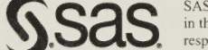

SAS 以及所有其他 SAS Inc. 产品或服务名称均为 SAS Institute Inc. 在美国及其他国家的注册商标或商标。* 美国注册。其他品牌和产品名称为各自公司的商标。版权所有 © 2014 SAS Inc. Cary, NC, USA。保留所有权利。

课程笔记

《SAS® 编程 2：数据处理技术》课程笔记由 Davetta Dunlap、Susan Farmer、Karen Feldman 和 Johnny Johnson 开发。Mark Jordan、Marjorie Lampton、Rob McAfee、Linda Mitterling 和 Kathy Passarella 提供了额外贡献。课程开发与支持部门提供了编辑和制作支持。

SAS 以及所有其他 SAS Institute Inc. 产品或服务名称均为 SAS Institute Inc. 在美国及其他国家的注册商标或商标。® 表示 SAS 注册。其他品牌和产品名称为各自公司的商标。

# 第 4 章 读取原始数据文件................................................4-1

# 第 5 章 数据转换.....................................................5-1

# 第 6 章 调试技术 ................................................................. 6-1

演示：确定逻辑错误 ................................................. 6-8

# 第 7 章 迭代处理数据.................................................. 7-1

7.3 SAS 数组处理...................................................................... 7-30

7.5 答案 ................................................................................ 7-61

# 第 8 章 重构数据集............................................................... 8-1

# 第 9 章 合并 SAS® 数据集 ................................................................ 9-1

# 第 10 章 创建和维护永久格式 ................................ 10-1

# 第 11 章 其他 SAS® 语言 ................................................ 11-1

## 课程描述

本课程适用于需要学习使用 SAS DATA 和过程步进行数据处理技术，以访问、转换和总结 SAS 数据集的读者。本课程基于 SAS® Programming 1: Essentials 课程中介绍的概念，不建议 SAS 软件初学者参加。

## 了解更多...


有关课程大纲中其他课程的信息，请拨打 1-800-333-7660 联系 SAS 教育部门，或发送电子邮件至 training@sas.com。您也可以在网站 http://support.sas.com/training/ 以及培训课程目录中找到这些信息。


有关与本课程笔记主题相关的其他 SAS 书籍列表，美国客户可以拨打 1-800-727-3228 联系 SAS出版部门或发送电子邮件至 sasbook@sas.com。美国以外的客户请联系当地 SAS 办公室。

此外，请访问网站 http://support.sas.com/publishing/ 查看书籍列表。

## 先决条件

在参加本课程之前，您应该具有至少六月的 SAS 程序编写经验，或者完成了 SAS Programming 1: Essentials 课程并使用 SAS 一个月。具体而言，您应该能够：

- 提交 SAS 程序

- 诊断并修正语法错误

- 检查 SAS 数据集的描述和数据部分

- 访问 SAS库

- 读取并创建 SAS数据集

- 读取 Excel 表格

- 读取分隔符原始数据

- 在读取原始数据时检查数据错误

- 使用 SAS 过程验证数据

- 清理无效数据

- 创建变量

- 合并 SAS数据集

- 使用全局语句

- 使用标签和格式（包括自定义格式）

- 筛选观测

- 使用 FREQ 和 MEANS 过程生成摘要报告。

### 第 1 章 引言

#### 1.1 SAS 基础概述

##### 目标

- 描述 SAS软件

- 描述 Base SAS 和 SAS Foundation 工具的功能

##### 什么是 SAS?

SAS 是一套业务解决方案和技术，帮助组织解决业务问题。


##### 你可以用 SAS 做什么？

SAS 允许你执行以下操作：

- 跨多个源访问数据

- 管理数据

- 执行复杂的分析

- 在整个组织范围内传递信息

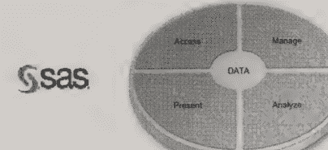

##### 什么是 Base SAS？

Base SAS 是所有 SAS 软件的核心。

Base SAS 是 SAS Foundation 产品集中的产品，它提供了：

- 一种高度灵活、高度扩展的第四代编程语言

- 丰富的封装编程过程库

- 一个用于管理 SAS 任务的图形化用户界面

##### 关于本课程

本课程侧重于使用 DATA Step（数据步）处理数据，包括：

- 创建多个 SAS 数据集

- 累加总和并汇总数据

- 读取固定列原始数据文件

- 使用函数处理变量值

- 执行 DO 循环和 SAS 数组处理

- 旋转数据集

- 合并数据集


# 1.01 投票

你用过 DATA Step 吗？

- a. 是的，仅负责维护程序

- b. 没有，完全没用

#### 1.2 课程安排

##### 目标

- 描述课程中使用的数据。

- 设计工作坊可用的编辑器和处理模式。

- 指定用于文件的命名规范。

- 定义三个级别的练习。

- 讨论如何访问帮助帮助（Help）。

本课程专注于一家拥有传统实体店、在线商店和大型目录的零售商。


##### Orion 数据

大量数据以各种格式存储在事务系统中。

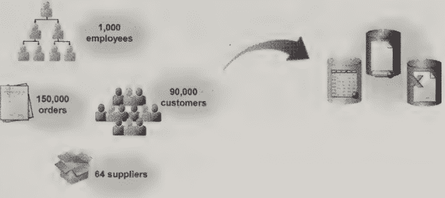

##### 编写和运行 SAS 程序

在本课程中，你将使用编辑器编写并处理访问 Orion 数据以及创建报告的 SAS 程序。

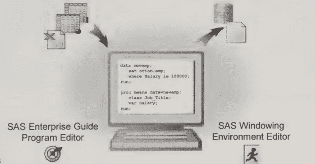

##### SAS Enterprise Guide 程序编辑器 SAS 窗口环境

# 第1章 引言

| SAS Enterprise Guide | SAS 窗口环境 |
| :--- | :--- |
| 编辑器 | 增强编辑器或程序编辑器 |
| 格式 | 自动或手动 |
| 语法帮助 | 上文敏感或基于菜单键 |
| 输出 | SAS 报告或 HTML |
| 项目 | 是或否 |
| 自动完成 | 是或否 |

##### 什么是 SAS Enterprise Guide？

SAS Enterprise Guide 是一个强大的 Windows 客户端应用程序，提供了一个用于透明访问 SAS 功能的图形用户界面 (GUI)。

它提供了：

- 带有向导的点击界面，允许用户定义任务

- 根据用户选择生成并执行 SAS 代码

- 一个完整的编程接口，用于编写、编辑和提交 SAS 代码

本课程将使用该编程接口。

##### 什么是 SAS 窗口环境？


SAS 窗口环境由一系列窗口组成，你可以使用这些窗口编辑和提交程序并查看结果。SAS 窗口环境包含以下窗口：

- 用于准备和提交程序的增强编辑器和程序编辑器窗口

- 用于查看注释（Notes）、警告消息和错误信息的日志窗口

- 输出窗口，包含大多数 SAS 过程生成的输出

# 1.02 多项选择投票

你将使用哪个编辑器来编写 SAS 程序？

- a. SAS Enterprise Guide 程序编辑器

- b. SAS 窗口环境中的程序编辑器

- c. 其他编辑器

- d. 我不知道。

##### 程序命名规范

在本课程中，你将以下结构检索并保存 SAS 程序：

- 1 课程 ID

- 2 章节

- 3 类型 (na=活动, d=演示, e=练习, s=答案)

- 4 项目

- 5 占位符

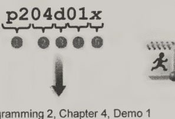

##### 编程 2，第4章，演示 1

##### 定位数据文件

在本课程中，使用宏变量引用来提供更灵活的文件定位方法。

示例：

```
%let path=s:\workshop;
```

```
infile "&path\sales.csv";
```

```
infile "&path\payroll.dat";
```

##### 三个练习级别

课程的设计是让你只完成**一组**练习。请选择最适合你技能的级别。

| 级别 | 描述 |
| :--- | :--- |
| 等级 1 | 提供逐步说明。 |
| 等级 2 | 提供较少的信息和指导。 |
| 挑战 | 提供最少的信息和指导。学生可能需要使用帮助功能。 |

##### 获取帮助

在课堂上，你可以根据使用的编辑器通过以下几种方式获取产品帮助：

- 入门教程

- 软件包含的帮助功能

- 如果可以访问网络，可以使用基于网络的帮助


##### 扩展你的学习

课后，你将可以访问本课程创建的扩展学习页面。该页面包括：

- 课程数据和程序文件

- 课程笔记的 PDF 文件

- 其他课程特定的资源。


此页面在课程期间可能可用。

#### 1.3 课程数据文件

##### 目标

- 运行 SAS 程序创建课程数据文件。

- 运行 SAS 程序定义数据位置。

##### 业务场景

识别课程数据文件的位置并创建数据文件。

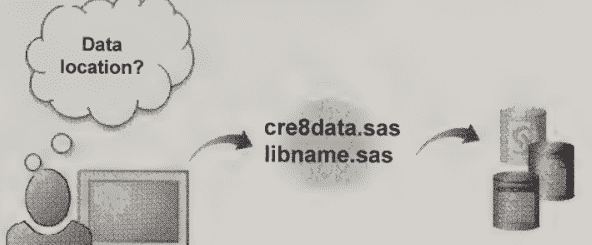

##### 创建课程文件

creata 程序创建课程数据文件。该程序必须在课程开始时运行。

- 打开 libname 程序。LIBNAME 语句以星号开头。这意味着它被注释掉了，SAS 不执行。此时，你只想让 SAS 执行 %LET 语句来告诉它数据所在。

- 注意默认值。如果你的文件要创建在 s:\workshop，则不需要更改。

- 按 F3 提交程序。

- 查看结果并确认输出包含文件列表。

##### 定义数据位置

libname 程序告诉 SAS 寻找课程数据。每次启动新会话时必须运行此程序。

- 1. 注意 %LET 语句的默认值。

- 2. 如果你的文件不在 S:\workshop，请更改 PATH= %LET 语句的值以反映你的数据位置。

```
/* Windows/UNIX */

/* STEP 1: 注意 %LET 语句的默认值。 */
/* STEP 2: 如果你的文件不在 S:\workshop */
/* 修改 PATH= %LET 语句的值以反映 */
/* 你的数据位置。 */
```

##### 必练习

- 1. 创建课程数据

  a. 所有课程数据的默认位置是 s:\workshop。如果你的数据文件要创建在 s:\workshop 以外，你必须为你的课程数据识别一个位置。

      在此处创建文件：C:\Workshop\PR2

  b. 选择 文件 -> 程序。

  c. 导航到数据文件夹，选择 credata 并点击打开。程序显示在编辑器中。

观察 %LET 语句的默认值。

- 如果你的文件要创建在 s:\workshop，则不需要更改。


```sas
/* 或在 SAS 结果查看器中验证 CONTENTS */
/*procedure report 会列出已创建的 SAS 数据集 **/
/*的名称。 */

%let path=s:\workshop;

********************************************************************
/* ：请勿修改此行方的代码 */
********************************************************************
```

- d. 如果你的文件要在 `s:\workshop` 以外的位置创建，请按如下方式更改 `%LET` 语句：

更改赋值给 `PATH=` 的值，以反映 SAS 数据文件的位置。

- 如果你的文件要在 `s:\workshop` 中创建，则无需任何更改。

- b. 按 `F3` 提交程序。

- f. 查看结果窗口并验证输出是否包含一个数据文件列表，类似于下表。

### SAS 系统

### CONTENTS 过程

| 目录 | | |

|---|---|---|

| Libre | ORION | |

| Engine | V9 |

| 物理名称 | `s:\workshop` |

| 文件名 | `s:\workshop` |

| 名称 | 成员类型 | 文件大小 | 最后修改时间 |

|---|---|---|---|

| 1 ACREFORMAT | DATA | 131072 | 05/22/2024 12:12:50 |

| 2 AGES | DATA | 131072 | 05/22/2024 12:12:50 |

| 3 AGES_MOD | DATA | 131072 | 05/22/2024 12:12:50 |

| 4 APRSALES | DATA | 131072 | 05/22/2024 12:12:50 |

| 5 APRSALES2 | DATA | 131072 | 05/22/2024 12:12:50 |

- 2. 定义数据位置

- a. 打开 `libname` 程序。不要更改此程序中的任何内容。

- b. 提交程序。

- c. 查看日志并确认没有错误或警告。

# 第 2 章 控制输入和输出

## 2.1 显式写入观测值

### 目标

- 显式地控制将多个观测值输出到 SAS 数据集中。

### 业务场景

你被要求预测 Orion Star 六个部门在未来两年的增长率。

| 当前员工人数 | 部门 | 总员工人数 | 增长率 |

|---|---|---|---|

| | 行政部 | 34 | 0.25 |

| | 工程部 | 9 | 0.30 |

| | 市场部 | 26 | 0.20 |

| | 销售部 | 201 | 0.30 |

| | 销售管理部 | 11 | 0.10 |


预测两年增长率

| 部门 | 总员工人数 | 增长率 | 年 |

|---|---|---|---|

| 行政部 | 42,500 | 0.25 | 1 |

| 行政部 | 20,125 | 0.25 | 2 |

| 工程部 | 11,700 | 0.30 | 1 |

| 工程部 | 10,350 | 0.30 | 2 |

| 销售管理部 | 27,500 | 0.10 | 1 |

| 销售管理部 | 30,250 | 0.10 | 2 |


# 第 2 章 控制输入和输出

### 调查准备

给定以下代码：

```sas
data forecast;
set orion.growth;
total_employees=total_employees (1+increase);
run;
```

### 多选题

在 `DATA` 步迭代结束时，会发生哪种情况？

a. 初始化 `PDV`

b. 隐式 `OUTPUT` 和隐式 `RETURN`

c. 读取下一个观测值

### 显式输出

显式 `OUTPUT` 语句将程序向量（`PDV`）的内容写入到创建的数据集中。显式 `OUTPUT` 的存在会覆盖隐式输出。

```sas
data forecast;
set orion.growth;
Year=1;
Total_Employees=Total_Employees*(1+Increase);
output;
Year=2;
Total_Employees=Total_Employees*(1+Increase);
output=SAS-data-set-1;
run;
```

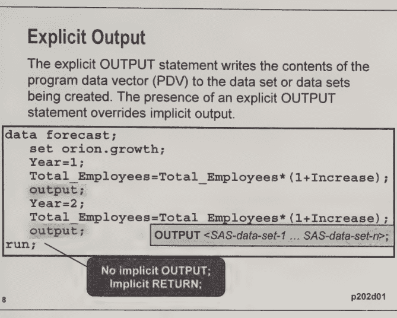

不带参数的显式 `OUTPUT` 语句会将当前观测值写入 `DATA` 语句指定的数据集中。显式 `OUTPUT` 会立即输出，但不会立即返回 `DATA` 步的顶部。

```sas
data forecast;
set orion.growth;
Year=1;
Total_Employees=Total_Employees*(1+Increase);
output;
Year=2;
Total_Employees=Total_Employees*(1+Increase);
output;
run;
```

### PDV - 程序向量

| 部门 | 总员工 | 增长率 |

|---|---|---|

| $ | N | N |

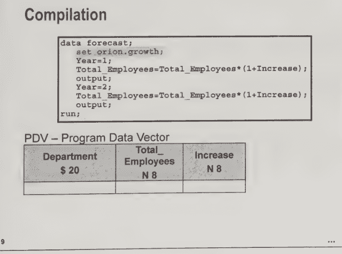

```sas
data forecast;
set orion.growth;
Year=1;
Total_Employees=Total_Employees*(1+Increase);
output;
Year=2;
Total_Employees=Total_Employees*(1+Increase);
output;
run;
```

| 部门 | 总员工 | 增长率 | 年 |

|---|---|---|---|

| $ | N | N | N |

```sas
data forecast;
set orion.growth;
Year=1;
Total_Employees=Total_Employees*(1+Increase);
output;
Year=2;
Total_Employees=Total_Employees*(1+Increase);
output;
run;
```

输出数据集的描述符部分。

| 部门 | 总员工 | 增长率 | 年 |

|---|---|---|---|

| $ | N | N | N |

`work.forecast`

| 部门 | 总员工 | 增长率 | 年 |

|---|---|---|---|

| $ | N | N | N |

### 执行：显式输出

`orion.growth`

| 部门 | 总员工 | 增长率 | |

|---|---|---|---|

| 行政部 | 34 | 0.25 | |

| 工程部 | 9 | 0.30 | |

| SAS | | 0 |

```sas
data forecast;
set orion.growth;
Year=1;
Total_Employees=Total_Employees*(1+Increase);
output;
Year=2;
Total_Employees=Total_Employees*(1+Increase);
output;
run;
```

| 部门 | 总员工 | 增长率 | 年 |

|---|---|---|---|

| $ | N | N | N |

### 执行：显式输出

`orion.growth`

| 部门 | 总员工 | 增长率 | |

|---|---|---|---|

| 行政部 | 34 | 0.25 | |

| 工程部 | 9 | 0.30 | |

| SAS | | 0 |

```sas
data forecast;
set orion.growth;
Year=1;
Total_Employees=Total_Employees*(1+Increase);
output;
Year=2;
Total_Employees=Total_Employees*(1+Increase);
output;
run;
```

| 部门 | 总员工 | 增长率 | 年 |

|---|---|---|---|

| $ | N | N | N |

行政 34 0.25

### 执行：显式输出

| 部门 | 总员工 | 增长率 | |

|---|---|---|---|

| 行政部 | 34 | 0.25 | |

| 工程部 | 9 | 0.30 | |

```sas
data forecast;
set orion.growth;
Year=1;
Total_Employees=Total_Employees*(1+Increase);
output;
Year=2;
Total_Employees=Total_Employees*(1+Increase);
output;
run;
```

| 部门 | 总员工 | 增长率 | 年 |

|---|---|---|---|

| $ | N | N | N |

行政部 34 0.25 1

### 执行：显式输出

| 部门 | 总员工 | 增长率 | |

|---|---|---|---|

| 行政部 | 34 | 0.25 | |

| 工程部 | 9 | 0.30 | |

```sas
data forecast;
set orion.growth;
Year=1;
Total_Employees=Total_Employees*(1+Increase);
output;
Year=2;
Total_Employees=Total_Employees*(1+Increase);
output;
run;
34*(1+0.25);
```

| 部门 | 总员工 | 增长率 | 年 |

|---|---|---|---|

| $ | N | N | N |

| 行政部 | 42.5 | 0.25 | 1

### 执行：显式输出

`orion.growth`

| 部门 | 总员工 | 增长率 | |

|---|---|---|---|

| 行政部 | 34 | 0.25 | |

| 工程部 | 9 | 0.30 | |

| SAS | | 0 |

```sas
data forecast;
set orion.growth;
Year=1;
Total_Employees=Total_Employees*(1+Increase);
output;
Year=2;
Total_Employees=Total_Employees*(1+Increase);
output;
run;
```

| 部门 | 总员工 | 增长率 | 年 |

|---|---|---|---|

| $ | N | N | N |

| 行政部 | 42.5 | 0.25 | 1

### 执行：显式输出

`orion.growth`

| 部门 | 总员工 | 增长率 | |

|---|---|---|---|

| 行政部 | 34 | 0.25 | |

| 工程部 | 9 | 0.30 | |

| SAS | | 0 |

```sas
data forecast;
set orion.growth;
Year=1;
Total_Employees=Total_Employees*(1+Increase);
output;
Year=2;
Total_Employees=Total_Employees*(1+Increase);
output;
run;
```

| 部门 | 总员工 | 增长率 | 年 |

|---|---|---|---|

| $ | N | N | N |

| 行政部 | 42.5 | 0.25 | 2

### 执行：显式输出

`orion.growth`

```sas
data forecast;
set orion.growth;
Year-1;
Total_Employees=Total_Employees*(1+Increase);
output;
Year-2;
Total_Employees=Total_Employees*(1+Increase);
output;
```

42.5* (1 + 0.25)

| Department | Total_Employees | Increase | Year |

|---|---|---|---|

| $ 20 | 8 | 8 | 8 |

| Administration | 53.125 | 0.25 | 2 |

### 执行：显式输出

`orion.growth`

| Department | Total_Employees | Increase | Year |

|---|---|---|---|

| Administration | 34 | 0.25 | | |

| Engineering | 9 | 0.30 | | |

| IS | | | 0 |

```sas
data forecast;
set orion.growth;
Year-1;
Total_Employees=Total_Employees*(1+Increase);
output;
Year-2;
Total_Employees=Total_Employees*(1+Increase);
output;
```

输出当前观测

| Department | Total_Employees | Increase | Year |

|---|---|---|---|

| $ 20 | 8 | 8 | 8 |

| Administration | 53.125 | 0.25 | 2 |

### 执行：显式输出

`orion.growth`

| Department | Total_Employees | Increase | Year |

|---|---|---|---|

| Administration | 34 | 0.25 | |

| Engineering | 9 | 0.30 | |

| IS | | | 0 |

```sas
data forecast;
set orion.growth;
Year1;
Total_Employees=Total_Employees*(1+Increase);
output;
Year2;
Total_Employees=Total_Employees*(1+Increase);
output;
```

| Department | Total_Employees | Increase | Year |

|---|---|---|---|

| $ 20 | 8 | 8 | 8 |

| Administration | 53.125 | 0.25 | 2 |

### 输出：一个预测应用程序

预测数据集在 `DATA` 步第一次迭代后包含两个观测值。

`work.forecast`

| Department | Employees | Increase | Year |

|---|---|---|---|

| Administration | 42.500 | 0.25 | 1 |

| Administration | 53.125 | 0.25 | 2 |

### 投票准备

在 `DATA` 步的第二次迭代之前，程序数据向量（`PDV`）中的变量可能会被重新初始化。

```sas
data forecast;
set orion.growth;
Year=1;
Total_Employees=Total_Employees*(1+Increase);
output;
Year=2;
Total_Employees=Total_Employees*(1+Increase);
output;
run;
```

| Department | Total Employees | Increase | Year |

|---|---|---|---|

| Administration $20 | 53.125 | 0.25 | 8 |

### 2.02 多选题投票

哪些变量被重新初始化了？

- a. `Department`

- b. `Total_Employees`

- c. `Increase`

- d. `Year`

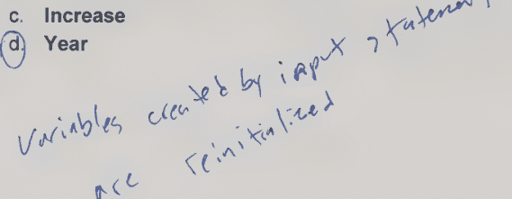

### 执行：显式输出

| Department | Total_Employees | Increase |

|---|---|---|

| Administration | 34 | 0.25 |

| Engineering | 9 | 0.30 |

```sas
data forecast;
set orion.growth;
/* Reinitialize PDV
Year=1;
Total_Employees=Total_Employees*(1+Increase);
output;
Year=2;
Total_Employees=Total_Employees*(1+Increase);
output;
run;
```

`PDV`

| Department | Total_Employees | Increase | Year |

|---|---|---|---|

| $ 20 | 8 | | 8 |

| Administration | 53.125 | 0.25 | |

当程序数据向量被重新初始化时，通过赋值语句创建的变量值将被设置为缺失（missing）。通过 `SET` 语句读取的变量不会被设置为缺失，因为它们在读取下一个观测值时会被覆盖。

### 执行：显式输出

| Department | Total_Employees | Increase |

|---|---|---|

| Administration | 34 | 0.25 |


| Engineering | 9 | 0.30 |

```sas
data forecast;
set orion.growth;
Year=1;
Total_Employees=Total_Employees*(1+Increase);
output;
Year=2;
Total_Employees=Total_Employees*(1+Increase);
output;
run;
```

PDV

| Department | Total_Employees | Increase | Year |

|---|---|---|---|

| $ 20 | 8 | | 8 |

| Engineering | 9 | 0.30 | |

# 2-14 第2章 控制输入与输出

### 执行：显式输出

| Department | Total_Employees | Increase |

|---|---|---|

| Administration | 34 | 0.25 |

| Engineering | 9 | 0.30 |

| IS | | 0 |

```sas
orion.growth
data forecast;
set orion.growth;
/* Continue until EOF
Year1;
Total_Employees=Total_Employees*(1+Increase);
output;
Year2;
Total_Employees=Total_Employees*(1+Increase);
output;
run;
```

| Department | Total_Employees | Increase | Year |

|---|---|---|---|

| $ 20 | 8 | 8 | |

| Engineering | 9 | 0.30 | 1 |

### 检查结果

SAS Log

NOTE: 从数据集 ORION.GROWTH 读取了 6 个观测值。

NOTE: 数据集 WORK_FORECAST 包含 12 个观测值和 4 个变量。

| Department | Total_Employees | Year |

|---|---|---|---|

| Administration | 42,500 | 1 |

| Administration | 53,125 | 2 |

| Engineering | 11,700 | 1 |

| Engineering | 15,210 | 2 |

| IS | 27,500 | 1 |

| IS | 30,250 | 2 |

| Marketing | 24,000 | 1 |

| Marketing | 28,800 | 2 |

### 2.03 简答投票

打开并提交 `p202a`。修改 DATA 步每个部门只写入一个观测值。你是如何修改 DATA 步的？注释掉 year之后的选项。

### 预期结果

| Department | Total Employees | Year |

|---|---|---|

| Administration | 53,125 | 2 |

| Engineering | 15,210 | 2 |

| ID | 30,250 | 2 |

| Marketing | 28,800 | 2 |

| Sales | 39,690 | 2 |

| Sales | 13,310 | 2 |


### 练习

如果你自上次练习后重启了 SAS 会话，请打开并提交文件夹中的 `libname.sas` 程序。

# 11

部分 `orion.prices` (50 个观测值)

| Product_ID | Unit_Price | Factor |

|---|---|---|

| 210201009 | 34.70 | 1.01 |

| 210201017 | 40.00 | 1.01 |

| 210202023 | 19.80 | 1.01 |

| 210206006 | 67.00 | 1.01 |

| 210208085 | 39.40 | 1.01 |

a. 编写一个 DATA 步创建一个预测未来三年价格的新数据集。该数据集包含 `orion.prices` 中每个输入的三个观测值。读取 `orion.prices` 并创建一个名为 `work.price_increase` 的数据集。使用式 OUTPUT 语句使用 `Factor` 作为年度增长率预测未来三年的价格。

# 2-16 第2章 控制输入与输出

b. 打印新数据集。仅包含 `Product_ID`、`Unit_Price` 和 `Year`。验证你的结果。

部分 CORE PRINT (150 个观测值)

| Obs | Product_Id | Unit_Price | Year |

|---|---|---|---|

| 1 | 210201009 | 35.05 | 1 |

| 2 | 210201009 | 35.40 | 2 |

| 3 | 210201009 | 35.75 | 3 |

| 4 | 210201017 | 40.40 | 1 |

| 5 | 210201017 | 40.80 | 2 |

### 级2

`orion.discount` 包含了 Orion 对其产品开展的各种折扣信息。(img/d3bde6e6ab06b1fc622215d982111742_43.png)

部分 `orion.discount`

| Product_Id | Start_Date | End_Date | Discount |

|---|---|---|---|

| 210100027 | 01MAY2011 | 31MAY2011 | 17.99% |

| 210100030 | 01AUG2011 | 31AUG2011 | 32.99% |

| 210100033 | 01AUG2011 | 31AUG2011 | 161.99% |

| 210100034 | 01AUG2011 | 31AUG2011 | 187.99% |

| 210100035 | 01MAY2011 | 31MAY2011 | 172.99% |

a. 由于销售过剩，2011 年 12 月的所有折扣将在 2012 年 7 月收到。2011 年和 2012 年的折扣都称为 Happy Holidays。

- 创建名为 `work_extended` 的数据集，包含来自 `orion.prices` 的三个观测值。
- 使用 WHERE 语句只读取起始日期为 2011 年 12 月的观测值。
- 创建新变量 `Promotion`，其每个观测值的值均为 Happy Holidays。
- 使用显式 OUTPUT 语句写入2011 年 12 月的观测值。
- 指定结束日期为 2012 年 7 月的 2012 年的折扣。
- 对于 7 月的观测值，将 Season 覆盖为 Summer。
- 丢弃 `Unit_Price` 变量。

b. 打印新数据集。

- 添加适当的标题。
- 验证你的结果。

### PROC PRINT (332 个观测值)

| Obs | Product_ID | Start_Date | End_Date | Discount | Promotion | Season |

|---|---|---|---|---|---|

| 1 | 210201007 | 01DEC2011 | 31DEC2011 | 50% | Happy Holidays | Winter |

| 2 | 210201007 | 01JUL2012 | 31JUL2012 | 50% | Happy Holidays | Summer |

| 3 | 210203013 | 01DEC2011 | 31DEC2011 | 50% | Happy Holidays | Winter |

| 4 | 210203013 | 01JUL2012 | 31JUL2012 | 50% | Happy Holidays | Summer |

| 5 | 210203025 | 01DEC2011 | 31DEC2011 | 50% | Happy Holidays | Winter |

### 挑战

### 3. 使用条件逻辑输出多个观测值

`orion.country` 数据集包含国家名称以及各种查找代码。

### orion.country

| Country | Country_Name | Population | Country_ID | Continent_ID | Country_Former Name |

|---|---|---|---|---|---|

| AU | Australia | 20,000 | 160 | 96 | |

| CA | Canada | | 260 | 91 | |

| DE | Germany | 80,000 | 394 | 93 | East/West |

| IL | Israel | | 475 | 95 | |

| TR | Turkey | 70,000 | 905 | 95 | |

| US | United States | 280,000 | 926 | 91 | |

| ZA | South Africa | 43,000 | 801 | 94 | |

# 2-18 第 2 章 控制输入和输出

| | | | | | | |

|---|---|---|---|---|---|---|

| 6 | TR | 土耳其 | 905 | 95 | N |

| 7 | US | 美国 | 926 | 91 | N |

| 8 | ZA | 南非 | 801 | 94 | N |

## 2.2 写入多个 SAS 数据集

### 目标

- 在单个 DATA 步句中创建多个 SAS 数据集。
- 使用条件处理控制观测值写入哪个数据集（或多个数据集）。

### 业务场景

使用输入数据集创建三个新的数据集。

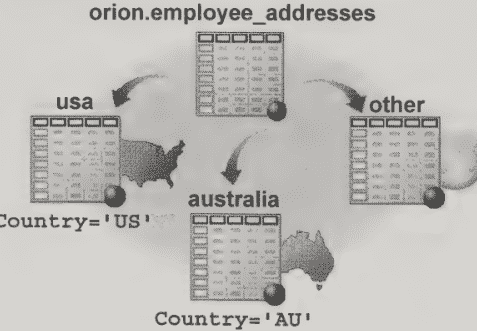

### 浏览输入数据集

```
proc print data=orion.employee addresses;
var EmployeeName City Country;
run;
```

部分 PROC 输出（共计 424 条观测值）

| Obs | Employee_Name | City | Country |

|---|---|---|---|

| 1 | Abbott, Ray | Miami-Dade | US |

| 2 | Aisbitt, Sandy | Melbourne | AU |

| 3 | Akinfarin, Tameaka | Philadelphia | US |

| 4 | Angus, Sally | San Diego | US |

| 5 | Anger, Rose | Philadelphia | US |

| 6 | Ansley, David | Miami-Dade | US |

| 7 | Antoine, Doris | Miami-Dade | US |

| 8 | Apr, Nishan | San Diego | US |

| 9 | Arskdin, Elizabeth | Miami-Dade | US |

| 10 | Area, Avril | Miami-Dade | US |

| 11 | Arizmendi, Gilbert | San Diego | US |

| 12 | Armant, Debra | San Diego | US |

### 创建多个 SAS 数据集

通过在 DATA 语句中列出输出数据集名称，可以在 DATA 步中创建多个数据集。

使用 `usa`, `australia`, 和 `other` 创建新数据集。

```
DATA <SAS-data-set-1 ... SAS-data-set-n>;
```

```
data usa australia;
set orion.employee_addresses;
if Country='AU' then output australia;
else if Country='US' then output usa;
else output other;
run;
```

您可以通过在 OUTPUT 语句中列出数据集名称，将输出重定向到特定的数据集或多个数据集。

OUTPUT 语句中命的数据集必须出现在 data 语句中。

要在单个 OUTPUT 语句中指定多个数据集，请用空格分隔数据集名称。

```
data au us other;
set orion.employee_addresses;
if country ('AU') then output us;
else output other;
run;
```

### 检查 SAS 日志

创建了三个数据集。日志显示 US 是出现频率最高的值。

### 部分 SAS 日志

```
NOTE: There were 424 observations read from the data set
ORION.EMPLOYEE_ADDRESSES.
NOTE: The data set WORK.USA has 311 observations and 9 variables.
NOTE: The data set WORK.AUSTRALIA has 105 observations and 9 variables.
NOTE: The data set WORK.OTHER has 6 observations and 9 variables.
```

### 高效条件处理

按频率递减的顺序检查值效率更高

```
data usa australia other;
set orion.employee addresses;
if Country='US' then output usa;
else if Country='AU' then output australia;
else output other;
run;
```

```
NOTE: There were 424 observations read from the data set
ORION.EMPLOYEE_ADDRESSES.
NOTE: The data set WORK.USA has 311 observations and 9 variables.
NOTE: The data set WORK.AUSTRALIA has 105 observations and 9 variables.
NOTE: The data set WORK.OTHER has 6 observations and 9 variables.
```

### 2.04 简答轮调查

考虑上一个 DATA 步的结果。

是否可以使用单个 PRINT 过程打印所有三个数据集？

### 部分 SAS 日志

```
NOTE: There were 424 observations read from the data set
ORION.EMPLOYEE_ADDRESSES.
NOTE: The data set WORK.USA has 311 observations and 9 variables.
NOTE: The data set WORK.AUSTRALIA has 105 observations and 9 variables.
NOTE: The data set WORK.OTHER has 0 observations and 9 variables.
```

### 显示多个数据集

PRINT 过程只能打印一个数据集。

每个数据集都需要单独的 PROC 步。

```
title 'Employees in the States';
proc print data=usa;
run;
title 'Employees in Australia';
proc print data=australia;
run;
title 'Non US Employees';
proc print data=other;
run;
title;
```

### 创建多个数据集

`p202d3` 演示了多个数据集的创建。

1. 打开 `p202d3` 并提交 DATA 步以创建三个数据集：`usa`, `australia` 和 `other`。检查日志。大多数观测值被写入 `usa` 和 `australia`，而只有少数观测值被写入 `other`。

### 部分 SAS 日志

```
NOTE: There were 424 observations read from the data set
ORION.EMPLOYEE_ADDRESSES.
NOTE: The data set WORK.USA has 311 observations and 9 variables.
NOTE: The data set WORK.AUSTRALIA has 105 observations and 9 variables.
NOTE: The data set WORK.OTHER has 6 observations and 9 variables.
```

2. 使用 SELECT 语句显示多个数据集。提交修改后的程序以处理大小写。`UPCASE` 函数可以处理大小写。

3. 提交 DATA 步来使用 `UPCASE` 函数，将 Country 值转换为大写。

4. 检查日志。哪些观测值被写入了 `other`？

### 在 SELECT 组中使用 DO-END

使用 DO 和 END 语句在表达式为真时执行多条语句。


```sas
data usa other;
  set orion.employee addresses;
  select (uppercase(country));
    when ('US') do;
      Benefits=1;
      output usa;
    end;
    when ('AU') do;
      Benefits=2;
      output australia;
    end;
    otherwise do;
      Benefits=0;
      output other;
    end;
run;
```

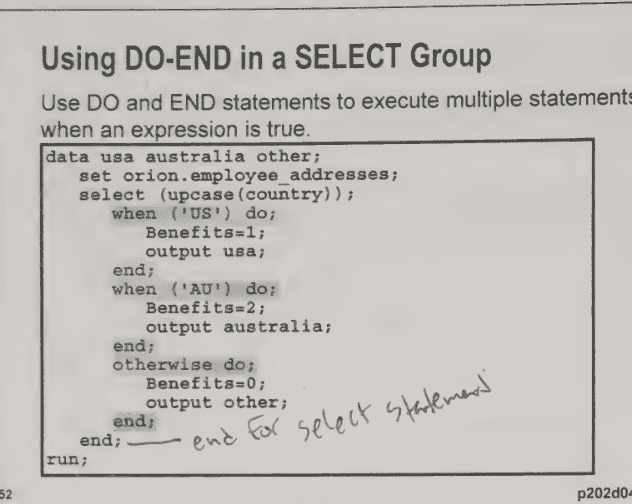

### 省略 Select 表达式

当前示例的此版本省略了 SELECT 表达式。

```sas
data usa australia other;
  set orion.employee addresses;
  select;
    when (country='US') output usa;
    when (country='AU') output australia;
    otherwise output other;
  end;
```

```sas
SELECT;
  WHEN (expression-1)
    statement;
  ..<WHEN (expression-n)
    statement;
  <OVERWISE statement>
END;
```

有关使用 SELECT 组的更多信息，请参考 SAS 文档。

### 练习

如果你自上次练习以来重新启动了 SAS 会话，请打开并提交数据文件夹中找到 `libname.sas` 程序。

# 2.2 写入多个 SAS 数据集 2-27

### 等级 1

### 4. 创建多个 SAS 数据集

数据集 `orion.employee_organization` 包含员工职位、部门和经理的信息。

`orion.employee_organization` 部分数据（共 424 条观测值）

| Employee_ID | Job_Title | Department | Manager_ID |
|---|---|---|--|
| 12101 | Director | Sales Management | 120261 |
| 120102 | Sales Manager | Sales Management | 120101 |
| 120103 | Sales Manager | Sales Management | 120101 |
| 120104 | Administration Manager | Administration | 120101 |
| 120105 | Secretary I | Administration | 120101 |

- a. 为每个部门创建一个单独的数据集。

将数据集命名为 `work.admin`、`work.stock` 和 `work.purchasing`

使用条件逻辑和显式的 OUTPUT 语句，根据 Department 的值是否分别为 Administration、Stock & Shipping 或 Purchasing，将数据写入这些数据集。忽略所有其他 Department 值。

提示：注意 Department 值的字母大小写和拼写。

- b. 打印 `work.admin` 并验证你的结果。添加适当的标题。

`work.admin` 部分数据（共 34 条观测值）

| Obs | Employee_ID | Job_Title | Department | Manager_ID |
|---|---|---|---|--|
| 1 | 120104 | Administration Manager | Administration | 120101 |
| 2 | 120105 | Secretary I | Administration | 120101 |
| 3 | 120106 | Office Assistant II | Administration | 120104 |
| 4 | 120107 | Office Assistant III | Administration | 120104 |
| 5 | 120108 | Warehouse Assistant II | Administration | 120104 |

- c. 打印 `work.stock` 并验证你的结果。添加适当的标题。

`work.stock` 部分数据（共 26 条观测值）

库存与货运员工

| Obs | Employee_ID | Job_Title | Department | Manager_ID |
|---|---|---|---|--|
| 1 | 120670 | Shipping Manager | Stock & Shipping | 120659 |
| 2 | 120671 | Shipping Agent III | Stock & Shipping | 120670 |
| 3 | 120672 | Shipping Manager | Stock & Shipping | 120659 |
| 4 | 120673 | Shipping Agent II | Stock & Shipping | 120672 |
| 5 | 120677 | Shipping Manager | Stock & Shipping | 120659 |

- d. 打印 `work.purchasing` 并验证你的结果。添加适当的标题。

Copyright ©2014, SAS Institute Inc., Cary, North Carolina, USA. 所有权利保留。2-28 输入与输出

`work.purchasing` 部分数据（共 18 条观测值）

| Obs | Employee_ID | Job_Title | Department | Manager_ID |
|---|---|---|---|--|
| 1 | 120728 | Purchasing Agent II | Purchasing | 120735 |
| 2 | 120729 | Purchasing Agent I | Purchasing | 120735 |
| 3 | 120730 | Purchasing Agent I | Purchasing | 120735 |
| 4 | 120731 | Purchasing Agent II | Purchasing | 120735 |
| 5 | 120732 | Purchasing Agent III | Purchasing | 120736 |

### 等级 2

- 5. 创建带有派生值的 SAS 数据集

数据集 `orion.orders` 包含商店订单、目录订单以及交付日期的信息。

`orion.orders` 部分数据（共 490 条观测值）

| Order_ID | Type | Employee_ID | Customer_ID | Order_Date | Delivery_Date |
|---|---|---|---|---|---|
| 120058123 | 1 | 121039 | 63 | 11JAN2007 | 11JAN2007 |
| 120308011 | 2 | 999999 | 5 | 15JAN2007 | 15JAN2007 |
| 120306883 | 2 | 999999 | 45 | 20JAN2007 | 25JAN2007 |
| 120317441 | 1 | 120174 | 41 | 28JAN2007 | 28JAN2007 |
| 120315085 | 1 | 120134 | 183 | 27FEB2007 | 27FEB2007 |

- a. Orion 想研究快速交付和缓慢交付的目录及互联网订单。

- 创建三个命名为 `work.fast`、`work.slow` 和 `work.verslow` 的数据集。

- 写一个 WHERE 语句，读取 Order_Type 等于 2 (catalog) 或 3 (Internet) 的观测值。

- 创建一个变量 ShipDays，表示下单到交付之间的天数。

- 处理输出：

- 当 ShipDays 小于 3 时输出到 `work.fast`。

- 当 ShipDays 在 5 到 7 之间时输出到 `work.slow`。

- 当 ShipDays 大于 7 时输出到 `work.verslow`。

- 当 ShipDays 为 3 或 4 时，不输出观测值。

- 丢弃 Employee_ID。

- `work.fast` 应有 80 条观测值，`work.slow` 应有 69 条观测值，`work.verslow` 应有 5 条观测值。


`orion.orders` 中的 490 条观测值中，由于 WHERE 语句的作用读取了 230 条。

- b. 使用适当的标题打印 `work.verslow` 的结果。

`work.verslow`

Copyright ©2014, SAS Institute Inc., Cary, North Carolina, USA. 所有权利保留。

2-29 2.3 选择变量和观测值

| Obs | Order_ID | Order_Type | Customer_ID | Order_Date | Delivery_Date | Ship Days |
|---|---|---|---|---|---|---|
| 1 | 123105521 | 2 | 16 | 27AUG2007 | 04SEP2007 | 8 |
| 2 | 123648375 | 2 | 70108 | 22JUL2009 | 02AUG2009 | 11 |
| 3 | 123965430 | 3 | 70165 | 08SEP2009 | 18SEP2009 | 10 |
| 4 | 1237165927 | 3 | 79 | 27SEP2009 | 08OCT2009 | 11 |
| 5 | 1241298131 | 2 | 2806 | 29JAN2011 | 08FEB2011 | 10 |

### 挑战

- 6. 使用 SELECT 组

使用 SELECT 逻辑代替 IF-THEN/ELSE 逻辑编写上一个练习的解决方案。参考 SAS 文档探索 SELECT 语句中复合表达式的使用。打印数据集 `work.veryslow`。

### 控制变量输出

任务是从从 `usa` 中删除 `Street_ID` 和 `Country`，从 `australia` 中删除 `Street_ID`、`Country` 和 `State`，并保留其他所有变量。

| ID | Employee_Name | Street_Name | City | State | Postal_Code |
|---|---|---|---|---|--|
| 120104 | Abbott, Roy | 627 | Edwards Mill Rd | FL | 39150 |
| 120769 | Akincluir, Tameka | 5 | Donkey Road | Philadelphia | PA | 19143 |
| 120868 | Cairns, Riley | 50 | California Ct | San Diego | CA | 92101 |

| ID | Employee_Name | Street_Name | City | Postal_Code |
|---|---|---|---|--|
| 120145 | Aliazetti, Sandy | 90 | Bingley Street | Melbourne | 2001 |
| 120508 | Durant, Kevin | 24 | Street Road | Sydney | 2118 |
| 120699 | Baker, Gabriela | 106 | Torak Road | | |

| ID | Employee_Name | Street_ID | Street_Name | City | State | Postal_Code | Country |
|---|---|---|---|---|---|---|--|
| 120318 | Danielle, Scott | 80012167 | Sunderland | Philadelphia | 19150 | us |
| 120697 | Jonathan, Mary | 80012189 | 4623 | Philadelphia | PA | 19152 | us |
| 120747 | Farthing, Zelia | 80012756 | 789 | San Diego | CA | 92118 | us |

### 输出数据集中的 DROP= 选项

```
SAS-data-set(DROP=variable-1 <variable-2 ...variable-n>)
```

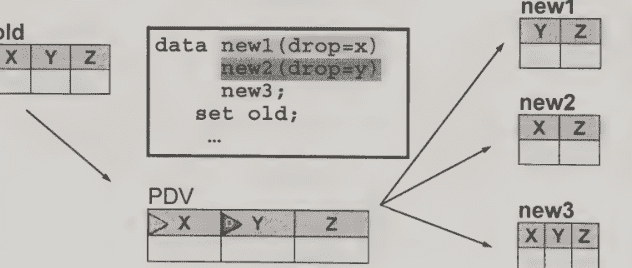

### 使用 DROP= 数据集选项

```sas
data usa(drop=Street_ID Country)
australia(drop=Street_ID State Country)
other;
set orion.employee_addresses;
if Country='US' then output usa;
else if Country='AU' then
  output australia;
else output other;
run;
```

注意: 从数据集 ORION.EMPLOYEE_ADDRESSES. 读取了 424 条观测值。

注意: 数据集 WORK.USA 包含 311 条观测值和 2 个变量。

注意: 数据集 WORK.AUSTRALIA 包含 105 条观测值和 6 个变量。

注意: 数据集 WORK.OTHER 包含 8 条观测值和 9 个变量。


### 输出数据集中的 KEEP= 选项

```
SAS-data-set(KEEP=variable-1 <variable-2 ...variable-n>)
```

new1

| Y | Z |
|---|---|

old data new1(keep=y z)

new2(drop=x z)

new3;

set old;

...

PDV

| X | Y | Z |
|---|---|---|

| X | Y | Z |
|---|---|---|

new2

| X | Y | Z |
|---|---|---|

new3

| X | Y | Z |
|---|---|---|

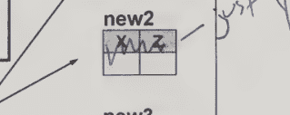

2-34 第 2 章 控制输入和输出

### 使用 DROP= 和 KEEP= 选项

DROP= 和 KEEP= 选项都可以在 SAS 程序中使用。

```sas
data usa (keep=Employee_Name City State)
      australia (drop=Street_ID State)
      other;
      set orion.employee_addresses;
      if Country='US' then output usa;
      else if Country='AU' then output australia;
      else output other;
run;
```

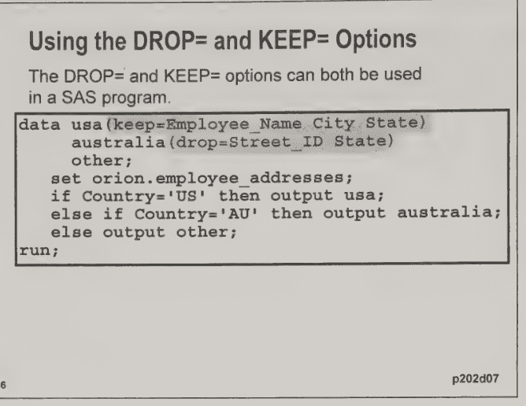

在许多情况下，你可以在 DROP= 或 KEEP= 数据集（或 DROP 或 KEEP= 语句）之间进行选择。通常选择能减少打字量的数据选项或语句即可。

### 2.06 简答调查

数据集 `orion.employee_addresses` 包含九个变量。`usa`、`australia` 和 `other` 数据集中分别有多少个变量？

```sas
data usa (keep=Employee_Name City Country)
      australia (drop=Street_ID State Country)
      other;
      set orion.employee_addresses;
      if Country='US' then output usa;
      else if Country='AU' then output australia;
      else output other;
run;
```

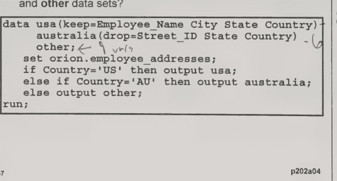

Copyright © 2014, SAS Inc., Cary, North Carolina. 版权所有。

## 2.3 选择变量和观测值

### 在输入数据集中 DROP=

当在输入集中使用 DROP= 数据选项时，指定的变量不会被读入 PDV，因此无法用于处理。

| old | data new1 new2; set old(drop=x); ... |
| X Y Z | | |
| new1 | |
| Y Z | | |
| PDV | |
| Y Z | |
| new2 | |
| Y Z | |

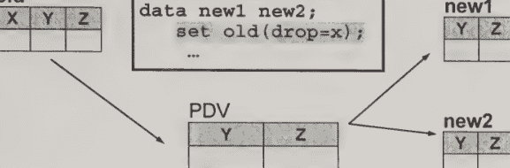

### 在输入数据集中 KEEP=

当使用 KEEP= 数据集选项时，只有指定的变量会被读入 PDV，因此可以用于处理。


| old | data new1 new2; set old(keep=y z); ... |

| X Y Z | | |

| new1 | |

| Y Z | | |

| PDV | |

| Y Z | |

| new2 | |

| Y Z | |

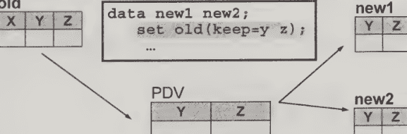

### 2.07 简答调查

打开 `orion.employee_addresses` 文件并提交。意图是从数据集中删除 `Country`、`Street_ID` 和 `Employee_ID`，从 `australia` 中删除 `State`。程序哪里有问题？

```sas
data australia (drop=State)
set orion.employee_addresses
(drop=Country Employee_ID);
if Country='US' then output usa;
else if Country='AU' then output;
```

### 改进方案

使用 `DROP=` 选项和 `DROP` 语句的组合来实现。

```sas
data australia (drop=State)
set orion.employee_addresses
(drop=Country Employee_ID);
drop Employee_ID;
if Country='US' then output usa;
```

| PDV | Country | Employee_Name | Postal_Code | State | Street_Name | Street_ID |

|---|---|---|---|---|---|

| | | | | | |

默认，在 SAS 数据集中使用 `KEEP=` 语句，会处理每一条观测值。

### 检查 SAS 日志

如果在数据集中使用了 `DROP=` 或 `KEEP` 语句，会产生警告。

### 使用 DROP= 数据选项

```sas
data australia (drop=State)
set orion.employee_addresses
(drop=Country Employee_ID);
```

### 控制观测值

`FIRSTOBS=` `OBS=` 选项用于 `INFILE` 语句来读取原始文件。

## 2.4 解决方案

练习解答

- 1. 显式写入观测

```sas
data work.sales;
set orion.employee_organization;
where Department='Sales';
keep Employee_ID Job_Title Manager_ID;
run;
data work.exec;
set orion.employee_organization;
where Department='Executives';
keep Employee_ID Job_Title;
run;
```

- 2. 输出 `work.sales` 中的前六行观测。

```sas
proc print data=work.sales (obs=6);
   title "Sales Employees";
run;
```

- 3. 打印 `work.exec` 中的选定观测。

```sas
proc print data=work.exec (firstobs=2 lastobs=3)
   title "Executives";
run;
```

- 4. 创建变量

```sas
data work.instore;
set orion.orders;
where Order_Type=1;
ShipDays = date(Delivery) - date(Order);
if ShipDays=0 then output;
data work.delivery;
set orion.orders;
where Order_Type=1;
ShipDays = date(Delivery) - date(Order);
if ShipDays>0 then output;
```

- 5. 修改程序读取所有 `order.orders` 数据集。

```sas
data work.delivery;
set orion.orders;
ShipDays = date(Delivery) - date(Order);
if ShipDays>0 then output;
```

- 6. 使用 `PROC FREQ`。

```sas
proc freq data=work.instore;
   table Order_Date,year.;
   title "In-stock Store Purchases, By Year";
run;
```

## 2.4 解决方案

## 2-47

备选解决方案

```sas
data work.admin work.stock work.purchasing;
  set orion.employee organization;
  select (Department);
    when ('Administration') output work.admin;
    when ('Stock & Shipping') output work.stock;
    when ('Purchasing') output work.purchasing;
    otherwise;
  end;
run;
title 'Administration Employees';
proc print data=work.admin;
run;
title;
```

```sas
title 'Stock and Shipping Employees';
proc print data=work.stock;
run;
title;
```

```sas
title 'Purchasing Employees';
proc print data=work.purchasing;
run;
title;
```

- 5. 使用派生值创建多个 SAS 数据集

```sas
data work.fast work.veryslow;
  set orion.orders;
  where Order Type in (2,3);
  /* 这种 WHERE 语句有多种正确的写法 */
  ShipDays=Delivery_Date-Order_Date;
  if ShipDays<3 then output work.fast;
  else if 5<=ShipDays<=7 then output work.slow;
  else if ShipDays>7 then output work.veryslow;
  drop Employee_ID;
run;
```

```sas
title 'Orders taking more than 7 days to deliver';
proc print data=work.veryslow;
run;
title;
```

- 6. 使用 SELECT 组

```sas
data work.fast work.veryslow;
  set orion.orders;
  where Order Type in (2,3);
  /* 这种 WHERE 语句有多种写法写法 */
  ShipDays=Delivery_Date-Order_Date;
  select;
    when (ShipDays<3) output work.fast;
```

```sas
    when (5<=ShipDays<=7) output work.slow;
    when (ShipDays>7) output work.veryslow;
    otherwise;
  end;
  drop Employee_ID;
title 'Orders taking more than 7 days to deliver';
proc print data=work.veryslow;
run;
title;
```

## 7. 规定变量和观测值

```sas
data work.sales (keep=Employee_ID Job_Title Manager_ID)
      work.exec (keep=Employee_ID Job_Title);
  set orion_organization;
  if Department='Sales' then output work.sales;
  else if Department='Executives' then output work.exec;
run;
```

```sas
title 'Sales Employees';
proc print data=work.sales (obs=6);
run;
title;
```

```sas
title 'Executives';
proc print data=work.exec (firstobs=2 obs=3);
run;
title;
```

## 8. 指定变量和观测值

```sas
data work.instore (keep=Order_ID Customer_ID Order_Date)
      work.delivery (keep=Order_ID Customer_ID Order_Date ShipDays);
  set orion.orders (obs=30);
  where Order_Type=1;
  ShipDays=Delivery_Date-Order_Date;
  if ShipDays=0 then output work.instore;
  else if ShipDays>0 then output work.delivery;
run;
```

```sas
data work.instore (keep=Order_ID Customer_ID Order_Date)
      work.delivery (keep=Order_ID Customer_ID Order_Date ShipDays);
  set orion.orders;
  where Order_Type=1;
  ShipDays=Delivery_Date-Order_Date;
  if ShipDays=0 then output work.instore;
  else if ShipDays>0 then output work.delivery;
run;
```

```sas
title 'Deliveries from In-store Purchases';
proc print data=work.delivery;
run;
```

## 2.4 解决方案

```sas
title 'In-stock Store Purchases, By Year';
proc freq data=work.instore;
  tables Order_Data;
  format Order_Date year.;
run;
title;
```

## 学生活动答案（投票/测验）

### 2.01 多项选择投票 – 正确答案

以下哪情况在 DATA 步迭代结束时发生？

- a. 重新初始化 PDV
- b. 隐式 OUTPUT 和隐式 RETURN
- c. 读取下一个观测值

```sas
data forecast;
set orion.growth;
total_employees *= (1+increase);
run;
implicit OUTPUT;
implicit RETURN;
```

默认情况下，每个 DATA 步在每次迭代结束时都会执行隐式 OUTPUT 和隐式 RETURN。

### 2.02 多项选择投票 – 正确答案

哪些变量会被重新初始化？

通过 `INPUT` 和赋值语句创建的变量会被重新初始化。通过 `SET` 语句读取的变量则不会。

### 2.03 短答投票 – 正确答案

修改 DATA 步有多种方法。

以下是其中一种解决方案：

```sas
data forecast;
set Orion.growth;
Year=1;
Total_Employees=Total_Employees*(1+Increase);
Year=2;
Total_Employees=Total_Employees*(1+Increase);
run;
```

### 2.04 短答投票 – 正确答案

考虑上一个 DATA 步的结果。
是否可以使用单个 `PRINT` 过程打印所有三个数据集？

### 部分 SAS 日志

```
NOTE: There were 244 observations in set GROWTH.
NOTE: The dataset WORK.USA has 311 observations.
NOTE: The dataset AUSTRALIA has 105 observations.
NOTE: The dataset OTHER has 9 observations.
```

不，每个数据集需要单独的 `PRINT` 过程。

### 2.05 短答

打开 `p203a01` 文件，查看日志并识别问题。
你添加了什么来修复该问题？

```sas
data forecast;
set orion.growth;
```

```
select;
  when (ShipDays<3) output work.fast;
```

### 2.06 短答投票 – 正确答案

`usa` 包含了 9 个变量。有多少个变量在 `fast`？

```sas
data work.fast work.veryslow;
  set orion.orders;
  where Order Type in (2,3);
  /* 这种 WHERE 语句有多种正确的写法 */
  ShipDays=Delivery_Date-Order_Date;
  select;
    when (ShipDays<3) output work.fast;
```

```sas
    when (5<=ShipDays<=7) output work.slow;
    when (ShipDays>7) output work.veryslow;
    otherwise;
  end;
  drop Employee_ID;

title 'Orders taking more than 7 days to deliver';
proc print data=work.veryslow;
run;
title;
```

### 2.07 短答投票 – 正确答案

`other` 写入了 3787 个 个观测值。

```sas
data work.instore (keep=Order_ID Customer_ID Order_Date)
      work.delivery (keep=Order_ID Customer_ID Order_Date ShipDays);
  set orion.orders (obs=30);
  where Order_Type=1;
  ShipDays=Delivery_Date-Order_Date;
  if ShipDays=0 then output work.instore;
  else if ShipDays>0 then output work.delivery;
run;
```

| City | Country | Employee_Name | Postal_Code | State | Street_Number |

| --- | --- | --- | --- | --- | --- |

| | | | | | |

# 第 3 章

| | | | | | |

## 第 3 章总结

- 3.1 创建累加变量
- 3.2 数据组的累加总量
- 3.3 解决方案
  - 学生活动（投票/测验）

## 3.1 创建累加变量

### 目标

- 解释 SAS 如何初始化 PDV 中变量的值。
- 防止 PDV 中的变量被重新初始化。
- 创建累加变量。

### 场景

经理要求看到四月份的每日销售情况，以及每天的月累计总量。

`orion.aprsales`

| SaleDate | SaleAmt |
|---|---|
| 01APR2011 | 498.49 |
| 02APR2011 | 946.50 |
| 03APR2011 | 594.97 |
| 04APR2011 | 564.59 |
| 05APR2011 | 783.01 |

### 创建累加变量

考虑上一个 DATA 步的结果。

```sas
data forecast;
set orion.growth;
total_employees *= (1+increase);
run;
```

| SaleDate | SaleAmt | Mth2Dte |
|---|---|---|
| 01APR2011 | 498.49 | 498.49 |
| 02APR2011 | 946.50 | 1444.99 |
| 03APR2011 | 594.97 | 2439.96 |
| 04APR2011 | 564.59 | 3004.56 |
| 05APR2011 | 783.01 | 3787.56 |

### 3.01 短答投票

打开并提交 `p203a01` 中的程序。该程序创建了正确的 `Mth2Dte` 值吗？

```sas
data mnthtot;
set orion.aprsales;
Mth2Dte=Mth2Dte+SaleAmt;
run;
```

### 创建累加变量


默认情况下，通过赋值语句创建的变量在每次 DATA 步迭代开始时都会被初始化为缺失值。

```sas
data mnthtot;
set orion.aprsales;
Mth2Dte=Mth2Dte+SaleAmt;
run;
```

### 创建累加变量

保留 `Mth2Dte` 的值并设置初始值。

```sas
data mnthtot;
  set orion.aprsales;
  retain Mth2Dte 0;
  Mth2Dte=Mth2Dte+SaleAmt;
run;
```

`RETAIN` 变量名 `<初始值>`...

如果你不提供初始值，`Mth2Dte` 的所有值都将为缺失（missing）。

### RETAIN 语句：详情

`RETAIN` 语句

- 在 DATA 步的迭代过程中，保留变量在 PDV 中的值
- 在 DATA 步的第一次迭代之前，将被保留的变量初始化为缺失或指定的变量
- 是一个仅在编译时执行的语句。

> `RETAIN` 语句对通过 `SET`、`MERGE` 或 `UPDATE` 语句读取的变量没有影响。从 SAS 数据集读取的变量会被自动保留。

### 编译：创建累加变量

```sas
data mntthot;
set orion.aprsales;
retain Mth2Dte 0;
Mth2Dte=Mth2Dte+SaleAmt;
run;
```

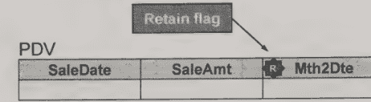

### 执行：创建累加变量

| SaleDate | SaleAmt |
|---|---|
| 18718 | 498.49 |
| 18719 | 946.50 |
| 18720 | 994.97 |
| 18721 | 564.59 |
| 18722 | 783.01 |

```sas
data mntthot;
set orion.aprsales;
retain Mth2Dte 0;
Mth2Dte=Mth2Dte+SaleAmt;
run;
```

| SaleDate | SaleAmt | Mth2Dte |
|---|---|---|
| . | . | 0 输入数据集必须按 `SaleDate` 排序才能产生正确结果。

### 执行：创建累加变量

| SaleDate | SaleAmt | Mth2Dte |
|---|---|---|
| 18718 | 498.49 | |
| 18719 | 946.50 | |
| 18720 | 994.97 | |
| 18721 | 564.59 | |
| 18722 | 783.01 | |

| SaleDate | SaleAmt | Mth2Dte |
|---|---|---|
| 18718 | 498.49 | 0 |

### 执行：创建累加变量

| SaleDate | SaleAmt | Mth2Dte |
|---|---|---|
| 18718 | 498.49 | |
| 18719 | 946.50 | |
| 18720 | 994.97 | |
| 18721 | 564.59 | |
| 18722 | 783.01 | |

| SaleDate | SaleAmt | Mth2Dte |
|---|---|---|
| 18718 | 498.49 | | (img/d3bde6e6ab06b1fc622215d982111742_86_0.png)

| SaleDate | SaleAmt | Mth2Dte |
|---|---|---|
| 18718 | 498.49 | 498.49 |

### 执行：创建累加变量

| SaleDate | SaleAmt | Mth2Dte |
|---|---|---|
| 18718 | 498.49 | |
| 18719 | 946.50 | |
| 18720 | 994.97 | |
| 18721 | 564.59 | |
| 18722 | 783.01 | |

```sas
Implicit OUTPUT;
Implicit RETURN;
```

PDV

| SaleDate | SaleAmt | Mth2Dte |
|---|---|---|
| 18718 | 498.49 | 498.49 | 将观测值写入 `mnthtot`

### 执行：创建累加变量

| SaleDate | SaleAmt | Mth2Dte |
|---|---|---|
| 18718 | 498.49 | |
| 18719 | 946.50 | |
| 18720 | 994.97 | |
| 18721 | 564.59 | |
| 18722 | 783.01 | |

```sas
Mth2Dte is not initialized.
```

PDV

| SaleDate | SaleAmt | Mth2Dte |
|---|---|---|
| 18718 | 498.49 | 498.49 |

## 3.1 创建累加总计变量

### 执行：创建累加变量

| SaleDate | SaleAmt | Mth2Dte |
|---|---|---|
| 18718 | 498.49 | |
| 18719 | 946.50 | |
| 18720 | 994.97 | |
| 18721 | 564.59 | |
| 18722 | 783.01 | |

| PDV | SaleDate | SaleAmt | Mth2Dte |
|---|---|---|---|
| 18719 | 946.50 | 498.49 |

### 执行：创建累加变量

| SaleDate | SaleAmt | mnthtot; |
|---|---|---|
| 18718 | 498.49 | |
| 18719 | 946.50 | |
| 18720 | 994.97 | |
| 18721 | 564.59 | |
| 18722 | 783.01 | |

| PDV | SaleDate | SaleAmt | Mth2Dte |
|---|---|---|---|
| 18719 | 946.50 | 1444.99 |

### 执行：创建累加变量

| SaleDate | SaleAmt |
|---|---|
| 18718 | 498.49 |
| 18719 | 946.50 |
| 18720 | 994.97 |
| 18721 | 564.59 |
| 18722 | 783.01 |

```sas
data mnthtot;
set orion.aprsales;
retain Mth2Dte 0;
Mth2Dte=Mth2Dte+SaleAmt;
run;
```
> 隐式 OUTPUT:隐式 RETURN;

| SaleDate | SaleAmt | Mth2Dte |
|---|---|---|
| 18719 | 946.50 | 1444.99 | 将观测值写入 `mnthtot`

### 执行：创建累加变量

| SaleDate | SaleAmt |
|---|---|
| 18718 | 498.49 |
| 18719 | 946.50 |
| 18720 | 994.97 |
| 18721 | 564.59 |
| 18722 | 783.01 |

```sas
Mth2Dte is not reinitialized. Mth2Dte 未被重新初始化。
```

| SaleDate | SaleAmt | Mth2Dte |
|---|---|---|
| 18719 | 946.50 | 1444.99 |

### 执行：创建累加变量

| SaleDate | SaleAmt |
|---|---|
| 18718 | 498.49 |
| 18719 | 946.50 |
| 18720 | 994.97 |
| 18721 | 564.59 |
| 18722 | 783.01 |

```sas
data mnthtot;
set orion.aprsales;
retain Mth2Dte;
Mth2Dte=Mth2Dte+SaleAmt;
run;
```

| SaleDate | SaleAmt | Mth2Dte |
|---|---|---|
| 18719 | 946.50 | 1444.99 |

### 创建累加变量

```sas
proc print data=mnthtot noobs;
format SaleDate date;
run;
```

部分 PROC 输出

| SaleDate | Amt | Mth2Dte |
|---|---|---|
| 01APR2011 | 498.49 | 498.49 |
| 02APR2011 | 946.50 | 1444.99 |
| 03APR2011 | 994.97 | 2439.96 |
| 04APR2011 | 564.59 | 3004.55 |
| 05APR2011 | 783.01 | 3787.56 |

## 3-12 第 3 章 数据汇总

### 调查设置

如果 `SaleAmt` 有缺失值会发生什么？

打开并提交 `p203a02` 并查看输出。

部分 `orion.Aprsales`

img/d3bde6e6ab06b1fc622215d982111742_91_0.png)

## 3.02 选择

`SaleAmt` 的缺失值对 `Mth2Dte` 有什么影响？

- a 缺失值被忽略；`Mth2Dte` 值不受影响。
- b 缺失值导致 DATA 步停止处理。
- c 缺失值导致后续的 `Mth2Dte` 值被设为缺失。

## 3.1 创建累加总计变量

### 不理想的输出：缺失值

| SaleDate | Amt | Mth2Dte |
|---|---|---|
| 01APR2011 | 498.44 | 498.47 |
| 02APR2011 | | . |
| 03APR2011 | 994.97 | . |
| 04APR2011 | 564.59 | . |
| 05APR2011 | 783.01 | . |

img/d3bde6e6ab06b1fc622215d982111742_92_0.png)

### SUM 函数

`RETAIN` 语句配合赋值语句中的 `SUM` 函数可以创建 `Mth2Dte`。

```sas
data mnthtot;
set orion.aprsales;
retain Mth2Dte 0;
Mth2Dte=sum(Mth2Dte, SaleAmt);
run;
```

> `SUM` 函数忽略值。

## 3-14 第 3 章 数据汇总

# Sum 语句

使用 `sum` 语句创建 `Mth2Dte`。

```sas
data mnthtot2;
set orion.aprsales;
Mth2Dte+=SaleAmt;
run;
```

> `sum` 语句初始化为零并并每个观测值的 `SaleAmt` 自动增加。

# Sum 语句

```sas
proc print data=mnthtot noobs;
run;
```

部分 PROC 输出

| SaleDate | SaleAmt | Mth2Dte |
|---|---|---|
| 01APR2011 | 498.49 | 498.49 |
| 02APR2011 | 946.50 | 1444.99 |
| 03APR2011 | 994.97 | 2439.96 |
| 04APR2011 | 564.59 | 3004.55 |
| 05APR2011 | 783.01 | 3787.56 |

## 3.1 创建累加变量

# 1. 创建累加总计

数据集 `orion.order_fact` 包含一组订单，按 `Order_Date` 排序。`DATA` 步使用 `WHERE` 语句仅读取指定日期范围内的观测值：

- 修改程序以创建一个累加总计 `Sales2Dte`，用于显示到目前的销售额。
- 同时创建一个累加变量 `Num_Orders`，表示每个观测值计一个订单。

```sas
where '01Nov2008'd <= Order_Date <= '14Dec2008'd;
```

部分 PROC PRINT 输出

| Obs | Order_ID | Date | Total_Retail_Price | Sales2Dte | Num Orders |
|---|---|---|---|---|---|
| 1 | 123403037 | 01NOV2008 | $53.70 | $53.70 | 1 |
| 2 | 123409222 | 10NOV2008 | $7.20 | $60.90 | 2 |
| 3 | 123413379 | 17NOV2008 | $328.30 | $389.20 | 3 |
| 4 | 123418633 | 25NOV2008 | $200.10 | $589.30 | 4 |
| 10 | 1234031319 | 1DEC2008 | $105.60 | $1,664.20 | 10 |

## 第3章 数据汇总

`orion.order_fact` 的部分列出（共计 617 条观测值，12 个变量）

| Order_ID | Order_Type | Order_Date | Quantity |
| --- | --- | --- | --- |
| 1230058123 | 1 | 11JAN2007 | 1 |
| 1230080101 | 2 | 15JAN2007 | 1 |
| 1230106863 | 2 | 20JAN2007 | 1 |
| 1230147441 | 1 | 28JAN2007 | 2 |
| 1230315085 | 1 | 27FEB2007 | 3 |

- Orion Star 公司希望通过创建来自零售（retail）、目录（catalog）和互联网（Internet）的项目总数来分析 2009 年的数据。
- * `Order_Type` 的值表示销售类型是零售（=1）、目录（=2）还是互联网（=3）。
- 创建名为 `work.ytotals` 的数据集，其中包含上所述的 `TotalRetail`、`TotalCatalog` 和 `TotalInternet` 的累积总计。

> `Quantity` 变量包含每个订单的项目数量。

- * 为了在这一步中测试你的程序，请仅读取满足 `WHERE` 语句的前 10 条观测值。
- 记住只处理 `Order_Date` 发生在 2009 年的行。
- 通过打印 a 部分的结果继续测试你的程序。打印所有变量，并验证程序正在计算累计总和的值。

### PROC PRINT 输出

| Obs | Customer_ID | Employee_ID | Street_ID | Date | Order_ID | Type | Product_ID |
| --- | --- | --- | --- | --- | --- | --- | --- |
| 1 | 195 | 120150 | 160010663 | 02JAN2009 | 02JAN2009 | 123443760 | 1 | 23010600028 |
| 2 | 36 | 9999999 | 926012823 | 14JAN2009 | 14JAN2009 | 1234534069 | 3 | 24800100026 |
| 3 | 183 | 120121 | 160010760 | 12JAN2009 | 12JAN2009 | 1234537441 | 1 | 24010200001 |
| 4 | 16 | 9999999 | 3940150865 | 14JAN2009 | 14JAN2009 | 1234538390 | 2 | 22020200035 |
| 10 | | 120179 | 1600107680 | 31JAN2009 | 31JAN2009 | 1234727966 | 1 | 24070400004 |
| | TotalRetail_Price | CostPrice_Per_Unit | Total Retail | Total Catalog | Total Internet |
| --- | --- | --- | --- | --- | --- |
| 1 | $193.40 | $48.45 | 2 | 0 | 0 |
| 2 | $525.20 | $58.55 | 2 | 0 | 4 |
| 3 | $16.00 | $6.35 | 3 | 0 | 4 |
| 4 | $115.50 | $48.50 | 3 | 1 | 4 |
| 10 | $13.20 | $5.95 | 2 | 0 | 6 |

当 a 和 b 部分的结果正确时，执行以下操作：

- 修改程序以读取满足 `WHERE` 语句的所有观测值。生成的报告包含 90 条观测值。
- 仅保留 `Order_Date`、`Order_ID`、`TotalRetail` 和 `TotalInternet` 变量。
- 使用适当标题打印你的结果。

## 3.1 创建累计变量

数据集 `orion.order_fact`（617 条观测值，12 个变量）包含按 `Order_Date` 排序的跨年订单组。

| Order_ID | Date | TotalRetail_Price |
| --- | --- | --- |
| 1230058123 | 11JAN2007 | $16.50 |
| 1230080101 | 15JAN2007 | $247.50 |
| 1230106863 | 20JAN2007 | $28.30 |
| 1230147441 | 28JAN2007 | $32.00 |
| 1230315085 | 27FEB2007 | $63.60 |

Orion Star 希望生成以下显示 2011 年所有订单的报告：累计总计在每月开始时重置为零。记住只处理 `Order_Date` 发生在 2011 年的行。PROC PRINT 输出（2011 年每月累计总计）


| `Order_Date` | `Order_ID` | `TotalRetail_Price` | `Month` |
| --- | --- | --- | --- |
| 02JAN2011 | 124105479 | $195.60 | $195.60 |
| 03JAN2011 | 124106379 | $160.80 | $356.40 |
| 04JAN2011 | 124106616 | $306.20 | $662.60 |
| 06JAN2011 | 124108652 | $37.80 | $700.40 |
| 13JAN2011 | 124114761 | $362.60 | $1063.00 |

## 3.2 数据组累计总计

### 目标
- 定义 `First.` 和 `Last.` 处理。
- 计算数据组的累计总量。
- 使用 `subset` 语句输出指定的观测值。

### 业务场景
`Salary` 变量代表分配给项目的员工工资。分析师希望创建一个新的数据集和列表报告，包含每个部门的工资总计。

| `Employee ID` | `Salary` | `Dept` | `DeptSal` |
| --- | --- | --- | --- |
| 11004 | 42000 | HUMRES | ADMIN |
| 11006 | 34000 | ENGINR | FINANC |
| 11011 | 27000 | FINANC | HUMRES |
| 11036 | 20000 | ENGINR | SALES |
| 11037 | 19000 | ENGINR | |

### 3.2 数据组 3-19 总计

#### 需要处理的
| `Dept` | `Salary` | `DeptSal` |
| --- | --- | --- |
| ADMIN | 20000 | |
| ADMIN | 100000 | |
| ADMIN | 50000 | |
| ENGINR | 25000 | |
| ENGINR | 20000 | |
| ENGINR | 23000 | |
| ENGINR | 27000 | |
| FINANC | 10000 | |
| FINANC | 12000 | |

**第 1 步** 按 `Dept` 排序数据。

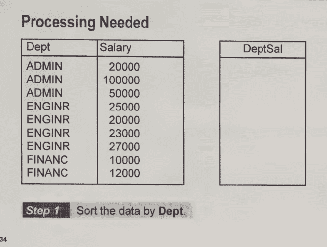

#### 需要处理的
| `Dept` | `Salary` | `DeptSal` |
| --- | --- | --- |
| ADMIN | 20000 | 170000 |
| ADMIN | 100000 | |
| ADMIN | 50000 | |
| ENGINR | 25000 | |
| ENGINR | 20000 | 95000 |
| ENGINR | 23000 | |
| ENGINR | 27000 | |
| FINANC | 10000 | |
| FINANC | 12000 | 22000 |

**第 2 步** 按 `Dept` 汇总。


### BY
`BY` 语句允许数据分组。

```sas
proc sort data=orion;
  by Dept;
run;

data ssort;
  set orion;
  by Dept;
  sum DeptSal;
  if first(Dept) DeptSal = 0;
  if last(Dept) output;
run;
```

`BY` 语句用于输出指定的观测值。

SAS 会提前查看下一个观测值来确定 `Last.Dept` 的值。

# 按分组汇总数据

### 第 1 步 初始化
```sas
data deptsals(keep=Dept DeptSal);
set SalSort;
by Dept;
if First.Dept then DeptSal=0;
<additional SAS statements>
run;
```

> 当 `First.Dept` 的值为 1 时，该条件被视为真。

# 按分组汇总数据

### 第 2 步累加
```sas
data deptsals(keep=Dept DeptSal);
set SalSort;
by Dept;
if First.Dept then DeptSal=0;
DeptSal+Salary;
<additional SAS statements>
run;
```

# 按分组汇总数据

### 第 3 步 输出
| `Dept` | `Salary` | `DeptSal` |
|---|---|---|
| ADMIN | 20000 | 20000 |
| ADMIN | 100000 | 120000 |
| ADMIN | 50000 | 170000 |
| ENGINR | 25000 | 25000 |
| ENGINR | 20000 | 45000 |
| ENGINR | 23000 | 68000 |
| ENGINR | 27000 | 95000 |
| FINANC | 10000 | 10000 |
| FINANC | 12000 | 22000 |

# 按分组汇总数据

### 第 3 步 输出
```sas
data deptsals(keep=Dept DeptSal);
set SalSort;
by Dept;
if First.Dept then DeptSal=0;
DeptSal+Salary;
if Last.Dept; /* 如果 last.dept=1 则输出，
run;
```

子集 `IF` 语句定义了一个观测值必须满足的条件，才能被 `DATA` 步进一步处理。

# 按分组汇总数据
```sas
proc print data=deptsals noobs;
run;
```

`PROC PRINT` 输出

| `Dept` | `DeptSal` |
|---|---|
| ADMIN | 410000 |
| ENGINR | 163000 |
| FINANC | 318000 |
| HUMRES | 181000 |
| SALES | 373000 |

部分 SAS 日志

> NOTE: 从数据集 `WORK.ALSORT` 中读取了 39 个观测值。

NOTE: 数据集 `WORK.DEPTSALS` 包含 5 个观测值和 2 个变量。

# 3.04 多选题
在 `DATA` 步中必须发生什么操作才能按分组汇总数据？（选择所有适用项。）

- a. 对输入数据排序。
- b. 在每个 `BY` 组开始时将累加变量置零。
- c. 增加累加变量。
- d. 输出每个 `BY` 组的最后一个观测值。

# 3.2 组数据的累加总和

### 业务场景
`orion.projsals` 中列出的每个员工都被分配到一个特殊项目。业务分析师希望查看每个特殊项目每个部门的薪资总和。

## 部分 `orion.projsals`
| `Employee ID` | `Salary` | `Proj` | `Dept` |
|---|---|---|---|
| 110004 | 42000 | EZ | HUMRES |
| 110009 | 34000 | WIN | ENGINR |
| 110011 | 27000 | WIN | FINANC |
| 110036 | 20000 | WIN | ENGINR |
| 110037 | 19000 | EZ | ENGINR |
| 110045 | 19000 | EZ | FINANC |
| 110077 | 27000 | CAP1 | ADMIN |
| 110097 | 20000 | EZ | ADMIN |
| 110107 | 31000 | EZ | ENGINR |

## 业务场景：预期输出
创建一个新数据集 `pdsals`，显示每个特殊项目每个部门的员工人数和薪资总和。

## 部分 `pdsals`
| `Proj` | `Dept` | `Sal` | `Num Emps` |
|---|---|---|---|
| CAP1 | ADMIN | 70000 | 2 |
| EZ | HUMRES | 80000 | 3 |
| EZ | ENGINR | 109000 | 4 |
| EZ | FINANC | 122000 | 3 |
| EZ | HUMRES | 178000 | 5 |
| NGEN | ADMIN | 37000 | 2 |

# 按项目和部门排序
这与之前的业务场景类似，但现在数据必须按多个 `BY` 变量：**`Proj`** 和 **`Dept`** 进行排序。

```sas
proc sort data=orion.projsals
out=projsort;
by Proj Dept;
run;
```


# 按项目和部门排序
```sas
proc print data=projsort noobs;
var Proj Dept;
run;
```

部分 `PROC` 输出（总观测数）

| `Proj` | `Dept` | `Salary` |
|---|---|---|
| CAP1 | ADMIN | 27000 |
| CAP1 | ADMIN | 43000 |
| EZ | ADMIN | 20000 |
| EZ | ADMIN | 31000 |
| EZ | ENGINR | 19000 |

# 3.2 组数据的累加总和

### 方案
`DATA` 步必须在 `BY` 语句中同时包含 `Proj` 和 `Dept`。

```sas
data pdsals;
by Proj Dept;
set projsort;
if First.Dept then DeptSal=0;
DeptSal+Salary;
run;
```

当按项目分组时，`DATA` 步发生了什么？


### 第一次迭代的值
| `Proj` | `Dept` | `DeptSal` |
|---|---|---|
| CAP1 | ADMIN | 27000 |
| CAP1 | ADMIN | 43000 |
| EZ | ADMIN | 20000 |
| EZ | ADMIN | 31000 |
| EZ | ENGINR | 19000 |

### 第二次迭代的值
| `Proj` | `Dept` | `DeptSal` |
|---|---|---|
| CAP1 | ADMIN | 27000 |
| CAP1 | ADMIN | 43000 |
| EZ | ADMIN | 20000 |
| EZ | ADMIN | 31000 |
| EZ | ENGINR | 19000 |

### 第三次迭代的值
| `Proj` | `Dept` | `DeptSal` |
|---|---|---|
| CAP1 | ADMIN | 27000 |
| CAP1 | ADMIN | 43000 |
| EZ | ADMIN | 20000 |
| EZ | ADMIN | 31000 |
| EZ | ENGINR | 19000 |

### 第四次迭代的值
| `Proj` | `Dept` | `DeptSal` |
|---|---|---|
| CAP1 | ADMIN | 27000 |
| CAP1 | ADMIN | 43000 |
| EZ | ADMIN | 20000 |
| EZ | ADMIN | 31000 |
| EZ | ENGINR | 19000 |

### 第五次迭代的值
| `Proj` | `Dept` | `DeptSal` |
|---|---|---|
| CAP1 | ADMIN | 27000 |
| CAP1 | ADMIN | 43000 |
| EZ | ADMIN | 20000 |
| EZ | ADMIN | 31000 |
| EZ | ENGINR | 19000 |

## 3-36 第3章 汇总数据
部分 `orion.order_qtrsum` (101 条观测值)

| `Customer_ID` | `Order_Qtr` | `Order_Month` | `Sale_Amt` |
|---|---|---|---|
| 69 | 4 | 10 | 3.2 |
| 70187 | 4 | 11 | 8.2 |
| 10 | 2 | 6 | 12.2 |
| 70079 | 4 | 10 | 14.6 |
| 70165 | 3 | 7 | 16.6 |

该数据集未按 `Customer_ID` 和 `Order_Qtr` 排序。

* 创建一个名为 `work.qtrcustom` 的数据集，根据客户和季度汇总销售情况。
* 变量 `Total Sales`（总销售额）应包含每个 `Customer_ID` 值下每个季度的总销售额。
* 创建一个名为 `Num_Months` 的变量，统计客户在每个季度内有订单的月份数。
* 打印结果。
* 使用 `DOLLAR11.2` 格式显示 `Total_Sales`。
* 添加一个合适的标题。

每个季度的部分 `PROC PRINT` 输出（74 条观测值）

| `Obs` | `Customer_ID` | `Qtr` | `Total_Sales` | `Num_Months` |
|---|---|---|---|---|
| 1 | 5 | 2 | $604.80 | 2 |
| 2 | 5 | 3 | $52.50 | 1 |
| 3 | 5 | 4 | $33.80 | 1 |
| 4 | 10 | 1 | $32.60 | 1 |
| 5 | 10 | 2 | $342.80 | 3 |

## 6. (可选) 汇总数据和条件输出
数据集 `orion.usorders04` 包含一组来自美国客户的订单。

部分 `orion.usorders04` (83 条观测值， 9 个变量)

| `Order_ID` | `Customer_ID` | `Customer_Name` | `Type` | `Total_Retail_Price` |
|---|---|---|---|---|
| 124105477 | 24 | Robyn Klem | 3 | $195.60 |
| 124106379 | 89 | Wynella Lewis | 1 | $160.80 |
| 124128642 | 27 | Cynthia Mcclney | 1 | $174.40 |
| 124135997 | 12 | David Black | 1 | $117.60 |
| 124141856 | 18 | Tonie Asussen | 1 | $29.40 |
| 124162305 | 24 | Robyn Klem | 3 | $46.90 |

* a. Orion Star 希望找出那些通过任何特定销售渠道（零售、目录或互联网）花费 100 美元或以上的客户。
* 创建三个数据集：`work.discount1`、`work.discount2` 和 `work.discount3`。

## 3.2 为一组数据计算累加总量
* `Order_Type` 的值表示销售类型是零售 (=1)、目录 (=2) 还是互联网 (=3)。
* 变量 `Total_Retail_Price` 包含客户在每笔单独订单上花费的金额。
* 创建一个名为 `TotSales` 的变量，用于存储按订单类型划分每个客户的总销售额。
* 根据下表输出到三个数据集的相同位置：

| 客户在...花费了 100 美元或以上 | 输出到... |
|---|---|
| 零售订单 | `work.discount1` |
| 目录订单 | `work.discount2` |
| 互联网订单 | `work.discount3` |

例如，如果某个客户在零售订单中花费了 100 美元以上，在互联网订单中也如此，则可以输出到多个数据集。

* 保留 `Customer_ID`、`Customer_Name` 和 `TotSales` 变量。
* 验证 `work.discount1`、`work.discount2` 和 `work.discount3` 分别有 8、2 和 5 条观测值。
* 打印 `work.discount1` 的结果。
* 使用 `DOLLAR11.2` 格式化 `TotSales`。
* 添加一个合适的标题。部分 `work.discount1`

| 在零售订单中花费 100 美元以上的客户 |
| `Customer_ID` | `Customer_Name` | `TotSales` |
|---|---|---|
| 5 | Sandrina Stefano | $213.10 |
| 10 | Karen Ballinger | $479.09 |
| 12 | David Black | $253.20 |
| 31 | Cynthia Martinez | $1322.30 |
| 45 | Dianne Patchin | $700.28 |

## 7. 识别每组数据的极值
数据集 `orion.customer_dim` 包含关于 Orion Star 客户的信息。

部分 `orion.customer_dim` (77 条观测值，11 个变量)

| `Customer_ID` | `Customer_Name` | `Customer_Type` | `BirthDate` |
|---|---|---|---|
| 4 | James Karn | Orion Club low | 27JUN1978 |
| 5 | Sandrina Stefano | Orion Club medium | 09JUL1983 |
| 9 | Cornelia Kahl | Orion Club medium | 27FEB1978 |
| 10 | Karen Ballinger | Orion members high | 18OCT1988 |


| 11 | Elke Wall | Orion members high | 16AUG1978 |

## 3-38 第3章 汇总数据

使用 `First/Last` 处理创建报告。显示每个 `Customer_Type` 中最大和最小的客户。

* `o_ID` 是最大客户的 `Customer_ID`，`y_ID` 是每个组最小客户的 `Customer_ID`。

* 创建一个名为 `age` 的变量，表示这些最大和最小客户之间的差距。

* 使用 `BirthDate` 而不是 `Age` 来确定年龄，因为这样更准确。部分 PROC PRINT 输出（7 条观测值）每个类型中最大和最小的客户

| Customer_Type | oldest_ID | y_ID | age |
|---|---|---|---|
| Internet/Catalog Customers | 0JUL1973 | 18AUG1973 | 29 |
| Orion Club members high | 28SEP1938 | 24OCT1990 | 89 |
| Orion Club members medium | 20JAN1938 | 16SEP1992 | 70 |
| Orion Gold members high | 16JAN1938 | 25JUL1988 | 50 |
| Club Gold members low | 19DEC1973 | 1JUL1992 | 70 |

获取两个日期之间的年数有多种方法。两种可行的技术是将数除以 `365.25` 或使用 `YEAR` 函数。

## 3.3 答案

### 练习题

#### 1. 创建累加总量

```sas
data work.q4;
set orion.order_fact;
where '01nov2008' <= Order_Date <= '14dec2008';
TotalSales+Total_Price;
Num_Orders+1;
run;
```

```sas
title 'Orders from 01Nov2008 through 14Dec2008';
proc print data=work.q4;
format TotalSales dollar10.2;
var Order_ID Order_Date Total_Price Num_Orders;
run;
title;
```

#### 2. 使用条件逻辑创建累加总量

```sas
data work.totals;
set orion.order_fact (obs=10);
where year (Order_Date)=2009;
/* 有效的等 WHERE 语句 */
if Order_Type=1 then TotalRetail+Quantity;
else if Order_Type=2 then TotalCatalog+Quantity;
else if Order_Type=3 then TotalInternet+Quantity;
run;

proc print data=work.totals;
run;

data work.totpetals;
set orion.order_fact;
where year (Order_Date)=2009;
/* 有效的等 WHERE 语句 */
if Order_Type=1 then TotalRetail+Quantity;
else if Order_Type=2 then TotalCatalog+Quantity;
else if Order_Type=3 then TotalInternet+Quantity;
keep Order_ID Order_Date TotalRetail TotalCatalog TotalInternet;
run;

title '2009 年各类型订单的累加总量';
proc print data=work.totpetals;
run;
title;
```

#### 3. 按月创建累加总量

```sas
data work.monthtotals;
set orion.order_fact;
where year (Order_Date)=2011;
retain rmonth;
if month (Order_Date) ne rmonth then do;
MonthSales=0;
rmon=month(Order_Date);
end;
month+=Total_Price;
keep Order_ID Order_Date MonthSales Total_Price;
run;

title '2011 年按月的累加总量';
proc print data=work.monthtotals;
format MonthSales dollar10.2;
run;
title;
```

#### 4. 使用 DATA 步汇总数据

```sas
proc sort data=orion.order_summary out=work.sumsort;
by Customer_ID;
run;

data work.customers;
set work.sumsort;
by Customer_ID;
if first.Customer_ID then Total_Sales=0;
Total_Sales+Sale_Amt;
keep Customer_ID Total_Sales;
run;
```

```sas
title '每个客户的总销售额';
proc print data=work.customers;
format Total_Sales dollar10.2;
run;
title;
```

#### 5. 使用 DATA 步汇总和分组数据

```sas
proc sort data=orion.qtrsum out=work.custsort
by Customer_ID Order_Qtr;
run;

data work.qtrcustomers;
set work.custsort;
by Customer_ID Order_Qtr;
if first.Order_Qtr=1 then do;
total_Sales=0;
Num_Months=0;
end;
total_Sales+Sale_Amt;
Num_Months+1;
keep Customer_ID Order_Qtr Total_Sales Num_Months;
run;
```

```sas
title '每个客户每个季度的总销售额';
proc print data=work.qtrcustomers;
format Total_Sales dollar10.2;
run;
title;
```

## 3.3 答案 3-41

```sas
title '零售销售额达到 $100 或以上的客户';
proc print data=work.discount1 noobs;
format TotSales dollar11.2;
run;
title;
```

## 7 识别每组数据中的极值

```sas
proc sort data=orion.customer_dim out=work.customers;
  by Customer_Type;
run;

data work.agecheck;
  set work.customers;
  by Customer_ID;
  retain oldest youngest o_ID y_ID;
  if first.Customer_Type=1 then do
    oldest=Customer BirthDate;
    youngest=Customer BirthDate;
    o_ID=Customer_ID;
    y_ID=Customer_ID;
  end;
  if Customer BirthDate < oldest then do
    o_ID=Customer_ID;
    oldest=Customer BirthDate;
  end;
  else if Customer BirthDate > youngest then do
    y_ID=Customer_ID;
    youngest=Customer BirthDate;
  end;
  if last.Customer_Type=1 then do
    age=(youngest-oldest)/365.25;
    output;
  end;
  keep Customer_Type oldest youngest o_ID y_ID ageange;
```

```sas
title '每个客户类型最老和最的客户';
proc print data=work.agecheck noobs;
format youngest date9. ageange 5.1;
ntitle;
```

### 替代方案

```sas
proc sort data=orion.customer_dim out=work.customers;
  by Customer_Type Customer_BirthDate;
run;

data work.agecheck;
  set work.customers;
  by Customer_Type;
  /* 可以缩进而不是使用：by Customer_Type Customer_BirthDate;
     在这个 DATA 步中，任何 BY 语句均有效。 */
  retain oldest youngest o_ID y_ID;
  if first.Customer_Type=1 then do
    o_ID=Customer_ID;
    oldest=Customer_BirthDate;
  end;
  /* 由于已经按 Customer_BirthDate 排序，我们知道
     每个 BY 组中的第一个客户是最老的（具有
     最小的 SAS 生日日期值）。 */
  if last.Customer_Type=1 then do
    y_ID=Customer_ID;
    youngest=Customer_BirthDate;
    agerange=(youngest-oldest)/365.25;
    output;
  end;
  /* 类似的情况：每个 BY 组中的最后一个将是最年轻的。 */
  keep Customer_Type oldest youngest o_ID y_ID agarange;
run;

title '每个客户类型最老和最的客户';
proc print data=work.agecheck noobs;
format oldest youngest date9. agarange 5.1;
run;
title;
```

## 学生活动答案（投票/测验）

### 3.01 简答式问答 – 正确答案

打开并提交 p203a1 中的程序。这会为 MthDte 创建正确的值吗？

```sas
data mnthDte;
  set orion.apales;
  MthDte=MthDte+SaleAmt;
run;
```

部分 orion.apales：

| SaleDate | Sale Amt | MthDte |
|---|---|---|
| 01APR2011 | 49.49 | 49.49 |
| 02APR2011 | 96.50 | 145.99 |
| 03APR2011 | 94.97 | 240.96 |
| 04APR2011 | 56.59 | 297.55 |

不，该程序创建 MthDte 带有缺失值。

### 3.02 多选题投票 – 正确答案

SaleAmt 的缺失值对 MthDte 产生了什么影响？

- a. 缺失值被忽略，MthDte 值不受影响。
- b. 缺失值导致 DATA 步停止。
- c. 缺失值导致 MthDte 的后续值被设置为缺失值。

### 3.03 简答式问答 – 正确答案

当 DATA 步按箭头方向处理观测值时，First.Dept 和 Last.Dept 的值是多少？

| Dept | Salary |
|---|---|
| ADMIN | 20000 |
| ADMIN | 10000 |
| ADMIN | 50000 |
| ENGINR | 25000 |
| FINANC | 10000 |
| FINANC | 12000 |

First.Dept 和 Last.Dept 均为 1。这当一个组仅包含一个观测值时发生。

### 3.04 多选题投票 – 正确答案

在 DATA 步中必须发生什么才能按分组汇总数据？（选择所有适用项。）

- b. 在每个 BY 组开始时将累积变量设置为零。

（注意：选项 a 不适用，因为排序是通过 PROC SORT 完成的，而不是在 DATA 步中。）

### 3.05 简答式问答 – 正确答案

当 DATA 步按箭头方向处理观测值时，First.Proj 和 Last. 变量的值是多少？

| Proj | Dept | First.Proj |
|---|---|---|
| A | ADMIN | |
| A | ADMIN | |
| A | ADMIN | |
| B | ENGINR | |
| C | FINANC | |
| C | FINANC | |

## 4.1 使用格式化输入读取原始数据文件

| 语句 | 说明 |
| --- | --- |
| INFILE 'raw-data-file-name': | INFILE 语句指定要通过 INPUT 语句读取的原始数据文件的物理名称。 |

'*raw-data-file-name'* 是操作系统环境用于访问原始数据文件的物理名称。

示例：

| Windows | infile 's:\workshop\offers.dat'; |
| UNIX | infile '/users/userid/offers.dat'; |
| z/OS (OS/390) | infile 'useridid.workshop.rawdata(offers)'; |

PAD 和 LRECL= 选项对于读取通常在 Windows 和 UNIX 环境中常见的变长度记录非常有用。关于 PAD 和 LRECL= 选项的更多信息，请参阅 SAS 帮助文档。

INPUT 规范；INPUT 语句描述了原始数据文件中值的排列，并将输入值分配给相应的 SAS 变量。

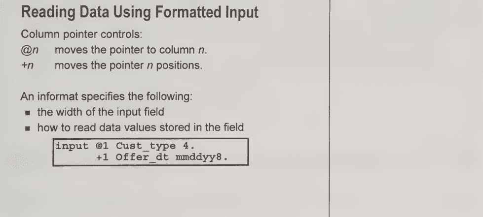

© 2014, SAS Institute Inc., Cary, North Carolina, USA. ALL RIGHTS RESERVED.

## 4-8 第4章 读取原始数据文件

要将指针向后移动 $n$ 个位置，请使用 `+(-n)`。

SAS 格式符的形式如下：

```
$informatat<w>.<d>
```

其中

$ 表示字符格式符。

informat 是 SAS 格式符或用户定义格式符的名称。

w 指定在输入数据中读取的列数。

. 是必需的分隔符。

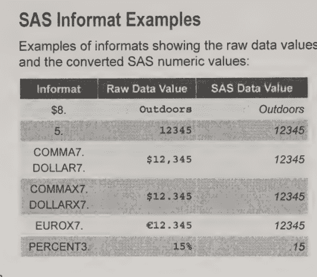

下表给了一些格式符的简要定义。详细信息可以在 SAS OnlineDoc 中找到。

| 格式符 | 定义 |
|---|---|
| $|n| Sw. | 读取标准字符数据。 |
| w.d | 读取标准数值数据。 |
| COMMAw.d DOLLARw.d | 读取非标准数值数据并移除嵌入的逗号、空格、美元符号、百分比符号和连字符。 |
| COMMAw.d DOLLARw.d | 操作类似于 $COMMA.d$ 和 $DOLLARw.d$，但反转了小数点和逗号的角色。这种惯例在许多欧洲国家很常见。 |
| EUROXw.d | 读取非标准数值数据并移除欧洲货币中嵌入的字符。 |

## 4.1 使用格式化输入读取数据文件

| 格式符 | 定义 |
|---|---|
| PERCENT | 操作类似于 COMMA.d，但如果后面跟着百分比符号（%），则将数字除以 100。 |

如果未指定 *d*，则它默认为 0。这意味着 COMMA. 和 COMMA7.0 是等价的。

如果数据包含小数点，SAS 会忽略 *d* 值并读取输入数据中实际存在的小位数。如果数据不包含小数，*d* 指定了要补全的小位数。

DOLLAR.d 是 COMMA.d 的别名，DOLLARX.d 是 COMMAX.d 的别名。

通过 SAS 帮助文档可以获得更多关于 EUROX.d 的信息。

### SAS 日期格式符示例

显示非标准原始数据值和转换后的 SAS 数值的数据格式符示例：

| 格式符 | 原始数据值 | SAS 日期值 |
|---|---|---|
| MDYY6 | 010160 | 0 |
| MMDDYY8 | 01/01/60 | 0 |
| MMDDYY10 | 01/01/1960 | 0 |
| DDMMYY6 | 311260 | 365 |
| DDMMYY8 | 31/12/60 | 365 |
| DDMMYY10 | 31/12/1960 | 365 |
| DATE7 | 31DEC59 | -1 |
| DATE9 | 31DEC1959 | -1 |

ANYDTDTEW 格式符可用于读取具有多种格式的数据。关于 ANYDTDTEW. 的更多信息请参考 SAS 帮助文档。

## 使用格式化输入读取数据

使用格式化输入从 offers.dat 中的原始数据创建一个名为 discounts 的 SAS 数据集。

| 说明 | 列 | 部分 offers.dat |
| --- | --- | --- |
| 客户类型 | 1-4 | 104012/02/11 Outdoors 15% |
| 优惠日期 | 5-12 | 202010/07/11 Golf 7% |
| 项目组 | 14-21 | 103009/22/11 Shoes 10% |


| 折扣 | 22-24 | 103009/22/11 Clothes 10% |

| | | 202007/08/11 Clothes 15% |

| | | 203007/08/11 Clothes 25% |

## 编写 INPUT 规范

识别每个输入的起始位置、变量名和格式符。

```
input @1 Cust_type 4.
```

| 说明 | 列 | 部分 offers.dat |

| --- | --- | --- |

| 客户类型 | 1-4 | 104012/02/11 Outdoors 15% |

| 优惠日期 | 5-12 | 202010/07/11 Golf 7% |

| 项目组 | 14-21 | 103009/22/11 Shoes 10% |

| 折扣 | 22-24 | 103009/22/11 Clothes 10% |

| | | 202007/08/11 Clothes 15% |

| | | 203007/08/11 Clothes 25% |

## 4.3 答案

继续编写 INPUT 语句以读取日期。（提示：使用 MMDYY8 格式符）。

```
input @1 Cust_type 4. @5 off_date mmdd8.
```

| 说明 | 1-4 | 1-5 | 1-2 | 1-5 |

|---|---|---|---|

| 客户类型 | | 104012/02/11 Outdoors 15% | | |

| 优惠日期 | | 202010/07/11 Golf 7% | | |

| 项目组 | | | 103009/22/11 Shoes 10% | | |

| 折扣 | | | | 103009/22/11 Clothes 10% |

| | | | 202007/08/11 Clothes 15% | |

| | | | | 203007/08/11 Clothes 25% |

### 编译：格式化输入

```
data work.discounts;
infile "&path\offers.dat";
input @1 Cust_type 4.
@5 dtyy8.
@14 Item_gp $8.
@22 percent3.;
```

| 1 2 3 4 5 6 7 8 9 0 1 2 3 4 5 6 7 8 9 0 1 2 3 4 5 |

|---|---|---|---|---|---|---|---|---|---|---|---|---|---|---|---|---|---|---|---|---|---|---|---|---|

| Cust_type | Order_dt | Item_gp | Discount |

| N 8 | N 8 | $8 | N 8 |

### 执行：格式化输入

```
data work.discounts;
infile "&path\offers.dat";
input @1 Cust type 4.
@5 dt mmdd8.
@14 gp $8.
@22 percent3.
run;
```

| 输入缓冲区 1 2 3 4 5 6 7 8 9 0 1 2 3 4 5 6 7 8 9 0 1 2 3 4 5 |

| Cust_type | Order_dt | Item_gp | Discount |

| N 8 | N 8 | $8 | N 8 |

### 执行：格式化输入

```
data work.discounts;
infile "&path\offers.dat"; Specify input file
input @1 Cust type 4.
@5 dt mmdd8.
@14 gp $8.
@22 percent3.
run;
```

| 输入缓冲区 1 2 3 4 5 6 7 8 9 0 1 2 3 4 5 6 7 8 9 0 1 2 3 4 5|

| Cust_type | Order_dt | Item_gp | Discount |

| N 8 | N 8 | $8 |

### 执行：格式化输入

```sas
data work.discounts;
infile "&path\offers.dat";
ninput @1 Cust type 4;
@5 Offer_dt mmddy8;
@14 Item_gp $8;
@22 Discount percent3.;
```

重新初始化 PDV

继续直到文件末尾 (EOF)

| 输入缓冲区 | | 2 |

|---|---|---|

| 1 2 3 4 5 6 7 8 9 0 1 2 3 4 5 | | | | |

| 1 4 0 1 2 / 0 2 / 1 1 | | | | |

| | | | | o u t d o o r s 15 % |

| Cust_type | Offer_dt | Item_gp | Discount |

|---|---|---|---|

| N 8 | N 8 | $8 | N 8 |

# 读取折扣优惠文件：输出

```sas
proc print data=work.discounts noobs;
run;
```

部分 PROC PRINT 输出

> SAS期值

| Cust_type | Offer_dt | Item_gp | Discount |

|---|---|---|---|

| 1040 | 18963 | Outdoors | 0.15 |

| 2020 | 18907 | Golf | 0.07 |

| 1030 | 18892 | Shoes | 0.10 |

| 1030 | 18892 | Clothes | 0.10 |

| ... | | | |

| 3010 | 18764 | Clothes | 0.15 |

# 4.1 使用格式化输入读取原始数据文件

# 读取折扣优惠文件：输出

```sas
proc print data=work.discounts noobs;
format Offer_dt date9;
run;
```

# 部分 PROC PRINT 输出

| Cust_type | Offer_dt | Item_gp | Discount |

|---|---|---|---|

| 1040 | 02DEC2011 | Outdoors | 0.15 |

| 2020 | 07OCT2011 | Golf | 0.07 |

| 1030 | 22SEP2011 | Shoes | 0.10 |

| 1030 | 22SEP2011 | Clothes | 0.10 |

| ... | | | |

| 3010 | 17MAY2011 | Clothes | 0.15 |

FORMAT 语句也可以在 DATA 步中使用，将 DATE9. 格式与 Offer_dt 永久关联。

### 练习题

如果你自上次练习以来重启了 SAS 会话，请打开并提交 data 文件夹中的 libname.sas 程序。

# 级别 1

- 原始数据文件 sales1.dat 包含澳大利亚和美国销售人员的员工信息。记录布局如下所示。

sales1.dat 布局

| 字段描述 | 起始列 | 字段长度 | 数据类型 |

|---|---|---|---|

| 员工 ID | 1 | 6 | 数值 |

| 名字 | 8 | 12 | 字符 |

| 姓氏 | 21 | 18 | 字符 |

| 性别 | 40 | 1 | 字符 |

| 职位名称 | 43 | 20 | 字符 |

- a. 创建名为 *sales_staff* 的新 SAS 数据集，包含布局表中用箭头指示的字段。

- b. 打印 *sales_staff* 并添加适当标题。

部分 PROC PRINT 输出（共 165 个观测值） 澳大利亚和美国销售人员

| Employee_ID | Last_Name | Job_Title | Salary | Date |

|---|---|---|---|---|

| 120102 | Zhou | Sales Manager | 108255 | 12205 |

| 120103 | Dawes | Sales Manager | 87975 | 6575 |

| 120121 | Elvish | Sales Rep. II | 26600 | 6575 |

| 120122 | Ngan | Sales Rep. II | 27475 | 8217 |

| 120123 | Hotstone | Sales Rep. I | 26190 | 18901 |

# 级别 2

- 2. 使用格式化输入和子集 IF 语句

原始数据文件 *sales1.dat* 包含澳大利亚和美国销售人员的员工信息。记录布局如下。

*sales1.dat* 布局

| 字段描述 | 起始列 | 字段长度 | 数据类型 |

|---|---|---|---|

| 员工 ID | 1 | 6 | 数值 |

| 名字 | 8 | 12 | 字符 |

| 姓氏 | 21 | 18 | 字符 |

| 性别 | 40 | 1 | 字符 |

| 职位名称 | 43 | 20 | 字符 |

| 工资 | 64 | 8 | 数值 $100,000 |

| 国家 | 73 | 2 | 字符 'AU' 或 'US' |

| 出生日期 | 76 | 10 | 数值 mm/dd/yyyy |

| 入职日期 | 87 | 10 | 数值 mm/dd/yyyy |

- a. 创建名为 *sales_staff* 的新 SAS 数据集，包含布局表中用箭头指示的字段。

- b. 打印 *sales_staff* 并添加适当标题。

- a. 从原始数据文件创建两个 SAS 数据集，并根据国家进行划分。数据集命名为 US_trainees 和 AU_trainees。在本次练习中，实习生是指职位名称为 Sales Rep. I 的任何人。每个数据集都应包含箭头指示的字段。仅将实习生写入 US_trainees 数据集，仅将澳大利亚实习生写入 AU_trainees 数据集。保留 Country 变量。

- b. 打印两个数据集。

AU_trainees 部分（21 个观测值）

| Employee_ID | Last_Name | Job_Title | Salary | Date |

|---|---|---|---|---|

| 10213 | Hotstone | Sales Rep. I | 26190 | 18901 |

| 10214 | Daymond | Sales Rep. I | 27475 | 8217 |

| 10230 | Lyon | Sales Rep. I | 26600 | 6575 |

| 10231 | Suraski | Sales Rep. I | 27475 | 8217 |

| 10236 | Leyden | Sales Rep. I | 26190 | 1891 |

US_trainees 部分（42 个观测值）

| Employee_ID | Last_Name | Job_Title | Salary | Date |

|---|---|---|---|---|

| 10223 | Fuller | Sales Rep. I | 87975 | 6575 |

| 10228 | Smades | Sales Rep. I | 26600 | 6575 |

| 10229 | Celwee | Sales Rep. I | 18963 | 18907 |

| 10230 | Mesley | Sales Rep. I | 108255 | 12205 |

| 10236 | Are | Sales Rep. I | 108255 | 12205 |

### 挑战

- 3. 使用字符串与指针 控制

原始数据文件 seminar.dat 包含了参与者的评分。

- seminar.dat 包含了每一行的参与信息。

- seminar.dat 文件的 15 个字符用于姓名。

- 后面紧跟一个评分。

seminar.dat 的列出

| Name | Rating |

|---|---|

| J. Mitchell | 5 |

| Amy Jung | 4 |

| Carl Heisman | 4 |

| Linda Deal | 3 |

| Gabrielle Heron | 4 |

| Kyle Patterson | 2 |

| | 5 |

- a. 针对 seminar.dat 包含必要信息，创建一个名为 seminar_ratings 的新数据集，包含参与者的姓名和评分。

- b. 打印该数据集并赋予适当标题。

PROC PRINT 输出

| Obs | Name | Rating |

|---|---|---|

| 1 | J. Mitchell | 5 |

| 2 | Amy Jung | 4 |

| 3 | Carl Heisman | 4 |

| 4 | Linda Deal | 3 |

| 5 | Gabrielle Heron | 4 |

| 6 | Kyle Patterson | 2 |

| 7 | | 5 |

## 4.2 控制记录加载

### 业务场景

创建一个包含公司联系信息的 SAS 数据集。

Address.dat 部分

```
1 2
contacts
1=--5--0--5
Ms. Sue Farr
15 Harvey Rd.
Macon, GA 31298
869-7008
```

## 4.2 控制记录加载

| FullName | Address2 | Phone |

|---|---|---|

| Ms. Sue Farr | Macon, GA 31298 | 869-7008 |

| Dr. Kay B. Cox | Kern, CA 93280 | 483-3321 |

| Mr. Ron Mason | Miami, FL 33054 | 569-9030 |

| Ms. C. H. Ruth | Wunger, MI 48747 | 754-3562 |

### 多 INPUT 语句

默认情况下，SAS 在遇到 INPUT 语句时会将新记录加载到输入缓冲区。你可以在一个 DATA 步中使用多个 INPUT 语句。

```sas
data contacts;
infile "&path\address.dat";
input FullName $30;
input;\input Address2 $25;
input Phone $8;
run;
```

加载数据的第一行

部分输入缓冲区 1 2

1 2 3 4 5 6 7 8 9 0

Ms. | Sue | Farr

默认情况下，SAS 从输入缓冲区的第 1 位置开始读取每一行原始数据，因此在 INPUT 语句中使用 @1 是没有必要的。

### 多 INPUT 语句

```sas
data contacts;
infile "&path\address.dat";
input FullName $30;
input;\input Address2 $25;
input Phone $8;
run;
```

| 部分输入缓冲区 |1 |2 |

| 1 2 3 4 5 6 7 8 9 0 |

| 5 | H a r v e y | R d. | | | | | | | |

即使没有列出变量，INPUT 语句仍然会将原始数据行加载到输入缓冲区。

### 多条 INPUT语句

```sas
data contacts;
infile "path\address.dat";
input FullName $30;
input;
input Address2 $25;
input Phone $8;
run;
```

| 部分输入缓冲区 2 | 1 2 3 4 5 6 7 8 9 0 1 2 3 4 5 6 7 8 9 0 |

| :--- | :--- |

| 8 6 9 - 7 0 0 8 | |

# PDV (数据步程序视图)

| FullName | Address2 | Phone |

| :--- | :--- | :--- |

| $ 30 | $ 25 | $ 8 |

| Ms. Sue Farr | Macon, GA 31298 | 869-7008 |

### 多条 INPUT语句

### 部分 SAS 日志

> NOTE: 从输入文件 'address.dat' 中读取了 48 条记录。

最小记录长度为 18。

最大记录长度为 30。

NOTE: 数据集 WORK.CONTACTS 包含 12 个观测值和 3 个变量。

### 多条 INPUT语句

```sas
proc print data=contacts noobs;
run;
```

| FullName | Address2 | Phone |

| :--- | :--- | :--- |

| Ms. Faye Farr | Macon, GA 31298 | 869-7008 |

| Dr. Kay B. Cox | Kern, CA 93280 | 483-3321 |

| Mr. Ron Mason | Miami, FL 33054 | 589-9030 |

| Ms. G. H. Ruth | Munger, MI 48747 | 754-3582 |

### 行指针控制

```sas
data contacts;
infile "path\address.dat";
input FullName $30. /
Address2 $25. /
Phone $8. /;
```

| 部分输入缓冲区 1 | 2 | 1 2 3 4 5 6 7 8 9 0 1 2 3 4 5 6 7 8 9 0 |

| :--- | :--- | :--- |

| Ms. | Sue | Farr | | | | | | | | | | | | | | | | | | | |

当 SAS 遇到斜杠（/）时加载下一条记录。

### 行指针控制


```sas
data contacts;
infile "&path\address.dat";
input FullName $30. /
Address2 $25. /
Phone $8. ; /
run;
```


| 部分输入缓冲区 | 1 | 2 | 1 2 3 4 5 6 7 8 9 0 1 2 3 4 5 6 7 8 9 0 |
| :--- | :--- | :--- |
| 1 5 | H a r v e y R d . | | | | | | | | | | | |

### 行指针控制

```sas
data contacts;
infile "&path\address.dat";
input FullName $30. /
Address2 $25. /
Phone $8. ; /
run;
```


| 部分输入缓冲区 | 1 | 2 | 1 2 3 4 5 6 7 8 9 0 1 2 3 4 5 6 7 8 9 0 |
| :--- | :--- | :--- |
| M a c o n , G A 1 2 9 8 | | | | | | |

### 行指针控制

```sas
data contacts;
infile "&path\address.dat";
input FullName $30. /
Address2 $25. /* /
Phone $8.;
```

加载第四行原始数据

部分输入缓冲区 1 2

1 2 3 4 5 6 7 8 9 0 1 2 3 4 5 6 7 8 9 0

8 6 9 - 7 0 0 8

正斜杠被称为*相对*行指针控制，它将指针移动到其当前所在的行。还有一个*绝对*行指针控制，它将指针移动到一组记录中的某个特定行。这是一个示例：

```sas
data contacts;
infile "&path\address.dat";
input #1 FullName $30. #4 Address2 $25. $8.;
```

关于绝对行指针控制的 SAS 帮助和文档。

# 4.2 控制记录

部分 SAS 日志

> NOTE: 从输入文件 'address.dat' 中读取了 48 条记录。

最小记录长度为 18。

最大记录长度为 30。

NOTE: 数据集 WORK.CONTACTS 包含 12 个观测值和 3 个变量。


### 行指针控制

```sas
proc print data=contacts noobs;
run;
```

部分 PRINT 输出

| FullName | Address2 | Phone |
| :--- | :--- | :--- |
| Ms. Sue Farr | Macon, GA 31298 | 869-7008 |
| Dr. Kay B. Cox | Kern, CA 93280 | 483-3321 |
| Mr. Ron Mason | Miami, FL 33054 | 589-9030 |
| Ms. G. H. Ruth | Munger, MI 48747 | 754-3582 |

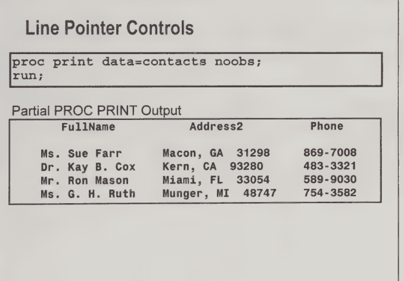

### 行指针控制

### 4.04 简答

使用纸笔写一个 INPUT 语句从原始文件中读取数据。

| 原始数据 | 1 | 1 | 2 | 2 |
| :--- | :--- | :--- | :--- | :--- |
| 10458ine Mt. Sports | 5 | 0 | 0 |
| 02/22/11 | $2,405.50 | | | |
| 00103RFG Textile Inc. | | | | |
| 09/01/11 | $1,095.30 | | | |
| 24221Fifth Wheel Ltd. | $956.70 | | | |
| 行 1 布局 | | |
| :--- | :--- | :--- |
| 描述 | 列 | |
| 供应商代码 | 1-5 | |
| 供应商名称 | 6-25 | |
| 行 2 布局 | | |
| 描述 | 列 | |
| 出货日期 | 1-8 | |
| 金额 | 10-18 | |

- 供应商代码和供应商名称包含字符值。

# 业务场景：读取销售数据

从包含格式相同的相同的原始数据创建一个 SAS 数据。

| sales.dat | | | |
| :--- | :--- | :--- | :--- |
| 101 USA-20-2011 | 3295.50 | | |
| 3034 EUR-30-2011 | 1876.30 | | |
| 101 USA-30-2011 | 2938.00 | | |
| 销售 | 地点 | 日期 |
| :--- | :--- | :--- |
| 101 USA | 3295.50 | 20-2011 |
| 3034 EUR | 1876.30 | 30-2011 |
| 101 USA | 2938.00 | 30-2011 |

- 101 USA | 3295.50 | 20-2011
- 3034 EUR | 1876.30 | 30-2011
- 101 USA | 2938.00 | 30-2011

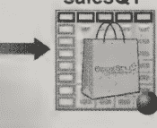

## 4.2 控制记录的加载时机

# 4-33

### 执行情况：第一次尝试

```sas
data salesQL;
infile "&path\sales.dat";
input SaleID $4. @6 Location $3;
if Location='USA' then
    input @10 Date mmddy10.
    @20 Amount 7;
else if Location='EUR' then
    input @10 Date date9.
    @20 Amount commax7.
run;
```

SAS 日志中写入无效数据消息

输入缓冲区

1 2 3 4 5 6 7 8 9 0 1 2 3 4 5 6

30|34   EUR   30|JAN2011   1|876,6|30

PDV

| SaleID | Location | | | Amount |
| :--- | :--- | :--- | :--- | :--- |
| $4 | $3 | N8 | N8 |
| 101 | USA | | | |

### 执行情况：第一次尝试

```sas
data salesQL;
infile "&path\sales.dat";
input SaleID $4. @6 Location $3;
if Location='USA' then
    input @10 Date mmddy10.
    @20 Amount 7;
else if Location='EUR' then
    input @10 Date date9.
    @20 Amount commax7.
run;
```

隐式 OUTPUT：

隐式 RETURN；

输入缓冲区

1 2 3 4 5 6 7 8 9 0 1 2 3 4 5 6

30|34   EUR   30|JAN2011   1|876,6|30

PDV

| SaleID | Location | | | Amount |
| :--- | :--- | :--- | :--- | :--- |
| $4 | $3 | N8 | N8 |
| 101 | USA | | | |

### 执行情况：第一次尝试

```sas
data salesQL;
infile "&path\sales.dat";
input SaleID $4 @6 Location $3; if Location='USA' then
input @10 SaleDate mmddyy10.
@20 Amount 7.; then
else if Location='EUR' then
input @10 SaleDate date9.
@20 Amount commax7;
```

```
持续到 EOF
1 2 3 4 5 6 7 8 9 0 1 2 3 4 5 6 7 8 9 0
30 3 0 4 E U R 3 0 J A N 2 0 1 1 1 8 7 6, 30 0
```

| SaleID | Location | SaleDate | Amount |
| :--- | :--- | :--- | :--- |
| 101 | USA | N8 | N8 |

### 第一次尝试：意外输出

部分 SAS 日志

```sas
NOTE: Invalid data for SaleDate in line 2 10-19.
NOTE: Invalid data for Amount in line 2 20-26.
RULE: ------+1---------+2-------+3---------+4-------+5----
3034 EUR 30JAN2011 1876,30
SaleID=101 Location=USA SaleDate, Amount= _ERROR=1 _N=1
```

NOTE: 从 infile 'sales.dat' 中读取了 6 条记录。

最小记录长度为 26。

最大记录长度为 27。

NOTE: 数据集 WORK.SAL1 有 3 个观测值和 4 个变量。

### 第一次尝试：意外输出

```sas
proc print data=salesQ1 noobs;
run;
```

| Sale ID | Location | Date | Amount |
| :--- | :--- | :--- | :--- |
| 101 | USA | 18663 | 2908.74 |
| 101 | USA | | 27891.00 |
| 1345 | EUR | | |

为了为了获得正确的结果，SAS 需要某种方法来防止第二个 INPUT 语句移动到原始数据的下一行。

### 混合记录类型：正确的程序

末尾的单个 @ 会在输入缓冲区中保留一条原始数据记录，直到 SAS 执行以下操作之一：

- 执行一个不带末尾 @ 的 INPUT 语句
- 开始 DATA step 的下一次迭代

```sas
data salesQ1;
infile "&path\sales.dat";
input SaleID $4. @ Location $3. @;
if Location='USA' then
 input @10 Date mmmddy10.
 @20 Amount 7.;
else if Location='EUR' then
 input @10 Date date9.
 @20 Amount commax7.;
run;
```

通常情况下，DATA step 中的每个 INPUT 语句都会将一条新数据记录读取到输入缓冲区。当你使用末尾 @ 时，会发生以下情况：

- 指针位置不改变。
- 没有新记录被读取到输入缓冲区。
- DATA step 同次迭代的下一个 INPUT 语句将继续读取同一记录，而不是新记录。

### 执行情况：正确的程序

```sas
data salesQL;
infile "&path\sales.dat";
input SaleID $4. @ Location $3. @
 Location='USA' then
    input @10 SaleDate mmddyy10
    @20 Amount $7;
else if Location='EUR' then
    input @10 SaleDate date9.
    @20 Amount commax7;
run;
```

输入缓冲区

1 2 3 4 5 6 7 8 9 0 1 2 3 4 5 6

3 0 1 | U S A | 1 2 - 0 | 2 0 1 | 3 2 9 5 0

PDV

| SaleID | Location | SaleDate | Amount |
| :--- | :--- | :--- | :--- |
| $4 | $3 | N | | N |

### 执行情况：正确的程序

```sas
data salesQL;
infile "&path\sales.dat";
input SaleID $4. @ Location $3. @
if Location='USA' then
    input @10 SaleDate mmddyy10
    @20 Amount $7;
else if Location='EUR' then
    input @10 SaleDate date9.
    @20 Amount commax7;
run;
```

输入

1 2 3 4 5 6 7 8 9 0 1 2 3 4 5 6

3 0 1 | U S A | 1 2 - 0 | 2 0 1 | 3 2 9 5 0

PDV

| SaleID | Location | SaleDate | Amount |
| :--- | :--- | :--- | :--- |
| 101 | USA | | | | | |

### 执行情况：正确的程序

```sas
data salesQ1;
infile "&path\sales.dat";
input SaleID $4. @ Location $3.
if Location='USA' then
    input @100DateDateddyy10.
    @20 Amount $7.;
else if Location='EUR' then
    input @10 Date date9.
    @20 Amount commax7;
run;
```

输入缓冲区

1 2 3 4 5 6 7 8 9 0 1 2 3 4 5 6

3 0 1 | U S A | 1 2 - 0 | 2 0 1 | 3 2 9 5 0

PDV

| SaleID | Location | SaleDate | Amount |
| :--- | :--- | :--- | :--- |
| 101 | USA | | | | |

### 执行情况：正确的程序

```sas
data salesQ1;
infile "&path\sales.dat";
input SaleID $4. @ Location $3. @
if Location='USA' then
    input @10 SaleDate mmddyy10.
    @20 Amount $7.;
else if Location='EUR' then
    input @10 SaleDate date9.
    @20 Amount commax7;
run;
```

输入缓冲区

1 2 3 4 5 6 7 8 9 0 1 2 3 4 5 6

3 0 1 | U S A | 1 2 - 0 | 2 0 1 | 3 2 9 5 0

PDV

| SaleID | Location | SaleDate | Amount |
| :--- | :--- | :--- | :--- |
| 101 | USA | | | | | |

### 执行情况：正确的程序

```sas
data salesQ1;
infile "&path\sales.dat";
input SaleID $4. @ Location $3. @
if Location='USA' then
    input @10 SaleDate mmddyy10.
    @20 Amount $7.;
else if Location='EUR' then
    input @10 SaleDate date9.
    @20 Amount commax7;
run;
```

输入缓冲区

1 2 3 4 5 6 7 8 9 0 1 2 3 4 5 6

3 0 1 | U S A | 1 2 - 0 | 2 0 1 | 3 2 9 5 0

PDV

| SaleID | Location | SaleDate | Amount |
| :--- | :--- | :--- | :--- |
| 101 | USA | | | | | |

### 执行情况：正确的程序

```sas
data salesQ1;
infile "&path\sales.dat";
input SaleID $4. @ Location $3. @
if Location='USA' then
    input @10 SaleDate mmddyy10.
    @20 Amount $7.;
else if Location='EUR' then
    input @10 SaleDate date9.
    @20 Amount commax7;
run;
```

输入缓冲区

1 2 3 4 5 6 7 8 9 0 1 2 3 4 5 6

3 0 1 | U S A | 1 2 - 0 | 2 0 1 | 3 2 9 5 0

PDV

| SaleID | Location | SaleDate | Amount |
| :--- | :--- | :--- | :--- |
| 101 | USA | | | | | |

### 执行情况：正确的程序


```sas
data salesQ1;
infile "&path\sales.dat";
input SaleID $4. @ Location $3. @
if Location='USA' then
    input @10 SaleDate mmddyy10.
    @20 Amount $7.;
else if Location='EUR' then
    input @10 SaleDate date9.
    @20 Amount commax7;
run;
```

输入缓冲区

1 2 3 4 5 6 7 8 9 0 1 2 3 4 5 6 7 8 9 0 1 2 3 4 5 6

3 0 1 | U S A | 1 2 - 0 | 2 0 1 | 3 2 9 5 0

PDV

| SaleID | Location | SaleDate | Amount |
| :--- | :--- | :--- | :--- |
| 101 | USA | | | | | |

### 执行情况：正确的程序

```sas
data salesQ1;
infile "&path\sales.dat";
input SaleID $4. @ Location $3. @
if Location='USA' then
    input @10 SaleDate mmddyy10.
    @20 Amount $7.;
else if Location='EUR' then
    input @10 SaleDate date9.
    @20 Amount commax7;
run;
```

输入缓冲区

1 2 3 4 5 6 7 8 9 0 1 2 3 4 5 6 7 8 9 0 1 2 3 4 5 6

3 0 1 | U S A | 1 2 - 0 | 2 0 1 | 3 2 9 5 0

PDV

| SaleID | Location | SaleDate | Amount |
| :--- | :--- | :--- | :--- |
| 101 | USA | | | | | |

### 执行情况：正确的程序

```sas
data salesQ1;
infile "&path\sales.dat";
input SaleID $4. @ Location $3. @
if Location='USA' then
    input @10 SaleDate mmddyy10.
    @20 Amount $7.;
else if Location='EUR' then
    input @10 SaleDate date9.
    @20 Amount commax7;
run;
```

输入缓冲区

1 2 3 4 5 6 7 8 9 0 1 2 3 4 5 6 7 8 9 0 1 2 3 4 5 6

3 0 1 | U S A | 1 2 - 0 | 2 0 1 | 3 2 9 5 0

PDV

| SaleID | Location | SaleDate | Amount |
| :--- | :--- | :--- | :--- |
| 101 | USA | | | | | |

### 执行情况：正确的程序

```sas
data salesQ1;
infile "&path\sales.dat";
input SaleID $4. @ Location $3. @
if Location='USA' then
    input @10 SaleDate mmddyy10.
    @20 Amount $7.;
else if Location='EUR' then
    input @10 SaleDate date9.
    @20 Amount commax7;
run;
```

输入缓冲区

1 2 3 4 5 6 7 8 9 0 1 2 3 4 5 6 7 8 9 0 1 2 3 4 5 6

3 0 1 | U S A | 1 2 - 0 | 2 0 1 | 3 2 9 5 0

PDV | SaleID | Location | SaleDate | Amount |

| :--- | :--- | :--- | :--- |

| 101 | USA | | | | | | |

### 执行情况：正确的程序

```sas
data salesQ1;
infile "&path\sales.dat";
input SaleID $4. @ Location $3. @
if Location='USA' then
    input @10 SaleDate mmddyy10.
    @20 Amount $7.;
else if Location='EUR' then
    input @10 SaleDate date9.
    @20 Amount commax7;
run;
```

输入缓冲区

1 2 3 4 5 6 7 8 9 0 1 2 3 4 5 6 7 8 9 0 1 2 3 4 5 6

3 0 1 | U S A | 1 2 - 0 | 2 0 1 | 3 2 9 5 0

PDV | SaleID | Location | SaleDate | Amount |

| :--- | :--- | :--- | :--- |

| 101 | USA | | | | | | |

### 执行情况：正确的程序

```sas
data salesQ1;
infile "&path\sales.dat";
input SaleID $4. @ Location $3. @
if Location='USA' then
    input @10 SaleDate mmddyy10.
    @20 Amount $7.;
else if Location='EUR' then
    input @10 SaleDate date9.
    @20 Amount commax7;
run;
```

输入缓冲区

1 2 3 4 5 6 7 8 9 0 1 2 3 4 5 6 7 8 9 0 1 2 3 4 5 6

3 0 1 | U S A | 1 2 - 0 | 2 0 1 | 3 2 9 5 0

PDV | SaleID | Location | SaleDate | Amount |

| :--- | :--- | :--- | :--- |

| 101 | USA | | | | | | |

### 执行情况：正确的程序

```sas
data salesQ1;
infile "&path\sales.dat";
input SaleID $4. @ Location $3. @
if Location='USA' then
    input @10 SaleDate mmddyy10.
    @20 Amount $7.;
else if Location='EUR' then
    input @10 SaleDate date9.
    @20 Amount commax7;
run;
```

输入缓冲区

1 2 3 4 5 6 7 8 9 0 1 2 3 4 5 6 7 8 9 0 1 2 3 4 5 6

3 0 1 | U S A | 1 2 - 0 | 2 0 1 | 3 2 9 5 0

PDV | SaleID | Location | SaleDate | Amount |

| :--- | :--- | :--- | :--- |

| 101 | USA | | | | | | |

### 执行情况：正确的程序

```sas
data salesQ1;
infile "&path\sales.dat";
input SaleID $4. @ Location $3. @
if Location='USA' then
    input @10 SaleDate mmddyy10.
    @20 Amount $7.;
else if Location='EUR' then
    input @10 SaleDate date9.
    @20 Amount commax7;
run;
```

输入缓冲区

1 2 3 4 5 6 7 8 9 0 1 2 3 4 5 6 7 8 9 0 1 2 3 4 5 6

3 0 1 | U S A | 1 2 - 0 | 2 0 1 | 3 2 9 5 0

PDV | SaleID | Location | SaleDate | Amount |

| :--- | :--- | :--- | :--- |

| 101 | USA | | | | | | |

### 执行情况：正确的程序

```sas
data salesQ1;
infile "&path\sales.dat";
input SaleID $4. @ Location $3. @
if Location='USA' then
    input @10 SaleDate mmddyy10.
    @20 Amount $7.;
else if Location='EUR' then
    input @10 SaleDate date9.
    @20 Amount commax7;
run;
```

输入缓冲区

1 2 3 4 5 6 7 8 9 0 1 2 3 4 5 6 7 8 9 0 1 2 3 4 5 6

3 0 1 | U S A | 1 2 - 0 | 2 0 1 | 3 2 9 5 0

PDV | SaleID | Location | SaleDate | Amount |

| :--- | :--- | :--- | :--- |

| 101 | USA | | | | | | |

### 执行情况：正确的程序

```sas
data salesQ1;
infile "&path\sales.dat";
input SaleID $4. @ Location $3. @
if Location='USA' then
    input @10 SaleDate mmddyy10.
    @20 Amount $7.;
else if Location='EUR' then
    input @10 SaleDate date9.
    @20 Amount commax7;
run;
```

> 未读取 INPUT 语句

输入缓冲区

1 2 3 4 5 6 7 8 9 0 1 2 3 4 5 6 7 8 9 0 1 2 3 4 5 6

3 0 1 | U S A | 1 2 - 0 | 2 0 1 | 3 2 9 5 0

PDV | SaleID | Location | SaleDate | Amount |

| :--- | :--- | :--- | :--- |

| 101 | USA | | | | | | |

### 执行情况：正确的程序

2.50

| SaleID | Location | SaleDate | Amount |
| :--- | :--- | :--- | :--- |
| 101 | USA | | | | | |

### 执行情况：正确的程序

| 101 | USA | | | | | | |

### 执行情况：正确的程序

```sas
data salesQ1;
infile "&path\sales.dat";
input SaleID $4. @ Location $3. @
if Location='USA' then
    input @10 SaleDate mmddyy10.
    @20 Amount $7.;
else if Location='EUR' then
    input @10 SaleDate date9.
    @20 Amount commax7;
run;
```

输入缓冲区

1 2 3 4 5 6 7 8 9 0 1 2 3 4 5 6 7 8 9 0 1 2 3 4 5 6

3 0 1 | U S A | 1 2 - 0 | 2 0 1 | 3 2 9 5 0

PDV | SaleID | Location | SaleDate | Amount |

| :--- | :--- | :--- | :--- |

| 101 | USA | | | | | | |

### 执行情况：正确的程序

```sas
data salesQ1;
infile "&path\sales.dat";
input SaleID $4. @ Location $3. @
if Location='USA' then
    input @10 SaleDate mmddyy10.
    @20 Amount $7.;
else if Location='EUR' then
    input @10 SaleDate date9.
    @20 Amount commax7;
run;
```

## 4.05 短答调查

这个子集 IF 语句的最佳位置在哪里？

```sas
data EuropeQ1;
infile "path\sales.dat";
input SaleID $4. @6 Location $3. @
if Location='USA' then
    input @10 SaleDate mmddyy10.
    @20 Amount 7;
else if Location='EUR' then
    input @10 SaleDate date9.
    @20 Amount commax7;
if Location = 'EUR';
run;
```

### 4.2 控制记录的加载时

### 子集 IF 语句的位置

通常，放置子集语句的最有效位置是在评估条件所需的所有变量都已赋值后立即放置。

```sas
data EuropeQ;
infile "path\sales.dat";
input @6 Location $3. @;
if Location = 'EUR';
input @1 SaleID $4.
@10 SaleDate date9.
@20 Amount commax7;
run;
```


SAS 在 DATA 步的下次迭代开始时释放由尾随 @ 保持的记录。

### 混合记录类型的子集：输出

```sas
proc print data=EuropeQ1 noobs;
var SaleID Location SaleDate Amount;
run;
```

### PROC PRINT 输出

| 销售 ID | 位置 | 日期 | 金额 |
|---|---|---|---|
| 3034 | EUR | 18657 | 1876.3 |
| 1345 | EUR | 18664 | 3145.6 |

### 练习

如果你自上次练习以来重新启动了 SAS 会话，请打开并提交位于数据文件夹中的 libname.sas 程序。

### 等级 1

#### 4. 每个观测值读取多条输入记录

- 原始数据文件 `sales2.dat` 包含澳大利亚和美国销售人员的员工信息。
- 每个员工的信息位于三行原始数据中。
- 记录布局所示。

| 第 1 行布局 |
|---|---|---|---|
| 字段描述 | 起始列 | 字段长度 | 数据类型 |
| 员工 ID | 1 | 6 | 数值 |
| 名字 | 8 | 12 | 字符 |
| 姓 | 21 | 18 | 字符 |

| 第 2 行布局 |
|---|---|---|---|
| 字段描述 | 起始列 | 字段长度 | 数据类型 |
| 职位名称 | 1 | 20 | 字符 |
| 入职日期 | 22 | 10 | 数值 mm/dd/yyyy |
| 薪水 | 33 | 8 | 数值，例如，$100,000 |

| 第 3 行布局 |
|---|---|---|---|
| 字段描述 | 起始列 | 字段长度 | 数据类型 |
| 性别 | 1 | 1 | 字符 |
| 出生日期 | 3 | 10 | 数值 mm/dd/yyyy |
| 国家 | 14 | 2 | 字符 |

- a. 创建一个名为 `sales_staff2` 的新 SAS 数据集，其中包含布局表中箭头所示的字段。
- b. 打印 `sales_staff2` 并添加适当标题。

### 4.2 控制记录的加载时

### 部分 PROC PRINT 输出（共计 165 个观测值）

#### 澳大利亚和美国销售人员

| Employee_ID | Last_Name | Job_Title | Hire_Date | Salary |
|---|---|---|---|---|
| 120102 | Zhou | Sales Manager | 12205 | 108255 |
| 120103 | Dawes | Sales Manager | 6575 | 87975 |
| 120121 | Elvish | Sales Rep. II | 6575 | 26600 |
| 120122 | Ngan | Sales Rep. II | 8217 | 27475 |
| 120123 | Hotstone | Sales Rep. I | 18901 | 26190 |

### 等级 2

### 5. 处理混合记录类型

- 原始数据文件 `sales.dat` 包含澳大利亚和美国销售人员的员工信息。
- 每个员工的信息位于两行原始数据中。
- 记录布局所示。

第 1 行布局

| 字段描述 | 起始列 | 字段长度 | 数据类型 |
|---|---|---|---|
| 员工 ID | 1 | 6 | 数值 |
| 名字 | 8 | 12 | 字符 |
| 姓 | 21 | 18 | 字符 |
| 性别 | 40 | 1 | 字符 |
| 职位名称 | 43 | 20 | 字符 |

澳大利亚员工的第 2 行布局

| 字段描述 | 起始列 | 字段长度 | 数据类型 |
|---|---|---|---|
| 薪水 | 1 | 8 | 数值 $100,000 |
| 国家 | 10 | 2 | 字符 |


| 出生日期 | 13 | 10 | 数值 dd/mm/yyyy |

| 入职日期 | 24 | 10 | 数值 dd/mm/yyyy |

### 美国员工的第 2 行布局

| 字段描述 | 起始列 | 字段长度 | 数据类型 |

|---|---|---|---|

| 薪水 | 1 | 8 | 数值 $100,000 |

| 国家 | 10 | 2 | 字符 |

| 出生日期 | 13 | 10 | 数值 mm/dd/yyyy |

| 入职日期 | 24 | 10 | 数值 mm/dd/yyyy |

- 创建两个新 SAS 数据集 `US_sales` 和 `AU_sales`，其中包含布局表中箭头所示的字段。仅将美国员工写入 `US_sales` 数据集，仅将澳大利亚员工写入 `AU_sales` 数据集。不要在输出数据集中包含 `Country` 变量。

> 澳大利亚和美国员工的薪水和入职日期不同。请确保在每个 `INPUT` 语句中使用正确的格式（informs）。

- 使用适当的标题打印两个数据集。

#### 部分工作。`AU_sales`（共计 63 个观测值）

| 员工 ID | Last_Name | Job_Title | 薪水 | 入职日期 |

|---|---|---|---|---|

| 120102 | Zhou | Sales Manager | 108255 | 12205 |

| 120103 | Dawes | Sales Manager | 87975 | 6575 |

| 120121 | Elvish | Sales Rep. II | 26600 | 6575 |

| 120122 | Ngan | Sales Rep. II | 27475 | 8217 |

| 120123 | Hotstone | Sales Rep. I | 26190 | 18901 |

| 120124 | Daymond | Sales Rep. I | 26480 | 16867 |

| 120125 | Hofmeister | Sales Rep. IV | 32040 | 8460 |

#### 部分工作。`US_sales`（共计 102 个观测值）

| 员工 ID | Last_Name | Job_Title | 薪水 | 入职日期 |

|---|---|---|---|---|

| 120261 | Highpoint | Chief Sales Officer | 243190 | 11535 |

| 120188 | Magolan | Sales Rep. II | 27560 | 6575 |

| 120199 | Desantis | Sales Rep. IV | 31320 | 17684 |

| 120120 | Ridley | Sales Rep. IV | 31320 | 17684 |

| 120121 | Farren | Sales Rep. IV | 31320 | 17684 |

| 120122 | Stevens | Sales Rep. IV | 31320 | 17684 |

| 120123 | Fuller | Sales Rep. I | 26190 | 18901 |

| 120124 | West | Sales Rep. I | 26480 | 16867 |

####练习答案

#### 4. 每个观测值读取多条输入记录

- 原始数据文件 `sales2.dat` 包含澳大利亚和美国销售人员的员工信息。

- 每个员工的信息位于三行原始数据中。

- 记录布局所示。

| 第 1 行布局 |

| 字段描述 | 起始列 | 字段长度 | 数据类型 |

|---|---|---|---|

| 员工 ID | 1 | 6 | 数值 |

| 名字 | 8 | 12 | 字符 |

| 姓 | 21 | 18 | 字符 |

| 第 2 行布局 |

| 字段描述 | 起始列 | 字段长度 | 数据类型 |

|---|---|---|---|

| 职位名称 | 1 | 20 | 字符 |

| 入职日期 | 22 | 10 | 数值 mm/dd/yyyy |

| 薪水 | 33 | 8 | 数值，例如，$100,000 |

| 第 3 行布局 |

| 字段描述 | 起始列 | 字段长度 | 数据类型 |

|---|---|---|---|

| 性别 | 1 | 1 | 字符 |

| 出生日期 | 3 | 10 | 数值 mm/dd/yyyy |

| 国家 | 14 | 2 | 字符 |

- a. 创建一个名为 `sales_staff2` 的新 SAS 数据集，其中包含布局表中箭头所示的字段。

- b. 打印 `sales_staff2` 并添加适当标题。

### 4.2 控制记录的加载时

### 部分 PRINT 输出（共计 165 个观测值）

#### 澳大利亚和美国销售人员

| Employee_ID | Last_Name | Job_Title | Hire_Date | Salary |

|---|---|---|---|---|

| 120102 | Zhou | Sales Manager | 12205 | 108255 |

| 120103 | Dawes | Sales Manager | 6575 | 87975 |

| 120121 | Elvish | Sales Rep. II | 6575 | 26600 |

| 120122 | Ngan | Sales Rep. II | 8217 | 27475 |

| 120123 | Hotstone | Sales Rep. I | 18901 | 26190 |

### 5. 处理混合记录类型

- 原始数据文件 `sales.dat` 包含澳大利亚和美国销售人员的员工信息。

- 每个员工的信息位于两行原始数据中。

- 记录布局所示。

第 1 行布局

| 字段描述 | 起始列 | 字段长度 | 数据类型 |

|---|---|---|---|

| 员工 ID | 1 | 6 | 数值 |

| 名字 | 8 | 12 | 字符 |

| 姓 | 21 | 18 | 字符 |

| 性别 | 40 | 1 | 字符 |

| 职位名称 | 43 | 20 | 字符 |

澳大利亚员工的第 2 行布局

| 字段描述 | 起始列 | 字段长度 | 数据类型 |

|---|---|---|---|

| 薪水 | 1 | 8 | 数值 $100,000 |

| 国家 | 10 | 2 | 字符 |

| 出生日期 | 13 | 10 | 数值 dd/mm/yyyy |

| 入职日期 | 24 | 10 | 数值 dd/mm/yyyy |

### 美国员工的第 2 行布局

| 字段描述 | 起始列 | 字段长度 | 数据类型 |

|---|---|---|---|

| 薪水 | 1 | 8 | 数值 $100,000 |

| 国家 | 10 | 2 | 字符 |

| 出生日期 | 13 | 10 | 数值 mm/dd/yyyy |

| 入职日期 | 24 | 10 | 数值 mm/dd/yyyy |

- 创建两个新 SAS 数据集 `US_sales` 和 `AU_sales`，其中包含布局表中箭头所示的字段。仅将美国员工写入 `US_sales` 数据集，仅将澳大利亚员工写入 `AU_sales` 数据集。不要在输出数据集中包含 `Country` 变量。

> 澳大利亚和美国员工的薪水和入职日期不同。请确保在每个 `INPUT` 语句中使用正确的格式（informs）。

- 使用适当的标题打印两个数据集。

#### 部分工作。`AU_sales`（共计 63 个观测值）

| 员工 ID | Last_Name | Job_Title | 薪水 | 入职日期 |

|---|---|---|---|---|

| 120102 | Zhou | Sales Manager | 108255 | 12205 |

| 120103 | Dawes | Sales Manager | 87975 | 6575 |

| 120121 | Elvish | Sales Rep. II | 26600 | 6575 |

| 120122 | Ngan | Sales Rep. II | 27475 | 8217 |

| 120123 | Hotstone | Sales Rep. I | 26190 | 18901 |

| 120124 | Daymond | Sales Rep. I | 26480 | 16867 |

| 120125 | Hofmeister | Sales Rep. IV | 32040 | 8460 |

#### 部分工作。`US_sales`（共计 102 个观测值）

| 员工 ID | Last_Name | Job_Title | 薪水 | 入职日期 |

|---|---|---|---|---|

| 120261 | Highpoint | Chief Sales Officer | 243190 | 11535 |

| 120188 | Magolan | Sales Rep. II | 27560 | 6575 |

| 120199 | Desantis | Sales Rep. IV | 31320 | 17684 |

| 120120 | Ridley | Sales Rep. IV | 31320 | 17684 |

| 120121 | Farren | Sales Rep. IV | 31320 | 17684 |

| 120122 | Stevens | Sales Rep. IV | 31320 | 17684 |

| 120123 | Fuller | Sales Rep. I | 26190 | 18901 |

| 120124 | West | Sales Rep. I | 26480 | 16867 |

### 4.03 简答调查 – 正确答案

继续编写 `INPUT` 语句以读取 Offer Date。（提示：使用 `MMDDYY8.` 格式符。）

```
input @1 Customer type 4.
@5 Offer dt mmddyyy8.
```

| 布局: offers.dat | 部分 offers.dat | |

|---|------|

| 描述 | 列 | 1-5 6-10 |

| Customer Type | 1-4 | 104012/02/11 Outdoors 15% |

| Offer Date | 5-12 | 202010/07/11 Golf 7% |

| Item Group | 14-21 | 103009/22/11 Shoes 10% |

| Discount | 22-24 | 103009/22/11 Clothes 10% |

| | | 202007/08/11 Clothes 15% |

| | | 203007/08/11 Clothes 25% |

### 4.04 简答调查 – 正确答案

使用纸和笔编写一个 `INPUT` 语句从原始数据文件中读取数据。

这里显示一个答案：

```
@1 Supplier Code $5.
@6 Supplier Name $20. /
@1 Ship_Date mmddyy8.
@10 Amount dollar9;
```

还有其他正确编写 `INPUT` 语句的方法。

### 4.05 简答调查 – 正确答案

这是子集 IF 语句的最优位置吗？

```
data EuropeQ1;
infile "&path\sales.dat";
input SaleID $4. @6 Location $3. @;
if Location='USA' then
    input @10 SaleDate mmddyy10.
    @20 Amount $7.;
else if Location='EUR' then
    input @10 SaleDate date9.
    @20 Amount $7.;
if Location = 'EUR';
run;
```

不是，子集 IF 语句应该尽可能早地出现在 DATA 步中。

# 第 5 章 数据转换

- 5.1 引言............................................................................................... 5-3

- 5.2 字符值处理（部分 1）。............................................... 5-8

  - 练习题..................................................................................................... 5-20

- 5.3 字符值处理（部分 2）。............................................... 5-23

  - 练习题..................................................................................................... 5-39

- 5.4 数值处理............................................................................... 5-43

  - 练习题..................................................................................................... 5-52

- 5.5 变量类型转换............................................................................... 5-54

  - 练习题..................................................................................................... 5-76

- 5.6 解答............................................................................................... 5-78

  - 练习题答案............................................................................... 5-78

  - 学生活动（调查/测验）答案....................................... 5-84

## 5.1 引言

### 目标

- 复习 SAS 函数的语法。

- 介绍 SAS 变量列表。

### SAS 函数

SAS 提供了大量的函数库用于在 DATA 步执行期间处理数据。

SAS 函数通常根据所执行的数据处理类型分类：

- 数组 - 概率

- 字符 - 随机数

- 日期和时间 - 特殊

- 描述统计 - 状态和邮政编码

- 金融

- 数学 - 三角函数


查看 SAS 帮助文档获取完整的函数列表及其语法。

### 5.01 简答调查

你用过哪些 SAS 函数？

### 使用 SAS 函数（复习）

你可以在 DATA 步语句中任何可以出现表达式的地方函数。

```
data contrib;
  set orion.employee donations;
  Total=sum(Qtr1,Qtr2,Qtr3,Qtr4);
  if Total ge 50;
run;
function-name(argument-1,argument-2,...,argument-n)
proc print data=contrib noobs;
  title 'Contributions $50 and Over';
  var Employee_ID Qtr1 Qtr2 Qtr3 Qtr4
  Total;
run;
```

### 使用 SAS 函数

部分 PROC PRINT 输出（共计 52 个观测值）

$50 及以上的捐

| Employee_ID | Qtr1 | Qtr2 | Qtr3 | Qtr4 | Total |

|---|---|---|---|---|---|

| 120267 | 15 | 15 | 15 | 15 | 60 |

| 120269 | 20 | 20 | 20 | 20 | 80 |

| 120271 | 20 | 20 | 20 | 20 | 80 |

| 120275 | 15 | 15 | 15 | 15 | 60 |

| 120279 | 20 | 20 | 20 | 20 | 80 |

| 120280 | 25 | 25 | 25 | 25 | 100 |

### 使用 SAS 函数（复习）

你可以在 DATA 步语句中任何可以出现表达式的地方使用函数。

```
data contrib;
  set orion.employee donations;
  Total=sum(Qtr1,Qtr2,Qtr3,Qtr4);
  if Total ge 50;
run;
function-name(argument-1,argument-2,...,argument-n)
proc print data=contrib noobs;
  title 'Contributions $50 and Over';
  var Employee_ID Qtr1 Qtr2 Qtr3 Qtr4
  Total;
run;
```

### 使用 SAS 函数

部分 PROC PRINT 输出（共计 52 个观测值）

$50 及以上的捐

| Employee_ID | Qtr1 | Qtr2 | Qtr3 | Qtr4 | Total |


|---|---|---|---|---|---|

| 120267 | 15 | 15 | 15 | 15 | 60 |

| 120269 | 20 | 20 | 20 | 20 | 80 |

| 120271 | 20 | 20 | 20 | 20 | 80 |

| 120275 | 15 | 15 | 15 | 15 | 60 |

| 120279 | 20 | 20 | 20 | 20 | 80 |

| 120280 | 25 | 25 | 25 | 25 | 100 |

## 5.03 多选题调查

哪个 `SUBSTR` 函数可以从 `Item_Code` 值的中间提取五位数字？

| PDV Item_Code |

|---|---|

| $ 20 978-1-59994-397-8 |

- a. `substr(Item_Code,5,7)`
- b. `substr(Item_Code,5)`
- c. `substr(Item_Code,7,5)`
- d. `substr(Item_Code,'mid',5)`

为了学习目的，输出中包含了 `Acct_Code` 变量，以便方便其与 `ID` 变量进行比较。否则，没有需要它，可以将其从慈善机构数据集中删除。

## 创建慈善机构列表：步骤 1

> `Acct_Code` 值中的最后一个非空字符在不同的观测值位于不同的位置。

| 部分 orion.biz_list | Acct_Code |

|---|---|

| AEK3 | 位于位置 4 的最后一个字符 |

| AQI2 | 位于位置 3 的最后一个字符 |

| ATS1 | |

| CBO3 | |

| CCI2 | |

| ON12 | |

| CS1 | 需要某种方法来确定最后一个字符的位置，以便 `SUBSTR` 函数可以提取它。 |

| CS2 | |

## LENGTH 函数

`LENGTH` 函数返回非空字符字符串的长度，排除末尾空格。

`LENGTH` 函数的一般形式：

```
NewVar=LENGTH(argument);
```

示例：

```
Code='ABCD' ;
Last_NonBlank=length(Code);
```

| Code | Last_NonBlank |

|---|---|

| $6 | N 8 |

| ABCD | 4 |

## 创建慈善机构列表：步骤 1

`LENGTH` 函数是**嵌套**的，或者作为 `SUBSTR` 函数的参数使用。

```sas
data charities;
length ID $ 5;
set orion.biz_list;
if substr(Acct_Code,length(Acct_Code),1)='2';
ID=substr(Acct_Code,1,length(Acct_Code)-1);
run;
```

### 执行：步骤 1

```sas
data charities;
length ID $ 5;
set orion.biz_list;
if substr(Acct_Code,length(Acct_Code),1)='2';
ID=substr(Acct_Code,1,length(Acct_Code)-1);
run;
```

| ID | Acct_Code | Name |

|---|---|---|

| $5 | $6 | $ 30 |

| AQ12 | AQUAMISSIONS INTERNATIONAL |

### 执行：步骤 1

```sas
data charities;
length ID $ 5;
set orion.biz_list;
if substr(Acct_Code,length(Acct_Code),1)='2';
ID=substr(Acct_Code,1,length(Acct_Code)-1);
run;
```

| ID | Acct_Code | Name |

|---|---|---|

| $5 | $6 | $ 30 |

| AQI2 | AQUAMISSIONS INTERNATIONAL |

### 执行：步骤 1

```sas
data charities;
length ID $ 5;
set orion.biz_list;
if substr(Acct_Code,length(Acct_Code),1)='2';
ID=substr(Acct_Code,1,length(Acct_Code)-1);
run;
```

| ID | Acct_Code | Name |

|---|---|---|

| $5 | $6 | $ 30 |

| AQI2 | AQUAMISSIONS INTERNATIONAL |

### 执行：步骤 1

```sas
data charities;
length ID $ 5;
set orion.biz_list;
if substr(Acct_Code,length(Acct_Code),1)='2';
ID=substr(Acct_Code,1,length(Acct_Code)-1);
run;
```

| ID | Acct_Code | Name |

|---|---|---|

| $5 | $6 | $ 30 |

| AQI2 | AQUAMISSIONS INTERNATIONAL |

### 执行：步骤 1

```sas
data charities;
length ID $ 5;
set orion.biz_list;
if substr(Acct_Code,length(Acct_Code),1)='2';
ID=substr(Acct_Code,1,length(Acct_Code)-1);
run;
```

| ID | Acct_Code | Name |

|---|---|---|

| $5 | $6 | $30 |

| AQI2 | AQUAMISSIONS INTERNATIONAL |

### 执行：步骤 1

```sas
data charities;
length ID $ 5;
set orion.biz_list;
if substr(Acct_Code,length(Acct_Code),1)='2';
ID=substr(Acct_Code,1,length(Acct_Code)-1);
run;
```

| ID | Acct_Code | Name |

|---|---|---|

| $5 | $6 | $30 |

| AQI2 | AQUAMISSIONS INTERNATIONAL |

### 执行：步骤 1

```sas
data charities;
length ID $ 5;
set orion.biz_list;
if substr(Acct_Code,length(Acct_Code),1)='2';
ID=substr(Acct_Code,1,length(Acct_Code)-1);
run;
```

| ID | Acct_Code | Name |

|---|---|---|

| $5 | $6 | $30 |

| AQI2 | AQUAMISSIONS INTERNATIONAL |

### 执行：步骤 1

```sas
data charities;
length ID $ 5;
set orion.biz_list;
if substr(Acct_Code,length(Acct_Code),1)='2';
ID=substr(Acct_Code,1,length(Acct_Code)-1);
run;
```

| ID | Acct_Code | Name |

|---|---|---|

| $5 | $6 | $30 |

| AQI2 | AQUAMISSIONS INTERNATIONAL |

### 执行：步骤 1

```sas
data charities;
length ID $ 5;
set orion.biz_list;
if substr(Acct_Code,length(Acct_Code),1)='2';
ID=substr(Acct_Code,1,length(Acct_Code)-1);
run;
```

| ID | Acct_Code | Name |

|---|---|---|

| $5 | $6 | $30 |

| AQI2 | AQUAMISSIONS INTERNATIONAL |

## 5-22 第 5 章 数据转换

a. Orion Star 希望从这些观测值中创建一个仅包含小型零售店的数据集。

- 创建一个新变量 `Country`，其包含 `ID` 的前两个字符。
- 创建一个新变量 `Store_Code`，其包含 `ID` 值中的其他字符。将该值左对齐，以确保没有前导空格。
- `Store_Code` 值中的第一个字符表示商店的大小，其中 `1` 是小型零售店的代码。
- 编写一个程序，仅输出小型零售店的观测值。

提示：你可能需要在子集筛选 `IF` 语句中使用 `SUBSTR` 函数。

- 确保 `City` 值显示为属性大小写格式（如下所示）。

b. 使用适当的标题打印结果。

仅显示 `Store_Code`、`Country`、`City` 和 `Postal_Code` 列。

PROC PRINT output (5 Total Observations)

| Store_Code | Country | City | Postal_Code |

| --- | --- | --- | --- |

| 15301W | AU | Perth | 6002 |

| 12217E | AU | Sydney | 2000 |

| 150 | CA | Toronto | M5V 3C6 |

| 1013CO | US | Denver | 80201 |

| 12CA | US | San Diego | 92139 |

### 挑战

### 3. 将美国邮政编码转换为州名

数据集 `or.contacts` 包含了 Orion Star 运营的美国慈善机构联系人列表。

部分 `or.contacts`

| ID | Title | Name | Address | Address2 |

| --- | --- | --- | --- | --- |

| AQI | Ms. | Farr, Sue | 15 Harvey Rd. | Macon, GA 31298 |

| CCI | Dr. | Cox, Kay B. | 163 McNeil Pl. | Kern, CA 93280 |

| CNI | Mr. | Mason, Ron | 442 Glen Ave | Miami, FL 33054 |

| CS | Ms. | Ruth, G. H. | 2491 Brady St. | Munger, MI 48747 |

| CU | Prof. | Florentino, Helen-Ashe | PO Box 2253 | Washington, DC 20018 |

a. 创建一个名为 `labels` 的新数据集，其中包含变量 `ID` 和 `Name`，以及一个新变量 `Location`，该变量显示联系人所在州的属性大小写全名。

提示：`Address2` 长度为 24 个字符，`Address2` 的最后一项总是邮政编码。

查看在线帮助中以邮政编码作为参数的字符函数。

b. 打印你的结果。

## 5.3 处理字符值（部分 2）

部分 PROC PRINT 输出（12 Total Observations）

| ID | Name | Location |

|---|---|---|

| AQ | Farr, Sue | Georgia |

| CCI | Cox, Kay B. | California |

| CNI | Mason, Ron | Florida |

| CS | Ruth, G. H. | Michigan |

| CU | Florentino, Helen-Ashe H. | District of Columbia |

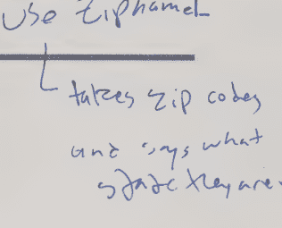

### 目标

- 使用 SAS 函数提取、编辑和搜索字符值。

### 业务场景

创建一个包含适用于创建邮寄标签的数据集。

Ms. Sue Farr

15 Harvey Rd.

Macon, GA 31298

## 部分 orion.contacts

| ID | Title | Name | Address | Address2 |

|---|---|---|---|---|

| AGI | Ms. | Farr Sue | 15 Harvey Rd. | Macon, GA 31298 |

| CCI | Dr. | Cox, Kay B. | 163 McNeil, Pl. | Kern, GA 93280 |

| CNI | Mr. | Mason, Ron | 442 Glen Ave. | Miami, FL 33054 |

| CS | Ms. | Ruth, G. H. | 2491 Brady St. | Munger, MI 48747 |


Ms. Sue Farr

15 Harvey Rd.

Macon, GA 31298

## 创建邮寄列表数据

部分 orion.contacts

| Title | Name |

|---|---|

| Ms. | Farr, Sue |

| Dr. | Cox, Kay B. |

| Mr. | Mason, Ron |

| Ms. | Ruth, G. H. |

| Prof. | Florentino, Helen-Ashe H |

| Ms. | Van Alsburg, Jan F. |

| Mr. | Laff, Stanley X. |

| Mr. | Rizen, George G. |

| Dr. | Mitchell, Mer J. |

| Ms. | Webb, Jonathan W. |

| Dr. | Keenan, Maynard J. |

需要完成两个步骤：

- **步骤 1** 将姓与名、中间名分离。
- **步骤 2** 将头衔、名、中间名和姓结合。

## 灵感交流

使用 `SUBSTR` 函数根据逗号的位置将联系人姓名拆分为两部分是否合适？

| Name | |

|---|---|

| Farr | Sue |

| Cox | Kay B. |

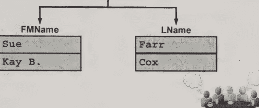

## SCAN 函数：步骤 1

提取 `Name` 的第二个单词。

```
NewVar=SCAN(string,n,charlist);
```

```
FMName=SCAN(string,n,charlist);
```

| Name | FMName |

|---|---|

| Farr, Sue | Sue |


`SCAN` 函数返回字符值的第 n 个单词。当位置未知时，使用 `SCAN` 函数从字符串中提取单词。

默认分隔符如下：

```
ASCII (空格)
EBCDIC (逗号)
```

## SCAN 函数详情

当你使用 `SCAN` 时：

- 如果单词少于 n，则返回缺失值。
- 如果 n 为负数，`SCAN` 函数从字符串末尾选择单词。
- 两个或多个连续分隔符被视为单个分隔符。

## 5.3 多选题

哪个表达式可以完成从 `Text` 中正确提取 `Name`？

```
data test;
a='a - ';
b=' b - ';
c=' c - ';
```

a. `scan(Text,6);`
b. `cat(Text,-6);`
d. 以上均可。（等我重新处理提供的文本）

# 业务场景：数据清理

互联网销售组误用了错误的数据文件用于 Orion Star Catalog 网站。

| Product_ID | Product |

|---|---|

| 21 02 002 00003 | Sunfit Trunks, Blue |

| 21 02 002 00003 | Luci Knit Mittens, Red |

| 21 02 002 00004 | Luci Knit Mittens, Blue |

| 21 02 002 00004 | Sunfit Trunks, Aqua |

| 21 02 002 00005 | Sunfit Trunks, Yellow |

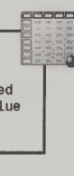

### 数据清理：步骤 1

创建正确数据集的第一步是执行以下操作：

- 1. 找到 `Product` 值中包含 `Mittens`（手套）的观测值。
- 2. 修改这些观测值 `Product_ID` 值的中间字符。

| Product_ID | Product |

|---|---|

| 21 02 002 00003 | Luci Knit Mittens, Red |


| Product_ID | Product |

|---|---|

| 21 02 005 00003 | Luci Knit Mittens, Red |

### 数据清理：步骤 1

使用 `SUBSTR` 和 `FIND` 函数更改手套的错误的产品 ID。

```
Position=FIND(string,substring<modifiers,startpos);
```


```sas
data correct;
  set orion.clean_up;
  if find(Product,'Mittens','I')>0 then do;
    substr(Product_ID,9,1)='5';
  end;
run;

proc print data=correct noobs;
run;
```

# FIND 函数

`FIND` 函数在目标字符串中搜索指定的子字符串。

```
Position=FIND(string,substring<modifiers,startpos);
```

- 如果在字符串中找到了子字符串，返回其在字符串中首次出现的起始位置。
- 如果未找到子字符串，则返回 0。
- `I` 表示不区分大小写的搜索。
- 忽略尾部空格

关于修饰符和 `startpos` 值的更多信息：

- 修饰符可以是 `I` 或 `T`。这两个值可以以任何顺序和任何种大小写形式进行组合。如果省略此参数，则区分大小写且会考虑尾部空格。
- `startpos` 值不仅指示搜索开始的位置，还指示了搜索的方向。正值表示正向（向右）搜索。负值表示反向（向左）搜索。如果省略此参数，搜索将从位置 1 开始并向前移动。
- 这两个可选参数可以以任何顺序排列（即 `startpos` 可以位于修饰符之前）。

# FIND 函数

```sas
data find;
Text='AUSTRALIA, DENMARK, US';
Pos1=find(Text, 'US');
Pos2=find(Text, 'US');
Pos3=find(Text, 'us');
Pos4=find(Text, 'us', 'I');
Pos5=find(Text, 'us', 'I',10);
run;
```

| PDV |

| Pos1 | SAS 给 Pos1 赋值了什么值？ |

| N 8 | |

# FIND 函数

```sas
data find;
Text='AUSTRALIA, DENMARK, US';
Pos1=find(Text, 'US');
Pos2=find(Text, 'US');
Pos3=find(Text, 'us');
Pos4=find(Text, 'us', 'I');
Pos5=find(Text, 'us', 'I',10);
run;
```

| PDV |

| Pos1 |

| N 8 |

| 2 |

# FIND 函数

```sas
data find;
Text='AUSTRALIA, DENMARK, US';
Pos1=find(Text, 'US');
Pos2=find(Text, 'US');
Pos3=find(Text, 'us');
Pos4=find(Text, 'us', 'I');
Pos5=find(Text, 'us', 'I', 10);
```

| Pos1 | Pos2 |

| N 8 | N 8 |

| 2 | 20 |

# 5.08 答答调查

PDV 中 `Pos3` 和 `Pos4` 的值是什么？

```sas
data find;
Text='AUSTRALIA, DENMARK, US';
Pos1=find(Text, 'US');
Pos2=find(Text, 'US');
Pos3=find(Text, 'us');
Pos4=find(Text, 'us', 'I');
Pos5=find(Text, 'us', 'I', 10);
```

| Pos1 | Pos2 | Pos3 | Pos4 |

| N 8 | N 8 | N 8 | N 8 |

| 2 | 20 | | |

# FIND 函数

```sas
data find;
Text='AUSTRALIA, DENMARK, 'US';
Pos1=find(Text,'US');
Pos2=find(Text,'US');
Pos3=find(Text,'us');
Pos4=find(Text,'us','I');
Pos5=find(Text,'us','I',10);
run;

| Pos1 | Pos2 | Pos3 | Pos4 | Pos5 |
| N 8 | N 8 | N 8 | N 8 | N 8 |
| 2 | 20 | 0 | 2 | 21 |

### 数据清理：步骤 1

使用 `SUBSTR` 和 `FIND` 函数更改手套的错误的产品 ID。

```sas

SUBSTR(string,start,<length>)=value;

data correct;

set orion.clean_up;

if find(Product,'Mittens','I')>0 then do;

substr(Product_ID,9,1)='5';

end;

proc print data=correct noobs;

```

# SUBSTR 函数（左侧）

这种形式的 `SUBSTR` 函数（赋值语句的左侧）替换字符变量中的字符。
示例：从位置 11 开始替换两个字符。

```sas

Location='Columbus, GA 43227';

substr(Location,11,2)='OH';

```

PDV

| Location |
| $ 18 |
| Columbus, OH 43227 |

### 数据清理：步骤 1

```sas

data correct;

set orion.clean_up;

if find(Product,'Mittens','I')>0 then do;

substr(Product_ID,9,1)='5';

run;

```

| Product_ID | Product | Order_ID |
|---|---|---|
| 21 02 002 00003 | Sunfit Trunks, Blue | 1231986335 |
| 21 02 005 00003 | Luci Knit Mittens, Red | 1232003830 |
| 21 02 002 00004 | Luci Knit mittens, blue | 123200769 |
| 21 02 002 00004 | Sunfit Trunks, Aqua | 1232007 |
| 21 02 002 00005 | Sunfit Trunks, Yellow | 12320 |

### 数据清理：步骤 2

下一步是更改手套的产品 ID。

| Product_ID | Product | Order_ID |
|---|---|---|
| 21 02 002 00003 | Sunfit Trunks, Blue | 1231986335 |
| 21 02 005 00003 | Luci Knit Mittens, Red | 1232003830 |
| 21 02 002 00004 | Luci Knit mittens, blue | 1232007 |

### 数据清理：步骤 2

使用 `FIND` 函数更改所有的手套。

| Product_ID | Product | Order_ID |
|---|---|---|
| 21 02 002 00003 | Sunfit Trunks, Blue | 1231986335 |
| 21 02 005 00003 | Luci Knit Mittens, Red | 1232003830 |
| 21 02 002 00004 | Luci Knit mittens, blue | 1232007 |

### 数据清理：步骤 2

使用 `FIND` 函数更改所有的手套。

```sas

data correct;

  set orion.clean_up;

  if find(Product,'Mittens','I')>0 then do;

    substr(Product_ID,9,1)='5';

  end;

run;

```

| Product_ID | Product | Order_ID |
|---|---|---|
| 21 02 002 00003 | Sunfit Trunks, Blue | 1231986335 |
| 21 02 005 00003 | Luci Knit Mittens, Red | 1232003830 |
| 21 02 002 00004 | Luci Knit mittens, blue | 1232007 |

# TRAND 函数：详情

`TRAND` 函数从源字符串移除 `chars` 参数中列出的字符。

```sas

ID='20 01-005 024';

New ID1=compress(ID);

New ID2=compress(ID, '-');

New ID3=compress(ID, '- ');
```


| PDV | ID | New_ID1 |
|---|---|---|
| | $ 13 | $ 13 |
| 20 01-005 024 | | 200100024 |

| New_ID2 | New_ID3 |
|---|---|
| $ 13 | $ 13 |
| 20 01-005 024 | 2001005024 |

## 5.3 字符值处理（部分 2） 5-39

### 其他移除空格的函数

| 函数 | 用途 |
| --- | --- |
| `TRIM(string)` | 移除字符字符串末尾的空格。 |
| `STRIP(string)` | 移除字符字符串开头和结尾的所有空格。 |
| `COMPBL(string)` | 通过将每个连续两个或多个连续空格转换为单个空格，从而移除字符字符串中的多个空格。 |

`TRIMN` 函数与 `TRIM` 函数相似。如果参数为空，`TRIMN` 返回一个空字符串（零空格），而 `TRIM` 返回一个空格。

`STRIP` 函数如果参数为空，则返回一个空字符串。

默认情况下，`COMPBL` 函数返回值的长度与参数的长度相同。

### 练习题

如果你自上一个练习以来重新启动了 SAS 会话，请打开并提交数据文件夹中找到 `libname.sas` 程序。

## 第 1 级

### 4. 清理文本数据

在名为 `orion.customers_ex` 的数据集中提供了客户名称：

| Customer_ID | Name | Country | Gender | Birth Date |
| --- | --- | --- | --- | --- |
| 000-000-00-0004 | KVARNIQ, James | US | M | 27Jun1978 |
| Silver000-000-00-0005 | STEPHANO, Sandrina | US | F | 9-Jul1983 |
| 000-000-00-0009 | KRAHL, Cornelia | DE | F | 27Feb1978 |
| platinum000-000-00-0010 | BALLINGER, Karen | US | F | 18Oct1988 |

## 5-40 第 5 章数据转换

| Customer_ID | Name | Country | Gender | Birth_Date |
| 000-000-00-0011 | WALLSTAB, Elke | DE | F | 16Aug1978 |
| Silver000-000-00-0012 | BLACK, David | US | M | 12Apr1973 |

使用此数据集创建一个名为 `names` 的新数据集，其中包含此格式的每个客户名称。

Mr. John B. Smith

Ms. Jane Doe

- 写一个程序创建 `names` 数据集。
- `names` 数据集应只包含三个变量：`New_Name`、`Name` 和 `Gender`。
- `New_Name` 变量应包含新格式的客户名称。
  - 女性名字前应加上头衔 `Ms.`。
  - 男性名字前应加上头衔 `Mr.`。
- 打印 `names` 数据集。
- 验证你的转换工作是否成功。

部分 PROC PRINT 输出（共计 77 个观测值）

| Obs | New_Name | Gender |
| --- | --- | --- |
| 1 | Mr. James Kvarniq | KVARNIQ, James M |
| 2 | Ms. Sandrina Stefano | STEPHANO, Sandrina | F |
| 3 | Ms. Cornelia Krahl | KRAHL, Cornelia | F |
| 4 | Ms. Karen Ballinger | BALLINGER, Karen | F |
| 5 | Ms. Elke Wallstab | WALLSTAB, Elke | F |

- （可选）查找并替换字符值
- 与上一个练习一样，数据集 `or.customers_ex5` 包含关于 Orion 星客户的信息。
- 频繁购买的客户被处理为 Silver（银）、Gold 或 Platinum（铂），这出现在其 `Customer_ID` 值的开头。
- 由于 Orion 分配 `Customer_ID` 值的方式发生了更新，需要修改现有值。`Customer_ID` 中的任何四位字符串应在输出数据集中替换为 `-15-`，例如 `-00-`。
- 创建三个输出数据集：`work.silver`、`work.gold` 和 `work.platinum`。
- 在 `Customer_ID` 中搜索 `Silver`、`Gold` 和 `Platinum` 值，并在找到时将其写入相应的数据集。
- 你应该在 `work.silver` 中获得 17 个观测值，`work.gold` 中 2 个，`work.platinum` 中 5 个。
- 在所有数据集中保留变量 `Customer_ID`、`Name` 和 `Country`。
- 使用适当的标题打印数据集。
- 确认任何 `-00-` 均已替换为 `-15`。
- 提示：确保你的搜索不区分大小写。

## 5.3 字符值处理（部分 2） 5-4

### 部分 PROC PRINT 输出（共计 17 个观测值）

| Customer_ID | Name | Country |
|---|---|--|
| Silver000-000-15-0005 | STEPHANO, Sandrina | US |
| Silver000-000-15-0012 | BLACK, David | US |
| Silver000-000-15-0024 | KLEM, Robyn | US |

### PROC PRINT 输出（共计 2 个观测值）

| Customer_ID | Name | Country |
|---|---|--|
| Gold000-000-15-0027 | MCCLUNEY, Cynthia | US |
| Gold000-000-07-0201 | BORROWICK, Angel | CA |

### PROC PRINT 输出（共计 5 个观测值）

| Customer_ID | Name | Country |
|---|---|--|
| platinum000-000-15-0010 | BALLINGER, Karen | US |
| platinum000-000-15-0031 | MARTINEZ, Cynthia | US |
| platinum000-000-15-0171 | BOWERMAN, Robert | AU |
| platinum000-000-15-2806 | VAN DEN BERG, Raedene | ZA |
| platinum000-000-07-0100 | | |

## 第 2

### 6. 字符值的查找与显式输出

- 与上一个练习一样，数据集 `or.customers_ex5` 包含关于 Orion 星客户的信息。
- 频繁购买的客户被处理为 Silver、Gold 或 Platinum，这出现在其 `Customer_ID` 值的开头。
- 由于 Orion 分配 `Customer_ID` 值的方式发生了更新，需要修改现有值。`Customer_ID` 中的任何四位字符串应在输出数据集中替换为 `-15-`，例如 `-00-`。
- 创建三个输出数据集：`work.silver`、`work.gold` 和 `work.platinum`。
- 在 `Customer_ID` 中搜索 `Silver`、`Gold` 和 `Platinum` 值，并在找到时将其写入相应的数据集。
- 你应该在 `work.silver` 中获得 17 个观测值，`work.gold` 中 2 个，`work.platinum` 中 5 个。
- 在所有数据集中保留变量 `Customer_ID`、`Name` 和 `Country`。
- 使用适当的标题打印数据集。
- 确认任何 `-00-` 均已替换为 `-15`。
- 提示：确保你的搜索不区分大小写。

### 部分 PROC PRINT 输出（共计 17 个观测值）

| Customer_ID | Name | Country |
|---|---|--|
| Silver000-000-15-0005 | STEPHANO, Sandrina | US |
| Silver000-000-15-0012 | BLACK, David | US |
| Silver000-000-15-0024 | KLEM, Robyn | US |

### PROC PRINT 输出（共计 2 个观测值）

| Customer_ID | Name | Country |
|---|---|--|
| Gold000-000-15-0027 | MCCLUNEY, Cynthia | US |
| Gold000-000-07-0201 | BORROWICK, Angel | CA |

### PROC PRINT 输出（共计 5 个观测值）

| Customer_ID | Name | Country |
|---|---|--|
| platinum000-000-15-0010 | BALLINGER, Karen | US |
| platinum000-000-15-0031 | MARTINEZ, Cynthia | US |
| platinum000-000-15-0171 | BOWERMAN, Robert | AU |
| platinum000-000-15-2806 | VAN DEN BERG, Raedene | ZA |
| platinum000-000-07-0100 | | |

## 第 2

### 6. 字符值的查找与显式输出

- 与上一个练习一样，数据集 `or.customers_ex5` 包含关于 Orion 星客户的信息。
- 频繁购买的客户被处理为 Silver、Gold 或 Platinum，这出现在其 `Customer_ID` 值的开头。
- 由于 Orion 分配 `Customer_ID` 值的方式发生了更新，需要修改现有值。`Customer_ID` 中的任何四位字符串应在输出数据集中替换为 `-15-`，例如 `-00-`。

使用空格作为分隔符的名称。

部分 PROC PRINT 输出（共计 212 个观测值）

| 每个客户的捐赠 |
| Customer_ID | Charity |
| 120265 | Mitleid International 90% |
| 120265 | Save the Animals 10% |
| 120267 | Disaster Assist, Inc. 80% |
| 120267 | Cancer Cures, Inc. 20% |
| 120269 | Cancer Cures, Inc. 10% |

使用空格作为分隔符的名称。

部分 PROC PRINT 输出（共计 124 个观测值）

| Customer_ID | Charity |
| --- | --- |
| 120265 | Mitleid International 90% |
| 120265 | Save the Animals 10% |
| 120267 | Disaster Assist, Inc. 80% |
| 120267 | Cancer Cures, Inc. 20% |
| 120269 | Cancer Cures, Inc. 10% |

## 5-42 第 5 章 数据转换

---

### 7. 在输入缓冲区中使用字符函数

原始文件 `supply.dat` 包含供应商 ID（最多五位字符）、供应商名称（最多三十个字符）以及供货地的信息。

- 当 SAS 从原始数据文件读取数据时，`INFILE_` 关键字允许你将输入缓冲区的内容视为一个长字符串。考虑到各种字符函数，这有时很有用。
- 使用 `INFILE_` 时，在名称内部和结尾使用空格作为分隔符。

> 记住 `SCAN` 和 `FIND` 函数可以反向处理字符串。`LENGTH` 函数确定非空格字符串的数量，排除末尾空格。请查看 SAS 帮助和文档获取更多关于如何执行此操作的信息。

创建一个名为 `work.supplier` 的数据集。

- 使用列表输入获取 `Supplier_ID` 的值。
- 使用字符函数和 `INFILE_` 语句获取 `Supplier_Name` 和 `Country`。

使用适当的标题打印数据集。

部分 PROC PRINT 输出（共计 52 个观测值）

### 供应商信息

| Supplier_ID | Supplier_Name | Country |
|---|---|--|
| 50 | Scandinavian Clothing A/S | NO |
| 109 | Peterson AB | SE |
| 316 | Prime Sports Ltd | GB |
| 755 | Top Sports | DK |
| 772 | AllSeasons Outdoor Clothing | US |

## 5.4 数值处理

- 使用 SAS 函数截断数值值。
- 使用 SAS 函数计算数值的描述性统计。

5-44 第5章 数据转换

### 业务场景

在研究 SAS 中存在的许多数值函数时，你发现了一些想要进一步研究的截断函数。

- `ROUND`（四舍入）
- `CEIL`（向上取整）
- `FLOOR`（向下取整）
- `INT`（取整）


### ROUND 函数

`ROUND` 函数返回舍入到最近舍单位倍数的值。

```sas
data truncate;
NewVar1=round(12.12);
NewVar2=round(42.65,.1);
NewVar3=round(-6.478);
NewVar4=round(96.47,10);
run;
NewVar=ROUND(argument,rounding-unit);
```

| NewVar1 | NewVar2 | NewVar3 | NewVar4 |
|---|---|---|---|
| N 8 | N 8 | N 8 | N 8 |
| 12 | 42.7 | -6 | 100 |

### ROUND 函数

```sas
data truncate;
NewVar5=round(12.69,.25);
NewVar6=round(42.65,.5);
run;
```

> 舍入到最近的 .25 倍数

| PDV NewVar5 | NewVar6 |
| N 8 | N 8 |
| 12.75 | 42.5 |

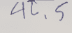

## ROUND 函数

```sas
data truncate;
NewVar5=round(12.69,.25);
NewVar6=round(42.65,.5);
run;
```

> 舍入到最近的 .5 倍数

| PDV NewVar5 | NewVar6 |
| N 8 | N 8 |
| 12.75 | 42.5 |

### CEIL 函数

`CEIL` 函数返回大于或等于参数的最小整数。

```sas
NewVar=CEIL(argument); x=ceil(4.4);
```

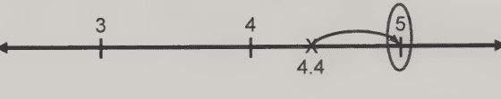

参数 `argument` 的值为数值型。

### FLOOR 函数

`FLOOR` 函数返回小于或等于参数的最大整数。

```sas
NewVar=FLOOR(argument); y=floor(3.6);
```

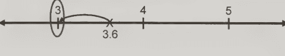

参数 `argument` 的值为数值型。

### INT 函数

`INT` 函数返回参数的整数部分。

```sas
NewVar=INT(argument);
z=int(3.9);
```


参数 `argument` 的值为数值型。

### 投票准备

在此程序中，从 `FLOOR` 和 `INT` 函数返回的值是相同的。

```sas
data truncate;
Var=6.478;
CeilVar=ceil(Var);
FloorVar=floor(Var);
IntVar=int(Var);
run;
```

| Var | CeilVar | FloorVar | IntVar |
|---|---|---|---|
| 6.478 | 7 | 6 | 6 |

### 5.09 投票

给定相同的值作为参数时，`INT` 和 `FLOOR` 函数是否总是返回相同的结果？

- 是
- 否


### 截断函数

比较负数参数下 `CEIL`、`FLOOR` 和 `INT` 函数的值。

```sas
data truncate;
Var1=-6.478;
CeilVar1=ceil(Var1);
FloorVar1=floor(Var1);
IntVar1=int(Var1);
```


| `Var` | `CeilVar1` | `FloorVar1` | `IntVar1` |
|---|---|---|---|
| -6.478 | -6 | -7 | -6 |

对于大于或等于 0 的值，`FLOOR` 和 `INT` 函数返回相同的值。对于小于 0 的值，`CEIL` 和 `INT` 函数返回相同的值。

### 业务场景

分析师想要计算统计数据来汇总并平均每个员工每年的季度贡献。

`orion.employee_donations`

| `Obs` | `Employee_ID` | `Qtr1` | `Qtr2` | `Qtr3` | `Qtr4` |
|---|---|---|---|---|---|
| 1 | 120265 | | | | 25 |
| 2 | 120267 | 15 | 15 | 15 | |
| 3 | 120269 | 20 | 20 | 20 | |
| 4 | 120270 | | 10 | 5 | |


| `Employee_ID` | `Total` | `Avg Qt` | `Num Qt` |
|---|---|---|---|
| 120265 | 25 | 25 | 1 |
| 120267 | 60 | 15 | 4 |
| 120269 | 80 | 20 | 4 |
| 120270 | 35 | 12 | 3 |

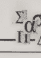

## 统计函数函数

统计函数用于计算 `donation_stats` 需要的值。

| `Function` | `Returns` |
|---|---|
| `SUM` | 参数之和 |
| `MEAN` | 参数平均值 |
| `MIN` | 参数最小值 |
| `MAX` | 参数中的最大值 |
| `N` | 非缺失参数计数 |
| `NMISS` | 数值缺失参数计数 |
| `CMISS` | 数值或字符缺失参数计数

`CMISS` 函数是在 SAS 9.2 中引入的。

### 统计函数

```sas
data descript;
Var1=12;
Var2=.;
Var3=7;
Var4=5;
SumVars=sum(Var1,Var2,Var3,Var4);
AvgVars=mean(of Var1-Var4);
MissVars=cmiss(of Var1-Var4);
run;
```

| `Var1` | `Var2` | `Var3` | `Var4` |
|---|---|---|---|
| 12 | . | 7 | 5 |

| `SumVars` | `AvgVars` | `MissVars` |
|---|---|---|
| 24 | . | . |

### 统计函数

```sas
data descript;
Var1=12;
Var2=.;
Var3=7;
Var4=5;
SumVars=sum(Var1,Var2,Var3,Var4);
AvgVars=mean(of Var1-Var4);
MissVars=cmiss(of Var1-Var4);
run;
```

| `Var1` | `Var2` | `Var3` | `Var4` |
|---|---|---|---|
| 12 | . | 7 | 5 |

| `SumVars` | `AvgVars` | `MissVars` |
|---|---|---|
| 24 | . | . |

### 统计函数

```sas
data descript;
Var1=12;
Var2=.;
Var3=7;
Var4=5;
SumVars=sum(Var1,Var2,Var3,Var4);
AvgVars=mean(of Var1-Var4);
MissVars=cmiss(of Var1-Var4);
run;
```

| `Var1` | `Var2` | `Var3` | `Var4` |
|---|---|---|---|
| 12 | . | 7 | 5 |

| `SumVars` | `AvgVars` | `MissVars` |
|---|---|---|
| 24 | . | . |

## 5.10 多选题

**`Ord1`, `Ord2` 和 `Ord3`** 是包含所有三个或更多订单销售金额的变量。下列哪个表达式可以计算两个最大订单的总和？

a. `sum(max(of Ord1-3), max(of Ord1-3))`
b. `sum(of Ord1-3)-min(of Ord1-3)`
c. `max(of Ord1-3) + min(of Ord1-3)`
d. 以上都不是

## 完成的业务场景

使用 `SUM`、`MEAN` 和 `N` 函数计算捐赠统计数据。

```sas
data donation_stats;
  set orion.employee;
  keep Employee_ID Total AvgQt NumQt;
  Total=sum(of Qtr1-Qtr4);
  AvgQt=round(mean(of Qtr1-Qtr4));
  NumQt=n(of Qtr1-Qtr4);
run;
proc print data=donation_stats noobs;
  var Employee_ID Total AvgQt NumQt;
run;
```

| `Employee_ID` | `Total` | `AvgQt` | `NumQt` |
|---|---|---|---|
| 120265 | 25 | 25 | 1 |
| 120267 | 60 | 15 | 4 |
| 120269 | 80 | 20 | 4 |

### 练习

## 第一级：计算统计数据和四舍入

如果你自上一个练习以来重启了 SAS 会话，则文件夹 `orion.orders_midyear` 包含每个客户的观测值，其中包含上半年每月订单的总值。

| `Customer_ID` | `month1` | `month2` | `month3` | `month4` | `month5` | `month6` |
|---|---|---|---|---|---|---|
| 5 | 213.1 | | 478.0 | 525.80 | 394.35 | 191.79 |
| 10 | 188.1 | 414.09 | 2876.9 | 3164.59 | 2373.44 | 169.29 |
| 11 | 78.2 | | | | | 70.38 |
| 12 | 135.6 | | | 117.6 | 129.36 | 97.02 | 122.04 |
| 18 | | | | 29.4 | 32.34 | 24.26 |
| 24 | | | 265.80 | | | 83.70 |
| 27 | 310.7 | 782.90 | | | 279.63 |
| 31 | 1484.3 | 293.30 | | | 135.87 |
| 34 | 642.5 | | | 86.3 | 94.93 |

a. 创建一个数据集 `work.sale_stats`，其中包含客户订单月份的新变量。
* `AvgMonth` 应包含平均值。
* `MonthMax` 应包含最大值。
* `MonthSum` 应包含总和。
* 将 `MonthAvg` 舍入到最近的整数。

b. 打印 `Customer_ID`, `MonthAvg`, `MonthMax` 和 `MonthSum`。添加一个合适的标题。

`PROC PRINT` 输出 订单月份的统计数据

| `Customer_ID` | `Month Avg` | `Month Max` | `Month Sum` |
|---|---|---|---|
| 5 | 361.42 | 525.80 | 1631.24 |
| 10 | 1531.42 | 3164.59 | 9186.41 |
| 11 | 74.19 | 78.20 | 152.38 |
| 12 | 120.40 | 135.60 | 601.62 |
| 18 | 29.60 | 32.34 | 61.64 |
| 24 | 83.70 | 265.80 | 349.50 |
| 27 | 279.63 | 782.90 | 1062.53 |
| 31 | 135.87 | 1484.30 | 1820.17 |
| 34 | 94.93 | 642.50 | 737.43 |

## 5-54 第 5 章 数据转换

根据需要参考 SAS 文档以了解更多关于生成所需结果的函数。查看 SAS 语言字典中的“按分类划分函数和 CALL 过程”可能会特别有用。

部分 `PROC PRINT` 输出（共 9 个观测值）

# 高频客户每月统计数据

| `Customer_ID` | `month1` | `month2` | `month3` | `month4` | `month5` | `month6` | 月度中位数 | 月度最高 | 月度次高值 |
|---|---|---|---|---|---|---|---|---|---|
| 5 | 213.10 | | 478.00 | 525.80 | 394.35 | 191.790 | 394.35 | 525.80 | 478.00 |
| 10 | 188.10 | 414.09 | 2876.9 | 3164.59 | 2373.44 | 169.290 | 1393.77 | 3164.59 | 2876.90 |
| 12 | 135.60 | | 117.6 | 129.36 | 97.02 | 122.040 | 122.04 | 135.60 | 129.36 |
| 34 | 642.50 | | 86.3 | 94.93 | 71.20 | 578.250 | 94.93 | 642.50 | 578.25 |
| 41 | 134.00 | 119.20 | 313.0 | 344.30 | 258.23 | 120.600 | 196.11 | 344.30 | 313.00 |

## 5.5 转换变量类型

- 解释 SAS 用于在数据类型之间转换值的自动转换。
- 显式地转换数据类型之间的值。


# 业务场景：转换 HR 数据

创建数据集 `orion.convert` 时的数据类型和变量名，这些名称在未来的报告和分析中必须进行更改。

部分现有 `orion.convert` 数据集

| `ID` | `GrossPay` | `Code` | `Hired` |
| --- | --- | --- | --- |
| ⚠ | | (12) | ⚠ |

部分转换后的 `work.hrdata` 数据集

| `EmplID` | `GrossPay` | `Phone` | `HireDate` |
| --- | --- | --- | --- |
| (12) | (12) | ⚠ | (12) |

# 数据转换

数据类型可以通过两种方式转换：

- **自动地**：允许 SAS 为你完成
- **显式地**使用这些函数：

| `INPUT` | 字符到数值转换 |
| --- | --- |
| ⚠ → f(x) → (12) | |
| `PUT` | 数值到字符转换 |
| (12) → f(x) → ⚠ | |

# 自动字符到数值转换

当 `ID` 的字符值被用于算术表达式时，会发生什么？

```sas
data hrdata;
  keep EmpID;
  set orion.convert;
  EmpID=ID + 11000;
run;
```

# `orion.convert`

| `ID` | `GrossPay` | `Code` | `Mobile` | `Hired` |
|---|---|---|---|---|
| 36 | $5 | 52,000 | 303 | 393-0956 | 04/13/2008 |
| 48 | $6 | 32,000 | 919 | 770-8292 | 08/25/2010 |
| 52 | $8 | 49,000 | 301 | 449-5239 | 06/08/2009 |

# 自动字符到数值转换

部分日志

```sas
28 data hrdata;
29 keep EmpID;
30 set orion.convert;
31 EmpID=ID + 11000;
32 run;
```

NOTE: 字符值已在此位置转换为数值值：列)。
NOTE: 从数据集 `ORION.CONVERT` 读取了 3 个观测值。
NOTE: 数据集 `WORK.HRDATA` 有 3 个变量。

# 自动字符到数值转换

```sas
proc print data=hrdata noobs;
run;
```

| `PROC PRINT` 输出 |
| `EmpID` |
| 36 |
| 48 |
| 52 |

`ID` 的自动转换效果很好。

# 自动字符到数值转换

当 `GrossPay` 的字符值被用于算术表达式时，会发生什么？

```sas
data hrdata;
  keep GrossPay Bonus;
  set orion.convert;
  Bonus=GrossPay * .10;
run;
```

`orion.convert`

| `ID` | `GrossPay` | `Code` | `Mobile` | `Hired` |
| $5 | $6 | $8 | $10 |
| 36 | 52,000 | 303 | 393-0956 | 04/13/2008 |
| 48 | 32,000 | 919 | 770-8292 | 08/25/2010 |
| 52 | 49,000 | 301 | 449-5239 | 06/08/2009 |

# 自动字符到数值转换

```sas
proc print data=hrdata noobs;
run;
```

`PROC PRINT` 输出

| `Gross Pay` | `Bonus` |
|---|---|
| 52,000 | . |
| 32,000 | . |
| 49,000 | . |

为什么 `GrossPay` 的值没有进行自动转换？


# 自动字符到数值转换

当字符值被用于数值上下文时，SAS 会自动将其转换为数值值，例如：
- 赋值给数值变量
- 算术运算
- 与数值比较
- 接收数值参数的函数

`WHERE` 语句和 `WHERE=` 不执行任何自动转换。

# 自动字符到数值转换

自动转换 `informat` 会从不符合标准的字符值产生数值缺失值。
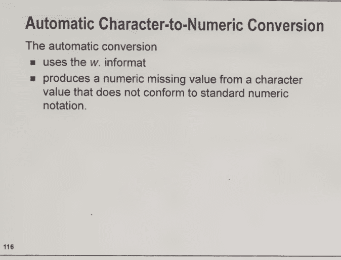

# 自动字符到数值转换

| 字符值 | 数值值 |
|---|---|
| 52,000 | 52,000 |
| -8.96 | -8.96 |
| 1,243.64 | |

`GrossPay` 中的值包含逗号，无法通过 `informat` 转换，因此 `GrossPay` 被赋值为缺失值。要显式转换 `GrossPay` 中的值，请使用 `INPUT` 函数。
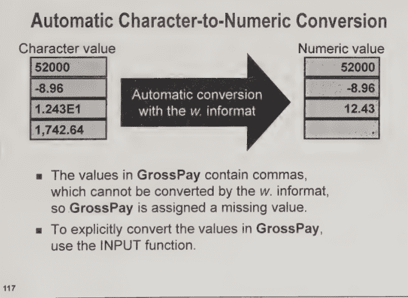

# `INPUT` 函数

`INPUT` 函数返回使用指定 `informat` 读取源时产生的值。

```sas
data conversions;
CV1='32000';
CV2='32000';
CV3='032008';
CV4='030508';
Var1=input(CV1,5.);
Var2=input(CV2,comma.);
Var3=input(CV3,date.);
Var4=input(CV4,ddmm.);
run;
```

如果你使用 `INPUT` 函数创建一个之前未定义的变量，该变量的类型和长度由 `informat` 定义。

# `INPUT` 函数

```sas
proc contents data=conversions;
run;
```

部分 `PROC CONTENTS` 输出变量和属性字母列表

| | 变量 | 类型 | 长度 |
|---|---|---|---|
| 1 | `CV1` | Char | 5 |
| 2 | `CV2` | Char | 6 |
| 3 | `CV3` | Char | 9 |
| 4 | `CV4` | Char | 6 |
| 5 | `Var1` | Num | 8 |
| 6 | `Var2` | Num | 8 |
| 7 | `Var3` | Num | 8 |
| 8 | `Var4` | Num |

```sas
proc print data=conversions;
run;
```

`PROC PRINT` 输出

| `CV1` | `CV2` | `CV3` | `CV4` | `Var1` | `Var2` | `Var3` | `Var4` |
|---|---|---|---|---|---|---|---|
| 32000 | 32000 | 032008 | 030508 | | | | |

# 5.11 答案

通过在 `DATA` 步骤创建 `EmpID`、`Bonus` 和 `HireDate` 变量，并使用 `INPUT` 函数显式将值转换为数值来继续业务场景。

填充下方表达式中的缺失部分：
`EmpID=input(ID,5.)+10000;`
`Bonus=input(GrossPay,comma.)*10;`
`HireDate=input(Hired,mmddyy10);`

NOTE:
: 读取了 3 个观测值来自 `ORION.CONVERT`。
: 数据集 `WORK.HRDATA` 有 3 个变量。

## 5.5 转换变量类型

### 将变量转换为另一种数据类型

**步骤 1** 使用 `RENAME=` 数据集选项进行重命名。

```sas
data hrdata;
  set orion.convert(rename=(GrossPay=
CharGross));
run;
SAS-data-set(RENAME=(old-name=new-name))
```


`old-name` 指定你想要重命名的变量。

`new-name` 指定该变量的新名称。它必须是一个有效的 SAS 标识。

你想要转换的变量的新名称是任意的。在这个示例中，现有的变量被重命名为 `CharGross`，以强调正在转换一个字符变量。

要从同一个数据集中重命名多个变量，请用空格分隔你想要重命名的变量。例如，为了不仅重命名 `GrossPay`，还重命名 `ID`，请使用以下语句：

```sas
set orion.convert(rename=(GrossPay=CharGross) ID=IDNum);
```

### 将变量转换为另一种数据类型

**步骤 2** 在赋值语句中使用 `INPUT` 函数创建一个新变量，其变量名与你重命名的变量原始名相同。

```sas
data hrdata;
  set orion.convert(rename=(GrossPay=CharGross));
GrossPay=input(CharGross,comma6.);
run;
```

### 将变量转换为另一种数据类型

**步骤 3** 在 `DATA` 语句中使用 `DROP=` 数据选项从输出的 SAS 数据集中排除原始变量。

```sas
data hrdata (drop=CharGross);
  set orion.convert (rename=(GrossPay=CharGross));
GrossPay=input (CharGross,comma6.);
run;
```

该程序的编译显示创建了带有数值型 `GrossPay` 变量的 PDV（程序视图）。


### 变量转换：编译

```sas
data hrdata (drop=CharGross);
  set orion.convert (rename=(GrossPay=CharGross));
GrossPay=input (CharGross,comma6.);
run;
```

部分 PDV

| ID | CharGross | Hired |
|---|---|---|
| $5 | $6 | $7 |

### 变量转换：编译

```sas
data hrdata (drop=CharGross);
set orion.convert(rename=(GrossPay=CharGross));
GrossPay=input (CharGross,comma6.);
run;
```

部分 PDV

| ID | CharGross | Hired | GrossPay |
|---|---|---|---|
| $5 | $ 6 | $7 | N 8 |

### 变量转换：编译

```sas
data hrdata (drop=CharGross);
set orion.convert(rename=(GrossPay=CharGross));
GrossPay=input (CharGross,comma6.);
run;
```

部分 PDV

| ID | CharGross | Hired | GrossPay |
|---|---|---|---|
| $5 | $ 6 | $7 | N 8 |

### 业务场景：继续

`orion.convert` 数据集包含一个数值变量 `Code`（区号）和一个字符字符变量 `Mobile`（手机号码）。

| ID | GrossPay | Mobile | Hired |
|---|---|---|---|
| $5 | $6 | $8 | $10 |
| 36 | 52,000 | 303 393-0956 | 04/13/2008 |
| 48 | 32,000 | 919 770-8292 | 08/25/2010 |
| 52 | 49,000 | 301 449-5239 | 06/08/2009 |

### 业务场景：继续

创建一个字符变量 `Phone`，它包含括号内的区号，后是手机号码。

| ID | GrossPay | Code | Mobile | Hired |
|---|---|---|---|---|
| $5 | $6 | $8 | $10 |
| 36 | 52,000 | 303 393-0956 | 04/13/2008 |
| 48 | 32,000 | 919 770-8292 | 08/25/2010 |
| 52 | 49,000 | 301 449-5239 | 06/08/2009 |

| Phone |
| $14 |
| (303) 393-0956 |
| (919) 770-8292 |
| (301) 449-5239 |

## 5.5 转换变量类型

### 自动数值转字符转换

在第一次创建 `Phone` 变量时，让 SAS 自动处理转换。

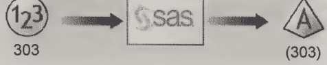

### 自动数值转字符转换

部分 `orion.convert`

| Code | Mobile |
|---|---|
| N 8 | $ 8 |
| 303 | 393-0956 |
| 919 | 770-8292 |
| 301 | 449-5239 |

```sas
data hrdata;
  keep Phone Code Mobile;
  set orion.convert;
  Phone=(' Code !! ' Mobile;
run;
```

SAS 自动将 `Code` 中的数值值转换为字符值。

### 自动数值转字符转换

部分日志

```sas
data hrdata;
keep Phone Code Mobile;
set orion.convert;
Phone='(' Code '') Mobile;
run;
```

注意：数值值已在由 (列) 指定的位置转换为字符值。
注意：从 `ORION.CONVERT` 读取了 3 条观测值。
注意：数据集 `WORK.HRDATA` 有 3 条观测值和 3 个变量。

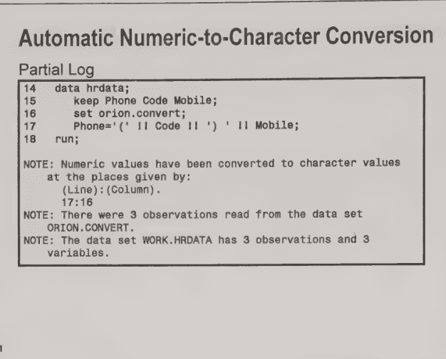

### 自动数值转字符转换

```sas
proc print data=hrdata noobs;
run;
```

`PROC PRINT` 输出

| Code | Mobile | Phone |
|---|---|---|
| 303 | 393-0956 | (303) 393-0956 |
| 919 | 770-8292 | (919) 770-8292 |
| 301 | 449-5239 | (301) 449-5239 |

为什么 SAS 在 `Phone` 中插入了空格？


### 自动数值转字符转换

SAS 会将 `Code` 中的数值值自动转换为字符值。

- 自动数值转字符转换在 `WHERE` 语句中使用时转换为字符值。
- 自动数值转字符转换在转换时将数值值转换为字符值。
- `WHERE` 语句在 `WHERE` 语句中执行此类操作。
- 自动数值转字符转换在 `WHERE` 语句中执行此类操作。
- 自动数值转字符转换在转换时将数值值转换为字符值。


### 自动数值转字符转换

- 自动数值转字符转换在 `WHERE` 语句中执行此类操作。
- 自动数值转字符转换在转换时将数值值转换为字符值。
- `WHERE` 语句在 `WHERE` 语句中执行此类操作。
- 自动数值转字符转换在转换时将数值值转换为字符值。

### 自动数值转字符转换

```sas
data hrdata;
  keep Phone Code Mobile;
  set orion.convert;
  Phone=(' Code !! ' Mobile;
run;
```

### 自动数值转字符转换

- - 自动数值转字符转换在 `WHERE` 语句中执行此类操作。
- 自动数值转字符转换在 `WHERE` 语句中执行此类操作。
- 自动数值转字符转换在转换时将数值值转换为字符值。
- 自动数值转字符转换在 `WHERE` 语句中执行此类操作。
-

```sas
data hrdata;
  keep Phone Code Mobile;
  set orion.convert;
  Phone=(' Code !! ' Mobile;
run;
```

SAS 自动将 `Code` 中的数值值转换为字符值。

### 自动数值转字符转换

```sas
data hrdata;
keep Phone Code Mobile;
set orion.convert;
Phone='(' Code '') Mobile;
run;
```

注意：数值值已在由 (列) 指定的位置转换为字符值。
注意：从 `ORION.CONVERT` 读取了 3 条观测值。
注意：数据集 `WORK.HRDATA` 有 3 条观测值和 3 个变量。

### 自动数值转字符转换

```sas
proc print data=hrdata noobs;
run;
```

`PROC PRINT` 输出

| Code | Mobile | Phone |
|---|---|---|
| 303 | 393-0956 | (303) 393-0956 |
| 919 | 770-8292 | (919) 770-8292 |
| 301 | 449-5239 | (301) 449-5239 |

为什么 SAS 在 `Phone` 中插入了空格？


### 自动数值转字符转换

SAS 会将 `Code` 中的数值值自动转换为字符值。

- 自动数值转字符转换在 `WHERE` 语句中执行此类操作。
- 自动数值转字符转换在转换时将数值值转换为字符值。
- `WHERE` 语句在 `WHERE` 语句中执行此类操作。
- 自动数值转字符转换在转换时将数值值转换为字符值。


### 自动数值转字符转换

- 自动数值转字符转换在 `WHERE` 语句中执行此类操作。
- 自动数值转字符转换在转换时将数值值转换为字符值。
- `WHERE` 语句在 `WHERE` 语句中执行此类操作。
- 自动数值转字符转换在转换时将数值值转换为字符值。

### 自动数值转字符转换

```sas
data hrdata;
  keep Phone Code Mobile;
  set orion.convert;
  Phone=(' Code !! ' Mobile;
run;
```

### 自动数值转字符转换

- 自动数值转字符转换在 `WHERE` 语句中执行此类操作。
- 自动数值转字符转换在转换时将数值值转换为字符值。
- `WHERE` 语句在 `WHERE` 语句中执行此类操作。
- 自动数值转字符转换在转换时将数值值转换为字符值。

### 自动数值 字符转换

- 
- 自动数值转字符转换在 `WHERE` 语句中执行此类操作。
- 自动-- 自动数值转字符转换在转换时将数值值转换为字符值。
- 自动数值转字符转换在 `WHERE` 语句中执行此类操作。
- 自动数值转字符转换在转换时将数值值转换为字符值。

### 5.5 转换变量类型

### CAT 函数和数值转换

`CAT` 函数族通过使用 `BEST12` 格式并移除前导空格将任何数值参数转换为字符串。日志中不会写入注意。

使用 `CAT` 的赋值语句：

```sas
Phone=cat(' ',Code, ' ',Mobile);
```

产生的结果等同于此语句：

```sas
Phone=(' '!Code(3.)' '!Mobile);
```

现在你可以编写完整的 SAS 程序来转换人员数据。

# 转换 HR 数据：完整程序

```sas
data hrdata;
  keep EmpID GrossPay Bonus Phone HireDate;
  set orion.convert(rename=(GrossPay=CharGross));
  EmpID=input(ID, 5.)+11000;
  GrossPay=input(CharGross,comma.);
  Bonus=GrossPay*.10;
  HireDate=input(Hire,mmddyy10.);
  Phone=cat(' ',Code, ' ',Mobile);
run;
```

```sas
proc print data hrdata-noobs;
  var EmpID GrossPay Bonus Phone HireDate;
  format HireDate mmddyy10;
run;
```


# 转换 HR 数据：完整程序

`PROC PRINT` Output

| EmpID | Pay | Bonus | Phone | HireDate |
|---|---|---|---|--|
| 1036 | 52000 | 5200 | (303) 393-0956 | 04/13/2008 |
| 11048 | 32000 | 3200 | (919) 770-8292 | 08/25/2010 |
| 11052 | 49000 | 4900 | (301) 449-5239 | 06/08/2009 |

### 练习

如果你自上一次练习以来重新启动了 SAS 会话，请打开并提交数据文件夹中的 `libname.sas` 程序。

## Level 1

### 10. 使用 PUT 和 INPUT 函数

数据集 `orion.shipped` 包含了 2007 年运往 Orion Star 某零售网店的产品的详细信息。

部分 `orion.shipped`

| Product_ID | Ship_Date | Quantity | Price |
|---|---|---|--|
| 24080200021 | 05JAN2011 | 2 | $42.45 |
| 24080200035 | 04JAN2011 | 6 | $12.15 |
| 24020112225 | 04JAN2011 | 2 | $77.65 |
| 21020500002 | 09JAN2011 | 3 | $5.70 |

`PROC CONTENTS` Output for `orion.shipped`

| Variable | Type | Len | Format |
|---|---|---|---|
| 1 | Product_ID | Num | 8 | |
| 2 | Ship_Date | Num | 8 | DATE9. |
| 3 | Quantity | Num | 8 | |
| 4 | Price | Char | 7 | |

## 5.5 转换变量类型 5-77

Orion Star 的一名分析师编写了一个 SAS 程序来计算出货物品的总价格，并创建一个包含发货日的注释。遗憾的是，该 SAS 程序得出了意之外的结果。

a. 打开并提交程序 `p205e10.sas`。

b. 查看意外的结果。

部分 `PROC PRINT` Output（共 148 条观测值）

| Product_ID | Ship_Date | Quantity | Price | Comment | Total |
|---|---|---|---|---|---|
| 24080200021 | 05JAN2011 | 2 | $42.45 | Shipped on 18632 | . |
| 24080200035 | 04JAN2011 | 6 | $12.15 | Shipped on 18631 | . |
| 24020100225 | 04JAN2011 | 2 | $77.85 | Shipped on 18631 | . |
| 21020500002 | 09JAN2011 | 3 | $5.70 | Shipped on 18638 | . |

c. 修改程序以获得预期的结果。

部分 `PROC PRINT` Output

| Product_ID | Ship_Date | Quantity | Price | Comment | Total |
|---|---|---|---|---|---|
| 24080200021 | 05JAN2011 | 2 | $42.45 | Shipped on 01/05/2011 | $84.90 |
| 24080200035 | 04JAN2011 | 6 | $12.15 | Shipped on 01/04/2011 | $72.90 |
| 24020100225 | 04JAN2011 | 2 | $77.85 | Shipped on 01/04/2011 | $155.70 |
| 21020500002 | 09JAN2011 | 3 | $5.70 | Shipped on 01/09/2011 | $17.10 |

- 查看 `orion.ship` 的 `PROC CONTENTS` 输出。
- 注意到 `Ship_Date` 是数值型，并分配了永久的 `DATE9.` 格式。它需要使用 `MMDDYY10` 格式转换为字符值。
- 注意到 `Price` 是字符型。它需要使用 `COMMA7.` 或 `DOLLAR*` 转换为数值。
- 使用函数转换 `Ship_Date` 和 `Price` 的值以获得所需的结果。

## Level 2

### 11. 更改变量的数据类型

数据集 `orion_newhire` 包含了新员工的信息。

`orion_newhire` 的部分 `PROC CONTENTS` 输出

| ID | Telephone | Birthday |
|---|---|---|
| 120-012-40-4928 | 5467883 | 05DEC1972 |
| 120-012-83-3816 | 6688321 | 03MAY1969 |
| 120-341-44-0781 | 9418123 | 23NOV1976 |
| 120-423-01-7721 | 7839191 | 28JUN1971 |

按创建顺序排列的变量

| # | Variable Type Len |
|---|---|---|
| 1 ID | Char | 15 |
| 2 Telephone | Num | 8 |
| 3 Birthday | Char | 9 |

Copyright ©2014, SAS Institute Inc., Cary, North Carolina, USA. ALL RIGHTS RESERVED.

## 5-78 第 5 章 数据转换

- a. 从 `orion.US_newhire` 创建一个新的数据集。
- 将新数据集命名为 `US_converted`。
- 移除 `ID` 中的连字符。
- 将 `ID` 转换为数值。
- 将 `Telephone` 转换为字符，并在第三和第四位数字之间插入连字符。
- 将 `Birthday` 转换为 SAS 日期。
- b. 使用适当标题打印 `US_converted` 集，并使用 `PROC CONTENTS` 检查类型。

部分 `US_converted`（共 14 条观测值）

| ID | Telephone | Birthday |
|---|---|---|
| 120-012-40-4928 | 5467883 | 05DEC1972 |
| 120-012-83-3816 | 6688321 | 03MAY1969 |
| 120-341-44-0781 | 9418123 | 23NOV1976 |
| 120-423-01-7721 | 7839191 | 28JUN1971 |

部分 `CONTENTS` 输出

| Variable | Type | Len |
|---|---|---|
| 1 ID | Char | 15 |
| 2 Telephone | Num | 8 |
| 3 Birthday | Char | 9 |

## 5-82 第 5 章 数据转换

```sas
title 'Charity Contributions for each Employee';
proc print data=work.split noobs;
var Employee_ID Charity;
run;
title;
```

### 7. 在输入缓冲区使用字符函数
```sas
data work.supplier;
length Supplier_ID $ 5 Supplier Name $ 30 Country $ 2;
infile 'supplier.dat';
input Supplier_ID $
Country=scan(INFILE, -1, ' ');
StartCol=find(INFILE, ' ');
EndCol=length(INFILE)-3;
/* 在第一个和最后一个空格之间的所有内容都是
供应商名称。 */
Supplier_Name=substr(INFILE,StartCol+1,EndCol-StartCol);
/* 知道最后一个空格的位置后，
也可以使用 SUBSTR 创建 Country。 */
drop StartCol EndCol;
run;
title 'Supplier Information';
proc print data=work.supplier noobs;
run;
title;
```

### 8. 计算统计数据与四舍五入
```sas
data work.stats;
set orion.orders midyear;
MonthAvg=round(mean(of month1-month6));
MonthMax=max(of month1-month6);
MonthSum=sum(of month1-month6);
run;
title '客户下订单月份的统计';
proc print data=work.stats noobs;
var Customer_ID MonthAvg Max MonthSum;
run;
title;
```

### 9. 计算缺失值、中位数和最大值的统计数据
```sas
data work.customers;
set orion.orders midyear;
if n(of month1-month6) >= 5;
/* 替代方案：if nmiss(of month1-month6) <= 1; */
Month Median=median(of month1-month6);
Month Highest=largest(1,of month1-month6);
Month_2ndHighest=largest(2,of month1-month6);
run;
```

Copyright © 2014, SAS Institute Inc., Cary, North Carolina, USA. ALL RIGHTS RESERVED.

```sas
title 'Month Statistics on Frequent Customers';
proc print data=work.freqcustomers noobs;
run;
title;
```

```sas
data shipping_notes;
set orion.shipped;
length Comment $ 21;
Comment=cat('Shipped on ',put(Ship_Date,mmddyy10.0));
Total=Quantity * input(Price,comma7);
run;
proc print data=shipping_notes noobs;
format Total dollar7.2;
run;
```

## 11. 更改变量的数据类型

```sas
data US_converted (drop=cid nTelephone cBirthday);
set orion.US newhire
(rename=(ID=CID nTelephone=Telephone Birthday=cBirthday));
ID=input(compress(CID,'-'),15.);
length Telephone $ 8;
Telephone=cat(substr(put(nTelephone,7.),1,3),
-'substr(put(nTelephone,7.),4));
Birthday =input(cBirthday,date9.);
run;
```

```sas
title 'US New Hires'
proc print data=US_converted noobs;
run;
title;
```

```sas
proc contents data=US_converted varnum;
run;
```

## 学生活动解答（调查/测验）

### 5.02 简答调查 – 正确答案

使用 SAS 变量列表和 `SUM` 函数将 `Year1`、`Year2`、`Year3` 和 `Year4` 的值相加，完成 `Total` 的赋值语句。

| PDV | | | | | |
|---|---|---|---|---|---|
| Year2 | Year1 | Year3 | Year4 | 销售额 |

| | Total=sum(of Year1-Year4); |
| | Total=sum(of Year2--Year4); |
| | Total=sum(of Year:); |

### 5.03 多选题调查 – 正确答案

哪个 `SUBSTR` 函数可以从 `Item_Code` 值的中间提取五个数字？

| PDV |
| Item_Code |
| --- |
| $ 20 |
| 978-1-59994-397-8 |

- a. substr(Item_Code,5,7)
- b. substr(Item_Code,5)
- c. substr(Item_Code,7,5)
- d. substr(Item_Code,'mid',5)

### 5.04 简答调查 – 正确答案

此 PDV 显示了 **Name:** 的当前值：

| Name |
| HEATH*BARR*LITTLE EQUIPMENT SALES |

写一个赋值语句，将 **Name** 转换为如下格式：

| Name |
| Heath*Barr*Little Equipment Sales |

```sas
Name = propcase(Name, ' *');
```

`PROPCASE` 函数的第二个参数必须列出所有用作分隔符的字符。在这个例中，空格和 * 都需要列出。

### 5.05 简答调查 – 正确答案

括号位置放置错误是函数中最常见的语法错误之一。

修正后的 `p205a01.sas`

```sas
data shoes;
  set orion.product_list;
  if substr(right(Product_Name),33,13) =
    'Running Shoes';
run;
```


运行修正后的程序后，`shoes` 数据集有八个观测值和五个变量。

### 5.06 简答调查 – 正确答案

| PDV | Phrase | 第二 |
| --- | --- |
| $ 28 | 200 |
| software, hardware | hardware |


如如下所示，在分隔符列表中添加空格以提取 `Phrase` 的第二个单词。

```sas
Second=scan(Phrase, 2, ' ');
```

### 5.07 多选题调查 – 正确答案

哪个表达式可以正确从 `Text` 变量中提取 2007？

```sas
data Scan;
Text="New Year's Day, January 2007";
run;
```

- a. scan(Text,1);
- b. scan(Text,6);
- c. scan(Text,6, ');
- d. 以上都是。

### 5.08 简答调查 – 正确答案

PDV 中 `Pos3` 和 `Pos4` 的值是多少？

```sas
data find;
Text='AUSTRALIA, DENMARK, US';
Pos1=find(Text,'A');
Pos2=find(Text,'D');
Pos3=find(Text,'U');
Pos4=find(Text,'I');
run;
```

| Pos1 | Pos2 | Pos3 | Pos4 |
|---|---|---|---|
| 8 | 2 | 8 | 0 |

### 5.09 调查 – 正确答案

给定相同的参数，`INT` 和 `FLOOR` 函数返回相同的结果吗？

- 是
- 否

### 5.10 多选题调查 – 正确答案

`Ord1`、`Ord2` 和 `Ord3` 包含三个订单的金额。以下哪个可以计算两个最大订单的总和？

- a. sum(max(Ord1,Ord2))
- b. sum(Ord1)-min(Ord3)
- c. max(Ord1,Ord2)+max(Ord2,Ord3)
- d. 都不是。

### 5.11 简答调查 – 正确答案

在 `DATA` 步中填充缺失的表达式。该表达式应通过 `SharePrice` 乘以 `MyShares` 来计算 `TotalValue`。

```sas
data Input;
SharePrice=$130.25;
MyShares=125;
TotalValue=...;
run;
```

# 逻辑错误

当程序语句遵循规则并执行，但结果不正确时，就会发生逻辑错误。
日志中不会写入任何备注，因此逻辑错误很难检测。


本节重点关注如何识别逻辑错误。

# 程序与部分输出

```sas
data us mailing;
set orion.mailing_list;
drop Address3;
length City $ 25 State $ 2 Zip $ 5;
if find(catx(' ', Name,catx(' ', 'US')),
scan(Name,2,','),
scan(Name,1,','));
City=scan(Address3,1,',');
State=scan(address3,2,',');
Zip=scan(Address3,3,',');
```


| Name | Address | City | State | Zip |
|---|---|---|---|---|
| Ray Abbott | 2267 Edwards Mill Rd | Miami-Dade | F | 3319 |
| Tameka Akinfolarin | 50 Donnybrook Rd | Philadelphia | P | 1914 |
| Sulley Amos | 3524 Calico Ct | San Diego | C | 8211 |
| Rose Wood | 744 Cherry Rd | Philadelphia | P | 1914 |
| David Anstey | 939 Hilltop Needmore Rd | Miami-Dade | | 3315 |

# PUTLOG 语句

`PUT` 语句可以用于 `DATA` 步中显示：
* 一个或多个变量的值
* 日志中的消息

```sas
PUTLOG <specifications>;
```

```sas
data us mailing;
set orion.mailing_list;
drop Address;
length City $ 25 State $ Zip $ 5;
if find(Address,'US')
putlog 'Found us:
Name='catx(', ', scan(Name,2,','),
scan(Name,1,','))';
City=scan(Address,3,1');
State=scan(address,2,',');
Zip=scan(Address,3,1');
run;
```

`PUT` 语句可用于在批和交互模式下写入 SAS 日志。`PUT` 语句也可用于此目的。此外，`PUT` 语句还用于写入外部文件。如果打开了用于输出的外部文件，则必须采取措施确保调试信息写入 SAS 日志，而不是外部文件。关于 `PUT` 语句的更多信息请参阅文档。

## 使用 PUTLOG 写入变量值

要将变量名和值写入日志，请使用此形式的 `PUTLOG` 语句：

```sas
PUTLOG variable-name=;
```

例如，如果变量 `City` 的值为 `San Diego`，则语句：

```sas
putlog City=San Diego;
```

会将 `City=San Diego` 写入日志。

## 使用 PUTLOG 写入格式化值

要将变量的格式化后的值写入日志，请使用此形式的 `PUTLOG` 语句：

```sas
PUTLOG variable-name format-namew.;
```

例如，如果变量 `City` 的值为带有前导的 `Philadelphia`，则语句：

```sas
putlog City $quote2;
```

会将 `"Philadelphia"` 写入日志。

> `w` 的值应该足够宽，以便显示变量的值和引号。

## 使用 PUTLOG 写入所有变量的值

要将程序数据向量（PDV）当前的内容写入日志，请使用此形式的 `PUTLOG` 语句：

```sas
PUTLOG _ALL_;
```

### 部分 SAS 日志

```
Name=Abbott, Address1=2267 Edwards Mill Rd Address3=Miami-
Date, FL, 33135, US City= State= ERROR=_0 _N=1
Name=Alberts, Sandy Address1=30 Bingera Street
Address=bourne, 2001, AU City= State= Zip= ERROR=_0
N=2
Name=Akinfolarin, Tameaka Address1=5 Donnybrook Rd
Address3=Philadelphia, PA, 19145, US City= State= Zip=
ERROR=_0 _N=3
```

## 特殊变量

在调试 `DATA` 步时，临时变量 `_N_` 和 `_ERROR_` 非常帮助。

| 变量 | 说明 | 调试用途 |
|---|---|---|
| `_N_` | `DATA` 步迭代次数 | 为 `DATA` 步的某些迭代显示调试消息 |
| `_ERROR_` | 初始化为 0，发生错误时设置为 1 | 发生错误时显示调试消息 |

### 6.01 简答调查

打开文件 `p206a02`。插入语句在 `DATA` 步的前三次迭代中显示 `_N_` 和 `_ERROR_` 的值。提交并查看日志。你在程序中添加了什么代码来显示这些值？

```sas
data null_;
  set orion.donate;
run;
if _n_ <= 3 then putlog _n_ = _error_;
```

### 在 DATA 步结束时处理

`END=` 选项创建一个作为文件结束指示符的临时变量。

- 该选项可以在 `SET` 和 `INFILE` 语句中使用。
- 变量初始化为 0，并在读取最后一次观测值时设置为 1。

```sas
data work.donate;
set orion.donate end=last;
if last=1 then do;
  ;
end;
run;
```

### 在条件逻辑中使用 PUTLOG

下面的程序在 `DATA` 步的第一次迭代在日志中显示消息，并在最后一次迭代中显示 PDV 的内容。

```sas
data null;
set orion.donate end=last;
if n=1 then do;
  putlog 'First iteration';
if last then do;
  putlog 'Final values of variables:';
  putlog _ALL_;
end;
run;
```

部分 SAS 日志
`First iteration`
`Final values of variables:` `last_ID=44 Amount=35 _ERROR=0 _N=1`

## 确定逻辑错误

`p26d02` 显示了如何使用 `PUTLOG` 语句检测并修正逻辑错误。

1. 打开并提交 `p26d02`。

```sas
data us mailing;
set orion.mailing_list;
drop Address3;
length City $ 25 State $ 2 Zip $ 5;
if find(Address3,'US') > 0;
Name=catx(' ',scan(Name,2,','),scan(Name,1,','));
City=scan(Address3,1,',');
State=scan(address3,2,',');
Zip=scan(Address3,3,',');
proc print data=us mailing;
title 'Current Output from Program';
run;
```

部分 PROC 输出

| Name | Address | City | State | Zip |
|---|---|---|---|---|
| Ray Abbott | 2267 Edwards Mill Rd | Miami-Dade | F | 3319 |
| Tameka Akinfolarin | 50 Donnybrook Rd | Philadelphia | P | 1914 |
| Sulley Amos | 3524 Calico Ct | San Diego | C | 8211 |
| Rose Wood | 744 Cherry Rd | Philadelphia | P | 1914 |
| David Anstey | 939 Hilltop Needmore Rd | Miami-Dade | | 3315 |

（注：此处原文表格中 Tameka 和 Tameaka 拼写不一致，翻译时保持原文）

对于 `State` 和 `Zip` 的值是错误的。SAS 日志不包含任何错误或警告。

2. 插入 `PUTLOG` 语句以确定哪些语句执行，并显示 `State` 和 `Zip` 的值。使用 `OBS=` 选项仅执行 10 次观测。

```sas
data us mailing;
set orion.mailing_list (obs=10);
drop Address3;
length City $ 25 State $ 2 Zip $ 5;
putlog n_=
putlog 'Looking for country';
if find(Address3,'US') > 0
putlog 'Found US'
Name=catx(' ',scan(Name,2,','),scan(Name,1,','));
City=scan(Address3,1,',');
State=scan(address3,2,',');
Zip=scan(Address3,3,',');
putlog State=Zip=;
```

3. 提交代码。`PUTLOG` 语句出现在日志中。识别了 US 观测，但 `State` 和 `Zip` 的值是错误的。

部分 SAS 日志

```
N=1
Looking for country
Found US
State=F Zip=3313
N=2
Looking for country
N=3
Looking for country
Found US
State=P Zip=1914
```

4. 在 `PUTLOG` 语句中使用 `$QUOTEw` 进一步检查 `State` 和 `Zip` 的值。

默认情况下，`PUT` 语句使用标准字符格式 `$w` 写入字符值，其中 `w` 是字符变量的长度。标准字符格式左对齐值并删除前导空格。

`$QUOTEw` 将值封装在双引号内并保留前导空格。引号显示在最后一个空字符之后，因此尾部空格不会显示。

```sas
data us mailing:
set orion.mailing_list (obs=10);
drop Address3;
length City $ 25 State $ 2 Zip $ 5
putlog n=
putlog "Looking for country"
if find(Address3,'US') > 0
putlog "Found US"
Name=catx(' ',scan(Name,2,' '),scan(Name,1,' '));
City=scan(Address3,1,' ')
State=scan(address3,2,' ')
putlog $quote4.
Zip=scan(Address3,3,' ')
putlog Zip $quote7;
```

5. 提交代码。日志显示每个 `State` 和 `Zip` 值都包含一个前导空格。

部分 SAS 日志

```
_N=1
Looking for country
Found US
F"
* 3313"
N=2
Looking for country
N=3
Looking for country
Found US
F"
* 1914"
```

6. 使用 `LEFT` 函数删除 `State` 和 `Zip` 的前导空格。

```sas
data us mailing (obs=5);
set orion.mailing_list (obs=10);
drop Address3;
```

## 6.1 使用 PUTLOG 6-11

```sas
length City $ 25 State $ 2 Zip $ 5;
putlog _=
putlog "Looking for country";
if find(Address3,'US') > 0 then do;
    putlog "Found US";
    Name=catx(' ','scan(Name,2,','),'scan(Name,1,''));
    City=scan(Address3,1,',');
    State=left(scan(address3,2,','));
    putlog state $quote4;
    Zip=left(scan(Address3,3,','));
    putlog Zip $quote7;
end;
run;
```

- 7. 提交代码并检查日志。`State` 和 `Zip` 的值正确的。

### 部分 SAS 日志

```
_N=1
Looking for country
Found US
"FL"
"33135"
_N=2
Looking for country
_N=3
Looking for country
Found US
"PA"
"19145"
```

- 8. 删除 `OBS=` 和 `PUTLOG` 语句。提交代码并检查日志和输出。

```sas
data us mailing;
set orion.mailing_list;
drop Address3;
length City $ 25 State $ 2 Zip $ 5;
if find(Address3,'US') > 0 then do;
    Name=catx(' ','scan(Name,2,','),'scan(Name,1,''));
    City=scan(Address3,1,',');
    State=left(scan(address3,2,','));
    Zip=left(scan(Address3,3,','));
end;
run;
proc print data=work.us mailing noobs;
title 'Corrected Output';
run;
```

### 部分 PROC PRINT 输出（共 311 个观测值）

| Name | Address1 | City | State | Zip |
|---|---|---|---|---|
| Ray Abbott | 2267 Edwards Mill Rd | Miami-Dade | FL | 33135 |
| Tameaka Akinfolin | 5 Brooklyn Rd | Philadelphia | PA | 19145 |
| Salley Amos | 3524 Calico Ct | San Diego | CA | 9216 |
| Rose Anger | 744 Chapwith Rd | Philadelphia | PA | 19142 |
| David Anestry | 939 Hilltop Needmore Rd | Miami-Dade | FL | 33157 |

## 6.12 第 6 章调试技术

### 练习题

如果你自上次练习以来重新启动了 SAS 会话，请打开并提交数据文件夹中的 `libname.sas` 程序。

### 第 1

- 1. 使用 `PUTLOG` 语句进行调试
    a. 打开并提交 `p206e01`。
    b. 将你的结果与下方的正确输出进行比较。注意你的输出不同。日志中没有错误或警告信息。

### 部分 PROC PRINT 输出（共 37 个观测值）

| Obs | Customer_ID | Total Sales |
|---|---|---|
| 1 | 5 | 691.10 |
| 2 | 10 | 3479.09 |
| 3 | 11 | 78.20 |
| 4 | 12 | 253.20 |
| 5 | 18 | 29.40 |

- c. 插入 `PUTLOG` 语句以检查程序流，显示你用 `SUM` 语句和或赋值语句创建的变量的值，看看你是否可以识别出错误（错误）。
    d. 纠正错误（或错误），重新提交程序并验证你的结果。

## 6.2 答案

练习题答案

- 1. 使用 `PUTLOG` 语句进行调试

```sas
data customers;
set orion.order_summary;
by Customer_ID;
if first.Customer_ID=1 then do;
    Total_Sales=0;
    putlog Total_Sales= Sale_Amt;
end;
Total_Sales+Sale_Amt;
if last.Customer_ID=1;
keep Customer_ID Total_Sales;
run;
proc print data=customers;
run;
```


## 学生活动答案（投票/测验）

### 0.01 简答投票 – 正确答案

打开文件 `p206a02`。插入语句以在 `DATA` 步的前三次迭代中显示 `_N` 和 `_ERROR` 的值。提交并查看日志。你在程序中添加了什么代码来显示这些值？

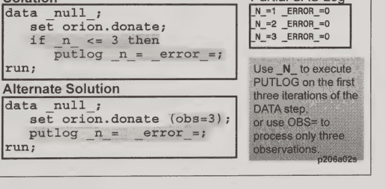

## 第 7 章迭代处理数据

- 7.1 `DO` 循环处理 ................................................................7-2
- 7.2 条件 `DO` 循环处理 ................................................7-17
- 7.3 `SAS` 数组处理..................................................................7-30
- 7.4 使用 `SAS` 数组 ................................................................7-44
- 7.5 答案 .............................................................................7-61

## 7.1 `DO` 循环处理

### 目标

- 解释迭代 `DO` 循环。
- 使用 `DO` 循环消除冗余和重复的计算。

### 业务场景

一位 Orion Star 的员工想要比较 5000 美元按年度与按季度复利的利息。

### 迭代 `DO` 语句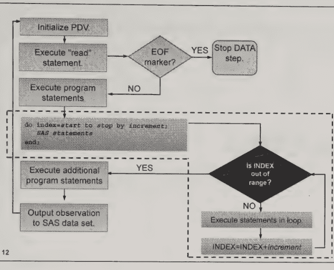

### 重复编码

```sas
data compound;
Amount=50000;
Rate=.045;
do i=1 to 20;
    Yearly+Amount*Rate;
end;
do i=1 to 80;
    lyly+/4;
 Amount
 Rate | | |
---|---|---|---|
50000 0 |005 | 22 0 | 2 |88.25 |
```

### 重复编码

如果员工想要确定 20 年（80 个季度）的利息怎么办？

```sas
data compound;
Amount=50000;
Rate=.045;
do i=1 to 20;
  Yearly+Amount*Rate;
end;
do i=1 to 80;
  Quarterly+Amount/4;
end;
run;
```

### `DO` 循环处理

使用 `DO` 循环执行重复计算。

```sas
data compound (drop=i);
Amount=50000;
Rate=.045;
do i=1 to 20;
  Yearly+Amount*Rate;
end;
do i=1 to 80;
  Quarterly+Amount/4;
end;
run;
```

### 迭代 `DO` 语句

`start`, `stop` 和 `increment`

- 必须是数字或产生数字的表达式

- 在执行循环之前建立

- 如果省略，`increment` 默认为 1

索引变量详情：

- 默认写入输出数据集中。

- 在循环结束时，索引变量的值比 `stop` 值多一个增。

`start` 指定索引变量的初始值。

`stop` 指定索引变量的结束值。

`increment` 指定控制索引变量增量的正负数。

在 `DO` 循环内对 `stop` 或 `increment` 的修改不会影响迭代次数。

### 带有列表的示例 `DO` 循环

- `DO` 循环列表中的每个项目执行一次。

- 列表必须用逗号分隔。

```sas
do Month='JAN', 'FEB', 'MAR';
end;
do odd=1,3,5,7,9;
end;
do i=Var1,Var2,Var3;
end;
do index-variable=item-1...item-n;
```

用引号括字符常量常量

### 7.01 简答投票

在执行以下 `DO` 语句后，索引变量的最终值是多少？

```sas
do i=1 to 5;
end;
do j=2 to 8 by 2;
end;
do k=10 to 2 by -2;
end;
```

最终值被高亮。

1 2 3 4 5 6

2 4 6 8

10 ... 2

### 业务场景

在每年 1 月 1 日，一位 Orion Star 的员工向账户投资了 5000 美元。根据从 2008 年开始 4.5% 的恒定年利率，确定三年后的账户价值。


# 执行：执行重复计算

```sas
data invest;
do Year=2008 to 2010;
  Capital+5000;
  Capital+(Capital*.045);
end;
run;
```

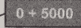

| Year (年份) | Capital (资本) | N |
|---|---|---|
| 2008 | 5000 | |

# 执行：执行重复计算

```sas
data invest;
do Year=2008 to 2010;
  Capital+5000;
  Capital+(Capital*.045);
end;
run;
```

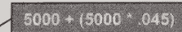

| Year (年份) | Capital (资本) | N |
|---|---|---|
| 2008 | 5225 | |

# 执行：执行重复计算

```sas
data invest;
do Year=2008 to 2010;
  Capital=5000;
  Capital+(Capital*.045);
end;
run;
```

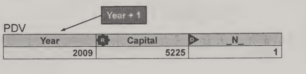

# 执行：执行重复计算

```sas
data invest;
do Year=2008 to 2010;
  Capital=5000;
  Capital+(Capital*.045);
end;
run;
```


| Year (年份) | Capital (资本) | N |
| 2009 | 5225 | 1 |

## 7.1 `DO` 循环处理 7-11

# 执行：执行重复计算

```sas
data invest;
do Year=2008 to 2010;
  Capital+5000;
  Capital+(Capital* .045);
end;
run;
```

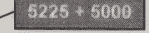

| Year (年份) | Capital (资本) | N |
|---|---|---|
| 2009 | 10225 | 1 |

20

# 执行：执行重复计算

```sas
data invest;
do Year=2008 to 2010;
  Capital+5000;
  Capital+(Capital* .045);
end;
run;
```

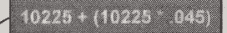

| Year (年份) | Capital (资本) | N |
|---|---|---|
| 2009 | 10685.13 | 1 |

21

Copyright © 2014, SAS Institute Inc., Cary, North Carolina, USA. 保留所有权利。

# 执行：执行重复计算

```sas
data invest;
do Year=2008 to 2010;
  Capital+=5000;
  Capital+(Capital*.045);
end;
```

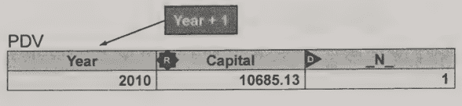

# 执行：执行重复计算

```sas
data invest;
do Year=2008 to 2010;
  Capital+=5000;
  Capital+(Capital*.045);
end;
```


| Year (年份) | Capital (资本) | N |
|---|---|---|
| 2010 | 10685.13 | 1 |

# 执行：执行重复计算

```sas
data invest;
 do Year=2008 to 2010;
  Capital+5000;
  Capital+(Capital*.045);
end;
run;
```


| Year (年份) | Capital (资本) | N |
|---|---|---|
| 2010 | 15685.13 | 1 |

# 执行：执行重复计算

```sas
data invest;
 do Year=2008 to 2010;
  Capital+5000;
  Capital+(Capital*.045);
end;
run;
```

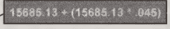

| Year (年份) | Capital (资本) | N |
|---|---|---|
| 2010 | 16390.96 | 1 |

# 执行：执行重复计算

```sas
data invest;
do Year=2008 to 2010;
  Capital=5000;
  Capital=Capital*.045;
end;
run;
```

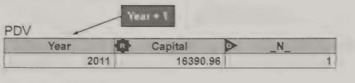

# 执行：执行重复计算

```sas
data invest;
do Year=2008 to 2010;
  Capital=5000;
  Capital=Capital*.045;
end;
run;
```

> `Year` 是否出了范围？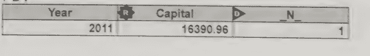

# 执行：执行重复计算

```sas
data invest;
  do Year=2008 to 2010;
    Capital+5000;
    Capital+(Capital*.045);
  end;
run;
```

当前观测值

| Year (年份) | Capital (资本) | N |
|---|---|---|
| 2011 | 16390.96 | 1 |

# 执行：执行重复计算

```sas
data invest;
do Year=2008 to 2010;
  Capital=5000;
  Capital=Capital*.045;
end;
run;
```


# 执行：执行重复计算

```sas
data invest;
do Year=2008 to 2010;
  Capital=5000;
  Capital=Capital*.045;
end;
run;
```

| Year (年份) | Capital (资本) |
|---|---|
| 2011 | 16390.96 |

# 7.02 答

如何为每年生成单独的观测值？

```sas
data invest;
do Year=2008 to 2010;
  Capital=5000;
  Capital+(Capital*.045);
output;
run;
proc print data=invest;
```

### 练习

如果你自上次练习后重启了 `SAS` 会话，请打开文件夹中的 `.sas` 程序。

# 1. 使用 `DO` 循环进行计算

Orion Star 部门必须根据下表的假设年度增长预测未来的员工成本（工资、退休福利和医疗福利）。

| Variable (变量) | Current Value (当前值) | Annual Increase (年增长率) |
|---|---|---|
| Wages (工资) | $12,874,000 | 6.0% |
| Retire (退休) | $1,765,000 | 1.4% |
| Medical (医疗) | $649 | 9.5% |

## 7.2 条件 `DO` 循环

a. 插入 `DO` 循环语句来计算 `Wages`、`Retire` 和 `Medical` 的估计值。

- 使用 `Start` 和 `Stop` 控制 `Year` 变量的值。例如，使用此公式计算 `Wages`：

- 创建另一个变量 `Total_Cost`，作为该年份 `Wages`、`Ret` 和 `Medical` 的和。

- 每年输出一个观测值。你的报告应包含 10 个观测值。

b. 打印并验证你的结果。

部分 `PROC` 输出（10 个观测值）

| Obs (观测) | Year (年份) | Wages (工资) | Medical (医疗) | Total_Cost (总成本) |
|---|---|---|---|---|
| 1 | 2013 | 13,646,440.00 | 1,789,710.00 | 710,655.00 | 16,146,805.00 |
| 2 | 2014 | 14,465,226.40 | 1,814,765.94 | 778,167.23 | 17,058,159.57 |
| 3 | 2015 | 15,333,139.98 | 1,840,172.66 | 852,093.11 | 18,025,405.76 |
| 4 | 2016 | 16,253,128.38 | 1,865,935.08 | 933,041.96 | 19,052,105.42 |
| 5 | 2017 | 17,228,316.09 | 1,892,058.17 | 1,021,680.94 | 20,142,055.20 |

> 以上结果于 2012 年 2 月 14 日生成。你的 `Year` 值可能会有所不同。

### 业务场景

回想预测 Orion Star 几个部门增长的示例。修改预测应用以使用 `DO` 循环消除冗余代码。

`orion.growth`

| Department (部门) | Total Employees (总人数) | Increase (增长率) |
|---|---|---|
| Administration Engineering (行政工程) | 34,999 | 0.25 0.30 |
| IS (信息系统) | 255 | 0.10 |
| Marketing (市场) | 200 | 0.20 |
| Sales Management (销售管理) | 20,111 | 0.30 0.10 |

# 预测应用（回顾）

```sas
data forecast;
set orion.growth;
Year=1;
Total_Employees=Total_Employees*(1+Increase);
output;
Year=2;
Total_Employees=Total_Employees*(1+Increase);
```

```sas
run;
proc print data=forecast;
```

如果你想预测未来六年的增长怎么办？

# 使用 `DO` 循环减少冗余代码

```sas
data forecast;
  set orion.growth;
  do Year=1 to 6;
    Total_Employees=Total_Employees*(1+Increase);
    output;
  end;
run;
proc print data=forecast noobs;
```


### 输出

部分 PROC 输出（36 个观测值）

| Department (部门) | Total Employees (总人数) | Increase (增长率) | Year (年份) |
|---|---|---|---|
| Administration | 42,500 | 0.25 | 1 |
| Administration | 53,125 | 0.25 | 2 |
| Administration | 66,406 | 0.25 | 3 |
| Administration | 83,008 | 0.25 | 4 |
| Administration | 103,760 | 0.25 | 5 |
| Administration | 129,700 | 0.25 | 6 |
| Engineering | 34,999 | 0.30 | 1 |
| Engineering | 45,499 | 0.30 | 2 |
| Engineering | 59,148 | 0.30 | 3 |
| Engineering | 76,893 | 0.30 | 4 |
| Engineering | 99,961 | 0.30 | 5 |
| Engineering | 129,949 | 0.30 | 6 |
| IS | 255 | 0.10 | 1 |
| IS | 281 | 0.10 | 2 |
| IS | 309 | 0.10 | 3 |
| IS | 339 | 0.10 | 4 |
| IS | 373 | 0.10 | 5 |
| IS | 410 | 0.10 | 6 |
| Marketing | 200 | 0.20 | 1 |
| Marketing | 240 | 0.20 | 2 |
| Marketing | 288 | 0.20 | 3 |
| Marketing | 346 | 0.20 | 4 |
| Marketing | 415 | 0.20 | 5 |
| Marketing | 498 | 0.20 | 6 |
| Sales Management | 20,111 | 0.30 | 1 |
| Sales Management | 26,144 | 0.30 | 2 |
| Sales Management | 33,987 | 0.30 | 3 |
| Sales Management | 44,183 | 0.30 | 4 |
| Sales Management | 57,438 | 0.30 | 5 |
| Sales Management | 74,669 | 0.30 | 6 |

### DO WHILE 语句


# 7.04 答调查

如何使用 DO WHILE 语句生成相同的结果？

```sas
data invest;
  do until (Capital>1000000);
    Year+1;
    Capital+5000;
    Capital+(Capital*.045);
  end;
run;
proc print data=invest noobs;
  format capital dollar14.2;
run;
```

`do while (capital <= 1000000);`

# 在迭代 DO 循环中使用 DO WHILE

再次确定账户的额。如果达到 30 年或累计金额超过 $250,000，则停止循环。

```sas
data invest;
  do Year=1 to 30 while (Capital<=250000);
    Capital+=5000;
    Capital+(Capital* .045);
  end;
run;
proc print data=invest noobs;
  format capital dollar14.2;
run;
```

PROC PRINT 输出

<BY index-variable=start> WHILE | UNTIL

| Year | Capital |
| :--- | :--- |
| 28 | $264,966.67 |

# 在迭代 DO 循环中使用 DO UNTIL

再次确定账户的额，但这次使用 DO UNTIL 语句。

```sas
data invest;
  do Year=1 to 30 until (Capital>250000);
    Capital+=5000;
    Capital+(Capital* .045);
  end;
run;
proc print data=invest noobs;
  format capital dollar14.2;
run;
```

在 DO UNTIL 循环中，在索引变量增加*之前*会检查条件。

PROC PRINT 输出

| Year | Capital |
| :--- | :--- |
| 27 | $264,966.67 |

### 业务场景

每年创建一个创建一个观测值，共持续五年，并显示每年投资 $5,000 且年利率为 4.5%（季度复利时的收益。

| Year | Capital |
| :--- | :--- |
| 1 | 5225.00 |
| 2 | 10699.95 |
| 3 | 16415.32 |
| 4 | 22395.39 |
| 5 | 28649.15 |

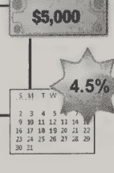

### 嵌套 DO 循环

```sas
DO index-variable-1=start TO stop <BY increment>;
  DO index-variable-2=start TO stop <BY increment>;
    <additional SAS statements>
  END;
END;
```

```sas
data invest (drop=Quarter);
  Year=1 to 5;
  do Quarter=1 to 4;
    Capital=Capital+(Capital*(.045/4));
  end;
  output;
end;
run;
```

# 7.05 答调查

如何为每个季度金额生成一个观测值？

```sas
data invest (drop=Quarter);
  do Year=1 to 5;
    Capital+5000;
    do Quarter=1 to 4;
      Capital+(Capital*(.045/4));
    end;
  output;
end;
run;

proc print data=invest noobs;
run;
```

### 业务场景

比较在三家季度复利银行中，每年投资 $5,000 持续五年的最终结果。假设每家银行都有一个固定利率，存储在 `orion.banks` 数据集中。

`orion.banks` 列表：

| Name | Rate |
| :--- | :--- |
| Carolina Bank and Trust | 0.0318 |
| State Savings Bank | 0.0321 |
| National Savings and Trust | 0.0328 |


# 使用 SET 语句使用嵌套 DO 循环

```sas
data invest (drop=Quarter Year);
  set orion.banks;
  Capital=0;
  do Year=1 to 5;
    Capital+5000;
    do Quarter=1 to 4;
      Capital+Capital*(Rate/4);
    end;
  end;
```

`orion.banks` 中三个观测值。因此，DATA 步会有三次迭代。在 DATA 步的每次迭代中必须将 `Capital` 设置为零。

# 执行：嵌套 DO 循环

```sas
data invest (drop=Quarter Year);
  set orion.banks;
  Capital=0;
  do Year=1 to 5;
    Capital+=5000;
    do Quarter=1 to 4;
      Capital+Capital*(Rate/4);
    end;
  end;
```

| Name | Rate | N |
| :--- | :--- | :--- |
| Carolina Bank and Trust | 0.0318 | 1 |

# 执行：嵌套 DO 循环

```sas
data invest (drop=Quarter Year);
  set orion.banks;
  Capital=0;
  do Year=1 to 5;
    Capital+=5000;
    do Quarter=1 to 4;
      Capital+(Capital*(Rate/4));
  end;
run;
```

| Name | Rate | N |
| :--- | :--- | :--- |
| State Savings Bank | 0.0321 | 2 |

# 执行：嵌套 DO 循环

```sas
data invest (drop=Quarter Year);
  set orion.banks;
  Capital=0;
  do Year=1 to 5;
    Capital+=5000;
    do Quarter=1 to 4;
      Capital+(Capital*(Rate/4));
    end;
  end;
run;
```

| Name | Rate | N |
| :--- | :--- | :--- |
| National Savings and Trust | 0.0328 | 3 |

# 输出：嵌套 DO 循环

```sas
proc print data=invest noobs;
run;
```

| Name | Rate | Capital |
| :--- | :--- | :--- |
| Carolina Bank and Trust | 0.0318 | 27519.69 |
| State Savings Bank | 0.0321 | 27544.79 |
| National Savings and Trust | 0.0328 | 27603.47 |

### 练习

如果自上次练习以来重新启动了 SAS 会话，请打开并提交文件夹中的 `libname.sas` 程序。

### 等级 1

使用 DO 循环进行计算

薪资部门必须根据假设的增长情况，预测未来几年的员工总成本（工资、退休福利和医疗福利）。

- 去年的公司收入为 $50,000,000。预计收入每年增长 1%。
- 修改程序 `p27`，使 DO 循环在当年总成本超过当年收入时停止。
- 打印年份、收入和 `Total_Cost`，直到超过收入。

PROC PRINT 输出

| Year | Income | Total_Cost |
| :--- | :--- | :--- |
| 13 | 50500.00 | 16146.08 |
| 14 | 51005.00 | 17058.57 |
| 15 | 51515.00 | 18025.40 |
| 16 | 52030.00 | 19052.42 |

# 7.2 条件 DO

| Year | Total_Cost |
| :--- | :--- |
| 26 | 64762.15 | 67931.29 | 以上结果使用了 DO WHILE 语句。

### 等级 2

# 3. 使用带有条件句的迭代 DO

去年去年收入为 $50,000,000，预计每年增长 2%。

- a. 创建一个名为 `work.expenses` 的数据集，计算预测的支出。
- 使用带有条件句的迭代 DO 语句。
- 当支出超过收入或达到 30 年时停止循环。
- b. 打印结果，并将 `Income` 格式化为美元符号和两位小数。

> 提示：DO WHILE 和 DO UNTIL 语句产生不同的结果。

### 挑战

# 4. 其他循环控制语句

- a. 使用迭代 DO 语句计算75 年的预测支出。
- 调查 SAS 文档有关其他循环语句（如 CONTINUE 和 LEAVE）的信息。
- 使用适当的循环控制语句（CONTINUE/LEAVE）在支出超过收入时停止循环。
- b. 打印结果，并将 `Expenses` 格式化为美元符号和两位小数。

# 执行重复计算

```sas
data charity;
set orion.employee_donations;
keep employee id qtr1-qtr4;
Qtr1=Qtr1*1.25;
Qtr2=Qtr2*1.25;
Qtr3=Qtr3*1.25;
Qtr4=Qtr4*1.25;
run;
proc print data=charity noobs;
run;
```

# 部分 PROC PRINT 输出

| Employee_ID | Qtr1 | Qtr2 | Qtr3 | Qtr4 |
|---|---|---|---|---|
| 120267 | 18.75 | 18.75 | 18.75 | 31.25 |
| 120269 | 25.00 | 25.00 | 25.00 | 25.00 |
| 120270 | 25.00 | 12.50 | 6.25 | - |


# 执行重复计算

这四个计算无法用 DO 循环内部的单个计算代替，因为它们是不相同的。

```sas
data charity;
set orion.employee_donations;
keep employee id qtr1-qtr4;
Qtr1=Qtr1*1.25;
Qtr2=Qtr2*1.25;
Qtr3=Qtr3*1.25;
Qtr4=Qtr4*1.25;
do i=1 to 4;
?
end;
run;
proc print data=charity noobs;
run;
```

可以使用 SAS 数组（Array）来简化这段代码。

# 使用数组简化重复计算

数组提供了访问 PDV（程序数据变量）中值的另一种方式，简化了重复计算。

```sas
data charity;
  set orion.employee_donations;
  keep employee qtr1-qtr4;
 Qtr1=qtr1*1.25;
 Qtr2=qtr2*1.25;
 Qtr3=qtr3*1.25;
 Qtr4=qtr4*1.25;
run;
proc print data=charity noobs;
run;
```

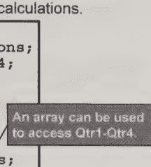

| Employee_ID | Qtr1 | Qtr2 | Qtr3 | Qtr4 |

# 什么是 SAS 数组？

SAS 数组

- - 是按特定顺序排列的 SAS 变量的临时分组
- 由数组名称标识
- 必须包含全数值型或全字符变量
- 仅存在于当前 DATA 步执行期间
- 它**不是**一个变量。

# 为什么要使用 SAS 数组？

创建一个名为 `Contrib` 的数组，并使用它来访问四个数值变量 `Qtr1 – Qtr4`。


| PDV Employee_ID | Qtr1 | Qtr2 | Qtr3 | Qtr4 |
|---|---|---|---|---|

SAS 数组与许多其他编程语言中的数组不同。在 SAS 中，数组不是数据结构。它只是临时标识一组变量的方便方法。

# 数组元素

数组中的每个值都称为元素（element）。


| PDV Employee_ID | Qtr1 | Qtr2 | Qtr3 | Qtr4 |
|---|---|---|---|---|

| 第一个元素 | 第二个元素 | 第三个元素 | 第四个元素 |

# 引用数组元素

每个元素都通过下标（subscript）标识，下标代表该元素在数组中的位置。当你使用数组引用时，相应的值将替换该引用。

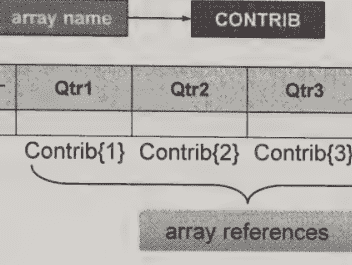

| PDV Employee_ID | Qtr1 | Qtr2 | Qtr3 | Qtr4 |
|---|---|---|---|---|

| | Contrib{1} | Contrib{2} | Contrib{3} | Contrib{4} |

# 定义数组

ARRAY 语句是一个编译语句，用于定义数组中的元素。

```sas
ARRAY array-name {subscript} $< <length> <array-elements>;
array Contrib{4} Qtr1 Qtr2 Qtr3 Qtr4;
```

| PDV Employee_ID | Qtr1 | Qtr2 | Qtr3 | Qtr4 |
|---|---|---|---|---|

| | Contrib{1} | Contrib{2} | Contrib{3} | Contrib{4} |

`array-name` 指定数组的名称。

`{subscript}` 使用星号（*）、数字、用逗号分隔的数字（用于多维数组）、数字范围或表达式来描述数组中元素的数量和排列方式。下标括在大括号 `{}` 中。也允许方括号 `[]` 和圆括号 `()`。

`$` 表示数组中的元素是字符元素。如果数组中的元素之前已定义为字符元素，则不需要美元符号。


`length` 指定数组中未赋值长度的元素的长度。

`array-elements` 命名构成数组的元素。数组元素可以任意顺序列出。

- `-` 数组引用不能用于 `LABEL`、`FORMAT`、`DROP`、`KEEP` 或 `LENGTH` 等编译时语句。

如果你将函数名作为数组名，SAS 在 `DATA` 步期间会将括号内的引用视为数组引用而非函数引用。

- 四个变量 `Qtr1`、`Qtr2`、`Qtr3` 和 `Qtr4` 现在可以通过数组名 `Contrib` 配合适当的下标进行引用。

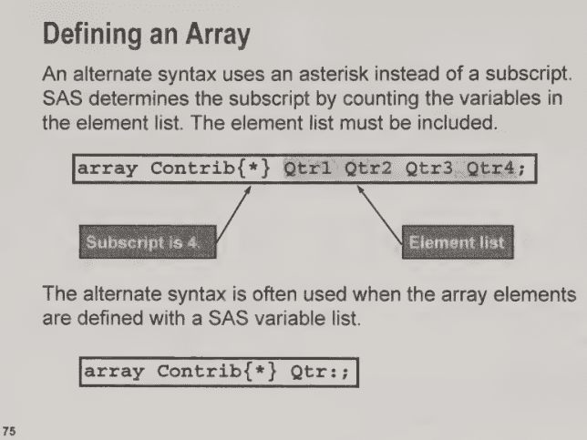

- 你可以使用特殊名称引用在同一 `DATA` 步中定义的变量。`CHARACTER` 列表引用字符，`NUMERIC` 列表引用数值。避免使用 `ALL` 特殊名称，因为数组中的元素必须全字符或全数值。

# 定义数组

数组的元素不需要满足：

- 相似的名称

- 相关的名称

- 顺序存储

```sas
array Amt(*) Q1 Q2 Q3 Qtr4;
PDV
ID Q1 Q2 Q3 Qtr4
Amt{1} Amt{2} Amt{3} Amt{4}
```

# 7.07 问

错误的原因是什么？

```sas
data charity (keep=Employee ID Qtr1-Qtr4);
set orion.employee_donations;
array Contrib(3) Qtr1-Qtr4;
array Contrib(5) qtr;/* additional SAS statements */
run;
```


# 使用 DO 循环处理数组

```sas
data charity;
  set orion.employee_donations;
  keep Qtr1-Qtr4;
  array Contrib{4} Qtr1-Qtr4;
  do i=1 to 4;
    Contrib{i}=Contrib{i}*1.25;
  end;
run;
```

为了引用元素，索引变量通常用下标：`array-name{index-variable}`。要处理数组的特定元素，请指定迭代范围。默认情况下，SAS 将索引变量包含在输出集中。使用 `DROP` 或 `KEEP` 选项防止索引变量写入输出集。

# DO 循环第一次迭代

```sas
data charity;
  set orion.employee_donations;
  keep Qtr1-Qtr4;
  array Contrib{4} Qtr1-Qtr4;
  do i=1 to 4;
    Contrib{i}=Contrib{i}*1.25;
  end;
run;
```

# DO 循环第二次迭代

```sas
data charity;
  set orion.employee_donations;
  keep Qtr1-Qtr4;
  array Contrib{4} Qtr1-Qtr4;
  do i=1 to 4;
    Contrib{i}=Contrib{i}*1.25;
  end;
run;
```

# DO 循环第三次迭代

```sas
data charity;
  set orion.employee_donations;
  keep Qtr1-Qtr4;
  array Contrib{4} Qtr1-Qtr4;
  do i=1 to 4;
    Contrib{i}=Contrib{i}*1.25;
  end;
run;
```

# DO 循环第四次迭代

```sas
data charity;
  set orion.employee_donations;
  keep Qtr1-Qtr4;
  array Contrib{4} Qtr1-Qtr4;
  do i=1 to 4;
    Contrib{i}=Contrib{i}*1.25;
    when i=4
    Contrib{4}=Contrib{4}*1.25;
  end;
```

# 输出：使用 Do 循环处理数组

```sas
proc print data=charity noobs;
run;
```

部分 `PROC PRINT` 输出

| Employee_ID | Qtr1 | Qtr2 | Qtr3 | Qtr4 |
|---|---|---|---|---|
| 120267 | 18.75 | 18.75 | 18.75 | 31.25 |
| 120269 | 25.00 | 25.00 | 25.00 | 25.00 |
| 120270 | 25.00 | 12.50 | 6.25 | - |

### 练习

如果你自上次练习以来重启了 SAS 会话，请打开并提交文件夹中的 `libname.sas` 程序。

### 等级 1

5. 使用数组进行重复计算

上半年的每月订单数据存储在 `orion.orders_midyear` 数据集中。Orion Star 销售经理考虑明年降价10%。经理想看看这种折扣如何影响今年的收入。

部分 `orion.orders_midyear`

| Obs | Customer_ID | Month1 | Month2 | Month3 | Month4 | Month5 | Month6 |
|---|---|---|---|---|---|---|---|
| 1 | | 213.10 | | 478.0 | 525.80 | 394.35 | 191.79 |
| 2 | 10 | 188.10 | 414.09 | 2876.9 | 3164.59 | 2373.44 | 169.29 |
| 3 | 11 | 78.20 | | | | 70.38 |
| 4 | 12 | | 135.60 | | 117.6 | 129.36 | 122.04 |
| 5 | 18 | | | | 29.4 | 32.34 | 24.26 |
| 6 | 24 | 93.00 | 265.80 | | | | 83.70 |
| 7 | 27 | 310.70 | 782.90 | | | | 279.63 |
| 8 | 31 | 1484.30 | 293.30 | | | | 1335.87 |
| 9 | 34 | 642.50 | | | 86.3 | 94.93 | 71.20 | 578.25 |
| 10 | 41 | | 134.00 | 119.20 | 313.0 | 344.30 | 258.23 | 120.60 |
| 11 | 45 | 443.88 | 216.20 | 40.2 | 44.22 | 33.17 | 399.49 |
| 12 | 49 | 24.80 | | | 111.72 | 122.89 | 92.17 | 115.94 |
| 18 | | | | | 27.93 | 30.72 | 23.04 | |

部分 `PROC PRINT` 输出（共24个观测值）

a. 创建一个折扣数据集以计算5%的折扣。创建一个数组 `Mon` 来调整 `Month1` 到 `Month6`。使用 `DO` 循环调整每个客户的每月数据。应用5%的折扣。

b. 打印结果数据集并验证你的结果。添加适当的标题。对每月销售金额使用 `DOLLAR` 格式。

# 7-42 第 7 章 迭代处理数据

**部分 `orion.orders_midyear` 数据**

| Customer_ID | Month1 | Month2 | Month3 | Month4 | Month5 | Month6 |
|---|---|---|---|---|---|---|
| 5 | 213.10 | | 478.0 | 525.80 | 394.35 | 191.79 |
| 10 | 188.10 | 414.09 | 2876.9 | 3164.59 | 2373.44 | 169.29 |
| 11 | 78.20 | | | | | 70.38 |
| 12 | 135.60 | | 117.6 | 129.36 | 97.02 | 122.04 |
| | | | 29.4 | 32.34 | | |

- 创建一个数据集 `special_offer`，包含第 1 到 3 月的 10% 折扣。

- 创建一个数组 `Mon`，用于访问 `Month1` 到 `Month3`。

- 使用 `DO` 循环调整每个客户的每月数据，包含 10% 的折扣（仅限 `Month1` 到 `Month3`）。

- 创建新变量：

- `Total_Sales` – 六个月内当前销售额的总和

- `Projected_Sales` – 六个月调整后销售额的总和（包括三个月的折扣后金额）

- `Difference` – `Total_Sales` 与 `Projected_Sales` 之间的差

- 仅保留新变量：

- b. 打印生成的数据集并验证你的结果。

- 隐藏会日期、页码和观测值列。

- 添加一个合适的标题。

- 使用 `SUM` 语句显示 **`Difference`** 变量的总和。

- 对所有变量使用 `DOLLAR.` 格式。

前三个月包含 10% 折扣的部分 `PROC PRINT` 输出

```
Total Sales
Total_Sales      Projected_Sales Difference
$1,803.04        $1,733.93      $69.11
$9,186.41        $8,838.50      $347.91
$148.58           $140.76        $7.82
$601.62           $576.30        $25.32
                               
$1,518.95        $1,467.02      $51.93
=================
$1,550.74
```

### 挑战

## 7. 终止 DATA 步骤

上半年的订单数据存储在 `orion.orders_midyear` 数据集中。该数据集每月更新，可能包含 1 到 12 个月的数据。

部分 **`orion.orders_midyear` 数据**

| Obs | Month1 | Month2 | Month3 | Month4 | Month5 | Month6 |
|---|---|---|---|---|---|---|
| 1 | 5 | 213.10 | 478.0 | 525.80 | 394.35 | 191.79 |
| 2 | 10 | 188.10 | 414.09 | 2876.9 | 3164.59 | 169.29 |
| 3 | 11 | 78.20 | | | | 70.38 |
| 4 | 12 | 135.60 | | 117.6 | 129.36 | 122.04 |
| 5 | 18 | | | 29.4 | 32.34 | 24.26 |

a. Orion Star 公司决定，如果客户至少有三个月的订单数据，则创建一个常客计划 (`FSP`)。若要获得该计划的邀请，客户必须在 50% 的月份内有订单，且自年初以来消费金额至少 $1000。例如：如果数据文件包含某客户 6 个月的订单，则客户必须在三个或更多月份内消费超过 $1000；如果数据文件只有 3 个月的订单，则客户必须在两个或更多月份内消费超过 $1000 才能获得常客计划。

- 打开数据集并验证其是否包含至少三个月的数据。

- 如果少于三个月，向 SAS 日志写入信息并立即停止 `DATA` 步骤。

- 如果数据集中至少有三个月的数据，创建一个数组 **`Mon`** 来访问 `Month` 变量，无论数据集中存在多少个变量。提示：考虑使用 SAS 变量来列出数组元素。

- 使用 `DO` 循环检查每个客户的数据，以确定该客户是否符合常客计划的条件。

- 创建一个新的数据集 **`fsp`**，包含每个符合条件的客户的观测值。

- 使用报告确定要删除或保留哪些变量。

- 提示：使用 SAS 文档研究 `STOP` 语句的使用。

b. 使用合适的标题和格式打印生成的数据集，并验证你的结果。部分 midyear: (11 个观测值) `orion.orders_midyear`: 常客

| Obs | Customer_ID | Total_Order_Amount | Months_Ordered |
|---|---|---|---|
| 1 | 5 | $1,803.04 | 5 |
| 2 | 10 | $9,186.41 | 6 |
| 3 | 27 | $1,373.23 | 3 |
| 4 | 31 | $1,113.47 | 3 |
| 5 | 34 | $1,473.18 | 5 |

c. 使用 **`orion.orders_qtr1`** 测试你的程序。`PROC PRINT` 输出 `orion.orders_qtr1`: 常客

| Obs | Customer_ID | Total_Order_Amount | Months_Ordered |
|---|---|---|---|
| 1 | 10 | $3,479.09 | 3 |
| 2 | 27 | $1,093.60 | 2 |
| 3 | 31 | $1,777.60 | 2 |
| 4 | 17 | $1,849.90 | 3 |
| 5 | 28 | $1,506.90 | 3 |

d. 使用 `orion.orders_two_months` 测试你的程序。部分 Shopper Program SAS 日志

```
Insufficient data for Shopper Program
NOTE: 从 ORION.ORDERS_MONTHS 读取了 0 个观测值。
NOTE: 数据集 WORK.FSP 有 0 个观测值和 3 个变量。
NOTE: 使用了 data 语句 (Total time):
title 'orion.orders_two_months: Frequent Shoppers ';
proc print data=fsp;
format total_order_amount dollar10.;
```

数据集 中没有观测值。

## 7.4 使用 SAS 数组

### 将数组作为函数使用

以下程序将数组传递给 `SUM` 函数。

```sas
data test;
  set orion.employee_donations;
  array val{4} Qtr1-Qtr4;
  Tot1=sum(of val*);
  Tot2=sum(of val*);
run;
proc print data=test;
  var Employee_ID Tot1 Tot2;
run;
```

部分 `PROC PRINT` 输出

| Obs | Employee_ID | Tot1 | Tot2 |
|---|---|---|---|
| 1 | 12065 | 25 | 25 |
| 2 | 12067 | 60 | 60 |
| 3 | 12069 | 80 | 80 |


### DIM 函数

`DIM` 函数返回数组元素。此值通常用作 `DO` 循环的停止值。

```sas
data charity;
  set orion.employee_donations;
  keep Employee_ID Qtr1-Qtr4;
  array Contrib{*} qtr;
  do i=1 to dim(Contrib);
    Contrib{i}=Contrib{i}*1.25;
  end;
run;
```

> `DIM(array_name)`


`HBOUND` 函数返回数组的上边界。`LBOUND` 函数返回数组的下边界。以下 `DO` 循环处理数组中的每个元素：

```sas
do i=lbound(items) to hbound(items);
  *process items{i};
end;
```

在大多数数组中，下标从 1 到 n，其中 n 是数组元素的数量。值 1 是方便的下边界。你不需要指定下边界。当数组维度起点不是 1 时，指定两个边界是有用的。例如，以下 `ARRAY` 定义了一个下标从 5 到 14 的 10 个元素的数组：

```sas
array items{5:14} n5-n14;
```

### 使用数组创建数值变量

`ARRAY` 语句可以在程序数据向量（`PDV`）中创建新变量。

```sas
array Pct{4} Pct1-Pct4;
```

如果 `Pct1` 和 `Pct4` 不存在于 `PDV` 中，则会被创建。此语句产生相同的结果：

```sas
array Pct{4};
```

`PDV`:

| Pct1 | Pct2 | Pct3 | Pct4 |
|---|---|---|---|
| N 8 | N 8 | N 8 | N 8 |

### 使用数组创建字符变量

定义一个名为 `Month` 的数组以创建长度为 10 的字符变量。

```sas
array Month{6} $ 10;
```

`PDV`:

| Month1 | Month2 | Month3 | Month4 | Month5 | Month6 |
|---|---|---|---|---|---|
| $ 10 | $ 10 | $ 10 | $ 10 | $ 10 | $ 10 |

### 场景

使用 `orion.employee_donations` 作为输入，计算每个季度贡献占员工总贡献的百分比。创建四个新变量来存储这些百分比。

| Employee_ID | Qtr1 | Qtr2 | Qtr3 | Qtr4 |
|---|---|---|---|---|
| 12065 | | | 25 | |
| 12067 | 15 | 15 | 15 | |


| Employee_ID | Percent1 | Percent2 | Percent3 | Percent4 |

|---|---|---|---|---|

| 12065 | | | | 100% |

| 12067 | 25% | 25% | 25% | |

### 使用数组创建变量

```sas
data percent(drop=i);
  set orion.employee_donations;
  array Contrib(4) Cary Qtr1-Qtr4;
  array Percent(4);
  Total=sum(of contrib*);
  do i=1 to 4;
    percent{i}=contrib{i}/total;
  end;
run;
```

# 输出：使用数组创建变量

```sas
proc print data=percent noobs;
var Employee ID Percent1-Percent4;
format Percent1-Percent4 percent6.;
run;
```

部分 PROC PRINT 输出（共 124 个观测值）

| Employee_ID | Percent1 | Percent2 | Percent3 | Percent4 |

|---|---|---|---|---|

| 12065 | 25% | 25% | 25% | 100% |

| 12067 | 25% | 25% | 25% | | |

| 12069 | 25% | 25% | 25% | | |

| 12070 | 57% | 25% | 14% | | |

| 12071 | 25% | 25% | 25% | 25% | |

| 12072 | 25% | 25% | 25% | 25% | |

| 12075 | 25% | 25% | 25% | 25% | |

| 12066 | 25% | 25% | 25% | 25% | |

| 12065 | 50% | | 25% | 25% | |

| 12063 | | | 100% | 25% | | |

| 12068 | | 25% | 25% | 25% | | |

`PERCENTw.d` 格式会将将值乘以 100，以与 `BESTw.d` 格式相同的方式进行格式化，并在格式化后的值末尾添加百分号（%）。负值被括在括号中。`PERCENTw.d` 格式为百分号和括号留出了空间，即使该值不是负的。

### 业务场景

使用 `orion.employee_donations` 作为输入，计算每个员工贡献从一个季度到下一个季度的差值。

| Employee_ID | Qtr1 | Qtr2 | Qtr3 | Qtr4 |

|---|---|---|---|---|

| 12066 | | | | | 25 |

| 12067 | 15 | 15 | 15 | 15 |

| 12069 | 20 | 20 | 20 | 20 |

| 12070 | 20 | 10 | 5 | | |

> Diff1 = Qtr2 - Qtr1

Diff2 = Qtr3 - Qtr2

Diff3 = Qtr4 - Qtr3

| Employee_ID | Diff1 | Diff2 | Diff3 |

|---|---|---|---|

| 12066 | | 0 | 0 | 0 |

| 12067 | | 0 | 0 | | |

| 12069 | | 0 | 0 | | |

| 12070 | -10 | -5 | | |

# 7.08 简答调查调查

你会使用多少个 `ARRAY` 语句来计算每个员工贡献从一个季度到下一个季度的差值？

部分 `orion.employee_donations`

| Employee_ID | Qtr1 | Qtr2 | Qtr3 | Qtr4 |

|---|---|---|---|---|

| 120265 | | | | | 25 |

| 120267 | 15 | 15 | 15 | | |

| 120269 | 20 | 20 | 20 | | |

> 一阶差：Qtr2 - Qtr1

二阶差：Qtr3 - Qtr2

三阶差：Qtr4 - Qtr3

# 使用数组创建变量

```sas
data change;
  set orion.employee_donations;
  drop l1;
  array Contrib(4) Qtr1-Qtr4;
  array Diff{3};
  do i=1 to 3;
    Diff{i}=Contrib{i+1}-Contrib{i};
  end;
run;
```

`Contrib` 数组引用现有变量。`Diff` 数组创建了三个变量：`Diff1`、`Diff2` 和 `Diff3`。

# 使用数组创建变量

```sas
data change;
  set orion.employee_donations;
  drop i;
  array Contrib{4} Qtr1-Qtr4;
  array Diff{3};
  do i=1 to 3;
    Diff{i}=Contrib{i+1}-Contrib{i};
  end;
run;
```

```sas
when i=1
  Diff{1}=Contrib{2}-Contrib{1};
  Diff1=Qtr2-Qtr1;
```

# 使用数组创建变量

```sas
data change;
  set orion.employee_donations;
  drop i;
  array Contrib{4} Qtr1-Qtr4;
  array Diff{3};
  do i=1 to 3;
    Diff{i}=Contrib{i+1}-Contrib{i};
  end;
run;
```

```sas
when i=2
  Diff{2}=Contrib{3}-Contrib{2};
  Diff2=Qtr3-Qtr2;
```

# 使用数组创建变量

```sas
data change;
  set orion.employee_donations;
  drop i;
  array Contrib{4} Qtr1-Qtr4;
  array Diff{3};
  do i=1 to 3;
    Diff{i}=Contrib{i+1}-Contrib{i};
  end;
run;
```

```sas
data change;
  set orion.employee_donations;
  drop i;
  array Contrib{4} Qtr1-Qtr4;
  array Diff{3};
  do i=1 to 3;
    Diff{i}=Contrib{i+1}-Contrib{i};
  end;
```

```sas
when i=3
Diff{3}=Contrib{4}-Contrib{3};
Diff3=Qtr4-Qtr3;
```

(img/d3bde6e6ab0b1fc622215d982111742_328.png)

# 使用数组创建变量

```sas
proc print data=change noobs;
  var Employee ID Diff1-Diff3;
run;
```

部分 PROC PRINT 输出（共 124 个观测值）

| Employee_ID | Diff1 | Diff2 | Diff3 |

|---|---|---|---|

| 12065 | | | | |

| 12067 | | 0 | 0 | |

| 12069 | | 0 | 0 | |

| 12070 | -10 | -5 | | |

### 业务场景

确定员工贡献与 $10,$20,$20 和 $15 季度目标之间的差值。使用查找表来存储季度目标。

| Employee_ID | Qtr1 | Qtr2 | Qtr3 | Qtr4 |

|---|---|---|---|---|

| 12065 | | 15 | 15 | 25 |

| 12067 | 15 | 15 | 15 | 15 |

| 12069 | 20 | 20 | 20 | | |

| 12070 | 20 | 10 | 5 | | |

# 给数组分配初始值

当指定初始值列表时，所有元素的行为就像它们在 `RETA` 语句中命名一样。这通常用于创建一个查找表，即在 DATA 步期间引值列表。

```sas
array Target{5} (50,100,125,150,200);
```

| Target1 | Target2 | Target3 | Target4 | Target5 |

|---|---|---|---|---|

| 50 | 100 | 125 | 150 | 200 |

（初始值列表列出了对应数组元素的初始值。值可以是数字或字符串。字符串必须加引号。元素通过位置匹配。如果数组元素多于值，剩余的数组元素将被赋予缺失值，SAS 会发出警告。）

# 编译：创建了变量？

```sas
data compare(drop=i Goal1-Goal4);
set orion.employee_donations;
array Contrib{4} Qtr1-Qtr4;
array Diff{4};
array Goal{4} (10,20,20,15);
do i=1 to 4;
  Diff{i}=Contrib{i}-Goal{i};
run;
```

| Employee_ID | Qtr1 | Qtr2 | Qtr3 | Qtr4 |

|---|---|---|---|---|

# 编译：创建了变量？

```sas
data compare(drop=i Goal1-Goal4);
set orion.employee_donations;
array Contrib{4} Qtr1-Qtr4;
array Diff{4};
array Goal{4} (10,20,20,15);
do i=1 to 4;
  Diff{i}=Contrib{i}-Goal{i};
run;
```

(img/d3bde6e6ab06b1fc622215d982111742_330_0.png)

| Employee_ID | Qtr1 | Qtr2 | Qtr3 | Qtr4 |

|---|---|---|---|---|

# 编译：创建了变量？

```sas
data compare(drop=i Goal1-Goal4);
set orion.employee_donations;
array Contrib{4} Qtr1-Qtr4;
array Diff{4};
array Goal{4} (10,20,20,15);
do i=1 to 4;
  Diff{i}=Contrib{i}-Goal{i};
end;
```

| Employee_ID | Qtr1 | Qtr2 | Qtr3 | Qtr4 | Diff1 |

|---|---|---|---|---|---|

# 编译：创建了变量

```sas
data compare(drop=i Goal1-Goal4);
set orion.employee_donations;
array Contrib{4} Qtr1-Qtr4;
array Diff{4};
array Goal{4} (10,20,20,15);
do i=1 to 4;
  Diff{i}=Contrib{i}-Goal{i};
end;
```

| Employee_ID | Qtr1 | Qtr2 | Qtr3 | Qtr4 | Diff1 | Diff2 | Diff3 | Diff4 |

|---|---|---|---|---|---|---|---|

# 编译：创建了变量？

```sas
data compare(drop=i Goal1-Goal4);
set orion.employee_donations;
array Contrib{4} Qtr1-Qtr4;
array Diff{4};
array Goal{4} (10,20,20,15);
do i=1 to 4;
  Diff{i}=Contrib{i}-Goal{i};
end;
```

| Employee_ID | Qtr1 | Qtr2 | Qtr3 | Qtr4 | Diff1 | Diff2 | Diff3 |

4

---|---|---|---|---|---|---|

   ： ：

```sas
data change;
=i orion.employee_);
_ationsations.employee_dropations;
array Contrib{4} Qtr1-Qtr4;
array Diff{4};
array Goal{4} (10,20,20,15);
do i=1 to 4;
  Diff{i}=Contrib{i}-Goal{i};
end;
```

# SUM 函数忽略缺失值

`SUM` 函数会忽略缺失值。它可以用于计算季度贡献额与相应目标之间的差值。

```sas
data compare(drop=i);
  set orion.employee_donations;
  array Contrib{4} Qtr1-Qtr4;
  array Diff{4};
  array Goal{4}_temporary (10,20,20,15);
  do i=1 to 4;
    Diff{i}=sum(Contrib{i},-Goal{i});
  end;
run;
```

# 输出：查找表应用

```sas
proc print data=compare noobs;
  var employee_id diff1-diff4;
run;
```

部分 PROC PRINT 输出（共 124 条观测值）

| Employee_Id | Diff1 | Diff2 | Diff3 | Diff4 |

|---|---|---|---|---|

| 120265 | -10 | -20 | -20 | 10 |

| 120267 | 5 | -5 | -5 | 0 |

| 120269 | 10 | 0 | 0 | 5 |

| 120270 | 10 | -10 | -15 | -15 |

| 120271 | 10 | 0 | 0 | 5 |

缺失值的处理方式相当于该季度没有产生贡献。

# 7.9 简答

使用铅笔和纸，写一个 `ARRAY` 语句来定义一个名为 `Country` 的临时表，包含三个两个字符的元素。将元素初始化为 `AU`、`NZ` 和 `US`。参考下面的语法。

```sas
ARRAY Country{3}$2 ('AU', 'NZ', 'US');
```


### 练习

## Level 1

如果你自上次练习以来重启了 SAS 会话，请打开找到的程序。

### 8. 使用数组进行表查找

销售部经理希望识别即将开展的促销活动的优选客户。使用 `orion.orders_midyear` 数据集和查找表创建一个新的数据集 `preferred_cust`。

a. 打开 `orion.orders_midyear` 文件并进行以下更改：

- 创建一个临时表 `Target`，存储每个月的销售目标：200, 400, 300, 100, 200。

- 创建新变量 `Over1, Over2, ..., Over6`，用于存储存储客户超过相应月份目标的支出金额。

- 如果客户得分为 7 或更高，将观测值写入名为 `passed` 的数据集中。

- 如果客户得分小于 7，将观测值写入名为 `failed` 的数据集中。

## 第7章 迭代处理数据

- 使用 DO 循环在相应月份的销售额超过目标时，计算 `Over1` 到 `Over6` 的值。

- 如果某月的销售额未超过目标，则不执行此计算。

- 将 `Over1` 到 `Over6` 的和存储在另一个新变量 `Total_Over` 中。

- 只有当 `Total_Over` 大于 500 时才写入观测值。

- 新数据集应仅包含 `Customer_ID`、`Over1` 到 `Over6` 以及 `Total_Over`。

b. 打印新数据集并验证你的结果。

部分 PROC PRINT 输出（共 9 条观测值）

| Customer_ID | Over1 | Over2 | Over3 | Over4 | Over5 | Over6 | Total_Over |

|---|---|---|---|---|---|---|---|

| 5 | 13.1 | | 178.0 | 425.80 | 294.35 | | 911.25 |

| 10 | | 14.09 | 2576.9 | 3064.5 | 2273.44 | | 7929.02 |

| 27 | 110.7 | 382.90 | | | | | 573.23 |

| 31 | 1284.3 | | | | | 1135.87 | 2420.17 |

| 34 | 442.5 | | | | | | | 820.75 |

## Level 2

### 9. 使用字符数组进行查找

Orion 的公共安全部希望所有员工了解有关零售店事故的新政策和程序。每位员工都必须参加网络培训，并参加包含 10 个问题的单选题测试。每个问题有 A 到 E 五个选择。测试结果输入 `orion.test_answers` 数据集，如下所示。

`orion.test_answers` 中的每条观测值包含一个人的答案。

部分 `orion.test_answers`（共 15 条观测值）

| Employee_ID | Q1 | Q2 | Q3 | Q4 | Q5 | Q6 | Q7 | Q8 | Q9 | Q10 | Score |

|---|---|---|---|---|---|---|---|---|---|---|

| 12104 | A | C | C | B | D | E | D | B | B | | |


| 120145 | B | C | C | E | E | D | B | B | A | | |

| 120761 | A | C | C | B | D | D | E | B | C | | |

| 120656 | B | C | C | A | D | B | B | C | | | |

| 121107 | A | C | B | E | E | D | B | B | | | |

问题的正确答案如下：

| Question | 1 | 2 | 3 | 4 | 5 | 6 | 7 | 8 | 9 | 10 |

|---|---|---|---|---|---|---|---|---|---|---|

| Answer | A | C | C | B | E | E | D | B | B | |

a. 读取 `orion.test_answers` 并判断每个人是否通过。

- 创建一个答案数组。
- 如果员工得分为 7 或更高，将观测值写入名为 `passed` 的数据集。
- 如果员工得分小于 7，将观测值写入名为 `failed` 的数据集。

b. 打印 `passed` 数据集验证其包含 12 条观测值。

## 7.5 答案

### 1. 使用 DO 循环计算

```sas
data future_expenses;
  drop start stop;
  Wages=1287400;
  Retire=1765000;
  Medical=649000;
  start=year(today())+1;
  stop=start;
  do Year=start to stop;
    wages = wages * 1.06;
    retire=retire*0.014;
    medical=medical*1.095;
    Total_Cost=sum(wages,retire,medical);
    output;
  end;
```

Copyright © 2014, SAS Institute., Cary, North Carolina, USA. ALL RIGHTS RESERVED.

```sas
data future_expenses;
  Wages=1287400;
  Retire=1765000;
  Medical=649000;
  do Year=year(today())+1 to year(today())+10;
    wages = wages * 1.06;
    retire=retire*0.014;
    medical=medical*1.095;
    Total_Cost=sum(wages,retire,medical);
    output;
  end;
run

proc print data=future_expenses;
  format wages retire medical total_cost comma.2;
  var year wages medical total_cost;
run;
```

# 使用条件 DO 循环计算

```sas
data income_expenses;
  Wages=1287400;
  Retire=1765000;
  Medical=649000;
  Income=5000000;
  start=year(today())+1;
  do until (Total_Cost > Income);
    wages = wages * 1.06;
    retire=retire*0.014;
    medical=medical*1.095;
    Total_Cost=sum(wages,retire,medical);
    output;
    year+1;
  end;
run;
```

# 使用带有语句的迭代 DO 循环

```sas
data expenses;
  Income=5000000;
  Expenses = 3875000;
  do Year=1 to 30;
    income+(income * .01);
    expenses+(expenses * .02);
  end;
run

proc print data=expenses;
  format income expenses dollar$15.2;
run;
```

### 控制语句

### 4. 使用其他循环控制语句

```sas
data expenses;
  Income=5000000;
  Expenses = 3875000;
  do Year=1 to 75;
    income +(income * .01);
    expenses+=(expenses * .02);
    if expenses > income then leave;
  end;
run

proc print data=expenses;
  format income expenses dollar$14.2;
run;
```

## 5. 使用数组进行重复计算

```sas
title '折扣 5% 的月销售额';
proc print data=discount_sales noobs;
format month1-6 dollar$10.2;
run;
title;
```

# 7-64 第 7 章 迭代处理数据

```sas
format total_sales projected_sales difference dollar10.2;
sum difference;
run;
title:
```

# 7. 终止 DATA 步

```sas
data fsp;
  set orion.orders midyear;
  keep Customer_ID Months_Ordered Total_Order_Amount;
  array amt{*} month;
  if dim(amt) < 3 then do;
    put 'Insufficient data for Frequent Shopper Program';
    stop;
  end;
  Total_Order_Amount=0;
  Months_Ordered=0;
  do i=1 to dim(amt);
    if amt{i} ne . then Months_Ordered+1;
    Total_Order_Amount+amt{i};
  end;
  if Total_Order_Amount>1000 and Months_Ordered >= (dim(amt))/2;
run;
```

```sas
title 'orion.orders_midyear: Frequent Shoppers ';
proc print data=fsp;
  format total_order_amount dollar10.2;
run;
title;
```

```sas
data fsp;
  set orion.orders_qtrl;
  keep Customer_ID Months_Ordered Total_Order_Amount;
  array amt{*} month;
  if dim(amt) < 3 then do;
    put 'Insufficient data for Frequent Shopper Program';
    stop;
  end;
  Total_Order_Amount=0;
  Months_Ordered=0;
  do i=1 to dim(amt);
    if amt{i} ne . then Months_Ordered+1;
    Total_Order_Amount+amt{i};
  end;
  if Total_Order_Amount>1000 and Months_Ordered >= (dim(amt))/2;
run;
title 'orion.orders_qtrl: Frequent Shoppers ';
proc print data=fsp;
  format total_order_amount dollar10.2;
run;
title;
```

© © 2014, SAS Institute Inc., Cary, North Carolina, USA. ALL RIGHTS RESERVED.

```sas
data fsp;
  set orion.orders_two_months;
  keep Customer_ID Months_Ordered Total_Order_Amount;
  array amt{*} month;
  if dim(amt) < 3 then do;
    put 'Insufficient data for Frequent Shopper Program';
    stop;
  end;
  Total_Order_Amount=0;
  Months_Ordered=0;
  do i=1 to dim(amt);
    if amt{i} ne . then Months_Ordered+1;
    Total_Order_Amount+amt{i};
  end;
  if Total_Order_Amount>1000 and Months_Ordered >= (dim(amt))/2;
run;
title 'orion.orders_two_months: Frequent Shoppers ';

proc print data=fsp;
  format total_order_amount dollar10.2;
run;
title;
```

## 8. 使用数组进行表查找

```sas
data preferred_cust;
  set orion.orders.midyear;
  array Mon{6} Month1-Month6;
  keep Customer_ID Over1-Over6 Total_Over;
  array Over{6};
  array Target{6} _temporary_ (200,400,300,100,200);
  do i=1 to 6;
    if Mon{i} > Target{i} then
      Over{i} = Mon{i};
  end;
  Total_Over=sum(of Over{});
  if Total_Over > 500;
run;

proc print data=preferred_cust noobs;
run;
```

## 9. 使用字符数组进行表查找

```sas
data passed_failed;
  set orion.test_answers;
  drop i;
  array Response{10} Q1-Q10;
  array Answer{10} $ 1 _temporary_ ('A','C','I','C','B','E','E','E','D','B','B','B','A');

  Score=0;
  do i=1 to 10;
    if Answer{i}=Response{i} then Score+1;
  end;
  if Score ge 7 then output passed;
  else output failed;
run;

title 'Passed';
proc print data=passed;
run;
title;

title 'Failed';
proc print data=failed;
run;
title;
```

## 学生活动答案（投票/测验）

## 7.01 简答题投票 – 正确答案

在执行以下 DO 语句后，变量的最终值是什么？最终值已高亮显示。

| do i=1 to 5; |

| end; |

| 1 2 3 4 5 6 |

| do j=2 to 8 by 2; |

| ... |

| end; |

| 2 4 6 8 10 |

| do k=10 to 2 by -2; |

| ... |

| end; |

| 10 8 6 4 2 0 |

## 7.02 简答题投票 – 正确答案

如何为每一年生成一个独立的观测值？在 DO 循环内部放置一个显式的 OUTPUT 语句。

```sas
data fsp;
  set orion.orders_midyear;
  do Year=2008 to 2010;
    Capital+5000;
    Capital+(Capital*.45);
    output;
end;
run;
```

| Year | Capital |

|---|---|

| 2008 | 5225.00 |

| 2009 | 10685.13 |

| 2010 | 16390.96 |

## 7.03 简答题投票 – 正确答案

在 DO 循环中可以使用哪个停止值来确定工程部门超过 75 人的年数？

```sas
data forecast;
  set orion.growth;
  do Year=1 to 6;
    Total_Employees = Total_Employees*(1+Increase);
    output;
  end;
run;
proc print data=forecast noobs;
run;
```

使用条件迭代来停止循环。

## 7.04 简答题投票 – 正确答案

如何使用 DO 语句生成相同的结果？将 UNTIL 语句改为 DO WHILE。

```sas
data invest;
  do while(Capital<=10000);
    Capital+5000;
    Capital+(Capital*.45);
    output;
  end;
run;
```

## 7.05 简答题 – 正确答案

如何为每个季度生成一个观测值？将 OUTPUT 语句放在内部循环中。

```sas
data invest;
  do Year=1 to 5;
    Capital+5000;
    Capital+(Capital*.45);
    output;
end;
run;
```

| Year | Capital | Quarter |

|---|---|---|

| 1 | 5225.00 | 1 |

| 2 | 10685.13 | 2 |

| 3 | 16390.96 | 3 |

| 4 | 23133.51 | 4 |

| 5 | 30174.33 | 5 |

## 7.07 简答题 – 正确答案

打开日志以确定错误原因。下标和元素数量必须一致。

```sas
data charity;
  set orion.donations;
  array Contrib1{3} Q1-Q4;
  array Contrib2{5} qtr;
```

## 7.08 简答题 – 正确答案

使用多少个数组来计算每个员工与下一次贡献的差异？答案不固定，但一种解决方案是使用两个数组。

| Employee_ID | Qtr1 | Qtr2 | Qtr3 | Qtr4 |

|---|---|---|---|---|

| 120265 | | 15 | 15 | 25 |

| 120267 | | 15 | 20 | 15 |

| 120269 | | 20 | | 20 |

部分 `orion.donations`.

## 7.09 简答题投票 – 正确答案

在纸上写一个 ARRAY 语句，定义一个名为 Country 的临时表，包含三个元素，长度为两个字符。将元素初始化为 AU, NZ 和 US。参考下面的语法。

```sas
array Country{3} $ 2 temporary_ ('AU','NZ','US');
```

# 数据集结构

其他数据集的每个实体包含多个观测值。为了方便起见，这被称为窄数据集。

| 客户 ID | 周期 | 金额 |

|---|---|---|

| 14359 | Qtr2 | 125 |

| 143561 | Qtr1 | 150 |

| 143561 | Qtr2 | 79 |

| 143561 | Qtr3 | 07 |

| 143561 | Qtr4 | 15 |

| 158913 | Qtr1 | 208 |

| 158913 | Qtr2 | 22 |

- 客户 143561 的信息存储在四个观测值中。每个观测值代表一个不同季度的捐款。

# 业务场景：报告

Orion 工资经理要求提供一份报告，显示每个季度进行慈善捐款的 Orion Star 员工人数，以及一个显示季度贡献总额的饼图。

所需的报告草图

| 周期 | 频率 |

|---|---|

| Qtr1 | 56 |

| Qtr2 | 99 |

| Qtr3 | 24 |

| Qtr4 | 75 |

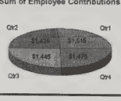

- 可以 FREQ 和 GCHART 过程生成所需的报告。

# 8.01 测验

哪种数据集结构更适合使用 PROC FREQ 来确定四个季度（Qtr1–Qtr4）中每个季度捐款的数量？

| Employee_ID | Qtr1 | Qtr2 | Qtr3 | Qtr4 |

| --- | --- | --- | --- | --- |

| 120265 | | | | 25 |

| 120269 | 15 | 15 | 15 | 20 |

# 业务场景：考虑因素

数据集包含所需信息，但格式不便于使用 FREQ 和 GCHART 过程进行分析。

| Employee_ID | Qtr1 | Qtr2 | Qtr3 | Qtr4 | 支付方式 |

| --- | --- | --- | --- | --- | --- |

| 120265 | | | | 25 | 现金或支票 |

| 120267 | 15 | 15 | 15 | | 工资扣款 |

| 120269 | 20 | 20 | | | 工资扣款 |


将数据集从宽结构转换为窄结构可以简化此任务。


# 业务场景：考虑因素

重构输入数据集，并为每个非空的季度捐款创建一个单独的观测。

| Employee_ID | Qtr1 | Qtr2 | Qtr4 | 支付方式 |
|---|---|---|---|---|
| 120265 | - | - | 25 | 现金或支票 |
| 120267 | 18 | 15 | 15 | 工资扣款 |
| 120269 | 20 | 15 | 20 | 工资扣款 |

| Employee_ID | 周期 | 金额 |
|---|---|---|
| 120265 | Qtr4 | 25 |
| 120267 | Qtr1 | 15 |
| 120267 | Qtr2 | 15 |
| 120267 | Qtr3 | 15 |
| 120269 | Qtr1 | 20 |
| 120269 | Qtr2 | 20 |
| 120269 | Qtr3 | 20 |
| 120269 | Qtr4 | 20 |

- 输出数据集 `rotate` 应该只包含 `Employee_ID`、`Period` 和 `Amount`。

# 旋转 SAS 数据集

下面的 `DATA` 步骤旋转输入数据集，并且如果某个季度有捐款，则输出一个观测值。

```sas
data rotate (keep=Employee_Id Period Amount);
set orion.employee_donations
  (drop=recipients paid_by);
  array contrib(4) qtr1-qtr4;
  do i=1 to 4;
  if contrib(i) != . then do;
    Period=cats("Qtr",i);
    Amount=contrib(i);
    output;
  end;
run;
```

## 执行：旋转 SAS 数据集

```sas
data rotate (Keep=Employee_Id Period Amount);
set orion.employee_donations
  (drop=recipients paid by);
  array contrib(4) qtr1-qtr4;
  do i=1 to 4;
    if contrib{i} != . then do;
      Period=cats("Qtr",i);
      Amount=contrib{i};
      output;
    end;
end;
```

| Employee_ID | Qtr1 | Qtr2 | Qtr3 | Qtr4 | i | Period | Amount |
|---|---|---|---|---|---|---|---|
| 120265 | . | . | . | . | 25 | 3 | . |

## 执行：旋转 SAS 数据集

```sas
data rotate (Keep=Employee_Id Period Amount);
set orion.employee_donations
  (drop=recipients paid by);
  array contrib(4) qtr1-qtr4;
  do i=1 to 4;
    if contrib{i} != . then do;
      Period=cats("Qtr",i);
      Amount=contrib{i};
      output;
    end;
end;
```

| Employee_ID | Qtr1 | Qtr2 | Qtr3 | Qtr4 | i | Period | Amount |
|---|---|---|---|---|---|---|---|
| 120265 | . | . | . | . | 25 | 4 | . |

## 执行：旋转 SAS 数据集

```sas
data rotate (keep=Employee_Id Period Amount);
set orion.employee_donations
  (drop=recipients paid by);
  array contrib{4} qtr1-qtr4;
  do i=1 to 4;
    if contrib(i) ne . then do;
      Period=cats("Qtr",i);
      Amount=contrib(i);
      output;
    end;
run;
```

| Employee_ID | Qtr1 | Qtr2 | Qtr3 | Qtr4 | Period |
|---|---|---|---|---|---|
| 120265 | | | | | 25 | 4 |

work.rotate

Employee_ID | Period | Amount

## 执行：旋转 SAS 数据集

```sas
data rotate (keep=Employee_Id Period Amount);
set orion.employee_donations
  (drop=recipients paid by);
  array contrib{4} qtr1-qtr4;
  do i=1 to 4;
    if contrib(i) ne . then do;
      Period=cats("Qtr",i);
      Amount=contrib(i);
      output;
    end;
run;
```

| Employee_ID | Qtr1 | Qtr2 | Qtr3 | Qtr4 | Period |
|---|---|---|---|---|---|
| 120265 | | | | | 25 | 4 |

work.rotate

Employee_ID | Period | Amount

## 执行：旋转 SAS 数据集

```sas
data rotate (keep=Employee_Id Period Amount);
set orion.employee_donations
  (drop=recipients paid_by);
  array contrib(4) qtr1-qtr4;
do i=1 to 4;
  if contrib(i) ne . then do;
    Period=cats("Qtr",i);
    Amount=contrib(i);
    output;
  end;
end;
```

| Employee_ID | Qtr1 | Qtr2 | Qtr3 | Qtr4 | i | Period | Amount |
|---|---|---|---|---|---|---|---|
| 120265 | . | . | 25 | 4 | Qtr4 | | |

当你在字符上下文中中使用数值值时，会发生自动转换。`CAT` 系列的函数会在将数值值格式化为 `BEST12` 格式后，移除数值参数开头和末尾的空格。

## 执行：旋转 SAS 数据集

```sas
data rotate (keep=Employee_Id Period Amount);
set orion.employee_donations
  (drop=recipients paid_by);
  array contrib(4) qtr1-qtr4;
do i=1 to 4;
  if contrib(i) ne . then do;
    Period=cats("Qtr",i);
    Amount=contrib(i);
    output;
  end;
end;
```

| Employee_ID | Qtr1 | Qtr2 | Qtr3 | Qtr4 | i | Period | Amount |
|---|---|---|---|---|---|---|---|
| 120265 | . | . | 25 | 4 | Qtr4 | | 25 |

## 执行：旋转 SAS 数据集

```sas
data rotate (keep=Employee_Id Period amount);
set orion.employee_donations
  (drop=recipients paid by);
  array contrib(4) qtr1-qtr4;
do i=1 to 4
  if contrib{i} ne . then do;
    Period=cats("Qtr",i);
    Amount=contrib(i);
    output;
  end;
```


| Employee_ID | Period | Amount |
|---|---|---|
| 120265 | Qtr4 | |

## 执行：旋转 SAS 数据集

```sas
data rotate (keep=Employee_Id Period Amount);
set orion.employee_donations
  (drop=recipients paid by);
  array contrib(4) qtr1-qtr4;
do i=1 to 4
  if contrib{i} ne . then do;
    Period=cats("Qtr",i);
    Amount=contrib(i);
    output;
  end;
end;
```


| Employee_ID | Qtr1 | Qtr2 | Qtr3 | Qtr4 | i | Period | Amount |
|---|---|---|---|---|---|---|---|
| 120265 | | | | | 25 | 4 |

Employee_ID | Period | Amount |
|---|---|---|
| 120265 | Qtr4 | |

## 执行：旋转 SAS 数据集

```sas
data rotate (keep=Employee_Id Period Amount);
set orion.employee_donations
  (drop=recipients paid_by);
  array contrib(4) qtr1-qtr4;
do i=1 to 4
  if{{i} . then do do

    =cats("Qtr",i);
    Amount=contrib(i);
    output;
  end;

;
```

|__ID | Qtr1 | Qtr2 | Qtr3 | Qtr4 | i | Period | Amount |
|---|---|---|---|---|---|---|---|
| 120265 | | | | | 25 | Q4 | |

Employee_ID | Period | Amount |
|---|---|---|
| 120265 | Qtr4 | |

## 执行：旋转 SAS 数据集

```sas
data rotate (keep=Employee_Id Period Amount);
set orion.employee_donations
  (drop=recipients paid_by);
  array contrib(4) qtr1-qtr4;
do i=1 to 4
  if contrib(i) ne . then do;
    Period=cats("Qtr",i);
    Amount=contrib(i);
    output;
  end;
end;
```

| Employee_ID | Qtr1 | Qtr2 | Qtr3 | Qtr4 | i | Period | Amount |
|---|---|---|---|---|---|---|---|
| 120265 | | | | | 25 | Q4 | |

Employee_ID | Period | Amount |
|---|---|---|
| 120265 | Qtr4 | |


## 执行：旋转 SAS 数据集

```sas
data rotate (keep=Employee_Id Period Amount);
set orion.employee_donations
  (drop=recipients paid_by);
  array contrib(4) qtr1-qtr4;
do i=1 to 4;
  if contrib(i) ne . then do;
    Period=cats("Qtr",i);
    Amount=contrib(i);
    output;
  end;
end;
```

| Employee_ID | Qtr1 | Qtr2 | Qtr3 | Qtr4 | i | Period | Amount |
|---|---|---|---|---|---|---|---|
| 120265 | . | . | 25 | 4 | Qtr4 | | 25 |

### 执行：旋转 SAS 数据集

```sas
data rotate (keep=Employee_Id Period amount);
set orion.employee_donations
  (drop=recipients paid by);
  array contrib(4) qtr1-qtr4;
do i=1 to 4
  if contrib{i} ne . then do;
    Period=cats("Qtr",i);
    Amount=contrib(i);
    output;
  end;
```


| Employee_ID | Period | Amount |
|---|---|---|
| 120265 | Qtr4 | |

### 执行：旋转 SAS 数据集

```sas
data rotate (keep=Employee_Id Period Amount);
set orion.employee_donations
  (drop=recipients paid by);
  array contrib(4) qtr1-qtr4;
do i=1 to 4
  if contrib{i} ne . then do;
    Period=cats("Qtr",i);
    Amount=contrib(i);
    output;
  end;
end;
```


| Employee_ID | Qtr1 | Qtr2 | Qtr3 | Qtr4 | i | Period | Amount |
|---|---|---|---|---|---|---|---|
| 120265 | | | | | 25 | 4 |

Employee_ID | Period | Amount |
|---|---|---|
| 120265 | Qtr4 | |

### 执行：旋转 SAS 数据集

```sas
data rotate (keep=Employee_Id Period Amount);
set orion.employee_donations
  (drop=recipients paid by);
  array contrib(4) qtr1-qtr4;
do i=1 to 4
  if contrib{i} ne . then do;
    Period=cats("Qtr",i);
    Amount=contrib(i);
    output;
  end;
end;
```

### 执行：旋转 SAS 数据集

```sas
data rotate (keep=Employee_Id Period Amount);
set orion.employee_donations
  (drop=recipients paid_by);
  array contrib(4) qtr1-qtr4;
do i=1 to 4
  if contrib(i) ne . then do;
    Period=cats("Qtr",i);
    Amount=contrib(i);
    output;
  end;
end;
```

| Employee_ID | Qtr1 | Qtr2 | Qtr3 | Qtr4 | i | Period | Amount |
|---|---|---|---|---|---|---|---|
  120265 | | | | | 25 | |44 | |
__ | Period | Amount |
|---|---|---|
| 120265 | Qtr4 | |

### 执行：旋转 SAS 数据集

```sas
data rotate (keep=Employee_Id Period Amount);
set orion.employee_donations
  (drop=recipients paid_by);
  array contrib(4) qtr1-qtr4;
do i=1 to 4
  if contrib(i) ne . then do;
    Period=cats("Qtr",i);
    Amount=contrib(i);
    output;
  end;
end;
```

| Employee_ID | Qtr1 | Qtr2 | Qtr3 | Qtr4 | i | Period | Amount |
|---|---|---|---|---|---|---|---|
| 120265 | | | | | 25 | Q4 | |

Employee_ID | Period | Amount |
|---|---|---|
| 120265 | Qtr4 | |

### 执行：旋转 SAS 数据集

```sas
data rotate (keep=Employee_Id Period Amount);
set orion.employee_donations
  (drop=recipients paid_by);
  array contrib{4} qtr1-qtr4;
do i=1 to 4;
  if contrib(i) ne . then do;
    Period=cats("Qtr",i);
    Amount=contrib(i);
    output;
  end;
end;
```

| Employee_ID | Qtr1 | Qtr2 | Qtr3 | Qtr4 | i | Period | Amount |
|---|---|---|---|---|---|---|---|
| 120265 | | | | | 25 | Q4 | |

Employee_ID | Period | Amount |
|---|---|---|
| 120265 | Qtr4 | |

### 执行：旋转 SAS 数据集

```sas
data rotate (keep=Employee_Id Period Amount);
set orion.employee_donations
  (drop=recipients paid_by);
  array contrib{4} qtr1-qtr4;
do i=1 to 4;
  if contrib(i) ne . then do;
    Period=cats("Qtr",i);
    Amount=contrib(i);
    output;
  end;
end;
```

### 执行：旋转 SAS 数据集

```sas
data rotate (keep=Employee_Id Period Amount);
set orion.employee_donations
  (drop=recipients paid_by);
  array contrib{4} qtr1-qtr4;
do i=1 to 4;
  if contrib{i} ne . then do;
    Period=cats("Qtr",i);
    Amount=contrib(i);
    output;
  end;
end;
```

|

_ID | Qtr1 | Amounttr2 | Qtr3 |

tr4 | | |

 | Amount |

 |

| 120265 | | | | | 25 | |44 | |

Employee_ | | Period | Amount |

|---|

| 120265 | Qtr4 | |

### 执行：旋转 SAS 数据集

```sas
data rotate (keep=Employee_Id Period Amount);
set orion.employee_donations
  (drop=recipients paid by);
  array contrib(4) qtr1-qtr4;
do i=1 to 4;
  if contrib(i) ne . then do;
    Period=cats("Qtr",i);
    Amount=contrib(i);
    output;
  end;
run;
```

| Employee_ID | Qtr1 | Qtr2 | Qtr3 | Qtr4 | i | Period | Amount |
|---|---|---|---|---|---|---|---|
| 120265 | 15 | 15 | 15 | 15 | 1 | Qtr1 | 15 |

Employee_ID | Period | Amount |
|---|---|---|
| 120265 | Qtr4 | 25 |

### 执行：旋转 SAS 数据集

```sas
data rotate (keep=Employee_Id Period Amount);
set orion.employee_donations
  (drop=recipients paid by);
  array contrib(4) qtr1-qtr4;
do i=1 to 4;
  if contrib(i) ne . then do;
    Period=cats("Qtr",i);
    Amount=contrib(i);
    output;
  end;
run;
```

| Employee_ID | Qtr1 | Qtr2 | Qtr3 | Qtr4 | i | Period | Amount |
|---|---|---|---|---|---|---|---|
| 120265 | 15 | 15 | 15 | 15 | 1 | Qtr1 | 15 |

Employee_ID | Period | Amount |
|---|---|---|
| 120265 | Qtr4 | 25 |

### 执行：旋转 SAS 数据集

```sas
data rotate (keep=Employee_Id Period Amount);
set orion.employee_donations
  (drop=recipients paid by);
  array contrib(4) qtr1-qtr4;
do i=1 to 4;
  if contrib(i) ne . then do;
    Period=cats("Qtr",i);
    Amount=contrib(i);
    output;
  end;
end;
```

| Employee_ID | Qtr1 | Qtr2 | Qtr3 | Qtr4 | i | Period | Amount |
|---|---|---|---|---|---|---|---|
| 120265 | . | . | 25 | 4 | Qtr4 | | | | |__ | | | Amount |
---|

  1222 |5 | | |4 | |

### 执行：旋转 SAS 数据集

```sas
data rotate (keep=Employee_Id Period Amount);
set orion.employee_donations
  (drop=recipients paid by);
  array contrib(4) qtr1-qtr4;
do i=1 to 4;
  if contrib(i) ne . then do;
    Period=cats("Qtr",i);
    Amount=contrib(i);
    output;
  end;
end;
```

```

_ Employee_ID | Qtr1 | Qtr2 | Q |3 | Q |4 | i | Period |
 |
---|---|---|---|---|---|---|


1 120265 | | | | | 25 | 4 | |

Employee_ID | Period | Amount |
|---|---|---|
| 120265 | Qtr4 | |

### 执行：旋转 SAS 数据集

```sas

data rotate (keep=Employee_Id Period Amount);

set orion.employee_donations

  (drop=recipients paid by);

  array contrib(4) qtr1-qtr4;

do i=1 to 4;

  if contrib(i) ne . then do;

    Period=cats("Qtr",i);

    Amount=contrib(i);

    output;

  end;

end;

```

| Employee_ID | Qtr1 | Qtr2 | Qtr3 | Qtr4 | i | Period | Amount |
|---|---|---|---|---|---|---|---|
| 120265 | | | | | 25 | 4 | |

Employee_ID | Period | Amount |
|---|---|---|
| 120265 | Qtr4 | |

### 执行：旋转 SAS 数据集

```sas

data rotate (keep=Employee_Id Period Amount);

set orion.employee_donations

  (drop=recipients paid_by);

  array contrib(4) qtr1-qtr4;

do i=1 to 4;

  if contrib(i) ne . then do;

    Period=cats("Qtr",i);

    Amount=contrib(i);

    output;

  end;

end;

```

| Employee_ID | Qtr1 | Qtr2 | Qtr3 | Qtr4 | i | Period | Amount |
|---|---|---|---|---|---|---|---|
| 120265 | | | | | 25 | 4 | |

Employee_ID | Period | Amount |
|---|---|---|
| 120265 | Qtr4 | 25

### 执行：旋转 SAS 数据集

```sas

data rotate (keep=Employee_Id Period Amount);

set orion.employee_donations

  (drop=recipients paid_by);

  array contrib(4) qtr1-qtr4;

do i=1 to 4;

  if contrib(i) ne . then do;

    Period=cats("Qtr",i);

    Amount=contrib(i);

    output;

  end;

end;

```

# 执行：旋转 SAS 数据集

```sas

data rotate (keep=Employee Id Period Amount);

  set orion.employee_donations

  (drop=recipients paid_by);

  array contrib[4] qtr1-q4;

  do i=1 to 4;

    if contrib{i} ne . then do

      Period=cats("Qtr",i);

      Amount=contrib{i};

      output;

    end;

  end;

  run; 

```

| Employee_ID | Qtr1 | Qtr2 | Qtr3 | Qtr4 | i | Period | Amount |
|---|---|---|---|---|---|---|---|
| 120267 | 15 | 15 | 15 | 15 | | | 15 |

| Employee_ID | Period | Amount |
|---|---|---|
| 120267 | Qtr4 | 25 |
| 120267 | Qtr1 | 15 |

# 输出：旋转后的数据集

```sas

proc print data=rotate;

run;

```

部分旋转后的 PROC PRINT 输出（共 417 条观测值）

| Obs | Employee_ID | Period | Amount |
|---|---|---|---|
| 1 | 120267 | Qtr4 | 25 |
| 2 | 120267 | Qtr1 | 15 |
| 3 | 120267 | Qtr2 | 15 |
| 4 | 120267 | Qtr3 | 15 |
| 5 | 120267 | Qtr4 | 15 |

# 分析旋转后的 SAS 数据集

```sas

proc freq data=rotate;

tables Period /nocum nopct;

run;
```


`PROC FREQ` 输出

| Period | Frequency |
|---|---|
| Qtr1 | 110 |
| Qtr2 | 98 |
| Qtr3 | 107 |
| Qtr4 | 102 |

# 旋转后的 SAS 数据集绘图

`PROC GCHART` 输出

| Sum of Employee Contributions | |
|---|---|
| Qtr2 | Qtr1 |
| $1,440 | $1,510 |
| Qtr3 | Qtr4 |

### 练习题

如果你自上次练习以来重启了 SAS 会话，请打开并提交位于数据文件夹中的 `libname.sas` 程序。

## 第 1

### 1. 旋转数据集

数据集 `orion.orders_midyear` 包含每个客户的观测值，其中包含该客户上半年每月订单的总零售价值。

`orion.orders_midyear` 部分列出（共 24 条观测值）

| Obs | Customer_ID | Month1 | Month2 | Month3 | Month4 | Month5 | Month6 |
|---|---|---|---|---|---|---|---|
| 1 | 5 | 213.10 | | 478.0 | 525.80 | 394.35 | 191.79 |
| 2 | 10 | 188.10 | 414.00 | 2876.9 | 3164.59 | 2373.44 | 169.29 |
| 3 | 11 | 78.20 | | | | | 70.38 |
| 4 | 12 | 135.60 | | 117.6 | 129.36 | 97.02 | 122.04 |
| 5 | 18 | | | | 29.4 | 32.34 | 24.26 |

- a. 旋转 `orion.orders_midyear` 以创建一个输出数据集 `sixmonths`，其中包含每个客户每月一个观测值。
- 数据集应包含 `Customer_ID`、`Month` 和 `Sales`。
- 如果每月总额缺失，则不输出该观测值。

b. 打印新数据集。验证结果。

部分 `PROC PRINT` 输出（共 88 条观测值）

| Obs | Customer_ID | Month | Sales |
|---|---|---|---|
| 1 | 5 | 1 | 213.10 |
| 2 | 5 | 3 | 478.00 |
| 3 | 5 | 4 | 525.80 |
| 4 | 5 | 5 | 394.35 |
| 5 | 5 | 6 | 191.79 |

## 第 2

### 2. 旋转数据集并使用查找表

数据集 `orion.travel_expense` 包含每个员工出差的观测值，并在 `Trip_ID`、`Employee_ID` 以及多达五项费用 `Exp1-Exp5`。下表显示了每项费用的类型：

| Exp1 | Airfare |
|---|---|
| Exp2 | Hotel |
| Exp3 | Meals |
| Exp4 | Transportation |
| Exp5 | Miscellaneous |

`orion.travel_expense` 部分（共 10 条观测值）

| Obs | Trip_ID | ID | Exp1 | Exp2 | Exp3 | Exp4 | Exp5 |
|---|---|---|---|---|---|---|---|
| 1 | 1044-1 | 121044 | 345.97 | 568.54 | 235.00 | 320.00 | |
| 2 | 0145-1 | 120145 | 256.00 | 675.90 | 343.25 | 125.00 | 67.50 |
| 3 | 0656-1 | 120656 | 312.26 | | 236.98 | 325.00 | 45.00 |
| 4 | 1119-1 | 121119 | 597.80 | 780.99 | 345.87 | 195.00 | 50.75 |
| 5 | 0812-1 | 120812 | 345.24 | 865.12 | | | |

- a. 旋转 `orion.travel_expense` 以创建一个名为 `travel` 的输出数据集，其中包含每个客户一个观测值。
- 数据集应包含 `Trip_ID`、`Employee_ID`、`Expense_Type` 和 `Amount`。
- 使用数组处理每个客户的五项费用，并将结果存储为查找表。
- b. 打印新数据集。为 `Amount` 化美元符号、逗号和两位小数。将你的结果与下方进行对比。

`PROC PRINT` 输出（共 44 条观测值）

| Obs | Trip_ID | Expense_Type | Amount |
|---|---|---|---|
| 1 | 1044-1 | Airline | 345.97 |
| 2 | 1044-1 | Hotel | 568.54 |
| 3 | 1044-1 | Meals | 235.00 |
| 4 | 1044-1 | Transportation | 320.00 |
| 5 | 0145-1 | Airline | 256.00 |
| 6 | 0145-1 | Hotel | 675.90 |
| 7 | 0145-1 | Meals | 343.25 |
| 8 | 0145-1 | Transportation | 125.00 |
| 9 | 0145-1 | Miscellaneous | 67.50 |
| 10 | 0656-1 | Airline | 312.26 |

### 挑战

## 3. 旋转数据集

数据集 `orion.order_summary` 包含每个客户的每月订单信息，多个观测值。

`orion.order_summary` 部分（共 101 条观测值）

| Customer_ID | Month | Sale_Amt |
|---|---|---|
| 5 | 1 | 213.10 |
| 5 | 3 | 478.0 |
| 5 | 4 | 525.80 |
| 5 | 5 | 394.35 |
| 5 | 6 | 191.79 |
| 10 | 1 | 188.10 |
| 10 | 2 | 414.0 |
| 10 | 3 | 2876.9 |
| 10 | 4 | 3164.59 |
| 10 | 5 | 2373.44 |
| 10 | 6 | 169.29 |
| 11 | 1 | 78.20 |
| 11 | 6 | 70.38 |
| 12 | 1 | 135.60 |
| 12 | 3 | 117.6 |
| 12 | 4 | 129.36 |
| 12 | 5 | 97.02 |
| 12 | 6 | 122.04 |
| 18 | 5 | 29.4 |
| 18 | 6 | 32.34 |
| 18 | 7 | 24.26 |

- a. 旋转 `orion.order_summary` 以创建一个名为 `customer_orders` 的数据集，其中包含每个客户一个观测值。
- 在 `DATA` 步中使用数组。
- 数据集应包含 `Customer_ID` 和从 `Month1` 到 `Month12`。
- b. 打印新数据集。验证结果。

部分 `PROC PRINT` 输出（共 37 条观测值）

| Customer_ID | Month1 | Month2 | Month3 | Month4 | Month5 | Month6 | Month7 | ... | Month11 | Month12 |
|---|---|---|---|---|---|---|---|---|---|
| 5 | 213.10 | | 478.0 | 525.80 | 394.35 | 191.79 | | | | |
| 10 | 188.10 | 414.0 | 2876.9 | 3164.59 | 2373.44 | 169.29 | | | | |
| 11 | 78.20 | | | | | 70.38 | | | | |
| 12 | 135.60 | | 117.6 | 129.36 | 97.02 | 122.04 | | | | |
| 18 | | | | 29.4 | 32.34 | 24.26 | | | | |

# 8.2 答案

练习题的答案

- 1. 旋转数据集

```sas
data sixmonths;

  set orion.orders_midyear;

  keep id month sales;

  array months{6} month1-month6;

  do Month=1 to 6;

    if months{Month} ne . then do;

      Sales=months{Month};

      output;

    end;

  end;

run;
```

```sas
proc print data=sixmonths;

run;
```

- 2. 旋转数据集并使用查找表

```sas
data travel;

  set orion.travel_expense;

  keep employee id trip_id Expense_Type amount;

  array exp{5} exp1-exp5;

  array descr{5} $ ('Airfare', 'Hotel', 'Meals', 'Transportation', 'Miscellaneous');

  do i=1 to 5;

    if exp{i} ne . then do;

      Expense_Type=descr{i};

      Amount=exp{i};

      output;

    end;

  end;

run;
```

```sas
proc print data=travel;

format Amount dollar.2.;

run;
```

```sas
data customer_orders;

  set orion.order_summary;

  retain Month1-Month12;

  array Month{12};

  by Customer_ID;

  if first.Customer_ID then call missing(of Month*);

  Month{Order_ID}=Sale_Amt;

  if last.Customer_ID;

  drop Order_ID Sale_Amt;

run;

options ls=120;

proc print data=customer_orders noobs;

run;
```

## 9.1 使用数据处理技术进行匹配合并（Match-Merging）

### 目标
- 复习 SAS 数据集的匹配合并。
- 展示在匹配合并中使用数据处理技术的示例。
- 展示针对以下特殊情况执行匹配合并的技术：
  - 缺少单个共同变量的三个或多个 SAS 数据集
  - 为了获得正确的合并结果而需要更改变量名。

### 匹配合并（复习）
匹配合并（Match merging）根据一个或多个共同变量的值，将一个或多个 SAS 数据集的观测值合并到一个新数据集的单个观测值中。


### 9.01 多选题调查

关于匹配合并，哪种陈述是正确的？

- a. `MERGE` 语句必须引用永久数据集。
- b. `BY` 语句中的变量只能存在于一个数据集中。
- c. `MERGE` 语句只能指定两个数据集。
- d. 当你使用带有 `BY` 语句的 `MERGE` 语句时，数据必须按照 `BY` 变量进行排序或索引。

### 匹配合并（复习）

部分 SAS 日志

```
729 proc sort data=or.order_fact
730     out=work.order_fact;
731     by Customer_ID;
732     where year(Order_Date)=2007;
733 run;
```

NOTE: 从数据集 `ORIG.ORDER_FACT` 读取了 128 个观测值。
NOTE: `WHERE(Order_Date)=2007`.
NOTE: 数据集 `WORK.ORDER_FACT` 具有 128 个观测值和 12 个变量。

```
734 data Custord;
735     merge orig.customer
736     work.order_fact;
737     by Customer_ID;
738 run;
```

NOTE: 从数据集 `ORIG.CUSTOMER` 读取了 77 个观测值。
NOTE: 从数据集 `WORK.ORDER_FACT` 读取了 128 个观测值。
NOTE: 数据集 `WORK.CUSTORD` 具有 168 个观测值和 22 个变量。

### 9.1 使用数据处理技术进行匹配合并

### 匹配合并（复习）

部分 `PROC PRINT` 输出

| Obs | Customer_Name | Gender | Quantity | Total_Retail_Price |
|---|---|---|---|---|
| 152 | Tommy Macdonald | M | 2 | $49.00 |
| 153 | Colin Bylter | M | | |
| 154 | Lena Kroll | F | | |
| 155 | Wilma Yeargan | - | | |
| 156 | Patrick Leach | M | 2 | $42.40 |
| 157 | Patrick Leach | - | 1 | $55.90 |
| 158 | Portia Reynoso | F | | |


如何只保留匹配的项？

### 匹配合并（复习）

此程序仅为匹配项写入观测值。`IN=` 数据集选项创建一个用于识别匹配项和非匹配项的变量。

```
data CustOrd;

  merge orion.customer(in=cust)
         work.order_fact(in=order);

  by Customer_ID;

  if cust=1 and order=1;

run;
```

> NOTE: 从数据集 `ORION.CUSTOMER` 读取了 77 个观测值。
NOTE: 从数据集 `ORDER_FACT` 读取了 128 个观测值。
NOTE: 数据集 `CUSTORD` 具有 128 个观测值和 22 个变量。

### 9.02 答调查

编写适当的 `IF` 语句创建一个创建一个包含非匹配项的数据集。

```
data combine;

  merge products(in=InProd) costs(in=InCost);

  by ID;

  if InProd = 0 or InCost = 0;

run;
```

| Products | ID | | ID | Cost | |
| --- | --- | --- | --- | --- | --- |
| XYZ Shoe | A123 | | B456 | 59.99 | |
| ABC Coat | B456 | | C789 | 35.75 | |

### 业务场景

营销经理需要三个 SAS 数据集来帮助她分析客户和订单。
输入数据集需要合并以创建输出。

- Customer * Order_fact

img/d3bde6e6ab06b1fc622215d982111742_379_0.png

### 业务场景

经理希望你创建以下 SAS 数据集：
- **noorders** – 包含未下单客户的姓名和出生日期
- **orders** – 详细记录订单，包括客户姓名、产品 ID、数量和价格
- **summary** – 包含每个客户下达的订单计数

### 数据处理技术

逐个添加这些技术，以展示如何构建和测试最终解决方案。


### OUTPUT 语句

在此程序中，`OUTPUT` 语句用于将有匹配订单的客户重定向到一个数据集，将没有订单的客户重定向到另一个数据集。

```
data orders noorders;

  merge orion.customer
  work.order_fact(in=order);

  by Customer_ID;

  if order=1 then output orders;
  else output noorders;

run;
```

部分 SAS 日志

> NOTE: 从数据集 `ORION.CUSTOMER` 读取了 77 个观测值。
NOTE: 从数据集 `WORK.ORDER_FACT` 读取了 128 个观测值。
NOTE: 数据集 `WORK.ORDERS` 具有 128 个观测值和 22 个变量。
NOTE: 数据集 `WORK.NOORDERS` 具有 35 个观测值和 22 个变量。

### DROP= 和 KEEP= 选项

你可以使用 `DROP=` 和 `KEEP=` 数据选项来决定哪些变量写入每个输出集。

```
data orders (keep=(Customer_Name ID Total_Retail_Price))
  noorders (keep=(Customer_Name Birth_Date));

  merge orion.customer
  work.order_fact(in=order);

  by Customer_ID;

  if order=1 then output orders;
  else output noorders;

run;
```


部分 SAS 日志

> NOTE: 数据集 `WORK.ORDERS` 具有 128 个观测值和 4 个变量。
> NOTE: 数据集 `WORK.NOORDERS` 具有 35 个观测值和 2 个变量。

### 9.03 答调查

由于 BY 语句产生了哪些临时变量？

```sas
data orders (keep=(Customer_Name ID Total_Retail_Price))
  noorders (keep=(Customer_Name Birth_Date));
  merge orion.customer
  work.order_fact(in=order);
  by Customer_ID;
  if order=1 then output orders;
  else output noorders;
run;
```

`img/d3bde6e6ab06b1fc622215d982111742_382_0.png`

### First. 和 Last. 变量与 Sum 语句

`First.` 和 `Last.` 变量同 `sum` 语句可以创建摘要数据集的值。

```sas
data orders (keep=(Customer_Name ID Total_Retail_Price))
  noorders (keep=(Customer_Name Birth_Date))
  summary (keep=(Customer_Name NumOrders));
merge orion.customer
work.order_fact(in=order);
  by Customer_ID;
  if order=1 then do
    output orders;
    if first.Customer_ID then NumOrders=0;
    NumOrders+1;
    if last.Customer_ID then output summary;
  end
  else output noorders;
run;
```

### 业务场景：最终结果

`noorders` 数据集包含未下单客户的姓名和出生日期。

部分 `noorders`（总共 35 个观测值）

| Customer_Name | Birth_Date |
|---|---|
| James Kvarnig | 27JUN1978 |
| Cornelia Krahl | 28FEB1978 |
| Karen Ballinger | 18OCT1988 |
| Robyn Klem | 02JUN1963 |
| Cynthia Mclouney | 15APR1973 |

### 业务场景：最终结果

`orders` 数据集包含订单，包括客户姓名、下单产品 ID、数量和价格。

部分 `orders`（总共 128 个观测值）

| Customer_Name | Product_ID | Quantity | Total_Retail_Price |
|---|---|---|---|
| Sandrina Stephano | 230106028 | 1 | $247.50 |
| Sandrina Stephano | 240101433 | 1 | $3.00 |
| Sandrina Stephano | 240703002 | 2 | $43.98 |
| Sandrina Stephano | 230105099 | 2 | $265.60 |
| Sandrina Stephano | 230106093 | 1 | $86.30 |
| Sandrina Stephano | 220105276 | 2 | $136.80 |
| Sandrina Stephano | 240104044 | 1 | $353.60 |
| Sandrina Stephano | 240104049 | 1 | $421.20 |
| Elena Maistab | 230102007 | 1 | $72.70 |
| David Black | 220101002 | 3 | $68.40 |

### 业务场景：最终结果

`summary` 数据包含每个客户下达的订单计数。

部分 `summary`（总共 42 个观测值）

| Customer_Name | Orders |
| --- | --- |
| Sandrina Stephano | 8 |
| Elena Wallstab | 1 |
| David Black | 5 |
| Markus Spete | 2 |
| Ulrich Heyde | 3 |

### 没有共同变量的多个数据集

你可以使用 DATA 步骤合并三个或多个缺少共同变量的 SAS 数据集。

`img/d3bde6e6ab06b1fc622215d982111742_384_0.png`

BY 语句变量必须存在于所有数据集中。如果数据集缺少共同变量，则需要多个 DATA 步骤。

# 没有共同变量的多个数据集

以下报告使用来自三个数据集的数据进行创建：

部分 PROC PRINT 输出

| 客户名称 (Customer_Name) | 数量 (Quantity) | 总零售额 (Total Retail) | 产品名称 (Product_Name) | 供应商 (Supplier) |
| --- | --- | --- | --- | --- |
| Kyndall Hooks | 2 | $69.40 | 孩圆领大 Logo | US 3528 |
| Kyla Scott | 1 | $14.35 | 厨师印花儿童 | US 1203 |
| Derick Jackson | 3 | $37.80 | 女装 T恤 | US 772 |
| Nicholas Marshall | 3 | $56.50 | 拉链牛仔衫 | US 775 |
| Stephanie Thompson | 1 | $62.50 | 青年专业人士带领 | ES 4742 |
| Melody White | 2 | $118.00 | 儿童毛衣 | ES 4742 |
| Karen Ballinger | 2 | $134.00 | 儿童毛衣 | ES 4742 |
| Montez Portolozzi | 1 | $39.64 | 紧身裤 | ES 258 |
| Kyndall Hooks | 1 | $56.00 | 护山鸟法国尼龙衫 | US 3664 |
| Karen Ballinger | 1 | $60.00 | Logo 绳，儿童卫衣 | US 2963 |
| David Black | 1 | $117.60 | 大号男士 Clima Fit Jacket | US 1303 |

```sas
orion.customer work_order_fact orion_product_dim
```

# 9.04 简答

任意数量的数据都可以合并在单个 DATA 步中。然而，数据集必须具有共同变量并按该变量进行排序。

以下数据集是否具有共同变量？

| orion.customer | work_order_fact | orion_product_dim |
| --- | --- | --- |
| Customer_ID | Customer_ID | Product_ID |
| Country | Employee_ID | Product_Line |
| Gender | Street_ID | Product_Category |
| Personal ID | Order_Date | Product_Group |
| Customer_Name | Delivery_Date | Product_Name |
| Customer_FirstName | Order_ID | Supplier_Country |
| Customer_LastName | Order_Type | Supplier_Name |
| Birth Date | Product_ID | Supplier_ID |
| Customer_Address | Quantity | |

## 9.1 在匹配合并中使用数据操纵技术

### 没有共同变量：第 1 步

通过 `Customer_ID` 合并 `orion.customer` 和 `work.order_fact`。

```sas
proc sort data=orion.order_fact
out=work.order_fact;
by Customer_ID;
where year(Order_Date)=2007;
run;

data CustOrd;
merge orion.customer(in=cust)
work.order_fact(in=order);
by Customer_ID;
if cust=1 and order=1;
keep Customer_ID Customer_Name Quantity
Total_Retail_Price Product_ID;
run;
```

### 没有共同变量：第 2 步

通过 `Product_ID` 将第 1 步的结果 `CustOrd` 与 `orion.product_dim` 合并。

```sas
proc sort data=CustOrd;
by Product_ID;
run;

data CustOrdProd;
merge CustOrd(in=ord)
orion.product_dim(in=prod);
by Product_ID;
if order=1 and prod=1;
Supplier=cat(Supplier_Country,Supplier_ID);
keep Customer_Name Quantity
Total_Retail_Price Product_Name Supplier;
run;
```

# 对缺少共同变量的数据集执行匹配合并

此演示了如何对三个数据集：`orion.customer`、`orion.order_fact` 和 `orion.product_dim` 执行匹配合并。

## 9-14 第 9 章 合并 SAS® 数据集

1. 提交第 1 步以按 `Customer_ID` 排序 `orion.order_fact`，创建 `work.order_fact`，并将 `orion.customer` 与新创建的数据集 `work.order_fact` 进行匹配合并。

```sas
*** Step 1 ****************************************************
proc sort data=orion.order_fact
    out=work.order_fact;
    by Customer_ID;
    where year(Order_Date)=2007;
run;

data custard;
    merge orion.customer(in=cust)
           work.order_fact(in=order);
    by Customer_ID;
    if cust=1 and order=1;
        keep Customer_ID Customer_Name Quantity
        Total_Retail_Price Product_ID;
run;
```

2. 检查输出数据集 `work.custord`。注意它只包含匹配项，总计 128 条观测值。

部分 PROC PRINT 输出

| 观测值 (Obs) | Customer_ID | 客户名称 (Customer_Name) | Product_ID | 数量 (Quantity) | 总零售额 (Total_Retail_Price) |
|---|---|---|---|---|---|
| 1 | 5 | Sandrina Stefano | 23010050026 | 1 | $247.50 |
| 2 | 5 | Sandrina Stefano | 2401010043 | 1 | $314.00 |
| 3 | 5 | Sandrina Stefano | 2407030032 | 2 | $439.98 |
| 4 | 5 | Sandrina Stefano | 2301050093 | 2 | $285.60 |
| 5 | 5 | Sandrina Stefano | 2310060030 | 1 | $86.30 |

3. 提交第 2 步以按 `Product_ID` 排序 `work.custord`。通过 `Product_ID` 将 `work.custord` 与 `orion.product_dim` 进行匹配合并。

```sas
*** Step 2 **************************************
proc sort data=custord;
    by Product_ID;
run;

data custardprod;
    merge custard(in=ord)
           orion.product_dim(in=prod);
    by Product_ID;
    if ord=1 and prod=1;
        Supplier=cat(' ', Supplier_Country,Supplier_ID);
        keep Customer_Name Quantity
        Total_Retail_Price Supplier;
run;
```

4. 检查输出数据集 `work.custordprod`。它是按 `Product_ID` 排序的。

## 9.1 在匹配合并中使用数据操纵技术

部分 PROC PRINT 输出

| 观测值 (Obs) | 客户名称 (Customer_Name) | 数量 (Quantity) | 总零售额 (Total_Retail_Price) | 产品名称 (Product_Name) | 供应商 (Supplier) |
|---|---|---|---|---|---|
| 1 | Najma Hicks | 2 | $92.00 | 基础追踪套装 | US 3664 |
| 2 | Najma Hicks | 2 | $39.00 | 儿童 T恤 | US 2963 |
| 3 | Eyal Bloch | 1 | $102.10 | 缎面铝胶 | US 1303 |
| 4 | Yankowski | 1 | $50.00 | 灰色男士软尼龙裤 | US 1303 |
| 5 | David Black | 3 | $68.40 | 灰色男士 T恤 | US 1303 |

5. 提交 PROC 程序以显示新合并的数据集 `work.custordprod` 中的前 15 条观测值。

```sas
proc print data=custordprod(obs=15);
var Customer_Name Quantity Total_Retail_Price Product_Name Supplier;
run;
```

部分 PROC 输出

| 客户名称 (Customer_Name) | 数量 (Quantity) | 总零售额 (Total_Retail_Price) | 产品名称 (Product_Name) | 供应商 (Supplier) |
|---|---|---|---|---|
| Najma Hicks | 2 | $92.00 | 基础追踪套装 | US 3664 |
| Najma Hicks | 2 | $39.00 | 儿童 T恤 | US 2963 |
| Eyal Bloch | 1 | $102.10 | 缎面铝胶 | US 1303 |
| Yankowski | 1 | $50.00 | 灰色男士软尼龙裤 | US 1303 |
| David Black | 3 | $68.40 | 灰色男士 T恤 | US 1303 |

## 创建礼品列表：解决方案

使用 `RENAME=` 数据集选项以确保 BY 变量与您用于合并的变量名一致。

```sas
libname bonus "&path\BonusGift.xls"
data CustOrdProd;
    merge CustOrdProd(in=c)
    bonus.Supplier$n(in=s)
      rename=(SuppID=Supplier
      Quantity=Minimum));
    by Supplier;
    if c=1 and s=1 and Quantity > Minimum;
libname bonus clear;
```

``

## 创建礼品列表：解决方案

更改 Excel 工作表中 `Quantity` 变量的名称，以便可以在子集 IF 语句中使用。

```sas
libname bonus "&path\BonusGift"
data CustOrdProd;
    merge CustOrdProd(in=c)
    bonus.Supplier$n(in=s)
      rename=(SuppID=Supplier
      Quantity=Minimum));
    by Supplier;
    if c=1 and s=1 and Quantity > Minimum;
libname bonus clear;
```

``

## 9.1 在匹配合并中使用数据操纵技术

### 创建礼品列表：解决方案

使用 `IN=` 选项和子集 IF 语句中的条件来仅保留匹配项。

```sas
libname bonus "&path;BonusGift.xls";
data CustorProdGift;
  merge CustorProd(in=c)
    bonus.Supplier$n(in=s)
```


`rename=(SuppID=Supplier`

`Quantity=Minimum));`

`by Supplier;`

`if c=1 and s=1 and Quantity > Minimum;`

`run;`

`libname bonus clear;`


### 创建礼品列表：解决方案

向客户发送了 52 份礼品。

### 部分 SAS 日志

```sas
207 libname bonus "&path;BonusGift.xls"

NOTE: LIBNAME BONUS was successfully assigned as:

      DATA

      Physical Name: BonusGift.xls

208 data CustorProdGift;

209 merge CustorProd(in=c)

210   Bonus.Supplier$n(in=s)

211   rename=(SuppID=Supplier

            Quantity=Minimum));

212 by Supplier;

213   if c=1 and s=1 and Quantity > Minimum;

214 run;
```

NOTE: There were 148 observations read from the data set WORK.CUSTOPD.
NOTE: There were 18 observations read from the data set BONUS$n.
NOTE: The DATA statement created 148 observations and 7 variables.
NOTE: DATA statement used (Total process time):
real time    0.03 seconds
cpu time      0.03 seconds

## 创建礼品列表：输出

在打印客户列表及其应该收到的礼品列表之前，按客户名称对数据集进行排序。

```sas
proc sort data=CustOrdProdGift;
  by Customer_Name;
run;

proc print data=CustOrdProdGift;
  var Customer_Name Gift;
run;
```


## 创建礼品列表：输出

下面的输出显示了客户和礼品的列表。

| Customer_Name | Gift |
|--- | --- |
| Alvan Goheen | Travel Mug |
| Angel Borwick | Belt Pouch |
| Cynthia Martinez | Travel Set |
| Cynthia Martinez | Gift Card |
| Cynthia Martinez | Travel Mug |
| Cynthia Mccluney | Tote Bag |
| Cynthia Mccluney | Tote Bag |
| Cynthia Mccluney | Gift Card |
| David Black | Backpack |
| Dericka Pockran | Coupon |
| Dericka Pockran | Travel Mug |
| Dericka Pockran | Travel Mug |


### 练习

如果您自上次练习以来重启过 SAS 会话，请打开并提交数据文件夹中找到 `libname.sas` 程序。

## 9.1 在匹配合并中使用数据操纵技术

### 第 1 层

### 1. 对两个数据集执行匹配合并

`orion.web_products` 数据集包含 Orion Star 批发网站上待售每种产品的观测值。

#### 部分 orion.web_products（共 20 个观测值）

| Product_ID | Price | Product_Name |
|---|---|---|
| 120400304333 | 114.36 | Sasher Super R Ti 350 Tennis Racket |
| 120400305288 | 53.26 | Knife |
| 120400305846 | 107.74 | Big Guy Men's Air Schutz Vii Shoes |
| 120400308766 | 40.96 | Big Guy Men's Packable Shorts |
| 120400308849 | 12.23 | Wood Box for 6 Balls |

`orion.web_orders` 数据集包含当天的订单列表。每个观测值包含产品 ID、订购数量和客户名称。

#### 部分 orion.web_orders（ 43 个观测值）

| Product_ID | Quantity | Customer |
|---|---|---|
| 120400305288 | 16 | Aydemir |
| 120400305288 | 19 | Collier |
| 120400305846 | 13 | Kinsey |
| 120400305846 | 13 | Cynthia Martinez |
| 120400305846 | 10 | Robak |

这两个数据集已按 `Product_ID` 排序。

a. 创建三个数据集：

- 创建名为 `revenue` 的数据集，包含产品代码 (`Product_ID`)、价格 (`Price`)、数量 (`Quantity`)、客户名称 (`Customer`) 以及每笔销售产生的收入。`Revenue` 是一个等于 `Price*Quantity` 的新变量。
- 创建名为 `notsold` 的数据集，包含每个未售出产品的代码 (`Product_ID`)、价格 (`Price`) 和产品名称 (`Product_Name`)。
- 创建名为 `invalidcode` 的数据集，包含 `web_orders` 集中没有对应产品的每个观测值的代码 (`Product_ID`）、数量 (`Quantity`）和客户名称 (`Customer`）。

b. 带有适当的标题打印这三个数据集。数据集分别包含 39、7 和 4 个观测值。

#### 部分 work.revenue（39 个观测值）

| Product_ID | Price | Product_Name | Quantity | Revenue |
|---|---|---|---|---|
| 120400305288 | 53.26 | Knife | 16 | Aydemir 852.16 |
| 120400305288 | 53.26 | Knife | 19 | Collier 1011.94 |
| 120400305846 | 107.74 | Big Guy's Air Schutz Vii Shoes | 13 | Kinsey 1400.62 |
| 120400305846 | 107.74 | Big Guy's Air Schutz Vii Shoes | 13 | Cynthia Martinez 1400.62 |

#### 部分 work.notsold（7 个观测值）

| Product_ID | Price | Product_Name |
|---|---|---|
| 12040030433 | 114.36 | Smasher Super R Qi 350 Tennis Rocket |
| 120400308849 | 12.23 | Wood Box for 6 Balls |
| 12040031211 | 69.16 | Tieme Summer Bag |
| 12040031783 | 162.82 | Smasher Rd Ti 70 Tennis Rocket |
| 12040032978 | 114.47 | Tieme Blue/Orange |

#### 部分 work.invalidcode（4 个观测值）

| Product_ID | Quantity | Customer |
|---|---|---|
| 120400311465 | 13 | Thomas Leitmann |
| 120400312556 | 7 | Robyn Klem |
| 120400315078 | 23 | Tonie Asmussen |
| 120400326278 | 10 | Theunis Brazier |

## 第 2 层

2. 处理同名变量和不同类型的 BY 变量

`orion.web_products2` 数据集包含 Orion 批发网站待售每种产品的观测值。

#### 部分 orion.web_products2（共 20 个观测值）

| Product_ID | Price | Name |
|---|---|---|
| 120400304333 | 114.36 | Smasher Super R Qi 350 Tennis Rocket |
| 120400305288 | 53.26 | Knife |
| 120400305846 | 107.74 | Big Guy Men's Air Schutz Vii Shoes |
| 120400308766 | 40.96 | Big Guy Men's Packable Hiking Shorts |
| 120400308849 | 12.23 | Wood Box for 6 Balls |

`orion.web_orders` 数据集包含当天的订单列表。每个观测值包含产品 ID、订购数量和客户名称。

#### 部分 orion.web_orders（共 43 个观测值）

| Product_ID | Quantity | Customer |
|---|---|---|
| 120400305288 | 16 | Aydemir |
| 120400305288 | 19 | Collier |
| 120400305846 | 13 | Kinsey |
| 120400305846 | 13 | Cynthia Martinez |
| 120400305846 | 10 | Robak |

这两个数据集已按 `Product_ID` 排序。

## 9.1 在匹配合并中使用数据操纵技术 9-23

a. 创建三个数据集：

- 创建名为 `revenue` 的数据集，包含产品代码 (`Product_ID`)、价格 (`Price`)、数量 (`Quantity`)、客户名称 (`Customer`) 以及每笔销售产生的收入。`Revenue` 是一个等于 `Price*Quantity` 的新变量。
- 创建名为 `notsold` 的数据集，包含每个未售出产品的代码 (`Product_ID`)、价格 (`Price`) 和产品名称 (`Product_Name`)。
- 创建名为 `invalidcode` 的数据集，包含 `web_orders` 集中没有对应产品的每个观测值的代码 (`Product_ID`）、数量 (`Quantity`）和客户名称 (`Customer`）。

b. 带有适当的标题打印这三个数据集。数据集分别包含 39、7 和 4 个观测值。

#### 部分 work.revenue（39 个观测值）

| Product_ID | Price | Product_Name | Quantity | Revenue |
|---|---|---|---|---|
| 120400305288 | 53.26 | Knife | 16 | Aydemir 852.16 |
| 120400305288 | 53.26 | Knife | 19 | Collier 1011.94 |
| 120400305846 | 107.74 | Big Guy's Air Schutz Vii Shoes | 13 | Kinsey 1400.62 |
| 120400305846 | 107.74 | Big Guy's Air Schutz Vii Shoes | 13 | Cynthia Martinez 1400.62 |

9-24 第 9 章 合并 SAS® 数据集

| 120400311465 | 13 | Thomas Leitmann |
| 120400312556 | 7 | Robyn Klem |
| 120400315078 | 23 | Tonie Asmussen |
| 120400312678 | 10 | Theunis Brazier |

## 9.2 答案

练习题

- 1. 对两个数据集执行等值合并（Match-Merge）

```sas
data revenue
NotSold(keep=Price Product_ID Product_Name)
InvalidCode(keep=Product_ID Quantity Customer);
merge orion.web_products(in=InProduct)
      orion.web_orders(in=InOrders)
  by Product_ID;
  if InProduct and InOrders then do;
    Revenue=Quantity * Price;
    output revenue;
end;
  else if InProduct and not InOrders then output notold;
  else if not InProduct and InOrders then output invalidcode;
run;
```

```sas
title 'Revenue from Orders';
proc print data=revenue noobs;
run;
```

```sas
title 'Products Not Ordered';
proc print data=notsold noobs;
run;
```

```sas
title 'Invalid Orders';
proc print data=invalidcode noobs;
run;
```

- 2. 处理同名变量和不同数据类型的 BY 变量

```sas
data web_connected(drop=nProduct_ID);
  length Product_ID = $12;
  set orion.web_products2(rename=(Product_ID=nProduct_ID));
  Product_ID=put(nProduct_ID, 12.);
run;
data revenue
NotSold(keep=Price Product_ID Product_Name)
InvalidCode(keep=Product_ID Quantity Customer);
merge web_connected(in=InConv rename=(Name=Product_Name))
      orion.web_orders2(in=InOrders rename=(Name=Customer))
  by Product_ID;
```

`if InConv and InOrders then do;`

`Revenue=Quantity * Price;`

`output revenue;`

`else if InConv and not InOrders then output notsold;`

`else if not InConv and InOrders then output invalidcode;`

`run;`

`title 'Revenue from Orders';`

`proc print data=revenue noobs;`

`run;`

`title 'Products Not Ordered';`

`proc print data=notsold noobs;`

`run;`

`title 'Invalid Orders';`

`proc print data=invalidcode noobs;`

`run;`

`title;`

## 学生活动（调查/测验）答案

### 9.01 多项选择调查 – 正确答案

- 关于等值合并（match-merging），哪个陈述是正确的？

a. `MERGE` 语句必须引用永久数据集。

b. `BY` 语句中的变量只能存在于其中一个数据。

c. `MERGE` 语句中只能指定两个数据集。

d. 当结合 `BY` 语句使用 `MERGE` 语句时，数据必须按 `BY` 变量排序或索引。

## 9.02 简答调查 – 正确答案

编写适当的 `IF` 语句创建仅包含非匹配项的所需数据集。

```sas
data combine;
merge products(in=InProd) costs(in=InCost);
by ID;

if InProd=0 or InCost=0;

run;
```

| Product | ID | | ID | Cost | | Product | ID | Cost |
|---|---|---|---|---|---|---|---|
| XYZ Shoe | A123 | | B456 | 59.99 | | XYZ Shoe | A123 | |
| ABC Coat | B456 | | C789 | 35.75 | | C789 | 35.75 | |

## 9.03 简答调查 – 正确答案

由于 `BY` 语句创建了两个临时变量？


```sas
data orders (keep=Customer_Name Quantity Product ID Total Retail Price)
noorders (keep=Customer_Name Birth_Date);
merge orion.customer
  work.order_fact(in=order);
by Customer_ID;
if order=1 then output orders;
else output noorders;
```

First.Customer_ID 和 Last.Customer_ID

## 9.04 简答调查 – 正确答案

以下数据集是否有共同变量？不，这些数据集没有共享同一个共同变量。因此，它们不能在一个 `DATA` 步中合并。

| orion.customer | work.order_fact | orion.product_dim |

|---|---|---|

| Customer_ID | Customer_ID | Product_ID |

| Country | Employees ID | Product_Line |

| Gender | Street_ID | Product Category |

| Personal_ID | Order_Date | Product Group |

| Customer_Name | Delivery_Date | Product Name |

| Customer_FirstName | Order_ID | Supplier_Country |

| Customer_LastName | Order_Type | Supplier_Name |

| Birth Date | Product_ID | Supplier_ID |

| Customer_Address | Quantity | ... |

## 9.05 测验 – 正确答案

哪些陈述正确访问了 Excel 工作簿中的 Supplier 工作表？

- a.

libname bonus "BonusGift.xls";

```sas
proc print data=bonus.Supplier;
```

- b.

libname bonus "BonusGift.xls";

```sas
proc print data=bonus.Supplier;
```


# 第 10 章 创建和维护永久格式

## 10.1 创建永久格式

10-3

演示：使用控制数据集创建格式 10-12

演示：维护永久格式 10-18

练习题 10-19

## 10.2 答案

10-21

练习题答案 10-21

学生活动答案（调查/测验） 10-25

## 10.1 创建永久格式

### 目标

- 从 SAS 数据集创建格式。
- 创建永久格式。
- 访问永久格式。
- 维护格式。


业务场景

管理层要求在报告中使用国家名称而非国家代码。

| Country | Population | Country_ID |

|---|---|---|

| AU | 20,000,000 | 160 |

| CA | | |

| DE | | |

| IL | | |


| Country | Population | Country_ID |

|---|---|---|

| AU | 20,000,000 | 160 |

| CA | | |

| DE | | |

| IL | | |

## 10-4 创建格式

### 创建格式（回顾）

使用 `PROC FORMAT` 创建格式。

```sas
proc format;
$country 'AU' = 'Australia'
            'CA' = 'Canada'
            'DE' = 'Germany'
            'IL' = 'Israel'
            'TR' = 'Turkey'
            'US' = 'United States'
            'ZA' = 'South Africa';
run;
```

### 使用控制数据集创建格式

不需要在 `PROC FORMAT` 中输入所有值，可以从包含代码和值的数据集创建格式。

## 使用控制数据集创建格式

| Country | Country_Name | Population | Country_ID | Continent_ID | FormerName |

|---|---|---|---|---|---|

| AU | Australia | 20,000,000 | 160 | | |

| CA | Canada | | 260 | | |

| DE | Germany | 80,000,000 | 394 | | East/West |

| IL | Israel | 5,000,000 | 475 | | |

```sas
ndata country;
keep Start Label FmtName;
retain FmtName '$country';
set orion.country (rename=(Country=Start));
run;
```

`CNTLIN`数据集具有以下特性：

- 如果没有找到 `End`，假设格式范围的结束值等于 `Start` 的值
- 可用于创建新格式，也可重新创建现有格式
- 必须按 `FmtName` 分组

### FmtName

- 长度可达32个字符
- 对于字符格式，以美元符号 `$`开头，后跟字母或下划线
- 对于数值格式，以字母或下划线开头
- 不能以数字结尾
- 不能是SAS格式的名称

## 使用控制数据集创建格式

使用 `CNTLIN` 选项读取数据并创建格式。

```sas
proc format cntlin=country;
run;
CNTLIN=SAS-data-set;
```

为了从 `CNTLIN`数据集创建格式，需要 `FmtName`、`Start` 和 `Label` 变量。

### 调查设置

以下 `DATA` 步都创建了名为 `country` 的 SAS 数据集。

| data country; keep Start Label FmtName; Program 1 |

| retain FmtName '$country'; |

| set orion.country (rename=(Country=Start Country_Name=Label)); |

| run; |

| data country; keep Start Label FmtName; Program 2 |

| FmtName='$country'; |

| set orion.country; start-Country; Label=Country_Name; |

| run; |

# 10.01 多选题调查

哪个程序的效率应该更高？

- a. 程序 1
- b. 程序 2
- c. 它们的效率应该相同。

## 使用 LIBRARY=选项

使用 `LIBRARY=` 选项控制格式的存储位置。

```
proc format library=orion.MyFmts
   cntlin=country;
run;
LIBRARY=libref.catalog
```

## 格式存储的位置

默认情况下，格式存储在 `work.formats` 目录中，并且仅在 SAS 会话期间存在。


目录条目具有四级名称：`libref.catalog.entry-name.type`。

字符格式的类型为 `format`。数值格式的类型也是 `format`。

## 使用 LIBRARY= 选项

使用 `LIBRARY=` 选项控制格式的存储位置。

```
proc format library=orion.MyFmts
   cntlin=country;

LIBRARY=libref.catalog
```

## 使用 LIBRARY= 选项

如果 `LIBRARY=` 选项仅指定 `libref`，则格式将永久存储在名为 `formats` 的目录中，该目录通过 `libref.formats` 引用。

```
proc format library=orion;
PROC FORMAT LIBRARY=libref;
```


## 使用 LIBRARY= 选项

如果 `LIBRARY=` 选项指定了 `libref.catalog`，格式将永久存储在该目录中。

```
proc format library=orion.MyFmts;
PROC FORMAT LIBRARY=libref.catalog;
```

- 将经常使用的格式存储在永久目录中。

## 查看格式

你可以使用 SAS Explorer 窗口查看存储在目录中的格式。


你需要适用于 Enterprise Guide 的 SAS Catalog Explorer 加载项才能查看存储在目录中的格式。更多信息见：http://blogs.sas.com/content/sasdummy/2010/05/10/viewing-sas-catalogs-from-sas-enterprise-guide/

## CATALOG 过程

`CATALOG` 过程管理 SAS 目录中的条目。

```
proc catalog cat=orion.MyFmts;
  contents;
quit;
```

| # | 名称 | 类型 | 创建日期 | 修改日期 |

|---|---|---|---|---|

| 1 | DATES | FORMAT | 20Jan08:16:26:39 | |

| 2 | COUNTRY | FORMATC | 20Jan08:16:33:30 | 29Jan08:16:33:30 |

| 3 | COUNTRY_NAME | FORMAT | 20Apr09:15:30:14 | 20Apr09:15:30:14 |

| 4 | EXTRA | FORMAT | 20Apr09:15:30:14 | 20Apr09:15:30:14 |

## 格式文档

你可以在 `PROC FORMAT` 语句中使用 `FMTLIB` 选项对格式进行文档说明。

```
proc format library=orion.MyFmts fmtlib;
  select $country;
run;
```

| 格式名称: SCOUNTRY 长度: 13 数值: 7 |

| 最小长度: 1 最大长度: 40 默认长度 13 模糊: 0 |

| START | END | 标签 (VER. T7|VB) OSMAY2009:12:34:42 |

| AU | AU | 澳大利亚 |

| CA | CA | 加拿大 |

| DE | DE | 德国 |

| IL | IL | 以色列 |

| TR | TR | 土耳其 |

| US | US | 美国 |

| ZA | ZA | 南非 |


你可以使用 `SELECT` 或 `EXCLUDE` 语句来处理特定格式，而不是整个目录。

## 嵌套格式

在 `VALUE` 语句中，你可以指定格式使用第二个格式作为格式化值。

将格式名称括在方括号中：

```
proc format library=orion.MyFmts;
  value $extra = 'Unknown'
    other=[$country30];
run;
  value=[existing-format];
```


避免嵌套格式超过一个级别。每增加一个级别，资源需求可能会急剧增加。

10-12 第 10 章 创建和维护永久格式

## 使用控制数据集创建格式

p210d01

此演示说明了如何从 SAS 数据集和起始值创建永久格式。

- 1. 提交步骤 1 以创建一个一个包含格式名称、标签和起始值的 SAS 数据集。
    - a. `DATA` 步骤创建控制集。
    - b. 使用 `PROC PRINT` 查看新数据集。

```
/* Step 1 */
/* control data set containing */
/* variables, START, and */
/* LABEL. */
data country;
  keep Start Label FmtName;
  retain Fmtname '$country'
  set orion.(rename=(Country=Start Country_Name=Label));

proc print data=country noobs;
run;
```

- 2. 提交步骤 2 使用数据集创建永久格式。
    - a. 第一个 `PROC FORMAT` 创建格式。
    - b. 使用 `PROC CATALOG` 查看目录内容。
    - c. 第二个 `PROC FORMAT` 为缺失值补充标签。
    - d. 使用带有 `FMTLIB` 选项的 `PROC FORMAT` 格式。

```
/* Step 2 */
/* Use the data set to
/* make the format $country. */
proc format library=orion.MyFmts cntlin=country;
run;

proc catalog cat=orion.MyFmts;
  contents;
run;
```

## 10.1 创建永久格式 10-13

```
************************************
/* 如果有缺失值，可以通过创建
/* $extra 格式来处理。这 */
/* 将缺失值设置为 Unknown */
/* 并对其他值使用 $country */
/* 格式的标签。注意 that length */
/* 30 is provided for the $country format. */
/* The default would be 40. */
************************************
proc format library=orion.MyFmts;
    value $extra = 'Unknown'
    other = [$country30];
run;

proc format library=orion.MyFmts fmtlib;
    select $country $extra;
run;
```

### 业务场景

使用永久格式 `$country` 在报告中使用国家名称而不是国家代码。

| 国家 | 人口 | 国家 ID |

|---|---|---|

| AU | 20,000,000 | 160 |

| CA | | 260 |

| DE | 80,000,000 | 394 |

| IL | 5,000,000 | 475 |


| 国家 | 人口 | 国家 ID |

|---|---|---|

| 澳大利亚 | 20,000,000 | 160 |

| 加拿大 | | 260 |

| 德国 | 80,000,000 | 394 |

| 以色列 | 5,000,000 | 475 |

## 使用格式

默认情况下，引用格式时，SAS 执行以下操作：

- 搜索 SAS 提供的格式
- 搜索 `work.formats`
- 如果未找到格式，向日志写入错误


## 10.02 调查

提交程序 p21a01。在 SAS 日志中看到了什么错误信息？


```
data customers;
  set orion.customer;
  Country_Name=put(Country, $country);
run;

proc freq data=orion.employee_addresses;
  tables Country;
  format Country $extra;
run;
```

> SAS 找不到格式

## 10.1 创建永久格式

### NOFMTERR 系统选项

默认情况下，`FMTERR` 系统选项生效。如果你使用了 SAS 无法加载的格式，SAS 会发出错误信息并停止处理。为了防止默认操作，将系统选项 `FMTERR` 更改为 `NOFMTERR`。

```
OPTIONS FMTERR | NOFMTERR;
```

### 10.03 调查

将当前的 `OPTIONS` 语句替换为以下语句并重新提交 `p21a01`。结果是什么？

```
options nofmterr;
```


### 使用 FMTSEARCH= 系统选项

要使用永久格式或搜索多个目录，使用 `FMTSEARCH=` 系统选项来识别要搜索格式的目录。

```
options fmtsearch=(orion orion.MyFmts);
OPTIONS FMTSEARCH=(item-1 item-2...item-n);
```

### 使用 FMTSEARCH= 系统选项

```
options fmtsearch=(orion orion.MyFmts);
```

- 1 SAS 提供的格式
- 2 `work.formats`
- 3 `library.formats`
- 4 `orion.formats`
- 5 `orion.MyFmts`

由于 `orion` 是一个没有目录名的 `libref`，因此假设 `formats` 是目录名称。

SAS 提供的格式总是第一个搜索。`work.formats` 目录总是会被搜索，除非它出现在 `FMTSEARCH` 列表中。如果分配了库 `libref`，则 `library.formats` 目录会在 `FMTSEARCH` 列表中任何其他项之前被搜索。要分配 `libref`，请使用下面的代码：

```
classname library 'SAS-data-library-containing-format-catalog';
```

## 10.04 简答题调查

将当前的 `OPTIONS` 语句替换为以下语句并重新提交 `p210a01`。结果是什么？

```
options fmterr fmtsearch=(orion orion.MyFmts);
```


## 维护格式

要维护格式，请执行以下任务之一：

- 编辑创建原始格式的 `PROC FORMAT` 代码。
- 从格式创建一个 SAS 数据集，编辑该数据集，并使用 `CNTLIN=` 重新创建格式。

## 维护永久性格式


## 维护永久性格式

`p210d02`

本演示说明了如何从 SAS 数据集中维护永久格式。

- 1. 提交步骤 1，从永久格式创建 SAS 数据集。
- 2. 提交步骤 2，将新的国家代码合并到 `countryfmt` 中。
- 3. 提交步骤 3，用旧和新格式化值替换 Sentry。

```
/* 步骤 1 */
proc format library=orion.myfmts cntlout=countryfmt;
select $country;
run;

proc print data=countryfmt;
run;

proc print data=orion.NewCodes;
run;

/* 步骤 2 */
data countryfmt;
  set countryfmt orion.NewCodes;
run;

/* 步骤 3 */
```

```
proc format library=work.myfmts cntlin=countryfmt fmtlib;
  select $country;
run;
```

### 练习题

如果你自上一次练习以来重新启动了 SAS 会话，请打开并提交数据文件夹中的 `libname.sas` 程序。

## 第 1 级

### 使用 SAS 数据集值创建格式

数据集 `orion.continent` 包含 `Continent_ID` 和 `Continent_Name` 变量。

| 观测值 | Continent_ID | Continent_Name |
|---|---|---|
| 1 | 91 | 北洲 |
| 2 | 93 | 欧洲 |
| 3 | 94 | 非洲 |
| 4 | 95 | 亚洲 |
| 5 | 96 | 澳洲/太平洋 |

- a. 创建一个名为 `continent` 的 `CNTLIN` 数据集，从 `orion.continent` 读取数据并包含 `FmtName`、`Start` 和 `Label` 变量。格式名称应为 `CONTINENT`。
- b. 使用 `CNTLIN=` 从 `continent` 数据集创建格式，并将格式存储在 `orion.MyFfmts` 目录中。
- c. 打开并提交程序 `p210e01`。程序应成功执行，SAS 日志中无错误。

```
**************************
/* Part C */
/* 使用 continent. */
**************************

data countries;
  set orion.continent;
  Continent_Name=put(Continent_ID, continent);
run;

proc print data=countries(obs=10);
  title 'Continent Names';
run;
```

- d. 打开程序 `p210e01d`。

```
p210e01d
****************************************************************/
/* 当使用 CNTLOUT 选项创建 START 和 END 时 */
/*它们被创建为字符型*/
****************************************************************/
data continentfmt;
set continentfmt orion.NewContinent;
run;
```

- 1) 在 `DATA` 步骤之前，添加一个带有 `CNTLOUT` 选项的 `PROC FORMAT` 步骤，从 `CONTINENT` 格式创建一个名为 `continentfmt` 的控制输出数据集。
- 2) 提交程序向 `continentfmt` 数据集添加新的观测值。
- 3) 添加另一个带有 `CNTLIN=` 选项的 `PROC FORMAT` 步骤，读取 `continentfmt` 数据集并重新创建 `CONTINENT` 格式。在 `PROC FORMAT` 步骤中使用 `FMTLIB` 选项以确保新值已添加到 `CONTINENT` 格式中。

## 第 2 级

- 2. 使用 SAS 数据集创建包含包含范围的格式

数据集 `orion.ages` 包含三个变量：`First_Age`、`Last_Age` 和 `Description`。

| 观测值 | First_Age | Last_Age | Description |
|---|---|---|---|
| 1 | 15 | 30 | 15-30岁 |
| 2 | 30 | 45 | 31-45岁 |
| 3 | 45 | 60 | 46-60岁 |
| 4 | 60 | 75 | 61-75岁 |

部分内容 `orion.ages`

- a. 从 `orion.ages` 数据集创建格式并将其永久存储在 `orion.MyFmts` 目录中。使用相应的选项查看格式中的值。
- b. 编写一个 `DATA` 步骤来创建 `sales` 数据集，从 `orion.ages` 数据集中读取 `Employee_ID` 和 `Birth_Date` 变量。创建一个新变量 `Age`，即员工在当前的年龄，另一个名为 `Age_Cat` 的变量是使用 `AGE` 格式的 `Age` 变量值。使用以 `AGE` 为基础的 `YRDIF` 函数计算带小数的员工精确年龄。
- c. 打印 `sales` 数据集的前五个观测值，以确认新变量已正确创建。

```
PROC PRINT Output (as of July 18, 2012)
Sales Set
| Obs | Employee_ID | Birth_Date | Age | Age_Cat |
|---|---|---|---|---|
| 1 | 102102 | 11AUG1973 | 38 | 31-45 years |
| 2 | 102103 | 22JAN1953 | 59 | 46-60 years |
| 3 | 102121 | 02AUG1948 | 63 | 61-75 years |
| 4 | 102122 | 27JUL1958 | 53 | 45-59 years |
| 5 | 102123 | 28SEP1968 | 43 | 30-44 years |
```

### 挑战

- 3. 使用 SAS 数据集创建包含排除范围的格式

`orion.ages_mod` 包含三个变量：`First_Age`、`Last_Age` 和 `Description`。

部分内容 `orion.ages_mod`

| Obs | First_Age | Last_Age | Description |
|---|---|---|---|
| 1 | 15 | 30 | 15-29 years |
| 2 | 30 | 45 | 30-44 years |
| 3 | 45 | 60 | 45-59 years |
| 4 | 60 | 75 | 60-75 years |

- a. 从 `orion.ages_mod` 数据集创建格式并永久存储在 `orion.MyFmts` 目录中。使用相应的选项查看格式的值。`Description` 变量需要包含在格式中。
- b. 编写一个 `DATA` 步骤，从 `orion.ages` 数据集中读取 `Employee_ID` 和 `Birth_Date` 变量。创建一个新变量 `Age`，即员工在当前的年龄，另一个名为 `Age_Cat` 的变量是使用 `AGE` 格式的 `Age` 变量值。使用以 `AGE` 为基础的 `YRDIF` 函数计算带小数的员工精确年龄。
- c. 打印 `sales` 数据集的前五个观测值，以确认新变量已正确创建。使用 `AGE` 格式来获得正确的结果。

## 10.2 答案 10-23

3) 添加另一个带有 `CNTLIN=` 的 `PROC FORMAT` 步骤，读取 `continentfmt` 数据集并重新创建 `CONTINENT` 格式。在此 `PROC FORMAT` 步骤中使用 `FMTLIB` 以确保新值添加到 `CONTINENT` 格式中。

```
proc format library=orion.MyFmts cntlin=continentfmt
  fmtlib;
  select continent;
```

## 2. 从 SAS 数据集创建包含范围的格式

a. 从 `orion.ages` 数据集创建一个格式并将其永久存储在 `orion.MyFmts` 目录。使用相应的选项查看格式中的值。

```
data ages
  set orion.ages (rename=(First_Age=Start Last_Age=End
                               Description=Label));
  retain FmtName 'ages';

proc format library=orion.MyFmts fmtlib cntlin=ages;
  select ages;
```

b. 编写一个 `DATA` 步骤创建一个 `sales` 数据集，从 `orion.sales` 数据集中读取 `Employee_ID` 和 `Birth_Date` 变量。创建一个名为 `Age` 的新变量，表示员工截至当前日年龄，以及另一个名为 `Age_Cat` 的新变量，使用 `AGE` 格式获取变量 `Age` 的值。

```
data sales
  set orion.sales (keep=Employee_ID Birth_Date);
  Age_int=yrdiff(Birth_Date, today(), 'AGE');
  Age_Cat=put(Age, ages).
```

c. 输出 `sales` 数据集的前五个观测值，以确认新变量已正确创建。

```
proc print data=sales(obs=5);
  format Birth_Date date9.
  title 'Sales Data Set';
```

## 3. 从 SAS 数据集创建包含排除范围的格式

a. 从 `orion.ages_mod` 数据集创建一个命名格式 `ages_mod` 并将其永久存储在 `orion.MyFmts` 目录中。使用相应的选项查看格式中的值。

```
data ages_mod;
set orion.ages_mod(rename=(First_Age=Start Last_Age=End
Description=Label));
retain fmtname 'ages_mod';
EEXCL='Y';
run;

proc format library=orion.MyFmts fmtlib cntlinn=ages_mod;
select ages_mod;
run;
```

b. 编写一个 `DATA` 步骤创建一个 `sales` 数据集，从 `orion.sales` 数据集中读取 `Employee_ID` 和 `Birth_Date` 变量。创建一个名为 `Age` 的新变量，表示员工截至当前日年龄，以及另一个名为 `Age_Cat` 的新变量，使用 `AGES_MOD` 格式获取变量 `Age` 的值。

```
options fmtsearch=(orion.MyFmts);
data sales:
  set orion.sales(keep=Employee_ID Birth_Date);
  Age=int(yrdif(Birth_Date, today(), 'AGE'));
  Age_Cat=put(Age, ages_mod.);
run;
```

c. 输出 `sales` 数据集的前五个观测值，以确认新变量已正确创建。

```
proc print data=sales(obs=5);
  format birth date date9;
title 'Sales Data Set'
run;
```

## 学生活动答案（调查/测验）

## 10.01 多选题调查 – 正确答案

哪个程序的效率更高？

+   a. 方案 1
b. 方案 2
c. 它们的效率应该相等。

+   - `RETAIN` 语句在编译时分配一个初始值。
- `RENAME=` 选项在编译时重命名新数据集中的变量。

## 使用 NOFMTERR 系统选项

默认情况下，`FMTERR` 系统选项生效。如果你使用了 SAS 无法加载的格式，SAS 会发出错误消息并停止处理该步骤。

要防止默认操作，将系统选项 `FMTERR` 改为 `NOFMTERR`。

```
OPTIONS FMTERR | NOFMTERR;
```

## 10.02 简答调查 – 正确答案

提交程序 `p210a01`。

在你在 SAS 日志中看到了哪些错误消息？

```
477 data customers:
478 set orion_customer;
479 Country_format(Country,State);

 479 ERROR-48: The format CUSTOMER was not found or could not be loaded.
480 run;
NOTE: The SAS System stopped processing this step because of errors.
WARNING: The data set WORK_CUSTOMER may be incomplete. When this step was stopped.
NOTE: The data set WORK_CUSTOMER was not replaced this step was stopped.
NOTE: real time 0.10 seconds
NOTE: CPU time 0.00 seconds

481 proc freq_selection(employee_addresses);
482 tables Country;
483 Country=Sastra.;
484 ERROR: The format SEXTRA was not found or could not be loaded.
485 run;

NOTE: The SAS System stopped processing this step because of errors.
NOTE: PROCEDURE FREQ was used (full)
```

## 10.03 简答 – 正确答案

将当前语句替换为以下内容并重新提交 `p210a01`。结果是什么？

```
options fmtlib;
```

## 10.04 简答 – 正确答案

1004 简答 – 正确答案

将当前语句替换为以下内容并重新提交 `p210a01`。结果是什么？


```
options fmtsearch=(orion.MyFmts);
```

# 10-24 第10章 创建和维护永久格式

## 10.01 多选题调查 – 正确答案

哪个程序的效率更高？

+   a. 方案 1
b. 方案 2
c. 它们的效率应该相等。

+   - `RETAIN` 语句在编译时分配一个初始值。
- `RENAME=` 选项在编译时重命名新数据集中的变量。

## 使用 NOFMTERR 系统选项

默认情况下，`FMTERR` 系统选项生效。如果你使用了 SAS 无法加载的格式，SAS 会发出错误消息并停止处理该步骤。

要防止默认操作，将系统选项 `FMTERR` 改为 `NOFMTERR`。

```
OPTIONS FMTERR | NOFMTERR;
```

## 10.02 简答调查 – 正确答案

提交程序 `p210a01`。

你在 SAS 日志中看到了哪些错误消息？

```
477 data customers:
478 set orion_customer;
479 Country_format(Country,State);

 479 ERROR-48: The format CUSTOMER was not found or could not be loaded.
480 run;
NOTE: The SAS System stopped processing this step because of errors.
WARNING: The data set WORK_CUSTOMER may be incomplete. When this step was stopped.
NOTE: The data set WORK_CUSTOMER was not replaced this step was stopped.
NOTE: real time 0.10 seconds
NOTE: CPU time 0.00 seconds

481 proc freq_selection(employee_addresses);
482 tables Country;
483 Country=Sastra.;
484 ERROR: The format SEXTRA was not found or could not be loaded.
485 run;

NOTE: The SAS System stopped processing this step because of errors.
NOTE: PROCEDURE FREQ was used (full)
```

## 10.03 简答 – 正确答案

将当前语句替换为以下内容并重新提交 `p210a01`。结果是什么？

```
options fmtlib;
```

## 10.04 简答 – 正确答案

将当前语句替换为以下内容并重新提交 `p210a01`。结果是什么？

```
options fmtsearch=(orion.MyFmts);
```

# 11.01 多选题调查

以下哪项最能描述你对 SQL 过程的经验水平？

- 一年以上以上
- 六个月到一年
- 少于六个月
- 我看过 SQL 代码但没有写过任何代码。
- 没有 SQL 经验

## SQL 过程：语法概述

`PROC SQL` 语句表示一个 SQL 过程的开始。

`QUIT` 语句结束一个 SQL 过程。不需要 `RUN` 语句，因为查询在遇到分号时就会被执行。

```sas
options ls=80; PROC SQL;
proc sql;
select *
from orion.sales_mgmt;
quit;
QUIT;
```

如果省略了 `QUIT` 语句，SQL 过程将保留在内存中以处理后续查询。一个 `QUIT` 语句或另一个步骤的开始将终止 SQL 过程并将其从内存中移除。

## SQL 过程：语法概述

一个 SQL `SELECT` 语句（也称为*查询*）被提交到 SAS 表。查询包含名为*子句*的较小构建块。

```sas
SELECT *
options ls=80;
proc sql;
select *
from orion.sales_mgmt;
quit;
```

`SELECT` 子句识别要包含在查询结果中的列。要选择所有列，请使用星号代替列名。

## 查询结果

输出包含了 `orion.sales_mgmt` 中的所有行和所有列。

| 员工 | 性别 | ID | 开始日期 | 出生日期 | 结束日期 | 员工终止日期 | 员工职位 | 员工的经理 | 年薪 |
|---|---|---|---|---|---|---|---|---|---|
| | M | 121143 | 01JUL1901 | 31DEC1999 | | | 销售经理 | 121142 | $95,090 |
| | F | 121144 | 01NOV1995 | 31DEC1999 | | | 销售经理 | 121142 | $83,505 |
| | M | 121145 | 01APR1980 | 31DEC1999 | | | 销售经理 | 121142 | $84,260 |
| | F | 121147 | 01SEP1931 | 01SEP1991 | | | 秘书 II | 121142 | $29,145 |

## FROM 子句

`SELECT` 语句中列出的列用逗号分隔。列表中的最后一列之后没有逗号。

```sas
SELECT object-item <object-item>
proc sql;
select job_title, salary
from orion.sales_mgmt;
quit;
FROM from-list ...
```

`FROM` 子句识别要从中读取的 SAS 表或多个表。

## 11.02 简答调查

打开并提交 `p211a01`。查询显示 `orion.sales_mgmt` 表中的所有变量。修改 `SELECT` 语句以仅显示 `Employee_ID`、`Job_Title` 和 `Salary` 列。

```sas
proc sql;
select *
from orion.sales_mgmt;
quit;
```

## 输出：简单的 SQL 查询

默认情况下，查询会生成一份报告。它不会创建表。

## PROC SQL 输出

| 员工 ID | 员工职位 | 员工年薪 |
|---|---|---|
| 121143 | 高级销售经理 | $95,090 |
| 121144 | 销售经理 | $83,505 |
| 121145 | 销售经理 | $84,265 |
| 121147 | 秘书 II | $29,145 |

如果你想使用结果来创建一个数据集怎么办？

## CREATE TABLE 语句

`CREATE TABLE` 语句创建一个输出数据集或 SAS 表。结果不会显示在输出窗口中。

## 部分 SAS Log

```sas
38 proc sql;
39 create table direct_reports as
40 select employee_id, job_title, salary
41 from orion.sales_mgmt;
NOTE: Table WORK.DIRECT_REPORTS created, with 4 rows and 3 columns.
42 quit;
```

## 使用 SQL 查询显示 SAS 表

使用 SQL 查询显示新表。注意 `PROC SQL` 输出不按编号识别行。

```sas
proc sql;
select *
from direct_reports;
quit;
```

PROC SQL 输出

| 员工 ID | 员工职位 | 员工年薪 |
|---|---|---|
| 121143 | 高级销售经理 | $95,090 |
| 121144 | 销售经理 | $83,505 |
| 121145 | 销售经理 | $84,260 |
| 121147 | 秘书 II | $29,145 |

## 使用 SQL 查询显示 SAS 表

使用 SQL 查询显示表。`NUMBER` 选项包含一列行号，类似于 `PRINT` 过程生成的 Obs 列。

```sas
proc sql number;
select *
from direct_reports;
quit;
```

PROC SQL 输出

| 行 | 员工 ID | 员工职位 | 员工年薪 |
|---|---|---|---|
| 1 | 121143 | 高级销售经理 | $95,090 |
| 2 | 121144 | 销售经理 | $83,505 |
| 3 | 121145 | 销售经理 | $84,260 |
| 4 | 121147 | 秘书 II | $29,145 |

## 使用 PROC 显示 SAS 表

可以使用 `PRINT` 过程来显示新表，因为它是一个数据集。

```sas
proc print data=direct_reports;
run;
```

# PROC 输出

| Obs | Employee_ID | Job_Title | Salary |
|---|---|---|---|
| 1 | 121143 | 高级销售经理 | $95,090 |
| 2 | 121144 | 销售经理 | $83,505 |
| 3 | 121145 | 销售经理 | $84,260 |
| 4 | 121147 | 秘书 II | $29,145 |

## 笛卡尔积

`orion.sales_mgmt` 中的每一行都与 `orion.employee_addresses` 中的每一行组合。

| 部分 orion.sales_mgmt | | orion.employee_addresses |
|---|---|---|
| 121143 | 高级销售经理 | $95,090 | 201044 Abbott, Ray |
| 121144 | 销售经理 | $83,505 | 201045 Alisbitt, Sandy |
| 121145 | 销售经理 | $84,260 | 207061 Akinfolarin, Tameaka |
| 121147 | 秘书 II | $29,145 | 202056 Amos, Salley |

## 笛卡尔积

概念上，当在连接中指定两个表时，第一个表的每一行都与第二个表的每一行进行匹配，产生笛卡尔积，并存储在内部或中间表中。中间表的行数等于每个表行数的乘积。中间表成为查询其余部分的输入，尽管某些行可能会被 `WHERE` 子句消除。

## 根据共同变量进行连接

获取所需的输出需要匹配两个表中的 `Employee_ID` 值。这被称为内连接。

## 使用 SQL 连接

```sas
proc sql;
select sales_mgmt.Employee_ID,
  Employee_Name,
  Salary
from orion.sales_mgmt,
  orion.employee_addresses;
quit;
```

## 连接

要连接多个 SAS 表，请在 `FROM` 子句中用逗号列出它们。

## 使用 SQL 连接

在引用列时，使用表名作为前缀来限定该列。

```sas
proc sql;
select sales_mgmt.Employee_ID,
  Employee_Name,
  Salary
from orion.sales_mgmt,
  orion.employee_addresses;
quit;
```

## 11.03 简答调查

打开 `p211a02`，提交程序并查看输出。它连接 `orion.sales_mgmt`（共 4 行）和 `orion.employee_addresses`（共 24 行）以获得直属部门的名字。输出显示了预期的四个直属部门吗？

```sas
proc sql number;
select sales_mgmt.Employee_ID,
  Employee_Name,
  Salary
from orion.sales_mgmt,
  orion.employee_addresses
where orion.sales_mgmt.Employee_ID = orion.employee_addresses.Employee_ID;
quit;
```


```sas
proc sort data=orion.staff out=staff;
  by employee_id;
run;
proc sort data=orion.employee_addresses out=addresses;
  by employee_id;
run;
data sqlEquiv (keep=employee_id job_title salary employee_name);
  merge staff (in=inStaff) addresses (in=inAddr);
  by employee_id;
  if staff and inaddr;
run;
proc print data=sqlEquiv;
run;
```

# 11.04 短答投票调查

`orion.customer` 表和 `orion.country` 表都有一个名为 `Country` 的列，其中包含国家缩写。打开 `p211a03` 并添加一个 `WHERE` 子句，根据 `Country` 的匹配值连接这些表。

```sql
sql;
select Customer_ID, Customer_Name,
      Customer.Country, Country_Name
from orion.customer,
      orion.country
where Customer.country = Country.Country;
quit;
```


## 为 SAS 表指定别名

你可以为 SAS 表指定别名。别名可以替换查询中的表名。别名可以是任何有效的 SAS 名称。

```sas
proc sql;
select s.Employee_ID, Employee_Name,
Job Title, Salary
from orion.sales_mgmt as s,
orion.employee_addresses as a
where s.Employee_ID=a.Employee_ID;
FROM SAS-table-1 <AS> alias-1,
SAS-table-2 <AS> alias-2 ...
```

### 输出：为 SAS 表指定别名

PROC SQL 输出

| 员工 ID | Employee_Name | 员工职位 | 年薪 |
|---|---|---|---|

| 121144 | Capachitti, Renee | 销售经理 | $83,505 |

| 121143 | Favaron, Louis | 高级销售经理 | $95,090 |

| 121145 | Lansberry, Dennis | 销售经理 | $84,260 |

| 121147 | Sneed, Christine | 秘书 II | $29,145 |

## PROC SQL 和 DATA 步的优势

使用 SQL 过程，你可以执行以下操作：

- 一步内连接表并生成报告，无需创建 SAS 数据集

- 在不预先排序数据的情况下连接表

- 使用复杂的匹配标准

使用 DATA 步，你可以执行以下操作：

- 创建多个数据集

- 根据数据集贡献者直接输出到数据集

- 使用 First. 和 Last. 处理

- 使用 DO 循环和数组

- 执行复杂的数据操纵

SELECT 语句的语法显示了允许使用的子句以及必须编写的顺序。

```sql
SELECT <DISTINCT> object-item < ...object-item>
INTO macro-variable-specification<, macro-variable-specification>
FROM from-list
<WHERE sql-expression>
<GROUP BY group-by-item, ... group-by-item>
<HAVING sql-expression>
<ORDER BY order-by-item<, order-by-item>>;
```


### 练习

级别：修改内连接

如果你自上次练习以来重新启动了 SAS 会话，请打开并提交在 data 文件夹中的 `libname.sas` 程序。

### 级别 1 修改内连接

现有的 PROC SQL 内连接根据匹配的产品 ID（ID）将 `orion.discount` 表和 `orion.product_dim` 表中的信息结合在一起。

- `orion.discount` 表包含折扣信息。

- `orion.product_dim` 表包含产品描述。

- 两个表都有一个名为 `Product_ID` 的列。

#### 部分 PROC SQL 输出

| 产品名称 | 供应商 | 开始日期 |
|---|---|---|

| Osprey Girl's Tights | US | 01DEC2011 |

| Big Guy Men's Woven Warm Up | US | 01JUL2011 |

| Woman's Foxhole Jacket | US | 01JUL2011 |

| Armadillo Road Dmx Men's Running Shoes | CA | 01JUN2011 |

| ... | | |

| Amber Cc | CA | 01DEC2011 |

b. 按照如下方式修改此程序：

- 如下所示显示 `Product_ID`、`Product_Name`、`Start_Date`、`End_Date` 和 `Discount` 列。

- 修改 `WHERE` 子句，使仅返回 `Discount` 大于等于 `.60` 的行。`Discount` 以比例存储，但使用 `PERCENT.` 格式显示为百分比。

提示：在 `WHERE` 子句中添加 `AND` 以设置 `Discount` 的条件。此外，记住对出现在两个表中的任何列进行限定。

#### 部分 PROC SQL 输出

| 产品 ID | 产品名称 | 开始日期 | 结束日期 | 折扣 | 价格 |
|---|---|---|---|---|---|

| 22010100309 | Big Guy Men's Woven Warm Up | 01JUL2011 | 31JUL2011 | 60% | |

| 22010100536 | Woman's Foxhole Jacket | 01JUL2011 | 31JUL2011 | 60% | |

| 22010070023 | Armadillo Road Dmx Men's Running Shoes | 01JUN2011 | 30JUN2011 | 70% | |

| 22010070024 | Armadillo Road Dmx Women's Shoes | 01JUL2011 | 31JUL2011 | 60% | |

| 24070400002 | Shirt | 01JUN2011 | 30JUN2011 | 70% | |

### 级别 2 编写 PROC SQL 内连接

- `order_fact` 表包含一组订单。

- `orion.product_dim` 表包含描述。

- 两个表都有一个名为 `Product_ID` 的列。

#### 部分 order_fact (617 行)

| Product_ID | Order_ID | 数量 |
|---|---|---|

| 2201030017 | 123005123 | 1 |

| 2301050026 | 12300810 | 1 |

| 2406010080 | 12301683 | 1 |

| 2406010010 | 12301471 | 2 |

#### 部分 PROC PRINT 输出 (34 总行) 来自订单和地址表的匹配

| 观测值 | 员工名称 | 城市 | 日期 |
|---|---|---|---|

| 1 | Washington, Donald | Miami-Dade | 11JAN2007 |

| 2 | | | 15JAN2007 |

| 3 | | | 20JAN2007 |

| 4 | Simms, Doukamol | Melbourne | 28JAN2007 |

| 5 | Shannan, Sian | Sydney | 27FEB2007 |

| 6 | | | 02MAR2007 |

| 7 | | | 03MAR2007 |

| 8 | | | 03MAR2007 |

修改你在部分中的内连接，以包含 `orion.order_fact` 的所有 25 行以及来自 `orion_addresses` 的匹配行。

- 从查询结果创建一个名为 `work.allorders` 的表。

- 使用适当的标题显示新表。

咨询 SAS 帮助有关左连接的信息。

#### 部分 PRINT 输出 (617 行) 带有员工信息的订单日期

# 11.3 SAS 宏语言

## 目标

- 说明宏功能的目的。

- 描述两种类型的宏变量。

- 创建并使用宏变量。

- 在 SAS 日中显示宏变量的值。

## 宏功能的目的

*宏功能* `macro facility` 是一种支持 SAS 代码内符号替换的文本处理设施。


## 宏变量类型

有两种类型的宏变量。

### 系统定义的自动宏变量

自动宏变量在启动 SAS 时设置始终可用。这些包括：

| 名称 | 描述 |
| --- | --- |
| SYSDATE | SAS 启动日期 (DATE7.) |
| SYSDATE | SAS 启动日期 (DATE9.) |
| SYSDAY | SAS 启动时的星期 |
| SYSTEM | SAS 启动时间 |
| SYSSCP | 操作系统的缩写：OS, WIN, HP 64 等 |
| SYSVER | 正在使用的 SAS 软件版本 |

引用宏变量时使用 `&macro-variable-name`。

### 使用自动宏变量

可以使用自动宏变量避免硬编码值。

```sas
proc print data=orion.customer_type noobobs:
title "Listing of Customer_Type Data Set";
footnot "Created &atime &sysday, &sysdate";
footnote2 "on the &syscap System Using Release &sysver";
run;
```

在编译之前，宏引用将被替换为相应宏变量的值。

```sas
proc print data=orion.customer_type noobobs:
title "Listing of Customer_Type Data Set";
footnot "Created 12:22 Tuesday, 14FEB2012";
footnote2 "on the WIN System Using Release 9.3";
run;
```

### 输出：使用自动宏变量

部分 PROC PRINT Customer_Type 数据集

| 客户 ID | 客户名称 | 组 ID | 客户组 |
|---|---|---|---|

| 22010100309 | Big Guy Men's Woven Warm Up | 10 | Orion Club members |

| 22010100536 | Woman's Foxhole Jacket | 10 | Orion Club members |

| 22010070023 | Armadillo Road Dmx Men's Running Shoes | 10 | Orion Club members |

## 使用 %PUT 显示宏变量

`%PUT` 语句显示所有自动宏变量的名称和值。

```sas
%put _automatic;
```

### 部分 SAS 日志

| %put _automatic; |
|---|

| AUTOMATIC AFSID 0 |

| AUTOMATIC AFNAME |

| AUTOMATIC AFLB |

| AUTOMATIC AFSTR |

| AUTOMATIC FSRBV0 |

| AUTOMATIC SYSBUFF |

| AUTOMATIC SYSCC 0 |

| AUTOMATIC SYSCHWIDTH 1 |

| AUTOMATIC SYSCMD |

| AUTOMATIC SYSDATE 25JAN08 |

| AUTOMATIC SYSDATE9 25JAN008 |


# 11.05 简答题

提交一个 `%PUT` 语句来显示自动宏变量的值。

`SYSVER` 和 `SYSCP` 宏变量的值是什么？


## 使用用户定义的宏变量

开发者在每次提交以下程序时都会手动更改年份。使用用户定义的宏变量来简化程序的维护。

```sas
proc print data=orion.order_fact;
where year (order_date)=2007;
title "Orders for 2007";
run;
proc means data=orion.order_fact mean;
where year (order_date)=2007;
class order_type;
var total_retail_price;
title "Average Retail Prices for 2007";
title2 "by Order Type";
run;
```


## 创建和使用宏变量

使用 `%LET` 语句创建一个用户定义的宏变量 `year`，并使用宏变量引用 `&year` 获取该宏变量的值。

```sas
%LET year=2007;
proc print data=orion.order_fact;
where year (order_date)=&year;
title "Orders for &year";
run;
proc means data=orion.order_fact mean;
where year (order_date)=&year;
class order_type;
var total_retail_price;
title "Average Retail Prices for &year";
title2 "by Order Type";
run;
```

## 生成的代码：符号替换后

宏变量引用在编译之前会被解析。引用被替换为相应的文本值。生成的代码被发送给编译器。

```sas
proc print data=orion.order_fact;
  where year (order date) = 2007;
  title "Orders for 2007";
run;
proc means data=orion.order_fact;
  where year (order date) = 2007;
  class order_type;
  var total_retail_price;
  title "Average Retail Prices for 2007";
  title2 "by Order_Type";
run;
```

## %LET 语句的示例

- 宏变量值具有以下特征：

- 最小长度为 0 个字符（空值）。

- 最大长度为 65,534 个字符（64K）。

- 数字被存储为文本字符串。

- 数学表达式不会求值。

- 保留大小写。

- 去除前后的空格。

- 引号（如果有的话）将作为值的一部分被存储。

```sas
%let year=2007;
%let city=Dallas, TX;
```

| Name | Value |
|---|---|

| year | 2007 |

| city | Dallas, TX |

# 11.06 简答题

完成表格剩余部分。

```sas
%let year=2007;
%let city=Dallas, TX;
%let fname= Marie ;
%let name=" Marie Hudson";
%let total=10+2;
```

| year | Value |
|---|---|

| 2007 | |

| city | Dallas, TX |

| fname | Marie |

| total | 10+2 |


# 11.07 简答题

检查下面的程序。为了生成 2008 年的报告，必须进行何种更改？

```sas
%let year=2007;
proc print data=orion.order_fact;
where year(order_date) = &year;
title "Orders for &year";
run;
proc means data=orion.order_fact mean;
where year (order_date) = &year;
class order_type;
var total_retail_price;
title "Average Retail Prices for &year";
title2 "by Order_Type";
run;
```

## 在日志中显示宏变量值

启用 `SYMBOLGEN` 系统选项，每当宏变量被解析时都会向 SAS 日志写入一条消息。


```sas
options symbolgen;
let year=2007;
proc means data=orion.order_fact mean;
where year(order_date)=&year;
class order_type;
var total_retail_price;
title "Average Retail Prices for &year";
title2 "by Order_Type";
run;
```

# 显示宏变量

每当宏变量被解析时，都会向 SAS 日志写入一条消息。

```sas
options symbolgen;
let year=2007;
proc means data=orion.order_fact mean;
where year(order_date)=&year;
SYMBOLGEN: Macro variable resolves to 2007
class order_type;
var total_retail_price;
SYMBOLGEN: Macro variable resolves to 2007
title "Average Retail Prices for &year";
title2 "by Order_Type";
run;
```

# SAS 字字面量内的替换

假设你需要在 SAS 字字面量内引用一个宏变量。

run;

| Obs | Employee_ID | Employee_Name |
|---|---|---|
| 2 | 120145 | Aisbitt, Sandy |
| 24 | 120168 | Barcoe, Selina |

# 字字面量内的替换

双引号会启用宏变量解析，而单引号会阻止解析。

```sas
%let site=Melbourne;
proc print data=orion.order_fact;
where City="&site";
```

# 部分 PROC PRINT 输出（共 34 条观测值）

薪资至少 $60000 的员工

| 观测值 | 员工ID | 性别 | 薪资 | 出生日期 | 雇职日期 | 离职日期 | 婚姻状况 | 抚养人数 |
| --- | --- | --- | --- | --- | --- | --- | --- | --- |
| 1 | 120101 | | 63040 | 18AUG1980 | 01JUL1970 | | S | |
| 2 | 120102 | | 108255 | 11AUG1973 | 01JUN1993 | | O | 2 |
| 3 | 120103 | | 87975 | 22JAN1953 | 01JAN1978 | | M | 1 |
| 99 | 120259 | | 433800 | 25JAN1968 | 01SEP1993 | | M | 1 |
| 100 | 120260 | F | 207885 | 02DEC1968 | 01NOV1988 | | M | 2 |

- b. 修改之前的解决方案，显示薪资至少为 $10000 的员工。验证您的结果。

# PROC PRINT 输出（共 9 条观测值）

薪资至少 $100000 的员工

| 观测值 | 员工ID | 性别 | 薪资 | 出生日期 | 雇职日期 | 离职日期 | 婚姻状况 | 抚养人数 |
| --- | --- | --- | --- | --- | --- | --- | --- | --- |
| 1 | 120101 | | 63040 | 18AUG1980 | 01JUL1970 | | S | |
| 2 | 120102 | | 108255 | 11AUG1973 | 01JUN1993 | | O | 2 |
| 99 | 120259 | | 433800 | 25JAN1968 | 01SEP1993 | | M | 1 |
| 100 | 120260 | F | 207885 | 02DEC1968 | 01NOV1988 | | M | 2 |
| 101 | 120261 | | 243190 | 21FEB1973 | 01AUG1991 | | O | 1 |

# 11.4 答案

### 练习题

- 1. 修改内连接 (Inner Join)

```
proc sql;
select d.Product_ID, Product_Name, Start_Date, End_Date, Discount
from orion.discount as d, orion.product_dim as p
where d.Product_ID=p.Product_ID and Discount >=6;
quit;
```

- 2. 编写 proc SQL 内连接

```
title '已订单产品和数量详细信息';
proc sql;
select Order_ID, o.Product_ID, Product_Name, Quantity
from orion.order_fact as o, orion.product_dim as p
where o.Product_ID=p.Product_ID;
quit;
title;
```

备选解决方案

```
title '已订单产品和数量详细信息';
proc sql;
select Order_ID, o.Product_ID, Product_Name, Quantity
from orion.order_fact as o
INNER JOIN
orion.product_dim as p
on o.Product_ID=p.Product_ID;
quit;
title;
```

# 3. 比较 PROC SQL 内连接与外连接

```
proc sql;
create table work.matches as
select EmployeeName, City, Order_Date
from orion.Order_fact as o
INNER JOIN
orion.Employee_addresses as a
on a.Employee_ID=o.Employee_ID
order by Order_Date;
quit;
```

title '订单表和地址表的匹配结果';

proc print data=work.matches;

run;

title;

```
proc sql;
create table work.allorders as
select EmployeeName, City, Order_Date
from orion.Order_fact as o
LEFT JOIN
orion.Employee_addresses as a
on a.Employee_ID=o.Employee_ID
order by Order_Date;
quit;
```

title '订单日期，包含可用的员工信息';

proc print data=work.allorders;

run;

title;

```

# 4. 将硬编码值替换为宏变量

```
%let location=DE;
title "&location 地区的客户";
proc print data=orion.customer;
var customer_id customer_name gender;
where country="&location";
run;
```

```
%let location=ZA;
title "&location 地区的客户";
proc print data=orion.customer;
var customer_id customer_name gender;
where country="&location";
run;
```

# 5. 创建并使用宏变量

```
%let minSal=60000;
title "薪资至少为 $\&minSal 的员工";
proc print data=orion.employee_payroll;
where salary >= &minSal;
run;
```

let minSal=100000;
title "薪资至少为 $\&minSal 的员工";
proc print data=orion.employee_payroll;
where salary >= &minSal;
run;

# 学生活动答案（投票调查/测验）

# 11.02 简答题调查 – 正确答案

修改 SELECT 语句以仅显示 Employee_ID、Job_Title 和 Salary 列。

```
libname orion "SAS-data-library";
proc sql;
select employee_id, job_title, salary
from orion.sales_mgmt;
quit;
```

| 员工 ID | 员工职位 | 年薪 |
|---|---|---|
| 12143 | 高级销售经理 | $95,090 |
| 12144 | 销售经理 | $83,505 |
| 12145 | 销售经理 | $84,290 |
| 12147 | 秘书 II | $29,145 |


# 11.03 简答题调查 – 正确答案

不是，输出的行数比预期的多。

```
/* 连接两个表的 SQL 查询 */
proc sql;
select sales_mgt.Employee_ID,
       Employee_Name,
       Job_Title;
from orion.sales_mgt,
     orion.employees_addresses;
NOTE: 此查询的执行涉及一个或多个无法优化的笛卡尔连接 (Cartesian joins)。
quit;
```

创建了笛卡尔积。结果包含 1696 行 (42 * 44)。

# 11.04 简答题调查 – 正确答案

orion.customer 和 country 表都有名为 Country 的列。添加 WHERE 子句以根据 Country 的匹配值连接表。

```
proc sql;
select Customer_ID, Customer_Name,
      Customer.Country, Country_Name
from orion.customer,
     orion.country
where customer.Country=country.Country;
quit;
```

# 11.05 简答题调查 – 正确答案

提交一个 PUT语句来显示自动宏变量的值。SYSVER 和 SYCP 变量的值是多少？可能会不同，但对于许多安装版本，SYSVER 的值为 9，SYCP 的值为 WIN。

# 11.06 简答题调查 – 正确答案

完成表格的剩余部分。

| 名称 | 值 |
|---|---|
| year | 2007 |
| city | Dallas, TX |
| fname | Marie |
| name | Marie Hudson |
| total | 102 |

# 11.07 简答题调查 – 正确答案

检查下面的程序。为了生成 2008 年的报告必须做哪些更改？更改 %LET 语句中赋值的值。

```
%let year=2008;
proc print data=orion.order_fact;
where order_date = &year;
title "&year 的订单";
run;
proc means data=orion.order_fact;
where order_date = &year;
title "&year 的平均价格";
run;
by type;
```

# 第12 章 了解更多

## 12.1 引言

### 目标

- 识别 SAS 提供的支持领域。
- 识别完成课程后的后续步骤。

### 客户支持

SAS 提供各种资源来帮助客户。

### 教育

SAS 教育提供全面的培训，包括：

- 超过 200 课程
- 世界级讲师
- 多种交付方式
- 全球培训中心。

http://support.sas.com/training/


### SAS 全球认证计划

SAS 教育还提供

- 全球认可的认证
- 备材料
- 模拟考试


# 社交

社交媒体渠道和用户组织让您：

- 与其他 SAS 用户和 SAS 员工互动
- 学习新的编程技巧和技巧
- 获取独家折扣。

http://support.sas.com/training/

对于培训的特定信息，请访问：

11742/

http://support.sas.com/training/socialmedia

图标顺序从左到右，然后从左到右为：Twitter, RSS, Myspace, YouTube, Technorati 和 SAS Community。

# SAS 书籍

SAS Books 提供完整的出版物，包括：

- 电子书
- CD-ROM
- 实体书籍
- 外部作者编写的书籍。


http://support.sas.com/bookstore/

1-800-727-3228

# 超出课程

为了提高您的 SAS 技能，请记住激活此课程的扩展学习页面。


提供个人学习软件。

# 下一步

| 如果想了解更多关于： 请参加此课程： |
| --- | --- |
| 如何使用 SQL 操纵合并数据文件 | SAS SQL 1：基础 |
| 如何编写可读、动态且易于维护的 SAS 程序 | SAS 宏语言 1：基础 |
| DATA 步技术和比较不同技术的效率 | SAS 编程 3：高级技术与效率 |
| 使用 REPORT 和 TABULATE 过程以及输出交付系统 (ODS) 创建报告 | SAS 报告写作 1：使用过程和 ODS |
| 使用 SAS/STAT 进行统计分析 | 统计 1：ANOVA、回归和逻辑回归 |
| 为 Base 认证考试做准备 | SAS 认证回顾：Base for SAS9 |

# 在日志中显示消息和变量值

```
PUTLOG 'text';
PUTLOG variable-name=;
PUTLOG variable-format-name=;
PUTLOG ALL;
```

# 使用 PROC SQL 查询表

```
PROC SQL;
SELECT var-1, var-2...
FROM SAS-table-1
<WHERE where-expression>
```

# 久化格式和控制数据集

```
PROC FORMAT LIBRARY=output-sas-catalog
FMTLIB CNTLININ=input-sas-data-set
CNLOUT=input-sas-data-set;
```

```
RUN;
```

# PROC CATALOG

```
PROC CATALOG CATALOG=libref.catalog;
CONTENTS;
```

```
RUN;
```

# 使用 PROC SQL 创建表

```
PROC SQL;
CREATE TABLE table-name AS
SELECT var-1, var-2...
FROM SAS-table-1
<WHERE where-expression>
```

```
QUIT;
```

# 用于格式设置的系统选项

```
OPTIONS FMTERR; NOFMTERR;
OPTIONS FMTSEARCH=
(item-1 item-2...,item-n);
```

# 使用 PROC SQL 合并表

```
PROC SQL;
SELECT var-1, var-2...
FROM SAS-table-1, SAS-table-2
<WHERE join-condition(s)>
```

```
QUIT;
```

# 迭代 DO 循环

```
DO index-variable=start TO stop <increment>;
iterated SAS statements
```

# PROC TRANSPOSE

```
PROC TRANSPOSE DATA=input-data-set
<OUT=output-data-set>
<NAME=variable-name>;
<BY <DESCENDING> variable-1
<DESCENDING> var-n
<NORTSORTED>;
<VAR variable(s);
<ID variable>;
```

```
END;
```

```
RUN;
```

```
DO index-variable=item-1, ...,item-n;
iterated SAS statements
```

```
END;
```

# 条件 DO 循环

```
DO WHILE (expression);
<additional SAS statements>
```

```
END;
```

```
DO UNTIL (expression);
<additional SAS statements>
```

```
END;
```

# 创建宏变量

```
%LET variable=value;
```

# 带有条件语句迭代 DO 循环

# 显示自动宏变量

```
DO index-variable=start TO stop <increment>
WHILE UNTIL (expression);
<additional SAS statements>
```


```
%PUT _user_;
%PUT _all_;
%PUT automatic;
```

```
END;
```

# 引用宏变量

```
&macro-variable-name.
```

# ARRAY 语句

```
ARRAY array-name {subscript} $<length>
<array-elements><initial-value-list>};
```

SAS 是商业分析软件和服务的领导者，也是商业智能市场最大的独立供应商。通过创新解决方案，SAS 帮助全球超过70,000个地的客户通过更快做出决策来提高性能并交付价值。自1976年以来，SAS 一直为全球客户提供**认知的力量**（THE POWER TO KNOW）。


SAS Institute Inc. 世界总部 +1 919 677 6000

如需联系当地 SAS 办公室，请访问：`sas.com/offices`

SAS 以及所有其他 SAS Institute Inc. 产品或服务名称均为美国及其他国家 SAS Institute Inc. 的注册商标或商标。

SAS 以及所有其他品牌和产品名称为各自公司的商标。版权所有 © 2014, SAS Institute Inc.

保留所有权利。MB63998, IK 14


访问 `support.sas.com/training` 了解 SAS 教育
