# 青少年 Scratch 编程指南


4 5 6 7 8 9 10 11

献给我的父母，感谢他们一直都在，献给我可爱的孩子们 Alexander、William 和 Molly，以及我美丽的妻子 Mary。

# 致谢

在本书的开发过程中，许多人都提供了帮助和协助，我向他们深表谢意。首先，我需要感谢担任本书策划编辑的 Mitzi Kountz。特别感谢 Jenny Davidson 担任本书的项目编辑。还要感谢 Parker Hiquet 和 Hannah Wittig 提供的所有宝贵投入和建议。此外，我想感谢 Cengage Learning 的所有人的辛勤付出。

特别感谢 MIT 媒体实验室的 Scratch 开发团队，他们提供了如此出色的编程语言和网站。

# 关于作者

Jerry Lee Ford, Jr. 是一位作家、教育工作者 IT 专业人士，在信息技术领域拥有超过18 年的经验，担任过自动化分析师、技术经理、技术支持分析师、自动化工程师和安全分析师等职位。他编写了其他 24 本书，并合著了两本书。他的出版作品包括《面向初学者的 AppleScript Studio 编程》、《面向初学者的 Microsoft Windows PowerShell 编程》、《面向初学者的 Microsoft Visual Basic 2005 版编程》、《Microsoft VBScript 专业项目》、《Microsoft Windows Shell 脚本与 WSH 管理员指南》、《面向初学者的 Microsoft Windows 脚本编程》、《周末学 JavaScript（第二版）以及《Microsoft Windows XP 专业版管理员指南》。Jerry 在弗吉尼亚州里士满的弗吉尼亚州立大学获得工商管理硕士学位，并有五年担任兼职教师教授信息技术网络课程的经验。


总结 117


在变量中 . . . . . . . . . . . . . . . . . . . . . . . . . . . . 139
存储变量 变量 . . . . . . . . . . . . . . . . . . . . . . . . . . . . 141
给角色命名 . . . . . . . . . . . . . . . . . . . . . . . .  142

变量赋值 . . . . . . . . . . . . . . . . . . . . . . . . . . . . 143
为舞台添加变量 . . . . . . . . . . . . . . . . . . . . 143
不再需要时删除变量 . . . . . . . . . . . . . . . . . 145
给角色添加变量 . . . . . . . . . . . . . . . . . . . . 145
使用舞台变量 . . . . . . . . . . . . . . . . . . . . 147
开发数字猜游戏 . . . . . . . . . . . . . . . . . . . . . 169
第 1 步：创建一个新的 Scratch 项目 . . . . . . . . . . . . 171
第 2 步：为舞台添加背景 . . . . . . . . . . . . . 171
第 3 步：添加和删除角色 . . . . . . . . . . . . . 171
第 4 步：应用程序所需的变量 . . . . . . 172
第 5 步：为应用程序添加音频文件 . . . . . . . . . . 173
第 6 步：捕捉玩家输入 . . . . . . . . . . . . . 173
第 7 步：处理猜测结果 . . . . . . . . . . . . . . . . 174
第 8 步：保存并运行你的 Scratch 应用程序 . . 176
总结 . . . . . . . . . . . . . . . . . . . . . . . . . . . . 176
## 第 8 章 基础数学 . . . . . . . . . . . . . . . . . . 159

- 加法、减法、乘法和除法 . . . . . . . . . . . . . 159
理解运算符优先级 . . . . . . . . . . . . . . 160
生成随机数 . . . . . . . . . . . . . . . . . . . . 161
比较运算符 . . . . . . . . . . . . . . . . . . . . 162
逻辑运算 . . . . . . . . . . . . . . . . . . . . 166
余数 . . . . . . . . . . . . . . . . . . . . 167
使用内置函数 . . . . . . . . . . . . . . . . . . 168
开发数字猜游戏项目 . . . . . . . . . . . . . . . . . 169
第 1 步：创建一个新的 Scratch 项目 . . . . . . . . . . . . 171
第 2 步：为舞台添加背景 . . . . . . . . . . . . . . 171
第 3 步：添加和删除角色 . . . . . . . . . . . . . . 171
第 4 步：应用程序所需的变量 . . . . . . 172
第 5 步：为应用程序添加音频文件 . . . . . . . . . . 173
第 6 步：捕捉玩家输入 . . . . . . . . . . . . . . 173
第 7 步：处理猜测结果 . . . . . . . . . . . . . . . . 174
第 8 步：保存并运行你的 Scratch 应用程序 . . 176
## 第 9 章 条件和循环逻辑 . . . . . . . . . . . . . . . 177

- 引入控制块 . . . . . . . . . . . . . . . . . . . . 177
事件编程 . . . . . . . . . . . . . . . . . . . . . 178
暂停脚本执行 . . . . . . . . . . . . . . . . . . . . . . . . 179
执行循环 . . . . . . . . . . . . . . . . . . . . . . . . . . 180
发送和接收广播 . . . . . . . . . . . . . . . . . . . . . . . 183
条件逻辑 . . . . . . . . . . . . . . . . . . . . . . 184
嵌套条件代码块 . . . . . . . . . . . . . . . . 186
防止死循环 . . . . . . . . . . . . . . . . . . . . . . . 186
终止脚本执行 . . . . . . . . . . . . . . . . . . . . . . . 187
开发追球游戏 . . . . . . . . . . . . . . . . . . . . . . . . 188
第 1 步：创建一个新的 Scratch 项目 . . . . . . . . . . . 189
第 2 步：为舞台添加背景 . . . . . . . . . . . . . . 189
第 3 步：添加和删除角色 . . . . . . . . . . . . . . 189
第 4 步：应用程序所需的变量 . . . . . . 191
第 5 步：为应用程序添加音频文件 . . . . . . . . . . 191
第 6 步：添加控制球移动的脚本 . . . . . . . . . . . . . 191
第 7 步：添加显示游戏结束消息的脚本 . . . . . . . . . . 192
第 8 步：控制和协调游戏运行所需的脚本 .......................................................................................... 192
第 9 步：保存并运行你的 Scratch 应用程序 . . 195

## 第 10 章 改变角色的外观和行为 . . . . . . 197

- 更改角色装扮和背景 ............................ 198
更改角色装扮 ................................................................... 198
更改舞台背景装扮 ........................................................ 200


让精灵说话和思考 . . . . . . . . . . . . . . . . . . . . . 201
在服装和背景上应用特效 . . . . . . . . . . . . . . . . . 202
更改精灵的大小 . . . . . . . . . . . . . . . . . . . . . . . . . . . . . 204
让精灵出现和消失 . . . . . . . . . . . . . . . . . . . . . . 205
确定当两个精灵重叠时会发生什么 . . . . . . . . . . . . . . 206
开发“疯狂八球”游戏 . . . . . . . . . . . . . . . . . . . . . . 207
第一步：创建一个新的 Scratch 项目 . . . . . . . . . . . . . . . 209
第二步：添加和删除精灵 . . . . . . . . . . . . . 209
第三步：添加应用程序所需的变量 . . . . . . . . . . . . 210
第四步：向应用程序添加音频文件 . . . . . . . . . . . . 210
第五步：创建一个控制球内数字“8”显示的脚本 . . . . . . . . . . . . . . . . . . . . . . . . . . . . . . . . . 211
第六步：添加控制球所需的编程逻辑 . . . . . . . . . . . . . . . . . . . . . . . . . . . 211
第七步：保存并运行你的 Scratch 项目 . . . . . . . . . . . 212
总结 . . . . . . . . 212

# 第 11 章 用声音增加趣味性 . . . . . . . . . . . . . . 213
播放声音 . . . . . . . . . . . . . . . . . . . . . . . . . . . . . 214
播放鼓声 . . . . . . . . . . . . . . . . . . . . . . . . . . . . . . 216
播放音符 . . . . . . . . . . . . . . . . . . . . . . . . . 217
配置音量 . . . . . . . . . . . . . . . . . . . . . . . . . . . . 219
设置和更改节奏 . . . . . . . . . . . . . . . . . . . . . . . . . . . . . 220
创建合照电影 . . . . . . . . . . . . . . . . . . . . . 221
第一步：创建一个新的 Scratch 项目 . . . . . . . . . . . . . . . . . . 222
第二步：添加和删除精灵和背景 . . . 223
第三步：添加应用程序所需的变量 . . . . . . . . . . . . 225
第四步：向应用程序添加音频文件 . . . . . . . . . . . . 226
第五步：开发应用程序的编程逻辑 226
第六步：保存并运行你的 Scratch 项目 . . . . . . . . . . . . 230
总结 . . . . . . . . . 230

# 第 12 章 绘制线条和形状 . . . . . . . . . . . 231
清空舞台区域 . . . . . . . . . . . . . . . . . . . . 231
使用画笔画画 . . . . . . . . . . . . . . . . . . . . . 232
设置画笔颜色 . . . . . . . . . . . . . . . . . . . . . . . 234
更改画笔深浅 . . . . . . . . . . . . . . . . . . . . . . 236
使用不同尺寸的画笔 . . . . . . . . . . . . . . . . 238
- 在舞台上盖一个造型的实例 ................................................................ 239
创建涂鸦绘画应用 ................................................................................ 240
第一步：创建一个新的 Scratch 项目 ................................................................... 241
第二步：添加和删除精灵 ................................................................................... 242
第三步：创建用于控制涂鸦绘画应用的脚本 ................................................................................................................................................................. . . . . . . . 244
第四步：保存并运行你的 Scratch 项目 ............................................................ 247
总结 ............................................................................................................................................ . . . . . . . . . . . . . . . . . . . . . 247

# 第三部分 高级主题 ............................................................................................................ 249

## 第 13 章 在互联网上分享你的 Scratch 项目 .................................................... 251
在互联网上运行 Scratch 应用程序 ........................................................................ 251
在 Scratch 网站注册 ................................................................................................ 252
上传你的 Scratch 应用程序 ....................................................................................... 254
在线查看和组织你的应用程序 ..................................................................... 257
运行你的应用程序 .......................................................................................................... 257
添加注释 ................................................................................................................................ 257
添加标签 ................................................................................................................................ 259
创建画廊 ............................................................................................................................ 260
移除项目 ................................................................................................................. 264
更新你的项目 ........................................................................................................ 264
Scratch 网站其他功能 ............................................................................................... 264
下载他人的项目 ...................................................................................................... 265
总结 ............................................................................................................................ . . . . . . . 266

## 第 14 章 使用传感器板收集输入 ................................................................... 267
与现实世界交互 .......................................................................................................... 268
购买传感器板 ................................................................................................... 269
安装你的传感器板 ........................................................................................................ 269
使用传感器模块与你的传感器板交互 .......................................................................................... 270
使用滑动块收集输入 ................................................................................................ 270
使用按钮块触发动作 ................................................................................................. 272
对光做出反应 ............................................................................................................ 272
对声音做出响应 ................................................................................................ 273
测量电阻 ................................................................................................ 274
密切关注传感器数据 ................................................................................................... 275
总结 ............................................................................................................................ . . . . . 276

# 第 15 章 发现并修复程序错误 ................................................................. . . . . . 277
- 处理应用程序错误 ................................................................................. . . . . . . . . . . . . . . . 277
- 理解语法错误 ................................................................................. . . . . . . . . . . . . . . . . . . . . . . 279
- 留意逻辑错误 .................................................................................................................... 279
- 追踪运行时错误 .................................................................................................................... 280
- 调试你的 Scratch 应用程序 ................................................................................................... 281
- 基础调试技术 ....................................................................................................................... 281
- 单步模式运行你的应用程序 ............................................................................................ 284
- 在删除声音和精灵时要小心 ................................................................ 287
- 获取帮助 ........................................................................................................................... 288
- 参考 Scratch 的在线帮助 ......................................................................................... 289
- 获取单个代码块的帮助 .......................................................................................... 289
- 从其他 Scratch 程序员处获取帮助 ...................................................................................................... 291
- 总结 .......................................................................................................................................................... 292

# 第四部分 附录 .......................................................................................................................................... 293
## 附录 A 随光 CD 中有什么？ ................................................................... 295
## 附录 B 接下来做什么？ .......................................................................................................................................... 297
## 术语表 .......................................................................................................................................................................... 303
## 索引 ....................................................................................................................................................................................................... 307


# 引言

欢迎来到《青少年 Scratch 编程》！Scratch 是由 MIT 媒体实验室开发的一种编程语言，旨在向青少年和其他首次编程的人者教授编程。Scratch 是一种全新的编程语言，最初于 2007 年 5 月发布。Scratch 支持计算机游戏、交互式故事、图形艺术和计算机动画以及各种其他多媒体项目的开发。

Scratch 让初级程序员能够通过拼接积块来创建程序。Scratch 由一个由不同积块组成的编程语言和一个易于学习的图形化开发环境组成，其中包含一个用于创建图形的绘图应用程序和内置的音频编辑功能。Scratch 还附带了大量的示例应用程序以及图形和声音文件，你都可以使用这些文件来创建你自己的 Scratch 项目。

如图 A.1 所示，Scratch 程序由图形积块组成，这些积块相互拼接。Scratch 积块的拼接方式类似于拼图碎片。Scratch 积块只能以符合逻辑的方式拼接，这防止了初学者以无效的组合使用它们。通过这种方式，Scratch 强制执行了正确的编程语法，并确保新学者学习组合和构建编程逻辑的正确方法。

Scratch 的开发灵感来源于嘻哈 DJ 混合和刮擦唱片以创建新颖独特音乐的方法。在 Scratch 中，初级程序员能够创建新的应用程序项目，将预构建的代码积块、图形和声音文件以各种新的组合整合在一起。Scratch 让程序员能够随时修改应用程序，允许在 Scratch 运行时进行更改。其结果是一个交互式的、实时的编程环境，鼓励了实验和学习。


# 图 A.1

脚本积块被用作编写帮助应用程序运行的脚本的基础。

本书的主要目标是教你使用 Scratch 学习计算机编程基础的所有知识。为了实现这一目标，本书将通过开发一系列有趣的练习，强调“在做中学习”。

# 为什么选择 Scratch？

Scratch 提供了开发计算机游戏、多媒体演示、交互式故事、图形艺术和计算机动画所需的所有内容。Scratch 可以播放数字音乐和音效。Scratch 的积木式编程方法与其他编程语言区分开来。这让 Scratch 变得更容易学习。然而，Scratch 提供了丰富的编程能力，允许你构建非常强大的应用程序项目。

如果你渴望有一天成为一名专业程序员，你会发现 Scratch 提供了构建基础所需的一切，你可以从该基础进行过渡。Scratch 还包含了满足大多数计算机爱好者和爱好者的所需的全部编程力量和冲击力。

# 谁应该读这本书？

《青少年 Scratch 编程》旨在为初级程序员提供快速上手所需的所有指导。以前的编程经验无疑会有帮助，但绝不是本书的必要条件。除了你习惯于在 Scratch 支持的操作系统之一上进行工作外，本书对你的计算机背景不作任何假设。

本书提供了你开始使用 Scratch 所需的一切内容。在不知不觉中，你将创建各种项目，整合图形、声音和动画。当你学习如何使用 Scratch 编程时，你将学习到编程原理和技术，这些技术以后可以应用到其他编程语言中。因此，你将能够把在 Scratch 中中学编程应用到 Microsoft Visual Basic 和 AppleScript 等其他编程语言中。

# 开始前你需要什么

显然，你首先需要一份 Scratch。你可以在 Scratch 网站 http://scratch.mit.edu/download 免费下载 Scratch。你也可以从书后附带的光盘中下载副本。你还需要良好的指导，你将在书中找到这些。除了 Scratch 和本书外，你还需要一台运行支持的操作系统的计算机，该系统还必须满足 Scratch 的最低系统要求。

# 支持的操作系统

Scratch 可以运行在使用 Microsoft 或 Macintosh 操作系统的计算机上。具体来说，Scratch 可以安装在运行以下任何操作系统的计算机上。

- Microsoft Windows 98/ME
- Microsoft Windows NT/2000
- Microsoft Windows XP/Vista
- Mac OS X 版本 10.3 或更高版本

书中所有的插图和示例都将使用运行在 Microsoft Vista 或 Mac OS X 10.5 计算机上的 Scratch 1.2.1 显示。如果你打算在不同版本的 Windows 或 Mac OS X 上使用 Scratch，可能会注意到外观上存在细微差异。然而，所有的 Scratch 主要功能和特性都应该正常工作，你在遵循书中提供的指令时不应遇到任何问题。

# 注意

目前没有官方的 Linux 版本 Scratch。不过，Scratch 社区的成员为 Linux 创建了不同的 Scratch 实现。其中一个实现示例可以在 http://tcppodcast.org/scratch.html 找到。

# 最低系统要求

Scratch 对操作系统要求的硬件之外没有任何额外的硬件要求。然而，如表 A.1 所示，Scratch 对屏幕分辨率和磁盘空间有要求，这些要求必须满足。为了运行 Scratch，你必须能够显示其图形界面，也称为集成开发环境 IDE。该界面要求屏幕分辨率至少为 1024 × 768。为了安装 Scratch，你需要额外的 120 MB 硬盘空间。Scratch 包含了各种你可以使用的图形和音频文件。让我们创建整合声音（作为输入和输出）的项目。要利用这一功能，你的计算机需要安装 Java。

 注意，Mac OS 默认安装了 Java。但是，如果你是 Windows 用户且尚未安装 Java，可以通过访问 java.com/en/download.jsp 来安装。

| 表 A.1 Scratch 最低系统要求 | | |
| :--- | :--- | :--- |
| 要求 | | |
| 屏幕分辨率 | 1024 × 768 | (16 位色) |
| 磁盘空间 | 120 MB | |

... 就这样要求。如果你的计算机内存和处理器超过了操作系统的最低要求，运行速度会快得多，你也会开心得多。此外，你还需要超出安装 Scratch 所需120 MB 的硬盘空间来存储你的作品。

# 本书结构

《青少年 Scratch 编程》分为四个部分。本书的编写预期是你会按照顺序从封面到封尾进行阅读。然而，如果你有一些以前的编程经验，你可能想跳着读，专注于你最感兴趣的话题。

本书的第一部分由四个章节组成，提供了 Scratch 及其开发环境的介绍。你还将了解构成 Scratch 项目的不同组件并学习如何创建和执行 Scratch 项目。

第二部分由八个章节组成，每个章节都旨在提供如何使用不同类型积块的指导。你将学习如何使用移动物体、存储和检索数据的积块，以及执行数学条件重复逻辑。你还将学习整合声音以及绘制线条和形状。

本书第三部分由三个章节组成，每个章节专注于一个不同的高级主题。这些主题包括如何在互联网上与其他分享你的 Scratch 项目、如何创建使用 Scratch 板的 Scratch 项目以及如何发现并修复阻止 Scratch 项目按预期运行的程序错误。

第四部分由两个附录和一个术语表组成。第一个附录回顾了你在学习过程中将开发的示例 Scratch 项目列表。第二个附录提供了一系列网站和阅读材料，你希望探索它们以继续学习更多 Scratch 并扩展你的编程知识。


# 本书使用的规范

本书的首要目标之一是使其易于阅读和理解。为了支持这一目标，书中使用了许多简单的规范，用以突出关键信息并强调特定观点。以下是对这些规范的简要说明。

- *斜体*。对于你想要理解和记忆的关键词，在第一次介绍时将使用斜体进行标记。因此请记住，每当你看到一个斜体术语时，请多花一点时间思考并理解它的含义或用途。

# 注释（Note）

注释用于提供有关主题、功能或想法的额外信息，以帮助更好地理解其影响或意义。

# 提示（Tip）

提示用于指出编程捷径，这些方法将帮助你成为更优秀、更高效的程序员。

# 警告（Caution）

警告用于识别你可能会遇到问题的区域，并提供如何处理问题或防止问题发生的建议，让你成为一个更优秀、更高效且快乐的程序员。

# 第一部分

# SCRATCH 基础


# 第一章

# 介绍 Scratch

Scratch 是一种编程语言，旨在帮助 8 到 16 岁的青少年通过开发计算机程序来学习 21 世纪的技能。Scratch 的开发灵感源于 DJ 使用的刮擦过程——他们 通过在唱片机上反复摩擦旧式黑胶唱片来创造新的声音和音乐，从现有事物中创造出全新且明显不同的声音。类似地，Scratch 应用项目将图形和声音混合，以新的、不同的方式使用它们。为了帮助你开始 Scratch 编程，本章提供了该语言的概述，并回顾了你需要遵循的步骤，以便快速上手。

本章涵盖的主要主题包括：

- 对 Scratch 功能和用途的回顾
- 如何在 Microsoft Windows 和 Mac OS X 上安装 Scratch 的说明
- 讨论加入 Scratch 全球社区的好处
- 演示如何创建和执行你的第一个 Scratch 应用项目

### 了解 Scratch

在传统的计算机和互联网应用程序中，用户受限于按照开发人员设计的方式来操作程序。Scratch 改变了这一局面，让用户成为程序员，满足 8 到 16 岁青少年的需求，帮助他们接触计算机技术，并在提高学习技能的同时，促进创造力和个人化表达。

许多人将计算机编程视为一个神秘而复杂的过程，需要先进的技术培训和教育。这是一个误解。像 BASIC 这样的编程语言已经存在了几十年，它们开发的初衷明确就是为了教初次编程学者如何编程。近年来，出现了一批新的编程语言，专门用于帮助儿童和学生学习编程。这些语言中最好、最新的之一就是 Scratch。

Scratch 是一种视觉化编程语言，由一个图形界面组成，该界面支持应用程序开发。在脚本（指定应用程序编程逻辑）的控制下，通过混合图像、声音和视频创建新项目。脚本通过将积木拼接在一起来创建，就像乐高积木拼接在一起创造出各种独特作品一样。每个积木代表一个不同的命令或动作，告诉应用程序如何执行。Scratch 还为程序员提供了对各种媒体的访问权限，包括图形和声音，以及用于创建新图形和音频文件的工具。

# 注释（Note）

Scratch 也安装在所有的 XO 笔记本电脑上，这是“每个孩子一台电脑”（One Laptop Per Child）计划的一部分。该计划旨在为发展中国家的儿童生产并分发廉价的笔记本电脑，以帮助他们的教育并释放潜能。

Scratch 是一种解释型编程语言。这意味着应用程序项目在执行之前不会经过预编译（转换为可以作为独立应用程序运行的可执行代码）。相反，构成 Scratch 应用项目的代码块在每次执行应用程序项目时都会被解释和处理。Scratch 也是一种动态编程语言。

它允许在项目执行期间对项目进行更改。因此，Scratch 让程序员可以通过随时更改应用程序来进行实验，以观察更改对应用程序执行可能产生什么影响。

# 想象—编程—分享！（Imagine—Program—Share!）

Scratch 的口号是“想象—编程—分享！”它旨在通过为青少年提供一个简单上手又强大的编程环境来鼓励他们的创造力，让他们能够释放想象的力量。Scratch 鼓励并促进使用混合媒体、图形、声音和视频来开发应用项目，以创造新事物。

Scratch 为新程序员提供了创建和执行新应用项目所需的一切。它的编程语言设计旨在让新程序员尽可能地上手并尝试，并对其进度获得即时反馈。Scratch 促进了对编程概念的理解，包括条件和迭代逻辑、事件编程、变量的使用、数学以及图形和音效的使用。通过学习 Scratch 编程，新程序员对设计过程有了理解和欣赏，从想法产生到程序开发，再到测试、调试以及整合用户反馈。

人们（尤其是孩子们）喜欢分享，正如 YouTube 等网站的巨大成功所证明的那样，它允许人们分享家庭视频。分享是 Scratch 编程体验的基础部分。Scratch 应用项目不仅可以在程序员的桌面上运行，还可以上传到 Scratch 网站，世界各地的 Scratch 程序员可以在那里查看、在线执行并进行评论。通过在 Scratch 网站上发布他们的 Scratch 应用项目，孩子们分享了经验并相互学习，并从经验中获得了成就感和信心。

# 提示（Hint）

要分享应用项目，Scratch 程序员必须提供使应用程序运行源代码。没有办法可以隐藏源代码。

# 揭秘 Scratch（Scratch Uncovered）

为了方便起见，本书附带的 CD-ROM 提供 Scratch 的免费试用版（1.2.1 版本）。此外，可以从 http://scratch.mit.edu/ 的 Scratch 网站下载 Scratch。与 Microsoft Visual Basic 或 C++ 等许多编程语言不同，Scratch 是一个开源项目。这意味着构成 Scratch 编程语言的所有源代码都是免费提供的。事实上，如果你愿意，可以从 http://scratch.mit.edu/pages/source 下载 Scratch 的源代码副本。

# 注释（Note）

Scratch 是使用另一种名为 Squeak 的编程语言开发的。Squeak 是一种跨平台编程语言，意味着它可以在许多不同的计算机操作系统上开发应用程序。通过选择 Squeak 作为创建 Scratch 的编程语言，Scratch 开发团队确保了他们能够在包括 Microsoft Windows 和 Mac OS X 在内的不同操作系统上创建和执行 Scratch。如果你好奇，可以通过访问 http://www.squeak.org 了解更多关于 Squeak 的信息。

其他源编程语言的示例包括 Ruby 和 Perl。然而，这些由程序员社区共同开发的编程语言不同，Scratch 是作为一个闭源开发项目开发的。这意味着所有的 Scratch 开发都由 MIT 媒体实验室的终身幼儿园小组（Lifelong Kindergarten Group）完成。

# Scratch 的积木式编程方法

Scratch 是一种全新的编程语言，最初于2006年3月发布。Scratch 与 Visual Basic 等其他编程语言的区别在于，它不支持基于文本的编程方法，此处所示：

```
//Visual Basic 应用程序片段
If strCurrentAction = "FillCircle" Then
Dim objCoordinates As Rectangle
objRectangle(Math.Min(objEnd.X, objStart.X), =
Math.Min(objEnd.Y, objStart.Y), =
Math.Abs(objEnd.X - objStart.X), =
Math.Abs(objEnd.Y - objStart.Y))
Pick_Color_And_Draw("FillCircle", objCoordinates)
End If
```


**图 1.1**
Scratch 项目中如何勾勒编程逻辑的示例。

在基于文本的编程语言中，代码语句是根据一套复杂的语法规则制定的。在编写语句时，未能精确遵循这些规则会导致语法错误，从而导致应用程序无法运行。相反，Scratch 采用了一种不同的方法。Scratch 项目是通过选择和拼接到图形化编程块来构建的，如图 1.1 所示。

通过使用代码块代替复杂的程序文本语句，Scratch 极大地增强了开发效率，同时利用了与其他编程语言中相同的基础编程逻辑和概念。正如图 1.1 所示，每个代码块都代表一个不同的命令或动作。代码块像拼图碎片一样契合在一起。你只能以符合语法逻辑的方式拼接代码块，这从根本上消除了其他编程语言中泛存在的语法错误。

某些代码块是可配置的，允许你指定诸如此内容，例如动作执行的次数、要显示的文本或在屏幕上显示内容时使用的颜色。尽管使用了图形化代码块，但 Scratch 支持与其他传统编程语言相同的相同基础编程技术和结构。例如，Scratch 支持变量、条件和迭代逻辑以及事件驱动编程。Scratch 还支持图形处理以及将声音集成到应用程序项目中。

# 第 1 章 ■ 介绍 Scratch

# 注意

Scratch 的设计用于教导初级程序员如何编程。为了让学习体验尽可能直观和易于理解，Scratch 的开发者有时为了简单和易于学习而牺牲了编程能力和特性。Scratch 开发团队的目标是促进学习，而不是开发一种能够提供专业程序员所所需的每种高级编程功能的编程语言。因此，Scratch 缺乏一些目前高级编程语言中支持的编程功能。相反，Scratch 专注于基础编程概念，为新程序员提供一个基础，以便他们以后可以在此基础上构建（如果他们决定转向其他编程语言的话）。

# 介绍 Scratch

在使用 Scratch 之前，你需要在你的电脑上安装它。安装过程各不相同，取决于你使用的是 Microsoft Windows 还是 Mac OS X。接下来的章节将提供在这两个操作系统上安装 Scratch 的说明。你可以在本书的附带光盘中找到安装 Scratch 1.2.1 所需的文件。或者，你也可以通过以下步骤从 Scratch 网站下载 Scratch 副本：

- 1. 转到 http://scratch.mit.edu 并点击“Download Scratch Now!”
- 2. 出现下载 Scratch 页面。填写可选表单以接收有关 Scratch 的更新。
- 3. 点击“Continue to Scratch Download”按钮。显示图 1.2 所示网页。点击适用于你操作系统的链接。

Windows 下载文件以名为 `ScratchInstaller.exe` 的自解压执行文件提供。Mac OS X 安装文件以名为 `MacScratch.dmg` 的 Mac OS X 磁盘镜像文件提供。这两个安装文件的大小均为 30MB，因此下载它们时你希望使用宽带互联网连接。

# 注意

目前没有官方的 Linux 版 Scratch。然而，在 http://tcpcdpodcast.org/scratch.html 可以获得用户适配的 Scratch 版本以及其安装说明。

### 安装 Scratch


**图 1.2**
下载 Mac OS X 或 Windows 版本的 Scratch。

# 在 Windows 上安装 Java

虽然 Mac OS X 预装了 Java，但 Windows 没有。幸运的是，在 Microsoft Windows 上安装 Java 既免费又简单。要进行操作，请如图 1.3 所示访问 http://java.com/en/download。

一旦开始安装 Java，你需要按照以下步骤操作：

- 1. 点击“Free Java Download”按钮后，系统可能会弹出一个窗口，请求权限以继续安装过程。

# 第 1 章 ■ 介绍 Scratch


**图 1.3**
运行 Scratch 所需 Java。

- 2. 点击“继续”按钮。
- 3. 最后，将出现 Java 安装向导，要求接受许可协议。

### 在 Windows 上安装 Scratch

Scratch 像其他 Windows 程序一样安装在 Windows 上。以下概述了在 Windows 上安装 Scratch 的步骤：

- 1. 双击 `ScratchInstaller.exe` 文件。
- 2. 如果弹出安全信息，点击“允许”以允许安装过程。
- 3. 如果弹出确认窗口，点击“运行”。
- 4. Java 安装向导将出现，如图 1.4 所示。点击“下一步”以继续。
- 5. 一旦 Java 安装向导完成了安装过程，你需要点击“完成”按钮关闭窗口。
- 6. Scratch 快捷方式将添加到桌面。此外，你可以通过点击桌面上的图标启动 Scratch。

### 在 Mac OS X 上安装 Scratch

要在 Mac OS X 上安装 Scratch，请双击 `MacScratch.dmg` 文件打开它。你会看到一个名为 Scratch 的文件夹。将 Scratch 文件夹拖到应用程序文件夹（或任何你的地方）。

- 1. 点击“Free Java Download”按钮后，系统可能会弹出一个窗口，请求权限以继续安装过程。
- 2. 点击“继续”按钮。
- 3. 最后，将出现 Java 安装向导，要求接受许可协议。点击“接受”以继续。
- 4. Java 安装向导将出现，如图 1.5 所示。点击“下一步”以继续。
- 5. 一旦 Java 安装向导完成了安装过程，你需要点击“完成”按钮关闭窗口。
- Scratch 快捷方式将添加到桌面。此外，你可以通过点击桌面上的图标启动 Scratch。


**图 1.4**
在 Windows 上安装 Scratch。


**图 1.5**
在 Windows Vista 上运行 Scratch。


**图 1.6**
在 Mac OS X 上安装 Scratch。

**图 1.7**
在 Mac OS X 10.5 上运行 Scratch。

# 注意

第一次启动 Scratch 时，Mac OS X 可能会弹出一个对话框，确认你想要运行 Scratch，因为它是从互联网下载的。点击“打开”允许 Scratch 启动。之后启动将不再显示此对话框。

### 创建你的第一个 Scratch 程序

Scratch 应用程序由称为角色（sprites）的对象组成。角色是绘制在透明背景上的二维位图图像。角色可以移动并相互交互。角色由三个主要部分组成，如下：

- 脚本（Scripts）：控制角色操作逻辑的代码块集合。
- 服装（Costumes）：用于在 Scratch IDE（称为舞台）上显示图像。角色可以拥有任意数量的服装。
- 声音（Sounds）：在应用程序执行期间当某些事件发生或作为背景音频播放的音效。

可以通过分配不同的服装来改变角的外观。通过拼接代码块来创建移动角色。角色可以关联任意数量的脚本。可以通过双击构成脚本的代码块运行脚本，在这种情况下，脚本中的每个块将按上到下的顺序执行。你还可以设置脚本在各种事件发生时自动运行。例如，你可以配置脚本在角色被点击或与其它角色交互时执行。

角色在舞台上显示并相互交互。因此，角色通常被称为演员（actors）。Scratch 的舞台位于图形界面的右上角。

# 注意

角色可以从 Scratch 提供的预定义图形对象集中选择。它们也可以从你的硬盘或互联网复制粘贴，或者使用 Scratch 内置的画图编辑器创建。


### 创建新的 Scratch 项目

现在你已经熟悉了角色的基本组件，让我们花几分钟时间学习如何创建你的第一个 Scratch 应用项目。所有新的 Scratch 项目都会自动包含一个角色，代表一只小猫的图像。默认情况下，名为 Sprite1 的角色没有任何造型，但它有两个有关联的两个造型和两个声音。使用这个角色，让我们创建一个 Scratch 应用项目，让小猫在被点击时会喵喵叫并说出“Hello World!”。

创建新 Scratch 应用的第一步是点击 Scratch IDE 顶部的“新建”（New）按钮。作为响应，Scratch 将创建一个新项目，如图 1.8 所示。

如图 1.8 所示，Scratch IDE 由若干个独立的组件组成。首先，代码块区域包含代码块，分为八个不同的集合。你将使用选定的代码块创建一个让小猫说话的脚本。


图 1.8
创建一个新的 Scratch 应用项目。

# 第 1 章 介绍 Scratch

代码块区域的右侧是角色区域。关于当前选择角色的信息显示在该区域的顶部。这些信息下方有三个标签页，用于控制对该角色的脚本、造型和声音的访问。角色区域的右侧是舞台，它目前显示的是 Sprite1 的默认造型。舞台下方是角色列表，显示了组成应用项目的所有角色的列表。

# 注意事项

第 2 章“熟悉 Scratch 开发环境”将详细概述组成 Scratch IDE 的所有组件。

### 修改角色属性

你正在创建的应用项目被设计为与默认角色配合。与其使用角色的默认名称 Sprite1，不如给它分配一个具有描述性的名称。要做到这一点，请覆盖角色区域顶部显示的文本，将其改为 Cat。一旦你更改了分配给角色的名称，更改将自动反映在角色列表中。如果你查看角色列表中的该角色，你应该看到该角色的图片、它的新名称以及分配给角色的造型数量（你可以点击角色区域顶部的“造型”标签卡来查看）。

### 添加代码块

现在你已经更改了角色的名称，是时候添加代码块来让猫喵喵叫并说“Hello World!”了。让我们从点击代码块区域顶部的“声音”（Sound）按钮开始。这显示了一个控制音效播放的代码块集合。找到标记为 `play sound` 的代码块并拖入角色区域，如图 1.9 所示。

默认情况下，此代码块被设置为播放一个喵喵叫的音频文件。接下来，点击代码块区域顶部的“外观”（Looks）按钮。这显示了一个控制角色外观的代码块集合。找到标记为 `say Hello for 2 secs` 的代码块并拖入角色区域，如图 1.10 所示。

默认情况下，此代码块会在气泡内显示文本字符串。此代码块有两个可编辑字段：一个文本字段和一个数字字段。

### 创建你的第一个 Scratch 应用


图 1.9
使用声音块让小猫喵喵叫。

小猫在点击时应该显示消息“Hello world!”将“Hello!”替换为“Hello World!”如前所述，你可以通过双击它来随时运行脚本。要测试这一点，双击你添加的两个代码块之一，然后观察舞台上的猫，你会听到它喵喵叫并显示它的消息。与其双击脚本让小猫执行动作，不如设置让小猫每当你点击它时自动喵喵叫并说话。这是通过点击代码块顶部的“控制”（Control）按钮，并将标记为 `When clicked` 的控制块放在你已添加到角色脚本顶部实现的，如图 1.11 所示。

`When clicked` 块在你将其移动到脚本顶部时会自动吸附。当此块就位后，点击脚本文件查看发生了什么。

**图 1.10**
使用外观块让小猫说话。

如图 1.12 所示，小猫通过喵喵和说话做出响应（在文本气泡中显示“Hello world!”）。

### 保存工作

好了，现在你的新 Scratch 项目已经在运行，是时候保存你的工作了。这是通过点击 Scratch IDE 顶部的“保存”（Save）按钮完成的。作为响应，如图 1.13 所示的保存项目窗口将，允许你为项目命名并将其存储在计算机上。

在“文件名”字段中**输入 Hello World** 为你的应用命名。如果你愿意，可以在“项目作者”字段中输入你的名字，然后在“关于此项目”字段中输入短描述，然后点击“确定”按钮保存你的项目。

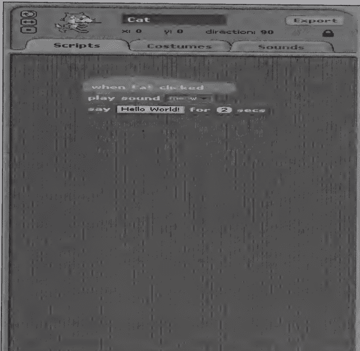
图 1.11
使用控制块控制脚本执行。

就是这样。此时你已经完成了创建、测试、修改、执行并保存新 Scratch 应用项目的所有步骤。现在并不难吧？在结束本章之前，让我们花几分钟了解 Scratch 的全球用户社区以及你如何加入了解更多 Scratch。

### 加入 Scratch 全球社区

Scratch 由学生、教师、学校、家长以及计算机爱好者和爱好者的全球社区支持。Scratch 提供多种语言，包括英语、西班牙语、德语、法语、意大利语、匈牙利语、希伯来语、波兰语、荷兰语、罗马尼亚语和俄罗斯语。位于 scratch.mit.edu 如图 1.14 所示的 Scratch 网站汇聚了世界各地的人，并促进了 Scratch 社区的发展。

# 第 1 章 介绍 Scratch
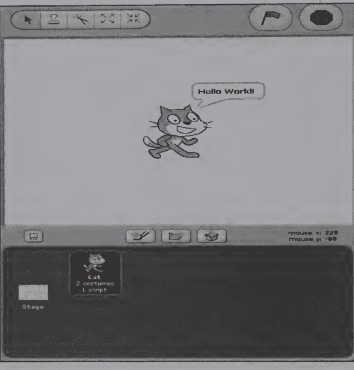

图 1.12
使用脚本自动化角色。


图 1.13
保存你的新应用项目。

### 加入 Scratch 全球社区


图 1.14
Scratch 网站是支持 Scratch 社区增长和互动的纽带。

Scratch 网站提供了各种资源，帮助 Scratch 程序员学习更多该语言的知识。它提供了在线文档和培训视频。它还提供了关于如何使用 Scratch 代码块的帮助页面访问。

### 分享你的应用项目

Scratch 网站通过允许 Scratch 程序员上传他们的项目并让访问网站的任何人可以使用，促进应用项目的共享。这让 Scratch 程序员展示他们的作品并从他人作品中学习。事实上，上传到网站的每一个 Scratch 项目都可以下载并作为创建新项目的依据。如

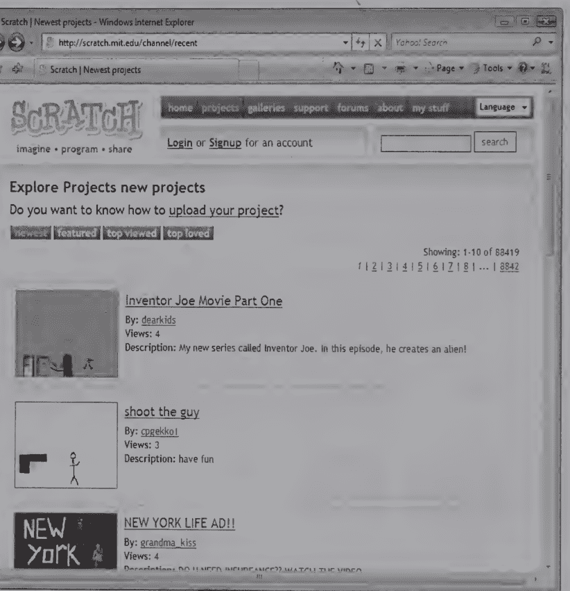

图 1.15
Scratch 网站促进 Scratch 项目共享并使其下载。

如图 1.15 所示，Scratch 网站在其项目页面（http://scratch.mit.edu/channel/recent）上积极推广 Scratch 项目，这意味着你可以预计上传的任何 Scratch 项目都会被发布。

Scratch 网站允许成员将上传的项目发布在画廊中。你可以将 Scratch 项目发布到不同的画廊，或者创建自己的画廊，甚至控制是否允许其他人向其中上传你的项目。如图 1.16 所示，Scratch 网站积极推广成员画廊。


### 加入 Scratch 全球社区


探索或创建一个新的画廊

### 荒野之狐 (Foxes of the Wild)

描述：这里有一个由我正在制作的全新系列，名为《荒野之狐》！如果你想加入，告诉我想长什么样……或者只是来这里创建你的狐狸、狼或任何野狗！请在此处申请加入：http://scratch.mit.edu/Create-A-Wolf-7358252

光风暴部落 (Tribe of Light Storms):
- 领袖男性（狼，战士）
- 领袖女性：Cynder (Wormassopray)
- 副将：Shadow (Monkeyleleaf)
- 下层阶级：Angel (Hizebeafitty), Gabbister (MaskedStar), Storm (Maskadai), Cold (Maskadai)

血牙部落 (Tribe of Bloodfangs):
- 领袖女性：Bloodfang (Maskedollar)
- 领袖女性：领袖男性 (Mighty (epigraph))
- 副将：下层阶级：

祖之爪部落 (Tribe of Ancest Paw (Neav)):
- 领袖女性：
- 副将：
- 下层阶级：

影之部落 (Tribe of Shadows (嗯...就在那里)):
- 领袖女性：
- 副将：
- 下层阶级：

项目数量：13

### 现代战争 (Modern Warfare)

描述：这是一个战争画廊。将有一个 Alpha 队和一个 Bravo 队，两个小组将相互战斗。每个小组将指定一名团队队长，每位玩家将选择一种主武器在战斗中使用。如果你想加入，请发表评论。

Alpha 队：
- Gaargermit-extravern1-sniper

Bravo 队:
- tasle1-sniper
- 41g74-automatic weapon

规则：
1. 我是战争协调员。我会控制好局面。
2. 你们将公平诚实地战斗。

即将开始的战斗：3月1日（周六），东部时间14:00 - 太平洋时间10:00

图 1.16

你可以创建自己的画廊并用它推广你的编程技能。

如果你决定创建自己的画廊，你可以通过分配名称和描述来对其进行自定义，并决定是否允许其他人将 Scratch 项目上传到其中。

### 在 Scratch 网站注册

为了将你的 Scratch 项目上传到 Scratch 网站，你必须注册一个免费账户，你可以通过点击 Scratch 网站每个页面顶部的“注册”链接来完成。点击此链接将打开图 1.17 所示的账户页面。

Scratch 网站允许成员连接到上传到网站的任何 Scratch 应用项目。该网站还提供

# 第 1 章 ■ 介绍 Scratch

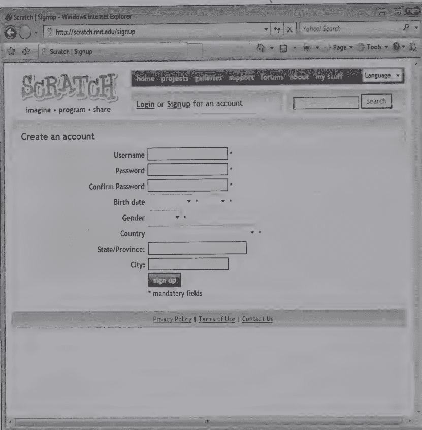

图 1.17 在 Scratch 网站注册免费账户。

访问论坛集合，这些论坛旨在促进世界各地学生、教师和 Scratch 爱好者之间的交流。

# 注意

当你看到第 13 章“在互联网上分享你的 Scratch 项目”时，你将学习更多关于如何分享你的 Scratch 项目的知识。

# 保持联系

除了促进项目共享允许对项目发表评论外，Scratch 网站在 http://scratch.mit.edu/forums/ 还设有许多在线论坛，如图 1.18 所示。

### 加入 Scratch 全球社区

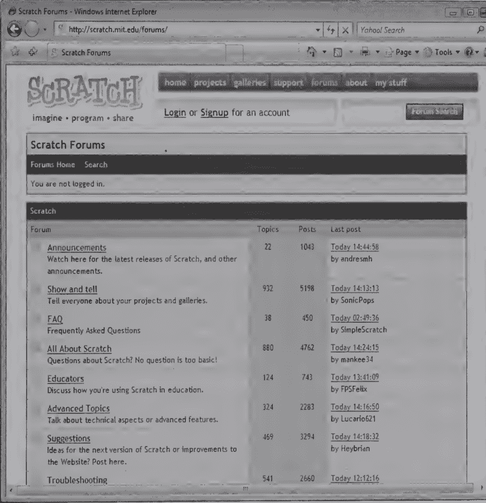

**图 1.18**
Scratch 社区成员可以使用 Scratch 网站托管的论坛自由交流并讨论想法。

如图 1.18 所示，论坛已建立用于涵盖以下范围题：

- 公告 (Announcements)
- 展示 (Show and tell)
- 常见问题 (FAQ)
- 关于 Scratch (All About Scratch)
- 教育者 (Educators)
- 高级主题 (Advanced Topics)
- 建议 (Suggestions)
- 故障排除 (Troubleshooting)

这些论坛提供了直接从其他 Scratch 程序员学习的能力。通过阅读发布的讨论，你可以学习新的编程技术，并了解其他程序员遇到的问题及其解决方案。最重要的是，你可以提问并获得问题的答案。

### 总结

本章概述了 Scratch 语言及其功能。它向你展示了如何在计算机上安装 Scratch，然后演示了如何创建你的第一个 Scratch 应用。它还向你介绍了 Scratch 网站，并解释了设置账户和成为 Scratch 社区活跃成员的重要性。

# 第 2 章

# 熟悉 Scratch 开发环境

要成为一名高效的 Scratch 程序员，你需要非常熟悉它的集成开发环境，或称为 IDE。在本章中，你将学习运行应用程序的“舞台”（stage）以及 Scratch 用于显示和组织应用程序中角色的“画/角色列表”（sprite list）。你还将学习如何使用创建脚本、服装和音效的编辑器。你还将学习 Scratch 的画笔程序，你可以用它来创建自己的自定义图形文件。当你完成本章时，你将对 Scratch IDE 的所有功能和能力有坚实的理解，并准备好开始创建自己的 Scratch 应用项目。

本章涵盖的主要议题概述包括：

- 如何使用菜单和工具栏按钮
- 如何添加、删除、修改构成你 Scratch 应用的角色
- 对用于控制舞台上角色位置的坐标系统的解释
- 如何使用创建脚本、服装和音效的编辑器
- 学习 Scratch 的画笔程序，你可以用它创建自己的自定义图形文件

### 熟悉 Scratch

Scratch 是一种图形化编程语言。如图 2.1 所示，IDE 由许多组件组成。

| 项目区域 | 菜单栏 | 工具栏 | 执行按钮 |
| :--- | :--- | :--- | :--- |
| | | |  |

**图 2.1**
IDE 促进开发和执行

### 熟悉菜单栏

与大多数应用程序一样，Scratch IDE 具有图 2.2 所示的菜单栏。下列表提供了每个按钮的解释：

- 新 (New)：创建一个新的 Scratch 应用。
- 打开 (Open)：打开现有项目。
- 保存 (Save)：保存当前项目。
- 另存为 (Save As)：用新名称保存当前项目。
- 分享 (Share)：将项目上传到网站。
- 撤销 (Undo)：恢复从应用程序中删除的最后一个脚本。
- 语言 (Language)：指定 IDE 使用的语言。
- 更多 (Extras)：显示一个菜单，你可以从中选择：导入项目、单步执行、压缩音频或压缩图像。

# 第 2 章 ■ 熟悉

- 需要帮助？显示一个提供 Scratch 网站链接以及以下资源集的页面：参考资料、教程、常见问题

上述列出的大多数命令都是显而易懂的。然而，最后三个命令需要额外的解释。点击语言按钮将显示一个可选的编程语言菜单。

# 提示

将鼠标指针悬停在 IDE 上显示的任何按钮控件上，都可以显示工具提示。

点击更多按钮将显示一个包含以下选项的菜单：

- 关于 (About)：显示一个提供当前 Scratch 版本信息的弹出窗口。
- 导入项目 (Import Project)：此命令将指定项目中的所有角色和背景以及相关的脚本导入到当前项目中。
- 单步执行 (Start Single Step)：....
- 压缩音频 (Compress Sounds)：此命令压缩当前应用程序使用的任何音频文件以减小项目大小。
- 压缩图像 (Compress Images)：与压缩音频类似，此命令压缩当前应用程序使用的任何图形图像文件以减小项目大小。


### 熟悉 Scratch IDE

Scratch 菜单栏上的最后一个按钮是“需要帮助吗？（Want Help?）”按钮。点击此按钮将打开一个浏览器窗口，提供以下资源的访问：

- 入门（Getting Started）。打开《Scratch 入门》PDF 用户指南。
- 帮助页面（Help Screens）。显示一组帮助页面，记录每个 Scratch 代码块的用途和目的。
- 参考指南（Reference Guide）。打开 Scratch“参考指南”PDF 参考文件。
- 访问 Scratch 支持页面（Visit the Scratch support page）。显示位于 http://scratch.wik.is/Support 的 Scratch 支持网页。

### 在舞台上运行应用程序

舞台（the stage-the stage）是 Scratch IDE 上的一个区域，位于右上侧，如图 2.3 所示，你的 Scratch 应用程序在此执行。舞台为构成应用程序的精灵（sprites）提供了相互以及与用户交互的场所。


图 2.3 舞台提供了精灵显示并相互交互的画布。

### X轴

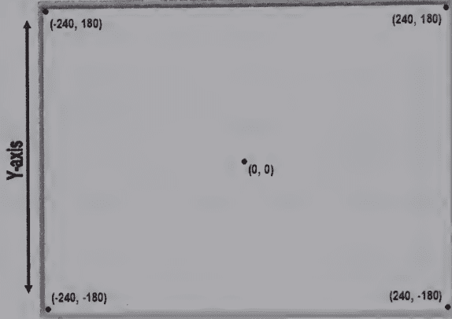

**图 2.4** 精灵被放置在屏幕上并使用坐标系进行移动。

舞台宽 480 个单位，高 360 个单位。舞台使用 X 轴和 Y 轴组成的坐标系统划分成逻辑网格，如图 2.4 所示。

如你所见，X 轴从坐标 240 运行到 -240，Y 轴坐标从 180 运行到 -180。舞台中间的坐标位置为 (0, 0)。每当指针在舞台上移动时，Scratch 都会告知你指针的位置，并在舞台右下方的 `mouse x:` 和 `mouse y:` 字段中显示其 (X, Y) 坐标位置。

舞台可以分配一个或多个背景，允许你在应用程序执行期间更改它的外观。默认情况下，所有 Scratch 应用程序都分配了一个空白背景。你可以点击位于精灵列表左侧的舞台缩略图，然后点击位于脚本区域正方的背景（Backgrounds）标签页来添加新背景。和精灵一样，舞台也可以分配自己的脚本和音效。

## 提示

- 如果你点击舞台上的空白区域，将出现弹出菜单，显示以下项目：

- **为新精灵抓取屏幕区域（Grab screen region for new sprite）。** 制作舞台所选部分的副本并用它创建一个新精灵。
- **保存舞台图片（Save picture of stage）。** 将舞台的副本保存为 .GIF 文件。

### 熟悉 Scratch IDE

### 在演示模式下运行应用程序

正如你在第 1 章创建“你好，世界”项目时所看到的那样，Scratch 默认在 IDE 内部的舞台上运行你的应用程序。然而，如果你点击位于舞台左下角方的演示模式（Presentation Mode）按钮，就可以在演示模式下运行你的 Scratch 应用程序项目。要查看它是如何工作的，点击位于 Scratch IDE 顶部的打开（Open）按钮，然后找到并打开 Hello World 项目。接下来，点击演示模式按钮切换到全屏模式。进入演示屏幕模式后，单击代表小猫的精灵，观察你的应用程序执行情况，如图 2.5 所示。

你可以随时退出演示模式，可以通过点击位于舞台左上角方的退出演示模式图标，或者按下 Escape 键。

### 控制应用程序的执行

无论是在 IDE 舞台上运行应用程序还是在演示模式下运行，你都可以通过点击位于 IDE 右上角的绿色旗帜按钮来自动启动任何以绿色旗帜控制块开头的脚本，如图 2.6 所示。该按钮在演示模式下同样可用。通过点击位于绿色旗帜右侧的红色停止按钮

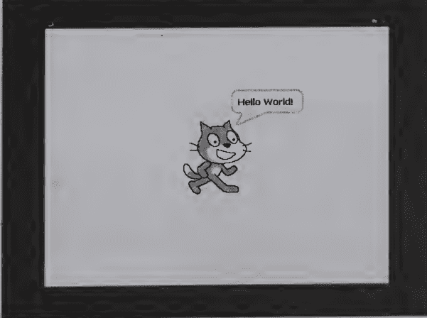

图 2.5
在演示模式下运行 Scratch 应用程序项目。


按钮，你可以在完成工作后的任何时候停止应用程序的执行。

### 使用精灵列表

Scratch 应用程序由精灵组成，这些精灵在舞台上移动时相互交互。构成 Scratch 应用程序的每个精灵都以缩略图的形式显示在精灵列表区域，该区域位于 Scratch IDE 的右下部分，如图 2.7 所示。虽然这对 Scratch 应用程序没有影响，但你可以通过拖放缩略图到任何你认为合理的位置来重新排列精灵在列表中的显示顺序。

除了缩略图外，Scratch 还会显示每个精灵的名字以及属于每个精灵的脚本数量和造型（costumes）数量。要操作精灵并编辑其脚本、造型和音效，只需点击其缩略图。当前选中的精灵用蓝色轮廓突出显示。一旦选中，你就可以点击位于脚本、造型和音效顶部的脚本（Scripts）、造型（Costumes）和声音（Sounds）标签页。


### 熟悉 Scratch IDE

如果你右键点击精灵的缩略图，将显示以下菜单选项：

- **显示（Show）。** 将精灵置于舞台上方。
- **导出此精灵（Export this sprite）。** 将精灵导出为文件供导入。
- **复制（Duplicate）。** 创建该精灵的副本。
- **删除（Delete）。** 从项目中移除精灵。

## 提示

你也可以通过右键点击舞台上的任何精灵并选择相应的菜单项来导出、复制和删除精灵。

精灵列表还显示代表项目的缩略图。当选中舞台缩略图时，你可以为舞台添加脚本，通过分配更多图形文件修改背景，还可以添加声音。

### 生成精灵

Scratch 通过提供不同的选项让你轻松处理精灵。这些选项通过舞台下方的新建按钮访问，如图 2.8 所示。

点击画新精灵（Paint New Sprite）按钮将启动 Scratch 的画编辑器。该程序提供了在透明背景上绘制新精灵所需的所有工具。你将在本章稍后的部分学习如何使用画编辑器。

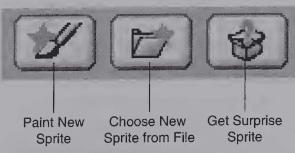

图 2.8
新建按钮提供了添加和创建新精灵的工具。

## 第 2 章

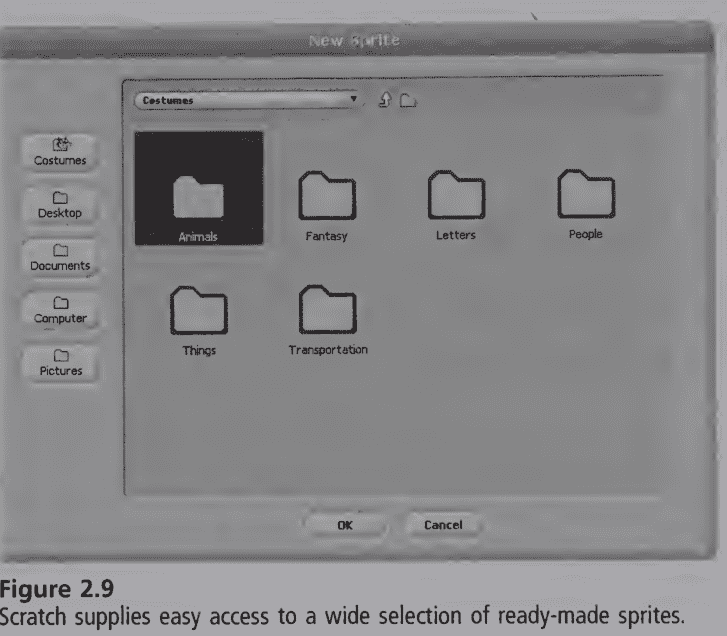

点击从文件选择新精灵（Choose New Sprite from File）按钮将显示图 2.9 所示的新精灵窗口，提供不同图形文件的访问，你可以将其添加到 Scratch 应用程序中。要选择并添加精灵，你只需进入 Scratch 的一个文件夹，找到所需的精灵，然后点击 OK 按钮。你选择的精灵将出现在舞台中心，代表该精灵的缩略图将添加到精灵列表中。

获取惊喜（Get Surprise）按钮会随机检索一个 Scratch 的现成精灵并添加到你的应用程序项目中。它可以用于生成各种奇怪的项目。

### 跟踪鼠标指针位置

当你学习开发自己的 Scratch 应用程序时，你需要跟踪精灵在舞台上的初始位置和随后的移动。Scratch 通过在每次指针跨越舞台时跟踪鼠标指针移动来帮助你完成这项任务（见图 2.10）。你可以使用


### 熟悉 Scratch IDE

```
mouse x: -49
mouse y: 43
```

**图 2.10** Scratch IDE 能够轻松地跟踪鼠标指针在舞台上移动时的位置。

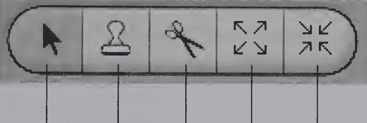

**图 2.11** Scratch 工具栏提供了与角色（sprites）交互的工具。

这些信息用于识别坐标数据，以便你在开发驱动 Scratch 项目的编程逻辑时，将这些数据整合到你的应用程序代码中。

### 使用 Scratch 工具栏

Scratch IDE 的另一个重要组件是工具栏，如图 2.11 所示。工具栏提供了命令的访问权限，你可以使用这些命令来交互和控制组成应用程序的角色。

以下列表总结了工具栏中每个按钮提供的功能：

- **移动（Move）。** 允许你将角色拖放到舞台上的不同位置（默认的工具栏选择项）。
- **复制（Duplicate）。** 为当前选中的角色创建一个副本，包括其脚本、服装和声音，为你的应用程序中添加新角色提供了方便的方法。一旦角色被复制，你就可以根据喜好对新的角色副本进行自定义。
- **删除（Delete）。** 从项目中移除角色（包括其所有脚本、服装和声音），并从角色列表中移除其缩略图。
- **放大/增大角色（Grow Sprite）。** 增加角色的尺寸，以防其实际大小不满足应用程序的需求。
- **缩小角色（Shrink Sprite）。** 减小角色的尺寸，以防其实际大小不满足应用程序的需求。

默认情况下，“移动”按钮始终被选中。然而，你可以通过点击任何其他工具栏按钮，然后点击你想要操作的角色来选择它们。

### 在代码块组之间切换

与使用任何编程语言创建的应用程序一样，Scratch 应用程序代码由代码块集合组成，这些代码块操作角色并与用户交互。Scratch 的程序代码组织成属于角色的脚本。应用程序中的每个角色都可以分配一个或多个脚本。此外，舞台也可以执行自己的脚本。

正如你已经看到的，创建一个脚本的第一步是选择脚本将所属的角色（或舞台）。这是通过点击角色列表中的相应缩略图完成的。你可以通过从代码块面板拖动代码块并将其掉入脚本区域（当选中脚本选项卡时）来添加代码块。代码块面板分为两个部分。顶部包含八个控制按钮，每个按钮代表不同类别的代码块。每个按钮都有颜色。当前选中的按钮很容易识别，因为它填充了分配的颜色。未选中的按钮的左边缘显示了属于该类别的代码块的颜色。例如，图 2.12 显示了当“动作（Motion）”按钮被选中时，代码块面板显示的样子。

# 技巧

你可以对任何代码块点击鼠标右键（在 Mac OS X 上按 Control-点击），然后从弹出的菜单中选择“帮助”，以获取任何代码块的帮助。

### 熟悉脚本区域

Scratch IDE 的最后一个主要部分是你需要熟悉的“脚本区域”，它由两个部分组成。“当前角色信息（Current Sprite Info）”部分位于脚本区域的顶部，显示有关当前选中角色的信息。脚本区域的其他部分由三个选项卡控制，允许你向角色添加脚本、服装和声音。

### 熟悉 Scratch IDE

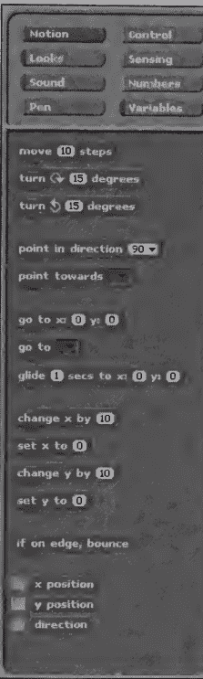

图 2.12
每一类代码块的设计都是为了完成一组相关的任务。


图 2.13
查看脚本区域


为了


脚本，，

查看脚本。

### 详细细节

“当前角色信息”部分显示了当前选中角色的信息。脚本区域的脚本 的脚本可以看到，你可以通过点击角色列表中的缩缩略图来

，，允许向角色添加脚本、服装和声音。

  。

### 熟悉服装

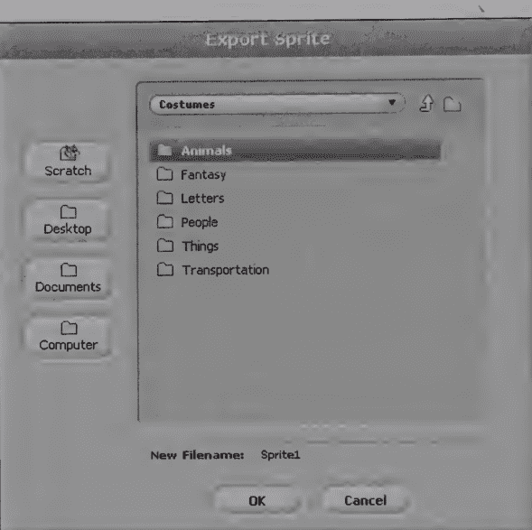

图 2.14
查看服装。

。

为了

  任务


              |   | | | | | 2.15 | 旋转 | | | | | | | | | | | | | | | | | | | | | | | | | | | | | | | | | | | | | | | | | | | | | | | | | | | | | 

### 熟悉 Scratch IDE

| 表 2.1 角色旋转按钮 |
| 按钮 | 名称 | 描述 |
| --- | --- | --- |
| ![]( | 可以旋转 | 当角色方向改变时，让角色服装旋转 360 度。 |
| ![]( | 仅面向左右 | 切换角色服装面向左或右，反之亦然。 |
| ![]( | 不旋转 | 保持角色服装的方向。 |

# 技巧

为了更好地感受 Scratch 旋转按钮对角色的影响，点击每一个按钮并观察角色信息区域角色服装的运动。

### 编辑脚本

正如你已经看到的，Scratch 脚本是通过从代码块面板将代码块拖到脚本区域（当选中脚本选项卡时）创建的。当然，代码块必须以符合逻辑的方式添加，这就是第 5 章到第 22 章旨在教给你的。

# 技巧

当你添加新脚本并修改现有脚本时，很容易让脚本区域变得一团糟。处理这种情况情况的一种方法是花费几分钟拖放脚本，使它们对齐且间距均匀。然而，一个更快、更简单的选项是在脚本区域内的空白区域点击右键，然后点击“清理（clean-up）”选项。作为响应，Scratch 会为你排列所有脚本。

### 添加服装

角色可以拥有一个或多个服装，允许它在应用程序执行时更改外观。角色必须至少有一个服装。例如，图 2.15 显示了一个有两个服装的角色。每个服装都分配有一个唯一的名称和编号（显示在服装图像的左侧）。

默认情况下，Scratch 只显示角第一个服装。你可以通过拖放服装来更改它们在列表中的位置。移动时，分配给服装的编号也会更改。

Scratch 提供了三种不同的向角色添加新服装的方法。首先，你可以点击“画（Paint）”按钮。这将打开画编辑器程序，


# 第 2 章 ■ 熟悉操作

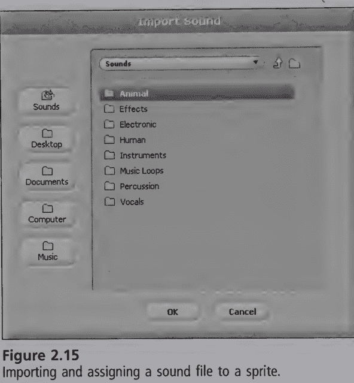

你可以用它来绘制新的造型。你也可以通过点击“导入”（Import）按钮并指定计算机文件夹中的图像文件来为角色添加新造型。最后，你可以将从互联网或桌面上拖拽的图像文件到选中了“造型”（Costumes）选项卡的脚本区域。

# 注意事项

> Scratch 可以处理不同类型的图形文件，包括 GIF、JPG、BMP 和 PNG 文件。Scratch 还可以处理动画 GIF 文件。动画 GIF 是由两个或多个帧组成的图形，当 GIF 文件被显示时，每一帧都会作为自动序列显示出来。

添加字体后，你可以通过选择该造型并点击“编辑”（Edit）按钮来修改它，这将打开画笔编辑器（Paint Editor）。你也可以通过选择一个现有的造型然后点击“复制”（Copy）按钮来为角色添加新造型。一旦添加了复制的造型，你就可以点击它的“编辑”按钮，使用画笔编辑器对其进行修改。

你可以通过选择一个造型并点击“复制”按钮右侧的圆形“删除”（Delete）按钮来从角色中删除造型。你也可以通过右键点击该造型并在出现的弹出菜单中选择相应的选项，将其转换为角色或将其导出为独立的造型。

### 熟悉 Scratch IDE

# 注意事项

舞台可以分配一个图形作为背景，应用程序的角色将显示在该背景上。事实上，舞台可以分配一系列背景，允许应用程序在执行过程中更改背景。要查看、编辑和复制背景，请点击位于角色列表中的舞台缩略图。执行此操作时，脚本区域的“造型”选项卡将变为“背景”（Backgrounds）选项卡，允许你修改和处理应用程序的背景。从这里，你还可以通过点击“画笔”（Paint）按钮来自己创建新背景。这会打开 Scratch 的画笔编辑器程序（将在本章稍后部分讨论），它允许你创建任何你需要的背景。你还可以点击“导入”按钮将外部图形文件作为背景添加到你的应用程序中。

### 添加音效

就像角色可以有不同的造型一样，你也可以为它们（或舞台）分配一个或多个声音，这些声音可以在应用程序执行期间播放，可以作为背景音乐、噪音或游戏过程中的音效。Scratch 可以播放 MP3 文件以及大多数 WAV、AU 和 AIF 音频文件。要查看与角色相关的声音文件，或录制或导入新文件，请在角色列表中选择角色的缩略图，然后点击脚本区域中的“声音”（Sounds）选项卡。如图 2.16 所示，显示该角色的声音文件列表。

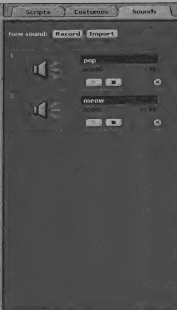

图 2.16
添加和编辑声音文件。

# 第 2 章 ■ 熟悉操作

一旦选择了“声音”选项卡，你可以对属于角色的任何声音文件执行以下任何操作：

- 修改应用程序中用于引用声音的名称。
- 点击“播放”（Play）按钮听声音。
- 点击“停止”（Stop）按钮停止声音播放。
- 点击“删除”（Delete）按钮从应用程序项目中删除声音。

除了与角色的现有声音文件交互外，你还可以通过点击“录制”（Record）按钮添加新的声音文件。作为响应，会弹出声音录制窗口（如图 2.17 所示），允许你录制并保存新的声音文件。当然，要录制自己的声音文件，你的电脑需要有一个麦克风。

你还可以通过点击“导入”按钮向你的 Scratch 应用程序添加新的声音文件这将打开“导入声音”窗口（如图 2.18 所示），允许你选择声音文件。Scratch 提供了大量的预录声音文件。默认情况下，“导入声音”窗口会显示包含不同声音文件集合的文件夹列表。

### 保留项目注释

Scratch IDE 的另一个重要功能是添加和更新项目注释的能力。Scratch 允许你在第一次保存应用程序项目时添加项目注释。一旦保存，你就可以通过点击位于 IDE 右上角的“项目注释”（Project Notes）随时更新你的项目注释。作为响应，会显示项目注释窗口（如图 2.19 所示）。

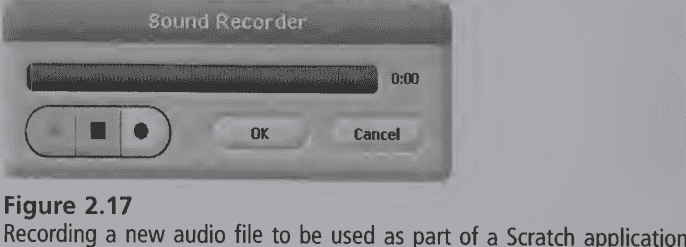

### 熟悉 Scratch IDE

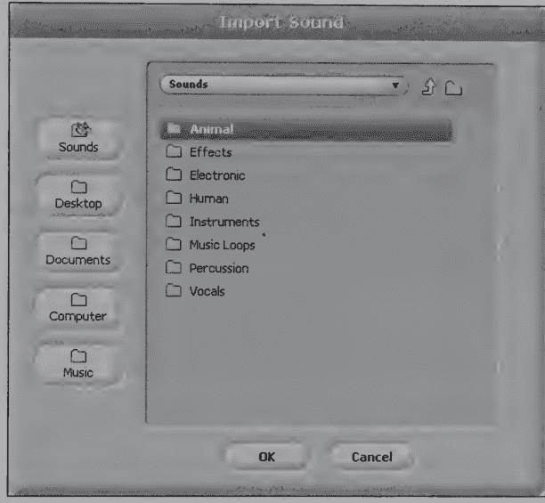

图 2.18
为角色导入并分配声音文件。

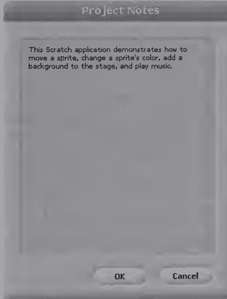

图 2.19
查看和更新 Scratch 应用程序项目注释。

46 第 2 章 熟悉操作

项目注释窗口的操作类似于一个简单的记事本程序，允许你输入任何你文本。

# 提示

使用项目注释窗口来帮助记录你的 Scratch 应用程序，留下解释应用程序目的以及你为何这样设计的信息。


### 第二2章 熟悉上手

- 填充（Fill）。允许你根据选项区域指定的所选选项，用渐变色或实色填充闭合的区域。
- 矩形（Rectangle）。允许你使用当前前景色颜色绘制填充或带轮廓的矩形形状。
- 椭圆（Ellipse）。允许你使用当前前景色颜色绘制填充或带轮廓的椭圆。
- 线（Line）。允许你使用当前前景色颜色绘制直线。
- 文本（Text）。允许你使用当前的字体类型和大小将文本作为绘制的一部分包含进来。
- 选择（Selection）。允许你选择绘制画布的一个矩形区域，并将其移动到画布的不同部分（剪切和粘贴）。
- 橡章（Stamp）。允许你选择绘制画布的一个矩形区域，并将其复制到画布的不同部分（复制和粘贴）。
- 吸管器（Eyropper）。允许你选择前景色颜色。

大多数工具栏按钮都接受配置选项，以进一步细化按钮控制提供的功能。例如，图 2.21 显示了选择“填充”按钮时提供的四个配置选项。这些选项设置了所应用的填充样式，包括实色的应用以及水平渐变、垂直渐变或径向渐变的使用。

# 注意

> 渐变是通过前景色和背景色混合而成的颜色。

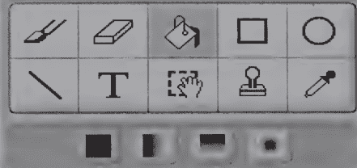

图 2.21
选项区域的内容根据所选工具栏按钮而变化。

### 使用 Scratch 画画编辑器创建新 Sprite

### 按钮控制的操作

如图 2.22 所示，Scratch 画画编辑器程序包含许多按钮控件，可以启动各种不同的动作。

以下列表识别了这些每一个按钮并解释了它们的用途：

- **导入（Import）。**从存储在计算机上的图形文件中打开图像。
- **放大（Grow）。**增大绘制画布的大小，允许你关注特定区域。
- **缩小（Shrink）。**减小绘制画布的大小。
- **逆时针旋转（Rotate counterclockwise）。** 将绘制画布逆时针旋转。
- **顺时针旋转（Rotate clockwise）。** 将绘制画布顺时针旋转。
- **水平翻转（Flip horizontally）。** 将绘制画布水平翻转。
- **垂直翻转（Flip vertically）。** 将绘制画布垂直翻转。
- **清除（Clear）。** 清除绘制画布上当前显示的任何图形。
- **撤销（Undo）。** 撤销你在画画编辑器中执行的上一次操作。
- **重做（Redo）。** 重做上一次被撤销的操作。

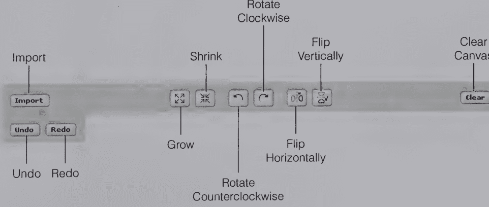

**图 2.22** 画画编辑器通过按钮控件访问关键功能。

### 指定颜色设置

画画编辑器允许你通过位于画画编辑器窗口左侧、紧邻选项区域下方的当前颜色设置控件，为前景绘制和背景绘制指定当前的颜色设置。要设置当前前景色，点击顶部的正方形，并从控件下方显示的调色板之一中选择颜色。同样，你可以通过选择下方的正方形然后从调色板之一中选择颜色来设置当前背景色。

### 配置 Sprite 的旋转中心

画画编辑器中最后一个但非常重要的功能是你绝对需要知道如何使用的“设置旋转中心”（Set Rotation Center）按钮，它位于画画编辑器窗口的左下角。点击此按钮时，编辑器画布上会显示一组十字准，如图 2.23 所示。然后你可以通过拖放将十字准移动到 Sprite 的某部分，将其设置为 Sprite 在舞台上旋转时的旋转中心。

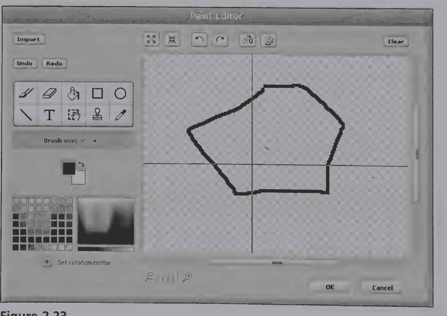

图 2.23
十字准可以轻松设置 Sprite 的旋转中心。

图 2.23 显示的 Sprite 是一个岩，可能用于像《小行星》（Asteroids）之类的太空射击游戏。在这类游戏中，小行星会在屏幕上移动，威胁要通过碰撞破坏玩家的飞船。为了提供真实的视觉效果，你可能希望让 Scratch 在岩绕着屏幕移动时旋转它。通过将岩的旋转点设置为 Sprite 的中心，它看起来将绕其中心旋转或自转。相反，通过将其旋转点设置为岩的边缘之一，你可以让它以更摇晃的方式旋转。

### 总结

本章向你介绍了 Scratch IDE，并对其所有主要组件和功能进行了逐步概述。你学习了如何使用它的菜单和工具栏按钮。你学习了如何添加和删除 Sprite，以及如何向 Sprite 添加脚本、装扮和声音。本章解释了用于控制 Sprite 在舞台上位置的坐标系。除此之外，本章还提供了 Scratch 画画编辑器程序的概述，并概述了它的所有主要特性和功能。

# 第 3 章

# SCRATCH 项目组件回顾

正如你所看到的，Scratch 项目由脚本组成。为了让应用程序和 Sprite 活起来，你必须创建脚本。本章没有对每个区块进行深入回顾，但提供了主要功能的概述。总共，有 100 多种不同的 Scratch 块，每个区块都是为了实现特定目的而设计的。这些区块可以大致分为三类：
- 堆栈块（Stack blocks）
- 帽子块（Hat blocks）
- 报告块（Reporter blocks）

### 堆栈块的操作

Scratch 提供的大部分区块都是堆栈块。堆栈块是顶部带有缺口或底部带有凸起的代码块。缺口和凸起作为视觉指示，标识这些区块如何组合在一起以创建编程逻辑。图 3.2 显示了一个典型的堆栈块示例。

顶部的缺口表示该代码块可以连接到另一个代码块的下方。代码块底部的凸起允许其他代码块连接到其下方。图 3.3 显示了另一个堆栈块示例。只要测试的条件评估为真（true），该区块就会重复执行你选择嵌入其中的任何代码块。

# 注意

> 你将在第 9 章学习重复和条件编程逻辑的应用。


图 3.2
一个用于停止音频文件播放的代码块示例。

```
repeat until
```

图 3.3
该代码块允许将其他堆栈块嵌入其中。


# 第 3 章 Scratch 基础组件回顾

某些堆积块（stack blocks）内部包含一个输入区域，允许你通过输入数字来指定值。例如，图 3.4 所示的堆积块允许通过插入与颜色相关的数值来指定绘图时使用的颜色。

要修改赋值给如图 3.4 所示代码块的值，请点击代码块内的白色区域并输入新值。某些代码块：

```
set pen color to [8] 可编辑文本框
```

图 3.4 该代码块用于指定绘图时使用的颜色。

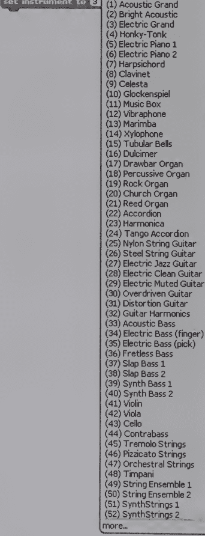

图 3.5 该代码块是一个下拉菜单，你可以用它来配置其运行方式。

### Scratch 块的三种基本类型

你可以通过从下拉列表中选择值来配置它们，如图 3.5 所示。

### 使用帽子顶块（Hat Blocks）

帽子顶块是一种顶部为圆形或弧形且底部有凸起代码块，视觉上表明它可以吸附在其他堆积块顶部。帽子顶块提供了创建事件驱动脚本的能力。事件驱动脚本是在指定事件发生时自动执行的脚本。一个事件示例是：当用户点击绿色旗帜按钮时会自动触发脚本执行。当此事件发生时，任何以图 3.6 中的帽子顶块开头的脚本都会自动执行。

当用户点击角色时，也可以触发脚本执行。这可以通过在脚本开头添加图 3.7 所示的代码块来实现。

# 注意

应用程序中的每个角色（sprite）都可能有自己的脚本。你可以使用帽子顶块来自动化任何或所有脚本的执行。除了角色外，舞台（stage）也可以拥有脚本。

### 使用报告块（Reporter Blocks）

第三种 Scratch 代码块是报告块。报告块是一种侧面为圆角或倾角的代码块，专门设计用于为其他代码块提供处理所需的输入机制。例如，图 3.8 所示的代码块是一个典型的报告块。


图 3.6
当用户点击绿色旗帜时，帽子顶块会自动运行脚本。


图 3.7
当用户点击该脚本所属的角色时，帽子顶块就会运行脚本。


图 3.8
该代码块获取一个表示角色音量的数值。

# 第 3 章 ■ Scratch 项目基础组件回顾

```
set volume to 100
```

图 3.9
你可以通过输入或使用报告块向此代码块提供输入。

```
key space pressed?
```

图 3.10
倾角报告块将布尔数据传递给其他代码块进行处理。

```
wait until
```

图 3.11
该代码块会暂停脚本执行，直到指定的事件为真（true）。

```
wait until key space pressed?
```

图 3.12
此代码块组合将暂停脚本执行，直到用户按下空格键。

如你所见，这个报告块具有圆角边。因此，它只能放入如图 3.9 所示的代码块中，因为后者的输入区域显示的是带有圆角的形状。

图 3.10 显示了一个具有倾角边的报告块示例。这个特定的代码块在用户按下空格键时返回真（true），在未按下空格键时返回假（false）。因为它具有倾角边，所以它只能嵌入包含侧边也是倾角的输入区域的代码块中。

# 注意

> 布尔（Boolean）是一个用于表示具有两个值之一（即真/true 或 假/false）的数据的术语。

为了利用如图 3.10 所示的报告块，你需要将其嵌入另一个已设计为与其配合工作的代码块中。例如，图 3.11 显示了这样一个代码块。

图 3.12 展示了报告块在嵌入另一个代码块后的外观。

### 关注监视器（Monitors）

你可能已经注意到，在区块面板中，某些代码块的左侧会显示一个小小的复选框，如图 3.13 所示。

# 关注监视器

图 3.13
一个能够在舞台上显示监视器的代码块示例。

图 3.14
默认情况下，监视器显示其关联代码块的名称。

图 3.15
监视器可以配置为显示大字体。

图 3.16
变量监视器还支持包含滑动条的格式。

复选框的存在表示该代码块能够在舞台上显示监视器。监视器是一个小块，用于显示当前赋值给代码的值。（此处原文存在大量重复句子，已按要求精简处理）。舞台，位于图 14。

[第 81 页]

### Scratch 块的八大类

### 在画布上移动物体

移动块（Motion blocks）控制角色的位置。移动块可以让你设置方向。还有移动块可以报告角色的位置。表 3.1 概述出了移动块：

| 块 | 描述 |
| --- | --- |
| move 10 steps | 向前或后移动指定的步数。 |
| turn 15 degrees | 顺时针旋转指定的角度。 |
| turn -15 degrees | 逆时针旋转指定的角度。 |
| point in direction 90 | 指向指定的方向（0=上，90=右，-90=左，180=下）。 |
| point towards | 指向鼠标指针或另一个角色。 |
| go to x: 0 y: 0 | 将角色移动到舞台上指定的坐标位置。 |
| go to | 将角色移动到鼠标指针或另一个角色的位置。 |
| glide 1 secs to x: 0 y: 0 | 在指定的秒数内移动到指定的坐标位置。 |
| change x by 10 | 在 X 轴改变指定的像素数。 |
| set x to 0 | 将角色的 X 轴位置更改为特定值。 |
| change y by 10 | 在 Y 轴改变指定的像素数。 |
| set y to 0 | 将角色的 Y 轴位置更改为特定值。 |
| if on edge, bounce | 当角色接触舞台边缘时改变其方向。 |
| x position | 获取角色在 X 轴上的坐标值（-240 到 240 之间）。 |
| y position | 获取角色在 Y 轴上的坐标值（-180 到 180 之间）。 |
| direction | 获取角色当前方向的数值（0=上，90=右，-90=左，180=下）。 |


# 第 3 章 - Scratch 项目基础组件回顾

你将在第 5 章“移动物体”中学习更多关于运动模块的知识。

### 改变物体外观

外观模块（Looks blocks）修改角色和背景的外观，并在弹出气泡中显示文本。外观区块为紫色。有些外观区块可以让你修改角色的造型和颜色。还有一些区块可以修改角色的大小，并控制角色是否在舞台上可见。表 3.2 概述了所有属于此类范别的代码块。

你将在第 10 章“改变角色的外观和行为”中学习更多关于外观模块的知识。

| 表 3.2 Scratch 外观区块 |
| 块 | 监控 | 说明 |
|---|---|---|
| 换造型为造型 | 否 | 切换角色的造型，修改其外观。 |
| 下一个造型 | 否 | 将角色的造型切换为角色造型列表中的下一个造型，当到达列表末尾时跳回列表开头。 |
| 造型 # | 是 | 获取一个代表角色当前造型编号的数值。 |
| 说 Hello 等 2 秒 | 否 | 在指定的秒数内通过语音气泡显示消息。 |
| 说 Hello! | 否 | 在语音气泡中显示消息，或在未指定文本时移除语音气泡的显示。 |
| 想 Hmm... 等 2 秒 | 否 | 在指定的秒数内通过思维气泡显示消息。 |
| 想 Hmm... | 否 | 在思维气泡中显示消息，或在未指定文本时移除思维气泡的显示。 |
| 色彩特效每次增加 25 | 否 | 通过指定的数值应用并修改特殊特效（色彩、鱼眼、旋涡、像素化、马赛克、亮度或幽灵）来修改角色的外观。 |
| 将色彩特效设为 0 | 否 | 通过指定的数值对角色应用特殊特效（色彩、鱼眼、旋涡、像素化、马赛克、亮度或幽灵）。 |
| 清除图形特效 | 否 | 将角色恢复到正常外观，移除可能应用的所有特殊特效。 |
| 大小增加 10 | | 通过指定的数值量修改角色的大小。 |
| 将大小设为 100% | | 将角色的大小设置为其原始大小的百分比。 |
| 大小 | | 获取一个代表角色当前大小相对于原始大小的百分比值。 |
| 显示 | | 告诉 Scratch 显示角色。 |
| 隐藏 | | 抑制舞台上角色的显示，防止其与其他角色交互。 |
| 置于顶层 | 将角色置于其他角色之上，将其放置在顶层并确保其显示。 |
| 置于底层 | | 将角色向后移动指定的层数，允许其他角色显示在其上方。 |
| 换背景为背景 | | 通过分配不同的背景来改变舞台的外观。 |
| 下一个背景 | | 将舞台背景切换为背景列表中的下一个背景。 |
| 背景 | | 获取一个代表舞台当前背景编号的数值。 |

# Scratch 区块的八大类

音频模块（Sound blocks）为你的 Scratch 项目播放音乐并添加音效。音频区块为粉色。有些音频区块可以让你播放声音和鼓点、选择不同乐器、控制播放量以及修改节拍。表 3.3 概述了所有属于此类范别的代码块。

| 表 3.3 Scratch 音频区块 |
| 块 | 监控 | unique |
| --- | --- | --- |
| 播放声音 | 否 | 播放指定的声音文件，同时允许插入它的脚本文件继续执行。 |
| 播放声音直到结束 | 否 | 播放指定的声音文件，暂停脚本执行直到声音播放完毕。 |
| 停止所有声音 | 否 | 停止当前正在播放的所有声音文件。 |
| 播放鼓声 48 等 2 节拍 | 否 | 播放区块下拉菜单中选择的鼓声持续指定的秒数。 |
| 静音 2 节拍 | 否 | 暂停播放指定的节拍。 |
| 播放音符 60 等 5 节拍 | 否 | 播放区块下拉菜单中选择的音符持续指定的节拍。 |
| 将乐器设为 | 否 | 指定播放音符时使用的乐器。 |
| 音量增加 10 | 否 | 通过指定的数值改变角色音量。 |
| 将音量设为 100 | 否 | 将角色的音量设置为指定的百分比水平。 |
| 音量 | 是 | 获取一个代表角色音量的数值。 |
| 节拍增加 20 | 否 | 通过指定的每分钟节拍数改变角色的节拍。 |
| 将节拍设为 60 bpm | 否 | 分配每分钟节拍数作为角色的节拍。 |
| 节拍 | 是 | 获取一个代表角色节拍的数值。 |

你将在第 11 章“用声音增添趣味”中学习更多关于音频模块的知识。

### 绘制线条和形状

画笔模块（Pen blocks）使用虚拟画笔绘制任意组合的形状和线条。画笔区块为薄绿色。有些画笔区块可以让你开启或关闭绘制、设置颜色和笔画大小以及应用阴影。表 3.4 概述了所有属于此类范别的代码块。

你将在第 12 章“绘制线条和形状”中学习更多关于画笔模块的知识。

| 表 3.4 Scratch 画笔区块 |
| 块 | 监控 | unique |
| --- | --- | --- |
| 清除 | | 擦除舞台绘制的所有内容。 |
| 画笔下 | | 让画笔处于按下状态，允许绘制操作。 |
| 画笔上 | | 让画笔处于提起状态，停止绘制操作。 |
| 将颜色设为 | | 指定绘制时的颜色。 |
| 颜色每次增加 | | 通过指定的数值改变颜色。 |
| 将笔画设为 | | 指定绘制时的笔画大小。 |
| 笔画每次增加 | | 通过指定的数值改变笔画大小。 |
| 将特效设为 | | 指定绘制时的特效。 |
| 盖章 | | 将角色的图像绘制到舞台上。 |

### 循环、条件逻辑和事件编程

控制模块（Control blocks）自动化脚本执行，并发送消息以允许角色进行同步。还有控制区块可以让你设置循环重复执行代码集，以及根据测试是否为真条件执行区块。控制区块为金色。表 3.5 概述了所有属于此类范别的代码块。

你将在第 9 章学习更多关于控制模块的知识。

### 感知角色位置和环境输入

感知模块（Sensing blocks）确定鼠标指针的位置、与其他角色的距离以及角色是否碰到另一个。感知区块为蓝色

| 表 3.5 Scratch 控制区块 |
| 块 | 监控 | unique |
| --- | --- | --- |
| 当绿旗点击时 | | 当绿旗按钮被按下时，执行所属的脚本。 |
| 当按下键时 | | 当指定的键盘按按下时，执行所属的脚本。 |
| 当点击时 | | 当用户点击该角色时，执行所属的脚本。 |
| 等待 1 秒 | 暂停脚本执行指定的秒数，之后恢复执行。 |
| 重复 | 不断重复执行其内部的所有代码块。 |
| 重复 10 次 | 按照指定的次数重复执行内部的所有代码块。 |
| 广播 | 向所有角色发送消息，而不暂停脚本执行。 |
| 广播并等待 | 向所有角色发送消息以触发预定义动作，然后暂停脚本执行，直到所有角色完成分配的动作后允许所在脚本继续执行。 |
|  | 接收指定的广播消息时，执行所属的脚本。 |
| 重复直到 | 只要指定的条件为真，就重复执行内部的所有代码块。 |
| 如果 | 如果指定的条件为真，则执行内部的所有代码块。 |
| 否则 | 如果指定的条件为真，则执行上半部分（如果和否则之间）的代码块；如果条件为假，则执行下半部分（否则之后）的代码块。 |
| 等待直到 | 暂停脚本执行直到指定的条件变为真。 |
| 等待直到 | 只要测试条件为真，就重复执行其内部的所有代码块。 |


### 模块的八大分类

| 表 3.5（续） |
| 模块 | 显示 | 说明 |
|---|---|--|
| stop script | 否 | 停止脚本的执行。 |
| stop all | 否 | 停止应用程序中所有角色的所有脚本执行。 |

颜色为天蓝色。有一些感应模块可以与 Scratch 板进行交互，允许应用程序检测传感器板的按钮或滑块是否正在被按下。表 3.6 概述了所有属于此类别的代码块。

# 注意事项

> Scratch 板是一种特殊的硬件，你可以从 Scratch 网站购买并将其连接到你的计算机上。一旦连接，你就可以使用传感器板来收集和处理来自环境或用户提供的输入。你将在第 14 节“使用 Scratch 板收集外部输入”中学习如何通过编程的方式与 Scratch 板进行交互和控制。

你将在第 6 节“感应角色位置并控制环境设置”中学习更多关于传感模块的知识。

### 数字操作

数字模块执行算术运算、生成随机数并比较数值以确定它们彼此之间的关系。这些模块是绿色的。有些模块可以对数值进行四舍五入，并执行一系列数学函数，例如确定数字的绝对值或平方根。表 3.7 概述了所有属于此类别的代码块。

你将在第 8 节“数学基础”中学习更多关于数字模块的知识。

### 存储与检索

变量模块在计算机内存中存储和检索数值。在应用程序执行期间，你需要存储数据。例如，如果你创建一个挑战玩家猜测随机生成数字的游戏，你需要使用变量来存储并回引用这个数字。

变量可以与条件编程逻辑结合使用，以控制其他代码块的执行。变量还可以用于控制

### 表 3.6 Scratch 感应模块

| 模块 | 显示 | 说明 |
| --- | --- | --- |
| mouse x | 否 | 获取鼠标指针在 X 轴上的位置。 |
| mouse y | 否 | 获取鼠标指针在 Y 轴上的位置。 |
| mouse down? | 否 | 根据鼠标键是否被按下，获取真或否的布尔值。 |
| space pressed? | 否 | 根据指定的键是否被按下，获取真或否的布尔值。 |
| touching? | 否 | 根据从模块下拉菜单中选择的、角色是否触碰指定的角色、边缘或鼠标指针，获取真或否的布尔值。 |
| touching color? | 否 | 根据角色是否触碰指定的颜色，获取真或否的布尔值。 |
| color is touching? | 否 | 根据第一个指定的颜色是否在背景上的角色或另一个角色的内部，获取真或否的布尔值。 |
| distance to | 否 | 获取代表角色与另一个角色或鼠标指针距离的数值。 |
| reset timer | 否 | 将计时器重置为默认值零。 |
| timer | 是 | 获取代表计时器运行秒数的数值。 |
| position of Sprite | 否 | 获取指定角色的背景的属性值（x 位置、y 位置、方向、角色编号和音量大小）。 |
| loudness | 是 | 获取从 1 到 100 之间的数值，代表计算机麦克风的音量。 |
| loud? | 是 | 当通过计算机麦克风检测到大于或等于 -30 的音量值时，获取真或否的布尔值。 |
| slider sensor value | 是 | 获取由 Scratch 板上的一个传感器报告的值。 |
| sensor button pressed? | 是 | 根据指定的传感器是否正在被按下，获取真或否的布尔值。 |

### 表 3.7 Scratch 数字模块

| 模块 | 显示 | 说明 |
| --- | --- | --- |
| + | 否 | 将两个数字相加并生成结果。 |
| - | 否 | 从一个数字中减去另一个并返回结果。 |
| * | 否 | 将两个数字相乘并生成结果。 |
| / | 否 | 将一个数字除以另一个并返回结果。 |
| random | 否 | 在范围内生成一个随机数。 |
| < | 否 | 根据一个数字是否小于另一个，获取真或否的布尔值。 |
| = | 否 | 根据一个数字是否等于另一个，获取真或否的布尔值。 |
| > | 否 | 根据一个数字是否大于另一个，获取真或否的布尔值。 |
| and | 否 | 根据两个评估的条件是否都为真，获取真或否的布尔值。 |
| or | 否 | 根据两个评估的条件中是否有一个为，获取真或否的布尔值。 |
| not | 否 | 反转布尔值，从真变为否。 |
| mod | 否 | 获取除法的余数。 |
| round | 否 | 返回最近的整数。 |
| ^ | 否 | 返回幂运算的结果。 |

### 表 3.8 Scratch 变量模块

| 模块 | 显示 | 说明 |
|---|---|--|
| change by | 否 | 按指定的数量修改赋值的值。 |
| set to | 否 | 给数值变量赋值。 |
| variable | 是 | 获取赋值给变量的值。 |

### 获取代码块的帮助

除了通过书签和参考本章来查找某个模块的作用外，你还可以在模块面板中查看任何模块的帮助信息，如图 3.17 所示。

或者，在将模块添加到脚本区域后，你可以右键点击模块来访问帮助文件，如图 3.18 所示。

通过点击弹出菜单中的帮助 链接，你可以显示该控制的帮助信息。例如，图 3.19 显示了可用的帮助。

如图 3.19 所示，显示的帮助信息解释了模块的作用并演示了其用法。

### 总结

本章提供了所有代码块用途和用法的快速参考。你可能想要收藏本章，以便于返回并利用这些信息。本章解释了 Scratch 支持的三类代码块，并概述了它们之间的关系。随后，本章对 100 多个 Scratch 代码块进行了说明。此外，你还学习了如何操作和配置显示器，以及如何访问单个代码块的帮助。

### iggles先生的舞蹈——一个快速 Scratch 项目

到目前为止，你已经了解了 Scratch 及其功能，并学习了如何使用它的 IDE。你还对构成 Scratch 编程语言的所有块有了概述，并学习了创建 Scratch 应用程序的基本步骤。现在你已经更熟悉 Scratch 及其核心组件，让我们利用这些新知识创建一个 Scratch 应用程序项目，详细检查创建和执行 Scratch 应用程序的步骤。

本章涵盖的主题包括：

- Scratch 可以教你的编程概念回顾
- 构建 Scratch 应用程序的详细概述
- 学习如何通过 CD-ROM 分发你的 Scratch 程序


AppleScript。你可以从 Scratch 中学习到的编程概念包括：

- **顺序处理。** 这涉及按照代码块的布局顺序对应用程序代码进行处理，从脚本文件开始一直到脚本结束。
- **条件编程逻辑。** 这涉及根据在应用程序运行期间收集的数据对代码块进行条件执行。
- **变量的使用。** 这涉及在应用程序运行期间对数据进行存储、检索和修改。
- **迭代处理。** 这涉及通过重复执行代码块来处理大量信息，或控制用于游戏或应用程序执行所需的重复代码块执行。
- **布尔逻辑。** 这涉及根据 Scratch 在程序执行期间提供的真/假数据分析来执行编程逻辑的运用。
- **界面设计。** 这涉及开发用户友好且直观的应用程序舞台布局，使用户能够轻松与应用程序进行交互。
- **程序同步。** 这涉及在应用程序脚本之间传递和接收消息，以协调应用程序不同部分的执行。
- **事件处理。** 这涉及根据预定义事件的发生（如按下键盘键、按下绿色旗或接收同步消息）来启动脚本执行。
- **应用程序与游戏开发。** 这涉及创建不同类型的计算机应用程序项目。
- **精灵角色编程。** 这涉及使用精灵角色作为开发图形化程序的基础。
- **应用程序故障排除。** 这涉及识别、定位和消除防止应用程序按预期执行的编程错误（或 Bug）。

## 创建 Mr. Wiggly 的舞蹈应用程序 75

在本书的剩余内容中，你将更深入地学习这些编程概念。

# 注意

尽管 Scratch 既强大又有趣，但它并没有教授某些编程概念。这些概念包括：在数组中存储数据集合、处理文件输入输出的能力、将应用程序代码组织成过程的能力，以及支持高级面向对象编程技术的能力。然而，作为一名初级程序员，学习这些概念可能具有挑战性，通过省略这些内容，Scratch 的开发者创建了一个精简而强大的学习环境，这将为你以后跨越到支持这些高级编程概念的语言做好准备。

### 创建 Mr. Wiggly 的舞蹈应用程序

本章的剩余部分将引导你完成 Mr. Wiggly 舞蹈应用程序的。在这个 Scratch 应用程序中，一个名为 Mr. Wiggly 的短、圆且滑的卡通角色随着音乐在舞台上跳舞，如图 4.1 所示。

由于 Mr. Wiggly 很害羞，当他跳舞时肤色会变化，如图 4.2 所示。虽然在黑白图中观察时并不明显，但如果你对比图 4.1 和图 4.2 中 Mr. Wiggly 的颜色，你会发现他确实开始脸红了，暴露了他在观众面前跳舞时的局促不安。


图 4.1
Mr. Wiggly 练习他的舞步，在舞台上来回跳动。

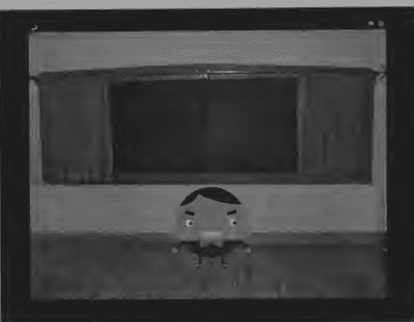

图 4.2
害羞的 Mr. Wiggly 在跳舞时肤色发生了变化。

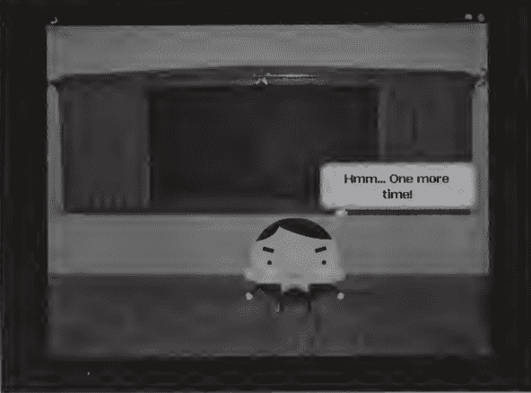

图 4.3
Mr. Wiggly 在每次舞蹈结束时停顿，仅是为了决定继续跳下去。

在每次舞蹈结束时，Mr. Wiggly 都会停顿一会，反思进展情况，然后才决定继续跳舞，如图 4.3 所示。

Mr. Wiggly 的舞蹈应用程序项目将按照此处概述的一系列步骤创建：

1. 创建一个新的 Scratch 项目。
2. 添加项目背景。

## 创建 Mr. Wiggly 的舞蹈应用程序 77

3. 向项目中添加和删除精灵角色。
4. 将音乐文件导入应用程序中。
5. 编写音频播放的脚本。
6. 添加让 Mr. Wiggly 跳舞所需的所需的编程逻辑。
7. 保存并执行你的工作。

由于本书尚未详细说明如何使用此应用程序项目中所涉及的所有 Scratch 代码块，因此将提供简要的解释。你将在第 5 到第 12 章中学习使用代码块进行编程的精髓。在完成此项目的每个步骤时，请试着将注意力集中在所遵循的整体流程上，不要纠结于细节。稍后，在你复完第 5 到第 12 章后，你可以随时回来再次查看此项目，并解决可能存在的任何问题。

### 步骤 1：创建一个新的 Scratch 项目

创建新 Scratch 项目的第一步是启动 Scratch。这样做会自动创建一个新的 Scratch 项目。新项目会带有一个带有两个代表猫的造型的单个精灵。你可以选择将此精灵整合到你的应用程序中，也可以将其删除。另一方面，如果 Scratch 已经启动且你已经使用了一段时间，你可以通过点击菜单栏上的“新建”按钮来创建并打开一个新的 Scratch 项目。作为响应，IDE 中打开了一个新项目，如图 4.1 所示。

### 步骤 2：为舞台添加背景

创建好新的 Scratch 项目后，就可以开始工作了。让我们从为舞台添加一个合适的背景开始，这将有助于营造程序的氛围。背景与舞台相关，因此要为你的应用程序添加背景，必须点击位于精灵列表中的舞台缩略图。一旦选中，舞台缩略图将用蓝色轮显示，如图 4.5 所示。

一旦选择了舞台，你就可以点击脚本区域顶部的“背景”选项卡来修改其背景。当你这样做时，将显示当前分配的舞台背景，如图 4.6 所示。

## 第 4 章 Mr. Wiggly 的舞蹈——快速项目

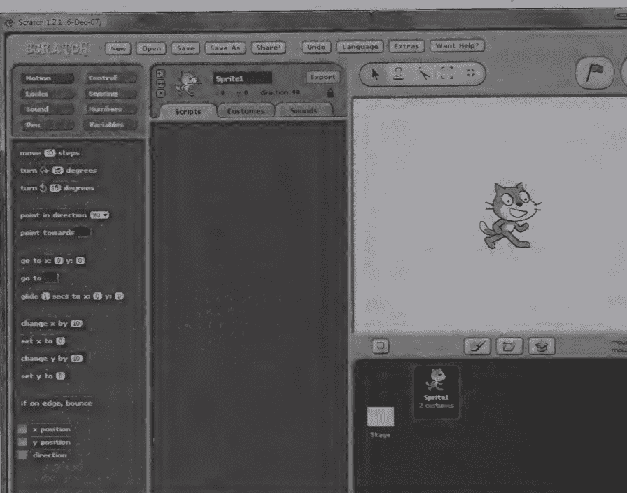

图 4.4
新的 Scratch 项目附带有一个单个精灵。

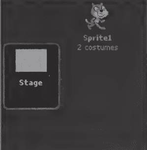

图 4.5
精灵列表中的缩略图用蓝色轮廓显示。

要将当前分配的空白背景替换为更有趣的内容，请点击“导入”按钮。这将打开导入背景窗口。打开后，点击“室内”文件夹，选择黑板缩略图（如图 4.7 所示），然后点击“确定”按钮。

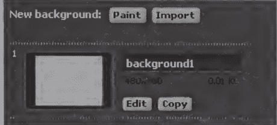

图 4.6
“背景”选项卡提供了创建、导入、编辑和重命名背景的能力。

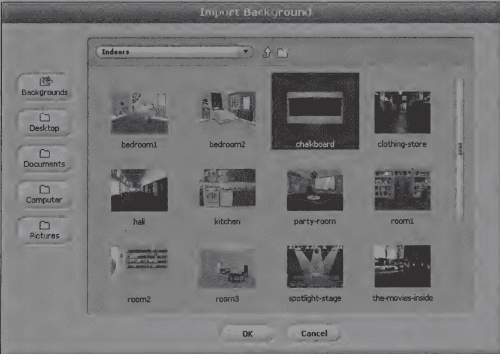

图 4.7
向你的 Scratch 应用程序导入新背景。

导入后，新背景将添加到应用程序当前的背景文件列表中，如图 4.8 所示。如你所见，缩略图被自动分配了一个名称和编号。

由于此应用程序只需要一个背景，你可以点击“删除此造型”按钮从项目中删除名为 background1 的默认空白背景，该按钮位于背景图片的右侧，用一个圆形 X 按钮表示。


# 第 4 章 ■ Wiggly 先生的舞蹈——一个快速的 Scratch 项目

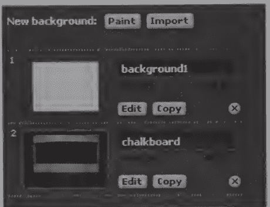

**图 4.8**nScratch 具有任意数量的背景，并在执行过程中在它们之间切换。

从文件选择新角色

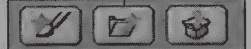

**图 4.9**n点击“从文件选择新角色”按钮，可以访问一组预制的角色库。

> **提示**n移除 Scratch 应用程序中不再需要的背景、造型和声音文件可以减小它们的大小。如果你决定将它们上传到 Scratch 网站，这可能是至关重要的。该网站的项目大小限制为 10MB。图形和音频文件通常较大，因此移除任何你不需要的文件都会对应用程序的大小产生显著影响。

### 步骤 3：添加和删除角色

此 Scratch 项目开发的下一步是向项目中添加一个代表 Wiggly 先生的角色，并删除此应用程序中需要的猫角色。要添加代表 Wiggly 先生的角色，请点击图 4.9 所示的“从文件选择新角色”按钮。该按钮是新角色按钮集中的中间按钮，位于舞台正下方、角色列表上方。

Scratch 提供了对各种角色的快速访问，并组织在以下六个文件夹中：

- 动物 (Animals)
- 奇幻 (Fantasy)
- 字母 (Letters)
- 人物 (People)
- 物品 (Things)
- 交通 (Transportation)

你想代表 Wiggly 先生的角色位于“人物”文件夹中。一旦点击，“从文件选择”按钮将指示 Scratch 显示“新角色”窗口，该窗口提供了上述六个文件夹的访问。打开“人物”文件夹，然后向下滚动直到找到 roundman 角色，如图 4.10 所示。

点击 roundman 角色选中它，然后点击 OK 按钮。新角色窗口将关闭，新角色将添加到舞台正中央，如图 4.11 所示。

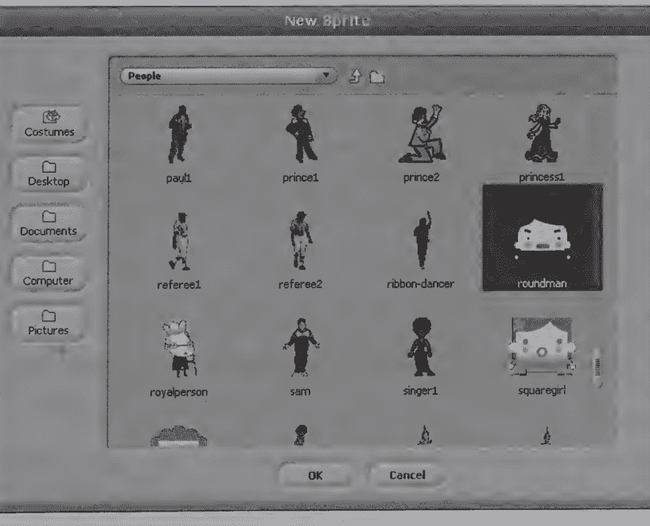

图 4.10 选择用于代表 Wiggly 先生的角色。

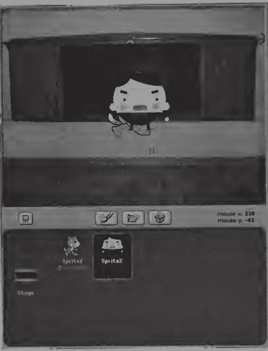

**图 4.11**
代表角色的缩略图也会被添加到角色列表中。

与舞台背景相比，Wiggly 先生在舞台中央的默认位置让他看起来像是漂浮在空中。为了让透视效果正确，将 Wiggly 先生拖动到舞台下方约一英寸的位置，让他看起来像是站在地板上。

由于“Wiggly 先生的舞蹈”应用程序不需要默认的猫角色，请点击 Scratch 工具栏上的删除按钮，然后点击角色列表中的猫缩略图，从而从应用程序项目中删除该角色。

> **提示**n你也可以通过右键点击其缩略图并从显示的弹出菜单中选择删除从应用程序中移除猫角色。

### 步骤 4：添加 Wiggly 先生的音乐

现在你已经处理好了应用程序所需的角色，是时候导入声音文件了。要执行此操作，点击角色列表中代表舞台的缩略图，然后点击脚本区域中的“声音”选项卡。作为响应，Scratch 将显示属于该色的色的声音文件。默认情况下，Scratch 应用程序中的每个角色都分配了一个名为 pop 的常用声音文件，如图 4.12 所示。

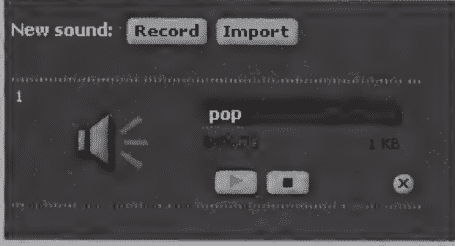

图 4.12
Scratch 提供的所有角色都配备了相同的声音文件。

Scratch 提供了对各种预录制音频文件的快速访问。Wiggly 先生舞蹈的声音文件名为 Eggs。要将此添加到角色，点击“导入”按钮。作为响应，Scratch 将显示“导入声音”窗口，该窗口默认包含以下六个文件夹，Scratch 在其中存储音频文件：

- 动物 (Animal)
- 音效 (Effects)
- 人类 (Human)
- 乐器 (Instruments)
- 音乐循环 (Music Loops)
- 打击乐 (Percussion)
- 人声 (Vocals)

双击“音乐循环”文件夹进入该文件夹。找到并点击 Eggs 文件，如图 4.13 所示。Scratch 将立即播放该文件，你可以听听它听起来怎么样。

点击 OK 按钮将声音文件导入到你的应用程序项目中，如图 4.14 所示。注意，对于每个声音文件，都会显示若干信息。你可以看到文件名以及播放该文件所需的时间。

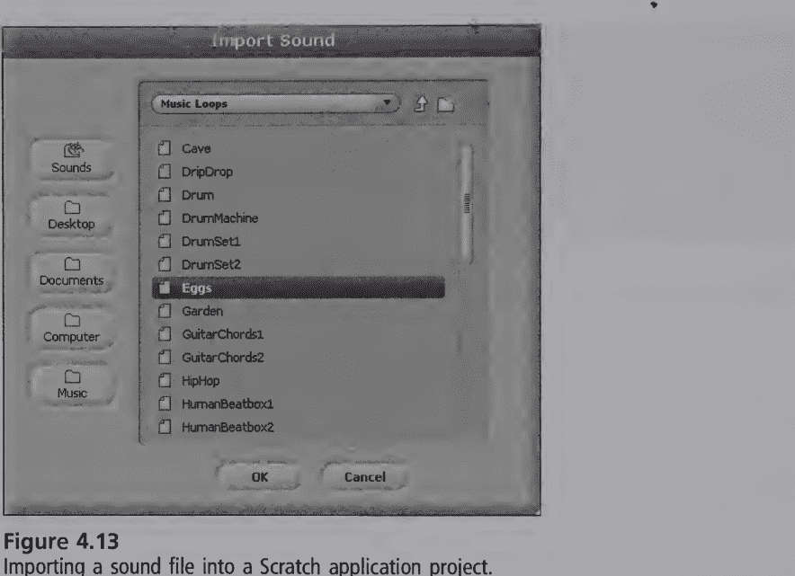

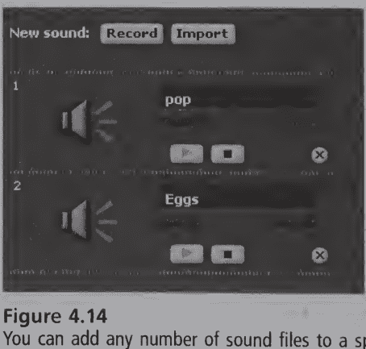

### 步骤 5：播放音乐

是时候开始组合程序让你的应用程序运行了。你总共需要创建两个脚本：一个用于舞台，另一个用于角色。属于舞台的脚本将由负责播放背景的区块组成。角色的脚本将包含让 Wiggly 先生跳舞的编程逻辑。

舞台开发的第一步是点击“控制”按钮，然后将绿色旗帜区块的实例拖动到脚本区域，如图 4.15 所示。由于音乐应该在应用程序运行期间反复播放，你需要设置一个循环来重复播放声音文件。要设置此内容，将“重复执行”区块的实例拖动到脚本区域，并将其挂在绿色旗帜区块的底部，如图 4.16 所示。

现在你已经设置好了循环，点击位于区块面板顶部的“声音”按钮，将一个“播放声音”区块的实例拖动到脚本区域，将其嵌入“重复执行”区块内部。接下来，点击代码区块右侧的下拉菜单，从列表中选择 Eggs。此时，脚本应该像图 4.17 所示。

> **注意**
Scratch 会自动在“播放声音”代码区块中填充你之前添加的所有声音文件列表，方便你在处理声音代码区块时访问它们。

此时，点击调色板顶部的“控制”按钮，为脚本添加最后一个代码区块以完成它。要执行此操作，请将一个“等待”区块的实例拖动到脚本区域，将其插入“重复执行”区块内部，紧跟“播放声音”区块之后，如图 4.18 所示。该区块是为了让循环暂停 16 秒，以便让声音文件完整播放，然后循环循环并再次开始播放。


# 创建 Mr. Wiggly's舞蹈应用程序 87

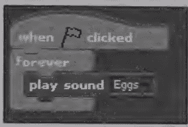

图 4.17
使用播放声音代码块来播放 Eggs 音频文件。

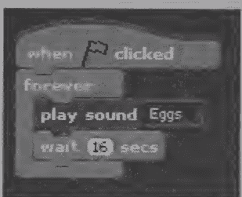

图 4.18
暂停循环执行，以允许声音文件播放完成。

# 注意

现在脚本已经编写完成，你可以通过双击它来测试一下。作为响应，Scratch 会反复播放该声音文件。一旦你确认一切运行正常，请点击红色的“停止全部”（Stop Everything）按钮来停止脚本的执行，这样你就可以进行该应用程序开发的下一个步骤了。

# 注意

除了使用图 4.18 所示的声音和控制块组合来播放音频文件外，你也可以使用此处显示的代码块，它的作用与这两个代码块相同。

```
play sound Eggs: until done
```

### 步骤 6：让 Mr. Wiggly 跳舞

现在你已经完成了舞台脚本的工作，是时候编写编写让 Mr. Wiggly 跳舞的脚本了。为此，点击代表 Mr. Wiggly 的角色缩略图（在角色区域）。作为响应，Scratch 应该清空脚本区域并自动为你选择“脚本”（Scripts）选项卡，以便你开始脚本开发。

# 第 4 章 ■ Mr. Wiggly 的舞蹈——一个快速 Scratch 项目

开发此项目的第一步是`点击区块面板中的控制（Control）按钮，然后将一个“当绿旗被点击（when green flag clicked）”的实例拖到脚本区域，如图 4.19 所示。这个帽子形状代码块（hat code block）每当点击绿旗按钮就会就会执行它所属的脚本。

在这个应用程序中，Mr. Wiggly 应该不断地跳舞而不停止（直到用户停止运行应用程序）。要设置此项，将一个“重复（forever）”代码块实例拖到脚本区域，并将其附加到“当绿旗被点击（clicked）”代码块的底部，如图 4.20 所示。

# 现在，是时候添加一对代码语句，让 Mr. Wiggly 向右移动 25 步并等待两秒。这是通过将“移动 步（move steps）”和“等待 秒（wait secs）”区块拖到脚本区域，并将它们嵌入“重复（forever）”代码块中实现的，如图 4.21 所示。

# 注意

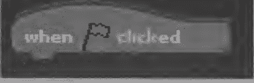

图 4.19
设置当绿旗被点击时执行的脚本。

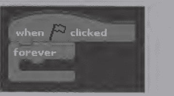

图 4.20
在脚本中添加循环以重复执行嵌入嵌入代码块。

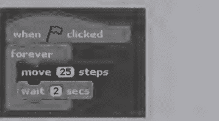

图 4.21
添加让 Mr. Wiggly 跳出第一步的编程逻辑。

# 创建 Mr. Wiggly’s舞蹈应用程序


图 4.22
添加完成 Mr. Wiggly 舞蹈动作所需的剩余代码块。

默认情况下，“移动 步（move steps）”区块被设置为 10。你需要将其替换为值 25。

接下来，你需要添加一系列“移动 步（move steps）”和“等待 秒（wait secs）”代码块，执行时它们将让 Mr. Wiggly 向右移动 25 步，然后向左移动四次（每次 25 步），最后再向右移动两次。这是通过添加七组代码块来实现的，如图 4.22 所示。

为了完成该脚本的开发，你还需要添加两个“外观（looks）”区块，如图 4.23 所示。“变幻特效（change effect）”代码块用于在每次循环执行完毕时修改 Mr. Wiggly 的颜色，模拟 Mr. Wiggly 在跳舞时感到害羞的感觉。最后，“思考 秒（think for secs）”代码块用于在弹出气泡中显示文本消息，显示 Mr. Wiggly 正在思考，然后决定继续跳舞。

# 第 4 章 ■ Mr. Wiggly 的舞蹈——一个快速 Scratch 项目

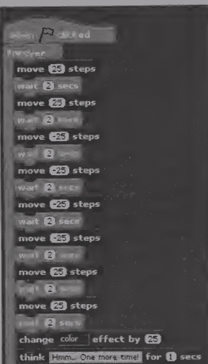

图 4.23
修改 Mr. Wiggly 的颜色并显示他的想法。

### 步骤 7：保存并运行你的新 Scratch 应用程序

此时，你的 Mr. Wiggly's 舞蹈应用程序副本应该已经完成了。剩下的就是保存应用程序，然后运行它以查看效果。要保存应用程序，点击 IDE 菜单栏上的“保存（Save）”按钮。作为响应，Scratch 将显示“保存项目”窗口，如图 4.24 所示，提示你指定存储新应用程序的名称和位置。

此外，Scrach 提供在“项目作者（Project Author）”字段中输入你的姓名，并在“关于此项目（About This Project）”字段中输入项目说明的机会。完成后，点击“确定”按钮保存你的 Scratch 项目。

保存工作后，运行应用程序以查看其运行情况。由于应用程序的所有两个脚本都配置为当按下绿旗按钮时执行，你只需要点击该按钮，然后静坐着看着害羞的 Mr. Wiggly 为你表演舞台上的舞蹈吧。

# 分发 Scratch 项目 91

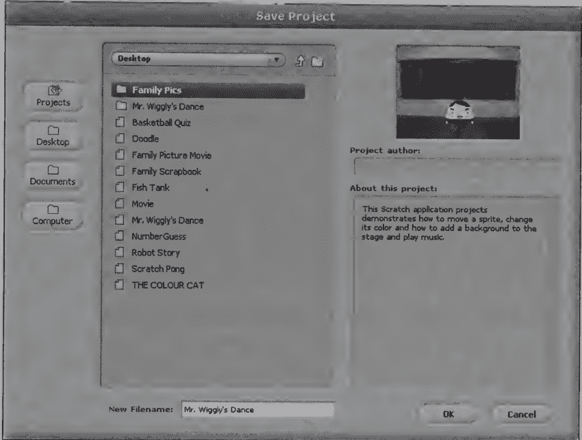

图 4.24
保存你的 Mr. Wiggly's 舞蹈应用程序项目副本。

### 分发 Scratch 项目

Scratch 是一种解释型语言。这意味着不像 C++ 等某些语言，你不需要将代码编译为针对特定操作系统的可执行文件。相反，你可以分享项目文件，任何安装了 Scratch 的人都可以运行它们。

要分发你的项目，你可以直接向朋友提供 `.sb3` 文件，或者将项目上传到 Scratch 网站。当你将项目上传到网站时，其他人可以查看、播放并对你的作品进行混创（remix）。

# 注意

在网上分享项目时，请记住包含关于项目如何运行的清晰描述。这有助于他人理解你的逻辑并从你的代码中学习。


### 总结

本章带你完成了第二个 Scratch 项目的学习。在学习如何创建“Wiggly 先生的舞蹈”的过程中，你学习了创建和执行 Scratch 应用程序的基本步骤。这包括学习如何更改舞台背景以及如何操作角色（sprites）。尽管关于如何使用不同代码块和音效的详细说明将在后面的章节中介绍，但你已经快速地了解了如何使用许多控制、动作、外观和声音模块，并学会了如何将音频文件和角色导入到你的 Scratch 应用程序中。

# 第二部分

## 学习编写 SCRATCH 程序

## 第 5 章

## 移动物体

本章是八章内容的第一个章节，旨在教你如何使用组成 Scratch 编程语言的所有代码块。本章的重点在于演示如何使用动作代码块。通过使用这些模块，你能够创建 Scratch 应用程序，让角色在舞台上移动、旋转角色、让它们指向不同的方向、改变角色位置、检测与舞台边缘的碰撞，并报告角色的方向和坐标。本章还介绍了 Scratch 卡片（cards），将其作为学习如何执行不同类型任务的手段。你还将学习如何创建一个新的虚拟鱼缸应用程序。

本章涵盖的主要主题包括：

- 学习如何移动和旋转角色
- 学习如何改变角色方向和位置
- 学习如何改变角色位置并检测与舞台边缘的碰撞
- 学习如何获取和报告关于角色坐标和方向的信息

### 使用动作代码块

为了让 Scratch 应用程序在执行时角色在舞台上移动，我们需要学习如何使用动作代码块。如前所述，动作模块控制角色位置、方向、旋转和移动。Scratch 总共提供了 16 种不同的动作模块，你可以通过点击模块面板顶部的“动作”按钮，并将动作模块拖放到脚本区域，在脚本区域中你可以配置并使用它们来创建脚本。

如果你仔细观察各种动作代码块，你会发现 Scratch 将它们组织成六组，每组之间在模块面板中都用空格隔开。这些子分组包括：

- 移动和旋转角色的动作模块
- 让角色指向不同方向或指向对象的动作模块
- 改变角色位置并控制角色是跳转到新位置还是滑行到新位置的动作模块
- 通过设置或修改 X 轴和 Y 轴坐标值来改变角色位置的动作模块
- 当角色碰到舞台边缘时控制其移动的动作模块
- 报告角色位置和方向的动作模块

本章的其余部分将提供如何在这些子分组中使用动作代码块的示例。

### 移动和旋转角色

Scratch 提供了三个可以移动角色并使其绕其轴旋转的动作模块。这些代码块如图 5.1 所示。

这些模块中的第一个允许你指定角色在舞台上移动的步数（无论角色当前指向哪个方向）。在默认情况下，该代码块指定的值为 10。然而，你可以根据需要更改此值。你甚至可以输入负值，让角色朝其指向的反方向移动。

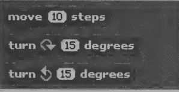

**图 5.1**
这些控制块的设计旨在让你控制角色的相对移动和旋转。

此外，在指定值时，你可以将任何需要的侦测模块（reporter block）拖放到此代码块的输入字段中。。接下来的两个代码块提供了让角色绕其轴顺时针和逆时针旋转的能力，具体由模块上显示的箭头方向指示。

下面的示例脚本演示了如何使用前两个模块让角色顺时针方式在舞台上移动。

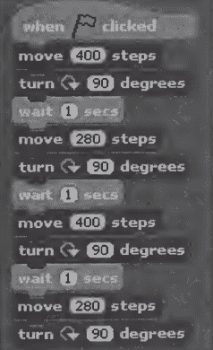

该脚本每当点击绿旗按钮时都会执行。一旦该事件发生，四对动作代码块将每隔一秒执行一次。此应用程序使用了每个新 Scratch 项目自带的默认猫角色。要创建并测试你自己的应用程序副本，请创建一个 Scratch 应用程序，点击猫角色的缩略图，将其拖到舞台的左上角，将其缩小到正常尺寸的 50% 左右，然后组装脚本。

脚本中的前两个动作模块让角色移动 400 步。由于猫默认指向左侧 90 度，这将把角色从舞台的左上角移动到右上角。下一对动作模块将角色向下移动到舞台的右下角。第三对动作模块将角色移动到舞台的左下角，最后对动作模块将其移回左上角。

### 注意事项

Scratch 提供的所有角色都有预定义的旋转轴。你可以通过点击角色信息区域中的方向工具来更改旋转轴。这允许角色绕其中心、边缘或你定义的任何其他点旋转。默认情况下，角色绕其中心旋转。如果你想让角色绕不同的点旋转，则必须使用旋转工具设置新轴心。

### 设置角色方向

如果你愿意，可以修改脚本让角色以逆时针方向在舞台上移动，如下所示：

```
点击
移动 400 步
旋转 -90 度
移动 400 步
旋转 -90 度
```

Scratch 两个动作模块，可以将角色指向指定方向或让角色指向鼠标指针。这些代码块如图 5.3 所示。这些模块中的第一个允许你通过数值值让角色指向特定方向。你可以从模块的下拉列表中选择 0（上）、90（右）、-90（左）或 180（下），或者输入一个 0 到 360 范围内的整数值。例如，下面的脚本演示了如何每隔一秒旋转 90 度，共旋转 360 度：

```
点击
面向方向 90
等待 1 秒
面向方向 180
等待 1 秒
面向方向 270
等待 1 秒
面向方向 360
等待 1 秒
面向方向 90
等待 1 秒
```

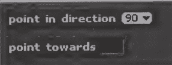

**图 5.3**
这些代码块可以将角色指向指定方向或对象。

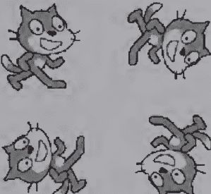

**图 5.4**
面向方向代码块可以指向角色的四个方向示例。


**图 5.5**
猫会根据需要旋转以继续面向鼠标指针。

图 5.5 所示的第二个动作模块允许你让角色指向鼠标指针或另一个角色，如下脚本所示。

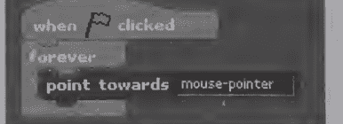


在本示例中，角色（sprite）会不断地重新定位，使其朝向鼠标指针。因此，每当鼠标指针在舞台上移动时，猫的图像都会随之移动，如图 5.5 所示。

# 注意

为了让图 5.5 所示的角色能够不断重新定位，运动模块必须嵌入在一个设置了循环的控制模块中。该循环会重复执行运动模块，使其在每次鼠标指针移动时都能做出反应。

### 重新定位角色

Scratch 提供了三个运动模块，可用于将角色移动到舞台上的指定坐标位置、将角色移动到鼠标指针或另一个角色当前占据的位置，或者在指定的秒数内将角色移动到指定的坐标位置。这些代码块如图 5.6 所示。

这三个运动模块中的第一个允许你通过指定角色的 X 轴和 Y 轴坐标，将角色重新定位到舞台上的任何位置。例如，以下脚本演示了如何将角色重新定位到舞台中央，并使其指向 90 度的方向。

```
when clicked
go to x: 0 y: 0
point in direction 90
```

```
go to x: 0 y: 0
go to
glide 1 secs to x: 0 y: 0
```

图 5.6
这些代码块可将角色移动到特定位置。Leabharlanna Poibli Chathair Baile Átha Dublin City Public Libraries

## 第 5 章 ■ 移动物体

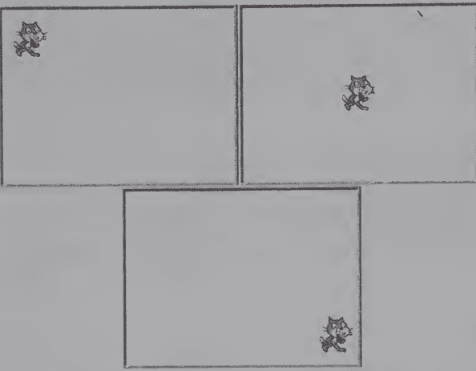

图 5.7
如如图所示，角色会自动在舞台上移动，跟随鼠标指针。

以下脚本演示了如何将角色移动到舞台上当前鼠标指针占据的位置。

```
when clicked
forever
 go to mouse-pointer
```

图 5.7 显示了运行此脚本时生成的输出示例。如果你仔细观察，会发现三个示例中的每一个，无论鼠标指针在舞台上移动到何处，猫角色都保持在鼠标指针正下方。

下一个脚本演示了如何将角色重新定位到舞台上的特定位置。该脚本不像前两个示例那样简单地让角色出现在指定位置，而是通过平滑移动或滑行到新位置来重新定位角色。

```
when clicked
forever
glide 1 secs to x: -200 y: 140
wait 2 secs
glide 1 secs to x: 200 y: -140
```

### 修改角色坐标

Scratch 提供了四个运动模块，通过为角色分配新坐标或通过增加/减少其坐标值来修改角色在舞台上的位置。这些代码块如图 5.8 所示。

以下脚本演示了如何让角色通过八步移动跨越舞台。脚本开始启动时，它将角色移动到舞台的左侧，然后使用循环，在每次循环重复时，通过将 X 轴坐标值增加 50、将 Y 轴坐标值减少 10 来移动角色。结果是角色被反复重新定位，从而跨越舞台移动（在八秒钟内以下降的角移动）。

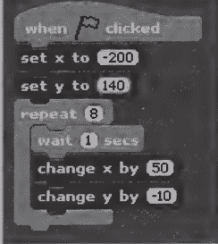

### 让角色在舞台上反弹

当角色在舞台上移动时，它最终可能会接触舞台的边缘之一。使用下所示运动模块，你可以指示 Scratch 让角色从舞台边缘反弹。


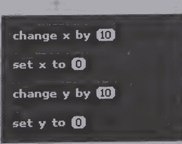

图 5.8
这些代码块提供了通过更改坐标来修改角色位置的能力。

## 第 5 章 移动物体

以下脚本演示了如何使用此代码块让角色在舞台上反弹：

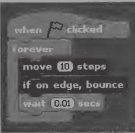

此脚本每当角色与舞台边缘碰撞时就会反转其移动方向。如果你在一个新的应用程序中将此脚本添加到猫角色，猫就会在舞台上左右移动，直到你停止应用程序的运行。

### 跟踪角色的坐标和方向

Scratch 提供了三个运动（汇报）模块，可用于获取和显示有关角色 X、Y 坐标值以及角色方向的信息。这些代码块如图 5.9 所示。

# 注意

> Scratch 的舞台坐标系允许 X 轴坐标范围为 -240 到 240，Y 轴坐标范围为 180 到 -180。

为了设置一个演示如何使用这些汇报模块的示例，请创建一个新的 Scratch 应用程序并将以下脚本添加到默认的猫角色。


执行时，此脚本将让猫角色在舞台上移动到鼠标指针所在的位置，并在必要时使其从舞台边缘反弹。添加脚本后，点击代码块面板中每个模块左侧的复选框来选择每个汇报模块。

## 利用 Scratch 卡片 107


图 5.9
这些代码块提供了获取和显示角色坐标和方向的能力。


图 5.10
显示角色的坐标和方向。

一旦完成此操作，舞台上应该会出现三个显示器，如图 5.10 所示。

一旦设置好应用程序的显示器，运行程序，在舞台上移动鼠标指针，并留意显示器汇报的值。

### 利用 Scratch 卡片

Scratch 程序员可以获得的一种资源是 Scratch 卡片。Scratch 卡片是 PDF 文件，你可以打印、剪切、粘在一起，然后作为执行某些任务的快速参考。你可以从 http://scratch.wiki/Support/Scratch_Cards 免费下载 Scratch 卡片，如图 5.11 所示。

每张 Scratch 卡片的正面标识了该卡片设计向你展示如何执行的任务类型，背面则提供了如何执行该任务的详细说明。在本书编写时，已有十几张 Scratch 卡片可用。

## 第 5 章 移动物体


这些卡片中的每个 PDF 文件都有描述性命名，以标识该卡片教你执行的任务。可用卡片包括：

- 改变颜色
- 随节奏移动
- 键移动
- 说话
- 滑行
- 跟随鼠标
- 舞蹈旋转

### 利用 Scratch 卡片

- 互动旋转
- 动画化
- 移动动画
- 惊喜按钮
- 计数

图 5.12 显示了键移动卡片的 PDF 文件样式。如你所示，卡片的左侧演示了


角色的移动方式，该键移动卡片演示了如何使用键盘来让角色在舞台上移动。

卡片的右侧提供了向四个方向移动角色所需的代码块示例。此外，每张 Scratch 卡片都包含一个额外提示，帮助你进一步增强所执行的任务。

## 提示

有五张关于在舞台上移动的 Scratch 卡片。这里是这些卡片的简要介绍：

- 键移动：演示如何使用键盘让角色在舞台上移动。
- 随节奏移动：演示如何创建一个随鼓点移动的动画序列。
- 移动动画：演示如何使用另一系列造型制作角色的动画。
- 滑行：演示如何让角色从舞台上的一个点平滑移动到另一个点。
- 跟随鼠标：演示如何编写脚本让角色跟随舞台上鼠标指针的移动。

### 创建虚拟 Scratch 鱼缸

本章的剩余部分将引导你开发一个虚拟鱼缸应用程序。在这个 Scratch 应用程序中，五只代表各种彩鱼和一只小章鱼的角色会在代表鱼缸的背景中游动，如图 5.13 所示。

你将通过遵循以下步骤创建此应用程序：

- 创建新的 Scratch 项目
- 添加舞台背景
- 向项目中添加和删除角色
- 将声音文件导入应用程序
- 添加播放背景音效所需的编程逻辑
- 添加制作鱼缸活动所需的编程逻辑
- 保存并运行你的作品


# 创建虚拟 Scratch 鱼缸 111


**图 5.13**
虚拟鱼缸应用运行的示例。

### 第 1 步：创建一个 Scratch 项目

创建此 Scratch 项目的第一步是启动 Scratch，从而自动创建一个新的 Scratch 应用项目。或者，如果你已经运行了 Scratch，可以点击 Scratch 菜单栏上的“新建（New）”按钮来创建一个新项目。

### 第 2 步：为舞台添加背景

一旦你准备好了一个新的应用项目，让我们开始为舞台添加一个合适的背景，这将为虚拟鱼缸提供恰当的外观和感受。要进行此设置，请点击脚本区域上方角色列表中代表舞台的“背景（Backgrounds）”缩略图。接下来，点击“导入（Import）”按钮，显示“导入背景（Import Background）”窗口。双击“文件夹（Folder）”，向下滚动并选择水下图形，然后点击“确定（OK）”按钮。一旦添加了新背景，请从应用程序中移除舞台背景。

### 第 3 步：添加和删除角色

虚拟鱼缸应用开发的下一步是向应用程序添加代表不同海洋生物的角色。在在此之前，先从应用程序中移除猫的角色，因为不需要。

# 表 5.1 角色旋转按钮

| 角色文件名 | 角色应用名称 |
| :--- | :--- |
| fish2 | Purple（紫色） |
| fish3 | Yellow（黄色） |
| fish4 | Spotted（斑点） |
| octopus1-a | Squid（鱿鱼） |

右键点击角色列表缩略图，在出现的弹出列表中选择“删除（Delete）”。移除猫的角色后，是时候添加应用程序所需的新角色了。

总共，你需要添加五个新角色。其中四个角色代表不同的鱼，第五个将代表一只小章鱼。要添加章鱼角色，点击新角色按钮控件中间的“从文件选择角色（Choose Sprite from File）”按钮。这将打开“新角色（New Sprite）”窗口。双击“专辑（Albums）”文件夹，向下滚动并选择 fish1-a 角色，然后点击“确定（OK）”按钮。接下来，点击角色区域中的角色缩略图，将分配给角色的名称更改为 Blue（蓝色）。

使用上述相同的步骤，将以下角色列表添加到应用项目中，并按照表 5.1 所示重命名每个角色。

一旦添加了所有五个角色，将这些角色移动到舞台上的随机位置。接下来，通过选择每个角色并在角色区域中更改方向（通过重新调整角色图像上蓝线的方向），来改变每个角色移动的方向。

**提示**
为了让虚拟鱼缸更有趣，请设置鱼和章鱼，让它们以不同的方向和角度移动。

### 第 4 步：为舞台添加合适的音频文件

现在应用程序的背景和角色已经添加完毕，是时候添加一个音频文件了，它将给虚拟鱼缸带来真实的感受。具体来说，我们将添加一个播放时会发出泡泡声的音频文件。要完成此任务，点击角色列表中代表角色的缩略图，然后点击脚本区域中的“声音（Sounds）”选项卡。接下来，点击“导入（Import）”按钮显示“导入声音（Import Sound）”窗口。接下来，双击“特效（Effects）”文件夹，然后选择 Bubble 音频文件并点击“确定”。

> **提示**
为了让你的 Scratch 尽可能小，请从背景中移除默认的 pop 音频文件。

### 第 5 步：播放音频文件

现在是时候添加让你的新应用程序运行所需的编程逻辑了。总而言，你需要在项目添加添加六个脚本，舞台对应一个，以及应用程序的五个角色中的每个角色各一个。

要添加到舞台的脚本将负责播放背景音效，让虚拟鱼缸听起来像真实的鱼缸。要创建它，点击角色区域中的舞台缩略图，然后选择脚本区域顶部的“脚本（Scripts）”选项卡。接下来，按照此处所示完全添加并配置以下代码块：


该脚本由一个帽子块（hat block）组成，每当按下绿旗按钮时就会执行。当发生这种情况时，会设置一个循环来重复执行两个代码块。第一个代码块播放你之前添加到舞台的音频文件。第二个代码块将脚本执行暂停四秒，以给 Scratch 时间完成播放音频文件，然后允许循环重复并再次播放。

### 第 6 步：制作鱼游动的动画

现在提供应用程序背景音效所需的编程逻辑已经就绪，是时候编写制作鱼和章鱼移动的脚本了。要进行此设置，你需要在每个角色中添加一个小型脚本，提供控制角色在鱼缸中移动（或游动）时所需的编程逻辑。

# 第 5 章 ■ 移动物体

### 蓝色鱼移动的脚本编写

让我们从自动化名为 Blue 的角色的移动开始。点击该角色的缩略图，然后为它创建以下脚本：


如你所见，该脚本设置为在用户点击绿旗按钮的一刻开始执行。它包含一个控制块，设置了一个循环来重复执行两个嵌入的移动块。第一个块重复第二个移动块，告诉 Scratch 在到达舞台边缘时让角色反弹。结果是角色（蓝鱼）将在鱼缸中左右游动，取决于你是否按照第 3 步尾的指令调整了它的方向，它也会上下移动。

### 紫色鱼移动的脚本编写

接下来，让我们创建一个控制紫色鱼移动的脚本。与其从零构建此脚本，不如采取捷径。在脚本区域当前显示蓝色鱼脚本的情况下，将该脚本拖动并释放到角色列表中代表紫色角色的缩略图上。这为紫色角色添加了一个完全相同的脚本，你可以通过点击紫色角色的缩略图来查看和修改它。

为了增加趣味，将紫色角色移动的步数从 1 修改为 2，如下所示：


# 创建虚拟坦克 115

紫色鱼比蓝鱼速度快一点，所有鱼的编程逻辑都是相同的。事实上，其余鱼和章鱼的编程都是相同的，只是移动的步数不同。

### 黄色鱼移动的脚本编写

使用拖放，将紫色角色的脚本复制到黄色角色，然后按照此处所示修改它：


如你所见，黄色鱼的配置速度与蓝鱼相同。

### 斑点鱼移动的脚本编写

再次，使用拖放，将黄色角色的脚本复制到斑点鱼，然后按照此处所示修改它：


这次角色被配置为每次移动两步。

### 章鱼移动的脚本编写

最后，将斑点鱼的脚本拖动到代表章鱼的角色上，然后按照此处所示修改它：


如你所见，这个角色的移动比任何其他角色都慢，每次只移动半步。

# 第 7 步：保存并执行你的新 Scratch 

到此时，你的虚拟鱼缸应用应该已经完成，并且看起来像图 5.14 所示。

如果你还没有这样做，请保存你的新应用程序并运行它以查看效果。要保存应用程序，点击 Scratch 菜单栏上的“保存（Save）”按钮。这将显示“保存项目（Save Project）”窗口，允许你指定应用程序名称、存储位置、你的姓名以及记录应用程序目的的注释。


图 5.14
完整的应用程序包含一个背景、五个角色和六个脚本。*


一旦你保存了应用程序，就可以运行它。由于应用程序中的所有脚本都配置为在点击绿色旗帜按钮时执行，你只需要点击绿色旗帜按钮，然后坐下来放松，观察并聆听你的虚拟鱼缸即可。

### 总结

本章教了你如何使用所有 16 个动作代码块。你学习了如何移动和旋转角色，让角色指向不同的方向或不同的物体，以及如何改变角色的位置。你还学习了如何控制角色是跳转到新位置还是滑行到新位置，如何通过设置或修改其 X 轴和 Y 轴坐标的值来改变角色的位置，如何控制角色在接触舞台边缘时的移动，以及如何报告角色的位置和方向。你同样学习了如何使用 积木卡片（Scratch cards）并创建一个虚拟鱼缸应用程序。

## 第 6 章
## 感应角色位置并控制环境设置

为了创建许多交互式计算机应用程序，你需要具备检测特定事件何时发生的能力。例如，在汽车赛车游戏中，能够检测两辆汽车（角色）是否相互碰撞是非常重要的；在一个使用预定义按键作为输入来控制某些游戏功能的游戏中，你需要能够检测到这些键何时被按下。
Scratch 提供了使用感应积木来检测或感知事件发生情况的能力。本章将演示如何使用各种感应积木，并引导你创建一个新的 Scratch 应用程序——“家庭相册”（Family Scrapbook）。

本章涵盖的主要议题包括学习如何：

- 检测鼠标指针位置和鼠标按钮状态
- 检测键盘按键何时被按下
- 判断角色何时与舞台上的其他物体碰撞
- 跟踪角色与其他物体的距离并获取不同的角色属性
- 使用计时器并检测麦克风输入的音量

## 使用感应代码块

对于一种需要处理角色的图形化编程语言来说，一项重要的能力是确定特定事件何时发生。例如，基于角色的应用程序通常需要知道角色何时相互碰撞，或者用户何时按下了某些按键。这种功能通过 Scratch 中的感应积木来提供。

感应积木还提供了确定鼠标指针位置以及确定角色与其他角色之间距离的能力。感应积木呈天蓝色。总之，Scratch 提供了 15 种不同的感应积木，你可以通过点击积木面板顶部的“感应”按钮来使用它们。

Scratch 将感应积木分为八个子组，每组之间在积木面板中用空格隔开。这些子组包括：

- 获取并报告鼠标左键状态和鼠标指针坐标的感应积木。
- 判断指定的键盘按键何时被按下的感应积木。
- 判断角色是否接触了鼠标指针、另一个角色或舞台边缘的感应积木。
- 报告角色与鼠标指针或另一个角色距离的感应积木。
- 提供内置计时器访问感应积木，该计时器可控制应用程序活动的时机。
- 获取舞台或指定角色的属性值（X 位置、Y 位置、方向、造型编号、大小或音量）的感应积木。
- 报告来自电脑麦克风的音频输入响量的感应积木。
- 与 积木板（Scratch Board）配合感应积木，允许你创建可以检测光线变化，并操作积木板按钮和滑块控制的应用程序。

## 获取鼠标按钮和坐标状态

除了重置计时器代码块外，所有的感应代码块都是报告积木（reporter blocks），设计用于嵌入堆栈积木（stack blocks）内部。本章的其余部分将提供使用上述列出的每种感应代码块的示例。

在许多类型的应用程序中，鼠标指针用于控制角色的移动，并以许多其他不同方式影响应用程序的操作。图 6.1 所示的感应积木提供了有关鼠标指针操作的数据。

这三个代码块中的第一个用于获取鼠标指针沿 X 轴移动的位置的位置正如正如第 2 章“熟悉 Scratch 开发环境”中所述，Scratch 支持从 -240 到 240 的总范围。第二个代码块用于获取鼠标指针沿 Y 轴移动的位置。Scratch 的 Y 轴支持从 180 到 -180 的总范围。第三个代码块用于获取一个真/假（true/false）值，用以识别鼠标按钮是否被按下。以下脚本是一个绘图应用程序的一部分，演示了如何使用这三个感应代码块。


图 6.1 这些感应积木报告鼠标指针的坐标和按钮状态。

## 第 6 章 感应角色位置

要创建绘图应用程序，请创建一个新的 Scratch 应用程序项目。删除其中的猫角色，然后创建并添加由单个黑点组成的新角色。接下来，选择代表该点的缩略图，并将上面的脚本添加到其中。

此应用程序的运行取决于对虚拟笔对象（pen object）的使用，Scratch 通过画笔代码块为你提供该对象，你将在第 12 章“绘制线条和形状”中学习到它。应用程序的整体运行由绿色旗帜按钮控制。一旦启动，使用两个画笔积木来设置画笔的宽度和颜色。在循环中，使用“如果...否则”（if...else）积木来条件条件执行额外的语句。该“如果...否则”积木的执行取决于一个感应积木返回的值，当用户按下左键时返回真，未按下左键时返回假。当按下鼠标按钮时，第一个语句移动到指针相同的位置，第二个代码块将 Scratch 的虚拟笔处于按下状态，允许开始绘制。当用户释放左键时，“如果...否则”积木底部的语句执行，抬起虚拟笔并停止任何绘制。

图 6.2 展示了绘图应用程序的操作。


图 6.2 绘图应用程序示例。

### 判断按键是否按下

绘图应用程序的一个问题是，如果在绘制时出错，没有方法清除屏幕。可以使用图 6.3 所示的感应代码块轻松解决这个问题，它根据指定的按键是否被按下返回真或假。

为了看到使用此代码块的示例，让我们通过编辑应用程序角色的脚本来修改之前的绘图应用程序，如下所示。


如你所见，添加了三个新的代码块，每按下空格键时清除舞台。图 6.4 显示了绘图应用程序的操作示例。在这里，应用程序被用于在舞台上画出“Lee”。接下来，按下空格键清除舞台，之后绘制了一棵树的图像。


图 6.3 该感应积木可以用于检测用户是否按了指定的键盘按键。


图 6.4 增强版的绘图应用程序可用于绘制和擦除。


124 第 6 章 ■ 感应精灵位置

# 提示

除了使用感应代码块检测按键次数外，你还可以使用图 6.5 所示的控制代码块。这两个代码块的区别在于，感应代码块可以在循环中使用，以持续判断指定的按键是否被按下。而另一方面，控制块仅在指定的按键被按下时执行一次，因此它适用于触发单个动作，而不便于动作的重复执行。你将在后的第 9 章“条件与重复逻辑”中学习更多关于此代码块的知识。


图 6.5
此代码块用于每当特定的键盘按键按下时触发一个动作。

## 判断精灵何时与其他物体碰撞

许多电脑游戏的一个关键编程需求是能够判断精灵何时与另一个精灵、屏幕边缘或鼠标指针发生碰撞。Scrach提供了使用图 6.6 所示的三个感应代码块进行碰撞检测的能力。

图 6.6 所示的第一个代码块可用于判断精灵何时与指定的精灵、舞台边缘或鼠标指针接触。此代码块可以检测的对象列表可以通过该块的下拉列表进行访问。作为如何使用此代码块的示例，请通过将之前的 Scratch 应用程序替换为此处所示的脚本来进行修改。


此脚本演示了如何判断精灵何时接触舞台边缘。该脚本每当点击绿旗按钮时都会执行，并使用一个“重复执行（forever）”块设置一个循环，重复执行所有嵌入的代码块。在循环内部，你会发现一个条件 `if` 块，它会在鼠标左键被按下时执行嵌入的语句。


**图 6.6**
这些感应块可以用于寻找碰撞。


**图 6.7**
每当精灵接触舞台边缘时显示的文本示例。

在这种情况下，使用一个动作块来使应用程序的精灵跟随鼠标指针在舞台上移动。在另一个条件 `if` 代码块中使用第二个感应代码块来检测精灵何时接触舞台边缘。当这种情况发生时，将执行一个外观（looks）代码块，在语音气泡中显示文本消息。

图 6.7 演示了当你使用此新脚本运行应用程序并将鼠标指针移动到舞台边缘之一时所显示的输出。

接下来，让我们来看一个如何使用图 6.7 所示的第二个感应块的示例。此代码块可用于检测精灵何时与舞台上的特定颜色接触。要查看如何使用此代码块的运行示例，请创建一个新的 Scratch 应用程序，并创建并添加一个红色矩形的新精灵（使用“画画编辑器”），将其放置在

# 第 6 章 感应精灵位置


图 6.8
这个红色正方形将用于演示与舞台上特定颜色发生碰撞的能力。

舞台正中央。接下来，点击“从文件选择新精灵”按钮向应用程序添加第二个精灵，打开“新精灵”窗口。接着，钻入“幻想（Fantasy）”文件夹并选择 `dragon-b` 精灵，然后点击“确定”。你新应用程序的舞台现在应该像图 6.8 所示的示例。

接下来，为代表龙的精灵添加以下脚本。执行时，每当精灵移动并接触舞台中心的红色正方形时，该脚本就会播放音频文件。

```
if <mouse down?> then
  go to x: mouse x y: mouse y
  touch color [red v]
  play sound pip v
```

注意为了正确设置感应块中的颜色规格，你必须点击嵌入在控制中的颜色块。这会显示一个小吸管管器图形，你可以将其移动到包含你想要检测的颜色的区域。点击该颜色，Scratch 将自动更改代码块的颜色以匹配你点击的颜色。

到此时，你应该已经完成了所有设置并准备好运行。继续运行应用程序，然后按住鼠标左键并让鼠标指针在舞台中间的红色矩形上移动，并聆听音频文件的播放。

使用之前的代码块，你可以设置一个应用程序，在精灵的任何部分接触舞台上的特定颜色时检测碰撞。在先先的示例中，每当龙精灵的任何部分（头部、尾部、翅膀、火焰等）接触红色矩形精灵时，就会发生这种情况。

然而，如果你愿意，可以使用图 6.6 所示的第三个感应代码块来设置。具体来说，此代码块允许你指定在接触特定颜色时发生碰撞。为了更好地理解此代码块与之前的代码块的区别，请看以下脚本。

以下脚本演示了每当精灵接触特定颜色时使用感应块播放音频文件。


此时感应块已被替换。现在，如果你用此脚本替换之前的脚本，只有当龙的火焰接触红色精灵时才会发生碰撞。

### 判断距离

与其检测精灵何时与另一个精灵碰撞，你可能想检测精灵何时进入鼠标指针的特定距离内。你可以使用图 6.10 所示的感应代码块来实现。


图 6.9 设置一个更严格的碰撞测试。


图 6.10 此感应块报告精灵到特定对象的距离。

为了理解如何使用此代码块，请修改之前的 Scratch 应用程序，将其脚本替换为：

```
when clicked
forever
  go to x: mouse x y: mouse y
  if distance to Sprite < 150 then
    play sound
```

一旦你替换了脚本，运行应用程序并在舞台上移动鼠标指针。这样做，每当它距离红色正方形 150 步以内时，就会重复播放音频文件。

### 使用计时器

你需要熟悉的另一对感应代码块如图 6.11 所示。这些代码块提供了启用和使用 Scratch 计时器的能力。

第一个代码块将计时器重置为默认值零，而第二个代码块检索指定的自计时器开始以来经过的秒数。使用 Scratch 计时器，你可以控制动画的节奏和你的应用程序的运行。


图 6.11
这些感应块提供了在 Scratch 应用程序中启用和使用计时器的能力。

例如，当玩家被给定特定时间时，你需要使用这些控制来跟踪时间。

下面的示例演示了如何使用这两个计时器代码块创建一个持续播放五秒音频文件的脚本。

### 获取舞台和精灵数据

除了确定鼠标状态、精灵碰撞和精灵之间的距离外，你还可以使用图 6.12 所示的代码块获取舞台和精灵信息。

此代码块提供了对信息的便捷访问，包括：

- X 位置
- Y 位置
- 方向
- 服装编号
- 尺寸
- 音量


# 第 6 章 ■ 感应角色位置


**图 6.12**
此积块可用于检索多个对象属性的信息。

作为如何使用此代码块的示例，请查看以下脚本。该脚本获取名为“Sprite 2”的角色色的 X 坐标，并且每当该角色移动到舞台右侧（坐标 1 到 240 之间）时，播放一个音频文件。


## 获取音频数据

除了感应鼠标指针和键盘数据、碰撞、距离以及其他舞台和角色的属性，以及使用计时器外，Scratch 还提供了一对感知积块（如图 6.13 所示），这些积块允许你感知来自电脑麦克风的音频输入（如果电脑带有麦克风的话），并在你的 Scratch 应用程序中使用该输入。

这两个感知积块中的第一个检索一个 1 到 100 之间的数字，代表电脑麦克风的音量；第二个代码块检索一个真/假值，取决于是否通过电脑麦克风检测到大于等于 30 的声音值。

下面的示例演示了如何创建一个脚本，当通过电脑麦克风检测到大声响时，播放名为“pop”的音频文件。


图 6.13

这些感知积块用于报告正在播放的声音有多大。


图 6.14

使用监视器跟踪音频播放和输入的响度。

图 6.13 所示的两个代码块都是监视积块，因此如果你愿意，可以在舞台上显示它们的结果，如图 6.14 所示。

## 与传感器扩展板工作的代码积块

Scratch 提供了额外的感知代码积块，如图 6.15 所示。为了使用这些代码积块，你需要一个 Scratch 板（Scratch Board）。Scratch 板是一种特殊的硬件，你可以从 Scratch 网站购买并将其连接到电脑上。你可以使用 Scratch 板收集并处理不同的环境输入和用户提供的输入。

这两个积块中的第一个检索 Scratch 板上某一个传感器报告的值。第二个代码块检索一个真或假的布尔值，取决于指定的指定的传感器是否正被按下。学习如何使用 Scratch 板不在本章的范围范围内。相反，你将学习：


**图 6.15**
这些积块与 Scratch 板配合使用。

在第 14 章“使用 Scratch 板收集外部输入”中，学习如何通过编程与 Scratch 板进行交互并控制。

## 创建家庭相册应用程序

本章的剩余部分将引导你开发下一个 Scratch 应用程序——一个电子家庭相册。总而言，该应用程序将包含一个角色、一个空白舞台和三个脚本。一旦创建，你就可以使用该应用程序在自动相册中显示任意数量的电子照片，每隔三秒显示一张图片。应用程序中的每张照片实际上只是添加到应用程序角色中的服装。图 6.16 和 6.17 显示了应用程序在显示相册两张照片时的外观。

该应用程序项目的开发将按照此处列出的步骤完成：

- 1. 创建一个新的 Scratch应用程序项目。
- 2. 添加和删除角色和服装。
- 3. 将音频文件导入应用程序。
- 4. 添加播放背景音乐所需的编程逻辑。
- 5. 添加管理照片显示的编程逻辑。
- 6. 保存并执行你的工作。

### 步骤 1：创建一个新的 Scratch 项目

创建家庭相册项目的第一步是创建一个新的 Scratch 项目。可以通过打开 Scratch 自动创建一个新项目，或者点击 Scratch 菜单栏上的“新建”按钮来完成。

## 创建家庭相册应用程序 133


图 6.16
角色服装之一的示例。


图 6.17
角色服装的另一个示例。

### 步骤 2：添加和删除角色和服装

应用程序由单个角色组成，该角色将用于显示所有照片。要设置此项，导航到舞台并点击“新建”按钮打开服装窗口。添加角色后，点击舞台，然后选择顶部的服装标签。

## 134


**图 6.18**
角色服装之一的示例。

### 步骤 3：添加音频文件

应用程序开发的下一步是添加编程逻辑。为了让应用程序更有趣，点击舞台，然后选择顶部的声音标签。

该脚本在应用程序运行期间管理音频文件播放。音频文件播放通过一对声音积块完成，你将在第 11 章学习它们。

## 创建家庭相册应用程序


图 6.19
为舞台添加音乐。

### 步骤 4：播放音频文件

现在是添加负责显示所有照片的编程逻辑了。要设置此项，你需要在应用程序中添加一个小脚本，指定自动化显示所需的编程逻辑。

### 步骤 5：显示照片

自动化相册操作的代码块所示：

此脚本在用户点击绿旗时自动执行。当这种情况发生时，一个造型积块指定启动应用程序时显示的服装（服装列表中的第一张）。接下来，设置一个循环来重复执行内部的两个语句。循环中的第一个代码块会将脚本暂停三秒，然后使用第二个造型积块将角色服装切换到角色列表中的下一张。

## 允许手动操作家庭相册

如果用户愿意，而不是以自动幻灯片的方式查看照片，可以通过点击应用程序的角色来手动浏览相册内容，这将显示下一张服装（照片）。为用户提供此手动选项，请为应用程序角色添加以下脚本。


# 总结 137


图 6.20

完成的应用包含一个空白舞台和一个具有 11 种造型的单个精灵。

完成的应用包含一个空白舞台和一个具有 11 种造型的单个精灵。所以，如果你还没有这样做，可以通过点击菜单栏上的保存按钮来保存你的新应用程序。一旦保存，点击绿色旗帜，程序将显示保存窗口，允许你为应用程序命名并指定其存储的位置。切换到演示模式，点击保存按钮，并按照你自己的速度运行你的新应用程序。

### 总结

本章回顾了所有的 Scratch 代码块（除了逻辑块以外的所有的）。你学习了如何检测碰撞、当按下键盘按时进行检测，以及当精灵与舞台接触时进行检测。本章还展示了如何使用计时器作为一种手段来控制应用程序活动。本章所介绍的信息对于开发交互式应用程序和游戏非常关键。

# 第 7 章

# 存储和获取数据

所有计算机应用程序都需要某些类型的数据来执行。在应用程序运行期间，数据也可以随机生成或从用户处收集。为了处理和操作数据，程序员需要能够存储、检索和修改数据的能力。在 Scratch 应用程序中，数据是使用变量管理的。本章的目标是教你关于收集、存储和处理应用程序数据的所有知识。

本章涵盖的主要主题包括：

- 如何创建局部和全局变量
- 如何使用变量作为存储和检索手段
- 如何删除不再需要的变量
- 如何查看存储在变量中的数据

# 学习处理应用程序数据

与计算机程序一样，Scratch 应用程序需要处理和存储数据。数据也可以当用户使用键盘或鼠标与应用程序交互时收集。

# 第 7 章


# 图 7.1

外观代码块中的文本示例。

数据可能由你的应用程序生成，例如当你创建一个生成并使用随机数的 Scratch 项目（见第 8 章）时。例如，图 7.1 所示的代码块可以用于在脚本中存储和显示文本字符串。

执行时，包含此外观块的脚本将在气泡中显示文本字符串。像大多数编程语言一样，Scratch 允许你处理不同类型的数据。下面列出的这些不同类型的数据处理方式各不相同：

- 字符串 (String)
- 布尔 (Boolean)
- 整数 (Integer)
- 实数 (Real)

字符串是在 Scratch 应用程序中使用不同类型外观块硬编码的文本数据，你将在第 10 章“改变精灵的外观和行为”。当你处理不同类型的数字块时，Scratch 会自动生成布尔数据（你将在第 8 章学习）。布尔值表示赋值为真或假的数据。例如，每当你比较两个数值以判断它们是否相等，Scratch 会返回一个布尔值。根据该分析的结果，你可以使用控制块更改你的执行方式，这些将在第 9 章“条件和重复逻辑”介绍。

整数是不包含小数点的数值（有时称为整数）。Scratch 允许你将整数作为输入到许多不同的代码块中。它还允许你在变量内部存储数值数据，允许你在应用程序执行期间根据需要存储、检索和操作数据。实数是一个包含小数的数字。

Scratch 以不同方式处理不同类型的数据。例如，字符串数据只能通过嵌入外观代码块来显示。整数和实数数据也可以嵌入代码块并在显示器中显示。此外，整数和实数数据可以用你操作数值数据的所有不同方式进行加、减和操作。Scratch 还允许你交替使用整数和实数。

# 注意

工业级编程语言 Microsoft C++ 和 Visual Basic 支持广泛的数据的数据。然而，它们都支持与 Scratch 相同的基础数据类型。

# 将数据存储在变量中

如所述，你可以将数值数据嵌入不同类型的代码块中，用它来控制脚本的运行。你还可以使用变量存储应用程序执行时收集的数值。在 Scratch 中，变量允许你存储、检索和修改数值数据。

# 注意

Scratch 不能在变量中存储字符串或布尔数据。

# 创建 Scratch 变量

为了在 Scratch 应用程序中存储、修改和检索数据，你需要创建变量。为了在你的 Scratch 应用程序中使用变量，你必须首先定义并将添加到你的应用程序项目中。这是通过点击区块面板顶部的“变量”按钮，然后点击“建立变量”按钮完成的，如图 7.2 所示。

点击此按钮后，Scratch 显示图 7.3 所示的窗口，允许你为变量命名。


图 7.2 创建并删除变量。

# 第 7 章 存储和获取数据


图 7.3 为新变量命名。


图 7.4 为每个变量创建新的代码块。


图 7.5 每个变量都支持一个显示其值的显示器。


# 第7章 存储与检索数据


图 7.6
创建一个名为 Counter 的局部变量。

### 创建局部变量

局部变量只能在定义它的角色内部被修改。以下步骤概述了创建局部变量的流程。

- 1. 选择要添加变量的角色（sprite）或舞台（stage）。
- 2. 点击位于区块面板面板顶部的“变量”（Variables）按钮。
- 3. 点击“建立一个变量”（Make a Variable）按钮。
- 4. 输入你想要分配给变量的名称，然后选择“仅此角色”（For Sprite Only）选项，如图 7.6 所示。

由于局部变量只能在其被添加的角色内被修改，因此它不能被属于其他角色的脚本修改。如果你需要一个可以被应用程序内任何脚本访问的变量，请按照下一节的讨论创建一个全局变量。

### 创建全局变量

与局部变量不同，全局变量的值可以被定义所在应用程序内的任何脚本修改。你创建全局变量的步骤与创建局部变量完全相同，唯一的区别在于，在命名变量时需要保持默认的“所有角色”（For All Sprites）选项选中，如图 7.7 所示。

> 提示
> 尽可能将所有变量的作用范围限制起来被认为是一种良好的编程习惯。这有助于使应用程序更容易维护，并消除了使用其他角色的脚本意外修改变量值的可能。

## 访问属于其他角色的变量


图 7.7
创建一个名为 Total Score 的全局变量。


图 7.8
删除不再需要的变量。

## 在变量不再需要时删除它们

随着时间的推移，你可能会发现自己对 Scratch 项目进行了许多更改。随着这些更改，你可能会发现某些变量不再被你的应用程序需要。如果是这样，你可以通过从项目中删除这些变量来清理你的应用程序。这样做非常简单：首先，确保应用程序脚本中对该变量的任何引用已删除，然后点击“删除变量”（Delete a Variable）按钮，并选择你想要删除的变量。随后，如图 7.8 所示，从添加该变量的角色中删除该变量。

# 注意

如果你从角色中删除变量而没有移除角色脚本中对该变量的引用，Scratch 将删除变量，但会在应用程序脚本中保留任何引用该变量的代码块。结果是程序无法正常工作。

## 访问属于其他角色的变量

虽然存储在局部变量中的数据只能由分配给该变量的角色脚本更改，但 Scratch 允许其他角色的脚本查看存储在其他角色变量中的。要查看另一个角色局部变量中存储的数据，你需要使用图 7.9 所示的传感器区块。

## 图 7.9

使用此代码块，你可以创建一个可以查看另一个角色局部变量中存储数据的脚本。


## 图 7.10

指定你想要访问的变量所属的角色名称。


## 图 7.11

选择你想要访问数据的变量。

此代码块允许一个角色检索另一个角色的 X 位置、Y 位置、方向、造型编号、大小和音量。它还允许你检索分配给另一个角色变量的值。如图 7.10 所示，你可以点击代码块右侧的下拉菜单，它将显示一个由舞台和 Scratch 应用程序中所有角色组成的列表。

选择舞台或角色后，你可以使用位于代码块左侧的下拉菜单来选择并检索列出的任何指定项目的信息。结果列表底部的灰色水平分割线表示该角色的变量列表，将列表与其他可用数据隔离开来，如图 7.11 所示。

使用此代码块，你可以检索存储在任何角色局部变量中的数据。然而，你所做的只是读取分配给这些变量的值；你不能修改它们。唯一可以远程修改的变量是全局变量。

## 两个快速示例


**图 7.12**
配置变量滑块控制的上下限。

## 使用变量显示器

正如你在第 3 章中学到的那样，Scratch 支持许多代码区块的显示器。除了可以显示变量外，滑块有一个小手柄，你可以拖动它修改值。默认情况下，Scratch 在舞台上显示滑块，尽管你可以通过右键点击并指定任何范围。为了帮助你熟悉操作变量，让我们来看两个快速示例。在第一个示例中，创建了一个执行时将显示分配给变量值的脚本。记住，默认情况下你创建的每个变量都有一个关联的报告区块。


# 第7章 存储与检索数据

为了设置并运行此示例，你需要创建一个新的应用程序并添加一个名为 Counter 的变量，然后将脚本添加到应用程序默认脚本中。

此脚本被设置为当绿色标志被按下时执行。它使用一个控制区块设置一个循环，重复执行两个代码块共10 次。循环每次执行，分配给 Counter 的值增加 1。下一个语句会让循环暂停一秒。

默认情况下，Scratch 为所有新变量分配默认值零，当你第一次运行之前的脚本时，它从 1 计数到 10。然而，如果你再次运行，你会发现它将从 11 计数到 20。如果你想，可以通过显式地为 Counter 变量分配初始值来更改这种行为，如下所示：


在这里，通过在脚本开头添加一个新的变量区块，将 Counter 的值设置为 0。因此，无论此脚本执行多少次，它总是从 1 计数到 10。

## 开发篮球问答项目

本章的其余部分将引导你完成下一个 Scratch 应用程序——NBA 知识问答。该应用程序广泛使用变量来存储和检索玩家输入，并跟踪玩家的结果。总而言，该应用程序由背景、六个角色和六个脚本组成。


图 7.13 显示了游戏刚开始时的界面示例。要开始游戏，用户必须点击代表游戏女主持人的精灵，此时她将开始主持问验。

图 7.14 提供了女主在主持问验时与用户交互的示例。

女主持在用户回答每个问题后都会向其提供即时反馈，让用户知道答案正确还是错误。此外，用户的分数会在每个答案经过评估后自动统计，并显示在舞台右下角的监器中。


图 7.13
NBA 知识问答为用户提供了一系列多选题。


图 7.14
用户通过点击舞台右侧标有 A、B、C 和 D 的按钮来回答问题。

# 第 7 章 ■ 存储与检索数据

该应用程序的开发将按照此处列出的步骤完成：

- 1. 创建新的 Scratch应用程序项目。
- 2. 为舞台添加背景。
- 3. 添加和删除精灵及服装。
- 4. 添加应用程序所需的变量。
- 5. 为每个按钮精灵添加脚本以收集用户答案。
- 6. 添加主持问验所需的编程逻辑。
- 7. 保存并执行你的工作。

# 第 1 步：创建一个新的 Scratch 项目

创建 NBA 知识问答应用程序的第一步是创建一个新的 Scratch 项目。通过启动 Scratch 来自动创建一个新的 Scratch 项目，或者如果 Scratch 已经在运行，点击 Scratch 菜单栏上的“New”（新建）按钮。

# 第 2 步：选择合适的舞台背景

一旦你创建了新的 Scratch 项目，就可以开始工作了。让我们从为舞台添加一个合适的背景开始。为此，点击精灵列表中的空白舞台缩略图。选中后，点击脚本区域顶部的“Backgrounds”（背景）选项卡来修改背景。要为应用程序添加新背景，点击“Import”（导入）按钮。当导入窗口打开时，点击“Indoors”（室内）文件夹，选择篮球缩略图并点击“OK”按钮。

由于此应用程序只需要一个背景，你可以通过点击“Delete this costume”（删除此服装）来从项目中删除名为 `background1` 的默认空白背景。

# 第 3 步：添加和删除精灵

此应用程序由多个精灵组成，分别代表负责主持问验的女主持、用户在回答问题时必须点击的四个按钮，以及一个包含欢迎文本信息的图形。在添加任何精灵之前，先从应用程序中删除猫精灵，因为不需要它。

要添加代表游戏女主持的精灵，点击“Choose New Sprite from File”（从文件选择新精灵）按钮打开新精灵窗口。深入到“People”（人物）文件夹，然后选择 `girl13-standing` 精灵并点击“OK”按钮。如图 7.13 和图 7.14 所示放大精灵并重新调整位置。顺便将分配给精灵的名字改为 `host`（主持人）。

接下来，点击“Choose New Sprite from File”按钮，然后进入“Things”（物体）文件夹并选择按钮精灵，点击窗口上的“OK”按钮。添加按钮精灵后，在精灵列表中选中它，点击脚本区域顶部的“Costumes”（服装）选项卡，然后点击“Edit”（编辑）按钮。将在画编辑器（Paint Editor）程序中打开精灵。点击画编辑器工具栏上的“Text”（文本）按钮，然后指定 `Comic Sans` 为字体类型，`18` 为字体大小，在按钮精灵中间输入大写字母 `A`，然后点击“OK”。接下来，将精灵重命名为 `A`。

使用上一段列出的相同步骤，为应用程序添加三个额外的按钮精灵实例，并将其命名为 `B`、`C` 和 `D`。添加后，如图 7.13 和图 7.14 所示，将四个按钮精灵对齐在舞台右侧。此时，你只有一个最后一个精灵需要添加。这个精灵需要从头创建。为此点击“Paint New Sprite”（画新精灵）按钮，在指定 `Comic Sans` 为字体类型、`18` 为字体大小后，如图 7.15 所示输入 `Welcome to the NBA trivia quiz!`（欢迎来到 NBA 知识问答！）并点击“OK”按钮。

添加后，如图 7.13 和图 7.14 所示，将此新精灵重新放置在舞台顶部。

# 第 4 步：添加应用程序所需的变量

为了运行，此应用程序需要三个变量，如图 7.16 所示。要向应用程序添加这三个变量，点击区块面板顶部的“Variables”（变量）按钮，然后点击三次“Make a Variable”（创建变量）按钮以创建三个全局变量 `Answer`（答案）、`Clicked`（已点击）和 `Score`（分数）。

# 第 7 章 ■ 存储与检索数据


**图 7.15** 创建一个新精灵。

**图 7.16** NBA 知识问答需要三个变量。

# 开发问答项目 151

（注：此处原文存在大量重复和碎片化文本，已根据要求提取核心逻辑流程）

该应用程序的开发将遵循此处列出的步骤：

- 1. 创建新的 Scratch 应用程序项目。
- 2. 为舞台添加背景。
- 3. 添加和删除精灵及服装。
- 4. 添加应用程序所需的变量。
- 5. 为每个按钮精灵添加脚本以收集用户答案。
- 6. 添加主持问验所需的编程逻辑。
- 7. 保存并执行你的工作。

（后续重复内容已略，以确保输出清晰且不重复）


# 篮球问答项目开发 155


如你所见，此脚本被设置为在用户点击三个绿旗按钮之一时执行。当这种情况发生时，赋值给脚本所有变量的值都将被设置为 0（将分数设为 0，表示没有任何按钮被点击，且没有指定答案）。接下来，使用了两个“外观”（looks）代码块来显示指令，欢迎用户并指示她在准备好绪时点击主持人以开始问答。


```
say how many seconds is the NBA shot clock set to? Ai: 20, Bi: 24, Ci: 30, Dr: 35
wait until clicked 1
set clicked to 0
Answer 2
change score by 20
say Correct for 2 secs
while Incorrect for 2 secs
wait 1 secs
say On which team did Kobe Bryant play? Ai: Nets, Bi: Pistons, Ci: Celtics, Di: Lakers
wait until clicked 1
set clicked to 0
Answer 4
change score by 20
say Correct for 2 secs
while Incorrect for 2 secs
wait 2 secs
score = 60
say Contratulations, you passed! for 2 secs
say Sorry, you failed! for 2 secs
set Score to 0
set clicked to 0
set Answer to 0
stop all
```

此处显示的宿主角色的脚本负责问答的整体管理。如你所见，它非常大，由许多不同类型的代码块组成，其中一些你还没有学习过。因此，本章将仅提供该脚本的高层级概述。一旦你读了第 9 章和第 10 章，你可能想要回来再次查看此脚本。

该脚本始于一个“帽子”（hat）代码块，该块在用户点击主持人角色时执行。接下来，脚本的执行暂停一秒，然后使用“外观”块来显示文本消息，向用户展示问答的第一个问题。下一个代码块包含一对嵌入代码块，它会暂停脚本执行，并等待 `Clicked` 变量的值被设置为 1 为止（这只有在用户通过点击四个按钮角色之一来指定答案时才会发生）。

# 篮球问答项目开发 157

赋值给 `Clicked` 的值被重置为 0，使该变量为下一个问答问题做好准备。接下来，使用一个“控制”（control）代码块来评估用户对问答问题的回答。这是通过检查玩家是否点击了 A 角色来实现，表现为给 `Clicked` 赋值为 1。如果情况确实如此，用户的分数将增加 20 分，并使用“外观”块显示文本消息，通知用户她的答案正确。如果情况不是如此，则通知用户提供的答案错误。

接下来的四个问答问题使用编程逻辑管理，这些逻辑与管理第一个问题使用的逻辑相同，区别在于展示了不同的问题，并且需要不同的答案。最后，一旦最后一个问答问题被处理，脚本的执行将暂停两秒，之后将用户的评分（赋值给 `Score` 的值），查看其是否大于 60；如果是，主持人将宣布用户通过了问答。如果不是如此，主持人将宣布用户未通过问答。无论如何，都会有一个三秒钟的暂停，之后所有三个变量的值将被重置为它们的默认初始值 0，以便问答为下一个人做好准备。最后，执行最后一个控制代码块，确保应用程序内的所有脚本都终止执行。

# 第 7 步：保存并运行你的新应用程序

此时，你已经拥有了创建自己的 NBA 趣味问答副本所需的所有信息。假设你在在本章过程中一直在跟随操作并创建你的应用程序副本，那么你的应用程序项目应该看起来就像图 7.17 所示的示例。

如果你还没有这样做，请直接保存你的新应用程序。保存后，切换到“演示”（Presentation）模式并开始 NBA 趣味问答。在你测试你的新应用程序时，请确保主持人在每个答案后提供的反馈是正确的。此外，留意 `Score` 监控器，确保游戏正确地统计了你的分数。


**图 7.17**
完成的应用程序由一个舞台背景、六个角色和六脚本组成。

### 总结

在本章中，你学习了如何创建变量并使用它们存储和检索数值数据。这包括学习如何创建局部和全局变量，以及如何在 Scratch 项目中使用它们来控制应用程序的执行。你还学习了如何设置和配置变量监控，以及如何使用滑动控制更改变量值。本章还向你展示了在不再需要变量时删除它们。

# 第 8 章

## 简单的数学

Scratch 为数学计算提供了强大的支持。这使你能够开发可以处理数值数据的应用程序。Scratch 通过数字块提供这种支持。数字块是报告（reporter）块，因此只能与叠加（stack）块结合使用。本章将对这些代码块进行彻底回顾，并向你展示如何创建一个应用程序。本章涵盖的主题包括：

- 如何通过编程加减除
- 如何使用任何范围生成随机数
- 如何进行不同类型的比较

# 加法、减法、乘法除法

与所有编程语言一样，Scratch 为程序员提供了加、减、乘、除数值的能力。这种能力是通过图 8.1 所示的代码块提供的。

# 第 8 章：简单的数学


**图 8.1**
这些代码块为 Scratch 程序员提供了算运算的能力。

这些代码块的使用非常直观，每个代码块都明确标识了其用途。这些代码块可以嵌入任何接受数值的代码块中。例如，以下脚本演示了如何使用这些代码块修改赋值给 `Count` 的值。


在此，脚本首先为 `Count` 分配初始值 10。接下来，执行四组代码块。每组包含一个叠加块和两个报告块。第一组语句将 `Count` 的设置为当前赋值加 5，使 `Count` 变为 15。第二组代码块将 `Count` 的值设置为当前 `Count` 值减 5，使 `Count` 变为 10。第三组代码块将 `Count` 的值设置为当前值乘以 5，使 `Count` 变为 50。最后，最后一组代码块通过将其当前值除以 5，将 `Count` 的值变为 10。

# 理解数学优先级

与所有编程语言一样，Scratch 允许你组合不同的数字代码块组合，以创建更复杂的数值计算。例如，看看以下脚本。


在此，创建了一个小型脚本，用于评估一个数值表达式并将结果赋值给变量 `Total`。该等式是通过嵌套一系列数字代码块创建的。具体来说，


### 生成随机数


该方程是通过将图 8.2 所示的代码块相互嵌套创建的。

如图 8.2 所示，方程通过将除法代码块嵌入变量块中组合而成。接下来，将加法代码块嵌入除法代码块的左侧。最后，将一个乘法代码块和一个减法代码块嵌入加法代码块的输入字段中。

与所有编程语言一样，Scratch 按照特定的顺序（称为优先级）来评估数学表达式的组件。具体而言，Scratch 采用自上而下的方法评估表达式。应用于图 8.2 所示的示例时，Scratch 的评估方式如下：

- 1. 首先，它计算两个顶层代码块的值。因此，4 乘以 5 得到值 20，4 减去 2 得到值 2。在此阶段，表达式已如所示完成评估。
- 2. 接下来，评估第二层代码块（加法块）中的表达式。因此，20 加上 2 得到值 22。在此阶段，表达式已如所示完成评估。
- 3. 最后，评估最底层代码块，将 22 除以 2，得到最终值 11。

```
20 + 2 / 2
```

```
22 / 2
```

### 生成随机数

某些应用程序（如电脑游戏）需要随机性或机会元素。例如，一个模拟掷骰子的游戏需要能够创建 1 到 6 范围内的随机数。Scratch 通过图 8.3 所示的代码块提供了这种功能。

# 第 8 章 ■ 做些数学


**图 8.3** 该代码块被配置为生成 1 到 10 之间的数字。

默认情况下，此代码块提供了一种使用任何指定范围生成随机整数（整数）的方法。默认范围是 1 到 10，但你可以根据需要更改输入字段。如果需要，你可以生成负数。除了在控制中硬编码数值范围外，你还可以通过将变量块拖放到此代码块的一个或两个输入字段中来替换它们。

为了建立对该代码块如何运作的理解，请看以下示例：


创建了一个脚本，首先为一个名为 Count 的变量赋初始值 0。接下来，通过赋一个 1 到 5 范围内的随机选取值来更改变量的值。然后设置一个循环来重复执行两个嵌入的代码块。该循环被设计为重复指定的次数，并默认设置为执行 10 次。然而，通过将 Count 变量块的实例拖放到循环的输入字段中，循环执行的次数将由随机决定，具体取决于 Count 随机赋值的值。

# 注意

每次每次执行循环时，它都会播放一个听起来像猫喵叫的音频文件。为了让音频文件有时间完成，添加了一个控制块来暂停脚本执行一秒。要查看此脚本的运行情况，请创建一个新的 Scratch ，并将脚本添加到默认的猫咪角色中。

### 比较操作

为了处理数字，你通常需要像前一节所示的那样对它们进行数学处理。这样做最终将让你得到一个结果。通常，你希望在得到结果后对它做些什么

# Pembroke 分支 电话 6689575

# 比较操作 163


图 8.4

这些代码块提供了比较计算出的任何两个数值的能力。对于一个简单的应用程序，你可能只需要显示它的值。然而，大多数情况下，你将使用它来以某种方式引导应用程序的执行。例如，假设你想创建一个猜数字游戏，它会自动生成一个随机数，然后挑战玩家去猜。一旦生成随机数并存储在变量中，就需要提示玩家尝试（可能通过点击印有数字的10个按钮之一）。一旦捕获了玩家的猜测，应用程序就需要将玩家的猜测与存储游戏随机数的变量值进行比较，以确定玩家的猜测是否正确。为了方便此类比较操作，Scratch 提供了图 8.4 所示的三个代码块。

图 8.4 所示的第一个和最后一个代码块允许你将一个值与一个值范围进行比较。第一个代码块检查第一个输入字段中指定的数值是否小于第二个输入字段中指定的值。第三个代码块的操作相反，检查第一个输入字段中指定的数值是否大于第二个输入字段中指定的值。中间的代码块用于判断两个值是否相等。

为了更好地理解如何使用这三个代码块，让我们来看几个示例。在第一个示例中，每当绿旗被点击时，都创建了一个脚本。在这种情况下，Count 被设置为 10。接下来，在控制块中嵌入了一个数字块，用于评估 Count 的值。当测试条件（Count 等于 10）为真时，气泡中会显示字符串 Hello!

# 注意

为了证明嵌入的代码块按预期工作，你可以将 Count 的值改为 10 的其他值并再次运行示例。由于 Count 的值不再等于 10，测试条件将为假，文本将不会显示。

# 第 8 章 ■ 做些数学

```
when旗点击
set Count 为 10
如果 Count > 10
  说 Hello 为 2 秒
```

在下一个示例中，使用了测试大于条件的数字块。同样，设置了一个脚本，每当绿旗被点击时都会执行。Count 的值被设置为 1，并使用控制块设置了一个无限运行的循环（直到提供停止它的方法）。循环中嵌入了多个代码块。第一个块播放音频文件，第二个块暂停脚本执行一秒，让 Scratch 有时间完成播放。然后使用另一个控制块设置一个条件测试，评估 Count 的值判断是否大于 2，如果是，则使用另一个控制块终止脚本执行。如果 Count 的值不大于 2，则位于循环底部的最后一个代码块将执行，将 Count 的值加 1。然后循环重复并再次执行。

```
当点击
set Count 为 1
播放声音 me
如果 Count < 3
  将 Count 增加 1
```

循环第一次运行时，Count 的赋值为 1。循环必须迭代两次，Count 的值才会设置为 3，导致脚本执行终止。因此，音频文件将播放三次。

在接下来的最后一个示例中，使用了测试小于条件的数字代码块。与最后两个示例一样，该脚本被设置为每当绿旗被点击时执行。当这种情况发生时，Count 的值被设置为 1。接下来，设置了一个循环，只要 Count 的值小于 15，它就会重复执行。每当此测试为真时，都会执行三个嵌入的代码块。第一个代码块移动角色 25 步。下一个代码块将 Count 值增加 1，最后一个代码块暂停脚本执行一秒。


### 比较操作


按照该脚本的编写方式，它的循环将执行 14 次，并在变量 `Count` 的值最终达到 15 时停止执行。

# 技巧

虽然 Scratch 仅为你提供了三个用于条件测试的代码块（等号、大于和小于），但大多数编程语言都支持另外的三种类型的条件测试，允许你执行以下比较操作：

- 大于等于
- 小于等于
- 不等于

尽管 Scratch 没有提供等效的代码块，但你可以通过将上述的三个代码块与 Scratch 的逻辑比较代码块组合，轻松地设置等效的比较测试，如图 8.5 所示。

图 8.5 显示的第一个代码块组合创建了一个测试，用于判断赋值给变量 `Total` 的值是否小于等于 10。这个示例由五个代码块组成——两个变量块、两个用于执行小于和等于比较的数字块，以及另一个用于将所有内容连接在一起的数字块。图 8.5 显示的第二个代码块组合非常相似，旨在创建一个测试，检查赋值给 `Total` 的值是否大于等于 5。最后一个示例由三个代码块组成，用于评估赋值给 `Total` 的值以判断它是否不等于 3。你将在下一节中学习更多关于支持逻辑比较的代码块。


图 8.5
创建自定义逻辑比较。

# 执行逻辑比较

除了执行数学和比较操作的代码块外，Scratch 还提供了三个支持逻辑比较操作的代码块。这些代码块如图 8.6 所示。

第一个代码块用于测试两组不同的值，以判断它们是否都为真。第二个代码块块用于测试两组不同的值，以判断是否至少有一个为真。最后一个代码块允许你评估两个值，以确定所测试的条件是否为假（不为真）。

为了帮助你更好地理解如何使用这三个代码块，让我们回顾几个示例。接下来的第一个示例是一个在点击绿旗按钮时执行的脚本。当发生发生，赋值给变量 `Count` 的值设置为 50。接下来，使用一个控制块来分析赋值给 `Count` 的值。如果 `Count` 的值小于 100 且大于 10，则执行嵌入控制块中的结束语句。然而，如果两个测试条件的评估结果均为假，则嵌入的代码块将不会执行。


# 注意

> Scratch 对数字块的支持非常灵活。例如，如果你愿意，可以交换两个嵌入数字块的出现顺序（例如，先检查 `Count` 是否大于 10，再检查 `Count` 是否也小于 100），结果将是相同的。

下一个示例与上一个示例非常相似，不同之处在于不再确保两个测试条件的评估结果都为真，而是对脚本进行了修改，使得只要测试条件中的一个被评估为真，嵌入的代码块就会执行。


最后的最后一个示例显示了一个执行负测试的脚本，检查两个值是否不等，而不是检查它们是否相等。结果是赋值给 `Count` 的值不等于 50（事实确实如此），嵌入控制块中的代码块被执行。


# 数字四舍五入和取余数

下一组数字块如图 8.7 所示，提供了获取任何除法操作余数部分的能力，并允许将任何小数四舍五入为最接近整数。

图 8.7 显示的第一个代码块返回除法操作的余数部分（称为模），如下例所示，该示例将 10 除以 3，然后将模（值为 1）赋值给名为 `Remainder` 的变量。


图 8.7
这些代码块提取余数并四舍五入数字。

# 第 8 章 ■ 做点数学

图 8.7 显示的第二个代码块返回指定数值的四舍五入值（四舍五入到最接近的整数），如下例所示，它们分别返回值 4 和 5。


# 使用内置数学函数

除了本章之前讨论的可以使用数字块组合的所有数学操作外，Scratch 还提供了一个额外的多功能代码块，如图 8.8 所示。

该代码块旨在执行 12 种不同的数学函数，可以从代码块的下拉列表中选择。该代码块可以执行的函数列如下：

- **abs.** 返回数字的绝对值（非负值）。
- **sqrt.** 返回数字的平方根。
- **sin.** 返回角度的正弦值。
- **cos.** 返回角度的余弦值。
- **tan.** 返回角度的正切值。
- **asin.** 返回指定值的反正正弦。
- **acos.** 返回指定值的反正余弦。
- **atan.** 返回指定值的反正正切。
- **log.** 返回数字的对数对数。
- **e^.** 返回指定值的自然指数。
- **10^.** 返回数字的 10 次方。


**图 8.8**
此代码块可以协助你设置复杂的计算。

### 开发猜数字游戏

在开发需要使用任何函数的应用程序时，这些代码块可以节省大量时间，避免你实现底层逻辑的麻烦。结果，你不仅可以在开发应用程序上花费更少的时间，而且开发的编程逻辑将变得简单且易于维护。

要指定要使用的函数，你只需要从代码块的下拉列表中选择即可。例如，下面的示例演示了使用该代码块的两个不同的函数：


该示例由两个代码块组成。第一组代码块返回 -4.4 的绝对值（即 4.4），并将该值赋值给名为 `Result` 的变量。第二组代码块返回 9 的平方根（即 3），并将该值赋值给名为 `Result` 的变量。


**图 8.9**
猜数字游戏由猫形角色进行引导。


**图 8.10**
猫会在猜数字太高或太低时告知玩家。


**图 8.11**
玩家在五次猜测中猜中了秘密数字。

图 8.11 显示了玩家成功猜中游戏随机数数后的界面。

游戏在每局结束时会自动生成一个新的随机数，以便准备再次进行游戏。开发

# 开发猜数字游戏测验项目 171

此应用程序项目将按照此处列出的一系列步骤来创建：

- 1. 创建一个新的 Scratch 应用程序项目。
- 2. 为舞台添加背景。
- 3. 添加和删除角色。
- 4. 添加应用程序所需的变量。
- 5. 为应用程序添加音频文件。
- 6. 为每个按钮添加脚本以收集玩家的猜测。
- 7. 添加处理玩家猜测所需的编程逻辑。
- 8. 保存并执行你的工作。

# 第 1 步：创建一个新的 Scratch 项目

猜数字游戏开发的第一步是创建一个新的 Scratch 应用程序项目。要这样做，请启动 Scratch，它会自动创建一个新的 Scratch 项目；或者如果 Scratch 已经在运行，点击 Scratch 菜单栏上的“新建 (New)”按钮。

# 第 2 步：添加舞台背景

猜数字游戏开发的下一步是为舞台添加背景。要这样做，点击角色列表中的舞台缩略图，并通过点击顶部的“背景 (Backdrops)”选项卡来更改其背景。接下来，点击“导入 (Import)”按钮，当背景窗口打开时，点击文件夹。然后选择背景并点击“确定 (OK)”按钮。由于应用程序只需要一个背景，点击“删除 (Delete)”按钮移除默认背景。

### 第 3 步：添加和删除角色

猜数字游戏由默认的猫形角色加上 10 个按钮角色和一个变量监视器组成，如图 8.12 所示。


**图 8.12**
猜数字游戏不同部分的概述。

要添加第一个代表按钮的角色，点击“选择角色 (Choose Sprite)”按钮打开“新角色 (New Sprite)”窗口。进入相应的文件夹，然后选择该角色。然后点击“确定 (OK)”按钮。将角色放置在舞台的左下角，如图 8.12 所示。按照相同的流程，将角色 1 到 9 添加到舞台底部。此时，应用程序用户界面设计中剩下的唯一工作就是重新定位监视器，你将在下一步步骤中完成这一操作。

# 第 4 步：添加应用程序所需的变量

为了运行，猜数字游戏需要三个变量，如图 8.13 所示。要将这些变量添加到应用程序中，请点击


**图 8.13**
猜数字游戏需要三个变量。

开发猜数字游戏测验项目 173

位于区块面板顶部的“变量 (Variables)”按钮，然后点击三次“创建变量 (Make a Variable)”来定义名为 Guess（猜测）、No Of Guesses（猜测次数）和 RandomNo（随机数）的变量。

名为 Guess 的变量将用于存储玩家最近的猜测。名为 No Of Guesses 的变量将用于跟踪玩家在游戏期间猜测次数。名为 RandomNo 的变量将用于存储游戏随机生成的数字。添加后，勾选属于 Guess 和 No Of Guesses 变量的复选框，以防止它们的监视器显示在舞台上。最后，将 No Of Guesses 变量的监视器拖动到舞台的右侧。

# 第 5 步：为应用程序添加音频文件

猜数字游戏使用了两个音频文件，当玩家进行错误或正确猜测时作为音效播放。当玩家输入错误猜测时播放的音频文件是默认的 pop 文件，它自动作为应用程序中使用的每个按钮角色的一部分包含。第二个音频文件是 finish 文件，每当玩家成功猜中数字时播放该文件。

要添加 finish 音频文件，选择角色列表中的猫形角色缩略图，然后点击角色区域顶部的“声音 (Sounds)”选项卡。接下来，点击“导入 (Import)”按钮显示“导入声音 (Import Sound)”窗口，双击文件夹，选择 finish 文件并点击“确定”。

# 第 6 步：添加脚本以捕获玩家输入

驱动猜数字应用程序的编程逻辑属于应用程序角色的系列脚本。具体来说，必须在每个按钮角色上添加脚本以捕获并保存玩家的猜测。此外，必须在猫形角色上添加两个脚本。这两个负责启动游戏和处理玩家猜测的脚本将在第 7 步中介绍。

要开始每个按钮角色的脚本，选择代表 0的角色，然后为其添加以下代码：


# 第 8 章 ■ 一些数学运算

脚本开始于一个当被点击时执行的帽子区块（当玩家点击它进行猜测时）。当这种情况发生时，脚本的第二个区块向其他角色发送“Has guessed”广播消息，以此信号玩家已提交猜测。“Has guessed”必须按照所示输入到控制区块中。然后使用第三个区块为 Guess 变量赋值，以记录玩家的猜测。注意，在本例中，将 Guess 设置为 0 表示玩家提交了 0 的猜测。脚本的最后一个区块播放默认的 pop 文件，让玩家知道猜测已被处理。

> 注意
> 广播消息 (Broadcast message) 是角色之间交换的消息，用于信号应用程序内发生了某种类型的事件。广播消息使用各种控制区块生成和接收，你将在第 10 章“更改角色的外观和行为”中学习关于它的知识。现在，你只需要知道此应用程序使用广播消息来协调活动并跟踪游戏内部发生的情况。

# 第 7 步：处理玩家猜测

一旦在所有 10 个按钮角色上都添加了脚本，就该创建属于猫形角色的两个脚本了。这些脚本中的第一个如下所示，负责初始化游戏并使其运行。

此脚本在玩家点击绿色按钮时执行。通过为 No Of Guesses 分配初始值 0，然后将 0 到 9 范围内的随机值赋予名为 RandomNo 的变量。最后，它


## 开发猜数字游戏查询项目 175

显示一对消息，告知玩家猫正在思考一个数字，并挑战玩家尝试猜数字。

接下来显示了要添加到“猫（Cat）”角色的第二个也是最后一个脚本。每当接收到玩家发送的广播消息（broadcast）时，该脚本就会自动执行。当玩家点击 10 个按钮角色之一时就会发生这种情况。首先，脚本通过将 `No Of Guesses`（猜测次数）的值增加 1 来修改其赋值值。这允许应用程序跟踪玩家在当前游戏中已进行的猜测次数。


脚本的其余部分由嵌入在控制块（control block）中的代码块组成。该控制块首先评估赋值给 `Guess`（猜测）变量的值，检查它是否等于赋值给 `RandomNo`（随机数）的值。如果是，则执行嵌入在控制块上半部分的系列代码块。如果不是，则执行嵌入在控制块底部的代码块。

位于控制块上半部分的代码语句在玩家输入正确猜测时执行，它们执行以下操作：

- 播放第 5 步中添加到“猫”角色的 `Fairydust` 音频文件
- 通知玩家游戏已胜利
- 将 `No Of Guesses` 的值重置为 0

176 第 8 章 ■ 做一些数学计算

- 为游戏选择一个新的随机数
- 挑战玩家再次进行游戏

另一方面，如果玩家输入了错误的猜测，则执行脚本底部的嵌入代码块。这些代码块被组织成两个独立的控制块。第一个控制块评估赋值给 `Guess` 的值，检查它是否小于 `RandomNo`，如果是，则显示一条消息告知玩家猜测太小了。第二个控制块判断赋值给 `Guess` 的值是否大于 `RandomNo`，如果是，则显示一条消息告知玩家猜测太大了。

## 第 8 步：保存并运行你的新 Scratch 应用

到此时，你已经拥有了创建自己的猜数字游戏副本所需的所有信息。如果你还没有这样做，请保存你的新 Scratch 项目。保存后，切换到演示模式（Presentation mode），运行游戏并对其进行测试。记得通过点击绿色旗帜按钮并遵循“猫”角色提供的指令来开始游戏。

### 总结

本章详细概述了 Scratch 的数字代码块并演示了它们的用法。这包括学习如何进行数学计算和生成随机数，以及如何进行数值比较。你学习了如何执行不同类型的逻辑比较，以及如何组合执行逻辑操作和比较操作的代码块以执行高级比较操作。在所有这些基础上，你还学习了如何执行许多高级数学操作，如数字四舍五入执行不同的算术函数。你还学习了如何创建另一个 Scratch 应用——猜数字游戏。

## 第 9 章
## 条件和重复逻辑

要创建一个脚本，你必须知道如何使用代码块。Scratch 的所有帽子形状块（hat blocks）都是控制块。控制块还提供了实现循环和条件编程逻辑的能力，这些是高级和复杂应用程序的构建模块。控制块可以暂停和停止脚本执行。控制块还提供了发送和接收广播消息的能力，为你提供了协调应用程序活动的手段。

本章涵盖的主要议题包括：

- 如何使用控制块启动脚本执行
- 如何暂停和停止脚本执行
- 如何设置不同类型的循环并实现编程逻辑
- 如何在角色之间发送和接收广播消息

### 介绍 Scratch 控制块

Scratch 控制块为编程人员提供了许多不同的功能，所有功能都旨在控制脚本执行。没有控制块，脚本将无法执行。它们也无法在评估数据时进行暂停、循环或

执行条件逻辑。通过控制块，Scratch 可以执行此处列出的所有操作：

- 事件编程
- 暂停脚本执行
- 创建循环
- 发送和接收广播消息
- 执行条件逻辑
- 停止脚本执行

你已经在本书前八章展示的每个脚本中看到控制块的运行了。现在是时候更深入地了解这些强大的代码块以及它们提供的编程功能了。

## 事件编程

控制块可以启动脚本执行，这对于 Scratch 的执行至关重要。这是通过帽子形状块实现的，包括图 9.1 所示的块。

正如你在书中的许多示例所示，图 9.1 所示的第一个代码块每当点击绿色旗帜按钮时都会启动脚本执行，它是启动应用程序执行最常见的方法。例如，如果你向 Scratch 应用中的任何角色或背景添加以下脚本，它理想情况下会播放指定的音频文件（前提是该文件已导入）。


图 9.1
H 块自动化脚本的执行。

## 暂停脚本执行 179

图 9.1 所示的第二个代码块每当按下指定的键盘键时都会启动脚本执行。通过点击代码块的下拉列表选择触发按键：

- 上、下、右、左箭头键
- 空格
- z
- 9

正如你在书中的许多示例所示，以下脚本演示了在按下空格键时让角色移动 50 步：


图 9.1 所示的第三个代码块每当其所属的角色被点击时都会启动脚本执行。以下脚本演示了使用该代码块在被点击时在气泡中显示文本：


注意

Scratch 提供了第四种帽子形状块，将在本文稍后介绍。该代码块用于在接收广播消息时启动执行。

### 暂停执行

一旦启动，脚本将一直执行直到完成。然而，有时你需要临时暂停脚本一段时间。在这种情况下需要使用的代码块如图 9.2 所示。


## 图 9.2

使用此控制块，你可以根据需要暂停脚本执行

此控制块为你的 Scratch 应用添加短暂的暂停。例如，在玩家得分后，你可能希望脚本暂停两秒。这种短暂的暂停允许玩家查看分数并为下一次做好准备。暂停脚本执行的另一个原因是帮助音频文件的播放，如下示例所示：


在这里，你看到一个播放两个音频文件的脚本。为了让第一个音频文件有时间播放，脚本暂停两，之后恢复执行并播放第二个音频文件。如果你从这个示例中移除暂停脚本的控制块，两个音频文件将同时播放，互相干扰。

> 提示你想在不暂停脚本执行的情况下持续播放音频文件，考虑将负责音频文件播放的代码语句放在它们自己的脚本中。

> 注意 图 9.3 所示的控制块也会暂停脚本执行，等待指定条件变为真。该代码块将在本章稍后讨论条件编程逻辑时介绍。


图 9.3
此控制块提供了另一种条件性暂停脚本执行的方法

### 执行循环

大多数计算机应用程序和游戏都是交互性的，这意味着它们会响应用户输入并做出相应反应。在此过程中，经常需要重复执行代码语句集合。例如，街机风格的游戏可能需要持续播放背景音乐和音效。这需要重复执行编程

# 执行循环 181

在游戏运行期间，需要管理音频播放的逻辑。为了管理这种交互，你需要在你的应用程序中添加循环。在 Scratch 中，循环是一个包含一个或多个代码块的集合，它们被嵌入在一个控制块中并被重复执行。

如果没有循环，程序员将不得不创建巨大的脚本，其中充满了重复的一系列重复语句来执行某些任务。例如，为了创建一个让猫咪上下跳动四次的 Scratch 应用程序且不使用循环，你必须在角色旁边添加如下所示的脚本。


该脚本首先将角色置在舞台底部的中央。需要两组运动模块来让角色跳动一次。为了让角色上下跳动四次，这两个代码块必须被重复四次。假设你想让角色跳动 10 次、100 次或 1,000 次。很显然，这就是需要循环的情况。

Scratch 提供了两个可以用于设置循环的代码块，如图 9.4 所示。

> 注意
> Scratch 还提供了两个额外的控制块，它们提供了根据条件执行循环的能力。这两个代码块将在本章稍后的时候介绍条件逻辑时进行讨论。


图 9.4
使用这些代码块，你可以创建循环来重复执行嵌入在其中的任何代码块。

# 第 9 章 条件逻辑与重复逻辑

图 9.4 所示的两个代码块中的第一个，可以被设置为一个无限执行的循环，这实际上意味着循环会重复执行，直到其所在的脚本停止。例如，以下脚本使用此代码块来设置一个循环，让角色反复跳动，直到点击“停止全部”按钮为止：


第一个语句将角色移动到舞台底部的中央。循环内的两个语句让角色以滑动的动作从舞台底部到中间上下跳动。

# 注意

> 在 Scratch 中，有两种强制立即终止脚本的方法。首先，你可以通过点击红色的“停止全部”按钮停止应用程序的运行，从而停止脚本。然而，这个选项通常是大材小用。作为一种不那么极选项，Scratch 提供了一个控制块，允许你停止单个脚本的执行。还有一个控制块可以让你来停止应用程序内所有脚本的执行。这两个控制块将在本章稍后的部分进行回顾。

与其无限地重复执行循环，你可以使用图 9.4 所示的第二个代码块来设置一个执行预定次数的循环。例如，以下脚本演示了如何让角色总共上下跳动 10 次。


显然，开发脚本时使用的代码块越少，你的应用程序就会越精简、越容易维护。循环让编程变得简单得多，并提供了一个工具，让你能够以尽可能少的麻烦重复执行任意数量的代码语句。

# 发送和接收广播

由于 Scratch 应用程序可能由许多不同的角色组成，每个角色可能由许多不同的脚本组成，协调应用程序所有不同部分的活动可能是具有挑战性的。通过提供图 9.5 所示的三个代码块，Scratch 提供了发送和接收广播消息的能力，作为协调脚本执行的手段。

使用图 9.5 所示的前两个代码块，你可以将消息传递给应用程序中任何以图 9.5 底部帽子代码块开头的脚本。例如，以下脚本演示了如何向应用程序内的所有角色发送“跳转”（jump）的广播消息：


要指定控制代码块发送的消息，你只需要点击模块的下拉列表，然后选择之前输入过的消息，或者点击“新建”并输入消息来创建一个新消息。这个特定的代码块在发送消息后，会允许其嵌入的脚本继续执行。或者，以下脚本不仅发送了广播消息，还会等待应用程序中每个被为在消息发送时执行的脚本都完成执行。


使用帽子模块，你可以设置一个脚本，当接收到指定的消息时执行。


图 9.5
广播消息提供了一个脚本通知其他脚本的能力。

# 第 9 章 - 条件逻辑与重复逻辑

注意

使用这三个代码块，你可以创建一个由两个组成的新应用程序。通过将第一个脚本分配给第一个按钮，第二个脚本分配给第二个按钮，第三个脚本分配给角色，你可以让角色上下跳动。

# 条件逻辑

Scratch 提供的下一组代码块如图 9.6 所示。在使用这些代码块时，要理解的关键概念是条件逻辑涉及对条件是否为真的评估。如果条件为真，则执行嵌入的代码块。然而，如果条件为假，则不执行代码块。

下一个示例演示了如何使用一个暂停脚本执行并等待特定条件变为真的控制块。循环每次运行时，它都会检查赋值给 Counter（计数器）的值，看它是否等于 0。

 图 9.6
这些代码块允许你根据条件执行代码块集合。

# 条件逻辑 185

下一个示例演示了如何条件地播放音频文件。执行时，该脚本会检查赋值给 Counter 的值看它是否等于 0，如果是，则播放音频文件。


有时你可能想根据测试条件的结果执行两组代码块中的某一组。这可以通过图 9.6 所示的第三个代码块来实现。


在这里，进行了一个条件测试，检查角色的朝向是否为 90 度。如果是，则角色指向的方向就会反转。如果你反复运行该脚本，角色指向的方向就会持续反转。

最后，最后一个示例演示了如何使用图 9.6 所示的最后一个控制块。在这里，一个循环被设置为重复执行，直到赋值给 Counter 的值等于 3 为止，此时循环将停止运行。循环每次运行时，它会在舞台上上下移动或跳动其关联角色。


# 第 9 章 ■ 条件与重复逻辑


## 嵌套条件控制代码块

虽然促进条件执行的控制块非常强大，但它们局限于一次只分析一个条件。为了开发更复杂的编程逻辑，你可能将一个控制块嵌入另一个控制块中，如下例所示：


在这里，一个控制块被嵌入到另一个控制块中，以进一步分析赋值给 Counter 的值。如有必要，你可以嵌套许多层级的控制块。然而，嵌套得越深，你的脚本就越越于理解和维护。

## 防止死循环

循环是非常强大的工具，它们提供了轻松执行重复性任务的能力。然而，如果你在设置循环时不小心，可能会无意中设置死循环。死循环是指由于程序员的逻辑错误导致永远不会结束的循环。例如，你可能想设置一个播放五次音频文件的循环。但假设你在设置循环时犯了错误，导致循环永远不会终止，此处所示：


在这里，意图是设置一个执行五次的循环。该循环被设置为只要赋值给 Counter 的值小于 5 就会一直执行。Counter 的初始值为 1，并且在每次循环执行时，它的值应该增加 1。然而，在循环结束时，并没有将 Counter 的值加 1，而是将 Counter 的值减了 -1。结果是循环永远不会终止，无限地播放音频文件。为了防止死循环的发生，你在设置循环时需要格外小心，并在开发应用程序时彻底测试你的脚本。

## 终止脚本执行

Scratch 提供的最后两个控制块如图 9.7 所示。这些代码块可以以程序的方式停止 Scratch 应用程序中脚本的执行。

使用这两个控制块中的第一个，你可以停止代码块所在脚本的执行，如下例所示：


在这里，脚本检查变量 Counter 的赋值值是否等于 3，如果是，则播放一个音频文件。如果 Counter 不等于 3，则播放另一个音频文件，并停止脚本的执行。这种这样停止脚本会强制其立即终止，即使脚本中包含尚未执行的额外代码块。

使用图 9.7 所示的第二个控制块，你不仅可以停止当前脚本的执行，还可以停止应用程序中每个脚本的执行。例如，接下来的脚本执行循环三次，然后停止其所处应用程序中每个脚本的执行。


图 9.7
使用这些代码块，你可以停止应用程序内任何或所有脚本的执行。


### 开发接球游戏

本章的其余部分将用于教你如何创建下一个 Scratch 应用程序——接球游戏（Ball Chase game）。该应用程序大量使用了不同的控制块来控制球以及在舞台上追逐球的猫的移动。总而言之，该应用程序由四个角色和九个脚本组成。游戏的目的是试着防止猫在在舞台上追逐时抓到球。如果你能让球在猫够不到的地方保持 30 秒，你就赢了。图 9.8 显示了游戏刚开始时的样子。


图 9.8 游戏的目的是防止猫抓到球。


图 9.9 如果猫抓到了球，游戏结束。

要玩这个游戏，你只需要在舞台上移动鼠标指针，球就会自动跟随。如果猫在 30 秒结束前抓到了球，游戏就会结束，如图 9.9 所示。

## 开发球游戏


图 9.10 玩家成功地让球远离猫了 30 秒。

游戏开发将通过遵循以下步骤完成：

- 创建新项目。
- 添加角色。
- 添加变量。
- 添加音频文件。
- 添加脚本。

### 步骤 1：创建新项目
第一步是为游戏创建一个新项目。

### 步骤 2：添加角色
接球游戏需要球和猫的角色。

### 步骤 3：添加应用程序所需的变量
为了运行，接球游戏需要一个跟踪时间的变量。

### 步骤 4：为应用程序添加音频文件
接球游戏使用一个音效模拟猫在舞台上追逐球时的喵喵声。要添加此音频文件，选择角色列表中的猫角色缩图，然后点击脚本区域顶部的标签页。接下来，点击导入（Import）按钮显示导入窗口，双击动物（Animal）文件夹，选择 Meow 音频文件，最后点击确定完成将音频文件添加到角色中。

### 步骤 5：添加控制球移动的脚本
游戏的目标是试着让球在 30 秒内不被猫抓到。应添加到球角色的以下脚本负责控制球在舞台上的移动。


将角色向后移动一层，确保如果“球”（Ball）角色遇到“猫”（Cat）角色，球角色将显示在猫角色下方而不是它的上方。（你将在第10章“改变角色的外观和行为”中学习外观模块。）

脚本的其余部分由一个循环组成，该循环会重复执行另一个动作。动作模块负责将球角色在舞台上移动到鼠标指针所在。

## 第 6 步：添加显示游戏结束信息的脚本

在下一节中，你将添加负责让猫在舞台上追逐球的脚本。在在此之前，请向“胜利消息”（WinningMsg）角色上添加以下这对脚本。这些脚本负责显示和隐藏游戏的获胜消息。


上述显示的两个脚本中的第一个负责隐藏已添加的角色的显示。另一方面，第二个脚本负责在接收到“你赢了”（You win）广播消息时显示该角色。注意，此脚本包含了一个外观模块，可以将角色推到任何可能重叠的其他角色的前面。这确保了消息一旦显示就是完全可见的。

一旦你为“胜利消息”角色创建并添加了这两个脚本，将它们都拖放到“失败消息”（LosingMsg）角色上，并编辑第二个脚本，使其在接收到“你输了”（You lose）广播消息时执行。

## 第 7 步：添加控制和协调游戏所需的脚本

为了完成追逐球游戏的工作，你需要在猫角色上添加四个脚本。这些脚本中的第一个如下所示，负责确保猫在舞台上追逐球。

## 开发追逐球游戏 193


此脚本开始将猫角色移动到舞台中心，并让它指向默认的向上方向。接下来，它会暂停一秒，然后进入一个循环，该循环重复执行嵌入的代码块。这三个代码块中的第一个让猫角色指向球角色。第二个代码块让循环执行暂停 0.15 秒，之后第三个代码块将猫角色向球方向的方向移动 66 步。

# 注意

> 在脚本循环中设置 0.15 秒延迟的原因是为了足够减慢速度，让玩家有机会防止球从猫手中逃脱。如果从循环中移除这额外的额外的延迟，猫移动的速度将轻易超过即使是最快的玩家。

添加到猫角色上的四个脚本中的第二个如下所示。该脚本被设置为在玩家点击绿色旗帜按钮开始游戏时执行。脚本开始将音频播放的值设置为计算机当前音量水平的 50%。脚本的其余部分由一个循环控制，该循环重复运行两个嵌入的代码块。第一个代码块让脚本执行暂停五秒。第二个代码块播放“喵”（Meow）音频文件。结果是，猫在舞台上追逐球时每隔五秒会喵喵一次。


添加到猫角色上的第三个脚本负责在游戏过程中如果猫设法触碰到角色，则停止应用程序中所有脚本的执行。

## 第 9 章 ■ 条件和重复逻辑


此脚本在玩家点击绿色旗帜按钮开始游戏时执行。脚本的整体执行由一个循环控制。在循环内部，执行一个条件测试以检查猫是否与球角色接触。如果是这种情况，将发送一个“你输了”（You lose）广播消息。一旦此消息被应用程序中的其他脚本接收并处理，循环中的最后一个代码块将执行，停止所有脚本的执行。

添加到猫角色上的最后一个脚本如下所示。该脚本负责在应用程序执行时跟踪时间，并在玩家设法将猫挡在门外长达 30 秒后停止游戏。


启动时，此脚本首先重置 Scratch 的内部计时器，然后将计时器的当前值（0.0）赋值给名为“已通过”（Elapsed Time）的变量。脚本的其余部分由一个循环控制。每次循环执行时，它都会更新分配给“已通过”的值以反映计时器的当前值。接下来，检查计时器的值是否超过了 30 秒，如果是，则发送一个“你赢了”（You win）广播消息。一旦被应用程序中的其他脚本处理，应用程序中所有脚本的执行将停止。相反，计时器的值小于 30 秒，循环将简单再次执行。因此，如果猫没有在 30 秒内抓住球（从而结束游戏），第四个脚本将结束游戏并宣布玩家为胜利者。

## 第 8 步：保存并运行你的 Scratch 项目

很好！如果你紧密遵循了本章的步骤，你的追逐球项目应该准备好测试了。在你这样做之前，保存你的新 Scratch 项目。点击绿色旗帜开始游戏。

### 总结

本章提供了外观模块的概述，你学习了如何通过发送和接收广播消息来控制脚本。

## 第 10 章

## 改变角色的外观和行为

从本质上说，Scratch 非常适合开发涉及角色的应用程序。本章深入概述外观模块，并引导你创建下一个项目：疯狂球。本章涵盖的主要主题包括：

- 学习如何程序化地更改服装
- 学习如何在气泡中显示文本
- 发现如何对角色应用特效
- 学习如何改变角色的大小
- 让角色出现和消失
- 指定重叠的显示方式

## 更改服装和背景

取决于你是否选择了角色缩略图，当你查看外观模块时会显示不同的代码块。首先，如图 10.1 所示，前三个代码块是不同的。

这两组代码块的任务相似，一组专注于角色服装，而另一组专注于舞台。

### 更改服装

每个添加到 Scratch 应用程序的角色都可以通过更改服装来改变外观。角色可以分配任意数量的服装并随时进行切换。要为角色添加服装，只需选择角色缩略图，点击脚本区域顶部的服装选项卡，然后点击导入按钮。这会打开一个窗口，允许你找到并选择图形文件作为角色的新服装。

每个添加的服装都会自动分配一个数字和一个名称（基于文件名）。服装列表中的第一个服装代表应用程序启动时的角色。然而，通过拖放，你可以重新排列列表的顺序。此外，使用图 10.1 所示的第一个外观模块，你可以通过指定另一个服装的名称来程序化地替换角色当前的服装。例如，以下脚本演示了如何在循环中使用此代码，每半秒重复更改角色的服装 10 次。结果是生成了动画，看起来像蝙蝠在飞行。


# 更改角色的造型和背景 199

```
when sprite clicked
repeat 10
  switch to costume bat-a
  wait .5 sec
  switch to costume bat-b
  wait .5 sec
```

要更改添加此脚本的角色的造型，请从“外观”（looks）分类模块的下拉列表中选择造型的名称。该模块的下拉列表会自动填充已添加到该角色的所有造型列表。上一个示例中列出的造型代表了蝙蝠的两种不同视图，如图 10.2 所示，它们是随 Scratch 附带的图形文件集的一部分提供的。

当你向一个角色中导入新造型时，Scratch 会自动为其分配造型编号。分配给角色的第一个造型编号为 1。随后的每个造型都会被分配一个更高的数字，如图 10.3 所示。

使用图 10.1 左侧所示的第二个“外观”（looks）分类模块，你可以将角色的造型更改为造型列表中的下一个造型。例如，以下脚本会在每次点击角色时自动更改该角色的造型。

```
when sprite clicked
next costume
```

执行时，该脚本会将角色的造型更改为列表中的下一个造型。通过反复点击角色，你将继续更改角色的……


图 10.2
蝙蝠的造型。

# 更改舞台背景造型

图 10.1 右侧的“外观”（looks）代码模块用于更改舞台背景，其工作原理与处理造型的模块完全相同。

一个角色中添加了三个造型，每个造型都描绘了蓝狗略不同的版本。这些造型被编号为 1、2 和 3，分别命名为 dog2-a、dog2-b 和 dog2-c。


图 10.4

……根据需要完成额外的造型切换，会回到角色造型列表的开头。


一旦显示了造型列表中的最后一个造型，Scratch 将回到造型列表顶部并重新开始，如图 10.4 所示。

图 10.1 左下角显示的最后一个“外观”（looks）模块可以用于显示一个在舞台上呈现角色造型的显示器。或者，你可以使用此代码模块作为任何接受数值输入的代码模块的输入。

# 让角色说话和思考 201

例如，以下脚本演示了如何随机将舞台背景设置为三个选项之一。


请注意，除了更改两次舞台背景外，此示例还会播放两个音频文件之一，取决于随机选择了三个背景中的哪一个。

### 让角色说话和思考

图 10.5 所示的下组代码模块仅适用于角色，可用于在气泡和思考框中显示文本，使角色看起来像在说话或思考。

图 10.6 提供了气泡和思考框外观的示例。

前两个代码模块用于在语音气泡中显示文本。这两个代码模块的区别在于，第一个代码模块按指定的秒数显示其文本，而第二个代码模块永久显示其文本（直到文本被另一个语音气泡或思考框覆盖）。例如，以下脚本可以用于在气泡中显示两秒文本 Hello!。


图 10.5 使用这些代码模块，你可以在语音气泡和思考框中显示文本。


图 10.6 语音气泡和思考框类似于用于许多流行报纸漫画中显示字幕的呼出框。

# 提示

使用图 10.5 所示的第二个和第四个代码模块显示的任何文本都不会自动消失。然而，你可以通过执行一个没有文本的语音或思考代码模块来清除语音气泡或思考框中显示的文本。


同样，以下脚本演示了如何在思考框中显示 Hmmm... 的文本消息。


# 给造型和背景应用特殊特效

图 10.7 所示的接三个代码模块适用于角色和舞台，可用于应用特殊特效。

图 10.7 所示的前两个代码模块用于应用以下特效：

- 颜色（Color）：修改造型或背景的颜色。
- 鱼眼（Fisheye）：放大造型或背景。
- 旋转（Whirl）：扭曲造型或背景。


图 10.7
这些代码模块允许你设置……特效。

# 给造型和背景应用特殊特效 203

为了更好地了解这些模块的工作原理，请看图 10.8。具体而言，以下脚本应用了特效：

```
when clicked
set ghost effect to 50
wait 1 sec
set ghost effect to 0
```

请注意，除了更改两次背景外，此示例还会应用……特效。


图 10.8 这种特效

# 204 第10章 改变角色外观

```
when clicked
set ghost effect to 50
wait 1 sec
set ghost effect to 0
```

图 10.9 所示的接三个代码模块仅适用于角色。它们允许你更改角色的大小。

第一个代码模块通过相对值修改角色的大小。使用下所示的代码模块，你可以逐渐增大角色的尺寸然后减小尺寸。

```
change size by 10
set size to 100 %
```

图 10.9
使用这些代码模块，你可以修改角色的大小。

# 让角色出现和消失 205


图 10.9 所示的第二个代码模块允许将角色的大小设置为其当前大小的特定百分比（更大或更小）。例如，以下脚本首先使角色大小翻倍。然后暂停一秒并将角色缩小到原始大小的50%。在另一个短暂暂停后，角色恢复到原始大小。


### 让角色出现和消失

图 10.10 所示的接两个代码模块仅适用于角色。如模块上显示的文本所示，它们以程序方式显示或隐藏角色。

由于它们不接受任何输入，这两个代码模块非常容易使用。例如，以下脚本可以添加到任何角色中，使其在暂停一秒后再次出现。


图 10.10
使用这两个代码模块，你可以控制角色在舞台上出现。


## 确定两个角色重叠时的发生情况

图 10.11 所示的最后一个 Look 外代码块指定了当角色的全部或部分被另一个角色覆盖时会发生什么。

在 Scratch 中，你添加到应用程序的每个角色都会被分配到一个图层。例如，假设你创建了一个包含多个角色的应用程序。当你将第一个角色添加到应用程序时，它被放置在最顶层。当你添加应用程序的第二个角色时，它会被添加到顶层，而之前的角色将向后移动一层。每个新增的角色都会从顶层开始，并停留在那里，直到你添加新角色，或者你点击之前添加的角色之一，这会将选中的角色移回最顶层。

默认情况下，第一个角色将放置在顶层。添加到应用程序的第二个角色将放在第二层，第三个角色将放在第三层。

了解角色被放置的图层非常重要，因为角色的图层分配决定了当它们重叠时，角色是保持在上方还是显示在另一个角色的下方。较高级别的角色将位于较低级别角色的上方。

## 注意事项

为了更好地理解图层的重要性，考虑一下在桌子上叠放五张纸时会发生什么。位于最上面的那张纸（顶层）是可见的，而你对其他纸的部分被遮挡了。现在，手伸进纸堆中间，抽出一张，并把它放在所有其他页面之上。通过更改页面的图层位置，你使其变得可见。

除了通过按特定顺序将角色添加到应用程序来控制角色的行为、以及控制它们的图层位置外，你还可以使用图 10.12 所示的代码块通过编程方式控制角色的图层位置。例如，使用第一个代码块，你可以将角色移动到顶层，确保它在任何时候可见，即使其他角色与其接触也是如此。


图 10.11
通过这些代码块，你可以确定两个角色重叠时会发生什么。

作为同时使用这两个代码块的示例，请重新查看第 9 章中介绍的“追逐球”（Ball Chase）游戏，在该游戏中，这两个代码块均被用于确保游戏结束消息显示在所有其他角色之上。此外，应用程序还使用了这些区块来确保猫在抓到球时与球重叠。

## 开发“疯狂八卦球”游戏

现在是时候将注意力转向一个新的 Scratch 应用程序的开发了，即“疯狂八卦球”（Crazy Eight Ball）游戏。这个游戏模拟了疯狂八球占卜玩具的操作。在开发此游戏的过程中，你将获得使用不同 Look 外代码块的额外经验。该应用程序由三个角色和三个脚本组成。图 10.12 显示了游戏刚启动时的样子。

要玩这个游戏，想一个问题，然后点击位于八球中心的猫的图像。一旦点击，猫的图像就会被数字 8 替换（如图 10.13 所示），在接下来的四秒内，可以听到泡泡声。


图 10.12
要玩游戏，你必须提可以用是/否式答案回答的问题。


图 10.13
疯狂八卦球需要几秒钟给出答案。


图 10.14 疯狂八卦球决定不回答玩家的问题。

疯狂八卦球随机选择五个答案之一来回答玩家的问题。游戏支持的答案范围包括：

- 可能吧！（Maybe!）
- 不！（No!）
- 是！（Yes!）
- 请另一个问题！
- 可能吧……但也许可能不？

图 10.14 显示了游戏在最终决定玩家问题的答案后的样子。

此应用程序项目的开发将按照此处列出的步骤进行：

- 1. 创建一个新的 Scratch 应用程序项目。
- 2. 添加和删除角色。
- 3. 添加应用程序所需的变量。
- 4. 向应用程序添加音频文件。
- 5. 添加脚本以控制八球中数字 8 的显示。
- 6. 添加操作八球所需的编程逻辑。
- 7. 保存并执行你的工作。

## 开发“疯狂八卦球”游戏 209

### 第一步：创建一个新的 Scratch 项目

通过创建一个新的 Scratch 项目开始创建疯狂八卦球游戏。最简单的方法是启动 Scratch，它会自动创建一个应用程序项目。或者，如果 Scratch 已经打开，点击 Scratch 菜单栏上的“新建”（New）按钮创建一个新应用程序。

### 第二步：添加和删除角色

疯狂八卦球游戏由三个角色和三个脚本组成，如图 10.15 所示。你需要添加到游戏的第一个角色是一个空的八球。第二个角色是数字。你可以在 Scratch 库中找到这些角色。或者，你也可以使用编辑器自己创建它们。添加到舞台后，调整这些角色的位置，使八球位于舞台中心，数字位于舞台中心。应用程序的第三个角色是猫的脸。使用编辑器编辑猫的默认身体，只留下脸。


图 10.15
构成疯狂八卦球游戏的不同组件概述。

## 第 10 章改变角色的外观和行为


图 10.16
疯狂八卦球游戏需要变量。

### 第三步：添加应用程序所需的变量

为了运行，疯狂八卦球游戏需要图 10.16 所示的定义。要添加此变量，点击位于顶部的“变量”（Variables）按钮，点击“制作变量”（Make a Variable）按钮并创建一个名为 RandomNo 的变量。

该变量将用于存储随机生成的数字，游戏在回答玩家问题时将使用该数字。

### 第四步：向应用程序添加音频文件

疯狂八卦球游戏使用单一音效，听起来像是水里的泡泡声。该声音在八球显示答案之前播放四秒。音频文件必须添加到猫角色。要添加此声音，选择角色列表中的猫缩略图，然后点击脚本区域顶部的“声音”（Sounds）选项卡。接下来，点击“导入”（Import）按钮显示导入声音窗口，双击“特效”（Effects）文件夹，选择 Bubbles 音频文件，然后点击“确定”。

### 第五步：创建一个控制八球中数字 8 显示的脚本

在应用程序的三个脚本中，两个属于数字角色。这些脚本将根据接收到的广播消息自动执行。


# 开发疯狂八球游戏 211

具体来说，当接收到 `Show 8` 消息时，八球角色（Eight）会显示。当接收到 `Hide 8` 消息时，八球角色会被隐藏。这些消息的接收充了触发器，控制八球角色的显示时间（这只在八球正准备生成答案的过程中发生）。


如你所见，这两个脚本都分别使用一个造型代码块来控制角色的可见性。由于游戏开始时只显示猫咪角色（Cat）的图像，请点击属于八球角色的第二个脚本，将其从视图中隐藏。

# 第 6 步：添加控制八球所需的编程逻辑

应用程序中的最后一个脚本（所示）属于猫咪角色。每当玩家想出一个问题并点击猫咪角色获取答案时，该脚本就会执行。


脚本启动后，首先将一个 1 到 5 之间的随机数赋值给 `RandomNo` 变量。接下来，执行一个造型代码块，隐藏猫咪角色，然后发送广播消息 `Show 8`。此消息将触发属于八球角色的脚本的执行。接着，播放 `Bubbles` 音频文件，并暂停脚本执行四秒钟，让 Scratch 有时间播放完音频文件。四秒结束后，发送第二个广播消息 `Hide 8`，触发八球角色的隐藏。

接下来，猫咪角色重新显示在舞台上上，并分析赋值给 `RandomNo` 的值。根据赋值给 `RandomNo` 的值，会在语音气泡中显示五种不同的文本消息之一。两秒后，气泡关闭，游戏等待玩家问出另一个问题。

# 第 7 步：保存并运行你的 Scratch 项目

到此时，你已经拥有了创建你自己的疯狂八球游戏副本所需的所有信息。只要你仔细按照本章提供的说明进行操作，就不应该遇到任何问题。如果你还没有这样做，请保存你的新 Scratch 应用程序项目，然后切换到演示模式（Presentation mode）并进行测试。

### 总结

在本章中，你学习了如何使用 Scratch 的代码块。这包括学习如何在不同角色造型和不同的舞台背景之间切换，以及如何对角色和背景应用一系列特殊特效。你学习了如何在语音气泡和思考气泡中显示文本、控制角色的大小，并通过程序控制控制角色的可见性。你还了解了理解图层关系的重要性以及它如何影响角色的显示。本章还引导你创建了疯狂八球游戏。

# 第 11 章

# 用声音增添趣味

许多不同类型的应用程序，尤其是电脑游戏，依靠声音作为传递意义和兴奋感的手段。通过添加背景音乐和音效，应用程序可以变得栩如生，为用户提供更深入、更有意义的体验。在 Scratch 中，音效和音乐是通过声音块集成到应用程序中的。本章将教你如何使用所有的所有的所有的块，并演示如何将音频文件、鼓点和音符融入你的应用程序。此外，你还将学习如何创建一个名为“家庭照片电影”的新应用程序，它将演示如何创建一个带有配乐的完整幻灯片。

本章涵盖的主要主题包括学习如何：

- 控制音频文件的播放
- 播放鼓点并暂停鼓点
- 设置并控制音频文件、音符和乐器播放的音量
- 设置并改变鼓点和音符播放的速度

# 播放声音

为了给你的应用程序添加音乐和音效的播放，你需要学习如何使用图 11.1 所示的声音代码块。这些代码块提供了在 Scratch 应用程序中播放或停止播放 MP3 和 wave 文件所需的内容。

注意

- wave 文件是一种设计用于在个人电脑上存储音频位流的文件类型。wave 文件具有 `.wav` 扩展名。MP3 文件是一种利用先进压缩技术同时保留高保真音质的音频文件。

图 11.1 所示的前两个代码块允许你播放添加到 Scratch 项目中的任何 MP3 或 wave 文件。第三个代码块会停止属于某个角色的所有音频文件的播放。要播放音频文件，你必须先将其添加到角色或舞台中，你可以通过从角色选择舞台或角色，点击脚本区域顶部的“声音（Sounds）”标签，然后点击“导入（Import）”按钮来实现。文件导入后，你就可以使用属于舞台或角色的脚本来播放音频文件，如所示。

在图 11.2 中，当按下绿旗按钮时，会播放名为 `meow` 的音频文件。要播放该音频文件，你必须从代码块的下拉列表中选择它。下拉列表由 Scratch 自动填充该脚本所属角色的所有音频文件。

前一个脚本使用的声音代码块允许被添加的脚本继续运行。如果包含声音块的脚本：

```
play sound meow
play sound meow
```

图 11.1 这些代码块。

（注：由于提供的原文文本存在大量重复和 OCR 错误，翻译已根据逻辑流进行了清理和整合。）


# 播放音符

- (35) 空气低音鼓
- (36) 低音鼓 1
- (37) 边击
- (38) 空气军鼓
- (39) 掌声
- (40) 电子军鼓
- (41) 低边框通
- (42) 闭式踏镲
- (43) 高音通
- (44) 踏板踏镲
- (45) 低音通
- (46) 低高音通
- (47) 碰撞音镲 1
- (48) 踏镲
- (49) 持续镲
- (50) 中国镲
- (51) 持续镲
- (52) 碰撞音镲
- (53) 边击击
- (54) 铃鼓
- (55) 溅音镲
- (56) 牛铃铛
- (57) 碰撞音镲 2
- (58) 风铃
- (59) 木块
- (60) 邦鼓
- (61) 低音康加
- (62) 中音康加
- (63) 开口康加
- (64) 低音康加
- (65) 三角角琴
- (66) 低音丁姆瓦
- (67) 高音丁姆瓦
- (68) 阿格果鼓
- (69) 卡巴萨
- (70) 响梆
- (71) 短哨子
- (72) 长哨子
- (73) 短吉拉
- (74) 长吉拉


图 11
此代码支持播放 46 种不同的鼓声，编号从 35 到 81。

在这个示例中，第一个声音块使用空气军鼓播放了 5 个节拍的鼓点。第二个声音块休息了 .5 个节拍，第三个代码块使用开口三角角琴播放了 .5 个节拍的鼓。

# 播放音符

除了播放音频文件和不同类型的鼓点外，Scratch 还允许你使用图 11.6 所示的声音代码块用各种乐器播放音符。

第一个代码块播放特定节拍数的音符。你可以通过将音符输入到代码块的第一个输入框中，或者通过点击代码块输入字段内的下拉列表来指定音符，该列表显示了钢琴键盘的图形表示。使用此键盘，你可以通过点击键盘上的任意一个键来选择音符，如图 11.7 所示。可用音符的范围从 0 到 127，其中 60 代表中音 C。

图 11.6 所示的第二个代码块指定了要使用的乐器，设计用于与第一个控制块配合使用。它支持 128 种不同的乐器，编号从 1 到 128。你可以通过将其数字键入块的输入字段中，或从块的下拉列表中选择乐器，如图 11.8 所示。

以下脚本演示了如何使用图 11.6 所示的两个代码块，使用羽键琴播放一个 C 音符，接着播放一个 D 音符。每个音符都播放了 .5 个节拍。

# 配置音量

与其按照计算机设置的音量播放音频文件、鼓点和音符，不如使用图 11.9 所示的代码块来更改音频文件、鼓点和音符的播放音量。

图 11.9 所示的第一个代码块用于更改单个角色的声音播放音量。使用此代码块，你可以按指定的百分比更改角色的音量，0 为无声，100 为最大音量。第二个代码块允许你在 0 到 100 的范围内为角色分配一个特定值。使用第三个代码块，你可以获取角色的音量，并可选地在舞台上的监视器中显示此值。

# 注意

> 音量是为应用程序中的每个角色单独设置的。因此，你可以为应用程序中的每个角色分配不同的音量级。

这里提供了一个如何使用这些控制块中的第一个示例：

在这里，名为 meow 的音频文件以计算机的默认音量播放。接下来，添加了脚本的角色的音量设置为

图 11.9
使用这些代码块，你可以控制应用程序中任何角色播放的音乐和音效的音量。

# 第 11 章 ■ 用声音增加色彩

（注：后续文本存在大量重复的 OCR 错误，已根据要求进行过滤并保留核心逻辑）


# 创建家庭照片电影 223


图 11.14 组成家庭照片电影应用程序的不同组件概述。

## 步骤 2：添加和删除精灵与背景

家庭照片电影由 8 个精灵和 13 个脚本组成，如图 11.14 所示。

该应用程序由两个独立的背景组成：Counter（计数器），在应用程序启动时显示并开始倒计时；以及默认的空白舞台背景。在本书的配套 CD 中找到 Counter 背景的副本。要添加它，点击精灵列表上的 Stage（舞台）缩略图，然后点击脚本区域顶部的 Backgrounds（背景）选项卡。接下来，点击 Import（导入）按钮，使用导入背景窗口找到并选择 Counter 背景文件。由于 Counter 背景将作为应用程序的初始背景，将其缩略图从背景文件列表底部拖到顶部位置。

除了背景之外，家庭照片电影还使用了许多精灵。如图 11.15 所示，这些精灵中的第一个是一个黑线。你可以使用 Paint（绘画）编辑器自己创建这个精灵，也可以从本书配套 CD 中导入 Line（线条）精灵。要添加此精灵，点击 Choose New Sprite from File（从文件选择新精灵）按钮，打开 New Sprite（新精灵）窗口，然后找到并导入该精灵。精灵添加后，你需要按照图 11.14 所示对其进行精确定位。

# 注意

如果你选择创建自己的版本的 Line 精灵，你需要按照图 11.15 所示设置精灵的旋转中心。


图 11.15 为 Line 精灵打开旋转中心。

接下来，你需要添加五个代表在应用程序启动动画期间显示的数字的精灵。要添加这五个数字中的第一个，点击 Choose New Sprite from File 按钮，进入 Letters（字母）文件夹，进入 Stone（石头）文件夹。接下来，选择 5 并点击 OK（确定）按钮。如你所看到的，该精灵是黑白色的。然而，它应该是红黄色的。要修复这个问题，你必须编辑精灵并更改其颜色。执行此操作，选择代表精灵的缩略图，然后点击脚本区域顶部的 Costumes（造型）选项卡。接下来，选择精灵的缩略图并点击其 Edit（编辑）按钮，在 Paint 编辑器中打开它。使用 Paint 工具栏中的填充工具修改精灵的黑色部分将其变为红色。然后修改精灵的所有白色部分，将其变为黄色。使用上述步骤，将 4、3、2 和 1 精灵添加到应用程序中，并编辑每一个以便它们是红黄色的。

一旦初始动画序列完成，家庭电影将开始显示一系列图片。要添加这些图片中的第一张，点击 Choose New Sprite from File 按钮并添加你想要的任何图形文件。如果你没有合适的图形文件，可以使用本书配套 CD 中的 Pics 文件。应用程序中显示的其余图片将通过更改此精灵的造型来显示。要为精灵添加更多造型，选择精灵，点击脚本区域顶部的 Costumes 选项卡，然后点击 Import 按钮打开导入窗口。如果你没有适合做背景的图片，可以导入本书配套 CD 提供的背景文件。这些背景文件的名称如 IM000327。

最后添加到应用程序的精灵是显示应用程序制作信息的图形文件。你可以使用 Paint 编辑器创建并添加你的精灵，也可以从本书配套 CD 中导入 Credits（制作）精灵。一旦添加了此精灵，舞台应该充满了不同的精灵。然而，在所有这些精灵中，只有 Line 精灵需要保持可见。要临时从视图移除剩余的每个精灵，请一次选择一个，然后点击积块面板顶部的 Looks（外观）按钮，并双击 Hide（隐藏）代码块。完成后，舞台看起来应该像图 11.14 所示的示例一样。

## 步骤 3：添加应用程序所需的变量

为了运行，家庭照片电影要求你定义一个变量。要添加此变量，点击积块面板顶部的 Variables（变量）按钮，点击 Make a Variable（创建变量）按钮，创建一个名为 Counter 的新变量，如图 11.16 所示。

应用程序将使用该变量控制应用程序启动倒计时序列的执行，协调倒计时过程中使用的数字的显示。

## 步骤 4：向应用程序添加音频文件

在执行期间，家庭照片电影会播放背景音乐为应用程序营造氛围。播放此音乐的脚本属于 Pics 精灵。要将此音频文件添加到 Pics 精灵，选择精灵的缩略图


图 11.16 家庭电影使用变量控制启动序列。

### 步骤 5：开发应用程序的逻辑

驱动应用程序执行的编程逻辑组织在 13 个独立的脚本中，分配给其背景。家庭电影的整体执行通过广播消息和循环的使用来协调。

## 设置动画序列

家庭电影在玩家点击绿旗标志时开始运行。这些脚本中的一个负责管理动画序列。接所示的脚本必须添加到 Line 精灵。


# 创建家庭照片电影 227

如你所见，此脚本开始时设置 Line 精灵的方向，然后使其可见。接下来，Counter 变量被赋值初始值 6，然后设置了一个执行 5 次的循环。在这个循环内部，第二个循环执行 36 次（总共 360 度），让 Line 精灵旋转 10 度并暂停 .05 秒。然后赋值给 Counter 的值减 1。

当外层循环执行 5 次后，监控 Counter 值的其他五个应用程序脚本将被执行。这些脚本中的每一个都负责在舞台上显示一个数字。倒计时完成后，第二个循环执行，让 Line 精灵绕舞台中心最后旋转一次。当最后一个循环结束，Counter 的值被重置为 6 并指向其初始方向。随后出现一秒暂停，然后 Line 精灵被隐藏。最后，使用控制积块发送 Start Movie 的广播消息。此广播消息将用于触发属于 Pics 精灵的两个脚本的执行，该精灵负责显示应用程序图片图片的图片。

### 显示数字倒计时

当之前的脚本执行时，它修改赋值给 Counter 变量的值，将其从 6 更改为 1，一次一个。代表启动动画期间显示的数字的五个精灵中的每一个都通过属于这些精灵的脚本显示。每个精灵的脚本几乎相同。以下脚本属于 Sprite5 精灵：

```
when clicked
hide
repeat 5
set Counter to [6]
show
wait 1 sec
hide
```

如你所见，它在玩家点击绿旗按钮时开始执行，首先确保精灵从视图中隐藏。然后脚本进入一个等待 Counter 的值设置为 5 的循环。一旦发生这种情况，


# 第 11 章 ■ 增加趣味

脚本会显示该角色 1.6 秒，然后将其隐藏。再次如此。在创建此脚本后，将它的实例拖动到 Sprite4、Sprite3、Sprite2 和 Sprite 上，然后通过更改所查找的值（分别为 4、3、2 和 1）来修改属于每个角色的脚本。

## 切换服装和播放背景音乐

如前所述，应用程序通过切换服装来显示不同的图片。此外，在幻灯片开始时，会播放背景音乐来帮助营造气氛。属于 Pics（图片组）的两个独立脚本负责管理服装的切换和应用程序音频文件的播放。当接收到“Start Movie”（开始电影）广播消息时，这两个脚本都会自动执行。

接下来所示的这两个脚本中的第一个管理服装的切换。它首先显示一个编号为 IM1000327 的默认服装，然后将其显示在舞台上。接着设置一个循环，暂停三秒，然后将角色的服装切换到列表中的下一个服装。


接下来所示的第二个脚本首先发送它的“Clear background”（清除背景）广播消息，然后将角色的值设置为其当前水平的一半。接着设置一个执行 10 次的循环。循环每次执行时，都会播放名为 GuitarChords2 的音频文件。在第 10 次执行结束，循环停止，并通过发送“Show Credits”（显示片尾）广播消息来隐藏 Pics。


## 创建家庭合照电影

### 注意事项

> Show Credits 广播消息被用作触发器，执行属于 Credits（片尾）角色的脚本。

## 显示片尾

Credits 角色有两个脚本，如下所示。第一个脚本在点击绿旗按钮时执行，负责从舞台上移除角色的显示。


第二个脚本在接收到 Show Credits 广播消息时自动执行。它显示 Credits 角色，等待三秒，然后隐藏角色，让舞台留空。脚本通过执行一个控制块结束，从而停止应用程序脚本的执行。

## 切换背景

这两个脚本属于舞台（stage）。这些所示所示。第一个脚本在点击绿旗按钮时执行。它的任务是将舞台背景切换到 Counter（计数器），准备让应用程序开始五秒倒计时序列。


舞台的第二个脚本在接收到 Clear Background 广播消息时自动执行。执行后，它将舞台切换回默认的 Clear 背景。

## 第 6 步：保存并运行你的 Scratch 项目

假设你已经仔细按照提供的说明进行了操作，你的家庭合照电影副本应该准备好测试了。如果你还没有保存你的新应用程序，现在就保存。准备好后，点击绿旗按钮运行应用程序并观看电影。如果遇到任何问题，请返回并根据本章概述的说明重新检查你的工作。

### 总结

添加声音播放是许多 Scratch 应用程序运行的基础。在 Scratch 中，音效和音乐播放通过不同的声音代码块进行控制。使用这些代码块，你可以在应用程序运行时传达额外的含义并增强兴奋感。本章介绍了如何使用 Scratch 所有的声音代码块，以及如何使用它们来播放音频文件、鼓点和音符。你还学习了如何更改鼓点和音符播放的速度；控制音频文件、音符和鼓点播放的音量；以及选择播放不同类型的鼓和乐器。

# 第 12 章

### 绘制线条和形状

除了显示具有不同服装和不同舞台背景的角色外，Scratch 还可以使用画笔（pen）代码块绘制自定义线条、形状和其他图形。使用虚拟画笔，这些块允许你设置绘制操作中使用的颜色、宽度和阴影。本章将揭示如何使用 Scratch 所有的画笔块，并以演示如何使用它们创建一个绘画绘画应用程序作为结束。

本章涵盖的主要主题包括学习如何：

- 使用 Scratch 的虚拟画笔进行绘制
- 设置绘制时使用的颜色
- 设置画笔阴影和大小
- 在舞台上盖章一个服装的副本
- 清除舞台上的任何绘制操作

### 清除舞台区域

Scratch 的第一个画笔代码块如图 12.1 所示，设计用于清除你在舞台上可能进行的任何绘制操作。

# 第 12 章 绘制线条和形状


### 图 12.1
此画笔块用于清除任何绘制操作。在创建此脚本后，将它的实例拖动到 Sprite4、Sprite3、Sprite2 和 Sprite 上，然后通过更改所查找的值（分别为 4、3、2 和 1）来修改属于每个角色的脚本。

### 图 12.1
此画笔块用于清除任何绘制操作。在创建此脚本后，将它的实例拖动到 Sprite4、Sprite3、Sprite2 和 Sprite 上，然后通过更改所查找的值（分别为 4、3、2 和 1）来修改属于每个角色的脚本。

### 图 12.1
此画笔块用于清除任何绘制操作。在创建此脚本后，将它的实例拖动到 Sprite4、Sprite3、Sprite2 和 Sprite 上，然后通过更改所查找的值（分别为 4、3、2 和 1）来修改属于每个角色的脚本。

### 图 12.1
此画笔块用于清除任何绘制操作。在创建此脚本后，将它的实例拖动到 Sprite4、Sprite3、Sprite2 和 Sprite 上，然后通过更改所查找的值（分别为 4、3、2 和 1）来修改属于每个角色的脚本。

### 图 12.1
此画笔块用于清除任何绘制操作。在创建此脚本后，将它的实例拖动到 Sprite4、Sprite3、Sprite2 和 Sprite 上，然后通过更改所查找的值（分别为 4、3、2 和 1）来修改属于每个角色的脚本。

### 使用画笔绘制

在能够清除舞台并控制画笔的抬起后，Scratch 还可以通过任何画笔代码块来指定绘制操作中使用的颜色。

### 图 12.1
此画笔块用于清除任何绘制操作。在创建此脚本后，将它的实例拖动到 Sprite4、Sprite3、Sprite2 和 Sprite 上，然后通过更改所查找的值（分别为 4、3、2 和 1）来修改属于每个角色的脚本。

在能够清除舞台并控制画笔的抬起后，Scratch 还可以通过任何画笔代码块来指定绘制操作中使用的颜色。

通过能够控制画笔处于按下位置，你可以画出精确的线条。


**图 12.3**
使用小型绘画应用程序创建的快速涂鸦。


Scratch 还允许你通过指定数字来确定绘图时使用的颜色。例如，下面的列表列出了用于指定常用颜色范围的数字。

- 0 = 红色
- 20 = 橙色
- 35 = 黄色
- 70 = 绿色
- 130 = 蓝色
- 150 = 紫
- 175 = 粉色

通过尝试其他数字，你可以发现许多不同的颜色。例如，使用图 12.4 所示的第二个代码块，你可以改变绘图颜色，相对于当前赋值的值进行更改。


# 第 12 章 ■ 绘制线条和形状

在这里，画笔模块被添加到脚本循环的开头。每次循环重复时，它都会将画笔当前的颜色赋值改变 10。结果是在你在绘图时会产生彩虹效果，随着你移动鼠标并在舞台上绘图，颜色会跨越 Scratch 支持的整个频谱变化。

使用图 12.4 所示的第三个代码块，你可以使用其关联数值来指定绘图时使用的颜色。例如，你可以修改应用程序的脚本，如下所示，通过向此代码块传递值 0 来绘制红色。


### 改变画笔阴影

除了选择颜色外，Scratch 还允许你选择绘图时应用的阴影深度。如图 12.6 所示，画笔阴影支持的数值范围是 1 到 100。

默认情况下，Scratch 在绘制颜色时会应用 50 的阴影值。阴影值为 0 时为黑色。阴影值为 100 时为白色。Scratch 允许你使用图 12.7 所示的任一个画笔代码块来指定绘图时应用的阴影深度。


图 12.7
你可以通过改变其当前值或设置一个全新的值来更改用于应用阴影的值。

作为如何使用图 12.7 所示的第一个代码块的示例，让我们再次如所示修改绘图示例。


在这里，阴影深度增加了 10。与其相对于当前值改变阴影深度，不如像如下脚本所示，使用图 12.7 所示的第二个代码块来指定阴影深度：


### 使用不同尺寸的画笔

除了设置颜色和阴影值外，Scratch 还允许你更改画笔的大小。这可以使用图 12.8 所示的两个画笔代码块中的任意一个。

默认情况下，Scratch 使用大小为 1 的画笔进行绘图。你可以使用第一个代码块相对于当前尺寸更改画笔大小，如下脚本所示：


在这里，绘图应用程序中使用的画笔大小增加了 1，使其默认大小的两倍。如果你愿意，可以如所示，直接使用第二个代码块分配特定的画笔大小。


图 12.8
Scratch 支持无限数量的画笔尺寸。

# 在舞台上盖上造型的实例 239


**图 12.9**
使用大小为 10 的画笔进行绘制的示例。

在这个示例中，绘图应用程序已修改，将画笔尺寸增加到 10。图 12.9 显示了使用该应用程序在此画笔尺寸创建的简单绘制示例。

# 在舞台上盖上造型的实例

除了为止演示的所有画笔代码块外，Scratch 还提供了最后一个模块（如图 12.10 所示），它允许你捕捉角色的造型并用它在舞台上盖出角色的副本。

作为如何使用此代码块的示例，创建一个新的 Scratch 应用程序，删除默认的猫角色，然后向它添加一个 crabl-a 角色。你可以在 Scratch 的动物文件夹中找到这个角色。添加后，将角色缩小到其默认大小的三分之一左右，然后向它添加以下脚本。


```
当点击时
清除
移到 x: -160 y: 120
面向方向 90
重复 4
画
移动 240 步
旋转 30 度
```

```
画
```

**图 12.10**
此模块允许你盖上角色。

# 第 12 章 ■ 绘制线条和形状


图 12.11
画章模块的示例。


## 创建涂鸦绘画应用程序 243

现在 10 个按钮角色中的第一个已经创建，接下来的工作速度会快很多。右键点击红色（Red）角色，在弹出的菜单中选择“复制（Duplicate）”。将新角色重命名为橙色（Orange），然后点击位于造型（Costumes）选项卡中的“编辑（Edit）”按钮。使用填充（Fill）工具将按钮变为橙色，然后点击确定。现在，移动橙色角色，使其对齐在红色角色的下方。按照本段列出的步骤，为以下颜色创建另外八个按钮：

- 黄色（Yellow）
- 绿色（Green）
- 天蓝色（LightBlue）
- 深蓝色（NavyBlue）
- 紫色（Purple）
- 粉红色（Pink）
- 黑色（Black）
- 白色（White）

接下来，你需要在应用程序中添加一个黑点形状的小角色。点击“画画角色（Paint New Sprite）”按钮，画编辑器出现时，在画布上点击一下画出一个黑点，然后点击确定按钮。将此角色重命名为画点（Drawing Point）。现在，使用与添加应用程序第一个按钮相同的步骤添加最后一个角色。添加后，点击位于造型选项卡上的“编辑”按钮，使用画编辑器工具栏上的文本（Text）工具在按钮上方添加“清除（Clear）”字样（使用字体大小为 14 的 ComicSans 字体）。准备好后点击确定按钮，将角色重命名为清除（Clear），然后移动该角色，使其作为舞台右下角的最后一个按钮。

此应用程序将使用默认的空白背景，为绘图提供白色空间。假设你已经按照上面的说明创建了所有角色，现在应该准备好开始编码过程了。

## 第 3 步：创建用于控制涂鸦绘画应用程序的脚本

应用程序的大部分编程逻辑位于属于“画点（Drawing Point）”角色的脚本中。该脚本负责所有的绘制操作，包括确定用户想要颜色和大小。剩余的逻辑围绕着清除舞台展开，这由两个小脚本处理，一个属于“清除（Clear）”角色，另一个属于舞台（stage）。

### 开发画点角色的编程逻辑

控制涂鸦绘画应用程序中所有绘制操作整体执行的编程逻辑属于一个必须添加到“画点（Drawing Point）”角色的脚本。不要被代码的长度欺骗了；编程逻辑实际上非常简单。

为了方便遵循，脚本将分为三个部分开发。对于第一部分，为“画点（Drawing Point）”角色创建并添加以下脚本：

```
when clicked
set pen size to [4]
set pen color to [black]
forever
  if <mouse down?> then
    go to mouse-pointer
    pen down
    show
  else
    pen up
    hide
end
```

你可以看到，脚本在按下绿色旗帜时执行。它首先设置默认笔画为 4，默认颜色为黑色。接下来，设置一个循环，用于管理所有剩余代码块的执行。嵌入到循环中的第一组代码块已经存在。它由一个控制块组成，检查左鼠标键是否被按下，如果是，则将“画点”角色移动到鼠标指针处，将笔置于落下状态，并显示“画点”角色。

如果没有按下左鼠标键，则笔将处于抬起状态，并且“画点”角色将隐藏。

上述概述的编程逻辑负责绘制过程的整体管理，事实上，这就是创建一个简单的绘画应用程序所需的所有内容。如果你愿意，可以切换到演示模式（Presentation mode）并运行应用程序来使用绘图。当然，按照目前的写法，应用程序仅允许用户使用黑色和 4 号笔画进行绘图。为了增强应用程序，使用户可以通过点击舞台左侧的颜色按钮之一来选择不同的颜色，请在脚本末尾添加以下代码块，将其放在脚本循环的底部。

```
if touching Red ?
  set pen color to ?
if touching Orange ?
  set pen color to ?
if touching Yellow ?
  set pen color to ?
if touching Green ?
  set pen color to ?
if touching Blue ?
  set pen color to ?
if touching Neon ?
  set pen color to ?
if touching Purple ?
  set pen color to ?
if touching Pink ?
  set pen color to ?
if touching Black ?
  set pen color to ?
if touching White ?
  set pen color to ?
```

如你所示，之前显示的代码块使用 10 个独立的条件代码块组织，每个代码块都会检查“画点”角色是否已移动到 10 个颜色按钮之一。（为了让角色移动到其中一个按钮上，“画点”角色必须是可见的，这只有在按下左鼠标键时才会发生。）如果是的话，则更改笔的颜色以反映用户点击的按钮。

**注意：** 应用程序只有在“画点”角色移动到颜色按钮并点击左鼠标键时才会切换颜色。为了完成此工作，“画点”必须可见，而这只有在按下左鼠标键时才会。因此，要选择颜色，用户必须点击颜色。仅将鼠标移动到颜色上不会选择。

除了允许用户通过点击应用程序 10 个颜色按钮控件之一来选择颜色外，应用程序还允许用户通过按键 1 到 9 笔的大小。为了实现对不同大小的支持，将以下代码块添加到脚本中，放在循环的底部。

```
if key 1 ?
  set pen size to 1
if key 2 ?
  set pen size to 2
if key 3 ?
  set pen size to 3
if key 4 ?
  set pen size to 4
if key 5 ?
  set pen size to 5
if key 6 ?
  set pen size to 6
if key 7 ?
  set pen size to 7
if key 8 ?
  set pen size to 8
if key 9 ?
  set pen size to 9
```

如你所示，这些代码块使用 9 个独立的条件控制块组织，每个块都会监控特定按键被按下并相应地更改大小。

### 清除舞台

除了允许用户使用不同的颜色和大小外，应用程序还允许用户随时清除舞台为新绘画做准备。允许用户清除舞台开始新绘画的编程逻辑由“清除（Clear）”角色与舞台共同管理。每当用户点击“清除”角色时，就会启动清除过程。当这种情况发生时，执行添加到“清除”角色的脚本。

```
when Clear sprite clicked
broadcast Clear
```

如你所示，此脚本只是发送一个 Clear 的广播消息，表示用户想要清除舞台。此广播消息作为触发器，启动添加到舞台上的脚本的执行：

```
when I receive Clear
clear
```

### 第 4 步：保存并运行你的 Scratch 项目

好了！你现在拥有了创建和运行涂鸦绘画应用程序所需的信息。假设你仔细遵循了提供的所有说明，现在应该准备好测试你的新应用程序了。如果你还没有这样做，请保存你的 Scratch 项目，然后切换到演示模式并点击绿色旗帜按钮。

在使用涂鸦绘画应用程序时，请务必点击它的每一个按钮，以确保在绘图时笔开启。此外，尝试应用程序的每个大小，以确保它们工作正常。

### 总结

本章的重点是教你如何使用 Scratch 的虚拟笔绘制各种不同的线条、形状和图形。你学习了如何通过控制笔的抬起和落下来启用和禁用绘图。


学习了如何修改颜色、笔画宽度以及控制所应用的阴影程度。你还学习了如何捕捉角色的装扮，使用将其图像盖章在舞台上，并清除舞台上的任何绘制操作。最后，通过开发“涂鸦绘制”（Doodle Drawing）应用程序，你得以将所有这些新信息付诸实践。

# 第三部分

# 高级主题


# 第 13 章

# 在网上共享你的 Scratch 项目

Scratch 的口号是“想象、编程、共享”。正如口号所暗示的，共享是 Scratch 的重要组成部分。Scratch 网站专门设计用于促进共享，并促进全球大型 Scratch 程序员社区的发展。通过与其他 Scratch 程序员共享想法和项目，你不仅能帮助他人学习，还能增加自己的知识和经验。本章将教你关于如何在 Scratch 网站上上传、管理和分享你的 Scratch 所需的所有知识，帮助你成为 Scratch 全球社区的活跃成员。

本章涵盖的主要主题包括学习如何：

- 在 Scratch 网站注册新账户
- 上传你的 Scratch 应用程序
- 删除你上传的应用程序
- 为你上传的应用程序发布评论并添加标签
- 创建可以在其中存储和组织应用程序的画廊

# 在网上运行 Scratch 应用程序

Scratch 的核心在于学习和共享。Scratch 网站（http://scratch.mit.edu）专门设计以促进这两个目标的实现，方便你在线上传和运行你的 Scratch 应用程序，并运行和下载由全球 Scratch 社区成员提交的应用程序。

# 第 13 章 在网上共享 Scratch 项目


图 13.1
确定你的浏览器是否支持 Java，以便它可以运行 Scratch 应用程序。

# 注意

在编写本书时，已有超过 125,000 个 Scratch 项目发布在 Scratch 网站上，提供了丰富的供你下载和学习的示例。

要在 Scratch 网站上查看和运行 Scratch 应用程序，你需要使用支持 Java 的网络浏览器。判断浏览器是否安装了 Java 的简单方法是：访问 Scratch 网站并点击许多可用的 Scratch 项目之一。如果应用程序打开，说明 Java 已安装并正常运行。然而，如果你看到与图 13.1 所示类似的结果，则未安装 Java。

如果你确定需要安装 Java，可以访问 http://www.java.com/en/download，点击“Free Java Download”（免费下载 Java）按钮并按照提供的说明进行免费安装。

# 在 Scratch 网站上注册

为了将你的 Scratch 应用程序上传到 Scratch 网站，你必须先注册一个免费的 Scratch 账户。如图 13.2 所示，为此请访问 http://scratch.mit.edu/signup 并填写所需的表单。

# 在 Scratch 网站上注册


图 13.2
在上传应用程序之前，你必须在 Scratch 网站上注册。


图 13.3
注册后，你就可以上传应用程序并创建画廊来存储你的应用程序。

> 注意
如果你超过了 18 岁，系统还会提示你提供电子邮箱地址。

完成所需信息的填写后，点击“Sign Up”（注册）按钮。系统将为你创建一个新账户，并登录网站，如图 13.3 所示。

# 第 13 章 ■ 在网上共享你的 Scratch 项目

一旦创建了新账户，就可以开始上传你的 Scratch 应用程序。在编写本书时，Scratch 网站对可上传的项目大小设置了 10MB 的限制。此限制的目的是确保为所有 Scratch 社区成员留出足够的空间，并帮助确保上传和下载时间保持在合理范围内。

一旦上传，你就可以使用新账户登录 Scratch 网站来管理已上传的 Scratch 应用程序。有一点需要你了解：一旦上传到 Scratch 网站，就没有办法限制或私有化你的任何 Scratch 应用程序。所有上传的内容对访问网站的任何人都可见。

# 上传你的 Scratch 应用程序

共享 Scratch 应用程序的第一步是点击 Scratch IDE 顶部的“Share!”（共享！）按钮，这将显示图 13.4 所示的窗口。首先输入你的账户名和密码，然后为你的项目提供名称。接下来，输入其他访问 Scratch 网站的 Scratch 程序员在使用你的应用程序时所需的任何注意事项。


图 13.4
上传应用程序时，你可以提供详细信息。

# 注意

除了提供关于如何使用应用程序的说明外，你还应该使用“Project Notes”（项目说明）区域说明应用程序使用的任何音频或图形来源。

Scratch 还支持可选的标签功能，帮助其他 Scratch 程序员在搜索网站时找到你的应用程序。默认情况下，Scratch 让你选择以下类别的标签：

- Animation（动画）
- Art（艺术）
- Game（游戏）
- Music（音乐）
- Simulation（模拟）

此外，你还可以通过提供认为最能描述应用程序及其用途的关键词来创建最多四个自定义标签。填写此窗口后，点击“OK”按钮，上传过程将开始。

# 注意

注意“Upload to Server”窗口底部的选项。该选项默认被选中。它指示 Scratch 在上传到 Scratch 网站之前压缩组成应用程序的任何音频和图像文件。上传期间压缩文件对存储在你计算机上的文件没有影响。一旦压缩，你就无法解压缩声音或图形文件，因此你应该保留原始副本。鉴于可以在上传应用程序时自动压缩音频和图像，几乎不需要“Extras”按钮提供的命令。

一旦开始上传，将显示类似于图 13.5 所示的对话框，允许你跟踪上传进度。

# 第 13 章 在网上共享 Scratch 项目


图 13.5
Scratch 在上传应用程序时会实时更新状态。


图 13.6
你可以点击 scratch.mit.edu 链接启动浏览器并查看你上传的应用程序。


图 13.7
已上传的应用程序可见并可以在线运行。

上传过程完成后，将显示图 13.6 所示的对话框。

如果你愿意，可以点击对话框中间的蓝色 scratch.mit.edu 链接，自动打开浏览器并登录 Scratch 网站的主页，你将在那里发现你上传的应用程序正在候你。


## 在线查看和组织你的应用程序

你上传到 Scratch 网站的任何 Scratch 项目都存储在网站上的主页上，如图 13.8 所示。

从这里，你可以运行你的应用程序、为其发表评论、添加额外的标签，并创建画廊来组织你的应用程序。你也可以删除已上传的任何项目，并查看 Scratch 社区其他成员发表的评论。

## 运行你的应用程序

一旦上传，你就可以通过点击它们来在线查看并执行你的应用程序。这会打开应用程序并使其准备好执行，如图 13.9 所示。

一旦打开，你就可以以与在本地计算机上运行时完全相同的方式与你的应用程序进行交互并运行。例如，绿色旗帜和红色的“停止全部”（Stop Everything）按钮在在线舞台的右上角清晰可见。一旦启动，你还可以使用鼠标和键盘与 Scratch 应用程序交互。

## 添加评论

你可以通过发表评论来分享关于 Scratch 应用程序的额外信息。要这样做，请如图 13.10 所示向下滚动屏幕显示“添加评论”（Add Comment）输入框。


图 13.8
登录 Scratch 网站后，你可以查看、执行和管理你所有的应用程序。


图 13.9
你的应用程序运行方式与你在计算机上运行的方式完全相同。


图 13.10
为你的 Scratch 应用程序添加评论。


**图 13.11** 查看关于你的应用程序发表的评论。

你可以向此字段中输入你想要的任何文本，然后点击“添加”（Add）按钮发表你的评论。一旦发布，你的评论以及 Scratch 社区其他成员对你的应用程序发表的任何评论都是可见的。例如，图 13.11 展示了评论发表后的样子。

如你所见，评论发表在网页底部，发表评论的个人账户名称也是如此。

### 添加标签

除了上传项目时添加标签外，你还可以在线添加标签。如图 13.12 所示，一旦项目被打开，标签将显示在项目的右侧。

你可以通过在“添加标签”（Add Tags）字段中输入标签并然后点击“添加”（Add）按钮来逐个添加新标签。你也可以点击位于标签右侧的 [x] 字符来删除你认为不再有用的标签。


图 13.12
为你的应用程序添加标签使其更容易找到。

## 创建画廊

当你开始上传 Scratch 应用程序时，你可能会发现将它们组织到不同的画廊中很有帮助。画廊是 Scratch 应用程序的集合。通常，大多数 Scratch 程序员会将他们的应用程序分组为相关的集合。例如，你可以创建一个画廊来组织你的游戏，并为你的其他应用程序单独创建一个画廊。

要创建一个画廊，进入你的主页，向下滚动并点击网页左侧“画廊”（Galleries）部分的“创建”（Create）链接。这将显示“创建新画廊”（Create New Gallery）页面，如图 13.13 所示。

要创建一个画廊，你需要为其提供名称和描述，并指定谁可以向其添加项目。你可以选择谁可以向你的画廊添加项目：

- 仅限我（Only Me）
- 我的朋友（My Friends）
- 所有人（Everyone）

通过点击画廊链接来访问画廊，这会自动在页面左下方添加一个“画廊”区域，如图 13.14 所示。


图 13.13
创建一个可以存储你的 Scratch 应用程序的新画廊。


图 13.14
你可以通过点击网页底部的链接访问你的新画廊。

你可以通过打开应用程序并点击位于舞台区域正下方的添加到画廊”（Add to a Gallery）链接，将 Scratch 应用程序添加到你的一个画廊中。当你这样做时，网页会展开以包含，如图 13.15 所示。


图 13.15
为你的应用程序添加标签。

*(注：原文后续存在大量重复段落，已根据注意事项不重复输出原文的要求进行处理)*


## 266 第 13 章 ■ 在互联网上分享你的 Scratch 项目


图 13.19
从 Scratch 网站下载应用程序。

### 总结

本章介绍了如何将你的 Scratch 应用程序上传到 Scratch 网站。这样做可以让你与 Scratch 全球社区的其他成员分享你的作品。Scratch 网站提供了数以千计的应用程序触手可及，让你不仅可以运行它们，还可以下载它们并查看它们的工作原理。通过交换项目项目，你可以成为一个更博学、更高效的程序员，不仅可以利用自己的作品，还可以利用别人的作品和想法。

## 第 14 章

## 使用 Scratch 板收集外部输入

除了使用 Scratch 开发各种游戏和应用程序，并使用鼠标和键盘与这些游戏和应用程序交互之外，Scratch 还设计用于与名为 Scratch 板（Scratch Board）的特殊硬件进行交互。使用 Scratch 板，你可以创建能够感知和收集真实世界输入的应用程序。Scratch 板带有许多内置控件，包括一个滑块、一个按钮、四个鳄鱼夹，以及两个允许其捕捉光线和声音数据的传感器。本章将教你操作 Scratch 板所需的所有知识，包括如何安装它以及通过编程方式与其进行交互。

本章涵盖的主要主题包括：

- 学习如何购买 Scratch 板
- 下载并安装 Scratch 板软件
- 使用传感代码块通过编程方式与 Scratch 板交互
- 使用不同类型的显示器监控 Scratch 板数据

## 与真实世界交互

Scratch 板是一种特殊的硬件，如图 14.1 所示，你可以直接从 Scratch 网站购买并通过 USB 连接到你的电脑。一旦 Scratch 板连接到你的电脑，你的 Scratch 应用程序就可以开始收集、处理和响应由 Scratch 板内置传感器组和控制器收集的不同类型的真实世界数据。

Scratch 板配备了许多控件和传感器；其功能列举如下：

- 滑块（Slider）。检测 Scratch 板滑块控件当前的位置。
- 光学传感器（Light Sensor）。检测当前通过 Scratch 板光传感器可见的光量。
- 按钮（Button）。根据 Scratch 板按钮是否被按下返回真（true）或假（false）值。
- 声音传感器（Sound Sensor）。通过 Scratch 板声音传感器检测声音的响度。
- 鳄鱼夹（Alligator Clips）。提供电路电阻的测量值。


图 14.1
Scratch 板允许你的应用程序将外部输入整合到应用程序中。

## 安装你的 Scratch 板 269

本章其余部分将教你如何安装和与 Scratch 板交互。通过这种方式，你可以在你的应用程序中引入一系列全新的输入，例如利用光线和声音的变化来控制执行。

## 提示

除了本章提供的信息外，你还可以通过访问 http://scratch.wik.is/Support/Scratch_Board 了解更多关于 Scratch 板的知识。在该网页中，你将找到一个简小的《Scratch 板入门》PDF 手册的链接，它提供了许多优秀的示例脚本，展示了如何交互和使用由 Scratch 板报告的输入颜色和数据。

## 购买 Scratch 板

Scratch 板只能在 Scratch 网站购买。在本书编写时，Scratch 板的价格为 25 美元，外加 5 美元的运和处理费。要验证 Scratch 板的当前价格，请访问 http://scratch.wik.is/Support/Scratch_Board/Pricing_information。订购 Scratch 板，请前往 https://scratch.media.mit.edu/pages/scratchboard-purchase 并填写所需表单。

## 安装你的 Scratch 板

在电脑上安装 Scratch 板是一个相对快速且简单的过程，从下载软件驱动程序开始。有两种不同类型的软件驱动程序，分别适用于 Microsoft Windows 和 Mac OS X。要为你的电脑下载驱动程序，请访问 http://scratch.mit.edu/pages/scratchboardset 并点击以下链接之一（Windows Vista 用户可以跳过此步骤，因为你的电脑应该自动安装所需的软件驱动）：

一旦你为电脑下载了相应的软件驱动程序，就需要安装它。在 Microsoft Windows 上，这意味着从 Zip 文件中提取安装程序，双击它，然后按照提供的说明进行操作。

## 第 14 章 ■ 使用 Scratch 板收集外部输入

对于 Mac OS 用户，安装 Scratch 的软件驱动涉及打开下载的文件并双击存储在内部的 .dmg 文件。这将显示一个 .pkg 程序，双击它即可执行驱动程序的安装过程。点击“继续”开始安装过程，然后按照所示说明进行操作。

一旦在电脑上安装了软件驱动程序，将随 Scratch 板提供的电缆 USB 部分连接到电脑的 USB ，然后将电缆的串口部分连接到 Scratch 板。此时，你的 Scratch 板已准备好使用。

## 使用传感器模块与 Scratch 板交互

为了通过编程方式与 Scratch 板交互，你必须使用图 14.2 所示的两个代码块。

14.2 显示的第一个代码块返回所选传感器的范围数据（从 1 到 100）。利用从 Scratch 板收集的数据作为输入，使用动作模块来旋转角色。

14.2 显示的第二个代码块根据 Scratch 板按钮是否被按下返回真（true）或假（false）值。

## 使用滑块控件收集输入

为了与 Scratch 板的滑块交互，你必须使用图 14.2 所示的第一个传感模块。


图 14.2
通过这些传感模块提供对 Scratch 板的访问。

## 使用传感器模块与 Scratch 板交互 271


图 14.3
风扇旋转的速度将由 Scratch 板的滑块控件控制。

作为一个使用该控件的示例，让我们创建一个模拟虚拟风扇的新 Scratch 应用程序。为此，你将创建一个新应用程序，并将 14.3 所示的角色导入其中。你可以在书籍的附带光盘中找到该角色的副本。你还需要移除默认的小猫角色。

一旦添加到应用程序中，选择该角色并为其添加以下脚本。如你所见，该脚本将代表风扇的角色放在舞台中心，然后使用循环从 Scratch 板的滑块控件获取连续的数据流。利用从 Scratch 板收集的数据作为输入，使用动作模块来旋转角色。

```
当被点击
移到 x0 y0
永远
  旋转 滑块值 度
```


## 使用按钮控制触发动作

为了使用 Scratch Board 的按钮控制，你必须使用图 14.2 所示的第一个传感代码块。通过此代码块，你可以判断 Scratch Board 的按钮控制是否被按下。例如，让我们创建另一个应用程序。删除默认的猫咪角色（sprite），然后点击“从文件选择新角色”（Choose New Sprite from File）按钮，进入“Things”文件夹，选择篮球角色，并点击“确定”（OK）。

添加完成后，选择篮球角色并为其添加以下脚本：

```
when green flag clicked
if <button pressed?> then
  glide .5 secs to x: y:
  glide .5 secs to x: y:
```

如你所见，该脚本首先将角色置在舞台中心。然后，它开始一个循环，反复执行一个条件代码块，以检查 Scratch Board 的按钮是否被按下。如果是这样，就会执行位于条件代码块内部的语句。结果是，篮球图像会跳动起来。图 14.4 描述了篮球开始向上跳动时的样子。

只要 Scratch Board 的按钮一直被按下，篮球就会反复跳动；一旦释放按钮，它就会停止跳动。以之前的示例为起点，你应该能够将 Scratch Board 的按钮控制作为各种 Scratch 应用程序的输入设备。例如，你可以用它来代替鼠标按钮，用于控制类似星际侵略者》风格的游戏中何时发射导弹。

## 对光线的反应

除了滑块和按钮控制外，你还可以从 Scratch Board 上的光传感器获取输入，为你的应用程序提供数据。你


图 14.4
使用 Scratch Board 的按钮控制虚拟篮球的跳动。

## 使用传感器块与你的 Scratch Board 交互

可以使用 Scratch 的两个传感代码块中的任意一个与光传感器交互。为了更好地感受如何使用光传感器，让我们修改之前的应用程序，使其响应光线的变化而不是 Scratch Board 的按钮控制。要做到这一点，请如下所示修改应用程序的脚本。

```
when flag clicked
go to x:0 y:0
forever
  set sensor value to (light sensor value)
  repeat (10)
    move 10 steps
    bounce
  repeat (10)
    move -10 steps
    bounce
```

如你所见，该脚本经过重新设计，使得篮球光传感器返回值为 0（完全黑暗）。为了测试此脚本的执行情况，将你的手放在 Scratch Board 上以遮挡光线。当你这样做时，篮球应该开始跳动。移开手让 Scratch Board 能够检测到一些光线，篮球就会停止跳动。

以此示例为起点，你可以创建一个 Scratch 应用程序，它仅在灯光关闭或打开时才执行特定任务。你还可以将 Scratch Board 作为基础，创建一个在太阳升起时唤醒你的闹钟。

## 响应声音

除了根据检测到的光照量为你的应用程序提供数据外，Scratch Board 还能检测声音大小的变化。例如，你可以轻松地修改正在实验的应用程序脚本，使其处理声音代替光线工作。

```
when flag clicked
go to x:0 y:0
forever
  set sensor value to (loudness)
  repeat (10)
    move 10 steps
    bounce
  repeat (10)
    move -10 steps
    bounce
```

经过重新设计，脚本现在只有在 Scratch Board 检测到房间内有较大的噪音时才会让篮球跳动。声音传感器返回从 1 到 100 的数字范围，其中 0 代表完全安静，100 代表最大音量。为了查看此更改如何影响你的应用程序，

## 274 第14 章 使用 Scratch Board 收集外部输入

启动你的应用程序并发出一点声音。如果篮球没有移动，就发出另一个声音，这次再大一点。继续下去，直到你发出的声音大足以触发篮球的跳动。

# 注意

前一个示例所示的传感块工作方式与此处所示的传感代码块相似。


与这个报告电脑麦克风音量的代码块不同，示例中使用的传感代码块直接从 Scratch Board 的麦克风获取数据。

使用声音作为脚本执行的触发器，例如，你可以创建并执行一个应用程序，每当检测到房间内声音时就播放警报，警告其存在已被检测到，从而创建一个虚拟看门狗。

## 测量电阻

除了使用 Scratch Board 的滑块、按钮、光传感器和声音传感器外，Scratch Board 还配备了四组鳄鱼夹，你可以将其连接到 Scratch Board 的底部。每个鳄鱼夹代表一个独立的传感器，你可以用它根据你设置的任何电路中的电阻强度为你的应用程序提供输入。

作为如何使用鳄鱼夹的示例，让我们修改你实验的应用程序脚本，如下所示：

img/1b656b54ace8795973817e2c2ac6a41b_295_1.png

脚本到位后，为了测试材料的导电性，你必须将鳄鱼夹的两端连接，查看是否有足够的电流通过让篮球

## 密切关注传感器数据

Scratch 允许为你两个传感代码块支持的每个类型的传感器显示显示器。要做到这一点，点击区块面板顶部的传感按钮，然后点击计划使用的传感块的下拉列表，选择你想关注的传感器。接下来，选择位于左侧的复选框。该传感器的显示器就会出现在舞台上。如果你想显示额外的显示器，可以再次选择区块的下拉列表以选择不同的传感器。

要禁用任何已启用的显示器，你必须按上述反序操作以清除每个传感器的复选框。关注多个传感器提供的数据更快速、更简单的方法是启用显示 Scratch Board Watcher，如图 14.6 所示。

要启用显示 Scratch Board Watcher，右键点击计划使用的传感代码块，并从弹出菜单中选择“显示 Scratch Board Watcher”（Show Scratch Board Watcher）。

Scratch Board Watcher 让你能够跟踪 Scratch Board 提供的所有数据。当你不再 Scratch Board Watcher 时，可以通过右键点击它并从弹出菜单中选择“隐藏”（Hide）来将其从舞台上移除。


# 第 15 章

# 查找并修复程序错误

与大多数编程语言相比，Scratch 较不容易出现各种编程错误，这些错误通常被称为 bug。作为一名程序员，你的工作是寻找并移除应用程序中所有的程序错误，并确保它们能够按照预期的方式运行。这正是本章大显用场的地方。读完本章后，你将对 Scratch 容易出现的错误类型以及追踪和修复这些错误的步骤步骤有坚实的理解。此外，你还将学习到在需要帮助时可以求助的各种资源。

本章涵盖的主要主题包括：

- 理解语法错误、逻辑错误和运行时错误之间的区别
- 学习如何在单步执行模式下运行应用程序
- 访问代码块帮助
- 从 Scratch 全球社区获取帮助

## 处理应用程序错误

程序错误（有时被称为 bug）是程序员面临的首要问题。错误可能由于许多不同的原因产生，并可能导致你的应用程序运行异常或阻止其执行。随着你的项目不可避免地变得越来越庞复杂，错误的出现可能和频率也会随之增加。事实如此。

## 第 15 章 ■ 查找并修复程序错误

本章的目标是帮助你理解会遇到的不同类型的错误，并为你提供如何定位和从应用程序中消除这些错误的指导。某些错误很容易找到，特别是在小型脚本中；而另一些错误定位可能非常具有挑战性，通常只有通过密集的测试和调试才能发现。

幸运的是，你可以采取一些步骤来减少应用程序中出现的错误数量。首先，花一点额外的时间规划应用程序的设计，而不是边做边凭空。另一个重要步骤是，每次创建几个代码块来编写你的应用程序脚本，并在过程中频繁进行测试，而不是等到整个应用程序构建完成后再看它是如何运行的。此外，你应该在开发过程的最后留出一些额外的时间专门测试你的应用程序，确保它们不仅符合你的预期，而且是在产生任何错误的情况下运行。

除了上述的编程实践外，还可以采取许多其他步骤来确保你的 Scratch 应用程序按照你想要的方式运行。这些步骤包括：

- 多花一点时间仔细设计和布局应用程序的界面
- 确保你提供了关于如何正确使用你应用程序的清晰说明
- 为所有应用程序变量创建描述性名称
- 重命名应用程序中使用的所有角色、声音和装帧，使其操作起来更直观
- 将编程逻辑拆分为多个易于管理的小型脚本，而不是几个非常巨大的脚本

遗憾的是，无论你如何尝试，你永远无法避免 Scratch 应用程序可能出现的所有类型错误。广而言之，大多数编程语言都容易出现以下类型的错误：

- 语法错误
- 逻辑错误
- 运行时错误

这三种错误中的每一种将在后续章节中进行讨论。

## 处理应用程序错误

### 理解语法错误

让 Scratch 在编程语言中脱颖而出的特点之一是防止语法错误的方式。语法错误是程序员未能按照编程语言指定的语法规则编写代码语句时发生的错误。Scratch 代码块的设计就像拼图碎片一样以逻辑的方式组合在一起。Scratch 仅允许你以符合语法的方式连接代码块。因此，Scratch 消灭了其他编程语言中泛存在的语法错误。

## 关注逻辑错误

无论你正在使用哪种编程语言，你需要担心的一类错误都是逻辑错误。逻辑错误是因为你在实现用于解决问题或执行任务的编程逻辑时出现失导致的错误。例如，假设你有一个应用程序需要将两个数字相加，但当你组装编程逻辑时，不小心用一个数字减去了另一个数字。结果，你的应用程序将无法正常运行。从 Scratch 的角度来看，一切都是正常的，因为从技术上讲，你实现的逻辑没有问题。一旦你发现应用程序计算出的结果不正确，你就应该立即怀疑有一个逻辑错误需要调试。

作为逻辑错误的另一个例子，考虑以下两个脚本，它们属于一个使用默认角色显示应该从 1 数到 5 的文本消息的应用程序。


## 第 15 章 ■ 查找并修复程序错误

两个脚本在点击绿旗按钮时都开始执行。当这种情况发生时，第一个脚本为名为 Counter 的变量分配初始值 0，然后进入一个循环，直到 Counter 的值等于 5。当这种情况发生时，角色会被要求显示一条消息，然后停止该角色内所有的脚本活动。

第二个脚本负责让角色从 1 数到 5，每每当角色说出一个数字时，就将 Counter 的值加1。如果你运行这个示例，你会发现按照目前的写法，它存在一个逻辑错误。具体来说，第二个脚本的循环被意外设置为运行四次而不是五次。结果是，角色只从 1 数到 4，由于 Counter 的值从未达到 5，第一个脚本就卡在了循环中。只有通过修复第二个脚本中的循环（使其执行五次），才能修复这个逻辑错误。

识别逻辑错误的最佳方法是，花一点额外的时间测试你的应用程序，并确保它们按照你的预期运行。

## 追踪运行时错误

困扰所有编程语言（包括 Scratch）的第三类错误是运行时错误。运行时错误是 Scratch 脚本尝试执行非法操作时发生的错误。Scratch 通过在发生错误的脚本周围显示红色轮廓来自动识别运行时错误。取决于你应用程序的设计，你完全可能反复运行它们来发现问题。这就是为什么彻底测试你的应用程序是重要的。不这样做会让你面临运行时错误。

作为 Scratch 报告的运行时错误的一个例子，请查看以下脚本。


## 调试你的应用程序

Scratch 标记了该脚本存在运行时错误。错误的原因位于变量代码块。正如你所看到的，它包含一个尝试除以 0 的数字块，这是一种非法操作。

运行时错误的不幸之处在于，如果你在开发期间不识别并消除它们，你可以打赌你的用户会帮你发现它们，而这是任何程序员都不希望看到的。

## 调试你的应用程序

无论你如何仔细地规划你的 Scratch 脚本，在某个阶段都会遇到错误。正如之前所示，Scratch 可以帮助定位和识别包含运行时错误的脚本，虽然你的应用程序不受语法错误的影响，但逻辑错误可能难以追踪和识别。幸运的是，有很多调试技术可以帮助你追踪并消除应用程序脚本中的问题。

### 基础调试技术

调试 Scratch 应用程序的挑战之一是识别发生的情况。Scratch 通过高亮正在执行的脚本稍微简化了这一挑战。然而，给定脚本内部的确切活动很难识别。

### 发出一点声音

了解应用程序内部发生了什么的一种方法是在脚本中嵌入代码块，以便在情况发生时通知你。例如，使用声音块，每当更新特定变量时，就播放一个音符。使用这种声音作为跟踪更新的，你可以在测试应用程序时验证变量的值是否被正确设置。如果在测试时你没有听到声音播放，就知道出问题了。


# 第15章 查找与修复程序错误

在测试应用程序执行时，保持耳朵敏锐，你可能追踪到问题所在的脚本或区域。

## 显示信息性消息

当然，你并不非要使用声音模块。如果你愿意，也可以使用“看起来”（looks）模块来代替。“看起来”模块的额外好处是可以使用显示文本，你可以将其作为脚本执行过程中的标记，让你能够准确识别脚本的某些部分何时正在执行。例如，你可以在每个脚本的开始使用一个显示文本消息的看起来模块来宣布脚本正在执行，并在显示一个结束消息时结束每个脚本。你可以在脚本的关键位置嵌入额外的模块，以便在特定事件发生时发出通知。例如，如果在测试应用程序时，某个特定的文本没有没有你预期那样显示，那么你就知道该从哪里开始寻找问题源了。

## 提示

如果你发现变量在脚本执行期间没有被正确设置，可以启用监视器的显示，这样你在测试应用程序时就可以一直关注变量的赋值值。然而，如果你的应用程序使用了大量变量，显示许多监视可能会干扰操作。作为替代方案，你可以像图 15.1 所示，通过在“看起来”模块内部显示它来关注变量的值。

```
say Total for 2 secs
```

图 15.1
使用“看起来”模块报告变量的赋值值。

虽然由于某些“看起来”模块输入字段的形状并不明显，但你可以像上面那样使用它们来显示变量的值。

## 放慢速度

由于许多应用程序中的事情运行得非常快，很难追踪正在发生的情况。如果你在使用“看起来”模块来显示有用的文本消息，可以通过暂停脚本执行指定的秒数来减慢速度。或者，你也可以使用图 15.2 所示的控制模块通过暂停脚本执行来减速。

通过临时停止脚本，你可以给自己留出时间检查变量值，查看它们是否已正确设置，并研究其他脚本的活动。这对于由多个脚本组成的应用程序，以及使用广播消息和变量来协调脚本活动执行的脚本特别帮助。

## 调试你的 Scratch 应用程序 283

图 15.2 你可以使用此代码块来减慢脚本执行。


图 15.3 通过将脚本拆分为更小的部分来测试脚本。

## 测试单个脚本

在测试你的 Scratch 应用程序时，确保每个脚本都得到了执行是非常重要的。否则，你可能会错过发现问题的问题。为了确保这一点发生，请花时间测试应用程序的所有功能和特性。做到此的一种简单方法是双击应用程序中的每个脚本，并观察其执行效果。

## 将任务拆分为更小的部分

大型脚本由于其规模和固有的复杂性，可能很难测试。克服这一挑战的简单方法是在单独测试这些脚本时，将它们拆分成更小的部分。关于你如何做的示例，请看图 15.3。

## 第15章 ■ 查找与修复程序错误

通过将像图 15.3 这样的脚本拆分成多个部分，你可以双击每个部分并检查它对应用程序的影响。如果发生了意外情况，你将确切知道应该关注脚本的哪个部分来找到应用程序问题的源。

## 灵活使用监视器

在调试应用程序时，你可以利用的另一个重要信息源是代码块监视器。在测试应用程序时临时启用监视器的显示，你可以跟踪应用程序所使用的关键数据。一旦完成测试，你可以禁用任何不需要作为应用程序正常运行部分显示的监视器。

## 在单步执行模式下运行应用程序

除了上面讨论的所有调试技术外，Scratch 还提供了一种额外的调试工具，称为*单步执行*（single stepping）。当你使用单步执行模式运行应用程序时，Scratch 会减慢应用程序执行的速度，让你更容易监控执行流。

通常情况下，Scratch IDE 在执行脚本时会用白色轮廓高亮整个脚本。但在单步执行模式下运行时，Scratch 也会在执行单个代码块时对其进行高亮。当你的应用程序在单步执行模式下执行时，你可以监控它们的执行流，以确定事情是否按正确的顺序执行。

# 注意

你可以通过按下 Shift 键并左键点击“更多”（Extras）按钮，然后从弹出的菜单中点击“设置单步执行”（Set Single Stepping）来控制应用程序执行的速度。这会显示一个控制单步执行速度的选项列表。这些选择包括：

- *加速模式*（Turbo Speed）
- 普通（Normal）
- 闪烁模块（快速）(Flash blocks (fast))
- 闪烁模块（慢）(Flash blocks (slow))

## 调试你的 Scratch 应用程序 285

为了更好地理解单步执行的工作原理，请考虑以下示例，它们演示了在单步执行模式下运行应用程序时可以看到的内容。

要开启单步执行模式，点击 IDE 顶部的“更多”按钮，然后从弹出的菜单中点击“开始单步执行”（Start Single Stepping）选项。一旦启用单步执行，继续运行你的应用程序。随着应用程序的执行，两点变得立而易见：事情发生得慢了，而且除了白色轮廓高亮每个脚本外，Scratch 现在会在执行单个代码块时对其进行高亮。当你的应用程序在单步执行模式下执行时，你可以监控它们的执行流，以确定事情是否按正确的顺序执行。

下面是一个使用黄色高亮的脚本示例。


在监控脚本活动时，如果你看到了意料之外的事情，可以停止应用程序执行，并确切知道问题所在。当你的应用程序在单步执行模式下执行时，你还可以关注变量值，确保它们按照你的预期被正确地设置和修改。

## 第15章 ■ 查找与修复程序错误


片刻之后，脚本进入循环并开始重复执行两个模块。下面你可以看到当这些代码块中的第一个执行时脚本的样子。如你所示，这个代码块将角色旋转 10 度。你应该通过观察舞台来观察这一运动。


在短暂暂停后，循环中两个模块的第二个执行，如下所示。

## 调试你的 Scratch 应用程序 287


只要脚本执行，Scratch 就会继续逐个高亮代码块，让你有机会验证脚本是否完全按照你预期的方式执行，以及变量是否按照你的要求进行了修改。你还可以切换角色并观察其他脚本，它们也会在单步执行模式下执行。如果你在舞台上显示计数器（Counter）变量的监视器，

## 删除声音和角色时要注意

与许多编程语言不同，Scratch 在处理许多编程语言中被视为严重错误时非常宽容。例如，假设你创建了一个播放名为音频文件的脚本，


## 第 15 章 查找与修复程序错误

meow，如下所示，假设你之后决定从应用程序中删除音频文件，但忘记在脚本中删除声音模块。按照逻辑推演，你理应预期在运行程序时会发生错误。但实际情况并非如此。

```
when clicked
play sound meow
```

Scratch 并没有阻止程序的执行并高亮显示错误，而是忽略了该问题并继续运行你的程序。当需要播放缺失的音频文件时，Scratch 只是忽略了该问题。这种行为可能是一把双刃剑，因为一方面，应用程序仍然在运行。然而，除非你在删除声音文件后仔细测试应用程序的执行情况，否则你可能无法发现这个错误，导致应用程序的整体质量受到影响。

Scratch 在管理角色造型时也具有同样的宽容性。例如，假设你给一个角色添加了一个名为 `bat1-a` 的造型，然后使用以下脚本来切换它的造型：

```
when clicked
switch to costume bat1-
```

如果在此以后的某个时刻，你决定通过从角色中删除该造型来修改应用程序，Scratch 不会标记这一疏忽，而是会允许你的程序运行，并忽略随其后的造型切换错误。同样，这种行为是一把双刃剑，每当你更改或删除声音、造型或背景时，只有通过对程序进行仔细的修改和重新测试才能克服这个问题。

## 获取帮助

培养良好的调试技能对于任何严肃的程序员来说都是绝对要求的。然而，无论你的调试能力有多强，总会有可能需要额外帮助来寻找特定问题或挑战的答案的时候。幸运的是，你有许多资源可以寻求帮助，包括 Scratch 内部和在线资源，正如接下来的章节所讨论。

## 参考 Scratch 在线帮助

你可以通过点击按钮获取的帮助来源之一是 Scratch 帮助网页，通过点击 Scratch IDE 顶部的“需要帮助吗？”（Want Help？）按钮可以访问它。点击后，Scratch 会打开你的默认浏览器并加载如图 15.4 所示的网页。

在这个网页上，你将找到许多有用资源的链接，包括允许你打开 Scratch《入门指南》和《参考指南》手册以及支持页的链接。支持页包含了指向在线视频、Scratch 卡片（Scratch Cards）和其他信息的额外链接。网页上还提供标记为“帮助屏幕”（Help Screens）的链接，点击后会显示帮助屏幕列表（如图 15.5 所示），每个帮助屏幕都旨在教你如何使用单个 Scratch 代码块。

帮助屏幕按类别组织。使用网页顶部的链接，你可以跳转到特定类的帮助屏幕。

## 为单个代码块获取帮助

访问 Scratch 帮助屏幕的更快速方法是根据需要逐个查看，而无需通过互联网查看。


图 15.4
在线帮助仅需点击一下。


**图 15.5**
使用“帮助屏幕”链接，你可以快速查看所有 Scratch 代码块的帮助信息。


**图 15.6**
典型帮助屏幕的示例。

要查看单个代码块的帮助屏幕，右键点击该代码块，然后点击在弹出菜单中出现的“帮助”（help）选项。例如，图 15.6 显示了一个传感器（sensing）代码块的帮助屏幕。

## 获取帮助

在这个特定的示例中，帮助屏幕演示了代码块用法，并提供了一个进一步演示使用该代码块效果的示例。此外，帮助屏幕底部提供了更多信息，显示了该代码块的所有可用选项。

## 从其他 Scratch 程序员处获取帮助

除了 Scratch 帮助屏幕为你提供的文档外，Scratch 网站还赞助了一个论坛集合，聚集了世界各地的 Scratch 程序员。这些论坛促进了想法的自由交流，并为你提供了向其他 Scratch 程序员寻求帮助和建议的机会。如图 15.7 所示，你可以通过 http://scratch.mit/forums 进入这些论坛。

## 提示

如果其他方法都失败了，而你仍然找不到某个特定问题的答案，可以尝试访问 http://scratch.mit.edu/contact/us 并填写提供的表单向 Scratch 开发者发送电子邮件。在这样做时，请尽可能提供关于你的问题的信息以及你尝试修复它所采取的步骤。


图 15.7
论坛被组织为若干高级类别，包括一个专门讨论故障排除的论坛。

## 第 15 章 查找与修复程序错误


图 15.7

要找到特定问题的答案，你可以尝试访问 http://scratch.mit.edu/contact/us 并填写提供的表单向 Scratch 开发者发送电子邮件。在这样做时，请尽可能提供关于你的问题的信息以及你尝试修复它所采取的步骤。

### 总结

本章你学习了 Scratch 应用程序可能会不同类型的错误，并研究了消除 Bug 的许多方法。你还学习了如何从 Scratch 程序员和在线资源获取帮助。

## 第四部分

## 附录


## 附录 A 附带 CD 中有什么

当你继续学习更多 Scratch 并提高编程技能时，拥有良好的源代码集合非常有帮助。这不仅可以节省你的时间，还能避免重复造轮子。

## Scratch 项目代码

你将在附带 CD 上找到书中开发的所有 Scratch 项目源代码副本。你还将找到构建项目所需的任何图形和音频文件。表 A.1 提供了每个 Scratch 项目源代码的完整列表。

### 表 A.1 附带 CD 中的 Scratch 项目

| 章节 | 文件名 |
| :--- | :--- |
| 第 1 章 | Hello World.sb |
| 第 4 章 | My. Wiggly's Dance.sb |
| 第 5 章 | Fish Tank.sb |
| 第 6 章 | Family Scrapbook.sb |
| 第 7 章 | Basketball Quiz.sb |
| 第 8 章 | NumberGuess.sb |
| 第 9 章 | Ball Chase.sb |
| 第 10 章 | Crazy Eight Ball.sb |
| 第 11 章 | Family Picture Movie.sb |
| 第 12 章 | Doodle.sb |

你还可以在 Scratch 网站 http://scratch.mit.edu/ 的 Scratch 青少年编程库中找到这些每一个项目。

# 注意

除了表 A.1 列出的所有示例应用程序外，你将在 CD-ROM 上找到一个名为 Scratch Pong 的奖励应用程序。你不会在 Scratch 网站的 Scratch 青少年编程库中找到该应用程序。

## Microsoft Windows 和 Mac OS X 的 Scratch 安装文件

除了书中所有的示例项目外，你还将在 CD-ROM 上找到在 Microsoft Windows 或 Mac OS X 上安装 1.2.1 版本 Scratch 所需的安装文件。


# 附录 B

# 接下来做什么？

学习如何成为一名优秀的程序员需要时间和努力。这意味着要投入必要的时间来学习开发计算机应用程序项目涉及的基础技术。Scratch 为入门提供了一个极佳的平台。它提供了一个友好且有趣的学习环境。良好理解 Scratch 编程将帮助你准备好跨越到其他编程语言，如 Visual Basic、AppleScript、C++ 等。

学习 Scratch 需要投入精神。通过读完这本书直到最后页，你已经证明了这种投入精神。虽然这本书教了你许多关于 Scratch 以及通用编程的知识，但仍有许多内容等待你学习。

要成为一名世界级的程序员，你需要继续你的编程教育。你需要不断进行实验，并尽可能多地学习 Scratch。不要把这本书看作是你编程教育的终点，相反，要把它看作一个开始。在接下来的几周和几个月里，你应该继续开发新的 Scratch 项目。你还应该密切关注 Scratch 网站上提供的各种论坛，从他人的经验中学习。更好办法是考虑成为 Scratch 社区的一名活跃成员。

为了帮助你进一步加深对 Scratch 的理解并成为一名更好的程序员，本附录提供了一份网站列表和补充阅读材料，在你继续开发和完善编程技能时可以参考这些内容。

## 在线查找 Scratch 资源

正如你所预期的，互联网上有大量关于 Scratch 的有用信息。通过经常访问后续章节讨论的网站，你可以跟上 Scratch 社区的最新动态，同时保持你的 Scratch 编程知识和技能更新。

## Scratch 网站

信息最丰富、最有用的 Scratch 网站是位于 MIT 开发并维护的 Scratch.mit 站点，地址为 http://scratch.mit.edu，如图 B.1所示所示该网站充满了有用信息，包括文档、视频教程以及论坛，你可以在那里与来自世界各地的 Scratch 程序员互动并学习。最棒的是，该网站提供了海量 Scratch 项目的即时访问，你可以下载、实验并从中学习。


图 B.1
Scratch 编程语言的官方首页。

## 在线查找 Scratch 资源


图 B.2
Scratch 是由 MIT 的终身幼儿园小组（Lifelong Kindergarten Group）开发的。

## 终身幼儿园网站

另一个绝对值得访问的网站是位于 http://llk.media.mit.edu/ 的终身幼儿园媒体实验室网站，如图 B.2 所示。
该网站包含了关于 Scratch 的信息，包括指向关于 Scratch 的各种论文链接。

## 维基百科 Scratch 页面

另一个优质的 Scratch 信息来源是维基百科 Scratch 页面，地址为 http://en.wikipedia.org/wiki/Scratch_%28programming_language%29%29，如图 B.3 所示。

在这里你可以找到关于 Scratch、其起源和创建者，以及它的开发环境和网站。此外，你还会找到许多关于 Scratch 的论文链接。

## Thornburg Center 网站上的编程页面

如果你选择的操作系统是 Linux，你会很高兴地知道官方 Linux 版本 Scratch 正在开发中。在此，如果你等不及，可以在 http://tcppodpodcast.org/scratch.html 下载免费的 Scratch 用户实现版本，如图 B.4 所示。

## 附录 B ■ 接下来做什么？

图 B.3
位于 www.wikipedia.org 的 Scratch 页面。

你可以在此网站找到在 Linux 上下载和安装 Scratch 需要的所有指令。尽管它不支持 Scratch 的全演示模式，但此 Scratch 实现提供了目前 Windows 和 Mac OS X 版本 Scratch 中提供的大部分编程功能。

## 推荐阅读


图 B.5
你可以从 Scratch Resources 网站下载免费的精灵和声音文件。

## Scratch Resources 网站

另一个专门用于 Scratch 的有用网站是位于 http://resources.scratchr.org/pages/ 的 Scratch Resources 网站，如图 B.5 所示。
该网站提供了对不断增长的精灵和声音文件集合的免费访问，只要你在 Scratch 项目的致谢中引用了 Scratch Resources 网站，你就可以免费下载它们。除了精灵和声音文件，你还会发现旨在帮助你学习更多使用 Scratch 进行编程的视频教程。

## 推荐阅读

除了之前讨论过的网站外，你还可以通过查看网络上的文档学习许多关于 Scratch 的知识。这些文档以电子版提供。这里列了一些特别有用文档的简要描述及其位置。

- **入门 Scratch。** 这份 14 页的 PDF 文件提供了 Scratch 的分步指南，演示了它的基本操作和许多功能。此文档可以从 Scratch 网站的支持页面（http://scratch.wik.is/Support）下载。
- **Scratch 参考指南。** 这份 17 页的 PDF 文件提供了关于 Scratch 图形界面、其画笔编辑器程序以及每个 Scratch 积木的详细概述。此文档可以从 Scratch 网站的支持页面（http://scratch.wik.is/Support）下载。
- **入门 Scratch 画板。** 这份 9 页的 PDF 文件提供了 Scratch 画板的概述，并对如何操作进行了详细解释。此文档可以从 Scratch 网站的支持页面（http://scratch.wik.is/Support）下载。
- **Scratch 简介。** 这本电子书可以通过访问 wikipedia.org/wiki/Scratch_Board 获得。在编写时，该电子书仍在进行中，但它包含了关于 Scratch 的大量信息。

## 术语表

**演员（Actor）。** 指精灵以及它们在相互互动时扮演的角色。

**动画 GIF（Animated GIF）。** 由两个或多个帧组成的图形，在显示时作为动画序列。

**布尔值（Boolean）。** 用于表示只有两种值的数据的术语。

**亮度（Brightness）。** 图形中光强度的限制。

**广播消息（Broadcast Message）。** 在精灵之间发送的用于协调应用程序活动的电子消息。

**代码积块（Code Block）。** 用于创建脚本的图形命令。

**碰撞（Collision）。** 每当两个精灵接触时发生的事件。

**压缩（Compression）。** 为了减小应用程序尺寸而对声音和图形文件进行的处理。

**条件逻辑（Conditional Logic）。** 根据条件是否为真执行代码块的过程。

**服装（Costumes）。** 用于表示精灵的图像。

**数据（Data）。** 在应用程序执行期间收集、修改和处理的信息。

**调试器（Debugger）** 一种可以在特殊环境中运行程序，允许程序员减慢并监控执行程序的工具。

**小数（Decimal）。** 浮点数或实数。

**无限循环（Endless Loop）。** 一个没有终止机制的循环。

**事件处理（Event Handling）。** 根据预定义事件（如鼠标点击、按下键盘或点击精灵）启动脚本执行的过程。

**鱼眼（Fisheye）。** 一种应用于精灵或背景的图形效果，旨在放大其图像的一部分。

**虚幻（Ghost）。** 使服装或背景的外观变透明的图形效果。

**全局变量（Global Variable）。** 可以被应用程序中任何脚本修改的变量。

**渐变（Gradient）。** 通过混合前景和背景颜色创建的颜色。

**帽子积块（Hat Block）。** 创建事件驱动脚本的代码积块。

**IDE（集成开发环境）。** 旨在促进程序开发的图形应用程序环境。

**整数（Integer）。** 没有小数点的绝对值或整数。

**Java。** 一种流行的网页编程语言，是在 Scratch 网站上运行 Scratch 应用程序的前提。

**局部变量（Local Variable）。** 仅由定义它的精灵脚本修改的变量。

**逻辑错误（Logical Error）。** 程序员在开发脚本实现的逻辑时因失误产生的错误。

**外观积块（Looks Blocks）。** 影响精灵和背景外观并显示文本的代码积块。

**循环（Loop）。** 一组重复执行的代码块。

**监视器（Monitor）。** 显示分配给代码块的当前值的小块。

**马赛克（Mosaic）。** 一种由重复的精灵或背景实例组成的图像的特殊图形效果。


**动作 模块 (Motion Blocks)**。用于控制角色的位置、方向、旋转和移动的代码块。

**MP3**。一种在利用先进压缩技术的同时保持高音质的音频文件。

**嵌套 (Nest)**。将一组代码块嵌入另一组代码块中的过程。

**数字模块 (Numbers Blocks)**。执行数学运算、逻辑比较、舍入和其他算术运算的代码块。

**优先级 (Order of Precedence)**。在评估数值表达式时遵循的规则集。

**画笔编辑器 (Paint Editor)**。一个 Scratch 程序，支持创建图形文件，作为创建和修改角色及背景的基础。

**画笔 (Pen)**。一个虚拟的绘制工具，可在舞台上进行绘制。

**画笔模块 (Pen Blocks)**。可用于绘制不同颜色和画笔大小的代码块。

**像素化 (Pixelate)**。一种特殊的图形效果，以比其创建时更低的分辨率显示角色或背景。

**项目 (Project)**。角色、脚本、背景和声音的集合，用作创建 Scratch 应用的基础。

**实数 (Real Number)**。包含小数的数字。

**询问块 (Reporter Block)**。具有圆角或倾斜边缘的代码块，专门设计用于为其他代码块提供处理输入机制。

**旋转中心 (Rotation Center)**。角色在旋转时保持位置不变的点。

**运行时错误 (Run-time Error)**。当应用程序尝试执行非法操作时发生的应用错误。

**范围 (Scope)**。指应用内可以访问和修改变量值的区域。

**Scratch 面板 (Scratch Board)**。一种你可以从 Scratch 网站购买并连接到计算机的特殊硬件，用以收集和处理环境以及用户提供的输入。

**Scratch 卡片 (Scratch Cards)**。你可以打印并作为执行任务的快速参考的 PDF 文件。

**脚本 (Script)**。代码块的集合，概述了影响角色运行的编程逻辑。

**感模块 (Sensing Blocks)**。可用于确定鼠标指针位置、与其他角色的距离，以及角色是否碰到另一个角色的代码块。

**声音模块 (Sound Blocks)**。控制音符和音频文件播放及音量的代码块。

**角色 (Sprite)**。在透明背景上绘制的二维图像，可以在舞台上移动。你可以使用不同的服装来改变它的外观。

**Squeak**。用于开发 Scratch 的跨平台编程语言。

**堆栈模块 (Stack Blocks)**。顶部有缺口或底部有凸起的代码块，可以与其他块拼接以定义脚本的编程逻辑。

**堆栈 (Stacks)**。脚本的另一种术语。

**舞台 (Stage)**。Scratch IDE 上的背景区域，角色在应用执行期间在此显示。

**字符串 (String)**。一组显示在思想气泡和对话气泡中的字符。

**节拍 (Tempo)**。以每分钟拍数测量的鼓点或音符播放速度。

**故障排除 (Troubleshooting)**。识别、定位和消除防止应用程序正常运行的程序错误（或 bug）的过程。

**变量 (Variable)**。内存中用于存储单个数据的位置。

**变量作用域 (Variable Scope)**。标识应用内可以修改变量值的位置。

**变量模块 (Variables Blocks)**。可用于存储应用执行时使用的数据的代码块。

**波形文件 (Wave)**。一种扩展名为 .wav 的文件，支持音频文件的存储和播放。

**旋涡//旋转 (Whirl)**。一种特殊的图形效果，会扭曲和变形服装或背景的一部分。

都柏林市图书馆 (Leabharanna Poibli Chathair Baile Atha Cliath)

都柏林市图书馆

# A

关于按钮, 30

abs 函数, 168

账户, Scratch 注册, 23–34

acos 函数, 168

动作, 启动, 272

演员。见角色 (sprites)

加法运算, 159–160

Adobe Photoshop 程序, 46

高级主题论坛, 25

Scratch 的优势, 4–5

AIF 文件, 43

对齐, 41

所有 Scratch 论坛, 25

allator 剪辑, 268

动画 GIF 文件, 43

动画序列, 226–227

动画标签, 255

公告, 25

应用 (applications)

发布, 91–93

从 CD-ROM 执行, 39

运行, 257

在互联网上, 251

在演示模式下, 33

故障排除, 74

上传, 254–256

算术运算, 67

艺术标签, 255

asin 函数, 168

小行星游戏 (Asteroids), 50

atan 函数, 168

AU 文件, 43

音频文件。见声音文件 (sound files)

自动化, 17–18, 20

# B

背景 (backgrounds)

添加到舞台区域, 32

舞蹈应用示例, 77–79

家庭照片电影示例, 223–225

鱼缸应用示例, 111

数字猜数字游戏项目
示例, 171

复制, 43

删除, 79

编辑, 43

导入, 78

特殊特效, 202–204

切换, 229

查看, 43

# 追逐球游戏示例 (Ball Chase game example)

球移动控制, 191–192

坐标游戏脚本, 192–194

游戏结束消息, 192

创建新项目, 189

项目预览, 188–189

保存并执行新项目, 195

声音文件, 191

角色, 添加和删除, 189–190

变量, 按应用添加所需的, 191

篮球测验示例 (Basketball Quiz example)

添加和删除角色, 150–151

应用所需的变量, 153

自动化管理, 154–157

创建新项目, 150

307

#索引 (Index)

移动, 37

新, 29, 77

新角色 (New Sprites), 35–36

打开, 29

画笔, 42

画笔编辑器 (Paint Editor), 48–50

画新角色 (Paint New Sprite), 35

播放, 44

演示模式 (Presentation Mode), 33

录制, 44

红色, 34

参考指南, 31

保存, 29, 90

保存另存为 (Save As), 29

Scratch 工具栏, 37–38

共享, 29

显示, 35

缩小角色 (Shrink Sprite), 38

声音, 63

停止 (Stop), 34

开始 (Start), 30

分类, 60

彩色的, 60

控制, 65–77

复制, 43

删除, 43

复制 (Duplicate), 35, 38

编辑, 43

导出 (Export), 30

额外功能, 35

获取角色 (Get Sprite), 37

绿色旗帜 (green flag), 34

增长角色 (Grow Sprite), 38

帮助角色 (Help Sprites), 35

导入 (Import), 30, 42

语言 (Language), 30

外观 (Looks), 38

# C

大小敏感性, 144

猫图像, 25

CD-ROM, 93

CD-ROM (用于 Scratch 的), 8

居中, 35

清除舞台区域, 246–247

代码块, 32

碰撞检测, 124

坐标系统, 33

角色坐标, 105

复制按钮, 43

复制, 43

背景, 43

服装, 43

角色, 35

舞台区域, 31

Corel Paint Shop, 46

cos 函数, 168

改变, 199

删除, 43

背景, 79

服装, 43

角色, 35, 38

变量, 145

开发, Scratch, 3

方向, 角色, 101–103

消失/出现
角色, 205

距离, 确定, 127–128

发行, 应用, 91–93

除法运算, 159–160

涂鸦绘画项目示例 (Doodle Drawing project example)
清除舞台区域, 246–247

创建新项目, 241

编程逻辑, 244–246

项目预览, 240–241

保存并执行新项目, 247

角色, 添加和删除, 242–243

下载
项目, 265

Scratch, 8

绘制画布 (画笔编辑器
程序), 47

绘制线条和形状。见画笔

鼓声, 216–217

复制按钮 (Duplicate), 35, 38

# D

舞蹈应用示例 (Dance application example)
背景, 添加到舞台区域, 77–79

舞蹈音乐, 播放, 85–87

新角色创建, 77

项目预览, 75–77

保存并执行新 Scratch
应用, 90

# E

编辑按钮, 43

编辑
背景, 43


# 30 索引

编辑（继续）
- 服装, 43
- 脚本, 41
- 教育者论坛, 25
- 电阻, 274–275
- 椭圆工具栏按钮（画编辑器）, 48
- 死循环, 186–187
- 等于比较运算符, 165
- 等于运算符, 165
- 擦擦工具栏按钮（画编辑器）, 48
- 错误。另请参调试
- 逻辑, 279–280
- 编程实践, 277–278
- 运行时, 280–281
- 语法, 279

- 事件处理, 74
- 事件编程, 65, 178–179
- 执行
  - 循环, 180–184
  - 暂停, 178–179
- 导出按钮, 40
- 导出此戏角色按钮, 35
- 导出戏角色, 35
- 其它按钮, 30
- 吸管器工具栏按钮（画编辑器）, 48

# F

## 家族福电影示例
  - 创建新项目, 222
  - 编程逻辑, 226–229
  - 项目预览, 221–222
  - 保存并执行新项目, 230
  - 音频文件, 226–228
  - 戏角色和背景，添加与移除, 223–225
  - 变量，应用程序所需的添加, 225
- 常见问题解答, 25
- 填充工具栏按钮（画编辑器）, 40
## 鱼缸应用示例
  - 动画制作与游泳, 113–113
  - 背景，添加到舞台区域, 111
  - 创建新项目, 111
  - 项目预览, 110
  - 保存并执行新项目, 116–117
  - 音频文件，添加, 112
  - 音频文件，播放, 113
  - 戏角色，添加与移除, 111–112
  - 鱼类特效, 202–203
- 水平翻转按钮（画编辑器）, 50
- 垂直翻转按钮（画编辑器）, 50

- 跟随鼠标的 Scratch 卡片, 110
- 论坛
  - 帮助文件, 291–292
  - 列表, 25–26
- 免费试用版, 6
- 全屏模式, 30

# G

- 画廊, 22–23, 260–263
- 游戏标签, 255
- 获取惊喜戏角色按钮, 37
- 开始按钮, 31
- 幽灵特效, 203
- GIF 文件, 43
- 滑动卡片, 110
- Scratch 全球社区, 19, 21
- 全局变量, 143–144
- 大于比较运算符, 165
- 绿旗按钮, 34
- 放大按钮（画编辑器）, 49
- 增大戏角色按钮, 38

# H

- 帽子积木, 57
- Hello World! 应用, 15
- 帮助文件。另请参考资源
  - 积木, 70
  - 论坛, 291–292
- 开始按钮, 31
- 针对单个代码块, 289–291
- 参考指南按钮, 31
- Scratch 帮助网页, 289
- 访问 Scratch 支持页面按钮, 31
- 需要帮助？, 30–31
- 帮助屏幕按钮, 31

# I

- 图标，猫图像表示, 12
- IDE（集成开发环境）, 28–29
- if...else 积木, 122
- 图像。另请参考服装
- “想象-编程-分享！”口号, 5
- 导入按钮, 42, 48, 79
- 导入项目按钮, 30
- 导入
  - 背景, 78
  - 音频文件, 44–82
  - 信息性消息, 282
- 安装
  - Java, 9–10
  - Scratch
    - 在 Mac OS X 上, 12–13
    - 在 Windows 上, 10–11
- Scratch 板, 269–270
- 整数, 140
- 设计, 74
- 互联网，在上面运行应用程序, 251
- 迭代处理, 74

- abs 函数, 168
- acos 函数, 168
- 加法运算, 159–160
- asin 函数, 168
- atan 函数, 168
- 内置的, 168–169
- 比较运算, 162–165
- cos 函数, 168
- 除法运算, 159–160
- In 函数, 168
- log 函数, 168
- 逻辑比较, 166–167
- 乘法运算, 159–160
- 优先级, 160–161
- 随机数生成器, 161–162
- 四舍五入数字, 167–168
- sin 函数, 168
- sqrt 函数, 168
- 减法运算, 159–160
- tan 函数, 168

# J

- Java, 在 Windows 上安装, 9–10

# K

- 键，按下时, 123
- 移动 Scratch, 110

# L

- 语言按钮, 203
- 语言支持, 19
- 笔记本电脑，每个一人项目, 4
- 等级，重叠戏角色, 206
- 许可协议，在 Windows 上安装, 10
- 光，对光, 272–273
- 光传感器, 208
- 线按钮（画编辑器）, 48
- 线和形状，另请参考画
- In 函数, 168
- 局部变量, 143–144
- 锁定/解锁戏角色, 41
- log 函数, 168
- 逻辑，Scratch 应用, 7
- 逻辑比较, 166–167
- 逻辑错误, 279–280
- 外观积木, 62–63
- 外观按钮, 16
- 循环, 65
- 死循环, 186–187
- 执行, 180–182
- 积木, 69
- 成员画廊, 22–23
- 菜单按钮, 29–31
- MIT 媒体实验室, 6
- 监视器
  - 外观, 59
  - 显示, 59
  - 自由使用, 284
  - 基于变量的, 59, 147
- 马赛克, 203
- 移动积木, 61–92
- 移动按钮, 38
- 鼠标指针位置和坐标, 121–122, 37
- 移动按钮, 37
- 移动到节拍, 110
- 移动积木, 54
- 戏角色, 37, 98–101
- 移动动画卡片, 110
- MP3 文件, 45
- Wiggle 先生舞蹈应用。另请参考舞蹈
- 乘法运算, 159–160
- 音乐。另请参考音频
- 音乐标签, 255
- 音乐符号, 217–218

# M

- Mac OS X
- 分发 Scratch 应用, 93
- Scratch 安装, 12–13
- 数学计算

# N

- 命名
  - 项目, 18
  - 戏角色, 16, 39
  - 变量, 143
- 嵌套条件积木, 186
- 新按钮, 15, 29, 77
- 创建新项目
  - 球游戏示例, 189
  - 篮球测验项目, 150
  - 疯狂八游戏示例, 209
  - 舞蹈应用示例, 77
  - 涂鸦画示例, 241
  - 家族福电影示例, 222
  - 鱼缸应用示例, 111
  - 数字猜猜游戏示例, 171
  - 保存并执行
    - 球追逐游戏示例, 195
    - 篮球测验游戏示例, 157
    - 疯狂八球游戏示例, 212
    - 涂鸦画项目示例, 247
    - 家族福电影示例, 230
    - 鱼缸应用示例, 116–117
    - 数字猜猜游戏示例, 176
    - 剪贴应用示例, 136–137
  - 新戏角色, 35–36
- 不等于运算符, 165
- 笔记
  - 添加和更新, 45
  - 保存为文本, 46
- 数字猜猜游戏项目示例
  - 背景，添加, 171
  - 创建新项目, 171
  - 玩家猜测，处理, 174–176
  - 项目预览, 169–171
  - 保存并执行项目创建, 176
  - 脚本，添加, 173–174
  - 音频文件, 173
  - 戏角色，添加与移除, 171–172
  - 变量，应用程序所需的添加, 172–173
- 数字积木, 67
- 数字倒计时, 227–228

# O

- 每个一人笔记本项目, 4
- 打开按钮（菜单栏）, 29
- 优先级, 160–161
- 戏角色顺序, 34
- 重叠戏角色, 206–207

# P

- 画按钮, 42
- 画编辑器程序
  - 按钮控制, 49–50
  - 颜色设置, 50
  - 画布, 47
  - 概述, 46
- 设置旋转中心按钮, 50
- 开始, 35, 42
- 工具栏按钮, 48
- 缩放按钮, 47
- 画新戏角色按钮, 35
- 画笔工具栏按钮（画编辑器）, 48
- 画笔积木, 64
- 播放按钮, 44
- 音频播放, 16
- 朝向方向, 102
- 演示模式按钮, 33
- 在演示模式下运行, 33
- 程序同步, 74
- 编程逻辑
  - 疯狂八游戏示例, 211–212
  - 涂鸦画项目示例, 244–246
  - 家族福电影示例, 226–229
- 项目笔记
  - 添加和更新, 45
  - 保存为文本, 46
- 项目
  - 创建新的, 15–16
  - 下载, 265
  - 命名, 18
  - 移除, 264


# 314 索引

- 音文件（续）
- 播放, 44
- 鱼缸应用示例, 113
- 剪贴簿应用示例, 135
- 录制, 44
- 从应用中移除, 44
- 响应, 273–274
- 获取音频数据, 130–131
- 停止播放, 44
- 节奏, 220–221
- 查看列表, 43–44
- 音量配置, 219–220
- WAV 文件, 43

- 碰撞检测, 124–127
- 组件, 12
- 坐标和方向显示, 39–40
- 跟踪坐标和方向, 106–107
- 更改坐标, 105
- 复制, 35, 38
- 造型, 查看, 62
- 定义, 12
- 删除, 35, 38
- 方向, 101–103
- 消失/重新出现, 205
- 确定距离, 127–128
- 导出, 35
- 生成新的, 35–37
- 锁定/解锁, 41
- 移动, 37
- 移动并旋转, 98–101
- 命名, 16, 39

- 声音录制器窗口, 44–45
- 声音传感器, 268
- 声音
- 压缩边界按钮, 30–31
- 播放控制, 16
- 作为造型组件, 12
- 街太空入侵者, 272
- 特殊效果
- 添加到拷贝和背景, 202–204
- 亮度, 203
- 颜色, 202
- 鱼眼, 202
- 幽灵, 203
- 马赛克, 203
- 像素化, 202
- 旋转, 202

- 新造型按钮, 35
- 顺序, 重组, 34
- 重叠, 206–207
- 获取舞台和造型数据, 129–130
- 旋转中心配置, 50–51
- 旋转按钮, 41
- 选择, 36, 81
- 尺寸, 204–205
- 造型列表, 34–35
- 用途, 14
- sqrt 函数, 168

- 造型
- 添加和移除
- 追逐球游戏示例, 189–190
- 篮球测验项目示例, 150–151
- 疯狂八球游戏示例, 209–210
- 舞蹈应用示例, 80–82
- 涂鸦绘画项目示例, 242–243
- 家庭照电影示例, 223–225
- 鱼缸应用示例, 111–112
- 猜数字游戏项目示例, 171–172
- 外观, 更改, 16
- 属性更改, 16
- 自动化, 17–18, 20
- 蓝色线条指示器, 40
- 弹跳, 105–106
- 中心, 35
- 更改尺寸, 38
- Sneak 编程语言, 6
- 栈块, 55–57
- 栈, 53–54
- 舞台区域
- 外观, 更改, 31–32
- 背景, 添加新的, 32
- 舞蹈应用示例, 77–79
- 鱼缸应用示例, 111
- 清除, 213–232, 246–247
- 坐标系, 31
- 复制已选部分, 33
- 定义, 12
- 全屏模式, 33
- 鼠标指针位置, 跟踪, 37
- 获取舞台和造型数据, 129–130
- 在舞台上运行应用, 31–33
- 保存拷贝, 33
- 缩略图, 32

- 画章工具栏按钮（编辑器), 86
- 盖章, 239
- 家庭照电影示例, 225
- 单步执行开始按钮, 30
- 猜数字游戏项目
- 停止按钮, 44
- 示例, 172–173
- 故事标签, 255
- 赋值给造型, 142–143
- 字符串数据, 140
- 创建, 141
- 减法运算, 159–160
- 删除, 145
- 建议论坛, 26
- 示例, 147–148
- 语法错误, 279
- 全局, 143–144
- 局部, 143–144

# T
- 命名, 143
- 标签
- 在其中存储数据, 141
- 添加, 259
- 用途, 74
- 列表, 255
- 变量范围, 143–144
- tan 函数, 168
- 变量块, 67–69
- 节奏, 220–221
- 访问 Scratch 支持页面按钮, 31
- 终止脚本执行, 183
- 音量, 音文件, 219–220

# W
- 文字工具栏按钮（编辑器), 48
- 缩略图, 舞台区域, 32
- 需要帮助吗？按钮, 30–31
- 定时控制, 128–129
- WAV 文件, 43
- 切换, 屏幕之间, 59
- 工具栏
- 注册, 252–254
- 编辑器程序, 48
- Scratch, 6, 8–24
- Scratch, 37–38
- Squeak, 6
- 提示框, 30
- 旋转效果, 202–203
- 试用拷贝, 6
- Windows
- 故障排除
- 分发应用, 92
- 应用, 48
- 论坛, 26
- Java 安装, 9–10
- Scratch 安装, 10–11

# U
- 撤销按钮, 30, 50
- 更新, 跟踪, 281
- 上传应用, 254–256
- 用户输入收集, 153–154
- 用户适配版本, 28

# V
- 基于变量的屏幕, 59
- 变量
- 属于其他舞台的坐标, 31
- 造型, 145–186
- 应用-YouTube 网站

# Z
- 追逐球游戏示例, 191
- 疯狂八球游戏示例, 210
- Zoom 按钮（编辑器程序）, 24

# 许可协议/保证声明
打开此书的密封容器即表示你同意以下条款和条件。如果你在阅读以下许可协议和有限保证后无法同意条款，请将未使用的书退回购买处以退款。

# 许可
附带软件由光盘上的版权所有所有。你被许可将软件拷贝到单台计算机供单用户使用。除非获得所有者的书面许可，你不得制作拷贝、分发拷贝或租赁软件。你只能同本许可一起转让附带的光盘，并且必须破坏所有其他软件拷贝。你不得对软件进行反编译、反汇编或反向工程。

# 有限保证通知
Course Technology 保证附带的光盘自用户购买书/光盘起六十（60）天内材料和工艺无物理缺陷。在六十天的有限保证期内，一旦返回故障光盘，Course Technology 将提供更换。

# 有限责任
违反有限保证的唯一救措施将完全更换故障光盘。在任何情况下，Course Technology 或作者不对任何其他损害负责，包括数据丢失或损坏、硬件或操作系统的功能变化、与其他软件的有害交互，或任何其他特殊的、间接的或性的损害，即使 Course Technology 和/或作者已通知此类损害的存在。

# 免责声明
COURSE TECHNOLOGY 和作者明确否认任何其他保证，无论是明示还是暗示的，包括畅销性、特定任务或目的的适用性或无错误保证。某些州不允许排除暗示保证或限制间接或或后果性损害，因此这些限制可能不适用于你。

# 其他
本协议受马萨诸塞州法律管辖，不考虑法律冲突原则。特别声明放弃了《国际货物销售合同联合国公约》。本协议构成了你与 Course Technology 之间关于软件使用的完整协议。


# 青少年 Scratch
欢迎来到《青少年 编程》！Scratch 是一种旨在让初学者更容易学习编程的编程语言。它可以用于创建计算机游戏、交互式故事、图形作品、计算机动画以及各种多媒体项目。Scratch 还可以用于播放数字音乐和音效。如果你渴望有一天成为一名专业程序员，Scratch 为你构建基础所需的一切。Scratch 还包含了满足大多数计算机爱好者和业爱好者需求的所有编程力量和冲击。最棒的是，它用起来实际上很有趣！

《青少年 编程》提供了初次编程者上手并运行 Scratch 所需的一切。在不知觉的情况下，你将创建各种结合图形、声音和动画的项目。随着你学习使用 Scratch 编程，你将学习编程原理和技术，之后你可以将其应用于其他编程语言，如 Microsoft Visual Basic 和 AppScript。


* Jerry Lee Ford Jr. 是一位作者、教育者和 IT 专业人士，在信息技术领域拥有超过18年的经验，包括自动化分析师、技术经理、技术支持、自动化工程师和安全分析师等职位。他是 24 本书的作者，另外两本书的合著者。他的出版作品包括《初学者 AppScript》、《初学者编程》和《初学者 DarkBASIC 编程》。Jerry 拥有弗吉尼亚联邦立大学授予的工商管理硕士硕士学位，并有五年担任兼任讲师教授信息技术课程的经验。

