# Scratch 编程游乐场：制作酷游戏学习编程

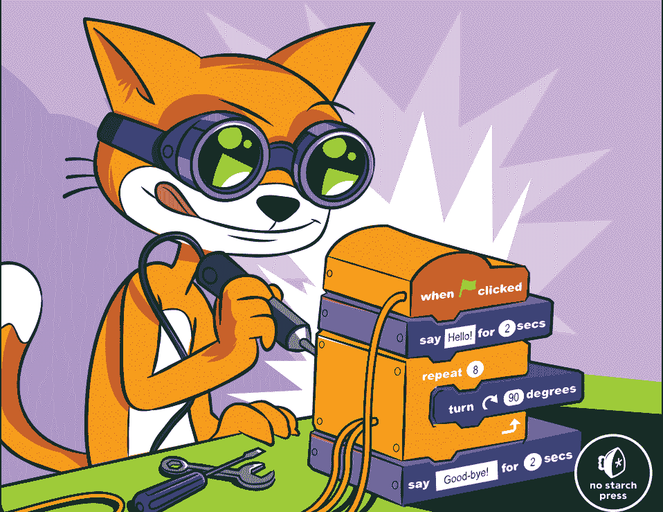

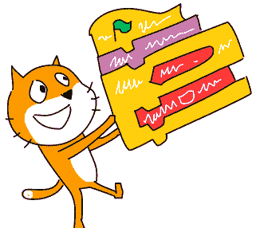

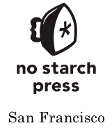

献给 Seymour Papert，

感谢所有的乌龟

（1928年2月29日 – 2016年7月31日）

## 关于作者

Al Sweigart 是一位软件开发人员、技术书籍作者，也是一个知道自己的毛巾在哪里的奇人（hoopy frood）。他写过几本面向初学者的编程书籍，包括同样由 No Starch Press 出版的《Python自动化无聊工作》（Automate the Boring Stuff with Python）。他的书籍已根据 Creative Commons 协议在其网站 http://www.inventwithpython.com/ 上免费提供。

## 关于技术审查员

Martin Tan 帮助在澳大利亚运营代码俱乐部（Code Club），并为 Moonhack 2016 编写了太空主题的 Scratch 和 Python 项目，这些项目聚集了超过 9000 名儿童，打破了儿童同时编码的世界纪录。Martin 还担任渗透测试员，为各种开源项目和研究做出贡献。

# 开始使用 SCRATCH

## 2 空间中的彩虹线！

## 3 迷宫跑步者

勾思猫的设计方案 .............. 68

- A. 让猫跳跃并掉落. .............. 69
  1. 为猫的角色添加重力代码. . 69
  探索：所有角色 (For All Sprites) 与 仅限此角色 (For This Sprite Only)。 . 71
  2. 添加地面高度代码 . . 73
  3. 为猫的角色添加跳跃代码. . 74
- B. 让猫左右移动. . 75
  4. 为猫的角色添加行走代码 . . 76
- C.制作一个悬浮的篮筐 . . 77
  5. 创建篮筐角色 . . 77
  6. 创建碰撞框（Hitbox）角色. . 79
- D. 让猫投篮 . . 81
  7. 创建篮球角色 . . 81
  8. 为篮球角色添加代码. . 82
  9. 检测球是否入网 . . 83
  10. 修复得分 Bug. . . 85
完整程序. . 87
- 版本 2.0：双人模式 . . 88
  复制猫和篮球的角色 . . 88
  修改 Cat2 角色的代码 . . 89
  修改 Basketball2 角色的代码 . . 90
作挂模式：冻结篮筐 . . 91
总结 . . 92
复习题 . . 92

## 5 一款精良的俄罗斯块游戏 . . 93

勾思设计方案 . . 94
- A. 制作一个可以左右移动的板子 . . 95
  1. 创建板子角色 . . 95
  探索：旋转样式 . . 97
- B. 让球在墙壁上反弹 . . 98
  2. 创建网球角色. . 98
- C. 让球从板子上反弹. . 99
  3. 为网球角色添加反弹代码 . . 99
  探索：克隆 (Cloning) . . 101
  制作砖的克隆体. . . 102
- D. 制作砖块角色 . . . 102
  4. 添加砖块角色 . . 102
  5. 克隆砖块角色 . .
- E. 让球从砖块上反弹 . . 104
  6. 为砖块角色添加球代码 . . 104
- F. 制作“胜利”和“游戏结束”消息 . . 105
  7. 修改网球角色的代码 . . 105
  8. 创建游戏结束角色 . . 106
  9. 创建胜利角色 . . 107
完整程序 . . 108
版本 2.0：打磨时间 . . 109
画一个酷的背景 . . 110
添加音乐 . . 111
让板子在击中时闪烁 . . 112
为砖块添加动画入场和出场 . . 114
为砖块添加音效 . . 115
为网球添加音效 . . 117
在网球后面添加拖尾 . . 117
为游戏结束角色添加动画入场 . . 119
为胜利角色添加动画入场 . . 120
总结 . . 122
复习题 . . 123

## 6 贪吃蛇！ . . 25

勾思设计方案 . . 27
- A. 让蛇四处移动 . . 27
  1. 创建蛇角色 . . 28
  探索：当按下按下时 (when key pressed then) . 30
- B. 让苹果出现 . . 31
  2. 添加苹果角色 . . 31
- C. 制作一个出现在头部后方的身体 . . 32
  3. 创建身体角色 . . 32
  4. 创建身体的第二个造型 . . 33
  5. 为身体角色添加代码 . . 33
  6. 检测蛇是否撞到墙壁 . . 35
完整程序 . . 37
- 版本 2.0：添加水果 . . 38
  作挂模式：无敌模式 . . 40
  修改头部 . . 40
  修改身体代码 . . 40
  作挂模式：切掉尾巴！ . . 42
总结 . . 42
复习题 . . 43

## 7 水果切切 . . 147

勾思设计方案 . . 147
- A. 制作启动背景 . . 148
  1. 绘制背景 . . 148
  2. 为舞台添加代码 . . 150
- B. 制作切割痕迹 . . 151
  3. 绘制切割角色 . . 151
  探索：制作列表 (Making Lists) . . 152
  4. 为切割角色创建列表和变量 . . 155
  5. 记录移动轨迹 . . 156
  6. 制作一个自定义按钮来绘制切割线 . . 157
- C. 制作开始按钮 . . 160
  7. 创建开始按钮角色 . . 160
- D. 让水果和炸弹自动出现 . . 162
  8. 创建水果角色 . . 163
  9. 制作切开的水果造型 . . 164
  10. 为水果角色添加代码 . . 167
  11. 为水果克隆体添加代码 . . 170
- E. 制作血量角色 . . 173
  12. 创建血量角色 . . 173
- F. 制作游戏结局 . . 176
  13. 创建淡出角色. . 176
版本 2.0：高分 . . 179
作挂模式：恢复血量 . . 180
总结 . . 181
复习题 . . 182

## 8 太空碎片粉碎者！

勾思设计方案 . . 184
- A. 制作一个会被推动的飞船 . . 186
  1. 创建飞船角色 . . 186
- B. 让飞船在边缘环绕 . . 188
  2. 为飞船角色添加环绕代码 . . 188
  3. 为飞船角色添加随机推动代码 . . 190
- C. 用鼠标瞄准并用空格发射 . . 190
  4. 创建能量发射角色 . . 191
- D. 让陨石在空中漂浮 . . 194
  5. 创建陨石角色 . . 194
E. 让小行星在击中时分裂为二 ................................................................................... 196
- 6. 添加小行星分裂的代码 .................................................................................... 196
- 7. 在能量精灵上添加行星被毁的消息代码 ................................................................................ 198
F. 记录分数并制作计时器 .......................................................................................... 199
- 8. 创建“时间到”精灵 ....................................................................................... 199
G. 让飞船在被击中时爆炸 .......................................................................... 200
- 9. 上传爆炸精灵 ....................................................................................... 201
- 10. 添加爆炸精灵的代码 ................................................................... 201
- 11. 在飞船精灵上添加爆炸代码 ................................................................... 202
版本 2.0：有限弹药 ....................................................................................... 204
作外挂模式：星云弹 ................................................................................... 206
总结 ................................................................................................................ 207
复习题 ............................................................................................ 208

## 9 制作一款高级平台游戏 209

构思设计 ................................................................................ 210
A. 创建重力、下落和落地 ........................................................ 212
- 1. 创建地面精灵 ...................................................................... 212
- 2. 添加重力和落地代码 .................................................................. 213
- 3. 让猫行走并在舞台边缘环绕 ........................................ 215
- 4. 移除地面抬升延迟 ............................................................ 216
B. 处理台阶坡度和墙壁 ................................................................ 218
- 5. 添加陡坡代码 .................................................................................... 218
C. 让猫高跳和低跳 ........................................................ 222
- 6. 添加跳跃代码 ....................................................................... 222
D. 在地面精灵上添加天花板平台 ........................................ 224
- 7. 在地面精灵上添加一个低平台 ........................................ 224
- 8. 添加天花板检测代码 ................................................ 225
E. 为猫精灵使用碰撞盒 ................................................... 228
- 9. 为猫精灵添加碰撞盒造型 ................................................... 229
- 10. 添加碰撞盒代码 ........................................................ 230
F. 添加更好的行走动画 ................................................... 231
- 11. 为猫精灵添加新造型 ................................ 232
- 12. 创建“设置正确造型”积块 ......................... 233
G. 创建关卡 ..................................................................... 239
- 13. 下载并添加舞台背景 ................................ 239
- 14. 为地面精灵创建碰撞盒造型 ................... 240
- 15. 添加地面精灵的代码 ................................... 241
- 16. 在猫精灵上添加更多环绕代码 ................ 242
- H. 添加螃蟹敌人和苹果 ..................................................................................... 243
17. 添加苹果精灵和代码 ................................................................................... 244
18. 创建螃蟹精灵 ....................................................................................................... 245
19. 创建敌人人工智能 ................................................................ 246
20. 添加“时间到”精灵 ................................................................... 250
总结 ................................................................................................................................... 252
复习题 ........................................................................................................................ 253

# 致谢

封面上只有我的名字是误导性的。没有许多人的努力，这本书就不会存在。我要感谢我的出版商 Bill Pollock；我的编辑 Laurel Chun 和 Tyler Ortman；我的技术审稿人 Martin Tan；
特别感谢麻省理工学院媒体实验室以及加州数字娱乐中心。
等等,,,,,,,,,,,,,,,,,,,,,,,,,,,,,,,,,,,,,,,,,,,,,,,,,,,,,,,,，感谢 No St Press。


# 引言

玩游戏很有趣，但编写自己的游戏是一项创造性且具有挑战性的技能，它可以让你创造属于自己的乐趣。免费的 Scratch 环境为大家提供了一个学习技能的简单方法。虽然 Scratch 主要为 8 到 16 岁的青少年设计，但各年龄段的人在使用，包括带着父母的小朋友以及正在学习第一门语言的大学生。

用 Scratch 可以做的事情太多，很难知道从哪里开始。这正是这本书大显用场。这本书将引导你如何在 Scratch 中创建游戏。通过构建书中的项目，你将很好地了解哪些积块是创建 Scratch 游戏常用的。这些项目为你创建原创程序奠定了坚实的基础。

## 这本书是给谁的

阅读这本书不需要任何编程经验。所需的数学技能仅基础算术：加、减、乘、除。不要让数学恐惧阻碍你学习编程。而且不要忘记，计算机会为你进行计算！

书中的每个程序都可以按照步骤说明轻松制作。在制作使用这些积块的游戏时，你将学习积块和编程概念。无论你的水平如何，都没有理由现在不开始！

孩子们可以独立完成书中的活动，这本书也适用于想要向孩子或学生介绍编程世界的家长、老师和志愿者。这些项目非常适合作为周末活动或课后计算机俱乐部活动。成年人也不一定要用这本书来帮助他人。

如果你想要一份关于 Scratch 所有功能的详细指南，我推荐 Majdi Mardi 写的《Learn to Program with Scratch》（No St Press, 2014）作为本书的补充。你也可以在在线观看视频教程：https://scratch.mit.edu/help/videos/ 和 https://inventwithscratch.com


但编程是一项实践性技能，就像空手或吉他一样：你不能只靠阅读来学习！务必动手操作并创建游戏——这样你会学到更多。

# 关于本书

每一章都将带你完成一个单一游戏的编程，并在遇到编程概念时对其进行解释。你将从勾勒最终游戏的样式开始，并规划程序的各个部分。接下来的章节将逐步介绍如何为这些每个部分编写代码，直到你构建出整个游戏。在构建完主游戏后，你还可以选择添加特殊功能和外挂模式。每章末尾的回习题将帮助检查你是否理解了所涵盖的主题。

- 第1章：入门 Scratch（Getting Started with Scratch）将向你如何访问 Scratch 网站以及 Scratch 编辑器的不同部分。
- 第2章：太空中的彩虹线（Rainbow Lines in Space!），你将使用基础代码块和精灵的协作工作，创建一个动画艺术项目。你还将学习方向和角度。
- 第3章：迷宫逃生者（Maze Runner），你将制作一个迷宫游戏，玩家使用键盘改变猫的坐标并引导它穿过八个不同的迷宫关。
- 第4章：带重力的投篮（Shooting Hoops with Gravity）将向你介绍如何制作篮球游戏，为跳跃的猫和掉落的篮球实现真实的重力。
- 第5章：精美的俄罗斯块消除游戏（A Polished Brick Breaker Game）涵盖了简单的技术，将一个普通的俄罗斯块消除游戏变成一个带有动画、音效等的精美且令人兴奋的游戏。
- 第6章：蛇——蛇——蛇！（Snaaaaaake！）介绍了这款经典的电脑游戏，玩家在屏幕上引导一条不断生长的蛇绕行。它解释了如何使用 Scratch 的精灵克隆功能来制作伸长的蛇身。
- 第7章：切水果大师（Fruit Slicer），你将制作手机游戏《水果忍者》的克隆，在游戏中玩家在空中切割水果。
- 第8章：太空中的小行星碎片者……（Asteroid Breaker... in Space!）介绍了经典太空射击游戏《小行星》（Asteroids）的克隆。你为太空船添加鼠标和键盘控制。
- 第9章整合了之前章节使用的许多概念：制作高级平台跳游戏（Making an Advanced Platformer）解释了如何创建一个带有行走和跳跃动画、平台和 AI 控制敌人的平台跳跃游戏。

## 如何使用本书

书中所有的项目都始于我们将要制作的游戏草图。草图上的标签指向了我们将通过代码添加的功能。

为了保持易于管理，我们将一次处理游戏的每一个部分。书中的蓝色 ABC 标题对应草图中的这些功能。

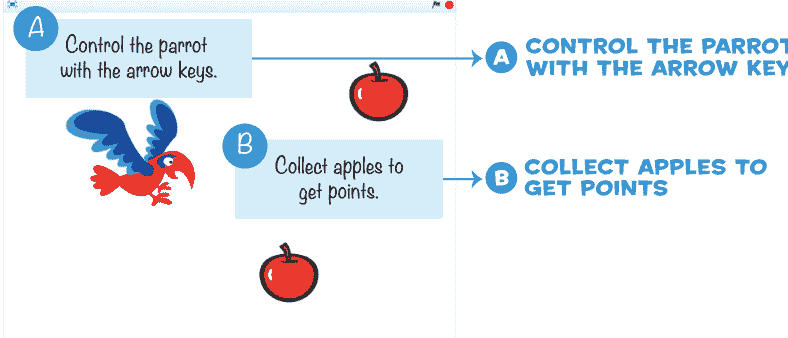

将一个大问题拆分成许多小问题真的有助于组织你的思路，并让大问题看起来易于着手。在我们运行一个简单版本的游戏后，我们将添加新功能、作弊代码等等。当你准备好自己开始创建游戏时，我建议从一个简单的草图开始。

## 保存点（SAVE POINT）

在整本书中，你会看到这些“保存点”框。由于你是逐步制作程序的，你可能经常想要暂停并运行程序，即使它还没有完成。你将能够看到程序是否运行正常，并尽早发现任何错误。保存点框还会提醒你通过选择菜单栏中的 `File ► Save Now`（文件 ► 立即保存）来保存程序。

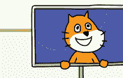

## 在线资源

虽然 Scratch 环境包含了许多图像，但你还需要一些额外文件来完成书中的项目。这些文件在资源 ZIP 包中，你可以从 `https://www.nostarch.com/scratchplayground/` 下载。你需要将文件解压到硬盘上才能访问它们。

资源 ZIP 包包含书中项目用到的图像文件，以及每个程序的“骨架项目文件”。这些骨架项目文件已经完成了所有设置，你只需要添加代码块。如果你在完成程序时遇到困难，可以尝试从骨架项目文件开始，而不是从全新的空白项目开始。如果你是一个指导几名学生的老师且时间有限，使用骨架项目文件可能是一个好主意，因为他们只需要添加代码块即可完成程序。

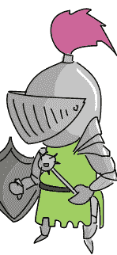

## 错与更新

尽管我们尽力保持本书无错误，本书的修正和更新将列在 `https://nostarch.com/scratchplayground/`。

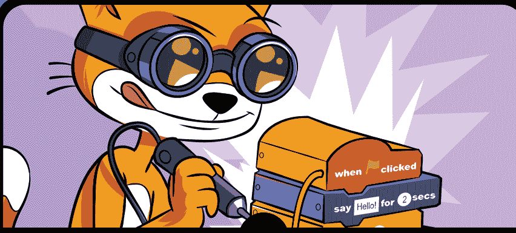

## 开始学习 Scratch

Scratch 是目前最好的教育性编程软件。没有其他工具能像 Scratch 那样让编程变得简单。许多类似的产品都受到了 Scratch 的启发，但 Scratch 仍然是最流行的。通过 Scratch，你可以创建交互式游戏、动画和科学项目，同时享受很多乐趣！

Scratch 是一个在网络浏览器中运行的免费编程环境。它由 MIT 媒体实验室的终身幼儿园小组（Lifelong Kindergarten Group）设计。Scratch 用户可以通过在 Scratch 编辑器中拼接代码块来创建程序。虽然 Scratch 是为孩子设计的，但它适用于所有年龄段。

由于 Scratch 在你的网络浏览器中运行，因此无需安装软件。Scratch 是完全免费的——没有广告或应用内购买。在 Scratch 中，你使用鼠标拖放代码块。这里有一个拼合代码块的示例：

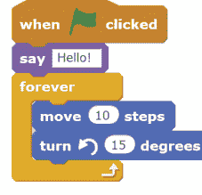

Scratch 编辑器为你提供快速反馈。与其他编程语言不同，Scratch 不会产生困扰程序员的错误信息。Scratch 让编程变得直观。

### 运行 Scratch

要开始使用 Scratch，请打开浏览器并访问 `https://scratch.edu/`。无论你运行 Windows、OS X 还是 Linux 都可以，但你必须在笔记本电脑或台式机上运行 Scratch。

> NOTE 树莓派电脑无法运行本书中所介绍的 Scratch。

注册账户是免费的。你可以在没有账户的情况下创建程序，但拥有账户可以在线保存程序。这样你可以在任何连接互联网的计算机上继续工作。

点击顶部的 `Join Scratch`（加入 Scratch）创建账户。弹出的新窗口：

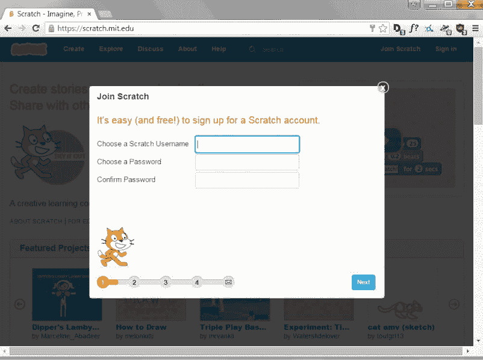

选择用户名和密码，并输入你的信息。未经你的许可，Scratch 不会共享你的电子邮件地址或个人信息。完整隐私政策请见 `/privacy_policy/`

登录 Scratch 网站后，点击顶部的 `Create`（创建）链接启动 Scratch 编辑器。

### 离线编辑器

离线编辑器让你可以在不连接互联网的情况下编程。如果你没有互联网连接或 Wi-Fi 不稳定，可以在计算机上安装离线编辑器，而不是使用 Scratch 网站。唯一的区别是程序将保存在你的计算机上，而不是 Scratch 网站上。你可以之后上传 Scratch 程序或复制到 U 盘移动到另一台计算机。

`https://scratch.edu/scratch2download/`

> NOTE 你可能会找到早期版本的编辑器软件 Scratch 1.4。不要使用这个版本；它过时了，且没有 Scratch 2.0 的新功能。如果你在浏览器中使用 Scratch，你使用的是 Scratch 2.0。如果你下载了离线 Scratch 编辑器，请确保下载的是 2.0 版本。

### 编辑器与精灵

Scratch 编辑器是你拼接代码块创建游戏、动画或艺术品的地方。页面顶部的 `Create` 链接会打开编辑器（如下所示），你可以开始制作 Scratch 程序。

#### 菜单栏

#### 绿色旗帜和红色停止按钮

#### 标签

#### 项目名称

#### 舞台

#### 脚本区域

#### 角色列表

#### 积木区域

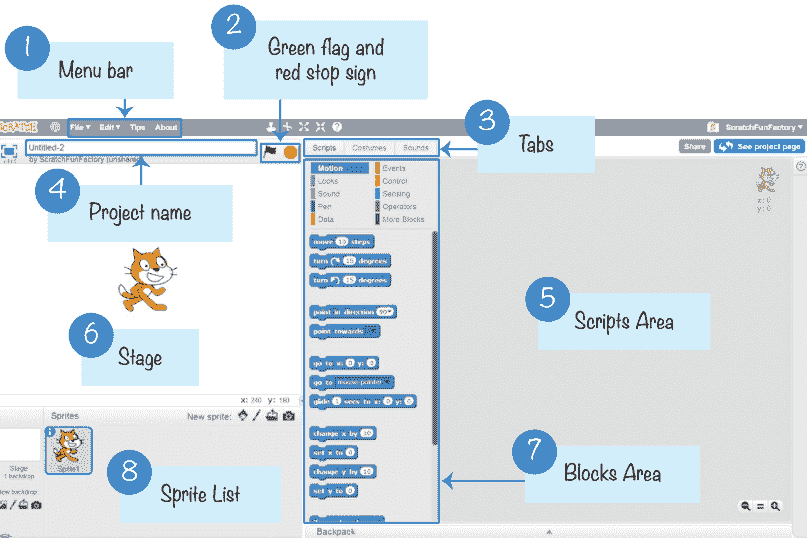

Scratch 中是最基础的对象是角色（sprite）。角色显示在舞台 ⑥ 上，它们的代码块控制着它们的行为。编辑器为所有新项目都会自动加载一个猫咪角色，但你可以添加更多角色。你可以通过在屏幕右侧的脚本区域 ⑤ 中添加代码块来对角色进行编程。在 Scratch 中，一堆代码块被称为一个脚本（script）。

编辑器顶部的字段包含项目名称 ④。当你使用描述性名称为项目命名后，记得偶尔点击菜单栏 ① 上的文件（File）► 立即保存（Save Now）来保存项目，以防浏览器崩溃时丢失工作。

你可以从中间的积木区域 ⑦ 访问代码块。积木区域顶部有 10 类代码块：移动、外观、声音、画笔、数据、事件、控制、侦测、运算符和更多积木。每个代码块都属于一个类别，并具有该类别的颜色。例如，“说”积木来自紫色的“外观”类别。代码块是无限供应的；将它们从积木区域拖动到脚本区域。

每个角色都有自己的脚本。当你点击角色列表中的角色时，该角色的脚本将显示在脚本区域中。选择“脚本”标签以显示脚本区域。当选择“造型”和“声音”标签时，脚本区域会被画画编辑器和声音编辑器取代。

点击绿色旗帜将启动你的程序，点击红色停止按钮将停止程序。

### 画画编辑器

有几种方法可以将角色引入到你的程序中。你可以使用 Scratch 自带的角色、从电脑上传角色，或者自己绘制。如果你想自己绘制，可以使用 Scratch 的画画编辑器。

画画编辑器与其他绘画程序（如微软画画或 Paintbrush）类似。要绘制一个新角色，请点击“新角色”旁边的画笔按钮。你可以通过切换到许多造型之一来改变角色的外观。要为角色创建一个新造型，点击“造型”标签，然后点击“新造型”旁边的画笔按钮。

画画编辑器的主要部分是

- 绘制工具，你可以使用左侧的按钮进行选择
- 画布，你可以在这里绘制图像

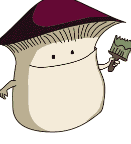

- 造型中心，用十字准符号指示造型的中心
- 线宽滑条，设置绘制工具的宽度
- 颜色选择器，更改绘制工具的颜色
- 缩放按钮，用于放大或缩小画布
- 撤销和重做按钮，可以帮助你纠正错误

画画编辑器看起来像：

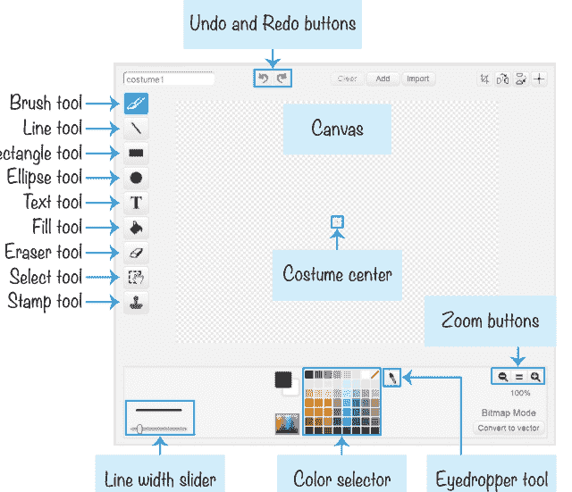

通过点击绘制工具按钮并在画布上移动鼠标来尝试画画编辑器，查看这些工具是如何工作的。使用颜色选择器和线宽滑条更改绘制工具的颜色和宽度。然后使用吸管工具从画布上选择颜色，而不是从颜色选择器中挑选颜色。如果你犯了错，点击顶部的撤销按钮。

角色造型列表位于绘制工具左侧的列。如果你想将造型保存为图像文件，右键点击造型并选择“保存到本地文件”。

### 使用代码块

在开始编程之前，先了解代码块在编辑器中是如何组合在一起的很有帮助。在整本书中，你将学习每个代码块的作用。

#### 添加积木

要创建一个新的代码块，将它从中间的积木区域拖动到脚本区域。顶部有凹槽、底部有凸起的代码块被称为栈积木（stack blocks）。要将一个栈积木与另一个栈积木组合，将代码块靠近另一个的底部。当出现白色轮廓时，释放代码块。

### 提示窗口

寻找帮助的第一个地方是 Scratch 编辑器的“帮助”（Help）部分。点击编辑器右侧的问号按钮可以打开“提示”窗口。

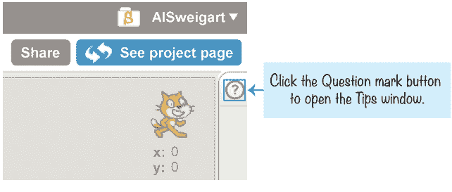

在提示窗口中，你可以通过从“积木”（Blocks）选项卡中选择特定的代码块来学习它的作用，如下所示：

你还可以访问并阅读几个教程。虽然你可以在讨论论坛中寻求帮助，但在提示窗口中找到答案会更快。

### 查看内部按钮（See Inside Button）

你可以通过查看其他 Scratch 者的代码来学习许多新技巧。在 Scratch 网站上找到一个项目，然后点击“查看内部”（See inside）按钮、“讨论”（Discuss），如下所示：

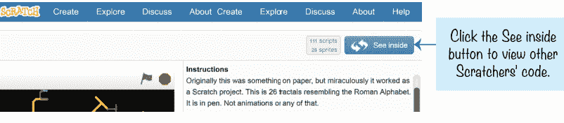

你可以复制、修改或重混（remix）其他 Scratch 者的代码。网站上所有的 Scratch 程序都自动根据知识共享许可（Creative Commons license）发布，因此只要注明来源，你不需要请求原作者的许可。Scratch 者通过互相重混程序来创建他们自己的版本。

仍然需要帮助并想与其他 Scratch 者聊天吗？点击网站顶部的“讨论”链接访问论坛。

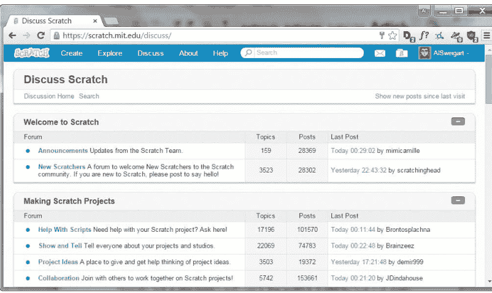

开始学习 Scratch 13

## 总结

Scratch 编辑器是一个具有巨大潜力的创意工具。你会在 Scratch 网站上看到各种 Scratch 项目：游戏、动画片、模拟和信息演示幻灯片。

现在你已经了解了如何访问 Scratch 网站、创建账户、使用 Scratch 和画笔编辑器，以及将代码块拼接成脚本，你已经准备好按照书中其余部分的逐步分说明进行操作了。如果你有任何问题，请务必使用 Scratch 编辑器中的提示窗口和 Scratch 网站上的讨论论坛来寻找所需的答案。

让我们开始创建你的第一个 Scratch 程序吧！

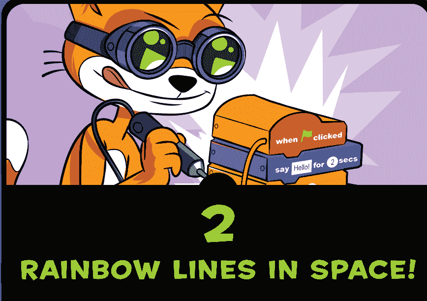

# 太空中的彩虹线！

在本章中，你将创建一个酷炫的动画：一个穿过太空并在身后留下彩色轨迹的彩虹 V 字。这个程序的灵感源于“演示场景”（demoscene），这是一种由精英程序员组成的亚文化，他们从 20 世纪 80 年代开始制作惊人的图形程序。

演示场景者制作被称为“演示”（demos）的美丽且复杂的程序，展示他们的艺术、音乐和编程技巧。但最令人惊讶的是，这些程序非常小——只有几 KB！我们将编写的程序没有那么小，但它非常戏剧且色彩斑斓，并且只需要几行 Scratch 代码。

在开始编码之前，请查看下图了解最终程序的样式。然后前往 `https://www.nostarch.com/scratchplayground/` 播放该动画。

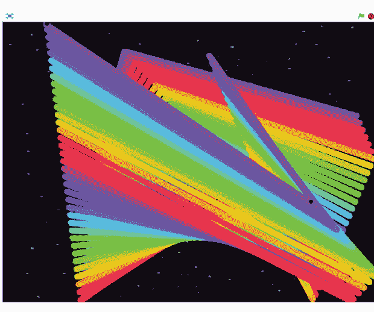

就像演示场景者一样，你也可以制作出美丽的程序。让我们在 Scratch 中创建自己的图形演示吧！

## 勾画设计

将想法转换为 Scratch 程序的第一步是勾画出你希望它的的样子。规划你的程序有助于你确定你想要的角色（sprites）以及它们将如何运行。我建议在纸上画出你的想法，这样如果你不喜欢，就可以把它划掉，并写下注释和提醒。

保持项目简单也是最好的。如果你从制作像《我的世界》（Minecraft）或《塞尔达》（Zelda）这样复杂的游戏开始，你会很快发现这工作量巨大。完成一个一个小项目，比应对一个永无止境、未完成且不可玩的游戏带来的挫败感要有成就感。

当你完成简单的游戏后，你可以在此基础上进行构建使其变得复杂，这就是迭代开发的核心思想。首先，让程序运行起来。然后，让程序变得更好。在完成基础程序后，你始终可以为其添加酷炫的元素。或者，如果你的程序变得太复杂，你可以回到草图，找出你想删除哪部分设计。

不要担心草图会让草图变得完美。为程序的主要部分有一个稳固的计划更重要。在我的草图中，我有三个部分：A、B 和 C。我们将逐个处理这些部分，直到构建出完整的程序。

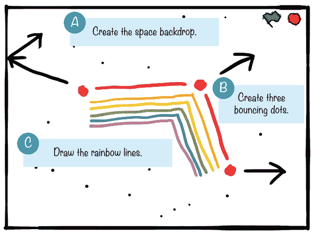

在你完成了程序运行功能的草图后，就可以开始编程了！访问 `https://scratch.mit.edu/`，在网站注册账户并登录（拥有账户可以让你将程序保存到 Scratch 网站上）。登录后，点击屏幕顶部的“创建”（Create）按钮开始制作你自己的 Scratch 项目。然后点击左角的文本框，将项目名称从“未命名”（Untitled）更改为“彩虹线”（Rainbow Lines）。让我们从处理草图的 A 部分开始。

## 创建背景

首先，清理我们用不到的角色并设置背景。

### 1. 清理并布置舞台

每当你创建一个新的 Scratch 项目时，你都会看到空白白色舞台上有一个橙色的角色。我们的程序不需要小猫角色，右键点击“角色列表”（Sprite List）中的 `Sprite1`，并选择“删除”（delete）以从舞台和角色列表中移除猫。

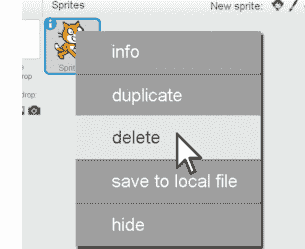

点击“添加背景”（New backdrop）下的“选择背景”（Choose backdrop）按钮（看起来像一片风景）。

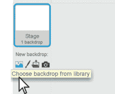

背景库将打开并按字母顺序显示所有背景。选择“星星”（stars）背景并点击“确定”（OK）。

- 确保选中了“全部”（All），否则星星背景不会显示。
- 选择“星星”背景。
- 点击“确定”。

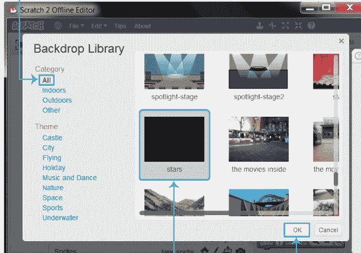

现在舞台看起来像太空了！


## 创建三个跳动的点

接下来，我们将添加三个角色来代表 V 字的三个顶点。

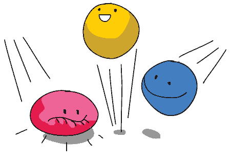

### 2. 绘制点

点击“新建角色”旁边的“绘制”（Paint）按钮（看起来像画笔）。

| 新角色： |
| :--- |
| x: 167 y: -180 |
| 绘制角色 |

角色列表中出现了一个名为 `Sprite1` 的新角色。使用画笔工具在绘制编辑器中画一个小点。可以通过点击放大镜按钮（看起来像放大镜）来放大。

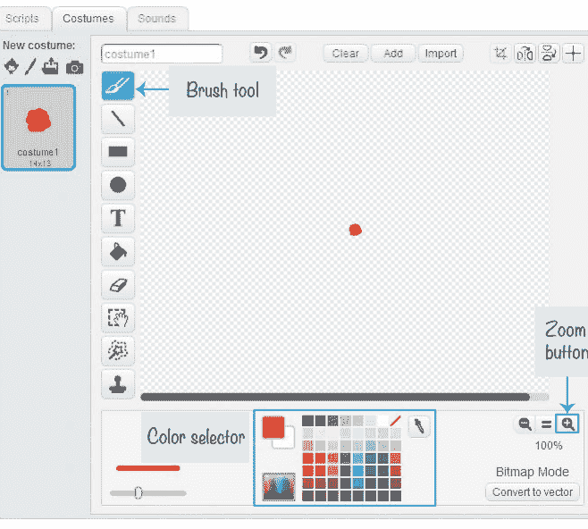

点击 `Sprite1` 的“i”按钮打开信息窗口。也可以通过右键点击角色来打开信息。

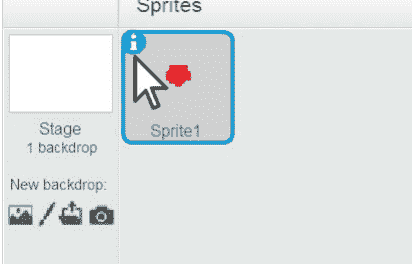

将角色的名称从 `Sprite1` 改为 `Dot 1`。然后点击返回关闭信息窗口并显示角色列表。

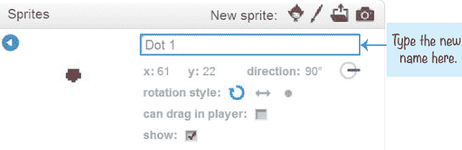

### 3. 为 Dot 1 添加代码


现在我们可以开始编程了。点击“脚本”（Scripts）标签页让脚本区域可见。在脚本区域添加以下代码。你可以在“事件”（Events，棕色）、“动作”（Motion，深蓝色）、“运算符”（Operators，绿色）和“控制”（Control，黄色）分类中找到这些积木。如果你对如何拖动这些积木有困难，请观看动画：https://www.nostarch.com/scratchplayground/


当你点击绿旗时，`Dot 1`角色将指向 -180 到 180 度之间的随机方向。然后，“重复”（`forever`）循环会让角色前进 10 步，并在碰到舞台边缘时反弹。角色将一直执行此操作。

注意 `Dot 1`角色还没有绘制任何彩虹线。我们将在创建更多角色之后再做。

# 探索：方向与角度

对于像你和我这样的人类来说，“向上”或“向右”这样的词是可以完全理解的方向。但计算机需要数字来指示精确的方向。Scratch 中的所有角色都有自己的方向数字。方向数字在 -180 到 180 度之间。指向 0 度面向向上。指向 90 度面向向右。下图显示了几个方向及其对应的角度。注意角度在顺时针方向增加，逆时针方向减少。此外，注意 -180 度和 180 度指向同一个方向：向下。

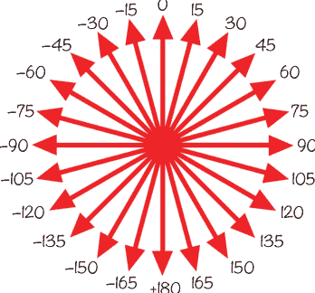

使用“随机选取 -180 到 180”积木作为方向。然后“指向”（`point in direction`）积木让角色指向该方向。这意味着角色可以指向任何可能的方向。

让我们写一个新的脚本来演示角度是如何工作的。在网络浏览器中按 `CTRL-T` 打开新标签页，访问 https://scratch.mit.edu/ 打开一个新的 Scratch 编辑器。你可以同时编辑多个 Scratch 程序。

在名为 `Sprite1` 的猫角色的脚本区域（Scripts Area）中，使用来自事件（棕色）、控制（黄色）、动作（深蓝色）和外观（紫色）类区块添加以下代码。请记住，我们正在编写一个与“彩虹线”（Rainbow Lines）完全不同的程序！

```
when clicked
forever
  point towards mouse-pointer
  say direction
```

当你运行这个程序时，猫角色会指向鼠标指针。猫会说出它所指向的方向。

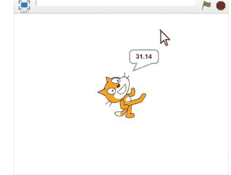

注意，随着猫的方向改变，方向数字也会随之变化。

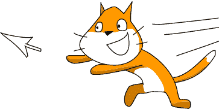

## 4. 复制圆点 I

在角色列表中右键点击 `Dot 1` 角色并选择 **duplicate**（复制）。重复此操作两次，创建两个副本：`Dot 2` 和 `Dot 3`。（Scratch 会自动用递增的数字命名角色。）

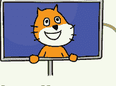

## 保存点

点击绿色旗帜测试目前的代码。检查所有三个圆点是否都在舞台（Stage）上移动并弹跳。当你复制角色时，你也复制了角色代码。点击红色停止按钮并保存你的程序。

## 绘制彩虹线

现在我们已经创建了所有跳动的圆点，可以创建第四个圆点角色来绘制彩虹线。我们将编写一个程序，让这个绘制圆点在三个跳动的圆点角色之间快速移动，并在移动时画线。这个过程将重复三次，10秒后屏幕将清空。

## 5. 为绘制圆点角色添加代码

右键点击其中一个跳动的圆点角色并选择 **duplicate**（复制）。因为它是跳动圆点的副本，它包含一些我们需要删除的代码。在它的脚本区域中，右键点击 **when green flag clicked** 区块并选择 **delete**（删除）来删除所有代码区块。你也可以将区块拖到编辑器中间的区块区域，这样它们就会消失。

点击 i 按钮并将此角色重命名为 `Drawing Dot`（绘制圆点）。

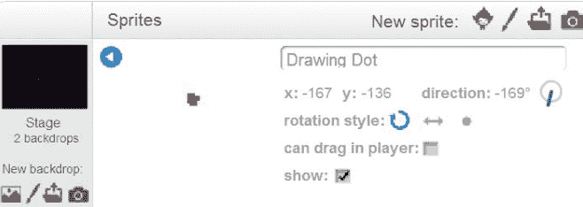

为 `Drawing Dot` 角色添加以下两个脚本。你可以在事件（棕色）、画笔（青色）、控制（黄色）和动作（深蓝色）类中找到这些区块。

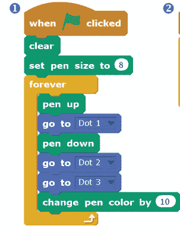

在脚本 1 中，确保你使用的是 `go` 区块，而不是 `go to x` 区块。此外，确保修改 `go` 区块，让它们不再指向鼠标指针。要这样做，请点击区块上的黑色三角形并从菜单中选择一个角色。

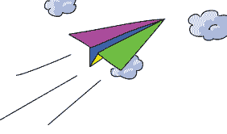

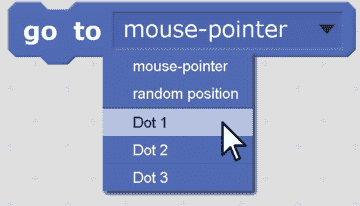

在运行代码之前，让我们过一下它是如何工作的。当你点击脚本中的绿色旗帜时，Drawing 角色运行 `clear` 区块来清除舞台上已有的画笔画迹。然后脚本运行画笔区块：随着角色的移动，它会在舞台上画出线条。

为了更好地理解 `pen down`（画笔落下）区块的作用，想象一下在行走时在纸上用记号笔画画：线条会跟随你移动！绘制圆点去 `Dot 1`，放下画笔，去 `Dot 2`，然后去 `Dot 3`。接下来，`change pen color by 10` 区块改变颜色（你可以更改这个数字来让颜色变化更快）。同时，`Dot 1`、`Dot 2` 和 `Dot 3` 角色继续独立移动。因此 Drawing 角色画的线也会移动。这个脚本简单得多。代码等待 10 秒，然后清除画笔留下的任何痕迹。现在舞台不会被彩虹线挤满。

## 保存点

点击绿色旗帜测试目前的代码。你会看到彩虹在舞台上移动。每隔 10 秒彩虹清除一次。点击红色停止按钮并保存你的程序！

# 完整程序

这里显示整个程序的最终代码。注意 `Dot 1`、`Dot 2` 和 `Dot 3` 角色的代码是完全相同的。如果你的程序运行异常，请对比此代码：

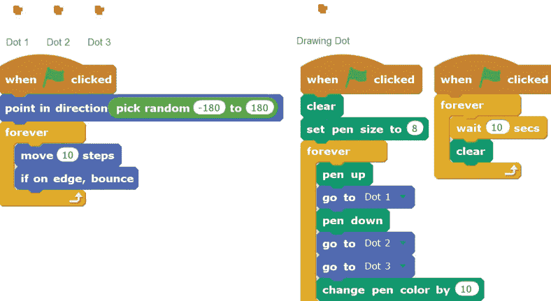

## 加速模式 (Turbo Mode)

如果在点击绿色旗帜时按住 `Shift` 键，可以在加速模式下启动程序。计算机通常可以快速运行代码，但绘图程序会减慢速度。在加速模式下，你不会观察到每个代码区块之间跳跃的绘图过程，程序看起来运行得更快。

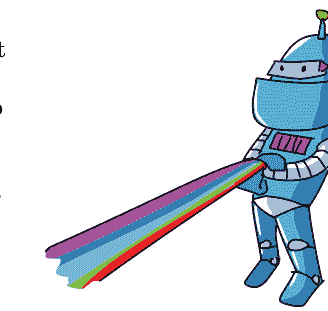

要结束加速模式，再次 `Shift`-点击绿色旗帜。

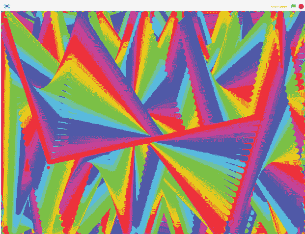

## 版本 2.0：彩虹三角形

你的“彩虹线”程序已经完成了，但你可以将此程序推向新水平。在基础功能运行正常后，你可以不断构思新想法添加到程序中。对于程序的 2.0 版本，让我们连接 `Dot 3` 和 `Dot 1`，让程序画出彩虹三角形而不是彩虹线。修改 `Drawing` 角色的代码如下，但保持其余代码不变。

```
when clicked
clear
set pen size to 8
forever
  pen up
  go to Dot 1
  pen down
  go to Dot 2
  go to Dot 3
  go to Dot 1
  change pen color by 10
```

新的 **go to Dot 1** 区块从 `Dot 3` 画到 1，形成一个三角形。


## 保存点

点击绿色旗帜测试目前的代码。确保你看到彩虹三角形在舞台上移动。然后点击红色停止按钮并保存你的程序。

## 版本 3.0：两条彩虹线

对于 3.0 版本，让我们创建两条独立的线而不是单条。右键点击 `Dot 3` 角色并选择 **duplicate** 创建 `Dot 4` 角色。然后将 `Drawing` 角色的代码修改如下。

```
when clicked
  clear
  set pen size to 8
  forever
    pen up
  go to Dot 1
    pen down
    go to Dot 2
    pen up
    go to Dot 3
    pen down
    go to Dot 4
    change pen color by 10
```

新代码在 `Dot 1` 和 `Dot 2` 之间移动时放下画笔。然后它提起画笔，去 `Dot 3`，再次放下画笔画从 3 到 4 的线。

## 保存点

点击绿色旗帜测试目前的代码。确保你看到两条彩虹线。然后点击红色停止按钮并保存你的程序。

## 版本 4.0：由你决定！

你可以自己修改创建新的程序。在本章的程序中你画了线，但如果你学习了贝塞尔曲线（Bézier curves）背后的数学，就可以画出美丽的曲线。另一个产生美丽图像的数学概念是分形（fractals），如图所示。访问 Scratch 网站并搜索“bézier”、“fractals”或“demoscene”来获取你程序的灵感。你也可以通过点击程序网页上的“查看内部”查看每个 Scratch 程序的区块。访问 https://www.nostarch.com/scratchplayground/ 查看一些示例项目。

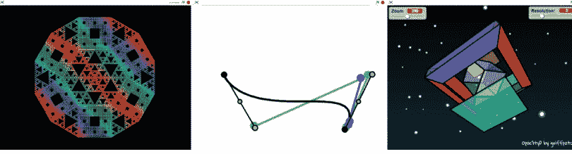

# 总结

在本章中，你构建了一个具有以下功能的的项目

- 有你创建的自定义角色（即使它们只是点）

- 使用 `pick random`（随机选取）区块让角色指向随机方向

- 让角色在舞台边缘移动并弹跳

- 复制角色及其代码

- 使用画笔（Pen）区块绘制彩虹线

这个项目是一个用户可以观看但无法控制的演示。在第 3 章，你将制作一个迷宫游戏，让玩家通过键盘与程序交互，而不仅仅是观看。这将是书中第一个真正的游戏项目！

## 复习题

尝试回答以下练习题以测试你的所学。你可能无法脱口而出所有答案，但你可以探索 Scratch 编辑器来找到答案。（答案也可以在线：http://www.nostarch.com/scratchplayground/）

- 当角色在运行 `pen down` 区块后移动会发生什么？

- 有代码在移动角色，但身后没有线条。这可能是由什么引起的？

- 哪个区块让彩虹线程序的线条看起来像彩虹？

- 使用哪个代码区块可以让彩虹线变粗？

- 如何开启加速模式？如何关闭它？

- 如何复制角色及其代码区块？

- 当角色方向为 90 度时，它指向哪里？

- 指向上的角度是多少？

- 在哪种颜色的区块分类中你会找到指向并在该方向移动的区块？

- 如何从 Scratch 的背景库中选择新背景？

- 你在角色列表中看到名为 `Sprite1` 的角色。如何重命名这个角色？

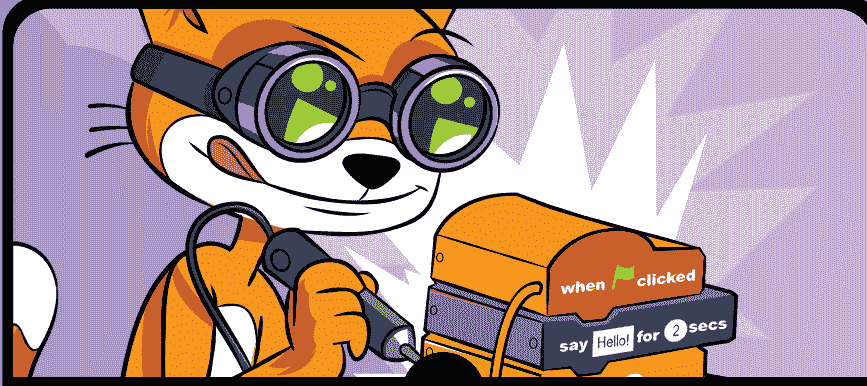

## 迷宫逃生者

你可能以前玩过迷宫游戏，但你尝试过制作一个吗？迷宫的完成可能很复杂，但编程却很容易。在本章中，你将创建一个游戏，让玩家引导猫穿过迷宫到达它的目标——一个美味的苹果！你将学习如何使用键盘移动猫，以及如何用墙阻挡它的进度。

在开始编码之前，先看看最终的程序。

访问 https://www.nostarch.com/scratchplayground/ 并玩玩游戏。

你的目标是拿到苹果！

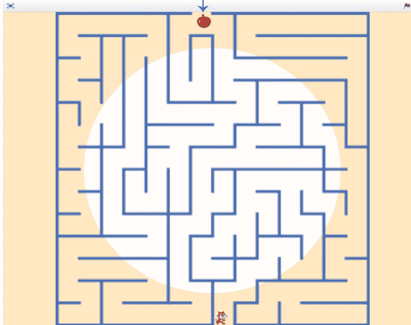

你控制猫。

# 设计草图

首先，在纸上画出你想要游戏的样子。

通过一些规划，你可以让你的迷宫游戏变得“迷人”（a-maze-ing，我从不为自己的双关语道歉）。我的迷宫游戏草图如图所示。

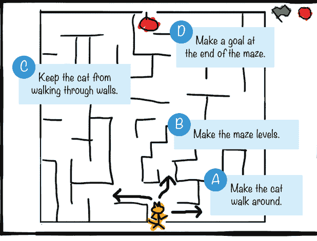

如果你想节省时间，可以从资源 ZIP 包中名为 `maze-skeleton.sb2` 的骨架项目文件开始。访问 https://www.nonostarch.com/scratchplayground/ ，并通过右键点击链接并选择**链接另存为**或**目标另存为**将 ZIP 文件下载到电脑。从 ZIP 文件中提取所有文件，这样你只需要将代码块拖入每个角色中。在 Scratch 编辑器中点击**文件 ► 从电脑上传**来加载 *maze-skeleton.sb2* 文件。

即使你不使用该骨架项目，也应该从网站下载该 ZIP 文件。该文件包含了本章将用到的迷宫图像。

如果你想自己创建所有内容，点击**文件 ► 新建**开始一个新的 Scratch 项目。在左上角的文本框中，将项目重命名从 *Untitled*（无标题）更改为 *Maze Runner*。

## 让猫走起来

在《迷宫逃生者》游戏中，玩家将控制猫的角色。在 A 部分中，你将设置代码，使用键盘上的方向键控制猫。

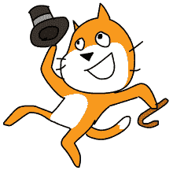

## 探索：X 和 Y 坐标

为了让猫在舞台上移动，你需要使用坐标。坐标是表示精确位置的数字。x 坐标（也称为 x 位置）代表角色在舞台上向左或向右的距离。换说，x 是角色的水平位置。y 坐标（也称为 y 位置）代表角色在舞台上向上或向下的距离。y 坐标是角色的垂直位置。

x 和 y 坐标结合使用可以指示角色在舞台上的精确位置。在编写坐标时，x 坐标始终在前，坐标之间用逗号隔开。例如，x 坐标为 42，y 坐标为 100，显示如下：`(42, 100)`。

舞台正中心有一个标记为 `(0, 0)` 的点，称为原点。在下面的图中，我使用了 Scratch 背景库中的 xy 网格背景。（要加载 xy 网格背景，请点击“新背景”标签旁边的“选择背景”按钮并选择该背景）。我添加了几只猫的角色，它们都在说话。

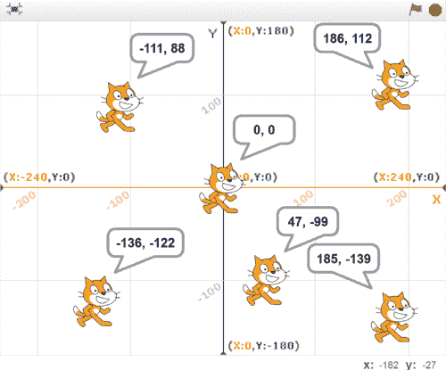

舞台右侧的 x 坐标为 240，向左移动时 x 坐标减小。舞台左侧的 x 坐标为 -240。y 坐标的情况类似：舞台顶部的 y 坐标为 180，中心为 0，底部为 -180。

舞台右下角显示了鼠标的坐标。在后续图中，鼠标位于 `(42, -27)`，这表示 x 坐标是 42，y 坐标是 -27。Scratch 在左上角的文本框中显示当前选中角色的 x 和 y 坐标。

# 创建迷宫关卡

接下来，我们将创建迷宫角色（sprite）并设置背景。如果迷宫游戏只有一个迷宫，很快就会变得无味，因此我们还要为游戏添加多个关卡。

## 3. 下载迷宫图片

你可以自己绘制迷宫角色，但让我们直接使用 ZIP 文件中的图片吧。其中一张图片是 `Maze.sprite2`。

在 Scratch 编辑器中，点击“从文件上传角色”按钮，并选择 `Maze.sprite2` 来上传该文件。这将创建一个名为 `Maze` 的新角色，它有若干个造型（costumes）。Scratch 中的每个角色都可以有多个造型来改变它的外观。你可以通过点击“造型”标签页来查看这些造型，它们通常用于制作角色的动画。你的“角色列表”（Sprite List）看起来像这样：

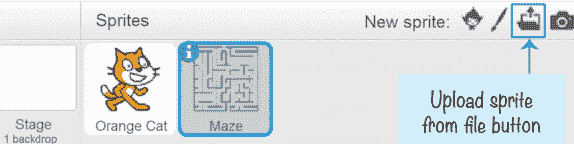

## 4. 修改背景

让我们通过在背景中放置一些 artwork来为迷宫增添色彩。你可以选择任何你喜欢的背景。点击“新背景”下方的“从库中选择背景”按钮，打开 Scratch 背景窗口来更改舞台背景。选择一个背景（我选择了浅色），点击确定。

## 5. 从第一个迷宫开始

为 `Maze` 角色添加以下代码。你可以在“事件”（Events）、“外观”（Looks）和“动作”（Motion”）分类中找到这些模块。

`Maze` 角色的每个造型都将为一个新等级。当玩家点击绿色旗帜启动程序时，游戏应该从第一个造型开始，并确保迷宫位于舞台的中心。我们将在第 8 和第 9 步中添加切换到下一关的代码。

请注意，“脚本区域”（Scripts Area）显示的是所选角色的代码块。确保在“角色列表”中选择了 `Maze` 角色；否则，你会将代码添加到另一个角色中。每个角色都需要自己的代码才能正常工作。如果你在“换造型为”模块中没有看到 `maze1`，那么很可能是选中了“小猫”（Orange Cat）角色。

如果你的 Scratch 程序无法运行且你不知道如何修复，可以尝试从使用资源 ZIP 文件中的 `maze-part-b.sb2` Scratch 项目文件开始。在 Scratch 编辑器中点击“从电脑上传文件”加载 `maze-part-b.sb2` 文件，然后移动到 C 部分。

# 让小猫穿墙行走

现在，当你点击绿色旗帜时，你就能让猫穿过迷宫。但你也能让猫穿过迷宫的墙壁，因为程序中没有任何东西阻止这种情况发生。代码只写道：“当按下右方向键时，让猫向右移动”。无论那里是否有墙，猫都会移动。

## 6. 检查猫是否碰到了墙壁

让我们添加代码来检查猫是否碰到了蓝色墙壁。如果是，猫应该向后移动。因此，如果猫向右移动并碰到了墙壁，它应该自动向左移动。这将撤销玩家的操作并防止猫穿过墙壁。在“角色列表”中点击“小猫”角色，并将代码修改如下所示。注意，我们使用的是“碰到？”（`touching?`）模块，而不是“碰到颜色？”（`touching color?`）模块。

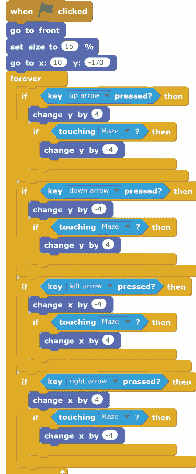

此外，你可能注意到“小猫”角色相对于迷宫来说大如哥斯拉，让猫看起来很不真实。从“外观”分类中添加一个“将大小设”（`set size`）模块来让“小猫”角色变小。你可能还想让“小猫”角色始终显示在迷宫上方，因此你会添加“移到最层”（`go to front`）模块。这两个代码块位于脚本的顶部。

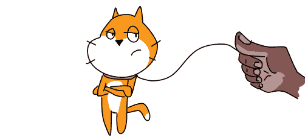

## 保存点

点击绿色旗帜测试目前的代码。确保“小猫”角色不能穿过迷宫墙壁。测试所有四个方向。然后点击红色停止按钮并保存你的程序。


如果你的 Scratch 程序无法运行且你不知道如何修复，可以从使用资源 ZIP 文件中的 `maze-part-c.sb2` Scratch 项目文件重新开始。在 Scratch 编辑器中点击“从电脑上传文件”加载 `maze-part-c.sb2` 文件，然后移动到 D 部分。

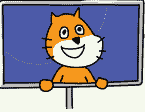

# 在迷宫末端创建一个目标

现在，还不清楚玩家应该到达迷宫的哪里。让我们在迷宫的另一端添加一个苹果，让玩家的目标更加明显。

## 7. 创建苹果角色

点击角色旁边的“从库中选择角色”按钮（看起来像一个脸）。当库窗口出现时，选择“Apple”（苹果）并点击确定在“角色列表”中添加一个名为 `Apple` 的新角色。游戏开始时，你希望 `Apple` 角色移动到舞台顶部迷宫末端。`Apple` 角色也要足够小以适应迷宫。为 `Apple` 角色添加以下代码：

```when clicked
set size to 25 %
go to x: -10 y: 170
```

## 8. 检测玩家何时到达苹果

《迷宫逃跑者》（Maze Runner）游戏需要检测玩家何时到达苹果。当这种情况发生时，即到达迷宫末端，`Maze` 角色需要切换造型。在添加此代码之前，在“角色列表”中选中 `Maze` 角色，点击“声音”（Sounds）标签。在库中选择一个声音。在“小猫”角色中添加以下脚本：


当碰到 `Apple` 角色时：


点击“广播”（broadcast）模块并选择 `next maze`。在弹出的窗口中输入消息名称，然后点击确定。


## 9. 为迷宫添加广播代码

点击 `Maze` 角色并添加以下代码：

```when receive next maze
next costume
```

在收到 `next maze` 广播时切换造型。


# 完整程序

以下代码显示了完整程序。如果你的程序运行异常，请检查你的代码。这个完整程序也在资源 ZIP 文件中。


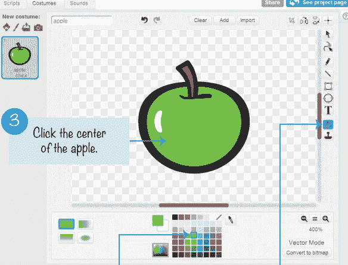

点击苹果的中心。

- 1 选择绿色。
- 2 点击“填充”（Fill）工具。

## 修改 Apple2 角色的代码

你需要修改 Apple2 角色的代码，使其看起来像下面的代码，这样绿色苹果就会从迷宫的底部而不是顶部开始：

```
when flag clicked

set size to 25 %

go to x: 10 y: -170
```

## 复制橙猫角色

现在我们来添加第二只猫的角色。右键点击“橙猫”（Orange Cat）角色，从菜单中选择“复制”（duplicate）来创建橙猫及其代码的副本。新角色会自动命名为 Orange Cat2。橙猫和 Orange Cat2 角色看起来需要足够不同，以便玩家能够区分它们。与你对 Apple2 所做的那样，点击“造型”（Costumes）选项卡，将 Orange Cat2 从橙色改为蓝色。

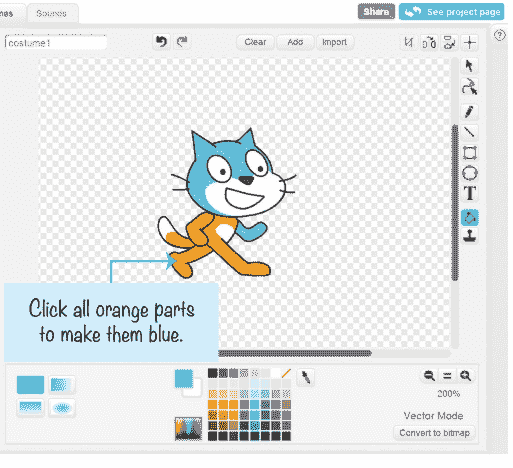

点击 i 按钮并将 Orange Cat2 重命名为 Blue Cat（蓝猫）。

## 修改蓝猫角色的代码

现在蓝猫角色的代码与橙猫角色完全相同。你需要更改代码；否则方向键将同时控制玩家 1 和玩家 2。第二个玩家将使用 WASD 键（读音为 whaz-dee）控制蓝猫角色。W、A、S 和 D 键通常用作上、左、下、右方向键的左手版本。

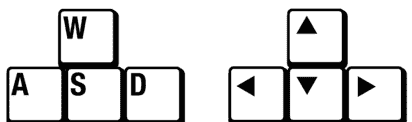

将蓝猫的两个 `go to xy` 模块和 `key pressed` 模块改为像下面的代码。此外，记得将 `if touching Apple` 改为 `if touching Apple2`。

MAZE RUNNER 53

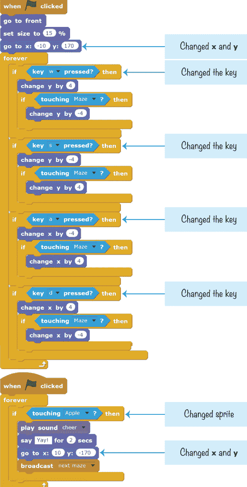

## 回到起始位置

当角色碰到自己的苹果时，它们会回到起始位置，但当另一只猫获胜时它们也需要回去。为橙猫角色添加以下脚本：

```
when I receive next maze

 go to x: 15 y: -170
```

然后为蓝猫角色添加以下脚本：

```
when I receive next maze

 go to x: -10 y: 170
```

这样，当另一只猫获胜并广播下一个迷宫的消息时，两只猫都会回到它们的起始位置。


**保存点**
点击绿色旗帜测试目前的代码。尝试使用方向键和 WASD 键移动两个玩家。确保 8 个键中的每一个键移动移动正确的猫，且只移动那只猫。尝试玩整个游戏。确保当第二个玩家碰到绿色苹果时，关卡切换到下一个迷宫。确保在下一关开始时，两个玩家都被发送到起点。点击红色停止按钮并保存你的程序。

你刚刚将你的迷宫游戏升级为支持双玩家。找个朋友来比赛吧！玩家 1 使用方向键，玩家 2 使用 WASD 键。

## 版本 3.0：陷阱

在与其他玩家玩了几次《迷宫跑者》之后，穿过迷宫可能会变得太简单。让我们通过添加尖刺陷阱让《迷宫跑者》变得困难一点。尖刺陷阱会射出尖刺并收回。如果玩家在尖刺出来时碰到陷阱，玩家将会缓慢。这为另一个玩家赢出了领先的时间！

## 为陷阱绘制新角色

点击“新角色”（New sprite）旁边的画画按钮来绘制一个新角色。这个角色将有两个我们绘制的不同造型：一个是尖刺收回的，另一个是尖刺出的。但别担心，尖刺陷阱的画很简单。只需点击“直线”（Line）工具和黑色画一条简单的线，这就是尖刺陷阱在尖刺收回时的样子。将此造型命名为 trap off。


## 为陷阱创建第二个造型

尖刺陷阱角色需要第二个造型来显示尖刺出来时的样子。右键点击 trap off（你画的那条单线）并选择“复制”来创建 trap off2。在 trap off 中，选择灰色并画出从单线伸出的尖刺。将此造型命名为 trap on。


确保尖刺陷阱足够小，能放入迷宫中。要缩小它，点击“缩小”（Shrink）工具（如图所示），然后点击舞台上的该角色。根据需要多次点击“缩小”工具。


## 为陷阱添加克隆代码

由于你想让陷阱出现和消失，你需要使用克隆（clones）。

# 在橙色猫中添加穿墙代码

对于橙色猫（Orange Cat）角色，修改移动代码，将 `碰到迷宫?` 块替换为 `碰到迷宫?` 且 `未按下 L 键?` 块。这里只显示了向上箭头的代码，但你需要替换四个 `如果按下按键...` 块中的所有 `碰到迷宫?` 块。

```
if key up arrow then

change y by 4

if touching Maze? and not key L pressed? then

change y by 4
```

这使得只有在没有按下 L 键时才会启用阻墙代码。如果按下了 L 键，这段阻墙代码就会被跳过，玩家就可以穿墙行走。

## 在蓝猫中添加穿墙代码

对蓝猫（Blue Cat）角色进行相同的穿墙代码修改，不同的是将 `按下 I 键?` 替换为 `按下 q 键?`。当按住 Q 键时，第二个玩家就可以穿墙行走了。


# 总结

在本章中，你构建了一个游戏：

- 有一个猫角色，当玩家按下某些键时，它可以上、下、左、右移动
- 有角色无法穿过的墙
- 一个角色发送的消息可以被另一个角色接收
- 包含一个拥有八种不同造型的迷宫角色
- 支持使用不同键盘键的两个玩家
- 添加了随机间隔开启的陷阱以延缓玩家
- 包含了可以让猫穿墙行走的作弊模式

双人游戏比单人游戏更有趣。现在，你不仅仅是在解迷宫，而是在与另一名玩家竞争！你还可以向别人展示你的 Scratch 游戏。

在第 4 章中，你将制作一个篮球游戏。这个游戏使用侧视图，与迷宫的俯视图不同。这意味着你将能够添加跳跃和重力，这些是在许多类型的 Scratch 游戏中非常有用的技巧！


## 复习题

尝试回答以下练习题以测试你学到的内容。你可能无法立刻想起所有答案，但你可以探索 Scratch 编辑器来找到答案。（答案也可以在网上 http://www.nostarch.com/scratchplayground/找到。）

1. 哪个块会改变角色的大小？
2. 一个角色中的代码如何向另一个角色发送消息以执行某个操作？
3. 你会如何使用键盘上的 WASD 键？
4. 如何将一个角色中的某些代码块复制到另一个角色？
5. 如果你不小心使用了 `将 y 增加` 代码块而不是 `将 x 增加` 代码块，会发生什么？
6. 如果你想让一个角色播放欢呼声，你应该如何加载这个声音？
7. 查看以下代码。它允许玩家按下方向键让角色向左右移动。它可以正常工作，但你会修改什么来让角色走得更快？

```
when 🚩 clicked

forever

if key right arrow pressed? then

change x by 4

if key left arrow pressed? then

change x by -4
```


# 4 带有重力的投篮游戏

任何平台类游戏，如《超级马里奥兄弟》和《大刚王国》，都显示侧面动作，屏幕底部是地面，角色从侧面显示。这些游戏具有重力：角色可以向上跳跃然后掉落直到落地。在本章中，我们将编写一个具有重力的篮球游戏。玩家将跳跃并投篮，篮球球员和球将向下掉落。

在开始编写代码之前，请查看 https://www.nostarch.com/scratchplayground/ 最终程序。


# 设计草图

首先，让我们勾勒出我们想要游戏的功能。玩家控制猫，它可以左右移动并跳跃。目标是让猫将球投进一个移动的篮筐中，篮筐会在舞台上滑行。


如果你想节省时间，可以从名为 `basketball-skeleton.sb` 的骨架项目开始。访问 https://www.nostarch.com/scratchplayground/，右键点击链接并选择 **另存为** 下载 ZIP 文件到你的电脑。从 ZIP 文件中提取所有文件。骨架项目已加载了所有角色，你只需要将代码拖入每个角色中。

# 让猫跳跃并掉落

让我们从为猫跳跃和掉落添加重力开始。

1. 为猫添加重力。点击变量按钮打开其信息区域。将角色重命名为 Cat，然后关闭信息区域。接着在 Scratch 编辑器顶部的文本框将 Untitled 重命名为 Basketball。点击“新建背景”下方的“选择背景”按钮打开背景库。选择 **basketball** 并点击**确定**。舞台看起来会像这样：


编程中需要用到变量。你可以把变量看作是存储数字或文本的盒子。为了猫向上跳跃并向下掉落，我们首先为它添加重力。


这使得只有在没有按下 `L` 键时才会启用阻墙代码。如果按下了 `L` 键，这段阻墙代码就会被跳过，玩家就可以穿墙行走。

## 在蓝猫中添加穿墙代码

对蓝猫角色进行相同的穿墙代码修改，不同的是将 `按下 I 键?` 替换为 `按下 q 键?`。按住 `Q` 键时，第二个玩家就可以穿墙行走。


# 总结

在本章中，你构建了一个游戏：

- 有一个猫角色，当玩家按下某些键时，它可以上、下、左、右移动
- 有角色无法穿过的墙
- 一个角色发送的消息可以被另一个角色接收
- 包含一个拥有八种不同造型的迷宫角色
- 支持使用不同键盘键的两个玩家
- 添加了随机间隔开启的陷阱以延缓玩家
- 包含了可以让猫穿墙行走的作弊模式

双人游戏比单人游戏更有趣。现在，你不仅仅是在解迷宫，而是在与另一名玩家竞争！你还可以向别人展示你的 Scratch 游戏。

在第 4 章中，你将制作一个篮球游戏。这个游戏使用侧视图，与迷宫的俯视图不同。这意味着你将能够添加跳跃和重力，这些是在许多类型的 Scratch 游戏中非常有用的技巧！


## 复习题

尝试回答以下练习题以测试你学到的内容。你可能无法立刻想起所有答案，但你可以探索 Scratch 编辑器来找到答案。（答案也可以在网上 http://www.nostarch.com/scratchplayground/ 找到。）

1. 哪个块会改变角色的大小？
2. 一个角色中的代码如何向另一个角色发送消息以执行某个操作？
3. 你会如何使用键盘上的 WASD 键？
4. 如何将一个角色中的某些代码块复制到另一个角色？
5. 如果你不小心使用了 `将 y 增加` 代码块而不是 `将 x 增加` 代码块，会发生什么？
6. 如果你想让一个角色播放欢呼声，你应该如何加载这个声音？
7. 查看以下代码。它允许玩家按下方向键让角色向左右移动。它可以正常工作，但你会修改什么来让角色走得更快？

```
when 🚩 clicked

forever

if key right arrow pressed? then

change x by 4

if key left arrow pressed? then

change x by -4
```


# 4 带有重力的投篮游戏

任何平台类游戏，如《超级马里奥兄弟》和《大刚王国》，都显示侧面动作，屏幕底部是地面，角色从侧面显示。这些游戏具有重力：角色可以向上跳跃然后掉落直到落地。在本章中，我们将编写一个具有重力的篮球游戏。玩家将跳跃并投篮，篮球球员和球将向下掉落。

在开始编写代码之前，请查看 https://www.nostarch.com/scratchplayground/ 最终程序。


# 设计草图

首先，让我们勾勒出我们想要游戏的功能。玩家控制猫，它可以左右移动并跳跃。目标是让猫将球投进一个移动的篮筐中，篮筐会在舞台上滑行。


如果你想节省时间，可以从名为 `basketball-skeleton.sb` 的骨架项目开始。访问 https://www.nostarch.com/scratchplayground/，右键点击链接并选择 **另存为** 下载 ZIP 文件到你的电脑。从 ZIP 文件中提取所有文件。骨架项目已加载了所有角色，你只需要将代码拖入每个角色中。

# 让猫跳跃并掉落

让我们从为猫跳跃和掉落添加重力开始。

1. 为猫添加重力。点击变量按钮打开其信息区域。将角色重命名为 Cat，然后关闭信息区域。接着在 Scratch 编辑器顶部的文本框将 Untitled 重命名为 Basketball。点击“新建背景”下方的“选择背景”按钮打开背景库。选择 **basketball** 并点击**确定**。舞台看起来会像这样：


编程中需要用到变量。你可以把变量看作是存储数字或文本的盒子。为了猫向上跳跃并向下掉落，我们首先为它添加重力。点击变量按钮打开其信息区域。将角色重命名为 Cat，然后关闭信息区域。接着在 Scratch 编辑器顶部的文本框将 Untitled 重命名为 Basketball。点击“新建背景”下方的“选择背景”按钮打开背景库。选择 **basketball** 并点击**确定**。舞台看起来会像这样：


*(注：由于原文文本存在大量重复粘贴，以上译文已根据工程师指令进行去重处理。)*

当你点击绿色旗帜时，`y velocity` 变量被设置为 0，然后脚本进入无限循环。猫咪角色的 y 位置（垂直位置）随 `y velocity` 改变，而 `y velocity` 则通过 -2 来改变。随着程序的循环运行，y 位置的变化速度会变得越来越快，让猫掉落得越来越快。


## 2. 添加地面高度代码

现在，猫在掉落。但我们希望猫在撞击地面时停止。让我们继续为猫咪角色的代码添加代码，看起来像这样：


在这段代码中，我们将地面高度的 y 位置设置为 -130。如果猫咪角色的 y 位置大于（高于）地面高度，那么 `y velocity` 就会变为 -2，猫咪角色就会掉落。最终，猫咪角会掉过了 -130，其 y 位置将小于（低于）-130 的地面高度。当这种情况发生时，猫咪角色将重置在 -130 的地面高度，且 `y velocity` 将恢复为 0 以停止角色的掉落。

# 保存点

点击绿色旗帜测试目前的代码。用鼠标将猫向上拖动，然后松开。确保猫掉落到了地面，但没有掉出舞台边缘。你可以通过将 -130 改为其他数字来尝试不同的地面高度。然后点击红色停止按钮并保存你的程序。

完成程序测试后，通过取消橙色“数据”（Data）类别旁边的复选框，使舞台上的 `y` 变量隐藏。

## 3. 为猫咪角色添加跳跃代码

在为猫咪角色添加重力代码后，让猫跳起来就变得简单了。为猫咪角色添加以下代码：


当你按下向上方向键时，`y velocity` 被设置为正数 20，让猫咪角色向上跳跃。但每次循环运行时，`y velocity` 变量仍然会被改变为 -2。所以，虽然猫起初跳了 20 格，但在下一次循环时它将变为 18、16，依此类推。注意，**if then** 模块块会检查猫咪角色是否在地面上。如果猫已经在空中，你不应该能让它再次跳跃的！

当速度设置为 0 时，猫咪角色处于跳跃的顶点。然后每次循环 `y velocity` 都会变为 -2，猫咪角色将继续掉落，直到撞击地面。尝试在 **set y velocity to change y velocity** 模块块中使用不同的数字。研究如何让猫跳得更高或更低（但始终在地面以上），或者让重力更强或更弱。


> 保存点
> 点击绿色旗帜测试目前的代码。按下向上方向键，确保猫跳起并落回。然后点击红色停止按钮并保存你的程序。


## 让猫向左右移动

接下来我们添加猫咪角色的行走代码，以便玩家可以使用键盘控制猫。


## 4. 为猫咪角色添加行走代码

在猫咪角色代码的底部添加以下代码：


在无限循环内部，程序检查是否按下了左方向键或右方向键。如果是，猫咪角色将切换到下一个造型，并将其 x 位置改变为 -10（向左移动）或 10（向右移动）。猫咪角色自带两个造型，你可以通过点击“积木区域”（Blocks Area）上方的“造型”（Costumes）标签页来查看它们。通过使用“下一个造型”块在两个造型之间切换，你可以让猫看起来像在走路。

# 保存点
> 点击绿色旗帜测试目前的代码。按下左、右方向键，确保猫向正确的方向移动。猫在向左移动时向后走也可以的；这正是我们想要的。然后点击红色停止按钮并保存你的程序。

## 制作一个悬空的篮筐

现在猫咪角色已经制作完成，让我们处理游戏中的下一个角色：篮球篮。

## 5. 创建篮筐角色

点击“新角色”（New sprite）旁边的“绘制”（Paint）角色按钮。在开始之前，点击右下角的“矢量”（Vector）按钮。在开始之前，右侧会出现绘制工具。（矢量模式允许你绘制形状而不是单个像素。）点击椭圆（Ellipse）工具并用它画一个圈。你还可以通过增加线条的宽度来让篮筐变厚。

将篮筐角色重命名为 Hoop（篮筐）。我们希望在玩家进篮时播放声音。点击顶部的“声音”（Sounds）标签页，从库中选择 cheer（欢呼）。

“欢呼”声音现在会出现在“播放声音”（play sound）的选项中。

在篮筐上添加以下代码，让它在舞台上随机移动：

```
当点击时滑移 1 秒到 x:(随机 -240 到 240) y:(随机 -50 到 180)

当收到 swoosh

播放 cheer

说Sosh! 持续 2 秒
```


脚本会让篮筐每秒移动到一个新位置。移动的篮筐会让游戏更有挑战性！当收到 `swoosh` 广播时，脚本会播放声音并显示“Sosh!”。

## 6. 创建碰撞箱角色 (Hitbox)

现在让我们思考如何创建代码来判断玩家是否进篮。我们可以写一个程序检查猫是否触碰了篮筐。篮筐太大了，猫的边缘触碰到它就会算进篮。我们希望只有当猫通过篮筐中间时才算球。我们需要一个更好的改进。

相反，你可以创建一个碰撞箱（hitbox）。碰撞箱是一个游戏设计术语，用于判断游戏对象是否碰撞。我们将制作一个碰撞箱角色。点击绘制按钮创建一个新角色。在交叉点中心画一个小黑色正方形，并选择实心填充。将此角色命名为 `Hitbox`。碰撞箱角色看起来像这样：

为 `Hitbox` 角色添加以下代码：

碰撞箱角色现在会跟随篮筐角色，无论它移动到何处。在第 9 步中，我们将编写一个程序确保只有当猫触碰 `Hitbox` 角色而不是 `Hoop` 角色时才算进篮。猫必须非常接近篮筐的中心才能算进篮！！[](img/44bc3b30bef7ae1ad43f0775f36b6931_105_1.png)

在篮筐角色中间看到黑色正方形看起来很奇怪，所以让我们让碰撞箱角色隐藏。为 `Hitbox` 角色添加“设置 Ghost效果”（`set ghost effect`）模块并将其设置为 100

“隐藏”（`hide`）块和“设置 Ghost效果为 100”之间是有区别的。如果你使用隐藏块来让碰撞箱变为不可，那么触碰块将永远检测不到球正在触碰碰撞箱，玩家将永远无法得分。设置 Ghost 效果为 100 会让角色不可见，但此模块仍然允许触碰块检测到碰撞箱的。

# 保存点

点击绿色旗帜来测试目前的代码。确保篮圈在舞台上滑动，且击中框（hitbox）矩形始终位于它的中心。然后，点击红色的停止按钮并保存你的程序。

# 让猫投篮

接下来，你将为猫添加一个可以投掷的篮球。和猫一样，篮球也将具有重力代码并掉到地面。

## 7. 创建篮球角色

点击“新增角色”旁边的“从库中选择角色”按钮，打开角色库窗口。选择“篮球”（Basketball）并点击确定。

接下来，点击代码积块区域顶部的“声音”（Sounds）选项卡，然后点击“新增声音”旁边的“从库中选择声音”按钮，打开声音库窗口。选择“pop”声音并点击确定。点击积块区域顶部的“脚本”（Scripts）选项卡回到脚本区域。

现在转到橙色的“数据”（Data）分类。你将创建两个变量。点击“制作变量”按钮。将变量命名为 `y velocity`，并在点击确定前确保勾选“仅针对此角色”（For sprite only）。因为它们是“仅针对此角色”的变量，篮球角色的 `y velocity` 变量与猫角色的 `y velocity` 变量是独立的。尽管它们的名称相同，但两个不同的变量。

再次点击“制作变量”按钮创建另一个名为 `Player 1 Score` 的变量，但这次选择“所有角色”（All sprites）。我们之所以将 Player 1 Score 的首字母大写，是因为我们需要在舞台上显示它。取消 `y velocity` 旁边的复选框以便舞台上隐藏它。）新的变量积块将出现在橙色的“数据”分类中。


重力投篮 81

## 8. 为篮球角色添加代码

在添加了 pop 声音和两个变量后，为篮球角色添加以下代码：


脚本 1 确保玩家开始时得分为 0 分，并在开始时隐藏篮球角色。

脚本 2 使用与猫角色代码类似的代码。当玩家按下空格键时，篮球出现在猫的前面并开始向前移动。该代码将篮球角色的 `y velocity` 变量设置为正数，就像当猫跳跃时猫角色的 `y velocity` 变量被设置为正数一样；这就是猫投球的方式。

**重复直到位置 < -130** 积块块会让篮球角色一直掉落，直到它到达地面。当它到达地面时，篮球将被隐藏，直到玩家下一次按下空格键。


## 9. 检测是否进球

接下来，你将添加代码来检查篮球角色是否触碰了击中框（Hitbox）角色。通过这种方式你可以判断是否进球了，如果进球了，Player 1 Score 变量应该增加。然而，有一个问题：如果篮球是从*向上*穿过篮筐的是不应该计分的。

请记住，如果 `y velocity` 变量为正数，**将 y velocity 变化**积块会让篮球角色向上移动。如果 `y velocity` 为 0，则篮球角色既不向上也不向下。但如果 `y velocity` 为负数，则篮球角色将向下掉落。

因此，你将在篮球角代码中添加另一个 **如果** 条件。只有当篮球触碰击中框（使用 **碰碰 Hitbox?** 积块）且正在向下移动（**y velocity < 0**）时，你才增加分数。


`and`（和）积块组合了两个条件。要让 Scratch 运行 **如果那么** 积块内部的代码块，这两个条件都必须为真。仅仅让角色触碰击中框*或者* `y velocity` 变量小于 0 是不够的。**碰碰 Hitbox? 和 y velocity < 0** 必须同时为真，玩家才能得分。如果这些条件成立，Player 1 Score 变量将增加 1，并广播“swoosh”消息。

> 保存点：点击绿色旗帜测试目前的代码。投几次篮。只有当篮球触碰篮筐中心并正在向下移动时，Player 1 Score 变量才会增加。发生这种情况时，篮筐角色还应该说 *swoosh* 并播放欢呼声。点击红色的停止按钮并保存你的程序。

# 10. 修复得分 Bug

你是否注意到投一次篮 Player 1 Score 就增加了好几分？这是一个 Bug，一个让程序以意料之外的方式运行的问题。我们需要再次查看代码找出为什么会发生这种情况。

**重复直到** 循环积块会一直循环直到球落地，所以所有代码都是用于单次投掷。**重复直到** 循环积块会多次检查篮球角色是否触碰击中框。我们需要通过使用一个变量来跟踪篮球是否已经碰过一次筐来解决这个问题。


当玩家按下空格键时，该变量被设置为 `no`。在循环中，如果篮球触碰击中框且变量为 `no`，我们就增加分数并将变量设置为 `yes`。当篮球落地时，我们将变量设回 `no`。


# 11. 添加第二个玩家

现在让我们通过添加第二个玩家来升级篮球游戏。这将会很容易，因为第二个玩家的代码与第一个玩家的代码几乎完全相同。

## 复制猫和篮球角色

通过在角色列表中右键点击猫角色和篮球角色并选择**复制**来复制它们。选择新的 Cat2 角色，点击代码积块区域顶部的“造型”（Costumes）选项卡。使用油漆桶工具将猫涂成蓝色。

然后点击画编辑器右上角的水平翻转按钮，让第二个玩家从另一侧向篮筐投篮。


## 修改 Cat2 角色的代码

将新的 Cat2 角色的代码改为与以下内容匹配：

```scratch
when clicked
  forever
    if <key a pressed?> then
      next costume
      change x by -10
    if <key d pressed?> then
      next costume
      change x by 10
  end
when <key w pressed>
  if <y position = -130> then
    set y velocity to 20
```

现在，两个不同的玩家可以使用同一个键盘玩游戏。每只猫都将由自己的按键控制。

## 修改 Basketball2 角色的代码

第二个玩家需要自己的变量来记录分数。在橙色的“数据”（Data）分类中，点击“制作变量”（Make a Variable）按钮，将变量命名为 Player 2 Score，并选择“此所有角色”（for all sprites）。将新的 Basketball2 角色的代码改为与此处所示的代码。


这段代码会让第二个玩家投出的篮球向左侧移动，并将 Player 2 Score 变量赋值给第二个玩家。你可以通过进入橙色的“数据”分类、右键点击该变量并选择“重命名变量”来重命名变量。

## 游戏作弊模式：冻结篮筐

移动的篮筐是一个很难击的目标。让我们添加一个外挂，当玩家按下数字键 7 时，篮筐会在原地冻结几秒钟。

选择 Hoop（篮筐）角色，点击“制作变量”按钮创建一个名为“仅限此角色”（For this sprite only）的新变量 `freeze`。然后修改 Hoop 角色的代码使其与以下代码匹配。


> 记得为 y 轴添加新的“随机选取”模块！


# 保存点
点击绿色旗帜测试目前的代码。按下数字键 7，确保篮筐停止滑行到新位置并持续 6 秒钟。然后点击红色停止停止标志并保存你的程序。

# 总结

在本章中，你构建了一个具有以下功能的游戏：

- 实现了重力和真实的掉落效果
- 采用了侧视图视角而非俯视图视角
- 使用变量记录分数、掉落速度以及第一次进球的情况
- 拥有碰撞框（hitbox）来检测是否进球

程序中对重力的使用非常简单。当你到达第 9 章时，你将能够制作具有更复杂跳跃和掉落效果的高级平台游戏。但有很多 Scratch 编程技术需要先练习。在第 5 章中，你将制作一个使用克隆功能将一个角色复制几十次的侧视图游戏。

## 复习题

尝试回答以下练习题以测试你的所学知识。你可能无法脱口而出所有答案，但你可以探索 Scratch 编辑器来找到答案。（答案也可以在网上 http://www.noostart.com/scratchplayground/ 查看）

1. 侧视图游戏（如篮球游戏）与俯视图游戏（如迷宫跑步游戏）有什么区别？
2. 变量可以存储什么？
3. “仅限此角色”和“此所有角色”有什么区别？
4. 你如何让一个角色跳跃？
5. 当猫在篮球游戏中跳跃时，是什么防止了它一直向上移动？
6. “滑行”（glide）模块和“移动到 x y”（go to x y）模块有什么区别？
7. 如何在两个条件都为真时运行 if-then 语句块内部的代码？


## 5 一个精细的打砖块游戏

你见过打砖块游戏吗？玩家控制屏幕底部的挡板来弹球，使球打破屏幕顶部的方块。当球越过挡板时，玩家就会失败。这个游戏编写起来足够简单，但看起来可能有点无聊。在本章中，你将学习一些技巧，通过添加动画和效果让游戏变得多彩有趣。

你将使用一个迭代过程：首先制作基础游戏，然后对其进行小改进。结果将是一个看起来更专业的游戏，Scratch 网站上的其他玩家会认为它看起来非常酷。

下图展示了打砖块游戏在精化前后的样子。


在开始编码之前，请查看 https://www.nostarch.com/scratchplayground/ 上的最终游戏。


## 草拟设计

让我们从画出游戏应该的样子开始。下图展示了打砖块游戏在精化前后的对比。


## 分数

挡板位于屏幕底部。


## 左右移动的挡板

玩家控制屏幕底部的挡板来弹球，使球打破屏幕顶部的方块。当球越过挡板时，玩家就会失败。这个游戏编写起来足够简单，但看起来可能有点无聊。在本章中，你将学习一些技巧，通过添加动画和效果让游戏变得多彩有趣。

你将使用一个迭代过程：首先制作基础游戏，然后对其进行小改进。结果将是一个看起来更专业的游戏，Scratch 网站上的其他玩家会认为它看起来非常酷。

挡板位于屏幕底部。


## 探索：旋转样式

旋转样式决定了角色在方向方向时的样子。三种样式是：全方位、左右和不旋转。


当角色被设置为“全方位”时，它将正对着它的方向指向。但这对于侧视图游戏（如第 4 章的篮球游戏）并不适用，因为当它朝左时角色会倒过来。相反，对于这些游戏，你将使用“左右”旋转样式。角色只会面向 90 度（右）或 -90 度（左），取决于哪个角度更接近角色的方向。如果你希望角色即使在方向改变时也不旋转，将旋转样式设置为“不旋转”。

## 制作一个会在墙壁反弹的球

Scratch 角色库中有许多可以作为球的角色，但我们在这个游戏中使用“网球”（Tennis Ball）角色。


当游戏开始时，网球（Tennis Ball）角色从舞台中心的坐标 (0, 0) 位置开始；然后，网球角色指向右下方位于板板（Paddle）角色的方向。接下来，在 `forever`（重复执行）循环中，网球角色开始移动。当网球角色碰到舞台边缘时，它将向新的方向反弹。


### 保存点点 (SAVE POINT)
点击绿色旗帜测试目前的代码。确保网球角色在周围移动并在边缘处反弹。网球将不会在板板上反弹，因为你还没有添加那部分代码。点击红色停止按钮并保存你的程序。

# 让球从板板上反弹

网球角色现在会在墙壁上反弹，但不会在板板角色上反弹。让我们现在添加那部分代码。


# 3. 在网球角色上添加反弹代码

将以下代码添加到网球角色中，使其能够从板板角色上反弹。为此，你需要创建一个新的广播消息：bounce（反弹）。


你将在脚本 ① 中使用广播消息来控制当脚本 ② 中的球碰到板板时发生的情况。
脚本 ② 中的 **point in direction 180 - direction code（指向方向180减方向代码）** 看起来有点神秘，但这个简单的方程根据球当前的方向计算出球反弹的方向。如果球指向右上（45度），那么当它反弹自砖块底部时，它的新方向将指向右下（135度），因为 $180 - 45 = 135$。如果球指向左上（-45度），那么当它反弹自砖块底部时，它的新方向将指向左下（225度），因为 $180 - (-45) = 225$。


稍后在程序添加让球从砖块上反弹的代码时，你会再次使用这个广播消息。

# 保存点 (SAVE POINT)

点击绿色旗帜测试目前的代码。确保网球会在板板上反弹。然后点击红色停止按钮并保存你的程序。

# 探索：克隆 (CLONING)

**create clone of myself（将我克隆）** 模块会创建一个角色的副本，这个副本被称为 *clone（克隆）*。当你需要在游戏中创建一个对象的许多副本时，这个功能非常有用，例如许多外观相同的坏人、玩家收集的一堆硬币，或者在*打砖块（Brick Breaker）* 游戏中你需要击中的的砖块。

让我们看看克隆是如何工作的。在新标签页中打开 Scratch，并创建一个新程序。将此代码添加到猫（Cat）角色中：

```
when clicked
point in direction 120
forever
wait 2 secs
move 10 steps
if edge, bounce
```

```
when I start as a clone
say I'm a clone!
forever
turn 2 degrees
```


脚本让猫角色在舞台上弹跳，就像*打砖块*游戏中的*网球*角色执行一样。但在脚本中，我们每隔 2 秒就会不断创建一个克隆。脚本使用 `when I start as a clone` 模块来控制克隆出的行为。你认为运行这段代码会发生什么？现在运行代码看看你是否正确。

原始的猫角色在舞台上弹跳。每 2 秒就会创建一个角色的副本：这些就是克隆体。每个克隆随后都会因为脚本开始运行。

# 为砖块创建克隆

现在游戏需要很多砖块，所以你将创建一个砖块（Brick）角色，然后使用 Scratch 的 `create clone` 模块将其克隆。

## 4. 添加砖块角色

点击新建（New sprite）旁边的 `Choose sprite from library` 按钮，从角色库窗口选择 Button 2 角色。点击 `i` 按钮打开信息区域（Info Area），并将此角色重命名为 `Brick`。

你需要通过选择橙色的 `Data` 分类并点击 `Make a Variable` 按钮创建一个新变量。将此变量命名为 `Score`，并设置为 `For all sprites`。然后将以下代码添加到砖角色中：


在游戏开始时，`Score` 变量被设置为 0，以便重置之前游戏的任何分数。原始角色使用 `hide` 模块隐藏自己，缩小 50%，并移动到舞台左上角的 `(~200, 140)` 处。我们接下来创建的克隆体将使用 `show` 模块显示自己。

## 5. 克隆砖块角色

对于 `打砖块` 游戏，我们需要许多行砖块。让网球从砖块上反弹。为了形成这些行，网球移动到舞台左上角的 `(~200, 140)`。我们接下来创建的克隆体将使用 `show` 模块显示自己。

*(注：原文中该段落重复多次，此处已按要求去重处理)*

> 保存点
点击绿色旗帜测试目前为止的代码。让网球掉落球拍，并确保“游戏结束”（Game Over）精灵出现且程序停止。保存你的程序。

## 9. 创建“胜利”（You Win）精灵

点击“新角色”旁边的“画新角色”按钮。在画编辑器中，使用文字工具用绿色写下“You win!”。


点击“i”按钮打开信息区域，并将此角色重命名为“You Win”。在“You Win”角色中添加以下代码：

```
when clicked

go to x: 0 y: 0

hide

set Score to 0

wait until Score = 28

show

stop all
```

和“游戏结束”精灵一样，“胜利”精灵在满足条件之前都是隐藏的。在在这个游戏中，玩家需要打破所有 28 块砖块才能获胜，因此条件是 `Score = 28`。当“胜利”精灵显示后，程序通过 `stop all` 停止所有其他精灵的移动。

# 保存点

点击绿色旗帜测试目前为止的代码。确保在打破所有砖块后，“胜利”精灵出现且程序停止。为了更快地赢得游戏，临时地将 `wait until Score = 28` 积块更改为 `wait until Score = 1`。这样你只需要打破一块砖块就能获胜。保存你的程序。


# 完整程序

这里显示了整个程序的最终代码。如果你的程序运行异常，请对照你的代码与此代码进行检查。


# 版本 2.0：打磨时间

游戏目前运行良好。但现在你将为游戏添加一些润色。在接块消除游戏中润色功能的许多灵感源于 Martin Jonasson 和 Petri Purho 在北欧游戏独立之夜的一场演讲，名为“Juice It or Lose It!”。在游戏设计中，“juice”意味着打磨，或通过微小的方式修改游戏使其感觉更有活力、响应更灵敏。这些技巧可以将一个单调的游戏变成一个有趣、多彩的游戏。一个具有“汁感”的游戏比普通的游戏看起来更专业。你可以在这里观看他们的演示，看他们如何为接块消除游戏添加“汁”：https://www.nostarch.com/scratchplayground/

你可以为接块消除游戏添加许多技巧来让它看起来更精美。更好的是，你可以在任何游戏中使用这些技巧。在开始编码之前，请查看 https://www.nostarch.com/scratchplayground/ 上的完整程序。


# 绘制酷炫的背景

添加有趣的背景是让游戏看起来更酷的简单方法。点击角色列表中的“舞台”，然后点击代码区上方的“背景”选项卡。在画编辑器中，选择两种不同的紫色。首先，点击浅紫色；然后点击颜色选择器并点击深紫色。使用填充工具的各种渐变设置，在画编辑器中随机点击，以创建一个如附所示的不寻常但有趣的背景。


# 添加音乐

声音可以营造氛围并让游戏感觉更有活力。在角色列表中选中了“舞台”的情况下，点击代码区最上方的“声音”选项卡。点击“新声音”下方的“从库中选择声音”按钮（它看起来像一个扬声器）。当声音库窗口出现时，选择 `celebrate` 音并点击确定。

然后点击“脚本”选项卡，并将此代码添加到舞台的脚本区域，为游戏提供背景音乐：

```
when clicked

forever

play sound celebrate until done
```

# 被击中时让球拍闪烁

在这一步中，你让球拍在被球击中时闪烁不同的颜色。在“球拍”精灵上添加以下代码。

```
when receive bounce

if distance to Tennis Ball < 60 then

  repeat 10

    change color effect by 25
```

当网球克隆体弹回时，会广播 `bounce`。`if distance to Tennis Ball < 60` 积块会在网球精灵弹回球拍精灵时改变颜色（这意味着球的距离小于 60 步）。


> 保存点
点击绿色旗帜测试目前为止的代码。确保当球弹回球拍时，球拍会闪烁不同的颜色。然后点击红色停止按钮并保存你的程序。

# 为砖块添加动画进入和退出

砖块克隆进入游戏的方式很无聊。它们一旦被克隆就会出现。为了让它们的进入带有动画，请修改“砖块”精灵的代码以匹配此项：


设置 `ghost effect` 为 100 会让砖块缓慢淡出而不是立即出现。通过改变 `y` 坐标让它们缓慢上升。在 `repeat` 积块中让砖块看起来像在滑行。


# 保存点
点击绿色旗帜测试目前为止的代码。确保砖块是淡出而不是直接消失。然后点击红色停止按钮并保存你的程序。

现在让我们让砖块的退出带有动画。修改砖块精灵的代码，而不是直接消失。

```
when start as clone

change y by -10

set ghost effect to 100

show

repeat 10

  change color effect by 25

  change ghost effect by 5

  change size by -4

  change y by 4

  turn 15 degrees

delete clone
```

现在砖块将以一种有趣的方式消失！`repeat` 循环内的 `change effect` 块会让砖块呈现不同的颜色并增加它们的透明度，使它们变得更透明。同时，`change size by -4` 积块导致砖块缩小，`change y by 4` 积块将它们向上移动，而 `turn 15 degrees` 则让它们旋转。这种退出动画很短但很有趣。


# 保存点
点击绿色旗帜测试目前为止的代码。用网球击中砖块，确保它们在消失时会旋转并移动而不是直接消失。然后点击红色停止按钮并保存你的程序。

# 为砖块退出添加特效

让我们让砖块克隆体在消失时播放不同的特效。在角色列表中选择“砖块”精灵，然后点击代码区上方的“声音”选项卡。点击“新声音”下的“从库中选择声音”按钮，从声音库中选择 `laser1`。重复此步骤添加 `laser2` 声音。

修改“砖块”精灵的代码以匹配此项：


加载这些声音并添加以下代码后，砖块克隆体消失时播放随机特效。`if then else` 积块通过随机选择播放哪个声音为程序的特效增加了多样性。每当网球精灵碰到砖块克隆体时，程序都会随机选择 1 或 2，然后播放不同的声音。

## 为网球添加特效

现在你将为网球精灵击中球拍时添加特效。每个精灵都已加载了 `pop` 声音；你只需要更新网球的代码以匹配此项：


## 为网球后面添加尾迹

在网球精灵绕舞台移动时在其后面添加一系列克隆体轨迹将使其看起来像酷酷的彗尾。你不想使用网球精灵的克隆体，因为每当网球精灵弹回时，它们都会对 `bounce` 广播响应。相反，点击“新角色”旁边的“从库中选择角色”按钮。然后选择“Tennis”。

从 Sprite2 库窗口选择 Ball，以创建一个名为 Tennis Ball2 的新角色。你将克隆这个第二个球来创建轨迹。与网球（Tennis Ball）的克隆体不同，Tennis Ball2 的克隆体没有 `当收到 bounce` 模块。将此代码添加到 Tennis Ball2 角色中：


克隆体程序设置的操作是移动到当前 Tennis Ball 角色的位置。网球持续移动，但克隆体留在原地，缩小并变得透明。在这次缩小和淡出动画结束后，克隆体会被删除。

你还需要用以下代码更新 Tennis Ball 角色：


此脚本在等待 0.1 秒后创建一个新的 Tennis Ball2 克隆体，从而创建出网球的轨迹。

# 保存点

点击绿色旗帜测试目前的代码。确保有一条不断缩小的 Tennis Ball2 克隆体跟随原始的 Tennis Ball 角色。然后点击红色停止按钮并保存你的程序。

## 为游戏结束”角色添加动画入场

当玩家失败时，GAME OVER 文字会直接出现。如果 GAME OVER 文字能像砖块（Brick）克隆体那样具有动画入场会更有趣。修改 Game Over 角色的代码以匹配以下代码。首先，在声音（Sounds）选项卡上点击“从库中选择声音”按钮，加载 gong 音效。你将创建一个新的广播消息 `stop game`，这将告诉挡板（Paddle）和网球（Tennis Ball）角色停止移动。


在游戏开始时，Game Over 角色隐藏自己并将虚影效果设置为 100。当 `显示` 模块在游戏结束时运行时，GAME OVER 文字仍然是完全不可见的。`重复 10` 模块内的动画代码通过将虚影效果变为 -10，让 GAME OVER 文字缓慢淡入。`顺时针旋转 15 度` 和 `将大小增加 12` 模块会让文字旋转并放大。在等待 4 秒后，`停止全部` 模块结束程序。

为了在 Tennis Ball 和 Paddle 角色中处理 `stop game` 广播消息，请向这两个角色都添加以下代码：


你之所以需要使用 `停止此角色内的其他脚本` 模块而不是 `停止全部`，是因为在 GAME OVER 文字执行动画期间时，程序需要继续运行。`停止此角色内的其他脚本` 会停止 Tennis Ball 和 Paddle 角色的移动，但会允许程序中的其他角色继续运行。当 Game Over 角色在屏幕上显示完成后，`停止全部` 模块将结束整个程序。

> 保存点
点击绿色旗帜测试目前的代码。尝试输掉游戏，确保 GAME OVER 文字具有动画入场，而不是仅仅瞬间出现在屏幕上。然后点击红色停止按钮并保存你的程序。

## 为“你胜利”角色添加动画入场

让我们也给 You Win 角色增加一个华丽的动画入场。更新 You Win 角色的代码以匹配以下内容。你需要在声音选项卡上点击“从库中选择声音”按钮，加载名为 gong 的音效。

这里有两组动画，一组在 `重复 10` 模块中。`重复 10` 模块中的代码让 You Win 角色逐渐淡入可见、放大并向上移动。在这段短动画播放后，`重复 2` 模块的代码将角色的亮度增加到 50，等待分之一，然后将亮度重置为 0。这会让角色看起来在闪烁。在等待 4 秒后，`停止全部` 模块结束程序。

# 保存点

点击绿色旗帜测试目前的代码。当你赢得游戏时，确保 You win! 文字具有动画入场，而不是仅仅瞬间出现在屏幕上。为了让胜利更快，临时将 `等待直到 分数 = 28` 模块改为 `等待直到 分数 = 1`。这样你只需要打破一块砖块就能赢。保存你的程序。

# 总结

- 在这一章中，你构建了一个游戏：
- 使用克隆来快速创建许多砖块（Brick）角色的副本以及一系列 Tennis Ball2 角色的轨迹
- 使用鼠标而非键盘方向键来控制挡板（Paddle）角色
- 显示了你使用画编辑器（Paint Editor）文本工具创建的 GAME OVER 和 You Win! 消息
- 为角色添加了多个动画入场和出场效果
- 使用音效和背景音乐让游戏感觉更加生动


制作这个打块游戏为你提供了几项技术，你可以将其应用到未来的游戏中。你可以在许多程序中加入动画入场、颜色闪烁和音效，让它们更有趣、更好玩。但最好的方法总是确保你的游戏基础、简约的版本运行正常，然后再开始让它变得好看。

这一章还介绍了克隆技术，这是一项你可以应用到未来游戏中的技术。你可以在许多程序中加入动画入场、颜色闪烁和音效，让它们更有趣、更好玩。

# 复习

尝试回答以下问题以测试你学到的知识。（我不为这一章中冷掉的蛇类笑话道歉；我觉得它们简直“嘶”十足/hiss-terical。）

1. 程序是如何知道什么时候……
2. 哪个模块创建了克隆体？
3. 有三种旋转样式？
4. 为什么角色在您点击绿色旗帜后会隐藏自己？
5. `等待` 模块的作用是什么？


将此代码添加到“Head”角色中：

```
when clicked

go to x: 0 y: -100

point in direction 0

set Score to 0

forever

move 10 steps

when up arrow key pressed

point in direction 0

when down arrow key pressed

point in direction 180

when left arrow key pressed

point in direction -90

when right arrow key pressed

point in direction -90
```


该脚本设置了蛇头的初始位置和初始方向（0 度，即垂直正上方）。它将玩家的分数设置为 0，这将要求你创建一个名为 `Score` 的“所有角色”变量。与之前的项目一样，你可以通过点击橙色“数据”（Data）类别上的“建立变量”按钮来创建一个变量。因为我们希望蛇永远不会移动，程序包含了一个 `forever` 10 步的循环。

这些脚本是处理玩家控制的短脚本：方向分别对应上、下、左、右方向键。

SNAAAAAAKE! 129

# 保存点

点击绿色旗帜测试目前的代码。确保方向键能正确地引导蛇头在四个四个方向上移动：上、下、左、右。然后点击红色停止按钮并保存你的程序。

# 探索：当按下键 (WHEN KEY PRESSED) 与 如果按下键 (IF KEY PRESSED? THEN)

在这个贪蛇程序中，`when key pressed` 代码块用于移动玩家，并适用于预期只需按下一次键的情况。

在第 3 章的迷宫游戏中，通过在 `forever` 循环中使用带有 `key pressed?` 的 `if then` 块来移动玩家。当需要按下并按住按键时，请使用 `if key pressed? then` 代码。


这两种编程玩家控制的方法并不完全相同。请确保为你想要制作的游戏使用适当的代码块。因为蛇始终在移动，玩家只需要按下按键来改变蛇的方向。这就是为什么贪蛇游戏使用 `when key pressed` 代码块的原因。

# 让苹果出现

移动蛇的基础操作已经完成，现在让我们添加蛇尝试吃掉的苹果。

## 2. 添加苹果角色

点击“新角色”（New sprite）旁边的**从角色库选择角色**按钮，并从角色库中选择“Apple”（苹果）角色。添加此代码：

```
when clicked

set size to 50 %

forever

  if touching Head ? then

    change Score by 1

    go to x: pick random -220 to 220 y: pick random -160 to 160
```

这段代码会在蛇碰到苹果时让苹果角色消失，然后出现在舞台的另一个地方。新位置是通过随机数选取的，就像掷骰子一样。每当“Head”角色碰到苹果角色时，脚本都会向 `Score` 变量加 1。


# 保存点

点击绿色旗帜测试目前的代码。移动蛇去吃苹果。当蛇头碰到苹果时，确保苹果移动到其他地方。每当蛇头碰到苹果时，`Score` 变量应该增加 1。然后点击红色停止按钮并保存你的程序。

# 创建一个出现在蛇头后方的身体

接下来，我们将添加蛇的身体，我们希望它能随着吃掉每一个苹果而增长。

## 3. 创建身体角色

点击“新角色”旁边的“画新角色”（Paint new sprite）按钮来创建一个新角色。使用与蛇头相同的颜色画一个小正方形。点击“设置造型中心”按钮然后点击正方形的中心，确保造型中心位于正方形的中间。


点击角色的 `i` 按钮打开其信息区域，并将角色重命名为“Body”（身体）。

## 4. 创建身体角色的第二个造型

当你还在画编辑器中时，右键点击 `costume1` 造型，并在菜单中选择“复制”（duplicate）。使用填充工具将正方形的颜色改为另一种颜色，例如浅绿色。（我的程序蛇头使用深绿色，身体的第二个造型使用较浅的绿色。）我们将使用浅绿色来检测蛇是否撞到了它自己。你也可以在上面添加图案。


如果你愿意，可以在蛇的身体上画上衣服。我建议画围巾、羽毛披巾或一些耐克的运动鞋。或者你也可以让它光溜的。（这些关于蛇的笑话什么时候是个头？别问我！）

只需确保“Body”造型是正方形的，且 `costume2` 的颜色与 `costume1` 不同即可。

## 5. 为身体角色添加代码

点击“脚本”（Scripts）标签页，为“Body”角色添加以下代码。我们希望“Body”角色始终跟随“Head”角色并生成自身的克隆。


原始的“Body”角色代码在点击绿色旗帜时运行 ①。当“Head”角色在舞台上移动时，“Body”角色在其路径上创建一条 Body 克隆的痕迹。

Body 克隆在“作为克隆时”运行时 ②。当 Body 克隆被创建时，它指向一个随机方向。`pick 0 to 90` 块让 Body 克隆面向 0、90、180 或 270 度。这种旋转让身体部分看起来不同。

克隆最终需要从舞台上删除自己，否则蛇会一直增长。因此，每个克隆根据 `Score` 变量等待一段时间（使用 `wait Score / 5 secs` 块）。每个克隆等待这段时间后，先创建的 Body 克隆会被删除。

吃苹果会增加 `Score` 变量。随着 `Score` 变量的增加，克隆等待的时间也会增加。这种更长的等待让蛇看起来更长，因为舞台上留下了更多的 Body 克隆。蛇吃的苹果越多，就越长。

当 `Score` 设置为 0 时，等待时间为 0/5 秒，即 0 秒。当 `Score` 设置为 1 时，等待时间为 1/5 秒，即 0.2 秒。当 `Score` 设置为 2 时，等待时间为 2/5 秒，即 0.4 秒。Score 每增加分数都会增加 0.2 秒的等待时间，导致蛇变得越来越长。随着蛇变长，游戏的难度也大大增加了！

# 保存点

点击绿色旗帜测试目前的代码。确保 Body 克隆在蛇后面形成一条痕迹，并随着蛇吃苹果而变长。然后点击红色停止按钮并保存你的程序。

## 6. 检测蛇是否撞到自己或墙壁

当蛇撞到自己或舞台边缘时，我们希望运行“当收到游戏结束”（when I receive game over）代码：“Head”角色会说“Ouch!”2 秒然后停止程序。与其编写两次相同的代码，让我们把所有碰撞代码放在一个 `when I receive game over` 块下，这样任何碰撞都可以广播游戏结束并运行这段代码。如果你想更改代码，只需要在一个地方更改——即 `when I receive game over` 脚本中。

为“Head”角色添加以下代码：


```
when I receive game over

  say Ouch! for 2 secs

  go to x: 0 y: -100

  point in direction 90

  set Score to 0

  forever

    move 10 steps

    if touching color ? then

      broadcast game over

    if touching edge ? then

      broadcast game over
```

使用 `touching color?` 块，第一个 `if` 循环测试蛇撞到自己身体的情况：确保你在该条件中使用 `costume2` 中的颜色。接下来的两个 `if` 语句测试舞台的水平和垂直边界。当蛇跨越这些边界时，会发送相同的游戏结束广播。希望玩家足够快以避免碰撞；否则蛇就没完蛋了！

你注意到“Body”角色中的 `wait 0.01 secs` 块了吗？它让身体在切换造型之前等待一下。这里是“Body”角色的代码：


“Body”角色的第二个造型有一个较浅的颜色，“Head”角色用它来检测蛇是否撞到了自己。因为 Body 克隆与“Head”角色相同的位置创建，所以它们在第一次出现时是接触的。这就是为什么我们要在克隆被创建时暂停碰撞检测。如果没有这个暂停，“Head”角色会认为它撞到了刚创建的 Body 克隆。

# 保存点

点击绿色旗帜测试目前的代码。故意撞向墙壁和蛇身体以确保碰撞检测正常。如果你的蛇在没有撞到自己或边缘的情况下看起来在碰撞，尝试将等待时间从 0.01 增加到 0.02 或更大。还要确保当蛇没有撞到任何东西时，游戏结束代码不会运行。然后点击红色停止按钮并保存你的程序。


# 完整程序

整个程序的最终代码在此处。如果你的程序运行不正常，请对照此代码进行检查。


```
when clicked

switch costume to costume1

forever

  go to Head

  wait 0.01 secs

  create clone of myself
when I start as a clone
point in direction pick random 0 to 360
wait 0.1 secs
switch costume to costume2
wait Score / 5 secs
delete this clone
```

# 第 2.0 版本：添加奖励水果

在游戏中只有一种目标，久而久之会变得无聊。让我们添加一些奖励水果吧！

让我们添加第二种的水果，当蛇吃到它时，分数会增加 3 分。点击“从库中选择角色”按钮。在“角色库”窗口中，选择“水果拼盘”（Fruit Platter）并点击确定。（如果你的蛇是一条蟒，也许可以选择一个甜点。）


为新角色添加此代码：

```
when clicked

  hide

  set size to 50 %

  forever

    wait 10 secs

    go to x: pick random -150 to 150 y: pick random -150 to 150

    show
when clicked

  forever

    if touching Head ? then

      hide

      change Score by 3
```

“水果拼盘”角色的代码与“苹果”角色的代码几乎相同，不同之处在于蛇碰到它后，在重新出现在舞台其他地方之前会有 10 秒的暂停。有了这些奖励分，蛇的分数将会非常可观！


# 保存点

点击绿色旗帜测试目前的代码。10 秒后，“水果拼盘”角色应该会出来。确保当蛇碰到“水果拼盘”角色时，Score 变量增加了 3 分，并且角色消失了。然后点击红色停止按钮并保存你的程序。

# 作弊模式：无敌

让蛇变得非常、非常长会很有趣！让我们添加一个作弊模式，让蛇可以一直生长而不会撞到自己。我们还会给蛇添加彩虹效果，这样玩家就能看到作弊模式何时开启。

## 修改头部

修改“头部”角色的代码以与以下内容匹配。你是在之前编写的脚本基础上添加内容，同时也添加了一个完整的脚本。这两个都需要创建一个名为 `cheat mode`（作弊模式）的新变量。将此变量设为所有角色。


脚本控制着作弊模式如何工作。按下空格键可以在 `cheat mode` 变量开启和关闭之间切换。当设置为“开启”时，即使头部碰到了较浅颜色，也不会广播“游戏结束”的消息。原因是，在脚本 ① 中，你在检查蛇是否撞到自己的 `如果...那么` 块中**添加了 cheat mode = off**。如果 `cheat mode` 设置为“开启”，蛇是否撞到自己就不重要了，因为在运行 **broadcast game over and wait** 之前，**碰到颜色？** 和 **cheat mode = off** 必须同时为真。

脚本 ② 也有一个 `如果...那么` 块，在作弊模式开启时给头部添加彩虹效果。当作弊模式未开启时，颜色效果被重置为 0，使角色恢复到原始颜色。

# 修改身体代码

现在我们想将这种彩虹效果添加到“身体”克隆体上。修改“身体”角色的代码以匹配此：


当 `cheat mode` 变量设置为“开启”时，“身体”角色将逐渐改变其颜色效果以产生彩虹。否则，“身体”角色将将其颜色效果设置为 0。

# 保存点

点击绿色旗帜测试目前的代码。按住空格键并尝试撞向自己。游戏不应该结束。然后松开空格键再次尝试撞向自己。现在游戏应该结束了。确保在你按住空格键时出现了彩虹效果。然后点击红色停止按钮并保存你的程序。

# 作弊模式：切掉你的尾巴！

如果蛇是无敌的，游戏就不再具有挑战性。但如果你正要撞上身体，如果暂时移除蛇身体就很方便。让我们添加一个可以立即移除身体的作弊。
为“身体”角色添加此代码：

```
when key pressed

delete this clone
```


当玩家按下 C 键时，所有克隆体都会删除自己。（原始角色不受影响，因为它不是克隆体。）

# 总结

在本章中，你构建了一个游戏：

- 使用角色在舞台上移动时生成一系列克隆体轨迹
- 使用了你在画画编辑器中绘制的蛇头身体服装
- 通过检查头部是否碰到颜色来检测蛇头是否碰到了身体
- 使用变量来跟踪作弊模式的开启或关闭
- 让玩家通过键盘控制蛇的方向
- 当作弊模式开启时游戏没有结束

# 复习

尝试回答以下复习题，以测试你所学的知识：

- 只有一种目标的游戏玩久了会很无聊。让我们添加一些奖励水果吧！
- 我们添加第二种水果，当蛇吃到它时，分数会增加 3 分。点击“从库中选择角色”按钮。在“角色库”窗口中，选择“水果拼盘”并点击确定。（或者如果你的蛇是一条蟒，也许可以选择一个甜点。）

这是一个用于选择渐变类型的渐变按钮。我使用了垂直渐变。


点击绘制编辑器（Paint Editor）的画布，用你的渐变填充背景。如果你想尝试一下，在尝试不同的渐变之前，点击绘制编辑器顶部的“撤销”按钮。务必填满 R 字母中的空隙。完成后，重命名启动屏幕背景。


现在我们需要创建一个纯背景。当游戏开始时，程序应该隐藏“水果切西瓜”（Fruit Slicer）标题并切换到这个背景。点击“新背景”（New backdrop）下的“绘制新背景”按钮创建第二个背景。然后为这个背景绘制一个棕色的渐变，如下所示：


重命名这个新背景为游戏屏幕。游戏开始时，将在启动屏幕和游戏屏幕背景之间切换。

# 2. 为舞台添加代码

现在让我们为舞台编写程序。在角色列表（Sprite List）中选择舞台，并点击区块区域（Blocks Area）顶部的脚本（Scripts）选项卡。在橙色的“数据”（Data）分类中点击“制作变量”按钮创建两个变量：`Score`和`HighScore`。这两个变量都设置为“所有角色”（For all sprites）。

> 注意：舞台只使用“所有角色”变量，因此“仅此此角色”选项在这里甚至不会出现！

你还需要创建两个新的广播消息：`start screen`和`start game`。通过点击广播或“当收到消息”区块中的黑色三角形并选择“新消息”来执行此操作。

然后向舞台添加以下脚本。

这段代码在程序开始时将高分和分数重置为 0。程序开始时和玩家输掉游戏时会广播“启动屏幕”消息。分数变量被重置为 0，**切换背景到启动屏幕**会让启动屏幕在玩家输掉游戏时再次出现。

# B 制作切割痕迹

在“水果切西瓜”中没有用于玩家角色的角色。相反，玩家点击并拖动鼠标横跨屏幕，导致轨迹短暂出现，作为刀片切割的特效。

# 3. 绘制切片角色

点击“新角色”（New sprite）旁边的**绘制新角色**。打开信息区域（Info Area）并将角色重命名为`Slice`。在绘制编辑器中，画一个看起来如下所示的浅蓝色矩形。


`Slice`角色的颜色不应与水果使用的任何颜色相同。否则，某些水果最终会切到其他水果。

# 探索：制作列表

现在你将学习一种高级 Scratch 功能——一种存储数据的新方法。列表就像变量，但它可以存储多个值，而不仅仅是一个值。打开一个新的浏览器标签页并启动一个新的 Scratch 编辑器。我们将在一个新的 Scratch 项目中探索列表区块。选择橙色的“数据”分类，并点击“制作列表”按钮打开“新列表”窗口。将列表命名为`example list`（示例列表）并将其设置为“所有角色”。

| 新列表 |
| --- |
| 列表名称：example list |
| ○ 所有角色 ○ 仅此此角色 |

“制作列表”按钮下方会出现新的深橙色区块。


列表不仅有设置为”（set to）和“增加”（change by）区块。列表有值，但每个值还有一个位置，因此值需要不同类型的代码区块。列表中的位置由数字定义；数字 1 是列表中的第一个值。以下区块控制列表：

- “添加到”（add to）区块向列表末尾添加一个值。
- “删除”（delete）区块移除某个特定位置的值。
- “插入到”（insert at）区块类似于“添加到”区块，但你也可以选择要插入值的位置。
- “替换项目”（replace item）区块类似于“删除”和“插入到”的结合。它用新值替换特定位置上的值。

添加以下代码并双击运行它。看一看这些代码区块对名为`example list`的列表产生的影响。

（继续）

- 1 将 Alice 添加到`example list`
- 2 在`example list`的 1 处插入 Bob
- 3 删除`example list`的 1
- 4 将 Carol 替换`example list`的第 1 个项目

| example list | example list | example list | example list |
| --- | --- | --- | --- |
| (空) | 1 Alice | 1 Bob | 1 Carol |
| + 长度: 0 | + 长度: 1 | + 长度: 2 | + 长度: 1 | + 长度: 1 |

记得可以在气泡区块中使用变量中的值。列表的泡泡区块类似，但要求你指定一个位置，这样气泡区块才知道它应该获取列表中的哪个值。左右两边的脚本都会让猫说“Hello!”，但使用列表的代码（左侧）还必须指定要使用的值的位置：


# 4. 为 Slice 角色创建列表和变量

你将为“水果切西瓜”游戏创建一个列表，以跟踪玩家在屏幕上“切割”的位置。因为切割是用画笔（Pen）区块在许多 x 和 y 位置之间绘制的，所以使用列表是理想的。

点击区块区域顶部的脚本选项卡，选择橙色的数据分类。点击“制作列表”按钮打开“新列表”窗口。将列表命名为`slice x`并将其设置为“仅此此角色”。


“制作列表”按钮下方会出现新的深橙色区块。


在橙色的数据分类中，点击“制作列表”按钮创建第二个列表。将列表命名为`slice y`并将其设置为“所有角色”。然后点击“制作变量”，创建一个名为`i`的变量，并设置为“仅此此角色”。你将在下一步中这个这个变量。

# 5. 记录鼠标移动

你将使用画笔区块来绘制切片。但首先你需要知道在哪里画。向`Slice`角色添加以下代码：

```
当点击

删除所有 slice x

删除所有 slice y

重复

  如果鼠标按下?

    将 x 添加到 slice x

    将 y 添加到 slice y

  如果 slice x 的长度 > 4 或鼠标未按下?

    删除 slice x 的 1

    删除 slice y 的 1
```

当玩家点击并按住鼠标时，鼠标位置的坐标会被重复添加到`slice x`和`slice y`列表末尾。如果列表中超过四个值，第一个值将被删除。当松开鼠标时，第一个值也会删除，这样轨迹就会缩短。

此脚本为`slice x`和`slice y`列表提供了正确的坐标。下一个脚本将实际绘制切割。

# 6. 创建一个用于切割的自定义区块

选择紫色的“更多”分类，并点击“制作区块”按钮打开“新区块”窗口。紫色区块是你创建的 Scratch 区块。

为你的新紫色区块输入`draw slice`。点击灰色三角形展开选项，并勾选“不刷新屏幕”。勾选此框后，Scratch 将快速模式运行你自定义区块中的代码，即使玩家没有通过 Shift 点击绿旗来开启快速模式。点击“确定”创建自定义区块。


新的`draw slice`区块出现在深紫色的“更多”分类中。


脚本区域中带有圆角的区块是`draw slice`区块的定义区块。当你想要使用这个新的定义区块时，必须从区块区域拖入`draw slice`调用区块中。每当 Scratch 运行此调用区块时，定义区块中的代码就会运行。

此脚本会隐藏`Slice`（切片）角色，并将画笔设置为合适的大小和颜色。然后，无限循环会持续运行`draw slice`模块。

接下来，你需要定义`define draw slice`模块。你希望`draw slice`根据第一组坐标画一条线：`slice`列表中的第一个值（作为 x 坐标）和`y`列表中的第一个值（作为 y 坐标）。这条线将连接到`slice x`和`slice y`列表中下一个值对应的 x 和 y 位置，然后是下一个值，依此类推，直到达到最后一对值。我们的代码将确保`slice x`和`slice y`列表的长度始终相同。将以下内容添加到`define draw slice`模块中。注意，`slice x`的长度是深橙色的，它来自 Data（数据）分类，而不是绿色的 Operators（运算符）分类。


这段代码在移动到`slice x`和`slice y`中的第一组 x-y 坐标值之前抬起画笔，然后放下画笔。在`repeat`循环内部，代码使用一个名为`i`的临时变量来跟踪画笔下一步应该移动的位置。

第一次执行`repeat until`循环时，角色移动到`slice x`和`slice y`列表中的值 2。画笔在角色移动时画一条线。在下一次循环中，`i`增加 1，角色移动到`slice x`和`slice y`列表中的值 3。循环一直持续，直到`i`大于列表中值的数量（即列表的长度）。

# 注意 `define draw slice` 下的所有代码都可以放在另一个脚本的无限循环中，但那样它们就不会在 Turbo 模式（加速模式）下运行。你在创建 `draw slice` 模块时勾选的“不经屏幕刷新”（Run without screen refresh）选项将启用 `define draw slice` 中代码的 Turbo 模式。否则，切片的速度对于游戏来说太慢了。


# 保存点 点击绿色旗帜以测试目前为止的代码。按住鼠标键并在舞台（Stage）上拖动光标。确保光迹画在鼠标光标后面，并在松开鼠标键时它迅速消失。然后点击红色停止按钮并保存你的程序。

# 制作开始按钮

水果切片游戏（Fruit Slicer）要求玩家具有敏捷的反应。因此，我们在启动屏幕上添加一个按钮，给玩家一个准备游戏的机会。用鼠标切开开始按钮将开始游戏。

## 7. 创建开始按钮角色

你不需要绘制开始按钮，因为 Scratch 已经有一个。点击“新建角色”（New sprite）旁边的“从库中选择角色”按钮。在角色库窗口中选择 Button1，然后点击确定。打开该角色的信息区域（Info Area）并将其重命名为 Begin Button（开始按钮）。

点击区块区域（Blocks Area）顶部的造型（Costumes）选项卡。选择白色；然后使用文字工具输入 begin，点击画布上的某处（不要点在文字上）。然后调整文字大小并将其拖到绿色按钮的底部。


再次使用文字工具创建文字 begin。再次如此，点击画布上的某处（不要点在文字上）。抓住文本框顶部的句柄并旋转文字使其倒置。然后将其放置在绿色按钮的顶部。


为 Begin Button 角色添加以下代码：

```
when I receive start screen

forever

  turn (2) degrees

  if <touching color?> then

    hide

    broadcast start game and wait

  stop this script
```


将 `touching color?` 区块中的颜色设置为角色列表中 `Slice` 角色的颜色。点击该区块的颜色方块，然后像你在第 6 中做的那样点击浅蓝色。
`Begin Button` 在舞台上缓慢旋转，直到玩家切到它。当浅蓝色的切片颜色碰到它时，按钮知道自己被切开了，此时它向所有其他角色广播开始游戏的消息。


> 保存点 点击绿色旗帜测试目前为止的代码。切开 `Begin Button` 角色。确保它在被切开时消失且背景发生变化。然后点击红色停止按钮并保存你的程序。

# 让水果和炸弹自动发射

由于游戏中的水果看起来不同但行为相同，你将使用一个具有相同代码但不同造型的角色。

## 8. 创建水果角色

点击“新建角色”旁边的“从库中选择角色”按钮，并在角色库中选择 `Apple`（苹果）。然后点击确定。点击新角色的按钮打开信息区域，并将角色重命名为 `Fruit`（水果）。

点击 `Fruit` 角色的造型（sprite）选项卡。点击“新建造型”（New costume）旁边的“从库选择造型”按钮。添加 `banana`（香蕉）造型。再次点击按钮添加 `orange`（橙子）造型。再点击一次按钮添加 `watermelon-a`（西瓜a）造型。


## 9. 制作切开后的造型

水果造型是在矢量模式（Vector Mode）下绘制的，这意味着它们是形状而非像素网格。虽然矢量图像比位图图像好看，但矢量图像无法被切开。你需要先将造型转换为位图。

对于每个重复的造型（造型 6, 7, 8 和 9），选择该造型并点击“转换为位图”（Convert to bitmap）。然后使用选择工具拖动矩形覆盖造型的一半部分。将选中的部分与另一部分移开，并稍微旋转使其看起来像被切开了一。


## 10. 为水果角色添加代码

水果角色现在拥有了所有需要的造型，让我们来编写它的行为。水果角色创建自己的克隆，每个克隆会随机选择 1、2、3、4 或 5。然后克隆将自己向上抛向空中。克隆会检测自己是否被切开，如果是则切换到切开后的造型。或者，如果克隆随机选择了炸弹造型并被玩家切到，游戏将结束。

创建仅限角色（For sprite only）的变量，命名为 `x velocity`、`y velocity`、`rotation speed` 和 `number of fruit`。所有克隆将使用这些变量来决定它们如何被抛向空中并落下。确保这些变量是针对此角色的。程序中全角色的变量只有 `Score`（得分）和 `High Score`（最高分）。

如果炸弹被切开，游戏会发出声音。点击声音（Sounds）选项卡，然后点击“新建声音”下方的“从库选择声音”按钮。选择 `alien creak2` 并点击确定。

将以下代码添加到 `Fruit`（水果）角色中。


脚本 1 在游戏开始时隐藏显示水果。脚本 2 在游戏结束时通过接收“游戏结束（end game）”广播删除克隆来清理舞台（Stage）。脚本 3 在玩家切割“开始（Begin Button）”角色并开始克隆时运行。

让我们仔细观察脚本 3 是如何工作的。等待 1 秒后，变量 `fruit`（水果数量）的值被设置为 1、2、3 或 4。`repeat (number of fruit)` 循环中的代码会在每次迭代时创建一个新的克隆。在循环内部，原始的 `Fruit` 角色将其 `x position` 设置为随机位置，将 `y position` 设置为 -170，将原始 `Fruit` 角色放置在舞台底部的某处。

接下来，`x velocity`（x轴速度）、`y velocity`（y轴速度）和 `rotation speed`（旋转速度）变量被随机设置（这样克隆的水果就会被随机抛出）。角色造型也会随机设置为造型 1、2、 3、 4 或 5。所有这些代码都是让 `Fruit` 角色创建它自身的克隆。克隆的位置、变量和造型都是从原始 `Fruit` 角色复制的，这意味着原始角色已准备好为下一个克隆进行随机设置。

`set x velocity to [ ... ]` 模块块使用了一个复杂的公式，该公式为 `-1 * x position / 50 + pick random -2 to 2`，用于给 `x velocity` 变量赋值。`x velocity` 值决定了水果向左或向右抛出的远程度。这应该是一个很小的值，所以角色的 `x position`（一个 -200 到 200 之间的随机数）除以 50 后，等于一个 -4 到 4 之间的数字。

我们总是希望水果向舞台的中心抛出。这意味着如果 `Fruit` 角色位于舞台的左侧，它的 `x position` 将为负数，克隆应该向右抛出。换句话说，`x velocity` 变量应该设置为正数。如果 `Fruit` 在右侧（具有正 `x position`），它应该向左抛出。


`x position / 50` 的数字应该乘以 -1；因此如果 `x position` 是正数，`x velocity` 将是负数，反之亦然。将 `x velocity` 乘以 -1 确保舞台左侧的水果向右抛出，右侧的水果向左抛出。为了给抛掷增加一些变化，增加了一个 -2 到 2 之间的随机数。你将在第 11 步看到克隆是如何使用 `x velocity` 变量的。

`x velocity` 和 `y` 变量一起使用，使水果以一种称为抛物线（parabola）的曲线形状抛出。抛物线的数学用于许多科学和工程领域，但你在游戏中使用它们不需要学习太多关于抛物线的知识。如果你不懂这些代码块中的数学原理，不要担心。只要你完全按照书中所示复制这些块，你的水果就会被正确地抛出。


## 11. 为水果角色克隆添加代码

当原始 `Fruit` 角色创建自身的克隆时，克隆会运行自己的代码来将自己抛向上并检测自己是否被切割。

首先，点击广播（broadcast）模块的黑色三角形，选择新消息，并输入“missed fruit（掉的水果）”，创建缺失的消息。然后将以下代码添加到 `Fruit` 角色。


此脚本控制 `Fruit` 克隆，但它看起来很复杂，让我们逐步拆解。原始 `Fruit` 角色是隐藏的，所以克隆做的第一件事是显示自己。

接下来，只要克隆在空中，重力（gravity）和切割检测的代码就会循环运行。当克隆的位置低于 -170 时，克隆已掉到舞台底部。

`repeat until` 块的第一部分通过将 `y velocity` 改变 -1 来让克隆受重力影响掉得更快。然后，克隆的位置的位置和方向通过 `x velocity`、`y velocity` 和 `rotation speed` 变量的值进行改变，使水果在空中沿抛物线路径移动。水平速度（在此情况下为 `x velocity`）不会改变，但垂直速度（在此情况下为 `y velocity`）会随时间减少。

`touching color` 块应该匹配 `Slice`（切割）角色的颜色。克隆通过检查自己是否碰到 `Slice` 角色的颜色来检测自己是否被切割。如果碰到这种颜色，`if then else` 块将造型编号设置为 5。

`x position / 50` 的数字应该乘以 -1；因此如果 `x position` 是正数，`x velocity` 将是负数，反之亦然。将 `x velocity` 乘以 -1 确保舞台左侧的水果向右抛出，右侧的水果向左抛出。为了给抛掷增加一些变化，增加了一个 -2 到 2 之间的随机数。你将在第 11 步看到克隆是如何使用 `x velocity` 变量的。

`x velocity` 和 `y` 变量一起使用，使水果以称为抛物线的曲线形状抛出。抛物线的数学用于许多科学和工程应用，但你在游戏中使用它们不需要学习太多关于抛物线的知识。如果你不懂这些代码块中的数学原理，不要担心。只要你完全按照书中所示复制这些块，你的水果就会被正确地抛出。


## 12. 创建 Health（血量）角色

`Health` 角色将指示玩家在游戏结束前还可以漏多少水果。每当玩家漏掉水果时，角色就会切换到下一个造型。

点击 `New sprite`（新角色）旁边的添加按钮。打开此新角色的绘制区域并将其重命名为 `Health`。在画编辑器中，使用线条（Line）工具画三个 X，并复制三次这个造型。我的 X 是左到右增加的，但只要你有三个，你可以以任何方式设计它们。


将造型1 重命名为 `3 health`，造型2 重命名为 `2 health`，造型3 重命名为 `1 health`，造型4 重命名为 `0 health`。将 `3 health` 的三个 X 都保持蓝色。但对于其他造型，使用填充（Fill）工具。点击垂直渐变，选择一个较浅的红色和一个较深的红色，将 X 涂成红色渐变色。`2 health` 造型有一个红色 X，`1 health` 造型有两个红色 X，`0 health` 造型有三个红色 X。确保你的造型顺序与此处所示如图一致：


`Health` 角色将根据它收到的不同广播消息切换造型。将以下代码添加到 `Health` 角色中。到这一步，所有消息都应该已经存在，所以你不需要创建它们。

```
when clicked

hide

when I receive start game

switch costume to 3

show

when I receive missed fruit

next costume

if costume = 4 then

broadcast end game

when I receive end game

hide
```

当玩家点击绿色旗标志并处于启动屏幕时，`Health` 角色在脚本 1 中隐藏自己。当玩家切割“开始”角色时，它会广播“start game”消息，`Health` 角色通过脚本 2 将自己设置为显示 `3 health` 造型。每当一个未切割的水果掉到舞台底部时，该水果就会广播“missed fruit”消息，使 `Health` 角色在脚本 3 中切换到下一个造型。这个下一个造型将多出一个红色 X。如果 `Health` 角色切换到 `0 health`，


`FRUIT SLICER 175`

三个 X 都是红色的，游戏结束的消息已广播。当健康（Health）精灵接收到此消息时，它将使用非常短的脚本来隐藏自己。

# 保存点

点击绿色旗帜测试目前为止的代码。让一些水果掉落而不被切到。确保对于每个被漏掉的水果，X 都会变成红色。开始一个新游戏，确保所有的 X 都变回蓝色。然后点击红色的停止按钮并保存你的程序。


# 制作游戏结局

玩家有两种不同的失败方式：当玩家错过了三个水果，或者他们切到了炸弹。无论哪种方式，都会广播游戏结束的消息，并导致一系列结果。水果的克隆体会删除自己，健康精灵隐藏自己，舞台逐渐变白。我们已经为克隆体和健康精灵了代码，现在让我们添加让舞台逐渐变白的代码吧。


## 13. 创建白色淡出精灵

我们将使用幽灵效果（ghost effect）技巧来让舞台淡出。点击“新精灵”旁边的“画新精灵”按钮。在信息区域，将此精灵重命名为“白色淡出”（White Fade Out）。在画编辑器中，使用填充工具将整个画布填充为白色。画布上不应该看到白灰色的棋格图案。


“白色淡出”精灵遮住了舞台大部分。当程序开始时，“白色淡出”精灵将隐藏，只有在广播游戏结束消息时才会显示。为“白色淡出”精灵添加以下代码：

```
when I receive start screen

hide

when I receive end game

go to x: 0 y: 0

set ghost effect to 100

go to front

show

repeat 10

  change ghost effect by -10

if Score > High Score then

  set High Score to Score

wait 1 secs

broadcast start screen
```


当“白色淡出”精灵接收到游戏结束消息时，它会移动到 x 和 y 坐标的原点 `(0, 0)`。因为精灵的大小与舞台相同（480 像素宽，360 像素高），将其置于原点使其完全覆盖舞台。`go to front` 也会将其置于所有其他精灵之前。这确保了所有其他精灵都在它后面。

在显示自己之前，“白色淡出”将它的幽灵效果设置为 100，使其完全不可见。然后，`repeat` 循环将幽灵效果减少 10 次。“白色淡出”精灵逐渐变得可见，白色缓慢地覆盖舞台上的所有内容。

如果 `Score` 变量大于 `High Score` 变量，则更新 `High Score` 变量。在经过短短的 1 秒延迟后，“白色淡出”精灵会广播开始屏幕消息。“白色淡出”精灵 `隐藏自己`，舞台回到开始屏幕背景，“开始按钮”精灵显示自己。游戏看起来就像玩家点击绿色旗帜时一样，但 `High Score` 变量被设置为到目前为止的最高分。


# 保存点

点击绿色旗帜测试目前为止的代码。玩游戏并确保当你切到炸弹或漏掉三个水果时，“白色淡出”精灵会淡入视野并重启游戏。然后点击红色停止按钮并保存你的程序。

此程序的代码太大，无法在书中列出。你可以在资源 ZIP 文件中查看完成的代码——文件名 `fruitslicer.sb2`。

# 版本 2.0：高分

Scratch 可以在其网站上使用云存储变量。Scratch 的云变量的作用就像普通变量一样，不同的是它们的值在网页浏览器关闭后仍然会被记住。云变量在每个使用该程序的 Scratch 用户之间共享。你可以使用云变量为所有玩过你游戏的人举办高分竞赛！

由于云变量消耗了 Scratch 网站大量的带宽，使用它们有一些限制：

- 云变量只存储数字，不存储文本。
- 云变量不能用于制作聊天或多人游戏。
- 云变量的值需要一两秒时间才能为所有人更新。
- 未使用过网站的新 Scratch 用户无法使用云变量。

`High Score` 变量显示玩家获得的最高分。通过使用云变量，你可以让游戏显示 Scratch 网站上每个玩家的高分！选择“白色淡出”精灵，点击橙色 `数据` 类别中的 `制作变量` 按钮。输入 `Cloud High Score` 并使其成为 `所有精灵的变量`。然后勾选 `云变量` 复选框。


```
when I receive start screen

hide

when I receive end game

go to x: 0 y: 0

set ghost effect to 100

go to front

show

repeat 10

  change ghost effect by -10

if Score > High Score then

  set High Score to Score

wait 1 secs

broadcast start screen
```

当“白色淡出”精灵接收到游戏结束消息时，它会移动到 x 和 y 坐标的原点 `(0, 0)`。因为精灵的大小与舞台相同（480 像素宽，360 像素高），将其置于原点使其完全覆盖舞台。`go to front` 也会将其置于所有其他精灵之前。这确保了所有其他精灵都在它后面。

在显示自己之前，“白色淡出”将它的幽灵效果设置为 100，使其完全不可见。然后，`repeat` 循环将幽灵效果减少 10 次。“白色淡出”精灵逐渐变得可见，白色缓慢地覆盖舞台上的所有内容。

如果 `Score` 变量大于 `High Score` 变量，则更新 `High Score` 变量。在经过短短的 1 秒延迟后，“白色淡出”精灵会广播开始屏幕消息。“白色淡出”精灵 `隐藏自己`，舞台回到开始屏幕背景，“开始按钮”精灵显示自己。游戏看起来就像玩家点击绿色旗帜时一样，但 `High Score` 变量被设置为到目前为止的最高分。

# 秘密模式：恢复健康

你可以添加一个秘密按钮让玩家恢复健康。这不会防止玩家切到炸弹，但可以帮助他们应对掉落很多水果时的损失。按下 R 键恢复一个健康。

```
when key r pressed

change health by 1
```


# 保存点
点击绿色旗帜测试目前的代码。玩游戏并确保当你切到炸弹或漏掉三个水果时，“白色淡出”精灵会淡入视野并重启游戏。然后点击红色停止按钮并保存你的程序。

# 总结
在本章中，你制作了一个

- 有开始屏幕，而不是在点击绿色旗帜时就直接游戏
- 使用渐变绘制背景和服装
- 使用列表跟踪多个值
- 使用鼠标 x 和鼠标 y 跟踪位置
- 使用服装让一个精灵的克隆看起来像不同的水果
- 在游戏结束时返回开始屏幕而不是停止程序
- 记住玩家的高分

这一章比之前的章节长得多，因为“切水果”游戏比之前的游戏更复杂。但我认为这是书中目前最有趣的游戏。随着你继续学习编程，你将制作出更酷的游戏，所以加油！
第 8 章，你将创建一个射击飞来小行星的太空游戏。让我们出发吧！

## 复习题
尝试回答以下练习题来测试你的所学知识。你可能无法脱口所有答案：

1. 在哪个代码类别中可以创建自定义块？
2. 自定义块的调用和定义块有什么区别？
3. 自定义块的无屏幕刷新选项有什么用？
4. `go to front` 块的作用？
5. 列表和变量有什么区别？
6. 云变量和普通变量有什么区别？
7. 如果看不到“云变量”复选框意味着什么？
8. 云变量可以存储文本吗？
9. 你在精灵列表中看到名为 `Sprite1` 的精灵。如何重命名这个精灵？


# 8
小行星破碎者……在太空中！

《小行星入侵》是 Atari 在 1979 年开发的一个经典游戏。从那时起，许多程序员都重新制作了这款游戏，在 Scratch 中制作它也是一个非常棒的编程项目。玩家操控一艘飞船，在躲避太空碎片的同时，必须摧毁那些掉落的太空碎片……在太空中！

玩家并不是直接控制飞船的移动方向，而是像推冰上的冰球一样推飞船；因为玩家的飞船具有惯性，它会在舞台上滑动。要减慢飞船的速度，玩家必须向相反方向推它。在不失去控制的情况下移动飞船需要技巧，但这正是游戏的乐趣的一半。另一半乐趣在于击碎小行星。

在开始编码之前，请先查看 https://www.nostarch.com/scratchplayground/ 上的最终《小行星破碎者》程序。


# 设计方案

让我们在纸上画出游戏应该的样子。在我们的游戏版本中，玩家使用 WASD 键控制飞船，并用鼠标对准飞入来的小行星。

这是我的草图：


以下是我们在每个部分要做的工作：

- A. 制作会被推动的飞船
- B. 让飞船环绕边缘移动
- C. 使用鼠标对准并按空格键发射
- D. 让小行星四处漂浮
- E. 让小行星在被击中时分裂成两个
- F. 记录分数和计时器
- G. 让飞船在被击中时爆炸

如果你想节省时间，可以从资源 ZIP 文件中名为 `asteroidbreaker-skeleton.sb2` 的骨架项目文件开始。访问 https://www.nostarch.com/scratchplayground/，右键点击链接并选择 `链接另存为` 或 `目标另存为` 将 ZIP 文件下载到电脑。解压 ZIP 文件中的所有文件。骨架项目文件已经加载了所有角色，你只需要将代码块拖入每个角色中即可。

## 制作会被推动的飞船

在编写游戏激人的部分之前，我们需要设置背景和角色。我们将通过添加星星背景和飞船角色来让这个游戏具有太空感。点击“新建背景”下方的 `从库中选择背景` 按钮，选择 `stars`，然后点击确定。

我们不会使用 Scratch 默认的猫角色，因此在继续之前，右键点击该角色并选择 `delete`。在 Scratch 编辑器中开启新项目，并将 *Asteroid Breaker* 作为项目名称。

### 1. 创建飞船角色

我们将使用一个飞碟图像作为飞船，你可以在资源 ZIP 文件中找到它。

点击“新建角色”旁边的 `从文件上传角色` 按钮。然后从资源 ZIP 文件中选择 `Spaceship.png` 图像文件。

在 `数据` 分类下，点击 `创建变量` 并创建一个名为 `x velocity` 的变量。将 `x velocity` 设置为“仅此角色”变量。重复前面的步骤创建一个名为 `y velocity` 的变量。

> **注意** 如果没有出现“仅此角色”，说明当前选中了 `舞台` 而不是 `飞船` 角色。关闭新建变量窗口，选择 `飞船` 角色，再次点击 `创建变量`。

我们需要创建名为 `Score` 和 `is alive` 的两个变量。

接下来，在 `飞船` 角色上添加以下代码：


你可能会奇怪，为什么在不失去控制的情况下移动飞船需要技巧，但这正是游戏的乐趣的一半。另一半乐趣在于击碎小行星。

现在将以下脚本添加到“能量弹”精灵中。玩家按下空格键将发射能量弹。原始的能量弹精灵会创建克隆，克隆会显示自己并向鼠标移动。由于能量弹克隆是向鼠标移动的，玩家可以通过移动来瞄准能量弹。

```
when space = key pressed

if player is alive = yes and I am a clone = no then

go to Spaceship

point towards mouse-pointer

create clone of myself
```

如果我们不规定这段代码仅对原始角色运行，那么 `按下空格键` 模块下的代码将在原始角色以及克隆上运行。但我们不希望现有的克隆再次创建克隆。`如果...那么` 模块会检查 `我是一个克隆` 变量是否设置为否，这样只有原始能量弹精灵会运行这段代码并创建克隆。


显然，只有在玩家存活时，飞船精灵才能发射能量弹克隆，因此代码还会检查 `玩家存活` 变量是否设置为是。

接下来，为能量弹精灵添加以下代码，以便克隆在创建后能向鼠标移动。

```
when I start as a clone

  set I am a clone to yes

  play sound laser!

  repeat 50

    move 10 steps

    if x position < -235 then

      set x to 235

    if x position > 235 then

      set x to -235

    if y position < -175 then

      set y to 175

    if y position > 175 then

      set y to -175

  delete this clone
```


克隆首先显示自己并向前移动。克隆也应该像飞船精灵一样在舞台边缘环绕，因此我们在这里使用了类似的代码来实现这一点。
注意，克隆会将它们自己的“我是一个克隆”变量设置为是。这样做是为了让克隆不会运行“按下空格键”脚本中的代码。该脚本中的“如果...那么”模块仅在“我是一个克隆”设置为否时才会运行代码。
克隆每次前进10步，重复50次。这意味着能量弹克隆有有限的范围，而不会一直移动下去。当循环重复50次完成后，克隆会删除自己并从舞台上消失。
点击绿色旗帜测试目前的代码。用鼠标瞄准并按下空格键发射。确保能量弹克隆从飞船精灵开始并向鼠标移动。克隆应该在舞台边缘环绕并最终消失。然后点击红色停止按钮并保存你的程序。

# 制作漂浮的小行星

现在我们需要为玩家提供可以击中的目标。游戏中的小行星会一直漂浮，直到被能量弹克隆击中。它们会不断碎裂成两个更小的小行星，直到它们小到可以被气化为止。

## 5. 创建小行星精灵

点击“从文件上传精灵”按钮并选择 `asteroid.png` 文件来添加新的小行星精灵。该文件位于资源压缩文件中。点击橙色的“数据”分类，然后点击“制作变量”按钮。创建一个仅限此种色的变量，名为 `hits`。重复这些步骤创建名为 `x velocity`、`y velocity` 和 `rotation` 的变量。它们都是“仅限此精灵”变量。在第6步中，我们将使用 `hits` 来跟踪小行星被击中的次数以及小行星的大小。
让我们写一些代码，让小行星精灵创建出现在舞台上的新克隆；每个克隆将具有随机的速度和旋转角度。这将产生一个不可预测的小行星群……在太空中！
为小行星精灵添加以下脚本。


和能量弹精灵一样，原始的小行星精灵会隐藏自己并生成克隆。每隔8到12秒创建一个克隆。当克隆被创建时，它会显示自己，分配随机的速度和旋转角度，并开始移动。
同样，像飞船和能量弹精灵一样，小行星精灵会在舞台边缘环绕。为小行星精灵添加以下脚本。


小行星破碎者 . . . 在太空中！ 195

### 保存点

点击绿色旗帜测试目前的代码。确保小行星精灵在缓慢移动和旋转，并且在舞台边缘环绕。还要确保每隔8到12秒出现一个新的克隆。然后点击红色按钮并保存你的程序。


## 让小行星在被击中时分裂为

当能量弹克隆击中小行星时，小行星将创建两个新的更小的克隆。


小行星破碎者 . . . 在太空中！ 195

## 6. 添加小行星的分裂逻辑

当能量弹克隆击中小行星时，小行星将创建两个新的更小的克隆。从“声音”选项卡，点击“选择声音”按钮。然后选择 `chomp` 并点击“确定”。你需要创建一个名为 `asteroid blasted` 的新广播。


当能量弹克隆击中小行星时，小行星将创建两个新的更小的克隆。小行星将播放 `chomp` 声音并发送 `asteroid blasted` 消息。小行星为得分（Score）增加2分，并将 `hits` 变量增加1。小行星还会稍微缩小，将其尺寸改变-25。实现方法如下。


小行星破碎者 . . . 在太空中！ 197

当能量弹克隆击中小行星时，小行星将创建两个新的更小的克隆。小行星将播放 `chomp` 声音并发送 `asteroid blasted` 消息。“删除克隆”模块之后的代码不会运行，因为克隆已不存在。这防止了小行星变成。

## 7. 为能量弹精灵添加“小行星被击”消息

在精灵列表中选择能量弹精灵，为其添加此脚本：


所有的能量弹克隆都会接收 `asteroid blasted` 消息，但只有正在接触小行星的克隆会被删除。（只有一个正在接触小行星，因为小行星只有在接触能量弹精灵时才会广播。）这就是能量弹在击中小行星后消失的方式。

> 点击绿色旗帜测试目前的代码。尝试击中一些小行星。确保能量弹消失且小行星精灵被两个更小的克隆取代。当小行星被第四次击中时，它应该直接消失。然后点击红色停止按钮并保存你的程序。

# 计分与计时

当许多微小的小行星在舞台上飞舞时，“小行星破碎者”游戏很快变得具有挑战性。一种很好的策略是缓慢小心，在射击较大的小行星之前先处理较小的小行星。但我们也想给玩家一些压力，所以让我们让 `Score` 变量每秒减少1分，并在分数为0时结束游戏。这样，玩家在击中小行星时必须保持更快的节奏。

## 8. 创建“时间到”精灵

点击“新建精灵”旁边的“绘制精灵”按钮。在绘制编辑器中使用文本工具用红色大写字母写下 OUT OF TIME。


点击列表中此新精灵的按钮打开其信息区域。将精灵重命名为 Out of Time。

将以下脚本添加到“时间到了”（Out of Time）角色中。

```
when clicked

  hide

  forever

    wait 1 secs

    change Score by -1

    if Score < 1 then

      show

      stop all

    end
```

这段代码在游戏开始时隐藏“时间到了”角色，并在暂停1 秒后将 `Score` 变量减 1。当 `Score` 变量达到 0 时，代码会显示“时间到了”角色。


> ### 保存点
> 点击绿色旗帜测试目前的代码。确保 `Score` 变量每秒减少 1 分。当 `Score` 变量为 0 时，“时间到了”角色应该显示。然后点击红色停止按钮并保存你的程序。

# 如果飞船被击中让其爆炸

如果玩家不能足够快地发射小行星以防止分数达到 0，他们就会输。但如果小行星击中飞船，他们也会输。让我们添加代码来检测这种情况的发生并显示酷炫的动画。


## 9. 上传爆炸角色

有 8 张图片用于爆炸动画的帧。这些造型位于资源 ZIP 文件中的 `Explosion.sprite2` 文件中。
在 Scratch 编辑器中，点击“新增角色”旁边的“从文件上传角色”按钮。选择 `Explosion.sprite2` 并点击确定。爆炸动画的 8 个造型将出现在角色的“造型”选项卡中。

## 10. 为爆炸角色添加代码

对于“爆炸”角色，你将创建一个名为 `explode` 的新广播消息。当爆炸角色接收到此消息时，它将出现并切换它的造型来显示爆炸动画。
当爆炸发生时，爆炸角色还会播放音效。点击区块区域上方的“声音”选项卡来加载声音。然后点击“新声音”下方的“从库中选择声音”按钮。选择“外星人吱声”（alien creak）声音并点击确定。

为爆炸角色添加以下代码：


爆炸角色在接收到广播之前保持隐藏状态。然后它会播放声音，移动到飞船的位置，并切换七次造型，创造出极佳的爆炸动画！

# II. 为飞船角色添加爆炸代码

当飞船角色碰到其中一个小行星克隆时，它会广播 `explode` 。为飞船角色添加以下脚本：


爆炸动画的原理是在移动到下一个造型之前短暂地显示其中一个造型。这类似于动画片和翻书使用的逐帧动画。每个造型都是帧，代码通过快速切换造型使爆炸看起来真实。


# 保存点

点击绿色旗帜测试目前的代码。确保游戏开始时“爆炸”角色是不可见的。飞入一个小行星，确保“爆炸”角色出现在飞船所在的位置。然后点击红色停止按钮并保存你的程序。
此程序的代码量太大，无法在此显示，但你可以在资源 ZIP 文件中查看完成的代码——文件名为 `asteroidbreaker.sb2`。

# 版本 2.0：有限弹药

一旦你掌握了游戏，“小行星破碎者”（Asteroid Breaker）可能会变得太简单。让它变得简单的特性是你可以按按下空格键的速度不断发射。这种动作让玩家可以无目的地发射，而不是仔细地瞄准小行星。但我们可以通过添加一个新的 `Energy` 变量来改变这种行为。每次发射能量射线都会将变量变量 1。如果 `Energy` 变量为 0，飞船就无法发射。`Energy` 变量将随时间缓慢增加，但它迫使玩家仔细瞄准射击，不要浪费。


你需要一个变量来跟踪飞船的能量水平。选择橙色的“数据”分类，点击“建立变量”按钮。创建一个名为 `Energy` 的变量，并选择“所有角色”。在区块区域中，确保勾选 `Energy` 旁边的复选框（就像勾选 `Score` 的复选框一样），这样它就会出现在舞台上。
`Energy` 变量在游戏开始时初始为 10，每当玩家发射一次能量射线减少 1。只有当 `Energy` 变量大于 0 时，玩家才能发射。
修改“能量射线”角色中的代码以与以下匹配。


脚本 1 是全新的。它在进入“重复”循环之前首先将 `Energy` 设置为 10。在循环内部，如果 `Energy` 小于 10，它将等待 0.4 秒。脚本 2 经过轻微修改，使得 `Energy` 必须大于 0 才能发射。

> ### 保存点
> 点击绿色旗帜测试目前的代码。确保 `Energy` 变量在舞台上可见。发射能量射线并观察 `Energy` 减少 1。当 `Energy` 为 0 时，飞船不应能够发射。能量每半秒恢复 1。然后点击红色停止按钮并保存你的程序。

# 作弊模式：星爆弹

2.0 的有限能量更具挑战性，但让我们添加一个以星爆模式发射的秘密炸。无限能量的作弊会很无聊，因此我们将添加一个可以工作的特殊技能。
在“如果”区块内部，“能量射线”角色移动到飞船并指向鼠标方向。然后它克隆自己 24 次。在每个克隆之后，角色逆时针旋转 15 度。这导致了各个方向的能量射线星爆。

> ### 保存点
> 点击绿色旗帜测试目前的代码。按下 X 键，观察能量射线克隆从飞船角色飞向各个方向。由于这个作弊技能是秘密，请确保玩家无论能量水平如何都可以使用。

# 总结

在本章中，你构建了一个具有以下功能的游戏：
- 使用冰球推式的风格来控制飞船
- 使用 `x velocity` 和 `y velocity` 变量来跟踪飞船角色移动的速度
- 让角色在舞台边缘环绕
- 有小行星克隆，它们可以创建自己两个更小的克隆
- 有 `Score` 和 `Energy` 变量，它们随时间分别减少和增加
- 具有爆炸的逐帧动画

这个游戏提供了真正的挑战，但作为程序员，我们必须一个一个地添加这些功能！

随着时间的推移分数降低，以鼓励玩家射射。
玩家也可以在不仔细瞄准的情况下乱射，因此我们设置了一个“能量”（Energy）变量来限制玩家的射击速度。
每当你为游戏添加新功能时，太难玩的游戏会令人沮丧，但太容易的游戏又很无聊。关键在于找到平衡。
下一个游戏是迄为止最先进的程序：它是一个像《超级马里奥》或《超级肉肉》那样的平台游戏。它不仅像《篮球》游戏那样具有跳跃和重力，你还可以在不改变代码的情况下为其设计自定义关卡！

## 复习题

尝试回答以下练习题来测试你所学的知识。你可能无法立刻想出所有答案，但你可以探索 Scratch 编辑器来找到答案。（答案也可以在 http://www.nostarch.com/scratchplayground/ 找到）
- 1. 循环代码（wrap-around code）是如何工作的？
- 2. 为什么“能量射击”（Energy Blast）精灵有一个克隆变量？
- 3. 是什么防止了小行星（Asteroid）克隆无限地分裂成指数倍数量的碎片？
- 4. “爆炸”（Explosion）精灵的代码是如何让它看起来像太空船爆炸的？


# 9 制作高级平台游戏

第一款《超级马里奥》游戏于1985年推出，成为任天堂最成功的视频游戏系列，也是历史上影响力最大的游戏之一。由于该游戏涉及让角色奔跑、跳跃并在平台之间跳跃，这种游戏风格被称为平台游戏（platformer 或 platform game）。
在这一章的 Scratch 游戏中，猫将扮演马里奥或路易吉的角色。玩家可以控制猫在单个关卡中跳跃以收集苹果，同时躲避偷取苹果的螃蟹。游戏是有时间限制的：玩家只有 45 秒时间在尽可能躲避螃蟹的同时收集尽可能多的苹果！
在开始编码之前，先查看 https://www.nostarch/scratchplayground/ 上的最终程序。


准备好编写一个比之前章节更复杂的游戏吧！

# 设计草图

让我们在纸上勾勒出游戏的样子。玩家控制一只猫在到处跳跃，而苹果会随机出现。螃蟹也会在平台上随机行走和跳跃。


以下是我们在每个部分要做的工作：
- A. 创建重力、坠落和落地
- B. 处理斜坡和墙壁
- C. 让猫跳高跳低
- D. 添加天花板检测
- E. 为猫精灵使用碰撞盒（hitbox）
- F. 添加更好的行走动画
- G. 创建关卡
- H. 添加螃蟹敌人和苹果

这个平台游戏是书中中最野心的项目，但只要按照本章的步骤，任何人都可以编写它。让我们一步一步编写每个部分。
如果你想节省时间，可以从资源 ZIP 文件中名为 `platformer-skeleton.sb2` 的骨架项目文件开始。访问 https://www.nostarch.com/scratchplayground/
通过右键点击链接并选择**链接另存为**或**目标另存为**将 ZIP 文件下载到你的电脑。从 ZIP 文件中提取所有文件。骨架项目文件已经加载了所有精灵，你只需要将代码块拖入每个精灵中。

# 创建重力、坠落和落地

在第一部分，我们将添加重力、坠落和落地的代码，类似于第 4 章中的《篮球》游戏。重要的区别在于，在平台游戏中，猫在接触地面时落地，而不是在舞台的底部。编码会稍微复杂一些，因为我们希望地面有山丘并最终有平台！


开始，点击 Scratch 编辑器左上角的文本框，将项目从“Untitled”（未命名）重命名为“Platformer”（平台游戏）。

## 1. 创建地面精灵

在前几个脚本中，我们为地面使用简单的形状，仅用于探索代码将如何工作。
点击“新增精灵”旁边的**画画**（Paint new sprite）按钮，在你学习执行代码时创建一个临时的地面精灵。在画编辑器中，使用画笔或线条工具为地面画一个形状。你可以使用画编辑器左下角的线条宽度滑块让线条变粗。请确保在右侧画一个平缓的斜坡，在左侧画一个陡峭的斜坡。
打开精灵的信息区域，将精灵重命名为 Ground（地面）。同样将 Sprite1 重命名为 Cat（猫）。

## 2. 添加重力和落地代码

现在我们有了一个地面精灵，我们需要猫掉落并落在它上面。
- 选择猫精灵。在橙色的“数据”（Data）类别中，点击“制作变量”按钮并创建一个名为 `velocity` 的变量。

```scratch
when clicked

set rotation style left-right

forever

  change velocity by -2

  change y by velocity

  repeat until <touching Ground?>

    set velocity to 0

    change y by 1
```


坠落代码 ① 将速度减去 2 并改变 y 轴坐标。然后 **重复直到 <碰到 Ground?>** ② 将速度设为 0 并改变 y 轴坐标。这会让猫向上抬起，直到它不再接触地面。


## 3. 让猫行走并循环舞台

猫还需要使用 WASD 键左右行走，因此在猫精灵中添加以下脚本：

```scratch
forever

  if <key a pressed?> then

    point in direction -90

    change x by -6

  end

  if <key d pressed?> then

    point in direction 90

    change x by 6

  end

  if <y-position < -170> then

    set y to 180

  end
```


# 4. 移除地面抬起延迟

目前代码的一个大问题是猫精灵是从地面内部缓慢地抬升到地面上方。代码需要运行得足够快，让玩家只看到精灵在地面上，而不是在内部。
深紫色的自定义块可以帮助我们做到。进入“更多块”（More Blocks）类别，点击“制作积木”按钮。

将代码块命名为 `handle ground`，然后点击灰色的选项（Options）三角形。勾选“不刷新屏幕运行”（Run without screen refresh）旁边的复选框。


`handle ground` 定义现在应该出现在脚本区域（Scripts Area）。修改猫角色的代码以使用 `handle ground` 块。将 `handle ground` 块放置在“直到不碰到地面”的循环块的位置，并将该循环移动到 `define handle ground` 之下。


这段代码的工作原理与之前完全一样，但现在 `handle ground` 块勾选了“不刷新屏幕运行”，因此循环代码在快速模式（Turbo Mode）下运行。现在猫的抬起会瞬间发生，因此看起来看起来从未掉入地面。

制作进阶平台游戏 217

## 存档点

点击绿色旗帜测试目前的代码。让猫走动，或者像以前一样使用鼠标从舞台（Stage）顶部掉下猫。现在猫角色不应该再掉入地面了。然后点击红色停止按钮并保存你的程序。

如果你迷路了，请打开资源 ZIP 文件中的 `platformer2.sb` 并从此处继续阅读。


## 处理陡坡和墙壁

地面（Ground）角色拥有猫可以行走的山丘和斜坡，你可以在画笔（Paint Editor）中将地面角色更改为几乎任何形状。与篮球游戏中只在舞台底部行走相比，这对玩家来说是一个巨大的改进。但现在的问题是，猫角色可以轻松地走上左侧的陡坡，就像上右侧的缓坡一样。这不符合现实。我们希望陡坡能阻挡猫。为了实现这一点，我们将对行走代码块进行微小的修改。

此时，角色的脚本变得非常拥挤。因此，右键点击脚本区域并选择“清理”（clean），以重新排列脚本。

# 5. 添加陡坡代码

现在我们需要编辑猫角色的行走代码并添加一些新代码。我们不再简单地改变 x 坐标，而是使用一个新的自定义块。将其命名为 `walk` 并给这个新自定义块添加一个名为 `steps` 的输入。`steps` 输入类似于变量，但你只能在 `define walk` 块中使用。


在深紫色的“更多”（More Blocks）类别中点击“制作块”（Make a Block）创建 `walk` 块。点击“添加数字”（Add a number）来创建 `steps` 输入。当我们调用新的 `walk` 块时，我们需要使用 `steps` 数来定义。确保勾选“不刷新屏幕运行”！


这段代码还需要为猫角色创建一个名为 `lift` 的仅角色变量（for sprite only）。我们将使用这个新变量来判断斜坡是否陡到猫无法行走。这段代码有点复杂，但我们将逐步完成。现在，让猫角色的代码如下：


```
define walk steps
```

`steps` 的值用于让猫移动……

```
set ground lift to 0
```

```
repeat until not touching Ground ? or ground lift = 8
change y by 1
```

```
change ground lift by 1
```if ground lift = 8 then
change x by (-1 * steps)
```

并防止猫走上陡坡。

```
change y by -8
```

我们想让猫移动六单位，正如之前所做的，我们在调用 `walk` 时在行走脚本中使用 `-6` 和 `6`。在 `define walk` 块中，`steps` 输入被用于 `change x by` 块中。这使得代码更加紧凑，因为我们可以使用相同的脚本向左（使用 `walk -6` 块）或向右（使用 `walk 6` 块）移动猫。

`repeat until` 循环中的代码使用 `lift` 变量来判断斜坡是可以走的还是阻碍猫进展的墙。`ground lift` 变量从 0 开始，每当 `repeat until` 循环将猫角色的 y 位置提升 1 时，它就会增加 1。这个循环持续到角色不再碰到地面或 `ground lift` 等于 8。

如果 `ground lift` 小于 8，则斜坡是陡的，所以 `define walk` 脚本不需要做其他操作。

但如果 `ground lift = 8`，`repeat until` 循环停止。这段代码意味着“角色已被抬高 8 个，但仍然碰到地面，这是一个陡坡。”

在这种情况下，我们需要撤销抬起和移动。`change y by -8` 和 `change x by (-1 * steps)` 块会撤销猫角色的移动。将 `walk` 输入乘以 -1 得到输入和变量的反数。

- 缓坡：猫角色被抬高 8 个单位且不再碰到地面。猫可以走上这个斜坡。

- 陡坡：猫角色被抬高 8 个单位但仍然碰到地面。猫无法走上这个斜坡。


这段代码与第3章《迷宫逃生者》游戏中阻止玩家穿墙的代码完全相同。

> 存档点

> 点击绿色旗帜测试目前的代码。使用 A 和 D 键让猫走动。如果你迷路了，请打开资源 ZIP 文件中的 `platformer2.sb` 并从此处继续阅读。

## 让猫跳高和跳低

行走代码完成后，让我们添加跳跃。但在很多游戏中，玩家可以通过按下跳跃键进行短跳，通过长按来跳得更高。我们想在这个平台游戏中使用高跳和低跳，所以我们必须……


# 6. 添加跳跃代码

首先创建一个名为 `air` 的仅角色变量。每当猫角色在地面上，这个变量就会被设置为 0。但当猫角色跳跃时，`air` 会开始增加。`in air` 的值越大，猫离开地面的时间就越长。将此脚本添加到猫角色中：

```
when [space clicked]
forever
if <key [w] pressed?> and <in air < 8>> then
  set [y velocity] to [14]
```

222 第9章

`forever` 循环不断检查 W 键是否被按下。如果是，这将赋予猫角色 14 的速度——也就是说，猫角色将向上移动。但请注意，猫继续向上移动有两个条件——玩家必须按住 W 键，且 `air` 变量小于 8。

让我们修改现有的两个猫角色脚本，添加一个 `air` 变量来限制猫跳的高度。


玩家首先按住 W 键让猫跳跃，`y velocity` 变量被设置为 14。这使得 `forever` 循环中的代码让猫的 y 位置改变了正的 `y velocity`，从而向上移动。在跳跃开始时，`air` 变量正在增加但仍小于 8。所以如果玩家继续按住 W 键，`y velocity` 会一直被设置为 14，而不是由于 `change velocity by -2` 块而减小。这导致跳跃向上的时间更长，但最终 `air` 将等于或大于 8，所以是否按下 W 键将不再重要了。

此时，`y velocity` 变量将按预期减小，猫角色最终会掉落。在脚本中，当猫在地面上时，`air` 变量重置为 0。

# 保存点

如果你迷路了，请打开资源 压缩包中的 `platformer4.sb` 并从此处开始继续阅读。


# 添加天花板检测

猫可以在地面上行走，现在墙壁会阻止猫穿过它们。但如果玩家从下方用猫角色（Cat sprite）的头部碰撞平台，猫角色将会升到平台之上！为了解决这个问题，我们需要对抬升代码进行一些调整，添加天花板检测。

# 7. 在地面角色上添加一个低平台

如下图所示，在地面角色（Ground sprite）的造型中添加一个短而低矮的平台。确保它足够高让猫走过去，同时又足够低让猫跳起并碰到它。


这个平台应该足够低，让猫的头部撞到它。如果不能，请将平台重新画低一点。


# 8. 添加天花板检测代码

代码的问题在于自定义的 **handle ground** 模块中。这段代码始终假设猫角色是从上方落下的，如果猫角色碰到地面角色，它应该被抬升到其上方。地面角色代表猫无法穿过的任何实体部分，包括天花板。我们需要修改代码，使得当猫在碰到地面角色时正在向上跳，猫就会*停止*上升，因为它撞到了头。我们知道当猫角色的速度大于 0 时它正在向上移动。因此，让我们编辑 **handle ground** 模块，添加一个新的布尔输入 **moving up**（向上移动）。


*布尔值*（Boolean）是一个真或假值。我们使用布尔输入是因为我们需要在第一次调用 **handle ground** 模块时，知道它的速度是否大于 0。这个真或假值存储在 **moving up** 输入中，就像变量存储它一样。如果我们在 **if** 模块中放入 **velocity > 0** 而不是 **moving up**，猫最终会升到天花板上方，而不是撞到它。

右键点击 **define handle ground** 模块并从菜单中选择 **edit**。


点击 **Options** 旁边的灰色三角形展开窗口，点击 **Add boolean input** 旁边的按钮。将此新输入字段命名为 **moving up**，然后点击 **OK**。


这将添加一个新的 **moving up** 模块，你可以像从积木区域拖动模块一样从 **define handle ground** 模块上拖出它。这个 **moving up** 模块将用于一个新的 **if then else** 模块。修改 **define handle ground** 模块的代码以匹配它。

```
define handle ground moving up
repeat until not touching Ground
  if moving up then
    change y by -1
  else
    change y by 1
    set in air to 0
  set velocity to 0
```

如果猫正在向上移动，**change y by -1** 模块会让猫看起来像撞到了头。否则，脚本将像之前一样运行，将猫抬起使其位于地面上方。

接下来，我们需要编辑此脚本中的 **handle ground** 调用。我们将添加一个布尔条件来判断角色是否正在向上移动，即 **y velocity > 0**。

```
when clicked
set rotation style left-right
set y velocity to 0
forever
  change y velocity by
  change y by velocity
  change in air by 1
  handle ground velocity > 0
```

**handle ground velocity > 0** 模块会在 y 速度大于 0 时将 **moving up** 输入设置为真（即角色正在跳跃并向上）。如果 y 速度不大于 0，则角色正在向下落或静止，导致 **moving up** 输入设置为假。

这就是 define ground 模块决定是应该运行 `change y by -1`（让猫不能穿过天花板）还是运行 `change y by 1`（让猫从地面被抬起）。无论如何，如果猫角色碰到地面角色（如果 repeat until touching Ground 模块内部的代码正在运行），y velocity 变量应设置为 0，以便猫角色停止落下或跳跃。


# 保存点

点击绿色旗帜测试目前的代码。让猫走到低平台下方并跳跃。确保猫撞到了平台但没有进入上方。然后点击红色停止按钮并保存程序。如果你迷路了，请打开资源 压缩包中的 `platformer5.sb` 并从此处继续阅读。

# 为猫角色使用碰撞盒 (HITBOX)

游戏还有一个问题。因为代码依赖猫角色碰到地面，猫角色的任何部分都可以“站在”地面上，即使是胡须或脸颊！在图中，猫没有落下是因为它的脸颊“着陆”在了平台上，这并不真实。


幸运的是，我们可以通过使用碰撞盒解决这个问题。

# 9. 为猫角色添加碰撞盒

点击猫角色的造型（Costumes）标签。然后点击画笔按钮，画一个覆盖猫的大部分（不是全部）的矩形。下图显示了碰撞盒的覆盖范围。


将此造型命名为 hitbox。每当 Platformer 程序检查猫是否碰到地面时，我们在检查之前将其切换到 hitbox，检查之后切换回普通造型。

# 10. 添加碰撞盒代码

这些来自外观（Looks）分类的积会将造型切换为 hitbox。因为碰撞盒是一个简单的矩形，没有可能会“卡住”平台的突出部分，游戏行为将更加自然。我们会在两个自定义模块的开始和结束处添加切换造型积木。将角色代码修改如下：


这些自定义模块将勾选“不刷新”（Run without refresh），这样碰撞盒永远不会画在屏幕上。


# 保存点

点击绿色旗帜测试目前的代码。让猫走到低平台下方并跳跃。确保猫撞到了平台但没有进入上方。然后点击红色停止按钮并保存程序。如果你迷路了，请打开资源 压缩包中的 `platformer6.sb` 并从此处继续阅读。

# 添加更好的行走动画

Scratch 项目开始时猫角色有两个名为 costume1 和 costume2 的造型。

- costume1

- costume2


你可以通过在这两个造型之间切换来制作简单的行走动画。然而，一位名为 griffpatch 的 Scratch 作者为猫创建了一系列行走造型。


griffpatch 还制作了站立、跳跃和落下的造型。


使用这些造型会让 Platformer 游戏比使用猫自带的两个简单造型更精致。我们只需要在正确的时间添加切换这些造型的动画代码即可。

删除原始的 costume1 和 costume2 造型，但保留碰撞框（hitbox）造型。按照以下顺序排列造型（务必完全匹配此顺序）：

- 1. Stand（站立）

- 2. Jump（跳跃）

- 3. Fall（下落）

- 4. Walk1

- 5. Walk2

- 6. Walk3

- 7. Walk4

- 8. Walk5

- 9. Walk6

- 10. Walk7

- 11. Walk8

- 12. hitbox（碰撞框）

每个造型不仅有一个名称（如 Walk1、Jump 或 Fall），还有一个数字。造型编号是根据造型在“造型（Costumes）”标签页中的顺序指定的。例如，顶部的造型名为 Stand，但也被称为造型 1。它下方的造型名为 Jump，但也称为造型 2。我们在下一步中添加的代码将通过它们的名称和编号来引用造型。

## 12. 创建“设置正确造型”积块

有了这些不同的造型，要确定我们需要显示哪一帧以及何时显示会有一点棘。我们将使用动画帧的概念；多个帧快速组合在一起会形成运动的图像，就像翻书一样。

为了跟踪帧，请创建两个名为 `frame` 和 `frames per costume` 的变量。然后，在猫角色的“**点击绿旗标志时**”脚本中为这些初始变量添加两个“设置（set）”积块。


现在设置完成。

当玩家向左或向右移动猫时，我们希望 `frame` 变量增加。`frames per costume` 变量则跟踪动画运行的快慢。


让我们编辑 `define walk` 自定义积块中的代码，根据从 `frames per costume` 计算出的值来增加 `frame` 变量。


当猫静止不动时（即没有向左或向右移动），`frame` 变量应重置为 0。修改猫角色现有的 **点击绿旗标志时** 脚本，添加第三个 **if then（如果那么那么）** 积块来重置 `frame` 变量。


> 确保将绿色的 **and（和）** 积块先放在 **if then** 积块中。你希望 **not（非）** 积块进入 **and** 积块内部。

现在让我们写一些代码来确定显示哪种造型。我们将在编写的脚本的几处使用这段代码，让我们创建一个自定义积块。

在深紫色的 **更多积块（More Blocks）** 分类中，点击 **建立积块（Make a Block）** 按钮，并将此积块命名为 **set correct costume**。点击灰色的 **选项（Options）** 三角形，勾选 **不刷新屏幕运行（Run without screen refresh）** 选项，然后点击“确定”。将以下积块添加到猫角色中，从新的 **define set correct costume** 积块开始。


如果猫角色在地上（或刚开始跳跃或下落，导致空中高度小于 3），我们希望显示站立造型或行走造型之一。记住，如果玩家没有按下 A 键或 D 键，点击绿旗脚本会一直将 `frame` 设置为 0。当 `frame` 为 0 时，切换造型到 Stand 将显示 Stand 造型。否则，我们必须计算八个行走造型中的哪一个。

如果你在制作这个角色服时遇到困难，可以使用资源 ZIP 文件中预置的 `PlatformerBackdropHitbox.png` 图片。图像的背景部分已经被删除，你只需要在“造型”（Costumes）选项卡上点击“从文件上传造型”按钮添加它。

## 15. 添加地面精灵（Ground Sprite）的代码

舞台背景图用于设置平台和背景的外观。地面精灵（Ground sprite）用于识别哪些部分是猫形精灵（Cat sprite）可以行走的实地区域。在地面精灵的脚本区域添加以下代码：

```
when clicked
go to x: 0 y: 0
set ghost effect to 100
```

地面精灵的造型需要与舞台背景完美对齐，这样你就看不出它的存在。由于舞台的造型也源自同一个文件，你可以通过将地面精灵移动到坐标 `(0, 0)` 来实现这一点。否则，地面精灵的造型将无法与背景完美对齐。

地面精灵造型的绘图内容并不像造型的形状那么重要。只要地面精灵完美地覆盖在背景之上，我们就可以将幽灵效果（ghost effect）设置为 100，这样地面造型和背景就会对齐。背景显示了关卡的样子，而地面精灵则充当它的碰撞箱（hitbox）。


## 16. 为猫精灵添加更多环绕代码

注意，关中有几个悬浮平台和一个中间带有坑的山丘。当猫掉进坑里时，它会环绕舞台并在顶部重新出现。让我们为舞台的左右边缘也添加环绕代码。为猫精灵添加以下脚本。


当猫行走走到舞台的左侧边缘时，它的 x 坐标将小于 -230。在这种情况下，我们通过将 x 坐标设置为 230 来让它环绕到右边缘。

此外，如果猫从舞台的左侧移动，它的 y 坐标将小于 5。这会导致它在移动到舞台右边缘时进入地面内部，因此一个 `if...then` 模块会检查此条件并将 y 坐标设置为 5。


另一个 `if...then` 模块会在猫位于右边缘（即其 x 坐标大于 230）时将猫环绕到舞台的左边缘。

> 保存点

> 点击绿色旗帜测试目前为止的代码。确保猫可以走出舞台的左边缘并环绕到右侧，反之亦然。然后点击红色停止按钮并保存你的程序。

> 如果迷路了，请打开资源 ZIP 文件中的 `platformer8.sb` 并从此点继续阅读。

## 添加螃蟹敌人和苹果

整个平台跳跃（Platformer）游戏的设置已完成！玩家可以控制猫精灵行走、跳跃、掉落并站在平台上。猫精灵有一些酷炫的动画，背景看起来像一个真正的视频游戏。

现在，我们要做的就是使用所有组件制作一个游戏——我们将添加一个在舞台周围随机出现的苹果（类似于第 6 章中的“蛇蛇游戏”），并添加一些试图触摸猫精灵并偷走苹果的敌人。

## 17. 添加苹果精灵和代码

点击“从库中选择精灵”按钮，并在出现的精灵库窗口中选择苹果精灵。

正如之前的游戏一样，我们将使用一个变量来跟踪分数。在数据（Data）分类中，点击变量。在苹果精灵的脚本区域添加以下代码：


在游戏开始时，点击绿色旗帜，将 `Apples` 变量设置为 0。此外，由于苹果精灵太大了，将其幽灵效果设置为 100。在游戏期间，我们需要让苹果精灵随机出现在舞台上。`if...then` 模块会检查它是否碰到猫精灵。由于苹果精灵隐藏在背景上，将其幽灵效果设置为 100。当猫精灵碰到苹果时，`Apples` 变量增加 1。


> 保存点

> 点击绿色旗帜测试目前的代码。确保猫可以走出舞台的左边缘并环绕到右侧，反之亦然。然后点击红色停止按钮并保存你的程序。

## 添加螃蟹敌人（Crab Enemies）

为了让游戏更有挑战，我们需要添加一些玩家必须躲避的敌人。如果通过键盘按键控制它们，游戏将不再具有挑战性。右键点击猫精灵并选择克隆。将此克隆精灵命名为 `Crab`（螃蟹）。

删除所有使用键盘按键的代码，将其替换为随机移动的代码。在螃蟹的造型选项卡中，点击“选择造型”按钮，选择 `crab-a` 造型，然后点击确定。删除所有的猫造型。螃蟹的碰撞箱看起来应该是这样：


## 19. 创建敌人人工智能

在游戏中，人工智能（AI）指的是控制敌人移动以及对玩家做出反应的代码。在平台跳跃游戏中，螃蟹的 AI 实际上并不算智能：它们只会随机移动。

在橙色的数据分类中，点击“制作变量”按钮创建一个“仅此精灵”的变量 `movement`。该变量将存储代表螃蟹移动的数字：

- 1. 向左行走
- 2. 向右行走
- 3. 向上跳跃
- 4. 向左跳跃
- 5. 向右跳跃
- 6. 静止

螃蟹的移动将由随机决定并频繁变化。为螃蟹精灵添加以下代码。


最初，`movement` 变量设置为 1 到 6 之间的随机数，决定螃蟹将进行哪种移动。螃蟹精灵的其余代码定义了这些移动。找到猫精灵代码中所有使用“当按键按下”模块的代码，并将其替换为检查 `movement` 变量的模块。（如果你现在运行程序，键盘按键将同时控制猫和螃蟹精灵，因为它们拥有相同的代码！）

修改螃蟹精灵中检查玩家是否按下 A 键或 D 键的脚本，以匹配以下代码。


这段代码让螃蟹角色可以向上、向左和向右跳跃。现在让我们让螃蟹的动作动起来。螃蟹角色只有两个造型：`crab-a` 和 `crab-b`。我们将通过切换这两个造型让它看起来像螃蟹在行走。我们可以简化一下螃蟹角色的 `set correct costume` 代码块。

修改 `set correct costume` 代码如下所示：


注意，`1 + frame mod 2` 代码块底部的数字也发生了变化。第一个造型是 `costume 1`，由于螃蟹只有两个造型，因此这些代码块中的数字已更改为 1 和 2。

最后，我们需要创建一个新脚本，让螃蟹能够从玩家那里偷苹果。将这段代码添加到螃蟹角色中。


当螃蟹角色碰到玩家时，它们会将“已收集苹果”（Apples Collected）减 1 并说“Got one!”。如果玩家有 0 个苹果，螃蟹角色会说“Apples!”，但不会从“已收集苹果”中减 1。

两只螃蟹会让游戏变得更有趣，因此在角色列表中右键点击螃蟹角色，从菜单中选择“复制”（duplicate）。


> **保存点**

点击绿色旗帜测试目前的代码。确保两只螃蟹正在到处跳跃。当它们碰到猫时，它们应该偷一个苹果并说“Got one!”。如果猫没有苹果，螃蟹应该说“Apples!”。然后点击红色停止按钮并保存你的程序。

# 20. 添加“时间到”角色

我们快完成了！游戏中需要添加的最后一项是计时器。玩家将面临压力，必须尽快抓住苹果，而不是稳妥起。点击“画新角色”（Paint new sprite）按钮，在画笔编辑器输入“Time's Up”文字。我的像这样：


将角色重命名为“Time's Up”。然后创建一个名为 `Timer` 的“所有角色”变量，并添加以下代码。

```
when clicked
hide
set Timer to 45
repeat until <Timer = 0>
  wait 1 secs
  change Timer by -1
show
stop all
```

这段代码给了玩家 45 秒的时间来尽可能收集苹果，同时尽量躲避那些会偷苹果的螃蟹。当 `Timer` 变量达到 0 时，“Time's Up”角色将出现，游戏结束。

现在，这个平台跳跃游戏准备好进行最终测试了！

# 保存点

点击绿色旗帜测试目前的代码。到处走动跳跃，在躲避螃蟹的同时收集苹果。确保当计时器到达 0 时游戏会结束。然后点击红色停止按钮并保存你的程序。

由于程序代码量太大，无法在书中列出完整的完成代码。不过，你可以在资源 ZIP 文件中查看完整代码——文件名为 `platformer.sb2`。

# 总结

你做到了！你是一个 Scratch 大师了！这个高级平台跳跃游戏是本书中最详尽、最复杂的项目。你结合了许多不同的概念来制作这个游戏，因此多读几遍可能会有帮助。

在本章中，你构建了一个具有以下的游戏：

- 使用了玩家站立的地面角色
- 使用了启用了“不刷新屏幕刷新”选项的深紫色自定义代码块
- 让玩家可以在斜坡上行走
- 具有天花板检测功能，让玩家会在低矮平台上撞到头
- 具有行走、跳跃和掉落的详细动画
- 为敌人实现了 AI，让它们能够自己移动

这本书到此结束了，但不要让这阻止你继续你的编程冒险。你随时可以查看别人的程序来获取灵感。找一个你喜欢的游戏，尝试从零开始创建它。（我所有的双关都是故意的。）


Scratch 的伟大之处在于它为你制作各种类型的游戏提供了无限的可能。你可以创建像吃豆人或飞行的小鸟等热门经典游戏的克隆版。或者你可以使用自己的设计制作独特的游戏。好运！


## 复习题

尝试回答以下练习题来测试你的所学知识。你可能无法脱口而出所有答案，但你可以探索 Scratch 编辑器来找到答案。（答案也可以在网上找到 http://www.scratch.edu/）

1. 深色自定义代码块帮助你复制代码。
2. 深色自定义代码块的输入如何像变量？
3. 你可以在哪里使用自定义代码块的输入？
4. 模（modulo）是什么意思？
5. 减法是什么意思？

# 从这里开始

想学更多吗？有很多资源可以保持趣味性：

- Scratch 论坛 (`http://www.scratch.edu/forums/`) 用于分享想法、问题。
- Scratch 工作室 (`http://www.scratch.edu/studio/`) 用于交换游戏和动画。
- ScratchEd (`http://ed.scratch.harvard.edu/`) 为使用 Scratch 的教师创建的社区。

如果你想学习 Python，我推荐：《Your Own Games with Python》。这本书可以在 `https://inventing.com/` 免费阅读。如果你想学习 JavaScript，我推荐 Nick Morgan。这些书是成为程序员的极佳下一步。

按块改变大小, 115

按块改变 x, 40–42

按块改变 y, 40, 41–42

- 点击从库中选择背景按钮, 18
- 点击从库中选择画帧按钮, 163
- 点击从库中选择声音按钮, 47
- 点击从库中选择角色按钮, 47
- 清空块, 26–27
- 角色克隆, 101, 102–104
- 云变量, 179–180
- 颜色选择器, 画笔, 7, 21, 条件
- 与 块, 44, 92
- 如果...那么...块, 40–41
- 如果...那么...否则...块, 116–117
- 不 块, 100, 156, 213, 202
- 或...否则...块, 224, 249
- 重复直到...块, 82–83, 85
- 等待直到...块, 107–108
- 控制块, 22
- 创建我的克隆, 58, 101
- 删除此克隆, 104–105, 198
- 永远, 10, 136
- 如果...那么, 40–41
- 如果...那么...否则, 116–117
- 重复, 58
- 重复直到, 82–83
- 停止全部, 106
- 等待几秒, 8, 58
- 等待直到, 107–108
- 当作为克隆启动时, 58
- 转换为位图按钮, 画笔, 166
- 转换为矢量按钮, 画笔, 77
- 坐标, 38–40
- 复制。参见“复制画帧 #” 块, 171
- 画帧
  - 居中, 132
  - 从库中选择, 163
  - 重复, 164
  - 数字, 233
  - 上传, 232
  - 画帧标签页, 5, 6
- 创建我的克隆块, 58, 101
- 知识共享许可协议, 13
- 自定义块创建, 157, 编辑, 225–226
- 除法 (/) 块, 134, 169
- 大恐动刚之王国 (游戏), 67
- 不旋转旋转样式, 97
- 将块拖到脚本区域, 82
- 背景, 110–111, 148–150
- 画帧, 57, 133, 164
- 角色, 20, 21, 56, 77, 96, 128, 132, 173, 212–213
- 复制块, 41
- 画帧, 57, 164
- 角色, 25, 51

# D

- 数据块, 70
  - 添加到, 153
  - 将...改变, 72
  - 删除, 153
  - 插入为, 153
  - 替换项目, 153
  - 设置为, 72–73
- 定义块, 158
- 度, 23–24
- 删除, 153
- 删除此克隆块, 104–105, 198
- 删除块, 9–10, 25
  - 克隆体, 104–105
  - 角色, 18
  - 场景, 15, 32
- 设计程序, 16–17, 68, 94–95, 127, 147, 184–185, 210–211
- 方向, 23–24
- 方向块, 100
- 讨论论坛, Scratch 网站, 13

# E

- 编辑器, Scratch – 6
- 椭圆工具, 画笔, 7, 77
- 等于 (=) 块, 220
- 橡皮擦工具, 画笔, 7, 24
- 事件块, 22
  - 广播, 48
  - 当绿旗被点击时, 10
  - 当我收到, 78
  - 当按下键时, 130,
- 爆炸动画, 200–203
- 滴管工具, 画笔, 7

# F

- 下落, 角色, 69–75
- Fall.guy, 232
- 填充工具, 画笔, 51–52
- 渐变设置, 110–141, 148–149
- 飞行小鸟 (游戏), 253

# H

- 闪烁的颜色, 角色, 112, 115
- 地板块, 236–237
- 所有角色选项, 变量, 70, 71
- 仅此角色选项, 70, 71
- 永远块, 10, 41
- 分形, 31–32
- 帧, 动画, 201, 233–237
- Lifelong Kindergarten Group (MIT) 媒体实验室, 2
- 线条工具, 画笔, 7, 56
- 线宽滑块, 画笔, 77
- 列表, 创建, 152–154, 155–156
- 隐藏块, 80, 102
- 隐藏角色。参见幽灵效果
- 高分, 150–151, 179–190
- 陷阱, 79–80, 228–231, 240, 246
- 外
- 效果改变, 115
- 改变大小, 115
- 移到前端, 82, 102
- 课程, 说, 24
- 幽灵效果设置, 45–46
- 显示, 102
- 切换背景, 151
- 切换画帧, 44


# 水果切割者程序开始, 160–162, 设计, 147, 角色, 173–176, 游戏结束, 176–178, 恢复血量, 180–181, 切割轨迹, 151–160, 块, 148–151, 投掷水果和炸弹, `蛇骨架.sb2`, 147

# I

- 如果块, 136
- 如果按下键 代码 代码 130
- 如果在边缘, 弹回块, 22
- 如果...那么, 40–41
- 如果...那么...否则, 116–117
- 导入。参见 184
- 信息区域, 21–22
- 不死模式, 140–141
- 迭代, 169, 223

# G

- 幽灵效果动画, 角色, 113, 114–119, 110–178–245
- 隐藏箱子, 80, 241–242
- 移到块, 26
- 移到前端块, 46
- 移到 y 块, 44
- 渐变设置, 110–111, 148–149
- 重力, 69–75
- 绿旗, 5, 6, 10
- 大于 (>) 块, 73–74, 205
- 放大工具, Scratch 编辑器, 128

# J

- Jonasson, Milton, 11
- 果汁, 角色, 74–75, 222–223
- `Jump.svg`, 232

# K

- 键, 确定按下时, 40
- 按下键? 块, 40
- 方向键, 40, 52, 76, 129
- WASD, 53, 184, 215

# L

- 左右旋转样式, 97
- 小于 (<) 块, 73–74, 84, 105, 112, 205, 223

# M

- 块按钮, 157
- 列表按钮, 152
- 变量按钮, 70
- 迷宫跑程序添加陷阱, 56–62
- 完成程序, 49–50
- 设计, 36–37
- 让猫不穿过墙, 44–46
- 迷宫, 46–49
- 关卡, 43–44
- 移动角色, 38–42
- 双玩家模式, 51–54
- 穿过墙, 62–63
- `迷宫部分a.sb2`, 42
- `迷宫部分b.sb2`, 44
- `迷宫部分c.sb2`, 46
- `迷宫.sb2`, 49
- `迷宫骨架.sb2`, 37
- 菜单栏, 5
- 消息，广播, 48, 49, 99–100–150–151
- Minecraft (游戏), 17
- MIT 媒体实验室, 18, 角色, 21–22
- 取模块, 236
- 取模运算, 236
- 变量, 70
- 新消息选项, 48, 78, 150, 170
- 下一个画帧块, 76
- 任天堂 (Nintendo), 209
- 不 块, 100, 153, 213
- 画笔画新角色 按钮, 20
- 抛物线, 170
- 画笔 块
- 改变画笔颜色, 26–27
- 清除, 26–27
- 画笔下, 26–27
- 画笔抬, 26–27
- 设置画笔颜色为, 158
- 随机块, 22, 23, 78, 91
- 更多块分类, 6, 157
- 运动块
- 离线编辑器, 4
- 运算符块, 6
- 乘法 (*), 134, 169, 229
- 加法 (+), 169, 236–237
- 除法 (/), 134, 169
- 等于 (=) , 80, 222
- 大于 (>) 73–74, 205
- 小于 (<), 73–74, 84, 105, 112, 205, 223
- 减法 (-), 100
- 与, 89
- 按块改变 x, 40, 41
- 按块改变 y, 40, 41
- 方向, 100
- 移到, 26
- y 移到 x, 44
- y 移到 y, 40, 41
- 如果碰到边缘，弹回, 22
- 移动步数, 10
- 指向方向, 23
- 指向所在, 24
- 设置旋转样式, 98
- 设置 x 为, 102–103, 189, 193
- 设置为, 73, 184, 193
- 幽灵效果设置, 45–46
- 显示, 102
- 切换背景, 151
- 切换画帧, 44

# N

- 背景切换, 149

# P

- 画帧
- 画笔
- 改变画笔颜色, 26–27
- 清除, 26–27
- 画笔下, 26–27
- 画笔抬, 26–27
- 设置画笔颜色为, 158
- 随机块, 22, 23, 78, 91
- 更多块分类, 6, 157
- 运动块
- 离线编辑器, 4
- 运算符块, 6
- 乘法 (*), 134, 169, 229
- 加法 (+), 169, 236–237
- 除法 (/), 134, 169
- 等于 (=) , 80, 222
- 大于 (>) 73–74, 205
- 小于 (<), 73–74, 84, 105, 112, 205, 223
- 减法 (-), 100
- 与, 89
- 按块改变 x, 40, 41
- 按块改变 y, 40, 41
- 方向, 100
- 移到, 26
- y 移到 x, 44
- y 移到 y, 40, 41-
- 如果碰到边缘，弹回, 22
- 移动步数, 10
- 指向方向, 23
- 指向所在, 24
- 设置旋转样式, 98
- 设置 x 为, 102–103, 189, 193
- 设置为, 73, 184, 193
- 幽灵效果设置, 45–46
- 显示, 102
- 切换背景, 151
- 切换画帧, 44

# S

- 保存到本地文件选项, 8
- 保存程序, 5
- 说块, 24, 72
- Scratch
  - 账号, 创建, 3–14
  - 讨论论坛, 13
  - 编辑器, 4–6
  - 帮助 11–13
  - 离线编辑器, 4
  - 网站, 3
- Scches, 2
- 脚本, 5
- 蛇程序额外水果, 138–139, 剪掉尾巴, 142, 完成程序, 137–138, 设计, 127, 不死, 140–141, 让苹果出现, 131, 制作身体, 132–136, 移动头部, 127–129, `蛇骨架.sb2`, 27
- 减法 (-) 块, 100
- 大恐动刚之王国 (游戏), 67, 208
- 超级肉肉 (游戏), 208
- 切换背景块, 151
- 切换画帧块, 44

# T

- 传送, 62
- 文字工具, 画笔, 7, 106, 107
- 计时器, 199, 251
- 提示窗口，12
- 切换？积块，45
- 碰到颜色？积块，59–60, 135–136, 162
- 透明度，针对角色，115, 118。另见幽灵效果（ghost effect）
- 快速模式（Turbo Mode），28–29, 157

# W

- 等待几秒积块，8, 58
- 等待直到积块，107–108
- `Walk1.svg`, 232
- 走路动画，角色，76, 231–238
- 墙，44–46, 62–63
- WASD 键，53, 184, 215
- 当绿旗被点击时积块，10,
- 顺时针旋转 xx 度积块，114–115, 119–120
- 当收到...时积块，58
- 当作为克隆启动时积块，58
- 当按下键时积块，130, 248
- 舞台边缘环绕，角色，188–189, 193, 215–216
- 逆时针旋转 xx 度积块，10, 90
- 双人模式
  - 篮球，88–91
  - 迷宫逃员，51–55

# U

- 取消删除，10
- 撤销按钮，7, 149
- 上传画装，232
- 程序，37
- 角色，43, 186, 201
- x 坐标积块，189, 193, 195
- xy 坐标，38–40
- xy 网格背景，，38

# V

- 变量（variables）
  - 更改，72
  - 云变量，179–180
  - 创建，70, 71
  - 命名，70, 71
  - 可见性，71, 82
- y 坐标积块，73–74, 189, 193, 195, 216
- y 坐标，38–40

# Z

- 塞尔达（游戏），17
- 缩放按钮，画笔编辑器，7
- 矢量模式（Vector Mode），画笔编辑器，77
- 速度（velocity），70

# 资源

访问 `https://www.noostarch.com/scratchplayground/` 获取资源、勘误及更多信息。

# 为好奇儿童推荐更多益智书籍！


# 使用 Python 制作自己的电脑游戏

作者：AL SWERGART

2016年冬季，366 页，$29.95

ISBN 978-1-59327-795-6

# 使用 Python 自动化无聊工作

面向全方位初学者的实用编程

作者：AL SWERGART

2015年4月，504 页，$29.95

ISBN 978-1-59327-599-0

# 制作你自己的视频游戏！

使用 PuzzleScript、Scratch 和 Twine

作者：ANNA ANTHROPI...

2017年冬季，232 页，$24.95

ISBN 978-1-59327-794-4

全彩色


# SCRATCH 编程卡片

儿童创意编程活动

作者：NATALIE RUSK 和 SCRATCH 团队

2016年秋季，75 张卡片，$24.95

ISBN 978-1-59327-774-1

全彩色

# 用 Scratch 学习编程

通过游戏、艺术、科学和数学进行视觉化编程入门

作者：MAJOR MARJI

2014年2月，288 页，$34.95

ISBN 978-1-59327-543-3

全彩色

# 儿童 JavaScript

趣味编程入门

作者：NICK MORGAN

2014年12月，336 页，$34.95

ISBN 978-1-59327-408-5

全彩色

800.420.7240 或 415.863.9900 | sales@nostarch.com | .nostarch.com
