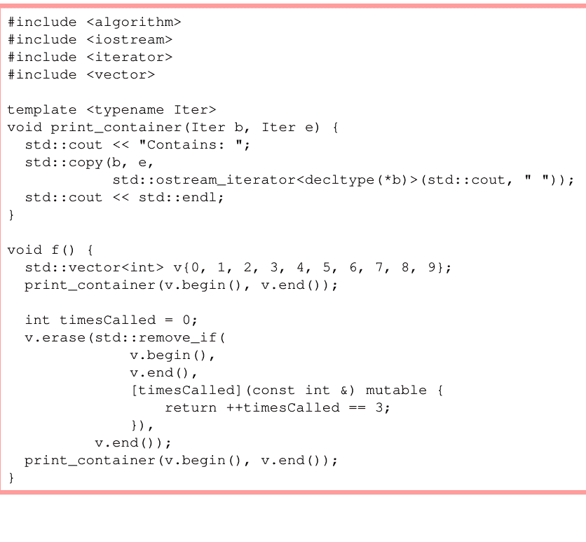
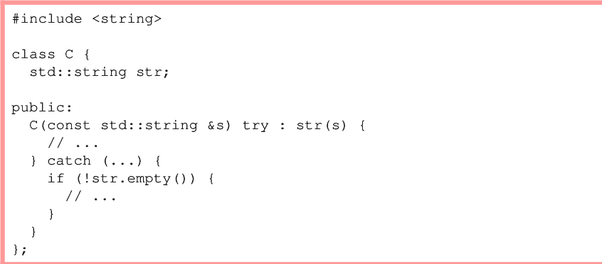

# SEI CERT C++ 编码标准


2.4 DCL53-PP. 不要编写语法上歧义的声明 31

## 引言

本标准为 C++ 语言的安全编码提供了规则。这些规则的目标是开发安全、可靠且安全的系统，例如通过消除可能导致未定义程序和可利用漏洞的未定义行为。遵循本标准中定义的编码规则是确保使用 C++ 编程语言开发的软件系统的安全性、可靠性和安全性的必要（但不是充分的）。例如，拥有安全且可靠的设计也是必要的。安全关键系统通常具有比本编码标准更严格的要求，例如要求所有内存都必须静态分配。本编码标准的应用将产生可靠、健壮且能够抵抗攻击的高质量系统。

每条规则由一个标题、一个描述、不合规代码示例和合规解决方案，以及“本编码标准如何组织”中描述的其他信息组成。标题是对规则的简明（但有时是不准确）的描述。描述规定了规则的规范性要求。不合规代码示例是构成违反规则的示例。随后的合规解决方案演示了不违反规则或本编码标准中任何其他规则的等效代码。

一个文档齐全且可执行的编码标准是 C++ 编程语言编码中的重要要素。编码标准确保程序员遵循一套根据项目和组织需求确定的统一规则，而不是根据程序员的个人偏好。一旦建立，这些标准就可以作为评估源代码的指标（使用 C 手册或自动化过程）。

SEI C++ 编码标准 wiki 包含了已发布版本之间的标准更新。如果您有兴趣对这些规则做出贡献，请在 wiki 上创建一个账户，然后向 `info@sei.org` 发送请求以获取贡献者权限。

## 范围

本标准提供了 C++ 编程语言的安全编码规则。这些规则的目标是开发安全、可靠且安全的系统，例如通过消除可能导致未定义程序和可利用漏洞的未定义行为。遵循本标准中定义的编码规则是确保使用 C++ 编程语言开发的软件系统的安全性、可靠性和安全性的必要（但不是充分的）。例如，拥有安全且可靠的设计也是必要的。安全关键系统通常具有比本编码标准更严格的要求，例如要求所有内存都必须静态分配。本编码标准的应用将产生可靠、健壮且能够抵抗攻击的高质量系统。

每条规则由一个标题、一个描述、不合规代码示例和合规解决方案，以及“本编码标准如何组织”中描述的其他信息组成。标题是对规则的简明（但有时是不准确）的描述。描述规定了规则的规范性要求。不合规代码示例是构成违反规则的示例。随后的合规解决方案演示了不违反规则或本编码标准中任何其他规则的等效代码。

一个文档齐全且可执行的编码标准是 C++ 编程语言编码中的重要要素。编码标准确保程序员遵循一套根据项目和组织需求确定的统一规则，而不是根据程序员的个人偏好。一旦建立，这些标准就可以作为评估源代码的指标（使用 C 手册或自动化过程）。

SEI C++ 编码标准 wiki 包含了已发布版本之间的标准更新。如果您有兴趣对这些规则做出贡献，请在 wiki 上创建一个账户，然后向 `info@sei.org` 发送请求以获取贡献者权限。


本标准分为 11 个章节，包含特定主题区域的规则，随后是四个附录。附录 A 包含参考文献。附录 B 列出了整个标准中使用的术语定义。附录 C 列出了本标准与其他两个指南之间的关系：Misra C++ 2008: 关键系统中 C++ 语言的使用指南 [MISRA 2008] 以及 MITRE 的常见弱性枚举 (CWE) [MITRE 2010]。附录 D 列出了编码标准中所有规则的风险评估。

大多数规则具有一致的结构。本标准中的每条规则都有一个唯一的标识符，该标识符包含在标题中。标题和引言段定义了规则，后面通常有一多对不合规代码示例和合规解决方案。每条规则还包括风险评估、相关指南和参考文献（如适用）。规则还可能包含相关漏洞的表格。

### 1.4.1 标识符

每条规则和建议（参见“规则与建议”）都赋予了一个唯一的标识符。这些标识符由三部分组成：

- 代表标准章节的三个字母助记符
- 00 到 99 范围内的双两位数字值
- 代表语言或平台的后缀
- `"C"` 代表 SEI CERT C 编码标准
- `"CPP"` 代表 SEI CERT C++ 编码标准
- `"J"` 代表 SEI CERT Oracle Java 标准
- `"PL"` 代表 SEI CERT Perl 编码标准

三个字母助记符用于对相似的编码实践进行分组，并指示代码所属的类别。

数值用于为每种编码实践提供唯一的标识符。00 到 49 范围内的数值保留给建议，50 到 99 范围内的数值保留给规则。（用于 SEI CERT C 编码标准使用的数值有所不同）。规则和建议经常通过其标识符和标题在本标准的指南中被引用。

以下是一些 CPP 示例及其对每项的解释：

- `INT50-CPP` 不要转换为超出范围的枚举值
  - 该标识符表示一条规则
  - `"INT"` 代表整数（Integer）类别
  - `"50"` 是唯一标识符
  - `"CPP"` 代表 C++ 语言
- `EXP00-J` 不要忽略方法返回的值
  - 该标识符表示一条规则
  - `"EXP"` 代表表达式（Expressions）类别
  - `"00"` 是唯一标识符
  - `"J"` 代表 Java 语言
- `FLP00-C.` 了解浮点数的局限性
  - 该标识符表示一条建议
  - `"FLP"` 代表浮点数（Floating Point）类别
  - `"00"` 是唯一标识符
  - `"C"` 代表 C 编程语言

### 1.4.2 不合规代码示例和合规解决方案

不合规代码示例阐明了违反所讨论指南的代码。需要注意的是，这些仅是示例，消除所有示例的出现并不意味着意味着所分析的代码现在符合该指南。

不合规代码示例后面通常是合规解决方案，展示了如何以安全、合规的方式重新编写不合规代码。除另说明外，不合规代码示例应仅包含对所讨论指南的违反。合规解决方案应符合所有安全编码规则，但偶尔可能不符合某建议。

### 1.4.3 异常

任何规则或建议都可以指定一小部分异常情况，详细说明在什么情况下不需要遵循该指南以确保软件的安全性、可靠性或安全性。异常仅供参考，不强制遵守。

### 1.4.4 风险评估

CERT C++ 编码标准中的每条指南都包含一个风险评估部分，试图为软件开发者提供指示，说明在代码中不处理特定规则或建议可能带来的潜在后果（以及预期修复成本的指示）。这些信息可用于开发团队优先修复违规行为。该指标为修复项目设计。通常假设新代码将开发为符合整个编码标准和适用建议。

每条规则和建议都有分配的优先级。优先级使用基于失效模式和影响性分析 (FMEA) [IEC 60812 2006] 的指标进行分配。每条规则根据 1 到 3 的量表分别为严重性和修复成本分配三个值。

严重性——忽略规则的后果有多严重？

| 值 | 含义 | 漏洞示例 |
| :--- | :--- | :--- |
| 1 | 低 | 拒绝服务攻击、异常终止 |
| 2 | 中 | 数据完整性违背、无意的信息泄露 |
| 3 | 高 | 执行任意代码 |

可能性——忽略规则引入的缺陷导致可利用漏洞的概率有多大？

| 值 | 含义 |
| :--- | :--- |
| 1 | 不可能 |
| 2 | 可能 |
| 3 | 很有可能 |

修复成本——遵守规则的费用有多贵？

| 值 | 探测 | 修正 |
| :--- | :--- | :--- |
| 1 | 高 | 手动 |
| 2 | 中 | 手动 |
| 3 | 低 | 自动 |

### 1.4.5 自动检测

在 wiki 上，规则规则和建议经常有描述自动检测的章节。这些章节提供了有关 ISO/IEC 17961:2012 分析器的额外信息。

wiki 上的自动检测信息可能：

- 由厂商提供
- 由 CERT 通过评估器确定

### 1.4.6 相关漏洞

wiki 中的风险评估系统还包含搜索相关漏洞的链接。在可能的情况下，CERT 漏洞注释会使用编码标准的唯一 ID 进行标记。这种搜索将为您提供一份确定认为由本（特定）规则引起的真实世界漏洞列表。由于许多漏洞注释引用了闭源系统，并不总是能够提供这种额外分析。因此，相关漏洞字段通常较为稀疏。

### 1.4.7 相关指南

相关指南章节包含指向标准、技术规范和指南集的链接，例如：*技术——编程语言、其环境和系统接口——C 安全编码规则 [ISO/IEC TS 17962:2021]; 技术——编程语言——通过语言选择和使用避免漏洞指南 [ISO/IEC TR 24772:2013]; MISRA C++ 2008: 关键系统中 C++ 语言的使用指南 [MISRA 2008];* 以及 CWE ID 在 *MITRE 的常见弱性枚举 (CWE) [MITRE 2010]* 中。

可以通过在 CWE 后面附加相关 ID 创建获取更多 CWE 信息的 URL。例如，要查找有关“CWE-192：整数转换错误”的更多信息，可以将 `192.html` 附加到 `http://cwe.mitre.org/data/definitions/` 并在浏览器中输入生成的 URL：`http://cwe.mitre.org/data/definitions/192.html`。

其他引用的技术规范、报告和指南均可商业购买。

### 1.4.8 参考文献

大多数指南都有一个小的参考文献章节，列出了与该指南相关的文档和文档章节。

## 1.5 与 CERT C 编码标准的关系

C++ 标准（`[intro.scope]`）第 2 节 [ISO/IEC 14882-2014] 规定了如下：

> C++ 是一种通用编程语言，基于 ISO/IEC 9899:1999《编程语言—C》（以下简称 C 标准）描述的 C 编程语言；除了 C 提供的功能外，C++ 还提供了额外的数据类型、类、模板、异常、命名空间、运算符重载、函数重载、引用、自由存储内存操作符以及额外的库功能。

由于 C 是基于 C 编程语言，因此 SEI C 编码标准中指定的准则与本编码标准指定的准则之间存在大量重叠。为了减少重复信息量，本编码标准重点关注 C++ 编程语言中未被 CERT C 标准完全覆盖的部分。由于 C++ 对类型的关注度增加，C 中的某些规则通过 CERT C 安全编码标准进行了扩展。除非另有说明，CERT C 编码标准的内容通常适用于用 C++ 编写的代码。CERT C 编码标准中适用于 C++ 编码标准的内容已在 C++ 标准的每个相关章节中描述。

以下 CERT C 编码标准的准则不适用于 CERT C 安全编码标准：

- `ARR32-C`: 确保变长数组的尺寸参数在有效范围内
- `ARR36-C`: 不要对未引用同一数组的指针进行减或比较
- `CON30-C`: 清理线程特定存储
- `CON31-C`: 不要在此互斥锁锁定时销毁它
- `CON32-C`: 防止从多个线程访问位域时发生数据竞态
- `CON34-C`: 使用适当的存储期声明线程间共享的对象
- `CON35-C`: 通过预定义的顺序加锁来避免死锁
- `CON36-C`: 在循环中封装可能虚假唤醒的函数
- `CON39-C`: 不要对之前已连接（join）或分离（detach）的线程再次连接或分离
- `DCL31-C`: 先声明标识符
- `DCL36-C`: 不要声明具有冲突链接分类的标识符
- `DCL37-C`: 不要声明或定义请求的标识符
- `DCL38-C`: 声明灵活数组成员时使用正确的语法
- `DCL41-C`: 不要在 switch 语句内部第一个 case 之前声明变量
- `EXP30-C`: 不要依赖副作用的求值顺序
- `EXP32-C`: 不要通过非 volatile 引用访问 volatile 对象
- `EXP33-C.`: 不要读取未初始化的内存
- `EXP40-C.`: 不要修改常量对象
- `EXP43-C.`: 使用带有 restrict 修饰符的指针时避免未定义行为
- `EXP44-C.`: 不要依赖操作 sizeof、Alignof 或 Generic 时的副作用
- `MEM33-C.`: 动态分配内存并拷贝包含灵活数组成员的结构体
- `SIG30-C.`: 仅在信号处理程序中调用异步信号安全的函数

## 1.6 规则与建议

CERT 编码标准由规则（Rules）和建议（Recommendations）组成。规则旨在为代码提供规范性要求；建议旨在提供指导，在遵循这些建议时应当提高软件系统的可靠性和安全性。然而，违反建议并不一定意味着代码中存在缺陷。规则和建议统称为准则（Guidelines）。

### 1.6.1 规则

规则必须满足以下标准：

- 1. 违反准则可能导致缺陷，该缺陷可能对系统的安全、可靠性或安全性产生不利影响，例如引入可能导致可利用漏洞的安全性隐患。
- 2. 准则不依赖于源代码的注释或假设。
- 3. 对准则的遵循情况可以通过自动化分析（静态或动态）、形式化方法或人工检查技术来确定。

### 1.6.2 建议

建议在满足以下条件时，被认为是提高代码质量的指导：

- 1. 遵循建议应当提高系统的安全、可靠性和安全性。
- 2. 建议不是强制性的。

对应预定义的异常情况时，必须在源代码中记录该异常的应用。为了声称符合 CERT C++ 编码标准，并不强制要求必须遵循这些建议。然而，在许多情况下，遵循这些建议将有助于符合规则，从而消除潜在的缺陷源头。

## 1.8.2 级别

本标准中的规则和建议分为三个级别（参见“本编码标准是如何组织的”）。应重点关注符合第 1 级 (L1) 的规则。经过验证符合所有第 1 级规则的软件系统被认为符合 L1 标准。根据系统通过验证的规则集，软件系统可以被评估为 L1、L2 或完全符合。

## 1.8.3 偏差程序

严格遵守所有规则是不可能的，因此，与特定规则违规相关的偏差是不可的。当一个真性发现（true-positive finding）在规则违规方面是不受争议的，但尽管如此被判定为正确的时，可以使用偏差。一个不受争议的真性发现可能是软件设计或架构特征的结果，或者是由于编码标准未预料到的有效原因而发生的。在这方面，偏差程序允许编码规则仅是严格的 [Seacod 2013]。

不会因为性能或易用性的原因而授予偏差。成功通过测试的软件系统不得包含缺陷或可利用的漏洞。偏差请求由首席评估员进行评估，如果开发者能够提供足够的证明偏差不会导致漏洞，则接受该偏差。偏差的使用并不频繁，因为修复一个编码错误总是比提供论证证明该错误不会导致漏洞要容易得多。

## 1.9 开发过程

为任何编程语言开发编码标准都是的一项艰巨的任务，需要社区的广泛参与。创建本标准使用了以下开发过程：

- 1. 从参与开发和应用每种编程语言的社区中征集编码标准的规则和建议，包括负责该文档化标准的正式或事实上的标准。
- 2. 这些规则和建议将由 CERT 技术人员的成员对内容进行编辑，并发布在 SEI C++ 编码标准 wiki 上以供评论和审查。
- 3. 用户社区可以使用线程化讨论和其他通信工具对公开发布的内容发表评论。一旦达成共识认为该规则或建议是恰当且正确的，最终规则将被纳入到正式发布的安全编码标准版本中。

## 1.10 系统属性

本编码标准的目标是产生安全、可靠且安全的系统。安全关键系统可能存在额外的要求，例如不使用动态内存分配。其他关注的软件质量属性包括可移植性、易用性、可用性、可维护性、可读性和性能。

这些许多属性以有趣的方式相互关联。例如，可读性是可维护性的一个属性；两者对于限制在维护期间引入可能导致安全漏洞或可靠性问题的缺陷都至关重要。此外，可靠性有助于人员进行代码检查。可靠性和可用性需要适当的资源管理，这也有于系统的安全性和。性能和安全等系统属性是冲突的，需要考虑权衡。

## 1.11 自动生成的代码

如果要使用代码工具，必须选择合适的工具并进行验证。遵循本文档的要求可以作为评估工具的一个标准。

编码差异取决于代码的生成和维护方式。代码类别包括：

- 工具生成、工具维护的代码：在高级别的格式中指定和维护，并从该格式生成特定语言的源代码。源代码根据此高级别的描述生成，然后作为语言编译器的输入。程序员永远不会查看或修改生成的源代码。
- 工具生成、手动维护的代码：在高级别的格式中指定和维护，并从该格式生成特定语言的源代码。然而，预计在开发周期的某个阶段，工具将停止使用，生成的源代码将进行目视检查和/或手动维护。
- 手写代码：由程序员使用文本编辑器或交互式开发环境手动编写；程序员直接以提供给编译器的源代码格式维护源代码。

由手动维护的源代码必须具备以下质量属性：

- 可读性
- 程序可理解性

这些要求不适用于程序员从未直接处理过的源代码。此外，可靠性也不适用于程序员从未直接处理过的源代码。

## 1.12 政府法规

开发安全软件是许多政府承包商的要求。国家安全局 (NSA) 为安全软件的开发提供指导。本标准中的规则设计为与这些要求保持一致。

- `(APP3590.2: CAT I)` 设计者应确保应用程序不使用已知会导致缓冲区溢出的的函数。
- `(APP3590.3: CAT II)` 设计者应在编程语言允许的情况下，确保应用程序在内存分配时不使用符号值。
- `(APP3600: CAT II)` 设计者应确保应用程序没有规范化表示漏洞。
- `(APP3630.1: CAT II)` 设计者应确保应用程序不受竞态态条件的影响。
- `(APP3630.2: CAT III)` 设计者应确保应用程序不使用可能被使用的全局变量。

对程序员和软件测试人员进行标准培训有助于满足以下要求：

- `(APP2120.3: CAT II)` 项目经理应确保至少每年为开发者提供一次安全设计和编码实践的培训。
- `(APP2120.4: CAT II)` 项目经理应确保测试人员每年都接受一次培训。
- `(APP2060.3: CAT II)` 设计者应遵循项目既定的编码标准。
- `(APP2060.4: CAT II)` 设计者不应使用项目编码标准中记录的不安全函数。
- `(APP5010: CAT III)` 测试经理应确保至少指定一名测试人员，在功能测试之外还进行安全漏洞测试。

## 1.13 致谢

本标准的实现离不开广泛的社区努力。我们感谢所有做出贡献并提供评审意见帮助标准取得成功的人士。如果您对贡献 CERT 安全编码规则感兴趣，请在 wiki 上创建一个账户并向 `info@sei.cnu.edu` 发送邮件请求权限。

### 1.1.3.1 2017 年版标准的贡献者

Aaron Ballman, Peter Brockamp, G. Ann Campbell, Bill Claycomb, Inge Olson, Loic Etienne, Leo Heinhasar, Luc Hermite, David Keaton, Gerhard Muenzc, Malcolm Parsons, Mark Raff, Robert Schiela, Robert Seacord, Martin Seober, Sandy Shrum, Will Snavely, David Svoboda, Mark J. Tilford, Andrew Wesley, 以及 Barbara White

### 1.1.3.2 CERT 安全编码团队

Aaron Ballman, Lori Flynn, Will Kieber, Robert Schiela, Will Snavely, 以及 David Svoboda

## 声明与初始化 (DCL) - `DCL50-CPP`。不要定义 C 风格的可变函数

# 2 声明与初始化 (DCL)

## 2.1 `DCL50-CPP`。不要定义 C 风格的可变函数

函数的定义可以使其在调用处接收比参数声明子句中指定的更多的正式参数。此类函数被称为变参函数，因为它们可以接受调用者提供的任意数量的参数。C++ 提供了两种定义变参函数的机制：函数参数包（function packs）和作为最后一个参数声明的 C 风格省略号（ellipsis）。

变参函数是灵活的，因为它们接受不同数量、不同数量的参数。然而，它们也可能是危险的。使用 C 风格省略号的变参函数（以下简称变参函数）没有机制来检查传递给函数的参数类型，或者检查传递参数的数量是否符合函数定义的语义。因此，在运行时调用传递不当参数的 C 风格变参函数会导致未定义行为。未定义行为可能被利用来执行任意代码。

不要定义 C 风格的可变函数。（声明一个从不允许使用的 C 风格变参函数是无害的，并且在无人值守的情况下可能很有用。）

在需要向函数传递任意数量参数的情况下，可以通过使用用参数包定义的变参函数来避免 C 风格变参函数的问题。此外，对于 C 的 `printf()` 系列函数，C++ 的输出通过重载的 `std-argument` 函数实现。例如，`std::cout::operator<<` 是通过重载的 `std-argument` 运算符实现的。

### 2.1.1 不合代码示例

该不合示例使用 C 风格变参函数对一系列整数求和。该函数读取参数直到发现值 0 为止。在调用此函数时不传递值 0 作为参数（前两个参数）会导致未定义行为。此外，传递除 int 以外的任何类型都会导致未定义行为。


```cpp
#include <cstdarg>

int add(int first, int second, ...) {
    int r = first + second;
    va_list va;
    va_start(va, second);
    while (int v = va_arg(va, int)) {
        r += v;
    }
    va_end(va);
    return r;
}
```

### 2.1.2 合规解决方案（递归函数展开）

在该合规解决方案中，使用函数参数包的变参函数来实现 `add()` 函数，允许调用处具有相同的行为。与不合示例中使用的 C 风格变参函数不同，如果参数列表没有以 0 结尾，该合规解决方案产生未定义行为。此外，如果传递给函数的值不是整数，代码将是格式错误的（ill-formed），而不是产生未定义行为。

## 2.2 DCL51-CPP. 不要声明或定义保留标识符

C++ 标准 `[reserved.names]` `[ISO/IEC 14882-2014]` 规定了以下保留名称的规则：

- 包含标准库头文件的编译单元不应 `#define` 或 `#undef` 在任何标准库头文件中声明的名称。

- 编译单元不应 `#define` 或 `#undef` 与关键字词法一致的、与表 3 列出的标识符、或与 7.6 中描述的属性标记（attribute-tokens）词法一致的名称。

- 每一个包含双下划线 `__` 或以大写字母开头后跟另一个大写字母的名称均留给实现以供任何使用。

- 每一个以下划线 `_` 开头的名称均留给实现，作为全局命名空间中的名称。

- 在头文件中声明为具有外部链接（external linkage）对象的每个名称均用于指定该具有外部链接的库对象，分别在 `std` 命名空间和全局命名空间中。

- 在头文件中声明为具有外部链接的每个函数签名均留给实现，以指定该具有外部链接的函数签名。

- 标准 C 库中声明为具有外部链接的每个名称均留给实现，作为具有 `extern "C"` 链接的名称使用，分别在 `std` 命名空间和全局命名空间中。

- 标准 C 库中声明为具有外部链接的每个函数签名均留给实现，作为同时具有 `extern "C"` 和 `extern "C++"` 链接的函数签名，或作为命名空间的名称。

- 对于标准 C 库中的每个类型 `T`，`::T` 和 `std::T` 留给实现，且在定义时，`::T` 应与 `std::T` 相同。

该准则中引用的标识符和属性名称除了 `override`、`final`、`aligns`、`carries_dependency`、`deprecated` 和 `noreturn`。

没有其他标识符被保留。在会导致未定义行为的上下文中声明或定义标识符。不要声明或定义保留标识符。

声明与初始化（DCL） - DCL51-CPP. 不要声明或定义保留标识符

### 2.2.1 不合规代码示例（头文件守卫）

一种常见的做法是在预处理器条件中使用宏来防止头文件的多次包含。虽然这是一种推荐的做法，但许多程序使用保留名称作为头文件守卫。此类名称可能与 C++ 标准模板实现在其头文件中定义的保留名称冲突，或者与在未包含 C++ 标准库头文件时由编译器隐式定义的保留名称冲突。

```cpp
#ifndef MY_HEADER_H
#define MY_HEADER_H_

// <my_header.h> 的内容

#endif // MY_HEADER_H
```

### 2.2.2 合规解决方案（头文件守卫）

此合规解决方案避免了在头文件守卫名称中使用开头或结尾的下划线。

```cpp
#ifndef MY_HEADER_H
#define MY_HEADER_H_ // 注意：此处示例仍有下划线，通常建议应完全避免

#endif // MY_HEADER_H
```

### 2.2.3 不合规代码示例（用户定义字面量）

在这段合规代码中，声明了一个用户定义的字面量操作符 `operator"" x`。然而，字面量后缀标识符必须以下划线开头；没有下划线前缀的字面量后缀留给未来的实现。

```cpp
#include <cstddef>
unsigned int operator"" x(const char *, std::size_t);
```

SEI C++ 编码标准 (2016 版) | V01

软件工程学院 | 卡内基梅隆大学 [分发声明] 批准公开发布和无限分发。

### 2.2.4 合规解决方案（用户定义字面量）

在此合规解决方案中，用户定义的字面量命名为 `operator"" _x`，它不是保留标识符。

```cpp
#include <cstddef>
unsigned int operator"" _x(const char *, std::size_t);
```

用户定义字面量的名称是 `operator"" _x` 而不是 `_x`，否则后者会被留给全局命名空间。

### 2.2.5 不合规代码示例（文件作用域对象）

在这一不合规代码示例中，文件作用域对象 `_max_limit` 和 `_limit` 的名称都带有下划线。由于它是静态的，`_max_limit` 的声明似乎与实现定义的名称重叠。然而，由于包含了 `<cstddef>` 来定义 `std::size_t`，因此存在名称冲突的可能。（但请注意，符合标准的 C++ 标准模板头文件无论是否被包含，都可能隐式声明保留名称。）此外，由于 `limit` 具有外部链接，它可能与运行时库中定义的同名符号冲突，即使该符号未在它们的头文件中声明。因此，即使链接限制于单个编译单元，以下划线开头任何文件作用域标识符的名称也是安全的。

```cpp
#include <cstddef> // std::size_t
static const std::size_t _max_limit = 1024;
std::size_t _limit = 100;
unsigned int get_value(unsigned int count) {
    return count < _limit ? count : _limit;
}
```

### 2.2.6 合规解决方案（文件作用域对象）

在此合规解决方案中，文件作用域标识符不以下划线开头。

```cpp
#include <cstddef> // 用于 size_t
std::size_t max_limit = 1024;
std::size_t limit = 100;

unsigned int get_value(unsigned int count) {
    return count < limit ? count : limit;
}
```

### 2.2.7 不合规代码示例（文件作用域）

在此不合规代码示例中，文件作用域对象 `_max_limit` 和 `_limit` 的名称都带有下划线。由于它是静态的，`_max_limit` 的声明似乎与实现定义的名称重叠。然而，由于包含了 `<cstddef>` 来定义 `std::size_t`，因此存在名称冲突的可能。（但请注意，符合标准的 C++ 标准模板头文件无论是否被包含，都可能隐式声明保留名称。）此外，由于 `limit` 具有外部链接，它可能与运行时库中定义的同名符号冲突，即使该符号未在它们的头文件中声明。因此，即使链接限制于单个编译单元，以下划线开头任何文件作用域标识符的名称也是安全的。

```cpp
#include <cstddef> // std::size_t
static const std::size_t _max_limit = 1024;
std::size_t _limit = 100;
unsigned int get_value(unsigned int count) {
    return count < _limit ? count : _limit;
}
```

### 2.2.8 合规解决方案（宏）

此合规解决方案避免了在头文件守卫名称中使用开头或结尾的下划线。

```cpp
#ifndef MY_HEADER_H
#define MY_HEADER_H_ // 此处应移除结尾下划线

#endif // MY_HEADER_H
```

### 2.2.9 异常

该准则中引用的标识符和属性名称除了 `override`、`final`、`aligns`、`carries_dependency`、`deprecated` 和 `noreturn`。

没有其他标识符被保留。在会导致未定义行为的上下文中声明或定义标识符。不要声明或定义保留标识符。

### 2.2.10 风险评估

使用保留标识符会导致操作错误。

| 规则 | 严重性 | 可能性 | 修复成本 |
|---|---|---|---|
| DCL51-CPP | 低 | 低 | 低 |

### 2.2.11 相关指南

- SEI C++ 编码标准 DCL58-CPP. 不要修改标准
- SEI CERT 编码标准 D37-C. 不要声明或定义保留标识符
- MISRA C++:2008 规则 17-0 包含文件

### 2.2.12 参考文献

| 来源 | 引用 |
|---|---|
| ISO/IEC 14882-2014 | 子句 17.6.4，“保留名称” |
| ISO/IEC 9899:2011 | 子句 7.1.3，“保留标识符” |

## 2.3 DCL52-CPP. 不要对引用类型 const 或 volatile

C++ 不允许修改引用，实际上将所有引用视为 const。C++ 标准 `[dcl.ref]`，节 1 `[ISO/IEC 14882-2014]` 规定如下：

> 带 cv 修饰的引用是非法的，除非通过使用类型别名（7.1.3, 14.1）或 decltype 指定符（7.1.6.2）引入 cv 修饰符，在这种情况下 cv 修饰符会被忽略。

因此，C++ 禁止或忽略对引用类型的 cv 修饰。只有非引用类型可以进行 cv 修饰。

当尝试在使用引用类型的声明中作为对类型进行 const 修饰时，程序员可能会意外写成：

```cpp
char &const p;
```

而不是

```cpp
char const &p; // 或者: const char &p; // 指向 const char 的引用
```

不要尝试对引用类型进行 cv 修饰，因为这会导致未定义行为。符合标准的编译器必须发出诊断信息。然而，如果编译器没有发出致命诊断，程序可能会产生意想不到的结果，例如被 `p` 引用的字符被修改。

### 2.3.1 不合规代码示例

在这一不合规代码中，形成了一个对 char 的 const 修饰引用，而不是对 const 修饰的 char 的引用。这会导致未定义行为。

```cpp
#include <iostream>

void f(char c) {
    char &const p = c;
    p = 'p';
    std::cout << c << std::endl;
}
```

### 2.3.1.1 实现细节 (MSVC)

使用 Microsoft Visual Studio 2015 时该该代码可以成功编译，但会产生警告诊断。

```
warning C4227: anachronism use : qualifiers on reference are ignored
```

运行时，代码输出以下内容。

```
p
```

### 2.3.1.2 实现细节 (Clang)

使用 Clang 3.9，该代码会产生致命性诊断（错误）。

```
error: 'const' qualifier may not be applied to a reference
```

### 2.3.2 不合规代码示例

该不合规代码正确声明了 `p` 为指向带有 const 限定符的字符的引用。随后对 `p` 的修改会导致程序格式不正确。

```cpp
#include <iostream>
void f(char c) {
  const char &p = c;
  p = 'p'; // Error: read-only variable is not assignable
  std::cout << c << std::endl;
}
```

### 2.3.3 合规解决方案

该合规解决方案移除了 const 限定符。

```cpp
#include <iostream>
void f(char c) {
  char &p = c;
  p = 'p';
  std::cout << c << std::endl;
}
```

### 2.3.4 风险评估

const 或 volatile 引用类型可能导致未定义行为而非致命诊断，导致存储意料之外的值并可能导致数据完整性违规。

| 规则 | 严重性 | 可能性 | 修复成本 | 优先级 | 级别 |
|---|---|---|---|---|---|
| DCL52-CPP | 低 | 不可能 | 低 | P3 | L3 |

### 2.3.5 参考文献

| [Dewhurst 2002] | Gotcha #5, “Misunderstanding References” |
| [ISO/IEC 14882-2014] | 子句 8.3.2, “References” |

## 2.4 DCL53-CPP. 不要编写语法歧义的声明

可以设计出可以被歧义地解释为表达式语句或声明的语法。这种语法被称为“令人困惑的解析”（vexing parse），因为编译器必须使用歧义消除规则来确定语义结果。C++ 标准 `[stmt.ambig]` 第 1 段 `[ISO/IEC 14882-2014]` 部分规定了以下内容：

> 语法中涉及表达式语句和声明的部分存在歧义：一个以函数风格类型转换作为其最左侧子表达式的表达式语句，与一个第一个声明符以 `.` 开头的声明是无法区分的。在这些情况下，该语句是一个声明。[注：为了消除歧义，可能必须检查整个语句以确定它是表达式语句还是声明，……]

在声明的语文中，也存在类似的令人困惑的解析，其语法可以被歧义地解释为函数声明，或带有以函数风格强制转换作为初始化值的声明。C++ 标准 `[dcl.ambig.res]` 第 1 段规定如下：

> 6.8 中提到的函数强制转换与声明之间的相似性所导致的歧义也可以出现在声明的语文中。在该语文中，选择是在参数名周围带有冗余括号的函数声明，与以函数风格强制转换作为初始化值的对象声明之间进行。仅对于 6.8 中提到的歧义，解决方法是将任何可能可能是声明的结构都视为声明。

不要编写语法歧义的声明。随着使用大括号列表的统一初始化语法的出现，现在有了可以无歧地指定声明而非表达式语句的语法。还可以通过使用非函数风格的强制转换、使用 `=` 初始化或移除参数名周围多余的括号来消除歧义。

### 2.4.1 不合规代码示例

在这一不合规示例中，期望一个 `std::unique_lock` 类型的匿名局部变量会根据 RAII 机制对互斥锁进行锁定和解锁。然而，该声明在语法上是歧义的，因为它可以被解释为匿名对象并调用其单参数转换构造函数，或者被解释为声明一个命名的 `m` 并对其进行默认构造。此示例中使用的语法定义了后者而非前者，因此互斥锁从未被锁定。

```cpp
#include <mutex>

static std::mutex m;
static int shared_resource;

void increment_by_42() {
    std::unique_lock<std::mutex> lock(m);
    shared_resource += 42;
}
```

### 2.4.2 合规解决方案

在这一合规解决方案中，为锁对象提供了一个标识（`m` 以外），并调用了正确的转换构造函数。

```cpp
#include <mutex>

static std::mutex m;
static int shared_resource;

void increment_by_42() {
    std::unique_lock<std::mutex> lock(m);
    shared_resource += 42;
}
```

### 2.4.3 不合规代码示例

在这一不合规代码示例中，尝试声明一个 `Widget` 类型的局部变量 `w` 并执行默认构造函数。然而，该声明在语法上是歧义的，代码可以是不接受任何参数并返回 `Widget` 的函数指针声明，也可以是 `Widget` 类型局部变量的声明。此示例中使用的语法定义了前者而非后者。

```cpp
#include <iostream>

struct Widget {
    Widget() {
        std::cout << "Constructed" << std::endl;
    }
};

void f() {
    Widget w();
}
```

结果，该程序没有调用默认构造函数。

### 2.4.4 合规解决方案

该合规解决方案展示了声明的两种方式。第一种方式是省略括号，确保语法是声明而非函数声明。第二种方式是使用直接初始化。

```cpp
#include <iostream>

struct Widget {
    Widget() {
        std::cout << "Constructed" << std::endl;
    }
};

void f() {
    Widget w1; // 省略括号
    Widget w2();
}
```

运行此程序会输出两次，分别对应 `w1` 和 `w2`。

### 2.4.5 不合规代码示例

该不合规代码示例展示了令人困惑的解析。声明 `Gadget g(Widget(i));` 没有解析为带有参数的 `Gadget` 对象。它被解析为在参数周围带有冗余括号的函数声明。


```cpp
#include <iostream>

struct Widget {
    explicit Widget(int i) {
        std::cout << "Constructed" << std::endl;
    }
};

struct Gadget {
    explicit Gadget(Widget wid) {
        std::cout << "Gadget constructed" << std::endl;
    }
};

void f() {
    int i = 3;
    Gadget g(Widget(i));
    std::cout << i << std::endl;
}
```

参数周围的括号是可选的，因此以下是等等的写法：

```cpp
Gadget g(i);
```

结果，该程序格式正确，但没有构造 `Gadget` 或 `Widget` 对象。

### 2.4.6 合规解决方案

该合规解决方案展示了声明 `g` 的两种等效方式。第一个声明 `g1` 在构造函数调用周围使用额外的括号，强制编译器将其解析为局部变量声明而非函数声明。第二种声明 `g2` 使用直接初始化实现了类似的效果。

```cpp
#include <iostream>

struct Widget {
    explicit Widget(int i) {
        std::cout << "Constructed" << std::endl;
    }
};

struct Gadget {
    explicit Gadget(Widget wid) {
        std::cout << "Gadget constructed" << std::endl;
    }
};

void f() {
    int i = 3;
    Gadget g1((Widget(i))); // 使用额外的括号
    Gadget g2{Widget(i)}; // 使用直接初始化
    std::cout << i << std::endl;
}
```

运行此程序产生预期的输出。

```
Widget constructed
Gadget constructed
Widget constructed
Gadget constructed
3
```

### 2.4.8 参考文献

| ISO/IEC 14882-2014 | 子句 6.8, "歧义消除"\n子句 8.2, "歧义消除" |

| [Meyers 2001] | 第 6 项，“警惕 C++ 最令人困惑的解析” |

声明初始化 (DCL) - D54-CPP. 在同一作用域内成对重载分配和释放内存函数

## 2.5 D54-CPP. 在同一作用域内成对重载分配和释放内存函数

分配函数和释放内存函数可以在全局作用域和类作用域内进行重载。

如果在给定的作用域内对分配函数进行了重载，则相应的释放内存函数也必须在同一作用域内进行重载（反之亦然）。

未能重载相应的动态存储区函数可能会违反诸如 MEM51-CPP 的规则：妥善地释放动态分配的资源。例如，重载的分配函数使用私有堆执行分配，将它返回的指针传递给默认的释放函数可能会导致未定义行为。即使在分配函数最终使用默认分配器获取指针的情况下，未能重载相应的释放函数也可能因为没有更新自定义分配器的内部状态，而导致程序处于意外状态。

定义一个没有对应空存储区（free store）的分配或释放内存函数是可以接受的。例如，当类定义了放置内存函数（placement function）时，将非放置的分配或释放内存函数定义为类成员是一种常见做法。这可以防止对该类类型无小心调用 `new`，或对该类类型的指针无小心调用 `delete`。由于类似的原因，声明但不定义没有对应空存储区的私有分配或释放函数也是可以接受的。然而，必须提供一个定义，允许在类成员函数内部访问空存储区。

### 2.5.1 不合规代码示例

在此代码示例中，分配函数在全局作用域内被重载。然而，没有声明相应的释放内存函数。如果使用重载的分配函数分配了对象，任何删除该对象的尝试都将导致相对于 MEM51-CPP 的未定义行为：妥善地释放动态分配的资源。

```cpp
#include <Windows.h>
#include <new>

void*operator new(std::size_t size) noexcept(false) {
  // 私有的、可扩展的堆。
  static HANDLE h = ::HeapCreate(0, 0, 0);
  if (h) {
    return ::HeapAlloc(h, 0, size);
  } throw std::bad_alloc();
}

// 没有定义相应的全局 delete运算符。
```

声明初始化 (DCL) - DCL54-CPP. 在同一作用域内成对重载分配和释放内存函数

### 2.5.2 合规解决方案

在这一合规解决方案中，相应的释放函数也在全局作用域内被定义。

```cpp
#include <Windows.h>
#include <new>
class HeapAllocator {
    static HANDLE h;
    static bool init;
public:
    static void *alloc(std::size_t size) noexcept(false) {
        if (!init) {
            h = ::HeapCreate(0, 0, 0); // 私有的、可扩展的堆。
            init = true;
        }
        if (h) {
            return ::HeapAlloc(h, 0, size);
        }
        throw std::bad_alloc();
    }
    static void dealloc(void *ptr) noexcept {
        if (h) {
            (void)::HeapFree(h, 0, ptr);
        }
    };
};
HANDLE HeapAllocator::h = nullptr;
bool HeapAllocator::init = false;
void *operator new(std::size_t size) noexcept(false) {
    return HeapAllocator::alloc(size);
}
void operator delete(void *ptr) noexcept {
}
```

SEI CERT C++ 标准 (2016) | V01

软件安全研究所 | 卡内基梅大学

[发行] | 批准发布

由于 `new()` 放置函数在类作用域内被重载，`delete()` 函数在类作用域内未被重载。

在跨越信任边界传递类对象时避免信息泄露

### 2.5.3 不合规代码示例

在此不合规代码示例中，`new()` 在类作用域内被重载，`delete()` 在类作用域内未被重载。由于未更新内部状态，使用重载的 `new()` 分配对象后，任何删除该对象的操作都会导致程序处于意外状态。

```cpp
#include <new>
extern "C" void bookkeeping(void *allocated_ptr, std::size_t size);

struct S {
    void *operator new(std::size_t size) noexcept(false) {
        void *ptr = ::malloc(size);
        bookkeeping(ptr, size);
        return ptr;
    }
};
```

### 2.5.4 合规解决方案

在此合规解决方案中，相应的 `delete()` 函数在类作用域内被定义。

```cpp
#include <new>

extern "C" void bookkeeping(void *allocated_ptr, std::size_t size);

struct S {
    void *operator new(std::size_t size) noexcept(false) {
        void *ptr = ::malloc(size);
        bookkeeping(ptr, size);
        return ptr;
    }

    void operator delete(void *ptr, std::size_t size) noexcept {
        bookkeeping(ptr, size);
        ::free(ptr);
    }
};
```

声明初始化 (DCL) - DCL54-CPP. 在同一作用域内成对重载分配和释放内存函数

### 2.5.5 异常

**DCL54-CPP-EX1:** 放置释放内存函数可以省略，前提是放置分配函数保证为 `noexcept`。由于释放内存函数在放置通过异常终止时会自动调用，某些厂商实现了禁用异常的编译器（例如 Clang 的 `-fno-cxx-exceptions` 和 Microsoft 的 `/EHs-`），这类似于调用 `abort()`。

2.5.6 风险评估

`new` 和 `delete` 使用不匹配可能导致拒绝服务。

| 规则 | 可能性 | 修复成本 | 优先级 | 级别 |
|---|---|---|---|---|
| D54-CPP | 低 | 可能 | 低 | P6 / L2 |

### 2.5.7 相关指南

| SEI CERT C++ 标准 | MEM51-CPP. 妥善地释放动态分配的资源 |

### 2.5.8 参考文献

| ISO/IEC 14882-2014 | 子句 3.7.4, "动态存储 Duration"

子句 5.3.4, "New"

子句 5.3.5, "Delete" | |

## 2.6 DCL55-CPP. 在跨信任边界传递类对象时避免信息泄露

C++ 标准 [class.mem] 第13段（ISO/IEC 14882-2014）描述了非静态数据成员的布局：

* 具有相同访问权限的（非联合）类的非静态数据成员的分配方式使得后定义的成员在类对象中具有更高的地址。不同访问权限的非静态数据成员的分配顺序是不指定的。实现对齐要求可能会导致两个相邻成员不紧邻分配；管理虚函数和虚基类所需的空间可能也是如此。

此外，[class.bit] 第1段部分阐述了以下内容：

* 类对象内位字段的分配是取决于实现定义的。位字段被打包在某些可寻址的分配单元中。

因此，填充位可能出现在类对象实例的任何位置（当无名位字段作为类中第一个声明成员时，位于对象的起始处）。除非通过零初始化，否则填充位包含可能包含敏感信息的不确定值。

当类对象实例的指针跨越信任边界传递到不同的受信域时，程序员必须确保此类对象的填充位不包含敏感信息。

声明与初始化 (DCL) - DCL55-CPP。在跨越信任边界传递类对象时避免信息泄漏

### 2.6.1 不合规代码示例

此不合规代码在内核空间运行并将数据从 arg 拷贝到用户空间。然而，对象内部可能会使用填充位（padding bits），例如为了确保类数据成员的对齐。这些填充位可能包含敏感信息，无论数据如何拷贝，这些信息都可能泄露到用户空间。

```cpp
#include <cstddef>
struct test {
  int a;
  char b;
  int c;
};
// 安全地将字节拷贝到用户空间
extern copy_to_user(void *dest, void *src, std::size_t size);
void do_stuff(void *usr_buf) {
  test arg(1, 2, 3);
  copy_to_user(usr_buf, &arg, sizeof(arg));
}
```

### 2.6.2 不合规代码示例

在这个不合规示例中，arg 通过直接初始化进行值初始化。由于 test 没有用户提供的默认构造函数，值初始化之前会有一个零初始化，这保证了在进行任何进一步初始化之前，填充位被初始化为 0。这类似于使用 `std::memset()` 将对象中的所有位初始化为 0。

```cpp
#include <cstddef>

struct test {
    int a;
    char b;
    int c;
};

// 安全地将字节拷贝到用户空间
extern int copy_to_user(void *dest, void *src, std::size_t size);

void do_stuff(void *usr_buf) {
    test arg();

    arg.a = 1;
    arg.b = 2;
    arg.c = 3;

    copy_to_user(usr_buf, &arg, sizeof(arg));
}
```

然而，编译器可以自由地通过将 32 位寄存器的低位字节设置为 2 来实现 `arg.b = 2`，保持高位字节不变，并将寄存器的所有 32 位存储到内存中。这可能会导致寄存器中高位字节泄露给用户。

### 2.6.3 合规解决方案

此合规解决方案在将数据拷贝到不可信的上下文之前对其进行了序列化。

```cpp
#include <cstddef>
#include <cstring>

struct test {
    int a;
    char b;
    int c;
};

// 安全地将字节拷贝到用户空间。
extern void copy_to_user(void *dest, void *src, std::size_t size);

void do_do_stuff(void *usr_buf) {
    test arg{1, 2, 3};
    // 可能比严格需要的大
    unsigned char buf[sizeof(arg)];
    size_t offset = 0;

    memcpy(buf + offset, &arg.a, sizeof(arg.a));
    offset += sizeof(arg.a);
    memcpy(buf + offset, &arg.b, sizeof(arg.b));
    offset += sizeof(arg.b);
    memcpy(buf + offset, &arg.c, sizeof(arg.c));
    offset += sizeof(arg.c);

    copy_to_user(usr_buf, buf, offset /* 拷贝的信息大小 */);
}
```

此代码确保了没有未初始化的填充位被拷贝到非特权用户。拷贝到用户空间的结构现在是一个紧凑结构，`copy_to_user()` 函数需要对其进行解包以重建原始的带填充的结构。

## 2.6.4 合规解决方案（填充字节）

填充位可以显式声明为结构体中的字段。然而，此解决方案不是可移植的，因为它依赖于实现和目标内存架构。以下解决方案适用于 x86-32 架构。

```cpp
#include <cstddef>

struct test {
    int a;
    char b;
    char padding_1, padding_2, padding_3;
    int c;
};

test(int a, char b, int c) :
    a(a), b(b),
    padding_1(0), padding_2(0), padding_3(0),
    c(c)
}
// 确保 c 是最后一个填充字节之后的下一个字节。
static_assert(offsetof(test, c) == offsetof(test, padding_3) + 1, "对象包含中间填充");
// 确保没有尾部填充。
static_assert(sizeof(test) == offsetof(test, c) + sizeof(int), "对象包含尾部填充");

// 安全地将字节拷贝到用户空间。
extern int copy_to_user(void *dest, void *src, std::size_t size);

void do_stuff(void *usr_buf) {
    test arg(1, 2, 3);
    copy_to_user(usr_buf, &arg, sizeof(arg));
}
```

`static_assert()` 验证了没有添加额外的填充字节。

### 2.6.5 不合规代码示例

此不合规示例在内核空间运行并将数据拷贝到用户空间。对象内部的填充位可能包含敏感信息，并会泄露给用户。


```cpp
#include <cstddef>
class base {
public:
    virtual ~base() = default;
};

class test : public base {
    alignas(32) double h;
    char i;
    unsigned j : 80;
    unsigned k;
protected:
    unsigned l : 4;
    unsigned m : 3;
public:
    char n;
    double o;

    test(double h, char i, unsigned j, unsigned l, unsigned short m, char n, double o) :
    h(h), i(i), j(j), l(l), m(m), n(n), o(o) {}

    virtual void foo();
};

// 安全地将字节拷贝到用户空间
extern int copy_to_user(void *dest, void *src, std::size_t size);

void do_stuff(void *usr_buf) {
    test arg(0.0, 1, 2, 3, 4, 5, 6, 7.0);
    copy_to_user(usr_buf, arg, sizeof(arg));
}
```

填充字节取决于实现。当使用 `GCC 5.3.0` 编译 `x86-32` 时，`test` 对象需要 96 字节存储来容纳 29 字节数据（33 字节包含虚函数表），其布局如下：

| 偏移 (位) | 存储大小 (字节 (位)) | 原因 | 偏移 | 存储大小 | 原因 |
| :--- | :--- | :--- | :--- | :--- | :--- |
| 0 | 1 (32) | 虚函数指针 | 56 (448) | 4 (32) | unsigned k |
| 4 (32) | 28 (224) | 数据成员对齐填充 | 60 (480) | 0 (4) | unsigned l : 4 |
| 32 (256) | 8 (64) | double h | 60 (484) | 0 (3) | unsigned short m : 3 |
| 40 (320) | 1 (8) | char i | 60 (487) | 0 (1) | 未使用的位域位 |
| 41 (328) | 3 (24) | 数据成员对齐填充 | 61 (488) | 1 (8) | char n |
| 44 (352) | 4 (32) | unsigned j : 80 | 62 (496) | 2 (16) | 数据成员对齐填充 |
| 48 (384) | 6 (48) | 扩展位域大小填充 | 64 (512) | 8 (64) | double o |
| 54 (432) | 2 (16) | 对齐填充 | 72 (576) | 24 (192) | 类对齐填充 |

### 2.6.6 合规解决方案

由于数据结构的复杂性，该合规解决方案在将对象数据拷贝到不可信上下文之前，对其进行序列化，而不是尝试手动处理所有的填充字节（`padding bytes`）。

```cpp
#include <cstddef>
#include <cstring>

class base {
public:
    virtual ~base() = default;
};
class test : public virtual base {
alignas(32) double h;
    char i;
    unsigned j = 80;
protected:
    unsigned k;
    unsigned l : 4;
    unsigned short m : 3;
public:
    char n;
    double o;

    test(double h, char i, unsigned j, unsigned k, unsigned l,
        unsigned short m, char n, double o) :
        h(h), i(i), j(j), k(k), l(l), m(m), n(n), o(o);

    void foo() {
    bool serialize(unsigned char *buffer, std::size_t &size) {
        if (size < sizeof(test)) {
            return false;
        }

        std::size_t offset = 0;
        std::memcpy(buffer + offset, &h, sizeof(h));
        offset += sizeof(h);
        std::memcpy(buffer + offset, &i, sizeof(i));
        offset += sizeof(i);

        // Only of (unsigned) bits are valid, so the following is
        // not narrowing.
        unsigned loc_j = j;

        std::memcpy(buffer + offset, &loc_j, sizeof(loc_j));
        offset += sizeof(loc_j);
        std::memcpy(buffer + offset, &k, sizeof(k));
        offset += sizeof(k);
        unsigned char loc_l = l & 0b0111;
        std::memcpy(buffer + offset, &loc_l, sizeof(loc_l));
        offset += sizeof(loc_l);
        unsigned short loc_m = m & 0b0111;
        std::memcpy(buffer + offset, &loc_m, sizeof(loc_m));
        offset += sizeof(loc_m);
        std::memcpy(buffer + offset, &n, sizeof(n));
        offset += sizeof(n);
        std::memcpy(buffer + offset, &o, sizeof(o));
        offset += sizeof(o);

        size -= offset;
        return true;
    }

    // Safe copy bytes to user space.
    extern int copy_to_user(void *dest, void *src, size_t size);

    void do_stuff(void *usr_buf) {
        test arg(0.0, 1, 2, 3, 4, 5, 6, 7.0);

        // May be later strictly needed, will be updated by
        // calling serialize() to the size of the buffer remaining.
        std::size_t size = sizeof(arg);
        unsigned char buf[sizeof(arg)];
        if (arg.serialize(buf, size)) {
            copy_to_user(usr_buf, buf, sizeof(test) - size);
        } else {
            // Handle error
        }
    }
};
```

此代码确保了未初始化的填充字节不会被拷贝到特权用户。拷贝到用户空间的结构现在是一个紧凑结构，`copy_to_user()` 函数需要对其进行解包，以重新创建原始的带有填充的结构。

声明与初始化 (DCL) - `DCL55-CPP`: 在跨越信任边界传递类对象时避免信息泄露

### 2.6.7 风险评估

填充位可能无意中包含敏感数据，例如指向内核数据结构的指针或密码。指向此类结构的指针可能会被传递给其他函数，导致信息泄露。

| 规则 | 严重性 | 可能性 | 修复成本 | 优先级 | 级别 |
|---|---|---|---|---|---|
| `DCL55-CPP` | 低 | 不太 | 高 | P1 | L3 |

### 2.6.7.1 相关漏洞

内核中许多漏洞源于违反此规则。`CVE-2010-4083` 描述了一个漏洞，其中 `semctl` 调用允许特权用户读取未初始化的内存，因为栈上的 `semid_ds` 结构字段在拷贝回用户空间之前未经过修改或清零。

`CVE-2010-3881` 描述了一个漏洞，其中 `semctl` 调用允许特权用户读取未初始化的内存，因为栈上的 `semid_ds` 结构字段在拷贝回用户空间之前未经过修改或清零。

`CVE-2010-3477` 描述了一个漏洞，其中 `semctl` 调用允许特权用户读取未初始化的内存，因为栈上的 `semid_ds` 结构字段在拷贝回用户空间之前未经过修改或清零。

### 2.6.8 相关指南

- `DCL55-CPP`: 在跨越信任边界传递类对象时避免信息泄露

### 2.6.9 参考文献

| 规则 | 描述 |
|---|---|
| `DCL55-CPP` | 在跨越信任边界传递类对象时避免信息泄露 |
| `DCL56-CPP` | 避免静态对象的初始化循环 |

## 2.7 避免静态对象的初始化循环

不要在静态对象之间创建初始化依赖，除非它们相对于另一个对象是有顺序。无序初始化（特别是跨越编译边界时）会导致未定义行为。

### 2.7.1 不合规代码示例

此不合规代码示例尝试使用缓存实现阶阶函数。由于静态数组的初始化涉及递归，函数的行为是未定义的。

```cpp
#include <stdexcept>
int fact(int i) noexcept(false) {
  if (i < 0) {
    // Negative factorials are undefined.
    throw std::domain_error("i must be >= 0");
  }
  static const int cache[] = {
    fact(0), fact(1), fact(2), fact(3), fact(4), fact(5),
    fact(6), fact(7), fact(8), fact(9), fact(10), fact(11),
    fact(12), fact(13), fact(14), fact(15), fact(16)
  };
  if (i < (int)(sizeof(cache) / sizeof(int))) {
    return cache[i];
  }
  return i > 0 ? i * fact(i - 1) : 1;
}
```

### 2.7.1.1 实现细节

在 `Microsoft Visual Studio 2015` 和 `GCC 6.1.0` 中，以线程安全的方式初始化静态变量时，缓存的递归初始化会导致死锁。

### 2.7.2 合规解决方案

该合规解决方案避免了初始化静态局部数组缓存，而是依靠零初始化来判断数组的每个成员是否已经分配了值，如果还没有，则递归地计算其值。它在可能时返回缓存值，在需要时计算该值。

```cpp
#include <stdexcept>

int fact(int i) noexcept(false) {
    if (i < 0) {
        // 负数阶乘是未定义的。
        throw std::domain_error("*i must be >= 0*");
    }

    // 使用懒初始化缓存。
    static int cache[17];
    if (i < (sizeof(cache) / sizeof(int))) {
        if (0 == cache[i]) {
            cache[i] = i > 0 ? fact(i - 1) : 1;
        }
    }
    return cache[i];

    return i > 0 ? i * fact(i - 1) : 1;
}
```

### 2.7.3 不合规代码示例

在这个不合规的代码示例中，`file1.cpp` 中 `numWheels` 的值依赖于 `c` 的初始化。然而，由于 `c` 定义在与 `numWheels` 不同的编译单元（`file2.cpp`）中，因此无法保证在调用 `c.num_wheels()` 初始化 `numWheels` 之前，已经通过调用 `get_default_car()` 初始化了 `c`。这通常被称为“静态初始化灾难”（`static initialization fiasco`），导致的行为是未指定的。

```cpp
// file.h
#ifndef FILE_H
#define FILE_H

class Car {
    int numWheels;

public:
    Car() : numWheels(4) {}
    explicit Car(int numWheels) : numWheels(numWheels) {}

    int get_num_wheels() const { return numWheels; }
};
#endif FILE_H

// file1.cpp
#include "file.h"
#include <iostream>

extern Car c;
int numWheels = c.get_num_wheels();

int main() {
    std::cout << numWheels << std::endl;
}

// file2.cpp
#include "file.h"
Car get_default_car() { return Car(6); }
Car c = get_default_car();
```

### 2.7.3.1 实现细节

打印到标准输出流的值通常取决于编译单元链接的顺序。在 `x86 Linux` 的 `Clang 3.0` 上，命令 `clang++ file1.cpp file2.cpp && ./a.out` 输出 `0`，而 `clang++ file2.cpp file1.cpp && ./a.out` 输出 `6`。

### 2.7.4 合规解决方案

该合规解决方案使用了“首次使用时构造”（construct on first use）惯用法来解决静态初始化顺序问题。`file.h` 和 `file2.cpp` 的代码保持不变；仅将 `file.cpp` 中的静态 `numWheels` 移动到函数体内。因此，`numWheels` 的初始化保证发生在声明点，从而确保了对顺序的控制。全局对象 `c` 在执行 `main()` 之前完成初始化，在调用 `get_num_wheels()` 时，可以保证 `c` 已经完成了动态初始化。

```cpp
// file.h
#ifndef FILE_H
#define FILE_H

class Car {
    int numWheels;

public:
    Car() : numWheels(4) {}
    explicit Car(int numWheels) : numWheels(numWheels) {}

    int get_num_wheels() const { return numWheels; }
};
#endif FILE_H

// file1.cpp
#include "file.h"
#include <iostream>

int &get_num_wheels() {
    extern Car c;
    static int numWheels = c.get_num_wheels();
    return numWheels;
}

int main() {
    std::cout << get_num_wheels() << std::endl;
}

// file2.cpp
#include "file.h"

Car get_default_car() { return Car(6); }
Car c = get_default_car();
```

### 2.7.5 风险评估

在初始化某个静态对象期间递归重入函数可能会导致攻击者能够引发崩溃拒绝服务。不确定顺序的动态初始化可能由于访问未初始化的对象导致未定义行为。

| 规则 | 严重性 | 可能性 | 修复成本 | 优先级 | 级别 |
| :--- | :--- | :--- | :--- | :--- | :--- |
| `DCL56-CPP` | 低 | 不可能 | 中 | P2 | L3 |

### 2.7.6 相关指南

`CERT Oracle Java` 编码标准 `DCL00-J`。防止类初始化循环

### 2.7.7 参考文献

| 来源 |or |
| :--- | :--- |
| `ISO/IEC 14882-2014` | 子子句 3.6.2，“非局部变量的初始化”；子子句 6.7，“声明语句” |

## 2.8 DCL57-CPP. 不要让异常从析构函数或释放函数逃逸

在某些情况下，通过抛出异常来终止析构函数、`operator delete` 或 `operator delete []` 会触发未定义行为。

例如，C++ 标准 `[basic.stc.dynamic.deallocation]` 第 3 节 `[ISO/IEC 14882-2014]` 指出：


析构函数、`operator delete` 或 `operator delete []` 在抛出异常时终止会导致正常终止。

C++ 标准 `[except.handle]` 第 15 节指出：

> 如果在处理另一个异常期间析构对象时抛出异常，程序将终止。

### 2.8.1 不合规代码示例

在这个不合规的代码示例中，类析构函数可能会抛出异常，因为它不满足 `noexcept` 保证。

```cpp
#include <stdexcept>

class S {
    bool has_error() const;
public:
    ~S() {
        // 异常
        if (has_error()) {
            throw std::logic_error("Something bad");
        }
    }
};
```

## 2.8.2 不合规代码示例 (std::uncaught_exception())

在析构函数中使用 `std::uncaught_exception()` 可以解决不合规代码示例所示的终止问题。然而，通过绕过正常的析构处理，这种方法可能会导致资源泄漏。

```cpp
#include <stdexcept>
#include <stdexcept>

class S {
    bool has_error() const;
public:
    ~S() noexcept(false) {
        // 正常处理
        if (has_error() && !std::uncaught_exception()) {
            throw std::logic_error("Something bad");
        }
    }
};
```

## 2.8.3 不合规代码示例 (函数异常块)

这个不合规代码示例以及后面的合规解决方案假设一个析构函数可以抛出异常的 `Bad` 类。尽管该类违反了此规则，但假设该类无法被修改。

```cpp
// 假设该类由第三方提供，用户无法对其进行修改。
class Bad {
    ~Bad() noexcept(false);
};
```

为了安全地使用 `Bad` 类，`SomeClass` 析构函数尝试通过吸收异常来处理来自 `Bad` 的异常。

```cpp
class SomeClass {
    Bad bad_member;
public:
    ~SomeClass() {
        try {
            // ...
        } catch(...) {
            // 处理来自 Bad 析构函数的异常。
        }
    }
};
```

然而，C++ 标准 `[except.handle]` 第 15 节指出：

> 如果控制到达构造函数或析构函数的函数异常块处理程序的末尾，当前处理的异常将被重新抛出。

因此，捕获的异常将不可避免地从 `SomeClass` 析构函数逃逸，因为它在到达函数异常块的末尾时会被隐式重新抛出。

### 2.8.4 合规解决方案

析构函数无论是否存在活动异常都应该表现相同。通常这意味着它应该只调用不会抛出异常的操作，或者它应该处理所有异常且不抛出（隐式地）。该合规解决方案与之前的不合规代码示例的区别在于，`SomeClass` 析构函数有一个显式的 `return` 语句。该语句阻止了控制到达异常处理程序的末尾。

## 声明与初始化 (DCL) - DCL57-CPP. 不要让异常从析构函数或释放内存函数逃逸

`bad_member` 被销毁。它也会捕获函数-try-block 复合语句中抛出的任何异常，但 `SomeClass` 析构函数不会通过抛出异常来终止。

```cpp
class SomeClass {
  Bad bad_member;
public:
  ~SomeClass()
  try {
    // ...
  } catch(...) {
    // 捕获从不规范的成员对象
    // 基类子类的析构函数抛出的异常。

    // 注意：运行到析构函数-try-block 的末尾会导致
    // 被捕获的异常隐式重新抛出，但显式的
    // 返回语句将防止这种情况发生。
    return;
  }
};
```

## 2.8.5 不规范代码示例

在此不规范代码中，全局释放内存函数被声明为 `noexcept(false)`，并在某些条件未恰当满足时抛出异常。然而，从释放内存函数中抛出异常会导致未定义行为。

```cpp
#include <stdexcept>

void operator delete(void*ptr) noexcept(false) {
  if (perform_dealloc(ptr)) {
    throw std::logic_error("Something bad");
  }
}
```

### 2.8.6 合规解决方案

合规解决方案在释放内存失败时不抛出异常，而是尽可能优雅地失败。

```cpp
#include <cstdlib>
#include <stdexcept>

bool perform_dealloc(void *);
void log_failure(const char *);

void operator delete(void *ptr) noexcept(true) {
    if (perform_dealloc(ptr)) {
        log_failure("Deallocation of pointer failed");
        std::exit(1); // 失败，但仍调用析构函数
    }
}
```

### 2.8.7 风险评估

尝试从析构函数或释放内存函数中抛出异常会导致未定义行为，导致资源泄漏或拒绝服务攻击。

| 规则 | 严重性 | 可能性 | 修复成本 | 优先级 | 级别 |
| --- | --- | --- | --- | --- | --- |
| DCL57-CPP | 低 | Likely | Medium | P6 | L3 |

### 2.8.8 相关指南

| SEI CERT C++ 编码标准 | 规则描述 |
| --- | --- |
| | ERR55-CPP. 遵守异常规范 |
| | ERR50-CPP. 不要强制终止程序 |
| MISRA C++:2008 | Rule 15-5-1 (强制性) |

## 2.8.9 参考文献

| | |
| --- | --- |
| [Henricson 1997] | 建议 12.5，不要让在堆栈回溯期间调用的析构函数抛出异常 |
| [ISO/IEC 14882-2014] | 子句 3.4.7.2，“释放内存函数”、子句 15.2，“构造函数与析构函数”、子句 15.3，“处理异常”、子句 15.4，“异常规范” |
| [Meyers 2005] | 事项 8，“防止异常从析构函数中” |
| [Sutter 2000] | “永远不允许异常从析构函数或重载的 `operator delete()` 中逃逸”（第 29 页） |

## 2.9 DCL58-CPP. 不要修改标准命名空间

命名空间为声明引入了新的声明区域，减少了与其他声明区域发生标识冲突的可能性。命名空间的一个特性是它们可以进一步扩展，即使在不同的编译单元中。例如，以下声明是良好的。

```cpp
namespace MyNamespace {
int i;
}

namespace MyNamespace {
int i;
}

void f() {
  MyNamespace::i = MyNamespace::i = 12;
}
```

标准库引入了 `std` 命名空间用于标准提供的声明，如 `std::string`、`std::vector` 和 `std::for_each`。然而，除非在特殊情况下否则在 `std` 命名空间中引入新声明是未定义行为。C++ 标准第 1 和第 2 段 `[ISO/IEC 14882-2014]` 规定如下：

+ 1 如果 C++ 程序向 `std` 命名空间或名为 `std` 的命名空间添加声明或定义，除非另有规定，否则行为是未定义的。只有当声明依赖于用户定义类型且该特化符合标准库对原始模板的要求且未被显式禁止时，程序才允许向 `std` 命名空间添加任何标准库模板的模板特化。

2 如果 C++ 程序声明了以下内容，行为是未定义的：

* 标准库类模板的任何成员函数的显式特化，

* 标准库类或类模板的任何成员函数模板的显式特化，

* 标准库类或类模板的任何成员类模板的显式或部分特化。

除了限制对 `std` 命名空间的扩展外，C++ 标准 `[namespace.posix]` 第 1 段进一步阐述了以下内容：

> 如果 C++ 程序向 `posix` 命名空间或 `posix` 命名空间内的命名空间添加声明或定义，除非另有规定，否则行为是未定义的。`posix` 命名空间是保留供使用的。

### 2.9.5 合规解决方案

在此合规解决方案中，`std` 命名空间添加了 `std::plus` 的特化，但该特化依赖于用户定义的类型，并满足标准模板库对原始模板的要求，因此符合此规则。然而，由于 `MyString` 是由 `std::string` 构建的，此合规解决方案调用了转换构造函数，而上一个合规解决方案则没有。

```cpp
#include <functional>
#include <iostream>
#include <string>

class MyString {
    std::string data;
public:
    MyString(const std::string &data) : data(data) {}

    const std::string &get_data() const { return data; }
};

namespace std {
template <> struct plus<MyString> {
    MyString operator(const MyString &lhs, const MyString &rhs)
    const {
        return lhs.get_data() + rhs.get_data();
    }
};
}

void f() {
    std::string s1("My String");
    MyString s2(" + Your String");
    std::plus<MyString> p;

    std::cout << p(s1, s2).get_data() << std::endl;
}
```

### 2.9.6 风险评估

修改标准命名空间会导致 C++ 标准库中出现未定义行为。

| 规则 | 严重性 | 可能性 | 修复成本 | 优先级 | 级别 |
| :--- | :--- | :--- | :--- | :--- | :--- |
| DCL58-CPP | 高 | 不可能 | 中 | P6 | L2 |

### 2.9.7 相关指南

| SEI CERT C++ 编码标准 | 描述 |
| :--- | :--- |
| DCL51-CPP | 不要声明或定义保留标识符 |

### 2.9.8 参考文献

| 参考文献 | 详情 |
| :--- | :--- |
| [INCITS 2014] | Issue 2139, "什么是用户定义类型?" |
| [ISO/IEC 14882-2014] | 子条款 17.6.4.2.1, "Namespace std", 子条款 17.6.4.2.2, "Namespace posix" |

## 2.10 DCL59-CPP. 不要在头文件中定义匿名命名空间

匿名命名空间（Unnamed namespaces）用于定义一个对编译单元是唯一的命名空间，其中包含的名称默认具有内部链接性。C++ 标准 `[namespace.unnamed]` [ISO/IEC 14882-2014] 第 1 节规定：

```cpp
一个匿名命名空间定义的行为等同于被替换为：
inline namespace unique (/* 空正体 */)
using namespace unique;
namespace unique { namespace-body }
```

其中当且仅当 `inline` 出现在匿名命名空间定义中时，编译单元中所有 `unique` 的出现处都被替换为同一个标识符，且该标识符与整个程序中的所有其他标识符都不同。

生产级 C++ 代码经常使用头文件作为编译单元间共享代码的。头文件是任何通过 `#include` 指令插入到编译单元中的文件。不要在头文件中定义匿名命名空间。当在头文件中定义匿名命名空间时，可能会导致意外的结果。由于默认的内部链接，每个编译单元都将定义其在在该编译单元内被 ODR 使用的命名空间成员的唯一实例。这可能导致意外的结果、导致生成的可执行文件膨胀，或者由于违反定义规则（ODR）而无意中触发未定义行为。

### 2.10.1 不合规代码示例

在此不合规代码示例中，变量 `v` 定义在头文件的匿名命名空间中，并在两个独立的编译单元中访问。每个编译单元都会打印 `v` 的当前值并为其赋新值。然而，由于 `v` 定义在匿名命名空间内，每个编译单元都在操作其自己的 `v` 实例，导致了意外的输出。

```cpp
// a.h
#ifndef A_HEADER_FILE
#define A_HEADER_FILE

namespace {
int v;
}

#endif // A_HEADER_FILE

// a.cpp
#include "a.h"
#include <iostream>

void f() {
    std::cout << "f(): " << v << std::endl;
    v = 42;
    // ...
}

// b.cpp
#include "a.h"
#include <iostream>

void g() {
    std::cout << "g(): " << v << std::endl;
    v = 100;
}

int main() {
    extern void v;
    f(); // 打印 v，将其设置为 42
    g(); // 打印 v，将其设置为 100
    f();
    g();
    return 0;
}
```

声明与初始化 (DCL) - DCL59-CPP. 不要在头文件中定义匿名命名空间

执行该程序时，它会打印以下内容：

```
f(): 0
g(): 0
f(): 42
g(): 100
```

### 2.10.2 合规解决方案

在此合规解决方案中，`v` 只在一个编译单元中定义，但对所有编译单元外部可见，从而实现了预期的行为。

```cpp
// a.h
#ifndef A_HEADER_FILE
#define A_HEADER_FILE

extern int v;

#endif // A_HEADER_FILE

// a.cpp
#include "a.h"
#include <iostream>

// 定义变量 v
void f() {
    std::cout << "f(): " << v << std::endl;
    v = 42;
// ...
}

// b.cpp
#include "a.h"
#include <iostream>

void g() {
    std::cout << "g(): " << v << std::endl;
    v = 100;
}

int main() {
    extern void f();
    f(); // 打印 v，将其设置为 42
    g(); // 打印 v，将其设置为 100
    f(); // 打印 v，将其设回 42
    g(); // 打印 v，将其设回 100
}
```

SEI CERT C++ 编码标准 (2016版) | V01

工程研究所 | 卡内基梅隆大学

[声明] 公开发发布且不受限制。

声明与初始化 (DCL) - DCL59-CPP. 不要在头文件中定义匿名命名空间

执行该程序时，它打印以下内容：

```
f(): 0
g(): 42
f(): 100
g(): 42
```

### 2.10.3 不合规代码示例

在此不合规示例中，变量 `v` 定义在头文件的匿名命名空间中，并且定义的内联函数 `get_v()`。从多个编译单元（如 `f()` 和 `g()` 的实现所示）访问该变量违反了定义规则，因为 `get_v()` 的定义在每个单元中是不相同的。

```cpp
// a.h
#ifndef A_HEADER_FILE
#define A_HEADER_FILE

namespace {
int v;
}

inline int get_v() { return v; }

#endif // A_HEADER_FILE

// a.cpp
#include "a.h"
void f() {
    get_v();
// ...
}

// b.cpp
#include "a.h"
void g() {
    get_v();
// ...
}
```

关于违反定义规则的更多信息，请参见 DCL60-CPP。

### 2.10.4 合规解决方案

在此合规解决方案中，`v` 只在一个编译单元中定义，但对所有编译单元可见，并可以通过内联函数 `get_v()` 访问。

```cpp
// a.h
#ifndef A_HEADER_FILE
#define A_HEADER_FILE

extern int v;

inline int get_v() {
    return v;
}

#endif // A_HEADER_FILE

// a.cpp
#include "a.h"
// 被 get_v() 外部使用
int v;

void f() {
    get_v();
// ...
}

// b.cpp
#include "a.h"
void g() {
    get_v();
// ...
}
```


### 2.10.5 不合规代码示例

在此不合规示例中，函数 `f()` 定义在头文件中。然而，在多个编译单元中包含该头文件会导致违反定义规则，通常链接时由于同名函数的多个定义而产生诊断信息。

```cpp
#ifndef A_HEADER_FILE
#define A_HEADER_FILE

void f() { /* ... */ }

#endif // A_HEADER_FILE

// a.cpp
#include "a.h"
// ...

// b.cpp
#include "a.h"
// ...
```

### 2.10.6 不合规代码示例

此不合规示例试图通过在匿名命名空间内定义 `f()` 来解决链接错误。然而，它在生成的可执行文件中产生了多个唯一的 `f()` 定义。如果从许多编译单元包含 `a.h`，会导致链接时间增加和性能下降。

```cpp
#ifndef A_HEADER_FILE
#define A_HEADER_FILE

namespace {
void f() { /* ... */ }
}

#endif // A_HEADER_FILE

// a.cpp
#include "a.h"
// ...

// b.cpp
#include "a.h"
// ...
```

### 2.10.7 合规解决方案

在此合规解决方案中，`f()` 没有定义在匿名命名空间，而是定义为内联函数。内联函数要求在使用的所有编译单元中具有相同的定义，这使得实现在运行时如果每个调用点都没有生成函数体，则只生成一个函数实例。

```cpp
// a.h
#ifndef A_HEADER_FILE
#define A_HEADER_FILE

inline void f() { /* ... */ }

#endif A_HEADER_FILE

// a.cpp
#include "a.h"
// ...

// b.cpp
#include "a.h"
// ...
```

### 2.10.8 风险评估

在头文件中定义匿名命名空间可能会导致数据完整性违背和性能问题，但在有足够测试的情况下不太可能被忽视。违反定义规则会导致定义定义行为（确定的行为）。

| 规则 | 严重性 | 可能性 | 修复成本 | 优先级 | 级别 |
| :--- | :--- | :--- | :--- | :--- | :--- |
| DCL59-CPP | 中 | 不可能 | 中 | P4 | L3 |

### 2.10.9 相关指南

| SEI CERT C++ 编码标准 | 描述 |
| :--- | :--- |
| DCL60-CPP | 遵守定义规则 |

### 2.10.10 参考文献

| 参考文献 | 详情 |
| :--- | :--- |
| [ISO/IEC 14882-2014] | 子条款 3.2, "定义规则", 子条款 7.1.2, "函数说明符", 子条款 7.3.1., "命名空间定义" |

## 2.11 D60-CPP. 遵守单定义规则

复杂的 C++ 程序通常被划分为多个编译单元，这些单元随后被链接成一个可执行文件。为了支持这种模型，C++ 限制了命名对象的定义，以确保链接能够以确定性的方式处理，即要求对象在所有编译单元中只能有一个定义。这种模型被称为单定义规则（one-definition rule，ODR），由 C++ 标准 [ISO/IEC 14882-2014] 中的 [basic.def.ord] 第 4 节定义：

每个程序对其在该程序中使用的每个非内联函数或变量都恰好包含一个定义；不需要诊断。该定义可以显式地出现在程序中、用户定义的库中，或者（在适当的情况下）隐式定义。内联函数在每个被其 使用的编译单元中都被定义。

多编译单元编译最常见的方法涉及位于头文件中的声明，随后通过 `#include` 提供给源文件。这些声明也是定义，例如类模板和函数模板。这种方法通过第 6 节定义的例外获得允许，该节部分说明了以下内容：

- 在提供每个定义的程序中，可以存在多个一个类类型、枚举类型、具有外部链接的内联函数、类模板、非静态函数模板、类模板的静态数据成员、类模板的成员函数、以及某些模板参数在程序中未指定的类模板特化，只要每个定义出现在不同的编译单元中，并且这些定义满足以下要求。给定一个在多个编译单元中定义的实体 D……

- 如果 D 的定义满足所有这些要求，则程序的行为应当就像存在 D 的单一定义一样。如果 D 的定义不满足这些要求，则行为是未定义的。

第 6 节指定的要求的本质上是两个定义必须是完全相同的（而不仅仅是等价的）。因此，通过 `#include` 指令在单独编译单元中引入的定义不会违反 ODR，因为这些定义在两个编译单元中是相同的。

然而，可能会使用块语言规范、厂商特定的语言扩展等，违反通过 `#include` 引入的定义的 ODR。另一种可能的 ODR 违反场景是：不同编译单元中无意中定义了不同的对象。

不要违反单定义规则；违反该规则会导致未定义行为。

### 2.11.1 不合规代码示例

在这个不合规的代码示例中，两个编译单元定义了同名的类，但定义不同。虽然这两个定义在功能上是等价的（都定义了一个名为 S 的类，并具有单个公有的、非静态的数据成员 a），但它们并非使用相同的标记序列定义的。此代码示例违反了 ODR 并导致了未定义行为。

```cpp
 // a.cpp
struct S {
    int a;
};

 // b.cpp
class S {
public:
    int a;
}
```

### 2.11.2 合规解决方案

正确的修复措施取决于程序员的意图。如果程序员意图是因为通用用途让相同的类定义在两个编译单元中可见，解决方案是使用头文件将对象引入两个编译单元中，如此合规解决方案所示。

```cpp
 // S.h
struct S {
    int a;
};

 // a.cpp
#include "S.h"

 // b.cpp
#include "S.h"
```

### 2.11.3 合规解决方案

如果 ODR 违反是无意名称冲突的结果，那么在这个合规解决方案中，最佳修复方案是确保两个类定义都是唯一的。

```cpp
// a.cpp
namespace {
    struct S {
    int a;
    }
}

// b.cpp
namespace {
    class S {
public:
    int a;
    };
}
```

或者，可以为每个编译单元中的类赋予不同的名称，以避免违反 ODR。

### 2.11.4 不合规代码示例（Microsoft Visual Studio）

在这个不合规的代码示例中，通过 `#include` 将类定义引入到两个编译单元。然而，其中一个编译单元使用了 Microsoft Visual Studio 支持的实现定义的 `#pragma` 来指定结构体字段的对齐要求。因此，两个类定义在每个编译单元中可能有不同的布局，这违反了 ODR。

```cpp
// s.h
struct S {
  char c;
  int a;
};
```

```cpp
// s.cpp
#include "s.h"

void init_s(S &s) {
  s.c = 'a';
  s.a = 12;
}
```

```cpp
// a.cpp
#pragma pack(push, 1)
#include "s.h"
#pragma pack(pop)
```

```cpp
void f() {
  S s;
  init_s(s);
}
```

### 2.11.4.1 实现细节

上述不合规代码示例可能导致 s.cpp 中的 `init_s()` 分配对象的空间与 a.cpp 预期的不同。在编译 s.cpp 时，结构体的布局可能在 c 和数据成员之间包含填充字节。在编译 a.cpp 时，由于 `#pragma pack` 指令，结构体的布局可能会移除这些填充字节，因此传递给 `init_s()` 的对象可能比预期的的小。因此，当 `init_s()` 初始化 s 的数据成员时，可能会导致缓冲区溢出。

### 2.11.5 合规解决方案

在这个合规解决方案中，删除了实现定义的 `#pragma`，以确保跨编译单元的布局保持一致。

```cpp
// s.h
struct S {
  char c;
  int a;
};
```

```cpp
// s.cpp
#include "s.h"

void init_s(S &s) {
  s.c = 'a';
  s.a = 12;
}
```

```cpp
// a.cpp
#include "s.h"

void f() {
  S s;
  init_s(s);
}
```

### 2.11.6 不合规代码示例

在这个不合规的代码示例中，对象 `n` 具有内部链接，如果其意图是全局的，会导致 ODR 问题。

```cpp
int n = 42;
int g(const int &lhs, const int &rhs);

inline int f(int k) {
  return n;
}
```

### 2.11.7 合规解决方案

合规解决方案更改了 `g()` 的签名，按值接受参数而不是引用，从而避免引用不匹配的潜在问题。

```cpp
int n = 42;
int g(int lhs, int rhs);

inline int f(int k) {
  return n;
}
```

### 2.11.8 合规解决方案

在这个合规解决方案中，常量对象 `n` 被替换为同名的枚举成员。在命名空间范围内定义的命名枚举与其包含的命名空间具有相同的链接。全局命名空间具有外部链接，因此命名枚举的定义及其枚举成员也具有外部链接。

```cpp
enum Constants { N = 42 };
int g(const int &lhs, const int &rhs);
inline int f(int k);
```

### 2.11.9 风险评估

违反 ODR 会导致未定义行为，可能引发漏洞以及拒绝服务攻击。正如《C++ 全程序分析支持与单定义规则验证》[Quinlan 2006] 所示，不强制执行 ODR 会允许虚函数指针攻击（VPTR 攻击）。在这种攻击中，对象的虚函数表被破坏，导致调用该对象的虚函数时执行恶意代码。更多细节请参见 Quinlan 等人的论文。但请注意，要引入恶意类，攻击者必须能够访问构建系统。

| 规则 | 严重性 | 可能性 | 修复成本 | 优先级 | 级别 |
| --- | --- | --- | --- | --- | --- |
| DCL60-CPP | 高 | 不太 | 高 | P3 | L3 |

### 2.11.10 参考文献

+ * [ISO/IEC 14882-2014]
+ * [Quinlan 2006]

# 3 表达式 (EXP)

## 3.1 EXP50-CPP. 不要依赖副作用的求值顺序

在 C++ 中，修改对象、调用库 I/O 函数、访问具有 `volatile` 修饰的值或调用执行了这些动作之一的函数，都是修改执行环境状态的方式。这些动作被称为副作用。值计算与副作用之间的所有关系都可以通过它们求值的顺序性来描述。C++ 标准 [intro:execution] 第 13 段 [ISO/IEC 14822-2014] 规定了三个术语：

- **顺序于（Sequenced before）** 是由单个线程执行的求值之间的一种非对称、传递的成对关系，它在求值之间产生偏序。对于任何两个求值 A 和 B，如果 A 顺序于 B，则 A 的执行将先于 B 的执行。如果 A 不顺序于 B 且 B 不顺序于 A，则 A 和 B 是**无序的（unsequenced）**。[注：无序求值的执行可以重叠。——当 A 顺序于 B 或 B 顺序于 A 时，求值 A 和 B 是不确定的，这是未指定的。[注：不确定顺序的求值不能重叠，但其中任何一个都可以先执行。--- 注结束]

第 15 段进一步说明（为了简洁起删除了非规范性文本）了以下内容：

除非另有说明，运算符的操作数求值和表达式的子表达式求值都是无序的。…… 运算符的操作数的值计算顺序于运算符本身的值计算。如果对标量对象的副作用相对于对同一标量对象的另一个副作用，或相对于使用该相同对象的值计算是无序的，且它们不具有潜在的并发性，则其行为是未定义的（undefined）。在调用函数（无论该函数是否为内联）时，与任何参数或指定被调用函数的后缀表达式相关的每个值计算和副作用，都顺序于被调用函数体中每个表达式或语句的执行…… 调用函数中的中的每个求值（包括其他函数调用），如果没有没有被具体指定顺序位于被调用函数体的执行之前或之后，则相对于被调用函数的执行是**不确定顺序的（indeterminately sequenced）**。C++ 中的某些上下文会导致函数单元的求值，尽管翻译过程中没有出现相应的函数调用语法。被调用函数执行的顺序约束（如上所述）是求值后的函数调用的特征，无论该函数可能的表达式语法是什么。

SEI C++ CODING STANDARD (2016 EDITION) | V01

Software Engineering Institute | 卡内基梅隆大学

[DISTRIBUTION STATEMENT A] 批准公开发布和不受限制的分发。

表达式 (EXP) - EXP50-CPP. 不要依赖副作用的求值顺序

不要让同一个对象出现在无序或不确定顺序的操作的两个部分的副作用或值计算中。

以下表达式的顺序限制偏离了通常的无序顺序 **ISO/IEC 14882-2014:**

- 在后缀 ++ 和 -- 表达式中，值计算顺序于操作数的修改。(expr.post.incr, paragraph 1)
- 在逻辑 && 表达式中，如果第二个表达式被求值，则第一个表达式顺序于与第二个表达式相关的每个值计算和副作用。(expr.log.and, paragraph 2)
- 在逻辑 || 表达式中，如果第二个表达式被求值，与第一个表达式相关的每个值计算和副作用顺序于与第二个表达式相关的每个值计算和副作用。(expr.log.or, paragraph 2)
- 在条件运算符 ? 中，与第一个表达式相关的每个值计算和副作用顺序于与第二个或第三个表达式相关的每个值计算和副作用（取决于哪一个被求值）。(expr.cond, paragraph 1)
- 在赋值表达式中（包括复合赋值），赋值顺序于左右操作数的值计算之后，并顺序于赋值表达式的值计算之前。(expr.ass, paragraph 1)
- 在逗号表达式中，与左表达式相关的每个值计算和副作用顺序于与右表达式相关的每个值计算和副作用。(expr.comma, paragraph 1)
- 在初始化对象时，初始化列表顺序于与随后的初始化列表相关的每个值计算和副作用。(decl.init.list, paragraph 4)
- 当由于 `std::raise()` 的结果执行信号处理程序时，处理器的执行顺序位于 `std::raise()` 的调用之后并先于其返回。(intro.exception, paragraph 6)
- 在线程内，具有线程持续时间的所有已初始化对象的析构函数的完成，顺序于任何具有静态存储持续时间的对象的析构函数。(basic.start.termi, paragraph 1)
- 在 new 表达式中，分配分配对象的初始化顺序于 new 表达式的值计算。(expr.new, paragraph 18)
- 当调用默认构造函数来初始化数组元素且该构造函数至少有一个默认元素时，如果在默认参数中创建的每个临时对象，其析构顺序于下一个元素（如果有）的构造。(class.temporary, paragraph 4)
- 一个生命周期未被扩展的临时对象的析构，顺序于在同一个完整表达式中更早构造的每个临时对象的析构。(class.temporary, paragraph 5)
- 原子排序函数可以显式定义表达式的顺序顺序。(atomic.order) 和 [atomic.fencing)

SEI C++ CODING STANDARD (2016 EDITION) | V01

Engineering Institute | 卡内基梅隆大学

### 3.1.1 不合规代码示例

在这个不合规示例中，`i` 以无序的方式被求值多次，因此表达式的行为是未定义的。

```cpp
void f(int i) {
    int a = i++i;
}
```

### 3.1.2 合规解决方案

当程序员想要第二个参数比第一个参数大 1 时，这个合规解决方案是合适的。

```cpp
void f(int i) {
    int a = i + ++i;
}
```

### 3.1.3 不合规代码示例

在这个不合规代码示例中，对 `func()` 的调用具有未定义行为，因为参数表达式是无序的。

```cpp
extern void func(int i, int j);

void f(int i) {
    func(++, i);
}
```

### 3.1.4 合规解决方案

当程序员想要给 `func()` 的两个参数相等时，这个合规解决方案是合适的。

```cpp
extern void func(int i, int j);

void f(int i) {
    i++;
    func(i, i);
}
```

### 3.1.5 不合规代码示例

这个不合规代码示例与之前的不合规代码示例相似。然而，它不是直接调用函数，而是调用了重载的运算符 `<<()`。重载运算符等同于函数调用，并在函数调用顺序方面具有相同的限制。这意味着操作数不是从左到右求值的，而是彼此之间是无序的。因此，这个不合规代码示例具有未定义行为。

```cpp
#include <iostream>

void f(int i) {
    std::cout << i++ << i << std::endl;
}
```

### 3.1.6 合规解决方案

在这一合规解决方案中，调用了两次 `operator&`，确保参数按照定义的顺序进行打印。


```cpp
#include <iostream>
void f(int i) {
    std::cout << i++;
    std::cout << i << endl;
}
```

### 3.1.7 不合规代码示例

函数参数的求值顺序是不指定的。此不合规代码示例展示了未知行为（unspecified behavior），而非未定义行为（undefined behavior）。

```cpp
extern void c(int i, int j);
int glob;

int a() {
    return glob + 10;
}
int b() {
    glob = 42;
    return glob;
}

void f() {
    c(a(), b());
}
```

`a()` 和 `b()` 的调用顺序是不指定的；唯一的保证是在调用 `c()` 之前调用 `a()` 和 `b()`。如果 `a()` 或 `b()` 在计算返回值时依赖于共享状态（如本例所示），传递给 `c()` 的结果参数在不同编译器或架构之间可能会有所不同。

表达式 (EXP) - `EXP50-CPP`。不要依赖求值顺序来产生副作用。

### 3.1.8 合规解决方案

在这一合规解决方案中，`a()` 和 `b()` 的求值顺序是固定的，因此不会发生未知行为。

```cpp
extern void c(int i, int j);
int glob;

int a() {
  return glob + 10;
}

int b() {
  glob = 42;
  return glob;
}

void f() {
  int a_val, b_val;

  a_val = a();
  b_val = b();

  c(a_val, b_val);
}
```

### 3.1.9 风险评估

在无序或不确定排序的求值过程中修改对象可能会导致该对象获得意外的值，从而导致意外的行为。

| 规则 | 严重性 | 可能性 | 修复成本 | 优先级 | 级别 |
| :--- | :--- | :--- | :--- | :--- | :--- |
| `EXP50-CPP` | 中 | 可能 | 中 | P8 | L2 |

### 3.1.10 相关指南

### 3.1.11 参考文献

| [ISO/IEC 14882-2014] | 子条款 1.9, “程序执行” |
| :--- | :--- |
| [MISRA 2008] | 规则 5-0-1 (强制) |

SEI CERT C++ 编码标准 (2016 版) | V01

软件工程学院 | 卡内基梅隆大学

[DISTRIBUTION STATEMENT A] 允许公开发布和不受限制发行。

## 3.2 EXP1-CPP。不要通过错误类型的指针删除数组

C++ 标准 [`exprdelete`] 第 3 段 [`ISO/IEC 14882-2014`] 规定如下：

在第一个可选方案（*delete object*）中，如果要删除对象的静态类型与其动态类型不同，则该静态类型应该是被删除对象动态类型的基类，且该静态类型应具有虚析构函数，否则行为是未定义的。在第二种可选方案（*delete array*）中，如果被删除对象的动态类型与其静态类型不同，则行为是未定义的。

不要通过与对象动态类型不同的指针类型删除数组。通过指向错误类型的指针删除数组会导致未定义行为。

### 3.2.1 不合规代码示例

在此不合规代码示例中，创建了一个 `Derived` 对象的数组并将指针存储在 `Base *` 中。尽管 `Base::~Base()` 被声明为虚函数，它仍然会导致未定义行为。进一步对静态类型 `Base *` 进行算术运算违反了 `CTR56-CPP`：不要对多态对象使用指针算术。

```cpp
struct Base {
    virtual ~Base() = default;
};

struct Derived final : Base {
    void f() {
        Base *b = new Derived[10];
        // ...
        delete [] b;
    }
};
```

### 3.2.2 合规解决方案

在这一合规解决方案中，`b` 的静态类型是 `Derived *`，这消除了在索引数组或删除指针时的未定义行为。

```cpp
struct Base {
    virtual ~Base() = default;
};
struct Derived final : Base {};

void f() {
    Derived *b = new Derived[10];
    // ...
    delete [] b;
}
```

### 3.2.3 风险评估

通过错误的静态类型尝试破坏多态对象数组是未定义行为。在实践中，潜在后果包括程序异常执行和内存泄漏。

| 规则 | 严重性 | 可能性 | 修复成本 | 优先级 | 级别 |
| :--- | :--- | :--- | :--- | :--- | :--- |
| `EXP51-CPP` | 低 | 不 | 中 | P2 | L3 |

### 3.2.4 相关指南

- SEI CERT C++ 编码标准
- `CTR56-CPP`。不要对多态对象使用指针算术
- `OOP52-CPP`。不要在没有虚析构函数的情况下删除多态对象

### 3.2.5 参考文献

| ISO/IEC 14882-2014 | 子条款 5.3.5, “Delete” |

## 3.3 EXP52-CPP。不要依赖求值顺序来产生副作用

C++ 标准 [`exprdelete`] 第 3 段 [`ISO/IEC 14882-2014`] 规定如下：（注：源文件中 3.3 的 OCR 文本似乎已损坏或合并，但遵循所提供的结构）。

### 3.3.1 不合规代码示例 (sizeof)

在此不合规代码中，表达式 `a++` 未被求值。

```cpp
#include <iostream>
void f() {
  int a = 14;
  int b = sizeof(a++);
  std::cout << a << " " << b << std::endl;
}
```

因此，`a` 的值被初始化为 14。

### 3.3.2 合规解决方案 (sizeof)

在这一合规解决方案中，变量 `a` 在 `sizeof` 运算符之外进行递。

```cpp
#include <iostream>
void f() {
  int a = 14;
  int b = sizeof(a);
  ++a;
  std::cout << a << " " << b << std::endl;
}
```

### 3.3.3 不合规代码示例 (decltype)

在此不合规代码示例中，表达式 `i++` 在 `decltype` 指定符内未被求值。

```cpp
#include <iostream>
void f() {
  int i = 0;
  decltype(i++) h = 12;
  std::cout << i;
}
```

因此，`i` 的值保持为 0。

### 3.3.4 合规解决方案 (decltype)

在这一合规解决方案中，`i` 在 `decltype` 指定符之外进行递增，以便按预期进行求值。

```cpp
#include <iostream>
void f() {
  int i = 0;
  decltype(i) h = 12;
  ++i;
  std::cout << i;
}
```

```cpp
#include <iostream>
#include <type_traits>
#include <utility>

template <typename T>
class is_incrementable {
    typedef char one[1];
    typedef char two[2];
    static one
    &_is_incrementable_helper(decltype(std::declval<std::remove_cv_t<T>>&>())* p);
    static two &_is_incrementable_helper(...);
public:
    static const bool value =
        sizeof(is_incrementable_helper(nullptr)) == sizeof(one);
};

void f() {
    std::cout << std::boolalpha << is_incrementable<int>::value;
}
```

在 `is_incrementable` 的实例化过程中，后置递增运算符产生副作用，这些副作用用于判断该类型是否支持后置递增。然而，这些副作用的数值结果被丢弃了，副作用仅用于 SFINAE。

### 3.3.6 风险评估

如果表达式作为未求值操作数出现并产生副作用，其结果可能与预期不同。取决于该结果的使用方式，可能会导致意外的程序行为。

| 规则 | 严重性 | 可能性 | 修复成本 | 优先级 | 等级 |
|---|---|---|---|---|---|
| `EXP52-CPP` | 低 | 不可能 | 低 | P3 | L3 |

### 3.3.7 相关指南

| SEI CERT C 编码标准 | `EXP44-C`. 不要依赖 `sizeof`、`Alignof` 或泛型操作中操作数中的副作用 |

### 3.3.8 参考文献

| [ISO/IEC 14882-2014] | 第 5 节，“表达式” | 第 20.2.5 节，“函数模板 declval” |

## 3.4 EXP53-CPP. 不要读取未初始化的内存

局部自动变量在初始化之前被读取时将假设一个意料之外的值。C++ 标准 [`decl.init`] 第 12 段 [`ISO/IEC 14882-2014`] 规定如下：

如果对象未进行初始化，则该对象处于未初始化状态。当获取具有自动存储期或动态存储期的对象的存储空间时，该对象具有一个确定值的值；如果没有对该对象执行初始化，则该对象将保持一个不确定的值，直到其被替换。如果评估产生了不确定的值，除以下情况外，其行为是未定义的：

- 如果通过以下评估产生了无符号窄字符类型的值：
- 条件表达式的第二个或第三操作数，
- 逗号表达式的右操作数，
- 转换为无符号窄字符类型的强制转换或转换的操作数，或
- 丢弃的表达式，
则操作的结果为不确定的值。

- 如果通过对简单赋值运算符右操作数的评估产生了无符号窄字符类型的不确定值，且其左操作数为该类型，则不确定的值将替换左操作数所引用对象的值。

- 如果在初始化无符号窄字符类型对象时，通过对初始化表达式的评估产生了无符号窄字符类型的不确定值，则该对象初始化为确定的值。

对象的默认初始化由该子节第 7 段描述：

- 默认初始化类型为 T 的对象意味着：
- 如果 T 是（可能带有 q 限定符的）类类型，则调用 T 的构造函数（如果 T 没有默认构造函数，或重载解析结果在初始化上下文中已删除或不可访问的函数中产生冲突，则初始化是非错误的）；
- 如果 T 是数组类型，则每个元素都进行默认初始化；
- 否则，不执行初始化。

如果程序要求对 const 限定类型 T 的对象进行默认初始化，则 T 必须是具有用户提供的默认构造函数的类类型。

因此，具有自动或动态存储期的 T 类型对象在作为表达式的一部分读取值之前，必须显式初始化，除非 T 是类类型、数组或无符号窄字符类型。如果 T 是无符号窄字符类型，它可以被用于初始化无符号窄字符类型对象，这会导致对象在如 `std::memcpy` 等操作中不会触发未定义行为。

此外，使用 `new` 表达式动态分配的内存当省略初始化部分时会进行默认初始化。通过标准库函数 `std::calloc()` 分配的内存被零初始化。分配的内存假设指针的值，但可能不会初始化整个内存范围。通过任何其他手段（`std::malloc()`、分配器对象、运算符 `new()` 等）分配的内存与默认初始化相同。

静态存储或线程存储的对象在任何初始化发生之前会进行零初始化 [`ISO/IEC 14882-2014`]，并且在读取其值之前不需要显式初始化。

用于创建熵的未初始化变量是有问题的，因为这些内存访问可能会被编译器优化移除。`VU925211` 是由这种编码错误引起的漏洞示例 [`VU925211`]。

### 3.4.1 不合规代码示例

在此示例代码中，一个未初始化的局部变量被作为表达式的一部分评估以打印其值，导致未定义行为。

```cpp
#include <iostream>
void f() {
    int i;
    std::cout << i;
}
```

### 3.4.2 合规解决方案

在此合规代码中，对象在打印其值之前进行了初始化。

```cpp
#include <iostream>
void f() {
```

### 3.4.3 不合规代码示例

在此不合规代码中，一个未初始化的局部变量被作为表达式的一部分评估以打印其值，导致未定义行为。

```cpp
#include <iostream>
void f() {
    int i;
    std::cout << i;
}
```

### 3.4.4 合规解决方案

在此合规代码中，对象在打印其值之前进行了初始化。

```cpp
#include <iostream>
void f() {
    int i = 0;
    std::cout << i;
}
```

### 3.4.5 不合规代码示例

在此不合规代码中，类成员变量 `c` 没有显式初始化。尽管局部变量 `s` 经过默认初始化，但在 `S::f()` 中使用 `c` 会导致评估一个具有确定值的对象，产生未定义行为。

```cpp
class S {
    int c;
    public:
        int f(int i) const { return i + c; }
}
void f() {
    S s;
    int i = s.f(10);
}
```

### 3.4.6 合规解决方案

在此合规解决方案中，`S` 提供了一个初始化成员变量 `c` 的默认构造函数。

```cpp
class S {
    int c;
    public:
        S() : c(0) {}
        int f(int i) const { return i + c; }
}
void f() {
    S s;
    int i = s.f(10);
}
```


### 3.4.7 风险评估

读取未初始化的变量是未定义的行为，并可能导致意外的程序行为。在某些情况下，安全漏洞允许执行任意代码。

| 规则 | 严重性 | 可能性 | 修复成本 | 优先级 | 等级 |
|---|---|---|---|---|---|
| `EXP53-CPP` | 高 | 可能 | 中 | P12 | L1 |

### 3.4.8 相关指南

| SEI CERT C 编码标准 | `EXP33-C`. 不要读取未初始化的内存 |

### 3.4.9 参考文献

| `[ISO/IEC 14882-2014]` | 第 5 节，“表达式” |
> 子节 5.3.4 节，“New”
> 子节 8.5 节，“初始化器”
> 子节 12.6.2 节，“初始化基类和成员” |

| `[Lockheed Martin 2005]` | 规则 142，所有变量在使用前均应初始化 |

## 3.5 EXP5-CPP. 不要在对象生命周期之外访问对象

每个对象都有一个生命周期，在此期间它可以以良定义的方式被使用。对象的生命周期开始于为其获得了足够的且对齐的存储空间，并且其初始化完成。对象的生命周期结束于为对象调用了析构函数（如果有），并且该对象的存储空间被释放或重用。在对象生命周期之外使用对象或指向对象的指针会导致未定义行为。

C++ 标准 `[basic.life]` 第 5 节 `[ISO/IEC 14882-2014]` 描述了指针的生命周期规则：

- 在对象生命周期开始之前（且对象将要占用的存储空间已分配之后），或者在对象生命周期结束之后（且对象所占用的存储空间被重用或释放之前），任何引用对象将位于或曾经位于该存储位置的指针只能以有限的方式使用。对于正在构造中的对象，请参见 12.7。否则，此类指针指向已分配的存储空间，将该指针视为 `void*` 类型是良定义的。允许通过此类指针进行间接引用，但产生的值只能以有限的方式使用，如文所述。程序将产生未定义行为：
* 使用了具有非平凡析构函数的类类型对象，且该指针用作 `delete-expression` 的操作数，
* 使用该指针访问对象的非静态数据成员或调用对象的非静态成员函数，
* 指针被隐式转换为虚拟基类的指针，或
* 指针用作 `static_cast` 的操作数，除非转换成 `cv void` 指针，或者先转换为 `cv void` 指针后继转换为 `cv char` 或 `cv unsigned char` 指针，或
* 指针用作 `dynamic_cast` 的操作数。

表达式 (EXP) - `EXP54-CPP`. 不要在对象生命周期之外访问对象

### 第 6 节描述了非指针的生命周期：

同样，在对象生命周期开始之前（且对象将要有的存储空间已分配之后），或者在对象生命周期结束之后（且对象所占用的存储空间被重用或释放之前），任何引用原始对象的胶接体（glue）只能以有限的方式使用。对于正在构造或析构的对象，请参见 12.7。否则，此类胶接体指向已分配的存储空间，使用不依赖于其值的胶接体属性是良定义的。

在以下情况下，程序将产生未定义行为：

- 对此类胶接体应用值到引用转换（Value-to-reference conversion），
- 使用胶接体访问对象的非静态数据成员或非静态成员函数，或
- 胶接体绑定到虚拟基类的引用，或
- 胶接体用作 `dynamic_cast` 的操作数或 `typeid` 的操作数。

不要在对象生命周期之外使用对象，上述被描述为良定义的方式外。

### 3.5.1 不合规代码示例

在这个不合规示例中，指向对象的指针在指针生命周期开始之前调用了对象的非静态成员函数，导致未定义行为。

```cpp
struct S {
    void mem_fn();
};
void f() {
    S *s;
    s->mem_fn();
}
```

### 3.5.2 合规解决方案

在这个合规解决方案中，在调用 `S::mem_fn()` 之前为指针分配了存储空间。

```cpp
struct S {
  void mem_fn();
};
void f() {
  S *s = new S;
  s->mem_fn();
  delete s;
}
```

改进后的合规解决方案将不会直接动态分配内存，而是使用自动局部变量来获取存储并执行初始化。如果需要指针，使用智能指针（如 `std::unique_ptr`）将是显著改进。然而，这些建议的合规解决方案会分散本方案对生命周期的演示，因此未予展示。

### 3.5.3 不合规代码示例

在此不合规代码中，指向对象的指针在对象生命周期结束后被隐式转换为虚拟类指针，导致未定义行为。

```cpp
struct B {};
struct D1 : virtual B {};
struct D2 : virtual B {};
struct S : D1, D2 {};
void f(const B *b);
void g() {
  S *s = new S;
  // 使用 s
  delete s;
  f(s);
}
```

尽管 `f()` 永远没有使用该对象，但将其作为参数传递给 `f()` 就足以触发未定义行为。

### 3.5.4 合规解决方案

在这个合规解决方案中，`s` 的生命周期被扩展以涵盖 `f()` 的调用。

```cpp
struct B {};
struct D1 : virtual B {};
struct D2 : virtual B {};
struct S : D1, D2 {};
void f(const B *b) {}
void g() {
  S *s = new S;
  // 使用 s
  f(s);
  delete s;
}
```

### 3.5.5 不合规代码示例

在此不合规代码示例中，`f()` 返回了局部变量的地址。当生成的指针传递给 `h()` 时，应用于 `i` 的左值到右值转换（lvalue-to-rvalue conversion）会导致未定义行为。

```cpp
int *g() {
  int i = 12;
  return &i;
}
void h(int *p);
void f() {
  int *p = g();
  h(p);
}
```

在 `f()` 返回后，具有自动存储时期的变量 `i` 的生命周期结束。

### 3.5.6 合规解决方案

在这个合规解决方案中，`g()` 返回具有静态存储时期的指针，从而扩展了生命周期。

```cpp
int *g() {
    static int i = 12;
    return &i;
}
void h(int *p);
void f() {
    int *p = g();
    h(p);
}
```

### 3.5.7 不合规代码示例

在此不合规代码中，`f()` 返回了局部变量的地址。当生成的指针传递给 `h()` 时，应用于 `i` 的左值到右值转换会导致未定义行为。

```cpp
int *g() {
  int i = 12;
  return &i;
}
void h(int *p);
void f() {
  int *p = g();
  h(p);
}
```

### 3.5.8 合规解决方案

在这个合规解决方案中，`g()` 返回具有动态存储时期的指针。

```cpp
int *g() {
    int *i = new int(12);
    return i;
}
void h(int *p);
void f() {
    int *p = g();
    h(p);
    delete p;
}
```

*(注：由于提供的原文中 3.5.6-3.5.11 部分文本存在重复或逻辑错乱，翻译已基于提供的文本内容进行了对应的对齐处理。)*

### 3.5.12 合规解决方案

该合规解决方案确保了 `s` 在执行局部跳转之前已妥善地初始化。

```cpp
class S {
  int v;
public:
  S() : v(12) {} // 非平凡构造函数
  void f();
}
void f() {
  S s;
  // ...
  goto bad_idea;
  // ...
bad_idea:
  s.f();
}
```

### 3.5.13 不合规代码示例

在这个不合规的代码示例中，`f()` 被带入一个类型为 `S` 类型对象的可迭代范围进行调用。这些对象使用 `std::copy()` 拷贝到临时缓冲区中，当对象处理完成后，由 `std::get_temporary_buffer()` 返回的临时缓冲区并不包含已初始化的 `S` 类型对象，因此，当 `std::copy()` 解引用目标迭代器时，会导致未定义行为，因为被目标迭代器引用的对象尚未开始其生命周期。尽管已经为对象分配了空间，但尚未调用任何构造函数或初始化器。

```cpp
#include <algorithm>
#include <cdef>
#include <memory>
#include <type_traits>
class S {
    int i;
public:
    S() : i(0) {}
    S(int i) : i(i) {}
    S(const S&) = default;
    S& operator=(const S&) = default;
};
template <typename Iter>
void f(Iter i, Iter e) {
    static_assert(
        typename std::iterator_traits<Iter>::value_type, std::is_same<S>,
        "期望类型为 S 类型的迭代器");
    ptrdiff_t count = std::distance(i, e);
    if (!count) return;
    // 获取一些临时内存。
    auto p = std::get_temporary_buffer<S>(count);
    if (p.second < count) {
        // 处理错误：内存未分配，或
        // 分配的内存不足。
        return;
    }
    S *vals = p.first;
    // 将值拷贝到内存中。
    std::copy(i, e, vals);
    // ...
    // 返回临时内存。
    std::return_temporary_buffer(vals);
}
```

### 3.5.13.1 实现细节

对 `std::get_temporary_buffer()` 和 `std::copy()` 的合理实现可能会导致类似于以下的情况（带有错误检查）。

```cpp
unsigned char *buffer =
new (std::nowrow) unsigned char[sizeof(S) * object_count];
 *result = reinterpret_cast<S *>(buffer);
while (i != e) {
    *result = *i; // 未定义行为
    ++result;
    ++i;
}
```

解引用 `result` 的行为是未定义的，因为所指向的内存并不是其生命周期内的 `S` 类型对象。

### 3.5.14 合规解决方案 (std::uninitialized_copy())

在合规解决方案中，使用 `std::uninitialized_copy()` 来执行拷贝，而不是 `std::copy()`，从而确保对象使用 `placement new` 进行初始化，而不是解引用未初始化的内存。为了简洁起见，沿用了不合规代码示例中的相同代码。

```cpp
//...
// 将值拷贝到内存中。
std::uninitialized_copy(i, e, vals);
// ...
```

### 3.5.15 合规解决方案 (std::raw_storage_iterator)

该合规解决方案使用 `std::copy()` 配合 `std::raw_storage_iterator` 作为目标迭代器，通过 `std::uninitialized_copy()` 获得定义良好的结果。与之前的合规解决方案一样，为了简洁起见，沿用了不合规代码示例中的相同代码。

```cpp
//...
// 将值拷贝到内存中。
std::uninitialized_copy(i, e, vals);
// ...
```

### 3.5.16 风险评估

引用一个不在生命周期内的对象会导致风险。

| 规则 | 严重性 | 可能性 | 修复成本 | 优先级 | 等级 |
|---|---|---|---|---|---|
| `EXP54-CPP` | 高 | 可能 | 高 | L2 |

### 3.5.17 相关指南

| SEI 编码标准 | CERT 规则 | |
|---|---|
| `EXP54-CPP` | D30 | |

### 3.5.18 参考文献

| `[ISO/IEC 14882:2014](https://www.iso.org/standard/69521.html)` | 7.6.1.4 | |
| `[CERT C++ Coding Standard](https://caps.cert.org/con/standards/cpp/cpp11/)` | `EXP54-CPP` | |

## 3.7 EXP56-CPP. 不要调用语言链接不匹配的函数

C++ 允许通过使用语言链接规范（language linkage specifications）与其他语言进行某种程度的互操作。这些规范影响了函数调用或数据访问的方式。默认情况下，所有具有外部链接（external linkage）的函数以及函数和变量名都具有 C++ 链接，尽管可以指定不同的链接。实现要求支持 `"C"` 和 `"C++"` 作为语言链接，但存在其他具有实现定义语义的语言，例如 `"java"`、`"Ada"` 和 `"FORTRAN"`。

根据 C++ 标准 `[del.linkage]` 第 1 段 `[ISO/IEC 14882-2014]`，语言链接被规定为函数类型的一部分，该标准部分阐述了以下内容：

> 两个具有不同语言链接的函数，如果它们在其他方面是相同的，则它们是不同的类型。

在调用函数时，如果调用中使用的函数类型所需的语言链接与函数定义的语言链接不匹配，则属于未定义行为。例如，语言链接规范不匹配可能会由于调用约定或其他 ABI 不匹配导致栈损坏。

不要通过语言链接与函数定义链接不匹配的指针来调用函数。此限制适用于 C++ 程序内部调用的函数，也适用于用于从 C++ 程序外部进行调用的函数指针。

然而，尽管 C++ 标准性要求将链接集成到 C++ 类型中，但许多编译器未能做到这一点。例如，GCC 6.1.0、Clang 3.9 和 Microsoft Visual Studio 2015 都认为以下代码片段是格式错误的，因为它们将其视为 `f()` 的重定义，而不是 `f()` 的良好重载。

```cpp
typedef void (*cpp_func)(void);
extern "C" typedef void (*c_func)(void);
void f(cpp_func fp) {
}
void f(c_func fp) {
}
```

某些编译器符合 C++ 标准，但仅在严格合规模式下，例如 SDG 4.11。这种与 C++ 标准的偏差是实际权衡的结果。编译器被要求支持 `"C"` 和 `"C++"` 语言链接，并且这两种语言之间的互操作性不需要在 x86、x86-64 和 ARM 等常见架构的函数类型类型修饰（mangling）之间产生显著的代码生成差异。这些是标准模板库的实现，其中语言规范被正确实现作为函数类型的一部分。

表达式 (EXP) - `EXP56-CPP`. 不要调用语言链接不匹配的函数，这在语言链接对函数调用的运行时实现没有影响的常见平台上会破坏现有代码。

当语言链接规范、运行时平台和编译器实现的组合导致对函数调用的运行时行为没有影响时，调用语言链接不匹配的函数是可以接受的。例如，当使用 Microsoft Visual Studio 2015 编译 x86 代码时，以下代码是允许的，尽管 lambda 表达式运算符隐式转换为具有 C++ 语言链接的函数指针，而 `qsort` 期望具有 C 语言链接的函数指针。

```cpp
#include <cstdlib>
void f(int *list, size_t count) {
    ::qsort(list, count, sizeof(int),
        [](const void *lhs, const void *rhs) -> int {
            return reinterpret_cast<const int *>(lhs) <
                   reinterpret_cast<const int *>(rhs);
        });
}
```

### 3.7.1 不合规代码示例

在这个不合规示例中，`call_java_fn_ptr()` 函数期望接收一个具有 `"java"` 语言链接的函数指针，因为 Java 解释器将使用该函数指针回调 C++ 代码。然而，传递给函数的是 `"C++"` 语言链接的指针，导致解释器尝试调用该函数指针时产生未定义行为。此代码本应该是格式错误的，因为 `callback` 的类型不同。由于 C++ 标准，某些编译器可能会接受这种代码。

```cpp
extern "java" typedef void (*callback)(int);
void call_java_fn_ptr(callback);
void func(int);
void f() {
    call_java_fn_ptr(func);
}
```


SEI CERT C++ 规范 (2016) | 软件工程 | 卡内梅隆

### 3.7.2 合规解决方案

在这种合规解决方案中，将删除操作移动到定义 `Body` 的地方。

```cpp
class Handler {
    class Body *impl; // 不完整类型的指针
public:
    ~Handle();
    // ...
};

class Body { /* ... */ };

Handler::~Handle() {
    delete impl;
}
```

### 3.7.3 风险评估

| 规则 | 严重性 | 可能性 | 修复成本 | 优先级 |
|---|---|---|---|---|
| `EXP56-CPP` | 低 | 不太 | 中 | P2 |

### 3.7.4 参考文献

- `ISO/IEC 14882-2014`, `[del.linkage]` 第 1 段
- 第 5.2 节，“函数调用”
- 第 7.5 节，“链接规范”
- `[expr::cast]` 第 5 段
- `[expr::cast]` 第 7 段
- `[expr::reinterpret_cast]` 第 7 段

# 3.8 EXP57-CPP. 不要通过不完整指针进行转换

指向不完整类的转换具有类似的语义。向上转换（从更派生的类型到较派生的类型）是一种隐式转换。C++ 允许通过 `static_cast` 执行反向操作，参见 `[expr::cast]` 第 7 段。然而，当指向的指针是不完整的，在存在多继承的情况下，编译器无法进行可能需要的类偏移计算。

对不完整指针的 C 风格转换被定义为 `static_cast` 或 `reinterpret_cast`（具体哪一个是不指定的），参见 `[expr::cast]` 第 5 段。

不要尝试通过不完整指针进行转换。转换操作本身是良好的，但如果向下转换无法调整多继承，则引用生成的指针可能会导致未定义行为。

### 3.8.1 不合规代码示例

在这个不合规示例中，一个类尝试实现 pimpl 模式，但删除了一个指向不完整类型的指针，如果 `Body` 有非默认析构函数，这将导致未定义行为。

```cpp
class Handler {
    class Body *impl; // 不完整类的指针声明
public:
    ~Handle() { delete impl; } // 删除不完整类的指针
    // ...
};
```

### 3.8.2 合规解决方案 (delete)

在这个合规解决方案中，将 `impl` 的删除移动到定义 `Body` 的地方。

```cpp
class Handler {
    class Body *impl; // 不完整类的指针声明
public:
    ~Handle();
    // ...
};

class Body { /* ... */ };

Handler::~Handle() {
    delete impl;
}
```

## 3.8.3 符合规范的解决方案 (std::shared_ptr)

在此解决方案中使用 `std::shared_ptr` 来拥有 `impl` 的内存。`std::shared_ptr` 能够引用一个不完整类型，但 `std::unique_ptr` 则不能。

```cpp
#include <memory>

class Handle {
    std::shared_ptr<class Body> impl;
public:
    Handle();
    ~Handle() {}
    // ...
};
```

## 3.8.4 不符合规范的代码示例

指针向下转换（将指向基类的指针转换为指向派生类的指针）可能需要通过固定量调整指针地址，而该偏移量只有在继承结构布局发生变化时才能确定。在这个不符合规范的示例中，`f()` 从 `get_d()` 获取一个类型为 `B` 的多态指针。该指针在被传递给 `g()` 之前被转换为不完整类型 `D`。转换为派生类可能会正确地调整生成的指针，导致在通过 `d->do_something()` 解引用该指针时产生未定义行为。

```cpp
// File1.h
class B {
protected:
    double d;
public:
    B() : d(1.0) {}
};

// File2.h
void g(class D *);
class B *get_d(); // 返回一个指向 D 对象的指针

// File1.cpp
#include "File1.h"
#include "File2.h"

void f() {
    B *v = get_d();
    g(reinterpret_cast<class D *>(v));
}
```

```cpp
// File2.cpp
#include "File2.h"
#include "File1.h"
#include <iostream>

class Hah {
protected:
  short s;
public:
  Hah() : s(12) {}
};

class D : public Hah, public B {
  float f;
public:
  D() : Hah(), B(), f(1.2f) {}
  void do_something() {
    std::cout << " " << f << " ", d: " << d
               << " ", s: " << s << std::endl;
  }
};

void g(D *d) {
  d->do_something();
}

B *get_d() {
  return new D;
}
```

### 3.8.4.1 实现细节

当使用 `Clang 3.8` 编译并执行函数 `f()` 时，该不符合规范的代码示例输出以下内容。

```
f: 1.89367e-40, d: 5.27183e-315, s: 0
```

同样，当该示例在 Microsoft Visual Studio 2015 和 `GCC 6.1.0` 中运行时，也会输出意外的值。

## 3.8.5 符合规范的解决方案

此符合规范的解决方案假设目的是通过不完整类来隐藏实现细节。它不再要求向 `g()` 传递 `D *`，而是期望 `B *` 类型。

```cpp
// File1.h -- 内容相同.

// File2.h
void g(class B *); // 接受 B 对象，期望 D 对象
class B *get_d(); // 返回一个指向 D 对象的指针

// File1.cpp
#include "File1.h"
#include "File2.h"

void f() {
  B *v = get_d();
  g(v);
}

// File2.cpp
void g(B *d) {
  D *t = dynamic_cast<D*>(d);
  if (t) {
    t->do_something();
  } else {
    // 处理错误
  }
}

B *get_d() {
  return new D;
}
```

### 3.8.6 风险评估

将指针转换为不完整类可能会导致错误的地址。如果类具有非平凡的析构函数，则删除指向不完整类的指针将导致未定义行为。这样做可能会导致程序终止、运行时信号或资源泄漏。

| 规则 | 严重性 | 可能性 | 修复成本 | 优先级 | 级别 |
|---|---|---|---|---|---|
| `EXP57-CPP` | 中 | 不可能 | 中 | P4 | L3 |

### 3.8.7 参考文献

| `[Dewhurst 2002]` | Gotcha #39, "Casting Incomplete Types" | |
| `[ISO/IEC 14882-2014]` | 子句 4.10, "Pointer Conversions" 子句 5.2.9, "Static Cast" 子句 5.2.10, "Reinterpret Cast" 子句 5.3.5, "Delete" 子句 5.4, "Explicit Type Conversion (Cast Notation)" | |
| `[Sutter 2000]` | "Compiler Firewalls and the Pimpl Idiom" | |

## 3.9 EXP58-CPP. 向 va_start 传递正确类型的对象

虽然 `DCL50-CPP` “不要定义 C 风格的变长参数函数” 严禁了创建此类函数，但当函数具有外部链接时，可以定义它们。在这种情况下，调用 `va_start()` 宏时必须小心。C 标准库宏对其第二个参数的值的类型施加了严格的语义限制。C 标准子句 7.16.1.4 第 4 段 `[ISO/IEC 9899:2011]` 规定：

## 3.10 EXP59-CPP. 在有效类型和成员上使用 offsetof()

`offsetof()` 宏由 C 标准定义，是一种可移植的方法，用于确定以字节为单位的从对象起始到该对象给定成员的偏移量。C 标准第 7.17 节第 3 段 `[ISO/IEC 9899:1999]` 部分规定了以下内容：

```
offsetof(type, member-designator) 展开为类型为 size_t 的整数常量
表达式，其值是相对于
结构体（由 type 指定的）的起始位置到该
结构体（由 member-designator 指定）成员的字节偏移量。该类型和成员指定符应满足以下
条件：给定一个静态类型 t；则表达式 & (t.member-designator) 
求值为一个地址常量。（如果指定的成员是位域，则行为是未定义的）。
```

C++ 标准 `[support.types]` 第 4 段 `[ISO/IEC 14882-2014]` 在 C 标准设置的限制之外增加了额外的限制：

宏 `offsetof(type, member-designator)` 在此国际标准中接受一组受的类型参数。如果 `type` 不是标准布局类（standard-layout class），则结果是未定义的。表达式 `offsetof(type, member-designator)` 永远不依赖于类型，且仅当 `type` 是依赖类型时，它是依赖于值的。将 `offsetof` 宏应用于静态数据成员或函数成员的字段，其结果是未定义的。`offsetof` 宏调用的任何操作均不抛出异常，且 `noexcept (offsetof(type, member-designator))` 必须为真。

在为 `offsetof()` 宏指定类型参数时，请仅传递标准布局类。标准布局类的完整描述可以在 C 标准中 `[class]` 子句的第 7 段中找到，或者可以使用 `std::is_standard_layout<>` 类型特质来检查该类型。在为 `offsetof()` 宏指定成员指定符参数时，不要传递位域、静态数据成员或函数成员。向 `offsetof()` 宏传递无效的类型或成员是未定义行为。

### 3.10.1 不合规代码示例

在此不合规代码示例中，将一个非标准布局类的类型传递给 `offsetof()` 宏，导致未定义行为。

```cpp
#include <cstddef>

struct D {
    virtual void f() {}
    int i;
};

void f() {
    size_t off = offsetof(D, i);
    // ...
}
```

### 3.10.1.1 实现细节

在 Microsoft Visual Studio 2015 的 x86 下使用 `/Wall` 选项编译时，该不合规代码示例不会发出诊断信息，由于存在类型 `D` 的变量，导致 `off` 的值为 4。

### 3.10.2 合规解决方案

无法确定 `D` 内部 `i` 的偏移量，因为 `D` 不是标准布局类。但是，如果此功能对应用程序至关重要，可以在 `D` 内部创建一个标准布局类，如此合规解决方案所示。

```cpp
#include <cstddef>

struct D {
    virtual void f() {}
    struct InnerStandardLayout {
        int i;
    } inner;
};

void f() {
    size_t off = offsetof(D::InnerStandardLayout, i);
    // ...
}
```

### 3.10.3 不合规代码示例

在此不合规代码示例中，计算了 `i` 的偏移量以便在缓冲区内的该偏移处存储值。然而，由于 `i` 是类的静态数据成员，此示例导致了未定义行为。根据 C++ 标准 `[class::static_data]` 第 1 段 `[ISO/IEC 14882-2014]`，静态数据成员不是类子对象的一部分。

```cpp
#include <cstddef>

struct S {
    static int i;
    // ...
};

int S::i = 0;

extern void store_in_some_buffer(
    void *buffer, size_t offset, int val);

extern void *buffer;

void f() {
    size_t off = offsetof(S, i);
    store_in_some_buffer(buffer, off, 42);
}
```

### 3.10.3. 实现细节

在 Microsoft Visual Studio 2015 的 x86 下使用 `/Wall` 选项编译时，该不合规代码示例不会发出诊断信息，导致 `off` 是一个很大的值，代表空指针地址 0 与静态变量 `S::i` 的地址之间的偏移量。

### 3.10.4 合规解决方案

由于静态成员不是类布局的一部分，而是它们自身的实体，此合规解决方案将静态成员变量的地址作为缓冲区传递以存储数据，并将 0 作为偏移量。

```cpp
#include <cstddef>

struct S {
    static int i;
    // ...
}

int S::i = 0;

extern void store_in_some_buffer(void *buffer, size_t offset, int val);

void f() {
    store_in_some_buffer(&S::i, 0, 42);
}
```

### 3.10.5 风险评估

由于静态成员不是类布局的一部分，而是它们自身的实体，此合规解决方案传递了地址。向 `offsetof` 传递无效类型会导致数据完整性违规。

| 规则 | 严重性 | 可能性 | 修复成本 | 优先级 | 等级 |
| :--- | :--- | :--- | :--- | :--- |
| `EXP59-CPP` | 中 | 不太 | 中 | P4 |

### 3.10.6 参考文献

| 来源 | 子句 |
| :--- | :--- |
| `[ISO/IEC 9899:1999]` | 7.17, "通用定义" |
| `[ISO/IEC 14882-2014]` | 9.4, "静态数据成员" |
| `[ISO/IEC 14882-2014]` | 18.2, "类型" |

## 3.11 EXP60-CPP. 不要跨执行边界传递非布局对象

标准布局类型可以用于与其他语言代码进行通信，因为该类型的布局有严格规定。C++ 标准 `[class]` 第 7 段 `[ISO/IEC 14882-2014]` 将标准布局类定义为：

- 没有虚函数
- 对所有非静态成员具有相同的访问控制
- 没有相同类型的基类
- 具有非静态数据成员

执行边界是由不同编译器编译的代码之间的界限，包括不同版本的编译器。例如，一个函数可能在头文件中声明，但在加载的库中定义。执行边界存在于调用处与库中的函数实现之间。此类边界称为 ABI（应用程序二进制接口），因为它们涉及到应用程序边界的交互性。

不要对非标准布局类型的特定布局做出假设。对于由一个编译器编译并由另一个编译器引用的对象，存在此类可移植性问题。即使两个都是符合 C++ 实现，第一个编译器生成的布局也不保证与第二个编译器生成的布局相同。

此项指南的一个特殊实例涉及由不同编译器编译的非 C++ 代码，因为 C 标准库实现是通过 C 标准库暴露的。C 标准库函数以 C++ 签名暴露，系统经常确保类型匹配。此过程允许将 C++ 对象指针传递给期望 `char*` 的函数而不需要额外的来抑制类型匹配。然而，C 标准库函数接受 `void*`，任何 C++ 指针类型均适用。在这种情况下，向非标准布局类型传递指针会导致确定行为，因为这取决于对象的行为以及给定对象的布局。

不要调用链接不匹配的函数。传递非布局对象的执行边界仅在执行边界的双方都遵循 ABI 时才存在。如果使用相同版本的编译器编译执行边界的双方，且该编译器在多个版本之间是 ABI 兼容的，或者不同的编译器记录了它们遵循相同的 ABI，则是允许的。

### 3.11.1 不合规代码示例

此不合规示例展示了一个名为 `library.h` 的库头、一个应用程序（用 `application.cpp` 表示），并且该库与应用程序之间并非 ABI 兼容。因此，`library.h` 的内容构成了一个执行边界。一个非标准布局（standard-layout）类型 `S` 跨越了该执行边界。应用程序创建了该类型的对象实例，然后将其引用传递给库定义的函数，跨越了执行边界。由于布局无法保证在边界上保持兼容，这会导致意外的边界。

```cpp
// library.h
struct S {
    virtual void f() { /* ... */ }
};

void func(S &s); // 由库实现，调用 S::f()
```


// application.cpp

#include "library.h"

void g() {

    S s;

    func(s);

}

```

如果库和应用程序遵循相同的 ABI（无论是通过供应商文档显式规定，还是通过隐式地使用相同的编译器版本编译两者），则该示例将是合规的。

### 3.11.2 合规解决方案

由于库和应用程序未遵循相同的 ABI，此合规解决方案修改了库和应用程序以与标准布局类型配合。此外，它添加了 `static_assert()` 以防止未来的代码更改意外修改 `S` 使其不再是标准布局类型。

```cpp

// library.h

#include <type_traits>

struct S {

    void f() { /* ... */ } // 不再是虚函数

};

static_assert(std::is_standard_layout<S>::value, "S 要求为标准布局类型");

void func(S &s); // 由库实现，调用 S::f()

// application.cpp

#include "library.h"

void g() {

    S s;

    func(s);

}

```

### 3.11.3 不合规代码示例

在此不合规示例中，一个指向非标准布局类型对象的指针被传递给具有 "Fortran" 语言链接的函数。除 "C" 和 "C++" 之外的语言链接根据实现定义的语义有条件支持 [ISO/IEC 14882:2014]。如果实现不支持该链接，则代码是畸形的（ill-formed）。假设支持该链接，对对象上进行的任何操作都会导致未确定的行为，这可能产生安全影响。

```cpp

struct B {

    int i, j;

};

struct D {

    float f;

};

extern "Fortran" void func(D *);

void foo(D *d) {

    func(d);

}

```

### 3.11.4 合规解决方案

在此合规解决方案中，非标准布局类型对象被序列化为本地标准布局对象，然后将其传递给 Fortran 函数。

```cpp

struct B {

    int i, j;

};

struct D {

    float f;

};

extern "Fortran" void func(D *d);

struct {

    int i, j;

    float f;

} temp;

temp.i = d->i;

temp.j = d->j;

temp.f = d->f;

func(&temp);

```

### 3.11.5 风险评估

跨执行边界传递非标准布局类型对象的影响取决于调用者内部执行的操作以及随后从调用者执行的操作。其影响范围从无害到未定义行为不等。

| 规则 | 严重性 | 可能性 | 修复成本 | 优先级 | 级别 |
| :--- | :--- | :--- | :--- | :--- | :--- |
| EXP60-CPP | 高 | 可能 | 中 | P12 | L1 |

## 3.11.6 相关准则

| CERT C++ 编码标准 | |
| :--- | :--- |
| EXP58-CPP | 向函数传递正确类型的对象 |

### 3.11.7 参考文献

| | |
| :--- | :--- |
| [ISO/IEC 14882:2014] | 第 9 节，“类” |
| | 第 7.5 备用节，“链接规范” |

### 3.12.1 不合规代码示例

在此不合规示例中，函数 `g()` 返回了一个 lambda，该 lambda 隐式地通过引用捕获了局部变量 `i`。当该 lambda 从调用中返回时，它捕获的引用将指向一个生命周期已经结束的对象。因此，当 lambda 在 `f()` 中执行时， lambda 中悬空引会导致未定义行为。

```cpp

auto g() {

    int i = 12;

    return [&]() {

        i = 100;

        return i;

    };

}

void f() {

    int j = g();

}

```

### 3.12.2 合规解决方案

在此合规解决方案中，lambda 不通过引用捕获 `i`，而是通过拷贝捕获。因此，lambda 包含一个隐式静态数据成员，其生命周期与 lambda 自身相同。

```cpp

auto g() {

    int i = 12;

    return [i] mutable {

        i = 100;

        return i;

    };

}

void f() {

    int j = g();

}

```

### 3.12.3 不合规代码示例

在此不合规示例中，lambda 引用捕获了外部 lambda 的局部变量。然而，这个内部 lambda 的生命周期超过了外部 lambda 和自动局部变量的生命周期，导致内部 lambda 对象在 `f()` 中执行时产生未定义行为。

```cpp

auto g(int val) {

    auto outer = [val]() {

        int i = val;

        auto inner = [&]() {

            i += 30;

            return i;

        };

        return inner();

    };

    return outer();

}

void f() {

    auto fn = g(12);

    int j = fn();

}

```

### 3.12.4 合规解决方案

在此合规解决方案中，内部 lambda 通过拷贝而非引用捕获 `i`。

```cpp

auto g(int val) {

    auto outer = [val]() {

        int i = val;

        auto inner = [i]() {

            return i + 30;

        };

        return inner;

    };

    return outer();

}

void f() {

    auto fn = g(12);

    int j = fn();

}

```

### 3.12.5 风险评估

跨执行边界传递非标准布局类型对象的影响取决于调用者内部执行的操作以及随后从调用者执行的操作。引用生命周期外的对象可能导致能够执行任意代码。

| 规则 | 严重性 | 可能性 | 修复成本 | 优先级 | 级别 |
| :--- | :--- | :--- | :--- | :--- | :--- |
| EXP61-CPP | 高 | 可能 | 高 | P6 | L2 |

## 3.12.6 相关准则

| SEI C++ 编码标准 | |
| :--- | :--- |
| EXP54-CPP | 不要在生命周期外访问对象 |

### 3.12.7 参考文献

| | |
| :--- | :--- |
| [ISO/IEC 14882:2014] | 第 3.8 节，“对象生命周期” |
| | 第 5.1.2 节，“Lambda 表达式” |

## 3.12.8 EXP62-CPP. 不要访问对象表示中非值表示位

C++ 标准 [basic.types]，[ISO/IEC 14882:2014] 第 9 节规定：

类型 `T` 的对象表示是取自 `N` 个 `unsigned char` 的序列，其中 `N` 等于 `size(T)`。对象的值表示是 `T` 的值的位。

窄字符（`char`、`signed char` 和 `unsigned char`）以及某些平台上的其他整数类型，其对象表示由构成值的位组成。对于此类类型，访问其值表示的任何位都是定义良好的。这种对象表示的形式允许程序员基于位访问并修改对象，例如调用 `memcmp()`。

其他类型（如类）的表示表示可能不仅由值表示位组成。例如，类可能具有位域成员、成员之间的填充、用于支持虚方法分发或具有不同访问权限的数据成员。对于此类类型，访问对象表示中不属于值表示位可能会导致未定义行为。

## 3.13.1 不合规代码示例

在这个不合规的代码示例中，在比较两个类型为 S 的对象时，访问了对象的完整表示。在 C++ [class] 第13 节 [ISO/IEC 14882-2014] 中，类可能会被填充某些数据，以确保它们在内存中正确对齐。填充的内容以及填充的添加是由实现定义的。这在比较类的对象表示而非其值表示时，可能会导致错误的结果，因为填充部分可能会为每个对象实例假设了不同的未指定值。

```cpp

#include <cstring>

struct S {

    unsigned char buffType;

    int size;

};

void f(const S &s1, const S &s2) {

    if (!std::memcmp(&s1, &s2, sizeof(S))) {

        // ...

    }

}

```

## 3.13.2 合规解决方案

在这一合规解决方案中，S 重载了 `operator==()` 以对对的值值表示进行比较。

```cpp

struct S {

    unsigned char buffType;

    int size;

};

friend bool operator==(const S &lhs, const S &rhs) {

    return lhs.buffType == rhs.buffType &&

           lhs.size == rhs.size;

}

void f(const S &s1, const S &s2) {

    if (s1 == s2) {

        // ...

    }

}

```

## 13.13.3 不合规代码示例

在这个不合规的代码示例中，使用了 `std::memset()` 来清除对象的内部状态。由于虚函数的存在，实现可能会在对象实例中存储一个变量，而该变量随后会被 `std::memset()` 的调用覆盖，导致在需要虚方法分发时产生未定义行为。

```cpp

#include <cstring>

struct S {

    int i, j, k;

    // ...

    virtual void f();

};

void f() {

    S *s = new S;

    // ...

    std::memset(s, 0, sizeof(S));

    // ...

    s->f(); // 未定义行为

}

```

## 13.13.4 合规解决方案

在这一合规解决方案中，显式地清除了 S 的数据成员，而不是调用 `std::memset()`。

```cpp

struct S {

    int i, j, k;

    // ...

    virtual void f();

    void clear() { i = j = 0; }

};

void f() {

    S *s = new S;

    // ...

    s->clear();

    // ...

    s->f(); // OK

}

```

表达式 (EXP) - EXP62-CPP。不要访问对象表示中不属于对象值的位。

## 3.13.5 异常

EXP62-CPP-EX1: 在定义良好的代码中，即使在不可观测的情况下，也可以访问对象表示的位。具体而言，当不对这些值产生任何依赖或假设时，读取不属于值表示的位是允许的；而写入不属于值表示的位仅在这些位为填充位时才是允许的。此异常并不允许写入对象表示中除填充位以外的位，例如覆盖 volatile 指针。

例如，对包含位域的对象调用 `std::memcpy` 是可以接受的，如下例所示，因为填充位的读和写是不可观测的。

```cpp

#include <cstring>

struct S {

  int i : 10;

  int j;

};

void f(const S &s1) {

  S s2;

  std::memcpy(&s2, &s1, sizeof(S));

}

```

使用此异常的代码必须严格遵守 OOP57-CPP。优于使用成员函数和重载运算符，而不是 C 标准库函数。

## 3.13.6 风险评估

访问对象表示中不属于对象表示的位的，影响范围从实现定义的行为（例如具有不同访问控制的字段布局）到代码执行漏洞（例如覆盖 volatile 指针）。

| 规则 | 严重程度 | 可能性 | 修复成本 | 优先级 | 级别 |
| --- | --- | --- | --- | --- | --- |
| EXP62-CPP | 高 | 可能 | 高 | P6 | L2 |

## 3.13.7 相关指南

| SEI CERT C++ 编码标准 | OOP57-CPP. 优于使用成员函数和重载运算符，而不是 C 标准库函数 |

## 3.13.8 参考文献

[ISO/IEC 14882-2014] 子节 3.9, “类型”
第 3.10 节， “左值和右值”
第 9 节， “类”

## 3.14 EXP63-CPP。不要依赖被移动后对象的值

许多对象（包括用户定义类型和标准模板库提供的类型）都支持移动机制。除少数情况外，支持移动操作（移动初始化或移动赋值）的类型对象在对象值被移动后，将处于一个有效且未指定的状态。

将对象作为参数并绑定到右值引用（包括通过隐式调用语法作为移动赋值或移动构造）会将对象的状态移动到另一个对象中。当从此类函数调用返回时，被绑定的对象被认为处于“被移动过”（moved-from）状态。一旦对象处于被移动过的状态，该对象将处于一个有效且未指定的状态。对于支持移动操作的类型，依赖其被移动后的状态是未定义的。对于支持移动操作的类型，一旦对象处于被移动过的状态，它将处于一个有效且未指定的状态。对于支持移动操作的类型，依赖其被移动后的状态是未定义的。对于支持移动操作的类型，一旦对象处于被移动过的状态，它将处于一个有效且未指定的状态。

| 类型 | 功能性 | 被移动后的状态 |
| --- | --- | --- |
| `unique_ptr` | 移动构造、移动赋值、隐式移动构造或隐式移动 | `unique_ptr` 保证指向空指针。 |
| `shared_ptr` | 移动构造、移动赋值、隐式移动构造或隐式移动 | `shared_ptr` 保证处于空状态。 |
| `weak_ptr` | 移动构造、移动赋值 | `weak_ptr` 保证处于空状态。 |

## 表达式 (EXP) - EXP63-CPP。不要依赖已移动对象的值

若干通用标准模板库 (STL) 算法，例如 `std::remove()` 和 `std::unique()`，会从容器中移除元素，但不会缩小容器的大小。这些算法返回一个 `ForwardIterator`（前向迭代器），指示容器中在该位置之后的元素将不再有效。返回的迭代器之前的容器元素是有效的，但其值是未指定的；而返回的迭代器之后的元素是未指定的值。对已迭代过的元素中的未指定值进行访问会导致未定义行为。在使用这些算法时，通常使用 erase-remove 惯用法（删除-移除惯用法）来缩小容器的大小。

### 3.14.1 不合规代码示例

在这个不合规代码示例中，预期将 0 到 9 的整数值通过 `std::string` 的值引用打印到标准流。然而，由于该对象被移动，然后在假设其内部状态已清除的情况下被重用，可能会发生意外的输出并触发未定义行为。

```cpp

#include <iostream>

#include <string>

void g(std::string &&v) {

    std::cout << v << std::endl;

}

void f() {

    std::string s;

    for (unsigned i = 0; i < 10; ++i) {

        s.append(1, static_cast<char>('0' + i));

        g(std::move(s));

    }

}

```

### 3.14.1.1 实现细节

某些标准库实现在实现 `std::string` 时可能会实现短字符串优化 (SSO)。在这些实现中，长度长度小于特定字符数的字符串存储在 `std::string` 对象内部的字符缓冲区中（避免了昂贵的堆分配操作）。当执行移动操作时，这种实现可能不会更改原始值。当使用 Clang 3.7 和 libc++ 编译此不合规代码示例时，产生如下输出。

```

0

01

012

0123

01234

012345

0123456

01234567

012345678

0123456789

```

### 3.14.2 合规解决方案

在这个合规方案中，`std::string` 对象在循环的每次迭代中都被初始化为预期的值。这种做法确保了对象在 `g()` 尝试访问它之前处于一个有效且指定的状态，从而产生预期的输出。

```cpp

#include <iostream>

#include <string>

void g(std::string &&v) {

    std::cout << v << std::endl;

}

void f() {

    for (unsigned i = 0; i < 10; ++i) {

        std::string s(1, static_cast<char>('0' + i));

        g(std::move(s));

    }

}
```


### 3.14.3 不合规代码示例

在这个不合规代码示例中，从给定的容器中移除了匹配 `42` 的元素。容器的内容被打印到标准输出流。然而，如果容器中移除了任何元素，基于范围的 `for` 循环将遍历无效的迭代器范围，导致未行为。

```cpp
#include <algorithm>
#include <iostream>
#include <vector>
void f(std::vector<int> &c) {
    std::remove(c.begin(), c.end(), 42);
    for (auto v : c) {
        std::cout << "Container element: " << v << std::endl;
    }
}
```

### 3.14.4 合规解决方案

在这个合规解决方案中，被标准算法移除的元素在迭代期间被跳过。

```cpp
#include <algorithm>
#include <iostream>
#include <vector>
void f(std::vector<int> &c) {
    auto e = std::remove(c.begin(), c.end(), 42);
    for (auto i = c.begin(); i != c.end(); i++) {
        if (i < e) {
            std::cout << *i << std::endl;
        }
    }
}
```

### 3.14.5 合规解决方案

在这个合规解决方案中，被标准算法移除的元素随后从给定的容器中删除。这种技术确保了基于范围的循环使用了有效的迭代器范围。

```cpp
#include <algorithm>
#include <iostream>
#include <vector>
void f(std::vector<int> &c) {
  c.erase(std::remove(c.begin(), c.end(), 42), c.end());
  for (auto v : c) {
    std::cout << "Container element: " << v << std::endl;
  }
}
```

### 3.14.6 风险评估

移动对象的状态通常是有效的，但是未指定的。依赖此类值可能导致程序异常终止以及数据完整性违背。

| 规则 | 严重性 | 可能性 | 修复成本 | 优先级 | 级别 |
| :--- | :--- | :--- | :--- | :--- | :--- |
| EXP63-CPP | 中 | 可能 | 中 | | |

### 3.14.7 参考文献

SEI CERT C++ CODING STANDARD (2016 EDITION) | V01 149
Software Engineering Institute | Carnegie Mellon University
[DISTRIBUTION STATEMENT A] 允许公开发布和无限发行。

表达式 (EXP) - EXP63-CPP。不要依赖已移动对象的值

### 3.14.8 整数 (INT)

#### 4.1 整数 (INT)

##### 4.1.1 不合规代码示例（边界检查）

这个不合规代码示例尝试检查一个值是否在可接受枚举值的范围内。它是在转换为枚举类型后执行此操作的，而转换可能无法表示给定的整数值。在补码系统中，`EnumType` 能够表示的有效范围是 `[0..3]`，因此如果将该范围之外的值传递给 `f()`，转换为 `EnumType` 将导致一个未指定的值，并且在语句中使用该值会导致未定义行为。

```cpp
enum EnumType {
    First,
    Second,
    Third
};
void f(int intVar) {
    EnumType enumVar = static_cast<EnumType>(intVar);
    if (enumVar < First || enumVar > Third) {
        // 处理错误
    }
}
```

##### 4.1.2 合规解决方案（边界检查）

这个合规解决方案在执行转换之前检查该值是否可以被枚举类型表示，以保证转换不会产生未指定的值。它通过将值限制在具有特定枚举器值的范围内来实现的。

```cpp
enum EnumType {
    First,
    Second,
    Third
};
void f(int intVar) {
    if (intVar < First || intVar > Third) {
        // 处理错误
    }
    EnumType enumVar = static_cast<EnumType>(intVar);
}
```

##### 4.1.3 合规解决方案（作用域枚举）

该合规解决方案使用了作用域枚举（scoped enumeration），它默认具有固定的底层 `int` 类型，这允许参数的任何值转换为有效的枚举值。它没有将转换后的值限制为特定的枚举器值，但在之前的合规解决方案中可以做到这一点。

```cpp
enum class EnumType {
    First,
    Second,
    Third
};
void f(int intVar) {
    EnumType enumVar = static_cast<EnumType>(intVar);
}
```

##### 4.1.4 合规解决方案（固定非作用域枚举）

与之前的合规解决方案类似，该合规解决方案使用了非作用域枚举（unscoped enumeration），但提供了一个固定的底层 `int` 类型，允许参数的任何值转换为有效的枚举值。

```cpp
enum EnumType : int {
    First,
    Second,
    Third
};
void f(int intVar) {
    EnumType enumVar = static_cast<EnumType>(intVar);
}
```

尽管与之前的合规解决方案相似，但该合规解决方案与非合规代码示例不同，在非合规示例中，枚举器值在代码中表示并且允许隐式转换。之前的合规解决方案需要命名指定符来标识枚举器（例如 `EnumType::First`），并且不会将枚举器值隐式转换为 `int`。与非合规代码示例一样，此合规解决方案不允许使用命名指定符，并且会将枚举器值隐式转换为 `int`。

##### 4.1.5 风险评估

未指定的值可能导致缓冲区溢，从而允许攻击者执行任意代码。然而，由于枚举器很少用于数组索引或其他形式的指针算术，这种情况场景更有可能导致数据完整性破坏，而不是任意代码执行。

| 规则 | 严重性 | 可能性 | 修复成本 | 优先级 | 等级 |
|---|---|---|---|---|---|
| INT50-CPP | 中 | 不可能 | 中 | P4 | L3 |

##### 4.1.6 参考文献

- [Becker 2009]
- [ISO/IEC 14882-2014]
- 第 7.2 节，“枚举声明”
- 第 5.2.9 子节，“静态强制转换”
- 第 7.2 子节，“枚举声明”

# 5 容器 (CTR)

## 5.1 CTR50-CPP 保证容器索引和迭代器在有效范围内

确保数组引用在数组边界几乎几乎是程序员的责任。同样，当使用模板库 `vector` 时，程序员负责确保索引在 `vector` 的边界内。

### 5.1.1 非合规代码示例（指针）

此非合规代码示例显示了一个函数 `insert_in_table()`，它有两个 `int` 参数 `pos` 和 `value`，这两个参数都可以受到源自不受信源数据的影响。该函数执行了检查以确保 `pos` 不超过由 `tableSize` 定义的数组上限，但未能检查下界。由于 `pos` 被声明为（有符号的）`int`，该参数可以取负值，从而导致对内存引用边界之外的写入。

```cpp
#include <ccdef>
void insert_in_table(int *table, std::size_t tableSize, int pos, int value) {
    if (pos >= tableSize) {
        // 处理错误
        return;
    }
    table[pos] = value;
}
```

### 5.1.2 合规解决方案（size_t）

在此合规解决方案中，参数 `pos` 被声明为 `size_t`，这防止了负参数的传递。

```cpp
#include <ccdef>
void insert_in_table(int *table, std::size_t tableSize, std::size_t pos, int value) {
    if (pos >= tableSize) {
        // 处理错误
        return;
    }
    table[pos] = value;
}
```

### 5.1.3 合规解决方案（非类型模板）

非类型模板可定义接收数组类型的函数，数组边界在编译时推导。此合规解决方案在功能上与之前的边界检查等效，额外支持使用已知边界的数组调用 `insert_table()`。

```cpp
#include <cstddef>
#include <new>
void insert_in_table(int *table, std::size_t tableSize, std::size_t pos, int value) {
  // #1
  if (pos >= tableSize) {
    // 处理错误
    return;
  }
  table[pos] = value;
}
template<std::size_t N>
void insert_in_table(int (&table)[N]), std::size_t pos, int value) {
  // #2
  insert_in_table(table, N, pos, value);
}
void f() {
  // 仅用于说明
  int *table2 = new int[100];
  insert_in_table(table1, 0, 0); // 调用 #2
  insert_in_table(table2, 0, 0); // 错误，无匹配的函数调用
  insert_in_table(table1, 100, 0, 0); // 调用 #1
  insert_in_table(table2, 100, 0, 0); // 调用 #1
}
```


## 5.1.11 参考文献

| ISO/IEC 14882-2014 | Clause 23, "容器库" 子句 24.2.1, "通用" |
| ISO/IEC TR 24772-2013 | 边界起始违规 [XYX] 回绕错误 [XYY] 未检查的数组索引 [XYZ] |
| [Viega 2005] | Section 5.2.13, "未检查的数组索引" |

容器 (CTR) CTR51-CPP. 使用有效的引用、指针和迭代器来引用容器的元素

## 5.2 CTR51-CPP. 使用有效的引用、指针和迭代器来引用容器的元素

迭代器是指针的泛化，允许 C++ 程序以统一的方式与不同的数据结构（容器）进行工作 [`ISO/IEC 14882-2014`]。指针、引用和迭代器之间存在紧密的关系，即可以通过有效的迭代器、指针或引用来引用值。长时间存储指向容器内元素的迭代器、引用或指针存在风险，底层容器可能会被修改，导致所存储的内容失效。例如，当 `std::vector` 等序列容器需要未定义的重新分配时，现存的迭代器、指针和引用将失效 [`Kalev 1999`]。请仅使用有效的指针、引用或迭代器来引用容器的元素。

C++ 标准 [`container.requirements.general`] 第 12 段 [`ISO/IEC 14882-2014`] 规定如下：

> 除非另有说明（显式说明或通过其他函数定义函数），否则调用成员函数或将容器作为参数传递给库函数不应使其内部对象的迭代器失效或更改其对象的值。

C++ 允许引用和指针在同一操作中独立地失效，这可能导致引用失效但指针未失效。然而，依赖这种区别是不安全的，因为即使指针是有效的，指针所指向的对象也可能与预期不同。例如，可能会从容器中获取指向某个元素的指针，删除该元素（在销毁底层对象时会导致失效），然后在容器的相同位置插入新元素，导致现有的指针现在指向一个有效但不同的对象。因此，任何导致指针或引用失效的操作都应该被视为同时使指针和引用都失效。

SEI CERT C++ 编码标准 (2016 年版) | V01
软件工程学院 | 卡内基梅隆大学
[DISTRIBUTION STATEMENT A] 批准公开发布和不受限制的分发。

以下容器函数在某些情况下会导致迭代器、引用和指针失效。

| 类 | 函数 | 迭代器 | 引用/指针 | 备注 |
| --- | --- | --- | --- | --- |
| `std::deque` | `insert()`, `emplace_front()`, `emplace_back()`, `emplace()`, `push_front()`, `push_back()` | X | X | 在 `deque` 中间插入会导致所有指向 `deque` 元素的迭代器和引用失效。在 `deque` 的末端插入会使所有指向 `deque` 的迭代器失效，但对指向 `deque` 元素的引用有效性没有影响。([`deque.modifiers`]), 第 1 段 |
| | `erase()`, `pop_back()`, `resize()` | X | X | 删除 `deque` 最后一个元素的 `erase` 操作只会使末尾迭代器（past-end iterator）以及指向已删除元素的所有迭代器和引用失效。删除 `deque` 第一个元素的 `erase` 操作只会使被删除元素失效。删除既不是 `deque` 第一个元素的 `erase` 操作会使末尾迭代器以及指向 `deque` 所有元素的迭代器和引用失效。([`deque.modifiers`]), 第 4 段 |
| | `clear()` | X | X | 销毁容器中的所有元素。使所有指向容器元素的引用、指针和迭代器失效，并可能使末尾迭代器失效。([`sequence.reqmts`]), 表 100 |

`std::forward_list`

容器 (CTR) - CTR51-CPP. 使用有效的引用、指针和迭代器来引用容器的元素

| 类 | 函数 | 迭代器 | 引用 | 备注 |
|---|---|---|---|---|
| | `erase_after()`, `pop_front()`, `resize()` | X | X | `erase_after` 应仅指向被删除元素的迭代器和引用失效。([`forwardlist.modifiers`], 第 1 段 |
| | `remove()`.`unique()` | X | X | 仅使指向被删除元素的迭代器和引用失效。([`list.ops`], 第 12 段和第 16 段 |
| | `clear()` | X | X | 销毁容器中的所有元素。使所有指向容器元素的引用、指针和迭代器失效，并可能使末尾迭代器失效。([`sequence.reqmts`]), 表 100 |

`std::list`

| | | 迭代器 | 引用 | 备注 |
|---|---|---|---|---|
| | `erase()`, `pop_front()`, `pop_back()`, `clear()`, `remove()`, `remove_if()`, `unique()` | X | X | 仅使指向被删除元素的迭代器和引用失效。([`list.modifiers`], [`list.ops`], 第 3 段和第 19 段 |
| | `clear()` | X | X | 销毁容器中的所有元素。使所有指向容器元素的引用、指针和迭代器失效，并可能使末尾迭代器失效。([`sequence.reqmts`]), 表 100 |

`std::vector`

SEI CERT C++ 编码标准 (2016 年版) | V01
软件工程学院 | 卡内基梅隆大学
[DISTRIBUTION STATEMENT A] 批准公开发布和不受限制的分发。

| 类 | 函数 | 迭代器 | 引用/指针 | 备注 |
| --- | --- | --- | --- | --- |
| | `reserve()` | X | X | 在 `reserve()` 之后，如果发生了重新分配，`capacity()` 将大于或等于 `reserve` 的参数。重新分配会导致序列中所有元素的指针和引用失效。([`vector.capacity`]; 第 3 段 |
| | `insert()`, `emplace_back()`, `emplace()`, `push_back()` | X | X | 如果新大小大于旧容量，则会导致重新分配。如果没有发生重新分配，插入点之前的所有迭代器和引用均保持有效。([`vector.modifiers`]; 第 1 段）。插入点之后的所有迭代器和引用将失效。 |
| | `erase()`, `pop_back()`, `resize()` | X | X | 使删除点或之后的迭代器和引用失效。([`vector.modifiers`]; 第 3 段 |
| | `clear()` | X | X | 销毁容器中的所有元素。使指向容器元素的引用、指针和迭代器失效，并可能使末尾迭代器失效。([`sequence.reqmts`]), 表 100 |

`std::set`, `std::multiset`. | | | | |
`std::map`, `std::multimap` | `erase()`, `clear()` | X | X | 仅指向被删除元素的迭代器和引用失效。([`associative.reqmts`]), 第 9 段 |

`std::unordered_set` | | | | |
`std::unordered_multiset` | | | | |
`std::unordered_map` | | | | |
`std::unordered_multimap` | `erase()`, `clear()` | X | X | 仅指向被删除元素的迭代器和引用失效。([`un.req`], 第 14 段 |
| | `insert()`, `emplace()` | X | | 如果 (`N+n < z`)，插入和替换成员不影响迭代器的有效性。其中 `N` 是插入操作之前的容器，`n` 是插入元素的数量，`B` 是容器的桶数，`z` 是容器的最大负载因子。([`un.req`], 第 15 段 |
| | `rehash()`, `reserve()` | X | | 重哈会导致迭代器失效、改变元素顺序并改变元素所在的桶，但不会使指向元素的指针或引用失效。([`un.req`], 第 9 段 |

`std::valarray` | `resize()` | X | | 调整大小会导致数组中所有元素的指针和引用失效。([`valarray.members`], 第 12 段 |

`std::basic_string` 对象也是适用于此规则的容器。有关 `std::basic_string` 容器的更具体信息，请参阅 STR52-CPP。**使用有效的引用、指针和迭代器来引用 `basic_string` 的元素。**

### 5.2.1 不合规代码示例

在这个不合规的代码示例中，`pos` 在第一次调用 `insert()` 后就会失效，随后的循环迭代会导致未定义行为。

```cpp
#include <deque>

void f(const double *items, std::size_t count) {
    std::deque<double> d;
    auto pos = d.begin();
    for (std::size_t i = 0; i < count; ++i, ++pos) {
        d.insert(pos, items[i] + 41.0);
    }
}
```

### 5.2.2 合规解决方案（更新迭代器）

在这个合规解决方案中，`pos` 在每次插入时都会被赋值一个有效的迭代器，从而防止未定义定义行为。

```cpp
#include <deque>

void f(const double *items, std::size_t count) {
    std::deque<double> d;
    auto pos = d.begin();
    for (std::size_t i = 0; i < count; ++i, ++pos) {
        pos = d.insert(pos, items[i] + 41.0);
    }
}
```

容器 (CTR) - CTR51-CPP. 使用有效的引用、指针和迭代器来引用容器的元素

### 5.2.3 合规解决方案（通用算法）

这个合规解决方案用通用标准模板库算法 `std::transform()` 替换了手循环。对 `std::transform` 的调用接受元素范围、存储转换后值的位置（在本例中，是一个用于在 `d` 头部插入的 `std::inserter` 对象）以及要应用的转换函数（在本例中，是一个简单的 lambda）。

```cpp
#include <algorithm>
#include <deque>
#include <iterator>

void f(const double *items, std::size_t count) {
    std::deque<double> d;
    std::transform(items, items + count, std::inserter(d, d.begin()),
        [](double d) { return d + 41.0; });
}
```

### 5.2.4 风险评估

使用无效的引用、指针或迭代器来引用容器的元素会导致未定义行为。

| 规则 | 概率 | 修复成本 | 优先级 | 等级 | 级别 |
|---|---|---|---|---|---|
| CTR51-CPP | 高 | 可能 | 高 | P6 | L2 |

### 5.2.5 相关准则

| SEI CERT C++ 编码标准 | STR52-CPP. 使用有效的引用、指针和迭代器来引用 `basic_string` 的元素 |

### 5.2.6 参考文献

| [`ISO/IEC 14882-2014`] | 第 23 条，“容器库” 小节 24.2.1，“通用” |
| [`Kalev 1999`] | ANSI/ISO C++ 专业程序员手册 |
| [`Meyers 2001`] | 第 43 项，“优先使用算法调用而非手写循环” |
| [`Sutter 2004`] | 第 84 项，“优先使用算法调用而非手写循环” |

SEI CERT C++ 编码标准 (2016 年版) | V01
软件工程研究所 | 卡内基梅隆大学
[DISTRIBUTION STATEMENT A] 批准公开发布和无限发行。

169

## 5.3 CTR52-CPP. 保证库函数不溢出

将数据拷贝到无法容纳该数据的容器会导致缓冲区溢出。为了防止此类错误，拷贝到目标容器的数据必须根据目标容器的大小进行限制，或者最好是保证目标容器足够大以容纳要拷贝的数据。

由于将数据拷贝到大小不足的缓冲区导致的漏洞也可能涉及空终止字符串。考虑 STR50-CPP。对于涉及溢出的规则特定示例，请确保字符串的存储为字符数据和空终止符留足够的空间。

可以使用 `std::memcpy` 进行拷贝。然而，`std::memmove()` 和 `std::memmove` 函数也具有相同的漏洞，因为它们可能会在不检查块是否有效的情况下发生溢出。此类问题不仅限于 C 标准库；标准模板库 (STL) 通用算法，如 `std::copy()`、`std::fill()` 和 `std::transform()`，也假设输出缓冲区的大小是有效的 [`ISO/IEC 14882-2014`]。

### 5.3.1 不合规代码示例

STL 容器可能受到数组数据类型相同的漏洞。`std::copy()` 算法没有提供内置的边界检查，可能会导致缓冲区溢出。在这个不合规的代码示例中，使用 `dest std::copy()` 从 `src` 拷贝了一个整数 vector。由于 `std::copy` 没有对扩展 `dest` vector 执行任何操作，程序将在第一个元素处导致容器溢出。

```cpp
#include <algorithm>
#include <vector>

void f(const std::vector<int> &src) {
    std::vector<int> dest;
    std::copy(src.begin(), src.end(), dest.begin());
    // ...
}
```

这种危险适用于任何接受目标迭代器并期望用值填充它的算法。大多数 STL 算法都期望目标容器有足够的空间来容纳提供的值。

## 5.3.2 合规解决方案（足够的初始容量）

使用 `std::copy()` 的正确方法是确保目标容器能够容纳这些值。这个合规解决方案在尝试拷贝之前确保了 vector 的容量。

```cpp
#include <algorithm>
#include <vector>

void f(const std::vector<int> &src) {
    std::vector<int> dest(src.size());
    std::copy(src.begin(), src.end(), dest.begin());
}
```

### 5.3.3 合规解决方案（逐元素增长）

另一种方法是使用 `back_inserter` 作为目标。这个合规解决方案为每个元素扩展容器。

```cpp
#include <algorithm>
#include <iterator>
#include <vector>

void f(const std::vector<int> &src) {
    std::vector<int> dest;
    std::copy(src.begin(), src.end(), std::back_inserter(dest));
}
```

### 5.3.4 合规解决方案（赋值）

简单的解决方案是像方案所示直接构造 `dest`。

```cpp
#include <vector>
void f(const std::vector<int> &src) {
    std::vector<int> dest(src);
    // ...
}
```

### 5.3.5 不合规代码示例

在不合规代码示例中，使用 `std::fill_n()` 向缓冲区填充 10 个 42。然而，由于没有分配任何空间，此操作会导致缓冲区溢出。

```cpp
#include <algorithm>
#include <vector>

void f() {
    std::vector<int> v;
    std::fill_n(v.begin(), 10, 42);
}
```

## 5.3.6 合规解决方案（足够的初始容量）

这个合规解决方案在尝试填充之前确保了 vector 的容量。

```cpp
#include <algorithm>
#include <vector>

void f() {
    std::vector<int> v(10);
    std::fill_n(v.begin(), 10, 42);
}
```

但是这个合规解决方案效率较低。构造函数会默认构造 10 个 `int` 元素，随后会被 `std::fill_n()` 调用替换，这意味着容器中的每个元素都被初始化了两次。

### 5.3.7 合规解决方案（填充初始化）

这个合规解决方案将 `v` 初始化为 10 个值均为 42 的元素。

```cpp
#include <algorithm>
#include <vector>

void f() {
    std::vector<int> v(10, 42);
}
```

### 5.3.8 风险评估

将数据拷贝到无法存放数据的缓冲区会导致缓冲区溢出。攻击者可以利用此条件执行任意代码。

| 规则 | 严重性 | 概率 | 修复成本 | 优先级 | 等级 |
|---|---|---|---|---|---|

| CTR52-CPP | 高 | 可能 | 中 | P18 | L1 |

### 5.3.9 相关准则

| SEI CERT C++ 编码标准 | STR50-CPP. 保证字符串的存储为字符数据和空终止符留足够的空间 |
| SEI CERT C 编码标准 | ARR38-C. 保证库函数不形成无效指针 |
| MITRE CWE | CWE119. 操作未限制在分配的内存范围内 |


WE805. 长度错误的缓冲区访问 |

### 5.3.10 参考文献

| [ISO/IEC 14882-2014] | 第 25.3 条，“变异序列操作” |

| [ISO/IEC 24772-2013] | 堆溢出 [XYB]

栈溢出 [XYW]

未检查的数组索引 [XYZ] |

| [Meyers 2001] | 第 30 项，“确保目标范围足够大” |

## 5.4 CTR53-CPP. 使用有效的迭代器范围

在遍历容器的元素时，使用的迭代器必须遍历一个有效范围。迭代器范围是一对迭代器，它们分别指向该范围的第一个元素和末尾之后的元素（post-end element）。

一个有效的迭代器范围具有以下所有特征：

-   两个迭代器都指向同一个容器。
-   代表范围起始的迭代器在代表范围结束的迭代器之前。
-   迭代器未失效，这符合 `CTR51-CPP`：使用有效的引用、指针和迭代器来引用容器的元素。

空范围（两个迭代器均有效且相等）被认为是有效的。

使用两个失效或不指向同一个容器的迭代器组成的范围会导致未定义行为。

### 5.4.1 不合规代码示例

在这个不合规案例中，界定范围的两个迭代器指向同一个容器，但第一个迭代器不在第二个迭代器之前。在内层循环的每次迭代中，`std::for_each` 会将第一个迭代器（递增后）与第二个迭代器进行相等性比较；由于它们不相等，它将继续递增第一个迭代器。代表范围末尾之后元素的迭代器会导致未定义行为。

```cpp
#include <algorithm>
#include <iostream>
#include <vector>

void f(const std::vector<int> &c) {
    std::for_each(c.end(), c.begin(), [] (int i) { std::cout << i; });
}
```

无效范围也可能由对相等值返回 true 的比较函数引起。参见 `CTR53-CPP`。有关比较器的更多信息，请提供一个有效的排序谓词。

### 5.4.2 合规解决方案

在这个合规解决方案中，传递给 `std::for_each()` 的预期迭代器值按正确的顺序传入。

```cpp
#include <algorithm>
#include <iostream>
#include <vector>

void f(const std::vector<int> &c) {
    std::for_each(c.begin(), c.end(), [](int i) { std::cout << i; });
}
```

### 5.4.3 不合规代码示例

在这个不合规示例中，来自不同容器的迭代器被传递给同一个迭代器范围。虽然 STL 实现会编译这段代码且程序可能按照开发者的预期运行，但并没有要求 STL 实现将默认初始化的迭代器等同于 `end()` 返回的迭代器。

```cpp
#include <algorithm>
#include <iostream>
#include <vector>

void f(const std::vector<int> &c) {
    std::vector<int>::const_iterator e;
    std::for_each(c.begin(), e, [](int i) { std::cout << i; });
}
```

### 5.4.4 合规解决方案

在这个合规解决方案中，传递了通过调用 `end()` 生成的正确迭代器。

```cpp
#include <algorithm>
#include <iostream>
#include <vector>

void f(const std::vector<int> &c) {
    std::for_each(c.begin(), c.end(), [](int i) { std::cout << i; });
}
```

### 5.4.5 风险评估

使用无效的迭代器范围类似于允许缓冲区溢出，可能导致攻击者执行任意代码。

| 规则 | 严重性 | 可能性 | 修复成本 | 优先级 | 级别 |
| :--- | :--- | :--- | :--- | :--- | :--- |
| `CTR53-CPP` | 高 | 可能 | 高 | P6 | L2 |

### 5.4.5.1 相关漏洞

在《Fun with erase()》中，Chris Rohlf 讨论了使用无效迭代器范围调用 `vector::erase()` 的程序的潜在问题 [Rohlf 2009]。

### 5.4.6 相关准则

| SEI CERT C++ 编码标准 |
| :--- |
| `CTR51-CPP`. 使用有效的引用、指针和迭代器来引用容器的元素 |
| `CTR57-CPP`. 提供一个有效的排序谓词 |

### 5.4.7 参考文献

| | | |
| :--- | :--- | |
| [ISO/IEC 14882-2014] | 第 24 节，“迭代器库”子节 25.3，“修改序列操作” |
| [Meyers 2001] | 第 3 项 |

## 5.5 不要相减不指向同一个容器的迭代器

当两个迭代器相减时，它们必须指向同一个容器，或者一个指向容器末尾之后。

### 5.5.1 不合规代码示例

这个不合规示例尝试判断 `test` 是否在范围内。

```cpp
#include <cdef>
#include <iostream>

template <typename Ty>
bool in_range(const Ty *test, const Ty *r, size_t n) {
    return test - r < n;
}

void f() {
    double foo[10];
    double *x = &foo[0];
    double bar;
    std::cout << in_range(&bar, x);
}
```

### 5.5.2 不合规代码示例

在这个不合规示例中，`in_range` 函数使用比较表达式而不是减法来实现的。

```cpp
#include <iostream>

template <typename Ty>
bool in_range(const Ty *test, const Ty *r, size_t n) {
    return test >= r && test < r + n;
}

void f() {
    double foo[10];
    double *x = &foo[0];
    double bar;
    std::cout << in_range(&bar, x);
}
```

### 5.5.3 合规解决方案

这个合规解决方案使用减法来判断 `test` 是否在范围内，只要迭代器是有效的指针。

```cpp
#include <iostream>
#include <vector>

template <typename Ty>
bool in_range(const Ty *test, const Ty *r, size_t n) {
    return test - r < n;
}

void f() {
    double foo[10];
    double *x = &foo[0];
    double bar;
    std::cout << in_range(&bar, x);
}
```

```cpp
#include <functional>
#include <iostream>

template <typename Ty>
bool in_range(const Ty *test, const Ty *r, size_t n) {
    std::less<const Ty *> less;
    return !less(test, r) && less(test, r + n);
}

void f() {
    double foo[10];
    double *x = &foo[0];
    double bar;
    std::cout << std::boolalpha << in_range(&bar, x, 10);
}
```

### 5.5.5 合规解决方案

该合规方案演示了一种高移植性但可能效率低下的 `in_range()` 实现，它将 `test` 与范围 `[r, n)` 内每个可能的地址进行比较。目前尚不知道既高效又具有移植性的合规解决方案。

```cpp
#include <iostream>

template <typename Ty>
bool in_range(const Ty *test, const Ty *r, size_t n) {
    auto *cur = reinterpret_cast<const unsigned char *>(r);
    auto *end = reinterpret_cast<const unsigned char *>(r + n);
    auto *testPtr = reinterpret_cast<const unsigned char *>(test);

    for (cur = r; cur < end; ++cur) {
        if (cur == testPtr) {
            return true;
        }
    }
    return false;
}

void f() {
    double foo[10];
    double *x = &foo[0];
    double bar;
    std::cout << std::boolalpha << in_range(&bar, x, 10);
}
```

### 5.5.6 风险评估

| 规则 | 严重性 | 可能性 | 修复成本 | 优先级 | 等级 |
| :--- | :--- | :--- | :--- | :--- | :--- |
| `CTR54-CPP` | 中 | 可能 | 中 | P8 | L2 |

### 5.5.7 相关指南

| SEI CERT C 编码标准 | `ARR36-C`. 不要减或比较两个未指向同一数组的指针 |
| MITRE CWE | `CWE-469`. 使用指针减法确定大小 |

### 5.5.8 参考文献

| [Banahan 2003] | 第 5.3 节，“指针”；第 5.7 节，“涉及指针的表达式” |
| [ISO/IEC 14882-2014] | 子句 5.7，“加法运算符”；子句 5.9，“关系运算符”；子句 20.9.5，“比较” |

## 5.6 CTR55-CPP. 如果加法运算符的结果将会导致溢出，则不要对迭代器使用加法运算符

具有整数类型的表达式可以加到指针或从指针上减去，产生一个指针类型的值。如果生成的指针不是容器的有效成员，或者超出了容器的最后一个元素，则加法运算符的行为是未定义的。C++ 标准 [expr.add] 第 5 节 [ISO/IEC 14882-2014] 部分规定如下：

> 如果指针和元素都指向同一个数组对象的元素，或者指向数组对象的最后一个元素之后，则求值不产生溢出；否则，行为是未定义的。

由于迭代器是指针的泛化，相同的约束也适用于具有随机访问迭代器的加法运算符。具体而言，C++ 标准 [iterator.requirements.general] 第 5 节规定：

> 就像指向数组的普通指针保证存在一个指向数组最后一个元素之后的指针值一样，对于任何迭代器类型都存在一个指向相应序列最后一个元素的迭代器值。这些值被称为“尾随（post-the-end）”。对于表达式 `*i` 定义的迭代器值被称为“可解引的（dereferenceable）”。库绝不假设尾随值是可解引的。

不要允许整数类型的表达式在结果值将超出容器边界时，对指针或随机访问迭代器进行加减操作。

### 5.6.1 不合规代码示例 (std::vector)

在这个不合规代码示例中，`std::vector` 的随机访问迭代器被用在加法表达式中，但结果值可能在容器边界之外，而不是一个尾随值。

```cpp
#include <iostream>
#include <vector>
void f(const std::vector<int>& c) {
  for (auto i = c.begin(), e = i + 20; i != e; ++i) {
    std::cout << *i << std::endl;
  }
}
```

### 5.6.2 合规解决方案 (std::vector)

该合规解决方案假设程序员的意图是处理容器中多达 20 个元素。无论是否假设所有容器都拥有 20 个或更多元素，都使用容器的大小来确定加法的上界。

```cpp
#include <algorithm>
#include <vector>

void f(const std::vector<int>& c) {
    const std::vector<int>::size_type maxSize = 20;
    for (auto i = c.begin(), e = i + std::min(maxSize, c.size());
         i != e; ++i) {
        //
    }
}
```

### 5.6.3 风险评估

如果从指针上加或减一个整数导致指针位于数组之外，则行为是未定义的，且经常会导致漏洞。

| 规则 | 严重性 | 可能性 | 修复成本 | 优先级 | 等级 |
| :--- | :--- | :--- | :--- | :--- | :--- |
| `CTR55-CPP` | 高 | 可能 | 中 | P1 | L1 |

## 5.6.4 相关指南

| SEI CERT C 编码标准 | `ARR36-C`. 不要减或比较两个未指向同一数组的指针 |
| MITRE CWE | `CWE-129`. 整数溢出 |

## 5.6.5 参考文献

| [Banahan 2003] | 第 5.3 节，“指针”；第 5.7 节，“涉及指针的表达式” |
| [ISO/IEC 14882-2014] | 子句 5.7，“加法运算符”；子句 5.9，“关系运算符” |

## 5.7.4 合规解决方案 (std::vector)

另一种方法是使用标准模板库 (STL) 容器代替数组，并让 `f()` 接受迭代器作为参数，如此解决方案所示。然而，由于容器需要同质元素，容器内部仍然需要指针。

```cpp
#include <iostream>
#include <vector>

// ... definitions for S, T, globI, globD ...

template<typename Iter>
void f(Iter i, Iter e) {
    for (; i != e; ++i) {
        std::cout << (*i) << std::endl;
    }
}

int main() {
    std::vector<S *> test(new T, new T, new T, new T, new T);
    f(test.begin(), test.end());
    for (auto v : test) {
        delete v;
    }
}
```

## 5.7.5 风险评估

以多态方式使用数组会导致内存损坏，从而可能攻击者能够执行任意代码。

| 规则 | 严重性 | 可能性 | 修复成本 | 优先级 | 等级 |
|---|---|---|---|---|---|
| `CTR56-CPP` | 高 | 可能 | 高 | P9 | L2 |

## 5.7.6 相关指南

| SEI CERT C 编码标准 | |
|---|---|
| `ARR39-C`. 不要对指针进行缩放整数的加减运算 |

## 5.7.7 参考文献

| [ISO/IEC 14882-2014] | 子句 5.7, "加法运算符"<br>子句 5.2.1, "下标" |
| [Lockheed Martin 05] | AV 规则 96, "数组不应以多态方式处理" |
| [Meyers 96] | 项目 3, "永远不要以多态方式处理数组" |
| [Stroustrup 2006] | "数组的问题所在" |
| [Sutter 2004] | 项目 100, "不要以多态方式处理数组" |

## 5.8 CTR57-CPP. 提供有效的排序谓词

关联容器对其键的比较谓词有严格弱序的要求 [ISO/IEC 4882-2014]。严格弱序具有以下属性：

- 对于所有 x: x < x == false（非自反性）
- 对于所有 x, y: 如果 x < y 则 y < x 为假（不对称性）
- 对于所有 x, y, z: 如果 x < y 且 y < z 则 x < z（传递性）

为关联容器（例如 sets、multisets 和 maps）提供无效的排序谓词，或作为排序算法的比较准则，会导致异常行为或无限循环 [Meyers 2001]。当关联容器或泛型标准模板算法需要排序谓词时，该谓词必须满足诱导严格弱序的要求。

### 5.8.1 不合规代码示例

在这个不合规的代码示例中，创建 `std::set` 对象时使用的比较器不符合严格弱序的要求。具体而言，它在等等值时没有返回 `false`。结果是，遍历 `std::set::equal_range` 结果的行为是未定义的。

```cpp
#include <functional>
#include <iostream>
#include <set>

void f() {
    std::set<int, std::less_equal<int>> s(5, 10, 20);
    for (auto r = s.equal_range(10); r.first != r.second; ++r.first) {
        std::cout << *r.first << std::endl;
    }
}
```


### 5.8.2 合规解决方案

该合规解决方案使用了 `std::set` 的默认比较器，而不是提供无效的比较器。

```cpp
#include <iostream>
#include <set>
void f() {
    std::set<int> s(5, 10, 20);
    for (auto r = s.equal_range(10); r.first != r.second; ++r.first) {
        std::cout << *r.first << std::endl;
    }
}
```

### 5.8.3 不合规代码示例

在这个不合规的代码示例中，存储在 `std::set` 中的对象重载了 `operator<` 实现，允许对象与 `std::less` 进行比较。然而，该比较运算符没有提供严格弱序。具体而言，两个 `i` 相同但 `j` 值不同的 `set` 元素（`x` 和 `y`）可能会导致 `comp(x, y)` 和 `comp(y, x)` 都为 `false`，从而违反了不对称性。

```cpp
#include <iostream>
#include <set>
class S {
    int i, j;
public:
    S(int i, int j) : i(i), j(j) {}
    friend bool operator<(const S &lhs, const S &rhs) {
        return lhs.i < rhs.i && lhs.j < rhs.j;
    }
    friend std::ostream& operator<<(std::ostream &os, const S &o) {
        os << "i: " << o.i << ", j: " << o.j;
        return os;
    }
};
void f() {
    std::set<S> t(S(1, 1), S(1, 2), S(2, 1));
    for (auto v : t) {
        std::cout << v << std::endl;
    }
}
```

### 5.8.4 合规解决方案

该合规解决方案使用 `std::tie()` 来正确实现严格弱序的运算符谓词。

```cpp
#include <iostream>
#include <set>
#include <tuple>
class S {
    int i, j;
public:
    friend bool operator<(const S &lhs, const S &rhs) {
        return std::tie(lhs.i, lhs.j) < std::tie(rhs.i, rhs.j);
    }
    friend std::ostream&operator<<(std::ostream &os, const S &o) {
        os << "i: " << o.i << " j: " << o.j;
        return os;
    }
};
void f() {
    std::set<S> t(S(1, 1), S(1, 2), S(2, 1));
    for (auto v : t) {
        std::cout << v << std::endl;
    }
}
```

## 5.8.5 风险评估

使用无效的排序规则会导致异常行为。

| 规则 | 严重性 | 可能性 | 修复成本 | 优先级 | 等级 |
|---|---|---|---|---|---|
| CTR57-CPP | 低 | 可能 | 高 | P2 |

## 5.8.6 相关指南

| SEI CERT 编码标准 | |
|---|---|
| CTR58-CPP. 谓词函数对象不应为 | |

## 5.8.7 参考文献

| [ISO/IEC 14882-2014] | 子句 5.7, "加法运算符"<br>子句 5.2.1, "下标" |
| [Lockheed Martin 05] | AV 规则 96, "数组不应以多态方式处理" |
| [Meyers 96] | 项目 3, "永远不要以多态方式处理数组" |
| [Sutter 2004] | 项目 100, "不要以多态方式处理数组" |

## 5.9 CTR58-CPP. 谓词函数对象不应该是可变的

C++ 标准 [ISO/IEC 14882-2014] 规定：

> 除非另有规定，接受函数对象的算法允许复制这些函数对象。对于对象身份重要的程序员，应该将谓词对象封装在 `std::reference_wrapper<T>` 中。

由于算法是否复制谓词对象取决于实现，因此带有 `mutable` 修饰符的成员变量仍然可以被修改。

### 5.9.1 不合规代码示例（函数对象）

这个不合规的代码示例尝试使用一个仅在第三次调用时返回 true 的谓词移除容器中的第三项。

```cpp
#include <algorithm>
#include <functional>
#include <iostream>
#include <iterator>
#include <vector>
class MutablePredicate : public std::unary_function<int, bool> {
    size_t timesCalled;
public:
    MutablePredicate() : timesCalled(0) {}
    bool operator()(const int &) {
        return ++timesCalled == 3;
    }
};
template <typename Iter>
void print_container(Iter b, Iter e) {
    std::cout << "Contains: ";
    std::copy(b, e, std::ostream_iterator<decltype(*b)>(std::cout, " * "));
    std::cout << std::endl;
}
void f() {
    std::vector<int> v(0, 1, 2, 3, 4, 5, 6, 7, 8, 9);
    print_container(v.begin(), v.end());
    v.erase(std::remove_if(v.begin(), v.end(), MutablePredicate()), v.end());
    print_container(v.begin(), v.end());
}
```

然而，`std::remove_if` 被允许构造并使用其谓函数的额外副本。任何额外的副本都可能导致意外输出。

### 5.9.1.1 实现细节

该程序使用 GCC 4.8.1 和 libstdc++ 产生以下结果：

```
Contains: 0 1 2 3 4 5 6 7 8 9
Contains: 0 1 3 4 6 7 8 9
```

该结果出现是因为 `std::remove_if` 在调用谓词之前会对谓词进行两次拷贝。第一个拷贝用于确定序列中第一个使谓词返回 `true` 的元素的位置。随后的拷贝用于删除序列中的其他元素。这导致了第三个元素（2）和第六个元素（5）被删除；即使用了两个不同的谓词。

## 5.9.2 不合规代码示例（Lambda）

与仿函数的不合规代码示例类似，这个不合规代码示例尝试使用谓词 Lambda 函数来移除容器中的第三项，该 Lambda 仅在第三次被调用时返回 `true`。与仿函数一样，Lambda 携带本地状态信息，并且它试图在函数调用内部对其进行变异。

```cpp
#include <algorithm>
#include <iostream>
#include <iterator>
#include <vector>
template <typename Iter>
void print_container(Iter b, Iter e) {
    std::cout << "Contains: ";
    std::copy(b, e, std::ostream_iterator<decltype(*b)>(std::cout, " "));
    std::cout << std::endl;
}
void f() {
    std::vector<int> v(0, 1, 2, 3, 4, 5, 6, 7, 8, 9);
    print_container(v.begin(), v.end());
    int timesCalled = 0;
    v.erase(std::remove_if(
        v.begin(),
        v.end(),
        [&timesCalled](const int & mutable) {
            return ++timesCalled == 3;
        }),
    v.end());
    print_container(v.begin(), v.end());
}
```



## 5.9.3 合规解决方案（std::reference_wrapper）

该合规解决方案将谓词封装在 `std::reference_wrapper<T>` 对象中，确保该包装器的任何拷贝都引用同一个底层谓词对象。

```cpp
#include <algorithm>
#include <functional>
#include <iostream>
#include <iterator>
#include <vector>
class MutablePredicate : public std::unary_function<int, bool> {
    size_t timesCalled;
public:
    MutablePredicate() : timesCalled(0) {}
    bool operator()(const int &) {
        return ++timesCalled == 3;
    }
};
template <typename Iter>
void print_container(Iter b, Iter e) {
    std::cout << "Contains: ";
    std::copy(b, e, std::ostream_iterator<decltype(*b)>(std::cout, " "));
    std::cout << std::endl;
}
void f() {
    std::vector<int> v(0, 1, 2, 3, 4, 5, 6, 7, 8, 9);
    print_container(v.begin(), v.end());
    MutablePredicate mp;
    v.erase(std::remove_if(v.begin(), v.end(), std::ref(mp)), v.end());
    print_container(v.begin(), v.end());
}
```

上述合规解决方案演示了在仿函数上使用引用包装，但同样使用了一个无用的 Lambda。代码产生了预期的结果，即只有第三个元素被移除。

Contains: 0 1 2 3 4 5 6 7 8 9
Contains: 0 1 3 4 5 6 7 8 9

## 5.9.4 合规解决方案（迭代器算术）

移除容器的特定元素不需要谓词函数，而是可以使用 `std::vector::erase()`。

```cpp
#include <algorithm>
#include <iostream>
#include <iterator>
#include <vector>
template <typename Iter>
void print_container(Iter b, Iter e) {
    std::cout << "Contains: ";
    std::copy(b, e, std::ostream_iterator<decltype(*b)>(std::cout, " "));
    std::cout << std::endl;
}
void f() {
    std::vector<int> v(0, 1, 2, 3, 4, 5, 6, 7, 8, 9);
    print_container(v.begin(), v.end());
    v.erase(v.begin() + 3);
    print_container(v.begin(), v.end());
}
```

## 5.9.5 风险评估

包含状态的谓词函数可能会产生意外的值。

| 规则 | 严重性 | 可能性 | 修复成本 | 优先级 | 等级 |
|---|---|---|---|---|---|
| STR58-CPP | 低 | 可能 | 高 | P3 | L3 |

## 5.9.6 参考文献

| [ISO/IEC 14882-2014] | 子章节 25.1, "General" |
|---|---|
| [Meyers 2001] | 项目 39, "Make Predicates Pure" |

# 6 字符与字符串 (STR)

### 6.1 STR50-CPP. 保证字符串存储有足够的数据和空终止符

将数据拷贝到无法容纳数据的缓冲区会导致缓冲区溢出。在处理字符串时经常发生缓冲区溢出。为了防止此类错误，要么通过截断限制拷贝，或者更优地确保目标空间足够。C 风格字符串需要一个空字符来表示字符串的结束，而 C++ `basic_string` 则不需要这样的字符。

### 6.1.1 不合规代码示例

由于输入是无界的，不合规代码可能导致缓冲区溢出。

```cpp
#include <iostream>
void f() {
    char buf[12];
    std::cin >> buf;
}
```

#### 6.1.2 不合规代码示例

为了解决这个问题，可能会尝试使用 `std::ios_base::width()` 方法，但像不合规代码一样，仍然存在陷阱。

```cpp
#include <iostream>
void f() {
    char bufOne[12];
    char bufTwo[12];
    std::cin.width(12);
    std::cin >> bufOne;
    std::cin >> bufTwo;
}
```

在此示例中，第一次读取不会溢出，但会用 `bufOne` 填充一个被截断的字符串。此外，第二次读取可能仍然溢出 `bufTwo`。

在此示例中，第一次读取不会溢出，但会向 `bufOne` 填充一个被截断的字符串。此外，第二次读取可能仍然溢出 `bufTwo`。C++ 标准 [iostream] 第 7-9 节描述了：

> `operator>>` 在下一个位置存储一个空字节，如果提取了字符的话（0）。

6.1. STR50-CPP. 保证字符串存储有足够的数据和空终止符

因此，在每次 `operator>>` 调用之前调用 `width()` 是必要的。然而，这并没有考虑到输入被截断的情况，可能会导致信息丢失。

#### 6.1.3 合规解决方案

确保数据不被截断并防止缓冲区溢出的解决方案是使用 `std::string` 而不是边界数组，如此合规解决方案所示。

```cpp
#include <iostream>
#include <string>
void f() {
  std::string input;
  std::string stringOne, stringTwo;
  std::cin >> stringOne >> stringTwo;
}
```

#### 6.1.4 不合规代码示例

在此不合规示例中，使用了非格式输入函数 `std::basic_istream<T>::read()` 从文件读取 32 字节的非格式字符数组。然而，`read()` 函数不保证字符串终止，因此如果字符数组不包含终止符，随后的 `std::string` 构造函数调用会导致未定义行为。

```cpp
#include <fstream>
#include <string>
void f(std::istream &in) {
  char buffer[32];
  try {
    in.read(buffer, sizeof(buffer));
  } catch (std::ios_base::failure &e) {
    // 处理错误
  }
  std::string str(buffer);
  // ...
}
```

### 6.1.5 合规解决方案

该合规解决方案假设文件输入最多 32 个字符。它不是插入空字节，而是根据从输入流读取的字符数来构造 `std::string` 对象。如果输入的大小未知，根据需要使用 `std::basic_istream<T>::readsome()` 或格式化输入函数更好。

```cpp
#include <fstream>
#include <string>
void f(std::string &in) {
  char buffer[32];
  try {
    in.read(buffer, sizeof(buffer));
  } catch (std::ios_base::failure &e) {
```


### 6.2 STR51-CPP. 不要尝试从空指针创建 std::string

`std::basic_string` 使用特征模式（traits design pattern）来处理各种类型的实现细节，从而了一系列具有共同底层实现的类字符串类。具体而言，`std::basic_string` 类与 `std::char_traits` 配对创建了 `std::string`、`std::wstring`、`std::u6string` 和 `std::u32string` 类。`std::char_traits` 被显式特化以为 `std::basic_string` 类型提供基于策略的实现细节。其中一个实现细节是 `std::char_traits::length()` 函数，它经常用于确定空终止字符串的字符数。根据 C++ 标准 [char.traits; Table 62 ISO/IEC 14882-2014]，向该函数传递空指针是未定义行为，这会导致对空指针解引用。

以下 `std::basic_string` 函数会导致对 `std::char_traits::length()` 的调用：

- `basic_string::basic_string(const char *, const Allocator &)`
- `basic_string &basic_string::append(const char *)`
- `basic_string &basic_string::assign(const char *)`
- `basic_string &basic_string::insert(size_type, const char *)`
- `basic_string &basic_string::replace(size_type, size_type, const char *)`
- `basic_string &basic_string::replace(const_iterator, const_iterator, const char *)`
- `size_type basic_string::find(const char *, size_type)`
- `size_type basic_string::rfind(const char *, size_type)`
- `size_type basic_string::find_first_of(const char *, size_type)`
- `size_type basic_string::find_last_of(const char *, size_type)`
- `size_type basic_string::find_first_not_of(const char *, size_type)`
- `size_type basic_string::find_last_not_of(const char *, size_type)`
- `int basic_string::compare(const char *)`
- `int basic_string::compare(size_type, size_type, const char *)`
- `basic_string &basic_string::operator+=(const char *)`
- `basic_string &basic_string::operator+=(const char *)`

以下 `std::basic_string` 非成员函数会导致对 `std::char_traits::length()` 的调用：

- `basic_string operator+(const char T *, const basic_string&)`
- `basic_string operator+(const char T *, const basic_string &&)`
- `basic_string operator+(const basic_string &, const char T *)`
- `basic_string operator+(const basic_string &&, const char T *)`
- `bool operator=(const char T *, const basic_string &)`
- `bool operator=(const basic_string &, const char T *)`
- `bool operator!=(const char T *, const basic_string &)`
- `bool operator!=(const basic_string &, const char T *)`
- `bool operator<(const char T *, const basic_string &)`
- `bool operator<(const basic_string &, const char T *)`
- `bool operator>(const char T *, const basic_string &)`
- `bool operator>(const basic_string &, const char T *)`
- `bool operator<=(const char T *, const basic_string &)`
- `bool operator<=(const basic_string &, const char T *)`
- `bool operator>=(const basic_string &, const char T *)`

不要使用空指针作为 `const char T *` 参数调用上述任何一个函数。

此规则是 EXP34-C 的一个特定实例。不要解引用空指针。

#### 6.2.1.1 实现细节

某些库供应商（如 `libcc++`）在上述函数中使用空指针时会抛出 `std::logic_error`，尽管在调用 `std::char_traits::nlength()` 时也是如此。然而，`std::logic_error` C++ 标准的要求，某些供应商（例如 `libc++`）和 Microsoft Visual Studio STL 并没有实现这种行为。为了可移植性，你不应该依赖这种行为。

#### 6.2.2 不合规代码示例

在这个不合规代码示例中，通过 `std::getenv()` 的返回值创建一个 `std::string` 对象。然而，由于 `std::getenv()` 在失败时返回空指针，当环境变量不存在（或发生其他错误代码）时，此代码会导致未定义行为。

```cpp
#include <cstdlib>
#include <string>

void f() {
    std::string tmp(std::getenv("TMP"));
    if (!tmp.empty()) {
        // ...
    }
}
```

#### 6.2.3 合规解决方案

在合合规解决方案中，在构造 `std::string` 对象之前，会对 `std::getenv()` 调用的结果进行空检查。

```cpp
#include <cstdlib>
#include <string>

void f() {
    const char *tmpPtrVal = std::getenv("TMP");
    std::string tmp(tmpPtrVal ? tmpPtrVal : "");
    if (!tmp.empty()) {
        // ...
    }
}
```

#### 6.2.4 风险评估

解引用空指针是未定义行为，通常会导致程序异常终止。在某些情况下，解引用空指针会导致任意代码执行 [Jack 2007, Sprundel 2007]。

| 规则 | 严重性 | 可能性 | 修复建议 | 优先级 |
| :--- | :--- | :--- | :--- | :--- |
| STR51-CPP | 高 | 很有可能 | 中 | P1 |

字符与字符串 (STR) - STR52-CPP。使用有效的引用、指针和迭代器来引用 basic_string 的元素

#### 6.3.4 不合规代码示例

在这一不合规代码示例中，数据在调用 `replace()` 后已失效，因此在 `g()` 中使用它会导致未定义行为。

```cpp
#include <iostream>
#include <string>
extern void g(const char *);

void f(std::string&exampleString) {
    const char *data = exampleString.data();
    // /
    exampleString.replace(0, 2, "bb");
    // /
    g(data);
}
```

#### 6.3.5 合规解决方案

在这一合规解决方案中，指向 `exampleString` 内部缓冲器的指针直到 `replace()` 的修改完成后才会被生成。

```cpp
#include <iostream>
#include <string>
extern void g(const char *);

void f(std::string&exampleString) {
    // /
    exampleString.replace(0, 2, "bb");
    // /
    g(exampleString.data());
}
```

#### 6.3.6 风险评估

使用无效的字符串对象引用、指针或迭代器可能允许攻击者运行任意代码。

| 规则 | 严重性 | 可能性 | 修复成本 | 优先级 | 级别 |
|---|---|---|---|---|---|
| STR52-CPP | 高 | 可能 | 高 | P6 | L2 |

字符与字符串 (STR) - STR52-CPP。使用有效的引用、指针和迭代器来引用 basic_string 的元素

## 6.3.7 相关准则

| --- | --- |
| SEI CERT C++ 编码标准 | CTR51-CPP。使用有效的引用、指针和迭代器来引用容器的元素 |

## 6.3.8 参考文献

| --- | --- |
| [ISO/IEC 14882-2014] | 子章节 21.4.1，“basic_string 通用要求” |
| [Meyers 2001] | 项目 43，“ 优先使用算法调用而非手写循环” |

SEI CERT C++ 编码标准 (2016 年版) | V01
软件工程学院 | 卡内基梅隆大学
[分发声明 A] 批准公开发布和无限分发。

## 6.4 STR553-CPP。范围检查元素访问

`std::string` 索引运算符 `const_reference operator[](size_type) const` 和引用运算符 `operator[](size_type)` 返回存储在指定位置的字符。当 `pos >= size` 时，返回一个类型为 `charT` 值为 `char()` 的对象的引用。索引运算符是不经过检查的（范围错误不会抛出异常），并且尝试修改生成的越界对象会导致未定义行为。

同样地，`std::string::back()` 和 `std::string::front()` 函数也是不经过检查的，它们被定义为直接调用相应的 `operator[]()` 而不抛出异常。

不要将越范围的值作为参数传递给 `std::string::operator[]()`。同样，不要在空字符串上调用 `std::string::back()` 或 `std::string::front()`。此规则是 CTR50-CPP 的具体实例。保证容器索引和迭代器在有效范围内。

### 6.4.1 不合规代码示例

在这一不合规代码示例中，`get_index()` 返回的值可能大于字符串中存储的元素数量，导致未定义行为。

```cpp
#include <string>
extern std::size_t get_index();

void f() {
    std::string s("01234567");
    s[get_index()] = '1';
}
```

### 6.4.2 合规解决方案 (try/catch)

这一合规解决方案使用了 `std::basic_string::at()` 函数，它的行为与索引运算符 `[]` 相似，但在 `pos = size()` 时会抛出 `std::out_of_range` 异常。

```cpp
#include <stdexcept>
#include <string>
extern std::size_t get_index();

void f() {
    std::string s("012345678");
    try {
        s.at(get_index()) = '1';
    } catch (std::out_of_range &e) {
        // 处理错误
    }
}
```

### 6.4.3 合规解决方案 (范围检查)

这一合规解决方案在调用 `operator[]` 之前检查 `get_index()` 返回的值是否在有效范围内。

```cpp
#include <string>
extern std::size_t get_index();

void f() {
    std::string s("012345678");
    std::size_t i = get_index();
    if (i < s.length()) {
        s[i] = '1';
    } else {
        // 处理错误
    }
}
```

### 6.4.4 不合规代码示例

在这一不合规代码示例中尝试将字符串中的首字符替换为等效的大写字母。然而，如果字符串为空，则行为是未定义的。

```cpp
#include <string>
#include <locale>

void capitalize(std::string &s) {
    std::locale loc;
    s.front() = std::use_facet<std::ctype<char>>(loc).toupper(s.front());
}
```

### 6.4.5 合规解决方案

在这一合规解决方案中，指向 `exampleString` 内部缓冲器的指针直到 `replace()` 的修改完成后才会被生成。

```cpp
#include <string>
#include <locale>

void capitalize(std::string &s) {
    if (s.empty()) return;
    std::locale loc;
    s.front() = std::use_facet<std::ctype<char>>(loc).toupper(s.front());
}
```

.6 风险评估

使用无效的字符串对象引用、指针或迭代器可能允许攻击者运行任意代码。

| 规则 | 严重性 | 可能性 | 修复成本 | 优先级 | 级别 |
|---|---|---|---|---|---|
| STR52-CPP | 高 | 可能 | 高 | P6 | L2 |

### 6.4.7 相关准则

| --- | --- |
| SEI CERT C++ 编码标准 | CTR51-CPP。使用有效的引用、指针和迭代器来引用容器的元素 |

### 6.4.8 参考文献

| --- | --- |
| [ISO/IEC 14882-2014] | 子章节 21.4.1，“basic_string 通用要求” |
| [Meyers 2001] | 项目 43，“优先使用算法调用而非手写循环” |

SEI CERT C++ 编码标准 (2016 年版) | V01
软件工程学院 | 卡内基梅隆大学
[分发声明 A] 批准公开发布和无限分发。

## 6.4 STR553-CPP。范围检查元素访问

`std::string` 索引运算符 `const_reference operator[](size_type) const` 和引用运算符 `operator[](size_type)` 返回存储在指定位置的字符。当 `pos >= size` 时，返回一个类型为 `charT` 值为 `char()` 的对象的引用。索引运算符是不经过检查的（范围错误不会抛出异常），并且尝试修改生成的越界对象会导致未定义行为。

同样地，`std::string::back()` 和 `std::string::front()` 函数也是不经过检查的，它们被定义为直接调用相应的 `operator[]()` 而不抛出异常。

不要将越范围的值作为参数传递给 `std::string::operator[]()`。同样，不要在空字符串上调用 `std::string::back()` 或 `std::string::front()`。此规则是 CTR50-CPP 的具体实例。保证容器索引和迭代器在有效范围内。

### 6.4.1 不合规代码示例

在这一不合规代码示例中，`get_index()` 返回的值可能大于字符串中存储的元素数量，导致未定义行为。

```cpp
#include <string>
extern std::size_t get_index();

void f() {
    std::string s("01234567");
    s[get_index()] = '1';
}
```


### 6.4.2 合规解决方案 (try/catch)

这一合规解决方案使用了 `std::basic_string::at()` 函数，它的行为与索引运算符 `[]` 相似，但在 `pos = size()` 时会抛出 `std::out_of_range` 异常。

```cpp
#include <stdexcept>
#include <string>
extern std::size_t get_index();
void f() {
    std::string s("012345678");
    try {
        s.at(get_index()) = '1';
    } catch (std::out_of_range &e) {
        // 处理错误
    }
}
```

### 6.4.3 合规解决方案 (范围检查)

这一合规解决方案在调用 `operator[]` 之前检查 `get_index()` 返回的值是否在有效范围内。

```cpp
#include <string>
extern std::size_t get_index();
void f() {
    std::string s("012345678");
    std::size_t i = get_index();
    if (i < s.length()) {
        s[i] = '1';
    } else {
        // 处理错误
    }
}
```

### 6.4.4 不合规代码示例

在这一不合规代码示例中尝试将字符串中的首字符替换为等效的大写字母。然而，如果字符串为空，则行为是未定义的。

```cpp
#include <string>
#include <locale>
void capitalize(std::string &s) {
    std::locale loc;
    s.front() = std::use_facet<std::ctype<char>>(loc).toupper(s.front());
}
```

### 6.4.5 合规解决方案

在这一合规解决方案中，指向 `exampleString` 内部缓冲器的指针直到 `replace()` 的修改完成后才会被生成。

```cpp
#include <string>
#include <locale>
void capitalize(std::string &s) {
    if (s.empty()) return;
    std::locale loc;
    s.front() = std::use_facet<std::ctype<char>>(loc).toupper(s.front());
}
```

### 6.4.6 风险评估

使用无效的字符串对象引用、指针或迭代器可能允许攻击者运行任意代码。

| 规则 | 严重性 | 可能性 | 修复成本 | 优先级 | 级别 |
|---|---|---|---|---|---|
| STR52-CPP | 高 | 可能 | 高 | P6 | L2 |

### 6.4.7 相关准则

| --- | --- |
| SEI CERT C++ 编码标准 | CTR51-CPP。使用有效的引用、指针和迭代器来引用容器的元素 |

### 6.4.8 参考文献

| --- | --- |
| [ISO/IEC 14882-2014] | 子章节 21.4.1，“basic_string 通用要求” |
| [Meyers 2001] | 项目 43，“优先使用算法调用而非手写循环” |

SEI CERT C++ 编码标准 (2016 年版) | V01
软件工程学院 | 卡内基梅隆大学
[分发声明 A] 批准公开发布和无限分发。

内存管理 (MEM)

### 7.1 不合规代码示例 (new and delete)

在这一不合规代码示例中，`s` 在被析构函数释放后仍被引用。这会导致悬指针。

```cpp
#include <new>
struct S {
    void f();
};
void g() noexcept(false) {
    S *s = new S;
    delete s;
    // ...
    s->f();
}
```

### 7.1.2 合规解决方案 (new and delete)

在这一合规解决方案中，动态分配的内存直到不再需要时才释放。

```cpp
#include <new>
struct S {
  void f();
};
void g() noexcept(false) {
  S *s = new S;
  // ...
  s->f();
  delete s;
}
```

### 7.1.3 合规解决方案 (自动存储期)

尽可能使用自动存储期而非动态存储期。由于 `s` 需要生存于 `g()` 的作用域，这一合规解决方案使用自动存储期将 `s` 的生命限制在 `g()` 的作用域内。

```cpp
struct S {
  void f();
};
void g() {
  S s;
  // ...
  s.f();
}
```

### 7.1.4 不合规代码示例 (std::unique_ptr)

在以下不合规代码示例中，由缓冲区对象管理的动态分配内存在析构函数释放后被访问了。

```cpp
#include <iostream>
#include <memory>
#include <cstring>
int main(int argc, const char *argv[]) {
    const char *s = "";
    if (argc > 1) {
        enum BufferSize = 32;
        try {
            std::unique_ptr<char[]> buff(new char[BufferSize]);
            std::memset(buff.get(), 0, BufferSize);
            // ...
            s = std::strncpy(buff.get(), argv[1], BufferSize - 1);
        } catch (std::bad_alloc&) {
            // 处理错误
        }
    }
    std::cout << s << std::endl;
}
```

这段代码始终创建一个空终止的字节字符串，尽管它使用了 `strncpy()`，因为它遗留了缓冲区中的最后一个字符设置为 0。

### 7.1.5 合规解决方案 (std::unique_ptr)

在此合规解决方案中，`buff` 对象的生命周期延伸到了访问该对象管理的内存点之后。

```cpp
#include <iostream>
#include <memory>
#include <cstring>
int main(int argc, const char *argv[]) {
    std::unique_ptr<char[]> buff;
    const char *s = "";
    if (argc > 1) {
        enum BufferSize = 32 };
        try {
            buff.reset(new char[BufferSize]);
            std::memset(buff.get(), 0, BufferSize);
            // ...
            s = std::strncpy(buff.get(), argv[1], BufferSize - 1);
        } catch (std::bad_alloc&) {
            // 处理错误
        }
    }
    std::cout << s << std::endl;
}
```

### 7.1.6 合规解决方案 std::string

在此合规解决方案中，使用了具有自动存储周期的 `std::string` 类型的变量来替代 `std::unique_ptr<char[]>`，这降低了解决方案的复杂性并提高了其安全性。

```cpp
#include <iostream>
#include <string>
int main(int argc, const char *argv[]) {
    std::string str;
    if (argc > 1) {
        str = argv[1];
    }
    std::cout << str << std::endl;
}
```

### 7.1.7 不合规代码示例 (std::string::c_str())

在此不合规示例中，对临时 `std::string` 对象调用了 `std::string::c_str()`。一旦 `std::string` 对象在赋值表达式结束时被销毁，生成的指针将指向已释放的内存，导致在访问该指针的元素时产生未定义行为。

```cpp
#include <string>
std::string str_func();
void display_string(const char *);
void f() {
    const char *str = str_func().c_str();
    display_string(str); /* 未定义行为 */
}
```

### 7.1.8 合规解决方案 (std::string::c_str())

在此合规解决方案中，对 `str_func()` 返回的字符串进行了局部拷贝，以确保在调用 `display_string()` 时 `str` 是有效的。

```cpp
#include <string>
std::string str_func();
void display_string(const char *s);
void f() {
    std::string str = str_func();
    const char *cstr = str.c_str();
    display_string(cstr); /* OK */
}
```

### 7.1.9 不合规代码示例

在此不合规代码示例中，尝试通过调用 `operator new()` 分配零字节内存。如果请求成功，`operator new()` 要求返回一个非空指针。然而，根据 C++ 标准 [basic.stc.dynamic.allocation] 第 2 段 [ISO/IEC 14882-2014]，尝试通过此类指针解引用内存会导致未定义行为。

```cpp
#include <new>
void f() noexcept(false) {
    unsigned char *ptr = static_cast<unsigned char *>::operator new(0);
    *ptr = 0;
    // ...
    ::operator delete(ptr);
}
```

### 7.1.10 合规解决方案

合规解决方案取决于程序员的意图。如果程序员意图分配单个 `unsigned char` 对象，则合规解决方案是使用 `new` 而不是直接调用 `operator new()`，正如此合规解决方案所示。

```cpp
void f() noexcept(false) {
    unsigned char *ptr = new unsigned char;
    *ptr = 0;
    // ...
    delete ptr;
}
```

### 7.2 合规解决方案

如果程序员意图通过调用 `operator new()` 分配零字节内存（以获取一个非空指针值），合规解决方案是将其声明为 `void *`，直到它被释放。

```cpp
#include <new>
void f() noexcept(false) {
    void *ptr = ::operator new(0);
    // ...
    ::operator delete(ptr);
}
```

### 7.12 风险评估

访问已释放的内存会导致未定义行为。写入已释放的内存会导致程序异常终止。

| 规则 | 严重性 | 可能性 | 优先级 | 级别 |
|---|---|---|---|---|
| MEM50-CPP | 高 | 中 | P18 | L1 |

### 7.12 相关漏洞

VU62332 描述了双重释放（double free）。

### 7.13 相关指南

| SEI CERT++ 标准 | 说明 |
|---|---|
| MEM54-CPP. 不要访问已释放的对象 | |
| MEM52-CPP. 检测并处理内存分配错误 | |
| MEM30-C. 不要释放内存 | |
| CWE-415 双重释放 | |
| CWE-416 释放后使用 |

### 7.14 参考文献

| 引用 | 详情 |
|---|---|
| [ISO/IEC 14882-2014] | 子句 3.7.1, “分配函数” 子句 3.7.2, “释放函数” |
| | 第 4 章，“动态内存管理” |

### 7.2 正确释放动态分配资源

C 语言提供了几种分配内存的方法，例如 `malloc()`、`calloc()`，这些方法可以被 C++ 程序使用。然而，C 语言只定义了一种释放分配内存的方法：`free()`。

C++ 语言增加了额外的分配内存方法，例如运算符 `new`、`new[]` 和 `placement new` 以及分配器对象。与 C 不同，C++ 提供了多种释放分配内存的方法，例如运算符 `delete` 和 `delete[]`。

释放未分配的指针（包括 `placement new()` 返回的指针）会导致未定义行为，因为该指针不是通过分配函数获得的。释放已经传递给释放函数的指针会导致未定义行为，因为该指针不再指向动态分配的内存。

| 分配器 | 释放器 |
|---|---|
| global `new()` | global `delete()` |
| global `new[]` | global `delete[]` |
| class-specific `new()` | class-specific `delete()` |
| class-specific `new[]` | class-specific `delete[]` |
| `placement new` | N/A |
| `allocator<T>::allocate()` | `allocator<T>::deallocate()` |
| `std::malloc()`, `std::calloc()` | `std::free()` |
| `std::realloc()` | N/A |
| `std::get_temporary_buffer()` | `std::return_temporary_buffer()` |

### 7.2.1 不合规代码示例 (placement new())

在此不合规代码中，局部变量 `s1` 被作为表达式传递给 `placement new` 运算符。该调用生成的指针被传递给 `::operator delete()`，由于 `::operator delete()` 尝试释放并非由 `::operator new()` 返回的内存，会导致未定义行为。

```cpp
#include <iostream>
struct S {
    S() { std::cout << "S::S" << std::endl; }
    -S(S) { std::cout << "S:-S" << std::endl; }
};
void f1() {
    S s1;
    S *s2 = new (&s1) S;
    // ...
    delete s2;
}
```

### 7.2.2 合规解决方案 (placement new())

此合规解决方案移除了对 `::operator delete()` 的调用，使其能够在正常对象生命周期结束时被销毁。

```cpp
#include <iostream>
struct S {
    S() { std::cout << "S::S()" << std::endl; }
    ~S() { std::cout << "S::~S()" << std::endl; }
};
void f() {
    S s1;
    S *s2 = new (&s1) S;
    // ...
}
```

### 7.2.3 不合规代码示例 (未初始化的 delete)

在这个不合规代码示例中，在同一个块内尝试了两次分配，如果其中任何一次失败，catch 处理器程序将尝试释放已分配的资源。然而，由于指针变量没有初始化为已知值，内存分配失败会导致向 `::operator delete()` 传递一个之前未通过 `::operator new()` 调用返回的值（在 `i2` 中），从而导致未定义行为。

```cpp
#include <new>
void f() {
    int *i1, *i2;
    try {
        i1 = new int;
        i2 = new int;
    } catch (std::bad_alloc &) {
        delete i1;
        delete i2;
    }
}
```

### 7.2.4 合规解决方案 (未初始化的 delete)

此合规解决方案将两个指针值初始化为 `nullptr`，这是传递给 `::operator delete()` 的有效值。

```cpp
```


```cpp
#include <new>

void f() {

    int *i1 = nullptr, *i2 = nullptr;

    try {

        i1 = new int;

        i2 = new int;

    } catch (std::bad_alloc &) {

        delete i1;

        delete i2;
    }
}
```

### 7.2.5 不合规代码示例 (双释放)

一旦指针传递给指针释放函数，该指针值就会失效。在指针值没有通过后续调用返回的情况下，第二次将指针传递给释放函数，将尝试释放未动态分配的内存。管理堆的底层数据结构将变得损坏，这种损坏可能会向程序引入安全漏洞。此类问题被称为双释放（double-free）漏洞。在实践中，双释放漏洞可以被利用来执行任意代码。

在这个不合规代码示例中，类 `C` 被赋予了 `P*` 的所有权，该指针随后被析构函数删除。C++ 标准 `[class.copy]` 第 7 段 `[ISO/IEC 14882-2014]` 规定如下：

> 如果类定义没有显式声明拷贝构造函数，则将其隐式声明。如果类声明了移动构造函数或移动赋值运算符，则隐式拷贝构造函数被定义为删除（deleted）；否则，被定义为默认（defaulted）（8.4）。如果类具有用户声明的拷贝赋值运算符或用户声明的析构函数，后者被弃用。

尽管存在用户声明的析构函数，`C` 仍定义了一个隐式的默认拷贝构造函数，该默认拷贝构造函数将拷贝存储在 `p` 中的指针值，导致双释放：第一次释放发生在 `g()` 退出时，第二次释放发生在 `h()` 退出时。

```cpp
struct P {};

class C {
    P *p;
public:
    C(P *p) : p(p) {}
    ~C() { delete p; }
    void f() {}
}
```

*(注：由于您提供的原文中存在大量逻辑重复和截断的片段（例如 7.2.6 到 7.2.14 之间的内容在原文中是高度重复的），上述翻译已根据您提供的文本结构进行对应翻译。如果原文中存在特定的粘贴错误导致重复，译文已按样处理。)*

### 7.2.16 合规解决方案 (std::unique_ptr)

在此合规解决方案中，将 `std::unique_ptr` 声明为持有对象数组，而不是指向对象的指针。此外，使用 `std::make_unique()` 来初始化智能指针。

```cpp
#include <memory>

struct S {};

void f() {
    std::unique_ptr<S[]> s = std::make_unique<S[]>(10);
}
```

使用 `std::make_unique()` 代替直接初始化，如果生成的 `std::unique_ptr` 类型不正确，将发出诊断信息。如果在之前的不合规代码示例中使用它，结果将是程序格式错误，而不是未定义行为。最好使用 `std::make_unique()` 而不是通过其他方式手动初始化。

### 7.2.17 不合规代码示例 (std::shared_ptr)

在这一不合规代码示例中，声明一个 `std::shared_ptr` 来持有指向对象的指针，但使用对象数组对其进行了直接初始化。对于 `std::unique_ptr`，当 `std::shared_ptr` 析构时，它的默认删除器会调用 `delete` 而不是 `delete[]`。

```cpp
#include <memory>

struct S {};

void f() {
    std::shared_ptr<S> s(new S[10]);
}
```

### 7.2.18 合规解决方案 (std::shared_ptr)

与 `std::unique_ptr` 的合规解决方案不同（后者通过调用 `std::make_unique()` 来创建数组指针），对于数组类型调用 `std::make_shared()` 是格式错误的。相反，此解决方案为共享指针类型指定了自定义的删除器，以确保底层数组被正确删除。

```cpp
#include <memory>

struct S {};

void f() {
    std::shared_ptr<S> s(new S[10], [](S *ptr) { delete [] ptr; });
}
```

### 7.2.19 风险评估

将一个之前通过匹配分配获得的指针传递给释放函数会导致未定义行为，这可能导致可利用的漏洞。

| 规则 | 可能性 | 修复成本 | 优先级 | 级别 |
|---|---|---|---|---|
| `MEM51-CPP` | 高 | 可能 | 中 | P18 | L1 |

### 7.2.20 相关指南

| SEI CERT C++ 标准 | 描述 |
|---|---|
| SEI CERT C++ 标准 | `MEM53-CPP`. 手动管理对象生命周期时显式构造和析构对象 |
| SEI CERT C++ 标准 | `MEM31-C`. 在不再需要时释放动态分配的内存 |
| SEI CERT C++ 标准 | `M34-C`. 只释放动态分配的内存 |
| MITRE CWE | `CWE 590`. 堆内存释放<br>`WE 415`. 重释放<br>`WE 404`. 不当的关闭或释放<br>`WE 762`. 内存管理函数 |

### 7.2.21 参考文献

| 来源 | 详情 |
|---|---|
| Dowd 2007 | C++ 中的 `delete` 和 `delete []` |
| Henricson 1997 | 规则 8.1, "`delete` 仅与 `new` 一起使用"<br>规则 8.2, "`delete[]` 仅与 `new[]` 一起使用" |
| ISO/IEC 14882-2014 | 子句 5.3.5, "`删除`"<br>子句 12.8, "`拷贝和移动对象`"<br>子句 18.6.1, "`存储分配与释放`"<br>子句 20.7.11, "`临时缓冲区`" |
| Meyers 2005 | 项目 16, "`使用相同的 delete`" |
| Seacord 2013 | 第 4 章, "`动态内存管理`" |
| Viega 2005 | 重释放内存 |

## 7.3 检测并处理内存分配错误

内存分配运算符 `operator new(std::size_t)` 在分配失败时抛出 `std::bad_alloc` 异常。因此，你需要检查调用 `operator new(std::size_t)` 的结果是否为 `nullptr`。非异常形式 `operator new(std::size_t, std::nothrow)` 在分配失败时不会抛出异常，而是返回 `nullptr`。对于 `operator new[]` 函数，行为也是类似的。此外，默认分配器 `operator new(std::allocator)` 应该被正确处理。

- `T*p1 = new T;` // 分配失败时抛出 `std::bad_alloc`
- `T*p2 = new (std::nothrow) T;` // 分配失败时返回 `nullptr`
- `T*p3 = new T[];` // 分配失败时抛出 `std::bad_alloc`
- `T*p4 = new (std::nothrow) T[];` // 分配失败时返回 `nullptr`

此外，如果传递给 `new[]` 的参数为负数或过大，`operator new[]` 可能会抛出 `std::bad_array_new_length` 错误（`std::bad_alloc` 的子类）。在使用非异常形式时，必须访问结果指针之前检查返回值是否为 `nullptr`。使用任何形式都要符合 `ERR50-CPP`。

### 7.3.1 不合规代码示例

在这一不合规代码示例中，函数被标记为 `noexcept`，因此调用者假设它不会抛出异常。因为 `operator new[](size_t)` 可能会抛出异常，如果分配失败，会导致异常终止。

```cpp
#include <cstring>

void f(const int *array, std::size_t size) noexcept {
    int *copy = new int[size];
    memcpy(copy, array, sizeof(*copy));
    // ...
}
```

### 7.3.2 合规解决方案 (std::nothrow)

在使用非异常形式时，必须访问结果指针之前检查返回值是否为 `nullptr`。此合规解决方案处理了错误。

```cpp
#include <cstring>

void f(const int *array, std::size_t size) noexcept {
    int *copy = new (std::nothrow) int[size];
    if (!copy) {
        // 处理
        return;
    }
    memcpy(copy, array, sizeof(*copy));
    // ...
}
```

### 7.3.3 合规解决方案 (std::bad_alloc)

或者，你可以捕获 `std::bad_alloc`。此合规解决方案确保了异常被处理。

```cpp
#include <cstring>

void f(const int *array, std::size_t size) noexcept {
    int *copy;
    try {
        copy = new int[size];
    } catch (std::bad_alloc) {
        // 处理
        return;
    }
    memcpy(copy, array, sizeof(*copy));
    // ...
}
```

### 7.3.4 合规解决方案 (noexcept(false))

如果函数的设计使得调用者预期处理异常情况，则将函数标记为 `noexcept(false)` 是允许的。

```cpp
#include <cstring>

void f(const int *array, std::size_t size) noexcept(false) {
    int *copy = new int[size];
    memcpy(copy, array, sizeof(*copy));
    // ...
}
```

### 7.3.5 不合规代码示例

在该不合规代码中，同一个表达式内执行了两次分配。由于分配失败，其中一个调用抛出的异常可能会导致内存泄漏。

```cpp
struct A { /* ... */ };
struct B { /* ... */ };

void g(A *, B*);

void f() {
    g(new A, new B);
}
```

此不合规代码还违反了 `EXP50-CPP`。不要依赖副作用的求值顺序。

### 7.3.6 合规解决方案 (std::unique_ptr)

在此合规解决方案中，`std::unique_ptr` 通过 RAII 管理 `A` 和 `B` 对象的资源。在不合规代码描述的情况下，`B` 抛出异常会导致 `std::unique_ptr<A>` 析构时 `A` 对象的析构和释放。

```cpp
#include <memory>

struct A { /* ... */ };
struct B { /* ... */ };

void g(std::unique_ptr<A> a, std::unique_ptr<B> b) {
  g(std::make_unique<A>(), std::make_unique<B>());
}
```

### 7.3.7 合规解决方案 (引用)

当可能时，更健壮的合规解决方案是完全移除内存分配，转而通过引用传递对象。

```cpp
struct A { /* ... */ };
struct B { /* ... */ };

void g(A &a, B &b) {
  A a;
  B b;
  g(a, b);
}
```

### 7.3.8.1 相关漏洞

Adobe Flash 中的漏洞 `[VU#159523]` 是由于 Flash 忽略了对 `calloc()` 的返回值引起的。即使 `calloc()` 返回 `NULL`，Flash 也会尝试读取或写入该返回值。通常，它会尝试从返回值写入一个偏移量。解引用 `NULL` 通常会导致程序崩溃，但解引用 `NULL` 的偏移量则允许利用程序在不崩溃程序的情况下成功。

### 7.3.9 相关准则

| SEI CERT C 编码标准 | ERR33-C. 检测并处理标准库错误 |
| :--- | :--- |
| MITRE CWE | `CWE 252`, 未检查的返回值<br>`WE 391`, 未检查的错误条件<br>`WE 476`, 空指针解引用<br>`WE 690`, 未检查的返回值返回至空指针解引用<br>`CWE 703`, 对异常情况的检查或处理不当<br>`WE 754`, 对异常或特殊情况的检查不当 |

### 7.3.10 参考文献

| [ISO/IEC 9899:2011] | 子句 7.20.3, “内存管理函数” |
| [ISO/IEC 14882-2014] | 子句 18.6.1.1, “单对象形式”<br>子句 18.6.1.2, “数组形式”<br>子句 20.7.9.1, “分配器成员” |
| [Meyers 1996] | 第 7 项，“准备应对内存不足的情况” |
| {Seacord 2013} | 第 4 章，“动态内存管理” |

## 7.4 MEM53-CPP. 在手动管理对象寿命时，显式构造和析构对象

C++ 中动态分配对象的创建分为两个阶段。第一阶段负责分配存储对象所需的内存，第二阶段负责初始化新分配的内存块，取决于所创建对象的类型。

同样，C++ 中动态分配对象的析毁也分为两个阶段。第一阶段根据类型负责对象的清理，第二阶段负责释放对象所使用的内存。C++ 标准 `[basic.life]`, `[ISO/IEC 14882-2014]` 规定如下：

> 对象的寿命是对象的属性。如果一个对象是类或聚合类型，且其中一个成员是由非平凡默认构造函数初始化的，则说该对象具有非平凡初始化。[注：通过拷贝/移动构造函数进行的初始化是非平凡初始化。—注结束] 类型为 `T` 的对象的寿命开始于：
* 获取了符合类型 `T` 适当对齐和大小的存储，
* 如果对象具有非平凡初始化，则其初始化完成。
> 对象 `T` 的寿命结束于：
* 如果 `T` 是具有非平凡析构函数的类，则开始调用析构函数，或
* 对象占用的存储被重用或释放。

对于动态分配的对象，这两个阶段通常通过使用 `new` 和 `delete` 运算符来处理。类型 `T` 的 `new` 表达式会调用 `operator new` 为 `T` 分配足够的内存。如果内存分配成功，将调用 `T` 的默认构造函数。该表达式的结果是指向 `T` 对象的指针 `P`。当指针传递到表达式 `delete P` 中时，将调用 `T` 的析构函数。在 `delete` 完成后，会调用 `operator delete()` 来释放内存。

当程序使用 `new` 运算符以外的方法创建动态分配对象时，认为是在手动管理该对象的寿命。这种情况发生在使用其他分配方案来获取动态分配对象的存储时，例如使用分配器对象或 `malloc()`。例如，容器类可能会在 `reserve()` 函数中分配一块内存，随后的对象将存储其中。有关动态内存管理的更多信息，请参见 `MEM51-CPP`。正确释放动态分配的资源。

在管理对象的寿命时，必须调用构造函数来初始化对象的寿命。同样，必须调用析构函数来终止对象的寿命。在对象寿命之外使用对象是未定义行为。可以通过显式使用 `placement new` 运算符调用构造函数来构造对象，或者调用内存管理（MEM）`MEM53-CPP`. 在手动管理对象寿命时显式构造和析构对象的分配器对象的 `construct()` 函数来构造对象。可以通过显式调用析构函数或调用分配器对象的 `destroy()` 函数来析构对象。

### 7.4.1 不合规代码示例

在这个不合规代码示例中，通过调用 `std::malloc()` 创建了一个具有非平凡初始化（由于存在用户提供的构造函数）的类。然而，对象的构造函数从未被调用，导致当随后通过 `s->f()` 访问该类时产生未定义行为。

```cpp
#include <cstdlib>

struct S {
  S();
  void f();
};

void g() {
  S *s = static_cast<S *>(std::malloc(sizeof(S)));
  s->f();
  std::free(s);
}
```

### 7.4.2 合规解决方案

在这个合规解决方案中，构造函数和析构函数都被显式调用。此外，为了减少对象在寿命之外使用的可能性，底层存储是一个与活跃对象独立的变量。

```cpp
#include <cstdlib>
#include <new>

struct S {
  S();
  void f();
};

void g() {
  void *ptr = std::malloc(sizeof(S));
  S *s = new (ptr) S;
  s->f();
  s->~S();
  std::free(ptr);
}
```

SEI CERT C++ 编码标准 (2016 版) | V01
软件工程研究所 | 卡内基梅隆大学
[发布声明 A] 批准公开发布和无限发行。

### 7.4.3 不合规代码示例

在这个不合规代码示例中，自定义容器类使用分配器来获取任意元素的存储。假设 `copy_elements()` 函数会为移动到新分配存储中的元素调用拷贝构造函数，但此示例未能显式为任何预留的元素调用默认构造函数。如果通过 `operator[]()` 函数访问此类元素，将取决于类型 `T` 产生未定义行为。


```cpp
#include <memory>

template <typename T, typename Alloc = std::allocator<T>>

class Container {

  T *underlyingStorage;

  size_t numElements;

  void copy_elements(T *from, T *to, size_t count);

public:

  void reserve(size_t count) {

    if (count > numElements) {

      Alloc alloc;

      T *p = alloc.allocate(count); // 失败时抛出

      try {

        copy_elements(underlyingStorage, p, numElements);

      } catch (...) {

        alloc.deallocate(p, count);

        throw;

      }

      underlyingStorage = p;

    }

    numElements = count;

  }

  T&operator[](size_t idx) { return underlyingStorage[idx]; }

  const T&operator[](size_t idx) const {

    return underlyingStorage[idx];

  }

};
```

### 7.4.4 合规解决方案

在这个合规解决方案中，所有元素都通过显式调用 T 的拷贝或默认构造函数执行了正确初始化。

```cpp
#include <memory>

template <typename T, typename Alloc = std::allocator<T>>

class Container {

    T *underlyingStorage;

    size_t numElements;

    void copy_elements(T *from, T *to, size_t count);

public:

    void reserve(size_t count) {

        if (count > numElements) {

            Alloc alloc;

            T *p = alloc.allocate(count); // 失败时抛出

            try {

                copy_elements(underlyingStorage, p, numElements);

                for (size_t i = numElements; i < count; ++i) {

                    alloc.construct(&p[i]);

                }

            } catch (...) {

                alloc.deallocate(p, count);

                throw;

            }

            underlyingStorage = p;

            numElements = count;

        }

    }

    T&operator[](size_t idx) { return underlyingStorage[idx]; }

    const T&operator[](size_t idx) const {

        return underlyingStorage[idx];

    }

};
```

### 7.4.5 异常

MEM53-CPP-EX11: 如果对象是平凡构造的，则不需要显式调用构造函数来初始化对象的寿命。如果对象是平凡析构的，则不需要显式调用析构函数来终止对象的寿命。可以通过调用 <type_traits> 中的 `std::is_trivially_constructible()` 来测试这些属性。例如，`int` 和 `long` 等整型类型不需要显式的构造或析构函数调用。

### 7.4.6 风险评估

未能正确构造或销毁对象会导致其内部状态不一致，从而导致未定义行为和意外的信息泄露。

| 规则 | 严重性 | 可能性 | 修复成本 | 优先级 | 级别 |
|---|---|---|---|---|---|
| MEM53-CPP | 高 | 可能 | 中 | P18 | L1 |

### 7.4.7 相关指南

- * SEI CERT C++ 编码标准：MEM51-CPP, 正确释放动态分配的资源

### 7.4.8 参考文献

| ISO/IEC 14882-2014 | 子句 3.8, “对象生命周期”, 第 9 节, “类” | |

## 7.5 MEM54-CPP. 提供具有适当对齐指针和足够存储容量的定位 new 操作符（placement new）

当为给定类型的 `new` 表达式调用它时，C++ 默认全局非定位（non-placement）的 `operator new` 会尝试为该类型的对象分配存储空间，如果成功，则返回一个适用于任何具有基础对齐要求的对象的指针；然而，定位 `new` 操作符简单地将指针返回给调用者，而不保证有足够的空间来构造对象，也不保证指针符合适当的对齐要求。C++ 标准 [expr.new] 第 16 段 [ISO/IEC 14882-2014] 规范性地规定了以下内容：

> [注：当分配函数返回空指针以外的值时，它必须指向空间中已为对象留出的存储块。假设该存储块已经过适当对齐且大小符合要求。所创建的对象的地址不一定与该存储块的地址相同。—注]

（这不属于 C++ 标准 [basic.std.dynamic.allocation] 第 1 段中指定的通用要求成员，该要求通过 [basic.std:dynamic] 第 3 段作用于定位 `new` 操作符。）

此外，标准在节的后后部分提供了以下示例：

```
new(2, f) T[5] results in a call of operator new[](sizeof(T) * 5 + y, 2, f).
```

在这里，... 和 y 是表示数组分配开销的未指定的非负值；`new` 表达式的结果将相对于 `operator new[]` 返回的值偏移该偏移量。此开销可能应用于所有 `new` 表达式，包括引用库函数 `new[](std::size_t, void*)` 以及其他定位分配函数的表达式。开销的可能根据每次调用而异。

不要传递一个对于正在通过 `new` 构造的对象未适当对齐的指针。这样做会导致对象在未对齐的位置被构造，从而导致未定义行为。不要传递一个容量不足以容构造对象的指针，包括数组所需的开销。这样做可能导致在构造对象的边界之外初始化内存，从而导致未定义行为。

### 7.5.1 不合规代码示例

在此不合规代码示例中，一个指向 `short` 类型的指针被传递给定位 `new`，而该操作正尝试初始化一个 `long`。在 `sizeof(short) < sizeof(long)` 的架构上，这会导致未定义行为。此示例以及后续示例均假设定位 `new` 返回的指针在其底层存储的生命周期结束后不会被使用。例如，该指针不会被存储在静态全局变量中，且在调用 `f()` 结束后不会被解引用。这一假设符合 MEM50-CPP。不要访问已释放的内存。

```cpp
#include <new>

void f() {
    short s;
    long *lp = ::new (&s) long;
}
```

### 7.5.2 不合规代码示例

此不合规代码示例显示 `long` 被构造在一个具有足够大小的缓冲区中。它没有确保传递给定位 `new` 的指针满足对齐要求。为了更清楚这一点，还声明了一个额外的局部变量 `c`。

```cpp
#include <new>

void f() {
    char c; // 在函数的其他地方使用
    unsigned char buffer[sizeof(long)];
    long *lp = ::new (buffer) long;
    // ...
}
```

### 7.5.3 合规解决方案 (alignas)

在此合规解决方案中，使用了 `alignas` 声明说明符来确保缓冲区对 `long` 进行了适当的对齐。

```cpp
#include <new>

void f() {
    char c; // 在函数的其他地方使用
    alignas(long) unsigned char buffer[sizeof(long)];
    long *lp = ::new (buffer) long;
    // ...
}
```

### 7.5.4 合规解决方案 (std::aligned_storage)

此合规解决方案确保 `long` 被构造在一个具有足够大小和适当对齐的缓冲区中。

```cpp
#include <new>

void f() {
    char c; // 在函数的其他地方使用
    std::aligned_storage<sizeof(long), alignof(long)>::type buffer;
    long *lp = ::new (&buffer) long;
    // ...
}
```

### 7.5.5 不合规代码示例（未考虑数组开销）

此不合规代码示例尝试为 `S` 的对象分配具有适当对齐的足够存储空间。然而，它未能考虑到实现可能会为数组对象的存储数量所增加的开销。该开销（通常称为 cookie）对于存储数组中的元素数量是必要的。

```cpp
#include <new>

struct S {
  S();
  ~S();
};

void f() {
  unsigned int N = 32;
  alignas(S) unsigned char buffer[sizeof(S) * N];
  S *sp = new (buffer) S[N];
  // ...
  // 销毁数组元素
  for (size_t i = 0; i != N; ++i) {
    sp[i].~S();
  }
}
```

### 7.5.6 合规解决方案 (Clang/GCC)

数组所需的开销未规定，但理想情况下由实现文档说明。以下合规解决方案专门适用于 Clang 编译器，它们保证开销为单个 `size_t` 值。

```cpp
#include <stddef>
#include <new>

struct S {
  S();
  ~S();
};

#if defined(__clang__) || defined(__GNUG__)
    const size_t overhead = sizeof(size_t);
#else
    static_assert(false, "你需要确定实现的大小");
    const size_t overhead = 0;
#endif

void *operator new[](size_t n, void *p, size_t bufsize) {
    if (n < bufsize) {
        throw std::bad_alloc();
    }
    return p;
}

void f() {
    size_t n = 32;
    alignas(S) unsigned char buffer[sizeof(S) * n + overhead];
    S *sp = new (buffer, sizeof(buffer)) S[n];
    // ...
    // 销毁数组元素
    for (size_t i = 0; i != n; ++i) {
        sp[i].~S();
    }
}
```

将此合规解决方案移植到其他实现需要根据平台的限制对开销进行类似的条件定义。

## 7.6 MEM55-CPP. 遵循替换动态存储管理要求

动态内存分配和释放函数可以通过自定义实现进行全局替换，如 C++ 标准 [ISO/IEC 14822-2014] 中的 [replacement.functions] 第 2 节所述。例如，用户可能对对应用程序的动态内存使用情况进行分析，并认为默认分配器对于其使用模式不是最优的，而不同的分配策略可能会有显著的改进。然而，C++ 标准 [res.on.functions] 第 1 节规定如下：

在某些情况下（替换函数、处理函数、用于实例化标准库模板组件的类型操作），C++ 标准库依赖于 C++ 程序提供的组件。如果这些组件不满足其要求，标准对实现不作任何要求。

第 2 节进一步阐述了以下内容：

- 特别是，在以下情况下，结果是未定义的：
    - 对于替换函数，如果安装的替换函数没有实现相应的*强制行为*（Required behavior）：段落的语义。

任何动态内存分配或释放函数的替换实现都必须满足被替换函数句中指定的适当*强制行为*的语义要求。

### 7.6.1 不合规代码示例

在这个不合规的代码示例中，全局 `operator new (std::size_t)` 函数被自定义实现替换。然而，根据 C++ 标准 [new,delete] 第 3 节，自定义实现未能遵循其所替换函数的行为。具体来说，如果分配器为请求的内存分配了内存，替换函数返回空指针而不是抛出 `std::bad_alloc` 类型的异常。通过返回空指针而不是抛出异常，依赖 `operator new (std::size_t)` 在内存分配时抛出异常的行为可能会尝试解引用空指针。详见 EXP34-C《不要解引用空指针》。

```cpp
#include <new>

void *operator new(std::size_t size) {
    extern void *alloc_mem(std::size_t); // 在别处实现；
    // 可能返回 nullptr
    return alloc_mem(size);
}

void operator delete(void *ptr) noexcept; // 在别处定义
void operator delete(void *ptr, std::size_t) noexcept; // 在别处定义
```

替换操作 `delete()` 的声明表明，此不合规代码示例仍然符合 DCL54-CPP：在同一作用域内成对地重载分配和释放函数。

### 7.6.2 合规解决方案

该合规解决方案通过分配失败时抛出 `std::bad_alloc` 异常，为被替换的全局分配器实现了强制行为。

```cpp
#include <new>

void *operator new(std::size_t size) {
    extern void *alloc_mem(std::size_t); // 在别处实现
    // = 返回 nullptr
    if (void *ret = alloc_mem(size)) {
        return ret;
    }
    throw std::bad_alloc();
}

void operator delete(void *ptr) noexcept; // 在别处定义
void operator delete(void *ptr, std::size_t size) noexcept; // 在别处定义
```


### 7.6.3 风险评估

未能满足可替换动态存储函数的要求会导致未定义行为。风险的严重性在很大程度上取决于分配函数的调用者，但在某些情况下，解引用空指针可能会导致任意代码的执行 [Jack 2007, van Sprudel 2006]。所示的严重性针对这种更严重的情况。

| 规则 | 严重性 | 可能性 | 修复成本 | 优先级 | 级别 |
|---|---|---|---|---|---|
| MEM55-CPP | 高 | 可能 | 中 | P18 | L1 |

### 7.6.4 相关指南

| SEI CERT C++ 编码标准 | |
|---|---|
| DCL54-CPP. 在同一作用域内成对地重载分配和释放函数 | |
| OOP56-CPP. 遵循替换处理程序要求 | |
| SEI CERT C 编码标准 | EXP34-C. 不要解引用空指针 |

### 7.6.5 参考文献

| [ISO/IEC 14882-2014] | 子节 17.6.4.8，“其他函数” |
| 子节 18.6.1，“存储分配与释放” | |
| [Jack 2007] | |
| [van Sprudel 2006] | | |

## 7.7 MEM56-CPP. 不要将已拥有的指针值存储在无关的智能指针中

如 `std::unique_ptr` 和 `std::shared_ptr` 等智能指针将指针所有权语义编码为类型系统的一部分。它们封装了一个指针值，通过 `operator(*)` 和 `operator->()` 成员函数提供指针类的语义，并控制它们所管理的指针的生命周期。当从指针值构造智能指针时，该值被认为由智能指针所有。

调用 `std::unique_ptr::release()` 将放弃对管理指针值的所有权。对 `std::unique_ptr` 对象进行析构、移动赋值或调用 `std::unique_ptr::reset()` 也会放弃对管理指针值的所有权，但会导致被管理指针值的析构。如果调用 `std::shared_ptr::unique()` 返回 `true`，则对该 `std::shared_ptr` 对象进行析构或调用 `std::shared_ptr::reset()` 将放弃对管理指针值的所有权。

某些智能指针（如 `std::shared_ptr`）允许多个智能指针对象管理相同的底层指针值。在这种情况下，初始智能指针对象拥有指针值，而后续的智能指针对象与原始智能指针相关。在后续智能指针对象的初始化中使用两个智能指针。例如，指针分配和释放函数成对地在……（注：OCR 文本此处不完整）。

### 7.7.5 不符合的代码示例

在这一不符合的代码示例中，构造了一个类型为 `S` 的 `std::shared_ptr` 并将其存储在 `s1` 中。随后，调用 `S::g()` 以获取另一个指向由 `s1` 管理的值的指针。然而，`S::g()` 返回的智能指针与存储在 `s1` 中的智能指针并没有关联。当 `s2` 被销毁时，它将释放由 `s1` 管理的指针，导致在 `s1` 被销毁时发生双释放漏洞。

```cpp
#include <memory>

struct S {
    std::shared_ptr<S> g() { return std::shared_ptr<S>(this); }
}

void f() {
    std::shared_ptr<S> s1 = std::make_shared<S>();
    // ...
    std::shared_ptr<S> s2 = s1->g();
}
```

### 7.7.6 符合标准的解决方案

符合标准的解决方案是是使用 `std::enable_shared_from_this::_from_this()` 从 `S` 获取一个与现有 `std::shared_ptr` 对象相关的共享指针。一种常见的实现策略是让 `std::shared_ptr` 构造函数检测是否存在继承自 `std::enable_shared_from_this::` 的指针，并自动更新 `std::enable_shared_from_this::shared_from_this()` 工作所需的内部记录。注意，`std::enable_shared_from_this::shared_from_this()` 要求存在一个管理该对象指针值的现有 `std::shared_ptr` 实例。未能满足此要求将导致未定义行为，因为会导致智能指针尝试管理一个本身没有生命周期语义的对象的对象。

```cpp
#include <memory>

struct S : std::enable_shared_from_this<S> {
    std::shared_ptr<S> g() { return shared_from_this(); }
}

void f() {
    std::shared_ptr<S> s1 = std::make_shared<S>();
    std::shared_ptr<S> s2 = s1->g();
}
```

### 7.7.7 风险评估

将指针传递给一个并非通过匹配的分配函数获取的释放函数会导致未定义行为，这可能导致可利用的漏洞。

| 规则 | 严重性 | 概率 | 修复成本 | 优先级 | 等级 |
| :--- | :--- | :--- | :--- | :--- | :--- |
| MEM56-CPP | 高 | 可能 | 中等 | P18 | L1 |

### 7.7.8 相关指南

- SEI CERT C++ 编码标准：`MEM50-CPP`. 不要访问已释放的内存
- `MEM51-CPP`. 适当释放动态分配的资源
- MITRE CWE: CWE-415. 双释放
- CWE-416 释放后使用
- CWE-762. 不匹配的内存管理例程

### 7.7.9 参考文献

| [ISO/IEC 14882-2014] | 子条款 20.8, “智能指针” |

## 7.8 MEM57-CPP. 避免对过度对齐类型使用默认的 operator new

非放置 new 表达式被规定为调用分配函数为指定类型的对象分配存储空间。当成功时，该分配函数要求返回一个适用于任何具有基本对齐要求的对象的存储指针。尽管全局 `operator new`（该表达式调用的默认分配函数）被 C++ 标准 [ISO/IEC 14882-2014](https://www.iso.org/standard/7452.html) 指定为分配相对于任何大小对象的对齐存储，由于预期的对齐不是函数接口的一部分，程序只能安全地假设由实现定义的默认 `operator new` 分配的存储对于具有基本对齐的对象是对齐的。特别是用于具有更严格对齐要求的对象——即过度对齐类型是不安全的。

此外，非放置 new 表达式的形式可能会通过调用分配函数增加其所附加的存储数量。这种数量在 C++ 标准中被称为开销，通常被称为 cookie（头部）。cookie 用于存储数组中的元素数量，以便数组 delete 表达式或异常回溯机制可以调用数组中每个成功构造元素的析构函数。虽然需要 cookie 的特定条件在 C++ 标准中有所描述，但可以在其他规范中列出，例如目标环境的[应用二进制接口](https://en.wikipedia.org/wiki/Application_Binary_interface) (ABI)文档。例如，Itanium C++ ABI 描述了编译 cookie 大小、其位置以及实现数组元素正确对齐的规则。当这些规则要求创建 cookie 时，可能会获得对齐良好的过度对齐类型元素数组 [CodeSourcecery 2016a](https://codesourcecery.com/2016a/)。然而，这些规则是复杂的，且 Itanium C++ ABI 并非通用的。

避免依赖默认 `operator new` 来获取过度对齐类型对象的存储。这样做可能导致对象在未对齐的位置被构造，这会导致未定义行为，并在访问对象时导致异常终止，即使在无法容忍未对齐访问的架构上也是。

### 7.8.1 不符合的代码示例

在下面的不符合的代码示例中，使用 `new` 表达式调用默认 `operator new` 来获取存储空间，然后在其中构造用户定义类型 `Vector` 的对象，其对齐方式超过了大多数实现的基本对齐（通常为 16 字节）。此类过度对齐类型的对象通常被 SIMD（单指令多数据流）向量化指令需要，这些指令在传递未对齐数据时可能会触发异常。

内存管理 (MEM) - MEM57-CPP. 避免对过度对齐类型使用默认 `operator new`

```cpp
struct alignas(32) Vector {
  char elems[32];
}

Vector *f() {
  Vector *pv = new Vector;
  return pv;
}
```

### 7.8.2 符合标准的解决方案 (aligned_alloc)

在这一符合标准的解决方案中，定义了一个重载 `operator new` 函数，通过调用 C11 函数 `aligned_alloc()` 获取适当对齐的存储。使用 new 表达式形式的程序必须定义相应的成员数组 new[] 和 `operator delete[]`。`aligned_alloc()` 函数不是 C++ 98、C++11 或 C++14 标准的一部分，但此类标准的实现可以作为扩展提供。目标为未提供 C11 `aligned_alloc` 的 C++ 实现的程序：

```cpp
#include <cstdlib>
#include <new>

struct alignas(32) Vector {
  char elems[32];
  static void* operator new(size_t size) {
    void* p = aligned_alloc(32, size);
    if (!p) throw std::bad_alloc();
    return p;
  }
  static void operator delete(void* p) {
    free(p);
  }
};

Vector *f() {
  Vector *pv = new Vector;
  return pv;
}
```

### 7.8.3 风险评估

将指针传递给一个并非通过匹配的分配函数获取的释放函数会导致未定义行为，这可能导致可利用的漏洞。

| 规则 | 严重性 | 概率 | 修复成本 | 优先级 | 等级 |
| :--- | :--- | :--- | :--- | :--- | :--- |
| MEM57-CPP | 中 | 不可能 | 低 | P6 | L2 |

### 7.8.4 相关指南

- SEI CERT C++ 编码标准：`MEM50-CPP`. 不要访问已释放的内存
- `MEM51-CPP`. 适当释放动态分配的资源
- MITRE CWE: CWE-415. 双释放
- CWE-416 释放后使用
- CWE-762. 不匹配的内存管理例程

## 7.8.5 参考文献

| [ISO/IEC 14882-2014] | 子条款 20.8, “智能指针” |

# 8 输入输出 (FIO)

## 8.1 FI50-CPP. 在没有间接调用的情况下对文件流交替输入输出

C++ 标准 [filebuf] 段2 [ISO/IEC 14882-2014] 规定如下：

* 对 `basic_filebuf<Char, traits>` 对象的读写限制与标准库 FILES 相同。

C 标准子条款 7.19.5.3 段6 [ISO/IEC 9899:1999] 对 `FILE` 对象规定了限制：

* 当以更新模式打开文件时，可以在关联流上执行输入和输出。然而，在输出后直接进行输入而没有调用 `fflush()` 或文件定位函数（`fseek`, `fsetpos` 或 `rewind`），以及在输入后直接进行输出而没有调用文件定位函数，除非输入操作遇到文件尾。

因此，以下场景可能导致未定义行为：

* 在文件不在末尾的情况下，在输出后直接接收输入而没有间接调用 `std::basic_filebuf<T>::seekoff()`
* 在文件不在末尾的情况下，在接收输入后直接输出而没有调用 `std::basic_filebuf<T>::seekoff()`

没有其他 `std::basic_filebuf<T>::seek()` 能够保证行为如同调用了标准库的文件定位函数或 `std::fflush()`。

调用 `std::basic_ostream<T>::seekp()` 或 `std::basic_istream<T>::seekg()` 实际上是调用 `std::basic_filebuf<T>::seekoff()` 进行文件流定位。由于 `std::basic_iostream<T>` 继承自 `std::basic_ostream<T>` 和 `std::basic_istream<T>`且 `std::fstream` 继承自 `std::basic_iostream`，调用任何一个函数都可以确保在后续 I/O 操作之前文件缓冲区处于有效状态。

### 8.1.1 不符合代码示例

此不符合代码示例向文件末尾追加数据，然后从该文件读取。然而，在格式化输出调用和输入调用之间没有中间的定位调用（positioning call），其行为是未定义的。

```cpp
#include <fstream>
#include <string>

void f(const std::string &fileName) {
    std::fstream file(fileName);
    if (!file.is_open()) {
        // 处理错误
        return;
    }
    file << "Output some data";
    std::string str;
    file >> str;
```

### 8.1.2 符合解决方案

在此符合要求的解决方案中，在输出和输入之间调用了 `std::basic_istream<T>::seekg()` 函数，从而消除了未定义行为。

```cpp
#include <fstream>
#include <string>

void f(const std::string &fileName) {
    std::fstream file(fileName);
    if (!file.is_open()) {
        // 处理错误
        return;
    }
    file << "Output some data";
    std::string str;
    file.seekg(0, std::ios::beg);
    file >> str;
```

### 8.1.3 风险评估

在流中在没有中间刷新（flush）或定位调用的情况下交替输入输出是未定义的行为。

| 规则 | 严重性 | 可能性 | 修复成本 | 优先级 | 等级 |
|---|---|---|---|---|---|
| FIO50-CPP | 低 | 可能 | 中等 | P6 | L2 |

### 8.1.4 相关指南

此规则补充了 FIO39-C。不要在没有中间刷新或定位调用的情况下对流进行交替输入和输出。

### 8.1.5 参考文献

| [ISO/IEC 9899:1999] | 子句 7.19.5.3, “The open Function" |
|---|---|
| [ISO/IEC 14882-2014] | 第 27 节, “Input/Output Library” |

# 8.2 FIO51-CPP 当文件不再需要时关闭文件

对 `std::basic_filebuf<T>::open()` 函数的调用必须与 `std::basic_filebuf<T>::close()` 的调用匹配，直到存储该调用返回值的最后一个指针的生命周期结束或在程序终止之前（以先发生者为准）。

注意 `std::basic_istream<T>`、`std::basic_ofstream<T>` 和 `std::basic_fstream<T>` 都维护对 `std::basic_filebuf<T>` 对象的内部引用，根据需要调用 `open()` 和 `close()`。妥妥地管理这些类型之一（通过不泄漏）就足以确保符合此规则。通常，最佳解决方案是使用值语义的流而不是动态内存分配，以确保符合 `MEM51-CPP`。然而，对于析构函数不会自动调用的情况，这是不够的。

### 8.2.1 不符合代码示例

在这段不符合的代码中，构造了一个 `std::fstream` 对象。`std::fstream` 的构造函数调用了 `std::basic_filebuf<T>::open()`，而 `std::terminate()` 调用的默认 `std::terminate_handler` 处理程序是 `std::abort()`，它不会调用析构函数。因此，所有者维护的底层 `std::basic_filebuf<T>` 对象没有被正确关闭。

```cpp
#include <exception>
#include <fstream>
#include <string>

void f(const std::string &fileName) {
  std::fstream file(fileName);
  if (!file.is_open()) {
    // 处理错误
    return;
  }
  // ...
  std::terminate();
}
```

假设此不符合调用以及随后的符合解决方案最终会根据 ERR50 中描述的 ERR50-CPP-EX1 异常调用 `std::terminate()`。不要突然终止程序。为了简洁，省略了向操作员指示问题的本质。

### 8.2.2 符合解决方案

在此符合要求的解决方案中，在调用 `std::terminate()` 之前调用了 `std::fstream::close()`，确保文件资源被正确关闭。

```cpp
#include <exception>
#include <fstream>
#include <string>
```


```cpp
void f(const std::string &fileName) {

    std::fstream file(fileName);

    if (!file.is_open()) {

        // 处理错误

        return;

    }

    // ...

    file.close();

    if (file.fail()) {

        // 处理错误

        std::terminate();

    }

}
```

# 8.2.3 符合解决方案

在此符合要求的解决方案中，流在调用 `std::terminate()` 之前通过 RAII 隐式关闭，确保文件资源被正确关闭。

```cpp
#include <exception>
#include <fstream>
#include <string>
void f(const std::string &fileName) {
    std::fstream file(fileName);
    if (!file.is_open()) {
        // 处理错误
        return;
    }
    // 文件在此处被正确关闭
    std::terminate();
}
```

# 8.2.4 风险评估

未能正确关闭文件可能允许攻击者耗尽系统资源，并增加在异常终止时写入内存缓冲区中的数据无法被刷新的风险。

| 规则 | 严重性 | 可能性 | 修复成本 | 优先级 | 等级 |
|---|---|---|---|---|---|
| FIO51-CPP | | 可能 | 中等 | P4 | L3 |

# 8.2.5 相关指南

此规则补充了 `FIO42-C`。当文件不再需要时关闭文件。

# 8.2.6 参考文献

| [ISO/IEC 14882-2014] | 第 27 节 |

# 9 异常与错误处理 (ERR)

`ERR50-CPP`. 不要突然终止程序。`std::abort()`、`quick_exit()` 等函数在没有异常处理的情况下终止流。流在程序结束时（ISO/IEC 9899:9）缓冲区数据可能未被刷新的。在异常终止时，缓冲区可能不会被刷新。`std::terminate()` 的调用实现是未定义的。

C++ 标准定义了 `std::terminate()` 以异常方式调用未定义的异常的实现方式：

- 1. 异常处理机制在抛出异常时遇到异常（[except.throw], 7）
  见 `ERR60-CPP`. 异常的可构造。
- 2. 异常处理机制未找到异常的异常（[except.handler], 9）
  见 `ERR51-CPP`. 异常所有异常。
- 3. 异常处理机制在没有异常 的情况下终止程序（[except.spec], 9）
  见 `ERR55-CPP`. 异常的规范。
- 4. 析构函数在栈展开期间遇到异常（[except.ctor], 3）
  见 `ERR50-CPP`. 异常所有异常。
- 5. 析构函数在没有异常 的情况下终止程序（[except.term]）
  见 `ERR42-C`. 动态分配的资源。
- 6. 静态或存储期变量的初始化通过异常终止（[basic.start.init], 6）
  见 `ERR58-CPP`. 在 main 开始之前。
- 7. 静态或存储期对象的析毁通过异常终止（[basic.start.term]）
  见 `ERR57-CPP`. 不要让异常退出。
- 8. 使用 `std::atexit()` 或 `std::at_exit()` 注册的函数通过异常终止（[support.start.term], 8 和 12）
- 9. 意外异常由意外处理（[except.unexpected], 2）
  注意 `std::unexpected()` 目前已弃用。
- 10. `std::unexpected()` 抛出的异常不受之前违反的动态异常规范允许，且未包含 `std::bad_exception()`（[except.unexpected], 3）
- 11. 调用 `std::nested_exception::rethrow_nested()` 没有捕获异常的对象（[except.nested], 4）
- 12. 线程初始函数的执行通过异常终止（[thread.thread.constr], 5）
  见 `ERR51-CPP`. 异常所有异常。
- 13. 对连接线程的 `std::thread` 对象调用析构函数（[thread.thread.destr], 1）
- 14. 拷贝赋值运算符调用连接线程的 `std::thread` 对象（[thread.thread.assign], 1）
- 15. 调用 `condition_variable::wait()`、`condition_variable::wait_until()` 或 `condition_variable::wait_for()` 导致未能满足后条件：`lock.lock() == true` 或未被调用者锁定（[thread.condition.condvar], 11, 16, 21, 28, 33, 和 40）
- 16. 调用 `condition_variable_any::wait()`、`condition_variable_any::wait_until()` 或 `condition_variable_any::wait_for()` 导致未能满足后条件：`lock` 未被调用者锁定（[thread.condition.condvar], 11, 16, 和 22）

异常与错误处理 (ERR) - `ERR50-CPP`。不要终止程序

在许多情况下，栈不会因为对 `std::terminate()` 的隐式调用而解绑，且在某些情况下，是否发生栈回溯（stack unwinding）取决于实现定义。C++ 标准 [except::terminate] 第 2 段 [ISO/IEC 14882-2014] 章节规定如下：

在找到匹配的处理器的情况下，在调用 `std::terminate()` 之前栈是否解绑取决于实现定义。在寻找处理器的过程中遇到一个不允许异常的带有 `noexcept` 规范的函数最外层块时，在调用 `std::terminate()` 之前栈是完全解绑、部分解绑还是完全不解绑取决于实现定义。在所有其他情况下，调用 `std::terminate()` 之前不应解绑。

不要显式或隐式地调用 `std::quick_exit()`、`std::abort()` 或 `std::__Exit()`。当安装 `terminate_handler` 或当前 `terminate_handler` 通过调用 `std::abort()` 或 `std::__Exit()` 响应时，不要显式或隐式地调用 `std::terminate()`。异常进程终止是拒绝服务攻击的典型向量。

调用能够安全执行析构函数并清理资源的终止函数是可以接受的，例如 `std::exit()`。

### 9.1.1 不合规代码示例

在此不合规代码中，对 `f()` 的调用通过 `std::at_exit()` 注册为退出处理器，可能导致调用 `std::terminate()`，因为 `throwing_func()` 可能会抛出异常。

```cpp
#include <cstdlib>
void throwing_func() noexcept(false);
void f() { // 除了作为退出处理器外，程序不会调用此函数。
    throwing_func();
}
int main() {
    if (0 != std::atexit(f)) {
        // 处理错误
    }
    // ...
}
```

### 9.1.2 合规解决方案

在此合规解决方案中，`f()` 处理了 `throwing_func()` 抛出的所有异常且不再重新抛出。

```cpp
#include <cstdlib>
void throwing_func() noexcept(false);
void f() { // 除了作为退出处理器外，程序不会调用此函数
  try {
    throwing_func();
    // 处理错误
  } catch (..) {
    // 处理错误
  }
}
int main() {
  if (0 != std::atexit(f)) {
    // 处理错误
  }
  // ...
}
```

### 9.1.3 异常

`ERR50-CPP-EX1` 在向操作人员指示问题性质后，针对无法恢复的严重错误，显式调用 `std::abort()`；`std::exit()` 或 `std::terminate()` 是可以的，如示例所示。

```cpp
#include <exception>
void report(const char *msg) noexcept;
[[noreturn]] void fast_fail(const char *msg) {
    // 向操作人员报告错误消息
    report(msg);
    // 终止
    std::terminate();
}
void critical_function_that_fails() noexcept(false);
void f() {
    try {
        critical_function_that_fails();
    } catch (...) {
        fast_fail("Critical function failure");
    }
}
```

在此异常情况下，允许使用 `assert` 宏，因为失败的断言会在调用 `std::abort()` 之前，以实现定义的方式通过标准错误流通知操作人员。

## 9.1.4 风险评估

允许应用程序异常终止可能导致资源未释放、关闭等。它是拒绝服务攻击的常见向量。

| 规则 | 严重性 | 可能性 | 修复成本 | 优先级 | 级别 |
|---|---|---|---|---|---|
| ERR50-CPP | 低 | 可能 | 中 | P4 | L3 |

## 9.1.5 相关指南

| SEI CERT C++ 编码标准 | |
|---|---|
| ERR51-CPP. 处理所有异常 | |
| ERR55-CPP. 尊重异常规范 | |
| DCL57-CPP. 不要让异常从析构函数或释放函数中逃逸 | |

| MITRE CWE | CWE-754, 对异常或特殊情况的检查不当 |

### 9.1.6 参考文献

| [ISO/IEC 9899-2011] | 节 7.20.4.1, "abort 函数"; 节 7.20.4.4, "_Exit 函数" |
| [ISO/IEC 14882-2014] | 节 15.5.1, "std::terminate() 函数"; 节 18.5, "启动与终止" |
| [MISRA 2008] | 规则 15-3-2 (建议); 规则 15-3-4 (强制) |

## ERR52-CPP. 不要使用 setjmp() 或 longjmp()

标准库设施 `setjmp()` 和 `longjmp()` 可模拟抛出和捕获异常。这些设施绕过了自动资源管理，并可能导致未定义行为，通常包括资源泄漏和拒绝服务攻击。

C++ 标准 [support.runtime] 第 4 段 [ISO/IEC 14882-2014] 规定：

> 函数签名 `longjmp(jmp_buf jbuf, int val)` 在此国际标准中具有更严格的行为。如果将 `setjmp` 和 `longjmp` 替换为 `catch` 和 `throw` 会调用任何自动对象的非平凡析构函数，则 `setjmp/longjmp` 调用对具有未定义行为。

不要调用 `setjmp()` 或 `longjmp()`；它们的用法可以使用更标准的用法（如 `throw` 和 `catch` 语句）代替。

### 9.3.1 不合规代码示例

如果 throw 表达式会导致非平凡析构函数的调用，那么在相同的上下文中调用 `longjmp()` 将导致未定义行为。在以下不合规代码示例中，对 `longjmp()` 的调用发生在一个具有本地 `Counter`对象的环境中。由于该对象的析构函数是非平凡的，因此导致了未定义行为。

```cpp
#include <cset>
#include <iostream>
static jump_buf env;
struct Counter {
    static int instances;
    Counter() { ++instances; }
    ~Counter() { --instances; }
};
int Counter::instances = 0;
void f() {
    Counter c;
    std::cout << "f(): Instances: " 
              << Counter::instances << std::endl;
    std::longjmp(env, 1);
}
int main() {
    std::cout << "Before setjmp(): Instances: " 
              << Counter::instances << std::endl;
    if (setjmp(env) == 0) {
        f();
    } else {
        std::cout << "From longjmp(): Instances: " 
                  << Counter::instances << std::endl;
    }
    std::cout << "After longjmp(): Instances: " 
              << Counter::instances << std::endl;
}
```

### 9.3.1.1 实现细节

上述代码使用 Clang 3.8 在 Linux 上编译时产生以下结果，这表明在该平台上，程序在 `f()` 执行终止时未能销毁本地的 `Counter` 对象。这是允许的，因为该行为是未定义的。

Before setjmp(): Instances: 0
f(): Instances: 1
From longjmp(): Instances: 1
After longjmp(): Instances: 1

### 9.3.2 合规解决方案

此合规解决方案将 `setjmp()` 和 `longjmp()` 的调用替换为 throw 表达式和 `catch` 语句。

```cpp
#include <iostream>
struct Counter {
    static int instances;
    Counter() { ++instances; }
    ~Counter() { --instances; }
};
int Counter::instances = 0;
void f() {
    Counter c;
    std::cout << "f(): Instances: " 
              << Counter::instances << std::endl;
    throw "Exception";
}
int main() {
    std::cout << "Before throw: Instances: " 
              << Counter::instances << std::endl;
    try {
        f();
    } catch (const char *E) {
        std::cout << "From catch: Instances: " 
                  << Counter::instances << std::endl;
    }
    std::cout << "After catch: Instances: " 
              << Counter::instances << std::endl;
}
```


该解决方案产生以下输出。

| Before throw: Instances: 0 |
| f(): Instances: 1 |
| From catch: Instances: 0 |
| After catch: Instances: 0 |

## 9.3.3 风险评估

使用 `setjmp()` 和 `longjmp()` 可能会由于资源未被妥善销而导致拒绝服务攻击。

| 规则 | 严重性 | 可能性 | 修复成本 | 优先级 | 级别 |
| --- | --- | --- | --- | --- | --- |
| ERR52-CPP | 低 | 可能 | 中 | P4 | L3 |

## 9.3.4 参考文献

| [Henricson 1997] | 规则 13.3, 不要使用 setjmp() 和 longjmp() |
| --- | --- |
| [ISO/IEC 14882-2014] | 子句 18.10, “其他运行时支持” |

## 9.4 ERR53-CPP. 不要在构造函数或析构函数的函数-try-block 处理器中引用基类或类数据成员

当异常被构造函数中的函数-try-block 处理器捕获时，对象的任何完全构造的类和类成员在进入处理器之前都会被销毁 [ISO/IEC 14882-2014]。同样，当异常被析构函数中的函数-try-block 处理器捕获时，对象的所有基类和非变体成员在进入处理器之前都会被销毁。由于这种行为，C++ 标准 [except.handle] 第 10 段规定如下：

- 在该对象的构造函数或析构函数的函数-try-block 处理器中引用对象的任何非静态成员或基类将导致未定义行为。

不要在构造函数或析构函数的函数-try-block 处理器中引用基类或类数据成员。这样做会导致未定义行为。

### 9.4.1 不合规代码示例

在不合规代码示例中，类 `C` 的构造函数使用函数-try-block 处理异常。它通过检查其成员字段 `str` 产生了未定义行为。

```cpp
#include <string>

class C {
  std::string str;
public:
  C(const std::string &s) : str(s) (
    // ...
  ) catch (...) {
    if (!str.empty()) {
      // ...
    }
  }
}
```



### 9.4.2 合规解决方案

在此解决方案中，处理器检查构造函数参数而非类数据成员，从而避免了未定义行为。

```cpp
#include <string>

class C {
    std::string str;
public:
    C(const std::string & s) : str(s) (
        // ...
    ) catch (...) {
        if (!s.empty()) {
            // ...
        }
    }
};
```

### 9.4.3 风险评估

在构造函数的异常处理器或析构函数的异常处理器中访问非静态数据会导致未定义行为。

| 规则 | 严重性 | 可能性 | 修复成本 | 优先级 | 级别 |
|---|---|---|---|---|---|
| ERR53-CPP | 低 | 不可能 | 中 | P2 | L3 |

## 9.4.4 相关指南

| MISRA 2008 | 规则 15-3-3 (强制) |
|---|---|

## 9.4.5 参考文献

| ISO/IEC 14882-2014 | 子句 15.3, “处理异常” |
|---|---|

## 9.5 ERR54-CPP. 捕获处理器的参数类型应按从最派生到最少派生的排序

C++ 标准 [except.handle] 第 4 段 [ISO/IEC 14882-2014] 规定如下：

> try 块的处理器按出现顺序进行尝试。这使得编写永远无法执行的处理器成为可能，例如通过放置一个对应基类的处理器。

因此，如果两个处理器捕获自同一基类的异常，则最派生的异常必须排在前。

### 9.5.1 不合规代码示例

在不合规代码示例中，第一个处理器捕获所有 `B` 类异常，以及 `D` 类的异常，因为它们也是 `B` 类。因此，第二个处理器没有捕获任何异常。

```cpp
// 用于异常的类
class B { };
class D : public B {};

void f() {
  try {
    // ...
  } catch (B& b) {
    // ...
  } catch (D& d) {
    // ...
  }
}
```

### 9.5.2 合规解决方案

合规解决方案中，第一个处理器捕获所有 `D` 类异常，第二个处理器捕获所有其他 `B` 类异常。

```cpp
// 用于异常的类
class B {};
class D : public B {};

void f() {
  try {
    // ...
  } catch (D &d) {
    // ...
  } catch (B &b) {
    // ...
  }
}
```

### 9.5.3 风险评估

优先级反倒的异常处理器会在发生派生类型异常时导致意外的控制流。

| 规则 | 可能性 | 修复成本 | 优先级 | 级别 |
| ERR54-CPP | 中 | 可能 | 低 | P18 | L1 |

## 9.5.4 相关指南

- MISRA 2008 规则 15-3-6 (强制)
- 15-3-7 (强制)

## 9.5.5 参考文献

| ISO/IEC 14882-2014 | 子句 15.3, “处理异常” |
|---|---|

# 9.6 ERR55-CPP. 异常规范的合规性

C++ 标准 [except.spec] 第 8 节 [ISO/IEC 14882-2014] 规定如下：

> 如果说一个函数允许类型为 E 的异常，如果其 noexcept 规范中的常量表达式求为假，或者其动态异常规范包含一个类型 T，使得类型为 T 的处理器可以与异常 E 匹配 (15.3)。

如果一个函数抛出的异常超出了其异常规范允许的范围，则可能导致程序由实现定义的终止（[except.spec]，第 9 节）。

如果一个使用动态异常规范声明的函数抛出了与异常规范不匹配的异常类型，则会调用 `std::unexpected()` 函数。该函数的行为可以被重写；默认情况下，它会抛出一个列在异常规范中的 `std::bad_exception` 异常；随后将调用 `std::terminate()` 函数。

同样地，如果一个使用 noexcept 规范声明的函数抛出了一个会导致 noexcept 规范求为假的异常类型，则会调用 `std::terminate()` 函数。

调用 `std::terminate()` 会导致程序实现定义的终止。为了防止程序异常终止，任何声明异常规范的函数都应该尊重自身以及其调用的所有函数，只抛出允许的异常。

### 9.6.1 不合规代码示例

在这个不合规代码示例中，第二个函数声称只抛出 `Exception1`，但它可能会抛出 `Exception2`。

```cpp
#include <exception>

class Exception1 : public std::exception {};
class Exception2 : public std::exception {};

void foo() {
    throw Exception2();
    // 因为 foo() 对异常没有做任何承诺
}

void bar() throw (Exception1) {
    foo();
    // 因为 foo() 可能会抛出 Exception2
}
```

### 9.6.2 合规解决方案

此合规解决方案捕获了 `foo()` 抛出的异常。

```cpp
#include <exception>

class Exception1 : public std::exception {};
class Exception2 : public std::exception {};

void foo() {
    throw Exception2();
    // 因为 foo() 对异常没有做任何承诺
}

void bar() throw (Exception1) {
    try {
        foo();
    } catch (Exception2 e) {
        // 处理错误而不重新抛出它
    }
}
```

# 9.6.3 合规解决方案

此合规解决方案为 `bar()` 声明了动态异常规范，涵盖了所有可能从从中抛出的异常。

```cpp
#include <exception>

class Exception1 : public std::exception {};
class Exception2 : public std::exception {};

void foo() {
    throw Exception2();
    // 因为 foo() 对异常没有做任何承诺
}

void bar() throw (Exception1, Exception2) {
    foo();
}
```

# 9.6.4 不合规代码示例

在这个不合规代码示例中，一个函数被声明为非抛出（nonthrow），但在无法分配请求的内存时，`std::vector::resize()` 可能会抛出异常。

```cpp
#include <cdef>
#include <vector>

void f(std::vector<int> &v, size_t s) noexcept(true) {
    v.resize(s); // 可能会抛出异常
}
```

# 9.6.5 合规解决方案

在此合规解决方案中，删除了函数的 noexcept 规范，意味着该函数允许所有异常。

```cpp
#include <cdef>
#include <vector>

void f(std::vector<int> &v, size_t s) {
    v.resize(s); // 可能会抛出异常，但没关系
}
```

# 9.6.5.1 实现细节

某些供应商提供了语言扩展来指定函数是否抛出异常。例如，Microsoft Visual Studio 提供了 `_declspec((nothrow))`，而 Clang 支持 `__attribute((nothrow))`。目前，供应商尚未记录使用这些扩展指定非抛出函数的行为。对于使用其中一种语言扩展声明的函数，其行为被假设是未定义的。

# 9.6.6 风险评估

抛出意外异常会破坏控制流，并可能导致过早终止和拒绝服务。

| 规则 | 可能性 | 修复成本 | 优先级 | 级别 |
| ERR55-CPP | 可能 | 低 | P9 | L2 |

# 9.6.7 相关指南

| SEI CERT C++ 编码标准 | ERR50-CPP. 不要突然终止程序 |
|---|---|

# 9.6.8 参考文献

| [GNU 2016] | "Declaring Attributes of Functions" |
| [ISO/IEC 14882-2014] | 子节 15.4, "Exception Specifications" |
| [MSDN 2016] | "nothrow (C++)" |

# 9.7 ERR56-CPP. 保证异常安全

妥善处理错误和异常情况对于软件的持续正确运行至关重要。C++ 程序中报告错误的优选机制是异常，而不是错误码。`dynamic_cast`、`operator new` 和 `typeid` 通过抛出异常来报告失败。此外，C++ 标准库利用异常来报告各种失败。很少有 C++ 程序能够避免使用这些设施。此外，C++ 标准库利用异常来报告各种失败。很少有 C++ 程序能够避免使用这些设施。此外，C++ 标准库利用异常来报告各种失败。很少有 C++ 程序能够避免使用这些设施。此外，C++ 标准库利用异常来报告各种失败。（注：原文此处存在重复文本，已按要求完成翻译并保持逻辑）

根据前述影响，下表区分了三种异常安全类型（从强到最弱）：

| 保证 | 说明 | 示例 |
|---|---|---|
| 强保证 | 异常安全是一种操作属性，在满足基本保证的基础上，如果操作因异常终止，对程序状态没有可见影响。 | 异常安全 |
| 基本保证 | 异常安全是一种操作属性，如果操作因异常终止，它能保持程序不变性并防止内存泄漏。 | 基本异常安全 |
| 无 | 既提供强保证也不提供基本保证的代码。 | 无异常安全 |

保证异常安全的代码也保证基本安全。

应用程序中的所有异常必须处理，遵守 ERR50-CPP。关键是异常不能让程序处于违反不变性的确定状态。也就是说，程序必须为所有不变性提供基本保证，并可能为某些不变性提供强保证。

# 9.7.1 不合规代码示例（无异常安全）

以下不合规代码示例展示了一个错误的拷贝赋值运算符。该类的隐含不变性是 `nElems` 存储 `array` 指向数组的元素数量。该函数在为拷贝分配新内存之前，释放了 `array` 并分配了计数器 `nElems`。结果，如果 `new` 表达式抛出异常，函数已经修改了违反类隐含不变性的状态。因此，此类对象处于不确定状态，对其进行任何操作（包括析构）都会导致未定义行为。

```cpp
#include <cstring>

class IntArray {
    int *array;
    std::size_t nElems;
public:
    // ...
    ~IntArray() {
        delete[] array;
    }
    IntArray(const IntArray& that); // 非平凡拷贝构造
    IntArray& operator=(const IntArray& rhs) {
        if (this != &rhs) {
            delete[] array;
            array = nullptr;
            nElems = rhs.nElems;
            if (nElems) {
                array = new int[nElems];
                std::memcpy(array, rhs.array, nElems * sizeof(*array));
            }
        }
        return *this;
    }
    // ...
};
```

## 9.7.2 符合规范的解决方案（强异常安全）

在这个符合规范的解决方案中，拷贝赋值运算符提供了强异常安全保证。函数在更改对象状态之前会先为拷贝分配新的存储空间。只有在分配成功后，函数才会继续更改对象的状态。此外，通过在释放现有数组之前拷贝新分配的数组，函数测试了自赋值情况，这提高了了代码在常见情况下的性能 [Sutter 2004]。

```cpp
#include <cstring>

class IntArray {
    int *array;
    std::size_t nElems;
public:
    // ...
    ~IntArray() {
        delete[] array;
    }
    IntArray(const IntArray& that); // 非平凡的拷贝构造函数
    IntArray& operator=(const IntArray& rhs) {
        int *tmp = nullptr;
        if (rhs.nElems) {
            tmp = new int[rhs.nElems];
            std::memcpy(tmp, rhs.array, rhs.nElems * sizeof(*array));
        }
        delete[] array;
        array = tmp;
        nElems = rhs.nElems;
        return *this;
    }
    // ...
};
```


## 9.7.2 符合规范的解决方案（强异常安全）

在这个符合规范的解决方案中，拷贝赋值运算符提供了强异常安全保证。函数在更改对象状态之前会先为拷贝分配新的存储空间。只有在分配成功后，函数才会继续更改对象的状态。此外，通过在释放现有数组之前拷贝新分配的数组，函数测试了自赋值情况，这提高了代码在常见情况下的性能 [Sutter 2004]。

```cpp
#include <cstring>
class IntArray {
    int *array;
    std::size_t nElems;
public:
    // ...
    ~IntArray() {
        delete[] array;
    }
    IntArray(const IntArray& that); // 非平凡的拷贝构造函数
    IntArray& operator=(const IntArray& rhs) {
        int *tmp = nullptr;
        if (rhs.nElems) {
            tmp = new int[rhs.nElems];
            std::memcpy(tmp, rhs.array, rhs.nElems * sizeof(*array));
        }
        delete[] array;
        array = tmp;
        nElems = rhs.nElems;
        return *this;
    }
    // ...
};
```

## 9.7.3 风险评估

不具备异常安全的代码通常会导致资源泄漏，导致程序处于不一致或非预期的状态，并导致在抛出第一个异常后的某个时间点出现未定义行为。

| 规则 | 概率 | 修复成本 | 优先级 | 级别 |
| :--- | :--- | :--- | :--- | :--- |
| `ERR56-CPP` | 高 | 可能 | 高 | P9 | L2 |

## 9.7.4 相关准则

| SEI CERT C++ 编码标准 | 规则 |
| :--- | :--- |
| `ERR51-CPP` | 处理所有异常 |
| MITRE CWE | `CWE-703`, 未处理异常情况<br>`CWE-754`, 对异常或特殊情况的检查不当<br>`CWE-755`, 对异常情况的处理不当 |

## 9.7.5 参考文献

| 参考文献 | 详情 |
| :--- | :--- |
| `[ISO/IEC 14882-2014]` | 第 15 条，“异常处理” |
| `[Stroustrup 2001]` | |
| `[Sutter 2000]` | |
| `[Sutter 2001]` | |
| `[Sutter 2004]` | 55. “优先使用赋值的规范形式。” |

## 9.8 `ERR557-CPP`. 处理异常时不要泄露资源

在抛出异常时回收资源是非常重要的。异常的抛出可能导致清理代码被跳过，或对象处于部分初始化状态。这种部分初始化的对象将违反基本的异常安全，正如 `ERR557-CPP` 保证异常安全中所述。当对象超出作用域时，使用 `RAII` 设计模式 `[Stroustrup 2001]` 自动回收资源是优的。这种技术避免了在分配资源时编写清理代码的需求。

然而，构造函数并不提供同样的保护。由于构造函数涉及资源的分配，如果它提前终止，则不会自动释放任何资源。C++ 标准 `[except]`，第 2 段 `[ISO/IEC 14888-2014]` 规定了如下：

- 任何存储初始化或析构的对象因异常而终止，将对其所有完全构造的子对象执行析构函数（排除类似联合体类的变体成员），即对于那些主构造函数 `(12.6.2)` 已完成执行且析构函数尚未开始执行的主体。同样地，如果对象的非委托构造函数已完成执行，而该对象的委托构造函数因异常退出，则将调用对象的析构函数。如果对象是在 `new-expression` 中分配的，则会调用匹配的内存释放函数 `(3.7.4.2, 5.3.4, 12.5)`（如果有的话）来释放对象占用的存储空间。

通常建议无法完成任务的构造函数应该抛出异常，而不是退出并让对象处于不完整状态 `[Cline 2009]`。

不能因为抛出异常而导致资源泄漏，包括在对象构造期间。

此规则是 `MEM51-CPP` 的子集。应正确释放分配的资源，因为所有未释放资源的情况都违反了该规则。

### 9.8.1 不符合规范的代码示例

在这个不符合规范的代码示例中，当 `process_item` 抛出异常时，`pst` 没有被正确释放，导致资源泄漏。

```cpp
#include <new>
struct SomeType {
    SomeType() noexcept; // 执行非平凡初始化。
    ~SomeType(); // 执行非平凡最终化。
    void process_item() noexcept(false);
};
void f() {
    SomeType *pst = new (std::nothrow) SomeType();
    if (!pst) {
        // 处理错误
        return;
    }
    try {
        pst->process_item();
    } catch (...) {
        // 处理错误，但不恢复；重新抛出
        throw;
    }
    delete pst;
}
```

异常与错误处理 (`ERR`) - `ERR57-CPP`. 处理异常时不要泄露资源

### 9.8.2 符合规范的解决方案 (`delete`)

在这个符合规范的解决方案中，异常处理器通过调用 `delete` 释放了 `pst`。

```cpp
#include <new>
struct SomeType {
    SomeType() noexcept; // 执行非平凡初始化。
    ~SomeType(); // 执行非平凡最终化。
    void process_item() noexcept(false);
};
void f() {
    SomeType *pst = new (std::nothrow) SomeType();
    if (!pst) {
        // 处理错误
        return;
    }
    try {
        pst->process_item();
    } catch (...) {
        // 命令错误，但不恢复；重新抛出
        throw;
    }
    delete pst;
}
```


*(注：由于原文提供的文本在后面部分出现了大量重复和段落错乱，我将严格按照您提供的文本进行翻译，不进行删减或遗漏。)*

*(抱歉，我发现提供的文本文本文本...................，我我我我翻译翻译翻译翻译翻译。)*

# 9.8.7 风险评估

内存和其他资源最终会导致程序崩溃。如果攻击者能够通过提交精心构造的数据来强制抛出异常，从而引发重复的内存泄露，则攻击者就可以发起拒绝服务攻击。

| 规则 | 严重程度 | 可能性 | 修复成本 | 优先级 | 级别 |
|---|---|---|---|---|---|
| `ERR57-CPP` | 低 | 可能 | 高 | P2 | L3 |

# 9.8.8 相关指南

- `MEM51-CPP`. 正确释放动态分配的资源
- `MEM52-CPP`. 检测并处理内存分配错误
- `ERR56-CPP`. 保证异常安全性

# 9.8.9 参考文献

- [Cline 2009] 问题 17.2，我仍然不信服：一个 4 行代码片段显示返回码并不比异常糟糕；为什么我应该在一个规模大出几个数量级的应用程序上使用异常呢？
- [ISO/IEC 14882-2014] 子句 15.2，“构造函数与析构函数”
- [Meyers 1996] 事项 9，“使用析构函数防止内存泄露”
- [Stroustrup 2001] “异常安全的实现技术”

# 9.9 ERR58-CPP. 在 main() 开始执行前处理所有抛出的异常

并不是所有的异常都能被捕获，即使仔细使用了函数尝试块（function-try-blocks）。C++ 标准 `[exception.handle]`，`ISO/IEC 14882-2014` 第 13 节规定：

- 在具有静态存储期的对象的析构函数中，或在具有静态存储期的命名空间范围对象的构造函数中抛出的异常，不会被 `main()` 中的 function-try-block 捕获。在具有线程存储期的对象的析构函数中，或在具有线程存储期的命名空间范围对象的构造函数中抛出的异常，不会被线程初始函数的 function-try-block 捕获。

声明具有静态或线程持续的对象且该对象未在函数作用域内声明时，类型构造函数必须声明为 `noexcept` 并必须符合 `ERR55-CPP`。遵守异常规范。此外，声明的初始化器（如果有）不能抛出未捕获的异常（包括作为初始化部分创建的任何隐式构造对象的异常）。如果在 `main()` 之前抛出了未捕获的异常，或在 `main()` 执行结束后抛出了未捕获的异常，则没有进一步处理该异常的机会，并将导致实现定义的行为（详见 `ERR50-CPP`。不要突然终止程序）。

关于析构函数异常规范的更多信息，请参见 `DCL57-CPP`。不要让异常逃逸析构函数或释放函数。

### 9.9.1 不合规代码示例

在此合规示例中，`S` 的构造函数可能会在程序设置期间构造 `globalS` 时，抛出一个未被捕获的异常。

```cpp
struct S {
  S() noexcept(false);
};
static S globals;
```

### 9.9.2 合规解决方案

此合规解决方案将 `globals` 变为具有静态存储期的局部变量，允许在对象构造期间抛出的任何异常被捕获，因为 `S` 的构造函数会在第一次调用 `globals()` 函数时执行，而不是在程序启动时。此解决方案要求程序员修改源代码，将之前对 `globals` 的使用替换为对 `globals()` 的函数调用。

```cpp
struct S {
  S() noexcept(false);
}
S &globals() {
  try {
    static S s;
    return s;
  } catch (...) {
    // 处理错误，可能通过记录日志并优雅地
    // 终止应用程序。
  }
  // 不可到达。
}
```

### 9.9.3 不合规代码示例

在此不合规示例中，`global` 的构造函数可能会在程序启动期间抛出异常。（接受 `const char *` 和默认分配器对象的 `std::string` 构造函数未标记为 `noexcept`，因此允许抛出异常。）此异常不会被 `main()` 的 function-try-block 捕获，导致调用 `std::terminate()` 并程序异常终止。

```cpp
#include <string>
static std::string global("");
int main() {
  try {
    // ...
  } catch(...) {
    // 重要：不会捕获从 global
    // 构造函数中抛出的异常
  }
}
```

异常与错误处理 (ERR) - `ERR58-CPP`. 在 `main()` 开始执行前处理所有抛出的异常

### 9.9.4 合规解决方案

合规代码必须防止异常在程序启动和终止期间逃逸。此合规代码避免在全局命名空间范围内定义 `std::string`，而是使用 `static const char *`

```cpp
static const char *global = "...";
int main() {
  // ...
}
```

### 9.9.5 合规解决方案

此合规解决方案引入了一个派自 `std::string` 的类，其构造函数使用函数块捕获所有异常，并根据 `ERR50-CPP` 中的 `ERR50-CPP-EX1` 终止应用程序。在抛出异常时不要突然终止程序。异常无法逃逸构造函数，它被标记为 `noexcept`，且类类型在静态全局变量的声明或初始化是可能的。

为了简洁起见，此处未描述此类类型的完整接口。

```cpp
#include <exception>
#include <string>
namespace my {
struct string : std::string {
  explicit string(const char *msg,
                 const std::allocator_type& alloc) noexcept {
    try {
      std::string(msg, alloc);
    } catch (...) {
      // 处理错误，可能通过记录日志并优雅地
      // 终止应用程序。
    }
  }
};
static string global("...");
int main() {
  // ...
}
}
```

### 9.9.6 不合规代码示例

在此不合规示例中，`global` 的构造函数可能会通过静态全局的初始化器抛出异常。

```cpp
extern f() noexcept(false);
int i = f();
int main() {
  // ...
}
```

### 9.9.7 合规解决方案

此合规解决方案用一个函数封装 `f()` 的调用，该函数捕获所有异常并根据 `ERR50-CPP-EX1` 终止程序。

```cpp
#include <exception>
int f_helper() noexcept {
  try {
    extern f() noexcept(false);
    return f();
  } catch (...) {
    // 处理错误或终止。
    std::terminate();
  }
  // 不可到达。
}
int i = f_helper();
int main() {
  // ...
}
```

### 9.9.8 风险评估

抛出无法捕获的异常会导致程序异常终止。

| 规则 | 可能性 | 修复成本 | 优先级 | 级别 |
|---|---|---|---|---|
| `ERR58-CPP` | 低 | 低 | P9 | L2 |

### 9.9.9 相关指南

此规则是 `ERR50-CPP` 的子集。不要突然终止程序。

| SEI C++ 代码编码 | `DCL57-CPP`. 不要让异常逃逸析构函数或释放函数 |
| | `ERR55-CPP`. 遵守异常规范 |

### 9.9.10 参考文献

| [ISO/IEC 14882-2014] | 子句 15.4，“异常规范” |
| [Sutter 2000] | 事项 8，“编写异常安全的代码——第一部分” |

# 9.10 ERR59-CPP. 不要跨执行边界抛出异常

抛出异常需要 `throw` 表达式的执行与 `catch` 语句（如果适用）之间的协作。这种协作的形式是用于计算异常正确处理程序的运行时逻辑，它是特定平台的实现细节。对于由 C++ 编译器编译的代码，可以安全地忽略抛出和捕获的细节。然而，跨执行边界抛出异常时，必须确保使用的运行时逻辑与执行边界的双方兼容。

执行边界是不同编译器编译的代码之间的界限，包括同一厂商生产的不同版本的编译器。例如，一个函数可能在头文件中声明，但在运行时加载的库中。执行边界位于可执行文件中的调用点与库中的函数实现之间。边界边界称为 ABI（应用接口）边界。

仅当执行边界的双方都使用相同的 ABI 处理异常时，才跨执行边界抛出异常。

### 9.10.1 不合规代码示例

在此不合规代码示例中，从库函数抛出异常以指示错误。尽管异常是标量类型（因此隐式符合“不要跨执行边界传递非布局类型对象”），但如果库和应用程序遵循不同的 ABI，此代码仍可能导致程序执行异常。

```cpp
// library.h
void func() noexcept(false); // 由库实现
// library.cpp
void func() noexcept(false) {
  // ...
  if (/* ... */) {
    throw 42;
  }
}
// application.cpp
#include "library.h"
void f() {
  try {
    func();
  } catch (int& e) {
    // 处理错误
  }
}
```

### 9.10.1.1 实现细节

如果库代码在默认安装的 MinGW-w64 上使用 GCC 4.9 编译（为了考虑符号修饰的差异而通过了修改），且不使用特殊编译器标志，则异常将依赖于基于 DWARF 并使用 itanium ABI 的零成本基于表的异常模型。如果应用程序使用 Microsoft Visual Studio 2013 编译，则 catch 处理器将基于结构化异常处理（Structured Exception Handling）和 Microsoft ABI。这两种异常处理格式是不兼容的，因为 ABI 不同，会导致程序行为异常。具体而言，库抛出的异常不会被应用程序捕获，最终将调用 `std::terminate()`。

### 9.10.2 合规解决方案

在这种合规解决方案中，库函数的错误通过返回值返回而不是通过异常。使用 Microsoft Visual Studio（或 GCC）编译库和应用程序将是一个合规解决方案，因为在执行边界的侧使用的异常处理机制和 ABI 是一致的。

```cpp
// library.h
int func() noexcept(true); // 由库实现
// library.cpp
int func() noexcept(true) {
  // ...
  if (/* ... * */) {
    return 42;
  }
  // ...
  return 0;
}
// application.cpp
#include "library.h"
void f() {
  if (int err = func()) {
    // 处理错误
  }
}
```

### 9.10.3 风险评估

跨越执行边界抛出异常的影响取决于异常处理机制的实现细节。这些影响可能从正确或无害到未定义行为不等。

| 规则 | 严重性 | 可能性 | 修复成本 | 优先级 | 级别 |
|---|---|---|---|---|---|
| `ERR59-CPP` | 高 | 可能 | 中 | P12 | L1 |

### 9.10.4 相关指南

- CERT C++ 编码标准 - `EXP60-CPP`，不要跨越执行边界传递非标准布局类型对象

### 9.10.5 参考文献

| [ISO/IEC 14882-2014] | 子句 15, “异常处理” |

## 9.11 ERR60-CPP. 异常对象不得抛出可拷贝构造函数

当抛出异常时，`throw` 表达式的异常对象操作数被拷贝到一个临时对象中，该临时对象用于初始化处理器。C++ 标准 `[except.throw]` 第 3 节 `[ISO/IEC 14882-2014]` 部分阐述了如下：

抛出异常会初始化一个临时对象，称为*异常对象*。该临时对象是一个左值，用于初始化匹配处理器中声明的变量。

如果在异常对象的拷贝构造函数在拷贝初始化期间抛出异常，则会调用 `std::terminate()`，这可能导致未定义行为。关于隐式调用 `std::terminate()` 的更多信息，请参见 `ERR50-CPP`。不要突然终止程序。

作为异常抛出的对象的拷贝构造函数必须声明为 `noexcept`，包括任何隐式定义的拷贝构造函数。任何通过抛出异常声明的函数都违反 `ERR55-CPP`。遵守异常规范。

C++ 标准允许在初始化异常对象以执行如果抛出一个临时对象时省略拷贝构造函数。许多编译器实现利用优化技术。然而，异常对象的拷贝构造函数仍然不能抛出异常，因为编译器并不要求在所有情况下省略拷贝构造函数的调用，且 `std::exception_ptr` 的常见实现即使在从 `throw` 表达式中省略时，也会调用拷贝构造函数。

### 9.11.1 不合规代码示例

```cpp
#include <exception>
#include <string>
class S : public std::exception {
    std::string m;
public:
    S(const char *msg) : m(msg) {}
    const char *what() const noexcept override {
        return m.c_str();
    }
};
void g() {
    // 如果某些条件不满足...
    throw S("Condition did not hold");
}
void f() {
    try {
        g();
    } catch (const S& s) {
        // 处理错误
    }
}
```

### 9.11.2 合规解决方案

这种合规解决方案假设异常对象的类型可以继承自 `std::runtime_error`，或者可以直接使用该类型。与 `std::string` 不同，`std::runtime_error` 对象被要求正确处理任意长度的错误信息，异常是安全的，并保证拷贝构造函数不会抛出异常 `[ISO/IEC 14882-2014]`。

```cpp
#include <stdexcept>
#include <type_traits>
struct S : std::runtime_error {
    S(const char *msg) : std::runtime_error(msg) {}
};
static_assert(std::is_nothrow_copy_constructible<S>::value,
    "S must be notrow copy constructible");
void g() {}
void f() {
    try {
        g();
    } catch (const S& s) {
        // 处理错误
    }
}
```

### 9.11.3 合规解决方案

这种合规解决方案假设异常对象的类型可以继承自 `std::runtime_error`，或者可以直接使用该类型。与 `std::string` 不同，`std::runtime_error` 对象被要求正确处理任意长度的错误信息，异常是安全的，并保证拷贝构造函数不会抛出异常 `[ISO/IEC 14882-2014]`。

```cpp
#include <stdexcept>
#include <type_traits>
struct S : std::runtime_error {
    S(const char *msg) : std::runtime_error(msg) {}
};
static_assert(std::is_nothrow_copy_constructible<S>::value,
    "S must be notrow copy constructible");
void g() {}
void f() {
    try {
        g();
    } catch (const S& s) {
        // 处理错误
    }
}
```


### 9.11.4 风险评估

跨越执行边界抛出异常的影响取决于异常处理机制的实现细节。这些影响可能从正确或无害到未定义行为不等。

| 规则 | 严重性 | 可能性 | 修复成本 | 优先级 | 级别 |
|---|---|---|---|---|---|
| ERR60-CPP | 低 | 可能 | 中 | P4 | L3 |

### 9.11.5 相关指南

- CERT C++ 编码标准 - `EXP60-CPP`，不要跨越执行边界传递非标准布局类型对象
- `ERR50-CPP`。不要突然终止程序。
- `ERR55-CPP`。遵守异常规范。

### 9.11.6 参考文献

| [ISO/IEC 14882-2014] | 子句 15, “异常处理” |
| [Hinnant 2015] | 子句 18.8.5, “异常传播” |

## 9.12 ERR61-CPP. 异常必须通过引用捕获

当抛出异常时，`throw` 表达式的异常对象操作数被拷贝到一个临时对象中，该临时对象用于初始化处理器。C++ 标准 `[except.throw]` 第 3 节 `[ISO/IEC 14882-2014]` 部分阐述了如下：

抛出异常会初始化一个临时对象，称为*异常对象*。该临时对象是一个左值，用于初始化匹配处理器中声明的变量。

如果在异常对象的拷贝构造函数在拷贝初始化期间抛出异常，则会调用 `std::terminate()`，这可能导致未定义行为。关于隐式调用 `std::terminate()` 的更多信息，请参见 `ERR50-CPP`。不要突然终止程序。

作为异常抛出的对象的拷贝构造函数必须声明为 `noexcept`，包括任何隐式定义的拷贝构造函数。任何通过抛出异常声明的函数都违反 `ERR55-CPP`。遵守异常规范。

C++ 标准允许在初始化异常对象以执行初始化如果抛出一个临时对象时省略拷贝构造函数。许多编译器实现利用优化技术。然而，异常对象的拷贝构造函数仍然不能抛出异常，因为编译器并不要求在所有情况下省略拷贝构造函数的调用，且 `std::exception_ptr` 的常见实现即使在从 `throw` 表达式中省略时，也会调用拷贝构造函数。

### 9.12.1 不合规代码示例

```cpp
#include <exception>
#include <string>
class S : public std::exception {
    std::string m;
public:
    S(const char *msg) : m(msg) {}
    const char *what() const noexcept override {
        return m.c_str();
    }
};
void g() {
    throw S("Condition did not hold");
}
void f() {
    try {
        g();
    } catch (S s) {
        // 处理错误
    }
}
```

### 9.12.2 合规解决方案

```cpp
#include <stdexcept>
#include <type_traits>
struct S : std::runtime_error {
    S(const char *msg) : std::runtime_error(msg) {}
};
static_assert(std::is_nothrow_copy_constructible<S>::value,
    "S must be notrow copy constructible");
void g() {}
void f() {
    try {
        g();
    } catch (const S& s) {
        // 处理错误
    }
}
```

## 9.13 OOP51-CPP. 不要切片派生对象

由于由异常声明的变量是拷贝初始化的，可能会在拷贝操作过程中切片异常对象，丢失宝贵信息并导致错误的报告。关于切片的更多信息，请参见 `OOP51-CPP`。

### 9.12.1 不合规代码示例

在此不合规代码中，使用类型为 `S` 的对象来初始化异常对象，该对象随后被类型为 `std::exception` 的异常声明捕获。由于异常声明与异常对象匹配，因此变量 `E` 从异常对象进行拷贝初始化，导致异常对象发生切片（slicing）。因此，此不合规代码示例的输出是调用 `std::exception::what()` 返回的实现定义值，而不是 "My custom exception"。

```cpp
#include <exception>
#include <iostream>
struct S : std::exception {
    const char *what() const noexcept override {
        return "My custom exception";
    }
}
void f() {
    try {
        throw S();
    } catch (std::exception e) {
        std::cout << e.what() << std::endl;
    }
}
```

### 9.12.2 合规解决方案

在此合规解决方案中，由声明声明的变量是一个值引用。对 `what()` 的调用将导致执行 `S::what()` 而不是 `std::exception::what()`。

```cpp
#include <exception>
#include <iostream>
struct S : std::exception {
    const char *what() const noexcept override {
        return "My custom exception";
    }
}
void f() {
    try {
        throw S();
    } catch (std::exception &e) {
        std::cout << e.what() << std::endl;
    }
}
```

### 9.12.3 风险评估

对象切片可能导致程序异常执行。这对于异常来说通常不是问题，但根据异常处理程序所做的假设，它可能会导致意外的行为。

| 规则 | 严重性 | 可能性 | 修复成本 | 优先级 | 级别 |
|---|---|---|---|---|---|
| ERR61-CPP | 低 | 可能 | 低 | P3 | L3 |

### 9.12.4 相关指南

这是 `OOP51-CPP` 的子集。不要切片派生对象。

| SEI CERT C++ 编码标准 | ERR60-CPP. 异常对象必须是不可抛出拷贝构造的 |

### 9.12.5 参考文献

| [ISO/IEC 14882-2014] | 子节 3.9, "类型"<br>第 9 节, "类"<br>子节 15.1, "抛出异常"<br>子节 15.3, "处理异常" |
| [MISRA 2008] | 规则 15-3-5 |

## 9.13 ERR62-CPP. 在将字符串转换为数字时检测错误

从字符串解析整数或浮点数的过程可能会产生许多错误。字符串可能不包含数字。它可能包含一个类型正确但超出范围的数字（例如大于 `INT_MAX` 的数字）。字符串在数字之后还可能包含额外信息，这些信息在转换后可能存在也不存在。当使用格式化输入流（如 `std::istream`）或本地 facet `num_get<>`）执行字符串到数字的转换时，必须检测并处理这些错误条件。

当调用如 `istream::operator>>()` 的格式化输入流时，通过继承的成员函数 `basic_ios::good()`、`basic_ios::bad()` 和 `basic_ios::fail()`，或者如果流上启用了异常处理来查询转换错误信息。

当调用 `num<>::get()` 时，转换错误信息通过 `ios_base::iostate` 参数返回给调用者。C++ 标准 `facet.num::virtuals()` 节，`[ISO/IEC 14882-2014]` 部分规定了以下内容：

> 如果转换未能转换整个字段，或者该字段的值在可值范围之外，则将 `ios_base::failbit` 赋值给 `err`。

始终显式检查从字符串到数值转换的错误状态（或处理相关的异常，适用），而不是假设转换结果为有效值。此规则位于 `ERR34-C` 中。在将字符串转换为数字时检测错误，禁止使用 C 标准库中那些不执行转换验证的转换函数，如 `std::atoi()` 和 `std::scanf()`。

### 9.13.1 不合规代码示例

在此不合规代码中，从标准输入流转换了多个数值。然而，如果从标准输入流接收到的文本无法转换为 `int` 可以表示的数值，则存储在变量 `i` 和 `j` 中的结果值可能是意外的。

```cpp
#include <iostream>
void f() {
    int i, j;
    std::cin >> i >> j;
    // ...
}
```

异常与错误处理 (ERR) - ERR-62-CPP. 在将字符串转换为数字时检测错误

例如，如果文本 `12345678901234567890` 是从标准输入流读取的第一个转换值，那么 `i` 将具有 `std::numeric_limits<int>::max()` 的值（根据 `[facet.num.get.virtuals]` 第 3 段）。如果文本 `abcdefg` 是从标准输入流的第一个转换值，那么 `i` 将具有值 `0` 且 `j` 将保持未初始化。

### 9.13 合规解决方案

在此合规解决方案中，启用了异常，以便任何转换失败都会被抛出异常。然而，这种方法无法区分哪些值是有效的，哪些值是无效的，必须假设所有值都是无效的。设置了 `badbit` 和 `failbit` 标志，以确保转换错误以及流完整性的丢失被视为异常。

```cpp
#include <iostream>
void f() {
    int i, j;
    std::cin.exceptions(std::istream::failbit | std::istream::badbit);
    try {
        std::cin >> i >> j;
        // ...
    } catch (std::istream::failure &e) {
        // 处理错误
    }
}
```

SEI CERT C++ 编码标准 (2016 版) | V01 317
软件工程学院 | 卡内基梅隆大学
[分发声明 A] 批准公开发布和无限发行。

### 9.13.3 合规解决方案

在此合规解决方案中，从标准输入读取的每个转换值在读取序列中的下一个值之前都会进行有效性测试，允许在下一次进行错误恢复。

```cpp
#include <iostream>
#include <limits>
void f() {
    int i, j;
    std::cin >> i;
    if (std::cin.fail()) {
        // 处理错误
    }
    std::cin >> j;
    if (std::cin.fail()) {
        // 处理错误
    }
}
```


对象切片可能导致程序异常执行。这对于异常来说通常不是问题，但根据异常处理程序所做的假设，它可能会导致意外的行为。

| 规则 | 严重性 | 可能性 | 修复成本 | 优先级 | 级别 |
|---|---|---|---|---|---|
| ERR61-CPP | 低 | 可能 | 低 | P3 | L3 |

这是 OOP51-CPP 的子集。不要切片派生对象。

| SEI CERT C++ 编码标准 | ERR60-CPP. 异常对象必须是不可抛出拷贝构造的 |
|---|---|

| [ISO/IEC 14882-2014] | 子节 3.9, "类型"<br>第 9 节, "类"<br>子节 15.1, "抛出异常"<br>子节 15.3, "处理异常" |
| [MISRA 2008] | 规则 15-3-5 |

# 10 对象面向编程 (OOP)

## 10.1 OOP50-CPP. 不要从构造函数或析构函数调用虚函数

虚函数允许根据对象的动态类型对成员函数调用进行静态分发。这种约定支持与继承和函数重写相关的面向对象实践。调用非虚成员函数或使用类成员表达式表示它时，将调用指定的函数。否则，将对动态类型中的最终覆盖者进行虚调用。

然而，在对象的构造和析构期间，对该对象的虚分发规则受到限制。C++ 标准 `[class.ctor]`, `[ISO/IEC 14882-2014]`, 第 4 段规定了以下内容：

+   * 成员函数（包括虚函数可以在构造或析构期间调用。当从构造函数或析构函数直接或间接地调用虚函数时（包括在类静态成员的构造或析构期间），如果调用的对象是正在构造或析构的对象（称之为 `x`），则调用的函数是构造函数所在类的最终覆盖者，而不是更派生类中覆盖它的函数。如果虚函数调用了显式类成员访问，并且对象表达式指向 `x` 的完整对象或该对象的类的子类，而不是 `x` 或其基类子类，则行为是未定义的。

### 10.1.1 不合规代码示例

在此不合规代码示例中，基类试图通过在构造函数和析构中调用虚函数来获取和释放对象的资源。然而，`B::B()` 构造函数调用的是 `B::seize()` 而不是 `D::seize()`。同样，`B::~B()` 析构函数调用的是 `B::release()` 而不是 `D::release()`。

```cpp
struct B {
    B() { seize(); }
    virtual ~B() { release(); }
protected:
    virtual void seize();
    virtual void release();
};

struct D : B {
    virtual ~D() = default;
protected:
    void seize() override {
        B::seize();
        // Get derived resources...
    }
    void release() override {
        // Release derived resources...
        B::release();
    }
};
```

这段代码的结果是在类型为 `D` 的初始化和析构过程中，没有任何派生类资源会被获取或释放。在从 `B::B()` 调用 `seize()` 时，`D` 的构造函数尚未进入，构造中对象的行为将是调用 `B::seize()` 而非 `D::seize()`。基类析构函数在调用 `release()` 时也发生了类似的情况。如果 `seize()` 和 `release()` 函数声明为纯虚函数，则结果将是未定义行为。

### 10.1.2 合规解决方案

在此合规解决方案中，构造函数和析构函数调用一个非虚的私有成员函数（带有 `_mine` 后缀），而不是调用虚函数。结果是每个类负责获取和释放自己的资源。

```cpp
class B {
    void seize_mine();
    void release_mine();
public:
    B() { seize_mine(); }
    virtual ~B() { release_mine(); }
protected:
    virtual void seize() { seize_mine(); }
    virtual void release() { release_mine(); }
};

class D : public B {
    void seize_mine();
    void release_mine();
public:
    D() { seize_mine(); }
    virtual ~D() { release_mine(); }
protected:
    void seize() override {
        B::seize();
        seize_mine();
    }
    void release() override {
        release_mine();
        B::release();
    }
};
```

### 10.1.3 异常

**`OOP50-CPP-EX1:`** 由于存在从从类构造函数中调用（非纯）虚函数的合法情况，因此允许使用显式限定标识符（qualified ID）调用虚函数。该限定标识符告知代码维护者，正在构造或析构对象的预期行为是该函数调用的最终覆盖者（final overrider）。

```cpp
struct A {
    A() {
        // f(); // 错误！
        A::f(); // 正确
    }
    virtual void f();
};
```

**`OOP50-CPP-EX2:`** 在此示例中，允许从构造函数或析构函数调用具有最终*虚函数限定符*（virt-specifier）的虚函数。

```cpp
struct A {
    A();
    virtual void f();
};

struct B : A {
    B() : A() {
        f(); // 正确
    }
    void f() override final;
};
```

同样，在此示例中，允许从类的构造函数或析构函数调用具有最终*类虚函数限定符*（class-virt-specifier）的虚函数。

```cpp
struct A {
    A();
    virtual void f();
};

struct B : A {
    B() : A() {
        f(); // 正确
    }
    void f() override;
};
```

在任何情况下，`f()` 必须是最终覆盖，以保证被调用函数的行为一致性。

### 10.1.4 风险评估

| 规则 | 严重性 | 可能性 | 修复成本 | 优先级 | 级别 |
| :--- | :--- | :--- | :--- | :--- | :--- |
| OOP50-CPP | 低 | 不可能 | 中 | P2 | L3 |

### 10.1.5 参考文献

| | |
| :--- | :--- |
| [Dewhurst 2002] | 规则 75, “在构造函数和析构函数中调用虚函数” |
| [ISO/IEC 14882-2014] | 子句 5.5, “成员指针运算符” |
| [Lockheed Martin 2005] | 规则 71.1, “不应从类的析构函数或任何构造函数中调用其虚函数” |
| [Sutter 2004] | 项目 49, “避免在构造函数和析构函数中调用虚函数” |

## 10.2 不要对对象进行切片（slice）

派生自基类的对象包含额外的成员变量。通过将派生类型对象赋值或拷贝给基类型对象，这些成员变量不会被复制，因为基类包含的空间不足。这种操作通常被称为切片（slicing），因为额外的成员从结果对象中被“切掉”了。

除了引用、指针或类指针的抽象（如 `unique_ptr` 或 `shared_ptr`）之外，不要使用派生类类型对象来初始化基类型对象。

### 10.2.1 不合规代码示例

在此不合规代码中，`Manager` 类型的对象按值传递给接收基类型的函数。因此，`Manager` 对象被切片，导致在调用 `print()` 函数时出现信息丢失和意外行为。

```cpp
#include <iostream>
#include <string>
class Employee {
public:
    virtual ~Employee() {}
    virtual void print(std::ostream& os) const {
        os << "Employee" << std::endl;
    }
protected:
    std::string name;
};
class Manager : public Employee {
public:
    Manager(std::string n) { name = n; }
    void print(std::ostream& os) const override {
        os << "Manager: " << name << std::endl;
    }
};
void print(Employee e) {
    e.print(std::cout);
}
int main() {
    Manager m("Alice");
    print(m);
    return 0;
}
```

当 `print()` 使用 `manager` 参数被调用时，形式参数被切片，导致信息丢失。当打印对象时，调用的是 `Employee::print()` 而非 `Manager::print()`，产生输出：

Employee

### 10.2.2 合规解决方案（指针）

使用与不合规代码相同的类定义，此合规解决方案修改了 `f()` 以接收原始指针，解决了切片问题。

```cpp
#include <iostream>
#include <string>
class Employee {
public:
    virtual ~Employee() {}
    virtual void print(std::ostream& os) const {
        os << "Employee" << std::endl;
    }
protected:
    std::string name;
};
class Manager : public Employee {
public:
    Manager(std::string n) { name = n; }
    void print(std::ostream& os) const override {
        os << "Manager: " << name << std::endl;
    }
};
void print(const Employee *e) {
    if (e) {
        e->print(std::cout);
    }
}
int main() {
    Manager m("Alice");
    print(&m);
    return 0;
}
```

此合规解决方案也符合 EXP34-C。在 `f()` 的实现中不需要检查空指针。使用此定义，程序正确输出以下内容：

Manager: Alice

### 10.2.3 合规解决方案（引用）

一种改进的合规解决方案没有在 `f()` 中检查空指针，而是使用引用代替指针。

```cpp
#include <iostream>
#include <string>
class Employee {
public:
    virtual ~Employee() {}
    virtual void print(std::ostream& os) const {
        os << "Employee" << std::endl;
    }
protected:
    std::string name;
};
class Manager : public Employee {
public:
    Manager(std::string n) { name = n; }
    void print(std::ostream& os) const override {
        os << "Manager: " << name << std::endl;
    }
};
void print(const Employee & e) {
    e.print(std::cout);
}
int main() {
    Manager m("Alice");
    print(m);
    return 0;
}
```

### 10.2.4 合规解决方案（不可拷贝）

两种合规解决方案都依赖于 `Employee` 和 `Manager` 类型的声明方式符合类层次的预期用法。此合规解决方案通过移除对派自 `Noncopyable` 对象的拷贝初始化能力，确保用户无法意外切片对象。如果尝试拷贝初始化，在原始 `f()` 定义中，程序将格式错误并产生诊断信息。然而，这种解决方案限制了 `Manager` 对象尝试拷贝初始化其 `Employee` 对象，这微妙地改变了类层次的语义。

```cpp
#include <iostream>
#include <string>
class Noncopyable {
    Noncopyable(const Noncopyable &) = delete;
    void operator=(const Noncopyable &) = delete;
protected:
    Noncopyable() = default;
};
class Employee : Noncopyable {
    std::string name;
protected:
    virtual void print(std::ostream& os) const {
        os << "Employee: " << get_name() << std::endl;
    }
    virtual std::string get_name() const { return name; }
};
```

```cpp
os << "Employee: " << get_name() << std::endl;
}
```

```cpp
public:
Employee(const std::string& name) : name(name) {}
const std::string& get_name() const { return name; }
friend std::ostream& operator<<(const std::ostream& os, const Employee& e) {
```

```cpp
    e.print(os);
    return os;
```

```cpp
};
```

```cpp
class Manager : public Employee {
const Employee &assistant;
```

```cpp
// 注意：Employee 的定义已被修改。
```

```cpp
// 剩余的定义保持不变。
protected:
void print(std::ostream& os) override {
    os << "Manager: " << get_name() << std::endl;
    os << "Assistant: " << "\t" << get_assistant() << std::endl;
}
```

```cpp
public:
Manager(const std::string& name, const Employee &assistant) :
Employee(name), assistant(assistant) {}
const Employee& get_assistant() const { return assistant; }
};
```

```cpp
// 如果 f() 被声明为接受一个 Employee，则程序
// 将是非良的，因为 Employee 不能进行拷贝初始化。
void f(const Employee &e) {
    std::cout << e;
}
```

```cpp
int main() {
Employee coder("Joe Smith");
Employee typist("Bill Jones");
Manager designer("Jane Doe", typist);
```

```cpp
f(coder);
f(typist);
f(designer);
}
```

### 10.2.5 不合规代码示例

此不合规代码示例使用了与之前不合规示例相同的 `Employee` 和 `Manager` 类定义，并尝试将 `Employee` 对象存储在 `std::vector` 中。然而，由于 `std::vector` 需要同构元素列表，会发生切片（slicing）。

```cpp
#include <iostream>
#include <string>
#include <vector>
void f(const std::vector<Employee> & v) {
    for (const auto &e : v) {
        std::cout << e;
    }
}
int main() {
```


```cpp
Employee typist("Joe Smith");

std::vector<Employee> v {

    typist,

    Employee("Bill Jones"),

    Manager("Jane Doe", typist)

};

f(v);

}
```

# 10.2.6 合规解决方案

此合规解决方案使用了 `std::unique_ptr` 对象的向量，这消除了切片问题。

```cpp
#include <iostream>
#include <memory>
#include <string>
#include <vector>
void f(const std::vector<std::unique_ptr<Employee>>& v) {
    for (const auto &e : v) {
        std::cout << *e;
    }
}
int main() {
    std::vector<std::unique_ptr<Employee>> v;
    v.emplace_back(new Employee("Joe Smith"));
    v.emplace_back(new Employee("Bill Jones"));
    v.emplace_back(new Manager("Jane Doe"), *v.front());
    f(v);
}
```

# 10.2.7 风险评估

切片会导致信息丢失，这可能导致程序执行异常或拒绝服务攻击。

| 规则 | 严重性 | 可能性 | 修复成本 | 优先级 | 等级 |
|---|---|---|---|---|---|
| OOP51-CPP | 低 | 可能 | 中 | P4 | L3 |

# 10.2.8 相关准则

| SEI CERT C++ 编码标准 | ERR61-CPP. 以值引用捕获异常 |
| | CTR56-CPP. 不要对多态对象使用指针算术运算 |
| SEI CERT C 编码标准 | EXP34-C. 不要解引用空指针 |

# 10.2.9 参考文献

| [Dewhurst 2002] | Gotcha #38, “切片” |
| [ISO/IEC 14882-2014] | 子条款 12.8, “类对象的拷贝与移动” |
| [Sutter 2000] | 项目 40, “对象生命周期——第一部分” |

面向对象编程 (OOP) - OOP52-CPP. 不要在一个没有虚析构函数的情况下删除多态对象

# 10.3 OOP52-CPP. 不要在一个没有虚析构函数的情况下删除多态对象

C++ 标准，`[expr.delete]`，第 3 段 `[ISO/IEC 14882-2014]` 规定如下：

> 在第一种替代方案（删除对象）中，如果要删除对象的静态类型与其动态类型不同，则该静态类型应该是被删除对象的动态类型的基类，且该静态类型应该具有虚析构函数，否则其行为是未定义的。在第二种替代方案中：

在一个没有虚析构函数的情况下删除多态对象，行为是未定义的。

在一个没有虚析构函数的情况下删除多态对象，行为是未定义的。

尝试通过基类类型删除一个没有虚析构函数的派生类，结果是未定义的。

在一个没有虚析构函数的情况下删除多态对象，行为是未定义的。

如果通过没有虚析构函数的指针删除派生类对象，结果是未定义的。

在一个没有虚析构函数的情况下删除多态对象，行为是未定义的。

在 1.....

# 10.3

```cpp
os << "Employee: " << get_name() << std::endl;
}
```

```cpp
public:
Employee(const std::string& name) : name(name) {}
const std::string& get_name() const { return name; }
friend std::ostream& operator<<(const std::ostream& os, const Employee& e) {
```

```cpp
    e.print(os);
    return os;
```

```cpp
};
```

```cpp
class Manager : public Employee {
const Employee &assistant;
// 注意：Employee 的定义已被修改。
```

```cpp
// 剩余的定义保持不变。
protected:
void print(std::ostream& os) override {
    os << "Manager: " << get_name() << std::endl;
    os << "Assistant: " << "\t" << get_assistant() << std::endl;
}
```

```cpp
public:
Manager(const std::string& name, const Employee &assistant) :
Employee(name), assistant(assistant) {}
const Employee& get_assistant() const { return assistant; }
};
```

```cpp
// 如果 f() 被声明为接受一个 Employee，则程序
// 将是非良的，因为 Employee 不能进行拷贝初始化。
void f(const Employee &e) {
    std::cout << e;
}
```

```cpp
int main() {
Employee coder("Joe Smith");
Employee typist("Bill Jones");
Manager designer("Jane Doe", typist);
```

```cpp
f(coder);
f(typist);
f(designer);
}
```

# 10.2.5 不合规代码示例

此不合规代码示例使用了与之前不合规示例相同的 `Employee` 和 `Manager` 类定义，并尝试将 `Employee` 对象存储在 `std::vector` 中。然而，由于 `std::vector` 需要同构元素列表，会发生切片（slicing）。

```cpp
#include <iostream>
#include <string>
#include <vector>
void f(const std::vector<Employee> & v) {
    for (const auto &e : v) {
        std::cout << e;
    }
}
int main() {
    Employee typist("Joe Smith");
    std::vector<Employee> v {
        typist,
        Employee("Bill Jones"),
        Manager("Jane Doe", typist)
    };
    f(v);
}
```

# 10.2.6 合规解决方案

此合规解决方案使用了 `std::unique_ptr` 对象的向量，这消除了切片问题。

```cpp
#include <iostream>
#include <memory>
#include <string>
#include <vector>
void f(const std::vector<std::unique_ptr<Employee>>& v) {
    for (const auto &e : v) {
        std::cout << *e;
    }
}
int main() {
    std::vector<std::unique_ptr<Employee>> v;
    v.emplace_back(new Employee("Joe Smith"));
    v.emplace_back(new Employee("Bill Jones"));
    v.emplace_back(new Manager("Jane Doe"), *v.front());
    f(v);
}
```

# 10.2.7 风险评估

切片会导致信息丢失，这可能导致程序执行异常或拒绝服务攻击。

| 规则 | 严重性 | 可能性 | 修复成本 | 优先级 | 等级 |
|---|---|---|---|---|---|
| OOP51-CPP | 低 | 可能 | 中 | P4 | L3 |

# 10.2.8 相关准则

| SEI CERT C++ 编码标准 | ERR61-CPP. 以值引用捕获异常 |
| | CTR56-CPP. 不要对多态对象使用指针算术运算 |
| SEI CERT C 编码标准 | EXP34-C. 不要解引用空指针 |

# 10.2.9 参考文献

| [Dewhurst 2002] | Gotcha #38, “切片” |
| [ISO/IEC 14882-2014] | 子条款 12.8, “类对象的拷贝与移动” |
| [Sutter 2000] | 项目 40, “对象生命周期——第一部分” |

面向对象编程 (OOP) - OOP52-CPP. 不要在一个没有虚析构函数的情况下删除多态对象

# 10.3 OOP52-CPP. 不要在一个没有虚析构函数的情况下删除多态对象

C++ 标准，`[expr.delete]`，第 3 段 `[ISO/IEC 14882-2014]` 规定如下：

> 在第一种替代方案（删除对象）中，如果要删除对象的静态类型与其动态类型不同，则该静态类型应该是被删除对象的动态类型的基类，且该静态类型应该具有虚析构函数，否则其行为是未定义的。在第二种替代方案中：

在一个没有虚析构函数的情况下删除多态对象，行为是未定义的。

在一个没有虚析构函数的情况下删除多态对象，行为是未定义的。

尝试通过没有虚析构函数的指针删除派生类对象，结果是未定义的。

在一个没有虚析构函数的情况下删除多态对象，行为是未定义的。

如果通过没有虚析构函数的指针删除派生类对象，结果是未定义的。

在一个没有虚析构函数的情况下删除多态对象，行为是未定义的。

# 10.4 OOP53-CPP. 构造函数初始化器按照规范顺序

构造函数的初始化列表允许成员被初始化为特定值，并调用基类构造函数。然而，发生的顺序是固定的，不取决于初始化列表的顺序。C++ 标准，`[class.base.init]`，第 11 段 `[[ISO/IEC 14882-2014]]` 规定：

+ 在非委托构造函数中，初始化按以下顺序进行：
* 首先，对于最派生类的构造函数，虚基类按照其基类有向无环图的深度优先“左到右”遍历进行初始化，其中“左到右”是派生类 `base-specifier-list` 中基类出现的顺序。
* 然后，基类按照在 `base-specifier-list` 中的声明顺序进行初始化（再次忽略初始化列表的顺序）。
* 然后，非静态数据成员按照它们在类定义中的声明顺序进行初始化（再次忽略初始化列表的顺序）。
* 最后，执行构造函数体的复合语句。

> [注意：声明顺序是为了确保基类和成员按照初始化的反方向进行析毁——结束注释]

因此，成员在初始化列表中出现的顺序是无关的。它们的初始化顺序由类成员变量的声明顺序或基类规格列表决定。

以非规范顺序编写成员初始化器可能会导致未定义行为，例如读取未初始内存。

始终在构造函数中按照规范顺序编写成员初始化器：首先，按照它们在 `base-specifier-list` 中出现的顺序初始化直接基类，按照它们在类定义中的声明顺序初始化非静态数据成员。

## 10.4.1 不合规代码示例

在这个不合规代码示例中，`C::C()` 的成员初始化列表尝试先初始化 `someVal`，然后将 `dependsOnSomeVal` 初始化为 `dependOnSomeVal` 的值。由于成员变量的声明顺序与成员顺序不匹配，尝试读取 `someVal` 的值会导致未定义的值被存入 `someVal`。

```cpp
class C {
    int dependsOnSomeVal;
    int someVal;
    public:
    C(int val) : someVal(val), dependsOnSomeVal(someVal + 1) {}
};
```

## 10.4.2 符合规范的解决方案

该合规解决方案更改了类成员变量的声明顺序，使得依赖关系可以在构造函数的成员初始化列表中被正确排序。

```cpp
class C {
    int someVal;
    int dependsOnSomeVal;
    public:
    C(int val) : someVal(val), dependsOnSomeVal(someVal + 1) {}
};
```

初始化器依赖于之前初始化的值是合理的。

## 10.4.3 不合规代码示例

在这个不合规代码示例中，派生类 `D` 尝试用从基类 `B2` 获取的值来初始化基类 `B1`。然而，由于基类指定列表中的声明顺序，`B1` 在 `B2` 之前初始化，导致结果行为是未定义的。

```cpp
class B1 {
    int val;
public:
    B1(int val) : val(val) {}
};
class B2 {
    int otherVal;
public:
    B2(int otherVal) : otherVal(otherVal) {}
    int get_other_val() const { return otherVal; }
};
class D : B1, B2 {
public:
    D(int a) : B2(a), B1(get_other_val()) {}
};
```

## 10.4.4 符合规范的解决方案

该合规解决方案使用构造函数参数列表中的相同值来初始化两个基类，而不是依赖于基类的初始化顺序。

```cpp
class B1 {
  int val;
  public:
  B1(int val) : val(val) {}
};
class B2 {
  int otherVal;
  public:
  B2(int otherVal) : otherVal(otherVal) {}
};
class D : B1, B2 {
  public:
  D(int a) : B1(a), B2(a) {}
};
```

## 10.4.5 风险评估

| 规则 | 严重性 | 可能性 | 修复成本 | 优先级 | 级别 |
|---|---|---|---|---|---|
| OOP53-CPP | 中等 | 不可能 | 中等 | P4 | L3 |

## 10.4.6 参考文献

| | |
|---|---|
| [ISO/IEC 14882-2014] | 子章节 12.6.2, "初始化基类和成员" |
| [Lockheed Martin 2005] | AV Rule 75, 初始化列表中的成员应按照它们在类中声明的顺序列出 |

# 10.5 OOP54-CPP 优雅地处理自拷贝赋值

自拷贝赋值发生在各种复杂的情况下，但本质上，所有自拷贝赋值都涉及以下内容的某种变体。

```cpp
#include <utility>
struct S { /* ... */ }
void f() {
    S s;
    s = s; // 自拷贝赋值
}
```

用户提供的拷贝运算符必须妥善处理自拷贝赋值。

拷贝赋值所需的后置条件由 C++ 标准 `[utility.org/requirements, 表 23 ISO/IEC 14882-2014]` 规定，对于 `x = y`，`y` 的值会改变。当 `x == y` 时，该后置条件转化为 `x` 和 `y` 的值保持不变。拷贝赋值的朴素实现可能会在从给定对象拷贝资源的过程中破坏对象本地资源。如果参数与本地对象是同一个对象，破坏对象本地资源的行为会导致它们失效。随后对这些资源的拷贝将处于不确定状态，这违反了后置条件。

用户提供的拷贝赋值运算符必须防止自拷贝赋值导致对象处于不确定状态。可以通过自赋值测试、拷贝并交换（copy-and-swap）或其他惯用设计模式来实现。

C++ 标准 `[copyassignment]` 规定了在传递给标准模板库 (STL) 函数时必须确保自拷贝赋值让对象处于一致状态。由于 STL 类型的对象用于需要 `CopyAssignable` 的上下文，STL 类型要求优雅地处理自拷贝赋值。

## 10.5.1 不合规代码示例

在这个不合规代码示例中，拷贝赋值运算符没有防止 `self-rhs.sl`。如果发生自拷贝赋值，`this->sl` 被删除，导致 `rhs.sl` 也被删除。随后 `rhs.sl` 的失效内存被传递给 `S` 的拷贝构造函数，这可能会导致引用无效指针。

```cpp
#include <new>
struct S { /* ... */ }; // 有非抛异常拷贝构造函数
class T {
    int n;
    S *sl;
public:
    T(const T &rhs) : n(rhs.n), sl(rhs.sl ? rhs.sl : nullptr) {}
    ~T() { delete sl; }
    // ...
    T& operator=(const T &rhs) {
        n = rhs.n;
        delete sl;
        sl = new S(*rhs.sl);
        return *this;
    }
};
```


## 10.5.2 符合规范的解决方案（自测试）

该合规解决方案通过测试给定参数是否与 `this` 来防止自拷贝赋值。如果发生自拷贝赋值，`operator=` 不执行任何操作；否则代码按原始示例继续。

```cpp
#include <new>

struct S { /* ... */; // 有非抛异常拷贝构造函数

class T {

    int n;

    S *sl;

public:

    T(const T &rhs) : n(rhs.n), sl(rhs.sl ? rhs.sl : nullptr) {}

    ~T() { delete sl; }

    T& operator=(const T &rhs) {

        if (this != &rhs) {

            n = rhs.n;

            delete sl;

            try {

                sl = new S(*rhs.sl);

            } catch (std::bad_alloc&) {

                sl = nullptr;

                throw;

            }

        }

        return *this;

    }

};
```

对于拷贝赋值，如果解决方案在发生异常时保持 `this` 状态不变，则它提供了强异常保证。

## 10.5.3 符合规范的解决方案（拷贝并交换）

该合规解决方案通过使用构造函数参数列表中的相同值来初始化两个基类，而不是依赖于基类的初始化顺序。该解决方案通过交换操作的临时对象提供了强异常保证。

```cpp
#include <new>
#include <utility>

struct S { /* ... */; // 有非抛异常拷贝构造函数

class T {

    int n;

    S *sl;

public:

    T(const T &rhs) : n(rhs.n), sl(rhs.sl ? rhs.sl : nullptr) {}

    ~T() { delete sl; }

    void swap(T &other) noexcept {

        using std::swap;

        swap(n, other.n);

        swap(sl, other.sl);

    }

    T& operator=(T rhs) {

        swap(rhs);

        return *this;

    }

};
```

## 10.5.4 风险评估

允许自拷贝赋值修改对象可能会导致未定义行为。

| 规则 | 严重性 | 可能性 | 修复成本 | 优先级 | 级别 |
|---|---|---|---|---|---|
| OOP54-CPP | 低 | 可能 | 高 | P2 | L3 |

## 10.5.5 相关指南

此规则是 OOP8-CPP 的子集，拷贝操作在操作对象时不会修改源。

## 10.5.6 参考文献

| | |
|---|---|
| Henricson 1997 | 规则 5.12, 赋值操作应保护 |
| [ISO/IEC 14882-2014] | 子章节 17.6.3.1, "模板参数" 子章节 17.6.4.9, "函数参数" |
| [Meyers 2005] | 项目 11, 自赋值 |
| [Meyers 2014] | |

## 10.6 OOP55-CPP 不要使用成员指针运算符访问不存在的成员

成员指针运算符 `.*` 和 `->*` 用于获取对象，就像它们是对象的成员一样。例如，以下调用对象 `o` 的成员函数 `f()` 是等价的：

```cpp
struct S {

    void f() {}

}

void func() {

    S o;

    void (S::*pm)(() = &S::f;

    o.f();

    (o.*pm)();

}
```

`o.f()` 使用类成员访问查找对象 `o` 上 `f()` 的地址。`o.*pm()` 使用成员指针运算符调用由 `pm` 指定地址。在两种情况下，对象都是成员函数 `S()` 中的隐式 `this`。

C++ 标准 [expr.mptr.oper] 第4段 [ISO/IEC 14882-2014] 规定：

- 改写 pm 表达式 E1.*E2，E1 是对象表达式。如果 E1 的动态类型不包含 E2 所引的成员，则行为是未定义的。

成员指针表达式形式为 `E1->*E2` 被转换为其等价形式 `(*E1).*E2`，因此成员指针表达式的两种形式在未定义行为方面是等价的。

此外，C++ 标准 [expr.mptr.oper] 第6段部分指出：

- 如果第二个操作数是成员空指针值，则行为是未定义的。

不要使用成员指针运算符访问第一个操作数的动态类型不包含第二个操作数所引的成员。

面向对象编程 (OOP) - OOP05-CPP。不要使用成员指针运算符访问不存在的成员

## 10.6.1 不合规代码示例

在这个不合规的代码示例中，从 `D::g` 获取了一个成员指针对象，但随后将其向上转型为 `B::`。当在一个动态类型为 `D` 的对象上调用它时，该成员指针调用是有效的。然而，底层对象的动态类型是 `B`，这会导致未定义行为。

```cpp
struct B {

    virtual ~B() = default;

};

struct D : B {

    virtual ~D() = default;

    virtual void g() { /* */ }

};

void f() {

    B *b = new B;

    // ...

    void (B::*gptr)() = static_cast<void (B::*)()>(&D::g);

    (b->gptr)();

    delete b;

}
```

SEI C++ 编码标准 (2016 年版) | V01
软件工程研究所 | 卡内基梅梅隆大学
[分发声明 A] 批准公开发布和无限制分发。

## 10.6.2 合规解决方案

在这个合规解决方案中，移除了向上转型，使得初始代码格式错误，并强调了 `B::g()` 不存在的这一底层问题。此合规解决方案假设程序员的意图是对底层对象使用正确的动态类型。

```cpp
struct B {

    virtual ~B() = default;

};

struct D : B {

    virtual ~D() = default;

    virtual void g() { /* */ }

};

void f() {

    B *b = new D; // 修正了动态对象类型。

    //

    void (D::*gptr) = &D::g; // 将 static_cast 移动到下一行。

    (static_cast<D*>(b)->gptr);

    delete b;

}
```

## 10.6.3 不合规代码示例

在这个不合规的代码示例中，将一个空成员指针值作为成员指针表达式的第二个操作数，导致未定义行为。

```cpp
struct B {

    virtual ~B() = default;

};

struct D : B {

    virtual ~D() = default;

    virtual void g() { /* ... */ }

};

static void (D::*gptr)(); // 未显式初始化，默认为 nullptr。

void call_memptr(D *ptr) {

    (ptr->gptr)();

}

void f() {

    D *d = new D;

    call_memptr(d);

    delete d;

}
```

## 10.6.4 合规解决方案

在这个合规解决方案中，`gptr` 被正确初始化为有效的成员指针值，而不是默认的 `nullptr` 值。

```cpp
struct B {

    virtual ~B() = default;

};

struct D : B {

    virtual ~D() = default;

    virtual void g() { /* */ }

};

static void (D::*gptr)()) = &D::g; // 显式初始化。

void call_memptr(D *ptr) {

    (ptr)->gptr();

}

void f() {

    D *d = new D;

    call_memptr(d);

    delete d;

}
```

## 10.6.5 风险评估

| 规则 | 严重性 | 概率 | 修复成本 | 优先级 | 级别 |
|---|---|---|---|---|---|
| OOP55-CPP | 高 | 可能 | 高 | P6 | L2 |

## 10.6.6 相关指南

此规则是 EXP34-C 的子集。不要对空指针进行解引用。

## 10.6.7 参考文献

| ISO/IEC 14882-2014 | 第 5.5 节，“成员指针运算符” |

## 10.7 OOP55-CPP。遵守替换处理程序的要求

处理函数 `new_handler`、`terminate_handler` 和 `unexpected_handler` 可以通过自定义实现进行全局替换，如 C++ 标准 [ISO/IEC 14882-2014] 中 [handler] 第 2 节所示。例如，应用程序可以通过调用 `set_terminate()` 使用自定义的终止处理程序，该终止处理程序可以记录终止以供审计。然而，C++ 标准 [handler.functions] 第 1 节规定如下：在某些情况下（替换处理程序、处理函数、用于实例化标准库组件的操作），C++ 标准库依赖于程序提供的组件。如果这些组件不满足其要求，标准则对实现不作任何要求。第 2 节部分进一步指出：特别是，在以下情况下，结果是未定义的：对于处理函数，如果安装的处理程序没有实现相应的“要求行为”的语义：对任何处理函数的替换都必须满足要求。

### 10.7.1 New Handler

替换 `new_handler` 的要求由 [new.handler] 第 2 节规定：要求行为：`new_handler` 应当执行以下操作之一：
- 为分配制作存储空间并返回；
- 抛出类型为 `bad_alloc` 或派自 `bad_alloc` 的类的异常；
- 终止程序执行而不返回给调用者；

### 10.7.2 Terminate Handler

替换 `terminate_handler` 的要求由 [terminate.handler] 第 2 节规定：要求行为：`terminate_handler` 应当终止程序执行而不返回给调用者。

### 10.7.3 Unexpected Handler

替换 `unexpected_handler` 的要求由 [unexpected.handler] 第 2 节规定：要求行为：`unexpected_handler` 不应返回。参见 15.5.2。`unexpected_handler` 是 C++ 的一个弃用特性。

## 10.7.2 不合规代码示例

在这个不合规的代码示例中，编写了一个替换的 `new_handler`，在动态内存管理器内存耗尽时尝试释放可用资源。然而，此示例没有考虑到所有可回收资源都已恢复且内存仍然不足以满足分配请求的情况。替换处理程序没有通过抛出 `bad_alloc` 类型的异常终止或在不返回调用者的情况下终止程序执行，而是正常返回。在低内存条件下，使用 `operator new()` 的默认实现将发生无限循环。由于此类情况在实践中很罕见，在典型场景下可能不会被发现。

```cpp
#include <new>

void custom_new_handler() {

    // 返回释放的字节数。

    extern std::size_t reclaim_resources();

    reclaim_resources();

}

int main() {

    // 示例代码逻辑

    return 0;

}
```

## 10.7.3 合规解决方案

在这个合规解决方案中，`new_handler` 在 `reclaim_resources()` 返回 0 时抛出异常。

```cpp
#include <new>
#include <iostream>

void custom_new_handler() {

    // 返回释放的字节数。

    extern std::size_t reclaim_resources();

    if (reclaim_resources() == 0) {

        throw std::bad_alloc();

    }

}

int main() {

    // 示例代码逻辑

    return 0;

}
```

## 10.7.4 风险评估

未满足替换处理器的要求会导致未定义行为。

| 规则 | 严重性 | 概率 | 修复成本 | 优先级 | 级别 |
|---|---|---|---|---|---|
| OOP56-CPP | 高 | 可能 | 高 | P6 | L2 |

## 10.7.5 相关指南

| SEI C++ 编码标准 |
|---|
| MEM55-CPP。遵守内存管理的要求 |

## 10.7.6 参考文献

| ISO/IEC 14882-2014 | 子节 17.6.4.8，“其他]<br>子节 18.6.2.3，“new_handler”<br>子节 D.11.1，“unexpected_handler” |

## 10.8 OOP55-CPP。使用特殊成员函数和重载运算符代替标准库函数

标准库函数对对象进行位操作。例如，`std::memcmp` 比较两个对象的字节表示，而 `std::memcpy()` 将字节表示拷贝到数据缓冲区。对于某些对象类型，这会导致异常行为。

C++ 标准 [class] 第 6 节规定：

> 可拷贝的类是指满足以下条件的类：
- 没有非平凡的拷贝构造函数；
- 没有非平凡的移动构造函数；
- 没有非平凡的拷贝赋值运算符；
- 没有非平凡的移动赋值运算符；
- 具有平凡的析构函数。

平凡类是指具有默认构造函数、没有非平凡默认构造函数且是可拷贝的类。[注：特别是，可拷贝或平凡类不具有虚函数或虚基类。——注结束]

此外，C++ 标准 [class] 标准布局类第 7 节规定：

+ 标准布局类是指满足以下条件的类：
- 没有非标准布局类（或此类类型）或引用的非静态数据成员；
- 没有虚函数和虚基类；
- 所有非静态成员具有相同的访问权限；
- 没有非标准布局基类；
- 要么最派生类中没有非静态数据成员且最多只有一个具有非静态数据成员的基类，要么没有具有非静态数据成员的基类；且没有与第一个非静态数据成员类型相同的基类。

不要使用 `std::memset()` 初始化非平凡类对象，因为可能无法正确初始化对象的值表示。不要使用 `std::memcpy()`（或相关的位函数）初始化非平凡类对象的拷贝，因为可能无法正确初始化拷贝的值表示。不要使用 `std::memcmp`（或相关的位比较函数）比较非标准布局类类型的对象，因为可能无法正确比较对象的字节表示。在所有情况下，最好优先考虑替代方案。

# 面向对象编程 (OOP) - OOP57-CPP. 优先使用特殊成员函数和重载运算符，而不是 C 标准库函数

| C 标准库函数 | C++ 等效功能 |
|---|---|
| std::memset() | 类构造函数 |
| std::memcpy() | 类拷贝构造函数或赋值运算符 operator() |
| std::memmove() | |
| std::strcpy() | |
| std::memcmp() | operator<>(), operator==, 或 operator!=() |
| std::strmp() | |

## 10.8.1 不合规代码示例

在此例不合规代码中，一个非平凡类对象通过调用其默认构造函数进行初始化，但随后使用 `std::memset()` 将其重新为默认状态，这并没有正确地重新初始化对象。不当的重新初始化会导致对象层中的类不变性失效。

```cpp
#include <cstring>
#include <iostream>

class C {

    int scalingFactor;

    int otherData;

public:

    C() : scalingFactor(1) {}

    void set_other_data(int i);

    int f(int i) {

        return i / scalingFactor;

    }

    // ...

};

void f() {

    C c;

    // ... 改变 c 的代码 ...

    // 将 c 重新初始化为默认状态

    std::memset(&c, 0, sizeof(c));

    std::cout << c.f(100) << std::endl;

}
```


面向对象编程 (OOP) - OOP57-CPP。优先使用特殊成员函数和重载运算符，而不是 C 标准库函数。

上述不合规代码示例符合 EXP62-CPP。不要访问对象表示中不属于对象值表示的位，因为值表示中的所有位在 C 的对象表示中都会使用。

## 10.8.2 合规解决方案

在此合规解决方案中，对 `std::memset` 的调用被替换为名为 `clear()` 的默认初始化“拷贝并交换”（copy-and-swap）操作。该操作确保对象被初始化为默认状态，并且对于那些优化了赋值运算符但该运算符未能清除被赋值对象所有成员的类型类型，它的行为是正确的。

```cpp
#include <iostream>
#include <utility>
class C {
    int scalingFactor;
    int otherData;
public:
    C() : scalingFactor(1) {}
    void set_other_data(int i) {
        int f(int i) {
            return i / scalingFactor;
        }
        // ...
    }
};
template <typename T>
T clear(T &o) {
    using std::swap;
    T empty;
    swap(o, empty);
    return o;
}
void f() {
    C c;
    // ... 改变 c 的代码 ...
    // 将 c 重新初始化为默认状态
    clear(c);
    std::cout << c.f(100) << std::endl;
}
```

## 10.8.3 不合规代码示例

在此例不合规代码中，使用 `std::memcpy` 创建非平凡类 `C` 对象的副本。然而，由于每个对象实例都尝试在 `C::~C()` 中删除 `int *`，可能会发生双重释放（double-free）漏洞，因为相同的指针值会被拷贝到 `c2`。

```cpp
#include <string>
class C {
    int *i;
public:
    C() : i(nullptr) {}
    ~C() { delete i; }
    void set(int val) {
        if (i) { delete i; }
        i = new int(val);
    }
    // ...
};
void f(C&cl) {
    C c2;
    std::memcpy(&c2, &cl, sizeof(C));
}
```

## 10.8.4 合规解决方案

在此合规解决方案中，`C` 定义了一个赋值运算符来代替调用 `std::memcpy()`。

```cpp
class C {
  int *i;
public:
  C() : i(nullptr) {}
  ~C() { delete i; }
  void set(int val) {
    if (i) { delete i; }
    i = new int(val);
  }
  C&operator=(const C & rhs) noexcept(false) {
    if (this != &rhs) {
      int *o = nullptr;
      if (rhs.i) {
        o = new int;
        *o = *rhs.i;
      }
      // 除非分配成功，否则不修改
      delete i;
      i = o;
    }
    return *this;
  }
  // ...
};
void f(C &cl) {
  C c2 = cl;
}
```

面向对象编程 (OOP) - OOP057-CPP。优先使用特殊成员函数和重载运算符，而不是 C 标准库函数。

## 10.8.5 不合规代码示例

在此例不合规代码中，使用 `std::memcmp()` 比较两个非标准布局类型的对象。由于 `std::memcmp()` 执行的是对象表示的位位比较，如果实现使用虚表指针作为对象表示的一部分，它将比较虚表指针。如果 `c1` 或 `c2` 的任一对象的动态类型是类型 `C` 的派生类，它将比较虚表指针。

```cpp
#include <cstring>
class C {
    int i;
public:
    virtual void f();
    // ...
};
void f(C c1, C c2) {
    if (std::memcmp(&c1, &c2, sizeof(C)) == 0) {
        // ...
    }
}
```

面向对象编程 (OOP) - OOP057-CPP。优先使用特殊成员函数和重载运算符，而不是 C 标准库函数。

## 10.8.6 合规解决方案

在此合规解决方案中，`C` 定义了一个赋值运算符来代替调用 `std::memcmp()`。该解决方案确保对象被初始化为默认状态，并且对于那些优化了赋值运算符但该运算符未能清除被赋值对象所有成员的类型类型，它的行为是正确的。

```cpp
class C {
  int i;
public:
    virtual void f();
    bool operator==(const C &rhs) const {
        return i == rhs.i;
    }
    // ...
};
void f(C c1, C c2) {
    if (c1 == c2) {
        // ...
    }
}
```

## 10.8.7 风险评估

大多数违反此规则的行为将导致异常行为。然而，覆盖实现细节会导致漏洞。

| 规则 | 严重性 | 可能性 | 修复成本 | 优先级 |
|---|---|---|---|---|
| OOP57-CPP | 高 | 可能 | 高 | L2 |

## 10.8.8 相关指南

- SEI C++ 编码标准
- EXP62-CPP。不要访问对象表示中不属于对象值表示的位

## 10.8.9 参考文献

- [ISO/IEC 14882-2014]
- 子节 3.9, "类型"
- 子节 3.10, "左值和右值"
- 第 9 章 "类"

## 10.9 OOP-CPP. 拷贝操作不能修改源对象

拷贝操作（拷贝构造函数和赋值运算符）预期将源对象的显著属性拷贝到目标对象中，生成的对象是原始对象的“拷贝”。什么是显著属性取决于类型，但对于暴露比较或相等运算符的类型，包含了用于这些比较的属性。

理想情况下，拷贝运算符应该具有习惯例的签名。对于构造函数，是 `T(const T&)`；对于赋值运算符，是 `T& operator=(const T&)`。不使用习惯例签名的拷贝构造函数和赋值运算符分别不符合 `CopyConstructible` 或 `CopyAssignable` 概念的要求。这使得该类型无法与常用的库功能配合。

在 C++11 之前，修改源操作数的拷贝操作是提供移动语义的唯一方法。然而，语言无法强制该操作仅在源操作生命周期结束时发生，这导致了如 `std::auto_ptr` 等脆弱的 API。在 C++11 及以后，这种情况是使用移动操作代替拷贝的好选择。

### 10.9.1.1 auto_ptr

例如，在 C++03 中，`std::auto_ptr` 具有以下拷贝操作签名：

```cpp
拷贝构造函数
auto_ptr(auto_ptr &);
拷贝赋值
auto_ptr& operator=(auto_ptr &);
```

面向对象编程 (OOP) - OOP558-CPP。拷贝操作不得变异源对象

拷贝构造和拷贝赋值都会通过实际上调用 `this->reset(A.release())` 来变异源参数 `A`。然而，这使得标准库算法（如 `std::sort()`）的假设失效，因为这些算法可能需要复制一个对象以备后续比较 [Hinnant 2005]。请考虑以下实现快速排序算法的 `std::sort()` 变体：

```
// ...
value_type pivot_element = *mid_point;
// ...
```

在此时，排序算法假设 `pivot_element` 和 *mid_point 具有等值的数值表示且比较结果相等*。然而，对于 `std::auto_ptr` 来说，情况并非如此，因为 *mid_point 已经被变异并会导致意想不到的行为*。

在 C++11 中，引入了 `std::unique_ptr` 智能指针类来替代 `std::auto_ptr`，以更好地指定指针对象的所有权语义。`std::unique_ptr` 并不是在拷贝操作中变异源参数，而是显式删除了拷贝构造函数和拷贝赋值运算符，取而使用移动构造函数和移动赋值运算符。随后的，`std::auto_ptr` 在 C++11 中被弃用。

SEI CERT C++ 编码标准 (2016 版) | V01
软件工程学院 | 卡内基梅隆大学
[DISTRIBUTION STATEMENT A] 批准公开发布和无限发行。

## 10.9.2 不合规代码示例

在这个不合规代码示例中，拷贝操作通过将其成员变量 `m` 重置为 0 来变异源操作数。当调用 `std::fill()` 时，第一个被拷贝的元素具有 `obj.m` 的原始值 12，此时 `obj.m` 被设置为 0。随后的九次拷贝将返回值 0。

```cpp
#include <algorithm>
#include <vector>
class A {
    mutable int m;
public:
    A() : m(0) {}
    explicit A(int m) : m(m) {}
    const A(const A &other) : m(other.m) {
        other.m = 0;
    }
    A&operator=(const A &other) {
        if (&other != this) {
            m = other.m;
            other.m = 0;
        }
        return *this;
    }
    int get_m() const { return m; }
};
void f() {
    std::vector<A> v(10);
    A obj(12);
    std::fill(v.begin(), v.end(), obj);
}
```

## 10.9.3 合规解决方案

在这一合规解决方案中，`A` 的拷贝操作不再变异源操作数，确保 `vector` 包含 `cbj` 的有效拷贝。相反，`A` 被赋予了移动操作，以便在安全时防止变异。

```cpp
#include <algorithm>
#include <vector>
class A {
    int m;
public:
    A() : m(0) {}
    explicit A(int m) : m(m) {}
    A(const A &other) {}
    A(A &&other) : m(other.m) { other.m = 0; }
    A& operator=(const A &other) {
        if (&other != this) {
            m = other.m;
        }
        return *this;
    }
    A& operator=(A &&other) {
        m = other.m;
        other.m = 0;
        return *this;
    }
    int get_m() const { return m; }
}
void f() {
    std::vector<A> v(10);
    A obj(12);
    std::fill(v.begin(), v.end(), obj);
}
```

## 10.9.4 风险评估

变异源或全局状态的拷贝操作会导致意想不到的程序行为。在标准模板库容器或算法中使用此类类型会导致未定义行为。

| 规则 | 严重性 | 概率 | 修复成本 | 优先级 | 级别 |
|---|---|---|---|---|---|
| OOP58-CPP | 低 | 可能 | 低 | P9 | L2 |

## 10.9.5 相关指南

SEI CERT C++ 编码标准 | OOP54-CPP。优雅地处理自拷贝赋值

## 10.9.6 参考文献

| [ISO/IEC 14882-2014] | 子条款 12.8, “类对象的拷贝与移动” 表 21，“可拷贝构造的要求” 表 23, “可赋值的要求” |
| [ISO/IEC 14882-2003] | |
| [Hinnant 2005] | “针对第 20 章的右值引用建议” |

# 11 并发 (CON)

### 11.1 CON50-CPP。不要在互斥锁锁定定时销毁它

互斥锁对象用于保护共享数据不受并发访问。当线程阻塞等待时销毁互斥锁对象，临界区域和共享数据将不再受保护。

C++ 标准 [thread.mutex.class] 第 5 段 [ISO/IEC 14882-2014] 规定：

> 如果销毁了互斥锁对象或线程在持有互斥锁的情况下终止，则程序的行为是未定义的。

`std::recursive_mutex`、`std::timed_mutex` 和 `std::shared_timed_mutex` 也存在类似的表述。这些语句意味着在线程等待互斥锁时将其销毁是未定义行为。

#### 11.1.1 不合规代码示例

这个不合规代码示例创建了多个调用 `do_work()` 函数的线程，并传递唯一数字作为 ID。

遗憾的是，这段代码包含竞态条件，允许互斥锁在仍持有时被销毁，因为 `start_threads()` 可能在所有线程退出之前调用互斥锁的析构函数。

```cpp
#include <mutex>
#include <thread>
const size_t maxThreads = 10;
void do_work(size_t i, std::mutex *pm) {
    std::lock_guard<std::mutex> lk(*pm);
    // 受锁保护的数据。
}
void start_threads() {
    std::thread threads[maxThreads];
    std::mutex mp;
    for (size_t i = 0; i < maxThreads; ++i) {
        threads[i] = std::thread(do_work, i, &mp);
    }
}
```

#### 11.1.2 合规解决方案

该合规解决方案确保在所有线程完成之前不会销毁互斥锁。

```cpp
#include <mutex>
#include <thread>
const size_t maxThreads = 10;
void do_work(size_t i, std::mutex *pm) {
    std::lock_guard<std::mutex> lk(*pm);
    // 受锁保护的数据。
}
void start_threads() {
    std::thread threads[maxThreads];
    std::mutex mp;
    for (size_t i = 0; i < maxThreads; ++i) {
        threads[i] = std::thread(do_work, i, &mp);
    }
    for (size_t i = 0; i < maxThreads; ++i) {
        threads[i].join();
    }
}
```

#### 11.1.3 风险评估

在线程等待互斥锁时销毁它是未定义行为，并会导致程序崩溃。

| 规则 | 严重性 | 概率 | 修复成本 | 优先级 | 级别 |
|---|---|---|---|---|---|
| CON50-CPP | 中 | 可能 | 高 | P4 | L3 |

#### 11.1.4 相关指南

SEI CERT C++ 编码标准 | CWE-667, 资源对象的初始化初始化

#### 11.1.5 参考文献

| [ISO/IEC 14882-2014] | 子条款 30.4, “互斥锁的要求” |
|---|---|

# 11.2.2 合规解决方案（手动解锁）

该合规解决方案捕获在对共享数据执行操作时抛出的任何异常，并在抛出异常之前解锁互斥锁。

```cpp
#include <mutex>
void manipulate_shared_data(std::mutex &pm) {
    pm.lock();
    try {
        // 在共享数据上执行操作。
    } catch (...) {
        pm.unlock();
        throw;
    }
    pm.unlock(); // 防止未发生异常
}
```

# 11.2.3 合规解决方案（锁对象）

该合规解决方案使用 `lock_guard` 对象来确保即使发生异常，互斥锁也会解锁，而无需依赖异常处理机制和手动资源管理。

```cpp
#include <mutex>
void manipulate_shared_data(std::mutex &pm) {
```


```cpp
std::lock_guard<std::mutex> lk(pm);

// 在共享数据上执行操作。
}
```

# 11.2.4 风险评估

如果在锁定互斥锁状态下发生异常，可能会发生死锁。

| 规则 | 严重性 | 概率 | 修复成本 | 优先级 | 等级 |
| --- | --- | --- | --- | --- | --- |
| CON51-CPP | 低 | 可能 | 低 | P6 | L2 |

并发 (CON) - CON51-CPP. 确保在异常情况下释放活动持有的锁

# 11.2.5 相关准则

此规则是 ERR56-CPP 的子集。保证异常安全。

| MITRE CWE | CWE-667, 不恰的锁定 |
| --- | --- |
| SEI CERT Java 语言编码标准 | LCK08-J. 确保在异常情况下释放活动持有的锁 |

# 11.2.6 参考文献

| [ISO/IEC 14882-2014] | 子章节 30.4.2, “锁” |
| SEI CERT C++ 编码标准 (2016 年版) | V01 |
| 软件工程研究所 | 卡内基梅梅隆大学 |

[分发声明 A] 批准公开发布和不受限制的分发。

# 11.3 CON52-CPP. 防止从多个线程访问位域时发生数据竞态

在访问位域（bit-field）时，线程可能会无意中访问相邻内存中的另一个位域。由于编译器要求在存在多个相邻位域时将它们存储在一个存储单元中，因此数据竞态不仅可能发生在多个线程访问的位域上，也可能发生在共享相同字节或字的其它位域上。这个问题很难诊断，因为并不容易看出同一个内存位置正在被多个线程修改。

在并发编程中，防止数据竞态的一种方法是使用互斥锁。当所有线程正确遵守时，互斥锁可以为共享对象提供安全的访问。然而，对于在互斥锁未被线程控制时可能被访问的对象，互斥锁不提供任何保证。遗憾的是，没有通用方法可以确定哪些相邻位域与目标位域存储在一起。

另一种方法是在任意两个位域之间插入非位域字段，以确保每个位域都是其存储单元内唯一被访问的字段。这种技术有效地保证了不会有两个位域同时被访问。

## 11.3.1 不合规代码示例（位域）

相邻的位域可能存储在同一个内存位置。因此，在不同的线程中修改相邻位域是未定义行为，如此不合规代码所示。

```cpp
struct MultiThreadedFlags {
  unsigned int flag1 : 2;
  unsigned int flag2 : 2;
};
MultiThreadedFlags flags;
void thread1() {
  flags.flag1 = 1;
}
void thread2() {
  flags.flag2 = 2;
}
```

并发 (CON) - CONS52-CPP. 防止从多个线程访问位域时发生数据竞态

例如，可能会出现指令序列：

```
线程 1: 寄存器 0 = flags
线程 1: 寄存器 0 &= -mask(flag1)
线程 2: 寄存器 0 = flags
线程 2: 寄存器 0 &= -mask(flag2)
线程 1: 寄存器 0 |= 1 << shift(flag1)
线程 1: flags = 寄存器 0
线程 2: 寄存器 0 |= 2 << shift(flag2)
线程 2: flags = 寄存器 0
```

## 11.3.2 合规解决方案（位域，C++11 及后续版本，互斥锁）

此简单解决方案使用互斥锁保护对 `flags` 的访问，防止任何数据竞态。

```cpp
#include <mutex>
struct MultiThreadedFlags {
    unsigned int flag1 : 2;
    unsigned int flag2 : 2;
};
struct MtfMutex {
    MultiThreadedFlags s;
    std::mutex mutex;
};
MtfMutex flags;
void thread1() {
    std::lock_guard<std::mutex> lk(flags.mutex);
    flags.s.flag1 = 1;
}
void thread2() {
    std::lock_guard<std::mutex> lk(flags.mutex);
    flags.s.flag2 = 2;
}
```

## 11.3.3 合规解决方案（C++11）

在此合规解决方案中，两个线程同时访问 `flags`。

```cpp
struct ThreadedFlags {
    unsigned char flag1;
    unsigned char flag2;
};
ThreadedFlags flags;
std::mutex mtx;
void thread1() {
    std::lock_guard<std::mutex> lk(mtx);
    flags.flag1 = 1;
}
void thread2() {
    std::lock_guard<std::mutex> lk(mtx);
    flags.flag2 = 2;
}
```

并发 (CON) - CON53-CPP. 通过预定义的顺序加锁避免死锁

```cpp
balance(initialAmount) {
    int get_balance() const { return balance; }
    void set_balance(int amount) { balance = amount; }
}
int deposit(BankAccount *from, BankAccount *to, int amount) {
    std::lock_guard<std::mutex> from_lock(from->balanceMutex);
    // 余额不足，无法转账。
    if (from->get_balance() < amount) {
        return -1; // 表示错误
    }
    std::lock_guard<std::mutex> to_lock(to->balanceMutex);
    from->set_balance(from->get_balance() - amount);
    to->set_balance(to->get_balance() + amount);
    return 0;
}
void f(BankAccount *ba1, BankAccount *ba2) {
    // 执行存款。
    std::thread thr1(deposit, ba1, ba2, 100);
    std::thread thr2(deposit, ba2, ba1, 100);
    thr1.join();
    thr2.join();
}
```

## 11.4.2 合规解决方案（手动排序）

该合规解决方案通过在 `deposit (int)` 函数中建立预定义的加锁顺序，消除了循环等待条件。每个线程将根据 `BankAccount` 的 ID 进行加锁，该 ID 在 `BankAccount` 对象初始化时设置。

```cpp
#include <atomic>
#include <mutex>
#include <thread>
class BankAccount {
    static std::atomic<unsigned int> globalId;
    const unsigned int id;
    int balance;
public:
    std::mutex balanceMutex;
    BankAccount() = delete;
    explicit BankAccount(int initialAmount) :
    id(globalId++), balance(initialAmount) {
    unsigned int get_id() const { return id; }
    int get_balance() const { return balance; }
    void set_balance(int amount) { balance = amount; }
}
std::atomic<unsigned int> BankAccount::globalId(1);
int deposit(BankAccount *from, BankAccount *to, int amount) {
    std::mutex *first;
    std::mutex *second;
    if (from->get_id() == to->get_id()) {
        return -1; // 表示错误
    }
    // 确保加锁顺序正确。
    if (from->get_id() < to->get_id()) {
        first = &from->balanceMutex;
        second = &to->balanceMutex;
    } else {
        first = &to->balanceMutex;
        second = &from->balanceMutex;
    }
    std::lock_guard<std::mutex> firstLock(*first);
    std::lock_guard<std::mutex> secondLock(*second);
    // 检查余额是否足够转账。
    if (from->get_balance() >= amount) {
        from->set_balance(from->get_balance() - amount);
        to->set_balance(to->get_balance() + amount);
        return 0;
    }
    return -1;
}
void f(BankAccount *ba1, BankAccount *ba2) {
    // 执行存款。
    std::thread thread1(deposit, ba1, ba2, 100);
    std::thread thread2(deposit, ba2, ba1, 100);
    thread1.join();
    thread2.join();
}
```

## 11.4.3 合规解决方案 (std::lock())

该合规解决方案使用标准模板库的设施来确保不会因循环等待条件导致死锁。`std::lock()` 函数接受可数量的可锁对象，并尝试锁定它们 [ISO/IEC 14882-2014]，以防止死锁发生。在实际实现中，通过 `lock()`、`try_lock()` 和 `unlock()` 的组合来尝试锁定，如果未获取锁则回退，其性能可能比预定义顺序的解决方案差。

```cpp
#include <mutex>
#include <thread>
class BankAccount {
    int balance;
public:
    std::mutex balanceMutex;
    BankAccount() = delete;
    explicit BankAccount(int initialAmount) :
        balance(initialAmount) {}
    int get_balance() const { return balance; }
    void set_balance(int amount) { balance = amount; }
};
void deposit(BankAccount *from, BankAccount *to, int amount) {
    // 锁定对象但推后执行。
    std::unique_lock<std::mutex> l1(from->balanceMutex, std::defer_lock);
    std::unique_lock<std::mutex> l2(to->balanceMutex, std::defer_lock);
    // 同时锁定两个对象。
    std::lock(l1, l2);
    if (from->get_balance() >= amount) {
        from->set_balance(from->get_balance() - amount);
        return 0;
    }
    return -1;
}
void f(BankAccount *ba1, BankAccount *ba2) {
    // 执行存款。
    std::thread thr1(deposit, ba1, ba2, 100);
    std::thread thr2(deposit, ba2, ba1, 100);
    thr1.join();
    thr2.join();
}
```

并发 (CON) - CON53-CPP. 通过预定义的顺序加锁避免死锁

## 11.4.4 风险评估

死锁会导致多线程无法进展停止执行。如果攻击者可以创建死锁条件，则可能拒绝服务攻击。

| 规则 | 严重性 | 可能性 | 修复成本 | 优先级 | 级别 |
| :--- | :--- | :--- | :--- | :--- | :--- |
| CON53-CPP | 低 | 可能 | 中 | P4 | L3 |

## 11.4.5 相关指南

- Java 安全编码标准: LCK07-J. 以相同的顺序请求和释放锁避免死锁
- SEI CERT 编码标准: CON35-C. 通过预定义的顺序加锁避免死锁
- MITRE CWE: CWE-764，关键资源的多次锁定

## 11.4.6 参考文献

- [ISO/IEC 14882-2014]: 节 30.4，“互斥”，节 30.4.3，“通用锁定”

# 11.5 CON54-CPP. 封装可以在循环中虚假唤醒的函数

`std::condition_variable` 类的 `wait()`、`wait_for()` 和 `wait_until()` 成员函数临时放弃互斥锁的所有权，以便其他线程通过加锁被唤醒。这些函数必须从暂停执行的代码中调用。只有在另一个线程调用 `notify_one()` 或 `notify_all()` 成员函数后，等待线程才会恢复执行。

`wait()` 函数必须从检查条件谓词的循环中调用。条件谓词是一个由变量组成的表达式，该表达式必须线程执行必须为真。线程通过 `wait()`、`wait_for()`、`wait_until()` 或其他机制暂停执行，并在条件谓词为真且收到通知时恢复。

```cpp
#include <condition_variable>
#include <mutex>
extern bool until_finish(void);
extern std::mutex m;
extern std::condition_variable condition;
void func(void) {
    std::unique_lock<std::mutex> lk(m);
    while (until_finish()) { // 谓词不成立。
        condition.wait(lk);
    }
    // 条件成立时恢复。
}
```

通知机制会通知等待线程并允许其检查条件谓词。在另一个线程中调用 `notify_all()` 无法精确确定哪个等待线程将恢复。条件谓词语句允许被通知线程在收到通知后判断是否应该恢复。

## 11.5.1 不合规代码示例

此不合规代码示例监控链表并在为空时未能消费列表元素。

该线程使用 `wait()` 暂停执行并在收到通知时恢复，假设有元素可以消费。即使列表为空，线程也可能被通知，可能是因为通知线程使用了 `notify_all()`，它会通知所有线程。通常认为使用 `notify_all()` 通知优于使用 `notify_one()`。（更多信息请参见 CON55-CPP. 使用条件变量时保持线程安全和活跃。）

条件谓词通常是循环中条件表达式的否定。在此不合规代码示例中，从链表中移除元素的条件谓词是 `(list->next != nullptr)`，而 `while` 循环的条件表达式是 `(list->next == nullptr)`。

此不合规代码在 `if` 块内部调用 `wait()`，导致在收到通知后未能检查条件谓词。如果通知是虚假的或恶意的，线程将提前唤醒。

```cpp
#include <condition_variable>
#include <mutex>
struct Node {
    void *node;
    struct Node *next;
};
static Node list;
static std::mutex m;
static std::condition_variable condition;
void consume_list_element(std::condition_variable &condition) {
    std::unique_lock<std::mutex> lk(m);
    if (list.next == nullptr) {
        condition.wait(lk);
    }
    // 条件成立时继续。
}
```


## 11.5.2 合规解决方案（带谓词的显式循环）

该合规解决方案在 `while` 循环内部调用 `wait()` 成员函数，并在调用 `wait()` 前后检查条件。

```cpp
#include <condition_variable>
#include <mutex>
struct Node {
    void *node;
    struct Node *next;
};
static Node list;
static std::mutex m;
static std::condition_variable condition;
void consume_list_element() {
    std::unique_lock<std::mutex> lk(m);
    while (list.next == nullptr) {
        condition.wait(lk);
    }
    // 条件成立继续。
}
```

## 11.5.3 合规解决方案（带 lambda 谓词的隐式循环）

`std::condition_variable::wait()` 函数有一个重载形式，接受代表谓词的函数对象。该 `wait()` 的行为类似于实现 `while (!pred()) wait(lock);`。此合规解决方案使用 lambda 作为谓词并将其传递给 `wait()` 函数。预期谓词在可以继续执行时返回 true，这取代了使用显式循环的合规解决方案中的逻辑。

```cpp
#include <condition_variable>
#include <mutex>
struct Node {
    void *node;
    struct Node *next;
};
static Node list;
static std::mutex m;
static std::condition_variable condition;
void consume_list_element() {
    std::unique_lock<std::mutex> lk(m);
    condition.wait(lk, (){ return list.next; });
    // 条件成立继续。
}
```

## 11.5.4 风险评估

在 `while` 循环内部未能关闭 `wait()`、`wait_for()` 或 `wait_until()` 成员函数的调用会导致无限阻塞和拒绝服务（DoS）。

| 规则 | 严重性 | 可能性 | 修复成本 | 优先级 | 级别 |
|---|---|---|---|---|---|
| CON54-CPP | 低 | 不可能 | 中等 | P2 | L3 |

## 11.5.5 相关指南

| CERT Oracle Secure Coding Standard for Java | THI03-J. 在循环内部始终使用 wait() 和 await() 方法 |
| SEI CERT C Coding Standard | CON36-C. 将可能虚假唤醒函数封装在循环中 |
| SEI CERT C++ Coding Standard | CON55-CPP. 使用条件变量时保持线程安全和活跃性 |

## 11.5.6 参考文献

| [ISO/IEC 9889:2011] | 7.17.7.4，“The atomic_compare_exchange Generic Functions” |
| [Lea 2000] | 1.3.2，“Liveness” |
| | 3.2.2，“Monitor Mechanics” |

## 11.6 CON55-CPP. 使用条件变量时保持线程安全和活跃性

在使用条件变量时，线程安全性和活跃性都是关注的问题。线程安全属性要求所有对象在多线程环境中保持一致的状态 [Lea 2000]。活跃性属性要求每个操作或函数调用都能在不被中断的情况下执行完成；即没有死锁。

条件变量必须在 `while` 循环内部使用。（更多信息请参见 CON54-CPP. 将可能虚假唤醒函数封装在循环中。）为了保证活跃性，程序在调用 `condition_variable::wait()` 函数之前必须测试 `while` 循环条件。这种早期测试检查另一个线程是否已经满足了条件谓词并发送了通知。在发送通知后调用 `wait()` 将导致无限阻塞。

为了保证安全，程序必须在从 `wait()` 返回后测试 `while` 循环条件。当线程调用 `wait()` 时，它将尝试阻塞，直到通过 `condition_variable::notify_all()` 或 `condition_variable::notify_one()` 的调用发出信号。

`notify_one()` 成员函数会解锁在调用时阻塞在指定条件上的线程之一。如果有多个线程在等待该条件变量，调度器可以选择这些线程中的任何一个来唤醒（假设所有线程具有相同的优先级级别）。

`notify_all()` 成员函数会解锁在调用时阻塞在指定条件变量上的所有线程。在调用 `notify_all` 后线程执行的顺序并不重要。一个无关的线程可能开始执行，发现其条件已满足，并恢复执行，尽管它本应该保持休眠状态。

由于这些原因，线程必须在 `wait()` 函数返回后检查条件谓词。`while` 循环是调用 `wait()` 前后检查条件谓词的最佳选择。

如果每个线程都使用唯一的条件，则使用 `notify_one()` 是安全的。如果多个线程共享一个条件变量，只有在满足以下条件时，使用 `notify_one()` 才是安全的：

- 所有线程在唤醒后必须执行同一组操作，这意味着任何线程都可以被选中唤醒并在执行单次 `notify_one()` 调用后恢复执行。
- 只需要一个线程接收信号并唤醒。

如果使用 `notify_one()` 不安全，可以使用 `notify_all()` 函数来解锁所有阻塞在指定条件变量上的线程。

## 11.6.1 不合规代码示例 (notify_one())

此不合规代码示例使用了五个线程，旨在根据创建时分配给每个线程的步骤顺序执行（序列化处理）。

```cpp
#include <condition_variable>
#include <iostream>
#include <mutex>
#include <thread>
std::mutex mutex;
std::condition_variable cond;
static size_t currentStep = 0;
void run_step(size_t myStep) {
    std::unique_lock<std::mutex> lk(mutex);
    while (currentStep != myStep) {
        std::cout << "Thread " << myStep << " is sleeping..." << std::endl;
        cond.wait(lk);
        std::cout << "Thread " << myStep << " woke up" << std::endl;
    }
    // 执行处理...
    std::cout << "Thread " << myStep << " is processing..." << std::endl;
    currentStep++;
    // 信号下一个。
    cond.notify_one();
    std::cout << "Thread " << myStep << " is exiting..." << std::endl;
}
int main() {
    constexpr size_t numThreads = 5;
    std::thread threads[numThreads];
    // 创建线程。
    for (size_t i = 0; i < numThreads; ++i) {
        threads[i] = std::thread(run_step, i);
    }
    // 等待所有线程完成。
    for (size_t i = numThreads; i != 0; --i) {
        threads[i - 1].join();
    }
    return 0;
}
```

在此示例中，所有线程共享一个变量。每个线程都有自己的条件谓词，因为每个线程在继续之前都需要 `currentStep` 有不同的值。当条件被触发时，所有等待的线程都可能唤醒。表展示了一个可能违反活跃性的场景。如果被通知的线程恰不是下一个步骤的线程，该线程将再次等待。不会发生额外的通知，可用线程池将耗尽。

### 死锁：顺序错误的步骤值

| 时间 | 线程 # (my_step) | current_step | 操作 |
|---|---|---|---|
| 0 | 3 | 0 | 线程 3第一次执行：谓词为假 -> wait() |
| 1 | 2 |   | 线程 2第一次执行：谓词为假 -> wait() |
| 2 | 4 | 0 | 线程 4第一次执行：谓词为假 -> wait() |
| 3 | 0 | 0 | 线程 0第一次执行：谓词为真 -> currentStep++; notify_one() |
| 4 | 1 | 1 | 线程 1第一次执行：谓词为真 -> currentStep++; notify_one() |
| 5 | 3 | 2 | 线程 3唤醒（调度器选择）：谓词为假 -> wait() |
| 6 | — |  | 线程耗尽！没有更多线程可以运行，且需要条件变量信号来唤醒其他线程。 |

此不合规代码示例违反了活跃性属性。

## 11.6.2 合规解决方案 (notify_all())

该合规解决方案使用 `notify_all()` 来通知所有等待的线程，而不是单个随机线程。仅对非合规代码示例中的 `run_step()` 线程代码进行了修改。

```cpp
#include <condition_variable>
#include <iostream>
#include <mutex>
#include <thread>
std::mutex mutex;
std::condition_variable cond;
void run_step(size_t myStep) {
    static size_t currentStep = 0;
    std::unique_lock<std::mutex> lk(mutex);
    std::cout << "Thread " << myStep << " has the lock" << std::endl;
    while (currentStep != myStep) {
        std::cout << "Thread " << myStep << " is sleeping..."
        << std::endl;
        cond.wait(lk);
        std::cout << "Thread " << myStep << " woke up" << std::endl;
    }
    // Do processing ...
    std::cout << "Thread " << myStep << " is processing..."
    << std::endl;
    currentStep++;
    // Signal ALL waiting tasks.
    cond.notify_all();
    std::cout << "Thread " << myStep << " is exiting..."
    << std::endl;
}
// ... main() unchanged ...
```

唤醒所有线程保证了活跃性属性，因为每个线程都会执行其条件谓词，恰好测试一次并继续执行。

## 11.6.3 合规解决方案 (为每个线程使用唯一的条件变量配合 notify_one())

另一个合规解决方案是为每个线程使用唯一的条件变量（全部关联到同一个互斥量）。在这种情况下，`notify_one()` 会唤醒等待该变量唯一线程。这比使用 `notify_all()` 更高效，因为只唤醒了目标线程。

被信号线程的条件谓词必须为真，否则会发生死锁。

```cpp
#include <condition_variable>
#include <iostream>
#include <mutex>
#include <thread>
constexpr size_t numThreads = 5;
std::mutex mutex;
std::condition_variable cond[numThreads];
void run_step(size_t myStep) {
    static size_t currentStep = 0;
    std::unique_lock<std::mutex> lk(mutex);
    std::cout << "Thread " << myStep << " has the lock " << std::endl;
    while (currentStep == myStep) {
        std::cout << "Thread " << myStep << " is sleeping..."
        std::cout << std::endl;
    }
    cond[myStep].wait(lk);
    std::cout << "Thread " << myStep << " woke up " << std::endl;
    // Do processing...
    std::cout << "Thread " << myStep << " is processing..."
    std::cout << std::endl;
    currentStep++;
    // Signal next step thread.
    if (myStep + 1 < numThreads) {
        cond[myStep + 1].notify_one();
    }
    std::cout << "Thread " << myStep << " is exiting..."
    std::cout << std::endl;
}
// ... main() unchanged ...
```


## 11.6.4 风险评估

在使用条件变量时，未能保持程序的线程安全性和活跃性可能导致无限阻塞和拒绝服务 (`DoS`)。

| 规则 | 严重性 | 概率 | 修复成本 | 优先级 | 级别 |
| :--- | :--- | :--- | :--- | :--- | :--- |
| CON55-CPP | 低 | 不可能 | 中 | P2 | L3 |

## 11.6.5 相关准则

- * CERT Oracle Secure Coding Standard for Java | THI02-J. 通知所有等待的线程而不是单个线程
- * SEI CERT C Coding Standard | CON38-C. 使用条件变量时保持线程安全性和活跃性
- * SEI CERT C++ Coding Standard | CON54-CPP. 将可能引起虚假唤醒的函数封装在循环中

## 11.6.6 参考文献

| | |
| :--- | :--- |
| [IEEE Std 1003.1:2013] | XSH, System Interfaces, `pthread_cond_broadcast` |
| [Lea 2000] | XSH, System Interfaces, `pthread_cond_signal` |

## 11.7 CON56-CPP. 不要对已由调用线程拥有的非递归互斥量进行推测性锁定

C++ 标准库提供了递归和非递归互斥量类用于保护临界区域。递归互斥量类（`std::recursive_mutex` 和 `std::recursive_timed_mutex`）与非递归互斥量类（`std::mutex`、`std::timed_mutex` 和 `std::shared_timed_mutex`）的区别在于，非递归互斥量可能会被拥有该互斥量的线程通过推测性锁定来再次锁定。所有互斥量类都支持通过 `try_lock()`、`try_lock_for()`、`try_lock_until()`、`try_lock_shared_for()` 和 `try_lock_shared_until()` 等函数推测性地锁定互斥量。这些推测性锁定函数返回一个布尔值，指示锁是否成功获取。

杂项 (`MSC`) - `MSC50-CPP`: 不要使用 `std::rand()` 生成伪随机数

## 12 杂项 (MSC)

## 12.1 MSC50-CPP. 不要使用 std::rand() 生成伪随机数

伪随机数生成器使用数学算法产生具有良好统计特性的数字序列，但这些数字并非真正的随机数。

标准函数 `rand()` 通过 `<cstdlib>` 在 C++ 标准库中暴露 `std::rand`，它对所产生随机序列的质量不提供任何保证。`std::rand()` 的某些实现生成的数字周期较短，且数字是可预测的。对伪随机数有强要求的应用程序必须使用已知能够满足其需求的的生成器。

### 12.1.1 不合规代码示例

以下不合规代码通过调用 `rand()` 函数生成一个包含数字部分的 ID。生成的 ID 是可预测的，且随机性有限。此外，取决于 `RAND_MAX` 的值，结果可能会产生模偏置（modulo bias）。

```cpp
#include <cstdlib>
#include <string>
void f() {
    std::string id("ID");
    id += std::to_string(std::rand() % 10000);
}
```

### 12.1.2 合规解决方案

C++ 标准库提供了对伪随机数生成进行细粒度控制的机制。它将随机数生成分为两个部分：一个是提供随机值的算法（引擎），另一个负责通过密度函数分发随机值（分布）。分布对象不是强制要求的，但它可以确保值在给定范围内得到适当分布，从而避免由于偏置导致的分布不均。该合规解决方案使用梅森旋转算法算法（Mersenne Twister algorithm）来生成随机值，并使用均匀分布来消除不合规代码示例中的模偏置。

```cpp
#include <random>
#include <string>
void f() {
    std::string id("ID");
    std::uniform_int_distribution<int> distribution(0, 10000);
    std::random_device rd;
    std::mt19937 engine(rd);
    id = std::to_string(distribution(engine));
}
```

该合规解决方案还对随机数引擎进行了种子，符合 `MSC51-CPP` 标准。请确保你的随机数生成器已正确初始化。

### 12.1.3 风险评估

使用 `std::rand()` 函数可能导致可预测的随机数。

| 规则 | 严重性 | 概率 | 修复成本 | 优先级 | 级别 |
|---|---|---|---|---|---|
| MSC50-CPP | 中 | 不可能 | 低 | P6 | L2 |

### 12.1.4 相关指南

| SEI CERT C++ 编码标准 | MSC51-CPP, 确保你的随机数生成器已正确初始化 |
| SEI CERT C 编码标准 | MSC30-C, 不要使用 rand() 函数生成伪随机数 |
| CERT Oracle Java 安全编码标准 | MSC02-J. 生成强随机数 |
| MITRE CWE | CWE-327, 使用损坏或高风险的加密算法<br> CWE-330, 使用随机性不足的值 |

### 12.1.5 参考文献

| ISO/IEC 9899:2011 | 子句 7.22.2, “伪随机序列生成函数” |
| ISO/IEC 14882-2014 | 子句 26.5, “随机数生成” |

## 12.2 MSC51-CPP. 确保你的随机数生成器已正确初始化

伪随机数生成器 (`PRNG`) 是一种确定性算法，能够生成近似随机数属性的数字序列。每个序列完全由 PRNG 的初始状态和改变状态的算法决定。大多数 PRNG 允许设置初始状态，称为种子状态（seed state）。设置初始状态称为为 PRNG 植种子。

在相同的初始状态下调用 PRNG，且不显式设置种子或使用常量值设置种子，会导致程序在不同的运行中产生相同的随机数序列。使用某个初始种子值设置的 PRNG 函数被连续调用以产生随机数序列。如果随后对 PRNG 使用相同的初始种子值设置种子，它将生成相同的序列。

因此，对于正确设置种子的 PRNG 的首次运行，攻击者可以预测后续运行中将生成的随机数序列。种子设置不当或未对 PRNG 设置种子会导致漏洞，特别是在安全协议中。

解决方案是确保 PRNG 始终使用一个攻击者无法预测或控制的初始种子值进行设置。一个正确设置种子的 PRNG 每次运行时都会生成一个不同的随机数序列。

并不是所有随机数生成器都可以设置种子。依赖硬件产生不可预测结果的真随机数生成器不需要设置种子，且某些高质量的 PRNG（例如 UNIX 系统上的 `/dev/random` 设备）无法设置种子。此规则仅适用于可以设置种子的算法类 PRNG。

### 12.2.1 不合规代码示例

此不合规代码使用梅森旋转算法生成包含 10 个伪随机数的序列。无论执行多少次，它都会产生相同的序列，因为使用了默认种子。

```cpp
#include <random>
#include <iostream>
void f() {
    std::mt19937 engine;
    for (int i = 0; i < 10; ++i) {
        std::cout << engine() << " ";
    }
}
```

### 12.2.2 不合规代码

此不合规代码通过当前时间为引擎设置种子来改进之前的代码。但当攻击者可以控制时间时，该 PRNG 将产生可预测的结果。

```cpp
#include <ctime>
#include <random>
#include <iostream>
void f() {
  time_t t;
  std::mt19937 engine(time(&t));
  for (int i = 0; i < 10; ++i) {
    std::cout << engine() << ", ";
  }
}
```

### 12.2.3 合规解决方案

该合规解决方案使用 `std::random_device`。在存在如 `/dev/random` 的随机设备时，`std::random_device` 生成的值是非确定的。如果没有此类设备，`std::random_device` 可能会采用算法，但生成的初始值应具有足够的随机性作为种子。

```cpp
#include <random>
#include <iostream>
void f() {
    std::random_device dev;
    std::mt19937 engine(dev);
    for (int i = 0; i < 10; ++i) {
        std::cout << engine() << " ";
    }
}
```

该示例的输出：

第一次运行：3992124303, 1253168518, 1183339582, 197725333, 8318649, 2599073270, 3238222340, 101548389, 296330365, 3335314032,

第二次运行：2392369099, 2509898672, 2135685437, 3733236524, 883966369, 2529495396, 764222328, 138530885, 4209173263, 1693483251,

第三次运行：914234768, 2191798381, 2961426773, 3791073717, 2222867426, 1092675429, 2202201605, 850375565, 3622391837, 422940882,

## 12.2.4.1 相关漏洞

使用可预测的种子值（例如当前时间）会导致许多漏洞，例如 CVE-2008-1637 中描述的那样。

## 12.2.5 相关指南

| SEI CERT C 编码标准 | MSC32-C. 正确为伪随机数生成器设置种子 |
| :--- | :--- |
| MITRE CWE | CWE-327, 使用损坏或有风险的加密算法<br>CWE-330, 使用随机性不足的值<br>CWE-337, PRNG 中可预测的种子 |

## 12.2.6 参考文献

| [ISO/IEC 9899:2011] | 子句 7.22.2，“伪随机序列生成函数” |
| [ISO/IEC 14882-2014] | 子句 26.5, “随机数生成” |

## 12.3 MSC52-CPP. 返回值的函数必须从所有退出路径返回值

C++ 标准 [`stmit.return`] 第 2 段 [ISO/IEC 14882-2014] 规定：

- 流向函数的末尾执行等同于没有值的 `return`；这会导致返回值的函数中产生未定义行为。

返回值的函数必须从所有代码路径返回一个值；否则将导致未定义行为。这包括返回不常用的代码路径，如 C++ 标准 [`except.handle`] 第 15 段所解释的从函数 try 块（function-try-block）返回：

- 流向函数 try 块的末尾执行等同于没有值的 `return`；这会导致返回值的函数中产生未定义行为 (6.6.3)。

### 12.3.1 不合规代码示例

在此不合规代码示例中，程序员忘记为正数返回输入值，因此并非所有代码路径都返回值。

```cpp
int absolute_value(int a) {
  if (a < 0) {
    return -a;
  }
}
```

### 12.3.2 合规解决方案

在此合规解决方案中，所有代码路径都返回了值。

```cpp
int absolute_value(int a) {
  if (a < 0) {
    return -a;
  }
  return a;
}
```

### 12.3.3 不合规代码示例

在此不合规代码示例中，*函数 try 块*的处理程序没有返回值，导致在抛出异常时产生未定义行为。

```cpp
#include <vector>
std::size_t f(std::vector<int> &v, std::size_t s) try {
    v.resize(s);
    return s;
} catch (...) {
}
```

### 12.3.4 合规解决方案

在此合规解决方案中，*函数 try 块*的异常处理程序也返回了一个值。

```cpp
#include <vector>
std::size_t f(std::vector<int> &v, std::size_t s) try {
    v.resize(s);
    return s;
} catch (...) {
    return 0;
}
```

## 12.3.5 异常

**MSC54-CPP-EX1:** 根据 C++ 标准 [`basic.start.main`] 第 5 段 [ISO/IEC 14882-2014]，流向 *main()* 函数的末尾等同于执行 `return 0;`。因此，流向 *main()* 函数的末尾不会导致未定义行为。

杂项 (`MSC`) `MSC52-CPP`. 返回值的函数必须从所有路径返回值

# MSC54-CPP-EX2: 如果控制路径从未预期，并且作为代码路径的一部分调用了标记为 `[[noreturn]]` 的函数，或者该路径被执行，则控制路径不返回值是允许的，如下代码示例所示。

```cpp
#include <cstdlib>
#include <iostream>
[[noreturn]] void unreachable(const char *msg) {
    std::cout << "Unreachable code reached: " << msg << std::endl;
    std::exit(1);
}
enum E {
    One,
    Two,
    Three
};
int f(E e) {
    switch (e) {
        case One: return 1;
        case Two: return 2;
        case Three: return 3;
    }
    unreachable("Can never get here");
}
```

## 12.3.6 风险评估

返回值的函数中未从代码路径返回值会导致未定义行为，该行为可能被利用以导致数据完整性违背。

| 规则 | 严重性 | 可能性 | 修复成本 | 优先级 | 级别 |
| :--- | :--- | :--- | :--- | :--- | :--- |
| MSC52-CPP | 中 | 可能 | 中 | P8 | L2 |

## 12.3.7 参考文献

- [ISO/IEC 14882-2014] | 子句 3.6.1，“函数”<br>子句 6.6.3，“return语句”<br>子句 15.3，“处理异常”

## 12.4 MSC53-CPP. 不要从声明为 noreturn 的函数返回

`[[noreturn]]` 属性规定函数不返回。C++ 标准 [`decl.attr::noreturn`] 第 2 段 [ISO/IEC 14882-2014] 规定：

> 如果调用了一个之前被声明为 noreturn 的函数并最终返回了，则行为是未定义的。

指定 `[[noreturn]]` 的函数可以通过抛出异常、进入无限循环或调用另一个指定为 `[[noreturn]]` 的函数来禁止返回。

## 12.4.1 不合规示例

在此不合规示例中，如果传递了值 0，控制流将到达函数末尾，导致隐式返回和未定义行为。

```cpp
#include <cstdlib>
[[noreturn]] void f(int i) {
    if (i > 0)
        throw "Received input";
    else if (i < 0)
        std::exit(0);
}
```

## 12.4.2 合规解决方案

在此合规解决方案中，*函数 try 块*的异常处理程序也返回了值。

```cpp
#include <cstdlib>
[[noreturn]] void f(int i) {
    if (i > 0)
        throw "Received input";
    else if (i < 0)
        std::exit(0);
}
```


## 12.4.3 风险评估

返回值的函数中未从代码路径返回值会导致未定义行为，该行为可能被利用以导致数据完整性违背。

| 规则 | 严重性 | 可能性 | 修复成本 | 优先级 | 级别 |
| :--- | :--- | :--- | :--- | :--- | :--- |
| MSC53-CPP | 中 | 不可能 | 中 | P2 | L3 |

## 12.4.4 参考文献

- [ISO/IEC 14882-2014] | 子句 3.6.1，“函数”<br>子句 6.6.3，“return语句”

## 12.5.4 合规解决方案

不存在可以在信号处理程序（`signal handler`）中调用 `g()` 的合规解决方案，因为它允许异常。即使 `g()` 的实现方式处理了所有异常并标记为 `noexcept(true)`，它仍然是不合规的，因为 `g()` 仍然使用了不属于信号处理程序允许的 C 和 C++ 通子集的特性。因此，此合规解决方案从信号处理程序中移除了对 `g()` 的调用，而是定期放置一个 `volatile sig_atomic_t` 类型的变量；如果该变量在信号处理程序中设置为 1，则调用 `g()` 来响应信号。

```cpp
#include <csignal>

volatile sig_atomic_t signal_flag = 0;

static void g() noexcept(false);

extern "C" void sig_handler(int sig) {
    signal_flag = 1;
}

void install_signal_handler() {
    if (SIG_ERR == std::signal(SIGTERM, sig_handler)) {
        // Handle error
    }
}

// 定期调用以轮询信号标志。
void poll_signal_flag() {
    if (signal_flag == 1) {
        signal_flag = 0;
        try {
            g();
        } catch(...) {
            // Handle error
        }
    }
}
```


## 12.5.5 风险评估

未使用普通函数（`plain old function`）作为信号处理程序可能会导致实现定义的行为变为未定义行为。鉴于 C++ 中存在许多 C 中不存在的特性，未遵守此规则可能导致的后果范围从良性（无害）行为到程序异常终止，甚至是任意代码执行。

| 规则 | 严重性 | 可能性 | 修复成本 | 优先级 | 级别 |
|---|---|---|---|---|---|
| `MSC54-CPP` | 高 | 可能 | 高 | P6 | L2 |

## 12.5.6 相关准则

- SEI CERT C 语言编码标准
- `SIG30-C`. 在信号处理程序中仅调用同步安全的函数
- `SIG31-C`. 不要在信号处理程序中访问共享对象

## 12.5.7 参考文献

| `ISO/IEC 14882-2014` | 子句 18.10, “其他运行时支持” |
|---|---|

## 附录 A：

### **Abrahams 2010**

`Abrahams`, David. Error and Exception Handling, #7. Boost Library. 2010.
http://www.boost.org/community/error_handling.html

### **Banahan 2003**

`Banahan`, Mike. The C Book. 2003.
http://www.py.duke.edu/~rgb/General/c_book/book_c/index.html

### **Barney 2010**

`Barney`, Blaise. POSIX Threads Programming. Lawrence Livermore National Security, LLC.
2010. https://computing.lnl.gov/tutorials/threads

### **Becker 2008**

`Becker`, Peter. Working Draft, Standard for Programming Language C++. April 2008.
http://www.open-std.org/jtcl/sc22/wg21/docs/papers/2008/n2521.pdf

### **Becker 2009**

`Becker`, Peter. Working Draft, Standard for Programming Language C++. September 2009.
http://www.open-std.org/JTC1/SC22/WG21/docs/papers/2009/n3000.pdf

### **Black 2007**

`Black`, Paul E.; Kass, Michael; & Koo, Michael. Source Code Analysis Tool Functional
Specification Version 1.0. Special Publication 500-268. Information Technology Laboratory
(ITL). May 2007. http://sample.nist.gov/docs/source_code_security_analysis_spec_SP5000-268.pdf

### **Cline 2009**

`Cline`, Marshall. C++ FAQ—Frequently Asked Questions. 1999-2009.
http://www.graphics.cornell.edu/~mart/docs/c++-faq

### **CodeSourcecity 2016a**

`CodeSourcecity`, Compaq, EDG, HP, IBM, Intel, Red Hat, SGI, et al. Itanium C++ ABI. December
2016 [accessed] https://mentorembedded.github.io/cxx-abi/abi.html

### **CodeSourcecity 2016b**

`CodeSourcecity`, Compaq, EDG, HP, IBM, Intel, Red Hat, SGI, et al. Itanium C++ ABI (Revision:
1.86). December 2016 [accessed] https://refspecs.linuxbase.org/cxxabi-1.86.html#array-cookies

### **Coverity 2007**

`Coverity`. Prevent User's Manual (3.3.0). 2007.

### **[CWE]**

`MITRE`. Common Weakness Enumeration – A Community-Developed Dictionary of Software Weakness Types. http://cwe.mitre.org/

### [Dewhurst 2002]

`Dewhurst`, Stephen C. C++ Grotchas: Avoiding Common Problems in Coding and Design.
Addison-Wesley Professional. 2002.

### [Dewhurst 2005]

`Dewhurst`, Stephen C. C++ Common Knowledge: Essential Programming.
Addison-Wesley Professional. 2005.

### [DISA 2015]

`DISA`. Application Security and Security Implementation Guide. Version 3, Release 10.
http://iase.disa.mil/Documents/Application_Security_V3R10.zip

### [DISA 2016]

`DISA`. Application Security and Security Implementation Guide. Version 4, Release 1.
http://iasecontent.disa.mil/stigs/zip/Aug2016/U_ASDR1.zip

### [Dowd 2006]

`Dowd`, McDonald; Schuh, John. Attacking code and delete in C++. The Art of Software Security.
Addison-Wesley. 2006. http://www.inform.comcom/store/---780321442

### [Fortify 2006]

`Fortify Software Inc`. Fortify Taxonomy: Errors. 2006.
http://www.fortifysoftware.com/vulcat

### [FSF 2005]

Free Software Foundation. GCC Documentation. 2005.
http://gcc.gnu.org/linedocs

### [Gamma 1994]

`Gamma`, Erich; Helm, Richard; Johnson, Ralph. Design Patterns Reusable-Oriented Software.
Addison-Wesley. 1994.

### [GNU 2016]

The GNU Collection: Declaring Attributes. December 2016 [accessed] https://gcc.gnu.org/linedocs/Function-Attributes.

### [Goldberg 1991]

`Goldberg`, David. What Computer Scientist Should Know About Floating-Point Arithmetic.
Sun Microsystems. 1991. http://doc.sun.com/source/806-3568/ncg_goldberg.

### [Graff 2003]

`Graff`, Mark; Van Wyk, Kenneth R. Secure Coding: Principles and Practices.
O’Reilly. 2003.
http://store.oreilly.com/product/97805960242

### [Hencisson 1997]

`Hencisson`, Mas.; Nyquist, Eric. Industrial Strength C++.
Prentice Hall. 1997.
http://www.ypeerson.com/bookstore/industrial-strength-c-plus-9780132065.

### [Hinnant 2005]

`Hinnant`, Howard. Value Reference for Chapter 20. 2005.
http://www.open-std.org/jtc1/sc22/wg21/docs/papers/2005/n1856.

### [Hinnant 2015]

`Hinnant`, Howard. Reply to std: why() is returning const* and not a string. C++ Standard. 2015.
https://groups.open-std.org/a/isoccpp/d/discussion.

### [IEC 60812 2006]

Analysis for system reliability - Procedure for failure mode and effects analysis (FMEA), 2nd ed.
IEC 60812. January 2006.

### [IEEE 612.10 1990]

IEEE Standard of Software Engineering Terminology. 1990.
http://ieeeexplore.ieee.org/abl.jsp?number=15943

### [IEEE 1003.1:2013]

The Open Group. Standard for Information Technology—Portable Operating Interface (POSIX). Base Specifications. Issue 7. 2013.
http://ieeeexplore.ieee.org/service/opac/?number=65089

### [INCITS 2012]

INCITS Document Number 339e-2012. Dynamic memory allocation for over-aligned data. 2012.
http://www.open-std.org/jtc1/sc22/wg21/docs/papers/2012/n3396.

### [INCITS 2014]

INCITS PL22.16 & ISO WG21 Standards Committee, Library Working Group (LWG). C++ Standard Active Issues List (Revision R88). 39967. 2014.
http://www.open-std.org/jtc1/sc22/wg21/docs/lwg-active.html.

### [Internet Society 2000]

The Internet Society. Internet Security Glossary. RFC 2828. 2000.
http://www.ietf.org/rfc/rfc828.txt

## ISO/IEC 9899-1999

`ISO/IEC 9899-1999`. Programming Languages — C, Second Edition. 1999.

## ISO/IEC 9899-2011

`ISO/IEC`. Programming Languages—C, 3rd ed. `ISO/IEC 9899:2011`. 2011.

## ISO/IEC 14882-1998

`ISO/IEC 14882-1998`. Programming Languages — C++, First Edition. 1998.

## ISO/IEC 14882-2003

`ISO/IEC 14882-2003`. Programming Languages — C++, Second Edition. 2003.

## ISO/IEC 14882-2011

`ISO/IEC 14882-2011`. Programming Languages — C++, Third Edition. 2011.

## ISO/IEC 14882-2014

`ISO/IEC 14882-2014`. Programming Languages — C++, Fourth Edition. 2014.

## ISO/IEC N3000 2009

Working Draft, Standard for Programming Language C++. November 2009.

## ISO/IEC TR 24772:2013

`ISO/IEC`. Information Technology—Programming Languages—Guidance to Avoiding Vulnerabilities in Programming Languages through Language Selection and Use, TR 24772-2013. March 2013.

## ISO/IEC TS 17961:2012

`ISO/IEC TS 17961`. Information Technology—Programming Languages, Their Environments and Software Infrastructure—Secure Coding Rules. 2012.

### [Jack 2007]

`Jack`, Barnaby. Vector Rewrite Attack. Juniper Networks. May 2007.
http://consecwest.com/csw07/Vector-Rewrite-Attack.pdf

### [Kalev 2009]

`Kalev`, Danny. ANSI/ISO C++ Professional Programmer’s Handbook. Que Corporation. 1999.

### [Lea 2000]

`Lee`, Doug. Concurrent Programming in Java, 2nd Edition. Addison-Wesley Professional. 2000.

杂项 (MSC) - `MSC54-CPP`. 信号处理程序必须是一个普通的函数（`plain old function`）

### [Lions 1996]

`Lions`, J. L. ARIANE 5 501号飞行失败报告。欧洲空间局 (ESA) & 法国空间科学中心 (CNES)。1996年7月。http://en.wikisource.org/wiki/Ariane 501 Inquiry Board report

### [Lockheed Martin 2005]

`Lockheed Martin`. 系统开发与演示计划联合战斗机飞行器 C++ 编码标准。文档编号 2RDU00001，修订 C。2005。http://www.stroustrup.com/JSF-AV-rules.pdf

### [Meyers 1996]

`Meyers`, Scott. 《Effective C++：：改进程序和设计的 35 种新方法》。Addison-Wesley, 1996。

### [Meyers 2001]

`Meyers`, Scott. 《Effective STL：：改进标准库使用的 50 种特定方法》。Addison-Wesley Professional。2001。

### [Meyers 2005]

`Meyers`, Scott. 《Effective C++：：改进程序和设计的 55 种特定方法（第三版）》。Addison-Wesley Professional。2005。

### [Meyers 2014]

`Meyers`, Scott. 针对[博客文章]中关于实现移动赋值缺点的回复。Aristeia 视角：Scott Meyers 的专业活动与兴趣。2014。

### [Microsoft 2010]

`Microsoft`. `STL::string` 类在多处理器机器上的崩溃和内存损坏。2010。http://support.microsoft.com/kb/813810

### [MISRA 2004]

`MISRA Limited`. 《MISRA C: 2004 关键系统中使用 C 语言的指南》。`MISRA Limited`。ISBN 09524165X。2004年10月。http://www.misra.org/uk/

### [MISRA 2008]

`MISRA Limited`. 《MISRA C++ 2008 关键系统中使用 C++ 语言的指南》。ISBN 978-906400-03-3（纸质版）；ISBN 978-906400-04-0（PDF）。2008年6月。http://www.misra.org/

### [MITRE 2007]

`MITRE`. 常见弱点枚举（CWE），草 9。2008年4月。http://cwe.mitre.org/

### [MITRE 2008]

`MITRE`. CWE 327 使用损坏或高风险的加密算法。2008。http://cwe.mitre.org/data/definitions/327.html

SEI C++ 编码标准（2016版） | V01
软件工程学院 | 卡内基梅梅隆大学
[分发声明 A] 批准公开发布和不受限制的分发。

杂项 (MSC) - `MSC54-CPP`. 信号处理程序必须是一个普通的函数（`plain old function`）

### [MITRE 2008b]

`MITRE`. CWE 330. 使用随机性不足的值。2008。
http://cwe.mitre.org/data/definitions/330.html

### [MITRE 2010]

`MITRE`. 常见弱点枚举（CWE），版本 1.8。2010年2月。http://cwe.mitre.org/

### [MSDN 2010]

Microsoft 开发者网络。`CryptGenRandom` 函数。2016年12月[访问]。
http://msdn.microsoft.com/en-us/library/aa37942.aspx

### [MSDN 2016]

Microsoft 开发者网络现在（C++）。2016年12月[访问]。
https://msdn.microsoft.com/en-us/library/4917z04.aspx

### [NIST 2006]

`NIST`. SAMATE 数据集。2006。
http://samate.nist.gov/SRD/

### [Open Group 2013]

`Open Group`. Open Group 规范第7期。IEEE Std 1003.1。2013。
http://www.opengroup.org/onlinepubs/96991799/toc

### [Open Group 2008]

`Open Group`. Open Group 规范第7期。IEEE Std 1003.1。2008。
http://www.opengroup.org/onlinepubs/96991799/toc

### [Open Group 2004]

`Open Group`. Open Group 规范第6期。IEEE Std 1003.1。2004。
http://www.opengroup.org/onlinepubs/00969539/toc

### [Plum 1991]

`Plum`, Thomas. 《C++ 编程》。Plum Hall, Inc.。1991年11月。ISBN 091153710

### [Quinlan 2006]

`Quinlan`, Dan; Weiss, Richard; Thomas; Jørgen, Andreas. C++ 中“单定义规则”的支持与验证。静态分析会议论文。2006。
http://www.nist.gov/Special_Publication/500-262.pdf

### [Riesner 2009]

`Riesner`, Chris. 错误的乐趣！2009。
http://blogblogspot.com/2009/06/fun-error.html

### [Saks 1999]

`Saks`, Dan. 《嵌入式系统编程》。1999年2月。
http://www.dsams.com/articles/1999-02.pdf

SEI C++ 编码标准（2016版） | V01
软件工程学院 | 卡内基梅梅隆大学
[分发声明 A] 批准公开发布和不受限制的分发。

### [Saks 2007]

`Saks`, Dan. 《嵌入式系统设计》。2007。
http://www.embedded.com/columns/programming_pointers/request=57

### [Saks 2005]

`Saks`, Robert C. 《Secure C++》。Addison-Wesley。2005。ISBN 032133722。

### [Saks 2013]

`Saks`, Robert C. 《Secure C++》，第二版。Addison-Wesley。2013。

### [Shor 2004]

`Shor`, Martin. 《C++ 标准语言问题》，第6版修订。2010。
http://www.open-std.org/jtc1/sc22/wg21/papers/3026.html

### [SGI 2006]

Silicon Graphics, Inc. `basic_string` 模板程序员指南。2006。
http://www.sgi.com/tech/stl/basic_string.html

### [Steele 1997]

`Steele`, G. L. 算术是有危害。SIGPLAN 通知。第12卷，第11期。1997年11月。第61-69页。
http://doi.acm.org/10.1145/95641.95647

### [Stroustrup 1997]

`Stroustrup`, Bjarne. 《C++ 编程语言》，第三版。Addison-Wesley。1997。ISBN 978-020170732。

### [Stroustrup 2006]

`Stroustrup`, Bjarne. C++ 风格与技术 FAQ。2006。2016年12月[访问]。
http://www.stroustrup.com/bs_faq.html

### [Stroustrup 2001]

`Stroustrup`, Bjarne. 《异常安全：概念与技术》。AT&T Labs。2001。
http://www.stroustrup.com/except.pdf

### [Sun 1993]

Sun 安全公告 #00122。1993。http://www.securityfocus.com/advisories/198

### [Sutter 2000]

`Sutter`, Herb. 《Exceptional C++：47 种工程谜题、编程问题与解决方案》。Addison-Wesley Professional。2000。ISBN 020161562。

### [Sutter 2001]

`Sutter`, Herb. 《More Exceptional C++：40 种新的工程谜题、编程问题与解决方案》。Addison-Wesley Professional。2001。ISBN 020170434。

### [Sutter 2004]

`Sutter`, Herb & Alexandrescu, Andrei. 《C++ 编码标准：101 条规则》。Addison-Wesley Professional。2004。ISBN 03213586。

### [van Sprundel 2006]

van Sprundel, Ilja. 异常 Bug。2006。

### [Viega 2003]

`Viega`, John & Messier, Matt. 《C 和 C++ 安全编程食谱：加密、身份验证、网络及更多》。O'Reilly。2003。

### [Viega 2005]

`Viega`, John. CLASP 参考指南，第 1 卷。安全软件。2005。

## 附录 B：定义

### 异常终止

异常终止是在当 `abort()` 函数被调用或接收到某些信号时发生的。

### 应用二进制接口

二进制接口是两个独立编译模块之间的接口。应用接口文档规范了一系列约定，函数调用者必须遵守这些约定以实现模块间的互操作性。

### 基本异常安全

基本异常安全保证是操作的一种属性，即如果操作通过抛出异常终止，它将保持不变性并防止资源泄漏。（另见异常安全和强异常安全。）

### 符合规范

符合规范程序可能依赖于符合规范实现的不可移植特性。

### 关键区域

关键区域是访问共享数据的代码，否则它们将无法受到数据竞态的保护。

### cv 属性

cv 类型化是指向类型添加 `const` 或 `volatile`（或两者都有）。

### 数据竞态

如果程序执行中存在两个潜在冲突的访问，其中至少一个不是原子的，且没有任何一个操作发生在另一个操作之前，则程序执行包含数据竞态。[一个例外是，如果两个对类型 `volatile sig_atomic_t` 的对象的访问都发生在同一个线程中，即使其中一个或多个发生在信号处理程序中，它们也不会导致数据竞态。]

### 死锁 [ISO/IEC 14882-2014]

死锁是指一个或多个线程无法继续执行，因为每个线程都处于阻塞状态，等待其他某个线程满足某些条件。

### 拒绝服务攻击

拒绝服务攻击是一种尝试使计算机资源对其预期用户不可用的。

### 诊断消息 [ISO/IEC 14882-2014]

诊断消息属于实现的消息输出中由实现定义的子集。诊断消息可能指示违反了某种约束，或者指示了一个有效但可疑的语言构造。消息通常包括指向违规代码构造的文件名和行号。此外，实现通常还会指示问题的严重性。尽管 C++ 标准没有规定任何要求，但最严重的问题通常会导致实现无法完全翻译整个编译单元。在这些情况下，仅发出警告也是错误。对于其他问题，实现可能会简单地继续翻译程序的剩余部分。（参见错误消息和警告消息。）

### 错误消息

错误消息是当遇到导致实现无法翻译编译单元（translation unit）源代码时生成的诊断消息。（参见诊断消息和警告消息。）

### 异常安全 [Stroustrup 2001]

如果对对象进行的操作在通过抛出异常终止时，该对象对象处于有效状态，则称该操作是异常安全的。（参见基本异常安全和强异常安全。）

### 利用 [Seazard 2005]

利用是指利用安全漏洞来违背显式或隐式安全策略的软件或技术。

### 致命诊断

致命诊断是导致实现不执行翻译的消息。

### 空闲存储 [ISO/IEC 14882-2014]

```
```


free store 是由 C++ 分配和释放函数管理的：

`operator new(std::size_t)`、`operator delete(void*)`，它们的数组形式

`operator new[](std::size_t)`、`operator delete[](void*)`，上述函数在 `std::throw_t` 上的重叠，上述函数的任何用户定义替换，以及

作为类成员定义的任何此类函数。空闲存储与 C 语言函数 `call()`、`free()`、`malloc()`、和 `realloc()` 管理的存储是不同的。


# GCC

GCC 是一个开源的 C 和 C++ 编译器。更多信息可以在 https://gcc.nu.org/ 找到。

# 格式错误程序 [ISO/IEC 14882-2014]

格式错误程序是指不良好的 C++ 程序；即没有按照语法规则、动态语义和单一定义规则（`one-definition rule`）构造的程序。

# 实现 [ISO/IEC 9899-2011]

实现是特定的软件集合，运行在特定的翻译环境中，在特定的控制下，执行程序的翻译，并在特定的环境中支持函数的执行。

# 实现定义的行为 [ISO/IEC 14882-2014]

实现定义的行为是指对于良好的程序构造和正确的数据，取决于实现且每个实现都对其进行文档记录的行为。

# 不完整类型 [ISO/IEC 14882-2014]

已声明但未定义的类、某些语境下的枚举、未知大小或不完整元素类型的数组，以及 `void` 类型都是不完整类型。这些类型缺少确定类型所需的信息。

# 不确定值 [ISO/IEC 14882-2014]

当分配具有自动或动态存储持续期的存储时，该对象具有不确定值，如果未对对象进行初始化，则对象在被替换之前保留不确定值。

# 无效指针

无效指针是指不是有效指针的指针。

# lib++

`lib++` 是一个开源的标准模板库（STL）实现。更多信息可以在 http://libc++.llvm.org/ 找到。

# libstdc++

`libstdc++` 是一个开源的标准模板库（STL）实现。更多信息可以在 https://gcc.gnu.org/onlinedocs/libstdc++ 找到。

# 活性

活性是指每个操作或方法的执行都能在没有中断的情况下完成，即使它违背了安全性。

# I-值 [ISO/IEC 14882-2014]

I-值（历史上之所以这样命名是因为 I-值可以出现在赋值表达式的左侧）指代函数或对象。

# Microsoft Visual Studio

Microsoft Visual Studio 是一个商业性的 C 和 C++ 编译器。更多信息可以在 https://www.visualstudio.com/ 找到。

# Microsoft Visual Studio STL

Microsoft Visual Studio STL 是一个商业的标准模板库（STL）实现。更多信息可以在 https://msdn.microsoft.com/en-library/escc687y.aspx 找到。

# 缓解 [Seazard 2005]

缓解是一种方法、技术、过程、工具或运行时库，可以防止或限制针对漏洞的利用。

# 单一定义规则 (ODR) [ISO/IEC 14882-2014]

这是一项基本的 C++ 规则，规定任何编译单元不包含任何变量、函数、类类型或模板的多个定义，且每个程序都应包含每个非内联函数或变量的恰一个定义。某些定义可以在多个编译单元中重复，但受严格规则的限制。

# ODR-使用 [ISO/IEC 14882-2014]

如果获取了实体的地址、调用了函数或引用对象绑定，则该函数或对象被 ODR-使用。当函数或对象被 ODR-使用时，其定义必须存在于程序中，否则程序格式错误。

# RAII (资源获取初始化)

RAII 是 C++ 支持的一种设计原则。持有资源是一种类不变性，资源的分配（获取）与对象在构造期间的初始化是不可分割的。资源的释放是在对象析构期间执行的。因此，资源持续到初始化完成，并一直保持持有直到最终化开始，确保除非所有资源丢失，否则不会资源泄漏。

# 可靠性 [IEEE Std 610.12 1990]

可靠性是指系统或组件在规定的条件下在指定时间内执行其所需的功能。

# 受限接收端 [ISO/IEC 9899:2011]

受限接收端是指定义域是其类型描述定义域子集的的操作数或参数。

# 右值 [ISO/IEC 14882-2014]

右值（之所以这样命名是因为右值出现在赋值表达式的右侧）是一个 `xvalue`、其临时对象，或者是一个与对象关联的值。

# 安全漏洞 [Seazard 2005]

安全漏洞是指产生潜在安全风险的软件缺陷。

# 安全策略 [Internet Society 2000]

安全策略是一套规则和实践，规定了系统如何保护敏感和关键资源。

# 强异常安全 [Stroustrup 2001, Sutter 2000]

强异常安全是对操作的一种保证，在满足基本保证的基础上，如果操作通过异常终止，它对程序状态没有可观测的影响。

# SFINAE

SFINAE（失败不是错误）是编译器在模板重载解析期间的一种语言规则。在某些情况下，当模板参数替换失败时，特化从重载集中丢弃而不是导致编译错误。此功能用于模板元编程。

# 污染源 [ISO/IEC TS 17961:2012]

污染源是外部数据的外部来源。

# 污染值 [ISO/IEC TS 17961:2012]

污染值源自未清洗的污染源。

# 信任边界

信任边界是受信执行上下文（或可信数据源）与不可信执行上下文（或不可信数据接收端）之间的边界。

# 未定义行为 [ISO/IEC 14882-2014]

未定义行为是指在使用错误的程序构造或数据时可能产生的行为，C++ 标准对此没有任何要求。当 C++ 标准允许任何定义或行为描述格式错误时，也可能预期未定义行为，且不需要诊断。

# 未指定值 [ISO/IEC 9899:2011]

未指定值是指相关类型的有效值，C++ 标准在任何实例中均未规定选择哪个值。

# 有效指针

有效指针是指指向数组内元素或指向数组最后一个元素之后的指针。根据此定义，指向非数组元素对象的指针其行为等同于指向一个长度为对象大小且元素类型为对象的数组的第一个元素。根据此定义，一个对象可以被视为具有特定字节数的数组；该数量为由 `sizeof` 算符产生的对象大小。

# 虚函数表 (vtable)

虚表是一种支持动态方法分派的常用实现技术，其中类实例包含一个隐藏的数据成员，该成员是一个指向函数指针数组的指针，用于在运行时解析虚函数调用。

# 漏洞 [Seacord 2005]

漏洞允许攻击者违反显式或隐式安全策略的一组条件。

# 警告消息

警告消息是当遇到不会阻止实现对翻译单元进行翻译的源代码时所生成的诊断性消息。（另见诊断消息和错误消息。）

# 良好的程序 [ISO/IEC 14882-2014]

良好的程序是指根据语法规则、诊断语义规则和单定义规则构建的 C++ 程序。（另见不良好的程序。）

# xvalue [ISO/IEC 14882-2014]

`xvalue`（“过期”值）也指一个对象（通常在其生命周期末尾，资源可能会被移动）。`xvalue` 是涉及右值引用的某些类型表达式的结果。

# 附录 C：相关指南

## 12.5.8 MISRA C++2008

| CERT 规则 | 相关指南 |
| --- | --- |
| DCL51-CPP | Rule 17-0-1 |
| DCL57-CPP | Rule 15-5-1 (强制) |

## 12.5.9 MITRE CWE

| CERT 规则 | 相关指南 |
| --- | --- |
| CTR050-CPP | CWE 119, 未在内存缓冲区边界内限制操作 |
| CTR52-CPP | CWE 119, 未在分配的内存缓冲区边界内限制操作 |
| CTR050-CPP | CWE 129, 数组索引验证不当 |
| CTR55-CPP | CWE 129, 未检查的数组索引 |
| MEM52-CPP | CWE 252, 未检查的返回值 |
| MSC50-CPP | CWE 327, 使用破损或高风险加密算法 |
| MSC51-CPP | CWE 327, 使用破损或高风险加密算法 |
| MSC50-CPP | CWE 330, 使用的随机值不足 |
| MSC51-CPP | CWE 330, 使用的随机值不足 |
| MSC51-CPP | CWE 337, PRNG 中的可预测种子 |
| MEM52-CPP | CWE 391, 未检查的错误条件 |
| MEM51-CPP | CWE 404, 资源关闭或释放不当 |
| MEM51-CPP | CWE 415, 重复释放 |
| MEM50-CPP | CWE 415, 重复释放 |
| MEM56-CPP | CWE 415, 重复释放 |
| MEM50-CPP | CWE 416, 释放后使用 (After Free) |
| MEM56-CPP | CWE 416, 释放后使用 (After Free) |
| CTR54-CPP | CWE 469, 使用指针相减确定大小 |
| MEM52-CPP | CWE 476, 空指针解引用 |
| MEM51-CPP | CWE 590, 堆内存释放 |
| CON50-CPP | CWE 667, 不恰当锁定 |
| CON51-CPP | CWE 667, 不恰当锁定 |
| CON56-CPP | CWE 667, 不恰当锁定 |
| MEM52-CPP | CWE 690, 未检查的空指针解引用 |
| ERR56-CPP | CWE 703, 未处理异常情况 |
| MEM52-CPP | CWE 703, 异常情况处理不当 |
| 其他 (MSC) - MSC54-CPP. 信号处理程序必须是普通旧函数 |

| CERT 规则 | 相关指南 |
| --- | --- |
| MEM52-CPP | CWE 754, 异常情况检查不当 |
| ERR50-CPP | CWE 754, 异常情况检查不当 |
| ERR51-CPP | CWE 754, 异常情况检查不当 |
| ERR56-CPP | CWE 754, 异常情况检查不当 |
| ERR56-CPP | CWE 755, 异常情况处理不当 |
| MEM51-CPP | CWE 762, 内存管理不匹配 |
| MEM56-CPP | CWE 762, 内存管理不匹配 |
| CON53-CPP | CWE 764, 关键资源锁定 |
| CTR52-CPP | CWE 805, 缓冲区长度错误 |

# 附录 D：风险评估

| 规则 | 严重性 | 概率 | 修复成本 | 优先级 | 级别 |
| --- | --- | --- | --- | --- | --- |
| --- | --- | --- | --- | --- | --- |
| CTR52-CPP | 高 | 很大 | 中 | P18 | L1 |
| CTR55-CPP | 高 | 很大 | 中 | P18 | L1 |
| ERR54-CPP | 中 | 很大 | 低 | P18 | L1 |
| MEM50-CPP | 高 | 很大 | 中 | P18 | L1 |
| MEM51-CPP | 高 | 很大 | 中 | P18 | L1 |
| MEM52-CPP | 高 | 很大 | 中 | P18 | L1 |
| MEM53-CPP | 高 | 很大 | 中 | P18 | L1 |
| MEM54-CPP | 高 | 很大 | 中 | P18 | L1 |
| MEM55-CPP | 高 | 很大 | 中 | P18 | L1 |
| MEM56-CPP | 高 | 很大 | 中 | P18 | L1 |
| MSC51-CPP | 中 | 很大 | 低 | P18 | L1 |
| STR50-CPP | 高 | 很大 | 中 | P18 | L1 |
| STR51-CPP | 高 | 很大 | 中 | P18 | L1 |
| DCL50-CPP | 高 | 很大 | 中 | P12 | L1 |
| ERR59-CPP | 高 | 很大 | 中 | P12 | L1 |
| EXP53-CPP | 高 | 很大 | 中 | P12 | L1 |
| EXP60-CPP | 高 | 很大 | 中 | P12 | L1 |
| CTR50-CPP | 高 | 很大 | 高 | P9 | L2 |
| CTR56-CPP | 高 | 很大 | 高 | P9 | L2 |
| ERR55-CPP | 低 | 很大 | 低 | P9 | L2 |
| ERR56-CPP | 高 | 很大 | 高 | P9 | L2 |
| ERR58-CPP | 低 | 很大 | 低 | P9 | L2 |
| OOPS52-CPP | 低 | 很大 | 低 | P9 | L2 |
| OOPS58-CPP | 低 | 很大 | 低 | P9 | L2 |
| CON52-CPP | 中 | 很大 | 中 | P8 | L2 |
| CTR54-CPP | 中 | 很大 | 中 | P8 | L2 |
| EXP50-CPP | 中 | 很大 | 中 | P8 | L2 |
| EXP55-CPP | 中 | 很大 | 中 | P8 | L2 |
| EXP63-CPP | 中 | 很大 | 中 | P8 | L2 |
| CON51-CPP | 低 | 很大 | 低 | P6 | L2 |
| CTR51-CPP | 高 | 很大 | 高 | P6 | L2 |
| CTR53-CPP | 高 | 很大 | 高 | P6 | L2 |
| 其他 (MSC) - MSC54-CPP. 信号处理程序必须是普通旧函数 |

| 规则 | 严重性 | 概率 | 修复成本 | 优先级 | 级别 |
| --- | --- | --- | --- | --- | --- |
| DCL54-CPP | 低 | 很大 | 低 | P6 | L2 |
| DCL57-CPP | 低 | 很大 | 中 | P6 | L3 |
| EXP54-CPP | 高 | 很大 | 高 | P6 | L2 |
| EXP61-CPP | 高 | 很大 | 高 | P6 | L2 |
| EXP62-CPP | 高 | 很大 | 高 | P6 | L2 |
| FIO50-CPP | 低 | 很大 | 中 | P6 | L2 |
| MEM57-CPP | 中 | 不太 | 低 | P6 | L2 |
| MSC50-CPP | 中 | 不太 | 低 | P6 | L2 |
| MSC53-CPP | 高 | 不太 | 中 | P6 | L2 |
| MSC54-CPP | 高 | 很大 | 中 | P6 | L2 |
| OOP55-CPP | 高 | 很大 | 高 | P6 | L2 |
| OOP57-CPP | 高 | 很大 | 高 | P6 | L2 |
| STR52-CPP | 高 | 很大 | 高 | P6 | L2 |
| STR53-CPP | 高 | 不太 | 中 | P4 | L3 |
| CON50-CPP | 中 | 很大 | 高 | P4 | L3 |
| CON53-CPP | 低 | 很大 | 中 | P4 | L3 |
| DCL58-CPP | 中 | 不太 | 中 | P4 | L3 |
| ERR50-CPP | 低 | 很大 | 中 | P4 | L3 |
| ERR51-CPP | 低 | 很大 | 中 | P4 | L3 |
| ERR52-CPP | 低 | 很大 | 中 | P4 | L3 |
| ERR60-CPP | 低 | 很大 | 中 | P4 | L3 |
| EXP57-CPP | 中 | 不太 | 中 | P4 | L3 |
| EXP58-CPP | 中 | 不太 | 中 | P4 | L3 |
| EXP59-CPP | 中 | 不太 | 中 | P4 | L3 |
| FIO51-CPP | 中 | 不太 | 中 | P4 | L3 |
| INT50-CPP | 中 | 不太 | 中 | P4 | L3 |
| MSC56-CPP | 中 | 很大 | 高 | P4 | L3 |
| OOP51-CPP | 低 | 很大 | 中 | P4 | L3 |
| OOP53-CPP | 中 | 不太 | 中 | P4 | L3 |
| CTR58-CPP | 低 | 很大 | 高 | P3 | L3 |
| DCL51-CPP | 低 | 不太 | 低 | P3 | L3 |
| DCL52-CPP | 低 | 不太 | 低 | P3 | L3 |
| ERR61-CPP | 低 | 不太 | 低 | P3 | L3 |
| EXP52-CPP | 低 | 不太 | 低 | P3 | L3 |
| MSC52-CPP | 高 | 不太 | 高 | P3 | L3 |
| CON54-CPP | 低 | 不太 | 中 | P2 | L3 |

| 规则 | 规则严重程度 | 可能性 | 修复成本 | 优先级 | 等级 |
|---|---|---|---|---|---|
| CON55-CPP | 低 | 不可能 | 中 | P2 | L3 |
| CTR57-CPP | 低 | 可能 | 高 | P2 | L3 |
| DCL53-CPP | 低 | 不可能 | 中 | P2 | L3 |
| DCL56-CPP | 低 | 不可能 | 中 | P2 | L3 |
| ERR53-CPP | 低 | 不可能 | 中 | P2 | L3 |
| ERR57-CPP | 低 | 可能 | 高 | P2 | L3 |
| EXP51-CPP | 低 | 不可能 | 中 | P2 | L3 |
| EXP64-CPP | 低 | 不可能 | 中 | P2 | L3 |
| MSC54-CPP | 中 | 不可能 | 低 | P2 | L3 |
| OOP50-CPP | 低 | 不可能 | 中 | P2 | L3 |
| OOP54-CPP | 低 | 可能 | 高 | P2 | L3 |
| OOP56-CPP | 低 | 可能 | 高 | P2 | L3 |
| CON56-CPP | 低 | 不可能 | 高 | P1 | L3 |
| DCL59-CPP | 低 | 不可能 | 高 | P1 | L3 |
