# Servlet & JSP：教程指南

Budi Kurniawan

## 目录

- [第 13 章：装饰请求与响应](#第-13-章装饰请求与响应)
- [第 14 章：异步处理](#第-14-章异步处理)
- [第 15 章：安全](#第-15-章安全)
- [第 16 章：部署](#第-16-章部署)
- [第 17 章：动态注册与 Servlet 容器初始化器](#第-17-章动态注册与-servlet-容器初始化器)
- [第 18 章：Struts 2 简介](#第-18-章struts-2-简介)
- [附录 A：Tomcat](#附录-atomcat)
- [附录 B：Web 注解（Annotations）](#附录-bweb-注解annotations)
- [附录 C：SSL 证书](#附录-cssl-证书)
- [索引（Index）](#索引index)

## 第 13 章：装饰请求与响应

- 装饰器模式
- Servlet 包装类
- 示例：自动纠错过滤器
- 总结

## 第 14 章：异步处理

- 概述
- 编写异步 Servlet 和过滤器
- 编写异步 Servlet
- 异步监听器
- 总结

## 第 15 章：安全

- 身份验证与授权
- 身份验证方法
- 安全套接层 (SSL)
- 程序化安全
- 总结

## 第 16 章：部署

- 部署描述符概述
- 部署
- Web 片段
- 总结

## 第 17 章：动态注册与 Servlet 容器初始化器

- 动态注册
- Servlet 容器初始化器
- 总结

## 第 18 章：Struts 2 简介

- Struts 2 的优势
- Struts 2 的工作原理
- 拦截器（Interceptors）
- Struts 2 配置文件
- 简单的 Struts
- 总结

# 附录 A：Tomcat

- 下载与配置 Tomcat
- 启动与停止 Tomcat
- 定义上下文（Context）
- 定义资源（Resource）
- 安装 SSL 证书

# 附录 B：Web 注解（Annotations）

- 处理类型（HandlesTypes）
- HTTP 约束（HttpConstraint）
- HTTP 方法约束（HttpMethodConstraint）
- 多部分配置（MultipartConfig）
- Servlet 安全（ServletSecurity）
- Web 过滤器（WebFilter）
- 初始化参数（WebInitParam）
- Web 监听器（WebListener）
- Web Servlet（WebServlet）

# 附录 C：SSL 证书

- 证书概述
- KeyTool 程序

# 索引（Index）

# 引言

欢迎阅读《Servlet 与 JSP 教程》。本书内容涵盖了 Servlet 3.0 和 JSP 2.2。

Java Servlet 技术（简称 Servlet）是开发 Java Web 应用程序的底层技术。Sun Microsystems 公司于 1996 年发布了它，用于与通用网关接口（CGI）竞争，后者是当时 Web 动态内容的生成标准。CGI 的主要问题在于它为每个 HTTP 请求都创建一个新进程。这使得编写可扩展的 CGI 程序变得非常困难，因为创建进程会消耗大量的 CPU 周期。相比之下，Servlet 比 CGI 程序快得多，因为 Servlet 在处理完第一个请求后会留存在内存中，等待后续的请求。

自 Servlet 出现以来，已经开发了许多基于 Java 的 Web 框架来帮助程序员更快速地编写 Web 应用程序。这些框架让你专注于业务逻辑，减少编写样板代码的时间。然而，你仍然需要理解 Servlet 的核心要点。JavaServer Pages (JSP) 是后来发布的，旨在让编写 Servlet 变得更容易。你可能正在使用 Struts 2、Spring MVC 或 JavaServer Faces 等优秀框架。但是，如果对 Servlet 和 JSP 没有深入的了解，你将无法有效地高效地编写代码。顺便提一下，Servlet 是运行在 Servlet 容器上的 Java 类。Servlet 容器或 Servlet 引擎类似于 Web 服务器，但具有生成动态内容的能力，而不仅仅是提供静态资源。

当前版本的 Servlet 3.0 定义在 Java 规范请求 (JSR) 315 (http://jcp.org/en/jsr/detail?id=315) 中。它需要 Java SE 6 或更高版本。JSP 2.2 定义在 JSP 245 (http://jcp.org/en/jsr/detail?id=245) 中。本书假设你已经了解 Java 和面向对象编程。

如果你是 Java 的初学者，我推荐阅读我编写的《Java 7：入门教程（第三版）》，ISBN 978-0-9808396-1-6。

引言的后续部分将讨论 servlet/JSP 应用程序架构、HTTP 协议以及本书各章节的内容。

# Servlet/JSP 应用程序架构

Servlet 是一个 Java 程序。一个 Servlet 应用程序由一个或多个 Servlet 组成。JSP 页面会被翻译并编译成一个 Servlet。

Servlet 运行在 Servlet 容器内部，不能独立运行。Servlet 容器将来自用户的请求传递给 Servlet 应用程序，并将 Servlet 应用程序的响应返回给用户。大多数 Servlet 应用程序至少包含几个 JSP 页面。因此，使用“servlet/JSP 应用程序”来指 Java Web 应用程序比忽略 JSP 更合适。

Web 用户使用浏览器（如 Internet Explorer、Mozilla Firefox 或 Google Chrome）访问 Servlet 应用程序。浏览器被称为 Web 客户端。图 I.1 显示了 servlet/JSP 应用程序的架构。

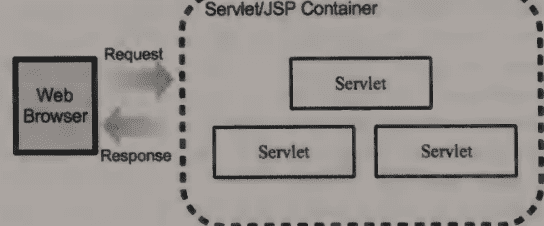

图 I.1：Servlet/JSP 应用程序架构

Web 服务器和 Web 客户端使用它们都精通的语言进行通信：超文本传输协议 (HTTP)。因此，Web 服务器也被称为 HTTP 服务器。下一节将更详细介绍 HTTP。

Servlet/JSP 容器是一种特殊的 Web 服务器，它可以处理 Servlet 还可以提供静态内容。过去，人们更倾向于将 servlet/JSP 容器作为 HTTP 服务器（如 Apache HTTP Server）的模块运行，因为认为 HTTP 服务器比 servlet/JSP 容器更健壮。在这种情况下，servlet/JSP 容器负责生成动态内容，而 HTTP 服务器负责提供静态资源。今天，servlet/JSP 容器被认为是成熟的，可以在没有 HTTP 服务器的情况下广泛部署。Apache Tomcat 和 Jetty 是最流行的 servlet 容器，且是开源的。你可以分别从 http://tomcat.apache.org 和 http://jetty.codehaus.org 下载。

Servlet 和 JSP 是 Java 企业版 (EE) 中定义的两种技术。其他 Java EE 技术包括消息服务 (JMS)、企业 Bean (EJB)、JavaServer Faces (JSF) 和 Java 持久。Java EE 6（当前版本）技术的完整列表可以在此处找到：

http://www.oracle.com/techn/javaee/index.html

运行 Java EE 应用需要 Java EE 容器，例如 GlassFish、JBoss、Oracle WebLogic 和 IBM WebSphere。你可以在 Java EE 容器中部署 servlet/JSP 应用程序，但 servlet/JSP 容器比 Java EE 容器更轻。Tomcat 和 Jetty 不是 Java EE 容器，因此无法运行 EJB 或 JMS。

# 超文本传输协议 (HTTP)

HTTP 协议允许 Web 服务器和浏览器在互联网或局域网上交换数据。万维网联盟（W3C）是一个开发标准的国际社区，负责修订和维护该协议。HTTP 的第一个版本是 HTTP 0.9，被 HTTP 1.0 取代。取代 HTTP 1.0 的是当前版本的 HTTP 1.1。HTTP 1.1 定义在 W3C 的规范（RFC）2616 中，可以从 http://www.w3.org/Protocols/HTTP/1.1/rfc2616.pdf 下载。

Web 服务器 24 小时等待 HTTP（通常是浏览器）连接并请求资源。在 HTTP 中，总是客户端发起连接，服务器永远无法联系客户端。为了定位资源，互联网用户点击包含统一资源定位符 (URL) 的链接，或者在浏览器的地址栏中输入。以下是 URL 的示例：

```
http://google.com/index.html
http://facebook.com/index.html
```

URL 的第一部分是 http，标识了协议。并不是所有的 URL 都使用 HTTP。例如，尽管这两个 URL 不是基于 HTTP 的 URL，但它们也是有效的：


- `mailto:joe@example.com`
- `ftp://marketing@ftp.example.com`

## Servlet & JSP 教程

- 请求头 (Request headers)
- 实体体 (Entity body)

这是一个 HTTP 请求示例：

```
POST /examples/default.jsp HTTP/1.1
Accept: text/plain; text/html
Accept-Language: en-gb
Connection: Keep-Alive
Host: localhost
User-Agent: Mozilla/5.0 (Macintosh; U; Intel Mac OS X 10.5; en-US;
rv/1.9.2.6) Gecko/20100625 Firefox/3.6.6
Content-Length: 30
Content-Type: application/x-www-form-urlencoded
Accept-Encoding: gzip, deflate
lastName=Blanks&firstName=Mike
```

方法—URI 协议版本出现在请求的第一行。

```
POST /examples/default.jsp HTTP/1.1
```

在这里，`POST` 是请求方法，`/examples/default.jsp` 是 URI，`HTTP/1.1` 是协议/版本部分。

一个 HTTP 请求可以使用 HTTP 标准中指定的许多请求方法之一。HTTP 1.1 支持七种请求类型：`GET`、`POST`、`HEAD`、`OPTIONS`、`PUT`、`DELETE` 和 `TRACE`。`GET` 和 `POST` 在互联网应用中最常用。

URI 指定了一个互联网资源。它通常被解释为相对于服务器的根目录。因此，它应该始终以正斜杠 `/` 开头。统一资源定位符（URL）实际上是 URI 的一种（参见 `http://www.ietf.org/rfc/rfc2396.txt`）。

在 HTTP 请求中，请求头包含了关于客户端环境和请求实体的有用信息。例如，它可能包含浏览器设置的语言、实体的长度等。每个头都由回车/换行符（CRLF）序列分隔。

在请求头和实体体之间有一个空行（CRLF），这对于 HTTP 请求格式至关重要。CRLF 告诉 HTTP 服务器实体体从哪里开始。在某些互联网编程书籍中，这个 CRLF 被认为是 HTTP 请求的第四个组成部分。

在上一个 HTTP 请求中，实体体仅仅是下面这一行：

```
lastName=Blanks&firstName=Mike
```

在典型的 HTTP 请求中，实体体可以长得多。

## HTTP 响应

与 HTTP 请求类似，HTTP 响应也由三个部分组成：

- 协议—状态码—描述
- 响应头 (Response headers)
- 实体体 (Entity body)

以下是 HTTP 响应示例：

```
HTTP/1.1 200 OK
Server: Apache-Coyote/1.1
Date: Thu, 5 Jan 2012 13:13:33 GMT
Content-Type: text/html
Last-Modified: Wed, 4 Jan 2012 13:13:12 GMT
Content-Length: 112
```

```
<html>
<head>
<title>HTTP Response Example</title>
</head>
<body>
Welcome to Brainy Software
</body>
</html>
```

响应头的第一行与请求头的第一行相似。它告诉你使用的协议版本是 HTTP 版本 1.1，并且请求成功了（200 是成功码）。

响应头包含了与 HTTP 请求头类似的有用信息。响应的实体体是响应本身的 HTML 内容。响应头和实体体由一系列 CRLF 序列分隔。

状态码 200 只有在 Web 服务器能够找到请求的资源时才会发出。如果找不到资源或无法理解请求，服务器将发送不同的请求码。例如，401 是未经授权访问的状态码，405 表示该 HTTP 方法不被允许。有关 HTTP 状态码的完整列表，请参考此在线文档：

```
http://www.w3.org/Protocols/rfc2616/rfc2616-sec10.html
```

## 关于本书

本节展示了每个章节的概述。

第 1 章“Servlets”介绍了 Servlet API 并展示了几个简单的 Servlet。本章关注 Servlet API 的四个 Java 包中的两个：`javax.servlet` 和 `javax.servlet.http` 包。

第 2 章“会话管理”讨论了会话跟踪或会话管理，由于 HTTP 的无状态性，这是 Web 应用开发中一个非常重要的主题。本章探讨了四种保留状态的技术：URL 重写、隐藏字段、Cookies 和 `HttpSession` 对象。

JavaServer Pages (JSP) 是一项补充 Servlet 的技术。第 3 章“JavaServer Pages”涵盖了 JSP 语法、指令、脚本元素和动作。

第 4 章“表达式语言”解释了 JSP 2.0 中新增的最强大功能之一：表达式语言 (EL)。EL 旨在让编写无脚本 JSP 页面成为可能，并帮助你编写更短更有效的 JSP 页面。在本章中，你将学习使用 EL 来访问 JavaBeans 和作用域对象。

第 5 章“JSTL”解释了 JavaServer Pages 标准标签库 (JSTL) 中最重要的库，这是一组自定义标签库，用于解决常见问题，例如遍历 map 或集合、条件测试、XML 处理，甚至是数据库访问和数据操作。

在大多数情况下，你将使用 JSTL 来访问作用域对象并在你的 JSP 页面中执行其他任务。然而，对于更特定的任务，你可能需要编写自己的标签。第 6 章“编写自定义标签”将教你如何这样做。

第 7 章“标签文件 (Tag Files)”讨论了标签，这是 JSP 2.0 的一项新功能，使编写标签变得简单。

第 8 章“监听器 (Listeners)”讨论了 Servlet 中的事件驱动编程。它讨论了 Servlet API 提供的事件类和监听器接口。

第 9 章“过滤器 (Filters)”涵盖了过滤器，它们是拦截请求的 Web 对象。本章讨论了 `FilterConfig` 和 `FilterChain` 接口，以及如何编写过滤器。

第 10 章“应用设计”解释了 Model2 架构，这是 Web 应用的推荐架构。给出了一些示例说明不同的组件。

第 11 章“文件上传”展示了如何使用 Servlet 上传功能以及客户端可以执行的操作。

第 12 章“文件下载”解释了如何向浏览器发送资源。

Servlet API 提供了用于包装请求和响应的类。在第 13 章“装饰请求和响应”中，你将学习使用装饰器和这些类来改变请求和响应的行为。

第 14 章“异步处理”讨论了 Servlet 3 用于异步操作的新功能。当你的 servlet/JSP 应用具有多个长时间运行的操作时，该功能特别有用。该功能通过将这些操作分配给新线程，从而将处理线程释放回池准备处理另一个请求。

第 15 章“安全”解释了如何通过声明式和程序化方式保护 Java Web 应用。讨论的四个主要安全主题是身份验证、授权、机密性和数据完整性。

第 16 章“部署”讨论了 servlet/JSP 应用的部署过程，并讨论了部署描述符中的元素。

第 17 章“动态注册与容器初始化器”关于 Servlet 3 的两项新功能。动态注册允许在不重启应用的情况下注册 Web 对象。而且，框架开发者一定会喜欢容器初始化器。

第 18 章“Struts 2 简介”介绍 Struts 2 作为一种 MVC 框架。它解释了 Struts 2 的基本组件和配置，并展示了一个简单的应用。

附录 A，“Tomcat”解释了如何在多个操作系统中安装和配置 Tomcat。

附录 B，“Servlet 和 JSP 注解”列出了所有可配置 Web 对象（如 Servlet、监听器或过滤器）的注解。这些注解是新功能，使得部署描述符变为可选。

附录 C，“SSL 证书”解释了如何使用 `KeyTool` 程序生成公私钥对，并让信任机构对公钥进行签名作为数字证书。

你可以从此网页下载书中使用的压缩包示例程序：

```
http://books.brainysoftware.com/download
```

在完成本书并掌握 Servlet 和 JSP 之后，选择并学习至少一个框架是一个好主意。有很多优秀的框架可以免费使用。Struts 2、JavaServer Faces、Spring MVC 和 Google Web Toolkit 都是推荐的。框架解决了 servlet/JSP 开发中的常见问题，并缩短了开发时间。

你可能想查看你喜欢的招聘网站，以了解哪些框架目前需求量。

## Servlets

Servlet 是开发 servlet 的主要技术。理解 Servlet API 是你成为一名强大的 Java Web 开发者的门径。你必须熟悉 Servlet API 中定义的 70 多种类型中的每一种。70 种听起来很多，但如果你一次学习一个，其实并不难。

Servlet API 由四个 Java 包组成。这些包如下：

- `javax.servlet`：包含定义 servlet 与 servlet 容器之间契约的类和接口。
- `javax.servlet.http`：包含定义 HTTP servlet 与 servlet 容器之间契约的类和接口。
- `javax.servlet.annotation`：包含用于注解 servlets、过滤器和监听器的注解。它还指定了被注解组件的元数据。
- `javax.servlet.descriptor`：包含提供对 Web 应用配置信息进行编程访问的类型。

本章重点关注 `javax.servlet` 和 `javax.servlet.http` 的成员。

图 1.1 显示了 `javax.servlet` 中的主要类型。

| interface | interface | interface | interface |
| :--- | :--- | :--- | :--- |
| `Servlet` | `ServletRequest` | `ServletResponse` | `ServletContext` |
| `GenericServlet` | `ServletConfig` | `RequestDispatcher` | `Filter` |

图 1.1: `javax.servlet` 的主要成员

Servlet 技术的核心是 `Servlet`，它是一个所有 servlet 类都必须直接或间接实现的接口。当你编写一个实现 `Servlet` 的 servlet 类时，你是直接实现它。当你扩展一个实现了该接口的类时，你是间接实现它。

`Servlet` 接口定义了 servlet 与 servlet 容器之间的契约。该契约归结为 servlet 容器承诺将 servlet 类加载到内存中，并在 servlet 实例上调用特定方法。在应用程序中，每个 servlet 类型只能有一个实例。

用户请求会导致 servlet 容器调用 servlet 的 `service` 方法，并传递 `ServletRequest` 实例和 `ServletResponse` 实例。`ServletRequest` 封装了当前的 HTTP 请求，因此 servlet 开发者不需要解析和处理原始 HTTP 数据。`ServletResponse` 代表给当前用户的 HTTP 响应，并便于向用户发送响应。

对于每个应用程序，servlet 容器还会创建一个 `ServletContext` 实例。此对象封装了上下文（应用程序）的环境细节。每个上下文只有一个 `ServletContext`。对于每个 servlet 实例，还存在一个封装了 servlet 配置的 `ServletConfig`。

让我们先看下 `Servlet` 接口。上面提到的其他接口将在本章的其他部分进行解释。

### Servlet

Servlet 接口定义了这五个方法：

```java
void init(ServletConfig config) throws ServletException
void service(ServletRequest request, ServletResponse response) throws ServletException, java.io.IOException
void destroy()
java.lang.String getServletInfo()
ServletConfig getServletConfig()
```

请注意，编写 Java 方法签名的约定是：对于与包含该方法的类型不在同一个包中的类型，使用其完全限定名。因此，在 `service` 方法签名中，`javax.servlet.ServletException`（与 `Servlet` 类在同一个包中）没有写包信息，而 `java.io.Exception` 则写了全路径。

`init`、`service` 和 `destroy` 是生命周期方法。servlet 容器根据这些规则调用这三个方法：

- `init`：servlet 容器在 servlet 第一次被请求时调用。该方法在 servlet 后续请求时不再调用。你使用此方法进行初始化。
- `service`：servlet 容器每次在请求 servlet 时都会调用此方法。在该方法中，你使用 servlet 传递的 `ServletConfig`。
- `destroy`：servlet 容器在 servlet 准备销毁时调用此方法。通常，你在此方法中编写清理代码。

Servlet 的另外两个方法是：

- `getServletInfo`：该方法返回 servlet 的描述。
- `getServletConfig`：该方法返回 servlet 容器传递给 `init` 方法的 `ServletConfig`。为了让 `getServletConfig` 返回非空值，你需要将 `ServletConfig` 赋值给类变量。

需要注意的一点是线程安全。servlet 实例由应用程序中的所有用户共享，除非成员是只读的。

编写 servlet 应用出奇地简单。你所做的就是创建一个目录结构并将 servlet 类放在该目录中。在本节中，你将学习如何编写名为 `app0` 的简单 servlet。它包含一个向用户发送问候的 Servlet。

你需要一个 servlet 容器来运行你的 servlets。Tomcat 是一个免费的 servlet 容器，运行在任何安装了 Java 的平台上。如果你还没有安装，现在应该阅读附录 A 并安装。

在确保本地有 servlet 容器之后，下一步是编写并编译 servlet 类。示例中的 servlet 类见列表 1.1。按照惯例，servlet 类名以 `Servlet` 结尾。

```java
+ "</</body></html>");

@Override
public void destroy() {
}
```

在阅读列表 1.1 中的代码时，你首先注意到的就是这个注解：

```java
@WebServlet(name = "MyServlet", urlPatterns = { "/my" })
```

`@WebServlet` 注解类型用于声明 servlet。你可以为 servlet 命名，并指定容器通过哪个 URL 调用该 servlet。`name` 属性是可选的，如果存在，通常赋值为 servlet 类的名称。重要的是 `urlPatterns` 属性，它也是可选的，但几乎总是存在。在 `MyServlet` 中，`urlPattern` 告诉容器 `/my` 模式应该调用该 servlet。

注意，URL 模式必须以正斜线开头。

servlet 的 `init` 方法会被调用一次，并将私有的 `transient` `servletConfig` 变量设为传递给方法的 `ServletConfig` 对象。

```java
private transient ServletConfig servletConfig;
```

```java
@Override
public void init(ServletConfig servletConfig)
throws ServletException {
    this.servletConfig = servletConfig;
}
```

只有当你打算从 servlet 内部使用 `ServletConfig` 时，才需要将传递的 `ServletConfig` 赋值给类变量。

`service` 方法向浏览器发送字符串 "Hello from MyServlet"。每个针对该 servlet 的传入 HTTP 请求都会调用 `service` 方法。

要编译 servlet，你必须在类路径中包含 Servlet API 中的类型。Tomcat 带有 `servlet-api.jar` 文件，它封装了 `javax.servlet` 和 `javax.servlet.http` 包中的成员。该 jar 文件位于 Tomcat 安装目录下的 `lib` 目录。

servlet 应用程序必须部署在特定的目录结构中。图 1.2 显示此应用程序的目录结构。

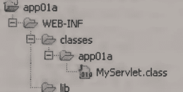

结构顶部的 `app01a` 目录是应用程序目录。

应用程序目录下是 `WEB-INF` 目录。它包含两个子目录：

- `classes`：你的 servlet 和其他 Java 类必须存在于此处。`classes` 下的目录反映了类的包。在图 1.2 中部署了一个类：`app01a.MyServlet`。
- `lib`：将你的 servlet 应用程序所需的 jar 文件部署在此处。Servlet API jar 文件不需要部署，因为 servlet 容器已经有了它的副本。在本应用程序中，`lib` 目录是空的。可以删除空的 `lib` 目录。


servlet/JSP 通常包含 JSP 页面、HTML 文件、图像文件和其他资源。这些应该放在应用程序目录下，并通常按子目录组织。例如，所有图像文件可以放入`image`目录，所有 JSP 页面放入`jsp`目录，依此类推。

你放在应用程序目录下的任何资源，用户都可以通过输入该资源的 URL 直接访问。如果你想包含一个 servlet 可以访问但用户无法访问的资源，请将其放在`WEB-INF`下。

现在，将应用程序部署到 Tomcat。使用 Tomcat 部署应用程序的一种方法是将应用程序目录复制到 Tomcat 安装目录下的`webapps`目录。你也可以通过编辑 Tomcat 中`conf`目录下的`server.xml`文件或通过单独部署一个 XML 文件来避免编辑`server.xml`。其他 servlet 容器可能有不同的部署规则。请参阅附录 A 有关如何将 servlet/JSP 应用程序部署到 Tomcat 的详情。

部署 servlet/JSP 应用程序的推荐方法将其部署为 war 文件。war 文件是带有 war 扩展名的 jar 文件。你可以使用随 JDK 附的`jar`程序或 WinZip 等工具创建 war 文件。然后你可以将 war 文件复制到 Tomcat 的`webapps`目录。当启动或重启 Tomcat 时，Tomcat 会自动解压 war 文件。作为 war 文件部署在所有 servlet 容器均有效。你将在第 16 章“部署”中学习更多部署知识。

要测试你的第一个 servlet，请启动或重启 Tomcat并将浏览器导向以下 URL（假设 Tomcat 配置为监听端口 8080，即其默认端口）：

`http://localhost:8080/app0a/my`

输出结果应类似于图 1.3。

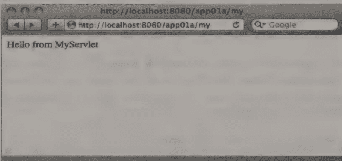

图 1.3：来自 MyServlet 的响应

恭喜。你刚刚写了你的第一个 servlet 应用程序。

对于每个 HTTP 请求，servlet 容器都会创建一个`HttpServletRequest`实例并将其传递给 servlet 的`service`方法。`HttpServletRequest`封装了有关请求的信息。

这些是`HttpServletRequest`接口中的一些方法。

```java
public int getContentLength()
```

返回请求体中的字节数。如果长度未知，此方法返回 -1。

```java
public java.lang.String getContentType()
```

返回请求体的 MIME 类型，如果类型未知则返回 null。

```java
public java.lang.String getParameter(java.lang.String name)
```

返回请求参数的值。

```java
public java.lang.String getProtocol()
```

返回此 HTTP 请求的协议名称和版本。

`getParameter`是`HttpServletRequest`中用得最频繁的方法。该方法的一个常见用例是返回 HTML 表单字段的值。你将在本章稍后的“处理表单”部分学习如何获取表单值。

`getParameter`也可以用于获取查询字符串的值。例如，如果使用此 URI 了 servlet：

`http://domain/context/servletName?id=123`

你可以在 servlet 内部使用此语句获取`id`的值：

```java
String id = request.getParameter("id");
```

注意，如果参数不存在，`getParameter`将返回 null。

除了`getParameter`，你还可以使用`getParameterNames`、`getParameterMap`和`getParameterValues`来获取字段名、字段值以及查询字符串。请参阅“HttpSession”部分查看使用这些方法的示例。

`javax.servlet.ServletResponse`接口表示 servlet 响应。在调用 servlet 的`service`方法之前，servlet 容器会创建一个`ServletResponse`并将其作为第二个参数传递给`service`方法。`ServletResponse`隐藏了向浏览器发送响应的复杂性。

`ServletResponse`中定义的方法之一是`getWriter`方法，它返回一个可以向客户端发送文本的`java.io.PrintWriter`。默认情况下，`PrintWriter`对象使用 ISO-8859-1 编码。

在向客户端发送响应时，大多数情况下你是以 HTML 格式发送的。因此，假设你熟悉 HTML。

# 注意

你还有另一个可以向浏览器发送输出的方法：`getOutputStream`。然而，此方法用于发送二进制数据，因此在大多数情况下你将使用`getWriter`而不是`getOutputStream`。请参阅第 12 章“文件下载”获取有关如何发送二进制内容的说明。

在发送任何 HTML 标签之前，你应该通过调用`setContentType`方法并将`"text/html"`作为参数来设置响应的内容类型。这就是你告诉浏览器内容类型为 HTML 的方式。在缺少内容类型的情况下，大多数浏览器默认将响应渲染为 HTML。

你在列表 1.1 中的 MyServlet 中使用了`ServletResponse`。你将在本章后续章节的其他应用程序中看到它的用法。

当 servlet 容器初始化 servlet 时，它会将一个`ServletConfig`传递给 servlet 的`init`方法。`ServletConfig`封装了你可以通过`@WebServlet`或部署描述传递给 servlet 的配置信息。每一条

这种传递的信息被称为初始化参数（initial parameter）。初始化参数包含两个部分：键（key）和值（value）。

要在 servlet 内部获取初始化参数的值，请调用 servlet 容器传递给 servlet `init`方法的`ServletConfig`对象的`getInitParameter`方法。`getInitParameter`的签名如下：

```java
java.lang.String getInitParameter(java.lang.String name)
```

此外，`getInitParameterNames`方法返回所有初始化参数名称的枚举（`Enumeration`）：

```
java.util.Enumeration<java.lang.String> getInitParameterNames()
```

例如，要获取`contactName`的值，可以使用此示例：`String contactName = servletConfig.getInitParameter("contactName");`

除了`getInitParameter`和`getInitParameterNames`之外，`ServletConfig`还提供了另一个实用方法：`getServletContext`。该方法用于从 servlet 内部获取`ServletContext`。关于该对象的讨论，请参阅本章稍后的“ServletContext”章节。

作为`ServletConfig`的示例，让我们在`app01a`中添加一个名为`ServletConfigDemoServlet`的 servlet。新的 servlet 见列表 1.2。

### 列表 1.2：ServletConfigDemoServlet

```java
package app01a;
import java.io.IOException;
import java.io.PrintWriter;
import javax.servlet.Servlet;
import javax.servlet.ServletConfig;
import javax.servlet.ServletExceptionException;
import javax.servlet.HttpServletRequest;
import javax.servlet.HttpServletResponse;
import javax.servlet.annotation.WebInitParam;
import javax.servlet.annotation.WebServlet;

@WebServlet(name = "ServletConfigDemoServlet",
  urlPatterns = { "/servletConfigDemo" },
  initParams = {
@WebInitParam(name="admin", value="Harry Taciak"),
@WebInitParam(name="email", value="admin@example.com")
public class ServletConfigDemoServlet implements Servlet {
    private transient ServletConfig servletConfig;

    @Override
    public ServletConfig getServletConfig() {
        return servletConfig;
    }

    @Override
    public void init(ServletConfig servletConfig) throws ServletException {
        this.servletConfig = servletConfig;
    }

    @Override
    public void service(ServletRequest request, ServletResponse response) throws ServletException, IOException {
        ServletConfig servletConfig = getServletConfig();
        String admin = servletConfig.getInitParameter("admin");
        String email = servletConfig.getInitParameter("email");
        response.setContentType("text/html");
        PrintWriter writer = response.getWriter();
        writer.print("<html><head><body>" +
            "Admin: " + admin +
            "<br>Email:" + email +
            "</body></html>");
    }

    @Override
    public String getServletInfo() {
        return "ServletConfig demo";
    }

    @Override
    public void destroy() {
    }
}
```

如列表 1.2 所示，你通过`@WebServlet:`注解中的`initParams`属性将两个初始化参数（`admin`和`email`）传递给该 servlet：

```java
@WebServlet(name = "ServletConfigDemoServlet",
urlPatterns = { "/servletConfigDemo" },
initParams = {
@WebInitParam(name="admin", value="Harry Taciak"),
@WebInitParam(name="email", value="admin@example.com")
}
```

你可以使用以下 URL 调用`ServletConfigDemoServlet`：

`http://localhost:8080/app0a/servletConfigDemo`

结果应当与图 1.4 所示类似。


图 1.4：运行中的 ServletConfigDemoServlet

或者，你可以在部署描述符（deployment descriptor）中传递初始化参数。

为此利用部署描述符比使用`@WebServlet`更简单，因为部署描述符是一个文本文件，你可以在不重新编译 servlet 类的情况下对其编辑。

部署描述符将在本章稍后的“使用部署描述符”章节以及第 16 章“部署”中讨论。

## ServletContext

`ServletContext`代表 servlet 应用程序。每个 web 应用程序只有一个 context。在分布式环境中，由于（此处）

- 将`ServletConfig`分配给类级别变量，以便能够通过调用`getServletContext`来获取它。

- 提供`Servlet`接口中所有方法的默认实现。

- 提供封装了`ServletConfig`中方法的方法。

`GenericServlet`通过在`init`方法中将`ServletConfig`分配给类级别变量`servletConfig`来保留`ServletConfig`对象。以下是`GenericServlet`中`init`的实现。

```java
public void init(ServletConfig servletConfig)
    throws ServletException {
        this.servletConfig = servletConfig;
        this.init();
}
```

然而，如果你在类中重写了该方法，则你的 servlet 中的`init`方法会被调用，你必须调用`super.init(servletConfig)`来保留`ServletConfig`。为了避免你这样做，`GenericServlet`提供了第二个不带参数的`init`方法。该方法在`ServletConfig`分配给`servletConfig`后由第一个`init`方法调用。

```java
public void init(ServletConfig servletConfig)
    throws ServletException {
        this.servletConfig = servletConfig;
        this.init();
}
```

这意味着你可以通过重写无参数的`init`方法编写初始化代码，而`ServletConfig`仍然会被`GenericServlet`实例保留。

列表 1.3 中的`GenericServletDemoServlet`类是列表 1.2 中`ServletConfigDemoServlet`的重写。注意新的 servlet 继承自`GenericServlet`而不是实现`Servlet`。

### 列表 1.3：GenericServletDemoServlet 类


```java
package app;
import java.io.IOException;
import java.io.PrintWriter;
import javax.servlet.GenericServlet;
import javax.servlet.ServletConfig;
import javax.servlet.ServletException;
import javax.servlet.ServletRequest;
import javax.servlet.ServletResponse;
import javax.servlet.annotation.WebInitParam;
import javax.servlet.annotation.WebServlet;

@WebServlet(name = "GenericServletDemoServlet",
           urlPatterns = { "/generic"},
           initParams = {
               @WebInitParam(name="admin", value="Harry Taciak"),
               @WebInitParam(name="email", value="admin@example.com")
           })
 class GenericServletDemoServlet extends GenericServlet {
    private static final long serialVersionUID = 625008900L;

    @Override
    public void service(ServletRequest request,
                       ServletResponse response)
            throws ServletException, IOException {
        ServletConfig servletConfig = request.getConfig();
        String admin = servletConfig.getParameter("admin");
        String email = servletConfig.getParameter("email");
        response.setContentType("text/html");
        PrintWriter writer = response.getWriter();
        writer.print("<html><head><body>" +
                    "Admin:" + admin +
                    "<br>Email:" + email +
                    "</body></html>");
    }
}
```

如你所示，通过扩展`GenericServlet`，你不需要重写计划更改的方法。因此，你的代码更加简洁。在列表 1.3 中，唯一重写的方法是`service`方法。此外，你不需要自己保留`ServletConfig`。

使用此 URL 调用 servlet，结果应当与`ServletConfig`类似。

`http://localhost:8080/app0a/generic`

## HTTP Servlets

你编写的大多数 servlet 应用程序（如果不是全部）将与 HTTP 工作。这意味着你可以利用 HTTP 提供的功能。`javax.servlet.http`包是 Servlet API 中第二个包含用于编写 servlet 应用程序的类和接口的包。`javax.servlet.http`中的许多类型重写了`javax.servlet`中的。

图 1.5 显示了`javax.servlet.http`中的主要类型。

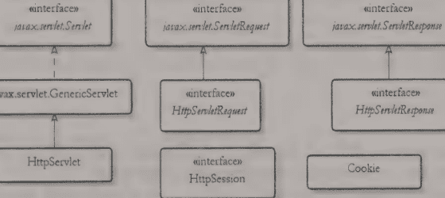

图 1.5：`javax.servlet.http`中更重要的成员

# HttpServlet

`HttpServlet`重写了`GenericServlet`中的`service`方法，并增加了另一个具有以下签名的`service`方法：

```java
protected void service(HttpServletRequest request,
    HttpServletResponse response)
    throws ServletException, java.io.IOException
```

新的`service`方法与`javax.servlet`中方法的区别在于，前者接受的是`HttpServletRequest`和`HttpServletResponse`，而不是`ServletRequest`和`ServletResponse`。

Servlet 容器像往常一样调用`javax.servlet`中的原始`service`方法，在`HttpServlet`中该方法的实现如下如下：

```java
public void service(ServletRequest req, ServletResponse res)
    throws ServletException, IOException {
    HttpServletRequest request;
    HttpServletResponse response;
    try {
        request = (HttpServletRequest) req;
        response = (HttpServletResponse) res;
    } catch (ClassCastException e) {
        throw new ServletException("non-HTTP request or response");
    }
    service(request, response);
}
```

原始`service`方法将容器提供的`ServletRequest`和`ServletResponse`对象分别转换为`HttpServletRequest`和`HttpServletResponse`，并调用新的`service`方法。这种类型转换总是成功的，因为 Servlet 容器在调用 servlet 的`service`方法时总是传递了`HttpServletRequest`和`HttpServletResponse`。

新的`service`方法通过调用`request.getMethod()`检查使用的 HTTP 方法，并调用以下方法之一：`doGet`、`doPost`、`doHead`、`doPut`、`doTrace`、`doOptions`和`doDelete`。这七种方法代表了 HTTP 方法。`doGet`和`doPost`是最常用的。因此，很少需要重写`service`方法。总结来说，`HttpServlet`有两个`GenericServlet`中没有的特性：

- 你将不再重写`service`方法、`doGet`、`doPost`或两者。在少数情况下，你还会重写任何这些方法：`doHead`、`doPut`、`doTrace`、`doOptions`和`doDelete`。

- 你将与`HttpServletRequest`和`HttpServletResponse`工作，而不是`ServletRequest`和`ServletResponse`。

`HttpServletRequest`代表 HTTP 环境中的请求。它实现了`javax.servlet.ServletRequest`接口并增加了几个方法。这些如下：

```java
java.lang.String getContextPath()
```

返回请求 URI 的部分。

```java
Cookie[] getCookies()
```

返回`Cookie`对象数组。

```java
java.lang.String getHeader(java.lang.String name)
```

返回指定的 HTTP 头值。

```java
java.lang.String getMethod()
```

返回执行请求的 HTTP 方法名称。

```java
java.lang.String getQueryString()
```

返回请求中的查询字符串。

```java
HttpSession getSession()
```

返回与请求关联的 session 对象。如果没有，则创建一个 session。

```java
HttpSession getSession(boolean create)
```

返回与请求关联的当前 session 对象。如果没有且`create`参数为 true，则创建一个新的 session。

你将在后续章节中学习这些方法。

# HttpServletResponse

`HttpServletResponse`代表 HTTP 环境中的 servlet 响应。以下是其中定义的一些方法：

```java
void addCookie(Cookie cookie)
```

向此响应对象添加一个 cookie。

```java
void addHeader(java.lang.String name, java.lang.String value)
```

向此响应对象添加一个头。

```java
void sendRedirect(java.lang.String location)
```

发送一个响应码，将浏览器重定向到指定位置。

你将在后续章节进一步学习这些方法。

# HTML Forms

Web 应用几乎总是包含一个多个 HTML 表单来接收用户输入。你可以轻松地从 servlet 向浏览器发送 HTML 表单。当用户提交表单时，表单元素输入的值作为请求参数发送到服务器。

HTML 输入字段（文本字段、隐藏字段或密码字段）或文本区域的值作为字符串发送到服务器。空输入字段或文本区域发送空字符串。因此，`HttpServletRequest.getParameter`接收输入字段名会返回`null`。

HTML`select`元素也会向头发送字符串。如果`select`元素中没有选项被选中，则发送所显示选项的值。

多值选择元素（允许多次选择并由`<select multiple>`标识的 select 元素）发送字符串数组，并且必须由`HttpServletRequest.getParameterValues`处理。

复选框有点特别。选中的复选框向服务器发送字符串 "on"。未选中的复选框向服务器发送任何内容，`HttpServletRequest.getParameter(fieldName)`返回`null`。

单选按钮将被选中按钮的值发送到服务器。如果没有按钮被选中，则向服务器发送任何内容，`ServletRequest.getParameter(fieldName)`返回`null`。

如果表单包含多个相同名的输入元素，所有值都将被提交，你必须使用`ServletRequest.getParameterValues`来检索它们。`ServletRequest.getParameter`只返回最后一个值。

列表 1.4 中的`FormServlet`类演示了如何与 HTML 表单交互。它的`doGet`方法向浏览器发送订单表单。它的`doPost`方法获取输入的值并打印它们。此 servlet 是`app01b`应用的一部分。

### 列表 1.4：FormServlet 类


```java
package app01b;
import java.io.IOException;
import java.io.PrintWriter;
import java.util.Enumeration;
import javax.servlet.ServletException;
import javax.servlet.annotation.WebServlet;
import javax.servlet.http.HttpServlet;
import javax.servlet.http.HttpServletRequest;
import javax.servlet.http.HttpServletResponse;

@WebServlet(name = "FormServlet", urlPatterns = {"/form"})
public class FormServlet extends HttpServlet {
    private static final long serialVersionUID = 54L;
    private static final String TITLE = "Order Form";

    @Override
    public void doGet(HttpServletRequest request,
        HttpServletResponse response)
        throws ServletException, IOException {
        response.setContentType("text/html");
        PrintWriter writer = response.getWriter();
        writer.println("<html>");
        writer.println("<head>");
        writer.println("<title>" + TITLE + "</title></head>");
        writer.println("<body><h1>" + TITLE + "</h1>");
        writer.println("<form method='post'>");
        writer.println("<table>");
        writer.println("<tr>");
        writer.println("<td>Name:</td>");
        writer.println("<td><input type='text' name='name'/></td>");
        writer.println("</tr>");
        writer.println("<tr>");
        writer.println("<td>Address:</td>");
        writer.println("<td><textarea name='address' cols='40' rows='5'></textarea></td>");
        writer.println("</tr>");
        writer.println("<tr>");
        writer.println("<td>Country:</td>");
        writer.println("<td><select name='country'>");
        writer.println("<option value='US'>United States</option>");
        writer.println("<option value='CA'>Canada</option>");
        writer.println("</select></td>");
        writer.println("</tr>");
        writer.println("<tr>");
        writer.println("<td>Shipping Instructions:</td>");
        writer.println("<td><textarea name='instruction'></textarea></td>");
        writer.println("</tr>");
        writer.println("</table>");
        writer.println("<input type='submit' value='Submit'/>");
        writer.println("</form>");
        writer.println("</body>");
        writer.println("</html>");
    }

    @Override
    public void doPost(HttpServletRequest request,
        HttpServletResponse response)
        throws ServletException, IOException {
        response.setContentType("text/html");
        PrintWriter writer = response.getWriter();
        writer.println("<html>");
        writer.println("<head>");
        writer.println("<title>Order Result</title></head>");
        writer.println("<body><h1>Order Result</h1>");
        writer.println("<table>");
        writer.println("<tr>");
        writer.println("<td>Name:</td>");
        writer.println("<td>" + request.getParameter("name") + "</td>");
        writer.println("</tr>");
        writer.println("<tr>");
        writer.println("<td>Address:</td>");
        writer.println("<td>" + request.getParameter("address") + "</td>");
        writer.println("</tr>");
        writer.println("<tr>");
        writer.println("<td>Country:</td>");
        writer.println("<td>" + request.getParameter("country") + "</td>");
        writer.println("</tr>");
        writer.println("<tr>");
        writer.println("<td>Shipping Instructions:</td>");
        writer.println("<td>");
        String[] instructions = request.getParameterValues("instruction");
        if (instructions != null) {
            for (String instruction : instructions) {
                writer.println(instruction + "<br/>");
            }
        }
        writer.println("</td>");
        writer.println("</tr>");
        writer.println("</table>");
        writer.println("</body>");
        writer.println("</html>");
    }
}
```

```java
writer.println("<tdDelivery Method:</td>");
writer.println("<td
      + request.getParameter("deliveryMethod")
      + "</td>");
```

你可以通过此 URL 调用`FormServlet`：

`http://localhost:8080/app01b/form`

调用的`doGet`方法会将此 HTML 表单发送到浏览器。

```html
<form method='post'>
<input name='name'/>
<textarea name='address' cols='40' rows='5'></textarea>
```

```html
<select name='country'>
<option>United States</option>
<option>Canada</option>
</select>
<input type='radio' name='deliveryMethod' value='First Class'/>
<input type='radio' name='deliveryMethod' value='Second Class'/>
<textarea name='instruction' cols='40' rows='5'></textarea>
<textarea name='instruction' cols='40' rows='5'></textarea>
<input type='checkbox' name='catalogRequest'/>
<input type='reset'/>
<input type='submit' />
</form>
```

表单的方法被设置为`post`，以确保在用户提交其表单时使用 HTTP POST 方法。它缺少`action`属性，这表示表单将提交到请求它时使用的相同 URL。

图 1.6 显示了一个空的订单表单。

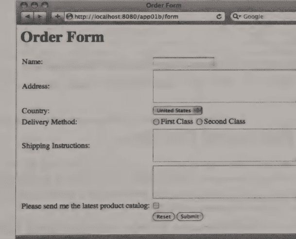

图 1.6：一个空的订单表单

# 38 Servlet & JSP：教程

现在，填写表单并点击提交（Submit）按钮。你在表单中输入的值将使用 HTTP POST 方法发送到服务器，这将调用 servlet 的`doPost`方法。结果，你将看到如图 1.7 所示打印出的值。

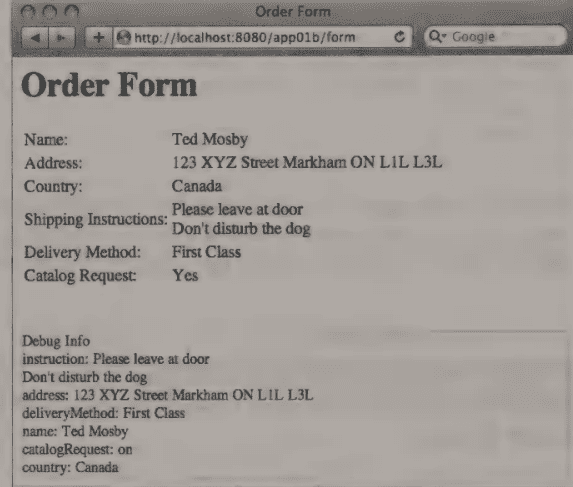

图 1.7：输入订单表单的值

# 使用部署描述符（Deployment Descriptor）

正如你在之前的示例所示，编写和部署 servlet 应用是简单的。部署的一个方面是配置 servlet 与路径的映射。在示例中，你通过使用`WebServlet`注解类型将 servlet 映射到路径。

使用部署描述符是配置 servlet 应用的另一种方法，部署描述符将在第 16 章“部署”中详细讨论。部署描述符始终命名为`web.xml`，位于`WEB-INF`目录下。在本章中，我将向你展示如何创建一个名为`app01`的 servlet 应用并为它创建一个`web.xml`文件。

# 第 1 章：Servlets 39

`app01c`有两个 servlet：`SimpleServlet`和`WelcomeServlet`，以及一个用于映射 servlet 的部署描述符。代码列表 1.5 和 1.6 分别显示了`SimpleServlet`和`WelcomeServlet`。注意，servlet 类没有使用`@WebServlet`注解。部署描述符在代码列表 1.7 中。

### 代码列表 1.5：未注解的 SimpleServlet 类

```java
package app01c;
import java.io.IOException;
import java.io.PrintWriter;
import javax.servlet.ServletExceptionException;
import javax.servlet.http.HttpServlet;
import javax.servlet.http.HttpServletRequest;
import javax.servlet.http.HttpServletResponse;

public class SimpleServlet extends HttpServlet {
    private static final long serialVersionUID = 8946L;

    @Override
    public void doGet(HttpServletRequest request,
        HttpServletResponse response)
        throws ServletException, IOException {
            response.setContentType("text/html");
            PrintWriter writer = response.getWriter();
            writer.print("<html><head></head>" +
                "<body>Simple Servlet</body></html>");
        }
}
```

### 代码列表 1.6：未注解的 WelcomeServlet 类

```java
package app01c;
import java.io.IOException;
import java.io.PrintWriter;
import javax.servlet.ServletExceptionException;
import javax.servlet.http.HttpServlet;
import javax.servlet.http.HttpServletRequest;
import javax.servlet.http.HttpServletResponse;

public class WelcomeServlet extends HttpServlet {
    private static final long serialVersionUID = 27126L;

    @Override
    public void doGet(HttpServletRequest request,
```

# 40 Servlet & JSP：教程

```java
HttpServlet(HttpServletResponse response)
throws ServletException, IOException {
response.setContentType("text/html");
PrintWriter writer = response.getWriter();
writer.print("<html><head></head>"
  + "<body>Welcome</body></html>");
}
```

### 代码列表 1.7：部署描述符

```xml
<?xml version="1.0" encoding="ISO-8859-1"?>
<web-app xmlns="http://java.sun.com/xml/ns/javaee"
xmlns:xsi="http://www.w3.org/2001/XMLSchema-instance"
xsi:schemaLocation="http://java.sun.com/xml/ns/javaee http://java.sun.com/xml/ns/javaee/web-app_3_0.xsd">
<servlet>
  <servlet-name>SimpleServlet</servlet-name>
  <servlet-class>app01c.SimpleServlet</servlet-class>
</servlet>
<servlet-mapping>
  <servlet-name>SimpleServlet</servlet-name>
  <url-pattern>/simple</url-pattern>
</servlet-mapping>
<servlet>
  <servlet-name>WelcomeServlet</servlet-name>
  <servlet-class>app01c.WelcomeServlet</servlet-class>
</servlet>
<servlet-mapping>
  <servlet-name>WelcomeServlet</servlet-name>
  <url-pattern>/welcome</url-pattern>
</servlet-mapping>
</web-app>
```

使用部署描述符有很多优点。其一，它允许你在无需重新编译的情况下更改 servlet。 1.8 代表了`app01c`的目录结构。区别在于`app01`有一个`web.xml`文件（部署描述符）。


图 1.8：带有部署描述符的目录结构

既然`SimpleServlet`和`WelcomeServlet`已经在部署描述符中声明，你可以使用这些 URL：


```
http://localhost:8080/app01c/simple
http://localhost:8080/app01c/welcome
```

# 42 Servlet & JSP：教程

关于部署和部署描述符的更多信息，请参阅第 16 章。

## 总结

Servlet 技术是 Java EE 的一部分。所有的 servlet 都运行在 servlet 容器中，容器与 servlet 之间的约定采用 `Servlet` 接口。由于 HTTP 是无状态的，默认情况下，Web 服务器不知道 HTTP 请求是来自初次访问还是以前访问过的用户。

例如，网页邮件应用程序要求用户在检查邮件之前先登录。然而，一旦用户输入了正确的用户名和密码，应用程序就不应在访问不同部分时提示用户登录。应用程序需要记住哪些用户已登录。换句话说，它必须能够管理会话。

本章探讨了四种保持状态的技术：URL 重写、隐藏字段、Cookie 和 `HttpSession` 对象。本章介绍的示例是 `app02a` 应用。

## URL 重写

URL 重写是一种会话跟踪技术，将一个或多个令牌作为查询字符串添加到 URL 中。令牌通常采用键值对格式：

```
url?key-1=value-1&key-2=value-2...&key-n=value-n
```

注意，URL 和令牌之间用问号隔开。两个令牌之间用 ampersand 字符（`&`）隔开。

如果令牌不需要携带过多的 URL，则 URL 重写是合适的。使用 URL 重写的缺点包括：

- 在某些网络浏览器中，URL 被限制为约 2,000 个字符。
- 只有当存在插入值的链接时，值才能传递到下一个资源。此外，你无法方便地在静态页面的链接上追加值。
- URL 重写需要在服务器端进行工作。所有的链接都必须携带值，如果页面上有许多链接，这将带来挑战。
- 某些字符，如空格、安培符（`&`）和问号（`?`）必须进行编码。
- 附加在 URL 上的信息是清晰可见的，这种情况并不总是理想的。

由于这些局限性，只有当需要保留的信息不跨越太多页面，且该信息不敏感时，URL 重写才是适用的。

例如，列表 2.1 中的 `Top10Servlet` 类是一个 servlet，用于显示伦敦和巴黎最受欢迎的十个旅游景点。信息显示在两个页面中。第一页显示所选城市的前五个景点，第二页显示后五个。该 servlet 使用 URL 重写来跟踪所选城市和页码。它扩展了 `HttpServlet` 并通过 `/top10` URL 模式调用。

### 列表 2.1: Top10Servlet 类

```
package app02.urlrewriting;
import java.io.IOException;
import java.io.PrintWriter;
import java.util.ArrayList;
import java.util.List;
import javax.servlet.ServletExceptionException;
import javax.servlet.annotation.WebServlet;
import javax.servlet.http.HttpServlet;
import javax.servlet.http.HttpServletRequest;
import javax.servlet.http.HttpServletResponse;

@WebServlet(name = "Top10Servlet", urlPatterns = { "/top10" })
public class Top10Servlet extends HttpServlet {
    private static final long serialVersionUID = 987654321L;

    private List<String> londonAttractions;
    private List<String> parisAttractions;
```

## 第 2 章：会话管理

```java
@Override
public void init() throws ServletException {
londonAttractions = new ArrayList<String>(10);
londonAttractions.add("Buckingham Palace");
londonAttractions.add("London Eye");
londonAttractions.add("British Museum");
londonAttractions.add("National Gallery");
londonAttractions.add("Big Ben");
londonAttractions.add("Tower of London");
londonAttractions.add("Natural History Museum");
londonAttractions.add("Canary Wharf");
londonAttractions.add("2012 Olympic Park");
londonAttractions.add("St Paul's Cathedral");

parisAttractions = new ArrayList<String>(10);
parisAttractions.add("Eiffel Tower");
parisAttractions.add("Notre Dame");
parisAttractions.add("The Louvre");
parisAttractions.add("Champs Elysees");
parisAttractions.add("Arc de Triomphe");
parisAttractions.add("Sainte Chapelle Church");
parisAttractions.add("Les Invalides");
parisAttractions.add("Musee d'Orsay");
parisAttractions.add("Montmartre");
parisAttractions.add("Sacre Coeur Basilica");
}
```

```java
@Override
public void doGet(HttpServletRequest request,
HttpServletResponse response) throws ServletException,
IOException {

String city = request.getParameter("city");
if (city != null && (city.equals("london") || city.equals("paris"))) {
// 显示景点
showAttractions(request, response, city);
} else {
// 显示主页
showMainPage(request, response);
}

private void showMainPage(HttpServletRequest request,
HttpServletResponse response) throws ServletException,
IOException {
response.setContentType("text/html");
PrintWriter writer = response.getWriter();
writer.print("<html><head>" + 
  "<title>Top 10 Attractions</title>" + 
  "</head><body>" + 
  "Please select a city:" + 
  "<br><a href='?city=london'>London</a>" + 
  "<br><a href='?city=paris'>Paris</a>" + 
  "body></html>");
}
```

```java
private void showAttractions(HttpServletRequest request,
HttpServletResponse response, String city)
throws ServletException, IOException {

int page = 1;
String pageParameter = request.getParameter("page");
if (pageParameter != null) {
    try {
    page = Integer.parseInt(pageParameter);
    } catch (NumberFormatException e) {
    // 什么都不做并保留 page 的默认值
    }
}
if (page > 2) {
    page = 1;
}

List<String> attractions = null;
if (city.equals("london")) {
    attractions = londonAttractions;
} else if (city.equals("paris")) {
    attractions = parisAttractions;
}
response.setContentType("text/html");
PrintWriter writer = response.getWriter();
writer.println("<html><head>" + 
  "<title>Top 10 Attractions</title>" + 
  "</head><body>");
writer.println("<a href='top10'>Select City</a>");
writer.println("<hr/>Page " + page + "<hr/>");

int start = (page - 1) * 5;
for (int i = start; i < start + 5; i++) {
    writer.println(attractions.get(i) + "<br/>");
}
writer.print("<hr style=''>");
writer.print("<a href='top10'>Select City</a>");
writer.println("<hr/>Page " + page + "<hr/>");
// 注意：此处原文代码逻辑略有不完整，已按要求保留结构
```


```java
private void showAttractions(HttpServletRequest request,
HttpServletResponse response, String city)
throws ServletException, IOException {

int page = 1;
String pageParameter = request.getParameter("page");
if (pageParameter != null) {
    try {
    page = Integer.parseInt(pageParameter);
    } catch (NumberFormatException e) {
    // 什么都不做并保留 page 的默认值
    }
}
if (page > 2) {
    page = 1;
}

List<String> attractions = null;
if (city.equals("london")) {
    attractions = londonAttractions;
} else if (city.equals("paris")) {
    attractions = parisAttractions;
}
response.setContentType("text/html");
PrintWriter writer = response.getWriter();
writer.println("<html><head>" + 
  "<title>Top 10 Attractions</title>" + 
  "</head><body>");
writer.println("<a href='top10'>Select City</a>");
writer.println("<hr/>Page " + page + "<hr/>");

int start = (page - 1) * 5;
for (int i = start; i < start + 5; i++) {
    writer.println(attractions.get(i) + "<br/>");
}
writer.print("<hr style=''>");
writer.print("<a href='top10'>Select City</a>");
writer.println("<hr/>Page " + page + "<hr/>");
```

由于这些局限性，只有当需要保留的信息不跨越太多页面，且该信息不敏感时，URL 重写才是适用的。

### 列表 2.3: CustomerServlet 类

```java
package app02a.hiddenfields;
import java.io.IOException;
import java.io.PrintWriter;
import java.util.ArrayList;
import java.util.List;
import javax.servlet.ServletException.ServletExceptionException;
import javax.servlet.annotation.WebServlet;
import javax.servlet.http.HttpServlet;
import javax.servlet.http.HttpServletRequest;
import javax.servlet.http.HttpServletResponse;

/**
 * 非线程安全的。仅用于示例演示
 * */
@WebServlet(name = "CustomerServlet", urlPatterns = {
    "/customer", "/editCustomer", "/updateCustomer"
})
public class CustomerServlet extends HttpServlet {
    private static final long serialVersionUID = -20L;

    private List<Customer> customers = new ArrayList<Customer>();

    @Override
    public void init() throws ServletException {
        Customer customer1 = new Customer();
        customer1.setId(1);
        customer1.setName("Donald D.");
        customer1.setCity("Miami");
        customers.add(customer1);

        Customer customer2 = new Customer();
        customer2.setId(2);
        customer2.setName("Mickey M.");
        customer2.setCity("Orlando");
        customers.add(customer2);
    }

    private void sendCustomerList(HttpServletResponse response)
        throws IOException {
        response.setContentType("text/html");
        PrintWriter writer = response.getWriter();
        writer.println("<head><title>Customers</title></head>");
        writer.println("<body><h2>Customers </h2>");
        writer.println("<ul>");

        for (Customer customer : customers) {
            writer.println("<li>" + customer.getName() +
            +("(" + customer.getCity() + ") ("
            + "<a href='editCustomer?id=" + customer.getId() +
            + "'>edit</a></li>");
        }
        writer.println("</ul>");
        writer.println("</body></html>");
    }

    private Customer getCustomer(int customerId) {
        for (Customer customer : customers) {
            if (customer.getId() == customerId) {
                return customer;
            }
        }
        return null;
    }

    private void sendEditCustomerForm(HttpServletRequest request, HttpServletResponse response) throws IOException {
        response.setContentType("text/html");
        PrintWriter writer = response.getWriter();
        writer.println("<head><title>Edit Customer</title></head>");
        writer.println("<body><h2>Edit Customer </h2>");
        writer.println("<form method='post' action='updateCustomer'>");
        writer.println("<table>");
        Customer customer = getCustomer(Integer.parseInt(request.getParameter("id")));
        if (customer != null) {
            writer.println("<tr>"
            + "<td>Name: <input name='name' value='" + customer.getName().replace("'", "&#39;") + "'></td>"
            + "<td>City: <input name='city' value='" + customer.getCity().replace("'", "&#39;") + "'></td></tr>");
            writer.println("<tr>\n"
            + "    <td colspan='2' style='text-align:right'>"
            + "    <input type='submit' value='Update'/></td>\n"
            ");
            writer.println("<tr><td colspan='2'>"
            + "    <a href='customer'>Customer List</a>a"
            + "</td></tr>");
            writer.println("</table>");
            writer.println("</form></body>");
        } else {
            writer.println("<h2>No customer found</h2>");
        }
    }

    @Override
    public void doGet(HttpServletRequest request, 
        HttpServletResponse response)
    throws ServletException, IOException {
        String uri = request.getRequestURI();
        if (uri.endsWith("/customer")) {
            sendCustomerList(response);
        } else if (uri.endsWith("/editCustomer")) {
            sendEditCustomerForm(request, response);
        }
    }

    @Override
    public void doPost(HttpServletRequest request, 
        HttpServletResponse response)
    throws ServletException, IOException {
        // update customer
        int customerId = 0;
        try {
            customerId = Integer.parseInt(request.getParameter("id"));
        } catch (NumberFormatException e) {
        }
        Customer customer = getCustomer(customerId);
        if (customer != null) {
            customer.setName(request.getParameter("name"));
            customer.setCity(request.getParameter("city"));
        }
        sendCustomerList(response);
    }
}
```

`CustomerServlet` 类继承自 `HttpServlet` 并映射到三个 URL 模式：`/customer`、`/editCustomer` 和 `/updateCustomer`。前两个模式将调用 servlet 的 `doGet` 方法，而 `/updateCustomer` 将调用 `doPost` 方法。

`/customer` 是这个小型应用程序的入口。它列出了由 `init` 方法填充的类级别 `customers` 列表中的客户。（在实际应用中，你可能会从数据库中获取客户信息）。参见图 2.4。

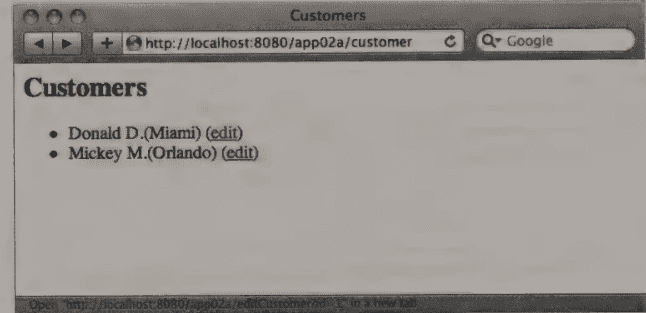

图 2.4：客户列表

如图 2.4 所示，每个客户都带有一个编辑链接。这些链接的 `href` 属性指向 `/editCustomer?id=customerId`。接收到 `/editCustomer` 后，servlet 会发送一个如图 2.5 所示的客户编辑表单。

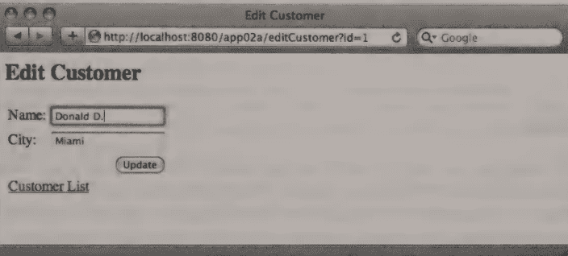

### 图 2.5：编辑客户表单

如果你点击第一个客户，servlet 将发送此隐藏字段的表单标签：

```html
<form method='post' action='updateCustomer'>
  <input type='hidden' name='id' value='1'>
</form>
```

### 列表 2.4: PreferenceServlet 类

```java
package app02a.cookie;
import java.io.IOException;
import java.io.PrintWriter;
import javax.servlet.ServletExceptionException;
import javax.servlet.annotation.WebServlet;
import javax.servlet.http.Cookie;
import javax.servlet.http.HttpServlet;
import javax.servlet.http.HttpServletRequest;
import javax.servlet.http.HttpServletResponse;
```


```java
@WebServlet(name = "PreferenceServlet",
urlPatterns = { "/preference" })
public class PreferenceServlet extends HttpServlet {
    private static final long serialVersionUID = 888L;

public static final String MENU =
+ "<div style=\"background:#ee8ee8;\"
+ "&<a href=\"/cookieClass\">Cookie 类</a>&nbsp;&nbsp;"
+ "&<a href=\"/cookieInfo\">Cookie 信息</a>&nbsp;&nbsp;"
+ "&<a href=\"/preference\">偏好</a>" + "</div>";

@Override
public void doGet(HttpServletRequest request,
       HttpServletResponse response) throws ServletException,
       IOException {
    response.setContentType("text/html");
    PrintWriter writer = response.getWriter();
    writer.print("<html>" + "<title>偏好</title>"
+ "<style>background:NavajoWhite }</style>"
+ "<body><body>"
+ MENU
+ "<p>请选择下方的值：</p>"
+ "<form method=\"post\">"
+ "<table>"
+ "<tr><td>标题字体大小： </td>"
+ "<td><select name='titleFontSize'>"
+ "<option>large</option>"
+ "<option>xx-large</option>
+ "</select></td>"
+ "</tr>"
+ "<tr><td>标题样式与粗细： </td>"
+ "<td><select name='titleStyleAndWeight' multiple>
+ "<option>italic</option>
+ "<option>bold</option>
+ "</select></td>"
+ "</tr>"
+ "<tr><td>表格最大记录数： </td>"
+ "<td><select name='maxRecords'>"
+ "<option>5</option>"
+ "<option>10</option>
+ "</select></td>"
+ "</tr>"
+ "<tr>"
+ "<td><input type='submit' value='设置'></td>"
+ "</tr>"
+ "</table></form></body></html>";
}

public void doPost(HttpServletRequest request,
      HttpServletResponse response) throws ServletException,
      IOException exception {

String maxRecords = request.getParameter("maxRecords");
String[] titleStyleAndWeight = request
    .getParameterValues("titleStyleAndWeight");
String titleFontSize = request.getParameter("titleFontSize");
response.addCookie(new Cookie("maxRecords", maxRecords));
response.addCookie(new Cookie("titleFontSize",
    titleFontSize));

// 先删除 titleFontWeight 和 titleFontStyle cookie
// 通过添加 maxAge = 0 的 cookie 来删除 cookie
Cookie cookie = new Cookie("titleFontWeight", "");
cookie.setMaxAge(0);
response.addCookie(cookie);

cookie = new Cookie("titleFontStyle", "");
cookie.setMaxAge(0);
response.addCookie(cookie);

if (titleStyleAndWeight != null) {
    for (String style : titleStyleAndWeight) {
        if (style.equals("bold")) {
```

## 第 2 章：会话管理

`PreferenceServlet` 的 `get` 方法发送了一个包含多个输入字段的表单，如图 2.6 所示。

表单上方有三个链接（Cookie 类、Cookie 信息和偏好），用于导航到同一应用程序中的其他 servlet。我稍后会解释 Cookie 类和 Cookie 信息。

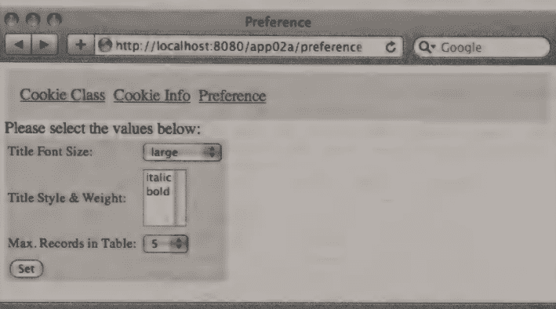

图 2.6：使用 cookie 管理用户偏好

当用户提交表单时，会调用 `PreferenceServlet` 的 `doPost` 方法。`doPost` 方法创建这些 cookie：`maxRecords`、`titleFontSize`、`titleFontStyle` 和 `titleFontWeight`，覆盖了同名 cookie 的任何之前值。然后它将用户选择的值发送到浏览器。

你可以通过 URL `http://localhost:8080/app02a/preference` 调用 `PreferenceServlet`。

列表 2.5 中的 `CookieClassServlet` 类和列表 2.6 中的 `CookieInfoServlet` 类使用由 `PreferenceServlet` 设置的 cookie 来格式化它们的内容。`CookieClassServlet` 在 HTML 列表中写入 `Cookie` 类的属性。列表中的项目数量由用户使用 `PreferenceServlet` 设置的 `maxRecords` cookie 的值决定。

### 列表 2.5: CookieClassServlet 类

```java
package app02a.cookie;
import java.io.IOException;
import java.io.PrintWriter;
import javax.servlet.ServletExceptionException;
import javax.servlet.annotation.WebServlet;
import javax.servlet.http.Cookie;
import javax.servlet.http.HttpServlet;
import javax.servlet.http.HttpServletRequest;
import javax.servlet.http.HttpServletResponse;

@WebServlet(name = "CookieClassServlet",
urlPatterns = { "/cookieClass" })
public class CookieClassServlet extends HttpServlet {
    private static final long serialVersionUID = 62L;

@Override
public void doGet(HttpServletRequest request,
       HttpServletResponse response) throws ServletException,
       IOException {
    response.setContentType("text/html");
    PrintWriter writer = response.getWriter();
    writer.print("<html>" + "<title>Cookie 类</title>"
+ "<style>background:NavajoWhite }</style>"
+ "<body><body>"
+ MENU
+ "<div style=\"background:#ee8ee8;\"
+ "&<a href=\"/cookieClass\">Cookie 类</a>&nbsp;&nbsp;"
+ "&<a href=\"/cookieInfo\">Cookie 信息</a>&nbsp;&nbsp;"
+ "&<a href=\"/preference\">偏好</a>" + "</div>";
+ "<p>请选择下方的值：</p>"
+ "<form method=\"post\">"
+ "<table>"
+ "<tr><td>标题字体大小： </td>"
+ "<td><select name='titleFontSize'>"
+ "<option>large</option>"
+ "<option>xx-large</option>
+ "</select></td>"
+ "</tr>"
+ "<tr><td>标题样式与粗细： </td>"
+ "<td><select name='titleStyleAndWeight' multiple>
+ "<option>italic</option>
+ "<option>bold</option>
+ "</select></td>"
+ "</tr>"
+ "<tr><td>表格最大记录数： </td>"
+ "<td><select name='maxRecords'>"
+ "<option>5</option>"
+ "<option>10</option>
+ "</select></td>"
+ "</tr>"
+ "<tr>"
+ "<td><input type='submit' value='设置'></td>"
+ "</tr>"
+ "</table></form></body></html>";

    Cookie[] cookies = request.getCookies();
    String maxRecords = null;
    if (cookies != null) {
        for (Cookie cookie : cookies) {
            if (cookie.getName().equals("maxRecords")) {
                maxRecords = cookie.getValue();
                break;
            }
        }
    }
    if (maxRecords == null) {
        maxRecords = "5";
    }
    writer.print("<ul>");
    for (int i = 0; i < Integer.parseInt(maxRecords); i++) {
        writer.print("<li>Item " + i + "</li>");
    }
    writer.print("</ul>");
}
```

### 列表 2.6: CookieInfoServlet 类

```java
package app02a.cookie;
import java.io.IOException;
import java.io.PrintWriter;
import javax.servlet.ServletExceptionException;
import javax.servlet.annotation.WebServlet;
import javax.servlet.http.Cookie;
import javax.servlet.http.HttpServlet;
import javax.servlet.http.HttpServletRequest;
import javax.servlet.http.HttpServletResponse;

@WebServlet(name = "CookieInfoServlet",
urlPatterns = { "/cookieInfo" })
public class CookieInfoServlet extends HttpServlet {
    private static final long serialVersionUID = 63L;

@Override
public void doGet(HttpServletRequest request,
       HttpServletResponse response) throws ServletException,
       IOException {
    response.setContentType("text/html");
    PrintWriter writer = response.getWriter();
    writer.print("<html>" + "<title>Cookie 信息</title>"
+ "<style>background:NavajoWhite }</style>"
+ "<body><body>"
+ MENU
+ "<div style=\"background:#ee8ee8;\"
+ "&<a href=\"/cookieClass\">Cookie 类</a>&nbsp;&nbsp;"
+ "&<a href=\"/cookieInfo\">Cookie 信息</a>&nbsp;&nbsp;"
+ "&<a href=\"/preference\">偏好</a>" + "</div>";
+ "<p>请选择下方的值：</p>"
+ "<form method=\"post\">"
+ "<table>"
+ "<tr><td>标题字体大小： </td>"
+ "<td><select name='titleFontSize'>"
+ "<option>large</option>"
+ "<option>xx-large</option>
+ "</select></td>"
+ "</tr>"
+ "<tr><td>标题样式与粗细： </td>"
+ "<td><select name='titleStyleAndWeight' multiple>
+ "<option>italic</option>
+ "<option>bold</option>
+ "</select></td>"
+ "</tr>"
+ "<tr><td>表格最大记录数： </td>"
+ "<td><select name='maxRecords'>"
+ "<option>5</option>"
+ "<option>10</option>
+ "</select></td>"
+ "</tr>"
+ "<tr>"
+ "<td><input type='submit' value='设置'></td>"
+ "</tr>"
+ "</table></form></body></html>";

    Cookie[] cookies = request.getCookies();
    String titleFontSize = null;
    String[] titleStyleAndWeight = null;
    if (cookies != null) {
        for (Cookie cookie : cookies) {
            if (cookie.getName().equals("titleFontSize")) {
                titleFontSize = cookie.getValue();
            }
        }
    }
    if (titleFontSize == null) {
        titleFontSize = "large";
    }
    writer.print("<ul>");
    writer.print("<li>Font Size: " + titleFontSize + "</li>");
    writer.print("</ul>");
}
```

## 第 2 章：会话管理 67

注意，与 URL 重写、隐藏字段和 Cookie 不同，存放在 `HttpSession` 中的值是存储在内存中的。因此，你应该只在其中存储尽可能小的对象，并且不要存储太多个。尽管现代 Servlet 容器可以在内存即将耗尽时将 `HttpSession` 中的对象移动到次级存储中，但这会影响性能。因此，请务必注意在内存中存储的内容。

添加到 `HttpSession` 中的值不必非是 `String` 类型，可以是任何 Java 对象，只要它实现了 `java.io.Serializable`，这样当 Servlet 容器认为有必要时，可以将存储的对象序列化到文件或数据库中，例如当容器发现 `HttpSession` 中的非可序列化对象耗尽时；然而，如果 Servlet 容器尝试对它们进行序列化，将会失败并抛出异常。

`setAttribute` 方法期望为不同的对象提供不同的名称。如果你传递了一个之前使用过的属性名称，该名称将与旧值解绑并与新值关联。

你可以通过调用 `HttpSession` 上的 `getAttribute` 方法并传递属性名称来获取存储在 `HttpSession` 中的对象。该方法的签名如下：


`java.lang.Object getAttribute(java.lang.String name)` 是 `HttpSession` 中的一个方法，用于获取指定名称的属性值。

`HttpSession` 中的另一个实用方法是 `getAttributeNames`，它返回一个 `Enumeration` 用于迭代 `HttpSession` 中的所有属性。`java.util.Enumeration<java.lang.String> getAttributeNames()`

注意，存储在 `HttpSession` 中的值不会发送到客户端，这与其他会话管理技术不同。Servlet 容器为它创建的每个 `HttpSession` 生成一个唯一标识符，并将此标识符作为令牌发送给浏览器，可以是名为 `JSESSIONID` 的 cookie，也可以通过作为 `jsessionid` 参数附加到 URL 中。在随后的请求中，浏览器会将令牌发回服务器，允许服务器识别是哪个用户正在发送请求。无论 Servlet 容器选择哪种方式传输会话标识符，它都会在后台自动完成，无需你费力。

## 68 Servlet & JSP 教程

你可以通过调用 `HttpSession` 上的 `getId` 方法来获取 `HttpSession` 的标识符。

`java.lang.String getId()`

`HttpSession` 中还定义了一个 `invalidate` 方法。该方法强制会话过期并解绑绑定到其上的所有对象。默认情况下，`HttpSession` 在用户长时间未活动后过期。你可以通过部署描述中的 `session-timeout` 元素配置整个应用的会话超时（参见第 16 章，“部署”）。例如，将此值设置为 30 将使所有会话对象在用户上次访问30分钟后过期。如果没有配置此元素，超时将由 Servlet 控制器决定。

在大多数情况下，如果你可以释放内存，你会希望在会话过期之前销毁未使用的 `HttpSession` 实例。

你可以调用 `getMaxInactiveInterval` 方法来查看在用户上次访问后 `HttpSession` 还能存多久。该方法返回剩余的秒数。`setMaxInactiveInterval` 方法允许你为单个 `HttpSession` 设置不同的会话超时值。

`void setMaxInactiveInterval(int seconds)`

向此方法传递 0 会导致 `HttpSession` 永远不会过期。通常这是一个坏主意，因为在应用程序卸载或 Servlet 容器关闭之前，`HttpSession` 的堆空间永远不会被释放。

作为一个示例，查看列表 2.9 中的 `ShoppingCartServlet` 类。该 Servlet 是一个包含四个产品的小型在线商店。它允许用户将产品添加到购物车中并查看其内容。该 Servlet 使用列表 2.7 中的 `Product` 类和列表 2.8 中的 `ShoppingItem` 类。`Product` 定义了四个属性（`id`、`name`、`description` 和 `price`），`ShoppingItem` 包含一个数量和一个 `Product` 对象。

### 列表 2.7：Product 类

```java
package app02a.https;
public class Product {
    private int id;
    private String name;
    private String description;
    private float price;

    public Product(int id, String name, String description, float
        price) {
        this.id = id;
        this.name = name;
        this.description = description;
        this.price = price;
    }

    // 为了节省空间未显示 get and set 方法
}
```

### 列表 2.8：ShoppingItem 类

```java
package app02a.httpsession;
public class ShoppingItem {
    private Product product;
    private int quantity;

    public ShoppingItem(Product product, int quantity) {
        this.product = product;
        this.quantity = quantity;
    }

    // 为了节省空间未显示 get and set 方法
}
```

### 列表 2.9：ShoppingCartServlet 类

```java
package app02a.httpsession;
import java.io.IOException;
import java.io.PrintWriter;
import java.text.NumberFormat;
import java.util.ArrayList;
import java.util.List;
import java.util.Locale;

import javax.servlet.ServletException;
import javax.servlet.annotation.WebServlet;
import javax.servlet.http.HttpServlet;
import javax.servlet.http.HttpServletRequest;
import javax.servlet.http.HttpServletResponse;
import javax.servlet.http.HttpSession;

@WebServlet(name = "ShoppingCartServlet", urlPatterns = {
    "/products", "/viewProductDetails",
    "/addCart", "/viewCart"})
public class ShoppingCartServlet extends HttpServlet {
    private static long serialVersionUID = -20L;
    private static final String CART_ATTRIBUTE = "cart";

    private List<Product> products = new ArrayList<>();
    private NumberFormat currencyFormat = NumberFormat.getInstance(Locale.US);

    @Override
    public void doGet(HttpServletRequest request,
        HttpServletResponse response) throws ServletException,
        IOException {
        String uri = request.getRequestURI();
        if (uri.endsWith("/products")) {
            sendProductList(response);
        } else if (uri.endsWith("/viewProductDetails")) {
            sendProductDetails(request, response);
        } else if (uri.endsWith("/viewCart")) {
            showCart(request, response);
        }
    }

    @Override
    public void doPost(HttpServletRequest request,
        HttpServletResponse response) throws ServletException,
        IOException {
        // 添加购物车
        int productId = 0;
        int quantity = 0;
        try {
            productId = Integer.parseInt(
                request.getParameter("id"));
            quantity = Integer.parseInt(
                request.getParameter("quantity"));
        } catch (NumberFormatException e) {

        }

        Product product = getProduct(productId);
        if (product != null && quantity >= 0) {
            ShoppingItem shoppingItem = new ShoppingItem(product,
                quantity);
            HttpSession session = request.getSession();
            List<ShoppingItem> cart = (List<ShoppingItem>) session
                .getAttribute("CART_ATTRIBUTE");
            if (cart == null) {
                cart = new ArrayList<ShoppingItem>();
                session.setAttribute("CART_ATTRIBUTE", cart);
            }
            cart.add(shoppingItem);
        }
        sendProductList(response);
    }

    private void sendProductList(HttpServletResponse response)
    throws IOException {
        PrintWriter writer = response.getWriter();
        writer.println("<<html<head><title>Products</title>" +
            "</head><body><h2>Products</h2>");
        writer.println("<ul>");
        for (Product product : products) {
            writer.println("<li>" + product.getName() + " " + "("
                + currencyFormat.format(product.getPrice()))
                + ") " + "<a href=\"viewProductDetails?id="
                + product.getId() + "\">Details</a></li>");
        }
        writer.println("</ul>");
        writer.println("<a href=\"viewCart\">View Cart</a>");
        writer.println("</body></html>");
    }

    // 其他方法如 getProduct, sendProductDetails, showCart 省略
}
```

## 72 Servlet & JSP: 教程

```java
for (Product product : products) {
    if (product.getId() == productId) {
        return product;
    }
    return null;
}
```

```java
private void sendProductDetails(HttpServletResponse response) throws IOException {
    response.setContentType("text/html");
    PrintWriter writer = response.getWriter();
    int productId = 0;
    try {
        productId = Integer.parseInt(
            request.getParameter("id"));
    } catch (NumberFormatException e) {
    }
    Product product = getProduct(productId);
```

```java
if (product != null) {
    writer.println("<html><head>");
    + "<title>产品详情</title></head>");
    + "<body><h2>产品详情</h2>";
    + "<form method='post' action='addToCart'>";
    writer.println("<input type='hidden' name='id' ");
    + "value=' + + productId + "/>");
    writer.println("<table>");
    writer.println("<tr><td>Name:</td><td></td></tr>");
    + "<td>" + product.getName() + "</td><td></tr>");
    writer.println("<tr><td>Description:</td><td></td></tr>");
    + "<td>" + product.getDescription() + "</td><td></tr>");
    writer.println("<tr>" + "<tr>");
    + "<td><input name='quantity' value='Buy''><td></td></tr>");
    + "<td></td></tr>");
    writer.println("<tr><td colspan='2'>");
    + "<a href='products'>产品列表</a>a";
    + "</td></tr>");
    writer.println("</table>");
    writer.println("</form></body>");
    writer.close
} else {
    writer.println("未找到产品");
}
```


```java
private void showCart(HttpServletRequest request,
      HttpResponse response) throws IOException {
    response.setContentType("text/html");
    PrintWriter writer = response.getWriter();
    writer.println("<html><head><title>购物车</title>" +
      + "</head>");
    writer.println("<body><a href='products'>" +
      + "产品列表</a>a");
    HttpSession session = request.getSession();
    List<ShoppingItem> cart = (List<ShoppingItem>) session
      .getAttribute(CART_ATTRIBUTE);
    if (cart != null) {
      writer.println("<table>");
      writer.println("<tr><td style='width:150px'>数量" + +
        + "</td></td>");
        + "<td style='width:150px'>产品</td>"
        + "<td style='width:150px'>价格</td>"
        + "<td>金额</td></tr>");
      double total = 0.0;
      for (ShoppingItem shoppingItem : cart) {
        Product product = shoppingItem.getProduct();
        int quantity = shoppingItem.getQuantity();
        if (quantity != 0) {
          float price = product.getPrice();
          writer.println("<tr>");
          writer.println("<td>" + quantity + "</td>");
          writer.println("<td>" + product.getName() +
            + "</td>");
          writer.println("<td>" +
            + "currencyFormat.format(price)"
            + "</td>");
          double subtotal = price * quantity;

          writer.println("<td>" +
            + "currencyFormat.format(subtotal)"
            + "</td>");
          total += subtotal;
          writer.println("</tr>");
        }
      }
      writer.println("<tr><td colspan='4' " +
        + "style='text-align:right'>" +
        + "总计:</td></tr>");
```

# 74 Servlet & JSP: 教程

```java
+ currencyFormat.format(total)
+ "</</td>><tr>");
writer.println("<table>");

}
writer.println("</table></body></html>");

}
}
```

`ShoppingCartServlet` servlet 映射到以下 URL 模式：

- `/products`。显示所有产品。
- `/viewProductDetails`。显示产品的详情。
- `/addToToCart`。将产品添加到购物车中。
- `/viewCart`。显示购物车的内容。

除了 `/addToToCart` 之外，所有的 URI 都会调用 `ShoppingCartServlet` 的 `doGet` 方法。`doGet` 首先通过检查请求的 URI 并据此生成内容：

```java
String uri = request.getRequestURI();
if (uri.endsWith("/products")) {
    sendProductList(response);
} else if (uri.endsWith("/viewProductDetails")) {
    sendProductDetails(request, response);
} else if (uri.endsWith("/viewCart")) {
    showCart(request, response);
}
```

以下 URL 将调用应用程序的主页。

`http://localhost:8080/app02a/products`

该 URL 将导致 `doGet` 向浏览器发送产品列表（见图 2.9）

# 第 2 章 会话管理 75

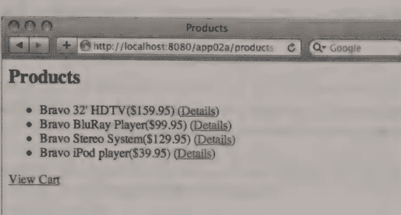

图 2.9：产品列表

如果你点击产品，你将看到类似图 2.10 的内容。


图 2.10：详情页

提交详情页中的表单会调用 `ShoppingCartServlet` 的 `doPost` 方法。

76 Servlet & JSP: 教程

`doPost` 方法首先根据数量构造 `ShoppingItem`：

```java
ShoppingItem shoppingItem = new ShoppingItem(quantity);
```

它随后获取 `HttpSession` 并检查是否已包含 "cart"：

```java
HttpSession session = request.getSession();
List<ShoppingItem> cart = (List<ShoppingItem>)
  .getAttribute(CART_ATTRIBUTE);
```

如果找到了 `List`，将用于添加 `ShoppingItem`。如果没有 `List`，将创建一个并添加到 `HttpSession`：

```java
if (cart == null) {
    cart = new ArrayList<ShoppingItem>();
    session.setAttribute(CART_ATTRIBUTE, cart);
}
```

最后，将 `ShoppingItem` 加入列表：

当用户点击购物车查看购物车内容时，`doGet` 方法再次被调用并执行 `showCart`：

```java
HttpSession session = request.getSession();
List<ShoppingItem> cart = (List<ShoppingItem>)
  .getAttribute(CART_ATTRIBUTE);
```

它随后遍历 `List` 并向浏览器发送每个项目的内容：

```java
if (cart != null) {
    for (ShoppingItem shoppingItem : cart) {
        Product product = shoppingItem.getProduct();
        int quantity = shoppingItem.getQuantity();
    }
}
```

## 总结

在本章中，你学习了会话管理以及四会话管理技术。URL 重写和隐藏字段适用于不需要跨多个页面的轻量级会话跟踪。另外两种技术 `Cookie` 和 `HttpSession` 对象更灵活，但并非没有限制。使用 `HttpSession` 对象要特别注意，每个对象都会消耗服务器内存。

# 第 3 章

# JavaServer Pages

你在第 1 章“Servlets”中了解到 Servlet 有两个缺点。首先，Servlet 中的所有 HTML 标签必须封装在 Java 字符串中，这使得发送 HTTP 响应非常痛苦。其次，所有的文本和 HTML 标签都是硬编码的；因此，即使是显示层的微小更改（如更改背景颜色），也需要重新编译。

JavaServer Pages（JSP）解决了 Servlet 的这两个问题。JSP 并不是替代 Servlet，而是与其互。。现代 Java 应用同时使用两者。编写时 JSP 的最新版本是 2.2。

本章从 JSP 概述开始，详细讨论了 JSP 页面注释、隐式对象以及三种语法元素（指令、脚本元素和动作）。错误处理将在章末进行介绍。

JSP 可以用标准语法或 XML 语法编写。用 XML 语法编写的 JSP 被称为 JSP 文。XML 语法的 JSP 很少使用，本文不涵盖。在本章中你学习标准语法的 JSP。

## JSP 概述

一个 JSP 页面本质上是一个 Servlet。但由于两个原因，处理 JSP 页面比 Servlet 容易。首先，你不需要编译 JSP 页面。其次，JSP 页面基本上是带有 jsp 后名的文本文件，你可以使用任何文本编辑器来编写它们。

# 80 Servlet & JSP: 教程

JSP 页面运行在 JSP 容器上。Servlet 容器通常也是 JSP 容器。例如，Tomcat 就是一个 servlet/JSP 容器。

当第一次请求 JSP 页面时，servlet/JSP 容器会执行两件事：

1. 将 JSP 页面翻译成 JSP 页面实现类，这是一个实现了 `javax.servlet.jsp.JspPage` 接口或其父接口 `javax.servlet.jsp.HttpJspPage` 的 Java 类。JSP 是 `javax.servlet.Servlet` 的子接口，它使得每个 JSP 页面都成为一个 servlet。生成的 servlet 类名取决于 servlet/JSP 容器。你不需要担心这个问题，因为你不需要直接处理它。如果发生翻译错误，将向客户端发送错误消息。

2. 如果翻译成功，servlet/JSP 容器会编译该 servlet 类。随后容器加载并实例化 Java 字节码，并执行它通常对 servlet 执行的生命周期操作。

对于对同一个 JSP 页面的后续请求，servlet/JSP 容器会检查该 JSP 页面自上次翻译以来是否被修改过。如果是，它将重新翻译、重新编译并执行。如果否，则使用内存中的 JSP servlet。通过这种方式，JSP 页面的首次调用总是比后续请求耗时，因为涉及翻译和编译。为了解决这个问题，你可以采取以下措施之一：

- 配置应用程序，使得所有 JSP 页面在应用程序启动时被调用（实际上是经过翻译和编译），而不是在第一次请求时调用。
- 预编译 JSP 页面并将它们作为 servlet 部署。

JSP 附带了一个由四个包组成的 API：

- `javax.servlet.jsp`。包含 servlet/JSP 容器用于将 JSP 页面翻译为 servlet 的类和接口。`JspPage` 和 `HttpJspPage` 接口是该包的重要成员。所有 JSP 页面实现类都必须实现 `JspPage` 或 `HttpJspPage`。在 HTTP 环境中，`HttpJspPage` 是显然的选择。
- `javax.servlet.jsp.tagext`。包含开发自定义标签的类型（在第 6 章“编写自定义标签”中讨论）。
- `javax.el`。提供统一表达式语言（Unified Expression Language）的 API。见第 4 章“表达式语言”。
- `javax.servlet.jsp.el`。提供 servlet/JSP 容器必须支持的类，以支持 JSP 中的表达式语言。

除了 `javax.servlet.jsp.tagext` 之外，你很少需要直接使用 JSP API。事实上，当你编写 JSP 页面时，你更关注的是 Servlet API 而不是 JSP API 本身。当然，你还需要掌握 JSP 语法，这将在本章中进行解释。大量使用 JSP API 的一个示例是开发 JSP 容器或 JSP 编译器时。

你可以在此处查看 JSP API：

```
http://download.oracle.com/docs/cd/E17802_01/products/products/jsp/2.1/jsp-2_1-pfd2/index.html
```

JSP 页面可以包含模板数据和语法元素。元素是对 JSP 翻译器具有特殊含义的内容。例如，`<%` 是一个元素，因为它表示了 JSP 页面内 Java 代码块的开始。`%>` 也是一个元素，因为它终止了 Java 代码块。所有不是元素的内容都是模板数据。模板数据按原样发送给浏览器。例如，JSP 页面中的 HTML 标签和文本就是模板数据。

列表 3.1 展示了一个名为 `welcome.jsp` 的 JSP 页面。这是一个向客户端发送问候的简单页面。注意与实现相同功能的 servlet 相比，这个 JSP 页面有多简单？

列表 3.1：`welcome.jsp`

```html
<html>
<head><title>Welcome</title></head>
<body>
Welcome
</body>
</html>
```

在 Tomcat 中，`welcome.jsp` 页面在页面首次被调用后会被翻译成 `welcome_jsp` servlet。你可以在 Tomcat 工作目录下的子目录下找到生成的 servlet。该 servlet 继承自 `org.apache.jasper.runtime.HttpJspBase`，这是一个继承自 `javax.servlet.http.HttpServlet` 并实现 `javax.servlet.jsp.Page` 的抽象类。

这里是 `welcome.jsp` 生成的 servlet。如果你觉得它太晦懂，不要担心。你可以在不理解它的情况下继续，尽管理解它会更好。

```java
package org.apache.jsp;
import javax.servlet.*;
import javax.servlet.http.*;
import javax.servlet.jsp.*;

public final class welcome_jsp extends
    org.apache.jasper.runtime.HttpJspBase
    implements org.apache.jasper.runtime.JspSourceDependent

private static final javax.servlet.jsp.JspFactory _jspxFactory =
    javax.servlet.jsp.JspFactory.getDefaultFactory();

private static java.util.Map<java.lang.String, java.lang.Long>
    _jsp_dependants;

private javax.el.ExpressionFactory _el_expressionfactory;
    private org.apache.jasper.InstanceManager _jsp_instancemanager;

public java.util.Map<java.lang.String, java.lang.Long>
    getDependencies() {
}
```

# 第3章：JavaServer Pages 85

### 列表 3.2：`todaysDate.jsp` 页面

```jsp
<%@page import="java.util.Date"%>
<%@page import="java.text.DateFormat"%>
<html>
<head><title>Today's date</title></head>
<body>
<%
DateFormat dateFormat = DateFormat.getInstance(DateFormat.LONG);
String s = dateFormat.format(new Date());
out.println("Today is " + s);
%>
</body>
</html>
```

`todaysDate.jsp` 页面向浏览器发送了几个 HTML 标签以及字符串“Today is”，随后跟是今天的日期。

有两点需要注意。首先，Java 代码可以出现在 JSP 页面的任何地方，并被 `<%` 和 `%>` 包围。其次，为了导入 JSP 页面中使用的 Java 类型，你需要使用页指令（page directive）的 `import` 属性。如果不导入类型，你必须在代码中编写 Java 类型的完全限定名。

`<% ... %>` 块被称为脚本段（scriptlet），将在本章稍后的“脚本元素”部分进行进一步讨论。页指令将在本章稍后的“指令”部分进行详细说明。

你可以使用此 URL 调用 `todaysDate.jsp` 页面：

`http://localhost:8080/app03a/todaysDate.jsp`

### 注释

为 JSP 页面添加注释是良好的习惯。JSP 页面中可以两种两种注释：

- JSP 注释：记录页面正在执行操作的注释。
- HTML/XHTML 注释：发送到浏览器的注释。

# 86 Servlet & JSP：教程

JSP 注释以 `<--` 开始，以 `--%>` 结束。例如，下面是一个 JSP 注释：

```jsp
<-- retrieve products to display --%>
```


JSP 注释不会发送到浏览器，且不能嵌套。

HTML/XHTML 注释具有以下语法：

```html
<!-- [comments] -->
```

HTML/XHTML 注释不会被容器处理，而是原样发送到浏览器。可以使用 HTML/XHTML 注释来标识其所属的 JSP 页面：

```html
<!-- this is /jsp/store/displayProducts.jsp -->
```

这在处理包含许多 JSP 片段的应用时特别有用。开发者可以通过查看浏览器中的 HTML 源代码，轻松找到是哪个 JSP 页面或片段了特定的 HTML 部分。

## 隐式对象

Servlet 容器会将多个对象传递给它运行的 servlet。例如，你在 servlet 的 `service` 方法中获取 `HttpServletRequest` 和 `HttpServletResponse`，在 `init` 方法中获取 `ServletConfig`。此外，你可以通过调用 `HttpServletRequest` 对象上的 `getSession` 方法来获取 `HttpServletSession`。

在 JSP 中，你可以使用隐式对象获取这些对象。表 3.1 列出了隐式对象。

例如，`request` 隐式对象代表由 servlet/JSP 容器传递给 servlet `service` 方法的 `HttpServletRequest`。你可以像 `request` 作为对 `HttpServletRequest` 的变量引用。例如，下面的代码从 `HttpServletRequest` 对象中获取 `userName` 参数。

```jsp
<% String userName = request.getParameter("userName"); %>
```

### 表 3.1：JSP 隐式对象

| 对象 | 类型 |
| --- | --- |
| `request` | `javax.servlet.http.HttpServletRequest` |
| `response` | `javax.servlet.http.HttpServletResponse` |
| `out` | `javax.servlet.jsp.JspWriter` |
| `session` | `javax.servlet.http.HttpSession` |
| `application` | `javax.servlet.ServletContext` |
| `config` | `javax.servlet.ServletConfig` |
| `pageContext` | `javax.servlet.jsp.PageContext` |
| `page` | `javax.servlet.jsp.JspPage` |
| `exception` | `java.lang.Throwable` |

`pageContext` 指向为页面创建的 `javax.servlet.jsp.PageContext`。它提供了有用的上下文信息，并通过其自解释的方法访问各种 servlet 相关的对象，例如 `getRequest`、`getResponse`、`getContext`、`getConfig` 和 `getSession`。这些方法在脚本段中并不非常用，因为它们返回的对象可以通过隐式对象 `request`、`response`、`session` 和 `application` 直接访问。但是，正如你在第 4 章“表达式语言”中看到的，`PageContext` 允许使用表达式语言访问这些对象。

`PageContext` 提供的另一组有趣的方法是获取和设置属性的方法，即 `getAttribute` 和 `setAttribute`。属性可以存储在四个范围之一：`page`、`request`、`session` 和 `application`。`page` 范围是最窄的范围，存储在此处的属性仅适用于同一个 `ServletRequest`。`request` 范围指当前的 `HttpServlet`，`session` 范围指当前的 `HttpSession`，`application` 范围指 `ServletContext`。

`PageContext` 中的 `setAttribute` 方法具有以下签名：

```java
public abstract void setAttribute(java.lang.String name,
java.lang.Object value, int scope)
```

`scope` 的值可以是 `PageContext` 中的以下静态常量整数之一：`PAGE_SCOPE`、`REQUEST_SCOPE`、`SESSION_SCOPE` 和 `APPLICATION_SCOPE`。

或者，要在 `page` 范围内存储属性，可以使用此 `setAttribute` 重载方法：

```java
public abstract void setAttribute(java.lang.String name, java.lang.Object value);
```

例如，下面的脚本段在 `ServletRequest` 中存储了一个属性：

```jsp
// product is a Java object
pageContext.setAttribute("product", product, PageContext.REQUEST_SCOPE);
```

上面的 Java 代码与以下代码相同：

```jsp
request.setAttribute("product", product);
```

隐式对象 `out` 引用 `javax.servlet.jsp.JspWriter`，它类似于通过调用 `HttpServletResponse` 上的 `getWriter()` 获取的 `java.io.PrintWriter`。你可以像调用 `PrintWriter` 一样调用它的 `print` 方法重载向浏览器发送消息。例如：

```jsp
out.println("Welcome");
```

列表 3.3 中的 `implicitObjects.jsp` 页面演示了隐式对象用法。

### 列表 3.3：implicitObjects.jsp 页面

```jsp
<%@page import="java.util.Enumeration"%>
<html>
<head><title>JSP Implicit Objects</title></head>
<body>
<<b>Http headers:</b><br/>
<%
for (Enumeration<String> e = request.getHeaderNames();
  while (e.hasMoreElements()) {
    String header = e.nextElement();
    out.println(header + ": " + request.getHeader(header) + "<br/>");
  }
%>
</body>
</html>
```

```jsp
<hr/>
<%
out.println("Buffer size: " + response.getBufferSize() +
"<br/>");
out.println("Session id: " + session.getId() + "<br/>");
out.println("Servlet name: " + config.getServletName() +
"<br/>");
out.println("Server info: " + application.getServerInfo());
%>
</body>
</html>
```

你可以使用此 URL 调用 `implicitObjects.jsp` 页面：

`http://localhost:8080/app0a/implicitObjects.jsp`

该页面在你的浏览器上产生以下文本：

Http headers:

`host: localhost:8080`

`user-agent: Mozilla/5.0 (Macintosh; Intel Mac OS X 10_5_8)`

`AppleWebKit/534.50.2 (KHTML, like Gecko) Version/5.0.2`

`Safari/533.22.3`

`accept:text/html,application/xhtml+xml,application/xml;q=0.9,*,q=0.8`

`accept-language: en-us`

`accept-encoding: gzip, deflate`

`connection: keep-alive`

Buffer size: 8192

Session id: 561DD085

Servlet name: jsp

Server info: Apache Tomcat/7.0.14

你在浏览器中看到的具体取决于你使用的浏览器和环境。

注意如果 JSP 编译器将 JSP 页面的内容类型设置为 `text/html`。如果你发送不同的类型，必须通过调用 `contentType()` 或使用页指令（见“指令”部分）设置内容类型。例如，下面的代码将内容类型设置为 `text/json`：

```jsp
response.setContentType("text/json");
```

此外，`page` 隐式对象表示当前 JSP 页面，通常由页面作者使用。

## 指令

指令是第一类 JSP 语法元素。它们指示翻译器如何将 JSP 页面翻译成 servlet。JSP 2.2 定义了几种指令，本章仅讨论了最重要的 `page` 和 `include`。其他章节涵盖的指令有 `taglib`、`tag`、`attribute` 和 `variable`。

### 页指令

你使用页指令来指示翻译器关于当前 JSP 页面的某些方面。例如，你可以告诉翻译器用于 `out` 隐式对象的缓冲区大小、使用什么内容类型、导入哪些 Java 类型等。

页指令具有以下语法：

```jsp
<%@ page attribute1="value1" attribute2="value2" ... %>
```

`@` 和 `page` 之间的空格是可选的，`attribute1`、`attribute2` 等是页指令的属性。以下是页指令的属性列表。

- `import`。指定页面 Java 代码可以导入并使用的 Java 类型或类型。例如，指定 `import="java.util.List"` 会导入 `List` 接口。你可以使用通配符 `*` 导入整个包，例如 `import="java.util.*"`。要导入多个类型，用逗号分隔，例如 `import="java.util.ArrayList, java.util.Calendar, java.io.PrintWriter"`。以下包中的所有类型都是隐式导入的：`java.lang`、`java.servlet`、`java.servlet.http`、`java.servlet.jsp`。

- `session`。值为 `true` 表示此页面参与会话管理，值为 `false` 表示否则。默认情况下，

## 第 3 章：JavaServer Pages

值为 `true`，这意味着如果尚未创建实例，则调用 JSP 页面将创建一个 `javax.servlet.http.HttpSession` 实例。

- `buffer`。指定 `out` 隐式对象的缓冲区大小，单位为千字节。后缀 `kb` 是强制性的。默认缓冲区大小为 8kb 或更大，取决于 JSP 容器。也可以将此属性赋值为 `none`，表示不使用任何缓冲，这将导致输出直接写入对应的 `PrintWriter`。

- `autoFlush`。当值为 `true`（默认值）时，表示当缓冲区满时，会自动刷新缓冲的输出。当值为 `false`，则表示只有在调用 `response` 隐式对象的 `flush` 方法时，缓冲区才会被刷新。因此，当发生缓冲区溢出时，将抛出异常。

- `isThreadSafe`。指示页面中实现的线程安全级别。建议 JSP 作者不要使用此属性，因为它可能导致生成的 servlet 包含过时代码。

- `info`。指定生成的 servlet 的 `getServletInfo` 方法的返回值。

- `errorPage`。指示该页面将处理在该页面中可能发生的错误。

- `isError`。指示此页面是否为错误处理器。

- `contentType`。指定此页面 `response` 隐式对象的内容类型。默认值为 `text/html`。

- `pageEncoding`。指定此页面的字符编码。默认值为 `ISO-8859-1`。

- `isIgnored`。指示 EL 表达式是否被忽略。EL 是表达式语言（expression language）的缩写，将在第 4 章“表达式语言”中讨论。

- `language`。指定页面中使用的脚本语言。默认值为 `java`，这是 JSP 2.2 中唯一的有效值。

- `extends`。指定此 JSP 页面实现类必须继承的父类。此属性很少使用，使用时应格外小心。

- `deferredSyntaxAsLiteral`。指定在该页面和翻译单元中是否允许将字符序列 `#{` 作为字符串字面量。默认值为 `false`。`#{` 是重要的，因为它是表达式语言中的一种特殊字符序列（参见第 4 章“表达式语言”）。

- `trimDirectiveWhitespaces`。指示是否从输出中移除仅包含空白字符的模板文本。默认为 `false`；换句话说，不修剪空格。

`page` 指令可以出现在页面的任何位置。例外是包含 `contentType` 或 `pageEncoding` 属性时，它必须出现在任何模板数据之前，并且在使用 Java 代码发送任何内容之前。这是因为内容类型和字符编码必须在发送任何内容之前设置。

`page` 指令也可以出现多次。然而，出现在多个 `page` 指令中的属性必须具有相同的值。此规则的例外是 `import` 属性。出现在多个 `page` 指令中的 `import` 属性的效果是累性的。例如，下面的 `page` 指令导入了 `java.util.ArrayList` 和 `java.io.File`。

```jsp
<%@ page import="java.util.ArrayList" %>
<%@ page import="java.util.Date" %>
```

这等同于

```jsp
<%@ page import="java.util.ArrayList, java.util.Date" %>
```

作为另一个例子，这里有一个将 `session` 属性设置为 `false` 并为页面缓冲区分配 16KB 空间的 `page` 指令：

```jsp
<%@ page session="false" buffer="16kb" %>
```

### include 指令

你使用 `include` 指令将另一个文件的内容包含在当前 JSP 页面中。你可以在 JSP 页面中使用多个 `include` 指令。如果特定内容被不同的页面使用或在页面的不同位置使用，将其模块化到包含文件中是有用的。

`include` 指令的语法如下：

```jsp
<%@ include file="java.util.Date" %>
```

其中 `@` 和 `include` 之间的空格是可选的，`url` 表示包含文件的相对路径。如果 `url` 以正斜杠 (`/`) 开头，则被解释为服务器上的绝对路径。如果不是，则被解释为相对于当前 JSP 页面的路径。

JSP 翻译器通过将指令替换为包含文件的内容来翻译 `include` 指令。换句话说，如果你在列表 3.4 中编写了 `copyright.jsp` 文件。

### 列表 3.4：copyright.jsp 包含文件

```html
<hr/>
&copy;2012 BrainySoftware
<hr/>
```

并且，你在列表 3.5 中有 `main.jsp` 页面。

### 列表 3.5：main.jsp 页面

```html
<html>
<head><title>Including a file</title></head>
<body>
This is the included content: <hr/>
<%@ include file="copyright.jsp"%>
</body>
</html>
```

在 `main.jsp` 页面中使用 `include` 指令的效果与编写以下 JSP 页面的效果相同。

```html
<html>
<head><title>Including a file</title></head>
<body>
This is the included content: <hr/>
<hr/>
&copy;2012 BrainySoftware
<hr/>
</body>
</html>
```

为了使上面的 `include` 指令生效，`copyright.jsp` 文件必须与包含它的页面位于同一目录中。

# Servlet & JSP：教程

按照习惯，包含文件具有 `jspf` 扩展名，代表 JSP 片段（jsp fragment）。今天 JSP 片段被称为 segments，但为了一致性保留了 `jspf` 扩展名。

注意，你也可以包含静态 HTML 文件。

`include`（在本章稍后的“Actions”部分讨论）与 `include` 指令相似。细微的区别将在“Actions”部分中解释，理解这两者的区别是重要的。

## 脚本元素

第二类语法元素——脚本元素，将 Java 代码整合到 JSP 页面中。脚本元素有三种类型：脚本段（scriptlets）、声明（declarations）和表达式（expressions）。它们将在后续小节中讨论。

### 脚本段

脚本段是一个 Java 代码块。脚本段以 `<%` 开头并以 `%>` 结束。例如，列表 3.6 中的 `scriptletTest.jsp` 页面使用了脚本段。

### 列表 3.6：使用脚本段 (scriptletTest.jsp)


列表3.6中的JSP页面有两个脚本段。注意脚本段中定义的变量对下方的脚本段是可见的。

脚本段的第一行代码与`%`标签在同一行，且`%>`标签与最后一行代码在同一行是合法的。然而，这会导致页面可读性降低。

### 表达式

表达式会被计算并将其结果传递给`out`隐式对象。表达式以`<%=`开头并以`%>`结束。例如，下行加粗的文本是一个表达式：

`Today is <%= java.util.Calendar.getInstance().getTime() %>`

注意表达式后面没有分号。

通过此表达式，JSP容器首先计算`java.util.Calendar.getInstance().getTime()`，然后将结果传递给`out.print()`。这与编写以下脚本段相同：

```jsp
Today is
<%
out.print(java.util.Calendar.getInstance().getTime());
%>
```

### 声明

可以在JSP页面中声明变量和方法。你将声明封装在`<%!`和`%>`中。例如，列表3.7中的`declarationTst.jsp`页面显示了一个`getTodaysDate`方法的JSP页面。

### 列表 3.7: 使用声明 (declarationTest.jsp)

```jsp
<%!
    public String getTodaysDate() {
        return new java.util.Date();
    }
%>
<html>
<head><title>Declarations</title></head>
<body>
Today is <%=getTodaysDate() %>
</body>
</html>
```

声明（declaration）可以出现在JSP页面的任何位置，并且同一个页面中可以存在多个声明。

你可以使用声明来重写实现类中的`init`和`destroy`方法。要重写`init`，请声明一个`jspInit`方法。要重写`destroy`，请声明一个`jspDestroy`方法。这两个方法的说明如下所示：

- `jspInit`。此方法类似于`javax.servlet.Servlet`中的`init`方法。当JSP页面初始化时会调用`jspInit`。与`init`方法不同，`jspInit`不接受参数。你仍然可以通过`config`隐式对象获取`ServletConfig`对象。

- `jspDestroy`。此方法类似于Servlet中的`destroy`方法，并在JSP页面即将被销毁时调用。

列表3.8展示了`lifeCycle.jsp`页面，演示了你如何重写`jspInit`和`jspDestroy`。

### 列表 3.8: lifeCycle.jsp 页面

```jsp
<%
    public void jspInit() {
        System.out.println("jspInit ...");
    }
    public void jspDestroy() {
        System.out.println("jspDestroy ...");
    }
%>
<html>
<head><title>jspInit and jspDestroy</title></head>
<body>
Overriding jspInit and jspDestroy
</body>
</html>
```

`lifeCycle.jsp`页面将被翻译为以下servlet：

```java
package org.apache.jsp;
import javax.servlet.*;
import javax.servlet.http.*;
import javax.servlet.jsp.*;
```

```java
public final class lifeCycle_jsp extends
org.apache.jasper.runtime.HttpJspBase
implements org.apache.jasper.runtime.JspSourceDependent
```

```java
public void jspInit() {
System.out.println("jspInit ...");
}
```

```java
public void jspDestroy() {
System.out.println("jspDestroy ...");
}
```

```java
private static java.util.Map<java.lang.String, java.lang.Long>
_jspx_dependants;
```

```java
private java.el.ExpressionFactory _el_expressionfactory;
private org.apache.tomcat.InstanceManager _jsp_instancemanager;
```

```java
public java.util.Map<java.lang.String, java.lang.Long>
getdependants() {
return _jspx_dependants;
}
```

```java
public void jspInit() {
_el_factory =
_jspFactory.getJspApplicationContext(
getServletContext()).getContext())
.getExpressionFactory();
```

```java
_jsp_instancemanager =
org.apache.jasper.runtime.InstanceManagerFactory
.getInstanceManager(getServletContext());
}
public void jspDestroy() {
}
public void jspService(final
    javax.servlet.http.HttpServletRequest request, final
    javax.servlet.http.HttpServletResponse response)
    throws java.io.IOException,
    javax.servlet.ServletExceptionException (

    final javax.servlet.jsp.PageContext pageContext;
    final javax.servlet.http.HttpSession session = null;
    final javax.servlet.ServletContext application;
    final javax.servlet.ServletConfig config;
    final javax.servlet.jsp.JspWriter out = null;
    final java.lang.Object jsp_out = null;
    final javax.servlet.jsp.JspWriter _jsp_out = null;
    final javax.servlet.jsp.PageContext _jsp_page_context = null;

try {
    response.setContentType("text/html");
    pageContext = _jspFactory.getPage(this, request,
    response, null, true, 8192, true);
    _jsp_page_context = pageContext;
    application = pageContext.getServletContext();
    config = pageContext.getServletConfig();
    session = pageContext.getSession();
    out = pageContext.getWriter();
    _jsp_out = out;

    out.write("\n");
    out.write("<html>\n");
    out.write("<head><title>jspInit and jspDestroy " +
    "</title></head>\n");
    out.write("<body>\n");
    out.write("Overriding jspInit and jspDestroy\n");
    out.write("</body>\n");
    out.write("</html>\n");
} catch (java.lang.Throwable t) {
    if (t instanceof
    javax.servlet.jsp.SkipPageException) {
    out = _jsp_out;
```

```java
if (out != null && out.getBufferSize() != 0)
try {
    out.clearBuffer();
} catch (java.io.IOException e) {
    if (_jsp_page_context != null) {
        _jsp_page_context.handlePageException(t);
    }
} finally {
    _jspFactory.releasePageContext(_jsp_page_context);
}
```

## 前向 (forward)

`forward`动作将当前页面转发到不同的资源。例如，下面的`forward`动作会将当前页面转发到`login.jsp`。

```jsp
<jsp:forward page="jspf/login.jsp">
<jsp:param name="text" value="Please login"/>
</jsp:forward>
```

## 错误处理

JSP对错误处理支持良好。可以使用`try`语句处理Java代码，但你也可以在应用程序中的任何页面遇到未捕获的异常时，指定一个应该显示的页面。在这种情况下，你的用户将看到一个设计良好的页面，解释发生了什么，而不是一个让他们皱眉的错误信息。

通过使用页面直接指令的`isPage`属性，可以将一个JSP页面设置为错误处理器。该属性的值必须为`true`。列表3.13显示了这样一个错误处理器。

### 列表 3.13：errorHandler.jsp 页面

```jsp
<@page isError="true"%>
<html>
<head><title>Error</title></head>
<body>
发生了一个错误。 <br/>
Error message:
<% out.println(exception.toString()); %>
</body>
</html>
```

其他需要防范未捕获异常的页面将必须使用页面直接指令的`errorPage`属性，并将错误处理页面的路径作为值。例如，列表3.14中的`buggy.jsp`页面使用了列表3.13中的错误处理器。

### 列表 3.14：buggy.jsp 页面 

```jsp
<@page errorPage="errorHandler.jsp"%>
```

```jsp
 故意抛出异常
<%
  Integer.parseInt("Throw me");
%>
```

如果你运行`buggy.jsp`页面，它将抛出一个异常。然而，你不会看到由servlet/JSP容器生成的错误信息。相反，将显示`errorHandler.jsp`页面的内容。

## 总结

JSP是用Java构建Web应用程序的第二种技术，它的发明是为了补充Servlet技术，而不是为了取代它。设计良好的Java Web应用程序会结合使用servlet和JSP。在本章中，你学习了JSP是如何工作的以及如何编写JSP页面。到目前，你应该已经了解了隐式对象的所有知识，并能够使用JSP页面中可能存在的三个语法元素：直接指令、脚本元素和动作。

## 第 4 章：表达式语言 (Expression Language)

JSP 2.0中最重要的特性之一是表达式语言 (EL)，JSP作者可以使用它来访问应用程序数据。EL的灵感来自ECMAScript和XPath表达式语言，其设计目的是为了能够并容易地编写无脚本的JSP页面，即不使用JSP声明、表达式或脚本段的页面。（第10章“Servlet/JSP应用设计”解释了为什么无脚本的JSP页面被认为是良好的实践。）

被引入JSP 2.0的EL首次出现在JSP标准标签库 (JSTL) 1.0中。JSP 1.2程序员可以通过将标准库导入到应用程序中来使用该语言。JSP 2.0及后续开发者可以在没有JSTL的情况下使用EL，尽管在许多应用程序中仍然需要JSTL，因为它还包含与EL无关的其他标签。

JSP 2.1和JSP 2.2中的EL试图统一JSP 2.0中的EL和JavaServer Faces (JSF) 1.0中定义的表达式语言。JSP是一个用于Java快速构建Web应用程序的框架，构建在JSP 1.2之上。由于JSP 1.2缺乏内置表达式语言，且JSP 2.0 EL未满足JSF的所有要求，因此为JSF 1.0开发了EL的变体。这两个语言变体后来被统一。本章仅关注非JSF开发者的EL。

## 表达式语言语法

EL表达式以`${`开始并以`}`结束。EL表达式的结构如下：

```
${expression}
```

例如，要编写表达式`x+y`，你使用以下结构：

`${x+y}`

连接两个表达式也是常见的。表达式序列将从左到右计算，转换为字符串并拼接。如果`a+b`等于8且`c+d`等于10，以下两个表达式将产生810：

```
${a+b}${c+d}
```

并且`${a+b}and${c+d}`的结果是`8and10`。

如果表达式用在自定义标签的属性值中，该表达式将被求值，并将结果字符串转换为属性预期的类型：

`<my:tag someAttribute="${expression}"/>`

`${`字符序列表示EL表达式的开始。如果你想使用字面量`${`，你需要转义第一个字符：`\$`。

## 保留字

以下单词是保留的，不能作为标识符使用：

- `and`, `eq`, `gt`, `true`, `instanceof`

- `or`, `ne`, `le`, `false`, `empty`

- `not`, `lt`, `ge`, `null`, `div`, `mod`

## [ ] 和 . 运算符

EL表达式可以返回任何类型。如果EL表达式的结果是一个具有属性的对象，你可以使用`[]`或`.`运算符来访问该属性。`[]`和`.`运算符的功能相似；`[]`更加通用，但`.`提供了一个方便的快捷方式。

要访问对象的属性，你使用以下形式之一：

```
${object["property"]}
${object.property}
```

## 求值规则

EL表达式从左到右求值。对于形式为`expr-a[expr-b]`的表达式，EL表达式的求值方式如下：

1. 求值`expr-a`得到`value-a`。

2. 如果`value-a`为`null`，返回`null`。

3. 求值`expr-b`得到`value-b`。

4. 如果`value-b`为`null`，返回`null`。

5. 如果`value-a`的类型为`java.util.Map`，检查`value-b`是否为Map中的键。如果是，返回`value-a.get(value-b)`。如果不是，返回`null`。

6. 如果`value-a`的类型为`java.util.List`或它是数组，执行以下操作：

   a. 将`value-b`转换为`int`。转换失败，抛出异常。

   b. 如果`value-a.get(value-b)`抛出`IndexOutOfBoundsException`或`Array.get(value-a, value-b)`抛出`ArrayIndexOutOfBoundsException`，返回`null`。

   c. 否则，如果`value-a`是List，则返回`value-a.get(value-b)`，否则返回数组。


7. 如果 `value-a` 不是 Map、List 或数组，则 `value-a` 必须是 JavaBean。在这种情况下，将 `value-b` 转换为 String。如果 `value-b` 是 `value-a` 的可读属性，调用该属性的 getter 方法并返回 getter 方法的值。如果 getter 方法抛出异常，则表达式无效。否则，表达式有效。

## 访问 JavaBean

你可以使用 `.` 运算符或 `[]` 运算符来访问 bean 的属性。以下是结构：

```
${beanName["propertyName"]}
${beanName.propertyName}
```

例如，要访问名为 `myBean` 的 bean 的属性 `secret`，使用以下表达式：

```
${myBean.secret}
```

# 第 4 章：表达式语言 109

| 对象 | 描述 |
|---|---|
| `pageContext` | 用于当前 JSP 的 `javax.servlet.jsp.PageContext`。 |
| `initParam` | 包含所有上下文初始化参数的 Map，以参数名称作为键。 |
| `param` | 包含所有请求参数的 Map，以参数名称作为键。每个键的值是指定名称的第一个参数值。因此，如果有两个同名的请求参数，只能通过 `param` 对象获取第一个。若要访问所有相同名称的参数值，请使用 `params` 对象。 |
| `paramValues` | 包含所有请求参数的 Map，以参数名称作为键。每个键的值是一个字符串数组，包含指定参数名称的所有值。如果该参数只有一个值，它仍然会返回一个包含一个元素的数组。 |
| `header` | 包含所有请求头的 Map，以请求头名称作为键。每个键的值是指定请求头名称的第一个请求头。换句话说，如果一个请求头有多个值，则只返回第一个值。若要获取多值请求头，请使用 `headerValues` 对象。 |
| `headerValues` | 包含所有请求头的 Map，以请求头名称作为键。每个键的值是一个字符串数组，包含指定请求头名称的所有值。如果该请求头只有一个值，它会返回一个单元素数组。 |
| `cookie` | 包含当前请求对象中所有 Cookie 对象的 Map。Cookie 的名称是 Map 的键，每个键映射到一个 Cookie 对象。 |
| `applicationScope` | 包含 ServletContext 对象中所有属性的 Map，以属性作为键。 |
| `sessionScope` | 包含 HttpSession 对象中所有属性的 Map，以属性名称作为键。 |
| `requestScope` | 包含当前 HttpServletRequest 中所有属性的 Map，以属性名称作为键。 |
| `pageScope` | 包含所有页面范围属性的 Map。属性名称是 Map 的键。 |

表 4.1：EL 隐式对象

## EL 隐式对象

如果属性是一个同样具有属性的对象，或者你也可以访问第二个对象的属性，可以再次使用 `.` 或 `[]` 运算符。或者，如果该属性是一个 Map、List 或数组，你可以使用上一节说明的相同规则来访问 Map 的值或 List 的成员或数组的元素。

在 JSP 页面，你可以使用 JSP 脚本来访问 JSP 隐式对象。然而，在无脚本的 JSP 页面，无法访问这些隐式对象。EL 允许通过提供一组自己的隐式对象来访问各种对象。EL 隐式对象如表 4.1 所示。

后续小节将给出每个隐式对象。

### `pageContext`

`pageContext` 对象表示当前 JSP 页面的 `javax.servlet.jsp.PageContext`。它包含了所有其他 JSP 隐式对象，见表 4.2。

| 对象 | 来自 EL 的类型 |
|---|---|
| `request` | `javax.servlet.http.HttpServletRequest` |
| `response` | `javax.servlet.http.HttpServletResponse` |
| `out` | `javax.servlet.jsp.JspWriter` |
| `session` | `javax.servlet.http.HttpSession` |
| `application` | `javax.servlet.ServletContext` |
| `config` | `javax.servlet.ServletConfig` |
| `pageContext` | `javax.servlet.jsp.PageContext` |
| `page` | `javax.servlet.jsp.HttpJspPage` |
| `exception` | `java.lang.Throwable` |

表 4.2：JSP 隐式对象

例如，你可以使用以下表达式之一获取当前的 ServletRequest：

# 第 4 章：表达式语言 111

```
${pageContext.request}
${pageContext["request"]}
```

并且，可以使用以下任何一个表达式获取请求方法：

```
${pageContext["request"]["method"]}
${pageContext["request"]].method
${pageContext.request["method"]}
${pageContext.request.method}
```

### `initParam`

`initParam` 隐式对象用于获取上下文参数的值。例如，要访问名为 `password` 的上下文参数，你使用以下表达式：

```
${initParam.password}
```

或

```
${initParam["password"]}
```

### `param`

`param` 隐式对象用于获取请求参数。该对象表示一个包含所有请求参数的 Map。例如，要获取名为 `userName` 的参数，使用以下之一：

```
${param.userName}
${param["userName"]}
```

### `paramValues`

你使用 `paramValues` 隐式对象来获取请求参数的值。该对象表示一个包含所有请求参数的 Map，以参数名称作为键。每个键的值是一个字符串数组，包含指定参数名称的所有值。如果该参数只有一个值，它仍然返回一个包含一个元素的数组。例如，要获取 `selectedOptions` 的第一个和第二个值，你使用以下表达式：

```
${paramValues.selectedOptions[0]}
${paramValues.selectedOptions[1]}
```

### `header`

`header` 隐式对象表示一个包含所有请求头的 Map。要获取请求头值，使用请求头名称作为键。例如，要获取 `accept-language` 请求头的值，使用以下表达式：

```
${header["accept-language"]}
```

如果请求头名称是有效的 Java 名称（如 `connection`），你也可以使用 `.` 运算符：

```
${header}
```

### `headerValues`

`headerValues` 隐式对象表示一个包含所有请求头的 Map，以请求头名称作为键。与 `header` 不同，`headerValues` 对象返回一个字符串数组。例如，要获取 `accept-language` 请求头的第一个值，使用此表达式：

```
${headerValues["accept-language"][0]}
```

### `cookie`

你使用 `cookie` 隐式对象来获取 cookie。该对象表示一个包含当前 HttpServletRequest 中所有 cookie 的 Map。例如，要获取名为 `jsessionid` 的 cookie 值，使用以下表达式：

```
${cookie.jsessionid.value}
```

要获取 `jsessionid` 的路径值，使用这个：

```
${cookie.jsessionid.path}
```

### `applicationScope`, `sessionScope`, `requestScope`, 和 `pageScope`

你使用 `applicationScope` 隐式对象来获取作用范围变量的值。例如，如果你有一个名为 `myVar` 的作用范围变量，你可以使用此表达式访问该属性：`${applicationScope.myVar}`

注意，在 servlet/JSP 编程中，作用范围对象可以在 EL 表达式中不带范围进行访问。在这种情况下，JSP 容器将在 `PageContext`、`ServletRequest` 或 `ServletContext` 中返回同名对象。搜索从最窄的范围（`PageContext`）开始到最宽的范围（`ServletContext`）。`sessionScope`、`requestScope` 和 `pageScope` 隐式对象与 `applicationScope` 相似，但它们对应的作用范围分别是 session、request 和 page。例如，以下表达式将返回任何作用范围内的 `today` 对象：

```
${today}
```

## 使用其他 EL 运算符

除了 `.` 和 `[]` 运算符外，EL 还提供了几种其他运算符：算术运算符、关系运算符、逻辑运算符、条件运算符以及空运算符。你可以执行各种操作。然而，由于 EL 的目的是便于编写无脚本的 JSP 页面，这些 EL 运算符的使用有限，条件运算符除外。

后续小节将给出这些 EL 运算符。

### 算术运算符

有五种算术运算符：

- 加法 (`+`)
- 减法 (`-`)
- 乘法 (`*`)
- 除法 (`/` 和 `div`)
- 取余/取模 (`%` 和 `mod`)

除法和取余运算符有两种形式，以与 XPath 和 ECMAScript 保持。

注意，EL 表达式从高优先级到低优先级求值，然后从左到右。以下是算术运算符按优先级降低的排序：

`*` `/` `div` `%` `mod`

`+` `-`

这意味着 `*`, `/`, `div`, `%`, 和 `mod` 运算符具有相同的优先级，而 `+` 与 `-` 的优先级相同，但低于第一组。因此，表达式

```
$(1+2*3)
```

结果是 7 而不是 6。

### 关系运算符

以下是关系运算符的列表：

- 等于 (`==` and `eq`)
- 不等于 (`!=` and `ne`)
- 大于 (`>` and `gt`)
- 大于等于 (`>=` and `ge`)
- 小于 (`<` and `lt`)
- 小于等于 (`<=` and `le`)

例如，表达式 `${3==4}` 返回 `false`，而 `${"b"<"d"}` 返回 `true`。

### 逻辑运算符

以下是逻辑运算符的列表：

- 与 (`&&` and `and`)
- 或 (`||` and `or`)
- 非 (`!` and `not`)

### 三元运算符

EL 三元条件运算符具有以下语法：

```
${statement:A:B}
```

如果 `statement` 求值为真，则表达式的输出为 A。否则，输出为 B。

例如，你可以使用以下 EL 表达式测试 HttpSession 是否包含名为 `isLoggedIn` 的属性。如果找到了该属性，则显示字符串 "You have logged in"。否则，显示 "You have not logged in"。

```
${(sessionScope.loggedIn==null)? "You have not logged in" : 
"You have logged in"}
```

# 116 Servlet & JSP: 教程

## `empty` 运算符

`empty` 运算符用于检查一个值是否为 null 或空。

以下是 `empty` 运算符的使用示例：

```
${empty X}
```

如果 X 为 null 或者 X 是长度为零的字符串，表达式返回 `true`。如果 X 是空 Map、空数组或空集合，它也会返回 `true`。否则，它返回 `false`。

## 使用表达式语言

作为一个示例，`app04a` 应用程序包含一个 JSP 页面，该页面使用 EL 来打印 JavaBean（列表 4.1 中的 `Address`）在 JavaBean（列表 4.2 中的 `Employee`）内部的属性、Map 的内容以及 HTTP 头以及话标识符。列表 4.3 中的 `EmployeeServlet` servlet 创建了所需的对象并将它们放入 `ServletRequest` 中。然后，servlet 使用 `RequestDispatcher` 转发到 `employee.jsp` 页面。

### 列表 4.1：`Address` 类

```java
package app04a.model;
public class Address {
    private String streetName;
    private String streetNumber;
    private String city;
    private String state;
    private String zipCode;
    private String country;

    public String getStreetName() {
        return streetName;
    }
    public void setName(String streetName) {
        this.streetName = streetName;
    }
    public String getStreetNumber() {
        return streetNumber;
    }
    public void setStreetNumber(String streetNumber) {
        this.streetNumber = streetNumber;
    }
    public String getCity() {
        return city;
    }
    public void setCity(String city) {
        this.city = city;
    }
    public String getState() {
        return state;
    }
    public void setState(String state) {
        this.state = state;
    }
    public String getZipCode() {
        return zipCode;
    }
    public void setZipCode(String zipCode) {
        this.zipCode = zipCode;
    }
    public String getCountry() {
        return country;
    }
    public void setCountry(String country) {
        this.country = country;
    }
}
```

### 列表 4.2：`Employee` 类

```java
package app04a.model;
public class Employee {
    private int id;
    private String name;
    private Address address;

    public int getId() {
        return id;
    }
    public void setId(int id) {
        this.id = id;
    }
    public String getName() {
        return name;
    }
    public void setName(String name) {
        this.name = name;
    }
    public Address getAddress() {
        return address;
    }
    public void setAddress(Address address) {
        this.address = address;
    }
}
```

### 列表 4.3：`EmployeeServlet` 类


```java
package app04a.servlet;
import java.io.IOException;
import java.util.HashMap;
import java.util.Map;
import javax.servlet.RequestDispatcher;
import javax.servlet.ServletExceptionException;
import javax.servlet.annotation.WebServlet;
import javax.servlet.http.HttpServlet;
import javax.servlet.http.HttpServletRequest;
import javax.servlet.http.HttpServletResponse;
import app04a.model.Address;
import app04a.model.Employee;

@WebServlet(urlPatterns = {"/employee"})
public class EmployeeServlet extends HttpServlet {
    private static final int versionUID = -5392874;
    @Override
    public void doGet(HttpServletRequest request,
        HttpServletResponse response)
        throws ServletException, IOException {
        Address address = new Address();
        address.setStreet("Rue D'Anjou");
        address.setStreetNumber("5090B");
        address.setCity("Brossard");
        address.setState("Quebec");
        address.setZipCode("A1A B2B");
        address.setCountry("Canada");

        Employee employee = new Employee();
        employee.setId(1);
        employee.setName("John Doe");
        employee.setAddress(address);

        request.setAttribute("employee", employee);
        RequestDispatcher dispatcher = request.getRequestDispatcher("employee.jsp");
        dispatcher.forward(request, response);
    }
}
```

# 118 Servlet & JSP: 教程

## 表达式语言

### 在 JSP 2. 中配置 EL

### 实现无脚本的 JSP 页面

### 禁用 EL

```xml
<url-pattern>*.jsp</url-pattern>
<el-ignored>true</el-ignored>
</jsp-property-group>
</jsp-config>
```

如果 JSP 页面中页面指令（page directive）的 `isIgnored` 属性设置为 true，或者其 EL 匹配 `jsp-property-group` 元素中 `el-ignored` 元素设置为 true 的模式，则 JSP 页面中的 EL 将被禁用。例如，如果你将 JSP 页面的 `isIgnored` 属性设置为 false，但其 EL 匹配了部署描述符中必须禁用 EL 评估的 JSP 页面模式，那么该页面的 EL 评估将会被禁用。

此外，如果你使用的是符合 Servlet 2.3 或更早版本的部署描述符，即使你使用的是 JSP 2.0 或更高版本的容器，EL 评估默认也是被禁用的。

## 总结

EL 是 JSP 2.0 及更高版本中最重要的特性之一。它可以帮助你编写更短、更有效的 JSP 页面，并帮助你编写不含脚本（script-free）的页面。在本章中，你已经了解了如何使用 EL 访问 JavaBeans 和隐式对象。此外，你还学习了如何使用 EL 运算符。在本章的最后一节，你学习了如何在 JSP 2.0 及更高容器中使用与 EL 相关的应用设置。

# 第 5 章

## JSTL

JavaServer Pages 标准标签库（JSTL）是一组自定义标签库的集合，用于解决常见问题，例如遍历 map 或集合、条件测试、XML 处理，甚至是数据库访问和数据操作。

本章讨论了 JSTL 中最重要的标签，特别是用于访问作用域对象、遍历集合以及数字和日期格式化的标签。如果你想解了解更多信息，可以在 JSTL 规范文档中找到对所有 JSTL 标签的完整讨论。

## 下载 JSTL

JSTL 目前版本 1.2，由 Java 社区进程（www.jcp.org）下的 JSR-52 专家组定义。实现程序可以从 java.net 下载：

```
http://jstl.java.net
```

你需要下载两个部分的软件：JSTL API 和 JSTL 实现。JSTL API 包含 `javax.servlet.jsp.jstl` 包，其中包含了 JSTL 规范中定义的类型。JSTL 实现包含实现类。你必须将两个 jar 文件拷贝到每个使用 JSTL 的应用程序的 `WEB-INF/lib` 目录下。

## JSTL 库

JSTL 被称为标准标签库；然而，它通过多个标签库暴露其操作（actions）。JSTL 1.2 中的标签可以分为五个领域，如表 5.1 所示。

| 领域 | 子功能 | URI | 前缀 |
| --- | --- | --- | --- |
| Core | 变量支持 流程控制 URL 管理 | http://java.sun.com/jsp/jstl/core | c |
| XML | 核心流程控制 转换 | http://java.sun.com/jsp/jstl/xml | x |
| I18n | 区域设置消息格式化 数字和日期格式化 | http://java.sun.com/jsp/jstl/fmt | fmt |
| 数据库函数 | SQL 集合长度 字符串处理 | http://java.sun.com/jsp/jstl/sql http://java.sun.com/jsp/jstl/functions | sql fn |

表 5.1：JSTL 标签库

要在 JSP 页面中使用 JSTL 库，请使用以下格式的 `taglib` 指令：

```
<@ taglib uri="uri" prefix="prefix" %>
```

例如，要使用 Core 库，请在 JSP 页面开头处声明：

```
<@ taglib uri="http://java.sun.com/jsp/jstl/core" prefix="c" %>
```

前缀可以是任何内容。然而，遵循惯例会让你的代码对团队中的其他开发者以及后来加入项目的人员看起来更熟悉。因此，建议使用指定的前缀。

## 注意

本章讨论的每个标签都单独在一个节中介绍，并且每个标签的属性都列在表中。属性名后的星号 (*) 表示该属性是必选的。加号 (+) 表示该属性的 `rtexprvalue` 元素的值为 true，这意味着该属性可以分配静态字符串或动态值（Java 表达式、表达式语言表达式，或通过 `<jsp:attribute>` 设置的值）。`rtexprvalue` 的值为 false 则意味着该属性只能分配静态字符串。

## 注意

JSTL 标签的主体内容可以是空的、JSP 的或依赖标签的。

## 通用操作

本节讨论了 Core 库中用于操作作用域变量的三个通用操作：`out`、`set`、`remove`。

### out 标签

`out` 标签评估表达式并将输出到当前的 `JspWriter`。`out` 的语法有两种形式，带有和不带主体内容：

```
<c:out value="value" escapeXml="{true|false}"
[default="defaultValue"]/>
```

```
<c:out value="value" escapeXml="{true|false}"
default value
</c:out>
```

## 注意

在标签的语法中，[ ] 表示可选属性。带有下划线的值（如果有）表示默认值。

# 126 Servlet JSP: 教程

`out` 的主体内容是 JSP。标签的属性列表见表 5.2。

| 属性 | value*+ 类型 | 描述 |
| --- | --- | --- |
| escapeXml+ | Object boolean | 要评估的表达式。指示结果中的字符 `<`、`>`、`&` 和 `"` 是否会被转换为字符实体代码，例如 `<` 转换为 `&lt;` 等。 |
| default+ | Object | 默认值 |

表 5.2：`out` 标签的属性

默认情况下，`out` 会将特殊字符 `<`、`>`、`'`、`"` 编码为相应的字符实体代码 `&lt;`、`&gt;`、`&#039;`、`&#034;` 和 `&amp;`。

在 JSP 2.0 之前，`out` 标签是打印作用域对象值的简单方法。在 JSP 2.0 或之后，除非你需要对值进行 XML 转义，否则你可以安全使用 EL 表达式：

```
${x}
```

## 警告

如果包含特殊字符的字符串没有经过 XML 转义，它们在浏览器中可能无法正确渲染。此外，未转义的特殊字符会导致你的网站受到跨站脚本攻击。`out` 中的 `default` 属性允许你分配动态值。如果此动态值返回 null，`out` 标签将显示空字符串。

例如，在下面的 `out` 标签中，如果 `session` 中未找到变量 `myVar`，则显示应用作用域变量 `myVar` 的值。如果后者也未找到，则发送空字符串。

```
<c:out value="${session.myVar}"
      default="${applicationScope.myVar}">
```

### set 标签

你可以使用 `set` 标签执行以下操作：

- 创建字符串以及引用该字符串的作用域变量。
- 创建引用现有作用域对象的作用域变量。
- 设置作用域对象的属性。

如果使用 `set` 创建作用域变量，该变量可以在整个 JSP 页面中使用。

`set` 标签的语法有四种形式。第一种形式用于创建作用域变量，其中 `value` 属性指定要创建的字符串或现有作用域对象。

```
<c:set value="varName"
      scope="page|request|session|application">
```

其中 `scope` 属性指定作用域变量范围。

例如，下面的 `set` 标签创建字符串 "The wisest fool" 并将其分配新的页面作用域变量 `foo`。

```
<c:set var="foo" value="The wisest fool">
```

下面的 `set` 标签创建一个名为 `job` 的作用域变量，它引用请求作用域对象 `position`。变量 `job` 具有 `page` 范围。

```
<c:set var="job" value="${requestScope.position}" scope="page">
```

## 注意

最后一个例子可能有点困惑，因为它创建了一个引用请求作用域对象的页面作用域变量。如果你记住作用域对象本身并不真正在 `HttpServletRequest` "内部"，这种情况就不会是这样。相反，存在一个名为 `position` 的引用指向该对象。在最后一个例的 `set` 标签中，你只是创建了另一个引用同一个对象的作用域变量。

# 128 Servlet & JSP: 教程

第二种形式与第一种形式相似，要创建的字符串或引用的作用域对象是通过主体内容传递的。

```
<c:set var="varName" [scope={page request|session|application}]>
body content
</c:set>
```

第二种形式允许你拥有 JSP 代码对象的属性（即主体内容）。

第三种形式设置作用域对象属性的值。`target` 属性指定作用域对象，`property` 属性指定作用域对象的属性。要赋值给属性的值由 `value` 属性指定。

```
<c:set target="target" property="propertyName" value="value"/>
```

例如，下面的 `set` 标签将字符串"Tokyo"赋值给作用域对象 `address` 的 `city` 属性。

```
<c:set target="${address}" property="city" value="Tokyo"/>
```

注意，你必须在 `target` 属性中使用 EL 表达式来引用作用域对象。

第四种形式与第三种形式相似，但要赋值的值是通过主体内容传递的。

```
<c:set target="target" property="propertyName">
body content
</c:set>
```

| 属性 | 类型 | 描述 |
| --- | --- | --- |
| value+ | Object | 要创建的字符串、要引用的作用域对象、或新的属性值。 |
| var | String | 要创建的作用域变量。 |
| scope | String | 新创建变量的作用域。 |
| target+ | Object | 将被赋予新值的属性的作用域对象；这必须是一个 JavaBeans 实例或 `java.util.Map` 对象。 |
| property+ | String | 要被赋予新属性的属性名称。 |

表 5.3：`set` 标签的属性

例如，下面的 `set` 标签将字符串"Beijing"赋值给作用域对象 `address` 的 `city` 属性。

```
<c:set target="${address}" property="city">Beijing</c:set>
```

`set` 标签的属性列表见表 5.3。

### remove 标签

你使用 `remove` 标签来移除一个作用域变量。语法如下：

```
<c:remove var="varName" scope="[page|request|session|application]"/>
```

注意，被作用域变量引用的对象并没有移除。因此，如果另一个作用域变量也引用了同一个对象，你仍然可以通过另一个作用域变量访问该对象。

`remove` 标签的属性列表见表 5.4。

| 属性 | 类型 | 描述 |
| --- | --- | --- |
| var | String | 要移除的作用域变量的名称。 |
| scope | String | 要移除的作用域变量的作用域。 |

表 5.4：`remove` 标签的属性

例如，下面的 `remove` 标签移除了页面作用域的变量 `job`。

```
<c:remove var="job" scope="page"/>
```

## 条件动作

条件动作用于处理页面输出取决于某些输入值的情况，在 Java 中这些情况是通过使用 `if`, `if ... else` 和 `switch` 语句来解决的。

JSTL 中有四个执行条件动作的标签：`if`, `choose`, `when`, 和 `otherwise`。每个标签将在下文节中进行讨论。

### if 标签

`if` 标签测试一个条件，如果条件评估为真，则处理其主体内容。测试结果存储在一个布尔对象中，并创建一个作用域变量来引用该布尔对象。你使用 `var` 属性指定作用域变量的名称，使用 `scope` 属性指定作用域。

`if` 的语法有两种形式。第一种形式没有主体内容：

```
<if test="testCondition" var="varName"
[scope="page|request|session|application"]
```

在这种情况下，通常由 `var` 指定的作用域对象将在同一个 JSP 的稍后阶段由其他标签进行测试。

第二种形式带有主体内容使用：

```
<if test="testCondition" [var="varName"]
[scope="page|request|session|application"]
body content
</if>
```

主体内容是 JSP，如果测试条件评估为真，则将对其处理。`if` 标签的属性列表见表 5.5。

| 属性 | 类型 | 描述 |
| --- | --- | --- |
| test+ | Boolean | 决定是否应该处理任何现有主体内容的测试条件 |
| var | String | 引用测试条件值的作用域变量名称；`var` 的类型为 `Boolean` |
| scope | String | 由 `var` 指定的作用域变量的作用域。 |

表 5.5：`if` 标签的属性

例如，如果存在名为 `user` 的请求参数，且存在名为 `password` 的请求参数且其值为 `blackcomb`，则下面的 `if` 标签将显示"You logged in successfully"：

```
<if test="${param.user='ken' && param.password='blackcomb'}
nYou logged in successfully.
</if>
```


要模拟 `else`，使用两个条件相反的 `if` 标签。例如，如果 `user` 和 `password` 参数分别为 `ken` 和 `blackcomb`，下面的代码段将显示“You logged in successfully”。否则，它将显示“Login failed”。

```
<c:if test="${param.user='ken' && param.password='blackcomb'}">
You logged in successfully.
</c:if>
<c:if test="${param.user!='ken' || param.password!='blackcomb'}">
Login failed.
</c:if>
```

（注：OCR 文本在 `else` 部分严重损坏；我已根据提供的上下文重建了逻辑 JSTL 结构）。

## choose、when 和 otherwise 标签

`choose`、`when` 和 `otherwise` 标签的作用类似于 Java 中的 `if-else-if` 语句。`choose` 标签包含一个或多个 `when` 标签和一个可选的 `otherwise` 标签。

```
<c:choose>
  <c:when test="condition1">
    content
  </c:when>
  <c:when test="condition2">
    content
  </c:when>
  <c:otherwise>
    content
  </c:otherwise>
</c:choose>
```

（注：该节的 OCR 文本是碎片化的；我已提供了这些标签的标准 JSTL 结构）。

## 迭代器动作

迭代器动作在你迭代多次或遍历集合时非常有用。JSTL 提供了两个执行迭代器动作的标签：`forEach` 和 `forTokens`，两者都将在接下来的节中讨论。

# 134 Servlet & JSP: 教程

主体内容

```
</c:forEach>
```

主体内容是 JSP。`forEach` 标签的属性如表 5.6 所示。

例如，下面的 `forEach` 标签显示“1, 2, 3, 4, 5”。

```
<c:forEach var="x" begin="1" end="5">
  <c:out value="${x}"/>
</c:forEach>
```

另外，下面的 `forEach` 标签遍历了作用域变量 `address` 的 `phones` 属性。

```
<c:forEach var="phone" items="${address.phones}">
  ${phone}<br/>
</c:forEach>
```

在每次迭代中，`forEach` 标签会创建一个由 `var` 属性指定的作用域变量名。在这种情况下，该作用域变量命名为 `phone`。`forEach` 标签内的 EL 表达式用于显示 `phone` 的值。作用域变量仅在起始和结束 `forEach` 标签之间可用，并会在结束 `forEach` 标签之前被移除。

`forEach` 标签有一个类型为 `javax.servlet.jsp.core.LoopStatus` 的 `varStatus` 变量。`LoopStatus` 接口具有 `count` 属性，返回当前迭代轮数的“计数”。`status.count` 的值第一次迭代为 1，第二次迭代为 2，依此类推。通过测试 `status.count%2` 的余数，你可以知道该标签正在处理偶数元素还是奇数元素。

例如，考虑 `app05a` 应用中的 `BooksServlet` servlet 和 `books.jsp` 页面。列表 5.1 所示的 `BooksServlet` 类在其 `doGet` 方法中创建 `Book` 对象，并将 `Books` 放入一个 `List` 中，然后将其作为 `ServletRequest` 属性存储。`Book` 类如列表 5.2 所示。在 `doGet` 方法结束时，servlet 跳转到 `books.jsp` 页面，该页面使用 `forEach` 标签遍历书籍集合。

## 第 5 章：JSTL

## 列表 5.1：BooksServlet 类

```
package app05a.servlet;
import java.io.IOException;
import java.util.ArrayList;
import java.util.List;
import javax.servlet.RequestDispatcher;
import javax.servlet.ServletExceptionException;
import javax.servlet.annotation.WebServlet;
import javax.servlet.http.HttpServlet;
import javax.servlet.http.HttpServletRequest;
import javax.servlet.http.HttpServletResponse;
import app05a.model.Book;

@WebServlet(urlPatterns = "/books")
public class BooksServlet extends HttpServlet {
    private static final int servletVersionUID = -234237;
    @Override
    public void doGet(HttpServletRequest request,
        HttpServletResponse response) throws ServletException,
        IOException) {

        List<Book> books = new ArrayList<Book>();
        Book book1 = new Book("978-0980839616",
            "Java 7: A Beginner's Tutorial", 45.00);
        Book book2 = new Book("978-0980331608",
            "Struts 2 Design and Programming: A Tutorial",
            49.95);
        Book book3 = new Book("978-0975212820",
            "Dimensional Data Warehousing with MySQL: A "
            + "Tutorial", 39.95);
        books.add(book1);
        books.add(book2);
        books.add(book3);
        request.setAttribute("books", books);
        RequestDispatcher rd =
            request.getRequestDispatcher("/books.jsp");
        rd.forward(request, response);
    }
}
```

### 列表 5.2：Book 类

```
package app05a.model;
public class Book {
    private String isbn;
    private String title;
    private double price;

    public Book(String isbn, String title, double price) {
        this.isbn = isbn;
        this.title = title;
        this.price = price;
    }

    public String getIsbn() {
        return isbn;
    }

    public void setIsbn(String isbn) {
        this.isbn = isbn;
    }

    public String getTitle() {
        return title;
    }

    public void setTitle(String title) {
        this.title = title;
    }

    public double getPrice() {
        return price;
    }

    public void setPrice(double price) {
        this.price = price;
    }
}
```

### 列表 5.3：books.jsp 页面

```jsp
<@ taglib uri="http://java.sun.com/jsp/jstl/core" prefix="c" %>
<html>
<head>
<title>Book List</title>
<style>
table, tr, td {
border: 1px solid brown;
}
</style>
</head>
<body>
Books in Simple Table
<table>
<tr>
<td>ISBN</td>
</tr>
<tr>
<td>Title</td>
</tr>
<c:forEach var="book" items="${books}">
<tr>
<td>${book.isbn}</td>
<td>${book.title}</td>
</tr>
</c:forEach>
</table>
<br/>
Books in Styled Table
<table>
<tr style="background:#ababff">
<td>ISBN</td>
<td>Title</td>
</tr>
<c:forEach var="book" items="${books}" varStatus="status">
<c:if test="${status.count%2 == 0}">
<tr style="background:#eeeeff">
</c:if>
<c:if test="${status.count%2 != 0}">
<tr style="background:#dedff">
<td>${book.isbn}</td>
<td>${book.title}</td>
</tr>
</c:forEach>
</table>
<br/>
ISBNs only:
<c:forEach var="book" items="${books}" varStatus="status">
${book.isbn}<c:if test="!status.last">,</c:if>
</c:forEach>
</body>
</html>
```

注意，`books.jsp` 页面显示了三次书籍，第一次使用了不带 `varStatus` 的 `forEach`。

```jsp
<table>
<tr>
<td>ISBN</td>
<td>Title</td>
</tr>
<c:forEach var="book" items="${books}">
<tr>
<td>${book.isbn}</td>
<td>${book.title}</td>
</tr>
</c:forEach>
</table>
```

第二次使用 `forEach` 并配合 `varStatus` 属性显示书籍，以根据行是偶数还是奇数来赋予不同的颜色。

```jsp
<table>
<tr style="background:#ababff">
<td>ISBN</td>
<td>Title</td>
</tr>
<c:forEach var="book" items="${books}" varStatus="status">
<c:if test="${status.count%2 == 0}">
<tr style="background:#eeeeff">
</c:if>
<c:if test="${status.count%2 != 0}">
<tr style="background:#dedff">
<td>${book.isbn}</td>
<td>${book.title}</td>
</tr>
</c:forEach>
</table>
```

第三次使用 `status.last` 以逗号分隔的格式显示 ISBN。

```jsp
<c:forEach var="book" items="${books}" varStatus="status">
${book.isbn}<c:if test="!status.last">,</c:if>
</c:forEach>
```

在 `doGet` 方法结束处，servlet 转发到 `bigCities.jsp` 页面，该页面使用 `forEach` 来遍历 `Maps`。`bigCities.jsp` 列表 5.5。

### 列表 5.5：bigCities.jsp 页面

```jsp
<%@ taglib uri="http://java.sun.com/jsp/jstl/core" prefix="c" %>
<html>
<head>
<title>Big Cities</title>
<style>
table, tr, td {
  border: 1px solid #aaee77;
  padding: 3px;
}
</style>
</head>
<body>
Capitals
<table>
<tr style="background:#448755;color:white;font-weight:bold">
<td>Country</td>
<td>Capital</td>
</tr>
<c:forEach items="${requestScope.capitals}" var="mapItem">
<tr>
<td>${mapItem.key}</td>
<td>${mapItem.value}</td>
</tr>
</c:forEach>
</table>
<br/>
Big Cities
<table>
<tr style="background:#448755;color:white;font-weight:bold">
<td>Country</td>
<td>Cities</td>
</tr>
<c:forEach items="${requestScope.bigCities}" var="mapItem">
<tr>
<td>${mapItem.key}</td>
<td>
<c:forEach items="${mapItem.value}" var="city" varStatus="status">
${city}<c:if test="!${status.last}">,</c:if>
</c:forEach>
</td>
</tr>
</c:forEach>
</table>
</body>
</html>
```

```jsp
<c:forEach items="${requestScope.bigCities}" var="mapItem">
<c:forEach items="${mapItem.value}" var="city" varStatus="status">
${city}<c:if test="${status.last}"></c:if>
</c:forEach>
</c:forEach>
```

在这里，第二个 `forEach` 遍历了 `Map` 的元素值，这是一个 `String` 数组。

你可以通过在浏览器中访问此处进行测试：http://localhost:8080/app05a/bigCities

你的浏览器应该像图 5.2 所示，在 HTML 表格中显示几个首都是大城市。

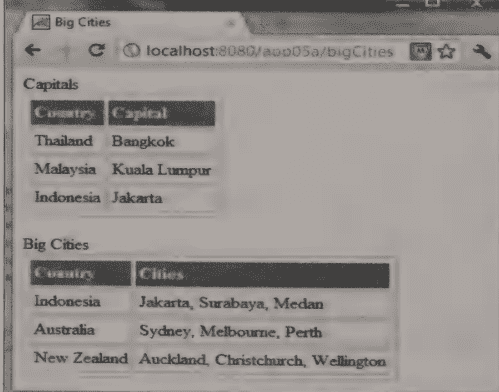

图 5.2：配合 `Map` 使用 `forEach`

## forTokens 标签

你使用 `forTokens` 标签遍历由指定分隔符分隔的标记。该动作的语法如下：

```jsp
<c:forTokens items="stringOfTokens" delims="delimiters"
  var="varName" [varStatus="varStatus"]
  begin="Begin" [end="end"] [step="step"]>
  body content
</c:forTokens>
```

正文内容。`forTokens` 标签的属性列表见表 5.7。

| 属性 | 类型 | 描述 |
|---|---|---|
| `var` | `String` | 作用域变量的名称，引用迭代的当前项。 |
| `items`+ | `String` | 要遍历的标记字符串。 |
| `varStatus` | `String` | 存储迭代状态的作用域变量名称。其值类型为 `javax.servlet.jsp.core.LoopTagStatus`。 |
| `begin`+ | `int` | 迭代的起始索引，索引从 0 开始。如果指定，`begin` 必须大于或等于 0。 |
| `end`+ | `int` | 迭代的结束索引，索引从 0 开始。 |
| `step`+ | `int` | 迭代将仅处理字符串中每隔 `step` 个标记，从第一个开始。如果指定，`step` 必须大于或等于 1。 |
| `delims`+ | `String` | 分隔符集合。 |

表 5.7：`forTokens` 标签的属性

这里是 `forTokens` 的示例：

```jsp
<c:forTokens var="item" items="Argentina, Brazil, Chile" delims=",">
  <c:out value="${item}"/><br/>
</c:forTokens>
```


当粘贴到 JSP 中，上述 `forTokens` 将产生以下结果：

- Argentina
- Brazil
- Chile

## 格式化动作

JSTL 提供了用于格式化和解析数字及日期的标签。这些是 `formatNumber`、`formatDate`、`timeZone`、`setTimeZone`、`parseNumber` 和 `parseDate`。这些标签将在随后的章节中讨论。

### `formatNumber` 标签

你使用 `formatNumber` 来格式化数字。该标签提供了灵活性，可以使用其各种属性来获取适合你需要的格式。`formatNumber` 的语法有两种形式。第一种不带正文内容：

```jsp
<fmt:formatNumber value="numericValue"
  [type="{number|currency|percent}"]
  [pattern="customPattern"]
  [currencyCode="currencyCode"]
  [currencySymbol="currencySymbol"]
  [groupingUsed="true|false"]
  [maxIntegerDigits="maxIntegerDigits"]
  [minIntegerDigits="minIntegerDigits"]
  [maxFractionDigits="maxFractionDigits"]
  [var="varName"]
  [scope="page|request|application"]/>
```

第二种形式带有正文内容：

```jsp
<fmt:formatNumber type="{number|currency|percent}"
  [pattern="customPattern"]
  [currencyCode="currencyCode"]
  [currencySymbol="currencySymbol"]
  [groupingUsed="true|false"]
  [maxIntegerDigits="maxIntegerDigits"]
  [minIntegerDigits="minIntegerDigits"]
  [maxFractionDigits="maxFractionDigits"]
  [var="varName"]
  [scope="page|request|application"]>
```

表 5.8：`formatNumber` 标签的属性

你使用 `formatNumber` 来格式化数字。该标签允许使用各种属性来获取适合你需要的格式。货币的用法见表 5.9。

| 货币 | ISO417 代码 | 大单位名称 |
|---|---|---|
| 加拿元 | CAD | 元 |
| 人民 | CNY | 角 |
| 欧元 | EUR | 欧 |
| 日元 | JPY | 日 |
| 英镑 | GBP | 镑 |
| 美元 | USD | 美 |

表 5.9：ISO417

如何使用 `formatNumber` 的示例见表 5.10。

| 动作 | 结果 |
|---|---|
| `<fmt:formatNumber value="12" type="number"/>` | 12 |
| `<fmt:formatNumber value="12" minIntegerDigits="3"/>` | 012 |
| `<fmt:formatNumber value="12" type="number" minFractionDigits="2"/>` | 12.00 |
| `<fmt:formatNumber value="123456.78" pattern="###0"/>` | 123,456.78 |
| `<fmt:formatNumber value="12" type="currency"/>` | $12.00 |
| `<fmt:formatNumber value="12" type="currency" currencyCode="GBP"/>` | GBP 12.00 |
| `<fmt:formatNumber value="0.12" type="percent"/>` | 12% |
| `<fmt:formatNumber value="0.125" type="percent" minFractionDigits="2"/>` | 12.50% |

表 5.10：使用 `formatNumber`

注意在格式化货币时，如果没有指定 `currencyCode` 属性，将使用浏览器的 locale。

### `dateFormat` 标签

你使用 `dateFormat` value 来格式化日期。语法如下：

```jsp
<fmt:dateFormat value="date"
  [type="time|date|both"]
  [dateStyle="default|short|full"]
  [timeStyle="default|short|full"]
  [pattern="customPattern"]/>
```

正文内容为 JSP。该标签的属性见表 5.11。

| 属性 | 类型 | 描述 |
|---|---|---|
| value+ | `java.util.Date` | 要格式化的日期和时间 |
| type+ | `String` | 指定要格式化时间、日期还是时间与日期部分 |
| dateStyle | `String` | 日期的预定义格式样式，遵循 `java.text.DateFormat` 定义 |
| timeStyle | `String` | 时间的预定义格式样式，遵循 `java.text.DateFormat` 定义 |
| pattern+ | `String` | 自定义格式模式 |
| timezone | `String` or `java.util.TimeZone` | 表示时间的时区 |
| var | `String` | 存储结果的字符串的作用域变量名称 |
| scope | `String` | `var` 的作用域 |

表 5.11：`format` 标签的属性

关于 `timezone` 属性的可能值，请参见“`timezone` Tag”章节。

以下代码使用 `formatDate` 标签格式化由作用域变量 `now` 引用的 `java.util.Date` 对象。

默认：`<fmt:formatDate value="${now}" dateStyle="short"/>`

短：`<fmt:formatDate value="${now}" dateStyle="short"/>`

中：`<fmt:formatDate value="${now}" dateStyle="medium"/>`

长：`<fmt:formatDate value="${now}" dateStyle="long"/>`

全：`<fmt:formatDate value="${now}" dateStyle="full"/>`

# 148 Servlet & JSP: 教程

短: `<fmt:format type="time" value="${now}" timeStyle="short"/>`

中: `<fmt:format type="time" value="${now}" timeStyle="medium"/>`

长: `<fmt:format type="time" value="${now}" timeStyle="long"/>`

全: `<fmt:format type="time" value="${now}" timeStyle="full"/>`

# 以下的 `dateFormat` 标签用于日期和时间。

默认: `<fmt:format type="both" value="${now}"/>`

短日期时间: `<fmt:format type="both" value="${now}" timeStyle="short"/>`

长日期时间格式: `<fmt:format type="both" value="${now}" timeStyle="long"/>`

# 以下的 `dateTime` 标签用于格式化时区。

CT 时区: `<fmt:format type="time" value="${now}" timeZone="CT"/>`<br/>

HST 时区: `<fmt:format type="time" value="${now}" timeZone="HST"/>`<br/>

以下的 `dateFormat` 标签用于使用自定义模式格式化日期和时间。

`<fmt:format type="both" value="${now}" pattern="dd.MM.yy"/>`

`<fmt:format type="both" value="${now}" pattern="dd.MM.yyyy"/>`

# `timezone` 标签

`tagName` 属性用于指定正文内容中要格式化或解析的时区。其语法如下：

```
<fmt:timezone value="timezone">
body content
</fmt:timezone>
```

正文内容是 JSP。属性值可以传递类型为 `String` 或 `java.util.TimeZone` 的动态值。美国和加拿大时区的值在表 5.12 中给出。

如果 `value` 属性为 null 或空，则为 GMT 时区。

# 以下示例使用 `timezone` 标签格式化带时区的日期。

```
<fmt:timeZone value="GMT+1:00">
  <fmt:formatDate value="${now}" type="both" dateStyle="full" time="full"/>
</fmt:timeZone>
<fmt:timeZone value="HST">
  <fmt:formatDate value="${now}" type="both" dateStyle="full" time="full"/>
</fmt:timeZone>
<fmt:timeZone value="CST">
  <fmt:formatDate value="${now}" type="both" dateStyle="full" time="full"/>
</fmt:timeZone>
```

| 缩写 | 全称 | 时区 |
|---|---|---|
| NST | Newfoundland Standard Time | UTC-3:30 hours |
| NDT | Newfoundland Daylight Time | UTC-2:30 hours |
| AST | Atlantic Standard Time | UTC-4 hours |
| ADT | Atlantic Daylight Time | UTC-3 hours |
| EST | Eastern Standard Time | UTC-5 hours |
| EDT | Eastern Daylight Saving Time | UTC-4 hours |
| ET | Eastern Time, as EST or EDT | * |
| CST | Central Standard Time | UTC-6 hours |
| CDT | Central Daylight Saving Time | UTC-5 hours |
| CT | Central Time, as either CST or CDT | * |
| MST | Mountain Standard Time | UTC-7 hours |
| MDT | Mountain Daylight Saving Time | UTC-6 hours |
| MT | Mountain Time, as either MST or MDT | * |
| PST | Pacific Standard Time | UTC-8 hours |
| PDT | Pacific Daylight Saving Time | UTC-7 hours |
| PT | Pacific Time, as either PST or PDT | * |
| AKST | Alaska Standard Time | UTC-9 hours |
| AKDT | Alaska Standard Daylight Saving Time | UTC-8 hours |
| HST | Hawaiian Standard Time | UTC-10 hours |

表 5.12: 美国和加拿大时区

# `setTimeZone` 标签

你使用 `setTimeZone` 标签将指定的时区存储在作用域变量或时间配置变量中。`setTime` 的语法如下：

```
<fmt:setTimeZone value="timeZone" [var="varName"] [scope="page|request|session|application"]
/>
```

表 5.13 展示了 `setTimeZone` 标签的属性。

| 属性 | 类型 |  |
| --- | --- | --- |
| value+ | `String` or `java.util.TimeZone` | 时区 |
| var | `String` | 用于存储 `java.util.TimeZone` 类型时区的作用域变量名称 |
| scope | `String` | `var` 或时区配置变量的作用域 |

表 5.13: `setTimeZone` 标签的属性

# `parseNumber` 标签

你使用 `parseNumber` 将本地化格式的数字、货币或百分比的字符串表示解析为数字。语法有两种形式。第一种形式不带正文内容：

```
<fmt:parseNumber value="numericValue" [type="number|currency|percent"] [pattern="customPattern"] [parseLocale="parseLocale"] [integerOnly={true|false}] [var="varName"] [scope="page|request|session|application"]
/>
```

第二种形式带有正文内容：

```
<fmt:parseNumber type="number|currency|percent" [pattern="customPattern"] [parseLocale="parseLocale"] [integerOnly={true|false}">
```

```
[var="varName"]
[scope="page|request|session|application"]
<numeric value to be parsed
</numeric
```

# `parseDate` 标签

`parseDate` 将本地化格式的日期和时间字符串表示解析为 `Date` 对象。语法有两种形式。第一种形式不带正文内容：

```
<fmt:parseDate value="dateValue" [type="date|time|both"] [pattern="customPattern"] [parseLocale="parseLocale"] [timeOnly={true|false}] [var="varName"] [scope="page|request|session|application"]
/>
```

第二种形式带有正文内容：

```
<fmt:parseDate type="date|time|both" [pattern="customPattern"] [parseLocale="parseLocale"] [timeOnly={true|false}">
```

```
[var="varName"]
[scope="page|request|session|application"]
<date value to be parsed
</date```

正文内容是 JSP。属性值可以传递类型为 `String` 或 `java.util.TimeZone` 的动态值。美国和加拿大的时区值见表 5.12。

如果 `value` 属性为 null 或空，则为 GMT 时区。

# 以下示例使用 `timezone` 标签格式化带时区的日期。

```
<fmt:timeZone value="GMT+1:00">
  <fmt:formatDate value="${now}" type="both" dateStyle="full" time="full"/>
</fmt:timeZone>
<fmt:timeZone value="HST">
  <fmt:formatDate value="${now}" type="both" dateStyle="full" time="full"/>
</fmt:timeZone>
<fmt:timeZone value="CST">
  <fmt:formatDate value="${now}" type="both" dateStyle="full" time="full"/>
</fmt:timeZone>
```

# `setTimeZone` 标签

你使用 `setTimeZone` 标签将指定的时区存储在作用域变量或时间配置变量中。`setTime` 的语法如下：

```
<fmt:setTimeZone value="timeZone" [var="varName"] [scope="page|request|session|application"]
/>
```

表 5.13 展示了 `setTimeZone` 标签的属性。

| 属性 | 类型 | 描述 |
| --- | --- | --- |
| value+ | `String` or `java.util.TimeZone` | 时区 |
| var | `String` | 用于存储 `java.util.TimeZone` 类型时区的作用域变量名称 |
| scope | `String` | `var` 或时区配置变量的作用域 |

表 5.13: `setTimeZone` 标签的属性

# `parseNumber` 标签


你使用`parseNumber`将本地化格式的数字、货币或百分比的字符串表示解析为数字。语法有两种形式。第一种形式不带正文内容：

```
<fmt:parseNumber value="numericValue" [type="number|currency|percent"] [pattern="customPattern"] [parseLocale="parseLocale"] [integerOnly={true|false}] [var="varName"] [scope="page|request|session|application"]
/>
```

第二种形式带有正文内容：

```
<fmt:parseNumber type="number|currency|percent" [pattern="customPattern"] [parseLocale="parseLocale"] [integerOnly={true|false}">
```

```
[var="varName"]
[scope="page|request|session|application"]
<numeric value to be parsed
</numeric
```

## `parseDate` 标签

`parseDate`将本地化格式的日期和时间字符串表示解析为`Date`对象。语法有两种形式。第一种形式不带正文内容：

```
<fmt:parseDate value="dateValue" [type="date|time|both"] [pattern="customPattern"] [parseLocale="parseLocale"] [timeOnly={true|false}] [var="varName"] [scope="page|request|session|application"]
/>
```

第二种形式带有正文内容：

```
<fmt:parseDate type="date|time|both" [pattern="customPattern"] [parseLocale="parseLocale"] [timeOnly={true|false}">
```

```
[var="varName"]
[scope="page|request|session|application"]
<date value to be parsed
</date```

## 第 5 章：JSTL

作为一个示例，以下`parseDate`标签解析由作用域变量`myDate`引用的日期，并将生成的`java.util.Date`存储在页面作用域变量`formattedDate`中。

```
<c:set var="myDate" value="12/12/2005"/>
<fmt:parseDate var="formattedDate" type="date"
  dateStyle="short" value="${myDate}"/>
```

## 函数

除了自定义操作外，JSTL 1.1 和 1.2 定义了一组可以在 EL 表达式中使用的标准函数。这些函数被分组在函数标签库中。要使用这些函数，必须在 JSP 顶部使用`taglib`指令。

```jsp
<%@ taglib uri="http://java.sun.com/jsp/jstl/functions" prefix="fn" %>
```

要调用函数，你使用如下格式的 EL：

`$(fn:functionName)`

其中`functionName`是函数的名称。

大多数函数都用于字符串处理。例如，`length`函数既适用于字符串也集合，返回集合或数组中的项目数量，或字符串中的字符数。

所有这些函数将在随后的章节中描述。

## `contains`函数

`contains`函数测试字符串是否包含指定的子字符串。如果字符串包含该子字符串，则返回值为`true`，否则返回`false`。其语法如下：

```
contains(string, substring).
```

例如，这两个 EL 表达式都返回`true`：

```
<c:set var="my" value="Hello World"/>
```

```
${{fn:contains(myString, "Hello")}
${fn:contains("Stella Cadente", "Cadente")}
```

## `containsIgnoreCase`函数

`containsIgnoreCase`函数与`contains`函数相似，但测试是以不区分大小写的方式进行的。其语法如下：

```
containsIgnoreCase(string, substring)
```

例如，以下 EL 表达式返回`true`：

```
${fn:containsIgnoreCase("Stella Cadente", "CADENTE")}
```

## `endsWith`函数

`endsWith`函数测试字符串是否以指定的后缀结尾。返回值为`Boolean`（布尔值）。其语法如下：

```
endsWith(string, suffix)
```

例如，以下 EL 表达式返回`true`：

```
${fn:endsWith("Hello World", "World")}
```

## `escapeXml`函数

该函数用于编码`String`（字符串）。其转换结果与将`escapeXml`属性设置为`true`的`out`标签相同。`escapeXml`的语法如下：

```
escapeXml(string)
```

例如，EL 表达式

```
${fn:escapeXml("Use <br/> to change lines")}
```

渲染如下：

`Use &lt;br/&gt; to change lines`

## `indexOf`函数

`indexOf`函数返回字符串中指定子字符串首次出现位置的索引。如果未找到该子字符串，则返回`-1`。其语法如下：

```
indexOf(string, substring)
```

例如，以下 EL 表达式返回`7`：

```
${fn:indexOf("Stella Cadente", "Cadente")}
```

## `join`函数

`join`函数将字符串数组中的所有元素连接成字符串，并用指定的分隔符隔开。其语法如下：

```
join(array, separator)
```

如果数组为`null`，则返回空字符串。

例如，如果`myArray`是一个包含`"my"`和`"world"`两个元素的字符串数组，EL 表达式

```
${fn:join(myArray, ",")}
```

返回`"my,world"`。

## `length`函数

`length`函数返回集合中的项目数量，或者字符串中的字符数。其语法如下：

```
length(input)
```

例如，以下 EL 表达式返回`14`：

```
${fn:length("Stella Cadente", "Cadente")}
```

## `replace`函数

`replace`函数替换字符串中所有出现的`beforeString`为`afterString`，并返回结果。其语法如下：

```
replace(string, beforeSubstring, afterSubstring)
```

例如，`value='${fn:replace("Stella Cadente", "e", "E")}'`

返回`"Stella CadEntE"`

## `split`函数

`split`函数将字符串拆分为子字符串数组。它的操作与`join`函数相反。例如，以下代码将字符串`"my,world"`拆分并将结果存储在作用域变量`split`中。使用`forEach`标签将`split`格式化为 HTML 表格。

```
<c:set var="split" value='${fn:split("my,world",",")}'/>
<c:forEach var="substring" items="${split}">
  <tr><td>${substring}</td></tr>
</c:forEach>
</table>
```

结果如下：

```html
<table>
<tr><td>my</td></tr>
<tr><td>world</td></tr>
</table>
```

## `startsWith`函数

`startsWith`函数测试字符串是否以指定的前缀开头。其语法如下：

```
startsWith(string, prefix)
```

例如，以下 EL 表达式返回`true`：

```
${fn:startsWith("Stella Cadente", "St")}
```

## `substring`函数

`substring`函数返回从指定的从 0 开始的起始索引（包含）到指定的从 0 开始的结束索引的子字符串。其语法如下：

```
substring(string, beginIndex, endIndex)
```

例如，以下 EL 表达式返回`"Stel"`。

```
${fn:substring("Stella Cadente", 0, 4)}
```

## `substringAfter`函数

`substringAfter`函数返回字符串中指定子字符串首次出现之后的部分。其语法如下：

```
substringAfter(string, substring)
```

例如，EL 表达式

```
${fn:substringAfter("Stella Cadente", "e")}
```

返回`"lla Cadente"`。

## `substringBefore`函数

`substringBefore`函数返回字符串中指定子字符串首次出现之前的部分。其语法如下：

```
substringBefore(string, substring)
```

例如，以下 EL 表达式返回`"St"`：

```
${fn:substringBefore("Stella Cadente", "e")}
```

## `toLowerCase`函数

`toLowerCase`函数将字符串转换为全小写形式。其语法如下：

```
toLowerCase(string)
```

例如，以下 EL 表达式返回`"stella cadence"`。

```
${fn:toLowerCase("Stella Cadence")}
```

## `toUpperCase`函数

`toUpperCase`函数将字符串转换为全大写形式。其语法如下：

```
toUpperCase(string)
```

例如，以下 EL 表达式返回`"STELLA CADENCE"`。

```
${fn:toUpperCase("Stella Cadence")}
```

## `trim`函数

`trim`函数移除字符串开头和结尾的空格。其语法如下：

```
trim(string)
```

例如，以下 EL 表达式返回`"Stella Cadence"`：

```
${fn:trim("  Stella Cadence  ")}
```

## 第 6 章：编写自定义标签

2. JSP 容器调用`setJspContext`方法并传递一个`JspContext`对象：`JspContext`最重要的方法是`getOut`，它返回一个用于向客户端发送响应的`JspWriter`。`setJspContext`方法的签名如下：

```
public void setJspContext(JspContext jspContext)
```

在大多数情况下，你需要将传入的`JspContext`赋值给类变量以便以后使用。

3. 如果代表标签处理程序的自定义标签嵌套在另一个标签内部，JSP 容器会调用`setParent`方法。该方法具有以下签名：

```
public void setParent(JspTag parent)
```

4. JSP 容器会为该标签定义的每个属性调用 setter 方法。

5. 如果存在主体（body），JSP 容器会调用`SimpleTag`接口的`setJspBody`方法，并将主体作为`JspFragment`传递。如果标签没有主体，JSP 容器将不会调用此方法。

6. JSP 容器会调用`doTag`方法。当`doTag`方法返回时，所有变量都会同步。

`javax.servlet.jsp.tagext`包还包含一个支持`SimpleTag`的类：`SimpleTagSupport`。`SimpleTagSupport`为`SimpleTag`中的所有方法提供了默认实现，是一个方便扩展的类，用于编写简单的标签处理程序。`SimpleTagSupport`类中的`getJspContext`方法返回 JSP 容器在调用`SimpleTag`接口的`setJspContext`方法时传递的`JspContext`实例。

## `SimpleTag`示例

本节介绍了`app06a`，这是一个简单标签处理程序的示例。创建标签处理程序和注册标签需要两个步骤。这两个步骤将在下文中解释。

请注意，你的构建路径中需要 Servlet API 和 JSP API 包才能编译标签处理程序。如果你使用 Tomcat，可以在 Tomcat 的`lib`目录下找到包含 API 的 jar 文件（`servlet-api.jar`文件和`jsp-api.jar`文件）。

`app06a`的应用程序目录结构如图 6.1 所示。自定义标签由标签处理程序（位于`WEB-INF/classes`下）和描述符（`WEB-INF`下的`mytags.tld`文件）组成。图 6.1 还包含一个用于测试自定义标签的 JSP 文件。

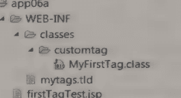

图 6.1：`app06a`应用程序目录结构

## 编写标签处理程序

列表 6.1 显示了`MyFirstTag`类，它是`SimpleTag`的实现。列表 6.1：`MyFirstTag`类

```
package customtag;
import java.io.IOException;
import javax.servlet.jsp.JspContext;
import javax.servlet.jsp.JspException;
import javax.servlet.jsp.tagext.JspFragment;
import javax.servlet.jsp.tagext.JspTag;
import javax.servlet.jsp.tagext.SimpleTag;

public class MyFirstTag implements SimpleTag {
    JspContext jspContext;

    public void doTag() throws IOException, JspException {
        System.out.println("doTag");
        jspContext.getOut().print("This is my first tag.");
    }

    public void setParent(JspTag parent) {
        System.out.println("setParent");
    }

    public JspTag getParent() {
        System.out.println("getParent()");
        return null;
    }

    public void setJspContext(JspContext jspContext) {
        System.out.println("setJspContext");
        this.jspContext = jspContext;
    }

    public void setJspBody(JspFragment body) {
        System.out.println("setJspBody");
    }
}
```

`MyFirstTag`类有一个类型为`JspContext`的`jspContext`变量，它从 JSP 容器接收并赋值该变量。`doTag`方法使用`JspContext`获取`JspWriter`。你调用`JspWriter`的`print`方法来输出字符串`"This is my first tag"`。

## 注册标签

在标签处理程序用于 JSP 页面之前，它必须在标签库描述符（一个以`.tld`扩展名的 XML 文件）中注册。此示例的标签库描述符名为`mytags.tld`，如列表 6.2 所示。该文件必须保存在`WEB-INF`目录下。

列表 6.2：标签库描述符 (`mytags.tld`)


```xml
<?xml version="1.0" encoding="UTF-8"?>
<taglib xmlns="http://java.sun.com/ns/jsp2ee"
    xmlns:xsi="http://www.w3.org/2001/XMLSchema-instance"
    xsi:schemaLocation="http://java.sun.com/ns/jsp2ee webjstag_2_1.xsd"
    version="2.1">

  <description>Simple tag examples</description>
  <tlib-version>1.0</tlib-version>
  <short-name>My First Tag</short-name>
  <tag>
    <name>firstTag</name>
    <tag-class>customtag.MyFirstTag</tag-class>
    <body-content>empty</body-content>
  </tag>
</taglib>
```

标签库中的主元素是`tag`元素，它描述标签。它包含一个`name`元素和一个`tag-class`元素。`name`指定了引用此标签时将使用的名称。`tag-class`指定了标签处理程序的完全限定名。标签库描述符可以包含多个元素。此外，你还可以在标签库描述符中获取其他元素：`description`元素用于提供标签的描述，`tlib-version`元素指定标签的版本，`short-name`元素为标签提供短名称。

## 使用标签

要使用自定义标签，可以使用`taglib`指令。`taglib`指令的`uri`属性可以引用相对路径或绝对路径。在本示例中使用了相对路径。然而，如果你使用的是封装在 jar 文件中的标签库，将使用绝对路径。本章后面的“分发自定义标签”部分将介绍如何用于分发的标签库。

要测试`firstTag`自定义标签，请使用列表 6.3 中的`firstTagTest.jsp`。

**列表 6.3：firstTagTest.jsp**

```jsp
<%@ taglib uri="/WEB-INF/mytags.tld" prefix="easy" %>
<html>
<head>
<title>Testing my tag</title>
</head>
<body>
Hello!!!
<br/>
<easy:firstTag></easy:firstTag>
</body>
</html>
```

你可以使用此 URL 访问`firstTagTest.jsp`页面：

`http://localhost:8080/app06a/firstTagTest.jsp`

当你调用`firstTagTest.jsp`页面时，JSP 容器会调用标签处理程序的`setJspContext`方法。由于`firstTagTest.jsp`中的标签没有主体，JSP 容器在调用`doTag`方法之前不会调用`setJspBody`方法。在你的控制台中，你可以看到以下内容：

```
setJspContext
doTag
```

注意，JSP 容器没有调用标签处理程序的`setParent`方法，因为该简单标签没有嵌套在另一个标签内部。

## 处理属性

实现`SimpleTag`或扩展`SimpleTagSupport`的标签处理程序可以拥有属性。列表 6.4 展示了一个名为`DataFormatterTag`的标签处理程序，它可以将逗号分隔的项格式化为 HTML 表格。你向此标签传递两个属性：`header`和`items`。`header`属性将成为表格的头。例如，如果你将 “Cities” 传递给`header`属性，将 “London,Montreal” 传递给`items`属性，你将得到：

```html
<table style="border:1px solid green;">
  <tr><td>Cities</td></tr>
  <tr><td>London</td></tr>
  <tr><td>Montreal</td></tr>
</table>
```

**列表 6.4：DataFormatterTag 类**

```java
package customtag;
import java.io.IOException;
import java.util.StringTokenizer;
import javax.servlet.jsp.JspContext;
import javax.servlet.jsp.JspException;
import javax.servlet.jsp.JspWriter;
import javax.servlet.jsp.tagext.SimpleTagSupport;

public class DataFormatterTag extends SimpleTagSupport {
    private String header;
    private String items;

    public void setHeader(String header) {
        this.header = header;
    }

    public void setItems(String items) {
        this.items = items;
    }

    public void doTag() throws IOException, JspException {
        JspContext jspContext = getJspContext();
        JspWriter out = jspContext.getWriter();

        out.print("<table style='border:1px solid green;'>\n"
        + "<tr><td><span style='font-weight:bold'>"
        + header + "</span></td></tr>\n");
        
        StringTokenizer tokenizer = new StringTokenizer(items, ",");
        while (tokenizer.hasMoreTokens()) {
            String token = tokenizer.nextToken();
            out.print("<tr><td>" + token + "</td></tr>\n");
        }
        out.print("</table>");
    }
}
```

```java
out.print("<table style='border:1px solid green'>\n"
  + "<tr><td><span style='font-weight:bold'>"
  + header + "</span></td></tr>\n");
StringTokenizer tokenizer = new StringTokenizer(items, ",");
while (tokenizer.hasMoreTokens()) {
  String token = tokenizer.nextToken();
  out.print("<td>" + token + "</td></tr>\n");
}
out.print("</table>");
```

当你使用`DataFormatter`标签处理器时，必须使用列表 6.5 中的`tag`元素对其进行注册。只需将其添加到上一个示例中使用的`mytags.tld`文件中。

**列表 6.5：注册 dataFormatter 标签**

```xml
<tag>
 <name>dataFormatter</name>
 <tag-class>customtag.DataFormatterTag</tag-class>
 <body-content>empty</body-content>
  <attribute>
   <name>header</name>
   <required>true</required>
  </attribute>
  <attribute>
   <name>items</name>
   <required>true</required>
  </attribute>
</tag>
```

然后你可以使用列表 6.6 中的`dataFormatterTest.jsp`页面来测试标签处理器。

**列表 6.6：dataFormatterTest.jsp 页面**

```jsp
<@taglib uri="WEB-INF/mytags.tld" prefix="easy">
<html>
<head>
 <title>Testing DataFormatterTag</title>
</head>
<body>
 <easy:dataFormatter header="States"
 items="Alabama, Alaska, Georgia, Florida"
/>
```

```jsp
<br/>
<easy:dataFormatter header="Countries">
  <jsp:attribute name="items">
    US, UK, Canada, Korea
  </jsp:attribute>
</easy:dataFormatter>
<easy:dataFormatter>
</easy:dataFormatter>

</body>
</html>
```

请注意，列表 6.6 中的 JSP 页面使用了两次`dataFormatter`，通过两种不同的方式传递属性：一种是在标签属性中，另一种是使用属性标准动作。你可以通过此 URL 调用`dataFormatterTag.jsp`：

`http://localhost:8080/app06a/dataFormatterTagTest.jsp`

图 6.2 显示了调用`dataFormatterTagTest.jsp`的结果。

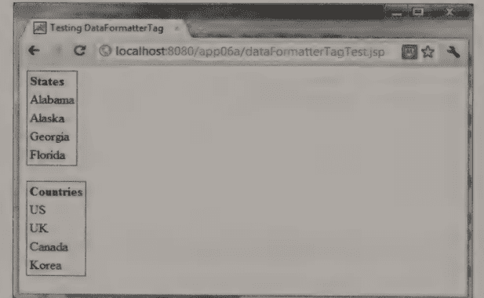

**图 6.2：在 SimpleTag 中使用属性**

## 操作标签体

使用`SimpleTag`，你可以通过 JSP 容器传递的`JspFragment`来操作标签体。`JspFragment`代表 JSP 代码的一部分，可以被调用零次或多次。JSP 片段的定义不能包含脚本段（scriptlets）或脚本段表达式（scriptlet expressions）。它只能包含模板文本和 JSP 动作元素。

`JspFragment`类有两个方法：`getJspContext`和`invoke`。

这些方法的签名如下：

```java
public abstract JspContext getJspContext()
public abstract void invoke(java.io.Writer writer)
throws JspException, java.io.IOException
```

`getJspContext`方法返回与此`JspFragment`关联的`JspContext`。你调用`invoke`方法执行片段（标签体），并将所有输出重定向到指定的`Writer`。如果你向`invoke`传递`null`，输出将重定向到由此片段关联的`JspContext`的`getOut`方法返回的`JspWriter`。

考虑列表 6.7 中的`SelectElementTag`类。你使用此标签处理器发送带有内容的 HTML select 元素：

```html
<select>
<option value="value-1">text-1</option>
<option value="value-2">text-2</option>
...
<option value="value-n">text-n</option>
</select>
```

在这种情况下，值是 String 数组中的国家名称。

**列表 6.7：SelectElementTag**

```java
package customtag;
import java.io.IOException;
import javax.servlet.jsp.JspContext;
import javax.servlet.jsp.JspException;
import javax.servlet.jsp.JspWriter;
import javax.servlet.jsp.tagext.SimpleTagSupport;
```

```java
public class SelectElementTag extends SimpleTagSupport {
    private String[] countries = {"Australia", "Brazil", "China" };
```

```java
public void doTag() throws IOException, JspException {
    JspContext jspContext = getJspContext();
    JspWriter out = jspContext.getOut();
    out.print("<select>\n");
```

```java
for (int i=0; i<3; i++) {
    jspContext().setAttribute("value", countries[i]);
    jspContext().setAttribute("text", countries[i]);
    jspBody().invoke(null);
}

out.print("</select>\n");
```

列表 6.8 显示了用于注册`SelectElementTag`的标签元素，并将其映射到选定的标签。再次，将此元素添加到`mytags.tld`文件中。

**列表 6.8：注册 SelectElementTag**

```xml
<tag>
    <name>select</name>
    <tag-class>customtag.SelectElementTag</tag-class>
    <body-content>empty</body-content>
</tag>
```

列表 6.9 展示了使用`SelectElementTag`的 JSP 页面。

**列表 6.9：selectElementTest.jsp**

```jsp
<%@ taglib uri="WEB-INF/mytags.tld" prefix="easy"%>
<html>
<head>
    <title>Testing SimpleTag</title>
</head>
<body>
<easy:select>
    <option value="${value}">${text}</option>
</easy:select>
</body>
</html>
```

注意，select 标签通过以下格式使用属性：`<option value="${value}">${text}</option>`。value 和 text 属性从`SelectElementTag`处理器的每次`doTag`方法获取值：

```java
for (int i=0; i<3; i++) {
    jspContext().setAttribute("value", countries[i]);
    jspContext().setAttribute("text", countries[i]);
    jspBody().invoke(null);
}
```

你可以通过此 URL：`http://localhost:8080/app06a/selectElementTest.jsp`调用`selectElementTest.jsp`。

图 6.3 显示了结果。


**图 6.3：使用 JspFragment**

如果你在浏览器中查看，你会看到：

```html
<select>
<option value="Australia">Australia</option>
<option value="Brazil">Brazil</option>
<option value="China">China</option>
</select>
```

## 编写 EL 函数

第 4 章讨论了 JSP 表达式（EL），提到你可以通过表达式编写函数。在本章而不是第 4 章讨论 EL 函数，因为涉及到标签描述符的使用。

基本上，可以通过以下两个步骤编写 EL 函数：

1. 创建一个包含静态方法的类。每个静态方法代表一个函数。该类不需要实现接口或扩展类。像部署其他类一样部署该类。该类必须保存在`WEB-INF/classes`目录或其下。

2. 在标签描述符中使用`function`元素注册函数。

`function`元素必须放在`taglib`元素之下，并具有以下子元素：

- `description`：可选的标签特定信息。
- `display-name`：XML 工具显示的短名称。
- `icon`：XML 工具使用的可选图标元素。
- `name`：函数的唯一名称。
- `function-class`：实现函数的 Java 类的全限定名。
- `function-signature`：代表函数的静态 Java 方法签名。
- `example`：使用该函数的可选非正式描述。


`function-extension`：XML 工具使用的提供该函数额外信息的扩展。

要使用函数，你需要使用 `taglib` 指令，其 `uri` 属性指向标签描述符，并指定使用的前缀。然后你在 JSP 页面中使用以下语法调用函数：

`${prefix:functionName(parameterList)}`

作为一个示例，考虑随本书的 `app06b`。列表 6.10 展示了封装静态方法 `reverseString` 的 `MyFunctions` 类。

## 列表 6.10：MyFunctions 类中的 reverseString 方法

```java
package function;
public class StringFunctions {
    public static String reverseString(String s) {
        return new StringBuffer(s).reverse().toString();
    }
}
```

列表 6.11 显示了包含描述 `reverseString` 函数的 `function` 元素的 `functiontags.tld` 描述符。该 TLD 必须保存在使用它的应用程序的 `WEB-INF` 目录中。

### 列表 6.11：functiontags.tld 文件

```xml
<?xml version="1.0" encoding="UTF-8"?>
<taglib xmlns="http://java.sun.com/xml/ns/j2ee"
xmlns:xsi="http://www.w3.org/2001/XMLSchema-instance"
xsi:schemaLocation="http://java.sun.com/xml/ns/j2ee
web-taglibrary_2.1.xsd">

<description>
  Function tag examples
</description>
<tlib-version>1.0</tlib-version>
<function>
  <description>Reverses a String</description>
  <name>reverseString</name>
  <function-class>function.StringFunction</function-class>
  <function-signature>
    java.lang.String reverseString(java.lang.String)
  </function-signature>
</function>
</taglib>
```

列表 6.12 显示了用于测试 EL 函数的 `reverseFunctionNameTest.jsp` 页面。

## 列表 6.12：使用 EL 函数

```jsp
<@ taglib uri="WEB-INF/functiontags.tld" prefix="f">
<html>
<head>
  <title>Testing reverseString function</title>
</head>
<body>
  ${f:reverseString("Hello World")}
</body>
</html>
```

你可以通过以下 URL 调用 `reverseFunctionNameTest.jsp`：

`http://localhost:8080/app06b/reverseFunctionNameTest.jsp`

调用 JSP 页面时，你将看到反转后的“Hello World”。

## 分发自定义标签

你可以将你的自定义标签处理器和标签库描述符封装成一个 jar 文件，以便你将其分发给他人使用，就像 JSTL 一样。在这种情况下，你需要包含所有的标签处理器和描述它们的标签文件。此外，你需要在描述符的 `uri` 元素中指定一个绝对 URI。

例如，本书附带的应用程序 `app06c` 将 `app06b` 中的标签和描述符封装在 `mytags.jar` 文件中。jar 文件的内容如图 6.4 所示。

```
mytags.jar
 function
  StringFunction.class
  META-INF
    functiontags.tld
```

图 6.4：mytags.jar 文件

列表 6.13 展示了 `functiontags.tld` 文件。注意描述符中已添加了一个 `uri` 元素。该元素的值为 `http://example.com/taglib/function`。

### 列表 6.13：封装的自定义标签的 functiontags.tld 文件

```xml
<?xml version="1.0" encoding="UTF-8"?>
<taglib xmlns="http://java.sun.com/xml/ns/j2ee"
xmlns:xsi="http://www.w3.org/2001/XMLSchema-instance"
xsi:schemaLocation="http://java.sun.com/xml/ns/j2ee
web-jsppptaglibrary_2_1.xsd"
version="2.1">
<description>
  Function tag examples
</description>
<tlib-version>1.0</tlib-version>

  <uri>http://example.com/taglib/function</uri>
```

```xml
<function>
<description>反转一个字符串</description>
<name>reverseString</name>
<function-class>function.StringFunction</function-class>
<function-signature>
  java.lang.String reverseString(java.lang.String)
</function-signature>
</function>
</taglib>
```

要在应用程序中使用该库，必须将 jar 文件复制到应用程序的 `WEB-INF/lib` 目录。任何使用自定义标签的 JSP 页面顶部必须指定 URI，与标签库描述符中定义的相同。

列表 6.14 中的 `reverseStringFunction.jsp` 页面展示了一个使用自定义标签的 JSP 页面。

### 列表 6.14：app06c 中的 reverseStringFunction.jsp 文件

```jsp
<%@ taglib uri="http://example.com/taglib/function" prefix="f" %>
<html>
<head>
  <title>测试 reverseString 函数</title>
</head>
<body>
  ${f:reverseString("Welcome")}
</body>
</html>
```

你可以通过将浏览器重向到此 URL 来测试该示例。

`http://localhost:8080/app06c/reverseStringFunction.jsp`

## 总结

在本章中，你看到自定义标签在解决显示逻辑与业务逻辑分离的问题上，比 JavaBeans 是更好的解决方案。要编写自定义标签，你需要创建一个标签处理器，并在标签库描述符中注册该标签。

从 JSP 2.2 开始，标签处理器有两种类型：经典标签处理器和简单标签处理器。前者实现 `Tag`、`IterationTag` 或 `BodyTag` 接口，或者扩展两个支持类之一的 `TagSupport` 和 `BodyTagSupport`。简单标签处理器实现 `SimpleTag` 接口或扩展 `SimpleTagSupport`。简单标签处理器比经典标签处理器更容易编写，生命周期也更简单。简单标签处理器是推荐类型，本章介绍了几个简单标签示例。你也可以将你的自定义标签库封装在 jar 文件中供他人使用。

# 第 7 章 标签文件 (Tag Files)

你在第 6 章“编写自定义标签”中已经看到，自定义标签允许你编写无脚本的 JSP 页面，从而促进了分工，这意味着页面设计人员和 Java 程序员可以同时工作。然而，你也学到了编写自定义标签是一项枯燥的工作，涉及编写标签、编译标签处理器以及在标签库描述符中定义标签。

从 JSP 2.0 开始，你可以编写标签文件，标签文件是不带标签处理器和标签库描述符的自定义动作。使用标签文件时不需要编译，也不需要标签库描述符。

本章将详细讨论标签文件。它从介绍标签文件开始，然后涵盖了仅使用标签文件编写自定义标签的几个方面。章节末尾的部分还讨论了 `doBody` 和 `invoke` 标准动作。

## 标签文件简介

标签文件通过两种方式简化了编写自定义标签的过程。首先，标签文件不需要编译，因为它们在第一次被调用时会被编译。此外，通过标签文件，可以仅使用 JSP 语法编写扩展。这意味着不知道 Java 的人也可以编写标签扩展！

其次，不需要标签库描述符。标签库描述符中的 `tag` 元素描述了在 JSP 页面中引用自定义动作时使用的名称。使用标签文件，自定义动作的名称与代表该动作的标签文件名相同，从而消除了对标签库描述符的需求。

JSP 容器可能会将标签文件编译为 Java 标签处理器或解释标签文件。例如，Tomcat 会将标签文件转换为实现 `javax.servlet.jsp.tagext.SimpleTag` 接口的简单标签处理器。

标签文件看起来像 JSP 页面。它可以包含指令、EL 表达式、标准动作和自定义标签。标签文件具有 `.tag` 或 `.tagx` 扩展名，还可以包含包含公共资源的文件。标签文件的包含文件具有 `.tagf` 扩展名。

为了正常工作，标签文件必须放在应用程序目录的 `WEB-INF/tags` 目录或其子目录下。与标签处理器一样，标签文件可以封装成 jar 文件。

| 对象 | 类型 |
|---|---|
| request | `javax.servlet.http.HTTPRequest` |
| response | `javax.servlet.http.HttpServletResponse` |
| out | `javax.servlet.jsp.JspWriter` |
| session | `javax.servlet.http.HttpSession` |
| application | `javax.servlet.ServletContext` |
| config | `javax.servlet.ServletConfig` |
| jspContext | `javax.servlet.jsp.JspContext` |

**表 7.1：标签文件中可隐式对象**

## 你的第一个标签文件

本节展示了编写和使用标签文件有多简单。示例包含了一个标签文件和一个使用该标签文件的 JSP 页面。应用程序的目录结构如图 7.1 所示。

`http://localhost:8080/app07a/firstTest.jsp`

## 标签文件指令

就像 JSP 页面一样，标签文件可以使用指令来控制 JSP 容器如何编译或解释标签文件。标签文件指令的语法与 JSP 指令相同：

```jsp
<%@ directive="value" * %>
```

星号 (*) 意味着括号内的内容可以重复零次或多次。该语法可以用更非正式的方式重写如下：

```jsp
<%@ attribute1="value" attribute2="value" %>
```

除了 `page` 指令外，所有 JSP 指令在标签文件中都可用。`tag` 指令与 `page` 指令类似。这是 `tag` 指令。此外，在标签文件中还有两个指令：`attribute` 和 `variable` 指令。表 7.2 列出了所有指令。

| 指令 | 描述 |
|---|---|
| tag | 该指令与 page 指令类似。使用此指令包含其他资源 |
| taglib | 使用此指令使用自定义库 |
| attribute | 使用此指令在标签文件中声明属性。 |
| variable | 使用此指令定义暴露的变量。 |

**表 7.2：指令**

每个指令都有单独的章节介绍。

### tag 指令

`tag` 指令与 JSP 页面中的 `page` 指令类似。以下是 `tag` 指令的语法：

```jsp
<%@ tag (attribute="value") * %>
```

该语法可以用以下更正式的形式的形式：

```jsp
<%@ tag attribute1="value" attribute2="value" %>
```

`tag` 指令的属性见表 7.3。所有属性均为可选。

| 属性 | 描述 |
|---|---|
| display-name | XML 工具显示的简短名称。默认值为标签文件名（不带扩展名）。 |
| body-content | 关于此标签主体的信息。值可以是 `tagdependent` 或 `scriptless`（默认）。 |
| dynamic-attributes | 表示对动态属性的支持。该值指定一个作用域属性，用于存储调用期间传递的动态属性名和值 |
| small-icon | 用于 XML 工具的小图标文件的上下文路径或相对于标签源文件的路径。你通常不使用此属性。 |
| large-icon | 用于 XML 工具的大图标图像文件的上下文路径或相对于标签源文件的路径。你通常也不使用此属性。 |
| description | 描述此标签的字符串。 |
| example | 对动作用法示例的非正式描述。 |
| language | 标签使用的脚本语言。当前 JSP 版本中此属性的值必须为“java” |
| import | 用于导入 Java 类型。与 page 指令中的 `import` 属性相同。 |
| pageEncoding | 描述此标签的字符编码。值的格式为“CHARSET”，必须是字符编码的 IANA 命名。该属性与 page 指令的 `pageEncoding` 属性相同。 |
| isIgnored | 表示忽略还是评估 EL 表达式。该属性的默认值为“false”，意味着 EL 表达式会被求值。该属性与 page 指令的 `isELIgnored` 属性相同。 |

表 7.3：tag 属性

除了 `import` 属性外，所有其他属性只能在一个标签指令（tag directive）中出现一次，或者在同一个标签文件的多个标签指令中出现。例如，下面的标签文件是无效的，因为 `body-content` 属性在多个标签指令中出现了多次：

```
<@ tag display-name="first tag file" body-content="scriptless" %>
<@ tag body-content="empty" %>
```

以下是一个有效的标签指令，尽管 `import` 属性出现了两次。这是因为 `import` 可以根据需要出现任意次数。

```
<@ tag import="java.util.ArrayList" import="java.util.Iterator" %>
```

以下也是合法的：

```
<@ tag body-content="empty" import="java.util.Enumeration" %>
<@ tag import="java.sql.*" %>
```

### include 指令

标签文件的 `include` 指令与 JSP 页面的 `include` 指令相同。你使用此指令将其他文件的内容包含到当前标签文件中。当你有多个标签文件需要使用的公共资源时，这种方法非常有用。被包含的资源可以是静态的（例如 HTML 文件），也可以是动态的（例如另一个标签文件）。

例如，列表 7.3 中的 `includeDemoTag.tag` 页面显示了一个包含静态资源（`included.html`）和动态资源（`included.tagf`）的标签文件。

### 列表 7.3：The includeDemoTag.tag 标签文件

该标签文件展示了 `include` 指令的使用。
第一个 `include` 指令演示了如何包含一个名为 `included.html` 的静态资源。
<br/>

这里是 `included.html` 的内容：
```
<@ include file="included.html" %>
```
<br/>
<br/>

第二个 `include` 指令包含了另一个动态资源：`included.tagf`。
<br/>
```
<@ include file="included.tagf" %>
```

`included.html` 和 `included.tagf` 文件分别在列表 7.4 和 7.5 中给出。它们都应该保存在与标签文件相同的目录中。

请注意，标签文件段的推荐扩展名是 `tagf`。

### 列表 7.4：the included.html 文件

```
<table>
<tr>
<td><b>Menu</b></td>
</tr>
<tr>
<td>CDS</td>
</tr>
<tr>
<td>DVDs</td>
</tr>
<tr>
<td>Others</td>
</tr>
</table>
```

### 列表 7.5：the included.tagf 文件

```jsp
<%
  out.print("Hello from included.tagf");
%>
```


要测试`includeDemoTag.tag`文件，请使用列表 7.6 中的`includeDemoTagTest.jsp`页面。

## 列表 7.6：`includeDemoTagTest.jsp`页面

```
<@ taglib prefix="easy" tagdir="/WEB-INF/tags" %>

<easy:includeDemoTag/>
```

```
http://localhost:8080/app07a/includeDemoTagTest.jsp
```

结果如图 7.2 所示。

## 186 Servlet & JSP: 教程

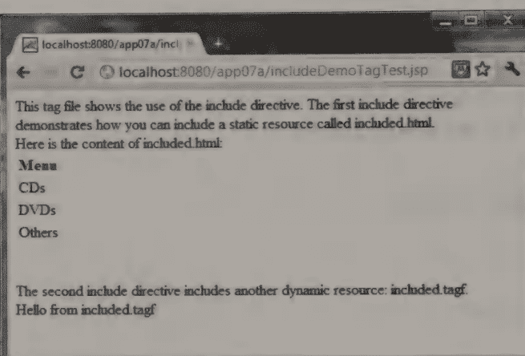

图 7.2：从标签文件中包含其他资源。

有关`include`指令的更多信息，请参阅第 3 章“JavaServer Pages”。

### taglib 指令

你可以使用`taglib`指令从你的标签文件中使用自定义标签。`taglib`指令具有以下语法：

```
<@ taglib uri="tagLibraryURI" prefix="tagPrefix" %>
```

`uri`属性指定一个绝对或相对 URI，用于唯一标识与此前缀关联的标签库描述（TLD）。

`prefix`属性定义了一个字符串，该字符串将成为区分自定义动作的前缀。

通过`taglib`指令，对于没有内容主体的自定义标签，你可以使用如下的格式：

```
<prefix:tagName/>
```

或者，对于具有内容的自定义标签，你可以使用这种格式：

```
<prefix:tagName>body</prefix:tagName>
```

标签文件中的`taglib`指令与 JSP 页面中的`taglib`指令相同。

作为一个示例，考虑列表 7.7 中的`taglibDemo.tag`文件。

### 列表 7.7：`taglibDemo.tag`文件

```
<@ taglib prefix="simple" tagdir="/WEB-INF/tags" %>

The server's date: <simple:firstTag/>
```

它使用了列表 7.1 中的`firstTag.tag`文件来显示服务器日期。`taglibDemo.tag`文件是列表 7.8 中的`taglibDemoTest.jsp`页面。

### 列表 7.8：`taglibDemoTest.jsp`页面

```
<@ taglib prefix="easy" tagdir="/WEB-INF/tags" %>

<easy:taglibDemo/>
```

你可以使用以下 URL 调用此 JSP 页面：

```
http://localhost:8080/app0a/taglibDemoTest.jsp
```

### attribute 指令

`attribute`指令支持在标签文件中使用属性。它等同于标签库描述中的`attribute`元素。以下是`attribute`指令的语法：

```
<@ attribute attribute="value" %>
```

语法可以表示为以下非正式形式：

```
<@ attribute attribute1="value1" attribute2="value2" ... %>
```

`attribute`指令的属性见表 7.4。唯一必需的属性是`name`属性。

作为一个示例，考虑列表 7.9 中的`encode.tag`文件，它可以用于编码字符串。它定义了一个名为`input`的属性，类型为`java.lang.String`。

表 7.4：`attribute`的属性

| 属性 | 描述 |
| --- | --- |
| `name` | 此标签接受的属性名称。`name`属性的值在整个标签文件中必须是唯一的。 |
| `required` | 表示该属性是否是必需的。值可以是`true`或`false`（默认）。 |
| `fragment` | 表示该属性是待由标签处理器评估的片段，还是待由容器评估的普通属性。值是`true`或`false`。 |
| `ispr` | 指定属性值是否可以在运行时通过脚本段表达式动态计算。值为`true`（默认）或`false`。 |
| `type` | 属性的类型。 |

```
<<table>
<tr>
<td><b>Menu</b></td>
</tr>
<tr>
<<td>>CDS</td>
</tr>
<tr>
<<td>>DVDs</td>
</tr>
<tr>
<<td>>Others</td>
</tr>
</</table>
```

### 列表 7.9：`encode.tag`文件

```jsp
<@ attribute name="input" type="java.lang.String" %>

<%
  String input = (String) get("input");
  if (input != null) {
    out.print(input.toUpperCase());
  }
%>
```

要测试`encode.tag`文件，请使用列表 7.10 中的`encodeTagTest.jsp`页面。

### 列表 7.10：`encodeTagTest.jsp`页面

```
<@ taglib prefix="easy" tagdir="/WEB-INF/tags" %>

<easy:encode input="hello world" />
```

你可以通过以下 URL 调用此 JSP 页面：

```
http://localhost:8080/app0a/encodeTagTest.jsp
```

列表 7.11 中的标签文件提供了服务器当前日期的两种格式：长格式和短格式。它有两个名为`longDate`和`shortDate`的变量。

## 列表 7.11：`varDemo.tag`

```jsp
<%@ tag import="java.util.Date" import="java.text.DateFormat" %>
<%@ variable name-given="longDate" %>
<%@ variable name-given="shortDate" %>

<%
Date now = new Date(System.currentTimeMillis());
DateFormat longFormat = DateFormat.getInstance(DateFormat.LONG);
DateFormat shortFormat = DateFormat.getInstance(DateFormat.SHORT);
jspContext.setAttribute("longDate", longFormat.format(now));
jspContext.setAttribute("shortDate", shortFormat.format(now));
%>

<jsp:doBody/>
```

请注意，你使用标签的`setAttribute`方法设置了一个变量。`jspContext`对象代表该对象（参见本章稍后的“隐式对象”部分）。JSP 标准标签库 (JSTL) 中的`set`标签封装了这一功能。如果你熟悉 JSTL，可以使用此标签来代替`setAttribute`方法。JSTL 在第 5 章“JSTL”中讨论过。

同样注意，你必须使用`doBody`标准动作来调用标签体。更多信息请参见本章稍后介绍`doBody`和`invoke`部分。

要测试`varDemo.tag`文件，请使用列表 7.12 中的`varDemoTest.jsp`页面。

## 列表 7.12：`varDemoTest.jsp`

```jsp
<%@ tag prefix="tags" tagdir="WEB-INF/tags" %>

今日日期：
<br/>
<tags:varDemo>
  长格式：${longDate}
  <br/>
  短格式：${shortDate}
</tags:varDemo/>
```

## 192 Servlet JSP: 教程

你可以使用以下 URL 访问`varDemoTest.jsp`页面：
`http://localhost:8080/app07a/varDemoTest.jsp`

图 7.4 显示了结果。

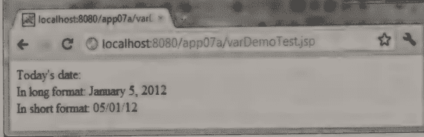

图 7.4：`varDemoTest.jsp`的结果

在许多情况下你都会想要使用变量。作为另一个例子，假设你想编写一个自定义动作，根据产品标识符从数据库中获取产品详情。为了解决这个问题，你可以使用属性来传递产品标识符。对于每条信息，你提供一个变量来存储该信息。因此，你将得到以下变量：`name`、`price`、`description`、`imageUrl`等。

## doBody

`doBody`标准动作只能在标签文件内部使用。你用它来调用标签体。你已经在列表 7.11 的标签文件中看到了`doBody`动作。在本节中，你将更详细地学习`doBody`。

`doBody`动作可以拥有属性。如果你将标签调用的输出重定向到变量，则可以使用这些属性。如果不使用属性，`doBody`标准动作会将输出写入调用它的 JSP 页面的`JspWriter`。

`doBody`标准动作的属性如表 7.6 所示。所有属性都是可选。

## 第 7 章：标签文件 193

表 7.6：`doBody`的属性

| 属性 | 描述 |
|---|---|
| `var` | 用于存储标签体调用输出的作用域属性名称。其值被存储为`java.lang.String`。`var`或`varReader`属性仅允许其一。 |
| `varReader` | 用于存储标签体调用输出的作用域属性名称。其值被存储为`java.io.Reader`。`var`或`varReader`属性仅允许其一。 |
| `scope` | 结果变量的作用域。 |

接下来的示例展示了如何使用`doBody`调用标签体并将输出存储在名为`referer`的会话作用域变量中。假设你有一个销售玩具的网站，并且在许多搜索引擎中大力推广了你的网站。理当然，你想知道底是哪个搜索引擎重定向了最多的流量并导致了销售。为了找到这一点，你可以记录 Web 应用程序主页的`referer`请求头。你使用标签文件将`referer`请求头的值存储为会话属性。稍后，如果用户决定购买产品，你可以获取会话属性值并将其插入数据库表中。

该示例包含一个 HTML 文件（`searchEngine.html`）、两个 JSP 页面（`main.jsp`和`viewReferer.jsp`）以及一个标签文件（`doBodyDemo.tag`）。`main.jsp`页面使用`doBodyDemo`自定义标签来存储`referer`请求头。要查看`referer`请求头的值，请使用`viewReferer.jsp`页面。如果你直接输入 URL 调用`main.jsp`页面，`referer`请求头将为`null`。因此，你必须使用`searchEngine.html`文件进入`main.jsp`页面。

`doBodyDemo.tag`文件见列表 7.13。

## 列表 7.13：`doBodyDemo.tag`

```jsp
<jsp:doBody var="referer" scope="session"/>
```

没错。`doBodyDemo.tag`文件仅包含一行：一个`doBody`标准动作。它的作用是调用标签体并将输出存储在会话属性中。

变量。标签文件的最后一行调用了片段`productDetails`。由于`invoke`标准动作中没有`var`或`varReader`属性，标签调用的结果将定向到调用 JSP 页面的`JspWriter`。

要测试标签文件，请使用列表 7.18 中的`invokeTest.jsp`页面。

### 列表 7.18：`invokeTest.jsp`页面

```
<%@ taglib prefix="easy" tagdir="WEB-INF/tags" %>

<html>
<head>
<title>Product Details</title>
</head>
<body>
<easy:invokeDemo>
  <jsp:attribute name="productDetails">
    <table width="220" border="1">
      <tr>
        <td><b>Product Name</b></td>
        <td>${productName}</td>
      </tr>
      <tr>
        <td><b>Description</b></td>
        <td>${description}</td>
      </tr>
      <tr>
        <td><b>Price</b></td>
        <td>${price}</td>
      </tr>
    </table>
  </jsp:attribute>
</easy:invokeDemo>
</body>
</html>
```

你可以使用以下 URL 来调用`invokeTest.jsp`页面。
`http://localhost:8080/app07a/invokeTest.jsp`

结果如图 7.8 所示。

## 总结

在本章中，你学习了标签文件以及它们如何让编写标签扩展变得更加简单。有了标签文件，你不需要标签库描述符，甚至不需要编译标签处理程序。你还了解了如何使用`invoke`和`doBody`标准动作。

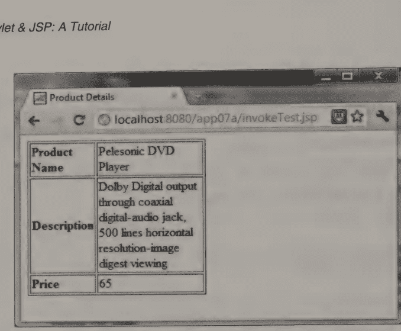

图 7.8：使用片段属性

# 第 8 章 监听器

Servlet API 提供了一组事件类和监听器接口，用于 servlet/JSP 应用程序事件驱动编程。所有事件类都继承自`java.util.Event`，监听器分为三个不同的级别：`ServletContext`级别、`HttpServletSession`级别和`ServletRequest`级别。

本章演示了如何编写监听器并在 servlet/JSP 应用中使用它们。其中一个监听器接口`javax.servlet.AsyncListener`是 Servlet 3.0 新增的内容，将在第 14 章“异步操作”中讨论。

## 监听器接口与注册

用于创建监听器的监听器接口属于`javax.servlet`和`javax.servlet.http`包。它们列举如下：

- `javax.servlet.ServletContextListener`：用于响应 servlet context 生命周期周期事件的监听器。其其中一个方法在 servlet context 创建后立即被调用，另一个方法在 servlet context 关闭之前被调用。
- `javax.servlet.ServletContextAttributeListener`：可以在 servlet context 属性被添加、删除或替换时采取的监听器。
- `javax.servlet.http.HttpSessionListener`：用于响应`HttpServletSession`创建、超时和失效的监听器。
- `javax.servlet.http.HttpSessionAttributeListener`：当话属性被添加、删除或替换时被调用的监听器。
- `javax.servlet.http.HttpSessionActivationListener`：当`HttpSession`被激活或钝化时被调用的监听器。
- `javax.servlet.http.HttpSessionBindingListener`：要作为`HttpSession`属性存储的类实例可以实现此接口。实现`HttpSessionBindingListener`的类实例在被添加到或从`HttpSession`删除时将收到通知。
- `javax.servlet.ServletRequestListener`：用于响应`ServletRequest`创建和删除的监听器。
- `javax.servlet.ServletAttributeListener`：当属性被`ServletRequest`添加、删除或替换时其方法被调用的监听器。
- `javax.servlet.AsyncListener`：用于异步操作的监听器。将在第 14 章“异步操作”中详细说明。

要创建监听器，只需创建一个实现相关接口的 Java 类。在 Servlet 3.0 中，有两种方法可以注册监听器以便被 servlet 容器识别。第一种是使用所示的`@WebListener`注解类型：

```
@WebListener
public class ListenerClass implements ListenerInterface {
}
```

第二种注册监听器的方法是通过部署描述符中的`<listener>`元素。

```
<listener>
  <listener-class>fully-qualified listener class</listener-class>
</listener>
```


你可以在应用程序中拥有任意数量的监听器。注意，对监听器方法的调用是同步执行的。

## ServletContext 监听器

在`ServletContext`级别有两个监听器接口：`ServletContextListener`和`ServletContextAttributeListener`。它们在下面的章节中都会介绍。

### ServletContextListener

`ServletContextListener`响应`ServletContext`的初始化和销毁。当`ServletContext`初始化时，servlet容器会调用所有注册的`ServletContextListener`的`contextInitialized`方法。其签名如下：

```
void contextInitialized(ServletContextEvent event)
```

当`ServletContext`准备停用并销毁时，servlet容器会调用所有注册的`ServletContextListener`的`contextDestroyed`方法。这里是`contextDestroyed`的签名。

```
void contextDestroyed(ServletContextEvent event)
```

`contextInitialized`和`contextDestroyed`都接收一个`ServletEvent`。作为`java.util.Event`的子类，`ServletContext`定义了一个返回`ServletContext`的`getServletContext`方法：

```
ServletContext getServletContext()
```

该方法访问`ServletContext`的唯一方法非常重要。作为一个示例，考虑配套的app8a应用程序。列表8.1中的`AppListener`在`ServletContext`初始化后会将Map放入`ServletContext`属性。

#### 列表8.1：AppListener类

```java
package app8a.listener;

import java.util.HashMap;
import java.util.Map;
import javax.servlet.ServletContext;
import javax.servlet.ServletContextEvent;
import javax.servlet.ServletContextListener;
import javax.servlet.annotation.WebListener;

@WebListener
public class AppListener implements ServletContextListener {

    @Override
    public void contextDestroyed(ServletContextEvent sce) {
    }

    @Override
    public void contextInitialized(ServletContextEvent sce) {
        ServletContext servletContext = sce.getServletContext();
        Map<String, String> countries =
            new HashMap<String, String>();
        countries.put("ca", "Canada");
        countries.put("us", "United States");
        servletContext.setAttribute("countries", countries);
    }
}
```

注意列表8.1类中`contextInitialized`方法的实现。它通过调用servlet传递的`getServletContext`方法开始。然后创建一个Map并填充它，最后将其作为`ServletContext`属性。在现实应用中，存储在`ServletContext`中的数据可能来自数据库。

要测试监听器，请使用列表8.2中的`countries.jsp`页面。

#### 列表8.2：countries.jsp页面

```jsp
<%@ taglib uri="http://java.sun.com/jsp/jst/core" prefix="c" %>
<html>
<head>
<title>Country List</title>
</head>
<body>
我们在以下国家进行操作：
<ul>
  <c:forEach items="${countries}" var="country">
    <li>${country.value}</li>
  </c:forEach>
</ul>
</body>
</html>
```

`countries.jsp`页面使用JSTL`forEach`标签遍历`countries`map。注意，为了此示例生效，你需要在app8a应用程序的`WEB-INF/lib`目录下放置JSTL库。

将JSTL库复制到lib目录后，重启servlet容器并在浏览器访问你的URL：`http://localhost:8080/app8a/countries`

你应该看到一个与图8.1类似的屏幕。

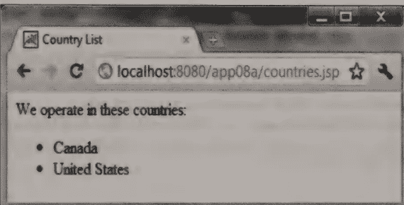

图8.1：使用ServletContextListener加初始值

### ServletContextAttributeListener

`ServletContextAttributeListener`的实现每当属性被添加到、从`ServletContext`中删除或替换时，都会收到通知。这里是此监听器接口定义的三个方法。

```
void attributeAdded(ServletContextAttributeEvent event)
void attributeRemoved(ServletContextAttributeEvent event)
void attributeReplaced(ServletContextAttributeEvent event)
```

当属性被添加到`ServletContext`时，servlet容器调用`attributeAdded`方法。当属性从`ServletContext`中删除时，`attributeRemoved`被调用，当`ServletContext`属性被替换时，`attributeReplaced`方法被调用。

被一个新的实例替换。所有的监听器方法都接收一个`ServletContextAttributeEvent`实例，你可以从其中获取属性名称和值。

`ServletContextAttributeEvent`类派自`ServletContextAttribute`，并增加了这两个方法分别获取属性名称和值。

```
java.lang.String getName()
java.lang.Object getValue()
```

## 会话监听器 (Session Listeners)

共有四个与`HttpSession`相关的监听接口：`HttpServletListener`、`HttpSessionActivationListener`、`HttpSessionAttributeListener`和`HttpSessionBindingListener`。这些接口都是`javax.servlet.http`包的成员，并在下文章节中进行了解释。

### HttpSessionListener

当`HttpSession`创建或销毁时，Servlet容器会调用所有注册的`HttpServletListener`。`HttpServletListener`中定义的两个方法是`sessionCreated`和`sessionDestroyed`。

```
void sessionCreated(HttpSessionEvent)
void sessionDestroyed(HttpSessionEvent)
```

这两个方法都接收一个`HttpSessionEvent`实例，它是`java.util.Event`的子类。你可以在被创建或销毁的`HttpSession`上调用`getSession`方法。`getSession`方法的签名如下：

```
HttpSession getSession()
```

例如，查看app08a中的`SessionListener`类，该类打印在列表8.3。此监听器提供了应用程序中`HttpSessions`的数量。使用一个`AtomicInteger`作为计数器并存储在`ServletContext`属性中。当`HttpSession`创建时，该计数器递增。当`HttpSession`失效时，该计数器递减。因此，它能够提供在读取计数器时具有有效会话的用户数量的准确快照。使用`AtomicInteger`而不是`Integer`是为了保证加、减操作的原子性。

#### 列表8.3: SessionListener类

```java
package app08a.listener;

import java.util.concurrent.atomic.AtomicInteger;
import javax.servlet.ServletContext;
import javax.servlet.ServletContextEvent;
import javax.servlet.ServletContextListener;
import javax.servlet.annotation.WebListener;
import javax.servlet.http.HttpSession;
import javax.servlet.http.HttpSessionEvent;
import javax.servlet.http.HttpSessionListener;

@WebListener
public class SessionListener implements HttpSessionListener,
    ServletContextListener {

    @Override
    public void contextInitialized(ServletContextEvent sce) {
        ServletContext servletContext = sce.getServletContext();
        servletContext.setAttribute("userCounter",
            new AtomicInteger(0));
    }

    @Override
    public void contextDestroyed(ServletContextEvent sce) {}

    @Override
    public void sessionCreated(HttpSessionEvent se) {
        HttpSession session = se.getSession();
        ServletContext servletContext = session.getServletContext();
        AtomicInteger userCounter = (AtomicInteger) servletContext
            .getAttribute("userCounter");
        int userCount = userCounter.incrementAndGet();
        System.out.println("user incremented to : " + 
            userCount);
    }
```

```java
@Override
public void sessionDestroyed(HttpSessionEvent se) {
    HttpSession session = se.getSession();
    ServletContext servletContext = session.getServletContext();
    AtomicInteger userCounter = (AtomicInteger) servletContext
        .getAttribute("userCounter");
    int userCount = userCounter.decrementAndGet();
    System.out.println("----------userCount decremented to :" +
        + userCount);
}
```

你可以在列表8.3中看到，`SessionListener`类实现了`ServletListener`接口和`HttpSessionListener`接口。因此，你需要实现这两个接口中的方法。

`contextInitialized`方法继承自`ServletListener`接口，它在`ServletContext`中创建并存储了一个`AtomicInteger`。由于`AtomicInteger`的初始值为0，它表示在应用程序启动时用户数为0。该`ServletContext`属性的名称为`userCounter`。

```java
public void contextInitialized(ServletContextEvent sce) {
    ServletContext servletContext = sce.getServletContext();
    servletContext.setAttribute("userCounter",
        new AtomicInteger(0));
}
```

`sessionCreated`方法在每次创建`HttpSession`时都会被调用。该方法的作用是从`ServletContext`中获取`userCounter`属性。然后它对`userCounter` `AtomicInteger`对象调用`incrementAndGet`方法。该值被打印到控制台，以便你查看监听器的工作原理。

```java
public void sessionCreated(HttpSessionEvent se) {
    HttpSession session = se.getSession();
    ServletContext servletContext = session.getServletContext();
    AtomicInteger userCounter = (AtomicInteger) servletContext
        .getAttribute("userCounter");
    int userCount = userCounter.incrementAndGet();
    System.out.println("userCount incremented to :" +
        + userCount);
}
```

`sessionDestroyed`在`HttpSession`即将销毁之前调用。该方法的实现与`sessionCreated`类似，不同在于它是递减`userCounter`的值而不是递增。

```java
public void sessionDestroyed(HttpSession event) {
    HttpSession session = se.getSession();
    ServletContext servletContext = session.getServletContext();
    AtomicInteger userCounter = (AtomicInteger) servletContext
        .getAttribute("userCounter");
    int userCount = userCount.decrementAndGet();
    System.out.println("------userCount decremented to : " + userCount);
}
```

要测试该监听器，请使用不同的浏览器请求`countries.jsp`页面，并观察控制台上打印的内容。调用`countries.jsp`的URL如下：

```
http://localhost:8080/app08a/countries.jsp
```

第一次调用会在控制台上打印：

```
user incremented to :1
```


来自同一浏览器的另一个请求不会改变`userCounter`的值，因为它们关联同一个`HttpSession`。然而，使用不同的浏览器调用将增加`userCounter`的值。

现在，如果你有时间，等待`HttpSession`过期并注意控制台上打印的内容。

## HttpSessionAttributeListener

`HttpSessionAttributeListener`类似于`ServletContextAttributeListener`，区别在于当属性添加到、移除或替换于`HttpSession`时，它会被调用。以下是`HttpSessionAttributeListener`接口定义的方法：

```
void attributeAdded(HttpSessionBindingEvent event);
void attributeRemoved(HttpSessionBindingEvent event)
void attributeReplaced(HttpSessionBindingEvent event)
```

`attributeAdded`方法由Servlet容器在属性添加到`HttpSession`时调用。`attributeRemoved`方法在属性从`HttpSession`中移除时调用，`attributeReplaced`方法在`HttpSession`属性被新属性替换时调用。所有的监听器方法都接收一个`HttpSessionBindingEvent`实例，你可以从其中获取相应的`HttpSession`以及属性名称和值。

```
java.lang.String getName()
java.lang.Object getValue()
```

由于`HttpSessionBindingEvent`是`HttpSessionEvent`的子类，你也可以在你的`HttpAttributeListener`类中获取受影响的`HttpSession`。

## HttpSessionActivationListener

在配置了多个Servlet容器以扩展的分布式环境中，Servlet容器可能会迁移或序列化属性以节省内存。通常情况下，不经常访问的对象可能会序列化到辅助存储器。这样做时，Servlet容器会通知实现了`HttpSessionActivationListener`接口的会话属性。

该接口定义了两个方法：`sessionDidActivate`和`sessionWillPassivate`。

```
void sessionDidActivate(HttpSessionEvent event)
void sessionWillPassivate(HttpSessionEvent event)
```

`sessionDidActivate`方法在包含该对象的`HttpSession`被激活后调用。传递给方法的参数让你获取被激活的`HttpSession`。

`sessionWillPassivate`方法在包含该监听器的`HttpSession`即将钝化时被调用。与`sessionDidActivate`类似，Servlet容器会将`HttpSessionEvent`传递给该方法，以便会话属性作用于`HttpSession`。

## HttpSessionBindingListener

例如，列表8.4中的`Product`类实现了`HttpSessionBindingListener`。

### 列表8.4：实现HttpSessionBindingListener的类

```java
package app08a.model;

import javax.servlet.http.HttpSessionBindingEvent;
import javax.servlet.http.HttpSessionBindingListener;

public class Product implements HttpSessionBindingListener {

    private String id;
    private String name;
    private double price;

    public String getId() {
        return id;
    }

    public void setId(String id) {
        this.id = id;
    }

    public String getName() {
        return name;
    }

    public void setName(String name) {
        this.name = name;
    }

    public double getPrice() {
        return price;
    }

    public void setPrice(double price) {
        this.price = price;
    }

    @Override
    public void valueBound(HttpSessionBindingEvent event) {
        String attributeName = event.getName();
        System.out.println(attributeName + " valueBound");
    }

    @Override
    public void valueUnbound(HttpSessionBindingEvent event) {
        String attributeName = event.getName();
        System.out.println(attributeName + " valueUnbound");
    }
}
```

该监听器在绑定到`HttpServletSession`和解绑时，执行的操作仅向控制台打印内容。

## Servlet监听器（Servlet Listeners）

`ServletRequest`级别有三个监听器接口：`ServletRequestListener`、`ServletRequestAttributeListener`和`AsyncListener`。前两个监听器将在本节讨论，`AsyncListener`将在第14章“异步操作”中介绍。

### ServletListener

`ServletListener`响应`ServletRequest`的创建和销毁。在池并重用`ServletRequest`的Servlet容器中，`ServletRequest`的创建被视为从池中获取的时间，而其销毁被视为返回池的时间。

`ServletListener`接口定义了两个方法：`requestInitialized`和`requestDestroyed`。它们的签名如下。

```
void requestInitialized(ServletRequestEvent event)
void requestDestroyed(ServletRequestEvent event)
```

当`ServletRequest`创建（或从池中取出）时，调用`requestInitialized`方法；当`ServletRequest`将被销毁（或返回池）时，调用`requestDestroyed`方法。这两个方法都接收一个`ServletRequestListener`，通过调用`getServletRequest`方法可以获取相应的`ServletRequest`实例。

```
ServletRequest getServletRequest()
```

此外，`ServletRequestListener`接口还定义了返回`ServletContext`的`getServletContext`方法。该方法签名如下。

```
ServletContext getServletContext()
```

例如，考虑app08a中的`PerfStatListener`类。该监听器测量`ServletRequest`销毁时间与其创建时间之间差，从而有效地计算执行一个请求所需的时间。

列表8.5中的`PerfStatListener`类利用`ServletListener`接口来测量HTTP请求完成所需的多长时间。它依赖于这样一个事实：Servlet容器在请求开始时调用`requestInitialized`方法，在处理完成后调用`requestDestroyed`方法。通过在两个事件开始时读取当前时间并进行比较，你可以得到HTTP请求完成所需的大致时间。

### 列表8.5：PerfStatListener

```java
package app08a.listener;

import javax.servlet.ServletRequest;
import javax.servlet.ServletRequestEvent;
import javax.servlet.ServletListener;
import javax.servlet.annotation.RequestListener;
import javax.servlet.http.HttpServletRequest;

@WebListener
public class PerfStatListener implements ServletListener {

    @Override
    public void requestInitialized(ServletRequestEvent sre) {
        ServletRequest servletRequest = sre.getServletRequest();
        servletRequest.setAttribute("start", System.nanoTime());
    }

    @Override
    public void requestDestroyed(ServletRequestEvent sre) {
        ServletRequest servletRequest = sre.getServletRequest();
        Long start = (Long) servletRequest.getAttribute("start");
        Long end = System.nanoTime();
        HttpServletRequest httpRequest = (HttpServletRequest) servletRequest;
        String uri = httpRequest.getRequestURI();
        System.out.println("time taken to execute " + uri + " : " + ((end - start) / 1000) + "microseconds");
    }
}
```

列表8.5中的`requestInitialized`方法调用`System.nanoTime()`并将返回值（将被装箱为`Long`）作为`ServletRequest`属性。

```java
public void requestInitialized(ServletRequestEvent sre) {
    ServletRequest servletRequest = sre.getServletRequest();
    servletRequest.setAttribute("start", System.nanoTime());
}
```

`nanoTime`方法返回一个表示任意时间的`long`值。返回值与任何系统时间或墙上时间的概念无关，但在同一个JVM中获取的两个返回值非常适合测量第一次`nanoTime`调用和第二次调用之间流逝的时间。

正如你所猜想的，`requestDestroyed`方法第二次调用了`nanoTime`方法并将其值与第一个值进行比较。

```java
public void requestDestroyed(ServletRequestEvent sre) {
    ServletRequest servletRequest = sre.getServletRequest();
    Long start = (Long) servletRequest.getAttribute("start");
    Long end = System.nanoTime();
    HttpServletRequest httpRequest = (HttpServletRequest) servletRequest;
    String uri = httpRequest.getRequestURI();
    System.out.println("time taken to execute " + uri + " : " + ((end - start) / 1000) + "microseconds");
}
```

### ServletContextAttributeListener

`ServletContextAttributeListener`在属性被添加到`ServletContext`、从其移除或替换时被调用。`ServletContextAttributeListener`有三个方法：`attributeAdded`、`attributeRemoved`和`replaced`。它们的签名如下。

```
void attributeAdded(AttributeEvent event)
void attributeRemoved(AttributeEvent event)
void attributeReplaced(AttributeEvent event)
```

所有方法都接收一个`AttributeEvent`实例，它是`ServletEvent`的子类。`AttributeEvent`类通过`getName`和`getValue`方法暴露相关的属性：

```
String getName()
Object getValue()
```

## 总结

在本章中，你学习了Servlet API中的各种监听器类型。这些监听器的作用范围包括应用、会话和请求。使用监听器非常简单，涉及简单的注册过程。你可以通过使用`@WebListener`注解实现类或在部署描述中使用`listener`元素来注册监听器。

监听器接口之一`javax.servlet.AsyncListener`是Servlet 3.0的新增内容，将在第14章“异步操作”中介绍。

## 第9章：过滤器（Filters）

过滤器是一个拦截请求并处理传递给请求资源的`ServletRequest`或`ServletResponse`的对象。过滤器可以用于日志记录、加密和解密、会话检查、图像转换等。过滤器可以配置为拦截一个或多个资源。

过滤配置可以通过注解或部署描述完成。如果多个过滤器应用于同一个资源，调用顺序有时很重要，在这种情况下你需要部署描述。

本章将解释如何编写和注册过滤器。同时也提供了一些示例。

## Filter API

接下来的章节将解释过滤器中使用的接口，包括`Filter`、`FilterConfig`和`FilterChain`。

过滤器类必须实现`javax.servlet.Filter`接口。该接口暴露了过滤器的三个生命周期方法：`init`、`doFilter`和`destroy`。

`init`方法在Servlet容器将过滤器投入服务时调用（即应用程序启动时）。也就是说，`init`方法不会等待与过滤器相关的资源被调用。此方法只被调用一次，应包含过滤器的初始化代码。`init`方法的签名如下。

```
void init(FilterConfig filterConfig);
```

请注意，Servlet容器会将一个`FilterConfig`传递给`init`方法。下面将解释`FilterConfig`接口。

`Filter`实例的`doFilter`方法在每次调用与过滤器相关的资源时，都会被Servlet调用。此方法接收一个`ServletRequest`、一个`ServletResponse`和一个`FilterChain`。

以下是`doFilter`的签名：

```
void doFilter (ServletRequest request, ServletResponse response,
FilterChain filterChain)
```

如你所示，`doFilter`的实现可以访问`ServletRequest`和`ServletResponse`。因此，可以向`ServletRequest`添加属性或向`ServletResponse`添加标头。你甚至可以装饰`ServletRequest`或`ServletResponse`来改变它们的行为，如第13节“装饰请求和响应”所解释。

`doFilter`方法实现的最后一行代码应该是调用作为第三个参数传递给`doFilter`的`FilterChain`上的`doFilter`方法：

```
filterChain.doFilter(request, response)
```


一个资源可能与多个过滤器（或者用更专业的术语说，过滤器链）关联，`FilterChain.doFilter()` 基本上会导致链中的下一个过滤器被调用。在链的最后一个过滤器上调用 `FilterChain.doFilter()` 会导致该资源被调用。

如果你在 `Filter.doFilter()` 实现的末尾没有调用 `FilterChain.doFilter()`，处理将在此停止，请求将不会被触发。

> 注意，`doFilter` 方法是 `FilterChain` 接口中的唯一方法。此方法与 `Filter` 中的 `doFilter` 方法略有不同。在 `FilterChain` 中，`doFilter` 只接收两个参数而不是三个。

`Filter` 中的最后一个生命周期方法是 `destroy`。以下是它的签名：

```
void destroy()
```

该方法在过滤器停止服务之前由 servlet 容器调用，这通常发生在应用程序停止时。

## 第 9 节：过滤器 (Filters)

除非在部署描述符的多个过滤器元素中声明了过滤器类，否则 servlet 容器只会为每种类型的过滤器创建一个实例。由于 servlet/JSP 通常是多用户应用程序，过滤器实例可能被多个线程同时访问，你需要仔细地处理多线程问题。关于如何处理线程安全的示例，请参见本节稍后的下载计数器过滤器示例。

## 过滤器配置

写完过滤器类后，你仍然需要配置过滤器。过滤器配置具有以下目标：

- 确定过滤器将拦截哪些资源。
- 设置传递给过滤器的 `init` 方法的初始值。
- 给过滤器指定一个名称。在大多数情况下，为过滤器命名没有太大意义，但有时会很有帮助。例如，你可能想记录过滤器开始的时间，如果同一个应用程序中有多个过滤器，那么查看过滤器被调用的顺序通常很有用。

`FilterConfig` 接口允许你通过其 `getServletContext` 方法访问 `ServletContext`。

```
ServletContext getServletContext()
```

如果过滤器有名称，`FilterConfig` 中的 `getFilterName` 方法将返回该名称。以下是 `getFilterName` 的签名。

```java
java.lang.String getFilterName()
```

然而，你最感兴趣的是获取初始参数，即开发者或部署者传递给过滤器的初始化值。你可以使用两个方法来处理初始参数，第一个是 `getParameterNames`：

```
java.util.Enumeration<java.lang.String> getInitParameterNames()
```

该方法返回过滤器参数名称的枚举（`Enumeration`）。如果过滤器不存在任何参数，该方法将返回一个空枚举。

处理初始参数的第二个方法是 `getInitParameter`: `java.lang.String getInitParameter(java.lang.String parameterName)`

配置过滤器有两种方法。你可以使用 `@WebFilter` 注解类型来配置过滤器，或者通过在部署描述符中注册。使用 `@WebFilter` 只需对过滤器类进行注解即可，不需要部署描述符。然而，更改配置设置需要重新编译过滤器类。另一方面，在部署描述符中配置过滤器意味着更改配置值只需编辑文本文件。

要使用 `@WebFilter`，你需要熟悉它的属性。表 9.1 列出了可能出现在 `WebFilter` 注解类型中的属性。所有属性都是可选的。

| 属性 | 描述 |
| --- | --- |
| asyncSupported | 指定过滤器是否支持异步操作模式 |
| description | 过滤器的描述 |
| dispatcherTypes | 过滤器应用的分发器类型 |
| displayName | 过滤器的显示名称 |
| filterName | 过滤器的名称 |
| initParams | 初始参数 |
| largeIcon | 过滤器的大图标名称 |
| servletNames | 过滤器应用的 servlet 名称 |
| smallIcon | 过滤器的小图标名称 |
| urlPatterns | 过滤器应用的 URL 模式 |
| value | 过滤器应用的 URL 模式 |

表 9.1：`WebFilter` 属性

例如，下面的 `@WebFilter` 注解指定过滤器名称为 `DataCompressionFilter` 且应用于所有资源。

```
@WebFilter(filterName="DataCompressionFilter"
```

这等于在部署描述符中声明这些 `filter` 和 `filter-mapping` 元素。

```xml
<filter>
  <filter-name>DataCompressionFilter</filter-name>
  <filter-class>
    过滤器类的完全限定名
  </filter-class>
</filter>

<filter-mapping>
  <filter-name>DataCompressionFilter</filter-name>
  <url-pattern>/*</url-pattern>
</filter-mapping>
```

作为另一个示例，下面的 `@WebFilter` 注解传递了两个初始参数：

```java
@WebFilter(filterName="Security Filter", urlPatterns = { "" }, initParams = {
    @WebInitParam(name="frequency", value="217"),
    @WebInitParam(name="resolution", value="218")
})
```

使用部署描述符中的过滤器和过滤器映射元素，其配置设置如下：

```xml
<filter>
  <filter-name>Security Filter</filter-name>
  <filter-class>filterClass</filter-class>
  <init-param>
    <param-name>frequency</param-name>
    <param-value>217</param-value>
  </init-param>
  <init-param>
    <param-name>resolution</param-name>
    <param-value>218</param-value>
  </init-param>
</filter>

<filter-mapping>
  <filter-name>DataCompressionFilter</filter-name>
  <url-pattern>/*</url-pattern>
</filter-mapping>
```

部署描述符将在第 16 节“部署”中详细讨论。

### 示例 1：日志过滤器

作为第一个示例，考虑应用程序中一个用于在文件中记录 URI 的简单过滤器。文件名可以通过初始参数进行配置。此外，日志中的每个条目都可以由初始参数传递的预设字符串开头。你可以从日志中得出有用信息，例如应用程序中哪些资源最受欢迎，或者在一天中什么时间网站最繁忙。

该过滤器类名为 `LoggingFilter`，位于列表 9.1。按照惯例，过滤器类以 `Filter` 结尾。

### 9.1：`LoggingFilter` 类

```java
package filter;

import java.io.File;
import java.io.FileNotFoundException;
import java.io.IOException;
import java.io.PrintWriter;
import java.util.Date;
import javax.servlet.Filter;
import javax.servlet.FilterChain;
import javax.servlet.FilterConfig;
import javax.servlet.ServletException;
import javax.servlet.ServletRequest;
import javax.servlet.ServletResponse;
import javax.servlet.annotation.WebFilter;
import javax.servlet.annotation.WebInitParam;
import javax.servlet.http.HttpServletRequest;

@WebFilter(filterName = "LoggingFilter", urlPatterns = { "*" }, initParams = {
    @WebInitParam(name = "fileName", value = "log.txt"),
    @WebInitParam(name = "prefix", value = "URI: ")
})
public class LoggingFilter implements Filter {
    private PrintWriter logger;
    private String prefix;

    @Override
    public void init(FilterConfig filterConfig)
```

# 第 9 章：过滤器

```java
        throws ServletException {
    prefix = filterConfig.getInitParameter("prefix");
    String logFileName = filterConfig
        .getInitParameter("logFileName");
    String appContext = filterConfig.getContext()
        .getRealPath("/");
```

让我们仔细观察这个过滤器类。

## 222 Servlet & JSP: 教程

首先，过滤器类实现了 `Filter` 接口并声明了两个变量：一个名为 `logger` 的 `PrintWriter` 和一个名为 `prefix` 的 `String`：

```java
private PrintWriter logger;
private String prefix;
```

`PrintWriter` 将用于写入文本文件。`prefix` 字符串将作为每个日志条目的前缀。

过滤器类使用了 `@WebServlet` 注解，向过滤器传递了两个初始化参数（`logFileName` 和 `prefix`）：

```java
@WebServlet(name = "LoggingFilter", urlPatterns = {"*" },
  initParams = {
    @InitParam(name = "logFileName",
      value = "log.txt",
    @InitParam(name = "prefix", value = URI: ")
  }
```

`init` 方法调用 `getInitParameter` 方法来获取传入的 `FilterConfig` 和 `logFileName` 初始化参数。`prefix` 参数的值被赋值给类级变量 `prefix`，而 `logFileName` 则用于创建 `PrintWriter`。

```java
prefix = filterConfig.getInitParameter("prefix");
logFileName = filterConfig
  .getInitParameter("logFileName");
```

由于 servlet/JSP 应用是由 servlet/JSP 容器启动的，当前的工作目录是调用 `java` 的位置。在 Tomcat 中，这是 Tomcat 安装目录下的 `bin`。要在应用程序目录下创建日志文件，你需要它的绝对路径。你可以使用 `ServletContext.getRealPath` 方法获取它。将应用程序路径和 `logFileName` 参数结合，你会得到：

```java
String appPath = filterConfig.getServletContext()
  .getRealPath("/");
// 如果 logFileName 中没有路径，日志文件将在 $TOMCAT_HOME/bin 中创建
```

```java
try {
  logger = new PrintWriter(new File(appPath,
    logFileName));
} catch (FileNotFoundException e) {
    e.printStackTrace();
    throw new ServletException(e.getMessage());
}
```

当 `init` 方法执行时，将创建一个日志文件。如果应用程序目录下已存在同名文件，该文件将被新文件覆盖。

当应用程序关闭时，必须关闭 `PrintWriter`。因此，在过滤器的 `destroy` 方法中，你写：

```java
if (logger != null) {
    logger.close();
}
```

`doGet` 方法通过强制转换为 `HttpServletRequest` 并调用其 `getRequestURI` 方法来记录所有请求。`getRequestURI` 的结果随后传递给 `PrintWriter` 的 `println` 方法。

```java
HttpServletRequest httpRequest =
    (HttpServletRequest) request;
logger.println(new Date() + " " + prefix
    + httpRequest.getRequestURI());
```

每个条目都赋予了一个时间戳和一个前缀，以便于确定记录生成的时间。`doFilter` 然后刷新 `PrintWriter` 并调用 `FilterChain.doFilter` 来调用资源。

```java
logger.flush();
filterChain.doFilter(request, response);
```

当你运行 Tomcat 时，过滤器将进入服务状态，无需等待第一个请求。你应该能在控制台上看到 `logFileName` 参数的值。

要测试此过滤器，请使用以下 URL 调用 app09a 应用中的 `test.jsp` 页面：

```
http://localhost:8080/app09a/test.jsp
```

检查日志文件的内容以验证过滤器是否工作正常。

## 示例 2：图像保护过滤器

示例中的图像保护过滤器防止通过在浏览器地址栏中输入图像 URL 来下载图像。应用程序中的图像只有在页面上点击图像链接时才会显示。该过滤器通过检查 `Referer` HTTP 请求头的值来工作。空值意味着当前请求没有来源，换句话说，是通过输入 URL 请求该资源的。具有非空 `Referer` 请求头的资源将其源页面作为其 `Referer`。注意，请求头名称的拼写在第二个 `e` 和第三个 `e` 之间有一个 `r`。

代码列表 9.2 给出了过滤器类 `ImageProtectorFilter`。从 `@WebFilter` 注解中知道该过滤器应用于所有具有 `.png`、`.jpg` 或 `.gif` 扩展名的资源。

### 代码列表 9.2：`ImageProtectorFilter` 类

```java
package filter;

import java.io.IOException;
import javax.servlet.Filter;
import javax.servlet.FilterChain;
import javax.servlet.FilterConfig;
import javax.servlet.ServletException;
import javax.servlet.ServletRequest;
import javax.servlet.ServletResponse;
import javax.servlet.annotation.WebFilter;
import javax.servlet.http.HttpServletRequest;

@WebFilter(filterName = "ImageProtectorFilter", urlPatterns = {"*.png", "*.jpg", "*.gif"})
public class ImageProtectorFilter implements Filter {

    @Override
    public void init(FilterConfig filterConfig)
        throws ServletException {
    }

    @Override
    public void destroy() {
    }

    @Override
    public void doFilter(ServletRequest request,
        ServletResponse response, FilterChain filterChain)
        throws IOException, ServletException {
    HttpServletRequest httpRequest = (HttpServletRequest) request;
    String referrer = httpRequest.getHeader("Referer");
    if (referrer != null) {
```


`filterChain.doFilter(request, response);`

否则：

```java
throw new ServletException("Image available");
```

## 第 9 章：过滤器 225

（注：第 234-235 页的 OCR 文本非常混乱。根据之前页面的上下文，我重建了图像保护过滤器的逻辑流以及新的示例 3。）

## 示例 3：下载计数过滤器

示例中的下载计数过滤器具有一个计算资源下载次数的过滤器。如果你想知道你的文档或视频有多受欢迎，这将非常有用。为了简单起见，数字存储在属性文件中而不是数据库中。资源 URI 被用作属性键。

由于我们将值存储在属性文件中，且过滤器可以被多个线程同时访问，存在需要解决的线程安全问题。用户可以请求资源，过滤器需要读取相应的属性值，加 1，存回新值。如果在第一个线程完成操作之前，第二个用户请求了相同的资源会怎样？计数将是不准确的。同步读写代码听起来不是理想的解决方案，因为扩展性可能会受到影响。

此示例展示了如何使用队列和 `Executor` 来解决这个线程安全问题。简而言之，所有进入的请求都将一个任务放入单线程 `Executor` 的队列中。放置任务非常快，因为它是异步操作，你不需要等待任务完成。`Executor` 会从队列中一个一个地取出项目并增加正确的属性。

```java
package filter;

import java.io.File;

import java.io.FileReader;
```

## 第 9 章：过滤器 227

```java
import java.io.FileWriter;

import java.io.FileReader;

import java.io.IOException;

import java.util.Properties;

import java.util.concurrent.ExecutorService;

import java.util.concurrent.Executors;
```

```java
import javax.servlet.Filter;

import javax.servlet.FilterChain;

import javax.servlet.FilterConfig;

import javax.servlet.ServletExceptionException;

import javax.servlet.ServletRequest;

import javax.servlet.ServletResponse;

import javax.servlet.annotation.WebFilter;

import javax.servlet.http.HttpServletRequest;
```

```java
@WebFilter(name = "DownloadCounterFilter",

urlPatterns = {"/*"})

public class DownloadCounterFilter implements Filter {
```

```java
ExecutorService executorService = Executors

    .newSingleThreadExecutor();

Properties downloadLog;

File logFile;
```

```java
@Override

public void init(FilterConfig filterConfig)

    throws ServletException {

    System.out.println("DownloadCounterFilter");

    String appPath = filterConfig.getServletContext()

        .getPath("/");

    logFile = new File(appPath, "downloadLog.txt");

    if (!logFile.exists()) {

        try {

            logFile.createNewFile();

        } catch (IOException e) {

            e.printStackTrace();

        }

    }

    downloadLog = new Properties();

    try {

        downloadLog.load(new FileReader(logFile));

    } catch (IOException e) {

        e.printStackTrace();

    }

}
```

## 228 Servlet & JSP: 教程

```java
@Override

public void destroy() {

    executorService.shutdown();

}

@Override

public void doFilter(ServletRequest request,

    ServletResponse response, FilterChain filterChain)

    throws IOException, ServletException {

    HttpServletRequest httpRequest = (HttpServletRequest)request;

    final String uri = httpRequest.getRequestURI();

    executorService.execute(new Runnable() {

        @Override

        public void run() {

            String property = downloadLog.getProperty(uri);

            if (property == null) {

                downloadLog.setProperty(uri, "1");

            } else {

                int count = 0;

                try {

                    count = Integer.parseInt(property);

                } catch (NumberFormatException e) {

                    // silent

                }

                count++;

                downloadLog.setProperty(uri,

                    Integer.toString(count));

            }

            try {

                downloadLog.store(new FileWriter(logFile), "");

            } catch (IOException e) {

            }

        }

    });

    filterChain.doFilter(request, response);

}
```

过滤器的 `init` 方法会在应用程序目录中创建一个 `downloadLog.txt` 文件，如果它不存在。

`String appPath = filterConfig.getServletContext()`

随后它创建了一个 `Properties` 对象并加载该文件：

```java
downloadLog = new Properties();

try {

  downloadLog.load(new FileReader(logFile));

} catch (IOException e) {

  e.printStackTrace();

}
```

注意，过滤器类包含一个 `ExecutorService`（`Executor` 的子类）作为类级别的对象引用。

```java
ExecutorService executorService = Executors

.newSingleThreadExecutor();
```

过滤器在即将被销毁时会关闭 `ExecutorService`。

```java
public void destroy() {

  executorService.shutdown();

}
```

`doFilter` 方法执行了大部分工作。它获取每个请求的 URI，调用 `ExecutorService` 的 `execute` 方法，并调用 `FilterChain.doFilter()`。传递给 `execute` 方法的任务非常易理解。它基本上使用 URI 作为属性键，从 `Properties` 对象中获取属性值，将其加 1，然后并将该值写回底层日志文件。

```java
@Override

public void run() {

  String property = downloadLog.getProperty(uri);

  if (property == null) {

    downloadLog.setProperty(uri, "1");
```

## 230 Servlet & JSP: 教程

```java
} else {

    int count = 0;

    try {

        count = Integer.parseInt(property);

    } catch (NumberFormatException e) {

        // silent

    }

    count++;

    downloadLog.setProperty(uri,

        Integer.toString(count));

}

try {

    downloadLog

        .store(new FileWriter(logFile), "");

    } catch (IOException e) {

    }

}
```

过滤器可以作用任何资源，但如果你愿意，也可以轻松地将其限制为（例如）仅 PDF 或 AVI 文件。

## 过滤器顺序

如果你对同一个资源应用了多个过滤器，且调用顺序很重要，你必须使用部署描述符（deployment descriptor）来管理哪个过滤器应该先调用。例如，如果 `Filter1` 必须在 `Filter2` 之前调用，则部署描述符中 `Filter1` 的声明应该出现在 `Filter2` 声明之前。

```xml
<filter>

    <filter-name>Filter1</filter-name>

    <filter-class>

        过滤器类的全限定名

    </filter-class>

</filter>

<filter>

    <filter-name>Filter2</filter-name>

    <filter-class>

        过滤器类的全限定名

    </filter-class>

</filter>
```

## 240 总结

在本章中，你学习了过滤器 API，它包含了 `Filter` 接口、`FilterConfig` 接口和 `FilterChain` 接口。你还学习了如何使用 `@WebFilter` 注解过滤器并在部署描述符中注册它。如果不使用部署描述符，是不可能管理过滤器顺序的。参见第 16 章“部署”以获取有关部署描述符的更多信息。每个类型只有一个实例。最后一个示例展示了如何处理这个问题。

## 第 10 章 应用程序设计

Java 应用程序设计使用了两种模型，方便地称为 Model 1 和 Model 2。Model 1 以页面为中心，适用于非常小的应用程序。Model 2 是所有 Web 应用程序的推荐架构。

## Model 1 概述

当你第一次学习 JSP 时，你的示例应用程序通常会通过提供指向后页面的点击链接来实现从一个页面到另一个页面的导航。虽然这种导航方法简单，但在具有大量页面的中、大型应用程序中，这可能会导致维护上的困难。例如，更改一个 JSP 页面的名称可能会迫使你重命名许多其他页面中的链接。因此，除非你的应用程序只有两三个页面，否则不推荐使用 Model 1。

## Model 2 概述

Model 2 基于模型-视图-控制器（MVC）设计模式，这是 Smalltalk-80 用户界面的核心概念。在当时，“设计模式”这个术语还没有出现，它被称为 MVC 范式。

实现 MVC 模式的应用程序由三个模块组成：模型、视图和控制器。视图负责应用程序的显示。模型封装了数据和业务逻辑。控制器接收用户输入并命令模型和视图进行相应更改。

> 注意：Steve Burbeck 的论文《Applications Programming in Smalltalk-80: How to use Model-View-Controller (MVC)》介绍了 MVC 模式。你可以在此处找到：
> http://www.cs.illinois.edu/users/smarch/st-docs/mvc.html

在 Model 2 中，有一个 Servlet 或过滤器作为控制器。所有现代框架都是 Model 2 的实现。Struts 1 等框架在其 MVC 架构中使用 Servlet 控制器，而另一个流行的框架 Struts 2 使用过滤器。通常使用 JSP 页面作为程序的视图，尽管支持其他的视图技术。作为模型，你使用 POJO（POJO 是 Plain Java Object 的缩写）。POJO 是普通对象，区别于企业 Bean（EJB）或其他特殊对象。许多人选择使用 JavaBean（普通 JavaBean，而非 EJB）来存储模型对象的状态，并将业务逻辑移动到动作类中。JavaBean 必须有一个无参构造函数以及访问属性的 get/set 方法。此外，它应该是可序列化的。

本章详细讨论了 Model 2 并提供了五个示例应用程序。第一个示例展示了一个以 Servlet 为控制器的基础 Model 2 应用程序。第二个示例也是一个简单的 Model 2 应用程序，但它使用过滤器作为控制器。第三个示例引入了用于验证用户输入的验证组件。第四个示例展示了如何使用数据访问对象（DAO）模式来方便数据库访问。最后，第五个示例展示了一个支持依赖注入的 Model 2 应用程序。

图 10.1 显示了 Model 2 应用程序的结构图。

## 第10章：应用设计 235

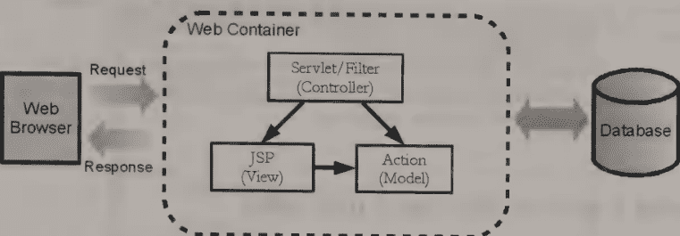

图 10.1：Model 2 架构

在 Model 2 应用中，每个 HTTP 请求都必须定向到控制器（controller）。请求的统一请求标识符（URI）告诉控制器要调用哪个操作（action）。“action”一词指的是应用程序能够执行的操作。与 action 关联的 Java 对象称为 action 对象（action object）。一个 action 类可能用于处理不同的 action（如 Struts 2 和 Spring MVC），也可能处理单个 action（如 Struts 1）。

一个看似细微的操作可能涉及多个 action。例如，向数据库中添加产品需要两个 action：

- 1. 为用户显示“添加产品”表单以便其输入产品信息。
- 2. 在数据库中保存产品信息。

如上所述，你使用 URI 来告诉控制器调用哪个 action。例如，为了让应用程序发送“添加产品”表单，你会使用如下所示 URI：

```
http://domain/appName/product_input
```

为了让应用程序保存产品，URI 将是：

```
http://domain/appName/product_save
```


控制器通过检查 URI 来决定调用哪个 action。它还将模型对象存储在视图（view）可以访问的地方，以便服务器端的值可以显示在浏览器上。最后，控制器使用 `RequestDispatcher` 转发到某个视图（JSP 页面）。

图 10.2：产品表单

# 第10章：应用设计 237

图 10.3：产品详情页

该应用程序能够执行这两个 action：

- 1. 显示“添加产品”表单。此 action 将图 10.2 中的输入表单发送到浏览器。调用此 action 的 URI 必须包含字符串 `product_input`。
- 2. 保存产品并返回图 10.3 中的确认页面。调用此 action 的 URI 必须包含字符串 `product_save`。

该应用程序由以下组件组成：

- 1. 一个 `Product` 类，它是模型对象的模板。该类的实例包含产品信息。
- 2. 一个 `ProductForm` 类，它封装了用于输入产品的 HTML 表单字段。`ProductForm` 的属性用于填充 `Product` 对象。
- 3. 一个 `ControllerServlet` 类，它是该 Model 2 应用的控制器。
- 4. 一个命名为 `SaveProductAction` 的 action。
- 5. 两个 JSP 页面（`ProductForm.jsp` 和 `ProductDetails.jsp`）作为视图。

# 238 Servlet & JSP 教程

- 6. 一个定义了视图样式的 CSS 文件。这是一个静态资源。

该应用程序的目录结构如图 10.4 所示。

- `app10a`
  - `css`
    - `main.css`
  - `jsp`
    - `ProductDetails.jsp`
    - `ProductForm.jsp`
  - `WEB-INF`
    - `classes`
      - `app10a`
        - `action`
          - `SaveProductAction.class`
        - `controller`
          - `ControllersServlet.class`
        - `form`
          - `ProductForm.class`
      - `model`
        - `Product.class`

图 10.4：`app10a` 目录结构

让我们仔细查看 `app10a` 中的每个组件。

## Product 类

`Product` 实例是一个封装了产品信息的 JavaBean。`Product` 类（如代码 10.1 所示）具有三个属性：`productName`、`description` 和 `price`。

代码 10.1：`Product` 类

```java
package app10a.model;

import java.io.Serializable;

public class Product implements Serializable {

  private static final long serialVersionUID = 7483923483L;

  private String name;

  private String description;

  private float price;

  public String getName() {

    return name;

  }

  public void setName(String name) {

    this.name = name;

  }

  public String getDescription() {

    return description;

  }

  public void setDescription(String description) {

    this.description = description;

  }

  public float getPrice() {

    return price;

  }

  public void setPrice(float price) {

    this.price = price;

  }

}
```

`Product` 类实现了 `java.io.Serializable`，以便其实例可以安全地存储在 `HttpSession` 对象中。作为 `Serializable` 的实现，`Product` 应该拥有一个 `serialVersionUID` 字段。

## ProductForm 类

一个类被映射到一个 HTML 表单。它是 HTML 表单在服务器上的表示。代码 10.2 所示的 `ProductForm` 类包含了产品的 `String` 类型值。从表面上看看，`ProductForm` 类与 `Product` 类相似，你可能会奇怪为什么还需要 `ProductForm` 的存在。正如你在本章稍后的“验证器（Validators）”部分所看到的，表单对象的作用是避免了将 `HttpServletRequest` 传递给其他组件（如验证器）。`HttpServletRequest` 是

表单对象的第二个作用是在验证失败时保留用户输入。注意，大多数情况下，一个类不需要暴露给其他层。

代码 10.2：`ProductForm` 类

```java
package app10a.form;

public class ProductForm {

    private String name;

    private String description;

    private float price;

    public String getName() {

      return name;

    }

    public void setName(String name) {

      this.name = name;

    }

    public String getDescription() {

      return description;

    }

    public void setDescription(String description) {

      this.description = description;

    }

    public float getPrice() {

      return price;

    }

    public void setPrice(float price) {

      this.price = price;

    }

}
```

## ControllerServlet 类

`ControllerServlet` 类（如代码 10.3 所示）继承自 `HttpServlet`。它的 `doGet` 和 `doPost` 方法调用 `process` 方法，该方法是 servlet 的的大脑。你将在本章稍后的“验证器”部分学习这些。

代码 10.3：`ControllerServlet`

```java
package app10a.controller;

import java.io.IOException;

import javax.servlet.RequestDispatcher;

import javax.servlet.ServletException;

import javax.servlet.annotation.WebServlet;

import javax.servlet.http.HttpServlet;

import javax.servlet.http.HttpServletRequest;

import javax.servlet.http.HttpServletResponse;

@WebServlet(name = "ControllerServlet", urlPatterns = {

    "/product_input", "/product_save"})

public class ControllerServlet extends HttpServlet {

    private static final long serialVersionUID = 1579L;

    @Override

    public void doGet(HttpServletRequest request,

                     HttpServletResponse response)

        throws IOException, ServletException {

        process(request, response);

    }

    @Override

    public void doPost(HttpServletRequest request,

                       HttpServletResponse response)

        throws IOException, ServletException {

        process(request, response);

    }

    private void process(HttpServletRequest request,

                         HttpServletResponse response)

                         throws IOException, ServletException {

        String uri = request.getRequestURI();

        /*

        * uri 的格式为：/contextName/resourceName,

        * 例如：/app10a/product_input。

        * 然而，在默认上下文中，

        * context 名称为空，uri 具有如下格式：

        * /resourceName

        */

        int lastIndex = uri.lastIndexOf("/");

        String action = uri.substring(lastIndex + 1);

        // 执行 action

        if (action.equals("product_input")) {

            // 没有 action 类，没有需要做的事情

        } else if (action.equals("product_save")) {

            // 创建表单

            ProductForm productForm = new ProductForm();

            // 填充属性

            productForm.setName(request.getParameter("name"));

            productForm.setDescription(

                request.getParameter("description"));

            productForm.setPrice(request.getParameter("price"));

            // 创建模型

            Product product = new Product();

            product.setName(productForm.getName());

            product.setDescription(productForm.getDescription());

            try {

                product.setPrice(Float.parseFloat(

                    productForm.getPrice()));

            } catch (NumberFormatException e) {

            }

            // 执行 action 方法

            SaveProductAction saveProductAction = 

                new SaveProductAction();

            saveProductAction.save(product);

        }

        // 将模型存储在视图的作用域变量中

        request.setAttribute("product", product);

        // 转发到视图

        String dispatchUrl = null;

        if (action.equals("product_input")) {

            dispatchUrl = "/jsp/ProductForm.jsp";

        } else if (action.equals("product_save")) {

            dispatchUrl = "/jsp/ProductDetails.jsp";

        }

        if (dispatchUrl != null) {

            RequestDispatcher rd =

                request.getRequestDispatcher(dispatchUrl);

            rd.forward(request, response);

        }

    }

}
```

## 第 10 章：应用设计 243

`ControllerServlet` 类中的 `process` 方法处理所有传入的请求。它首先获取请求的 URI 和动作名称（action name）。

```java
String uri = request.getRequestURI();

int lastIndex = uri.lastIndexOf("/");

String action = uri.substring(lastIndex + 1);
```

在此应用程序中，`action` 的值可以是 `product_input` 也可以是 `product_save`。

`process` 方法通过执行以下步骤继续：

- 1. 实例化相关的 action 类（如果有）。
- 2. 如果 action 对象存在，则创建一个表单对象并用请求参数填充它。`product_save` action 有三个属性：`name`（名称）、`description`（描述）和 `price`（价格）。接下来，创建一个模型对象，并从表单对象中填充其属性。
- 3. 如果 action 对象存在，则调用 action 方法。
- 4. 将请求转发到视图（JSP 页面）。

`process` 方法中决定执行什么动作的部分位于以下 `if` 块中：

```java
// create form

ProductForm productForm = new ProductForm();

// populate action properties

productForm.setName(request.getParameter("name"));

productForm.setDescription(

    request.getParameter("description"));

productForm.setPrice(request.getParameter("price"));

// create model

Product product = new Product();

product.setName(productForm.getName());

product.setDescription(product.getDescription());

try {

    product.setPrice(Float.parseFloat(

        productForm.getPrice()));

} catch (NumberFormatException e) {

}

// execute action method

SaveProductAction saveProductAction =

    new SaveProductAction();

saveProductAction.save(product);

// store model in a scope variable for the view

request.setAttribute("product", product);
```

`Product` 被存储在 `HttpServletRequest` 中，以便视图可以访问它。

```java
// store action in a scope variable for the view
request.setAttribute("product", product);
```

`process` 方法通过转发到视图结束。如果 `action` 等于 `product_input`，控制权被转发到 `ProductForm.jsp` 页面。如果 `action` 是 `product_save`，控制权被转发到 `ProductDetails.jsp` 页面。

```java
// forward to a view

String dispatchUrl = null;

if (action.equals("Product_input")) {

    dispatchUrl = "/jsp/ProductForm.jsp";

} else if (action.equals("product_save")) {

    dispatchUrl = "/jsp/ProductDetails.jsp";

}

if (dispatchUrl != null) {

    RequestDispatcher rd =

        request.getRequestDispatcher(dispatchUrl);

    rd.forward(request, response);

}
```

## 第 10 章：应用设计 245

## Action 类

应用程序中只有一个 action 类，负责将产品保存到某些存储器（例如数据库）。该 action 类命名为 `SaveProductAction`，在代码列表 10.4 中给出。

代码 10.4：`SaveProductAction` 类

```java
```


`package app10a.action;`

```java
public class SaveProductAction {

    public void save(Product product) {

        // insert Product to the database

    }

}
```

在这个示例中，`SaveProductAction` 类没有为其 `save` 方法提供实现。你将在本章后续的示例中提供实现。

## 视图

该应用程序利用 JSP 页面作为应用的视图。如果 action 是 `product_input`，则显示第一个页面 `ProductForm.jsp`。如果 action 是 `product_save`，则显示第二个页面 `ProductDetails.jsp`。`ProductForm.jsp` 在代码列表 10.5 中给出，`ProductDetails.jsp` 在代码列表 10.6 中给出。

### Listing 10.5：ProductForm.jsp 页面

```jsp
<!DOCTYPE html>
<html>
<head>
<title>Add Product Form</title>
<style type="text/css">@import url(css/main.css);</style>
</head>
<body>
<div id="global">
    <h3>Add a product</h3>
    <form method="post" action="product_save">
    <table>
    <tr>
        <td>Product Name:</td>
        <td><input type="text" name="name"/></td>
    </tr>
    <tr>
        <td>Description:</td>
        <td><input type="text" name="description"/></td>
    </tr>
    <tr>
        <td>Price:</td>
        <td><input type="text" name="price"/></td>
    </tr>
    <tr>
        <td><input type="reset"/></td>
        <td><input type="submit" value="Add Product"/>
    </tr>
    </table>
</form>
</div>
</body>
</html>
```

### Listing 10.6：ProductDetails.jsp 页面

```jsp
<!DOCTYPE html>
<html>
<head>
<title>Save Product</title>
<style type="text/css">@import url(css/main.css);</style>
</head>
<body>
<div id="global">
<h4>The product has been saved.</h4>
<p>
<h5>Details:</h5>
Product Name: ${product.name}<br/>
Description: ${product.description}<br/>
Price: ${product.price}
</p>
</div>
</body>
</html>
```

`ProductForm.jsp` 包含 HTML 表单。`ProductDetails.jsp` 使用表达式语言 (EL) 访问 `HttpServletRequest` 中的对象。

在此应用程序中，与大多数情况一样，你需要防止直接访问 JSP。有多种方法可以实现，包括：

- 将 JSP 放在 `WEB-INF` 下。
- 使用 filter 限制它们。
- 使用部署描述。

## 测试应用程序

假设你在本地机器的端口 8080 上运行应用程序，你会看到类似于图 10.2 的：

`http://localhost:8080/product_input`

虽然 servlet 是 Model 2 中常见的控制器，但 filter 也可以作为控制器。注意，直接输入域名将调用 filter。

## 带 Filter dispatcher 的 Model 2

以下示例 (`app1b`) 使用 filter dispatcher。`app1b` 的目录结构如图 10.5 所示。JSP 页面和 `Product` 类与 `app1a` 中的相同。然而，你没有使用 servlet 作为控制器，而是使用了一个名为 `DispatcherFilter` 的 filter（见代码 10.7）。

### Listing 10.7：DispatcherFilter 类

```java
package app10b.filter;

import java.io.IOException;

import javax.servlet.Filter;
import javax.servlet.FilterChain;
import javax.servlet.FilterConfig;
import javax.servlet.RequestDispatcher;
import javax.servlet.ServletException;
import javax.servlet.ServletRequest;
import javax.servlet.ServletResponse;
import javax.servlet.annotation.WebFilter;
import javax.servlet.http.HttpServletRequest;

import app10b.action.SaveProductAction;
import app10b.form.ProductForm;
import app10b.model.Product;

@Filter(urlPatterns = {"/*"})
public class DispatcherFilter implements Filter {

    @Override
    public void init(FilterConfig filterConfig)
        throws ServletException {
    }

    @Override
    public void destroy() {
    }

    @Override
    public void doFilter(ServletRequest request,
        ServletResponse response, FilterChain filterChain)
        throws IOException, ServletException {

        HttpServletRequest req = (HttpServletRequest) request;
        String uri = req.getRequestURI();

        // uri 的格式为：/contextName/resourceName，例如
        // /app0b/product_input。然而，在默认上下文中，
        // 上文名称为空，uri 这种格式为 /resourceName，例如：
        // /product_input

        // 动作处理
        int lastIndex = uri.lastIndexOf("/");
        String action = uri.substring(lastIndex + 1);

        if (action.equals("product_input")) {
            // 什么都不做
        } else if (action.equals("product_save")) {
```

```java
            // create form
            ProductForm productForm = new ProductForm();
            // populate action properties
            productForm.setName(request.getParameter("name"));
            productForm.setDescription(
                request.getParameter("description"));
            productForm.setPrice(request.getParameter("price"));
```

```java
            // create model
            Product product = new Product();
            product.setName(productForm.getName());
            product.setDescription(product.getDescription());
            try {
                product.setPrice(Float.parseFloat(
                    productForm.getPrice()));
            } catch (FormatException e) {
            }
            // execute action method
            SaveProductAction saveProductAction =
                new SaveProductAction();
            saveProductAction.save(product);
```

```java
            // store model in a scope variable for the view
            request.setAttribute("product", product);
```

```java
            // forward to a view
            String dispatchUrl = null;
            if (action.equals("product_input")) {
                dispatchUrl = "/jsp/ProductForm.jsp";
            } else if (action.equals("product_save")) {
                dispatchUrl = "/jsp/ProductDetails.jsp";
            }
            if (dispatchUrl != null) {
                RequestDispatcher rd = request
                    .getRequestDispatcher(dispatchUrl);
                rd.forward(request, response);
            } else {
                // let static contents pass
                filterChain.doFilter(request, response);
            }
        }
    }
}
```

`doFilter` 方法执行了与 `app10a` 中 `process` 方法相同的操作。

## 第 10 章：应用程序设计

由于过滤器针对包括静态内容在所有 URL，如果没有调用任何 action，你需要调用 `filterChain.doFilter()`。

```java
} else {
    // let static contents pass
    filterChain.doFilter(request, response);
}
```

若要测试该应用程序，请将浏览器指向此 URL：
`http://localhost:8080/app10b/product_input`

## 验证器

输入验证是执行 action 的一个重要步骤。验证的范围从简单的任务（如检查输入字段是否有值）到更复杂的任务（如验证信用卡号）。事实上，验证扮演着如此重要的角色，以至于 Java 社区发布了 JSR 303“Bean Validation”来标准化 Java 中的输入验证。现代 MVC 框架通常提供程序性和声明式验证方法。在程序式验证中，你编写代码来验证用户输入；在声明式验证中，你可以在 XML 文档或属性文件中提供验证规则。

以下示例展示了一个新应用程序 (`app10c`)，它扩展了 `app10a` 中基于 servlet 控制器的 Model 2 验证。新应用程序包含了一个产品验证器，其类定义在列表 10.8 中。

### 列表 10.8：ProductValidator 类

```java
package app10c.validator;

import java.util.ArrayList;
import java.util.List;

import app10c.form.ProductForm;
```

```java
public class ProductValidator {

    public List<String> validate(ProductForm productForm) {
        List<String> errors = new ArrayList<String>();
        String name = productForm.getName();
```

```java
        if (name == null || name.trim().isEmpty()) {
            errors.add("Product must have a name");
        }
        String price = productForm.getPrice();
        if (price == null || price.trim().isEmpty()) {
            errors.add("Product must have a price");
        } else {
            try {
                Float.parseFloat(price);
            } catch (NumberFormatException e) {
                errors.add("Invalid price value");
            }
        }
        return errors;
    }
}
```

列表 10.8 中的 `ProductValidator` 类提供了一个作用于 `ProductForm` 的 `validate` 方法。该验证器确保产品具有非空名称且其价格为有效数字。`validate` 方法返回一个包含验证错误消息的字符串列表（`List` of `Strings`）。空列表表示验证成功。

现在你已经有了一个验证器，需要告诉控制器使用它。列表 10.9 展示了 `ControllerServlet` 的修订版本。请注意加粗的几行。

### 列表 10.9：app10c 中的 ControllerServlet 类

```java
package app10c.controller;

import java.io.IOException;
import java.util.List;

import javax.servlet.RequestDispatcher;
import javax.servlet.ServletExceptionException;
import javax.servlet.annotation.WebServlet;
import javax.servlet.http.HttpServlet;
import javax.servlet.http.HttpServletRequest;
import javax.servlet.http.HttpServletResponse;

import app10c.action.SaveProductAction;
import app10c.form.ProductForm;
import app10c.model.Product;
import app10c.validator.ProductValidator;
```

```java
@WebServlet(name = "ControllerServlet", urlPatterns = {
    "/product_input", "/product_save"})
```

```java
public class ControllerServlet extends HttpServlet {

    private static final long serialVersionUID = 98279L;

    @Override
    public void doGet(HttpServletRequest request,
        HttpServletResponse response)
        throws IOException, ServletException {
        process(request, response);
    }

    @Override
    public void doPost(HttpServletRequest request,
        HttpServletResponse response)
        throws IOException, ServletException {
        process(request, response);
    }

    private void process(HttpServletRequest request,
        HttpServletResponse response)
        throws IOException, ServletException {

        String uri = request.getRequestURI();
        /*
         * ControllerServlet 根据 URI 确定 action。
         */
```


例如，如果 URI 是`/product_input`，则`action`为`product_input`。

如果 URI 是`/product_save`，则`action`为`product_save`。

否则，请求将传递给过滤器链。

```java
int lastIndex = uri.lastIndexOf("/");
String action = uri.substring(lastIndex + 1);
String dispatchUrl = null;

if (action.equals("product_input")) {
    dispatchUrl = "/jsp/ProductForm.jsp";
} else if (action.equals("product_save")) {
    dispatchUrl = "/jsp/ProductDetails.jsp";
}

if (dispatchUrl != null) {
    RequestDispatcher rd = request.getRequestDispatcher(dispatchUrl);
    rd.forward(request, response);
} else {
    // let static contents pass
    filterChain.doFilter(request, response);
}
```

## 256 Servlet & JSP: 教程

### 10.10: app10c 中的 ProductForm.jsp

```jsp
<%@ taglib uri="http://java.sun.com/jsp/jstl/core" prefix="c" %>
<!DOCTYPE HTML>
<html>
<head>
<title>添加产品表单</title>
<style type="text/css">@import url(css/main.css);</style>
</head>
<body>
<div id="global">
<h3>添加产品</h3>
<c:if test="${requestScope.errors != null}">
<p id="errors">
错误(s)
<ul>
<c:forEach var="error" items="${requestScope.errors}">
<li>${error}</li>
</c:forEach>
</ul>
</p>
</c:if>
<form method="post" action="product_save">
<table>
<tr>
<td>Product Name:</td>
<td><input type="text" name="name" value="${form.name}"></td>
</tr>
<tr>
<td>Description:</td>
<td><input type="text" name="description" value="${form.description}"></td>
</tr>
<tr>
<td>Price:</td>
<td><input type="text" name="price" value="${form.price}"></td>
</tr>
<tr>
<td><input type="reset"/></td>
<td><input type="submit" value="Add Product"/></td>
</tr>
</table>
</form>
</div>
</body>
</html>
```

你可以通过调用`product_input`操作来测试 app10c：
`http://localhost:8080/app10c/product_input`

与之前的示例不同，如果你在提交 Product 表单时包含无效值，将显示一条错误消息以及该错误的错误值。图 10.6 显示了两个验证错误消息。

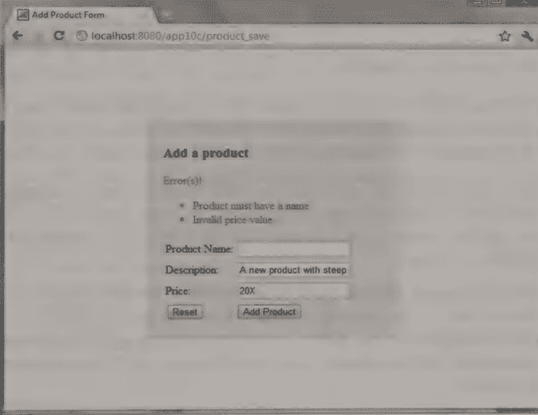

## 数据库访问

大多数 Web 应用程序都使用来自的数据。因此，了解如何使用 Java 数据库连接 (JDBC) API 访问和操作数据非常重要。本节不涵盖 JDBC，我假设

在访问数据库数据时，最关键且最耗时的操作通常是尝试建立连接。按照规定，在设计良好的应用程序中，数据库连接总是池化的。虽然管理连接可能复杂且具有挑战性，但幸运的是有很多 Java 库做得很好。以下是 Java 数据库连接库的示例。

- Apache Commons DBCP (`http://commons.apache.org/dbcp`)
- C3P0 (`http://sourceforge.net/projects/c3p0`)
- Tomcat 7 中的 Tomcat JDBC 连接

Apache Commons DBCP（尤其是旧版本）过去曾因其复杂性和缓慢而受到批评。因此，C3P0 似乎是一个更明智的选择。然而，如果你在使用 Tomcat 7，连接池是内置的。

直到几年前，管理连接池最流行的方法是不自己管理，而是让 servlet/JSP 容器为你管理。以下是使用 Java 命名和目录接口 (JNDI) 查找从容器管理的池中获取 JDBC 连接的代码。

```java
import javax.naming.Context;
import javax.naming.InitialContext;
import javax.naming.NamingException;
import javax.sql.DataSource;
import java.sql.Connection;
import java.sql.SQLException;
```

```java
Connection connection = null;
try {
    Context context = new InitialContext();
```

## 第 10 章：应用设计

```java
    DataSource dataSource = (DataSource) context.lookup(jndiName);
    connection = dataSource.getConnection();
} catch (NamingException e) {
    ...
} catch (SQLException e) {
    ...
} catch (Exception e) {
    ...
}
```

在`DataSource`上调用`getConnection`方法是非常快的，因为连接永远不会被关闭；关闭连接仅仅是将连接返回到池中。然而，JNDI 查找是缓慢的，因此返回的`DataSource`通常会被缓存。

要让 servlet 容器管理连接池，你需要配置容器。在 Tomcat 中，这是通过在应用程序的`Context`元素下声明`Resource`元素来实现的。例如，以下 Tomcat context 包含一个带有内部连接池的`DataSource`资源。

```xml
<Context path="/appName" docBase="...">
<Resource name="jdbc/dataSourceName"
  auth="Container"
  type="javax.sql.DataSource"
  username="..."
  password="..."
  driverClassName="..."
  url="..."
</Resource>
</Context>
```

你需要分别在`username`和`password`属性中输入正确的数据库用户名和密码。你还需要在`driverClassName`和`url`属性中提供 JDBC 驱动类和数据库 URL。此外，你需要将 JDBC 驱动库包含在应用程序目录的`WEB-INF/lib`目录中。关于配置资源的更多信息可以在附录 A，"Tomcat"。

例如，以下 Tomcat Context 声明定义了一个带有`DataSource`资源的应用程序，该资源维护着数据库的连接池。

```xml
<Context path="/appName" docBase="...">
<Resource name="jdbc/dataSourceName"
  auth="Container"
  type="javax.sql.DataSource"
  username="..."
  password="..."
  driverClassName="..."
  url="jdbc:mysql://localhost:3306/test"/>
</Context>
```

尽管较新的应用程序倾向于使用依赖注入，但许多应用程序仍然依赖于旧的 JNDI 查找方法，我们在此处使用了这种方法。

## 数据访问对象 (DAO) 模式

访问数据库数据的一种良好方法是使用单独的模块处理 SQL 语句。DAO 设计是一种能很好完成此工作的简单模式。这种模式有几种变体，但最简单的一种如图 10.7 所示。

通过这种模式，你为每个需要持久化的类型编写一个类。例如，如果你的应用程序需要持久化三种类型——Product（产品）、Customer（客户）和 Order（订单），你需要三个类：`ProductDAO`、`CustomerDAO`和`OrderDAO`。名称末的 DAO 后缀表示该类是一个 DAO。

## 第 10 章：应用设计


一个典型的 DAO 类负责对象的添加、删除、修改和检索，以及对对象的搜索。例如，`ProductDAO`可能支持以下方法：

```java
void addProduct(Product product)
void updateProduct(Product product)
void deleteProduct(int productId)
Product getProduct(int productId)
List<Product> findProducts(SearchCriteria searchCriteria)
```

在你的 DAO 实现中，你可以手动编写 SQL 语句，也可以使用 Java Persistence API (JPA) 实现（如 Hibernate）来处理数据。遗憾的是，JPA 超出了本书，但你应该知道它是一项流行的技术，许多人会数据需求选择 JPA。

## 带有数据库访问的 Model 2

app1d 应用程序是一个带有数据库访问的 Model 2 示例，它在之前的示例（app10c）之上构建，用于访问包含 products 表的 MySQL 数据库 test。修改后的应用程序还有一个额外的操作`product_list`，用于显示数据库中的所有产品。此外，它还带有一个声明欢迎页的`web.xml`文件。

创建数据库和表的 SQL 语句见列表 10.11。

### 10.11: 创建数据库和表的 SQL 语句

```sql
CREATE DATABASE /*!32312 IF NOT EXISTS*`test` /*!40100 DEFAULT
CHARACTER SET latin1 */;
USE `test`;
DROP TABLE IF EXISTS `products`;
CREATE TABLE `products` (
`id` int(11) NOT NULL auto_increment,
`name` varchar(255) NOT NULL,
`description` varchar(1000) default NULL,
`price` decimal(10,0) NOT NULL,
PRIMARY KEY (`id`)
) ENGINE=MyISAM AUTO_INCREMENT=6 DEFAULT CHARSET=utf8;
```

# 第 10 章：应用设计 263

Listing 10.17 中的 DAO 接口和 Listing 10.18 中的`ProductDAOImpl`类。它们都提供了持久化 Product 实例以及从数据库中检索它们的方法。

# Listing 10.12：DAO 接口

```java
package app10d.dao;

import java.sql.Connection;

public interface DAO {
    Connection getConnection() throws DAOException;
}
```

# Listing 10.13：BaseDAO 类

```java
package app10d.dao;

import java.sql.Connection;
import java.sql.ResultSet;
import java.sql.Statement;
import javax.sql.DataSource;

public class BaseDAO implements DAO {
    public Connection getConnection() throws DAOException {
        DataSource dataSource = 
            DataSourceCache.getInstance().getDataSource();
        try {
            return dataSource.getConnection();
        } catch (Exception e) {
            e.printStackTrace();
            throw new DAOException();
        }
    }

    protected void closeDBObjects(ResultSet resultSet, Statement statement, 
        Connection connection) {
        if (resultSet != null) {
            try {
                resultSet.close();
            } catch (Exception e) {
            }
        }
        if (statement != null) {
            try {
                statement.close();
            } catch (Exception e) {
            }
            if (connection != null) {
                try {
                    connection.close();
                } catch (Exception e) {
                }
            }
        }
    }
}
```

# Listing 10.14：DataSourceCache 类

```java
package app10d.dao;

import javax.naming.Context;
import javax.naming.InitialContext;
import javax.naming.NamingException;
import java.sql.DataSource;

public class DataSourceCache {
    private static DataSourceCache instance;
    private DataSource dataSource;

    static {
        instance = new DataSourceCache();
    }

    private DataSourceCache() {
        Context context = null;
        try {
            context = new InitialContext();
            dataSource = (DataSource) context.lookup("java:comp/env/jdbc/myDataSource");
        } catch (NamingException e) {
        }
    }

    public static DataSourceCache getInstance() {
        return instance;
    }

    public DataSource getDataSource() {
        return dataSource;
    }
}
```

# Listing 10.15：DAOFactory 类

```java
package app10d.dao;

public class DAOFactory {
    public static ProductDAO getProductDAO() {
        return new ProductDAOImpl();
    }
}
```

# Listing 10.16：DAOException 类

```java
package app10d.dao;
```


# 10.17 `ProductDAO` 接口

```java
package app10d.dao;

import java.util.List;

import app10d.model.Product;

public interface ProductDAO extends DAO {

    List<Product> getProducts() throws DAOException;

    void insert(Product product) throws DAOException;

}
```

# 10.18 `ProductDAOImpl` 类

```java
package app10d.dao;

import java.sql.Connection;
import java.sql.PreparedStatement;
import java.sql.ResultSet;
import java.sql.SQLException;
import java.util.ArrayList;
import java.util.List;

import app10d.model.Product;

public class ProductDAOImpl extends BaseDAO implements ProductDAO {

    private static final String GET_PRODUCTS_SQL = 
        "SELECT name, description, price FROM products";

    public List<Product> getProducts() throws DAOException {
        List<Product> products = new ArrayList<Product>();
        Connection connection = null;
        PreparedStatement pStatement = null;
        ResultSet resultSet = null;
        try {
            connection = getConnection();
            pStatement = connection.prepareStatement(GET_PRODUCTS_SQL);
            resultSet = pStatement.executeQuery();
            while (resultSet.next()) {
                Product product = new Product();
                product.setName(resultSet.getString("name"));
                product.setDescription(resultSet.getString("description"));
                product.setPrice(resultSet.getFloat("price"));
                products.add(product);
            }
        } catch (SQLException e) {
            throw new DAOException("Error getting products. " + e.getMessage());
        } finally {
            closeDBObjects(resultSet, pStatement, connection);
        }
        return products;
    }

    private static final String INSERT_PRODUCT_SQL = 
        "INSERT INTO products " + 
        "(name, description, price) " + 
        "VALUES (?, ?, ?)";

    public void insert(Product product) {
        Connection connection = null;
        PreparedStatement pStatement = null;
        try {
            connection = getConnection();
            pStatement = connection.prepareStatement(INSERT_PRODUCT_SQL);
            pStatement.setString(1, product.getName());
            pStatement.setString(2, product.getDescription());
            pStatement.setFloat(3, product.getPrice());
            pStatement.executeUpdate();
        } catch (SQLException e) {
            throw new DAOException("Error adding product. " + e.getMessage());
        } finally {
            closeDBObjects(null, pStatement, connection);
        }
    }
}
```

所有的 DAO 接口和类都是自明易懂的。受益于 DAO 模式，`SaveAction` 方法可以保持非常简洁。它仅仅从 `DAOFactory` 获取一个 DAO 并调用其插入方法。`SaveAction` 类：

```java
package app10d.action;

import app10d.dao.DAOFactory;
import app10d.dao.ProductDAO;
import app10d.model.Product;

public class SaveAction {

    public void save(Product product) throws DAOException {
        ProductDAO productDAO = DAOFactory.getProductDAO();
        productDAO.insert(product);
    }
}
```

由于 DAO 模式，`SaveAction` 方法可以保持非常简洁。它仅仅从 `DAOFactory` 获取一个 DAO 并调用其插入方法。`SaveAction` 类位于 Listing 10.19：

```java
package app10d.action;

import app10d.dao.DAOFactory;
import app10d.dao.ProductDAO;
import app10d.model.Product;

public class SaveAction {

    public void save(Product product) throws DAOException {
        ProductDAO productDAO = DAOFactory.getProductDAO();
        productDAO.insert(product);
    }
}
```

`app10d` 中的 `product_list` 是基于 Listing 10.20 中的 `GetProducts` 类。它返回 `Product` 列表。

```java
package app10d.action;

import app10d.dao.DAOFactory;
import app10d.dao.ProductDAO;
import app10d.model.Product;
import java.util.List;

public class GetProducts {

    public List<Product> getProducts() throws DAOException {
        ProductDAO productDAO = DAOFactory.getProductDAO();
        List<Product> products = null;
        try {
            products = productDAO.getProducts();
        } catch (DAOException e) {
            e.printStackTrace();
        }
        return products;
    }
}
```

`app10d` 的最后一个值得提的部分是 Listing 10.21 中的部署符。

```xml
<?xml version="1.0" encoding="ISO-8859-1"?>
<web-app xmlns="http://java.sun.com/xml/ns/javaee"
     xmlns:xsi="http://www.w3.org/2001/XMLSchema-instance"
     xsi:schemaLocation="http://java.sun.com/xml/ns/javaee/web-app_3_0.xsd"
     version="3.0">
  <welcome-file-list>
    <welcome-file>product_list</welcome-file>
  </welcome-file-list>
</web-app>
```

此外，注意 controller servlet 添加了一个新的模式 (`/product_list`)，这意味着欢迎文件实际上引用了该 servlet。

测试 `app10d`，使用此 URL。由于部署符中定义了欢迎文件，因此不需要指定资源。

```
http://localhost:8080/app10d
```

图 10.8 显示了数据库中的所有产品。最初，你应该看到一个空列表页面，因为你还需要插入产品。所以，现在执行并重新访问页面。

## 依赖注入

依赖注入在过去几年中广泛用于解决代码的可测试性等问题。事实上，依赖注入是 Spring 和 Struts 2 等优秀框架的基础。那么，什么是依赖注入呢？

> Martin Fowler 就这个主题写了一篇极佳的文章：
> http://martinfowler.com/articles/injection.html

在 Fowler 创造出“依赖注入”术语之前，“控制反转”这个短语经常用来表示相同的意思。正如 Fowler 在他的文章中所说的，两者并不完全相同。

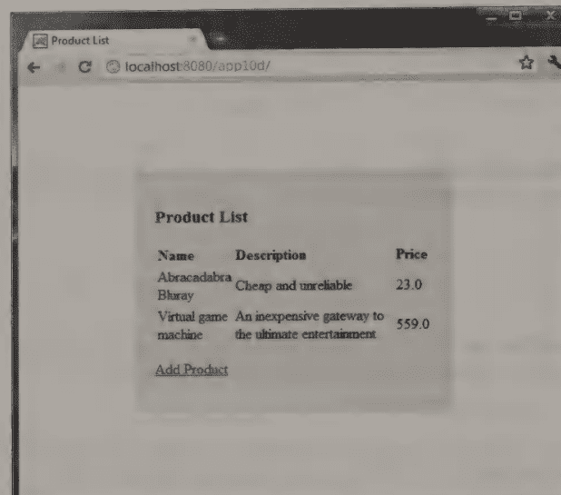

图 10.8: `app10d` 中的欢迎文件

如果你有两个组件 A 和 B，且 A 依赖于 B，你可以说 A 依赖于 B，或者 B 是 A 的依赖项。假设 A 有一个方法 `importantMethod()`，它在如下代码片段中使用了 B：

```java
public class A {
    public void importantMethod() {
        B b = ... // 获取 B 的实例
        b.usefulMethod();
    }
}
```

A 在使用 B 之前必须获取 B 的实例。虽然如果 B 是一个 Java 具体类，那么这就像使用 `new` 关键字一样简单，但如果 B 不是具体类且有 B 的多种实现，这可能会出现问题。你将不得不选择 B 的一种实现，通过这样做，你降低了 A 的重用性，因为你无法将 A 与你未选择的 B 的实现配合。

以 `app10d` 中的 `ProductDAO` 接口（如列表 10.17 所示）作为实例。它的实现列表 10.18 中的 `ProductDAOImpl` 依赖于其父类 `BaseDAO` 的 `getConnection` 方法来获取连接。问题是，该连接来自容器维护的 JNDI 对象。你如何在容器外部测试 `ProductDAO` 呢？如果不修改 `BaseDAO` 类，你就无法做到。由于对另一个对象的依赖，`ProductDAO`（以及所有可能添加的 DAO 实现）的可测试性已经降低了。要测试 `app10d` 中的 DAO 对象，你必须先在容器中部署整个应用程序，并使用浏览器为 DAO 对象输入值。这损失了多少生产力？

通过依赖注入，每个组件的依赖项都被注入到其中，这使得测试每个组件变得更容易。为了让类在依赖注入环境中更容易被使用，你必须使其“注入就绪”（inject-ready）。一种方法是为每个依赖项创建一个 set 方法。例如，列表 10.22 中的 `SaveProductAction` 类和 10.23 中的 `GetProductsAction` 都是 `app10` 应用的一部分。这些类与上一个示例中前身类的区别在于，它们有一个 `setProductDAO` 方法，依赖注入框架可以调用该方法来注入 `ProductDAO`。注入也可以通过构造函数或类字段发生，但我在本书中将坚持使用 set 方法。

# 列表 10.22: 注入就绪的修改后的 `SaveProductAction`

```java
package app10e.action;

import app10e.dao.DAOException;
import app10e.dao.ProductDAO;
import app10e.model.Product;

public class SaveProductAction {

    private ProductDAO productDAO;

    public void setProductDAO(ProductDAO productDAO) {
        this.productDAO = productDAO;
    }

    public void save(Product product) {
        try {
            productDAO.insert(product);
        } catch (DAOException e) {
            e.printStackTrace();
        }
    }
}
```

# 列表 10.23: `GetProductsAction` 类

```java
package app10e.action;

import java.util.List;

import app10e.dao.DAOException;
import app10e.dao.ProductDAO;
import app10e.model.Product;

public class GetProductsAction {

    private ProductDAO productDAO;

    public void setProductDAO(ProductDAO productDAO) {
        this.productDAO = productDAO;
    }

    public List<Product> getProducts() {
        List<Product> products = null;
        try {
            products = productDAO.getProducts();
        } catch (DAOException e) {
        }
        return products;
    }
}
```


一旦所有的类都已就绪，你就可以选择一个依赖注入框架并将其导入到项目中。`Spring Framework`、`Google Guice`、`Weld` 和 `PicoContainer` 都是很好的选择。

> **注意**：Java 中的依赖注入在 `JSR 330` 和 `JSR 299` 中规范，这两者都在本书的范围之外。

理论足够了，现在让我们看看 `app10e` 中实际应用的依赖注入。为了方便理解，`app10e` 应用使用了 10.24 中的 `DependencyInjector` 类来代替依赖注入框架。（当然，在现实世界的应用中，你会使用一个适当的框架。）该类被设计为仅配合 `app10e` 工作，并且可以轻松实例化，无论是否有容器。一旦实例化，必须调用其 `start` 方法，以便它将准备一个 `C3P0` 连接池供其他组件使用。使用后，应该调用其 `shutdown` 方法以释放资源。

**列表 10.24: `DependencyInjector` 类**

```java
package app10e.util;

import java.sql.DataSource;

import app10e.action.GetProductsAction;
import app10e.action.SaveProductAction;
import app10e.dao.ProductDAO;
import app10e.dao.ProductDAOImpl;
import app10e.validator.ProductValidator;
import com.change.v2.c3p0.ComboPooledDataSource;

public class DependencyInjector {

    private DataSource dataSource;

    public void start() {
        try {
            ComboPooledDataSource cpds = new ComboPooledDataSource();
            cpds.setJdbcUrl("jdbc:mysql://localhost:3306/test");
            cpds.setUser("test");
            cpds.setPassword("secret");
            cpds.setMinPoolSize(5);
            cpds.setInitialSize(5);
            cpds.setMaxPoolSize(20);
            dataSource = cpds;
        } catch (Exception e) {
            e.printStackTrace();
        }
    }

    public void shutdown() {
        try {
            if (dataSource != null) {
                dataSource.close();
            }
        } catch (Exception e) {
            e.printStackTrace();
        }
    }

    public Object getObject(Class type) {
        if (type == ProductValidator.class) {
            return new ProductValidator();
        } else if (type == ProductDAO.class) {
            return createProductDAO();
        } else if (type == GetProductsAction.class) {
            return createGetProductsAction();
        } else if (type == SaveProductAction.class) {
            return createSaveProductAction();
        }
        return null;
    }

    private ProductDAO createProductDAO() {
        ProductDAO productDAO = new ProductDAOImpl();
        productDAO.setDataSource(dataSource);
        return productDAO;
    }

    private GetProductsAction createGetProductsAction() {
        GetProductsAction getProductsAction = new GetProductsAction();
        getProductsAction.setProductDAO(createProductDAO());
        return getProductsAction;
    }

    private SaveProductAction createSaveProductAction() {
        SaveProductAction saveProductAction = new SaveProductAction();
        saveProductAction.setProductDAO(createProductDAO());
        return saveProductAction;
    }
}
```

`DependencyInjector` 类硬编码了许多值，包括 JDBC URL 以及数据库用户名和密码。在框架中，属性值通常来自配置文件，大多数情况下是 XML 文档。这次我们保持简单。

要从 `DependencyInjector` 获取对象，调用其 `getObject` 方法并传入预期对象的 `Class`。`DependencyInjector` 在 `app10e` 中支持以下类型：`ProductValidator`、`ProductDAO`、`GetProductsAction` 和 `SaveProductAction`。例如，为了获取 `ProductDAO` 的实例，你可以通过传递 `ProductDAO` 来调用 `getObject`：

```java
ProductDAO productDAO = (ProductDAO)
    dependencyInjector.getObject(ProductDAO.class);
```

`DependencyInjector`（以及所有依赖注入框架）的妙之处在于，它返回的对象已经注入了依赖项。如果某个依赖项也有依赖，那么该依赖项也会被注入自身的依赖。

`app10e` 中的 Servlet 控制器如列表 10.25 所示。注意它在 `init` 方法中实例化了 `DependencyInjector`，并在 `destroy` 方法中调用 `DependencyInjector` 的 `shutdown` 方法。Servlet 不再自己创建依赖项，而是从 `DependencyInjector` 获取。

**列表 10.25: `ControllerServlet` 类**

```java
import app10e.validator.ProductValidator;

@WebServlet(name = "ControllerServlet", urlPatterns = {
    "/product_input", "/product_save", "/product_list"
})
public class ControllerServlet extends HttpServlet {

    private static final long serialVersionUID = 6679L;
    private DependencyInjector dependencyInjector;

    @Override
    public void init() {
        dependencyInjector = new DependencyInjector();
        dependencyInjector.start();
    }

    @Override
    public void destroy() {
        dependencyInjector.shutdown();
    }

    @Override
    public void doGet(HttpServletRequest request,
        HttpServletResponse response)
        throws IOException, ServletException {
        process(request, response);
    }

    @Override
    public void doPost(HttpServletRequest request,
        HttpServletResponse response)
        throws IOException, ServletException {
        process(request, response);
    }

    private void process(HttpServletRequest request,
        HttpServletResponse response)
        throws IOException, ServletException {

        String uri = request.getRequestURI();
        /*
         * uri 的格式如下：/contextName/resourceName
         * 例如：/app10a/product_input。
         * 然而，在默认上下文中，上下文名称
         * 为空，uri 的格式为：
         * /resourceName，例如：/product_input
         */
        int lastIndex = uri.lastIndexOf("/");
        String action = uri.substring(lastIndex + 1);
        String dispatchUrl = null;

        if (action.equals("product_input")) {
            // 没有 action 类，无须处理
            dispatchUrl = "/jsp/ProductForm.jsp";
        } else if (action.equals("product_save")) {
            // 实例化 action 类
            ProductForm productForm = new ProductForm();
            // 填充 action 属性
            productForm.setProductName(
                request.getParameter("productName"));
            productForm.setDescription(
                request.getParameter("description"));
            productForm.setPrice(request.getParameter("price"));

            // 校验 ProductForm
            ProductValidator productValidator = (ProductValidator)
                dependencyInjector.getObject(
                ProductValidator.class);
            List<String> errors =
                productValidator.validate(productForm);

            if (errors.isEmpty()) {
                // 从 ProductForm 创建 Product
                Product product = new Product();
                product.setProductName(
                    productForm.getProductName());
                product.setDescription(
                    productForm.getDescription());
                product.setPrice(Float.parseFloat(
                    productForm.getPrice()));

                // 无校验错误，执行 action 方法
                SaveProductAction saveProductAction =
                    (SaveProductAction)
                    dependencyInjector.getObject(
                    SaveProductAction.class);
                saveProductAction.save(product);

                // 将 action 存储在作用域变量中供视图使用
                request.setAttribute("product", product);
                dispatchUrl = "/jsp/ProductDetails.jsp";
            } else {
                request.setAttribute("errors", errors);
                dispatchUrl = "jsp/ProductForm.jsp";
            }
        } else if (action.equals("product_list") ||
            action.isEmpty()) {
            ProductsAction getProductsAction =
                (GetProductsAction) dependencyInjector.getObject(
                    GetProductsAction.class);
            List<Product> products =
                getProductsAction.getProducts();
            request.setAttribute("products", products);
            dispatchUrl = "jsp/ProductList.jsp";
        }

        // 转发到视图
        if (dispatchUrl != null) {
            RequestDispatcher rd =
                request.getRequestDispatcher(dispatchUrl);
            rd.forward(request, response);
        }
    }
}
```

请注意，在 `app10e` 中，你需要编写自己的依赖注入器并在 servlet 初始化时实例化它。如果你使用的是 Java 6 EE 容器（例如 `Glassfish`），则可以让容器将依赖注入到 servlet 中。你的 servlet 看起来如下：

```java
public class ControllerServlet extends HttpServlet {

    @Inject ProductValidator productValidator;
    @Inject GetProductsAction getProductsAction;
    @Inject SaveProductAction saveProductAction;
    ...

    @Override
    public void doGet(HttpServletRequest request,
        HttpServletResponse response) throws IOException,
        ServletExceptionException {
    }

    @Override
    public void doPost(HttpServletRequest request,
        HttpServletResponse response) throws IOException,
        ServletExceptionException {
    }
}
```


`ServletExceptionException` {

}

...

```

要运行 `app10e`，你的 Tomcat Context 不需要 `Resource` 声明。它只需要简单地如下：

```xml
<Context path="/110e" docBase="path/to/app">
</Context>
```

你可以通过调用此 URL 测试 `app10e`：
`http://localhost:8080/app10e`

得益于依赖注入器，`app10e` 中的每个组件都可以被独立测试。例如，可以运行列表 10.26 中的 `ProductDAOTest` 类来测试 `ProductDAO` 的 `insert` 方法。

### 列表 10.26：`ProductDAOTest` 类

```java
package app10e.dao;

import util.DependencyInjector;
import app10e.dao.DAOException;
import app10e.dao.ProductDAO;
import app10e.model.Product;

public class ProductDAOTest {
    public static void main(String[] args) {
        DependencyInjector injector = new DependencyInjector();
        try {
            injector.start();
            ProductDAO productDAO = (ProductDAO)
                injector.getObject(ProductDAO.class);
            Product product = new Product();
            product.setName("New Product");
            product.setDescription("Testing");
            product.setPrice(20.0f);
            productDAO.insert(product);
        } catch (DAOException e) {
            e.printStackTrace();
        } finally {
            injector.shutdown();
        }
    }
}
```

表单必须包含一个类型为 `file` 的输入元素，该元素将被渲染为一个按钮，点击时会打开一个对话框以选择文件。表单还可能包含其他类型的字段，例如文本区域或隐藏字段。

在 HTML 5 之前，如果你想上传多个文件，必须使用多个文件输入元素。然而，HTML 5 通过在 `input` 元素中引入 `multiple` 属性使得多个文件上传变得更加容易。你可以在 HTML 5 中编写以下任意代码来生成一个选择多个文件的按钮：

```
<input type="file" name="fieldName" multiple/>
<input type="file" name="fieldName" multiple="multiple"/>
<input type="file" name="fieldName" multiple=""/>
```

## 服务端编程

Servlet 中的服务器文件上传编程围绕 `MultipartConfig` 注解类型和 `javax.servlet.http.Part` 接口展开。处理上传文件的 Servlet 必须带有 `@MultipartConfig` 注解。`MultipartConfig` 可能具有以下属性，所有属性均为可选。

- **maxFileSize**：上传文件的最大大小。大于指定值的文件将被拒绝。默认情况下，`maxFileSize` 的值为 -1，意味着不限制。
- **maxRequestSize**：允许的多个部分 HTTP 请求的最大大小。默认情况下，该值为 -1，翻译为不限制。
- **location**：当调用 `Part` 的 `write` 方法将上传的文件保存到磁盘时的保存位置。
- **fileSizeThreshold**：上传文件写入磁盘的阈值大小。

在多部分请求中，每个表单字段（包括非文件字段）都会转换为一个 `Part`。`HttpServletRequest` 接口定义了以下方法来处理多部分请求：

```
Part getPart(java.lang.String name)
```

返回与指定名称关联的 `Part`。

```
java.util.Collection<Part> getParts()
```

返回此请求中的所有 `Part`。

这些是 `Part` 接口中的方法：

- `java.lang.String getName()`：获取此部分的名称，即关联的表单字段的名称。
- `java.lang.String getContentType()`：如果 `Part` 是文件，则返回 `Part` 的内容类型。否则，返回 `null`。
- `java.util.Collection<java.lang.String> getHeaderNames()`：返回 `Part` 中的所有头部名称。
- `java.lang.String getHeader(java.lang.String headerName)`：返回指定头部的值。
- `java.util.Collection<java.lang.String> getHeaders(java.lang.String headerName)`：返回 `Part` 头部的值。
- `void write(java.lang.String path)`：将上传的文件写入磁盘。如果 `path` 是绝对路径，则写入到指定的路径。如果 `path` 是相对路径，则写入到相对于 `MultipartConfig` 注解的 `location` 属性值的路径。
- `void delete()`：删除此文件的底层存储，包括关联的临时文件。
- `java.io.InputStream getInputStream()`：作为 `InputStream` 返回上传文件的内容。

如果相应的 HTML 输入元素是文件输入元素，`Part` 将返回这些标头：

```
content-type: contentType
content-disposition:form-data; name="fieldName"; filename="fileName"
```

例如，在名为 `document` 的输入字段中上传 `note.txt` 文件将导致关联的部分具有这些标头：

```
content-type:text/plain
content-disposition:form-data; name="document"; filename="note.txt"
```

如果没有选择文件，仍会为文件字段创建一个 `Part`，但关联的标头将如下所示：

```
content-type:application/octet-stream
content-disposition:form-data; name="document"; filename="
```

`Part` 的 `getName` 返回与此部分关联的字段名，而不是上传文件的名称。要获取文件名，你需要解析 `content-disposition` 头部。

对于非文件字段，`Part` 只有一个 `content-disposition` 头部，格式如下：

```
content-disposition:form-data; name="fieldName"
```

在 Servlet 中处理上传的文件时，你需要：

- 通过检查 `content-type` 头部是否存在来检查 `Part` 是普通表单字段还是文件字段。你可以通过调用 `Part` 的 `getContentType` 方法或 `getHeader("content-type")` 来实现这一点。
- 如果存在 `content-type` 头部，检查上传的文件名是否为空。空的文件名表示存在文件类型的字段，但没有选择文件进行上传。
- 如果文件存在，可以通过调用 `Part` 的 `write` 方法写入磁盘，并传入绝对路径或相对于 `MultipartConfig` 注解的 `location` 属性的路径。

## 上传 Servlet 示例

下面是一个编写多部分 Servlet 的示例。该 Servlet 类名为 `SingleUploadServlet`，打印在列表 11.1 中，它可以处理单文件上传并带有 `@MultipartConfig` 注解。

### 列表 11.1：`SingleUploadServlet` 类

```java
package app1.servlet;

import java.io.IOException;
import java.io.PrintWriter;
import javax.servlet.ServletExceptionException;
import javax.servlet.annotation.MultipartConfig;
import javax.servlet.annotation.WebServlet;
import javax.servlet.http.HttpServlet;
import javax.servlet.http.HttpServletRequest;
import javax.servlet.http.HttpServletResponse;
import javax.servlet.http.Part;

@WebServlet(urlPatterns = { "/singleUpload" })
@MultipartConfig
public class SingleUploadServlet extends HttpServlet {
    private static final long serialVersionUID = 8593L;

    public void doPost(HttpServletRequest request, HttpServletResponse response) throws ServletException, IOException {
        // 将上传的文件保存到 WEB-INF
        Part part = request.getPart("filename");
        String fileName = getFilename(part);
        if (fileName != null && !fileName.isEmpty()) {
            part.write(request.getContext().getRealPath("/WEB-INF/" + fileName));
        }

        // 写入响应
        response.setContentType("text/html");
        PrintWriter writer = response.getWriter();
        String author = request.getParameter("author");
        writer.print("<br>Author: " + author);
        writer.print("<br>Uploaded file name: " + fileName);
        writer.print("<br>Size: " + part.getSize());
    }

    private String getFilename(Part part) {
        String contentDispositionHeader = part.getHeader("content-disposition");
        String[] elements = contentDispositionHeader.split(";");
        for (String element : elements) {
            if (element.trim().startsWith("filename")) {
                return element.substring(element.indexOf('=') + 1)
                    .trim().replace("\"", "");
            }
        }
        return null;
    }
}
```

多部分 Servlet 中的一个关键方法是 `getFilename` 方法，它返回上传的文件名。注意 `Part` 接口的 `getName` 方法返回字段名，而不是上传的文件名。

`getFilename` 方法获取 `content-disposition` 头部并对其分割，然后遍历元素直到找到名为 `filename` 的一个。

要测试多部分 Servlet，使用以下 URL 调用列表 11.2 中的 `singleUpload.jsp` 页面：

```
http://localhost:8080/app1/singleUpload.jsp
```

### 列表 11.2：`singleUpload.jsp` 页面

```html
<!DOCTYPE HTML>
<html>
<body>
<h1>Select a file to upload</h1>
<form action="singleUpload" enctype="multipart/form-data" method="post">
Author: <input type="text" name="author"/><br>
Select file to upload <input type="file" name="filename"/><br>
<input type="submit" value="Upload"/>
</form>
</body>
</html>
```

图 11.1 显示了渲染后的页面。注意，文件输入元素被渲染为一个可点击的按钮，点击后会打开打开文件对话框。按钮的标签在不同浏览器之间不同。在 Chrome 中，它是“Choose File”。在 Internet Explorer 和 Firefox 中，它是“Browse File”。此外，Chrome 会选定的文件打印在按钮右侧，而 Firefox 和 IE 则不会。

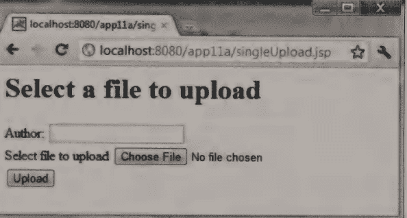

图 11.1：文件上传表

现在选择一个文件，在 Author 字段输入一个值并点击 Upload。你将在浏览器中看到已上传的文件名和大小，如图 11.2 所示。

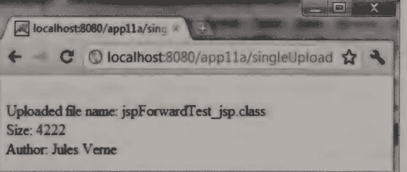

图 11.2：`SingleUploadServlet` 的输出

## 多文件上传

另一个示例，列表 11.3 中的 `MultipleUploadsServlet` 展示了你如何一次性上传多个文件。该 Servlet 与之前的示例类似，不同之处它遍历了 `Part` 集合并尝试判断 `Part` 是否包含文件或字段值。

### 列表 11.3：`MultipleUploadsServlet` 类

```java
package app.servlet;

import java.io.IOException;
import java.io.PrintWriter;
import java.util.Collection;
import javax.servlet.ServletExceptionException;
import javax.servlet.annotation.MultipartConfig;
import javax.servlet.annotation.WebServlet;
import javax.servlet.http.HttpServlet;
import javax.servlet.http.HttpServletRequest;
import javax.servlet.http.HttpServletResponse;
import javax.servlet.http.Part;

@WebServlet(urlPatterns = { "multipleUploads" })
@MultipartConfig
public class MultipleUploadsServlet extends HttpServlet {
    private static final long serialVersionUID = 9991L;

    private String getFilename(Part part) {
        String contentDispositionHeader = 
            part.getHeader("content-disposition");
        String[] elements = contentDispositionHeader.split(";\s");
        for (String element : elements) {
            if (element.trim().startsWith("filename")) {
                return element.substring(element.indexOf('=') + 1)
                    .trim().replace("", "");
            }
        }
    }
}
```


`return null;`

```
public void doPost(HttpServletRequest request,
    HttpServletResponse response) throws ServletException,
    IOException {
```

```
response.setContentType("text/html");
PrintWriter writer = response.getWriter();

Collection<Part> parts = request.getParts();
for (Part part : parts) {
  if (part.getContentType() != null) {
    // 保存文件到磁盘
    String fileName = getFileName(part);
    if (fileName != null && !fileName.isEmpty()) {
      part.write(getServletContext().getRealPath(
        "/WEB-INF/") + "/" + fileName);
      writer.print("<br>/Uploaded file name: " +
        fileName);
      writer.print("<br>/size: " + part.getSize());
    }
  }
} else {
  // 打印字段名/值
  String partName = part.getName();
  String fieldValue = request.getParameter(partName);
  writer.print("<br/>" + partName + ": " +
    fieldValue);
}
}
```

`MultipleUploadsServlet` 类的 `doPost` 方法首先从 `HttpServletRequest` 中获取所有的 `Part`。

```
Collection<Part> parts = request.getParts();
```

然后它遍历该集合，并对每个 `Part` 通过调用 `getContentType` 方法来检查是否存在 `content-type` 请求头。

```
for (Part part : parts) {
  if (part.getContentType() != null) {
    ...
  }
}
```

`content type` 表示客户端存在文件输入元素，你可以尝试通过此来查出用户是否上传了文件。如果找到了文件，`doPost` 方法会将文件内容写入磁盘并将一些信息发送到浏览器。

```
// 将 Part 保存到磁盘
String fileName = getFilename(part);
if (fileName != null && !fileName.isEmpty()) {
    part.write(getServletContext().getRealPath(
        "/WEB-INF/") + "" + fileName);
    writer.print("<br>Uploaded file name: " + fileName);
    writer.print("<br>Size: " + part.getSize());
}
```

缺失的 `content type` 表示该 `Part` 代表非文件字段，你可以通过 `HttpServletRequest` 调用 `getParameter` 方法获取值：

```
// 打印字段名/值
String partName = part.getParameter();
String fieldValue = request.getParameter(partName);
writer.print("<br/>" + partName + ": " + fieldValue);
```

要测试多文件 `servlet`，请使用以下 URL 调用列表 11.4 中的 `multipleUploads.jsp`：

```
http://localhost:8080/app/multipleUploads.jsp
```

### 列表 11.4：`multipleUploads.jsp` 页面

```html
<!DOCTYPE HTML>
<html>
<body>
  <h1>Select a file to upload</h1>
  <form action="multipleUploads" enctype="multipart/form-data"
       method="post">
    Author: <input name="author"/><br>
    First file to upload <input type="file" name="filename"/>
    <br>
    Second file to upload <input type="file" name="filename"/>
    <br>
    <input type="submit" value="Upload"/>
  </form>
</body>
</html>
```

## 上客户端

虽然 Servlet 3 中的文件上传功能让服务器端的编程变得非常简单，但它并没有增强用户体验。纯 HTML 表单无法让你显示进度条或成功上传的文件数量。开发者使用了不同的技术来改进用户界面，例如通过独立的浏览器线程查询服务器以报告进度，或者使用 Java applets、Adobe Flash 或 Microsoft Silverlight 等第三方技术。

第三方技术在某种程度上有效，但存在限制。使用这些技术之一的缺点是所有主流浏览器都没有内置支持。例如，Java applets 只有在用户安装了 Java 的情况下才能运行。某些电脑（如 Dell 和 HP）在产品中内置了 Java，但另一些（如 Lenovo）则没有。虽然有方法检测用户机器是否安装了 Java 并引导用户安装，但这并不是所有用户都能做到的。此外，除非经过签名，否则 Java applets 对文件系统的访问受到严格限制。这些显然增加了程序的复杂性。

Flash 与 applets 有相同的问题。Flash 程序需要播放器才能运行，并非所有平台都支持 Flash。用户必须安装 Flash 播放器才能在浏览器中运行。此外，Apple 不允许在 iPad 和 iPhone 上运行 Flash，Adobe 也最终停止了移动平台的 Flash 支持。

Microsoft Silverlight 同样需要播放器才能运行，非 IE 浏览器并未内置。因此，基本上 Silverlight 程序员面临的问题与 applet 和 Flash 开发者遇到的问题大同小异。

幸运的是，HTML 5 为 DOM 添加了 File API 以允许访问本地文件。与 applets、Flash 和 Silverlight 相比，HTML 5 似乎是解决客户端上传限制的理想方案。遗憾的是，编写时 Internet Explorer 9 还不支持此 API。你可以使用最新版本的 Firefox、Chrome 和 Opera 测试以下示例。

为了演示 HTML 5 的强大，`app1b` 中的 `html5.jsp` 页面（列表 11.5）使用 JavaScript 和 HTML 5 File API 提供了一个报告上传进度的进度条。`app1b` 应用还包含 `MultipleUploadServlet` 的副本以将上传的文件保存到服务器。然而，由于 JavaScript 超出了本书的范围，此处仅进行简单说明。

简而言之，我们关注 HTML 5 输入元素的 `change` 事件，该事件在输入元素的值改变时触发。我们还关注 HTML 5 添加到 `XMLHttpRequest` 对象的 `progress` 事件。`XMLHttpRequest` 毕竟是 AJAX 的核心。当使用 `XMLHttpRequest` 对象异步上传文件时，它会持续触发 `progress` 事件，直到上传过程完成、取消或因错误停止。通过监听 `progress` 事件，你可以轻松监控文件上传操作的进度。

### 列表 11.5：`html5.jsp` 页面

```html
<!DOCTYPE HTML>
<html>
<head>
<script>
var totalFileLength, totalUploaded, fileCount, filesUploaded;

function debug(s) {
  var debug = document.getElementById('debug');
  if (debug) {
    debug.innerHTML = debug.innerHTML + '<br/>' + s;
  }
}

function onUploadComplete(e) {
  totalUploaded += document.getElementById('files').
  files[filesUploaded].size;
  filesUploaded++;
  debug('complete ' + totalUploaded + " of " + fileCount);
  debug('totalUploaded: ' + totalUploaded);
  if (totalUploaded < fileCount) {
    uploadNext();
  }
} else {
```

# 第11章：文件上传 293

```javascript
alert('Finished uploading file(s)');
}
function onFileSelect(e) {
  var files = e.target.files; // FileList 对象
  var output = [];
  fileCount = files.length;
  totalFileSize = 0;
  for (var i=0; i<fileCount; i++) {
    var file = files[i];
    output.push(file.name, ' ',
file.size, ' bytes, '
file.lastModified.toLocaleString(), ' ')
  }
  output.push('<br/>');
debug('add ' + file.size);
  totalFileSize += file.size;
}
document.getElementById('selectedFiles').innerHTML =
  output.join('');
}
debug('totalFileSize:' + totalFileSize);
function onUploadProgress(Computable) {
  if (e.lengthComplete = parseInt(
(e.loaded + totalUploaded) * 100
 totalFileSize)) {
    var bar = document.getElementById('bar');
    bar.style.width = percentComplete + '%';
    bar.innerHTML = percentComplete + ' % complete';
  } else {
    debug('unable to compute');
  }
}
function onUploadFailed(e) {
  alert("Error uploading file");
}
function uploadNext() {
  var xhr = new XMLHttpRequest();
  var fd = new FormData();
  var file = document.getElementById('files').
```

# 294 Servlet & JSP: 教程

```javascript
files[filesUploaded];
fd.append("fileToUpload", file);
xr.upload.addEventListener(
  "progress", onUploadProgress, false);
xhr.addEventListener("load", onUploadComplete, false);
xhr.addEventListener("error", onUploadFailed, false);
xhr.open("POST", "multipleUploads");
debug("uploading ' + file.name);
xr.send(fd);
```

```javascript
}
function startUpload() {
  totalUploaded = filesUploaded;
  uploadNext();
}
window.onload = function () {
  document.getElementById('files').addEventListener(
    'change', onFileSelect, false);
  document.getElementById('uploadButton').
    addEventListener('click', startUpload, false);
};
```

```html
</script>
<head>
<body>
<h1>带进度条的多文件上传</h1>
<div id='progressBar' style='height:20px;border:2px solid green'>
<div id='bar'
style='height:100%;background:#3dd33;width:0%'>
</div>
</div>
<form id='form1' action="multipleUploads"
  enctype="multipart/form-data" method="post">
<input type="file" id="files" multiple/>
<br/>
<output id="selectedFiles"></output>
<input id="uploadButton" type="button" value="Upload"/>
</form>
<div id='debug'
style='height:100px;border:2px solid green;overflow:auto'>
</div>
</body>
</html>
```

`html5.jsp` 页面的用户界面主要由 `div` 元素 `progressBar` 和另一个名为 `debug` 的 `div` 元素组成。你猜得没错，`progressBar` 元素用于显示上传进度，而 `debug` 用于调试信息。表单包含一个类型为 `file` 的输入元素和一个按钮。

表单中有两点需要注意。首先，标识为 `files` 的输入元素具有 `multiple` 属性，以支持选择多个文件。其次，该按钮不是提交按钮。因此，点击它不会提交所在的表单。事实上，脚本使用 `XMLHttpRequest` 对象来执行上传。

现在，让我们来看 JavaScript 代码。这假设你对脚本语言有一定的了解。

当执行脚本时，它做的第一件事为四个变量分配空间。

```javascript
var totalFileLength, totalUploaded, fileCount, filesUploaded;
```

`totalFileLength` 变量保存要上传文件的总长度。`totalUploaded` 是已上传的字节数。`fileCount` 包含要上传的文件数，而 `filesUploaded` 表示已上传的文件数。

然后，在窗口完全加载后会调用赋值给 `window.onload` 的函数。

```javascript
window.onload = function() {
  document.getElementById('files').addEventListener(
    'change', onFileSelect, false);
  document.getElementById('uploadButton').
    addEventListener('click', startUpload, false);
}
```

这会将文件输入元素的 `change` 事件映射到 `onFileSelect` 函数，并将按钮的 `click` 事件映射到 `startUpload`。

每当用户从本地目录选择一组不同的文件时，就会触发 `change` 事件。绑定到此事件的事件处理器会将所选文件的名称和大小打印到输出元素中。这里是该事件处理器的代码：

```javascript
function onFileSelect(e) {
  var files = e.target.files; // FileList 对象
```

# 296 Servlet & JSP: 教程


当用户点击按钮时，`startUpload` 函数被调用，它调用 `uploadNext`。`uploadNext` 通过创建一个 `XMLHttpRequest` 对象和 `FormData` 对象来准备要上传的文件。

```javascript
xhr = new XMLHttpRequest();
fd = new FormData();
var file = document.getElementById('files');
files[filesUploaded];
fd.append("fileToUpload", file);
```

`uploadNext` 函数然后将 `XMLHttpRequest` 对象的 `progress` 事件绑定到 `onUploadProgress`，将 `load` 事件绑定到 `onUploadComplete`，并将 `error` 事件绑定到 `onUploadFailed`。

```javascript
xhr.addEventListener("progress", onUploadProgress, false);
xhr.addEventListener("load", onUploadComplete, false);
xhr.addEventListener("error", onUploadFailed, false);
```

接下来它打开与服务器的连接并发送 `FormData`。

```javascript
xhr.open("POST", "multipleUploads");
debug("uploading ' + file.name);
xr.send(fd);
```

在上传过程中，`onUploadProgress` 函数被反复调用，使其有机会更新进度条。更新涉及计算已上传字节数与总文件数的比例，从而更新 `progressBar` 内的 `div` 元素。

```javascript
function onUploadProgress(e) {
  if (e.lengthComputable) {
    var percentComplete = parseInt(
      (e.loaded + totalUploaded) * 100
      totalFileSize);
    var bar = document.getElementById('bar');
    bar.style.width = percentComplete + '%';
    bar.innerHTML = percentComplete + ' % complete';
  } else {
    debug('unable to compute');
  }
}
```

上传完成后，`onUploadComplete` 函数被调用。此事件处理器将完成上传的文件大小添加到 `totalUploaded` 并增加 `filesUploaded`。然后它检查是否所有选择的文件都已上传。如果是，则显示消息告诉用户已完成。如果不是，它再次调用 `uploadNext`。为了方便阅读，这里重印了 `onUploadComplete` 函数。

```javascript
function onUploadComplete(e) {
  totalUploaded += document.getElementById('files').
    files[filesUploaded].size;
  filesUploaded++;
  debug('complete ' + filesUploaded + ' of ' + fileCount);
  debug('totalUploaded: ' + totalUploaded);
  if (filesUploaded < fileCount) {
    uploadNext();
  } else {
    alert('Finished uploading file(s)');
  }
}
```

你可以使用以下 URL 测试应用程序：

`http://localhost:8080/app1b/html5.jsp`

# 298 Servlet & JSP: 教程

选择几个文件并点击上传按钮。你会看到一个进度条以及上传文件的信息，如图 11.3 所示。

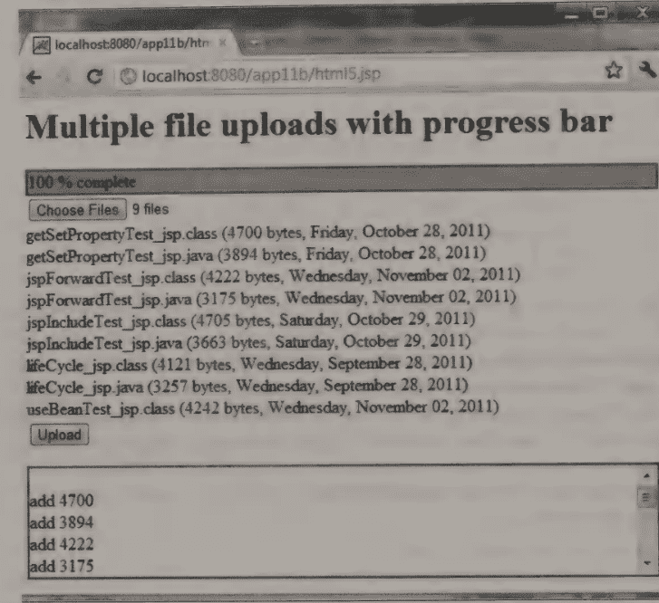

图 11.3：带进度条的文件上传

## 总结

在本章中你学习了 Servlet 3 文件上传支持的工作原理。特别重要的是 `MultipartConfig` 注解类型，所有多 Servlet 都必须使用该注解。`Part` 接口表示一个 HTML 输入字段，对于对应于文件输入元素的 `Part`，`Part` 暴露了上传文件的各种属性，例如文件名和大小。`Part` 还允许你轻松地将文件写入磁盘。

虽然这一新功能是 Servlet 3.0 的一个极佳补充，但它并没有解决浏览器中缺乏实用用户界面的问题。对于这一点，可以使用 HTML 5。本章展示了如何利用 HTML 5 中的 File API 来渲染和更新进度条。

## 第 12 章：文件下载

静态资源（如图像或 HTML 文件）可以通过将浏览器指向正确的 URL 直接进行下载。只要资源位于应用程序目录或其子目录中，且不在 `WEB-INF` 下，servlet/JSP 容器就会将资源发送到浏览器。然而，有时静态资源存储在应用程序目录之外或数据库中，或者你想要控制谁可以查看它并防止其他网站对其进行交叉引用。如果适用于任何这些场景，你就必须通过程序化的方式发送资源。

简而言之，程序化文件下载允许你选择性地向浏览器发送文件。本章解释了程序化向浏览器发送资源所需的条件，并提供了两个示例。

## 文件下载概述

要向浏览器发送文件等资源，你需要在 servlet 中执行以下操作。通常不使用 JSP 页面，因为你发送的是二进制数据，且浏览器中没有可显示的内容。

1. 将响应的 content type 设置为文件的 content type。`Content-Type` 请求头指定实体正文的数据类型，由媒体类型和子类型标识符组成。访问 `http://www.iana.org/assignments/media-types` 获取标准内容类型。如果你不知道内容类型是什么，或者希望浏览器始终显示“另存为”对话框，请设置为 `APPLICATION/OCTET-STREAM`。该值不区分大小写。

2. 添加名为 `Content-Disposition` 的 HTTP 响应头，并赋予其值 `attachment; filename=fileName`，其中 `fileName` 是文件下载对话框中显示的默认文件名。这通常与文件名相同，但不必一定相同。

在此实例中，代码向浏览器发送了一个文件。

```java
InputStream fis = new FileInputStream(file);
BufferedInputStream bis = new BufferedInputStream(fis);
byte[] bytes = new byte[bis.available()];
response.setContentType(contentType);
OutputStream os = response.getOutputStream();
bis.read(bytes);
os.write(bytes);
```

## 警告

确保你没有无意中发送实际文件内容以外的任何字符。这可能在你毫无察觉的情况下发生。例如，如果你需要在 JSP 页面中使用页面指令，你可能会像这样写该指令：

```jsp
<@ page import="java.io.FileInputStream%>
<jsp:useBean id="DBBeanId" scope="page" class="MyBean" />
```

在毫无察觉的情况下，页面指令末尾的回车符会被发送到浏览器。为了防止发送额外的字符，请按如下方式编写指令：

```jsp
<@ page import="java.io.FileInputStream%>
<jsp:useBean id="DBBeanId" scope="page" class="MyBean" />
```

这看起来很寻常，但它很有帮助。

## 示例 1：隐藏资源

`app12a` 演示了如何向浏览器发送文件。在应用程序中，我们使用一个 `FileDownload` servlet 向浏览器发送一个 `secret.pdf` 文件。然而，只有授权用户才能查看它。如果用户未登录，应用程序将重定向到登录页面。在这里，用户可以在表单中输入用户名和密码，表单将提交到另一个 servlet —— `LoginServlet`。

`app12a` 应用程序的目录结构如图 12.1 所示。注意：

- `app12a`
  - `WEB-INF`
    - `classes`
      - `filedownload`
        - `FileDownloadServlet.class`
        - `LoginServlet.class`
    - `data`
      - `secret.pdf`
    - `login.jsp`

### 图 12.1：应用程序目录

`secret.pdf` 文件被放置在 `WEB-INF/data` 下，因此无法直接访问。

代码列表 12.1 中的 `FileDownloadServlet` 类提供了负责发送 `secret.pdf` 文件的 servlet。只有当用户的 `HttpSession` 包含一个 `loggedIn` 属性时，才会授予访问权限，这表示用户已成功登录。

### 代码列表 12.1：FileDownloadServlet 类

```java
package filedownload;
import java.io.BufferedInputStream;
import java.io.File;
import java.io.FileInputStream;
import java.io.IOException;
import java.io.OutputStream;
import javax.servlet.RequestDispatcher;
import javax.servlet.ServletExceptionException;
import javax.servlet.annotation.WebServlet;
import javax.servlet.http.HttpServlet;
import javax.servlet.http.HttpServletRequest;
import javax.servlet.http.HttpServletResponse;
import javax.servlet.http.HttpSession;

@WebServlet(urlPatterns = { "/download" })
public class DownloadServlet extends HttpServlet {

    private static final long serialVersionUID = 75833L;

    public void doGet(HttpServletRequest request,
        HttpServletResponse response) throws ServletException,
        IOException {

            HttpSession session = request.getSession();

            if (session == null ||
                session.getAttribute("loggedIn") == null) {

                RequestDispatcher dispatcher =
                    request.getRequestDispatcher("/login.jsp");

                dispatcher.forward(request, response);

                //必须在 dispatcher.forward() 之后返回。否则，
                // 下面的代码将执行
                return;
            }

            String dataDirectory = request.
                getServletContext().getPath("/WEB-INF/data");

            File file = new File(dataDirectory, "secret.pdf");

            if (file.exists()) {

                response.setContentType("application/pdf");

                response.addHeader("Content-Disposition",
                    "attachment; filename=secret.pdf");

                byte[] buffer = new byte[1024];

                FileInputStream fis = null;

                BufferedInputStream bis = null;

                // 如果我们使用 Java 7，使用 try-with-resources
                try {

                    fis = new FileInputStream(file);

                    bis = new BufferedInputStream(fis);

                    OutputStream os = response.getOutputStream();

                    int i = bis.read(buffer);

                    while (i != -1) {

                        os.write(buffer, 0, i);

                        i = bis.read(buffer);

                    }

                } catch (IOException ex) {

                    System.out.println(ex.toString());

                } finally {

                    if (bis != null) {

                        bis.close();

                    }

                    if (fis != null) {

                        fis.close();

                    }

                }

            }

        }

}
```

# 306 Servlet & JSP: 教程

```java
System.out.println(ex.toString());
} finally {

    if (bis != null) {

        bis.close();

    }

    if (fis != null) {

        fis.close();

    }

}
```

如果你正在使用 Java 7，新的尝试用资源（try-with-resources）功能是处理资源的一种更安全的方法。

未经授权的用户将被重定向到列表 12.2 中的 `login.jsp` 页面。该页面包含一个带有两个输入字段（用户名和密码）的 HTML 表单。

### 列表 12.2：login.jsp 页面

```html
<html>
<head>
<title>Login</title>
</head>
<body>
<form action="login" method="post">
<table>
<tr>
<td>User Name:</td>
<td><input name="userName"></td>
</tr>
<tr>
<td>Password:</td>
<td><input type="password" name="password"></td>
</tr>
<tr>
<td colspan="2">
<input type="submit" value="Login"/>
</td>
</tr>
</table>
</form>
```


## 第 12 章：文件下载

提交表单将调用`LoginServlet`，其类定义在列表 12.3 中。请注意，对于此应用程序，用户名/密码必须是`ken/secret`。

### 列表 12.3：`LoginServlet`类

```java
package filedownload;

import java.io.IOException;

import javax.servlet.RequestDispatcher;

import javax.servlet.ServletExceptionException;

import javax.servlet.annotation.WebServlet;

import javax.servlet.http.HttpServlet;

import javax.servlet.http.HttpServletRequest;

import javax.servlet.http.HttpServletResponse;

import javax.servlet.http.HttpSession;

@WebServlet(urlPatterns = {"/login"})
public class LoginServlet extends HttpServlet {

    private static final long serialVersionUID = -920L;

    protected void doPost(HttpServletRequest request,
                         HttpServletResponse response) throws ServletException,
                         IOException {

        String username = request.getParameter("username");
        String password = request.getParameter("password");

        if (username != null && username.equals("ken"))
            // password != null && password.equals("secret") {
                HttpSession session = request.getSession(true);
                session.setAttribute("loggedIn", Boolean.TRUE);
                response.sendRedirect("download");
                // 必须调用 return，否则此 if 块之后的
                // 代码（如果有的话）将被执行
                return;
            } else {
                RequestDispatcher dispatcher =
                    request.getRequestDispatcher("/login.jsp");
                dispatcher.forward(request, response);
            }
    }
}
```

登录成功将设置`loggedIn`会话属性并将用户重定向到 FileDownload 单元。

再次，你必须在调用`HttpServletResponse.sendRedirect`之后进行`return`，以防止后续代码执行。

登录失败会将用户重定向到`login.jsp`页面：

```java
else {
    RequestDispatcher dispatcher = request.getRequestDispatcher("/login.jsp");
    dispatcher.forward(request, response);
}
```

你可以通过使用以下 URL 调用`FileDownloadServlet`来测试`app12a`应用：

```
http://localhost:8080/app12a/download
```

## 示例 2：防止交叉引用

竞争对手可能会尝试通过交叉引用来“盗取”你的网络资源，即在他们的网站上显示你的值，就好像那是他们自己的一样。你可以通过仅在`referer`头部包含你的域名时才程序化发送资源来防止这种情况的发生。当然，最坚定的小偷仍然能够下载你的属性。但他们不可能不费力就做到。

`app12b`应用使用一个 servlet 来向浏览器发送图像，前提是`referer`头部不为空。这将防止用户通过在浏览器中输入 URL 直接下载图像。列表 12.4 给出了该 servlet，即`ImageServlet`。

### 列表 12.4：`ImageServlet`类

```java
package java.io;

import java.io.BufferedInputStream;

import java.io.File;

import java.io.FileInputStream;

import java.io.IOException;

import java.io.OutputStream;

import javax.servlet.ServletExceptionException;

import javax.servlet.annotation.WebServlet;

import javax.servlet.http.HttpServlet;

import javax.servlet.http.HttpServletRequest;

import javax.servlet.http.HttpServletResponse;

@WebServlet(urlPatterns = { "/getImage" })
public class ImagesServlet extends HttpServlet {

    private static final long serialVersionUID = -99L;

    public void doGet(HttpServletRequest request, 
        HttpServletResponse response) throws ServletException, 
        IOException {

        String referer = request.getHeader("referer");

        if (referer != null) {

            String imageId = request.getParameter("id");
            String imageDirectory = request.getServletContext().
                getPath("/WEB-INF/image/");
            File file = new File(imageDirectory, 
                imageId + ".jpg");

            if (file.exists()) {

                response.setContentType("image/jpeg");
                byte[] buffer = new byte[1024];
                FileInputStream fis = null;
                BufferedInputStream bis = null;

                try {

                    fis = new FileInputStream(file);
                    bis = new BufferedInputStream(fis);
                    OutputStream os = response.getOutputStream();
                    int i;

                    while ((i = bis.read(buffer)) != -1) {
                        os.write(buffer, 0, i);
                    }

                } catch (IOException ex) {
                    System.out.println(ex.toString());
                } finally {

                    if (bis != null) {
                        bis.close();
                    }

                    if (fis != null) {
                        fis.close();
                    }
                }
            }
        }
    }
}
```

如果你使用的是 Java 7，新的尝试用资源功能是处理资源的一种更安全的方法。

未经授权的用户将被重定向到列表 12.2 中的`login.jsp`页面。该页面包含一个带有两个输入字段（用户名和密码）的 HTML 表单。

### 列表 12.2：`login.jsp`页面

```html
<html>
<head>
<title>Login</title>
</head>
<body>
<form action="login" method="post">
<table>
<tr>
<td>User Name:</td>
<td><input name="userName"></td>
</tr>
<tr>
<td>Password:</td>
<td><input type="password" name="password"></td>
</tr>
<tr>
<td colspan="2">
<input type="submit" value="Login"/>
</td>
</tr>
</table>
</form>
</body>
</html>
```


`public void doGet(HttpServletRequest request, HttpServletResponse response) throws ServletException, IOException` 方法中，首先获取请求头 `referer`，如果其不为空，则获取参数 `id`，并通过 `getServletContext().getPath("/WEB-INF/image/")` 获取图片目录路径。接着创建 `File` 对象指向该目录下的 `imageId + ".jpg"` 文件，若文件存在，则设置响应内容类型为 `image/jpeg`，并通过 `FileInputStream` 和 `BufferedInputStream` 读取文件内容，写入响应输出流。在读取过程中捕获 `IOException` 并打印异常信息，最后在 `finally` 块中关闭输入流。

```
public void doGet(HttpServletRequest request, 
    HttpServletResponse response) throws ServletException, 
    IOException {
    String referer = request.getHeader("referer");
    if (referer != null) {
        String imageId = request.getParameter("id");
        String imageDirectory = request.getServletContext().
            getPath("/WEB-INF/image/");
        File file = new File(imageDirectory, 
            imageId + ".jpg");
        if (file.exists()) {
            response.setContentType("image/jpeg");
            byte[] buffer = new byte[1024];
            FileInputStream fis = null;
            BufferedInputStream bis = null;
            try {
                fis = new FileInputStream(file);
                bis = new BufferedInputStream(fis);
                OutputStream os = response.getOutputStream();
                int i;
                while ((i = bis.read(buffer)) != -1) {
                    os.write(buffer, 0, i);
                }
            } catch (IOException ex) {
                System.out.println(ex.toString());
            } finally {
                if (bis != null) {
                    bis.close();
                }
                if (fis != null) {
                    fis.close();
                }
            }
        }
    }
}
```

## 319 Servlet & JSP: 教程

```
System.out.println(ex.toString());
} finally {
    if (bis != null) {
        bis.close();
    }
    if (fis != null) {
        fis.close();
    }
}
```

在原理上，`ImageServlet` 在 `referer` 头部不为空时工作，类似于 `FileDownload`。如果你使用的是 Java 7，新的尝试用资源功能是处理资源的一种更安全的方法。

### 列表 12.5：images.html

```
<html>
<head>
<title>Photo Gallery</title>
</head>
<body>
<a href="getImage?id=1">Image 1</a>
<a href="getImage?id=2">Image 2</a>
<a href="getImage?id=3">Image 3</a>
<a href="getImage?id=4">Image 4</a>
<a href="getImage?id=5">Image 5</a>
<a href="getImage?id=6">Image 6</a>
<a href="getImage?id=7">Image 7</a>
<a href="getImage?id=8">Image 8</a>
<a href="getImage?id=9">Image 9</a>
<a href="getImage?id=10">Image 10</a>
</body>
</html>
```

为了看到 `ImageServlet` 运行，请将浏览器指向此 URL：`http://localhost:8080/app12b/images.html`。图 12.2 显示了由 `ImageServlet` 发送的图像。

## 第 12 章：文件下载 311


图 12.2：运行中的

## 总结

在本章中，你学习了程序化文件下载是如何工作的。你还学习了如何选择文件并将其发送。

## 第 13 章：装饰请求和响应

Servlet API 提供了四个包装类，你可以使用它们来更改请求和响应的行为。包装器允许你“包装” `ServletRequest` 和 `ServletResponse` 中的任何方法，或者它们的 HTTP 等效类（分别是 `HttpServletRequest` 和 `HttpServletonse`）。这些包装器遵循装饰或包装模式，为了使用这些功能，你需要了解该模式。

## 装饰模式

装饰或包装模式允许你装饰或包装（用通俗说就是修改）对象的行为，即使你没有该对象类的源代码，或者该类被声明为 `final`。装饰模式适用于继承无法工作的情况（例如，如果涉及对象的类是 `final`），或者你不是自己创建该对象，而是从另一个子系统获取。例如，Servlet 容器创建 `ServletRequest` 和 `ServletResponse` 并将其传递给 servlet 的服务方法。更改 `HttpRequest` 和 `HttpServletResponse` 行为的唯一方法是将它们包装在其他对象中。必须满足的条件是：被装饰对象的类实现一个接口，而将包装的方法继承自该接口。

考虑图 13.1 中的 UML 类图。

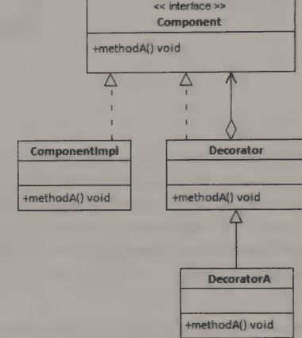

图 13.1：装饰器模式

图 13.1 中的类图显示了一个名为 `ComponentImpl` 的 `Component` 实现类。`Component` 接口定义了一个方法 `methodA(args)`。为了装饰 `ComponentImpl` 的实例，可以创建一个实现 `Component` 的 `Decorator` 类，并扩展 `Decorator` 以在子类中编写新行为。图中 `DecoratorA` 是 `Decorator` 的子类。

每个 `Decorator` 实例都需要包含一个 `Component` 实例。`Decorator` 类如下所示。（注意，构造函数接收 `Component` 实例，这意味着你只能通过传递 `Component` 实例来创建 `Decorator`。）

```
public class Decorator implements Component {
    private Component decorated;
    // 构造函数接收一个 Component 实现
    public Decorator(Component component) {
        this.decorated = component;
    }
    // 未修饰的方法
    @Override
    public void methodA(Object args) {
        decorated.methodA(args);
    }
    // 被装饰的方法
    @Override
    public void methodB(Object args) {
        decorated.methodB(args);
    }
}
```

在 `Decorator` 类中，被装饰的方法是指其行为将在子类中被改变的方法。未修饰的方法是在子类中不会被重写的方法。所有方法（无论被装饰的还是其他的）都会调用它们在 `Component` 中对应的方法。`Decorator` 类更像是一个便利类，为它中的每个方法提供默认实现。行为的变化由子类提供。

需要记住的一点是，`Decorator` 类和被装饰对象的类必须实现相同的接口。通过这样做，你可以将被装饰的对象包装在装饰器内部，并将装饰器作为 `Component` 的实现传递。你可以将任何 `Component` 的实现传递给装饰器。事实上，你可以将装饰器传递给另一个装饰器，以对对象进行双重装饰。

### Servlet 包装类

Servlet API 提供了四个很少使用但可能非常强大的类：`ServletRequestWrapper`、`ServletResponseWrapper` 以及 `HttpServletRequestWrapper` 和 `HttpServletResponseWrapper`。

`ServletRequestWrapper`（以及其他三个包装类）非常方便使用，因为它们为每个方法提供了默认实现，这些实现会调用被包装的 `HTTPRequest` 中对应的对应方法。通过扩展 `ServletRequestWrapper`，你只需要重写你想要更改的方法。如果没有 `HttpServletRequestWrapper`，你将直接实现 `ServletRequest` 并为接口中的每个方法提供实现。

图 13.2 显示了装饰器模式中的 `HttpServletWrapper` 类。Servlet 容器每当 servlet 的 `service` 方法被调用时，都会创建一个 `ServletRequest` 的实例 `ContainerImpl`。你可以扩展 `HttpServletWrapper` 来装饰 `ServletRequest`。

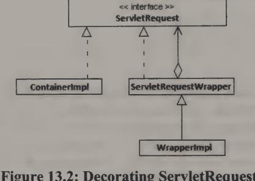

## 示例：自动修正过滤器

在 Web 应用中，用户输入的值往往带有前导或尾空格，甚至单词之间还有额外的空格。你不希望在应用程序的每个 servlet 中检查并移除额外的空格。本节介绍的自动修正（AutoCorrect）过滤器可以提供帮助。该过滤器包含一个名为 `AutoHttpServletWrapper` 的 `HttpServletWrapper` 子类，并重写了以下返回参数值的方法：`getParameter`、`getParameterValues` 和 `getParameterMap`。过滤器类位于代码 13.1。

+ 13.1：AutoCorrectFilter

```
package filter;

import java.io.IOException;
import java.util.ArrayList;
import java.util.Collection;
import java.util.HashSet;
import java.util.Map;
import java.util.Set;
import javax.servlet.Filter;
import javax.servlet.FilterChain;
import javax.servlet.FilterConfig;
import javax.servlet.ServletException;
import javax.servlet.ServletRequest;
import javax.servlet.ServletResponse;
import javax.servlet.annotation.WebFilter;
import javax.servlet.http.HttpServletRequest;
import javax.servlet.http.HttpServletRequestWrapper;

@WebFilter(name = "AutoCorrectFilter", urlPatterns = "/*")
public class AutoCorrectFilter implements Filter {
    @Override
    public void init(FilterConfig filterConfig) throws ServletException {
    }
    @Override
    public void destroy() {
    }
    @Override
    public void doFilter(ServletRequest request,
                         ServletResponse response, FilterChain filterChain)
            throws IOException, ServletException {
        HttpServletRequest httpRequest = (HttpServletRequest)request;
        AutoCorrectHttpServletRequestWrapper wrapper = new
            AutoCorrectHttpServletRequestWrapper(httpRequest);
        filterChain.doFilter(wrapper, response);
    }
}

class AutoCorrectHttpServletRequestWrapper extends HttpServletRequestWrapper {
    private HttpServletRequest httpRequest;
    public AutoCorrectHttpServletRequestWrapper(HttpServletRequest httpRequest) {
        super(httpRequest);
        this.httpRequest = httpRequest;
    }
    @Override
    public String getParameter(String name) {
        return autoCorrect(httpRequest.getParameter(name));
    }
    @Override
    public String[] getParameterValues(String name) {
        return autoCorrect(httpRequest.getParameterValues(name));
    }
    @Override
    public Map<String, String[]> getParameterMap() {
        return autoCorrect(httpRequest.getParameterMap());
    }
    private String autoCorrect(String value) {
        if (value == null) return null;
        String trimmed = value.trim();
        StringBuilder sb = new StringBuilder();
        boolean lastSpace = false;
        for (int i = 0; i < trimmed.length(); i++) {
            char c = trimmed.charAt(i);
            if (c == ' ') {
                if (!lastSpace) {
                    sb.append(c);
                }
                lastSpace = true;
            } else {
                sb.append(c);
                lastSpace = false;
            }
        }
        return sb.toString();
    }
    private String[] autoCorrect(String[] values) {
        if (values == null) return null;
        for (int i = 0; i < values.length; i++) {
            values[i] = autoCorrect(values[i]);
        }
        return values;
    }
    private Map<String, String[]> autoCorrect(Map<String, String[]> map) {
```


如果`map == null`，则返回`null`。

```java
Map<String, String[]> result = new java.util.HashMap<>();

for (Map.Entry<String, String[]> entry : map.entrySet()) {
    result.put(entry.getKey(), autoCorrect(entry.getValue()));
}

return result;
```

## 第 13 章：装饰请求与响应

```java
private Collection<String[]> autoCorrect(
    Collection<String[]> valueCollection) {
    new ArrayList<String[]>();
    for (String[] values : valueCollection) {
        newCollection.add(autoCorrect(values));
    }
    return newCollection;
}
```

```java
private Set<Map.Entry<String, String[]>> autoCorrect(
    Set<Map.Entry<String, String[]>> entrySet) {
    Set<Map.Entry<String, String[]>> newSet = 
        new HashSet<Map.Entry<String, String[]>>();
    for (final Map.Entry<String, String[]> entry
    : entrySet) {
        Map.Entry<String, String[]> newEntry = 
            new Map.Entry<String, String[]>() {
                @Override
                public String getKey() {
                    return entry.getKey();
                }
                @Override
                public String[] getValue() {
                    return autoCorrect(entry.getValue());
                }
                @Override
                public String[] setValue(String[] value) {
                    return entry.setValue(value);
                }
            };
        newSet.add(newEntry);
    }
    return newSet;
}
```

过滤器的`doFilter`方法非常简单。它为`ServletRequest`创建了一个装饰器，并将该装饰器传递给`doFilter`方法：

```java
HttpServlet httpRequest = 
    (HttpServlet) request;
AutoCorrectHttpServletRequestWrapper wrapper = new
AutoCorrectHttpServletRequestWrapper(
HttpServletRequest);
filterChain.doFilter(wrapper, response);
```

过滤器之后调用的任何 servlet 都会获得一个被`AutoCorrectHttpServletRequestWrapper`包装的`HttpServletRequest`。这个包装类很长，但易于理解。基本上，它将所有获取参数值的调用传递给这个`autoCorrect`方法。

```java
private String autoCorrect(String value) {
    if (value == null) {
        return null;
    }
    value = value.trim();
    int length = value.length();
    StringBuilder temp = new StringBuilder();
    boolean lastCharWasSpace = false;
    for (int i = 0; i < length; i++) {
        char c = value.charAt(i);
        if (c == ' ') {
            if (!lastCharWasSpace) {
                temp.append(c);
            }
            lastCharWasSpace = true;
        } else {
            temp.append(c);
            lastCharWasSpace = false;
        }
    }
    return temp.toString();
}
```

你可以使用列表 13.2 和列表 13.3 显示的`test1.jsp`和`test2.jsp`页面来测试过滤器。

### 列表 13.2：test1.jsp 页面

```html
<!DOCTYPE HTML>
<html>
<head>
<title>User Form</title>
</head>
<body>
<form action="test2.jsp" method="post">
<table>
<tr>
<td>Name:</td>
<td><input name="name"/></</td>
</tr>
<tr>
<td>Address:</td>
<td><input name="address"/></</td>
</tr>
<tr>
<td colspan="2">
<input type="submit" value="Login"/>
</td>
</tr>
</table>
</form>
</body>
</html>
```

### 列表 13.3：test2.jsp 页面

```jsp
<%@ taglib uri="http://java.sun.com/jsp/jst/functions" prefix="fn"%>
<!DOCTYPE HTML>
<html>
<head>
<title>Form Values</title>
</head>
<body>
<table>
<tr>
<td>Name:</td>
<td>
${param.name}
(length:${fn:length(param.name)})
</td>
</tr>
<tr>
<td>Address:</td>
<td>
${param.address}
(length:${fn:length(param.address)})
</td>
</tr>
</table>
</body>
</html>
```

使用以下 URL 访问`test1.jsp`页面：
`http://localhost:8080/app13a/test1.jsp`

输入带有尾随或前导空格、甚至单词之间有额外空格的值，并点击提交。在随后的屏幕上，你应该看到输入的值已经过自动修正。

## 总结

Servlet API 提供了四个包装类（`ServletRequestWrapper`、`ServletResponseWrapper`、`HttpServletRequestWrapper`和`HttpServletResponseWrapper`），你可以扩展它们来装饰 servlet 请求和 servlet 响应。然后可以使用过滤器或监听器创建包装器，并将其传递给 servlet 的服务方法，如本章中的`AutoCorrectFilter`示例所示。

## 第 14 章：异步处理

Servlet 3 引入了一项新功能，允许 servlet 异步处理请求。本章将解释这一新功能，并提供如何使用它的示例。

## 概述

计算机的内存是有限的。servlet/JSP 容器的设计者意识到了这一点，并提供了一些配置设置以确保容器能够处理请求。Servlet 3 引入了一项新功能，允许 servlet 异步处理请求。本章将解释这一新功能，并提供如何使用它的示例。

异步处理允许容器用有限的线程处理更多的请求。当 servlet 启动一个耗时任务时，它可以将线程释放回容器，允许其处理其他请求。一旦任务完成，servlet 就可以恢复响应。

### 编写异步 Servlet

编写异步 servlet 或异步过滤器相对简单。只有当你有一个执行时间较长的任务时，才会主要创建异步 servlet 或过滤器。以下是你的异步 servlet 或过滤器类中需要执行的操作：

1. 在`ServletRequest`上调用`startAsync`方法。`startAsync`返回一个`AsyncContext`。
2. 在`AsyncContext`上调用`setTimeout()`，传递容器等待指定任务完成的毫秒数。此步骤是可选的，但如果不设置超时，将使用容器的默认值。如果任务未在指定的超时时间内完成，将抛出异常。
3. 调用`asyncContext.start`，传递一个执行长耗时任务的`Runnable`。
4. 在任务完成后从`Runnable`中调用`asyncContext.complete`或`asyncContext.dispatch`。

以下是异步 servlet 的`doGet`或`doPost`方法的骨架：

```java
final AsyncContext asyncContext = servletRequest.startAsync();
asyncContext.setTimeout( ...);
asyncContext.start(new Runnable() {
    @Override
    public void run() {
        // long running task
    }
});
```

```java
asyncContext.complete() or asyncContext.dispatch()
```

例如，列表 14.1 显示了一个支持异步处理的 servlet。

### 列表 14.1：带有 dispatch 的简单异步 servlet

```java
package servlet;

import java.io.IOException;
import javax.servlet.AsyncContext;
import javax.servlet.ServletExceptionException;
import javax.servlet.annotation.WebServlet;
import javax.servlet.http.HttpServletServlet;
import javax.servlet.http.HttpServletRequest;
import javax.servlet.http.HttpServletResponse;
```

```java
@WebServlet(name = "AsyncDispatchServlet",
             urlPatterns = { "/asyncDispatch" },
             asyncSupported = true)
public class AsyncDispatchServlet extends HttpServlet {
    private static final long serialVersionID = 222L;

    @Override
    public void doGet(final HttpServletRequest request,
                       HttpServletResponse response)
            throws ServletException, IOException {
        final AsyncContext asyncContext = request.startAsync();
        request.setAttribute("mainThread",
                             Thread.currentThread().getName());
        asyncContext.setTimeout(5000);
        asyncContext.start(new Runnable() {
            @Override
            public void run() {
                // 长时任务
                try {
                    Thread.sleep(3000);
                } catch (InterruptedException e) {
                }
                request.setAttribute("workerThread",
                             Thread.currentThread().getName());
                asyncContext.dispatch("/threadNames.jsp");
            }
        });
    }
}
```

## 第 14 章：异步处理

列表 14.1 中的 servlet 支持异步处理，其耗时任务仅仅是睡眠三秒。为了证明耗时任务是在主线程（执行 servlet 的`doGet`方法的线程）不同的线程中执行的，它将主线程和工作线程的名称附加`ServletRequest`中，并分发到一个测试.jsp 页面（见列表 14.2），该页面显示了`mainThread`和`workerThread`变量。它们应该打印出不同的线程名称。

### 列表 14.2：threadNames.jsp 页面

```html
<!DOCTYPE HTML>
<html>
<head>
<title>Asynchronous servlet</title>
</head>
<body>
Main thread: ${mainThread}
<br>
Worker thread: ${workerThread}
</body>
</html>
```

注意，在任务结束后，你需要在`AsyncContext`上调用`dispatch`或`complete`方法，否则它将一直等待直到超时。

你可以通过将浏览器指向此 URL 来测试 servlet：`http://localhost:8080/app14a/asyncDispatch`

图 14.1 显示了主线程名称和工作线程的名称。你在浏览器中看到的可能有所不同，但名称是不同的，这证明了工作线程不同于主线程。

# 330 Servlet & JSP: 教程

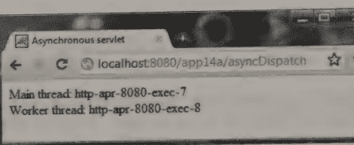

图 14.1：AsyncDispatchServlet

在任务完成时，除了分发到另一个资源外，我们也可以调用`AsyncContext`的`complete`方法。该方法向 servlet 容器指示任务已完成。

作为第二个示例，考虑列表 14.3 中的 servlet。servlet 每秒发送一次进度更新，用户可以监控进度。它发送 HTML 响应和一段简单的 JavaScript 代码来更新 HTML 元素。

### 列表 14.3：发送进度更新的异步 servlet

```java
package servlet;

import java.io.IOException;
import java.io.PrintWriter;
import javax.servlet.AsyncContext;
import javax.servlet.ServletException;
import javax.servlet.annotation.WebServlet;
import javax.servlet.http.HttpServlet;
import javax.servlet.http.HttpServletRequest;
import javax.servlet.http.HttpServletResponse;

public class AsyncCompleteServlet extends HttpServlet {
    private static final long serialVersionUID = 78234L;

    @Override
    public void doGet(HttpServletRequest request,
                       HttpServletResponse response)
            throws ServletException, IOException {
```


`response.setContentType("text/html");`

`PrintWriter writer = response.getWriter();`

`writer.println("<html><head><title>" + "Async Servlet</title></head>");`

`writer.println("<body><div id='progress'>div>");`

`final AsyncContext asyncContext = request.startAsync();`

`asyncContext.setTimeout(60000);`

```java
asyncContext.start(new Runnable() {
    @Override
    public void run() {
        System.out.println("new thread: " + 
            Thread.currentThread());
        for (int i = 0; i < 10; i++) {
            writer.println("<script>");
            writer.println("document.getElementById('progress').innerHTML = '" + 
                (i * 10) + "%% complete'"); +
            writer.println("</script>");
        }
        writer.flush();
        try {
            Thread.sleep(1000);
        } catch (InterruptedException e) {
        }
        writer.println("<script>");
        writer.println("document.getElementById('progress').innerHTML = 'DONE'");
        writer.println("</script>");
        writer.println("</body></html>");
        asyncContext.complete();
    }
});
```

此代码段负责发送更新：

```html
<script>
document.getElementById('progress').innerHTML = '" + 
    (i * 10) + "%% complete'");
</script>
```

通过部署描述符使 servlet 异步化，列表 14.3 中的 `AsyncComplete` 类没有使用 `@WebServlet` 注解。部署描述符（`web.xml` 文件）如下。

### 列表 14.4: 部署描述符

```xml
<?xml version="1.0" encoding="ISO-8859-1"?>
<web-app xmlns="http://java.sun.com/xml/ns/javaee"
         xmlns:xsi="http://www.w3.org/2001/XMLSchema-instance"
         xsi:schemaLocation="http://java.sun.com/xml/ns/javaee web-app_3_0.xsd"
         version="3.0">
  <servlet>
    <servlet-name>AsyncComplete</servlet-name>
    <servlet-class>servlet.AsyncComplete</servlet-class>
    <async-supported>true</async-supported>
  </servlet>
  <servlet-mapping>
    <servlet-name>AsyncComplete</servlet-name>
    <url-pattern>/asyncComplete</url-pattern>
  </servlet-mapping>
</web-app>
```

你可以通过将浏览器指向以下 URL 来测试 `AsyncComplete`：

`http://localhost:8080/app14a/asyncDispatch`

图 14.2 显示了结果。

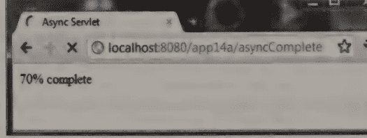

图 14.2: 接收进度更新的 HTML 页面

### Async 器

配合执行异步操作的 servlet 和过滤器，Servlet 3.0 还增加了 `AsyncListener` 接口，以便你可以了解异步处理期间发生的情况。`AsyncListener` 接口定义了以下方法，当特定事件发生时会被调用：

```java
void onStartAsync(AsyncEvent event);
```

当异步操作启动时调用此方法。

```java
void onComplete(AsyncEvent event);
```

当异步操作完成时调用此方法。

```java
void onError(AsyncEvent event);
```

当异步操作失败时调用此方法。

```java
void onTimeout(AsyncEvent event);
```

当异步操作超时时调用此方法，即当未在指定的超时时间内完成时。

所有四个方法都接收一个 `AsyncEvent`，你可以通过该事件分别获取相关的 `AsyncContext`、`ServletRequest` 和 `ServletResponse`。

例如，列表 14.5 中的 `MyAsyncListener` 类实现了 `AsyncListener` 接口，以便在异步操作发生事件时收到通知。与其他 Web 监听器不同，你不需要 `AsyncListener` 的实现使用 `@WebListener` 注解。

### 列表 14.5: 一个异步监听器

```java
package listener;

import java.io.IOException;
import javax.servlet.AsyncEvent;
import javax.servlet.AsyncListener;

// 不要使用 @WebListener 注解
```

```java
public class MyAsyncListener implements AsyncListener {
    @Override
    public void onComplete(AsyncEvent asyncEvent)
        throws IOException {
        System.out.println("onComplete");
    }

    @Override
    public void onError(AsyncEvent asyncEvent)
        throws IOException {
        System.out.println("onError");
    }

    @Override
    public void onStartAsync(AsyncEvent asyncEvent)
        throws IOException {
        System.out.println("onStartAsync");
    }

    @Override
    public void onTimeout(AsyncEvent asyncEvent)
        throws IOException {
        System.out.println("onTimeout");
    }
}
```

由于 `AsyncListener` 类没有使用 `@WebListener` 注解，你必须手动将 `AsyncListener` 注册到你感兴趣的获取事件通知的 `AsyncContext` 中。你通过调用后者的 `addListener` 方法在 `AsyncContext` 上注册一个 `AsyncListener`。

`void addListener(AsyncListener listener);`

列表 14.6 中的 `AsyncListenerServlet` 类是一个异步 servlet，它利用列表 14.5 中的监听器来获取事件通知。

### 列表 14.6: 使用 AsyncListener

```java
package servlet;

import java.io.IOException;
import javax.servlet.AsyncContext;
import javax.servlet.ServletExceptionException;
import javax.servlet.annotation.WebWebServlet;
import javax.servlet.http.HttpServlet;
```

`http://localhost:8080/app1a/asyncListener`

## 总结

Servlet 3.0 带来了一个处理异步操作的新功能。当你的 servlet/JSP 应用非常繁忙且包含一个或多个长时间运行的操作时，此功能特别有用。该功能的工作原理是将这些操作分配给新线程，从而将请求处理线程释放回池中，准备服务另一个请求。在本章中，你学习了如何编写支持异步处理的 servlet，以及在处理过程中发生特定事件时接收通知的监听器。

## 第 15 章：安全

安全是 Web 应用开发和部署中一个非常重要的方面。这一点尤其如此，因为任何拥有浏览器并访问互联网的人都可以访问 Web 应用。保护应用程序可以通过声明式或编程的方式来实现。以下四个问题是 Web 安全的基石：身份验证、授权、机密性和数据完整性。

身份验证（Authentication）涉及验证 Web 实体的身份，特别是尝试访问应用程序的用户。你通常通过要求用户提供用户名和密码来验证用户。

授权（Authorization）通常在身份验证成功后进行，与已验证用户所拥有的访问级别有关。它试图回答这个问题：“是否允许已验证的用户进入应用程序的某个区域？”

机密性（Confidentiality）是一个重要课题，因为敏感数据（如信用卡详情或社会安全码）应该受到保护。正如你可能知道的，数据在到达互联网目的地之前会从一台计算机传输到另一台。拦截它在技术上并不困难。因此，敏感数据在互联网上传输时应当加密。

由于数据包可以被轻易拦截，只要拥有正确的工具和知识，对其进行篡改几乎和拦截一样容易。坦率地说，通过确保敏感数据通过安全通道传输，也可以维护数据完整性。

你将在本章中学习安全的这些方面。书中还为 SSL 分留了大量的讨论，SSL 被用作在互联网上创建安全通道的协议。

## 身份验证与授权

身份验证是检查某人确实是其所声称身份的过程。在 servlet/JSP 应用中，身份验证通常通过要求用户提供用户名和密码来完成。

授权涉及确定用户拥有什么种级别的访问权限。它适用于包含多个区域的应用程序，用户可能访问应用程序的某个部分但不能访问其他部分。例如，在线商店可以分为普通区域（供普通公众浏览和搜索产品）、买家区域（供注册用户下单）和管理员区域（供管理员使用）。在这三个部分中，管理员区域需要最高访问权限。管理员用户不仅需要验证自己的身份，还需要获得分配给管理员区域的权限。

访问级别（Access levels）通常被称为角色（roles）。在部署时，servlet/JSP 应用可以方便地拆分为部分并进行配置，使得每个部分都可以被特定角色的用户访问。这是通过在部署描述符中声明安全约束来实现完成的。换句话说，就是声明式安全。在另一端，内容限制在实践中也通常通过尝试将用户名和密码对与数据库中存储的值进行匹配来实现。

在大多数 servlet/JSP 应用中，身份验证和授权是通过编程方式完成的，首先根据数据库表验证用户名和密码。一旦身份验证成功，可以通过检查另一个表或存储用户名和密码的同一个表来完成授权。使用声明式安全可以节省一些编程工作，因为 servlet/JSP 容器会处理身份验证和授权过程。此外，可以配置 servlet/JSP 容器针对应用程序中已使用的数据库进行身份验证。此外，通过声明式身份验证，用户名和密码可以在发送到服务器之前由浏览器进行加密。声明式安全的缺点是，支持数据加密的身份验证方法只能与默认登录对话框一起使用，其外观外观无法自定义。单凭这一点就足以让人们放弃声明式安全。遗憾的是，唯一允许自定义 HTML 表单的声明式安全方法并不会加密传输的数据。

Web 应用的一些部分（例如管理员模块）并不面向客户，因此登录表单的外观并不重要。在这种情况下，可以使用声明式安全。

声明式安全的有趣之处在于，安全约束并不是在 servlet 中编写的。相反，它们是在部署应用程序时在部署描述符中定义的。因此，它在决定哪些用户和角色可以访问应用程序或其部分方面提供了很大的灵活性。

使用声明式安全，首先定义用户和角色。根据你使用的容器，可以将用户和角色信息存储在文件中或数据库表中。

角色（role）和用户（user）元素定义了一个用户。`role` 元素声明了一个 `role` 属性，用于指定角色名称。`user` 元素具有 `username`、`password` 和 `roles` 属性。`username` 属性指定用户名，`password` 属性指定密码，而 `roles` 属性指定用户所属的一个或多个角色。

列表 15.1 中的 `tomcat-users.xml` 文件声明了两个角色（manager 和 member）和两个用户（tom 和 jerry）。用户 tom 既是 member 也是 manager 角色的成员，而 jerry 仅属于 member 角色。显而易见，tom 对应用程序的访问权限比 jerry 高。

Tomcat 还支持与数据库表匹配角色和用户。你可以配置 Tomcat 使用 JDBC 来验证用户身份。

## 实施安全约束

你已经学习过可以通过将静态资源和 JSP 页面存储在 `WEB-INF` 或其子目录下来隐藏它们。放置在此处的资源无法通过直接输入 URL 访问，但仍然可以作为 servlet 或 JSP 页面的转发（forward）目标。虽然这种方法简单直接，但缺点是隐藏在这里的资源将永久隐藏，无法直接访问。如果你只是想保护资源免受未经授权的用户访问，可以将它们放在应用程序目录下的子目录，并在部署描述符（deployment descriptor）中声明安全约束。

`security-constraint` 元素指定了资源集合（resource collection）以及可以访问这些资源的角色。该元素可以包含两个子元素：`web-resource-collection` 元素和 `auth-constraint`。

`web-resource-collection` 元素定义了一个资源集合，并可以包含以下任何子元素：`web-resource-name`、`description`、`url-pattern`、`http-method` 和 `http-method-omission`。

`web-resource-collection` 元素可以有多个 `url-pattern` 子元素，每个元素引用该安全约束适的 URL 模式。你可以在 `url-pattern` 元素中使用星号（*）来引用资源类型（如 `*.jsp`）或目录下的所有资源（如 `/*` 或 `/jsp/*`）。然而，你不能将两者结合（即引用特定目录下的特定类型）。因此，以下引用 jsp 目录下所有 JSP 页面的 URL 模式是无效的：`/jsp/*.jsp`。相反，应该使用 `/jsp/*`，但这也会限制 jsp 目录中的任何非 JSP 页面。

`http-method` 元素指定了该安全约束适用的 HTTP 方法。例如，一个带有 `GET` `http-method` 的 `web-resource-collection` 元素表示该集合仅适用于 HTTP Get 方法。包含该资源集合的 `security-constraint` 无法防止 Post 和 Put 等其他 HTTP 方法。缺少 `http-method` 元素则表示该安全约束适用于所有 HTTP 方法。你可以在同一个 `web-resource-collection` 元素中拥有多个 `http-method` 元素。

`http-method-omission` 元素指定了一个不包含在安全约束中的 HTTP 方法。因此，指定 `<http-method-omission>GET</http-method-omission>` 将限制除 Get 外的所有 HTTP 方法的访问。

`http-method` 元素和 `http-method-omission` 元素不能出现在同一个 `web-resource-collection` 元素中。

部署描述符可以包含多个 `security-constraint` 元素。如果 `security-constraint` 元素缺少 `auth-constraint`，则资源集合将不受保护。此外，如果你指定的角色未由容器定义，没有人能直接访问该资源集合。但是，你仍然可以在 servlet 或 JSP 页面转发到资源。

例如，列表 15.2 中 `web.xml` 文件中的 `security-constraint` 元素限制了对所有 JSP 页面的访问。由于 `auth-constraint` 元素不包含 `role-name` 元素，资源无法被访问。

### 列表 15.2：防止访问某些目录下的资源


```xml
<?xml version="1.0" encoding="ISO-8859-1"?>
<web-app xmlns="http://java.sun.com/xml/ns/javaee"
xmlns:xsi="http://www.w3.org/2001/XMLSchema-instance"
xsi:schemaLocation="http://java.sun.com/xml/ns/javaee http://java.sun.com/xml/ns/javaee/web-app_3_0.xsd"
version="3.0"> *.*
```

# 342 Servlet & JSP: 教程

```xml
<!-- 限制对 JSP 页面的访问 -->
<security-constraint>
  <web-resource-name>JSP pages</web-resource-name>
  <url-pattern>*.jsp</url-pattern>
</web-resource-collection>
  <!-- 必须有 auth-constraint，否则
  指定的 web 资源不会受到限制 -->
  <auth-constraint/>
</security-constraint>
</web-app>
```

现在通过将浏览器指向此 URL 进行测试：

`http://localhost:8080/app15/jsp/1.jsp`

Servlet 容器将通过发送 HTTP 403 错误来委婉地拒绝你：

`Access to the requested resource has been denied.`（访问请求资源已被拒绝。）

现在让我们看看如何验证和授权用户。

## 身份验证方法

既然你已经知道如何对资源集合实施安全约束，你也应该学习如何验证用户身份以访问资源。对于通过部署描述符中的`security-constraint`元素进行声明式保护的资源，可以使用 HTTP 1.1 提供的解决方案：基本访问认证（basic access authentication）和摘要访问认证（digest access authentication）。此外，还可以使用基于表单的访问认证。

HTTP 认证定义在 RFC 2617 中。你可以在此处下载规范：

`http://www.ietf.org/rfc/rfc2617.txt`

## 基本访问认证

基本访问认证（简单称为 Basic 认证）是一种用于接收用户名和密码的 HTTP 身份验证。在基本认证中

# 第 15 章：安全 343

访问受保护资源的用户将被服务器拒绝，服务器将返回 401（未授权）响应。该响应包含一个`WWW-Authenticate`头部，其中包含至少一个适用于请求资源的挑战信息。以下是此类响应的示例：

```
HTTP/1.1 401 Authorization Required
Server: Apache-Coyote/1.1
Date: Wed, 21 Dec 2011 11:32:09 GMT
WWW-Authenticate: Basic realm="Members Only"
```

浏览器随后会显示登录对话框，让用户输入用户名和密码。当用户点击登录按钮时，用户名将加上冒号，密码将通过 Base64 编码后发送到服务器。Base64 是一种非常弱的算法，因为它很容易解密。考虑使用摘要认证。

列表 15.3 部署描述符中最重要的元素是`login-config`元素。它有两个子元素：`auth-method`和`realm`。要使用 Basic 认证，必须赋予它值`BASIC`（全大写）。`realm`元素应赋予一个名称以便显示在浏览器登录对话框中。app15 展示了如何使用 Basic 认证。第一个`security-constraint`元素展示了 JSP 页面。第二个限制了 Servlet 到 manager 和 member 角色的访问。Servlet 是一个转发到 .jsp 的简单 servlet，并出现在列表 15.4。

*(注：由于原始文本存在大量重复和乱码，以上内容已根据技术逻辑进行了去重与整合)*

## 第 15 章：安全 345

```
RequestDispatcher dispatcher = 
request.getRequestDispatcher("/jsp/1.jsp");
dispatcher.forward(request, response);
}
```

要测试 app15b 中的基本访问认证（Basic access authentication），请使用此 URL 访问其中的限制资源：

`http://localhost:8080/app15b/servlet1`

你看到的不是 Servlet1 的输出，而是提示输入用户名和密码，如图 15.1 所示。

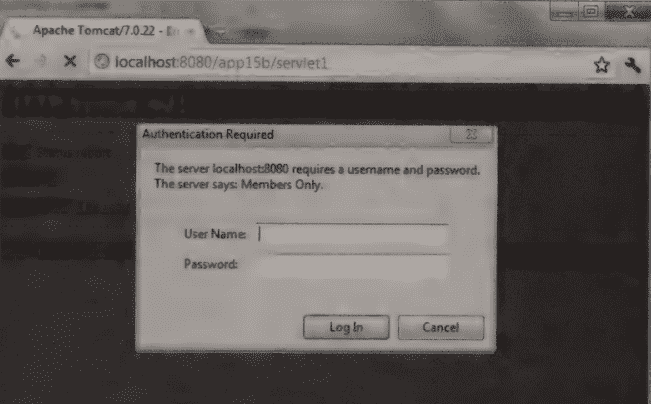

图 15.1：基本认证

由于映射到 Servlet1 的`auth-constraint`元素指定了 manager 和 member 角色，你可以使用 tom 或 jerry 中的任意一个进行登录。

## 摘要认证 (Digest Access Authentication)

摘要认证（简称为 Digest认证）也是一种 HTTP 认证方式，与基本访问认证相似。摘要认证不再使用弱的 Base64 加密算法，而是使用 MD5 算法创建用户名、域名（realm name）和密码组合的哈希值，并将该哈希发送到服务器。摘要认证旨在取代基本访问认证，因为它提供了更安全的环境。

Servlet/JSP 容器并不强制要求支持摘要认证，但大多数容器都支持。

配置应用程序使用摘要认证与使用基本访问认证类似。事实上，唯一的区别在于`login-config`元素中`auth-method`元素的值。对于摘要认证，其值必须是 DIGEST（全大写）。

例如，app15 应用程序演示了摘要认证的使用。该应用的部署描述符见列表 15.5。

## 列表 15.5：摘要认证的部署描述符

```xml
<?xml version="1.0" encoding="ISO-8859-1"?>
<web-app xmlns="http://java.sun.com/xml/ns/javaee"
xmlns:xsi="http://www.w3.org/2001/XMLSchema-instance"
xsi:schemaLocation="http://java.sun.com/xml/ns/javaee/web-app_3_0.xsd">
  <!-- 限制对 JSP 页面的访问 -->
  <security-constraint>
    <web-resource-collection>
      <web-resource-name>JSP pages</web-resource-name>
      <url-pattern>*.jsp</url-pattern>
    </web-resource-collection>
    <!-- 必须有 auth-constraint，否则
         指定的 web 资源将不受限制 -->
    <auth-constraint/>
  </security-constraint>

  <security-constraint>
    <web-resource-collection>
      <web-resource-name>Servlet1</web-resource-name>
      <url-pattern>*/servlet1</url-pattern>
    </web-resource-collection>
    <auth-constraint>
      <role-name>member</role-name>
      <role-name>manager</role-name>
    </auth-constraint>
  </security-constraint>
  <login-config>
    <auth-method>DIGEST authentication</auth-method>
    <realm-name>Digest authentication</realm-name>
  </login-config>
</web-app>
```

要测试该应用程序，请将浏览器指向 URL：

`http://localhost:8080/app15c/servlet1`

图 15.2 显示了摘要认证的登录对话框。

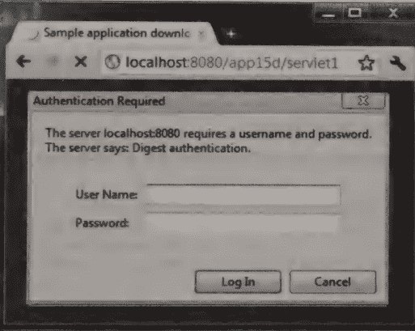

图 15.2：摘要认证

## 基于表单的认证 (Form-based Authentication)

基本和摘要认证不允许你使用自定义的登录表单。如果你必须使用自定义表单，可以使用基于表单的认证。由于传输的值没有经过加密，你应当结合 SSL 使用。

使用基于表单的认证，你需要创建一个登录页面和一个错误页面，这些可以是 HTML 或 JSP 页面。当第一次请求受保护的资源时，servlet/jsp 容器将发送登录页面。登录成功后，将发送请求的资源。如果登录失败，用户将看到错误页面。

要使用基于表单的认证，部署描述符中的`auth-method`元素必须赋值为 FORM（全大写）。此外，`login-config`元素必须包含一个包含两个元素的`form-login-config`元素，即`form-login-page`和`form-error-page`。以下是基于表单认证的`login-config`元素的示例。

```xml
<login-config>
  <auth-method>FORM</auth-method>
  <form-login-config>
    <form-login-page>login.html</form-login-page>
    <form-error-page>error.html</form-error-page>
  </form-login-config>
</login-config>
```

列表 15.6 是 app15d 的部署描述符，这是一个利用基于表单认证的示例。

## 列表 15.6：基于表单的认证的部署描述符

```xml
<xml version="1.0" encoding="ISO-8859-1"?>
<web-app xmlns="http://java.sun.com/xml/ns/javaee"
  xmlns:xsi="http://www.w3.org/2001/XMLSchema-instance"
  xsi:schemaLocation="http://java.sun.com/xml/ns/javaee/web-app_3_0.xsd">

  <!-- 限制对 JSP 页面的访问 -->
  <security-constraint>
    <web-resource-collection>
      <web-resource-name>JSP pages</web-resource-name>
      <url-pattern>*.jsp</url-pattern>
    </web-resource-collection>
    <!-- 必须有 auth-constraint，否则
         指定的 web 资源将不受限制 -->
    <auth-constraint/>
  </security-constraint>

  <security-constraint>
    <web-resource-collection>
      <web-resource-name>Servlet1</web-resource-name>
      <url-pattern>*/servlet1</url-pattern>
    </web-resource-collection>
    <auth-constraint>
      <role-name>member</role-name>
      <role-name>manager</role-name>
    </auth-constraint>
  </security-constraint>
  <login-config>
    <auth-method>FORM</auth-method>
    <form-login-config>
      <form-login-page>login.html</form-login-page>
      <form-error-page>error.html</form-error-page>
    </form-login-config>
  </login-config>
</web-app>
```

`form-login-page`元素引用列表 15.7 中的页面，`form-error-page`元素引用列表 15.8 中的页面。

## 列表 15.7：登录页面

```html
<!DOCTYPE HTML>
<html>
<head>
<title>Login</title>
</head>
<body>
<h1>Login Form</h1>
<form action='security' method='post'>
<div>User Name: <input name='j_username'></div>
<div>Password: <input type='password' name='j_password'></div>
<div><input type='submit' value='Login'/></div>
</form>
</body>
</html>
```

## 列表 15.8：错误页面

```html
<!DOCTYPE HTML>
<html>
<head>
<title>Error</title>
</head>
<body>
Login failed.
</body>
</html>
```

要测试 app15d 中的基于表单的认证，请将浏览器指向：

`http://localhost:8080/app15d/servlet1`

图 15.3 显示了用户登录的 login.html。

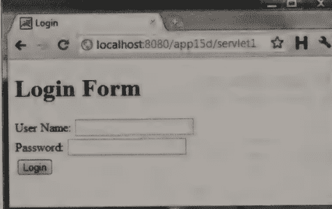

图 15.3：基于表单的认证

## 客户端认证

客户端认证也称为证书认证，在 HTTPS（基于 SSL 的 HTTP）上工作，并要求每个客户端拥有证书。这是一种强大的认证机制，但不适用于部署在互联网上的应用程序，因为要求每个用户都拥有数字证书是不现实的。然而，这种认证方法可以访问组织内部的应用程序。

## 安全套接层 (SSL)

SSL 最初由 Netscape 开发，实现了互联网上的安全通信，并确保了机密性。要完全理解 SSL 的工作原理，你需要学习许多技术，从密码学到公钥对以及证书。本节将详细讨论 SSL 及其组件。

## 密码学 (Cryptography)

人们一直对安全通道的需求，即信息是安全的，其他人即使获取了信息也无法理解或篡改。从历史上看，密码学只关注加密和解密，即交换消息的双方可以确保只有他们能读取信息。最初，人们使用对称加密进行加密和解密。在对称加密中，你使用相同的密钥进行加密和解密。这里有一种简单的加密/解密技术。

假设加密方法使用秘密数字将字母表中的每个字符向前移动。因此，如果秘密数字是 2，"ThisFriday"的加密版本是"VjuHtkfea"。当你到达字母表的末尾时，从开头开始，因此 y 变成 a。接收者知道密钥是 2，就可以轻松地解密。

然而，对称加密要求双方预先知道加密/解密的密钥。由于以下原因，对称加密不适用于互联网

-   交换消息的双方通常互不认识。例如，在 Amazon.com 上购买书时，你需要发送你的

## 352 Servlet & JSP: 教程

...详情和信用卡详情。如果使用对称加密，你将必须在交易之前联系 Amazon.com 以达成密钥一致。

- 每个人都希望能够与其他许多方进行通信。如果使用对称加密，每个人都必须维护不同的唯一密钥，每个密钥对应一个不同的伙伴。

- 由于你不知道将要与之通信的实体是谁，因此你需要确保他们确实是他们所声称的身份。

- 互联网上的消息会经过许多不同的计算机。截获他人的消息是非常容易的。对称加密不能保证第三方不会篡改数据。

因此，如今互联网上的安全通信使用非对称加密，它提供了以下三个特性：

- 加密/解密。消息被加密以防止第三方看到。只有预期的接收者可以对其进行解密。

- 身份验证。身份验证验证实体确实是其所声称的身份。

- 数据完整性。通过互联网发送的消息会经过许多计算机。必须确保发送的数据未被更改且保持完好。

在非对称加密中，使用了公钥加密。这种类型的加密通过使用一对非对称密钥（公钥和私钥）来实现数据的加密和解密。私钥是私密的，所有者必须将其保存在安全的地方，且不能落入任何其他手中。公钥则分发给公众，通常供任何想要与密钥所有者通信的人下载。你可以使用工具来生成公钥和私钥对。这些工具将在本章稍后部分讨论。

公钥加密的妙之处在于：使用相应的私钥加密的数据（注：此处原文应为加密）；使用私钥加密的数据只能使用相应的公钥进行解密。这种优雅的算法基于非常大的质数，由 Ron Rivest、Adi Shamir 和 Len Adleman 在 1977 年于马萨塞理工学院（MIT）发明。他们简单地根据姓的首字母将该算法命名为 RSA。

RSA 算法被证明在互联网上使用是实用的，特别是对于电子商务，因为只需要供应商拥有一对密钥，即可与所有买家进行安全通信。

公钥加密工作原理的示例通常使用两个名为 Bob 和 Alice 的人物，我也将使用他们。

## 加密/解密


想要交换消息的两人中必须有一对密钥。假设 Alice 想与 Bob 通信，而 Bob 有一个公钥和一个私钥。Bob 将向 Alice 发送他的公钥，Alice 可以用它加密发送给 Bob 的消息。只有 Bob 可以将其解密，因为他拥有相应的私钥。要向 Alice 发送消息，Bob 使用他的私钥进行加密，Alice 可以使用 Bob 的公钥进行解密。

然而，除非 Bob 能与 Alice 面对面并递交他的公钥，否则这种方法远非完美。任何拥有密钥对的人都可以声称是 Bob，Alice 没有任何办法发现。在互联网上，交换消息的双方往往居住在地球的另一端，面对面交流通常是不可能的。

## 身份验证

在 SSL 中，身份验证通过引入证书来解决。证书包含以下内容：

- 一个公钥
- 关于主体的信息，即公钥的所有者。
- 证书颁发者的名称。
- 一些时间戳，使证书在一段时间后过期。

证书的关键点在于，它必须由受信任的证书颁发者（如 VeriSign 或 Thawte）进行数字签名。对电子文件（文档、jar 文件等）进行数字签名相当于在你的文档/文件上添加签名。原始文件并没有被加密，签名的真实目的是保证文档/文件未被篡改。签名文档涉及创建文档的摘要（digest），并使用签名者的私钥对摘要进行加密。要检查文档是否仍保持原始状态，你需要执行以下两个步骤：

1. 使用签名者的公钥解密随文档的摘要。你很快就会知道，受信任的证书颁发者的公钥是公开可的。
2. 创建文档的摘要。
3. 比较步骤 1 的结果和步骤 2 的结果。如果两者匹配，则说明文件未被篡改。

这种身份验证方法之所以有效，是因为私钥持有者可以对文档进行加密，而该摘要只能使用相应的公钥进行加密。假设你信任你持有原始公钥，那么你就知道文件没有被更改。

### 注意

由于证书可以由受信任的证书颁发者数字签名，人们会将他们的证书公开，而不是他们的公钥。

有很多证书颁发者，包括 VerSign 和 Thawte。证书颁发者拥有一对公钥和私钥。为了申请证书，Bob 必须生成一对密钥并将公钥发送给证书颁发者，颁发者稍后通过要求 Bob 发送护照副本或其他类型的身份证明来验证 Bob。在验证 Bob 后，证书颁发者将使用其私钥对证书签名。所谓的“签名”意味着加密。因此，证书只能使用证书颁发者的公钥进行读取。证书颁发者的公钥通常广泛分发。例如，Internet Explorer、Netscape、Firefox 和其他浏览器默认内置了几个证书颁发者的公钥。

例如，在 IE 中，点击工具 --> Internet 选项 --> 内容 --> 证书 --> 信任的根证书颁选项卡以查看颁发者列表。（参见图 15.4）。

## 证书


图15.4：内置 Internet Explorer 的证书颁发者

在 Bob 发给 Alice 的最后一条消息中，该消息使用 Bob 的私钥进行了签名，以说服 Alice 消息是真实的。这就是证明身份的方法。Alice 联系 Bob，Bob 发送了他的证书。然而，单凭证书是不够的，因为任何人都可以获取 Bob 的证书。记住，Bob 向任何想要与其交换消息的人发送他的证书。工作原理是这样的：

Alice 从证书中获取 Bob 的公钥。她可以这样做是因为证书是用证书颁发者的私钥签名的，而 Alice 可以访问证书颁发者的公钥（她的浏览器保留了一个副本）。现在，她收到了一条消息和一个使用 Bob 密钥加密的摘要。Alice 只需要对消息计算摘要并与 Bob 发出的摘要进行比较。如果两者匹配，Alice 就可以确定对方确实是 Bob。

Alice 在验证 Bob 后的第一件事是发送一个用于后续消息交换的密钥。没错，一旦建立了安全通道，SSL 将使用对称加密，因为它比非对称加密快得多。

现在，图中仍然缺少一点。互联网上的消息会经过许多计算机。你如何确保这些消息的完整性，因为任何人都可以在途中截获这些消息？

## 数据完整性

恶意方 Mallet 可能坐在 Alice 和 Bob 之间，试图破解发送的消息。对他来说不幸的是，尽管他可以复制消息，但它们是加密的，且 Mallet 并不知道密钥。然而，Mallet 可能会破坏消息或不转发某些消息。为了克服这个问题，SSL 引入了消息认证码（MAC）。MAC 是使用秘密密钥和某些传输数据计算出的数据。由于 Mallet 不知道秘密密钥，他无法计算出正确的摘要值。消息接收者可以并将会发现是否存在篡改数据的尝试，或者数据不完整。如果发生这种情况，双方可以停止通信。

此类消息摘要算法之一是 MD5。它由 RSA 发明，非常安全。如果使用 128 位的 MAC 值，例如，恶意者猜中正确值的概率大约为 18,446,744,073,709,551,616 分之一，实际上几乎不可能。

## SSL 的工作原理

现在你已经知道 SSL 如何解决加密/解密、身份验证和数据完整问题，让我们回顾一下 SSL 的工作原理。这次让我们以 Amazon.com 为例（代替 Bob），并以买家（代替 Alice）。Amazon.com 像任何其他电子商务供应商一样，已经向受信任的证书颁发机构申请了证书。买家正在使用 Internet Explorer，它嵌入了受信任证书颁发者的公钥。买家并不真正需要知道 SSL 如何工作，也不需要拥有公钥或私钥。他需要确保的是，在输入重要信息（如信用卡号）时，使用的协议是 HTTPS 而不是 HTTP。这必须显示在 URL 框中。因此，不是 `http://www.amazon.com`，而是必须以 `https` 开头。例如：`https://secure.amazon.com`。某些浏览器还在地址框中显示安全图标。图 15.5 显示了 IE 中的安全标志。


图 15.5：IE 中的安全图标

当买家进入安全页面（当他完成购物时），这是其浏览器与 Amazon 服务器之间发生的后台事件序列：

- 浏览器：你真的是 Amazon.com 吗？
- 服务器：是的，这是我的证书。

浏览器随后使用证书颁发者的公钥解密证书以检查其有效性。如果出现问题（例如证书过期），浏览器会警告用户。如果用户在证书过期的情况下同意继续，浏览器将继续执行。

浏览器：仅凭证书是不够的，请发送一些内容

服务器：我真的是 Amazon.com + [使用 Amazon.com 私钥加密的相同消息摘要]。

浏览器使用 Amazon 的公钥解密摘要，并创建“我真的是 Amazon.com”的摘要。如果两者匹配，则身份验证成功。浏览器随后将生成随机密钥，并使用 Amazon 的公钥对其进行加密。该随机密钥用于加密和解密后续消息。换句话说，一旦验证了 Amazon，就会使用对称加密，因为它比非对称加密更快。此外，双方还会发送消息摘要以确保消息完整且未被改动。

附录 C，“SSL 证书”解释了如何创建你自己的数字证书，并提供了生成公钥/私钥对并让受信任机构签署公钥的逐步说明。

## 编程安全

尽管声明式安全简单且直接，但在少数情况下，你可能想要编写代码来保护你的应用程序。为此，你可以使用 `HttpServletRequest` 接口中的安全注解类型和方法。本节将对这两者进行讨论。

### 安全注解类型

在上一节中，你学习了如何使用部署描述符中的 `security-constraint` 元素来限制对集合的访问。该元素的一个方面是使用一个 URL 模式来匹配要限制的资源的 URL。Servlet 3 带有注解类型，这些注解类型可以在 servlet 级别执行相同的工作。通过使用这些注解类型，你可以限制对 servlet 的访问，而无需在部署描述符中添加 `security-constraint` 元素。然而，你仍然需要在部署描述符中 `login-config` 元素来选择身份验证方法。

`javax.servlet.annotation` 包中有三个与安全相关的注解类型。它们是 `ServletSecurity`、`HttpConstraint` 和 `HttpMethodConstraint`。

`ServletSecurity` 注解类型用于 servlet 类中对 servlet 施加安全约束。`ServletSecurity` 注解可能有 `value` 和 `httpMethodConstraints` 属性。

`HttpConstraint` 注解定义了一个安全约束，并且只能分配给 `ServletSecurity` 注解的 `value` 属性。如果所在的 `ServletSecurity` 注解中不存在 `httpMethodConstraints` 属性，则 `HttpConstraint` 注解施加的安全约束适用于所有 HTTP 方法。否则，安全约束适用于 `httpMethodConstraints` 属性中定义的 HTTP 方法。例如，下面的 `HttpConstraint` 注解规定被注解的 servlet 只能由 manager 角色的用户访问。

```java
@ServletSecurity(value = @HttpConstraint(rolesAllowed = "manager"))
```

当然，上面的注解可以简写为：

```java
@ServletSecurity(@HttpConstraint(rolesAllowed = "manager"))
```

你仍然必须在部署描述符中声明 `login-config` 元素，以便容器能够验证用户身份。

将 `HttpConstraint` 注解的 `transportGuarantee` 属性设置为 `TransportGuarantee.CONFIDENTIAL` 将使 servlet 仅通过加密通道（如 SSL）可用。

```java
@ServletSecurity(@HttpConstraint(transportGuarantee = TransportGuarantee.CONFIDENTIAL))
```

如果 servlet/JSP 容器通过 HTTP 接收到此类 servlet 的请求，它会将浏览器重定向到 URL 的 HTTPS 版本。

`HttpMethodConstraint` 注解指定了安全约束适用于 HTTP 方法。它只能出现在分配给 `ServletSecurity` 的数组中。例如，下面的 `HttpMethodConstraint` 将被注解的 servlet 限制为 manager 角色。

```java
@ServletSecurity(httpMethodConstraints = {
  @HttpMethodConstraint(value = "GET", rolesAllowed = "manager")
})
```

注意，如果 `HttpMethodConstraint` 注解中不存在 `rolesAllowed` 属性，则约束适用于所有用户。因此，下面的 `ServletSecurity` 注允许任何用户访问 servlet。

```java
@ServletSecurity(@HttpMethodConstraint("GET"))
```

然而，如果 `HttpMethodConstraint` 的 `emptyRoleSemantic` 属性被分配为 `EmptyRoleSemantic`，则该方法对所有用户限制。例如，下面的 `ServletSecurity` 注解阻止通过 Get 方法访问，但允许 member 角色的用户访问。

```java
@ServletSecurity(value = @HttpMethodConstraint(rolesAllowed = "member"),
  emptyRoleSemantic = EmptyRoleSemantic.DENY)
```

### 安全 API

除了上一节讨论的注解类型外，还可以使用 `HttpServletRequest` 接口的以下方法实现编程安全。

```java
String getAuthType();
```

保护 servlet 的身份验证方案，如果未应用安全约束则返回 null。

```java
String getRemoteUser();
```

返回此请求的用户登录名，如果用户未通过验证则返回 null。

```java
boolean isUserInRole(String role);
```

返回用户是否属于指定角色的布尔值。

```java
Principal getUserPrincipal();
```

返回包含当前验证用户详情的 `java.security.Principal`，如果用户未通过验证则返回 null。

```java
boolean authenticate(HttpServletResponse response) throws IOException;
```

通过指示浏览器显示登录表单来验证用户。

```java
void login(String userName, String password) throws ServletException;
```

尝试使用提供的用户名和密码登录用户。如果登录成功，该方法不返回任何内容。否则，它将抛出 `ServletException`。

```java
void logout() throws ServletException;
```

注销用户登录。

例如，列表 15.9 中的 `ProgrammaticServlet` 类是 app15e 示例应用程序的一部分，该程序展示了如何通过编程验证用户身份。它与列表 15.10 中的部署描述符配套，该描述符声明了一个使用 Digest 访问身份验证的 `login-config` 元素。

```java
package servlet;
import java.io.IOException;
import java.io.PrintWriter;

import javax.servlet.ServletException;
import javax.servlet.annotation.WebServlet;
import javax.servlet.http.HttpServlet;
import javax.servlet.http.HttpServletRequest;
import javax.servlet.http.HttpServletResponse;

@WebServlet(urlPatterns = { "/prog"})
public class ProgrammaticServlet extends HttpServlet {
    private static final long serialVersionUID = 87620L;

    public void doGet(HttpServletRequest request,
                       HttpServletResponse response)
        throws ServletException, IOException {
        if (request.authenticate(response)) {
            response.setContentType("text/html");
            PrintWriter out = response.getWriter();
            out.println("Welcome");
        } else {
            // user not authenticated
            // do something
            System.out.println("User not authenticated");
        }
    }
}
```

#### 列表 15.10: app15 的部署描述符

```xml
<?xml version="1.0" encoding="ISO-8859-1"?>
<web-app xmlns="http://java.sun.com/xml/ns/javaee"
             xmlns:xsi="http://www.w3.org/2001/XMLSchema-instance"
             xsi:schemaLocation="http://java.sun.com/xml/ns/javaee
             http://java.sun.com/xml/ns/javaee/web-app_3_0.xsd"
             version="3.0">
  <login-config>
    <auth-method>DIGEST</auth-method>
    <realm-name>Digest authentication</realm-name>
  </login-config>
</web-app>
```

当用户首次请求 servlet 时，用户尚未通过身份验证，`authenticate` 方法将返回 false。因此，servlet/JSP 容器将发送一个 WWW-Authenticate 头，导致浏览器显示用于 Digest 访问认证的登录框。当用户使用正确的用户名和密码提交表单时，`authenticate` 方法返回 true，并显示 Welcome 消息。

你可以使用此 URL 测试应用程序：

`http://localhost:8080/app15e/prog`

## 总结

在本章中，你学习了如何实现网络安全的四大支柱：身份验证、授权、机密性和数据完整性。Servlet 技术允许你通过声明式和编程的方式来保护你的应用程序。

## 第16 章 部署


部署 Servlet 3 应用非常轻而易举。得益于 servlet 注解类型，取决于应用的复杂程度，你可以在没有部署描述符的情况下部署 servlet/JSP 应用。尽管如此，在需要精细配置的许多情况下，仍然需要部署描述符。当部署描述符必须命名为`web.xml`并位于`WEB-INF`目录下时，Java 类必须存放在`WEB-INF/classes`，Java 库存放在`WEB-INF/lib`。所有应用程序资源都必须打包成一个扩展名为`.war`的单个文件。war 文件基本上就是一个 jar 文件。

本章讨论了部署以及部署描述符，它是应用程序的一个重要组件。

## 部署描述符概述

在 Servlet 3 出现之前，部署总是涉及一个`web.xml`文件（即部署描述符），你可以在其中配置应用程序的各个方面。在 Servlet 3 中，部署描述符是可选的，因为你可以使用注解将资源映射到 URL 模式。然而，如果符合以下情况，则需要部署描述符：

- 你需要向`ServletContext`传递初始参数。
- 你有多个过滤器，并且你想指定过滤器调用的顺序。
- 你需要更改会话超时时间。
- 你想限制对资源集合的访问，并为用户提供一种身份验证的方法。

列表 16 显示了部署描述符的骨架。它必须命名为`web.xml`并位于应用程序目录的`WEB-INF`目录。

## 列表 16.1: 部署描述符的骨架

```xml
<?xml version="1.0" encoding="ISO-8859-1"?>
<web-app xmlns="http://java.sun.com/xml/ns/javaee"
  xmlns:xsi="http://www.w3.org/2001/XMLSchema-instance"
  xsi:schemaLocation="http://java.sun.com/xml/ns/javaee
  http://java.sun.com/xml/ns/javaee/web-app_3_0.xsd"
  version="3.0">
  <metadata-complete="false">
  
</web-app>
```

`xsi:schemaLocation`属性指定了用于验证部署描述符的架构的位置。`version`属性指定了 Servlet 规范的版本。

可选的`metadata-complete`属性指定了部署描述符是否完整。如果其值为 true，servlet/JSP 容器必须忽略 servlet 特有的注解。如果该元素设置为 false 或不存在，容器必须检查随应用程序部署的类文件以查找 servlet 特有的注解，并扫描 web 段（web fragments）。

`web-app`元素是根元素，可以包含以下子元素：

- servlet 声明
- servlet 映射
- `ServletContext`初始参数
- 会话配置
- 监听器类
- 过滤器定义和映射
- MIME 类型映射
- 欢迎文件列表
- 错误页面

## 第16 章 部署

### 核心元素

本节详细讨论了更重要的元素。`<web-app>`的子元素可以以任何顺序出现。某些元素（如`session-config`、`jsp-config`和`login-config`）只能出现一次。而其他元素（如`servlet`、`filter`和`welcome-file-list`）可以出现多次。

直接直接位于`<web-app>`下的重要元素将在单独的小节中给出。要查找直接位于`<web-app>`下的元素的描述，请追溯其父元素。例如，`taglib`可以在“jsp-config”小节下找到，`load-on-startup`元素可以在“servlet”下。本节下的小节按字母顺序排列。

### context-param

`context-param`元素将值传递给`ServletContext`。这些值可以从 servlet/JSP 页面读取。该元素包含一个键/值对，可以通过调用`ServletContext`上的`getInit`方法来获取。你可以有多个`context-param`元素，只要参数名在整个应用程序中是唯一的。`ServletContext.getInitParameterNames()`返回所有 Servlet 参数名称。

`context-param`元素必须包含一个`param-name`元素和一个`param-value`元素。`param-name`元素包含参数名，`param-value`元素包含参数值。可选情况下，还可以存在`description`元素来描述参数。

以下是两个`context-param`元素的示例：

```xml
<context-param>
  <param-name>location</param-name>
  <param-value>localhost</param-value>
</context-param>
<context-param>
  <param-name>port</param-name>
  <param-value>8080</param-value>
  <description>The port number used</description>
</context-param>
```

### distributable

如果存在，`distributable`元素表示应用程序被编写为部署到分布式 servlet/JSP 容器中。`distributable`元素必须为空。例如，这里有一个`distributable`元素：

```xml
<distributable/>
```

### error-page

`error-page`元素包含了 HTTP 错误代码与资源路径之间的映射，或者 Java 异常类型与资源路径之间的映射。`error-page`元素规定容器在发生 HTTP 错误或抛出指定的异常时应该返回指定的资源。

此元素必须包含以下子元素。

- `error-code`：用于指定 HTTP 错误代码
- `exception-type`：用于指定要捕获的 Java 异常类型的完全限定名
- `location`：用于指定发生错误或异常事件时要显示的资源位置。`location`元素必须以`/`开头。

例如，以下是一个`error-page`元素，它告诉 servlet/JSP 容器在每次发生 HTTP 404 错误代码时，显示位于应用程序目录下的`error.html`页面：

```xml
<error-page>
  <error-code>404</error-code>
  <location>error.html</location>
</error-page>
```

接下来是一个`error-page`元素，它将所有 servlet 异常映射到`exceptions.html`页面。

```xml
<error-page>
  <exception-type>javax.servlet.ServletExceptionException</exception-type>
  <location>error.html</location>
</error-page>
```

### filter

此元素指定一个 servlet 过滤器（filter）。至少，此元素必须包含`filter-name`元素和`filter-class`元素。可选，它还可以包含以下元素：`icon`、`display-name`、`description`、`init-param`和`async-supported`。

`filter-name`元素定义了过滤器的名称。过滤器名称在应用内必须是唯一的。`filter-class`元素指定过滤器的完全限定名。`init-param`元素用于为过滤器指定初始参数，其描述符与`<context-param>`相同。一个`filter`元素可以有多个`init-param`元素。

以下是两个`filter`元素，它们的名称分别为 Upper Case Filter 和 Image Filter。

```xml
<filter>
  <filter-name>Upper Case Filter</filter-name>
  <filter-class>com.example.UpperCaseFilter</filter-class>
</filter>
<filter>
  <filter-name>Image Filter</filter-name>
  <filter-class>com.example.ImageFilter</filter-class>
  <init-param>
    <param-name>frequency</param-name>
    <param-value>1909</param-value>
  </init-param>
  <init-param>
    <param-name>resolution</param-name>
    <param-value>1024</param-value>
  </init-param>
</filter>
```

### filter-mapping

`filter-mapping`元素指定过滤器应用的资源或多个资源。过滤器可以应用于 servlet 或 URL 模式（URL pattern）。将过滤器映射到 servlet 会导致该过滤器在相应的 servlet 上工作。将过滤器映射到 URL 模式则会对任何 URL 匹配该 URL 模式的资源进行过滤。过滤的执行顺序与部署描述符中`filter-mapping`元素的出现顺序相同。

`filter-mapping`元素包含一个`filter-name`元素以及一个`url-pattern`元素或一个`servlet-name`元素。

`filter-name`的值必须匹配使用`filter`元素声明的过滤器名称之一。

以下是两个`filter`元素和两个`filter-mapping`元素：

```xml
<filter>
  <filter-name>Logging Filter</filter-name>
  <filter-class>com.example.LoggingFilter</filter-class>
</filter>
<filter>
  <filter-name>Security Filter</filter-name>
  <filter-class>com.example.SecurityFilter</filter-class>
</filter>
<filter-mapping>
  <filter-name>Logging Filter</filter-name>
  <servlet-name>FirstServlet</servlet-name>
</filter-mapping>
<filter-mapping>
  <filter-name>Security Filter</filter-name>
  <url-pattern>/*</url-pattern>
</filter-mapping>
```

### listener

`listener`元素注册一个监听器。它包含一个`listener-class`元素，用于定义监听器类的完全限定名。以下是一个示例。

```xml
<listener>
  <listener-class>com.example.AppListener</listener-class>
</listener>
```

### locale-encoding-mapping-list 和 locale-encoding-mapping

`locale-encoding-mapping-list`元素包含一个或多个`locale-encoding-mapping`元素。`locale-encoding-mapping`元素将区域语言名称与编码映射，并包含一个`locale`元素和一个`encoding`元素。`<locale>`的值必须是 ISO 639 定义的语言代码（例如`en`）或`language-code_country-code`（例如`en_US`）。当使用`language-code_country-code`时，国家代码部分必须是 ISO 3166 定义的国家代码之一。

例如，这是一个`locale-encoding-mapping-list`，它包含一个`locale-encoding-mapping`元素，将日语映射到 Shift_JIS 编码。

```xml
<locale-encoding-mapping-list>
  <locale-encoding-mapping>
    <locale>ja</locale>
    <encoding>Shift_JIS</encoding>
  </locale-encoding-mapping>
</locale-encoding-mapping-list>
```

### login-config

`login-config`元素用于指定验证用户的认证方法、域（realm）名称以及使用表单认证时所需的属性。`login-config`有可选的`auth-method`元素、可选的`realm-name`元素以及可选的`form-config`元素。

`auth-method`元素指定认证方法。其值是以下之一：`BASIC`、`DIGEST`、`FORM`或`CLIENT-CERT`。

`realm-name`元素指定 Basic 和 Digest 认证中使用的域名称。

`form-config`元素指定表单认证时使用的登录页面和错误页面。如果不使用表单认证，这些元素将被忽略。

`login-page`元素指定显示登录页面的资源路径。路径必须以`/`开头并相对于应用程序目录。

`error-page`元素指定登录失败时显示错误页面的资源路径。路径必须以`/`开头并相对于应用程序目录。

以下是`login-config`的示例：

```xml
<login-config>
  <auth-method>DIGEST</auth-method>
  <realm-name>Members Only</realm-name>
</login-config>
```

此外，这是另一个示例：

```xml
<login-config>
  <auth-method>FORM</auth-method>
  <form-config>
    <form-login-page>loginForm.jsp</form-login-page>
    <form-error-page>errorPage.jsp</form-error-page>
  </form-config>
</login-config>
```

### mime-mapping

`mime-mapping`元素将 MIME 类型映射到扩展名。它包含一个`extension`元素和一个`mime-type`元素。`extension`元素描述扩展名，`mime-type`元素指定 MIME 类型。例如，这是一个`mime-mapping`元素：

```xml
<mime-mapping>
  <extension>txt</extension>
  <mime-type>text/plain</mime-type>
</mime-mapping>
```

### security-constraint

`security-constraint`元素允许通过声明的方式限制资源集合的访问。

`security-constraint`元素包含一个可选的`display-name`元素、一个或多个`web-resource-collection`元素、一个可选的`auth-constraint`元素以及可选的`user-data-constraint`元素。

`web-resource-collection`元素标识需要限制访问的资源集合。在其中定义 URL 模式和限制的 HTTP 方法。如果没有指定 HTTP 方法，则安全约束适用于所有 HTTP 方法。

`auth-constraint`元素指定允许访问资源集合的用户角色。如果没有指定`auth-constraint`元素，则安全约束适用于所有角色。

`user-data-constraint`元素用于指示客户端与 servlet/JSP 容器之间传输的数据必须受到保护。

`web-resource-collection`元素包含一个`web-resource-name`元素、一个可选的`description`元素、零或多个`url-pattern`元素以及零或多个`http-method`元素。

`web-resource-name`元素包含与受保护资源相关的名称。

`http-method`元素可以分配任意 HTTP 方法，例如`GET`、`POST`或`TRACE`。

`auth-constraint`元素包含一个可选的`description`元素和零或多个`role-name`元素。`role-name`元素包含一个安全角色的名称。

`user-data-constraint`元素包含一个可选的`description`元素和一个`transport-guarantee`元素。`transport-guarantee`元素必须具有以下三个值之一：`NONE`、`INTEGRAL`或`CONFIDENTIAL`。`NONE`表示应用程序不要求传输保证。`INTEGRAL`意味着服务器和客户端之间的数据应该以某种防篡改的方式发送，使其在传输过程中无法被更改。`CONFIDENTIAL`意味着传输的数据必须加密。在大多数情况下，安全套接层（SSL）被用于`INTEGRAL`或`CONFIDENTIAL`。

以下示例使用`security-constraint`元素来限制对任何 URL 模式匹配`/members/*`资源的访问。只有属于`payingMember`角色的用户才被允许访问。`login-config`元素要求用户登录，并使用了 Digest 访问身份验证方法。


```
<security-constraint>
  <web-resource-collection>
    <web-resource-name>Members Only</web-resource-name>
    <url-pattern>/members/*</url-pattern>
  </web-resource-collection>
  <auth-constraint>
    <role-name>payingMember</role-name>
  </auth-constraint>
</security-constraint>

<login-config>
  <auth-method>Digest</auth-method>
  <realm-name>Digest Access Authentication</realm-name>
</login-config>
```

## security-role

`security-role` 元素指定了安全约束中安全角色的声明。该元素包含一个可选的 `description` 元素和一个 `role-name` 元素。以下是 `security-role` 元素的示例。

```
<security-role>
<role-name>payingMember</role-name>
</security-role>
```

## servlet

`servlet` 元素用于声明一个 servlet。它它可以包含以下元素：

- 一个可选的 `icon` 元素
- 一个可选的 `description` 元素
- 一个可选的 `display-name` 元素
- 一个 `servlet-name` 元素
- 一个 `servlet-class` 元素或一个 `jsp-file` 元素
- 零或多个 `init-param` 元素
- 一个可选的 `load-on-startup` 元素
- 一个可选的 `run-as` 元素
- 一个可选的 `enabled` `async-supported` 元素
- 一个可选的 `multipart-config` 元素
- 零或多个 `security-role-ref` 元素

`servlet` 元素至少包含一个 `servlet-name` 元素和一个 `servlet-class` 元素，或者一个 `servlet-name` 元素和一个 `jsp-file` 元素。`servlet-name` 元素定义了 servlet 的名称，且在整个应用程序中必须唯一。

`servlet-class` 元素指定 servlet 的完全限定类名。

`jsp-file` 元素指定应用程序内 JSP 页面的完整路径。完整路径必须以 `/` 开头。

`init-param` 子元素可以向 servlet 传递初始参数名称和值。`init-param` 的描述符与 `context-param` 相同。

你使用 `load-on-startup` 元素在 servlet/JSP 容器启动时自动将 servlet 加载到内存中。加载 servlet 意味着实例化 servlet 并调用其 `init` 方法。使用此元素是为了避免由于 servlet 加载到内存而导致对 servlet 的第一次请求出现延迟。如果此元素存在且指定了 `jsp-file` 元素，则 JSP 文件将被预编译为 servlet，并加载生成的 servlet。

`load-on-startup` 可以为空或具有整数值。该值表示当同一个应用程序中存在多个 servlet 时，加载该 servlet 的顺序。例如，如果有两个 `servlet` 元素且它们都包含 `load-on-startup` 元素，则 `load-on-startup` 值较小的 servlet 先加载。如果 `load-on-startup` 的值为空或负数，则由 Web 容器决定何时加载 servlet。

定义 `run-as` 会覆盖该应用程序中该 servlet 调用 Enterprise JavaBean 时的安全身份。角色名称是为当前 Web 应用程序定义的安全规则之一。

`security-role-ref` 元素将 servlet 使用 `isInRole(name)` 引用的角色引用名称，映射到为应用程序定义的安全角色的名称。`security-role-ref` 元素包含一个可选的 `description` 元素、一个 `role-name` 元素和一个 `role-link` 元素。

`role-link` 元素用于将角色引用链接到定义的安全角色。`role-link` 元素必须包含 `security-role` 元素中定义的安全角色之一的名称。

`async-supported` 元素是一个可选元素，其值可以是 `true` 或 `false`。它指示此 servlet 是否支持异步处理。

`enabled` 元素也是一个可选元素，其值可以是 `true` 或 `false`。将此元素设置为 `false` 将禁用此 servlet。

例如，要将角色引用 `"PM"` 映射到角色名称为 `"payingMember"` 的安全角色，语法如下。

```
<security-role-ref>
  <role-name>PM</role-name>
  <role-link>payingMember</role-link>
</security-role-ref>
```

在这种情况下，如果属于 `"payingMember"` 安全角色的用户调用的 servlet 调用 `isUserInRole("payingMember")`，结果将为 `true`。以下是 `servlet` 元素的示例：

```
<servlet>
  <servlet-name>UploadServlet</servlet-name>
  <servlet-class>com.isoftware.UploadServlet</servlet-class>
  <load-on-startup>10</load-on-startup>
</servlet>
<servlet>
  <servlet-name>SecureServlet</servlet-name>
  <servlet-class>com.isoftware.SecureServlet</servlet-class>
  <load-on-startup>20</load-on-startup>
</servlet>
```

## servlet-mapping

`servlet-mapping` 元素将 servlet 映射到 URL。`servlet-mapping` 元素必须包含一个 `servlet-name` 元素和一个 `url-pattern` 元素。

以下 `servlet-mapping` 映射了一个 servlet 到 URL：

```
<servlet-mapping>
  <servlet-name>FirstServlet</servlet-name>
  <url-pattern>/first</url-pattern>
</servlet-mapping>
```

## session-config

`session-config` 元素定义了 `javax.servlet.http.HttpSession` 实例的参数。该元素可以包含以下元素之一：`session-timeout`、`cookie-config` 或 `tracking-mode`。

`session-timeout` 元素指定了默认会话超时时间（分钟）。如果 `session-timeout` 的值为零或负数，会话将永不过期。

`cookie-config` 元素定义了由此 servlet 创建的会话 cookie 配置。

`tracking-mode` 元素定义了此会话的跟踪模式。有效值为 `COOKIE`、`URL` 或 `SSL`。

以下 `session-config` 元素导致当前 `HttpServletSession` 对象在空闲十二分钟后失效。

```
<session-config>
  <session-timeout>12</session-timeout>
</session-config>
```

## welcome-file-list

`welcome-file-list` 元素指定了当浏览器输入的 URL 不包含 servlet 名称、JSP 或静态资源时显示的文件或 servlet。`welcome-file-list` 元素包含一个或多个 `welcome-file` 元素。`welcome-file` 元素包含默认文件名。如果第一个 `welcome-file` 元素指定的文件未找到，Web 容器将尝试第二个，以此此类推。

以下是 `welcome-file-list` 元素的示例。

```
<welcome-file-list>
  <welcome-file>index.html</welcome-file>
  <welcome-file>index.html</welcome-file>
  <welcome-file>index.jsp</welcome-file>
</welcome-file-list>
```

以下示例使用了包含两个 `welcome-file` 元素的 `welcome-file-list` 元素。第一个 `welcome-file` 元素指定了应用程序目录下的 `index.html` 文件；第二个定义了应用程序目录下的 `servlet` 目录下的欢迎 servlet：

```
<welcome-file-list>
  <welcome-file>index.html</welcome-file>
</welcome-file-list>
```

```
<welcome-file>servlet/welcome</welcome-file>
</welcome-file-list>
```

## JSP 特有元素

`<web-app>` 下的 `jsp-config` 元素包含 JSP 特有的元素。它可包含零或多个 `taglib` 元素和零或多个 `jsp-property-group` 元素。`taglib` 元素在本节的第一小节中解释，`jsp-property-group` 元素在第二个小节中解释。

### taglib

`taglib` 元素描述一个 JSP 自定义标签库。`taglib` 元素包含一个 `taglib-uri` 元素和一个 `taglib-location` 元素。

`taglib-uri` 元素指定在 servlet/JSP 应用中使用的标签库的 URI。`<taglib-uri>` 的值相对于部署描述符的位置。

`taglib-location` 元素指定标签库 TLD 文件的位置。

以下是 `taglib` 元素的示例。

```
<jsp-config>
<taglib>
  <taglib-uri>
    http://brainsoftware.com/taglib/complex
  </taglib-uri>
  <taglib-location>/WEB-INF/jsp/complex.tld
  </taglib-location>
</taglib>
</jsp-config>
```

### jsp-property-group

`jsp-property-group` 元素将若干 JSP 文件分组，以便为它们提供全局属性信息。你可以使用 `<jsp-property-group>` 下的子元素执行以下操作：

- 指示是否忽略 EL
- 指示是否允许脚本元素
- 指示页面编码信息
- 指示资源是否为 JSP 文档（用 XML 编写）
- 引言（Prelude）和代码自动包含

`jsp-property-group` 元素具有以下子元素：

- 一个可选的 `description` 元素
- 一个可选的 `display-name` 元素
- 一个可选的 `icon` 元素
- 一个或多个 `url-pattern` 元素
- 一个可选的 `el-ignored` 元素
- 一个可选的 `page-encoding` 元素
- 一个可选的 `scripting-invalid` 元素
- 一个可选的 `is-xml` 元素
- 零或多个 `include-prelude` 元素
- 零或多个 `include-code` 元素

`url-pattern` 元素用于指定受属性设置影响的 URL 模式。

`el-ignored` 元素可以取布尔值 `true` 或 `false`。值 `true` 表示在 URL 匹配指定 URL 模式的 JSP 页面中将不会求值 EL 表达式。该元素的默认 `false`。

`page-encoding` 元素指定 URL 匹配指定 URL 模式的 JSP 页面的编码。`page-encoding` 的有效值与匹配的 JSP 页面中使用的页面指令的 `pageEncoding` 属性的值相同。如果在 JSP 页面的页面指令的 `pageEncoding` 属性中与匹配该页面的 JSP 配置元素中指定了不同的编码，将产生翻译时错误。如果在 XML 语法的文档的导言（prolog）或文本声明中与匹配该文档的 JSP 配置元素中指定了不同的编码，也会产生翻译时错误。通过多种机制指定相同的编码是合法的。

`scripting-invalid` 元素接受布尔值。值 `true` 表示在 URL 匹配指定模式的 JSP 页面中不允许使用脚本。默认情况下，`scripting-invalid` 元素的值为 `false`。

`is-xml` 元素接受布尔值，`true` 表示 URL 匹配指定模式的 JSP 页面是 JSP 文档。

`include-prelude` 元素是一个上下文相关的路径，必须与 servlet/JSP 应用中的某个元素对应。当该元素存在时，给定的路径将在 URL 匹配指定模式的每个 JSP 页面的开头自动包含（如 include 指令）。

`include-coda` 元素是一个上下文相关的路径，必须与应用中的某个元素对应。当该元素存在时，给定的路径将在该 `jsp-property-group` 元素中每个 JSP 页面的末尾自动包含（如 include 指令）。

例如，这里是一个导致所有 JSP 页面忽略 EL 评估的 `jsp-property-group` 元素。

```
<jsp-config>
  <jsp-property-group>
    <url-pattern>*.jsp</url-pattern>
    <el-ignored>true</el-ignored>
  </jsp-property-group>
</jsp-config>
```

并且，这里是一个用于在整个应用中强制执行自由 JSP 页面的 `jsp-property-group` 元素。

```
<jsp-config>
  <jsp-property-group>
    <url-pattern>*.jsp</url-pattern>
    <scripting-invalid>true</scripting-invalid>
  </jsp-property-group>
</jsp-config>
```

## 部署

自 Servlet 第一版本以来，部署 Servlet/JSP 应用一直都是很容易。这只是将其原始目录结构中的所有应用资源压缩成一个 war 文件的问题。你可以使用 JDK 中的 `jar` 工具或像 WinZip 这样流行的工具。你只需要确保压缩后的文件具有 `war` 扩展名。如果你使用 WinZip，完成后重命名结果即可。

你必须在 war 文件中包含所有的库和类文件，以及 HTML 文件、JSP 页面、图像、版权声明（如果有）等。

## Web 片（Web Fragments）

Servlet 3 增加了 Web 片，这是项用于在现有应用中部署插件或框架的新功能。Web 片旨在补充部署描述符，而无需编辑 `web.xml`。Web 片本质上是一个包（jar 文件），包含了常见的 servlet、过滤器和监听器，以及如 JSP 页面和静态资源等。Web 片必须命名为 `web.xml` 并位于 `META-INF` 目录下。

应用可以有多个 Web 片。Web 片的根元素出乎意料的是 `web-fragment`。加粗文本强调了它与部署描述符的区别。`web-element` 甚至拥有 `metadata-complete` 属性。如果该属性的值为 `true`，则 Web 片包含的类将被跳过。

### web-xml 的骨架

```xml
<?xml version="1.0" encoding="ISO-8859-1"?>
<web-fragment xmlns="http://java.sun.com/xml/ns/javaee"
xmlns:xsi="http://www.w3.org/2001/XMLSchema-instance"
xsi:schemaLocation="http://java.sun.com/xml/ns/javaee/web-fragment_3_0.xsd
http://java.sun.com/xml/ns/javaee/web-fragment_3_0.xsd"
version="3.0"
metadata-complete="true|false">
</web-fragment>
```

例如，`app16a` jar 文件应用包含一个名为 `fragment.jar` 的 Web 片。该 jar 文件已导入到 `app16a` 的 `WEB-INF/lib` 目录。本示例的重点不是 `app16a`，而是 `webfragment` 项目，它包含一个 servlet（`fragment.servlet.FragmentServlet`，打印在列表 16.3）和一个 `web-fragment.xml` 文件（见列表 16.4）。

### 列表 16.3：`FragmentServlet` 类


```java
package fragment.servlet;
import java.io.IOException;
import java.io.PrintWriter;
import javax.servlet.ServletException;
import javax.servlet.http.HttpServlet;
import javax.servlet.http.HttpServletRequest;
import javax.servlet.http.HttpServletResponse;

public class FragmentServlet extends HttpServlet {
  private static final long serialVersionUID = 940L;

  public void doGet(HttpServletRequest request, HttpServletResponse response)
      throws ServletException, IOException {

    response.setContentType("text/html");
    PrintWriter out = response.getWriter();
    out.println("A plug-in");
  }
}
```

## 列表 16.4：project webfragment 中的 web 描述符

```xml
<?xml version="1.0" encoding="ISO-8859-1"?>
<web-fragment xmlns="http://java.sun.com/xml/ns/javaee"
    xmlns:xsi="http://www.w3.org/2001/XMLSchema-instance"
    xsi:schemaLocation="http://java.sun.com/xml/ns/javaee/web-fragment_3_0.xsd">

  <servlet>
    <servlet-name>FragmentServlet</servlet-name>
    <servlet-class>fragment.servlet.FragmentServlet</servlet-class>
  </servlet>
  <servlet-mapping>
    <servlet-name>FragmentServlet</servlet-name>
    <url-pattern>/fragment</url-pattern>
  </servlet-mapping>
</web-fragment>
```

`FragmentServlet` 是一个简单的 servlet，用于向浏览器发送字符串。`web-fragment.xml` 文件注册并映射了该 servlet。`fragment.jar` 文件的结构如图 16.1 所示。

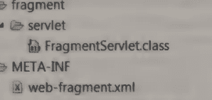

**图 16.1：fragment.jar 文件的结构**

你可以通过调用以下 URL 来测试 `Fragment` servlet：

`http://localhost:8080/app16a/fragment`

你应该能看到 `Fragment` servlet 的输出。

## 总结

本章解释了如何配置和部署你的 servlet/JSP 应用。本章首先介绍了典型应用程序的目录结构，然后解释了部署描述符。

在应用程序准备好部署后，你可以通过保留应用程序的文件和目录结构来部署它。或者，你可以将应用程序打包成 WAR 文件，并将整个应用程序作为一个单独文件进行部署。

# 第 17 章 动态注册与 Servlet 容器初始化器

动态注册是 Servlet 3 中的一项新功能，允许在不重新加载应用程序的情况下安装新的 Web 对象（servlet、过滤器、监听器）。Servlet 容器初始化器也是 Servlet 3 的一个新增特性，对框架开发者特别有用。本章将讨论这两项功能并提供示例。

## 动态注册

为了实现动态注册，`ServletContext` 接口增加了这些方法，用于动态创建 Web 对象。

```
<T extends Filter> createFilter(java.lang.Class<T> clazz)
<T extends java.util.EventListener> createListener(java.lang.Class<T> clazz)
<T extends Servlet> createServlet(java.lang.Class<T> clazz)
```

例如，如果 `MyServlet` 是直接或间接实现 `javax.servlet.Servlet` 的类，你可以通过 `createServlet` 来实例化 `MyServlet`：

```
Servlet myServlet = createServlet(MyServlet.class);
```

创建 Web 对象后，你可以使用以下方法之一将其添加到 `ServletContext` 中，这些方法也是 Servlet 3 新增的。

```
FilterRegistration.Dynamic addFilter(java.lang.String filterName, Filter filter)
```

```
<T extends java.util.EventListener> void addListener(T t)
ServletRegistration.Dynamic addServlet(java.lang.String servletName, Servlet servlet)
```

或者，你也可以通过在 `ServletContext` 上调用这些方法之一，同时创建并向 `ServletContext` 添加 Web 对象。

```
FilterRegistration.Dynamic addFilter(java.lang.String filterName, java.lang.Class<? extends Filter> filterClass)
```

```
FilterRegistration.Dynamic addFilter(java.lang.String filterName, java.lang.String classNameName)
void addListener(java.lang.Class<? extends java.util.EventListener> listenerClass)
```

```
void addListener(java.lang.String className)
```

```
ServletRegistration.Dynamic addServlet(java.lang.String servletName, java.lang.String className)
```

要创建或添加监听器，传递给第一个 `addListener` 方法的类必须实现以下接口中的一个或多个：

- `ServletContextListener`
- `ServletRequestListener`
- `ServletRequestAttributeListener`
- `HttpSessionListener`
- `HttpSessionAttributeListener`

如果 `ServletContext` 被传递给 `ServletContextInitializer` 的 `onStartup` 方法，则监听器类可能也实现 `ServletContextListener`。关于 `onStartup` 方法和 `ServletContextInitializer` 接口的更多信息，请参见下文。

`addFilter` 或 `addServlet` 的返回值为 `FilterRegistration.Dynamic` 或 `ServletRegistration.Dynamic`。

`FilterRegistration.Dynamic` 和 `ServletRegistration.Dynamic` 都是 `Registration.Dynamic` 的子接口。`FilterRegistration.Dynamic` 允许你配置过滤器，而 `ServletRegistration.Dynamic` 允许配置 servlet。

例如，考虑 `app17a` 应用程序，它包含一个名为 `FirstServlet` 的 servlet 和一个名为 `DynRegListener` 的监听器。该 servlet 既没有使用 `@WebServlet` 注解，也没有在部署描述符中声明。监听器动态注册了该 servlet 并将其投入。

`FirstServlet` 类见列表 17.1，监听器类见列表 17.2。

### 列表 17.1：FirstServlet

```java
package servlet;
import java.io.IOException;
import java.io.PrintWriter;
import javax.servlet.ServletException;
import javax.servlet.http.HttpServlet;
import javax.servlet.http.HttpServletRequest;
import javax.servlet.http.HttpServletResponse;

public class FirstServlet extends HttpServlet {
    private static final long serialVersionUID = 1L;

    private String name;

    @Override
    public void doGet(HttpServletRequest request, HttpServletResponse response)
            throws ServletException, IOException {
        response.setContentType("text/html");
        PrintWriter writer = response.getWriter();
        writer.println("<html><head><title>First servlet</title></head>");
        writer.println("<body>" + name + "</body></html>");
    }

    public void setName(String name) {
        this.name = name;
    }
}
```

### 列表 17.2：DynRegListener

```java
package listener;
import javax.servlet.ServletContext;
import javax.servlet.ServletContextEvent;
import javax.servlet.ServletContextListener;
import javax.servlet.ServletRegistration;
import javax.servlet.annotation.WebListener;
import servlet.FirstServlet;

@WebListener
public class DynRegListener implements ServletContextListener {

    @Override
    public void contextDestroyed(ServletContextEvent sce) {
    }

    @Override
    public void contextInitialized(ServletContextEvent sce) {
        ServletContext servletContext = sce.getServletContext();

        Servlet firstServlet = null;
        try {
            firstServlet = servletContext.createServlet(FirstServlet.class);
        } catch (Exception e) {
            e.printStackTrace();
        }

        if (firstServlet != null && firstServlet instanceof FirstServlet) {
            ((FirstServlet)firstServlet).setName("Dynamically registered servlet");
        }

        ServletRegistration.Dynamic dynamic = servletContext.addServlet("firstServlet", firstServlet);
        dynamic.addMapping("/dynamic");
    }
}
```

当应用程序启动时，容器持有监听器的 `contextInitialized` 方法。结果是创建了 `FirstServlet` 并映射到 `/dynamic`。如果一切顺利，你应该能够通过此 URL 调用 `FirstServlet`：

`http://localhost:8080/app17/dynamic`


`addFilter`或`addServlet`的返回值为`FilterRegistration.Dynamic`或`ServletRegistration.Dynamic`。

`FilterRegistration.Dynamic`和`ServletRegistration.Dynamic`都是`Registration.Dynamic`的子接口。`FilterRegistration.Dynamic`允许你配置过滤器，而`ServletRegistration.Dynamic`允许配置servlet。

## 第17章：动态注册与Servlet初始化器

例如，考虑`app17a`应用程序，它包含一个名为`FirstServlet`的servlet和一个名为`DynRegListener`的监听器。该servlet既没有使用`@WebServlet`注解，也没有在部署描述符中声明。监听器动态注册了该servlet并将其投入。

`FirstServlet`类见列表17.1，监听器类见列表17.2。

### 列表17.1：FirstServlet

```java
package servlet;
import java.io.IOException;
import java.io.PrintWriter;
import javax.servlet.ServletException;
import javax.servlet.http.HttpServlet;
import javax.servlet.http.HttpServletRequest;
import javax.servlet.http.HttpServletResponse;

public class FirstServlet extends HttpServlet {
    private static final long serialVersionUID = 1L;

    private String name;

    @Override
    public void doGet(HttpServletRequest request, HttpServletResponse response)
            throws ServletException, IOException {
        response.setContentType("text/html");
        PrintWriter writer = response.getWriter();
        writer.println("<html><head><title>First servlet</title></head>");
        writer.println("<body>" + name + "</body></html>");
    }

    public void setName(String name) {
        this.name = name;
    }
}
```

### 列表17.2：DynRegListener

```java
package listener;
import javax.servlet.ServletContext;
import javax.servlet.ServletContextEvent;
import javax.servlet.ServletContextListener;
import javax.servlet.ServletRegistration;
import javax.servlet.annotation.WebListener;
import servlet.FirstServlet;

@WebListener
public class DynRegListener implements ServletContextListener {

    @Override
    public void contextDestroyed(ServletContextEvent sce) {
    }

    @Override
    public void contextInitialized(ServletContextEvent sce) {
        ServletContext servletContext = sce.getServletContext();

        Servlet firstServlet = null;
        try {
            firstServlet = servletContext.createServlet(FirstServlet.class);
        } catch (Exception e) {
            e.printStackTrace();
        }

        if (firstServlet != null && firstServlet instanceof FirstServlet) {
            ((FirstServlet)firstServlet).setName("Dynamically registered servlet");
        }

        ServletRegistration.Dynamic dynamic = servletContext.addServlet("firstServlet", firstServlet);
        dynamic.addMapping("/dynamic");
    }
}
```

当应用程序启动时，容器持有监听器的`contextInitialized`方法。结果是创建了`FirstServlet`并映射到`/dynamic`。如果一切顺利，你应该能够通过此URL调用`FirstServlet`：

`http://localhost:8080/app17/dynamic`

## 第17章：动态注册与Servlet容器初始化器

动态注册是Servlet 3中的一项新功能，允许在不重新加载应用程序的情况下安装新的Web对象（servlet、过滤器、监听器）。Servlet容器初始化器也是Servlet 3的一个新增特性，对框架开发者特别有用。本章将讨论这两项功能并提供示例。

### Servlet容器初始化器

如果你用过Java框架（例如Struts或Struts 2），你知道在使用框架之前需要配置应用程序。通常，你需要通过修改部署描述符来告诉servlet容器你正在使用某个框架。例如，要在应用程序中使用Struts 2，需要在部署描述符中添加以下标记：

```
<filter>
  <filter-name>struts2</filter-name>
  <filter-class>
    org.apache.struts2.dispatcher.ng.filter.StrutsPrepareExecuteFilter
  </filter-class>
</filter>
<filter-mapping>
  <filter-name>struts2</filter-name>
  <url-pattern>/*</url-pattern>
</filter-mapping>
```

在Servlet 3中，这不再是必需的。框架可以以这种方式打包，使得Web对象的初始注册自动发生。

`javax.servlet.ServletContainerInitializer`接口是核心。这是一个简单的接口，只有一个方法`onStartup`。该方法在任何`ServletContext`监听器获得执行机会之前由servlet容器调用。

`onStartup`的签名如下：

```
void onStartup(java.util.Set<java.lang.Class<?>> klazz,
ServletContext servletContext)
```

实现`ServletContainerInitializer`的类必须使用`@HandleTypes`注解来声明初始化器可以处理的类类型。

例如，随本书附的`initializer.jar`库包含一个容器初始化器，它注册了一个名为`UsefulServlet`的servlet。图17.1显示了`initializer.jar`的结构。

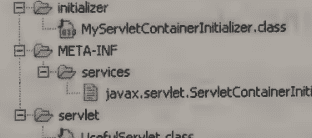

### 图17.1：initializer.jar的结构

该库是一个插件框架。这里有两个重要的资源：初始化器类（`initializer.MyServletContainerInitializer`，见列表17.3）和名为`javax.servlet.ServletContainerInitializer`的元数据文本文件。该文本文件必须放在jar包的`META-INF/services`下。该文件只有一行，即实现`ServletContainerInitializer`的类名，位于列表17.4中。

### 列表17.3：一个ServletContainerInitializer

```java
package initializer;
import java.util.Set;
import javax.servlet.ServletContainerInitializer;
import javax.servlet.ServletContext;
import javax.servlet.ServletExceptionException;
import javax.servlet.ServletRegistration;
import javax.servlet.annotation.HandlesTypes;
import javax.servlet.UsefulServlet;

@HandlesTypes({UsefulServlet.class})
public class MyServletContainerInitializer implements
    ServletContainerInitializer {

    @Override
    public void onStartup(Set<Class<?>> classes, ServletContext
        servletContext) throws ServletException {

        System.out.println("onStartup");
        ServletRegistration registration =
            servletContext.addServlet("usefulServlet",
                "servlet.UsefulServlet");
        registration.addMapping("/useful");
        System.out.println("leaving onStartup");
    }
}
```

### 列表17.4：javax.servlet.ServletContainerInitializer文件

`initializer.MyServletContainerInitializer`

`MyServletContainerInitializer`中`onStartup`方法的主要工作是注册新的Web对象。在本例中，只有一个这样的对象，即名为`UsefulServlet`的servlet，它被映射到`/useful`模式。在大型框架中，注册指令可以来自XML文档，如Struts和Struts 2。

随本章附的`app17b`已经在`WEB-INF/lib`目录下包含了`initializer.jar`的副本。要确认`UsefulServlet`在应用程序启动时已成功注册，请将浏览器指向此URL并查看是否看到来自servlet的输出：

```
http://localhost:8080/app17b/useful
```

不难想象，有一天所有的框架都将以插件的形式部署。

### 总结

在本章中，你学习了即时部署应用程序和插件的两个新功能。第一个功能是动态注册，它允许你在不重启应用程序的情况下动态添加servlet、过滤器和监听器。第二个功能是servlet容器初始化器，它允许你在不更改用户应用程序部署描述符的情况下部署插件。servlet容器初始化器对框架开发者来说特别有用。

## 第18章：Struts 2简介

在第10章“应用设计”中，你学习了Model 2架构的优势以及如何基于该模型构建应用程序。本章介绍了Struts 2这一用于快速开发Model 2应用的框架，首先讨论了Struts 2的优点以及它如何加速Model 2应用开发的。它还解释了Struts 2的基本组件：过滤器调度器、actions、结果和拦截器。

介绍Struts 2配置是本章的另一个目标。大多数Struts应用将有一个`struts.xml`和`struts.properties`文件。前者最重要的，因为你是在那里配置你的actions。后者是可选的，因为存在一个`default.properties`文件，其中包含了适用于大多数应用程序的标准设置。在本章结束时，你将重写`app10b`应用程序，并见证Struts 2如何减少你需要编写的代码量。

如果在阅读完本章后你感兴趣了解更多Struts 2，我推荐阅读自己的著作《Struts 2 Design and Programming: A Tutorial》（ISBN 978-0980331608）。

### Struts 2的优势

Struts 2是一个MVC框架，它采用过滤器调度器作为控制器。在不使用框架的情况下编写Model 2应用时，你有责任提供一个控制器并编写action类。你的控制器必须能够完成以下操作：

1. 从URI确定要调用哪个action。
2. 实例化action类。
3. 如果action对象存在，则用请求参数填充action的属性。
4. 如果action对象存在，调用action方法。
5. 将请求转发到视图（JSP页面）。

使用Struts的第一个好处是你不需要编写控制器，而是可以集中在action类中编写业务逻辑上。以下是Struts具备的特性列表，使开发更快速、更愉快：

- Struts提供了一个过滤器调度器，节省了你编写它的时间。
- Struts采用基于XML的配置文件来将URI与action匹配。由于XML文档是文本文件，可以在不重新编译的情况下对应用程序进行许多更改。
- Struts实例化action类并用用户输入填充属性。如果你没有指定action类，将实例化一个默认类。
- Struts验证用户输入，并在验证失败时将用户重定向回输入页面。输入验证是可选的，可以通过编程或声明式方式完成。此外，Struts为你遇到的大多数任务提供了内置验证器。
- Struts触发action方法，你可以通过配置文件更改方法。
- Struts检查action结果并执行结果。最常用的结果类型Dispatcher会转发到JSP页面。然而，Struts 2提供了各种结果类型允许执行不同的操作，例如生成PDF、重定向到外部资源、发送错误消息。

列表显示了Struts如何帮助你完成Model 2应用的任务。还有更多。显示数据的自定义标签、数据转换、AJAX支持、国际化和本地化支持以及通过插件扩展都是其中。

### Struts如何工作

Struts 2有一个与`app1b`类似的过滤器调度器。它在Struts 2.3中的全名为`struts2.dispatcher.ng.StrutsPrepareFilter`（早期版本使用的是不同的类）。要使用该过滤器，需要在部署描述符（`web.xml`）中使用filter和filter-mapping元素注册它。

```xml
<filter>
  <filter-name>struts2</filter-name>
  <filter-class>
    struts2.dispatcher.ng.StrutsPrepareFilter
  </filter-class>
</filter>
<filter-mapping>
  <filter-name>struts2</filter-name>
  <url-pattern>/*</url-pattern>
</filter-mapping>
```

Model 2应用中的过滤器调度器需要做很多事情，Struts 2的过滤器调度器绝非例外。由于Struts 2有更多功能需要支持，其过滤器调度器的复杂度可能会无限增长。然而，Struts 2通过将调度器中的任务处理拆分为称为拦截器的子类来解决这个问题。你注意第一个拦截器是用请求参数填充action对象的那个。你将在本章后面的“拦截器”部分学习更多拦截器。

在Struts 2应用中，在action属性填充后执行action方法。action方法可以有任何有效的Java名称。

action方法返回一个String值。该值指示Struts 2将控制权转发到哪里。成功的action执行将转发到不同的视图。例如，“success”表示action方法执行成功，“error”表示处理过程中出错并应显示错误消息。大多数情况下使用`RequestDispatcher`转发到JSP页面，但JSP页面并不是唯一的目的地。返回文件下载的结果不需要JSP页面。仅仅发送重定向命令或发送待渲染图表的结果也不需要。即使一个action需要转发到某个视图（view），该视图也不一定非要是JSP页面。也可以使用Velocity模板或FreeMarker模板。


现在你已经了解了 Struts 2 的所有基本组件，我将继续解释 Struts 2 如何使用过滤器调度器（filter dispatcher）作为它的控制器，所有的活动都从这个对象开始。

## 使用 Velocity 和 FreeMarker 的理由

JSP 程序员可能会咕咕道：“为什么要引入新的视图技术而不是坚持使用 JSP 呢？”这是一个很好的问题。答案是，虽然你只用 JSP 也可以运行，但学习 Velocity 和/或 FreeMarker 有充分的理由。Velocity 和 FreeMarker 模板可以封装在 JAR 包中，这也是 Struts 2 插件的分发方式。你无法在 JAR 中分发 JSP 页面，至少很很难做到，尽管如果你足够决心，你就会找到办法。此外，还有说法认为 Velocity 比 JSP 快。

过滤器调度器做的第一件事是验证请求 URI，并确定要调用哪个 action 以及实例化哪个 Java action 类。`app10b` 中的过滤器调度器是通过使用字符串操作方法来实现此点的。然而，这是不实际的，因为在开发过程中 URI 可能会更改多次，每次 URI 或其他内容发生变化，你都必须重新编译过滤器。

为了将 URI 与 action 类匹配，Struts 2 使用了一个名为 `struts.xml` 的配置文件。基本上，你需要创建一个 `struts.xml` 文件并将其放在 `WEB-INF/classes` 下。你在该文件中定义应用程序中的所有 action。每个 action 都有一个直接对应于调用该 action 的 URI 的名称。每个 action 声明可以指定 action 类的类的限定（如果有）。除非 action 方法名是 `execute`，否则你必须指定 action 方法名，这是 Struts 2 在没有显式方法名时假设的默认方法名。

action 类必须至少有一个 result，用于规定在执行完 action 方法后做什么。如果 action 方法可能根据（例如用户输入）返回不同的结果，则可能有多个 result。

`struts.xml` 文件在 Struts 启动时被读取。在开发模式下，Struts 2 每次处理请求时都会检查该文件的时间戳，如果它自上次加载以来发生了变化，则会重新加载。因此，如果你处于开发模式并告诉 Struts 2 这一点，你就不需要在每次更改应用程序时重启 web 容器。这为你节省了时间。

如果你不遵守管理 `struts.xml` 文件的规则，配置文件加载将会失败。如果（或者我应该说“当”）这种情况发生时，Struts 2 将无法启动，你必须重启容器。有时由于错误信息不清晰，很难破译你做错了什么。如果发生这种情况，尝试注释掉你怀疑是导致该问题的 action，直到你隔离并修复那个阻碍开发的特定问题项。

## 注意

我将在本章后面的“配置文件”部分讨论 Struts 配置文件时，会讨论 Struts 2 的开发模式。

图 18.1 显示了 Struts 如何处理 action 调用。它不包含对配置文件的读取，该操作只在应用程序启动期间发生一次。

对于每次 action 调用，过滤器调度器会执行以下操作：

1. 咨询配置管理器（Configuration Manager），根据请求 URI 确定调用哪个 action。
2. 运行为该 action 注册的拦截器（interceptor）。其中一个拦截器将填充 action 的属性。
3. 执行 action 方法。
4. 执行 result。

注意，某些拦截器在 action 方法执行之后、result 执行之前会再次运行。

## 400 Servlet & JSP: 教程

| Struts | Config Manager | Interceptor 1 | Interceptor 2 | Action | Result |
| :--- | :--- | :--- | :--- | :--- | :--- |
| 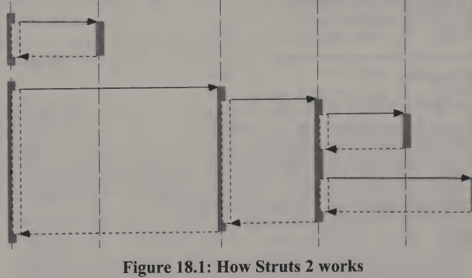 | | | | | |

## 拦截器

如前所述，过滤器调度器必须做很多事情。本应存在于过滤器调度器类中的代码被模块化为拦截器。拦截器的巧妙之处在于，它们可以通过编辑 Struts 2 配置文件来插拔或拔出。事实上，Struts 2 使用这种策略实现了高度的模块化。可以添加用于 action 处理的新代码，而无需重新编译主框架。

表 18.1 列出了 Struts 2 的默认拦截器。Interceptor 列中括号中的单词是在配置文件中注册拦截器时使用的名称。是的，正如你很快将看到的，你需要在配置文件中注册拦截器后才能使用它。例如，Alias 拦截器的注册名称是 `alias`。

拦截器非常多，这会让初学者感到困惑。关键点在于，在编写 Struts 2 应用程序之前，你不必熟悉拦截器。只需要知道拦截器在 Struts 中起着至关重要的作用即可。

大多数情况下，默认拦截器已经足够了。然而，如果你需要非标准的 action 处理，可以编写自己的拦截器。编写自定义拦截器的内容将在《Struts 2 设计与编程：教程》的第 18 章“自定义拦截器”中进行讨论。

| 拦截器 | 描述 |
| :--- | :--- |
| Alias (`alias`) | 转换请求之间可能具有不同名称的相似参数。 |
| Chaining (`chain`) | 配合使用时。 |
| Scope (`scope`) | 在会话或应用程序中。 |
| Servlet Config (`servletConfig`) | 使用请求和响应。 |
| Static Parameters (`params`) | 填充 action 属性。 |
| Roles (`roles`) | 基于角色的。 |
| Timer (`timer`) | 执行 action 需要的时间。 |
| Token (`token`) | 验证有效的 token。 |
| Token Session (`tokenSession`) | 验证有效的 token。 |
| Validation (`validation`) | 支持输入验证。 |
| Workflow (`workflow`) | 调用 action 方法。 |
| Parameter Filter (`n/a`) | 从可用的列表中移除。 |
| Profiling (`profiling`) | 支持性能剖析。 |
| Cookie (`cookie`) | 为 action 添加 cookie。 |
| Conversion Error (`conversionError`) | 映射到结果。 |
| Create Session (`createSession`) | 如果没有则创建会话。 |
| Debugging (`debugging`) | 支持调试。 |
| Execute and Wait (`execAndWait`) | 执行长时间的 action 并用户发送到页面。 |
| File Upload (`fileUpload`) | 支持文件上传。 |
| I18n (`i18n`) | 支持国际化和本地化。 |
| Logger (`logger`) | 输出 action 名称。 |
| Message Store (`store`) | 存储和检索消息或错误。 |
| Model Driven (`modelDriven`) | 用于实现 `ValidationAware` 的类的模式。 |
| Scoped Model Driven (`scopedModelDriven`) | 模型拦截器但用于实现 `ScopedModelDriven` 的类。 |
| Parameters (`params`) | 使用请求参数填充 action 属性。 |
| Prepare (`prepare`) | 支持实现 `Preparable` 的类。 |

## 400 Servlet & JSP: 教程

| 拦截器 | 描述 |
| :--- | :--- |
| Alias (`alias`) | 转换请求之间可能具有不同名称的相似参数。 |
| Chaining (`chain`) | 配合使用时。 |
| Scope (`scope`) | 在会话或应用程序中。 |
| Servlet Config (`servletConfig`) | 使用请求和响应。 |
| Static Parameters (`params`) | 填充 action 属性。 |
| Roles (`roles`) | 基于角色的。 |
| Timer (`timer`) | 执行 action 需要的时间。 |
| Token (`token`) | 验证有效的 token。 |
| Token Session (`tokenSession`) | 验证有效的 token。 |
| Validation (`validation`) | 支持输入验证。 |
| Workflow (`workflow`) | 调用 action 方法。 |
| Parameter Filter (`n/a`) | 从可用的列表中移除。 |
| Profiling (`profiling`) | 支持性能剖析。 |
| Cookie (`cookie`) | 为 action 添加 cookie。 |
| Conversion Error (`conversionError`) | 映射到结果。 |
| Create Session (`createSession`) | 如果没有则创建会话。 |
| Debugging (`debugging`) | 支持调试。 |
| Execute and Wait (`execAndWait`) | 执行长时间的 action 并用户发送到页面。 |
| File Upload (`fileUpload`) | 支持文件上传。 |
| I18n (`i18n`) | 支持国际化和本地化。 |
| Logger (`logger`) | 输出 action 名称。 |
| Message Store (`store`) | 存储和检索消息或错误。 |
| Model Driven (`modelDriven`) | 用于实现 `ValidationAware` 的类的模式。 |
| Scoped Model Driven (`scopedModelDriven`) | 模型拦截器但用于实现 `ScopedModelDriven` 的类。 |
| Parameters (`params`) | 使用请求参数填充 action 属性。 |
| Prepare (`prepare`) | 支持实现 `Preparable` 的类。 |

## Struts 2 配置文件

Struts 2 应用程序使用多个配置文件。主要的两个是 `struts.xml` 和 `struts.properties`，但可能还有其他配置文件。例如，一个 Struts 插件带有一个 `struts-plugin.xml` 配置文件。如果你使用 Velocity 作为视图技术，预计会有一个 `velocity.properties` 文件。本章简要解释 `struts.xml` 和 `struts.properties` 文件。

在 `struts.xml` 中，你定义了应用程序几乎的所有方面，包括 action、每个 action 需要调用的拦截器以及每个 action 可能的结果。

在 action 中使用的拦截器和结果类型在使用之前必须先注册。幸的是，Struts 2 配置文件支持继承，默认配置文件包含在 `struts2-core-VERSION.jar` 文件中。`struts-default.xml` 是此类配置文件之一，它注册了默认的结果类型和拦截器。如此，你可以使用默认的结果类型和拦截器，而无需在自己的 `struts.xml` 文件中注册它们，这使得代码更加整洁简短。

`default.properties` 文件封装在同一个 JAR 包中，包含了适用于所有 Struts 的设置。因此，除非你需要覆盖默认值，否则你不需要有 `struts.properties` 文件。

现在让我们详细地查看 `struts.xml` 和 `struts.properties`。

## struts.xml 文件

`struts.xml` 文件是一个带有 `struts` 根元素的 XML 文件。你可以在此文件中定义 Struts 2 应用中所有的 action（动作）。这里是 `struts.xml` 文件的结构。

```xml
<xml version="1.0" encoding="UTF-8" ?>
<!DOCTYPE struts PUBLIC
  "//Apache Software Foundation//DTD Struts Configuration 2.0//EN"
  "http://struts.apache.org/dtds/struts-2.0.dtd">
<struts>
  ...
</struts>
```

接下来将讨论出现在 `<struts>` 和 `</struts>` 之间的更重要的元素。

## package 元素

由于 Struts 在设计时考虑了模块化，action 被分到不同的 package（包）中。将 package 视为模块。一个典型的 `struts.xml` 文件可以有一个或多个 package：

```xml
<struts>
  <package name="package-1" namespace="namespace-1"
      extends="struts-default">
    <action name="..."/>
    <action name="..."/>
    ...
  </package>
  <package name="package-2" namespace="namespace-2"
extends="struts-default">
<action name="..."/>
<action name="..."/>
...
</package>
```

```xml
...
<package name="package-n" namespace="namespace-n"
extends="struts-default">
<action name="..."/>
<action name="..."/>
...
</package>
</struts>
```

`package` 元素必须具有 `name` 属性。`namespace` 属性是可选的，如果不存在，则假设默认值为 `/`。如果 `namespace` 属性有一个非默认值，则该命名空间必须被添加到调用包内 action 的 URI 中。例如，在具有默认命名空间的包中调用 action 的 URI 为：

`/context/actionName.action`

要在具有非默认命名空间的包中调用 action，你使用此 URI：

`/context/namespace/actionName.action`

`package` 元素几乎总是扩展在 `struts-default.xml` 中定义的 `struts-default` 包。通过这样做，包中的所有 action 都可以使用在 `struts-default.xml` 中注册的结果类型和拦截器。这里是 `struts-default` 包的结构。为了节省空间，省略了拦截器。

```xml
<?xml version="1.0" encoding="UTF-8" ?>
<!DOCTYPE struts PUBLIC "-//Apache Software Foundation//DTD Struts Configuration 2.0//EN"
"http://struts.apache.org/dtds/struts-2.0.dtd">
<struts>
<package name="struts-default">
<result-types>
<result-type name="chain" class="com.opensymphony.xwork2.ActionChainResult"/>
<result-type name="dispatcher" class="org.apache.struts2.dispatcher.ServletDispatcherResult" default="true"/>
<result-type name="freemarker" class="org.apache.struts2.views.freemarker.FreemarkerResult/>
<result-type name="httpheader" class="org.apache.struts2.dispatcher.HttpHeaderResult"/>
<result-type name="redirect" class="org.apache.struts2.dispatcher.ServletRedirectResult"/>
<result-type name="redirect-action" class="org.apache.struts2.dispatcher.ServletActionRedirectResult"/>
<result-type name="stream" class="org.apache.struts2.struts2.dispatcher.StreamResult"/>
<result-type name="velocity" class="org.apache.struts2.struts2.dispatcher.VelocityResult"/>
<result-type name="xslt" class="org.apache.struts2.views.xslt.XSLTResult"/>
<result-type name="plaintext" class="org.apache.struts2.dispatcher.PlaintextResult"/>
</result-types>

<interceptors>
</interceptors>
</package>
</struts>
```

## include 元素


一个大型应用可能有有很多 package。为了让大型应用的 `struts.xml` 文件更于管理，建议将其划分为较小文件并使用 `include` 元素来引用它们。每个文件理想情况下应该包含相关的 package。带有多个 `include` 元素的 `struts.xml` 文件看起来如下。

```xml
<?xml version="1.0" encoding="UTF-8" ?>
<!DOCTYPE struts PUBLIC
    "//Apache Software Foundation//DTD Struts Configuration 2.0//EN"
    "http://struts.apache.org/dtd/struts-2.0.dtd">
<struts>
<include file="module-1.xml" />
<include file="module-2.xml" />
...
<include file="module-n.xml" />
</struts>
```

每个 `module.xml` 文件将具有相同的元素和 `struts` 根节点。这里是一个示例：

```xml
<?xml version="1.0" encoding="UTF-8"?>
<!DOCTYPE struts PUBLIC
  "//Apache Software Foundation//DTD Struts Configuration 2.0//EN"
  "http://struts.apache.org/dtd/struts-2.0.dtd">
<struts>
<package name="test" extends="struts-default">
  <action name="Test1">
    <result>/jsp/Test1.jsp</result>
  </action>
  <action name="Test2">
    <result>/jsp/Test2.jsp</result>
  </action>
</package>
</struts>
```

## action 元素

`action` 元素嵌套在 `<package>` 内部，表示一个 action。`action` 元素映射到一个返回值。例如，`action` 元素可以有多个返回值，每个返回值对应不同的情况。`name` 属性指定了 action 的名称。

## result 元素

`<result>` 是 `<action>` 的子元素，它告诉 Struts 你想将 action 跳转到哪里。`result` 元素对应于方法的返回值。例如，`action` 元素可以包含多个 `result` 元素，`name` 属性指定了返回值。

`result` 元素的 `type` 属性指定了结果类型。`type` 属性的值必须是在包含包或其所扩展的父包中注册的结果类型。假设 Product save 在一个扩展了 `struts-default` 的包中，使用 `Dispatcher` 结果是安全的，因为 `Dispatcher` 结果类型在 `struts-default` 中定义。

如果你省略了 `result` 元素的 `name` 属性，则默认为“success”。此外，如果 `type` 属性不存在，则默认结果类型为 `Dispatcher`。因此，这两个 `result` 元素是相同的。

```xml
<result name="success" type="dispatcher">/jsp/Confirm.jsp</result>
<result>/jsp/Confirm.jsp</result>
```

`Dispatcher` 结果元素存在使用 `param` 元素的另一种语法。在这种情况下，`param` 元素使用的参数名称是 `location`。换句话说，这个 `result` 元素

```xml
<result>/test.jsp</result>
```

同于：

```xml
<result>
  <param name="location">/test.jsp</param>
</result>
```

你将在本节稍后部分学习更多关于 `param` 元素的信息。

## global-results 元素

package 元素可以包含一个 `global-results` 元素，该元素包含了作为通用结果的结果。如果 action 在其 action 声明下无法找到匹配的结果，它将搜索 `global-results` 元素（如果存在）。

以下是 `global-results` 元素的示例。

```xml
<global-results>
  <result name="error">/jsp/GenericErrorPage.jsp</result>
  <result name="login" type="redirect-action">Login</result>
</global-results>
```

## 与拦截器相关的元素

struts.xml 文件中可能出现五个与拦截器相关的元素：`interceptors`、`interceptor`、`interceptor-ref`、`interceptor-stack` 和 `default-interceptor-ref`。本节将对它们进行说明。

action 元素必须包含一个拦截器列表，用于处理 action 对象。但是，在你使用拦截器之前，你必须在 `<interceptors>` 下节点使用 `interceptor` 元素对其进行注册。在包中定义的拦截器可以被包中的所有 action 使用。

例如，下面的 package 元素注册了两个拦截器：validation 和 logger。

```xml
<package name="main" extends="struts-default">
  <interceptors>
    <interceptor name="validation" class="..."/>
    <interceptor name="logger" class="..."/>
  </interceptors>
</package>
```

要将拦截器应用到 action，请使用该 action 元素下的 `interceptor-ref` 元素。例如，下面的配置注册了四个拦截器，并将它们应用到 Product_delete 和 Product_save action 中。

```xml
<package name="main" extends="struts-default">
  <interceptors>
    <interceptor name="alias" class="..."/>
    <interceptor name="i18n" class="..."/>
    <interceptor name="validation" class="..."/>
    <interceptor name="logger" class="..."/>
  </interceptors>

  <action name="Product_delete" class="">
    <interceptor-ref name="alias"/>
    <interceptor-ref name="i18n"/>
    <interceptor-ref name="validation"/>
    <interceptor-ref name="logger"/>
    <result>jsp/main.jsp</result>
  </action>

  <action name="Product_save" class="">
    <interceptor-ref name="alias"/>
    <interceptor-ref name="i18n"/>
    <interceptor-ref name="validation"/>
    <interceptor-ref name="logger"/>
    <result name="input">jsp/Product.jsp</result>
    <result>jsp/ProductDetails.jsp</result>
  </action>
</package>
```

通过这些设置，每当调用 Product_delete 或 Product_save action 时，四个拦截器都会获得机会处理这些 action。请注意，`interceptor-ref` 元素的出现顺序是重要的，因为它决定了该 action 注册的拦截器的调用顺序。在这个示例中，alias 拦截器将被首先调用，然后是 i18n 拦截器、validation 拦截器和 logger 拦截器。

对于具有多个 action 元素的大多数 Struts 2 ，为每个 action 重复拦截器列表可能是一项艰巨的任务。为了缓解这个问题，Struts 允许你创建将所需拦截器分组的拦截器栈（interceptor stacks）。与其在每个 action 元素内部引用拦截器，你可以引用拦截器栈。

例如，六个拦截器通常按以下顺序使用：exception、servletConfig、prepare、checkbox、params 和 conversionError。你不需要在你的 action 声明中反复引用它们，可以像这样创建一个拦截器栈：

```xml
<interceptor-stack name="basicStack">
  <interceptor-ref name="exception"/>
  <interceptor-ref name="servlet-config"/>
  <interceptor-ref name="prepare"/>
  <interceptor-ref name="checkbox"/>
  <interceptor-ref name="params"/>
  <interceptor-ref name="conversionError"/>
</interceptor-stack>
```

要使用这些拦截器，你只需要引用该栈：

```xml
<action name="..." class="...">
  <interceptor-ref name="basicStack"/>
  <result name="input">jsp/Product.jsp</result>
  <result>jsp/ProductDetails.jsp</result>
</action>
```

struts-default 包定义了多个栈。此外，它还定义了一个 `default-interceptor-ref` 元素，如果为 action 没有定义拦截器，则指定要使用的默认拦截器或拦截器栈：

```xml
<default-interceptor-ref name="defaultStack"/>
```

如果 action 需要组合其他拦截器和默认栈，你必须重新定义 `default-interceptor-ref` 元素。如果在 action 元素内找到 `interceptor` 元素，默认栈将被忽略。

## param 元素

`param` 元素可以嵌套在 action、result-type 和 interceptor 等元素内部，以便将值传递给父对象。

`param` 元素有一个 name 属性，指定参数名称。格式如下：

```xml
<param name="property">value</param>
```

在 action 元素内部使用 `param` 可以设置 action 属性。例如，下面的 `param` 元素设置了 action 的 siteId 属性。

```xml
<action name="customer" class="...">
  <param name="siteId">california01</param>
</action>
```

接下来的 `param` 元素设置了 validation 拦截器-ref 的 excludeMethod：

```xml
<interceptor-ref name="validation">
  <param name="excludeMethods">input,back,cancel</param>
</interceptor-ref>
```

`excludeMethods` 参数用于排除调用父拦截器的某些方法。

## constant 元素

除了 struts.xml 文件外，你还可以有一个 struts.properties 文件。如果你需要覆盖 default.properties 文件中定义的一个或多个键/值对，则可以使用后者（default.properties 包含在 struts2-core-VERSION.jar 文件中）。在大多数情况下，你不需要 struts.properties 文件，因为 default.properties 文件已经足够了。此外，你可以使用 struts.xml 文件中的 `constant` 元素来覆盖 default.properties 文件中的设置。

`constant` 元素有一个 name 属性和一个 value 属性。例如，struts.devMode 设置决定了 Struts 应用程序是否处于开发模式。默认情况下，该值为 false，意味着应用不处于开发模式。

```xml
<struts>
  <constant name="struts.devMode" value="true"/>
</struts>
```

## struts.properties 文件

struts.properties 文件必须位于类路径或 WEB-INF/classes 下。为了避免创建一个新文件，你可以在 struts.xml 文件中使用 constant 元素。或者，你也可以在 filter 声明中使用 init-param 元素：

```xml
<filter>
  <filter-name>struts</filter-name>
  <filter-class>
    org.apache.struts2.dispatcher.Filter
  </filter-class>
  <init-param>
    <param-name>struts.devMode</param-name>
    <param-value>true</param-value>
  </init-param>
</filter>
```

## 一个简单的 Struts

让我们使用 Struts 2 重写 app1b 并称为 app18a。将使用类似的 JSP 页面和名为 Product 的 action 类。

app18a 的目录结构见图。每个组件将在后续节中讨论。

## 部署描述符和 Struts 配置文件

部署描述符见列表 18.1，Struts 2 配置文件见列表 18.2。

### 列表 18.1：部署描述符 (web.xml)

```xml
<?xml version="1.0" encoding="ISO-8859-1"?>
<web-app xmlns="http://java.sun.com/xml/ns/javaee"
xmlns:xsi="http://www.w3.org/2001/XMLSchema-instance"
xsi:schemaLocation="http://java.sun.com/xml/ns/javaee
http://java.sun.com/xml/ns/javaee/web-app_3_0.xsd"
version="3.0">

  <filter>
    <filter-name>struts2</filter-name>
    <filter-class>
      org.apache.struts2.dispatcher.ng.filter.StrutsPrepareAndExecuteFilter
    </filter-class>
    <init-param>
      <param-name>struts.devMode</param-name>
      <param-value>true</param-value>
    </init-param>
  </filter>
</web-app>
```

图 18.1：app18a 的目录结构

```
app18a
  css
    main.css
  jsp
    Details.jsp
    Product.jsp
  WEB-INF
    classes
      app18a
        Product.class
      struts.xml
    lib
        commons-fileupload-1.2.2.jar
        commons-io-2.0.1.jar
        commons-lang-2.5.1.jar
        commons-logging-1.1.1.jar
        commons-logging-api-1.1.jar
        freemarker-2.3.18.jar
        javassistist-3.11.0.GA.jar
        ognl-3.0.3.jar
        struts2-core-2.3.1.jar
        xwork-core-2.3.1.jar
  web.xml
```

```xml
<filter-mapping>
  <filter-name>struts2</filter-name>
  <url-pattern>/*</url-pattern>
</filter-mapping>
```

<!-- 限制直接访问 JSPs。

为了使安全约束生效，必须存在 auth-constraint 

和 login-config 元素 -->


```xml
<security-constraint>
  <web-resource-collection>
    <web-resource-name>JSPs</web-resource-name>
    <url-pattern>/jsp/*</url-pattern>
  </web-resource-collection>
  <auth-constraint/>
</security-constraint>
```

```xml
<login-config>
  <auth-method>BASIC</auth-method>
</login-config>
</web-app>
```

## 列表 18.2: struts.xml

```xml
<?xml version="1.0" encoding="UTF-8" ?>
<!DOCTYPE struts PUBLIC
  "//Apache Software Foundation//DTD Struts Configuration 2.0//EN"
  "http://struts.apache.org/dtds/struts-2.0.dtd">
```

```xml
<struts>
  <package name="app1a" namespace="/" extends="struts-default">
    <action name="Product_input">
      <result>/jsp/ProductForm.jsp</result>
    </action>

    <action name="Product_save" class="app1a.Product">
      <result>/jsp/ProductDetails.jsp</result>
    </action>
  </package>
</struts>
```

`struts.xml` 文件定义了一个包（`app1a`），该包包含两个 action：`Product_input` 和 `Product_save`。`Product_input` action 没有 action 类。调用 `Product_input` 仅仅会将控制转发到 `ProductForm.jsp` 页面。该页面包含一个用于输入产品信息的表单。

`Product_save` action 有一个非默认的 action 类（`app1a.Product`）。由于 action 声明中没有 `method` 属性，将调用 `Product` 类中的 `execute` 方法。

注意：在开发期间，你可以在 `package` 元素顶部添加此常量元素，将 Struts 2 切换到开发模式。

```xml
<constant name="struts.devMode" value="true" />
```

## Action 类

列表 18.3 中的 `Product` 类是 action `Product_save` 的 action 类。该类有三个属性（`productName`、`description` 和 `price`）以及一个 action 方法：`execute`。

### 列表 18.3: Product action 类

```java
package app18a;
import java.io.Serializable;

public class Product implements Serializable {
    private static final long serialVersionUID = 1000L;

    private String name;
    private String description;
    private String price;

    public String getName() {
        return name;
    }

    public void setName(String name) {
        this.name = name;
    }

    public String getDescription() {
        return description;
    }

    public void setDescription(String description) {
        this.description = description;
    }

    public String getPrice() {
        return price;
    }

    public void setPrice(String price) {
        this.price = price;
    }

    public String execute() {
        return "success";
    }
}
```

## 运行应用程序

`app18a` 应用是第 10 章 `app10b` 应用的 Struts 2 副本。要调用第一个 action，请使用以下 URL：

`http://localhost:8080/app18a/Product_input.action`

你将在浏览器中看到图 10.2 的内容。在字段中输入值并提交表单。浏览器将显示类似于图 10.3 的确认消息。

恭喜。你刚刚看到了 Struts 2 的运行！

## 总结

在本章中，你学习了 Struts 2 提供的加速 Model 2 应用开发的功能。你还学习了如何配置 Struts 应用，并编写了你的第一个 Struts 应用。

# 附录 A: Tomcat

Tomcat 是目前最流行的 servlet 容器。它是免费、开源且成熟的。本附录提供了下载和配置 Tomcat 的快速指南。

## 下载和配置 Tomcat

要获取 Tomcat，你应该先从 `http://tomcat.apache.org` 下载。下载 zip 包后，你需要将其解压到目录中。之后，将 `JAVA_HOME` 环境变量设置为安装目录。Windows 用户可以通过 `conf/Catalina/localhost` 目录下的 `server.xml` 文件来管理 Tomcat。

## 启动和停止 Tomcat

当你将 context 文件添加到 `webapps` 目录时，Tomcat 会自动加载该应用。启动 Tomcat 请运行 `startup.bat`（Windows）或 `startup.sh`（Unix/MacOS）。停止 Tomcat 请运行 `shutdown.bat`（Windows）或 `shutdown.sh`（Unix/MacOS）。

## 定义 Context

有几种方法可以显式定义 context：

- 在 `conf/Catalina/localhost` 目录下创建一个 XML 文件。
- 在 `server.xml` 文件中添加 `Context` 元素。

如果你决定显式创建 context，context path 将由文件名导出。例如，如果你在目录中放置 `commerce.xml` 文件，则 context path 将为 `commerce`，并可以通过 `http://localhost:8080/commerce` 调用。

context 文件必须包含 `Context` 元素作为其根元素。大多数情况下，该元素没有子元素且只有单行。例如，这里有一个 context 文件：

```xml
<Context docBase="C:/apps/commerce"/>
```

唯一要求的属性是 `docBase`，它指定应用程序的位置。`reloadable` 属性是可选的，但如果存在且其值设置为 `true`，Tomcat 将监控应用程序类文件和其他资源的添加、删除或更新。当检测到此类更改时，Tomcat 将重新加载应用程序。建议在开发期间将 `reloadable` 设置为 `true`。

当你将 context 文件添加到指定的目录时，Tomcat 会加载该应用。当你删除它时，Tomcat 会卸载该应用。

另一种定义 context 的方法是在 `server.xml` 文件中添加 `Context` 元素。这样做打开文件并在 `Host` 元素下创建一个 `Context` 元素。与之前的方法不同，在这里定义 context 需要指定 `path` 属性作为你的 context path。示例：

```xml
<Host name="localhost" appBase="webapp" unpackWARs="true">
  <Context path="/commerce"
      docBase="C:/apps/commerce"
      reloadable="true">

</Host>
```

通常，不建议通过 `server.xml` 管理 context，因为更新在重启 Tomcat 后才会生效。但是，如果你有一组需要快速测试的应用（例如当你学习编写 servlet 和 JSP 页面时），你可能会发现使用 `server.xml` 几乎是理想的，因为你可以在文件中管理所有应用。

最后，你也可以通过将 war 包或整个应用程序复制到 Tomcat 的 `webapps` 目录来隐式部署应用程序。

关于 Tomcat context 的更多信息可以在此处找到：

`http://tomcat.apache.org/tomcat-7.0-doc/config/context.html`

## 定义资源

你可以在 Tomcat 上下文定义中定义应用程序使用的 JNDI 资源。资源由 `Context` 元素下的 `Resource` 元素表示。

例如，要添加一个打开 MySQL 数据库连接的 `DataSource` 资源，请向此 `Resource` 元素添加内容。

```xml
<Context [path="/appName"] docBase="...">
<Resource name="jdbc/dataSourceName"
    auth="Container"
    type="javax.sql.DataSource"
    username="..."
    password="..."
    driverClassName="com.mysql.jdbc.Driver"
    url="..."
/>

</Context>
```

关于 `Resource` 元素的更多信息可以参阅此处的：

`http://tomcat.apache.org/tomcat-7.0.doc/indi-resources-howto.html`

## 安装 SSL 证书

一旦你收到证书并将其导入密钥库（keystore），下一步是将其安装在服务器上。如果你使用 Tomcat，只需将你的密钥库复制到服务器上的某个位置并配置 Tomcat。然后，打开 `conf/server.xml` 文件，并在 `<service>` 标签下添加以下 `Connector` 元素。

```xml
<Connector port="443"
    minSpareThreads="5"
    maxSpareThreads="75"
    enableLookups="true"
    disableUploadTimeout="true"
    acceptCount="100"
    maxThreads="200"
    scheme="https"
    secure="true"
    SSLEnabled="true"
    keystoreFile="/path/to/keystore"
    keyAlias="example.com"
    keystorePass="01secret02%%"
    clientAuth="false"
    sslProtocol="TLS"
/>
```

加粗的行与 SSL 相关。

# 附录 B：Web 注解（Web Annotations）

Servlet 3 在 `javax.servlet.annotation` 包提供了一组注解类型，用于标记 servlet、过滤器和监听器等 Web 对象。本附录列出了这些注解类型。

## HandlesTypes

此注解类型用于声明 `ServletContainerInitializer` 可以处理的类类型。它有一个属性 `value`，用于声明类类型。例如，以下 `ServletContainerInitializer` 使用了 `@HandleTypes` 注解，声明该初始化器可以处理 `UsefulServlet`。

```java
@HandleTypes({UsefulServlet.class})
public class MyInitializer implements ServletContainerInitializer {
...
}
```

## HttpConstraint

`HttpConstraint` 注解类型表示应用于所有未出现相应 `HttpMethod` 元素的 HTTP 协议方法的安全约束。此注解类型必须存在于 `ServletSecurity` 注解内部。

`HttpConstraint` 的属性见表 B.1。

| 属性 | 描述 |
| --- | --- |
| `rolesAllowed` | 表示授权角色的字符串数组。 |
| `transportGuarantee` | 指明是否存在必须满足的数据保护要求。其有效值是 `ServletSecurity.TransportGuarantee` 枚举的成员（`CONFIDENTIAL` 或 `NONE`）。 |
| `value` | 默认的授权语义。 |

表 B.1：`HttpConstraint` 属性

例如，以下 `HttpConstraint` 注解声明被注解的 servlet 只能由属于 `manager` 角色的用户访问。由于没有出现 `HttpMethodConstraint` 注解，该约束适用于所有 HTTP 方法。

```java
@ServletSecurity(@HttpConstraint(rolesAllowed = "manager"))
```

## HttpMethodConstraint

此注解类型表示对特定 HTTP 方法的安全约束。`HttpMethodConstraint` 注解只能出现在 `ServletSecurity` 注解内部。

`HttpMethodConstraint` 的属性见表 B.2。

| 属性 | 描述 |
| --- | --- |
| `emptyRoleSemantic` | 默认的授权语义。该值必须是 `ServletSecurity.EmptyRoleSemantic` 枚举的成员之一（`DENY` 或 `PERMIT`）。 |
| `rolesAllowed` | 表示授权角色的字符串数组。 |
| `transportGuarantee` | 指明是否存在必须满足的数据保护要求。其有效值是 `ServletSecurity.TransportGuarantee` 枚举的成员（`CONFIDENTIAL` 或 `NONE`）。 |
| `value` | 受影响的 HTTP 方法。 |

表 B.2：`HttpMethodConstraint` 属性

例如，以下 `ServletSecurity` 注解同时使用了 `value` 和 `httpMethodConstraints` 属性。`HttpConstraint` 注解定义了可以访问被注解 servlet 的规则，而没有写 `rolesAllowed` 属性的 `HttpMethodConstraint` 注解则覆盖了对 `Get` 方法的约束。因此，任何用户都可以通过 `Get` 方法访问该 servlet。另一方面，通过所有其他 HTTP 方法的访问仅可以授予具有 `manager` 角色的用户。

```java
@ServletSecurity(value = @HttpConstraint(rolesAllowed = "manager"),
httpMethodConstraints = {@HttpMethodConstraint("GET")})
```

但是，如果 `HttpMethodConstraint` 注解类型的 `emptyRoleSemantic` 属性被赋值为 `EmptyRoleSemantic.DENY`，则该方法对所有用户都限制。例如，使用以下 `ServletSecurity` 注解的 servlet 防止了通过 `Get` 方法的访问，但允许所有具有 `member` 角色的用户通过其他 HTTP 方法访问。

```java
@ServletSecurity(value = @HttpConstraint(rolesAllowed = "member")
httpMethodConstraints = {@HttpMethodConstraint(value = "GET",
emptyRoleSemantic = EmptyRoleSemantic.DENY)})
```

## MultipartConfig

`MultipartConfig` 注解类型用于标记 servlet，表示该 servlet 实例能够处理 `multipart/form-data` MIME 类型，这通常用于文件上传。

表 B.3 列出了 `MultipartConfig` 的属性。

| 属性 | 描述 |
| --- | --- |
| `fileSizeThreshold` | 上传的文件达到此大小阈值后，将写入磁盘。 |
| `location` | 上传的文件保存到磁盘时的保存位置。 |
| `maxFileSize` | 上传文件的最大大小。大于指定值的文件将被拒绝。默认情况下，`maxFileSize` 的值为 -1，意味着无限制。 |
| `requestSize` | 允许的 multipart HTTP 请求的最大大小。默认情况下，值为 -1，翻译为无限制。 |

表 B.3：`MultipartConfig` 属性

例如，以下 `MultipartConfig` 注解指定了允许上传的最大文件大小为百万字节。

```java
@MultipartConfig(maxFileSize = 1000000)
```

## ServletSecurity


`ServletSecurity`注解类型用于标记 servlet 类，以对 servlet 应用安全约束。`ServletSecurity`注解中可以出现的属性见表 B.4。

| 属性 | 描述 |
| --- | --- |
| `httpMethodConstraints` | `HttpMethodConstraint`数组，指定 HTTP 方法约束。 |
| `value` | `HttpConstraint`注解，定义了应用于未找到`HttpMethodConstraint`的所有 HTTP 方法的保护。 |

表 B.4：`ServletSecurity`属性

例如，`ServletSecurity`注解包含一个`HttpConstraint`，规定了被注解的 servlet 只能由 `manager` 角色的用户访问。

```java
@ServletSecurity(value = @HttpConstraint(rolesAllowed = "manager"))
```

## WebFilter

`WebFilter`注解类型用于标记过滤器。表 B.5 显示了可以在`WebFilter`注解中出现的属性。所有属性均为可选的。

| 属性 | 描述 |
| --- | --- |
| `asyncSupported` | 指明过滤器是否支持异步处理。 |
| `description` | 过滤器的描述。 |
| `dispatcherTypes` | 应用过滤器的`DispatcherTypes`数组。 |
| `displayName` | 过滤器的显示名称。 |
| `filterName` | 过滤器的名称。 |
| `initParams` | 过滤器的初始化参数。 |
| `largeIcon` | 过滤器的大图标 |
| `servletNames` | 应用过滤器的 servlet 名称。 |
| `smallIcon` | 过滤器的小图标。 |
| `urlPatterns` | 应用过滤器的 URL 模式 |
| `value` | 应用过滤器的 URL 模式 |

表 B.5：`WebFilter`属性

## WebInitParam

此注解类型用于向 servlet 或过滤器传递初始化参数。`WebInitParam`注解中可能出现的属性见表 B.6。属性右侧的星号表示该属性是必需的。

| 属性 | 描述 |
| --- | --- |
| `description` | 初始化参数的描述。 |
| `name*` | 初始化参数的名称。 |
| `value*` | 初始化参数的值。 |

表 B.6：`WebInitParam`属性

## WebListener

此注解类型用于标记监听器。它唯一的属性`value`是可选的，其中包含监听器的描述。

## WebServlet

此注解类型用于标记 servlet。其属性列如表 B.7 所示。所有属性均为可选。

| 属性 | 描述 |
| --- | --- |
| `asyncSupported` | 表明 servlet 是否支持异步处理。 |
| `description` | servlet 的描述。 |
| `displayName` | servlet 的显示名称。 |
| `initParams` | servlet 的初始化参数。 |
| `largeIcon` | servlet 的大图标。 |
| `loadOnStartup` | 在包含多个 servlet 的应用程序中，servlet 的加载顺序。 |
| `name` | servlet 的名称。 |
| `smallIcon` | servlet 的小图标。 |
| `urlPatterns` | 调用 servlet 的 URL 模式。 |
| `value` | 调用 servlet 的 URL 模式。 |

表 B.7：`WebServlet`属性

# 附录 C

SSL 证书

在本附录中，你将学习如何使用`KeyTool`程序生成公钥/私钥对，并让受信任的机构对公钥进行签名生成证书。有关在 Tomcat 中安装 SSL 证书的信息，请参见附录 A，"Tomcat"。

## 证书概述

SSL 基于对称加密和非对称加密。后者涉及一对密钥，一个私钥和一个公钥。这将在第 15 章"安全"中进行解释。

公钥通常被封装在证书中，因为证书是分发公钥的一种更可靠的方式。证书使用与证书包含的公钥对应的私钥进行签名。这被称为自签名证书。换句话说，自签名证书的签名者与证书描述的主体是同一个人。

如果人们已经认识发送者，那么自签名证书对于他们验证签名文档的发送者已经足够。为了获得更好的认可，你需要由证书颁发机构（如 VeriSign 或 Thawte）签名的证书。你需要发送你的自签名证书。

在 CA 验证你的身份后，他们将颁发一个替换自签名证书的新证书。这个新证书也可能是证书链。链的顶端是"根"，它是一个自签名证书。链中的下一个是验证你的 CA 颁发的证书。如果该 CA 不出名，他们会将其发送给更大的 CA，由后者来验证第一个 CA 的公钥。最后一个 CA 也会发送证书，形成一个证书链。这个较大的 CA 通常将其公钥广泛分发，以便人们可以轻松验证它们所签名的内容。

Java 提供了一系列工具和 API，用于处理上一节解释的非对称加密。通过这些工具，你可以执行以下操作：

- 生成公钥和私钥对。你可以将生成的公钥发送给证书颁发机构以获取自己的证书。当然，这需要付费。
- 将你的私钥和公钥存储在名为 `keystore` 的数据库中。`keystore` 有名称并密码保护。
- 将他人的证书存储在同一个 `keystore` 中。
- 使用自己的私钥对其进行签名以创建自己的证书。然而，此类证书的用途有限。对于测试，自签名证书足够了。
- 对文件进行数字签名。这特别重要，因为只有当 applet 存储在已签名的 jar 文件中，浏览器才允许其访问资源。签名的 Java 代码向用户保证你是该类的开发者。如果他们信任你，运行 Java 类时的疑虑可能会更少。

让我们回顾一下该工具。

## KeyTool 程序

`KeyTool`程序是一个用于创建和维护公钥、私钥及证书的实用程序。它随 JDK 一起提供，位于 JDK 的 `bin` 目录下。`Keytool`是一个命令行程序。要检查正确的语法，只需在命令提示符处输入`keytool`即可。以下将提供一些重要函数的示例。

# 附录 C：SSL 证书

## 生成密钥对

在开始之前，关于 Java 中的密钥生成，有几点需要注意。

1. `Keytool`生成一对公钥/私钥对，并创建一个使用私钥签名的证书（自签名证书）。除其他外，证书包含公钥以及该密钥所属实体的身份。例如，名称为：

```
CN=JoeSample
OU=IT
O=Software Corp
L=Surrey
S=BC
C=CA
```

2. `Keytool`生成一对公钥/私钥对，并创建一个使用私钥签名的证书（自签名证书）。除其他外，证书包含公钥以及该密钥所属实体的身份。例如，名称为：

```
CN=JoeSample
OU=IT
O=Software Corp
L=Surrey
S=BC
C=CA
```

3. `Keytool`生成一对公钥/私钥对，并创建一个使用私钥签名的证书（自签名证书）。除其他外，证书包含公钥以及该密钥所属实体的身份。例如，名称为：

```
CN=JoeSample
OU=IT
O=Software Corp
L=Surrey
S=BC
C=CA
```

4. `Keytool`生成一对公钥/私钥对，并创建一个使用私钥签名的证书（自签名证书）。除其他外，证书包含公钥以及该密钥所属实体的身份。例如，名称为：

```
CN=JoeSample
OU=IT
O=Software Corp
L=Surrey
S=BC
C=CA
```

5. `Keytool`生成一对公钥/私钥对，并创建一个使用私钥签名的证书（自签名证书）。除其他外，证书包含公钥以及该密钥所属实体的身份。例如，名称为：

```
CN=JoeSample
OU=IT
O=Software Corp
L=Surrey
S=BC
C=CA
```

6. `Keytool`生成一对公钥/私钥对，并创建一个使用私钥签名的证书（自签名证书）。除其他外，证书包含公钥以及该密钥所属实体的身份。例如，名称为：

```
CN=JoeSample
OU=IT
O=Software Corp
L=Surrey
S=BC
C=CA
```

# Servlet & JSP: 教程

## 获取证书

虽然你可以使用`Keytool`生成公私私钥对和自签名证书，但你的证书只会被那些已经认识你的人信任。为了获得更多认可，你需要由证书颁发机构（CA，如 VeriSign、Entrust 或 Thave）对你的证书进行签名。

如果你打算这样做，则需要使用`Keytool`的`-certreq`参数生成证书签名请求（CSR）。以下是语法：

```bash
keytool -certreq -alias alias -file certregFile
```

该命令的输入是别名引用的证书，输出是 CSR，即路径由`certregFile`指定的文件。将 CSR 发送给 CA，他们将离线验证你的身份，通常会要求你提供有效的身份证明详情，例如护照或驾照副本。

如果 CA 对你的凭据满意，他们将向你发送一个新证书或包含你公钥的证书链。这个新证书用于替换你发送的现有证书链（即自签名的证书）。

## 将证书导入 keystore

如果你从第三方收到签名文档或来自 CA 的回复，你可以将其存储在 `keystore` 中。你需要为该证书分配一个你可以轻松记住的别名。

要将证书导入或存储到 `keystore`，请使用`Keytool`的`importcert`参数。以下是语法：

```bash
keytool -importcert -alias anAlias -file filename
```

将证书存储在密钥库（`keystore`）中的优势有两个。首先，你有一个受密码保护的集中存储器。其次，如果你已将证书导入到密钥库中，就可以轻松验证来自第三方的签名文档。

## 从密钥库导出证书

你可以使用私钥对文档进行签名。当你签署文档时，会对文档生成一个摘要，然后用你的私钥对摘要进行加密。接着，你分发文档以及加密后的摘要。

为了让其他人验证文档，他们必须拥有你的公钥。出于安全考虑，你的公钥也需要签名。你可以对其进行自签名，也可以让信任的证书颁发机构对其签名。

首要工作是从密钥库中提取证书并保存为文件。然后，你就可以轻松分发该文件。要从密钥库中提取证书，你需要使用`-exportcert`参数，并传递别名和包含证书的文件名。其语法如下：

```
keytool -exportcert -alias anAlias -file filename
```

包含证书的文件通常赋予`.cer`扩展名。例如，要提取别名为 `Meredith` 的证书并保存到 `mereredithcertificate.cer` 文件，你可以使用此命令：

```
keytool -exportcert -alias Meredith -file mereredithcertificate.cer
```

## 列出密钥库项

现在你已经有一个密钥库来存储私钥以及你信任的方的证书，可以使用密钥库程序通过列出项来查询其内容。你可以使用`list`参数来实现。

```
keytool -list -keystore myKeyStore -storepass myPassword
```

## 索引

`accept-language` header...............................................................107

`access level`..................................................................................338

`action`...........................................................................................32

`choose an action name`...............................................................406

`defefinition`.............................................................................235

`invocation`................................................................................235

`action class`...............................................................................245

`action element`...............................................................406p, 409p.

`action method`...............................................................................397, 407

`ActionSupport` class....................................................................407

`add` method................................................................................57

`addCookie` method.......................................................................32

`addFilter` method.......................................................................388

`addHeader` method......................................................................387p.

`addListener` method.....................................................................388

`addServlet` method.....................................................................352

AJAX...............................................................................292, 396

Apache Commons DBCP..................................................................258

Apache Commons FilesUpload.......................................................281

Apache Software Foundation...........................................................368

Apache Tomcat.............................................................................354

Apache Velocity...........................................................................280

applet.......................................................................................291

application directory...................................................................19

application JSP implicit object..................................................110

application name.............................................................................5

applicationScope EL implicit object.........................................109, 113

asymmetric cryptography..................................................................352, 431

synced-supported element...........................................................326, 375

asynchronous processing..........................................................325, 329

`AsyncListener` interface................................................................200

asynecSupported attribute.......................................................206


`attribute element`.......................................................................187

`attribute element`.......................................................................187

`auth-constraint element`...........................................................340p, 373

`auth-method element`...............................................................344, 372

`authenticate method`...............................................................361, 363

`authentication`.......................................................................337p, 352p.

`authentication method`..................................................................342

`authorization`.........................................................................337p.

`autoFlush attribute`......................................................................91

`autoFlush attribute`......................................................................91

`Base64`...............................................................................343, 346

`Basic access authentication`.......................................................354

`Basic authentication`..................................................................342p.

`begin attribute`.....................................................................133, 143

`BodyTag interface`......................................................................162

`buffer attribute`.......................................................................91

`C30p`...............................................................................258

`certificate`.............................................................................353, 431

`applying for`.............................................................................431

`certificate issuer`.....................................................................354

`checkbox element`.......................................................................1

`choose tag`...............................................................................32

`class attribute`...........................................................................131

`of action element`.....................................................................407

`disories directory`......................................................................19

`elastic tag handler`..................................................................162

`elient class authentication`...............................................................350

`cert-client authentication`...........................................................350

`Common Gateway Interface`............................................................1

`problem with`.............................................................................

`complete method`.......................................................................327

`definition`.............................................................................337

`config JSP implicit object`..................................................110

`configuration file`..................................................................399

`configuration file load`..................................................399

`connection pool`..................................................................258

`constant element`..................................................................412

`contains Function`.............................................................153

`containsIgnoreCaseCase Function`..........................................................154

`type content`...........................................................................22

`Content-Disposition header`..................................................302

`Content-Type header`.......................................................301

`contentType attribute`.........................................................................91

`Context element`..................................................................259

`context-param element`.....................................................368

# 438 Servlet & JSP: 教程

`contextDestroyed method`.......................................201

`contextInitialized method`................201p., 206

`controller`..........................................................234

`cookie`...............................................................56

`创建`...............................................................57

`删除`...............................................................56

`Cookie 类`.........................................................57

`cookie EL 隐式对象`................109, 113

`cookie-config元素`................................378

`交叉引用`...............................................308

`密码学`................................................351

`currencyCode 属性`...........................................145

`currencySymbol 属性`...........................145

`自定义标签`...............................................161

`分发`.........................................................176

`Data Object 设计`.......................................223, 260

`数据完整性`...............................................352, 356

`数据库访问`...............................................257, 262

`数据库连接`.........................................258

`DataSource 接口`......................................259

`dateStyle 属性`...............................147, 152

`声明`....................................................94p.

`声明式安全`............................................339, 358

`Decorator 设计模式`.............................................313

`解密`.......................................................352p

`默认动作类`............................................407

`默认动作方法`.......................................126

`默认属性`..............................................

`默认上下文`..................................................5

`默认拦截器`...........................................411

`默认拦截器栈`。

`默认拦截器`................400p.

`默认命名空间`.............................................404

`默认资源`..................................................5

`默认结果类型`...........................................411

`default-interceptor-ref 元素`................403, 412

`default.properties`............................................395

`default.properties 文件`...................................

`deferredSyntaxAllowedAsLiteral 属性`....91

`delete 方法`..................................................283

`delims 属性`...............................................143

`依赖注入`.........................233, 269, 271

`部署`.......................................................365

`部署描述符` 22, 200, 218, 230, 341, 348, 413

`部署描述符`..................................40

`...使用`..................................................38

`description 元素`.......174, 340, 373, 375, 380

`destroy 方法`...............................15, 84, 96, 215

`开发模式`..................................................399

`Digest 访问认证`..................................345p.

`Digest 认证`...........................................379

`指令`.......................................................

`在 JSP 中禁用脚本`......................................120

`dispatch 方法`...............................................327

`display 元素`.......174, 373, 375, 380

`distributable 元素`.......................................368

`分布式环境`.....................................208

`doBodyAction`...............................................179, 196

`DOCTYPE 元素`..........................................406

`in structs.xml 中`...............................................30

`doDelete 方法`.............................................215p.

`doFilter 方法`..............................................

`doGet 方法`...............................................30, 30

`doHead 方法`.............................................

`domain 属性`.............................................56

`doOptions 方法`.............................................30

`doPost 方法`...............................................30

`doTag 方法`...............................................163, 168

`doTrace 方法`...............................................30


# 动态内容

- 动态注册：387
- ECMAScript：105
- el

## 去激活

- 121

## 隐式对象

- 110

### 在 JSP 2.0 对象中

- 105

#### 隐式对象列表

- 109

## EL 算术运算符

- 115

## EL 条件排序

- 115

## EL Empty 排序

- 115

## 隐式 el 对象

- 110

## EL 逻辑运算

- 115

## EL 关系运算

- 115

## el-grounded 元素

- 380

## ememptyRoleSemantic 属性

- 360

## enabled 元素

- 375p.

## 加密

- 281

## encrypt 属性

- 133, 143

## end 属性

- 154

## endsWith 函数

- 154

## Enterprise JavaBeans

- 3, 234

## 实体体

- 6

## 错误处理

- 103

### 在 JSP 中

- 103

## error-code 元素

- 369

## error-page 元素

- 368

## errorPage 属性

- 91, 103

## escapeXml 属性

- 126

## escapeXml 函数

- 154

## 事件驱动编程

- 199

## example 元素

- 174

## exception JSP 隐式对象

- 110

## exception-type 元素

- 369

## excludeMethod 参数

- 283

### of interceptor-ref 元素

- 412

## executor

- 325

## expression

- 94p.

## 表达式语言 (Expression Language)

- 105

### 求值规则

- 107

### 运算符

- 106

### 关键字

- 283

### 语法

- 91

## extends 属性

- 373

## extension 元素

- 215

## 文件下载

- 282

## fileSize 属性

- 215

## filter API

- 217

## filter 配置

- 215, 217

## filter 声明

- 413

## filter 调度器

- 248

## filter 元素

- 218, 396

## filter 接口

- 215

## filter 周期方法

- 282

## filter 排序

- 31

## filter-mapping 元素

- 218, 370

## filter 链接口

- 215

## filter 配置

- 217

## flash

- 291

## forTag

- 132

### 属性列表

- 133

## form-based 认证

- 347

## form-error-page 元素

- 372

## form-login-config 元素

- 372

## formatDate

- 146

### 属性列表

- 146

## formatNumber 标签

- 146

### example

- 145

### 属性列表

- 145

## formatNumber 标签

- 144

## forTokens

- 143

### 属性列表

- 143

## forward 动作

- 103

## 框架开发者

- 387

## FreeMarker

- 280

### why use

- 398

## function 元素

- 174

## function-class 元素

- 174

## function-extension 元素

- 174

## function-signature 元素

- 174

## 通用结果

- 409

## getAttribute 方法

- 26, 76

## getAttributes 方法

- 283

## getAuthType 方法

- 361

## getContent 方法

- 21, 283

### contentType 方法

- 283

## getCookies 方法

- 31, 57

## getFilterName 方法

- 217

## getHeader 方法

- 283

## getHeaders 方法

- 283

## getInitParameter 方法

- 23, 218

## getInitParameterNames 方法

- 23, 217

## getInputStream 方法

- 283

## getUsedContext 方法

- 168, 171

## getInterval 方法

- 68

## getMethod 方法

- 31

## getName 方法

- 204, 283

## getOut 方法

- 171

## getParameter 方法

- 21

## getPart 方法

- 282

## getFasts 方法

- 282

## getAction 方法

- 210

## getProtocol 方法

- 21

## getQuery 方法

- 31

## getRemoteUser 方法

- 361

## getRequest 方法

- 87

## getResponse 方法

- 87

## getServletContext 方法

- 15p, 87

## getIntegerValue 方法

- 201, 211

## getRequested 方法

- 15p.

## getSession 方法

- 31, 66

## getUserPrincipal 方法

- 361

## getValue 方法

- 204

## getWriter 方法

- 22

## GlassList

- 3

## global-result 元素

- 407, 409

## Google Chrome

- 2

## Google Guide

- 272

## groupingUsed 属性

- 145

## HandlesTypes 注解类型

- 425

## header EL 隐式方法

- 109, 112

## headerValues EL 隐式方法

- 109, 112

## 隐藏字段

- 50, 67

# 440 Servlet & JSP: 教程

- 主机：5
- HTML 5：292
- HTTP：3, 43
- HTTP 默认端口：5
- HTTP 状态码 200：8
- HTTP 状态码 401：8
- HTTP 状态码：340
- HTTP 认证：342
- HTTP 错误码：368
- HTTP 头部：56
- HTTP 方法：30
- HTTP 请求：55
- HTTP 响应：7


# 索引

## H

- HTTP 服务器..................................................................................3
- HTTP 方法元素....................................................................340, 373
- HTTP 方法-省略元素...............................................................341
- HTTP 方法-省略元素...............................................................340
- `HttpConstraint` 注解类型..................................................359, 425
- `HttpServletBase` 类.............................................................................84
- `HttpServletPage` 接口.......................................................................80
- `HttpConstraint` 注解类型..................................................420
- `HttpMethodConstraints` 属性.....................................................359p

## S

- `Servlet` 类...............................................................................350
- `ServletRequest`............................................................................246
- `ServletRequest` 接口.........................................................29, 56, 282, 361
- `ServletRequestWrapper` 类.......................................................315
- `ServletResponse` 接口...........................................................29, 56
- `ServletResponseWrapper` 类......................................................315
- `Session` 接口......................................................................66, 99
- `SessionActivationListener` 接口.................................................199
- `SessionAttributeListener` 接口...............................................199, 388
- `SessionBindingListener` 接口...............................................200, 209
- `SessionListener` 接口.....................................................199, 388
- `SessionListeners` 接口.......................................................204

## 超

- 超文本传输协议.......................................................3

## I

- IBM Web Services....................................................................
- `icon` 元素...............................................................174, 375, 380
- `if` 标签................................................................................130
  - 属性列表.......................................................................130
- `import` 属性......................................................................90, 184
- `include` 操作...........................................................................102
- `include` 指令.....................................................................92, 184, 381
- `include` 元素.......................................................................405
- `include-de-element`..................................................................381
- `include-code-element`................................................................380
- `include-prelude-element`.........................................................380p
- `indexOf`..................................................................................155
- `info` 属性...........................................................................91
- `init` 方法...............................................................15, 18, 23, 27, 41, 47, 84, 215
- `it-param-元素`...........................................................375, 413
- 初始参数...............................................................23, 365
- 初始化器...............................................................................391
- `itParam` EL 隐式对象................................109, 111
- 输入验证......................................................................231
- `integerOnly` 属性...............................................................151
- 拦截器 (`interceptor`)..........................................................399p, 404
- 拦截器 (`interceptor`)................................................................402
  - 注册...........................................................................409, 411
- 拦截器注册...........................................................409
- 拦截器链......................................................................410
- `interceptor-ref-元素`................................................................410
- `interceptor-related-元素`...............................................................410
- 国际化.......................................................396
- Internet Explorer.......................................................2, 291
- 无效方法......................................................................269
- 反转控制 (`inversion of control`)........................................179, 196
- `invoice` 操作.......................................................................171
- `is-xml-元素`...............................................................380p
- `isEligible` 属性.....................................................91, 121
- ISO 3166.......................................................................371
- ISO 630.......................................................................371
- ISO-8859-1 编码......................................................22
- `isThreadSafe` 属性.....................................................91
- `isUserRole` 方法..........................................................361
- `items` 属性.....................................................................133
- `IterationTag` 接口.......................................................162

## J

- `jar` 程序...........................................................................20
- Java 社区进程..................................................123
- Java 数据库连接 (`JDBC`).................................................257
- Java EE 容器................................................................3
- Java 企业版 (`Java Enterprise Edition`)...................................3
- Java 消息服务 (`JMS`).................................................3
- Java 命名与数据接口 (`JNDI`)....................................258
- Java 虚拟机 (`JVM`).................................................26
- `JAVA HOME` 环境变量..................................................419
- `java.util.concurrent.atomic` 包...............................16
- `JavaBean`.......................................................................234
- Java Faces.......................................................1, 305
- Jasper Pages.............................................................1, 79
- `javax.el` 包.......................................................81
- `javax.servlet` 包..................................................13
- `javax.servlet.annotation` 包..................................13
- `javax.servlet.descriptor` 包..................................13
- `javax.servlet.GenericServlet`.......................................26
- `javax.servlet.http` 包...... 13 标签列表
- `javax.servlet.http.HttpServletServlet`...... 29 规范
- `javax.servlet.http.HttpServletRequest`.... 31 JSTL 函数
- `javax.servlet.http.HttpServletResponse`... 32 KeyTool
- `javax.servlet.jsp.包`...... 35 语言属性
- `javax.servlet.jsp.el`包...... 81 Len Aleman
- `javax.servlet.jsp.tagext` 包.. 81, 161pp 长度函数
- `javax.servlet.Servlet`......... 123
- `javax.servlet.ServletConfig`...... 220
- `javax.servlet.ServletContext`...... 25 200, 371 监听器元素
- `javax.servlet.Response`...... 352 415 `load-start-element`
- JBoss...................................... 371 `locale-encoding-element`
- JDBC...................... 257, 340 371 `locale-encoding-list-element`
- Jetty...................... 396 本地化
- JNDI...................... 258pp. 282 `location` attribute
- `join` 函数...... 369 `location` element
- JSP................ 408 结果
  - `application` 目录...... 84 361 登录方法
- J 2.2................ 1 344, 372 `login-config-element`
- `jsp` action...... 79 361 注销方法
- `jsp` actions...... 99 269 Martin Fowler（马丁·福勒）
- `jsp` API...... 81 352 麻省诸塞理工学院
- `jsp` declarations...... 95 356 `maxAge` 属性
- `jsp` document...... 70 282 `maxFileSizeAttribute`
- `jsp` element...... 79 145 `maxFractionDigitsAttribute`
- `jsp` expressions...... 95 145 `maxIntegerDigitsAttribute`
- `jsp` 隐式对象（`jsp` implicit objects）...... 86 282 `maxRequestSizeAttribute`


# 隐式对象（Implicit Objects）...... 357

# JSP 脚本元素（JSP Scripting Elements）...... 94, 365

## 禁用（Disabling）....... 99 `metadata-complete` 属性

# JSP 标准动作（JSP Standard Actions）...... 161, 407, 416 `action` 元素

# JSP 标准标签库（JSP Standard Tag Library）...... 105, 373 `mime-mapping` 元素

# JSP 语法元素（JSP Syntactic Elements）...... 94, 373 `mime-type` 元素

## `jsp-jar-file`...... 164

## `jsp-config` 元素...... 120

## `jsp-file` 元素...... 375

## `jsp-property-group` 元素...... 120, 379, 381

# 销毁方法（`DestroyMethod`）...... 96

# `JFragment` 类...... 162, 170

## `jspnit` 方法...... 96

## `jspPage`...... 80

# `JSR 245`...... 1, 234

# 442 Servlet & JSP: 教程

- 常量元素（`of constant element`）.......................412
- 包元素（`of package element`）...............................404
- 参数元素（`of param element`）...............................411
- 结果元素（`of result element`）...............................407
- `name` 属性默认值（`name attribute default value`）........................408
- `name` 元素（`name element`）.......................174
- 命名空间属性（`namespace attribute`）
- 包元素（`of package element`）...............................404
- `anoTime` 方法................................212
- Netscape（网景）.............................................351
- `nitAttributes`................................24
- 非默认动作类（`non-default action class`）..........................407
- 默认命名空间（`on-default namespace`）..........................404
- 其他标签（`other tag`）.........................................131
- `out` JSP 隐式对象（`jsp implicit object`）..............................110
- `Out` 标签（`Out Tag`）
- 属性列表（`list of attributes`）...............................126
- 包元素（`package element`）...............................403, 406, 409
- `page` 指令（`page directive`）.......90, 92, 103, 182
- `page` JSP 隐式对象（`page JSP implicit object`）.........................110
- `page-encoding` 元素（`page-encoding element`）............380
- `pageContext` EL 隐式对象（`pageContext EL implicit object`）..109
- `pageContext` JSP 隐式对象（`pageContext JSP implicit object`）..110
- `pageEncoding` 属性（`pageEncoding attribute`）..................91
- `pageScope` EL 隐式对象（`pageScope EL implicit object`）..109
- `param` EL 隐式对象（`param EL implicit object`）......109, 113
- `param` 元素（`param element`）.....................................411
- 结果元素（`of result element`）.......................408
- `paramValues` 隐式对象（`paramValues implicit object`）..109, 112
- 属性列表（`list of attributes`）...............................152
- `parseDate` 标签（`parseDate tag`）...............................151
- `parseDate` 标签（`parseDate Tag`）..................150
- `parseNumber` 标签（`parseNumber tag`）...............................151
- `parseNumber` 标签（`parseNumber Tag`）..................282
- 本地属性（`Local attribute`）..................284
- 密码属性（`password attribute`）..................340
- `pattern` 属性（`pattern attribute`）.......145, 147, 151
- 容器（`Container`）.....................272
- 纯空对象（`Plain Old Object`）..................234
- `POJO`..................................234
- 公钥（`public key`）.............................351
- 查询字符串（`query string`）..................5
- 真实名称元素（`real-name element`）...............................344, 372
- 移除标签（`remove tag`）..................129
- 属性列表（`list of attributes`）..................129
- `removeAttribute`.......................................26
- `replace` 函数（`replace Function`）.......................156
- 请求头（`request header`）.......................6
- `request` JSP 隐式对象（`request JSP implicit object`）.........................110
- 请求参数（`request parameter`）.....................48
- `RequestDispatcher`...............................235
- `RequestDispatcher` 类（`RequestDispatcher class`）............397
- `requestScope` 隐式对象（`requestScope implicit object`）..109, 113
- 资源元素（`Resource element`）.....................259
- `response` JSP 隐式对象（`response JSP implicit object`）.........110
- `action` 方法（`and action method`）................................407
- 结果类型（`result type`）.............................404
- 结果类型（`result type`）...............................261
- 注册（`registration`）
- `role` 元素（`role element`）.....................339
- `role-link` 元素（`role-link element`）.....................376
- `role-name` 元素（`role-name element`）..................374
- `rolename` 属性（`rolename attribute`）.....................340
- `roles` 属性（`roles attribute`）
- `Allowed` 属性（`Allowed attribute`）..................360
- `struts.xml` 中的 `elements`...............................406
- `RSA`.....................352
- `run-element`（`run-element`）.....................355
- `Runnable` 接口（`Runnable interface`）.....................325
- 可扩展性（`scalability`）.............................208
- `Location` 属性（`Location attribute`）..................366
- `scope` 属性（`scope attribute`）.......................127, 144, 155, 87
- `script-free` JSP（`script-free JSP`）...............105, 161, 179
- `Script-Free` JSP（`Script-Free JSP`）.....................120
- `scripting` 元素（`scripting element`）.....................79
- `scripting-invalid` 元素（`scripting-invalid element`）..99, 120, 380
- `scripting script`（`scripting script`）.....................88, 94
- 安全通道（`secure channel`）.....................337
- Secure Sockets 层...............................351
- 安全（`security`）..................................337
- `security-constraint` 元素（`security-constraint element`）..340, 373
- `security-role` 元素（`security-role element`）.....................375
- `security-role-ref` 元素（`security-role-ref element`）.........................375
- `select` 元素（`select element`）
- `prefix` 属性（`prefix attribute`）..................186
- 私钥（`private key`）.....................351, 354
- 程序化安全（`programmatic security`）..................358
- （`property`）.............................243
- `property` 属性（`property attribute`）..................128


- `sendRedirect` 方法（`sendRedirect method`）...........32
- `Serializable` 接口（`Serializable interface`）......67
- `service` 方法（`service method`）...............14, 21, 29
- `servlet` 是什么....................................1
- `Servlet`......................................13
- `API`.............................................13
- `application` 架构（`application architecture`）...............2
- 目录结构（`directory structure`）...............19
- 推荐架构（`recommended architecture`）......................233
- 为什么在 CGI 之后（`why after CGI`）.......................1
- `servlet` 注解类型（`servlet annotation types`）.........................365
- `Servlet 3.0`.........................................1
- `Servlet API`.............................................1
- `servlet` 容器（`servlet container`）......14, 18, 193, 1, 24, 30, 32
- `servlet controller`（`servlet controller`）..................236
- `servlet` 元素（`servlet element`）...............326, 375
- `servlet` 引擎（`servlet engine`）.........................14, 26
- `Servlet` 接口（`Servlet interface`）....................1
- 生命周期方法（`lifecycle methods`）..................15
- `servlet` 容器（`servlet container`）..................15
- `Servlet` 技术（`Servlet technology`）..................18
- `servlet-api.jar` 文件（`servlet-api.jar file`）................375
- `servlet-class` 元素（`servlet-class element`）..................377
- `servlet-name` 元素（`servlet-name element`）..................375
- `Servlet/JSP` 容器（`Servlet/JSP container`）...............3, 8, 301, 356
- `ServletConfig`......................................14, 18
- `ServletContainerInterface`（`ServletContainerInterface`）..14, 26, 199
- `ServletContext` 接口（`ServletContext interface`）
- `ServletContextAttributeEvent`（`ServletContextAttributeEvent`）..204
- `ServletContextListener`（`ServletContextListener`）.........199
- `ServletContextEvent`（`ServletContextEvent`）.......200, 210, 388
- `ServletContextInitializer`（`ServletContextInitializer`）.........388
- `ServletException` 类（`ServletException class`）.............................15
- `ServletRequest`（`ServletRequest`）.....14, 21, 25
- `ServletRequestAttributeEvent`（`ServletRequestAttributeEvent`）..213
- `ServletRequestListener`（`ServletRequestListener`）.........200, 213, 388
- `ServletWrapper` 类（`ServletWrapper class`）.............315
- `ServletResponse` 接口（`ServletResponse interface`）......14, 21


# 索引

- `ServletResponseWrapper` 类（`ServletResponseWrapper class`）....315
- Servlet 安全注解类型（`Servlet security annotation type`）.......359p, 42
- session 属性（`session attribute`）.........................90
- session JSP 隐式对象（`session JSP implicit object`）...............110
- session 管理（`session management`）.........................43, 57
- session 跟踪（`session tracking`）.........................43
- `session-config` 元素（`session-config element`）.....................377
- `session-timeout` 元素（`session-timeout element`）.....................378
- `sessionDidActivate` 方法（`sessionDidActivate method`）................208
- sessionEL 隐式对象（`sessionEL implicit object`）..109, 113
- `sessionWillPassivate` 方法（`sessionWillPassivate method`）...............208
- set 标签（`set tag`）.............................128
- set 标签（`set Tag`）.............................127
- `setAttribute` 方法（`setAttribute method`）...............26, 66, 88
- `setJsBody` 方法（`setJsBody method`）.....................163
- `setJspContext` 方法（`setJspContext method`）...............163
- `setMaxSizeInterval` 方法（`setMaxInterval method`）......68
- `setProperty` 方法（`setProperty method`）.....................101
- `setTimeout` 方法（`setTimeout method`）.......................327
- `setTimeZone` 方法（`setTimeZone method`）.......................150
- 属性列表（`list of attributes`）.......................150
- Silverlight........................................291
- 标签处理程序（`simple tag handler`）......................162
- `SimpleInterface`（`SimpleInterface`）...............161, 180
- `SimpleTagSupport` 类（`SimpleTagSupport class`）...............163
- Smallitk-80.........................................234
- `split` 函数（`split function`）.........................156
- Spring 框架（`Spring framework`）.....................269
- Spring MVC...............................1, 234
- `startAsync` 方法（`startAsync method`）.....................326
- `startsWith` 函数（`startsWith Function`）.....................156
- `startUp` 方法（`startUp method`）........................388
- Steve Burke, Ph.D.（`Steve Burke, Ph.D.`）.....................133, 234
- `String Tokenizer` 类（`String Tokenizer class`）...............168
- Struts......................................234p.
- Struts 的优势（`benefits of`）...............................395
- Struts 的功能（`features in`）........................395
- 它是如何工作的（`how it works`）.............................397
- Struts 2（`Struts 2`）...............1, 234, 269, 395
- Struts 2 配置（`Struts 2 configuration`）...............................402
- Struts 配置文件（`Struts configuration file`）.........................
  - 示例（`example of`）...............................413
- Struts 配置（`Struts Configuration File`）.........................402
- Struts 元素（`Struts element`）.......................403
- Struts 过滤器分发器（`Struts filter dispatcher`）..............413
  - 它的作用（`what it does`）...............................399
- `struts-default` 包（`struts-default package`）...............................404
- `struts-default.xml`（`struts-default.xml`）...............................404
- `struts-plugin.xml`（`struts-plugin.xml`）..................402

# Servlet JSP: 教程

- `struts.devMode`: 412
- `struts.properties`: 402, 412
- `struts.properties` 文件: 395
- `struts.xml`: 402, 405, 412, 415
- `struts.xml` 文件: 395, 399
- `substring` 函数: 157
- `substringAfterFunction`: 157
- `substringBeforeFunction`: 157
- Sun 微系统公司: 351, 431
- `symmetric.cryptography`: 381
- `syntax.element`: 182, 184
- `dag` 指令: 179
- `dag` 元素: 179
- `dag extension`: 180
- `dag` 文件: 179
- `dag` 处理器: 162
- `dag` 接口: 165, 179
- `dag` 库描述符: 180
- `tag` 弹性: 166, 174, 186
- `daglib` 指令: 379
- `dag` 元素: 379
- `dag-location.element`: 379
- `dag-uri.element`:
- `tagx`: 128
- `target` 属性: 130
- Thave: 354
- 线程安全: 16
- `timeStyleAttribute`: 147, 152
- `timezone` 属性: 147
- `timezone` 属性: 152
- `toLowerCaseFunction`: 158
- Tomcat: 16, 20, 419
- Tomcat: 5
  - 默认端口: 420
- `tomcat JBC` 连接点: 258
- `tomcat-users.xml`: 339
- `toUpperCaseFunction`: 158
- `tr-mode.element`: 378
- `transport-guarantee-element`: 374
- `transport-guarantee.属性`: 395
- `trim` 函数: 158
- `trimDescriptorAttributes`: 92
- `type` 属性: 145, 147, 151
- `result` 元素: 408
- `type` 属性默认值: 404
- 统一资源标识符: 235
- 统一资源标识符: 5
- 统一资源定位符: 4
- URL: 5, 235
- `uri` 属性: 166, 174, 186
- `uri` 元素:
- `uri` 格式: 4
- URL 重写: 43, 67
- `url-pattern-element`: 120, 370, 380
- `urlAttributes`: 18
- `useBean action`: 100
- `user` 元素: 340
- `user-data-constraint` 元素: 373
- `username` 属性: 340
- 验证器: 233, 251
- `value` 属性: 126, 128, 145, 147, 150
- `constant` 元素: 412
- `var` 属性: 128, 133, 143, 145, 147, 150
- `variable` 指令: 189
- `VarStatus` 属性: 133, 143
- Velocity: 398
  - 为什么使用: 402
- `velocity.properties`: 354
- Verisign: 234
- `view`:
- `war` 文件: 25
- web 浏览器: 56
- web 客户端: 2
- `web fragment`: 382
- `web fragment` 描述符: 382
- web 服务器: 1, 3
- `web-app` 元素: 366, 382
- `web-app.0.xsd` 架构: 362
- `web-fragment` 元素: 382
- `web-fragment.xml` 文件: 382
- `web-resource-collection` 元素: 340, 373
- `web-resource-name` 元素: 340, 373
- `web.xml` 文件: 365, 382
- `weapps` 目录: 20
- `WebFilter` 注解: 218, 429
- `WebInParam` 注解: 429
- `WebListener` 注解: 200, 430
- `WebService` 注解: 18, 450
- 欢迎页: 248
- `welcome-` 元素: 378
- `welcome-file` 元素: 378
- Weld: 272
- `when` 标签: 131
- Wrapper 模式: 313
- `write` 方法: 283
- `WWW-Authentication` 头: 343, 363
- `HTTPRequest` 对象: 292
- XPath...............................................................105
- `security-constraint` 元素................................358

# 教程

# Servlet & JSP

Servlet 和 JavaServer Pages (JSP) 是开发 Java Web 应用程序的底层技术。对于任何程序员来说，掌握这些技术对于有效使用如 JavaServer Faces、Struts 2 或 Spring MVC 等框架至关重要。

本书涵盖了 Servlet 3.0 和 JSP 2.2，解释了 Java Web 开发中重要的编程概念和设计模型，以及最新版本中 Servlet 和 JSP 中的相关技术和新功能。凭借全面的覆盖和大量的示例，本书是构建真实应用程序的指南。书书中讨论的话题包括：

- Servlet API
- JSP 语法和脚本元素
- 会话管理
- 表达式语言 (Expression Language)
- JavaServer Pages 标准标签库 (JSTL)
- 自定义标签和标签文件
- 过滤器 (Filters) 和监听器 (Listeners)
- 应用设计
- 连接池
- 依赖注入
- 文件上传和程序化文件下载
- 异步处理
- 安全
- 部署与部署描述符
- 动态注册
- Servlet 容器初始化器

如果你需要一本注重清晰度和可读性的书籍，那么这本书就是适合你的。

# 关于作者

Budi Kurniawan 以其清晰的写作风格闻名。作为 Brainy Software Inc 的顾问，他编写过受财富 100 强公司授权的软件，并为全球各个机构开发过大型应用程序。他还在几乎所有知名出版物上发表了超过 100 篇文章。他的其他著作包括受欢迎的《How Tomcat Works》以及《Java for the Web with Servlets, JSP, and E》。

| ISBN 978-0-908396-2-3 | 54495 |
|------------------------|-------|
| 9 780980839623         | $44.95 USA | Java/Web 编程 |
