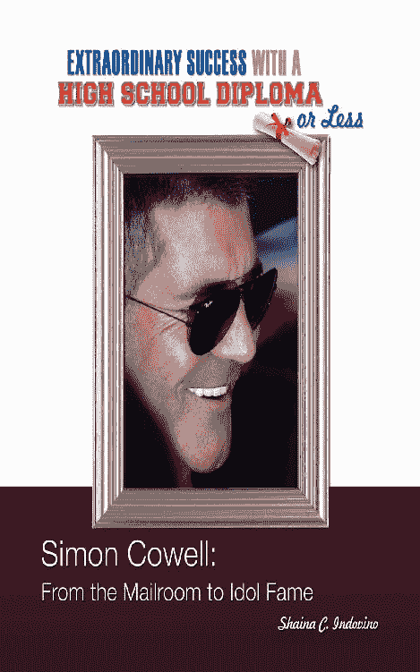
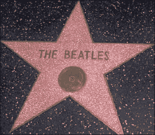
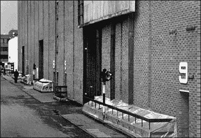
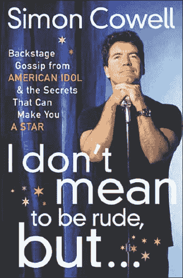
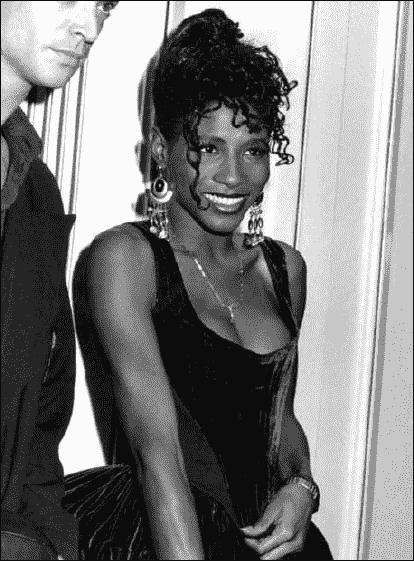
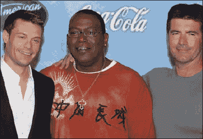
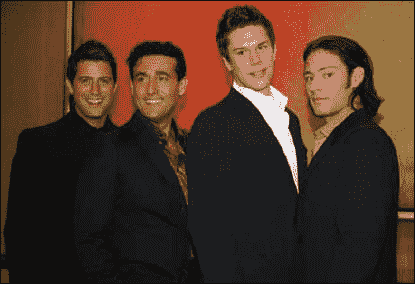
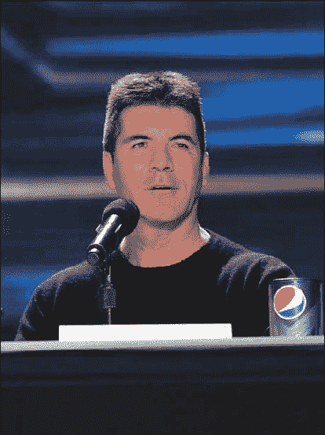
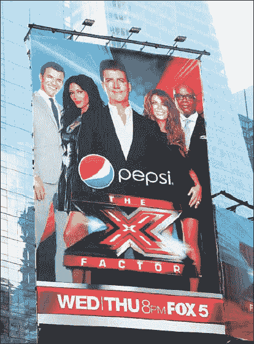
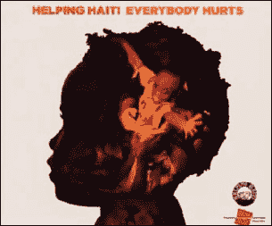

# 西蒙·考维尔：从邮件房到偶像成名（高中学历或更低学历的非凡成功）

- 珍妮弗·安妮斯坦：从《朋友记》到大电影
- 泰拉·班克斯：从秀台到电视屏幕
- 哈莉·贝瑞：从选美皇后到奥斯卡得主
- 詹姆斯·卡梅隆：从卡车司机到导演
- 西蒙·考维尔：从收发室到偶像之星
- 艾伦·德杰瑞斯：从喜剧俱乐部到脱口秀
- 米克尔·戴尔：从少年企业家到计算机大亨
- 史夫·乔布斯：从苹果到应用程序
- 瑞秋尔·雷：从糖果柜台到烹饪节目
- 罗塞尔·西蒙斯：从街头到音乐产业
- 吉姆·斯金纳：从汉堡到董事会
- 哈里·鲁曼：从农夫到总统
- 马克·扎克伯格：从脸到成名

## 西蒙·考维尔：从收发室到偶像之星

|  | Mason Crest370 Reed RoadBroomall, Pennsylvania 19008[www.masoncrest.com](http://www.masoncrest.com) |

`reality television`：真人秀是指基于真实人物生活或竞赛的节目，涉及的是真实人物而非演员。真人秀不使用剧本。

`record label`：唱片公司是指发现新艺人、与他们签署合同销售其音乐并推广该艺人信息的公司。

`borough`：行政区是城市的一个较小部分。通常，大城市由几个行政区组成。例如，纽约市就有五个行政区。

`song charts`：音乐榜记录哪些歌曲最畅销，并按销量进行排名。

2010 年 1 月 11 日（周一），西蒙·考维尔宣布他将离开《美国偶像》评委席，震惊了电视观众。这部真人秀节目自 2002 年首播以来，在美国取得了巨大的成功，当时它向美国观众介绍了言辞犀利的西蒙。《美国偶像》源自英国节目《流行偶像》，西蒙也是该节目的评委，《美国偶像》让西蒙·考维尔成为了国际明星，主要是因为他对音乐比赛参赛者的严厉批评。

西蒙帮助让了节目大红。“我想在今年离开《偶像》时，让比比更大更好，”他对电视评论协会协会。西蒙补充说，他对节目所取得的成就“非常自豪”。他有理由自豪；在西蒙担任评委期间，《美国偶像》已成为电视上受欢迎的节目之一。

然而，西蒙离开《美国偶像》并非毫无目的。他计划启动《英国偶像》的美国版，这是另一档他担任评委的英国真人秀竞赛。“我[我]不认为在美国同时做两个节目是对的，所以[我]决定离开一个并开始另一个，”他说。在《美国偶像》中工作了近十年后，西蒙准备好开始新事物的工作。“我们为《英国偶像》美国版的开播日期感到非常兴奋，并很高兴能继续与 Fox 合作，”西蒙说，“我们拥有极好的关系、棒的团队，大家都对此感到非常兴奋。”

取代西蒙对于《美国偶像秀》以及播映该节目的福克斯公司来说，将是一项巨大的挑战。当西蒙宣布他将离开这个极其成功的节目时，福克斯娱乐部门主席彼得·莱斯（Peter Rice）不想告诉记者谁将接替西蒙在《美国偶像秀》中的位置。谈到为节目寻找新评委时，莱斯说：“我们需要对这件事慢慢来。. . . 我们必须确保评委之间的化学反应尽可能地完美。”西蒙是《美国偶像秀》中一个独特的声，大学学位！，他往往是节目中最负面的评委，经常告诉参赛者那些他们不想听的话，对于福克斯来说，要找到能填补他空缺的人是非常的。

*西蒙为了音乐和电视领域的成功付出了巨大的努力，而且完全没有依靠*

尽管《美国偶像秀》是西蒙最大的成功之一，但这个节目只是他人生中过的许多精彩事情之一。西蒙的职业始于他父亲工作的唱片公司收发室，随后他很快成为了那里的高管。从那时起，他一直致力于与英国的艺术家合作创作热门歌曲，之后加入了英国电视节目《流行偶像》（Pop Idol）的阵容。西蒙在《美国偶像秀》中担任评委的角色让他更加有名，使能够在英国和美国参与更多项目。他帮助启动了诸如《英国导师》和《美国达人》等节目。在西蒙的帮助下，许多音乐界最大的巨星开启了自己的职业，包括凯莉·克拉克森、凯莉·安德伍伍德和克里斯·道特里。西蒙·考维尔在音乐和电视领域取得了成功，帮助他人成为明星，同时也通过镜头前幕的工作让自己成为了明星。

*在《美国偶像秀》和《英国导师》等节目中，西蒙因为有时对参赛者说出严厉的话而闻名。*

关于西蒙在英国和美国获得成功最令人惊讶的事实可能是，他这一切是在没有大学毕业的情况下完成的。在过去的几十年里，进入大学接受继续教育的高中生人数一直在上升。例如，在 2009 年，70%的高中毕业生在次年进入了大学。那可是很多人去上大学啊！对于许多高中生来说，毕业后上大学是他们职业道路上的下一步。。要成为一名科学家、律师、医生或老师，你需要拥有大学学位，而且可能还需要更高的学位（硕士或博士学位，以及学士学位）。

然而，上大学是一种选择，并不是适合每个人。取得成功并不总是需要大学学位，因为许多高中生能够在毕业后直接进入职场。有些人清楚地知道高中毕业后想做什么，他们已经准备好努力工作来实现自己的目标。找工作而不是上大学可能是非常有回报的，这可以让你在工作期间学习到许多重要的技能。

西蒙·考维尔没有上过大学；事实上，他甚至没有完成高中。他花了一些时间才找到自己的人生想做什么，但一旦西蒙下心投身于音乐行业，他就准备好为了实现目标而需要做的一切。无论你是否上大学，实现职业目标几乎没有什么捷径——这总是需要努力！

## 西蒙的早年生活

西蒙·菲利普·考维尔（Simon Phillip Cowell）于 1959 年 10 月 7 日出生于英国伦敦兰姆贝斯（Lambeth）区的冠军。西蒙和他的兄弟们像许多年轻人一样，被披头士的摇滚乐声所吸引。西蒙的哥哥托尼买了这首歌，很快，西蒙也请求母亲也为他买了一份。“这是我人生第一次对音乐感兴趣；我非常渴望拥有一张，”西蒙在他的自传中写道。“那段音乐中有些东西让我坐直身体并倾听。”作为后来将要在音乐领域取得巨大成功的人，这对西蒙来说是一个时刻。

*披头士启发了西蒙进入音乐事业。在西蒙童年时期，著名乐队对英国和美国的音乐产生了巨大影响。*

西蒙在寄宿学校读高中，青少年时期经常惹麻烦。在传记中，西蒙写道：“我讨厌学校的两个原因是纪律和无聊……我一直私自怀疑，学习牛顿定律对我的未来可能起不起什么大作用。我觉得可以说我是世界上最糟糕的青少年。”由于他的行为不好，西蒙从几所学校被开除。他在十六岁时决定辍学未毕业。

对于大多数人来说，完成高中对于他们寻找工作和开始职业非常重要。大多数辍学的人很难找到不需要高中学历的工作。西蒙来说很幸运，他的父亲埃里克富有且拥有许多人脉，这有助于他在离开学校后重新立足。

*西蒙的第一份工作之一是在埃尔斯特里工作室工作，西蒙参与了《闪光钻》的拍摄。*

在经历了几份没有持续多久的工作后，西蒙的父亲成功地在 EMI 音乐出版公司（EMI Music Publishing）为他找到了一份工作，那里是考威尔先生工作的公司。西蒙在 EMI 的邮件室工作；他的工作是确保进入公司的邮件能送到正确的人手中。

在自己的书籍《我并非无意无礼，但是……》（*I Don’t Mean to Be Rude, But...*）中，西蒙描写了自己的成长以及进入音乐行业的经历。

在 EMI 工作是西蒙在音乐行业的首次尝试，尽管他远远离录制歌曲或发掘新艺，更远离任何真正看起来像音乐销售业务。但很快，西蒙就开始从底层开始攀爬，没多久他就登上了音乐事业的顶端。

### 重点词汇

- `repertoire（曲目）`：艺术家的曲目是指他录制和表演过的歌曲集。
- `producer（制作人）`：制作人与艺术家合作录制歌曲。
- `signing（签约）`：当唱片公司签约一名艺术家时，公司同意销售该艺术者的音乐，而艺术家同意只与该公司合作制作音乐。
- `single（单曲）`：单曲是艺术家发行的一首歌曲，通常是专辑中的第一首歌。发行单曲是为了帮助推广该艺术家及其专辑。

对于许多高中辍学者来说，找到一份工作可能非常困难，甚至是不可能的。西蒙非常幸运，父亲在 EMI 唱片公司（EMI Records）为他找到了工作，那是全球最大的唱片公司之一。他确实是从一份很小的工作开始的，但这正是他进入音乐行业所需的机遇。

在邮件室工作对西蒙来说是一份好工作——特别是因为他没有真正的工作经验，没有高中学历，而且从未上过大学——但他并不是他想留下的地方。“从上班的第一天起，我就开始规划并策划通往行业顶端的道路，”他在自传中写道。

西蒙很快很快就离开了邮件室。然而，一年后，在父亲的帮助下，他回到了 EMI 音乐出版公司。西蒙成为了公司里一名 A&R（艺人与曲目）主管的助理。A&R 涉及为唱片公司寻找新艺人。西蒙担任了一段时间的助理，并一直为 EMI 寻找新人才，随后才开始担任制作人。

作为制作人，西蒙结识了皮特·沃特曼（Pete Waterman），他是著名的英国制作团队 Stock Aitken Waterman 的成员。西蒙学习了如何与皮特一起录制音乐，也学习了什么能成就一首伟大的歌曲和一位伟大的艺术家。

到 1985 年，西蒙准备好单闯了。他离开了 EMI，与他的老板埃利斯·里奇（Ellis Rich）一起创立了自己的音乐出版公司。他们将公司命名为 E&S Music。这家公司并不成功，西蒙在自传中写道，创立公司是一个错误。西蒙在新公司成立后不久就离开了，但他并未就此。

离开 E&S 不久，西蒙遇见了伊恩·伯顿（Iain Burton），两人创立了一家名为 Fanfare Records（号唱片）的唱片公司。西蒙来到 Fanfare 做 A&R 工作，就像他在 EMI 的时候一样。他为公司寻找新艺人，并签约了西妮塔（Sinitta），这是一位曾与名为 Hot Gossip 的女舞小组合作过的女歌手。该小组曾与伯顿和阿阿琳·菲利普斯（Arlene Phillips）合作（后者是伯顿管理的舞蹈家），随后与 Fanfare 合作发行了该公司的第一首歌。西妮塔正是 Fanfare 早期需要的艺术家，也是那种能帮助西蒙的 A&R 主管事业的艺术家。

西蒙知道自己可以把这位艺术家打造成明星，并帮助她录制金曲，但伯顿对新公司感到紧张。很快，他说服伯顿给了他几千美元来发行西妮塔的首支单曲《So Macho》。当这首歌发行时，它火了，获得了英国歌曲排行榜第二名。《So Macho》帮助 Fanfare 维持了经营，西妮塔随后在该唱片公司又出过几首热门歌曲。

编舞老师阿阿琳·菲利普斯帮助组成了 Hot Gossip，并与该小组及伯顿合作了多年。

西蒙通过英国流行歌手西妮塔取得了成功。两人还曾交往过。

尽管在 Fanfare Records 取得了早期成功，西蒙还是在 1989 年离开了公司。由于没有工作，他不得不回到父母家住。但西蒙并没有让他的音乐事业此结束，他在全球最大的唱片公司之一的 BMG 找到了工作。西蒙开始组建一个唱片厂，与 BMG 合作发行新艺人的音乐。再次，西蒙在寻找新人才，扮演着他在 EMI 和 Fanfare 担任的 A&R 主管角色。他将他的新标签命名为 S Records。

西蒙开始为他的厂牌签约新的艺人和团体，包括演唱组合 5ive 和西男华（Westlife）。西蒙还出了一个明智决定，发行基于热门电视节目和娱乐品牌的歌曲。S Records 发行的基于《恐龙战士》（Mighty Morphin’ Power Rangers）、《小宝贝布》（Teletubbies）和世界摔跤娱乐（WWE）的歌曲销量良好。

1999 年，西蒙既经历了职业生涯迄今为止最大的成就之一，也失去了帮助他开启这一切的父亲——他的父亲。

西蒙一直努力让他新签约的西男华获得成功，到 1999 年初，他的努力终于得到了回报。该组合的首支单曲《Swear It Again》于 3 月发行，迅速冲上英国排行榜冠军。西蒙对他组合的成功感到无比兴奋。《Swear It Again》不仅是西男华的首支冠军单，也是西蒙作为唱片公司高管的首支冠军单。从他们签约 S Records 开始，他就相信他们的潜力，知道他们能大红。西蒙的父亲对西男华在音乐领域的机遇也有同样的感受，所以西蒙想确保父母知道他的首支冠军单。

《Swear It Again》夺冠军当天，西蒙回家分享了这个消息。当西蒙联系英国的母亲时，他知道不对劲，但他太高兴告诉她自己的最新成就，所以一直在说。挂电话后，西蒙的母亲回了电话，告诉西蒙他的父亲埃因心脏发作去世了。西蒙对这个糟糕的消息心碎。

多年后，西蒙与口秀主持人皮尔斯·摩根（Piers Morgan）谈到了父亲去世的消息。西蒙忍着泪水说：

> “那不是……并不美好。但你必须面对它，你知道的，我回去意识到你的首要责任是照顾好妈妈。那是一段糟糕、糟糕、糟糕的时间，就像我所说的。你以为每个人都会永远活着，但他们并不会。你认为你在乎的一切东西，热门唱片之类的，完全毫无意义。”

在西蒙父亲去世前后，西男华在英国成为了一个巨大的流行组合。

西蒙（Simon）失去了他生命中重要的人之一。他的父亲一直陪伴在他身边，在他找不到其他工作时帮助他找工作，在他失去 Fanfare 公司的工作后帮助他重新开始，并对他所做的一切都充满信任。西蒙在同一天达到了职业生涯的巅峰，也经历了个人生活的低谷。在接后的几年里，西蒙在音乐界继续取得成功，特别是与西西家族（Westlife）合作，但学习如何应对父亲的去世需要多年时间。

## 从《偶像工厂》开始

2001 年，西蒙开始制作一个名为 `Pop Idol` 的新电视节目。该节目由一位名叫西蒙·富勒（Simon Fuller）的人创立，是一场唱歌比赛，获胜者由观众通过短信、电话或节目网站的投票来选出。节目每季的获胜者将获得一份唱片合约，希望这能让他们开启成功的音乐生涯。西蒙将担任节目的三位评委之一，对歌手的表演进行评论，并帮助他们在节目播出的期间每周都变得越来越好。`Pop Idol` 第一集于 2001 年 10 月 5 日在英国首播。该节目大获成功，在英国电视观众中变得极受欢迎。

当第一季结束后，排名前名的参赛者（威尔·杨 Will Young 和盖瑞·盖茨 Gareth Gates）与西蒙的 S Records 公司签了合同。这两个人在英国都取得了成功，获得过多首冠军歌曲。威尔·杨在 S Records 的第一首歌在发行的第一天就售出了超过 40 万张，第一周销量超过了一百万张。

在 `Pop Idol` 英国成功后，该节目扩展到了世界各国，并为每个国家专门创建了一个版本。节目保持了相同的格式：三位评委、观众投票以及同样的竞争风格。`Idol` 的本地版本在澳大利亚、希腊、马来西亚、加拿大、印度、新西兰、挪威、亚美尼亚、越南、法国、冰岛以及全球许多许多国家都流行了起来。

2002 年，美国版的 `Idol` 首次播出。该节目被简单地称为 `American Idol`（美国偶像），在福克斯频道播出。西蒙因在英国版中的受欢迎程度被聘请为这个新的美国节目的评委。他以犀利、刻薄的评论而闻名；在节目之后，他就成为了英国的名星。美国节目还有唱片制作人兼执行人兰迪·杰克逊（Randy Jackson）和歌手宝拉·阿布杜尔（Paula Abdul）担任另外两个评委席。万事俱备后，`American Idol` 注将在它的新家取得巨大成功。

## 第三章：`IDOL` 走向成功

### 重点词汇

- `album（专辑）`：专辑是艺术家歌曲打包在一起的集合。
- `timeslot（时段）`：在电视节目中，节目的时段是指该节目播出的时间。处于同一时段的节目会争夺观众。

`American Idol` 在进入美国之前已经在英国取得了成功。`Pop Idol` 在英国已成为一种现象，并开启了节目中两名决赛选手的歌艺生涯。到 2002 年中，该节目已经开始走向世界，而美国只是许多制作中的节目版本之一。随着西蒙加入美国版的评委团，该节目具备了许多让英国版如此受欢迎的元素，但这并不是保证之能成功的。此前很少有像这样的节目，即观众投票选出获胜者的电视才艺竞赛。但任何关于 `Idol` 是否会成功的疑虑，在节目 2002 年夏天在美首播后很快就被抛之脑后。

`American Idol` 于 2002 年 6 月 11 日首次播出时，只有少于 1000 万人收视了这场唱歌比赛。在第一季的最后一集中，有 2300 万人看了该节目。在歌手凯莉·克拉克森（Kelly Clarkson）赢得第一季冠军后，该节目在第二季变得更加受欢迎，在第二期间，凯莉凭借她的第一张专辑 `Thankful` 在 `album` 榜单上首秀登顶。通过让获胜者继续售卖专辑并开启成功的歌手生涯，该节目证明了这种模式的有效性，让参赛者们成为了明星。第二季的首播有 2600 万观众。3800 万人看了该季的决赛集，鲁本·斯塔达德（Ruben Studdard）在集集中被宣布为获胜者。该节目的排名从其 `timeslot` 的第 25 到 30 名跃升到了第三名。在接下来的几年里，该节目一直位列第一或第二，观众人数保持在 3000 万或以上。从第三季开始，`American Idol` 成为 18 至 49 岁人群中收视率第一的节目。

在此期间，西蒙因对参赛者的严厉批评而闻名。尽管一些人认为他对节目中的歌手很没礼貌，但许多人喜欢他不告诉他们他们想听的话。西蒙成为了许多 `American Idol` 粉丝特意收看节目的评委，等待着他口中接下来会说出什么。他会告诉那些他认为在音乐界无法生存的歌手停止唱歌，去寻找其他他们擅长的事。他会告诉人们他们的声音非常糟糕。当一位参赛者说她会辞职来参加节目选秀时，西蒙甚至开玩笑说她永远不会成功的。西蒙直言了见，他的这种直率使他在 `Pop Idol` 和 `American Idol` 中都成了一巨星。

*美国偶像主持人赛克斯特（Seacrest）、评委兰迪·杰克逊和西蒙并不总是意见一致，但得益于这个节目，他们分享了许多成功。*

西蒙在两个节目中的评论经常以这样开头：“我不是没礼貌，但是……”然后对节目选手的歌声、外表或表演进行严厉批评。这个短语与西蒙联系得如此紧密，以至于他将其作为 2003 年自传《I Don’t Mean to Be Rude, But. : Backstage Gossip from American Idol & the Secrets That Can Make You a Star》的标题。

`American Idol` 取得了巨大的成功，让西蒙在美国成为了明星，但也为节目参赛者创造了明星。许多 `American Idol` 的获胜者后来在音乐领域取得了成功的职业，其中一些人售出了数百万张专辑并成为了名人。虽然在 `Idol` 之后有些人比其他人更成功，但许多 `American Idol` 的参赛者利用了节目给他们的机会。

*乡村巨星凯莉·安德伍德（Carrie Underwood）只是来自《美国偶像》的众多歌手之一*

`Idol` 第一季的冠军凯莉·克拉克森（Kelly Clarkson）一直一直是节目中最成功的参赛者之一。凯莉的第一张专辑 `Thankful` 于 2002 年发行并取得了巨大的成功。截至目前，这张专辑已售了两百万张。她的第二张专辑 `Breakaway` 巩固了凯莉作为音乐新星的地位。这张专辑在美国售出了超过六百万，并帮助凯莉获得了两个格莱美奖。她的热门单曲“Since U Been Gone”曾获得美国 `Billboard` 单榜第二。凯莉第三张专辑 `My December` 在发行的第一周销量仅不足 30 万张。

凯莉·安德伍（Carrie Underwood）赢得了《美国偶像秀》第四季，从那以后她成为了乡村音乐界最大的明星之一。她的首张专辑《Some Hearts》在乡村专辑排行榜上首空冠军，仅在一周内就售出了超过 30 万张。在她夺冠后的一个季节甚至回到了《美国偶像秀》，演唱了她的热门歌曲《耶稣掌舵》（Jesus Take the Wheel）。《Some Hearts》销量已突破百万张，为凯莉赢得了多首热门单曲和许多奖项，包括 `Billboard` 音乐奖的年度专辑。凯莉的下一张专辑——2007 年的《Carnival Ride》延续了她的成功，让这位歌手赢得了她的首张冠军专辑，单周销量超过 50 万张。到目前为止，《Carnival Ride》在美国销售的销量已超过 300 万张。凯莉的第三张专辑《Play On》也大获成功，像《Carnival Ride》一样在排行榜上首空冠军。在不到两年的时间内，这张专辑的销量就接近 200 万张。

克里斯·道特里（Chris Daughtry）没有赢得《美国偶像秀》，但在离开节目后，他仍然成为了摇滚乐最成功的歌手之一。凭借他的乐队 `Daughtry`，克里斯售出了数百万张专辑，并拥有许多热门歌曲。该乐队的首张专辑《Daughtry》在第一周就售出了 30 万张。这张专辑还催生了《It’s Not Over》、《Home》、《Over You》和《What About Now》等热门单曲。《Daughtry》在美国的销量已超过 400 万张。该团的第二张专辑名为《Leave This Town》，于 2009 年发行，销量已突破百万张。

尽管凯莉、凯莉和克里斯是最成功的《美国偶像秀》选手，但鲁本·斯塔德（Rubben Studdard）、克莱·艾肯（Clay Aiken）、Fantasia Barrino、Jordin Sparks、David·库（David Cook）、David·阿丘莱塔（David Archuleta）、克里斯·艾伦（Kris Allen）和亚当·兰伯特（Adam Lambert）也都拥有精彩的音乐生涯。《美国偶像秀》让他们成为了明星，但他们在节目结束后都开辟了自己的道路，努力工作让那些在节目中投票给他们的人感到自豪。

2002 年，西蒙成立了一家可以同时从事音乐和电视业务的新公司。他将这家公司命名为 `Syco`。作为西蒙新公司的唱片部门，`Syco Music` 在 `BMG` 下，西蒙曾在 `S Records` 与其合作。西蒙在他的新厂牌获得的首批大成功之一是 2004 年的歌唱组合 `Il Divo`。

*在西蒙的帮助下，Il Divo 巡遍世界并售出了数百万唱片。*

2001 年，西蒙产生了组建一个国际古典歌手组合的想法，因为他感觉到人们对古典音乐和歌唱变得越来越感兴趣。他开始在全球范围内寻找歌手加入组合，认为拥有来自世界不同国家的歌手将使组合具有最广泛的吸引力。西蒙对歌手的寻找在 2004 年结束，当时他找到了组合的第四也是最后一位成员。`Il Divo` 的成员包括西班牙人卡洛斯·马林（Carlos Marín）、美国人大卫·米勒（David Miller）、瑞士人厄斯·比希勒（Urs Bühler），以及法国流行歌手塞巴斯蒂·伊尚巴德（Sébastien Izambard）。该组合在 0004 年录制了他们的首张专辑并在全球范围内推广。这张名为《Il Divo》的专辑获得了巨大成功，位列英国排行榜冠军。`Il Divo` 在《奥普拉·温妮瑞秀》上表演了他们的歌曲《Regresa a Mi》，帮助他们在美国更加受欢迎。在全球范围内，`Il Divo` 的首张专辑销量数百万，成为西蒙 `Syco Music` 最早的成功案例之一。

*西蒙有很多批评者，但他反击时的话语和攻击时一样犀利！*

## 第四章：拓展领域

### 重点词汇

- `mentor`（导师）：导师是指提供建议并帮助引导他人的人，通常是某个特定领域中较年轻或经验较少的人。

随着《美国偶像秀》达到了其他节目难以企及的高度，西蒙准备好开始投入其他项目。他意识到将音乐与电视相结合是一个获胜策略，因此他着手创作了其他类似于 `Idol` 的电视节目。`Idol` 的竞争元素使该节目成为必看事件，观众收视是为了看他们喜爱的人争夺冠军位置。此外，`Idol` 让观众看到普通人展示才华并讲述自己的故事。粉丝喜欢与特定选手产生共鸣并了解更多关于他的生活。西蒙明白这是 `Idol` 在全球成功的关键之处，因此在他旗下的 `Syco Television` 公司准备了电视节目，继续展示普通人的才华。

### X 因素（The X-Factor）

2004 年，在英国播出《Pop Idol》的电视频道邀请西蒙的公司 `Syco Television` 创作一个新的歌唱比赛节目。西蒙创作了一个名为 `The X-Factor`（X 因素）的节目。该节目的格式与 `Idol` 系列非常相似，即有三位评委观看从公开海选中选出的歌手相互竞争以争夺冠军位置。与 `Idol` 不同，每位进入决赛的歌手都会被分配一位评委作为他们的 `mentor`（导师），随后评委将帮助改进表演。每个赛季的冠军都会获得唱片合约，通常与西蒙的 `Syco Music` 签约。西蒙是英国版本的评委，就像他在 `Pop` 和《美国偶像秀》中一样。

正如 `Idol` 一样，世界各国也采用了 `X-Factor`。澳大利亚、捷克、智利、意大利、西班牙、波兰、尼日利亚都有 `X-Factor` 节目。

### Talent 秀

2005 年，西蒙创作了另一个名为 `Got Talent` 的才艺节目。该节目类似于他之前的节目 `X-Factor`，但将歌唱比赛扩展到了各种才艺。无论选手擅长什么都可以带到 `Got Talent`，无论是唱歌、舞蹈、讲笑话还是其他。最初，英国喜剧演员兼口秀主持人保罗·奥格瑞（Paul O’Grady）准备主演该节目的英国版，节目名为《Paul O’Grady’s Got Talent》。然而，由于保罗在那年离开了电视台，`Got Talent` 的英国版被推迟了。相反，西蒙在美国推出了该节目，命名为 `America’s Got Talent`（美国达人秀）。

*歌手莉娜·刘易斯（Leona Lewis）是英国版《英国偶像秀》的首位冠军。如今，她已成为全球巨星。*

## 西蒙造就的新星

正如《美国偶像秀》将选秀者培养成明星一样，西蒙的其他节目也让那些只需要一个机会的普通人成为了明星。

2006 年，歌手莉娜·刘易斯参加了英国版 `The X-Factor` 第三季的选秀。在参加节目期间，西蒙担任了莉娜的导师，她最终赢得了当年的比赛。西蒙将她签约在自己的唱片公司 `Syco Music`，她开始制作她的首批录音作品。她的首支单曲销量超过五十万张，并在英国歌曲排行榜上蝉联榜首了一个月。

2008 年，一位四十多岁的苏格兰歌手在《英国达人秀》（`Britain’s Got Talent`）出现震惊了世界。苏珊·鲍尔（Susan Boyle）在节目中为评委演唱了《我曾梦想一个梦》（I Dreamed a Dream），并让他们大为惊叹。她表演的 YouTube 视频被全球数千万人观看，她瞬间成为了一红歌星。西蒙给她签了一份 `Syco Music` 的合同，她的首张专辑《礼物》（`The Gift`）在单周内销量突破了 30 万张。

## 其他新节目

在西蒙因《Pop》和《美国偶像秀》评委而成名后，《达人秀》和《X-Factor》系列并不是他参与的全部。他还致力于创作和制作了其他几个节目，继续将音乐与电视相结合，并将普通人带到评委面前，让他们有机会用才华惊艳世界。

*《X-Factor》在美国的成功，正如《Pop Idol》作为《美国偶像秀》那样成功。*

2006 年，西蒙制作了一部名为《美国发明家》（`American Inventor`）的节目，节目让来自各地的发明家向评委展示他们的创作，由评委选出最佳、最实用的发明。评委们是商人和发明家，希望从节目中展示的发明中发现下一个大热门。商人彼得·琼斯（Peter Jones）根据日本的一档节目创作了《美国发明家》，该节目允许发明家向成功的商人士推销他们的创意。

西蒙在 2006 年还创作了一部名为《名人对唱》（`Celebrity Duets`）的节目。该节目将成对的名人（一位歌手和一个非歌手）聚集在一起，为评委演唱歌曲，每周有一位参赛者被投票淘汰出节目。喜剧演员韦恩·布拉迪（Wayne Brady）主持该节目，该节目与《美国偶像秀》一样，在福克斯频道（Fox）播出。

西蒙似乎擅长创作人们想看的节目，并与那些人们想听的艺人签约。无论他从事什么工作，他都能找到让其成功的方法。通过结合电视和音乐，西蒙找到了成功和成名的获胜公式。他创作了许多新的热门电视节目，而这些节目帮助开启了许多新晋歌星的职业生涯。

### 重点词汇

- `尼尔森收视率（Nielsen ratings）`：尼尔森收视率衡量观看任何电视节目人数的方法。尼尔森媒体研究创建了这一收视率系统。
- `致敬（tribute）`：向重要人物致敬的方式。

在《美国偶像秀》期间，西蒙帮助该节目取得了成功，并在过程中成为了明星。他还致力于创作其他节目，在电视领域取得了与他在音乐业务领域相当的成功，甚至更多。他创作的节目深受全球观众欢迎，并帮助巩固了西蒙作为娱乐行业专家的地位。但到 2010 年，西蒙是时候离开这档让他成名并在美国带给他如此巨大成功的节目了。

### 《美国偶像秀》的变化

2010 年 1 月，西蒙宣布《美国偶像秀》第九季将是他在该节目的最后一次亮相。他说他已经准备好离开，并开始制作他在英国创作的同类节目——`The X-Factor` 的美国版。这个消息让许多多年一直看着西蒙作为主要亮点之一的节目的“偶像”粉丝感到意外。对于某些观众来说，很难想象没有西蒙·考维尔担任评委的《美国偶像秀》。一年前，歌手保拉·阿布尔（Paula Abdul）离开了节目，由喜剧演员兼脱口秀主持人艾伦·迪格瑞斯（Ellen Degeneres）取代。节目还增加了音乐高人和词作家卡拉·迪奥加迪（Kara DioGuardi），使评委人数变为四位。但随着西蒙的离开，节目需要做出重大调整以保持粉丝的兴趣。没有西蒙的第一季将是第十季，届那时，粉丝们期待这个热门节目能带来新花样。

为了让粉丝开心，节目请了新评委。《美国偶像秀》粉丝喜欢的兰迪·杰克逊（Randy Jackson）留在了第十季，但艾伦和卡拉离开了节目。取代西蒙、艾伦和卡拉的是歌手詹妮弗·洛佩斯（Jennifer Lopez）和摇滚乐队史密斯乐队的主唱斯蒂芬·泰勒（Steven Tyler）。节目回到了只有三位评委。

尽管西蒙离开了节目且评委阵容发生了多次变化，《美国偶像秀》仍然是历史上最成功的电视节目之一。根据 `尼尔森收视率`，该节目的观众人数超过美国历史上任何其他节目。此外，该节目是唯一连续六年保持在该时段收视率第一的节目。

在离开《美国偶像秀》之前，西蒙致力于将他的英国节目 `X-Factor` 引入美国。当他宣布离开《偶像秀》时，他也宣布了他的新节目的启动，这是他的公司在多年前帮助创作的。该节目的美国版于 2011 年 9 月在福克斯频道（Fox）首，这是将《偶像秀》引入美国电视的频道。《X-Factor》的美国版大获成功，成为西蒙系列作品的另一个热门。他曾计划同时参与美国和英国版的 `X-Factor`。然而，在 2011 年初，记者证实西蒙将不再担任英国版的每周评委，而是专注于美国版，并仅在幕后参与英国版。2010 年底，西蒙还签约了继续担任《英国达人秀》的评委。

在他在电视上创作新项目的同时，西蒙的个人生活也发生了变化。2010 年 2 月，西蒙向他的女朋友梅根（Mezghany）求婚。她答应了，两人订了婚。当他们相遇并恋爱时，梅根是《美国偶像秀》片场的一名化妆师。

许多人认为西蒙很无礼甚至很刻薄，他自己也是第一个承认这一点的人——但他同时也关注如何确保利用自己的成功来帮助他人。

西蒙参与了许多慈善事业。他曾与 `PETA`（动物伦理对待协会组织）合作创作广告，警告不要将宠物遗留在炎热的车内，并反对穿皮草。其中一张广告有一张西蒙抱着狗的照片，上面写着：“如果你不想穿你的狗，请不要穿任何皮草。”西蒙还参与了致力于儿童健康的慈善机构，确保患儿能得到最好的照顾。众所周知，他在制作 `X-Factor` 期间会邀请来自儿童医院协会（`Association of Children’s Hospices`）的孩子来到后台。

2010 年，英国首相戈登·布朗邀请西蒙与著名歌手和音乐家合作录制一首歌，以帮助 2010 年 1 月海地地震的受害者。销售这首歌所所得的资金将捐给致力于重建海地和帮助受灾影响的人的慈善机构。西蒙非常乐意通过这首单曲帮助海地人民。他选择了 R.E.M. 乐队的歌曲《每个人都在痛苦》（Everybody Hurts），并邀请了名星歌手演唱。来自英国和美国的歌手参与了这首歌的录制，其中包括许多由西蒙帮助开启职业生涯的明星。莉娜·刘易斯（Leona Lewis）、苏珊·鲍尔（Susan Boyle）以及流行组合动力（Westlife）的成员都为这首《帮助海地》单曲贡献了歌声。米莉·赛勒斯（Miley Cyrus）、詹姆斯·布伦特（James Blunt）、迈克尔·布布布（Michael Buble）、约翰·邦·乔治（Jon Bon Jovi）、玛丽亚·凯莉（Mariah Carey）、罗比·威廉姆斯（Robbie Williams）和凯莉·米诺格（Kylie Minogue）也参与了演唱。这首歌大获成功，在一周内销量就近五十万份，并登上了英国流行歌曲榜首。《每个人都在痛苦》的慈善版在世界范围内也广受欢迎，包括爱尔兰、澳大利亚、德国、新西兰、瑞士、西班牙和加拿大等国家。最重要的是，这首歌赚取的资金直接帮助了海地人民。

*在 2010 年海地地震后，西蒙努力组织了慈善单曲《每个人都在痛苦》。*

## 依然成功

今天，西蒙·考维尔（Simon Cowell）比以往任何时候都要成功。在制作了史上最成功的电视节目之一《美国偶像》（American Idol）后，西蒙正在扩展业务，涉涉电视和音乐领域的其他项目。他参与了音乐界一些顶级巨星的创造，并制作了过去十年中一些受欢迎的电视节目。

西蒙的成功源于他努力工作的动力以及他直言不讳的态度。尽管他的批评性评论可能让他看起来很刺人，甚至不受欢迎，但西蒙明白音乐行业可能和他对选秀节目选手说的话一样严酷。他尖锐的舌头帮助他在电视上走红，成为一个人们“爱又恨”的人物，尽管西蒙的粉丝尊重他的判断，将其视为来自深谙娱乐行业人士的建议。

西蒙告诉《商业周刊》（Business Week），要在业务上取得成功，“努力工作、保持耐心，并在学习业务时像海绵一样吸收”至关重要。他继续说道：“学会如何接受批评。遵循你的直觉，不要妥协。”西蒙确实证明了自己拥有实现目标所需的动力，特别是在他没有高中毕业就开始职业生涯时。西蒙明智决策源于他在音乐行业的多年经验，以及对娱乐是一门生意的理解。“我一直把音乐业务看作一门生意来做，”他告诉《商业周刊，“无论是在制作电视节目还是签约艺人，你必须用脑子而不是感情——我就是这样经营我的生意的。”

很少有人能说自己做得像西蒙那样多，或者取得了同等水平的成功。在《每日电报》（Daily Telegraph）2008 年英国文化 100 位最有影响力的人物名单中，西蒙排名第六。2010 年，《时代》杂志将西蒙选为世界 100 最有影响力的人物之一。《美国达人秀》（America’s Got Talent）主持人尼克·坎（Nick Cannon）在杂志上为西蒙写了一篇致敬信。西蒙在电视上并不总是是最亲和的人，但毫无疑问，他达到了许多人梦以求的高度。

而且这一切都是他在没有上大学的情况下实现的！

*梅兰妮·阿罗（Melanie Amaro）在 2011 年获得了美国版 X Factor 的第一赛季冠军。*

## 你可以期待什么？

当然，不是每个跳大学的人都会成为名人或百万翁。但对于那些选择不同于大学路线的人，还有其他更普通的工作。以下是只有高中学历的人可以从事的 100 份高薪工作中，你可以预期的收入。（如果你不确定某些工作是什么，可以在互联网上查询以获取更多信息。）请记住，这些是平均工资；初级工作者的收入可能少得多，而拥有多年经验的人可能会多得多。此外，请记住，同一工作的工资在国家不同地区会有所不同。

| 职位 | 平均年薪 |
| :--- | ---: |
| 旋转钻井工人（石油与天然气） | $59,560 |
| 商业潜水员 | $58,060 |
| 铁路列车长与场长 | $54,900 |

| 职业 | 薪资 |
| :--- | :--- |
| 化化工厂及系统操作员 | $54,010 |
| 房地产销售代理 | $53,100 |
| 地铁与电车操作员 | $52,800 |
| 邮政服务文员 | $51,670 |
| 桩机操作员 | $51,410 |
| 铁路制动、信号及道岔操作员 | $49,600 |
| 砖瓦工与方石工 | $49,250 |
| 邮政递员 | $48,940 |
| 游戏监员 | $48,920 |
| 邮政邮件分拣员与处理员 | $48,260 |
| 气体压缩机及气体泵站操作员 | $47,860 |
| 顶板锚工（矿业） | $47,750 |
| 森林火灾员 | $47,270 |
| 私家侦探 | $47,130 |
| 抽水工人 | $46,880 |
| 连续采矿操作员 | $46,680 |
| 铁路车辆修理工 | $46,430 |
| 穿梭车操作员 | $46,400 |
| 轨道铺设及维护操作员 | $46,000 |
| 化学设备操作员 | $45,100 |
| 爆炸药品处理工人及爆破员 | $45,100 |
| 爆炸药工人 | $45,030 |
| 舞台化妆师 | $45,010 |
| 金属工人 | $44,890 |
| 园林维护工人 | $44,080 |
| 采矿机器操作员（地下） | $43,970 |
| 粗木工 | $43,640 |
| 井架操作员（石油与天然气） | $43,590 |
| 空乘 | $43,350 |
| 炼金属炉操作员及维护员 | $43,310 |
| 铺毯安装工（除井头泵水工） | $43,310 |
| 生产计划与调度员 | $43,260 |
| 矿井切割操作员 | $43,120 |
| 纸板与模具师 | $42,940 |
| 服务单元操作员（石油与天然气） | $42,690 |
| 瓷工与大理石铺设工 | $42,500 |
| 纸张工人 | $42,450 |
| 锁匠与保险箱修理工 | $42,310 |
| 起重与卷葫操作员 | $41,630 |
| 铺毯工 | $41,620 |
| 泵操作员（除井头泵水工） | $41,560 |
| 灰泥工与饰面工 | $41,360 |
| 抹灰工与灰泥石工 | $41,260 |
| 油漆工（交通设备） | $41,220 |
| 汽车车身修理工 | $41,020 |
| 危险材料清除工人 | $40,270 |
| 法官 | $40,240 |
| 井头泵水工 | $40,210 |
| 机械维护工人 | $39,570 |
| 重型卡车司机（挂车） | $39,260 |
| 地面铺设者（除地毯、木和硬瓷） | $39,190 |
| 零售销售经理 | $39,130 |
| 货运代理 | $38,940 |
| 熔炼炉操作员及维护员 | $38,830 |
| 挖掘与装载机器及挖掘铲机操作员 | $38,540 |
| 分离、过滤、蒸馏机器操作员 | $38,450 |
| 动力艇操作员 | $38,390 |
| 疏浚机操作员 | $38,330 |
| 样板工人（金属与塑料） | $38,240 |
| 森林火灾检查员与预防专家 | $38,180 |
| 医学及临床实验室技术员 | $37,860 |
| 轮胎制造工人 | $37,830 |
| 技牙科实验室技术员 | $37,690 |
| 铺路、表面及压实设备操作员 | $37,660 |
| 海军员与海上注油工 | $37,550 |
| 调度员（警察、火警及救护车除外） | $37,310 |
| 管道铺设者 | $37,040 |
| 辅助工人（采矿工人） | $36,870 |
| 旋转机器设置工、操作员及维护员 | $36,670 |
| 焊接工、切割工及焊装工 | $36,630 |
| 锡焊工与钎工 | $36,630 |
| 宝石与钻石工人 | $36,620 |
| 警察、消防员及救护车调度员 | $36,470 |
| 模特 | $36,420 |
| 表表员（公用事业） | $36,400 |
| 机械门修理工 | $36,270 |
| 公共广播系统及其他播音员 | $36,130 |
| 铁路场工程师、小型机车操作员及搬运工 | $36,090 |
| 公交车司机（交通及城际） | $35,990 |
| 保险单处理文员 | $35,740 |
| 保险理赔办事员 | $35,740 |
| 计算机控制机床操作员（金属和塑料） | $35,570 |
| 许可证办事员 | $35,570 |
| 法院书记员 | $35,570 |
| 伐木工 | $35,570 |
| 化粪池维护工及下水道管道清洁工 | $35,470 |
| 停车执法人员 | $35,360 |
| 高速公路维护人员 | $35,310 |
| 地板打磨工及精光工 | $35,140 |
| 工具磨光工、锉工及磨刀工 | $35,110 |
| 纸制品机器设置员、操作员及维护员 | $35,040 |
| 打印机操作员 | $35,030 |
| 检查员、测试员、分拣员、采样员及称重员 | $34,840 |
| 浇注工及铸造工（金属） | $34,760 |
| 贷款面试官及文员 | $34,670 |
| 炉、窑、烤箱、干燥机及水壶操作员及维护员 | $34,410 |
| 休闲车服务技术员 | $34,320 |
| 油气工人（石油和气体） | $34,190 |

来源：劳工统计局，美国劳工部，2008 年。

## 了解更多

### 书籍中

Cowell, Simon. *我不是要无礼，但是……：来自《美国偶像秀》的后台八卦与能让你成星的秘密*。纽约：Broadway Books, 2003 年。

Cowell, Tony. *西蒙·考维尔的秘密日记*。伦敦：JR Books, 2009 年。

Newky-Burden, Chas. *西蒙·考维尔：非授权传记*。伦敦：Michael O’ Mara Books, 2009 年。

### 网上资源

Simon Cowell 的国际电影数据库页面

[www.imdb.com/name/nm1101562/bio](http://www.imdb.com/name/nm1101562/bio.html)

People.com 的 Simon Cowell 传记

[www.people.com/people/simon_cowell/biography](http://www.people.com/people/simon_cowell/biography.html)

Simon Cowell 传记

[www.biography.com/articles/Simon-Cowell-10073482](http://www.biography.com/articles/Simon-Cowell-10073482.html)

Simon Cowell——音乐巨头、万​​富翁

[www.entrepreneurs.about.com/od/famousentrepreneurs/p/simoncowell](http://www.entrepreneurs.about.com/od/famousentrepreneurs/p/simoncowell.html)

### 免责声明

本页列出的网站在出版时处于活跃状态。出版者对自出版日期更改地址或停止运营的网站不负责。出版者将在每次重印时审查并更新这些网站。

## 索引

A&R（艺人与制作）22, 23, 25

Abdul, Paula 29, 33, 50

专辑 21, 31, 32, 34-37, 39, 45

儿童医院协会 52

披士士 15

地区 9, 14

Clarkson, Kelly 13, 32, 35

竞赛 9, 10, 28, 31, 32, 41, 42, 45, 54

录音室 17

EMI 音乐 17, 18, 21, 22, 25

粉丝 22, 25, 26, 35, 52

海地 52, 53

哈廷 23

King, Stephen 17, 41, 42, 45

尼尔 49, 50

Ozbourne, Ozzy 44

人们 51, 50

制作人 9, 10, 11, 12, 15, 16, 18, 20, 21, 22, 23, 24, 25, 26, 27, 28, 29, 30, 31, 32, 33, 34, 35, 36, 37, 38, 39, 40, 41, 42, 43, 44, 45, 46, 48, 49, 50, 51, 52, 53, 54

单曲 21, 25, 26, 35, 36, 45

歌曲 9, 10, 11, 12, 15, 16, 18, 20, 21, 22, 23, 24, 25, 26, 27, 28, 29, 30, 31, 32, 33, 34, 35, 36, 37, 38, 39, 40, 41, 42, 43, 44, 45, 46, 48, 49, 50, 51, 52, 53, 54

Syco 36, 39, 42, 45, 51

*The Cosby Show* 50

times 31, 32, 35, 50

World Wrestling Entertainment (WWE) 25

## 图片制作

`part0004.html_credits`

Aaron Settilane, `Dreamstime.com`: 33

Broadway Books: 18

Carrienelson, `Dreamstime.com`: 8, 30, 40, 43

Damslattery: 16

David Fowler, `Dreamstime.com`: 24

Imagecollect, `Dreamstime.com`: 27

Luckydoor I `Dreamstime.com`: 15

Mira Argon: 46

Sbukley, `Dreamstime.com`: 11, 12, 20, 38, 44, 48, 54

Sry85: 37

Syco Music: 52

the_diet_starts_monday: 34

Wolfgang Webster: 23

## 关于作者

`part0004.html_author`

Shaina Carmel Indovino 是一位住在纽约州内斯康特的作家和插画师。她毕业于宾明汉顿大学，获得了社会学和英语学位。
