# 软件工程的简单统计方法：数据与模式

## 来自 AUERBACH PUBLICATIONS 和 CRC PRESS 的其他图书

- 项目与复杂性
  Francesco Varanini
  ISBN: 978-1-4665-0279-6

- 项目群管理领导力：打造成功的团队动力
  Mark C. Bojeun
  ISBN: 978-1-4665-7709-1

- 项目管理概念、方法与技术
  Clause H. Maley
  ISBN: 978-1-4665-0288-8

- 运用有效项目交付的指导原则
  Kerry R. Wills
  ISBN: 978-1-4665-8789-2

- 可持续项目、项目群与项目组合的新三重约束
  Gregory T. Haugan
  ISBN: 978-1-4665-0518-6

- 从项目到项目群：项目经理的旅程
  Sami Penkar
  ISBN: 978-1-4665-9181-3

- 项目群管理：生命周期方法
  Ginger Levin
  ISBN: 978-1-4665-1687-8

- 实施项目群管理：与《项目群管理标准》（第三版）一致的模板和表格
  Ginger Levin
  ISBN: 978-1-4665-9771-6

- 完整的项目管理办公室手册（第三版）
  Gerard M. Hill
  ISBN: 978-1-4665-6631-6

- PMP® 考试挑战！第六版
  J. LeRoy Ward and Ginger Levin
  ISBN: 978-1-4665-9982-6

- 成功的项目群管理：复杂性理论、沟通与领导力
  Wanda Curlee
  ISBN: 978-1-4665-6879-2

- PgMP® 考试练习测试与学习指南（第四版）
  Ginger Levin and J. LeRoy Ward
  ISBN: 978-1-4822-0135-2

- 建筑项目群管理
  Joseph Delaney
  ISBN: 978-1-4665-7504-2

- PgMP® 考试挑战！
  Ginger Levin and J. LeRoy Ward
  ISBN: 978-1-4822-0208-3

- 可持续项目群管理
  Gregory T. Haugan
  ISBN: 978-1-4665-7516-5

- PMP® 考试练习测试与学习指南（第九版）
  Ginger Levin and J. LeRoy Ward
  ISBN: 978-1-4822-0224-3

- 领导虚拟项目团队：将领导力理论与沟通技巧应用于21世纪组织
  Margaret R. Lee
  ISBN: 978-1-4665-7688-9

- 赋能项目团队：利用项目追随力提升绩效
  Marco Sampietro
  ISBN: 978-1-4822-1755-1

- 富有创意、高效且有效的项目管理
  Ralph L. Kliem
  ISBN: 978-1-4665-7692-6

- PfMP® 考试练习测试与学习指南
  Ginger Levin and J. LeRoy Ward
  ISBN: 978-1-4822-5100-5

## 前言

本书向伟大的统计学家、学者和教师致敬，他们的思想在本书的不同语境中被广泛引用。这些智慧结晶让我们得以将本书与科学、知识和工程学的演进联系起来。尽管市面上有许多统计学书籍，但专门致力于将统计方法应用于软件工程的书籍却很少。纯粹的教科书提供学术性的论述，而实践者需要基本的理解和应用知识。很少有统计书籍能为软件工程师提供应用知识。近二十年来，我们一直致力于弥合这一差距，并最终撰写了本书。

统计方法通常在六西格玛、能力成熟度模型集成（`CMMI`）、建立能力基线和构建过程性能模型的背景下讨论。在`CMMI`审核员的推动下，这些实践已成为严重依赖自动化统计包的例行仪式，而这些统计包很少被真正理解。我们一直在推广基于`Excel`的统计解决方案，并提出了实用解决方案，例如本书中所实现的那些。

> “统计学是科学的语法。”
>
> 卡尔·皮尔逊

我们也认识到，复杂的统计并非解决问题的理想方法。更简单的技术提供了简单易行的解决方案，能够与问题解决者的直觉相连接。尽管复杂的技术听上去令人印象深刻，但仅仅停留在学术层面；而更简单的技术则灵活多变，能够轻松触及问题的根源。在本书中，我们有意识地选择了更简单的工具，并简化了几种标准技术。

本书介绍的技术在我们看来是软件工程师和管理者所需的最基本的智力工具集合。只有采集数据并使用这些统计方法，真正的软件工程才能实现。而且，只有管理者掌握了这些技术，过程的统计管理才可能实现。

在软件工程背景下学习这些技术，必定有助于初出茅庐的工程师和新员工。本书提供的示例将使他们对软件工程和管理有深入的洞察。

本书可作为培训不同层次软件工程师和管理者的全面指南。对于收集数据并创建模型的质量专业人员来说，本书将是非常宝贵的资产。

本书还向有志于工程学的毕业生展示实际软件工程问题和解决方案，让他们为行业做好准备。

总体而言，本书是专业人员利用数据进行客观思考的指南。它将帮助他们挖掘数据并提取意义。书中提供的一些技术是极好的预测工具，能为应用它们的人提供前瞻性洞察。

> `MATLAB®` 是 `The MathWorks, Inc.` 的注册商标。如需产品信息，请联系：
>
> `The MathWorks, Inc.`
>
> `3 Apple Hill Drive`
>
> `Natick, MA 01760-2098 USA`
>
> 电话：`508 647 7000`
>
> 传真：`508-647-7001`
>
> 电子邮件：`info@mathworks.com`
>
> 网址：`www.mathworks.com`

## 致谢

如果没有来自多位软件专业人士、质量经理和项目经理的富有成效的反馈，本书将无法成为现实。这些反馈源于他们接受我们的培训和咨询服务。我们还感谢软件过程改进网络（`SPIN`）通过其在印度的各个分会展示了其中一些概念，以尝试传播这些方法。我们接触过的所有`SPIN`协调员都提供了出色的应用建议。

我们感谢那些与我们分享度量问题以供分析和解决的组织。他们最终为我们提供了研究机会，帮助我们获得了更深入的知识。我们还感谢许多与我们互动并在数据挖掘和人工神经网络领域接受我们研究支持的研究学者。

我们感谢印度许多院校的教授和通讯员帮助我们与学生互动。我们还感谢项目管理协会（`PMI`）分会和项目管理学院，他们给了我们向管理者展示定量技术的机会。

`Rathna`和`Samuel`通过对第8章进行了精彩的评审和批评，提供了帮助。`Swaminathan`通过审阅第21章并提出宝贵建议，为本章做出了贡献。`Shanti Harry`帮助我们整理参考文献和推荐阅读。我们感谢所有这些好心人。

最后，我们感谢`John Wyzalek`先生，他给予了我们精神支持和编辑帮助。他对本书的范围做出了重要决定，并帮助我们做了一个艰难的决定：把一些章节留到将来，集中在本书所选的少数章节上。

### 引言

本书包含四个部分。第一部分介绍数据的事实。第二部分回顾度量指标。第三部分涵盖概率的基本法则。第四部分以长尾数学分布的形式呈现特殊的数据模式。

我们将分别用独立的章节讨论开发度量、维护度量、测试度量和敏捷度量，并特别关注每个领域中的具体问题。我们还介绍了如何从度量指标构建关键绩效指标。

我们还介绍了基础统计学知识，以帮助理解数据的关键特征：集中趋势和离散程度分别放在两个独立章节中。图基在创建数据五点概括和箱线图方面的巨大贡献，在专门章节中进行了介绍。

在第10章中，我们介绍了使用直方图进行模式提取。这些模式本质上是经验性的，在如实展现现实方面具有无价的能力。接下来，这些经验模式在后续各章节中被转化为以统计分布形式呈现的数学模式。每章都提供了示例，以帮助理解和应用这些模式。

每章都配有图表进行说明。在必要时使用表格呈现数据。方程带有详细的注释。框内故事用于呈现有趣的轶事。特别是，每章都包含关于思想原创者的简要介绍。每章还附有关键主题的参考文献。

每章末尾都提供了复习题供练习。书中还包含了习题，让读者亲身体验这些概念，并通过动手实践来强化学习。在可能的情况下，提供了案例研究来解释所涵盖主题的实际应用。章节的组织方式便于读者轻松查阅、理解和应用。我们特别强调应用，而非方程的推导。

必须指出的是，所有模式提取和数学方程的生成均使用 `MS Excel` 完成。我们使用了现成的统计函数，并通过带解答的示例说明了其用法。在某些情况下，我们在 `Excel` 中对模型方程进行了编程。

本书中使用的所有方程均已通过软件工程数据进行了验证。这些方程是有效的。我们已对它们进行了验证，并将其应用于实际问题。

我们已尽最大努力引用参考文献并感谢专家的贡献。如果我们遗漏了任何内容，这完全是由于疏忽所致；如果能将此类遗漏告知我们以便更正，我们将不胜感激。

我们欢迎读者的反馈，可发送至作者的电子邮箱：

- `aravind_55@yahoo.com`
- `skmurali7@yahoo.com`


#### 穆拉利·库马尔·S.K.

穆拉利在航空、生命科学和电信行业的软件/IT质量、流程和产品认证方面拥有丰富的经验。

他在软件/IT、电子、冶金、机械和电气等多种行业环境中拥有多学科跨职能经验，推动质量与流程领域的变革管理。

他曾就职于霍尼韦尔的软件生产力中心，从事质量改进工作。他部署了多种质量模型和标准，如 `CMMI`、`PCMM`、`ISO 9001` 和 `AS9100`。作为航空领域的资深行业主任审核员，穆拉利在审核全球多元文化环境中的航空供应链站点方面拥有广泛经验。

穆拉利是霍尼韦尔认证的六西格玛黑带，指导了至少 50 个绿带项目，并为超过 1000 人提供过六西格玛培训。他一直致力于实施精益实践和持续改进质量体系。

穆拉利拥有 `PSG` 技术学院冶金工程学士学位和安娜大学工商管理 `MBA` 学位。他还在班加罗尔印度管理学院（`IIM-B`）接受了综合管理课程培训。

# 第1章：数据、数据质量与描述性统计

## 持续存在的挑战

数据指的是事实，而非观点或猜想。数据是证据、结果、现实的表达，以及所有此类具体的实现。数据是对软件开发过程和产品进行观察和测量（一般而言，即对生活的观察和测量）的结果。我们使用“数据”一词来表示基本度量（原始）和派生（处理后）的度量指标。

即使在五十年的历史之后，数据收集仍然是一项挑战。这一挑战涵盖了两种类型的数据收集：常规数据收集和特殊目的数据收集，例如改进项目和实验中的数据收集。这些问题在第一类中更为突出。`Goethert` 和 `Siviy` [1] 总结了数据收集中的问题，他们认为“度量定义不一致、图表无意义”是导致数据质量差的原因之一。

他们抱怨说“失去了大局”。我们只见树木不见森林。他们还指出了一个严重问题：指标所处的背景没有被理解。找不到数据的背景正在成为一场重大危机。

> 数据离开了其背景便毫无意义。
>
> 休哈特

常规数据收集可以从五个背景来研究，即从五个管理层级来看：业务管理、项目管理、流程管理、产品管理，以及最近引入的子流程管理。

当数据失去其背景时，它们被视为无关紧要而被弃置。当管理者失去兴趣时，数据就被埋没在来源处。解决方案是按照背景对度量指标进行分类，并确保与利益相关者相关。定期的度量数据报告应分为相互关联且基于背景的部分。不同的利益相关者会饶有兴趣地阅读报告的不同部分。在将目标问题度量（`GQM`）范式应用于度量设计之前，应先进行背景设定。

一些软件开发组织倾向于定义“强制性数据”，并将其余数据称为“可选数据”。强制性度量指标是从组织的背景中选择的，而可选度量指标则用于局部使用。强制性度量指标就像汽车仪表盘上的指标一样；行业需要它们来维持运转。行业选择强制性度量指标是为了了解项目状态并评估情况，这超出了 `GQM` 范式的限制，以响应运营需求。

`SEI` 的 `GQ(I)M` 框架 [2] 在多个方面改进了 `GQM` 方法论。使用心智模型并将图表纳入测量过程是值得注意的改进。使用图表即时查看数据将数据与决策联系起来，并触发生物反馈。创建图表是统计方法的一项值得称赞的成就。电子表格带有制作合适图表的工具。

映射在工程测量中经常使用。`COSMIC` 功能点中软件规模测量的映射阶段就是这种映射的精彩展示。国际功能点用户组以类似的方式定义了计数规则。代码行（`LOC`）计数早已是一种成熟的方法。测量复杂性也有明确的方法。这些都是被视为“可选”的产品数据。尽管测量技术提供了清晰性，但产品数据仍然不常可用。

向上推进，业务数据包括关键绩效指标，最好在平衡计分卡方案下进行组织。这些数据由战略和愿景驱动，并在少数组织中作为常规数据收集的补充使用。

数据可用性一直是一个问题，现在仍然是一个问题。数据可用性问题的程度因数据类别而异。下表进行了总结：

| 类别 | 数据可用性 |
| --- | --- |
| 1. 业务数据 | 中等可用性 |
| 2. 项目数据 | 高可用性 |
| 3. 过程数据 | 低可用性 |
| 4. 子过程数据 | 极低可用性 |
| 5. 产品数据 | 非常低可用性 |

收集最后两类数据会遇到团队的最大阻力，因为这种数据收集被视为微观管理。前面提到的这种数据可用性特征是软件业务的典型情况，与制造业形成对比；例如，那里的产品数据很容易获得。

### 让数据上桌需要动力

为了汇编相关数据以供查阅、研究和分析，需要强烈的目的感和动力。不同的利益相关者会将不同的数据部分视为相关。业务经理希望查看绩效数据。项目经理希望查看交付相关数据，包括他们需要负责的一些绩效数据。流程经理希望查看流程数据。模型构建者和问题解决者会深入研究子流程数据。工程团队会对查看产品数据感兴趣。

数据由不同角色的人从不同的窗口来看待。让数据在每个窗口中可见是挑战。数据收集的组织目的应转化为针对不同利益相关者和不同用户的的数据收集目标。使用的多样性带来了使用视角的多样性。多元化是一种后现代现象。单一的数据汇编计划无法满足多位用户，导致组织内指标使用惨淡。

现在，汇编数据的机制以及在数据库中维护数据以满足多样化用户需求是可行的。可以查阅数据仓库技术来了解方法。然而，通用、结构化的平台似乎是一个目标驱动的过程，用于将数据带入数据仓库。

## 数据质量

### 关于量表

软件数据有多个来源，因为存在多个上下文；这些数据具有不同的质量。对数据质量进行非常宽泛的分类的方法是将数据分为定性和定量两类。文字描述和主观评级是定性数据。数值是定量数据。`史蒂文斯` [3] 在从事心理测量学工作时开发了数据量表，依次为：名义、顺序、区间和比率量表。前两个量表处理定性数据。后两个量表处理定性数据。`史蒂文斯`恢复了定性数据的合法性，并为每个量表确定了允许的统计分析。每个量表都有其自身的价值，尽管大多数分析师更喜欢较高的量表，因为它们携带质量更好、传递更丰富信息的数据。

> *当数据质量较低时，我们会改变分析规则；我们不会丢弃数据。*

`史蒂文斯`的测量理论对统计方法产生了永久性影响。

据称质量较差的较低量表在市场研究和客户满意度（`CSAT`）测量中找到了多种应用。`CSAT` 数据几乎在每个软件项目中都会收集，目前为此目的广泛使用的是 `李克特` [4] 设计的顺序量表。我们可以通过转向比率量表来提高 `CSAT` 数据质量，就像 `弗雷德里克` [5] 发明的净推荐值方法来衡量 `CSAT` 一样。`CSAT` 数据质量是我们自己造成的。质量更好时，`CSAT` 数据表现出更好的分辨率，进而支持全面可靠的分析。

人工智能的出现扩大了较低量表数据的范围。在模糊逻辑的今天，甚至文本也可以被分析，实现了德国哲学家 `弗雷格` 的愿景，他努力建立文本的数学属性。今天，较低的量表在捕捉真理的能力方面已被证明同样有价值。

## 错误

所有数据都包含测量误差，无论数据来自科学实验室还是实地调查。实验室中的误差最小，实地调查中的误差最大。我们在实验中重复测量产品，结果可能从一次试验到另一次试验有所不同。这是“可重复性”误差。如果许多来自不同地点的实验者重复测量，由于人际差异和环境差异，可能会出现额外的误差，称为“可再现性”误差。这些在实验中统称为噪声，可以通过重复来最小化。

测量数据的平均值与真实值之间的差异表示“偏差”。由于测量设备造成的偏差可以通过校准设备来纠正。估计中的偏差可以通过采用宽带德尔菲法来减少。定期收集的数据的偏差很难通过统计方法纠正。

偏差和噪声都存在于所有数据中；幅度各不相同。特殊用途的数据，例如在实验和改进计划中收集的数据，最少。定期从流程和产品中收集的数据最多。如果收集的数据能由团队领导或经理验证，大多数人为错误都可以减少。统计数据清洗在一定程度上是可能的，可以使用 `韩` 和 `坎伯` [6] 所示的数据挖掘方法。有数百种工具可用于使用标准程序（如审计、解析、标准化、记录匹配和家庭化）清理数据。然而，由团队领导进行的数据验证比自动数据挖掘技术更有效。更好的方法是分析数据并发现异常值和奇异模式，让这些数据异常由流程所有者纠正。简单的分析形式，如线图、散点图和箱线图，有助于发现不良数据。

## 数据、数据质量和描述性统计

清理后的数据可以保存在一个单独的数据库中，称为数据仓库。使用数据仓库技术也有助于从异构来源收集数据，并为数据提供便于进一步分析的结构。在软件行业，强烈感受到对通用可用数据库的需求。越来越多的被锁定在团队成员的个人数据库中。尽管数据收集是自动化的，数据质量不受偏差和噪声影响，最终情况甚至更糟：数据被悄悄记录到巨大的存储库中，只有特权经理才能访问。他们没有时间进行数据相关工作。鞋匠综合征似乎正在发挥作用。

这是最早已知的几种方法之一。分析前必须对数据进行分组、分类或分层。数据类别应从工程和管理角度决定。这不应留给聚类或主成分分析等统计例程。

在现实生活中，分层既不是以正确的精神进行的，也不是以所需的严肃性进行的。例如，一个常见的情况是可以注意到人们试图收集软件生产率数据并得出组织基线。生产率（功能点/人月）取决于编程语言。例如，`卡珀·琼斯` [7] 已发布编程表，表明随着生产率的提高，语言水平如何提高。

描述性统计用于以图表和表格的形式描述和描绘收集的数据。对数据进行汇总以促进推理和分析。第一个描绘是数据的视觉显示，是 `GQ(I)M` 范式 [1] 中指标的一部分。第二个描绘是数据的数值汇总。

视觉显示是呈现数据的一种有效方式。也称为统计图表绘制。图形形式能更好地、更快地与人类大脑沟通，使大脑能够进行视觉推理，这对工程师和经理来说是一个关键过程。`朴` 和 `金` [8] 提出了创造性设计过程中视觉推理的模型。越来越多的证据表明信息可视化增强了工程设计中的心理模型（`刘` 和 `斯塔斯科` [9]）。数据可视化正在发展成为一个具有自身价值的复杂学科。


让我们看一个两个简单图表的例子。首先是图 1.1 所示的项目风险雷达图。这可以一目了然地提供项目环境的风险概况。雷达图提供了风险的综合视图；它也是一个优雅的汇总。该图表每月可以刷新一次，向项目经理展示现实。反思图表后，经理可以做出行动决策。第二个图表是线图

#### 软件工程中的简单统计方法

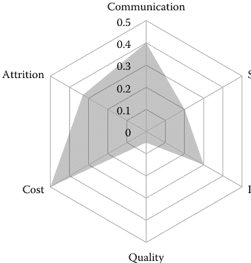

**图 1.1** 项目风险雷达图。

of cumulative count of code written till date. The actual code written is plotted alongside the plan in Figure 1.2. By visual reasoning upon the plot, one can guess the time to finish the project.

> 数据必须被转化为图表，在此之前它们不会进入决策空间。

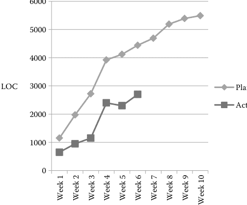

**图 1.2** 代码累计数量。

即使是较低规模的数据也可以绘制图表。例如，关于发现缺陷类型的条形图可以非常具有启发性。大多数分类变量以条形图和饼图的形式绘制，它们很有意义。

图表必须被解读。一张图胜过千言万语；但每一张都需要几句话的解释来阐述上下文和含义。对图表的评论很少见；也许可以认为图表中的真理是显而易见的。然而，给图表添加一行评论会产生巨大的差异。

#### BOX 1.1 SHOW ME A GRAPH

该组织致力于软件维护。每个月，都会收到大量变更请求。运营经理发现“积压”是一个迫切问题。积压似乎每个月都在增长。经过深思熟虑后，他设计了一种简单的管理技术来解决这个问题。他建议每月末提供一份简单的饼图报告。饼图显示了按以下类别划分的错误分布：

- a. 已着手处理的错误——复杂类别

- b. 已着手处理的错误——简单类别

- c. 已分析但被判定为非问题的错误

- d. 排队中的错误——尚未着手处理

- e. 已交付的错误

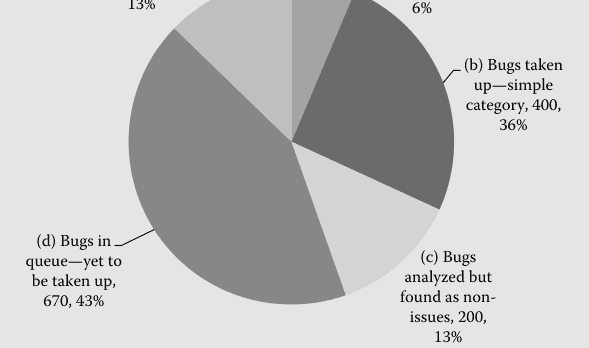

饼图产生了显著的后果。积压队列减少了，每月修复的错误更多。后来，经理偶然了解到“视觉管理”，并将饼图的成功归因于视觉管理。

饼图如此简单却如此有效；它很快成为每周报告并变得非常受欢迎。饼图扭转了公司的局面。

#### 数值描述性统计

（数据的数值汇总）

数据的数值汇总有一套标准的统计量。数据与统计量之间存在区别。数据是测量的结果。统计量是数据经过统计处理的结果。进行描述性统计需要一个前提。我们需要一组观测值——一组数据点——来准备数值汇总。应该已经制造了一些组件或执行了一些流程，然后我们才考虑数值汇总。这种限制不适用于图表。数据 1.1 提供了数据样本并展示了典型开发项目中的工作量差异数据。

数据意味着什么？定量推理始于对工作量差异的统计探究。流程的中心在哪里？流程的范围是多少？流程数据是否像预期那样对称，还是偏斜？流程是否有强烈的峰值还是平坦？对这些问题的回答以一些基本统计量的形式正式给出。这些统计量已使用 Excel 数据分析工具“描述性统计”计算得出工作量差异数据。数据 1.2 提供了该工具的报告。

数据 1.1 工作量差异数据（%）

---

20.0

12.4

18.0

30.0

5.0

12.0

15.0

0.4

-3.0

4.0

7.0

9.0

10.0

6.0

---

#### 数据 1.2 工作量差异的描述性统计

| Data | Descriptive Statistics | Value |

|---|---|---|

| 20.0 | Mean | 10.41429 |

| 12.4 | Standard error | 2.278081 |

| 18.0 | Median | 9.5 |

| 30.0 | Mode | N/A |

| 5.0 | Standard deviation | 8.5238 |

| 12.0 | Sample variance | 72.65516 |

| 15.0 | Kurtosis | 0.908722 |

| 0.4 | Skewness | 0.720095 |

| -3.0 | Range | 33 |

| 4.0 | Minimum | -3 |

| 7.0 | Maximum | 30 |

| 9.0 | Sum | 145.8 |

| 10.0 | Count | 14 |

| 6.0 | Confidence level (95.0%) | 4.921496 |

表中共有十四项基本“统计量”。我们可以通过在工具中勾选选项，将第 k 大和第 k 小的值添加到此列表中。这些统计量的定义在附录 1.1 中给出。

#### BOX 1.2 POWER OF TABLE

管理软件开发是一项复杂的工作。一位经理以一种新颖的方式应用数据驱动管理，使他的工作变得轻松。他确定了 12 个里程碑，并为每个里程碑选择了需要收集的数据，以便有效管理。这促使他设计了一个包含 12 行和 10 列的数据表。数据列包括日期、规模缺陷、工作量和相关功能编号。里程碑与交付物一致，数据表被称为里程碑表。有了这个简单的表格，他意识到可以管理几乎任何规模和持续时间的项目。他还发现有额外的带宽可以同时管理更多项目。他的团队从未错过里程碑，因为他认真对待里程碑层面的数据并客观、精确地审查结果。他的项目通常按时交付，质量良好且在预算范围内。

| 1 | 2 | 3 | 4 | 5 | 6 | 7 | 8 | 9 | 10 |

|---|---|---|---|---|---|---|---|---|---|

| **Milestone** | **Delivery** | **Features** | **Start DT** | **Finish DT** | **Dev Effort** | **Review Effort** | **Test Effort** | **Test Defects** | **UAT Defects** |

| 1 | Start | Architecture |  |  |  |  |  |  |  |

| 2 | Package 1 | F1–F5 |  |  |  |  |  |  |  |

| 3 | Package 2 | F6–F20 |  |  |  |  |  |  |  |

| 4 | Package 3 | F21–F40 |  |  |  |  |  |  |  |

| 5 | Package 4 | F41–F50 |  |  |  |  |  |  |  |

| 6 | Package 5 | F51–F67 |  |  |  |  |  |  |  |

| 7 | Package 6 | F68–F73 |  |  |  |  |  |  |  |

| 8 | Package 7 | F74–F85 |  |  |  |  |  |  |  |

| 9 | Package 8 | F86–F91 |  |  |  |  |  |  |  |

| 10 | Package 9 | F92–F100 |  |  |  |  |  |  |  |

| 11 | Package 10 | F101–F104 |  |  |  |  |  |  |  |

| 12 | End | Integration |  |  |  |  |  |  |  |

#### 特殊统计量

后几章将解释一些特殊统计量。标准误差在第 13 章中描述。置信区间在第 21 章中描述。百分位数、四分位数和四分位距在第 4 章中解释。我们可以将我们偏好的统计量汇集到描述性统计横幅中。

#### 描述性统计的三个类别

简单且最常用的描述性统计可以分为三个类别并进行更深入的分析：

- 中心趋势（第 2 章讨论）

- 离散程度（第 3 章讨论）

- Tukey 的五点汇总（第 4 章讨论）

这种更深入的探索可以被视为探索性数据分析的一部分。

#### 案例研究：工作量差异描述性统计的解读

让我们来看一下数据 1.2 中提供的工作量差异数据的描述性统计。数据点的数量为 14。我们更希望有超过 30 个数据点来得出结论。我们可以用 14 个数据点，同时牢记我们的判断中可能存在微小但可容忍的误差。

两个统计量具有重要意义——平均值为 10.414，最大值是 30。我们将应用业务规则来评估这些统计量，而不是统计规则。当估算过程成熟时，方差的平均值应接近零。估计误差的行为理想情况下应与测量误差类似；两者都应以零为中心对称分布。毕竟，估计也是一种测量。当前平均方差 10.414 较高，表明项目持续损失约 10% 的人力。这就是朱兰所说的慢性浪费。

第二个问题是方差的最大值延伸到 30%。从实际角度来看，这并不太糟糕。项目偶尔报告过更高的极端值，高达 80%。这无论如何都比平均值问题严重性小。

> 峰度和偏度都不令人担忧。

> 中位数更接近均值，正如预期的那样。

> 数据中没有明显的众数。

范围为 33，但标准差约为 8.5，表明数学过程宽度为标准差的六倍，等于 51。数学模型预测过程变化更大。然而，即使这种更大的预测也不令人担忧，因为均值更为重要。

总体而言，项目团队在遵守计划方面具有合理的纪律，体现在可接受的范围内。估算过程需要改进，看起来估算过程可以进行微调以实现零均值误差。

#### BOX 1.3 SMALL IS BIG

维护项目每周要处理来自全球客户服务中心的 20,000 个错误。产品庞大，每月多次更新并交付给世界各地不同地区的用户。维护工程师忙于修复错误，没有兴趣查看和学习维护数据。想到一个包含数百万数据点的数据库就让他们望而却步，不愿深入数据。经理们在这方面也无能为力，因为他们没有说服人们花费大量时间研究数据的理由。数据不受欢迎，直到人们了解到五点汇总。一个月的數據可以简化为 Tukey 的五个统计量：最小值、第一四分位数、中位数、第三四分位数和最大值。人们发现仅用五个统计量就能理解一个月的绩效非常容易。

#### 修复时间分析

图基五点概要

|  | 区域1 | 区域2 | 区域3 | 区域4 |

|---|---|---|---|---|

| N（报告的缺陷数） | 22,000 | 12,000 | 23,600 | 32,000 |

| 统计量 | 修复时间（天） | 修复时间（天） | 修复时间（天） | 修复时间（天） |

| 最小值 | 12 | 6 | 45 | 25 |

| 第一四分位数 | 70 | 44 | 57 | 63 |

| 中位数 | 120 | 66 | 130 | 89 |

| 第三四分位数 | 190 | 95 | 154 | 165 |

| 最大值 | 300 | 126 | 200 | 223 |

#### 应用说明

本章所学内容的一个主要应用在于展示数据汇总。汇总表的设计值得关注。

首先，应避免在单个表中呈现过多指标。超过七个指标时，大脑无法并行处理。包含40个指标的数据汇总表会超出负荷。此类数据可以归入五个类别：业务、项目、过程、子过程与产品。如果这种分类方式不受青睐，汇总表也可以采用以下任一类别：

- 长期–短期

- 业务–过程

- 项目–过程

- 项目–过程–产品

重要的是，表格必须被分成若干区块；各部分可以分开呈现，并通过数字链接相互连接。这样一来，不同的利益相关方可以阅读不同的表。任何人拿到一张表，都会发现其中的数据与自身相关，因而感兴趣。

其次，对于每个指标，可以呈现五点概要而非通常的均值与标准差，原因在于：大多数工程数据并非正态分布。五点概要具有稳健性，既能处理正态数据，也能处理非正态数据。

#### 结语

认识到数据的背景对于确保数据收集和解读的有效性都至关重要。

在分析数据之前，我们必须确定其度量尺度。可用的统计方法随尺度不同而变化。例如，对于有序数据，我们使用中位数和百分位数。

数据中的错误会削弱我们对数据的信心。我们不应不知不觉地对数据寄予过度的信任。我们必须设法找到数据来源，并评估数据中可能存在的错误比例。例如，客户感知数据很可能不一致且带有主观性。在这种情况下，我们会更相信集中趋势的表述，而不是离散程度的数值。机器收集的数据（如缺陷修复时间）则很可能较为准确。

我们应当学会用可视化方式和数值方式同时汇总数据。前者可以使用 Excel 图表，后者可以使用 Excel 中的描述性统计功能。这些汇总也构成了第一层的基础分析，没有这些分析，数据收集便不完整。

数据具有改变范式的力量。不适应新数据的旧范式会被适应新数据的新范式所取代。数据具有持续更新业务管理的力量。数据也是创新、新发现和改进的沃土。所有这些优势都可以通过基础数据分析获得。

##### 框1.4 类比：生物反馈

有一个口吃的男孩去看了言语治疗师。治疗很简单：他对着麦克风说话时，需要在示波器上观察自己的语音波形。他每天练习半小时，连续练习了5天，离开时口吃已痊愈。他获得正常言语的方式被归因于生物反馈。人类系统如果能看到自己的表现，就会自行纠正。这正是软件开工程项目中数据使用所能达到的效果。当程序员看到自己代码缺陷的数据时，人类本能的反应就是纠正问题并提供无缺陷代码。这一原则具有普适性，适用于从需求收集到测试的所有软件过程。

## 复习题

- 1. 什么是数据？

- 2. 什么是度量尺度？

- 3. 什么是统计量？它与数据有何不同？

- 4. 最常用的描述性统计量有哪些？

- 5. 什么是图基五点概要？

- 6. 数据如何促进自我改进？

##### 练习

- 1. 如果你正在为某个关键任务软件应用编写代码，并且希望控制代码质量以确保交付无缺陷的组件，你会收集哪些数据？设计一张数据收集表。

- 2. 在测试5000行代码期间，为了评估代码稳定性，你会收集哪些数据？

## 附录1.1：描述性统计的定义

### 数据点数量

当我们看到一个指标值时，还应当知道计算该值所用的样本大小。

数据点（观测值）数量 n

### 求和

这是所有值的简单总和，作为一个元计算很有用：

和 = Σ_{i=1}^{i=n} x_i

### 方差

这是通过以下公式计算得到的关于数据离散程度的数学量：

方差 = ( Σ_{i=1}^{n} (x_i - x̄)^2 ) / (n - 1)

其中 n 是样本大小，x̄ 是样本均值。方差是相对于均值的平均平方偏差。

#### 标准差

方差的正平方根等于标准差。这是离散程度的数学表达。它也是正态分布的一个参数。

### 最大值

这是样本中的最大值。努力方差的大数值可能表明存在特殊问题，值得仔细审视。这里的问题是：“最差的值有多糟糕？是否超出了实际限度？”这个统计量是对数据严重特征的一种简单识别。

### 最小值

这是数据的另一端。问题类似：“最小值有多低？”在努力方差中，最小值可能带有负号，暗示成本压缩。通常，成本压缩是好消息，但当数值变得深度为负时，过程管理者就会变得谨慎。困扰他们的问题如下：是否存在某些妥协？成本节约是否会产生反弹效应？

### 极差

极差等于最大值减去最小值。在经验意义上，极差代表过程变异。该统计量广泛用于过程控制。它计算简单，但足以在过程变异过大时发出警报。

极差只是最大值与最小值之差：

极差 = 最大值 – 最小值

### 众数

众数是出现次数最多的值。它是集中趋势的一种表达。

### 中位数

中位数是将按顺序排列的数据分成相等两半的值。这是集中趋势的另一种表达。

简单来说，中位数就是一组数字列表中的中间值。首先应将列表按升序排列，然后才能计算中位数值。其公式如下：

如果数字总个数（n）是奇数，则公式如下：

中位数 = 第 (n + 1) / 2 项

如果数字总个数（n）是偶数，则公式如下：

```
中位数 = [ 第 n/2 项 + 第 (n/2 + 1) 项 ] / 2
```

### 均值

均值是所有数据点的算术平均值。这是集中趋势的一种表达。它也是正态分布的一个参数：

```
x̄ = Σx / n
```

### 峰度（分布的平坦程度）

峰度描述数据分布的尖峭程度。正峰度表示分布相对尖峭。负峰度表示分布相对平坦（公式见第3章）。

### 偏度（分布的偏斜程度）

偏度是数据不对称性的度量。正偏度表示分布的不对称尾部延伸向更正值。负偏度表示分布的不对称尾部延伸向更负值（公式见第3章）。

##### 参考文献

- 1. W. Goethert and J. Siviy, Applications of the Indicator Template for Measurement and Analysis, SEI Technical Note CMU/SEI-2004-TN-024, 2004.

- 2. R. E. Park, W. B. Goethert and W. A. Florac, Goal Driven Software Measurement—A Guidebook, SEI Handbook CMU/SEI-96-HB-002, 1996.

- 3. S. S. Stevens, On the theory of scales of measurement, Science, 103, 677–680, 1946.

- 4. R. Likert, A technique for the measurement of attitudes, Archives of Psychology, 140, 1932.

- 5. F. F. Reichheld, The One Number You Need To Grow, Harvard Business Review, December 2003.

- 6. J. Han and M. Kamber, Data Mining—Concepts and Techniques, Morgan Kaufmann Publishers, 2nd Edition, 2006.

+   7. C. Jones, `Programming Productivity`, McGraw-Hill Series, New York, 1986.


## References

8. J. A. Park and Y. S. Kim, *Visual reasoning and design processes*, *International Conference on Engineering Design*, 2007.

9. Z. Liu and T. J. Stasko, *Mental models, visual reasoning and interaction in information visualization: A top-down perspective*, *IEEE Transactions on Visualization and Computer Graphics*, 16, 999–1008, 2010.

## Suggested Readings

Aczel, A. D. and J. Sounderpandian, *Complete Business Statistics*, McGraw-Hill, London, 2008.

Crewson, P., *Applied Statistics Handbook*, Version 1.2, AcaStat Software, 2006.

Downey, A. B., *Think Stats Probability and Statistics for Programmers*, Version 1.6.0, Green Tea Press, Needham, MA, 2011.

Dyba, T., V. B. Kampenes and D. I. K. Sjöberg, A systematic review of statistical power in software, *Information and Software Technology*, 48, 745–755, 2006.

Gupta, M. K., A. M. Gun and B. Dasgupta, *Fundamentals of Statistics*, World Press Pvt. Ltd., Kolkata, 2008.

Hellerstein, J. M., *Quantitative Data Cleaning for Large Databases*, EECS Computer Science Division, UC Berkeley, United Nations Economic Commission for Europe (UNECE), February 27, 2008. Available at http://db.cs.berkeley.edu/jmh.

Holcomb, Z. C., *Fundamentals of Descriptive Statistics*, Pyrczak Publishing, 1998.

Lussier, R. N., *Basic Descriptive Statistics for Decision Making*, e-document.

NIST/SEMATECH, *Engineering Statistics Handbook*, 2003. Available at http://www.itl.nist.gov/div898/handbook/.

Shore, J. H., *Basic Statistics for Trainers*, American Society for Training & Development, Alexandria, VA, 2009. Available at http://my.safaribooksonline.com/book/statistics/9781562856986.

Succi, G., M. Stefanovic and W. Pedrycz, *Advanced Statistical Models for Software Data*, Department of Electrical and Computer Engineering, University of Alberta, Edmonton, AB, Canada. Proceedings of the 5th World Multi-Conference on Systemics, Cybernetics and Informatics, Orlando, FL, 2001. Available at http://www.infu.b-it/~gsucci/publications/images/advancedstatisticalmodelsforsoftwaredata.pdf.

Tebbs, J. M., *STAT 110 Introduction to Descriptive Statistics*, Department of Statistics, University of South Carolina, 2006. Available at http://www.stat.sc.edu/~tebbs/stat110/fallnotes.pdf.

Torres-Reyna, O., *Data Preparation & Descriptive Statistics*, Data Consultant. Available at http://www.princeton.edu/~otorres/DataPrep101.pdf.

# Chapter 2

## Truth and Central Tendency

我们已经看到了三个用于描述集中趋势的统计量：均值、中位数和众数。均值是所有观测值的算术平均值。每个数据点都会对均值产生贡献。中位数是将数据按升序或降序排列后数据阵列的中间值。它是排序后阵列的中间位置的值，不像均值那样享有所有观测值的贡献。众数是最常重复出现的数值。对于正态分布等对称分布，三者相等。事实上，三者的相等性可用于检验数据是否偏态。偏态与均值和众数之差成正比。

### Mean

将均值用作数据的集中趋势是最常见的用法。均值是在对某个实体进行重复测量时的真实值。获得真实值的方法是对观测进行多次重复并取均值。观测中的随机误差相互抵消，真实值便以均值形式出现。集中趋势均值用于用正态分布表示数据，即使这只是一个近似值。均值是正态分布的基础；它是正态分布的两个参数之一，另一个参数是标准差。可以预期项目方差数据，如工作量方差、进度方差和规模方差的均值会揭示估计中的真实误差。

一旦真实误差被找出来，估计就可以作为一个测量过程进行校准。

通常的做法是取一个样本数据并将样本均值视为真实观测值。仅凭单一观测值来判断在统计上毫无意义。我们需要用“样本均值”来思考，而不是用零散的单点。“样本均值”比任何单个观测值更可靠。“样本均值”主导着统计分析。

#### Uncertainty in Mean: Standard Error

“样本均值”这一术语必须更谨慎地看待；它仅仅指的是观测数据的均值。假设我们收集了某个开发项目中多个版本的工作量方差数据。这些数据构成了一个样本，我们可以据此计算项目中的均值工作量方差。单个工作量方差数据用于衡量和控制事件；样本均值用于衡量和控制中心能力。集中趋势用于判断过程能力。

现在，软件工程过程组（SEPG）会从组织角度对过程能力感兴趣。他们可以从多个项目中收集样本均值并构建一个总均值。我们可以用另一个术语来称呼这个总均值，即总体均值。这里的总体指的是组织中所有项目的集体经验。总体均值代表组织的真实能力。

如果我们回到“真实”这一术语的使用，就会发现有几种对真实的发现；每个项目都使用样本均值来发现工作量方差。组织则从总体均值中发现真实。

现在我们可以从一个项目中的样本均值，即局部过程的集中趋势，来估计总体均值，即组织过程的集中趋势。我们无法 pinpoint 总体均值，但我们可以确定一个数值区间，使总体均值可能落在此区间内。这种估计存在不确定性。通常用一个称为标准误差的统计量来定义这种不确定性。让我们进一步探讨这一概念。

众所周知，从不同项目收集的均值——样本均值——根据正态分布变化。提出这一结论的定理被称为中心极限定理。该正态分布的标准差被称为标准误差。

如果我们刚刚从一个项目中收集了 `n` 个数据点的样本数据，且标准差为 `s`，那么我们可以用关系式以合理的精度估计标准误差

```
SE = s / √n
```

对均值定义不确定性区间将在第 25 章进一步解释。

### Median

物理上的中线将高速公路一分为二，统计上的中位数将数据分为两半。有一半的数据值大于中位数，另一半的数据值小于中位数。经验法则是，如果数据是非正态的，就使用中位数作为集中趋势。如果数据呈正态分布，中位数在任何情况下都等于均值。因此，中位数是对集中趋势的稳健表达，对所有类型的数据都成立。例如，客户满意度数据——即 CSAT 数据——通常以李克特量表这种顺序量表获得。对 CSAT 数据不应取均值，中位数才是正确选择。（取 CSAT 数据均值是一个常见的错误。）事实上，只有中位数才是所有主观数据的集中趋势的相关表达。中位数在工程数据中是对集中趋势比均值更真实的表达，例如从软件复杂性、生产率和缺陷密度测量中获得的数据。

> 虽然均值用于正态分布的设计，但中位数用于偏态分布的设计，如 Weibull 分布。中位数值用于开发控制宽度的尺度参数。

#### BOX 2.1 HANGING A BEAM

把均值想象成重心。在图 2.1 中，重心与几何中心重合，这类似于梁的中位数，因此梁达到平衡。在图 2.2 中，由于载荷分布不对称，重心发生偏移；梁向重心方向倾斜。然而，中位数仍然是原来的那个点。中位数与重心之间的距离就像中位数与均值之间的差异。这种差异使梁倾斜；在数据阵列的情况下，中位数与均值之间的差异是数据“偏态”或不对称的信号。

The uniform beam balances at the middle point. The center of gravity (analogous to mean) and the middle point (analogous to median) coincide.

Geometric middle point  
(analogous to median)

Center of gravity  
(analogous to mean)

**Figure 2.1** Geometric middle point and center of gravity coincides and the beam is balanced.

The asymmetrically loaded beam tilts. This is analogous to data skew.

Geometric middle point  
(analogous to median)

Center of gravity  
(analogous to mean)

Rider upsets balance of the beam

**Figure 2.2** Asymmetry is introduced by additional weight on the rightside of the beam. The mean shifts to the right.

#### BOX 2.2 A ROBUST REFERENCE

> Median is a robust reference that can serve as a baseline much better than mean serves. If we wish to monitor a process, say test effectiveness, first we need to establish a baseline value that is fair. Median value is a fair central line of the process, although many tend to use mean. Mean is already influenced by extreme values and is “prejudiced.” Median reflects true performance of the process. Untrimmed mean reflects the exact location of the process without any discrimination. Median effectively filters away prejudices and offers a fair and robust judgment of process tendency. For example, the median score of a class in a given subject is the true performance of the class, and the mean score does not reflect the true performance.

### Mode

Mode, the most often repeated value in data, appears as the peak in the data distribution. Certain judgments are best made with mode. The arrival time of an employee varies, and the arrival data are skewed as indicated in the three expressions of central tendency: mean = 10:00 a.m., confidence interval of the mean = 10:00 a.m. ± 20 minutes, median = 9:30 a.m., and mode = 9:00 a.m. The expected arrival time is 9:00 a.m. Let us answer the question, is the employee on time? The question presumes that we have already decided not to bother with individual arrival data but wish to respond to the central tendency. Extreme values are not counted in the judgment. We choose the mode for some good reasons. Mean is biased by extremely late arrivals. Median is insensitive to best performances. Mode is more appropriate in this case.

### Geometric Mean

When the data are positive, as is the case with bug repair time, we have a more rigorous way of avoiding the influence of extreme values. We can use the concept of geometric mean.

The geometric mean of `n` numbers is the `n`th root of the product of the `n` numbers, that is,

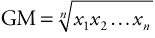

Geometric mean can also be calculated from the arithmetic mean of the logarithm of the `n` numbers. Then this must be converted back to a “base 10 number” by using an antilogarithm.

A geometric mean, unlike an arithmetic mean, tends to mitigate the effect of outliers, which might bias the mean if a straight average (arithmetic mean) was calculated.

The geometric mean for bug repair time given in Table 2.1 is found to be 17.9. We can use the Excel function `GEOMEAN` to calculate this. In this case, it may be noted that the geometric mean is almost equal to the median value. It may be

**Table 2.1 Bug Repair Time**

| Number of Days |  |  |
|---:|---:|---:|
| 16 | 31 | 7 |
| 23 | 19 | 28 |
| 45 | 18 | 29 |
| 20 | 18 | 12 |
| 13 | 21 | 49 |
| 13 | 39 | 20 |
| 58 | 14 | 21 |
| 9 | 11 | 49 |
| 7 | 11 | 14 |
| 29 | 9 | 15 |
| 13 | 25 | 13 |
| 12 | 25 | 6 |
| 32 | 20 | 28 |
| 31 | 17 | 21 |
| 31 | 13 | 23 |
| 33 | 13 | 13 |
| 6 | 13 | 16 |
| 31 | 24 | 10 |
| 26 | 12 | 14 |
| 21 | 7 | 14 |


remembered that all data values are not used in the median computation, whereas every data value is used in the geometric mean.

There are certain financial return calculations where geometric mean is the right choice. If an investment earns 20% in the first year, 40% in the second year, 50% in the third year, and 60% in the fourth year, the average return is not the arithmetic mean of 42.5% but the geometric mean of 41.703%. It is an error to use the arithmetic mean in this case.

Jeff and Lewis [1] have studied tasks times in usability tests that are positively skewed. They report that the median does not use all the information available in a sample. Using the geometric mean, they have achieved 13% less error and 22% less bias than the median.

## Harmonic Mean

With positive data, we have yet another statistic to yield central tendency without bias from extreme values: the harmonic mean. It is even more protective than geometric mean, that is,

```
HM = N / (1/x₁ + 1/x₂ + ... + 1/x_N)
```

To find the harmonic mean of a set of `n` numbers, we add the reciprocals of the numbers in the set, divide the sum by `n`, then take the reciprocal of the result. The harmonic mean is the reciprocal of the arithmetic mean of reciprocals. This gives further screening from extreme values. The harmonic mean for bug repair time data given in Table 2.1 is 15.6 days. This value is closer to the mode than the median, the geometric mean, or the mean.

The Excel function to find harmonic mean is `HARMEAN`.

A formal treatment of geometric and harmonic means may be found in the Handbook of Means and Their Inequalities by Bullen [2].

## Interconnected Estimates

In interpreting the central tendency of software data, so much depends on the situation. In most cases, data are skewed; therefore, mean, median, and mode are different. In such cases, there is no one word answer to central tendency. There are three values that need to be studied and interpreted.

Consider the case of repair time of a particular category of bugs in a software development project. Bug repair time data are given in Table 2.1.

The following are the five values of central tendency:

| Measure | Value |
| --- | --- |
| Arithmetic mean | 20.517 |
| Median | 18.000 |
| Mode | 13.000 |
| Geometric mean | 17.867 |
| Harmonic mean | 15.561 |

The team leader wants to set a goal for bug repair time and also wants to plan resources for the next quarter based on the bug arrival forecast. He wants to take data-driven decisions. He wants optimum decisions too. Which expression of truth will he use?

If we subscribe to the approach that people should follow best practices, the mode should be used to define goal. Aggressive goal setting can still be based on the best performance demonstrated: mode. We need a realistic value to be used in resource planning. We can either choose the median or the mean. Mean is safer and can provide a comfortable cushion. However, then we will be overplanning the resources. A look at the data set shows that maximum value is 58 days. We realize that such extreme values have biased mean values and deteriorated its application potential. Thus, the mean is rejected. A fair answer could be the median.

If the data are positive but skewed, then the geometric and harmonic means can be used. Hence, if the data are complex, we need to look at the multiple estimates of central tendency instead of just the mean.

## Weighted Mean

There are times when we weight data `x` with factors `w` and find the weighted average using the following formula:

```
x̄ = (∑ᵢ₌₁ⁿ wᵢ xᵢ) / (∑ᵢ₌₁ⁿ wᵢ)
```

In the Program Evaluation and Review Technique (PERT) calculation, the estimated schedule is a weighted mean of three values:

| Value | Symbol | Weight |
| --- | --- | --- |
| Optimistic value | `{O}` | 1 |
| Pessimistic value | `{P}` | 1 |
| Most likely value | `{ML}` | 4 |

**Table 2.2 Expert Judgment of Milestone Schedule (Days)**

| | Weight | Data | Weighted Data |
| --- | --- | --- | --- |
| Optimistic | 1 | 20 | 20 |
| Most likely | 4 | 40 | 160 |
| Pessimistic | 1 | 90 | 90 |
| Average |  | 50 | 45 |

```
Estimate = (1O + 4ML + 1P) / (1 + 4 + 1)
```

Expert judgment of a milestone schedule (days) is shown in Table 2.2. A proper estimate is obtained by applying weighted average.

In the previous example, the arithmetic mean is 50 days, and the weighted mean is 45 days.

## Robust Means

The robust estimate of the mean is less affected by extreme values.

## Trimmed Mean

Arithmetic mean breaks down if an extreme value is introduced. Even the presence of one extreme value can change this mean. In other words, it has a 0 breakdown point.

Trimming data gives us robust estimates of the mean, in the sense that the mean is resistant to changes in outlier data. Calculating the arithmetic mean after removing `x%` of data in the lower side and `x%` of data in the higher side will lead us to `x%` trimmed mean. Practically, `x%` can vary from 3% to 25%; `x%` is also called breakdown point.

In schools, the mean score of a class is calculated after removing 5% from the top and 5% from the bottom scores. It is 5% trimmed mean.

In process management, trimming is not a very straightforward step. Trouble in the process is normally revealed in the outliers. We identify outliers and do root cause analysis on them for process improvement. We cannot mindlessly discard extreme values while data cleaning. We can trim data to find a robust expression for central tendency, but the removed data have meaning elsewhere and need to be stored.

For more on trimmed means, refer to the thesis by Wu [3].

2. 几何平均数：偏态正数据的集中趋势

3. 调和平均数：偏态正数据的集中趋势

在第二类中，我们仅从战略性挑选的数据点中获得参与。我们已看到七种此类度量。

## Category 2

1. 众数：人类绩效集中趋势的更好指标

2. 中位数：非正态数据集中趋势的更好指标

3. 截尾均值：直接剔除极值

4. Winsorized 均值：稳健计算

5. 三均值：四分位数的加权平均

6. 中铰链：第一和第三四分位数的平均值

7. 中范围：最低值和最大值的平均值

在判断集中趋势之前，我们可以估计出一组相关的均值。选择将取决于偏态、异常值的存在以及我们需要从异常值中获得的保护程度。这种选择将使分析具有稳健性和安全性。

## Truth

以集中趋势表达的真理有许多变体。我们可以根据数据类型以及我们希望如何使用研究结果来缩小选项范围。信息不在均值中，也不在中位数中。信息应体现在众多表达中。对数学倾向者而言，几何平均数和调和平均数是算术平均数的替代方案。差异必须与实际推理相协调。

> 统计判断永远不是最终目的。
>
> 只有进一步的推理才能发现真理。

统计计算不必是最终的真理。充其量，它们可以引导我们走向真理。真理的时刻只有在推理时才会出现。

对于实证研究者而言，有一系列截尾均值可提供中位数的替代方案。

在评估过程均值的变化时，集中趋势的多种定义的影响相当沉重。更安全的做法是计算出所有定义，获得集中趋势的多个数值，并将它们视为一个小的数值宇宙。

> 我们将不得不将一个集中趋势值的宇宙与另一个进行比较。我们不能再将一个均值与另一个均值进行比较，或从事此类误导性练习。

### BOX 2.3 A GOLDEN RULE TO OBTAIN TRUTH

使用“专家判断”方法估计软件项目是知识驱动的。然而，选择性记忆可能会玷污人类判断，因为知识植根于人的头脑中。提取专家判断中的真理的黄金法则是让专家回忆过去经验中的极值以及中心值，并使用 1:4:1 的比例进行加权平均。该估计被尊为黄金估计，该规则被誉为黄金法则。

## Application Notes

### Managing Software Projects Using Central Tendency Values

收集所有数据后，软件项目更常使用集中趋势值进行管理。管理者更喜欢用汇总的真理来做决策。

> 目标跟踪使用均值进行，而风险管理使用方差进行。

每周和每月的报告大量使用收集数据的均值。绩效仪表板广泛使用均值。均值被比较以评估绩效变化。

### Making Predictions

基本预测针对均值。大多数预测模型呈现均值。在预测业务量和资源需求时，集中趋势被预测并用作规则。方差的预测作为特殊情况进行，以估计确定性和风险。

#### BOX 2.4 ALIGNING THE MEAN

使结果的均值与目标保持一致是一项伟大的能力。通过均值与目标之间的距离来衡量过程与目标的对齐程度。距离越小，对齐度越大。对齐的过程与目标同步，协调工作流程，并倍增效益。在这种情况下，结果的均值尤其重要。质量大师田口提到，社会损失与过程均值偏离目标的平方成正比，即 `Loss = (target – mean)²`

有利于消费者的漂移会给供应商带来损失；相反方向的漂移会给消费者带来损失。不管怎样，漂移都会给社会中的某人带来损失。

#### ⚙ Case Study: Shifting the Mean

绩效通常以均值衡量。即使在工程绩效的情况下也是如此。代码复杂度是一个工程挑战。任其发展，程序员倾向于编写复杂的代码，这一现象被称为 *软件熵*。代码复杂度通过 McCabe 数来衡量。使代码中 McCabe 数的均值发生偏移需要领导者的推动和程序员的动力。使平均复杂度发生偏移是软件工程的突破。较低的复杂度会产生可测试且可靠的模块。尽管如此，实现较低的复杂度需要软件结构设计和编程方法的创新。

本案例研究涉及一个软件开发项目，该项目面临这一挑战，并通过设定平均复杂度的可见目标而克服了它。当前状态由平均 McCabe 数定义，目标状态由期望的 McCabe 数定义。测试团队建议上限为 70，超过此限代码在测试路径方面变得难以理解；测试覆盖率也会受损。当前状态的数据显示复杂度变化巨大，从 60 到 123 甚至偶尔 150。项目经理有两个想法：为单个对象的复杂度设定上限，或为定义交付包的对象集的平均复杂度数设定上限。虽然这两种选择看起来相似，但实际影响却大不相同。在第一个选项中，为单个事件设定上限，测试人员考虑的限值为 70。第二个选项是关于为集中趋势设定限值；这实际上是为软件开发设定最佳目标。为此目标选择的数字是 40。这是一个 stretch goal，使项目经理的意图非常明确。图 2.3 显示了项目团队用于部署此 stretch goal 以偏移均值的图表。

实际上，团队正逐步向目标均值移动。均值偏移的方向非常令人满意。

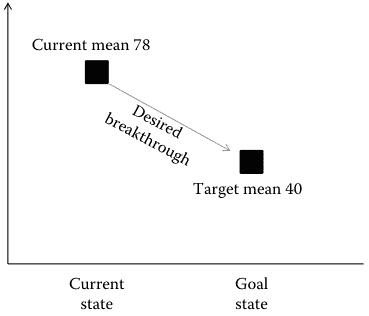

## Review Questions

1. 算术平均数的优势和劣势是什么？

2. 使用截尾均值的最重要目的是什么？

3. 为什么中位数被认为更稳健？

4. 你如何在顺序数据中找到集中趋势？

5. 加权平均的用途是什么？

## Exercises

1. 软件开发项目中的客户满意度数据采用 Likert 量表，从 1 到 5。1 年的客户满意度得分如下。找出数据的集中趋势（数据 2, 4, 3, 5, 1, 3, 3, 4, 5, 3, 2, 1）。


2. 一个测试项目的持续时间由一位专家估计，他做出了以下判断：

   乐观持续时间：45 天  
   悲观持续时间：65 天  
   最可能持续时间：50 天  

   你认为测试项目持续时间的最终公平估计是多少？

## References

1. J. Sauro and J. Lewis, Average task times in usability tests: What to report, CHI 2010, Atlanta, April 2010.
2. P. S. Bullen, Handbook of Means and Their Inequalities, Kluwer Academics Publisher, The Netherlands, 2003.
3. M. Wu, Trimmed and Winsorized Estimators, Michigan State University. Probability and Statistics Department, p. 194, 2006.
4. L. P. Rivest, Statistical properties of Winsorized means for skewed distributions, Biometrika, vol. 81 no. 2. pages no. 373–383, 1994.
5. S. Umberger, Some Mean Trapezoids, Department of Mathematics Education, University of Georgia, 2001.

## Suggested Reading

Aczel, A. D. and J. Sounderpandian, Complete Business Statistics, McGraw-Hill, London, 2008.

# 第3章

## 数据离散度

数据离散度源于变异的来源，包括因底层过程变化而导致的测量结果和结果的变异。哪一个变化更大，测量还是被测量的过程？在本章中，我们假设数据背后具有足够的测量能力；这意味着测量误差与过程变异相比非常小。如果满足这一条件，数据中的离散度将代表被测量过程中的离散度。

过程离散度或变异被视为过程结果的不确定性。为了处理不确定性，我们需要测量、表达并理解它。极差是衡量离散度的一种经典方法。它已用于传统的 `X-Bar` 和 `R` 控制图中，其中 `R` 代表极差，`X-Bar` 代表样本均值。极差是数据中最大值与最小值之差。

另一种惯例是剔除极端值后再考虑极差。通常，低于第3百分位数的值和高于第97百分位数的值被忽略。要理解这一点，我们需要构造数据数组，按某种顺序对数据进行排序，然后切掉上3%和下3%的分位点。（如果数组长度为 `L`，第3百分位点将位于数组上距原点距离 `0.03L` 处。类似地，第97百分位点位于距原点距离 `0.97L` 处。）该极差是第3百分位数与第97百分位数值之间的经验差值。

前面提到的两种计算是保守的。在第三种方法中，四分位距（`IQR`）被视为过程的核心变异。`IQR` 是 `Q3` 与 `Q1` 之差。可以注意到，50% 的观测值位于 `IQR` 内。

### 数据 3.1 设计工作量数据

| % 设计工作量 |
|---|
| 2.87 |
| 11.55 |
| 11.11 |
| 18.55 |
| 21.08 |
| 100.00 |
| 83.56 |
| 6.75 |
| 6.33 |
| 9.71 |
| 21.25 |
| 6.02 |
| 30.63 |
| 13.14 |
| 26.16 |
| 18.85 |
| 32.14 |
| 10.59 |

以下是离散度的三种经验表达式的总结：

极差 = 最大值–最小值  
百分位数极差 = 第97百分位数–第3百分位数  
`IQR = Q₃ – Q₁`

### 示例 3.1：研究设计工作量的变异

已收集到设计工作量占项目工作量百分比的数据。这些数据显示在数据 3.1 中。

使用上述公式对数据进行的离散度分析如下所示：

| % 设计工作量 | |
|---|---|
| 最大值 | 100.00 |
| 最小值 | 2.87 |
| 极差 | 97.13 |
| 第3百分位数 | 4.478 |
| 第97百分位数 | 91.616 |
| 极差 | 87.139 |
| 第1四分位数 | 9.932 |
| 第2四分位数 | 24.933 |
| 极差 | 15.001 |

### 数据 3.2 工作量方差数据的离散度

| 工作量方差 – 1 | 工作量方差 – 2 |
|---:|---:|
| 51.41 | 0.07 |
| 23.20 | 9.00 |
| −7.67 | −7.67 |
| 0.19 | 0.19 |
| 8.31 | 0.79 |
| 4.32 | 4.32 |
| 22.58 | 22.58 |
| 8.23 | 8.23 |
| 28.57 | 28.57 |
| 7.24 | 7.24 |
| −1.39 | −1.39 |
| −1.31 | −1.31 |
| −11.32 | −11.32 |
| 1.27 | 1.27 |
| 6.51 | 6.51 |
| 0.00 | 0.00 |
| 48.15 | 6.67 |
| 1.38 | 1.38 |
| −2.67 | −2.67 |
| 23.02 | 23.02 |
| −35.07 | −35.07 |
| 4.67 | 4.67 |

| 极差 | 工作量方差 – 1 | 工作量方差 – 2 |
|---|---:|---:|
|  | 86.48 | 63.64 |

| 百分位数极差 | 工作量方差 – 1 | 工作量方差 – 2 |
|---|---:|---:|
| 第3百分位数 | −20.11 | −20.11 |
| 第97百分位数 | 49.36 | 25.07 |
| 百分位数极差 | 69.47 | 45.18 |

| 四分位距（`IQR`） | 工作量方差 – 1 | 工作量方差 – 2 |
|---|---:|---:|
| `Q1` | −0.98 | −0.98 |
| `Q3` | 19.01 | 7.09 |
| `IQR` | 19.99 | 8.07 |

### 离散度视为与中心的偏差

数据的极差是衡量离散度的一个相当好的指标。然而，如果我们观察数据围绕某个中心的散布情况，就能获得更完整、更清晰的图景。为了直观说明，让我们看看野战炮对敌方目标的命中情况。弹着点散布在目标周围。如果火炮存在偏差，弹着点可能会散布在略偏离目标的中心周围。在这两种情况下，弹着点都散布在一个中心周围，即均值。

离散度以与均值的偏差来衡量。离散度越大的数据，与均值的偏差也越大。以下是利用这一基本思想的不同表示形式。

### 平均偏差

如果我们计算所有数据点（即全部 `N` 次弹着点）相对于均值 `x̄` 的偏差，并取平均值，就能得到散布或离散度的度量。野战炮 `N` 次弹着点的平均偏差是离散度的一个相当有代表性的估计。每个偏差以米为单位，平均偏差也以米为单位。

$$
D_{\bar{x}} = \frac{\sum_{i=1}^{N} (x - \bar{x})}{N}\tag{3.1}
$$

当我们用同样的公式计算缺陷修复时间的平均偏差时（数据见表 3.1），会遇到一个问题：平均偏差可能为零。

偏差值具有方向性；其值可为正或负。在计算平均偏差的过程中，正值抵消了负值。

### 平均绝对偏差

为避免符号问题，我们可以取偏差的绝对值，如下面修改后的公式所示。这是一种变通方法。

$$
D_{\bar{x}} = \frac{\sum_{i=1}^{N} |x_i - \bar{x}|}{N}\tag{3.2}
$$

绝对偏差已计算并列于表 3.1 中。与均值的平均绝对偏差为 8.669 天。该数字定义了缺陷修复时间围绕数据均值 20.517 的离散程度。

我们可以用这一度量来比较两个月缺陷修复数据的散布情况。

### 中位数绝对偏差

数据的散布程度可以相对于任何中心来计算。通常，我们使用均值作为中心，就像在计算平均绝对偏差时所做的那样。一种稳健的方法是考虑以中位数为中心。然后计算相对于中位数的绝对偏差。接下来，我们取这些绝对偏差的平均值，即中位数绝对偏差（`MAD`）。缺陷修复时间数据的 `MAD` 值为 6.000。计算过程见数据 3.3。

### 表 3.1（续）缺陷修复时间的平均偏差和平均绝对偏差

| 缺陷修复时间（天） | 均值（天） | 与均值的偏差（天） | 与均值的绝对偏差（天） |
|---|---|---|---|
| 25 | 20.517 | 4.483 | 4.483 |
| 20 | 20.517 | -0.517 | 0.517 |
| 17 | 20.517 | -3.517 | 3.517 |
| 13 | 20.517 | -7.517 | 7.517 |
| 13 | 20.517 | -7.517 | 7.517 |
| 13 | 20.517 | -7.517 | 7.517 |
| 24 | 20.517 | 3.483 | 3.483 |
| 12 | 20.517 | -8.517 | 8.517 |
| 7 | 20.517 | -13.517 | 13.517 |
| 7 | 20.517 | -13.517 | 13.517 |
| 28 | 20.517 | 7.483 | 7.483 |
| 29 | 20.517 | 8.483 | 8.483 |
| 12 | 20.517 | -8.517 | 8.517 |
| 49 | 20.517 | 28.483 | 28.483 |
| 20 | 20.517 | -0.517 | 0.517 |
| 21 | 20.517 | 0.483 | 0.483 |
| 49 | 20.517 | 28.483 | 28.483 |
| 14 | 20.517 | -6.517 | 6.517 |
| 15 | 20.517 | -5.517 | 5.517 |
| 13 | 20.517 | -7.517 | 7.517 |
| 6 | 20.517 | -14.517 | 14.517 |
| 28 | 20.517 | 7.483 | 7.483 |
| 21 | 20.517 | 0.483 | 0.483 |
| 23 | 20.517 | 2.483 | 2.483 |
| 13 | 20.517 | -7.517 | 7.517 |
| 16 | 20.517 | -4.517 | 4.517 |
| 10 | 20.517 | -10.517 | 10.517 |
| 14 | 20.517 | -6.517 | 6.517 |
| 14 | 20.517 | -6.517 | 6.517 |
| 平均偏差 |  | 0.000 |  |
| 平均绝对偏差 |  |  | 8.669 |

### 数据 3.3 缺陷修复时间相对于中位数的绝对偏差

| 缺陷修复时间（天） | 中位数（天） | 绝对偏差（天） | 缺陷修复时间（天） | 中位数（天） | 绝对偏差（天） |
|---|---|---|---|---|---|
| 16 | 18.000 | 2.000 | 25 | 18.000 | 7.000 |
| 23 | 18.000 | 5.000 | 20 | 18.000 | 2.000 |
| 45 | 18.000 | 27.000 | 17 | 18.000 | 1.000 |
| 20 | 18.000 | 2.000 | 13 | 18.000 | 5.000 |
| 13 | 18.000 | 5.000 | 13 | 18.000 | 5.000 |
| 13 | 18.000 | 5.000 | 13 | 18.000 | 5.000 |
| 58 | 18.000 | 40.000 | 24 | 18.000 | 6.000 |
| 9 | 18.000 | 9.000 | 12 | 18.000 | 6.000 |
| 7 | 18.000 | 11.000 | 7 | 18.000 | 11.000 |
| 29 | 18.000 | 11.000 | 7 | 18.000 | 11.000 |
| 13 | 18.000 | 5.000 | 28 | 18.000 | 10.000 |
| 12 | 18.000 | 6.000 | 29 | 18.000 | 11.000 |
| 32 | 18.000 | 14.000 | 12 | 18.000 | 6.000 |
| 31 | 18.000 | 13.000 | 49 | 18.000 | 31.000 |
| 31 | 18.000 | 13.000 | 20 | 18.000 | 2.000 |
| 33 | 18.000 | 15.000 | 21 | 18.000 | 3.000 |
| 6 | 18.000 | 12.000 | 49 | 18.000 | 31.000 |
| 31 | 18.000 | 13.000 | 14 | 18.000 | 4.000 |
| 26 | 18.000 | 8.000 | 15 | 18.000 | 3.000 |
| 21 | 18.000 | 3.000 | 13 | 18.000 | 5.000 |
| 31 | 18.000 | 13.000 | 6 | 18.000 | 12.000 |
| 19 | 18.000 | 1.000 | 28 | 18.000 | 10.000 |
| 18 | 18.000 | 0.000 | 21 | 18.000 | 3.000 |
| 18 | 18.000 | 0.000 | 23 | 18.000 | 5.000 |
| 21 | 18.000 | 3.000 | 13 | 18.000 | 5.000 |
| 39 | 18.000 | 21.000 | 16 | 18.000 | 2.000 |
| 14 | 18.000 | 4.000 | 10 | 18.000 | 8.000 |
| 11 | 18.000 | 7.000 | 14 | 18.000 | 4.000 |
| 11 | 18.000 | 7.000 | 14 | 18.000 | 4.000 |
| 9 | 18.000 | 9.000 |  |  |  |
| 25 | 18.000 | 7.000 | 中位数 | 6.000 |  |

### 平方和与方差

还有另一种避免符号问题的方法。我们可以对偏差取平方，然后求平均值。在某些统计情境中，我们会记录计算平方和的中间阶段。如果两个数据集的数据点数量相同，可以用平方和来比较离散度。如果数据点数量不同，我们应该取平均值，即方差。

对于缺陷修复时间，平方和与方差计算见数据 3.4。

#### 数据 3.4 缺陷修复时间的平方和与方差

| 缺陷修复时间 天数 | 平均天数 | 平方偏差 天数 | 缺陷修复时间 天数 | 平均天数 | 平方偏差 天数 |
|---|---|---|---|---|---|
| 16 | 20.517 | 20.400 | 25 | 20.517 | 20.100 |
| 23 | 20.517 | 6.167 | 20 | 20.517 | 0.267 |
| 45 | 20.517 | 599.434 | 17 | 20.517 | 12.367 |
| 20 | 20.517 | 0.267 | 13 | 20.517 | 56.500 |
| 13 | 20.517 | 56.500 | 13 | 20.517 | 56.500 |
| 13 | 20.517 | 56.500 | 13 | 20.517 | 56.500 |
| 58 | 20.517 | 1405.000 | 24 | 20.517 | 12.134 |
| 9 | 20.517 | 132.634 | 12 | 20.517 | 72.534 |
| 7 | 20.517 | 182.700 | 7 | 20.517 | 182.700 |
| 29 | 20.517 | 71.967 | 7 | 20.517 | 182.700 |
| 13 | 20.517 | 56.500 | 28 | 20.517 | 56.000 |
| 12 | 20.517 | 72.534 | 29 | 20.517 | 71.967 |
| 32 | 20.517 | 131.867 | 12 | 20.517 | 72.534 |
| 31 | 20.517 | 109.900 | 49 | 20.517 | 811.300 |
| 31 | 20.517 | 109.900 | 20 | 20.517 | 0.267 |
| 33 | 20.517 | 155.834 | 21 | 20.517 | 0.234 |
| 6 | 20.517 | 210.734 | 49 | 20.517 | 811.300 |
| 31 | 20.517 | 109.900 | 14 | 20.517 | 42.467 |
| 26 | 20.517 | 30.067 | 15 | 20.517 | 30.434 |
| 21 | 20.517 | 0.234 | 13 | 20.517 | 56.500 |
| 31 | 20.517 | 109.900 | 6 | 20.517 | 210.734 |
| 19 | 20.517 | 2.300 | 28 | 20.517 | 56.000 |
| 18 | 20.517 | 6.334 | 21 | 20.517 | 0.234 |
| 18 | 20.517 | 6.334 | 23 | 20.517 | 6.167 |
| 21 | 20.517 | 0.234 | 13 | 20.517 | 56.500 |
| 39 | 20.517 | 341.634 | 16 | 20.517 | 20.400 |
| 14 | 20.517 | 42.467 | 10 | 20.517 | 110.600 |


| 11 | 20.517 | 90.567 | 14 | 20.517 | 42.467 |

| 11 | 20.517 | 90.567 | 14 | 20.517 | 42.467 |

| 9 | 20.517 | 132.634 | 平方和 | 7512.983 |

| 25 | 20.517 | 20.100 | 方差 | 125.216 |

平方和为 7512.983。求得平均值后，方差为 125.216。方差是比较数据集的良好度量。然而，其单位为天²，是一个平方实体。人们无法像使用平均绝对偏差那样直观地评估离散程度。

#### 框 3.2 冰山类比

数据就像冰山。顶部仅包含 15% 的冰。剩余的 85% 在水线以下，被观察者看不见。看不见的冰细节可能对船只造成巨大危害。同样，中心值只构成尖端。真正的过程行为体现在数据的离散中。当离散也被认识时，过程的真实行为才得以理解。

#### 标准差

如果我们取缺陷修复时间的方差的平方根，将得到 11.190 天。这就是缺陷修复时间的标准差 SD，是最常用的离散度量。这大于平均绝对偏差。

> 标准差总是大于平均绝对偏差。

标准差 SD 的精确公式对样本量有一个小的修正。不是使用 n 作为数据点数，精确计算使用 n − 1，即自由度；即

```
SD = sqrt( sum_{i=1}^{n} (x - x̄)^2 / (n - 1) )  (3.3)
```

缺陷修复时间的标准差修正值为 11.284。

过程离散可以用标准差 sigma 来定义。自 1920 年代以来，取过程变异为 ±3 sigma 已成为传统。超出 ±3 sigma 的正态分布被忽略。数学上讲，正态分布从负无穷到正无穷。我们修剪尾部并取从 −3 sigma 到 +3 sigma 的范围作为过程离散。修剪规则与置信水平相关。±3 sigma 修剪规则与 97.3% 的置信水平相关。

#### 框 3.3 经验法则

随着经验的积累，人们会形成关于使用离散度量的经验法则。尽管规则取决于个人，这里有一个教育性示例。以下表格显示了三种应用离散的方式。

| 序号 | 目的 | 考虑范围 | 置信水平 |

|---|---|---|---|

| 1 | 业务决策 | 四分位距 | 50% |

| 2 | 过程决策 | 3–97 百分位 | 94% |

| 3 | 风险规避 | 最大–最小 | 100% |

业务决策通常取变异的 IQR 来容纳。容纳更多需要不切实际的预算。过程决策是在对合理严格的纪律有合理期望的情况下做出的。风险规避涉及理解和容纳极值。你可以形成自己的经验法则来管理离散。

#### 偏度和峰度

##### Pearson 偏度

偏度是数据不对称性的度量。Pearson 的偏度公式基于均值与众数之差。如果差值更大，则不对称性更大。公式如下：

偏度 = (均值 − 众数) / SD  (3.4)

将此公式应用于缺陷修复时间数据，我们得到偏度为 0.666。该值为正，表明存在更多的大数据。数据被认为向右偏斜。如果偏度为负，数据将负偏斜，或向左偏斜。

如果众数不明确，则我们可以使用以下基于均值与中位数之差的修正公式：

偏度 = 3(均值 − 中位数) / SD  (3.5)

对于缺陷修复时间数据，此公式得到的偏度为 0.669。

##### Bowley 偏度

偏度的稳健估计基于四分位数和中位数。这也称为四分位偏度或 Bowley 偏度。公式如下：

Bowley 偏度 = (Q₃ + Q₁ − 2中位数) / (Q₃ − Q₁)  (3.6)

对于缺陷修复时间数据，Bowley 偏度计算为 0.259。该值远小于 Pearson 值。Bowley 偏度在不同尺度上；其变化范围为 −1 到 +1。Pearson 偏度变化范围为 −3 到 +3。

##### 第三标准化矩

偏度可使用矩法考虑。偏度是第三标准化矩。Excel 中的 SKEW 函数遵循此惯例，使用以下公式：

偏度 = [n / ((n−1)(n−2))] Σ ((xᵢ − x̄) / s)³  (3.7)

其中 n 是样本量，x̄ 是样本均值，s 是样本标准差。

需要注意的是，在公式中，偏差被提高到第三次幂。此外，与所有偏度计算一样，该值通过除以标准差进行归一化或标准化。

使用 Excel 函数 SKEW 进行的矩计算偏度——对于缺陷修复时间数据为 1.271。这是一个更敏感的偏度度量。

#### 框 3.4 偏斜的生活

相当多的软件项目数据是偏斜的。对称和正态数据是例外。来自简单过程的数据显示对称性。来自复杂过程的数据是偏斜的。软件开发无疑是多个过程的集合，预计会产生偏斜数据。如果数据收集是观察过程，那么我们必须认识到数据中的偏斜并学会接受偏斜作为生活的现实。将偏斜数据转换为对称数据是经常进行的人工步骤，以便应用某些统计检验。来自软件项目的未转换原始数据通常是偏斜的。一个突出的例子是复杂性数据的偏斜。另一个是 TAT 数据的偏斜。在这种情况下，偏斜是过程的 DNA。偏斜可能会限制在检验数据时应用若干经典统计方法，但那是次要问题。

#### 峰度

数据的平坦度以峰度衡量。峰度值越低，数据分布越平坦。计算峰度有不同的惯例。Excel 函数 KURT 使用以下峰度公式：

Kurtosis = \frac{n}{(n-1)(n-2)(n-3)} \sum\left(\frac{x_i - \bar{x}}{s}\right)^4 - \left(\frac{3(n-1)^2}{(n-2)(n-3)}\right) (3.8)

其中 n 是样本量，\bar{x} 是样本均值，s 是样本标准差。

该公式已调整，使正态分布数据的峰度等于零。Pearson 方法计算峰度时，正态分布的值为 3。如果我们从 Pearson 结果中减去 3，将得到超额峰度。因此，Excel KURT 公式给出“超额峰度”，即超过正态峰度的值。如果该“超额峰度”值为正，数据更尖峰；如果为负，数据更宽广。

缺陷修复时间数据的峰度已计算。它为 +1.676；因此，数据呈尖峰。

#### 离散系数

“系数”一词在代数中很常用。变量的系数表示该变量对结果影响的大小。在冶金学中，金属的膨胀系数可用于计算金属的膨胀量，这里的系数是一种金属属性。离散系数的设计目的有所不同，尽管该术语的含义并非完全陌生。

##### 极差系数

最简单的离散系数是极差系数（COR），计算公式如下：

```
COR = (Max − Min) / (Max + Min)  (3.9)
```

对于缺陷修复数据，COR 可按如下方式计算：

- 最大值 58 天

- 最小值 6 天

- 最大值 − 最小值 52 天

- 最大值 + 最小值 64 天

- COR 0.8125（无量纲比值）

##### 四分位差系数

COR 基于极值，因此不够稳健。四分位差系数（CQD）基于四分位数，因此不受极值影响。CQD 的公式如下：

```
CQD = (Quartile₃ − Quartile₁) / (Quartile₃ + Quartile₁)  (3.10)
```

对于缺陷修复时间数据，CQD 计算如下：

- Q₃ 26.5 天

- Q₁ 13 天

- Q₃ − Q₁ 13.5 天

- Q₃ + Q₁ 39.5 天

- CQD 0.342（无量纲比值）

可以看出，使用四分位数得出的数值对缺陷修复过程更为有利。CQD 远小于（优于）COR。

##### 平均差系数

这是平均绝对偏差与平均值之比。对于缺陷修复时间数据，该比值计算如下：

|  |  |

|---|---|

| 平均绝对偏差 | 8.669 |

| 平均值 | 20.517 |

| 比值 | 0.423 |

##### MAD 系数

这是 MAD 与中位数之比。对于缺陷修复时间数据，该比值计算如下：

|  |  |

|---|---|

| MAD | 6 |

| 中位数 | 18 |

| 比值 | 0.333 |

##### 标准差系数

这是标准差与平均值之比。对于缺陷修复时间数据，该比值计算如下：

|  |  |

|---|---|

| 标准差 | 11.284 |

| 平均值 | 20.517 |

| 比值 | 0.550 |

该比值通常称为变异系数（COV）。它可以用百分比表示。对于缺陷修复时间数据，COV 可表示为 55%。这也被称为相对标准差（RSD）。

##### 离散系数小结

对于缺陷修复时间数据，我们使用五种不同的约定研究了离散系数，汇总如下：

- 1. 极差系数 0.8125

- 2. 四分位差系数 0.342

- 3. 平均差系数 0.423

- 4. 中位数差系数 0.333

- 5. 标准差系数 0.550

该系数的值越高，表明问题越多，因为变异被视为一种风险。估计值 1、3 和 5 受到极值的影响。估计值 2 和 4 是稳健的，不受极值的任何影响。缺陷修复过程的真实能力由估计值 2 和 4 体现。

##### 应用场景

统计量“离散度量”对场景最为敏感。离散度量可应用于三个重要场景：过程控制、实验和风险管理。

变异在软件过程中不可避免。在制造业环境中，机器控制过程中的变异最小。硬件生产的手工过程变异的数量级要高几个数量级。软件过程的变异则要高出好几个数量级。软件过程首先存在人的变异；其次，大多数软件过程具有问题求解的性质，因此在问题复杂性上也体现出变异。因此，休哈特的普通原因变异和特殊原因变异并不能完全代表软件过程的变异。在软件过程中，变异具有更细微的组成部分，包括主体的固有变异和问题情境的熵。我们更应该在按照戴明 [1] 的理念对变异进行分类之前先尝试理解变异，戴明认为理解变异是渊博知识的一部分。将变异划分为不同类型是分裂性的，而为离散寻找数值表达则是整合性的。足够稳健以处理非正态数据的数值表达是 MAD，它可以用作绩效记分卡中的过程绩效度量。例如，在缺陷修复的情况下，以下两个值代表了该过程：

- 中位数 18 天

- MAD 6 天

如果我们研究实验数据中的变异，就会面临不同的场景。在实验中，变异被视为误差，真值位于中心。标准差是表示误差的良好度量。如果测量值为正，使用标准差系数是有益的。当我们进行测量生产率的实验时，可以将实验结果表示为 平均值 ± % RSD（相对标准差或标准差系数）。例如，平均生产率为每天 120 行代码 ±30% RSD 可能是实验研究的一种良好表达。

风险管理者需要一个变异的数学表达式。在所有选项中，标准差是一种足够接近的近似，非常适合风险评估。

本章给出的离散度量对该主题提供了一个基础入门。为了获得一致的理解，变异应使用本书第二篇中的方法进行建模。

##### 小结

本章使用的离散定义，简要总结如下：

**离散度量**

- 1. 极差：最大值−最小值

- 2. 百分位距：第 97 百分位−第 3 百分位

- 3. 四分位距：Q3−Q1

- 4. 平均差：与平均值之差的平均值

- 5. 平均绝对偏差：与平均值之差的绝对值的平均值

- 6. MAD：与中位数之差的绝对值的中位数

- 7. 平方和：与平均值之差的平方和

- 8. 方差：标准差的平方

- 9. 标准差 SD = \sqrt{\frac{\sum_{i=1}^{n} (x_i - \bar{x})^2}{n - 1}}

**离散的性质**

- 10. 皮尔逊偏度：偏度 = \frac{3(Mean - Median)}{SD}

- 11. 四分位偏度：鲍利偏度 = \frac{Q_3 + Q_1 - 2Median}{Q_3 - Q_1}

- 12. 第三标准化矩：偏度 = \frac{n}{(n-1)(n-2)} \sum_{i=1}^{n} \left(\frac{x_i - \bar{x}}{s}\right)^3

- 13. 峰度 = \frac{n}{(n-1)(n-2)(n-3)} \sum_{i=1}^{n} \left(\frac{x_i - \bar{x}}{s}\right)^4 - \frac{3(n-1)^2}{(n-2)(n-3)}

**离散系数**

- 14. 极差系数：COR = \frac{(Max - Min)}{(Max + Min)}

- 15. 四分位差系数：CQD = \frac{Quartile_3 - Quartile_1}{Quartile_3 + Quartile_1}

- 16. 平均差系数：平均绝对偏差与平均值之比

- 17. MAD 系数：MAD 与中位数之比

- 18. 标准差系数：标准差与平均值之比

##### 案例研究：数据样本的离散分析

本案例研究来自一个支持项目。数据量相当大，每周记录约 15,000 个事件。我们选取解决问题的周转时间（TAT）作为研究对象。我们从数据库中随机抽取 30 个数据点进行离散分析。使用样本有其自身的风险：我们可能只看到有限的现实，整个数据库中呈现的离散可能相当大。然而，分析小样本很容易，并能为进一步分析提供视角和指导。30 个数据样本的极差为 199 天，考虑到存在严格的服务水平协议，这看起来有些反常。分析师记得有一个 7 天的服务水平协议，于是提示对数据进行聚类。通过目视分析出现了三个聚类。第一个聚类与分析师的记忆相符：数据大约为 7 天。第二个聚类似乎在大约 50 天处。还有两个数据点显示极端值为 80 天和 200 天。如果使用离散系数，可以对离散进行更好的评估，分析师选择了 MAD 系数（CMAD）。对于原始数据，CMAD 很高。在形成聚类并创建类别后，CMAD 值变得小而合理，如图 3.1 所示。

类别 C 似乎是特殊情况；也许这些事件被放入低优先级队列，很晚才被处理。数据库中对此没有任何信息；仅记录了进入和释放的时间戳。对数据样本的离散分析揭示了数据库中的问题，并促使分析师创建类别。从数据样本离散分析中吸取的经验有助于为一项大工程设计框架：对整个数据库进行分析。

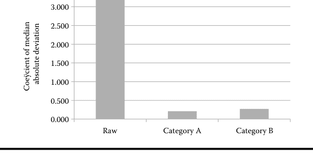

图 3.1 数据样本的离散分析。

## 复习问题

- 1. 何时会使用 IQR 而不是全距？

- 2. 何时会使用 3% 修剪范围而不是全距？

- 3. 何时会使用基于标准差的范围计算？

- 4. 使用离散系数的好处是什么？

- 5. 为什么我们更喜欢绝对偏差而不是普通偏差？

##### 练习

- 1. 计算案例研究中图 3.1 所提供数据中的偏度，使用 Pearson 法和 Bowley 法。比较结果。

- 2. 使用 Data 3.4 中的缺陷修复时间数据并计算标准偏差系数。对离散程度有何判断？是高还是正常？

##### 参考文献

- 1. W. E. Deming, *Out of the Crisis*, MIT Press, Cambridge, Massachusetts, 2000.

# 建议阅读

Aczel, A. D. and J. Sounderpandian, *Complete Business Statistics*, McGraw-Hill, London, 2008.

Brown, S. *Measures of Shape: Skewness and Kurtosis*, Oak Road Systems, 2008–2011.

Heeringa, S. G., B. T. West and P. A. Berglund, *Applied Survey Data Analysis*, Chapman and Hall/CRC, April 5, 2010.

Lewis-Beck, M. S. *Data Analysis: An Introduction*, Sage Publications Inc., ISBN0-8039-5772-6, 1995.

Lunn, D., C. Jackson, A. Thomas, N. Best and D. Spiegelhalter, *The BUGS Book: A Practical Introduction to Bayesian Analysis*, Chapman and Hall/CRC, October 2, 2012.

Wuensch, K. L. *Skewness, Kurtosis, and the Normal Curve*, 2014, Available at http://core.ecu.edu/psyc/wuenschk/StatsLessons.htm.

Available at http://easycalculation.com/statistics/kurtosis.php.

Available at http://www.springerreference.com/docs/navigation.do?m=The+Concise+Encyclopedia+of+Statistics%28Mathematics+and+Statistics%29-book62.

Available at http://www.uvic.ca/hsd/publicadmin/assets/docs/aboutUs/linksofinterest/excel/excelModule_3.pdf.

# 第 4 章

## Tukey 箱线图：探索性分析

### 箱线图的结构

箱线图无疑是最简单且使用最广泛的数据分析技术。

箱线图的起源在于范围图。在范围图的原始版本中，一条线在最小值和最大值之间延伸 [1]。我们可以在这条范围线上加入标记以指示集中趋势。我们也可以用标记对线进行注释以指示标准差。

#### BOX 4.1 统计思维

实现工程和管理中的统计思维是我们目的所在。这涉及用数据思考、感知集中趋势和离散程度，并识别统计异常值。统计思维的这三个方面都由箱线图促进。箱中的中心线表示集中趋势，即中位数。离散程度以两个层面的细节显示：箱的长度是离散程度在广义商业意义上的指标，而须线则以更严格和置信度更高的形式指示离散程度。异常值如果存在，则被识别并作为须线之外的点绘制出来。使用箱线图就是实践统计思维。我们可以在管理和工程情境中有效地使用箱线图。

在 Mary Spear 于 1952 年开发的早期形式中，箱线图显示了数据的五点汇总 [2]：

- 中位数

- 下四分位数

- 上四分位数

- 最小数据值

- 最大数据值

箱由中位数和四分位数构成；箱包含 50% 的观测值。四分位数是箱的边缘称为铰链。须线是从铰链开始并在最小和最大数据值处结束的线。该图被称为箱须图，或简称为箱线图。


# 箱线图

箱线图经历了几次变化。Kristin [3] 对历史发展进行了总结。

约翰·怀尔德·图基提出了一个简单但有效的箱线图改进，使箱线图成为一种流行工具。图基修改了箱线图并于 1977 年在《探索性数据分析》[4] 中发表。在现代版本中，使用了数据围栏。须线不再延伸到最小或最大数据值。须线仅从箱延伸到修剪点（或围栏），这些围栏标记出异常值。修剪规则是经验设计的。标记距离箱 1.5 个四分位距（IQR）。须线在这些标记之内离箱最远的点处结束。标记提供了一种实用的方法来寻找异常值。Azel 和 Sundara Pandian，Excel 箱线图绘图工具的作者，将这些标记称为围栏 [5]。除了这些内部围栏外，绘图作者还引入了距离箱 3 个 IQR 的额外标记。这些被称为外部围栏。如果数据位于内部围栏之外，则可疑为可能的异常值。落在外部围栏之外的数据是确定的异常值。

典型的箱线图如图 4.1 所示。构建该图的以下准则已被使用：

| 参数 | 值 |
| --- | --- |
| 箱中心线 | 中位数 |
| 箱的下铰链（边缘） | 四分位数 1 |
| 箱的上铰链（边缘） | 四分位数 3 |
| IQR | 四分位数 3 - 四分位数 1 |
| 右内部围栏 | 四分位数 3 + 1.5 IQR |
| 左内部围栏 | 四分位数 1 - 1.5 IQR |
| 右外部围栏 | 四分位数 3 + 3 IQR |
| 左外部围栏 | 四分位数 1 - 3 IQR |

软件生产率数据（行代码/人天）由此图进行分析。箱由四分位数 1（生产率 = 8）构建到四分位数 3（生产率 = 34.5）。50% 的数据在箱内。因此，核心生产率在

## 数据 4.1 客户满意度指数值

|  |  |  |
|---|---|---|
| 5.0 | 5.8 | 7.4 |
| 6.5 | 7.6 | 8.7 |
| 6.6 | 6.0 | 8.3 |
| 9.1 | 7.2 | 7.7 |
| 5.9 | 5.5 | 7.1 |
| 5.8 | 6.8 | 6.5 |
| 7.7 | 6.3 | 8.1 |
| 7.5 | 5.9 | 7.0 |
| 5.0 | 6.3 | 6.4 |
| 5.9 | 8.5 | 4.6 |
| 7.1 | 8.2 | 8.0 |
| 7.6 | 6.0 | 7.3 |
| 7.9 | 6.2 | 5.9 |
| 7.2 | 4.7 | 6.9 |
| 7.8 | 5.3 | 6.7 |
| 4.7 | 6.9 | 8.1 |
| 7.0 | 6.7 | 7.1 |
| 3.1 | 7.6 | 7.0 |
| 5.1 | 8.2 | 6.8 |
| 4.5 | 7.2 | 6.6 |
| 8.1 | 8.6 | 6.9 |
| 5.9 | 6.9 | 6.6 |
| 7.8 | 7.7 |  |

在此情况下，均值和中位数提供了几乎相似的结果。然而，我们更喜欢使用中位数。CSAT 指数的集中趋势显示如下：

Mean 6.8

Median 6.9

这与组织目标 8.0 进行比较。明显的不足被认识到，未来的决策被做出以弥合差距。这是常规分析。

让我们现在尝试用箱线图显示 CSAT 数据，如图 4.2 所示。我们能够在箱线图中做出以下额外观察。

- 1. 整个箱都低于目标。这是一个严重的问题。承载 50% 绩效结果的核心过程低于标准。

- 2. 有一个异常值，CSAT 指数值约为 3.2。这远低于轨道。如果我们应用 CSAT 的 Kano 模型，该分数将进入深度不满水平。也许它只是差一点就达到客户愤怒。

- 3. 没有一个事件达到最高分 10。客户愉悦似乎是一个无法实现的目标。为了平衡异常值，我们至少需要几个愉悦者。为了抵消一个负面印象，我们需要创造十个正面印象。补偿性努力缺失。

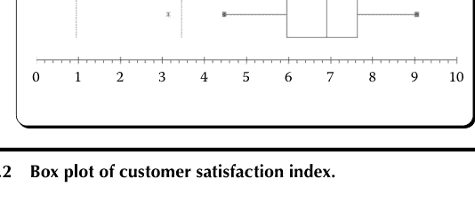

图 4.2 客户满意度指数的箱线图。

当然，用箱线图思考使我们能够比仅使用 CSAT 指数均值进行推理更多。箱线图使我们能够全面地看到问题；这是一种非常宝贵的支持。

## 定制箱线图

箱线图在现实生活中被广泛应用。我们已经看到箱线图为研发科学家、项目经理、业务经理、质量经理以及软件业务中的数据分析带来的洞察。甚至美国中年级的学生也被教授箱线图 [6]。

箱线图正在不断完善。图基本人于 1978 年发表了箱线图的变体 [7]。其他人还在箱线图中加入了频率信息。称为袋图的双变量箱线图也被尝试过。人们还提出了称为豆图的变体。Choonpradub 和 McNeil 的论文中可以找到对箱线图改进尝试的分析 [8]。

试图将更多信息打包到箱线图中的尝试都失败了。人们更喜欢简单、不杂乱的普通箱线图。

## 箱线图的应用

> 数值数量关注期望值，图形摘要关注意外值。

>

> John W. Tukey

### 看到过程漂移

如果中位数不在过程目标值上，我们可以说过程发生了漂移。如果在箱线图上画一条目标线，漂移的量很容易看出。图 4.3 显示了缺陷修复时间的箱线图。公司目标是在最多 16 天内修复缺陷。该目标已标记在箱线图上以便易于解释。

### 检测偏态

箱线图是表达过程问题的优雅方式。可以清楚地看出过程结果是否偏态。如果中位数位于箱体的中间，则数据没有偏态。如果中位数向右移动，数据为左偏。如果中位数向左移动，数据为右偏。偏态的另一个迹象是须线的长度。如果右侧须线更长，如图 4.3 所见，过程向右偏态。

### 看到变异

箱体的宽度是过程变异的度量。箱体宽度以 50% 置信水平显示变异。须线到须线的宽度也表达变异，或许清晰度更好且效果更显著。须线到须线的范围是以超过 90% 置信水平的变异表达。在图 4.3 中，须线到须线的范围为 6 到 45 天。变异远超预期。

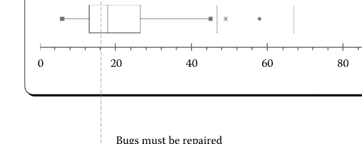

图 4.3 缺陷修复时间的箱线图，单位为天。

> 对正确问题的近似答案，比对近似问题的精确答案更有价值。

>

> John W. Tukey

箱线图帮助我们识别和定义正确的问题。

图 4.1 所示的生产力箱线图突出了三个创新机会：

- 1. 去除离群值：这是最容易的创新。图中下侧没有离群值。这是个好消息。具有更高值的离群值可能被视为受欢迎的结果。这里出现了指定更好一侧事件的上限的经典问题。可以怀疑生产力的极值是妥协的结果，一个缓慢起作用的保险丝，可能会在以后某个地方以问题形式出现。虽然我们需要理解所有离群值，但超出外 fences 的离群值可以详细研究。右侧离群值更多也表明分布中可能存在尾部或偏态。

- 2. 将中位数向更高水平移动：这意味着生产力的期望值可以得到改善。

- 3. 减小 IQR 以及须线到须线的宽度：过程变异，由 IQR 和须线到须线宽度描绘，可以减少以最小化变异。

三种创新可以共存。改善中位数可能伴随离群值的减少，反之亦然。按前面提到的顺序一次采取一个，并将有益的副作用带到另外两个，是一个良好的策略。

### 箱线图的核心理益

Tukey 的箱线图包含足够的统计策略，同时仍保持其预期的简洁性。人们正在做出许多尝试以增强箱线图的信息含量并使其更具色彩。我们在本章中关注简单的箱线图并发现它具有巨大的潜力。箱线图可应用于以下方面：

- 提供数据的视觉汇总

- 看到过程变异

- 检测离群值

- 检测数据的偏态

- 看到过程漂移

- 比较过程

- 规划过程改进

### 双箱线图

让我们以重新估计软件开发工作量为例。团队不愿做第二次估计，急于继续开发。然而，在项目进行两周后进行第二次估计是最佳实践，此时许多项目细节变得可见。我们对需求有了更好的了解，团队沟通更好，风险清晰可见，我们从早期经验中得到启发。第二次估计预计会更准确。我们希望比较第二次估计与第一次估计并研究改进情况。

箱线图可以很好地用于比较两个结果。在图 4.4 中，显示了一个双箱线图，比较两组工作量方差数据。

双箱线图提供了一种可以称为视觉测试的初步分析，在我们开始严格测试之前。以下各项的视觉判断可以为两个结果之间的差异提供重要线索：

- 1. 须线到须线的宽度是否有差异？

- 2. 箱体宽度是否有差异？

- 3. 中位数位置是否有相对移动？

如果对这些问题中任何一个的答案是肯定的，我们就需要更深入地查看箱线图。有时离群值的有无可能会产生差异。有时箱体内中位数线的偏态也可能提供线索。

如果差异显著，两个图中的箱体可能完全分离。它们可能不重叠。使用箱线图表示，很容易看出新结果是否与旧结果不同。

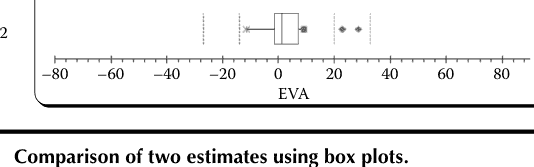

图 4.4 使用箱线图比较两次估计。

如果由于创新而导致的结果显示改进，可能存在一个或多个以下视觉线索：

- 箱线图的整体长度会减小

- 离群值可能消失

- 中心线可能显示有利的移动

- 箱体可能缩小

- 箱体可能被重新定位到有利区域

- 不利的须线可能减小

如果在箱线图中看不到改进，可能首先就不是改进。寻找显著性的问题就不会出现。

> 然而，在大多数情况下，人们费尽心机进行冗长的程序来执行显著性检验以检查差异，而没有箱线图视觉检查。在某些情况下，即使在箱线图拒绝后，人们仍会进行显著性检验的仪式。

### 整体检验

双箱线图检验是一种整体方法；它可以以其他任何检验都无法提供的完整平衡方式比较两个总体。我们为完整性付出的代价是严谨性的丧失。事实证明，严谨的检验比稳健的检验范围更窄；近似分析可以覆盖比精确分析更广的范围。我们需要在进行更复杂的检验之前进行这种整体检验。

图 4.4 所示的双箱线图提供了以下段落中描述的整体比较。

首先，它比较中位数。第一次估计的中位数为 4.67%，第二次估计的中位数为 1.27%。比较中位数比比较均值更稳健，即使在非正态数据下也有意义。这是对集中趋势的评论。

然后在两个层面上比较离散度；第一个 IQR 为 23.45，第二个改进后的值为 8.54。显然，覆盖 50% 结果的估计过程核心显示出更小的离散度——小一个数量级。新离散度是旧的三分之一。旧的须线到须线范围为 86.48，而新的须线到须线范围为 20.32，小四倍。显然，新估计技术中的离散度减少了；它更可靠。箱线图在我们求助于 p 值进行判断之前提供了一个数量级检验。

箱线图在第二组中识别出离群值；并非每个估计都执行良好。最佳实践必须推广。第二过程存在称为统计离群值的哲学问题。然而，从实际意义上讲，即使是离群值也比第一个过程更好。

### 应用总结：双箱线图

双箱线图是一种定性检验，应在任何假设检验之前进行。

比较数据集整体性能的唯一方法是双箱线图。

我们可以使用双箱线图比较过程的以下方面：

- 四分位距到四分位距距离（IQR）

- 须线到须线距离

- 中位数（集中趋势）

- 离群值

- 偏态

每个比较都可以提供关于过程差异的独特线索。

我们可以使用经验法则：如果箱体重叠，则中心值没有显著移动。

在看到双箱线图后，我们可以决定必须执行哪种确认性检验。

- 如果中心值有移动，用 t 检验确认它。

- 如果离散度不同，用 F 检验确认它。

- 如果存在离群值，用控制图交叉检查它们。

我们可以用箱线图做出初步决策，然后通过确认性检验做出最终决策。

当数据非正态时，双箱线图比传统检验提供更可靠的线索。

### BOX 4.2 评估改进

在软件项目中，我们认为需要评估改进发生的情况比我们想象的更频繁。起初，我们收集数据是因为我们希望提高性能。因此，我们被迫在数据收集和报告后检查性能是否真的得到改善。为此，我们需要两组性能数据，改进前和改进后。然后我们只需准备一个双箱线图并比较结果，如本章所述。还有其他情况，我们通过六西格玛和精益有意识地改进性能；再次，我们可以使用箱线图比较改进前后的结果。有时我们可能会做特殊实验，并不可避免地使用箱线图来用箱线图作为改进证据来描绘数据。箱线图被广泛用作实验的图形伴侣。软件工程的高成熟度涉及持续改进，而箱线图是一个非常有价值的工具。

## 案例研究 1：来自 CSAT 箱线图的业务视角

本案例研究关于在拥有四个战略业务单元（SBU）的庞大组织中管理 CSAT。组织的年度平均 CSAT 指数计算为 3.217，远低于 1–5 李克特量表中的目标值 4。CSAT 数据通过客户整体满意度调查获得。对序数数据的平均值计算是一个持续争论的话题。严格来说，序数数据的平均值毫无意义，但平均值被视为有效指标。它更容易估计和报告。如果我们使用箱线图而不是均值，我们往往能看到更多 CSAT 的细节。如果我们为不同的 SBU 绘制单独的箱线图，我们会获得更多信息并便于相互比较，如图 4.5 所示。

### 跨 SBU 的 CSAT 分析

一目了然，我们能够把握 CSAT 的多个细节。箱线图的线性结构使一个图表中容纳多个箱线图成为可能。在图 4.5 中，存在下须线；下须线触及了地板水平，尤其是在 SBU 1 和 SBU 3 中。这些下须线是真正的问题；客户往往会更长时间地记住负面结果。如果可以采用 Kano 的 CSAT 模型，下须线落在渐近崩溃的不满意区域。

> CSAT 箱线图的关键信息不在于中心值，而在于下须线。

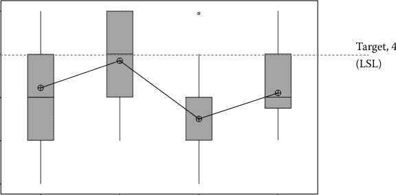

图 4.5 使用箱线图对跨 SBU 的客户满意度进行分析。

#### BOX 4.3 箱线图的盒子

箱线图具有简洁的结构。它非常简单且不杂乱。箱线图的早期版本是一条直线。Tukey 添加了盒子。盒子通过主导图表来实现其目的。这是一种有意的支配。盒子包含中位数和 50% 的中心证据。第一眼我们就能识别出盒子，其他细节则被弱化；盒子作为主要信息浮现出来。这有助于管理者把握流程的本质行为，而不带次要细节。盒子之外的离散被视为次要。异常值是第三级的。此外，盒子是朴素且无填充的。它只是一个轮廓图。对于预算方面的快速决策，我们只需考虑盒子。对于系统化的流程管理，我们考虑须线。对于战略风险管理和问题解决，我们考虑异常值。箱线图的结构有助于这一管理决策的进展。

### 跨属性的 CSAT 分析

该图表提供了一个非常容易比较的视图，我们可以快速浏览。ENGG 和 TIME 的表现获得了最低的分数。ENGG 中的下须线触及地板并向组织发出红色警报。COMM 和 PRICE 获得了最佳分数，确保了来自“盒子”区域内的客户愉悦。如果我们将目标定为 4，则 RESP 和 QUAL 仍需改进。箱线图图形化地提供了非常有用的信息。

## 复习问题

- 1. 箱线图的要素有哪些？

- 2. 什么是栅栏？

- 3. 须线的长度如何计算？

- 4. 铰链如何计算？

- 5. 箱线图中用于检测异常值的规则的稳健性如何？

#### 练习

- 1. 使用数据 4.1 提供的数据，使用参考文献 [4] 和 [5] 中提供的宏绘制箱线图并对其进行解释。你也可以从网上下载免费的 Excel 箱线图绘制器。

- 2. 绘制你自己开发的代码行或各种对象的箱线图。看看箱线图如何帮助统计思维。

- 3. 根据以下模块数据绘制缺陷的箱线图。解释你的发现。

26

23

21

18

18

18

14

14

13

13

12

12

- 4. 使用两个箱线图比较以下两组测试期间的重工量。解释你的图表。

| Set 1 | Set 2 |
|-------|-------|
| 12 | 10 |
| 12 | 10 |
| 0 | 9 |
| 5 | 9 |
| 7 | 9 |
| 8 | 7 |
| 9 | 7 |
| 0 | 7 |
| | 7 |
| | 6 |
| | 6 |
| | 6 |
| | 5 |
| | 4 |
| | 4 |
| | 4 |
| | 4 |
| | 4 |

#### 参考文献

- 1. K. W. Haemer, Range-bar charts, *American Statistician*, 2(2), 23, 1948.

- 2. M. E. Spear, *Charting Statistics*, McGraw-Hill Book Company, Inc., New York, 1952.

- 3. K. Potter, *Methods for presenting statistical information: the box plot*, in *In Visualization of Large and Un-structured Data Sets*, GI-Edition Lecture Notes in Informatics (LNI), H. Hagens, A. Kerren and P. Dannenmann (eds.), vol. S-4, pp. 97–106, 2006.

- 4. J. W. Tukey, *Exploratory Data Analysis*, Addison Wesley, Sydney, 1977.

- 5. A. Amir and J. Sundara Pandian, *Complete Business Statistics*, McGraw-Hill, London, 2008.

- 6. A. Bakker, R. Biehler and C. Konold, *Should Young Students Learn about Box Plots?* Curricular Development in Statistics Education, Sweden, 2004.

- 7. R. McGill, J. W. Tukey and W. A. Larsen, Variation of box plots, *American Statistician*, 32(1), 12–16, 1978.


- 8. C. Choonpradub and D. McNeil, Can the box plot be improved? *Songklanakarin Journal of Science and Technology*, 27(3), 649–657, 2005.

## METRICS

II

从数据中推导指标是观察和理解的关键。指标赋予人们客观的观察和更深入的理解。本书第 II 部分的第 5 章专门用于从数据中推导指标以获得这一优势。

对所有生命周期阶段通用的指标并不是有效的方法。 compartmentalizing 指标有助于此。一种简单的方法是分别讨论开发指标、维护指标和测试指标。第 6、7 和 8 章专门用于这三类指标。

敏捷方法的出现重新定义了生命周期管理和度量的方式。第 9 章涉及敏捷指标。

# 第 5 章

## 推导指标

## 在数据中创造意义

直接观察也称为 `基础度量` 或 `原始数据`。此类数据要么由人员输入到计算机中，要么由机器自动记录。自动化数据采集正在获得认可。当人员输入数据时，他们有机会查看正在键入的内容并验证数据。机器捕获的数据不会立即被人员看到；此类自动数据在报告生成或流程分析期间被访问。

派生度量是从基础度量计算得出的。派生度量有多个名称。其中两个名称很重要：关键绩效指标和指标；我们使用术语指标。基础度量的错误会传播到指标中。从更广的意义上讲，指标也构成数据。然而，指标比基础度量承载更丰富的信息。我们通过创建指标在数据中创造意义。

### 作为关键绩效指标的指标推导

度量本质上是一个映射过程。原始人通过将他的牲畜一对一映射到一捆棍子上来数羊。如果缺少一只羊，就会显示为不匹配。文字尚未发明，但映射依然存在。对功能点计数执行类似的映射；度量被视为“计数过程”，即映射的另一个名称。COSMIC 功能点手册中很好地描述了度量中的映射阶段。在语言的帮助下，我们为所计数的内容命名——软件规模。在数论的帮助下，我们应用规则分配数值。

以同样的方式，我们在软件中计数缺陷。这里的映射是显而易见的。缺陷的发现由测试过程进行。每个缺陷都被赋予名称或识别号。给定模块中的缺陷总数从缺陷日志中计数。

规模是一个基础度量。缺陷计数是另一个基础度量。缺陷与规模的比率称为缺陷密度。它是一个派生度量，由两个独立的基础度量复合而成。它表示产品质量。

生产率是派生度量的另一个例子。

度量是直接映射的值。指标是对需求构建的有意义的指示器。


“度量”指直接映射的值。

“指标”指有意义的指示器。

从技术上讲，规模是度量，复杂度是指标。到达时间是度量，到达延迟是指标。

指标比度量承载更多意义。因此，指标是“有意义的指示器”。

### 估计与指标

一些指标如 `effort variance` 和 `schedule variance` 基于估计值和观测值。例如，指标 `effort variance` 定义如下：

`Effort variance % = 100 × (Actual effort − Estimated effort) / Estimated effort`

该指标真实直接地反映了估计中的任何不确定性。


准确的度量结合模糊的估计会产生模糊的指标。

度量能力和估计系统相互支持。它们在很多方面相似，因为两者都是观察。指标度量过去和现在；估计度量未来。

### 指标范式


> What’s measured improves.

>

> Peter F. Drucker

软件工程研究所（SEI）引入了 `GQ(I)M` 范式 [2]，作为对 `GQM` 范式的一种增值改进。`GQ(I)M` 运用彼得·圣吉的心智模型来驱动指标选择，并通过指示器来传达含义。`GQ(I)M` 无疑帮助拓宽了 `GQM` 的适用范围。

> 框 5.1 驾驶飞机与 GQM

>

> 即便最简单的螺旋桨飞机也会配备测量高度和燃油的仪表。这些测量对飞机设计而言是内在的。仪表由制造商安装，并随飞机作为基本部件一同交付。没有高度、速度和燃油油位指标，就无法飞行。没有高度表的飞机不可想象；没有速度表的飞机不切实际；没有燃油指示器，飞行员无法做出决策。这些指标并非“目标驱动”，当然也不是商业战略驱动，而是由设计需求驱动。人们可以为每个指标设想某种用途，但这些用途并非源自商业战略和商业目标；这些用途隐含在产品工程之中。无论是否存在目标，这些仪表几乎都会像生存需求引发的条件反射一样，自然而然地安装到飞机上。这里没有选择余地。这些指标不可或缺且显而易见。我们不需要借助 `GQM` 方法来弄清楚它们。

>

> 因此，成本、进度和质量指标在软件开发项目中也同样是不可或缺的。它们并非“目标驱动”，而是基于运营需求。我们同样没有选择余地。

## 将 GQM 应用于设计指标体系的难点

首先，`GQM` 范式中的中间阶段（问题）帮助不大。我们直接将指标映射到目标。`COSMIC` 规模测量中的映射阶段就是一个很好的例证。

其次，在应用 `GQM` 时，人们往往从公司目标出发，试图逐层分解到指标。这常常徒劳无功。大型组织曾花费数天时间使用 `GQM`，却迷失在定义目标、子目标和子子目标的过程中。所有这些目标都进入了目标转换环节，根本无法在一次研讨会上就落到指标定义。相反，我们应该首先使用目标树从业务目标推导出绩效目标。这是目标部署，是一场领导力游戏。指标设计者应当将指标映射与目标部署区分开来。指标设计者应选取特定的绩效目标并将其映射到指标。

第三，有些指标由客户指定。客户指定的指标在组织中往往运行良好。数据收集顺畅。无需单独的机制来识别和定义这些指标。

第四，有些指标由需求驱动。如果需求中包含软件必须为可维护性而开发，那么自然有一个与此需求相关的指标，即可维护性指数。满足功能性和非功能性需求可能需要指标支持。因此，已确认的绩效目标能够轻松且有机地映射为绩效指标。我们无需应用 `GQM` 而小题大做。

第五，指标通常是为了满足组织中的信息需求而构建的。因此，管理信息系统（`MIS`）会自动捕获许多指标。这些指标是 `MIS` 的固有组成部分。指标团队必须从 `MIS` 或 `ERP` 系统中提取指标数据。这些指标并不遵循 `GQM` 路径。

第六，有些指标源于运营需求，例如进度偏差。此类需求是迫切的，我们根本没有机会行使选择权。当需求被清晰而果断地确认后，我们无需再通过 `GQM` 重新发现它们。

第七，即使在六西格玛的问题解决方法中，虽然会定义 `Y` 和 `X` 变量来表征构成问题的因果关系，指标也是通过因果图映射推导出来的。选择要解决的问题是一个目标驱动的过程，但推导变量（指标）是通过因果映射进行的，而非 `GQM`。

## 需求驱动的指标

我们的发现是，成功的指标由明确的需求驱动。指标与需求之间的联系必须是有机的、自然的、自发的。底线是：


> 如果我们能不用指标，就不用指标。我们只在需要时才使用指标。

分配的目标、个人目标以及所有子目标体系最终都归结为反映系统迫切需求的绩效目标。一旦指标与需求建立联系，它就能发挥作用。

需求与指标之间的联系必须具体、自然、透明且直接。因此，映射是首选的连接机制。使用“问题”过于繁琐，缺乏实用价值。


> 映射是比问题更好的连接方式。

更值得关注的问题是如何获得执行者支持指标的承诺。基于需求的体系比基于询问和问题的体系更能促成承诺。

目标与需求之间存在区别。

目标：努力所指向的终点

需求：需要供应或缓解的条件

目标是复杂的；它们由相互关联的层次构成，并受到“个人目标”和“自我效能感”的影响。目标具有多个维度，很可能将指标设计的讨论引向无结论的分歧，因此不宜作为推导指标的依据。需求结构简单，在软件开发项目中定义清晰，具有更高的客观性。

框 5.2 奥运会跑步选手

学校决赛短跑比赛的时间使用模拟秒表测量。在州级校际比赛中，时间使用数字秒表更精确地测量。在奥运会短跑中，时间由计算机控制的激光系统测量，精度达到毫秒级。随着跑步能力的提高，测量精度也随之提高。同样，当软件工程实践变得更加成熟时，指标能力也会提高。指标数据的质量也会提高。指标与成熟度相辅相成。

## 指标的含义：解释指标数据

我们通过定义指标与原始数据的关系来定义指标。指标定义本身就蕴含着该指标的含义。定义方程比我们赋予指标的名称更重要。名称可能误导，但定义不会。在开始解释之前，最好回顾指标定义，即使这些定义显而易见。

回顾指标定义后，我们再看指标数据。最好使用一张数据表，将原始数据和派生指标分别放在不同的列中。对基本观测数据的可见性有助于深入理解指标。在一列中，我们可以放置数据的时间戳。如果数据分为类别，最好在一列中包含类别名称。有时，我们可能不得不增加额外的列来容纳进一步的分类方案。

接下来，我们应该构建指标数据的箱线图，并分析数据的统计性质。必须理解并解释箱线图中看到的箱体、须线和离群点。必须解决有关指标稳定性和合理离散度的问题。我们可以通过描述性统计分析来支持这一探究。

> 数据具有内在含义，可以通过应用统计、工程和管理的视角来发现。

## 我们的指标分类

对指标进行分类有多种方式。我们遵循第 1 章中提到的五种数据分类，并使用对应的五种指标类型：

- 1. 业务指标

- 2. 项目指标

- 3. 过程指标

- 4. 子过程指标

- 5. 产品指标

根据组织中使用的定义，其中某些类别可能重叠。相同的指标可以在不同类别下、不同情境中重复使用。例如，复用通常被视为过程指标。然而，它也可以用作产品指标来评估产品行为，用作项目指标来了解复用节省的时间，以及用作业务指标来估算复用产生的利润。情境影响分类。

## 业务指标

这些指标是为实施组织中的业务战略而定义和部署的。这些指标本质上具有战略性。业务指标使用的一个常见例子可见于卡普兰等人的平衡计分卡框架 [3]。在该框架中，指标分为四个类别：财务、流程、学习与成长、客户。卡普兰承诺通过测量实现进步。这些指标相互作用，形成一个具有因果关系链条的系统。从业务战略推导业务指标与维克多·巴西利 [1] 的 `GQM` 范式中的方法非常相似。然而，不同之处在于，指标是映射到战略的，而不是使用转换树。

> 业务指标由战略和情境驱动。

## 项目指标

管理软件项目至少需要一些基本指标，如工作量、进度、质量、生产率和客户满意度（通过调查衡量）。项目指标基于项目需求和客户请求。它们由项目范围驱动。项目指标清单会扩展以满足客户需求，如可靠性和可维护性。一些客户对了解产品质量（直至模块级别）表现出浓厚兴趣。他们希望获得模块质量和模块在测试期间表现的报告。项目指标

也必须满足向利益相关者传达的信息需求。例如，资源利用率可能成为人力资源和财务部门所寻求的重要指标。服务器停机时间是能够帮助设施管理部门的指标。项目还通过内部调查来衡量风险。

总体而言，项目指标是需求驱动的。它们应在范围定义期间进行指定。项目指标还充当信息工具，并有助于项目沟通。

### BOX 5.3 ANALOGY: CONSTRUCTING A BUILDING

在某些方面，软件开发类似于建造建筑物。土木建筑中的自然指标是建筑物的规模、内部和所用材料的质量等级，以及建筑物抵抗自然力量如风雨的可靠性。同样，在构建软件产品时，基本指标是规模、复杂性和可靠性。在建筑业务中，定期维护的设计和施工日志显示这些指标数据。在软件项目中，这些指标正缓慢被接受；少数组织维护这些记录，许多其他组织仍在等待。

### Process Metrics

每个过程在输入、过程和输出阶段都提供了指标的机会。这种过程指标首先用于理解，然后控制该过程，后期再改进该过程。

> 使用指标来理解、控制和改进。

软件交付是通过一系列过程完成的，一个或多个指标可用于控制和改进链中每个过程阶段。过程指标的总数等于或多于阶段数量。指标选择由过程控制需求驱动。这种指标选择进一步受所使用生命周期模型的影响。例如，在瀑布生命周期中，可以使用需求稳定性、设计复杂性、代码规模和测试有效性等指标来满足每个开发阶段的控制需求。

### Subprocess Metrics

更详细的过程控制将我们带到子过程。例如，一个过程，如设计，可以分解为可管理的子过程，如设计、设计评审和重新设计。控制这些子过程的指标是设计工作量、设计评审工作量和设计返工工作量。子过程指标带来管理挑战，因为这些指标更接近于担心暴露而不愿共享数据的个人。正如戴明所说，如果我们想收集子过程指标数据，我们需要“消除恐惧”。

### Product Metrics

软件产品结构和性能通过产品指标进行监控。例如，我们可以通过代码行数衡量软件代码规模，通过功能点衡量结构，通过缺陷密度衡量质量，通过平均故障间隔时间衡量可靠性。在设计阶段，我们可以通过功能点衡量结构，通过设计页数衡量规模。在需求阶段，我们可以通过功能数量衡量规模。产品指标可用于监控“产品健康”。

### BOX 5.4 EARTHQUAKE

地震预测使用神秘的指标。例如，在中国，深井中水位的高低变化被测量；在其他地方，采用科学方法，使用精密设备监测微弱的磁信号以测量地震活动。地震振动沿断层线被捕捉并分析以预测地震。所有这些指标都是特殊的、昂贵的，并且基于地质模型。同样，软件可靠性预测需要特殊的指标。指标选择取决于为预测而选择的可靠性模型。这些指标不是常规的而是特殊的，它们属于“模型驱动指标”类别。它们必须专门设计和部署，额外的成本和工作应由业务领导者批准。

### Case Study: Power of Definitions

指标的定义先于指标数据。指标定义在数据验证我们的方法之前塑造我们对工程的方法。指标的名称及其定义是工程和管理词汇的一部分。更丰富的词汇反映了更丰富的实践。问我们需要多少指标，就像问我们需要多少个词才能有效交流一样。

> 几个词足以交换问候，

> 一百个足以管理简单对话，

> 一千个使人成为专家沟通者，而

> 专业人士使用更多。

在60岁时，当许多人考虑退休时，Humphrey先生在卡内基梅隆大学开启了新的职业生涯，在那里他建立了软件流程项目，为软件开发灌输了纪律。

他的同事、卡内基梅隆软件工程研究所软件工程流程管理项目的负责人Anita Carleton说，在Humphrey先生到来之前，软件工程师通过编码和测试创建程序。他改变了该学科的文化，以开发一种更系统的方法来规划、开发和发布新软件。

他的工作使他获得了国家技术奖章，该奖章于2005年由总统乔治·W·布什授予他。

## Review Questions

- 1. 软件项目中使用的五类指标是什么？

- 2. 什么是GQM范式？它的局限性是什么？

- 3. 什么是GQ(I)M范式？GQ(I)M相对于GQM的优势是什么？

- 4. 项目指标的主要驱动因素是什么？

- 5. 如何选择过程指标？

## Exercises

- 1. 制定管理软件测试的指标计划。

- 2. 制定控制设计复杂性的指标计划。

- 3. 制定控制代码质量的指标计划。

- 4. 制定控制需求波动性的指标计划。

- 5. 制定管理软件维护的指标计划。

## References

- 1. V. R. Basili and G. Caldiera, *Goal Question Metric Paradigm*, John Wiley, 1994.

- 2. R. E. Park, W. B. Goethert, W. A. Florac, *Goal Driven Software Measurement—A Guidebook*, SEI Handbook CMU/SEI-96-HB-002, 1996.

- 3. R. S. Kaplan and D. P. Norton, *The Balanced Scorecard: Translating Strategy into Action*, Harvard Business Review Press, Harvard College, 1996.

## Suggested Readings

- Aczel, A. D. and J. Sounderpandian, *Complete Business Statistics*, McGraw-Hill, London, 2008.

- Austin, R. D., *Measuring and Managing Performance in Organizations*, John Wiley & Sons, Inc., Hoboken, NJ, June 1, 1996.

- Defeo, J. and J. M. Juran, *Juran’s Quality Handbook: The Complete Guide to Performance Excellence*, 6th ed., McGraw-Hill Professional, London, 2010.

- Juran, J. M. and A. Blanton Godfrey, *Juran’s Quality Handbook*, 5th ed., McGraw-Hill Professional, London, 2010. Available at http://www.pqm-online.com/assets/files/lib/juran.pdf.

- Kan, S. H., *Metrics and Models in Software Quality Engineering*, Addison-Wesley Longman Publishing Co. Inc., Boston, 2002.

- Kitchenham, B., *Software Metrics: Measurement for Software Process Improvement*, Blackwell Publishers, Inc., Cambridge, MA, 1996.

- Laird, L. M. and M. C. Brennan, *Software Measurement and Estimation: A Practical Approach*, Quantitative Software Engineering Series, Wiley-Blackwell, 2006.


- Parasoft Corporation, *When, Why, and How: Code Analysis*, August 7, 2008. Available at http://www.codeproject.com/Articles/28440/When-Why-and-How-Code-Analysis.

- Parmenter, D., *Key Performance Indicator*, John Wiley & Sons, 2007.

- Pearson, *Software Quality Metrics Overview*, Metrics and Models in Software Quality Engineering, 2nd ed., 2002. Available at http://www.pearsonhighered.com/samplechapter/0201729156.pdf.

- *Software Metrics*, Available at http://www.sqa.net/softwarequalitymetrics.html.

- *Software Process and Project Metrics*, Chapter 4, ITU Department of Computer Engineering–Software Engineering. Available at http://web.itu.edu.tr/gokmen/SE-lecture-2.pdf.

# Chapter 6: Achieving Excellence in Software Development Using Metrics

我们在第5章中看到了为适应情境、满足需求并实现绩效目标而进行的指标开发。现在我们将讨论如何应用指标来管理软件开发周期并实现卓越成果。

让我们看一下以下段落中展示的几个代表性指标来发展这种方法。有关指标的全面研究，请参阅Fenton [1]、Grady [2]、Stephan Kan [3]、Pandian [4]和Putnam [5]。

## Examples of Project Metrics

### Time to Deliver

> 代码的前90%占开发时间的最初90%……代码的剩余10%占开发时间的另外90%。

>

> Tom Cargill

这是任何项目经理最关心的问题，时间是一种稀缺资源，无法购买，只能节省。诀窍是在每个里程碑使用任何方便的度量来跟踪时间绩效。度量可以是进度偏差、进度延迟或挣值度量（EVM）。

## 成本

该度量通常以人天为单位进行跟踪；间接费用可由财务专家添加。

## 质量

每个工作产品的质量都应通过统计缺陷数量，并用适当的大小表达式对缺陷数量进行归一化来跟踪。

## 生产率

每人天开发的规模是该度量的一种常见表达方式。根据测量目的，还可以选择其他几种定义。

## 修复时间

修复缺陷所花费的时间是一个重要度量，并通过缺陷跟踪工具自动跟踪。

## 客户满意度

该度量通过季度调查或年度调查获得。

## 需求易变性

范围蔓延或需求易变性是一个关键度量，项目团队应密切跟踪。

## 产品度量示例

### 需求规模

需求管理建议我们以特性数量、页数或仅仅是需求数量来衡量规模。有些人使用“用例点”或其他专门设计的度量。

### 设计复杂度

> 有了恰当的设计，特性成本就很低。这种方法虽然艰难，但不断取得成功。

> 丹尼斯·里奇

功能点（FP）及其变体可用于判断设计复杂度；我们需要度量进出每个模块的信息流。卡珀·琼斯 [6] 给出了功能点度量的总结。

鲍尔州立大学 [7] 提出了一种简单的设计度量：

外部设计度量 `De` 定义为

`De = e1 (inflows × outflows) + e2 (fan-in × fan-out)`

其中 `inflows` 是从上级或下级模块及外部实体传入该模块的数据实体数量，`outflows` 是从该模块传至上级或下级模块及外部实体的数据实体数量，`fan-in` 和 `fan-out` 分别是直接连接到给定模块的上级和下级模块的数量，`e1` 和 `e2` 是权重因子。

内部设计度量 `Di` 定义为

`Di = i1 (CC) + i2 (DSM) + i3 (I/O)`

其中 `CC`（中心调用）是过程或函数调用的数量，`DSM`（数据结构操作）是对复杂数据类型（使用间接寻址的数据类型）的引用数量，`I/O`（输入/输出）是外部设备访问的数量，`i1`、`i2` 和 `i3` 是权重因子。

`D(G)` 是外部设计度量 `De` 和内部设计度量 `Di` 的线性组合，形式为

`D(G) = De + Di`

> 他们能够轻松处理，而不是软件开发者使用的更技术性的语言，例如 `SLOC` 计数。这确实是技术发展水平以及我们职业实践的一次重大进步。

> 约翰·加夫尼

FP 可应用于所有编程语言和所有开发阶段；这有助于开发管理并简化基准比较。FP 比代码行更能预测缺陷。FP 也是更有效的成本和时间估算工具。

### 代码规模

> 保持灵活的一个好方法就是编写更少的代码。

> 程序员修炼之道

已开发、删除、修改或复用代码的规模都必须以代码行来跟踪。可以区分可执行行和注释行。

如果选择了功能点度量（在所有阶段），我们可以首先使用艾伦·J·阿尔布雷希特发明的原始公式来计算功能规模：

|  |  |  |  |  |

|---|---|---|---|---|

| `EI` | × | 4 | = | _____ |

| `EO` | × | 5 | = | _____ |

| `EQ` | × | 4 | = | _____ |

| `ILF` | × | 10 | = | _____ |

| `EIF` | × | 7 | = | _____ |

| FP 总计 |  |  | = | _____ |

其中 `EI` 是外部输入，`EO` 是外部输出，`EQ` 是外部查询，`ILF` 是内部逻辑文件，`EIF` 是外部接口文件。

国际功能点用户组（IFPUG）于 1986 年推出了详细的 FP 计数方法 [8]。结果仍然符合阿尔布雷希特的公式，但计数变得更加精确。IFPUG 的规则应用起来非常耗时。

### BOX 6.2 全功能点：一项突破

全功能点（FFP）彻底改变了规模度量。一种新的范式被发明出来：数据移动即规模。全功能点于 1997 年被提出，旨在提供一种专门适用于实时软件的功能规模度量。实验证明，FFP 也能捕捉技术软件、系统软件以及 MIS 软件的功能规模。

FFP 区分了四种数据移动子过程：输入、输出、读取和写入，这些都是在软件的上下文模型中识别的。FFP 利用了测量原理：软件的功能规模与其数据移动子过程的数量成正比。

实践往往表明，FFP 方法在应用于 MIS 软件时提供的结果与 IFPUG 方法非常相似，但在应用于实时、嵌入式或技术软件时，由于（a）其测量功能不受常数限制，（b）其粒度级别与这些类型的软件更相关，因此提供的结果更加充分。此外，在需要测量较小软件片段的情况下，FFP 方法通过识别和测量子过程，提供了比 IFPUG 方法更细的粒度。

塞尔日·奥利尼和阿兰·阿布兰

### 代码复杂度

同样，功能点是衡量代码复杂度的足够好的度量。如果有可用的复杂度测量工具，我们可以使用麦凯布复杂度数。这种圈复杂度衡量单个软件模块中决策逻辑的数量。圈复杂度等于通过标准控制流图模型的独立路径数。

高度复杂的模块更容易出错，更难理解，更难以测试和修改。限制复杂度很有帮助。麦凯布提出 10 作为上限，但实际使用中复杂度水平更高。

### 缺陷密度

表达质量的常用度量是每千行代码缺陷数（KLOC）或每 FP 缺陷数。第二种公式甚至可以在设计阶段使用。

## 缺陷分类

正交缺陷分类或其变体被认为是一种非常关键的缺陷度量。从分类中，可以提取缺陷概况或缺陷特征。

## 可靠性

> 可靠性的代价是追求极致的简单性。这是一个非常富有的人可能觉得难以付出的代价。

> —— C.A.R. 霍尔

在交付前评估可靠性正成为一种日益流行的做法。为此应采用合适的可靠性模型。一个简单的度量是失效强度，即测试或使用单位时间内发现的缺陷数量。

## 过程度量示例

### 评审有效性

该度量指通过评审发现的缺陷百分比。更重要的是，它引起了我们对评审过程的关注。现在公认的事实是，评审有效性可以提高质量，减少时间和成本，这个度量值得关注。

## 测试有效性

这是对测试用例所发现缺陷的直接计算，在测试阶段是一个很好的度量。

> 程序测试可以用来证明 bug 的存在，但永远不能证明它们不存在！

> —— 艾兹赫尔·戴克斯特拉

## 测试覆盖率

该度量有两种表达方式。首先，我们检查测试用例覆盖了多少需求（需求覆盖率）。其次，我们使用工具跟踪测试覆盖了多少代码（结构覆盖率）。

### 子过程度量

随着软件开发组织在过程成熟度阶梯上不断攀升，对我们所做工作的可见性也在增加。实现这种更深可见性的一种方法是测量子过程。

例如，让我们考虑“评审过程”并探讨子过程度量的构建。评审过程通过评审有效性（整体绩效）来衡量。为了实现子过程度量，评审可以分为以下子过程：

- 准备

- 个人评审

- 通过会议进行小组评审

可以设置度量来监控这些子过程，例如：

- 准备工作量

- 个人评审工作量

- 个人评审速度

- 小组评审工作量

- 小组评审速度

子过程度量提供了以下诱人的好处：

- 我们可以利用数据建立过程绩效模型。

- 我们可以预测整体过程结果。

- 我们可以在子过程层面建立控制，提高实现目标的确定性。

实现子过程度量并不容易。这需要人们自愿付出努力，与个人软件过程中的数据收集情况非常相似。我们不能将这些度量强加给组织，因为这些度量“侵入”了创造性工作。在子过程层面提供数据需要很高的成熟度和透明度。人们出于以下原因抵制子过程数据收集：

- 子过程数据收集的原因尚不明确。

- 人们讨厌微观管理。

- 人们很快意识到已收集的数据未被使用（这是一个事实）。

- 人们没有时间思考过程性能模型。

- 科学管理并不是一种流行的管理风格。

- 人们认为统计过程控制与软件开发无关。

因此，实现子过程度量需要文化转型。

## 将度量转化为业务信息

## 项目仪表板

项目度量数据可以传输到项目仪表板，最好是可视化的，如图6.1所示。仪表板必须在每个里程碑完成后尽可能完整地更新。某些度量，如客户满意度，可能不那么频繁地获得，这不会造成严重问题。实现一个基于里程碑的仪表板来显示度量结果是困难的第一步。

## 框6.3 项目延迟的正确度量

项目延迟通常使用经典度量“进度偏差”来衡量。这是那些偏差度量之一，深受许多从业者的青睐。定义进度偏差的表达式如下：

```
Schedule variance = (Actual schedule − Estimated schedule) / Estimated schedule × 100
```

如果一个6个月的项目延迟5天，根据前述定义，进度偏差计算如下：(5/180) × 100 = 2.8%。如果过程规格限制为±5%，这个进度表现是可接受的，或者粗略看来，偏差并不令人担忧。

与其将延迟测量为归一化偏差，不如测量以实际日历天数表示的进度延误，即项目延迟的天数，这样会呈现出新的含义。在处理Y2K问题的项目中，即使延迟一分钟也可能造成严重破坏。这是实时延误含义的一个例子。在这个项目中，过程符合预设

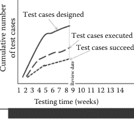

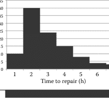

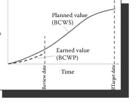

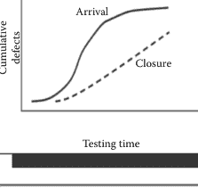

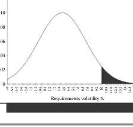

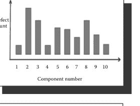

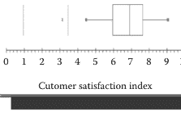

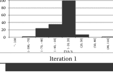

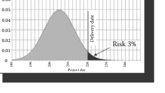

图6.1 项目仪表板。

规格限制没有意义。延迟应以实时方式衡量。时间成本取决于具体情境。例如，向大型航空航天系统交付软件时，延迟一天可能会产生巨额成本。在涉及数千家供应商的情况下，进度延误可能产生灾难性的累积效应。因此，必须使用以下度量：

```
Schedule slip = (actual schedule – planned schedule) in days
```

然后必须将时间损失转换为货币损失。因进度延误而损失的资金是比过程符合性百分比更好的度量。在一些大型项目中，1天的延误可能转化为数百万美元的损失。客户可能会对进度延误征收巨额罚款。

## 产品健康报告

产品度量结果可以按矩阵格式组织，以呈现关于每个组件的记录信息。组织这些信息的方法有很多种。一种简单的形式如下所示：

|  | 组件 1 | 组件 2 | 组件 3 | 组件 4 | 组件 5 | 组件 6 | 组件 7 | 组件 8 | 组件 9 |

|---|---|---|---|---|---|---|---|---|---|

| 度量 |  |  |  |  |  |  |  |  |  |

| 测试日期 |  |  |  |  |  |  |  |  |  |

| FP |  |  |  |  |  |  |  |  |  |

| KLOC |  |  |  |  |  |  |  |  |  |

| 设计复杂度 |  |  |  |  |  |  |  |  |  |

| 代码复杂度 |  |  |  |  |  |  |  |  |  |

| 缺陷计数 |  |  |  |  |  |  |  |  |  |

| 缺陷/FP |  |  |  |  |  |  |  |  |  |

| 可靠性 |  |  |  |  |  |  |  |  |  |

| 残余缺陷（预测） |  |  |  |  |  |  |  |  |  |

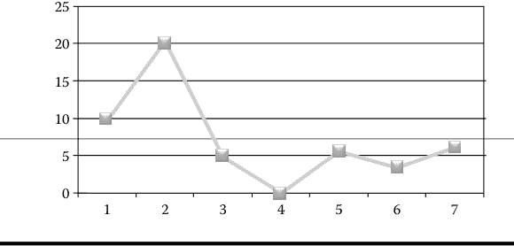

## 图6.2 进度偏差控制图

## 统计过程控制图

从收集的过程数据中，我们绘制控制图。简单的统计过程控制（SPC）技术可以用于使过程控制取得成功。控制图足以让项目团队保持警觉，交付高质量的工作产品，同时降低成本。每张图都可以使用完成各个组件的结果绘制，按时间顺序排列，如图6.2所示。这些图也被称为过程性能基线。

## 案例研究：早期规模测量

在生命周期早期测量规模具有巨大价值。在任何开发项目的最初几周，早期规模指标能在情况尚不明朗时为项目团队提供清晰度。

荷兰软件度量用户协会（NESMA）开发了早期功能点计数。根据NESMA的说法，

> 详细的功能点计数当然比估算或指示性计数更准确；但它也花费更多时间，并且需要更详细的规格说明。使用哪种类型的功能点计数取决于项目经理以及系统生命周期所处的阶段。

>

> 在许多应用中，指示性功能点计数能给出惊人准确的应用规模估算。通常，执行指示性功能点计数相对容易，因为数据模型已经可用，或者可以轻松构建。

当用例已知时，通过为不同的角色类型分配不同的权重因子，我们可以计算用例点。该度量可以在项目早期建立，并用作成本和时间的估算器。可以纳入技术和环境因素来丰富用于估算的用例点。

类似地，当开发测试用例时，可以通过为测试用例分配复杂度权重来开发一种称为`测试用例点`（TCP）的度量。TCP的总和可用于估算工作量和进度。

或者，我们可以根据软件中的界面和报告来测量对象点。

用例点、测试用例点和对象点是功能规模的变体。它们可以使用适当的比例因子转换为FP。

> *在项目启动时测量功能规模。*

> *这将使需求变得清晰，并有助于估算成本、进度和质量。*

一旦测量了功能规模，这些信息便用于估算执行项目所需的人力和时间。通过应用任何将规模与工作量相关联的回归模型，可以方便地完成这一工作。COCOMO就是这样一个模型，或者也可以为此使用自研模型。

有一种更简单的方法来估算工作量。我们可以确定需要开发的软件类型。Yong Xia确定了五种软件类型：终端用户软件（为开发者的个人使用而开发）、管理信息系统、外包项目、系统软件、商业软件和军事软件。根据类型，我们可以预测每人月的FP，范围从1000到35 [9]。使用这个转换因子，我们可以快速得出工作量估算。一旦工作量已知，我们可以再次利用现有的回归关系推算出所需时间。

早期度量捕获功能规模并得出工作量估算；测量与估算和谐地融为一体。

## 使用挣值度量的项目进度

## 跟踪进度

无论是构建软件还是摩天大楼，挣值度量都可以用来发挥优势。要构建挣值度量，我们需要进行两个基本观察：在每个里程碑测量进度和成本。

EVM的首个成就在于它将价值与成本区分开来。项目通过完成工作来赚取价值。价值的衡量方式如下：

> *工作的预算成本就是其价值。*

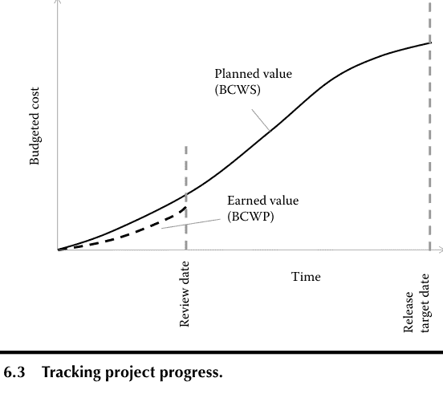

## 图6.3 跟踪项目进度。

在挣值管理（EVM）术语中，这被称为*工作预算费用*。从项目计划中可以看出项目价值如何随时间增加。随着工作的完成，项目就被称为“挣得价值”。为了衡量进度，我们定义以下度量指标。

计划价值 = 计划工作的预算费用（BCWS）

挣值 = 已完工作的预算费用（BCWP）

图6.3展示了使用这两个度量指标跟踪项目进度的示例。

一眼就能看出挣值落后于计划价值，从而以图形方式说明项目进度。这被称为*挣值图*。

## 跟踪项目成本

完成所报告工作而实际支出的费用，以已完工作实际费用（ACWP）来衡量。成本信息可以包含在挣值图中，如图6.4所示。

除了挣值图，我们还可以计算项目偏差和绩效指数等绩效指标。我们还可以使用线性外推法预测完成项目所需的时间和成本。这些度量指标列于数据6.1中。

挣值报告通常包含所有挣值度量指标，并以图形和表格形式展示项目进度和项目未来。

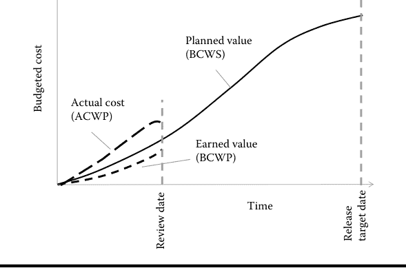

## 图6.4 跟踪项目成本。

## 数据6.1 挣值度量指标


### 核心度量指标

- 计划工作的预算费用（`BCWS`）（也称计划价值[`PV`]）
- 已完工作的预算费用（`BCWP`）（也称挣值[`EV`]）
- 已完工作实际费用（`ACWP`）（也称实际成本[`AC`]）

### 绩效度量指标

- `成本偏差 = PV – AC`
- `进度偏差 = EV – PV`
- `成本绩效指数（CPI）= EV/AC`
- `进度绩效指数（SPI）= EV/PV`
- `项目绩效指数（PPI）= SPI × CPI`
- 完工尚需进度绩效指数（`TCSPI`）

### 预测度量指标

- `完工预算 = BAC`
- `完工尚需估算（ETC）= BAC – EV`
- 完工估算（`EAC`）
    - `EAC = AC + (BAC – EV)` 乐观
    - `EAC = AC + (BAC – EV)/CPI` 最可能
    - `EAC = BAC/CPI` 最可能\*简单（广泛使用）
    - `EAC = BAC/PPI` 悲观
- `完工成本偏差（VAC）= BAC – EAC`

项目管理知识体系（PMBOK）将挣值度量指标视为项目经理的关键信息。有多种标准和指南可用于描述EVM的工作原理。例如，美国能源部（DOE）发布的EVMS标准将EVMS信息用作有效的项目管理系统，以确保项目成功执行。

## 框6.4 为什么缺少规模度量？

我们测量所构建对象的规模。如果建造房屋，我们会测量建筑面积。如果制造卡车，我们会测量其长、高、宽等参数。规模测量是工程学的标志。

在构建软件时，我们却不愿测量规模。有些人根本不测量规模。这令人失望，因为我们未能坚持软件工程。仔细想想，测量规模其实相当容易。如果我们觉得IFPUG功能点或FFP耗时且繁琐，尤其是对于大型模块，我们还有其他选择。例如，我们可以使用以下任何一种成熟度量指标：

- Albrecht功能点
- Mark II FP
- 对象点
- 测试用例点
- 用例点
- PROBE
- 特征点

Doug Hubbard的著作*《如何测量任何事物》*[10]有助于克服测量那些被认为无法测量的事物时的心理障碍。他指出，认为测量不可能是一种错觉，源于对测量的概念、测量对象和测量方法的不理解。

你可以构建自己的专有规模度量。有些人将工程规模单位作为度量指标，另一些人则发明了需求规模单位。自研的复杂度度量指标也在流传。拥有一个近似的规模度量指标，远比没有要好得多。

## 复习题

- 1. 请说明你在软件开发中选择的一种产品度量指标。
- 2. 请说明你在软件开发中选择的一种过程度量指标。
- 3. 请说明你在软件开发中选择的一种项目度量指标。
- 4. 请说明你选择的一种用于建立子过程度量指标的过程。识别并列出你所选过程的子过程度量指标。
- 5. 为什么功能点能取得成功？

## 推荐阅读

- Aczel, A. D. 和 J. Sundara Pandian，*《完整商业统计》*，McGraw-Hill，伦敦，2008年。
- *《将挣值分析应用于你的项目》*。可访问 http://office.microsoft.com/en-in/project-help/applying-earned-value-analysis-to-your-project-HA001021179.aspx。
- Astels, D. *《测试驱动开发：实用指南》*，Prentice Hall PTR，Upper Saddle River，新泽西州，2003年。
- Cem, K. *《重新思考软件度量》*，STQE，2000年3/4月。
- *《估算功能点》*。可访问 http://www.functionpoints.org/, http://www.functionpoints.org/resources.html, http://csse.usc.edu/csse/event/1998/COCOMO/18_Stensrud%20Estimating.pdf。
- *《功能点估算》*。可访问 http://webcourse.cs.technion.ac.il/234270/Spring2013/ho/WCFiles/function%20points%20estimation.pdf。
- Garmus, D. *《功能点计数简介》*。可访问 http://www.compaid.com/caiinternet/ezine/garmus-functionpointintro.pdf。
- Hunt, R. P.、P. J. Solomon 和 D. Galorath，*《将挣值管理应用于软件密集型项目》*。可访问 http://www.galorath.com/DirectContent/applying_earned_value_management_to_software_intensive_programs.pdf。
- International Function Point Users Group，*《IT测量：来自专家的实用建议》*，Addison-Wesley，2002年。
- Kitchenham, B. *《软件度量——软件过程改进的测量》*，NCC Blackwell，英国，1996年。
- Kulik, P. *《软件度量：2000年最新技术》*，KLCI，2000年。
- Kusters, R.、A. Cowderoy、F. Heemstra 和 E. van Veenendaal 编，*《软件质量的项目控制》*，Shaker Publishing，1999年。
- McBreen, P. *《软件工艺：新的当务之急》*，Addison-Wesley Professional，2002年。
- McCarthy, J. *《软件开发动力学》*，Microsoft Press，1995年。
- McConnell, S. *《专业软件开发》*，Addison-Wesley，2004年。
- Meli, R. 和 L. Santillo，*《功能点估算方法：比较综述》*。可访问 http://citeseerx.ist.psu.edu/viewdoc/download?doi=10.1.1.33.6479&rep=rep1&type=pdf。
- Norman, F. E. 和 M. Neil，*《软件度量：路线图》*，CSD QM&WC，伦敦，2000年8月。
- Parthasarathy, M. A. *《实用软件估算》*，Addison-Wesley，2007年。
- Platt, D. S. *《为什么软件很糟糕——以及你能做些什么》*，Addison-Wesley Professional，2007年。
- Putnam, L. H. 和 W. Myers，*《专家度量观点》*，Cutter Information Group，2000年。
- Wiegers, K. E. *《实用项目启动：工具手册》*，Microsoft Press，2007年。
- Woodings, T. L. *《软件度量分类法》*，Software Process Improvement Network (SPIN)，珀斯，1995年。

# 第7章

## 维护度量

### 软件维护中的框架融合

软件维护融合了三种管理风格：项目管理、运营管理和服务管理。维护度量设计正是这种融合的体现。大型维护工作受益于项目管理框架，小型任务受益于运营管理，而所有维护任务都必然遵循服务管理框架。项目方法使这一切协调一致。

> 运营让灯光保持明亮，战略提供隧道尽头的亮光，而项目管理则是推动组织前进的火车引擎。
>
> Joy Gumz

维护工程基于多种原则。一方面，我们有增强任务（适应性维护），即改变软件功能的小型项目[1]。项目管理知识体系（PMBOK）中的知识领域常被用作基本原则。另一方面，我们有快速修复缺陷的工作（纠正性维护），这更像是服务任务。管理这些任务使用运营管理、ITIL、ISO 20000和CMMi SM概念作为基本原则。这两类不同维护的度量指标在范围、性质和意图上因此有所不同。度量指标的解释反映了各自的基本原则。

偶尔，我们也会遇到完善性维护，它旨在提升软件的质量和性能。完善性维护任务是产品和过程改进项目。IEEE 标准将完善性维护定义为“软件产品交付后为提高性能或可维护性而进行的修改”。如今人们普遍认为，提升软件可靠性是一种社会责任；它能让生活更安全。为了履行这些社会期望，负责任的维护组织会收集此类度量。这些是产品和过程性能度量。此类度量的定义相当复杂，且通常基于数学模型。

在一些维护组织中，改正性维护占主导地位。有些组织则纯粹进行增强。根据北卡罗来纳州立大学 [2] 的一项研究，在其他几个组织中，这三种类型以 3:1:1 的比例共存。在部分以修复缺陷为重点的商业合同中，这一比例可能是 1:3:1。北卡罗来纳州立大学还提到，改正性维护——即快速修复——有两种形式：不带文档变更和带文档变更，比例为 2:1。

在大型系统增强合同中，例如航空航天领域，大量（数以千计）变更请求会被合并到一个开发包中，并经历长达数年的完整开发生命周期。产品的多个变体定期发布。这比常规的绿地开发项目更为复杂。为确保系统完整性得以保持，还包含了影响分析和回归测试等额外活动。对于这些项目，第 6 章建议的度量方法适用，并可予以遵循。

在维护项目中，许多数据由自动化工具收集。然而，在维护项目中构建度量和模型似乎比在开发项目中更为困难。维护任务周期较短，没有时间进行人工数据收集。工具收集的数据进入数据库（汉弗莱曾打趣称之为“只写”数据库），并由为管理层和客户准备报告的分析人员重新审视。数据，更不用说度量了，对支持团队并不那么可见。

从数据库中提取度量是根据当前目的进行的。该目的可能是每周的管理报告，或是偶尔构建性能模型。

让我们来看一些典型的维护度量。

### 专栏 7.1 维护团队是否应该度量软件可靠性？

可靠性是一种产品度量，通常被视为开发度量。然而，可靠性保证的角色会随着时间推移，从开发团队转移到维护团队。在维护任务下，可靠性可能增长，也可能恶化。许多支持团队不度量可靠性，除非合同要求这样的度量。随着软件在维护过程中不断演化，熵增开始出现，质量逐渐下降。

> 随着系统演化，其复杂性不断增加，除非采取措施加以维护或降低；此类系统的质量将看似下降，除非它们得到严格的维护并适应运行环境的变化。
>
> ——莱曼软件演化定律

> 支持团队也需要关注软件可靠性，因此必须度量可靠性，这正在成为一种隐性需求。

### 可维护性指数

如果代码是可理解、可修改和可测试的，那么它就是可维护的，这三个因素由 Syvasya [3] 提出。一条简单的规则是：

> 代码变得越复杂，其可维护性就越低。

一种广泛使用且实用的工作度量，即可维护性指数，定义如下：

`MI = 171 - 5.2lnV - 0.23G - 16.2lnLOC`

其中 `MI` 是可维护性指数，`V` 是 Halstead 体积，`G` 是圈复杂度，`LOC` 是源码行数（`SLOC`）。

早在编码阶段，程序员就可以使用该度量以系统且可衡量的方式简化代码。维护团队也可以使用同一度量来评估正在维护的应用程序。在一系列增强和功能添加过程中，可以注意保持高可维护性，甚至通过预防性维护来提高可维护性。该度量在编码和维护阶段起着基础性作用：

> 被度量的东西，会得到改进。

在软件维护演化过程中跟踪该度量，有助于调节和指导维护工作。

### 变更请求数量

一开始，软件规模沿着演化路径增长，一个版本接着一个版本。正如 Lehman 等人所指出的，只有部分软件未被修改。

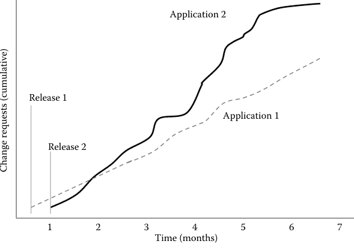

#### 图 7.1 变更请求（CR）到达情况

[4] 给出了一个示例：系统按模块计的总规模，以及每次发布时未被触及的部分，均绘制为发布编号的函数。这两个度量均以系统达到的最大规模的百分比表示。

在这种动态环境中，维护团队必须响应来自现场——即客户——的变更请求。变更请求需要被验证和分析，修复必须经过设计、构建、测试，最终发布。两个维护中应用的变更请求到达情况如图 7.1 所示。

应用 1 的变更请求呈现增长趋势，表明未来几个月会有更多变更；而应用 2 的变更请求似乎已进入平台期，表明未来几个月的变更数量可以忽略不计。变更请求数量的累积图对维护团队极具价值。它们既显示已完成的工作，又预测待完成的工作。该度量是直接计数，不涉及复杂计算。具有意义的是人眼可辨的模式。

### 客户满意度指数

度量客户满意度（`CSAT`）具有强烈的商业目的：它有助于业务增长。维护度量框架高度重视 `CSAT` 调查。

客户对缺陷修复有更直接的关注，往往会定期且频繁地填写客户满意度调查表。为 `CSAT` 调查所选的因素是独特的，类似于服务行业中使用的典型因素集。Zeithaml 和 Parasuraman 的 [5] RATER 模型度量以下因素：

- 可靠性
- 保证性
- 有形性
- 同理心
- 响应性

还会添加更多因素，并且前面提到的因素也会根据商业合同和客户的特殊要求进行定制。

针对每个因素的客户满意度使用李克特量表进行度量。然而，从 0 到 10 的连续量表更简单、更细化，并且具有优势，如下所示：

不可取 0 o—o—o—o—o—o—o—o—o—o—o 10 优秀

维护 `CSAT` 因素与开发项目中使用的因素非常不同，优先级也不同。最好与客户协商选择因素，以与客户的期望完美对齐。

`CSAT` 指数是改正性维护操作中严格收集的度量；这也是高层管理人员更常看到的度量。

### 资源利用率

维护任务量与可用资源之间总是存在不匹配。工作量不是恒定的，而是波动的。项目可能人手不足，或者资源可能闲置。

典型的维护项目以最少资源运行以降低管理成本；因此，会出现积压。然而，资源利用率度量每个月都会报告为 100%。除非结合性能和客户满意度来看，否则该度量是一种谬误。如果存在加班并且也被记录，人力资源利用率将达到 120% 甚至更高，这在行业中偶有报道。如此高的分数令人担忧；员工可能承受压力，工作质量也可能受损。疲劳会影响团队成员与客户沟通和共情的方式。该度量的健康范围在 95% 到 98% 之间。

与此度量一起，还可以使用图 7.2 所示的数据收集表单来度量团队技能指数。当团队技能指数较低时，会产生两个重大后果：客户满意度降低，并且修复缺陷需要更长时间。

维护项目 ID  
团队参考  
评估日期  
评估人  
技能评分（范围：0–10）  
技能  

| 团队成员 | 问题解决 | 平台经验 | 领域经验 | 口头沟通 | 书面沟通 | 分析能力 | 平均 |
|---|---|---|---|---|---|---|---|
| A |  |  |  |  |  |  |  |
| B |  |  |  |  |  |  |  |
| A |  |  |  |  |  |  |  |
| B |  |  |  |  |  |  |  |
| A |  |  |  |  |  |  |  |
| B |  |  |  |  |  |  |  |
| 团队技能指数（`TSI`）总体平均 |  |  |  |  |  |  |  |

- 如果 `TSI` > 8，则良好
- 如果 `TSI` < 8 但 > 5，则较差，需安排培训
- 如果 `TSI` < 5，则存在令人担忧的问题，需升级处理

#### 图 7.2 资源利用率—团队技能指数（`TSI`）。

### 服务级别协议合规性

维护合同中规定了服务级别。对每类服务的交付时间有严格的规定。例如，交付时间可能是 24 小时用于加急服务，48 小时用于下一优先级任务，一周用于常规任务，两周用于偶发任务，等等。不同任务类别有不同的绩效等级。如果交付在规定时间内完成，则符合服务水平协议（`SLA`）；如果未完成，则为不合规且构成违约。客户通过密切监控 `SLA` 来实质上控制维护团队。标准通常设计为最大限度地降低客户风险。

`SLA` 合规性指标基于计数，定义如下：

```
SLA compliance = (Number of deliveries that met SLA / Total number of deliveries) × 100
```

客户与维护组织就每个交付属性签署不同的 `SLA`，例如质量、响应时间、优先级级别和每月交付量。每月，每个指标的 `SLA` 合规性水平百分比都会被衡量。不合规可能招致罚款，因此这些指标受到尊重并得到认真跟踪。

`SLA` 指标使团队能够在设定的限制内执行。它们并不衡量精确的绩效，而只是记录 `SLA` 是否得到满足。例如，在受 48 小时 `SLA` 标准管制的临时解决方案提供过程中，代理不会报告实际时间。即使代理在 12 小时内完成工作，交付也只会在第 48 小时正式记录，因为 `SLA` 就是这么规定的。12 小时未被计入。这就是帕金森定律发挥作用的地方：

> 工作会扩展以填满可用的时间。

没有动力做到最好，而只是做到刚刚好，勉强避免处罚。在 `SLA` 下，我们永远不知道团队的真实能力。`SLA` 合规性在严格意义上是一种业务指标。

### 按时交付百分比

在所有服务属性中，时间是最关键的。构建了一个特殊指标来跟踪按时交付的 %。按时交付（`OTD`）指标因其固有的业务背景而赢得维护团队的尊重。

该指标与进度偏差（`SV`）非常不同，后者是过程指标且衡量延迟。作为过程指标，甚至延迟的幅度也被捕获为信息。在 `OTD` 中，延迟的幅度未被捕获。`OTD` 是离散指标，而 `SV` 是连续指标。`OTD` 捕获部分信息，而 `SV` 捕获完整信息。如果我们未能按时交付，衡量延迟并不会带来安慰。即使延迟很小，也不会手下留情。交付被视为失败。`OTD` 属于硬性决策的通过/失败世界。

### 增强规模

增强规模指标有助于更好地理解增强工作，同时作为成本、进度和质量的估算依据。荷兰软件度量用户协会（NESMA）指南“软件增强的功能点分析 第 2.2.1 版”将增强定义为对信息系统功能性的更改，即所谓的适应性维护。增强涉及三种可能的任务：

- 功能的增加
- 功能的删除
- 功能的变更

功能的增加按增加的 `FP` 衡量。功能的删除按 `0.40 × 删除的 FP` 衡量。变更的功能按 `影响因子 × 变更的 FP` 衡量；影响因子可取 0 到 1 之间的值。

总和称为增强规模，按如下方式计算：`增强功能点（EFP）= 增加的 FP + 0.40 删除的 FP + IF × 变更的 FP`。

前面提到的等式显示了删除和变更的影响。使用 `EFP` 是一种良好实践。

作为替代，`LOC` 也可用于判断增强规模，尽管此类指标在增强生命周期的早期可能不可用，且对估算没有帮助。令人遗憾的是，一些项目在计算中不包含已删除规模和已变更规模。

#### BOX 7.2 BUG REPAIR TIME METRIC


一名维护经理希望统计地确定团队的缺陷修复能力，并分发表格收集数据。资深工程师如实回应。每天用于缺陷修复的时间大约为 5–6 小时。一名新员工不知道如何回应，简单写道“从上午 9 点到下午 6 点，我花时间进行缺陷修复”，这句话好得不真实。新员工填写了他认为合适的数值，而不是他实际做的工作。缺陷修复时间是一个难以收集且更难验证的指标。

## 缺陷复杂度

在较低的测量尺度上，缺陷复杂度由维护工程师衡量为高、中或低。这是主观测量，但可行。

缺陷复杂度也可以在 1–10 的连续尺度上评估，10 为最复杂，1 为最不复杂。这仍然是主观的，但粒度更好，且具有数值表达的额外优势，可进行进一步计算。

对缺陷规模的客观处理考虑了驱动缺陷修复工作量的因素。在 Andrea De Lucia [6] 的一个模型中，所需任务数量和应用规模被视为因素，并构建了这两个因素与工作量之间的线性回归方程。

衡量缺陷复杂度的目的是利用答案预测缺陷修复工作量。也就是说，目的是构建一个估算模型。在分析期间，此类估算通常由维护工程师即时进行。因为对缺陷的分析是为了修复缺陷，而不是为了构建模型，所以不建议探索额外因素或增加测量的深度。缺陷修复是主要目标，模型构建是伴随的。此外，我们不需要对缺陷修复工作量进行非凡的精确估算；我们需要一个合理有用的指标。

> 不要用游标卡尺测量，用粉笔标记，用斧头切割。

测量之墨菲定律

构建估算模型有几种同样简单的方法，包括类比估算和基于代理的估算。

因此，缺陷复杂度是以有意识选择的近似程度来测量的。之后，这将影响工作量偏差指标。

## 工作量偏差（EV）

工作量偏差指标的公式与之前相同：

```
Effort variance = (Actual effort − Estimated effort) / Estimated effort × 100
```

然而，上下文和解释在维护中发生了变化。该指标可轻松应用于估算执行得相当好的增强项目，且指标据此具有完整含义。计算工作量偏差两次是有益的，首先使用初始估算，然后在变更请求得到更好理解后使用修订估算。即使在第二次估算之后，第一次估算仍用作预算控制指标，第二次用作过程控制指标。

在缺陷修复中，由于估算的近似性，工作量偏差只能近似计算。

## 进度偏差（SV）

SV 指标被视为与工作量偏差相同。通常，这仅限于增强项目，而不实施于缺陷修复任务，原因主要有两个：缺陷修复受 SLA 严格控制，且实际修复时间不可用。很多时候，缺陷修复是在没有估算的情况下进行的。

## 质量

### 增强的质量

质量指标通过将缺陷计数除以规模计算，并表示为每 EFP 的缺陷数。每个版本的质量都会被监控。

### 缺陷修复的质量

有时，维护活动无意中损害质量；在修复一个缺陷时，可能会引入另一个缺陷。在典型的缺陷修复环境中，支持团队不知道已修复的缺陷是否在现场重新出现。如果同一缺陷再次出现，人们可能仍无法检测到这种到来，因为没有可追溯性。由使用触发的故障很少会为缺陷修复者所知。缺陷到达率通常与质量无关，因为没有人将点连起来。在这种流动的情况下，除非定义并收集质量指标，否则无法了解和改进正在维护的软件的质量。然而，此类步骤需要与客户协商并且被视为业务需求。如果质量提高，维护成本将会下降，客户将受益；但预防性维护必须付费。

## 生产率

生产率可以用不同的方式表达。我们建议使用人月人均 EFP 指标。该指标最终控制维护成本；有助于成本控制。

对于衡量缺陷修复生产率，每人月修复数量可以作为一个基本指标。

衡量生产率很直接，但从贡献因素估算生产率则不然。如果指标包含估算（从更广泛的意义上说是合理的预期），那么使用 COCOMO 等模型也可能在我们的范围内。

## 修复时间 (TTR)

这是由缺陷跟踪工具自动收集的指标。如果想改进缺陷修复流程，对其进行优化并实现卓越，可以收集诸如（1）复现时间、（2）分析和设计时间以及（3）实现和测试时间等子流程指标。这些子流程指标可以通过快速调查获得。缺陷跟踪工具可能无法收集子流程指标。此类调查不定期进行，以获取改进流程的信息。完全有可能在更细粒度的层面上收集指标，如果成本由预期收益证明的话，可以分别衡量分析时间和设计时间。可以更进一步，应用精益技术，如价值流图分析、等待时间分析和空闲时间分析。该指标将有助于使运营更高效。

最重要的是，在组织达到高度成熟并且人们自愿提供“个人”数据之前，通常不会选择子流程指标进行常规数据收集。然而，无论粒度如何，缺陷修复时间都是软件工程中最有效、最美妙的指标之一。

### BOX 7.3 THE QUEUE

缺陷形成一个队列，客户等待修复。客户满意度随着响应时间和质量的提高而增加；两者都依赖于人力资源。当资源利用率为 100% 时，客户满意度低于最佳水平。当资源利用率为 90% 时，客户满意度会提高。寓意：必须保持一定的人力储备以提高客户满意度，二者之间存在权衡。维护组织保留缓冲资源，并在资源利用率低于 100% 的情况下运营，因为失去客户满意度的成本更高。

## Backlog Index

该指数衡量积压队列中缺陷的百分比，并代表维护项目中的运营挑战。

## 缺陷分类

分类是分类数据。为了更好地理解缺陷，它们在缺陷跟踪数据库中被分类。典型字段有来源、原因、触发因素、类型和解决方案。可以添加更多；可考虑使用 ODC。定期分析缺陷在各种分类中的分布是对问题的良好揭示。

## 修复质量

缺陷修复可能存在问题。缺陷可能重新打开并导致返工和延迟。可以衡量首次修复正确的缺陷修复百分比。返工可以衡量以控制成本。

## 重构指标

为了通过重构提高软件质量并降低维护成本，我们衡量耦合度和圈复杂度。耦合度衡量模块之间的数据流。圈复杂度衡量模块结构中的复杂性。

## 可靠性

在维护下的产品可靠性可以从“故障强度”计算得出，即每月报告的缺陷数量。从该指标，我们可以判断产品是正在恢复还是崩溃。累积发现缺陷的时间序列图称为 *可靠性增长曲线*，可作为可靠性的视觉表示。平均故障间隔时间也可以计算。

## 基于指标的仪表板

我们将考虑构建用于管理软件维护的图形仪表板的七个主要指标。其他指标数据可以以表格记录的形式呈现。用于图形展示的指标选择完全取决于维护团队。Stark 使用以下指标 [6]：

- 1. Backlog
- 2. Cycle time
- 3. Reliability
- 4. Cost per delivery
- 3. Self-regulation—a system evolution process is self-regulating with distribution of product and process measures close to normal.
- 4. Conservation of organizational stability (invariant work rate)—the average effective global activity rate in a system is invariant over product lifetime.
- 5. Conservation of familiarity—a system evolves all associated with it; developers, sales personnel, and users, for example, must maintain mastery of its content and behavior to achieve satisfactory evolution. Excessive growth diminishes that mastery. Hence, the average incremental growth remains invariant as the system evolves.
- 6. Continuing growth—the functional content of a system must be continually increased to maintain user satisfaction over its lifetime.
- 7. Declining quality—the quality of a system will appear to be declining unless it is rigorously maintained and adapted to operational environment changes.
- 8. Feedback system evolution processes constitute multilevel, multiloop, and multiagent feedback systems and must be treated as such to achieve significant improvement over any reasonable base.

## 复习问题

1. What is the most important metric in adaptive (enhancement) maintenance?
2. What is the most important metric in corrective maintenance?
3. What is the most important metric in perfective maintenance?
4. Which among the previously mentioned three metrics is the toughest to collect?
5. If you were to design a dashboard for a support project and if you were asked to limit the number of metrics to just seven, which seven would you choose?

### 练习

1. Develop a metrics list for a support project if the adaptive–corrective–perfective maintenance task ratio is 3:10:2.
2. Develop a metrics list for an exclusive support contract for the perfective maintenance of software with an express goal of improving maintainability.

### 参考文献

1. NESMA, Function Point Analysis for Software Maintenance Guidelines, Version 2.2.1, Professional Guide of the Netherlands Software Metrics Users Association, Netherland 2009.
2. NC State University Communication. Available at `http://agile.csc.ncsu.edu/SEMaterails/MaintenanceRefactoring.pdf`.
3. C. V. S. R. Syavasya, An approach to find out at which maintainability metric, software maintenance cost is less, *International Journal of Computer Science and Information Technology*, 3(4), 4599–4602, 2012, ISSN:0975–9646.
4. *Journal of Software Maintenance and Evolution: Research and Practice*, John Wiley & Sons, Ltd.
5. V. Zeithaml, A. Parasuraman and L. Berry, *Delivering Quality Service*, Simon and Schuster, 1990.
6. G. E. Stark, *Measurements to Manage Software Maintenance*, Technical Note, The MITRE Corporation, Colorado Springs, CO, July 1979.

# 建议阅读

Aczel, A. D. and J. Sounderpandian, *Complete Business Statistics*, McGraw-Hill, London, 2008.

Available at `http://www.refactoring.com/`.

Available at `http://wiki.java.net/bin/view/People/SmellsToRefactorings`.

# 第 8 章

## 软件测试指标

第 1 章和第 5 章中讨论的指标的广泛益处同样适用于软件测试。虽然测试是完整生命周期的一个部分，但它已成为一种独特类型的项目，具有其自身独特的目标。测试是为了发现缺陷并提高产品质量而进行的。任何项目的三个目标，即更快、更好、更便宜，也适用于测试。指标将有助于推动测试达到更高水平。

## 项目指标

测试项目指标的定义与任何项目中的指标定义完全相同，具有相同的含义和目的。项目指标有助于节约项目资源并使其得到最佳利用。项目指标跟踪需求变更，并在需求变更威胁项目时帮助采取纠正措施。项目指标也有助于满足客户。

## 进度偏差

在测试项目中，按时交付很重要。随着测试里程碑的完成，衡量时间和进度偏差将为团队提供反馈，以努力满足交付计划。

## 工作量偏差

在预算工作量内完成测试是下一个关注点。工作量偏差指标将有助于控制测试成本。

## 成本

每次发布的测试成本都会被衡量。成本差异追踪超出预算支出的金额。除了人力成本外，我们还需要考虑工具和外包方面的投入，并查看是否能在预算内执行测试。

## BOX 8.1 测试中的 S 曲线

测试中使用了几种 S 曲线。累计缺陷到达是第一条曲线。这也被称为可靠性增长曲线。该曲线在平台期结束，超出该平台期后进一步测试不会发现缺陷。产品据我们所知已变得稳定，可以发布。累计执行的测试用例是另一条 S 曲线。该 S 曲线的模式能说明很多关于测试进展的性质和质量。有经验的测试人员可以解读这种模式并做出适当的决策。

## 人力生产率

从项目管理的角度来看，我们查看每个测试人员发现的缺陷数量。结果用于向测试人员提供反馈，从而改善测试结果。缺陷发现率是作为团队生产力指标使用的指标之一。

## 需求稳定性

测试紧密跟随需求。测试用例映射用例。因此，测试中最大的不确定性是需求稳定性。这会被衡量并跟踪。需求稳定性指数 RSI，也称为需求波动性，定义如下：

```
RSI = (原始需求 + 需求变更 + 需求新增 + 需求删除) / 原始需求
```

RSI 是可能已存在于整个开发项目指标系统中的指标之一。只需重复使用即可。

## 资源利用率

从运营角度来看，资源利用率是一个关键指标。该指标扩展到工具、系统和人员。

## 客户满意度

最终，测试是一种服务。客户满意度必须通过开展调查来衡量以提高服务质量。

## 测试有效性

该指标捕获测试发现的缺陷百分比。当然，测试团队的拉伸目标是达到 100% 的有效性。该指标定义如下：

```
测试有效性 = 测试发现的缺陷 / 测试发现的缺陷 + 业务用户发现的缺陷
```

## BOX 8.2 衡量测试自动化的投资回报率

自动化测试用例是好的。测试自动化需要创造力。仔细指导测试自动化将带来成本节约。为了确保自动化保持盈利，我们引入了一个指标，即测试自动化的 ROI。

回归测试可以自动化；ROI 很大。当手动测试困难或不可能时，需要自动化。测试场景的模拟手动执行困难，最好通过自动化执行。在某些特殊情况下，例如测试固件，自动化是唯一的方法。在测试缺少上层或下层的中间层时，自动化是唯一的方法。

自动化投资可能在当前项目之外产生收益。工具必须足够通用以满足不同项目的需求。工具不必旨在解决单个项目的需求；它必须计划以满足即将到来的项目的需求。它是一种组织资产。

自动化带来的 ROI 可能从两到十不等，通常如此。

## 流程指标

测试流程通过多个指标进行管理，在测试生命周期中持续跟踪。其中一些指标累积绘制以得出更深层的含义。

## 缺陷移除效率

该指标在测试项目中用于特殊上下文。在其他上下文中该指标有其他定义。测试中的缺陷移除效率 DRE 表示每单位时间移除的缺陷数量，定义如下：

```
DRE = 缺陷数量 / 检测时间 + 解决时间 + 重新测试时间
```

该数字的倒数称为缺陷周转时间 TAT，定义如下：

```
TAT = 1 / DRE
```

## 测试用例计数

我们可以累积计算到所选查询时间点为止设计的、执行的和成功的测试用例数量。如果将此计数绘制为如图 8.1 所示的累积图表，则更有意义。这些图表衡量测试用例数量的动态变化。

这些图表中可以辨认出一些有用的指标：成功测试用例的百分比和已执行测试用例的百分比。这两个指标为

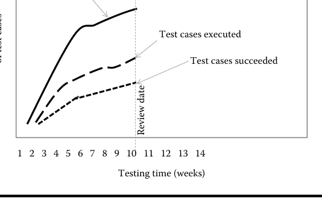

图 8.1 累计测试用例计数。

为测试管理提供有用的反馈。测试团队会努力填补这些方面的空白。前者指的是高质量的测试用例。后者涉及执行测试用例的承诺。

## 测试覆盖率

### 功能覆盖率

了解测试用例覆盖的需求比例至关重要。这是简单且最广泛使用的测试覆盖率指标。该指标有助于控制和提高覆盖率，使应用程序对客户更具可用性。随着测试的进行，覆盖率将根据该指标增加，在理想情况下将达到 100%。

### 代码覆盖率

另一种覆盖率指标追踪测试用例覆盖的代码比例。


> 覆盖率有助于消除测试套件中的空白。

这是一个脆弱的指标。更高的覆盖率并不意味着质量更好的保证。有经验的测试人员知道对此采取平衡的观点，并确保已达到最低覆盖率并且关键路径已被覆盖。


> 代码覆盖率是一个非常有用的指标。

> 然而，你需要知道如何使用它。

覆盖率指标工具可用于跟踪行、语句、块、决策、路径和条件覆盖率。它们提供出色的报告，具有回溯功能并有助于实现更高的测试效率。


## BOX 8.3 单元测试缺陷数据

单元测试具有成本效益。它提高可靠性。它揭示了否则狡猾的错误。单元测试需要设计知识，最好由具有设计知识的测试人员执行。为了获得最佳效果，测试人员可以与设计师和开发人员合作。彻底程度和文档水平取决于测试策略和目标。然而，通常情况下，单元测试记录不佳，单元测试缺陷未输入到错误跟踪器中。除了项目目标和领导力驱动外，设计师几乎没有太多动力。

> > 程序测试可用于显示错误的存在，但永远不能证明其不存在。

> >

> > — **Dijkstra**

一些组织在获取单元测试缺陷数据方面取得了部分成功。至少，他们收集每个模块的缺陷计数。缺陷计数只是部分数据，因为并非所有缺陷都被计数。即使是部分缺陷数据也有助于在正式测试周期开始之前了解产品中的缺陷。

## 坏修复百分比

这是一个子流程指标，控制缺陷解决的质量。坏修复包含测试中的技术风险，除此之外还助长返工成本。除了较差的解决方案外，修复现有错误有时会创建额外的错误或暴露其他错误。

## 产品指标

测试的最终目的是评估和衡量被测软件 SUT 的质量，因此产品指标在测试中的重要性。

## 缺陷计数

### 缺陷到达率

每天检测到的缺陷数量即为缺陷到达率。发现的累计缺陷数量可以绘制为模式。

### 缺陷关闭率

每天关闭的缺陷数量即为缺陷关闭率。该数量的累积图是缺陷关闭模式。图 8.2 显示了关闭模式与到达模式。两者之间的差距具有不言自明的含义。图显示检测过程几乎完成，而关闭似乎仍在进行中。

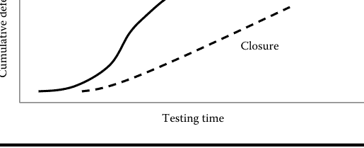

图 8.2 缺陷到达关闭模式。

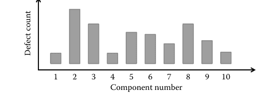

图 8.3 每个组件的缺陷。

## 组件缺陷计数

可在各个组件中单独分析发现的缺陷。图 8.3 显示了每个组件发现的缺陷的条形图。该图揭示了一些组件的缺陷倾向。

## 组件缺陷密度

当缺陷计数被标准化（除以）规模时，我们可以计算指标缺陷/功能点 FP；我们获得了有关每个组件质量水平的最新信息。现在有客观依据来比较组件质量。这些数据可以在第一次测试时获得，并在后续测试迭代中更新。第一轮的结果是质量水平的相当好的指标。这将作为制定剩余轮次测试计划的指南，并有助于捕获更多缺陷。

## 方框8.4 冒烟测试缺陷密度

冒烟测试非常有用；它们缩短了测试周期。它们确保代码正常工作并且构建稳定。它们应能够暴露主要问题。计算每个组件的冒烟测试缺陷密度具有启发意义。冒烟测试缺陷密度是组件风险的指标，也是问题的早期预测器。度量的真正威力在于用于预测时。冒烟测试简单、快速且廉价，但冒烟测试缺陷密度却是无价的。

冒烟测试必须在需求阶段确定。

例如，安全需求可以在项目早期进行冒烟测试。

冒烟测试设定了开始测试执行的最低准入标准。

## 缺陷分类

在缺陷捕获期间，我们可以记录缺陷的不同属性：缺陷类型、缺陷严重性、注入阶段、触发条件、原因和复杂度。然后，我们可以根据每个属性对缺陷进行分类，并得出关于缺陷总体的广泛视角。分类也是一种度量。缺陷属性分析报告是提供给开发团队以支持缺陷预防的宝贵输入。

## 测试规模：测试用例点

测试用例点（TCP）也可以用作整个软件开发项目的估算器。

测试规模可以用TCP来衡量。每个测试用例根据测试用例复杂度和测试用例类型分配一个权重。测试用例复杂度取决于测试数据、检查点和前置条件。权重如下：

- 检查点 1

- 前置条件 1, 3, 5

- 测试数据 1, 3, 6

权重分配规则由Nguyen等人提供[1]。使用上述权重计算未调整的测试用例点。根据测试用例类型进行调整。在一个案例研究中，作者报告：“系统中总共1631个测试用例的估计TCP数为8783，平均每个测试用例5.4个TCP。”总TCP代表测试规模，可用于估算完成测试所需的工作量和时间。此外，在一项实验中，Nguyen等人指出，测试人员平均花费3.21分钟执行每个TCP。

Patel等人[2]扩展了TCP计算。他们分别针对测试用例生成、手动执行和自动执行确定了TCP。在这些计算之后，他们将所有TCP相加，以确定测试的总TCP。

## 风险度量

测试风险使用FMEA表进行度量，并以风险优先数（RPN）表示。

> 失效模式是程序可能失效的方式。

他们编制了一份涵盖不同质量标准的失效模式目录。该目录非常详细，可作为测试人员的有用参考。Jha和Kaner编目的这些失效模式是领域特定的；测试人员必须利用经验和知识，在软件测试中识别其失效模式。

> 经验丰富的测试人员了解软件中的失效模式。

在识别出失效模式后，使用RPN对其进行优先级排序。然后首先开发测试用例以覆盖前20%的风险。此类输入帮助测试人员使用“基于风险的测试”范式来规划测试。这使得测试人员能够从小规模集合开始，从结果中学习，并逐步推进。Kaner[4]倡导基于风险的测试优先级排序、测试游说和测试设计。

对于每个功能，我们可以度量RPN并对测试功能进行优先级排序。对于每个产品，我们可以度量RPN并对测试区域进行优先级排序。

> 为编号较大（RPN）的区域分配更多资源并提前进行测试。

>

> Cem Kaner

风险度量的目的是确定优先级、减少测试、提前测试，以及获得更多知识。

## 预测质量

随着测试的进行，被测系统（SUT）的质量将逐步得到度量。在测试进行到一半时，我们有足够的数据来预测完成测试执行时产品的质量水平。我们应能够预测在执行测试并发布应用程序后的残留缺陷。基于此预测，一旦达到目标质量水平，我们就可以决定停止测试。如果质量水平定义为99.999%的代码正确，且预测显示仅有0.001%的缺陷未被发现，我们就可以发布应用程序。

在此背景下，所有测试度量的目的都是做出这一预测。第21章描述了一种预测缺陷的方法。

## 测试自动化度量

测试自动化需要特殊的努力，几乎本身就是一个项目。自动化承诺能快速发现手动测试无法发现的缺陷。这提高了SUT的质量。

自动化可能是一项巨大的工程，尤其是对于大型项目。

> Windows NT 4拥有600万行代码，以及1200万行测试代码。

通过使用测试自动化度量，可以更好地管理这项巨大工程，并能在SUT中发现更多缺陷。


## 投资回报

自动化的投资回报（ROI）是一种证明自动化合理性的战略性度量。ROI的简单公式是直接比率，如下所示：

ROI = Cost saved by automation / Cost of automation

自动化的成本节省通常分布在受益于自动化脚本的多个项目中；仅从单个项目信息计算ROI是不公平的。

## 可自动化百分比

测试自动化中的另一个领先度量是%可自动化。该度量必须提前确立：

% Automatable = Number of test cases that can be automated / Total number of test cases × 100

决定要自动化的测试用例是一个关键决策。并非每个测试用例都可以自动化。某些缺陷只能通过缓慢的手动测试发现。虽然速度是一种优势，但只应自动化部分测试用例。

## 自动化进展

要跟踪自动化项目，我们可以通过设置以下度量来衡量自动化进展：

```
Automation progress = \frac{Number of test cases actually automated}{Test cases selected for automation} \times 100
```

## 案例研究：缺陷年龄数据

缺陷年龄是业界非常知名的度量，但只有少数组织收集该度量。缺陷在产品中从注入到解决所花费的时间就是缺陷年龄。如果已设置并填充了适当的字段，则可以从缺陷跟踪器中的缺陷数据计算该值。所需字段是注入阶段和检测阶段。现在很明显，缺陷数据库在整个项目生命周期中都会维护。此外，注入阶段列中的信息只能通过因果分析期间的推理获得，而不是来自日志。测试中的“数据”一词甚至包括经过推理的直观判断。

```
Defect age = 1 + phase detected – phase injected
```

有些人使用不包含“1”的公式；他们只识别增量差异，并选择将基准值设为0。如果在注入缺陷的同一阶段检测到该缺陷，则缺陷年龄为1。如果在下一阶段发现，则缺陷年龄为2。如果在需求阶段注入缺陷但在测试阶段发现，则缺陷年龄为4。

本案例研究涉及一个测试项目，其缺陷数据库有32个字段，原始数据相当丰富。然而，尽管存在可能性，却没有人推导出缺陷年龄度量。

发布后很久，QA分析师的数据挖掘揭示了缺陷年龄度量。从现有数据创建该度量的动机来自一个意想不到的方向。管理人员要求建立一个缺陷经济模型，而驱动成本的因素之一显然是缺陷年龄。该模型构建中的支持度量是发现缺陷的成本和修复缺陷的成本。这两者都可以从数据库中可用的数据计算得出。发现缺陷的成本被标记为评估成本的一部分，而修复的成本

缺陷被标记为返工或质量差的成本是质量成本框架的显而易见的影响。然而，这些指标是作为缺陷年龄研究的一部分报告的，而不是 COQ 研究。缺陷的生命周期比正式框架更贴近人们。测试人员认为 COQ 是高级管理人员的一个更大指标。

在其他地方，质量成本也在测试过程中计算。COQ 使用三个组成部分：预防、鉴定和失败。失败意味着对测试用例的返工和重新测试，鉴定是指评审，而预防包括培训和缺陷预防工作。

创建缺陷年龄指标的目标是通过发现缺陷年龄与缺陷成本之间的关系来建立成本模型。

> > 最重要的质量指标是失败成本。

> >

> > — **Crosby**

设计人员不希望将缺陷成本视为失败成本，但测试人员这样认为。尽管存在争议，缺陷年龄指标已成为潜在指标。存在一种工程概念，即缺陷年龄反映产品可靠性。缺陷年龄越小，可靠性越高。项目团队努力减少缺陷年龄。

创建缺陷年龄指标的另一个目的是检查缺陷修复成本的 1:10:100 规则。该规则指出，如果早期修复缺陷的成本为一美元，则后期修复的成本将呈指数级增长。根深蒂固的缺陷难以发现且修复成本高昂。数据显示，在该项目中，该规则为 1:2:4.2。当缺陷年龄增加时，成本没有急剧上升。

## Review Questions

- 1. How many metrics would you use in a test dashboard in a testing project?

- 2. What are the metrics that can be used in unit testing?

- 3. What are the metrics that can be used in smoke tests?

- 4. Suggest simple ways of assessing reliability of software before release.

- 5. What metric data will be used while making a decision about stopping testing?

- 6. Compare test effectiveness with test efficiency.

- 7. Mention the names of two commonly used S curves in testing.

- 8. Relate defect age to the cost of testing. In your opinion, what would be the expression for such a relationship?

## Exercises

- 1. Develop a minimum set of metrics you would maintain for a testing agency who provides testing services to software developing companies.

- 2. Develop a risk metrics system for risk-based testing in a software development project.

- 3. Suggest a matrix format for checking requirement traceability with test cases.

- 4. Develop a metric system to be used for managing test automation.

- 5. Develop a template for a one monthly test report based on metric data. Mention the names of metrics and the charts you would use.

## References

- 1. V. Nguyen, V. Pham and V. Lam, *Test Case Point Analysis: An Approach to Estimating Software Testing Size*. http://csse.usc.edu/csse/TECHRPTS/2007/usc-csse-2007-737/usc-csse-2007-737.pdf.

- 2. N. Patel, M. Govindarajan, S. Maharana and S. Ramdas, *Test Case Point Analysis*, White Paper Version 1.0, Cognizant Technology Solutions, April 11, 2001.

- 3. K. A. Jha and J. D. Cem Kaner, *Bugs in the Brave New Unwired World: A Failure Mode Catalog of Risks and Bugs in Mobile Applications* (personal communication). Copyright © 2003.

- 4. C. Kaner, Risk-based testing: Some basic concepts, *QA Managers Workshop*, April 2008.

## Suggested Readings

Kaur, A., B. Suri and A. Sharma, Software testing product metrics—A survey, *Proceedings of National Conference on Challenges & Opportunities in Information Technology (COIT-2007)*, RIMT-IET, Mandi Gobindgarh, March 23, 2007.

Kelly, D. P. and R. S. Oshana, Improving software quality using statistical testing techniques, *Information and Software Technology*, 42, 801–807, 2000.

Nirpal, P. B. and K. V. Kale, A brief overview of software testing metrics, *International Journal on Computer Science and Engineering*, 3(1), 204–211, 2011.

Poore, J. H. and C. J. Trammell, *Application of Statistical Science to Testing and Evaluating Software Intensive Systems*. Available at http://sqrl.eecs.utk.edu/papers/199905_cjt_hmc.pdf.

Prabhakar, J. Test execution through metrics, *STEP-AUTO Conference*, Bangalore, Test Management, September 19, 2007.

# Chapter 9

## Agile Metrics

敏捷指标的目的和特点与《敏捷宣言》相呼应。

> Individuals and interactions over processes and tools.

> 

> Agile Manifesto

适当的敏捷指标设计和实施可以增加价值并实现敏捷的软件开发方式。

### BOX 9.1 ANALOGY: DECIBELS

人耳将声波转化为音频信号。当声波强度增加十倍时，人耳的反应增加 1 点。当声强增加一百倍时，人耳记录的强度为 2 点。反应是对数式的。声级以分贝为单位测量，本质上是声波强度的对数。

| Sound Intensity | Relative Response of Ear |

|---|---|

| 10 | 1 |

| 100 | 2 |

| 1000 | 3 |

| 10,000 | 4 |

| 100,000 | 5 |

耳朵能够轻松处理和响应极其宽广的声强范围。

地震强度也以对数刻度即里氏震级表示。当地震力在里氏震级上增加一点时，实际释放的能量增加 10 倍。

故事点与这些对数刻度相似。故事点可以容纳广泛的实际软件规模，并以个位数呈现。

## Classic Metrics: Unpopular Science

经典软件指标已成为不受欢迎的科学，至少在某些方面是这样，因为软件工程的演变。一些严格的指标使真相变得难以获取，而设计不良的指标则成了面具；它们不是揭示真相，而是隐藏真相。模糊的指标使情况更糟，因为它们存在多种解释。大多数经典指标都不是直接的。


例如，工作量差异很少基于实际花费的工作量，而是基于允许的数字。工程师一天可能花费 14 小时，但被要求只输入 8 小时，因为这是可计费的金额，客户不为加班付费。在这种情况下，指标助长了虚伪，正是它试图打击的邪恶。用户需要“理解”隐藏的背景并猜测隐藏的含义。

在受服务水平协议管辖的业务中，进度差异毫无意义，但仍在指标计划中提及。数字被输入以填补报告；项目中的任何人都不会认真对待此类指标报告。

生产率指标和企业对生产率的目标是永恒冲突的来源。所有任务类别都设定了共同目标，无视底层工程原则和流程能力的差异。在这种情况下，没有人相信生产率数据。

这已将许多组织推入这种自毁局面。因为审计人员坚持要求数据良好作为流程控制良好的证据，人们会删除“异常值”——以及真相。指标数据中的错误被消除，破坏了学习的可能性。

*压力要求指标以完全非科学的方式呈现生活的完美图景。*

*指标在被滥用时，建立了完美的幻觉和科学迷信。*

也有例外。确实存在指标使用者，但他们太少，无法扭转对指标的舆论。


> I believe in metrics, not politics.

**Narayana Murthy**

*Chairman, Infosys*


### BOX 9.2 MEDICAL ANALOGY: MRI SCAN AND PULSE READING

医生要求对头部进行 MRI 扫描以治疗头痛。他想排除可能的病因：脑部血栓。MRI 扫描是一种昂贵且复杂的程序。医生正在进行因果分析。扫描结果正常，医生继续追查头痛的其他原因，费用由患者通过试错承担。最后，患者的头痛仍未治愈。

患者决定接受自然疗法治疗。熟练的医生读取他的脉搏，了解问题，并建议一个月进行理疗锻炼和瑜伽。患者痊愈了。

敏捷指标类似于读取脉搏。数据便宜、简单、快速；解决方案是自我修复。脉搏读数对训练有素的医生来说比 MRI 扫描揭示更多。

## Two Sides of Classic Metrics

尽管存在诸多问题，经典指标仍有所裨益。人们学会了使用数字，至少在他们想使用时，首先通过模仿最佳实践，后来通过获得的能力。经典指标一直具有巨大的潜力（尽管未被充分利用）。那些遵循个人软件流程（PSP）指标的组织确实受益：他们减少了缺陷。Humphrey 关于数据驱动纪律的愿景

在某一方面工作；组织展示了投资回报率（ROI）。在另一方面，PSP 指标并不受欢迎，并遭到团队的抵制。PSP 指标有好有坏。人们想要更简单的解决方案，并将 PSP 指标搁置一旁。

自动化指标得以保留，它们依赖于工具，人们只需使用数据而无需收集数据。仅此一点就带来了巨大差异。缺点是，没有人有动力使用工具收集的数据。看似的收益变成了损失。此类数据除以报告和商业智能的形式外，与人们的联系并不紧密；预期的接收者是高级管理人员和客户。设计师和测试人员并不关心。

简单的核心指标是好的，而且它们有效。花哨的特殊指标无效。计划的指标和使用中的指标相差甚远。至少指标有助于目标设定。使用指标的流程控制循环过于迂回，并且存在时间滞后，等到报告出来时项目已经结束。即使是核心指标也未能及时传达到团队。反馈回路在途中消失了。人们很注意安装一个指标，但没有人考虑人际沟通。


> 没有与人的沟通联系，指标就会失败。

## 敏捷的指标：人性化

敏捷项目将人置于流程之前，并使指标人性化。敏捷指标通过展示的图表和日常会议即时传达给人们。指标本身保持轻量、用户友好且直接。代码复杂度被衡量为高、中或低，而不是使用复杂的 McCabe 复杂度数值。软件规模以故事点表示；无需使用国际功能点用户组繁琐的规则来计算功能点。更重要的是，指标被 readily 使用。图形元素在可能的情况下已成为指示符而非数值指标。燃尽图一次取代了多个指标。敏捷指标影响日常决策。

## 人性化的代价

敏捷指标数据大多处于顺序尺度（如“高–中–低”判断）。顺序数据可以快速且无麻烦地收集。顺序数据也具有一定程度的计算近似。对比是精确但使用率低的经典指标数据与近似但人性化的敏捷数据。在较低尺度下工作会造成信息损失，这是我们为实现人性化而付出的代价。然而，如果用户意识到近似程度，这种损失并不会使敏捷指标比经典指标不科学。

> 科学的目标不是打开通往无限智慧的大门，而是为无限错误设定界限。

> 

> **Bertolt Brecht**

> *Life of Galileo*

> 有时，一个明确定义的错误是发现真理的唯一途径。

> 

> **Benjamin Wiker**

> *The Mystery of the Periodic Table*

## 常见的敏捷指标

### Velocity

敏捷速度是每个冲刺交付的故事点数。这是团队交付经过测试的功能的速度。为了充分利用这一指标，冲刺（或迭代）必须保持一致的长度。

### Story Point

这是一种敏捷的软件规模指标，是经典功能点的敏捷对应物。故事点是对大小的文本指标的数值表达：非常小、小、中、大、非常大等等。由于人类判断是非线性尺度，我们更喜欢非线性数字顺序：1, 2, 3, 5, 8, 13, 21, 34, 55, 89, 144, 233,..., 斐波那契数列。在斐波那契尺度中，可以使用以下转换表来表达软件规模。

| Software Size | Story Point |

|---|---|

| Very low | 1 |

| Low | 2 |

| Medium | 3 |

| Large | 5 |

| Very large | 8 |

| Extremely large | 13 |

| Next level | 21 |

软件需求被拆分为称为 *user stories* 的小型功能。故事点尺度用于判断“用户故事”的大小。


> *User stories are analogous to the classical use cases.*

> *Story Points are analogous to Use Case Points.*

### Technical Debt

每个迭代发现的缺陷数量。

### Tests

已开发、执行并通过以验证一个故事的测试数量。

### Level of Automation

测试自动化的百分比。

### Earned Business Value (EBV)

交付的故事所附带的业务价值。根据 Dave Nicolette 的说法，“EBV 可以以基于预期投资回报率（ROI）按各功能或用户故事分摊的硬性财务价值来衡量。”

### Burn-Down Chart

燃尽表示项目剩余工作量与剩余人力资源的对比。此信息可以每周呈现，直至完整发布。燃尽图是用于跟踪进度的著名敏捷可视化。图 9.1 显示了燃尽图的示例。

常见做法是为每个团队和每个迭代绘制燃尽图。这为团队提供了必要的生物反馈，以控制积压工作并及时实现迭代目标。

### Burn-Up Chart

燃起表示已完成的工作。图 9.2 说明了燃起图（BUC）。

y 轴是迭代迭代累积的故事开发图。理想绩效线沿实际绩效线绘制，以提供指导并衡量绩效差距。BUC 可用于同时开发多个故事时。这是一个已构建的故事和已完成工作的图表；它记录成就而不仅仅是活动。

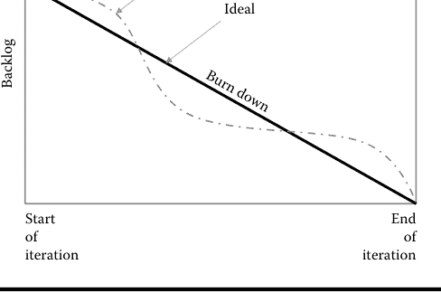

Figure 9.1 Burn-down chart.

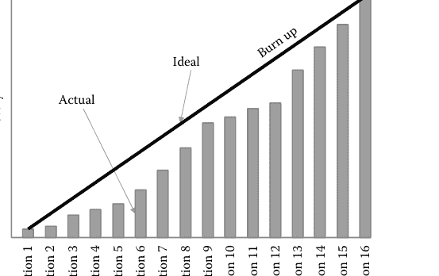

Figure 9.2 Burn-up chart.

### Burn Up with Scope Line

如图所示 9.3 所示带有范围线的 BUC 具有优势。范围变更可以用这种形式表现，而在其他两种图表中则不容易。

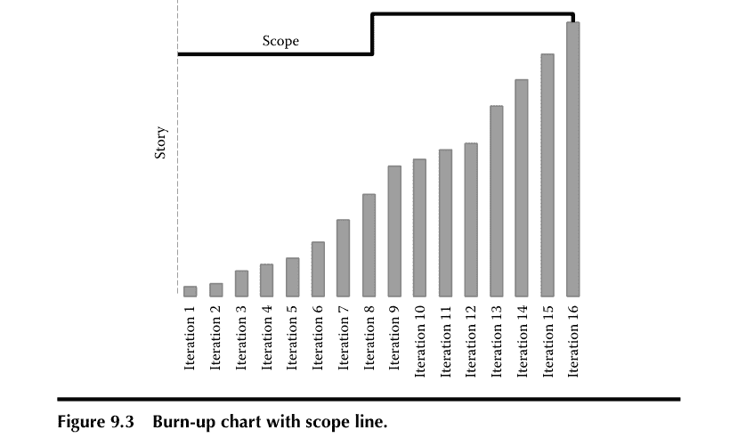

Figure 9.3 Burn-up chart with scope line.

## BOX 9.3 A REBIRTH

许多经典指标以新名称重生到敏捷世界。生产力过去以 KLOC/man month 衡量。这一指标现在称为速度，并以每个迭代交付的故事点数衡量。基本概念保持不变，但计算中使用的指标现在精度较低但更方便。期望发生了转变。速度指标不被用作目标，这似乎带来了所有差异；该指标获得了社会认可。

> 当一个衡量标准成为目标时，它就不再是一个好的衡量标准。

> 

> Goodhart's Law

老式的缺陷现在被称为技术债务。长期以来，程序员都知道软件缺陷不应带有污名。新的定义维护了尊严和人类精神。

## 添加更多敏捷指标

当前的指标系统是糟糕实施的受害者。它设计过度但利用不足。敏捷指标简单易实施；它们必须简单以尊重敏捷方法本身的精神。

Hartmann 和 Dymond [1] 列出了典型敏捷指标系统的 10 个属性如下：

- 1. 它肯定并强化精益和敏捷原则。

- 2. 它追踪趋势，而非数字。向上“测量一个层级”以确保你衡量的是聚合信息，而非整体的次优部分。

- 3. 它属于一小套指标和诊断。推荐“刚刚好”的指标方法：信息过多会掩盖重要趋势。

- 4. 它衡量结果，而非产出。

- 5. 它易于收集。

- 6. 它揭示而非掩盖。

- 7. 它为有意义的对话提供燃料。

- 8. 它定期且频繁地提供反馈。

- 9. 它衡量价值。

- 10. 它鼓励“足够好”的质量。

可能需要注意的是，上述属性也可应用于传统生命周期中的指标。

Hartmann 和 Dymond 得出结论，关键的敏捷指标应为业务价值，并指出，

> 敏捷方法鼓励企业对软件开发投入负责。同样，我们使用的关键指标应允许我们衡量这种责任。指标应帮助验证做出明智软件投资的企业以及快速交付业务价值的团队。

ROI 从第一个功能发布开始。价值必须被衡量。尽早交付价值是敏捷项目的标志。

然而，在极限编程中，项目团队添加了一些不那么简单的指标。团队在每次迭代结束时进行重构时使用以下指标源代码：

- 1. Coupling

- 2. Cyclomatic complexity

Tamar等人[6]在Scrum中考虑了EVM，并发现“敏捷EVM流程的实施对Scrum团队的速度没有显著影响。此外，能够访问这些指标的团队以及项目的Scrum Master和管理层利益相关者都确认了数据的价值。因此，我们受到鼓舞，确信敏捷EVM指标确实为Scrum项目增加了价值。”

在对瀑布式和敏捷项目中的EVM进行的一项研究中，Sam Ghosh [7] 得出结论：“EVM的概念适用于敏捷软件项目。”

## 框9.4 对信息进行排名

有时信息并不体现在绝对数值中，而是体现在相对顺序中。例如，为了将非正态数据转换为正态数据，我们会考虑排名。当数据出现恶化时，排名仍然成立。一位牙医为他的五位客户安排了时间：10:00、10:30、11:00、11:30和12:00。患者们前来等待，但医生迟到了30分钟。第一位患者抱怨自己损失了30分钟。前台工作人员冷静地说：“您是医生将要接诊的第一位患者。您是队列中的第一位。忽略承诺给您的实际时间。但我们会保持顺序。”患者反思了这个回答。牙科诊所承诺的不是时间表，而是顺序。这就是诊所的看法。他们的信息似乎体现在顺序或排名中。数字的确切值丢失了；排名被记住并保留下来。记住确切的值需要更大的自律。

## 复习题

- 1. 在测试项目的测试仪表盘中，你会使用多少指标？

- 2. 单元测试中可以使用哪些指标？

- 3. 冒烟测试中可以使用哪些指标？

- 4. 提出在发布前评估软件可靠性的简单方法。

- 5. 在做出停止测试的决定时，会使用哪些指标数据？

##### 练习

- 1. 为测试机构制定一套你需要维护的最少指标集。

##### 参考文献

- 1. D. Hartmann 和 R. Dymond，*适当的敏捷度量：使用指标和诊断来交付业务价值*，IEEE，敏捷大会，2006年。

- 2. M. Iliev、I. Krasteva 和 S. Ilieva，*可度量敏捷软件开发流程采用案例研究*，2009年。

- 3. F. Maurer 和 S. Martel，*论敏捷软件实践的生产力：一个工业案例研究*，2002年。

- 4. J. Rusk，*敏捷开发的挣值*，DACS，2009年。

- 5. A. Cabri 和 M. Griffith，*挣值与敏捷报告*，2006年。

- 6. T. Sulaiman、B. Barton 和 T. Blackburn，敏捷EVM——Scrum项目中的挣值管理，*AGILE '06：2006年敏捷大会论文集*，IEEE计算机学会，2006年7月。

- 7. S. Ghosh，传统与敏捷软件项目中EVM应用的系统比较，*PM World Today* 14(2)，2012年。

## 推荐阅读

Aczel, A. D.，*完整商业统计学*，McGraw-Hill/Irwin，伦敦，2005年。

## 概率定律

在第三部分，我们将看到一些经过时间检验的统计定律。然而，其基础在于证据性数据的经验模式，因为所有这些定律都受到证据性数据模式的启发。

第10章关于直方图，确立了从数据中提取模式的经验法则。第11章介绍了二项过程、二项定律及相关定律。从历史上看，许多统计概念都是围绕这些定律演化的，既用于构思它们，也用于应用它们。第12章介绍指数定律和相关的泊松过程。第13章介绍钟形曲线，它已成为一条具有普遍地位和巨大潜力的社会定律。统计思维受钟形曲线支配。第14章和第15章介绍的均匀分布和三角有界分布，是另一组有助于商业决策的定律。第16章介绍了著名的帕累托定律，以及它在开源软件开发中一些鲜为人知的应用。

这些定律催生了其他一些定律和范式。它们对科学和工程的多个领域产生了永久性的影响。它们也是管理学中使用的一些最强大的知识体系和预测模型背后的支撑。这些定律是理解软件工程和管理的基础。自被发现以来，它们一直激励着科学家、经济学家和管理者。随着时间的推移，这些定律的应用和使用似乎呈指数级增长。

# 第10章

## 使用直方图提取模式

直方图无疑是最常用的统计方法。它用于检测数据中的频率模式。

直方图是一种统计数据区间内数据点数量的方法。首先，将从最小值到最大值的数据范围划分为若干等距区间。然后我们统计每个区间内的数据点数量，并将计数结果整理成一个称为“计数表”（tally）的表格。这个频数表被转换为条形图，即直方图。附录10.1展示了一个示例，说明如何通过数据创建计数表、构建直方图，并从中推导出频数图和累积频数曲线（ogive）。

图10.1显示了需求波动性的直方图。该直方图与Kulk和Verhoef[1]获得的直方图相似，他们研究了84个IT项目（共包含16,500个功能点）中的需求波动性。需求变化确实会超出10%的传统限制。

在直方图中，首先吸引我们注意力的是其峰值。稳定的过程具有明显的峰值。峰值代表过程的众数。核心过程由直方图的“主体”表示。几乎整个过程结果都体现在核心中。在核心之外，我们可以看到离群值。与箱线图不同，离群值是通过图案中的对比来区分的，而不是通过任何规则。该直方图是对称的。许多指标表现出近乎对称的形状；工作量偏差和进度偏差就是著名的例子。

并非每个直方图都是对称的。例如，图10.2展示了面向对象结构复杂度的直方图（以每个类的加权方法数衡量），该图是仿照Rosenberg[2]的研究结果绘制的。

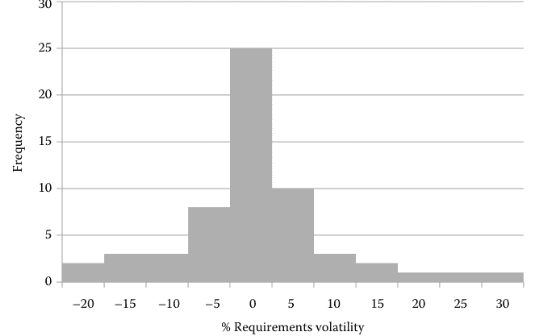

### 图10.1 需求波动性的对称直方图。

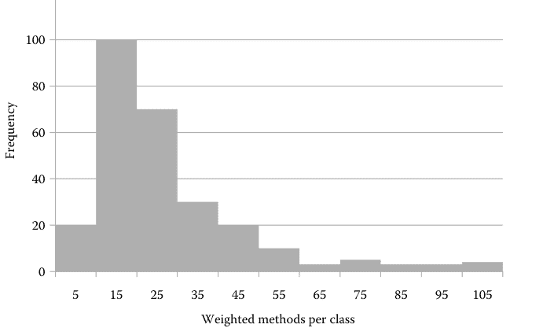

### 图10.2 对象复杂度的偏斜直方图。

该直方图是偏斜的。只有少数类的加权方法数较大。类中的方法数越多，对其子类的潜在影响就越大；子类继承父类中定义的所有方法。方法数多的类可能限制复用的可能性。它们也难以理解和测试。那些少数复杂对象需要审查和重新审视。还有更多指标呈现偏斜形状；修复时间、缺陷密度和生产力都以偏斜著称。

### 框10.1 相机中的直方图

直方图是现实的一种数字签名。现代数码相机使用它来以图形方式呈现视野中的光线强度。通过镜头看到的物体的光线分布被扫描、数字化并转换为直方图。摄影师可以从该直方图中获得关于获取好照片所需设置的线索。

了解图像直方图可能是使用数码相机处理图片时需要熟悉的最重要的概念。直方图可以告诉你图像是否正确曝光、光线是强烈还是平淡，以及哪些调整效果最好。它不仅会提升你在计算机上的技能，也会提升你作为摄影师的技能。(http://www.cambridgeincolour.com/tutorials/histograms1.htm)

在直方图出现之前，摄影爱好者必须付出更多努力才能获得良好的曝光。

图像编辑器通常具备为正在编辑的图像创建直方图的功能。直方图绘制图像中具有特定亮度值的像素数量（纵轴）与亮度值（横轴）的关系。数字编辑器中的算法允许用户直观地调整每个像素的亮度值，并在调整时动态显示结果。由此可以获得图像亮度和对比度的改善。(http://en.wikipedia.org/wiki/Image_editing)

### 选择区间数

### 平方根公式

直方图的要素，即峰值、主体和离群值，会随着区间数 N 的改变而变化。通常，我们选择区间数为样本中数据点数量 n 的平方根。

$$N = n^{0.5} \tag{10.1}$$

该平方根公式在直方图分析中被视为默认值。

### 其他方法

在选择区间数量时，还有另外三种约定。

- 1. 斯特奇斯规则，

$$N = \log_2 n + 1 \tag{10.2}$$

- 2. 弗里德曼–戴科尼斯规则，

$$N = \frac{\text{Range}}{2 IQR \sqrt[n-1/3]{}} \tag{10.3}$$

- 3. 斯科特规则，它建议使用更少的区间，


$$N = \frac{\text{Range}}{3.5 \sigma \sqrt[3]{n}} \tag{10.4}$$

### 探索性迭代

我们可以观察到，当分组区间数——以及直接由此产生的组距——按照前面提到的四种规则变化时，直方图会如何变化。我们的试验不必局限于这四种规则。我们可以尝试自己选择组距，并提取符合我们探究目的的模式。减小组距可以提高直方图的分辨率。例如，在第一次迭代中，仅使用9个区间，工作量偏差（EVA%）数据生成的直方图如图10.3所示。该直方图表现出稳定性且只有一个峰值。我们可以通过提高直方图的分辨率来进一步探索，选择20个区间；得到如图10.4所示的直方图。

该直方图有三个众数，即三个聚类。这仅仅是估计。使用同一数据集提取不同的直方图估计被称为非参数密度函数估计。

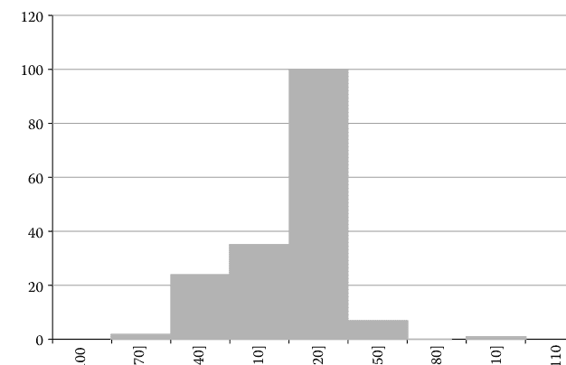

### 图10.3 工作量偏差（EVA%）直方图（9个区间）。

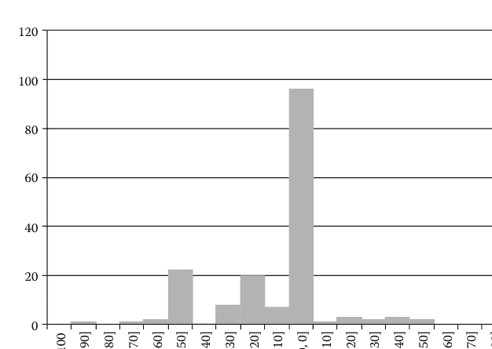

### 图10.4 工作量偏差（EVA%）直方图（20个区间）。

### 专栏10.2 直方图的历史

“histogram”一词源于希腊语，由“istos”（意为“桅杆”）和“gram-ma”（意为“书写之物”）复合而成。因此，它应被解释为由“桅杆”组成的一种书写形式，即垂直矗立的长形形状或类似的东西。“直方图”一词由著名统计学家卡尔·皮尔逊创造，用来指代一种常见的图形表示形式。直方图在获得这一名称之前很久就已使用，但它们的诞生日期并不清楚。可以肯定的是，直方图最初是作为统计近似的视觉辅助工具而构思的。条形图很可能先于直方图出现，这有助于我们确定直方图首次出现时间的下限。

Yannis Ioannidis

雅典大学信息与电信系

### 过程特征

> 我们的人性依赖于一系列习得行为，它们被编织成无限脆弱且从不直接遗传的模式。

> 

> 玛格丽特·米德

过程性能数据可以转换为直方图特征。这些过程特征代表了过程特性，用于管理过程。

- 1. *过程稳定性：* 直方图可用于检验过程稳定性。稳定的过程会生成具有单一峰值的直方图。

- 2. *众数：* 直方图揭示过程的众数。

- 3. *多峰：* 如果数据来自多个过程的混合，我们会在直方图中看到多个峰值。

- 4. *聚类分析：* 如果数据具有自然聚类，直方图会将它们展示出来。

- 5. *离群值：* 直方图能轻松显示离群值。

- 6. *自然边界：* 直方图揭示可用于设定目标的自然过程边界。

图10.5中的直方图就是过程特征的一个例子。它捕捉了项目中对修复时间的管理方式，并提供了历史绩效的广泛总结。

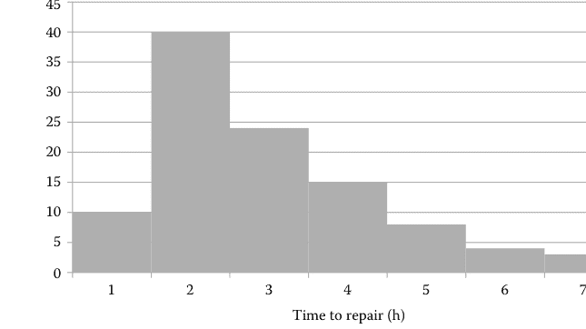

### 图10.5 修复时间的过程特征直方图。

这是在没有任何SLA约束的情况下修复高优先级缺陷的典型体验。团队以极其认真的态度对待高优先级缺陷，并力图尽早发布修复。该直方图呈偏态分布，右侧有很厚的尾部。几乎可以肯定，修复时间会较长。

Beaumont [3] 展示了一个更为规范的修复时间直方图，其离散程度小得多。Barkman 等人 [4] 展示了开源项目中16个选定指标的直方图。（数据收集自150个不同的项目，包含超过70,000个类和超过1100万行代码。）这真是一个直方图特征的画廊；条目从表现良好的对称直方图到极度偏斜的直方图不等。特征结构通常代表这些指标。这些模式在整个IT行业中大致相同。

### 直方图特征的独特性

直方图是真正的特征。

> 过程直方图反映人。

> 产品直方图反映设计。

人们会在交付物中留下自己的特征。直方图的独特性可以加以利用。软件工程研究所（SEI）在其多次交流中展示了一系列随组织成熟度从2级到5级而变化的直方图。过程直方图是组织成熟度的特征。用正确指标精心构建的直方图可以用作更精确的特征，用于比较和预测绩效。

一个绝佳的例证是 Liu 等人的视频特征 [5]：

信息技术和数字内容产业的爆炸式增长推动了互联网上各种视频应用的发展。重复检测和度量对于识别过度内容重复至关重要。在第一个网页的十个结果中，大约有两到三个重复视频。寻找视觉相似内容是基于内容的图像检索领域的核心主题；相似视频的直方图分布非常相似，而不相似的视频则完全不同。视频直方图用于表示视频特征向量在特征空间中的分布。该方法对于网络视频重复检测既高效又有效。

### 专栏10.3 用直方图检测脑肿瘤

脑癌可算是最致命、最棘手的疾病之一。肿瘤可能潜藏在大脑区域中，形成更多小到用传统成像技术无法检测的肿瘤。恶性肿瘤通常被称为脑癌。这些肿瘤可以扩散到大脑外部。脑肿瘤检测是医学科学中的一个严肃问题。成像在脑肿瘤的诊断和治疗计划中起着核心作用。

通过MRI技术获取大脑图像。如果绘制大脑两半对应图像的直方图，由于大脑沿其中心轴具有对称性，应观察到两个直方图之间的对称性。另一方面，如果观察到任何不对称性，则检测到肿瘤的存在。检测到肿瘤存在后，可以进行阈值化以实现图像分割。绘制两个直方图的差异图，并将差异的峰值选为阈值点。使用该阈值点，整个图像被转换为二值图像，从而提供肿瘤的边界。然后沿着肿瘤轮廓裁剪二值图像，以计算肿瘤的物理尺寸。整个工作已使用MATLAB® 2010实现。（Kowar 和 Yadav [6]）

### 直方图形状

直方图是经验分布（或密度函数）。可以通过非参数方法进行平滑，正如机器智能算法中所做的那样。或者，它们可以拟合到数学模型。

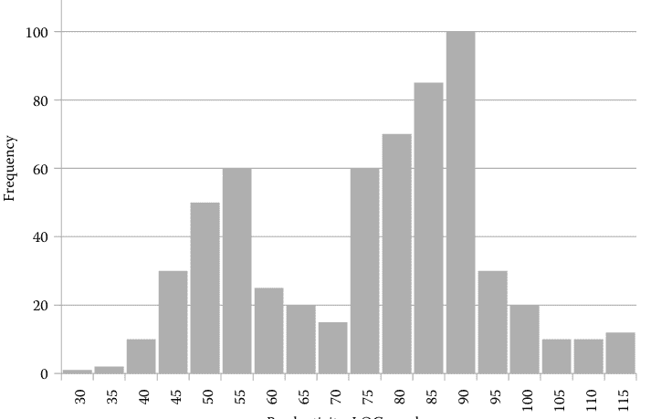

### 图10.6 生产率的双峰直方图。

| 过程数据 |  |

|---|---|

| LSL | 0.08 |

| 目标 | 0.3 |

| USL | 0.5 |

| 样本均值 | 0.146854 |

| 样本数量 | 42 |

| 组内标准差 | 0.0870325 |

| 整体标准差 | 0.104562 |

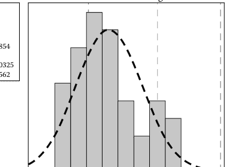

| 潜在（组内）能力 |  |

|---|---|

| Cp | 0.80 |

| CPL | 0.26 |

| CPU | 1.35 |

| Cpk | 0.26 |

| 整体能力 |  |

| Pp | 0.67 |

| PPL | 0.21 |

| PPU | 1.13 |

| Ppk | 0.21 |

| Cpm | 0.36 |

| 观测性能 |  |

|---|---|

| PPM < LSL | 285,714.29 |

| PPM > USL | 0.00 |

| PPM 合计 | 285,714.29 |

| 预期整体性能 |  |

|---|---|

| PPM < LSL | 261,288.77 |

| PPM > USL | 365.88 |

| PPM 合计 | 261,654.65 |

### 图10.7 缺陷/测试用例的过程能力。

图 10.7 是每个测试用例发现的缺陷数的直方图，这是软件测试中的一个关键指标。LSL 已设定为 0.08，USL 已指定为 0.5。也许指定 USL 是不必要的，但在这种情况下，它旨在对产品质量发出警报。

下限存在争议较少；团队期望测试用例带来最低回报。目标值 0.3 个缺陷/测试用例也已标出供参考。直观上，直方图揭示了与能力相关的问题：过程峰值不在目标上，且相当一部分结果（大约 28%）低于下限规格。过程还有很多改进空间。能力指数为 0.26，远低于理想值至少 0.8。

测试用例指标“每个测试用例发现的缺陷数”是一把双刃剑。如果发现更多缺陷，可能是由于被测产品质量差，也可能是测试用例非常有效。如果发现的缺陷很少，可能意味着产品质量好，也可能是测试用例无效。必须认识到这两种可能性，并利用外部证据来判断直方图。

### 直方图作为评判者

直方图作为评判者有着非常重要的用途。首先，它是数据正态性的视觉评判者。关于指标数据的正态性存在争论，人们会进行正态性检验。对数据的直方图进行视觉判断可以作为正态性的初步判断。如果数据不正态，人们不会对数据进行深奥的统计检验。

> *软件开发中的过程数据通常是非正态的。*

在这些情况下，直方图用于可视化数据并对统计检验做出决策。例如，修复时间数据公认是非正态的；所有已知的直方图都证明了这一点。问题现在升级了：应该使用非参数检验，或者应该适当转换数据后再进行统计检验。作者更倾向于前者。让我们保持数据在其最纯粹的形式。

有一个领域我们可以确定数据必须为正态：预测误差。在任何预测模型中，误差都围绕均值对称，且均值误差为零。通常会绘制误差的直方图，以查看其是否围绕零对称，从而验证预测模型。

> *良好的回归模型留下的误差，即残差，是正态分布的，可以用直方图进行检验。*

如果直方图是偏斜的，则模型不被接受，需要改进。

### BOX 10.4 WEB CONTENT EXTRACTION

网页内容是通过使用 HTML 文档的文本-标签比率直方图来提取的。网页内容提取被视为直方图聚类任务。直方图聚类是一个研究广泛的话题，尤其在图像研究者中很受欢迎。这在希望使用图像的直方图足迹作为分类、分割等的手段的研究者中尤其如此。这些聚类技术还通过使用直方图平滑技术得到增强。该技术实现了高召回率和高精度。（Weninger and Hsu [8]）

### 从一个点到一个直方图

要评判一个过程或产品，单一观察是不够的。我们需要多个观察值，并由多个观察值构建一个直方图。统计结构中的最小元素似乎就是直方图。如果我们要评判一个过程，我们需要做出足够的观察并绘制过程能力直方图。如果我们要研究产品行为，我们需要从最少数量的模块中收集足够的数据并构建直方图。过程和产品只能通过直方图来观察。

### 案例研究：目标授权

设定 stretch 目标是一个棘手的挑战。这样的目标也必须现实。目标设定过程也必须透明。本案例研究介绍了直方图在设定 stretch 目标中的使用。

使用直方图进行生产率分析揭示了两个聚类的存在。较强的峰值似乎是更高生产率的。较小的聚类更接近当前 50 行代码（LOC）/天的目标。

有充分理由将目标提高到最佳实践聚类峰值 B，沿着图 10.8 所示的自然改进路径。

> 授权是你可以在不重新设计流程的情况下可能达到的最佳水平。它是当前绩效水平与最佳记录之间的差异。

这是“目标授权”概念的核心。保守的 stretch 目标将是在改进路径上设定任意中间点 C，使得 70% 的理想改进成为目标。因此，C 成为新的目标。有了直方图作为背景，整个分析和规划都是基于数据且现实的，使得人们可以毫无保留地接受 stretch 目标。

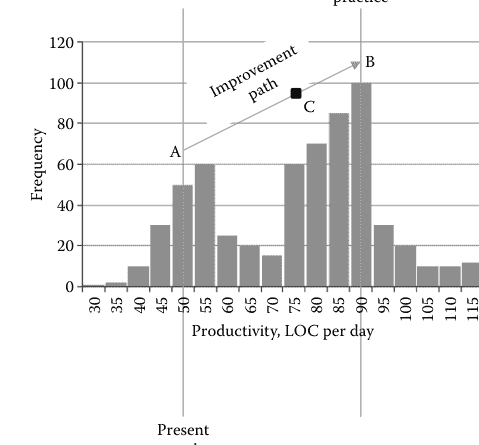

### 图 10.8 表示改进路径的直方图。

目标授权受到一些人的质疑，如 Dennis J. Monroe [9] 的《The Entitlement Trap》中所述。他认为，“通过授权设定目标并不能量化突破性改进的机会。”

### BOX 10.5 A STUDY OF REUSE

软件重用的好处从减少开发时间和提高产品质量到提高可靠性和降低维护成本不等。重用量由多个指标衡量。Curry et al. [10] 关注了三个指标：

- 1. 重用水平（RL）：它衡量在较高层项目内部逐字重用的不同较低层项目数量与使用的较低层项目总数之间的比率。

- 2. 重用频率（RF）：它衡量对重用项目的引用次数，而不是像重用水平那样只计数一次。该指标衡量在较高层项目内部逐字重用的较低层项目的引用百分比与总引用数之比。

- 3. 重用密度（RD）：它衡量产品中重用的程度相对于产品规模。它是较高层项目内部重用的较低层项目总数相对于较高层项目规模的归一化比率。

问题是这三个指标是否冗余。为了解决这个问题，作者使用了相关性的直方图。分析显示出有趣的发现，直方图提供了统计置信度。作者没有使用相关性的平均水平，而是更喜欢相关性的直方图表达。他们得出结论，

> 显然，从统计角度来看，在所考虑的 C 项目中，RL 和 RF 衡量代码的非常相似的属性，而 RD 则提供了关于重用量的独立视角。

管理重用只需要两个指标。

### 附录 10.1：创建直方图

直方图创建中使用了几个标准步骤。我们使用 Excel–数据–数据分析–直方图选项。

数据以列形式提供。图 A10.1 中的 A 列包含对象之间的耦合数据。许多对象似乎是自包含的，但相当多的是耦合的（Data A10.1）。

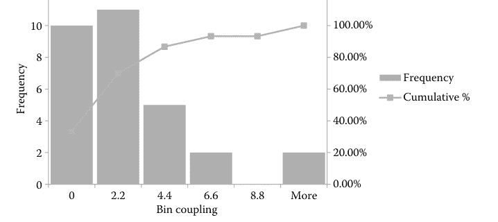

图 A10.1 直方图和累积曲线（累积 %）。

#### Data A10.1 Coupling Data

|  |  |

|---|---|

| 1 | 0 |

| 10 | 4 |

| 2 | 0 |

| 3 | 2 |

| 2 | 0 |

| 3 | 5 |

| 2 | 0 |

| 1 | 2 |

| 1 | 0 |

| 2 | 6 |

| 0 | 0 |

| 0 | 11 |

| 1 | 0 |

| 0 | 4 |

| 3 | 1 |

#### Table A10.1 Tally

| Bin | Frequency | Cumulative % |

|---|---|---|

| 0 | 10 | 33.33 |

| 2.2 | 11 | 70.00 |

| 4.4 | 5 | 86.67 |

| 6.6 | 2 | 93.33 |

| 8.8 | 0 | 93.33 |

| More | 2 | 100.00 |

我们运行工具 Histogram。定义输入范围并选择图表输出和累积百分比选项。通过指定“输出范围”从 Excel 获取报告。表 A10.1 和图 A10.1 显示了耦合的直方图和累积曲线，称为 ogive。选择计数值列 Bin 和 Frequency 并绘制 XY 散点图以获得图 A10.2。该图是直方图的平滑轮廓。

#### 解释

耦合直方图向右偏斜。开发者的倾向似乎是生成复杂度较低的类。这是一个非常好的迹象。似乎存在少数高复杂度的离群类。这表现为右侧的一个小独立条。

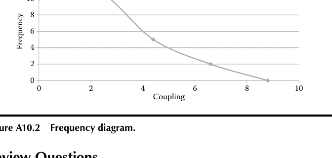

图 A10.2 频率图。

## 复习问题

- 1. 直方图中选择箱数常用的规则是什么？

- 2. 列出从数据中提取直方图的三个目的。

- 3. 双峰直方图是什么意思？

- 4. 直方图特征的元素有哪些？

- 5. 如何从过程数据直方图中判断过程能力？

##### 练习

- 1. 使用以下客户满意度数据构建直方图并提取客户满意度的特征。解释该特征。

  4, 5, 3; 5, 4, 5, 5, 4, 3, 4, 5, 3, 4, 5, 3, 2, 3, 2, 4, 1, 4,

  1, 5, 4, 3, 4, 3, 2, 3, 2, 4, 3, 4, 3, 5, 4, 3, 5, 4, 4, 4, 4

- 2. 使用 MS Excel 的数据分析工具直方图构建直方图。不要使用默认的箱选择，指定你自己的箱。

- 3. 如果企业目标是获得至少 3 分的客户满意度评分，之前提到的直方图特征中看到的风险是什么？

- 4. 测试用例返工工作量数据以人小时为单位如下所示：

  16, 16, 2, 5, 7, 8.5, 8, 9, 10, 11, 5

  用这些有限数据绘制直方图并尝试推断测试用例开发过程。

- 5. 软件增强项目中的工作量方差数据如下所示：

  -10, 4, 5, -3, 8, -2, 0, 9, 5, -2, 5, 3, 5, 12

  绘制给定数据的累积曲线图。

##### 参考文献

- 1. G. P. Kulk and C. Verhoef, Quantifying requirements volatility effects, *Science of Computer Programming*, 72, 136–175, 2008.

- 2. L. Rosenberg, Applying and interpreting object oriented metrics, *Software Technology Conference*, Utah, April 1998.

- 3. L. R. Beaumont, *Metrics—A Practical Example*, AT&T Bell Laboratories. Available at http://www.humiliationstudies.org/documents/Beaumontmetricsid.pdf.

- 4. H. Barkman, R. Lincke and W. Lowe, *Quantitative Evaluation of Software Quality Metrics in Open-Source Projects*, Software Technology Group, School of Mathematics and Systems Engineering, Sweden. Available at http://www.arisa.se/Files/BLL-09.

- 5. L. Liu, W. Lai, X.-S. Hua and S.-Q. Yang, *Video Histogram: A Novel Video Signature for Efficient Web Video Duplicate Detection*, Department of Computer Science and Technology, Tsinghua University, Microsoft Research, Asia, Springer Verlag Berlin, Heidelberg, 2007.

- 6. M. K. Kowar and S. Yadav, Brain tumor detection and segmentation using histogram thresholding, *International Journal of Engineering and Advanced Technology*, 1(4), 16–20, 2012.


- 7. W. E. Barkman, *In-Process Quality Control for Manufacturing*, CRC Press, New York, 1989.

- 8. T. Weninger and W. H. Hsu, *Web Content Extraction Through Histogram Clustering*, Kansas State University, Manhattan, Annie Conference, November 9–12, St. Louis, Missouri., 2008.

- 9. D. J. Monroe, *The Entitlement Trap*, Juran Institute, Inc., 2009.

- 10. W. Curry, G. Succi, M. Smith, E. Liu and R. Wong, *Empirical Analysis of the Correlation between Amount-of-Reuse Metrics in the C Programming Language*, ACM, New York, 135–140, 1999.

## 生活是一随机变量

费马和帕斯卡为概率论奠定了基础。凭借他们在分赌注问题上的简短而富有成效的合作，他们现在被视为概率论的联合创始人。费马被认为完成了有史以来第一次严格的概率计算。在其中，他被一名职业赌徒问到，为什么如果他押注在掷骰子四次中至少出现一次六点，他长期来看会获胜，而押注在 24 次掷两颗骰子中至少出现一次双六则会输。费马随后在数学上证明了为什么会这样。 (http://en.wikipedia.org/wiki/Problem_of_points)

克里斯蒂安·惠更斯（1657 年）对该主题进行了全面论述。

雅各布·伯努利的《猜测术》（死后出版，1713 年）使概率建立在坚实的数学基础上，展示了如何计算各种复杂概率。

总体而言，结果本质上是随机的；有些对我们有利，有些则不利。过程结果并不总是精确地保持有利，也不会总是变得不利。结果在有利和不利之间随机切换。

> 事件概率的度量是该事件有利情况数与总情况数之比。
>
> 勒内·笛卡尔

概率的发现可以追溯到文艺复兴时期（见框 11.1）。

在有利和不利之间切换的过程称为伯努利过程，以发明者命名。数学上，伯努利过程随机只取两个值，1 和 0。重复抛硬币是一个伯努利过程；我们得到正面或反面，成功或失败，“1 或 0”。每次抛掷都是伯努利试验。伯努利随机变量由瑞士数学家雅各布·伯努利发明（见框 11.2 简要传记）。

随着试验次数的增加，试验结果会收敛到“期望值”。在公平硬币中，成功概率（正面出现的概率）的“期望值”为 0.5。试验次数越多，就越接近成功概率的值。这就是大数定律。利用该定律，我们可以预测稳定的长期行为。伯努利花了 20 多年才发展出足够严格的数学证明。他将其命名为他的黄金定理，但后来普遍被称为伯努利定理。该定理被应用于预测人们在各种机会游戏中期望赢得多少。

从现实事件的足够数据中，我们可以得出成功概率 `p`，并相信未来可以根据此进行预测。

预测意味着估计两个值：均值和方差（分别表示集中趋势和离散程度）。

在本章中，我们考虑四种分布来描述四种不同的离散模式描述方式。

### 1. 二项分布

在 `n` 次试验中恰好得到 `k` 次成功的概率由以下二项式表达式给出：

```
P(X = k) = C_k^n p^k (1 − p)^(n−k)  (11.1)
```

其中 `n` 是试验次数，`p` 是每次试验的成功概率，`k` 是在 `n` 次试验中观察到的成功次数，计算如下：

```
Mean = n p  (11.2)
Variance = n p (1 − p)  (11.3)
```

方程 11.1 是广泛上下文的范式。在服务管理中，成功被 arrival 取代，伯努利过程称为 arrival-type 过程。在软件开发过程中，我们更喜欢使用术语 success。系数 `C` 是二项系数，因此得名二项分布。

软件开发过程可能由两个组成部分构成：

- a. 符合大数定律的固有伯努利成分
- b. 来自虚假噪声因素的影响

伯努利分布用于统计过程控制。虚假噪声因素必须被识别、分析和消除。例如，在服务水平协议（SLA）合规数据中，可能同时存在这两个成分。如果过程仅限于伯努利类型，则过程被认为处于统计控制之下。（休哈特称这种变异为“共同原因”变异，并将虚假影响归因于特殊原因。）

方程 11.1 用于离散事件的质量控制。

#### 框 11.2 雅各布·伯努利（1654–1705）

> 自然总是倾向于以最简单的方式行动。
>
> 雅各布·伯努利

雅各布·伯努利为概率论奠定了数学基础。伯努利过程以他命名。伯努利家族在数学界是一个知名名字，以其对数学的推进而闻名。原本来自荷兰，雅各布的父亲尼古劳斯·伯努利将他的香料生意搬到了瑞士巴塞尔。雅各布于 1671 年在巴塞尔大学获得哲学硕士学位，1676 年获得神学硕士学位。在攻读硕士学位期间，他还学习数学和天文学。1681 年，雅各布·伯努利遇到了数学家 Hudde。伯努利继续学习数学，并遇到了世界知名的数学家如玻意耳和胡克。

雅各布·伯努利看到了微积分的力量，被认为是微积分之父之一。他还写了一本名为《猜测术》的书，于 1713 年出版（在他去世 8 年后）。

伯努利在卡当的大数定律思想上有所增进。他断言，如果一个可重复的实验在理论上有概率 `p` 以某种“有利”方式出现，那么对于任何指定的误差范围，该实验若干次重复试验中，有利结果与总结果的比率将落在该误差范围内。通过这一原理，观测数据可用于估计现实世界事件的概率。这就是现在所知的大数定律。有趣的是，当他写这本书时，他将这一思想命名为“黄金定理”。

伯努利获得了若干奖项和/或荣誉。其中一项荣誉是月球上以他命名的陨石坑。在巴黎，有一条以伯努利家族命名的街道。街道名为 Rue Bernoulli。

#### 例 11.1：SLA 合规的二项分布

**问题**

根据去年的交付情况，估计在增强项目中满足 SLA 的概率为 90%。求出在当前年计划的 120 次交付中，至少有 10 次满足 SLA 的概率。绘制相关的二项分布。

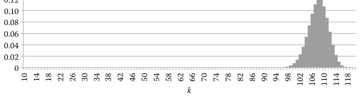

##### 图11.1 SLA合规的二项概率（`p` = 0.9, `n` = 120）。

##### 答案

你可以通过保持 `p` = 0.9、`n` = 120 和 `k` = 10 来求解方程11.1。这将给出恰好10次交付满足SLA的概率。我们在评估恰好获得10次成功的概率。

或者，使用MS Excel函数`BINOM.DIST`。

答案是零。这个数字太小了，为4.04705E-97。

图11.1展示了SLA合规的二项概率分布。这可以视为一个过程模型。可以注意到密度函数的上下边界，大约在91到118次试验之间；还可以注意到中心趋势，正好是均值。

### 框 11.3 使用负二项分布测试可靠性

为了测试可靠性，我们随机选择并运行覆盖使用场景的测试用例。执行完整的测试库成本高昂，因此我们采用抽样。我们可以选择反向抽样，随机选择并执行测试用例，直到发现预设数量的缺陷（不可接受的缺陷水平）。如果达到该水平，则软件被拒绝。使用常规抽样并在二项分布下，我们可以进行验收测试，但可能需要执行大量测试用例才能得出等效的结论。在NBD下的反向抽样在用户验收测试中更为高效。

有了这些信息，我们可以构建缺陷的负二项分布。比较的突出总体观点是，除非软件接近完美，否则对于相同的误拒风险和误纳风险[1]，负二项抽样模式相对于二项抽样模式能大幅减少平均执行次数。

### 2. 负二项分布

负二项分布（NBD）定义为在出现`r`次失败之前获得`k`次成功的概率，由以下表达式给出：

```
P(X = k) = C_{k}^{r+k-1} p^{k} (1 - p)^{r}    (11.4)
```

其中 `n` 是试验次数，`p` 是成功概率（每次试验相同），`k` 是在 `n` 次试验中观察到的成功次数，`r` 是失败次数。

```
Mean = r(1 - p) / p    (11.5)
Variance = r(1 - p) / p²    (11.6)
```

如果`k`保持为整数，该分布有时称为帕斯卡分布。许多工程问题都可以用NBD优雅地处理。

在抽样中，如果具有某一特征的个体比例为`p`，并且我们一直抽样到看到`r`个这样的个体，那么抽样个体数就是一个负二项随机变量。

NBD是最有用的概率分布之一。它被用于构建许多领域的模型：生物学、生态学、昆虫学以及信息科学[2]。

#### 示例11.2：首次正确交付的NBD

##### 问题

在网络传感器制造部门，一次正确率（right first-time rate）为0.6。公司希望向一个关键任务应用交付10个传感器，并倾向于从一次合格批次中挑选后再发货。如果生产批量为12，那么交付10个首次生产的合格传感器的概率是多少？绘制与该问题相关的负二项概率分布函数。计算该分布的均值和方差。

##### 答案

可以看出，数据可以用方程11.4表示，参数如下：

- `r` = 10 成功次数
- `p` = 0.6 成功概率
- `k` = `n` - 10 失败次数
- `n` = 生产批量，10, 11, ...

我们可以使用Excel函数`NEGBINOM.DIST`来生成NBD并绘制图形，如图11.2所示。

```
P(X = k) = C_{k}^{r+k-1} p^{k} (1 - p)^{r}
```

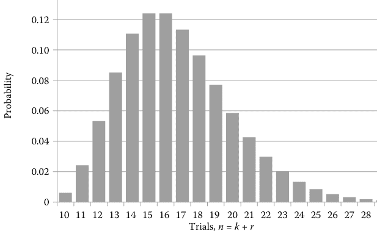

##### 图11.2 一次正确交付的负二项分布（`r` = 10，成功概率 `p` = 0.6）。

Excel函数如下所示，包含四个参数：

```
NEGBINOM.DIST(number_f, number_s, probability_s, cumulative)
```

其中 `number_f` 是失败次数（NBD方程11.4中的`k`），`number_s` 是成功次数的阈值（NBD方程11.4中的`r`），`probability_s` 是成功概率（NBD方程11.4中的`p`），`cumulative` 是一个逻辑值，决定函数的形式。如果 `cumulative` 为真，`NEGBINOM.DIST` 返回累积分布函数；如果为假，则返回概率密度函数。

求解从批量为12的批次中交付10个首次生产的合格传感器的概率，可以直接如下计算：

- 批量大小 `n` = 12
- 成功次数 `s` = 10
- 失败次数 `k` = 2
- 成功概率 `p` = 0.6

Excel函数返回结果0.0532。因此，找到10个首次生产的合格传感器的机会很小。

NBD的均值和方差可以通过将数据代入方程11.5和11.6直接计算得出。结果如下：

- 均值 = 15
- 方差 = 37.5

图11.2显示传感器问题在均值处达到峰值。

### 3. 几何分布

获得一次成功所需的伯努利试验次数`k`的概率由以下表达式给出：

```
P(X = k) = (1 - p)^{k-1} p    (11.7)
```

其中 `p` 是成功概率（每次试验相同），`k` 是在 `n` 次试验中观察到的成功次数。

```
Mean = 1/p    (11.8)
Variance = (1 - p)/p²    (11.9)
```

#### 示例11.3：几何分布

##### 问题

在一个软件开发项目中，首次正确设计概率估计为0.7。估计需要四次试验才能找到无缺陷功能设计的概率。绘制试验次数与几何概率之间的图形。

##### 答案

在本问题中，`p` = 0.7，`k` = 4。

将这些值代入方程11.7，我们得到几何概率（0.0189）。

图11.3显示了该图形。

### 4. 超几何分布

超几何分布是一种离散概率分布，描述的是从包含恰好`K`个成功且大小为`N`的有限总体中进行`n`次不放回抽取，获得`k`次成功的概率。它由以下方程给出：

```
P(X = r) = [C_r^K C_{n-r}^{N-K}] / C_n^N    (11.10)
```

```
Mean = n K / N    (11.11)
Variance = n ((N - K)/N) ((N - n)/(N - 1))    (11.12)
```

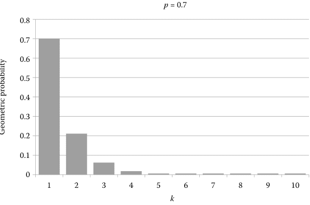

**图11.3** 无缺陷设计的几何概率分布。

#### 示例11.4：超几何概率

##### 问题

一个包含10个模块的版本刚刚构建完成，冒烟测试结束。结果显示有4个有缺陷的模块。如果我们不放回地抽取大小为3的样本，求一个样本包含两个有缺陷模块的概率。

##### 答案

首先，我们假设缺陷模块的比例遵循平均律，并且对每个模块都成立。鉴于冒烟测试并不能发现所有缺陷，这样的假设具有严重的影响。然而，为了继续制定解决方案，我们采用以下假设：

你可以通过代入 `N` = 10、`K` = 4、`n` = 3 和 `r` = 2 来求解方程11.10。

或者，使用Excel统计函数`HYPGEOM.DIST`来求解方程11.10。必须按如下方式填写数据输入窗口：

|  |  |  |
|---|---|---|
| `Sample_s` | 样本中的成功次数 | 输入2 |

> **注意：** 统计学意义上的成功是指发现有缺陷的模块。测试人员也持同样的观点。

- `Number_sample` 样本大小 输入3
- `Population_s` 总体中的成功次数 输入4
- `Number_pop` 总体大小 输入10
- `Cumulative` 决定函数形式的逻辑值。如果 `cumulative` 为真，则 `HYPGEOM.DIST` 返回累积分布函数；如果为假，则返回概率质量函数。输入 false

Excel返回以下答案：公式结果 = 0.3。

因此，三个模块的样本包含两个缺陷模块的概率为0.3。

## 概率分布图

为了绘制超几何概率的PDF，考虑了两种情景。第一种是探究样本中所有项目都有缺陷的概率。图11.4a展示了样本大小与超几何概率之间的关系图。第二种是研究样本中一个项目有缺陷的情况。图11.4b展示了样本大小与超几何概率之间的关系图。

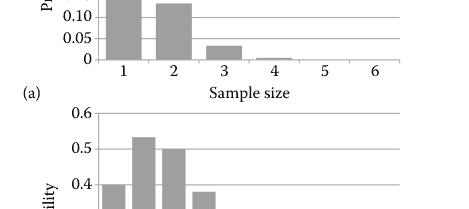

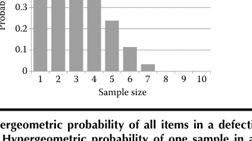

图11.4 (a) 缺陷样本中所有项目的超几何概率（`N` = 10, `K` = 4）。 (b) 缺陷样本中一个样本的超几何概率（`N` = 10, `K` = 4）。

## 第 11.4 节 托马斯·贝叶斯牧师（1702–1761）

1719 年，贝叶斯进入爱丁堡大学学习逻辑和神学。随后他在爱丁堡大学接受长老会牧师训练。1733 年，他成为位于伦敦东南 35 英里处 Tunbridge Wells 的长老会教堂牧师。

托马斯·贝叶斯在科学观点上是一个坚定的牛顿主义者。托马斯·贝叶斯早期的研究似乎主要与无穷级数有关，这是 18 世纪英国数学家所遵循的路径之一。贝叶斯对概率的兴趣有几个来源。首先，贝叶斯从阿布拉罕·棣莫弗那里学习了概率。其次，在审阅托马斯·辛普森的出版物后，贝叶斯对概率产生了兴趣，辛普森提出的是大数定律的一个特例：观测值集合的平均值比单个观测值更能估计位置参数。

贝叶斯在《论机会学说中一个问题的求解尝试》中阐述了他的概率理论，该文于 1764 年发表在《伦敦皇家学会哲学汇刊》上。

贝叶斯将问题定义如下：

> 已知一个未知事件发生和未发生的次数：要求其在单次试验中发生的概率落在任意两个可命名的概率程度之间的机会。

贝叶斯通过考虑桌上的一项实验来解决这个问题（可能是台球桌）。

一颗球被抛过桌面，以致它在桌面上静止的位置是等可能的。通过它在桌面上静止的点画一条线。然后将球投掷 `n` 次并计算它落在直线两侧的次数。这些就是成功和失败。在这种物理模型下，我们现在可以求出成功概率介于两个给定数值之间的机会。

是贝叶斯的朋友理查德·普赖斯在贝叶斯于 1761 年去世两年后将该论文提交给了皇家学会。贝叶斯的声名建立在这一结果上 [3]。

## 贝叶斯定理

我们迄今为止看到的被称为 17 世纪在法国盛行的经典概率理论。

还有另一种概率体系，由贝叶斯在 18 世纪的英国发明并推进（见第 11.4 节的简短传记）。

在伯努利体系中，未来是通过当前数据得出的当前概率来预测的。在贝叶斯思维体系中，未来事件的概率也受历史影响。未来概率是当前概率和历史概率的乘积。进一步延伸，未来概率是从数据和从知识得出的理论概率推导出的概率乘积。贝叶斯大胆地将软的（主观的）和硬的（源于数据）概率结合起来，这一概念多年以来一直为许多统计学家所不接受，但现在被广泛采用。贝叶斯使用了条件概率的概念。

我们可以用绝对概率来定义条件概率：`P(A|B) = P(A and B)/P(B)`；即 `A` 和 `B` 同时为真的概率除以 `B` 为真的概率。

贝叶斯使用了一些特殊术语。未来概率被称为后验概率。历史概率被称为先验概率。未来概率只能是一种似然，是对概率这一严格术语的一种更柔和的表达。未来概率是一种条件概率。

## 一个临床实验室示例

特雷弗·洛尔比尔在《傻瓜也能懂的贝叶斯数学》[4]中提供了贝叶斯分析的一个简单说明。该分析的要点如下：

一个人实验室检测呈阳性。该实验室声誉为正确诊断率 99%，但也有 5% 的误报概率。有背景信息表明该疾病在 1000 人中发生 1 人（0.1% 概率）。直觉上，人们会期望该人患病的概率为 99%，基于实验室的声誉。还有另外两个概率在起作用：0.1% 的背景概率和 5% 的误报概率。贝叶斯定理使我们能够结合这三种概率并预测该人患病的几率为 1.94%。这比直觉猜测要低得多。

贝叶斯的突破在于一般真理（或疾病史）优先于新鲜的实验室证据。数据 11.1 提出了定义该情况的以下三个概率。

- `P₁`：正确诊断的概率
- `P₂`：误报概率
- `P₃`：流行病概率（背景历史）

## 数据 11.1 具有可变疾病概率的贝叶斯估计

|  | 给定实验室特征 |  |
|---|---|---|
| `P₁` | 正确诊断的声誉 | 99% |
| `P₂` | 误报概率 | 5% |
| 问题：测试呈阳性的人患病的概率 `P₀` 是多少？ |  |  |
| `P₃` | `P₀` |  |


| 疾病概率 % | 贝叶斯估计患病几率 % |  |

| 0.1 | 1.9 |  |

| 1.0 | 16.7 |  |

| 10.0 | 68.8 |  |

| 20.0 | 83.2 |  |

| 30.0 | 89.5 |  |

| 40.0 | 93.0 |  |

| 50.0 | 95.2 |  |

| 60.0 | 96.7 |  |

| 70.0 | 97.9 |  |

| 80.0 | 98.8 |  |

| 90.0 | 99.4 |  |

| 注意：可以看出后验概率取决于先验概率。 |  |  |

问题是“测试呈阳性的人患病的概率是多少？”该概率在数据 11.1 中用 `P₀` 表示。`P₁` 和 `P₂` 是固定的，`P₃` 是变化的。相关的 `P₀` 根据贝叶斯定理计算：

```
P₀ = P₁P₃ / [P₁P₃ + (P₂(1 − P₃))]
(11.13)
```

在此公式中，概率以分数表示。

> 这是一种理解假设为真的概率如何受新证据影响的方式。它用于阐明理论与证据之间的关系。

误报概率对 `P₀` 估计所起的作用也可以以类似的方式计算。通过在上述示例中保持 `P₃`（疾病史）恒定，我们可以改变 `P₂`，误报概率，并观察其对估计的影响（见数据 11.2）。

随着误报概率 `P₂` 降低，受试者患病的概率 `P₀` 升高，趋向于正确诊断概率 `P₁`。

## 数据 11.2 具有可变误报概率的贝叶斯估计

| 常数 |  |  |

|---|---|---|

| `P₃` | 0.001 | 疾病史 |

| `P₁` | 0.99 | 正确诊断的概率 |

| 变量 |  |  |

| `P₂` | 误报概率 |  |

| `P₀` | 受试者患病的概率 |  |

| 问题：测试呈阳性的人患病的概率 `P₀` 是多少？ |  |  |

| 贝叶斯估计 |  |

|---|---|

| `P₂` | `P₀` |

| 0.05000 | 0.01943 |

| 0.01000 | 0.09016 |

| 0.00100 | 0.49774 |

| 0.00010 | 0.90834 |

| 0.00001 | 0.99001 |

上述示例说明了条件概率的应用以及它如何更好地修改我们的判断。

## 贝叶斯定理在软件开发中的应用

Chulani 等人 [5] 将贝叶斯定理应用于软件开发。贝叶斯定理优雅地应用于软件成本模型。

> 贝叶斯方法提供了一个正式的过程，通过该过程可以将先验专家判断与抽样信息（数据）结合起来，产生稳健的后验模型

`Posterior = Sample × Prior`

> 在上述等式中，“Posterior”指的是总结所有信息的后验密度函数。“Sample”指的是样本信息（或收集的数据）在代数上等同于似然函数。“Prior”指的是总结专家判断的先验信息。为了确定贝叶斯后验均值和方差，我们需要确定先验信息和抽样信息的均值和精度。

Chulani 等人使用贝叶斯范式校准了成本构造模型（COCOMO），将专家判断与经验数据相结合。这一例证具有重要意义并大有可为。这使我们以不同的方式思考数据。在贝叶斯意义上，数据包括直觉猜测。Chulani 等人的研究证明了经验数据与直觉猜测之间的健康合作，如贝叶斯中所体现的那样，是解决一个迄今未解决问题的实用解决方案。

Fenton [6] 使用贝叶斯信念网络（BBNs），即贝叶斯范式的一个值得称赞的扩展，来预测软件可靠性。

Bibi 等人 [7] 将 BBNs 作为软件生产率估计工具应用。他们发现 BBN 是一种有希望的方法，其结果可以直观地得到证实。BBNs 易于解释，在估计中允许灵活性，可以支持专家判断，并且可以通过在最终模型中包含所有生产率因素来创建考虑数据集中的所有信息模型的模型。

Wagner [8] 在基于活动的质量模型框架内使用 BBNs 研究了评估和预测软件质量这一复杂概念的问题。他观察到，

> 使用贝叶斯网络开启了许多可能性。最有趣的是，在构建大型贝叶斯网络后，可以对其进行敏感性分析。这可以回答在实践中非常相关的问题，即哪些因素是最重要的因素。它可以通过集中于这些最具影响力的事实来显著减少测量工作。

## 四种分布和贝叶斯定理应用的比较

在二项分布的情况下，试验彼此独立。试验是有放回进行的。

超几何分布出现在从有限总体中无放回抽样时，从而使试验彼此依赖。

在 NBD 中，试验次数不是固定的。试验一直进行到获得指定数量的成功为止。

几何分布是 NBD 的特例，其中试验一直观察到第一次成功为止。

贝叶斯定理提供了一种将历史分布与新鲜证据相结合的方法。

## 专栏 11.5 不会消亡的理论

莎伦·麦格雷恩的著作《不会消亡的理论：贝叶斯法则如何破译恩尼格玛密码、追踪俄罗斯潜艇，并在两个世纪的争议中胜出》讲述了贝叶斯定理的历史。以下内容摘自 `http://www.lesswrong.com` 上对这本书的书评。

贝叶斯体系是：初始信念 + 新数据 → 改进后的信念。数学家们惊恐地看到，像猜测这样异想天开的东西竟在严谨的数学中发挥作用；这个先验问题无法克服。

皮埃尔-西蒙·拉普拉斯是一位才华横溢的年轻数学家，也是世界上第一位贝叶斯主义者。他开始相信概率论掌握着关键，并独立重新发现了贝叶斯机制。

约瑟夫·伯特兰深信，贝叶斯定理是炮兵军官正确应对敌人位置、空气密度、风向等众多不确定性的唯一方法。

地质学家哈罗德·杰弗里斯使贝叶斯定理对科学家变得有用，提出用它来替代费希尔的 p 值和显著性检验，后者依赖于“假想的重复”。

几十年来，费希尔和杰弗里斯是世界上两位最伟大的统计学家，他们在科学期刊上和公开场合就概率理论交锋。费希尔声音更大、更大胆，而且频率主义比贝叶斯主义更容易使用。这标志着贝叶斯范式的短暂衰落。

1983 年，美国空军资助了一项对 NASA 航天飞机故障概率估计的审查。NASA 的估计是十万分之一。承包商使用贝叶斯方法，估计火箭助推器故障的几率是三十五分之一。1986 年，挑战者号爆炸。当一个假设是另一个假设的特例时，频率主义统计还能正常工作；但当假设相互竞争且数据中出现突变时，频率主义就不起作用了。

一直以来的一大挑战是贝叶斯统计运算更难计算，而且当时的计算机仍然很慢。这种情况在 20 世纪 90 年代发生了变化，当时计算机变得比以前更快、更便宜。

## 复习题

- 1. 举一个二项分布应用的例子。

- 2. 举一个超几何分布应用的例子。

- 3. 举一个负二项分布应用的例子。

- 4. 举一个几何分布应用的例子。

- 5. 什么是贝叶斯定理？

## 习题

- 1. 在某所学校，据估计学生通过数学测试的概率为 69%。求 89 名学生中至少有 80 人通过的概率。绘制相应的二项分布图。使用 Excel 函数 `BINOM.DIST` 进行计算。

- 2. 在某个应用中，刚刚构建了 12 个模块。测试结果显示有 4 个有缺陷的模块。如果我们不放回地抽取大小为 3 的样本，求一个样本中包含两个有缺陷模块的概率。使用 Excel 函数 `HYPGEOM.DIST` 进行计算。

- 3. 软件开发项目中一次设计正确的概率估计为 0.3。估计需要七次试验才能找到无缺陷功能设计的概率。绘制试验次数与几何概率之间的关系图。

##### 参考文献

- 1. B. Singh、R. Viveros 和 D. L. Parnas，《使用逆抽样估计软件可靠性》，麦克马斯特大学汉密尔顿数学与统计系通信研究实验室，宾夕法尼亚州立大学信息科学与技术学院。可在 `http://citeesr.ist.psu.edu/viewdoc/download?doi=10.1.1.71.1577&rep=rep1&type=pdf` 获取。

- 2. M. Wisal，《高阶逻辑中负二项分布的形式化验证》，塔克西拉工程技术大学计算机工程系，2012 年。

- 3. D. R. Bellhouse，尊敬的托马斯·贝叶斯，FRS：为纪念其诞辰三百周年而作的传记，《统计科学》，19(1)，3–43，2004 年。

- 4. T. L. Lohrbeer，《贝叶斯数学傻瓜书》。可在 `http://blog.fastfedora.com/2010/12/bayesian-math-for-dummies.html` 获取。

- 5. S. Chulani、B. Boehm 和 B. Steece，《经验软件工程成本模型的贝叶斯分析》，南加州大学，《IEEE 软件工程汇刊》，USC-CSE，1999 年。

- 6. N. Fenton，《使用贝叶斯网络的软件项目与质量建模》。可在 `http://www.eecs.qmul.ac.uk/~norman/papers/software_project_quality.pdf` 获取。

- 7. S. Bibi、I. Stamelos 和 L. Angelis，《贝叶斯信念网络作为软件生产率估算工具》，希腊塞萨洛尼基亚里士多德大学信息学系，2003 年。

- 8. S. Wagner，《使用基于活动的质量模型评估和预测软件质量的贝叶斯网络方法》，载于《PROMISE ’09 论文集：第五届软件工程预测模型国际会议论文集》，第 6 篇，ACM，纽约，2009 年。

## 推荐阅读

Wroughton, J. 和 T. Cole，《区分二项分布、超几何分布和负二项分布》，《统计教育杂志》，21(1)，2013 年。可在 `http://www.amstat.org/publications/jse/v21n1/wroughton.pdf` 获取。

# 第 12 章

## 稀有事件定律

科学热衷于研究稀有事件。稀有事件的概率分布是偏态的。在本章中，我们讨论一种连续分布和一种离散分布，用以表示稀有事件。

## 专栏 12.1 年龄测定——碳定年法

20 世纪 40 年代中期，当时在芝加哥大学的威拉德·利比意识到，碳 14 的衰变可能带来一种测定有机物年代的方法。从两位埃及国王左塞尔和斯尼夫鲁的陵墓中取出的木样，通过放射性碳测量确定其年代平均为公元前 2800 年，误差为正负 250 年。这些测量结果于 1949 年发表在《科学》杂志上，在考古学中引发了“放射性碳革命”，并很快导致学术年表发生巨大变化。1960 年，利比因这项工作被授予诺贝尔化学奖。控制放射性同位素衰变的方程为

`N = N₀ e^{-λt}`

其中 `N₀` 是 `t = 0` 时同位素的原子数，`N` 是经过时间 `t` 后剩余的原子数，`λ` 是一个取决于特定同位素的常数。这是一个指数衰变过程。利用该方程，可以确定样本的年代。(http://en.wikipedia.org/wiki/Radiocarbon_dating)

## 指数分布

科学界普遍认为，衰变被定义为指数形式，这是一种简单而优美的数学结构，如下式所示：

`f(t) = e^{-λt} (12.1)`

其中 `λ` 是描述衰变速率的常数，`t` 是时间变量。

诺贝尔奖得主欧内斯特·卢瑟福于 1907 年使用该方程描述钍的放射性衰变 [1]。

这正是他于 1908 年被授予诺贝尔化学奖的基础，获奖理由是“因其对元素蜕变以及放射性物质化学的研究”。

如果我们使用盖革计数器并对辐射粒子进行计数，数据将拟合离散的泊松分布。如果我们测量母物质的质量损失或粒子的到达间隔时间，数据将拟合连续的指数分布。

当我们对卢瑟福的数据拟合曲线时，将得到以下方程：

`y = 144.03e^{-0.172x} (12.2)`

`R² = 0.9991`

图 12.1 显示了卢瑟福的数据和指数曲线。指数形式与衰变数据完美契合。卢瑟福还定义了一个称为半衰期的参数，即母物质失去一半质量所需的时间。在指数图上，半衰期代表中位数。半衰期点已在图 12.2 中标出（4.03 天），此时钍的活度变为起始值的一半。起始值为 144，半值为 72。活度损失这一半所需的时间为 4.03 天。

指数分布是无记忆的。

这可以用图 12.2 来演示。钍的活度从 72 下降到 72 的一半，即 36，还需要 4.03 天。这与钍活度从 144 下降到 72 所需的时间完全相同。第二次下降与第一次下降所用时间相同，因为指数曲线对第一次下降没有记忆。每次衰变都重新开始，以新的记录和对同一半衰期的全新体验重新经历。半衰期是以指数形式表示的衰变物质的性质。对于钍的活度，它是 4.03 天。

放射性衰变的指数特性被用于碳定年法（见专栏 12.1）。

### 图 12.1 放射性衰变的指数分布。

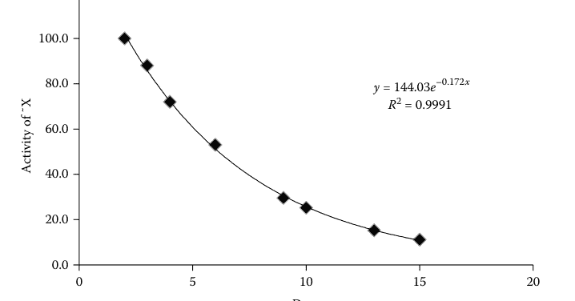

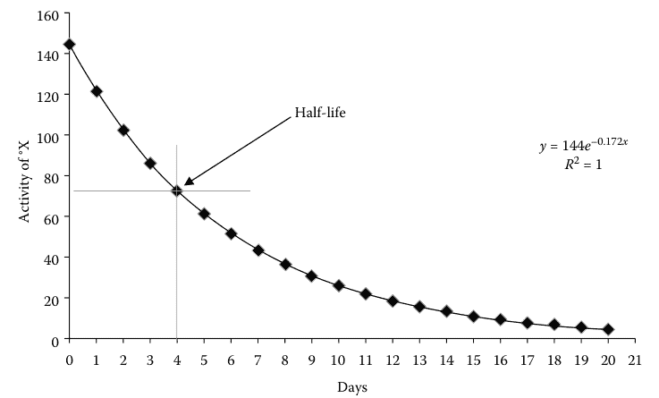

| 衰变常数 | - | 0.172 |

| 平均寿命 | Mean | 5.814 |

| 半衰期 | Median | 4.030 |

### 图 12.2 使用指数分布进行半衰期分析。

可以看出，方程 12.1 只是如下所示的适当指数概率密度函数 PDF 的一种变体：

```
f(t) = λe^{-λt}    (12.3)
```

累积分布函数 CDF 如下：

```
F(t) = 1 - e^{-λt}    (12.4)
```

其中 `t` 为时间，`λ` 为速率常数。该分布的均值为 `1/λ`。标准差也等于 `1/λ`。

在工程中，指数分布主要用于可靠性应用。在可靠性的背景下，`λ` 被称为故障率或风险率。在化学工程的一个例子中，腐蚀速率以指数形式表示。在电气工程的一个例子中，电容器中存储的电荷呈指数衰减。在地球物理学的一个例子中，大气压随高度呈指数下降。

方程 12.3 显示，单个参数完全指定了 PDF，这是方程简洁性的独特原因。

其他模型统计数据如下：

- 中位数为 `(ln 2)/λ`。

- 众数为 0。

- 偏度为 2。

- 峰度为 9。

指标% 在系统测试期间发现的软件缺陷随时间呈指数下降，如图 12.3 所示。初始测试工作发现更多缺陷，随后的测试开始显示较少的结果，这是软件测试中的常见体验。我们假设风险模块会首先进行测试，符合精心设计的测试策略。表示缺陷指标是指数模型的经典应用。

在测试日发现的缺陷被计数并累加以获得图 12.3。图的 x 轴可以是测试日甚至日历日。我们可以绘制每周发现的总缺陷并建立指数性质。

在可靠性分析中，中位数值 `(ln 2)/λ` 被称为半衰期。均值 `1/λ` 被称为平均故障时间 MTTF。此外，`f(t) = e^{-λt}` 被称为生存函数或可靠性函数。如果灯泡的 MTTF 为 400 小时，则相应的 `f(t)` 将定义灯泡的可靠性。随着时间的推移，可靠性会下降，尤其是在 400 小时之后，灯泡的可靠性可以直接从以下表达式计算得出：

```
Bulb reliability = e^{-(t/400)}
```

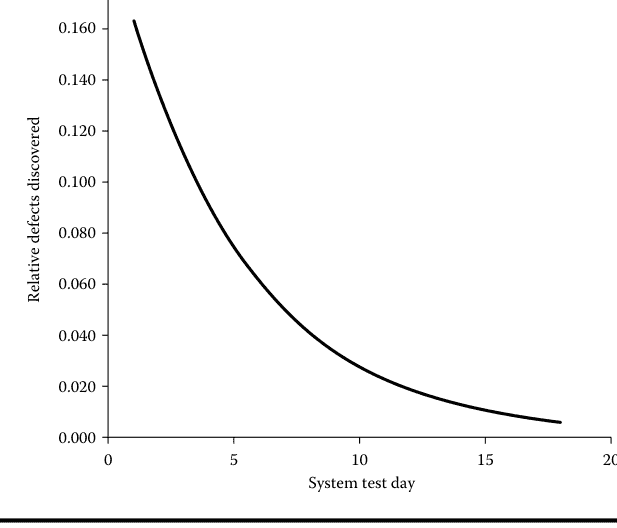

### 图 12.3 缺陷发现的指数分布。

其中 `t` 为经过的时间，单位为小时（请参阅框 12.2，了解关于燃烧 113 年的超级灯泡的注释）。

### 框 12.2 超级灯泡

百年灯泡是世界上使用寿命最长的灯泡。它位于加利福尼亚州利弗莫尔市东大道 4550 号，由利弗莫尔-普莱森顿消防部门维护。消防部门称该灯泡至少有 113 年历史，并且只在少数几次被关掉过。它是一只 4 瓦、手吹、碳丝、普通灯泡，由雪尔电气公司于 1890 年代末在俄亥俄州雪尔制造。利弗莫尔-普莱森顿消防部门计划在其余生中安置和维护该灯泡。（http://en.wikipedia.org/wiki/Livermore-Pleasanton_Fire_Department）

在软件应用中，存在思维上的逆转：累积分布函数 CDF `F(t) = 1 − e^{−λt}` 被称为可靠性函数。

随着时间的推移，更多缺陷被移除，产品变得更可靠，与灯泡形成对比。很容易通过将迄今为止发现的缺陷除以估计的总缺陷数来计算到给定日期为止发现的比例，如图 12.4 所示。累积发现的缺陷代表软件可靠性。

有一个警告。

> 规则说故障间隔服从指数分布，而缺陷事件服从泊松分布。基本事实是两者都遵循指数规律；一个是连续形式，另一个是离散形式。

在理想情况下，我们应该在方程 12.3 中使用故障间隔或故障时间并绘制图形（图形将类似于图 12.4 中的模式）。在实际项目中，缺陷发现的确切时间并不总是可用。人们会累积信息并每周提交报告，有时按日提交，从不按小时提交，除非当然如果缺陷跟踪工具有能力精确实时捕获缺陷事件。因此，我们在哲学上从报告缺陷计数转向报告一个称为每周缺陷数的指标。有些人使用缺陷密度（每千行代码的缺陷数或每功能点的缺陷数）而不是缺陷计数。无论哪种方式，我们都有一个密度指标，它仍然适合图 12.4 中表示的模型。

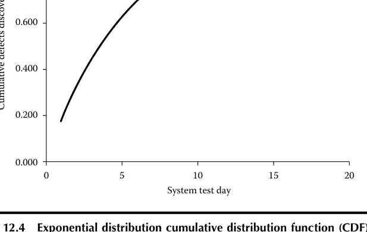

图 12.4 累积缺陷发现的指数分布累积分布函数 CDF。

### 框 12.3 西梅翁·德尼·泊松（1781–1840）

西梅翁·德尼·泊松是一位法国数学家。他的老师拉普拉斯和拉格朗日很快看到了他的数学才能。他们与这位极其有能力的年轻学生终生为友，并在多种方式上给予他强有力的支持。

他在第三年撰写的关于方程理论的论文质量如此之高，以至于泊松可以在不参加最后考试的情况下毕业。他受雇担任家庭教师，并在 1802 年两年后被任命为副教授。1806 年，他成为正教授。

泊松的贡献之一是开发了用于分析随机事件的方程，后来被称为泊松分布。它描述了在事件发生的概率非常小但试验次数非常大的条件下，随机事件在时间或空间间隔内发生的概率；因此，事件实际上会发生几次。

这种分布的名声往往归因于以下故事。普鲁士军队中许多士兵死于马踢。为了确定这是否由于随机发生还是上帝的愤怒，沙皇委托一位俄罗斯数学家确定事件的统计显著性。发现数据与泊松分布 remarkably 吻合。数据中存在秩序，死亡现在在统计上是可预测的。

泊松从未尝试过实验设计。他说，

> 生命只适合做两件事，发现数学和教授数学。

### 泊松分布

离散事件的指数规律可以表示如下：

```
P(x,λ) = e^{-λ} λ^x / x! (12.5)
```

其中 `x` 取离散整数值 0、1、2、…，`λ` 是 `x` 的均值。

泊松分布可以在 Excel 中使用统计函数 `POISSON.DIST` 求解。对于给定的 `x` 和 `λ` 值，该函数返回泊松概率。在使累积 = 0 输入数据时，我们得到概率分布函数，而在使累积 = 1 时，我们得到累积概率。

方程 12.5 中 `λ = 1、2、3 和 4` 的泊松概率的图绘制在图 12.5 中。

随着 `λ` 的增加，分布向右移动并趋于对称。


相应的累积概率绘制在图 12.6 中。随着 `λ` 的增加，曲线达到 S 形。

泊松分布由西梅翁-德尼·泊松创建。1837 年，泊松在索邦关于概率和决策理论的讲座出版了。它们

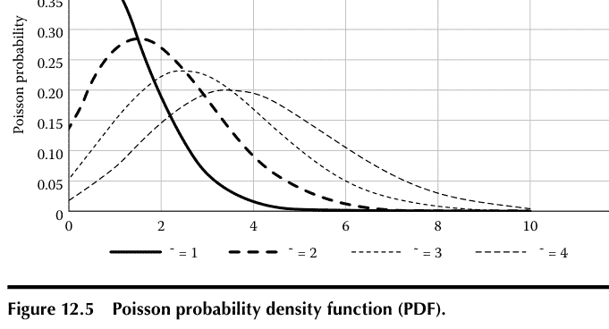

图 12.5 泊松概率密度函数 PDF。

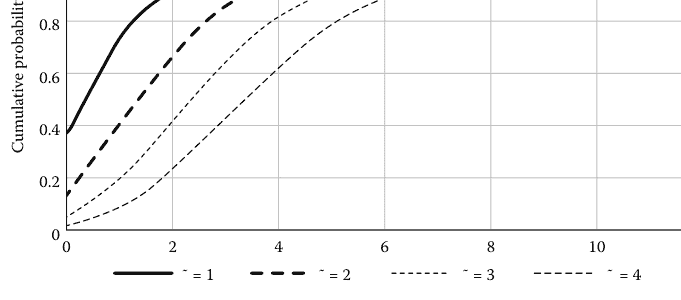

图 12.6 泊松累积分布函数 CDF。

包含了泊松分布，该分布预测了在大量试验过程中，极低概率的随机事件发生的模式。泊松分布被称为 `稀有事件定律`。

关于该分布发明者泊松的传记注释可在框 12.3 中看到。泊松似乎触及了普遍规律。泊松分布及其扩展在许多领域的研究人员中积极被追求，包括软件工程。

## 一个历史性的泊松分析：普鲁士骑兵的死亡

在冯·博特凯维茨于 1898 年进行的历史数据分析中，普鲁士骑兵因马踢而死亡的情况拟合为泊松分布。我们可以查看在 `Statistics: The Poisson Distribution` [2] 中提供的可用数据，其中每个军团的死亡均值 `p` 给出为 0.5434。将该值代入方程 12.5 并将 `x` 视为死亡人数，我们可以构建泊松分布如下：

```
$$P(x,0.5434)=\frac{e^{-0.5434}\,0.5434^{x}}{x!}\tag{12.6}$$
```

其中 `x` 是单个军团中的死亡人数。

图 12.7 显示了该泊松分布的图。


图 12.7 普鲁士骑兵死亡的泊松分布。

### 软件工程中的简单统计方法

利用上述泊松分布，俄国数学家冯·博特基维奇预测：“在观察的200年中，有109年将是无死亡年份。”结果证明，109恰好是普鲁士数据中记录没有因马踢致死事件的年数。预期值与实际值之间的吻合不仅仅是良好，而是完美。

### 框12.4 类比——坏苹果

一辆运送苹果的卡车在仓库卸货。大多数纸箱中的苹果状况良好，但有些苹果已损坏。通常，“坏苹果”是一种稀有事件；可能只有卡车上某些部分的纸箱会受损。坏苹果的出现是一个泊松过程，缺陷分布发生在空间域中。单位体积中坏苹果的数量是一个泊松参数。

同样，软件产品被交付给客户。当开始使用时，产品的某些部分被发现存在缺陷。此类缺陷是稀有事件。在代码结构中，缺陷在空间上分布。然而，软件使用和缺陷发现是时间域中的稀有事件。因此，人们使用“缺陷到达率”这一术语。单位时间（例如一周）内到达的缺陷数量可以根据时间中的缺陷计数来度量。缺陷到达率服从泊松分布。

发布前的测试也以类似方式发现缺陷。从广义上讲，缺陷按照泊松分布“到达”。变更请求也是如此。每个开发项目都有独特的缺陷发现管理方式；因此，泊松分布在结构上有所不同，并偏离了简单的经典泊松方程。为了适应不同的缺陷管理风格，存在多种泊松分布变体。

### 基于泊松分布的模块缺陷分析

发布前，软件缺陷由测试触发，符合泊松分布。用户验收测试中模块的缺陷计数是稀有事件的一个例子。如果每个模块的平均缺陷数为0.3，并且一次发布中有100个模块，那么缺陷根据泊松分布分布在各个模块中。所有模块不太可能有相同的缺陷数。少数模块可能缺陷较多，其余模块的缺陷数逐渐减少。该分布遵循公式12.5。泊松分布图如图12.8所示。

分布的均值现在称为速率参数。公式的唯一参数是均值。分布的方差等于均值。因此，统计界限可以通过简单公式得知：

```
UCL = λ + 3√λ     (12.7)
```


图12.8 模块缺陷的泊松分布。

```
CL = λ　　　　　　　　　　　　　　　　　　　　　　(12.8)
```

```
LCL = λ − 3√λ　　　　　　　　　　　　　　　　(12.9)
```

在前面的例子中，

上控制限（UCL）= 0.3 + 3√0.3

= 0.3 + 3 × 0.548

= 1.943

这一推理使我们想到，每个模块1.943个缺陷是统计界限。因此，泊松近似使我们能够对缺陷进行统计控制。任何缺陷数超过1.943的模块都是泊松离群点。泊松分布在这里充当质量评判者。（这种特征泊松分布的用途在框12.4中进行了说明。）

泊松分布的CDF，如图12.9所示，与软件缺陷管理特别相关。

它清楚地表明只有少数模块包含缺陷，其余模块缺陷为零。这种分布有助于发现缺陷密集的模块，并对其进行适当的测试。

泊松分布研究的另一个帮助是客观估计软件产品的一次通过率。这是如下泊松概率：


图12.9 模块缺陷的累积泊松概率。

即零个模块有缺陷的概率。例如，在图12.7所述的产品中，`x=0`时的泊松概率为0.74。这就是一次通过率。

### 基于泊松分布的客户投诉到达率研究

关于现场失效的客户投诉以泊松速率到达。让我们考虑一个案例，每月到达的平均失效投诉数为`λ`。我们脑海中浮现的一个问题是：“我们能否思考可能到达的最大投诉数量？”`λ`中是否有足够证据来预测最大投诉数量？泊松分布应用于此类情况。将每月到达的投诉数绘制成c控制图。图中的上限使用上面相同的公式计算。我们发现，每月可能到达的最大投诉数为

```
λ + 3√λ
```

这个数字可能违背客户投诉的直觉判断；直觉判断通常围绕平均值徘徊。预测值可能超过迄今为止任何给定月份实际收到的最大投诉数量。泊松边界很容易超过趋势预测。泊松近似对客户投诉到达的分析是非常有价值的辅助手段。

图12.10显示了客户投诉到达的一个示例。


图12.10 客户投诉控制图。

泊松边界被标记为上界。图中还包含一条趋势线，以显示泊松边界显示的投诉率高于趋势线所指示的投诉率。

在此背景下，框12.5说明了将泊松分布应用于棒球事件建模的案例。

### 将泊松分布应用于软件维护

服务请求的到达遵循泊松分布。到达间隔时间遵循指数分布。两者均具有无记忆性。修复缺陷的时间不依赖于先前的记录。在特定环境下修复缺陷的平均时间控制着结果的离散程度。无论是按月还是按周，团队可能会经历相同的泊松曲线。虽然已经建立了复杂的队列模型，但其基础构件是指数定律。

### 可靠性浴盆曲线：稀有事件的通用模型

部件的失效在可靠性分析中被广泛使用，因为它是一个泊松过程。可靠性浴盆曲线有三个区域。第一个区域的特征是失效率迅速下降。这个区域被称为早期失效期（也称为婴儿死亡期）。接下来，失效率趋于平稳，并在浴盆曲线的平坦部分保持不变。最后，随着材料磨损，失效率开始上升，退化失效以越来越高的速率发生。这就是耗损失效期（见图12.11）。

图12.11 浴盆曲线。

平坦底部由具有恒定失效率（或风险率）的泊松过程控制。更具体地说，这被称为齐次泊松过程（HPP）。“齐次”一词源于恒定的失效率或风险率。婴儿死亡期也是可靠性增长期。该时期的失效率不是恒定的，而是稳步降低；因此，它被称为非齐次。相关过程是非齐次泊松过程（NHPP）。耗损失效期也是NHPP，不同之处在于该处的失效率稳步增加，直到系统被淘汰。

可以注意到，在图12.11所示的浴盆曲线示例中，

- 在婴儿死亡期，

  $$m(t) = \lambda t^{-\beta},\ 0 < \beta < 1\tag{12.10}$$ 定义递减的失效率和一个NHPP。

- 在中间区域，

  $$m(t) = \lambda,\ \beta = 0\tag{12.11}$$ 定义恒定的失效率和一个HPP。

- 在耗损失效期，

  $$m(t) = \lambda t^{-\beta},\ \beta < 0\tag{12.12}$$ 定义递增的失效率和一个反向的NHPP。


HPP 只能用指数规律来描述，尽管这是一种过度简化。HPP 中的一个关键假设——恒定失效率——即使在机械系统的情况中也过于理想化而难以成立。在 HPP 下，一只灯泡在燃烧 400 小时后或分析人员设定的任何时间点，其可靠性都相同。物理上这是毫无意义的。同样，图 12.2 所示情况下失效率的物理意义也需要解释。没有任何软件以恒定失效率运行，尽管指数表示会产生这样的参数。必须牢记，图 12.2 是通过数值曲线拟合得到的，而不是使用物理上合理的可靠性参数如失效率或 MTBF 或 MTTF。

浴盆曲线整体上对机械系统是成立的。在软件的情况下，故障仅限于区域 1，该区域记录了可靠性的增长。因此，软件故障模型被称为 `可靠性增长模型`。对于这两种情况，我们现在需要 NHPP 建模的帮助，以更准确地表示现实世界的故障模式。

## 非齐次泊松过程 (NHPP)

现实生活中软件缺陷的到达比简单的指数曲线更复杂；图 12.12 中有一个例子。它展示了系统测试期间典型的缺陷到达模式。大约 140 个缺陷在大约三个月的时间跨度内被发现。这不是平滑的指数累积分布。曲线不规则；缺陷似乎在不同时期以不同的速率被触发。主测试过程中似乎存在短暂的测试周期。曲线还具有多个线性上升。这些细节明显偏离了简单的指数，证明了建立 NHPP 的必要性。


图 12.12 缺陷到达模式——经验模型。

NHPP 的方程如下所示：

```
P(x, m(t)) = \frac{e^{-m(t)} m(t)^x}{x!}\quad(12.13)
```

其中 `m(t)` 是均值函数，它取代了 HPP 模型中方程 12.5 中传统的失效率常数 `λ`。

需要注意的是，方程 12.13 与方程 12.5 完全相同，只是对速率常数 `λ` 进行了重新定义。NHPP 完全由其均值函数 `m(t)` 定义。建立 NHPP 模型归结为为 `m(t)` 识别合适的函数并从故障数据中推导出该函数的参数。

为 `m(t)` 选择函数有许多选项。研究人员已使用不同的函数来适应不同的情况。列表包括指数、对数、高斯、威布尔和逻辑函数。甚至还使用过函数的混合来处理复杂事件。

现在通常用两个方程来思考 NHPP。方程 12.13 中的较大泊松方程定义了结构，而方程 12.10–12.13 中的均值函数定义了核心组成部分。在将 NHPP 拟合到数据时，我们从数据中推导出均值函数 `m(t)` 的系数。为此无需查阅泊松方程。泊松过程在后台作为模型的抽象存在。

> `想到 NHPP，就想到均值函数。`

NHPP 幂律的早期应用是由 Duane [3] 提出的，他在 1964 年观察到，

> 当他将累积 MTBF 估计值与故障时间在对数-对数纸上作图时，点倾向于沿直线排列。这对许多不同的可靠性改进数据都成立，并且过去三十年中许多其他工程师也看到了类似的结果。这种类型的图称为 Duane 图，而通过点得到的最佳直线的斜率 beta 称为可靠性增长斜率或 Duane 图斜率。Duane 图上的直线等价于 NHPP 幂律模型。

NHPP 幂律已被用作“可靠性改进”的模型。

### 均值函数 MVF

`a = 1, b = 0.07`


图 12.13 Goel–Okumoto 模型。

> 上帝并不关心我们的数学困难。

> 他进行经验积分。

>

> —— 阿尔伯特·爱因斯坦

对 Goel–Okumoto 模型的使用有几个参考，通常称为 GO 模型。以下部分提到了其中一些。

### Goel–Okumoto (GO) 模型的不同应用

正如我们所见，稀有事件定律在 GO-NHPP 模型的结构中得到了充分实现。GO NHPP 模型已被广泛研究并用作软件可靠性增长模型 (SRGM)。下面列出了一些尝试。GO 模型广泛的应用探索了模型特征并确定了其局限性。

- 1. Nagar 和 Thankachan [6] 使用 GO 模型来“决定需要多少额外的测试以及对剩余错误进行正确估计。” 他们称 `b` 为圆度因子，类似于形状因子，当不规则性增加时趋于零。

- 2. Wood [7] 考虑了九个 SRGM 并在他的研究中包含了 GO 模型。他特别强调了时间数据的收集，即 SRGM 中的自变量。他还提出了一个两阶段 NHPP，“如果在测试期间添加了大量新代码。”

- 3. 在对软件可靠性模型的一项调查中，Pai [8] 考虑了 GO 模型。他对 GO 模型的使用提出了一个显著的观察，“该模型需要测试间隔内的故障计数和每个测试期的完成时间来进行参数估计。”

我们认为，这种做法赋予了均值函数额外的可信度，并使其具有更大的决策权。使用测试间隔内发现的缺陷总和和测试间隔完成时间作为自变量的指数模型并不那么依赖于泊松抽象。

- 4. Liu 等人 [9] 提出了一种广义 NHPP，该模型使用钟形曲线作为故障检测率。钟形曲线处理因调试、学习和故障移除效率波动而产生的变化。结果表明，所提出的模型比一些选定的 NHPP 模型，包括 GO 模型，更好地拟合故障数据。

- 5. Anjum 等人 [10] 使用 12 项比较标准评估了过去 30 年间提出的 16 个 SRGM。他们发现 GO 模型排在第 6 位。令人惊讶的是，他们发现广义 Goel 模型排在第 14 位。

广义 Goel 模型不使用其均值函数的简单指数规律，而是添加第三个参数以产生所需的形状变化。广义 Goel 模型的图可在第 21 章中找到。

- 6. Mohd 和 Nazir [11] 研究了不同的可靠性模型，并在 GO 模型中发现了一个有趣的特征。

应注意，这里待检测的故障数被视为一个随机变量，其观测值取决于测试和其他环境因素。这与将待检测故障数视为固定未知常数的其他模型有根本区别。

- 7. Kim 等人 [12] 发现 GO 模型可以应用于安全关键软件，尽管通常认为 Jelinski-Moranda 模型和 Goel–Okumoto 非齐次泊松过程 (NHPP) 模型等软件可靠性增长模型由于缺乏软件故障数据而无法应用于安全关键软件。

他们的分析证实了这种担忧：随着软件故障次数从 24 次变化到 34 次，GO 模型估计的固有软件故障总数从 27.32 到 34.83 不等。结果对故障数据点的数量很敏感。

- 8. Lin 和 Huang [13] 在一个特殊应用中发现 Weibull 模型优于 GO 模型，但选择将 GO 模型作为基准进行参考。

- 9. Gokhale 和 Trivedi [14] 提出了一种增强的 NHPP，称为均值函数，作为覆盖函数，并使用对数-逻辑函数代替指数，以获得比 GO 模型更好的结果。

### BOX 12.5 稀有棒球事件

Huber 和 Glen [15] 研究了三组稀有棒球事件——投出无安打比赛、打出循环打击和完成三杀防守——这些事件提供了可以用泊松过程建模的事件发生的绝佳例子。从 1901 年到 2004 年，共发生了 206 次无安打、225 次循环打击和 511 次三杀防守。相应的年均值计算如下：

- 无安打 = 1.98。

- 循环打击 = 2.16。

- 三杀防守 = 4.91。

上述均值表征了各自的泊松分布。研究人员还计算了平均间隔时间如下：

- 无安打 = 772 场。

- 循环打击 = 720 场。

- 三杀防守 = 316 场。

利用平均值，到达间隔时间已被拟合为指数分布。研究人员发现，实际数据与指数拟合吻合良好，但三元组的情况除外。总体而言，这是为稀有事件构建泊松模型和指数模型的一个非常好的示例。

## 复习题

- 1. 说明泊松分布与指数分布之间的关系。

- 2. 非齐次泊松过程（NHPP）与齐次泊松过程（HPP）有何不同？

- 3. 为什么指数分布被视为基本的工程曲线？

- 4. 碳定年法如何说明指数分布被自然界遵循这一基本应用？

- 5. 普鲁士骑兵死亡数据如何证明泊松分布是有效的？

### 练习

- 1. 应用方程12.8中定义的Goel–Okumoto NHPP模型，并给定`b` = 0.04，估计达到0.95可靠性水平的时间`t`。我们将此时间记为`t₉₅`。

- 2. 应用方程12.9，求在时间`t` = `t₉₅`时发现两个缺陷的概率。提示：在方程12.9中代入`x` = 2。同时参考图12.13以理解问题。

- 3. 如果每个模块的平均缺陷数为0.4，求应用程序的首次正确指标（RFT）。

  提示1：RFT是测试期间模块中零缺陷的概率。

  提示2：使用Excel函数`POISSON.DIST`计算该数值。

- 4. 以在一个应用程序中测试100个组件为例。每个模块的平均缺陷数为0.2。组件质量控制图的上控制限是多少？

- 5. 假设NHPP服从幂律。常数`b` = 0.5。某应用程序发布后立即出现每周5个缺陷的故障率。第五周的故障率是多少？

### 参考文献

- 1. E. Rutherford 和 F. Soddy，放射性的原因和性质：第一部分，*《哲学杂志》*，4, 370–396 (1902)（重印于*《纳尔逊勋爵卢瑟福文集》*，1，第472–494页 [伦敦：Allen and Unwin, Ltd., 1962]）。

- 2. L. J. Bortkiewicz，泊松分布，*《小数定律》*，统计学，1898。可在 http://en.wikipedia.org/wiki/Poisson_distribution 获取。

- 3. J. T. Duane，*《幂律NHPP》*，1964。可在 http://www.itl.nist.gov/div898/handbook/apr/section1/apr191.htm 获取。

- 4. Y. Vamsidhar、Y. Srinivas 和 A. Brahmani Devi，一种使用混合模型和非齐次泊松过程的软件可靠性新方法，*《国际计算机科学与软件工程高级研究杂志》*，3(6)，2013。

- 5. S. H. Kan，*《软件质量工程中的度量与模型》*，第2版，Addison-Wesley Professional，2002。


- 6. P. Nagar 和 B. Thankachan，Goel–Okumoto模型在软件可靠性测量中的应用，*《国际计算机应用杂志（0975–8887）——网络、智能与计算技术中的问题与挑战专刊》*，2012。
- 7. A. Wood，*《软件可靠性增长模型》*，Tandem computers，1996。
- 8. G. Pai，*《软件可靠性模型综述》*，Department of Virginia, VA，2002。
- 9. H.-W. Liu、X.-Z. Yang、F. Qu 和 Y.-J. Shu，一种具有故障排除效率的通用NHPP软件可靠性增长模型，*《伊朗电气与计算机工程杂志》*，4(2)，2005年夏–秋。
- 10. M. Anjum、A. Haque 和 N. Ahmad，基于加权准则值的软件可靠性模型分析与排序，*《国际信息技术与计算机科学杂志》*，5(2)，2013。
- 11. R. Mohd 和 M. Nazir，软件可靠性增长模型：概述与应用。*《新兴计算与信息科学趋势杂志》*，3(9)，2012。
- 12. M. C. Kim、S. C. Jang 和 J. J. Ha，*《将软件可靠性增长模型应用于安全关键软件的可能性与局限性》*，韩国原子能研究所，2006。
- 13. C.-T. Lin 和 C.-Y. Huang，*《基于威布尔型测试工作量和多变更点的软件可靠性建模》*，DCS，国立清华大学（台湾）。
- 14. S. S. Gokhale 和 K. S. Trivedi，基于时间/结构的软件可靠性模型，*《软件工程年鉴》*，8, 85–121, 1999。
- 15. M. Huber 和 A. Glen，对罕见棒球事件建模——它们是无记忆的吗？*《统计教育杂志》*，15(1)，2007。

## 建议阅读材料

- Arekare, K.，用于测试软件失效过程的NHPP和S型模型，*《国际最新计算趋势杂志》*，1(2)，2010。
- Barraza, N. R.，复合泊松软件可靠性模型的参数估计，*《国际软件工程及其应用杂志》*，7(1)，137–148，2013。
- Goel, A.，软件可靠性模型：假设、局限性与适用性，*《IEEE软件工程汇刊》*，11(12)，1411–1423，1985。
- Grottke, M.，*《软件可靠性模型研究》*，IST-1999-55017，2001年1月。`http://www.grottke.de/documents/SRModelStudy.pdf`。
- Huang, C.-Y.、M. R. Lyu 和 S.-Y. Kuo，用于软件可靠性估计的若干非齐次泊松过程模型的统一方案，*《IEEE软件工程汇刊》*，29(3)，261–269，2005。
- Huang, C.-Y.、M. R. Lyu 和 S.-Y. Kuo，用于软件可靠性估计的若干非齐次泊松过程模型的统一方案，*《IEEE软件工程汇刊》*，29(3)，2003。
- Jain, M. 和 K. Priya，具有非齐次泊松过程（NHPP）失效强度的软件可靠性分析，*《尼泊尔运筹学会国际杂志》*，1, 1–19, 2012。
- James, A. 等，使用设计度量识别电信软件系统中易产生缺陷的类，*《信息科学》*，2006。
- Kapur, P. K.、K. S. Kumar、J. Prashant 和 S. Ompal，在分布式开发环境中纳入两类不完全排错概念以开发灵活的软件可靠性增长模型，*《技术与工程科学杂志》*，1(1)，2009。
- Khatri, S. K.、P. Trivedi、S. Kant 和 N. Dembla，在基于随机微分方程的软件可靠性增长建模中使用人工神经网络，*《软件工程与应用杂志》*，4, 596–601, 2011。
- Massey, W. A.、G. A. Parker 和 W. Whitt，估计具有线性速率的非齐次泊松过程的参数，*《电信系统》*，5, 361–388, 1996。
- Meyfroyt, P. H. A.，*《软件可靠性模型的参数估计》*，2012年7月20日。`http://alexandria.tue.nl/extra1/afstversl/wsk-i/meyfroyt2012.pdf`。
- Nikora, A. P.，*《从开发过程和产品特征预测软件系统缺陷内容》*，提交给加州大学研究生院教师的一篇学位论文，1998年5月。`http://csse.usc.edu/csse/TECHRPTS/PhD_Dissertations/files/Nikora_Dissertation.pdf`。
- Purnaiah, B.，软件可靠性增长模型中的故障排除效率，*《计算研究进展》*，4(1)，74–77，2012。
- Qian, Z.，基于测试工作量函数和不完全排错的软件可靠性建模，*Telkomnika*，10(8)，1992–1998，2012。
- Rafi, S. M.、K. N. Rao 和 S. Akthar，具有逻辑-指数测试工作量函数的软件可靠性增长模型及软件发布策略分析，*《国际计算机科学与工程杂志》*，2(2)，387–399，2010。
- Satya Prasad, R.、V. Goutham 和 N. Pawan Kumar，使用置信区间估计失效计数数据，*《国际创新技术与探索工程杂志》*，2(6)，2013。`http://www.ijitee.org/attachments/File/v2i6/F0834052613.pdf`。
- Savanur, S.，*《使用软件可靠性增长模型（SRGM）进行残余缺陷估计》*，博客，2013年1月1日。
- Shatnawi, O.，软件可靠性增长现象的离散时间NHPP模型，*《国际阿拉伯信息技术杂志》*，6(2)，124, 2009。
- Son, H. S.、H. G. Kang 和 S. C. Chang，将软件可靠性增长模型应用于核电厂概率安全评价（PSA）的程序，*《核工程与技术杂志》*，41(8)，1065–1072，2009。
- Vamsidhar, Y.、P. Samba Siva Raju 和 T. Ravi Kumar，使用监督学习技术对可靠性增长模型进行性能分析，*《国际科学与技术研究杂志》*，1(1)，2012。
- Williams, P.，二参数和三参数软件可靠性增长模型的预测能力分析，*《信息技术杂志》*，5(6)，1048–1052，2006。

## 专栏13.1 社会法则的起源

正态分布几乎影响了生活和研究的每一个领域，它已经获得了社会法则的地位。

法裔英国数学家亚伯拉罕·棣莫弗（1667—1754）于1718年出版了*《机会学说：计算博弈中事件概率的方法》*，该书探讨了赌博问题。第三版于1756年问世，其中包含用正态分布对二项分布进行的近似。

> 棣莫弗实际上早在1708年就写下了这个方程；他是通过抛硬币或二项分布的极限情形得到的。假设一枚硬币被抛 `n` 次，记录出现 `k` 次正面的比例。经过许多次 `k` 重试验后，我们得到一张图，显示出现0次正面、1次正面、2次正面……`n`次正面的次数。曲线会在该硬币出现正面的概率附近达到峰值。当抛掷次数 `n` 无界增大时，结果趋于正态分布[1]。

棣莫弗关注的是机会游戏，他的发现展示了抽样调查的力量：只需检查少数样本就能确定总体中的规律。他晚年作为伦敦斯劳特咖啡馆的常驻统计学家，为赌徒解决概率问题。

1809年，德国数学家、天文学家约翰·卡尔·弗里德里希·高斯（1777—1855）指出，天文观测中的测量误差服从一种对称分布，即所谓*正态分布*。高斯也是第一个将正态分布曲线的效用发挥出来的人，而该曲线此前已由棣莫弗发现。如今，这种分布也常被称为*高斯分布*。

> 这条曲线由观测天文学家发展而来，他们利用正态分布的思想来检验测量的准确性。他们对同一段距离测量多次，并将结果绘制成图。如果大多数测量值集中在均值附近，那么结果的平均值就可以认为是可靠的。异常值或偏离的测量值则可能被视为不准确而忽略不计[2]。

近300年来，正态分布一直以各种名称被研究。对于有历史倾向的人来说，它是拉普拉斯第二定律、高斯定律或拉普拉斯—高斯曲线。对于实验工作者来说，“偏差定律”和“误差曲线”这两个名称可能更有意义。皮尔逊、费希尔和高尔顿称其为“正态曲线”，这一名称深受统计学家青睐。

如今，在统计学教科书中，我们倾向于称之为正态分布；在科学界，更受青睐的名称则是高斯分布。

该分布没有独立的形状参数，因为其形状是固定的：钟形。

```
F(x,μ,σ) = 1/√(2πσ) e^(-(x-μ)²/(2σ²))  (13.2)
```

其中 `μ` 是均值（位置参数），`σ` 是标准差（尺度参数）。

均值和标准差是描述性统计的一部分，已在第1章讨论过。对于任何数据集，我们都可以估计这两个参数。上述方程正是自然的延续。


图13.1 标准正态曲线。

该分布的统计特性如下：

- `均值 = μ`
- `众数 = μ`
- `中位数 = μ`
- 峰度 = 3
- 相对峰度 = 0
- 偏度 = 0
- `方差 = σ²`
- `标准差 = σ`
- 值域 = −∞ 到 +∞

每人日代码行数（LOC）的平均代码生产率及其标准差可以轻松地从数据中计算出来，并绘制出相应的正态分布图。

在图13.2中，针对四个不同的标准差绘制了假定的生产率正态分布。我们必须假定其为正态分布，因为如果绘制直方图，生产率数据会呈现非正态性。不过，我们仍采用正态近似。如果离散程度降低，这是一个好迹象，表明过程在改善。图13.2显示，随着标准差的减小，曲线的高度增大，宽度减小。

现实世界的过程改进包括减少变异，同时使均值发生有利的偏移。图13.3展示了生产率改进的钟形曲线。


图13.2 生产率的高斯概率密度函数（PDF）。


图13.3 生产率改进的高斯模型。

最佳表现出现在均值为49、标准差为2时。这更接近人们常说的“每人日50行代码（LOC）”的经验法则。这些曲线仍是假设性的，充其量只是近似。图13.3中的钟形曲线描绘了从高斯视角捕捉到的改进故事。

## 变异的一阶近似

> 如果我们能用同样的近似程度预测后续情况，那就足够了；我们便可以说该现象已被预测，且它受规律支配。
>
> 亨利·庞加莱

构建高斯分布相当容易，只需两个参数：均值和标准差。如果无法获得数据，这两个参数也可以通过专家判断得到。如果我们能猜测出乐观值和悲观值，就可以“估计”高斯分布的均值和标准差。最大值与最小值之差就是估计的范围。我们用来求标准差的经验法则如下：

```
Standard deviation = Range / 6  (13.3)
```


图13.4 工作量偏差的高斯分布。

均值可从过程的集中趋势中回忆得出。高斯分布能够轻松地与近似数据相联系，这一能力使其成为一条“社会法则”。

> 高斯分布让我们看到真相的两个方面：集中趋势和离散程度，并有助于做出公正的判断。

例如，根据记忆中的工作量偏差均值 = 5% 和范围 = 30%，我们可以构建出如图13.4所示的高斯分布。从图中可以看出，集中趋势揭示了问题所在。如果规划和估算实践是完美的，集中趋势应为零。非零趋势是对项目管理的一种评判。

## 专栏13.2 钟形曲线公平吗？

钟形曲线的威力与中心极限定理（CLT）有关：当样本容量 `N` 趋向于足够大时，样本均值趋向于正态分布。法国数学家皮埃尔-西蒙·拉普拉斯从亚伯拉罕·棣莫弗几乎被遗忘的工作中拯救了中心极限定理，并将其发表在他的巨著*《概率分析理论》*中。1901年，俄罗斯数学家亚历山大·李亚普诺夫对其进行了概括性定义，并精确地证明了它在数学上如何成立[3]。

弗朗西斯·高尔顿爵士如此描述中心极限定理[4]：

> 我几乎不知道还有什么比“误差频率定律”所表达的奇妙的宇宙秩序更能激发想象力。当一大群混沌的元素被拿在手中，并按照其大小排序时，一种意想不到的、极其优美的规律性便显现出来，原来它一直潜藏在其中。

“中心极限定理”这一术语最早由乔治·波利亚在1920年一篇论文的标题中使用。波利亚之所以称之为“中心”定理，是因为它在概率论中的重要性[5]。

据勒卡姆所述，法国概率学派将“中心”一词解释为“它描述的是分布中心的行为，而不是其尾部行为”[6]。

1870年至1913年间，马尔可夫、切比雪夫和李亚普诺夫为中心极限定理作出了贡献。在1920年至1937年间，林德伯格、费勒和莱维完善了中心极限定理[7]。

中心极限定理为钟形曲线范式奠定了基础。测量科学呈现了另一个真相。无论我们测量什么，都会通过重复测量来使结果可信，并测量被测参数的钟形曲线。钟形曲线的极限或峰值就是真相，尾部表示误差。一些教育学家将钟形曲线作为评分曲线加以批评，这是没有根据的。钟形曲线代表数据，不能让它为假设承担责任。

总而言之，钟形曲线比孤立的数据更能代表真相。

## 估算误差

偏差度量是一把双刃剑。一方面，它衡量计划的执行情况；另一方面，它衡量项目估算的准确程度。如果将其应用于估算，这个度量可以改称为估算误差百分比。

当过程成熟时，估算误差往往呈现图13.5所示的曲线。估算误差就是测量误差；它们类似于高斯在发现正态分布的开创性应用时所使用的天文测量误差。这在规模估算、进度估算、工作量估算乃至缺陷数量估算中都是如此；所有这些误差都呈高斯分布。

## 查看需求波动性

图 13.5 估计误差的高斯分布。

在项目初期，管理者会考虑范围蔓延的风险并制定应对风险的策略。可能没有潜在范围蔓延的客观证据，但基于基准数据的近似模型可以用来构建高斯模型以指导战略规划。在某些项目中，需求波动性被认为标准差约为 3.3%，均值为 4%，作为经验法则。

> 经验法则是对个人经验的表达。

通过对统计思维的练习，我们可以轻松地将知识转化为高斯参数。

图 13.6 需求波动性的高斯分布。


图 13.6 显示了上述经验法则的高斯版本图。容差极限在图表上标出。

图 13.6 是理解需求波动性挑战的图示模型，其背景是约束极限。它提供了对过程及其过程约束（或目标）的良好可视化。

> 传统处理信息的方式——阅读、聆听、写作、交谈——与“把握全局”相比痛苦地缓慢。那些能够在信息过载中生存下来的人，将是那些以宽带思维搜索信息但以单一专注力应用信息的人。
>
> Kathryn Alesandrini
>
> *Survive Information Overload: The 7 Best Ways to Manage Your Workload by Seeing the Big Picture*

## 风险度量

我们可以使用高斯曲线来衡量风险，这在软件项目管理中经常进行。例如，在图 13.6 中，容差极限划出了一条尾部，其面积表示风险。在图 13.7 中，我们显示了带有标记为黑色的尾部面积的高斯分布。


图 13.7 需求波动性高斯分布上的风险表示。

无需参考高斯表，我们可以使用 Excel 函数通过以下表达式计算尾部面积：

`Right tail = 1 – NORMDIST (USL, mean, standard deviation, 1)`

代入我们的数值，我们得到 `right tail = 0.04697` 或 4.697%。

> 你可以用衡量风险的同一把尺来衡量机会。它们是相伴而生的。
>
> Earl Nightingale

高斯曲线下剩余的面积衡量了满足目标或“能力”的概率。在我们的案例中，需求波动性能力为 95.3%，如图 13.7 所示。

能力和风险是互补的。如果一个不存在，另一个就会出现。

作为风险计算程序的延伸，我们可以根据它们与均值的距离计算尾部的风险。作为示例，针对距离均值的几个有用值计算了尾部面积并列于表 13.1。

表 13.1 包含单尾问题的解，并给出过程超过给定规格极限的概率。几个单尾问题，例如缺陷密度超过上限的概率，是生产率低于下限规格极限的概率。

存在几个双尾问题。这些过程同时具有上限规格极限和下限规格极限。对于工作量方差指标，在某个增强项目中，规格极限为 ±20%。实际性能由均值 = 14、标准差 = 15 的正态分布表征。两个规格极限定义了两个尾部。

之前计算的 Excel 语法如下：

```
Left tail = NORMDIST (LSL, mean, standard deviation, 1)

Right tail = 1-NORMDIST (USL, mean, standard deviation, 1)

Total risk in the process = left tail + right tail
```

计算结果显示在数据 13.1 中。

左尾涉及过程合规风险。当团队节省时，存在采用捷径的风险，这可能后来会反噬为产品失败。右尾具有明显的成本风险。项目中的总风险可能是两个尾部面积之和。有时，两个尾部可以吸引不同的权重，进行“加权”总风险计算。我们在数据 13.1 中使用了简单求和，其结果如下：

### 表 13.1 尾部风险计算

| Distance from Mean | Tail Area | % Tail Area |
|--------------------|-----------|-------------|
| 0.2 | 0.420740 | 42.074 |
| 0.4 | 0.344578 | 34.458 |
| 0.6 | 0.274253 | 27.425 |
| 0.8 | 0.211855 | 21.186 |
| 1.0 | 0.158655 | 15.866 |
| 1.2 | 0.115070 | 11.507 |
| 1.4 | 0.080757 | 8.076 |
| 1.6 | 0.054799 | 5.480 |
| 1.8 | 0.035930 | 3.593 |


| 2.0 | 0.022750 | 2.275 |
| 2.2 | 0.013903 | 1.390 |
| 2.4 | 0.008198 | 0.820 |
| 2.6 | 0.004661 | 0.466 |
| 2.8 | 0.002555 | 0.256 |
| 3.0 | 0.001350 | 0.135 |

`Left tail = 0.0117`  
`Right tail = 0.3446`  
`Total risk = 0.3563`

在之前提到的风险分析中，成本 escalation 似乎是占主导的风险。

## 数据 13.1 双侧风险估计

| Metric | E' or t Variance (%) |
|--------|-----------------------|
| Historic Data |  |
| Mean | 14 |
| Sigma | 15 |
| Specification Limits |  |
| `USL` | 20 |
| `LSL` | -20 |
| Left tail | 0.011705 |
| Right tail | 0.344578 |
| Total risk | 0.356284 |

## BOX 13.3 高斯平滑

在图像重建中，使用高斯分布。

在电磁辐射领域，天线波束宽度是根据半功率波束宽度高斯重建的，后者更容易测量。利用多数据点经验构建波束既耗时，又在高斯平滑被接受为科学实践时显得不那么有吸引力。高斯平滑节省时间和金钱，却成功地构建了真相。在图像处理中，高斯平滑被广泛使用。

一种常用的执行图像平滑的算法是高斯。每个像素与高斯核卷积并求和；结果是噪声抑制、更好的信噪比和更好的图像质量。钟形曲线用于战胜噪声。

在数字信号处理中，高斯滤波器检索更真实的信号。在空间平滑 MRI 图像中，使用高斯平滑来丰富图像。高斯平滑模糊噪声。平滑程度由高斯的标准差决定。当然，更大的标准差高斯需要更大的卷积核才能准确表示。“高斯输出每个像素邻域的‘加权平均’，平均值更偏向于中心像素的值。”

在扫描图像的重建过程中，高斯平滑就像低通滤波器。高斯窗口是 CT 扫描中体绘制的一个有吸引力的选项 [8]。

## 组合正态概率密度函数（PDF）：平方和定律

正态分布的一个非常有用的性质是，我们可以使用简单的规则集轻松组合多个正态 PDF：

> 将均值相加得到总体均值。  
> 将方差相加得到总体方差。

例如，可以使用此属性组合里程碑的进度绩效。项目的整体进度是里程碑进度的总和。项目进度中的总体方差是个别里程碑进度方差的总和。示例见表 13.2。

风险的根本原因是方差，表 13.2 提供了项目在每个声明里程碑处的方差数据。这些里程碑构成了关键路径。它们的方差通过使用平方和定律相加得到项目的总体方差。风险的感知在项目生命周期中弥漫整个项目。图 13.8a 显示了里程碑交付的钟形曲线。

总体方差用黑色填充。如果里程碑是非正态分布的，项目中的总体方差通常通过称为蒙特卡洛模拟的程序获得。由于我们假设正态分布，因此总体方差以优雅而简单的方法获得。

项目的总体交付方差和均值在图 13.8b 中单独显示以供进一步分析。交付日标记为 226，超出部分被称为

## 表 13.2 里程碑进度估计

| Milestone No. | Milestone | Mean | Cumulative | Sigma | Variance |
| --- | --- | ---: | ---: | ---: | ---: |
| 1 | Start | 0 | 0 | 3 | 9 |
| 2 | Requirement gathering | 3 | 3 | 1 | 1 |
| 3 | Requirement documentation | 4 | 7 | 1 | 1 |
| 4 | High level design | 12 | 19 | 2 | 4 |
| 5 | Detailed design | 20 | 39 | 2 | 4 |
| 6 | Code for selected 10 modules | 40 | 79 | 3 | 9 |
| 7 | Code for next 10 modules | 60 | 139 | 3 | 9 |
| 8 | Code for remaining modules | 30 | 169 | 2 | 4 |
| 9 | System test | 15 | 184 | 3 | 9 |
| 10 | Integration test | 12 | 196 | 2 | 4 |
| 11 | User acceptance test | 12 | 208 | 1 | 1 |
| 12 | Finish | 3 | 211 | 3 | 9 |
|  | Overall mean | 211 |  |  |  |
|  | Overall variance |  |  |  | 64 |
|  | Overall sigma (sqrt of var) |  |  | 8 |  |

Note: The milestones above are on the critical path.


项目进度风险。从高斯公式来看，风险可计算为 3%。从图中，我们还可以看到项目估算中使用的以下三个 PERT 值：

- 乐观值 = 186
- 悲观值 = 236
- 最可能值（均值）= 211

利用黄金法则，我们也可以按如下方式估算交付日期：

$$\text{Delivery date} = \frac{t_{\mathrm{opt}} + t_{\mathrm{pess}} + k t_{\mathrm{most\ likely}}}{6}$$

其中 `k` 是一个常数，通常取 4，但可根据项目的性质进行更改。

我们认为上述示例说明了高斯分布最令人钦佩的能力。它使模拟成为一项透明的工作，否则它将作为使用复杂但理解不足的工具的黑箱技术而存在。

## 一个逆问题

让我们重新审视第 13.2 节方程，该方程定义了高斯 PDF。对该 PDF 的积分导致累积分布函数（CDF），`F(x)`，定义如下：

```
F(x) = \frac{1}{\sqrt{2\pi}} \int_{-\infty}^{x} e^{-\frac{(x-\mu)^2}{2\sigma^2}} dx
(13.4)
```

该 CDF 可以使用 Excel `NORMDIST(x, mean, SD, 1)` 绘制。作为示例，我们在图 13.9 中绘制了需求波动率的 CDF，均值 = 3.3%，标准差 = 4%。逆问题是已知高斯 `F(x) = 0.78`；`x` 是多少？这个问题及其答案显示在图 13.9 中。答案标记为 6.39。该解是通过图形获得的。

我们可以使用 Excel 函数 `NORMINV` 来求 `x`，如下所示：

```
NORMINV(0.78, 3.3, 4) = 6.3888
```


在同一指标上，我们可以提出另一个逆问题。如果我们在高斯分布的两侧各拒绝 5% 的事件，那么在可接受区域内需求波动率的范围是多少？上部拒绝点的累积概率为 0.95，对应的 `x` 值为如下：

```
NORMINV(0.95, 3.3, 4) = 9.879%
```

下部拒绝点的累积概率为 0.05，对应的 `x` 值为如下：

```
NORMINV(0.05, 3.3, 4) = -3.279%
```

因此，当在两个尾部各拒绝 5% 的事件时，需求波动率的范围由区间 `[-3.279, 9.879]` 定义。有时，丢弃数学函数的极端端点并将截断区间视为实际离散是有帮助的。需要用户的判断来决定截断多少。通常，人们选择 1%、5% 和 10% 中的任意一种截断。截断范围相应地按递进方式缩小。当谈到确定范围时，这取决于问题的制定方式。无论制定方式如何，高斯分布都可以提供简单而现成的答案。

> 问题的表述往往比其解决方案更重要，后者可能只是数学或实验技巧的问题。
>
> 阿尔伯特·爱因斯坦

## BOX 13.4 是否存在平均人？

钟形曲线历史上一个里程碑式的概念是由 Lambert Adolphe Jacques Quetelet（1796–1874）提出的平均人概念，他是一位比利时天文学家、数学家、统计学家和社会学家。他将钟形曲线应用于社会科学，他称之为社会物理学。他收集了 100,000 名法国征兵的高度和 5,738 名苏格兰士兵的胸围测量数据。这些测量的可能误差约为 2 英寸。他发现了围绕平均值的“和谐”变化。存在惊人的对称性，也存在不可避免的混合。看起来似乎存在一个虚构的平均人或理想人，而其他人只是对其的偏离。变化来自“恒定原因”，而一些极端扰动来自“偶然原因”。（我们想起了 Shewhart 的普通原因和特殊原因，这一深刻思想将在 1920 年左右，即一百年后，在他的统计过程控制中出现。）

Quetelet 坚信“有一个普遍规律支配着我们的宇宙。”他为平均人提出了最重要和最广泛的作用。医生因此可以通过与虚构的平均人进行比较来确定最有用的疗法和在正常和不正常情况下应采取的行动。因此，艺术家可以预测真理，政治家可以预测公众情绪，自然主义者可以预测种族类型，社会科学家可以预测出生、成长和衰亡的规律。

Quetelet 将平均人与重心进行了比较。一切都应被视为围绕正常状态而变化，其方式可以用美丽的钟形曲线完美对称但振幅各异来准确描述。因此，个体在其正常自我周围变化，群体的成员在其平均值周围变化。在社会物理学中，钟形曲线代表人类历史的真正力学。

平均人没有过度和缺陷。自然力图产生平均人，但由于多种原因的干扰而失败。

经验教训：通过类比，同样地，行业力图实现理想的流程，但由于干扰而失败。

> 成长应以平均值为判断依据；变化必须用于检测问题。

## 过程能力指数

如果满足两个条件，则认为过程是可行的：它应表现出较小的变化，并且应与目标保持一致。

变化必须包含在可用的规格窗口内。过程的实际范围（截断）必须小于间隙（`USL – LSL`）。规格窗口被过程消耗了多少决定了能力。因此，我们在评估第一个指数，即 `Cₚ`，过程潜力时使用以下两个方程：

规格窗口 = `USL – LSL`

`Cₚ`，过程潜力 = 规格窗口/`6σ`

一致性取决于过程均值与过程目标的接近程度。可以通过过程均值与过程目标之间的距离来衡量一致性。过程往往会偏离目标。漂移降低了能力。漂移的过程只能实现其潜力的部分。因此，我们有了已实现过程能力指数 `Cpk` 的概念，如下所示：

`Cpk`，已实现过程能力 = `Cp(1 − k)`

其中 `k` = 过程漂移/规格窗口的一半。

漂移越大，`k` 的值越大，`Cpk` 的值越小。

有一个既定的传统将 `Cp` 置于 1.0 以获得可接受的质量，2.0 以获得优秀的质量。

此外，如果 `Cpk` < `Cp`，则过程需要与目标对齐。

示例计算显示在表 13.3 中。工作量方差指标用于此示例计算。均值为 5%，SD 为 7%。规格限制通常为 ±10%。在表 13.3 中，`Cp` 计算为 0.48，`Cpk` 计算为 0.24。从这些计算中出现了两个改进机会。第一个机会是提高 `Cpk` 并使其等于 `Cp`；这涉及过程对齐，即中心趋势的移动。下一个机会是实现

### 表 13.3 过程能力指数

| Process Metric | Effort Variance | % |
| --- | --- | --- |
| Process Goals |  |  |
| Target | 0 | % |
| `USL` | 10 | % |
| `LSL` | −10 | % |
| Process Performance |  |  |
| Mean | 5 | % |
| Sigma | 7 | % |
| Process Capability Indices |  |  |
| `Cp` | `= (USL − LSL)/6σ` | 0.48 |
| `k` | `= (Drift)/(0.5*(USL − LSL))` | 0.50 |
| `Cpk` | `= Cp*(1 − k)` | 0.24 |

过程变化的突破性减少，从而提高 `C_p`。减少变化比移动过程均值更具挑战性。

> 减少变化。对变化的了解是深刻的知识。
>
> Deming

## `z` 分数计算

过程 `z` 定义在方程 13.5 中。观察值与理想均值之间的差除以标准差得到过程 `z`：

```
z = (x - μ) / σ

(13.5)
```

前面提到的公式也称为 `z` 分数。偏离均值越大，得分值越大。因此，`z` 分数是偏离均值的度量。由于 `z` 分数是标准化的，因此它是无量纲的。

在实践中，所测量的偏差来自目标。因此，实际 `z` 分数具有以下公式：

```
z = (x - T) / σ

(13.6)
```

对于每个项目指标，`z` 分数可以按表 13.4 示例中所示计算。表中考虑了六个开发项目指标，并使用方程 13.6 计算了 `z` 分数。

| Metric | Target | Sigma | Performance | `z` Score |
|--------|--------|-------|-------------|-----------|
| Effort variance | 0 | 5 | 10 | 2.00 |
| Schedule variance | 0 | 3 | 5 | 1.67 |
| Scope creep | 0 | 2 | 3 | 1.50 |
| Defect density | 0 | 1 | 3 | 3.00 |
| Complexity | 30 | 10 | 70 | 4.00 |
| CSAT | 8 | 2 | 5 | -1.50 |

指标的选择在流程、产品和业务目标之间取得了平衡。

| 类别 | 指标 |
| --- | --- |
| 流程 | 努力偏差 |
| 流程 | 进度偏差 |
| 流程 | 范围蔓延 |
| 产品 | 缺陷密度 |
| 产品 | 复杂度 |
| 业务 | CSAT（客户满意度） |

在此示例中，得分越大，偏离目标的程度越大。条形长度表示均值与目标的统计距离，即问题的严重程度。其优点是所有指标的绩效都可以用同一单位在同一图表中显示（图 13.10）。

该图提供了对开发项目的平衡视图。

使用 `z` 分数衡量统计距离的方法可用于将当年绩效与上一年绩效进行比较。这样的比较显示在表 13.5 中。龙卷风图显示在图 13.11 中。


### 表 13.5：改进得分

| 指标 | 组织 Sigma | 上一年均值 | 今年均值 | 均值变化 | `z` 分数 |
| --- | ---: | ---: | ---: | ---: | ---: |
| 努力偏差 | 5 | 12 | 10 | -2 | -0.40 |
| 进度偏差 | 3 | 6 | 5 | -1 | -0.33 |
| 范围蔓延 | 2 | 6 | 3 | -3 | -1.50 |
| 缺陷密度 | 1 | 3 | 2 | -1 | -1.00 |
| 复杂度 | 10 | 70 | 60 | -10 | -1.00 |
| CSAT | 2 | 5 | 6 | 1 | 0.50 |


### 图 13.11：得分改进。

负 `z` 分数表示问题在统计上显著减少。CSAT 的正 `z` 分数意味着显著改善。当报告改进时，通常会提出一个实际问题，即改进是否具有统计显著性。`z` 分数的方向表示改进，大小表示统计显著性。

## Sigma 水平：安全裕度

据说，在 1986 年，六西格玛之父 Bill Smith 向 CEO Bob Galvin 展示了一条钟形曲线，并证明了流程超出限值的有限概率，从而解释了为何尽管经过多次测试，缺陷仍会到达客户。六西格玛最初是一个可靠性模型。Jack Welch 在 GE 将六西格玛变成了一门学科，后来评论道，“均值没问题，是标准差带来了麻烦。”

整个六西格玛方法论都依赖于正态分布。假设正态分布，我们可以使用以下定义计算到客户的安全裕度的 sigma 水平：

```
Sigma level = (USL − mean)/σ, or
= (Mean − LSL)/σ
Whichever is smaller
(13.7)
```

sigma 水平可使用本章早期开发的思想转换为风险。风险以百万分之一或每百万机会缺陷数（DPMO）表示。例如，我们可以考虑双尾问题并找到尾部与均值不同距离的尾部面积：1、2、3、4、5 和 6 个 sigma，如表 13.6 所示。这些距离被称为 sigma 水平。尾部面积被称为缺陷水平。在表 13.6 中，缺陷水平首先以分数表示，然后以百分比表示，最后在最后一列以 PPM 或 DPMO 表示。

### 表 13.6：六西格玛转换表

| Sigma 水平 | 尾部面积（分数） | 尾部面积（%） | 尾部面积（PPM/DPMO） |
| --- | ---: | ---: | ---: |
| **Part A: 纯尺度** |  |  |  |
| 1 | 0.3173105078629 | 31.731050786 | 317,310.50786 |
| 2 | 0.0455002638964 | 4.550026390 | 45,500.26390 |
| 3 | 0.0026997960633 | 0.269979606 | 2699.79606 |
| 4 | 0.0000633424837 | 0.006334248 | 63.34248 |
| 5 | 0.0000005733031 | 0.000057330 | 0.57330 |
| 6 | 0.0000000019732 | 0.000000197 | 0.00197 |
| **Part B: 实用尺度（含 1.5 Sigma 漂移）** |  |  |  |
| 1 | 0.6976721 | 69.76721 | 697,672.13 |
| 2 | 0.3087702 | 30.87702 | 308,770.17 |


| 3 | 0.0668106 | 6.68106 | 66,810.60 |

| 4 | 0.0062097 | 0.62097 | 6209.68 |

| 5 | 0.0002326 | 0.02326 | 232.63 |

| 6 | 0.0000034 | 0.00034 | 3.40 |

表 13.6 有两个部分。在 A 部分，尾部面积按通常方式计算。这表明要使流程达到六西格玛水平，缺陷水平为每十亿 1.97 个。这一要求在摩托罗拉内部遭到务实管理者的质疑，他们希望在六西格玛考虑中允许流程的长期漂移。特别是，他们希望“Shewhart 控制图中的 1.5 sigma 漂移容许量”能被纳入六西格玛考虑。表 13.6 的 B 部分已计入 Shewhart 容许量；该表表明六西格玛流程的缺陷为 3.4 PPM，约为纯尺度的 1726 倍。最后，实用尺度占上风，并被广泛用作质量标准。

在六西格玛文化中，我们对数学推导出的尾部概率做出响应，即使尾部区域没有物理事件。

## 统计检验

高斯特性在统计检验中被广泛用于比较结果。如果两个流程由相邻的高斯曲线表示，并且尾部不重叠，则它们是截然不同的流程。如果尾部重叠，也许它们并没有那么不同。为了解决这个问题，我们求助于统计检验，例如 z 检验、t 检验和 F 检验。在所有检验中，我们都会找到 p 值，即从另一批中发现一个样本的概率。为了计算 p 值，在常用的统计检验中，使用高斯曲线。

我们已经看到钟形曲线如何在软件工程和管理中被应用于各种用途。

### BOX 13.5：电子电荷与质量比测量

诺贝尔奖得主 J. J. Thomson 于 1897 年在英国剑桥著名的 Cavendish 实验室测量了肉眼看不见的粒子电子。

通过仔细测量阴极射线在电场和磁场中的偏转，Thomson 能够确定射线的电荷（e）与质量（m）之比。Thomson 的结果为

```
e/m = 1.8 × 10¹¹ coulombs/kg
```

他因发现电子——第一个基本粒子——于 1906 年获得诺贝尔奖。

Nobelprize.org


### 图 13.12：高斯误差曲线。

实际上，测量结果不会以单一值报告。我们要么有一系列值，要么有一个均值和相关的标准差。我们讨论的是电子的 e/m 测量值，单位为库仑每千克。这里给出的数字必须乘以 10¹¹。

今天公认的 e/m 均值为 1.758820088，标准差为 0.000000013。

J. J. Thomson 早期的试验结果在 1.1 到 1.4 之间 [10]。Norton 等人 [11] 显示结果均值为 1.60，标准差值为 0.29。Millikan [12] 的早期尝试结果均值为 2.82，标准差为 0.55。这三个结果以重建的高斯曲线形式显示在图 13.9 中。

这三条钟形曲线表明这些实验中可获得的测量可靠性。曲线越宽，测量可靠性越低。也可以注意到，曲线越宽，峰值越短。在这种情况下，可以直观地感觉到峰值的高度也可以被视为测量可靠性的指标。较窄的曲线表示测量“精度”更高（图 13.12）。

## 复习问题

1. 正态分布有哪些不同的名称？

2. 什么是高斯平滑？

3. 为什么钟形曲线能完美地拟合所有不同的方差指标，如努力方差、进度方差和规模方差？

4. 命名对钟形曲线的发展做出贡献的著名数学家和科学家。

5. 提及钟形曲线的三个重要应用。

##### 练习

1. 在均值 = 7，标准差 = 6 的钟形曲线背景下，求数据点 25 的 z 分数。

2. Dr. Shewhart 规定控制图的三 sigma 限。超出这些限的尾部面积是多少？

3. 求钟形曲线内包含在两个 sigma 限内的面积。

4. 求超出六 sigma 限的面积百分比。以百万分之一表示。

5. 一个流程峰值在 4。其规格限为 2 和 5。如果标准差为 1，求制程能力指数 Cₚ 和 Cₚₖ。

##### 参考文献

1. A. de Moivre, *The Doctrine of Chances: Or, a Method of Calculating the Probability of Events in Play*, W. Pearson, London, 1718.

2. J. C. Friedrich Gauss. Available at http://en.wikipedia.org/wiki/Carl_Friedrich_Gauss.

3. H. Fischer, *A History of the Central Limit Theorem: From Classical to Modern Probability Theory*, Springer, New York, Dordrecht, Heidelberg, London, 2010.

4. Sir F. Galton, *Natural Inheritance*, MacMillan, 1889.

5. G. Pólya, Über den zentralen Grenzwertsatz der Wahrscheinlichkeitsrechnung und das Momentenproblem, *Mathematische Zeitschrift* (in German), 8(3–4), 171–181, 1920.

6. L. Le Cam, The central limit theorem around 1935, *Statistical Science*, 1(1), 78–91, 1986.

7. D. J. Poirier, *Intermediate Statistics and Econometrics: A Comparative Approach*, MIT Press, London, Cambridge, 1995.

8. Elvins, *Volume Visualization*. Available at http://www.cs.rug.nl/~michael/FANTOM/FANTOM1a.pdf.

9. F. H. Hankins, *Adolphe Quetelet as Statistician*, Columbia University, New York, 1908.

10. P. F. Dahl, *Flash of the Cathode Rays: A History of JJ Thomson's Electron*, CRC Press, 1997.

11. M. Norton, C. Bush, B. Atinaja and B. Steven, *Electron Charge to Mass Ratio*. Available at http://www.siue.edu/~mnorton/Ratio.pdf.

12. R. A. Millikan, *The Electron: Its Isolation and Measurements and the Determination of Some of Its Properties*, The University of Chicago Press, Chicago, 1917.

# 建议阅读

Adams, W. J., *The Life and Times of the Central Limit Theorem*, American Mathematical Soc., 2nd edition, 2009.

Hauser, H., E. Groller and T. Theussl, *Mastering Windows: Improving Reconstruction*, Institute of Computer Graphics Vienna, University of Technology. 可在 http://www.cg.tuwien.ac.at/research/vis/vismed/Windows/MasteringWindows.pdf 获取。

Jones, R., *What’s Who?: A Dictionary of Things Named after People and the People They Are Named After*, Troubador Publishing Ltd., UK, 2009.

Leiter, D. J. and S. Leiter, *A to Z of Physicists*, Infobase Publishing, 2009.

Millikan, R. A., Wikipedia, the free encyclopedia. 可在 http://en.wikipedia.org/wiki/Robert_Andrews_Millikan 获取。

Rüdt, D., *The Central Limit Theorem*, University of Toronto, 2010. 可在 http://wiki.math.toronto.edu/TorontoMathWiki/images/0/00/MAT1000DanielRuedt.pdf 获取。

Tijms, H., *Understanding Probability: Chance Rules in Everyday Life*, Cambridge University Press, p. 169, ISBN 0-521-54036-4, UK, 2004.

Watkins, T., *The History of the Central Limit Theorem*, San José State University, Silicon Valley & Tornado Alley. 可在 http://www.applet-magic.com/randovar.htm 获取。

# 第14章

## 服从定律：均匀分布

与钟形曲线形成鲜明对比，均匀分布看起来平淡、平坦且简单，但具有一些有趣的应用。均匀分布中没有尾部。也没有峰值。均匀分布的过程在制造中很少见，但在IT服务中存在近乎均匀分布的过程。

均匀分布是在两个极限 A 和 B 之间有界的连续分布。概率密度函数（PDF）可表述如下：

```
F(x) = 1 / (B - A)   for A ≤ x ≤ B    (14.1)
```

如图14.1所示的均匀分布图是一条矩形。

因此，均匀分布也被称为矩形分布。可以回忆，通过对PDF积分，我们得到累积分布函数（CDF）。众所周知，当我们对矩形积分时，我们得到三角形。在这种情况下，PDF是矩形。对PDF积分，我们得到三角形，即CDF。显然，CDF是一个三角形。

PDF具有以下统计量：

+   均值 = (A + B)/2

+   中位数 = (A + B)/2

+   范围 = B - A

+   方差 = (B - A)² / 12


**图 14.1** 均匀分布的概率密度函数（PDF）。

标准差 = √((B − A)² / 12)

偏度 = 0

峰度 = 9/5

相对峰度 = −1.2

CDF定义如下：

$$F(x)=\frac{x-A}{B-A}\quad\text{for } A\le x\le B$$  (14.2)

CDF是一个三角形，如图14.2所示。


**图 14.2** 均匀分布的累积分布函数（CDF）。

## 有界分布

均匀分布的一个主要特征是其边界。它在两侧都有界，与无界的钟形曲线形成鲜明对比。要符合均匀分布函数的资格，必须满足三个标准：

+   1. 边界极限必须是“最终最小值”，明确且不弹性或模糊

+   2. 包含标准 100%

+   3. 均匀概率标准

在实践中，满足标准3可能存在挑战；极限之间可能存在湍流。

软件项目中有许多有界现象。客户满意度数据在1到5之间有界。SLA合规性在0%到100%之间有界。修复时间在0到商定的最大时间之间有界；因此，标准1得到满足。标准3中的问题是均匀性。该过程可能是其他有界分布，如贝塔分布或截断高斯分布。这就需要近似和简化。均匀分布更简单，因此在大多数情况下是首选。

当客户未指定边界，而由流程QA根据数据定义边界时，会出现挑战。特别是，估计上界可能是一个具有挑战性的问题。数据可能不会显示出明显的边缘。如果我们仅使用样本数据，那么确定上界的问题类似于与第二次世界大战情况相关的德国坦克问题 [1]。

德国坦克是根据均匀分布 [1, N] 生产的 [1]。被俘坦克的数量为 n，仅为样本。我们能否从样本数据估计 N？

```
N = m - 1 + m/n
(14.3)
```

其中 N 是均匀分布 [1, N] 的上界，n 是被俘坦克的数量，m 是样本中最大的序列号。

后来，战后，统计估计被发现比情报报告更接近事实，四比一。

## 随机数生成器

随机数服从均匀分布。然而，很难生成完全符合均匀分布的随机数。有几种随机数生成器（RNG），但它们预测均匀分布的成功程度各不相同。为了在模拟中获得可靠的结果，我们需要完美的


### 图 14.3 随机数的分布。

随机数，这意味着它们的PDF必须是超均匀的。一些RNG旨在实现平滑均匀的PDF，而其他则容忍与完美平滑的偏差。为了说明这一点，图14.3显示了由Excel函数RAND()生成的1000个随机数的直方图。我们可以看到一个在0到1之间有界的扰动轮廓直方图。这些是伪随机数，是实用工具所能预测的最好的。

## 摆渡时间

如果摆渡巴士的循环时间为40分钟，则等待时间在0到40分钟之间均匀分布。一个在随机时间到达车站且不知道上一次摆渡何时离开的乘客注定要等待长达40分钟。从他的角度来看，摆渡的到达在0到50分钟之间均匀分布。

## 帕金森定律

如果服务经理将一项任务分配给他的团队并建议团队在4到6天的时间间隔内完成任务，团队将在4到6天之间完成。团队将利用目标窗口，而不会发挥其自身完成任务的自然能力。众所周知，团队可能能够在4天内完成工作，但人类行为是根据帕金森定律拉伸工作，该定律指出，

> 工作会扩展以填满可用的时间。

如果团队发挥其自然能力，完成时间的PDF将有一个峰值。因为团队协商时间以满足指定的目标，我们最终得到一种没有特征的表现。

## 截尾过程

如果超出规格的组件被移除，剩余的批次在规格极限之间显示近乎均匀分布。如果原始批次显示出很大的变化，并且规格极限严格，则截尾批次往往更均匀。一个例子是当半导体元件制造商从生产线上筛选出最好的元件并以溢价价格作为接近公差器件出售时。他降级被拒绝的元件并以较低的价格出售。截尾后的优质元件显示均匀分布。

## 完美离场

如果人们从礼堂中完美地排队离开，离场是均匀分布的。人们通过大门的概率在0到一个有限的时间之间均匀分布，该时间取决于人数和大门的宽度。当人们试图打破队列并冲出时，离场是偏斜的，最坏的情况是踩踏。

## 用最少信息估计校准不确定度

在测量设备的校准过程中，我们需要评估不确定度。影响测量的不确定度有两种类型：A类是从数据中确定的，B类是猜测的。在B类估计中，我们可能只能估计不确定度的上限和下限。我们必须假设该值在两者之间同等可能，即矩形或均匀分布。矩形分布的标准不确定度等于 $\frac{a}{\sqrt{3}}$，其中 $a$ 是上限和下限之间的半范围。

使用均匀分布估计不确定度与以下情况相关：

+   - 数字分辨率不确定度

+   - RF相位角

+   - 量化误差

+   - 作为无知的表达

## 复习题

- 1. 什么是伪随机数？它们与均匀分布有何关系？

- 2. 均匀分布的 CDF 的形状是什么？

- 3. 如果数字测量设备的分辨率为 ±1 mV，其不确定度是多少？我们在此假设为均匀分布。

- 4. 著名的德国坦克问题是什么？

- 5. 均匀分布中方差的公式是什么？

##### 练习

- 1. 计算均匀分布的峰度，若 A = 1 且 B = 2。

- 2. 若捕获了 30 辆坦克且最大序列号为 115，解德国坦克问题。也就是说，你需要估计德国生产的坦克数量。提示：使用公式 14.3。

- 3. 计算 A = 2 且 B = 3 的均匀分布的中位数。

##### 参考文献

- 1. D. Evans, *The German Tank Problem*, Rose-Hulman Institute of Technology, Terre Haute, Indiana. Available at https://www.causeweb.org/webinar/activity/2009-09/2009-09.pdf.

- 2. T. V. Truong, The distribution function of airport taxi-out times and selected applications, *Journal of the Transportation Research Forum*, 50(2), 33–44, Summer 2011.

## 推荐阅读

- Adams, T. M., *Guide for Estimation of Measurement Uncertainty in Testing*, A2LA Guide for Estimation of Measurement Uncertainty in Testing, July 2002. https://www.a2la.org/guidance/est_mu_testing.pdf.

- Bell, S., *A Beginner's Guide to Uncertainty of Measurement*, Centre for Basic, Thermal and Length Metrology, National Physical Laboratory, Teddington, Middlesex, UK, August 1999. https://www.wmo.int/pages/prog/gcos/documents/gruanmanuals/UK_NPL/mpgp11.pdf.


- Castrup, H., *A Critique of the Uniform Distribution*, Integrated Sciences Group, 2000.

- Hellekalek, P., Good random number generators are (not so) easy to find, *Mathematics and Computers in Simulation*, 46(5–6), 485–505, 1998.

- Larsen, R. J. and M. L. Marx, *An Introduction to Mathematical Statistics and Its Applications*, Prentice Hall, Upper Saddle River, NJ, 2006.

# 第 15 章

## 估计定律：三角分布

三角分布是最简单的已知分布之一。它甚至可以用最小或主观数据构建。三角分布以其尖锐的界限为标志。在界限所定义的区域内，三角形提供了一个峰值，该峰值可以在界限内占据任何位置。

这些界限是概率界限。一旦界限已知，填充分布就很简单。

> 科学想象力始终限制在概率的界限之内。

> Thomas Huxley

它也是一个近似分布：近似的舒适性与使用的便利性和自由度相匹配。这种三角分布提供的自由使其成为商业决策和模拟中的首选。近似是天才的标志。

> 有教养的心智的标志在于对主题所允许的精确度感到满意，而不在只能近似的地方寻求精确。

> Aristotle

定义三角形的三个点具有指导的力量。它们似乎源于现实的宇宙设计[见框 15.1]。

三角分布的最早记录似乎是在 1755 年[大约在相关且稍微复杂一些的贝塔分布发现一个世纪之后]。最近，三角分布已被用作贝塔分布的代理。然而，三角分布更简单、更有效[1]。

### 钟形曲线演变为三角形

我们可以认为正态分布具有主体部分和尾部附属物。截断点将这两个成分分开，如图 15.1 所示。三角形是弯曲但截断的主体的良好代理。

上图展示了三角代理的优势；它具有焦点和简洁性。尾部被丢弃，曲率被线性构造所取代。在项目管理中，尾部代表风险，而主体与主要交付相关。在风险管理中，我们追求具有适合给定问题的尾部特征的分布，例如长尾的指数分布和帕累托分布，以及受限尾部的 Gumbel 和 Weibull 分布。在交付管理中，三角形代表核心产出，风险被 relegated 到抽象的下一层，目前对经理来说是不可见的。


图 15.1 正态分布作为三角形。

### 框 15.1 三个指导点

值得知道的是，作为一种通用导航概念，指导可以从三个参考点获得。如果你有三个，你就能确定方位。以下是相关引言：

> 水手和航海者在海上通过沿海岸线的自然参考点找到方位。这些点，例如教堂尖塔、山丘、水塔或灯塔，通常从其余海岸线中脱颖而出，被称为 amers [航海标志或地标]。你所要做的就是在互补方向上识别出三个这样的地标，以便能够构建一个必然包含你船只的三角形。这个绘制在航海图上的三角形被称为“不确定性三角形。”

> Cécile Le Prado

同样，在软件开发中，项目三点估算提供了极大的指导。管理人员可以借助此帮助在项目生命周期中导航。

### 估计的心理模型

三角分布既有界又有峰值。因此，它具有像均匀分布一样有界的优点，并且还具有强烈的集中趋势的额外优点。三角分布是过程结果的简化模型，也是正态分布和其他分布的实用替代品。项目管理中的时间、成本和绩效变量可以用三角分布优雅地建模。

三角形的图示可在图 15.2 中看到。底部边 `a` 和 `b` 代表乐观值和悲观值。中间边 `c` 代表最可能值。这是管理中广泛使用的估计三角形。


#### 图 15.2 三角估计——一种广泛使用的心理模型。

概率密度函数[PDF]在峰值到两个基点的两条直线之间分为简单的方程。第一条线从左基点到峰值的方程如下：

```
y(x) = 2(x - a) / ((b - a)(c - a))    (15.1)
```

第二条线从峰值到第二个基点的方程如下：

```
y(x) = 2(b - x) / ((b - a)(b - c))    (15.2)
```

### 均值

模型统计量源自三角形的初等几何性质。算术均值根据以下方程：

```
Mean = (a + b + c) / 3    (15.3)
```

`Mean = (a + b + c) / 3`

`a = 15 History`

`b = 30 History`

`Mean = 20 (recent benchmark)`

Therefore, `c = (20 × 3) − 15 − 30`

= 15


#### 图 15.3 生产率模型。

以下是方程应用的示例。让我们以项目经理试图为模拟器提供输入的情况为例。假设他需要为生产率定义一个 PDF。根据他自己的经验，他回忆起功能点[FP]/人月在 15 到 30 之间变化。他还获得了一份最近的基准报告，声称生产率的平均值为 20 FP/人月。遵循贝叶斯精神，我们可以结合这两个数据，首先是历史概率，然后是最近的证据。将这三个值代入公式 15.3，我们得出以下结果：

`a = 15`

`b = 30`

`Mean = 20`

Therefore, `c = (20 × 3) − 15 − 30 = 15`

这是一个向右倾斜的直角三角形，如图 15.3 所示。此模型现在可作为输入用于蒙特卡洛模拟。

### 中位数

如果我们幸运地获得了偏态结果的中位数，那么我们可以应用公式 15.4 和 15.5，如下：

`Median = a + √[(b − a)(c − a)] / √2    when c ≥ (a + b)/2    (15.4)`

`= b - \frac{\sqrt{(b - a)(b - c)}}{\sqrt{2}} \quad \text{when } c \le (a + b)/2 \qquad (15.5)`

计算过程如下所示，通过解决一个问题来说明。

## QUESTION

给定以下输入，

- Minimum % SLA compliance = 50

- Maximum % SLA compliance = 100

- The median is 80%

构建服务等级协议（SLA）合规性的三角 PDF，并找出峰值出现的位置。

## ANSWER

让我们重新排列输入信息以适应我们的公式。

- `a = 50`

- `b = 100`

- 因此，`(a + b)/2 = 75`

- `Median = 80`

将所有这些代入方程 15.5，我们得到

```
c = 84
```

因此，三角形的三个角都已知。该模型绘制在图 15.4 中。


图 15.4 SLA 合规性的三角模型。

三角 SLA 合规模型远优于一个合理的正态分布模型。通常，正态分布的尾部会超过 100%，扭曲计算，并迫使我们采取诸如混乱的截断等对策。三角 PDF 紧凑且不会超出经验范围。

## Other Statistics

众所周知，众数就是峰值，因此以下关系成立：

`Mode = c`

分散性强烈地由基底宽度 `b − a` 指示。然而，方差的正确计算是根据以下方程进行的：

`Variance = (a² + b² + c² − ab − ac − bc)/18    (15.6)`

一个例子如下：

给定

- `a = 0`,

- `b = 10`,

- `c = 5` （对称三角模型），

我们得到

- `Variance = 4.17`,

- `Standard deviation = 2.0412`.

可以注意到，随着 `c` 的变化，方差会略有变化。

## Skew

尽管过程边界构成了一个坚实的基底，但顶点 `c` 可以从左极端移动到右极端，如图 15.5 中的三个示例所示。

第一个示例的峰值位于下限，给出一个向右偏斜的三角形。第二个示例的峰值位于极限之间的中间位置，提供对称性。第三个示例的峰值与上限重合，给出负偏斜。这三个峰值展示了三角 PDF 如何被制作为对称或偏斜的。峰值可以在这些极端之间取无限多个位置。

- `c` Process mode

- `a` Lower boundary of process

- `b` Upper boundary of process


是与某个方便的下界对齐的过程模型。


是居中过程的模型。


是延伸到最大公差的过程模型。

### Figure 15.5 Triangular distribution—three examples.

偏度公式如下：

```
Skew = √2 (a + b - 2c)(2a - b - c)(a - 2b + c) / [5 (a² + b² + c² - ab - ac - bc)^(3/2)] (15.7)
```

方程 15.7 用于构建偏度与模态 `c` 之间关系的给定 `a = 0` 和 `b = 10`。关系的图绘制在图 15.6 中。

我们可以使用该关系生成广泛的偏度范围。在软件开发项目中，挑战以偏度的形式出现。在以正态分布为主导的统计思维中，偏度甚至不存在。三角模型提供了一个简单的模型来表示偏度。因此，三角模型的固有优势有三点：


### Figure 15.6 Relationship between Skew and mode c.

它显示出明显的集中趋势。

它能够表示对称性。

它能够显示偏斜，左右皆可。

所有这些表示都可以用极大的灵活性实现。

## Three-Point Schedule Estimation

让我们考虑一个通过专家判断对软件组件开发进行进度估算的例子：

- Optimistic value = 25 days

- Pessimistic value = 50 days

- Most likely value = 30 days

应用三角 PDF，进度期望值如下：

`Mean = (25 + 50 + 30)/3`

= 35 days

这可以与使用项目评估评审技术（PERT）公式的常规估算技术进行比较。PERT 公式将估计值置于如下位置：

`PERT = (tₒ + 4tₘ + tₚ)/6`

= (25 + 4 × 30 + 50)/6

= 32.5 days

可以看出，三角 PDF 给出了更安全、更保守的估计。

## Beta Option

人们对添加曲率的广义三角形感兴趣。Wahed 发表了“The Family of Curvi-Triangular Distributions” [2]。Brizz [3] 构造了双面三角形，其中一面为直线，另一面为指数。然而，经典的贝塔分布提供了平滑弯曲的有界函数，在作者看来，在尝试三角形的曲线版本之前，应该先利用好老式的贝塔分布。一个典型的贝塔分布模型如图 15.7 所示。生产率问题再次出现，涉及贝塔分布。


### Figure 15.7 Beta distribution of productivity (FP/person-month).

对于固定的上下界 30 和 15，针对三组形状参数绘制了三条曲线。界限在 0 和 1 之间的贝塔分布定义如下：

```
Beta(x, α, β) = x^{α-1}(1 - x)^{β-1} / [Γ(α)Γ(β) / Γ(α + β)] (15.8)
```

其中 `Γ` 表示伽马函数，`α` 和 `β` 为形状参数。

图 15.7 看起来比三角形更具吸引力，但方程令用户望而生畏。贝塔分布可以提供令人印象深刻的有界形状范围。然而，在实际项目中实现有界函数时，尽管贝塔分布具有固有的强大功能，但其可接受性较低，而“直观”的三角模型被认为更合适。

## Triangular Risk Estimation

与任何 PDF 一样，三角形可用于风险分析。图 15.8 显示了三角方式的风险测量。

基于三角函数的风险计算应被更认真地对待，并比基于尾部分布测量的风险更紧急地处理。钟形曲线和其他尾部分布中的尾部只是对极端的推断，而三角形则言之有物。典型三角模型测量的风险应特别处理，因为我们通常不会预期在三角形的世界中存在风险。用概率分布的主体来衡量风险与用尾部来衡量风险是完全不同的。


图 15.8 使用三角分布的风险估计。

## Parameter Extraction

精确的参数产生精确的模型。在三角模型的情况下，我们在没有数据的情况下使用专家判断、德尔菲或宽带德尔菲。群体判断更稳健，导致三角形偏斜较小。如果有数据可用，我们使用直方图并首先目视匹配一个三角形，然后，如果需要，在对直方图进行最佳分箱后使用最小二乘误差法。对于三角模型来说，采用 MLE 或其他严格技术是不必要的。如果涉及更精确的风险判断，则应选择贝塔分布或必须将三角模型细化，如 van Dorp 和 Kotz [4] 所做：他们将模型扩展为四参数版本，允许甚至 J 形。可以看出，TD 提供了经典分布模型中可用的所有功能；它支持风险估计和模拟；它用于 3 点估计和过程的一阶近似。所有这些都是通过初等的线性考虑实现的。

## BOX 15.2 A CRYSTAL CLEAR WORLD

三角形提供了无尾部的过程视图。这是一个水晶般清晰的世界，没有歧义。尾部的存在使比较两个过程变得复杂；人们往往需要假设检验和深奥的规则。用三角形来说则很简单，人们可以做出基于常识的判断。

例如，让我们考虑一个由三角形（30、40 和 60）行代码（LOC）每人天定义的生产率模型。要回答一个问题，即生产率数据点 61 是否属于该过程或是一个离群值是相当容易的。问题中的数据点位于三角形之外。

如果我们使用钟形曲线，答案就没那么容易；至少它不会是直接的回答。人们会说数据点有 p 的机会

属于该过程。然后，我们将应用一个策略来判断 p 值是否小于“临界值”。如果 p 值较小，那么我们会说该数据点与过程存在显著差异。这是一种迂回的说法，表示 p 值落在外部，对于许多希望得到简单透明答案的人来说，这无疑令人困惑。

三角形提供了对过程的清晰视角，并有助于直接决策。

## 复习题

- 1. 为什么在估算模型中首选三角分布而不是均匀分布？

- 2. 我们可以在三角模型中表示数据偏斜吗？

- 3. 比较使用 PERT 公式计算期望值与使用三角分布均值计算期望值的方法。

- 4. 比较 Beta 分布与三角分布。

- 5. 为什么三角分布在项目管理中很流行？

## 习题

- 1. 在生产率三角分布模型中，`a = 30`，`b = 90`，`c = 55`。数字单位为 LOC/天，代表软件开发中的生产率。命名约定如图 15.2 所示。计算偏度。

- 2. 计算上述情况下生产率的平均值和中位数。

- 3. 如果阈值生产率为 40，在上述情况下生产率表现的风险是多少？

- 4. 上述示例中分布的标准差是多少？

- 5. 使用第 13 章“钟形曲线”中给出的公式，利用你在习题 4 中找到的标准差和你在习题 2 中找到的均值，使用高斯模型计算风险。

##### 参考文献

- 1. S. Kotz 和 J. R. van Dorp，BEYOND BETA：其他具有有界支撑的连续分布族及其应用，World Scientific Publishing Co Pte Ltd，2004 年。

- 2. A. S. Wahed，曲三角分布族，国际统计科学杂志，6（特刊），7–18，2007 年。

- 3. M. Brizz，结合三角和指数特征的有偏模型：双面分布及其统计性质，*奥地利统计杂志*，35(4)，455–462，2006 年。

- 4. J. R. van Dorp 和 S. Kotz，三角分布的一种新扩展及其参数估计，*皇家统计学会杂志，D 辑（统计学家）*，51(1)，63–79，2002 年 3 月。

帕累托因经济学中的帕累托最优和帕累托分布而闻名。1896 年，他发现收入分配不遵循正态分布，而是大多偏向右侧。他在 1895 年发现的“财富和收入分配曲线”使帕累托成为著名的统计学家。

帕累托法则以他的名字命名，并建立在他的观察之上，例如意大利 80% 的土地由 20% 的人口拥有。

帕累托是第一个意识到效用是一种偏好排序的人。借此，帕累托不仅开创了现代微观经济学，还摧毁了经济学与功利主义哲学之间的联盟。帕累托说“好”无法衡量。他用帕累托最优的概念取代了它，即当没有人能在不使他人变差的情况下变得更好时，系统就实现了最大的经济满意度。帕累托最优广泛用于福利经济学和博弈论。一个标准定理是，完全竞争市场会创造帕累托最优的财富分配。

他作为经济学家的遗产影响深远。部分由于他，该领域从亚当·斯密所实践的社会哲学分支，演变为一个数据密集型的科学研究和数学方程领域。(http://en.wikipedia.org/wiki/Pareto_principle; http://en.wikipedia.org/wiki/Pareto_distribution)

## 帕累托分布的结构

帕累托分布被称为肥尾分布。高斯尾、指数尾和帕累托尾在专栏 16.2 中进行了比较。结果表明帕累托分布的尾部最大。

帕累托分布的图形如图 16.1 所示。软件功能的使用概率是图 16.1 中绘制的指标。该分布从其众数开始，向右渐近延伸。使用量的下降是渐进的。

帕累托概率密度函数（PDF）取决于两个参数：众数 `m` 和形状因子 `α`。PDF 的方程如下所示：

```
PDF = α m^α / x^(α+1)  (16.1)
```


该方程可以通过单独标记常数项并将变量项移到分子来重写，如下所示：

```
f(x) = (α m^α) x^{-(α+1)}  (16.2)
```

该方程显然是负指数 `x^{-b}` 形式的幂律。幂律是数据挖掘中最常用的曲线之一。


图 16.1 功能使用的帕累托分布

### 专栏 16.2 尾部的故事

高斯尾很快消失。指数尾延伸得更长，但有限。由幂律产生的帕累托尾是无限的。我们可以比较这三种尾部方程的标准形式：

高斯分布，标准形式 = `e^(-1/2 x^2)`

指数分布，标准形式 = `e^(-x)`

帕累托分布，标准形式 = `x^(-1)`

在前述表达式中，尺度因子 = 1，位置 = 0。如果我们检查 `x = 6` 处的尾部值，我们会发现

高斯尾 = 0.0000000152

指数尾 = 0.00248

帕累托尾 = 0.167

在 `x = 6` 时，高斯尾几乎为零，而指数尾是其 162,755 倍。反过来，帕累托尾比

指数尾强 67 倍。对于更大的 `x` 值，三条尾部之间的差异进一步增大。高斯尾将消失，指数尾将趋近于零，而帕累托尾在很长距离内仍具有显著值。

这三种尾部代表了工程和管理的三个方面。高斯分布向其中心集中；其主体突出，尾部衰减，是过程行为的真实模型。高斯尾要么是过程缺陷，要么是拒绝区域。

指数曲线代表产品的衰减或缺陷。产品中似乎存在导致衰减的特殊机制，或导致缺陷的漏洞。根据定义，指数尾代表失败，而非产品的性能。

帕累托分布通常是来自组织外部、影响产品或过程的外部因素的模型。

业务包含了这三种尾部所代表的效应。

累积分布函数如图 16.2 所示。y 轴直接读取使用概率，而 x 轴读取功能数量。使用该模型，我们可以快速找到软件产品中 `n` 个功能的使用概率。

累积分布的方程相当简单，如下所示：


图 16.2 功能使用的累积帕累托分布

## 数据 16.1 使用的帕累托分布

### 参数

- `m = 1`

- `α = 1.2`

### 统计量

- 均值 = 6

- 中位数 = 1.8

| 功能数量 | 使用概率密度函数（PDF） | 使用累积分布函数（CDF） |

| --- | --- | --- |

| 1 | 0.600 | 0.000 |

| 2 | 0.364 | 0.565 |

| 3 | 0.253 | 0.732 |

| 4 | 0.191 | 0.811 |

| 5 | 0.152 | 0.855 |

| 6 | 0.125 | 0.884 |

| 7 | 0.106 | 0.903 |

| 8 | 0.091 | 0.918 |

| 9 | 0.080 | 0.928 |

| 10 | 0.071 | 0.937 |

| 11 | 0.064 | 0.944 |

| 12 | 0.058 | 0.949 |

| 13 | 0.053 | 0.954 |

| 14 | 0.049 | 0.958 |

| 15 | 0.045 | 0.961 |

| 16 | 0.042 | 0.964 |

| 17 | 0.039 | 0.967 |

| 18 | 0.036 | 0.969 |

| 19 | 0.034 | 0.971 |

| 20 | 0.032 | 0.973 |

Illes-Seifert 和 Paech 提出了四个帕累托假设，并证明了每个假设都是正确的。

- 1. 文件中缺陷的帕累托分布：少数文件占据了大部分缺陷

- 2. 跨版本文件中缺陷的帕累托分布

- 3. 代码中缺陷的帕累托分布：系统代码量的一小部分占据了大部分缺陷

- 4. 跨版本代码中缺陷的帕累托分布

在另一个例子中，Ostrand 和 Weyuker `[2]` 研究了一个大型工业库存跟踪系统 13 个版本中不同文件上的缺陷分布。在每个版本中，故障总是高度集中在一个相对较小的文件子集中。例如，他们发现在某个版本中，10% 的文件占据了 68% 的故障。有趣的是，他们发现在某个版本中，少量文件包含更多代码；少量文件包含更多代码。

在又一个例子中，Murgia 等人 `[3]` 研究了两个遵循敏捷实践开发的开源 Java 项目中的缺陷，并发现“很少有编译单元承载了大部分缺陷，而大多数其他编译单元只有很少的缺陷。”

支持80/20现象。他们报告说，80%的bug包含在8%到20%的编译单元中；显然，帕累托法则成立。研究人员观察到，“从软件工程的角度来看，这是一个重要的结果。事实上，对一小部分有缺陷的编译单元进行审查，可能对可检测和可修复的软件缺陷总量产生指数级的影响。”

## 框16.3 80/20法则

80/20原则——即80%的结果源于仅20%的原因——是高效率人士的真正原则。它已成为一条管理法则。它对生活各个方面的影响可以从以下汇编中看出：

帕累托的历史观察：

- 意大利80%的土地由20%的人口拥有

- 他花园中20%的豌豆荚含有80%的豌豆

在软件开发中，

- 80%的错误和崩溃来自20%的bug

- 20%的软件组件包含80%的缺陷

- 20%的缺陷导致80%的停机时间

- 20%的测试用例捕获80%的缺陷

在问题解决中，

- 20%的问题造成80%的损害

- 20%的原因导致80%的问题

- 20%的危险源造成80%的伤害

- 20%的客户占用一个人80%的时间

- 80%的犯罪由20%的罪犯实施

在互联网中，

- 网站1%的用户创建新内容，99%的用户潜水

一般来说，

- 20%的人类掌控着其余80%的权力

- 20%的患者使用80%的医疗资源

- 10%的医疗支出帮助90%的穷人

- 世界20%的人口控制着世界82.7%的收入

在商业中，

- 公司80%的利润来自20%的客户

- 公司80%的投诉来自20%的客户

- 公司80%的利润来自员工20%的工作时间

- 公司80%的销售额来自20%的产品

- 公司80%的销售额由20%的销售人员完成

- 你80%的销售额来自20%的客户

相关的特别发现：

少数流承载了大部分互联网流量，其余则由大量承载极少互联网流量的流组成（大象流和老鼠流）。

代码的前90%占用了开发时间的90%。剩余10%的代码占用了另外90%的开发时间（汤姆·卡吉尔）。

任何事物中90%都是垃圾（西奥多·斯特金）。

你80%的收益来自20%的努力（蒂姆·费里斯《每周工作4小时》）。

## 广义帕累托分布

开源项目有着不同的DNA。它们遵循帕累托分布。

Simmons和Dillon `[4]` 指出，参与开源项目的开发者数量规模呈现帕累托分布，大多数项目只有一名开发者，而拥有更多持续参与者的项目占比要小得多。

Kolassa等人 `[5]` 提出了一个广义帕累托分布来定义开源项目中的提交规模。

该模型的方程如下所示：

```
f(x) = 1/σ |1 + ξ (x - θ)/σ|^(-1/ξ)   for ξ ≠ 0   (16.6)
```

其中`θ`是位置参数（控制分布的平移量），`σ`是尺度参数（控制分布的离散程度），`ξ`是形状参数（控制分布的形状）。

Kolassa等人 `[5]` 使用从提交规模数据中得出的以下参数拟合了广义帕累托分布：

`ξ shape = 1.4617`

`θ location = 0.5`

`σ scale = 13.854`

前面提到的模型解释了开源开发者的贡献如何变化。

## 杜安模型

J. T. Duane 开发了一个基于帕累托分布（幂律）的可靠性增长模型，该模型长期被美国国家标准与技术研究院（NIST）使用。

该模型意味着任何特定区间内的可靠性可以用负指数模型表示：

`λ_C = k t_T^{-α}`  (16.7)

其中`C`是累积故障率的平均估计值，`t_T`是总累计运行小时数，`k`是`t_T = 1`时累积故障率的常数，`α`是改进率常数。

## 拟合主体尾部

在一次新颖的尝试中，Herraiz等人 `[6]` 使用面向对象软件度量将帕累托尾部拟合到对数正态主体上。帕累托分布以其显著的尾部而闻名，它更适合较大的值，而较小的值则遵循对数正态分布。Herraiz等人 `[6]` 将这种混合模型称为双帕累托分布。并非所有面向对象度量都需要双帕累托。有两个度量，即子类数量和类内方法内聚缺乏度，更适合用幂律来描述整个值域。有三个度量，即每个类的加权方法数、类间耦合度以及类的请求数，更适合用双帕累托来描述。

在另一项研究中，Herraiz等人 `[7]` 研究了大量开源代码，约70万个C文件。具体研究了以下度量：源代码行数、代码行数、空行数、注释行数、注释数量、C函数数量、McCabe圈复杂度、函数返回次数以及Halstead度量。所有度量都被发现遵循双帕累托分布。

帕累托分布是可用的最简单的分布。它也很灵活且易于适应。源自帕累托原理的80/20法则被广泛应用于企业管理、项目管理、软件开发和问题解决中。它也被用于可靠性建模。

## 复习题

- 1. 80/20法则的含义是什么？

- 2. 什么是帕累托原理？

- 3. 为什么帕累托分布被称为肥尾分布？

- 4. 哪种分布的尾部最肥：高斯分布、指数分布还是帕累托分布？

- 5. 给出三个帕累托法则的例子。

##### 练习

- 1. 如果众数 = 7，形状参数 = 4，计算帕累托分布的均值。

- 2. 计算前一种情况下的中位数。

- 3. 假设某个应用程序的缺陷密度分布遵循高斯尾部。如果缺陷密度的阈值为六个单位（相对值），该应用程序的可靠性是多少？（提示：利用框16.2：尾部故事中所示的计算。）

- 4. 假设某个应用程序的缺陷密度分布遵循指数尾部。如果缺陷密度的阈值为六个单位（相对值），该应用程序的可靠性是多少？（提示：利用框16.2：尾部故事中所示的计算。）

- 5. 假设某个应用程序的缺陷密度分布遵循帕累托尾部。如果缺陷密度的阈值为六个单位（相对值），该应用程序的可靠性是多少？（提示：利用框16.2：尾部故事中所示的计算。）

##### 参考文献

- 1. T. Illes-Seifert 和 B. Paech, *少数关键与多数琐碎：帕累托缺陷分布的实证分析.* 软件工程，德国凯撒斯劳滕，2009年，第151–164页。

- 2. T. J. Ostrand 和 E. J. Weyuker, 大型工业软件系统中的故障分布，载于：*2002年ACM SIGSOFT软件测试与分析国际研讨会（ISSTA）论文集.* ACM出版社，意大利罗马，2002年，第55–64页。

- 3. A. Murgia、G. Concas、S. Pinna、R. Tonelli 和 I. Turnu, *使用敏捷实践的开源项目中软件质量演变的实证研究.*

- 4. G. L. Simmons 和 T. S. Dillon, 迈向开源软件开发的本体论，*国际信息处理联合会*, 203, 65–75, 2006年。

- 5. C. Kolassa、D. Riehle 和 M. A. Salim, *开源提交规模分布模型*. 施普林格，柏林，海德堡，2013年。

- 6. I. Herraiz、D. Rodriguez 和 R. Harrison, 关于面向对象系统属性的统计分布。载于：*第三届新兴软件度量趋势国际研讨会（WETSoM 2012）*, [版本20101126r]，瑞士苏黎世，2012年6月3日。

- 7. I. Herraiz、J. M. Gonzalez-Barahona 和 G. Roble, 迈向软件增长的理论模型。载于：*2013年第10届软件仓库挖掘工作会议（MSR）*, 2007年，第21页。

## 有尾分布

有尾分布在模式识别中占据特殊地位。它们用于描述极端事件。这种不太可能发生的事件的表示往往不是项目经理和工程师的主要兴趣所在。对中心趋势和离散总体表达的关注主导了管理思维。尾部的预测是一个专业领域，而不是通才的信条。近年来，对尾部的兴趣有所增加。软件购买者希望估计残余缺陷。业务经理希望估计范围蔓延。工程经理希望预测规模增长。因此，创建了软件演化模型。

以下五章专门讨论几种有尾分布的使用：对数正态、伽马、韦布尔、古姆贝尔和戈姆珀茨。每种分布都有独特的特征，带来独特的应用。一起，这五种分布可以处理软件工程中的大多数极端事件。这种分布的一个显著应用是在软件可靠性增长模型的构建中，描述于第19章和第21章。

尽管数学形式可能使随意读者望而却步，这些分布使用起来很简单；它们在行业中被广泛使用。求解这些表达式所需的计算最少，可以使用 `MS Excel` 完成。

# 第17章

## 软件规模增长：对数正态分布

### 对数正态过程

软件在开发周期中增长。软件度量，即规模、投入、缺陷和可靠性，都体现了软件的增长。

增长是一个乘性过程。这与赌博的加性过程形成鲜明对比。

网站在网络上的增长、生物学和生态学中生物体的增长或半导体中疲劳裂纹的增长、互联网中网页的增长、大气中污染物的增长、人体中癌症的增长、金属中腐蚀的增长、通信网络中电话流量的增长以及词汇的增长都是乘性过程的例子。

增长在钟形曲线中无法得到充分表示。另一种曲线，即对数正态分布，首次用于1836年（见框17.1），被认为能很好地表示此类增长事件。对数正态分布建立在这样一个简单前提之上：偏态数据的对数将呈无偏态的正态分布；取对数可消除偏态。对数尺度通常用于以简化的线性形式呈现复杂的非线性数据（见框17.2）。对观测值的对数变换使我们能够将钟形曲线的熟悉特性应用于变换后的数据。

考虑软件设计复杂度，与钟形曲线相比，它相对偏态。我们分析了NASA数据`[1]`中用C语言编写的505个模块的模块设计复杂度。

### 框17.1 对数正态的首次出现

它始于几何平均数。如果一个变量可以被认为是有若干个正独立随机变量的乘积，则它可以被建模为对数正态。

对数正态分布的基本性质早在1836年就由Weber`[2]`讨论过。McAlister在1879年左右描述了对数正态分布。Kapteyn和Van Uven在1916年给出了估计参数的图形方法；对数正态分布被发现能准确表示几种药物的临界剂量分布；这也是对数正态分布首次在现实生活中得到应用的时候。

> NASA软件缺陷数据集已公开提供，并被研究人员广泛使用。

数据可在图17.1提供的箱线图中查看。

在箱线图中，可以看到设计复杂度数据呈右偏态，并且还有几个异常值。（箱线图是良好的数据可视化工具；它能产生数据的丰富图景。关于如何阅读箱线图的更多信息可在第4章获得。）

在看到原始数据的图景后，我们可以选择取数据的对数并检查结果，以查看数据如何被变换，特别是对数如何使数据去偏态。我们在图17.2的箱线图中绘制数据的对数。

新的箱线图有显著且重大的差异。比较图17.2与图17.1可揭示变换的两个结果：

- 1. 箱体变得对称。

- 2. 异常值的数量急剧减少。

新的箱线图更符合。仿佛变换后的数据找到了其目标模式。


图17.1 设计复杂度数据。

> 对数正态曲线代表了钟形曲线所遗漏的工程真理。

正态曲线是不合适的；它有一个不切实际的奇异负尾，并且也提供了误导性的峰值。对数正态曲线不会变为负值，具有正确的偏态尾部和完美的峰值。

> 软件设计不是高斯过程；它是对数正态过程。

### 为软件设计复杂度构建对数正态PDF

俗话说，如果我们在高斯PDF方程（方程17.1）中用自然对数代替`x`，我们将得到对数正态PDF方程，如下：

```
F(x, μ, σ) = 1 / √(2πσ) e^(-(x-μ)² / (2σ²)) (17.1)
```

相应地，必须先取数据的自然对数，然后在方程17.1中用`Ln(x)`代替`x`，用`Ln(x)`的平均值代替`μ`，用`Ln(x)`的标准差代替`σ`。然而，方程将处于对数尺度。对结果取指数将把它们转换为实际生活单位。

需要注意的是，Excel函数`LOGNORM.DIST`以对数尺度接收输入，但给出实际域的结果。我们不必取指数并经过单独的转换过程，这是一个很大的实际便利。

用户已构建了他们自己的对数正态PDF版本。我们需要做出的第一个选择是中心值。

> 对数正态PDF围绕中位数构建，就像高斯围绕均值构建一样。

一些对数正态版本使用几何平均数。在典型的对数正态过程中，中位数和几何平均数几乎相等。使用几何平均数是高度合理的，因为对数正态数是乘性的并且倾向于形成几何级数。在创建对数正态PDF时，NIST工程统计手册`[3]`提出了以下结构：

```
f(x) = 1 / (σ x √(2π)) e^(-(ln x - β)² / (2σ²)) (17.2)
```

其中`β`是尺度因子，`σ`是形状因子。

参数`α`和`β`可以通过（1）矩法（MOM），（2）最大似然法和（3）最小χ²法提取。我们将在本章采用MOM；因此，我们使用以下两个关系：

`β`是尺度因子 = `Ln(x)`的均值 (17.3)

`σ`是形状因子 = `Ln(x)`的标准差 (17.4)

这些关系固有地存在于Excel函数`LOGNORM.DIST`中，正如我们在创建图17.3时所见。方法2和3通过迭代计算参数，使用方程17.3和17.4生成初始值是一个好主意，这可能有助于后续迭代运行更快收敛。

即使是手动参数提取技术也始于方程17.3和17.4。如果我们将它们应用于设计复杂度数据，尺度和形状参数将变为0.771和0.896，作为起始值。

NIST建议成为一个有价值的选择：尺度参数可以取为`Ln(中位数(x))`而不是`Mean of Ln(x)`。按NIST选项的尺度参数将为0.693而不是标准的0.771。这基于这样一种逻辑：对数正态分布以中位数为中心，我们无需迭代搜索尺度参数。

### 使用图形方法工作

现在让我们考虑一种图形方式来连接数学分布。我们可以构建并使用直方图，以其模式提取能力而闻名。设计复杂度数据的此类直方图如图17.4所示。

直方图提取了独特的模式，具有明确且清晰可辨的特征：众数（峰值）、形状和尾部。这些图形特征为选择敏感的对数正态参数——形状因子——提供了指导。使用图形匹配，我们可以从一组设计复杂度对数正态曲线中选择最合适的。

一组对数正态曲线如图17.5所示，给出了四组对数正态参数如下：

- 1. 形状0.7，尺度0.5

- 2. 形状0.896，尺度0.771（由MOM获得）

- 3. 形状1.1，尺度1.0

- 4. 形状1.3，尺度1.4

这些曲线是通过在初始值周围扰动参数值迭代获得的，第二组参数的形状为0.896，尺度为0.771，使用MOM获得。


#### 图 17.4 设计复杂度直方图。


#### 图 17.5 设计复杂度对数正态分布的扰动。

在 `图 17.5` 中可以看到，参数使用 `MOM` 的曲线与直方图相匹配，尾部在 `15` 处结束。其他曲线要么提前停止，要么超出。

也可以看出，我们并未尝试让对数正态模型表示在 `图 17.1` 中看到的箱线图中的异常值。我们的重点一直放在对数正态的主体上，而非其尾部。这种侧重点取决于我们在构建主体或尾部时的策略。如果我们希望强调尾部，那么我们就会选择附加 `Pareto` 尾部。为了推进这一想法，我们需要提高判断的精确度。我们通过评估预测误差来实现这一点。对于从 `0.1` 到 `0.9` 步长为 `0.1` 的九个百分位值，首先使用 `Excel` 中的百分位函数计算数据值。相同的百分位被解释为累积对数正态分布中的概率，我们通过使用 `Excel` 中的 `LOGNORMINV` 进行逆向计算来预测对应于这九个百分位的设计复杂度。预测值与数据值之间的差值被视为预测误差。为了找到有意义的平均误差，我们每次求绝对误差，去掉符号，然后取平均值。对所有候选对数正态模型计算预测误差。计算结果显示在 `表 17.1` 中。

在模型 `A` 中，使用 `MOM` 直接获得的参数。在模型 `B` 中，尺度是参照中位数估计的。在模型 `C` 中，尺度与模型 `B` 相同，但形状已被扰动直至平均绝对误差 `MAE` 收敛到最小值。

为了进一步讨论，让我们选择具有最小误差的优化模型 `C`。优化模型的尺度为 `0.693`，形状为 `0.930`。我们可以使用 `Excel` 函数按如下方式绘制模型 `C` 的对数正态累积分布函数 `CDF`：

`CDF = LOGNORM.DIST(x, scale, shape, 1).`

代入后，表达式变为

`CDF = LOGNORM.DIST(x, 0.693, 0.930, 1).`

作为参考，我们可以使用 `Excel` 函数按如下方式绘制概率密度函数 `PDF`：

`PDF = LOGNORM.DIST(x, scale, shape, 0).`

代入后表达式变为

`PDF = LOGNORM.DIST(x, 0.693, 0.930, 0).`

在这两种情况下，`x` 都是设计复杂度。图示见 `图 17.6`。

#### 表 17.1 预测误差

| | Models | | | | | | | |

|---|---|---|---|---|---|---|---|---|

| | A | B | X1 | C | X2 | X3 | X4 | |

| Shape | 0.896 | 0.896 | 0.92 | 0.93 | 0.94 | 0.93 | 0.93 | |

| Scale | 0.771 | 0.693 | 0.693 | 0.693 | 0.693 | 0.68 | 0.7 | |

| Percentile | Data | Prediction | Absolute Error | Prediction | Absolute Error | Prediction | Absolute Error | Prediction | Absolute Error |

| 0.1 | 1 | 0.7 | 0.314 | 0.6 | 0.051 | 0.6 | 0.019 | 0.6 | 0.008 |

| 0.2 | 1 | 1.0 | 0.017 | 0.9 | 0.076 | 0.9 | 0.019 | 0.9 | 0.008 |

| 0.3 | 1 | 1.4 | 0.351 | 1.2 | 0.101 | 1.2 | 0.016 | 1.2 | 0.006 |

| 0.4 | 1 | 1.7 | 0.723 | 1.6 | 0.129 | 1.6 | 0.010 | 1.6 | 0.004 |

| 0.5 | 2 | 2.2 | 0.162 | 2.0 | 0.162 | 2.0 | 0.000 | 2.0 | 0.000 |

| 0.6 | 2 | 2.7 | 0.713 | 2.5 | 0.204 | 2.5 | 0.015 | 2.5 | 0.006 |

| 0.7 | 3 | 3.5 | 0.459 | 3.2 | 0.260 | 3.2 | 0.041 | 3.3 | 0.017 |

| 0.8 | 5 | 4.6 | 0.404 | 4.3 | 0.345 | 4.3 | 0.087 | 4.4 | 0.037 |

| 0.9 | 8 | 6.8 | 1.184 | 6.3 | 0.511 | 6.5 | 0.197 | 6.6 | 0.084 |

| MAE | 0.48082 | 0.20445 | 0.04475 | 0.01889 | 0.01903 | 0.04641 | 0.05113 | |

注：`MAE`，平均绝对误差，由以下三个重要的对数正态模型得出：（`A`）尺度 = `Ln（均值）`，`0.771`；形状 = `SD Ln(x)` `0.896`；`MAE = 0.481`；（`B`）尺度 = `Ln（中位数）`，`0.693`；形状 = `SD Ln(x)` `0.896`；`MAE = 0.204`；（`C`）尺度 = `Ln（中位数）`，`0.693`；形状 = `0.930`；`MAE = 0.019`。

`Scale 0.693  Shape 0.93`


`(a)`

Design complexity

`Scale 0.693  Shape 0.93`


`(b)`

Design complexity

图 `17.6` 最优对数正态 `(a) PDF` 和 `(b) CDF` 的设计复杂度。

#### BOX `17.2` 对数尺度

人耳对声音的响应是对数尺度；响应具有惊人的动态范围，从极小到极大声响。这种范围之所以可能，是因为尺度是对数的。如果声级增加十倍，响应增加一个刻度。声级以分贝测量，即声强以 `10` 为底的对数。

地震以对数尺度测量。如果在衡量地震强度时，里氏震级（由 `Charles F. Richter` 于 `1934` 年发明）释放的能量大 `10` 倍，信号就会跃升一个点。百万倍强的爆发释放看起来在里氏震级上仅表现为六个点的移动。与此同时，里氏震级足够灵敏，可以记录人类无法察觉的极小地震活动。里氏震级的范围是巨大的。

数量级通过对数来体现。从对数到实际尺度的转换是通过取反对数实现的。训练有素的人类思维通过应用规则和示例快速进行转换。在这种背景下，对数正态分布是对付巨大数量的一种回归自然的方式。人们只需要习惯它。

#### 对数正态模型的 应用 `1`

如果对设计复杂度的工程限制设定为 `6`，则我们可以从 `CDF` 找到满足此限制的概率（确定性）。在图 `17.6` 所示的 `CDF` 中，一条垂直线从 `x = 6` 运行到与 `CDF` 相交；从交点引出一条水平线，与 `y` 轴在大约 `0.9` 处相交。

精确值可从 `CDF` 获得如下：

设计复杂度 `<6` 的概率：

```
= CDF (x = 6)
= LOGNORM.DIST (6,0.693,0.930,1)
= 0.8813
```

上述数字代表满足设计复杂度目标 `6` 的确定性。

我们可以扩展分析以计算设计复杂度超过 `6` 的限制的风险。

设计复杂度超过 `6` 的限制的风险如下：

```
= 1 - CDF (x = 6)
= 1 - LOGNORM.DIST (6,0.693,0.930,1)
= 1 - 0.8813
= 0.1187
```

计算确定性和风险是对数正态分布最有用的应用之一。

#### 对数正态模型的 应用 `2`

下一个应用是指为设计复杂度开发控制图。我们不能使用以均值 `μ` 为中心线、以 `μ ± 3 σ` 为控制限的 `Shewhart` 控制图。`Shewhart` 图假设正态分布，而其设计复杂度是对数正态分布。`Shewhart` 限是对称的设计复杂度限，无法对称。我们已将设计复杂度建立为偏态分布。此外，我们不需要复杂度的下控制限。我们只需要一个上控制限。

`Shewhart` 限将 `99.73%` 的过程包含在限内，仅将 `0.27%` 作为异常值。`Shewhart` 限更适用于制造过程。对于软件设计等创造性过程，作者建议采用不同的控制限规则。建议的限将 `95%（0.95）` 的过程包含在限内，并将 `5%` 的过程标记为异常值。该上控制限可从图 `17.6` 所示的 `CDF` 中获得，即对应于 `y` 值 `0.95` 的 `x` 值。

```
Upper control limit for y = 0.95
= LOGNORMINV (y, scale, shape)
= LOGNORMINV (0.95,0.693,0.93)
= 9.2324
```

这设定了设计复杂度上控制的统计限。

#### 软件增强中的功能添加

在第 `13` 章中，我们将需求波动处理为高斯分布，标准差约为 `3.3%`，均值为 `4%`，适用于对需求有严格业务控制的全生命周期开发项目。在大型增强项目中，高斯模型不成立；这里变化更为常见。需求“最终确定”后添加的功能可能达到很高值，高达 `50%`。功能的增长是对数正态的。增长模式各不相同。图 `17.7` 中给出了 `A`、`B` 和 `C` 三个示例。

模型 `C` 具有最大的尺度 `20` 和最胖的尾部。模型 `B` 具有尺度 `10` 和中等大小的尾部。模型 `A` 具有尺度 `4` 且结束较早。所有三个模型都代表维护团队无法直接控制的客户流程。在这种情况下，统计管理简化为对流程的经验性理解，使用数据并创建适当的 `PDFs`。识别变异是高斯还是对数正态是第一步；这可通过直方图实现。通过参数提取拟合适当的 `PDF` 是下一步。将模型应用于解决问题和决策是目标。


Figure `17.7` Log-normal PDF of software enhancements.

##### A Log-Normal PDF for Change Requests

The process of “change requests” in a support project is a mixture; it is composed of assorted tasks, including bug fix, feature addition, and patchwork. A PDF of change requests is modeled with the following parameters:

Shape `σ = 1`

Scale `β = 7`

The scale factor is set at the median of data. The shape factor is chosen by an iterative search for best fit. The log-normal PDF for change requests is plotted in Figure `17.8`.

However, this is merely curve fitting. This model does not benefit from the ideological context such as that present in the model for feature addition or design complexity. Despite this limitation, the model can still be used for forecasting.

A better approach, beyond the scope of this book, would be to create a mixture model, combining inherent probabilistic characteristics of the components.

> Bug fixes may be denoted by Weibull distribution, patchwork by beta distribution and feature addition by log-normal distribution.

Mathematically combining the three would require a series of approximations and special analytical treatments, which would require a specialist’s knowledge. However, such a combination can also be achieved digitally by simulation.


##### Figure `17.8` Log-normal PDF of change requests.

##### From Pareto to Log-Normal

Pareto distribution is a power law and is known for its fat tail (see Chapter `16` for more details). Log-normal is a growth model and also has a limited-sized tail. One can switch to Pareto if bigger tails are needed. However, the similarity does not end in tails.

> When examining income distribution data, Aitchison and Brown (`1954`) observe that for lower incomes a lognormal distribution appears a better fit, while for higher incomes a power law distribution appears better [`4`].

Power law distributions and log-normal distributions are quite natural models and can be generated intuitively. They are also intrinsically connected.

Power law and log-normal both have been applied to file size distributions in the Internet; they fare equally well. From a pragmatic point of view, it might be reasonable to use whichever distribution makes it easier to obtain results.

##### Some Properties of Log-Normal Distribution

Some properties of log-normal distribution can come in handy while analyzing data. The following median-related formulas are given in NIST:

```
Mean = Median e^{σ²/2} (17.5)
```

```
Variance = Median² e^{σ²} (e^{σ²} − 1)  (17.6)
```

The central tendencies are defined in terms of parameters as follows:

```
Mean = e^{(β + σ²/2)}  (17.7)
```

```
Median = e^{β}  (17.8)
```

```
Mode = e^{(β − σ²)}  (17.9)
```

We can see from the previous equations that the mean is always larger than the median. Similarly, the mode is the smallest.

When `β = 1`, the log-normal distribution is called standard log-normal distribution.

##### Case Study—Analysis of Failure Interval

Log-normal distribution is widely used in reliability studies. NIST presents several models for reliability analysis, and log-normal is one of them. The choice depends on interpretation of the famous bathtub curve. Initially, mechanical systems show infant mortality with a failure rate that increases till the system stabilizes. Then failure rate decreases and reaches a flat low level. When the failure rate is constant, the exponential distribution is enough.

When the failure rate is changing, log-normal or Weibull or other models capable of handling change are required.


Reliability Analysis Centre [5] illustrates an example of log-normal distribution with a scale of 10.3 and a shape of 1.0196 to represent infant mortality and speedy recovery, although Weibull is their favorite model for reliability analysis.

> In mechanical systems reliability decreases with time whereas in software products reliability increases with usage, bug discovery and bug fixing.

Failure mechanisms propagate and grow in physical systems; in software, they are located, confined, and eliminated. We need to bear this in mind while working on developing a probabilistic model for software reliability.

Failure models also use theory of product and ensure relevance. For example, Varde [6] developed a log-normal model based on physics of failure involving electromigration. Varde, ardently supporting physics based reasoning and apparently reluctant to use of mindless statistical models, observed,

> Nevertheless, statistics still forms the part of physics-of-failure approach. This is because prediction of time to failure is still modeled employing probability distribution. Traditionally log-normal failure distribution has been used to estimate failure time due to electromigration related failure.

Varde used median time to fail as the scale parameter and standard deviation as the shape parameter, exactly as in NIST guidelines.

We have studied failure times of software after release, the data made available by the Cyber Security and Information Systems Information Analysis Center CSIAC [7]. CSIAC is a Department of Defense (DoD) Information Analysis Center (IAC) sponsored by the Defense Technical Information Center (DTIC). The CSIAC is a consolidation of three predecessor IACs: the Data and Analysis Center for Software (DACS), the Information Assurance Technology IAC (IATAC) and the Modeling and Simulation IAC (MSIAC), with the addition of the Knowledge Management and Information Sharing technical area.

The software reliability data set has 111 records of failure intervals. With time, the failure intervals grow, increasing software reliability. We consider time between failures (`TBF`) as the key indicator of a complex process involving usage and maintenance. Growth of `TBF` is expected with a smooth log-normal with a clear peak and a distinct tail (see Box 17.3 for an analogy for software `TBF`).

However, the histogram of `TBF`, shown in Figure 17.9, reveals two peaks, belonging to two separate clusters, suggesting two growth processes. It could be that the second cluster could arise from a second release; it could also arise from a new pattern of usage recently introduced.

We have fitted two log-normal curves to the clusters. The first has a scale of 15.5, `Ln(median)`, and a shape of 0.8 (standard deviation of `Ln(x)`). The second has a scale of 16.4 and a shape of 0.1. The graphs are shown in Figure 17.10. This is a composite model.

The second log-normal curve in Figure 17.10 resembles Gaussian, but still we prefer the log-normal equation because it is median based.


Figure 17.9 Histogram of `TBF`.


Figure 17.10 Log-normal PDF of `TBF` clusters.

##### BOX 17.3 ANALOGY—ACCELERATED LIFE TEST

If we record time served by computer hardware before the first failure occurs, what we obtain is life data, and the distribution is called life distribution. Life data manifest log-normal distribution, both for machines and for humans. Log-normal distribution for machine failure is used to measure and improve reliability. Log-normal distribution for human life is used to calculate life insurance premiums. In both the cases, we estimate or “measure” life properties using log-normal distribution.

In accelerated life tests of systems, extreme conditions are created, mimicking real-world scenarios, to stimulate failure events much earlier than normal. Moreover, the tests are stopped either after a certain time or after a certain number of failures occur. Tests are neither conducted indefinitely nor till all failures occur. Life data thus obtained are truncated or “censored.” The picture obtained is partial, but the full picture can be constructed by statistical analysis. One such attempt is to fit log-normal distribution to censored life data and see even the unseen part of the full story of failure probabilities. Accelerated life tests are faster and cheaper.

Dube et al. [8] discussed the problem of applying log-normal distribution to censored life data, particularly parameter extraction. They analyze car failure data from Lawless [9] for this purpose. The Lawless data “shows the number of thousand miles at which different locomotive controls failed in a life test involving 96 controls. The test was terminated after 135,000 miles, by which time 37 failures had occurred.”

Dube et al. took up and answered the question whether the data fit the log-normal distribution or not. They showed that “the data fits reasonably well.” Analogically, software is stressed by usage testing (e.g., user acceptance testing), triggering failure events. A record of failure times is called life data. Tests are not indefinitely conducted but terminated at some point of time, either after a certain number of defects have been found or after the lapse of certain time, depending on estimation and strategy of testing. Life data thus obtained can be fitted to log-normal.

## Review Questions

- 1. Compare normal distribution with log-normal distribution.

- 2. Provide an example of the logarithmic scale used in practice.

- 3. What is the formula for the mean of log-normal distribution with shape σ and scale β?

- 4. What is the formula for the variance of log-normal distribution with shape σ and scale β?

- 5. Who invented the log-normal distribution?

##### 练习

- 1. 从 CSIAC 网站 [7] 下载可靠性数据。选择任意一个项目的发布后故障事件。绘制故障间隔数据的直方图。将故障间隔数据拟合到对数正态分布。

- 2. 使用上述模型预测所选软件项目数据的当前可靠性。

##### 参考文献

- 1. 可在 `http://nasa-softwaredefectdatasets.wikispaces.com` 获取。

- 2. E. Limpert, W. A. Stahel and M. Abbt, Log-normal distributions across the sciences: Keys and clues, *BioScience*, 51(5), 341–352, 2001.

- 3. *NIST/SEMATECH Engineering Statistics Handbook*. 美国商务部下属的国家标准与技术研究院（NIST）。可访问 `http://www.nist.gov/itl/sed/gsg/handbook_project.cfm`。

- 4. J. Aitchison and J. A. C. Brown, On criteria for descriptions of income distribution, *Metroeconomica*, 6, 88–107, 1954.

- 5. *Journal of the Reliability Analysis Center*, Volume 13, Second Quarter, RAC, New York, 2005.

- 6. P. V. Varde, Role of statistical vis-à-vis physics of failure methods in reliability engineering, *Journal of Reliability and Statistical Studies*, 2(1), 41–51, 2009.

- 7. 可在 `https://sw.thecsiac.com/databases/sled/swrelg.php` 获取。

- 8. S. Dube, B. Pradhan and D. Kundu, Parameter estimation of the hybrid censored log-normal distribution, *Journal of Statistical Computation and Simulation*, 81(3), 275–287, 2011.

- 9. J. F. Lawless, *Statistical Models and Methods for Lifetime Data*, Wiley, New York, 2003.

# 第 18 章

## Gamma 分布：利用最小数据

Gamma 分布是指数分布的更一般版本。它具有指数分布的所有优点：可以模拟到达时间，具有厚尾并且可以表征故障数据。Gamma 分布具有额外的优势：它提供了一个明显的众数，并且通过调整形状因子我们可以将众数设置在我们想要的任何位置。Gamma 分布保留了指数分布的厚尾。这并不令人惊讶，因为可以证明 gamma 分布是若干个指数分布之和。

Gamma 分布有两个参数，形状参数 `α` 和尺度参数 `β`。概率密度函数（PDF）由下式给出：

```
G(x) = 1 / (β^α Γ(α)) x^{α-1} e^{-x/β}   α, β > 0   (18.1)
```

其中 `α` 为形状参数，`β` 为尺度参数，且 `Γ(α) = (α − 1)!` （gamma 函数）。

在上述提到的 PDF 中，符号 `Γ(α)` 表示 gamma 函数。PDF 在图 18.1 中绘制，以显示当我们将形状参数的值从 1.2 更改为 2 和 3 时分布形状的变化。尺度参数保持恒定为 10。


### 图 18.1 Gamma 分布。

这些图是使用 Excel 函数 `GAMMADIST` 制作的。该函数同时返回 PDF 和累积分布函数 CDF。

Excel 语法定义如下：

```
PDF(x) = GAMMA.DIST (x, shape parameter, scale parameter, 0)
```

```
CDF(x) = GAMMA.DIST (x, shape parameter, scale parameter, 1)
```

#### 框 18.1 Gamma 与对数正态的相似性：如何选择

Gamma 和对数正态分布看起来很相似。

Kundu 和 Manglick [1] 比较了 gamma 和对数正态分布，发现它们 remarkably 相似。他们使用了 Lawless [2] 的轴承故障数据进行此研究。让我们围绕此分析发展一些思路。


对于 `Lawless` 数据，我们得到 `gamma` 形状 = 3.7138 和尺度 = 19.4489，对应公式 18.1。使用 Excel `GAMMA.DIST (x, shape, scale, 0)`，可以实现 `gamma` 曲线。

对于相同的数据，我们可以取对数并找到对数正态参数，即自然对数的均值和数据自然对数的标准差。可以通过使用 Excel `LOGNORM.DIST (x, mean of Ln, standard deviation of Ln, 0)` 实现对数正态曲线。


### 图 18.2 轴承寿命的 gamma 与对数正态分布比较。

两条曲线均显示在图 18.2 中。

曲线看起来相似。`Kundu` 和 `Manglick` 使用了最大似然估计（`MLE`）技术来获得参数，他们得到的值略有不同但分布几乎相同。（拟合经验分布函数与拟合对数正态分布函数之间的 `Kolmogorov–Smirnov`（`K-S`）距离为 0.09，拟合经验分布函数与拟合 `gamma` 分布函数之间的 `K-S` 距离为 0.12。）

这些分布彼此接近，并且根据 `K-S` 距离分析，对数正态更接近经验数据。

相似性是表面的。构建两种分布的方法和假设存在差异。

因此，我们面临一个问题，应该使用哪种分布？是否存在偏好？

> `Gamma` 分布可在根据专家对形状和均值的判断进行形状决策时使用。

> 对数正态分布可用于基于仅从数据中提取参数的更严格的数值处理。

`Gamma` 分布具有明确的优势：它可以快速将视觉判断转换为数学模型。

### 用于澄清时间数据的 Gamma 曲线

我们可以用 `gamma` 分布对澄清时间数据进行建模。在软件维护中，澄清时间主要取决于客户，不受项目团队的直接影响。让我们考虑描述性统计如数据 18.1 所示的数据。

数据 18.1 显示均值为 36.1622，众数为 11，标准差为 39.3173。

我们希望提到 `gamma` 分布的两个性质，

均值 = 尺度 × 形状

= `αβ`

(18.2)

方差 = `αβ²`

(18.3)

为了选择形状参数，让我们参考澄清时间数据的直方图，如图 18.3 所示。

直方图的形状更接近图 18.1 中的第一条曲线，形状因子为 1.2。

将均值（36.1622）和形状（1.2）的值代入公式 18.1，我们得到尺度值如下：

尺度 = 均值 / 形状 = 36.1622 / 1.2 = 30.1352

### 数据 18.1 澄清时间数据的描述性统计

| 澄清天数 |  |

|---|---|

| 均值 | 36.16227 |

| 标准误差 | 4.451811 |

| 中位数 | 21.30242 |

| 众数 | 11 |

| 标准差 | 39.31733 |

| 样本方差 | 1545.852 |

| 峰度 | 2.071553 |

| 偏度 | 1.533407 |

| 范围 | 171.3028 |

| 最小值 | -7.30285 |

| 最大值 | 164 |

| 总和 | 2820.657 |

| 计数 | 78 |


### 图 18.3 澄清时间的直方图。

对数据拟合了 `gamma` 分布，形状为 1.2，尺度为 30.1352。拟合 `gamma PDF` 的图显示在图 18.4 中。

这是软件维护中澄清时间的模型。从该模型可以做出若干判断，包括以下内容：

`PDF` 在 150 处基本结束。因此，150 之外的数据簇代表极值或异常值。必须对这种过度延迟进行根本原因分析，并启动纠正和预防措施。


### 图 18.4 形状为 1.2 且尺度为 30.1352 的澄清时间 gamma 分布。


图 18.5 形状为 1.2 且尺度为 30.1352 的澄清时间 `gamma` 累积分布。

如果维护团队对澄清时间设定的容差限为 80 天，则我们可以在 `PDF` 上在 `x = 80` 处标记一条线。该线定义了一个尾部，其面积代表风险。该线在图 18.4 中标记。这确实是一个厚尾，表明风险很高。我们选择 `gamma` 分布来产生这种厚尾并清晰地捕捉隐藏的风险。

为了判断风险，我们最好绘制相同尺度和形状参数的累积 `gamma` 分布。该 `CDF` 显示在图 18.5 中。

从 80 天的容差限引出的线与 `CDF` 相交，从交点引出一条水平线，与 `y` 轴在约 0.9 处相交。`y` 轴代表累积概率，0.9 意味着澄清时间在限值内的概率为 90%。因此，超出限值的风险为 10%。

### 平移 Gamma PDF

假设客户指定了解决此问题所需的最小时间，鉴于相关经理人不断出差，与他们的沟通会减慢。进一步假设客户指定了至少 4 天。将此最小时间纳入 `gamma` 函数意味着将曲线向右平移 4 个时间单位，如图 18.4 所示。这意味着曲线的位置从 `x = 0` 移动到 `x = 4`。此最小值定义了位置参数 `μ`。

在引入位置参数 `μ` 后，伽马 `PDF` 方程会发生变化。该变化通过在方程 18.1 中用 `(x − μ)` 代替 `x` 来实现。引入 `μ` 后，移位伽马 `PDF` 的新方程如下所示：

```
G(x)= 1/(β^α Γ(α)) (x−μ)^{α−1} e^{−(x−μ)/β}    x > μ; α, β > 0    (18.4)
```

#### BOX 18.2 伽马分布的发明者

莱昂哈德·欧拉（1707–1783），有史以来最伟大的数学家之一，被认为发现了伽马函数。有人说他的老师伯努利，另一位数学家，最先发明了它。

欧拉出生于瑞士巴塞尔镇。13 岁时，欧拉已在当地大学听课。1723 年，他以比较牛顿和笛卡尔自然哲学体系的论文获得硕士学位。他撰写了两篇关于逆轨迹的文章，深受其老师伯努利的重视。

此时，欧洲出现了一个新的科学中心——圣彼得堡科学院。由于俄罗斯缺乏自己的科学家，许多外国人受邀在此工作，其中包括欧拉。1727 年 5 月 24 日，欧拉抵达圣彼得堡。

欧拉在观测金星凌日方面发挥了非常积极的作用，尽管当时他几乎失明。他已在 1738 年一次关于光衍射的实验中失明一只眼睛，而 1771 年的眼病和手术失败导致他几乎完全失明。

然而，这并没有阻止欧拉的创造性产出。直到他于 1783 年去世，科学院收到了他超过 500 篇作品。科学院在他去世后半个世纪仍继续出版这些作品。至今，他的理论仍被研究和教授，他极其多样化的作品使他成为现代科学的奠基人之一。

### 利用基于最小数据的伽马 PDF 生成澄清时间情景

方程 18.4 中的三参数伽马函数保留了两参数版本的特性。方程 18.2 和 18.3 仍然相关。

让我们尝试使用方程 18.4 定义的伽马 `PDF` 来模拟维护项目中客户的澄清时间，针对三种可能的情景。

我们对现有模式的了解以及从现有数据得出的伽马参数是非常相关的线索。

让我们从客户给出的一个保证开始，将澄清时间的平均值从目前的 36.16 天减少到 20 天。客户已声明他需要至少 4 天进行澄清。这两个数字 4 和 20 代表客户声明的两个商定绩效水平，即最小值和平均值。这些实际上是为表征澄清时间而收集的最小数据。伽马分布将完成其余工作，并根据已知模式将行为细节拟合到模型中。

> 数据最少时，伽马分布填补空白。

最小值 4 代表位置参数，是我们将要构建的模型中的一个固定值。

我们构建三种类型的客户响应，由伽马定义，形状因子取三个值：1.2、2.0 和 3.0。这种选择是直观的，并且基于维护团队对客户行为以及伽马分布形状的熟悉和了解。

借助方程 18.2，我们可以按如下方式估计尺度参数：

- 对应于形状因子 1.2，尺度因子为 = 平均值/1.2 = 20/1.2 = 16.67。

- 对应于形状因子 2.0，尺度因子为 = 平均值/2.0 = 20/2.0 = 10。

- 对应于形状因子 3.0，尺度因子为 = 平均值/3.0 = 20/3.0 = 6.67。

同意客户的两个建议后，维护团队现在必须通过应用伽马 `PDF` 来预测客户响应的预期变化。

三组伽马参数，即尺度和形状因子，设定了模拟的舞台。三种情景的 `μ`、`α` 和 `β` 值如下：

- Scenario I    `gamma [4, 1.2, 16.67]`

- Scenario II   `gamma [4, 2.0, 10.00]`

- Scenario III  `gamma [4, 3.0, 6.67]`

描绘三种情景的三个伽马分布绘制在图 18.6 中。

### 众数

可以看出，每个情景都有一个截然不同的众数。众数分别为 7、14 和 17 天。这意味着根据情景 I，客户最有可能在 7 天内解决澄清查询。根据情景 II，最可能的澄清时间为 14 天。根据情景 III，最可能的澄清时间为 17 天。这些众数代表最明显的客户绩效。众数代表绩效亮点。


### 图 18.6 澄清时间的伽马情景。

### 尾部

在图 18.6 中，指定了一个容差限制为 50 天。该限制标志着核心绩效的结束和尾部区域的开始。容差限制之外的区域是与所选伽马情景相关的风险。

三种情景的风险（%）分别为 8.68、5.40 和 3.03，来自图 18.6 的尾部区域。这些风险是通过将尾部面积除以总面积计算得出的。

#### BOX 18.3 降雨的伽马建模

伽马分布常用于降雨建模。

在水资源项目中，有必要收集与该地区相关的所有信息，然后分析收集到的数据。对降雨数据的频率分析是最常用的方法。水文学家寻找一个表征手中可用数据的数学方程，以填补观测中的空白并将其外推到更长的时间段。

通常，两参数伽马分布拟合到降雨数据。伽马分布的形状和尺度参数 `α` 和 `β` 由测站的日降雨数据确定。

估计参数使用不同技术：图解法、最小二乘法、矩法和最大似然法。

在对 30 年降雨数据的分析中，可以看出 `α` 在一年中在 0.341 到 0.569 之间变化，`β` 在 6.892 到 19.94 之间变化。这些伽马分布参数概括了降雨模式（基于 `Aksoy [3]`）。

### 情景分析

伽马模型使我们能够评估三种情景，客户的三种响应。第一种响应众数为 7 天，但风险较高，为 8.68%。如果要求客户优先尽早响应，可能会发生这种情况。

第二种响应众数为 14 天，但风险较低，为 5.4%。根据明显的集中趋势，即众数，客户似乎放慢了速度，但总体风险却以一种违反直觉的方式降低了。

在第三种情景中，也许客户得心应手，众数进一步延迟，达到 17 天，而总体风险进一步降至 3.03% 的低值。

所展示众数与真实风险之间的微妙平衡是我们从这项研究中学到的教训。

就像维护项目中客户澄清时间的情况一样，伽马模型可以为软件开发期间开发人员响应测试人员查询所花费的内部澄清时间构建。伽马模型也可以为软件开发中的需求获取时间构建。在所有这些情况下，都可以应用伽马的教训：

> 提前结束是神话；结束需要自然的时间用于理解、分析、培训和响应。

#### BOX 18.4 用最小数据将历史打包到伽马 PDF 中

降雨数据可能非常庞大，尤其是当人们想要研究历史时。呈现描述性统计数据，如最大值、最小值、平均值、中位数和方差，仍然不够充分。气候学家更喜欢拟合伽马分布等数学模型来表示整体模式。描述性统计数据等都包含在方程中。所需的一切只是两个参数——形状和尺度参数——用于一个季节和地点。

使用 `PDF` 如 `gamma` 具有进一步的优势。首先，数据中的间隙由方程填补。其次，可以进行数学外推并看到边界之外。第三，战略规划者可以估算风险。

在为降雨数据选择 `PDF` 时有几种可用选项。统计技术包括复合泊松-指数分布；对数、正态分布的平方根和立方根；伽马分布；各种标准化变换；`kappa` 分布，`Weibull` 分布和 `Box-Cox` 变换。

然而，伽马分布经常被用来表示降水，因为它仅使用两个参数：形状和尺度，就能灵活地表示各种分布形状 [基于 `Husak [4]`]。

### NIST 伽马参数提取公式

与其我们在绘制图 18.4 时采用的方法，即通过对数据直方图的视觉判断来确定形状，并使用方程 18.2 中的矩法公式来计算尺度，我们可以使用更严格的 `NIST [5]` 公式，即方程 18.5 和 18.6 来进行参数提取：

形状 `α = (x̄ / s)²`

(18.5)

尺度 `β = s² / x̄`

(18.6)

其中 `x̄` 是均值，`s` 是标准差。

### 将伽马分布应用于软件可靠性增长建模

伽马分布已在可靠性研究中使用。伽马累积分布函数 `CDF` 是一条 `S` 曲线，可以表示软件中累积发现的缺陷。`CDF` 的一个例子，尽管是在不同的度量上，可以在图 18.5 中找到。用累积缺陷绘制的 `CDF` 被称为软件可靠性增长曲线，该主题在第 19 章中详细讨论，其中使用了 `Weibull` 分布，并在第 21 章中讨论了 `Gompertz` 分布的使用。

尽管 `Weibull` 分布常被用于拟合失效数据，但在某些情况下伽马分布更合适。在一项研究中，`Sonia Meskini [6]` 将伽马分布应用于为智能手机构建软件可靠性增长模型。`Sonia` 观察到，

在 `Skype` 版本 `I` 中，`Weibull` 分布最接近应用程序的实际行为曲线，其次是伽马分布。在 `Skype` 版本 `2` 中值得注意的是，尽管 `S` 形分布是伽马分布的特例，但它更符合数据。在 `Skype` 版本 `3` 中可以得出结论，伽马分布最接近应用程序失效数据的实际行为曲线，其次是 `Rayleigh` 分布。

在她的结论中 `Sonia` 提到，

我们从世界各地收集数据并将其分为不同版本，并按不同的时间段分组 [天、周和月]。每个应用程序版本的失效数据在按时间段绘制时显示出相同的模式：早期出现“失效爆发”，可能由于最明显的缺陷，然后失效率急剧下降。我们首先尝试了几种非线性分布以更好地拟合失效数据，经过多次实验后，我们发现观察到的行为更适合用 `Weibull` 或伽马分布来建模。

`Sonia` 最后指出，在她的观察中，

可以注意到，伽马分布及其特有的 `S` 形情况，更频繁地对失效数据进行建模。

本质上，伽马分布之所以有吸引力，是因为其简单性，可作为软件可靠性增长模型使用。伽马分布优雅地适用于那些不在我们直接控制下而依赖于外部因素如客户的过程。数据点较少时，我们也可以使用伽马分布进行模拟。

#### BOX 18.5 用伽马分布建模地震损害

将伽马分布应用于失效数据的应用已扩展到对地震造成的损害进行建模。结构因地震冲击而反复超载累积对受损结构的损害。参数“残余延性至倒塌”用于衡量这种损害。累积的劣化水平可以用伽马分布建模。地震的发生是一个泊松过程 [参见第 12 章，稀有事件定律]，但累积磨损是一个伽马过程。通过估计累积损害超过阈值的概率来获得结构可靠性 [基于 `Iervolino` 和 `Chioccarelli [7]`]。

# 第 19 章

## Weibull 分布：工程师的工具

`Weibull` 分布的起源可以追溯到 `Rayleigh` 分布。`Rayleigh` 分布于 1905 年发明 [参见 Box 19.1]。`Weibull` 分布则由瑞典的 `Waloddi Weibull` 于 1939 年发明得多 [参见 Box 19.2 中的简短传记注释]。自 `Weibull` 分布发现以来，它在工程领域，尤其是在可靠性分析中产生了巨大影响。其应用范围已扩展到物理和管理等多个领域 [参见 Box 19.3 中的一些实例]。

## BOX 19.1 RAYLEIGH FLIGHT

碰巧的是，1905 年发明的 `Rayleigh` 分布是 1939 年发明的 `Weibull` 分布的特例。位置常数为 0 且形状因子为 2 的 `Weibull` 分布 II 型即为 `Rayleigh` 曲线。两者都向右偏斜。

这一发现源于对 `Pearson` 提出的著名“随机游走”问题的研究。

`Pearson` 于 1905 年 7 月 27 日在 `Nature` 上提出了他的问题。

一个人从点 0 出发，沿直线行走 `l` 码；然后他转过任意角度，再沿第二条直线行走 `l` 码。他重复这一过程 `n` 次。我要求他在 `n` 次行程后距离起点在 `r` 与 `r + δr` 之间的概率。

`Rayleigh` 指出，对于较大的 `n` 值，`Rayleigh` 给出的答案为

```
2/(n l²) e^(-r²/(n l²)) r δr
```

(19.1)

这实际上具有正态分布的形状，以原点为中心。在该方程中 `Rayleigh` 假设醉汉在一维行走。该模型表明醉汉在随机游走后会返回原点。如果我们允许另外两个维度并求解该问题，就会发生一种新的现象，称为 `Rayleigh Flight`。此时分布为 `Rayleigh`。醉汉不会返回原点。

`Rayleigh` 错过了 `Smoluchowski` 1906 年关于胶体粒子运动的论文，其中他提出了随机飞行思想。

一维行走是高斯的。多维行走是 `Rayleigh` 的。一维布朗运动是高斯的。多个维度中布朗运动的矢量和是 `Rayleigh` 的。简单过程遵循高斯。几个简单过程的组合是 `Rayleigh`。

软件开发是由于几个人和几个过程的共同工作。即使单个过程是高斯的，组合结果也可能是偏斜的 `Rayleigh`。鉴于这是基本情况，我们能否期望团队结果呈正态分布？在软件工程数据中不懈追求正态性是徒劳的。

`IBM` 的 `Peter Norden` [参见 Box 19.4] 偏爱 `Weibull` 方程而非逻辑曲线来建模软件开发项目成本。`Lawrence Putnam` 推广了形状因子 = 2 的 `Weibull` 曲线作为 `Rayleigh` 分布。`Putnam` 在其估计模型 `SLIM` 中使用它来估计成本和缺陷。他更进一步称这种分布为软件方程。

> `Weibull` 分布是迄今为止世界上最流行的用于寿命数据的统计模型。它还用于许多其他应用，例如天气预报和拟合各种类型的数据。在所有统计技术中，它可以用比任何其他方法更小的样本量用于工程分析。

`Robert B. Abernethy`

## Weibull 曲线


我们将从具有三个标准形状参数值的 Weibull 图开始：1、2 和 3。这三张图如图 19.1 所示。我们选择了 20 的尺度因子，并在三张图中保持相同。这三条曲线的形状类似于指数分布、Rayleigh 分布和正态分布的形状。这三个图代表了被称为 Weibull 家族的曲线族。

所示曲线可能是软件维护项目中服务时间的可能模型，中位数为 20 天，并且假设尺度参数等于中位数。

用于创建曲线的 Weibull 方程如下所示：

```
W(x) = α/β (x/β)^{α-1} e^{-(x/β)^α}    α, β > 0    (19.2)
```

其中 `α` 是形状参数，`β` 是尺度参数。

形状因子的值不限于图 19.1 中显示的三个整数。它可以是任何正数，并可用于生成无限数量的 Weibull 曲线。

## 参数提取

## 经验法则

可以通过查看数据直方图来判断形状因子。为了开始曲线拟合的迭代，最好从三个形状 1、2 和 3 中最接近的一个开始，然后使用最小二乘误差法收敛。尺度在很大程度上受中位数影响，如以下经验法则所示：

```
Scale = C₁ median
```

```
C₁ = 0.09 shape factor + 0.636
```


是 Weibull 曲线近似指数分布。


是 Weibull 曲线近似瑞利分布。


是 Weibull 曲线近似正态分布。

图 19.1 Weibull 曲线族。

用数据中位数与分布中位数相等来拟合 Weibull 是一个好主意。Weibull 是一个偏态曲线，用中位数表示最为合适。该公式很简单。

## 矩估计法

尺度因子可以通过矩估计法进行估计。将分布的均值与数据的均值相等。分布的方差与数据的方差相等。

分布均值的方程如下：

μ = βΓ(1 + 1/α) (19.3)

分布方差的方程如下：

σ² = β²[Γ(1 + 2/α) − Γ²(1 + 1/α)] (19.4)

## MLE

对参数估计这一一般问题的常用接受方法基于最大似然估计原则。矩估计因其计算简便而流行，但 MLE 具有估计量所期望的更多性质。对于初步判断，矩估计方法已足够好。

## 机器可用性建模的参数

Nurmi 和 Brevik [1] 使用 Weibull 研究了企业领域和广域分布式计算环境中机器可用性问题。在其中一个模型中，他们将数据拟合到形状因子为 0.49、尺度因子为 2403 的 Weibull。可以注意到形状因子小于 1，使其比指数函数更尖锐。尺度值很大，与中位机器可用性值相当。

## BOX 19.2 WEIBULL，科学家

Ernst Hjalmar Waloddi Weibull (1887–1979) 是一位瑞典工程师、科学家和数学家。1914 年，在研究船 Albatross 上前往地中海、加勒比海和太平洋的探险期间，Weibull 发表了他的第一篇关于爆炸波传播的论文。他开发了使用爆炸装药来确定海洋底部沉积物类型及其厚度的方法。今天在海上石油勘探中仍在使用这种技术。1939 年，他发表了关于概率论和统计学中 Weibull 分布的论文。1941 年，瑞典军火工厂 BOFORS 授予他皇家理工学院斯德哥尔摩技术物理个人研究教授职位。

Weibull 发表了许多关于材料强度、疲劳、固体断裂、轴承以及当然 Weibull 分布的论文，并在 1961 年出版了一本关于疲劳分析的书籍。1951 年，他向美国机械工程师学会 ASME 展示了他最著名的关于 Weibull 分布的论文，使用了七个案例研究。

Weibull 在普惠飞机公司与非常小的样本合作并取得了早期成功。普惠公司的顾问 Dorian Shainin 强烈鼓励使用 Weibull 分析。许多人开始相信 Weibull 分布。

ASME 于 1972 年授予 Weibull 金质奖章，称其为“在断裂、疲劳和可靠性研究方面开拓先河的人，他在三十多年里为文献做出了贡献。他的强度和寿命的统计处理在工程设计中得到了广泛应用。”

Weibull 的骄傲时刻出现在 1978 年，当他从瑞典国王卡尔十六世·古斯塔夫手中亲自获得瑞典皇家工程科学院颁发的伟大金质奖章时。

Weibull 分布已被证明对航空航天、汽车、电力、核电、医疗、牙科、电子以及每个行业的寿命数据分析都极其宝贵。

## 标准 Weibull 曲线

如果尺度参数为 1 且位置参数为 0，Weibull 曲线采用如下所示的标准形式，其完全由形状参数控制：

W(x) = α x^{α-1} e^{-x^{α}}    (19.5)

我们在图 19.2 中绘制了三个不同形状因子值的标准 Weibull 曲线。

NIST 为标准 Weibull 分布定义了几个有用的性质。我们需要查看的是中位数的公式。该关系对曲线拟合有极大的帮助。从数据的中位数值，我们可以直接计算形状因子如下：

Median = ln(2)^{1/α} (19.6)


### 图 19.2 具有不同形状因子的 Weibull 曲线。

## BOX 19.3 令人印象深刻的范围

我们可以在文献中找到 Weibull 应用的几个例子；以下是一些实例。

纱线的强度不是单一值属性，而是一个统计变量。纱线强度的统计分布通常用正态分布描述。作为改进，Shi 和 Hu [2] 使用 Weibull 统计作为工具来分析不同量规长度下棉纱的强度，以找到它们之间的关系。

CMOS 电路的传播延迟以 Weibull 分布为特征。Liu 等人 [3] 对大型工业设计的实验表明，基于 Weibull 的延迟模型是准确、现实且经济的。

已知火灾间隔数据属于 Weibull 族。Grissino-Mayer [4] 的一项研究表明，两参数和三参数 Weibull 分布均拟合到火灾间隔数据集。三参数模型未能提供比更简洁的两参数模型更好的拟合，表明 Weibull 偏移参数可能是多余的。

只有借助合适的模型才能预测可靠性。Sakin 和 Ay [5] 研究了可靠性并使用两参数 Weibull 分布函数绘制了玻璃纤维增强聚酯复合板材的疲劳寿命分布图。从这些图表中可以很容易地找到对应于任何应力幅度的可靠性百分比。

Robert 等人 [6] 使用 Weibull 概率密度函数作为直径分布模型。他们指出，“已经提出了许多直径分布模型，但没有一个像 Weibull 那样具有许多理想的特征。代数运算的简洁性和能够假设各种曲线形状应该使 Weibull 对其他生物模型有用。”

## 三参数 Weibull

我们可以通过包含位置参数来考虑一般的 Weibull 曲线如下：

```
W(x) = α/β ((x - μ)/β)^{α-1} e^{-((x-μ)/β)^α}    x > μ, α, β > 0    (19.7)
```

其中拟合参数的值如下：`μ` 是位置参数，`α` 是形状参数，`β` 是尺度参数。

该方程是通过在方程 19.2 中用 `(x − μ)` 代替 `x` 生成的。

图 19.3 显示了三个位置参数的三个 Weibull 曲线，形状和尺度保持不变。显而易见，改变位置参数会使曲线沿 x 轴移动。当位置 = 0 时，我们得到基本 Weibull 曲线，它保持在 x 轴的正侧。这本身就提供了建模非零值的优势。当位置值增加时，曲线有潜力建模具有更高正数且远离原点的真实生活数据，例如软件生产率。首先，我们应该将曲线停靠在最佳位置，并调整尺度和形状，直到拟合误差最小。

以下段落说明了该三参数模型的使用。

在他的 1951 年开创性论文“A Statistical Distribution Function of Wide Applicability”中，Weibull 提出了 Weibull 分布应用的七个案例研究 [7]。BOFORS 钢强度的案例很有趣；因此，我们研究了该案例以说明 Weibull 分布的现代版本。Weibull 提供了钢强度数据，我们将其转换为直方图，如图 19.4 所示。

我们使用以下步骤将三参数方程 19.7 拟合到 Weibull 的数据：

- 1. 位置参数固定在报告钢强度的最小值 32 单位。

- 2. 形状参数 `α` 的选择基于图 19.4 所示直方图的形状。选择 2 是显而易见的。

- 3. 尺度参数被调整以获得最小的最小二乘误差。我们通过将尺度因子的初始值保持在距最小值的中位数偏移量开始迭代。由此得到的尺度因子的初始值为 3.5。我们在此阶段计算预测概率值与实际概率值之间的均方误差。对尺度因子的临时扰动表明向上移动会减少误差。我们以 0.1 的步长增加尺度因子，直到达到最小误差。尺度参数的最佳值恰好为 4.7。


图 19.4 Weibull 科学家使用的历史钢强度数据。


### 图 19.5 钢材强度的历史 Weibull 模型。

拟合曲线如图 19.5 所示。

该模型的亮点在于引入了一个位置参数，在本例中是必要的，因为数据具有较大的最小值。

## 软件可靠性研究

生命周期中的缺陷发现遵循 Weibull 曲线。该曲线在数学上延伸到发布日期之后。尾部面积取决于发布前发现缺陷的速率，并受 Weibull 方程支配。图 19.6 显示了一个两参数 Weibull PDF，形状参数为 2，尺度参数为 20 天，一个缺陷发现曲线，并标出了发布日期；发布后之外的尾部表示残留缺陷。

图 19.7 是同一 Weibull 的累积分布函数 CDF，但其解释却有趣地不同。

y 轴表示发现的缺陷百分比，可类比为在任何发布点的产品可靠性。使用该模型，我们可以预测交付时的可靠性。

图 19.4 和 19.5 都提供了关于缺陷发现的大致但有用的判断。

> 最重要的是它们提供了宝贵的线索来回答问题，是发布产品还是进一步测试？

经验丰富的管理者可以利用这些图形线索做出客观决策。一些组织曾试图将发布日期处的 CDF 值声明为软件可靠性，并使用该数值来认证产品。

Vouk [8] 报告了在非常大的电信系统早期测试（例如单元测试和集成测试阶段）中使用 Weibull 模型的案例。它是


### 图 19.6 Weibull 分布——缺陷发现模型。


### 图 19.7 Weibull 分布 CDF——交付可靠性。

表明非运行测试过程的动态转化为 Weibull 故障检测模型。Vouk 还将 Weibull 模型（第二种类型）等同于 Rayleigh 模型。他断言，非运行测试过程的进展可通过累积故障曲线进行监控。Vouk 举例并证明，结构化基于测试提供的故障移除增长可以用 Rayleigh 分布的变体建模，Rayleigh 分布是 Weibull 分布的特例。

在一次新颖的尝试中，Joh 等人 [9] 使用 Weibull 分布来解决安全漏洞，定义为“使攻击者能够绕过安全措施”的软件缺陷。他们为此目的考虑了两参数 Weibull PDF，并以独立变量 `t`、实际日历时间为基础构建模型。Weibull 模型已应用于四个操作系统。Weibull 形状参数并非固定在约 2，如预期那样；它们在各种试验中从 2.3 变化到 8.5。有趣的是观察由形状从 2.3 到 8.5 变化产生的 Weibull 曲线。在图 19.8 中，我们创建了覆盖此范围的三个形状的 Weibull 曲线：2.3、5 和 8.5。

Tai 等人 [10] 提出了一种使用三参数 Weibull 分布进行机载预防性维护的新用途。Weibull 用于分别对硬件和软件表征系统组件的老化和年龄逆转过程。Weibull 分布之所以有用，“是因为通过适当选择其形状参数，可以获得递增、递减或恒定的失效率分布。”Weibull 分布不仅通过正确设置形状参数来表征系统组件的年龄相关失效率，而且还允许我们使用“位置参数”对机载预防性维护的年龄逆转效应进行建模。Weibull 还可以处理软件的服务年龄和主机硬件的服务年龄。他们发现 Weibull 模型的灵活性在进行基于模型的任务可靠性决策时非常宝贵。


图 19.8 当 Weibull 形状因子从 2.3 变化到 8.5 时。

## Putnam 的软件可靠性 Rayleigh 曲线

记住 Rayleigh 曲线类似于 Weibull II 型分布，让我们来看一下 Lawrence Putnam 所称的软件可靠性 Rayleigh 曲线：

```
E_m = 6 \frac{E_x}{t_d^2} t e^{-3 \frac{t^2}{t_d^2}}  (19.8)

MTTD = \frac{1}{E_m} after milestone 4
```

其中 `E_x` 是项目生命周期内预期的总错误数；`E_m` 是每月错误数；`t` 是生命周期内瞬时经过时间；`t_d` 是里程碑 7 处的经过时间（95% 可靠性水平），对应于开发时间；`MTTD` 是缺陷平均时间。

要应用此曲线软件，生命周期必须按照 Putnam 规定的方式划分为九个里程碑，并通过将其与相关里程碑联系起来来定义参数 [11,12]。该方程背后有许多假设。该模型在遵循瀑布生命周期模型的大型全生命周期项目中效果更好。Putnam 声称，

> 借助此 Rayleigh 方程，开发人员可以预测项目期间预期的缺陷率。

## 成本模型

Putnam 使用相同的 Rayleigh 曲线来模拟软件开发项目中的人力投入和成本。该方程用于他的估算模型。同一方程也被用来定义生产率。Putnam 的导师 Peter Norden 于 1963 年最初提出了该曲线。Putnam 意识到其威力并很好地应用了它。该方程后来被人们普遍称为软件方程。从技术上讲，它被称为 Norden–Rayleigh 曲线。

Putnam 回忆 [11]，

> 我偶然在五角大楼书店里翻到一本小册子。它有一章由 IBM 的 Peter Norden 撰写，关于管理研发项目。Peter 展示了一系列曲线，我后来将其识别为 Rayleigh 曲线。这些曲线描绘了将人员应用于特定项目的历史。它显示了完成研究和开发项目并投入生产所需的员工水平的建立、峰值和下降。Norden 指出，其中一些项目是软件项目，一些与硬件相关，一些是两者兼有。该函数引人注目的地方在于它只有两个参数。一个参数是曲线下的面积，与投入的努力（和成本）成正比，另一个参数是与进度相关的参数。

## 通过评审进行缺陷检测

缺陷检测可通过使用 Weibull 曲线建模。典型情况下，我们从形状因子 2 开始，等同于 Rayleigh 曲线。

图 19.9 显示了评审缺陷的典型 Weibull 模型。累积曲线在 0.86 处结束，然后变平。这大致表明还有 14% 的缺陷尚未发现，但评审过程已提前停止。PDF 明显被截断。

在更细粒度的层面上，评审缺陷 Weibull 模型可应用于需求评审、设计评审、代码评审等。通过评审捕获缺陷比通过测试捕获更便宜，使用此类模型将激励评审员付出额外努力以发现更多缺陷。


**图 19.9** 族 2 的 Weibull 曲线显示评审过早关闭。

## 新趋势

当代项目的缺陷发现性能可能与传统模型截然不同。在班加罗尔 SPIN 2011–2012 年进行的一项最新数据基准测试中，八个生命周期阶段的缺陷曲线综合视图得以呈现。摘要可在其网站 bspin.org 上公开查看，详细报告可向其索取。

BSPIN 报告了来自两个项目组的两种缺陷曲线，如图 19.10 所示。

在一个组中，单元测试似乎做得不好，缺陷曲线不是平滑的 Rayleigh，而是断裂的。它看起来像是第一个缺陷发现过程结束，而在测试后期阶段又开始了另一个独立的缺陷发现过程。缺陷曲线是混合的。因此，尾部很胖，比均匀的 Rayleigh（Weibull II）能够支持的要胖得多。在第二个组中，单元测试执行良好，缺陷曲线没有尾部。同样，斜率突然结束的缺陷曲线也不是统一的 Putnam Rayleigh。

我们可能需要寻找具有非常规形状因子的特殊三参数 Weibull 来拟合这些数据。两条曲线都证实缺陷管理中诞生了一种新现实。或者是一种低成熟度表现，测试过程出现脱节导致发布后缺陷，或者是一种高成熟度流程，有效的早期发现击败了 Rayleigh 尾部：具有双峰的混合曲线或无尾曲线。在第一种情况下，平滑、统一、同质和有纪律的缺陷发现愿景已经失败。在第二种情况下，缺陷发现技术取得了飞跃式进步，对传统的 Rayleigh 曲线构成了挑战。


图 19.10 项目生命周期各阶段的缺陷分布。

This change reflects changes in life cycle models and practices. The modern projects follow new paradigms, self-designed and custom-tailored.

## Weibull Model for Defect Prediction—Success Factors


# Weibull Model Overview

Weibull model, be it for cost prediction or for defect prediction, is holistic in nature and can be applied early in the project. Weibull holistic models should be used by leaders to predict the future and to manage projects. With a few data and indicators, one can foresee what lies ahead.

However, there is some reluctance in applying holistic models when a lot more details have accumulated. People refuse to look at the larger picture. Weibull distribution presents a larger picture. The predictive use of Weibull cost models that resemble earned value graphs or Weibull defect curves that resemble reliability growth graphs is easily forgotten.

Alagappan [13] presented three patterns of details that overstep the holistic Rayleigh curve:

- Fluctuating defect trend
- Lower actual defect density
- Effective defect management (early defect removal)

These details come after project closure. Weibull can be constructed reliably enough halfway through the project. This advantage is untapped by the industry.

Stoddard and Goldenson [14] mentioned the Rayleigh model as a process performance model in an SEI Technical Report (2010). The report presents a successful case study on a Rayleigh model from Lockheed Martin in which the authors of the case study described,

The use of Rayleigh curve fitting to predict defect discovery (depicted as defect densities by phase) across the life cycle and to predict latent or escaping defects. Lockheed Martin’s goal was to develop a model that could help predict whether a program could achieve the targets set for later phases using the results to date.

Research indicates that defects across phases tend to have a Rayleigh curve pattern. Lockheed Martin verified the same phenomenon even for incremental development approaches, and therefore decided to model historical data against a Rayleigh curve.

Two parameters were chosen: the life-cycle defect density (LDD) total across phases and the location of the peak of the curve (PL). Outputs included planned defect densities by phase with a performance range based on the uncertainty interval for LDD and PL and estimated latent defect density.

Inputs to the model during program execution included the actual defect densities by phase. Outputs during program execution included fitted values for phases to date, predicted values for future phases and estimated LDD, PL, and latent defect density.

The presentation suggested that those who want to be successful using defect data by phase for managing a program need to be believers in the Rayleigh curve phenomenon for defect detection.

The belief in the Rayleigh curve, mentioned as an ingredient for success, is the point we wish to highlight.

# BOX 19.4 VIEWS OF NORDEN WHO FIRST APPLIED WEIBULL TO SOFTWARE ENGINEERING

Peter V. Norden has been a consultant with IBM’s Management Technologies practice, specializing in the application of quantitative techniques to management problems and project management systems. He was a member of the team that developed IBM’s worldwide PROFS communication system, which eventually became the Internet.

Norden [15] created history by applying the Weibull distribution to software development. He was building quantitative models when he noticed,

> It turned out, however, that time series and other models built on these data had relatively poor predictive value. It was only when we noticed that the manpower build-up and phase-out patterns related to why the work was being done (i.e., the purpose of the effort, such as requirements planning, early design, detail design, prototyping, release to production) that useful patterns began to emerge. The shapes were related to problem-solving practices of engineering groups and explained by Weibull distributions.

Subsequent researchers (notably Colonel L. H. Putnam, originally of the U.S. Army Computer Systems Command) referred to them as Rayleigh curves but were dealing with the same phenomenon.

The life cycle equation computes the level of effort (labor-hours, labor-months, etc.; the scale is arbitrary) required in the next work period (day, week, month, etc.) as a function of the time elapsed from the start of this particular cycle, the total effort forecast for the cycle, and a scaleless “trashiness” parameter that could represent the urgency of the job.

# Review Questions

- What settings will make a Weibull curve behave like a Rayleigh distribution?
- What is the role played by location parameter?
- What is the formula connecting the scale shape and scale factor of Weibull curve?
- Who invented the Weibull distribution?
- Who applied the Weibull distribution to software projects for the first time?

# Exercises

- The median value of a certain data set is 4.5. The data are suspected to have standard Weibull distribution. Calculate the scale shape.
- Plot a Weibull curve with a shape factor of 3 and a scale factor of 15, making use of the Excel function `WEIBULL.DIST`. (Clue: set the cumulative value = 0.)
- In software review, defect discovery follows the Weibull model with a shape of 2 and a scale of 15 days. Find the remaining defects in the code if review is terminated on day 20.
- Software productivity data (lines of code [LOC] per person day) is fitted to Weibull with the following parameters: location = 30, shape = 3, and scale = 50. Find the probability that productivity will go above 70 LOC/person-day.
- Fit Putnam’s software reliability model to BSPIN data (graphs in Figure 19.8) and predict the percentage of postrelease defect.

# References

- D. Nurmi and J. Brevik, *Modeling Machine Availability in Enterprise and Wide-Area Distributed Computing Environments*, UCSB Computer Science Technical Report Number CS2003-28.
- F. Shi and J. Hu, The effect of test length on strength of cotton yarns, *Research Journal of Textile and Apparel*, 5(1), 18–25, 2001.
- F. Liu, C. Kashyap and C. J. Alper, *A Delay Metric for RC Circuits Based on the Weibull Distribution*, DAC ’98 Proceedings of the 35th Annual Design Automation Conference, pp. 463–468, ACM New York, 1998.
- H. D. Grissino-Mayer, Modeling fire interval data from the American southwest with the Weibull distribution, *International Journal of Wildland Fire*, 9(1), 37–50, 1999.
- R. Sakin and I. Ay, Statistical analysis of bending fatigue life data using Weibull distribution in glass-fiber reinforced polyester composites, *Materials and Design*, 29, 1170–1181, 2008.
- L. Robert, T. Bailey and R. Dell, Quantifying diameter distributions with the Weibull function, *Forest Science*, 19(2), 97–104, 1973.
- W. Weibull, A statistical distribution function of wide applicability, *Journal of Applied Mechanics*, 18, 293–297, 1951.
- M. A. Vouk, *Using Reliability Models During Testing with Non-Operational Profiles*, North Carolina State University, 1992.
- H. C. Joh, J. Kim and Y. K. Malaiya, Vulnerability discovery modeling using Weibull distribution, 19th *International Symposium on Software Reliability Engineering*, IEEE, 2008.
- A. T. Tai, L. Alkalai and S. N. Chau, *On-Board Preventive Maintenance: A Design-Oriented Analytic Study for Long-Life Applications*, Jet Propulsion Laboratory, California Institute of Technology.
- L. H. Putnam and W. Myers, *Familiar Metric Management—Reliability*. Available at `http://www.qsm.com/fmm_03.pdf`.
- *Larry Putnam’s Interest in Software Estimating*, Version 3, Copyright Quantitative Software Management, Inc., 1996.
- V. Alagappan, Leveraging defect prediction metrics in software program management, *International Journal of Computer Applications*, 50(20), 23–26, 2012.
- R. W. Stoddard II and D. R. Goldenson, *Approaches to Process Performance Modeling: A Summary from the SEI Series of Workshops on CMMI High Maturity Measurement and Analysis*, SEI Technical Report, CMU/SEI-2009-TR-021 ESC-TR-2009-021, January 2010.


- 15. P. V. Norden, Quantitative techniques in strategic alignment, *IBM Systems Journal*, 32(1), 180–197, 1993.

# 第20章

## Gumbel 分布

用于极值

## 异常值的科学

惯例认为异常值必须被标记、研究并分析其根本原因。在流程管理中，异常值代表高成本、质量差和返工。似乎有一种诱惑，即对异常值贴上污名，并为剩余数据构建概率密度函数（PDF）。科学的方法是统计地处理异常值，甚至预测其发生。这些异常值可以称为*极值*，并可由 Fréchet 发明的*极值理论*的科学来处理（见框 20.1）。极值的行为可以用极值分布来建模。

Cláudia Neves 等人 [1] 总结了极值分布的特征如下：

> 属于 Fréchet 吸引域的分布函数称为重尾分布，Weibull 域包含具有有限右端点的轻尾分布，而特别有趣的 Gumbel 域则涵盖了从轻尾到中度重尾的各种尾部分布函数，无论是否具有有限右端点。

### 框 20.1 五位人物与极值理论

五位人物为极值理论做出了贡献。Fréchet 于 1927 年提出了一种极值分布。Fisher 和 Tippet 于 1928 年对其进行了完善并提出了三种类型的极值分布。1948 年，Gnedenko 提出了 Fisher–Tippett–Gnedenko 理论（广义极值理论）。Gumbel 研究了 I 型极值分布（以他命名为 Gumbel 分布），并于 1958 年提供了更简单的推导和证明。

Fréchet—Maurice René Fréchet（1878–1973），法国数学家，为统计学和概率论领域做出了多项重要贡献。

Fisher—Ronald Aylmer Fisher（1890–1962），英国统计学家，创建了现代统计科学的基础。

Gumbel—Emil Julius Gumbel（1891–1966），德国数学家和政治作家，他推导并分析了现在以他的名字命名的 Gumbel 分布的概率分布。

Tippett—Leonard Henry Caleb Tippett（1902–1985），英国统计学家，与 R. A. Fisher 和 Emil Gumbel 一起开创了极值理论。

Gnedenko—Boris Vladimirovich Gnedenko（1912–1995），苏联数学家，是俄罗斯概率论和统计学学派的领军人物。

在三种极值分布中，更流行的是 Gumbel 分布（见框 20.4）。Gumbel 分布的应用对应着不同的记号。我们遵循 NIST 手册中使用的记号，其中它被称为 I 型极值分布 [2]。

流程数据中极值的存在可以在数据的箱线图展示中看到（见第 4 章）。在称为栅栏的阈值之外，我们可以在典型的箱线图的两端看到极值。在右侧，我们有被称为“最大值”的极值，在左侧，我们有被称为“最小值”的极值。两种极值都可能对流程产生重大影响。Gumbel 分布可用于建模最大值和最小值。


**图 20.1** Gumbel 最小值。

## Gumbel 最小值 PDF

极小值遵循如下定义的 Gumbel 分布：

$$F(x)=\frac{1}{\beta}e^{\frac{x-\mu}{\beta}}e^{-e^{\frac{x-\mu}{\beta}}}$$ (20.1)

其中 `μ` 是位置参数，`β` 是尺度参数。

我们在图 20.1 中有两个 Gumbel PDF 的图，具有共同的位置参数（5）和两个尺度参数（2 和 3）。

可以注意到，这些曲线在右侧急剧下降，因为它们代表最小值的极限。

> **框 20.2 世界纪录：100 米短跑**
>
> 在对 1991 年至 2008 年 100 米跑世界纪录的研究中，极值理论已被应用 [3] 来预测最终世界纪录。研究人员预测，在不久的将来可能达到的最佳成绩为男子 9.51 秒，女子 10.33 秒。研究期间的世界纪录分别为男子 9.69 秒和女子 10.49 秒。
>
> 他们使用了如下的广义极值分布：
>
> $$G_\gamma(x)=e^{-(1+\gamma x)^{-1/\gamma}} \quad \text{for } 1+\gamma x\geq 0$$ (20.2)
>
> 其中 `γ` 是极值指数。

在他们研究最终世界纪录时，他们对分布的右端点感兴趣。如果 `γ < 0`，则端点有限；如果 `γ > 0`，则端点无限。此外，可以看出，在 `γ < 0`、`γ = 0` 或 `γ > 0` 的情况下，`Gγ` 分别简化为 `Weibull`、`Gumbel` 或 `Fréchet` 分布函数。事实证明，研究人员使用了极值分布的反向 `Weibull` 形式。

为了建立模型，研究人员收集了最快的个人最佳成绩。因此，每个运动员在其名单上只出现一次。样本量为女子 762 人，男子 479 人。`γ` 的估计值为女子 –0.18，男子 –0.19。

预测对数据窗口很敏感。如果使用截至 2005 年的纪录，研究人员发现，最终短跑纪录的预测将为 9.29 秒和 10.11 秒。

## Gumbel 参数提取——一种简单方法

我们可以使用矩法来提取两个 Gumbel 参数，即位置和尺度。让我们考虑数据均值、中位数和众数以及标准差与 Gumbel 参数相关的方程，如下所示（http://en.wikipedia.org/wiki/Gumbel_distribution）：

```
Data mode = μ
Data mean = μ + 0.5772β
Data median = μ – βln(ln(2))
Data SD = βπ/√6
```

求解上述方程将得到 Gumbel 参数。

> ## 框 20.3 GUMBEL 分布、TIPPETT 和棉线
>
> Gumbel 分布的演变与纺织工业中棉线断裂的故事有关。
>
> Leonard Henry Caleb Tippett 在 1923 年毕业于帝国学院后，由英国棉业研究协会（Shirley Institute）授予奖学金，在 Karl Pearson 教授指导下学习统计学。后来，他还与伟大的 Ronald Fisher 一起工作。

他在 Shirley Institute 工作了接下来的 40 年。他将统计学应用于各种工业问题，例如织布车间织机约 30% 时间处于闲置的问题、织造中纱线断裂率的问题、纱线试样长度与其强度之间关系的问题，以及纱线长度方向上厚度变化的问题。他对纱线进行了析因实验。

纱线的强度取决于最弱的部分。Tippett 将此视为一种“极端”情况。他研究了极值的发生并确定了三种形式的极值。在与 Fisher 合作时，他创建了被称为 Fisher–Tippet 分布的分布。后来，Gumbel 采用了三种方程中的一种特殊情况，对其进行了简化并创建了 Gumbel 分布。

Tippett 是工业统计学家的楷模。由于他在纺织工业中的工作，他获得了美国质量控制学会的 Shewhart 奖章。

## Gumbel 最小值：分析低 CSAT 分数

客户满意度（CSAT）分数传统上以 1 到 5 的李克特量表衡量。最近，人们正在努力将 CSAT 衡量在 0 到 10 的连续量表上。后者量表允许进行详细分析。在两种量表中，CSAT 的问题区域在于最小值，对应于深度不满。0 到 10 量表上的最小值遵循 Gumbel 分布。

这种分析与许多人绘制的平均 CSAT 分数的典型控制图非常不同。平均值过于中性，无法揭示客户不满。准备绘制 Gumbel PDF 意味着我们收集 CSAT 的最小值。这本身就是 CSAT 测量中的范式转变。

我们找到收集到的最小值的众数，并将其用作 PDF 的位置参数。尺度参数大约等于 1，应用适当的矩方程。因此，模型参数如下：

位置 = 3

尺度 = 1

使用这些参数构建 Gumbel 最小值 PDF，并显示在图 20.2 中。

CSAT 的 Gumbel PDF 是一个有力的陈述。CSAT 数据中所有低值异常值都体现在此图中。


Figure 20.2 Gumbel minimum of CSAT minimum scores.

### Gumbel Maximum: Complexity Analysis

Data maxima follow the Gumbel maximum PDF defined as follows:

```
F(x) = 1/β e^(-(x-μ)/β) e^(-e^(-(x-μ)/β))  (20.3)
```

where `μ` is the location parameter and `β` is the scale parameter.

Let us consider the case of extremely large complexity in some modules. The specification limit on cyclomatic complexity is 70. Higher values are dubbed outliers and examined one by one. We wish to use these outliers collectively as a group by constructing an exclusive PDF for these outliers. We separate these data from the database and for a special group of outliers and obtain the following statistics:

+ Data mean = 219.2

+ Data mode = 169

Thus, the model parameters, obtained by applying moments equations, are as follows:

+ Location = 169

+ Scale = 87

Using these parameters, the PDF is constructed and shown in Figure 20.3.

It shows the distribution of complexity maxima in software development. This model can be used to manage technical risks in development projects.


## Figure 20.3 Gumbel maximum of extreme values of cyclomatic complexity.

> The biggest problem we now have with the whole evolution of the risk is the fat-tailed problem, which is really creating very large conceptual difficulties. Because as we all know, the assumption of normality enables us to drop off the huge amount of complexity in our equation. Because once you start putting in non-normality assumptions, which is unfortunately what characterizes the real world, then these issues become extremely difficult.
>
> Alan Greenspan (1997)

Gumbel extreme value PDF solves this problem and allows us to see risk directly and objectively instead of inadequate expressions from conventional statistical analysis.

Conventional models produce a good fit in regions where most of the data fall, potentially at the expense of the tails. In extreme value analysis, only the tail data are used.

## Minima Maxima Comparisons

We proceed to compare Gumbel distributions for minima and maxima, given the same location and scale parameters. This comparison allows us to gain an insight into modeling. A comparison is illustrated in Figure 20.4.

We have kept the location parameter at 5 and scale parameter at 3 and constructed the Gumbel PDFs for minima and maxima using Equations 20.1 and 20.2.

## Gumbel distribution location = 5 shape = 3


## BOX 20.4 HOW TO CHOOSE THE RIGHT EXTREME VALUE DISTRIBUTION

There are three types of extreme value distributions. The most common is type I, the Gumbel distribution, which is unbounded and falls off exponentially or faster. Type II, the Fréchet distribution, has a lower bound and falls off slowly according to power law and has a fat tail. This is used to model maximum values. Type III, the reversed Weibull distribution, has an upper bound and is used to model minimum values.

+ Type I (Gumbel)

+ G(x) = e^{-(x-b)/a}

+ -∞ < x < ∞

+ (20.4)

+ Type II (Fréchet)

+ G(x) = e^{-((x-b)/a)^{-α}}

+ x > b

+ G(x) = 0

+ x ≤ b

+ (20.5)

Type III (Weibull) $G(x)=e^{-\left[\left(\frac{x-b}{a}\right)^{-\alpha}\right]}$ $x<b$ (20.6)

$G(x)=1$ $x\ge b$

Although the behavior of the three laws is completely different, they can be combined into a single parameterization containing one parameter `ξ` that controls the “heaviness” of the tail, called the shape parameter:

GEV $G(x)=e^{-\left[1+\xi\frac{x-\mu}{\sigma}\right]^{\frac{1}{\xi}}}` (20.7)

The location parameter `μ` determines where the distribution is concentrated. The scale parameter `σ` determines its width. The shape parameter `ξ` determines the rate of tail decay (the larger `ξ`, the heavier the tail), with the following:

+ `ξ > 0` indicating the heavy-tailed (Fréchet) case.

+ `ξ = 0` indicating the light-tailed (Gumbel) case.

+ `ξ < 0` indicating the truncated distribution (Weibull) case.

The extreme value distributions have been differently adopted by different users. Each type of distribution offers certain advantages over the others for specific cases.


In earthquake modeling, Zimbidis et al. [4] preferred to use type III extreme value distribution (Weibull). They analyzed the annual maximum magnitude of earthquakes in Greece during the period 1966–2005. The plot of mean excess over a threshold indicates a very short tail, and researchers have chosen Weibull accordingly.

In worst-case execution time analysis of real-time embedded systems, Lu et al. [5] used the Gumbel distribution after selecting the data very carefully using special sampling techniques. Their predictions agree closely with observed data.

However, in the probabilistic minimum interarrival time analysis of embedded systems, Maxim et al. [6] found that the Weibull extreme value distribution fits better.

During the analysis of wave data, Caires [7] found the general extreme value model more suitable.

The choice depends on data.

## Analyzing Extreme Problems

Instead of seeing problems as tails of some parent distribution, extreme value analysis using Gumbel distributions allows us to look at the problem squarely in the eye.

The Gumbel distribution can be used to analyze several extreme problems in addition to the two we have discussed so far. For example, we can do a simple schedule variance analysis by collecting data, as shown in Figure 20.5.

This shows the distribution of maximum values of schedule variances in a development project. The PDF is built with a location parameter of 20 and a scale parameter of 12.

Likewise, we can easily analyze extremely error prone modules, extremely costly effort escalations, extreme volatility of requirements, and so on. There is a great opportunity for such modern and innovative analysis.

There are a few cautions to be taken before we do extreme value analysis.

> First, data collection needs care. Data must be drawn from samples that are independent and identical (the iid criterion). Extreme values in a single organization approximately meet this requirement of identicality, assuming similar process run in all projects. Data samples also can be easily made independent (one sample does not influence another). Doing extreme value analysis across distinctly different processes is not suggested.


Figure 20.5 Gumbel maximum of extreme values of schedule variance.

## BOX 20.5 LIVING ON THE EDGE

> Combine the extremes, and you will have the true center.

> Karl Wilhelm Friedrich Schlegel

Which one captures the essential feature of life: central tendency, dispersion, or extreme values? Extreme values have crossed the boundary; they contain novelty and throb with energy. They have been pushed by extreme circumstances and cruel experiments by nature. We can learn infinitely more and gain infinitely more from extreme data than from regular data.

Life is in the boundary.

> To solve a problem, look at the problem.

However, the optimism of Extreme Value Theory (EVT) is appropriate but also exaggerated sometimes. Yet it holds great promise. The potential of EVT remains latent, much so in software engineering practices.

## Review Questions

+   1. When should we use the Gumbel minimum distribution?

+   2. When should we use the Gumbel maximum distribution?

+   3. What is the primary use of extreme value theory?

+   4. Relate outliers in a box plot to Gumbel distributions.

+   5. Compare the bell curve with the Gumbel distribution.

## Exercises

+   1. Program Gumbel minimum distribution in Excel. (There is no readily available function in Excel.)

+   2. Program Gumbel maximum distribution in Excel. (There is no readily available function in Excel.)

+   3. In the CSAT Gumbel model with location = 3 and scale = 1, find the risk of CSAT score falling below 2. Make use of the program you have developed for exercise 1.

+   4. In the complexity Gumbel maximum model with location = 169 and scale = 87, find the risk of complexity exceeding 300. Make use of the program you have developed for exercise 1.

+   5. For schedule variance Gumbel maximum model with location parameter = 20 and scale parameter = 12, find the risk of schedule variance exceeding 40.

## References

+   1. C. Neves and M. I. Fraga Alves, Testing extreme value conditions—An overview and recent approaches, REVSTAT: Statistical Journal, 6(1), 83–100, 2008.

+   2. Engineering Statistics Handbook, NIST, http://www.itl.nist.gov/div898/handbook/.

+   3. J. H. J. Einmahl and S. G. W. R. Smeets, Ultimate 100m World Records Through Extreme-Value Theory, Tilburg University, AZL, Heerlen, July 10, 2009, ISSN 0924-7815.

+   4. A. A. Zimbidis et al., Modeling earthquake risk via extreme value theory and pricing the respective catastrophe bonds, Astin Bulletin, 37(1), 163–183. doi: 10.2143/AST.37.1.2020804© 2007.

+   5. Y. Lu, T. Nolt, I. Bate and L. Cucu-Grosjean, A Trace-Based Statistical Worst-Case Execution Time Analysis of Component-Based Real-Time Embedded Systems, IEEE, Emerging Technologies & Factory Automation (ETFA), 2011 IEEE 16th Conference, pp. 1–4, Toulouse, 2011.

+   6. A. Maxim, A. Gogonel, D. Maxim and L. Cucu-Grosjean, Estimation of Probabilistic Minimum Inter-Arrival Times Using Extreme Value Theory, INRIA Nancy-Grand Est, France. https://hal.inria.fr/hal-00766063/PDF/JW_2012_submitted_26september_v2.pdf.

+   7. S. Caires, Extreme Value Analysis: Wave Data, 2011. http://www.jodc.go.jp/info/ioc_doc/JCOMM_Tech/JCOMM-TR-057.pdf.

# 第21章

## 冈珀茨软件可靠性增长模型

软件项目管理中的S曲线表示项目内的成本演变和可靠性增长。S曲线的优势在于它基于自然规律，代表一种自然的增长法则。S曲线的预测能力源于资源有限这一基本概念，而这一概念是任何增长过程的基础。

已知最早的S曲线是逻辑斯谛函数，由韦吕勒于1838年引入，用于描述种群的自我限制增长，其理论基础是托马斯·马尔萨斯发表的《人口原理》。本杰明·冈珀茨进一步发展了马尔萨斯增长模型，并于1825年提出了死亡定律，即冈珀茨曲线（关于其生平简介见专栏21.1）。

自那时起，S形曲线已被应用于各个领域的研究。数据越精确，并且它们覆盖的S曲线区段越大，参数就能恢复得越准确。当系统越接近其演化末期时，使用S曲线进行预测的准确性就越高[1]。

### 专栏21.1 本杰明·冈珀茨（1779–1865）

本杰明·冈珀茨出身于一个显赫的犹太家庭，生于伦敦，他的父亲和祖父都曾是成功的钻石商人。据说，他小时候求知欲极强，父母为防止他深夜苦读损害健康，常常把所有蜡烛都拿走；而他则会偷偷溜进花园，借着月光继续研究。

他将注意力转向虚数理论。他曾希望皇家学会发表他在这一课题上的研究成果，但他的论文被学会退回，原因显然是它过于深奥，无人能理解。

冈珀茨关于天文学的最后一篇论文发表于1829年。直到去世，他一直对这个学科保持着兴趣，研读他人的论文，研究流星、陨星、彗星等。

然而，冈珀茨最具持久影响的工作是在精算师领域完成的。他关于生命或有事件的两篇著名论文分别于1820年和1825年提交给皇家学会。冈珀茨发现：“年龄 x 处的死亡力可以用 Bc^x 表示。”

随后，冈珀茨检验了当时使用的若干生命表，并证明它们在有限的年龄范围内（如10至50岁或15至55岁）大致遵循他的“定律”。

冈珀茨1825年的论文标志着一个新时代的开始，不仅因为他的公式在多个方面都大大优于此前提出的公式，而且因为它为生命表开辟了一种新的研究途径。

1860年，他向国际统计大会提交了一篇论文。在这篇论文中，他对其死亡“定律”提出了修改，使之适用于从出生到老年的整个生命期。冈珀茨的名字将被后代精算师所铭记，不仅因为任何一本关于生命或有事件的教科书都不能不提他，而且因为他在数学上的杰出才华与其谦逊和慷慨同样出众（JIA 91, 1965）。

## 使用冈珀茨型S曲线对可靠性增长进行建模

冈珀茨曲线作为软件可靠性模型的应用（距冈珀茨提出该曲线一个多世纪之后）引起了我们的兴趣。

冈珀茨增长曲线如图21.1所示。y 轴表示可靠性增长。在实践中，y 轴按迄今发现的累计缺陷数进行标定。如果我们能够估计出应用程序中的总缺陷数，也可以用已发现缺陷的百分比来标定 y 轴。“已发现缺陷百分比”被认为是可靠性百分比的直接度量。

增长曲线从某个固定点开始，增长率单调递增直至达到拐点。在此之后，增长率渐近趋近于最终值。根据该模型的假设，失效检测在拐点之前不断增加，之后不断减少。

在图21.1中，拐点被标在增长曲线上。图中还显示了通过对增长曲线求导得到的增长率曲线。增长曲线上的拐点与增长率曲线的峰值相对应，图中绘制了一条垂直虚线以显示这种对应关系。


图21.1 冈珀茨型增长曲线与增长率曲线。

## 构建可靠性增长曲线

在现实中构建可靠性增长曲线充满基本问题。正如 Faqih [2] 所评论的，软件可靠性模型尚未交付它们预期实现的可交付成果，他列出了导致这一问题的八个主要原因：

> 缺乏根据的假设类型、软件的复杂性、可靠性模型的复杂性、可靠性模型的弱点、对故障和失效现象的误解、不准确的建模参数、难以选择可靠性模型、难以构建软件运行剖面。

许多人对可靠性增长模型持谨慎态度。Stringfellow 和 Andrews [3] 发现了许多挑战：

> 定义运行剖面和执行运行测试是困难的。缺陷可能不会立即被修复。缺陷修复可能会引入新缺陷。测试期间经常引入新代码。失效通常由许多具有不同失效发现效率的团队报告。有些测试比其他测试更有可能或更不可能导致失效。测试工作量会因休假和节假日而变化。

接下来的问题是：这种增长是否是冈珀茨型的。

## 冈珀茨软件可靠性增长模型曲线

冈珀茨软件可靠性增长模型（SRGM）定义如下：

```
G(t) = A(B^(C^t))  (21.1)
```

其中 `G(t)` 是截至时间 `t` 发现的缺陷数，`A` 是应用程序中的总缺陷数，`B` 和 `C` 是取值在0到1之间的常数，`t` 是从测试开始起经过的时间。

将 `C` 限制为小于1的值至关重要；正是这一点使内括号中的表达式随时间递减。同样，将 `B` 限制为小于1的值也同等重要，这样才能使整个函数随时间增长。常数 `A` 等于应用程序中的总缺陷数。

图21.2包含两组冈珀茨曲线。第一组三条曲线的 `C = 0.3`。第二组三条曲线的 `C = 0.6`。`A` 的值固定为100。

`C` 对曲线的影响可以很容易地从区分两组曲线的图形模式中看出。增大 `C` 会推迟缺陷的发现。

在每组内，显示了三个 `B` 值：0.1、0.01 和 0.001。减小 `B` 会推迟缺陷的发现。

图形的 x 轴是时间，变化范围为0到10个单位。它可以是天、周或月，也可以是时间的替代指标。不过，我们绘图时考虑的时间单位是周；这大致与在一个小型项目中找到100个缺陷所需的时间吻合。


图21.2 `C = 0.3` 和 `C = 0.6` 时的冈珀茨可靠性增长曲线。

`B` 和 `C` 都控制着拐点。在拐点处，增长达到平台值 `A` 的 0.36788（该数 = 1/e，其中 `e` 是欧拉常数）。这意味着在拐点处已发现总缺陷数的36.788%。这一特性体现了冈珀茨式测试和发现缺陷的方式。正如我们已经看到的，拐点也代表增长率（此处为缺陷发现率）的峰值。


拐点发生的时间已由 Kececioglu 等人 [4] 确定。针对图21.1中使用的不同 `B` 和 `C` 值，计算得到以下拐点时间：

| `B` | 0.1 | 0.01 | 0.001 | 0.1 | 0.01 | 0.001 |

| `C` | 0.3 | 0.3 | 0.3 | 0.6 | 0.6 | 0.6 |

| 拐点时间 | 0.693 | 1.268 | 1.605 | 1.633 | 2.990 | 3.783 |

从这些结果中，我们可以看出 `B` 和 `C` 对拐点时间的影响。较大的拐点时间表示缺陷发现被延迟。

## Dimitri 平移

Kececioglu 等人 [4] 通过添加常数 `D` 将曲线垂直平移 `D` 的距离，推导出修正的冈珀茨曲线。这种平移产生了由下式定义的四参数冈珀茨模型：

```
G(t) = D + A(B^(C^t))
```

冈珀茨曲线沿 `y` 轴的这种平移，类似于我们在第20章中看到的沿 `x` 轴的常见位置平移。平移因子 `D` 在某种程度上是一个位置参数。平移后的冈珀茨曲线如图21.3所示。

平移后的曲线表明，在测试开始后立即就会发现大量缺陷。这不符合直觉推理。然而，Dimitri 等人 [4] 声称，修正后的模型与数据拟合得更好。他们从多个数据集中观察到：

传统的冈珀茨模型无法充分刻画可靠性增长数据。他们指出，原因在于该模型在拐点处的可靠性值是固定的。因此，只有一小部分遵循 S 形模式的可靠性增长数据集能够被拟合。


### 图 21.3 带平移的修正 Gompertz 可靠性增长曲线。

无论如何，四参数模型在曲线拟合过程中提供了更多选择，这可能是一个优势。

## 使用 Gompertz 模型进行预测

一旦测试数据到位，我们可能希望开始提出以下问题：

> 应用程序中还剩多少缺陷？

> 检测这些缺陷需要多长时间？

这些正是 Gompertz 模型致力于回答的预测问题。预测场景有两种。第一种是使用辅助模型来估计应用程序中的缺陷。例如，我们可以利用基于历史数据的回归方程，根据应用程序的大小和复杂度来预测缺陷。在这种情况下，我们知道常数 `A`。我们只需从数据中推导出其余参数 `B`、`C` 和 `D`，并预测时间。

在第二种场景中，四个参数均未知。我们没有任何关于应用程序缺陷数量的估计。在这种情况下，一种捷径是等待缺陷发现率越过峰值并开始呈现稳步下降的趋势。该峰值就是 Gompertz 曲线的拐点。如果已知截至拐点所发现的缺陷数量，则可以通过以下关系获得总缺陷数 `A`：

```
Defects found until inflection = total defects in the application × 0.36788
```

该计算完成了对应用程序中总缺陷数的预测。

## 关于 Gompertz 软件可靠性增长模型（SRGM）的更多尝试

Gompertz 曲线无疑是最广泛使用的模型之一。已有多个将 Gompertz 应用于软件可靠性预测的实例。人们对其进行了不同的改编和不同的解释，每种改编和解释都增进了对 Gompertz 曲线的理解。

不同使用者对 Gompertz 方程的解释以及模型常数的取值值得关注。

## Stringfellow 与 Andrews

Stringfellow 和 Andrews [3] 构建了一个 Gompertz 型 SRGM，如图 21.5 所示。他们拟合出 `B = 0.001`、`C = 0.74` 的模型。该模型基于从包含 188 个软件组件的大型医疗记录系统收集的失效数据构建。`B` 值较低表明缺陷发现存在延迟，且测试初期进展缓慢。

Stringfellow 和 Andrews 在模型评估中使用的标准简单而有效：

+   - 曲线拟合：曲线的拟合优度由 Goel–Okumoto (GO) `F` 检验给出：即 `R²` 值。

+   - 预测稳定性：如果某一周的预测值与上一周的预测值相差在 10% 以内，则该预测是稳定的。

+   - 预测能力：预测能力的误差以误差（估计值–实际值）和相对误差（误差/实际值）来衡量。

> Stringfellow 和 Andrews 指出：“Gompertz 模型在 Release 1 中表现更好，但在 Release 2 和 Release 3 中则不然。”


**图 21.5**　Stringfellow 版本的 Gompertz 可靠性增长模型。


### 图 21.6 Ohishi 版本的 Gompertz 可靠性增长模型。

该模型预测当前可靠性为 0.975，并表明存在 5 个残余缺陷。该模型还表明，还需要 4 周的测试才能达到 99% 的可靠性水平。

## 如何在软件测试中实施 Gompertz 模型

首先，必须承认 Faqih 在实施任何 SRGM 时提出的告诫。Stringfellow 和 Andrews 的担忧同样成立。这些观点已在本章“构建可靠性增长曲线”一节中引用。

在现实生活中实施 Gompertz SRGM 时，需要进一步的谨慎和准备。

Gompertz 模型是一个有机模型，这一特点在它拟合鲨鱼生长的方式中得到了充分体现。模型的发现者 Gompertz 利用生命的有机力量驱动方程来预测死亡率。测试也必须以有机的方式进行。这意味着测试必须是一个协调良好且同质的过程。测试人员与开发人员之间必须存在明显且深入的理解。待测组件的到达必须遵循系统性的模式，不能有临时的中断。测试必须以高度的诚意进行。缺陷必须及时记录，不得延误。

*缺陷发现的准确时间往往存在不确定性。记录时间可能与实际发现时间不同。时间戳的真实性存疑。这种不确定性会扭曲数据，并在数据中引入不自然的波动。*

为使模型更加有效，测试用例应在需求明确后尽早开发。在需求收集阶段，应识别并考虑所有可能的用户场景。需求覆盖率和代码覆盖率必须足够高。

*为了获得更好的 Gompertz 拟合效果，必须精简测试流程。更好的 Gompertz 拟合不仅是统计处理的结果，更是以测试流程改进为前提。*

Swaminathan [12] 指出，适当的测试管理和团队之间的合作对 Gompertz 模型的成功至关重要。一些客户坚持采用 Gompertz 型测试；他们期望将 Gompertz 模型的建立作为测试过程的一部分，并以恰当的方式用于预测。Swaminathan 指出：

客户期望软件供应商对所交付产品的质量做出保证。他们坚持要求这种保证必须有有效的统计模型作为支撑，仅仅口头保证是不够的。

我们如何向客户提供这种保证？

这不仅关乎客户。即使对于软件供应商而言，他们需要在支持阶段决定团队规模，因此也需要知道软件何时能达到一定的成熟度，从而判断何时可以减少或停止测试。

软件供应商如何知道其产品何时能达到 90% 或 99% 的成熟度？

这已成为客户和供应商都需要解决的一个重要方面。

Swaminathan 结合其构建并运行实际 Gompertz 模型的经验指出：

我们开始构建一个基于 Excel 4 的工具。该工具的输入是每周发现的缺陷数量，输出是未来几周的预测缺陷数量以及可能发现的最大缺陷数量。

按照上述细节制作 Excel 工具相对简单。但更大的挑战是让它在特定团队的上下文中发挥作用。

当测试数据开始从团队流出时，我们开始利用这些数据来预测被测产品可能出现的最大缺陷数量。

该工具的预测结果与软件团队的直觉预测不同。当我们尝试找出原因时，我们发现测试进行得相当随意。

表 21.1 给出了一个示例。表中列出了六周测试期间发现的缺陷。为使背景和环境更清晰，表中还包含了已执行的测试用例数。图 21.7 显示了缺陷的累计曲线。显然，该曲线不是 Gompertz 型。执行的测试用例数出现了跳跃式增长，这与发现的缺陷数激增相对应。

在该工具中，我们只关注周次和缺陷数量，忽略了已执行的测试用例数这一非常关键的数据。因此，我们不再只看缺陷的绝对数量，而是结合每周执行的测试用例数量来分析缺陷。即使做了这一改变，预测结果仍然不匹配

**表 21.1 测试结果**

| 周次 | 已执行的测试用例数 | 发现的缺陷数 | 累计发现的缺陷数 |

|----------|----------------------------|----------------------|--------------------------|

| 1        | 100                        | 10                   | 10                       |

| 2        | 10                         | 0                    | 10                       |

| 3        | 50                         | 3                    | 13                       |

| 4        | 75                         | 0                    | 13                       |

| 5        | 30                         | 2                    | 15                       |

| 6        | 100                        | 5                    | 20                       |


这并非项目经理所期望的。当我们调查原因时，发现软件并未完全开发完成。

我们了解到，Gompertz模型只能用于“测试—分析—修复”循环，而不能在完整的软件开发过程中使用。我们还了解到，在“测试—分析—修复”循环的早期阶段，不应使用该模型进行预测。被测产品必须达到一定的成熟度后，我们才能开始使用数据进行预测。

作为一条Gompertz经验法则，在拐点可见之前，不应使用该模型进行预测。到达拐点需要时间和足够的数据。在该时刻到来之前，模型应保持休眠状态。

## Gompertz曲线与GO NHPP模型

双参数GO模型在第12章中讨论。该原始模型因呈凹形且缺乏S曲线的灵活性而受到批评。Goel向该模型添加了第三个参数`c`，使其能反映实际测试情况。该模型被称为广义GO模型（NHPP：非齐次泊松过程），如图21.8所示。

可将该模型与Gompertz曲线进行比较，以便参考，同样如图21.8所示。所示两条曲线分别来自广义GO族和Gompertz族的代表性样本。

两者都是S曲线；这种相似性很有趣，因为它们来自两个不同领域，一个来自计算机科学，另一个来自精算研究。广义GO模型和Gompertz曲线都能实现受控拐点。然而，Gompertz曲线稍微更实用、更灵活一些。


图21.8 Gompertz曲线与GO NHPP模型的对比。

10. M. Bäumer和P. Seidler，《预测高度迭代软件开发过程中的故障流入》（软件工程硕士论文），瑞典布莱金厄理工学院，2008年2月。

11. K. Ohishi、H. Okamura和T. Dohi，Gompertz软件可靠性模型：估计算法与实证验证，《系统与软件杂志》，82(3), 535–543, 2008。

12. Swaminathan，《实施Gompertz模型时的实际考虑》（私人通讯），2013年。

## 推荐阅读

Davis, J.，《使用Gompertz增长模型估算软件可靠性增长的应用电子表格方法》。可从 `http://smaplab.ri.uah/ice/davis.pdf` 获取（访问日期：2002年9月25日）。

Dubeau, F. 和 Y. Mim，《具有斜渐近线的增长模型》，加拿大舍布鲁克大学，2500 Boulevard de l’Université, Sherbrooke (Qc), Canada, J1K 2R，论文发表于《数学建模与分析》，18, 204–218, 2013。

## 索引

页码后的 `f`、`t`、`b` 和 `d` 分别表示图、表、框和数据。

A

Abernethy, Robert B., 301

Abran, Alain, 90b

加速寿命试验，283b

已执行工作实际成本（ACWP），98–99, 99d, 99f

适应性维护，103, 109

敏捷度量，131–141

  属性，139

  燃尽图，136, 137f

  燃起图，136, 137f

  带范围线的燃起图，137–138

  与经典度量，132–133

    两面性，133–134

  已获商业价值，136

  挣值管理（案例研究），140–141

  人性化，134

    其代价，134–135

  实施，139

  自动化程度，136

  MRI扫描与脉搏读取，133b

  概述，131

  重构，139

  故事点，135–136

  技术债务，136

  测试，136

  速度，135

机场滑出时间

  均匀分布，236b

Albrecht, Allan J., 88b–89b

Alesandrini, Kathryn, 213

美国机械工程师学会（ASME），304b

Andrews, A. Amschler：关于Gompertz型SRGM，339

Anjum等人：关于Gompertz型SRGM，340

评估，定义，128

Arif等人：关于Gompertz型SRGM，340

Aristotle, 163, 240

算术平均值，26

到达型过程，作为其例的Bernoulli过程，165

Ars Conjectandi（Bernoulli），164b, 166b

人工智能，6

属性

  敏捷度量，139

  使用盒图跨属性分析CSAT数据（案例研究），65–66, 65f

测试自动化

  自动化进展，127

  自动化程度，136

  度量指标，126–127

  可自动化百分比，126–127

  ROI衡量，119b, 126

平均绝对偏差，39, 40t–41t

平均偏差，39, 40t–41t

B

积压指数，作为维护度量，113

坏修复的百分比，122

袋状图，57。另见Tukey盒图

条形图，9

基础度量（原始数据），71

可靠性浴盆曲线，193–195, 194f

Bäumer, M.

  关于Gompertz型SRGM，340

贝叶斯，托马斯牧师，173b

贝叶斯置信网络（BBNs），177

《贝叶斯数学入门》，174

贝叶斯定理，174–177

    应用，176–177

    与四种分布的比较，177

    在软件开发中，176–177

    临床实验室示例，174–176

    可变疾病概率，175, 175d

    可变误报概率，175, 176d

豆状图，57。另见Tukey盒图

钟形曲线（宏大社会定律），205–228。另见高斯分布

    在社会科学中的应用，220b–221b

    组合正态概率密度函数（求积定律），216–219, 217t, 218f

    估计误差，211, 212f

    变异的一阶近似，209–210, 210f

    高斯误差曲线，228f

    逆问题，219–221, 219f

    演变为三角形，240–241, 240f

    起源，206b–207b

    概述，205–209, 209f

    威力及CLT，210b–211b

    过程能力指数，221–223, 222t

    需求波动性，212–213, 212f

    风险度量，213–215, 213f, 215t

    安全裕度的西格玛水平，225–227, 226t

    统计检验，227–228

    z分数计算，223–225, 223t, 224f, 225f

伯努利，雅各布，164b, 166b, 291b

伯努利，尼古劳斯，166b

伯努利过程，164, 166b

    作为到达型过程，165

伯努利定理（黄金定理），164, 165

Bertrand, Joseph, 178b

生产率的Beta分布，247–248, 248f

偏差，6。另见误差

双峰直方图，153, 154f

二项分布，165–167, 205, 206b。另见钟形曲线；负二项分布（NBD）

    SLA合规的二项分布，165, 166–167, 167f

    与贝叶斯定理的比较，177

生物反馈，15

Boehm, Barry, 73

有界均匀分布，233

Bowley偏度，45

箱线图，54。另见Tukey盒图

盒图。见Tukey盒图

脑肿瘤，用直方图检测，152b

崩溃点，29

布莱希特，贝托尔特，135

布朗运动，300b

工作预算成本，97, 98

缺陷分类，作为维护度量，113

缺陷复杂度，作为维护度量，110–111

缺陷修复，110

  修复质量，111–112, 113

缺陷修复时间

  中位数的绝对偏差，42d

  平均偏差和平均绝对偏差，40t–41t

  几何平均值，26t

  相互关联的估计，27–28

  度量，110b

  平方和与方差，43d

缺陷跟踪工具，112

燃尽图，作为敏捷度量，136, 137f

燃起图（BUC），作为敏捷度量，136, 137f

  带范围线，137, 138f

布什，乔治·W.，82

业务数据，4

业务管理，3

业务度量，78

C

Cabri, Anthony, 140

相机中的直方图，147b

能力成熟度模型集成（CMMI），73

碳定年法，181b

Cargill, Tom, 85

Carleton, Anita, 82

CDF。见累积分布函数（CDF）

删失过程，均匀分布，235

百年灯，185

重心，平均值作为，23b–24b


# Index

- 中心极限定理（CLT），22
  - 与钟形曲线的威力，210b–211b
- 集中趋势
  - 应用说明，32
  - 类别，30–31
  - 几何平均值，25–27
  - 调和平均值，27
  - 相互关联的估计，27–28
  - 平均值，21–23
    - 对齐，32b
    - 移动（案例研究），33, 33f
  - 中位数，23–25
  - 众数，25
  - 概述，21
  - 预测模型，32
  - 稳健平均值，29–30
  - 真值，22, 31–32
  - 加权平均值，28–29, 29t
- 图表，4
- 长期浪费，13
- 澄清时间
  - Gamma曲线，288–290, 288d, 289f–290f
  - Gamma场景，291–292
  - 历史研究，294b–295b
  - 众数，292
  - 场景分析，294
  - 尾部，293, 293f
  - 直方图，289f
- 经典概率理论，174
- 经典软件度量，132–133。*另见*
  - 敏捷度量
  - 在敏捷世界中的重生，138b
  - 两面性，133–134
- CLT（中心极限定理）
  - 与钟形曲线的威力，210b–211b
- 聚类分析
  - 直方图，150
- CMAD（MAD系数），48, 51
- COD（四分位差系数），47
- 代码复杂度，33, 134
  - 作为产品度量，90
- 代码覆盖率度量，121
- 代码规模
  - 作为产品度量，89–90
- 离散系数，47, 50
  - 极差系数（COR），47
  - 变异系数（COV），48
  - 四分位差系数（CQD），47
  - MAD系数，48
  - 平均差系数，48
  - 标准差系数，48
  - 小结，48–49
- MAD系数（CMAD），48, 51
- 平均差系数，48
- 四分位差系数（COD），47
- 极差系数（COR），47
- 变异系数（COV），48
- 商业软件，97
- 复杂度分析
  - Gumbel极大值PDF与，324–325, 325f
- 组件缺陷数，123, 123f。*另见*缺陷计数
  - 作为测试中的产品度量，123–124
- 置信区间，12
- 熟悉度守恒，115b
- 组织稳定性守恒（不变工作速率），115b
- COR（极差系数），47
- 纠正性维护，103, 104
- COSMIC功能点，4, 71
- 成本
  - 作为项目度量，86
  - 测试，118
  - 跟踪，98–99, 99d, 99f
- 成本构建模型（COCOMO），73, 97, 112, 177
- 成本模型
  - Weibull分布，311–312
- 纺织业中的棉线断裂故事，与Gumbel分布，322b–323b
- 计数过程，71
- COV（变异系数），48
- CR。*见*变更请求（CR）
- 累积分布函数（CDF）
  - 指数分布，184, 186, 186f
  - Gamma分布，286
  - 高斯，219–220
  - 对数正态分布，273, 275f
  - Pareto分布，256–257, 257f
  - 泊松分布，188f
  - 均匀分布，231, 232, 232f
- 客户投诉到达率研究
  - 泊松分布，192–193, 193f
- 客户满意度（CSAT）
  - CSAT数据，6, 23
    - 跨属性（案例研究），65–66, 65f
    - 跨战略业务单元（SBU）（案例研究），64–65, 64f
    - 使用盒图进行分析，55–57, 56d, 57f
  - CSAT指数，作为维护度量，106–107
  - CSAT评分，Gumbel分布与，323, 324f
    - 作为项目度量，86
    - 测试与，119
- Cyber Security and Information Systems Information Analysis Center (CSIAC), 281

## D

- Dashboards
  - business metric-based project, 93, 94f
  - maintenance metric-based, 113–114, 114f
- Data. See also Metric(s)
  - application notes, 14
  - challenges for collection, 3–5. See also Data collection
  - context, 3–4
  - defined, 3
  - mandatory, 4
  - motivation for, 5
  - numerical summary of, 10–12
  - optional, 4
  - overview, 3
  - plurality of usage, 5
  - poor, 3
  - qualitative, 5
  - quantitative, 5
  - raw (base measures), 71
  - scales for, 5–6
  - Shewhart on, 3
  - spotting bad, 6
  - statistical cleaning of, 6. See also specific entries
  - visual display of, 7–10
  - vs. statistic, 10
- Data availability, 4–5. See also Data collection
- Data collection
  - availability of data and, 4–5
  - challenges for, 3–5
  - in maintenance projects, 104
  - motivation for, 5
  - organizational purpose, 5
  - problems in, 3
  - routine, 3–4
  - skewed data, 46
  - special purpose, 3, 6
- Data dispersion. See Dispersion
- Data interpretation
  - metrics, 76–77
- Data mining, 6
- Data quality
  - CSAT measurement, 6
  - data stratification, 7
  - errors, 6–7
  - scales for, 5–6
- Data stratification, 7
- Data validation, 6
- Data warehouse, 7
- De (external design metric), 87, 88
- Decibels, 131b–132b
- Defect age data (case study), 127–128
- Defect arrival rate, 122
- Defect classification
  - as product metric, 91
  - in testing, 124
- Defect closure rate, 122, 123f
- Defect counts
  - Poisson distribution of, 190–192, 191f, 192f
  - as product metric in testing
    - defect arrival rate, 122
    - defect closure rate, 122, 123f
    - per component, 123, 123f
- Defect density, 72
  - as product metric, 90
  - in testing, 123–124
  - smoke tests, 124b
- Defect prediction
  - Weibull model for, 314–315
  - by reviews, 312, 312f
- Defect removal efficiency (DRE)
  - in testing, 120
- Defects per FP, 90
- Defects per kilo lines of code (KLOC), 90
- Defects per week, 186
- De Moivre, Abraham, 173b, 205, 206b, 210b
- Derived measures, 71. See also Key performance indicators; Metric(s)
- Descartes, René, 164, 291b
- Descriptive statistics, 7
  - categories, 12
  - definition of, 16–18
  - of effort variance, 10d, 11d
    - interpretation of (case study), 12–13
  - kurtosis (flatness of distribution), 18
  - maximum, 17
  - mean, 18
  - median, 17–18
  - minimum, 17
  - mode, 17
  - number of data points, 16
  - numerical, 10–12
  - power of table, 11b–12b
  - range, 17
  - skewness (skew of distribution), 18
  - special statistics, 12
  - standard deviation, 16
- sum, 16
- variance, 16
- Design complexity
  - log-normal distribution, 268f. See also Log-normal distribution
  - log-normal PDF, 270–271
  - natural logarithms of, 269–270, 269f
  - normal vs., 269f
  - pictorial approach, 271–277, 272f
  - as product metric, 87–89
- Design effort data, 36
- Design of experiments (DOE), 99
- Deviation, from center
- dispersion as, 38–39
  - average absolute deviation, 39, 40t–41t
  - average deviation, 39, 40t–41t
  - median absolute deviation, 39, 42, 42d
  - standard deviation, 44
  - sum of squares and variance, 42–43, 43d
- Di (internal design metric), 87–88
- Dijkstra, Edsger, 91
- Dimitri shift, Gompertz curve, 336–337, 337f
- Dispersion, 35–51
  - analysis of data sample (case study), 51, 51f
  - application, 49
  - coefficient of dispersion, 47, 50
    - coefficient of MAD, 48
    - coefficient of mean deviation, 48
    - coefficient of standard deviation, 48
  - COR, 47
  - COV, 48
  - CQD, 47
  - summary, 48–49
  - as deviation from center, 38–39
    - average absolute deviation, 39, 40t–41t
    - average deviation, 39, 40t–41t
    - median absolute deviation, 39, 42, 42d
    - standard deviation, 44
    - sum of squares and variance, 42–43, 43d
  - kurtosis, 46
  - measures, 50
  - nature, 50
  - overview, 35
  - range-based empirical representation, 35–38
  - rules for applying, 44b
  - skewness, 45–46
- A Doctrine of Chance: A Method of Calculating the Probabilities of Events in Play, 206b
- Double Pareto distribution, 261
- Drucker, Peter F., 72
- Duane, J. T., 261
- Duane’s model, 261

## E

- Early failure period, 193
- Early size measurements (case study), 96–97
- Earned business value (EBV)
  - as agile metric, 136
- Earned value graph (EVG), 140
- Earned value management, in agile projects (case study), 140–141
- Earned value metrics (EVM), 86, 99d, 140
  - budgeted cost of work, 97, 98
  - project progress using
    - progress tracking, 97–98, 98f
    - project cost tracking, 98–99, 99f
  - size metric and, 100b
- Earn value, 98
- Earthquake, 80b, 276b
  - damage modeling with gamma distribution, 296b
- Effort variance (EV), 21, 22, 132
  - descriptive statistics of, 10d, 11d
  - interpretation of (case study), 12–13
  - dispersion in, 37–38
- Gaussian distribution of, 210, 210f
- histogram of, 149f
- as maintenance metric, 111
- testing, 117
- 80/20 laws, 257–260
- Einstein, Albert, 198, 220
- End-user software, 97
- Enhancement function point (EFP), 109, 110, 111
- Enhancement size, as maintenance metric, 109–110
- The Entitlement Trap, 157
- Error curve, 207b
- Error(s). See also Bias; Noise
  - data quality, 6–7
  - repeatability, 6
  - reproducibility, 6
- Esoteric metrics, 80b
- Estimation, and metrics, 72. See also Metric(s)
- Estimation errors
  - Gaussian distribution of, 211, 212f
- Euler, Leonhard, 291b
- EV. See Effort variance (EV)
- EVM. See Earned value metrics (EVM)
- "Excess kurtosis," 46
- Execute test case, 121
- Experiments
- dispersion measures application, 49
- "Expert judgment" method, 32b
- *Exploratory Data Analysis*, 54
- Exploratory iterations, histogram analysis, 148, 149f
- Exponential distribution, 182–186
- cumulative distribution function (CDF), 184, 186, 186f
- of defect discovery, 184, 185f
- failure rate/hazard rate, 184
- half-life analysis, 182, 183f
- mean time to fail (MTTF), 184
- probability density function (PDF), 184
- of radioactive decay, 182, 183f
- survival function/reliability function, 184
- Extreme values, Gumbel distribution for, 319–329
- characteristics, 319
- cotton thread failure story in textile industry and, 322b–323b
- CSAT scores analysis, 323, 324f
- extreme problems analysis, 328, 328f
- minima maxima comparisons, 325, 326f
- minimum values
- complexity analysis, 324–325, 325f
- CSAT scores analysis, 323, 324f
- PDF, 321, 321f
- outliers, 319–320
- parameter extraction, 322
- selection of, 326b–327b
- type I (Gumbel), 326b


# F

- type II (Fréchet), 326b
- type III (Weibull), 327b. See also Weibull distribution
- Extreme value theory (EVT), 319, 320b, 329b
- world records for 100-meter running and, 321b–322b
- Failure, defined, 128
- Failure rate analysis
- log-normal distribution, 280–281, 282f
- Failure rate/hazard rate
- exponential distribution, 184
- Feedback system, 115b
- Fences, 54, 320
- Fermat, Pierre de, 163b–164b
- Fibonacci scale, 135
- First-order approximation, of variation, 209–210, 210f
- First quartile, 13
- Fisher, Ronald Aylmer, 320b
- Fisher–Tippett–Gnedenko theory, 320b
- Fréchet, Maurice René, 320b
- Fréchet distribution, 319, 321b–322b, 326b
- Freedman–Diaconis rule, 148
- Frequency diagram, 160f
- Frequency distribution, 163
- Full function point (FFP), 90b, 100b
- Functionality coverage metric, 121
- Function point (FP) metrics, 87, 88b–89b
- Fuzzy logic, 6

# G

- Gaffney, John, 89b
- Galvin, Bob, 225
- Gamma distribution, 285–296, 300b
  - advantages, 285
  - application to software reliability growth modeling, 295–296
  - CDF, 286
  - clarification time scenarios generation with gamma PDF, 291–292
  - historical studies, 294b–295b
  - modes, 292
  - scenario analysis, 294
  - tails, 293, 293f
  - curves for clarification time data, 288–290, 288d, 289f–290f
  - earthquake damage modeling with, 296b
  - inventor of, 291b
  - and log-normal distribution, 286b–287b
  - NIST formula for parameter extraction, 295
  - overview, 285–286, 286f
  - PDF, 285–286, 290–291
  - rainfall modeling, 293b–294b
- Gauss, Johann Carl Friedrich, 206b
- Gaussian distribution, 205, 206b–207b. See also Bell curve
  - of effort variance, 210, 210f
  - of estimation errors, 211, 212f
  - in image reconstruction, 216b
  - inverse problem, 219–220, 219f
  - of requirements volatility, 212–213, 212f
  - statistical tests, 227–228
- Gaussian error curves, 228f
- Gaussian smoothening, 216b
- Generalized GO model, 344
- Generalized Pareto distribution, 260–261
- Geometric distribution, 170, 171f
  - vs. Bayes theorem, 177
- Geometric mean, 25–27
  - for bug repair time, 26t
- Gnedenko, Boris Vladimirovich, 320b

# 目标部署, 74

# 目标问题度量 (GQM) 范式, 4, 73–74

- 应用的困难, 74–75
- 飞行飞机与之相关, 74b

# 目标(s)

- 个人, 76
- 自我效能, 76
- 跟踪, 32
- 与需求对比, 76

# 目标设定

- 按特权使用直方图设定 (案例研究), 156–157, 157f
- 所使用的度量, 134

# Goel–Okumoto (GO-NHPP) 模型, 197–198, 198f

- 应用, 198–200
- 与 Gompertzian S 曲线对比, 344, 344f

# Gompertz, Benjamin, 331, 332b

# Gompertzian S 曲线, 331–333, 333f

- 构建, 334
- Dimitri 平移, 336–337, 337f
- 用于鲨鱼生长, 338b
- 与 GO NHPP 模型对比, 344, 344f

# Gompertz 软件可靠性增长模型, 331–344

- Andrews 的版本, 339
- Anjum 等人关于该模型, 340
- 应用, 332–333
- Arif 等人关于该模型, 340
- Bäumer 关于该模型, 340
- 曲线, 334–336, 335f
- 构建, 334
- Dimitri 平移, 336–337, 337f
- 用于鲨鱼生长, 338b
- 定义, 334
- 实现, 341–344, 343f, 343t
- Kadhar Nawaz 关于该模型, 340
- Ohishi 的版本, 340–341, 341f
- 预测情景, 337–338
- S 曲线, 331–333, 333f
- Seidler 关于该模型, 340
- Stringfellow 的版本, 339, 339f
- Swamyadoss 关于该模型, 340
- 与 GO NHPP 模型对比, 344, 344f
- Zeide 关于该模型, 340

GO-NHPP. 见 Goel–Okumoto (GO-NHPP) 模型

GQM 范式. 见 目标问题度量 (GQM) 范式

# 大社会法则 (钟形曲线), 205–228. 另见 高斯分布

- 合并正态 PDF (正交定律), 216–219, 217t, 218f
- 估计误差, 211, 212f
- 变异的一阶近似, 209–210, 210f
- 逆问题, 219–221, 219f
- 起源, 206b–207b
- 概述, 205–209, 209f
- 大数定律的力量, 210b–211b
- 过程能力指数, 221–223, 222t
- 需求波动, 212–213, 212f
- 风险管理, 213–215, 213f, 215t
- 安全裕度的 sigma 水平, 225–227, 226t
- 统计检验, 227–228
- z 分数计算, 223–225, 223t, 224f, 225f

# Greenspan, Alan, 325

# Griffith, Mike, 140

# Gumbel, Emil Julius, 320b

# Gumbel 分布, 用于极值, 319–329

- 特征, 319
- 纺织工业中棉线断裂故事与之相关, 322b–323b
- CSAT 分数分析, 323, 324f
- 极端问题分析, 328, 328f
- 最大值, 153
- 最小值最大值比较, 325, 326f
- 最小值, 153
- 复杂度分析, 324–325, 325f
- CSAT 分数分析, 323, 324f
- PDF, 321, 321f
- 异常值, 319–320
- 参数提取, 322

# Gumz, Joy, 103

# 半衰期, 182

# 半衰期分析

- 指数分布, 182, 183f
- 均值及其不等式的手册, 27
- 调和平均数, 27
- 厚尾分布, 320
- 箱线图的四分位距, 54

# 直方图, 使用模式提取, 145–160

- 双峰, 153
- 直方图检测脑肿瘤, 152b
- 在相机中, 147b
- 聚类分析, 150
- 簇, 148
- 耦合数据, 159d
- 创建, 158–159, 158f, 159t, 160f
- 努力方差的, 149f
- 频率图, 160f
- 目标特权 (案例研究), 156–157
- 历史, 150b
- 图像, 147b
- 解释, 159
- 作为裁判, 155–156
- 混合, 153
- 众数, 148, 150
- 多峰, 150
- 自然边界, 150
- 非参数密度函数估计, 148

# 区间数目的选择

- 替代方法, 148
- 探索性迭代, 148, 149f
- 平方根公式, 148
- 从一个点到一个直方图, 156
- 异常值, 150
- 概述, 145, 147
- 过程能力, 153–155, 154f
- 过程签名, 150–151, 151f
- 过程稳定性, 150
- 形状, 152–153
- 对象复杂度的偏斜, 145, 146f, 147
- 重用研究, 157b–158b
- 对称的, 需求波动, 145, 146f
- 签名唯一性, 151–152
- 网页内容提取, 156b

# Hoare, C.A.R., 91

# 整体测试, 双箱线图, 62

# 齐次泊松过程 (HPP), 194–195

# Hooke, Boyle 和, 166b

# 如何衡量一切, 100b

# HPP (齐次泊松过程), 194–195

# Hubbard, Doug, 100b

# 人性化, 敏捷度量, 134

- 其代价, 134–135

# 人类生产力

- 作为测试项目度量, 118

# Humphrey, Watt S., 81b–82b, 133–134

# Huxley, Thomas, 239

# Huygens, Christiaan, 164b

# 超几何分布, 170–172

- 与贝叶斯定理对比, 177

# 超几何概率

- 概率分布的图, 172, 172f

# I

# IBM, 88b, 300, 315b

# 冰山类比, 43b

# IFPUG. 见 国际功能点用户组 (IFPUG)

# Iliev, Martin, 140

# 图像直方图, 147b

# 图像重建

- 高斯分布在其中, 216b

# 改进规划

- 箱线图应用, 59–60

# 婴儿死亡期, 193

# 相互关联的估计, 中心趋势, 27–28

# 国际功能点用户组 (IFPUG), 4, 89, 100b, 134

# 国际统计大会, 332b

# 四分位距 (IQR), 35–36, 60

# 区间尺度, 数据质量, 5

# Ioannidis, Yannis, 150b

# ISO 9000, 73

# J

# Jeffreys, 地质学家 Harold, 178b

# Jones, Caper, 7, 87

# 裁判, 直方图作为, 155–156

# K

# Kadhar Nawaz, G. M.

- 关于 Gompertzian SRGM, 340

# Kaner, Cem, 125

# 关键绩效指标, 71

- 作为 KPI 的度量推导, 71–72

# Kolmogorov–Smirnov (K-S) 距离分析, 287b

# 峰度, 46

- 定义, 18
- 超额, 46
- 负, 18
- Pearson 方法, 46
- 正, 18

# L

# Laplace, Pierre-Simon, 178b, 210b

# Laplace–Gaussian 曲线, 207b

# Laplace 第二定律, 207b

# 估计定律 (三角分布), 239–250

- 钟形曲线变为三角形, 240–241, 240f
- beta 选项, 247–248, 248f
- 均值, 242–243, 243f
- 中位数, 243–245, 244f
- 心理模型, 241–242, 242f
- 概述, 239–240
- 参数提取, 249
- 偏斜, 245–247, 246f
- 三点进度估计, 247
- 三角风险估计, 248, 249f

# 合规定律 (均匀分布), 231–236

- 机场滑行时间, 236b
- 有界分布, 233
- 用最少信息校准不确定性估计, 235–236
- CDF, 232, 232f
- 截尾过程, 235
- 帕金森定律, 234–235
- PDF, 231–232, 232f
- 完美出发, 235
- 随机数生成器, 233–234, 234f
- 班车时间, 234

# 偏差定律, 207b

# 大数定律, 163–178

- 贝叶斯定理, 174–177
- 与四种分布的应用对比, 177–178
- 伯努利过程, 164
- 伯努利定理 (黄金定理), 164, 165
- 二项分布, 165–167
  - SLA 合规性, 165, 166–167, 167f
  - 描述, 164–165
- 几何分布, 170, 171f
- 超几何分布, 170–172
- 负二项分布, 168–169
  - 使用负二项分布进行可靠性测试, 167b
  - 首次交付正确率, 168–169, 169f
- 概率分布图, 172
- 随机变量, 164–172

# 生命定律 (Pareto 分布), 253–262

- Duane 模型, 261
- 80/20 法则, 257–260
  - 示例, 257, 258d
- 广义, 260–261
- 概述, 253
- 结构, 254–257, 255f, 256f
- 跟踪身体, 261–262

# 正交定律, 216–219

# 小概率事件定律, 181–201

- 可靠性浴盆曲线, 193–195, 194f
- 指数分布, 182–186
  - 累积分布函数 (CDF), 184
  - 缺陷发现, 184, 185f
  - 失效率/风险率, 184
  - 半衰期分析, 182, 183f
  - 平均故障时间 (MTTF), 184
  - 概率密度函数 (PDF), 184
  - 放射性衰变, 182, 183f
  - 生存函数/可靠性函数, 184
- Goel–Okumoto (GO-NHPP) 模型, 197–198, 198f
  - 应用, 198–200
- 非齐次泊松过程 (NHPP), 195–196, 195f
- 泊松分布, 187–189
  - 应用于软件维护, 193
  - 累积分布函数 (CDF), 188f
  - 客户投诉到达率研究, 192–193, 193f
  - 历史数据分析 (普鲁士骑兵死亡), 189–190, 189f
  - 模块缺陷, 190–192, 191f, 192f
  - 概率密度函数 (PDF), 188f
- 罕见棒球事件, 200b–201b

# Le Prado, Cécile, 241

# Lehman 软件演化定律, 114b–115b

- 自动化水平, 136

# Libby, Willard, 181b

# 寿命数据, 282f

# 寿命分布, 283b

# 李克特量表, 23, 55, 107, 323

# 概率极限, 239

# 代码行数 (LOC), 4

# 对数正态分布, 267–283

- 加速寿命试验, 283b
- 背景, 268b
- CDF
  - 用于软件设计复杂度, 273, 275f
  - 用于变更请求, 278, 279f
- 设计复杂度数据, 268f
- 自然对数, 269f
- 与正态分布对比, 269–270, 269f
- 故障间隔分析 (案例研究), 280–281, 282f
- 软件增强中的功能添加, 277, 278f
- 伽马分布与之相关, 286b–287b
- 对数尺度, 275b–276b
- Pareto 分布与之相关, 279
- PDF
  - 用于变更请求, 278, 279f
  - 用于软件设计复杂度, 270–271, 275f
  - 软件增强, 277, 278f
- 图解方法, 271–276
  - 模型 1, 276
  - 模型 2, 277
- 预测误差, 274t
- 过程, 267–270
- 属性, 279–280

# Lohrbeer, Trevor, 174

# 下限规格 (LSL)

- 过程能力直方图, 153, 154f, 155

# Lucia, Andrea De, 110

# Lyapunov, Aleksandr, 210b

# M

# 机器可用性建模参数, 303

# MAD. 见 中位数绝对偏差 (MAD)

# MAE (平均绝对误差), 273

# 可维护性指数, 81

- 作为维护度量, 105

# 维护工程, 103

# 维护/可维护性, 81

- 适应性, 103, 109
- 纠正性, 103, 104
- 数据收集与之相关, 104
- 完善性, 104

# 维护度量, 103–114

- 积压指数, 113
- 缺陷分类, 113
- 缺陷复杂度, 110–111
- 变更请求计数, 105–106, 106f
- CSAT 指数, 106–107
- 仪表板, 113–114, 114f
- 努力方差, 111
- 增强规模, 109–110
- 修复质量, 113
- 可维护性指数, 105
- 按时交付百分比, 109
- 概述, 103–104
- 生产力, 112
- 质量, 111–112
- 重构, 113
- 可靠性, 113
- 资源利用率, 107, 108f
- 进度方差, 111
- SLA 合规性, 107–109
- 修复时间, 112

# Malthus, Thomas, 331

# 管理信息系统 (MIS), 75, 97

# 强制数据, 4

# 强制度量, 4

# 映射, 4, 71, 75

# Martel, Sebastien, 140

# MATLAB® 2010, 152b

# Maurer, Frank, 140

# 最大值, 13

# 最大似然估计 (MLE)

- 技术, 287b
- 参数提取, 303

# 最大值定义, 17

# McCabe 复杂度, 33, 90

# McGrayne, Sharon, 178b

# 均值, 165

- 算术, 26
- 作为重心, 23b–24b
- 作为中心趋势, 21–23
- 对齐, 32b
- 偏移 (案例研究), 33, 33f
- 定义, 18, 21
- 从几何视角推导, 30
- 几何, 25–27


# M

## 度量（Metric(s)）
度量（Metric(s)），71。另见数据

### 敏捷
另见敏捷度量

### 建筑施工
建筑施工，79b

### 业务
业务，78

### 类别
类别，78

### CMMI
CMMI，73

### 转换为业务信息
- 产品健康报告，95
- 项目仪表盘，93, 94f
- SPC技术，96, 96f

### 客户指定的
客户指定的，74

### 定义
定义，72

### 导出
导出，作为关键绩效指标，71–72

### 早期规模度量（案例研究）
早期规模度量（案例研究），96–97

### 地震
地震，80b

### 深奥的
深奥的，80b

### 估算与
估算与，72

### 从数据库提取
从数据库提取，104

### 目标部署
目标部署，74

### GQM范式
GQM范式，73–74

#### 应用中的困难
应用中的困难，74–75

### 维护
另见维护度量

### 强制性的
强制性的，4

### 成熟度与
成熟度与，76b

### 含义
含义，76–77, 77f

### 模型驱动的
模型驱动的，80b

### 需求驱动的
需求驱动的，74b, 75–76

### 可选的
可选的，4

### 概述
概述，71

### 范式
范式，72–73

### 定义的力量（案例研究）
定义的力量（案例研究），80–81

### 过程
过程，79

### 产品
产品，80

### 项目
项目，78–79

### 用于项目延期
用于项目延期，93b, 95b

### QFD结构
QFD结构，73

### 软件测试
另见测试

### 子过程
子过程，79–80

### 用于目标设定
用于目标设定，134

### 词汇
词汇，80–81

## Meyer, Joyce
Meyer, Joyce，153

## 微观管理
微观管理，5

## 中铰链
中铰链，30

## 中程
中程，30

## 里程碑表
里程碑表，11

## 军事软件
军事软件，97

## 极小极大比较，耿贝尔分布
极小极大比较，耿贝尔分布，325, 326f

## 最小值
最小值，13

### 定义
最小值，定义，17

## MIS（管理信息系统）
MIS（管理信息系统），75, 97

## MLE（极大似然估计）
MLE（极大似然估计）

### 技术
技术，287b

### 参数提取
参数提取，303

## 模型驱动度量
模型驱动度量，80b

## 众数
众数

### 作为集中趋势
作为集中趋势，25

### 定义
定义，17, 21

### 直方图
直方图，150

## 模块缺陷，泊松分布
模块缺陷，泊松分布，190–192, 191f, 192f

## MOM
MOM。另见矩法（MOM）

## Monroe, Dennis J.
Monroe, Dennis J.，157

## 蒙特卡洛模拟
蒙特卡洛模拟，217

## 核磁共振扫描与脉搏读数
核磁共振扫描与脉搏读数，133b

## MTTF（平均失效时间）
MTTF（平均失效时间），184, 195

## 多峰，直方图
多峰，直方图，150

## Murthy, Narayana
Murthy, Narayana，133

# N

## 美国国家标准与技术研究院（NIST）
美国国家标准与技术研究院（NIST），261

## 自然边界，直方图
自然边界，直方图，150

## 《自然》
《自然》，299b

## NBD
NBD。另见负二项分布（NBD）

## 需求，目标 vs.
需求，目标 vs.，76

## 需求驱动度量
需求驱动度量，74b, 75–76

## 负二项分布（NBD）
负二项分布（NBD），168–169

### 定义
定义，168

### 使用其进行可靠性测试
使用其进行可靠性测试，167b

### 首次正确交付的分布
首次正确交付的分布，168–169, 169f

### 与贝叶斯定理对比
与贝叶斯定理对比，177

## 负峰度
负峰度，18

## 负偏度
负偏度，18

## 荷兰软件度量用户协会（NESMA）
荷兰软件度量用户协会（NESMA），96, 109

## 净推荐值方法
净推荐值方法，6

## Newton, Isaac
Newton, Isaac，291b

## Nicolette, Dave
Nicolette, Dave，136

## Nightingale, Earl
Nightingale, Earl，214

## NIST（美国国家标准与技术研究院）
NIST（美国国家标准与技术研究院），261

## NIST工程统计手册
NIST工程统计手册，270

## NIST公式
NIST公式

### 用于伽马参数提取
用于伽马参数提取，295

## NIST手册
NIST手册，320

## 噪声
噪声，6。另见误差

## 名义尺度，数据质量
名义尺度，数据质量，5

## 非齐次泊松过程（NHPP）
非齐次泊松过程（NHPP），194, 195–196, 195f

## 直方图的非参数密度函数估计
直方图的非参数密度函数估计，148

## Norden, Peter
Norden, Peter，300

### 关于威布尔在软件工程中的应用
关于威布尔在软件工程中的应用，315b

## 诺登–瑞利曲线
诺登–瑞利曲线，311

## 正态分布
正态分布，205。另见钟形曲线

### 背景
背景，205, 206b–207b

### 集中趋势均值
集中趋势均值，21–23

### 组合正态PDF
组合正态PDF，216–219, 217t, 218f

### 其正态分布
其正态分布，208f

### 安全边际的sigma水平
安全边际的sigma水平，225–227, 226t

### 与设计复杂度的对数正态分布对比
与设计复杂度的对数正态分布对比，269f

## 数据点数量
数据点数量

### 定义
定义，16

## 区间数量
区间数量

### 为直方图分析选择
为直方图分析选择

#### 替代方法
替代方法，148

#### 探索性迭代
探索性迭代，148, 149f

#### 弗里德曼–戴科尼斯规则
弗里德曼–戴科尼斯规则，148

#### 斯科特规则
斯科特规则，148

#### 平方根公式
平方根公式，148

#### 斯特奇斯规则
斯特奇斯规则，148

## 数值描述统计
数值描述统计，10–12

### 工作量偏差数据
工作量偏差数据，10d

# O

## 对象复杂度
对象复杂度

### 其偏斜直方图
其偏斜直方图，145, 146f, 147

## 累积曲线
累积曲线，158f, 159。另见直方图

## Ohishi等人，关于Gompertz型SRGM
Ohishi等人，关于Gompertz型SRGM，340–341, 341f

## Oligny, Serge
Oligny, Serge，90b

## 按时交付（OTD）
按时交付（OTD）

### 作为维护度量
作为维护度量，109

### 百分比
百分比，109

## 运营管理
运营管理，103

## 可选数据
可选数据，4

## 可选度量
可选度量，4

## 顺序尺度，数据质量
顺序尺度，数据质量，5, 6

## OTD
OTD。另见按时交付（OTD）

## 异常值
异常值

### 箱线图应用于检测
箱线图应用于检测，59

### 直方图
直方图，150

### 移除
移除，60

### 统计的
统计的，62

## 外包项目
外包项目，97

# P

## 参数提取
参数提取

### 耿贝尔分布
耿贝尔分布，322

### 伽马的NIST公式
伽马的NIST公式，295

### 使用三角分布
使用三角分布，249

### 威布尔分布
威布尔分布

#### 用于机器可用性建模
用于机器可用性建模，303

#### MLE
MLE，303

#### 矩法
矩法，303

#### 经验法则
经验法则，301, 303

## Pareto, Vilfredo
Pareto, Vilfredo，253b–254b

## 帕累托分布（生命法则）
帕累托分布（生命法则），253–262

### CDF
CDF，256–257, 257f

### 双重
双重，261

### 杜安模型
杜安模型，261

### 80/20定律
80/20定律，257–260

### 示例
示例，257, 258d

### 广义的
广义的，260–261

### 对数正态分布与
对数正态分布与，279

### 概述
概述，253

### PDF
PDF，254, 255f

### 结构
结构，254–257, 255f, 256f

### 主体拖尾
主体拖尾，261–262

## 帕累托最优
帕累托最优，254b

## 帕金森定律
帕金森定律，109, 234–235

## Pascal, Blaise
Pascal, Blaise，163b–164b

## 帕斯卡分布
帕斯卡分布，168

## 模式提取，使用直方图
模式提取，使用直方图。另见直方图，模式提取使用

## PDF
PDF。另见概率密度函数（PDF）

## Pearson, Karl
Pearson, Karl，150b, 322b

## 皮尔逊法，用于峰度
皮尔逊法，用于峰度，46

## 皮尔逊偏度
皮尔逊偏度，45

## 可自动化百分比，测试自动化
可自动化百分比，测试自动化，126–127

## OTD百分比，作为维护度量
OTD百分比，作为维护度量，109

## 完善性维护
完善性维护，104

## 性能度量
性能度量

### 通过均值
通过均值，33

## 个人目标
个人目标，76

## 个人软件过程（PSP）度量
个人软件过程（PSP）度量，73, 133–134

## 饼图
饼图，9–10

## Poincaré, Henri
Poincaré, Henri，209

## Poisson, Siméon Denis
Poisson, Siméon Denis，187b, 188

## 泊松分布
泊松分布，182, 187–189

### 在软件维护中的应用
在软件维护中的应用，193

### 累积分布函数（CDF）
累积分布函数（CDF），188f

### 客户投诉到达率研究
客户投诉到达率研究，192–193, 193f

### 历史数据分析（普鲁士骑兵死亡事件）
历史数据分析（普鲁士骑兵死亡事件），189–190, 189f

### 模块缺陷的分布
模块缺陷的分布，190–192, 191f, 192f

### PDF
PDF，188f

## Pólya, George
Pólya, George，211b

## 总体均值
总体均值，22

## 正峰度
正峰度，18

## 正偏度
正偏度，18

## 后验概率
后验概率，174

## 预测模型
预测模型，32

## 预防，定义
预防，定义，128

## Price, Richard
Price, Richard，173b

## 人口原理
人口原理，331

## 先验概率
先验概率，174

## 概率密度函数（PDF）
概率密度函数（PDF）

### 组合正态
组合正态，216–219, 217t, 218f

### 指数分布
指数分布，184

### 伽马分布
伽马分布，285–286, 290–291

#### 用于生成澄清时间情景
用于生成澄清时间情景，291–295

### 高斯
高斯，219

### 耿贝尔最小值
耿贝尔最小值，321, 321f

### 对数正态分布
对数正态分布

#### 用于变更请求
用于变更请求，278, 279f

#### 用于软件设计复杂度
用于软件设计复杂度，270–271, 275f

#### 软件增强的
软件增强的，277, 278f

### 帕累托分布
帕累托分布，254, 255f

### 泊松分布
泊松分布，188f

#### 滑出时间的
滑出时间的，236b

### 三角分布
三角分布，242

### 均匀分布的
均匀分布的，231–232, 232f

## 概率分布
概率分布，163

### 图
图，172, 172f

## 概率论
概率论。另见具体条目

### 贝叶斯定理
贝叶斯定理，173–177

### 伯努利定理（黄金定理）
伯努利定理（黄金定理），164, 165

#### 经典
经典，174

#### 发现
发现，163b–164b

## 问题，定义
问题，定义，173b

## 过程能力直方图
过程能力直方图，153–155, 154f

## 过程能力指数
过程能力指数，221–223, 222t

## 过程控制
过程控制

### 离散度量的应用
离散度量的应用，49

## 过程数据
过程数据，4, 10

## 过程漂移
过程漂移

### 箱线图应用
箱线图应用，58, 58f

## 过程比较
过程比较

### 箱线图应用
箱线图应用，59

## 过程管理
过程管理，3–4

## 过程度量
过程度量，79

### 评审有效性
评审有效性，91

### 测试覆盖率
测试覆盖率，92

### 测试有效性
测试有效性，91

### 测试
测试，119

#### 缺陷移除效率
缺陷移除效率，120

#### 坏修复百分比
坏修复百分比，122

#### 测试用例数量
测试用例数量，120–121, 120f

#### 测试覆盖率
测试覆盖率，121–122

## 过程特征直方图
过程特征直方图，150–151, 151f

## 过程稳定性
过程稳定性

### 直方图
直方图，150

## 产品数据
产品数据，4

## 产品健康报告
产品健康报告，95

## 生产力
生产力，72, 132

### 其β分布
其β分布，247–248, 248f

### 其双峰直方图
其双峰直方图，153, 154f

### 改进的高斯模型
改进的高斯模型，208–209, 209f

### 作为维护度量
作为维护度量，112

### 其正态分布
其正态分布，208f

### 作为项目度量
作为项目度量，86

## 产品管理
产品管理，4

## 产品度量
产品度量，80

### 代码复杂度
代码复杂度，90

### 代码规模
代码规模，89–90

### 缺陷分类
缺陷分类，91

### 缺陷密度
缺陷密度，90

### 设计复杂度
设计复杂度，87–89

### 产品健康报告
产品健康报告，95

### 可靠性
可靠性，91

### 需求规模
需求规模，86

### 测试
测试

#### 组件缺陷密度
组件缺陷密度，123–124

#### 缺陷分类
缺陷分类，124

#### 缺陷数量
缺陷数量，122–123

## 计划评审技术（PERT）
计划评审技术（PERT）

### 公式
公式，28, 247

## 项目仪表盘
项目仪表盘，93, 94f

## 项目数据
项目数据，4

## 项目延期度量
项目延期度量，93b, 95b

## 项目管理
项目管理，3, 103

## 项目管理知识体系（PMBOK）
项目管理知识体系（PMBOK），99, 103

## 项目度量
项目度量，78–79

### 成本
成本，86

### 客户满意度
客户满意度，86

### 生产力
生产力，86

### 项目仪表盘
项目仪表盘，93, 94f

### 质量
质量，86

### 需求易变性
需求易变性，86

### 测试
测试

#### 成本
成本，118

#### 客户满意度
客户满意度，119

#### 工作量偏差
工作量偏差，117

#### 人力生产力
人力生产力，118

#### 需求稳定性
需求稳定性，118

### 资源利用率
资源利用率，118

### 进度偏差
进度偏差，117

### 测试有效性
测试有效性，119

### 交货时间
交货时间，85–86

### 修复时间
修复时间，86

### 项目进度，使用挣值指标
项目进度，使用挣值指标

#### 进度跟踪
进度跟踪，97–98，98f

#### 项目成本跟踪
项目成本跟踪，98–99，99f

#### 规模指标及
规模指标及，100b

## 普鲁士骑兵死亡人数，泊松分布
普鲁士骑兵死亡人数，泊松分布，189–190，189f

## PSP（个人软件过程）指标
PSP（个人软件过程）指标，73

## 普特南，劳伦斯
普特南，劳伦斯，300，315b

## 普特南的瑞利曲线
普特南的瑞利曲线

### 用于软件可靠性
用于软件可靠性，311

# Q

## 定性数据
定性数据，5

## 质量
质量

### 缺陷修复的质量
缺陷修复的质量，111–112

### 增强的质量
增强的质量，111

### 作为维护指标
作为维护指标，111–112

### 测试的预测
测试的预测，126

### 作为项目指标
作为项目指标，86

## 质量功能展开（QFD）
质量功能展开（QFD），73

## 质量测试用例
质量测试用例，121

## 定量数据
定量数据，5

## 四分位偏度
四分位偏度，45

## 魁特莱，兰伯特·阿道夫·雅克
魁特莱，兰伯特·阿道夫·雅克，220b–221b

# R

## 雷达图，用于项目风险
雷达图，用于项目风险，7–9，8f

## 放射性衰变
放射性衰变

### 指数分布
指数分布，182，183f

## “放射性碳革命”
“放射性碳革命”，181b

## 降雨建模，伽马分布
降雨建模，伽马分布，293b–294b

## 随机数生成器（RNGs）
随机数生成器（RNGs）

### 均匀分布
均匀分布，233–234，234f

## “随机游走”问题
“随机游走”问题，299b

## 范围，定义
范围，定义，17

## 基于范围的经验表示，关于
基于范围的经验表示，关于

### 离散
离散，35–38

### 设计工作量数据
设计工作量数据，36–37

### 工作量方差数据
工作量方差数据，37–38

### IQR
IQR，35–36

## 范围图
范围图，53

## 罕见棒球事件
罕见棒球事件，200b–201b。另见稀有事件定律

## 率参数
率参数，190

## RATER 模型
RATER 模型，106

## 比率尺度，数据质量
比率尺度，数据质量，5，6

## 原始数据（基础度量）
原始数据（基础度量），71

## 瑞利分布
瑞利分布，299b–300b。另见韦布尔分布

## 重构
重构

### 敏捷指标
敏捷指标，139

### 维护指标
维护指标，113

## 相对标准偏差（RSD）
相对标准偏差（RSD），48

## 可靠性
可靠性

### 作为维护指标
作为维护指标，113

### 测量
测量，104b–105b

### 作为产品指标
作为产品指标，91

### 使用负二项分布进行测试
使用负二项分布进行测试，167b

## 可靠性分析
可靠性分析

### 对数正态分布
对数正态分布，280–281，282f

## 可靠性分析中心
可靠性分析中心，280

## 可靠性函数
可靠性函数，185

### 指数分布
指数分布，184

## 可靠性增长曲线
可靠性增长曲线，113，118b

### 构建
构建，334

## 可靠性增长模型
可靠性增长模型，195

## 重复性误差
重复性误差，6

## 再现性误差
再现性误差，6

## 需求规模
需求规模

### 作为产品指标
作为产品指标，86

## 需求稳定性指数（RSI）
需求稳定性指数（RSI）

### 作为测试项目指标
作为测试项目指标，118

## 需求波动性
需求波动性

### 高斯分布
高斯分布，212–213，212f

### 作为项目指标
作为项目指标，86

### 对称直方图
对称直方图，145，146f

### 作为测试项目指标
作为测试项目指标，118

## 资源利用率
资源利用率

### 作为维护指标
作为维护指标，107，108f

### 作为测试项目指标
作为测试项目指标，118

## 投资回报率（ROI）
投资回报率（ROI），134，136，139

### 测试自动化的测量
测试自动化的测量，119b，126

## 重用密度（RD）
重用密度（RD），158b

## 重用频率（RF）
重用频率（RF），157b

## 重用水平（RL）
重用水平（RL），157b

## 评审有效性
评审有效性

### 作为过程指标
作为过程指标，91

## 里希特，查尔斯·F.
里希特，查尔斯·F.，276b

## 里氏震级
里氏震级，132b，276b

## 首次正确交付，负二项分布
首次正确交付，负二项分布，168–169，169f

## 基于风险的测试
基于风险的测试，125

## 风险管理
风险管理，32

### 离散度量应用
离散度量应用，49

## 风险测量
风险测量

### 箱线图应用
箱线图应用，59

### 风险的高斯分布
风险的高斯分布，213–215，213f，215t

### 双侧风险估计
双侧风险估计，215d

### 使用三角形分布
使用三角形分布，248，249f

## 测试中的风险指标
测试中的风险指标，125

## 风险优先数（RPN）
风险优先数（RPN），125

## 里奇，丹尼斯
里奇，丹尼斯，87

## RNGs（随机数生成器）
RNGs（随机数生成器）

### 均匀分布
均匀分布，233–234，234f

## 稳健均值
稳健均值，29–30

### 源自几何视角
源自几何视角，30

### 中四分位
中四分位，30

### 中值范围
中值范围，30

### 修剪均值
修剪均值，29

### 塔基三均值
塔基三均值，30

### Winsorized 均值
Winsorized 均值，30

## 稳健参考，中位数作为
稳健参考，中位数作为，25

## ROI（投资回报率）
ROI（投资回报率），134，136，139

### 测试自动化的测量
测试自动化的测量，119b，126

## 例行数据收集
例行数据收集，3

### 上下文
上下文，3–4

## RPN（风险优先数）
RPN（风险优先数），125

## RSD（相对标准偏差）
RSD（相对标准偏差），48

## RSI（需求稳定性指数）
RSI（需求稳定性指数）

### 作为测试项目指标
作为测试项目指标，118

## 勒斯克，约翰
勒斯克，约翰，140

## 卢瑟福，欧内斯特
卢瑟福，欧内斯特，182

# S

## 样本均值
样本均值，22

## 进度偏差（SV）
进度偏差（SV），93b，109，132

### 作为维护指标
作为维护指标，111

### 测试
测试，117

## 施莱格尔，卡尔·威廉·弗里德里希
施莱格尔，卡尔·威廉·弗里德里希，329b

## 科学
科学，181b

## Scott 规则
Scott 规则，148

## S 曲线
S 曲线

### 背景
背景，331

### Gompertz 软件可靠性增长模型
Gompertz 软件可靠性增长模型，331–333，333f，334–336，335f

### 构建
构建，334

### Dimitri 偏移
Dimitri 偏移，336–337，337f

### 用于鲨鱼生长
用于鲨鱼生长，338b

### 在测试中
在测试中，118b

## SD
SD。另见标准偏差（SD）

## SEI（软件工程研究所）
SEI（软件工程研究所），151

## 塞德勒，P.
塞德勒，P.

### 关于 Gompertzian SRGM
关于 Gompertzian SRGM，340

## SEI 的 GQ(I)M 框架
SEI 的 GQ(I)M 框架，4，73–74


- 自我效能，目标和，76

- 自我调节，115b

- 森吉，彼得，73

- `SEPG`（软件工程过程组），22

- 服务等级协议（`SLA`），107，108，111，132

- 服务管理，103

- 沙因宁，多里安，304b

- 形状，直方图，152–153

- 鲨鱼生长，`Gompertz` 曲线，338b

- 休哈特，沃尔特·A.，3

- 航班时间

    - 均匀分布，234

- 辛普森，托马斯，173b

- 六西格玛，73，75，225–227，226t

- 规模测量，100b

    - 早期（案例研究），96–97

    - 测试，124–125

- 偏度检测

    - 箱线图应用，58

- 偏态数据，46

- 偏度，45–46

    - `Bowley` 的，45

    - 定义，18

    - 负的，18

    - `Pearson` 的公式，45

    - 正的，18

    - 四分位，45

    - 第三标准化矩，45–46

    - 三角形分布，245–247，246f

- `SLA`。另见服务等级协议（`SLA`）

- `SLA` 合规性

    - 二项分布，165，166–167，167f

    - 作为维护指标，107–109

    - 三角模型，244–245，244f

- 斯密，亚当，254b

- 斯密，比尔，225

- 烟雾测试缺陷密度，124b

- 社会物理学，220b–221b

- 软件

    - 类型，97

- 软件设计复杂度

    - 设计复杂度的对数正态 `PDF`，270–271

- 软件开发

    - 贝叶斯定理应用，176–177

- 软件工程研究所（`SEI`），151

- 软件工程过程组（`SEPG`），22

- 软件熵，33

- 软件演化，勒曼的定律，114b–115b

- 软件维护，103–104。另见维护指标

    - 泊松分布应用，193

    - 风格，103

- 软件可靠性增长模型（`SRGM`），198，199。另见 `Gompertz` 软件可靠性增长模型

    - 伽马分布应用，295–296

- 软件可靠性研究

    - 普特南的瑞利曲线，311

    - 韦布尔分布，308–310，309f，310f

- 软件重用研究，157b–158b

- 软件规模增长。另见对数正态分布

- 软件测试指标。另见测试/测试

- 被测软件（`SUT`），122

- `SPC`（统计过程控制）技术，96，96f

- 斯皮尔，玛丽，54

- 特殊目的数据收集，3，6

- 特殊统计，12。另见具体条目

- 电子表格，4

- 平方根公式，直方图分析，148

- `SRGM`。另见软件可靠性增长模型（`SRGM`）

- 标准偏差（`SD`），21，44

    - 系数，48

    - 定义，16

- 标准误差，12

    - 均值的不确定性，22–23

- 标准正态曲线，205，207–208，207f

- 标准韦布尔曲线，304–305，305f

- 统计制图，7

    - 条形图，9

    - 饼图，9–10

    - 项目风险的雷达图，7–9，8f

- 统计离群值，62

- 统计过程控制（`SPC`）技术，96，96f

- 统计

    - 描述性。另见描述性统计

    - 特殊，12

    - 与数据对比，10

- 统计：泊松分布，189

- 子过程管理，4

- 子过程指标，79–80，92–93，112

    - 益处，92

    - 评审过程，92

- 和

    - 定义，16

    - 平方和，42–43，43d

- 超级灯泡，185

- 生存函数

    - 指数分布，184

- `SUT`（被测软件），122

- `SV`。另见进度偏差（`SV`）

- 斯瓦米多斯，`D.`

    - 关于 `Gompertzian SRGM`，340

- 系统软件，97

#### T

- 表

    - 里程碑，11

    - 力量，11b–12b

- 记号，145

- `TBF`。另见故障间隔时间（`TBF`）

- 团队技能指数（`TSI`），107，108f

- 技术债务，136，138b

- 测试用例点（`TCP`），96，124–125

- 测试用例计数，120–121，120f

- 测试覆盖率

    - 代码覆盖率，121

    - 功能覆盖率，121

    - 作为过程指标，92

- 测试有效性，119

    - 作为过程指标，91

- 测试/测试，117–128，136

    - 自动化

        - 自动化进度，127

        - 指标，126–127

        - 可自动化百分比，126–127

        - `ROI` 测量，119b，126

    - 缺陷年龄数据（案例研究），127–128

    - 测试中的 `Gompertzian SRGM` 实现，341–344，343f，343t

    - 概述，117

    - 过程指标，119

        - 缺陷移除效率，120

        - 坏修复百分比，122

        - 测试用例计数，120–121，120f

        - 测试覆盖率，121–122

    - 产品指标

        - 组件缺陷密度，123–124

        - 缺陷分类，124

        - 缺陷计数，122–123

project metrics

cost, 118

customer satisfaction, 119

effort variance, 117

human productivity, 118

requirement stability, 118

resource utilization, 118

schedule variance, 117

test effectiveness, 119

quality prediction, 126

risk metric, 125

S curves in, 118b

size, 124–125

test case point (`TCP`), 124–125

unit test, 121b–122b

Text-To-Tag Ratio histograms, 156b

Théorie Analytique des Probabilités, 210b

Third quartile, 13

Third standardized moment, skewness, 45–46

Thomson, J. J., 227b–228b

Three-parameter model, Weibull distribution, 306–308, 306f–308f

Three-point schedule estimation, triangular distribution, 247

Time between failures (`TBF`), 281, 283b

clusters, log-normal `PDF` of, 282f

histogram of, 282f

Time to deliver

as project metric, 85–86

Time to repair (`TTR`)

as maintenance metric, 112

process signature histogram of, 150–151, 151f

as project metric, 86

Tippett, Leonard Henry Caleb, 320b, 322b–323b

Triangular distribution (law for estimation), 239–250

bell curve morphs into triangle, 240–241, 240f

beta option, 247–248, 248f

crystal clear view of process, 249b–250b

mean, 242–243, 243f

median, 243–245, 244f

mental model, 241–242, 242f

overview, 239–240

parameter extraction, 249

skew, 245–247, 246f

three-point schedule estimation, 247

triangular risk estimation, 248, 249f

Trimmed mean, 29

Truth, 22, 31–32. See also Central tendency

expert judgment method, 32b

`TSI` (team skill index), 107, 108f

`TTR`. See Time to repair (`TTR`)

Tukey, John Wilder, 54, 57, 60

Tukey’s box plot, 53–66

applications, 57

comparison of processes, 59

improvement planning, 59–60

outlier detection, 59

process drift, 58

process variation, 58

risk measurement, 59

skew detection, 58

summary, 63

bag plots, 57

bean plots, 57

benefits, 60–61

box of, 66b

comparison of two estimates using, 61–62, 61f

customer satisfaction data analysis using, 55–57, 56d, 57f

business perspectives (case study), 64–65, 64f

process perspectives (case study), 65–66, 65f

early form, 54

fences, 54

five-point summary, 12, 13b–14b, 54

hinges, 54

historical developments, 54

holistic test, 62

improvement evaluation, 63b

statistical thinking, 53b

structure, 53–55, 55f

tailoring, 57

visual test, 61–62

Tukey’s trimean, 30

Twin box plot, 61–62, 61f

application summary, 63

holistic test, 62

visual test, 61–62

Two-sided risk estimation, 215d

#### U

Uncertainty, 35. See also Dispersion

estimation using uniform distribution, 235–240

in mean (standard error), 22–23

Uniform distribution (law of compliance), 231–236

airport taxi-out time, 236b

bounded distribution, 233

calibration uncertainty estimation with minimal information, 235–236

CDF of, 231, 232, 232f

censored process, 235

Parkinson’s law, 234–235

PDF of, 231–232, 232f

perfect departure, 235

random number generators, 233–234, 234f

shuttle time, 234

Uniqueness, of histogram signature, 151–152

Unit test, 121b

defect data, 121b–122b

Upper specification limit (`USL`)

process capability histogram, 153, 154f, 155

"Use case points," as product metric, 86

User stories, 136

#### V

Variance/variations, 35, 42–43, 43d, 49, 165. See also Dispersion

box plot application, 58

defined, 16

first-order approximation of, 209–210, 210f

prediction of, 32

Velocity, agile, 135, 138b

Visual display/summary, 7–10

bar graph, 9

pie charts, 9–10

radar chart for project risks, 7–9, 8f

Visual reasoning, 7

Visual test, twin box plot, 61–62

#### W

Wear out failure period, 193

Web content extraction, 156b

Weibull, Ernst Hjalmar Waloddi, 299, 303b–304b

Weibull curve(s), 301, 302f

standard, 304–305, 305f

Weibull distribution, 296, 299–315

applications, 305b–306b

application to software engineering (Norden’ views), 315b

cost model, 311–312

curves, 301, 302f

defect detection by reviews, 312, 312f

for defect prediction, 314–315

new trend, 313–314, 313f

overview, 299–301

parameter extraction

for machine availability modeling, 303

MLE, 303

moments method, 303

rules of thumb, 301, 303

Putnam’s Rayleigh curve for software reliability, 311

Rayleigh distribution and, 299–300

software reliability studies, 308–310, 309f, 310f

standard curve, 304–305, 305f

three-parameter model, 306–308, 306f–308f

Weibull distribution type II, 299b, 311

Weighted mean, 28–29, 29t

Welch, Jack, 225

Wide band Delphi method, 6

Wiker, Benjamin, 135

Winsorized mean, 30

#### Z

Zeide, Bores

on `Gompertzian SRGM`, 340

Z score calculation, 223–225, 223t, 224f, 225f
