# Simplifying C

## 作者简介

Harshal A. Arolkar 是 GLS 计算机技术学院（MCA项目）的副教授。作为一名热切的实践者和教师，他拥有超过11年的计算机科学教学经验。他在国际和国家级的会议和期刊上发表并展示了多篇研究论文。

Sonal Jain 是 GLS 计算机技术学院（MCA项目）的副教授。作为一名条理清晰的写作者和教师，她拥有超过10年的计算机科学教学经验。她在国际和国家级的会议和期刊上发表并展示了多篇研究论文。

## 题献

致我们的老师、学生和家庭成员

## 致谢

如果没有支持者们的支持，生活中的任何努力都不会成功。我们借此机会感谢多位个人及我们组织提供的帮助和支持。我们要感谢古吉拉特法律学会管理层提供的巨大鼓励和友好环境，特别是执行副总裁 Shri Sudhir Nanavati；名誉秘书 Shri Devang Nanavati；执行总监 Shri N. R. Shah；以及古吉拉特法律学会注册官 Dr. B. H. Joshi。如果没有我们学院提供的资源，这项工作的完成将极其困难。

我们感谢 GLS 计算机技术学院的同事们直接或间接提供的显性或隐性帮助。特别感谢校区总监（GLS 计算机教育）Shri R. P. Soni 的持续支持和鼓励。他的激励对本书的成功完成起到了关键作用。我们感谢 GLS 计算机技术学院院长 Dr. B. H. Trivedi，他在被要求时对内容进行了关键性的审阅。我们感谢我们的学生 Ms. Vaidehi Tamhane 验证了本书中的程序。我们感谢 Dreamtech Press 的工作人员协调不同的活动，并以当前形式出版了本书。

我们对家庭成员给予我们的所有直接和间接支持致以最热烈的感谢。如果没有他们的祝福和美好祝愿，这项工作的完成将不可能实现。

最后，我们要感谢所有我们的支持者，他们在本书的成功实现中发挥了至关重要的作用。

Harshal A. Arolkar  

Sonal Jain

## 引言

恭喜您购买了《简化 C 语言》一书！《简化 C 语言》内容与多个学科的 syllabus 相结合。由于 C 语言通常作为第一门编程语言教授，本书承诺为 C 语言编程学习者提供便捷的阅读体验。该科目在许多学科中是必修课，包括学位和文凭级别的 MCA、BCA、工程学科，以及 MSc (IT)、MSc (Computer Science)、DOEACC 以及 MBA (IT) 课程。作者考虑到所有这些课程的要求，对 C 语言编程的概念进行了合理的详细阐述。学习者在理解本书中讨论的概念时，不需要具备任何先前的编程语言知识。浏览各章节并同时练习书中给出的程序，必将使学习者对 C 语言编程充满信心。解决复习题和实践练习将使学习者更加精通 C 语言编程。

我们希望您通过这本书获得的学习体验，正如我们在编写和编辑这本书时所感受到的那样，对您是不可抗拒的。

## 关于本书

本书分为 15 章，从 C 语言编程的基本概念到高级概念。

- 第 1 章介绍了求解问题需遵循的步骤。它讨论了三种常用的问题求解技术，即伪代码、流程图和算法。它还讨论了用于验证所设计解决方案正确性的跟踪表概念。
- 第 2 章向用户介绍了编程语言的概念。它讨论了 C 语言的历史，并允许用户编写他们的第一个 C 程序。它进一步向用户介绍了 C 程序的结构。主要组件，如关键字、标识符和常量被详细讨论。本章以解释 C 程序的执行序列结束。
- 在 C 语言中，程序使用的数据与其类型相关联。第 3 章讨论了基本数据类型和派生数据类型的概念。对称为指针的派生数据类型以及 void 指针的概念给予了特别的关注。
- 输入数据并按用户所需的格式显示结果是任何编程语言的重要活动。第 4 章讨论了 C 流的概念以及可用于输入和输出的内置格式化和非格式化函数。
- 第 5 章讨论了 C 语言中表达式是如何形成的。此外，本章详细讨论了各种运算符，如赋值、关系、增量和减量、条件、逻辑、按位以及特殊运算符。
- 决策制作是所有编程语言的重要方面。第 6 章讨论了两路选择和 C 程序中多路选择的使用。第 7 章讨论了重复的概念以及在 C 语言中用于实现重复的结构。
- C 语言遵循模块化编程的概念。为了实现这种方法，C 语言中使用了用户定义的函数。第 8 章详细阐述了函数的使用及其类型。递归函数和命令行参数也在此章中进行了详细讨论。
- 对称为数组的派生数据类型给予了特别的关注。第 9 章讨论了数组的维度及其用法。
- 第 10 章专注于字符数组。字符数组在逻辑上用于构建称为字符串的数据结构。本章还讨论了可以在字符串上执行的各种操作。
- 将相关数据作为单个实体分组是编程的基本需求之一。第 11 章讨论了结构体和联合体等派生数据类型的概念，它们用于逻辑地分组相关数据。
- 第 12 章是 C 语言编程高级用户的重要章节。此处重新审视了指针的概念。本章提供了关于指针如何与 C 语言的不同组件相关联的详细讨论。
- 从二级存储中存储和检索数据在几乎所有实际解决方案中都是必要的。第 13 章讨论了文件的概念。它还详细解释了 C 库中可用的文件处理函数。
- 第 14 章讨论了运行时内存分配的概念，并对称为链表的流行数据结构进行了简要介绍。
- 最后，第 15 章讨论了预处理指令的使用以及它们如何提高 C 程序的可读性。
- 附录列出了常用的 C 库函数及其用法。它还包含一个 ASCII 表。

我们唯一的意图是提供一本内容深入且信息充分的书，以便您享受阅读并从中学习。阅读愉快！

### 如何使用本书

在这本书中，代码片段和程序已在多种 C 编译器上进行过测试，例如 Turbo C++、Borland、gcc 和 Visual Studio 6.0。然而，根据您使用的编译器，您需要添加一些额外的代码行才能编译和执行 C 程序。

### 约定

本书遵循一些需要留意的约定。例如，本书中解释的代码以代码列表或程序的形式呈现，紧接着是列表/程序的输出。带有列表/程序编号和标题的代码及其输出如下所示：

▶ 程序 1

```c
/* Program to illustrate the use of integer arithmetic */
#include <stdio.h>
main( )
{
/* Declare variables */
int i_base, i_height, i_area;
/* 接受底和高度的值 */
printf("\n Enter the value of base of triangle: ");
scanf("%d",&i_base);
printf("\n Enter the value of height of triangle: ");
scanf("%d",&i_height);
/* 计算三角形的面积 */
i_area = (i_base * i_height) / 2;
/* 打印面积 */
printf("\nArea of triangle with base %d and height %d is %d\n",
i_base,i_height,i_area);
return;
}
/* 程序结束 */
```

输出 1：

```
Enter the value of base of triangle: 10
Enter the value of height of triangle: 15
Area of triangle with base 10 and height 15 is 75
```

输出 2：

```
Enter the value of base of triangle: 5
Enter the value of height of triangle: 15
Area of triangle with base 5 and height 15 is 37
```

请注意前述程序中 `i_` 的用法；前缀 `i_` 表示变量 `i_base`、`i_height` 和 `i_area` 是整型数据类型。类似地，前缀 `f_` 用于浮点型数据类型，`c_` 用于字符型数据类型，以此类推。

每个图表都包含一个描述性的标题以澄清内容：

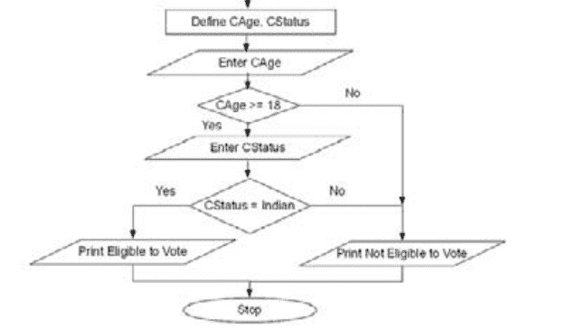

▲ 图 1：投票资格问题的流程图

在本书中，表格紧随其首次引用之后放置，如下所示：

| 案例编号 | 输入 1 长度 | 长度 > 0 | 输入 2 宽度 | 宽度 > 0 | 输出 |
|---|---|---|---|---|---|
| 1 | 150 | True | 200 | True | 面积 = 30000 |
| 2 | 0 | False | -- | -- | 输入错误 |
| 3 | -100 | False | -- | -- | 输入错误 |
| 4 | 50 | True | 0 | False | 输入错误 |
| 5 | 75 | True | -125 | False | 输入错误 |
| 6 | 225 | True | 125 | True | 面积 = 28125 |

## 01 逻辑开发导论

### 目标

- 描述解决问题的步骤
- 描述解决问题的技巧

如今，计算机能够解决众多问题。这些问题可以简单到两个数字相加，也可以复杂到发射导弹。那些大部分时间使用计算机的人通常认为计算机独自完成了所有工作；然而，事实并非如此。任何未知解决方案的问题都无法通过计算机解决。计算机只执行程序员给它的指令集。如果它无法理解任何给定的指令，解决方案可能会失控。因此，设计问题解决方案的唯一责任在于程序员。本章讨论了解决问题的一般方法以及用于解决任何给定问题的各种技术。

### 1.1 解决问题的步骤

正如前文所述，是人类解决了问题，而不是计算机。计算机只是帮助我们更快地解决问题。无论问题的类型和复杂性如何，我们都需要遵循以下步骤来解决它们：

- 定义问题
- 识别输入、输出和约束条件
- 寻找各种替代解决方案
- 选择最佳的可行替代方案
- 为识别出的替代方案准备详细的逐步结果
- 使用识别出的指令集计算所需结果
- 检查获得答案的正确性

这些步骤虽然看起来简单，但在设计时需要用户付出大量的努力。第 1 到第 5 步均由用户执行。计算机的作用仅体现在第 6 和第 7 步。这仅仅表明，实现问题解决的关键部分是由用户完成的。

让我们举一个问题的例子。假设我们需要知道 Mr. Mohit Arolkar 是否有资格参加印度州立法委员会选举投票。为了得到前述问题的答案，了解两件事很重要：Mr. Mohit Arolkar 的当前年龄和公民身份状态。因此，解决给定问题的两个主要输入将是当前年龄和公民身份状态。如果通过指令将当前年龄和公民身份状态提供给计算机，那么无论该人姓名如何，该解决方案都适用于任何人。该解决方案的输出始终是该人是否有资格参加州立法委员会选举投票或没有资格。该解决方案唯一的约束是它只在印度各邦内有效，但在其他国家无效，因为其他国家对投票者有不同的资格标准。

### 1.2 解决问题的技巧

现在，我们知道要使用计算机解决问题，首先我们需要开发一个手动解决方案。该解决方案可以使用各种技巧来设计，其中最常用的三种技巧如下：

- 将解决方案表示为伪代码
- 绘制流程图
- 编写算法

用户可以根据其方便使用这些技巧中的任何一种手动解决问题。让我们在以下小节中简要讨论这些技巧。

#### 将解决方案表示为伪代码

用自己的母语表达思想总是更容易。例如，如果有人在印度语、古吉拉特语、马拉地语或英语中潦草书写几个解决投票资格问题的步骤，那么这可以被视为伪代码。伪（pseudo）是一个希腊词，意思是虚假或伪造。因此，伪代码一词意味着用任何全球通用的语言编写虚假的代码。这种代码的编写方式使得在需要时可以将其转换为任何期望编程语言的程序源代码。

然而，大型问题的解决方案往往变得复杂且冗长。此外，自然语言语句倾向于每条语句产生多种含义，如果由编写者以外的人阅读，伪代码可能会被误解。投票资格问题的伪代码如下：

```
获取 Mr. Mohit Aroklar 的当前年龄和公民身份状态
如果当前年龄等于或大于 18，并且公民身份状态等于印度
那么 Mr. Mohit Aroklar 有资格参加州立法委员会选举投票
否则 Mr. Mohit Aroklar 没有资格参加州立法委员会选举投票
```

可以观察到，这些语句形成了一个逻辑序列。在了解该语言的语法后，该序列可以映射到任何形式语言（即编程语言）。

#### 绘制流程图

流程图是执行解决给定问题所需步骤序列的图形表示。它使用一组固定的符号来表示不同类型的指令。这些符号通过带有箭头的实线连接，指示语句流向。流程图可能是手动解决问题的最佳工具，因为任何熟悉这些符号的人都可以绘制流程图。流程图通常是作为问题解决方案的第一步制作的。可以从流程图中轻松理解问题的逻辑和流向。投票资格问题的流程图如图 1 所示：

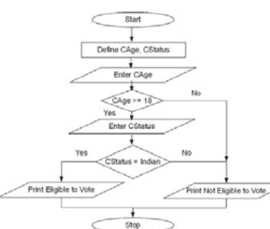

▲ 图 1：投票资格问题的流程图

在图 1 中，术语 `CAge` 和 `CStatus` 指代当前年龄和公民身份状态。这些术语被称为变量。术语变量指的是能够存储值并在程序执行期间有改变值趋势的实体。变量值的改变可能是由于对其应用算术运算，或直接为其分配值，或通过其他有效手段。

#### 流程图的基本符号

美国国家标准协会（ANSI）制定了在绘制流程图时可用的标准化符号。这些符号分为输入/输出、终端、处理、决策、连接器和流线符号。图 2 显示了各种符号及其描述：

| 符号 | 名称 | 目的 | 示例 | 描述 |
|---|---|---|---|---|
| (椭圆) | 椭圆 | 终端 | 开始 / 停止 | 开始执行序列 / 停止执行序列 |
| (平行四边形) | 平行四边形 | 输入 / 输出 | 接受 P / 打印 P | 接受变量 `P` 的值 / 打印变量 `P` 的值 |
| (矩形) | 矩形 | 处理 | `X = Y + Z` | 乘以 `Y` 和 `Z` 的值，然后将其存储在 `X` 中 |
| (菱形) | 菱形 | 决策 | `x > ?` | 如果 `X = Y`，则遵循“是”指示的路径；否则，遵循“否”指示的路径 |
| (圆形) | 圆形 | 连接器 | (星号) | 流程图中由 * 表示的连接点处的条目 |
| (箭头) | 箭头 | 流线 | (箭头) | 引导下一步遵循的路径 |

▲ 图 2：流程图中使用的基本符号

让我们简要讨论一下这些符号。

- 输入/输出符号：表示从用户处获取的输入或在终端上显示的输出。它通常被称为 I/O 符号。我们可以使用此符号来接收多个输入以及在屏幕上显示多行输出。
- 终端符号：指示流程图中指令序列中一组指令的开始或结束。有时，它用于指示指令集中的暂停。
- 处理符号：表示指令集的核心逻辑。它代表指令集中存在的数据移动和算术运算，例如加法、减法和乘法。单个处理符号中可以显示多个操作，这被称为复合处理符号。复合处理符号中的操作将按照其出现的顺序进行解析。
- 决策符号：根据用户需求改变执行流程。决策是所有复杂指令集的一部分。有时我们可能需要跳过某些指令并跳转到特定语句。这种需求由决策符号来处理。图 3 展示了在流程图中使用决策符号的三种不同方式：

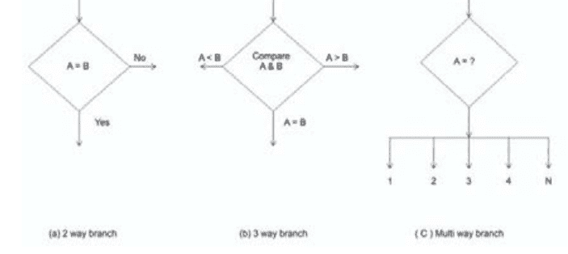

这些表示方法仅在特定条件下使用。

- 流线：指示在任何给定时刻应执行哪条指令。当将解决方案转换为计算机程序时，指令的流程非常重要。机器需要确切知道下一步必须执行哪个步骤或指令。流程图中的流线使用箭头指示接下来需要执行哪条指令。在绘制流程图时，我们必须确保流线之间互不交叉。避免交叉有助于清晰理解指令流程，尽管对于复杂问题可能无法完全消除流线的交叉。
- 连接器：复杂问题的解决方案通常篇幅较长。为了为这类问题绘制流程图，我们需要超过一页的空间。在这种情况下，必须确保解决方案的流程不会混乱。连接器帮助设计人员识别跨页的流程。

### 流程图的优点和缺点

流程图等工具允许用户更快地制定解决方案。然而，工具的使用有其自身的优点和缺点。让我们现在讨论一下使用流程图作为解决方案设计工具的一些优点和缺点。

使用流程图的优点如下：

- 由于使用的符号有限，因此易于理解
- 它为表示问题的解决方案提供了方便且简单的方法
- 它协助用户审查和更正解决方案
- 它允许我们为问题生成多个解决方案
- 它允许我们比较生成的各种解决方案

使用流程图的缺点如下：

- 使用流程图表示复杂且大型的问题会变得耗时。
- 如果逻辑有微小变化，可能需要重绘整个流程图。
- 它没有标准来表示流程图中应显示的数据细节。因此，针对同一问题的两个流程图可能在细节上有所不同。

### 绘制流程图的准则

设计流程图没有标准化的规则。然而，我们试图提供指南，以帮助用户改进流程图设计。这些准则如下：

1. 专注于问题
2. 确定输入、输出和约束
3. 将细节限制到最少
4. 不要在流程图中设计或使用自己的符号
5. 使用易于理解的语言
6. 为使用的变量选择适当的命名约定
7. 在整个解决方案中保持一致的命名约定
8. 保持绘制顺序从左到右，从上到下
9. 尽量避免交叉，尽可能使用连接器
10. 始终牢记，流程图只是一个表示工具。解决方案始终由我们制定。

### 编写算法

另一种手动解决问题的流行方法是算法。根据用户的方便程度，流程图和算法的技术可以交替使用。算法是执行特定任务所需的一系列有限逻辑步骤。算法一词起源于一位名为阿尔·花拉子米（Al-Khwarizmi）的波斯数学家的名字。

设计流程图或算法是一门需要大量思考的艺术。程序员用来制定算法的两个著名方法是逐步细化和分而治之。在逐步细化方法中，我们最初设计一个最少细节的算法。然后，根据需要，逐步添加更多细节，直到获得最终解决方案。在分而治之方法中，通过将复杂任务分解为若干个子任务来简化，这些子任务复杂度较低但性质相似。例如，我们需要找出 100 个数字中的最大值。与其直接寻求解决方案，我们可以先将任务分解为找出两个数字的最大值，然后使用制定的解决方案找出 100 个数字中的最大值。

让我们现在为投票资格问题编写一个算法，该问题显示在下面的方框中：


```
Step 1: Start
Step 2: Define CAge, CStatus
Step 3: Accept value of CAge
Step 4: If CAge >= 18 go to step 5
         Else go to step 8
Step 5: Accept value of CStatus
Step 6: If CStatus = Indian go to step 7
         Else go to step 8
Step 7: Print Eligible to Vote go to step 9
Step 8: Print Not Eligible to Vote
Step 9: Stop
```

算法的流程始终是顺序的，这意味着除非用户隐式地改变流程，否则第 2 步应仅在第 1 步之后执行。第 4 步中可以看到隐式的流程改变。第 5 步的执行取决于第 4 步中条件的结果。如果条件不满足，我们直接执行第 8 步，并跳过第 5 到 7 步。用户需要仔细处理序列中的流程改变。前面的例子有一个前跳的场景。有时，我们也需要后跳。例如，如果我们在第 6 步，由于某些条件我们跳回第 3 步，这被称为后跳。

## 算法的特性

与流程图类似，编写算法没有定义标准的惯例。然而，我们提供了一组良好的算法应满足的特性列表：

- **确定性**：精确定义，使得指令集中的每个步骤只有一种含义。
- **有效性**：所有操作都应在有限的时间内精确完成。
- **有限性**：算法应始终具有有限数量的步骤。在完成这些有限步骤后，算法应停止。
- **输入**：算法可以有零个或多个输入。
- **输出**：算法可以有一个或多个输出。

下一节提供了使用流程图和算法方法解决一些问题的示例。

### 示例

既然我们已经学习了三种不同的解决问题技术，让我们现在解决一些问题。在本节中，我们提供了使用流程图和算法技术的解决方案。用户可以根据要求和喜好自由选择这些技术中的任何一种来设计解决方案。

#### 示例 1：

拉梅什先生（Mr. Ramesh）购买了一块矩形土地，长度为 150 米，宽度为 200 米。计算该土地的面积。

##### 解决方案 1：

- a. 使用流程图，可以按以下方式计算土地面积：

计算矩形表面面积的公式为：面积 = 长度 × 宽度

牢记此公式，我们可以使用流程图和算法制定解决方案。

我们将使用三个变量，即面积（`area`）、长度（`length`）和宽度（`breadth`），来解决这个问题。

图 4 展示了计算矩形表面面积的流程图：

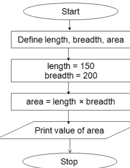

▲ 图 4：计算矩形表面面积的流程图

图 4 表明，长度和宽度这两个变量被分别分配了常量值 150 和 200。因此，每次使用此流程图时，获得的面积输出始终为 30,000 平方米。此外，请注意，流程执行从顶部开始，向下流向底部。

- b. 使用算法，可以按以下方式计算土地面积：

下面的方框展示了使用算法方法解决给定问题的过程：

```
Step 1: Start
Step 2: Define length, breadth, area
Step 3: length = 150
Step 4: breadth = 200
Step 5: area = length × breadth
Step 6: Print value of area
Step 7: Stop
```

创建用于计算矩形表面面积的流程图和算法被视为静态解决方案。称该解决方案为静态的原因是解决方案是，这两种方法都无法用于计算其他矩形表面的面积。该解决方案应设计为能够以极少或无需修改的方式解决类似问题。这样的解决方案被称为**通用化解决方案**。图 5 展示了一种用于计算矩形表面面积的通用化解决方案：

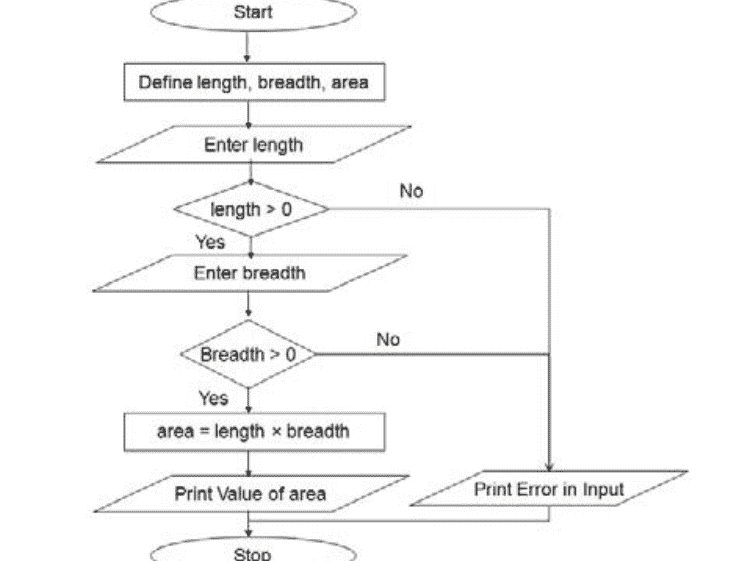

▲ 图 5：计算矩形表面面积的通用化解决方案

图 5 表明，长度和宽度的值并不是固定的。因此，用户可以根据需要输入任何值。因此，每次使用此流程图时，根据长度和宽度的不同值，我们会得到不同的输出。第二个重要的方面是对长度和宽度值进行的检查。可以确保用户输入的值始终为大于零的正值。此检查确保用户无法输入小于或等于零的值，因为这些值将不被接受。此检查是有道理的，因为面积既不能为零，也不能为负值。

前文提到的检查是通过使用菱形符号来实施的。这些符号有两个作用：首先，应用上述检查；其次，改变执行流程的顺序。如果第一个检查长度值是否大于 0 的菱形结果为“否”，那么它将很快引导我们到达流程图的末尾。因此，指令集中的某些步骤将不会执行。

现在，让我们生成一个跟踪表（trace）来检查所创建解决方案的真实性。如果生成的跟踪表提供了正确的输出，那么基于它的计算机程序在 99% 的情况下在逻辑上都是正确的。表 1 给出了图 5 中所示流程图的跟踪表：

##### 表 1：计算矩形表面面积的跟踪表

| 案例编号 | 输入 1 长度 | 长度 > 0 | 输入 2 宽度 | 宽度 > 0 | 输出 |
| :--- | :--- | :--- | :--- | :--- | :--- |
| 1 | 150 | True | 200 | True | 面积 = 30000 |
| 2 | 0 | False | -- | -- | 输入错误 |
| 3 | -100 | False | -- | -- | 输入错误 |
| 4 | 50 | True | 0 | False | 输入错误 |
| 5 | 75 | True | -125 | False | 输入错误 |
| 6 | 225 | True | 125 | True | 面积 = 28125 |

如表 1 所示，结果现在取决于输入的长和宽值。在案例 1 和 6 中，得到了两个不同的面积值，而在所有其他案例中，我们都得到了错误提示。表格条目中的 `--` 表示这些指令完全没有被执行。从现在开始，我们将为给定的问题设计通用化解决方案。前述问题的通用化解决方案的算法如下所示：

- 步骤 1：开始
- 步骤 2：定义长度、宽度和面积
- 步骤 3：接受长度的值。
- 步骤 4：如果 `长度 > 0`，则转到步骤 5
- 否则，转到步骤 9
- 步骤 5：接受宽度的值
- 步骤 6：如果 `宽度 > 0`，则转到步骤 7
- 否则，转到步骤 9
- 步骤 7：`面积 = 长度 × 宽度`
- 步骤 8：打印面积的值，然后转到步骤 10
- 步骤 9：打印 "输入错误"
- 步骤 10：停止

#### 示例 2：

判断数字 `$y$` 是否为数字 `$x$` 的因子。

##### 解决方案 2：

- a. 使用流程图来判断数字 `$y$` 是否为数字 `$x$` 的因子。

当且仅当 `$x$` 能被 `$y$` 整除时，即余数始终为零时，数字 `$y$` 才会被视为数字 `$x$` 的因子。此外，如果数字 `$y$` 大于数字 `$x$`，则无需执行除法运算，因为因子总是小于被除数（多重数）。假设数字 `$x$` 由变量 `*num1*` 表示，数字 `$y$` 由另一个变量 `*num2*` 表示。示例 2 的流程图如图 6 所示：

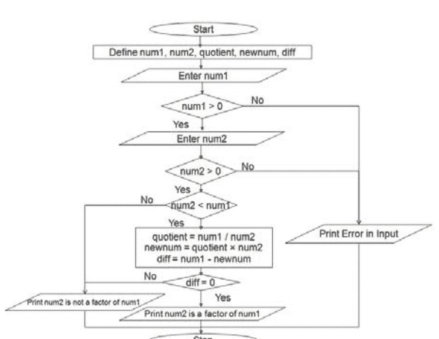

▲ 图 6：判断数字 y 是否为数字 x 的因子的流程图

可以观察到，在该示例中我们只考虑了商的部分。这是因为大多数编程语言的除法运算结果只包含商，而不包含余数。判断数字 y 是否为数字 x 的因子的跟踪表如表 2 所示：

##### 表 2：判断数字 y 是否为数字 x 的因子的跟踪表

| 案例编号 | 输入 num1 | num1 > 0 | 输入 num2 | num2 > 0 | num2 < num1 | 商 | newnum | 差值 | 差值 = 0 | 输出 |
| :--- | :--- | :--- | :--- | :--- | :--- | :--- | :--- | :--- | :--- | :--- |
| 1 | 10 | True | 4 | True | True | 2 | 8 | 2 | False | 4 不是 10 的因子 |
| 2 | 10 | True | 5 | True | True | 2 | 10 | 0 | True | 5 是 10 的因子 |
| 3 | 15 | True | 20 | True | False | -- | -- | -- | -- | 20 不是 15 的因子 |
| 4 | 20 | True | -10 | False | -- | -- | -- | -- | -- | 输入错误 |
| 5 | -35 | False | -- | -- | -- | -- | -- | -- | -- | 输入错误 |
| 6 | 50 | True | 0 | False | -- | -- | -- | -- | -- | 输入错误 |
| 7 | 0 | False | -- | -- | -- | -- | -- | -- | -- | 输入错误 |

从表 2 可以看出，随着问题复杂度的增加，跟踪表的规模也会增加。可能并不总是能够为解决方案生成完整的跟踪表。尽管如此，尽可能地为多种输入生成跟踪表仍是一个良好的实践。

- b. 使用算法来判断数字 `$y$` 是否为数字 `$x$` 的因子：

解决给定问题的算法如下：

```text
Step 1: Start  
Step 2: Define num1, num2, quotient, newnum, diff  
Step 3: Accept value of num1  
Step 4: If num1 > 0 go to step 5  
		Else go to step 13  
Step 5: Accept value of num2  
Step 6: If num2 > 0 go to step 7  
		Else go to step 13  
Step 7: If num2 < num1 go to step 8  
		Else go to step 12  
Step 8: quotient = num1 / num2  
Step 9: newnum = quotient × num2  
Step 10: diff = num1 − newnum  
Step 11: If diff = 0 Print num2 is a factor of num1 go to step 14  
Step 12: Print num2 is not a factor of num1 go to step 14  
Step 13: Print Error in input  
Step 14: Stop
```

#### 示例 3：

Vidita 女士在 ABC 银行有一笔 35,000 卢比的定期存款，存期为 1 年，年利率为 6%。她想知道在定期存款到期时她将收到多少金额。

##### 解决方案 3：

- a. 使用流程图计算定期存款的到期金额：

前述问题的解决方案是首先找出在投资金额上一年获得的利息，然后将其加到本金上。计算单利 (I) 的公式，给定本金 (P)、利率 (R) 和年数 (N) 为 `$I = (P × R × N)/100$`。如果总金额为变量 `$tamt$`，则 `$tamt$` 将是 P 和 I 的和。假设存款期限仅为一年。图 7 展示了计算定期存款到期金额的流程图：

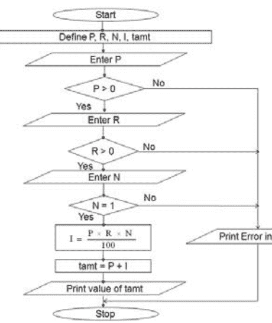

▲ 图 7：计算定期存款到期金额的流程图

表 3 给出了计算单利总金额的跟踪表：

##### 表 3：计算单利总金额的跟踪表

| 案例编号 | 输入 P | P > 0 | 输入 R | R > 0 | 输入 N | N = 1 | I | 输出 |
|:---:|:---:|:---:|:---:|:---:|:---:|:---:|:---:|:---:|
| 1 | 35000 | True | 6 | True | 1 | True | 2100 | 37100 |
| 2 | 35000 | True | 6 | True | 2 | False | -- | 输入错误 |
| 3 | 25000 | True | -5 | False | -- | -- | -- | 输入错误 |
| 4 | 25000 | True | 0 | False | -- | -- | -- | 输入错误 |
| 5 | -10000 | False | -- | -- | -- | -- | -- | 输入错误 |
| 6 | 0 | False | -- | -- | -- | -- | -- | 输入错误 |
| 7 | 25000 | True | 7 | True | 1 | True | 1750 | 26750 |

- b. 使用算法计算单利总金额：

前述问题的算法如下所示：

```text
Step 1: Start
Step 2: Define P, R, N, I, tamt
Step 3: Accept the value of P
Step 4: If P > 0 go to step 5
        Else go to step 12
```

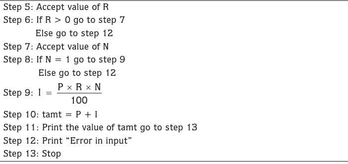

#### 示例 4：

Vidita 女士在 ABC 银行有一笔 35,000 卢比的定期存款，存期为 2 年，年利率为 6%。如果利息每年复利一次，请计算 Vidita 女士在定期存款到期时将收到的金额。

##### 解决方案 4：

- a. 使用流程图计算复利的总金额

前述问题的解决方案是计算金额 (A)，给定本金 (P)、利率 (R)、年数 (T) 以及一年内利息复利的次数 (N)。计算金额的公式为 `$A = P × (1 + R/N)^{N × T}$`。图 8 展示了计算定期存款到期金额的流程图：

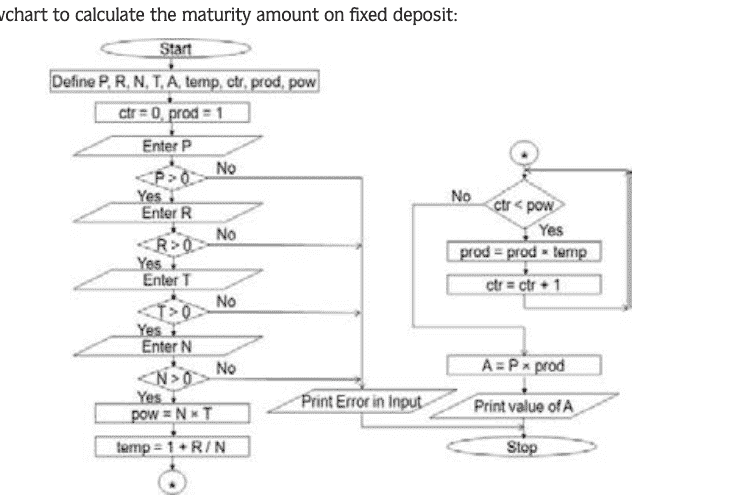

▲ 图 8：计算复利总金额的流程图

图8所示的流程图似乎较长，因为当我们保留数据验证检查时，流程图往往会变得有点冗长。尽管如此，保留这些检查仍是一种良好的实践。你可以观察到流程图中连接符的使用。此外，当检查条件 `$ctr < pow$` 时，为真的情况会引导我们重复执行某些指令。在一组指令中重复执行某些步骤的这一概念被称为循环。两个概念，即跳转和循环，将在本书的第6章和第7章中进一步解释。表4给出了计算复利总金额的跟踪表：

**表4：计算复利总金额的跟踪表**

| 案例编号 | P | P > 0 | R | R > 0 | T | T > 0 | N | N > 0 | pow | temp | ctr | ctr < pow | prod | 输出 |
| --- | --- | --- | --- | --- | --- | --- | --- | --- | --- | --- | --- | --- | --- | --- |
| 1 | 35000 | 真 | 0.06 | 真 | 2 | 真 | 1 | 真 | 2 | 1.06 | 0 | 真 | 1.06 | 39326 |
| | | | | | | | | | | | 1 | 真 | 1.1236 | |
| | | | | | | | | | | | 2 | 假 | 1.1236 | |
| 2 | 35000 | 真 | 0 | 假 | -- | -- | -- | -- | -- | -- | 0 | -- | 1 | 输入错误 |
| 3 | -2500 | 假 | -- | -- | -- | -- | -- | -- | -- | -- | 0 | -- | 1 | 输入错误 |
| 4 | 2500 | 真 | 0.07 | 真 | 0 | 假 | -- | -- | -- | -- | 0 | -- | 1 | 输入错误 |
| 5 | 2500 | 真 | 0.07 | 真 | 2 | 真 | 2 | 真 | 4 | 1.035 | 0 | 真 | 1.035 | 2868.75 |
| | | | | | | | | | | | 1 | 真 | 1.0712 | |
| | | | | | | | | | | | 2 | 真 | 1.1087 | |
| | | | | | | | | | | | 3 | 真 | 1.1475 | |
| | | | | | | | | | | | 4 | 假 | 1.1475 | |

在表4中，可以看出与其他所有之前的跟踪表相比的不同之处。你还可以观察到，在案例1中，`$ctr$` 有三个值；而在案例5中，有五个值。在案例1中，`$ctr$` 有三个值，即 1、2 和 3；而在案例5中，它有五个值，即 1、2、3、4 和 5。这表明在案例1中，为 `$ctr$` 分配新值、比较 `$ctr < pow$` 以及计算 `$prod = prod × temp$` 的步骤重复了两次；而在案例5中，这些步骤重复了四次。在所有其他案例中，由于其中一个测试条件失败，这些步骤根本不会执行。另外，观察 R 的值；它现在不再是整数，如计算单利的示例3中的情况那样，而是通过将利率除以 100 得到的十进制值，即 `$\left( \frac{6}{100} \right)$`。

- b. 使用算法计算复利的总金额：

此问题的算法如下：

步骤 1：开始

步骤 2：定义 `P, R, T, N, A, ctr, temp, prod`

步骤 3：`ctr = 0, prod = 1`

步骤 5：接收 `P` 的值

步骤 6：如果 `P > 0` 则转到步骤 7

否则转到步骤 20

步骤 7：接收 `R` 的值

步骤 8：如果 `R > 0` 则转到步骤 9

否则转到步骤 20

步骤 9：接收 `T` 的值

步骤 10：如果 `T > 0` 则转到步骤 11

否则转到步骤 20

步骤 11：接收 `N` 的值

步骤 12：如果 `N > 0` 则转到步骤 13

否则转到步骤 20


步骤 13：`pow = N × T`

步骤 14：`temp = 1 + (R/N)`

步骤 15：如果 `ctr < pow` 则转到步骤 16

否则转到步骤 18

步骤 16：`prod = prod × temp`

步骤 17：`ctr = ctr + 1`，转到步骤 15

步骤 18：`A = P × prod`

步骤 19：打印 `A` 的值，转到步骤 21

步骤 20：打印输入错误

步骤 21：停止

现在，让我们在下一节中总结本章的主要要点。

### 摘要

在本章中，我们学习了三种最常用的问题求解技术，即伪代码、流程图和算法。此外，很明显，无论问题的复杂程度如何，我们都需要执行七个步骤（在1.2节中提及）来解决这个问题。应用必要的技术来解决问题的选择权始终掌握在用户手中。我们还提到，两种著名的制定算法的方法，即*逐步求精*和*分治法*，被程序员所使用。通常，验证解决方案的真实性是一个问题。在这里，我们使用跟踪表的方法来检查所创建解决方案的真实性。跟踪表是一个有用的工具，用于验证设计的解决方案是否按预期方式工作。

### 复习题

- Q1. 列出在计算机中解决任何问题所需的步骤。
- Q2. 解释将问题的解决方案描述为伪代码的好处。
- Q3. 定义“流程图”一词。流程图有什么用途？
- Q4. 列出并解释绘制流程图时使用的符号。
- Q5. 给出绘制流程图的优缺点。
- Q6. 列出绘制流程图规则。
- Q7. 区分伪代码和算法。

### 实践练习

- Q1. 为以下问题绘制流程图：
  - i. 将给定的厘米转换为公里和毫米。
  - ii. 找出给定的两个数中的最大值。
  - iii. 找出一个正数是奇数还是偶数。
  - iv. 找出给定的三个数中的最小值。
  - v. 找出三个数的平均值。
  - vi. 读取3门科目的分数，确定学生是及格还是不及格。如果学生在所有科目中至少有35分，则学生及格。
  - vii. 找出圆柱体的体积，其中体积 `V = pi * 半径的平方 * 高度`。
  - viii. 读取两个数字并找出这些数字的平方。另外，找出平方和。
  - ix. 读取数字 `N`，计算其数字之和。例如，如果 `N = 123`，和 = 1 + 2 + 3 = 6。
  - x. 读取天数并将其转换为周数。
- Q2. 为以下问题编写算法：
  - i. 输入二次方程的系数 `A`、`B` 和 `C`。找出二次方程的根。
  - ii. 读取一个整数并打印该整数的反转。
  - iii. 找出输入的四位数年份是否代表闰年。
  - iv. 假设你拥有 1000、500、100、50、20、10、5、2 和 1 卢比的纸币。输入一个整数值并将其转换为所需的最少纸币数量。例如，如果 `N = 1050`，则输出 2 张纸币：1 张 1000 和 1 张 50。
  - v. 计算 `sin(x)` 的值，其中 `sin(x) = x - x3/3! + x5/5! - x7/7! + ...`
  - vi. 从键盘输入字符，直到输入值 0（零），统计输入的大写字母、小写字母、特殊字符和数字（不包括零）的总数。
  - vii. 输入两个整数值 `N` 和 `m`。找出 `N` 中第 `m` 位数字的值。例如，如果 `N = 1234` 且 `m=5`，输出是 0，但如果 `m=2`，输出是 2。
  - viii. 将给定的十进制数转换为其二进制等价形式。
  - ix. 读取摄氏温度值并将其转换为华氏温度。已知 `F = (5/9) * (C - 32)`。（注：原文公式有误，通常华氏转摄氏为 `C = (5/9)*(F-32)`，此处依原文直译公式部分）
  - x. 输入塔的高度和从地面点到塔顶的仰角。找出地面点与塔之间的距离。

## 02 C语言简介

### 目标

- 描述语言的演变
- 学习 C 语言的历史
- 描述第一个 C 程序
- 描述 C 程序的结构
- 解释 C 语言的字符集
- 解释 C 语言中的词
- C 程序的创建与执行

计算机程序是用任何编程语言编写的指令的逻辑序列，指导计算机达成预定义的解决方案。编写计算机程序的过程称为编程。通常，许多计算机程序被组合在一起以制作软件。软件是一组不同的程序、过程和文档的组合，用于使用计算机执行任务。软件分为两类：系统软件和应用软件。系统软件是一组程序，允许计算机硬件与用户之间高效交互。操作系统、翻译器、链接器和加载器是系统软件的例子。应用软件是一组程序，允许用户在计算机上执行特定的数据处理活动。数据处理活动可以是不同类型的，如账户管理、桌面出版（DTP）、数据库管理和通信。

人们可能会经常问为什么我们需要学习一门新语言来编写计算机程序。为什么不简单地用我们已知的语言，如英语、法语、梵语或西班牙语来编写程序呢？嗯，原因是用自然语言编写的指令有时可能有多重含义。为了使计算机程序高效工作，每个句子都需要清晰和精确。

编程语言被称为形式语言，是从自然语言衍生而来的。它由自然语言中使用的字符子集和语言设计者定义的一组预定义规则组成。这些规则构成了该语言的语法，并定义了如何在编程语言中编写指令。规定的规则还保证指令将只有一个且仅有一个含义。要学习编程语言，我们只需要学习新的语法。自然语言的情况也类似，例如，如果我们想流利地说或写印地语，我们首先需要学习印地语的语法。

本章简要讨论了语言的演变、一种名为 C 的形式语言的历史、C 程序的结构以及用于用 C 语言编写程序的字符集。还讨论了 C 语言中的词，最后以 C 程序的创建和执行结束本章。

### 2.1 语言的生成

计算机语言被分为低级或机器级、中级和高级语言。在计算机编程的早期，用于编写程序的语言是依赖于特定机器的。编写程序的人需要了解程序将在其上执行的机器架构。早期编写的程序由使用 0 和 1 的序列构成的句子组成。随着计算机硬件的演进，编程语言也随之发展。从历史角度来看，编程语言可以分为五代。本节简要讨论了编程语言的各代际。

#### 第一代

计算机程序编写使用的第一种语言仅由两个数字的字符串组成，即 0 和 1。由于只使用了两个数字，这种数字系统被称为二进制数系统，该语言也被称为机器语言。有时它也被称为低级语言。程序员需要高级技术技能才能使用二进制数开发程序。虽然可以开发程序，但设计、编码和测试程序需要极长的时间。

#### 第二代

人们试图通过创建一种称为汇编语言的语言来简化编写计算机程序的过程。汇编语言中的语句使用符号和缩写来编写。由于程序是以用户可理解的形式编写的，计算机无法直接理解它们。

使用名为汇编器（`assembler`）的翻译器将汇编程序翻译成计算机所需的机器代码，反之亦然。与机器语言相比，汇编语言使编程变得更容易，从而提供了一种明显的优势。然而，它仍然存在一个主要缺点，即其运行速度不如机器语言程序快。

#### 第三代

第三代编程语言对程序员来说是一大福音。它们通过允许用户使用英语（例如程序的语句）来编写程序，提供了一种更自然的开发程序的手段。如今仍在使用的此类编程语言被称为高级语言。

其中一种名为“通用面向业务语言”（COmmon Business Oriented Language，简称 `COBOL`）的第三代编程语言成为一种成功的语言，被广泛用于编写跨越各种业务领域的商业应用程序。`C` 语言也属于第三代语言的范畴；尽管一些作者认为它属于中级语言。这一说法尚有争议；不过，对此的讨论超出了本书的范围。我们将将其视为一种高级语言。

#### 第四代

第二代和第三代语言的使用需要用户具备技术培训背景。计算机几乎进入每个家庭，推动了编程语言更易使用的趋势。编程语言的设计使得即使是非技术用户也能开发自己的应用程序。使用第四代语言时的主要重点在于应用程序的快速开发。报表生成器、查询语言和应用生成器都是第四代语言的示例。

#### 第五代

第五代编程语言基于这样一种概念：使用提供给程序的约束来解决问题，而不是使用程序员编写的算法。它利用人工智能（AI）领域来获取基于约束的解决方案。第五代语言可以被视为一种尝试，旨在使计算机的行为类似于人类行为。在人工智能领域的未来发展可能会导致一种编程系统，该系统接受用户的口头陈述，然后生成旨在产生所需输出的计算机程序。

如今，上述提到的五种语言代际中没有任何一种变得过时。我们在某个时刻都使用着这五种代际的语言。用户可能会觉得他没有/她直接使用第一代和第二代语言，但它们在没有用户知情的情况下被广泛间接使用。对此的解释将在本章末尾给出。

### 2.2 C 语言的历史

`C` 语言的起源可以追溯到 1972 年。Dennis M. Ritchie 是创造 `C` 语言的人。它派生自基本通用目的编程语言（Basic Common Purpose Programming Language，简称 `BCPL`）。开发 `C` 语言的目标是构建一个健壮的系统软件。然而，在接下来的几年里，它成为了程序员们的宠儿，并被用于开发各种软件。因此，它被公认为一种通用编程语言。

虽然 `C` 语言创建于 1972 年，但它于 1989 年经美国国家标准学会（ANSI）标准化。自此，它被称为 ANSI C。Apple、Borland、Microsoft 和 IBM 等供应商基于 ANSI 标准构建了它们自己的 `C` 语言和 `C` 编译器版本。其中一些供应商甚至提供了一个集成开发环境（更常被称为 IDE），以便快速轻松地开发 `C` 程序。

`C` 是一种结构化编程语言。它允许将程序拆分为称为函数的子程序。一旦生成，这些函数是可重复使用的。这样的函数集构成了 `C` 程序。将程序拆分为子程序的方法被称为模块化编程。编程的模块化方法有助于我们轻松解决程序设计中出现的问题，因为我们只需要关注一个函数，而不是整个程序。通常，用 `C` 语言编写的程序可以几乎不加修改地移植到具有不同操作系统和编译器的不同机器上。因此，它被认为是一种可移植的语言。

令人惊讶的是，我们周围布满了 `C` 程序。几乎所有的操作系统，如 Windows、Unix 和 Linux，都包含大量的 `C` 程序代码。如果你从这些操作系统中移除代码，整个操作系统可能会崩溃。数据库（如 Oracle、MySQL）和网络协议也使用 `C` 程序代码。尽管 `C` 程序的存在在我们周围并不显眼，但它们构成了信息技术（IT）行业中许多应用程序的骨干。

### 2.3 第一个 C 程序

现在让我们编写第一个 `C` 程序。`C` 程序具有预定义的结构和一组可在此使用的特定词汇。如果我们不遵循这种结构，就会出现错误。程序 1 是一个简单 `C` 程序的示例：

> 程序 1

```c
/* My first C program */
#include <stdio.h>
main()
{
    printf("First step towards learning C Language.");
    return;
}
```

输出：

First step towards learning C Language.

程序 1 中编写的程序用于在监视器屏幕上打印消息“学习 C 语言的第一步。”。图 1 解释了程序中每一行的用途：

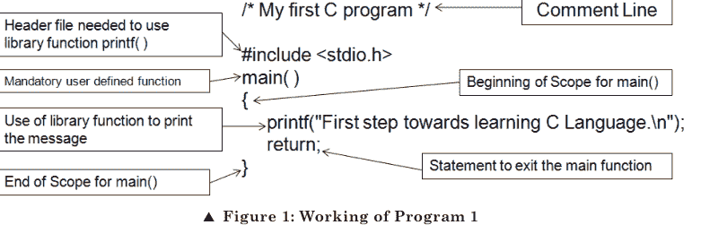

在图 1 中，第一行是注释行。注释行不包含在 `C` 程序的可执行副本中。它用于文档目的。语句 `#include <stdio.h>` 是包含头文件。接下来，`main()` 被称为用户定义的函数，而 `printf()` 被称为内置函数或库函数。用户定义的函数是根据用户需求由用户创建的函数。`C` 编译器库中已经存在的、用户可以在程序中使用的函数被称为内置函数或库函数。为了更好地理解 `C` 程序的结构，让我们再看另一个 `C` 程序，即程序 2：

> 程序 2

```c
/* Program to calculate circumference of a circle */
#include <stdio.h>
#define PI 3.14          /* Definition of a symbolic constant */
main()
/* Name of user defined function */
{
/* Beginning of function */

float f_radius, f_crF;   /* Declaration of two float variables */
printf("Enter the value of radius: ");   /* Message printing */
scanf("%f", &f_radius);       /* Accepting value of radius from user */
f_crF = 2 * PI * f_radius;   /* Calculation of circumference */
/* Print the value of circumference */
printf("\n Circumference of circle with radius %f is %f \n", f_radius, f_crF);
return;                     /* Exit the function */
                            /* End of function */
}
```

输出：

```
Enter the value of radius: 7
Circumference of circle with radius 7.000000 is 43.959999
```

程序 2 的分步解释在表 1 中给出：

表 1：程序 2 的解释

| 行号 | 解释 |
| :--- | :--- |
| 第 1 行。 | 一个注释行，表明程序的目的。 |
| 第 2 行。 | 一个预处理器指令，指示编译器包含头文件 `stdio.h` 的内容。该文件包含有关要使用的内置函数的信息。 |
| 第 3 行。 | 它定义了一个符号常量 `PI`，其值为 `3.14`。该语句也被称为预处理器指令。它指示翻译器在执行程序之前将所有 `PI` 的出现替换为值 `3.14`。 |
| 第 4 行。 | 用户定义函数 `main()` 的定义；这是所有 `C` 程序的必需项。 |
| 第 5 行。 | 它指示函数 `main()` 的开始。 |
| 第 6 行。 | 它定义了两个变量 `f_radius` 和 `f_crF`。这些变量能够存储小数值。`C` 中“变量”一词指的是一个可以存储值的实体，并且经过操作也可以更改存储的值。 |
| 第 7 行。 | 它使用内置函数 `printf` 在监视器屏幕上打印消息。 |
| 第 8 行。 | 它使用内置函数 `scanf` 从用户那里读取 `f_radius` 的值。内置函数在后续章节中详细讨论。 |
| 第 9 行。 | 这是一个 `C` 表达式；计算圆周长的公式。 |
| 第 10 行。 | 它在监视器屏幕上打印消息，连同给定的半径和周长值。 |
| 第 11 行。 | 它提供函数的正常退出。如果我们不写这条语句，我们会收到一条警告消息 `Function should return a value.`。这可能不会影响程序的运行，但正常退出始终是一个更好的选择。 |
| 第 12 行。 | 它指示函数 `main()` 的结束。 |

程序 2 是一个通用程序，用于计算任意给定半径的圆的周长。从程序 1 和 2 中可以观察到，用户定义函数 `main` 是任何 `C` 程序的组成部分。所有可执行的 `C` 程序始终都有一个用户定义函数 `main`。`C` 程序的执行总是从遇到 `main( )` 后的第一个左花括号开始。在看了两个简单的 `C` 程序后，让我们继续前进，详细了解 `C` 程序的完整结构。

### 2.4 C 程序的结构

从程序 1 和 2 中，我们可以说 `C` 程序是由称为函数的块组成的集合。函数由一个或多个语句组成，用于执行预定义的任务。图 2 展示了 `C` 程序的完整结构：

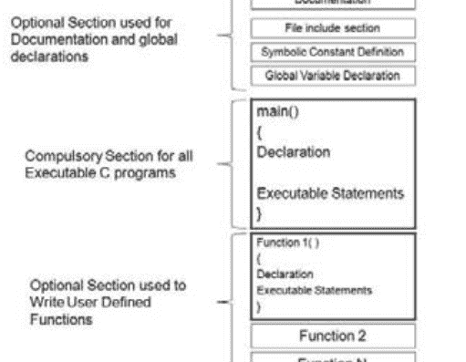

图 2 显示其中两个部分是可选部分，可能在程序中存在也可能不存在。然而，包含函数 `main` 的强制部分始终存在于 `C` 程序中。

图 2 中显示的各部分将在以下小节中详细讨论。

#### 文档部分

文档部分是 `C` 程序结构中的一个可选部分。顾名思义，它用于文档目的，通常包括程序用途、作者详细信息、重要逻辑方面以及创建日期等细节。此部分内的语句在 `C` 中被称为注释行。`C` 程序使用开始（`/*`）和结束（`*/`）标记来表示注释。每当文本位于 `/*` 和 `*/` 之间时，在 `C` 中被视为注释。注释不会被 `C` 编译器处理，并保持原样。

`C` 程序中的注释可以添加在程序的任何位置。在函数内部使用注释始终是一种良好的做法，因为它能提高程序的可读性和理解度。`C` 中的注释可以是单行注释或多行注释。表 2 列出了几个注释示例。

**表 2：C 中的注释示例**

| 注释示例 |
|---|
| `/* A comment line in C program */` |
| `/* A comment line in`<br>`two lines */` |
| `/* A comment`<br>`line that`<br>`is written`<br>`in more`<br>`than two line */` |
| `// Single line comment` |

如表 2 所示，`C` 语言提供了一组额外的标记（`//`）来添加单行注释。`C` 编译器将前导有 `//` 的 `C` 语句视为注释行，并不进行处理。`//` 字符不能用于编写跨越单行范围的注释。如果注释超过单行，则必须用 `/*` 和 `*/` 将其括起来，或者我们也可以在每一行前加上 `//`。

#### 符号常量定义

符号常量是指定给 `C` 程序中一组字符或数值的一个简短名称。程序 2 中使用了符号常量 `PI`。预处理指令 `#define` 用于定义任何符号常量。它指示编译器将符号常量的所有出现替换为指定的值。符号常量通常使用大写字母定义，以区别于 `C` 程序中使用的变量。两个符号常量的示例如下：

```c
#define PI 3.14
#define P printf
```

第一个示例为 3.14 定义了符号常量 `PI`，而第二个示例为 `printf` 定义了符号常量 `P`。在这里，`PI` 和 `P` 被称为符号和常量，因为 3.14 和 `printf` 的值在 `C` 程序执行过程中不会改变。

#### 文件包含部分


C 程序提供了大量的内置或库函数。此类内置函数的一些示例是 `scanf`、`pow` 和 `sqrt`。这些函数具有预定义的目的，例如，函数 `scanf` 用于从键盘读取数据，函数 `pow` 用于计算 x 的给定次方的值，函数 `sqrt` 用于查找给定数的平方根。如果需要，我们可以在程序中使用这些函数。要在程序中使用这些函数，我们需要包含持有这些函数信息的文件。在 C 中，这些文件被称为头文件，通常具有 `.h` 文件扩展名。在程序中包含头文件的语法是 `#include <filename.h>`。C 中可用的头文件列表及其用途在本书附录 I 中给出。

## 全局变量声明部分

C 变量的使用受其声明位置的支配。声明变量的函数成为变量的作用域，由使用开闭花括号 `{ }` 决定。在花括号内定义的变量被称为局部变量。例如，程序 2 中使用的变量 `f_radius` 和 `f_crf` 是函数 `main` 的局部变量。这些变量不能在作用域之外使用。有时我们需要在所有函数中使用某个变量，这样的变量被称为全局变量。此变量在定义所有函数之前定义。关于全局变量的详细讨论将在处理 C 语言中函数的章节中进行。

## 主函数

所有 C 程序都包含一个名为 `main()` 的函数。这是任何 C 程序执行开始的函数。控制首先转移到此函数，从这里开始执行其余的操作。在程序 1 和 2 中，解决问题的核心逻辑是函数 `main` 的一部分。也有可能核心逻辑被定义为单独的函数，而函数 `main` 使用它来解决问题。

## 用户定义函数

C 程序提供了将一个程序拆分为小函数集合的功能。然后这些函数可以在程序中独立使用。在本小节中，我们将看看如何在单个程序中使用两个函数。

图 2 中显示的 C 程序结构不是标准结构，尽管几乎被所有程序员使用。交换 C 程序内部各部分的位置也是可能的。例如，用户定义函数部分可以与主程序部分互换，反之亦然。程序 3 和 4 给出了此类变更的示例：

### 程序 3

```c
/* Program to multiply two numbers */

#include <stdio.h>

/* Prototype of a function multiply */
int multiply(int, int);

/* Beginning of main function */
main ( )
{
 int i_first, i_second, i_multiple;
 printf("Enter the value of first number: ");
 scanf("%d", &i_first);
 printf("Enter the value of second number: ");
 scanf("%d", &i_second);
 i_multiply = multiply(i_first, i_second);
 printf("\n The value of %d * %d is %d \n",i_first, i_second,
i_multiply);
return;
}
/* End of function main */

/* Beginning of user-defined functions multiply */
int multiply (int i_first, int i_second)     /* Name of user defined
 function */
{
                              /* Beginning of function */
 int i_result;               /* Integer variable to be used in function */
 i_result = i_first * i_second;/* Multiplication of two numbers */
return(i_result);           /* Return the value of multiplication to main( ) */
}
/* End of function multiply */
```

**输出：**

Enter the value of first number: 35

Enter the value of second number: 73

The value of 35 * 73 is 2555

程序 3 用于计算两个给定数的乘积。虽然很小，但此程序被划分为两个函数。第一个函数 `main` 接受要相乘的值，第二个函数 `multiply` 执行实际的乘法。

程序以声明程序用途的注释语句开始。然后我们包含所需的头文件。下一条语句被称为原型语句。如果在函数 `main` 之后编写用户定义函数，则 C 中需要此语句。`main` 函数声明了三个整数变量，并要求用户提供其中两个变量的值。然后通过语句 `i_multiply = multiply(i_first, i_second)` 将这些值传递给函数 `multiply`，其中 `i_first` 和 `i_second` 被称为函数 `multiply` 的参数。遇到此语句后，控制权转移到函数 `multiply`。该函数然后相乘这些值并将其存储在 `i_result` 中。`i_result` 的值随后被返回到 `main` 函数中的语句并赋值给 `i_multiply`。最后，`main` 函数打印乘法值并退出程序。

程序 3 可以不加原型语句编写，使得输出不受影响。程序 4 说明了如何不使用原型语句编写程序，它是程序 3 的变体：

### 程序 4

```c
/* Program to multiply two numbers */
#include <stdio.h>

/* Beginning of user-defined functions multiply */
int multiply (int i_first, int i_second)
```

{

return(i_first * i_second); /* 将乘法结果返回给 main() */

}

/* multiply 函数结束 */

/* main 函数开始 */

main( )

{

int i_first, i_second, i_multiple;

printf(" 请输入第一个数的值：");

scanf("%d", &i_first);

printf(" 请输入第二个数的值：");

scanf("%d", &i_second);

i_multiple = multiply(i_first, i_second);

printf("\n %d * %d 的值是 %d \n",i_first, i_second,

i_multiple);

return;

}

/* main 函数结束 */

输出：

请输入第一个数的值：35

请输入第二个数的值：73

35 * 73 的值是 2555

程序 4 的输出与程序 3 完全相同，但存在两点不同。首先，`multiply` 函数定义在 `main` 函数之上；其次，`multiply` 函数中未使用变量 `i_result`。将 `multiply` 函数的代码写在 `main` 函数之上，就无需使用原型声明语句。在程序 3 中，遇到语句 `i_multiple = multiply (i_first, i_second);` 时，控制流程会跳转到 `main` 函数下方；而在此处，控制流程会跳转到 `main` 函数上方。暂时暂不深入探讨该程序的具体工作原理，函数将在本书后续章节中详细讨论。

## 2.5 C 语言字符集

学习一门新语言的基础是先学习其字符。例如，如果我们要学习马拉地语，首先需要学习马拉地语中使用的字符。这些字符构成了该语言中构建单词和句子的基本模块。字符是指用于在语言中表示信息的任何字母、数字或符号。C 语言也有自己的字符集。C 语言中的字符分为四类：

- 1. 字母
- 2. 数字
- 3. 空白字符
- 4. 特殊字符。

表 3 列出了属于上述各类别的字符或符号：

### 表 3：C 语言字符集

| **字母** | **数字** | **空白字符** |
| --- | --- | --- |
| a b c d e …. z |  | 空格 |
|  |  | 换页符 |
| A B C D E … Z | 0 1 2 3 4 5 6 7 8 9 | 水平制表符 |
|  |  | 换行符 |
|  |  | 垂直制表符 |

#### 特殊字符

| 序号 | 运算符 | 读法 | 序号 | 运算符 | 读法 |
| :--- | :--- | :--- | :--- | :--- | :--- |
| 1. | & | 与号 | 15. | > | 大于号 |
| 2. | ‘ | 撇号/单引号 | 16. | # | 井号 |
| 3. | * | 星号 | 17. | < | 小于号 |
| 4. | @ | 阿特号/电子邮件符号 | 18. | - | 减号 |
| 5. | \ | 反斜杠 | 19. | ( ) | 左/右圆括号 |
| 6. | { } | 左/右花括号 | 20. | % | 百分号 |
| 7. | [ ] | 左/右方括号 | 21. | . | 句点 |
| 8. | ^ | 脱字符 | 22. | + | 加号 |
| 9. | : | 冒号 | 23. | ? | 问号 |
| 10. | , | 逗号 | 24. | " | 引号 |
| 11. | $ | 美元符号 | 25. | ; | 分号 |
| 12. | = | 等号 | 26. | ~ | 波浪线 |
| 13. | ! | 感叹号 | 27. | _ | 下划线 |
| 14. | / | 正斜杠 | 28. | \| | 竖线 |

从表 3 可以观察到，这些字符在我们日常学习英语时也会用到。因此，学习 C 语言的主要目标是了解如何按照 C 语言语法使用这些字符。

## 2.6 C 语言中的单词

表 3 中给出的字符用于构成 C 语言中的单词。这些单词进而用于构成被称为 C 语句的“句子”。一组逻辑上顺序排列的 C 语句构成一个 C 程序。C 语言中的单词被称为 C 语言的记号（token）。表 3 中讨论的每个字符本身都是一个记号。在 C 语言中，识别出六种类型的记号，即关键字、标识符、常量、字符串、运算符和特殊字符。图 3 直观展示了 C 程序中使用的每种记号：

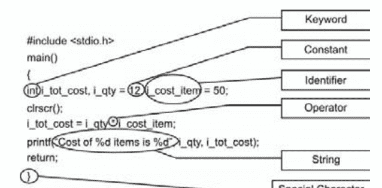

▲ 图 1：C 记号的直观表示

图 3 识别了用于编写完整 C 程序的一些记号。下一个小节将详细讨论 C 语言的关键字。

### C 关键字

关键字是指由语言设计者预定义的单词。ANSI C 标准支持 32 个预定义关键字。每个关键字都有与其相关的预定义含义，且仅能用于特定目的。ANSI C 中可用的关键字列表见表 4：

**表 4：ANSI C 关键字**

| auto | double | int | struct |
| :--- | :--- | :--- | :--- |
| break | else | long | switch |
| case | enum | register | typedef |
| char | extern | return | union |
| const | float | short | unsigned |
| continue | for | signed | void |
| default | goto | sizeof | volatile |
| do | if | static | while |

C 语言中的关键字区分大小写，并遵循严格的语法。这些关键字的用法将在本课程后续章节中讨论。

### 标识符

用户可以利用 C 字符集创建自己的单词：这样的单词被称为*标识符*。语言对定义标识符有自己的规则。它由一组字母、数字和一些特殊字符组成。标识符的例子有 `totalcost`、`RATE`、`float` 和 `add()`。这里，`totalcost` 和 `RATE` 是变量名，`add()` 是函数名，而 `float` 是预定义的关键字。在继续深入讨论之前，让我们先理解“变量”这一术语的含义。

### 变量名

为了生成输出，C 程序从用户那里接收数据。要在计算机中存储数据，需要使用内存空间。该内存空间中的数据可以根据对其执行的操作而改变。用于标识数据的名称被称为变量名。能够改变自身的数据被称为变量。术语“变量”和“变量名”可以互换使用。C 语言遵循以下规则来定义变量名。

- 1. 变量名区分大小写；因此，`cost`、`cosT`、`c0St`、`c0St`、`Cost` 和 `COST` 被视为不同的变量名。
- 2. 不能将关键字用作变量名。然而，全大写字母的关键字可以作为有效的变量名，因为 `int` 与 `INT` 不同。
- 3. 变量名可以由字母、数字和特殊字符组成。在 C 中，下划线（ `_` ）是变量名中允许的唯一特殊字符。
- 4. 在 C 中，字母或下划线可以是变量名的第一个字符。
- 5. 根据 ANSI 标准，变量名的最大长度为 31 个字符，但这取决于编译器。

表 5 列出了 C 语言中一些有效和无效变量名的示例：

**表 5：有效和无效变量名的示例**

| 变量名 | 有效 | 原因 |
| --- | --- | --- |
| Float | 是 | Float 与关键字 `float` 不同 |
| FLAG | 是 | 大写字母是 C 字符集的一部分 |
| total_cost | 是 | 允许使用下划线和字符 |
| age35 | 是 | 首字符是字母，其余可以是数字或下划线 |
| _percent | 是 | 首字符可以是下划线 |
| _2square | 是 | 首字符可以是下划线 |
| _char | 是 | 与关键字 `char` 不同 |
| char | 否 | 不允许使用关键字 |
| Total marks | 否 | 不允许有空格 |
| total&items | 否 | 不允许使用特殊字符 & |
| 5marks | 否 | 首字符必须是字母或下划线 |
| _filename. | 否 | 不允许使用句点 |
| *node | 否 | 首字符必须是字母或下划线 |

### 常量

C 程序通常由具有可变值或固定值的实体组成。C 程序中那些在执行过程中值固定且无法改变的实体被称为*常量*。C 常量可以分为不同的类别，如图 4 所示：

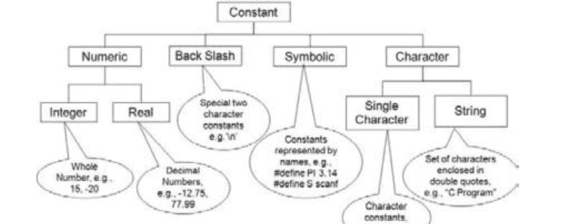

▲ **图 2：C 语言中的常量**

图 4 中显示的每个常量都将在下一小节中详细讨论。

### 数值常量

数值常量具有存储数值的能力。它们进一步分为两类：整型常量和实型常量。

#### 整型常量

整型常量是指整数。C 语言支持三种类型的整型常量，即十进制、十六进制和八进制。

十进制常量由数字 0 到 9 的组合构成。也可以在十进制常量前添加一元加号或减号。

十六进制常量由数字 0 到 9 和字母 A 到 F 的组合构成。字母 A 到 F 分别代表十进制值 10 到 15。十六进制数的基数是 16。在 C 语言中，通过使用前缀 `0x` 或 `0X` 来将其与十进制数区分开。

八进制常量由数字 0 到 7 的组合构成。该数制的基数是 8。在 C 语言中，通过使用 o 或 O 作为前缀来将其与十进制数区分开。表 6 列出了根据 C 语言规则的一些有效和无效整型常量的列表。

**表 6：数值常量的示例**

| 整型常量 | 有效 | 原因 |
| :--- | :--- | :--- |
| 500 | 是 | 有效的正十进制整数 |
| −29 | 是 | 有效的负十进制整数 |
| 688888L | 是 | 有效的正十进制长整型数 |
| 0xC7 | 是 | 有效的十六进制数 |
| 0X999 | 是 | 有效的十六进制数 |
| 027 | 是 | 有效的八进制数 |
| o24 | 是 | 有效的八进制数 |

##### 整型常量

|  | 有效 | 原因 |
| :--- | :--- | :--- |
| 10,000 | 否 | 不允许使用逗号 |
| –200.0 | 否 | 整型中不允许出现实数值 |
| Rs 2569 | 否 | 不允许使用字母 |
| 0xBN | 否 | N 不是十六进制数系统中的有效字符 |
| 0X2,3 | 否 | 不允许使用逗号 |
| O58 | 否 | 8 不是八进制数系统的一部分 |
| 055.8 | 否 | 不允许使用小数点 |

#### 实型常量

实型常量指带有小数部分的十进制数。实型常量的示例包括 `99.657`、`–53.42` 等。实型常量也可以使用科学计数法表示。在这种形式下，一个数由*尾数*和指数表示。例如，值 `53.42` 可以表示为 `$0.5342 \mathrm{e} 2$` 或 `$0.5342 \mathrm{E} 2$`，其中 `$0.5342$` 被称为尾数，2 为指数。根据 C 语言规则，一些有效和无效的实型常量列表见下表：

|  | 有效 | 原因 |
| :--- | :--- | :--- |
| 25.50 | 是 | 有效的十进制小数。 |
| 75 | 是 | 有效的十进制数。自动转换为 75.00。 |
| –55.9999 | 是 | 有效的负十进制数。 |
| –25e5 | 是 | 有效的科学计数法值。 |
| 50.75E-2 | 是 | 有效的科学计数法值。 |
| 4,999.00 | 否 | 不允许使用逗号。 |
| $5555 | 否 | 不允许使用特殊字符。 |
| –7.5e2.0 | 否 | 指数应为整数。 |
| 989 E -2 | 否 | 不允许使用空格。 |
| 5e8E-2 | 否 | 不允许使用多个 E。 |

#### 字符常量

顾名思义，字符常量由单个字符或一组字符组成。C 语言中有两种类型的字符常量：单字符常量和字符串常量。

#### 单字符常量


单字符常量使用单引号括起来的单个字符表示。C 中的每个字符常量都关联着一个数值，即美国信息交换标准代码 `ASCII` 值。书中的附录 II 列出了 C 语言中使用的不同字符所对应的 `ASCII` 值。单字符常量的示例包括 `S`、`j`、`7` 和 `?`。

### 字符串常量

C 中的字符串表示一组字符。它由双引号括起来的字符序列表示。字符串常量没有与之关联的 `ASCII` 值。在 C 中，字符串常量 `"H"` 不等于单字符常量 `'H'`。这是由于这些常量在内存中的存储方式造成的。字符串常量 `"H"` 将分配两个内存空间，而 `'H'` 仅分配一个内存空间。这是因为 C 中的字符串通过添加 `\0`（空字符）结尾。字符串常量的示例包括 `"C Programming"`、`"Language"` 和 `"H"`。

### 反斜杠字符

C 语言提供了一种特殊的两字符常量。这些常量被称为反斜杠字符或转义序列。由于第一个字符总是反斜杠 `\\`，且这些常量的输出不是可打印字符而是空白，因此它们也被称为转义序列字符。与单字符常量类似，这些常量也关联着一个 `ASCII` 值。表 8 列出了 C 语言中可用的反斜杠常量及其 `ASCII` 值和用途：

表 8：反斜杠字符

| 反斜杠字符 | ASCII 值 | 用途 |
| :--- | :--- | :--- |
| `\0` | 0 | 插入空值 |
| `\a` | 7 | 插入可听警报 |
| `\b` | 8 | 插入退格 |
| `\t` | 9 | 插入水平制表符 |
| `\n` | 10 | 插入换行符 |
| `\v` | 11 | 插入垂直制表符 |
| `\f` | 12 | 插入换页符 |
| `\r` | 13 | 插入回车符 |
| `\"` | 34 | 插入双引号 |
| `\'` | 39 | 插入单引号 |
| `\?` | 63 | 插入问号 |
| `\\` | 92 | 插入反斜杠 |

转义序列通常用于格式化程序的输入或输出。例如，`\t` 用于通过插入制表符来分隔值。各种转义序列字符已被用于格式化本书中使用的程序的输入和输出。

### 符号常量

有时，数值和字符常量是使用符号标识符定义的。这样的常量被称为符号常量。要定义符号常量，使用以下语法：

```c
#define identifier value
```

其中 `#define` 被称为预处理器指令。预处理器指令语句指示编译器，程序中出现的符号常量应被定义中指定的常量值替代。`identifier` 是要定义的常量的符号名称，`value` 是与该符号关联的常量值。符号常量的示例如下：

```c
#define S scanf
#define MAX 1000
```

第一条语句定义了一个名为 `"S"` 的符号常量，它指向关键字 `"scanf"`。第二条语句定义了一个名为 `"MAX"` 的符号常量，它指向整数值 `"1000"`。`S` 和 `MAX` 的值在整个 C 程序执行过程中保持不变。

当在程序中使用符号常量时，我们可以创建可以在所有函数中访问的常量全局定义。它还可以提高程序的可读性。

## 2.7 创建和执行 C 程序

在前面的章节中，我们讨论了 C 程序及其输出，而没有考虑如何创建和执行它们。现在让我们学习如何创建和执行 C 程序。创建和执行 C 程序时需要执行的步骤如下：

1. 使用任何文本编辑器创建 C 程序。该程序被称为*源代码*或*源程序*。可执行 C 程序的扩展名为 `.c`。
2. 然后，我们使用 C 编译器编译源程序。C 编译器由两个不同的程序组成，即预处理器和翻译器。预处理器从源代码中删除所有预处理器指令语句，并为翻译准备源代码。然后，翻译器将源代码转换为机器语言代码，反之亦然。机器语言代码被称为*目标代码*或*目标程序*。目标代码的扩展名为 `.obj`。
3. 如果必要，目标代码随后与库函数链接，生成*可执行代码*或*可执行程序*。可执行代码的扩展名为 `.exe`。为了将目标代码与 C 程序中使用的内置函数的目标代码进行链接，我们使用称为链接器的程序。C 中需要链接器，因为我们在 C 中执行的大多数操作都作为内置函数提供。
4. 最后，可执行代码由称为加载器的程序加载到内存中，并包含产生输出所需的数据。执行程序所需的数据可以从文件获取，也可以由用户输入。程序完成工作后，通过将程序从内存中移除，控制权返回给操作系统。

本节仅提到了四个步骤；然而，在实际场景中，执行了五个步骤。某些步骤由翻译器自动处理；因此，用户无需担心它们。图 5 描绘了创建和执行 C 程序的整个过程：

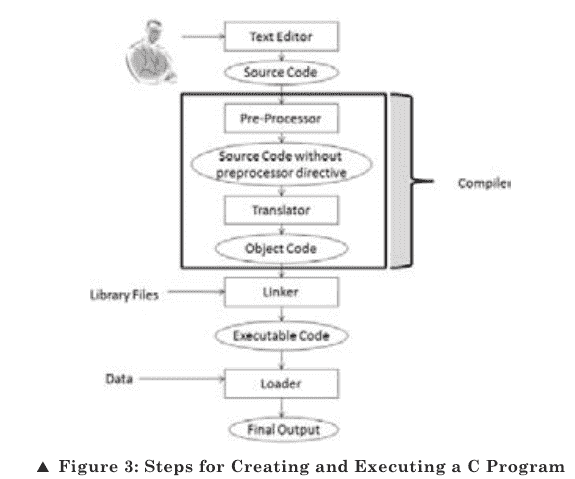

▲ 图 3：创建和执行 C 程序的步骤

图 5 显示编译器框包含两个不同的程序，即预处理器和翻译器。预处理器从文本编辑器获取输入并处理它，以删除源代码中的所有预处理器指令语句。然后，它将处理后的 C 代码提供给翻译器，翻译器将 C 代码转换为目标代码。

我们之前已经提到，许多厂商推出了 C，并提供不同的 C 编译器。编译器的使用和特性可能因厂商而异，但上述创建和执行 C 程序的顺序保持不变。这里我们讨论了使用 GNU 编译器集合 `gcc` 开源编译器创建、编辑、编译和执行 C 程序的一种方法。该编译器适用于 Windows、Unix 和 Linux 等操作系统，并随所有 Linux 版本捆绑提供。

如前所述，我们可以使用任何良好的文本编辑器来创建 C 程序。唯一需要记住的一点是，创建的文件应以扩展名 `.c` 保存。请确保 `c` 为小写。在 Linux 环境中，我们有 `vi`、`emacs`、`pico` 等编辑器。选择你熟悉的那个。程序准备好后，保存它；例如，假设本章给出的程序 1 保存为 `prog2_1.c`，则在 Linux 提示符下编写以下命令进行编译：

```
$ gcc prog2_1.c
```

如果一切顺利，将看到新的一行提示符。如果有错误，屏幕上会出现相应的错误消息。如果发生错误，我们需要修复程序并重新编译。如果没有出现错误，意味着编译成功，并且在与源文件相同的目录中有一个名为 `a.out` 的可执行文件。要查看程序的输出，在提示符处输入命令 `./a.out` 并按 Enter 键。按 Enter 键之前，提示符应如下所示：

### 要点回顾

谚语*熟能生巧*应被所有C语言初学者时刻铭记。除了大量的练习外，我们还需要记住以下几点，以减少编程过程中犯下的错误：

1. 在声明 `main()` 函数之前，应包含所有所需的头文件。
2. 可执行的C程序应始终只包含一个 `main()` 函数。
3. C程序中不允许存在两个同名函数。
4. 通常，C程序使用小写字母编写，但也可以使用大写字母。
5. 标识符区分大小写。
6. 两个C记号之间至少应有一个空格。
7. 通常，C语句以分号结尾。
8. 可以根据程序员的需要，在C程序的任何位置插入注释。
9. 编写函数之前，务必编写适当的注释。
10. 每个左花括号都应有对应的右花括号。
11. C程序中使用的变量名应赋予有意义的名称。例如，如果一个变量用于存储学生姓名，则应将其定义为 `studentname` 或 `student_name`。

### 摘要

在本章中，我们学习了C语言编程的基础知识。重点在于理解C语言编程所需的基本组件。我们还学习了编程语言的需求以及编程语言的演变历史。我们简要回顾了C语言的历史，然后编写了我们的第一个C程序。随后，我们了解了C程序的结构以及结构中各部分的使用。接着，我们讨论了C字符集，重点介绍了保留字的类型以及C语言中可用的变量和常量的概念。最后，我们展示了在Linux环境下创建和运行C程序的步骤。

### 复习题

- Q1. 解释系统软件和应用软件这两个术语。
- Q2. 简记语言代际 `Generations of Languages`。
- Q3. 绘制C程序结构的框图。
- Q4. C程序中注释的作用是什么？
- Q5. 全局变量声明部分的目的何在？
- Q6. 区分C语言中的关键字 `Keyword` 和变量 `Variable`。
- Q7. 陈述在C语言中定义变量名所使用的规则。
- Q8. 区分以下各项：
    - i. 整型常量和实型常量
    - ii. 字符常量和字符串常量
- Q9. 写出创建和运行C程序的步骤。
- Q10. 判断以下陈述是真还是假：
    - i. C语句以逗号结尾。
    - ii. `FLOAT` 是一个有效的变量名。
    - iii. `#include <define.h>` 在C程序中包含了名为 `define` 的文件。
    - iv. `V` 是一个有效的单个字符常量。
    - v. C可执行程序的扩展名是 `.exe`。
    - vi. `"Glisc1"` 是一个有效的字符串常量。
    - vii. 要在C程序中包含符号常量，我们使用文档部分。
    - viii. 要在输出中插入制表符，使用反斜杠字符 `\t`。
    - ix. `0x55` 是一个有效的十六进制数。
    - x. 标识符 `add()` 代表一个变量名。

### 实践练习

- Q1. 编写一个程序，将给定的厘米转换为公里和毫米。
- Q2. 编写一个程序，接受 `pi`、半径和高的值。然后使用公式 `$V = \pi$ * 半径的平方 * 高` 来计算圆柱体的体积。
- Q3. 编写一个程序，接受一个数字 `N` 并求其平方。
- Q4. 编写一个程序，接受天数并将其转换为周数。
- Q5. 编写一个程序，接受摄氏温度值并将其转换为华氏度，其中 `$F = (5/9) * (C - 32)$`。

## 03 C 数据类型

### 目标

- 理解数据类型
- 解释C语言中的数据类型
- 解释用户自定义数据类型
- 描述派生数据类型
- 描述空指针

在上一章中，我们讨论了C语言中的一种记号，称为*标识符*。标识符是任何C程序的组成部分。例如，假设在我们的程序中，我们定义了一个名为 `joining_month` 的标识符，用于存储员工加入组织的那个月份的数值。这个标识符可以存储1到12之间的任何值，因为公历一年只有12个月。在这种情况下，不可能存储诸如 `1.8` 这样的值，因为该值不合适。这个例子表明，标识符中存储值的类型也很重要。C语言使用某些保留字来标识可以存储在标识符中的数据值的类型。由于保留字将数据值类型与标识符关联，因此被称为数据类型。在本章中，我们将详细理解并讨论C语言中可用的不同数据类型及其用法。我们还将学习用户自定义数据类型和枚举数据类型。

### 3.1 理解数据类型

可以存储在标识符中的数据值的类型被称为其数据类型。如果将数据值 `8` 分配给标识符 `joining_month`，那么我们会说该标识符能够存储整型数据。这反过来表明，标识符 `joining_month` 的数据类型是整型。同样，如果将数据值 `95.75` 分配给标识符 `total_marks`，那么我们会说它能够存储实型数据；因此，其数据类型必须是实型。

C语言的保留字用于将两个实体与标识符关联。第一个是可以存储在标识符中的值的类型，第二个是标识符存储所需的内存空间。编译器设计者为数据类型关联预分配的固定内存空间。因此，编译器处理C语言中使用的不同标识符变得更加容易。内存空间的基本单位是字节，8位组成1字节。C语言中的数据类型分为原始类型和派生类型。下一节将讨论C语言中可用的基本数据类型。

### 3.2 C语言中的数据

如前所述，在C语言中定义的标识符存储预定义类型的值。为了实现这一功能，C语言支持两类数据类型，即原始类型和派生类型。图1展示了属于这些类别的数据类型：

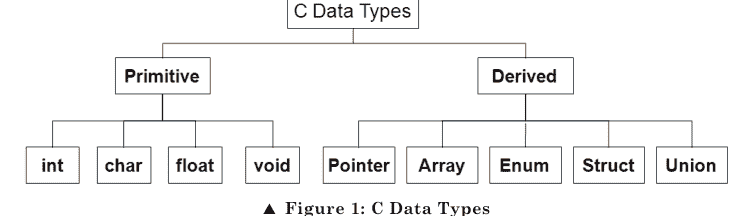

原始数据类型是定义标识符的基本构建块。C语言支持四种原始或基本数据类型，即整型、十进制、字符和空型。这些数据类型分别使用关键字 `int`, `float`, `char`, 和 `void` 来表示。要将标识符与其数据类型关联，使用以下语法：

```
Data Type identifier 1[, identifier 2, identifier 3, ..., identifier n];
```

上述语法在C语言中被称为声明语句，其中 `identifier 2`, `identifier 3`, ...., `identifier n` 都是可选的。这意味着它们在定义中可能存在也可能不存在。如果这些标识符存在，则意味着我们有多个相同类型的标识符。在本章中，我们将详细查看原始数据类型。除枚举和指针外，派生数据类型将在后续章节中单独讨论。

#### 整型

许多数值运算涉及正整数或负整数。要在标识符中存储整型数，我们需要定义类型为 `int` 的标识符。在这种情况下，`int` 是C保留字，表明该标识符能够存储整型数据值。要声明一个整型变量，我们使用以下语法：

```
int identifier1[, identifier 2, identifier 3, ..., identifier n];
```

一些声明整型标识符的例子如下：

```
int i_joining_month;
int i_age, i_basic_salary;
```

在上述例子中，第一条语句声明了一个名为 `i_joining_month` 的标识符，它能够存储代表员工加入组织月份数值的整型值。第二条语句声明了两个标识符，即 `i_age` 和 `i_basic_salary`，它们能够存储代表员工年龄和基本工资的整型值。

# C 数据类型

请观察前面示例中 `i_` 前缀与实际标识符名称的使用情况。这种添加 `i_` 前缀的做法表明，所定义的标识符类型为整数。因此，对于试图维护 C 程序的程序员来说，即使他位于程序的第 1000 行，也可以在不查看其定义的情况下轻松得知该标识符的类型。本书中定义标识符时一直沿用这一约定。

分配给数据类型 `int` 的内存空间取决于编译器。在某些编译器中，它使用 2 字节的内存空间；而在其他编译器中，它可能使用 4 字节的内存空间。要验证整数数据类型的大小，我们可以使用 `sizeof` 运算符，该运算符将在后文进行讨论。可以存储在标识符中的数值范围也将根据编译器分配的字节数而有所不同。表 1 列出了有符号整数数据类型的范围：

**表 1：有符号整数数据类型范围**

| 数据类型 | 编译器分配的内存空间（字节） | 位数 | 描述 | 数值范围 | 最小值 | 最大值 |
| :-------- | :---------------------------------------: | :---: | :---------- | :---------- | :------ | :------ |
| `int`       |                    2                      |  16   | 用于在标识符中存储正整数或负整数的数据类型 | -32768 到 +32767 | -32768 | +32767 |
|           |                    4                      |  32   | 用于在标识符中存储正整数或负整数的数据类型 | -2147483648 到 +2147483647 | -2147483648 | +2147483647 |

表 1 中列出的数值范围取决于编译器为内存空间分配的字节数。对于有符号整数，数值范围的计算公式为 `$-2^{(n - 1)}$ 到 $+2^{(n - 1)} - 1$`，其中 `n` 指的是存储数值范围所需的位数。

默认情况下，所有整数标识符都被视为有符号类型。因此，我们也可以在标识符中存储负值。但在许多情况下，我们可能只需要正值；例如，一个人的年龄、出生年份和出生日期永远不可能是负数。C 语言提供了一些修饰符来解决此类问题。表 2 列出了 C 语言中可用的修饰符及其用途：

**表 2：数据类型修饰符**

| 修饰符 | 描述 | 声明示例 | 解释 |
| :------- | :---------- | :---------------------- | :---------- |
| `short`    | 用于分配比数据类型 `int` 少一半内存空间的修饰符 | `short int s_month;`<br>`short s_month;` | 这两个声明都定义了一个名为 `s_month` 的变量，它可以存储有符号整数值。 |
| `long`     | 用于分配比数据类型 `int` 多一倍内存空间的修饰符 | `long l_credit_amount;`<br>`long int l_credit_amount;` | 这两个声明都定义了一个名为 `l_credit_amount` 的变量，它可以存储有符号整数值。 |
| `unsigned` | 用于存储正整数的修饰符 | `unsigned u_age;`<br>`unsigned int u_age;` | 这两个声明都定义了一个名为 `u_age` 的变量，它只能存储**正整数**值。 |
|          |            | `unsigned short int u_age;`<br>`unsigned short u_age;` | 这两个声明都定义了一个名为 `u_age` 的变量，它只能存储**正整数**值。 |
|          |            | `unsigned long int u_age;`<br>`unsigned long u_age;` | 这两个声明都定义了一个名为 `u_age` 的变量，它只能存储**正整数**值。数值范围将取决于编译器为存储分配的内存。 |

表 2 中使用的修饰符可由程序员用来控制用户可能输入的数值类型以及编译器进行的内存空间分配。表 3 列出了可以存储在无符号整数中的数值范围：

**表 3：无符号整数数据类型范围**

| 修饰符 | 编译器分配的内存空间（字节） | 位数 | 描述 | 数值范围 | 最小值 | 最大值 |
| :------- | :-----------------------------------------: | :---: | :---------- | :---------- | :------ | :------ |
| `unsigned` |                    2                      |  16   | 前缀为 `int` 数据类型的修饰符，使得标识符中仅存储正整数 | 0 到 65535 | 0 | 65535 |


|          |                    4                      |  32   | 前缀为 `int` 数据类型的修饰符，使得标识符中仅存储正整数 | 0 到 4294967295 | 0 | 4294967295 |

表 3 中列出的数值范围也取决于编译器为无符号整数数据类型分配的字节数。对于无符号整数，范围的计算公式为 $0$ 到 $2^n - 1$，其中 $n$ 指的是存储所述数据类型的一个元素所需的位数。

在了解 C 语言整数数据类型的细节之后，让我们编写一个简单的程序，以说明整数数据类型及其修饰符的用法。

### 程序 1

```c
/* 程序演示整数数据类型的使用 */

#include <stdio.h>
/* main 函数开始 */
main( )
{
    /* 声明三个整数变量 */
    int i_length, i_breadth, i_area;
    /* 接受长度和宽度的值 */
    printf("\n Enter the value of length:");
    scanf("%d",&i_length);
    printf("\n Enter the value of breadth:");
    scanf("%d",&i_breadth);
    /* 计算面积 */
    i_area = i_length * i_breadth;
    /* 打印结果 */
    printf("\n Area of a rectangle with length %d and breadth %d is %d", i_length, i_breadth, i_area);
    return;
}
/* main 函数结束 */
```

### 输出 1：

```
Enter the value of length: 35
Enter the value of breadth: 46
Area of a rectangle with length 35 and breadth 46 is 1610
```

### 输出 2：

```
Enter the value of length: -50
Enter the value of breadth: 150
Area of a rectangle with length -50 and breadth 150 is -7500
```

在输出 1 中，程序似乎运行正常。输出 2 给出了一个负的面积值。在现实生活中，长度、宽度或面积不可能为负值。由于 C 语言本身不验证输入数据的正确性，确保接受的数据正确是程序员的职责。此外，两个正值相乘的结果在大多数情况下都会得到一个大于乘法中使用的值的数。因此，我们必须始终确保存储结果的变量数据类型是合适的。

此示例指出，程序设计师在决定使用哪些数据类型来定义标识符之前，应考虑诸如实际存储的数据、其范围及其他属性等因素。

#### 实数

大多数金融和数学计算需要在计算中使用实数。在这种情况下，数据类型 `int` 不起作用。要在 C 语言中使用实数值，我们需要使用关键字 `float` 作为数据类型。`Float` 数据类型使用 4 字节的内存存储空间，在大多数情况下具有六位小数精度。对于更高精度的值，使用关键字 `double` 代替 `float`。`Double` 数据类型使用 8 字节的内存存储空间，精度高达 16 位小数。我们还可以将 `long` 用作 `double` 的前缀。这会扩展 `double` 的数值范围。表 4 列出了 `float` 数据类型的简要描述：

### 表 4：Float 数据类型描述

| 数据类型 | 编译器分配的内存空间（字节） | 描述 | 精度位数 | 数值范围 |
| :--- | :--- | :--- | :--- | :--- |
| `float` | 4 | 存储带有小数点的正数或负数 | 6 | ±3.4E-38 到 ±3.4E+38 |
| `double` | 8 | 存储比 `float` 具有更高精度的实数值 | 15 | ±1.7E-308 到 ±1.7E+308 |
| `long double` | 10, 12 或 16 | 存储具有最高精度的实数值（取决于编译器） | 18-19 | ±1.7E-4932 到 ±1.7E+4932 |

在表 4 中，我们使用科学记数法指定范围，因为 C 支持实数的科学表示法。例如，数字 25.75 表示为 0.2575e2，其中 0.2575 称为尾数，2 称为指数。尾数和指数都可以是正数或负数。使用 `float` 变量允许我们扩展存储值的数值范围。程序 2 展示了 `float`、`double` 和 `long double` 数据类型的用法：

### 程序 2

```c
/* 程序演示实数数据类型的使用 */
#include <stdio.h>

/* main 函数开始 */
main( )
{
/* 声明三个 float 变量 */
float f_first;
double d_second;
long double ld_third;

/* 接受值并打印 */
printf("\n Enter value of the first variable :\");
scanf("%f",&f_first);
printf("\n First = %f\n",f_first);
printf("\n Enter value of the second variable :\");
scanf("%lf",&d_second);
printf("\n Second = %lf\n",d_second);
printf("\n Enter value of the third variable :\");
scanf("%lf",&ld_third);
printf("\n Third = %lf\n", ld_third);
return;
}
/* main 函数结束 */
```

### 输出：

```
Enter value of the first variable: 345678.234567
First = 345678.250000
```

输入第二个变量的值：293484638.82765291

Second = 293484638.827653

输入第三个变量的值：3847596212.9876539942

Third = 3847596212.987654

程序 2 的输出显示，指定的输入值与获得的输出值存在差异。使用浮点数会导致精度丢失。从获得的输出中可以明显看出这一点。标识符 `first` 的输入值和输出值在前七位数字上是匹配的，而对于标识符 `second` 和 `third`，其输入值和输出值在前十六位数字上是匹配的。这些匹配的数字被视为精度位数。为了在程序中获得更好的结果精度，建议使用更高的精度。与整数相比，使用 `float` 值可以获得更宽的值范围。

#### 字符类型

输入到程序中的数据不仅包含数字，还包括字母或特殊字符。这样的值无法使用 `int` 或 `float` 数据类型来存储。为了存储这些值，我们必须使用关键字 `char`。`char` 数据类型利用 1 字节的内存存储空间。在 C 语言中，字符无论是可打印的还是不可打印的，都与一个称为美国信息交换标准代码（ASCII）值的整数值相关联。我们也可以为 `char` 数据类型添加 `unsigned` 修饰符。表 5 简要描述了字符数据类型：

### 表 5：字符数据类型

| 数据类型 | 编译器分配的内存（字节） | 描述 | ASCII 值范围 |
| :--- | :--- | :--- | :--- |
| `char` | 1 | 用于存储可打印或不可打印字符 | − 128 到 + 127 |
| `unsigned char` | 1 | | 0 到 255 |

程序 3 展示了 `char` 数据类型的用法。这里编写的程序简单地接收一个字符，并在监视器屏幕上显示该字符及其 ASCII 值。

#### 程序 3

```c
/* Program to illustrate the use of character data type*/
#include <stdio.h>

/* Beginning of main function */
main( )
{
    /* Declare a character variable */
    char c_choice;

    /* Print the character and its ASCII value */
    printf("\n Enter your choice : ");
    scanf("%c",&c_choice);

    printf("\n Choice = %c\n", c_choice);
    printf("\n ASCII value of choice = %d\n",c_choice);
    return;
}
/* End of function main */
```

### 输出 1：

```
Enter your choice: r
Choice = r

ASCII value of choice = 114
```

### 输出 2：

```
Enter your choice: R
Choice = R

ASCII value of choice = 82
```

### 输出 3：

```
Enter your choice:
Choice = 

ASCII value of choice = 32
```

### 输出 4：

```
Enter your choice: 2
Choice = 2

ASCII value of choice = 50
```

### 输出 5：

```
Enter your choice: $
Choice = $

ASCII value of choice = 36
```

这里给出了程序 3 的五种不同输出。输出 1 和 2 中的字符都是字母 `r`；然而，一个是小写，另一个是大写。由于大小写变化，这两个字符的 ASCII 值也各不相同。在输出 3 中，似乎没有输入任何字符；实际上，在提供输入时，按下了空格键。因此，该字符在屏幕上作为输出不可见，但仍有 ASCII 值。即使 `Enter` 键也是字符数据类型标识符的有效输入。用户在使用字符数据类型时必须稍加小心，因为有时结果可能出乎意料。输出 4 是另一个特殊情况，其中数值 2 被转换为字符值 2。最后，在输出 5 中，我们输入了一个特殊字符。

#### 空数据集

C 语言中最后一个原始数据类型是 `void`。`void` 数据类型不会将标识符与特定类型（如整数或实数）关联。它将标识符与一个空值关联。在 C 语言中，它主要与函数和指针一起使用。如前所述，C 程序由函数组成。使用的函数可以返回值。如果我们不希望函数返回值，则需要在函数名前加上 `void`。

在所有迄今为止使用的示例程序中，程序的最后一句是 `return;`。该语句告诉编译器从函数主体退出。如果我们不写语句 `return;`，在编译时屏幕上会出现一条警告消息“Function should return a value”（函数应返回值）。为了避免收到此类消息，我们可以为 `main()` 前加上 `void`。

在下一节中，我们将学习如何创建自己的数据类型。

### 3.3 用户定义的数据类型

C 语言是一种灵活的语言；它允许用户从现有实体创建新实体。我们可以利用现有数据类型创建新的数据类型。关键字 `typedef` 在 C 语言中用于创建新的数据类型。它用于定义一个可以用作程序中数据类型的变量。

#### 类型定义

使用类型定义的语法如下：

```c
typedef datatype identifier;
```

其中 `datatype` 指的是现有数据类型，所使用的数据类型可以是原始类型或派生类型。`Identifier` 指的是我们想分配给现有数据类型的新名称。从某种意义上说，C 语言并不允许我们创建新的数据类型。相反，它允许我们为现有数据类型赋予别名。类型定义用法的一些示例如下：

```c
typedef int Num;
typedef long Big;
```

第一个示例为整数数据类型赋予别名 `Num`，而第二个示例为修饰符 `long` 赋予别名 `Big`。现在可以使用新的标识符来声明整型变量。使用别名的示例如下：

```c
Num i_roll_no;
Big i_amount;
```

程序 4 展示了类型定义的用法：

#### 程序 4

```c
/* Program to illustrate the use of type definition */

#include <stdio.h>
#define PI 3.14

/* Beginning of main function */
main( )
{
    /* Give an Alias REAL to float data type */
    typedef float REAL;

    /* Declare a variable of type REAL (float) */
    REAL f_radius, f_circumference;

    /* Accept value of radius */
    printf("\n Enter the value of radius: ");
    scanf("%f",&f_radius);

    /* Calculate Circumference of Circle */
    f_circumference = 2 * PI * f_radius;
    /* Print the value of circumference */

    printf(" Circumference of Circle with radius %f is %f\n",f_radius,f_circumference);

    return;
}
/* End of function main */
```

### 输出：

```
Enter the value of radius : 5.5
Circumference of Circle with radius 5.5 is 34.540001
```

在程序 4 中，观察 `main()` 后的第一条可执行语句，其中 `float` 数据类型被赋予了别名 `REAL`。该别名以大写字母书写，只是为了将其与普通标识符区分开。然后，新的数据类型被用于声明两个变量。该程序仍然给我们提供了所需的输出。

当我们在程序中使用派生数据类型时，为变量赋予别名的概念非常有用。它已在后续章节中广泛使用，以提高程序的可读性。

### 3.4 派生数据类型

原始数据类型可能足以满足简单 C 程序的需求。然而，如果程序很复杂，使用它们可能并不合适。例如，假设我们需要存储五名员工的薪水。在这种情况下，我们需要定义五个不同的变量。处理五个不同的变量可能会增加程序本身的复杂性。同样，如果我们还需要存储五名员工的完整信息，例如他们的员工号、性别、姓名和薪水，那么我们可能需要额外的变量。在此，变量的分组可能会成为一个问题。为了解决这些问题，C 语言为我们提供了派生数据类型。枚举、数组、指针、结构和联合体是 C 语言中可用的派生数据类型的示例。下一节讨论了枚举数据类型。

#### 枚举数据类型

在 C 语言中可以使用关键字 `enum` 创建枚举数据类型。它们允许程序员将数值常量与预定义的名称关联起来。使用 `enum` 的语法如下：

#### 枚举数据类型

```c
enum 标识符 {值1, 值2, 值3, ......., 值n};
```

其中 `enum` 是关键字。标识符定义了一个新的数据类型。值 1 到值 n 指的是与数值常量 0, 1, 2, ..., n 关联的名称。使用 `enum` 定义的变量可以被赋予任何数值，或者花括号中给定的值。`enum` 数据类型的一个示例如下：

```c
enum result {first, second, pass, fail};
enum result grade;
grade = first;
```

其中第一条语句定义了枚举数据类型 `result`。下一条语句声明了一个类型为 `result` 的变量 `grade`。最后一条语句将值 `first` 赋值给 `grade`，其中 `first`、`second`、`pass` 和 `fail` 分别对应数值常量 0、1、2 和 3。这些数值常量由编译器自动分配。可以修改这些值并赋予新值。例如，如果我们希望 `first` 等价于 60，`second` 等价于 50，`pass` 等价于 40，`fail` 等价于 30，那么我们可以将给定示例中的第一条语句重写为：

```c
enum result {first=60, second=50, pass=40, fail=30};
```

现在，语句 `grade = first` 将等价于 `grade = 60`。枚举数据类型变量只能被赋予之前声明过的值。程序 5 说明了枚举数据类型的使用方法：

### ▶ 程序 5

```c
/* 说明枚举数据类型用法的程序 */
#include <stdio.h>

/* main 函数开始 */
main()
{
    /* 声明新数据类型 boolean */
    enum boolean {false, true};
    int i_number;

    /* 声明枚举变量 flag */
    enum boolean flag;
    flag = true;

    /* 读取一个正数 */
    while(flag)
    {
        printf("\n 请输入一个数字 : ");
        scanf("%d", &i_number);

        /* 重置标志 */
        if(i_number >= 0)
            flag = false;
    }
    printf("\n 输入的数字是 %d\n", i_number);
    return;
}
/* main 函数结束 */
```

### 输出 1：

```text
                请输入一个数字: 5
                输入的数字是 5
```

### 输出 2：


```text
                请输入一个数字: -10
                请输入一个数字: -15
                请输入一个数字: 10
                输入的数字是 10
```

在程序 5 中，我们创建了一个名为 `boolean` 的派生数据类型，其变量在定义时可以有值 `false` 或 `true`。定义了一个名为 `flag` 的变量，类型为 `boolean`。然后该变量在一个循环中使用，以确保输入到变量 `i_number` 中的值始终为正。观察输出 1，我们只被要求输入数字一次。由于输入的值是正的，`flag` 被重置，我们退出了循环。在输出 2 中，我们必须三次输入数字的值。前两次输入为负值，因此 `flag` 未被重置。然而，在第三次输入时，`flag` 被重置，我们退出了循环。程序员可以使用此代码来确保输入到变量中的值始终为正。

在了解了 `enum` 数据类型的使用后，让我们现在讨论指针的概念。

## ■ 指针

当定义一个标识符时，它与三个实体相关联，即内存地址、需要分配的内存大小以及值。由于 C 语言旨在构建系统软件，它提供了内置功能，允许用户直接与计算机的物理内存交互。在本节中，我们将简要讨论一个称为 `pointer`（指针）的概念。

`pointer` 是 C 语言中可以定义的一种特殊变量。此处认为该变量特殊，是因为变量中的值始终指向一个内存地址。定义指针变量的语法如下：

```c
数据类型 *标识符名称;
```

在上述语法中，标识符名称是一个普通的变量名，并遵循定义标识符所适用的所有规则。`*` 表示所定义的变量是一个 `pointer`。这里的数据类型表示存储在指针变量中的地址将指向给定的数据类型。例如，定义 `int *i_ptr;` 可以解释为 `i_ptr` 是一个指针变量，它存储指向整型变量的地址。程序 6 说明了 `pointer` 的使用：

### ▶ 程序 6

```c
/* 说明指针用法的程序 */
#include<stdio.h>
/* main 函数开始 */
main()
{
  /* 声明变量 */
  int i_num, *i_ptr;
  /* 将 i_num 的地址赋值给 i_ptr */
  i_ptr = &i_num;

  /* 读取数据到 i_num */
  printf("\n请输入一个数字: ");
  scanf("%d", &i_num);
  /* 使用指针打印值 */
  printf("\n数字 %d 存储在 %u\n", *i_ptr, i_ptr);
  printf("\n数字的地址是 %u", &i_num);
  printf("\n指针的地址是 %u，指针中的值是 %u\n", &i_ptr, i_ptr);
  return;
}
/* main 函数结束 */
```

**输出：**

```text
请输入一个数字: 999
数字 999 存储在 65524
数字的地址是 65524
指针的地址是 65522，指针中的值是 65524
```

在程序 6 中，我们定义了两个变量。第一个变量是普通的整型变量，而第二个变量是一个能够存储另一个整型变量地址的指针变量。图 2 展示了程序 6 的执行序列：

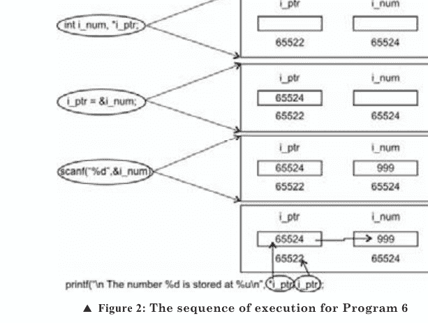

从图 2 中可以观察到，当变量被声明时，在内存中分别预留了两个内存块，地址分别为 65522 和 65524。地址 65522 指代变量 `i_ptr`，地址 65524 指代变量 `i_num`。语句 `i_ptr = &i_num` 将 `i_num` 的地址赋值给 `i_ptr`。最后，语句 `printf("\nThe number %d is stored at %u\n", *i_ptr, i_ptr);` 通过使用指针解引用打印 `i_num` 的值。这里，`i_ptr` 被解释为获取存储在 `i_ptr` 中提到的地址处的值。请注意，分配给变量的地址在每次程序运行时可能不同。下一节讨论 void 指针的概念。

### 3.5 Void 指针

指针变量很特殊，因为它们最初可以定义为 `void` 数据类型，然后根据用户的需求指向任何特定的数据类型。当用户在运行时为变量分配内存时（动态内存分配概念讨论于本书第 14 章），void 指针的概念非常有用。程序 7 说明了 void 指针的使用：

### ▶ 程序 7

```c
/* 说明 void 指针用法的程序 */
#include <stdio.h>
/* main 函数开始 */
main()
{
    /* 声明变量 */
    int i_num;
    float f_num;
    void *v_ptr;
    /* 读取数据到 i_num */
    printf("\n请输入一个数字: ");
    scanf("%d", &i_num);
    /* 将 i_num 的地址赋值给 v_ptr */
    v_ptr = &i_num;
    /* 使用指针打印值 */
    printf("\n存储在 i_num 中的数字是 %d\n", *(int *)v_ptr);
    /* 读取数据到 f_num */
    printf("\n请输入一个数字: ");
    scanf("%f", &f_num);
    /* 将 f_num 的地址赋值给 v_ptr */
    v_ptr = &f_num;
    /* 使用指针打印值 */
    printf("\n存储在 f_num 中的数字是 %f\n", *(float *)v_ptr);
    return;
} /* main 函数结束 */
```

**输出：**

```text
请输入一个数字: 55
存储在 i_num 中的数字是 55
请输入一个数字: 75.55
存储在 f_num 中的数字是 75.550003
```

从程序 7 中可以看出，我们声明了一个名为 `v_ptr` 的 void 指针变量。该指针首先被赋予变量 `i_num` 的地址。在 `printf` 语句中，它随后被强制转换（该概念讨论于本书第 5 章）并解引用，以获取整型变量的值。然后，同一变量被重新赋予浮点型变量的地址，并用于打印其值。因此，如果用户知道如何处理 void 指针，可以仅使用一个 void 指针变量执行所需的操作。指针将在本书第 12 章中详细讨论；目前，我们仅仅讨论了指针的含义。数组在某个时候将使用指针的概念。

派生数据类型的使用和需求因程序而异，也因用户而异。关于派生数据类型的详细讨论已在本书后续章节中完成。

### 摘要

在本章中，我们学习了基本数据类型和用户定义/派生数据类型的概念。我们讨论的基本数据类型包括 `int`、`char`、`float` 和 `void`。除了 `void` 之外，这些数据类型中的每一个都可以加上修饰符。修饰符会改变大小需求以及可以存储在标识符中的值的范围。讨论的修饰符包括 `short`、`long`、`signed` 和 `unsigned`。我们还学习了名为 `typedef` 的用户定义数据类型的使用方法，它允许程序员为现有的基本或派生数据类型指定别名。讨论了枚举数据类型 `enum` 及其示例。此外，我们讨论了指针的概念。指针是存储其他变量地址作为其值的特殊变量。指针是唯一可以声明为具有 `void` 数据类型的变量。

### 复习题

1. 解释 C 语言中数据类型的意义。

2. 区分基本数据类型和派生数据类型。

3. 识别适当描述以下给定数据的数据类型：

   i) 765903

   ii) -999

   iii) 056

   iv) 0XAB

   v) 57e2

   vi) 58.89754

   vii) y

   viii) 2.997925E11

   ix) '\t'

   x) 45

4. 用指数形式表示以下常量：

   i) 34567.87654

   ii) 567.98

   iii) −254.789

   iv) −0.000123

   v) 45678

5. 解释类型定义的意义。

6. 枚举数据类型有什么用途？

7. 什么是指针？它与普通变量有何不同？

8. 解释 void 指针的用途。

9. 区分带符号和无符号数据类型。

10. 给出以下程序的输出：

```c
#include <stdio.h>
main()
{
 unsigned long ul_value= -10;
 printf ("\n %lu",ul_value);
 return;
}
```

```c
#include <stdio.h>
main()
{
 char c_char = -255;
 unsigned char uc_char = -127;
 printf ("\n c_char=%d", c_char);
 printf("\n uc_char=%d",uc_char);
 return;
}
```

iii.

```c
#include <stdio.h>
main()
{
	long l_value = 789632056;
	printf ("\n %li", l_value);
	return;
}
```

iv.

```c
#include <stdio.h>
main()
{
	char c_char = 55;
	printf ("\n character = %d", c_char);
	return;
}
```

v.

```c
#include <stdio.h>
main()
{
	float f_result = 7896.32056;
	printf ("\n %f", f_result);
	return;
}
```

vi.

```c
#include <stdio.h>
main()
{
	float f_value = 123.45, *f_ptr;
	f_ptr = &f_value;
	printf ("\n %f", *f_ptr);
	return;
}
```

### 实践练习

- 问题 1. 编写一个程序，接收用户输入的高度和仰角，并计算距离。

- 问题 2. 编写一个程序，接收直角三角形的高度和底边长度，并计算其斜边长度。

- 问题 3. 编写一个程序，根据给定的半径 R 计算圆的面积。

- 问题 4. 编写一个程序，接收字符 Alpha 并显示其对应的 ASCII 值。

- 问题 5. 编写一个程序，接收秒数并显示对应的小时、分钟和秒。

## 04 格式化输入和输出

### 目标

- 1. 描述 C 流

- 2. 解释输入和输出函数

- 3. 解释格式化函数

- 4. 解释非格式化函数

系统基于输入、处理和输出的基本原理运行。我们设计的程序代表系统的处理部分。处理通常将原始数据转换为信息。原始数据代表输入，而信息代表输出。生成的输出始终取决于提供给程序的输入。输入可以以静态或动态方式提供给程序。在静态输入中，原始数据在程序的每次运行中不会改变；而在动态输入中，原始数据在程序的每次运行中都有可能改变。C 语言没有为输入/输出（I/O）操作提供任何构造。C 中的 I/O 操作是通过内置函数处理的。这些函数统称为标准 I/O 库。在本章中，我们将讨论 C 流、基本的 I/O 操作以及用于执行这些操作的不同函数，如格式化和非格式化函数。

### 4.1 C 流

早期的程序员在处理 I/O 操作时非常困难。创建的程序必须显式地识别输入设备的来源和输出设备的去向。因此，程序员除了专注于解决问题之外，还必须查找可能由 I/O 操作引起的特定于硬件的问题。Unix 操作系统提供了抽象设备这一概念。该概念消除了程序识别所使用的设备类型的需求。

数据流的概念被用于提供设备抽象。数据流是按顺序排列的数据字节序列，可以读取直到文件末尾。Unix 操作系统支持数据流概念的选择提供了三个标准流，即标准输入、标准输出和标准错误。大多数 C 运行时环境提供等效的功能，无论现在的操作系统如何。标准流在 C 程序执行时自动打开，从而使程序员使用它们变得方便。本节详细说明了上述三个流。

#### 标准输入

标准输入，通常称为 `stdin`，是以文本流形式进入 C 程序的数据。如我们所知，在大多数情况下，我们通过键盘向程序输入数据；在 C 中，键盘被视为标准输入文件。用户使用键盘逐字符传输数据。这些字符然后存储在称为缓冲区的临时内存位置中，直到整行被读取。在大多数情况下，按键盘上的 Enter 键表示行尾。一旦整行被读取，C 程序将其转换为适当的数据类型，并将其存储在适当的变量中。由于输入最初存储在缓冲区中，编辑正在进行的条目变得容易。例如，如果我们正在输入一个数字并错误地输入了错误的数字。那么，通过按 Backspace 键，我们可以在条目存储到变量之前轻松删除错误条目并更正它。图 1 展示了使用标准输入进行缓冲的概念：

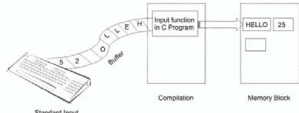

从图 1 中可以看出，输入形式为文本字符串。C 程序在编译时接收此数据后，将其转换为适当的数据类型。在这种情况下，数据已被转换为单词 HELLO 和数字 25。

#### 标准输出

标准输出，通常称为 `stdout`，是程序写入其输出数据的文本流。除非输出重定向到其他任何文件，否则监视器被视为默认的标准输出文件。在这种情况下，编译器从内存块获取数据并将其传递给 C 程序；该程序中的一个函数基于某些规范生成字符流。然后，这些字符显示在监视器上。图 2 展示了使用标准输出流输出的概念：

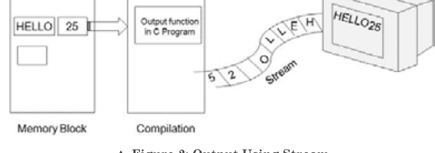

#### 标准错误

标准错误，通常称为 `stderr`，是另一个输出流。此数据流用于输出程序错误消息或诊断信息。流 `stderr` 独立于标准输出，并且可以单独重定向。此流的一个经典用法是当用户尝试在次要存储上打开文件时。此流可用于检查具有指定名称的文件是否存在，并给出相应的消息。此流的使用在相关于文件的章节中给出。

之前提到的三个流是程序员在使用 C 语言中的 I/O 操作时所使用的。流在实质意义上是指向特定文本文件的指针。指针的概念将在后续章节中讨论。下一节讨论 C 语言中可用的不同输入和输出函数。

### 4.2 输入和输出函数

C 语言使用模块化编程方法。这种方法允许我们将程序部分分解为称为函数的小单元。C 语言拥有一个庞大的函数库，可用于各种功能。其中一种功能是为程序提供输入并从程序接收输出。为了提供输入和输出，C 语言提供了内置函数。输入和输出函数基于数据类型，并被归类为格式化函数和非格式化函数。表 1 列出了 C 语言中可用的输入和输出函数：

**表 1：输入和输出函数列表**

| 格式化函数 | | 用于 | 工作的数据类型 |

| :--- | :--- | :--- | :--- |

| `scanf()` | 输入 | 所有 |

| `printf()` | 输出 | 所有 |

| 非格式化函数 | | 类型 | 工作的数据类型 |

| :--- | :--- | :--- |

| `getchar()` | 输入 | `char` |

| `gets()` | 输入 | `char` |

| `getc()` | 输入 | `char` |

| `putchar()` | 输出 | `char` |

| `putc()` | 输出 | `char` |

| `puts()` | 输出 | `char` |

从表 1 中可以看出，C 语言为我们提供了许多输入和输出函数。每个函数都有特定的用法。许多供应商在其 C 版本中添加了额外的 I/O 函数。例如，Turbo C 具有用于输入的 `getch()` 和 `getche()` 函数，以及用于输出的 `putch()` 和 `putche()`。要使用表 1 中提到的函数，我们需要在 C 程序中包含一个头文件。要包含的文件是 `stdio.h`，它指的是标准 I/O 头文件。头文件 `stdio.h`

该头文件包含宏定义、常量，以及用于不同标准输入和输出操作的功能和类型的原型。我们已经学习了如何在程序中引入头文件。下一节将讨论格式化函数的用法。

### 4.3 格式化函数

格式化函数被认为是通用函数。正如表1所示，这些函数用于输入或输出所有类型的数据，无论是 `char`、`int`、`float` 还是 `double`。格式化函数的一般语法如3图所示：

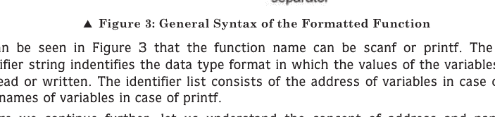

从3图可以看出，函数名可以是 `scanf` 或 `printf`。格式说明符字符串指定了变量值应被读取或写入的数据类型格式。标识符列表在 `scanf` 的情况下由变量的地址组成，而在 `printf` 的情况下由变量的名称组成。在我们继续深入之前，让我们理解一下变量地址和名称的概念。在 C 程序中定义的标识符与三个实体相关联，如4图所示：

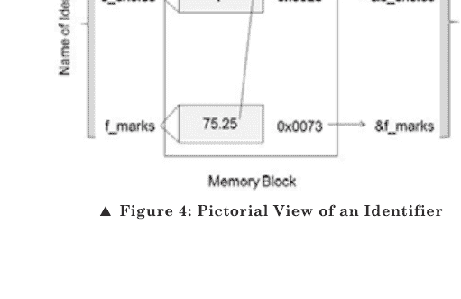

从4图中可以观察到，标识符具有名称、值和地址。有时我们需要在表达式中利用标识符的值并使用标识符的名称。另一方面，如果我们想存储用户输入的值，我们则引用标识符的地址。在 C 中，通过在标识符名称前加 `&` 符号（ampersand）来访问标识符的地址。新手程序员犯的最常见错误是在读取数据时不使用 `&` 符号。现在让我们看看格式化函数是如何工作的。

#### 输入函数

接收用户输入的操作几乎存在于所有程序中。C 语言提供了一个名为 `scanf` 的预定义函数来获取输入。该函数的语法如下：

```c
scanf("format string", address list of identifiers);
```

上述语法由两部分组成，即标识数据类型的格式说明符和标识符的地址列表。格式字符串由一组预定义的字母组成。每个字母代表一个特定的数据类型。可以在一次 `scanf` 调用中读取多个数据。在这种情况下，格式说明符通常包含由空格分隔的格式代码，而地址列表则包含需要存储数据的标识符的地址。表2列出了用于读取或写入数据的格式说明符：

**表2：格式说明符字符串**

| 数据值 | 数据类型 | 格式代码 |

| :--- | :--- | :--- |

| 整数 | `short int` / `int` | `%d` 或 `%i` |

| | `unsigned int` | `%u` |


|  | `long unsigned int` | `%lu` |
|  | `long int` | `%ld` |
| 十六进制 | `int` | `%x` 或 `%p` |
| 八进制 | `int` | `%o` |
| 字符 | `signed char` | `%c` |
|  | `unsigned char` | `%c` |
|  | `char *` (字符串) | `%s` |
| 实数 | `float` | `%f` 或 `%g` |
|  | `double` | `%lf` |
|  | `long double` | `%Lf` |

从表2可以观察到，不同的数据类型有不同的格式说明符。格式说明符需要按照希望数据输入的顺序书写。前一章编写的程序已经使用了 `scanf` 函数。程序1展示了 `scanf` 函数的使用：

## 程序 1

```c
/* 演示 scanf 用法的程序 */
#include <stdio.h>
/* main 函数开始 */
main()
{
    /* 声明变量 */
    int i_first;
    double d_second;
    char c_choice;

    /* 读取并打印值 */
    printf( "\nEnter the values : ");
    scanf ( "%d%lf%c",&i_first, &d_second, &c_choice);
    printf( "\nValues of the variables are %d %lf %c\n" ,i_first,d_second,c_choice);
    return;
}
/* main 函数结束 */
```

**输出 1：**

```
Enter the values: 45 57.76 g
Values of the variables are 4557 0.760000 g
```

**输出 2：**

```
Enter the values: 75 65.50 t
Values of the variables are 75 65.500000
```

在程序1中，我们使用了三个变量：两个数值型和一个字符型。程序只是要求我们输入值，但没有指定输入的顺序。此外，我们注意到格式字符串中没有分隔符来分隔格式代码。

在输出1中，用户希望将 45、57.76 和 g 输入到变量中。然而，C 语言将值分配为 4557、0.760000 和 g。在输入的三个值中，只有一个值似乎符合用户的选择。让我们尝试理解这里发生了什么。用户从键盘输入了 4557.76g，且值之间未插入任何分隔符。来自键盘的数据生成了一个字符流。当结果需要打印时，输出函数试图将数据转换为整数。由于流数据 4557 中间没有任何小数点，它被假定为整数。当从流中读取 .（点）时，编译器试图将其映射到下一个变量数据类型；因此，.76 被分配给变量 `d_second`，最后 g 被分配给 `c_choice`。

为了解决这个问题，输出2中的用户使用空格作为分隔符来输入数据。用户在此处输入的条目是 75、65.50 和 t。可以看到前两个变量被分配了适当的值，而最后一个似乎有误。事实上，输出是完全正确的。在这种情况下，数据首先被转换为流。当遇到第一个空格时，值 75 被分配给 `i_first`。然后编译器丢弃空格并将 65.50 分配给 `d_second`。65.50 之后的空格是问题所在，因为空格也被视为 C 语言的有效字母，编译器将空格的值分配给 `c_choice`。由于空格表示不可打印字符，因此在输出中不可见。此时我们可能会疑惑输入时输入的字符 t 去哪了。它仍然在流中；根据新变量的数据类型，它要么被分配给新变量，要么从考虑中丢弃。如果下一个要读取的变量是字符数据类型，t 将被分配给它；在所有其他情况下，它将从流中简单丢弃。

前文提到的 C 语言特性要求程序员在编写程序时要稍加小心。程序员在此处需要做的微小修改是通过指定适当的消息来询问输入。程序2展示了程序1的修改版本：

## 程序 2

```c
/* 演示 scanf 用法的程序 */
#include <stdio.h>
/* main 函数开始 */
main()
{
/* 声明变量 */
int i_first;
double d_second;
char c_choice;

/* 读取并打印值 */
printf("\nEnter the value of i_first: ");
scanf("%d",&i_first);
printf("\nEnter the value of d_second: ");
scanf("%lf",&d_second);
printf("\nEnter the value of c_choice: ");
scanf("%c",&c_choice);
printf("\nValues of the variables are %d %lf %c\n"
, i_first,d_second,c_choice);
return;
}
/* main 函数结束 */
```

**输出 1：**

```
Enter the value of i_first: 56
Enter the value of d_second: 75.66
Enter the value of c_choice: 
Values of the variables are 56 75.660000
```

在程序2中，通过将一个 `scanf` 语句转换为多个 `scanf` 语句，前两个变量的读取问题很容易得到解决。然而，字符数据的问题仍然存在；在这种情况下，问题是 Enter 键。如果我们先读取字符值，这个问题就不会发生。为了解决这个问题，我们需要使用临时变量，以便 Enter 键的值被分配给该临时变量。我们可以在这里使用非格式化函数。程序3展示了临时变量的用法：

## 程序 3

```c
/* 演示临时变量用法的程序 */

#include<stdio.h>
/* main 函数开始 */
main()
{
    /* 声明变量 */
    int i_first;
    double d_second;
    char c_choice, c_temp;

    printf("Enter the value of i_first: ");
    scanf("%d", &i_first);
    printf("Enter the value of d_second: ");
    scanf("%lf", &d_second);

    /* 使用临时变量清除流 */
    c_temp=getchar();

    printf("\nEnter the value of c_choice: ");
    scanf("%c", &c_choice);
    printf("\nValues of the variables are %d %lf %c\n",
           i_first, d_second, c_choice);
    return;
}
/* main 函数结束 */
```

**输出 1：**

```
Enter the value of i_first: 45
Enter the value of d_second: 78.25
Enter the value of c_choice: h
Values of the variables are 45 78.250000 h
```

**输出 2：**

```
Enter the value of i_first: r
Enter the value of d_second: 
Enter the value of c_choice: 
Values of the variables are -28851 0.000000
```

**输出 3：**

```
Enter the value of i_first: 56
Enter the value of d_second: h
Enter the value of c_choice: 
Values of the variables are 56 0.000000
```

在程序3中，语句 `c_temp = getchar();` 的使用解决了我们的问题，我们能够看到如输出1所示的预期输出。这里另一个值得注意的有趣之处在于，如果遇到任何无效字符，编译器将终止值的读取。观察到在输出2中，在消息 *Enter the value of i_first* 之后，编译器期望一个整数值，但接收到了一个字符。在这种情况下，编译器终止输入并直接给出输出。这里的输出被视为垃圾数据，因为它没有用处。输出3中发生了类似的情况。

C 允许我们由现有的原始数据类型构建派生数据类型。一种这样的数据类型是数组。C 中的字符数组表示为字符串。让我们现在学习如何在字符串中输入数据。格式代码 `%s` 允许用户从键盘读取字符串。程序4说明了如何在 C 中读取和显示字符串：

## 程序 4

```c
/* 程序演示如何读取和显示字符串 */
#include<stdio.h>
/* main 函数开始 */
main()
{
    /* 声明字符数组 */
    char s_student[50];

    /* 读取数组中的数据 */
    printf("\n请输入学生姓名: ");
    scanf("%s", &s_student);

    /* 打印数组中的数据 */
    printf("\n该学生的姓名是 %s\n", s_student);

    return;
}  /* main 函数结束 */
```

### 输出 1

```
请输入学生姓名: vidita arolkar
该学生的姓名是 vidita
```

### 输出 2

```
请输入学生姓名: harshit jain
该学生的姓名是 harshit
```

从程序 4 中可以观察到，在两种输出中，只有名字被作为输入接受。这是因为 `%s` 格式码的特性所致。在 C 语言中，当使用 `%s` 格式码读取字符串时，读取操作会在遇到空格或回车键（以先出现者为准）时终止。在之前两种输出中，由于在按下回车键之前遇到了空格，读取操作终止，因此只有名字被作为合法输入接受。在两种情况下，姓氏仍会保留在缓冲区中。

C 语言提供了一种格式码 `%[字符列表]` 来解决程序 4 中遇到的问题。这里的 [字符列表] 包含我们希望通过键盘输入的字符。当此格式与 `scanf` 函数配合使用时，它会接受方括号 `[ ]` 中指定的所有字符。当 `scanf` 函数未找到列表中的字符时，它会停止读取。表 3 列出了一些有效的格式及其说明。

### 表 3: 格式码 `%[字符列表]` 的使用

| 格式 | 说明 |
| :--- | :--- |
| `scanf([a-z], &s_student);` | `scanf` 函数仅接受从 a 到 z 的小写字母。 |
| `scanf([A-Z], &s_student);` | `scanf` 函数仅接受从 A 到 Z 的大写字母。 |
| `scanf([0-9], &s_student);` | `scanf` 函数仅接受从 0 到 9 的数字。 |
| `scanf("%[A-Z,0-9]", &s_student);` | `scanf` 函数接受从 A 到 Z 的大写字母以及从 0 到 9 的数字。 |
| `scanf("%[,z,0-9]", &s_student);` | `scanf` 函数接受逗号、小写字母 z 以及从 0 到 9 的数字。 |

`%[字符列表]` 格式的确切相反形式是 `%[ ^字符列表]`。在这种情况下，一旦用户输入列表中的某个字符，数据读取就会停止。程序 5 演示了格式 `%[ ^字符列表]` 的用法：

## 程序 5

```c
/* 程序演示如何读取和显示字符串 */
#include<stdio.h>
/* main 函数开始 */
main()
{
    /* 声明字符数组 */
    char s_student[50];

    /* 读取数组中的数据 */
    printf("\n请输入学生姓名: ");
    scanf("%[^\n]", &s_student);

    /* 打印数组中的数据 */
    printf("\n该学生的姓名是 %s\n", s_student);
    return;
}
/* main 函数结束 */
```

### 输出 1

```
请输入学生姓名: vidita arolkar
该学生的姓名是 vidita arolkar
```

### 输出 2

```
请输入学生姓名: harshit jain
该学生的姓名是 harshit jain
```

在程序 5 中，两种输出现在都包含了完整的姓名。之所以这样有效，是因为我们使用了 `%[ ^\n]` 作为格式码。转义序列 `\n` 代表换行，此处的格式码指定用户必须读取数据直到按下回车键为止。在之前的程序中可以看到，输出的呈现方式会影响结果。下一节讨论格式化输出。

## 输出函数

信息的呈现是编程中最关键的方面。C 语言提供了一个预定义函数 `printf` 用于显示输出。该函数的语法如下：

```c
printf("格式字符串", 标识符列表); 或 printf("消息字符串");
```

从上述语法中可以看出，`printf` 函数既可用于在屏幕上仅显示消息，也可用于显示包含变量值的消息。在后一种情况下，该函数需要两个参数，即包含消息和格式码的格式字符串，以及标识符列表。可以使用本书第 2 章中讨论的转义序列字符配合 `printf` 函数。程序 6 演示了转义序列字符在 `printf` 中的使用：

## 程序 6

```c
/* 程序演示转义序列字符在 printf 中的使用 */
#include<stdio.h>
/* main 函数开始 */
main()
{
    printf("\n Use \n of \nescape \t \tsequence\n characters\n ");
    return;
} /* main 函数结束 */
```

### 输出

```
Use
of
escape  sequence
characters
```

在程序 6 中，`printf` 函数中只有一行消息。但输出仍然跨越了四行。在程序中，我们使用了七个转义序列字符，其中五个是换行符（`\n`）；因此，输出跨越了四行。两个转义字符代表制表位；因此，第三行在单词 escape 和 sequence 之间显示了一个空隙。如表 2 所述，C 语言为我们提供了许多格式码。程序 7 演示了其中一些格式码的用法：

## 程序 7

```c
/* 程序演示格式码的使用 */
#include <stdio.h>
/* main 函数开始 */
main()
{
    /* 声明变量 */
    int i_number;
    /* 接受值 */
    printf("\n 请输入 number 的值 : ");
    scanf("%d", &i_number);
    /* 以不同的进制打印值 */
    printf(" \n 10 进制值为 : %d\n", i_number);
    printf(" \n 16 进制值为 : %x\n", i_number);
    printf(" \n 16 进制值为 : %p\n", i_number);
    printf("\n 8 进制值为 : %o\n", i_number);
    printf("\n 字符值为 : %c\n", i_number);
    return;
}
/* main 函数结束 */
```

### 输出

```
请输入 number 的值: 60
10 进制值为: 60
16 进制值为: 3c
16 进制值为: 0x3c
8 进制值为: 74
字符值为: <
```

在程序 7 中，我们输入了一个整数值。然后通过使用适当的格式码将该值转换为不同的数制系统以及一个字符。请注意，我们使用了两个格式码来表示 16 进制值，`%x` 和 `%p`。

有时，显示为输出的数字需要根据用户要求进行对齐。也可能需要用零填充数字或显示特定数量的小数位数。为了执行此类格式化，我们需要通过在前面添加宽度、精度（用点 . 表示）和长度来修改格式码。因此，通用格式码可以写成如下形式：

```
%[标志][宽度][.精度][长度] 格式码
```

方括号中表示的术语是可选的。表 4 列出了标志的详细用法：

### 表 4: 标志的详细用法

| 标志 | 说明 |
| :---: | :--- |
| - | 用于将数据在其字段内左对齐。 |
| + | 用于指示带符号数据类型前面的加号或减号。 |
| space | 用于插入空格作为前缀，如果带符号数据类型的首个字符不是加号或减号。 |
| # | 用于强制使用替代形式的输出，例如：<br>- 八进制数的首位始终是 0。<br>- 在十六进制数前插入 0X。<br>- 所有浮点数中应始终存在小数点。<br>- 使用 g 格式码时，尾部的零不会被移除。 |
| 0 | 用于在数据左侧填充零直到达到字段宽度。通常与 d, i, o, u, x, X, e 和 f 格式码一起使用。如果也使用了 - 标志，填充效果将被取消。 |

表 4 中显示的多个标志值可以组合使用，以便为输出提供适当的格式。语法中的 *width* 一词代表变量值要打印的字符总位数，*length* 指在浮点值的情况下小数点后的位数，在字符数组的情况下指要从字符串中打印的字符数，而对于 int 值，它指的是数字

字符在屏幕上占用的位置数。对于 `int` 数据类型，长度起到宽度的作用。程序 8 说明了自定义格式的使用：

## 程序 8


```c
/* Program to illustrate the use of different int formats */
#include <stdio.h>
/* Beginning of main function */
main( )
{
    /* Declare variables */
    int i_number;
    /* Accept the value */
    printf("\nEnter the value of number : ");
    scanf("%d", &i_number);
    /* Print value in different formats */
    printf("%d\n", i_number);
    printf("%06d\n", i_number);
    printf("%6d\n", i_number);
    printf("%-3d\n", i_number);
    return;
}
/* End of function main */
```

输出：

```
Enter the value of number : 99
99
000099
     99
  99
```

在程序 8 中，`number` 的值为 99。因此，这些数字的长度为 2。如果 *宽度* 大于 2，则值 99 将使用六个位置右对齐打印，这可以从输出的第三行和第四行看出。还可以观察到，`%d` 本身并未指定任何宽度值；默认情况下，这里考虑的值为 1。这表明，如果 *宽度* 小于要显示的实际数字位数，则完整数字将按原样显示，但可能看起来像是左对齐的，这可以从输出的第二行和第五行看出。

与整数类似，浮点数也可以进行格式化。浮点数在输出中可以使用常规表示法或科学计数法。当浮点数以科学计数法表示时，至少会占用七个位置，因为小数点后至少需要六个数字，并且小数点本身需要一个字符位置。程序 9 说明了不同浮点格式的使用：

### 程序 9

```c
/* Program to illustrate the use of different float formats */
#include <stdio.h>
/* Beginning of main function */
main( )
{
    /* Declare variables */
    float f_number;
    /* Accept the value */
    printf("\nEnter the value of number : ");
    scanf("%f", &f_number);
    /* Print value in formats */
    printf("\n\nScientific Notations\n");
    printf("\n %e ",f_number);
    printf("\n %15.3e ",f_number);
    printf("\n %-15.3e ",f_number);
    printf("\n\n Normal Notations\n ");
    printf("\n %f ",f_number);
    printf("\n %15.3f ",f_number);
    printf("\n %-15.3f ",f_number);
    printf("\n %015.3f ",f_number);
    return;
}
/* End of function main */
```

输出：

```
Enter the value of number: 77.89564
Scientific Notations
7.789564e+01
  7.790e+01
  7.790e+01
Normal Notations
77.895638
  77.896
  77.896
  0000000077.896
```

在程序 9 中，浮点数据类型也提供了不同的格式选项。这种格式有助于正确显示输出。

到目前为止，我们一直关注格式化输入和输出函数；C 语言还为我们提供了非格式化输入和输出函数的选项。下一节讨论用于非格式化 I/O 操作的函数。

### 4.4 非格式化函数

顾名思义，非格式化函数不能格式化数据，并且仅处理字符数据类型。由于仅处理字符数据类型，非格式化函数不需要像格式化函数那样的转换符号。如果用户输入数值，它将被视为字符。现在，让我们探讨非格式化函数下可用的不同输入函数的用法。

#### 非格式化单字符 I/O 函数

如表 1 所述，C 语言提供了两个非格式化输入函数 `getchar` 和 `getc`，它们处理字符数据类型。类似地，我们有两个对应的输出函数 `putchar` 和 `putc` 来提供输出。使用字符输入和输出函数的语法如图 5 所示：

- 输入
  - `identifier name = getchar();`
  - `identifier name = getc(stdin);`
- 输出
  - `putchar(identifier name);`
  - `putc(identifier name , stdout);`

**图 5：字符 I/O 函数的语法**

图 5 表明，这两个输入函数的语法几乎相同，除了 `getc` 使用了标准输入流。由于 `getc` 函数也可以与文本文件一起使用，因此必须指明它实际引用哪个文件。这里使用 `stdin` 指的是键盘。函数 `putc` 的情况类似：这里 `stdout` 指的是监视器。程序 10 说明了之前提到的字符 I/O 函数的使用：

#### 程序 10

```c
/* Program to illustrate the use of unformatted function */
#include<stdio.h>
/* Beginning of main function */
main()
{
/* Declare variables */
char c_choice, c_temp;

/* Use of getchar and putchar */
printf("\nEnter your choice : ");
c_choice = getchar();
printf("\nYour entered choice is : ");
putchar(c_choice);

/* Clear Buffer */
c_temp = getchar();

/* Use of getc and putc */
printf("\nEnter your choice again : ");
c_choice = getc(stdin);
printf("\nYour entered choice is : ");
putc(c_choice,stdout); 
printf("\n");
return;
} 
/* End of function main */
```

输出：

```
Enter your choice : v
Your entered choice is : v
Enter your choice again : a
Your entered choice is : a
```

在程序 10 中，我们两次使用了同一个变量 `c_choice`。当遇到 `c_choice = getchar();` 的第一次出现时，编译器等待用户输入一个字符。此时键入的任何字符都将存储在变量 `c_choice` 中。此时用户需要仔细输入数据，因为按下空格键、Enter 键、Tab 键或任何其他不可见键也成为合法的输入。

在程序 10 中，当用户输入数据时，实际上有两个字符被放置在缓冲区中。第一个字符对应 `c_choice`，另一个字符对应 Enter 键。因此，我们可能会在第二次读取 `c_choice` 的值时出现问题。为了让事物正常工作，我们通过将其值存储在 `c_temp` 中来清除第二个字符。

大多数时候，用户处理的不只是单个字符，而是一组称为字符串的字符。下一节讨论如何使用非格式化函数输入和输出字符串。

#### 非格式化字符串 I/O 函数

C 语言提供了两个非格式化函数 `gets()` 和 `puts()` 来输入和输出字符串。C 语言中的字符串表示为一组字符，总是以空字符 `\0` 结尾。非格式化字符串 I/O 函数的语法如下：

`gets(identifier name);` 和 `puts(identifier name);`

程序 11 说明了非格式化字符串 I/O 函数的使用：

#### 程序 11

```c
/** Program to illustrate how to read and display strings **/
#include<stdio.h>
/** Beginning of main function **/
main()
{
/** Declare character array **/
char s_city[50];

/** Read data in array **/
printf("\nEnter the name of city: ");
gets(s_city);

/** Print data from array **/
printf("\nThe name of the city is: ");
puts(s_city);
printf("\n");
return;
}
/** End of function main **/
```

输出：

```
Enter the name of city: Ahmedabad
The name of the city is: Ahmedabad
```

在程序 11 中，`gets` 函数将字符数组的名称作为参数，并将数据存储在其中。数据从标准输入流读取，直到用户按下 Enter 键。然后该函数丢弃换行符，并将其余数据存储到字符数组中。如果读取时没有发生错误，它返回字符串；否则，它返回空指针。

请注意，专家不建议使用 `gets` 函数。原因是用户无法指定传递给 `gets` 函数的数组长度。这会造成严重问题，因为输入的数据可能比数组的大小大得多。因此，存在缓冲区溢出的可能性，这可能导致应用程序失败。

### 摘要

在本章中，我们学习了如何在运行时从用户接受数据以及如何显示结果。为了从用户接受数据，C 语言为我们提供了内置函数。内置函数使用称为缓冲区的临时内存。然后该缓冲区被用作文本流，将输入或输出设备与程序连接起来。所有 C 程序中可用的默认流是 `stdin`、`stdout` 和 `stderr`。内置函数被分为格式化和非格式化。格式化函数使用称为格式代码的转换符号来输入或输出数据。另一方面，非格式化函数仅处理字符数据类型。

### 复习题

- Q1. 解释字符串在 C 语言中的重要性。
- Q2. 列出 C 语言中使用的三个内置流。给出每个流的使用情况。
- Q3. 区分格式化函数和非格式化函数。
- Q4. 解释在 `scanf` 函数中使用的格式字符串的重要性。
- Q5. 判断以下陈述是真还是假：
  - i. 格式字符串 `%g` 用于读取整数数据。
  - ii. C 语言中的字符串以空字符结尾。
  - iii. 要左对齐打印字符串，我们使用语法 `printf("%7s", string)`。
  - iv. 我们可以打印整型变量的 ASCII 值。
  - v. 需要使用函数 `printf` 时，必须包含库 `stdlib.h`。
  - vi. 默认流 `stdout` 指键盘设备。
- Q6. 给出以下程序的输出：
  - i.
```c
#include <stdio.h>
main()
{
char c_string[] = "Learning C programming";
printf("%-5.8s",str1);
printf("%10s",str1);
return;
}
```
  - ii.
```c
#include <stdio.h>
main()
```
  - iii.
```c
#include <stdio.h>
main()
{
    char c_string[] = "Learning C programming";

    printf("%5s", c_string);
    printf("%30.5s",str1);
    return;
}
```
  - iv.
```c
#include <stdio.h>
main()
{
    float f_amount = 98632.7863;
    printf("%.5f", f_amount);
    printf("%7.5f", f_amount);
    return;
}
```
  - v.
```c
#include <stdio.h>
main()
{
    float f_amount = 98632.7863;
    printf("%-8.6f", f_amount);
    printf("%-15.8f", f_amount);
    return;
}
```

### 实践练习

- Q1. 编写一个程序，接受一个字符并显示其 ASCII 值。
- Q2. 编写一个程序，接受一个整数值，并以八进制和十六进制格式显示它。
- Q3. 编写一个程序，接受一个浮点值，并以所有可能的科学计数法格式显示它。
- Q4. 编写一个程序，接受一个字符串并只显示其中的前 5 个字符。
- Q5. 编写一个程序，接受一个字符串并只显示其中的最后 5 个字符。
- Q6. 编写一个程序，交换两个浮点变量的值。
- Q7. 编写一个程序，接受两个整数值，并计算它们的和与平均值。
- Q8. 编写一个程序，接受一个整数值并计算其立方。
- Q9. 编写一个程序，打印一个地址标签。标签应包含您的姓名、地址、城市、州和邮政编码。
- Q10. 编写一个程序，接受厘米数，并将其转换为英尺和英寸。

## 05 表达式与运算符

**目标**

- 解释运算符
- 解释运算符的优先级和结合性
- 解释 C 语言中的表达式求值
- 解释 C 语言中的语句

表达式构成了任何编程语言中的基本句子。C 语言也不例外。为了构建表达式，我们需要两个基本实体，即操作数和运算符。C 语言是一种独特的语言，拥有丰富的一组运算符。在本章中，我们将学习 C 语言中可用的各种运算符。我们还将学习如何利用运算符和操作数来构建表达式，以及表达式是如何求值的。最后，我们将看看 C 语言中可用的不同类型的语句。

### 5.1 运算符

在以前的学习过程中，我们都学过数学，在其中我们执行过两个数字的加法、减法、乘法和除法运算。例如，`7 + 5` 是我们在数学中表示加法的方式，其中 7 和 5 被称为常量；另一方面，`+` 是一个特殊符号，用于标识对常量执行的运算。运算符可以定义为语言中用于标识可对语言中的操作数执行的运算的特殊符号。C 语言中的运算符分为八种类型，如图 1 所示：

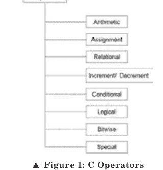

图 1 中显示的每个运算符都用于在 C 语言中形成表达式。下一节将详细介绍这些运算符及其用法。

#### 算术运算符

C 语言提供了不同的运算符，如 `+`、`-`、`*`、 `/` 和 `%`，用于执行算术运算。表 1 列出了各种运算符符号、名称及其用法：

**表 1：算术运算符**

| 符号 | 名称 | 用法 |
| :--- | :--- | :--- |
| + | 加法运算符 | 将两个操作数相加；一元正号 |
| − | 减法运算符 | 两个操作数相减；一元负号 |
| * | 乘法运算符 | 两个操作数相乘 |
| / | 除法运算符 | 两个操作数相除的商 |
| % | 取模运算符 | 两个操作数相除的余数 |

表 1 中列出的前四个运算符用于大多数数学表达式。C 语言为我们提供了一个额外的运算符 `%`，即取模运算符。它用于在执行两个操作数的除法时获取余数。操作数可以是变量或常量。现在我们来看看如何在表达式中使用这些运算符。例如，考虑以下 C 语句：

```
i_area = i_length * i_breadth;
```

如图 2 所示。该语句被称为二进制 C 表达式，其中 `i_area`、`i_length` 和 `i_breadth` 被称为 C 标识符或变量。之所以称其为二进制 C 表达式，是因为它由形式为“操作数 1 运算符 操作数 2”的表达式组成。操作数 1 总是单个值，但操作数 2 可以是另一个表达式或常量值。执行该示例语句会产生两个操作，如图 2 所示：

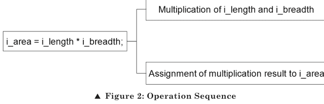

图 2 显示，首先将两个操作数，即 `i_length` 和 `i_breadth` 相乘，然后将乘法结果赋值给 `i_area`。因此，C 语言中的一个表达式可能会导致多个操作。

C 语言中的算术运算可以根据表达式中使用的操作数分类为整数算术、实数算术或混合模式算术。下一节将详细讨论这些算术运算。

#### 整数算术

在 C 语言中，当表达式中使用的操作数是正整数或负整数时，算术运算被视为整数算术。结果表达式称为整数表达式，其结果始终为整数。程序 1 给出了一个整数算术的示例：

**程序 1**

```c
/* 演示整数算术使用的程序 */
#include <stdio.h>

/* main 函数开始 */
main() 
{
 /* 声明变量 */
int i_base, i_height, i_area;

/* 接受底边和高度的值 */
printf("\nEnter the value of base of triangle: ");
scanf("%d",&i_base);
printf("\nEnter the value of height of triangle: ");
scanf("%d",&i_height);

/* 计算三角形面积 */
i_area = (i_base * i_height) / 2;

/* 打印面积 */
printf("\nArea of triangle with base %d and height %d is %d\n", i_base,i_height,i_area);
return;
}
/* main 函数结束 */
```

**输出 1：**

| 输出 |
| :--- |
| 输入三角形底边的值：10 |


| 输入三角形高度的值：15 |

| 底为 10、高为 15 的三角形面积为 75 |

**输出 2：**

| 输出 |

| :--- |

| 输入三角形底边的值：5 |

| 输入三角形高度的值：15 |

| 底为 5、高为 15 的三角形面积为 37 |

程序 1 旨在计算三角形的面积。程序的输出 1 没有任何问题。让我们仔细观察输出 2：根据传统数学，`(5 × 15)/2` 应该结果为 37.50。然而，我们可以看到在输出 2 中，面积的值为 37 而不是 37.50。这就是我们为什么说整数算术的结果始终是整数值的原因。C 语言中的除法运算符与传统数学的工作方式不同。在传统数学中，`7/10` 会给我们 0.7，但在 C 语言中，它会给我们 0。这里，由于我们使用了整数操作数，除法的结果也必须是整数。为了确保结果是整数，编译器会截断小数部分。

C 为我们提供了取模运算符（`%`）；其目的是获取除法的余数值。取模运算符的用法在程序 2 中展示：

### ▶ 程序 2

```c
/* 演示取模运算符用法的程序 */
#include <stdio.h>

/* main 函数开始 */
main( )
{
    int i_num;
    /* 接受 num 的值 */
    printf("\n Enter a number : ");
    scanf("%d",&i_num);

    /* 检查数字是偶数还是奇数 */
    if(i_num % 2 == 0)
        printf("\n Number %d is Even \n",i_num);
    else
        printf("\n Number %d is Odd \n",i_num);
    return;
}
/* main 函数结束 */
```

**输出 1：**

```
Enter a number: 12
Number 12 is Even
```

**输出 2：**

```
Enter a number: 15
Number 15 is Odd
```

程序 2 旨在检查输入的数字是奇数还是偶数。我们知道，如果一个数能被 2 整除，那么它是偶数；否则，它是奇数。为了检查这种整除性，我们实际上检查除法的余数是否为零。C 语言中的取模运算符直接给我们这个余数值。在上面的程序中，语句 `if(i_num % 2 == 0)` 检查数字除以 2 的余数是否为零，并根据结果决定在屏幕上打印哪一行。

请注意，取模运算符仅适用于整数操作数。如果我们尝试将其用于浮点操作数，它将导致错误。

下一节讨论实数算术运算。

## ▶ 实数算术

如果表达式中使用的所有操作数都是浮点数，则这种算术运算被称为实数算术。在这种情况下，表达式称为实数表达式，其结果始终为实数值。程序 3 给出了一个实数算术的示例：

### 程序 3

```c
/* 程序演示实数算术的使用 */

#include <stdio.h>

/* 主函数开始 */
main()
{
    /* 声明变量 */
    float f_base, f_height, f_area;

    /* 接受底和高输入 */
    printf("\n Enter the value of base of triangle: ");
    scanf(" %f", &f_base);

    printf("\n Enter the value of height of triangle: ");
    scanf(" %f", &f_height);

    /* 计算三角形面积 */
    f_area = (f_base * f_height) / 2;

    /* 打印面积 */
    printf("\nArea of triangle with base %f and height %f is %f \n",
           f_base, f_height, f_area);

    return;
}
/* 主函数结束 */
```

**输出 1：**

```
Enter the value of base of triangle: 10
Enter the value of height of triangle: 15
Area of triangle with base 10.000000 and height 15.000000 is 75.000000
```

**输出 2：**

```
Enter the value of base of triangle: 5
Enter the value of height of triangle: 15
Area of triangle with base 5.000000 and height 15.000000 is 37.500000
```

程序 3 与程序 1 类似，不同之处在于变量数据类型的改变。在程序 3 中，所有变量都被声明为 `float` 类型。在两个输出中，我们观察到输入的底和高都是整数值。编译器随后自动将这些整数值转换为浮点数。这一点可以通过输出 2 中的 `Area of triangle with base 5.000000 and height 15.000000 is 37.500000` 这一行来识别，其中底的值为 5.000000 而不是 5，高的值为 15.000000 而不是 15。还观察到，面积的值现在是 37.500000，而不是程序 1 输出 2 中显示的 37。

大多数情况下，C 语言表达式由具有不同数据类型的操作数组成，从而引发了另一种算术类型，称为混合模式算术（mixed mode arithmetic）。下一节将讨论混合模式算术。

### 混合模式算术

如前所述，由于 C 语言中操作数可能属于不同类型但兼容，因此 C 语言中提供了一种称为混合模式算术的算术类型。在这种算术模式下，表达式中可以使用整数和浮点操作数。此类表达式的输出将取决于结果变量的数据类型。虽然 C 语言允许像 `f_area = (7.5 * 6)/2` 这样的表达式，但无法直接对其进行求值。只有当表达式中使用的所有操作数都具有相同的数据类型时，C 语言中的表达式才能被求值。为了确保表达式中的所有操作数都具有相同的类型，C 语言允许自动将低范围数据类型转换为高范围数据类型。程序 4 给出了混合模式算术的一个示例：

### 程序 4

```c
/* 程序演示混合模式算术的使用 */
#include <stdio.h>
/* 主函数开始 */
main()
{
    /* 声明变量 */
    int i_base, i_height;
    float f_area;

    /* 接受底和高输入 */
    printf("\n Enter the value of base of triangle: ");
    scanf("%d", &i_base);
    printf("\n Enter the value of height of triangle: ");
    scanf("%d", &i_height);

    /* 计算三角形面积 */
    f_area = (i_base * i_height) / 2.0;

    /* 打印面积 */
    printf("\nArea of triangle with base %d and height %d is %f\n",
           i_base, i_height, f_area);
    return;
}
/* 主函数结束 */
```

**输出：**

```
Enter the value of base of triangle: 5
Enter the value of height of triangle: 15
Area of triangle with base 5 and height 15 is 37.500000
```

在程序 4 中，尽管变量 `i_base` 和 `i_height` 是整数，但输出仍然是浮点值。这是因为 C 语言自动将 `int` 数据类型转换为 `float` 数据类型。在表达式 `f_area = (i_base * i_height) / 2.0` 中，我们观察到使用的是 `2.0` 而不是 `2` 作为除数。这也影响了输出，因为在此表达式中使用 `2` 会将等式右侧 (RHS) 转换为整数计算，我们会得到面积为 37.000000。

请在表达式 `f_area = (i_base * i_height) / 2.0` 中使用值 `2` 代替 `2.0` 来尝试程序 4，并记录其差异。下一节讨论 C 语言中使用的类型转换概念。

### 类型转换

如前所述，只有当表达式中的所有操作数都具有相同的数据类型时，C 语言中的表达式才能被求值。这种对表达式求值的特性有时需要编译器将一个数据类型的操作数转换为另一个类型，这被称为数据类型的内部转换。这种转换可以由 C 编译器自动执行，或者程序员可以要求编译器临时将其转换为所需的数据类型。C 编译器执行的自动转换称为类型转换（type conversion），而程序员要求编译器临时转换操作数的数据类型称为类型强制转换（type casting）。程序 4 使用自动类型转换。表达式 `f_area = (i_base * i_height) / 2.0` 的求值过程如图 3 所示：

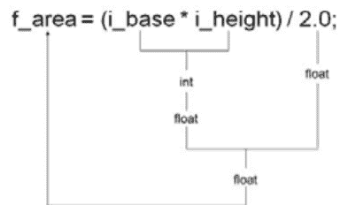

▲ 图 3：自动类型转换

C 语言中的表达式求值也遵循括号、除法、乘法、加法、减法（BODMAS）规则。如图 3 所示，首先计算子表达式 `i_base * i_height`；其结果将为整数值。下一个操作是除以 `2.0`；然而，在执行此操作之前，编译器将乘法结果转换为浮点值，如图 3 所示。最后，结果被赋值给变量 `f_area`。数据类型的内部转换（隐式转换）按图 4 所示的顺序执行：

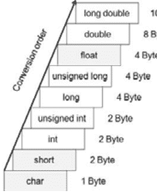

▲ 图 4：数据类型转换顺序

图 4 表明，C 语言按照从低空间需求到高空间需求的顺序转换数据类型。图中显示的字节数可能因编译器而异，但顺序将保持不变。

程序员可以使用称为类型强制转换（type casting）的过程显式转换表达式中使用的任何变量的数据类型。当对操作数应用类型强制转换时，它会覆盖编译器执行的内部转换。要对表达式中使用的变量进行类型强制转换，我们需要在变量前加上我们要转换成的数据类型。类型强制转换的语法如下：

`(data type) identifier` 或 `(data type) constant`

程序 5 说明了类型强制转换的使用：

### 程序 5

```c
/* 程序演示类型强制转换的使用 */
#include <stdio.h>
/* 主函数开始 */
main()
{
    /* 声明变量 */
    int i_base, i_height;
    float f_area;

    /* 接受底和高输入 */
    printf("\n Enter the value of base of triangle: ");
    scanf("%d", &i_base);
    printf("\n Enter the value of height of triangle: ");
    scanf("%d", &i_height);

    /* 计算三角形面积 */
    f_area = ((float) i_base * (float) i_height) / 2.0;

    /* 打印面积 */
    printf("\nArea of triangle with base %d and height %d is %f\n",
           i_base, i_height, f_area);
    return;
}
/* 主函数结束 */
```

**输出：**

```
Enter the value of base of triangle: 5
Enter the value of height of triangle: 15
Area of triangle with base 5 and height 15 is 37.500000
```

程序 5 与程序 4 类似，唯一的区别在于表达式 `f_area = ((float) i_base * (float) i_height)/2.0;` 中，变量 `i_base` 和 `i_height` 前面加上了数据类型 `float`。因此，变量 `i_base` 和 `i_height` 被临时转换为 `float` 数据类型。在这里，两个变量中存储的实际值是整数；然而，为了评估表达式，它们被视为浮点数。

程序员在编写 C 语言表达式时需要谨慎。由于 C 语言支持不同类型的算术运算，表达式有时可能不会给出预期的结果。在查看了 C 语言中可用的算术运算符后，我们现在来讨论赋值运算符。

### 赋值运算符

特殊符号 `=` 在 C 语言中被称为赋值运算符。在普通数学中，它用于检查两个操作数的相等性。在 C 语言中，它用于将表达式的结果或常量值赋值给变量。以下展示了赋值语句的示例：

`area = (base * height)/2;`

`roll_no = 14;`

在第一个示例中，表达式被赋值给变量 `area`，而第二个示例将常量值 14 赋值给变量 `roll_no`。请注意，赋值语句的左操作数必须是一个单一变量。

特殊符号 `=` 也被用作简写运算符。简写运算符用于减小表达式的尺寸并提高 C 程序的可读性。要将特殊符号 `=` 转换为简写运算符，我们在 `=` 前添加任何算术运算符。简写运算符的语法如下：

`identifier AOp= expression;` 或 `identifier AOp= constant value;`

其中，`identifier` 是任何有效的变量名，`AOp` 指代算术运算符，`AOp=` 是简写运算符。简写运算符的一些示例如下：

`counter += 1;`

`table *= 2;`

`first /= (second + third);`

语句 `counter += 1;` 等价于 `counter = counter + 1;`，`table *= 2;` 等价于 `table = table * 2;`，`first /= (second + third);` 等价于 `first = first / (second + third)`。从这些例子中可以观察到，如果一个变量同时出现在左侧（LHS）和右侧（RHS），那么我们可以在这种表达式中使用简写运算符。使用简写运算符构建的表达式被称为复合赋值语句。如果复合赋值包含二元表达式，如示例 3 所示，二元表达式总是先被解析。经过一定实践，简写运算符可以成为提高 C 程序可读性的有效工具。程序 6 展示了简写运算符的用法：

### 程序 6

```c
/* 程序说明简写运算符的用法 */
#include <stdio.h>

/* 主函数开始 */
main()
{
    /* 声明整型变量 */
    int i_number, i_const;

    /* 接收 number 的值 */
    printf("\n 请输入 number 的值: ");
    scanf("%d", &i_number);
    printf("\n 请输入 constant 的值: ");
    scanf("%d", &i_const);

    /* 打印 number 的值 */
    printf("\n i_number 的初始值: %d\n", i_number);

    /* 使用简写运算符 */
    i_number += i_const;
    printf("\n 加上 %d 后 i_number 的值为 %d\n", i_const,
           i_number);
    
    i_number *= i_const;
    printf("\n 乘以 %d 后 i_number 的值为 %d\n", i_const,
           i_number);
    
    i_number -= i_const;
    printf("\n 减去 %d 后 i_number 的值为 %d\n", i_const,
           i_number);

    i_number /= i_const;
    printf("\n 除以 %d 后 i_number 的值为 %d\n", i_const,
           i_number);

    i_number %= i_const;
    printf("\n 取模 %d 后 i_number 的值为 %d\n", i_const, i_number);

    printf("\n i_number 的最终值为 %d \n", i_number);
    return;
}
/* 函数 main 结束 */
```

输出：

```text
请输入 number 的值: 15
请输入 constant 的值: 5
i_number 的初始值: 15
加上 5 后 i_number 的值为 20
乘以 5 后 i_number 的值为 100
减去 5 后 i_number 的值为 95
除以 5 后 i_number 的值为 19
取模 5 后 i_number 的值为 4
i_number 的最终值为 4
```

从程序 6 的输出中可以观察到，简写运算符使程序更具可读性。图 5 说明了这种变化：

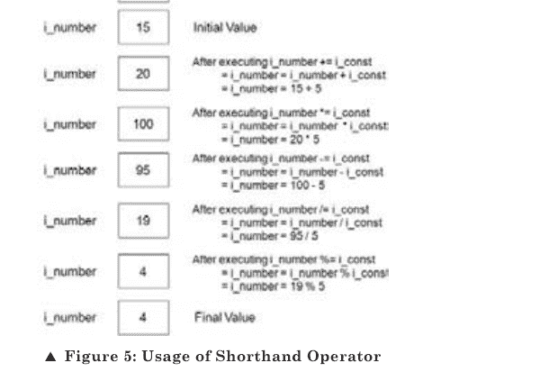

如图 5 所示，`i_const` 的值在整个操作序列中保持不变。然而，由于使用了简写运算符，`i_number` 的值在每一步都发生了变化。比较两个变量是大多数复杂编程的一部分，为了进行比较，我们需要关系运算符。下一节将探讨 C 语言中可用的关系运算符。

### 关系运算符


如前所述，比较在大多数复杂的 C 程序中起着主要作用。比较的结果用于改变程序的执行流程。例如，为了激励员工，我们可以检查该员工完成的销售额。如果它超过了给该员工设定的预定义目标，那么该员工可能会获得加薪。针对此场景的 C 语言表达式可以写为 `if (total_sales > target_given) then raise_in_basic = basic * 0.25;`，其中特殊符号 `>` 是一个关系运算符。

C 语言拥有六个用于比较目的的关系运算符。表 2 列出了关系运算符及其用途：

### 表 2：关系运算符

| 符号 | 名称 | 用法 |
| :--- | :--- | :--- |
| == | 等于 | 检查操作数 1 是否等于操作数 2。 |
| != | 不等于 | 检查操作数 1 是否不等于操作数 2。 |
| > | 大于 | 检查操作数 1 是否大于操作数 2。 |
| < | 小于 | 检查操作数 1 是否小于操作数 2。 |
| >= | 大于等于 | 检查操作数 1 是否大于或等于操作数 2。 |
| <= | 小于等于 | 检查操作数 1 是否小于或等于操作数 2。 |

在数学中，要检查两个操作数的相等性，我们使用单个等号（`=`）。在 C 语言中，我们使用双等号（`==`）来检查相等性，因为这里 `=` 被用作赋值运算符。使用关系运算符的语法如下：

`(Expression-1) ROP (Expression-2)`

其中，`Expression-1` 和 `Expression-2` 可以是算术表达式、变量或常量，`ROP` 指代表 2 中提到的关系运算符之一。这里的整个表达式被称为关系表达式。关系表达式的结果始终为真或假。关系运算符通常与决策结构（如 `if`）或控制结构（如 `for`、`while` 和 `do`）一起使用。这些结构将在第 6 章和第 7 章中详细讨论。让我们现在来看一个使用关系运算符的 C 程序片段。

在程序 2 的代码片段中，我们使用了关系运算符来检查 `i_num % 2` 的结果是否等于零，如下所示：

```c
if(i_num % 2 == 0)
    printf("\n 数字 %d 是偶数 \n", i_num);
else
    printf("\n 数字 %d 是奇数 \n", i_num);
```

如果我们比较关系运算符的语法与代码片段，我们可以说 Expression 1 指的是 `i_num % 2`，而 Expression 2 是值为 0 的常量。为了执行相等性检查，需要首先计算 Expression 1，然后与零进行比较。LHS 和 RHS 上表达式的求值顺序取决于结合性规则，这些规则将在本章稍后讨论。关系运算符的用法将在本书提供的不同程序中体现出来。

C 语言在考虑运算符时提供了许多独特的功能；其中一个功能就是简写运算符。沿着同一方向的另一个功能是递增和递减运算符，将在下一节中讨论。

### 递增和递减运算符

假设我们被分配了一项任务，编写一个程序来跟踪一场正在进行的板球比赛中击球手击中六分的次数。在这里，我们将定义一个变量，例如 `counter`，并初始将其赋值为 0。然后，每当击球手击中六分时，我们就向这个计数器加 1。向计数器旧值加 1 的步骤可以使用简写运算符 `counter += 1` 来表示。

同样，如果我们要跟踪比赛中剩余未投的轮数，我们可以使用另一个变量，例如 `over_counter`，并初始将其赋值为可投的最大轮数。然后，每当完成一轮时，我们就从变量 `over_counter` 中减去 1。从 `over_counter` 旧值中减去 1 的步骤可以使用简写运算符 `over_counter -= 1` 来表示。

C 语言提供了两个单目运算符，即 `++` 和 `--`，用于将值递增或递减 1。使用递增或递减运算符形成的表达式被称为单目表达式，因为这些运算符只需要一个操作数。运算符 `++` 被称为递增运算符，而运算符 `--` 被称为递减运算符。根据这些运算符的位置，表达式可以进一步称为后缀表达式或前缀表达式。使用这些运算符的语法如下：

```text
++identifier 或 identifier++
--identifier 或 identifier--
```

其中，运算符 `++` 和 `--` 是前置或后置附加到标识符的。当我们前置这些运算符时，语句变为前递增或前递减语句。另一方面，当它们后置时，我们称之为后递增或后递减语句。

当这些运算符仅用于标识符的递增或递减时，它们对表达式求值的影响并不重要，因为它们只是向标识符的现有值添加 1。然而，当它们作为表达式的一部分使用时，表达式的结果值可能会受到这些递增

表达式中使用了自减运算符。程序 7 展示了自增和自减运算符的用法：

#### 程序 7

```c
/* Program to illustrate the use of increment and decrement operator */
#include <stdio.h>
/* Beginning of main function */
main() 
{
	int i_first, i_second, i_result;
	
	/* Accept the value of variables*/
	printf("\nEnter the value of first number: ");
	scanf("%d",&i_first);
	printf("\nEnter the value of second number: ");
	scanf("%d",&i_second);

	/* Print value of numbers */
	printf("\n Initial value of first number : %d", i_first);
	printf("\n Initial value of second number : %d", i_second);

	/* Increment the numbers */
	++i_first;
	i_second++;
	
	/*print modified value of numbers */
	printf("\n Modified values of first and second after normal increment");
	printf("\n Modified value of first number: %d", i_first);
	printf("\n Modified value of second number: %d", i_second);

	/* Add old value of second to first, then increment value of second */
	i_result = i_first + i_second++;

	/* Print values of numbers and result */
	printf("\n\n Result = %d, First = %d, Second = %d", i_result, i_first, i_second);

	/* Increment value of second and add it to first */
	i_result = i_first + ++i_second;

	/* Print values of numbers and result*/
	printf("\n Result = %d, First = %d, Second = %d", i_result, i_first, i_second);

	/* Add old value of first to second, then decrement value of first */
	i_result = i_first-- + i_second;

	/* Print values of numbers and result*/
	printf("\n Result = %d, First = %d, Second = %d", i_result, i_first, i_second);

	/* Decrement the value of  first and then add it to second */
	i_result = --i_first + i_second;

	/* Print values of numbers and result*/
	printf("\n Result = %d, First = %d, Second = %d", i_result, i_first, i_second);
	
	return;
}/* End of function main */
```

输出：

```
Enter the value of first number: 10
Enter the value of second number: 8

Initial value of first number: 10
Initial value of second number: 8

Modified values of first and second after normal increment
Modified value of first number: 11
Modified value of second number: 9

Result = 20, First = 11, Second = 10
Result = 22, First = 11, Second = 11
Result = 22, First = 10, Second = 11
Result = 20, First = 9, Second = 11
```

在程序 7 中，我们观察到语句 `i_result = i_first + i_second++;` 的结果相当于 20。相同的结果显示 `i_second` 的值为 10。这说明后置自增运算符在表达式中使用变量旧值来评估表达式，然后将变量的值增加 1。图 6 解释了该评估过程：

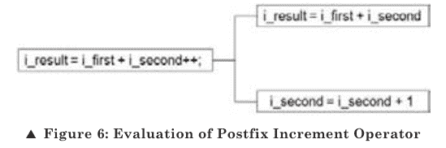

另一方面，语句 `i_result = i_first + ++i_second;` 的结果是 22。这表明前置自增运算符在表达式中使用时，首先将变量的值增加 1。然后使用变量的新值来评估表达式。图 7 解释了该评估过程：

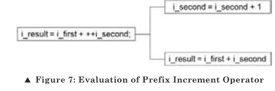

上述关于自增运算符的说明也适用于后置和前置自减运算符。

接下来要讨论的运算符被称为条件运算符，因为它检查条件，然后决定执行哪个表达式。

### 条件运算符

在程序 2 中，我们使用了 `if` 判断结构来决定数字是奇数还是偶数。C 语言为我们提供了一个称为 `条件运算符` 或 `三目运算符` 的运算符用于条件检查。该运算符由两个符号组合而成，即 `?` 和 `:`。使用条件运算符的语法如下：

```
(条件) ? (真语句) : (假语句);
```

前述语法中的条件指的是一个关系表达式，其结果为真或假。真语句和假语句可以是表达式或常量值。程序 8 展示了条件运算符的用法。该程序用于从两个输入值中找到最小值。

#### 程序 8

```c
/* Program to illustrate the use of conditional operator */
#include <stdio.h>
/* Beginning of main function */
main( )
{
   /* Declare variables */
   int i_num1, i_num2, i_minimum;
   /* Accept the value of num1 and num2 */
   printf("\n Enter the value of num1: ");
   scanf("%d",&i_num1);
   printf("\n Enter the value of num2: ");
   scanf("%d",&i_num2);
   /* Use of conditional operator */
   i_minimum = (i_num1 <= i_num2) ? (i_num1) : (i_num2);
   /* Print the minimum value */
   printf("\nthe minimum value of the two is %d \n", i_minimum);
   return;
}
/* End of function main */
```

**输出 1：**

```
Enter the value of num1: 10
Enter the value of num2: 8
The minimum value of the two is 8
```

**输出 2：**

```
Enter the value of num1: -5
Enter the value of num2: 10
The minimum value of the two is -5
```

**输出 3：**

```
Enter the value of num1: 10
Enter the value of num2: 10
The minimum value of the two is 10
```

在程序 8 中，语句 `i_minimum = (i_num1 <= i_num2) ? (i_num1) : (i_num2);` 展示了条件运算符的用法。条件运算符用于检查变量 `i_num1` 是否小于或等于 `i_num2`。如果 `i_num1` 小于或等于 `i_num2`，则 `i_minimum` 被赋值为变量 `i_num1` 的值；否则，被赋值为变量 `i_num2` 的值。从输出可以观察到，在输出 1 中，`i_minimum` 被赋值为变量 `i_num2` 的值；在输出 2 中，`i_minimum` 被赋值为变量 `i_num1` 的值；在输出 3 中，`i_minimum` 被赋值为变量 `i_num1` 的值。

在 C 语言中解决条件时，有时需要考虑多个条件。C 语言提供了称为逻辑运算符的运算符来处理此类情况。下一节将讨论逻辑运算符。

### 逻辑运算符

逻辑运算符用于比较布尔表达式。布尔表达式的结果始终是布尔值。C 语言为我们提供了三个逻辑运算符，即 AND（与）、OR（或）和 NOT（非）。表 3 列出了这些逻辑运算符的列表及用法，包括表达式中所需的运算符数量及其语法：

**表 3：逻辑运算符**

| 符号 | 名称 | 所需操作数数量 | 语法 |
| :--- | :--- | :--- | :--- |
| && | 逻辑与 | 两个 | 表达式 1 && 表达式 2 |
| \|\| | 逻辑或 | 两个 | 表达式 1 \|\| 表达式 2 |
| ! | 逻辑非 | 一个 | !(表达式) |

表 3 中的表达式 1 和表达式 2 可以是二元表达式、一元表达式或常量值。当表达式中给定的所有条件都需要满足时，使用逻辑与；当给定的条件中任意一个需要满足时，使用逻辑或。当逻辑非与表达式一起使用时，检查表达式是否评估为 0。如果表达式评估为 0，则 NOT 操作的结果为 1，表示真。在所有其他情况下，NOT 操作的结果为 0，表示假。

如前所述，逻辑或布尔表达式的输出值是布尔值。布尔值由 0 或 1 表示，其中 1 表示真，0 表示假。表 4 列出了不同逻辑操作的输出：

**表 4：逻辑运算的真值表**

| 表达式 1 的返回值 | 表达式 2 的返回值 | 表达式 1 && 表达式 2 | 表达式 1 \|\| 表达式 2 | !(表达式 1) |
| :--- | :--- | :--- | :--- | :--- |
| 0 | 0 | 0 | 0 | 1 |
| 1 | 0 | 0 | 1 | 0 |
| 0 | 1 | 0 | 1 | 1 |
| 1 | 1 | 1 | 1 | 0 |

从表 4 可以看出，只有当两个表达式的返回值都为 1 时，AND 运算符才返回 1，而当任一表达式的返回值为 1 时，OR 运算符返回 1。NOT 运算符在使用时，只需切换表达式的值。程序 9 展示了逻辑运算符在 C 程序中的用法：

##### 程序 9


```c
/* Program to illustrate the use of logical operator */
#include <stdio.h>
/* Beginning of main function */
main( )
{
float f_mark;
char c_temp, c_choice='y';
do
{
/* Enter marks */
printf("\nEnter marks: ");
scanf("%f", &f_mark);

/* Verify whether marks are between 0 and 100 */
if ( f_mark >= 0 && f_mark <= 100 )
{
/* Allocate grade depending on marks */
if ( f_mark >= 70 )
printf("\nYour grade is AA \n");
if ( f_mark >= 60 && f_mark < 70 )
printf("\nYour grade is A \n");
if ( f_mark >= 50 && f_mark < 60 )
printf("\nYour grade is B \n");
if ( f_mark >= 35 && f_mark < 50 )
printf("\nYour grade is C \n");
if ( f_mark < 35 )
printf("\nYour grade is D. Sorry you do not qualify.\n");
}
else
/* Executed when mark entered are not valid */
{
printf("\nYou have entered wrong marks.");
printf(" Marks has to be greater than 0 and less than 100\n");
printf("\nType y/y to continue, N/n to stop.");
}

/* Clear the buffer */
c_temp = getchar();
printf("\nYour Choice : ");
scanf("%c", &c_choice);
} while ( (c_choice == 'y') || (c_choice == 'Y') );
printf("\nExiting program \n");
return;
}
/* End of function main */
```

**输出：**

```
Enter marks: -10
You have entered wrong marks. Marks has to be greater than 0 and less than 100
```

输入 Y/y 继续，N/n 停止。

你的选择：y

输入分数：75

你的等级是 AA

输入 Y/y 继续，N/n 停止。

你的选择：Y

输入分数：35

你的等级是 C

输入 Y/y 继续，N/n 停止。

你的选择：n

退出程序

程序 9 使用了诸如 `if`、`do` 和 `while` 等构造，这些将在后续章节中讨论。此处的程序提示用户输入分数。随后会对分数进行验证，以确保其在 0 到 100 之间。语句 `if (f_mark >= 0 && f_mark <= 100)` 完成了这项工作。在这里，逻辑与运算符与关系运算符一起使用。只有当表达式 `f_mark >= 0` 和 `f_mark <= 100` 都返回 true 时，条件才返回 true。如果获得的结果为 true，我们会打印相应的等级，并通过提示选择来给用户继续或停止程序的选项。根据输入的选择，程序可能会再次提示输入或退出。

请注意，我们只给出了该程序的单一输出。此处的程序仅在用户输入字符 n、N，或按下 y 或 Y 以外的任何按键时才会返回到操作系统提示符，从而导致程序仅运行一次。

下一节将讨论按位运算符。顾名思义，它们操作的是位而不是字节。

#### 按位运算符

前文提到，C 语言实际上是为编写系统软件代码而设计的。与原始位进行交互是系统软件的应用之一。C 语言允许我们使用六个按位运算符在位级别直接进行操作。表 5 列出了 C 语言中可用的按位运算符及其用法：

**表 5：按位运算符**

| 符号 | 名称 | 用法 | 所需操作数数量 |
| :--- | :--- | :--- | :--- |
| `&` | 按位与 | 对两个位执行与操作 | 两个 |
| `|` | 按位或 | 对两个位执行或操作 | 两个 |
| `~` | 按位非 | 对一个位执行非操作 | 一个 |
| `^` | 按位异或 | 对两个位执行异或操作 | 两个 |
| `<<` | 左移 | 第一个操作数向左移动第二个操作数指定的位数 | 两个 |
| `>>` | 右移 | 第一个操作数向右移动第二个操作数指定的位数 | 两个 |

要执行按位与、按位或、按位异或（XOR）、左移和右移操作，我们需要两个操作数。另一方面，非操作只需要一个操作数。操作数可以持有的值为 0 或 1。表 6 列出了对两个操作数 A 和 B 执行某些按位操作的结果：

**表 6：按位操作的真值表**

| A | B | ~A | ~B | A & B | A \| B | A ^ B |
|---|---|---|---|---|---|---|
| 0 | 0 | 1 | 1 | 0 | 0 | 0 |
| 0 | 1 | 1 | 0 | 0 | 1 | 1 |
| 1 | 0 | 0 | 1 | 0 | 1 | 1 |
| 1 | 1 | 0 | 0 | 1 | 1 | 0 |

程序 10 展示了按位运算符的用法：

#### 程序 10

```c
/* 演示按位运算符用法的程序 */
#include <stdio.h>
/* main 函数的开始 */
main() {
/* 声明三个整型变量 */
unsigned int u_first, u_second, u_result;

/* 接受变量的值 */
printf("\nEnter value of first: ");
scanf("%u", &u_first);
printf("\nEnter value of second: ");
scanf("%u", &u_second);

/* 按位操作 */
u_result = u_first & u_second;
printf("\nResult of AND operation is %d", u_result);

u_result = u_first | u_second;
printf("\nResult of OR operation is %d", u_result);

u_result = u_first ^ u_second;
printf("\nResult of XOR operation is %d", u_result);

u_result = u_first << 1;
printf("\nResult of Left shift operation is %d", u_result);

u_result = u_second >> 2;
printf("\nResult of Right shift operation is %d", u_result);

u_result=~u_first;
printf("\nResult of NOT operation is %d\n", u_result);
return;
}
/* main 函数的结束 */
```

**输出：**

Enter value of first: 5

Enter value of second: 10

Result of AND operation is 0

Result of OR operation is 15

Result of XOR operation is 15

Result of Left Shift operation is 10

Result of Right shift operation is 2

Result of NOT operation is -6

程序 10 输出的评估过程如图 8 所示：

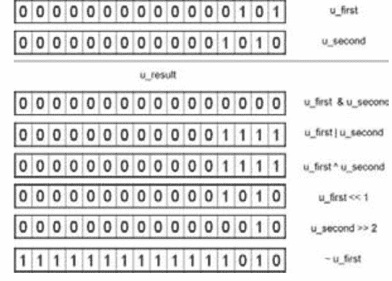

假设编译器为无符号整数分配 2 字节（16 位）的存储空间。输入的数值以位的形式表示，因为按位运算符操作的是位。操作的结果通过单独的位展示。

如果我们把图 8 中显示的结果与表 6 中列出的真值表进行映射，那么我们可以轻松地验证结果。要从给定的二进制值获取十进制数字，我们遵循图 9 中显示的转换过程：

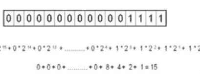

图 9 中显示的转换技术可用于将二进制数转换为等价的十进制数系统中的整数值，即十进制系统。运算符列表中的最后一类是特殊运算符，将在下一节中讨论。

#### 特殊运算符

C 语言提供了四类特殊运算符，称为逗号运算符、sizeof 运算符、指针运算符和成员选择运算符。表 7 列出了这些运算符使用的符号及其用途：

**表 7：特殊运算符**

| 类别 | 符号 | 名称 | 用法 |
| :------- | :----- | :----- | :----- |
| 逗号 | `,` | 逗号 | 在声明时分隔标识符以及执行多重操作 |
| Sizeof | `sizeof()` | Size Of | 检查数据类型的大小 |
| 指针 | `&` | Ampersand | 标识标识符的地址或引用 |
| | `*` | Indirection | 为指针标识符提供间接访问 |
| 成员选择 | `.` | Dot | 访问结构体或联合体的成员 |
| | `->` | Member by | 当定义了结构体或联合体的指针类型标识符时，访问结构体或联合体的成员 |

逗号运算符用于在 C 语言中分隔两个表达式或单词。我们使用它来分隔本章讨论的程序中定义的标识符。它也用于后续章节讨论的循环结构中。程序 11 展示了 `sizeof()` 运算符的用法：

#### 程序 11

```c
/* 演示 size of 运算符用法的程序 */
#include <stdio.h>
/* main 函数的开始 */
main( )
{
/* 声明变量 */
unsigned int i_first;
float i_second;
/* 打印编译器分配的数据类型大小 */
printf("The size of unsigned int data type is %d",sizeof(i_first));
printf("\nThe size of int data type is %d",sizeof(int));
printf("\nThe size of float data type is %d",sizeof(i_second));
printf("\nThe size of double data type is %d \n",sizeof(double));
return;
}
/* main 函数的结束 */
```

**输出：**

The size of unsigned int data type is 4

The size of int data type is 4

The size of float data type is 4

The size of double data type is 8

从程序 11 的输出中可以观察到，通过使用括号内的标识符名称或数据类型本身，可以获得编译器分配的任何数据类型的大小。Size 运算符也称为编译时运算符，因为该运算符取决于编译器。输出中显示的大小符合 GNU 编译器集合（GCC）编译器。程序 11 的输出会因编译器而异。

特殊运算符 `*`、`&` 和 `->` 已在本书的第 12 章中详细讨论。迄今为止讨论的运算符具有各自的优先级和结合性。下一节讨论运算符的优先级和结合性。

### 5.2 运算符的优先级和结合性

C 语言的设计者预定义了 C 语言中使用的每个运算符的优先级和结合性。运算符的优先级告诉编译器运算符应评估的顺序。如果两个具有相同优先级的运算符是表达式的一部分，则会考虑结合性。运算符的结合性告诉编译器应从哪一侧（从左到右或反之）解决表达式。表 8 列出了运算符及其优先级和结合性：

**表 8：运算符优先级和结合性**

| **运算符符号** | **用法** | **优先级** | **结合性** |
| :--- | :--- | :--- | :--- |
| `( )` | 函数调用 | 第一 | 从左到右 |
| `[ ]` | 数组表达式 | | |
| `->` | 结构体运算符 | | |
| `.` | 结构体运算符 | | |
| `+` | 一元加 | | |
| `-` | 一元减 | | |
| `++` | 自增 | | |
| `--` | 自减 | | |
| `!` | 逻辑非 | 第二 | 从右到左 |
| `~` | 按位非 | | |
| `*` | 指针运算符 | | |
| `&` | 地址运算符 | | |
| `sizeof ( )` | 操作数大小 | | |
| `*` | 乘法 | 第三 | 从左到右 |
| `/` | 除法 | | |
| `%` | 取模除法 | | |
| `+` | 二元加 | 第四 | 从左到右 |
| `-` | 二元减 | | |
| `<<` | 左移 | 第五 | 从左到右 |
| `>>` | 右移 | | |
| `<` | 小于 | 第六 | 从左到右 |
| `<=` | 小于等于 | | |
| `>` | 大于 | | |

#### 表 8：运算符的优先级与结合性

| 运算符 | 用途 | 优先级 | 结合性 |
| :--- | :--- | :--- | :--- |
| `>=` | 大于等于 | | |
| `==` | 等于 | 第七级 | 从左到右 |
| `!=` | 不等于 | | |
| `&` | 按位与 | 第八级 | 从左到右 |
| `^` | 按位异或 | 第九级 | 从左到右 |
| `\|` | 按位或 | 第十级 | 从左到右 |
| `&&` | 逻辑与 | 第十一级 | 从左到右 |
| `\|\|` | 逻辑或 | 第十二级 | 从左到右 |
| `? :` | 条件运算符 | 第十三级 | 从右到左 |
| `=, *=, -=, &=, +=, ^=, \|=, <<=, >>=` | 赋值运算符 | 第十四级 | 从右到左 |
| `,` | 逗号运算符 | 第十五级 | 从左到右 |

优先级和结合性的主要作用是帮助 C 语言编译器评估表达式。下一节将讨论 C 语言中表达式是如何被求值的。

### 5.3 C 语言中的表达式求值

到目前为止，我们讨论的重点是 C 语言中可用的不同运算符及其在表达式中的用法。如果语句没有正确构成，表达式的求值是一个主要问题。考虑表达式：`result = first * second + third / fourth – fifth`。在上面的表达式中，首先会执行标识符 `first` 和 `second` 的乘法运算，并将其值存储在一个临时位置。然后 `third` 将被 `fourth` 除，其值存储在另一个临时位置。然后，两个临时位置中的值将被相加，最后减去 `fifth`。图 10 展示了该表达式的求值顺序：

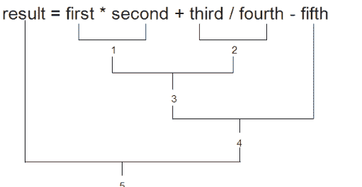

从图 10 可以看出，如果两个相同优先级的运算符出现在表达式中，它们将根据其结合性（在本例中为从左到右）进行求值。为了改变求值顺序，我们可以使用括号。如果我们重写表达式为 `result = first + second * (third − fourth) / fifth`；那么标识符 `third` 和 `fourth` 将首先被相减，得到中间结果 1。中间结果 1 然后与 `second` 相乘，得到中间结果 2。中间结果 2 然后被 `fifth` 除。最后，与 `first` 相加。图 11 展示了新表达式的求值顺序：

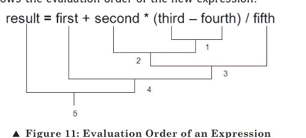

程序 12 说明了 C 语言中表达式是如何被求值的：

##### 程序 12

```c
/* Program to illustrate the evaluation of expression */

#include <stdio.h>
/* Beginning of main function */
main()
{
/* Declaration and initialization of unsigned integer variables */
unsigned int u_first = 25, u_second = 5, u_third = 15;
unsigned int u_fourth = 10, u_fifth = 12, u_result;
/* Expression without brackets */
u_result = u_first * u_second + u_third / u_fourth - u_fifth;
printf("Result of evaluation without using brackets = %d", u_result);
/* Expression with brackets */

u_result = u_first + u_second * (u_third - u_fourth) / u_fifth;
printf("\n Result of evaluation using brackets = %d \n", u_result);
return;
} /* End of function main */
```

**输出：**

Result of evaluation without using brackets = 114


Result of evaluation using brackets = 27

从程序 12 中可以观察到，当使用括号来控制求值时，同一表达式的输出会发生巨大变化。C 语言中使用的表达式被称为 C 语句。下一节将简要介绍 C 语言中可用的语句类别。

### 5.4 C 语言中的语句

由操作数和运算符组成的表达式被转换为 C 语句。生成的语句可能是可执行语句，也可能不是。在 C 程序中，可执行语句会引发某些动作，而不可执行语句则充当注释。C 语言提供了六种语句类别，如图 12 所示：

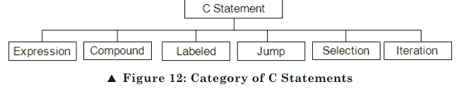

▲ 图 12：C 语句的类别

程序 9 使用了表达式、复合语句、选择语句和迭代语句。这些语句的图示表示如图 13 所示：

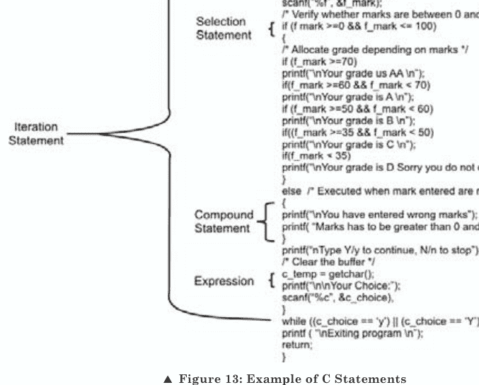

▲ 图 13：C 语句示例

从图 13 可以看出，C 程序中的表达式是一个可执行语句。通常，通过将表达式以分号 (`;`) 结尾来将其转换为 C 语句。分号向编译器指示语句的结束。所有以分号结尾的 C 语句都是可执行的。一组由零个或多个语句组合在一起，并用花括号包围，称为复合语句。所有 C 程序都由复合语句组成；一旦我们将 C 程序代码片段封闭在 `{ }` 内，它就成为一个复合语句。复合语句不以分号结尾。如果我们在结尾处用分号终止复合语句，编译器在编译时将会产生错误。

选择语句是指根据两个表达式的关系比较结果，决定执行哪个语句或哪一组语句的语句。迭代语句指的是允许重复执行代码片段的语句。关于带标签语句、跳转语句、选择语句和迭代语句的详细讨论将在后续章节中进行。

### 摘要

在本章中，我们学习了 C 语言中可用的不同运算符，如算术运算符、赋值运算符、关系运算符、增量/减量运算符、条件运算符、逻辑运算符、按位运算符和特殊运算符。我们还看到了如何对整数、实数和混合数值执行算术运算。在使用运算符时，我们学习了如何使用运算符和操作数形成不同类型的表达式，如一元、二元和单元表达式。然后讨论了决定哪个运算符先被评估的优先级，以及当遇到相同优先级的运算符时决定如何评估表达式的结合性。最后，我们查看了 C 语句的不同类别及其形成。

### 复习题

- Q1. 赋值运算符在 C 语言中的意义是什么？
- Q2. 类型转换在 C 语言中的意义是什么？
- Q3. 逗号运算符的用途是什么？
- Q4. 简写运算符的用途是什么？
- Q5. 列出并解释 C 语言语句的类别。
- Q6. 运算符优先级的意义是什么？
- Q7. 结合性优先级的意义是什么？
- Q8. 区分以下各项：
  - 一元运算符和二元运算符
  - 整数算术和实数算术
  - 除法运算符和取模运算符
  - 逻辑运算符和按位运算符
  - 增量运算符和减量运算符
- Q9. 给出以下程序的输出：
  i.
  ```c
  main()
  {
  int i_first = 10 & 20;
  printf("Result = %d",i_first);
  return;
  }
  ```
  ii.
  ```c
  main()
  {
      int i_num1 = 15, i_num2 = 10;
      int i_result;
      i_result = i_num1 | i_num2;
      printf("i_result = %d",i_result);
      return;
  }
  ```
  iii.
  ```c
  main()
  {
      i_num1 = 45, i_num2 = 15;
      float f_result;
      f_result = i_num1 / i_num2;
      printf("f_result = %f",f_result);
      return;
  }
  ```
  iv.
  ```c
  main()
  {
      i_num1 = 98, i_num2 = 75;
      int i_result;
      i_result = (i_num1 < 3) / (i_num2 > 2);
      printf("i_result = %x",i_result);
      return;
  }
  ```
  v.
  ```c
  main()
  {
      int i_first = 15, i_second = 25;
      int i_result;
      i_first += i_second;
      i_result = i_first++ ;
      printf("i_first = %d",i_first);
      printf("\ni_second = %d",i_second);
      printf("\ni_result = %d",i_result);
      return;
  }
  ```
  vi.
  ```c
  main()
  {
  double d_num = 15/5.5 + 99 * 2;
  printf("d_num = %ld",d_num);
  return;
  }
  ```
  vii.
  ```c
  main()
  {
      float f_num1 = 19.75, f_num2 = 5.75;
      float f_result;
      f_result = f_num1 % f_num2;
      printf("f_result = %f",f_result);
      return;
  }
  ```
  viii.
  ```c
  main()
  {
      i_num1 = 98, i_num2 = 75;
      printf("i_num1 = %d", i_num1 << 3);
      printf("i_num1 = %d", i_num2 >> 2);
      return;
  }
  ```
  ix.
  ```c
  main()
  {
      i_num1 = 700000, i_num2 = 70;
      int i_result;
      printf("i_result = %d",
             i_num1/i_num2);
      return;
  }
  ```
  x.
  ```c
  main()
  {
      int i_first = 55, int i_second = 35;
      int i_result;
      i_first -= i_second;
      i_result = i_second-- + ++i_first;
      printf("i_first = %d",i_first);
      printf("\ni_second = %d",i_second);
      printf("\ni_result = %d",i_result);
      return;
  }
  ```

### 实践练习

- Q1. 编写一个程序，使用条件运算符求两个整数的最大值。
- Q2. 编写一个程序，使用条件运算符求三个整数的最大值。
- Q3. 编写一个程序，使用取模运算符和条件运算符判断输入的数字是奇数还是偶数。
- Q4. 编写一个程序，接受十六进制整数并打印其十进制等价值。
- Q5. 编写一个程序，计算支付给员工（基本工资为 25,000 卢比）的净工资，工资明细如下：
  公司以以下科目形式提供激励：
  DA（津贴）= 基本工资的 48%，HRA（住房津贴）= 基本工资的 15%，CA（附加工资）= 基本工资的 5%，MA（月津贴）= 500 卢比。
  公司以以下科目形式扣除金额：
  PF（养老金）=（基本工资 + DA）的 8.33%，专业税 = 100
  用于计算工资的公式为：净工资 = 基本工资 + DA + HRA + CA + MA –（PF + 专业税）
- Q6. 编写一个程序，计算接受的小数小时和分钟值代表的总分钟数。
- Q7. 编写一个 C 程序，接受用户输入的年份数，并将其显示为月份和天数。
- Q8. 编写一个程序，输入两个数字 `i_first` 和 `i_second`。检查数字 `i_first` 是否能被数字 `i_second` 整除。（不要使用 `%` 运算符）
- Q9. 二次函数的形式为 `f(x) = ax² + bx + c`。编写一个程序，接受 `a`、`b`、`c` 和 `x` 的值来求 `f(x)` 的值。
- Q10. 编写一个程序，接受三个整型变量 `i_first`、`i_second` 和 `i_num`。
  将变量 `i_first` 右移 `i_num` 位，并将变量 `i_second` 左移 `i_num` 位。

## 06

### C 语言中的序列控制

### 目标

- 解释决策结构

我们在本书第 1 章中提到，程序总是按从上到下的顺序执行的。语句按其在 C 程序中出现的顺序依次逐个执行。一旦当前语句执行完毕，编译器默认将控制权转移到下一条语句。在实际场景中，这种顺序流程行不通。我们有时需要根据某些条件改变执行顺序，或者可能需要重复执行特定的语句集合。在本章中，我们将学习用于改变执行流程的控制结构。这种控制结构称为决策结构。我们还将讨论决策结构的不同变体，并了解如何在程序中使用它们。

### 6.1 决策结构

C 语言的决策结构用于进行选择。选择允许我们从程序内的两个或多个可用选项中选择一项。在 C 语言中，决策结构允许我们根据一个或多个条件的结果执行预定义的操作。C 语言提供两种类型的选择语句，称为双向选择和多向选择。下一节讨论双向选择。

#### 双向选择

C 语言中的双向选择代表一个条件语句，该语句可以被编译器评估为真或假。如果答案为真，则执行一个或多个操作语句。如果答案为假，则执行另一组操作语句。双向选择的一般流程图如图 1 所示：

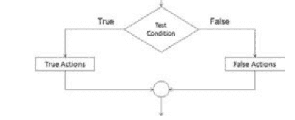

图 1：双向选择的流程图

从图 1 可以看出，无论执行哪一组操作语句，C 编译器在选择之后都会继续执行下一条语句。双向选择在 C 中使用 `if` 和 `else` 关键字实现。

关键字 `if` 用于控制权的条件转移。它与可以评估为真或假的表达式结合使用。`if` 语句有三种变体，分别称为简单 `if` 语句、`if-else` 语句和嵌套 `if` 语句。它们各自用于不同的情况。下一个小节讨论简单 `if` 语句的用法。

#### 简单 If 语句

简单 `if` 语句表示仅在指定条件为真时采取行动，而在条件为假时不采取行动的情况。简单 `if` 语句的语法如下：

```
if ( 测试条件 )
操作语句;
```

从上述语法可以看出，测试条件总是写在括号内。它通常是一个产生整数值 的表达式。任何非零值代表真，而零值代表假。测试条件不以分号结束。如果使用分号，条件语句将转换为*空语句*。从执行的角度来看，空语句没有任何意义。默认情况下，`if` 语句的作用域是紧接在测试条件之后的那条语句。为了将 `if` 语句的作用域扩展到多个语句，我们需要使用开括号和闭括号将这些语句包围起来。当语句嵌入在开括号和闭括号内时，称为复合语句。图 2 说明了简单 `if` 语句的逻辑流程：

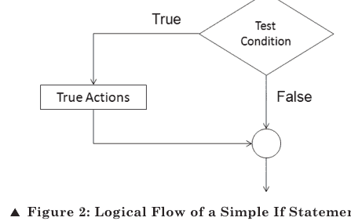

图 2：简单 If 语句的逻辑流程

从图 2 可以看出，首先会评估测试条件。如果测试条件的值为正的非零值（真），则控制权转移到真操作语句块中的第一条语句。然后执行真操作块内的语句。如果测试条件的值为零，*则* 不采取任何行动。控制权的转移发生在真操作块完成后，或者在不采取行动的情况下，转移到 `if` 之后顺序中的下一条语句。程序 1 说明了简单 `if` 语句的使用：

#### 程序 1

```c
/** 用于说明简单 if 语句用法的程序 */
#include<stdio.h>
/** 主函数开始 */
main()
{
    /** 声明变量 */
    float f_purchase, f_discount = 0.0;
    float f_dis_amount, f_payment;
    
    /** 读取值 */
    printf("\nEnter total purchase amount: ");
    scanf("%f", &f_purchase);
    
    /** 计算折扣金额 */
    if (f_purchase >= 5000.00)
        f_discount = 0.15;
    
    f_dis_amount = f_purchase * f_discount;
    
    /** 计算支付金额 */
    f_payment = f_purchase - f_dis_amount;
    
    /** 输出数据 */
    printf("\nTotal payment to be made Rs. %.2f\n", f_payment);
    printf("Total discount availed Rs. %.2f\n", f_dis_amount);
    
    return;
}
/** 主函数结束 */
```

##### 输出 1：

```
Enter total purchase amount: 7500
Total payment to be made Rs. 6375.00
Total discount availed Rs. 1125.00
```

##### 输出 2：

```
Enter total purchase amount: 4500
Total payment to be made Rs. 4500.00
Total discount availed Rs. 0.00
```

从程序 1 可以看出，该程序用于计算在购买金额达到或超过 5000 卢比时的折扣。在这里，语句 `if (f_purchase >= 5000.00)` 是决策结构，如果测试条件为真，则给 `f_discount` 分配一个新值。两个输出表明，在第一种情况下，新值（0.15）被分配给 `f_discount`，而在第二种情况下，使用旧值（0.00）。

请注意，在程序 1 的测试条件中，我们使用了关系运算符（`>=`）。我们可以在测试条件中使用任何有效的 C 运算符，例如关系运算符、逻辑运算符、逗号、赋值运算符或其他运算符。程序 2 说明了在简单 `if` 语句中结合使用逻辑运算符和关系运算符：

#### 程序 2

```c
/* 用于说明简单 if 语句用法的程序 */
#include<stdio.h>

/* 主函数开始 */
main()
{
    /* 声明变量 */
    float f_purchase, f_discount = 0.0;
    float f_dis_amount, f_payment;
    char c_regular, c_temp;
    /* 读取值 */
    printf("\nEnter total purchase amount: ");
    scanf("%f", &f_purchase);
    c_temp = getchar();
    printf("Enter Y or y if regular customer: ");
    scanf("%c", &c_regular);

    /* 计算折扣金额 */
    if (f_purchase >= 5000.00 && (c_regular == 'y' || c_regular == 'Y'))
        f_discount = 0.15;

    f_dis_amount = f_purchase * f_discount;
    /* 计算支付金额 */
    f_payment = f_purchase - f_dis_amount;

    /* 输出数据 */
    printf("\nTotal payment to be made Rs. %.2f\n", f_payment);
    printf("Total discount availed Rs. %.2f\n", f_dis_amount);

    return;
    /* 主函数结束 */
}
```

##### 输出 1：

```
Enter total purchase amount: 7500

Enter Y or y if regular customer: y

Total payment to be made Rs. 6375.00

Total discount availed Rs. 1125.00
```

##### 输出 2：

```
Enter total purchase amount: 7500

Enter Y or y if regular customer: n

Total payment to be made Rs. 7500.00

Total discount availed Rs. 0.00
```

从程序 2 可以看出，我们同时使用了关系运算符和逻辑运算符。图 3 展示了 `if` 语句中测试条件的评估方式：

可以观察到，在图 3 中，测试条件使用了两个运算符，即关系运算符和逻辑运算符。在第一种情况下，测试条件的结果被评估为真，而在第二种情况下，它被评估为假。

请注意，尽管赋值运算符可以用于测试条件中，但它始终会导致一个为真的条件。例如，测试条件（`i_number = 20`）始终会评估为真，因为表达式的值始终为 20。很多时候，用户会使用 `=` 而不是 `==`，然后无法找到错误。

简单的 `if` 语句，虽然被视为双向选择的一部分，但在实际意义上是一个单向选择，因为双向选择通常有两个可用选项。下一个小节讨论 `if-else` 结构，它是一个双向选择。

#### If-Else 语句


if-else 语句是对简单 if 语句的改进。在简单的 if 语句中，只有一个操作语句块。当测试条件被评估为真时，该块会执行。如果测试条件被评估为假，则不执行任何操作。在大多数情况下，我们需要一个可以执行的替代选项。例如，在程序 2 中，我们仅在购买金额大于或等于 5000 卢比且客户为常规客户时提供 15% 的折扣。假设我们还希望向非常规客户提供折扣。在这种情况下，我们需要两个替代方案：一个向常规客户提供折扣，另一个向非常规客户提供折扣。通过利用 if-else 语句可以很容易地实现这一点。

if-else 语句的语法如下：

```
if( test condition )
{
    True action statements;
}
else
{
    False action statements;
}
```

在前面的语法中可以观察到，if-else 语句具有两个操作语句块。如果测试条件被评估为真，则执行真操作语句块。如果测试条件被评估为假，则执行假操作语句块。在所有情况下，两个操作块中总有一个会被执行。图 4 说明了 if-else 语句的逻辑流程：

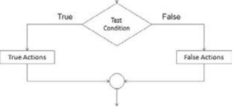

▲ 图 4：If-Else 语句的逻辑流程

可以观察到，图 4 与图 1 完全相同。在这里，我们可以看到两个互不相同的流程路径：一个是真情况，另一个是假情况。无论选择哪种情况，在执行完任意一个块之后，控制流都会传递到序列中的下一个语句。程序 3 说明了 if-else 语句的使用：

### 程序 3

```
/* Program to illustrate the use of if-else statement */
#include<stdio.h>
/* Beginning of main function */
main()
{
/* Declare variables */
float f_purchase, f_discount = 0.0;
float f_dis_amount, f_payment;
char c_regular, c_temp;
/* Read values */
printf("\nEnter total purchase amount: ");
scanf("%f",&f_purchase);
c_temp = getchar();
printf("\nEnter Y or y if regular customer: ");
scanf("%c",&c_regular);
if (f_purchase >= 5000.00 && (c_regular == 'Y' || c_regular == 'y'))
f_discount = 0.15;
else
f_discount = 0.10;
/* Calculate discount amount */
f_dis_amount = f_purchase * f_discount;

/* Calculate Payment */
f_payment = f_purchase - f_dis_amount;

/* Output Data */
printf("\nTotal payment to be made Rs. %0.2f\n", f_payment);
printf("Total discount availed Rs. %0.2f\n", f_dis_amount);

return;
}

/* End of main function */
```

**输出 1：**

```
Enter total purchase amount: 5000
Enter Y or y if regular customer: y

Total payment to be made Rs. 4250.00
Total discount availed Rs. 750.00
```

**输出 2：**

```
Enter total purchase amount: 6000
Enter Y or y if regular customer: n
Total payment to be made Rs. 5400.00
Total discount availed Rs. 600.00
```

**输出 3：**

```
Enter total purchase amount: 4500
Enter Y or y if regular customer: y

Total payment to be made Rs. 4050.00
Total discount availed Rs. 450.00
```

在程序 3 中可以观察到，仅当购买价值大于或等于 5000 卢比且客户为常规客户时，才会给予 15% 的折扣。在其他所有情况下，折扣为 10%。无论客户是否为常规客户，或者购买的金额是否小于 5000 卢比，都没有关系。输出 2 和 3 显示了此类情况的结果。让我们再看一个例子，即程序 4，以更好地理解 if-else 语句。

### 程序 4

```
/* Program to illustrate the use of if-else statement */

#include <stdio.h>

/* Beginning of main function */
main()
{
   /* Declare variable */
   char c_char;
   /* Input Data */
   printf("Enter an alphabet : ");
   scanf("%c",&c_char);

   /* Check if the alphabet is upper case */
   if (c_char >= 65 && c_char <=90)
   {
       printf("The alphabet entered is upper case\n");
       c_char += 32;
       printf("The alphabet in lower case is %c\n",c_char);
   }
   else
   {
       printf("The '%c' is not an upper case alphabet.\n",c_char);
   }
   return;
} /* End of main function */
```

**输出 1：**

```
Enter an alphabet : H
The alphabet entered is upper case
The alphabet in lower case is h
```

**输出 2：**

```
Enter an alphabet : *
The '*' is not an upper case alphabet
```

**输出 3：**

```
Enter an alphabet : h
The 'h' is not an upper case alphabet
```

在程序 4 中可以观察到，如果测试条件被评估为真，三条语句会执行。第一条语句打印消息“输入的字母是大写”，第二条语句在读取字符的 ASCII 值中加上美国标准信息交换码 `ASCII` 值 32，第三条语句打印小写字母。

很多时候，我们需要结合 if 语句和 if-else 语句来获得期望的结果。这种结构产生了另一种称为嵌套 if 语句的 if 语句格式。下一个小节讨论嵌套 if 语句。

### 嵌套 If 语句

之前已经提到，当 if 语句被用在另一个 if 语句内部时，它被称为嵌套 if 语句。if 语句出现的顺序并不重要。if 语句可以出现在真操作语句块、假操作语句块中，或者两者都出现。图 5 说明了嵌套 if 语句的逻辑流程：

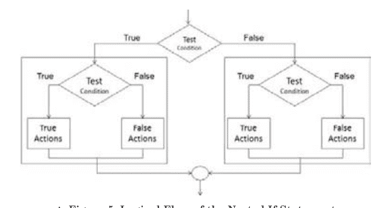

▲ 图 5：嵌套 If 语句的逻辑流程

在图 5 中可以观察到，我们使用了三个 if-else 语句。图表的流程表明，在任何情况下，至少会有两个 if-else 语句被执行。并非总是需要真操作块和假操作块都包含 if 语句。程序 5 说明了嵌套 if 语句的使用：

### 程序 5

```
/* Program to illustrate the use of nested if statement */
#include <stdio.h>
/* Beginning of main function */
main()
{
    /* Declare variable */
    unsigned int i_year, i_rem1, i_rem2;

    /* Input Data */
    printf("Enter value for year: ");
    scanf("%u",&i_year);

    /* Calculate whether year is leap or not */
    if ((i_rem1 = i_year % 4) == 0)
    {
        i_rem2 = i_year % 100;

        if(i_rem2 == 0)
            printf("Year %u is not a leap year\n",i_year);
        else
            printf("Year %u is a leap year\n",i_year);
    }
    else
        printf("Year %u is not a leap year\n",i_year);

    return;
}
/* End of main function */
```

**输出 1：**

```
Enter value for year: 2000  
Year 2000 is not a leap year
```

**输出 2：**

```
Enter value for year: 2010  
Year 2010 is not a leap year
```

**输出 3：**

```
Enter value for year: 2012  
Year 2012 is a leap year
```

在程序 5 中可以观察到，我们在条件 `if ((i_rem1 = i_year % 4) == 0)` 的真操作块中使用了嵌套的 if-else 语句。如果测试条件被评估为假，我们简单地打印一条消息，表明输入的年份不是闰年。让我们再看一个例子，以理解嵌套 if 语句。程序 6 说明了如何在享受折扣后计算保费：

### 程序 6

```
/* Program to illustrate the use of nested if statement */  
#include <stdio.h>  
#include <ctype.h>  
  
/* Beginning of main function */  
main()  
{  
    /* Declare variable */  
    float f_premium, f_discount=0.0, f_payment;  
    char c_gender, c_temp, c_accident;  
  
    /* Input Data */  
    printf("Enter premium: ");  
    scanf("%f",&f_premium);  
    c_temp = getchar();  
  
    printf("\nHad accident last year y/Y for yes: ");  
    scanf("%c",&c_accident);  
    c_accident = toupper(c_accident);  
  
    c_temp = getchar();  
    printf("\nEnter gender F/f for Female: ");  
    scanf("%c",&c_gender);  
    c_gender = toupper(c_gender);  
    c_temp = getchar();  
    /* Calculate premium */  
    if(c_accident != 'Y')  
    {  
        if(c_gender == 'F')  
            f_discount = 0.35;  
        else
```

# ▶ 悬挂 else 问题

f_discount = 0.30;

}

else

{

if(c_gender == 'F')

f_discount = 0.05;

}

f_payment = f_premium - (f_premium * f_discount);

printf("Amount to be paid after discount of %0.2f(%)",f_discount*100);

printf(" is %0.2f\n", f_payment);

return;

}

/* 主函数结束 */

##### 输出 1：

输入保费：15000

去年是否发生事故，Y/y 表示是：n

输入性别，F/f 表示女性：f

折扣 35.00(%) 后应付金额为 9750.00

##### 输出 2：

输入保费：15000

去年是否发生事故，Y/y 表示是：n

输入性别，F/f 表示女性：m

折扣 30.00(%) 后应付金额为 10500.00

##### 输出 3：

输入保费：15000

去年是否发生事故，Y/y 表示是：y

输入性别，F/f 表示女性：m

折扣 0.00(%) 后应付金额为 15000.00

##### 输出 4：

输入保费：15000

去年是否发生事故，Y/y 表示是：Y

输入性别，F/f 表示女性：F

折扣 5.00(%) 后应付金额为 14250.00

可以看出，在程序 6 中，我们包含了额外的文件 `ctype.h`。该文件对于程序中内置函数 `toupper` 的成功运行是必需的。`toupper` 函数将从键盘输入的字符转换为大写字母，从而使得 if 语句的处理变得更加容易。请注意，我们在条件 `if(c_accident != 'Y')` 的 true 动作块中使用了 if-else 语句，而在 false 动作块中仅使用了 if 语句。

当 if 语句嵌套超过一层时，就会引发悬挂 else 问题。下一节将讨论悬挂 else 问题。

# ▶ 悬挂 else 问题

C 编译器允许我们以各种组合方式使用 if 语句。其中一种组合是 if 语句的嵌套。当 if 语句嵌套时，编译器有时会遇到悬挂 else 问题。术语“悬挂 else”表明 C 编译器无法正确定位 if-else 配对。为了解决悬挂 else 问题，编译器会将 else 语句与紧邻其前的 if 语句关联。因此，代码的输出可能不符合用户的需求。程序 7 展示了悬挂 else 问题：

# ▶ 程序 7

```c
/* 用于说明悬挂 else 问题的程序 */
#include <stdio.h>
#include <ctype.h>

/* 主函数开始 */
main()
{
    /* 声明变量 */
    float f_premium, f_discount=0.0, f_payment;
    char c_gender, c_temp, c_accident;

    /* 输入数据 */
    printf("Enter premium: ");
    scanf("%f", &f_premium);

    c_temp = getchar();

    printf("\nHad accident last year Y/y for yes: ");
    scanf("%c", &c_accident);
    c_accident = toupper(c_accident);

    c_temp = getchar();

    printf("\nEnter gender F/f for Female : ");
    scanf("%c", &c_gender);
    c_gender = toupper(c_gender);

    c_temp = getchar();
    /* 计算保费 */

    if(c_accident != 'Y')
    if(c_gender == 'F')
    f_discount = 0.35;
    else
    if(c_gender == 'F')
    f_discount = 0.05;

    f_payment = f_premium - (f_premium * f_discount);
    printf("Amount to be paid after discount of %0.2f(%)", f_discount*100);
    printf(" is %0.2f\n", f_payment);
    return;
}
/* 主函数结束 */
```

##### 输出 1：

输入保费：25000

去年是否发生事故，Y/y 表示是：Y

输入性别，F/f 表示女性：F

折扣 0.00(%) 后应付金额为 25000.00

##### 输出 2：

输入保费：15000

去年是否发生事故，Y/y 表示是：N

输入性别，F/f 表示女性：F

折扣 35.00(%) 后应付金额为 9750.00

程序 7 旨在根据某些标准计算应付给保险公司的保费。图 6 展示了悬挂 else 问题及其解决方案。

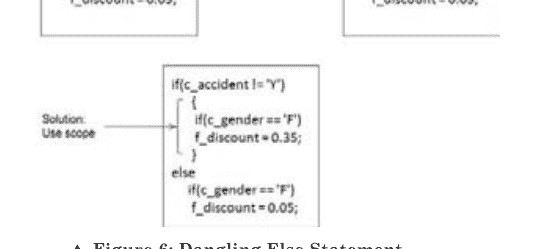

▲ 图 6：悬挂 Else 语句

如图 6 所示，使用作用域可以消除悬挂 else 问题。在大多数情况下，用户必须小心谨慎，通过使用合适的作用域来避免悬挂 else。

对于少量的可用选项，双向选择工作得很好。随着选项数量的增加，双向选择的使用变得复杂。如果我们有更多选项，则必须采用多路选择。下一小节讨论了 C 中如何实现多路选择。

# ■ **多路选择**


有时我们需要基于多个条件进行多路选择。C 支持两种决策结构，即 `if-else` 梯子和 `switch`，它们允许多路选择。`if-else` 梯子是之前研究的 `if-else` 语句的一种变体，而 `switch` 具有其自身的结构。下一小节讨论了如何使用 `if-else` 梯子。

# If-Else 梯子语句

`if-else` 梯子更常被称为 `else-if` 梯子，因为它将 `else` 语句与另一个 `if` 关联。梯子通过将几个条件的 `else` 部分与 `if` 语句级联形成。梯子中的条件从上到下评估。一旦某个测试条件被评估为 `true`，其对应的动作块就会被执行。一旦 `true` 动作块执行完毕，整个 `if` 语句的执行就停止了。`else if` 梯子的语法如下：

```text
if( 测试条件 1 )
    动作语句 1;
else if( 测试条件 2 )
    动作语句 2;
:
:
else if (测试条件 n)
    动作语句 n;
else
    默认动作语句;
```

从上述语法中可以观察到，我们从 `if-else` 语句开始，然后每个 `else` 语句都附加了 `if` 语句。最后一个 `else` 语句成为默认动作语句。如果所有测试条件都评估为 `false`，则会执行默认动作语句。图 7 展示了 `else-if` 梯子的逻辑流程：

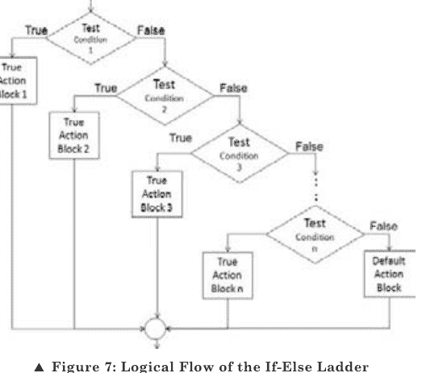

如图 7 所示，每个测试条件在 `true` 动作块执行后都有一个出口点。这里的最坏情况是所有 `n` 个测试条件都失败。在这种情况下，编译器必须检查指定的所有测试条件。程序 8 说明了 `else-if` 梯子的使用：

#### 程序 8

```c
/*  用于说明 if-else 梯子使用的程序  */
#include <stdio.h>
/*  主函数开始  */
main()
{
    /*  声明变量  */
    float f_celsius;
    /*  输入数据  */
    printf("Enter temperature: ");
    scanf("%f", &f_celsius);

    /*  检查气候状况  */
    /*  根据状况打印适当信息  */
    if(f_celsius >= -40.0 && f_celsius < 10.0)
    {
        printf("It is the coldest period of year.\n");
    }
    else if(f_celsius >= 10.0 && f_celsius < 20.0)
    {
        printf("The weather is comfortable at present.\n");
    }
    else if(f_celsius >= 20.0 && f_celsius < 50.0)
    {
        printf("It is the hottest period of year.\n");
    }
    else
    {
        printf("Mankind cannot survive in this temperature.\n");
    }

    return;
}  /*  主函数结束  */
```

**输出 1：**

输入温度：-45

人类无法在这种温度下生存

**输出 2：**

输入温度：-5

这是一年中寒冷的时期

**输出 3：**

输入温度：15.25

目前天气舒适

**输出 4：**

输入温度：25

这是一年中炎热的时期

可以看出，在程序 8 中，我们输入一个摄氏温度。然后，该温度使用 `if-else` 语句与各种数值范围进行比较。一旦某个测试条件变为 `true`，信息将被打印，并且程序停止执行。

`if-else` 梯子确实为我们提供了多路选择。然而，随着选择数量的增加，程序的复杂性也会增加。为了使程序看起来更具可读性和紧凑性，C 提供了另一种称为 `switch` 的多路选择结构。下一小节讨论了如何使用 `switch` 结构。

#### Switch 语句

`if-else` 结构是一种派生机制，用于在 C 语言中实现多路选择。C 提供了一种内置的决策结构，称为 `switch`，用于多路选择。使用这种决策结构可以提高程序的可读性。完整的 `switch` 决策结构由四个 C 关键字组成，即 `switch`、`case`、`default` 和 `break`。`switch` 语句的语法如下：

```text
switch (表达式)
{
    case 值 1:
        [动作块 1]
        [break;]
    case 值 2:
        [ 动作块 2 ]
        [break;]
    case 值 3:
        [ 动作块 3 ]
        [break;]
    : 
    : 
    case 值 N:
        [动作块 N]
        [break;]
    [default:
        [默认动作块]
        [ break ;]
    ]
}
```

在上述语法中，我们注意到在许多地方使用了方括号。方括号表示其中的语句是可选的。紧跟在 `switch` 关键字后面的术语“表达式”指的是可以评估为整型常量或字符常量的表达式。每个 `case` 选项包含一个整型常量或字符常量，称为 `case` 标签。`case` 标签始终以冒号 (`:`) 结尾。

表达式的值在评估后，会与 `case` 关键字沿自上而下指定的值进行比较。当表达式值与 `case` 值匹配时，编译器开始执行 `switch` 结构中此 `case` 中提到的语句。为了退出 `switch` 结构中特定的 `case` 块，我们使用

**`break`** 关键字。当未找到匹配项时，编译器将执行在 **`default`** 动作块中定义的语句。图 8 展示了 `switch` 结构的逻辑流程：

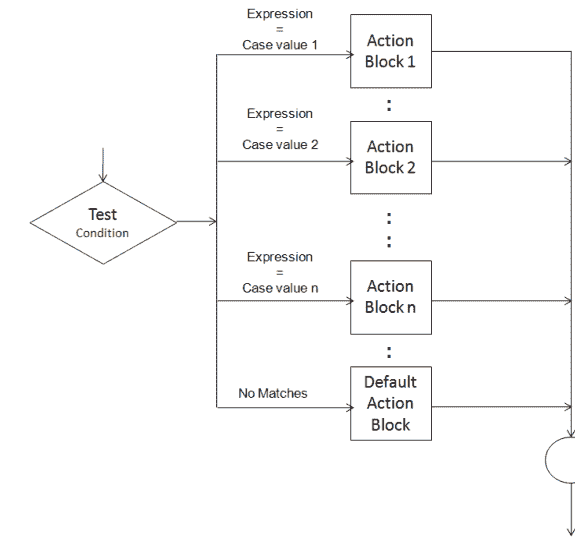

从图 8 中可以观察到，控制流程是从上到下的。为了阻止流程执行所有语句，我们使用关键字 `break`。如果在动作块末尾未使用 `break` 语句，编译器将继续执行后续动作块中的所有语句，直到找到 `break` 语句或遇到 `switch` 结构的末尾。此外，**`default`** 案例并不一定非要出现在所有动作块的末尾。它可以出现在 `switch` 结构中的任何位置。例如，它也可以是第一个案例，而 `switch` 结构仍会正常工作。程序 9 说明了 `switch` 结构的使用方法：

### 程序 9

```c
/* 程序用于说明 switch 结构的使用 */

#include <stdio.h>

/* main 函数开始 */
main()
{
/* 声明变量 */
int i_first, i_second;
int i_choice, i_result;

/* 输入数据 */
printf("Enter first number: ");
scanf("%d", &i_first);
printf("\nEnter second number: ");
scanf("%d", &i_second);

/* 打印菜单 */
printf("\n*****Operation Menu*****\n");
printf("Enter 1 to perform Addition.\n");
printf("Enter 2 to perform Subtraction.\n");
printf("Enter 3 to perform Multiplication.\n");
printf("Enter 4 to perform Division.\n\n");

/* 接受用户选择 */
printf("Enter your choice : ");
scanf("%d", &i_choice);

/* 检查输入的选择并执行所需的操作 */
/* switch 结构开始 */
switch(i_choice)
{
  case 1:
    i_result = i_first + i_second;
    printf("\nAddition of %d + %d is %d\n", i_first, i_second, i_result);
    break;
  case 2:
    i_result = i_first - i_second;
    printf("\nSubtraction of %d - %d is %d\n", i_first, i_second, i_result);
    break;
  case 3:
    i_result = i_first * i_second;
    printf("\nMultiplication of %d * %d is %d\n", i_first, i_second, i_result);
    break;
  case 4:
    if(i_second == 0)
      printf("\nDivision not possible\n");
    else
    {
      i_result = i_first / i_second;
      printf("\nDivision of %d / %d is %d\n", i_first, i_second, i_result);
    }
    break;
  default:
    printf("\nInvalid choice no operation possible.\n");
}  /* switch 结构结束 */
return;
}  /* main 函数结束 */
```

##### 输出 1：

```text
Enter first number: 10
Enter second number: 15
*****Operation Menu*****
Enter 1 to perform Addition.
Enter 2 to perform Subtraction.
Enter 3 to perform Multiplication.
Enter 4 to perform Division.

Enter your choice : 2

Subtraction of 10 - 15 is -5
```

##### 输出 2：

```text
Enter first number : 50

Enter second number : 0

*****Operation Menu*****
Enter 1 to perform Addition.
Enter 2 to perform Subtraction.
Enter 3 to perform Multiplication.
Enter 4 to perform Division.

Enter your choice : 4

Division not possible
```

##### 输出 3：

```text
Enter first number : 15

Enter second number : 25

*****Operation Menu*****
Enter 1 to perform Addition.
Enter 2 to perform Subtraction.
Enter 3 to perform Multiplication.
Enter 4 to perform Division.

Enter your choice : 5

Invalid choice no operation possible.
```

从程序 9 中可以观察到，`switch` 结构获取 `i_choice` 的值并将其与不同的案例值（如 1、2、3 和 4）进行比较。如果任何选择与指定的案例值匹配，则执行该案例块中提到的操作。请注意，在 `case 4` 中，我们使用了 `if-else` 语句。由于 `else` 语句包含多条需要执行的语句，我们为其提供了一个作用域。注意我们在 `default` 动作语句中未使用 `break` 语句。一旦 `default` 动作块执行完毕，下一条语句表示 `switch` 结构的末尾，流程将从 `switch` 结构的这一点自动向下移动。

让我们再看一个例子，以更好地理解 `switch` 结构的用法。程序 10 说明了 `switch` 结构的使用，其中 `default` 动作块被放置在开头。

### 程序 10

```c
/* 程序用于说明 switch 结构的使用 */
#include <stdio.h>
#include <ctype.h>

/* main 函数开始 */
main()
{
	/* 声明变量 */
	char c_character;

	/* 输入数据 */
	printf("Enter a character: ");
	scanf("%c", &c_character);

	/* 检查输入的字符并确定其类型 */

	/* switch 结构开始 */
	switch(c_character)
	{
	default:
		if(isdigit(c_character))
			printf("\nCharacter %c is number.\n", c_character);
		else if (isalpha(c_character))
			printf("\nCharacter %c is consonant.\n", c_character);
		else
			printf("\nCharacter %c is special character.\n", c_character);
		break;
	case 'A':
	case 'a':
	case 'E':
	case 'e':
	case 'I':
	case 'i':
	case 'O':
	case 'o':
	case 'U':
	case 'u':
		printf("\nCharacter %c is vowel\n", c_character);
	}	/* switch 结构结束 */
	return;
}	/* main 函数结束 */
```

##### 输出 1：

```text
Enter a character: e
Character e is vowel
```

##### 输出 2：

```text
Enter a character: 0
Character 0 is number
```

##### 输出 3：

```text
Enter a character: q
Character q is consonant
```

##### 输出 4：

```text
Enter a character: $
Character $ is special character
```

从程序 10 中可以观察到，`default` 语句被放置在 `switch` 结构的开头。`default` 动作块中的最后一条语句是 `break` 语句。这里的 `break` 语句是必须的，用于阻止编译器执行其他任何案例动作。此外，请注意，我们只为 `case 'A'`, `case 'a'`, `case 'E'`, `case 'e'`, `case 'I'`, `case 'i'`, `case 'O'`, `case 'o'`, `case 'U'`, 和 `case 'u'` 写了一个动作块。一旦其中任何案例匹配了 `c_character` 的值，执行控制权就会转移到语句 `printf("\nCharacter %c is vowel\n", c_character);`。注意，我们在上述案例的动作块之后没有写 `break` 语句。原因与程序 9 中指出的原因类似。

请注意，当编写 `switch` 案例时，案例标签不能重复。这意味着一个常量（整数或字符）只能作为案例标签出现一次。在程序 10 的情况下，`case 'A'` 和 `case 'a'` 指的是两个不同的标签，因为 `'A'` 和 `'a'` 的 ASCII 值不同。美国国家标准学会（ANSI）C 为我们提供了创建最多 257 个案例标签的规定。

因此，如果我们有多个选项可供选择，多路选择结构是很有用的。

### 总结

在本章中，我们学习了如何改变程序的执行流程。C 语言提供了决策结构，如 `if`、`if-else`、`嵌套 if`、`if-else` 梯子和 `switch case`，以改变执行流程。具体来说，`if`、`if-else` 和嵌套 `if` 决策结构用于双向选择。对于多路选择，我们使用 `if-else` 梯子和 `switch-case` 决策结构。我们还讨论了当 `if` 语句在程序中嵌套时出现的悬挂 `else` 问题。

### 复习题

- 1. **Q1.** C 语言中双向选择的意义是什么？

- 2. **Q2.** 解释 C 语言中用于实现双向选择的不同机制。

- 3. **Q3.** 举例说明编译器如何解决悬挂 `else` 问题。

- 4. **Q4.** 举例说明使用 `switch` 结构相对于 `if-then-else` 梯子的优势。

- 5. **Q5.** `break` 语句在 `switch` 结构中的意义是什么？

- 6. **Q6.** 区分双向选择和多路选择。

- 7. **Q7.** 判断以下陈述是正确还是错误：

  - i. 双向选择语句在 C 语言中使用简单的 `if` 语句实现。

  - ii. 不相关的 `if` 语句可以在 C 程序中用 `switch` 结构替换。

  - iii. 以 `if(1)` 开始的语句块总是会被执行。

  - iv. C 语言不允许嵌套 `if` 语句。

  - v. `switch` 结构的案例标签可以是浮点值。

  - vi. 关键字 `default` 在 `switch` 结构中总是最后一个案例。

**问题 8.** 如果有错误请修正并给出以下代码的输出：

i.

```c
main()
{
    float f_a = 0.5 , f_b = 0.7 ;
    if ( f_b < 0.7 )
        if ( f_a < 0.5 )
            printf("HELLO");
        else
            printf("BYE");
    else
        printf("HI");
}
```

ii.


```c
main( )
{
    if ((1||0) && (0||1))
    {
        printf("This is exam.");
    }
    else
    {
        printf("Completed my exam.");
    }
}
```

iii.

```c
int i_ctr = 1;
int main()
{
    printf("\n %d ", i_ctr);
    i_ctr--;
    switch(i_ctr)
    {
        default:
            case 0: main( );
            case -6: exit(1);
    }
}
```

iv.

```c
int i_ctr = 1;
int main( )
{
    printf("\n %5d ", i_ctr);
    i_ctr++;
    switch(i_ctr)
    {
        default:
            case 0: printf("Case %d ",i_ctr );
            break;
            case -1: printf("Case %d ",i_ctr );
            break;
    }
}
```

### 实践练习

**问题 1.** 编写一个程序，检查名为 `f_temperature` 的浮点变量的值，并根据分配给 `f_temperature` 的值打印以下消息之一：

- 如果 temp 的值小于 0，则打印 ICE。

- 如果 temp 的值介于 0 和 100 之间，则打印 WATER。

- 如果 temp 的值超过 100，则打印 STEAM。

**问题 2.** 编写一个程序接受变量 `x` 的值。根据以下条件计算 Y 的值：

- 如果 `x > 0`，则 `Y = 3x + 5`

- 如果 `x < 0`，则 `Y = 2x - 0`

- 如果 `x = 0`，则 `Y = 0`

**问题 3.** 编写一个程序找出三个整数的最大值。

**问题 4.** 假设你有面额为 1000、500、100、50、20、10、5、2 和 1 卢比的纸币。输入一个整数值，并将其转换为所需的最少纸币数量。例如，如果 `N = 1050`，则输出为 2 张纸币：1 张 1000 和 1 张 50。

**问题 5.** 编写一个程序，输入 1 到 7 范围内的数值，并给出其对应的星期几。

**问题 6.** 编写一个程序，输入 1 到 12 范围内的数值，并给出其对应的月份名称。

**问题 7.** 编写一个程序，接受用户输入的基本工资和出勤天数。根据以下分解计算员工的月实发工资：

- 收入：

    - DA（附带津贴）= 基本工资的 48%，HRA（住房津贴）= 基本工资的 15%，CA（津贴）= 基本工资的 5%，MA（医疗津贴）= 500 卢比。

- 扣除项：

    - PF（养老金）= 基本工资 + DA 的 8.33%。

    - 职业税 = 如果基本工资 < 5000 则为 60；如果 5000 <= 基本工资 < 10000 则为 80；其他情况为 100。

- 净工资 = 基本工资 + 收入 - 扣除项。

**问题 8.** 编写一个程序，接受员工的年薪和已缴职业税。根据以下信息计算个人应缴的所得税：

- 如果员工的总收入小于或等于 150,000 卢比，则享受 25,000.00 卢比的标准扣除；否则，标准扣除为 20,000.00 卢比。

- 他/她将全额扣除其职业税。

- 应税收入计算的是扣除标准扣除和职业税后的剩余金额。

- 应缴所得税按以下表格计算：

| 应税收入（卢比） | 所得税计算方式 |

|---|---|

| 100,000 及以下 | 无 |

| 100,001 至 150,000 之间 | 超出 100,000 部分的 10% |

| 150,001 至 2,50,000 之间 | 2,000 + 超出 100,000 部分的 20% |

| >= 2,50,001 | 29,000 + 超出 2,50,000 部分的 30% |

**问题 9.** ABC 保险公司有限公司向车主提供以下三类汽车保险政策：

- A 类，基本保费按汽车价值的 2% 计算。

- B 类，基本保费按汽车价值的 3% 计算。

- C 类，基本保费按汽车价值的 5% 计算。

编写一个程序，接受用户输入的汽车价值和保险类别，并计算需支付的保费。

**问题 10.** 对于每种产品类型，单价、折扣阈值数量和折扣百分比如下所示。

| 产品类型 | 单价 | 阈值数量 | % 折扣 |

| --- | --- | --- | --- |

| P1 | 10 | 5000 | 10 |

| P2 | 25 | 10000 | 15 |

| P3 | 5 | 10000 | 2 |

| P4 | 100 | 1000 | 5 |

编写一个程序，接受用户输入的产品类型和购买数量，并计算需支付的金额。

## 07 循环

### 目标

- 描述循环的类型

- 描述 C 语言中的循环

- 描述嵌套循环

- 更改循环中的执行控制流

在前几章中，我们讨论了具有控制流的程序，这种控制流是顺序的或具有选择结构，允许我们跳过某些语句。有时需要重复一个操作或一组操作以获得结果。这种重复被称为循环控制结构。在本章中，我们将讨论循环的类型以及 C 语言提供的不同循环结构。我们将看到循环如何在 C 程序中被利用。最后，我们将讨论嵌套循环以及更改循环中的执行控制流。

### 7.1 循环类型

循环结构始终具有一个入口点和一个出口点。入口点表示循环的开始，出口点表示循环的断开或终止点。图 1 说明了循环的概念：

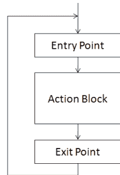

**图 1：循环的概念**

从图 1 中可以看出，循环的逻辑流表明操作块将被无限重复。为了阻止循环无限执行，我们需要引入一个控制循环执行的条件测试。入口点块和出口点块通常表示这个条件测试。

无论使用何种编程语言，循环都被分为前测循环（或入口控制循环）和后测循环（或出口控制循环）。在这两大类中，循环可以进一步分为事件控制（或哨兵事件）循环或计数器控制循环。下一个小节将讨论前测循环和后测循环。

#### 前测循环和后测循环

根据检查控制条件测试的位置，循环可以被分类为前测或后测。如果在入口点检查控制条件测试，则该循环称为前测循环。图 2 说明了前测循环的逻辑流：

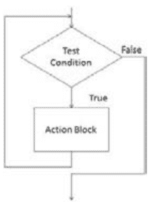

从图 2 中可以观察到，在执行操作块的任何语句之前，我们会检查条件测试。只有当条件测试评估为真时，才能进入循环。这就是前测循环也被称为入口控制循环的原因。如果条件测试评估为假，循环将终止。请注意，如果首次尝试进入循环时条件测试评估为假，前测循环的操作块将完全不执行。

后测循环与前测循环正好相反。在这里，在出口点检查控制条件测试。图 3 说明了后测循环的逻辑流：

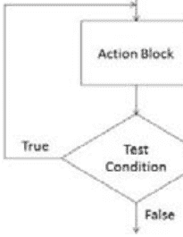

从图 3 中可以观察到，编译器将直接开始执行操作块内的第一条语句。无论条件测试的结果如何，首次进入循环都是可能的。条件测试将在出口点检查。这就是后测循环也被称为出口检查循环的原因。如果条件测试评估为真，控制流将传回操作块中的第一条语句。如果条件测试评估为假，循环将终止。请注意，无论如何，后测循环总会执行一次。

下一个小节将讨论事件控制（或哨兵）循环和计数器控制循环。

#### 计数器控制循环和事件控制循环

为了管理循环中的重复，我们需要一个循环计数器。例如，假设我们需要重复一个语句块 10 次。在这种情况下，我们需要一个变量来跟踪重复发生的次数。在循环开始时，该变量被赋值为 1。随着操作块执行的完成，该变量将通过加 1 来更新。然后条件测试将检查循环计数器的值是否等于 10。如果循环计数器的值不等于 10，循环将继续执行。如果循环计数器的值等于 10，循环将终止。前一个示例中设计的循环称为计数器控制循环。之所以称为计数器控制，是因为我们事先知道循环将执行多少次。

考虑一种情况，我们不知道循环确切执行多少次。相反，我们等待特定事件的发生。在该事件发生时，我们终止循环。这种循环被称为事件控制循环或哨兵循环。例如，假设一个程序必须不断接受用户输入的数字，直到输入数字 0 为止。在这里，用户可能在第一次迭代中输入 0；如果是这样，循环一旦开始就终止。如果用户在第五次迭代中输入 0，则循环执行五次。因此，该循环何时终止是不固定的，因为它在等待一个事件（用户输入 0）。

C 语言也支持循环结构。下一节将讨论 C 支持的循环结构。

### 7.2 C 中的循环

C 语言提供三种类型的循环结构，即 `for`、`while` 和 `do ... while`。循环结构 `for` 和 `while` 是前测循环，而 `do ... while` 是后测循环。这三个循环结构都可以用来创建计数器控制循环或事件控制循环。通常使用循环结构 `for` 来创建计数器控制循环。另一方面，事件控制循环是使用 `while` 和 `do ... while` 循环结构创建的。

接下来的小节详细讨论这些循环中每一个的用途。我们从 `for` 循环开始讨论。

#### For 循环

`for` 关键字用于构建前测循环。它通常用于需要重复执行语句固定次数的情况。`for` 语句使用三个表达式，如下面的语法所示：

for ([表达式 1] ; [表达式 2] ; [表达式 3])

动作块;

在上面的语法中，可以看到三个表达式由分号分隔。表达式 1 是循环计数器的初始化语句，表达式 2 是控制循环的测试条件语句，表达式 3 是更新循环计数器的语句。动作块包含要重复执行的单条或复合语句。请注意，上述语法中提到的所有三个表达式都是可选的，因此用方括号括起来表示。图 4 展示了 for 循环的逻辑流程：

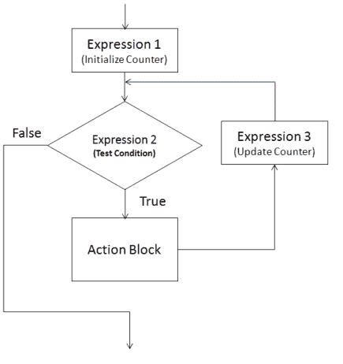

如图 4 所示，首先评估表达式 1，且它只会被评估一次。接下来，我们评估表达式 2。如果表达式 2 的评估结果为真，则进入动作块。如果表达式 2 的评估结果为假，循环终止。执行完动作块后，我们评估表达式 3。评估表达式 2、执行动作块以及评估表达式 3 的过程将循环进行，直到表达式 2 的评估结果为假为止。程序 1 说明了 for 循环的用法：

#### 程序 1

```c
/* Program to calculate the sum of numbers 1 to 10 using the for loop */
#include <stdio.h>

/* Beginning of main function */
main()
{
    /* Declare variable */
    int i_ctr, i_sum=0;

    /* Find sum of numbers 1 to 10 */
    for(i_ctr = 1 ; i_ctr <= 10; i_ctr++)
    {
        i_sum = i_sum + i_ctr;
    }

    /* Print the value of sum */
    printf("Sum of numbers 1 to 10 is %d\n", i_sum);
    return;
}
/* End of main function */
```

**输出：**

Sum of numbers 1 to 10 is 55

从程序 1 中可以看出，我们没有从用户那里获取任何输入。变量 `i_ctr` 在 `for` 循环内部初始化为 1。循环将重复 10 次，最终我们将得到 1 到 10 的数字之和。每次运行此程序，我们都会得到相同的结果（在这种情况下为 55）。让我们修改此程序，以便根据用户输入的数字获得不同的总和值。程序 2 说明了这种变化：

#### 程序 2

```c
/* Program to calculate the sum of numbers 1 to i_num using the for loop */
/* The value of i_num is accepted from user */
#include <stdio.h>

/* Beginning of main function */
main()
{
    /* Declare variable */
    int i_ctr, i_sum=0, i_num;
    
    /* Input Data */
    printf("Enter a number: ");
    scanf("%d", &i_num);

    /* Find sum of numbers 1 to i_num */
    for(i_ctr = 1 ; i_ctr <= i_num; i_ctr++)
    {
        i_sum = i_sum + i_ctr;
    }

    /* Print the value of sum */
    printf("Sum of numbers 1 to %d is %d\n", i_num, i_sum);
    return;
}
/* End of main function */
```

**输出 1：**

Enter a number: 5

Sum of numbers 1 to 5 is 15

**输出 2：**

Enter a number: 50

Sum of numbers 1 to 50 is 1275

**输出 3：**

Enter a number: 10

Sum of numbers 1 to 10 is 55

观察程序 1 和程序 2 之间的区别。在程序 2 中，我们从用户那里接收了 `i_num` 的值。该值告诉编译器循环将重复多少次。在输出 1 中，`i_num` 的值为 5；因此，我们得到 1 到 5 的数字之和。在输出 2 中，`i_num` 的值为 50；因此，我们得到 1 到 50 的数字之和；而在输出 3 中，`i_num` 的值为 10；因此，我们得到 1 到 10 的数字之和。每次输入 `i_num` 的新值，我们都会得到不同的总和值。

在之前这两个程序中，循环计数器变量的初始化都是从 1 开始的。为了更新循环计数器，我们将其加 1。程序 2 可以用另一种方式编写，我们仍然可以获得相同的结果。程序 3 说明了 for 循环用法的变更：

#### 程序 3

```c
/* Program to calculate the sum of numbers 1 to i_num using the for loop */
/* The value of i_num is accepted from user */

#include <stdio.h>

/* Beginning of main function */
main()
{
    /* Declare variable */
    int i_ctr, i_sum=0, i_num;

    /* Input Data */
    printf("Enter a number: ");
    scanf("%d", &i_num);

    /* Find sum of numbers 1 to i_num */
    for(i_ctr = i_num ; i_ctr >= 1; i_ctr--)
    {
        i_sum = i_sum + i_ctr;
    }

    /* Print the value of sum */
    printf("Sum of numbers %d to 1 is %d\n", i_num, i_sum);
    return;
}
/* End of main function */
```

**输出 1：**

Enter a number: 5

Sum of numbers 5 to 1 is 15

**输出 2：**

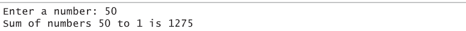

**输出 3：**

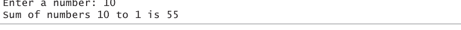

在程序 3 中可以观察到，这里的循环计数器初始化为 `i_num`，并且在更新时，其值在每次迭代中减少 1。这也影响了测试条件；现在，我们检查的条件不再是 `i_ctr <= i_num`，而是 `i_ctr >= 1`。这两个程序的结果仍然是相同的。

初学者通常会犯的一个错误是用分号终止 `for` 语句。程序 4 说明了这个错误：

#### 程序 4

```c
/* Program to print numbers from 1 to 50 using the for loop */
#include <stdio.h>
/* Beginning of main function */
main()
{
    /* Declare variable */
    int i_ctr;

    /* Print values from 1 to 50 */
    for(i_ctr = 1 ; i_ctr <= 50; i_ctr++);
    {
        printf("%02d ", i_ctr);

        if((i_ctr % 10) == 0)
            printf("\n");
    }

    return;
}
/* End of main function */
```

**输出：**

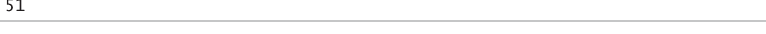


程序 4 旨在打印 1 到 50 的数字。然而，程序的输出仅为 51。导致此错误输出的原因是我们在语句 `for(i_ctr = 1 ; i_ctr <= 50; i_ctr++)` 中犯的错误。这里，我们用分号终止了 `for` 语句。在这种情况下，编译器没有产生任何错误，因为它假设 `for` 循环内部没有需要执行的语句。尽管循环内部没有执行任何语句，但循环计数器被初始化为 1，并递增 1，直到其值变为 51，此时条件 `i_ctr <= 50` 的评估结果为假。这种 `for` 循环被称为延时循环。延时循环不执行任何语句，只是初始化、检查测试条件并更新循环计数器的值。在这种情况下，用户必须小心，因为错误可能一开始并不明显。尝试通过移除分号来观察程序 4 的输出。你应该会得到与图 5 所示类似的输出：

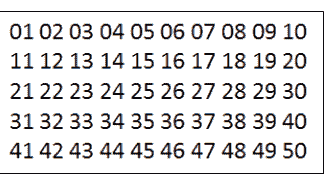

▲ 图 5：移除分号后程序 4 的输出

如前所述，`for` 循环的所有三个表达式都是可选的。程序 5 说明了如何使用不包含这三个表达式的 `for` 循环：

#### 程序 5

```c
/* Program to print sum of odd numbers and sum of even numbers of all positive numbers entered by the user, till the user enters 0 */

#include <stdio.h>
/* Beginning of main function */
main()
{
    /* Declare variable */
    int i_num, i_osum = 0, i_esum = 0;

    /* Loop with no expressions */
    for( ; ; )
    {
        /* Input Data */
        printf("Enter a number: ");
        scanf("%d", &i_num);
        /* Check if number is positive */
        if(i_num >= 0)
        {
            if(i_num)
            {
                /* Check whether number is even or odd */
                if((i_num % 2) == 0)
                    i_esum++;
                else
                    i_osum++;
            }
        }
        else
            break; /* If number is 0 terminate the loop */
    }

    /* Print total even and odd number */
    printf("Total even numbers is %d\n", i_esum);
    printf("Total odd numbers is %d\n", i_osum);
    return;
}

/* End of main function */
```

**输出 1：**

```
Enter a number: 2
Enter a number: 5
Enter a number: 7
Enter a number: 9
Enter a number: 15
Enter a number: 0
Total even numbers is 1
Total odd numbers is 4
```

**输出 2：**

```
Enter a number: -1
Enter a number: 12
Enter a number: 19
Enter a number: 80
Enter a number: 0
Total even numbers is 2
Total odd numbers is 1
```

**输出 3：**

```
Enter a number: 0
Total even numbers is 0
Total odd numbers is 0
```

在程序 5 中，我们观察到使用了不含任何表达式的语句 `for( ; ; )`。由于没有指定表达式，因此没有循环控制变量，循环而是由事件控制的。这里的事件指的是用户输入的数字 0。由于循环由事件控制，此循环成为事件控制循环。在程序 5 之前的程序中使用的所有 `for` 循环都是计数器控制的。

在输出 1 中可以观察到，循环在第六次迭代后停止；在输出 2 中，它在第五次迭代后停止；在输出 3 中，它在第一次迭代后就停止了。请注意，在输出 2 中，尽管我们输入了四个值，奇数和偶数的总和仍然为 3。输出 2 中输入的负数由于初始条件 `if(i_num >= 0)` 而未被纳入计算。

在使用 `for` 循环作为事件控制循环时，必须小心决定终止条件。在程序 5 的情况下，只有当用户输入数字 0 时，循环才会终止。当用户输入 0 时，编译器将条件 `if(i_num >= 0)` 评估为真，然后条件 `if(!i_num)` 被评估为假；因此，控制权转移到语句 `else break;`。`break` 语句终止了循环。如果用户不写 `break` 语句，循环将陷入无限序列。

从之前的讨论中可以看出，`for` 循环是一种先测循环，它可以用作计数器控制循环或事件控制循环。下一小节讨论 `while` 循环的概念。

### 当循环

当循环 `while loop` 是一种先测型循环，用于无法预先确定语句需要执行次数的场景。当循环的语法如下：

```
while (测试条件)
   动作块;
```

上述语法中提到的测试条件是一个关系表达式或一个正常量。当且仅当测试条件求值为真时，当循环的动作块才会被执行。图 6 展示了当循环的逻辑流程：

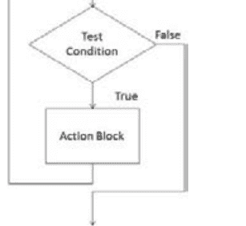

▲ **图 6：当循环的逻辑流程**

由于测试条件是在入口处进行检查的，因此当循环被视为入口控制循环。如果测试条件在第一次就被求值为假，那么循环的动作块将完全不会被执行。程序 6 展示了如何使用当循环来计算两个正数的最大公约数。

#### 程序 6

```c
/* 使用当循环计算两个正数最大公约数的程序 */

#include <stdio.h>

/* 主函数开始 */
main()
{
   /* 声明变量 */
   int i_num1, i_num2, i_remainder, i_temp;
   /* 输入数据 */
   printf("Enter the first number: ");
   scanf("%d", &i_num1);

   printf("Enter the second number: ");
   scanf("%d", &i_num2);
   /* 检查两个数是否都为正数且大于 0 */
   if((i_num1 > 0) && (i_num2 > 0))
   {
      /* 必要时交换数值 */
      if(i_num2 > i_num1)
      {
         i_temp = i_num2;
         i_num2 = i_num1;
         i_num1 = i_temp;
      }

      /* 查找最大公约数 */
      i_remainder = i_num1 % i_num2;
      printf("The greatest common divisor of %d and %d is ", i_num1, i_num2);
      while(i_remainder)
      {
         i_num1 = i_num2;
         i_num2 = i_remainder;
         i_remainder = i_num1 % i_num2;
      }

      /* 打印最大公约数 */
      printf("%d\n", i_num2);
   }
   else
   {
      printf("One or Both of the entered number is zero or negative\n");
   }
   return;
} /* 主函数结束 */
```

**输出 1：**

```
Enter the first number: 25

Enter the second number: 20

The greatest common divisor of 25 and 20 is 5
```

**输出 2：**

```
Enter the first number: 44

Enter the second number: 0

One or Both of the entered number is zero or negative
```

从程序 6 中可以观察到，当循环是一个事件控制循环。这里终止循环的事件是 `i_remainder == 0`。在程序 6 中，如果表达式 `i_remainder = i_num1 % i_num2;` 的初始求值结果为 0，则当循环根本不会执行。输出 1 给出了正确的最大公约数，而输出 2 指示了一个错误状态。

让我们来看一个当循环的另一个例子。程序 7 展示了如何使用当循环计算大于 0 的正数的阶乘。

#### 程序 7

```c
/* 使用当循环计算大于 0 的正数阶乘的程序 */
#include <stdio.h>

/* 主函数开始 */
main()
{
    /* 声明变量 */
    long l_factorial = 1;
    int i_number, i_ctr = 1;

    /* 输入数据 */
    printf ("Enter a number: ");
    scanf ("%d", &i_number);

    /* 检查数是否大于 0 */
    if(i_number > 0)
    {
        /* 计算阶乘 */
        while(1)
        {
            l_factorial = l_factorial * i_ctr;
            /* 检查计数器是否等于该数 */
            if(i_ctr == i_number)
                break;
            i_ctr++;
        }
        printf("Factorial of %d is %ld\n", i_number, l_factorial);
    }
    else
        printf("The number entered is zero or negative\n");

    return;
} /* 主函数结束 */
```

**输出 1：**

```
Enter a number: 4

Factorial of 4 is 24
```

**输出 2：**

```
Enter a number: -10

The number entered is zero or negative
```

在程序 7 中可以看到，当循环使用常量作为测试条件。使用常数值 1 的测试条件始终求值为真，因此这里的当循环变成了一个无限循环。为了终止循环，我们使用了事件 `i_ctr == i_number`。如果该条件求值为真，循环即终止。输出 1 给出了正确的阶乘值，而输出 2 指示了一个错误状态。

> 初学者程序员必须谨慎，因为他们通常犯的一个错误是用分号终止当语句。在这种情况下，编译器可能会也可能不会报错。

C 语言提供的最后一种重复结构是 `do...while` 循环。下一节将讨论 `do...while` 结构的使用。

### Do...While 循环

`do...while` 语句是一种后测型循环，其动作块至少会执行一次。测试条件总是在退出循环时进行检查。因此，它也被称为出口控制循环。`do...while` 循环的语法如下：

```
do
  动作块;
while (测试条件);
```

图 7 展示了 `do...while` 循环的逻辑流程：

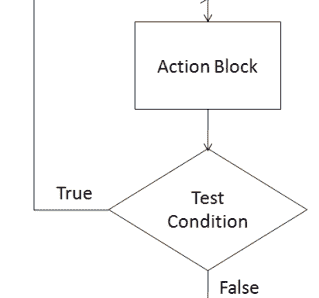

▲ **图 7：Do...While 循环的逻辑流程**

`do...while` 语句的动作块在大多数情况下是一个复合语句。如果在动作块内只使用单条语句，可能会导致无限循环。例如，请看下面给出的代码片段：

```c
do                          or          do
  printf("Hello\n");                    printf("Hello\n");
while (1);                      while (i_ctr <= 10);
```

在上述两种情况下，由于没有停止标准，循环将无限地执行下去。程序 8 展示了如何使用 `do...while` 循环来判断输入的数是否为质数：

#### 程序 8

```c
/* 使用 do...while 循环判断输入的正数是否为质数的程序 */

#include <stdio.h>
#include <math.h>

/* 主函数开始 */
main()
{
  /* 声明变量 */
  int i_number, i_divisor = 3;
  double d_limit;

  /* 输入数据 */
  printf("Enter a number: ");
  scanf("%d", &i_number);

  /* 检查数是否大于 0 */
  if(i_number > 0)
  {
    /* switch 结构开始 */
    switch(i_number)
    {
      /* 识别特殊情况 */
      case 1:
        printf("Number %d is special number\n", i_number);
        break;
      case 2:
      case 3:
        printf("Number %d is a prime number\n", i_number);
        break;
      /* 检查数是否为质数 */
      default:
        d_limit = sqrt(i_number);

        /* 检查数是否能被 2 整除 */
        if(i_number % 2 == 0)
        {
          printf("Number %d is not prime\n", i_number);
          break;
        }

        /* 检查数是否能被 3、5 等其他数字整除 */
        /* do...while 循环开始 */
        do
        {
          if(i_number % i_divisor == 0)
          {
            printf("Number %d is not prime\n", i_number);
            break;
          }
          else
            i_divisor += 2;
        }
        while(i_divisor <= (int)d_limit);
        /* do...while 循环结束 */

        if(i_divisor > (int)d_limit)
          printf("Number %d is prime number\n", i_number);
    }
    /* switch 结构结束 */
  }
  else
    printf("The number entered is zero or negative\n");
  return;
} /* 主函数结束 */
```

**输出 1：**

```
Enter a number: 1

Number 1 is special number
```

**输出 2：**

```
Enter a number: 2

Number 2 is a prime number
```

**输出 3：**

```
Enter a number: 17

Number 17 is prime number
```

**输出 4：**

```
Enter a number: 121

Number 121 is not prime number
```

**输出 5：**

```
Enter a number: -10

The number entered is zero or negative
```

在程序 8 中，我们结合了 `if` 和 `if-else` 决策结构以及 `do...while` 循环。请注意，程序中使用的 `do...while` 循环有两个退出点：第一个是测试条件 `i_number % i_divisor == 0`，第二个是测试条件 `i_divisor <= (int)d_limit`。在任一情况下，控制流都会先进入循环，然后立即转向循环后的下一条语句。请注意，要在 Linux/Unix 环境中执行上述程序，我们需要使用命令 `gcc prog7_8.c -lm`。这里的参数 `-lm` 指的是链接程序中引用的 `math.h` 文件。

`for`、`while` 和 `do...while` 这三种循环结构可以互换使用。并没有规定生成计数器控制循环必须使用 `for` 循环。同样，也不是说 `while` 或 `do...while` 循环只能用于生成事件控制循环。用户可以根据其便利性使用这些循环结构中的任意一种来设计计数器控制循环或事件控制循环。下一节将讨论嵌套循环的概念。

## 7.3 | 嵌套循环


我们在本书第 6 章中已经学习了嵌套的概念，当时讨论的是嵌套的决策结构。嵌套循环一词指的是在一个循环内使用另一个循环。嵌套循环通常在外部循环的动作块中的某一条语句本身也是一个循环时创建。因此，我们现在有了两个循环，即外部循环和内部循环。图 8 展示了嵌套 `for` 循环的一个示例：


▲ 图 8：嵌套 For 循环示例

在图 8 中可以观察到，这里有两个 `for` 循环。外层 `for` 循环由计数器 `i_octr` 控制，并在其操作块中包含一个语句，该语句本身是一个 `for` 循环。内层 `for` 循环由计数器 `i_ictr` 控制。对于 `i_octr` 的每一个实例，内层 `for` 循环都会执行一次。程序 9 展示了嵌套 `for` 循环的使用。

### 程序 9

```c
/* Program to print table of 1 and 2 using the nested for loop */
#include <stdio.h>

/* Beginning of main function */
main()
{
   /* Declare variable */
   int i_octr, i_ictr;

   for(i_octr = 1; i_octr <= 2; i_octr++)
   {
      /* Beginning of action block of outer for loop */
      printf("Table of %d\n", i_octr);
      printf("-----------\n");
      for(i_ictr = 1; i_ictr <= 10; i_ictr++)
      {
         /* Beginning of action block of inner for loop */
         printf("%2d * %2d = %2d\n", i_octr, i_ictr,
                i_octr*i_ictr);
         /* End of action block of inner for loop */
      }
      printf("\n");
      /* End of action block of outer for loop */
   }

   return;
}
/* End of main function */
```

**输出：**

```text
Table of 1
-----------
 1 *  1 =  1
 1 *  2 =  2
 1 *  3 =  3
 1 *  4 =  4
 1 *  5 =  5
 1 *  6 =  6
 1 *  7 =  7
 1 *  8 =  8
 1 *  9 =  9
 1 * 10 = 10

Table of 2
-----------
 2 *  1 =  2
 2 *  2 =  4
 2 *  3 =  6
 2 *  4 =  8
 2 *  5 = 10
 2 *  6 = 12
 2 *  7 = 14
 2 *  8 = 16
 2 *  9 = 18
 2 * 10 = 20
```

从程序 9 的输出可以观察到，对于 `i_octr` 的每一次出现，内层 `for` 循环重复执行 10 次。这意味着当 `i_octr` = 1 时，内层 `for` 循环重复 10 次；当 `i_octr` = 2 时，内层 `for` 循环也重复 10 次。请注意，内层 `for` 循环的执行总是先完成，然后控制权才转移回外层 `for` 循环。

让我们再举一个例子，以更好地理解嵌套循环的概念。程序 10 展示了使用嵌套循环在监视器上打印图案的方法：

### 程序 10

```c
/* Program to print pattern using nested loops */
# include <stdio.h>
/* Beginning of main function */
main()
{
	/* Declare variables */
	int i_row, i_temp, i_octr, i_ictr;

	/* Input data */
	/* Beginning of do...while loop */
	do
	{
		printf("Enter number of rows : ");
		scanf("%d", &i_row);

		/* Validate data */
		if(i_row <= 1)
			printf("\nEnter positive value greater than 1\n");
	}
	while(i_row <= 1);
	/* End of do...while loop */
	i_temp = i_row;

	/* Print the top pattern */
	for(i_octr=1; i_octr<=i_row; i_octr++)
	{
		/* Beginning of action block of outer for loop */
		for(i_ictr=1; i_ictr<=i_temp; i_ictr++)
		{
			/* Beginning of action block of inner for loop */
			printf("$");
			/* End of action block of inner for loop */
		}
		printf("\n");
		i_temp--;
		/* End of action block of outer for loop */
	}

	/* Print the bottom pattern */
	i_octr = 1;

	while(i_octr<=i_row)
	{
		/* Beginning of action block of outer while loop */
		i_ictr = 1;
		while(i_ictr <= i_octr)
		{
			/* Beginning of action block of inner while loop */
			printf("$");
			i_ictr++;
			/* End of action block of inner while loop */
		}

		printf("\n");
		i_octr++;
		/* End of action block of outer while loop */
	}
	return;
}
/* End of main function */
```

**输出 1：**

Enter number of rows: 4

$$$$

$$$

$$

$

$

$$

$$$

$$$$

在程序 10 中可以看到，我们使用了两种嵌套循环，即嵌套 `for` 循环和嵌套 `while` 循环。这表明 C 语言中可用的所有循环结构都可以根据需要进行嵌套。我们还可以使用两种不同的循环结构来生成嵌套循环。例如，如果在 `while` 循环的操作块中使用的可执行语句之一是 `for` 语句，我们仍然生成了一个嵌套循环。

观察程序 10 中 `do...while` 循环的使用。它被用于验证数据，使得程序接受的行值始终是一个大于或等于 1 的正值。请尝试输入一个负值来执行该程序，并观察输出结果。

循环操作块内部的执行序列再次是顺序的。有时，我们也需要改变循环内部的执行序列。下一节讨论了如何改变循环内部的执行序列。

### 7.4 改变循环中的执行控制流

为了改变循环内部的执行序列，C 语言为我们提供了四个跳转语句，如图 9 所示：


这些跳转语句是 `break`、`continue`、`return` 和 `goto`。每个跳转语句都用于改变执行序列。

`break` 和 `return` 语句已在本书讨论过的许多程序中使用过。这两个语句都用于跳出当前作用域。作用域可以是决策结构、循环结构或程序。通常，`return` 语句用于带返回值地跳出作用域，而 `break` 语句在 `switch` 结构中与 `case` 关键字一起使用。建议不要在其他构造中使用这些关键字。

在本节中，我们将讨论剩下的两个跳转语句，即 `goto` 和 `continue`。

#### Goto 语句

`goto` 语句是改变执行序列的初级语句。它用于有条件或无条件地改变执行序列。使用 `goto` 语句的语法如下：

```c
goto label;
```

在上面的语法中，术语 `label` 指的是程序中定义的标识符。标签是一种特殊的标识符，它在内存中拥有自己的命名空间。该命名空间仅存在于包含该标签的函数中；因此，标签名称可以在不同的函数中重用。标签标识符是 C 语言中唯一可以在声明之前使用的标识符。图 10 展示了使用 `goto` 语句进行的前向跳转和后向跳转。


▲ 图 10：使用 Goto 语句进行的前向和后向跳转

在图 10 中可以观察到，无条件的 `goto` 语句直接跳转到指定的标签。而在条件跳转的情况下，我们仅在满足条件时进行跳转。跳转被定义为前向跳转或后向跳转。如果执行控制流移动到 `goto` 语句下方的语句，则该跳转称为前向跳转。如果执行控制流移动到 `goto` 语句上方的语句，则该跳转称为后向跳转。由于在结构化编程中不建议使用 `goto` 语句，因此本书未包含对该主题的详细讨论。

另一种改变执行流的语句是 `continue` 语句。下一小节讨论了 `continue` 的使用。

#### Continue 语句

C 语言中的 `continue` 语句用于跳过循环中的某些语句。它跳过位于 `continue` 语句下方语句的执行。然后，执行控制流从使用 `continue` 语句的位置转移，去测试 `while` 和 `do...while` 循环中的条件。对于 `for` 循环，执行控制流转移到 `for` 循环的表达式 3（循环计数器更新语句）。图 11 说明了当我们使用 `continue` 语句时执行控制流是如何转移的：


在图 11 中可以观察到，使用 `continue` 语句的语法与 `break` 语句的语法相似。我们只需写入关键字并以分号结束即可。

请注意，在循环中使用 `break`、`continue`、`return` 和 `goto` 语句不被认为是良好的编程方式。如果这些语句出现在循环中，我们应该尝试重写程序逻辑，以便将跳转语句从程序中移除。

### 摘要

在本章中，我们学习了重复的概念。循环被归类为前测试循环和后测试循环。在前测试循环中，测试条件在进入循环时检查，而在后测试循环中，它在退出时检查。后测试循环总是至少执行一次，而前测试循环可能一次都不执行。前测试循环和后测试循环都可以由计数器或事件控制。如果循环由计数器控制，则称为计数器控制循环；如果由事件控制，则称为事件控制循环。C 语言提供了三种循环构造，即 `for`、`while` 和 `do...while`。`for` 和 `while` 循环构造是前测试循环。`do...while` 循环构造是后测试循环。最后，我们学习了嵌套循环的概念，以及如何使用 `break`、`continue`、`return` 和 `goto` 语句来改变循环内的控制流。

### 复习题

- Q1. 重复在 C 程序中的意义是什么？
- Q2. 区分前测试循环和后测试循环。
- Q3. 区分事件控制循环和计数器控制循环。
- Q4. 举例说明空语句的意义。
- Q5. 区分 `do...while` 循环和 `while` 循环。

## 六、C 程序中嵌套循环的目的是什么？

- 七、举例说明 `continue` 和 `goto` 语句的重要性。
- 八、在 `goto` 语句的语境下，你如何理解向前跳转和向后跳转？
- 九、请论证“不建议使用 `goto` 语句来改变执行控制流”这一说法。
- 十、判断以下陈述是真还是假：
    - i. 在预测试循环中，当我们退出循环时，会检查控制语句。
    - ii. 事件控制循环在控制语句中提到的事件发生时停止。
    - iii. `for( I = 0 ; ; I++ );` 是有效的 C 语句。
    - iv. `for` 循环可以替代 `do-while` 循环。
    - v. 语句 `for ( :ctr < 10 : { printf("\n %d", ctr++);} )` 是入口控制循环的一个例子。
    - vi. `for( : ; )` 循环将无限执行。
    - vii. 在 `while` 循环中，语句 `continue;` 将执行控制流转移到 `while` 循环的控制语句，但在 `for` 循环中，执行控制流转移到变量更新语句。
    - viii. 向前跳转将执行控制流转移到 `goto` 语句上方的一个语句。
    - ix. 无限循环的产生是因为控制语句内的条件永远不为真。
    - x. 我们不能在 `for` 循环内部使用 `while` 循环。

### 实践练习

- 1. 编写一个程序，找出满足 $1 + 1/2 + 1/3 + 1/4 + ... + 1/N > \text{Limit}$ 的最小 $N$ 值。`Limit` 的值由用户输入。
- 2. 编写一个程序，找出输入数字 $N$ 的最高幂次，该幂次的结果小于或等于另一个给定数字 $M$。例如，如果 $N=3$ 且 $M=11$，则答案为 2，因为 $3^2 \le 11$。
- 3. 编写一个程序，接受一个整数 $N$。计算级数 $1 + 1/2^2 + 1/3^3 + 1/4^4 + ... + 1/N^N$ 的值。
- 4. 编写一个程序，接受用户输入的整数值，直到输入 999 为止，统计输入的数字中奇数和偶数的总数（不包括 999）。
- 5. 编写一个程序，接受用户输入的整数 NUM1。接受另一个整数 NUM2，直到用户输入 0，并统计 NUM1 在 NUM2 列表中出现的总次数。
- 6. 编写一个程序，使用事件控制的 `do-while` 循环输入数字，并统计正数、零和负数的数量。
- 7. 编写一个程序，使用事件控制的 `while` 循环和 `switch` 结构来检查输入的字符是特殊字符、数字还是字母。
- 8. 编写一个程序，生成该系列的前 $N$ 个元素：aa, abc, abb, abcd, abcc, abcde。
- 9. 编写一个程序，接受一个整数 $N$。生成前 $N$ 个正奇数的序列。
- 10. 编写一个程序，接受一个整数 $N$。生成前 $N$ 个质数的序列。
- 11. 编写一个程序，接受一个整数 $N$。计算 1 到 $N$ 范围内所有偶数的和以及所有奇数的和。
- 12. 编写一个程序，接受用户输入的整数 $N$。提取并以英文显示该整数的每一位数字。例如，如果用户输入 132，则程序应显示 "one three two"。
- 13. 编写一个程序，接受一个整数 $N$。反转输入的数字并将其存储在同一个变量中。例如，如果 $N=456$，则 $N$ 的新值为 654。
- 14. 编写一个程序，接受一个整数 $N$。对输入数字的所有位求和。例如，如果 $N=470$，则 $N$ 的各位数字之和为 11。
- 15. 编写一个程序，接受一个整数 $N=9$，则打印如下所示的金字塔：
```
1
121
12321
1234321
123454321
12345654321
1234567897654321
```
金字塔应根据 $N$ 的值进行修改。对于负值，打印适当的消息。
- 16. 编写一个程序，接受一个字符 C；如果字符 C=e，则打印如下所示的金字塔：
```
a
bab
cbabc
dcbabcd
edcbabcde
```
金字塔应根据 C 的值进行修改。对于非字母字符，打印适当的消息。
- 17. 编写一个程序，接受一个整数 N；如果整数 N=5，则打印如下所示的金字塔：
```
5 5 5 5 5
4 4 4 4
3 3 3
2 2
1
```
金字塔应根据 N 的值进行修改。对于负值，打印适当的消息。
- 18. 编写一个程序，接受一个整数 N；如果整数 N=4，则打印如下所示的金字塔：
```
1
2  2
3  3  3
4  4  4  4
```
金字塔应根据 N 的值进行修改。对于负值，打印适当的消息。
- 19. 编写一个程序，打印如下所示的 Floyd 三角：
```
1
2  3
4  5  6
7  8  9  10
11 12 13 14 15
:
79...91
```
- 20. 编写一个程序，接受一个整数 N；如果整数 N=4，则打印如下所示的金字塔：
```
*
**
***
****
****
***
**
*
```
金字塔应根据 N 的值进行修改。对于负值，打印适当的消息。

## 08 函数

**目标**

- 描述结构化编程方法
- 描述 C 语言中的函数
- 描述 C 函数的分类
- 描述函数的类型
- 描述函数中的参数传递
- 描述递归函数
- 描述命令行参数
- 描述存储类
- 描述函数的优点

本书前几章讨论的程序是非常简单的程序，只有几行代码。在实际场景中，程序代码的规模非常大。例如，假设是一个银行应用程序。在银行应用程序中，程序代码量可能达到数千行。在这种情况下，如果我们创建单个代码文件，将非常难以理解、维护和管理这些代码。一种更好的编程方法是将对代码文件分解为一系列文件，从而更容易理解、维护和管理应用程序。在本章中，我们将学习结构化编程的概念。我们将学习 C 语言中的函数及其类型和分类。然后我们探索递归函数和命令行参数。我们还将学习 C 语言如何促进结构化编程，以及 C 语言程序如何以更优的方式编写。最后，我们将学习函数的优点。

### 8.1 结构化编程方法


大约 1972 年，荷兰计算机科学家 Edsger Dijkstra 推广了一种名为结构化编程的理论。该理论基于这样一个概念：要有效地解决任何问题，我们首先需要将问题分解为小部分。每个小部分被称为模块。因此，程序将由一组模块组成。要将问题分解为一组模块，我们需要对问题有一个整体视图。问题的整体视图可以通过结构图获得，这种设计结构图的方法被称为自顶向下的设计方法。我们都知道，程序由三个功能组成，即输入、处理和输出。图 1 说明了用于将单个程序分解为三个不同模块的结构图：


▲ 图 1：用于分解单个程序的结构图

在图 1 中，主程序表示解决整个问题的代码。输入模块、处理模块和输出模块位于结构图的第二层。因此，为了完成整个代码，我们必须首先编写输入模块、处理模块和输出模块的代码。一旦这些模块的代码准备就绪，我们将把它们组合在一起，形成一个单一的源代码。输入模块的工作是从用户那里获取数据；处理模块的工作是对获取的数据执行所需的操作，而输出模块则以用户期望的格式提供结果。

此处的程序执行从主程序开始。主程序随后调用输入模块，从用户那里接受数据。然后，它通过调用处理模块将数据传递给处理模块。最后，输出模块在监视器上打印信息。为了使这种方法成功，模块之间需要相互作用。两个模块之间的相互作用是通过在彼此之间传递消息来实现的。结构化编程中使用的两种消息传递机制是传递数据和传递引用。这两种方法将在本章后面讨论。下一节讨论 C 语言如何在程序内实现模块化。

## 8.2 C 语言中的函数

在 C 语言中，结构化编程的思想是通过一个称为函数的概念来实现的。一个 C 程序由一个或多个函数组成，其中必须有一个名为 `main` 的函数。每个函数实现了大问题中的特定方面。例如，名为 `input` 的函数可能接受执行程序所需的数据。C 程序的执行始终从 `main` 函数开始并结束于 `main` 函数。要执行 C 程序，操作系统调用 `main` 函数，`main` 函数在必要时可以调用其他函数。一旦 `main` 函数的工作完成，控制权将转回操作系统。

通常，函数可以接受一个或多个输入，并最多返回一个输出。有时函数可以产生不同形式的副作用。副作用是表明改变了程序状态的操作指示。例如，在表达式求值后，表达式中使用的标识符值的变化表明存在副作用。下一节讨论 C 函数的组成部分。

### C 函数的组成部分

C 函数由不同的实体组成，如函数名称、它接受的参数数量、它返回的参数数量、参数的数据类型等。图 2 显示了 C 函数的组成部分：


由图2可以看出，C函数的不同组成部分包括函数原型、调用函数、函数调用、实际参数、形式参数、返回类型和被调用函数。下一节将详细讨论C函数的组成部分。

### 函数原型

C语言不允许我们在标识符声明之前使用它。标识符的声明具有两个作用域，即全局作用域和局部作用域。如果标识符声明在C程序中所有使用到的函数之上，那么该标识符可以在其下方的所有函数中使用和修改。这样的标识符被认为具有全局作用域。同样地，标识符的作用域也可能仅限于某个函数。在这种情况下，该标识符只能在其被声明的函数中使用和修改。

函数原型向C编译器指示，在程序中定义之前，可以在主函数或任何其他函数中引用具有指定参数的函数。在大多数情况下，定义了原型的函数的可执行语句写在了主函数完成之后。例如，声明 `float add(float, float);` 指的是名为 `add` 的函数。函数 `add` 接受两个 `float` 类型的参数作为输入，并返回一个 `float` 类型的参数作为输出。C语言库中提供的大多数头文件都包含现成C函数的原型。

请注意，如果函数的可执行语句在访问之前已定义，那么我们不需要为这样的函数提供原型声明。

### 调用函数和被调用函数

一旦定义了函数，它就可以作为C程序中的普通可执行语句使用。在图2中，我们定义了两个函数，即 `main` 和 `add`。在这里，函数 `add` 在函数 `main` 中被使用，因此函数 `main` 被称为调用函数，而函数 `add` 被称为被调用函数。

当函数被调用时，执行序列控制权转移到被调用函数。在被调用函数执行完成后，执行序列控制权转移回调用函数。

### 实际参数和形式参数

在函数调用时使用的参数，有时也称为实参，被称为实际参数。当函数调用伴随执行序列控制一起发生时，编译器还将实际参数的值发送到被调用函数。被调用函数中被分配了实际参数值的标识符被称为形式参数。实际参数和形式参数可以具有相同的名称，因为它们是它们所用函数的局部变量。在图2中，语句 `result = add(num1, num2);` 是一个函数调用，`num1` 和 `num2` 是实际参数。在函数 `add` 中定义的 `float` 标识符 `num1` 和 `num2` 是形式参数。

请注意，实际参数和形式参数之间必须存在一对一的映射。任何不匹配都会导致程序的编译错误。下一节将讨论C语言中可用的不同类型的函数。

## 8.3 | C函数的分类

C语言支持大量函数来实现该语言的许多特性。例如，所有输入/输出 (I/O) 操作都是使用 `scanf`、`printf` 等C函数处理的。C语言将函数分为两类，即内置函数和用户定义函数。下一节将讨论内置C函数。

### 内置C函数

那些在C库中以编译形式预定义并已经可用的函数被称为内置C函数，通常称为库函数。一些内置C函数的例子包括 `scanf`、`printf`、`sqrt`、`isupper` 和 `strcmp`。要使用内置C函数，我们必须包含包含该函数原型的头文件。本书末尾的附录 I 列出了头文件以及其中可用的函数。

### 用户定义函数

除了C库中可用的函数外，用户还需要创建自己的函数。用户为个人使用而创建的函数被称为用户定义函数。函数 `main` 是所有可执行C程序中必需的用户定义函数。声明C函数的一般语法如下：

```text
data type  function name([data type parameter 1, ..., data type parameter n])
{
    declaration Statement
    Executable Statements
}
```

在上述语法中，每个用户定义函数都由其名称标识。函数的命名约定与C语言中变量的命名约定类似。唯一的区别在于函数中，名称后附加了一组括号。函数也有数据类型；这里的数据类型指的是函数将返回给调用函数的数据类型。如果函数只返回控制权而不返回值，则数据类型定义为 `void`。参数是可选的，但如果存在，它们指的是函数将接受的输入。每个参数都有自己独立的数据类型。这些参数被称为形式参数，它们是函数的局部变量，并且在函数外部不存在。声明语句指的是函数中使用的变量定义。可执行语句是在调用函数后将被执行的语句。程序1说明了一个使用函数来求给定正数的阶乘的C程序：

**程序 1**

```c
/* Program to illustrate user-defined function */
/* Prototype of function factorial */
/* It takes an integer-value as input */
/* Returns a long integer value as output */
long factorial(int);
#include <stdio.h>
/* Beginning of main function */
main()
{
    /* Declare variable */
    int i_number;
    long l_result;
    /* Input Data */
    printf("Enter a number : ");
    scanf("%d", &i_number);
    /* Check if number is greater than 0 */
    if(i_number > 0)
    {
        /* Call function factorial */
        l_result = factorial(i_number);
        /* Print the value of factorial */
        printf("Factorial of %d is %ld\n", i_number, l_result);
    }
    else
        printf("The number entered is zero or negative\n");
    return;
}
/* End of function main */
/* Function to calculate factorial of a positive number greater than 0 */
long factorial(int i_number)
{
    long l_result=1;
    int i_ctr;
    for(i_ctr= 1; i_ctr <= i_number; i_ctr++)
    {
        l_result = l_result * i_ctr;
    }
    return(l_result);
}
/* End of function factorial */
```

**输出 1:**

```text
Enter a number: 5
Factorial of 5 is 120
```

**输出 2:**

```text
Enter a number: -10
The number entered is zero or negative
```

由程序1可以看出，我们定义了一个函数 `factorial`，它接受一个整数值作为输入，并在处理后返回一个长整数值。注意，我们在 `main` 和 `factorial` 两个函数中都使用了变量 `i_number` 和 `l_result`。在我们继续深入之前，让我们首先了解在执行时内存是如何分配给C程序的。图3说明了在执行时为任何C程序进行的内存分配：


由图3可以看出，内存区域被分为五个部分，每个部分都有特定的用途。包含环境变量和命令行参数（稍后讨论）的上部由操作系统用于控制C程序的执行。堆栈段是每个函数的局部变量单独存储的区域。堆栈是一种具有后进先出 (LIFO) 特性的数据结构。堆栈数据结构的讨论超出了本书的范围。数据段进一步分为三个部分，称为已初始化数据段、未初始化数据段和堆。已初始化数据和未初始化数据段区域用于存储C程序中使用的全局或静态数据，而堆用于动态内存分配（在第14章中讨论）。代码段包含C程序的可执行代码。

考虑到图3的内存结构，程序1执行时的内存结构如所示在图4中：


▲ 图 4：程序 1 的内存分配

从图 4 中可以看到，当 `main` 函数被操作系统调用时，只有两个变量是活动的，即 `i_number` 和 `i_result`。`i_number` 中的值是用户在输出 1 中输入的值。当 `main` 函数调用 `factorial` 函数时，会在内存中创建另一个栈条目。此时，属于 `main` 函数的前一个栈条目变为非活动状态。在新的栈条目中，有三个变量：`i_number`、`i_result` 和 `i_ctr`。由于这些变量属于不同的栈条目，它们之间不会互相干扰。一旦 `factorial` 函数的处理完成，控制权将返回到 `main` 函数。此时，属于 `factorial` 函数的栈条目从内存中移除，而 `main` 函数的栈条目再次变为活动状态。

前图中方块内显示的值是最终值，而不是中间结果。当调用 `factorial` 函数时，`i_result` 和 `i_ctr` 的值初始为 1。然后，随着 `for` 循环的处理，`i_ctr` 的值将依次为 2、3、4 和 5，而对应的 `i_result` 值则分别为 2、6、24 和 120。当 `i_ctr` 的值变为 6 时，`for` 循环的执行停止，`factorial` 函数使用语句 `return(i_result)` 将变量 `i_result` 的值连同控制权一起返回给 `main` 函数。

C 函数根据其接收和返回的参数类型，分为四类。下一节将讨论这四类函数。

## 8.4 函数类型

根据函数是否有参数以及是否返回值，函数可能属于以下任何一种函数类型：

- 无参数且无返回值的函数

- 无参数但有返回值的函数

- 有参数且有返回值的函数

- 有参数但无返回值的函数

让我们现在详细讨论上述每种函数类型。

### 无参数且无返回值的函数

既不接收调用函数传入的任何参数，也不向调用函数返回任何值的函数，被称为无参数且无返回值的函数。在这种情况下，调用函数和被调用函数之间没有数据传递。然而，执行顺序的转移是存在的。程序 2 展示了一个无参数且无返回值的函数：

**程序 2**

```c
/* Program to illustrate the use of a function that has no parameter and
   no return value */
/* Program finds day of week for a given birth date using zeller's
   congruence */

#include <stdio.h>

/* Declare global variables */
unsigned int u_day, u_month, u_year;

/* Function to accept value form user */
void inputdata(void)
{
    do
    {
        printf("\nEnter day : ");
        scanf("%u", &u_day);
    }
    while((u_day <= 0) || (u_day > 31));
    do
    {
        printf("\nEnter month : ");
        scanf("%u", &u_month);
    }
    while((u_month <= 0) || (u_month > 12));
    do
    {
        printf("\nEnter year : ");
        scanf("%4u", &u_year);
    }
    while((u_year <= 1900) || (u_year >= 9999));
}
/* End of function inputdata */
/* Beginning of function main */

main()
{
    /* Declare local variables */
    unsigned int u_weekday;

    /* Call function inputdata */
    inputdata();

    /* Use Zeller’s formula to calculate day of week */
    u_day += u_month < 3 ? u_year-- : u_year - 2;
    u_weekday = (23 * u_month / 9 + u_day + 4 + u_year / 4 - u_year/100
    + u_year/400) % 7;

    /* Print day of week */
    switch(u_weekday)
    {
        case 1:
            printf("\nYou were born on Monday\n");
            break;
        case 2:
            printf("\nYou were born on Tuesday\n");
            break;
        case 3:
            printf("\nYou were born on Wednesday\n");
            break;
        case 4:
            printf("\nYou were born on Thursday\n");
            break;
        case 5:
            printf("\nYou were born on Friday\n");
            break;
        case 6:
            printf("\nYou were born on Saturday\n");
            break;
        default:
            printf("\nYou were born on Sunday\n");
    }
    return;
} /* End of function main */
```

输出：

```
Enter day : 
Enter month : 11
Enter year : 2004

You were born on Wednesday
```

在程序 2 中可以看到，定义了一个名为 `inputdata` 的函数。该函数既不接收任何参数，也不返回任何值。这个函数的作用是接受用户为三个变量 `u_day`、`u_month` 和 `u_year` 提供的数据值。这三个变量被定义为全局变量，因此程序中的所有函数都可以访问它们。因此，尽管值是在 `inputdata` 函数中接受的，但它们是在 `main` 函数中被处理的。请注意，在程序 2 中，`inputdata` 函数是使用语法 `void inputdata(void)` 定义的。参数列表括号中的 `void` 术语表示没有参数传递给这个函数。


也可以省略此声明，并将函数重新定义为 `void inputdata()`。函数数据类型是强制性的，因为如果我们省略它，编译器将认为它是整型。默认情况下，如果没有返回数据类型，所有函数都被视为返回一个整数值。图 5 展示了在 `main` 函数内调用 `inputdata` 函数后，执行顺序流动的变化：


从图 5 中可以看到，一旦在 `main` 函数中调用了 `inputdata` 函数，执行顺序的流动就会改变。执行控制权从函数调用点跳转到 `inputdata` 函数的起始地址。然后执行 `inputdata` 函数内的语句。一旦 `inputdata` 函数的执行完成，执行控制流通过退出点转移回 `main` 函数中位于函数调用下方的语句。然后，`main` 函数内的语句再次按顺序执行。

下一个小节讨论无参数但有返回值的函数。

## 无参数但有返回值的函数

不接收调用函数传入的任何参数，但向调用函数返回一个值的函数，被称为无参数但有返回值的函数。在这里，存在从被调用函数到调用函数的单向数据传递。程序 3 展示了一个无参数但返回值的函数：

**程序 3**

```c
/* Program to illustrate the use of a function that has no parameter but
   returns a value */
/* Program finds whether a number is prime or not */
#include <stdio.h>
#include <math.h>

/* Declare global variable */
int i_number;

/* Beginning of function */
int primo(void)
{
    /* Declare local variable */
    int i_divisor = 3;
    double d_limit;

    /* Beginning of switch structure */
    switch (i_number)
    {
        case 2:
        case 3:
            return(1);
        /* Check whether number is prime or not */
        default:
            d_limit = sqrt(i_number);
            /* Check whether number is divisible by 2 */
            if(i_number % 2 == 0)
                return(0);
            /* Check whether number is divisible by other numbers like 3,
                5 so on */
            /* Beginning of do...while loop */
            do
            {
                if( i_number % i_divisor == 0)
                    return(0);
                else
                    i_divisor += 2;
            }
            while(i_divisor <= (int)d_limit);
            /* End of do...while loop */
    }
    /* End of switch structure */
    return(1);
}
/* End of function primo */

/* Beginning of function main */
main()
{
    /* Declare local variable */
    int i_result;

    /* Accept value from user */
    printf("\nEnter a number : ");
    scanf("%d", &i_number);

    /* Check if value entered is positive */
    if(i_number > 0)
    {
        /* Call function primo */
        i_result = primo();

        /* Check the value of i_result */
        if(i_result)
            printf("\n%d is a prime number.\n", i_number);
```

### 代码片段：primo 函数的修改后代码（续）

```c
   else
      printf("\n%d is not a prime number.\n", i_number);
   }
   else
      printf("Enter a positive number.\n");
   return;
}
/* 函数 main 结束 */
```

**输出 1：**

```
Enter a number : 24
24 is not a prime number.
```

**输出 2：**

```
Enter a number : 137
137 is a prime number.
```

**输出 3：**

```
Enter a number : -17
Enter a positive number.
```

在程序 3 中可以看出，我们定义了一个名为 `primo` 的函数，该函数不从 `main` 函数接收任何参数，但会返回一个整数值。此函数的任务是判断输入的数字是否为素数。如果该数字是素数，函数 `primo` 返回整数值 1；否则，返回 0。图 6 说明了在 `main` 函数中调用 `primo` 函数后，执行流程序列的变化：


如图 6 所示，一旦在 `main` 函数中调用 `primo` 函数，执行流程序列就会发生改变。从函数调用点起的执行控制跳转到 `primo` 函数的起始地址。随后，`primo` 函数内部的语句被执行。`primo` 函数有三个出口点，这表明执行控制流可以通过三条不同的路径返回到 `main` 函数。`primo` 函数的出口点 1 和 3 随控制流一起返回值 1，而出口点 2 随控制流一起返回值 0。一旦 `primo` 函数的执行完成，执行控制流便转回 `main` 函数中发起函数调用的那条语句。`primo` 函数返回的值随后被赋值给 `main` 函数中的变量 `i_result`。随后，`main` 函数内部的语句再次按顺序执行。

许多时候，一个函数可能有多个出口点，但程序员应尽量寻找一种解决方案，使得函数内部只有一个出口点。程序 3 中的 `primo` 函数可以按照下面的代码片段进行修改，以仅生成一个出口点：

### 代码片段：primo 函数的修改后代码

```c
/* 函数开始 */
int primo(void)
{
   /* 声明局部变量 */
   int i_divisor = 3, i_flag;
   double d_limit;

   /* switch 结构开始 */
   switch (i_number)
   {
      case 2:
      case 3:
         i_flag = 1;
         break;
      /* 检查数字是否为素数 */
      default:
         d_limit = sqrt(i_number);

         /* 检查数字是否能被 2、3、5 等整除 */
         /* do...while 循环开始 */
         do
         {
            /* 检查数字是否能被 2 整除 */
            if(i_number % 2 == 0)
            {
               i_flag = 0;
               break;
            }

            /* 检查数字是否能被 3、5 等整除 */
            if( i_number % i_divisor == 0)
            {
               i_flag = 0;
               break;
            }
            else
            {
                i_divisor += 2;
            }
         } while(i_divisor <= (int)d_limit);
         /* do...while 循环结束 */

         i_flag = 1;
   }
   /* switch 结构结束 */

   return(i_flag);
}
/* 函数 primo 结束 */
```

前面的代码片段表明，函数 `primo` 中只有一个出口点。下一小节将讨论带有参数和返回值的函数。

### 带参数和返回值的函数

接受来自调用函数的输入参数，并向调用函数返回值的函数被称为带参数和返回值的函数。这里，从被调用函数到调用函数，反之亦然，存在着双向的数据传输。程序 4 说明了一个既接受参数又返回值的函数。请注意，一个函数只能返回一个值，但可以接受一个或多个参数：

#### 程序 4

```c
/* 程序说明：说明接受参数并返回值的函数的使用 */
/* 程序计算表达式结果 */
#include <stdio.h>

/* 函数 calculator 开始 */
int calculator(int i_first, int i_second, char c_operator)
{
   /* 声明局部变量 */
   int i_result;

   /* switch 结构开始 */
   /* 检查输入的选择并执行所需的运算 */
   switch(c_operator)
   {
      case '+':
         i_result =  i_first + i_second;
         break;
      case '-':
         i_result =  i_first - i_second;
         break;
      case '*':
         i_result =  i_first * i_second;
         break;
      case '/':
         if(i_second == 0)
            i_result = -999;
         else
            i_result =  i_first / i_second;
         break;
      case '%':
         i_result = i_first % i_second;
         break;
      default:
         i_result = -999;
   }
   /* switch 结构结束 */
   return(i_result);
}
/* 函数 calculator 结束 */

/* 函数 main 开始 */
int main()
{
   /* 声明局部变量 */
   int i_first, i_second, i_result;
   char c_operator, c_temp;
   /* 输入数据 */
   printf("Enter first number : ");
   scanf("%d", &i_first);
   c_temp = getchar();
   printf("\nEnter second number : ");
   scanf("%d", &i_second);
   c_temp = getchar();
   printf("\nEnter the operator : ");
   scanf("%c", &c_operator);

   /* 调用函数 calculator */
   i_result = calculator(i_first, i_second, c_operator);

   if(i_result != -999)
      printf("\nThe result of operation %d %c %d is %d\n", i_first, c_operator, i_second, i_result);
   else
      printf("\nIncorrect mathematical operator or division by zero error.\n");
   return 0;
}
/* 函数 main 结束 */
```

**输出 1：**

```
Enter first number : 25
Enter second number : 5
Enter the operator : *
The result of operation 25 * 5 is 125
```

**输出 2：**

```
Enter first number : 50
Enter second number : 5
Enter the operator : ?
Incorrect mathematical operator or division by zero error.
```

在程序 4 中可以看出，我们定义了一个名为 `calculator` 的函数，该函数从 `main` 函数接收三个参数作为输入，即两个整数值和一个字符值。它还向 `main` 函数返回一个整数值。此函数的任务是作为一个简单的计算器，对输入的两个整数参数执行给定的数学运算。如果数学运算成功执行，则函数返回 `i_result` 的值。如果操作不成功，`i_result` 被赋值为 -999，然后返回该值。图 7 说明了在 `main` 函数中调用 `calculator` 函数后，执行流程序列的变化：


**图 7：调用 calculator 函数后的执行序列**

如图 7 所示，一旦在 `main` 函数中调用 `calculator` 函数，执行流程序列就会发生改变。从函数调用点起的执行控制跳转到 `calculator` 函数的起始地址。与程序 2 和 3 相比，执行过程发生了变化。在程序 4 中，除了控制转移外，编译器还会将变量 `i_first`、`i_second` 和 `c_operator` 的值发送到 `calculator` 函数。这些值随后被赋值给 `calculator` 函数的局部变量 `i_first`、`i_second` 和 `c_operator`。然后，`calculator` 函数内部的语句被执行。一旦 `calculator` 函数的执行完成，执行控制流便转回 `main` 函数中发起函数调用的那条语句。`calculator` 函数返回的值随后被赋值给 `main` 函数中的变量 `i_result`。随后，`main` 函数内部的语句再次按顺序执行。

请注意，当使用接受参数的函数时，程序员需要映射函数中使用的参数数量以及参数数据类型的顺序。例如，`calculator` 函数定义如下：

```
int calculator(int i_first, int i_second, char c_operator);
```

上述语法表明，在调用函数时，`calculator` 函数需要三个参数。需要牢记的下一个条件是，前两个参数应为整数类型，第三个参数应为字符类型。在函数调用时，必须同时满足这两个条件。在程序 4 中，语句 `i_result = calculator(i_first, i_second, c_operator);` 调用了函数 `calculator`，这里使用的三个参数被称为实际参数。由于所需参数数量及数据类型顺序正确，程序运行正常。函数 `calculator` 也可以按如下方式调用：

```
i_result = calculator(i_second, i_first, c_operator);
```

如果使用上述语法中的调用，程序 4 仍会正常运行。在此处，我们指定了三个参数，其中前两个是整数类型，第三个是字符类型。对于乘法或加法运算符，上述两次调用的结果将保持相同，但对于其他所有运算符，结果会有所不同。图 8 展示了上述两次调用中发生的变化：


从图 8 中可以看出，在情况 1 中，在调用函数 `calculator` 之后，函数 `main` 中的变量 `i_first` 与函数 `calculator` 中的变量 `i_first` 进行映射。同样，`i_second` 与 `i_second` 映射，`c_operator` 与 `c_operator` 映射。在情况 2 中，尽管映射关系发生了变化，但这里函数 `main` 中的变量 `i_first` 映射到函数 `calculator` 中的变量 `i_second`；同样，变量 `i_second` 映射到 `i_first`，`c_operator` 映射到 `c_operator`。

### 表 2：情况 1 下的函数调用结果

| 函数 main 中实际参数的值 | | | 函数 calculator 中形式参数的值 | | | 按情况 1 调用 |
|---|---|---|---|---|---|---|


| `i_first` | `i_second` | `c_operator` | `i_first` | `i_second` | `c_operator` | `i_result` |

| 45 | 25 | + | 45 | 25 | + | 70 |

| 45 | 25 | - | 45 | 25 | - | 20 |

| 45 | 25 | * | 45 | 25 | * | 1125 |

| 45 | 25 | / | 45 | 25 | / | 1 |

| 45 | 25 | % | 45 | 25 | % | 20 |

表 3 展示了当函数调用按情况 2 进行时，程序 4 的输出结果：

### 表 3：情况 2 下的函数调用结果

| 函数 `main` 中实际参数的值 | | | 函数 `calculator` 中形式参数的值 | | | 按情况 2 调用 |

|---|---|---|---|---|---|---|

| `i_first` | `i_second` | `c_operator` | `i_first` | `i_second` | `c_operator` | `i_result` |

| 45 | 25 | + | 25 | 45 | + | 70 |

| 45 | 25 | - | 25 | 45 | - | -20 |

| 45 | 25 | * | 25 | 45 | * | 1125 |

| 45 | 25 | / | 25 | 45 | / | 0 |

| 45 | 25 | % | 25 | 45 | % | 25 |

从表 2 和表 3 可以看出，在情况 1 和情况 2 中，减法、除法和取模运算符的结果是不同的。下一小节将讨论带有参数且无返回值的函数。

#### 带有参数且无返回值的函数

接受调用函数传入的输入参数但不向调用函数返回值的函数，被称为带有参数且无返回值的函数。在此，数据是从调用函数到被调用函数的单向传输。程序 5 展示了一个接受参数但不返回值的函数：

#### 程序 5

```c
/* Program to illustrate the use of a function that takes parameter but does not return value */
/* Program prints the Fibonacci series 0 1 1 2 3 .... */

#include <stdio.h>

/* Beginning of function fibonacci */
void fibonacci(int i_number)
{
    /* Declare local variables */
    int i_fibo1 = 0, i_fibo2 = 1, i_fibo3;
    /* Beginning of switch */
    switch(i_number)
    {
        case 1:
            printf("\n%d  ", i_fibo1);
            break;
        default:
            printf("\n%d  %d  ", i_fibo1, i_fibo2);
            while(i_number > 2)
            {
                /* generate new term */
                i_fibo3 = i_fibo1 + i_fibo2 ;

                /* swap values */
                i_fibo1 = i_fibo2;
                i_fibo2 = i_fibo3;

                /* print fibonacci number */
                printf("%d  ", i_fibo3 );

                i_number--;
            }
    }
    /* End of switch */
}
/* End of function fibonacci */

/* Beginning of function main */
main()
{
    /* Declare local variables */
    int i_number;

    /* Accept value from user */
    printf("\nEnter number of elements required in fibonacci series : ");
    scanf("%d", &i_number);

    /* Check if value entered is positive */
    if(i_number > 0)
        fibonacci(i_number);
    else
        printf("Enter a positive number.\n");
        return;
}
/* End of function main */
```

**输出：**

```
Enter number of elements required in fibonacci series : 6
0   1   1   2   3   5
```

从程序 5 中可以看出，我们定义了一个名为 `fibonacci` 的函数，它从函数 `main` 接收一个整数参数作为输入。函数 `fibonacci` 不向函数 `main` 返回任何值。函数 `fibonacci` 的作用是根据用户输入的元素数量生成斐波那契数列。图 9 展示了在函数 `main` 中调用函数 `fibonacci` 后，执行序列流发生的变化：


> 图 9：调用函数 `fibonacci` 后的执行序列

从图 9 中可以看出，一旦在函数 `main` 中调用了函数 `fibonacci`，执行序列流就会发生改变。从函数调用点开始，执行控制跳转到函数 `fibonacci` 的起始地址。在这里，除了控制转移外，编译器还将变量 `i_number` 的值发送给函数 `fibonacci`。该值随后被赋值给函数 `fibonacci` 的局部变量 `i_number`。然后执行函数 `fibonacci` 内部的语句。一旦函数 `fibonacci` 的执行完成，执行控制流便转移回函数 `main` 中发起函数调用的语句。接着，函数 `main` 内部的语句再次按顺序执行。

你肯定已经观察到，在上一节讨论的四种类型的函数中，有两种函数类型从调用函数接受参数。下一节将讨论函数中参数传递的概念。

### 8.5 函数中的参数传递

从程序 4 和程序 5 中可以看出，这两个程序都从函数 `main` 接受参数。这些参数具有 `int`、`float`、`char`、`struct` 和 `union` 等数据类型。函数的参数也可能是一个函数调用。传递给被调用函数的实际内容可以是变量的值或变量的地址。根据传递的内容不同，C 语言中有两种参数传递机制，即按值传递（pass by value）和按地址传递（pass by address）。下一小节将讨论按值传递机制。

#### 按值传递机制

如果调用函数将变量的值作为内容传递给被调用函数，则称为使用了按值传递的概念。当调用函数将一个变量的值传递给被调用函数时，编译器会将传递的值分配给被调用函数的一个适当的局部变量。一旦完成此赋值操作，调用函数中参数的原始值就被屏蔽，直到函数调用处理结束前都不能被修改。然后所有操作都使用被调用函数的局部变量进行。由于按值传递技术保护了调用函数中变量的数据，因此它是首选的参数传递方式。程序 4 和程序 5 都使用了按值传递技术来传递参数。下一小节将讨论按地址传递技术。

#### 按地址传递机制

有时，有必要将调用函数中变量的引用传递给被调用函数。传递引用会在实际参数和对应的形式参数之间建立直接链接。当被调用函数更改形式参数的值时，这种更改实际上会修改实际参数的值。像 C++ 这样的编程语言将此技术称为按引用传递（pass by reference）。C 语言实际上并不直接支持按引用传递。在 C 语言中，为了传递引用，我们实际上传递的是变量的地址。这种由调用函数向被调用函数传递变量地址的技术称为按地址传递。按地址传递技术使用了在第 3 章中学到的指针概念。程序 6 展示了按地址传递技术的使用。

#### 程序 6

```c
/* Program to illustrate the use of pass by address */
/* Program swaps the values of two integers */
#include <stdio.h>
/* Beginning of function swap */
void swap(int *i_first, int *i_second)
{
    /* Declare local variables */
    int i_temp;
    /* Swap values */
    i_temp = *i_first;
    *i_first = *i_second;
    *i_second = i_temp;
}
/* End of function swap */
/* Beginning of function main */
main()
{
    /* Declare local variables */
    int i_first, i_second;
    /* Accept value from user */
    printf("\nEnter first number: ");
```

`scanf("%d", &i_first);`

`printf("\n请输入第二个数字：");`

`scanf("%d", &i_second);`

/* 调用 `swap` 函数 */

`swap(&i_first, &i_second);`

/* 打印新值 */

`printf("\n第一个数字的新值是 %d。\n", i_first);`

`printf("\n第二个数字的新值是 %d。\n", i_second);`

`return;`

} /* `main` 函数结束 */

**输出：**

请输入第一个数字：75

请输入第二个数字：50

第一个数字的新值是 50

第二个数字的新值是 75。

从程序 6 中可以看出，我们定义了一个名为 `swap` 的函数，它接收两个指针变量作为参数。`swap` 函数不向 `main` 函数返回任何值。`swap` 函数的作用是交换在 `main` 函数中使用的变量 `i_first` 和 `i_second` 的值。图 10 说明了 `main` 函数和 `swap` 函数的栈帧：


从图 10 中可以看出，当操作系统调用 `main` 函数时，`main` 函数的两个局部变量在内存中创建。当在 `main` 函数中调用 `swap` 函数时，内存中总共创建三个局部变量，即 `i_first`、`i_second` 和 `i_temp`。`swap` 函数中的变量 `i_first` 和 `i_second` 被赋值 `0x2000` 和 `0x2006`。这些值是 `main` 函数中变量的地址。当处理 `swap` 函数时，我们取消引用这些地址值并交换 `main` 函数中的实际内容。图 11 说明了值的最终交换过程：


使用按地址传递机制时，程序员必须谨慎，因为程序逻辑中的微小问题可能导致正在运行的程序崩溃或产生非预期的结果。下一节讨论函数中的递归概念。

### 8.6 递归函数

递归是 C 语言结构化编程中的一个主要概念。根据某些条件反复调用自身的函数被称为递归函数。这简单地意味着，设计的函数中可执行语句之一是对其自身的调用。递归用于将复杂问题分解为最简单的单一解决方案。因此，递归函数只能给我们最简单的可能解。大多数本质上是迭代的问题都可以通过递归来解决。然而，迭代和递归仍然是两个不同的实体。程序 7 说明了一个递归函数，该函数计算一个数的幂值：

### ▶ 程序 7

```c
/* Program to illustrate recursive function */
#include <stdio.h>
/* Beginning of function raistopower */
int raisetopower(int i_number, int i_power)
{
if(i_power == 0)
    return (1);
else
    return (i_number * raisetopower(i_number, i_power - 1));
}
/* End of function raisetopower */
/* Beginning of function main */
main()
{
/* Declare local variables */
int i_number, i_power, i_result;
/* Accept value from user */
printf("\nEnter the number: ");
scanf("%d", &i_number);
printf("\nEnter the power: ");
scanf("%d", &i_power);
/* Check if power is positive or not */
if(i_power > 0)
{
/* Call function raisetopower */
i_result = raisetopower(i_number, i_power);
printf("\nThe number %d raised to the power of %d is %d.\n",
       i_number, i_power, i_result);
}
else
    printf("\nCalculation for negative power is not performed.\n");
return;
}
/* End of function main */
```

##### 输出 1：

请输入数字：3

请输入幂：2

数字 3 的 2 次幂是 9。

##### 输出 2：

请输入数字：-5

请输入幂：3

数字 -5 的 3 次幂是 -125。

##### 输出 3：

请输入数字：9

请输入幂：-2

不执行负幂的计算。

从程序 7 中可以看出，我们定义了一个名为 `raisetopower` 的函数，它从 `main` 函数接收两个整型参数值作为输入。它还向 `main` 函数返回一个整数值。这个函数的作用是计算一个整数数的幂值。`raisetopower` 函数是一个递归函数。观察函数的最后一条语句，即 `return (i_number * raisetopower(i_number, i_power - 1));`。在此语句中，再次调用 `raisetopower` 函数。图 12 说明了程序 7 中函数递归的工作方式：


**图 12：递归函数调用**

从图 12 中可以看出，`main` 函数中一次 `raisetopower` 函数的调用递归地产生了另外两次调用。可以看出，在处理完第 3 次调用之前，我们无法向调用函数返回任何值。一旦第 3 次函数调用接收到值 1，其执行即完成。同样，第 2 次函数调用接收到值 3，最后，第 1 次函数调用接收到值 9，该值被赋值给变量 `i_result`。图 12 中显示的符号表示，在返回值之后，该函数从栈中移除。

递归函数可以有效地用于解决那些解可以用重复应用相同解来表示的问题。使用递归函数还可以减少程序代码的大小，使程序看起来更简单。递归函数的唯一缺点是内存需求。每次调用时，递归函数的内存内容都会被复制。用户应先开始使用程序的迭代解决方案，然后再尝试将其转换为递归解决方案。

下一节讨论称为命令行参数的概念。

## 8.7 **命令行参数**

纵观本书，你会发现所有可执行的 C 程序都有一个 `main` 函数。`main` 函数是程序的入口点，由执行程序的环境（操作系统）调用。我们已经提到，函数可以接受来自调用函数的参数。`main` 函数也是如此。`main` 函数也可以接受参数：接受的参数通常是通过环境输入的。这些参数通常被称为命令行参数。要将命令行参数传递给 `main` 函数，需要从操作系统的命令提示符运行程序。

到目前为止，我们使用 `main()` 或 `int main()` 语法定义了 `main` 函数；要使用命令行参数，我们需要使用如下语法：

`int main(int argc, char *argv[])`

在上面的语法中，参数 `argc` 是一个整型变量，指向传递的命令行参数的数量。`argc` 的最小值始终为 1，通常指程序名称。参数 `argv` 是一个字符指针数组（概念在第 9 章中详细讨论）。程序 8 说明了命令行参数的使用；

### **程序 8**


```c
/* Program to illustrate command line arguments */
#include <stdio.h>
#include <string.h>

/* Beginning of function main */
main(int argc, char *argv[]) 
{ 
    /* Declare local variables */
    int i_octr, i_length, i_maxlength;
    int i_strindex = 1;

    /* Check number of command line arguments */
    if(argc > 1) 
    { 
        /* Find maximum length string */
        i_maxlength = strlen(argv[1]);
        
        for(i_octr = 2; i_octr <= argc; i_octr++)
        {
            i_length = strlen(argv[i_octr]);
            
            if(i_length >= i_maxlength)
            { 
                i_maxlength = i_length;
                i_strindex = i_octr;
            }
        }
    }
    
    /* Print the last string with maximum length */
    printf("The string %s is the longest.\n", argv[i_strindex]);
    return 0;
}
```

从程序 8 中可以看出，我们在 `main` 函数中使用了命令行参数。该程序检查作为命令行参数提供的字符串的长度，以识别具有最大长度的字符串。如果列表中有多个具有最大长度的字符串，则序列中最后一个字符串被视为具有最大长度。请注意，我们没有为该程序提供任何输出。程序 8 不能直接从任何集成开发环境 `IDE` 运行，而必须从命令提示符执行。图 13 显示了在磁盘操作系统 `DOS` 以及 `Linux/UNIX` 环境中执行程序的语法，以及将生成的输出：


从图 13 中可以看出，我们输入了可执行文件的名称（在 `DOS` 情况下是 `prog8_8.exe`，在 `Linux/UNIX` 情况下是 `prog8_8.o`）以及一些名称。所有这些名称加上可执行程序的名称都是参数 `argv` 的内容。在 `DOS` 环境中，`argv[0]` 存储值 *prog8_8.exe*，`argv[1]` 存储值 *navya*，等等。存储在 `argv[5]` 中的最后一个值是 *vidita*。在 `DOS` 环境中，`argc` 的值等于 6。在 `Linux/UNIX` 环境中，`argc` 的值等于 4，参数 `argv` 的内容也不同，如图 13 所示。

请注意，`argc` 和 `argv` 是变量名；因此，在函数定义中并没有强制要求使用相同的名称。例如，`int main(int l_num, char *c_vector[])` 也是一个有效的定义。

在本章中，我们讨论了变量的两个作用域：全局作用域和局部作用域。全局变量可被所有函数访问，而局部变量则受限于定义它们的函数。C 语言还提供了存储类说明符，用于定义变量将存储在哪里以及它会有什么属性。下一节将讨论存储类说明符。

### 8.8 存储类

C 变量存储在内存和中央处理器 `CPU` 寄存器中。用户可以在变量声明时使用存储类作为前缀，来指定他们希望存储变量的位置。C 语言为我们提供了四种存储类说明符，分别是自动 `automatic`、外部 `external`、寄存器 `register` 和静态 `static`。让我们逐一讨论它们。

#### 自动变量

默认情况下，所有变量的存储类都是自动的。若要明确将变量的类定义为自动，我们使用关键字 `auto`。以下语法允许我们为变量定义自动存储类：

```
auto data type identifier;
```

例如，定义 `auto char c_choice;` 表示变量 `c_choice` 的类型是字符，其存储类是自动的。存储类定义为 `auto` 的变量在函数被调用时自动创建，并在函数将控制权交回调用函数时销毁。这些变量存储在内存中，并且默认被赋予一个垃圾值。

#### 外部变量

编程的模块化方法有时需要程序员在两个函数或程序之间共享一个变量。外部存储类允许我们在两个不同的函数或程序之间共享变量。必须至少在一个程序中将该变量定义为全局变量。在其他程序中，我们可以使用关键字 `extern` 来访问该变量。以下语法允许我们为变量定义外部存储类：

```
extern data type identifier;
```

例如，定义 `extern float f_average;` 表示变量 `f_average` 的类型是浮点型，其存储类是外部。变量前面的 `extern` 向编译器传达信息，使其在其他包含的程序中查找该变量的实际定义。外部变量的默认值为零，它们存储在内存中。

#### 寄存器变量

计数控制的循环有时需要一个计数变量来检查正在执行的是哪一次迭代。如果计数变量存储在内存中，访问这些变量就会变慢。为了快速访问变量，我们可以将变量存储在 `CPU` 寄存器中。C 语言为此目的提供了一个名为 `register` 的存储类。以下语法允许我们为变量定义寄存器存储类：

```
register data type identifier;
```

例如，定义 `register int i_ctr;` 表示变量 `i_ctr` 的类型是整型，其存储类是寄存器。寄存器类变量仅在其定义的函数区域内可访问。只要函数处于活动状态，它们就存在。寄存器类变量默认被赋予垃圾值。

#### 静态变量

目前讨论的三种存储类都会在内存中创建临时变量。静态存储类变量在定义时会在指定区域内被创建为永久变量。静态存储类变量永久存储在内存中，并且默认被赋予值零。以下语法允许我们为变量定义静态存储类：

```
static data type identifier;
```

例如，定义 `static int i_result;` 表示变量 `i_result` 的类型是整型，其存储类是静态。如果用作函数的局部变量，这些变量可以在函数内部使用，并且在函数调用之间保留它们之前持有的值。表 4 列出了本章讨论的四种存储类的主要属性：

**表 4：存储类变量的属性**

| 存储类 | 关键字 | 可访问范围 | 存在时间 | 存储位置 | 默认值 |
| :--- | :--- | :--- | :--- | :--- | :--- |
| 自动 | `auto` | 在其定义的代码块内可访问 | 从函数被调用开始直到函数完成 | 内存 | 垃圾值 |
| 外部 | `extern` | 在多个程序内可访问 | 从程序开始直到程序完成 | 内存 | 零 |
| 寄存器 | `register` | 在其定义的代码块内可访问 | 从函数被调用开始直到函数完成 | CPU 寄存器 | 垃圾值 |
| 静态 | `static` | 在其定义的代码块内可访问 | 从函数被调用开始直到函数完成 | 内存 | 零 |

### 8.9 函数的优点

用户可以为一个拥有 50 行代码长度的程序创建单个函数。然而，如果程序的代码长度超过 50 行，仅使用单个函数可能会导致问题。程序可能变得太大且复杂，从而使得维护程序变得困难。测试和调试程序也变得困难。测试是审查和执行程序以发现错误的过程。调试是定位和纠正程序中存在的错误的过程。在程序中使用函数提供了以下优点：

- 提高程序的可读性。
- 允许我们遵循编程的结构化方法。
- 使程序的理解和维护变得容易。
- 由于我们只需要处理有问题的函数，而不是整个程序源代码，因此调试问题变得容易。
- 函数一旦编写完成，就可以用来创建用户自定义库，从而允许函数被多次使用。

### 摘要

在本章中，我们学习了编程的结构化方法。我们观察到 C 语言如何通过函数允许我们使用结构化方法。我们还学习了 C 函数的各种组件，如函数原型、函数定义、被调函数、调用函数、实际参数和形式参数。C 语言中的函数被分为两类，即库函数和用户定义函数。无论类别如何，都有四种类型的函数，即无参数且无返回值的函数、无参数但有返回值的函数、有参数且有返回值的函数，以及有参数但无返回值的函数。我们还学习了 C 函数使用两种参数传递技术，即值传递 `pass by value` 和地址传递 `pass by address`。然后，本章涵盖了递归函数和命令行参数的使用。最后，我们讨论了四种存储类，即自动、外部、静态和寄存器。

### 复习题

- Q1. 列出并解释 C 程序的不同组件。
- Q2. 形式参数和实际参数之间的区别是什么？
- Q3. 函数原型的重要性是什么？
- Q4. 区分用户定义函数和内置函数。
- Q5. 当函数不返回任何内容时，为什么将 `void` 写为返回类型很重要？
- Q6. 简要解释参数传递的值传递机制。
- Q7. 简要解释参数传递的地址传递机制。
- Q8. 解释递归函数的意义。
- Q9. 命令行参数的用途是什么？
- Q10. 解释存储类的意义。
- Q11. 为什么寄存器变量是有用的？
- Q12. 解释外部变量的用途。
- Q13. 判断下列陈述是真还是假：
    i. C 函数可以返回多个值。
    ii. 如果未指定函数的返回值，它将返回一个整数值。
    iii. 每个函数都应该有一个返回值。
    iv. 在参数传递的地址传递机制中，我们传递变量的值。
    v. 我们需要在被调函数中有一个指针来接受从调用函数传递的地址。

### 实践练习

- Q1. 编写一个程序，使用函数 `digit(N, k)`，返回数字 `N` 从右边开始的第 `k` 位数字的值。
- Q2. 编写一个程序，使用一个函数来检查输入的三位数是否是回文数。
- Q3. 编写一个程序，使用一个名为 `binary` 的函数将十进制数转换为其二进制等价数。
- Q4. 编写一个程序，使用一个名为 `octal` 的函数将十进制数转换为其八进制等价数。
- Q5. 编写一个程序，使用一个名为 `decimal` 的函数将十六进制数转换为其十进制等价数。
- Q6. 编写一个程序，包含两个 C 函数，即函数 `upow(x)` 和 `fact(n)`。
- Q7. 编写一个程序，使用递归函数 `fibo` 生成包含 `N` 个元素的斐波那契数列。
- Q8. 编写一个程序，使用递归函数 `fact` 来求给定数字 `N` 的阶乘。
- Q9. 编写一个程序，使用一个函数返回序列 1,3,5,7 中的下一个元素。使用静态变量。
- Q10. 编写一个程序，对从命令行传递过来的数值数据进行排序。
- Q11. 编写一个程序，找出通过命令行传递的数据中的最大数。
- Q12. 编写一个程序，计算通过命令行传递的数的平均值。

## 09 数组

### 目标

- 什么是数组
- 描述数组的维度

在前面的章节中，我们学习了如何在 C 语言中使用基本数据类型，如 `int`、`char`、`float` 等。这些数据类型被用于定义单个变量。有时，单个变量无法满足我们的需求。C 语言提供了派生数据类型的概念来解决这个问题。在本章中，我们将讨论一种称为数组的派生数据类型。

### 9.1 什么是数组

如前所述，管理独立的变量始终是一个问题。C 语言允许我们使用现有的基本数据类型创建数据结构。数组就是这样一种数据结构。数组被定义为具有相同数据类型、在内存中一个接一个存储的元素序列，并通过共同的名字引用。图 1 展示了数组变量以及其他变量的内存表示：


从图 1 中可以看出，一组变量构成了一个被标识为 `Marks` 的块。由于元素按顺序一个接一个地存储，这种内存分配被称为连续内存分配。这里的 `Marks` 代表一个具有七个元素的数组。每个元素都具有相同的数据类型。

由于整个块通过名称 `Marks` 引用，C 编译器需要一种机制来标识该块内的各个元素。为了标识块中的每个元素，使用索引值。C 语言中的索引值从零开始。因此，数组 `Marks` 的元素被标识为 `Marks[0]`、`Marks[1]`、`Marks[2]`、`Marks[3]`、`Marks[4]`、`Marks[5]` 和 `Marks[6]`。

### 9.2 数组的维度

C 将数组分类为一维数组和多维数组。一维数组有一行，而多维数组有多行和多列。

- **一维数组**

声明一维数组的语法如下：

`data type identifier[size];`

例如，`float f_marks[10];` 定义变量 `f_marks` 为一个数组，该数组能够存储 10 个浮点值。

数组一旦定义，可以在编译时或运行时初始化。在编译时初始化数组的语法如下：

```
data type identifier[size] = { value 1, value 2, ......., value n };
or
data type identifier [ ] = { value 1, value 2, ......., value n };
```

▶ **程序 1**

```c
/* Program to illustrate the use of array */
#include<stdio.h>
/* Beginning of main function */
main()
{
/* Declare variables */
int i_ctr;
float f_marks[10]={55.75,50.25,75.55,65,75.85};
/* Print the values in array */
printf("Elements of array\n");
for(i_ctr = 0; i_ctr < 10; i_ctr++)
printf("\nValue of element number %d is %.2f\n",i_ctr+1,f_marks[i_ctr]);
return;
}
/* End of function main */
```

**输出：**

```
Elements of array
Value of element number 1 is 55.75
Value of element number 2 is 50.25
Value of element number 3 is 75.55
Value of element number 4 is 65.00
Value of element number 5 is 75.85
Value of element number 6 is 0.00
Value of element number 7 is 0.00
Value of element number 8 is 0.00
Value of element number 9 is 0.00
Value of element number 10 is 0.00
```

▶ **程序 2**


```c
/* Program to illustrate the use of array */

#include<stdio.h>
#define MAX 25

/* Beginning of main function */
main()
{
   /* Declare variables */
   int i_ctrl, i_num;
   int i_array[MAX];

   /* Read Data */
   printf("Number of elements in array: ");
   scanf("%d",&i_num);

   for(i_ctrl = 0; i_ctrl < i_num ; i_ctrl++)
   {
      printf("\nElement %d: ",i_ctrl + 1);
      scanf("%d",&i_array[i_ctrl]);
   }

   /* Print Data */
   for(i_ctrl = 0; i_ctrl < i_num ; i_ctrl++)
   printf("Value of element number %d is %d\n",i_ctrl+1,i_array[i_ctrl]);
   return;
}
/* End of function main */
```

**输出：**

```text
Number of elements in array: 5

Element 1: 55
Element 2: 27
Element 3: -19
Element 4: 39
Element 5: 12

Value of element number 1 is 55
Value of element number 2 is 27
Value of element number 3 is -19
Value of element number 4 is 39
Value of element number 5 is 12
```

在程序 2 中，我们定义了大小为 `25` 的数组。当输入数据时，我们只使用了其中的五个。这在大多数应用中是正常情况。此外，C 编译器不检查数组边界。边界需要由程序员处理。例如，如果程序员定义了大小为 `5` 的数组，而用户向其中读取了 `10` 个值，在这种情况下，编译器仅会在编译时初始化时生成错误。然而，对于运行时初始化，它不会生成任何错误。在这种情况下，用户需要小心，因为读取额外元素可能会覆盖程序的合法变量。程序 3 说明了数组边界的示例：

▶ **程序 3**

```c
/* Program to illustrate the use of array */

#include<stdio.h>
#define MAX 5

/* Beginning of main function */
main()
{
   /* Declare variables */
   int i_ctr;
   int i_array[MAX];

   /* Read data */
   printf("Enter values\n");
   for(i_ctr = 0; i_ctr < 10 ; i_ctr++)
   {
      printf("\nElement %d", i_ctr + 1);
      scanf("%d",&i_array[i_ctr]);
   }

   /* Print Data */
   printf("Array Elements\n");
   for(i_ctr = 0; i_ctr < 10 ; i_ctr++)
   printf("\nValue of element number %d is %d\n",i_ctr+1,i_array[i_ctr]);
}
```

# C 语言编程：数组

#### 程序 3

```c
return;
}
/* End of function main */
```

**输出：**

- 输入数值：
  - 元素 1：45
  - 元素 2：57
  - 元素 3：23
  - 元素 4：45
  - 元素 5：90
  - 元素 6：85
  - 元素 7：34
  - 元素 8：32
  - 元素 9：67
  - 元素 10：45

**数组元素**

- 第 1 个元素的值为 45
- 第 2 个元素的值为 57
- 第 3 个元素的值为 23
- 第 4 个元素的值为 45
- 第 5 个元素的值为 90
- 第 6 个元素的值为 85
- 第 7 个元素的值为 34
- 第 8 个元素的值为 32
- 第 9 个元素的值为 67
- 第 10 个元素的值为 45

在程序 3 中，我们定义了一个大小为五的数组。用于读取数据的循环迭代了 `10` 次，因此，我们不仅读取了 `5` 个值，而是能够读取 `10` 个值。编译器允许我们读取 `10` 个值，这是由于数组内存连续性的特性。数组的这一特性有时可能会引发问题。让我们试着理解它如何在数组的第六个位置存储值。

如前所述，数组的名称指向第一个元素的地址。编译器使用第一个地址作为基准来计算其余的地址。计算任意元素地址的公式如下：

> 索引 `I` 处的元素地址 = 数组基准地址 + (`数据类型大小` × 索引 `I`)

例如，如果一个浮点数数组起始于地址 `655208`，我们需要找到索引 `3` 处元素的起始地址，则上述公式可以写为：

```
索引 3 处的元素地址 = 655208 + (4 × 3)
= 655208 + 12
= 655220
```

可以通过图 3 中显示的元素的地址进行交叉验证。该等式对任意索引都成立。因此，即使我们只定义了数组中的五个元素，编译器也会使用上述公式计算任意索引的地址并在那里存储一个值。

一旦赋值，数组元素就可以像普通变量一样使用。我们可以对数组元素执行赋值、比较等操作。程序 4 说明了如何从给定数组中查找最大值：

#### 程序 4

```c
/* Program to find the maximum value from an array */  
#include<stdio.h>  
#define MAX 5  
  
/* Function to find maximum value */  
int findmax(int *temp)  
{  
   int i_ctr;  
   /* Initialize first element of array to maximum */  
   int i_max = temp[0];  
   
   /* Compare with other elements in array */  
   for(i_ctr = 1; i_ctr < MAX; i_ctr++)  
   {  
        if(temp[i_ctr] > i_max)  
            i_max = temp[i_ctr];  
   }  
   return i_max;  
}  
/* End of function */  
   
/* Beginning of main function */  
main()  
{  
   /* Declare variables */  
   int i_ctr, i_max;  
   int i_array[MAX];  
   
   /* Read Data */  
   
   for(i_ctr = 0; i_ctr < MAX; i_ctr++)  
   {  
        printf("\nElement %d: ",i_ctr + 1);  
        scanf("%d",&i_array[i_ctr]);  
   }  
   
   i_max = findmax(i_array);  
   /* Print Data */  
   printf("\nThe maximum value in the array is %d\n",i_max);  
   return;  
}  
/* End of function main */
```

**输出：**

```
Element 1: 25  
Element 2: 35  
Element 3: 10  
Element 4: 99  
Element 5: 5  
   
The maximum value in the array is 99
```

在程序 4 中，我们定义了两个函数，即 `main` 和 `findmax`。`main` 函数接受数组元素并将其传递给 `findmax` 函数。`findmax` 函数接受数组的地址并返回一个整数值。我们观察到 `findmax` 函数中使用了 `int *temp`，其中 `temp` 代表可以存储整型变量地址的指针。由于 `main` 函数中定义的数组是整型，指针 `temp` 接受了数组第一个元素的地址，然后它本身开始像数组一样工作。所有值都是通过使用上述地址公式获得的。

让我们再举一个例子，看看单维数组是如何工作的。程序 5 将输入的数字按值降序排序：

#### 程序 5

```c
/* Program to sort an array */

#include <stdio.h>
#define MAX 5
/* Function sort */
void sort(int *temp)
{
    int i_temp,i_ictlr,i_jctr;

    for(i_ictlr = 0; i_ictlr < MAX-1; i_ictlr++)
    for(i_jctr = i_ictlr + 1; i_jctr < MAX; i_jctr++)
    {
        if(temp[i_ictlr] <= temp[i_jctr])
        {
            i_temp = temp[i_ictlr];
            temp[i_ictlr] = temp[i_jctr];
            temp[i_jctr] = i_temp;
        }
    }
}
/* End of function sort */

/* Beginning of main function */
main()
{
    /* Declare variables */
    int i_ctr;
    int i_array[MAX];

    /* Read Data */
    for(i_ctr = 0; i_ctr < MAX; i_ctr++)
    {
        printf("\nElement %d: ",i_ctr + 1);
        scanf("%d",&i_array[i_ctr]);
    }

    /* Function Call */
    sort(i_array);

    /* Print Data */
    printf("Sorted Array\n");
    for(i_ctr = 0; i_ctr < MAX; i_ctr++)
```

```c
printf("%d\n",i_array[i_ctr]);
return;
}
/* End of function main */
```

**输出：**

- 元素 1：25
- 元素 2：75
- 元素 3：55
- 元素 4：95
- 元素 5：65

排序后的数组

- 95
- 75
- 65
- 55
- 25

在程序 5 中，我们可以交换、比较、赋值和等同数组变量。单维数组有其局限性。例如，假设我们需要存储 20 名学生在两门科目中的成绩。我们可以选择定义两个数组；然而，管理它们又将成为一个问题。多维数组解决了这个问题。下一节讨论如何使用多维数组。

#### 多维数组

我们使用的大多数数据都以多个维度表示。例如，考虑表 1 中给出的数据：

**表 1：示例数据**

| 学号 | 英语 | 数学 | 科学 | 绘画 |
| :------- | :------ | :--- | :------ | :------ |
| 1        | 75      | 90   | 40      | 40      |
| 2        | 50      | 60   | 70      | 85      |
| 3        | 80      | 85   | 55      | 60      |

从表 1 中可以观察到，数据显示了学号 1、2 和 3 在英语、数学、科学和绘画中的得分。这里的数据以多个维度表示，因为我们有三个行和四个列。表 1 中列出的数据可以很容易地使用二维数组在 C 中表示。如果假设所获得的成绩为整数，则多维数组的语法可以声明如下：

```c
int i_mark[行大小][列大小];
```

在上面的语法中，行大小指的是学生的学号，列大小指的是不同的科目。这两个值都是整数值。实体 `i_mark[0][3]` 则指学号 1 在绘画科目中获得的分数。图 4 显示了多维数组的内存表示：


**图 4：多维数组的内存表示**

从图 4 中可以观察到，多维数组在内存中可以用两种不同的方式存储。元素的分配可以按行优先或列优先的方式进行。在这两种情况下，元素的地址将保持不变。获取给定索引的正确值的工作将由编译器完成。定义多维数组的一般语法如下：

```c
数据类型 标识符[大小 1]...[大小 n];
```

上述语法可以根据程序的需要进行修改。在正常情况下，我们可能不需要多于三维的数组。之前定义的数组 `I_mark` 被称为二维数组，因为它有一行和一列。

类似于单维数组，二维数组也可以在编译时进行初始化。在编译时初始化二维数组的语法如下：

```c
数据类型 标识符[行大小][列大小] = { 值 1, 值 2, ..., 值 n };
```

例如，数组 `int I_mark[3][4];` 可以在编译时初始化，如下所示：

```c
int i_mark[2][3] = {75, 90, 40, 40, 50, 60, 70, 85, 80, 85, 55, 60};
```

或

```c
int i_mark[2][3] = {{75, 90, 40, 40},{50, 60, 70, 85},{80, 85, 55, 60}};
```

现在让我们看看如何在 C 中使用多维数组。假设老师希望生成她班上学生的成绩单。程序 6 说明了如何计算成绩：

#### 程序 6

```c
/* Program to illustrate the use of multidimensionalarray */
#include <stdio.h>
```

#### 程序 6

```c
/* Number of rows and columns in array */
#define ROLLNO 3
#define SUBJECT 4

/* Beginning of main function */
main()
{
    /* Declare variables */
    float f_mark[ROLLNO][SUBJECT], f_total[ROLLNO] = {0};
    int i_rctr, i_cctr;

    /* Read Marks and Calculate Total */
    for (i_rctr = 0; i_rctr < ROLLNO; i_rctr++)
    {
        for (i_cctr = 0; i_cctr < SUBJECT; i_cctr++)
        {
            printf(" Enter marks of subject %d for roll no. %d: ",
                   i_cctr + 1, i_rctr + 1);
            scanf("%f", &f_mark[i_rctr][i_cctr]);

            /* Calculate the total marks of each ROLLNO */
            f_total[i_rctr] = f_total[i_rctr] + f_mark[i_rctr][i_cctr];
        }
        printf("\n");
    }

    printf("\nRESULT SHEET: \n\n");
    /* Print Total Marks */
    printf("\n\t SUBJECT 1\tSUBJECT 2\tSUBJECT 3\tSUBJECT 4\tTotal\n");
    for (i_rctr = 0; i_rctr < ROLLNO; i_rctr++)
    {
        printf("\nROLLNO %d! ", i_rctr + 1);
        for (i_cctr = 0; i_cctr < SUBJECT; i_cctr++)
        {
            printf("%0.2f\t\t", f_mark[i_rctr][i_cctr]);
        }
        printf("%0.2f\t", f_total[i_rctr]);
        printf("\n");
    }

    return;
} /* End of function main */
```

##### 输出：

科目 1 学号 1 的成绩: 75

科目 2 学号 1 的成绩: 90

科目 3 学号 1 的成绩: 40

科目 4 学号 1 的成绩: 40

科目 1 学号 2 的成绩: 50

科目 2 学号 2 的成绩: 60

科目 3 学号 2 的成绩: 70

科目 4 学号 2 的成绩: 85

科目 1 学号 3 的成绩: 80

科目 2 学号 3 的成绩: 85

科目 3 学号 3 的成绩: 55

科目 4 学号 3 的成绩: 60

成绩单:

| 科目 1 | 科目 2 | 科目 3 | 科目 4 | 总分 |
| :--- | :--- | :--- | :--- | :--- |


| 学号 1 | 75.00 | 90.00 | 40.00 | 40.00 | 245.00 |
| 学号 2 | 50.00 | 60.00 | 70.00 | 85.00 | 265.00 |
| 学号 3 | 80.00 | 85.00 | 55.00 | 60.00 | 280.00 |

在程序 6 中，我们可以观察到我们定义了两个符号常量，即 `ROLLNO` 和 `SUBJECT`。这两个符号常量定义了数组的最大行数和列数。然后使用嵌套的 `for` 循环从用户那里读取不同科目的成绩。在同一个循环中，我们计算每个学生的总分数。最后，输出以表格形式呈现。

让我们再举一个例子，以便更好地理解多维数组的概念。矩阵是数学中常见的对象。可以对矩阵执行许多操作。其中一种执行的操作是两个矩阵的乘法。程序 7 说明了如何计算两个矩阵的乘积：

#### 程序 7

```c
/* Program to multiply two matrices */

#include <stdio.h>
#define ROW 25
#define COL 25

/* Global variable */
int i_Amatrix[ROW][COL];
int i_Bmatrix[ROW][COL];
int i_ResultMatrix[ROW][COL];
int i_ROW[2], i_COL[2];

/* Function to read values in matrix */
void InputValues(int i_matrix[ROW][COL], int i_row, int i_col)
{
    int i_octr, i_ict;

    printf("\nEnter elements of matrix\n");
    printf("-------------------------------------\n");
    for (i_octr = 0; i_octr < i_row; i_octr++)
    {
        for (i_ict = 0; i_ict < i_col; i_ict++)
        {
            printf("\nEnter element[%d][%d]: ", i_ict, i_ict);
            scanf("%d", &i_matrix[i_octr][i_ict]);
        }
    }
}
/* End of InputValues function */

/* Function to print values of matrix */
void PrintValues(int i_matrix[ROW][COL], int i_row, int i_col)
{
    int i_octr, i_ict;

    for (i_octr = 0; i_octr < i_row; i_octr++)
    {
        for (i_ict = 0; i_ict < i_col; i_ict++)
        {
            printf("%4d ", i_matrix[i_octr][i_ict]);
        }
        printf("\n");
    }
} /* End of PrintValues function */

/* Function to multiply values of matrix */
void MultiplyMatrix()
{
    int i_ict r, i_jct r, i_kct r;
    for (i_ict r = 0; i_ict r < i_ROW[0]; i_ict r++)
    {
        for (i_jct r = 0; i_jct r < i_COL[1]; i_jct r++)
        {
            i_ResultMatrix[i_ict r][i_jct r] = 0;
            for (i_kct r = 0; i_kct r < i_ROW[0]; i_kct r++)
                i_ResultMatrix[i_ict r][i_jct r] +=
                    i_Amatrix[i_ict r][i_kct r] * i_Bmatrix[i_kct r][i_jct r];
        }
    }
} /* End of MultiplyMatrix function */

/* Beginning of main function */
main()
{
    printf("\nNumber of rows in Matrix A: ");
    scanf("%d", &i_ROW[0]);
    printf("\nNumber of columns in Matrix A: ");
    scanf("%d", &i_COL[0]);
    printf("\nNumber of rows in Matrix B: ");
    scanf("%d", &i_ROW[1]);
    printf("\nNumber of columns in Matrix B: ");
    scanf("%d", &i_COL[1]);
    if (i_COL[0] != i_ROW[1])
    {
        printf("Columns in first matrix must be equal Rows in second matrix.\n");
        printf("Matrix Multiplication not possible\n");
        exit(1);
    }
    /* Read values in both Matrix */
    InputValues(i_Amatrix, i_ROW[0], i_COL[0]);
    InputValues(i_Bmatrix, i_ROW[1], i_COL[1]);
    /* Multiply the matrix */
    MultiplyMatrix();
    /* Print Result */
    printf("\nMatrix A\n");
    PrintValues(i_Amatrix, i_ROW[0], i_COL[0]);
    printf("\nMatrix B\n");
    PrintValues(i_Bmatrix, i_ROW[1], i_COL[1]);
    printf("\nResult Matrix\n");
    PrintValues(i_ResultMatrix, i_ROW[0], i_COL[1]);
    return;
} /* End of function main */
```

**输出 1：**

矩阵 A 的行数: 2

矩阵 A 的列数: 2

矩阵 B 的行数: 2

矩阵 B 的列数: 2

输入矩阵元素

----------------------------------

输入元素 [0][0]: 1

输入元素 [0][1]: 2

输入元素 [1][0]: 3

输入元素 [1][1]: 4

输入矩阵元素

----------------------------------

输入元素 [0][0]: 5

输入元素 [0][1]: 6

输入元素 [1][0]: 7

输入元素 [1][1]: 8

矩阵 A

   1    2

   3    4

矩阵 B

   5    6

   7    8

结果矩阵

  19   22

  43   50

**输出 2：**

矩阵 A 的行数: 2

矩阵 A 的列数: 2

矩阵 B 的行数: 3

矩阵 B 的列数: 3

第一个矩阵的列数必须等于第二个矩阵的行数。

矩阵乘法不可能执行

在程序 7 中，我们观察到程序变得更加复杂。许多实际问题无法仅使用二维数组来解决。考虑一家公司需要分析其产品在若干年期间内总销售额的情况。由于公司拥有许多产品和许多销售员，我们需要记录哪个销售员在哪一年销售了哪种产品。为了存储此类信息，二维数组将会失效。因此，我们需要三维数组。下一节将简要讨论三维数组。

#### 三维数组

前面提到的销售分析数据可以存储在下述数组中：

```c
int i_sales[year][product][salesman];
```

其中 `year` 指要考虑的年份数量，`product` 指公司拥有的产品数量，`salesman` 指在公司工作的销售员数量。则数组元素中的值将指代某个销售员在特定年份销售某种产品所完成的销售额。上述结构的示意图如图 5 所示：


从图 5 中可以看出，我们得到了三维的数据视图。程序 8 说明了在销售分析中使用三维数组的案例：

#### 程序 8

```c
/* Program illustrates the use of three-dimensional array */
#include <stdio.h>
#define YEAR 2
#define PROD 3
#define SMAN 3

/* Beginning of main function */
main()
{
    int i_sales[YEAR][PROD][SMAN], i_tot_sales[YEAR][PROD] = {0};
    int i_yctr, i_pctr, i_sctr;

    /* Read Data of Sales */
    for (i_yctr = 0; i_yctr < YEAR; i_yctr++)
    {
        for (i_pctr = 0; i_pctr < PROD; i_pctr++)
        {
            for (i_sctr = 0; i_sctr < SMAN; i_sctr++)
            {
                printf("Sale of product %d for salesman %d in year %d : ", i_pctr + 1, i_sctr + 1, i_yctr + 1);
                scanf("%d", &i_sales[i_yctr][i_pctr][i_sctr]);
            }
            printf("\n");
        }
    }

    /* Calculate total sales of a product in a year */
    for (i_yctr = 0; i_yctr < YEAR; i_yctr++)
    {
        for (i_pctr = 0; i_pctr < PROD; i_pctr++)
        {
            for (i_sctr = 0; i_sctr < SMAN; i_sctr++)
            {
                i_tot_sales[i_yctr][i_pctr] = i_tot_sales[i_yctr][i_pctr] + i_sales[i_yctr][i_pctr][i_sctr];
            }
        }
    }

    /* Print total sales of a product */
    for (i_yctr = 0; i_yctr < YEAR; i_yctr++)
    {
        for (i_pctr = 0; i_pctr < PROD; i_pctr++)
        {
            printf("\nTotal sales of product %d in year %d is %d", i_pctr + 1, i_yctr + 1, i_tot_sales[i_yctr][i_pctr]);
        }
        printf("\n");
    }

    return;
} /* End of function main */
```

##### 输出

```
第 1 年销售员 1 的产品 1 销售额：50
第 1 年销售员 2 的产品 1 销售额：75
第 1 年销售员 3 的产品 1 销售额：85

第 1 年销售员 1 的产品 2 销售额：90
第 1 年销售员 2 的产品 2 销售额：25
第 1 年销售员 3 的产品 2 销售额：80

第 1 年销售员 1 的产品 3 销售额：95
第 1 年销售员 2 的产品 3 销售额：55
第 1 年销售员 3 的产品 3 销售额：50

第 2 年销售员 1 的产品 1 销售额：45
第 2 年销售员 2 的产品 1 销售额：90
第 2 年销售员 3 的产品 1 销售额：54

第 2 年销售员 1 的产品 2 销售额：75
第 2 年销售员 2 的产品 2 销售额：80
第 2 年销售员 3 的产品 2 销售额：95

第 2 年销售员 1 的产品 3 销售额：35
第 2 年销售员 2 的产品 3 销售额：67
第 2 年销售员 3 的产品 3 销售额：78

第 1 年产品 1 的总销售额为 210
第 1 年产品 2 的总销售额为 195
第 1 年产品 3 的总销售额为 200

第 2 年产品 1 的总销售额为 189
第 2 年产品 2 的总销售额为 250
第 2 年产品 3 的总销售额为 180
```

从程序 8 中可以看出，使用更多维度的数组有助于我们更好地分析数据。

### 摘要

在本章中，我们讨论了一种称为数组的派生数据类型。我们了解到，数组是与单个名称关联的一组值，并且数组中的所有元素都具有相同的数据类型。我们还学习了如何使用索引来访问数组中的单个元素。在 C 语言中，索引的值从 0 开始。因此，用户需要记住数组的大小。数组的最大索引值总是比数组的大小少 1。最后，我们了解到数组可以是单维的，也可以是多维的。

### 复习问题

- Q1. 数组在 C 语言中的重要性是什么？
- Q2. 数组中索引值的重要性是什么？
- Q3. 请解释初始化一维数组的不同方法。
- Q4. 请论证“数组名称在右侧使用时充当指针”这一说法。
- Q5. 请论证“编译器在执行 C 程序时不检查数组边界”这一说法。
- Q6. 计算 `float` 类型数组中第 25 个元素的地址。假设数组的基地址为 65500，存储 `float` 值所需的内存大小为 8 字节。
- Q7. 区分一维数组和二维数组。
- Q8. 解释如何在 C 中创建 `ROW × COLUMN` 矩阵。它在内存中将如何表示？
- Q9. 请解释初始化二维数组的不同方法。

### 实践练习

- Q1. 编写一个程序，从用户处获取 `n` 个元素并将其存储在数组中。将这些元素全部增加一个整数值 `m`，并按其位置的降序存储在另一个数组中。例如，如果有 10 个元素，`A[1]` 应存储在 `B[10]` 中。显示这两个数组。
- Q2. 编写一个程序，从用户处获取 `n` 个元素并将其存储在数组中。找出数组中所有奇数和所有偶数的总和。
- Q3. 编写一个程序，从用户处获取 `n` 个元素并将其存储在数组中。找出其中是回文数的元素，并将它们存储在另一个数组中。
- Q4. 编写一个程序，使用函数 `INPUT` 读取 `N` 个数字。将这些数字传递给函数 `sort`，根据用户的选择按升序或降序对这些数字进行排序。
- Q5. 编写一个程序，使用函数 `REMOVE(arr, N)` 从数组 `arr` 中删除数字 `N` 的所有出现。如果没有重复的数字，则打印适当的输出消息；否则，打印不含重复数字的列表。
- Q6. 编写一个程序，使用函数 `square(arr)` 对数组的每个元素进行平方运算。
- Q7. 编写一个程序，使用函数 `Count(arr, N)` 统计数字 `N` 在数组 `arr` 中出现的所有次数。如果列表中不存在该数字，则打印适当的输出消息；否则，打印不含重复数字的列表。
- Q8. 编写一个程序，交换两个矩阵 `A` 和 `B` 的内容。
- Q9. 编写一个程序，在矩阵中插入值；将此矩阵传递给一个函数，该函数返回矩阵的范数。范数定义为矩阵中所有元素的平方和的平方根。
- Q10. 编写一个程序，输入一个 `M × N` 数组。将此数组的内容按升序排序，并将其存储在另一个数组中。
- Q11. 编写一个程序，输入一个 `M × N` 数组。找出所有输入数字的平均值。

## 10 C 语言中的字符串

### 目标

- 描述字符串
- 作为字符串的字符数组
- 初始化字符串
- 显示字符串
- 操作字符串
- 实现字符串数组

我们在第 9 章中已经提到，数组是一种用于存储具有相同数据类型元素的

数据结构。数组的元素按顺序存储，一个接一个。这种排列方式被称为连续内存分配。

到目前为止，数组一直用于存储数字数据，如年龄、分数和身高。

在实际场景中，我们需要存储诸如人名或城市名等数据。数字数组

在这种情况下不起作用，因此需要字符数组。在本章中，我们将学习什么是字符串，

如何定义字符数组，以及如何从字符数组中存储和检索数据。

我们还将学习如何对字符数组执行各种操作。

### 10.1 字符串

一般意义上，字符串一词指的是一系列代表某个实体（如名称）的字符。

大多数编程语言提供了字符串的逻辑实现。

提供逻辑实现而非物理实现的原因在于字符串的特性。

几乎所有在程序中使用的字符串都是可变长度的字符；

因此，将字符串存储在固定长度的数据类型中很困难。

例如，如果我们想存储城市名称，如 Ahmedabad 或 Mumbai，

那么这两个字符串使用的字符数量是不同的。

由于字符串的这一可变属性，大多数语言允许不同格式的字符串。

图 1 展示了不同格式的字符串及其示例：


从图 1 中可以看出，在所有字符串格式中，都需要一个额外的字符。

对于固定长度的字符串，我们需要指定一个定界符来标识字符串的结尾。


这个定界符不能成为字符串数据的一部分，因为它作为字符串结束标记起作用。

例如，在图 1 中，`*`被用作定界符；因此，如果我们写入字符串`Ahme*dabad`，

它将被转换为两个字符串`Ahme`和`datab`。

分隔符字符串的情况也是如此；唯一的区别是内存中占用的内存空间量。

对于固定长度字符串，如果字符串中的字符数小于分配的固定大小，

那么剩余的内存块始终会被浪费。

长度控制的字符串要求字符串以一个数值开头，该数值标识字符串中字符的数量。

C语言允许固定长度以及可变长度的字符串格式。

下一节讨论如何使用字符数组定义字符串。

### 10.2 作为字符串的字符数组

C语言允许我们将一组以空字符（`\0`）结尾的字符组合在一起，以生成有意义的数据实体。

这个字符序列被称为字符串。

定义字符数组的语法如下：

```
char 标识符名称[大小];
```

其中，标识符名称指任何有效的C变量名，而大小是数组中可存储字符的总数。

由于C使用定界符来标记字符串的结尾，数组中可存储的字符数

始终比数组的大小少1。例如，定义`char s_name[10];`定义了一个名为`s_name`的字符数组，

可以存储10个字符。此处的数组只能存储一个名称，被视为一维数组。

图2展示了字符串`s_name`的表示。


▲ 图2：字符串的表示

从图2中可以看出，字符串`s_name`可以容纳一个最大长度为九个字符或更少的城市名称。数组中的每个字符占用一个字节的内存空间。如果城市名称超过九个字符，那么定义的数组将无法正常工作。此外，在第二个示例中，第五个块之后的元素不属于字符串的一部分。然而，它们仍然是字符数组的一部分。`s_name`的定义采用固定长度格式，并使用`\0`作为分隔符。

C语言允许我们使用不同的方法来向字符数组中输入数据。我们在第4章中已经学习过其中一些方法。下一节将讨论向字符数组输入数据的其他技术。

### 10.3 字符串的初始化

在第4章中，我们学习了如何在运行时使用内置函数（如`printf`和`gets`）接受用户输入的数据。作为一种灵活的语言，C语言还允许我们在编译时初始化字符数组。初始化字符数组最简单的方法是在声明数组时使用字符串字面量进行赋值。在编译时初始化数组的语法如下：

```
char s_name[10] = "Ahmedabad";
```

其中`"Ahmedabad"`被称为字符串字面量。该字符串的内存表示将是图2中所示的那样。C编译器会自动在我们用双引号括起来的字符末尾添加一个空字符（`\0`）。

初始化字符数组的另一种方法是使用单个字符，如下所示：

```
char s_name[10] = { 'P', 'u', 'n', 'e', '\0'};
```

由于字符串是由单个字符序列组成的，我们需要在此显式指定一个空字符。尽管这种方法可用，但由于操作繁琐，很少使用。迄今为止讨论的示例都涉及固定长度的字符串格式。如前所述，我们也可以使用可变长度的字符串。

如果在声明数组时省略数组的大小，则会自动定义可变长度字符串。定义将如下所示：

```
char s_name[ ] = "Baroda";
```

C编译器将自动为数组分配7个字节；数组的大小计算为双引号内的总字符数加1。如果在字符序列中插入前置或前导空格，在计算大小时也会将其包含在内。声明可变长度字符串格式的另一种方法是使用指针。前面的定义可以修改如下：

```
char *s_name = "Baroda";
```

这里，首先定义一个字符串字面量，然后将第一个字符的地址分配给指针变量。因此，字符`$B$`的地址将被分配给`$s$\_name`。由于剩余字符在内存中按顺序排列，因此可以轻松地访问它们。

一旦字符串可用，我们需要学习如何格式化和显示它们。下一节讨论了与字符串一起使用的不同格式化方法。

### 10.4 显示字符串

在第4章中，我们学习了如何格式化数值数据。与数字类似，字符串也可以以不同的格式显示。显示的通用格式与用于数值数据的格式类似，即`\%[标志]\[宽度]\[.] \[长度\] 格式码`。程序1说明了字符串显示格式的使用：

#### 程序1

```
/* 演示字符串显示格式的程序 */

#include<stdio.h>
/* 主函数开始 */
main()
{
	/* 声明字符数组 */
	char s_student[15];
	/* 读取数组中的数据 */
	printf("\n\nEnter the full name of student: ");
	scanf("%[^\n]",&s_student);
	/* 打印字符串的不同格式 */
	printf("\n\nThe name of the student in different formats\n");
	printf("%s\n",s_student);
	printf("%7s\n",s_student);
	printf("%-15s\n",s_student);
	printf("%15.5s\n",s_student);
	printf("%.5s\n",s_student);
	printf("%-15.5s\n",s_student);
	return;
}
/* 主函数结束 */
```

**输出：**

Enter the full name of student: navdeep jain

The name of the student in different formats

navdeep jain

navdeep jain

navdeep jain

     navde

navde

navde

从程序1中可以看出，通过应用适当的格式化，字符串可以按照用户的要求显示。图3展示了字符串在屏幕上的显示方向及其解释：


存储在数组中的每个字符（包括空字符和空格）都由一个称为美国信息交换标准代码（ASCII）值的数值表示。因此，在内存中，字符串只是一组ASCII值。由于这个原因，可以对字符串元素执行算术运算。下一节讨论了如何在C语言中操作字符串。

### 10.5 操作字符串

字符串可以用许多不同的方式进行操作。我们可以对字符串执行诸如查找字符串长度、比较两个字符串是否相同、连接两个字符串、在字符串中查找字符、在字符串中查找子字符串等许多操作。C语言提供了一系列优秀的内置函数来操作字符串。要使用这些函数，我们需要在程序中包含`string.h`头文件。

尽管C库中提供了内置函数，但我们编写了自己的程序来执行上述操作，以便清楚地了解这些函数的工作方式。下一节讨论了上述操作。

- 字符串长度

字符串长度定义存储在空字符之前的字符总数（包括空格）。数组的大小和存储在其中的字符串长度可能不同。例如，如果我们定义了一个如下所示的字符串：

```
char s_product[15] = "Computer";
```

那么，尽管这里数组的大小是15，但字符串的实际长度是8，因为空字符之前只有八个字符。程序2说明了使用C函数查找字符串长度的方法。该函数以指向字符元素的指针作为输入，并返回代表字符串长度的整数值。

#### 程序2

```
/* 查找字符串长度的程序 */

#include<stdio.h>

/* 计算字符串长度的函数 */
int strlen(char *s_str)
{
  int i_len;
  for ( i_len = 0; s_str[i_len] != '\0'; i_len++);
  return i_len;
}
/* 函数结束 */

/* 主函数开始 */
main()
{
  /* 声明字符数组 */
  char s_str[25];
  int i_len;
  /* 读取数组中的数据 */
  printf("\nEnter a string : ");
  scanf("%[^\n]",&s_str);
  i_len = strlen(s_str);
  /* 打印字符串长度 */
  printf("\nThe length of string %s is %d",s_str, i_len);
  return;
}
/* 主函数结束 */
```

**输出：**

```
Enter a string : Happy Birthday
The length of string Happy Birthday is 14
```

从程序2中可以看出，尽管数组的大小是25，但获得的字符串长度为14。程序2有两个函数，即`main`和`strlen`；长度在`strlen`中计算并返回给`main`。下一节讨论了如何比较两个字符串。

- 字符串比较

我们常常需要检查两个字符串是否包含相同的字符集。由于数组是一种数据结构，我们不能使用数组名来检查字符串是否相等。字符串是逐个字符进行检查的，以确定它们是否相同。这种比较基于存储在每个索引处的字符的ASCII值。然后，字符串被评估为等于、大于或小于另一个字符串。程序3说明了如何比较两个字符串：

#### 程序3

```
/* 比较两个字符串的程序 */
#include<stdio.h>

/* 比较字符串的函数 */
int strcmp(char *s_str1, char *s_str2)
{
    int i_ctr;

    for (i_ctr = 0; s_str1[i_ctr] != '\0' || s_str2[i_ctr] != '\0';
           i_ctr++)
    {
        if (s_str1[i_ctr] != s_str2[i_ctr])
            return (s_str1[i_ctr]-s_str2[i_ctr]);
    }
    return 0;
}
/* 函数结束 */

/* 主函数开始 */
main()
{
    /* 声明字符数组 */
    char s_str1[25], s_str2[25], c_temp;
    int i_result;

    /* 读取数组中的数据 */
    printf("\nEnter string one : ");
    scanf("%[^\n]",&s_str1);
    c_temp = getchar();

    printf("\nEnter string two : ");
    scanf("%[^\n]",&s_str2);

    i_result = strcmp(s_str1, s_str2);
    if (i_result == 0)
        printf("\nStrings \"%s\" and \"%s\" are same.\n",s_str1,s_str2);
    else
        printf("\nStrings \"%s\" and \"%s\" are not
               same.\n",s_str1,s_str2);
    return;
}/* 主函数结束 */
```

输出1：

Enter string one: C Programming

Enter string two: C Programming

Strings "C Programming" and "C Programming" are same.

##### 输出2

输入字符串一：C programming

输入字符串二：C Programming

字符串 "C programming" 和 "C Programming" 不相同。

##### 输出3

输入字符串一：C Programming

输入字符串二：C Programming

字符串 "C Programming " 和 "C Programming" 不相同。

在程序3中可以看出，函数`strcmp`接收两个字符指针作为输入。第一个指针指向第一个字符串的起始字符，而第二个指针指向第二个字符串的起始字符。它返回一个整数值，该值可以是零、正数或负数。

函数`strcmp`首先比较两个字符串中索引为0处存储的字符。如果两个字符串在索引0处的字符不相同，则函数返回字符串二中字符的ASCII值与字符串一中字符的ASCII值之差。如果两个字符串在索引0处的字符相同，我们将索引值加1，并重复比较过程，直到发现不匹配为止。如果返回的差值为正数，则说明字符串一大于字符串二；如果返回的差值为负数，则说明字符串一小於字符串二。如果没有ASCII值不匹配的情况，则返回零，并且这两个字符串被认为是相等的。在程序3中，ASCII值的字符串是大小写敏感的；因此，字符`*V*`不等于`*v*`。

图4展示了这三种输出是如何产生的：


在图4的第一种情况中可以看到，函数未发现不匹配。这导致函数返回值为零，表明字符串一和字符串二相同。在第二种情况下，函数在第三个字符处发现了不匹配。字符串`*s_str1*`中索引`*Z*`处存储的字符是小写字母`*p*`，而在字符串`*s_str2*`中，它是大写字母`*P*`。因此，函数返回小写字母`*p*`（112）和大写字母`*P*`（80）的ASCII值之差。由于结果值大于零，这表明字符串一在字典中排在字符串二之后。类似地，在第三种情况下，不匹配发生在第六个字符处。函数返回一个负值，表明字符串一在字典中排在字符串二之前。下一节将讨论如何将字符串二附加到字符串一的末尾。

#### 附加两个字符串

许多应用程序都需要将一个字符串附加到另一个字符串的末尾。此操作称为字符串连接。执行第二个字符串对第一个字符串的连接操作时，会修改第一个字符串，而第二个字符串保持不变。程序4演示了如何附加两个字符串：

#### 程序4

```c
/* Program to append strings */
#include<stdio.h>
#define MAX 25

/* Function to append two strings */
char *strcat(char *s_str1, char *s_str2)
{
	int i_ctr1,i_ctr2, i_len1,i_len2;

	/* Find length of both strings */
	i_len1 = strlen(s_str1);
	i_len2 = strlen(s_str2);

	/* Check that length of source is big enough to hold both strings */
	if (MAX >= i_len1 + i_len2 + 2)
	{
		s_str1[i_len1] = ',';
		/* Transfer characters from string 2 to 1 */
		for ( i_ctr1 = i_len1+1, i_ctr2=0; i_ctr2 < i_len2; i_ctr1++,
			i_ctr2++)
			s_str1[i_ctr1] = s_str2[i_ctr2];
		s_str1[i_ctr1]='\0';
		return s_str1;
	}
	else
		return NULL;
}
/* End of Function */

/* Beginning of main function */
main()
{
	/* Declare character array */
	char s_str1[MAX], s_str2[MAX];
	char *p_result, c_temp;
	int i_len;

	/* Read strings */
	printf("\nEnter a string one : ");
	scanf("%[^\n]",&s_str1);
	c_temp=getchar();

        printf("\nEnter a string two : ");
        scanf("%[^\n]", &s_str2);

        p_result = strcat(s_str1, s_str2);
        if (p_result == NULL)
        {
            printf("\nStrings cannot be concatenated ");
        }
        else
        {
            printf("\n\nThe modified strings are \"%s\" and \"%s\".", s_str1, s_str2);
        }
        return;
    } /* End of function main */
```

**输出1：**

输入字符串一：Proud to

输入字符串二：be Indian

修改后的字符串为 "Proud to be Indian" 和 "be Indian"。

**输出2：**

输入字符串一：Please see that

输入字符串二：you do not fall

字符串无法连接

在程序4中可以看出，函数`strcat`接收两个字符指针作为输入，并返回第一个字符串的字符指针。图5展示了程序4输出1中执行连接操作的内存表示：


在图5中可以看到，连接操作完成后，`s_str1`被修改，而`s_str2`保持不变。下一节将讨论如何反转字符串的内容。

#### 反转字符串

字符串反转操作交换第一个索引元素的内容与最后一个索引元素的内容，第二个索引元素的内容与倒数第二个索引元素的内容，依此类推，直到到达中间索引为止。程序5演示了如何反转字符串：


```c
/* Program to reverse a string */
#include<stdio.h>
#include<string.h>

/* Function to reverse a string */
char *strrev(char *s_str)
{
/* Declare front counter, back counter and length */
int i_fctr, i_bctr, i_len;
char c_temp;

i_len= strlen(s_str);

/* Reverse the string */
for ( i_fctr=0, i_bctr= i_len-1;  i_fctr< i_len/2; i_fctr++,  i_bctr--)
{
c_temp= s_str[i_fctr];
s_str[i_fctr]= s_str[i_bctr];
s_str[i_bctr]= c_temp;
}
s_str[i_len]='\0';
return s_str;
}
/* End of function */

/* Beginning of main function */
main()
{
/* Declare character array */
char s_str[25];

/* Read data in array */
printf("\nEnter a string : ");
scanf("%[^\n]" , &s_str );

strrev(s_str);

/* Print reversed string */
printf("\nThe reversed string: %s\n",s_str);
return;
}
/* End of function main */
```

**输出：**

输入字符串：Good Morning

反转后的字符串：gniMrooM dooG

在程序 5 中可以看出，函数 `strrev` 接收一个字符指针作为输入，并返回相同字符串的字符指针。图 6 展示了操作执行前后字符串的内存表示：


**图 6：反转操作示例**

在图 6 中可以看到，除了 NULL 字符外，所有索引的内容都发生了变化。如果字符串长度为奇数，则中间索引的内容也将保持不变。下一节将讨论如何将给定的字符串转换为小写字符串。

### 将字符串转换为小写

在编辑文本时，大小写转换是对字符串进行的一种常见操作。我们可以将大写字符串转换为小写字符串，反之亦然。也有可能将字符串转换为标题大小写（规范大小写）。我们利用 ASCII 值来执行大小写转换操作。程序 6 演示了如何将任意大小写的给定字符串转换为小写字符串：

#### 程序 6

```c
/* Program to illustrate case conversion of string */

#include<stdio.h>

/*  Function to convert case */
char   *strlower(char *s_str)
{

    int i_ctr,i_len;
    i_len = strlen(s_str);

    for ( i_ctr=0; i_ctr < i_len; i_ctr++)
    {
        if ( s_str[i_ctr] >= 'A' && s_str[i_ctr] <= 'Z')
            s_str[i_ctr] = s_str[i_ctr] + 32;
    }
    s_str[i_ctr]='\0';
    return s_str;
}
/*  End of Function */

/*  Beginning of main function */
main()
{
    /*  Declare character array */
    char s_str[25];

    /*  Read data in array */
    printf("\nEnter a string : ");
    scanf("%[^\n]",&s_str);

    strlower(s_str);
    /* Print string */
    printf("\nThe lower case string: %s\n",s_str);
    return;
}
/* End of function main */
```

**输出：**

输入字符串：PROUD TO BE INDIAN

小写字符串：proud to be indian

在程序 6 中可以看出，函数 `strlower` 接收一个字符指针作为输入，并返回相同字符串的字符指针。图 7 展示了操作执行前后字符串的内存表示：


在图 7 中可以看到，除了 NULL 字符外，所有字符都变成了小写字符。请注意，只有当字符是大写字母时，该字符的 ASCII 值才会被修改。在所有其他情况下，字符串内的字符不会被修改。

前面讨论的字符数组都是一维的。在这样的数组中只能存储一个名称。实际场景需要我们同时存储许多名称。例如，用于生成学生成绩单的应用程序可能需要存储班级中所有学生的姓名。要实现此功能，我们需要多维字符数组。下一节将讨论多维字符数组的概念。

### 10.6 字符串数组

字符串数组指的是多维字符数组。我们已经在第 9 章中了解到，多维数组使用两个索引。定义字符串数组的语法如下：

```c
char s_student_name[3][15];
```

上述定义有助于存储三个学生的姓名，每个姓名最大长度为 14 个字符。多维字符数组也可以在编译时初始化。在运行时初始化多维字符数组的语法如下：

```c
char s_student_name[3][15]={ "Jain Harshit","Aroklar Vidita","Jain Navya"};
```

图 8 展示了上述定义的内存表示：

| | 0 | 1 | 2 | 3 | 4 | 5 | 6 | 7 | 8 | 9 | 10 | 11 | 12 | 13 | 14 |

|---|---|---|---|---|---|---|---|---|---|---|---|---|---|---|---|

| s_student_name[0] | | | | | | | | | | | | | | | |

| s_student_name[1] | J | a | i | n | H | a | r | s | h | i | t | \0 | | | |

| s_student_name[2] | A | r | o | l | l | a | r | V | i | d | i | t | a | \0 | |

| s_student_name[3] | J | a | i | n | N | a | v | y | a | \0 | | | | | |

图 8：多维字符数组的内存表示

从图 8 可以观察到，每一行都包含一个变长字符串。请注意，第二行包含了可在定义的字符数组内存取的最大字符数。程序 7 演示了字符串数组的用法：

#### 程序 7

```c
/* 演示字符串数组的程序 */
#include<stdio.h>
#include<string.h>
/* 主函数开始 */
main()
{
    /* 声明变量 */
    char s_student_name[5][25];
    char s_temp[25], c_temp;
    int i_octr, i_ictr;
    /* 读取字符串 */
    for( i_ictr=0; i_ictr<5; i_ictr++)
    {
        printf("\n请输入字符串 %d: ", i_ictr+1);
        scanf("%[^\n]", s_student_name[i_ictr]);
        c_temp = getchar();
    }
    /* 对字符串排序 */
    for(i_octr=0; i_octr<4; i_octr++)
        for(i_ictr=i_octr+1; i_ictr<5; i_ictr++)
        {
            if(strcmp(s_student_name[i_octr], s_student_name[i_ictr]) >= 0)
            {
                strcpy(s_temp, s_student_name[i_octr]);
                strcpy(s_student_name[i_octr], s_student_name[i_ictr]);
                strcpy(s_student_name[i_ictr], s_temp);
            }
        }
    /* 打印字符串 */
    printf("\n排序后的字符串\n");
    printf("****************\n");
    for( i_ictr=0; i_ictr<5; i_ictr++)
    {
        printf("%s\n", s_student_name[i_ictr]);
    }

    return;
}
/* 主函数结束 */
```

**输出：**

```
请输入字符串 1: Jain Harshit
请输入字符串 2: Arolkar Vidita
请输入字符串 3: Dangre Arati
请输入字符串 4: Jain Navya
请输入字符串 5: Verma Sumit

排序后的字符串
**************
Arolkar Vidita
Dangre Arati
Jain Harshit
Jain Navya
Verma Sumit
```

在程序 7 中可以观察到，我们使用了两个内置函数，即 `strcmp` 和 `strcpy`。函数 `strcpy` 将一个字符串复制到另一个字符串中。该程序接受五个变长字符串，然后按升序对它们进行排序。

### 摘要

在本章中，我们学习了 C 语言字符串。C 字符串是由 NULL 字符终止的字符序列。我们学习了如何在编译时初始化字符串，以及在显示时如何格式化字符串。由于字符串字符使用 ASCII 值存储，因此可以对字符串执行不同的操作。我们还学习了如何查找字符串的长度、比较两个字符串并在字典中确定其位置、连接两个字符串、反转字符串以及转换字符串字符的大小写。最后，我们学习了如何创建字符串数组及其用法。

### 复习题

- Q1. 什么是字符串？解释为什么大多数编程语言提供字符串的逻辑实现。

- Q2. 列举在 C 语言中初始化字符串的不同方法。

- Q3. 区分整数数组和字符数组。

- Q4. NULL 字符在字符串中的意义是什么？

- Q5. 区分字符串长度和字符串大小。

- Q6. 给出定义为 `char ARRAY[]="C Programming";` 的字符串的内存表示。

- Q7. 判断下列陈述是真还是假：

    - i. C 语言中的字符串具有 ASCII 值。

    - ii. 字符串的大小和长度可能不同。

    - iii. 定义 `char str[25][50]` 存储一个包含 50 个字符的单字符串。

    - iv. '0' 用于标识字符串的结尾。

    - v. 如果字符串开头出现空白空格，则它们被视为字符串的一部分。

### 实践练习

- Q1. 编写一个程序，使用 C 函数读取一个字符串并将其重写为字母顺序。例如，PROGRAM 将打印为 AGMOPRR。

- Q2. 编写一个程序，接受用户输入的字符串。创建一个用户自定义函数，检查该字符串是否是回文。如果从前端和后端读取字符串结果都是相同的字符集，则该字符串被认为是回文。例如，MADAM 是回文。

- Q3. 编写一个程序，接受用户输入的字符串和一个字符。创建一个用户自定义函数，计算该字符在字符串中出现的次数。

- Q4. 编写一个程序，接受用户输入的字符串。创建一个用户自定义函数，打印输入字符串的所有旋转形式。例如，如果输入的字符串是 "BITE"。输出为 BITE ITEB TEBI EBIT。

- Q5. 编写一个程序，接受用户输入的两个字符串。创建一个用户自定义函数，检查字符串 2 是否是字符串 1 的一部分。找出字符串 2 在字符串 1 中出现的次数，并将每个出现位置的起始地址作为输出。

- Q6. 编写一个程序，接受用户输入的字符串和一个字符。创建一个用户自定义函数 REMOVE(str, char)，以删除字符串 str 中字符 char 的所有出现实例。删除字符后，字符串应正确排列。

- Q7. 编写一个程序，接受用户输入的字符串和一个整数。创建一个用户自定义函数 Encrypt(str, num)，通过给字符串 str 中每个字符的 ASCII 值加上 num 来加密所有字符。

- Q8. 编写一个程序，接受字符串、字符和符号。创建一个用户自定义函数，用给定的符号替换字符串中的该字符。

- Q9. 编写一个程序，删除字符串中多余的空白空格。如果空格被双引号包围，则不应删除。

- Q10. 编写一个程序，接受用户输入的 N 个城市名称。按城市名称降序对此数组进行排序。然后询问用户一个城市名称。将此名称插入列表中的适当位置。

- Q11. 编写一个程序，接受用户输入的 N 个城市名称。按城市名称升序对此数组进行排序。然后询问用户一个城市名称。删除此名称并重新排列列表。

- Q12. 编写一个程序，接受用户输入的城市名称。检查该城市名称是否存在于 N 个城市列表中。如果城市名称存在，则列出该城市在列表中的位置；否则，显示适当的消息。

## 11 结构体和联合体

**目标**

- 什么是结构体

- 描述 C 语言中的结构体

- 描述结构体变量

- 描述结构体变量大小

- 给结构体成员赋值

- 初始化结构体成员

- 描述嵌套结构体

- 描述结构体数组

- 描述结构体和函数

- 描述联合体

- 描述位域

到目前为止，我们讨论了诸如整数、字符和浮点数等基本数据类型。然而，实际上，在几乎所有编程语言中，程序员都需要将数据组合在一起以形成更大的构造。前面章节已经讨论了一种称为数组的数据分组示例。如前所述，数组用于存储相同数据类型的庞大组数据。

假设我们需要使用数组创建一个电话簿。在这种情况下，我们需要创建和管理两个数组。需要一个二维字符数组来存储人员的姓名，而需要一个一维数字数组来存储电话号码。管理两个不同的数组会导致将姓名与电话号码映射的问题。如果编程语言本身允许我们使用一种逻辑上关联姓名和电话号码的构造，那么管理两个不同的数组就会变得简单一些。C 语言有一种称为结构体的构造，它允许我们将不同数据类型的打包为单个逻辑单元。这个逻辑单元称为记录。在本章中，我们将学习什么是结构体，如何在 C 中定义结构体，以及可以使用结构体执行的不同操作。

### 11.1 什么是结构体

结构体被定义为通过通用名称访问的、可能具有不同数据类型的相关实体集合。在结构体中定义的实体被称为字段。字段是具有名称、存储需求、一个地址，且类似于普通标识符。有时，这些字段也被称为结构成员。图 1 展示了一个结构的示例：


**图 1：结构示例**

从图 1 可以看出，结构是将相关成员组合在一起的一种便捷方法。结构的成员可以是任何数据类型，例如整数、字符、浮点数、数组、指针，甚至是其他结构。图 1 展示了两个结构的示例：一个代表电话簿中的记录，另一个代表员工的记录。下一节将讨论如何在 C 语言中定义结构。

### 11.2 C 语言中的结构

要在 C 语言中使用结构，我们首先需要定义一个结构模板。该模板标识结构的名称和成员。关键字 `struct` 帮助用户定义结构模板。定义结构的语法如下：

```
struct structure_name {
    datatype member1;
    datatype member2;
    datatype member3;
    .
    .
    datatype membern;
};
```

在上述语法中，关键字 `struct` 后面跟着结构的名称。结构的名称是一个标识符，并且在整个程序的作用域内必须是唯一的。要在结构中组合在一起的变量被放置在一对花括号之间。结构模板在闭合花括号的末尾由一个分号 (;) 终止。

结构模板的作用域与普通变量类似。结构模板可以在 `main` 函数外部声明，也可以在 `main` 函数内部声明。如果结构模板定义在 `main` 函数内部，其作用域将仅限于 `main` 函数。如果它在 `main` 函数外部定义，该结构则具有全局作用域。此类结构可以被程序中定义在结构定义之后的所有函数访问。

一个包含个人详细联系方式（如姓名、电话号码和电子邮件 (email)）的结构模板，可以使用图 2 中所示的语法定义：


图 2 显示该结构有三个数据成员，分别称为 `c_name`、`li_phone` 和 `c_email`。数据成员 `c_name` 和 `c_email` 是字符数组，而 `li_phone` 是一个无符号长整数。结构模板的名称是 `contact`。当声明结构模板时，编译器不会分配任何内存空间。只有当我们声明一个结构类型的变量时，才会分配内存。一旦模板定义完成，它在 C 语言中就像一种数据类型一样工作。这就是为什么结构被称为派生数据类型的原因。程序员现在可以根据需要定义结构数据类型的变量。下一节将讨论如何在 C 语言中声明结构变量。

### 11.3 结构变量

一旦结构模板定义完成，它就可以用作数据类型。结构的名称作为用户定义的数据类型发挥作用。声明结构的语法如下：

```
struct struct_name name_of_variable;
```


现在我们可以定义图 2 中所示的结构 `contact` 的变量了。假设我们需要定义两个联系人，那么定义方式如下所示：

```
struct contact contact1, contact2;
```

我们声明了两个类型为 `contact` 的结构变量，即 `contact1` 和 `contact2`。正如在图 3 中所示，每个这样的结构变量现在都可以包含一个名为 `c_name` 的字符串（保存 25 个字符），一个名为 `li_phoneno` 的无符号长整型变量，以及一个名为 `c_email` 的字符串（保存 30 个字符）：


**图 3：占据独立内存空间的结构变量**

正如前文所述，结构在与其结构变量关联之前不占用任何内存。在声明两个结构变量的上述情况中，结构 `contact` 的声明不会占用任何内存，直到结构变量 `contact1` 和 `contact2` 被声明。因此，结构的成员在与结构变量关联之前不具有任何存在性。

结构变量也可以在声明模板时定义，如表 1 所示：

**表 1：结构的替代定义方式**

| 方法 1 | 方法 2 |
| :--- | :--- |
| `struct contact` | `struct` |
| `{` | `{` |
| `char c_name[25];` | `char c_name[25];` |
| `unsigned long int li_phoneno;` | `unsigned long int li_phoneno;` |
| `char c_email[30];` | `char c_email[30];` |
| `} contact1, contact2;` | `} contact1, contact2;` |

从表 1 可以看出，我们在终止结构模板之前声明了变量。虽然表 1 中提到的两种方法在 C 语言中均可用，但程序员很少使用它们来声明结构。第二种不包含模板名称的定义不允许我们在程序中声明新的结构变量。

与普通变量类似，结构变量也会预留内存空间。这种内存空间不像 `int`、`char` 和其他数据类型那样是预定义的，因为结构中的成员数量可能会变化。C 语言提供了一种特殊运算符来查找结构的大小。`sizeof` 运算符的用法将在下一节中展示。

### 11.4 结构变量的大小

分配给结构的内存大小等于其包含的所有数据成员大小之和。程序 1 演示了结构模板的声明、结构变量的定义以及打印结构类型变量所占用的内存：

**程序 1**

```c
/* 演示结构大小的程序 */
#include<stdio.h>
/* main 函数开始 */
main()
{
  /* 结构声明 */
  struct contact
  {
    char c_name[25];
    unsigned long int li_phoneno;
    char c_email[30];
  };
  /* 显示结构 contact 的大小 */
  printf("The size of structure contact is %d\n", sizeof(struct contact));
  return;
}
/* main 函数结束 */
```

**输出：**

```
The size of structure contact is 64
```

在程序 1 中可以观察到，程序的输出是 64 字节，而不是预期的 59 字节。编译器在为结构变量分配内存时，如果需要，会添加额外的字节，以便按照最大尺寸的数据成员对齐所有数据成员的地址。这就是我们得到 64 字节而不是 59 字节的原因。

让我们更清楚地理解这个概念。对于模板 `contact`，`char` 数据类型占用 1 个字节，而 `unsigned long int` 占用 4 个字节。两者中较大的尺寸是 4 个字节。因此，编译器将所有变量地址对齐到 4 的倍数。因此，第一个变量 `c_name` 将占用 28 (25 + 3) 个字节，`unsigned long int` 将占用 4 个字节，而 `c_email` 将占用 32 (30 + 2) 个字节。如图 4 所示，编译器额外添加了 3 + 2 = 5 个字节，以均匀对齐所有结构成员：


这种额外的字节填充也称为结构成员对齐。用于对齐地址的额外字节被称为孔（holes）。进行这种填充是为了使结构的每个成员都能更快地访问，而不会延迟。现代中央处理单元 (CPUs) 在基本数据类型（如整型和浮点型）存储在以其长度为倍数的内存地址中时，数据传输性能更好。具有非对齐内存分配的数据成员需要额外的数据传输，从而导致性能下降。

建议在声明结构时将相同数据类型的成员组合在一起，以最小化对齐所需的额外填充字节。例如，如果图 4 中所示的结构定义如 图 5 所示，单个结构成员将占用 60 字节，而不是 64 字节：


**图 5：重新排列结构成员后的结构**

如图 4 和图 5 所示，两个具有相同数据元素但数据元素排列不同的结构，会产生大小不同的结构。

### 11.5 给结构成员赋值

正如前文所述，结构成员与结构变量相关联。结构的每个数据成员都可以作为独立的变量使用。要访问数据成员，我们需要在成员和结构的变量之间建立链接。这种链接使用成员运算符 `"."`（点）建立。程序 2 演示了点运算符的用法：

**程序 2**

```c
/* 使用结构存储和检索联系人的程序 */
#include<stdio.h>
/* main 函数开始 */
main()
{
/* 结构声明 */
struct contact
{
char c_name[25];
char c_email[30];
unsigned long int li_phoneno;
};

/* 结构别名 */
typedef struct contact Contact;

/* 结构体变量声明 */
Contact contact1, contact2;

/* 初始化 contact1 的结构体成员 */
printf("请输入联系人 1 的信息：\n");
scanf("%[^\n]",contact1.c_name);
printf("\n 请输入电话号码： ");
scanf("%ld",&contact1.li_phoneno);
printf("\n 请输入电子邮件地址： ");
scanf(" %s",contact1.c_email);

/* 初始化 contact2 的结构体成员 */
printf("\n请输入联系人 2 的信息：\n");
scanf("\n 请输入姓名： ");
scanf(" %[^\n]", contact2.c_name);
printf("\n 请输入电话号码： ");
scanf("%ld",&contact2.li_phoneno);
printf("\n 请输入电子邮件地址： ");
scanf(" %s", contact2.c_email);

/* 显示 contact1 的结构体成员 */
printf("\n以下是最近输入的联系人信息...");
printf("\n联系人 1 的信息\n");
printf("  姓名 : %s\n",contact1.c_name); /* 显示结构体
成员值 */
printf("  电话号码 : %ld\n", contact1.li_phoneno);
printf("  电子邮件地址 : %s\n", contact1.c_email);
printf("\n联系人 2 的信息\n");
printf("  姓名 : %s\n",contact2.c_name);
printf("  电话号码 : %ld\n", contact2.li_phoneno);
printf("  电子邮件地址 : %s\n", contact2.c_email);
return;
}
/* 主函数结束 */
```

##### 输出：

请输入联系人 1 的信息：

请输入姓名：Harshit Jain

请输入电话号码：2341234

请输入电子邮件地址：harshitjain123@rediffmail.com

请输入信息：

请输入姓名：Vidita Arolikar

请输入电话号码：30063450

请输入电子邮件地址：vidital23_aroikar@yahoo.com

以下是最近输入的联系人信息...

联系人 1 的信息

姓名 : Harshit Jain

电话号码 : 2341234

电子邮件地址 : harshitjain123@reddiffmail.com

联系人 2 的信息

姓名 : Vidita Aroldar

电话号码 : 30063450

电子邮件地址 : vidita123_arolokar@yahoo.com

可以看到，在程序 2 中，我们使用了诸如 `scanf("%[^\n]",contact1.c_name)`、`scanf("%ld", &contact1.li_phono)` 和 `scanf("%s", contact1.c_email)` 这样的语句来接收用户输入的值。

`scan` 函数的用法与普通变量类似，除了变量名有所不同外，没有其他区别。图 6 展示了这种差异：


在图 6 中，`contact1` 指的是结构体类型的变量，而 `c_name` 是在模板中定义的数据成员。为了将它们关联起来，我们在两者之间加了一个点。因此，现在可以轻松地区分两个数据元素，例如，`contact1.c_email` 和 `contact2.c_email` 指的是两个完全不同的数据元素。第一个数据元素指的是 `contact1` 的电子邮件，而第二个数据元素指的是 `contact2` 的电子邮件。

在程序 2 中，我们要求用户通过键盘输入结构体数据成员的值。也可以预先定义这些值。下一节将讨论如何预定义结构体数据成员的值。

### 11.6 初始化结构体成员

与其他变量类似，结构体变量可以在声明时进行初始化。程序 3 展示了在编译时初始化结构体变量：

**▶ 程序 3**

```c
/* 程序：在声明时初始化一个新联系人 */
#include<stdio.h>
/* 主函数开始 */
main()
{
/* 结构体声明 */
struct contact
{
    char c_name[25];
    char c_email[30];
    unsigned long int li_phoneno;
};
/* 结构体别名 */
typedef struct contact Contact;
/* 在声明时初始化结构体变量 */
Contact contact1= {"Harshit Jain","harshitjain123@rediffmail.com",2341234};
/* 打印结构体数据元素 */
printf("\n联系人 1 的信息....\n");
printf(" 姓名 : %s\n",contact1.c_name);
printf(" 电话号码 : %ld\n", contact1.li_phoneno);
printf(" 电子邮件地址 : %s\n", contact1.c_email);
return;
}
/* 主函数结束 */
```

**输出：**

联系人 1 的信息

  姓名 : Harshit Jain

  电话号码: 2341234

  电子邮件地址: harshitjain123@rediffmail.com

在程序 3 中，结构体变量的数据成员可以在定义时赋值。由于在 C 语言中结构体被用作数据类型，我们可以将一个结构体的值赋值给另一个结构体。结构体赋值的语法如下：

```
结构体变量 1 = 结构体变量 2;
```

但是，要执行赋值操作，两个结构体变量必须是相同的数据类型。程序 4 说明了如何将结构体变量 `contact1` 的所有数据成员的值复制到 `contact2` 中：

**▶ 程序 4**

```c
/* 程序：复制结构体变量 */
#include<stdio.h>
/* 主函数开始 */
main()
{
/* 结构体声明 */
struct contact
{
    char c_name[25];
    char c_email[30];
    unsigned long int li_phoneno;
};
/* 结构体别名 */
typedef struct contact Contact;
/* 在声明时初始化结构体变量 */
Contact contact1= {"Harshit Jain","harshitjain123@rediffmail.com",2341234};
/* 将联系人 1 的值赋给联系人 2 */
Contact contact2=contact1;
/* 打印结构体数据元素 */
printf("联系人 1 的详细信息....\n");
printf(" 姓名 : %s\n",contact1.c_name);
printf(" 电话号码 : %ld\n", contact1.li_phoneno);
printf(" 电子邮件地址 : %s\n", contact1.c_email);
printf("联系人 2 的详细信息....\n");
printf(" 姓名 : %s\n",contact2.c_name);
printf(" 电话号码 : %ld\n", contact2.li_phoneno);
printf(" 电子邮件地址 : %s\n", contact2.c_email);
return;
}
/* 主函数结束 */
```

**输出：**

联系人 1 的详细信息....

姓名: Harshit Jain

电话号码: 2341234

电子邮件地址: harshitjain123@rediffmail.com

联系人 2 的详细信息....

姓名: Harshit Jain

电话号码: 2341234

电子邮件地址: harshitjain123@rediffmail.com

可以看到，在程序 4 中，联系人 1 的所有数据元素的输出数据都被复制到了联系人 2 的数据元素中。在之前讨论的所有程序中，结构体数据成员的数据类型都是基本类型。也可以将派生数据类型与结构体数据类型一起使用。例如，我们可以定义数据类型为结构体的数据成员。在内部定义了其他结构体作为数据成员的结构体称为嵌套结构体。下一节将详细讨论嵌套结构体。

### 11.7 嵌套结构体

我们已经知道，结构体可以保存不同基本数据类型的成员，如整型、字符型、浮点型和双精度浮点型，以及像数组这样的派生数据类型。有趣的是，结构体还可以保存数据类型为结构体的数据成员。需要作为数据成员使用的结构体必须在使用它的结构体之前声明。

假设我们需要存储迄今为止在程序中使用的每个联系人的出生日期。我们知道出生日期由三个部分组成，即日、月和年。有时，需要对这些出生日期的各个组成部分进行计算。例如，要计算一个人的年龄，需要计算当前日期和出生日期之间的差值。因此，建议将日、月和年存储在单独的变量中。将它们存储在不同的变量中，并将它们作为一个组保存在结构体中，将使其使用更加容易。程序 5 说明了嵌套结构体的使用：

#### 程序 5

```c
/* 程序：说明结构体中的结构体 */
#include<stdio.h>
/* 主函数开始 */
main()
{
   /* 结构体声明 */
   struct date
   {
       unsigned int i_dd;
       unsigned int i_mm;
       unsigned int i_yyyy;
   };
   struct contact
   {
       char c_name[25];
       char c_email[30];
       unsigned long int li_phoneno;
       struct date dob;
       /* 结构体内部定义的结构体变量 */
   };
   typedef struct contact Contact;
   Contact contact1;
   /* 初始化 contact1 的结构体成员 */
   printf("\n 请输入信息：\n");
   printf("\n 请输入姓名： ");
   scanf(" %[\n]", contact1.c_name);
   printf("\n 请输入电话号码： ");
   scanf("%ld", &contact1.li_phoneno);
   printf("\n 请输入电子邮件地址： ");
   scanf(" %s", &contact1.c_email);
   printf("\n 请输入出生日期 (dd mm yyyy)： ");
   scanf("%u %u %u", &contact1.dob.i_dd, &contact1.dob.i_mm,
   &contact1.dob.i_yyyy);
   /* 打印结构体数据元素 */
   printf("\n最近输入的联系人信息....\n");
   printf(" 姓名 : %s\n\n", contact1.c_name);
   printf(" 电话号码 : %ld\n\n", contact1.li_phoneno);
   printf(" 电子邮件地址 : %s\n\n", contact1.c_email);
   printf(" 出生日期 : ");
   printf("%u-%u-%u\n\n", contact1.dob.i_dd, contact1.dob.i_mm,
   contact1.dob.i_yyyy);
   return;
}
```


/* 主函数结束 */

**输出：**

请输入信息：

### 11.8 结构体数组

我们之前使用通讯录的例子来理解结构体的概念。从编程角度来看，存储两个联系人需要单独声明两个结构体变量。如果需要维护100个联系人的信息，定义和管理100个不同的变量将变得非常繁琐。通过定义一个数组，其中数组的每个元素是一个结构体变量，可以解决这个问题。图8展示了这一概念：


在程序5中可以看到，如果结构体内部包含另一个结构体，例如 `contact` 结构体中的 `date` 结构体，我们可以使用点运算符（dot operator）来访问嵌套结构体的数据元素以及结构体变量本身。由于点运算符是从左到右求值的，因此不需要使用括号来强制求值顺序。图7说明了生日日期作为 `contact` 结构体的一部分，以嵌入结构体的形式存储的情况：


到目前为止，定义的结构体变量是作为单个变量使用的。我们也可以定义结构体数组。下一节将讨论如何定义和使用结构体数组。

程序6展示了如何定义结构体数组。

#### 程序 6

```c
/* Program to define and use array of structure */
#include<stdio.h>
/* Beginning of main function */
main()
{
	int i_ctr, i_no;

/* Declaration of Structure */
struct date
{
	unsigned int i_dd;
	unsigned int i_mm;
	unsigned int i_yyyy;
};

struct contact
{
	char c_name[25];
	char c_email[30];
	unsigned long int li_phoneno;
	struct date dob;
};

typedef struct contact Contact;

/* Array of structure */
Contact contactdetails[100];

printf("How many contacts would you like to enter: ");
scanf("%d", &i_no);

for (i_ctr = 0; i_ctr < i_no; i_ctr++)
{
	printf("\nEnter details of contact %d:\n", i_ctr+1);
	printf(" Enter name: ");
	scanf(" %[\n]", contactdetails[i_ctr].c_name);
	printf("\n Enter Phone number: ");
	scanf("%ld", &contactdetails[i_ctr].li_phoneno);
	printf("\n Enter e-mail address :");
	scanf(" %s", &contactdetails[i_ctr].c_email);
	printf("\n Enter Birthdate (dd mm yyyy) : ");
	scanf("%u %u %u", &contactdetails[i_ctr].dob.i_dd,
	&contactdetails[i_ctr].dob.i_mm, &contactdetails[i_ctr].dob.i_yyyy);
}
/* Print data elements of structure array */
printf("\nInformation of contacts recently entered.....\n");
for (i_ctr = 0; i_ctr < i_no; i_ctr++)
{
	printf("\n Contact information %d\n\n", i_ctr+1);
	printf("  Name : %s\n\n", contactdetails[i_ctr].c_name);
	printf("  Phone Number : %ld\n\n",
	contactdetails[i_ctr].li_phoneno);
	printf("  Email address : %s\n\n",
	contactdetails[i_ctr].c_email);
	printf("  Birtdate : ");
	printf("%u-%u-%u\n", contactdetails[i_ctr].dob.i_dd, contactdetails[i_ctr].dob.i_mm, contactdetails[i_ctr].dob.i_yyyy);
	printf(" ************************************************\n");
}

return;
}
/* End of function main */
```

**输出：**

```text
How many contacts would you like to enter: 2
Enter details of contact 1 :
Enter name: Harshit Jain
Enter Phone number: 2341234
Enter e-mail address: Harshit@glslct.org
Enter Birtdate (dd mm yyyy) :15 7 1978

Enter details of contact 2 :
Enter name: Vidita Aroikar
Enter Phone number: 23456
Enter e-mail address: Vidita123_arolkar@yahoo.com
Enter Birtdate (dd mm yyyy): 2 4 1976

Information of contacts recently entered......
Contact information 1
Name: Harshit Jain
Phone Number: 2341234
Email address: harshijtajn123@reddfmail.com
Birtdate : 15-7-1978
************************************************
Contact information 2
Name : Vidita Aroikar
Phone Number: 30063450
Email address: Vidita123_arolkar@yahoo.com
Birtdate: 2-4-1976
************************************************
************************************************
```

在程序6中可以看到，我们定义了一个名为 `contactdetails` 的数组，大小为 100。因此，编译器在编译时会预留内存区域来存储 100 个联系人。用户在执行程序时可以选择存储较少数量的联系人。因此，要存储在数组中的联系人数量是从用户输入中获取的。结构体的数据成员现在使用数组索引变量和点运算符进行访问。例如，`contactdetails[0].c_name` 将包含存储在结构体数组第一个位置的联系人的姓名。

你可能已经注意到，随着程序中功能的使用增加，程序的复杂性也随之增加。在某个阶段，具有更多功能的程序变得难以追踪和理解。对于编写此类程序，最好使用模块化方法。下一节描述了当使用结构体时，如何为程序添加模块化特性。

### 11.9 结构体与函数

正如本书第8章所讨论的，函数有助于创建模块化程序。函数通过使用参数与其他函数进行交互。到目前为止，我们一直使用原始数据类型作为函数的参数。结构体也可以作为参数传递给函数。同样，编写返回结构体变量的函数也是可能的。程序7说明了如何将结构体作为参数传递给函数。

#### 程序 7

```c
/* Program to input and display contact details using functions */
#include<stdio.h>
/* declaration of structure */
struct date
{
unsigned int i_dd;
unsigned int i_mm;
unsigned int i_yyyy;
};

struct contact
{
char c_name[25];
char c_email[30];
long int li_phoneno;
struct date dob;
};

typedef struct contact Contact;

/* Function prototypes*/
/* getcontact , input: nothing, returns: structure variable of type Contact*/
Contact getcontact();
/* displaycontact, input: structure variable of type contact, returns: void */
void displaycontact(Contact);

/* Beginning of function main */
main()
{
/* Declare variable */
Contact newcontact;
/* Call function getcontact */
newcontact = getcontact();
/* Call function displaycontact */
displaycontact(newcontact);
return;
}
/* End of function main */
/* Definition of function getcontact */
Contact getcontact()
{
Contact temp;
printf("\n Enter name: ");
scanf(" %[\n]", temp.c_name);
printf("\n Enter Phone number: ");
scanf("%ld", &temp.li_phoneno);
printf("\n Enter e-mail address : ");
scanf("%s", &temp.c_email);
printf("\n Enter Birthdate (dd mm yyyy) : ");
scanf("%u %u %u", &temp.dob.i_dd, &temp.dob.i_mm, &temp.dob.i_yyyy);
return(temp);
}
/* End of function getcontact */

/* Definition of function displaycontact */
void displaycontact(Contact x)
{
    printf("\nThe information of contacts recently entered........\n");
    printf("\nContact information:\n");
    printf(" Name : %s\n\n", x.c_name);
    printf(" Phone Number : %ld\n\n", x.li_phoneno);
    printf(" Email address : %s\n\n", x.c_email);
    printf(" Birthdate : ");
    printf("%u-%u-%u\n\n", x.dob.i_dd, x.dob.i_mm, x.dob.i_yyyy);
}
/* End of function displaycontact */
```

**输出：**

```text
Enter name: Harshit Jain
Enter Phone number: 2341234
Enter e-mail address: harshitjain123@rediffmail.com
Enter Birthdate (dd mm yyyy): 15 7 1978
The information of contacts recently entered.....
Contact information
Name: Harshit Jain
Phone Number: 2341234
Email address: harshitjain123@rediffmail.com
Birthdate: 15-7-1978
```

在程序7中可以看到，我们使用了两个函数，即 `getcontact` 和 `displaycontact`。结构体数据成员的值使用函数 `getcontact` 进行赋值输入。函数 `displaycontact` 用于显示数据成员的值。请注意，结构体模板的定义是在主函数上方定义的，使其成为全局的。因此，即使在主函数之外定义的函数也可以使用结构体模板定义。

为了在函数 `displaycontact` 中接收结构体作为参数，该函数必须了解结构体的定义。同样，函数 `getcontact` 也必须了解结构体 `contact` 的定义，以便可以在函数 `getcontact` 内部定义具有相同数据类型的临时结构体变量。

通常，需要将结构体的单个成员作为函数参数传递，而不是整个结构体变量本身。例如，如果存储员工信息的结构体具有诸如员工姓名、职位、基本工资和其他相关字段等数据成员，那么为了编写一个计算员工工资的函数，我们可能只需要传递员工的姓名和基本工资，而不是整个结构体。本章前面讨论的程序接受

用户输入的任何值。这在实际情况中是不可接受的。例如，输入的电话号码可能少于八位数字。这是不正确的，因此可能需要检查用户作为输入提供的数据的有效性。在这种情况下，可以编写一个单独的函数来检查用户提供的每个输入的有效性。程序 8 展示了使用接受单个结构成员作为参数的函数：

#### 程序 8


```c
/* 程序用于检查输入的电话号码是否为八位数字 */
#include<stdio.h>
#define TRUE 1
#define FALSE 0

/* 结构体声明 */
struct date
{
    unsigned int i_dd;
    unsigned int i_mm;
    unsigned int i_yyyy;
};

struct contact
{
    char c_name[25];
    char c_email[30];
    unsigned long int li_phoneno;
    struct date dob;
};

typedef struct contact Contact;

/* 函数原型 */
int isvalidphoneno(unsigned long int);
Contact getcontact();
void displaycontact(Contact);

/* main 函数开始 */
main()
{
    Contact newcontact;
    newcontact = getcontact();
    if (isvalidphoneno(newcontact.li_phoneno))
        displaycontact(newcontact);
    else
        printf("\n Enter valid phone number!!!\n");
    return;
}
/* main 函数结束 */
/* getcontact 函数定义 */
Contact getcontact()
{
    struct contact temp;
    printf("\n Enter name: ");
    scanf(" %[\n]",temp.c_name);
    printf("\n Enter Phone number: ");
    scanf("%ld", &temp.li_phoneno);
    printf("\n Enter e-mail address :");
    scanf("%s", &temp.c_email);
    printf("\n Enter Birthdate (dd mm yyyy): ");
    scanf("%u %u %u", &temp.dob.i_dd, &temp.dob.i_mm, &temp.dob.i_yyyy);
    return(temp);
}
/* getcontact 函数结束 */

/* isvalidphoneno 函数定义 */
/* 函数用于检查输入的电话号码是否为八位数字或
否 */
int isvalidphoneno(unsigned long int li_phoneno)
{
    if (li_phoneno >= 10000000 && li_phoneno <= 99999999 )
    {
        return TRUE;
    }
    else
    {
        return FALSE;
    }
}
/* isvalidphoneno 函数结束 */

/* displaycontact 函数定义 */
void displaycontact(struct contact dcontact)
{
    printf("\nThe information of contacts recently entered.....\n");
    printf("\nContact information\n\n");
    printf(" Name : %s\n\n",dcontact.c_name); /* 访问结构体成员值 */
    printf(" Phone Number : %ld\n\n", dcontact.li_phoneno);
    printf(" Email address : %s\n\n", dcontact.c_email);
    printf(" Birthdate : ");
    printf("%u-%u-%u\n\n", dcontact.dob.i_dd, dcontact.dob.i_mm,
    dcontact.dob.i_yyyy);
    return;
}
/* displaycontact 函数结束 */
```

**输出 1：**

```
Enter name: Harshit Jain
Enter Phone number: 2341234
Enter e-mail address: harshitjain123@reddiffmail.com
Enter Birthdate (dd mm yyyy): 15 7 1978
Enter valid phone number!!!!
```

**输出 2：**

```
Enter name: Harshit Jain
Enter Phone number: 12341234
Enter e-mail address: harshitjain123@reddiffmail.com
Enter Birthdate (dd mm yyyy): 15 7 1978
Information of contacts recently entered.....
Contact information
Name: Harshit Jain
Phone Number: 12341234
Email address: harshitjain123@reddiffmail.com
Birthdate: 15-7-1978
```

在程序 8 中可以看到，联系人详细信息首先使用 `getcontact` 函数读取并赋值给结构体变量 `newcontact`。然后，`newcontact` 的数据元素“电话号码”作为参数传递给函数 `isvalidphonenumber`。该函数通过检查其范围来验证电话号码，然后返回 true 或 false。如果函数返回 false，则如输出 1 所示，显示器上将显示消息“Enter valid phone number!!!”（请输入有效的电话号码！！！）。否则，如输出 2 所示，显示器上将显示用户输入的联系人详细信息。

从先前的讨论可以看出，结构体成为一个非常实用的实体，可以将相关元素归组在一个名称下。C 语言提供了另一种称为联合体（union）的结构，用于将相关元素归组。下一节将讨论联合体的概念。

### 11.10 联合体

联合体是一个由不同数据类型的相对数据元素组成的集合，类似于结构体。然而，联合体与结构体在分配给其数据元素的内存方面有所不同。如前所述，结构体变量为每个数据元素分配独立的内存空间。另一方面，联合体只分配一个内存空间。分配的内存空间等于数据元素所需的最大内存空间的大小。因此，组成联合体的成员在内存中共享相同的存储区域。图 9 和图 10 分别展示了分配给联合体和结构体的内存区域的差异：


在图 9 和图 10 中可以观察到，对于结构体，其字节大小是结构体中所有元素大小之和加上填充字节。对于联合体，联合体的字节大小等于联合体中最大变量元素的大小。因此，联合体变量一次在一个字段中存储信息。联合体的数据元素共享内存区域。因此，在任何给定时刻，内存中只能保留一个数据元素的值。例如，如果我们有一个包含三个数据元素的联合体，那么每个元素的值是依次输入的。输出时只有第三个数据元素的值可用。联合体通常用于在任何给定时刻只需要向一个成员赋值的情况。

定义联合体的语法与定义结构体的语法类似。联合体成员也可以使用点运算符访问，类似于结构体成员。程序 9 展示了联合体的使用：

#### 程序 9

```c
/* 程序用于说明结构体和联合体之间的区别 */

#include<stdio.h>
/* main 函数开始 */
main()
{
/* 联合体声明 */
union contact
{
	char c_name[25];
	char c_email[30];
};

typedef union contact Contact;
/* 联合体变量声明 */
Contact contact1, contact2;

/* 初始化联合体成员 */
printf("Enter the information:\n");
printf("\n Enter name: ");
scanf("%[^\n]",contact1.c_name);
printf("\n Enter e-mail address:");
scanf(" %s",contact1.c_email);
printf("\nEnter the information:\n\n");

printf(" Enter name: ");
scanf(" %[^\n]", contact2.c_name);
printf("\n Enter e-mail address:");
scanf(" %s", contact2.c_email);

printf("\nThe information of contacts recently entered.\n");
printf("Contact information\n");
printf(" Name : %s\n",contact1.c_name); /* 显示结构体成员值 */
printf(" Email address : %s\n", contact1.c_email);
printf("Contact information\n");
printf(" Name : %s\n", contact2.c_name);
printf(" Email address : %s\n", contact2.c_email);
return;
}
/* main 函数结束 */
```

**输出：**

```
Enter the information:
	Enter name: Harshit Jain
	Enter e-mail address: Harshit@glsict.org
Enter the information:
	Enter name: Vidita Aroikar
	Enter e-mail address: Vidita@glslcict.org

	The information of contacts recently entered.
	Contact information
	Name: Harshit@glslcict.org
	Email address: Harshit@glslcict.org

	Contact information
	Name: Vidita@glslcict.org
	Email address: Vidita@glslcict.org
```

在程序 9 中，声明了一个包含两个数据成员（即 `c_name` 和 `c_email`）的联合体定义。然后用户为 `contact1` 的数据成员 `c_name` 提供输入，接着为 `contact1` 的 `c_email` 提供输入。当用户为 `contact1` 的数据成员 `c_email` 输入值时，`c_name` 的值会被清除，并在内存区域中写入 `c_email`。`contact2` 的情况也类似。因此，当显示输出时，`contact1` 和 `contact2` 的数据成员 `c_name` 和 `c_email` 都只包含电子邮件地址。

到目前为止，我们已经看到结构体可以嵌套，可以声明结构体数组，结构体变量可以作为参数传递给函数，并且函数可以返回一个结构体。使用结构体执行的所有操作也可以使用联合体执行。联合体可以嵌套，可以声明联合体数组，联合体变量可以作为参数传递给函数，并且函数可以返回一个联合体。单个联合体成员也可以作为参数传递给函数。此外，结构体可以嵌套在联合体中，联合体也可以嵌套在结构体中。

在上述所有程序中，可以看到一旦定义了结构体变量，其每个数据元素都被分配了固定的内存空间。很多时候，分配的内存空间过大。例如，要存储联系人的性别，我们只需要一个位，而不是完整的一个字节。C 语言提供了一种名为位字段（bit fields）的优秀特性来解决内存空间浪费的问题。下一节将讨论位字段的用法。

### 11.11 位字段

位字段指的是仅使用少量位而不是以字节为单位使用内存的数据元素。位字段提供了将存储值所需的精确位数传达给编译器的功能。假设在前面程序定义的 `contact` 结构体模板中，我们需要添加三个额外的数据成员，即电话状态、性别和婚姻状况。如前所述，要存储联系人的性别，我们只需要内存中一个位的存储空间。类似地，为了指示电话号码是办公电话号码还是住宅电话号码，我们只需要 1 个位的存储空间。一个人的婚姻状况可以是：已订婚、未婚、已婚、丧偶或离婚。在这种情况下，数值范围是 0-4。因此，最多需要 3 个位来存储有关婚姻状况的数据。

表 2 列出了需要作为联系人信息存储的不同信息的可能值及其关联数字：

#### 表 2：位域值

| 变量名 | 可能值 | 指定编号 |
|---|---|---|
| `b_phonestatus` | 办公 | 0 |
| `b_phonestatus` | 住宅 | 1 |
| `b_gender` | 男 | 0 |
| `b_gender` | 女 | 1 |
| `b_relationship` | 未婚伴侣 | 0 |
| `b_relationship` | 从未结婚 | 1 |
| `b_relationship` | 已婚 | 2 |
| `b_relationship` | 丧偶 | 3 |
| `b_relationship` | 离异 | 4 |

联系人结构模板可以重新定义，如图 11 所示：

```c
struct contact
{
    char c_name[25];
    char c_email[30];
    unsigned long int i_phone;

    unsigned int b_phonestatus : 1;
    unsigned int b_gender : 1;
    unsigned int b_relationship : 3;
};
```


图 11 表明，分配给某个数据元素所需的位数由冒号前的非负整数指定。

如果一系列依次定义的位域相加不足一个 `int` 的大小，则可能会发生填充。因此，在上面的案例中，将占用 1 字节的存储空间来存储所有三个数据成员，即电话状态、性别和婚姻状况。如果未使用位域，而这三个数据元素所占用的存储空间将为 12 字节（假设编译器为整数变量分配 4 字节）。可以看到，仅为一个变量节省了 11 字节的内存空间。如果这类变量的数量很大，节省的内存空间将是相当大的。

使用位域定义的变量可以像其他结构体变量数据成员一样被访问。然而，使用位域存在一个缺点。由于格式说明符不支持位输入，因此无法在运行时使用 `scanf` 语句为位域赋值。程序 10 说明了如何使用位域来存储联系人的性别：

#### 程序 10

```c
/* 演示结构体中位域用法的程序*/
#include<stdio.h>

/* main 函数开始 */
main()
{
    /* 结构体声明 */
    struct contact
    {
        char c_name[25];
        char c_email[30];
        unsigned long int li_phoneno;
        unsigned int b_gender : 1; /* 声明位域以存储联系人性别*/
    };

    unsigned int u_temp;
    typedef struct contact Contact;
    /* 声明结构体变量 */
    Contact contact1;

    printf("Enter the information:\n");
    printf("\n Enter name: ");
    scanf("%[^\n]", contact1.c_name);

    printf("\n Enter Phone number: ");
    scanf("%ld", &contact1.li_phoneno);
    printf("\n Enter e-mail address:");
    scanf("%s", contact1.c_email);
    printf("\nEnter gender Male(0) / Female (1): ");
    scanf("%u", &u_temp);
    /* 为位域赋值 */
    contact1.b_gender = u_temp;

    printf("\nThe information you recently entered......\n");
    printf("\nName : %s", contact1.c_name);
    printf("\nPhone number : %ld", contact1.li_phoneno);
    printf("\nEmail Address : %s", contact1.c_email);
    if (contact1.b_gender == 0)
        printf("\nGender: Male\n");
    else
        printf("\nGender : Female\n");

    return;
}
/* main 函数结束 */
```

**输出：**


```
Enter the information:

Enter name: Harshit Jain

Enter Phone number: 2341234

Enter e-mail address: harshijtjain123@rediffmail.com

Enter gender Male(0) / Female (1): 0

The information you recently entered.....

Name: Harshit Jain
Phone number: 2341234
Email Address: harshijtjain123@rediffmail.com
Gender: Male
```

在程序 10 中，我们定义了一个临时变量 `u_temp` 来读取性别的值。变量 `u_temp` 需要 4 字节的内存存储。由于 C 语言中没有可用的支持格式说明符，因此无法直接从键盘读取位域的值。为了给位域赋值，我们使用了语句 `contact1.b_gender = u_temp`。一旦将值分配给 `contact1.b_gender`，就不再需要变量 `u_temp`。数据成员 `contact1.b_gender` 现在可以用于任何表达式中。在程序 10 中，我们将 `contact1.b_gender` 的值与 0 进行比较，以指示该人是男性还是女性。

请注意，只有具有 `int` 数据类型的数据元素才能转换为位域元素。对于其他数据类型说明符，位域将无法工作。

### 摘要

在本章中，我们学习了结构体和联合体的概念。当需要将不同数据类型的变量在程序中组合在一起时，它们在实际中非常有用。本章通过示例讨论了结构体的声明、定义结构体变量、访问结构体变量、通过函数传递和返回整个结构体以及通过函数访问结构体的各个成员。还解释了使用 `typedef` 创建结构体同义词的方法。本章讨论了联合体与结构体之间的区别。本章末尾还讨论了使用位域来节省内存空间的方法。

### 复习题

- Q1. 写出数组和结构体之间的区别。
- Q2. 举例说明如何访问结构体的成员。
- Q3. 定义一个结构体并举例说明。
- Q4. 如何确定结构体的大小？
- Q5. 解释结构体中“空洞”的概念。举例说明。
- Q6. 举例写出“空洞”的优点和缺点。
- Q7. 在定义结构体时，对于最优内存分配你有什么建议？
- Q8. 举例说明 `typedef` 在结构体中的用法。
- Q9. 举例说明嵌套结构体的概念。
- Q10. 举例说明结构体和联合体在内存分配上的区别。
- Q11. 描述位域的用法。
- Q12. 写一个结构体定义，其中包含员工编号、员工姓名和性别作为结构体成员。使用位域来存储性别。
- Q13. 找出以下 C 声明中的错误？
  - `struct complex (double a, b )`
  - `struct complex { double a, double b };`
  - `struct complex { double a: double b }`
  - `struct complex { double a: double b;};`
  - `struct complex { double a; double b; }`
- Q14. 找出以下 C 声明中的错误？
  - `typedef struct { double a; double b; } complex;`
  - `typedef { double a; double y;} complex;`
  - `typedef struct { double a; double b; } ; complex;`
  - `typedef struct { double a; double b; }: complex;`
- Q15. 判断以下陈述是对（TRUE）还是错（FALSE）：
  - i. 结构体是相同数据类型元素的集合。
  - ii. 无法将结构体单个成员的信息传递给函数。
  - iii. 联合体是一种构造，允许使用相同部分的内存来存储不同类型的数据。
  - iv. 整个结构体可以作为函数参数传递。
  - v. 结构体不能拥有两个同名的字段。
  - vi. 联合体可以拥有另一个联合体作为其中一个字段。
  - vii. 结构体中的字段本身不能是结构体。
  - viii. 联合体可以持有任何数据类型元素。
  - ix. 结构体模板的作用域与变量类似。
  - x. 使用 * 运算符访问结构体成员。

### 实践练习

- Q1. 编写一个程序来创建书籍详情列表。书籍详情包括标题、作者、出版社、出版年份、页数和价格。
- Q2. 声明一个学生记录结构体，包含四个字段：学生 ID、名、姓和总分。编写一个程序，从用户处接受所有数据成员的值。假设总分最高值为 500，计算学生的百分比。在屏幕上显示学生详情及百分比。
- Q3. 声明一个结构体数组，该数组可以保存 5 名学生的详情。接受学生详情以计算每名学生的百分比，并按姓名排序显示学生详情。
- Q4. 编写一个程序来存储员工详情。员工的月薪按小时工资计算。接受每名员工工作的小时数，并显示所有员工的薪水。打印员工的姓名及其月度毛薪水。
- Q5. 编写一个程序，计算并打印 5 名学生和 3 门科目分科总分。结构体应包含 3 门科目和总分。声明一个结构体数组来存储上述 5 名学生的数据，对于每门科目，显示得分最低和最高学生的姓名。
- Q6. 编写一个函数，在前一个程序中找出得分最低和最高的学生。
- Q7. 编写一个程序来存储计算机硬件信息。使用位域来存储正常工作或非正常工作状态信息。假设硬件对象由序列号、名称和公司名称组成。为名称和状态假设合适的位数。
- Q8. 编写一个程序来存储献血活动参与者的信息。详情应包括 ID、姓名、血型和用于存储出生日期的结构体。编写一个函数来计算每个人的年龄。17 岁以上的人员有资格献血。显示不符合献血条件的参与者姓名。
- Q9. 复数的形式为 a + ib，其中 a 是实部，b 是虚部。定义一个表示复数的结构体（包含两个浮点成员，称为实部 real 和虚部 imaginary）。编写函数对两个复数进行加法、减法、乘法和除法运算。
- Q10. 定义一个表示日期的结构体。使用你的结构体接受同一年中两种不同格式的日期（mm dd）。编写一个 C 程序来显示这两个日期的月份名称。
- Q11. 定义一个名为 `time` 的结构体，成员为秒、分和小时，类型为 `int`。该结构体的变量表示时间。如果 `time1` 和 `time2` 是该结构体类型的两个变量，编写一个程序，使用函数找出两个时间的差值。

## 12 指针重访

### 目标

- 理解指针变量
- 描述指针链
- 描述指针表达式
- 描述指针操作
- 描述指针与数组
- 实现指针与函数
- 实现指针与结构体

迄今为止，我们讨论了使用标识符访问内存位置的程序。换句话说，我们为希望存储在内存中的数据分配了标识符。这些标识符用于访问或操作存储在不同内存位置的内容。例如，为了存储值 40，可以声明一个名为 `i_num` 的整型数据类型的标识符。因此，该标识符与内存中的三个实体相关联，即一个名称、一个值和一个地址。要访问存储在内存中的值，将使用名称 `i_num`。变量 `i_num` 可以识别内存地址的位置并从中获取值。C 语言提供了直接访问内存位置地址的设施，从而节省了将标识符名称与其内存地址进行映射的时间。C 语言提供了一种称为指针的功能，允许程序员存储程序中使用的标识符的地址。我们在第 3 章中讨论了指针的基础知识。在 C 语言中，指针有许多用途。在第 8 章中，我们了解到，在使用按地址传递参数机制时，可以在函数中使用指针。此外，在第 9 章和第 10 章中，我们了解到指针提供了高效的操作数组数据的机制。在本章中，我们将复习指针的概念，并讨论可以对指针执行的操作，如加法、减法和比较。我们还将讨论如何结合数组、函数和结构体使用指针。

### 12.1 理解指针变量

我们知道，指针是一个可以存储标识符地址的变量。类似于原始数据类型变量（如整型、浮点型等），指针也与内存中的名称、值和地址相关联。原始数据类型变量与指针变量之间的区别在于其中存储的值。原始数据类型变量中存储的值可以是整型、浮点型、双精度型或字符型，但指针变量中存储的值总是无符号整型，指的是其他变量的内存地址。指针在 C 语言中经常使用。因此，详细理解指针的概念是非常必要的。计算机的主存储器可以被视为一系列单元的集合，如图 1 所示：


▲ 图 1：内存组织

现在，让我们声明整型数据类型和字符数据类型的标识符，并查看内存中的变化。整型数据类型的标识符可以声明为 `int i_num = 42;`，字符数据类型的标识符可以声明为 `char c_ans='y';`。当执行这些语句时，会为这两个标识符（即 `i_num` 和 `c_ans`）在内存中预留一些区域。假设系统需要 4 字节来存储一个整数，需要 1 字节来存储一个字符。那么，计算机内存将持有如图 2 所示的值：


▲ 图 2：向变量分配内存后计算机内存的状态

假设当程序执行时，编译器将整型变量 `i_num` 存储在内存起始地址 4000 处，字符变量 `c_ans` 存储在地址 50000 处。请注意，变量的地址是该变量在内存中占据的第一个字节的起始地址。因此，尽管变量 `i_num` 存储在内存位置 4000 到 4003 之间，但其地址仍被认为是 4000。每次执行程序时，都可以为标识符分配不同的内存地址。现在，有两种方法可以访问存储在内存中的值 42。第一种方法是使用标识符 `i_num` 进行访问。第二种方法是使用地址进行访问。诸如 `i_num` 或 `c_ans` 等标识符的地址可以存储在指针变量中。然后，可以使用这些指针变量来访问存储在内存中的值。声明指针变量的语法如下：

```plaintext
datatype  *ptr_variable;
```

其中 `datatype` 可以是任何有效的 C 数据类型，`ptr_variable` 是一个指针变量，可以持有指定数据类型的标识符的地址。例如，为了声明一个可以持有整型数据类型的标识符地址的指针变量 `p`，可以使用以下语句：

```c
int *ptr;
```

请注意，语句 `int ptr;` 表示标识符 `ptr` 可以存储整型值，而语句 `int *ptr` 表示标识符 `ptr` 是一个可以持有另一个存储整型值的变量地址的变量。要访问变量的地址，可以使用引用运算符 (`&`)。当 `&` 运算符前缀于变量时，返回该变量的地址。因此，`&i_num` 返回变量 `i_num` 占据的第一个字节的地址。在 aforementioned 情况下，将返回 4000。可以使用以下赋值语句将此地址分配给指针变量：

```c
ptr = &i_num;
```

图 3 说明了地址到指针变量的分配：


现在，出现的下一个问题是，如何使用指针变量 `ptr` 访问值 42？这很简单。可以在指针变量 `ptr` 前加上解引用运算符星号 (`*`) 来访问值 42。图 4 说明了 `*ptr` 和标识符 `i_num` 持有相同的值：


换句话说，既然我们可以使用 `ptr` 访问 `i_num` 的值，就可以说 `ptr` 指向 `i_num`。可以将 `NULL` 值分配给指针变量。语句 `int *ptr = NULL;` 定义了一个初始值为 `NULL` 的指针。程序 1 说明了指针在 C 程序中的使用。

#### ▶ 程序 1

```c
/*Program to illustrate pointer variables*/
#include<stdio.h>
/*Beginning of function main */
main()
{
  /* Declare variables */
  int i_num;
  float f_num;
  int *i_ptr1,*i_ptr2;
  float *f_ptr;
  /* Assign values to variables*/
  i_num=10;
  f_num=40.54;
  /* Assign address of variables to pointer variables */
  i_ptr1=&i_num;
  i_ptr2=&i_num;
  f_ptr=&f_num;
  /* Print details of variables */
  printf("\n\nThe value of i_num is %d", i_num);
  printf("\n\n i_num identifies %u location in memory", &i_num);
  printf("\n\n Pointer variable i_ptr1 contains %u ", i_ptr1);
  printf("\n\n Pointer variable i_ptr2 contains %u ",i_ptr2);
  printf("\n\nthe value of *i_ptr1 is %d", *i_ptr1);
  printf("\n\nthe value of *i_ptr2 is %d", *i_ptr2);
  printf("\n\nthe value of f_num is %f", f_num);
  printf("\n\n f_num identifies %u location in memory", &f_num);
  printf("\n\nPointer variable f_ptr contains %u",f_ptr);
  printf("\n\nthe value of *f_ptr is %f\n", *f_ptr);
  return;
}
/* End of function main */
```

输出：

`i_num` 的值为 10

`i_num` 标识内存中的 65524 位置

指针变量 `i_ptr1` 包含 65524

指针变量 `i_ptr2` 包含 65524

`*i_ptr1` 的值为 10

`*i_ptr2` 的值为 10

`f_num` 的值为 40.540001

`f_num` 标识内存中的 65520 位置

指针变量 `f_ptr` 包含 65520

`*f_ptr` 的值为 40.540001

在程序 1 中，声明了两个变量。变量 `i_num` 是整型，变量 `f_num` 是浮点型。这两个变量分别初始化为值 10 和 40.54。然后，声明了三个指针变量。指针 `i_ptr1` 和 `i_ptr2` 被声明为整型。使用语句 `i_ptr1=&i_num` 和 `i_ptr2=&i_num` 使它们都指向变量 `i_num`。因此，指针变量 `i_ptr1` 和 `i_ptr2` 包含同一变量 `i_num` 的地址。然后，声明了一个浮点数据类型的指针变量 `f_ptr`。指针变量 `f_ptr` 被分配了 `f_num` 的地址。借助图 5，可以更好地理解程序 1 中使用的变量的实际情况：


请注意，程序 1 输出的地址可能因执行程序时系统分配的内存不同而异。

### 12.2 指针链

我们已经看到指针包含地址。指针变量本身也与普通变量一起存储在主存储器中。语句 `int *ptr;` 表示 `ptr` 是一个可以持有整型变量地址的指针。现在产生了一个问题：我们能否将指针 `ptr` 的地址存储在另一个指针中？答案是肯定的。可以让一个指针指向另一个指针。因此，可以创建指针链。然而，为了声明一个可以包含另一个指针地址的指针，在声明语句中，该指针变量必须以双重解引用指针 (`**`) 为前缀。以下语句创建了指针链：

```c
int i_num=40;
int *i_ptr1, **i_ptr2;
i_ptr1=&i_num;
i_ptr2=&i_ptr1;
```

指针链如下图所示所示（图 6）：


接下来产生的问题是，能否使用指针 `i_ptr2` 访问值 40。答案仍然是肯定的。对指针 `i_ptr2` 进行两次解引用操作（即前面加两个星号 `*`），就可以获得值 40。图 7 展示了如何使用指针访问值 40：


你可能会好奇 `*i_ptr2` 中存储的值。指针 `*i_ptr2` 存储的是指针变量 `i_ptr1` 的地址。间接地，它持有变量 `i_num` 的地址。程序 2 演示了如何创建和使用指针链。

#### 程序 2


```c
/* Program to illustrate chain of pointers */

#include<stdio.h>

/* Beginning of main function */
main()
{
/* Declare variables */
int i_num=40;
int *i_ptr1, **i_ptr2;

/* Assign address of i_num to i_ptr1 */
i_ptr1=&i_num;

/* Assign address of i_ptr1 to i_ptr2 */
i_ptr2=&i_ptr1;

/* Print value using pointer */
printf("\n\nThe address of i_num is %u", &i_num);
printf("\n\ni_ptr1 contains %u which is address of i_num",i_ptr1);
printf("\n\ni_ptr2 contains %u which is address of i_ptr1",i_ptr2);

printf("\n\n*i_ptr1 contains %u which is actually an address of i_num", **i_ptr2);

printf("\n\nThe value of i_num, *i_ptr1 and **i_ptr2 is ");
printf("%d  %d and %d\n", i_num, *i_ptr1, **i_ptr2);

return;

}  /* End of function main */
```

**输出：**

`i_num` 的地址是 65524

`i_ptr1` 包含 65524，这是 `i_num` 的地址

`i_ptr2` 包含 65520，这是 `i_ptr1` 的地址

`*i_ptr1` 包含 65524，这实际上是 `i_num` 的地址

`i_num`、`\*i_ptr1` 和 `\*\*i_ptr2` 的值分别为 40 40 和 40

程序 2 的输出如图 8 所示的图示形式：


图 8：程序 2 中使用的指针变量的图示表示

## 12.3 指针表达式

与其他变量类似，指针变量也可以用于表达式中。例如，如果 `ptr1` 和 `ptr2` 是正确声明并初始化的指针，则以下语句是有效的：

```c
mult = *ptr1 * *ptr2;
sum = sum + *ptr1;
total = *ptr2 / *ptr1 + 17;
*ptr2 = *ptr2 + 40;
```

到目前为止，我们已经学习了如何使用指针声明、初始化以及访问变量的值。我们还提到指针变量可以用于表达式中。让我们利用指针的知识编写一个使用指针对两个整数进行相加的程序。程序 3 展示了如何使用指针对两个整型变量进行加法运算：

### 程序 3

```c
/* Program to add two integers using pointers*/
#include<stdio.h>

/* Beginning of function main */
main()
{
/* Declare variable */
int i_first, i_second, i_sum;
int *p_x,*p_y,*p_sum;
p_x=&i_first;
p_y=&i_second;
p_sum=&i_sum;

/* Accept value of x and y */
printf("\n Enter the value of first: ");
scanf("%d",p_x);
printf("\n Enter the value of second: ");
scanf("%d",p_y);

/* Sum of elements using dereference operator with pointers*/
p_sum=*p_x + *p_y;

/* Display the result */
printf("\n The sum of two integers i_first and i_second is %d\n",*p_sum);
return;
}
/* End of function main */
```

**输出：**

```
Enter the value of first: 10

Enter the value of second: 30

两个整数 i_first 和 i_second 的和是 40
```

在程序 3 中，我们声明了三个整型变量 `i_first`、`i_second` 和 `i_sum`，以及三个指针变量 `p_x`、`p_y` 和 `p_sum`。语句 `p_x = &i_first;` 表示 `p_x` 指向 `i_first`。同样地，`p_y` 指向 `i_second`，而 `p_sum` 指向 `i_sum`。在程序后部，指针被用来存储用户提供的输入值。请注意，在这个程序的 `scanf` 语句中，指针 `p_x` 和 `p_y` 前面没有像通常的 `scanf` 语句那样加 `&`。这是因为指针变量 `p_x` 和 `p_y` 本身就包含地址。如前所述，存储在地址（即 `p_x` 中可用的地址）中的值可以通过 `*p_x` 访问。同样，存储在地址（即 `p_y` 中可用的地址）中的值可以通过 `*p_y` 访问。语句 `*p_sum = *p_x + *p_y;` 将这两个值相加，并将结果存储在该地址（即 `i_sum` 所在的地址）中。然后在屏幕上显示结果。

## 12.4 指针运算

我们已经看到指针变量可以用于表达式中。解引用运算符用于访问值，以便在表达式中使用它们。

C 语言还允许我们将整数加到指针上。我们也可以从指针中减去整数。例如，如果 `ptr1` 是一个指针，那么 `ptr1 +1`、`ptr1 +8`、`ptr1–2` 和 `ptr1–7` 都是有效的操作。将一个指针从另一个指针中减去也是有效的操作。例如，如果 `ptr1` 和 `ptr2` 是指向同一数组元素的指针，那么 `ptr2` 和 `ptr1` 的差值可以告诉我们 `ptr1` 和 `ptr2` 之间有多少个元素。

也可以使用关系运算符比较指针。例如，诸如 `ptr1 < ptr2`、`ptr1 > ptr2`、`ptr1 == ptr2` 和 `ptr1 != ptr2` 的比较都是有效的。以下是可以对指针执行的操作列表：

- **加法：** 意味着可以将整数值加到指针上
- **减法：** 意味着可以从指针中减去整数值
- **比较：** 意味着如果它们指向相同数据类型的元素，则可以比较指针
- **求差：** 意味着如果两个指针都指向相同数据类型的元素，则可以用一个指针减去另一个指针
- **赋值：** 意味着如果两个指针都是相同的数据类型，则可以将一个指针赋值给另一个指针

你可能会想知道当指针被自增或自减时会发生什么。假设 `ptr` 是一个声明为整型数据类型的指针。请记住，指向整数的指针是内存中的一个地址。指针本身绝对不是整数。将指针变量与数据类型关联起来的原因是，为了找出编译器为主存中该数据类型分配的总字节数。当指针被自增或自减时，它是按其指向的数据类型所占用的内存大小进行自增或自减的。

因此，如果指向整型数据的指针 `i_ptr` 自增 1，当使用 `gcc` 编译器且系统中整型数据占据 4 字节时，它会自动增加 4。同样，如果 `i_ptr` 的值自减 1，它会自动减少 4 字节。图 9 说明了指针自增 1 后存储的新值：


因此，如果指针变量 `i_ptr` 自增 4，它将指向位置 65502 + (4 * 4) = 65518。当与指针一起使用时，自减运算符的工作方式类似。例如，假设指针 `i_ptr` 最初存储的地址是 65100。现在，执行语句 `i_ptr--;` 会将值 65100 减去 4。因此，存储在 `i_ptr` 中的新值将是 65096（65100 – 4）。同样，如果 `c_ptr` 是指向字符数据类型的指针，指针自增 1 会使指针前进 1 字节，如图 10 所示：


根据 ANSI C 标准，字符占据 1 字节的存储空间。当对指向数组元素的指针变量执行自增和自减操作时，这些操作非常有用。指针和数组将在下一节中讨论。以下是不能对指针执行的操作列表：

- 两个指针不能相乘。表达式 `ptr1 * ptr2` 是非法的。
- 两个指针不能相除。表达式 `ptr1 / ptr2` 是非法的。
- 当两个指针不指向相同的数据类型时，不能用一个指针减去另一个指针。
- 指针不能乘以常数。表达式 `p1 * 4` 是非法的。

## 12.5 指针与数组

指针和数组在 C 语言中联系非常紧密。数组已在第 9 章中详细讨论过。现在让我们再次讨论一维数组、其存储模式以及数组元素如何被访问。在 C 语言中，声明语句 `int i_a[10];` 定义了一个大小为 10 的数组。数组的每个元素都可以通过范围从 0 到 9 的索引来访问。第一个元素可以访问为 `i_a[0]`，第二个元素可以访问为 `i_a[1]`，依此类推。最后一个元素可以访问为 `i_a[9]`。数组 `i_a[]` 的每个元素只能是整型。这些数组元素 `i_a[0]...i_a[9]` 将存储在连续的内存位置中。例如，假设数组从内存位置 1000 开始。如果整数占据 4 字节，第一个元素将存储在

位于位置 1000 的第一个元素，位于位置 1004 的第二个元素，等等。图 11 展示了数组 `i_a` 所占用的内存区域：


#### 图 11：大小为 10 的整数数组所占用的内存区域

数组的第一个位置可以通过数组名称访问。因此，`i_a` 是一个指向包含数组起始位置的指针。在前述情况下，它将是 1000。换句话说，指针 `i_a` 指向存储在 `i_a[0]` 中的元素。因此，`i_a` 的值与 `&i_a[0]` 相同。数组中的每个内存位置都可以使用指针算术来访问。根据指针算术，将 `i_a` 增加 1 将得到 1004，这是数组中第二个元素的地址。如果 `i_a` 增加 2，结果将是 1008，这是数组中第三个元素的地址。特别是，`i_a` 加上数组索引值可以得出数组中每个元素的内存位置。如果 `i_a` 包含一个地址，可以使用解引用运算符 `*` 来访问该值。因此，可以使用 `*i_a` 访问数组第一个元素的值。类似地，可以使用 `*(i_a+1)` 访问数组第二个元素的值，可以使用 `*(i_a+2)` 访问数组第三个元素的值，依此类推，如图 12 所示：


#### 图 12：使用指针访问数组元素的值

通常，数组元素的地址可以按如下方式计算：

```
数组元素的地址 = i_a + 索引 * 元素大小
```

通过在该地址前添加解引用运算符，可以访问该地址存储的值。由于可以使用 `*(i_a + 索引 * 元素大小)` 获取任意数组元素的值，因此可以轻松地使用指针执行数组操作。程序 4 演示了如何计算每个数组元素的地址：

### ▶ 程序 4

```c
/* 演示指针算术和数组的程序 */
#include <stdio.h>

/* main 函数的开始 */
main()
{
    /* 在编译时初始化数组 */
    int i_arr[5]={10,14,12,35,67};

    /* 打印数组元素的地址 */
    printf("\n ADDRESS OF ARRAY ELEMENTS \n ");
    printf("\n the address of i_arr[0] is %u", i_arr);
    printf("\n the address of i_arr[1] is %u", i_arr+1);
    printf("\n the address of i_arr[2] is %u", i_arr+2);
    printf("\n the address of i_arr[3] is %u", i_arr+3);
    printf("\n the address of i_arr[4] is %u", i_arr+4);

    /* 打印数组元素的值 */
    printf("\n VALUES OF ARRAY ELEMENTS \n ");
    printf("\n the value of i_arr[0] is %d", *i_arr);
    printf("\n the value of i_arr[1] is %d", *(i_arr+1));
    printf("\n the value of i_arr[2] is %d", *(i_arr+2));
    printf("\n the value of i_arr[3] is %d", *(i_arr+3));
    printf("\n the value of i_arr[4] is %d\n", *(i_arr+4));
    return;
}
/* main 函数的结束 */
```

**输出：**

```
ADDRESS OF ARRAY ELEMENTS
The address of i_arr[0] is 65516
The address of i_arr[1] is 65520
The address of i_arr[2] is 65524
The address of i_arr[3] is 65528
The address of i_arr[4] is 65532

VALUE OF ARRAY ELEMENTS
The value of i_arr[0] is 10
The value of i_arr[1] is 14
The value of i_arr[2] is 12
The value of i_arr[3] is 35
The value of i_arr[4] is 67
```

程序 4 可以改写为程序 5：

### ▶ 程序 5

```c
/* 演示指针算术和数组的程序 */
#include <stdio.h>

/* main 函数的开始 */
main()
{
    /* 在编译时初始化数组 */
    int i_ctr, i_arr[5]={10,14,12,35,67};
    /* 使用 for 循环显示各个地址和值 */
    for (i_ctr=0; i_ctr<=4; i_ctr++)
    {
        printf("\nThe address of i_arr[%d] is %u ", i_ctr, i_arr+i_ctr);
        printf("and its value is %d\n",*(i_arr+i_ctr));
    }
    return;
}
/* main 函数的结束 */
```

**输出：**

```
The address of i_arr[0] is 65516 and its value is 10
The address of i_arr[1] is 65520 and its value is 14
The address of i_arr[2] is 65524 and its value is 12
The address of i_arr[3] is 65528 and its value is 35
The address of i_arr[4] is 65532 and its value is 67
```

在程序 5 中，使用 `for` 循环结构来显示每个数组元素的地址，并借助指针访问存储在数组中的值。让我们编写另一个 C 程序，使用指针计算数组元素的总和。程序 6 演示了使用指针计算数组元素总和的过程。

### 程序 6

```c
/* 使用指针算术计算数组元素总和的程序 */
#include<stdio.h>
/* main 函数的开始 */
main()
{
    /* 声明变量 */
    int i_ctr, i_arr[5]={10,14,12,35,67}, i_sum=0;
    /* 使用 for 循环计算数组元素的总和 */
    for (i_ctr=0; i_ctr<=4; i_ctr++)
    {
        i_sum=i_sum + *(i_arr + i_ctr);
    }
    printf("The sum of elements of an array is %d\n",i_sum);
    return;
}
```

**输出：**

```
The sum of elements of an array is 138
```

程序 6 使用 `*(i_arr + i_ctr)` 访问数组的每个元素，其中 `i_ctr` 是一个从 0 到 4 的计数器。因此，每个元素依次被访问，其值被加到 `i_sum` 中。最后，在屏幕上显示 `i_sum` 的值。

到目前为止，我们已经看到数组名称可以充当指向数组的指针。因此，可以使用数组名称上的指针算术对数组执行进一步操作。然而，如果程序员在程序中出现语句 `i_arr++` 会发生什么？在这种情况下，当程序执行时，在执行 `i_arr++` 语句后，数组的起始地址将会丢失。因此，为了谨慎起见，应该使用指向数组的额外指针来执行数组操作。程序 7 演示了使用指向数组的额外指针：


```c
/* 演示将指向数组的指针赋值给另一个指针变量的程序 */
#include<stdio.h>

/* main 函数的开始 */
main()
{
    /* 声明变量 */
    int i_arr[10], i_num, i_ctr, i_rev, i_temp, *p_arr;
    /* 从用户接受输入 */
    printf("How many elements would you like to enter: ");
    scanf("%d", &i_num);
    /* 从用户接受数组元素的值 */
    for (i_ctr=0; i_ctr<i_num; i_ctr++)
    {
        printf("\nEnter element i_arr[%d]", i_ctr);
        scanf("%d", &i_arr[i_ctr]);
    }
    /* 将数组地址存储在指针变量中 */
    p_arr=i_arr;

    /* 使用 for 循环反转数组元素 */
    for (i_ctr=0, i_rev=i_num-1; i_ctr<i_rev; i_ctr++, i_rev--)
    {
        i_temp=*(p_arr + i_ctr);
        *(p_arr + i_ctr)=*(p_arr + i_rev);
        *(p_arr + i_rev)=i_temp;
    }
    /* 显示数组的新值 */
    for (i_ctr=0; i_ctr<i_num; i_ctr++)
    {
        printf("\nThe new value of a[%d]", i_ctr);
        printf(" %d", *(p_arr + i_ctr));
    }
    return;
}
/* main 函数的结束 */
```

**输出：**

```
How many elements would you like to enter: 4
Enter element i_arr[0]: 12
Enter element i_arr[1]: 34
Enter element i_arr[2]: 56
Enter element i_arr[3]: 11
The new value of i_arr[0]: 11
The new value of i_arr[1] 56
The new value of i_arr[2] 34
The new value of i_arr[3] 12
```

上述程序反转了数组。因此，数组的第一个元素将成为最后一个，而数组的最后一个元素将成为第一个。数组的第二个元素将成为倒数第二个，而倒数第二个元素将成为第二个。如果数组包含奇数个元素，则数组中间的元素保持不变。虽然并非必需，但为了谨慎起见，将数组指针复制到其他指针，并使用新指针执行进一步操作。

在程序 7 中，声明了指针变量 `*p_arr`。使用 `scanf` 语句扫描数组元素。通过 `p_arr = i_arr;` 语句将数组 `i_arr` 的地址赋值给指针变量 `p_arr`。编写 `for` 循环以访问数组元素。在程序中初始化了两个名为 `i_ctr` 和 `i_rev` 的计数器。变量 `i_ctr` 初始化为 0，`i_rev` 初始化为 `i_num-1`。存储在地址 `p_arr + i_ctr` 和 `p_arr + i_rev` 处的值被互换。使用临时变量来互换存储在位置 `p_arr + i_ctr` 和 `p_arr + i_rev` 处的值。互换后，变量 `i_ctr` 增加 1，`i_rev` 变量减少 1。在 `for` 循环的第二次迭代中，数组的第二个元素和倒数第二个元素将互换。`for` 循环将持续进行，直到 `i_ctr` 的值小于 `i_rev`。最后，在屏幕上显示数组的新值。

到目前为止，我们已经讨论了指针和一维数组。现在让我们看看指针如何与二维数组相关联。如第 9 章所述，二维数组的组织方式如图 13 所示：


#### 图 13：二维数组所占用的内存

一旦已知二维数组的内存表示，下一个问题便是如何使用指针访问各个元素。与一维数组类似，数组名本身包含数组首元素的地址。因此，数组名充当指针变量。如果对指向数组的指针变量应用指针算术运算，就可以访问各个元素。理解如何使用指向数组的指针访问各个地址，这一点稍微有些棘手。

如图 13 所示，数组 `i_arr` 是一个包含九个元素的二维数组。实际上，它有三行和三列。一个非常常见的想法是，可以通过给数组指针添加一个计数器变量来访问每个单独的单元。然而事实并非如此。假设数组 `i_arr` 从内存位置 1000 开始。当给 `i_arr` 加 1 时，访问的地址应该是 1004。但当指针变量 `i_arr` 指向一个二维数组时，情况并非如此。相反，访问的下一个地址是下一行的地址。

让我们编写一个程序，打印出通过给数组指针添加整数值所访问的地址位置。程序 8 说明了指针与二维数组的用法。

#### 程序 8

```c
/* Program to illustrate pointers and two-dimensional arrays */
#include<stdio.h>

/* Beginning of function main */
main()
{
    /* Initialization of array at compile time*/
    int i_arr[3][3]={45,60,12,43,44,65,57,18,32};

    /* Address of array */
    printf("\nThe address stored in i_arr is %u",i_arr);
    printf("\nThe address stored in i_arr + 1 is %u", i_arr+1);
    printf("\nThe address stored in i_arr + 2 is %u \n",i_arr+2);
    return;
}
/* End of function main */
```

##### 输出

`i_arr` 中存储的地址是 65508

`i_arr + 1` 中存储的地址是 65520

`i_arr + 2` 中存储的地址是 65532

当执行程序 8 时，会显示三个地址作为输出。存储在 `i_arr`（指向任何数组的指针）中的第一个地址是 65508。存储在 `i_arr+1` 中的第二个地址是 65520，这是未曾预料到的。原本期望 `i_arr + 1` 指向第一行中的第二个元素的地址。然而，当 `i_arr` 增加 1 时，实际上直接增加了 12。地址 65520 是第二行中第一个元素的地址。类似地，`i_arr+2` 返回了 65532。预期的地址是第一行中第三个元素的地址，但返回的地址是第三行中第一个元素的地址。因此，当向数组 `i_arr` 中的指针添加一个整数时，地址位置会前进 24（12 × 2）字节。请注意，每次执行程序时，我们可能会得到不同的地址。

让我们通过添加一些语句来修改程序 8。程序 9 说明了这一修改：

##### 程序 9

```c
/* Program to illustrate dereference pointer and two-dimensional array*/
#include<stdio.h>

/* Beginning of function main */
main()
{
    /* Initialization of array at compile time*/
    int i_arr[3][3]={45,60,12,43,44,65,57,18,32};

    printf("\nThe address stored in *(i_arr + 0) is %u",*i_arr);
    printf("\nThe address stored in *(i_arr + 1) is %u", *(i_arr+1));
    printf("\nThe address stored in *(i_arr + 2) is %u",*(i_arr+2));

    printf("\n\nThe address stored in i_arr is %u",i_arr);
    printf("\nThe address stored in i_arr + 1 is %u", i_arr+1);
    printf("\nThe address stored in i_arr + 2 is %u",i_arr+2);

    return;
}

/* End of function main */
```

##### 输出

`*(i_arr + 0)` 中存储的地址是 65508

`*(i_arr + 1)` 中存储的地址是 65520

`*(i_arr + 2)` 中存储的地址是 65532

`i_arr` 中存储的地址是 65508

`i_arr + 1` 中存储的地址是 65520

`i_arr + 2` 中存储的地址是 65532

您可能已经注意到，当执行程序 9 时，`*(i_arr+1)` 和 `(i_arr+1)` 的结果是相同的。类似地，`i_arr + 1` 和 `*(i_arr +1)` 的结果，以及 `i_arr+2` 和 `*(i_arr+2)` 的结果也是相同的。它们指向不同行的第一个元素。图 14 清楚地展示了在指向二维数组的指针上执行指针算术运算的结果：


**图 14：二维数组元素的指针算术运算**

此时产生的问题是，如何访问该行中的其他元素。指针算术运算 `*(i_arr+0)` 的结果是第一行第一个元素的地址。当向 `*(i_arr + 0)` 添加整数值 1 时，结果是第一行第二个元素的地址。当向 `*(i_arr + 0)` 添加整数值 2 时，结果是第一行第三个元素的地址。类似地，当向 `*(i_arr + 1)` 添加整数值 1 和 2 时，结果分别是第二行第二个和第三个元素的地址。当向 `*(i_arr + 2)` 添加整数值 1 和 2 时，结果分别是第三行第二个和第三个元素的地址。如果 `*(i_arr + 1) + 1` 的结果是第二行第二个元素的地址，那么极有可能在 `*(i_arr + 1) + 1` 前缀解引用运算符 `*` 后，会得到存储在第二行第二列的值。让我们编写一个程序来交叉验证上述说法。程序 10 说明了如何使用指针访问二维数组中的元素。

#### 程序 10

```c
/* Program to illustrate the access of elements in two-dimensional array
with pointers*/
#include<stdio.h>

/* Beginning of function main */
main()
{
    /* Declare variables */
    int i_arr[3][3]={45,60,12,43,44,65,57,18,32};

    /* Print address of array element */
    printf("\nADDRESS OF ARRAY ELEMENTS\n");
    printf("\n\nThe address stored in *(i_arr + 0) + 0 is %u",*(i_arr + 0)+0);
    printf("\nThe address stored in *(i_arr + 0) + 1 is %u",*(i_arr + 0)+1);
    printf("\nThe address stored in *(i_arr + 0) + 2 is %u",*(i_arr + 0)+2);

    printf("\n\nThe address stored in *(i_arr + 1) + 0 is  %u",
    *(i_arr+1)+0);
    printf("\nThe address stored in *(i_arr + 1) + 1 is %u", *(i_arr+1)+1);
    printf("\nThe address stored in *(i_arr + 1) + 2 is %u", *(i_arr+1)+2);
    printf("\nThe address stored in *(i_arr + 2) + 0 is %u\n",*(i_arr+2)+0);
    printf("\nThe address stored in *(i_arr + 2) + 1 is %u\n",*(i_arr+2)+1);
    printf("\nThe address stored in *(i_arr + 2) + 2 is %u\n",*(i_arr+2)+2);

    /* Print values of array element */
    printf("\n\nVALUE OF ARRAY ELEMENTS\n");
    printf("\nThe value stored in *(*(i_arr + 0) + 0) is %u",*(*(i_arr + 0)+0));
    printf("\nThe value stored in *(*(i_arr + 0) + 1) is %u",*(*(i_arr + 0)+1));
    printf("\nThe value stored in *(*(i_arr + 0) + 2) is %u",*(*(i_arr + 0)+2));

    printf("\nThe value stored in *(*(i_arr + 1) + 0) is %u",*(*(i_arr+1)+0));
    printf("\nThe value stored in *(*(i_arr + 1) + 1) is %u",
    *(*(i_arr+1)+1));
    printf("\nThe value stored in *(*(i_arr + 1) + 2) is %u",
    *(*(i_arr+1)+2));
    printf("\nThe value stored in *(*(i_arr + 2) + 0) is %u\n",*(i_arr+2)+0);
    printf("\nThe value stored in *(*(i_arr + 2) + 1) is %u\n",*(i_arr+2)+1);
    printf("\nThe value stored in *(*(i_arr + 2) + 2) is %u\n",*(i_arr+2)+2);
    return;
}
/* End of function main */
```

##### 输出

```
ADDRESS OF ARRAY ELEMENTS
The address stored in *(i_arr + 0) + 0 is 65508
The address stored in *(i_arr + 0) + 1 is 65512
The address stored in *(i_arr + 0) + 2 is 65516

The address stored in *(i_arr + 1) + 0 is 65520
The address stored in *(i_arr + 1) + 1 is 65524
The address stored in *(i_arr + 1) + 2 is 65528

The address stored in *(i_arr + 2) + 0 is 65532
The address stored in *(i_arr + 2) + 1 is 65536
The address stored in *(i_arr + 2) + 2 is 65540

VALUE OF ARRAY ELEMENTS
The value stored in *(*(i_arr + 0) + 0) is 45
The value stored in *(*(i_arr + 0) + 1) is 60
The value stored in *(*(i_arr + 0) + 2) is 12

The value stored in *(*(i_arr + 1) + 0) is 43
The value stored in *(*(i_arr + 1) + 1) is 44
The value stored in *(*(i_arr + 1) + 2) is 65

The value stored in *(*(i_arr + 2) + 0) is 57
The value stored in *(*(i_arr + 2) + 1) is 18
The value stored in *(*(i_arr + 2) + 2) is 32
```

通常，二维数组中的元素 `a[rownum][column]` 可以通过以下指针算术使用指针进行访问：

```c
a[rownum][column] = *(*(a + rownum) + column)
```

请注意，程序 10 中编写的语句可以简化为嵌套 `for` 循环。现在，让我们编写一个程序来显示矩阵的转置。当矩阵被转置时，矩阵的行值会与列值互换。程序 11 说明了如何使用嵌套 `for` 循环来访问二维数组的各个元素：

### ▶ 程序 11


```c
/* 创建矩阵转置的程序 */
#include <stdio.h>

/* 函数 main 的开始 */
main()
{
    /* 声明变量 */
    int i_mat[3][3], i_row, i_col, i_temp;

    /* 从用户接受矩阵的值 */
    printf("Enter the values for 3 x 3 matrix\n");
    for (i_row = 0; i_row <= 2; i_row++)
    {
        for (i_col = 0; i_col <= 2; i_col++)
        {
            scanf(" %d", *(i_mat + i_row) + i_col);
        }
    }

    /* 创建矩阵的转置 */
    for (i_row = 0; i_row <= 2; i_row++)
    {
        for (i_col = 0; i_col <= 2; i_col++)
        {
            if (i_row < i_col)
            {
                /* 值的互换 */
                i_temp = *(*(i_mat + i_row) + i_col);
                *(*(i_mat + i_row) + i_col) = *(*(i_mat + i_col) + i_row);
                *(*(i_mat + i_col) + i_row) = i_temp;
            }
        }
    }

    /* 显示矩阵的转置 */
    printf("The transpose of matrix is:\n");
    for (i_row = 0; i_row <= 2; i_row++)
    {
        for (i_col = 0; i_col <= 2; i_col++)
        {
            printf(" %d", *(*(i_mat + i_row) + i_col));
        }
        printf("\n");
    }
    return;
} /* 函数 main 的结束 */
```

**输出：**

```text
Enter the values for 3 x 3 matrix
1 2 3
4 5 6
7 8 9
The transpose of matrix is:
1 4 7
2 5 8
3 6 9
```

程序 11 通过交换 `i_mat[i_row][i_col]` 和 `i_mat[i_col][i_row]` 的值来创建矩阵的转置。使用临时变量 `i_temp` 来进行互换。请注意，变量的互换仅在 `i_row` 小于 `i_col` 时执行。下一节将讨论如何在 C 语言中将指针与函数一起使用。

## 12.6 指针与函数

指针可以与函数很好地结合使用。在函数中，只需将数组第一个元素的地址作为函数参数传递，就可以访问数组元素。到目前为止，我们讨论过函数只能返回单个值。借助指针，函数可以返回多个值。在下一节中，我们将讨论作为函数参数的指针以及返回指针的函数。

### 数组指针作为函数参数

在第 9 章和第 10 章中，我们讨论了数组可以作为函数参数传递。我们还编写了包含接受数组作为参数的函数的程序。数组第一个元素的地址就足以访问和操作整个数组的实际元素。现在，让我们编写一个包含接受二维数组作为参数的函数的程序。程序 12 包含用于通过指针接受二维数组值的函数，以及用于对数组元素求和的函数：

#### ▶ 程序 12

```c
/* 说明将二维数组作为函数参数传递的程序 */
#include <stdio.h>
/* 函数原型 */
/* 将二维数组作为函数参数传递的方法 1 */
void getdata(int *i_tempmat);

/* 将二维数组作为函数参数传递的方法 2 */
int sumofarray(int i_tempmat[][3]);

/* 函数 main 的开始 */
main()
{
    /* 声明变量 */
    int i_mat[3][3], i_sum;
    /* 调用 getdata 函数以接受矩阵的值 */
    getdata(i_mat);
    /* 调用 sumofarray 函数以对二维矩阵的元素求和 */
    i_sum = sumofarray(i_mat);
    /* 显示结果 */
    printf("The sum of elements of an array is %d", i_sum);
    return;
} /* 函数 main 的结束 */

/* 函数 getdata 的开始 */
void getdata(int *i_tempmat)
{
    int i_row, i_col;
    printf("\nEnter the elements of an array:\n ");
    for (i_row = 0; i_row <= 2; i_row++)
    {
        for (i_col = 0; i_col <= 2; i_col++)
        {
            scanf("%d", i_tempmat + i_row * 3 + i_col);
        }
    }
} /* 函数 getdata 的结束 */

/* 函数 sumofarray 的开始 */
int sumofarray(int i_tempmat[][3])
{
    int i_row, i_col, i_sum = 0;
    /* 数组元素求和 */
    for (i_row = 0; i_row <= 2; i_row++)
    {
        for (i_col = 0; i_col <= 2; i_col++)
        {
            i_sum = i_sum + i_tempmat[i_row][i_col];
        }
    }
    return i_sum;
} /* 函数 sumofarray 的结束 */
```

**输出：**

```text
Enter the elements of an array:
1 2 3
4 5 6
7 8 9
The sum of elements of an array is 45
```

程序 12 演示了两种不同的方法将二维数组作为函数参数传递。它包含一个名为 `getdata` 的函数，用于接受二维数组元素的值。`getdata` 函数将传入的二维数组的基本地址作为普通整数指针接受。然后，使用嵌套 `for` 循环扫描数组的值。请注意 `scanf` 语句中的表达式 `i_tempmat + i_row * 3 + i_col`。此表达式用于访问数组的各个元素。例如，如果 `i_row` 为 1，`i_col` 为 2，且基本地址为 65510，则将扫描 `65510 + 1 * 3 + 2 = 65530` 处的值。此地址是元素 `i_mat[2][1]` 的地址。计算中假设整数占用 4 个字节。图 15 展示了如何使用指针算术访问二维数组元素：


▲ 图 15：函数中二维数组单个元素的地址访问

程序 12 中访问二维数组的另一个函数是 `sumofarray`。我们将变量 `i_mat`（它指向二维数组第一个元素的地址）传递给该函数。在 `sumofarray` 函数内接受 `i_mat` 值的参数是 `i_tempmat[][3]`。这里，`i_tempmat` 是指向每行包含三个整数的数组的指针。以这种方式通过函数接受数组的优点是，可以使用熟悉的表达式 `i_tempmat[i_row][i_col]` 访问单个元素。该函数然后将元素之和返回给函数 `main`。最后，这个和会在屏幕上显示。

#### 指针变量作为函数参数

在第 8 章中，我们了解到标识符的地址可以作为参数传递给函数。当变量的地址作为函数参数传递时，接收参数必须是指针变量。将标识符的地址作为参数传递并接收为指针的函数调用过程称为按地址传递。之前，我们编写了接受值的函数。将标识符的值作为参数传递的函数调用过程称为按值传递。程序 13 说明了按地址传递机制的使用：

### ▶ 程序 13

```c
/* 通过按引用传递过程交换两个变量值的程序 */
#include <stdio.h>
/* 函数原型 */
void exchange(int *, int *);
/* 函数 main 的开始 */
main()
{
    /* 初始化变量 */
    int i_first = 10, i_second = 20;

    /* 打印旧值 */
    printf("\nThe old values of first and second are %d and %d", i_first,
           i_second);

    /* 调用 exchange 函数以交换两个变量的值 */
    exchange(&i_first, &i_second);

    /* 打印新值 */
    printf("\nThe new values of first and second are %d and %d", i_first,
           i_second);
    return;
} /* 函数 main 的结束 */

/* 函数 exchange 的开始 */
void exchange(int *i_first, int *i_second)
{
    int i_temp;
    i_temp = *i_first;
    *i_first = *i_second;
    *i_second = i_temp;
} /* 函数 exchange 的结束 */
```

**输出：**

```text
The old values of first and second are 10 and 20
The new values of first and second are 20 and 10
```

程序 13 在主程序中调用 `exchange` 函数。`exchange` 函数的参数是指针。这些地址由指针 `i_first` 和 `i_second` 接收。现在，当操纵 `i_first` 和 `i_second` 的值时，新值会直接写入内存地址。因此，当函数返回并在调用函数中再次显示 `i_first` 和 `i_second` 的值时，屏幕上会显示新值。

## 12.7 返回指针的函数

我们已经看到，函数可以接受地址作为参数，并借助指针返回多个值。由于指针是 C 语言中的数据类型的引用，函数也可以返回指针。让我们编写一个程序来相加两个数字。加法的结果将作为指向变量的指针返回。程序 14 说明了返回指针的函数的使用。

#### 程序 14

```c
/* 说明返回指针的函数的程序 */
#include <stdio.h>

/* 函数原型 */
```

`int *large(int *, int *);`

/* main 函数开始 */

`main()`

{

/* 声明变量 */

`int i_first, i_second, *i_large;`

/* 接受值 */

`printf("\n Enter the values of number 1 and number 2 : ");`

`scanf("%d %d", &i_first, &i_second);`

/* 调用函数 large */

`i_large = large(&i_first, &i_second);`

/* 显示两个数中较大的一个 */

`printf("\n the larger number is %d\n", *i_large);`

`return;`

}

/* main 函数结束 */

/* 返回指向整数的指针的函数 */

/* large 函数开始 */

`int *large(int *i_first, int *i_second)`

{

`if (*i_first > *i_second)`

`return i_first;`

`else`

`return i_second;`

}

/* large 函数结束 */

##### 输出：

Enter the values of number 1 and number 2 : 40 10

The larger number is 40

程序 14 包含一个名为 `large` 的函数，该函数接受两个参数。由调用函数传递的两个参数都是地址，因此使用指针来接收这些地址。`large` 函数确定这两个数中较大的一个，并返回包含较大值的变量的地址。因此，在调用函数中，使用指针变量 `i_large` 来接收返回的地址。请注意，在函数 `large` 的原型中，我们使用了语句 `int *large(int *, int *)`。此处函数名 `large` 前的 `*` 表示该函数返回的值是指向整数的指针。注意，函数可以返回在调用函数中定义的变量的地址。如果函数返回在函数内部局部定义的变量的地址，则会发生错误。

#### 函数指针

我们知道，指针可以指向任何标准 C 数据类型，例如整数、浮点数或字符。当数组名用于表达式中时，它给出数组第一个元素的地址。类似地，函数名代表其起始地址。因此，我们也可以定义一个指向函数的指针。一旦定义，这样的指针就可以用于调用函数。声明函数指针的语法如下：

```
data type (*func_pointer)( data type of function parameters);
```

其中 `func_pointer` 是一个变量名，可以存储函数的地址。星号 `(*)` 运算符位于函数指针变量之前。函数指针的声明还包括函数将接受的参数的数据类型以及函数将返回的值的类型。要声明一个指向程序 13 中编写的函数 `exchange` 的函数指针，使用以下语法：

```
void (*funp_exchange) (int *, int *);
```

其中 `*funp_exchange` 是一个指针变量，存储接受两个指针变量作为参数且不返回任何值的函数的地址。

注意，术语 `*funp_exchange` 写在括号内。这里的括号很重要，因为它区分了函数指针和返回指针值的函数。如果前面的定义修改为 `void *funp_exchange (int *, int *);`，则该定义指的是名为 `funp_exchange` 的函数，它接受两个指针变量并返回一个 void 指针。因此，用户在使用函数指针时需要谨慎。程序 15 说明了函数指针的使用：

##### 程序 15

```c
/*Program to illustrate pointer to function*/
#include<stdio.h>

/* Function prototype declaration*/
int add(int, int);

/*Beginning of function main */
main( )
{
   /* Declare variables */
   int i_first, i_second, i_ans;
   int (*funp_add)(int, int);    /* Function Pointer */
   /*Assigning address of a function add to a function pointer*/
   funp_add = add;

   /* Accept data */
   printf("\nEnter first number: ");
   scanf("%d",&i_first);

   printf("\nEnter second number: ");
   scanf("%d",&i_second);

   /* Call a function */
   i_ans = (*funp_add)(i_first, i_second);
   /* Print output */
   printf("\nThe sum of two integers %d and %d is %d\n", i_first, i_second, i_ans);
}
/* End of function main */

/* Beginning of function add */
int add(int i_first, int i_second)
{
	return(i_first + i_second);
}
/* End of function add */
```

**输出：**

```
Enter first number: 6
Enter second number: 7
The sum of two integers 6 and 7 is 13
```

程序 15 中的函数 `add` 接受两个参数；然后对接受的值执行加法运算，并返回结果。在 `main` 函数中，语句 `int (*funp_add) (int, int)` 声明了一个名为 `funp_add` 的函数指针，它可以存储函数的地址，该函数可以接受两个整数参数并返回一个整数值。

在程序 15 的执行过程中，使用语句 `funp_add=add` 将函数 `add` 的地址赋值给变量 `funp_add`。然后通过语句 `i_ans = (*funp_add)(i_first, i_second)` 调用函数 `add`。函数返回的结果被赋值给变量 `i_ans`，并通过 `printf()` 函数在屏幕上显示。

### 12.7 指针与结构

我们讨论过，数组名充当指向数组的指针。结构体也是类似的情况。结构体名可以充当指向整个结构体的指针。因此，可以使用结构体名访问结构体的每个成员。然而，访问数组成员的方式与访问结构体成员的方式有很大不同。原因是结构体成员具有不同的数据类型，因此每个成员占用的存储空间不同。因此，用于数组的指针算术计算在结构体中不起作用。结构体指针的声明与其他指针变量类似。例如，要定义 `ptrcontact` 为结构体指针，`ptrcontact` 前必须加上 `*` 符号：


```
struct contact
{
char c_name[30];

unsigned long int li_phoneno;
char c_email[50];
} *ptrcontact, contact1;

ptrcontact= contact1;
```

普通结构体和指针结构体在使用上的区别在于访问变量的方式。如第 11 章所述，使用点`.`运算符来访问结构体的各个成员。然而，要使用结构体指针访问结构体成员，则使用箭头`->`运算符。例如，要扫描`c_name`的值，将使用`scanf("%[^`", ptrcontact->c_name)`。让我们编写一个程序来理解结构体指针是如何工作的。程序 16 说明了结构体指针的使用。

#### 程序 16

```c
/* Program to illustrate pointer to a structure*/
#include<stdio.h>
/* Beginning of function main */
main()
{
/* Declare variables */
struct contact
{
char c_name[25];
char c_email[30];
unsigned long int li_phoneno;
};contact1,*ptrcontact;
char c_temp;
ptrcontact=&contact1;
/* Accept values of structure members from user*/
printf("\n Enter name : ");
scanf("%[^\n]",ptrcontact->c_name);
c_temp=getchar();
printf("\n Enter e-mail address : ");
scanf("%[^\n]",ptrcontact->c_email);
printf("\n Enter phone number : ");
scanf("%ld",&ptrcontact->li_phoneno);

/* Display values of structure members of contact*/
printf("\nThe values recently entered by you are as under:\n ");
printf(" Name : %s",ptrcontact->c_name);
printf("\n E-mail address : %s",ptrcontact->c_email);
printf("\n Phone number : %d\n", ptrcontact->li_phoneno);
return;
}
/* End of function main */
```

**输出：**

Enter name : Harshit Jain

Enter e-mail address: harshjain@gmail.com

Enter phone number: 5412363

The values recently entered by you are as under

Name : Harshit Jain

E-mail address: harshjain@gmail.com

Phone number: 5412363

在程序 16 中，赋值语句`ptrcontact=&contact1;`将结构体`contact1`的第零个元素的地址赋值给`ptrcontact`。结构体`contact1`的成员通过指针变量`ptrcontact`访问。使用箭头运算符`->`来访问成员。注意，也可以使用另一种方式`(*ptrcontact).c_name`来访问结构体的成员。

结构体指针可用于在函数内部操作结构体的值。我们在第 11 章中讨论了将结构体作为函数参数传递。然而，如果在函数中修改了结构体成员的值，这种变化不会反映在调用函数中。如果将结构体指针作为参数传递，修改将直接作用于内存位置，因此会反映在调用函数中。让我们编写一个程序，查看结构体指针的使用。

程序 17 说明了将结构体指针作为函数参数传递的用法。

#### 程序 17

```c
/* Program to illustrate pointer to a structure passed as a function
parameter */
#include<stdio.h>
/* Definition of structure */
struct contact
{
char c_name[25];
char c_email[30];
unsigned long int li_phoneno;
};
/* Function prototype */
void getcontact(struct contact *);
/* Beginning of function main */
main()
{
/* Declaring structure variable */
struct contact contact1, *ptrcontact;
char c_temp;
/*Assigning address of a structure contact to pointer variable */
ptrcontact=&contact1;
/* Function call to getcontact */
getcontact(ptrcontact);
/* Print the value of structure */
printf("\nThe values recently entered by you are as under : \n ");
printf(" Name : %s",ptrcontact->c_name);
printf("\n E-mail address : %s",ptrcontact->c_email);
printf("\n Phone number : %ld", ptrcontact->li_phoneno);
return;
}
```

```c
/** End of function main */

/** Beginning of function getcontact */
void getcontact(struct contact *ptrcontact)
{
char c_temp;
printf("\n Enter name : ");
scanf("%[^\n]",ptrcontact->c_name);
c_temp=getchar();
printf("\n Enter e-mail address : ");
scanf("%[^\n]",ptrcontact->c_email);
printf("\n Enter phone number : ");
scanf("%ld",&ptrcontact->li_phono);
}
/** End of function getcontact **/
```

**输出：**

输入姓名：Anya Gangele

输入电子邮件地址：anya@gmail.com

输入电话号码：20110222

您刚刚输入的值如下：

姓名：Anya Gangele

电子邮件地址：anya@gmail.com

电话号码：20110222

程序 17 包含一个名为`getcontact`的函数。它接受一个参数。根据原型定义，参数的类型是指向结构的指针。在函数内部对结构成员进行操作。一旦从用户处获取结构成员的值并将其存储到结构的相应数据成员中，控制权就会返回给调用函数。随后，这些值在主函数中显示出来。由于在函数调用时我们将结构的地址传递给了函数`getcontact`，因此用户输入并存储在结构`contact1`中的值在调用函数中是可用的。操作直接在内存位置上进行。

### 摘要

在本章中，我们复习了指针的概念。掌握指针的详细知识对于使用指针进行高效编程至关重要。我们还探讨了如何创建指针链。本章还详细讨论了用于一维和二维数组地址计算的指针算术。我们通过示例解释了指针在函数中的使用。我们还讨论了如何结合结构使用指针。

### 复习题

- Q1. 什么是指针？
- Q2. 在 C 语言中使用指针有哪些好处？
- Q3. 阐述 `&` 和 `*` 运算符的意义。
- Q4. 你如何理解指向指针的指针？
- Q5. 使用指针可以加快程序的执行速度。请对此陈述进行评论。
- Q6. 举例说明可以对指针变量执行哪些算术运算。
- Q7. 解释如何使用指针表示法访问一维数组。
- Q8. 解释如何使用指针表示法访问二维数组。
- Q9. `array[j]` 和 `i[array]` 是等效的。请证明该陈述。
- Q10. 解释指向函数的指针的概念。
- Q11. 解释指向结构的指针的概念。
- Q12. 给定 `int i_first=30; int i_second=40; int *p1 = &i_first;` 和 `*p2 = &i_second`。求以下各项的值：
  - i. `(*p1)`
  - ii. `++ (*p2)`
  - iii. `*p1 - (*p2) ++`
  - iv. `-(*p2) + *p1`
- Q13. 写出以下程序的输出：
  - i. `int main(void) { int i; float *pf; pf = (float *)&i; *pf = 100.00; printf("%d", i); }`
  - ii. `int main(void) { char *a = "Hello"; char *b = "World"; c1stcr(); printf("%s", strcpy(a,b)); }`
- Q14. 区分以下各项。
  - i. `char *ch` 和 `char *ch[10]`
  - ii. `int (*fun)()` 和 `int *fun()`
  - iii. `int *p` 和 `int **p`
  - iv. `char * ch` 和 `int *ptr`
  - v. `&p` 和 `*p`，其中 `p` 是指针变量。
- Q15. 一个接受字符指针作为参数并返回指向整数数组的指针的函数 `q` 可以声明为：
  - i. `int (*q(char*)) []`
  - ii. `int *q(char*) []`
  - iii. `int(*q)(char*) []`
  - iv. 以上都不是
- Q16. 判断以下陈述是 TRUE（真）还是 FALSE（假）：
  - i. 指针只能包含地址。
  - ii. 指针不能指向结构。
  - iii. 通过指针变量访问值比通过普通变量访问值更快。
  - iv. 如果 `int y = 45; int p1 = &y;` 那么 `printf("%d" ,**p1);` 将给出值 45。
  - v. 每个 C 函数都有一个地址，该地址可以存储在指向函数的指针中。

### 实践练习

- Q1. 编写一个使用指针读取字符串并检查该字符串是否为回文的程序。
- Q2. 编写一个菜单驱动的程序，作为简单的计算器。使用函数对两个数字执行运算。注意，函数应接受指向整数的指针。
- Q3. 编写一个使用指针查找整数数组中最大元素的程序。
- Q4. 编写一个使用指针将数组中的数字按升序排列的程序。
- Q5. 编写一个使用指针执行矩阵乘法的程序。
- Q6. 编写一个使用指针判断矩阵是否为单位矩阵的程序。
- Q7. 编写一个使用指针比较两个字符串的程序。
- Q8. 编写一个使用指针计算字符串长度的程序。
- Q9. 编写一个使用指针反转字符串的程序。
- Q10. 编写一个声明二维数组的程序。借助指针，找出每行的最大元素和每列的最小元素。
- Q11. 编写一个使用指针合并两个已排序数组的程序，使得结果数组也是排序好的。
- Q12. 编写函数以加法、乘法和减法两个数字，并使用函数指针从主程序中调用这些函数。

## 13 C 语言中的文件

### 目标

- 描述文件概念
- 描述文件和流
- 描述文件操作
- 打开和关闭文件
- 实现字符与文件
- 实现字符串与文件
- 实现整数与文件
- 实现函数 `f eof`
- 实现文本文件中的一般 I/O
- 实现二进制文件中的 I/O
- 实现随机文件访问

在以前的所有章节中，我们都使用了来自键盘的输入，并在监视器上显示输出。C 语言提供了内置函数来处理输入/输出 `I/O` 操作。我们已经看到了函数 `scanf` 用于接受输入，函数 `getchar` 用于每次从键盘读取一个字符，函数 `printf` 用于格式化输出，函数 `putchar` 用于在监视器上输出单个字符，函数 `gets` 用于从键盘读取字符串，以及函数 `puts` 用于在显示终端上输出字符串。键盘和监视器作为标准输入和标准输出设备发挥作用。

只要需要处理的数据量较小且只需临时输入和输出，上述库函数就能满足程序员的需求。然而，实际问题处理的是存储在永久存储设备上的大量数据。海量数据可以存储在文件中，即使计算机关机，文件的内容也会保留。在本章中，我们将讨论文件的概念以及两种不同类型的文件，即文本文件和二进制文件。我们还将讨论使用不同的库函数对文件执行各种操作。

### 13.1 文件概念

文件是一组相关数据的集合。例如，我们在第 11 章中创建结构来存储联系人详情。然而，我们注意到用户输入的数据以变量值的形式存储在内存中。为了保留这些内容，必须将这些内容传输到永久存储设备。文件的主要目的是将数据存储在不丢失电性的存储设备中。当计算机关闭时，主内存中的内容会丢失。文件存储在辅助存储设备中。磁盘，通常称为硬盘，是最常见的辅助存储设备。因此，第 11 章中讨论的联系人详情也可以存储在文件中。文件中的数据可以在需要时随时访问。文件有两种基本类型，即文本文件和二进制文件。下一节给出了关于文本文件的想法。

#### 文本文件

文本文件用于在计算机中存储文本信息，如字母、数字和特殊符号。从实际意义上讲，这些字符的美国标准信息交换代码 `ASCII` 码存储在文本文件中。文本文件对用户可以阅读。例如，我们可以在本书中编写的 C 程序可以在编辑器中打开并由用户阅读。这表明 C 程序文件是一个文本文件。图 1 显示了使用记事本编辑器打开的文本文件示例：


可以在图 1 中观察到，文件的所有内容，包括数字，对我们都是可见的。图 1 中显示的文件是定宽记录的一个例子。观察图 1 中可见的三列内容，它们都在固定位置开始，并且在文件内的固定位置结束。图 2 显示了另一个文本文件的示例：


在图 2 中，内容的起点和终点不容易标记。这是一个自由格式的文本文件。下一节讨论了二进制文件的概念。

#### 二进制文件

另一方面，二进制文件是存储字节值的文件，其值范围在 0 到 0xff（即 0 到 255）之间。这些字节具有与之相关的含义。例如，值 13 表示回车，10 表示换行，26 表示文件结束 `EOF`，等等。可执行文件是二进制文件的示例。在编辑器中打开二进制文件时，其内容对用户没有任何意义，因为它们不可读。图 3 展示了在记事本编辑器中打开的二进制文件：


##### 图 3：记事本编辑器中的二进制文件示例

从图 3 中可以观察到，文件呈现出乱码形式。部分内容可以被识别，而其他内容对读者来说毫无意义。二进制文件通常是用于快速处理输入和输出的中间文件类型。

#### 文本文件与二进制文件

文本文件和二进制文件都有各自的优缺点。对文本文件的文件操作比对二进制文件的文件操作更慢。在二进制文件中，数据写入时不进行转换，而数据在写入文本文件之前需要转换为 `ASCII` 值。根据编译器的不同，整数可能占用两个字节，字符可能占用一个字节，浮点数可能占用四个字节的存储空间，这些都是在二进制文件中的情况。另一方面，无论数据类型如何，文本文件中的每个 `ASCII` 字符都将占用 1 个字节的存储空间。例如，浮点值 45.789 在二进制文件中需要 4 字节（turbo 编译器）的存储空间，而在文本文件中，浮点值 45.789 中的每个数字都将占用 1 字节存储空间。小数点本身也将占用 1 字节存储空间。因此，在文本文件中存储浮点值 45.789 所需的总字节数等于 6 字节。二进制文件在不同硬件平台之间的可移植性是一个问题。如果创建二进制文件的操作系统与运行该二进制文件的操作系统不同，该文件可能无法被解释。这可能是因为不同的操作系统拥有不同的文件结构机制。如果要求随机访问文件内容，二进制文件更为合适。程序员在处理记录时最常使用它们。

在 C 语言中，文件与流相关联。下一节将讨论文件流的概念。

274 第 13 章

### 13.2 文件与流

流是元素的序列，这些元素可能是字符或数字。如第 4 章所述，C 程序将输入和输出视为流。换句话说，从键盘输入的数据和在显示终端上显示的数据都是字符或数字的流。因此，程序员无需担心向各种设备发送和接收数据的不同方式。原因在于，在所有情况下，发送和接收的都是同一种类型的流。发送到文件和从文件接收的数据也是流。用户唯一需要担心的是指定指向要访问文件的指针。

要声明文件指针，使用 `FILE` 结构类型。它是定义在 `stdio.h` 头文件中的一个结构。定义文件指针的语法如下：

```
FILE *fp;
```

在上面的语法中，请注意 `FILE` 是以大写形式输入的。星号位于标识符名称之前，表明该标识符是指针。这里的标识符 `*fp` 指向一个文件，因为它被声明为 `FILE` 类型。假设程序员希望处理名为 `contacts` 的文件，文件指针声明可以如下所示：

```
FILE *fp_contacts;
```

标识符名称被选择为 `fp_contacts` 以提高程序的可读性。这表明文件指针指向名为 `contacts` 的文件。前缀 `fp` 代表文件指针。

当执行 C 程序时，自动打开以下三个流：

- 标准输入，连接到标准输入设备键盘
- 标准输出，连接到标准输出设备显示终端（监视器）
- 标准错误，连接到显示终端（监视器）


这三个文件使用 `FILE` 类型的标准预定义标识符进行引用。标准输入文件使用文件指针 `stdin` 进行引用。标准输出文件使用文件指针 `stdout` 进行引用。标准错误文件使用文件指针 `stderr` 进行引用。

C 库函数，如 `printf`、`putc` 和 `putchar`，使用 `stdout` 文件指针来显示输出。库函数，如 `scanf`、`getc` 和 `getchar`，使用 `stdin` 文件指针来接受键盘输入。这些库函数将 `stdin` 和 `stdout` 视为默认参数。因此，程序员无需担心它们的声明。但是，为了处理用户文件，程序员必须显式声明一个文件指针，并将该文件指针与其想要处理的文件相关联。一旦文件指针被声明并与文件相关联，就可以对文件执行各种操作。

### 13.3 文件操作

为了处理文件，我们需要在 C 语言中对其执行某些操作。基本的文件操作包括以下功能：
- 打开文件
- 从文件读取数据
- 向文件写入数据
- 向文件追加数据（在文件末尾添加内容）
- 更新文件内容
- 关闭文件

C 语言支持许多预定义函数，以协助程序员执行各种文件操作。文件函数可以大致分为以下两种类型：
- 高级文件 I/O 函数
- 低级文件 I/O 函数

高级文件 I/O 函数基本上是标准库函数，程序员可以轻松地使用它们。低级文件 I/O 函数使用底层操作系统的系统调用执行更低级别的 I/O 操作。与高级文件 I/O 函数相比，它们在性质上相对更复杂。但是，这些函数效率更高。在本章中，我们将只讨论高级文件 I/O 函数。本章中讨论的文件函数如表 1 所示：

表 1：用于执行文件操作的 C 库函数

| 函数名 | 用途 |
| :--- | :--- |
| `fopen()` | 打开文件 |
| `ferror()` | 检查打开文件时是否遇到错误 |
| `fgetc()` | 从文件中获取字符 |
| `fputc()` | 向文件中写入字符 |
| `getw()` | 从文件中获取整数 |
| `putw()` | 向文件中写入整数 |
| `fscanf()` | 从文件中读取格式化数据值集合 |
| `fprintf()` | 向文件中写入格式化数据值集合 |
| `ftell()` | 检索关联文件指针在文件中的当前位置 |
| `fseek()` | 将关联文件指针设置在文件中的期望位置 |
| `rewind()` | 将关联文件指针的位置设置到文件开头 |
| `fread()` | 读取存储在二进制文件中的记录 |
| `fwrite()` | 向二进制文件中写入记录 |
| `feof()` | 检测文件结束标记 |

### 13.4 打开和关闭文件

在执行任何诸如读取文件内容和向文件写入内容的操作之前，应首先打开文件。要打开文件，C 库中提供了函数 `fopen`。函数 `fopen` 接受两个参数。其使用语法如下：

```
file_pointer = fopen("filename", "mode of opening");
```

第一个参数是要打开的文件的名称。默认情况下，函数 `fopen` 尝试从包含 C 程序的文件夹中定位文件。如果程序员希望打开位于不同文件夹中的文件，他/她可以将完整路径（包括文件名）作为第一个参数指定。第二个参数是文件可以被打开的模式。模式指定了打开文件的目的。表 2 列出了打开文件的各种模式及其相关目的：

**表 2：文件打开模式**

| 模式 | 用途 |
| :--- | :--- |
| `r` | 以读模式打开文本文件。如果要使用读模式打开文件，文件必须存在。 |
| `w` | 向文本文件写入内容。如果文件已存在，其内容将被覆盖。如果文件不存在，将尝试创建文件。 |
| `a` | 以追加模式打开文本文件，在文件末尾添加内容。如果文件已存在，其内容将保留。如果文件不存在，将尝试创建文件。 |
| `r+` | 以读加写模式打开文本文件。如果要使用读加写模式打开文件，文件必须存在。 |
| `w+` | 创建文本文件以用于读和写。如果文件已存在，其内容将被覆盖。如果文件不存在，将尝试创建文件。 |
| `a+` | 以读加追加模式打开文本文件。如果文件已存在，其内容将保留。如果文件不存在，将尝试创建文件。 |
| `rb` | 以读模式打开二进制文件。如果要使用读模式打开文件，文件必须存在。 |
| `wb` | 向二进制文件写入内容。如果文件已存在，其内容将被覆盖。如果文件不存在，将尝试创建文件。 |
| `ab` | 以追加模式打开二进制文件，在文件末尾添加内容。如果文件已存在，其内容将保留。如果文件不存在，将尝试创建文件。 |
| `rb+` | 以读加写模式打开二进制文件。如果要使用读加写模式打开文件，文件必须存在。 |
| `wb+` | 创建二进制文件以用于读和写。如果文件已存在，其内容将被覆盖。如果文件不存在，将尝试创建文件。 |
| `ab+` | 以读加追加模式打开二进制文件。如果文件已存在，其内容将保留。如果文件不存在，将尝试创建文件。 |

要打开名为 `contact.txt` 的文件以进行读取，需要传递两个参数。第一个参数是文件名，第二个参数是读模式 `"r"`：

```
fp_contact=fopen("contact.txt", "r");
```

如果文件 `contact.txt` 不位于编译后的程序所在的同一文件夹中，则必须指定路径。指定语法的格式将取决于操作系统。例如，如果文件存储在 `D:` 驱动器的 `cprograms` 文件夹中，则函数 `fopen` 的参数将如下所示：

`fopen("d:/cprograms/contact.txt","r");`

打开文件基本就是在程序与要使用的文件之间建立一种关联。要使用文件，必须关联一个文件指针，如本章 13.3 节所述。`fopen` 函数返回一个指向所打开文件的指针。因此，要在程序中开始处理文件，必须写出以下两条语句：

```
FILE *fp_data;
fp_data = fopen("data.txt", "r");
```

有可能由于某种原因，我们试图打开的文件无法被打开。例如，名为 `data.txt` 的文件可能不存在。如表 2 所述，文件必须存在才能进行读取。类似地，在以写模式打开文件时，`fopen` 函数也可能无法打开文件。原因可能是内存空间不足、磁盘损坏、文件为只读等。

如果 `fopen` 函数无法打开文件，它会返回 `NULL` 值。请记住，`NULL` 是在 `stdio.h` 头文件中定义的。因此，如果打开文件时出现错误，可以向用户显示一条适当的消息。程序 1 演示了如何打开文件，并在打开文件失败时显示相应的消息。

## ▶ 程序 1

```
/* 读取文件的程序 */
#include<stdio.h>
/* main 函数开始 */
main()
{
	FILE *fp_data;
	fp_data=fopen("data.txt","r");
	if (fp_data==NULL)
	printf("文件未成功打开....\n");
	else
	printf("文件已准备好用于读取....\n");
	fclose(fp_data);
	return;
}
/* main 函数结束 */
```

##### 输出 1：

```
文件未成功打开....
```

##### 输出 2：

```
文件已准备好用于读取....
```

在程序 1 中，定义了一个名为 `fp_data` 的文件指针，其类型为 `FILE`。该文件指针可以关联到任何文件。调用 `fopen` 函数打开名为 `data.txt` 的文件。指定打开文件的模式为 `r`，表示该文件仅打开用于读取内容。如前所述，如果无法打开文件，`fopen` 函数会返回 `NULL` 值。`if` 条件用于检查文件是否已打开以便进行后续操作。请注意，显示了程序 1 的两种输出。如果在程序 1 所在的文件夹中不存在名为 `data.txt` 的文件，您可能会收到“文件未成功打开....”的消息。创建一个名为 `data.txt` 的文本文件。再次运行程序 1，您将看到“文件已准备好用于读取...”的消息。这表明文件已成功打开。

注意程序 1 中的语句 `fclose(fp_data);`。它包含带有文件指针作为参数的 `fclose` 函数。`fclose` 函数用于关闭已打开的文件。通过 C 程序打开的每个文件都必须在其打开目的结束后关闭。当关闭已打开的文件时，会执行两项任务：文件内容将被保存到磁盘，并且在文件末尾附加一个 `EOF` 字符。

### 13.5 字符与文件

文件打开后，即准备好进行读取、写入或两者兼有，具体取决于指定的模式。在第 4 章中，讨论了 `getchar` 和 `putchar` 函数，用于从标准输入设备读取字符并在标准输出设备上显示字符。`getchar` 函数从文件中接收单个字符，`putchar` 函数每次在屏幕上显示单个字符。类似地，要写入单个字符到文件中，可以使用 `fputc` 函数。

可以使用 `fgetc` 函数从文件中读取单个字符。请记住，打开文件时每个文件都会关联一个文件指针。打开文件时，文件指针位于文件开头。`fputc` 函数在文件指针所在的位置写入一个字符，然后将文件指针向前移动一个字符。因此，下次调用 `fputc` 函数时，将在下一个位置写入新字符。写入字符后，文件指针再次向前移动一个字符。图 4 说明了该函数的工作方式：


**图 4: `fputc` 函数的工作方式**

类似地，`fgetc` 函数返回位于文件指针处的字符。然后它向前移动文件指针一个字符。因此，下次调用 `fgetc` 函数时，它会返回下一个字符。

`fputc` 函数的用法语法如下：

```
fputc(ch, fp);
```

其中 `ch` 是要写入文件的字符，`fp` 是与该文件关联的指针，字符将写入该文件。

`fgetc` 函数的用法语法如下：

```
ch = fgetc(fp);
```

其中 `fp` 是与该文件关联的指针，字符将从该文件中读取，`ch` 是从文件中读取的字符。程序 2 演示了如何将内容写入文件，再次读取该文件并在屏幕上显示其内容：

## ▶ 程序 2

```
/* 演示 getc 和 putc 函数用法的程序 */
#include<stdio.h>
/* main 函数开始 */
main()
{
    char c_temp;

    /* 声明文件指针 */
    FILE *fp_names;

    /* 以写模式打开文件 names.txt */
    fp_names=fopen("names.txt","w");
    if (fp_names == NULL)
    {
        printf("文件未成功打开\n");
        exit(1);
    }

    printf("\n输入您想要输入到文件中的数据，在末尾按下 Ctrl+D：\n ");

    /* 从键盘接收字符 */
    while ((c_temp=getchar())!=EOF)
    {
        /* 将字符写入文件 */
        fputc(c_temp,fp_names);
    }

    /* 关闭文件 */
    fclose(fp_names);

    /* 以读模式打开文件 */
    fp_names=fopen("names.txt","r");
    if (fp_names == NULL)
    {
        printf("文件未成功打开\n");
        exit(1);
    }

    printf("\n \n 打印文件内容...............\n");

    /* 从文件读取字符*/
    while ((c_temp=fgetc(fp_names))!=EOF)
    {
        /* 在屏幕上显示字符*/
        printf("%c",c_temp);
    }
    printf("\n");
    fclose(fp_names);
    return;
}
/* main 函数结束 */
```

##### 输出：

```
输入您想要输入到文件中的数据，在末尾按下 Ctrl+D：
Anya Gangele
Harshit Jain

 打印文件内容 . . . . . . . . . .
Anya Gangele
Harshit Jain
```

在程序 2 中，定义了一个名为 `fp_names` 的文件指针，其类型为 `FILE`。然后以写模式打开名为 `names.txt` 的文件。如果文件存在，其现有内容将被销毁。如果文件不存在，将创建一个名为 `names.txt` 的新文件。使用 `getchar` 函数接收用户输入的字符。该函数接收字符，并使用 `fputc` 函数将字符写入文件。当用户按下 `Ctrl + d` 键时，`getchar` 函数返回 `-1`，即 `EOF` 的值。`while` 循环在此处停止。写入工作完成后，通过将关联的文件指针 `fp_names` 传递给 `fclose` 函数来关闭文件 `names.txt`。

使用 `fopen` 函数再次以读模式打开文件 `names.txt`。然后，程序使用 `fgetc` 函数逐字符读取文件内容。`fgetc` 函数返回的字符随后显示在屏幕上。如前所述，`fgetc` 函数会将文件指针向前移动一个字符。当 `fgetc` 函数遇到 `EOF` 标记时，读取终止。然后使用 `fclose` 函数关闭文件。

运行程序 2 两次。您可能注意到文件的旧内容丢失，新内容被写入文件。若要保留内容，请将 `names.txt` 文件以追加模式打开。在语句 `fp_names=fopen("names.txt","W");` 中将模式 `w` 更改为模式 `a`。因此，新语句将是 `fp_names=fopen("names.txt","a");`。重新编译并运行程序。输入 `Shalini Gangele`。您会发现输入的内容被传输到文件中。再次读取文件，内容显示回屏幕。再次运行程序。输入 `Puja Sethia`。最近输入到屏幕上的姓名将传输到文件中。但是，当打开文件进行读取并在屏幕上显示其内容时，两个姓名都会显示出来。这表明新内容被追加到 `EOF` 处，而不会覆盖旧内容。

### 13.6 字符串与文件

程序 2 一次将单个字符传输到磁盘文件。类似地，当读取文件时，也是一次读取单个字符。当对单个字符的操作需要被执行；例如，将小写字母文件转换为大写，用其他字符替换现有字符，等等。然而，在许多情况下，使用读写整个字符串的函数效率更高。

C 库中有一个 `fputs` 函数，用于将整个字符串写入文件。`fgets` 函数可用于读取文件，每次读取一个字符串。`fgets` 和 `fputs` 函数的使用方法与 `fgetc` 和 `fputc` 一样简单。`fputs` 函数的语法如下：

```c
fputs(string, file_pointer);
```

`fputs` 函数接受两个参数。`string` 是要存储在文件中的字符集合。`file_pointer` 是一个指向已打开文件的指针，该字符串将存储在此文件中。

`fgets` 函数的语法如下：

```c
fgets(string, max, file_pointer);
```

`fgets` 函数接受三个参数。第一个参数是要存储字符的字符串地址。第二个参数 `max` 指定字符串的最大长度。第三个参数是一个文件指针。当 `fgets` 函数尝试从文件读取字符串时，它会寻找换行符（`\n`），其后跟着一个空字符（`\0`）。如果找到空字符，则视为字符串结束。`fgets` 函数还需要考虑另一种情况，即可以作为字符串处理的最大字符数。这在第二个参数中指定。一旦达到最大限制，另一组以 `\n` 或 `max` 个字符结尾的字符将被视为新字符串。

让我们编写一个程序，将用户输入的行的内容写入文件，然后读取文件内容并在屏幕上显示。程序 3 演示了 `fgets` 和 `fputs` 函数的使用。

#### 程序 3

```c
/* 演示 fgets 和 fputs 函数工作原理的程序 */
#include<stdio.h>
#define MAX 80
/* main 函数开始 */
main()
{
    char str_lines[80];
    FILE *fp_aboutme;
    fp_aboutme=fopen("aboutme.txt", "a");
    if (ferror(fp_aboutme))
    {
        printf("打开文件出错 !!!!!!!!!\n");
        exit(1);
    }
    printf("\n输入一些关于你的信息（在行首按回车键以终止输入）：\n");
    while (strlen(gets(str_lines))>0)
    {
        fputs(str_lines,fp_aboutme);
        fputs("\n",fp_aboutme);
    }
    fclose(fp_aboutme);

    fp_aboutme=fopen("aboutme.txt","r");
    printf("\n正在打印文件内容..............\n");
    while (fgets(str_lines, MAX, fp_aboutme)!=NULL)
        printf("%s",str_lines);
    fclose(fp_aboutme);
    printf("\n");
    return;
}
/* main 函数结束 */
```

##### 输出 1：

```
输入一些关于你的信息（在行首按回车键以终止输入）：
我正在学习 C 语言....

正在打印文件内容..............
我正在学习 C 语言....
```

##### 输出 2：

```
输入一些关于你的信息（在行首按回车键以终止输入）：
用 C 语言编程很有趣!!!!!

正在打印文件内容..............
我正在学习 C 语言....
用 C 语言编程很有趣!!!!!
```


在程序 3 中，名为 `aboutme.txt` 的文件以追加模式打开。如前所述，追加模式会保留文件的现有内容。程序 3 被执行了两次，如输出所示。当程序 3 第二次执行时，用户输入的新内容被追加到文件中，如输出 2 所示。

该程序包含一个包含 `ferror` 函数的 `if` 语句。`ferror` 函数用于检查文件是否成功打开。其目的与程序 1 和 2 中包含条件 `(fp==NULL)` 的 `if` 语句相似。当打开指定文件时遇到任何错误时，`ferror` 函数返回 1。`ferror` 函数也可能返回其他数值，指示文件打开错误的具体原因。

程序 3 期望用户输入一些行。用户每输入一行，当按下回车键时，该行将被视为一个字符串。该字符串使用 `gets` 函数复制到 `str_lines` 中。`while` 循环检查字符串的长度。如果字符串长度大于零，则通过 `fputs` 函数将其传输到磁盘文件中。要终止程序执行，请在行首按回车键。由于字符串内没有写入任何字符，`strlen` 函数将返回值 0。由于字符串长度不大于 0，`while` 循环终止。为了将每个字符串存储在文件中的单独一行，使用 `fputs("\n",fp_aboutme);` 语句显式地将换行符存储在文件中。然后使用 `fclose` 函数关闭文件 `aboutme.txt`。

要读取文件内容，需以读取模式打开文件。`fgets` 函数用于从文件中每次读取一个字符串。如前所述，必须将最大限制作为参数指定在 `fgets` 函数中。`MAX` 在程序 3 中定义为预处理指令。其值初始化为 80。因此，从文件中读取的单个字符串最多包含 80 个字符，或者末尾包含换行符（`\n`）和空字符（`\0`）。文件中的所有行将被逐一读取。当所有行都被读取且 `fgets` 尝试读取空字符串时，它返回 `NULL`。然后 `while` 循环终止。在程序 3 的末尾，使用 `fclose` 函数关闭已打开的文件。

### 13.7 整数与文件

程序 2 从文件写入和读取字符。程序 3 从文件写入和读取字符串。C 库还包含用于向文件读写整数的函数。当我们处理整数数据时，这些函数非常有用。函数 `putw` 的一般语法如下：

```c
putw(integer, fp);
```

其中参数 `integer` 是要写入文件的整数，`fp` 是与存储该整数的文件相关联的文件指针。

函数 `getw` 的一般语法如下：

```c
integer = getw(fp);
```

其中 `fp` 是与获取整数的文件相关联的文件指针。变量 `integer` 被赋值为 `getw` 函数从文件中读取的整数值。

现在让我们编写一个 C 程序来创建一个名为 `integers` 的文件。该程序还读取该文件，然后创建两个新文件，分别为 `Prime` 和 `NonPrime`。程序从 `integers` 文件中每次取一个整数，检查该数字是否为质数。如果是质数，则写入名为 `Prime` 的文件中。如果该整数不是质数，则写入名为 `NonPrime` 的文件中。最后，`Prime` 和 `NonPrime` 文件的内容显示在屏幕上。程序 4 演示了使用 `putw` 和 `getw` 函数来执行读取和分离文件 `integer` 内容的操作。

#### 程序 4

```c
/*演示 putw 和 getw 函数的程序。
分离质数和非质数，并将它们写入单独的文件。 */

#include <stdio.h>
#include <math.h>

/* 用户定义的函数，用于判断数字是否为质数 */

int primo(int i_number)
{
	int i_divisor = 3;
	double d_limit;
	/* switch 结构开始 */
	switch (i_number)
	{
    case 2:
    case 3:
        return(1);
    /* 检查数字是否为质数 */
    default:
        d_limit = sqrt(i_number);

        /* 检查数字是否能被 2 整除 */
        if (i_number % 2 == 0)
            return(0);

        /* 检查数字是否能被其他数字（如 3, 5 等）整除 */
        /* 等等 */
        /* do...while 循环开始 */
        do
        {
            if (i_number % i_divisor == 0)
                return(0);
            else
                i_divisor += 2;
        }
        while(i_divisor <= (int)d_limit);
        /* do...while 循环结束 */

        if (i_divisor > (int)d_limit)
            return(1);
}
/* switch 结构结束 */
return;
}
/* primeno 函数结束 */
/* main 函数开始 */
main()
{
    FILE *fp_integers,*fp_prime, *fp_nonprime;
    int i_number, i_ctr;
    printf("数据文件的内容\n\n");
    fp_integers = fopen("integers","w");
    if (fp_integers == NULL)
    {
        printf("Integers 文件未能成功打开\n");
        exit(1);
    }

    for (i_ctr=1; i_ctr< 50; i_ctr++)
    {
        scanf("%d",&i_number);
        if (i_number==-1)
            break;
        putw(i_number,fp_integers);
    }

    fclose(fp_integers);

    fp_integers=fopen("integers", "r");
```

## C 语言文件处理：素数/非素数分类

```c
if (fp_integers == NULL)
{
    printf("Integers file could not be opened successfully\n");
    exit(1);
}

fp_prime = fopen("Prime", "w");
if (fp_prime == NULL)
{
    printf("Prime file could not be opened successfully\n");
    exit(1);
}

fp_nonprime = fopen("NonPrime", "w");
if (fp_nonprime == NULL)
{
    printf("NonPrime file could not be opened successfully\n");
    exit(1);
}

while ((i_number = getw(fp_integers)) != EOF) /* Read from data file */
{
    if (prime(i_number))
        putw(i_number, fp_prime); /* write to file Prime */
    else
        putw(i_number, fp_nonprime); /* write to file NonPrime */
}

fclose(fp_integers);
fclose(fp_nonprime);
fclose(fp_prime);

fp_prime = fopen("Prime", "r");
if (fp_prime == NULL)
{
    printf("Prime file could not be opened successfully\n");
    exit(1);
}

fp_nonprime = fopen("NonPrime", "r");
if (fp_nonprime == NULL)
{
    printf("NonPrime file could not be opened successfully\n");
    exit(1);
}

printf("\nContents of file containing prime numbers\n\n");
while ((i_number = getw(fp_prime)) != EOF)
    printf("%d ", i_number);

printf("\nContents of file containing non-prime numbers\n\n");
while ((i_number = getw(fp_nonprime)) != EOF)
    printf("%d ", i_number);
printf("\n");

fclose(fp_nonprime);
fclose(fp_prime);
```

**输出：**

```
Contents of the data file
2 5 7 19 17 50 35 40 17 20 -1
Contents of file containing prime numbers
2 5 7 19 17 17
Contents of file containing non-prime numbers
50 35 40 20
```

在程序 4 中，首先以写模式打开名为 `integers` 的文件，并将用户输入整数插入到文件中。为了接受用户输入，程序中编写了一个迭代 50 次的 `for` 循环。如果用户只希望输入五个整数，则他/她可以在 `for` 循环的第五次迭代后输入 `-1` 以终止循环。每个整数使用 `scanf` 函数接收，并使用 `putw` 函数写入文件。一旦写入工作完成，整数文件被关闭。然后，该文件被重新打开以进行读取。在下一步中，另外两个文件，即 `Prime` 和 `NonPrime`，被打开。如果这些文件不存在，由于以写模式打开，它们将被创建。请注意，程序 4 检查文件是否成功打开。如果没有，则屏幕上显示适当的消息，并终止程序。

### 13.8 feof 函数

程序 2 和 4 使用 `EOF` 标记来检查是否已达到文件末尾。C 库还提供了在头文件 `stdio.h` 中声明的函数 `feof`。其主要目的是检查流操作是否已达到文件末尾。输入文件函数在达到实际文件末尾的情况下以及在发生错误的情况下都会返回 `EOF`。因此，`feof` 函数可用于检查我们是达到了文件末尾还是发生了错误。函数 `feof` 的语法如下：

```c
int feof(file_pointer);
```

它接受文件指针作为参数。函数的返回值为整数。非零值表示已达到文件末尾；零值表示未达到。程序 5 说明了函数 `feof` 的使用。

#### 程序 5

```c
/* Program to illustrate the usage of function feof */
#include <stdio.h>

/* Beginning of main function */
main()
{
    char c_temp;
    /* declaring file pointer */
    FILE *fp_names;

    /* Opening a file names.txt in writing mode */
    fp_names = fopen("names.txt", "w");
    if (fp_names == NULL)
    {
        printf("File could not be opened successfully.\n");
        exit(1);
    }

    printf("\nEnter data you want to enter into a file, Press Ctrl+D at the end: ");

    /* Accepting characters from keyboard */
    while ((c_temp = getchar()) != EOF)
    {
        /* writing characters to a file */
        fputc(c_temp, fp_names);
    }

    /* Closing a file */
    fclose(fp_names);

    /* Opening a file in reading mode */
    fp_names = fopen("names.txt", "r");
    if (fp_names == NULL)
    {
        printf("File could not be opened successfully.\n");
        exit(1);
    }

    printf("\nPrinting contents of file...\n");

    /* Reading characters from a file */
    while ((c_temp = fgetc(fp_names)) != EOF)
    {
        /* Displaying characters on screen */
        printf("%c", c_temp);
    }
    printf("\n");

    /* Usage of feof() function */
    if (feof(fp_names))
        printf("End of file was reached.\n");
    else
        printf("Unread records are remaining in the file.\n");

    fclose(fp_names);
    return;
}
/* End of function main */
```

**输出：**

```
Enter data you want to enter into a file, Press Ctrl+D at the end:
Hi, I am learning C language...
Learning C is fun!!!!!

Printing contents of file...
Hi, I am learning C language...
Learning C is fun!!!!!
```

### 13.9 文本文件中的通用 I/O

在程序 2 中，我们看到内容可以一次写入一个字符到文件中。程序 3 将字符串传输到磁盘文件。程序 4 将整数传输到文件。然而，如果情况要求处理这些数据类型的组合，该怎么办？对于这种情况，可以使用函数 `fscanf` 和 `fprintf`。函数 `fprintf` 用于将数据存储到文件中。函数 `fscanf` 用于从文件中读取数据。这些函数的语法与函数 `scanf` 和 `printf` 的语法类似，只有一个不同：它们接受一个额外参数，即文件指针。这些函数对于存储格式化数据也非常有用。

函数 `fprintf` 的语法如下：

```c
fprintf(file_pointer, format_specifiers, data);
```

函数 `fprintf` 接受三个参数。第一个参数是指向要存储内容的文件的指针。第二个参数是格式说明符，用于指示要存储的数据的数据类型。第三个参数是变量，可以是一组变量、常量或表达式。

函数 `fscanf` 的语法如下：

```c
fscanf(file_pointer, format_specifiers, variables);
```

函数 `fscanf` 接受三个参数。第一个参数是指向要从中读取内容的文件的指针。第二个参数是格式说明符，用于指示正在读取的数据的数据类型。第三个参数是将从文件中读取的实际数据将存储其中的变量。

让我们编写一个程序，在一个文件中接受从商店购买的物品信息。接受的信息包括物品名称、物品单价和购买数量。详细信息将存储在文件中，最后，将在屏幕上显示应付总金额。程序 6 说明了执行上述操作的函数 `fscanf` 和 `fprintf` 的工作方式。

#### 程序 6


```c
/* Program to illustrate the functions fprintf and fscanf */
#include <stdio.h>

/* Beginning of main function */
main()
{
    FILE *fp_item;
    char c_itemname[20], c_ans;
    int i_itemqty, i_ctr = 0;
    float f_itemrate, f_amount = 0;

    fp_item = fopen("item", "w"); /* Opening a file for writing */
    if (fp_item == NULL)
    {
        printf("Error in opening a file\n");
        exit(1);
    }
    else
    {
        do
        {
            i_ctr = i_ctr + 1;
            printf("\nEnter record number %d: ", i_ctr);
            printf("\nEnter item name, item rate and item quantity: ");
            scanf("%s %f %d", c_itemname, &f_itemrate, &i_itemqty);
            /* writing into file */
            fprintf(fp_item, "%s %f %d\n", c_itemname, f_itemrate, i_itemqty);
            printf("\nWould you like to add another record yes(y)/No(n): ");
            scanf(" %c", &c_ans);
        } while ((c_ans == 'y') || (c_ans == 'Y'));
        fclose(fp_item);
    }

    fp_item = fopen("item", "r");
    if (fp_item == NULL)
    {
        printf("Error in opening a file\n");
        exit(1);
    }
    else
    {
        printf("\nThe records entered in file are:\n\n");
        while ((fscanf(fp_item, "%s %f %d", c_itemname, &f_itemrate, &i_itemqty)) != EOF)
        {
            printf("%-10s %5.2f %5d\n", c_itemname, f_itemrate, i_itemqty);
            f_amount = f_amount + f_itemrate * i_itemqty;
        }
        printf("Total amount to be paid is %.2f Rs.\n", f_amount);
    }
    fclose(fp_item);
    return;
}
/* End of function main */
```

### 13.10 二进制文件中的输入/输出

到目前为止，我们讨论的是处理文本文件的程序。如前所述，与文本文件相比，处理二进制文件效率更高。当存储在文件中的数据是记录类型时，通常首选二进制文件。要将内容写入二进制文件，可以使用 `fwrite` 函数。函数 `fwrite` 的语法如下：

```c
fwrite(变量地址, 变量数据类型的大小, 此类变量的数量, 文件指针);
```

函数 `fwrite` 接受四个参数。第一个参数是要写入磁盘的变量的地址。第二个参数是以字节为单位的变量大小。可以使用 `sizeof` 运算符来计算变量占用的字节数。第三个参数是要一次性写入文件中的此类变量的数量。当需要转储变量集合（例如数组）时，函数 `fwrite` 的这个参数非常有用。数据可以组织为结构体，并且整个结构体数组可以转储到文件中。这导致一次在文件中写入多条记录。最后一个参数是指向存储数据的目标文件的文件指针。

要从二进制文件中读取内容，可以使用 `fread` 函数。函数 `fread` 的语法如下：

```c
fread(变量地址, 变量数据类型的大小, 此类变量的数量, 文件指针);
```

函数 `fread` 的格式与函数 `fwrite` 的格式非常相似。它也接受四个参数。第一个参数是用于存储从文件读取的数据的变量的地址。第二个参数是第一个参数中指定的变量的数据类型的大小。第三个参数是要一次性从文件中读取的此类变量的数量。最后一个参数是指向要读取数据源的文件的文件指针。程序 7 展示了在二进制文件中使用 `fread` 和 `fwrite` 函数的方法：

#### 程序 7

```c
/* 演示使用 fread 和 fwrite 函数的程序 */

#include<stdio.h>

/* main 函数开始 */
main()
{
    FILE *fp_item;

    struct item
    {
        int i_itemno;
        char c_itemname[20];
        int i_itemqty;
        float f_itemrate;
    };

    item;
    int i_ctr=0;
    char c_temp,c_ans;
    fp_item=fopen("temp","wb"); /*打开文件用于写入*/
    if(fp_item==NULL)
        printf("打开文件时出错\n");
    else
    {
        do
        {
            items.i_itemno=++i_ctr;
            printf("\n ************输入第 %d 条记录:*********** ",
                   i_ctr);
            printf("\n请输入物品名称、物品单价和物品数量: ");
            scanf("%s %f %d",&items.c_itemname,&items.f_itemrate,&items.i_itemqty);
            c_temp=getchar();

            /* 写入文件 */
            fwrite(&items,sizeof(items),1,fp_item);
            printf("\n是否想添加另一条记录 是(y)/否(n): ");
            scanf("%c",&c_ans);
        }while (c_ans=='y' || c_ans == 'Y');
        fclose(fp_item);
    }

    fp_item=fopen("itemb","rb");

    if (fp_item==NULL)
        printf("打开文件时出错\n");
    else
    {
        printf("\n 文件中输入的记录如下:\n\n");
        while (fread(&items,sizeof(items),1,fp_item) != 0)
        {
            printf(" %d %-15s %5.2f %5d", items.i_itemno,
                   items.c_itemname,
                   items.f_itemrate,items.i_itemqty);
            printf("\n\n");
        };
    }

    fclose(fp_item);
    return;
}
/* main 函数结束 */
```

**输出：**

```text
**********输入第 1 条记录:**********
请输入物品名称、物品单价和物品数量: Pen 10 12
是否想添加另一条记录 是(y)/否(n): y
**********输入第 2 条记录:**********
请输入物品名称、物品单价和物品数量: Pencil 1.50 50
是否想添加另一条记录 是(y)/否(n): n
文件中输入的记录如下:
1 Pen		10.00		12
2 Pencil	1.50		50
```

在程序 7 中，文件 `itemb` 以写入模式打开。模式规范为 `wb`，其中 `b` 代表二进制。从用户处获取并存储到文件中的值被组织为一个结构体。这些值随后使用 `scanf` 函数从用户处扫描输入。这些值使用 `fwrite` 函数存储在名为 `itemb` 的二进制文件中。函数 `fwrite` 的第一个参数是结构体变量 `items` 的地址。第二个参数是以结构体变量为参数的 `sizeof` 运算符。第三个参数是 1。这表明在每次操作中，只会写入一个由第二个参数指定的字节大小的数据块到文件中。第四个参数是指向数据存储目标文件的文件指针。用户可以继续输入任意数量的记录。为了终止循环，用户可以指定字符 `n` 或 `N`。然后关闭文件 `item`。

要读取文件 `itemb`，需以 `rb` 模式打开。要从文件中读取内容，使用 `fread` 函数。`fread` 函数接受其语法中指定的四个参数。第一个参数是结构体的地址。第二个参数是结构体 `items` 的 `sizeof`。第三个参数是 1。第四个参数是指向内容读取源文件的文件指针。函数 `fread` 返回从文件中读取的记录数。实际上，它将等于作为第三个参数指定的数量。当到达文件末尾（EOF）时，函数 `fread` 无法读取任何内容，因此它返回 0。因此，`fread` 的返回值可用于终止条件。一旦读取了文件内容，while 循环即终止。然后使用 `fclose` 函数关闭已打开的文件。

### 13.11 文件的随机访问

到目前为止，我们讨论的文件函数适用于按顺序读写数据。然而，有时我们只希望访问特定的记录。可能是直接访问第 5 条记录，第 10 条记录，或最后一条记录。在某些情况下，当文件指针位于第 10 条记录时，可能需要访问第 5 条记录。在这种情况下，需要向后移动文件指针。这种文件的随机访问可以通过 C 库中提供的 `fseek`、`ftell` 和 `rewind` 函数来实现。让我们逐一讨论它们。

#### 重新定位文件指针

函数 `fseek` 用于将文件位置移动到文件内的期望位置。函数 `fseek` 的语法如下：

```c
fseek(file_pointer, offset, position);
```

函数 `fseek` 接受三个参数。第一个参数是指向目标文件的文件指针。在上述语法中，第二个参数 `offset` 是文件指针由函数 `fseek` 移动的字节数。`offset` 可以是正数或负数。正的偏移量用于指示函数 `fseek` 将文件指针在文件中向前移动。负的偏移量用于在文件中向后移动。位置参数可以取 0、1 和 2 三个值之一，其中 0 表示文件开头，1 表示文件指针当前位置，2 表示文件末尾（EOF）。`offset` 的数据类型为 `long`。表 3 展示了使用函数 `fseek` 可以对文件执行的各种操作。

#### 表 3：fseek() 函数及其各种可能性

| **语句** | **操作** |
| :--- | :--- |
| fseek(file_pointer, 0L, 0) | 将文件指针移动到文件开头 |
| fseek(file_pointer, 0L, 1) | 保持在当前位置 |
| fseek(file_pointer, 0L, 2) | 将文件指针移动到文件末尾 |
| fseek(file_pointer, k, 0) | 将文件指针从文件开头向前移动第 (k+1) 个字节 |
| fseek(file_pointer, -k, 2) | 将文件指针从文件末尾向后移动第 (k-1) 个字节 |

当操作成功时，函数 fseek 返回零。当执行不成功的操作时，该函数返回 −1。不成功操作的例子是 fseek(fp_item,5,2)。数字 2 表示 EOF（文件结束）。因此，语句 fseek(fp_item, 5, 2) 试图将文件指针从文件末尾向前移动 5 个字节。C 库还包含一个 rewind 函数，用于将文件指针定位在文件开头。其工作方式与 fseek(file_pointer,0L,0) 类似。

程序 8 说明了函数 fseek 的使用，用于显示磁盘文件中可用的记录，并定位到用户提供的位置：

### ▶ 程序 8

```c
/* Program to illustrate the use of function fseek*/
#include<stdio.h>

/* Beginning of main function */
int main()
{
    FILE *fp_item;
    struct item
    {
        int i_itemno;
        char c_itemname[20];
        int i_itemqty;
        float f_itemrate;
    } items;
    
    int i_ctr=0, i_num, i_recsz=sizeof(items);
    char c_temp, c_ans;

    fp_item=fopen("itemb", "rb");
    if (fp_item==NULL)
        printf("Error in opening a file\n");
    else
    {
        do
        {
            printf("\nEnter the position of the item you would like to display: ");
            scanf("%d", &i_num);
            c_temp=getchar();
            rewind(fp_item);
            fseek(fp_item, --i_num*i_recsz, 1);

            if (fread(&items, i_recsz, 1, fp_item)!=0)
            {
                printf("\n The record you are searching for is....\n\n");
                printf("    %d %-15s %5.2f  %5d ", items.i_itemno,
                    items.c_itemname,
                    items.f_itemrate, items.i_itemqty);
                printf("\n");
            }
            else
                printf("\nThe record you are searching is not available.\n");
            
            printf("\nWould you like to continue (y/n): ");
            scanf("%c", &c_ans);
        } while (c_ans=='y' || c_ans=='Y');
    }
    fclose(fp_item);
    return 0;
}
/* End of function main */
```

**输出：**

> 输入您想要显示的项目位置：2

> 您正在查找的记录如下....

>        2 Pencil                1.50     50

> 是否继续 (y/n): y

> 输入您想要显示的项目位置：3

> 您正在查找的记录不可用。

> 是否继续 (y/n): n

程序 7 创建的文件在程序 8 中以读模式打开。用户被要求输入位置。语句 `fseek(fp_item,--i_num*i_recsz,1);` 提供了三个参数。第一个参数是指向文件 *itemb* 的文件指针 `fp_item`。第二个参数是 `--i_num*i_recsz`，其中变量 `i_recsz` 是以字节为单位的单条记录大小。在程序 8 中，变量 `i_recsz` 将是保存结构变量 items 的数据元素 itemno、itemname、itemrate 和 itemqty 所需的字节数之和。因此，`i_recsz` 的值将为 28 字节。变量 `i_num` 是文件指针要定位到的位置。由于使用了自减运算符作用于变量 `i_num`，在乘以 `i_recsz` 之前，`i_num` 的值会先减 1。表达式 `--i_num*i_recsz` 的结果随后用于计算文件指针需要向前移动的字节数。如表中所述，函数 `fseek` 从作为第三个参数提供的位置向前移动 k+1 个字节，其中 k 是字节集，1 代表一个这样的字节集。因此，k 应取比预期移动量少 1 的值。如果用户输入 5，则文件指针应从文件开头向前移动 4*28 字节。因此，函数 `fseek` 将文件指针定位在距文件开头 4*28 字节处，这正是用户想要的第五条记录。


一旦文件指针定位在正确的位置，就使用函数 `fread` 读取记录。`fread(&items, i_recsz, 1, fp_item)` 语句读取文件指针所在位置的记录。`fread` 函数返回从文件中读取的记录数。如果在程序 8 中返回 1，则表示用户提供的位置有可用记录，并将在屏幕上显示。如果返回 0，则表示该位置没有可用记录，因此屏幕上会显示相应的消息。

注意程序 8 中的语句 `rewind(fp_item)`。函数 `rewind` 用于将文件指针设置为文件开头。当执行第一次迭代且用户输入 5 时，文件指针定位在文件内向前 `28*4` 字节处。现在，如果用户希望继续搜索，文件指针需要重新定位到文件开头。`rewind(fp_item)` 语句将文件指针 `fp_item` 倒回并定位到文件 `itemb` 的开头。

### 定位文件指针位置

函数 `ftell` 用于知道其对应文件指针在文件中指向的位置。它将该位置作为 `long int` 返回，这是相对于文件开头的偏移量。函数 `ftell` 的语法如下：

```c
n = ftell(file_pointer);
```

函数 `ftell` 接受一个参数。该参数是文件指针，它指向要访问的文件。程序 9 说明了函数 `ftell` 的使用：

#### 程序 9

```c
/* Program to illustrate the use of function ftell */
#include<stdio.h>
#include<string.h>
#define TRUE 1
#define FALSE 0

/* Beginning of main function */
int main()
{
    FILE *fp_item;
    struct item
    {
        int i_itemno;
        char c_itemname[20];
        int i_itemqty;
        float f_itemrate;
    } items;
    
    int i_recsz=sizeof(items);
    int i_ctr=0, i_num, found;
    char c_temp, c_ans, c_item[20];

    fp_item=fopen("itemb","rb");
    if (fp_item==NULL)
        printf("Error in opening a file\n");
    else
    {
        do
        {
            printf("\n Enter Name of item: ");
            scanf("%s", c_item);
            rewind(fp_item);
            found=FALSE;
            while (fread(&items, i_recsz, 1, fp_item)!=0)
            {
                if (strcmp(c_item, items.c_itemname)==0)
                {
                    i_num = ftell(fp_item) / i_recsz;
                    found = TRUE;
                    break;
                }
            }
            if (!found)
                printf("\nThe record you are searching is not available.\n");
            else
            {
                printf("\n The record is available at position %d\n", i_num);
                printf("The record details are.........\n");
                printf("%d %s %.2f %d", items.i_itemno, items.c_itemname, items.f_itemrate, items.i_itemqty);
            }
            c_temp = getchar();
            printf("\nDo you want to continue: ");
            scanf("%c", &c_ans);
        } while (c_ans == 'y' || c_ans == 'Y');
    }
    fclose(fp_item);
    return 0;
}
/* End of function main */
```

**输出：**

> 输入项目名称：Pen

> 记录位于位置 1

> 记录详情如下.........

> 1 Pen 10.00 12

> 是否继续：y

>

> 输入项目名称：Pencil

> 记录位于位置 2

> 记录详情如下.........

> 2 Pencil 1.50 50

> 是否继续：y

>

> 输入项目名称：Eraser

> 您正在查找的记录不可用。

> 是否继续：n

程序 9 从用户那里接受项目名称。然后它逐条读取文件 `itemb` 中的记录。读取的记录包含项目名称。此项目名称使用 `strcmp` 函数与用户提供的项目名称进行比较。如果匹配成功，则调用函数 `ftell`，文件指针 `fp_item` 作为其参数。函数 `ftell` 随后返回显示在屏幕上的记录位置。实际上，它返回的是文件内位于文件指针位置之前的总字节数。例如，如果函数 `ftell` 返回 140，则记录位置为 `140/28 = 5`，其中 28 是结构 `item` 占用的字节数。

名为 `found` 的变量用于检查对应于用户提供的项目名称的记录是否存在。最初，变量 `found` 的值被设置为 `FALSE`。后来，当获得成功匹配时，变量 `found` 的值被设置为 `TRUE`。如果变量 `found` 的值为 `FALSE`，则表示未找到包含用户所提供项目名称的记录，并会在屏幕上显示相应的消息。

### 总结

在本章中，我们讨论了文件的概念。文件有两种类型：文本文件和二进制文件。我们讨论了这两种类型文件的区别和重要性。列出了可以在文件上执行的各种操作并加以解释。我们还了解到，C 库包含诸如 `fopen`、`fclose`、`fgets`、`fputc`、`putw`、`getw`、`fgets`、`fputs`、`fprintf`、`fscanf`、`fread` 和 `fwrite` 等各种函数来处理文件。这些函数在本章中通过图示和程序进行了详细讨论。最后，讨论了 `ftell`、`fseek` 和 `rewind` 等函数，用于随机访问文件内容。

### 复习题

- Q1. 什么是文件？解释文件的主要目的。
- Q2. 什么是流？它与文件有何关系。
- Q3. 简述可以在文件上执行的操作。
- Q4. 将内容写入文件与将内容追加到文件之间有何区别？
- Q5. 写下二进制文件相对于文本文件的优点。
- Q6. 解释 `EOF` 的意义。
- Q7. 结合示例描述函数 `fopen` 和 `fclose` 的目的和语法。
- Q8. 通过适当的示例解释函数 `fseek` 和 `ftell` 的用法。
- Q9. 哪些函数用于处理包含混合数据类型字段的记录？
- Q10. 列出面向字符的文件 I/O 函数及其使用语法。
- Q11. 列出面向字符串的文件 I/O 函数及其使用语法。
- Q12. 区分以下各项。
    - i. 将内容写入文件与将内容追加到文件。
    - ii. 文本文件与二进制文件
    - iii. 顺序访问与随机访问
    - iv. 函数 `fseek` 与函数 `ftell`
    - v. `stdin` 与 `stdout`
    - vi. 高级 I/O 函数与低级 I/O 函数
    - vii. 函数 `fgets` 与 `getw`
    - viii. 在函数 `fopen` 中指定的 `r` 模式和 `r+` 模式
- Q13. 填空。
    i. C 程序将输入和输出视为 ____________。
    ii. 标准输入文件使用文件指针 ____________ 进行引用。
    iii. ____________ 函数给出文件中文件指针的当前位置。
    iv. ____________ 函数将文件指针倒带并定位到文件的开头。
    v. `fopen` 函数返回指向 ____________ 的指针。
- Q14. 判断下列陈述是 TRUE（真）还是 FALSE（假）
    i. 要打开文件进行读取，该文件必须存在。
    ii. 要打开文件进行写入，该文件必须存在。
    iii. 文件会被调入内存以便读取。
    iv. 函数 `fseek` 用于在磁盘上搜索文件。
    v. 如果用于写入的文件已存在，其内容将被保留。

### 实践练习

Q1. 编写一个程序，读取文件并在屏幕上显示其内容。每行前面应加上行号。
Q2. 编写一个程序，统计文件中的行数、单词数和字符数。
Q3. 编写一个程序，计算文件中的元音数量。
Q4. 编写一个程序，将文件内容转换为大写字母。
Q5. 编写一个程序，连接两个文件的内容。
Q6. 编写一个程序，将一个文件复制到另一个文件。在此过程中，文件中的所有多余空格应压缩为一个。例如，如果文件包含行 `"I am learning C"`，它应被转换为 `"I am learning C."`
Q7. 编写一个程序，将学生详细信息存储在一个名为 `student.txt` 的文件中。详细信息包括学号、姓名和三门科目的分数。执行以下操作：
    i. 按姓名的排序顺序显示学生详细信息。
    ii. 显示每门科目学生的平均分，以及分数低于 20 分的学生姓名。
    iii. 输入学生姓名并显示其详细信息。如果文件中没有该学生的详细信息，则显示消息 `未找到记录`。
Q8. 编写一个菜单驱动的程序，用于在问题 Q7 中创建的文件 `student.txt` 中添加、更新和显示记录。
Q9. 编写一个程序，可以将员工详细信息存储在一个文件中。员工的月薪按小时计算。接受每位员工工作的小时数，计算并显示所有员工及其姓名的薪水。
Q10. 编写一个程序，创建一个名为 `dictionary.dat` 的文件，其中包含姓名、姓氏、城市及电话号码等信息。编写一个程序，接受用户输入的城市，并列出具有该城市的人员详细信息。
Q11. 编写一个程序，统计文本文件中某个单词的频率。程序应接受文件名作为命令行参数。程序应继续询问单词并显示该文件中的频率，直到按下 Enter 键且未输入任何单词为止。
Q12. 读取一个文本文件，编写一个程序，移除其中所有多余的空格（多个空格转换为一个）。但是，出现在两个引号之间的空格不应被移除。将输出写入另一个文本文件。
Q13. 输入文件包含多行文本。为了保持其保密性，需要对其进行转换，使得输出文件的每一行包含与输入文件中对应行字符顺序相反的字符。编写一个程序来完成这种转换。

## 14 动态内存分配

**目标**

- 实现动态内存分配的函数
- 描述链表的概念

动态内存分配是 C 语言中非常重要且有用的特性。到目前为止，我们设计的程序都包含静态内存分配。例如，当声明一个数组时，必须指定其大小。同样，当创建结构体数组时，我们在程序设计时指定了其大小。在现实生活中，我们不能假设数组的大小是固定的。这意味着我们无法在程序设计时决定所需的内存量。

程序员通常假设元素数量不会超过指定的最大数量，因此为数组分配最大大小。然而，元素的数目可能在程序执行过程中发生变化。当元素数量增加时，我们需要分配更多的内存空间来容纳额外的元素。另一方面，我们可能无法完全利用分配给数组的内存，从而影响内存空间利用效率。使用动态内存分配技术可以轻松处理这种情况。C 提供了一种强大且灵活的方式来管理运行时的内存分配。这被称为动态内存分配。这里的“动态”一词意味着我们可以在运行时指定所需内存的大小。在本章中，我们将学习用于动态内存分配的各种函数以及链表的概念。

### 14.1 动态内存分配的函数

C 语言提供了一组标准函数来有效地处理内存分配。通过动态内存分配，C 程序的变量可以在需要时分配内存，并且可以根据用户的需求释放分配给变量的内存。表 1 列出了 C 语言中用于动态内存分配的库函数：

**表 1：动态内存分配的函数**

| 函数 | 用途 |
| :--- | :--- |
| `malloc()` | 按指定大小分配内存。它返回指向分配空间第一个字节的指针。 |
| `calloc()` | 按指定大小分配内存并将它们初始化为零。它返回指向分配空间第一个字节的指针。 |
| `free()` | 释放之前分配的内存空间。 |
| `realloc()` | 修改之前分配的内存空间。 |

函数 `malloc`、`calloc` 和 `realloc` 用于分配内存，而函数 `free` 用于释放已分配的内存空间。下一节将详细介绍表 1 中提到的函数。

#### 函数 `malloc`

函数 `malloc` 用于在运行时分配指定大小的内存块。该函数保留一个内存块并返回一个 `void` 指针，该指针指向内存块的起始地址。正如在第 3 章所学，`void` 指针可以指向任何所需的数据类型，从而创建一个内存块来表示特定数据类型的值。函数 `malloc` 的语法如下：

```
ptr = (cast type *) malloc(size in bytes);
```

函数 `malloc` 仅接受一个参数。该参数是以字节为单位表示的所需分配的内存大小。大小值可以是常数（如 `100`）或表达式（如 `25 * sizeof(int)`）。函数 `malloc` 返回的值是一个指针，指向整个内存块的起始内存位置。此指针可以类型转换为任何有效的 C 数据类型。例如，为了分配可以容纳整数的 100 字节内存，可以使用以下语句：

```
int *ptr;
ptr=(int *) malloc(100);
```

假设程序员想要分配一个内存块来存储 25 个整数。由于不同的编译器可能为整数分配不同数量的字节以避免大小分配中的任何问题，可以使用以下语句：

```
int *ptr;
ptr=(int *) malloc(25 * sizeof(int));
```

在上面的语句中，分配的内存块大小将取决于 `sizeof(int)` 返回的值。如果 `sizeof(int)` 返回的值为 2 字节，则内存中分配 50 字节；如果返回的大小为 4 字节，则内存中分配 100 字节。图 1 展示了编译器分配的字节数的内存表示：


如果函数无法分配内存，则返回一个 `NULL` 指针。为了理解何时可能无法分配内存，让我们了解 C 程序指令和数据在内存中的概念视图。根据概念视图，程序指令、全局变量和静态变量存储在永久性存储区域。另一方面，局部变量则存储在栈中。图 2 说明了 C 程序的内存分配：


如第 8 章所述，堆（`heap`）用于动态内存分配。当程序执行且内存被分配给变量时，堆的大小会不断变化。当内存分配给变量时，堆的大小会缩小；当程序员释放内存时，堆的大小会增加。有时整个堆区域可能被分配完毕，无法再进行内存分配。在这种情况下，内存分配函数将返回一个 `NULL` 指针。程序 1 说明了如何创建一个整数的动态列表，并从中找到最小值：

#### 程序 1


```c
/* Program to illustrate the use of malloc() function */
#include<stdio.h>
/* Function prototype*/
int min(int *,int*);
main()
{
    /* Declare variable */
    int *ptr_list,*ptr_temp, i_num, i_ctr, i_min;
    
    /* Accept number of integers in list */
    printf("How many numbers would you to store in a list: ");
    scanf("%d", &i_num);
    
    /* Allocation of memory as per number of elements specified by user*/
    ptr_list=(int *)malloc(i_num*sizeof(int));
    
    /* Check whether memory allocation is successful*/
    if (ptr_list==NULL)
    {
        printf("Memory is insufficient for allocation\n");
        exit(1);
    }
    /* Assignment of pointer to a list to a temporary variable*/
    ptr_temp=ptr_list;
    /* Accept values of integers in the list from user */
    for (i_ctr=1; i_ctr <= i_num; i_ctr++)
    {
        printf("Enter the integer number %d: ",i_ctr);
        scanf("%d",ptr_temp);
        ptr_temp++;
    }
    /* Reassignment of pointer variable to beginning of list*/
    ptr_temp=ptr_list;
    /* Function called for finding minimum element from a list*/
    i_min=min(ptr_temp,i_num);
    printf("\n The minimum element of the list is \n", i_min);
    /* Free allocated memory block*/
    free(ptr_list);
    return;
}
/* Function definition for finding minimum element from an array*/
int min(int *ptr_temp, int i_num)
{
    int i_min,i_ctr;
    /* Consideration of first element of a list as minimum*/
    i_min=*ptr_temp;
    /* Increment pointer variable by one location*/
    ptr_temp++;
    /* For-loop to scan all elements of list to find minimum element*/
    for (i_ctr=2; i_ctr<=i_num; i_ctr++)
    {
        if (*ptr_temp<i_min)
            i_min=*ptr_temp;
        ptr_temp++;
    }
    /* Returning minimum of entire list*/
    return(i_min);
}
```

**输出：**

How many numbers would you to store in a list: 5

Enter the integer number 1: 23

Enter the integer number 2: 5

Enter the integer number 3: 12

Enter the integer number 4: 2

Enter the integer number 5: 78

The minimum element of the list is 2

在程序 1 中，声明了一个指针变量 `ptr_list`。然后询问用户希望在该列表中输入多少个元素。使用 `malloc` 函数为用户指定的列表元素数量保留内存块。`malloc` 函数返回的地址经过类型转换后存储在 `ptr_list` 指针变量中。指针变量 `ptr_temp` 用于存储列表的初始地址。需要存储在列表中的值由用户逐个输入并存储在列表中。每次在列表中添加一个值时，指针变量 `ptr_temp` 会向前移动一个位置以存储下一个值。扫描完所有值后，`ptr_temp` 再次指回列表的开头。调用函数 `min` 用于扫描整个列表并返回列表中的最小值。变量 `i_min` 用于存储最小值。下一个小节将讨论 `calloc` 函数。

### 函数 calloc

`calloc` 函数用于分配存储相同数据类型元素的内存空间。它分配连续的内存块。一旦内存分配完成，它会将所有字节设置为零。`malloc` 函数保留指定大小的单个内存块，而 `calloc` 函数保留 $n$ 个内存块，每个块的大小均指定为 `sizeof` 指定的大小。使用 `calloc` 函数的语法如下：

```
ptr=(cast-type*) calloc(n, element-size);
```

上述语句为 n 个内存块分配连续的内存空间，每个块的大小均指定。所有字节初始化为零，并返回指向分配区域第一个字节的指针。如果空间不足，则返回 NULL 指针。例如，要为 25 个初始为零的 float 元素分配内存空间，可以使用以下语句：

```
float *fptr;
fptr = (float *) calloc(25, sizeof(float));
```

图 3 展示了编译器分配的字节在内存中的表示：

25 个内存块，每个块能够存储一个 float 值


▲ 图 3：为 25 个 Float 值分配内存空间

与 `malloc` 和 `calloc` 函数类似，我们还有另一个用于内存分配的函数，称为 `realloc`。下一节将讨论 `realloc` 函数。

### 函数 realloc

使用 `calloc` 或 `malloc` 函数分配的内存可能不足或超出需求。在这两种情况下，建议更改已分配给变量的内存大小。这种更改已分配内存空间的过程称为内存重新分配。使用 `realloc` 函数时，会更改之前分配的内存块的大小。新的大小可以大于或小于之前块的大小。

如果请求是使现有块的大小变大，则旧内容保持不变，并在块的末尾添加内存。如果变小，则从末尾截断块，剩余内容不变。如果无法调整原始块的大小，则 `realloc` 函数将尝试分配一个新的内存块。在此情况下，`realloc` 函数会将旧块的内容复制到新位置。随后将返回一个新的地址位置并分配给地址指针。如果 `realloc` 函数未能尝试分配新的内存块，则返回 NULL；在这种情况下，我们可能会丢失现有数据。使用 `realloc` 函数的语法如下：

```
ptr = realloc( ptr, newsize );
```

上述语句根据 `newsize` 中指定的值分配连续的内存空间。例如，如果最初使用以下语句通过 `malloc` 函数分配了 50 个字节：

```
ptr = (char * ) malloc(50 );
```

要额外增加 20 个字节的内存分配，可以使用以下语句：

```
ptr = realloc(ptr,70 );
```

执行上述语句后，原始内容将保留，内存块大小将从 50 字节增加到 70 字节。图 4 展示了使用 `realloc` 函数后编译器分配的字节在内存中的表示：


▲ **图 4：内存重新分配的不同情况**

下一节将讨论 `free` 函数。

### 函数 free

编译器使用一种称为垃圾收集的自动内存管理机制，以释放编译时分配的不再需要或未被使用的内存空间。程序中标识符的可用性由该标识符的存储类别决定，如第 8 章所述。在垃圾收集过程中，也使用此存储类别来确定是否释放某个内存块。当我们在运行时动态分配内存时，释放不再需要或已使用的内存空间的责任在于程序员。当存储空间有限时，管理内存空间的需求更大，在这种情况下，应尽快释放不再需要或未被使用的内存块。使用 `free` 函数的语法如下：

```
free(ptr);
```

使用上述语法时，将释放堆中与指针 `ptr` 关联的内存块。编译器释放内存块后，指针 `ptr` 被赋予 NULL 值。

## 14.2 链表的概念

我们已经知道，数组为所有元素作为一个块分配连续的内存字节。即使使用动态内存分配函数，整个块在内存中也必须是连续的。我们能编写一个程序，将数组的每个元素存储在内存的不同位置吗？答案是肯定的。那么随之而来的问题是如何跟踪每个内存单元的各个地址？利用我们已经讨论过的指针和结构的知识，可以在 C 程序中创建一个链表。链表为每个元素单独分配空间，这些空间位于称为*链表元素*或*节点*的独立内存块中。如第 11 章前面所述，也可以在 C 程序中创建结构体数组。因此，在这种情况下，每个节点将是一个结构体。指针将用于连接列表中的每个节点。链表中的所有节点彼此之间形成链接，类似于链条。每个节点将包含另一个节点的地址。图 5 说明了链表的视图：


要创建一个链表，需要声明一个结构体。链表中的每个节点实际上都是一个结构体。该结构体将包含与第 11 章前面声明的结构体相似的数据项。然而，它将包含一个额外的项。这个额外项是一个类型为结构体节点的指针变量。因此，它将是一个嵌套结构体。当向列表添加新节点时，该指针变量将持有新添加的结构体的地址。这样的结构体可以表示如下：

```c
struct node
{
    int i_item;
    struct node *ptr_next;
};
```

因此，列表的第一个节点将包含第二个节点的地址。第二个节点将包含第三个节点的地址，依此类推。链表中每个节点的内存将通过 `malloc` 函数进行分配。当节点不再需要时，分配给它的内存将通过 `free` 函数释放。请注意，每个结构体可以包含多个数据成员。每个成员可以是不同的数据类型。程序 2 说明了如何创建链表：

### 程序 2

```c
/* 一个基于菜单的程序，用于向列表添加、更新项目，并显示
列表中的项目*/

#include<stdio.h>

/* 链表的结构体定义 */
struct linklist
{
    int i_item;
    struct linklist *ptr_next;
};

/* typedef 语句用于创建同义词*/
typedef struct linklist node;

/*函数原型*/
node * additem(node *ptr_temp);
void updateitem(node *ptr_temp);
void displayitems(node *ptr_temp);

main()
{
    /* 指向列表起始处的指针*/
    node *head=NULL;
    int i_ch;

    /* 使用 while 循环创建基于菜单的程序*/
    while(1)
    {
        printf("\n1. Add node");
        printf("\n2. Update Element");
        printf("\n3. Display items");
        printf("\n4. Exit");
        printf("\nEnter your choice: ");
        scanf("%d",&i_ch);

        /* 使用 Switch-case 语句根据用户选择执行操作*/
        switch(i_ch)
        {
            case 1:
                /* 调用函数向列表添加项目*/
                head=additem(head);
                displayitems(head);
                break;
            case 2:
                /* 调用函数更新列表中已存在的元素*/
                displayitems(head);
                updateitem(head);
                displayitems(head);
                break;
            case 3:
                /* 调用函数显示列表中的项目*/
                displayitems(head);
                break;
            case 4:
                /* 退出程序 */
                printf("Exiting program.\n");
                break;
        }
        return;
    }
}

/* 函数定义：向列表添加项目*/
node * additem(node *tempnode)
{
    int i_n, i_ctr;
    node *ptr_start;
    printf("\n Enter the item which you would like to enter: ");
    scanf("%d", &i_n);
    /* 保存列表的起始地址*/
    ptr_start=tempnode;

    /* 检查列表是否为空*/
    if (tempnode==NULL)
    {
        /* 为单个节点分配内存*/
        tempnode=(node *) malloc(sizeof(node));
        ptr_start=tempnode;
    }
    /* 如果列表非空，则遍历至末尾*/
    else
    {
        while (tempnode->ptr_next!=NULL)
            tempnode=tempnode->ptr_next;
        tempnode->ptr_next=(node *) malloc(sizeof(node));
        tempnode=tempnode->ptr_next;
    }
    /* 在新节点中填入值*/
    tempnode->i_item=i_n;
    tempnode->ptr_next=NULL;
    /* 返回指向列表起始处的指针*/
    return(ptr_start);
}

void displayitems(node *tempnode)
{
    char C_temp;
    printf ("\nCurrent items in the list....");
    while (tempnode != NULL)
    {
        printf(" %d",tempnode->i_item);
        tempnode=tempnode->ptr_next;
    }
    C_temp=getchar();
    return;
}

void updateitem(node *tempnode)
{
    int i_old, i_new, i_ctr;

    if (tempnode==NULL)
    {
        printf("\n The list is empty!!!!");
        return;
    }

    printf("\nEnter element which you would like to update : ");
    scanf("%d",&i_old);
    printf("\nEnter new value : ");
    scanf("%d",&i_new);
    while (tempnode!=NULL)
    {
        if (tempnode->i_item==i_old)
        {
            tempnode->i_item=i_new;
            return;
        }
        tempnode=tempnode->ptr_next;
    }
    printf("Element you want to update is not available!!!!!!!");
    return;
}
```

输出：


```
1. Add node
2. Update Element
3. Display items
4. Exit

Enter your choice: 1

Enter the item which you would like to enter : 50

Current items in the list.... 50

1. Add node
2. Update Element
3. Display items
4. Exit

Enter your choice: 1

Enter the item which you would like to enter : 67

Current items in the list.... 50 67

1. Add node
2. Update Element
3. Display items
4. Exit

Enter your choice: 1

Enter the item which you would like to enter : 90

Current items in the list.... 50 67 90

1. Add node
2. Update Element
3. Display items
4. Exit

Enter your choice: 2

Current items in the list.... 50 67 90
Enter element which you would like to update: 67

Enter new value: 76

Current items in the list.... 50 76 90

1. Add node
2. Update Element
3. Display items
4. Exit

Enter your choice: 3

Current items in the list.... 50 76 90
```

在程序 2 中，定义了一个名为 `linklist` 的结构体。它包含两个元素。第一个元素是一个项目，其类型为整数。第二个元素是指向结构体的指针类型。它被声明为结构体的成员，用于存储另一个同样为 `linklist` 类型的结构体的地址。因此，在程序 2 中，创建的列表将是整数列表。`typedef` 语句用于为 `struct linklist` 创建同义词。在程序开始时声明了一个名为 `head` 的指针变量，并初始化为 `NULL`。`head` 指针被声明用于存储列表中第一个节点的地址。`head` 中存储的 `NULL` 值表示该列表不包含任何节点。程序 2 中定义了三个函数。让我们逐一了解它们。

第一个函数是 `additem`。它接受一个参数。该参数是指向节点的指针。当调用函数 `additem` 时，包含列表起始地址的指针变量 `head` 被作为参数传递。在函数 `additem` 中，声明了另一个类型为 `node` 的指针变量 `ptr_start`。`ptr_start` 指针用于在 `additem` 函数中保存列表的起始地址。使用 `malloc` 函数为每个节点分配内存。当创建列表的第一个项目时，函数 `malloc` 返回的地址将是列表起始元素的地址。因此，该地址被返回并在调用函数 `main` 中的指针变量 `head` 中接受。为了检查列表是否为空，使用条件 `(tempnode == NULL)`。如果列表非空，则使用语句 `tempnode=tempnode->ptr_next;` 使指针变量 `tempnode` 每次前进一个节点。列表被遍历，直到条件 `(tempnode->ptr_next==NULL)` 为真。这表明 `tempnode` 指向列表中的最后一个节点。调用 `malloc` 函数分配与 `node` 大小相等的内存，分配得到的内存地址被接收在列表的 `tempnode->ptr_next`（最后一个节点）中。要添加到列表的新值使用语句 `tempnode->i_item=i_n;` 添加。`tempnode->ptr_next` 的值被设置为 `NULL`，表明现在该节点是最后一个节点。保存的列表起始地址被返回并在函数 `main` 中的指针变量 `head` 中接受。图 6 展示了向列表插入新元素的过程：


#### 图 6：在链表中插入一项

程序中的第二个函数 `displayitems` 被定义为遍历并显示列表中的项目。与函数 `additem` 类似，包含列表起始元素地址的指针变量 `head` 被作为参数传递。它被指针变量 `tempnode` 接收。使用 `while` 循环逐个遍历每个节点，并在屏幕上显示项目。一旦遍历完一个节点，语句 `tempnode=tempnode->ptr_next;` 使 `tempnode` 前进到下一个位置。循环持续进行，直到 `tempnode != NULL`。当 `tempnode` 指向最后一个节点并执行语句 `tempnode=tempnode->ptr_next;` 时，`tempnode` 被设置为 `NULL`。

程序中的第三个函数 `updateitem` 被定义为更新某个项目的值。旧值和新值通过函数 `scanf` 从用户处获取。然后遍历列表，直到找到旧项目。使用初始包含列表起始地址的指针变量 `tempnode`。将 `tempnode->i_item` 中包含的项目与用户提供的旧值进行匹配。如果匹配成功，旧值将被新值替换；否则，`tempnode` 指针是

前进一个位置。如果用户提供的旧值在列表中不存在，则屏幕上会显示相应的消息。

### 摘要

在本章中，我们学习了动态内存分配的概念。我们讨论了 C 库提供的不同函数。通过实现链表可以最好地学习 C 指针。因此，本章还涵盖了链表的概念，以及执行插入、更新和遍历等操作的菜单驱动程序。

### 复习题

- **Q1.** 区分静态内存分配和动态内存分配。

- **Q2.** 动态内存分配有什么优点？

- **Q3.** 列举 C 支持的处理动态内存分配的标准库函数。

- **Q4.** 区分函数 `malloc` 和函数 `calloc`。

- **Q5.** 解释 `realloc` 函数的目的和需求。

- **Q6.** 解释 `free` 函数的目的。

- **Q7.** 解释动态内存分配的重要性。

- **Q8.** 使用框图解释如何在链表中创建、插入和删除节点。

- **Q9.** 判断以下陈述是真（TRUE）还是假（FALSE）。

    - i. 借助 `realloc` 函数可以减少分配的内存量。

    - ii. `malloc` 函数接受两个参数。

    - iii. `calloc` 函数用于更改通过 `malloc` 函数先前分配的内存分配。

    - iv. `malloc` 函数用于分配内存块。

    - v. `free` 函数接受内存块的大小以释放内存区域。

### 实践练习

- **Q1.** 编写一个程序创建一个链表来存储整数值。编写以下功能的函数：

    - i. 交换列表中两个节点的值。

    - ii. 显示列表中第一个节点的值。

    - iii. 显示列表中交替节点的值。

    - iv. 列表中所有元素的总和。

    - v. 统计列表中正数、负数和零的数量。

    - vi. 列表中第一个和最后一个元素的总和。

    - vii. 列表中元素的最大数量。

    - viii. 列表中元素的最小数量。

- **Q2.** 编写一个程序创建一个链表来存储学生记录。它应包含学号、姓名和三门科目的分数。编写以下功能的函数：

    - i. 接受学生的学号并显示其分数。

    - ii. 接受学号并更新学生的姓名。

    - iii. 接受学生姓名并统计列表中有多少个同名学生。

- **Q3.** 编写一个程序执行两个矩阵的加法。使用 `malloc` 函数来分配内存。

## 15 预处理器指令

### 目标

- 描述预处理器指令

- 描述文件包含

- 描述宏展开

- 描述 `#undef` 指令

- 描述条件编译

- 描述 `#error` 指令

- 描述字符串化运算符

- 描述令牌粘贴运算符

在本书前面的章节中，我们讨论了许多 C 程序，并使用 C 编译器编译了这些程序。C 语言编译器由两个不同的程序组成，即预处理器和翻译器。顾名思义，预处理器是在代码传递给翻译器之前处理代码的程序。预处理器会从源代码中移除所有预处理器指令语句，例如 `#include <file>`，并为翻译准备源代码。然后，翻译器将源代码转换为机器语言代码，反之亦然。预处理器指令使程序更易读、更易于修改，并且更高效。在本章中，我们将讨论用于文件包含、宏展开和条件编译的各种预处理器指令。还提到了指令的需求、用法以及指令的优缺点。最后，本章还讨论了字符串化和令牌粘贴运算符。

### 15.1 预处理器指令

预处理器指令是包含在 C 程序源代码中的特殊行。这些行不是可执行的程序语句，而是向预处理器提供指令。预处理器根据这些行给出的指令在 C 程序中执行一些任务。从前面的章节中我们知道，C 程序是一系列称为源代码的语句的集合。当程序被编译时，首先遇到的是预处理器。回想一下，直到现在，我们在几乎每个程序中都在写 `#include<stdio.h>`。这条语句是一个预处理器指令语句。预处理器的主要任务是用其实际定义替换预处理器指令语句。因此，C 源代码中的一些符号常量或语句将被预处理器指令中定义的其他代码行所替换。

预处理器指令遵循特殊的语法；它们始终以井号 (`#`) 开头。与其他 C 语句不同，预处理器指令不以分号 (`;`) 结尾。行尾被视为指令的结束。C 语言为不同目的提供了不同类别的预处理器指令。表 1 列出了一组常见的预处理器指令及其用途：

表 1：预处理器指令

| 类别 | 指令 | 用途 |

| :--- | :--- | :--- |

| 文件包含 | `#include` | 指定要包含在程序中的外部文件源代码 |

| 宏展开 | `#define` | 定义替代宏 |

| 条件编译 | `#if`, `#else`, `#ifndef`, `#ifend`, `#endif` | 宏的条件编译 |

|  | `#undef` | 取消定义宏 |

下一节将讨论表 1 中提到的每个指令，并附有示例。

### 15.2 文件包含

C 语言允许模块化编程；因此，一旦创建代码，就可以再次使用。为了重用代码，我们可以准备 C 文件，这些文件被视为外部文件。外部文件通常包含函数、宏、原型声明或其他有效的 C 语句。要在任何 C 程序中使用它们，我们需要使用预处理器指令。在当前 C 程序中包含头文件的语法如下：

```
#include<文件名>
```

例如，`#include<stdio.h>` 将被替换为 `stdio.h` 头文件中编写的源代码。图 1 显示了由预处理器展开的源代码的展开过程：


从图 1 中可以观察到，预处理器在定义了预处理器指令的程序中插入了文件 `stdio.h` 的整个代码。通常，包含的文件是带有 `.h` 扩展名的头文件或带有 `.c` 扩展名的 C 文件。我们可以将任何文本文件包含在 C 程序中，而无需担心扩展名。包含的文本文件应包含符合 C 语法的语句。C 语言在 C 库中提供了大量的头文件。程序员可以方便地使用这些头文件中可用的函数和声明。

当预处理器发现带有头文件名的 `#include` 指令时，首先定位头文件。然后它将头文件的内容插入到 C 程序中。注意，我们使用了小于号 (`<`) 和大于号 (`>`) 符号来包围文件名。这些符号指示预处理器从系统库内部定位头文件。使用同一指令的另一种形式是用双引号 (`"`) 包围文件名。用双引号包围文件名的语法如下：

```
   #include “文件名”
```

例如，`#include "factorial.c"` 将用户创建的文件 `factorial.c` 包含在当前 C 程序中。由于文件名被双引号 (`"`) 包围，预处理器会在包含源代码的文件夹中查找该文件。通常，它会尝试查找当前文件夹。此预处理器指令有助于创建个人 C 库。创建个人库的原因是为了在代码编写一次后重用代码。例如，计算数字阶乘的函数可用于许多不同的目的。我们可以在一个 C 程序中定义该函数。让我们将该程序命名为 `prog15_1.c`。稍后，可以使用 `#include` 指令将 `prog15_1.c` 包含在另一个 C 程序中。然后，阶乘函数可以像在同一程序中定义一样使用。让我们创建这些程序以了解文件包含指令的需求和工作原理。

### ► 程序 1

```
/* 计算数字阶乘的函数 */
int factorial(int i_num)
{
  int i_ctrl, i_fact=1;
  if(i_num == 0 || i_num == 1)
    return 1;
  else
    for(i_ctr = i_num; i_num > 1; i_num--)
    {
      i_fact = i_fact * i_ctr;
    }
  return i_fact;
}
```

在程序 1 中，我们没有编写 `main` 函数。这里，我们只有一个名为 `factorial` 的函数，它接收一个整数作为输入并返回一个整数。不在此处编写 `main` 函数的原因是我们要将此文件包含在另一个程序中。根据 C 编程惯例，可执行的 C 程序中只能有一个 `main` 函数。这表明程序 1 是用户想要创建的一个 C 库，用于

以便在其/他可能编写的程序中进一步使用。让我们使用阶乘函数来计算级数 `1/1! + 1/2! + 1/3! + 1/4! + … + 1/n!` 的和。

#### 程序 2

```
/* Program to illustrate the file inclusion preprocessor directive */
#include "prog15_1.c"
#include<stdio.h>

/* Beginning of main function */
main( )
{
    int i_ctr, i_num;
    float f_sum=0;
    printf("\n Enter number : ");
    scanf("%d",&i_num);
    for (i_ctr=1; i_ctr<=i_num; i_ctr++)
    {
        factorial(i_ctr);

        f_sum = f_sum + ( (float) i_ctr / (float)factorial (i_ctr));
    }
    printf(" The sum of series is  %f\n",f_sum);
    return;
}
/* End of function main */
```

输出：

Enter number : 5

The sum of series is 2.403833

在程序 2 中，第一条语句是 `#include "prog15_1.c"`。由于文件名被双引号括起来，预处理器将在程序 2 所在的文件夹中搜索该文件。一旦找到，预处理器将包含文件 `prog15_1.c` 的全部内容。因此，无需重写阶乘函数。

下一节讨论 C 程序中进行宏展开的方法。

### 15.3 宏展开

宏是代码片段的简短缩写。在程序中使用宏名称的任何地方，它都会被宏体的内容所替换。用宏体的内容替换宏调用的过程称为宏调用的展开。我们可以使用 `#define` 指令创建宏。定义宏的语法如下：

```
#define macro_name macro_body
```

例如，`#define TRUE 1` 定义了一个名为 `TRUE` 的宏，其关联的宏体为 `1`。在定义宏 `TRUE` 之后，如果该宏作为 C 程序内表达式的一部分被使用，所有这种宏 `TRUE` 的出现都将被值 `1` 替换。

通常，预处理器指令中使用的宏名称以大写形式输入。这样，程序中的其他变量就可以与宏区分开来。程序 3 说明了使用预处理器指令替换符号常量的用法：

### ▶ 程序 3

```
/* Program to calculate the area of a circle */
#include<stdio.h>
#define PI 3.14
main()
{
    float f_rad, f_area;

    printf("\n Enter radius ");
    scanf("%f", &f_rad);

    f_area=PI*f_rad*f_rad;
    printf("Area of radius is: %f ", f_area);
    printf("\n");
    return;
}
```

**输出：**

Enter radius 4

Area of radius is: 50.240002

程序 3 计算半径为 4 的圆的面积。圆的面积计算为 `PI * f_rad`，其中 `*PI*` 的值预定义为 `3.14`，`f_rad` 是用户提供的圆的半径。`*PI*` 的值在整个程序中保持不变。因此，可以使用预处理器指令来定义它。这提高了程序的可读性。当编译程序 3 时，首先由预处理器进行预处理。预处理器将定位整个程序中的 `PI`。它将以 `3.14` 替换 `PI`，如图 2 所示：


▲ 图 2：宏替换

众所周知，预处理器指令不以分号结尾。程序员可能会犯下以分号结束语句的错误，或者程序员可能会将语句写为 `#define PI 3.14;`。图 3 说明了包含末尾带分号的 define 语句的源代码的展开：


▲ 图 3：无误的宏替换


可以从图 3 中观察到，预处理器简单地替换宏名称后的所有内容。因此，语句 `f_area = PI * f_rad * f_rad`，当被预处理器接收时，被转换为 `f_area = 3.14; * f_rad * f_rad`。预处理器在此时不会生成任何错误。然而，翻译器不允许该程序编译，因为该语句在语法上是不正确的。

通常，宏名称和宏体都写在单独一行中。预处理器指令末尾不需要分号 (`;`)。我们可以通过在每行末尾放置反斜杠 (`\`) 字符来扩展预处理器指令超过一行。然而，宏将展开为单行。程序 4 说明了如何定义多行宏：

### 程序 4

```c
/* Program to illustrate to define macro body spanning in multiple lines */
#include<stdio.h>
#define CHAR 'c',\
           'a',\
           't'
main() {
    char c_arr[] = { CHAR };
    int i_ctr;

    for (i_ctr = 0; i_ctr <= 2; i_ctr++)
    {
        printf ("%c", c_arr[i_ctr]);
    }
    printf ("\n");
    return;
}
```

##### 输出：

cat

在程序 4 中，使用名为 `CHAR` 的宏定义了一组字符。由于考虑到下一个字符将在新行中被替换，每个字符使用反斜杠分隔。在主程序中声明的数组使用宏进行初始化，其中宏 `CHAR` 被预处理器替换为单行中的一组字符。程序 4 的输出清楚地表明，`CHAR` 被替换为字符序列 c、a 和 t。因此，所有字符都在单行中被替换。

预处理器指令通常放置在源程序中的 `main` 函数语句之前。然而，它们可以在程序中的任何位置定义；没有必要在程序开始处或 `main` 函数之前定义所有预处理器指令。由于 C 程序是按顺序预处理的，预处理器指令只有在语句写在其定义之后时才会生效。程序 5 说明了在 `main` 函数内部定义的预处理器指令的用法：

### 程序 5

```c
/* Program to illustrate defining macro within main function */
#include<stdio.h>
main()
{
    #define TRUE 1
    printf("%d\n", TRUE);
    return;
}
```

##### 输出：

1

在程序 5 中，在 `main` 函数内定义了一个名为 `TRUE` 的宏。由于宏在其定义之后使用，程序编译和运行成功。程序 6 说明了在程序中不应如何使用宏：

### 程序 6

```c
/* Program to illustrate correct sequence to define and use macros */
#include<stdio.h>
main()
{
    printf("%d", TRUE);
    #define TRUE 1
    return;
}
```

在程序 6 中，宏 `TRUE` 在其定义之前被使用。预处理器将在预处理时尝试替换 `TRUE` 的内容。然而，它将无法解决 `TRUE` 的替换。因此，程序 6 将无法成功编译，且程序的执行文件将不会被创建。

到目前为止，我们仅使用替换宏替换单个字符。预处理器指令 `#define` 也可用于替换整个字符串。程序 7 说明了使用预处理器指令替换字符串的用法：

#### 程序 7

```c
/* Program to illustrate the usage of preprocessor directives to replace 
   strings */

#define GOOD printf("You are a good learner\n")
main()
{
    int i_num;
    printf("\n How many C programs have you written so far: ");
    scanf("%d",&i_num);
    if ( i_num > 100 )
        GOOD;
    else
        printf("\nSorry you need to practice more.\n");
    return;
}
```

**输出 1：**

How many C programs have you written so far: 150

You are a good learner

**输出 2：**

How many C programs have you written so far: 75

Sorry you need to practice more.

在程序 7 中，整个字符串 `printf("You are a good learner\n")` 已被一个宏名称所替换。`#define` 指令也可用于替换 C 中预定义的变量和运算符。程序 8 说明了使用预处理器指令替换整数数据类型和加号运算符的用法。

#### 程序 8

```c
/* Program to illustrate the usage of preprocessor directive 
   to replace predefined data type and operator */
#include<stdio.h>
#define MARKS int
#define PLUS +
main()
{
    MARKS i_eng, i_math, i_science, i_total;
    printf("Enter marks scored in English, Maths and Science: ");
    scanf("%d %d %d", &i_eng, &i_math, &i_science);
    i_total = i_eng PLUS i_math PLUS i_science;
    printf("Total marks scored is %d\n", i_total);
    return;
}
```

输入英语、数学和科学的成绩：50 40 40

总得分为 130

在程序 8 中，我们定义了两个宏，即 `MARKS` 和 `PLUS`。当对程序 8 进行预处理时，`MARKS` 将被替换为 `int`，`PLUS` 将被替换为 `+`。因此，数据类型变量 `i_eng`、`i_math` 和 `i_sci` 变成了整数。由于 `PLUS` 被替换为 `+` 运算符，语句 `i_total = i_eng PLUS i_math PLUS i_sci` 将转换为 `i_total = i_eng + i_math + i_sci`。转换后的语句是有效的 C 语言语句。因此，它被成功编译并执行。

到目前为止我们讨论的宏都不包含参数。C 语言提供了一种定义带参数宏的方法。下一节将讨论如何定义带有参数的宏。

#### 带参数的宏

在第 8 章中，我们学习了函数可以接受参数。这些参数被分为实际参数或形式参数。与函数类似，宏也可以接受参数。宏的参数也被分为实际参数或形式参数。宏调用会用宏调用时传递的实际参数替换宏体内的形式参数。接受参数的宏也被称为宏函数。程序 9 展示了带参数宏的使用：

#### 程序 9

```c
/* Program to illustrate macros with arguments */

#include<stdio.h>
#define SI(p, r, n) ((p * r * n) / 100)

main()
{
	int i_principal, i_duration;
	float f_si, f_roi;

	printf("\n Enter Principal amount: ");
	scanf("%d", &i_principal);
	printf("\n Enter Rate of interest: ");

	scanf("%f", &f_roi);
	printf("\n Enter Duration: ");
	scanf("%d", &i_duration);

	f_si = SI(i_principal, f_roi, i_duration);
	printf("\n Calculated Simple Interest is : %0.2f \n", f_si);
	return;
}
```

输出：

输入本金金额：1000

输入利率：10

输入期限：1

计算出的单利为：100.00

在程序 9 中，我们定义了一个名为 `SI` 的宏，它包含三个参数，即本金金额 (`p`)、利率 (`r`) 和存款期限 (`n`)。宏体包含表达式 `((p * r * n )/100)`。在发送给翻译器之前，预处理器会将语句 `f_si = SI(i_principal, f_roi, i_duration)` 转换为 `f_si = ((i_principal * f_roi * i_duration) /100)`。这种宏体的替换被称为宏调用，因为它不是简单的替换，而是带有参数值替换的替换。

请注意，不要在宏名称和包含参数的左括号之间留有空格。例如，在定义 `#define SI(p, r, n) ((p * r * n ) / 100)` 中，`SI` 和 `(p, r, n)` 之间不应留有空格。如果我们在宏名称和其参数之间留有空格，例如 `#define SI (p, r, n) ((p * r * n) / 100)`，预处理器会将 `SI` 视为宏名称，而将 `(p, r, n) ((p * r * n) / 100)` 视为宏体。这会导致意外结果或编译错误。

宏与 C 函数共享一个共同特性。与 C 函数类似，宏也可以嵌套。程序 10 展示了嵌套宏：

#### 程序 10

```c
/* Program to illustrate nested macros */

#include<stdio.h>
#define TRUE 1
#define FALSE 0
#define ISEVEN(i_x) ((i_x%2) == 0? TRUE : FALSE)

main()
{
    int i_num;
    printf("\n Enter number : ");
    scanf("%d", &i_num);

    if ISEVEN(i_num)
       printf("The number is even\n");

    else
       printf("The number is odd\n");

    return;
}
```

输出 1：

输入数字：5

该数字是奇数

输出 2：

输入数字：6

该数字是偶数

程序 10 将通过两个步骤进行预处理：首先，在预处理期间，预处理器用 1 替换任何找到的宏名称 `TRUE`。类似地，`FALSE` 被替换为 0。因此，语句 `#define ISEVEN(i_x) ((i_x%2) == 0 ? TRUE : FALSE )` 将被转换为 `#define ISEVEN(i_x) ((i_x%2) == 0 ? 1 : 0)`。请注意，宏 `TRUE` 和 `FALSE` 在宏 `ISEVEN` 内部被使用，这种特性被称为宏嵌套。

在下一步中，预处理器将宏名称 `ISEVEN` 展开为 `((i_x%2) == 0 ? 1 : 0)`。随着展开，预处理器还替换调用宏时传递所需的参数。在程序 10 中，变量 `i_num` 作为参数传递。因此，`i_x` 将被替换为 `i_num`。因此，`ISEVEN (i_num)` 将被替换为 `((i_num%2) == 0 ? 1 : 0)`

请注意，当宏展开用于计算时，整个宏体应括在括号内。程序 11 展示了如果我们未将宏体括在括号内，宏调用会导致意外结果的情况：

#### 程序 11

```c
/* Program to illustrate importance of enclosing macro body within parentheses*/
#include<stdio.h>
#define CUBE(i_x) i_x * i_x * i_x

main()
{
  int i_num = 10, i_result;

  i_result= 1000 / CUBE(i_num);
  printf("The result is %d \n", i_result);
  return;
}
```

输出：

结果是 10000

程序 11 旨在计算 1000 除以 10 的立方。预期结果是 1。然而，程序显示的结果是 10000。这是因为 `i_result = 1000 / CUBE(i_num);` 在预处理后转换为 `i_result = 1000/10 * 10 * 10`。根据运算符优先级规则，除法和乘法具有相同的优先级级别，并且从左到右评估。因此，首先计算 `1000/10`。这产生 100，然后表达式 `100 * 10 * 10` 被评估。尽管宏有优势，但如果定义不仔细，可能会导致意外结果。下一节讨论了使用宏的优点。

#### 使用宏的优点

当需要在程序的多个位置对单个宏进行替换时，宏非常有用。它增加了程序的可读性。修改常量值也非常容易，因为只需在一个地方进行修改。假设像 `PI` 这样的常量（我们在程序 3 中使用过）在一个程序中多次出现。`PI` 的值定义为 3.14。现在，决定将 `PI` 的值从 3.14 更改为 3.1415。如果使用宏，这些类型的更改只需在一个地方进行。在小型程序中，在一个地方更改值的便利性可能不太重要。然而，在大型程序中，使用宏几乎是不可避免的。我们也可以使用变量 `PI = 3.14`，而不是使用预处理器指令定义宏。但这不是一个好主意。预处理器在整个程序中任何发现宏名称的地方都会替换宏体。这减轻了编译器的工作。因此，编译时间大大减少。

宏允许我们在一定程度上编写模块化程序。我们可以创建类似 C 函数的 C 宏库。下一节讨论了宏和函数之间的差异。

#### 宏与函数

我们在程序 9、10 和 11 中看到了带参数的宏。我们在这些程序中使用宏执行的操作也可以通过函数执行。当我们调用函数时，这被称为函数调用；而当宏被调用时，这被称为宏调用。两者看起来相似；因此，可能会产生一个问题，是使用宏还是函数更好？如果两者相同，在任何情况下都可以使用其中任何一个。然而，尽管函数调用和宏调用看起来相似，但它们并不相同。它们的工作方式存在差异。表 2 描述了宏和函数之间的差异：

| 表 2：宏与函数 | |

| :--- | :--- |

| **宏** | **函数** |

| 宏调用在预处理器处理源代码时通过宏展开进行替换。宏比函数更快且高效。 | 每当调用函数时，控制权连同参数一起传递给函数。执行计算后，控制权返回给主函数。 |

| 如果在程序中多次调用宏，宏体将在程序中多次被替换。如果使用宏，程序的规模可能会增加。 | 即使在程序中多次调用函数，程序规模也保持紧凑。 |

| 宏标识符没有关联的地址，因此不能与宏一起使用指针。 | 函数有其自己定义的地址，因此可以使用指针。 |

| 当我们向宏传递参数时，它从不检查它们的数据类型。它只检查参数的数量。 | 函数调用总是检查数据类型以及参数数量。 |

从表 2 中清楚可知，宏通常用于将常量、关键字和常用语句或表达式与有意义的标识符关联起来。使用宏还是函数的选择取决于程序执行速度更快与程序规模更小之间的权衡。通常，我们应该使用宏来替换小段可重复的代码部分。这避免了与函数调用相关的开销。我们应该对可能需要多行代码的较大编码任务使用函数。

C 语言允许我们删除现有宏的定义。下一节向我们展示了如何删除宏定义。

### #undef 指令

有时需要取消定义一个现有的宏。这可以通过 `#undef` 指令来实现。例如，要取消定义程序 10 中定义的宏 `TRUE`，可以使用语句 `#undef TRUE`。一旦宏被取消定义，与该宏关联的标识符就可以在后续的 `#define` 指令中重新用于定义另一个宏。

C 语言拥有丰富的指令集合；下一节将讨论 C 语言中可用的条件编译指令。

### 条件编译

到目前为止，我们已经看到 C 程序中的语句是顺序执行的。为了改变执行顺序，或跳过某些语句，或在一种条件下执行一组语句，在另一种条件下执行另一组语句，我们在第 6 章中讨论了顺序控制结构。预处理器条件编译指令会使预处理器根据用户指定的条件编译源代码的部分。这些指令测试一个常量表达式或标识符，以确定预处理器应该将哪些标记传递给编译器，以及在预处理期间应该忽略哪些标记。表 3 列出了各种指令及其用途：

| 指令 | 用途 |

| :--- | :--- |

| `#if` | 仅当与 `#if` 一起指定的条件为真时，`#if` 指令后的代码才会被执行 |

| `#ifdef` | 用于检查宏是否已定义 |

| `#else` | 用于指定在 if 条件失败时执行的备用代码 |

| `#ifndef` | 用于指定如果宏未定义时执行的语句集合 |

| `#elif` | 用于指定在 if 条件失败时的备用条件 |

| `#endif` | if 表达式的结束 |

我们在程序 11 中定义了宏 `CUBE`。程序 12 演示了如何使用 `#ifdef` 指令来检查 `CUBE` 是否已定义。如果已定义，则 `#if` 指令后的语句将被编译。

#### 程序 12

```c
/* 演示 #ifdef 条件编译指令的程序 */
#include <stdio.h>
#define CUBE(i_x) (i_x * i_x * i_x)
#define TRUE 1

main()
{
  int i_num = 10, i_result;
  #ifdef CUBE
  i_result = 1000 / CUBE(i_num);
  #else
  i_result = 1000 / (i_num * i_num * i_num);
  #endif

  printf("The result is %d. \n", i_result);
  return;
}
```

**输出：**

```
The result is 1.
```


与 `#ifdef` 指令类似，`#ifndef` 指令也可以在 C 程序中使用。程序 13 演示了如何使用 `#ifndef` 指令来检查宏 `TRUE` 是否已经定义。由于我们包含了 `stdio.h` 头文件，`TRUE` 有可能已被定义。因此，我们只希望在 `TRUE` 未定义时定义一个名为 `TRUE` 的宏。

▶ **程序 13**

```c
/* 演示 #ifndef 指令用法的程序 */
#include <stdio.h>

#ifndef TRUE
#define TRUE 1
#endif

main()
{
  #ifndef TRUE
  printf("The value of TRUE is %d\n", TRUE);
  #endif

  return;
}
```

**输出：**

```
The value of TRUE is 1
```

### 15.6 #error 指令

`#error` 指令用于诊断编译时错误消息，并在调试过程中生成有意义的消息。`#error` 指令的一般语法如下：

```c
#error error_message
```

当遇到 `#error` 指令时，程序中指定的错误消息会被显示。让我们编写一个程序来打印用户指定数字的表格。程序员使用名为 `MAX` 的宏来决定打印表格的迭代次数。例如，如果 `MAX` 为 5 且 `i_num` 为 3，则将打印 5 次迭代。因此，最后一次迭代将是 3 * 5 = 15。

▶ **程序 14**

```c
/* 演示 #error 指令用法的程序 */
#include <stdio.h>

main()
{
    int i_ctr, i_num;
    printf("\n Enter the number: ");
    scanf("%d", &i_num);
    
    #ifndef MAX
    #error MAX is not defined!!!!
    #endif
    
    for (i_ctr = 1; i_ctr <= MAX; i_ctr++)
    {
        printf("\n%d * %d = %d", i_num, i_ctr, i_num * i_ctr);
    }
    printf("\n");
    return;
}
```

**编译错误：**

```
Prog15_14.c:13:4: #error MAX is not defined!!!!
Prog15_14.c: In function 'main':
Prog15_14.c:15: error: 'MAX' undeclared (first use in this function)
Prog15_14.c:15: error: (Each undeclared identifier is reported only once
Prog15_14.c:15: error: for each function it appears in.)
```

在程序 14 中，我们检查宏 `MAX` 是否已定义。如果语句 `#ifndef MAX` 的值为真，程序将报告使用 `#error` 指令提到的错误。否则，它将执行程序中的其余语句。当使用 `gcc` 编译程序 14 时，会出现如程序 14 中“Compilation Error”标题下所示的编译错误。同一程序在使用 Turbo C 编译时可能会产生不同的输出。

### 15.7 字符串化运算符

正如名称所示，字符串化运算符将宏参数转换为字符串。符号 `#` 被用作字符串化运算符。当字符串化运算符紧跟在宏参数名称之前时，传递给宏的参数将被引号括起来，并被当作字符串字面量处理。程序 15 演示了字符串化运算符的用法。它包含一个名为 `MULTIPLY` 的宏，可用于显示两个数字的乘积：

▶ **程序 15**

```c
/* 演示字符串化运算符用法的程序 */
#include <stdio.h>
#define MULTIPLY(x) printf(#x " = %d \n", x)

main()
{
    MULTIPLY(5 * 6);
    return;
}
```

**输出：**

```
5 * 6 = 30
```

在程序 15 中可以观察到，预处理器将行 `MULTIPLY(5 * 6)` 转换为 `printf("5 * 6" " =  %d \n", 5 * 6)`。由于字符串化运算符 `#` 位于参数 `x` 之前，`x` 中的值被替换为 `"5 * 6"`。因此，程序的输出为 `5 * 6 = 30`。

### 15.8 标记粘贴运算符

顾名思义，标记粘贴运算符允许将单独的标记连接成一个标记。如果宏定义包含一个前面或后面带有标记粘贴运算符的参数，则该参数会被其对应的实际参数替换。只有当宏定义中的所有标记粘贴运算符都解决后，宏才会被展开。标记粘贴运算符 `##` 有时也被称为合并运算符。程序 16 演示了使用标记粘贴运算符将两个字符串一个接一个地连接起来：

▶ **程序 16**

```c
/* 演示标记粘贴运算符用法的程序 */
#include <stdio.h>
#define JOIN(str1, str2) str1 ## str2

main()
{
    int i_total_quantity = 40;
    printf("Total quantity is %d", JOIN(i_total, _quantity));
    return;
}
```

**输出：**

```
Total quantity is 40
```

在程序 16 中可以观察到，使用标记粘贴运算符，我们可以创建一个有效的变量名。

### 摘要

在本章中，我们讨论了预处理器的任务。还讨论了用于文件包含、宏展开和条件编译的各种预处理器指令，如 `#define`、`#include`、`#undef`、`#if`、`#endif`、`#else` 和 `#ifdef`。最后，结合示例讨论了字符串化运算符 `#` 和标记粘贴运算符 `##`。

### 复习题

- **Q1.** 预处理器在 C 程序中起什么作用？
- **Q2.** 什么是预处理器指令？
- **Q3.** 解释 C 程序中 `#define` 预处理器指令的必要性。
- **Q4.** 解释 `#include` 指令在 C 程序中的用法。
- **Q5.** `#include "file.c"` 和 `#include <file.c>` 之间有什么区别？
- **Q6.** 举例说明带参数的宏的用法。
- **Q7.** 区分函数和宏。
- **Q8.** 简述使用预处理器指令进行条件编译。
- **Q9.** 解释与条件编译相关的预处理器指令。
- **Q10.** 解释嵌套宏的概念。
- **Q11.** 解释 `#undef` 指令在 C 程序中的用法。
- **Q12.** `#error` 指令在 C 程序中的目的是什么？
- **Q13.** 什么是标记粘贴字符？举例说明其用法。
- **Q14.** 举例说明字符串化运算符的用法。
- **Q15.** 识别以下代码中的错误（如果有）：
    - i.
      ```c
      #include<stdio.h>
      int main(void)
      {
          printf("hello world");
      }
      ```
    - ii.
      ```c
      #define display printf("hello world...");
      int main(void)
      {
          display;
      }
      ```
- **Q16.** 判断以下陈述是真（TRUE）还是假（FALSE）：
    - i. 编译过程在预处理之前执行。
    - ii. 所有预处理器命令都以 % 符号开头。
    - iii. `#` 和 `define` 之间可以有空格或制表符。
    - iv. 预处理器的第一个任务是将 `#include` 指令中提到的文件的内容复制到当前文件中。
    - v. 只有头文件可以在 `#include` 指令中提到。
    - vi. 宏不能接受参数。
    - vii. 宏不能跨越多行。
    - viii. 一旦定义，宏不能被重新定义以改变其值。
## 九、可以使用 `#undef` 指令取消宏定义。
## 十、条件指令 `#if` 不一定需要用 `#endif` 结尾。

问题 17. 以下哪个是语法正确的？
- i. `#define MAX 5`
- ii. `#define Max 5;`
- iii. `#define max = 5`
- iv. 以上所有

问题 18. 以下哪项是有效的文件包含格式？
- i. `#include` 和 `#include[file.h]`
- ii. `#include (file.h)` 和 `#include`
- iii. `#include [file.h]` 和 `#include "file.h"`
- iv. `#include <file.h>` 和 `#include "file.h"`

### 实践练习

- 问题 1. 编写一个程序，使用宏找出两个数中的最大值。
- 问题 2. 编写一个程序，使用宏找出三个数中的最小值。
- 问题 3. 编写一个程序，创建一个宏来求整数的平方。使用此宏来求整数的立方。
- 问题 4. 编写一个程序，使用公式 A = PI × R² 计算圆的面积。检查宏 PI 是否已定义。如果宏已定义，则使用现有值；否则，定义一个新的宏。
- 问题 5. 编写一个程序，根据给定的长和宽计算矩形的面积。该程序应包含一个名为 AREARECT 的宏，它接受两个参数 length 和 breadth，并计算矩形的面积。
- 问题 6. 编写一个程序，交换两个变量的值。该程序应包含一个名为 SWAP 的宏，它接受两个参数 first 和 second，并交换它们的值。
- 问题 7. 编写一个宏来计算三个数的平均值。
- 问题 8. 编写一个程序，创建一个宏，将函数名 scanf 替换为 S。使用此宏从用户处接受 N 个值，并找出所有质数的和。

## 附录：常用头文件及其库函数列表

C 语言中的库函数有时接受来自用户的参数。这些参数具有不同的数据类型。我们根据下表 1 中的分类对数据类型进行了分类：

#### 表 1：函数参数中使用的约定

| 使用的规范 | 参数类型 |
|:-------------------|:---------------|
| ch                 | 字符         |
| db                 | 双精度浮点数 |
| fl                 | 文件         |
| int                | 整数         |
| lg                 | 长整数       |
| ptr                | 指针         |
| str                | 字符串       |
| uint               | 无符号整数   |

表 2 列出了 C 编译器中可用的某些头文件以及这些头文件中提供的内置函数：

#### 表 2：常用内置函数

| 头文件    | 库函数              | 返回类型    | 描述 |
|:------------|:-----------------|:------------|:-----------------------------------------------------------------------------------------------------------------|
| ctype.h     | isalnum(ch)      | int         | 确定参数是否为字母数字。如果字符是字母数字，则返回非零值；否则，返回 0。 |
| ctype.h     | isalpha(ch)      | int         | 确定参数是否为字母。如果字符是字母，则返回非零值；否则，返回 0。 |
| ctype.h     | isascii(ch)      | int         | 确定参数是否为美国标准信息交换码（ASCII）字符。如果为真，则返回非零值；否则，返回 0。 |
| ctype.h     | iscntrl(ch)      | int         | 确定参数是否为 ASCII 控制字符。如果为真，则返回非零值；否则，返回 0。 |
| ctype.h     | isdigit(ch)      | int         | 确定参数是否为数字。如果为真，则返回非零值；否则，返回 0。 |
| ctype.h     | isgraph(ch)      | int         | 确定参数是否为 ASCII 图形字符（可打印字符）。如果为真，则返回非零值；否则，返回 0。 |
| ctype.h     | islower(ch)      | int         | 确定参数是否为小写字符。如果为真，则返回非零值；否则，返回 0。 |
| ctype.h     | isodigit(ch)     | int         | 确定参数是否为八进制数。如果为真，则返回非零值；否则，返回 0。 |
| ctype.h     | isprint(ch)      | int         | 确定参数是否为可打印的 ASCII 字符。如果为真，则返回非零值；否则，返回 0。 |
| ctype.h     | ispunct(ch)      | int         | 确定参数是否为标点符号。例如，; , : , . 等。如果为真，则返回非零值；否则，返回 0。 |
| ctype.h     | isspace(ch)      | int         | 确定参数是否为空白字符（不可打印字符）。如果为真，则返回非零值；否则，返回 0。 |
| ctype.h     | isupper(ch)      | int         | 确定参数是否为大写字符。如果为真，则返回非零值；否则，返回 0。 |
| ctype.h     | isxdigit(ch)     | int         | 确定参数是否为十六进制数。如果为真，则返回非零值；否则，返回 0。 |
| ctype.h     | toascii(ch)      | int         | 将参数的值转换为 ASCII。 |
| ctype.h     | tolower(ch)      | int         | 将字母转换为小写。 |
| ctype.h     | toupper(ch)      | int         | 将字母转换为大写。 |
| math.h      | acos(db)         | double      | 返回 db 的反余弦值。 |
| math.h      | asin(db)         | double      | 返回 db 的反正弦值。 |
| math.h      | atan(db)         | double      | 返回 db 的反正切值。 |
| math.h      | atan2(db1,db2)   | double      | 返回 db1/db2 的反正切值。 |
| math.h      | ceil(db)         | double      | 返回向上取整到下一个更高整数的值。 |
| math.h      | cos(db)          | double      | 返回 db 的余弦值。 |
| math.h      | cosh(db)         | double      | 返回 db 的双曲余弦值。 |
| math.h      | exp(db)          | double      | 返回 e 的 db 次方值。 |
| math.h      | fabs(db)         | double      | 返回 db 的绝对值。 |
| math.h      | floor(db)        | double      | 返回向下取整到下一个更低整数的值。 |
| math.h      | fmod(db1,db2)    | double      | 返回 db1/db2 的余数。 |
| math.h      | labs(l)          | long int    | 返回 l 的绝对值。 |
| math.h      | log(db)          | double      | 返回 db 的自然对数（以 e 为底）。 |
| math.h      | log10(db)        | double      | 返回 db 的常用对数（以 10 为底）。 |
| math.h      | pow(db1,db2)     | double      | 返回 db1 的 db2 次方。 |
| math.h      | sin(db)          | double      | 返回 db 的正弦值。 |
| math.h      | sinh(db)         | double      | 返回 db 的双曲正弦值。 |
| math.h      | sqrt(db)         | double      | 返回 db 的平方根。 |
| math.h      | tan(db)          | double      | 返回 db 的正切值。 |
| math.h      | tanh(db)         | double      | 返回 db 的双曲正切值。 |


| `stdio.h` | `fclose(fl)` | `int` | 关闭指针 `fl` 所指的文件。如果文件成功关闭，则返回 0。 |

| `stdio.h` | `feof(fl)` | `int` | 确定指针 `fl` 所指的文件是否已达到文件末尾条件。如果是，则返回非零值；否则，返回 0。 |

| `stdio.h` | `fgetc(fl)` | `int` | 从文件指针 `fl` 所指的位置获取单个字符。 |

| `stdio.h` | `fgets(str,int,fl)` | `char*` | 从文件指针 `fl` 所指的位置获取字符串 `str`，包含 `int` 个字符。 |

| `stdio.h` | `fopen(str1,m)` | `file*` | 以模式 `m` 打开名为 `str1` 的文件。它返回指向该文件的指针。 |

| `stdio.h` | `fprintf(fl,...)` | `int` | 将用户指定的内容写入指针 `fl` 所指的文件。 |

| `stdio.h` | `fputc(ch,fl)` | `int` | 将单个字符放置在文件指针 `fl` 所指的位置。 |

| `stdio.h` | `fputs(str,f)` | `int` | 将字符串 `str` 放置在文件指针 `fl` 所指的位置。 |

| `stdio.h` | `fread(str,int1,int2,fl)` | `int` | 从指针 `fl` 所指的文件中读取 `int2` 个数据项，每个大小为 `int1` 字节，到字符串 `str` 中。 |

| `stdio.h` | `fscanf(fl,...)` | `int` | 从文件指针 `fl` 所指的文件中读取指定的内容。 |

| `stdio.h` | `fseek(fl,int)` | `int` | 将文件指针 `fl` 移动到距离位置 `int` 为 `l` 字节的地方。 |

| `stdio.h` | `ftell(fl)` | `long int` | 返回指针 `fl` 所指文件内的当前指针位置。 |

| `stdio.h` | `fwrite(str,int1,int2,fl)` | `int` | 将 `int2` 个数据项（每个大小为 `int1` 字节）从字符串 `str` 写入到指针 `fl` 所指的文件中。 |

| `stdio.h` | `getc(fl)` | `int` | 从指针 `fl` 所指的文件中读取单个字符。 |

| `stdio.h` | `getchar(void)` | `int` | 从标准输入设备中读取单个字符。 |

| `stdio.h` | `gets(str)` | `char*` | 从标准输入设备中读取一组字符。 |

| `stdio.h` | `printf(...)` | `int` | 在标准输出设备上写入指定的内容。 |

| `stdio.h` | `putc(ch,fl)` | `int` | 将单个字符放入文件 `fl` 中。 |

| `stdio.h` | `putchar(ch)` | `int` | 将单个字符输出到标准输出设备。 |

| `stdio.h` | `puts(str)` | `int` | 将一组字符输出到标准输出设备。 |

| `stdio.h` | `rewind(fl)` | `void` | 将指针 `fl` 移动到文件的开头。 |

### 常用头文件及其库函数列表

| 头文件 | 库函数 | 返回类型 | 描述 |

| --- | --- | --- | --- |

| `stdio.h` | `scanf(...)` | `int` | 从标准输入设备读取数据项。 |

| `stdlib.h` | `abs(int)` | `int` | 返回 `int` 的绝对值。 |

| `stdlib.h` | `atof(str)` | `double` | 将字符串 `str` 转换为双精度浮点数。 |

| `stdlib.h` | `atoi(str)` | `int` | 将字符串 `str` 转换为等效的整数。 |

| `stdlib.h` | `atol(str)` | `long` | 将字符串 `str` 转换为等效的长整数。 |

| `stdlib.h` | `calloc(uint1, uint2)` | `void*` | 为包含 `uint1` 个元素的数组分配内存，每个元素长度为 `uint2` 字节。它返回指向已分配空间起始位置的指针。 |

| `stdlib.h` | `exit(uint)` | `void` | 关闭所有文件和缓冲区，并终止程序（该函数将 `uint` 的值分配为指示终止状态的值）。 |

| `stdlib.h` | `free(ptr)` | `void` | 释放由指针 `ptr` 指示起始位置的已分配内存块。 |

| `stdlib.h` | `malloc(uint)` | `void*` | 分配 `uint` 字节的内存。它返回指向已分配空间起始位置的指针。 |

| `stdlib.h` | `rand(void)` | `int` | 返回一个随机正整数。 |

| `stdlib.h` | `realloc(ptr, uint)` | `void*` | 重新分配 `uint` 字节的内存给指针变量 `ptr`。它返回指向内存空间起始位置的指针。 |

| `stdlib.h` | `srand(uint)` | `void` | 初始化随机数生成器。 |

| `stdlib.h` | `system(str)` | `int` | 将命令字符串 `str` 传递给操作系统。如果命令成功执行，返回 0；否则，返回非零值。 |

| `string.h` | `strcmp(str1, str2)` | `int` | 按字典序比较两个字符串。如果 `str1` 和 `str2` 相同，则返回 0；如果 `str1 < str2`，则返回负值；如果 `str1 > str2`，则返回正值。 |

| `string.h` | `strcasecmp(str1, str2)` | `int` | 按字典序比较两个字符串，忽略字母大小写。如果 `str1` 和 `str2` 相同，则返回 0；如果 `str1 < str2`，则返回负值；如果 `str1 > str2`，则返回正值。 |

| `string.h` | `strcpy(str1, str2)` | `char*` | 将字符串 `str2` 复制到 `str1`。 |

| `string.h` | `strlen(str)` | `int` | 返回字符串 `str` 中的字符数。 |

| `string.h` | `strset(str, ch)` | `char*` | 将字符串 `str` 中的所有字符设置为 `ch`（不包括空字符 `\0`）。 |

| `time.h` | `time(ptr)` | `long int` | 返回自指定基准时间以来经过的秒数。 |

## 附录 II：美国信息交换标准代码

下表展示了美国信息交换标准代码（ASCII）字符及其十进制、八进制和十六进制等价值：

| 十进制 | 八进制 | 十六进制 | 字符 | 十进制 | 八进制 | 十六进制 | 字符 |

| --- | --- | --- | --- | --- | --- | --- | --- |

| 0 | 0 | 0 | NUL | 32 | 40 | 20 | 空格 |

| 1 | 1 | 1 | SOH | 33 | 41 | 21 | ! |

| 2 | 2 | 2 | STX | 34 | 42 | 22 | " |

| 3 | 3 | 3 | ETX | 35 | 43 | 23 | # |

| 4 | 4 | 4 | EOT | 36 | 44 | 24 | $ |

| 5 | 5 | 5 | ENQ | 37 | 45 | 25 | % |

| 6 | 6 | 6 | ACK | 38 | 46 | 26 | & |

| 7 | 7 | 7 | BEL | 39 | 47 | 27 | ' |

| 8 | 10 | 8 | BS | 40 | 50 | 28 | ( |

| 9 | 11 | 9 | TAB | 41 | 51 | 29 | ) |

| 10 | 12 | A | LF | 42 | 52 | 2A | * |

| 11 | 13 | B | VT | 43 | 53 | 2B | + |

| 12 | 14 | C | FF | 44 | 54 | 2C | , |

| 13 | 15 | D | CR | 45 | 55 | 2D | - |

| 14 | 16 | E | SO | 46 | 56 | 2E | . |

| 15 | 17 | F | SI | 47 | 57 | 2F | / |

| 16 | 20 | 10 | DLE | 48 | 60 | 30 | 0 |

| 17 | 21 | 11 | DC1 | 49 | 61 | 31 | 1 |

| 18 | 22 | 12 | DC2 | 50 | 62 | 32 | 2 |

| 19 | 23 | 13 | DC3 | 51 | 63 | 33 | 3 |

| 20 | 24 | 14 | DC4 | 52 | 64 | 34 | 4 |

| 21 | 25 | 15 | NAK | 53 | 65 | 35 | 5 |

| 22 | 26 | 16 | SYN | 54 | 66 | 36 | 6 |

| 23 | 27 | 17 | ETB | 55 | 67 | 37 | 7 |

| 24 | 30 | 18 | CAN | 56 | 70 | 38 | 8 |

| 25 | 31 | 19 | EM | 57 | 71 | 39 | 9 |

| 26 | 32 | 1A | SUB | 58 | 72 | 3A | : |

| 27 | 33 | 1B | ESC | 59 | 73 | 3B | ; |

| 28 | 34 | 1C | FS | 60 | 74 | 3C | < |

| 29 | 35 | 1D | GS | 61 | 75 | 3D | = |

| 30 | 36 | 1E | RS | 62 | 76 | 3E | > |

| 31 | 37 | 1F | US | 63 | 77 | 3F | ? |

| 64 | 100 | 40 | @ | | | | |

| 65 | 101 | 41 | A | | | | |

| 66 | 102 | 42 | B | | | | |

| 67 | 103 | 43 | C | | | | |

| 68 | 104 | 44 | D | | | | |

| 69 | 105 | 45 | E | | | | |

| 70 | 106 | 46 | F | | | | |

| 71 | 107 | 47 | G | | | | |

| 72 | 110 | 48 | H | | | | |

| 73 | 111 | 49 | I | | | | |

| 74 | 112 | 4A | J | | | | |

| 75 | 113 | 4B | K | | | | |

| 76 | 114 | 4C | L | | | | |

| 77 | 115 | 4D | M | | | | |

| 78 | 116 | 4E | N | | | | |

| 79 | 117 | 4F | O | | | | |

| 80 | 120 | 50 | P | | | | |

| 81 | 121 | 51 | Q | | | | |

| 82 | 122 | 52 | R | | | | |

| 83 | 123 | 53 | S | | | | |

| 84 | 124 | 54 | T | | | | |

| 85 | 125 | 55 | U | | | | |

| 86 | 126 | 56 | V | | | | |

| 87 | 127 | 57 | W | | | | |

| 88 | 130 | 58 | X | | | | |

| 89 | 131 | 59 | Y | | | | |

| 90 | 132 | 5A | Z | | | | |

| 91 | 133 | 5B | [ | | | | |

| 92 | 134 | 5C | \ | | | | |

| 93 | 135 | 5D | ] | | | | |

| 94 | 136 | 5E | ^ | | | | |

| 95 | 137 | 5F | _ | | | | |

| 96 | 140 | 60 | ` | | | | |

| 97 | 141 | 61 | a | | | | |

| 98 | 142 | 62 | b | | | | |

| 99 | 143 | 63 | c | | | | |

| 100 | 144 | 64 | d | | | | |

| 101 | 145 | 65 | e | | | | |

| 102 | 146 | 66 | f | | | | |

| 103 | 147 | 67 | g | | | | |

| 104 | 150 | 68 | h | | | | |

| 105 | 151 | 69 | i | | | | |

| 106 | 152 | 6A | j | | | | |

| 107 | 153 | 6B | k | | | | |

| 108 | 154 | 6C | l | | | | |

| 109 | 155 | 6D | m | | | | |

| 110 | 156 | 6E | n | | | | |

| 111 | 157 | 6F | o | | | | |

| 112 | 160 | 70 | p | | | | |

| 113 | 161 | 71 | q | | | | |

| 114 | 162 | 72 | r | | | | |

| 115 | 163 | 73 | s | | | | |

| 116 | 164 | 74 | t | | | | |

| 117 | 165 | 75 | u | | | | |

| 118 | 166 | 76 | v | | | | |

| 119 | 167 | 77 | w | | | | |

| 120 | 170 | 78 | x | | | | |

| 121 | 171 | 79 | y | | | | |

| 122 | 172 | 7A | z | | | | |

| 123 | 173 | 7B | { | | | | |

| 124 | 174 | 7C | \| | | | | |

| 125 | 175 | 7D | } | | | | |

| 126 | 176 | 7E | ~ | | | | |

| 127 | 177 | 7F | DEL | | | | |


除了前 32 个字符和最后一个字符外，其他所有字符均可打印。

## 索引

### A

- 动作块，104, 107, 115

- 实际参数，150, 164

- 加法运算符，72

- 算法，5, 6

- 别名，45, 46, 51, 218, 221

- 美国信息交换标准代码 (ASCII)，31, 43, 106, 201, 272

- AND 运算符，86, 88

- ANSI，3, 19, 28, 29, 119, 248

- 应用软件，17, 36

- 算术运算符，72

- 数组维度，179, 180

- 数组索引，226, 249

- 字符串数组，209, 210, 211

- 结构体数组，225

- 数组变量，179, 187

- 汇编器，18

- 汇编语言，18

- 赋值运算符，78, 81, 96, 103

- 赋值语句，78, 79, 241, 267

- 结合性规则，82

- `auto`，28, 174, 175

- 自动变量，174

### B

- 反斜杠字符，32

- 向后跳转，6, 141, 142, 144

- 基本通用编程语言 (BASIC)，19

- 二进制文件，271, 272, 273, 275, 276, 290, 291, 293, 298

- 位域，213, 233, 235

- 按位与 (AND)，89

- 按位异或 (XOR)，88

- 按位非 (NOT)，88, 92

- 按位运算符，88, 89, 90

- 按位异或 (XOR)，93

- 布尔表达式，86

- `break` 语句，115, 117, 119, 131, 141, 143

- 缓冲区，54, 61, 68, 69, 87, 290

- 结构体中的字节填充，217

### C

- 被调用函数，149

- 调用者函数，149

- `calloc()`，301

- `case` 标签，114, 119

- 指针链，239, 243, 244

- 字符数组，197, 198

- 字符常量，31, 36

- 字符数据类型，43

- 字符集，17, 26, 27

- 字符与文件，271, 278

- 类说明符，174

- 关闭文件，271, 275

- 代码段，152

- 逗号运算符，93

- 命令行参数，152, 171, 172

- 注释行，20, 21, 22, 23

- 编译器，162, 166

- 计算机程序，4, 8, 17, 18, 19

- 条件编译，316

- 条件运算符，93

- 条件语句，99, 100

- 连接器，3, 5, 14

- `const`，28, 79, 80, 81

- 常量，7, 21, 23, 27, 29, 30, 31, 32, 33, 36, 46, 71, 72, 78, 79, 80, 81, 82, 85, 86, 114, 119, 132, 134, 248, 288, 302, 319, 325, 327

- `continue` 语句，142, 143

- 计数器控制循环，124, 125, 143, 175

### D


- 悬空 else 问题，110

- 数据流，53, 55

- 数据类型修饰符，39

- 数据类型，37, 38, 41, 46, 51, 55, 57, 64, 75, 76, 77, 166, 179, 213, 218, 222, 231, 237, 263, 265, 288, 298, 308, 326

- 调试，176

- 十进制常量，30

- 决策结构，81, 85, 99, 101, 112, 114, 119, 137, 141

- 决策符号，4

- 递减运算符，82, 83, 84, 248

- 默认，28, 39, 54, 65, 69, 99, 100, 111, 112, 114, 115, 116, 117, 118, 119, 120, 136, 155, 156, 157, 159, 161, 165, 174, 175, 274, 275, 284

- 解引用运算符，246

- 派生数据类型，37, 46

- 设备抽象，53

- 字符串显示格式，201

- 显示字符串，197, 200

- 分治法，5, 15

- 除法运算符，72, 96

- Do...While 循环，135

- 文档部分，22

- `double`，28, 32, 39, 41, 42, 56, 57, 58, 59, 60, 81, 91, 96, 136, 157, 159, 181, 199, 212, 222, 237, 239, 244, 283, 317, 318

### E

- 空数据集，44

- 入口点，123, 124, 132, 172

- `enum`，28, 38, 46, 47, 48, 51

- 枚举数据类型，37, 46, 47

- EOF，273, 278, 279, 280, 285, 286, 287, 289, 293, 294, 298

- 转义序列字符，32, 63

- 事件控制循环，125, 131, 133, 137, 143

- 异或 (XOR)，89

- 可执行代码，33, 152

- 可执行程序，33, 36, 173, 315

- 出口点，113, 123, 124, 125, 137, 156, 159, 160

- 表达式求值，71, 93

- `extern`，28, 174, 175

- 外部变量，174

### F

- `feof()`，275

- `ferror()`，275

- `fgetc()`，275

- 文件包含部分，23

- 文件包含，316

- 文件打开模式，276

- 文件操作，271, 274, 275

- 文件指针，274, 275, 277, 278, 279, 280, 281, 283, 286, 287, 288, 290, 291, 293, 294, 295, 296, 298, 299

- 文件与流，271, 274

- 标志，64

- `float`，21, 28, 29, 38, 41, 42, 43, 46, 50, 51, 52, 56, 57, 64, 65, 66, 69, 70, 74, 75, 76, 77, 78, 87, 91, 97, 98, 101, 102, 104, 108, 110, 113, 119, 120, 149, 150, 166, 174, 179, 181, 182, 184, 189, 196, 213, 214, 218, 222, 239, 242, 243, 263, 269, 273, 289, 291, 294, 296, 305, 318, 319, 323

- 流程图，2, 3, 5, 7, 10, 12, 13, 99

- `fopen()`，275

- For 循环，125, 126

- 格式参数，150, 164

- 格式说明符，56, 57, 234, 236, 288

- 向前跳转，6, 141, 142, 144

- `fprintf()`，275

- `fputc()`，275

- `fread()`，275

- `free()`，301

- `fscanf()`，275

- `fseek()`，275

- `ftell()`，275

- 函数指针，263, 264

- 函数原型，149

- 函数，26, 53, 55, 56, 67, 68, 147, 148, 150, 154, 156, 160, 164, 176, 227, 239, 259, 261, 262, 275, 301, 317, 326

- 返回指针的函数，262

- `fwrite()`，275

### G

- `getc()`，55

- `getch()`，55

- `getchar()`，55, 60, 67, 87, 102, 104, 108, 110, 161, 203, 205, 210, 266, 268, 279, 287, 289, 290, 292, 294, 297, 310

- `getche()`，55

- `gets()`，55, 68

- `getw()`，275

- 全局作用域，149, 215

- 全局变量声明部分，24

- GNU 编译器集合 (`gcc`)，34

- Goto 语句，141, 142

### H

- 十六进制常量，30

- 高级文件 I/O 函数，275

### I

- IDE，19, 173

- 标识符，27, 28, 32, 33, 36, 37, 38, 39, 40, 43, 44, 45, 47, 48, 51, 56, 57, 68, 78, 79, 82, 91, 141, 148, 149, 174, 175, 180, 181, 188, 198, 214, 239, 240, 241, 261, 274, 307, 326, 327, 329

- `if` 语句，100, 101, 102, 103, 106, 107, 109, 110, 112, 119

- `if-else` 阶梯式语句，112

- `if-else` 语句，100, 103, 104, 105, 106, 107, 108, 110, 112, 114, 117

- 内置函数，21, 23, 33, 53, 55, 69, 109, 150, 199, 201, 211, 271

- 自增运算符，96

- 输入模块，148

- 输入/输出符号，4

- 整数算术，73

- 整数常量，30

### K

- 关键字，27, 28, 29, 33, 36, 41, 43, 45, 46, 47, 100, 114, 115, 119, 125, 141, 143, 174, 214

### L

- 左移，88, 89, 90

- 库函数，20, 23, 33, 150, 176, 271, 274, 275, 301, 313

- 链表，301, 307, 308, 313, 314

- 链接器，17, 33

- 逻辑与，86, 93

- 逻辑运算符，86, 87, 101, 102

- 逻辑或，86, 93

- `long`，18, 28, 30, 39, 40, 41, 42, 45, 51, 52, 57, 101, 134, 151, 152, 174, 175, 215, 216, 217, 218, 221, 223, 225, 227, 229, 230, 235, 265, 266, 267, 271, 293, 296

- `long double`，42, 57

- 循环控制结构，123

- 低级文件 I/O 函数，275

### M

- 宏，315, 316, 318, 319, 320, 324, 326

- 宏展开，316

- 宏替换，319, 320

- 宏与函数，326

- 带参数的宏，323

- 主函数，24

- `malloc()`，301, 303

- 内存选择，91

- 内存地址，48, 218, 239, 240, 262

- 内存组织，240

- 多维字符数组的内存表示，210

- 内存空间利用，301

- 混合模式算术，75

- 模块化编程，19, 316

- 取模运算符，72, 74, 96

- 多维数组，180, 187, 188, 209

- 多行注释，23

- 乘法运算符，72

### N

- 嵌套 For 循环，138

- 嵌套 `if` 语句，100, 106, 107, 108

- 嵌套结构体，213, 222, 224

- NOT 运算符，87

- NULL 字符，199, 201, 202, 208, 209, 211

- 数值常量，30

### O

- 目标代码，33, 34

- 目标程序，33

- 八进制常量，30

- 操作数，71, 72, 73, 74, 76, 77, 79, 81, 82, 88, 89, 92

- 指针操作，239, 246

- 运算符，71, 78, 82, 85, 86, 88, 92

### P

- 传址，167, 176

- 传值，167, 176

- 指针表达式，239, 245

- 指针变量，48, 49, 50, 168, 200, 239, 241, 242, 243, 244, 245, 246, 247, 248, 252, 253, 254, 261, 263, 264, 265, 267, 269, 304, 307, 311, 312

- 指针与结构体，239, 265

- 可移植语言，19

- 预处理器，21, 23, 33, 34, 283, 315, 316, 317, 318, 319, 320, 321, 322, 324, 325, 326, 327, 330, 331

- 预处理指令，315, 316, 327

- 前测循环，124, 125, 131, 132, 143, 144

- 基本数据类型，38, 44, 46, 51, 60, 179, 181, 222, 227, 239

- 可打印字符，32

- `printf()`，20, 265

- 处理符号，4

- 编程语言代际，18

- 伪代码，2

- `putc()`，55

- `putchar()`，55

- `puts()`，55, 68

- `putw()`，275

### R

- 实数算术，74

- 实数常量，31

- `realloc()`，301

- 递归，169

- 递归函数，147, 169, 171, 176, 177, 178

- 寄存器变量，175

- 关系表达式，81, 85, 132

- 关系运算符，81

- 重复，123, 125

- 重新定位文件指针，293

- `return` 语句，141

- `rewind()`，275

- 右移，88

### S

- 简写运算符，79, 80, 81, 82, 96

- 单字符常量，31

- 一维数组，180, 186, 195, 196, 253

- 单行注释，23

- `sizeof()`，91

- 源代码，2, 33, 34, 35, 148, 176, 315, 316, 317, 320, 326, 327

- 源程序，33, 321

- 特殊字符，16, 27, 28, 29, 43, 44, 118, 119, 144

- 特殊运算符，90, 91

- 栈，152, 153, 168, 171, 303

- 栈段，152

- 标准错误，55

- 标准 I/O 库，53

- 静态变量，175

- `stderr`，55, 69, 274

- `stdin`，54, 67, 69, 274, 290, 298

- `stdout`，54, 67, 69, 274, 290, 298

- 存储类别，147, 174

- 流，53

- 字符串，27, 31, 32, 36, 54, 56, 57, 58, 60, 61, 63, 64, 68, 69, 70, 172, 173, 197, 198, 199, 200, 201, 202, 203, 204, 205, 206, 207, 208, 209, 210, 211, 212, 215, 270, 271, 281, 282, 298, 322, 329

- 字符串与文件，271, 280

- 字符串常量，32

- 字符串化运算符，329, 331

- C 语言中的字符串，212

- `struct`，28, 166, 214, 215, 216, 217, 218, 219, 220, 221, 222, 223, 225, 227, 229, 230, 235, 237, 265, 266, 267, 268, 291, 294, 296, 308, 311

- 结构体成员对齐，218

- 结构体，17, 22, 46, 92, 99, 115, 148, 213, 214, 215, 216, 217, 218, 220, 221, 223, 225, 227, 231, 308

- 结构体与函数，213, 227

- 结构体成员，217, 218, 219, 223, 232, 237, 265, 266, 268

- 结构体变量，213, 215, 216, 217

- 结构化编程方法，147

- 减法运算符，72

- Switch 语句，114

- 符号常量，23, 32

- 系统软件，17, 19, 36, 48, 88

### T

- 终端符号，4

- 文本文件，55, 67, 271, 272, 273, 276, 277, 290, 298, 299, 300, 317

- 文本文件与二进制文件，273

- 三维数组，193

- 词法单元，27, 37, 315, 330, 331

- 词法拼接运算符，315, 330

- 翻译器，17, 18, 21, 33, 34, 315, 320, 324

- 双字符常量，32

- 双向选择，99, 100, 103, 111, 119

- 类型转换，76, 77

- `typedef`，28, 45, 46, 51, 219, 221, 222, 223, 225, 227, 229, 232, 235, 236, 237, 308, 311

- 函数类型，150, 166, 176

### U

- 一元加号，30

- 非格式化函数，53, 66

- 非格式化单字符 I/O 函数，66

- `union`，28, 91, 166, 231, 232, 233, 236, 237

- `unsigned char`，43, 51, 57

- 无符号整数数据类型，40

- 用户定义函数，20

### V

- 变量名，29, 234

- `void`，28, 38, 44, 45, 50, 51, 151, 154, 155, 157, 159, 164, 167, 177, 186, 190, 191, 227, 228, 229, 230, 259, 260, 261, 262, 264, 267, 268, 269, 302, 308, 309, 310, 331

- `volatile`，28

### W

- While 循环，132

- 空格，26

- 词，17, 20, 26, 27, 28, 36, 37, 63, 91, 180, 239, 242, 249, 274, 299

## CD-ROM 内容

本*简化 C* 语言随书附带 CD-ROM 包含书中各章节讨论的代码。这些代码可在 CD-ROM 的 `Code` 文件夹中找到。光盘中包含除第 1 章以外所有章节的代码。


> 运行这些代码需要一个 C *编译器* 和 *构建工具*。

# 简化 C 语言

第二版

C 语言是所有希望学习计算机编程的人的第一门课程。本书旨在满足所有 C 语言初学者的需求。它可作为工程（BE/Btech）、计算机应用（BCA/MCA）、计算机科学（BSc/MSc）以及无编程经验前提的专科课程学生的教科书。从逻辑开发的基本概念开始，本书详细涵盖了 C 语言的结构、函数、指针、数组、字符串、结构体、联合体、文件以及预处理指令。书中包含许多可运行的 C 程序代码，这些程序可以在各种 C 编译器上运行，例如 `gcc`、`Borland Turbo C/C++` 和 `Visual Studio`。

## 本书主要特色：

- 清晰的结构组织，辅以易于理解的图表。

- 程序跟踪技术，帮助用户验证算法。

- 易于理解的生活实例程序集合。

- 每章末尾都有大量的复习题和编程练习。

- 强调通过使用更多用户定义函数的模块化编程方法。

- 每个概念都辅以详细的理论讨论。

## 作者简介

Harshal A Arkolkar 是 GLS 计算机技术研究所（MCA）的副教授。作为一位热情的实践者和教师，他拥有计算机科学博士学位。他拥有超过 12 年的计算机科学教学经验。他已在国际和国内会议及期刊上发表和展示了多篇研究论文。

Sonal Jain 是 GLS 计算机技术研究所（MCA）的副教授。作为一位文笔流畅的作家和教师，她拥有计算机科学博士学位。她拥有超过 11 年的计算机科学教学经验。她已在国际和国内会议及期刊上发表和展示了多篇研究论文。

**Kogent Learning Solutions Inc.** 和 **Dreamtech Press** 的专家团队已经占据了工程教科书的市场，将优秀的工程和科技教育内容置于前沿。Kogent Learning Solutions, Inc. 和 Dreamtech Press 的团队致力于通过审慎地分析读者的需求并确保其作者和编辑对这些需求的专注，从而提供高质量的内容。


