# 简易编程：C# 与 Visual Basic


已废弃


## 关于作者 ...

我不是典型的的技术官僚。与其说我是哲学或理论人士，不如说我是“技术人员”。我让事情发生，走从想法到结果尽可能短的路线。

我的目标是帮助“有心的人”变成“有能力的人”，而不是替他们工作。

或者，用更有文采的话来说：

提摩太后书 2:15（钦定本）
你要谨慎竭力，自己在神面前蒙恩，作无羞愧的工人，正确地传扬真理之道。

帖罗尼前后书 4:11（钦定本）
你们又要当安静，凡事自己的事，用自己的手作工，正如我们所吩咐的；

我意识到有些人不信宗教（具体来说是不信基督教的），并且可能反对这种思想……这些人对我来说同样重要，但我不能为了迎合他们的观点而动摇自己的信念。相反，我关注的是激励并使每个获得信息并自给自足的人……其他的……我交给他们全能的神，无论他们选择什么名称，随从他们的信念。

我最自豪的成就是我的五个孩子，他们正努力成为成功且负责的人，这可能更多归功于他们母亲而非我。

我的学术背景涵盖工程、化学、数学和心理学。我就读于肯塔基大学、堪萨斯州托皮卡卡的华什伯大学以及位于肯塔基州威廉斯堡的坎伯尔学院。

我的工作经验包括在需要天线的时代安装电视天线……修理收音机和电视、在60 年代的摇滚乐队中弹吉他、在医院担任急诊室护工、驾驶军事战斗机、担任好运轮胎公司的电工、负责 AT&T 系统的交换办公室工程、为 IBM 主机编程、数据库编程（美国第六大且最繁忙的数据库）、大型医疗 IT 系统的 IT 团队负责人、指导并管理大型企业培训中心，以及运营自己的软件开发公司。我还从基础开始，一钉一钉、一板一板、一根一根、一管一管地设计并建造了自己的房子，并根据需要为孩子们重建了数辆汽车和引擎……我甚至教了他们一些机械技能。

我**尊重**并**期待**真正的**努力**带来真正的**结果**。

## 简单编程 C# 与 Visual Basic...

- 如果不起用……**修复它！！** 如果它运行良好……让它变得更好。
- 一旦运行正常……**分享它！！**
- 享受这本书……将其作为参考，并提出你任何旨在改进它的建议。
- 如果你喜欢它，请告诉别人；不喜欢，请告诉我为什么。


## C# 和 VB 简介，简单版

本书适用于任何对 C#、Visual Basic 或两者都感兴趣的人。坦率地说，如果你具备逻辑思维的一丝并有学习的欲望，你就能完成书中讨论的所有内容。当你完成后，你可以确信自己有能力追求并掌握高级课题，完全有理由成功。

你将需要的词汇通过将技术与结果联系起来，以一种系统、深思的方式建立起来。这不是记忆练习。我个人偏好 C#，可能是因为我在 C 语言处于婴儿期时就在 AT&T 计算系统使用它。对于初学者来说，VB 的要求稍低，且完成相同的工作，只是在语法和一些关键单词上有所不同。

记得老话“看、学做”吗？它应该是“看、学做、学会！！”。

文字非常集中……几乎每一句话都是某项指令，或者明确地解释了你将要做的预期。在大多数“自学类”书中，你在投入实践之前会阅读很多很多页，导致概念混淆。遗忘或等待带来的困惑将是你的经历。概念以碎片化的单元呈现，并立即应用这些想法。

在我们结束之前，我会说很多……如果你没有犯任何任何错误，说明你努力得不够！！去实验并学习吧。


164 我会快速介绍开发和测试可用应用程序的基础知识，并极少讨论那些没有或即时用途的问题。词汇方面尽可能保持使用通俗易懂的英语。

170 示例的编写意图是让它们可以作为参考，并作为读者之后自己开发的其他应用程序的“复制和粘贴”代码。不会在过滤毫无作用的文本上浪费任何时间或精力。所有文本都与当前任务有关。即使在数据库教程中，在编码之前也会进行一些深入的解释。

178 代码编写保持简单、直接、循序渐式的处理。命令没有嵌套在其他命令中，这使得大多数该领域的初学者能够读懂其逻辑，也让我当我看到极端的编码风格时会产生犹豫。对于“每一个”练习都提供了 C# 和 VB 的代码。可下载的代码示例可以在出版者网站获取，而且它们是可以运行的！

188 我建议不要尝试从书书中复制粘贴代码 . . . 文字处理器会出于格式和美观原因可能并破坏代码，而程序编译器无法完全理解这些修改。

193 下载并基于示例文件工作。文本用于学习，其中包含的代码用于理解，而非执行。

主题涵盖了从简单的表单控件到访问数据库，以及使用 SQL Server 2012 express 对数据库表进行更新或添加的所有范围。

当我向你展示一行代码时，它是与我们刚刚添加到表单的控件（及其事件）一起使用的。这就是应用程序的工作原理，你将不需要等到未来的某个讨论才能看到结果。

当我在练习中添加控件时，我会立即添加相应的代码。没有控件的代码是没用的，没有代码的控件也是没用的。

书的结构是围绕共同工作以完成有用任务的代码单元和控件构建的，而不是理论讨论中孤立存在的各个单独项目。

目录中列出了几个单元。当你阅读这些单元时，你会发现每一行都有行号。

当你在文本和 Microsoft Visual Studio 编辑器之间切换以实现指令时，在需要时，你不会浪费时间在文中寻找指令的位置。你可以回到你之前阅读的精确位置，而不会浪费任何时间或分心。

这听起来可能有些微不足道 . . 但并不微不足道，当你试图集中注意力时，没有行号的指令是挫败感的主要来源。230 忘记指令所在的位置并浪费 231 时间和精力寻找它们。

233 我会定期要求你自己在某种程度上“伸展”一下努力。这对学习过程是一个巨大的推动。例如，我会提供 C# 的代码并要求你将代码转换为 Visual basic 或反之。别担心，在你尽力尝试之前，我会把答案放在附录中，不直接呈现在你的视线内。

240 再次，我无法、也没有尝试教你所有所能知道的知识。我赋予了你自己学习高级概念的能力。我当年是靠自己学到的，所以你也可以！！！！ ！！！！！！！！

246 凭借你从这本书中获得的知识，你可以创建出相当复杂的应用程序。限制你的只有自己的想象力和努力。去尝试吧！！！ 我知道现在重复这些话还太早，但是，没有错误就等于没有 . . . 等等，等等。

## C# 和 Visual Basic . . 简单编程

> C# 和 Visual Basic . . 简单编程
> (版权所有 John Queen.Erwin Tennessee，截至 2013 年 1 月 20 日)

260 提个醒 . . . 这个主题会把你吞掉。你可能会迷其中，连续几天坐在电脑前。

简单编程 C# 和 Visual Basic...

263 出于对健康和幸福的考虑，我强烈建议不要这样做！！

267 你需要一个避风港。我弹吉他，看运动，和我们的马一起玩耍，并且“始终”确保我关注我的妻子和家人。

271 那些是活着的理由，这只是我“赚取”生计的一种手段，呃呃，大部分如此。事实是，让计算机按照你的意愿、你想要的方式、在你想要的时候执行，会让你获得一种真正的成就感。享受你所做的事 . . . 不要被它奴役。小心！！！

278 好的，话虽如此，这是一本“做什么，就做这个”的书 . . . 不是一本“为什么做”或“做的哲学”或“开发史”的书。当你刚开始时，所有这些都会成为障碍。

283 在编程的这个阶段，技术演进的历史对你来说没有很多可以利用的处。以后，如果你仍然感兴趣，那是另一回事了。

288 “专家”随处可见，而且很多时候就值这么多。我并不是试图通过我所知道的来让你印象深刻，而是通过我能与你分享的。希望你能利用这些知识改善你的生活并更加享受它。计算机和计算将以某种形式与我们一直存在很久。

296 什么使我有资格写书？大量的学习、编程经验以及养五个孩子。

有了这些资格，我觉得我可以做任何事情。还有一两个与编程无关的学位（嗯，在我看来是无关的 . . 数学、化学、工程、心理学）。

315 我 1971 年开始用 IBM 主机编程，那时我是这么认为的，一种叫 RPG 的东西。我在 Base、SQL 和 Oracle 上也做了很多工作。可以在 Facebook.com 搜索 John Queen Erwin Tennessee 了解更多。

329 # C# 和 Visual Basic . . 简单编程

330 MVS 编辑器（Visual Studio——见工具列表）。

331 文字处理器为了让文档更易读、美观，会对文本进行处理，而你的 MVS 编辑器/编译器无法很好忍。

336 从出版者网站下载示例代码并使用这些文件，或将代码复制粘贴到 MVS 中。书中的代码（文本）是用于学习的，而非编译和执行。

342 有过一些代码无法运行的书的教训 . . 至少不像宣传和描述的那样。很多时候当代码运行了，解释却是错误的，那可能一样糟糕甚至更糟。

347 也有很好的书，代码可以运行且有良好、完整、易懂的解释。问题在于你在尝试之前不知道是哪一种。证言很多，但通常来说并不可靠。技术社区成员不想冒犯他人，而且在这个领域以及大多数其他领域，获得强大的支持有很多益处。

357 我建议你对文件保留一个未修改的副本和一个工作副本。

360 一次一件事 . . 不要跳跃。每个任务都建立在之前的任务的基础上。我的代码简单、基础


良好的代码。有很多方法可以通过错误捕获和其他功能来增强它。但我们现在还没到那一步。

以下是你可以期待的，不多也不少：

- 你能看懂的通白英语说明。
- 有效、说明观点且环环相扣示例。
- Windows 表单应用程序……不是“控制台”应用程序。
- 获取用户输入并将其完成任务……
- 完成任务后向用户返回结果。
- 变量的使用，如字符串、整数等。
- 常用控件，如文本框、按钮、标签等……没有稀奇的。
- 控制过程，如循环、计数、结束。
- 文件操作……读取、创建、追加、删除等……
- 基本数据库应用……读取、更新、删除。
- 考虑到数量和时间限制，可以进行邮件咨询。

**注意：**（记住微软 DOS。大约 1980 年，以及你输入命令的命令行提示符 (C:\)……那就是控制台应用程序）

## 简单上手 C# 和 Visual Basic……

当我们结束时，你将牢牢掌握基础知识。你将能够编写出运行并完成有意义任务和结果自己的程序。你并不会知道编程或C# 或 Visual Basic 的所有知识。你永远不会，我也不会。

我的目标是让你具备足够的知识，以便在掌握基础知识后，能够继续学习你想要学习的任何高级编程内容。我是通过自学的……偶尔会得到一点帮助。所以你也可以！！！！

编程的艺术其实非常直观，但其要求却极具欺骗性。

拿过一个任务，将其拆解为尽可能细微的细节级别，然后一次只迈一小步。检查你的工作，不断修改，直到你对此满意且它每次都能正确运行。这就是编程。

找一个一个你可以专注于这个项目的时间，并尝试将自己每次的时间限制在不超过 2 小时内。不要在你感到困倦、非常疲劳、愤怒或其他分心的时候做这件事。

在项目进行途中停止并稍后回来是没关系的。当你离开键盘时，你的意识意识会为你解决很多问题。给它一个机会。


注意……编程的一个大助手是“切切与粘贴”功能。请注意，并不是所有粘贴的字符都与 Microsoft Visual Studio 编辑器编译器预期的字符完全相同……

我所知道的例子包括单引号和普通的“双引号”。文字处理软件有“撇号（apostrophe）”……那并不一定等同于“单引号”，而且成对使用的双引号之间也存在差异。

从书中拷贝代码是非常节省时间的方法，但有时也会引入错误。

另一个例子是文字处理器将文本折行（wrap）到多行可见内容上。Microsoft Visual Studio (MVS) 编辑器在代码跨越多行时需要一个特殊的“续行符”字符。这些以及其他差异可能会导致编译器错误！！！

换句话说，程序将无法运行。

从示例代码文件中复制并粘贴。

现在，你需要一些工具来工作。列表如下：

如果你愿意，SQL 工具可以等一下。我们现在不需要它们。但当我们学习数据库示例时，你就需要它们。

完成这项工作你需要这些开发工具，有些是微软免费提供的：

- 相对现代的 PC 或笔记本电脑。（我的一台是 HP/Compaq Presario 2010 型）
- 任何使用 Windows XP 或更高版本操作系统的 PC 即可。
- 足够的硬盘和内存容量以满足你的性能预期。（我有一个 500 GB 的硬盘和 4 GB 的内存）
- Microsoft Windows 操作系统……XP 或 Windows 7 或 8（我用 7）
- Microsoft Visual Studio（我正在使用 MS Visual Studio 2010）
- Microsoft SQL Server（我使用 SQL Server 2012 Express……免费）
- Microsoft SQL Visual Management Studio（我使用 SQL 2012 Express……免费）
- 微软的“Northwind”（北风）示例数据库（微软免费）

对记事本（Notepad）的了解……它是 Windows 的附属程序。它创建干净的、无格式的“文本文件”。在过程中，我将它们作为程序的“目标文件”。

安装这些工具的说明可以直接从 Microsoft.com 获取。

正如我所说的……专家随处可见（去问一个就知道，他们往往只值那么多钱）。我并不是试图用我所知道的知识来让你印象深刻，而是我能分享给你的东西。

我对你的期望是你想学习，愿意为学习付出必要的努力，并能够接受错误是学习的一部分……而不是黑死病。我犯过很多错误，如果你没犯，说明你努力得还不够。

对，你，你你你到,, .,.....

. C# 和 Visual 和 . ..

简单上手 C# 和 Visual Basic …………

……让我们开始吧。

好了，如果你已经安装了工具，准备好使用，并且创建了新文件夹？那么我们进入下一步。在你的硬盘上创建(3) 几个新文件夹。诸如 .…… VB 项目和 VS CS（用于 C#）项目。为你将要创建的程序准备“两个”项目文件夹。第三个用于目标文件 .……我把我的命名为“Target Files”（目标文件）。在我们开发更复杂的程序时，我们将测试文件等放在那里。

一个文件夹用于 C# 项目，另一个用于 VB 项目。保持良好大有裨益。为什么呢？因为以后你会发现各种你需要的示例。组织是成功的首要部分。复制和粘贴是编程的基础。随着你不断进步，你可能想要创建子文件夹……等等。我建议你从 Basic 开始……稍后我会为你展示如何操作……


## 项目 1 . . . 使用 Visual Studio 创建项目

注意：此项目没有可下载的示例代码

这是一个极其简单但非常重要的步骤。它不是你在大多数书中看到的通常的“Hello，世界”练习。

它说明了什么是项目，它是如何被创建、保存和执行的。不要低估这一步的重要性 . . . 每当我们创建一个项目时，你都会重复其中的几个步骤。

这里的重点和核心是建立一个常规习惯！！！

当你安装 Microsoft Visual Studio 时，桌面上可能会出现一个启动应用程序的图标（是的，它是一个应用程序）。如果没有……别担心，我们会把它放那里的。如果它已经在那里了，双击图标启动 Visual Studio（以后简称为 MVS）。

否则，点击屏幕左下角的“开始”按钮，在开始菜单中找到并点击 Microsoft Visual Studio。如果你起初没有看到，点击“所有程序”再次查找。当你找到它时……“右键点击”该项目并按住右键。将该项目拖到桌面的空白处并释放鼠标按钮。在弹出的菜单中选择“创建快捷方式”，就会创建一个图标供以后使用。

现在，双击图标启动 Visual Studio (MVS)。你第一次这样做时，应用程序需要几秒钟来加载和启动……Visual Studio 是一个大型且复杂的应用程序。它需要一些时间启动。

当 Microsoft Visual Studio（以下简称 MVS）准备就绪后，将显示“启动页”。

花几分钟时间看看那里显示的丰富丰富信息……别担心，我们会随着进度一个一个地处理这些项目。现在只需熟悉它的整体外观即可。如果你没有看到“启动页”……点击屏幕顶端菜单条上的“视图 (VIEW)”，然后选择“启动页”。

下方显示了屏幕截图。

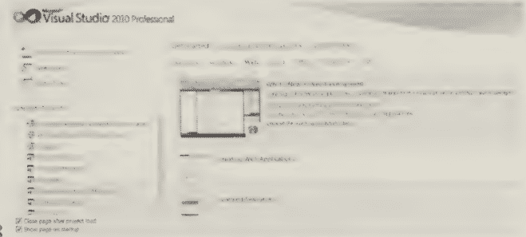

点击你指出的每个部分
也许在页面

### 屏幕 1

在页面顶部水平的菜单/工具栏区域，被称为 . . . 我们现在感兴趣的项目是“工具 (Tools)”。点击“工具”。

将弹出一个下拉菜单，列出十几个或更多选项 . . . 我们想要名为“选项 (Options)”的那个。点击“选项”。

<工具> + (然后) <选项>

另一个下拉菜单出现 . . . 向下扫描直到看到“项目和解决方案 (Projects and Solutions)点击“项目和解决方案”。

另一个菜单出现 . . . 找到“项目位置 (Project Location)”。看向右侧，在“项目位置”下方有一个框，可以在其中输入文件夹的完整、准确名称。这就是我们存储你之前创建的文件夹名称的地方，你的项目文件将存储在这里。它必须包含硬盘驱动器号（可能是 C），后面跟着冒号和反斜杠，以及你创建的文件夹的**准确**名称。

我所说的**准确**是指“准确” . . . 如果你使用了大写字母、空格等，也必须保持一致。你可以在框中直接输入这些信息，也可以点击“...”省略号浏览到文件夹并点击打开。这将自动在框中为你填充正确的信息。我更喜欢这种方法，因为消除了拼写错误 . . . 编程时这是一个非常头疼的问题。

最后的条目可能像这样 . . . 取决于你如何命名新文件夹 . . . “C:\VS VB Projs”，不带引号。注意，在我们刚刚填充的框下方有两个（2）框。在这两个框中重复相同的信息。你可以手动输入、从第一个框复制粘贴，或者再次浏览到文件夹。

要进行复制，将光标置于第一个字符上，然后点击并按住左鼠标键，此时信息被选中并高亮。右键点击鼠标选择“复制”。接下来将光标放在第二个框中，右键点击选择“粘贴”。对第三个框执行相同操作。你不需要再次选择和复制，只需点击并粘贴。这是最简单最快的方法，并能最大限地减少错误。

完成后，点击菜单底部的“确定 (OK)”。你的信息将被存储在那里直到你更改它，即使我们现在关闭 MVS 稍后重新打开。如果我们决定开始新项目并将其放在不同的文件夹中，我们需要相应地更新此设置。这可能会在我们切换语言并希望保持组织整洁时发生。非常推荐这样做！

当我们点击确定后，信息被存储，菜单关闭，我们返回到启动页。这是预期的结果。现在你准备好进行你的项目了。

下一步是告诉 MVS 创建新项目。有两种方法。在启动页上有一个“新建项目 (new project)”选项 . . . 你可以点击它或者在屏幕顶部的菜单条上点击“文件 (File)”，然后点击“新建项目”。我更喜欢第二种方法。你的选择 . . . 结果是一样的。在过程中，我将使用 `<点击此处> + (然后) <点击此处>` 作为点击内容的简写。无论哪种方式，我们都会看到另一个菜单 . . . 这将定义项目的类型、使用的编程语言以及项目名称。

命名是一个重要问题。使用能够真实描述你正在执行的工作和所用工具的名称。


希望你对自己以及 MVS 的能力获得了一点信心。

点击表单右上角的红色“X”关闭程序。

去喝口可乐或杯咖啡，享受这一刻吧。

在幕后发生了很多事情。这里创建了几个“程序/项目”文件，将必要的用户代码“编译”成计算机可以理解并执行的格式，并显示了空白表单。

点击屏幕右上角的“X”关闭 MVS。

当你准备好时 . . . 回到此处，我们将继续。请注意页面左侧边缘的行号。

这样当你回来时，就能确切知道自己在哪里停下的。现在这很简单，但随着内容的深入，就不那么简单了。

看，没有数学，没有“工程”，没有历史，只有编程。

正如你所知 . . . . . . 当你回来时，我们将查看“一些”细节。以后可以使用的那些。

在过去 . . . 编程使用自上而下的模型，代码编写是为了一次执行某些任务并产生预期结果。

现在的编程模型是不同的 . . . 它被称为“事件驱动编程”。这意味着编写的代码执行到某一点，显示某种屏幕或表单，然后等待用户执行某些操作。通常这意味着输入某些信息或点击按钮或触摸屏幕上的图标。

当用户执行这些操作时 . . . 程序通过判断发生了什么“事件”并执行该事件的代码指令块来响应。该特定的代码块被称为“事件处理器”。我们很快就会看到那些代码看起来是什么样，并编写一些我们自己的代码（事件处理器）。

我们将处理的所有事件都是预定义的事件。我们的工作是提供当事件发生时要执行的指令。事件的几个例子有 . . . 点击、双击、鼠标悬停、鼠标按键按下、鼠标按键释放、选择更改等。

要编写事件处理器（代码），我们需要一个存储代码的地方。那个地方在 MVS 在我们创建项目时自动为我们创建的文件内部。让我们仔细看看。

### 简单地编写 C# 和 Visual Basic . . .

在我们打开 MVS 之前 . . . 让我们使用 Windows 资源管理器检查你存储空白表单应用程序的文件夹内容。

右键点击桌面左下角的“开始”按钮，选择“打开资源管理器”。

浏览到你的文件夹，双击文件夹图标打开它。你将看到一个以你的项目命名的子文件夹。双击该文件夹打开它。

你将看到由 MVS 创建的十一个或十二个文件，它们在 MVS 生成的代码中定义了你的项目。这些文件包括 Form1.cs（用于 C# 项目）、Form1.vb（用于 VB 项目）以及稍后我们会提到的其他。注意文件名的后缀显示了创建项目时使用的编程语言。vb 代表 Visual Basic，.cs 代表 C#。

关闭 Windows 资源管理器并打开（启动）MVS。

当 MVS 启动时，它会再次显示启动页。如果没有，点击 `<视图> + <启动页>`。通过点击启动页上的项目名称重新打开项目 -或- 使用 `<文件> + <打开项目>` 然后浏览到我们刚才看到的项目文件夹和子文件夹。随你选择。

在项目子文件夹中，有一个名为“你的项目名称”的文件，带有 `.vbproj` 或 `.csproj` 后缀。选择该文件，点击它并点击屏幕底部的“打开”。如果你点击的是启动页上的项目名称，这种情况会自动发生。

当 MVS 有时间加载项目时，它会向你显示一个名为 IDE（集成开发环境）的新屏幕。现在重要的部分是“设计视图”，即你的表单图片 . . . “解决方案管理器” . . . 我们之前在 Windows 资源管理器中看到的文件列表以及“文本编辑器” . . . 我们将在这里输入代码。

如果解决方案管理器可见，点击 `<视图> > <解决方案管理器>`。它应该以弹出窗口的形式出现在屏幕右侧。如果没有出现且它占据了整个屏幕 . . . 右键点击屏幕顶部标签上的解决方案管理器标签，并点击“停靠”。

注意，解决方案管理器框是可以移动和调整大小的。把它放在你喜欢的地方。

现在让我们明确一点。`<工具> < <选项> < <项目和解决方案>`。检查包含我们在创建项目时建立的文件夹名称和位置的三个框。看到后，点击确定返回 IDE（集成开发环境）界面。MVS 为我们存储了信息，并在我们重新打开项目时加载了这些信息。`<文件> + <关闭项目>`。

### 项目 2—控件和事件处理

如果你关闭了 MVS . . 重启 MVS。`<文件> + <新建项目>` 选择语言、Windows 表单、项目名称 `<确定>`。记住 `<工具> < <选项> < <项目和解决方案>` 的位置保持不变，除非我们决定更改它。

当我们的 IDE 出现时 . . . 如果解决方案管理器可见 . . . `<视图> + <解决方案管理器>`。此时，我们应该有一个为 MVS 创建的 Form1。我们现在需要的屏幕是“设计视图”，即空白表单的图片。如果你看到的不是这个 . . `<视图> + <设计器>`。Form1 还没有执行任何操作，但如果我们想的话，可以执行（运行）项目，这样空白表单就会被显示出来。

为 Form1 添加一些功能。在 IDE 的左侧，你可能会看到一个“工具箱”。如果没有 . . `<视图> + <工具箱>`。工具箱中包含几个我们可以在程序中使用的控件（对象）。扫描列表并找到“按钮”。

通过双击“按钮”或点击它，按住鼠标将其拖入 Form1 的设计视图。当你把光标移出工具箱时 ... 它将隐藏在左边距，我们会在表单上看到按钮控件。

通过点击并拖动按钮，可以在表单上的任何位置放置它。它也可以调整大小的。你可以通过点击（选择）按钮，然后按住按钮边缘出现的小矩形并拖动它们来伸缩大小。按钮是一个控件。它也被称为对象。表单本身也是一个对象。对象可以包含其他对象。我们可以同样的方式在表单上添加许多按钮或其他控件。每个控件都是一个对象。Form1 有一个对象的“集合”。

两个重要的词 . . 对象和集合。C# 和 VB 中的几乎所有内容都是对象。几乎每个对象都有对象的集合。集合是父对象内部包含的对象列表。

### 简单地编写 C# 和 Visual Basic . . .

随着我们深入编程，这将变得非常重要。VB 和 C# 是“事件驱动-面向对象”编程语言。你会听到缩写为 OOP -或- OOPs。每个对象都有名称和许多其他属性，如大小和颜色，我们可以定义（设置）它们为我们想要的。第三个重要的词 . . “属性”。

再次，命名很重要。选择一个描述所用控件类型以及该控件用途的名称。为事件处理器编写代码变得很重要。我们拥有的控件（对象）越多，名称就越重要。例如 . . . 我们添加的按钮可能会命名为 btnShowMessage。


34


向下滚动属性列表到“BackColor”。点击“Back Color”右侧的空白处，会出现一个椭圆 (...)。点击该椭圆。弹出另一个菜单 . . 点击“custom”选项卡并选择（点击）你想要按钮的背景颜色。点击任何其他属性项，颜色就会保存。

继续向下滚动属性列表，点击“Text”旁边的框。

在框中输入“Show Message”。点击任何其他属性，文本将由 MVS 保存。

到此为止，我们已经为按钮定义（SET）三个属性。其他所有属性都以相同的方式设置。你会发现，我们在执行代码时也可以更改控件的属性。这被称为属性的运行时（Run-time）或动态修改。

注意属性窗口顶部其他的图标。其中一个是一个闪电图标。

点击闪电图标。

这次，我们看到了一个适用于该特定控件（对象）的预定义“事件”（Events）列表。向下滚动并双击“Click”事件单词。

很快，我们被带到了 Form1 的“代码文件”文本编辑器中，并被放置在 btnShowMessage 的事件处理程序结构内部。战斗已经打响，部队已经集结。是时候写一些代码了。注意，我们所在的这个文件名为 VisualBasic 的 Form1.VB 或 C# 的 Form1.cs。

稍微环顾观察一下。一直滚动到文本编辑器屏幕的最顶部。如果你使用的是 C#，你会看到类似这样的内容：

```csharp
using System;
using System.Data;
using System.Text;
using System.Windows.Forms;
```

如果你使用的是 VB，它看起来会有所不同……但实现的功能相同。

```vb
Imports System
Imports System.Windows.Forms
Imports System.Data
Imports System.Text
```

这些行代码告诉编译器在你的项目中使用哪些信息和规范库。记住，编译器将我们的英语语言代码翻译成计算机处理器可以理解并执行的格式（最终是二进制格式）。这些库告诉计算机应该遵循哪些规则，以及在编译代码时期望并使用什么格式。

这整个库和系统结构合称为 Microsoft .NET 或 Framework（框架）。它是强大且庞大的，我们在书中几乎只能触及表面。

你的项目将仅包含执行我们定义的任务所需的库部分。这些部分将成为我们项目不可或的一部分，并存储在项目文件中。

如果我们要求项目执行我们告诉它包含的部分之外的操作，或者违反语法规则，我们将收到编译错误。程序将不会执行，我们将收到一条带有关于何错误的线索的错误消息。这并不是灾难性的。我们停止，找到错误，纠正并再次尝试。程序员的生活就是如此。

同时，在屏幕稍下方，我们看到了类似的内容 . . .

```csharp
// 对于 C#
“你的项目名称”去掉引号。
{
    public partial class Form1: Form
    {
        public Form1()
        {
            InitializeComponent();
        }
    }
    . . . More代码
    . . . More代码
    . . . More代码
    . . . 无限更多。
}
```

简单的编程 C# 和 Visual Basic...

#### 对于 VB;

```vb
Public Class Form1
    Private Sub BoxShowMessage_Click(sender As
        System.Object, e As System.EventArgs)
        Handles btnShowMessage.Click
        MessageBox.Show("A button was clicked",
        "Report event")
    End Sub
    . . . More代码
    . . . More代码
    . . . More代码
    . . . More代码无限更多。
End Sub
```

这些是对项目文件结构的非常宽泛的定义。其他所有内容都包含在这个 Visual Basic 中的命名空间（namespace）或类（Class）中。它包含了许多引用其他文件的，但这是我们关注的中心。不需要你逐字背诵这些。不要被你看到的内容淹没，只需熟悉总体外观，我们将在需要且合适时进行更深入的探讨。

编程要求我们明确代码块何时开始某个特定任务，以及何时结束。在 C# 中，这通常通过用大括号将相关的代码块括起来来实现。

```csharp
// Class Name
{
    code
}
```

使用 Visual Basic (VB)，它是使用 Class（或 Sub）等单词完成的。

```vb
Class Classname
   Code
   More Code
End Class
```

稍后会有更多内容。现在，让我们回到手头的任务 . . . 为 btnMessage 的点击事件编写处理程序。回到我们稍前开始的地方。在 btnMessage_Click 事件的结构化事件处理程序内部。在 C# 中，我们输入的代码位于定义事件处理程序的大括号之间，如下所示：

```csharp
public void btnShowMessage_Click(object sender,
EventArgs e)
{
    MessageBox.Show("A button has been clicked");
    // 注意命令/语句末尾有分号
    // 在 C# 中 . . 这是 C# 的语法要求。
}
```

还要注意 . . 你可以输入注释。你可以通过以 "//" 开头的行直接在 C# 代码中输入注释。我建议多写一些注释。它可以在你编写程序很久后回顾程序时，在恰好需要的地方记录你正在做什么。

在 VB 中，代码位于像 Sub—End 这样的短语之间：

```vb
Private Sub btnShowMessage_Click(sender As
    System.Object, e As System.EventArgs Handles
    btnShowMessage.Click
    MessageBox.Show("A button was clicked")
End Sub
```

在 VB 中输入注释与 C# 类似……只需用单引号开头即可。

' 在此处添加你的注释。

你准备好运行程序了。点击 MVS 屏幕顶部的绿色箭头，或者选择 <Debug>+Start Debugging>。

几秒钟后你的屏幕/表单将显示。点击“Show Message”，会出现确认你操作/事件的对话框。点击 OK 关闭对话框，然后关闭程序。

如果没有发生，请检查说明，纠正任何错误并再次尝试。

现在你有一个功能良好的程序，显示一个包含按钮控件的表单。当你点击按钮时，会触发控件的“Click”事件，你的代码处理该事件并显示对话框。记得我提到过动态设置或修改属性吗？让我们尝试一下。在你输入的最后一行代码（即 MessageBox.Show("a button has been clicked")）之后，在新行输入此命令。

btnShowMessage.BackColor = Color.Red; (对于 C#)
btnShowMessage.BackColor = Color.Red (对于 VB)

注意 C# 的分号 . . 缺少分号会导致编译错误。VB 不使用分号。

再次运行程序。点击绿色箭头或 <Debug>+Start Debugging>随你决定。

表单像以前一样显示，按钮的背景颜色正如我们最初定义的（设置）属性那样，点击 Show Message 按钮会出现对话框，关闭对话框我们发现按钮的颜色已经改变了。

我们涵盖了很多内容。回顾一下，确保你对目前为止的工作熟悉，并且


## 简单编程 C# 和 Visual Basic...

你已经遵循了 1284 条指令并学到了相关内容。

你创建了新文件夹，在桌面上放了一个新图标，并通过该图标启动了 Microsoft Visual Studio。你学习了启动页上的几个菜单项以及文本编辑器（IDE）。你创建了一个带有空白表单的新项目，然后在表单上添加了控件/对象（Object）。你学会了如何使用工具箱。接下来，你学习了如何通过按钮的属性窗口设置按钮控件的属性。最后，你学习了如何选择“事件”（Event）并为该“事件”编写带有代码的处理程序，包括在程序执行时动态重新设置按钮控件的属性。

你可能犯了一两个错误 . . . 但世界并没有终结，你纠正了错误并运行了程序。

此时的困惑不会自动消失。如果任其滋生，随着我们后续的学习，它会变得越来越复杂。复习！！！

当你满意时，用一些水果、坚果或任何东西奖励一下自己，然后等准备好后再回来。

接下来是 . . . 文本框控件/对象、用户输入和变量。我们准备好要认真了。我们将学习让程序执行实用的工作，并以可以接受的格式向用户展示结果。

现在考虑你对编程的看法。它是你的心菜吗？？我希望是 . . . 我觉得它很有意义、有趣、有用，而且是一种帮助别人的方式。总之，这是一个不错的买卖。

## 项目 3—文本框控件/对象、用户输入和变量

变量是作为信息存储软件设备，通常是应用程序用户输入的信息。

使用的变量类型取决于它将包含的信息类型。最常见的是持有字母数字字符或没有数学价值且无法用于算术运算的符号的字符串。

第二种常见类型是各种类型的整数，它们包含具有数学价值的数字，对算术运算很有用。

另一种变量类型是可以存储时间和日期信息的变量。

我们的程序必须提供一种机制，为用户收集、存储和处理这些信息，并以可读、易懂的格式呈现结果。

有些信息是临时存储并在程序结束时丢失。在其他时候，信息会被收集、处理并永久存储在计算机硬盘的文件中。

我们将分别处理每项要求，并最终涵盖它们。让我们从学习如何从用户那里收集信息开始。

假设 Microsoft Visual Studio 已关闭 . . . 通过点击 MVS 图标或使用 Windows 开始图标并在菜单中选择 MVS 来启动 MVS。由你决定。

使用与之前相同的过程，在你选择的语言中创建一个新项目，选择 Windows Form 模板并为你的项目命名。记住 . . . 名称很重要，要具有描述性，并尽可能在名称中包含所使用的的语言和主要控件。

“VS”代表 Visual Studio。

点击确定，等待 MVS 为你创建一个带有空白表单的项目。

当表单显示时，打开工具箱，我们将控件添加到表单中。

如果表单不可见，点击 视图 (View) > 解决方案管理器 (Solution Explorer)。解决方案管理器窗口将出现，项目项目包含的文件将显示在窗口内。

在解决方案管理器窗口中选择 Form1。查看解决方案管理器窗口的顶部并注意那里的图标。一个图标会显示表单代码 . . . 另一个现在的重要的是“设计视图图标”（Design View Icon） . . . 它将以用户视觉上看到的样式显示表单。

点击设计视图图标。

当表单出现时，打开工具箱，让我们添加两个文本框和两个标签控件/对象，然后添加一个按钮控件/对象。这在表单控件集中总共添加了五个 (5) 个控件/对象。关于此集合稍后会有详细介绍。

通过逐个点击并将其拖动到最终位置，按照你希望出现的方式放置控件。在每个文本框上方放置一个标签。在每个标签边缘和文本框之间留出小空间。我们将使用标签来解释他/它是做什么的。


我们允许用户更改（重置）`txtUserInput` 的 `text` 属性……然后通过程序获取他们修改后的 `text` 属性……

```csharp
myStrUserInput = txtUserInput.text; // C# code
myStrUserInput = txtUserInput.text; // VB code
```

注意控件名称使用了“点表示法”，后面跟着一个“点（或句号）”，然后是我们要的属性名称。另外请注意 `=` 运算符，它被称为赋值操作符。这导致计算机获取我们想要的值并将其存储在目标变量中。它会在指定的名称目标控件中查找此值，更具体地说，是在该控件通过“点表示法”指定的“属性”中。

此时，你为 `btnInput_Click` 事件编写的事件处理代码如下……

```vb
For VB Code...
Private Sub btnUserInput_Click(sender As System.Object, e As System.EventArgs Handles btnUserInput.Click
    Dim myStrUserInput as String = ""
    myStrUserInput = txtUserInput.text
End Sub
```

C# 代码

```csharp
private void btnUserInput_Click(object sender, EventArgs e)
{
    string myStrInput = "";
    myStrUserInput = textbox1.Text;
    textBox2.Text = myStrUserInput;
}
```

运行你的程序。

在 `txtUserInput` 框中输入一些简单的文本，点击按钮并观察发生了什么。第一个控件的文本被检索并复制插入到第二个文本框中。文本并没有被移除并传输到另一个地方……只是创建了一个副本并将副本插入到第二个位置。

如果你遇到了错误……请检查、修正并重试。不要在没有解决你遇到的问题（如果有的话）并理解这一步骤的情况下尝试继续。

字符串非常有用且灵活，你可能会使用它们数百次，甚至数千次。你可以为字符串起任何喜欢的名称，让它具有描述性，以描述你打算对该字符串进行的操作。注意：字符串名称不能包含空格。

这里有一个简单的示例……假设你想在第二个文本框中显示字符串之前向其添加一些信息。字符串可以进行拼接（连接在一起或附加到彼此末尾）。

让我们稍微修改一下代码。

如果你还在事件处理代码中，那太好了。如果不是，在表单设计器视图中双击按钮控件，你就会进入事件处理代码。

VB 代码 ...

```vb
Private Sub btnUserInput_Click(sender As System.Object, e As System.EventArgs Handles btnUserInput.Click
    "添加此新行代码。注意注释标记"
    "记住，你也可以在代码中添加注释，就像"
    "这个注释一样。"
    "顺便说一下……使用""复制然后粘贴""比反复输入所有内容完全没问题。
    "从示例文件中复制和粘贴，而不是从书中复制。"

    Dim MyStrModifier as string = "You enter this text:"
    Dim MyStrUserInput as String = " "
    myStrUserInput = myStrModifier & txtBoxUserInput.text
End Sub
```

C# 代码

```csharp
private void btnUserInput_Click(object sender, EventArgs e)
{
    string myStrModifier = " ";
    myStrModifier = "You entered this text: ";
    string myStrUserInput = " ";
    myStrUserInput = myStrModifier + txtBox1.Text;
    textBox2.Text = myStrUserInput;
}
```

再次运行你的程序。第一个文本框中的文本在放入副本到第二个文本框之前经过了微改。

如果你有错误……你懂这回事的。检查！！！！

我们所做的是重复之前的操作，但在将文本复制到第二个框后，我们将其附加到第二个字符串的末尾，然后将其放入第二个框中。你也可以说我们“拼接”了这两个字符串。

这看起来非常简单，但非常强大。你将经常使用它。在处理字符串时，记住无论空格是否可见，它们都是字符。

商业应用程序中的字符串可以长达数千个字符。字符串是 Microsoft.network 架构中非常重要的部分。有很多工具（方法）可以处理字符串。我们对这些内容多花一点精力和时间，并在继续之前理解其中一些，是完全值得的。

例如……假设由于某种原因，我们决定所有的操作都应该是小写字母。有一个工具（方法）可以实现这一点。字符串像控件一样是对象。如你所知，对象具有属性，也有“方法”。

字符串像控件一样是对象。如你所知，对象具有属性，也有“方法”。

字符串像控件一样是对象。如你所知，对象具有属性，也有“方法”。

字符串像控件一样是对象。如你所知，对象具有属性，也有“方法”。

字符串像控件一样是对象。如你所知，对象具有属性，也有“方法”。

字符串像控件一样是对象。如你所知，对象具有属性，也有“方法”。

字符串像控件一样是对象。如你所知，对象具有属性，也有“方法”。

字符串像控件一样是对象。如你所知，对象具有属性，也有“方法”。

字符串像控件一样是对象。如你所知，对象具有属性，也有“方法”。

字符串像控件一样是对象。如你所知，对象具有属性，也有“方法”。

字符串像控件一样是对象。如你所知，对象具有属性，也有“方法”。

字符串像控件一样是对象。如你所知，对象具有属性，也有“方法”。

字符串像控件一样是对象。如你所知，对象具有属性，也有“方法”。

字符串像控件一样是对象。如你所知，对象具有属性，也有“方法”。

字符串像控件一样是对象。如你所知，对象具有属性，也有“方法”。

字符串像控件一样是对象。如你所知，对象具有属性，也有“方法”。

字符串像控件一样是对象。如你所知，对象具有属性，也有“方法”。

字符串像控件一样是对象。如你所知，对象具有属性，也有“方法”。

字符串像控件一样是对象。如你所知，对象具有属性，也有“方法”。

字符串像控件一样是对象。如你所知，对象具有属性，也有“方法”。

字符串像控件一样是对象。如你所知，对象具有属性，也有“方法”。

字符串像控件一样是对象。如你所知，对象具有属性，也有“方法”。


让我们获取有关用户输入的信息并将其在消息框（MessageBox）中显示。

```csharp
Define (声明另一个字符串)
string myStringLength = ""
ToString(myInt);
```

```vb
Dim myStringLength as integer
myStringLength = StringName.Length()
myStrLength =
Convert.ToString(myStringLength)
```

现在显示这些信息 ...

```csharp
MessageBox.Show(myStrStringLength);
```

```vb
MessageBox.Show(myStrStringLength)
```

现在你可以将适当的代码行添加到你的事件处理程序中并运行程序。

遇到问题或错误 ... 请检查！！！！

你的代码现在看起来应该是这样

```vb
Private Sub btnUserInput_Click(sender As System.Object, e As System.EventArgs) Handles btnUserInput.Click
Dim myUserInput As String = ""
```

1800 Dim myStrModifier As String = "You entered: "
1801 myStrUserInput = myStrModifier & TextBox1.Text
1802 myStrUserInput = myStrUserInput.ToLower()
1803 TextBox2.Text = myStrUserInput
1804 Dim myInfoStr As String = ""
1805 Dim myInt As Integer = 9999
1806 myInt = myStrUserInput.Length
1807 myInfoStr = Convert.ToString(myInt)
1808 Message.Show("You enter a lot of characters . . ..." & myInfoStr)
1810 End Sub

1831 快速提示：C# 使用 `+` 符号连接字符串。VB 使用 `&` 符号来实现相同目的？结果是相同的。为什么？. . 谁知道呢？这类工具的开发者住在另一个充满细节的世界里。我认为这是一个个人风格和偏好的问题。无疑，我的评论会让许多开发者感到震惊并受到侮辱。但对我们的目的来说……并不重要。我们想知道“如何做”……而不是“为什么这样做”。

休息时间？？我们涵盖了很多内容。

所有内容都很重要。花时间回顾并彻底理解目前为止涵盖的内容。不要尝试在薄弱的基础上进行构建 . . 解决你产生的问题，然后再回来。

接下来是 . . 在较大的字符串中查找和使用子字符串。

## 项目 4—在字符串中定位子字符串

在大大海捞针是一项需要耐心、专注和耐力的工作 . . 更不用说准确性了。这类工作由计算机处理非常好。

对于包含数百个字符的字符串，你可能需要定位一个仅 3 或 4 个字符的子字符串，并更改它们或采取其他操作。

方法如下 . .

VB
首先.. 子字符串是否存在于较大的字符串中？ .

```vb
Dim tstResults as integer = strMain.Contains(strSub)
```

此语句返回一个整数，表示子字符串是否存在

'0 为 False

C#
首先... 子字符串是否存在于较大的字符串中？

```csharp
int intTstResults = myStrUserInput.Contains(myStrModifier);
```

此语句返回一个整数，表示子字符串是否存在

'0 为 False，非零值表示子字符串在较大的字符串内部

接下来...既然子字符串存在，它在哪里？我们可以调用另一个名为 `IndexOf` 的方法完成此任务

```csharp
int mySubStrIdx = myStrUserInput.IndexOf(myStrModifier);
```

现在我们知道了子字符串的第一个字符在较大的字符串中的位置，我们拥有了所需的信息。

注意：计算机从 0 开始计数，而不是从 1 开始。

子字符串的第一个字符位于位置如此，并且从 0 开始计数！！！

由于我们知道子字符串位于较大的字符串内部以及在哪里 . . 如果我们想要，可以获取它的副本。剩下的只需说我们想要多少个字符的副本。例如，假设说是五个(5) . .

C#
```csharp
string myStr = myStrUserInput.Substring(myIntStrIdx,5);
```

VB
```vb
Dim myStr as string = myStrUserInput.Substring(myIntStrIdx,5)
```

如果我们愿意，可以说任何数字，只要不超过字符串的长度（从子字符串开始的位置——加上子字符串中的字符数）。如果发生这种情况，我们会得到一个索引超出范围的错误。

我们可以通过使用整数变量来存储子字符串的长度，并使用该变量而不是指定字符数量……例如“5”。

它看起来像这样 . .

VB
```vb
Int myStrLength = myStr.Length
myStrUserInput.Substring(myIntStrIdx,myStrLength)
```

让我们再次编辑我们的 `BtnUserInput` 点击处理器代码 . . 使用我们刚刚学到的关于字符串和字符串处理的方法

C#
```csharp
private void btnUserInput_Click(object sender) {
MessageBox.Show("The string modifier you added to re-display the text in textbox2 is now part of the stringInformation");
}
```

VB
```vb
Private Sub btnUserInput_Click(sender As System.Object, e As System.EventArgs) Handles btnUserInput.Click
Dim myUserInput As String = ""
Dim myStrModifier As String = "You entered: "
myStrInput = myStrModifier & TextBox1.Text
myStrUserInput = myStrUserInput.ToLower()
Textbox2.Text = myStrUserInput
Dim myInfoStr As String = ""
Dim myInt As Integer = 9999
myInt = myStrUserInput.Length
myInfoStr = Convert.ToString(myInt)
MessageBox.Show("You enter a lot of characters.." & myInfoStr)
End Sub
```


```csharp
If(myStrComparisonResults == 0)
{
    MessageBox.Show("The strings are equal");
}

if (myIntStrComparisonResults!= 0)
{
    MessageBox.Show("The strings are NOT equal");
}
```

```vb
If(myStrComparisonResults == 0) then
    MessageBox.Show("The strings are equal")
End if

If(myStrComparisonResults <> 0) then
    MessageBox.Show("The strings are NOT equal")
End if
```

最后一次修改你的代码，以包含用户输入字符串与第二个文本框中显示的字符串之间的字符串比较。

坚持完成这个练习，直到你完全理解其中发生的一切。它整合了我们到目前为止的所有内容，并在每一步中添加了新东西。我们从启动 MVS 到看到表单的创建，从字符串和整数类型的变量，到添加控件并设置它们的属性……从用户那里获取输入并存储到字符串中。修改字符串并使用字符串方法计算其长度、定位大字符串中的子字符串，最后使用字面量字符串并比较两个字符串。我们还学习了使用 MessageBox 来向我们发送关于代码操作以及代码运行结果的消息……这些内容非常多了！！！！

我无法强调强调在代码中添加注释行的重要。我向你保证，某一天你会回到这些示例，并将它们作为其他项目的参考材料。你不会忘记编写代码时所付的所有思考。到那时，注释对你来说将是无价的。

## 项目 5——文本编辑器使用的选项、舒适性与便利性。

好了，到目前，你创建的代码在 MVS 文本编辑器或 IDE（集成开发环境）中已经包含了大量的代码。通过对 IDE 选项进行微调，我们可以让维护工作变得更容易。例如，字符（字体）的大小……行中代码不同部分的“颜色”以及行号，这样我们就可以轻松跟踪自己的工作位置。再次，我无法也未涵盖所有的选项。请尝试这些选项，直到你对编辑器的外观感到满意为止！！！

如果 MVS 还没有运行，请启动它。

注意：进行此修改不需要打开项目。

在 IDE 的顶部菜单栏（任务栏）上……


<Tools> + <Options> + <Text Editor>。

<All Languages> . . . 查看右侧面板，确保行号框已勾选或选中。

<OK>

<Tools> + <Options> + <Environment> + <fonts and colors。

查看右侧面板中带有选项的表格……在这里，你可以设置 MVS 文本编辑器中显示的代码每个组件的颜色。

对我来说，最重要的是行号。“匹配大括号矩形（Match Bracing-rectangles）”……C# 中使用的花括号。注释、按钮，但这些选择取决于你的个人喜好。去尝试吧！！！字体大小对我来说也是非常重要的一点……你决定什么最适合自己。

完成后，点击 <OK>。这些选择将对所有项目生效，直到你更改它们。

接下来是 . . . 使用用户输入文本框进行简单的数学计算，以及一些算术运算。

## 项目 6——按钮、文本框与算术

现在是时候拿出你的数学思维，让我们来一些算术运算了。如果 MVS 没有运行，现在启动它，让我们开始吧：<File><New Project>。

在空白表单上添加 3 个 textBox、4 个 label 和 1 个 button。将文本框命名为 txtNum1、txtNum2 和 txtAns。将复选框命名为 checkBoxAdd、checkBoxSubtract、checkBoxDivide 和 checkBoxMultiply。设置它们各自的属性。


```csharp
textBoxAns.Text = Convert.ToString(decAns);
}
if (checkBoxDivide.Checked)
{
    decAns = dec1 / dec2;
    textBoxAns.Text = Convert.ToString(decAns);
}
```

当我们重置 IDE 代码编辑器的属性以让事情更加方便快捷时 . . . 像这样的代码就是我们那样做的主要原因。

将光标置在事件处理程序中的第一个大括号上。注意到大括号的背景颜色发生了变化。现在，向下滚动屏幕直到最后一个大括号，注意在你实际上将光标置于上面之前，它已经被同样地高亮了。

当然，这假设你遵循了说明，并在 MVS 文本编辑器中重新设置了字体和颜色选项以匹配大括号。这有助于你验证每个大括号都有匹配的配对 . . . 如果没有，C# 编译器将向我们抛出错误并拒绝运行。在大型程序中，这可能会是一个大头疼。对自己好点 . . 如果你没有重新设置编辑器选项，现在就。请！！！然后，重新检查大括号匹配功能。

警告：用户可能会勾选多个复选框。如果发生这种情况，将执行多个操作，且用户只会看到最后执行的操作。

就代码而言，没有发生任何错误。错误或弱点在于程序的设计。这是程序员的责任。根据用户的需求，选择“最佳”方法。

运行程序几次，并观察到这种情况的发生（或可能发生）。

为了避免这个问题，我们可以选择另一种称为单选按钮（radio button）的控件，并将单选按钮放在组控件内部。这使得单选按钮是“互斥”的，即只能被勾选。当其中一个被勾选时，其他的会自动“取消勾选”。

这是设计如此。有时，用户确实合法地指示需要执行多项操作。例如，将我想使用的数字平方，然后乘以其他值 . . . 例如“圆周率”的值，3.14。或者，告诉 Sam 开车回家然后割草坪。

所有方法都有优缺点。程序员必须选择正确的一个。

好的，让我们再次尝试，这次是针对 Visual Basic。

VB

启动 MVS。

```
<File><New Project>
```

注意：记得执行 <Tools> + <Options> 并更改位置以反映 Visual Basic 的文件夹。

在空白表单上添加 3 个 textBox、4 个 label 和 4 个 checkbox 以及 1 个 button。

将文本框命名为 TextBoxNum1、TextBoxNum2 和 txtBoxAns。

将复选框命名为 CkBoxAdd、CkBoxSubtract、CkBoxDivide 和 CkBoxMultiply。

将它们各自的“Checked属性”设置为 false。将它们各自的文本属性设置为 Add、Subtract、Divide 和 Multiply。

将按钮命名为 btnCalculate。将 text 属性设置为 Calculate。

注意：到此时你已经知道控件名称中不能有空格。我使用“驼峰式”（Camel-Hump）风格 . . 是的，这确实是这种控件命名风格的名称。首字母小写，此后每个重要音节的首字母大写。这使代码更具可读性。

其他控件属性可以设置为任何你喜欢的外观。这包括 Border type、BackColor、Font 和 ForeColor。

将控件拖到你认为合理的位置。我将数字1的 textbox放在左侧 ...：数字2的 textbox 放在右侧，答案的 textbox 放在表单的最右侧。我将数学运算的 Checkboxes 放在前两个 textbox 之间，并在答案的 textbox 之前放置了一个带有“=”符号作为文本属性的 label。这对我来说似乎是合理的，并且遵循了通常陈述问题的方式，即 数字1“加”，什么，数字2 等于“答案”。

现在骨架事件处理程序如下所示

```vb
Private Sub btnCalculate_Click(sender As Object, e As EventArgs) Handles btnCalculate.Click
End Sub
```

在 Private Sub 和 End Sub 之间，我们将添加这些行代码……注意：使用 DECIMAL，因为我们的用户可能不会提供整数供处理，而且我们的答案可能不是整数。

```vb
Dim decAns as Decimal = 0
Dim dec1 as Decimal = 0
Dim dec2 as Decimal = 0
dec1 = Convert.ToDecimal(textBoxNum1.Text)
dec2 = Convert.ToDecimal(textBoxNum2.Text)
if (checkBoxadd.Checked) '如果此设备被勾选
    decAns = dec1 + dec2
    textBoxAns.Text = Convert.ToString(decAns)
End
if (ckBoxSubtract.Checked) '如果设备被勾选
    decAns = dec1-dec2
    textBoxAns.Text = Convert.ToString(decAns)
End
if (ckBoxMultiply.Checked) '如果设备被勾选
    decAns = dec1 * dec2
    textBoxAns.Text = Convert.ToString(decAns)
End
if (checkBoxDivide.Checked)
    decAns = dec1 / dec2
    textBoxAns.Text = Convert.ToString(decAns)
End
```

我们完成的 VB 事件处理程序应该是这样的

```csharp
private void btnCalculate_Click(object sender, EventArgs e)
{
    Dim decAns as Decimal = 0;
    Dim dec1 as Decimal = 0;
    Dim dec2 as Decimal = 0;
    dec1 = Convert.ToDecimal(textBoxNum1.Text);
    dec2 = Convert.ToDecimal(textBoxNum2.Text);
    if (checkBoxadd.Checked)
    {
        decAns = dec1 + dec2;
        textBoxAns.Text = Convert.ToString(decAns);
    }
    if (checkBoxSubtract.Checked)
    {
        decAns = dec1-dec2;
        textBoxAns.Text = Convert.ToString(decAns);
    }
    if (checkBoxMultiply.Checked)
    {
        decAns = dec1 * dec2;
        textBoxAns.Text = Convert.ToString(decAns);
    }
    if (checkBoxDivide.Checked)
    {
        decAns = dec1 / dec2;
        textBoxAns.Text = Convert.ToString(decAns);
    }
}
```

当我们重置 IDE 代码编辑器的属性以让事情更加方便快捷时 . . 像这样的代码就是我们那样做的主要原因。

将光标置在事件处理程序中的第一个大括号上。注意到大括号的背景颜色发生了变化。现在，向下滚动屏幕直到最后一个大括号，注意在你实际上将光标置于上面之前，它已经被同样地高亮了。

当然，这假设你遵循了说明，并在 MVS 文本编辑器中重新设置了字体和颜色选项以匹配大括号。这有助于你验证每个大括号都有匹配的配对 . . . 如果没有，VB 编译器将向你抛出错误消息并拒绝运行。大型程序也可能是一个大头疼。对自己好点 . . 如果你没有重新设置编辑器选项，现在就。请！！！然后，重新检查大括号匹配功能。

这里是应该发生的情况 . . . 用户输入两个数字。接下来用户勾选他们想要的操作的复选框。最后，他们点击计算按钮。用户看到答案出现在答案文本框中。

背后 . . 触发 btnCalculate_Click 事件。以字符串形式输入的数字从文本框中获取并转换为“Decimal”值。复选框的勾选状态被“if”语句获取。当“if”看到一个复选框被勾选时，它执行相应的算术运算并将结果存储在答案变量中。答案变量转换为字符串，并将字符串放在答案文本框的“text属性”中显示。


为了避免这个问题，我们可以选择另一种类型的控件，称为单选按钮（radio button），并将单选按钮放在一个分组控件中。这使得单选按钮是“互斥”的，即只有一个可以被选中。当其中一个被选中时，其他的会自动被“取消选中”。

这是设计之初的考虑。有时用户确实合合理地需要指示执行多项操作。例如：将我想使用的数字平方，然后乘以其他值 . . 比如“圆周率”的值，3.14。或者，告诉 Sam 回家的路上顺便把草剪了。

所有方法都有优缺点。程序员必须选择正确的一个。

## 项目 7—使用单选按钮和分组框

现在，让我们修改程序，并在 `groupBox` 控件内部使用单选按钮。

回到 MVS . . 这次选择表单的“设计视视图（Design view）”。你可以点击解决方案管理器菜单框中的设计视图图标，也可以通过点击 Form1 项目旁边的箭头来展开解决方案管理器“文件”列表中的 Form 文件。这将显示两个独立的 Form1 文件版本；其中一个包含“设计（design）”字样。双击该行也会带你进入“设计视图（Design View）”屏幕。随你决定。

这里使用单选按钮修改后的 C# 版本：

```csharp
private void btnCalculate_Click(object sender, EventArgs e)
{
    decimal decAns = 0;
    decimal dec1 = 0;
    decimal dec2 = 0;
    dec1 = Convert.ToDecimal(textBox1.Text);
    dec2 = Convert.ToDecimal(textBox2.Text);
    if (radBtnAdd.Checked)
    {
        decAns = dec1 + dec2;
        textBoxAns.Text = Convert.ToString(decAns);
    }
    if (radBtnSubtract.Checked)
    {
        decAns = dec1 - dec2;
        textBoxAns.Text = Convert.ToString(decAns);
    }
    if (radBtnMultiply.Checked)
    {
        decAns = dec1 * dec2;
        textBoxAns.Text = Convert.ToString(decAns);
    }
    if (radBtnDivide.Checked)
    {
        decAns = dec1 / dec2;
        textBoxAns.Text = Convert.ToString(decAns);
    }
}
```

运行程序：注意用户无法选择多个单选按钮。即使你现在通常只只操作 Visual Basic，我认为你也可以浏览一下 C# 代码并推断出修改应用程序所需的内容。所以，去尝试吧！！！ 犯些错，不要恐慌。通常这个过程是：

- 启动 MVS
- 打开项目
- 选择语言
- 设置项目位置的选项
- 在设计视图（Designer View）中查看表单
- 添加控件（单选按钮 Radio Buttons 与 复选框 Check Boxes）
- 添加 `groupBox` 并将 Radio按钮放入 `groupBox` 内部
- 设置属性
- 修改事件处理代码
- 语句末尾不要使用分号
- 使用 VB 格式声明变量
- 修改“if”语句以检查“单选按钮（RadioButton）”的状态状态

运行程序。如果你成功了，恭喜你！！！如果你遇到了一些错误，也没关系，你会学到更多。再试一次。万一你真的卡住了，去看看附录……你可以在那里找到代码。

## 怎么了……

现在，在理应得的休息之后，我们将进入“循环（Looping）”、“决策（Decision Making）”以及在适当时候退出进程的问题。去吃点东西，喝口水，去休息 . . 好了，你知道的，然后回来！

你通常需要重复执行某些操作，直到满足某个条件后停止。使用“if”语句在这方面你起的作用有限。它虽然能完成工作，但在某些情况下你可能需要写成百上千个“if”。既然有更简单的方法，为什么要这样做呢？

一个示例可能是搜索目录文件的电话号码。另一个可能是计算一组数字并显示它们。一个关键点在于知道何时停止并对某些值进行处理。

我们将从缓慢开始构建。第一步是知道如何让循环运行，以及何时退出循环。我们开始吧 . .

- 如果你之前关闭了，请启动 MVS
- 工具 (Tools) + 选项 (Options) + 项目和解决方案 (Projects and Solutions)
- 设置你使用的项目文件夹。很快我将跳过这一步，你已经看过几次了。是的，我想让你承担责任 . . . 我教 . . 你学。
- 文件 (File) + 新项目 (New Project)

你懂规则的。起一个有意义的名字。这里是代码，你决定剩下的控件和属性。

```csharp
private void btnLoopAndDecide_Click(object sender, EventArgs e)
{
    string myStr = "";
    for (int X = 0; X <= 9; X++)
    {
        myStr = Convert.ToString(X);
        textBox.Text = myStr;
        if (X == 8) // 如果 X 等于 8
        {
            textBox.Text = "循环结束" + " " + "X的值 = " + Convert.ToString(X);
            break;
        }
    }
}
```

再次，注意花括号。它们必须成对出现，并处于正确的位置。我习惯在花括号后添加注释……比如 // btnLoopAndDecide 事件处理程序结束。这有助于我避免错误并在错误发生时找到它们。

你可以让循环在每次执行时增量大于 1。这是通过在语句的 `X++` 位置放置此内容来实现的。例如 `X += 5`。当然，你可能需要增加循环的最大值 X 到 150，以便给程序留出计数空间。即 `for(X=0;X<=150;X+=5)...` . 这样就能工作。X <= 150 意味着 X “小于等于 150”。


简单编程 C# 和 Visual Basic ...

# 2817 下一个 X ‘无分号’

尝试一下吧，如果你卡住了，请查看附录“B”中的代码。

## 项目 9—接下来是“While 循环”和决策判断

这是我在处理硬盘上的文件时反复使用的一种循环。

你从“声明一个条件”开始，只要该条件保持为真就继续运行。

代码在每次通过循环时会自动评估该条件，所以你不需要担心去测试它。

通用结构如下。

```csharp
int x = 10;
while (X <= 100)
{
  执行此操作；
  X += 10;
  // 权衡之处，你的代码增加了 X
  // X+=10 在每次通过时 X 增加 10
}
```

注意：Null 表示不存在任何种类的字母数字标点符号字符。“空格”实际上是一个空白字符。

稍微开一下 . . . （动动脑筋）

这段代码片段从文件中读取字符串……当它（While）在循环中从文件中获取一个字符串时，它很开心并继续进行。在文件末尾，它将获取到一个“null”。

在到达该点之前，它读取一个字符串（行）并将字符串（行）显示在 MessageBox 中。

在那个“null”点上，我们“打破”（break）循环并停止尝试读取更多字符串。

```csharp
string myStr = " ";
while (myStr != null)
{
  myStr = myRdr.ReadLine();
  if (myStr == null)
  {
    break;
  }
  MessageBox.Show(myStr);
}
```

目前只需掌握这个大意，不要纠结于读取文件的细节。在合适的时候，我们会处理它的。

当我们（While）脑子里有了这个新想法时，让我们用它吧。在解决方案管理器中点击<代码视图图标>或在表单视图中双击按钮。记得吗？

```csharp
private void btnLoopWhile_Click(object sender, EventArgs e)
{
  int X;
  X = 0;
  while (X != -1)
  {
    X++;
    if (X <= 2) // X 小于或等于 2
    {
      MessageBox.Show("X is Not -1 X is " + Convert.ToString(X));
    }
    if (X >= 3) // X 大于或等于 3
    {
      X = -1;
      this.Text = "Bye Bye Birdie . . while looping is over with.";
      this.BackColor = Color.Yellow;
      label1.Visible = true;
      label1.Text = " I'm outta here!!! ";
      MessageBox.Show("X equals -1 I'm breaking up. " + Convert.ToString(X));
    }
  }
}
```

非常直接，加入了一些新转折来学习新想法。

声明了一个整数 X 并赋值为“0”，然后我们开始了 while 循环。在通过循环时，我们增加 X 直到达到值 3。在那个点上，我们将 X 重置为 -1。这导致违反了我们的“while 原则”。

当代码意识到 X 现在是 -1 时，它会发送一条不同的消息，将 Form1 的 text 属性设置为“Bye, Bye Birdie ... while looping is over.”，将 label1 的 Visible 属性改为“true”，并将其 text 属性设置为“I’m outta here!!!”，我们得到一个消息 MessageBox 说“Things are breaking up”。新部分是为了戏剧效果隐藏了一个 label，直到我们到达“While”循环的结束，我们更改了表单本身的 text 属性。记得 Forms 本身也是一种对象/控件，可以这样对待它们。现在在 VB 中进行同样的练习：

```vb
Private Sub btnLooping_Click(sender As System.Object, e As EventArgs) Handles btnLooping.Click
    Dim X As Integer = 0
    While (X <> -1)
        X = X + 1
        If (X <= 2) Then ' X 小于或等于 2
            MessageBox.Show("X is Not -1 X is " + Convert.ToString(X))
        End If
        If (X >= 3) Then ' X 大于或等于 3
            X = -1
            Me.Text = "Bye Bye Birdie . . while is over."
            Me.BackColor = Color.Aqua
            Me.Label1.Visible = True
            Me.Label1.Text = "I'm outta here!!!"
        End If
    End While
End Sub
```

解释基本上相同，只是针对 visual basic 进行了几处语法调整，并且缺少大括号和分号。

声明了一个整数 X 并赋值为“0”，然后我们开始了 while 循环。在通过循环时，我们增加 X 直到达到值 3。在那个点上，我们将 X 重置为 -1。这导致违反了我们的“while 原则”。

当代码意识到 X 现在是 -1 时，它会发送一条不同的消息，将 Form1 的 text 属性设置为“Bye, Bye Birdie... while looping is over.”，将 label 的 Visible 属性改为“true”，并将其 text 属性设置为“I’m outta here!!!”，我们得到一条消息说“Things are breaking up”。最后我们退出事件处理器并可以关闭程序。就是这样。新部分是为了达到戏剧效果隐藏了一个 label，直到我们到达“While”循环的结束，我们更改了表单本身的 text 属性。记得 Forms 本身也是一种对象/控件，可以这样对待它们。它们有属性和方法，你可以操作它们。

## 项目 10—接下来是 . . “DO 循环”

“Do 循环”与“While 循环”非常相似。巨大的区别是退出条件是在最后测试的，而不是先声明并先测试。我想的大意是这样的 . .

```csharp
do
{
  执行某些操作
  执行其他操作
} 检查结果以退出-
(
  执行某些操作
  执行其他操作
) 如果结果是这些（即 X 不等于 -1）
```

明白意思了吗？让我们跳舞吧！

```csharp
private void btnDoLoop_Click(object sender, EventArgs e)
{
  int X = 0;
  string myStr = ""
  textBox1.Text = "Here is the looping info . . .";
  do
  {
    X++;
    myStr = myStr + " " + Convert.ToString(X);
  } while (X <= 9);
  //
  textBox1.Text = textBox.Text + myStr;
  MessageBox.Show("I'm done. Notice that we have a 10 in the TextBox . . that's because Loops test for the exit condition last. A 10 gets in before the decision to exit is made.,"Do Looping");
}
```

注意：MessageBox "Show Method" 中的最后的逗号后面是一个字面量，它将成为 MessageBox 显示的标题。这是一个小但很有用的。如果我在代码编辑器中包含行号作为标题，它将对调试（trouble shooting）我的代码非常有帮助。一个小想法！

```vb
Private Sub btnDoLoop_Click(sender As System.Object, e As System.EventArgs) Handles btnDoLoop.Click
    Dim X As Integer = 0
    Dim myStr As String = ""
    Do While (X <= 9)
        myStr = myStr + Convert.ToString(X)
        X = X + 1
    Loop
    textBox1.Text = TextBox1.Text + "Done Looping, this is what I did . . " + myStr
    MessageBox.Show("My do loop completed", "Do Looping")
End Sub
```


## 简单编程 C# 和 Visual Basic . . .

这里有几个新词介绍给你 . . . “Item（项目）” 和 “Index（索引）”。

listBox 是控件/对象，但在某些方面它也像一个数组变量。我们可以在 listBox 中存储信息，它会保留这些信息。事实上，我们可以在控件中存储多个“Items（项目）”信息，每个项目都有一个索引（数字）可以进行识别和引用。

索引是自动创建的，从“0”开始，并在你遍历控件/对象的项目“Collection（集合）”时按“1”为步长递增。

某些“Items（项目）”通常在设计时（design Time）添加，如果我们需要，也可以在运行时（run-Time）对其进行修改。让我们检查一下。

右键点击 listBox 并进入属性窗口。滚动到“Items”属性，注意右侧框中显示为“Collection”，并带有一个省略号椭圆“....”。

<Ellipse “....”>

现在出现了一个编辑窗口，要求你输入你的项目，每行一个。输入“One”、“Two”。“Three “Four” . . . 每个后面都跟着 <Enter Key>。

当你点击任何其他属性时，注意你的输入现在显示在表单设计视图的 listBox 中。如果没有显示，请再试一次。

记得我说过可以用代码来修改“Items（项目）”。我们现在就这样做。

在设计视图中双击表单上的空白处。

我们会被带入表单的骨架事件处理器 . . 在 Form _Load 事件处理器中。我们在此处放置的代码将在你的程序执行（“Run”）时、表单开始“加载（Loading）”时立即执行。

```csharp
private void Form1_Load(object sender, EventArgs e) // Skeletal
// Skeletal
listBox1.Items.Add("A"); // 我们添加了这个代码
listBox1.Items.Add("B"); // 我们添加了这个代码
listBox1.Items.Add("C"); // 我们添加了这个代码
listBox1.Items.Add("D"); // 我们添加了这个代码
//} Skeletal
```

现在我们移动到 btnSwitch_click 事件处理器中

```csharp
private void btnSwitch_Click(object sender, EventArgs e)
{
    string myStr1 = "";
    string myStr2 = "";
    myStr1 = Convert.ToString(listBox1.SelectedIndex);
    myStr2 = Convert.ToString(listBox1.SelectedItem);
    int intSwitch = Convert.ToInt32(myStr1);
    // Space for the Switch-Case Code
```

```csharp
switch(intSwitch)
{
    case 0:
        intSwitch = 0;
        textBox1.Text = "From Switch-Case; The number entered is " + Convert.ToString(intSwitch);
        textBox1.Text = textBox1.Text + ".\ The Item's Content is " + myStr2;
        break;

    case 1:
        intSwitch = 1;
        textBox1.Text = "From Switch-Case; The number entered is " + Convert.ToString(intSwitch);
        textBox1.Text = textBox1.Text + ". The Item's Content is " + myStr2;
        break;

    case 2:
        intSwitch = 2;
        textBox1.Text = "From Switch-Case; The number entered is " + Convert.ToString(intSwitch);
        textBox1.Text = textBox1.Text + ". The Item's Content is " + myStr2;
        break;

    case 3:
        intSwitch = 3;
        textBox1.Text = "From Switch-Case; The number entered is " + Convert.ToString(intSwitch);
        textBox1.Text = textBox1.Text + ". The Item's Content is " + myStr2;
        break;

    case 4:
        intSwitch = 4;
        textBox1.Text = "From Switch-Case; The number entered is " + Convert.ToString(intSwitch);
        textBox1.Text = textBox1.Text + ". The Item's Content is " + myStr2;
        break;

    case 5:
        intSwitch = 5;
        textBox1.Text = "From Switch-Case; The number entered is " + Convert.ToString(intSwitch);
        textBox1.Text = textBox1.Text + ". The Item's Content is " + myStr2;
        break;

    case 6:
        intSwitch = 6;
        textBox1.Text = "From Switch-Case; The number entered is " + Convert.ToString(intSwitch);
        textBox1.Text = textBox1.Text + ". The Item's Content is " + myStr2;
        break;

    case 7:
        intSwitch = 7;
        textBox1.Text = "From Switch-Case; The number entered is " + Convert.ToString(intSwitch);
        textBox1.Text = textBox1.Text + ". The Item's Content is " + myStr2;
        break;

    case 8:
        intSwitch = 8;
        textBox1.Text = "From Switch-Case; The number entered is " + Convert.ToString(intSwitch);
        textBox1.Text = textBox1.Text + ". The Item's Content is " + myStr2;
}
```

注意：我们仍然在 btnSwitch_Click 事件处理器和该事件的大括号内部。但是，Switch-Case 语句会带入它自己的一套大括号。这块新代码位于 btnSwitch 事件的大括号“内部”。这块代码非常重要，它作为 btnSwitch 事件处理器的功能的一部分。当你编写复杂的程序时，你会很多次看到这个。

最后一点重要的点：如果用户在 listBox 中选择项目之前点击“Switch”按钮，则什么都不会发生……我们需要“Switch”的值直到用户“选择（Selected）”项目后可用。通过在表单上放置一个包含用户说明的 label可以避免这种情况……我建议你这样做。添加一个 label 并将文本属性设置为用户的说明。

## VB Select-Case

与其使用 Switch-Case，Visual Basic 使用 Select Case。它们本质上执行相同的工作，只是术语不同（当然没有分号）。好的，启动引擎（实际上 VS 是没问题的）。你熟悉这个程序 . . 这是一个新项目，我们将从 C# 开始，然后用 VB。确保名称包含“Select Case”和 ListBox。一些新概念将应用在这里，所以花点时间，有了思路，然后获取下一个，我们会在你发现之前达到目标。在表单上添加 listBox、Button 和 textbox。按你喜欢布置它们，设置它们的属性，然后我们将编写代码。记住，名称、名称、名称！！！让它们具有意义。


我们添加的 listBox 有一些非常实用的功能，其中一个就是能够为我们提供索引，告诉我们选中的 Item 是 0, 1, 2, 3 等。

它还可以提供该项目在可见项目列表中显示的内容。因此，我们声明了一个整数变量来存储索引，并声明了一个字符串变量来存储项目的可视内容。

像往常一样，如果我们想将索引显示为文本，就将其转换为字符串。我们为此声明了第二个字符串。

在获取这些信息后，我们已经准备好使用它们来实现我们的 Select-Case 函数了。“Select-Case” 是一种方法，根据给定变量（在本例中为 `intSelect`）的值来实现多种可能的操作，而无需编写大量的 `if` 语句。`intSelect` 值的每个预期或可能的值都是一个“Case”（分支），并且当该特定值（Case）出现时，会执行某些关联的操作。

我们将按照结构构建 Select-Case 代码：

好的，启动引擎吧（实际上用 MVS 也可以）

你们熟悉这套路数 . . 这是一个新项目，我们将先从 C# 开始，然后做 VB。确保名称包含“Select Case”和 ListBox。

102
John Queen

3416 这里将应用一些一些新概念，所以
3417 请慢慢来，先记录下想法，然后再记录下一个
3418 我们会在你察觉之前达到目标。

3420 在你的表单上添加一个 listBox、Button 和 textbox。
3421 按照你喜欢布置它们，设置它们的属性，然后
3422 我们将编写代码。记住，名称、名称、名称！！！让它们具有意义。

3425 这里有几个新单词给你 . . . “Item” 和 “Index”

3428 listBox 是一个控件/对象，但在某些方面它也像变量一样。我们可以在 listBox 中存储信息，它会保留这些信息。事实上，我们可以在控件中存储多个“Items”信息，每个项目都有一个索引（数字），可以通过它识别和引用。

3435 索引是自动创建的，从“0”开始，并在你遍历控件/对象的项目“集合”（Collection）时按“1”开始递增计数。

3440 一些“Items”通常在设计时（Design Time）添加，如果我们想这样做，可以在运行时（Run-Time）对其进行修改。让我们检查一下。

3444 右点击 listBox 并进入属性窗口。
3446 滚动到“Items”属性，注意右侧框中显示为“Collection”，并带有一个省略号“ . . ”。

## 简单编程 C# 和 Visual Basic...

<Ellipse "...">

现在出现了一个编辑窗口，要求你输入你的项目，每行一个。输入“1”、“2”、“3”、“4”……每个后面跟着一个 <Enter Key>。

当你点击任何其他属性时，注意你的条目现在显示在表单设计视图的 listBox 中。如果没有显示，请再试一次。

记得我说过我们可以用代码修改“Items”吗。我们现在就。

3463 在设计器视图中，双击表单上的空白处。

我们立即进入了表单的一个骨架事件处理程序 . . 在 `Form_Load` 事件处理程序中。我们放置在这里的代码将在你的程序执行（“Run”）且表单开始“加载”（Loading）时执行。

```cs
private void Form1_Load(object sender, EventArgs e) // Skeletal
// Skeletal
listBox1.Items.Add("A"); // 我们添加了这个代码
listBox1.Items.Add("B"); // 我们添加了这个代码
listBox1.Items.Add("C"); // 我们添加了这个代码
listBox1.Items.Add("D"); // 我们添加了这个代码
// Skeletal
```

现在我们移动到 `btnSelect_click` 事件处理程序

```vbsharp
private void btnSelect_Click(object sender, EventArgs e)
{
    Dim MyStr1 as string = ""
    Dim MyStr2 as string = ""
    myStr1 = Convert.ToString(listBox1.SelectedIndex)
    myStr2 = Convert.ToString(listBox1.SelectedItem)
    Dim intSelect as Integer = Convert.ToInt32(myStr1)
```

listBox 有一些非常实用的功能，其中一个就是能够为我们提供索引，告诉我们选中的 Item 是 0, 1, 2, 3 等。它还可以提供该项目在可见项目列表中显示的内容。因此，我们声明了一个整数变量来存储索引，并声明了一个字符串变量来存储项目的可视内容。像往常一样，如果我们想将索引显示为文本，就将其转换为字符串。我们为此声明了第二个字符串。在获取这些信息后，我们已经准备好使用它们来实现我们的 Select-Case 函数了。“Select-Case” 是一种方法，根据给定变量（在本例中为 `intSelect`）的值来实现多种可能的操作，而无需编写大量的 `if` 语句。`intSelect` 值的每个预期或可能的值都是一个“Case”（分支），并且当该特定值（Case）出现时，会某些关联的操作。我们将按照结构构建 Select-Case 代码：

## 简单编程 C# 和 Visual Basic...

```vbsharp
Private Sub btnSelect_Click(sender As Object, e As EventArgs) Handles btnSelect.Click
    Dim intSelect As Integer
    Dim MyStr1 As String = ""
    Dim MyStr2 As String = ""
    myStr1 = Convert.ToString(listBox1.SelectedIndex)
    myStr2 = Convert.ToString(listBox1.SelectedItem)
    intSelect = Convert.ToInt32(myStr1)

    Select intSelect
        Case 0
            listBox1.Text = "Select-Case 0" The Item's Content is the " + myStr2
        Case 1
            listBox1.Text = "Select-Case 1" The Item's Content is the " + myStr2
        Case 2
            listBox1.Text = "Select-Case 2" The Item's Content is the " + myStr2
        Case 3
            listBox1.Text = "Select-Case 3" The Item's Content is the " + myStr2
        Case 4
            listBox1.Text = "Select-Case 4" The Item's Content is the " + myStr2
        Case 5
            listBox1.Text = "Select-Case 5" The Item's Content is the " + myStr2
        Case 6
            listBox1.Text = "Select-Case 6" The Item's Content is the " + myStr2
        Case 7
            listBox1.Text = "Select-Case 7" The Item's Content is the " + myStr2
    End Select
End Sub
```

注意：我们仍然处于 `btnSelect_Click` 事件处理程序代码和该事件相应的 Sub-End Sub 短语内部。但是，Select-Case 常例由它自己的代码块组成。

这个新代码块位于 `btnSelect_Code` 事件处理程序块的 Sub-End Sub 短语“内部”。这非常、非常重要。添加的块作为 `btnSelect` 事件处理程序的一部分运行。当你进入更多程序时，你会看到很多、很多次。

最后一点但重要的一点。如果用户在 listBox 中选择项目之前点击了“Select 按钮”，什么都不会发生……我们需要进行“选择”的值在用户“选择”项目之前是不可用的。这可以通过在表单上放置一个包含用户说明的标签来避免这种情况……我建议你这样做。


## 简单编程 C# 和 Visual Basic...

添加一个标签，并将 `text` 属性设置为给用户的指令。

在标签的 `text` 属性窗口中，注意最右侧的箭头或椭圆形。点击后会弹出一个小的编辑窗口。在编辑窗口中输入你的注释。这样会容易得多。

## 下节 . . . 方法、函数与算术 . . 创建、调用和传递“参数”

休息一下 . . 刷新一下状态，准备好后再回来。

## 项目 12—方法、函数与算术 . . . 创建、调用和传递“参数”

#### AddAddition() 方法

噢天呐！！剥猫有多少种方法？好吧，这取决于 . . . 如果你只有一只猫，那就只有一种。为什么要限制自己呢？

方法是一种最大化代码利用率的方法，用于那些需要多次执行的操作。例如 . . . 将两个数字相加甚至是三个数字。

我可以写 . . . 加数字一和数字二，并按我希望的次数告诉我结果——或者——我可以写“执行加法 . . . 这里有两个数字‘执行加法’ . . . 这被称为一个“方法”。数字一和数字二被称为“参数”。我将“参数”传递给我的“方法”并等待结果。

这被称为“调用方法”。本质上 . . . 我创建了自己的 C# 或 Visual Basic 命令。

明白了吗？让我们检查一下。 . . 我们需要一个新项目和一些控件 . . 添加三个文本框、一个按钮以及尽可能数量的标签，来向用户解释要做什么。（是的，我预计“你”现在已经能做到了。）如果你忘记了怎么做.. 请复习！！！名称非常重要！！！！ 将按钮命名为“btnDoAddition”。

进入 `btnDoAddition_click` 事件处理程序的代码。

创建一些变量 . . . `Integer Number1`, `Integer Number2`, `Integer Number3` 和 `integer IntAnswer`。这次将整数声明放在屏幕的最上方 . . . 紧接 `initialize component` 的结束大括号之后。

同时在每个整数的声明前加上 `public` 单词。这使得变量可以在程序任何地方的事件或方法中使用。

如果我们使用 `private` 并将它们放在事件处理器内部 . . . 它们将是“局部范围（Local in Scope）”，即仅在那个特定的事件处理器代码块内可用。如果我们为减法、除法或其他任何操作创建另一个方法，就会变得非常麻烦。公共变量有时也被称为通用或全局变量。

现在让我们创建我们的方法 `DoAddition`。

我们将它放在 `btnDoAddition` 事件处理器之外，紧接点击事件处理器的结束大括号之后。

事实上，我们还会创建一个稍不同但同样称为 `DoAddition` 的版本，并将它们放在一起（彼此相邻）。

原因如下。

假设用户想加三个数字而不仅仅是两个。我们需要一个满足该需求的方法。没问题，我们只需要“重载（Overload）”我们的方法，即使用相同的名称但创建一个能够相加三个数字的版本。

我之前提到了“参数”。当我们调用方法时，我们向方法“传递”一些信息来完成它的任务。在这种情况下，信息是数字（整数）。

我们通过输入方法名后跟一个包含参数的括号来“调用”方法，例如 `DoAddition(intNumber1, intNumber2)` 或- `DoAddition(intNumber1, intNumber2, intNumber3)`。

我们的程序会寻找一个 `DoAddition` 方法的版本，其参数数量与我们在“调用”期间传递的参数数量（“签名”）相同。如果用户想要相加三个数字的可能性，我们需要考虑他们。如果用户想相加两个以上的数字，我们会添加第三个文本框并添加另一个整数，没问题。但如果用户留了第三个框为空 . . 我们就会遇到一个代码无法理解的情况。

有几种方法可以处理这个问题 . . 你必须决定哪种最适合当前情况。一种方法为每个整数声明默认值。另一种是检查第三个文本框是否输入了内容。出于学习目的，我选择了第二种。我们的代码将确定用户是想加两个还是三个数字，并将工作发送给 `DoAddition` 的正确版本。

```csharp
using System;
using System.Collections.Generic;
using System.ComponentModel;
using System.Data;
using System.Drawing;
using System.Linq;
using System.Text;
using System.Windows.Forms;

namespace CS_Do_Addition
{
    public partial class Form1 : Form
    {
        public Form1()
        {
            InitializeComponent();
        }
        public int intNumber1 = 0;
        public int intNumber2 = 0;
        public int intNumber3 = 0; // 用于第3个框
        public int intAnswer = 0;

        public void btnDoAddition_Click(object sender, EventArgs e)
        {
            intNumber1 = Convert.ToInt32(textBox1.Text);
            intNumber2 = Convert.ToInt32(textBox2.Text);

            if (textBox3.Text == "") // 没有第三个数字
            {
                DoAddition(intNumber1, intNumber2);
            }
            if (textBox3.Text != "") // 有第三个数字
            {
                intNumber3 = Convert.ToInt32(textBox3.Text);
                DoAddition(intNumber1, intNumber2, intNumber3);
            }
        }

        // DoAddition 方法 & 重载
        //我们的方法必须准备好接受参数
        // 当我们输入(intNumber1,intNumber2) DoAddition(intNumber1,intNumber2)
        // 我们的代码将这些整数的值传递给方法第一行声明的变量 intNum1, intNum2。
        // 现在，方法拥有执行预期工作的信息。
        // 同样的解释也适用于我们处理三个数字的“重载”方法。
        // 单词“void”意味着所有需要执行的操作将在这里完成。我们不需要获取答案并发送到程序的其他地方。
        // 它留在这里并显示在 textBoxAnswer 中！！
        public void DoAddition(int intNum1, int intNum2)
        {
            intAnswer = intNumber1 + intNumber2;
            txtAnswer.Text = Convert.ToString(intAnswer);
        } // 两个数字的 DoAddition结束

        public void DoAddition(int intNum1, int intNum2, int intNum3)
        {
            intAnswer = intNumber1 + intNumber2 + intNum3;
            textBoxAnswer.Text = Convert.ToString(intAnswer);
        } // 三个数字的 DoAddition结束
        // doAddition & 重载
    } // 代码结束
```

## 项目 13—下节 . . 函数 “DoSubtraction”


这非常像 `doAddition` 方法。

变量在代码文件的顶部声明，并被赋予了“public”前缀。我们使用“if”来测试内容，以防止用户留空空白文本框。如果我们发现内容为空，则会给变量分配默认值。

`doSubtraction` 函数被声明为一个公共函数，并带有两个预期的参数，即：在 `btnDoSubtraction_click` 事件的事件处理程序之外。

两个主要区别在于，我们声明了一个整型函数，因为它会“返回”一个整数作为答案。我们使用 `return` 语句使其将我们的答案发送回调用处。在函数内部，对该答案没有进行任何其他操作。

这里是完整的代码……到目前为止，你已经能够在极少帮助的情况下自己解读它了。如果不能，请复习！！！

## C#

```csharp
using System;
using System.Collections.Generic;
using System.ComponentModel;
using System.Data;
using System.Drawing;
using System.Linq;
using System.Text;
using System.Windows.Forms;
namespace CS_Function_doSubtraction
{
    public partial class Form1: Form
    {
        public Form1()
        {
            InitializeComponent();
        }
        public int intNum1 = 0;
        public int intNum2 = 0;
        public int intAnswer = 0;

        private void btndoSubtraction_Click(object sender, EventArgs e)
        {
            if (textBox1.Text != "")
            {
                intNum1 = Convert.ToInt32(textBox1.Text);
            }
            if (textBox1.Text == "")
            {
                intNum1 = 1000;
            }
            //
            if (textBox2.Text != "")
            {
                intNum2 = Convert.ToInt32(textBox2.Text);
                if (textBox2.Text == "")
                {
                    intNum2 = 1;
                }
            }
            //
            intAnswer = doSubtraction(intNum1, intNum2);
            textBox3.Text = Convert.ToString(intAnswer);
        }

        public int doSubtraction(int int1, int int2)
        {
            intAnswer = int1 - int2;
            return intAnswer;
        }
    }
}
```

## VB

注意：在 Visual Basic 中，我们不需要将函数声明为整型，它是通过声明第一行的变量类型以及被要求返回的值类型来推断的。由于它是“public”的，因此可以从类（表单）代码的任何地方调用。

你以前见过所有这些代码了，但请花时间充分理解正在发生什么。

如果你不懂，请复习！！！

```vb
Public Class Form1
    Dim intNumber1 As Integer = 0
    Dim intNumber2 As Integer = 0
    Dim intAnswer As Integer = 0
```

```vb
Private Sub Button1_Click(sender As System.Object, e As System.EventArgs Handles Button1.Click
    If (TextBox1.Text <> "") Then
        ' <> mean不等于
        intNumber1 = Convert.ToInt32(TextBox1.Text)
    End If

    If (TextBox1.Text = "") Then
        intNumber1 = 1000
    End If

    If (TextBox2.Text <> "") Then
        intNumber2 = Convert.ToInt32(TextBox2.Text)
    End If

    If (TextBox2.Text = "") Then
        intNumber2 = 1
    End If

    ' 回调函数
    intAnswer = doSubtraction(intNumber1, intNumber2)

    ' 将答案转换为字符串并显示
    Dim myStr As String = Convert.ToString(intAnswer)
    TextBox3.Text = myStr
End Sub

    Public Function doSubtraction(intNum1 As Integer, intNum2 As Integer) As Integer
        intAnswer = intNum1 - intNum2
        Return intAnswer
    End Function
End Class
```

## 简易编程 C# 和 Visual Basic...


## 简单编程 C# 和 Visual Basic... 121

当我们“读取”文件时，其他对象无法打开 4093 文件。虽然有例外情况，但这是首选规则。

我们通过两个步骤声明并初始化了 `StreamReader`。注意在初始化时使用了“New” 关键字。我们正在通过“New”创建一个在 `Microsoft.net` 框架库中定义的对象的副本（即实例化）。我们通过告诉它我们想要读取的文件的“Path”（路径）来设置其中一个属性。

文件内容被放入一个 `comboBox` 控件/对象中。将其想象为文本框（textbox）和列表框（listBox）的结合体。

这里是完整的代码。

```csharp
C#
public void btnShow_Click(object sender, EventArgs e)
{
    string myStr = ""; // 注意 myStr 中的空格
    // 这防止了代码在 while 循环开始时
    // 将 myStr 视为空 (null)
    string myPath = @"C:\App Target Files\ToDo.txt";
    // 声明一个 StreamReader
    StreamReader mySR;
    //
    // 初始化 StreamReader
    mySR = new StreamReader(myPath);
    // 清空 comboBox
    comboBoxToDo.Items.Clear();
    //
    // 读取文件的行，到达末尾时停止。
    while ((myStr = mySR.ReadLine()) != null)
    {
        // 将行添加到 comboBox
        comboBoxToDo.Items.Add(myStr);
    }
    // 释放文件和资源
    mySR.Close();
    mySR.Dispose();
}
```

就是这样。我们读取了一个文件并显示了它的内容。错误？？是的，去检查（REVIEW）！！！

 狮子、老虎和熊，我的天哪！！！
我知道，但请记住，我养了五个孩子。

将文件读取代码转换为 Visual Basic 版本。你没问题的。伸伸懒腰，动手做吧！！！！！！如果卡住了，查看附录“C”……

接下来是……写入文件（Writing to a file）。
如果你不能把东西放进去，文件就没什么用处。这被称为向文件“写入”。

我们开始开始吧。
新项目？由你决定。你可以创建一个新项目，也可以将写入文件的功能整合到你读取文件的项目的中。随你选择。当然，你可以两者都做。

无论哪，你都需要一些控件来获取用户输入（要写入文件的内容），一个按钮来调用文件写入程序……以及一种告诉用户任务已完成的方法。决定你想如何做这一点。

嗯……
这家伙对你的要求越来越高了。惊讶吗？？

好吧，这就是编程。决定“做什么”，然后是“怎么做”，然后是“去做”，测试并让它运行。我会教你，但你必须亲力学习，这并不是一个被动的过程。开始吧……时间在浪费，用户（和客户）正在等待。

## C# 写入文件

如果你不能把东西放进去，文件就没什么用处。这被称为向文件“写入”。

我们开始开始吧。

新项目？由你决定。你可以创建一个新项目，也可以将写入文件的功能整合到你读取文件的项目的中。随你选择。当然，你可以两者都做。

无论哪，你都需要一些控件来获取获取用户输入（要写入文件的内容），一个按钮来调用文件写入程序……以及一种告诉用户任务已完成的方法。决定你想如何做这一点。

嗯……，

这家伙对你的要求越来越高了。惊讶吗？？

好吧，这就是编程。决定“做什么”，然后是“怎么做”，然后是“去做”，测试并让它运行。我会教，但你必须亲力学习，这并不是一个被动的过程。开始吧……时间在浪费，用户（和客户）正在等待。

- 第一……用户需要一种方式告诉我们他们想要将“某些东西”保存到文件中。
- 第二……用户需要一个地方输入要保存到文件中的信息。
- 第三……我们需要收集这些信息，然后
- 第四……将其保存到文件中，然后
- 第五……告诉他们已保存
- 第六……向他们展示已保存

这意味意味着至少需要四个控件/对象、两个“事件”和两个代码块（事件处理器）。做些决定！然后写一些代码。

```csharp
public void btnAddItem_Click(object sender, EventArgs e)
{
    comboBoxToDo.Text = "";
    comboBoxToDo.Visible = true;
    // 在输入之前不需要显示
    comboBoxToDo.Focus();
    // 焦点将光标置于该控件中准备好输入
    btnSaveItem.Visible = true;
    // 直到用户准备好输入才需要
    myStr = comboBoxToDo.Text;
}
```

现在我们有了用户的输入，我们进行保存。

```csharp
public void btnSaveInfo_Click(object sender, EventArgs e)
{
    // 声明日期变量
    string mySeekDay = "";
    mySeekMo = "";
    mySeekYr = "";
    // 从 dateTime1 获取日期
    DateTime mySaveDate = DateTime.ToDateTime(dateTimePicker1.Text);
    intIdxItemFound = 0;
    // 填充日期变量
    mySeekDay = mySaveDate.Day.ToString();
    mySeekMo = mySaveDate.Month.ToString();
    mySeekYr = mySaveDate.Year.ToString();
    // 在单数字日期和月份字符串前加上“0”
    intLenMo = mySeekMo.Length;
    if (intLenMo == 1)
    {
        mySeekMo = "0" + mySeekMo;
    }
    intLenDay = mySeekDay.Length;
    if (intLenDay == 1)
    {
        mySeekDay = "0" + mySeekDay;
    }
    // 定义保存的日期字符串
    string dateTimeToSave = mySeekMo + "/" + mySeekDay + "/" + mySeekYr;
    // 定义要保存的字符串
    string myStringToSave = myStr + " " + txtAddInfo.Text;
    // 定义 StreamReader
    StreamReader mySR = new StreamReader(@"C:\App Target Files\BlockedDates.txt");
    // 读取禁用列表
    string myStrBlockedDate = "XX";//从空字符串开始
    while (myStrBlockedDate != "" && myStrBlockedDate != null)
    {
        myStrBlockedDate = mySR.ReadLine();
        // 当读取为空时结束
        if (dateTimeToSave == "" || myStrBlockedDate == null)
        {
            // 释放 StreamReader 和文件
            mySR.Close();
            mySR.Dispose();
            break;
        }
    }
    // 如果选定的日期未匹配禁用日期，则保存该项
    if (dateTimeToSave != myStrBlockedDate)
    {
        StreamWriter myWrt = new StreamWriter(@"C:\App Target Files\ToDo.txt", true);
        // MessageBox.Show(myStringToSave);
        myWrt.WriteLine(myStringToSave);
        // 释放 StreamWriter 和文件
        myWrt.Close();
        myWrt.Dispose();
    }
    if (dateTimeToSave == myStrBlockedDate)
    {
        MessageBox.Show("这是一个禁用日期。日期与保存");
        txtAddInfo.Text = "";
        // 无法保存到禁用日期，返回用户界面
        return;
    }
    // 重置添加信息的文本框为空
    txtAddInfo.Text = "";
    // 等等，我是说重置信息文本框为空
    comboBoxToDo.Text = "";
    comboBoxToDo.Visible = false;
    // 重新加载 ToDo Items 文件
    btnLoadToDoItems.PerformClick();
}
```


## 4350 显示你的结果。

这里是我们要做的。

创建一个新项目，向我们的表单中添加控件，让用户看到文件内容，然后使用控件告诉我们需要删除哪些内容并根据删除操作显示结果。

我们将使用“ListBox”控件作为用户界面的核心。首先，我们将打开当前文件，读取内容并显示在一个列表框中，要求用户高亮要删除的项，将项存储在第二个列表框中并删除旧文件。当然，旧列表必须清空。接下来，我们将从第二个列表框中读取每个项，并将剩余项写入新文件。最后，我们将向用户显示结果。

ListBox 是此应用的理想选择，因为用户只需选择要删除的项，我们就可以轻松地获取信息。记住索引从 0 开始。因此，创建一个新项目，选择语言并给项目起一个有意义的名称。

## 类似于这样的...

#### VB ListBox 读取追加与删除项目

在表单上添加两个 ListBox、一个 textbox 和三个按钮。标签根据你的喜好设置，设置属性并让我们编写代码。一个标签应该指示用户“要做什么”。用户可以查看、添加和删除信息并再次做出决定。我们将再次使用 StreamReaders 和 StreamWriters 来处理文件。

#### VB完整代码

```csharp
using System;
using System.IO;
using System.IO.StreamReader;
using System.IO.StreamWriter;
using System.Text;

public class Form1
{
    private void btnReadFile_Click(object sender, EventArgs e)
    {
        // 清空保留列表
        listBoxKeep.Items.Clear();

        // 准备读取文件
        StreamReader rdr = new System.IO.StreamReader(@"C:\App Target Files\File IO With Visual Basic.txt");
        int NameCount = 0;
        string myStrFromFile = ""; // 注意引号内的空格，字符串不为空
        int intKeeperCount = 0;
        // 直到 myStr 等于空
        while (myStrFromFile != "")
        {
            myStrFromFile = rdr.ReadLine();
            if (myStrFromFile != "")
            {
                listBoxNames.Items.Add(myStrFromFile);
                NameCount++; // 计算读取的行数
            }
        }
        // 释放资源和文件
        rdr.Close();
        rdr.Dispose();
        lblKeepCount.Text = "There are " + Convert.ToString(intKeeperCount) + " Keepers";
        lblReadCount.Text = NameCount.ToString() + " Names were loaded.";
    }

    private void btnExit_Click(object sender, EventArgs e)
    {
        Application.Exit();
    }

    // 获取用户输入以添加到文件的名称
    private void btnAddNewName_Click(object sender, EventArgs e)
    {
        string myStrName;
        myStrName = txtBoxName.Text;
        int intStrLength = myStrName.Length;
        if (intStrLength == 0)
        {
            MessageBox.Show("No name was entered for addition to file.", "Check name to add");
            return;
        }

        // 准备将新名称写入文件
        StreamWriter myFileWtr = new StreamWriter(@"C:\App Target Files\File IO With Visual Basic.txt", True);
        myFileWtr.WriteLine(myStrName);
        myFileWtr.Close();
        myFileWtr.Dispose();
        listBoxNames.Items.Add(myStrName);
        int intNamesShown = listBoxNames.Items.Count;
        lblReadCount.Text = "There are " + Convert.ToString(intNamesShown) + " names in the file now.";
        txtBoxName.Text = "";
    }

    // 清空 ListBoxes
    private void btnClearList_Click(object sender, EventArgs e)
    {
        listBoxNames.Items.Clear();
        listBoxKeep.Items.Clear();
    }

    // 删除一个名称
    private void btnDeleteName_Click(object sender, EventArgs e)
    {
        // 清空保留列表
        listBoxKeep.Items.Clear();

        // 选择要删除的名称
        string strToDelete = listBoxNames.SelectedItem.ToString();
        // 获取选中名称的索引
        int intIdx = listBoxNames.SelectedIndex;
        int intCmp;
        int keepCounters;
        string strTarget = "";
        // 读取并与要删除的名称进行行
        StreamReader rdr = new System.IO.StreamReader(@"C:\App Target Files\File IO With Visual Basic.txt");
        int intKeepers2 = 0;
        // 开始从文件读取并比较字符串
        while (strTarget != "")
        {
            strTarget = rdr.ReadLine();
            intCmp = String.Compare(strTarget, strToDelete); // 比较
            if (intCmp != 0 && strTarget != "")
            {
                intKeepers2++; // 计算保留的行数
                // 如果 strToDelete 不等于从文件中读取的行，则添加到保留列表
                listBoxKeep.Items.Add(strTarget);
            }
        }
        // 显示保留的数量
        lblKeepCount.Text = "There were " + Convert.ToString(intKeepers2) + " names.";
        // 释放读取器和文件
        rdr.Close();
        rdr.Dispose();
        // 如果存在，删除旧的名称文件
        bool myboolean = File.Exists(@"C:\App Target Files\File IO With Visual Basic.txt");
        if (myboolean == true)
        {
            File.Delete(@"C:\App Target Files\File IO With Visual Basic.txt");
        }

        // 将保留的名称写入新文件
        StreamWriter myFileWtr = new StreamWriter(@"C:\App Target Files\File IO With Visual Basic.txt", True);
        // 遍历保留名称列表并写入文件
        int intStart = 0;
        int intStop = listBoxKeep.Items.Count - 1;
        string strToWrite;
        int keepersCount = 0;
        for (intStart = 0; intStart <= intStop; intStart++)
        {
            listBoxKeep.SelectedIndex = intStart;
            strToWrite = listBoxKeep.SelectedItem.ToString();
            // 测试代码 MessageBox.Show(strToWrite)
            myFileWtr.WriteLine(strToWrite);
            keepersCount++;
        }
        // 释放资源和文件
        myFileWtr.Close();
        myFileWtr.Dispose();
        // 更新保留计数标签
        lblKeepCount.Text = "There are " + Convert.ToString(keepersCount) + " keeper Names";
        // 更新名称计数标签
        lblReadCount.Text = "There are " + Convert.ToString(keepersCount) + " Names in the file.";
        // 从 listBox 中删除删除的名称
        listBoxNames.Items.RemoveAt(intIdx);
    }
}
```

## 简单编程 C# 和 Visual Basic...

这是一个完整的、可运行的 IO 应用。获取这段代码，更改文件名和一些控件属性，你就为另一个用户和场景拥有了另一个应用程序。组织工作是代码复用的重要部分。


仅仅编写 C# 和 Visual Basic……

这种能力甚至更加繁琐，而且在我看来，不值得花费精力。

在我看来，更好的选择是它的表哥——即 `DateTimePicker` 控件。

你可以滚动到过去的月份或现在的月份。属性可以在设计视图中通过属性窗口进行设置。该控件无法同时显示多个月份，但具有滚动到过去或未来月份的能力，效果同样很好。此外，点击向下的箭头可以显示日历日期。这可以在需要时为用户的屏幕留出空间以显示其他项目。

最有用的事件是 `Value_changed` 事件。无法设置/选择日期范围。在我看来，这并不是什么大损失。

它具有我们可以利用来编写外围支持代码的属性和事件。例如，点击一个日期并使用“Value Changed”事件保存一个待办事项（ToDo item），或者点击一个日期查看该日期的计划活动列表。

结合通常的控件，我们可以使用 `DateTimePicker` 在保存项目之前对项目进行时间标记。稍后我们可以使用这些信息在 `listBox` 控件中根据日期对项目进行排序。

此外，我们还可以按照需要格式化显示和使用的日期……我们并不受限于那些可能在一生从未销售过或实现过应用程序的开发者想法。

<View> -or- <Tool Box> + <DatePicker>

<View> -or- <Tool Box> + <Button>

我通过痛苦且沮折的方法了解到，`DatePicker` 控件有一个令人恼火的行为：在程序启动时立即将控件中的日期选择为今天。到目前为止还好……但默认情况下，它会触发 `Value_changed` 事件。如果你在那个事件处理程序中编写了代码，无论是否想要，代码都会执行。关键点是确保代码执行的是你想要的……不多也不少。

好了，让我们开始写代码吧 ！！！

## C#

在设计视图的表单上，“双双击”一个空白处，进入 `Form_Load` 事件处理程序代码。或者，点击解决方案管理器窗口中的“代码图标”。PS……我总是让解决方案管理器保持可见状态。

当我们完成工作时，你将开发出 16 个事件处理程序，加上 2 个独立方法，总共 18 个代码块。这可不是一个小项目。它让书中到目前为止涵盖的所有内容派上了用场。

我再怎么强调注释代码以及充分利用 MVS IDE 的所有功能对你好处也不为不过。如果你找不到正在寻找的示例代码，那它还不如根本不存在。

你会反复回来使用这个示例作为参考……确保它通过注释和大括号匹配是可以满足该用途的。

需要的控件……

- 3 个标签 (labels)。3 个按钮 (buttons)，6 个单选框框按钮 (radio buttons)，2 个文本框 (textBoxes)，3 个列表框 (listBoxes)，1 个日期选择器 (datePicker)。

你的名称不需要我使用的那些，但请记住你的事件处理程序将使用“你”定义的名称。

名称属性；

| | ListBoxes | Labels |
|---|---|---|
| 1)btnLoadToDoItems | ListBox1 | lblWordSeek |
| 2)btnLoadToDoItems | ListBox2 | lblAddInfo |
| 3)btnLoadSelDayItems | ListBlocked | lbl1 |
| 4)btnClearTodayItems | | |
| 5)ClearToDoItems | | |
| 6)btnSaveInfo | | |
| 7)btnDeleteItem | | |
| 8)btnWordSearch | | |
| 9)btnBlockDate | | |
| 10)btnHideDates | | |
| 11)btnDeleteItem | | |
| 12)SelectedDayItems | | |
| 13)btnNextMonth | | |
| 14)btnThisMonth | | |
| 15)btnSaveAndRepeat | | |
| 16)btnRepeat3Times | | |
| 17)btnRepeat6Times | | |
| 18)btnRepeat9Times | | |
| 19)btnRepeat12Times | | |
| 20)btnRepeat24Times | | |
| 21)btnRepeat36Times | | |

提示：在工具箱上……双击（Double_Click）你要添加的控件。每次双击都会添加一个该控件，例如，要添加按钮，然后将它们拖到我想要的地方。这样不那么繁琐而且可以节省一些时间。当你双击控件时，控件会以堆叠方式添加到表单中……拖动上面的，然后是其它的。最后添加的是可见的。给它们命名。再多说一句……在这个项目中我们将使用大量的“读取器 (Readers)”、“写入器 (Writers)”和 while 语句来读取文件、评估字符串内容并决定应该采取什么行动。务必花时间彻底理解循环的结构。`while` 循环内部有几个 `if` 语句，因为我们需要对处理的逐项信息采取行动，例如，从文件中读取一行并决定如何处理它。在循环中使用并随后关闭/释放“Stream”对象是**非常重要**的，原因有两个……其一是释放系统资源，二是释放我们正在操作的文件。文件在不先关闭的情况下无法进行读取后进行写入，反之亦然。当你以后处理新的事件处理程序块时，这个错误可能很难找到。我们将在文中讨论去调试和错误捕获。

首先，让我们获取此项目所需的库

```csharp
using System;
using System.Collections.Generic;
using System.ComponentModel;
using System.IO;
using System.Data;
using System.Drawing;
using System.Linq;
using System.Text;
using System.Windows.Forms;
```

这些可能是为你添加的。但请确保它们在那里。滚动到顶部的行，在“初始化”大括号之后，我们在几个事件处理程序中需要这些变量。

```csharp
public int intLastLoaded;
public int intIdx;
public int intFound = 0;
public string myStrDate = " ";
public string myStrNowYear = " ";
public string myStrNowMonth = " ";
public string myStrNowDay = " ";
public string myStrFinalNow = " ";
public string myStrPicked = " ";
public string myStrFinalDate = " ";
public string mySeekMo = " ";
public string mySeekDay = " ";
public string myStr =
```

在 Form_Load 事件处理程序内部（双击表单上的空白处）；

intLastLoaded = //这是一个我们将稍后使用的标记。

我们所要做的就是检查标记的值 0。//当我们在事件处理程序内部时，日期选择器显示今天的日期作为其文本，但没有触发 Value_changed 事件。待办事项加载是因为我们在代码中执行了 “btnLoadToDoItems.performClick” 命令。

另一个提示：记得我们为匹配大括号设置的编辑器选项吗？？对于这个项目以及其他更大的项目，这可以是一个真正的头疼救星。我也会在大括号之后添加类似 //End of Namespace 的短注释，例如，这有助于我理解代码块并协助故障排除。这不是一个不足道的问题，非常值得花费精力。回到工作中。在事件处理程序之外输入以下代码，它是一个独立的方法。它有自己的大括号，不应与另一个事件处理程序混合。

```csharp
public void SetMyCustomFormat()
{
  // 设置 Format 类型和 CustomFormat 字符串
  dateTimePicker1.Format = DateTimeFormat.Custom;
  dateTimePicker1.CustomFormat = "MM/ dd/ yyyy";
}
```

这一行导致日期显示为例如 03/29/2015。当你对文件项目进行时间标记并在稍后读取文件时需要搜索和排序时，这种格式更容易处理得多。如果由于某种我无法理解的原因，你想要将月份和星期完整写出来，可以使用这种格式。

```csharp
dateTimePicker1.CustomFormat = "MMMM/ dd/ yyyy - ddddd";
```


John Queen

4855 这一行导致日期显示为格式，例如
4857 March/29/2015 Friday

```
要消除斜杠，只需按照如下方式输入：

dateTimePicker.CustomFormat = "MMMM dd yyyy - dddd";
```

每当我们需要时，只需通过输入其名称即可“调用”这种格式化方法，例如
SetMyCustomFormat()

## 调用此方法后使用的日期将采用简短格式。

DatePicker 的另一个特性是，当代码重新设置日期格式时，它会触发 `value_changed` 事件，就像[用户]选择了不同的日期一样。第一次使用此命令时，你“可能会”看到两个事件发生，即……消息框显示没有“待办事项”。在第一次发生之后，这种情况就不会再次发生了了……只是提个醒。

我提到了 dataPicker 控件的 `Value_Changed` 事件。我们现在将使用此事件来从待办事项文件中检索项目，并仅显示带有所选日期时间戳的项。

当 datePicker 出现时，显示的文本日期无法直接用于从文件中选择今天日期的项目。

## 简单的 C# 和 Visual Basic 编程……

点击向下滚动/下拉箭头，并在视觉日历月份中点击今天的日期。文本将变为我们用于保存项目时使用的格式，即 01/26/2013。

之后，`Select Today’s items` 按钮事件处理器就可以正常运行了。到此为止，我们的代码如下：

```
using System;
using System.Collections.Generic;
using System.ComponentModel;
using System.IO;
using System.Data;
using System.Drawing;
using System.Linq;
using System.Text;
using System.Windows.Forms;
```

实际上，先编写哪一个事件处理器并不重要。我认为最好按照用户可能使用程序的顺序来思考和编写代码。一个人可能可能想做的第一件事就是建立一些被“锁定”的日期，即：这些日期无法输入待办事项。

这是另一个独立方法。它位于所有事件程序代码块之外。这简单地将信息写入文件，稍后将在某些事件程序中检索并使用。它有一个伙伴方法叫做“取消锁定日期”。事事优先。

设置要锁定的日期。使用 `dateTime`，用户将首先选择要锁定的日期，然后点击“锁定日期”。

```csharp
private void btnBlockDate_Click(object sender, EventArgs e)
{
    mySeekDay = "";
    mySeekMo = "";
    mySeekYr = "";
    mySeekDateFinal = "";
    DateTime myTestDate = Convert.ToDateTime(dateTimePicker1.Text);
    //test code
    MessageBox.Show(Convert.ToString(myTestDate), "datePicker.Text");
    mySeekDay = "";
    mySeekMo = "";
    mySeekYr = "";
    mySeekDateFinal = "";
    intIdxItemFound = 0;
    mySeekDay = Convert.ToString(myTestDate.Day);
    mySeekMo = Convert.ToString(myTestDate.Month);
    mySeekYr = Convert.ToString(myTestDate.Year);
    intLenMo = mySeekMo.Length;
    if (intLenMo == 1)
    {
        mySeekMo = "0" + mySeekMo;
    }
    intLendDay = mySeekDay.Length;
    if (intLendDay == 1)
    {
        mySeekDay = "0" + mySeekDay;
    }
    listBlocked.Visible = true;
    mySeekDateFinal = mySeekMo + "/" + mySeekDay + "/" + mySeekYr;
    StreamWriter myWrtBlock = new StreamWriter(@"C:\Target Files\BlockedDates.txt", true);
    listBlocked.Items.Add(mySeekDateFinal);
    myWrtBlock.WriteLine(mySeekDateFinal);
    myWrtBlock.Close();
    myWrtBlock.Dispose();
    listBlocked.Visible = false;
}
```

## 取消锁定日期

这同样简单地获取日期并从文件中删除该字符串以取消锁定。

```csharp
private void btnUnblockDate_Click(object sender, EventArgs e)
{
    if (File.Exists(@"C:\Target\BlockedDates.txt"))
    {
        File.Delete(@"C:\Target\BlockedDates.txt");
    }
    // 从 listBox 获取项目
    int intUnBlock = listBoxBlocked.SelectedIndex;
    string strItemUnblock = Convert.ToString(listBoxBlocked.SelectedItem);
    listBoxBlocked.Items.RemoveAt(intUnBlock);
    int intKeeper = listBoxBlocked.Items.Count;
    int ZZ = 0;
    StreamWriter myWrt = new StreamWriter(@"C:\Target\BlockedDates.txt", true);
    while (ZZ <= intUnBlock)
    {
        listBoxBlocked.SelectedIndex = ZZ;
        strItemUnblock = Convert.ToString(listBoxBlocked.SelectedItem);
        myWrt.WriteLine(strItemUnblock);
        ZZ++;
    } // End while
    myWrt.Close();
    myWrt.Dispose();
}
```

在对开放待办事项的日期设置了一些限制后，我们就可以继续了。通常在我看来，这意味着选择一个日期，输入一些项目进行保存，保存它们，检索它们并编辑它们。

```csharp
namespace VS_CS_DateTimePicker
{
    public partial class Form1 : Form
    {
        public Form1()
        {
            InitializeComponent();
        }
        public intIdxItemFound;
        public intItemFound = 0;
        public string myStrDate = "";
        public string myStrNowYear = "";
        public string myStrNowMonth = "";
        public string myStrNowDay = "";
        public string myStrFinalNow = "";
        public string myStrFinalPicked = "";
        public string myStr = "";
        public string myPath = @"C:\Target Files\ToDo.txt";
```

第一要要务是为点击 datePicker 触发的“Value_Changed 事件”编写一个事件处理器。

```csharp
private void dateTimePicker1_ValueChanged(object sender, EventArgs e)
{
    SetMyCustomFormat();
    myStrDate = dateTimePicker1.Text;
    txtAddInfo.Visible = true;
    btnSaveInfo.Visible = true;
} //End DateTimePicker value changed
```

## 简单的 C# 和 Visual Basic 编程……

首先，在选择日期后，保存一些待办事项。我们将使用两个（2）不同的按钮和事件处理器来保存待办事项。第一个用于保存单个项目。稍晚时候，我们将赋予用户在 3 到 36 个月的范围内多次保存项目的能力。一次只做一件事，让我们先保存一次。

双击 <btnSaveInfo>

输入你的代码来保存项目。

```csharp
private void btnSaveInfo_Click(object sender, EventArgs e)
{
    SetMyCustomFormat();
    // 声明选择日期变量
    mySeekDay = "";
    mySeekMo = "";
    mySeekYr = "";
    mySeekDateFinal = "";
    // 从文本中获取日期
    DateTime mySaveDate = Convert.ToDateTime(dateTimePicker1.Text);
    intIdxItemFound = 0;
    // 填充选择日期变量
    mySeekDay = Convert.ToString(mySaveDate.Day);
    mySeekMo = Convert.ToString(mySaveDate.Month);
    mySeekYr = Convert.ToString(mySaveDate.Year);
    // 在单数字日期和月份字符串前加上“0”
    intLenMo = mySeekMo.Length;
    if (intLenMo == 1)
    {
        mySeekMo = "0" + mySeekMo;
    }
    intLendDay = mySeekDay.Length;
    if (intLendDay == 1)
    {
        mySeekDay = "0" + mySeekDay;
    }
    // 定义要保存的日期字符串
    string myDateToSave = mySeekMo + "/" + mySeekDay + "/" + mySeekYr;
    // 定义要保存的字符串
    stringStringToSave = myStrDate + " " + txtAddInfo.Text;
    // 定义 StreamReader
    StreamReader mySr = new StreamReader(@"C:\Target Files\BlockedDates.txt");
    // 读取锁定日期列表
    string myStrBlockedDate = "XX";//起始避免空字符串
    while (myStrBlockedDate != "") && myStrBlockedDate!=null)
    {
        myStrBlockedDate = mySr.ReadLine();
        // 当读取为空时结束
        if (myDateToSave == " " || myStrBlockedDate == null)
        {
            //释放 StreamReader 和文件
            mySr.Close();
            mySr.Dispose();
            break;
        }
    }
    //
    // 如果选择的日期与锁定日期不匹配，则保存项目
    if (myDateToSave!=myStrBlockedDate)
    {
        StreamWriter myWrt = new StreamWriter(@"C:\Target Files\ToDo.txt", true);
        // MessageBox.Show(myStringToSave);
        myWrt.WriteLine(myStringToSave);
        //释放 StreamWriter 和文件
        myWrt.Close();
        myWrt.Dispose();
    }
}
}
```


## 简单编程 C# 和 Visual Basic...

```csharp
5123   {
5124     MessageBox.Show("This is a blocked date.\n5125 Blocked Date vs Save());
5126     textBoxAddInfo.Text = ""
5127     // cannot save to blocked date, return to
5128 user screen
5129     return;
5130 }
5131 // 将添加信息的文本框置为空
5132     textBoxAddInfo.Text = ""
5133     listBox1.Sorted = true;
5134     listBox1.Visible = true;
5135     //重新加载 ToDo Items 文件
5136     btnLoadToDoItems.PerformClick();
5137 } // End SaveInfo
```

# 5139 保存并重复

此事件处理程序使用了添加的单选按钮和 datePicker 的“AddMonths”方法。

```csharp
5144
5145 private void bntSaveRepeat_Click(object sender,
5146 EventArgs e)
5147 {
5148     // 获取要保存的信息
5149     string myStrToSave = textBoxAddInfo.Text;
5150     // 确定项目的重复次数
5151     // 此数字保存于变量中，用于
5152     // 计算执行循环的次数
5153     // 并初始化变量
5154     int intCheckedRepeat = 1;
5155     if (rad3Times.Checked) {intCheckedRepeat
5156 = 3;}
5157     if (rad6Times.Checked) {intCheckedRepeat
5158 = 6;}
5159     if (rad9Times.Checked) {intCheckedRepeat
5160 = 9;}
5161     if (rad12Times.Checked)
5162     {intCheckedRepeat = 12;}
```

```csharp
if (radRepeat24Times.Checked)
{intCheckedRepeat = 24;}
if (radRepeat36Times.Checked)
{intCheckedRepeat = 36;}
//####
dateTimePicker1.CustomFormat = "MM/dd/yyyy";
DateTimeTimeToSave = dateTimePicker1.Value;
// 测试代码 . . .
// MessageBox.Show(Convert.ToString(myBaseDate));
// 保存到文件
/
int XX = 1;
// 开始重复保存 ToDo Items
for (XX = 1; XX <= intCheckedRepeat; XX++)
{
    StreamWriter mySW = new StreamWriter(
    "C:\App Target Files\\ToDo.txt", true);
    // 测试代码 . . .
    // MessageBox.Show(Convert.ToString(myBaseDate));
    mySeekDay = " ";
    mySeekMo = " ";
    mySeekYr = " ";
    // 从 DatePicker 获取日期
    intIdxItemFound = 0;
    // 填充所选的日期变量
    mySeekDay =
    Convert.ToString(myTimeToSave.Day);
    mySeekMo =
    Convert.ToString(myTimeToSave.Month);
    mySeekYr =
    Convert.ToString(myTimeToSave.Year);
    // 在单数字日期前加上“0”
    字符串
    int intLenMo = mySeekMo.Length;
    if (intLenMo == 1)
{
        mySeekMo = "0" + mySeekMo;
    }
    int intLenDay = mySeekDay.Length;
    if (intLenDay == 1)
{
```

## 简单编程 C# 和 Visual Basic...

```csharp
5205   mySeekDay = "0" + mySeekDay;
5206   }
5207   // 定义要保存的日期字符串
5208   string myStringToToSave = mySeekMo + "/" +
5209 mySeekDay + "/" + mySeekYr;
5210   // 定义要保存的字符串
5211   myStringToSave = myStringToToSave + " " +
5212 txtBoxAddInfo.Text;

5214   mySW.WriteLine(myStringToToSave);
5215   mySW.Close();
5216   mySW.Dispose();
5217   myDateToSave = myDateToSave.AddMonths(1);
5218   // 测试代码 . .
5219   //
5220 MessageBox.Show(Convert.ToString(myDateToSave));
5221   //
5222   // 重置单选按钮
5223 radRepeat3Times.Checked = false;
5224 radRepeat6Times.Checked = false;
5225 radRepeat9Times.Checked = false;
5226 radRepeat12Times.Checked = false;
5227 radRepeat24Times.Checked = false;
5228 radRepeat36Times.Checked = false;
5229 } // End of Repeated Months ToDo Item Save
```

此练习的 VB 代码请参见附录 G

接下来... btnLoadToDoItems 的点击事件。

注意...这是一个不同的表单

```csharp
LoadTodayToDoItems
private void btnLoadToDoItems_Click(object sender,
EventArgs args)
{
  listBox2.Visible = false; // 我稍会解释原因
  in a bit
  //SetMyFormat();
  listBox1.Items.Clear();// 确保框是空的
```

```csharp
5246   listBox1.Visible = true;// 确保你可以看到
it
5247   intNumItems = listBox1.Count;
5249   btnClearToDoItems.Visible = true;
5250   //
5251   // 定义并初始化 StreamReader
5252   // 读取文件行，当遇到
5253   结尾
5254   myStr = "xx";
5255
5256   // 注意：myStr 中的 "xx" 防止代码
5257   在开头将 myStr 视为空 (null)
   of the
5260   StreamReader mySR;
5261   stringToDoStatus;
5262   mySR = new StreamReader("C:\\App Target
5263 Files\\ToDo.txt");
5264   while (myStr != null)
{
    5266     // 从文件中读取行。
    5267     // 每次一次
    5268     myStr = mySR.ReadLine();
    5269     // 检查文件结尾
5270     // 找到则停止。
5271     if (myStr == null || myStr == "")
{
    5273     // 遇到 null 或 "" 表示到达了
5274     文件的末尾
5275     mySR.Close();
5276     // 释放文件和资源
5277     mySR.Dispose();
5278     break;
}
5280   // 将填充的字符串添加到
5281   // listBox
5282   if (myStr == null && myStr == "")
{
5284     listBox1.Items.Add(myStr);
5285     // 按日期排序
5286   listBox1.Sorted = true;
```

```csharp
5287 }
5288 } // 结束 while循环
5289 }//End Load items
```

## 简单编程 C# 和 Visual Basic...

在此处，当程序运行并点击 LoadToDoItems 时...文件中的所有项目都已加载到 listBox 中并按日期排序。这是因为我们在“保存”项目到文件时，为每个项目加上了 datePicker 中选择的日期（短日期格式，即 mm/dd/yyyy）。

假设我们想要查看今天的日期，而不是 datePicker 中选择的日期。现在我们可以根据需要删除/编辑项目。

此事件处理程序中的新点是设置标记来标记我们走过的路径。

如果 Load Items 不是我们执行的最后操作，我们会建议用户删除项目，文件中的项目必须先加载并选择一个项目。检查我们在“btnToDoItems”事件处理程序中设置的标记。检查是否已选择项目。

```csharp
private voidDeleteItemItem_Click(object sender, EventArgs e)
```

```csharp
5321 {
5322   intToDoIdx;
5323   intToDoIdx = listBox1.SelectedIndex;
5324   if (intLastLoaded!= 99 || intToDoIdx==-1)
{
    MessageBox.Show("要删除项目，请点击 ToDo Items，点击要删除的项目，点击 delete("Delete Attempt"); return}}
5329   intToDoIdx = listBox1.SelectedIndex;
5330   strToDelete =
5331     Convert.ToString(listBox1.SelectedItem);
5332     // 测试代码 MessageBox.Show(strToDelete + " is at item " + Convert.ToString(intToDoIdx) + ", be deleted;");
5335     listBox1.Items.RemoveAt(intToDoIdx);
5336     // 如果文件存在则删除它。
5337   string path1="C:\App Target
5338 Files\\ToDo.txt";
5339   if (System.IO.File.Exists(path1))
{
    5341     System.IO.File.Delete(path1);
5342     // 测试代码 MessageBox.Show(path1 + " was deleted", "TempToDoFile deleted ");
}
5347   //
5348   int ItemCount = listBox1.Items.Count;
5349   //
5350   int Y=0;
5351   // 从 listBox2 读取保留项目并写入文件。
5352   while(Y<ItemCount-1)
{
    5354     listBox1.SelectedIndex = Y;
5355     myStr = Convert.ToString(listBox1.SelectedItem);
5357     // 测试代码 MessageBox.Show(myStr, "Inside write listBox Items kept to file");
5360     if (myStr!= strToDelete)
{
    5362           listBox2.Height += 24;
}
```

删除事件处理程序中的最后一个命令 myCopyFile。这是一个我们在事件处理代码块之外编写的独立方法。

myCopyFile.. 这非常直观。在删除旧文件后，从 listBox2 读取保留的 ToDo Items 并写入文件。

注意：
在从 ListBox 读取项目之前，必须先选中它。我们的代码如下所示：

```csharp
ListBox2.SelectedIndex = XX;
```

我们通过通过获取 Items.Count 方法的结果知道项目数量。

```csharp
int intItemListBox2 = listBox2.Items.Count;
```

接下来，我们读取项目并将其存储在字符串中写入文件，即


156

John Queen

```csharp
5399 myStrToCopy =
5400   Convert.ToString(listBox2.SelectedItem);
5401
5402 这里是该方法的代码。
5403   //)
5404   public void myCopyFile()
5405   {
5406     listBox1.Items.Clear();
5407     int intListItemBox2 = listBox2.Items.Count;
5408     if (File.Exists("C:\\App Target
5409  Files\\ToDo.txt"))
5410     {
5411       File.Delete("C:\\App Target
5412  Files\\ToDo.txt");
5413     }
5414     string myStrToCopy = "xxx";
5415     //
5416     int XX = 0;
5417     StreamWriter mySW = new StreamWriter("C:\\App
5418  Target Files\\ToDo.txt", true);
5419     while (XX < intListItemBox2-1)
5420     {
5421       listBox2.SelectedIndex = XX;
5422       myStrToCopy =
5423       Convert.ToString(listBox2.SelectedItem);
5424       if (myStrToCopy == "" || myStrToCopy==null)
5425       {
5426         mySW.Close();
5427         mySW.Dispose();
5428         return;
5429       }
5430       if (myStrToCopy != "" && myStrToCopy!=null)
5431       {
5432         listBox1.Items.Add(myStrToCopy);
5433         mySW.WriteLine(myStrToCopy);
5434       }
5435       XX++;
5436       if (XX == intListItemBox2)
5437       {
5438         mySW.Close();
```

```csharp
mySW.Dispose();
ListBox2.Items.Clear();
}
    //End While
}// End Copy File
用户想要选项。他们想要他们“想要”的东西，
“只有他们想要的”，以及在他们“想要的时候”得到。

## 加载今日项目（“实际”的今天日期）
这不需要先通过
dataPicker 选择日期。
我们将使用系统（你电脑的）系统时间。
```csharp
private void btnLoadTodayItems_Click(object
sender, EventArgs e) 
{
    SetMyCustomFormat();
    // DateTime 是一种特殊的
    // 变量/对象方法。
    // 获取今天的“实际”日期和时间
    DateTime myUTCDate = DateTime.Now;
    // 选择我们需要的部分/属性
    // 并将它们放在简短的格式中。
    // 这与 datepicker 无关。
    mySeekDay = " ";
    mySeekMo = " ";
    mySeekYr = " ";
    mySeekDateFinal = " ";
    int idxItemFound = 0;
    mySeekDay = Convert.ToString(myUTCDate.Day);
    mySeekMo = Convert.ToString(myUTCDate.Month);
    mySeekYr = Convert.ToString(myUTCDate.Year);
    // Day, Month, Year 属性不在
字符串中
```

```csharp
5478 // 之中。所以我们将它们转换为字符串。
5479 // Day, Month and Year are properties of the
5480 DateTime
5481 // 我们可以在代码中获取并使用
5482 //它们。
5483 // 如果月份和日期是个位数
5484 // 在它们前面加上“0”。这保持了我们的
5485 // 前缀
5486 // 与保存的项目的长度相同，并且位于
5487 // 相同的字符串位置。我们知道在哪里
5488 // 获取
5489 // 它们，以及在需要时如何进行比较。
5490 //
5491 //
5492 int intLenMo = mySeekMo.Length;
5493 if (intLenMo == 1)
5494 {
5495 mySeekMo = "0" + mySeekMo;
5496 }
5497 intLenDay = mySeekDay.Length;
5498 if (intLenDay == 1)
5499 {
5500 mySeekDay = "0" + mySeekDay;
5501 }
5502 //
5503 // 拼接一个完整的简短日期
5504 // 格式。
5505 // 使用 stringsFinal 和拼接。
5506 mySeekDateFinal = mySeekMo + "/" + mySeekDay +
5507 "/" + mySeekYr;
5508 // 测试代码
5509 MessageBox.Show(mySeekDateFinal,"Seek Date
5510 // Final");
5511 // 我在开发时使用 MessageBox 作为测试工具。
5512 //
5513 // 运行正常后，我将注释掉该行。
5514
5515 // 确保“清除”按钮和 listBox
5516 // 可见
5517 btnClearToDoItems.Visible = true;
5518 listBox1.Visible = true;
```

```csharp
5519 // 测试代码 MessageBox.Show
5520 (myStrFinal,"Date Picked.");
5521 //listBox1.Clear();
5522 string myStr = ""; // myStr 中的空格
5523 // 防止代码在 while
5524 循环开始时将 myStr 视为
5525 空 (null)
5526 //
5527 // 并初始化 StreamReader
5528 mySR;
5529 intStrIdx = 0;
5530 intStrIdx2 = 0;
5531 intIdxItemFound = 0;
5532 // 从文件读取行，直到
5533 文件结束。
5534 myStrRead = "";
5535 mySR = new StreamReader("C:\\App Target
5536 Files\\ToDo.txt");
5537 listBox1.Items.Clear();
5538 while (myStrRead!= null && myStrRead != "")
5539 myStrRead = "";
5540 myStrRead = mySR.ReadLine();
5541 if (myStrRead == null || myStrRead == "")
5542 {
5543 mySR.Close();
5544 mySR.Dispose();
5545 return; // 返回此事件处理器
5546 “返回”到屏幕，当我们到达
5547 文件末尾时。
5548 }
5549 intIdxItemFound =
5550 myStrRead.IndexOf(mySeekDateFinal);
5551 //
5552 如果我们查找的日期
5553 IndexOf 返回非零，
5554 即 mySeekDateFinal 在
5555 从文件中读取的
5556 字符串 (myStrRead)。
5557 //
5558 if (myStrRead!= null && myStrRead != "")
```

```csharp
5561 // 大 IF
5562 {
5563 intIdxItemFound =
5564 myStrRead.IndexOf(mySeekDateFinal);
5565 listBox1.Visible = true;
5566 intItemFound = intItemFound + 1;
5567 // 计算我们查找的
5568 日期的次数。
5569 if (intItemFound >= 0)
5570 {
5571 listBox1.Items.Add(myStrRead);
5572 // 因为我们找到了查找的
5573 日期，将从文件中
5574 读取的字符串添加到
5575 listBox，然后对 listBox 排序。
5576 listBox1.Sorted = true;
5577 }
5578 if (intIdxItemFound == -1)
5579 {
5580 continue;
5581 // 因为我们没有找到查找的日期
5582 不将从文件中
5583 读取的字符串添加到
5584 listBox. “继续”
5585 // 并“读取”文件中的另一个字符串。
5586 }
5587 } // End Big Loop
5588 } //End while
5589 // 加载实际今日ToDo 项目
5590 // 加载日期Picker 选择的项目
5591 // 假设我们（用户）首先用 datePicker
5592 选择了一个日期，
5593 然后点击了“显示选择日期”。

## 加载日期Picker 选择的项目

简单的 C# 和 Visual Basic ...

注意：这里的唯一区别是从 datePicker 的“已选择”日期获取日期，并与文件中的项目进行匹配。

```csharp
5600 private void btnLoadSelDayItems_Click(object
5602 sender, EventArgs e)
5604 {
    SetMyCustomFormat();
5605 DateTime myTestDate =
5606 Convert.ToDateTime(dateTimePicker1.Text);
5607 // 测试代码
5608 MessageBox.Show(Convert.ToString(myTestDate),
5609 "datePicker.Text");
5610 mySeekDay = " ";
5611 mySeekMo = " ";
5612 mySeekYr = " ";
5613 myDateFieldFinal = " ";
5614 intIdxFound = 0;
5615 mySeekDay = Convert.ToString(myTestDate.Day);
5616 mySeekMo = Convert.ToString(myTestDate.Month);
5617 mySeekYr = Convert.ToString(myTestDate.Year);
5618 //
5619 intLenMo = mySeekMo.Length;
5620 if (intLenMo == 1)
5621 {
5622 mySeekMo = "0" + mySeekMo;
5623 }
5624 intLenDay = mySeekDay.Length;
5625 if (intLenDay == 1)
5626 {
5627 mySeekDay = "0" + mySeekDay;
5628 }
5629 //
5630 myDateFieldFinal = mySeekMo + "/" + mySeekDay +
5631 "/" + mySeekYr;
5632 // 测试代码
5633 MessageBox.Show(myDateFieldFinal,"Seek Date
5634 Final");
5635 btnClearToDoItems.Visible = true;
5636 listBox1.Visible = true;
5637 myStrFinal = dateTimePicker.Text;
5638 // 测试代码
5639 MessageBox.Show(myStrFinal,"Date Picked.");
```

```csharp
5639 string myStr = ""; // myStr 中的空格
5640 // 防止代码在 while
5641 循环开始时将 myStr 视为
5642 空 (null)
5643 //
5644 // 定义并初始化 StreamReader
5645 mySR;
5646 intStrIdx = 0;
5647 intStrIdx2 = 0;
5648 intIdxItemFound = 0;
5649 // 从文件读取行，直到
5650 文件结束。
5651 myStrRead = "";
5652 mySR = new StreamReader("C:\\App Target
5653 Files\\ToDo.txt");
5654 listBox1.Items.Clear();
5655 intItemFound = 0;
5656 while (myStrRead!= null && myStrRead != "")
5657 myStrRead = "";
5658 myStrRead = mySR.ReadLine();
5659 if (myStrRead == null || myStrRead == "")
5660 {
5661 mySR.Close();
5662 mySR.Dispose();
5663 return; // 返回此事件处理器
5664 “返回”到屏幕，当我们到达
5665 文件末尾时。
5666 }
5667 intIdxItemFound =
5668 myStrRead.IndexOf(mySeekDateFinal);
5669 //
5670 如果我们查找的日期
5671 IndexOf 返回非零，
5672 即 mySeekDateFinal 在
5673 从文件中读取的
5674 字符串 (myStrRead)。
5675 //
5676 if (myStrRead!= null && myStrRead != "")
5677 {
5678 intIdxItemFound =
5679 myStrRead.IndexOf(mySeekDateFinal);
5680 listBox1.Visible = true;
5681 intItemFound = intItemFound + 1;
5682 // 计算我们查找的
5683 日期的次数。
5684 if (intItemFound >= 0)
5685 {
5686 listBox1.Items.Add(myStrRead);
5687 // 因为我们找到了查找的
5688 日期，将从文件中
5689 读取的字符串添加到
5690 listBox，然后对 listBox 排序。
5691 listBox1.Sorted = true;
5692 }
5693 if (intIdxItemFound == -1)
5694 {
5695 continue;
5696 // 因为我们没有找到查找的日期
5697 不将从文件中
5698 读取的字符串添加到
5699 listBox. “继续”
5700 // 并“读取”文件中的另一个字符串。
5701 }
5702 } // End Big If Loop
5703 } //End while
```


## 简单的编写 C# 和 Visual Basic…

```csharp
5681 intIdxItemFound =
5682 myStrRead.IndexOf(mySeekDateFinal);
5683   //
5684 if (myStrRead!= null && myStrRead != ""
5685   // 大 IF 100
5686   {
5687 intIdxItemFound =
5688 myStrRead.IndexOf(mySeekDateFinal);
5689 listBox1.Visible = true;
5690 if (intIdxItemFound >=0)
5691       {
5692             intItemFound++;
5693 listBox1.Items.Add(myStrRead);
5694 listBox1.Sorted = true;
5695       }
5696 if (intIdxItemFound == -1)
5697       {
5698             continue;
5699       }
5700   } //结束大 If 循环
5701 //结束 while
5702 //结束 SelectedDate Load 事件
```

查看本月条目的代码非常、非常相似。

“btnThisMonth”_click 事件处理程序。

延伸 . . .

尝试自己写写代码。先休息一下……思考清楚需要发生的流程，然后写一些代码。

我建议为“btnToDayItem”事件代码创建一个副本，然后根据需要进行更改。

真的需要帮助 . . . 请参见附录 E。

btnNextMonth . . . 这个稍有不同。它使用了 `DateTime` 变量/对象的 `AddDay` 方法。这里 5719 行是不同部分 . . . 你来完成剩余的代码。

```csharp
5721
5722 private void btnNextMonth_Click(object sender,
5723 EventArgs e)
5724 {
5725     int iLastLoaded = 0;
5726     ListBox1.Height = 24;
5727     SetMyCustomFormat();
5728     DateTime myDateNextMo;
5729     DateTime myTestDate = DateTime.Now;
5730     myDateNextMo = myTestDate.AddMonths(1);
5731     // 测试代码
5732     MessageBox.Show(Convert.ToString(myTestDate),"date
5733     Picker.Text");
5734     mySeekDay = " ";
5735     mySeekMo = " ";
5736     mySeekYr = " ";
5737     mySeekDateFinal = " ";
5738     intIdxFound = 0;
5739     mySeekDay = Convert.ToString(myTestDate.Day);
5740     mySeekMo =
5741     Convert.ToString(myDateNextMo.Month);
5742     //myTestDate.Month);
5743     mySeekYr = Convert.ToString(myTestDate.Year);
5744     //
5745     int intLenMo = mySeekMo.Length;
5746     if (intLenMo == 1)
5747     {
5748         mySeekMo = "0" + mySeekMo;
5749     }
5750     // 判断下个月是否也是明年
5751     //
5752     if (mySeekMo == "12")
5753     {
5754         mySeekMo = "01";
5755         myTestDate = DateTime.Now.AddYears(1);
5756         mySeekYr =
5757     Convert.ToString(myTestDate.Year);
5758     //mySeekYr =
5759     Convert.ToString(DateTime.Now.AddYears(1));
5760 mySeekDay = "01";
5761 }
5762 int intLenDay = mySeekDay.Length;
5763 if (intLenDay == 1)
5764 {
5765 mySeekDay = "0" + mySeekDay;
5766 }
```

停下来思考 ..想象一下要采取的步骤并试一试。参见附录 E。

现在，会有用户想要寻找特定的条目但记不住的时候。为了解决这个问题，我们需要能够搜索某些单词。这与查找特定日期的代码非常相似。区别在于我们从文本框中获取输入。从那里开始只是读取文件并比较字符串，直到找到正确的项。

```csharp
7784 private void btnWordSearch_Click(object sender,
7785EventArgs e)
7786 {
7787 int IddxFound = 0;
7788 btnWordSearch.Visible = true;
7789 //
7790 btnClearToDoItems.Visible = false;
7791 list1.Items.Clear();
7792 //btnToDoItems.PerformClick();
7793 list1.Visible = false;
7794 list2.Visible = true;
7795 list2.Height = 48;
7796 list2.Items.Clear();
7797 listBox2.Height = 24;
7798 intItemFound=0;
7799 intIdxItemFound = 0;
7800 intIdxItemFound = listBox1.Items.Count;
7801 // 读取文件行，到达末尾时停止。
7802 strWordFind = txtWordSearch.Text;
7803 strWordFind = strWordFind.ToLower();
7804 // 注意 myStrRead 中的空格
7805 这防止代码在 while 循环开始时将 myStrRead 视为空（null）。
7806 Z = list1.Items.Count-1;
7807 A = 0;
7808 while (A <= Z)
{
7809     if (A == Z)
7810         return;
7811     }
7812     listBox1.SelectedIndex = A;
7813     myStrRead = Convert.ToString(listBox1.SelectedIndex);
7814     myStrRead=myStrRead.ToLower();
7815     int intCompareIdx = myStrRead.IndexOf(strWordFind);
7816     if (intCompareIdx == -1)
7817         {
7818         A++;
7819         continue;
7820     }
7821     //
7822     if (intCompareIdx >=0)
7823     {
7824         intItemFound += 1;
7825         listBox1.Visible = false;
7826         listBox2.Visible = true;
7827         listBox2.Height += 48;
7828         listBox2.Items.Add(myStrRead);
7829         listBox2.Sorted = true;
7830         A++;
7831     }
7832 } //结束大 If 循环
7833 //结束 while
7834 if (intItemFound == 0){MessageBox.Show("未找到该词。","搜索结果");
7835 TextBoxSearch.Text = ""
7836 //结束搜索

我们已经完成了所有主要的处理程序。还有一些较小的需要完成。它们只是隐藏合适的 ListBox。例如 ListBox(Name).Visible = false;

附录 F 提供了完整的代码。

到目前，你开始意识到一个看似简单的想法可能需要大量的努力才能实现。大部分工作在于思考要完成的任务，并小步增量地进行。你和我都会犯错。如果没有，说明你不够努力。

现在你可能也发现，对于较小的项目，控件可能会变得非常拥挤。这意味着我们需要使用多个表单使程序对用户友好且可用。

## 项目 16——下一步；使用多个表单

VB 简单双表练习

开始 MBS
<工具><选项>
设置位置为 VB Projs（或你为 VB 项目命名的文件夹）
<确定>
<文件><新建项目><窗体表>
输入项目名称
<确定>
等待 Form1
<工具箱><按钮>

将你的按钮命名为 btnShowForm2
设置文本属性为“显示表2”，其他属性随你喜欢…

```vb
Double_Click btnShowForm2
在事件处理程序中输入以下代码
Dim myForm as Form
myForm = new Form2()
me.Hide()
myForm.Show()
```

看起来你有一个错误，你确实有 . . . Form2 尚未存在。暂时忽略这个指示。

在解决方案资源管理器中右键点击项目名称...从弹出菜单中选择“添加”。选择“新建项”。选择“窗体表”。将表单命名为 Form2。注意解决方案资源管理器，列表中列出了 Form2。


花些时间通过 `Show`、`ShowDialog` 和 `Hide` 方法来“扩展”你的能力和知识。无论你阅读这些材料多少次，在尝试之前，你都不会真正掌握它们之间的区别。

## 接下来……表单与属性

我已经说过很多次……表单（Forms）是对象。对象具有属性，我们可以使用这些属性。表单/对象可以在类中定义。类只是代码的容器。此示例中的表单/对象/类围绕着用户可见的项目展开。

> 重要：
> 并不是所有的类都是用户可见的对象。我们可以定义一个与表单无关的类，并为该类定义属性并在应用程序的其他地方使用它们。

关于这一点稍后会介绍，现在我们使用的是可见的表单/对象/类。

到目前，属性的概念对你来说并不陌生。表单是对象，对象有属性和方法。这些属性略有不同：在代码中定义/创建它们。

所以我们将开始使用 MVS 并创建一个包含两个表单的新项目，创建并使用一些我们通过代码创建的属性。

你是否想过，当你运行程序时，程序是如何决定先显示哪个表单的？默认情况下，它是定义项目时创建的第一个表单。然而，这是“项目”的一个“属性”，如果你需要，可以更改启动表单。

在解决方案资源管理器（Solution Explorer）中，右键点击项目名称并选择属性（properties）。会弹出一个菜单界面，屏幕中间的一个项目是启动对象（Start-up object）。点击下拉箭头，你将看到 Form1 可用选项。将设置保持为 Form1，关闭菜单。

在 form1 上，添加 3 个按钮和 1 个文本框（textBox）。将其中一个按钮命名为“btnShowForm2”，第二个命名为“btnGetForm2Property”，第三个命名为“btnExit”。文本框默认名称“textBox1”目前可以。

如下所示编写 `btnShowForm2` 事件处理程序：

```vb
Private Sub btnShowForm2_Click(sender As System.Object, e As System.EventArgs Handles btnShowForm2.Click)
    Dim myForm As Form2 = New Form2
    Me.Hide()
    myForm.Show()
End Sub
```

记住要“积极”地使用类（显示并使用它的可见控件），它必须被“实例化”（instantiated）……即根据添加 Form2 到项目时创建的蓝图构建一个运行模型。

可以通过两种方式实现……

- 直接使用 Form2，即 `Form2.Show()`
- 或者 —— “实例化”一个运行模型……即 `Dim myForm as Form2 = new Form2`

在这个练习中，我们选择哪种方式并不重要……在其他情况下，它非常重要。我们将在详细讨论类和对象时再讨论。

为 `btnGetForm2Property` 的事件处理程序输入代码。双击……

```vb
Private Sub btnGetForm2Property_Click(sender As System.Object, e As System.EventArgs) Handles btnGetForm2Property.Click
    // instantiate Form2 As New Form2()
    Dim intMyNum As Integer
    // 评估用户输入，如果未提供则设置默认值。
    If(TextBox1.Text < "") Then
        intMyNum = Convert.ToInt32(TextBox1.Text)
    End If
    //
    If(TextBox1.Text = "") Then
        intMyNum = 1
    End If
    // 设置 Form2 的 intNumber 属性的值，
    // 实例化为“myArgs”，暂时忽略错误指示。
    myForm.intNumber = 22
    // 定义一个变量接收来自 myForm 的属性值。
    Dim intMultiplied As Integer
    // 调用 myForm 中的属性值 intNumber。
    intMultiplied = myForm.intNumber()
    // 显示收到的属性值。
    MessageBox.Show(Convert.ToString(intMultiplied))
End Sub
```

再次，你将收到错误指示，因为我们还没有完全定义 Form2。暂时忽略该指示，接下来的操作会处理它。

使用解决方案资源管理器切换到 Form2 设计视图。在 Form2 上添加三个 (3) 按钮。将其中一个命名为“btnShowMyProperty”，第二个命名为“btnShowForm1”，第三个命名为“btnExit”。

现在是真正的核心内容：为 Form2 创建一个“属性”（Property）。Form2 是一个对象，也是一个“类”。类是代码的容器。所有表单都是“对象”和“类”。作为对象，表单具有类似于我们使用属性窗口设置的那些属性。它们还可以拥有我们用代码定义的属性。如果一个属性是“Public”（公共的），那么该属性可以被项目中的其他类检索和使用。如果带有定义属性的表单像我们在 Form1 处理程序中的“myForm”那样被“实例化”，那么实例表单具有与原始表单相同的属性，即 Form2。

重读这几段……这是一个非常重要的概念！

好了，让我们为 Form2 定义一个属性。将属性命名为“intMyNumber”并将属性声明为“Public”。有三个基本步骤……
- 声明一个“Private”（私有的）变量，其只能由此类内部的代码更改
- 提供“Set”方法，允许类中的代码为私有变量赋值
- “Get”方法，允许类外部的代码检索私有变量的值

在 `Public Class` 行下方：

```vb
Public Class Form2
    Private intToReturn As Integer

    // Public 意味着可以从项目内的其他类/表单访问。
    // “Property” 意味着该类的特征。
    // Private 意味着只能在该类内部访问。
    Public Property intMyNumber() as Integer
        // 括号表示可以接收值进行“Set”或在请求“Call”时返回一个值。
        Get
            Return intToReturn * 2
        End Get
        // value 是由 MVS 创建的特殊变量，接收来自
        // 其他类的调用赋值。我们不需要手动输入“value”。
        // MVS 为我们完成了这一点。然而，我们需要指定数据值将接收的数据类型……在本例中是整数。
        Set(value as Integer)
            intToReturn = value
        End Set
    End Property

    // 为 btnShowForm1_Click 添加事件处理程序
    Private Sub btnShowForm1_Click(sender As System.Object, e As System.EventArgs) Handles btnShowForm1.Click
        Dim myForm As Form1 = New Form1()
        Me.Hide()
        myForm.Show()
    End Sub

    // 为 btnMyProperty_Click 添加事件处理程序
    Private Sub btnMyProperty_Click(sender As System.Object, e As System.EventArgs) Handles btnMyProperty.Number
        btnMyProperty.Number = 88 // 用于演示的固定值
        Dim intTemp As Integer = intNumber
        // 此事件处理程序将私有变量设置为 88
        // “Get”将返回 88，没有从此表单提供用户输入（实例化为 myForm）
        // 尽管如果我们想做也可以，对吧？如果你喜欢可以进行扩展！
        MessageBox.Show(Convert.ToString(intTemp))
    End Sub
End Class
```

## 简单编写 C# 和 Visual Basic……

注意：由于我们在表单之间切换，在显示 Form2 并返回 Form1 后……通过屏幕右上角的常规 X 无法完全关闭程序。尽管你看不到 Form2，它仍然在那里，只是隐藏了。所以我们提供了 btnExit 来完全关闭程序。

在 Form1 上双击 `btnExit` 并输入以下代码：
`Application.Exit()`
这将完全关闭整个程序。

你可能在想……“这个类的概念在实践中如何使用？”记住，类是蓝图。它是根据需要构建某些东西的计划。考虑一家房地产中介公司……他们有许多房屋，所有房子都有许多相似的属性……“w” 个全卫、“x” 个半卫、“y” 层楼、“z” 平方英尺等。程序员可以为每栋房屋构建单独的类/对象/表单，或者只需创建一个可以根据需要多次实例化（创建）的类，每个实例赋予一个不同的名称，例如 House 190 Wolfpen Branch Road……并为每栋房屋“设置”属性。汽车制造商……以及许多其他也是如此。创建一个蓝图并为每个实例“设置”值，然后根据需要检索。对于添加到库存的每个新项目，这就是机制。
用于最初捕获信息。数据的永久保留是另一回事。

显然，数据库是永久存储这些信息的地方，但我们还没有到那一步……要有耐心，一步一步来。稍后我们将学习如何将信息存入数据库。

完整的 VB 代码在附录 H 中。

## 项目 17—类属性 . . . “Set”（设置）与“Get”（获取）属性

由于我们要处理类和用户定义属性，现在是查看与表单（直接）无关类是如何定义和使用的良好时机。我在在本单元的早期部分简要提到过这一点。

<File> + <Close Project>

检查项目和解决方案的位置信息。

<Tools><Options><Project and Solutions>

确保已为你创建的 Visual Basic 文件夹设置了位置。

再次，我警告不要直接从书中复制代码。如果你想剪切（复制）并粘贴代码，请直接从网站下载的示例文件中复制。

文字处理器虽然很好，但它们使用的字符并不总是与编译器使用的相同。

当你恢复精力并能够真正集中注意力时，开始一个新项目。这不是一个非常困难的项目，但它比之前的项目要长，并且需要对细节极度关注。完成项目的一部分，休息一下，稍后回来完成。记录下你停止时的教材行号……把它们记下来备用。

```
<File><New Project><Visual Basic><Windows Form>
```

<Project Name>

将项目命名为“VS VB Simple Class Proj”
<OK>

在表单的空白处点击右键并选择属性（properties）。
将表单的文本（text）属性设置为“VS VB Simple Class Proj”，并将启动位置（Start-up Location）设置为居中（Center Screen），然后向表单添加以下控件：

- 7 个名为 txtBoxCarMaker、txtBoxModel、txtBoxCarType、txtBoxEngine、txtBoxCost、txtBoxCarColor 和 txtBoxModelYr 的文本框（textboxes）。
- 8 个与文本框对应的标签（labels），将属性“enabled”属性设置为 False。
- 4 个名为 btnSave、btnDisplay、btnClear 和 btnExit 的按钮。

根据你的喜好设置其他属性 . . 例如字体（Font）、背景颜色（BackColor）等。

根据需要将控件拖到表单上的合适位置。

在顶部任务栏上点击 <View><Tab Order>

注意：每个控件上都会出现白色矩形，显示制表顺序数字。点击第一个控件（textBox）的制表顺序，用户将输入信息，例如汽车制造商、型号等 . . . 逐个点击，直到制表顺序符合用户输入所需信息的顺序。制表顺序决定了用户按下按键时，光标在控件之间移动的顺序。

MVS（Microsoft Visual Studio）另一个需要注意并利用其优势的功能是智能提示（intellisense）。当你使用“点符号表示（Dot Notation）”来“设置”或“获取”类的属性时 . . 在输入“点（.”后，你会看到下拉菜单中列出的所有可用属性。点击你选择的属性，它将精确地输入到代码中，与你在类中定义的属性完全一致。使用 MVS 的这一功能有助于防止拼写错误和其他错误。这意味着你不需要依靠记忆来确保使用了所有属性。

我们完成的项目在用户输入信息、保存并显示它们后，将生成一个像所示的屏幕 . . . (img/a3c8d8cba71ab82fe2f1c28dd8b56f186_0.png)

## 屏幕

在我们编写事件处理块之前，让我们定义一下将在事件处理程序中引用的“类”。在解决方案管理器（Solution Explorer）中，“右键点击”<project name>并选择<Add>。弹出菜单后点击<New Item>。接下来选择 <Class>（类），将类重命名为 <Automobile>，点击<Add>。几秒钟后，AutomobileClass 将作为一个文件出现在解决方案管理器中 . . . 双击类名。现在你应该处于 AutomobileClass 的骨架代码块中了。

我们将为该类定义七个属性。

注意：注释超级重要 . . 它们让我们意识到自己正在处理哪个“属性”，并使查找和纠正错误变得容易得多。

```Public Class AutomobileClass // 公共，即可以在项目的其他地方访问
    ########## HorsePower
    Private intHorsePower As Integer // 私有 . . 仅在此类内部访问 . . .
    Public Property intEngineHP() As Integer //当我们引用此属性时，将使用公共属性名 . . 意味着可以接受或返回值。引用将使用“点”符号，例如 AutomobileClass.intEngineHP
        Get // 处理值的“调用”
            Return intHorsePower // 返回值给“调用者”
        End Get
        Set(value As Integer) // 接收并将“调用”中的参数赋值给“Set”值，由MVS自动生成的特殊变量 value "As Integer"必须由我们的代码添加
            intHorsePower = value
        End Set
    End Property 遵循此模式，// 当传入参数为数字时，使用每个整数或小数

    // 下一个“属性”大 same
    ########## Car Class
    Private strCarClass As String
    Public Property strType()
        Get
            Return strCarClass
        End Get
        Set(value) // string 是默认的 "value" 变量类型
            strCarClass = value
        End Set
    End Property //----------------
    ########## Car Class
    Private decCarPrice As Decimal
    Public Property decCarCost() As Decimal
        Get
            Return decCarPrice
        End Get
        Set(value As Decimal)
            decCarPrice = value
        End Set
    End Property // ########### Car Manufacturer
    Private strCarManufacturer As String
    Public Property strCarMaker() As String
        Get
            Return strCarManufacturer
        End Get
        Set(value As String) // String 是默认的，仅为了清晰而输入
            strCarManufacturer = value
        End Set
    End Property ##################### Car Model
    // #############################
    Private strCarModel As String
    Public Property strCarModelDesc() As String
        Get
            Return strCarModel
        End Get
        Set(value As String)
            strCarModel = value
        End Set
    End Property
    // 下一个属性 . . . .
    // ################################# Car Model
    Private strCarYear As String
    Public Property strCarYr() As String
        Get
            Return strCarYear
        End Get
        Set(value As String)
            strCarYear = value
        End Set
    End Property // ################################## Car Model
```


只需编程 C# 和 Visual Basic...

```vbnet
Set(value As String)
  strHairColor = value
End Set
End Property
End Class
```

现在我们已经定义了类，可以返回表单并输入事件处理代码了。在解决方案中点击 <Form1> 并使用 <设计视图>。

```vbnet
双击 btnSave 并输入事件处理代码。

// 注意：我们在这里使用 "Public" 是为了让信息在
// 其他地方可用
```

```vbnet
Public Sub btnSave_Click(sender As System.Object, e As System.EventArgs Handles btnSave.Click
    // 从 AutomobileClass 实例化一个活跃的“类”
    Dim mycls As Automobile = New AutomobileClass()
    //
    // 设置 mycls.strCarMaker 属性值
    // 字符串变量与 Automobile 属性定义中使用的属性“变量类型”匹配 . . 后面的所有内容也是如此。
    // 在此处使用整数。如果类中预期的变量是整数，// 类中预期的变量是字符串，则在此处使用字符串。变量类型必须匹配。
    //
    Dim strMfg As String = txtBoxMfg.Text
    mycls.strCarMaker = strMfg
    '/'
    Dim decCost As Decimal = txtPrice.Text
    mycls.decCost = Convert.ToDecimal(txtPrice.Text)
    '/'
    Dim myModel As String = txtModel.Text
    mycls.strCarModelDesc = myModel
    '/'
    Dim myModelYear As String = txtModelYr.Text
    mycls.strCarYr = myModelYear
    '/'
    Dim intMyEngine As Integer = txtEngine.Text
    mycls.intEngineHP = intMyEngine
    '/'
    Dim myCarColor As String = txtColor.Text
    mycls.strCarPaint = myCarColor
    '/'
    Dim myStyle As String = txtAutoStyle.Text
    mycls.strCarType = myStyle
    '/'
    myName = mycls
    mycls = Nothing
End Sub
```

在我们“实例化”的类“myClass”中设置属性值的操作就完成了。接下来，我们将编写代码来获取刚刚“设置”的属性值。

在解决方案中
<Form1>+设计视图>

双击 <btnDisplay>
输入事件处理代码。

```vbnet
Private Sub btnDisplayProperties_Click(sender As System.Object, e As System.EventArgs) Handles btnDisplayProperties.Click
// 我们正在使用“标签”来显示我们的属性值。
// 确保标签的 Autosize 属性为“False”
//
// 注意，我们正在为标签的 Text 属性“拼接”字符串。我们添加了“Visual Basic”
// “回车换”和“换行”字符，以便在标签中每行显示一个属性。
//
// 此外，注意引号内字面量字符串后面的“空格”，用以将属性值与字面量隔离开。
//
// 这使得显示的信息更易读。
//
lblDisplayProperties.Text = "Make " + mycls.strCarMaker
lblDisplayProperties.Text = lblDisplayProperties.Text + vbCrLf + "Model " + mycls.strCarModelDesc
lblDisplayProperties.Text = lblDisplayProperties.Text + vbCrLf + "Car Class " + mycls.strCarType
lblDisplayProperties.Text = lblDisplayProperties.Text + vbCrLf + "Year " + mycls.strCarYr
lblDisplayProperties.Text = lblDisplayProperties.Text + vbCrLf + "Price $" + Convert.ToString(mycls.decCost)
lblDisplayProperties.Text = lblDisplayProperties.Text + vbCrLf + "Color " + mycls.strCarPaint
lblDisplayProperties.Text = lblDisplayProperties.Text + vbCrLf + "Horse Power " + Convert.ToString(mycls.intEngineHP)
// 确保标签可见
lblDisplayProperties.Visible = True
End Sub
```

大搞定！！运行程序，输入一些信息并保存，然后显示你设置的属性。稍后我们将学习永久地保存信息，一步到位。休息一下，你得的！！！VB 代码的完整副本位于附录 I。C# 代码位于附录 J。

## 下一个结构

与类相比，一种稍微不复杂且易于使用的存储设备是另一种用户定义变量。它具有许多与类处理不同类型变量相同的功能，例如整数和字符串可以在结构体中共存。如果需要，结构体也可以定义在类块“内部”，或者像我们对类做的那样将其放在自己的容器中。它们可以其他变量一样被复制并保存到硬盘上。我们将结构体放在它自己的“类”容器中，并命名为“StructurePropertyDemo”。

我们将首先定义结构体，向我们的表单添加控件和事件处理块。这使得编写表单代码变得更容易，因为 IntelliSense 会在我们需要时为结构体的属性提供引用。

启动 VS... <工具> <项目和解决方案> 将位置设置为你的 VS 项目文件夹。<确定> <文件> <新建项目> <Visual Basic> <Windows 表单> 命名项目为 ... VS Struct <确定> 当空表单出现时，忽略它几分钟。在解决方案中，右键点击项目名称，然后 <添加> <新建项> <类> 将类命名为 StructurePropertyDemo <添加> 当类文件在解决方案中出现时，双击文件名进入代码块。删除所有内容，在新类代码中重复“所有”骨架代码然后 ... 输入此代码。


## 简单编程 C# 和 Visual Basic . . .

将表单的文本属性更改为
VB Structure_Property_Form

现在，双击表单上的空白处，我们将进入 Form1_Load 事件处理程序块。我们将使用 Load_Event 来定义和初始化结构体（Struct），并在添加到表单的标签（labels）中显示属性的内容。

在屏幕的最上方，紧接此行下方：
Public Class Structure_Property_form

添加此行代码 . . .
// 实例化结构体的可工作实例
Public newStruct As New StructurePropertyDemo

在 Form1_Load 事件处理程序内部添加以下代码：

```vb
// 这行应该已经存在；
// Public Sub Structure_Property_form_Load(sender
// As System.Object, e As System.EventArgs) Handles
// MyBase.Load
//
```

```vb
// 使用“点”符号法设置 newStruct 属性
// 以访问 newStruct 的属性
//
newStruct.CarMaker = "Ford" // #1
newStruct.CarModel = "2004" // #2
newStruct.CarEngine = 140 // CarEngine #3
newStruct.CarColor = "Red"
newStruct.Color = "Maroon" // #4
newStruct.CarOwner = "Personal" // #5
//newStruct.Financing = "CapitalOne" . . 读取
// 只有这一行会产生错误.. 我们不能在这里“重设”它。
// 它在定义结构体时已经被“设置”了 . . #6
newStruct.CarPrice = 14200 // #7
//
// 显示 newStruct 的属性
//
1blMaker.Text = newStruct.CarMaker // # 1
1blModel.Text = newStruct.CarModel // # 2
// newStruct 属性 "Engine" 是整数，
// 它必须
// 转换为字符串以便标签显示
1blEngine.Text = Convert.ToString(newStruct.CarEngine) // # 3
1blColor.Text = newStruct.Color // # 4 使用 newStruct 中的
// 公有字符串变量 Color
1blColor.Text = newStruct.CarColor // # 4 使用属性
// CarColor . . 均可行
1blOwnership.Text = newStruct.CarOwner // # 5
1blFinancier.Text = newStruct.Financing // # 6
// newStructCarPrice 是整数，它必须
// 转换为字符串以便标签中显示
1blCost.Text = Convert.ToString(newStruct.CarPrice) // # 7
End Sub
//
```

再次，我们可以通过执行 Visual 工具栏 <生成（Build）> 来测试错误。由于我们已经对结构体进行了生成，我们可以相当确定，任何生成的错误都是来自 Form1 的代码。

现在，我们准备好为 btnChangeOwner_Click 事件添加事件处理程序。结构体中的属性只要声明为公有属性（Public property），就可以像其他变量一样通过你的事件处理代码进行更改。

## 双击 btnChangeOwner 并编写处理程序。

我们为所有权编写了两个选项 . . . “个人（Personal）”和“商业（Commercial）”。无论当前选项是什么，它都将变为另一个选项。我们通过使用“if”语句测试选项的值并根据结果进行更改。

```vb
Private Sub btnChangeOwner_Click(sender As
System.Object, e As System.EventArgs Handles
btnChangeOwner.Click
If (newStruct.CarOwner = "Commercial") Then
    newStruct.CarOwner = "Personal"
    1blOwnership.Text = newStruct.CarOwner
    // 注意返回。如果我们不这样做，选项将被更改两次，最终变回到初始状态。
End If
If (newStruct.CarOwner = "Personal") Then
    newStruct.CarOwner = "Commercial"
    1blOwnership.Text = newStruct.CarOwner
    // 注意返回。如果我们不这样做，选项将被更改两次，最终变回到初始状态。
End If
End Sub
```

现在运行程序 . . . 结果应该是这样的。

## 屏幕 4
img/a3c8d8c71ab2fe1c28dd8b5f_201.png

如果你遇到错误，恭喜，你完成了很多！！

## C# 结构体

C# 结构体与 VB 结构体非常不同。它们不像 VB 那样定义属性（没有“get”或“set”），但它们定义了可以以类似方式检索的“字段（fields）”或变量。C# 结构体是不同的。它们不使用“get”或“set”。如果你从事编程，会经常看到它们，因此你需要理解它们是什么以及不是什么。

坦诚地说，我没有看到使用 C# 定义的“结构体（structs）”有很大的好处。同样的工作可以使用简单的变量完成，而且完成得很容易。在要求更高的情况下，不带表单的“类（Class）”对我来说效果更好。实例化类并使用“点”符号法检索属性非常容易。还记得我们的汽车类吗？（附录 J 中的 C# 代码）。

但是...我们来看吧。用 C# 声明结构体看起来如下：

```csharp
struct Date
{
    // 使用“字段”的 C# 版本的“属性”
    public Date(int mm, int dd, int cccy) 
        // 接收参数
        // 作为整数
    {
        year = cccy - 1900;
        month = mm;
        day = dd - 1;
    }
    // 声明私有变量
    private int year;
    private int month;
    private int day;
}
```

当我们的代码完成后，将产生如下结果 ...

## 屏幕 5
这是在 C# 中如何做的。

定义结构体后，我们需要一种方法以可用的格式获取信息。使用普通的“ToString”转换方法仅返回结构体的名称。幸运的是，我们可以提供自己的重写（override）ToString 方法，返回包含结构体字段的字符串。

```csharp
// 重写 toString 方法，返回字符串给调用语句
public override string ToString() {
    return month + "/" + (day + 1) + "/" + (year + 1900);
}
```

C# 结构体的完整代码见附录 L 休息时间！！！

## 项目 19——下一个是集合（Collections）（在此情况下是控件集合）

对象可以包含其他对象。“集合（Collection）”是包含在父对象的对象列表。这个概念在我们进入数据库编程时将得到应用。我们将检查表单中的控件并将其内容写入数据库，例如姓名、电话号码、订单号等。

随着你深入学习，这会变得更加重要。VB 和 C# 是“事件驱动-面向对象”编程语言。

你会听到这个缩写为 OOP 或 OOPs，意思是面向对象编程。在 VB 或 C# 中使用的几乎一切都是对象。对象具有我们需要的属性、方法和事件。

为了说明，创建一个新项目 . . . “VS 查看并计数”，并在并添加 4 个按钮、1 个列表框和 1 个标签。你可以将三个按钮的名称保留默认的 button1、button2 和 button3，它们的目的只是在那里作为对象进行计数。将第四个按钮命名为“btnShowCollection”。根据你的需要设置其他属性，如背景颜色等。将标签的“自动大小（Autosize）”属性设置为 false，并放置在屏幕上方。将标签的“启用（enabled）”属性设置为“False”。将用户说明作为文本属性输入。

相同的项目稍后将在 C# 中给出 . . . 作为“CS 查看并计数”。每种语言的代码都略有不同。让我们执行 VB 查看计数。

双击 btnShowCollection 并编写事件处理程序。

这里唯一真正新的东西是对表单控件集合的引用。集合中的每个控件都通过从 0 到最后一项的数字称为“Item”，在这种情况下项为 5，总共有 6 个。集合对用户是直接可见的。该 item


## 简单编程 C# 和 Visual Basic…

计数和属性必须被检索并显示在可见的控件中。

当我们完成工作后，用户看到的屏幕结果如下所示：

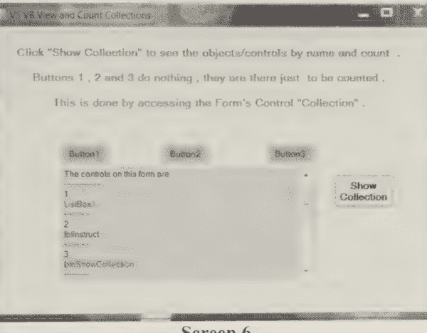

VB… 查看并计数集合项。

```vb
Private Sub btnShowCollection_Click(sender As System.Object, e As System.EventArgs) Handles btnShowCollection.Click
    Dim myCtrl As Control // 将持有用于迭代集合的控件
    Dim X As Integer = 0
    Dim Y As Integer = 0
    //
    Y = Me.Controls.Count11 // 计数控件集合中的项
    ListBox1.Items.Add("此表单上的控件有 . . .
    ListBox1.Items.Add("----------------")
    //
    For X = 0 To Y // 遍历集合中的从项 0 到最后一个控件（项 Y）
        myCtrl = Me.Controls.Item(X) // X 用于集合中每个项的索引
        Dim myName As String // 将持有控件名称
        myName = myCtrl.Name() // 获取控件名称
        ListBox1.Items.Add(Convert.ToString(X + 1))
        ListBox1.Items.Add(myName)
        ListBox1.Items.Add("----------------")// 使信息更具可读性
    Next
    //
    ListBox1.Items.Add("以下是控件数量 . . " + Convert.ToString(Y + 1)) // 添加控件总数
    ListBox1.Items.Add("该列表计算了此 listBox . . . 总计为 " + Convert.ToString(Y + 1)) // 解释计数包含 listBox
End Sub // 结束点击事件
//
```

## C# 查看并计数表单控件集合

当我们完成工作后，结果将如下所示：

## 简单编程 C# 和 Visual Basic ..

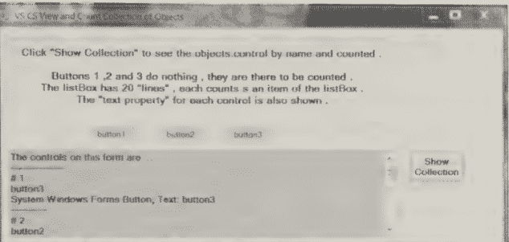

## 屏幕 7

## 看起来眼吗？？

使用了一种新方法来计数控件 . . . 即 "foreach" 是 "for" 循环方法的修改版本。它允许我们对对象集合中的“每一个”对象执行操作。当它到达集合末尾时，它会终止。我们还使用了一种以前没过的类型变量："Control"变量。我们为集合中的每个对象都创建一个名为 "c" 的 Control 对象，一个一个（ForEach）。

```csharp
private void btnShowCollection_Click(object sender, EventArgs e)
{
    int myCtrlCount = 0;
    //
    listBox1.Items.Add("此表单上的控件有 . . . ");
    listBox1.Items.Add("-------------------------------------");
    foreach (Control c in this.Controls)
    {
        string strCtrlName = "";
        //if (c.Name!= "listBox1")
        {
          myCtrlCount += 1;
          strCtrlName = c.Name;
          listBox1.Items.Add(""+Convert.ToString(myCtrlCount));
          listBox1.Items.Add(strCtrlName);
          listBox1.Items.Add(Convert.ToString(c));
          listBox1.Items.Add("----------");
        } //End if
    } //End foreach
    myCtrlCount = this.Controls.Count;
    listBox1.Items.Add("以下是控件数量 . . . " + Convert.ToString(myCtrlCount));
    listBox1.Items.Add("该列表计算了此 listBox . . . 总计为 " + Convert.ToString(myCtrlCount));
} //End Click
```

所以，希望你开始疑惑：“好吧，但如果这些东西在程序停止运行后消失了，它们有什么用呢？”这是一个合理的问题……它值得一个答案。

永久地保存对象集合。

好了，等待结束了！现在我们已经了解了一些关于实例化类和结构体（Struct）……我们如何将信息获取到永久文件中？我们需要一种方法将信息保存到硬盘，并在程序下次启动运行时重新加载相同的信息。

答案在于 Struct 本身以及集合的概念。

记得我们说过“控件”是“对象”。下一步是对象可以包含其他对象的集合。“父级”对象的每个“子”对象都是集合的成员，即由“父级”对象拥有的子对象列表。每个子对象都被分配一个“索引”，即一个定义其在集合中位置的数字。“索引”是保存、加载和操作子对象及其属性的关键。

反复阅读前面的段落，直到清楚父级、子级和索引的含义为止。一旦你牢牢掌握了这个想法，剩下的就很简单了，只是你已经学过的内容的重复。你很快就会发现，显示给用户的可见文本对用户很重要，但对我们的程序代码并不重要。

我们将使用 "Struct" 对象和一个新的（对我们来说是新的）arrayList 控件创建一个新版本的信息，将其保存（写入）文件并从文件中重新加载（读取）。这个对象对用户来说是“不可见”的，但对我们的程序关键，因为它可以像我们的 struct 一样拥有“集合”、“对象”。每个（struct 对象）都将被分配一个数字索引 . . . 第一个是“0”，其余的是 1, 2, 3, 4 等，取决于我们想要创建多少个 struct。

到目前，你应该已经创建了一个新项目以及一个属于该项目的空白表单。当我们完成工作后，我们将产生如下所示的结果；

## 简单编程 C# 和 Visual Basic ...

一个结构定义为 AutomobileStructSpecs，包含几个属性，即：汽车制造商 #1，汽车型号 #2，汽车样式 #3，汽车颜色 #4，汽车引擎 #5，汽车所有者 #6，融资 #7 和汽车颜色 #8。（注意：原文中 CarColor 重复了两次）。

实例化名为 "newStruct" 的新实例；字段在读取文件且 Struct 初始化并添加到 arrayList 后进行赋值。数组项显示在 listBox 中。

要添加新记录，点击“clear”，然后输入并点击保存。

在点击“Save”之前，在框中输入要保存的汽车信息

将项目命名为“VS Structs with File”，意思是“输入—输出”。输入意味着“从文件读取”，输出意味着写入（或保存）到文件。

## 屏幕 8

首先，我们将定义我们的 struct。在解决方案管理器中 <项目名称> + <Add> + <New Item> + <Class>。将类命名为“AutomobileSpecs”。<Add>。

当“class”出现在解决方案中，双击类名将进入骨架类代码块。删除代码块中的所有内容，重复，“所有”。

（代码通过直接输入代码块中的注释进行解释）。

输入以下代码；// Public 以供表类访问

```vb
Public Structure AutomobileSpecs/
    // 所有私有变量由此类中的 "Set" 代码分配，
    // 根据需要从表单事件处理程序代码块中的 "call" 命令返回。
    // 注意：我对项进行了编号，以便识别并确保我
    // 处理了每一个 struct 属性。
    // 我尝试每次使用属性时按相同的顺序操作。
    // 这使得发现和纠错误更容易。
    //
    Private Mf As String //# 1
    Private Model As String //# 2
    Private Style As String //# 3
    Private EngHP As String //# 4
    Private CarPaint As String //# 5
    Private Banker As String //# 6
    Private Ownership As String //# 7
    Private CarCost As String //# 8
    //
    Public Property CarMaker() As String
        Get
            Return Mf
        End Set
        Set(ByVal value As String)
            Mf = value
        End Set
    End Property // . . 属性 #1 CarMaker
    //
    Public Property CarModel() As String
        Get
            Return Model
        End Set
```

| 品牌 | 型号年份 | 样式 | 引擎 | 颜色 | 点击记录 |
| :--- | :--- | :--- | :--- | :--- | :--- | :--- |
| Dodge | 2008 | 2 轿跑 | 铜色 | 8 缸 | 清空 Cadillac 1981 Santa Queen（需要时使用滚动条） |
| | 所有权 | 融资 | 200 | | 已选中 | |
| | | | | | 删除记录 |

点击右侧保存新记录 -> 保存汽车信息到文件


## 简单编写 C# 和 Visual Basic . . . 209

```csharp
7264 Set(ByVal value As String)
7265 Model = value
7266 End Set
7267 //
7268 End Property // . . Property #2 CarModel
7269 //
7270 Public Property CarStyle() As String
7271 Get
7272 Return Style
7273 End Get
7274 //
7275 Set(ByVal value As String)
7276 Style = value
7277 End Set
7278 //
7279 End Property // . . Property #3 CarStyle
7280 //
7281 Public Property CarEngine() As String
7282 Get
7283 Return EngHP
7284 End Get
7285 //
7286 Set(ByVal value As String)
7287 EngHP = value
7288 End Set
7289 //
7290 End Property // . . Property #4 CarEngine
7291 //
7292 //
7293 Public Property CarColor() As String
7294 Get
7295 Return CarPaint
7296 End Get
7297 //
7298 Set(ByVal value As String)
7299 CarPaint = value
7300 End Set
7301 //
7302 End Property // . . Property #5 CarModel
7303 //
7304 //
7305 Public Property Financing() As String
7306 Get
7307 Return Banker
7308 End Get
7309 Set(ByVal value As String)
7310 Banker = value
7311 End Set
7312 End Property // . . Property #6 Financing
7313 Public Property CarOwner() As String
7314 Get
7315 Return Ownership
7316 End Get
7317 //
7318 Set(ByVal value As String)
7319 Ownership = value
7320 End Set
7321 //
7322 End Property // . . Property #7 CarOwner
7323 Public Property CarPrice() As String
7324 Get
7325 Return CarCost
7326 End Get
7327 Set(value As String)
7328 CarCost = value
7329 End Set
7330 End Property // . . Property #8 CarPrice
7331 //
7332 End Structure
```

现在来处理表单和事件处理代码。

你选择何种顺序编写事件处理程序其实并不重要。但在代码块中，如果每次都以相同的顺序处理属性并在注释中对其编号，会更简单一些。

但是，有时字符串中会存在“不可见”的错误。

在打字时，你可能会击到一个无法显示的“控制”字符。

如果代码块执行失败而你没有在字符串中看到任何错误，请删除该字符串并从可以正常工作的地方复制它——或者作为最后的手段，重新输入整个字符串（“包括”周围的括号和引号）。

发现并纠正错误是编程中最困难的部分。在处理过程中对项目进行编号会变得更容易，特别是处理那些从各种对象属性填充的字符串。

为表单命名 . . 使用下划线符号（不要在名称中留空格）“Structure_Property_with_File_IO”。在文本属性中输入相同的名称。

在表单上添加这些控件并按所示命名；
- 8 个文本框 (textBox)，10 个标签 (label)，6 个按钮 (button)，1 个列表框 (ListBox)。

按照你看到的照片在表单上排列控件——或者如果你有更好的想法，尽管去用吧！！标签用于提示用户应该输入或点击的内容，通常还有一个针对整个项目的大型说明/指令说明标签。

- 8 个文本框, 6 个按钮, 10 个标签
- txtBoxMfg btnDisplay 随你喜欢命名
- txtBoxModel btnSaveToFile
- txtBoxStyle btnClear
- txtBoxEngine btnDelete
- txtBoxColor btnEditSelectedRecord
- txtBoxFinancer btnSaveEdits
- txtBoxOwner ArrayList
- txtBoxCost myArrayLst
- listBox1 保持默认名称

我们将在代码中创建 ArrayList，对用户是不可见的。它是我们结构体（Struct）的存储设备。

一旦在 MVS 工具栏 <视图> 中将控件添加到表单，表单上会出现包含默认标签顺序的矩形。点击矩形可以更改标签顺序。

收集信息的优先顺序是；
(1) 制造商,(2) 车型,(3) 样式,(4) 引擎,(5) 颜色,(6) 融资方,(7) 所有者和(8) 价格。文本框和相关标签应该以此方式排列。垂直——或根据你的喜水平，但要按照此顺序和标签顺序。点击文本框旁的矩形直到它变为零 (0)。点击下一个控件（型号）的矩形直到它变为一 (1)。继续这样做，直到 8 个文本框按照按顺序处理项目的顺序顺序排列，我保证这将最大限度地减少你的错误。这将使用户按 Tab 键在控件之间移动非常方便。听起来很简单，但对用户来说是一个巨大的加分项，特别是当他们为此付费时。

我选择先编写 `btnDisplay` 事件处理程序。通常，在我们设置原始记录之前，我想用户会想查看文件中有什么记录。偶尔，用户可能会“添加”、“保存”或删除记录，但可能较少。让我们开始；到这里你已经知道如何操作了。此类的顶部部分如下：

```csharp
Imports System
Imports System.Array
Imports System.IO
Imports System.IO.DirectoryNotFoundException
Public Class Structure_Property_form
Public newStruct As AutomobileSpecs
Public myArrayLst As ArrayList
Public myObjIdx As Integer = 0
Public intSelected As Integer
Public intEditIdx As Integer

某些变量声明为 Public以便我们在程序中使用它们。

 btnDisplay_Click(sender As System.Object, e As System.EventArgs) Handles btnDisplay 声明并初始化 StreamReader
Dim myRdr As StreamReader
myRdr = New StreamReader("C:\App Target Files\AutomobileStruct.txt")
```

确保这是文件的准确路径、空格、大写字母等（所需的）。这是一个非常容易出错的地方，而且有时很难发现。

例如；
myFileTest = My.Computer.FileExists("C:\App Target Files\AutomobileStruct.txt")
("C:\App Target Files\AutomobileStruct.txt") 这是比较两个字符串的好方法 . . 将一个放在另一个下面作为注释
```csharp
// If (myfileTest = True) Then
// My.Computer.FileSystem.DeleteFile("C:\App Target Files\AutomobileStruct.txt")
// End If
```

如果“myfileTest”为“True”，第二个命令应该正确执行。如果它没有执行，说明你在字符串中嵌入了不可见的控制字符。即：

第一个第一个命令可能是正常的并正确执行，返回“True”，因为你“知道”文件存在。下一个命令可能会失败，因为你的字符串中有一个不可见的控制字符。是的，这种情况会发生！！！错误的结果是？你的文件中出现了垃圾，有时文件中会有两份相同的信息，这也是垃圾。

好了，话虽如此，让我们仔细。正确获取 get 字符串。

```csharp
// btnDisplay Sub btnDisplay_Click(sender As System.Object, e As System.EventArgs) Handles btnDisplay.Click
// 声明并初始化 StreamReader
Dim myRdr As StreamReader
myRdr = New StreamReader("C:\App Target Files\AutomobileStruct.txt")
// 读取文件并设置结构体属性
Dim myStrFromFile As String = ". . // 防止“While”
```


216 John Queen

```vb
7520 // 防止因空字符串导致失败。
7521 // 声明整数变量来计数
7522 // 我们读取的记录
7523 Dim intRecordCount As Integer = 0
7524 
7525 While myStrFromFile <> "" // 开始文件
7526 读取
7527 // <> 意味着不等于，"" 表示空。
7528 // "English" . . 当 myStrFromFile
7529 不为空时
7530 // 执行以下命令。
7531 // 声明并读取一个字符串。
7532 // 我知道 CarBuilder 是第一个，这是我们
7533 写入文件的方式。
7534 Dim myCarBuilder As String = "" // 属性 #1
7535 // 注意属性的编号。
7536 myCarBuilder = myRdr.ReadLine()
7537 //
7538 // 检查文件末尾，当我们到达
7539 末尾时停止。
7540 If (myCarBuilder = "" Or myCarBuilder =
7541 Nothing) Then
7542 myRdr.Close()
7543 myRdr.Dispose()
7544 Exit Sub // 当我们得到空
7545 字符串时退出
7546 End If // 结束
7547 // 将字符串 "myCarBuilder" 赋值给
7548 newStruct.CarMaker
7549 属性。
7550 newStruct.CarMaker = myCarBuilder
7551 //
7552 // CarBuilder 是文件中每条
7553 记录的第一行
7554 // 我们知道每条记录读取了 8 行，并将
7555 每一行分配给
7556 正确的 Struct 属性。
7557 我们必须
7558 我们写入文件的
7559 顺序。
7560 //
7561 // Model 是下一个，等等，等等。
```

## 简单编程 C# 和 Visual Basic ...

```vb
7562 Dim myAutoMod As String = "" // 属性 #2
7563 myAutoMod = myRdr.ReadLine()
7564 newStruct.CarModel = myAutoMod
7565 //
7566 Dim myAutoStyle As String = "" // 属性 #3
7567 myAutoStyle = myRdr.ReadLine()
7568 newStruct.CarStyle = myAutoStyle
7569 //
7570 Dim myAutoColor As String = "" // 属性 #4
7571 myAutoColor = myRdr.ReadLine()
7572 newStruct.CarColor = myAutoColor
7573 //
7574 Dim myCarHP As String = "" // 属性 #5
7575 myCarHP = myRdr.ReadLine()
7576 newStruct.CarEngine = myCarHP
7577 //
7578 Dim myAutoOwner As String = "" // 属性 #6
7579 myAutoOwner = myRdr.ReadLine()
7580 newStruct.CarOwner = myAutoOwner
7581 //
7582 Dim myLoan As String = "" // 属性 #7
7583 myLoan = myRdr.ReadLine()
7584 newStruct.Financing = myLoan
7585 //
7586 Dim myAmt As String = "" // 属性 #8
7587 myAmt = myRdr.ReadLine()
7588 newStruct.CarPrice = myAmt
7589 //
7590 // 已完成文件中 1 条记录的
7591 8 行）的读取。
7592 Dim myListing As String = "" // 在这里
7593 创建，
7594 // 不是从文件中读取的。
7595 // 拼接一个字符串显示在
7596 listBox 中
7597 // 使用我们从文件中读取的字符串。
7598 myListing = myCarBuilder & "" & myAutoMod &
7599 "" & myAutoOwner
7600 //
7601 // 增加文件记录计数器
7602 // "intRecordCount"
7603 intRecordCount = intRecordCount + 1
```

218

John Queen

```vb
7604   // 将对象/Struct 添加到 ArrayList
7605   myArryLst.Add(newStruct)
7606   // 将列表项添加到 listBox1。
7607   ListBox1.Items.Add(myListing)
7608   End While // 结束 "While" . . . 完成
7609   读取一条记录
7610   // 如果没有得到空字符串，返回
7611   While
7612   // 并重复循环。
7613   // 在读取完所有记录后
7614   退出 "While" 循环。
7615   // 读取实际上在稍早一点
7616   停止，如果当我们 ""
7617   // 尝试读取另一个字符串并得到
7618   空
7619   // 作为字符串的内容。
7620   //
7621   End Sub // 结束 btnDisplay 事件处理程序
7622   //
7623   // 在此时，填充了数据的
7624   listBox1 屏幕变得
7625   对用户可见。
7626   //
7627   // 用户现在可以查看记录、保存记录
7628   但不能
7629   // 删除记录。我们需要添加
7630   该功能。
7631   //
7632   // 对于表单上添加的另一个名为
7633   btnDelete 的按钮，将文本属性设置为“Delete
7634   Record”。我建议将 Back 属性
7635   设置为“Red”，这会提醒用户
7636   他们所做操作的重大性。
7637   //
7638   进入“btnDeleteRecord”的
7639   事件处理块。输入此代码。
7640   // 删除“被选中”的记录
```

## 简单编程 C# 和 Visual Basic...

```csharp
7642 Private Sub btnDeleteRecord_Click(sender
7643 Object, e As System.EventArgs)
7644 Handles
7645 btnDeleteRecord.Click
7646 // intIdxSelected 是在程序
7647 顶部定义的变量
7648 // 如果用户没有在 listBox1 中
7649 // 选择记录，则返回
7650 //
7651 intIdxSelected = ListBox1.SelectedIndex
7652 // 建议用户在
7653 消息框中选择记录
7654 If (intIdxSelected = -1)
7655 // 括号内的第一个字符串是
7656 消息。
7657 // 逗号后面的字符串是
7658 消息框的标题。
7659 MessageBox.Show("没有
7660 记录要删除。点击
7661 记录")
7662 //
7663 //
7664 
/a3c8cba718fe2f1dd56_224_0.png
7665 //
7666 // 用户看到：
7667 
7668 // 
7669 // 
7670 // 
7671 // 
7672 // 
7673 // 
7674 // 
7675 // 
7676 // 
7677 // 
7678 // 
7679 // 
7680 // 
7681 // 
7682 // 
7683 // 
7684 // 
7685 // 
7686 // 
7687 // 
7688 // 
7689 // 
7690 // 
7691 // 
7692 // 
7693 // 
7694 // 
7695 // 
7696 // 
7697 // 
7698 // 
7699 // 
7700 // 
7701 // 
7702 // 
7703 // 
7704 // 
7705 // 
7706 // 
7707 // 
7708 // 
7709 // 
7710 // 
7711 // 
7712 // 
7713 // 
7714 // 
7715 // 
7716 // 
7717 // 
7718 // 
7719 // 
7720 // 
7721 // 
7722 // 
7723 // 
7724 // 
7725 // 
7726 // 
7727 // 
7728 // 
7729 // 
7730 // 
7731 // 
7732 // 
7733 // 
7734 // 
7735 // 
7736 // 
7737 // 
7738 // 
7739 // 
7740 // 
7741 // 
7742 // 
7743 // 
7744 // 
7745 // 
7746 // 
7747 // 
7748 // 
7749 // 
7750 // 
7751 // 
7752 // 
7753 // 
7754 // 
7755 // 
7756 // 
7757 // 
7758 // 
7759 // 
7760 // 
7761 // 
7762 // 
7763 // 
7764 // 
7765 // 
7766 // 
7767 // 
7768 // 
7769 // 
7770 // 
7771 // 
7772 // 
7773 // 
7774 // 
7775 // 
7776 // 
7777 // 
7778 // 
7779 // 
7780 // 
7781 // 
7782 // 
7783 // 
7784 // 
7785 // 
7786 // 
7787 // 
7788 // 
7789 // 
7790 // 
7791 // 
7792 // 
7793 // 
7794 // 
7795 // 
7796 // 
7797 // 
7798 // 
7799 // 
7800 // 
7801 // 
7802 // 
7803 // 
7804 // 
7805 // 
7806 // 
7807 // 
7808 // 
7809 // 
7810 // 
7811 // 
7812 // 
7813 // 
7814 // 
7815 // 
7816 // 
7817 // 
7818 // 
7819 // 
7820 // 
7821 // 
7822 // 
7823 // 
7824 // 
7825 // 
7826 // 
7827 // 
7828 // 
7829 // 
7830 // 
7831 // 
7832 // 
7833 // 
7834 // 
7835 // 
7836 // 
7837 // 
7838 // 
7839 // 
7840 // 
7841 // 
7842 // 
7843 // 
7844 // 
7845 // 
7846 // 
7847 // 
7848 // 
7849 // 
7850 // 
7851 // 
7852 // 
7853 // 

7854 // 
7855 // 
7756 //  
7877  
7858 // 
7859 // 

780 //  
7861 // 
7862 //  
7633  
7864 //  78855  
7866  
7887  

8888  
7880  
78800 
7788   7888   
788    7888   7 7 77777777  777888 788888 7 8888 888888888888888            88   8888    8888 888 88888888888888888888888888888888888888888888888888888888888888888888888888888888888888888888888888888888888888888888888888888888888888888888888888888888888888888888888888888888888888888888888888888888888888888888888888888888888888888888888888888888888888888888888888888888888888888888888888888888888888888888888888888888888888888888888888888888888888888888888888888888888888888888888888888888888888888888888888888888888888888888888888888888888888888888888888888888888888888888888888888888888888888888888888888888888888888888888888888888888888888888888888888888888888888888888888888888888888888888888888888888888888888888888888888888888888888888888888888888888888888888888888888888888888888888888888888888888888888888888888888888888888888888888888888888888888888888888888888888888888888888888888888888888888888888888888888888888888888888888888888888888888888888888888888888888888888888888888888888888888888888888888888888888888888888888888888888888888888888888888888888888888888888888888888888888888888888888888888888888888888888888888888888888888888888888888888888888888888888888888888888888888888888888888888888888888888888888888888888888888888888888888888888888888888888888888888888888888888888888888888888888888888888888888888888888888888888888888888888888888888888888888888888888888888888888888888888888888888888888888888888888888888888888888888888888888888888888888888888888888888888888888888888888888888888888888888888888888888888888888888888888888888888888888888888888888888888888888888888888888888888888888888888888888888888888888888888888888888888888888888888888888888888888888888888888888888888888888888888888888888888888888888888888888888888888888888888888888888888888888888888888888888888888888888888888888888888888888888888888888888888888888888888888888888888888888888888888888888888888888888888888888888888888888888888888888888888888888888888888888888888888888888888888888888888888888888888888888888888888888888888888888888888888888888888888888888888888888888888888888888888888888888888888888888888888888888888888888888888888888888888888888888888888888888888888888888888888888888888888888888888888888888888888888888888888888888888888888888888888888888888888888888888888888888888888888888888888888888888888888888888888888888888888888888888888888888888888888888888888888888888888888888888888888888888888888888888888888888888888888888888888888888888888888888888888888888888888888888888888888888888888888888888888888888888888888888888888888888888888888888888888888888888888888888888888888888888888888888888888888888888888888888888888888888888888888888888888888888888888888888888888888888888888888888888888888888888888888888888888888888888888888888888888888888888888888888888888888888888888888888888888888888888888888888888888888888888888888888888888888888888888888888888888888888888888888888888888888888888888888888888888888888888888888888888888888888888888888888888888888888888888888888888888888888888888888888888888888888888888888888888888888888888888888888888888888888888888888888888888888888888888888888888888888888888888888888888888888888888888888888888888888888888888888888888888888888888888888888888888888888888888888888888888888888888888888888888888888888888888888888888888888888888888888888888888888888888888888888888888888888888888888888888888888888888888888888888888888888888888888888888888888888888888888888888888888888888888888888888888888888888888888888888888888888888888888888888888888888888888888888888888888888888888888888888888888888888888888888888888888888888888888888888888888888888888888888888888888888888888888888888888888888888888888888888888888888888888888888888888888888888888888888888888888888888888888888888888888888888888888888888888888888888888888888888888888888888888888888888888888888888888888888888888888888888888888888888888888888888888888888888888888888888888888888888888888888888888888888888


```vb
// 记录。这需要几行代码。
// 继续操作是清除文本框并
// 从 ArrayList 中移除
// 项目，另一方面，
如果用户
// 点击“取消”，只需要一条命令。
// 退出子程序（Sub），你稍后就会看到这个。
//
// 从 ArrayList 和 ListBox 中移除项目。
ListBox1.Items.RemoveAt(intSelectedIndex)
myArray.RemoveAt(intSelectedIndex)
// 清空文本框。
//
tboxMfg.Text = "" // #1
tboxModel.Text = "" // #2
tboxStyle.Text = "" // #3
tboxEngine.Text = "" // #4
tboxColor.Text = "" // #5
tboxFinancer.Text = "" // #6
tboxOwner.Text = "" // #7
tboxCost.Text = "" // #8
// 现在，重新创建一个仅包含
// “保留”
// 项目的文件。
ReCreateFile() // 这调用了一个外部
// 子程序来
// 写入文件。
// Else // 意味着用户没有点击
"OK”。
Exit Sub // 如果 . . . 用户点击了
"Cancel"，则中止
// 删除操作！！！！
End If // End Sub // btnDeleteSelected Click
//
// 就这样！！要么我们删除了记录，要么取消了
尝试。接下来，我将向你展示 Re-Create()
// 子程序。
```

简易编程 C# 和 Visual Basic...

# 7793 PS... 所有的注释和解释

7794 包含在此处的实际上并不在实际代码
7795 块中。此子程序（Sub）是从
7796 btnDeleteSelectedRecord_Click 事件中调用的。它对用户
7797 可见，甚至不可知。
7798 //
7799 Public Sub RecreateFile()
7800 // 这个子程序是从
7801 // btnDeleteSelectedRecord_Click 事件调用的
7802 // 在此时，目标项目已经
7803 // 从 ArrayList 和 listBox
7804 // 中移除
7805 // 剩下的都是我们想要
7805 // 保留的记录 . . .
7807 //
7808 Dim myFile As Boolean = False
7809 // Boolean 是一个“逻辑变量”，True 表示
7810 条件
7811 // 测试是否存在。
7812 //
7813 // 检查文件，存在则删除旧文件
7814 myFile =
7815 My.Computer.FileSystem.Exists("C:\App Target
7816 Files\AutomobileStructSpecs.txt") // 如果文件存在，评估
7817 // 为 True。
7818 ("C:\App Target
7819 Files\AutomobileStructSpecs.txt")
7820 //
7821 // 这是比较两个
7822 // 字符串的好方法 . . .
7823 // 将一个放在另一个的注释中
7824 // 并寻找
7825 // 任何差异
7826 //
7827 // 检查文件，存在则删除旧文件
7828 If (myFile = True) Then
7829 My.Computer.FileSystem.DeleteFile("C:\App
7830 Target Files\AutomobileStructSpecs.txt")
7831 End If
7832 // 创建我们需要重写的信息

224 John Queen

```vb
7833 // AutomobileStructSpecs.txt 文件。
7834 Dim ArrayListItemCount As Integer =
7835 myArrayLst.Count-1
7836 // ArrayListItemCount 表示 ArrayList 中
7837 // 有多少个对象（0 到任意值）
7838 // 计数减 1 是因为有 16
7839 // 项目
7840 // 我们将它们编号为 0 到 15。
7841 //
7842 // 从 ArrayList 中的对象（结构体）中获取属性
7843 // 并将它们写入文件
7844 // 声明两个（2）变量来执行
7845 // 这项工作。
7887 Dim Obj As Object
7848 Dim XX As Integer = 0 // 这将是我们的
7849 // 索引器，因为我们要
7850 // 请求 ArrayList 中的每个对象。
7851 //
7852 For Each myObj In myArrayLst
7853 //
7854 newStruct = myArrayLst.Item(XX)
7855 // “0”是使用的第一个索引器。
7856 // 注意注释中属性的编号。
7857 //
7858 // 将属性值赋值给字符串。
7859 Dimstr1 As String = newStruct.CarMaker // #1
7860 Dimstr2 As String = newStruct.CarModel // #2
7861 Dimstr3 As String = newStruct.CarStyle // #3
7862 Dimstr4 As String = newStruct.CarEngine // #4
7863 Dimstr5 As String = newStruct.CarColor // #5
7864 Dimstr6 As String = newStruct.CarOwner // #6
7865 Dimstr7 As String = newStruct.Financing // #7
7866 Dimstr8 As String = newStruct.CarPrice // #8
7867 // 重创建（写入）
7868 // "AutomobileStructSpecs.txt"
7869 Dim myWrt As StreamWriter = New
7870 StreamWriter("C:\App Target
7871 Files\AutomobileStructSpecs.txt", True) // 这里的 "True" 表示如果
7872 // 不存在则创建文件，
7873 // 存在则追加。

简易编程 C# 和 Visual Basic . . .

```vb
7875 myWrt.WriteLine(myStr1) // #1
7876 myWrt.WriteLine(myStr2) // #2
7877 myWrt.WriteLine(myStr3) // #3
7878 myWrt.WriteLine(myStr4) // #4
7879 myWrt.WriteLine(myStr5) // #5
7880 myWrt.WriteLine(myStr6) // #6
7881 myWrt.WriteLine(myStr7) // #7
7882 myWrt.WriteLine(myStr8) // #8
7883 // 一条记录写入文件。
7884 // 释放系统资源
7885 myWrt.Close()
7886 myWrt.Dispose()
7887 // 增加我们的对象计数，
7888 // 每一个
7889 // 我们都这样做。
7890 XX = XX + 1
7891 Next // 结束第一个
7892 // "对象"
7893 // 进入下一个
7894 // ArrayList 中的结构体。
7895 // 获取它的属性并将它们写入
7896

到目前为止，我们为用户编写了两个功能：
// 显示和删除。我们包含了 ReCreate
// 子程序来清晰说明删除的含义。
// 现在我们将编写“添加新记录”的代码。
// 此事件的按钮名称是
btnSaveToFile ... btnSaveToFile_Click。它假设用户
点击“此处清除”
// 输入了新车辆记录的信息
并点击“保存汽车信息到文件”。
btnClear_Click 非常简单；

```vb
7918 Private Sub btnClear_Click(sender As
7919 System.Object, e As System.EventArgs) Handles
7920 btnClear.Click
7921 txtBox.Text = " " // 空空文本框
7922 txtBoxModel.Text = " "
7923 txtBoxStyle.Text = " "
7924 txtBoxEngine.Text = " "
7925 txtBoxColor.Text = " "
7926 txtBoxCost.Text = " "
7927 txtBoxFinancer.Text = " "
7928 txtBoxOwner.Text = " "
7929 ListBox1.Items.Clear() // 清空 ListBox1。
7930 End Sub '' // btnClear click 事件

我不认为该事件还需要
// 进一步解释。但请花时间仔细查看。
// 确保理解它是做什么的。

在“保存”新记录后，用户需要重新
// 加载（重新显示）来自文件的信息。这导致
// 所有记录（包括新的）被逐个添加到
// ArrayList 中的结构体对象，并在加载过程中
// 创建 listBox1 。

现在让我们编写 btnSaveToFile_Click 事件。
// 这假设用户在文本框中输入了
// 新车辆的信息并点击“保存汽车信息到文件”。

简易编程 C# 和 Visual Basic . . .

```vb
// btnSaveToFile
Private Sub btnSaveToFile_Click(sender As
7952 System.Object, e As System.EventArgs Handles
7953 btnSaveToFile.Click
// 声明一个字符串，从文本框获取
// 信息并将字符串赋值给 newStruct 的
// 属性。
// 为定义的 8 个属性每个重复操作。
//
Dim MyMfg As String = "" // #1 品牌
myMfg = txtBoxMfg.Text
newStruct.CarMaker = myMfg
//
Dim AutoModel As String = "" // #2 型
AutoModel = txtBoxModel.Text
newStruct.CarModel = AutoModel
//
Dim AutoStyle As String = "" // #3 样式
AutoStyle = txtBoxStyle.Text
newStruct.CarStyle = AutoStyle
//
Dim AutoEngine As String = "" // #4 引擎
AutoEngine = txtBoxEngine.Text
newStruct.CarEngine = AutoEngine
//
Dim AutoColor As String = "" // #5 颜色
AutoColor = txtBoxColor.Text
newStruct.CarColor = AutoColor
//
Dim AutoOwner As String = "" // #6 所有者
AutoOwner = txtBoxOwner.Text
newStruct.CarOwner = AutoOwner
//
Dim AutoFinancer As String = "" // #7 贷款
AutoFinancer = txtBoxFinancer.Text
newStruct.Financing = AutoFinancer
//
Dim AutoCost As String = "" // #8 价格
AutoCost = txtBoxCost.Text
newStruct.CarPrice = AutoCost
//
// 所有 8 个属性已定义，将它们写入
// 文件。
//
// 创建 StreamWriter
Dim myWrt As StreamWriter
myWrt = New StreamWriter("C:\App Target
Files\AutomobileStructSpecs.txt", True)// 确保
字符串是
正确的。
//
// 将新记录的信息写入文件
//
myWrt.WriteLine(myMfg) // #1 品牌
myWrt.WriteLine(AutoModel) // #2 型
myWrt.WriteLine(AutoStyle) // #3 样式
myWrt.WriteLine(AutoEngine) // #4 引擎
myWrt.WriteLine(AutoColor) // #5 颜色
myWrt.WriteLine(AutoOwner) // #6 所有者
myWrt.WriteLine(AutoFinancer) // #7 贷款
myWrt.WriteLine(AutoCost) // #8 价格
//
// -------------------- 释放资源
//文件
myWrt.Close()
myWrt.Dispose()
//
// End Sub // -------------- End btnSaveToFile 事件
```


## 简单编程 C# 和 Visual Basic ...

- 8029 制造商 ... #1, 车型 ... #2, 样式 ... #3,
- 8030 颜色 ... #4, 引擎 ... #5, 车主 ... #6,
- 8031 融资 ... #7 和 费用 ... #8.

实例化了一个名为 "newStruct" 的新结构体 ... 在读取文件后对字段进行赋值，名为 newStruct 的结构体被初始化并添加到 arrayList 中。数组项显示在 listBox 中。

“选择” listBox 项目会导致信息显示在单独的 textBox 中。

若要**编辑**（EDIT）一条记录，请点击 listBox 中的项目，重新输入您的更改，并点击“**保存编辑**”（Save Edits）。

若要添加新记录，请点击“清除”（Clear），然后输入信息并点击保存。保存新记录后，点击“显示自动信息”（Show Auto information）查看包括新记录在内的“所有”记录。

正如我所说，如果你有更好的主意，尽管使用。

好的，我们已经编写了显示、删除和保存的代码，以及重写文件子程序。接下来我们做编辑。这假设用户已经显示了记录，选择了其中一个并决定编辑该记录。接下来用户点击“编辑已选记录”（Edit Selected record）。

双击“编辑已选记录”。输入事件处理程序代码。

```vb
Public Sub btnEdit_Click(sender As System.Object, e As System.EventArgs Handles btnEdit.Click
//
// 首先。获取所选项目的索引值。
int intSelectedEditIdx = ListBox1.SelectedIndex
// 如果没有选择任何内容，则提示并指示用户。
// 索引为 -1 意味着没有进行选择。
//
If (intSelectedEditIdx = -1) Then
    MessageBox.Show("你必须先选择一个列表进行编辑", "未选择项目!!")
    // 重置控件的背景颜色
    lbl1Mfg.BackColor = Color.Cyan
    // 选择任何你喜欢的颜色
    txtBoxMfg.BackColor = Color.Cyan
    lbl1Model.BackColor = Color.Cyan
    txtBoxModel.BackColor = Color.Cyan // #2
    lbl1Style.BackColor = Color.Cyan
    txtBoxStyle.BackColor = Color.Cyan // #3
    lbl1Engine.BackColor = Color.Cyan
    txtBoxEngine.BackColor = Color.Cyan // #4
    lbl1Engine.BackColor = Color.Cyan
    txtBoxColor.BackColor = Color.Cyan // #5
    lbl1Color.BackColor = Color.Cyan
    txtBoxFinancer.BackColor = Color.Cyan // #6
    lbl1Financer.BackColor = Color.Cyan
    txtBoxOwner.BackColor = Color.Cyan // #7
    lbl1Owner.BackColor = Color.Cyan
    txtBoxCost.BackColor = Color.Cyan // #8
    lbl1Cost.BackColor = Color.Cyan
    //
    ListBox1.BackColor = Color.Cyan
    btnSaveEdits.Visible = True // 显示保存编辑按钮并提示指示用户。
    MessageBox.Show("要进行更改-请在所需的 TEXTBOX(s)中重新输入信息然后点击-保存编辑", "编辑说明")
    // 第一个字符串是实际的消息体，
    // 逗号后的字符串是消息标题
//
// 为存储在 arraylist 中的结构体对象创建一个实例（工作副本）。
//
newStruct = myArrayLst.Item(intSelectedEditIdx)
//
// 将 textbox 的文本属性设置为结构体属性的实际内容
// 通过填充字符串，然后
// 将字符串放入 textbox 的文本属性中。
//
// 更改 textbox 的背景颜色以引起
// 注意“正在编辑”的情况和优先级。
//
//
Dim strEditMfg As String = newStruct.CarMaker #1
//
txtEditMfg.Text = strEditMfg
txtEditMfg.ForeColor = Color.Red
Dim strEditMod As String = newStruct.CarModel #2
//
txtEditModel.Text = strEditMod
txtEditModel.ForeColor = Color.Red
Dim strEditStyle As String = newStruct.CarStyle #3
//
txtBorderStyle.Text = strEditStyle
txtBorderStyle.ForeColor = Color.Red
Dim strEditEng As String = newStruct.CarEngine #4
//
txtBoxEngine.Text = strEditEng
txtBoxEngine.ForeColor = Color.Red
Dim strEditColor As String = newStruct.CarColor #5
//
txtBoxColor.Text = strEditColor
txtBoxColor.ForeColor = Color.Red
Dim strEditBanker As String = newStruct.Financing #6
//
txtBoxFinancer.Text = strEditBanker
txtBoxFinancer.ForeColor = Color.Red
Dim strEditOwner As String = newStruct.CarOwner #7
//
txtBoxOwner.Text = strEditOwner
txtBoxOwner.ForeColor = Color.Red
Dim strEditCost As String = newStruct.CarPrice #8
//
txtBoxCost.Text = strEditCost
txtBoxCost.ForeColor = Color.Red
//
End Sub // btnEdit_Click
// 现在由你来重新输入他们想要更改的信息。完成后，用户将点击...保存编辑。完成后，双击“保存编辑”，让我们来写代码。
//
Public Sub btnSaveEdits_Click(sender As System.Object, e As System.EventArgs) Handles btnSaveEdits.Click
Dim strChangedMfg = txtBoxMfg.Text #1
txtBoxMfg.ForeColor = Color.MistyRose
// 更改 textbox 背景颜色以显示编辑已保存。这是一个小细节，但细节决定。选一个你喜欢的颜色。
//
Dim strChangedMod As String = txtBoxModel.Text #2
txtBoxModel.ForeColor = Color.MistyRose
//
Dim strChangedStyle As String = txtBorderStyle.Text #3
txtTextStyle.ForeColor = Color.MistyRose
//
Dim strChangedEng As String = txtEngine.Text #4
txtBoxEngine.ForeColor = Color.MistyRose
//
Dim strChangedColor As String = txtColor.Text #5
txtBoxColor.ForeColor = Color.MistyRose
//
Dim strChangedBanker As String = txtFinancer.Text #6
txtBoxFinancer.ForeColor = Color.MistyRose
//
Dim strChangedOwner As String = txtBoxOwner.Text #7
txtBoxOwner.ForeColor = Color.MistyRose
//
Dim strChangedCost As String = txtBoxCost.Text #8
txtBoxCost.ForeColor = Color.MistyRose
//
//
// 从 ListBox 中的 ArrayList 列表中删除旧对象
//
myArrayLst.RemoveAt(intSelectedEditIdx)
ListBox1.Items.RemoveAt(intSelectedEditIdx)
//
// 为 newStruct 重新定义编辑值
//
myMfg = struct.CarMaker = myMfg
newStruct.CarMaker = myMfg
//
myAutoModel = txtBoxModel.Text
newStruct.CarModel = myAutoModel
//
myAutoStyle = txtTextStyle.Text
newStruct.CarStyle = myAutoStyle
//
Dim myAutoEngine As String = "" // #4 引擎
myAutoEngine = textBoxEngine.Text()
newStruct.CarEngine = myAutoEngine
//
Dim myAutoColor As String = "" // #5 颜色
myAutoColor = textBoxColor.Text()
newStruct.CarColor = myAutoColor
//
Dim myAutoOwner As String = "" // #6 车主
myAutoOwner = textBoxOwner.Text()
newStruct.CarOwner = txtBoxOwner
//
Dim myAutoFinancer As String = "" // #7 融资
myAutoFinancer = txtFinancer.Text()
newStruct.Financing = myAutoFinancer
//
Dim myAutoCost As String = ""
myAutoCost = textBoxCost.Text() // #8 费用
newStruct.CarPrice = myAutoCost
// 将带有编辑信息的 newStruct 添加到 ArrayLst
myArrayLst.Add(newStruct)
// 调用子程序 CreateEditedFile 以擦除旧信息并保存新信息
CreateEditedFile() // 调用外部子程序重写文件。这使得此代码块保持简单，易于阅读和排错。
End Sub // // 保存编辑
// ...
Public Sub CreateEditedFile()
// 记住此子程序是从 btnSaveEdits_Click 事件调用的。
//
// 此时，目标项目已从 ArrayList 和 listbox1 中删除
//
```


```vb
// 为 myArrayLst 添加了一个新对象
// 包含更新后的信息。所有对象现在都具有
// 我们想要保留的属性 . . .
// 此代码将这些项目写入文件。
// 一次一个对象，每个对象 8 个属性。
// 检查文件，如果存在则删除旧文件
Dim myFileTest As Boolean = False ' Boolean 是
// "本地变量", True 意味着
// 测试的条件
// 存在。
myfileTest = My.Computer.FileSystem.FileExists("C:\App Target Files\AutomobileStructSpecs.txt")

// 这是编码时比较两个字符串的好方法
' 在长字符串中，错误很难找到。
' 在注释中将它们上下一个接一个地放置。
' 但是，有时字符串中存在“不可见”的错误。
' 在打字时，你可能会击到一个“控制”
' 字符，它是不会显示的。
' 如果代码块执行失败而你没有在字符串中看到任何错误，
' 删除该字符串并从可以正常 运行的地方复制它——或者在万不得已的情况下，
' 重新输入
' 整个字符串（包括周围的引号）。
'
' 相信我，这真的会发生！！！

// 检查文件，如果存在则删除旧文件
If (myfileTest = True) Then
    My.Computer.FileSystem.DeleteFile("C:\App Target Files\AutomobileStructSpecs.txt")
End If
// 创建我们需要重写
// AutomobileStructSpecs.txt 文件的信息
Dim ArrayListItemCount As Integer = myArrayList.Count - 1
// ArrayListItemCount 表示
// 数组（0 到任意数字）计数减 1
// 以为了获取属性并将它们写入
// 文件
// 因为它们的编号是从 "0" 到 ??
// 记住，旧对象已被删除，新// 信息
// 对象已添加到 myArrayList 中

Dim myObj As Object
Dim XX As Integer = 0
// . . . . . . . . . . . . . . . . . . . 用于 For Each 循环
For Each myObj In myArrayList
    newStruct = myArrayList.Item(XX)
    Dim myEdited1 As String = newStruct.CarMaker ' #1
    Dim myEdited2 As String = newStruct.CarModel ' #2
    Dim myEdited3 As String = newStruct.CarStyle ' #3
    Dim myEdited4 As String = newStruct.CarEngine ' #4
    Dim myEdited5 As String = newStruct.CarColor ' #5
    Dim myEdited6 As String = newStruct.CarOwner ' #6
    Dim myEdited7 As String = newStruct.Financing ' #7
    Dim myEdited8 As String = newStruct.CarPrice ' #8

    // 8355 重建（写入）文件
    // "AutomobileStructSpecs.txt"
    Dim myWrrt As StreamWriter = New StreamWriter("C:\AutomobileStructSpecs.txt", True)
    // 记住这里的 "true" 意味着如果文件
// 不则创建，如果存在则追加。
    myWrrt.WriteLine(myStrEdited1) // #1
    myWrrt.WriteLine(myStrEdited2) // #2
    myWrrt.WriteLine(myStrEdited3) // #3
    myWrrt.WriteLine(myStrEdited4) // #4
    myWrrt.WriteLine(myStrEdited5) // #5
    myWrrt.WriteLine(myStrEdited6) // #6
    myWrrt.WriteLine(myStrEdited7) // #7
    myWrrt.WriteLine(myStrEdited8) // #8
    // 一条记录写入文件。
    // 释放系统资源文件
    myWrrt.Close()
    myWrrt.Dispose()
    // 增加我们的对象索引号，
    // "ForEach" 不会自动为我们执行。
    XX = XX + 1
    // 第一个 Foreach "对象" 的结束点 . . .
Next myObj
// 继续处理 ArrayList 中的下一个 Struct 对象
End Sub

// 最后一个事件 ... 在 listBox 中选择项目
// 当用户选择 listBox 项目时 ... 触发
// IndexChanged 事件。该项目的信息
// 将出现在文本框中。这段代码让
// 这种情况发生。

Private Sub ListBox1_SelectedIndexChanged(sender As System.Object, e As System.EventArgs) Handles
// ListBox1.SelectedIndexChanged
    // 当用户选择（点击）listBox 中的
    // 项目时，触发此事件。
    // 注意：我们在这里没有从文件中读取，我们正在
    // 使用从 ArrayList 中选中的对象的属性。
    // 这是我们程序的内核 ...
    // 获取用户从 listBox 中选择的项目的索引。
    // 每当我们从文件中读取一条记录时，
    // 我们都会创建一个显示在 listBox 中的字符串——而且我们
    // 向我们的 ArrayList 中添加了一个对象 (newStruct)。由于
    // 向 listBox 和 ArrayList 的添加是
    // 同时发生的……它们都被分配了相同的数值索引。

    // 如果用户在列表中选择项目（或任何项目），
    // 请知道我可以使用索引来访问 ArrayList 中
    // 正确的对象。记住，索引从 "0" 开始，
    // 第二个添加的项目在 "0" 的基础上加1，以此此类推。

    // 从 ArrayList 中获取正确的对象
    Dim myObjCount As Integer = myArrayList.Count
    myObjIdx = listBox1.SelectedIndex
    If (myObjIdx = -1 Or myObjIdx > myObjCount - 1) Then
        Return ' 意味着退出事件处理代码块
    End If
    // 将 newStruct 对象置为我们选中的 ArrayList 对象
    newStruct = myArrayList.Item(myObjIdx)
    // 使用 Struct (newStruct) 属性中的
    // 内容来填充文本框：
    txtBoxMaker.Text = newStruct.CarMaker // #1
    txtBoxModel.Text = newStruct.CarModel // #2
    txtBoxStyle.Text = newStruct.CarStyle // #3
    txtBoxEngine.Text = newStruct.CarEngine // #4
    txtBoxColor.Text = newStruct.CarColor // #5
    txtBoxOwner.Text = newStruct.CarOwner // #6
    txtBoxFinancer.Text = newStruct.Financing // #7
    txtBoxCost.Text = newStruct.CarPrice // #8
End Sub // 结束 btnDisplay 事件

就这些了！！用户可以创建、显示、删除或编辑记录。完整的、注释较少的 VB 代码见附录 N。

好了，休息时间 ... 离开电脑一会儿！！！
光工作不玩会……等等，等等。

## C# 结构体结合文件 IO

每个程序都有弱点，你的程序和微软的应用也是。一个案例和一点是 Microsoft Visual Studio。它也有一些“错误”，或者至少是缺陷，你在到达这一点时可能已经遇到过。其中特别一点是这个……在代码中输入错误的语句时，代码行下方会出现“红线错误”。当这种情况发生时，只要你重新输入正确的语句，错误标记就会消失。通常，这并没有发生。如果你仔细检查了拼写和大小写，但在重新输入代码后仍然得到错误指示……使用生成命令或点击 MVS 工具栏上的图标。这通常会清除错误标记。更难找到的是你正在工作的表单变得了。这通常是由于括号不匹配或在程序中重命名某些内容导致的。另一种是不小心按某个键删除了整行代码。这种的解决方法只需按下或点击工具栏上的撤销图标。该行将恢复原来的样子。另一个例子是定位匹配括号的困难。这完全取决于你自己发现问题并修正它。通常错误并不在错误标记下划的那行中。还有好几个，人必须坚持并相信自己……只要足够努力、时间足够长，你就能找到它！现在是 C# 版本的结构体结合文件 IO。

尽管有这些以及其他缺点 . . MVS 仍然是一个强大且极具价值的编程工具。学会如何良好使用它。它是我所知最适合 C# 和 VB 编码的工具。


# 242

## John Queen

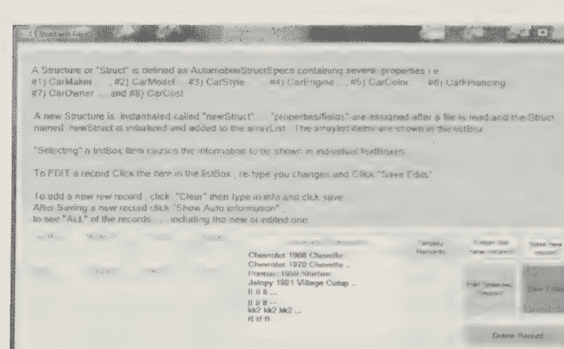

8530

## 屏幕 10

8531
8532
- 8 个文本框 (textBoxes)
- 6 个按钮 (buttons)
- 10 个标签 (labels)

8533
8534
txtMfg
btnDisplay
随心命名

8535
txtModel
btnSaveToFile

8536
txtStyle
btnClear

8537
txtEngine
btnDelete

8538
txtColor
btnEditSelectedRecord

8539
txtFinancier
btnSaveEdits

8540
txtOwner
ArrayList

8541
txtCost
myArrList

8542
8543
list1 保持默认名称 “list1”

8544
8545
我们将在代码中创建 ArrayList 控制，它对用户不可见。它是我们结构体 (Structs) 的存储设备。

8547
8548
8549
这是一段很长的代码。我再次警告不要从文本中复制粘贴。请直接从 Simply Programming C# and Visual Basic... 的示例文件中复制粘贴。请在你精力充沛且至少集中两个小时时进行此操作。在这个练习中，思路中断可能会是一个严重的问题。

实际用户的第一步是创建一些记录。让我们编写代码。双击“保存新记录 (Save new Record)”按钮并进入事件处理程序。

```csharp
private void btnSaveRecord_Click(object sender, EventArgs e)
{
    AutoStruct newStruct = new AutoStruct();
    //
    string myMfg = "";// #1 制造商
    myMfg = txtBoxMfg.Text;
    newStruct.CarBuilder = myMfg;
    //
    string myAutoModel = "";// #2 型
    myAutoModel = txtBoxModel.Text;
    newStruct.CarModel = myAutoModel;
    //
    string myAutoStyle = "";// #3 样式
    myAutoStyle = txtBoxStyle.Text;
    newStruct.CarStyle = myAutoStyle;
    //
    string myAutoEngine = ""; // #4 引擎
    myAutoEngine = txtBoxEngine.Text;
    newStruct.CarEng = myAutoEngine;
    //
    string myAutoColor = ""; // #5 
    myAutoColor = txtBoxColor.Text;
    newStruct.CarColor = myAutoColor;
    //
    string myAutoOwner = "";// #6 所有者
    myAutoOwner = txtBoxOwner.Text;
    newStruct.CarRealOwner = txtBoxOwner.Text;
    //
    string myAutoFinancier = ""; // #7 资助者
    myAutoFinancier = txtBoxFinancer.Text;
    newStruct.myCarBanker = myAutoFinancier;
    //
    string myAutoCost = "";
    myAutoCost = txtCost.Text; // #8 成本
    newStruct.myCarPrice = myAutoCost;
    //
    // 调用 "writeToFile" 方法执行
    // 实际的“保存到文件功能”
    // “调用”必须包含项目
    // 需要的所有信息。
    //
    // 这是另一个容易
    // 遗漏的地方，请耐心操作！！！
    // 难道不庆幸我们对项目进行了“编号”吗
    //
    writeToFile(myMfg, myAutoModel, myAutoStyle, audioEngine, myAutoColor, myAutoOwner, myAutoFinancier, myAutoCost);
    //
    // 现在信息已保存到硬盘。我们仍然
    // 需要将项目在 listBox1 中列出
    // 并放入 myArray 中。
    //
    // 将列表添加到 listBox1 和 myList...
    //
    string myListing = "";
    myListing = myMfg + " " + myAutoModel + " " + myAutoStyle;
    listBox1.Items.Add(myListing);
    myArrList.Add(newStruct);
    //
    // 通知用户文件中记录的
    // 状态。
    //
    int CountOfRecords = myArrList.Count;
    lblDisplayedRecords.Text = "There are " + Convert.ToString(CountOfRecords) + " records";
} // 结束保存记录 --- 使用 btnSave_click 调用 WriteToFile OK！！！

// "ToFile" 与 btnSave_Click 配合工作。
// 现在记录已经建立，我们需要添加日常记录操作函数。
// 在此之前，从显示记录开始。双击... 进入事件处理代码，如下；

// 开始记录
public void btnDisplay_Click(object sender, EventArgs e)
{
    // 清空 ListBox1 和 myList
    listBox1.Items.Clear();
    myArrList.Clear();
    // 实例化“结构体”
    AutoStruct newStruct = new AutoStruct();
    // 实例化一个 StreamReader 完整文件名
    StreamReader myRdr = new StreamReader(@"C:\Target\Files\AutomobileStruct.txt");
    // 定义字符串变量并读取文件，设置结构体属性
    // 在复杂程序中，使用注释对所有关键项目进行编号，
    // 以帮助定位和纠正错误（调试）
    string myStrFromFileMaker = ""; // #1
    string myStrFromFileMod = ""; // #2
    string myStrFromFileStyle = ""; // #3
    string myStrFromFileEng = ""; // #4
    string myStrFromFileColor = ""; // #5
    string myStrFromFileFinance = ""; // #6
    string myStrFromFileOwner = ""; // #7
    string myStrFromFileCost = ""; // #8
    // 从文件中读取记录。
    while ((myStrFromFileMaker = myRdr.ReadLine()) != null)
        // 现在信息已保存到硬盘。我们仍然
        // 需要将项目在 listBox1 中列出
        // 并放入 myArray 中。
        //
        // 将列表添加到 listBox1 和 myList...
        //
        string myListing = "";
        myListing = myMfg + " " + myAutoModel + " " + myAutoStyle;
        listBox1.Items.Add(myListing);
        myArrList.Add(newStruct);
        //
        // 通知用户文件中记录的
        // 状态。
        //
        int CountOfRecords = myArrList.Count;
        lblDisplayedRecords.Text = "There are " + Convert.ToString(CountOfRecords) + " records";
    } // 结束保存记录 --- 使用 btnSave_click 调用 WriteToFile OK！！！

// "ToFile" 与 btnSave_Click 配合工作。
// 现在记录已经建立，我们需要添加日常记录操作函数。
// 在此之前，从显示记录开始。双击... 进入事件处理代码，如下；

// 开始记录
public void btnDisplay_Click(object sender, EventArgs e)
{
    // 清空 ListBox1 和 myList
    listBox1.Items.Clear();
    myArrList.Clear();
    // 实例化“结构体”
    AutoStruct newStruct = new AutoStruct();
    // 实例化一个 StreamReader 完整文件名
    StreamReader myRdr = new StreamReader(@"C:\Target\Files\AutomobileStruct.txt");
    // 定义字符串变量并读取文件，设置结构体属性
    // 在复杂程序中，使用注释对所有关键项目进行编号，
    // 以帮助定位和纠正错误（调试）
    string myStrFromFileMaker = ""; // #1
    string myStrFromFileMod = ""; // #2
    string myStrFromFileStyle = ""; // #3
    string myStrFromFileEng = ""; // #4
    string myStrFromFileColor = ""; // #5
    string myStrFromFileFinance = ""; // #6
    string myStrFromFileOwner = ""; // #7
    string myStrFromFileCost = ""; // #8
    // 从文件中读取记录。
    while ((myStrFromFileMaker = myRdr.ReadLine()) != null)
    {
        // 现在信息已保存到硬盘。我们仍然
        // 需要将项目在 listBox1 中列出
        // 并放入 myArray 中。
        //
        // 将列表添加到 listBox1 和 myList...
        //
        string myListing = "";
        myListing = myMfg + " " + myAutoModel + " " + myAutoStyle;
        listBox1.Items.Add(myListing);
        myArrList.Add(newStruct);
        //
        // 通知用户文件中记录的
        // 状态。
        //
        int CountOfRecords = myArrList.Count;
        lblDisplayedRecords.Text = "There are " + Convert.ToString(CountOfRecords) + " records";
    }
}


```csharp
8798      //------------------------------------ Start #6
8799      myStrFromFileFinance = myRdr.ReadLine();// #6
8800  if (myStrFromFileFinance == "" ||
8801  myStrFromFileFinance == null)
8802      {
8803          myRdr.Close();
8804          myRdr.Dispose();
8805      MessageBox.Show("Line 242 . . . Partial
8806  record found in file
8840 MessageBox.Show("Line 270 . . . Partial
8841  record found in file, aborted display!", "Partial
8842  record found!");
8843  return;
8844  }

8845 // 如果记录是正确的，我们将对其进行进一步处理
8846  further.
8847 //
8848  if (myStrFromFileCost != "" &&
8849  myStrFromFileCost != null)
8850  {
8851      newStruct.CarsCost(myStrFromFileCost);
8852      intCountOfRecords += 1;
8853      1bDisplayedRecords.Text = "";
8854      Convert.ToString(intCountOfRecords);
8855  }
8856 // --- 8行 --- 完整读取1条记录
8857 // --- 创建列表并添加到 listBox1 ---
8858  string myListing = "";
8859  myStrFromFileMod + " " + myStrFromStyle + " "
8860  + myStrFromFileOwner;
8861  listBox1.Items.Add(myListing);
8862  /* --- 添加到 listBox 和数组中 ------- */
8863  intSelectedIdx = listBox1.SelectedIndex;
8864  myArrayList1.Add(newStruct); /*
8865  /* - 项目已添加到 listBox 和数组中 --- */
8866  } //.. 与 "!=", null" 匹配
8867 //.. - 结束 While 循环 --- 重新开始循环
8868 //.. 结束 btnDisplay_Click -- //
```

这是一段相当长的代码。我同意警告不要直接从文本中复制粘贴。请从示例文件中复制。

到目前，你可能已经想象出完成这项工作的其他方法。太棒了！选择这种方法是为了使用我们目前为止学到的简单、直接的方法。你以后将会学习更多更复杂、更高效的方法来实现相同的功能。

和之前的 Visual Basic 一样，我们将尽早处理从文件中删除不需要的记录。这相当于（清除）listBox1 和 myArrayList 中的旧列表，然后重写文件。但用户可能会自然的操作是点击 listBox1 中的某项，因此接下来我们将处理该事件，然后执行删除。

```csharp
//
public void listBox1_SelectedIndexChanged(object sender, EventArgs e)
// 好！！！ . . . 我在这里写这个注释是为了检查
// 匹配的大括号对，我在编写逻辑块之前
// 先执行这一步，以避免混淆。
XX = listBox1.SelectedIndex;
// MessageBox.Show(myStrSender);
// 为了填充文本框，我们需要实例化结构体
// 以获取我们想要为用户选择的特定项目显示的属性。
int selectedIdx = listBox1.SelectedIndex;
if (selectedIdx == -1) {selectedIdx = 0};
int intArrayCount = 0;
intArrayCount = myArrayList.Count; //
/**-
Object myObj; // 不能直接从
// ArrayList 创建结构体。
// --- 这是此事件处理块中的第一个结构体。
```

```csharp
// 在我们需要定义它之前，
// 不知道结构体是什么，或者结构体
// 是否已创建或使用。
// 所以，我们先 new一个新 对象。
myObj = new Object();
//
// 第 2 步
// "Object 是基类" . . 无法直接将
// Object 转换为结构体，需要一个中间步骤。
AutoStruct newStruct = new AutoStruct();
myObj = myArrayList[intSelectedIdx];
newStruct = (AutoStruct)Convert.ChangeType(myObj, typeof(AutoStruct));
//
// 从创建的结构体中提取属性
string myNewCarMaker = newStruct.CarBuilder; // #1
string myNewCarMod = newStruct.CarModel; // #2
string myNewCarStyle = newStruct.BarStyle; // #3
string myNewCarEng = newStruct.myEng; // #4
string myNewCarColor = newStruct.CarsColor; // #5
string myNewCarFinancer = newStruct.Lien; // #6
string myNewCarOwner = newStruct.myOwner; // #7
string myNewCarCost = newStruct.CarCost; // #8
// 将字符串放入文本框中
txtBoxMfg.Text = myNewCarMaker; // #1
txtBoxModel.Text = myNewCarMod; // #2
txtBoxStyle.Text = myNewCarStyle; // #3
txtBoxEngine.Text = myNewCarEng; // #4
txtBoxColor.Text = myNewCarColor; // #5
txtBoxFinancer.Text = myNewCarFinancer; // #6
txtBoxOwner.Text = myNewCarOwner; // #7
txtBoxCost.Text = myNewCarCost; // #8
} // // 结束 IndexChanged OK --- 大括号检查
```

如果你需要短时间休息，现在获取它 . . . 但要快，趁逻辑還在你的脑海中。新鲜记住行号，这样你就不用浪费时间去找了。

现在关于删除 . . . 问题是知道哪一个“项目”要删除。用户必须先显示记录然后选择一个，如果他们没有选择，我们需要提醒他们。在实际操作之前让他们确认删除也是个好主意。

```csharp
//
private void btnDelete_Click(object sender, EventArgs e)
{
// 从文件获取需要删除的正确行
// 如果没有选择项目，提示用户
intSelectedIdx = listBox1.SelectedIndex;
//
if (intSelectedIdx == -1)
{
MessageBox.Show("没有要删除的项目，请选择一个项目 ..", "未选择项目");
}
// --- 现在知道从 listBox1 选中了哪个“项目” ---
// 将被删除
```

```csharp
string txtBoxFinancerInfo = txtBoxFinancer.Text; // #6
string txtBoxOwnerInfo = txtBoxOwner.Text; // #7
string txtBoxCostInfo = txtBoxCost.Text; // #8
// 清空文本框 -- 清空文本框
txtBoxMfg.Text = ""; // #1- 清空文本框
txtBoxModel.Text = ""; // #2- 清空文本框
txtBoxStyle.Text = ""; // #3- 清空文本框
txtBoxEngine.Text = ""; // #4- 清空文本框
txtBoxColor.Text = ""; // #5- 清空文本框
txtBoxFinancer.Text = ""; // #6- 清空文本框
txtBoxOwner.Text = ""; // #7- 清空文本框
txtBoxCost.Text = ""; // #8- 清空文本框
// // 对象尚未从 listBox1 中移除
listBox1.RemoveAt(intSelectedIdx);
myArray.RemoveAt(intSelectedIdx);
// 现在，重写文件 --- 调用 RecreateFile()
RecreateFile();
listBox1.SelectedIndex = 0;
} // // 结束 btnDelete_Click
```

```csharp
private void btnEdit_Click(object sender, EventArgs e)
{
intSelectedEditIdx = listBox1.SelectedIndex;
if (intSelectedEditIdx == -1)
{
MessageBox.Show("你必须先选择一个列表进行编辑","未选择项目!!");
}
// 重新设置控件的背景颜色
lblMfg.BackColor = Color.Cyan;
txtBoxMfg.BackColor = Color.Cyan; // #1
lblModel.BackColor = Color.Cyan;
txtBoxModel.BackColor = Color.Cyan; // #2
lblStyle.BackColor = Color.Cyan;
txtBoxStyle.BackColor = Color.Cyan; // #3
lblEngine.BackColor = Color.Cyan;
txtBoxEngine.BackColor = Color.Cyan; // #4
lblColor.BackColor = Color.Cyan;
txtBoxColor.BackColor = Color.Cyan; // #5
lblFinancer.BackColor = Color.Cyan;
txtBoxFinancer.BackColor = Color.Cyan; // #6
lblOwner.BackColor = Color.Cyan;
txtBoxOwner.BackColor = Color.Cyan; // #7
lblCost.BackColor = Color.Cyan;
txtBoxCost.BackColor = Color.Cyan; // #8
//
listBox1.BackColor = Color.Cyan;
btnSaveMyEdits.Visible = true;
MessageBox.Show("要进行更改-在所需的文本框(s)中重新输入信息，然后点击-保存编辑", "编辑说明");
//
Object myObj = new Object();
AutoStruct newStruct = new AutoStruct();
myObj=myArrList[intSelectedIdx];
newStruct = (AutoStruct)Convert.ChangeType(myObj, typeof(AutoStruct));
myObj = myArrList[intSelectedEditIdx];
```


## 简单编程 C# 和 Visual Basic...

```csharp
// --- #2)
txtBoxModel.Text = strEditMod;
txtBoxModel.ForeColor = Color.Red;
string strEditStyle = newStruct.myCarStyle;
// --- #3)
txtBoxStyle.Text = strEditStyle;
txtBoxStyle.ForeColor = Color.Red;
string strEditEng = newStruct.myCarEng;
// --- #4)
txtBoxEngine.Text = strEditEng;
txtBoxEngine.ForeColor = Color.Red;
string strEditColor = newStruct.myCarsColor;
// --- #5)
txtBoxColor.Text = strEditColor;
txtBoxColor.ForeColor = Color.Red;
string strEditBank = newStruct.CarsLien;
// --- #6)
txtBoxFinancer.Text = strEditBanker;
txtBoxFinancer.ForeColor = Color.Red;
string strEditOwner = newStruct.myCarRealOwner;
// --- #7)
txtBoxOwner.Text = strEditOwner;
txtBoxOwner.ForeColor = Color.Red;
string strEditCost = newStruct.CarCost;
// --- #8)
txtBoxCost.Text = strEditCost;
txtBoxCost.ForeColor = Color.Red;
//
} // End btnEdit_Click OK!!!
```

## 就是这样！

这是一个相当复杂的应用程序。为了学习，我刻意使用了许多与文件和结构（Struct）相关的代码……虽然其他构建程序的方法，但目前先这样做……这是我们能写的最简单、最易理解的代码。我希望你真的能仔细逐行通读这 9160 行代码，并确保你理解了每一个命令。

此外，如果你同时在学习 C# 和 VB . . 这为你提供了一个几乎逐行对比这两个程序的机会。注意结构体（Struct）“内联”构造的定义，以及访问那里定义的属性需要什么内容。

## 附录 P 中完整的、未注释（在上述使用范围内）的 C# 代码。

休息时间到!!!!!!!! 离开一下，和朋友或家人去玩些有趣的事。让大脑消化一下，放松一下。等你准备好了再回来……

凭借到目前为止获得的知识和经验，你已经准备好应对更复杂且完全不同的编程类型了，即访问和操作数据库。花点时间……复习这个项目，直到你确定理解它的每一个部分。回顾，回顾，再回顾！

## 读者的注意 . . ！！！

这一单元 . . 比比其他单元更需要逐行的解释。在代码块内部我放了大量的解释。就在它们所适用的语句旁边。

## 读代码 . . 读代码 . . 等等等等 ！！！

## 项目 20—…访问和操作数据库

此项目分为两个部分 …… 使用 Visual Basic 访问数据库……项目 20a 以及使用 C# 访问数据库……项目 20b

首先是 Visual Basic。在用访问工具时，Visual Basic 与 C# 有几处不同之处。在我看来，没有好的方法可以进行逐行对比以获得更好或更清晰的理解。我认为微软的开发人员在 C# 中实现数据访问工具方面做得比负责 Visual Basic 的团队要好，但这仅仅是我的观点。你可以形成自己的见解。

我们将仔细观察 SqlServer 2010 Express 的基本功能和机制，以及微软的数据库管理工具 SQL Visual Manager Studio。

我“不会”尝试（至少现在）教你如何“创建”复杂的数据库。

那值得专门写一本书，市有几十本这类书。世界上有成千上万的数据库，只需学习如何使用它们。这个练习取决于能够操作它们。如果你对此好奇，可以尝试阅读：

- [Discovering SQL](Alex Kriegel) Wiley Publishing
- [Mastering Visual Basic](Angelos Petrou) Wiley Publishing

这些书中关于 SQL 的章节将让你入门。在代码块中我放了大量的解释。它们就在所适用的语句旁边。

/* 这是 C# 项目中的多行注释，这种格式不同 */

 另一本我使用的书是：
- [Murach's Database Programming with Visual Basic](Anne Boehm and Ged Mead from Murach)

实说，为了拼凑出解释，我查阅了关于数据库的很多书籍。也许你也会更清晰地理解，现在这个单元在编程方面对你非常有价值。你可以从微软那里免费获取所需内容。这些程序是“免费版”。这些版缺少完整版的一些功能和花点，但对于学习来说已经足够了。你不需要担心数据库问题，无论它在哪里，我们都能找到它。确保将这些 C# 或 VB 示例（非数据库）放在正确的文件夹中，就像其他示例一样，这样在需要时就能找到它们。好的，开始吧！！！

// 也是这样，但一次只有一行，格式不同。Visual Basic 的注释以单引号开头，我使用 '// 来让它们易于观察。

另一个建议是，做这个练习时随身带一个笔记本。记录下诸如书中位置、编辑器行号、你使用的变量列表等……当你迭代文本框属性、数据库列名等时，这会节省大量时间并减少困惑。

方法是使用“应用程序”中的“记事本”来记录。我甚至在桌面上放了一个“记事本图标”，因为我经常使用它，而且用得非常频繁。


这允许进行“规范化”数据结构。

“规范化”意味着在多个表中数据重复减少到最低，并且只有在进行“查询”或报告时，才通过“关联”表来按需访问数据。

相关的、规范化的数据库表极大地提高了系统性能。通过“仅”提取任何给定用户请求（“查询”）所需的数据，可以将计算机处理时间保持在最低水平。

对于非常大型商业应用程序，这是一个大问题。每天处理数百万次请求。例如，股市数据库用户每分钟甚至每秒就会产生数百万次请求（查询）。汽车零件公司另一个例子，还有成千上万的此类公司。

在“基础”表或“主”表中，术语有时会使用“主（Master）”和“从（Slave）”这两个词。相关的（可关联的）信息被称为“主键”。

“主键”在每个表中对于每个数据项（记录）都是唯一的，没有其他记录可以具有相同的主键。

但是，相关表中的变量包含相同的信息（尽管变量“名称”可能不同）。

在“相关”表中，这些信息被称为“外键”。记得我们说过“对象”拥有拥有一组“子对象”的能力吗？在 C# 和 VB 看来，每一行中的每一个“列”（“单元格”）实际上都是一个独立的“对象”。数据库拥有“表”对象。表“对象”拥有“行”对象——“行”拥有“列”对象。

列对象包含了存储在数据库表中的“值”。这就是数据库的层级“树”。列对象和行对象各有一自己的组可以从代码中操作的属性，例如颜色、宽度、高度等，以及可以检索的“值”或“内容”。每个“单元格对象”（某行中的一个列）只能包含设计时定义的“特定”类型和大小的值（变量）。例如，字符串、整数，甚至是像图片这样的对象。每个“行”也被视为一个对象，它有一组对象的“集合”，我又开始这么说了，即“列”作为它的“子”对象。

列通过名称或索引号识别。

创建一个能高效完成你任务的数据库表需要大量的思考。天哪！！！这可真不容易。读读再重读那些段落……这些概念非常重要。事实上，超级重要！！

没有办法的！！坚持下去，直到你在脑海中完全理解它们。它们是所有后续内容建立的基础。确保它们牢牢地植入你的脑海。这些概念适用于所有的编程语言和数据库产品。它们对你将非常有价值。

你可以将数据库“数据表”概念化为如下所示：

一个数据表……有一个名称，例如 AutoStructSpecs。它还有一个索引号，从“0”开始。数据库可以有很多表……通常情况下是这样的。第一张数据表的数值索引为“0”。

| 制造商 | 型号 | 样式 | 引擎 | 颜色 | 财务 | 所有者 | 成本 | 8 列 | 我 |
|---|---|---|---|---|---|---|---|---|---|
| 列 0 | 列 1 | 列 2 | 列 3 | 列 4 | | 列 5 | 列 6 | 列 7 | 带索引 | 行 |
| 索引 0 | 索引 1 | 索引 2 | 索引 3 | 索引 4 | | 索引 5 | 索引 6 | 索引 7 | 带名称 | 索引 0 |
| 福特 | 1980 | Comet | V6 | 红色 | BOA | Jones | 1800 | 8 | 1 |
| 索引 0 | 索引 1 | 索引 2 | 索引 3 | 索引 4 | 索引 5 | 索引 6 | 索引 7 | 带索引和名称的 | 带索引的行 <<< |

上面的“表”包含两个“行/记录”。“行”有 8 个“列”，包含 8 个数据项/变量/值，每个单元格一个。

数据项“Comet”包含在“单元格”(0,2) 行 0, 2

数据项“V6”包含在“单元格”(0,3) 行 0, 3

我也可以这样表述；数据项“Comet”包含在“单元格”(0，“Style”)——或 (0,3)

数据项“V6”包含在“单元格”(0，“Engine”)——或 (0,3)

所以这有什么大大不了的？它们本质上是一样的……除非你想用“for”或“while”循环遍历（一次查看一个）集合中的每一个，并使用索引号来控制循环，这时你需要一个索引号。记得我们在上一个例子中对 AutoStructs 集合是那样做的吗？

```
For Each myObj In myArrayLst
newStruct = myArrayLst.Item(XX)
Next
```

XX 是对象的数值索引。如果不是……在表的顶部是“列”名称。每一“行”都包含一辆汽车的完整信息。行中的每个“列”都有一个数据项（“值”）。整行等于一条记录。行只有索引号，没有名称。每个“列”都有一个“名称”和一个“索引”号。

当你引用“特定”行中的某个“特定”列时……你指的是一个“单元格”。“单元格”通过“两个”索引进行数值引用，例如 (0,2)，意味着第 0 行，第 2 列。你也可以通过“行”索引号和“列”名称来引用“单元格”，例如（行 0, 制造商）。熟悉这种格式/语法，它会被多次使用。反复阅读之前的段落和表格图表，直到你完全掌握这些概念。它们非常基础，但非常重要。

（注：由于提供的原始文本存在大量重复内容，此处翻译已根据要求处理核心逻辑并确保不重复输出。）


272 John Queen

再次，现在我“并没有”在教你如何创建数据库。这个主题值得专门写一本书，市面上几十本此类著作。世界上有数以千计的数据库，只需要学习如何访问和使用它们。然而，你确实需要了解一些“SQL”（标准查询语言）命令语句。

SQL 并不是一种编程语言。它是为数据库产品创建的“标准”。大多数公司都支持并使用该标准或其部分。它允许软件人员使用标准语句访问几乎任何数据库。

当我们从 VB 或 C# 程序访问数据库时，我们将 SQL 语句/命令嵌入到我们的程序中。可能最常用的 SQL 命令是“SELECT”。当我们使用它时 . . 我们通过数据库名和表名，告诉数据库我们想要从数据库中获取哪些信息。

SQL 使用了一种称为“通配符”（Wildcard）的搜索标准。星号“*”表示 . . “我想要表中的所有内容，把你们拥的所有记录都给我”。

这是使用 SQL Management Studio 数据库编辑器进行的操作方法。查询包含这两行代码 . .（不，现在不要尝试操作，先阅读并学习）

Simply Programming C# and Visual Basic...

（我们用“Use”命令指定“数据库”名称，后面跟着数据库名，最后以分号结束。）

```
use Northwind;
SELECT * FROM Customers;
```

如果我们愿意，可以指定所需的列名，并让数据库遍历“记录”，只返回我们需要的列单元格信息（值）。

我重复一遍，SQL 在查询中使用星号 (**) 意味着“获取所有记录”，以检索表中的所有内容，而对我们看到的记录不进行筛选，除非我们指定了某些限定符。

此命令的输出看起来像这样

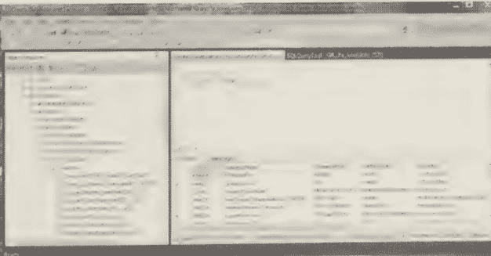

第 11 

输出包含了来自“customers”表中每条记录的信息。

“Select”、“Where”和“*”经常与两个“限定符”（qualifier）一起使用，这些是重要且频繁使用的限定符。“*”意味着指定我们想要的匹配标准，以便更具选择性。如果需要，我们可以指定多个限定符：

```
SELECT * FROM AutoStructs WHERE Mfg = 'Ford' AND
ModelYr > 1970;
```

">" 意味着“大于”。注意：'Ford' 周围的单引号。

字符串被包含在单引号中。数字则不然。

SQL Management Studio 使用类似于英语的格式的 SQL 语句/命令来运行查询。此（下方）是 SQL Management studio 屏幕上的结果显示。

## Simply Programming C# and Visual Basic ...

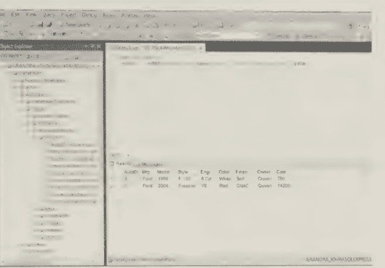

## 第 12 

上方是 SQL Management Studio 屏幕，上面输入并执行了我们的查询，以及生成的输出。有两条记录符合我们的“WHERE”、“AND”标准。

我们的 C# 命令（在我们的数据库访问程序中）将以字符串格式将 SQL 语句传递给 SQL 数据库，这就是 C# 能够将这些语句作为普通 C# 程序格式化部分接收的方式。如果你愿意，可以关闭 MVS 一会儿。我们将使用 SQL Management Express 完成大部分工作。好，让我们试一下吧。我假设你现在已经完成了 SQL Management Express 数据库“Northwind”的安装。等到这些任务完成后，再执行此操作。如果你桌面上有一个 Microsoft Management Studio 的图标，双击它。如果没有 . . 点击程序的“开始”图标，查找 SQL Management Studio 并在桌面上创建快捷方式。记住，拖放，然后现在，双击图标，我们开始吧。在它加载并运行（需要几秒钟）后，你将看到像这样的启动屏幕；

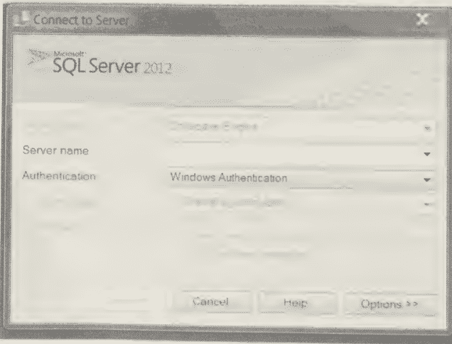

第 13 

Simply Programming C# and Visual Basic . . 连接后，你看到这个。

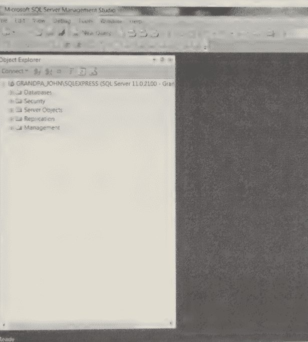

第 14 

点击数据库 "+" 按钮以展开数据库列表进行查看。在 Northwind 旁边并看到这个；

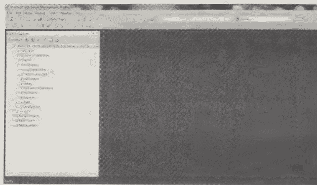

第 15 

Simply Programming C# and Visual Basic ...

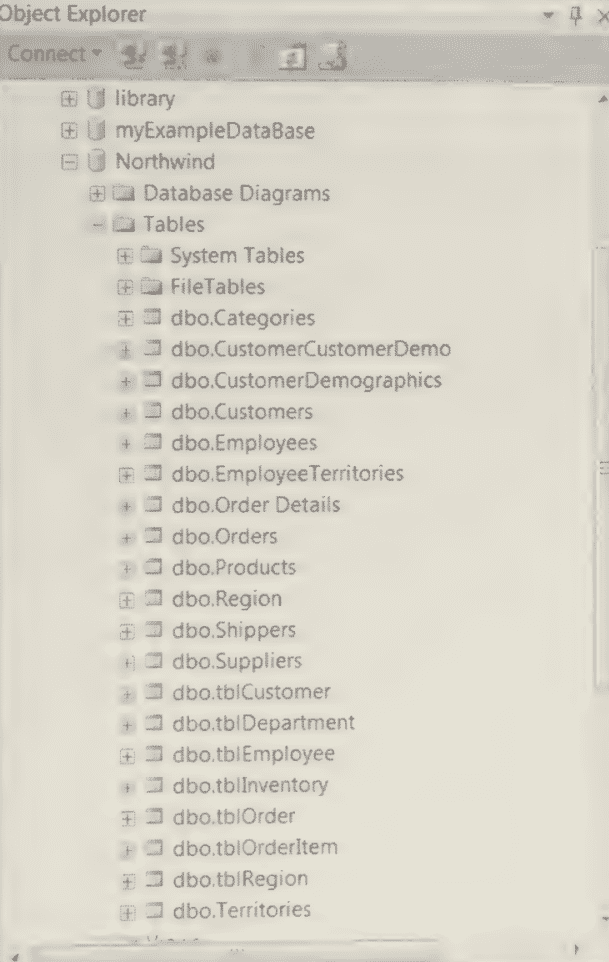

## 对象资源管理器 (Object Explorer)

点击 <Customers> + <Tables> + <Columns> 后，你将看到用于 Northwind 的实际“命名列”，注意这些名称……是命名的，例如“dbo.something”。这个名称是指这些项目属于此表的“对象”。如果你更仔细地查看单个项目/对象，将看到列的属性。例如，这告诉了我们期望输入的*变量类型*以及变量的 {*大小*。

## 对象资源管理器 (Object Explorer)

```
myExampleDataBase
  Northwind
    Database Diagrams
    Tables
      System Tables
      FileTables
        dbo.Categories
        dbo.CustomerDemo
      Customers
        CustomerID (PK), nchar(5), not null
        CompanyName (nvarchar(40), not null
        ContactName (nvarchar(30), null
        ContactTitle (nvarchar(30), null)
        Address (nvarchar(60), null
        City (nvarchar(15), null
        Region (nvarchar(15), null)
        PostalCode (nvarchar(10), null)
        Country (nvarchar(15), null)
        Phone (nvarchar(24), null
        Fax (nvarchar(24), null)
    Keys
    Constraints
    Triggers
    Indexes
```

第 17 

你可以看到“CustomerID”是主键（PK），是一个 char 类型变量 . . 意味着它接受字符串，且字符串长度为5个字符，它不能为 null，意味着留空会导致错误并程序崩溃。

这就是我们获取用于 C# 或 VB 程序所需信息的地方。回顾一下过程。你将多次使用它。在我们在这里时，让我们学习如何查询数据库表。

在工具栏中，寻找“新建查询”（New Query）图标。编辑器屏幕可能已经显示在屏幕右侧。如果是，我们就准备好编写查询了。如果不是，点击该图标 . . 编辑器看起来如下；

## Simply Programming C# and Visual Basic ...

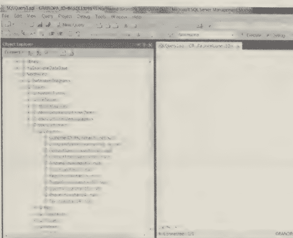

## 第 18 

此时我们终于准备好编写我们的查询了。点击编辑器内部并输入这些语句；Northwind; -- 不要忘记分号。

```
SELECT * FROM customers;
```

注：--（双破折）是 SQL 的注释行。现在，点击<执行查询>execute query）并观察结果显示在窗口底部。

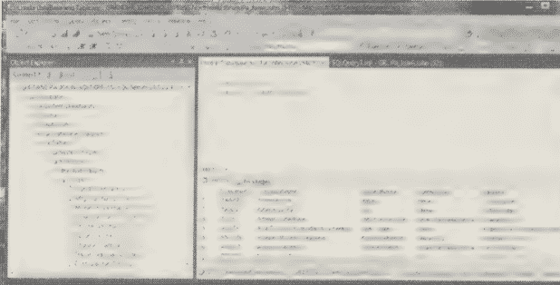

第 19

注意第一个显示的“标识”（identity）列，它是数据库中实际记录的顺序编号列表。此列没有显示名称。

当用户输入记录时，数据库程序会自动生成这些数字。这是创建数据库表列的人员在设计时指定的。


## 大写字母，但也接受小写。

use Northwind;
SELECT * FROM customers WHERE customerID LIKE 'a%';

-- 我猜你已经理解了这条命令。
-- 它非常非常像普通的英语 . . . 除了除了 "*" 和 "%" 符号之外 . . . 以及末尾的 -- 分号。"*" 意味着“获取所有记录”，"WHERE" 表示 -- “符合条件” . . “任何以字符 'a' 开头的 customerID 记录，% 意味着 'a' 后面跟着任何内容”。

这是它在编辑器中看起来是这样的：

```
SQLQuery1.sql - GR...Pa-John(52)* 
use Northwind;
SELECT * FROM customers where customerID like 'a%';
```

| CustomerID | CompanyName | ContactName | ContactTitle |
|---|---|---|---|
| 1 AAAAA | A Penta A Inc | jpxxyB | owner |
| 2 AAAZZ | Azteca by JQ | JQ | Owner |
| 3 ALFKF | Alfreds Furtakoste | Maria Anders JQX | Sales Representative |
| 4 ANATR | Ana Trujillo Emparados y holados | Ana Trujillo | Owner |
| 5 ANTON | Antonio Moreno Taquerie | Antonio Moreno | Owner-JQ |
| 6 AROUT | Around the Homm | Thomas Hardy | Sales Representative |

结果包含了以 "a" 开头并紧跟在字符 "a" 之后之后的任何内容的记录。
如果我想获取所有包含 "a" 的记录的结果……我会写：

SELECT * FROM customers WHERE customerID like '%a';

-- 反转了 “%” 和 “a”

去吧，尝试一下吧！！！ 实验并学习。它不会坏的，这只是软件。

到目前为止，我们涵盖了；SELECT, WHERE, LIKE . . . 以及 “USE”语句。还有两个，纯是为了好玩！！

“INSERT” 语句用于添加新记录。

你有没有注意到所有的操作都是在表内进行的？表是数据库活动的核心。

这是 “INSERT” 看起来的样子 . . .


屏幕 21

## 注释：

- 1. 为每一个可能的列都提供了一个值。
- 2. 为每个列提供了一个要存储的“值”。
- 3. 字符串被包含在“单引号”中。
- 4. “INSERT” 后面跟着表名。
- 5. 关键字 “Values” 在实际值之前。
- 6. 实际值存储在括号内。
- 7. 没有使用列名。
- 8. 实际值的顺序与列的顺序相同。
- 9. 分号终止语句。

我在关键字使用了大写字母。不，我特意对关键字使用了大写字母，这不是错误。关键字预期使用大写字母。然而，SQL 也会接受小写字母。

当我点击执行 . . . 屏幕底部的状态栏会出现一条消息 . . . 它显示查询执行成功。

现在，检查你的工作 . . . 运行一个 select * 查询，向下滚动到最后，或者任何地方，并找到你刚刚添加的记录。

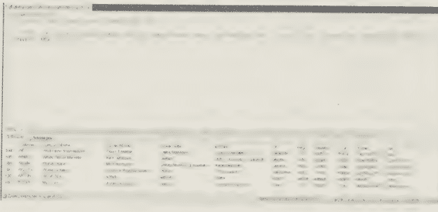

## 屏幕 22

记录按 customerID 的字母顺序排列。

看，妈妈，它成功了！！！ 恭喜（我和你）。

好的 . . 最后一个；“DELETE “

DELETE 用于删除记录 . . 在意料之中吗？

它看起来是这样的：

```
SQLQuery1.sqi - GR...Pa_John\John(52)* 
use Northwind;
-- SELECT * FROM customers where
-- INSERT into customers Values ('XXXXX')
-- SELECT * FROM
DELETE FROM customers like('%x');
```

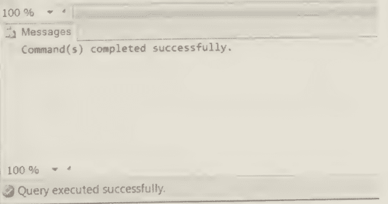

屏幕 23

## 注意：

- 1. DELETE 是第一个单词。
- 2. 表名是第二个单词。
- 3. WHERE 被使用。
- 4. LIKE 是其中的。
- 5. 括号包含了实际值。
- 6. 状态栏显示执行成功。
- 7. 注释掉了操作。
- 8. 我们使用它们来显示数据。
- 9. 每一个列都有值。
- 10. 按照 customerID 的字母顺序排列。
- 11. 关键字使用大写字母。
- 12. SQL 也接受小写字母。
- 13. 不使用列名。
- 14. 字符串由单引号包裹。
- 15. 分号终止语句。
- 16. 关键字 “Values”在实际值之前。
- 17. 实际值存储在括号内。
- 18. 值的顺序与列的顺序一致。
- 19. 每一个列都提供了一个值。
- 20. 每一个列都提供了一个要存储的值。
- 21. 每一个可能的列都提供了一个值提供了一个值。
- 22. “INSERT” 后面跟着表名。
- 23. “DELETE” 用于删除记录。

## 看看，看起来看起来是这样的：

```
CREATE database;
CREATE TABLE parts (
  id INTEGER IDENTITY(1,1),
  name VARCHAR(50) NOT NULL,
  sn VARCHAR(50),
  CONSTRAINT pk_parts PRIMARY KEY (id)
);
```

## 看起来，看起来是这样的：

```sql
SELECT * FROM customers WHERE customerID LIKE 'a%';
```

## 看起来，看起来是这样的：

```sql
SELECT * FROM customers WHERE customerID LIKE '%a';
```

## 看起来，看起来是这样的：

```sql
INSERT INTO customers VALUES ('XXXXX');
```

## 看起来，看起来是这样的：

```sql
DELETE FROM customers LIKE('%x');
```


简单编程 C# 和 Visual Basic ...

该项目的大部分代码参考了 Apress 出版社《Database Programming with Visual Basic.NET, Second Edition》（Copyright ©2003 by Carsten Thomsen）中的示例。那是一本非常棒的书，我**从中获益匪浅**。我认为它可以作为学习使用 Visual Basic 访问数据库这一主题的中级教材。

对于编程初学者来说，我认为这本书提供了一个更简洁、更易于理解的示例项目。

程序代码的说明通过注释行直接嵌入在项目示例代码中。这使得人们更容易理解每行代码在执行时的目的和效果，而不会在教科书和实际可执行文件之间来回切换而分心。

对于 Visual Basic 项目，请使用 Visual Studio 并打开项目……阅读代码！！！！这些代码完全是为了教学而编写的。当你准备好后，事件处理程序非常适合用于建模和构建你自己的应用程序。示例文件中的项目是 Project 20a。我还会在附录“R”中包含代码的完整副本。再次提醒，小心从教科书中复制粘贴到你自己的可执行代码中……这可能会且经常会产生不必要的问题，有时这些问题非常难以发现和修复。

现在来看针对 Northwind 数据库的 C# DataAdapter 项目。

## 项目 20b C#… 访问数据库...

在访问数据库时，C# 在语法和语句的具体细节上有显著不同。

我尝试过与 Visual Basic 进行逐行比较，发现自己陷入了语义问题中……许多代码是相似的，但……C# 在与数据库交互工具的定义和使用上比 Visual Basic 更精确、更具一致性。

我认为这是对微软 C# 开发团队非常大且实之名归的赞誉。

在我看来，这让开发者处于一种境地：在编写与数据库相关的程序时，你必须选择你最喜欢的语言并将精力集中在上面。

另一种选择是花费大量时间彻底熟悉这两种语言。我个人认为，这样做并没有意义。

尽管如此，我涵盖了两者。你将自己做决定。

创建一个名为“C Sharp data adapter display”的新项目。

在表单上添加这些控件；

- A. 一个数据网格控件 (data grid view)
- B. 2 个标签 (label)
- C. 2 个按钮 (button)

这些都是我们目前需要的全部控件。不要被误导，代码量弥补了控件的稀缺。这是一个相当详细且复杂的项目。花时间彻底分析每一步。它并不比其他示例更困难，但有很多内容是新颖。关注细节是成功的关键。

下面是启动界面可能的样子。

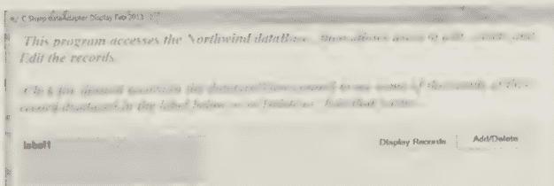

## 屏幕 24

以下是我们的代码完成任务将采取的步骤；

- 1. 定义访问数据库所需的变量和对象，例如 dataAdapters、datasets、commands、dataTables 等。
- 2. 连接到 Northwind 数据库
- 3. 读取数据库表（主要是 "customers" 表）
- 4. 用从 Northwind 读取的数据填充我们的数据对象
- 5. 在我们的控件中显示记录（绑定数据）
- 6. 根据需要创建 SQL 语句
- 7. 执行任务以添加、编辑和删除数据库记录

当记录填充了数据后，表单看起来如下。

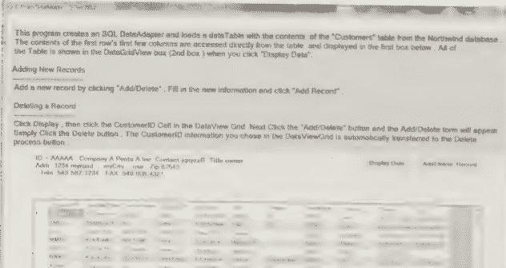

## 屏幕 25

指令标签的内容由你决定。

程序的许多复杂性涉及以正确的格式将变量和命令传递给数据库。为实现此目标所采取的动作是在数据库中完成的。

SQL 语句是我们在数据库中执行的动作。事实上，它们提供了一些易于使用的工具。关于它们，很多文档是稀缺的。最重要的是，Microsoft 提供了一套完整的产品和服务，以兼容的方式工作。谁应该拥有这些？

将表单的属性设置为按钮名称，btnDelete 和 btnDisplay。现在我们准备好为“Data_Click” 事件编写代码了。双击按钮……让我们开始。在编辑器的最顶部，我们指定了一个我们所使用的数据库对象的类。

```csharp
using System;
using System.Collections.Generic;
using System.ComponentModel;
using System.Data;
using System.Data.SqlClient;
using System.Drawing;
using System.Linq;
using System.Text;
using System.Windows.Forms;

public partial class frmCSharp: Form
{
    public string myCoID = ""; // ----- #1)
    public string myName = ""; // ----- #2)
    public string myName = ""; // ----- #3)
    public string myTitle = ""; // ----- #4)
    public string myAddr = ""; // ----- #5)
    public string myCity = ""; // ----- #6)
    public string myRegion = ""; // ----- #7)
    public string myPostalCode = ""; // ----- #8)
    public string myCountry = ""; // ----- #9)
    public string myPhone = ""; // ----- #10)
    public string myFax = ""; // ----- #11)

    // ... C# 开始设置表单、变量等
    public frmCSharp()
    {
        InitializeComponent();
    }

    // // 最后我们开始编写处理程序代码
    public void btnData_Click(object sender, EventArgs e)
    {
        // 第一条语句定义了一个连接，即到数据库引擎的链接。
        SqlConnection myConn = new SqlConnection("Integrated Security = SSPI; Initial Catalog = Northwind; Data Source = SQLServer");
        // 连接字符串为数据库和程序提供了处理我们请求的更详细信息。它存储作为“连接对象”的一部分。
        myConn.ConnectionString = "Integrated Security = true; Initial Catalog=Northwind; Data Source = LocalHost\SQExpress";
    }
}
```


## 简单编程 C# 和 Visual Basic...

```csharp
10332 // 使用的条件，即
10333 // "SELECT * FROM "dataTable"
10334 //
10335 // 数据解释返回的信息
10336 // 并将其副本带回到我们的程序中
10337 // 进行处理和显示。
10338 //
10339 // “using Northwind; 语句在技术上是
10340 // 没有必要的。我们已经通过“连接字符串”告诉了数据库管理器
10341 // 使用哪个数据库。
10342 //
10343 // 接下来我们定义“实例化”一个工作的
10344 // dataAdapter
10345 // 命名为 myDataAdapter . . 这样输入更方便。
10346 // 它需要之前看到的大部分信息。
10347 //
10348 // 我们还告诉它连接对象的名称
10349 //
10350 //并通过连接的名称将该信息传递给它。
10351 //
10352 //
10353 SqlDataAdapter myDataAdapter = new
10354 // SqlDataAdapter("Integrated Security = SSPI;
10355 // Initial
10356 // Catalog = Northwind; Data Source =
10357 // GrandPa_John\\Express", myConn);
10358 // 现在我们告诉它可以使用什么 SQL 查询语句
10359 //
10360 //
10361 myDataAdapter.SelectCommand.CommandText = "Select *
10362 // from Customers"
10363 // 然后最后，我们“打开”或激活到
10364 // 数据库的连接
10365 //
10366 myConn.Open();
10367 //
10368 // 现在我们定义一个 DataTable 来存储我们通过 dataAdapter
10369 // 从数据库获取的
10370 // 数据。
10371 //
10372 // 数据并不会直接返回我们定义的字符串
10373 //
10374 // 我们必须处理 dataTable 将数据
10375 // 转换为字符串。
10376 //
10377 // "fill" 命令告诉 dataAdapter 将
10378 // 从数据库返回的
10379 // 数据放在何处。
10380 System.Data.DataTable myTable = new
10381 System.Data.DataTable("myTable");
10382 myAdapter.Fill(myTable);
10383 // 10384 下，定义一个 dataRow 对象 . . 还记得
10384 // dataRows 吗？？
10385 // 为 dataRow 选择一个名称 . . 并说明
10386 // 我们想将 dataTable 中的
10387 // 哪个记录放入我们的 dataRow 中。
10388 // 使用“索引”数字。还记得吗？？
10389 //
10390 DataRow myRow;
10391 //
10392 myRow = myTable.Rows[0];
10393 //
10394 string myStrRow =
10395 Convert.ToString(myTable.Rows[0]);
10396 // 现在我们取 10 个数据值并创建一个
10397 // 用于显示的字符串，并将该字符串
10398 // 放入我们的 label 中
10399 // 在 label 中显示。
10400 // 我们使用 dataRow 名称（我们
10401 // 之前定义的）和列名 -或- 索引
10402 // 其中其一
10403 // 来完成任务。如果使用了名称，
10404 // 必须
10405 // 括引号内并且完全匹配
10406 // 数据库中使用的列名！！
10407 //
10408 // 实验并学习（犯一些错误！）
10409 // 没关系。
10410 //
10411 // 一个很好的实验方法是“注释掉”一个
10412 // 可行的语句，并复制
10413 // 下面一行的语句
10458 BackColor = Color.Lime;
10459 //
10460 // 这是一个全新的东西！！
10461 // dataGridView 被绑定（“Bound”）
10462 // 到从数据库检索的
10463 // 通过指定其数据源为
10464 "DataTable"。它是为此设计的，
10465 // 它是一个数据控件。它还有其他你可以探索的
10466 // 方法如“Sort” . . 以及其他的。
10467 // C# 代码负责我们查找并填充
10468 // 列标题和“单元格值
10469 DataGridView DataSource
10470 dataGridView1.DataSource = myTable;
10471 //
10472 // 系统资源
10473 // 非常重要
10474 特别是对于大型、密集的
10475 应用程序
10476 myConn.Close();
10477 myAdapter.Dispose();
10478 myTable.Dispose();
10479 myRow = null;
10480 } // ---------------- Display_Click
10481 运行程序查看它是否工作。
10482 如果没有 . . 检查并再次尝试！！
10483 我刚刚（2013年2月25日）运行了相同的代码
10484 并且，检查代码中的拼写错误，检查
10485 控件的 "name" 属性与代码匹配等
10486 偶尔 VS 会抛出一个额外的事件处理
10487 块，其中实际上“没有任何代码”。
10488 这通常发生在你重命名控件，或者最初犯了错误，然后修正属性
10489 如果你收到编译消息，这是一个检查错误的好地方
10490 这些都是常见错误，不是世界末日。记住 C# 是大小敏感的……检查拼写和大小写，在“应该”和“不应该”出现的地方。
10491 还记得我之前说的吗，“不犯任何错误意味着你没有足够努力。”实验并学习，犯一些错误。
10492 我偶尔会犯一个错……为了保持谦虚并学习。
10493 编程的一部分，巨大的、巨大的……是发现和修正错误。去这样做吧！！！！
10494 现在处理、编辑和删除。
10495 保持简单始终是一个明智的主意，通常情况下，工作如预期且高效地完成。用户界面加载了大量数据和控件。
10496 “删除”记录将使用另一个表单作为“添加新记录”。这从用户的角度保持了界面的整洁简单。
10497 另一方面，程序员有更多工作要做了……这就是程序员的生活，谢天谢地！
10498 // 开始 btnAddDelete_Click....
10499 那么，首先需要发生的事情发生在第一个表单的代码中。当用户点击“btnAddDelete”时，代码实例化第二个表单的新副本，然后“显示”第二个表单。
10500 但是，在所有这些发生的过程中……我们必须将一些信息（数据）发送到第二个表单进行处理。
10501 它独自坐在那里，在它自己的类中，对总部（第一个表单）发生的情况一所不知。一次做一件事！
10502 /* ----- 记住这是一个注释行 ----*/
10503 收集数据库从 customers 表中删除记录所需的信息……当它以变量（字符串）的形式显示/呈现时，它将被发送到下一个表单。
10504 ---------- 开始 btnAddDelete_Click ------
10505 public void btnAddDelete_Click(object sender, EventArgs e)
10506 {
10507 // 在 dataGridView 控件中确定要删除的“用户选择”记录/行（获取行的“索引”），就像我们在汽车结构练习时做的一样，只不过我们使用的是 listBox 而不是 dataGridView 控件。
10508 int myRowIdx = dataGridView1.CurrentRow.Index;
10509 // 现在我们有了选中行的索引号
10510 int myInt = myRowIdx;
10511 // 选中行的每一列都包含我们需要的数据。将其提取到字符串变量中！！
10512 stringStrCoID = Convert.ToString(dataGridView1[0, myRowIdx].Value). . .
10513 // 出微软的原因，他们将列索引偏移为第一个索引。即选中行的第 0 列被存储 . .
10514 // . . 我们知道这一点是因为我们在 SQL 管理工具中查看过数据库表的列，记得吗？它们总是按顺序排列。
10515 // CompanyName 相同，第 1 列。
10516 myStrCoName = Convert.ToString(dataGridView1[1, myRowIdx].Value);
10517 // --- 现在我们有了 customerID、CompanyName 一个可以发送到第二个表单的字符串--
10518 对 contactname 执行同样的操作 --- 使用第 2 列
10519 myStrConName = Convert.ToString(dataGridView1[2, myRowIdx].Value);
10520 /* -- --- --- -- 对 contactTitle 执行同样的操作，// 第 3 列，等等等。
10521 string myStrConTitle = Convert.ToString(dataGridView1[3, myRowIdx].Value);
```


```csharp
/* --- Do the same thing for the street address --- */
string myStrAddr = Convert.ToString
    (dataGridView1[4,myRowIdx].Value);

/* --- Do the same thing for the city --- */
string myStrCity = Convert.ToString
    (dataGridView1[5,
    myRowIdx].Value);
/* --- Do the same thing for the region --- */
string myStrRegion = Convert.ToString
    (dataGridView1[6,myRowIdx].Value);
/* --- Do the same thing for the zip code --- */
string myStrPostalCode =
    Convert.ToString(dataGridView1[7,
    myRowIdx].Value);

/* --- Do the same thing for the country --- */
string myStrCountry =
    Convert.ToString(dataGridView1[8,
    myRowIdx].Value);
/* --- Do the same thing for the phone --- */
string myStrPhone = Convert.ToString
    (dataGridView1[9,myRowIdx].Value);
/* --- Do the same thing for the fax --- */
string myStrFax =
    Convert.ToString(dataGridView1[10,
    myRowIdx].Value);

// Now we have all the info (data items) for Row/Record
// More to the point "The-USER-selected" "Row".
//
// We’re ready to display ("Show") the next form
// to user
//
// ---Instantiate frmSQLUpdate --- //
```

## Simply Programming C# and Visual Basic... 311

```csharp
// Notice all the string data we just gathered are
inside the
// parentheses calling the new form to be
displayed “Shown”.
//
//
//
```

```csharp
frmSQLUpdate myfrmSQLUpdate = new
// These 4 lines are one continuous command, broken
// up to fit in
// the word processing document page of this book.
//

frmSQLUpdate(myStrCoID,myStrConName,myStrConTitle,myStr
Addr,myStrCity,myStrRegion,myStrPostalCode,
myStrCountry,myStrPhone,myStrFax);
myfrmSQLUpdate.Show();
} // End --- btnAddAndDelete_Click
//
```

Now the user use the second form appear.

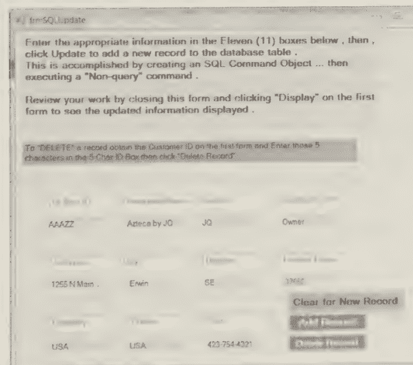

Screen 26

```csharp
// The user selected record in the dataGridView
// information has been transferred to this form.
// Should the user click
// “Delete”... the record will be deleted. We need
// to add a
// confirmation messageBox to avoid accidental
// deletions.
// Confirming decisions that change a database is
// always a good idea.
// The best place to do that is right at the beginning
// of the btnDelete_Click event handler. Don’t
// waste CPU (central processor).
// I placed the code in Appendix Q if you get
// stuck, but try it by yourself. The help tab on
// VS has some useful information.
// This is the routine if you want to go ahead,
// do so now. The simplest approach is to exit
// btnDelete_Click if the user clicks cancel.
//
string myStrCoName = "";
myStrCoName = textBoxCompanyName.Text;
string myStrCoID = "";
myStrCoID = textBoxCustomerID.Text;
DialogResult result = MessageBox.Show(myStrCoName
+ " ... " + myStrCoID + " Delete this record",
+ "Delete confirmation", Buttons.OKCancel);
switch (result)
```

```csharp
{
    case DialogResult.OK:
    {
        this.Text = "[OK]";
        break;
    }
    case DialogResult.Cancel:
    {
        this.Text = "[Cancel]";
        return;
    }
} // End Dialog
```


## 简单编程 C# 和 Visual Basic...

10829

```
ListBox1.Items.Add(Array(0))
ListBox1.Items.Add(Array(1))
ListBox1.Items.Add(Array(2))
ListBox1.Items.Add(Array(3))
ListBox1.Items.Add(Array(4))
```

10830
10831
10832
10833
10834
10835

## 项目 21—一维数组

10836

这是一个表单的完整代码，用于定义数组并在 listBox 中显示值。它被输入在按钮点击事件的事件程序代码块中。在这种情况下，按钮名称为 `btnLoadArray`；

10837
10838
10839
10840
10841
10842

## 项目 32 使用 Visual Basic 的数组

10843
10844
10845
10846
10847
10848

```
Imports System
Imports System.Array
Public Class Form1
//
Private Sub btnLoadArray_Click(sender As System.Object, e As System.EventArgs) Handles btnLoadArray.Click
  Dim myArray(4) As String
  myArray(0) = "John"
  myArray(1) = "James"
  myArray(2) = "Jesse"
  myArray(3) = "Joseph"
  myArray(4) = "Jake"
  //
  ListBox1.Items.Add(myArray(0))
  ListBox1.Items.Add(myArray(1))
  ListBox1.Items.Add(myArray(2))
  ListBox1.Items.Add(myArray(3))
  ListBox1.Items.Add(myArray(4))
End Sub
End Class
```

10849
10850
10851
10852
10853
10854
10855
10856
10857
10858
10859
10860
10861
10862
10863
10864
10865
10866

10867 创建一个新项目，在表单上添加按钮和 listBox，并在按钮的点击事件处理程序中输入代码。
10870 运行程序。你应该看到类似下面的结果；

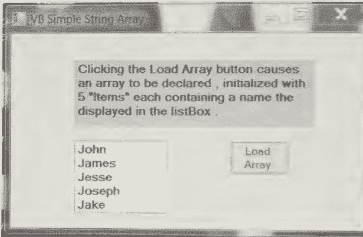

10873

10874 第 27 页
10875 如果你没有看到这些结果，请复习！！
10876
10877 此时，这些值并没有永久地存储在你的硬盘上。耐心点！我们会处理的。

10880 我们刚刚创建的数组被称为一维数组。每一行（Row）包含一个项目或“元素”。下一个数组被称为二维数组。它每行行可以包含两个（2）个值（项目或元素）。每一行都有一个索引（0 到 4），并且每行上的每个项目或“元素”都有它们自己的索引，即 (0) 和 (1)。记住，所有项目或“元素”必须是相同的变量类型，并且必须与你 10888 声明的数组类型相同，例如字符串或整数。是的……这有些局限性，但请耐心，我们很快就会学到其他没有这种限制的控件。
10891

## 项目 22—二维数组：

10893
10894 回想一下，你曾将一维数组想象成一个书架。现在将这个主意应用二维数组上，将每个架子分为两个隔间或“元素”。

| 行 (Row) | | |
|---|---|---|
| 0 | 项目 0,0 | 项目 0,1 |
| | 项目 1,0 | 项目 1,1 |
| | 项目 2,0 | 项目 2,1 |
| | 项目 3,0 | 项目 3,1 |
| | 项目 4,0 | 项目 4,1 |
| 行 4 | | |

10899
现在每个元素都有 2 个索引，即 0,0 到 4,1。
10902 当我们引用特定元素时，我们使用两个索引，例如 `myArray(0,0)` 到 `myArray(4,1)`。
10994 如果有助于理清思路，你可以从行和列的角度来。定义二维数组看起来如下：
10907 VB
Dim myArray(4,2) as string

10910 那么，另一个新项目：二维数组。

```vb
Public Class Form1
//
Private Sub btnLoadArray_Click(sender As
System.Object, e As System.EventArgs) Handles
btnLoadArray.Click
// 定义并初始化数组
Dim myArray(4, 2) As String
myArray(0, 0) = "Arthur"
myArray(0, 1) = "Architect"
myArray(1, 0) = "Bill"
myArray(1, 1) = "Banker"
myArray(2, 0) = "Charles"
myArray(2, 1) = "Chef"
myArray(3, 0) = "David"
myArray(3, 1) = "Doctor"
myArray(4, 0) = "Edward"
myArray(4, 1) = "Educator"
// 使用两个索引显示元素值
// 为了让信息更具读性，在元素对之间添加空格
// 注意，如果 ListBox 很小会自动添加滚动条以按我们的设计显示信息
ListBox1.Items.Add(myArray(0, 0))
ListBox1.Items.Add(myArray(0, 1))
ListBox1.Items.Add("")
ListBox1.Items.Add(myArray(1, 0))
ListBox1.Items.Add(myArray(1, 1))
ListBox1.Items.Add("")
ListBox1.Items.Add(myArray(2, 0))
ListBox1.Items.Add(myArray(2, 1))
ListBox1.Items.Add("")
ListBox1.Items.Add(myArray(3, 0))
ListBox1.Items.Add(myArray(3, 1))
ListBox1.Items.Add("")
ListBox1.Items.Add(myArray(4, 0))
ListBox1.Items.Add(myArray(4, 1))
//
End Sub
End Class
```

10957 运行程序……结果应该像：

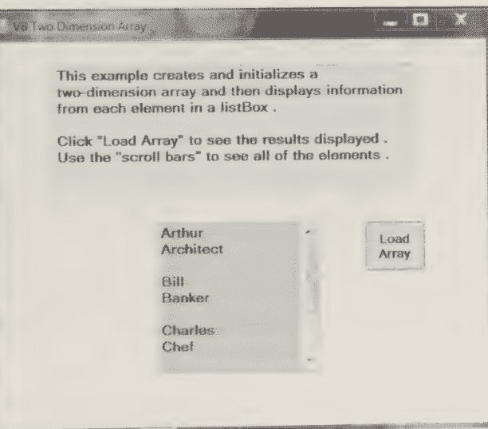

10960 第 28 页

10962 如果没有，再次尝试！！！

10965 做好了就休息一下。

# 10966 C# 数组

如果你想“扩展”一下，尝试将 VB 代码转换为 C#。C# 基本上是相同的，除了声明数组的方式。一维数组使用这种格式在一个语句中定义并初始化数组……
我们的结果将像这样：

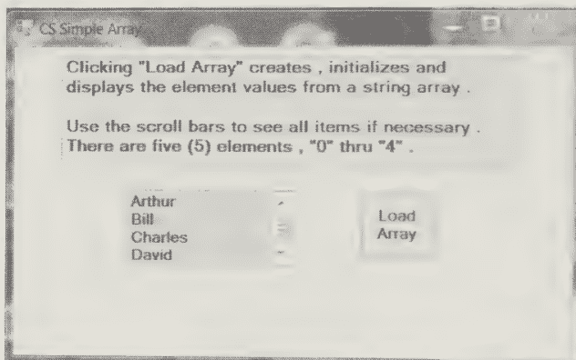

第 29 页
和之前差不多对吗？
除了图片左上角的文本属性。
注意括号的使用。

```csharp
string[] myArray = {"Arthur", "Bill", "Charles",
"David", "Edward"};
listBox1.Items.Add(myArray[0]);
```

10990 （重复每个添加到 listBox 的元素的第二行）。注意；C# 使用“括号”而不是括号。

10994 对于二维数组，C# 使用：

10997 string[,] myArray;//括号放置的位置
myArray= new string[5,2];//注意“new” 单词的使用

11002 向 listBox 添加元素是相似的，除了括号和分号；
listBox1.Items.Add(myArray[0, 0]);
listBox1.Items.Add(myArray[0, 1]);

11013 简单编程 C# 和 Visual Basic...

11014
11015
11016
11017
11018
11019
11020
11021
11022
11023
11024
11025
11026
11027
11028
11029
11030
11031
11032
11033
11034
11035
11036
11037
11038
11039
11040
11041
11042
11043
11044
11045
11046
11047
11048
11049
11050
11051
11052
11053
11054
11055
11056
11057
11058
11059
11060
11061
11062
11063
11064
11065
11066
11067
11068
11069
11070
11071
11072
11073
11074
11075
11076
11077
11078
11079
11080
11081
11082
11083
11084
11085
11086
11087
11088
11089
11090
11091
11092
11093
11094
11095
11096
11097
11098
11099
11100
11101
11102
11103
11104
11105
11106
11107
11108
11109
11110
11111
11112
11113
11114
11115
11116
11117
11118
11119
11120
11121

附录 A...

之后，花精力去调试“Try 和 Catch”

附录 B ... VB “for 循环”

```vb
Private Sub btnLoopAndDecide_Click(sender As
    System.Object, e As System.EventArgs) Handles
    btnLoopAndDecide.Click
    Dim X As Integer = 0
    Dim myStr As String = ""
    For X = 0 To 20
        X += 5
        myStr = Convert.ToString(X)
        TextBox1.Text = myStr
        If (X >= 10) Then ' >= Means 是大于
        else
            TextBox1.Text = "Loop ended " +
            "" + X + "s value was " + Convert.ToString(X)
            Return
        End If
    Next
 Sub
```

附录 C ... VB ToDo, comboBox,
文件读取器项目。


326

John Queen

```vb
11104 Dim myStrToDo As String = ""
11105 Dim myRdr As StreamReader
11106 myRdr = New System.IO.StreamReader("C:\App Target Files\ToDo.txt")
11108 While myStrToDo <> ""
11109 myStrToDo = myRdr.ReadLine()
11110 If (myStrToDo = "") Then
11111 Return
11112 End If
11113 ComboBox1.Items.Add(myStrToDo)
11114 End While
11115 End Sub
11116 End Class
```

11118 这是一个针对我描述的环境的完整、经过测试且可运行的 comboBox VB 文件 IO 程序。获取这段代码，更改文件名和几个控件属性，你就为另一个用户和场景拥有另一个全新的应用程序。附录 D 包含相同程序的 C# 代码。

## 附录 D... C# comboBox，文件 IO，用于“待办事项”项目。

```csharp
using System;
using System.IO;
using System.Collections.Generic;
using System.ComponentModel;
using System.Data;
using System.Drawing;
using System.Linq;
using System.Text;
using System.Windows.Forms;
namespace VS_CS_File_IO_ComboBox
{
    public partial class Form1: Form
    {
```

## 简单编程 C# 和 Visual Basic...

```csharp
public Form Form1()
{
    InitializeComponent();
}
public int OriginalSelectedIdx;
public string myStrToAdd = "";
public string path = @"C:\App Target Files\ToDo.txt";
private void btnReadInfo_Click(object sender, EventArgs e) {
    cboToDoItems.Items.Clear();
    string myStr = ""; // 注意 myStr 中的空格
    myStr; // 这防止代码在 while 循环开始时将 myStr 视为为空（null）。
    {
        string myPath = @"C:\App Target Files\ToDo.txt";
        // 声明一个 StreamReader
        StreamReader mySR;
        // 初始化 StreamReader
        mySR = new StreamReader(myPath);
        // 读取文件行，到达末尾时停止。
        myStr = "...";
        while (myStr != null) {
            myStr = mySR.ReadLine();
            // 将行添加到 comboBox 中
            if(myStr!=null && myStr!="") {
                cboToDoItems.Items.Add(myStr);
            }
        } // 释放文件和资源
        mySR.Close();
        mySR.Dispose();
    }
} // 读取结束
```

328

John Queen

```csharp
public void btnAddInfo_Click(object sender, EventArgs e)
{
    txtAddInfo.Text = "";
    txtAddInfo.Visible = true;
    btnAddInfo.Visible = true;
    // 在需要输入时才需要可见的
    txtAddInfo.Focus();
    // 焦点将光标置于该控件中准备好输入
    txtAddInfo.Visible = true;
    btnSaveInfo.Visible = true;
    // 在用户准备好输入之前不需要显示
} // 添加结束
private void btnSaveInfo_Click(object sender, EventArgs e)
{
    myStrToAdd = txtAddInfo.Text;
    cboToDoItems.Items.Add(myStrToAdd);
    StreamWriter mySW = new StreamWriter(path, true);
    // true 表示如果文件存在则追加。
    // 代码会自动判断是否是这种情况，不需要我们的帮助。
    mySW.WriteLine(myStrToAdd);
    // 释放资源
    mySW.Close();
    mySW.Dispose();
    mySW = null;
    // 隐藏我们不再需要的控件
    txtAddInfo.Text = "";
    txtAddInfo.Visible = false;
    btnSaveInfo.Visible = false;
    // 显示结果
    StreamReader mySR = new StreamReader(path);
    cboKeepers.Items.Clear();
    string myReadString = "";
    cboToDoItems.Clear();
    while (myReadString != "")
    {
        myReadString = mySR.ReadLine();
        if (myReadString == null) {
            return;
        }
        cboToDoItems.Items.Add(myReadString);
        cboToDoItems.Text = "New Item Added";
    } // While结束
    // 释放资源和文件
    mySR.Close();
    mySR.Dispose();
    // 清空用户输入
    txtAddInfo.Text = "";
    cboToDoItems.Text = "Todo Items-Revised";
    // 我们完成了！！！
} // 保存结束
public void DeleteInfo_Click(object sender, EventArgs e)
{
    // 清空 Keepers
    cboKeepers.Clear();
    // 选择要删除的名称
    string strToDelete = cboToDoItems.Text;
    int intIdx = cboToDoItems.SelectedIndex;
    int Y = intIdx;
    cboToDoItems.Items.RemoveAt(Y);
    cboKeepers = cboToDoItems; // 不传输项目或标题
    int XX = 0;
    int intItems = cboToDoItems.Items.Count-1;
    string strToWrite = ""; // 读取以添加 keepers 
}
```

335

John Queen

```csharp
cboKeepers.Items.Clear();
while (XX <= intItems)
{
    cboToDoItems.SelectedIndex = XX;
    cboToDoItems.SelectedItem = XX;
    strToWrite = cboToDoItems.Text;
    if (strToWrite != "" && strToWrite != null) {
        cboKeepers.Items.Add(strToWrite);
    }
    XX++;
}
OriginalSelectedIdx = cboToDoItems.SelectedIndex; // 删除项目的第一个索引
int intKeepersCount = cboKeepers.Items.Count;
lblKeepersCount.Text = "There are " + Convert.ToString(intKeepersCount) + " to store;";
cboKeepers.Text = "Items saved to file.";
} // 删除结束
private void btnExit_Click(object sender, EventArgs e)
{
    Application.Exit();
}
private void btnSaveKeepers_Click(object sender, EventArgs e)
{
    // 在保存内部
    int intKeepersCount; // 显示 Keepers 数量
}
```

## 简单编程 C# 和 Visual Basic...

```csharp
intKeepersCount = cboKeepers.Items.Count;
MessageBox.Show(Convert.ToString(intKeepersCount), "Line 152 Keepers");
lblKeepersCount.Text = "There were " + Convert.ToString(intKeepersCount) + " Keeper names Line 153.";
// 如果存在，删除旧的名称文件：
bool myboolean = File.Exists(@"C:\App Target Files\ToDo.txt");
if (myboolean) {
    File.Delete(@"C:\App Target Files\ToDo.txt");
}
MessageBox.Show("Keeper Names File", "Deleting old Keeper File");
// 将 Keeper 项目写入新文件
intKeepersCount = cboKeepers.Items.Count;
int intStart = 0;
int intStop = cboKeepers.Items.Count-1;
string strToWrite = "";
while(intStart<=intStop)
{
    MessageBox.Show("There are " + Convert.ToString(intKeepersCount), "intStart Loop line 180");
    cboKeepers.SelectedIndex = intStart;
    cboKeepers.SelectedItem = intStart;
    cboKeepers.SelectedValue = intStart;
    strToWrite = strToWrite + "\n" + cboKeepers.Text;
    MessageBox.Show(strToWrite + "\n" + "Line 178");
    intStart++;
    intkeepersCount += 1;
} // 写入文件结束
StreamWriter myFileWrt = new StreamWriter(@"C:\App Target Files\ToDo.txt", true);
myFileWrt.WriteLine(strToWrite);
// 释放资源和文件
myFileWrt.Close();
myFileWrt.Dispose();
MessageBox.Show("Line 188 File re-written ");
// 更新计数计数标签
lblKeepersCount.Text = "There are " + Convert.ToString(intKeepersCount) + " keeper Items";
// 更新名称计数标签
lblNames.Text = "There are " + Convert.ToString(intKeepersCount) + " Items in the file now.";
cboToDoItems.Text="Items - Revised";
cboKeepers.Text="Items saved to file.";
} // while结束
} // 保存 Keepers结束
} // partial类结束
```

## 附录 E...btnThisMonth

```csharp
private void btnThisMonth_Click(object sender, EventArgs e)
{
    intLastLoaded = 0;
}
```


```csharp
listBox1.Height = 24;
SetCustomFormat();
DateTime myDate = DateTime.Now;
// 测试代码 MessageBox.Show(Convert.ToString(myDate), "datePicker.Text");
mySeekDay = ""; nmySeekMo = ""; nmySeekYr = ""; nSeekDateFinal = "";
idxItemFound = 0;
mySeekDay = Convert.ToString(myDate.Day);
mySeekMo = Convert.ToString(myDate.Month);
mySeekYr = Convert.ToString(myDate.Year);
//
int lenMo = mySeekMo.Length;
if (intLenMo == 1)
{
    mySeekMo = "0" + mySeekMo;
}
int lenDay = mySeekDay.Length;
if (intLenDay == 1)
{
    mySeekDay = "0" + mySeekDay;
}
// btnClearToDoItems.Visible = true;
listBox1.Visible = true;
string myStr = " "; // 注意 myStr 中的空格
// 这防止了代码在 while 循环开始时将 myStr 视为
// 空（null）。
// 声明一个 StreamReader
StreamReader mySR;
// 初始化 StreamReader
intStrIdx1 = 0;
intStrIdx2 = 0;
idxItemFound = 0;
// 读取文件行，到达结束时停止。
myStrRead = "xx";
```

## John

```csharp
mySR = new StreamReader("C:\\App Target Files\\ToDo.txt");
listBox.Items.Clear();
int itemFound = 0;
while (myStrRead != null && myStrRead != "")
{
    myStrRead = "xx";
    myStrRead = mySR.ReadLine();
    // 检查文件结束
    if (myStrRead == null || myStrRead == "")
    {
        mySR.Close();
        mySR.Dispose();
        return;
    }
    idxItemFound = myStrRead.IndexOf(mySeekFinal);
//
    if (myStrRead != null && myStrRead != "") // 大 IF 循环
    {
        // 判断读取的字符串中的月份是否符合要求
        // 从文件的字符串中获取日期和月份
        string SubStrMo = myStrRead.Substring(0, 2);
        string SubStrYear = myStrRead.Substring(6, 4);
        //
        // 与所需的月份和日期字符串进行比较
        int intCompSubs1;
        int intCompSubs2;
        intCompSubs1 = string.Compare(mySeekMo, SubStrMo);
        intCompSubs2 = string.Compare(mySeekYr, SubStrYear);
        //
        // 如果结果都为 "0"，即相同，
        // 添加到 listbox
        if (intCompSubs1 != 0 || intCompSubs2 != 0)
        {
            continue;
        }
        if (intCompSubs1 == 0 && intCompSubs2 == 0)
{
    listBox1.Visible = true;
    itemFound++;
    listBox1.Height += 24;
    listBox1.Items.Add(myStrRead);
    listBox1.Sorted = true;
} // 结束 if
} // 结束 If 循环
} // 结束 while
} // 结束本月
```

简单的 C# 和 Visual Basic 编程

## 附录 F

```csharp
private void btnThisMonth_Click(object sender, EventArgs e)
{
    intLastLoaded = 0;
    listBox1.Height = 24;
    SetMyCustomFormat();
    DateTime myDate = DateTime.Now;
    // 测试代码 MessageBox.Show(Convert.ToString(myDate), "datePicker.Text");
    mySeekDay = ""; nmySeekMo = ""; nmySeekYr = ""; nSeekDateFinal = "";
    idxItemFound = 0;
    mySeekDay = Convert.ToString(myDate.Day);
    mySeekMo = Convert.ToString(myDate.Month);
    mySeekYr = Convert.ToString(myDate.Year);
    //
    int lenMo = mySeekMo.Length;
    if (intLenMo == 1)
    {
        mySeekMo = "0" + mySeekMo;
    }
    int lenDay = mySeekDay.Length;
    if (intLenDay == 1)
    {
        mySeekDay = "0" + mySeekDay;
    }
// btnClearToDoItems.Visible = true;
listBox1.Visible = true;
string myStr = " "; // 注意 myStr 中的空格
// 这防止了代码在 while 循环开始时将 myStr 视为
// 空（null）。
// 声明一个 StreamReader
StreamReader mySR;
// 初始化 StreamReader
intStrIdx1 = 0;
intStrIdx2 = 0;
idxItemFound = 0;
// 读取文件行，到达结束时停止。
myStrRead = "xx";
mySR = new StreamReader("C:\\App Target Files\\ToDo.txt");
listBox1.Items.Clear();
itemFound = 0;
while (myStrRead != null && myStrRead != "")
{
    myStrRead = "xx";
    myStrRead = mySR.ReadLine();
    // 检查文件结束
    if (myStrRead == null || myStrRead == "")
    {
        mySR.Close();
        mySR.Dispose();
        return;
    }
    idxItemFound = myStrRead.IndexOf(mySeekFinal);
//
    if (myStrRead != null && myStrRead != "") // 大 IF 循环
    {
        // 判断读取的字符串中的月份是否符合要求
        // 从文件的字符串中获取日期和月份
        string SubStrMo = myStrRead.Substring(0, 2);
        string SubStrYear = myStrRead.Substring(6, 4);
        //
        // 与所需的月份和日期字符串进行比较
        int intCompSubs1;
        int intCompSubs2;
        intCompSubs1 = string.Compare(mySeekMo, SubStrMo);
        intCompSubs2 = string.Compare(mySeekYr, SubStrYear);
        //
        // 如果结果都为 "0"，即相同，
        // 添加到 listbox
        if (intCompSubs1 != 0 || intCompSubs2 != 0)
        {
            continue;
        }
        if (intCompSubs1 == 0 && intCompSubs2 == 0)
{
    listBox1.Visible = true;
    itemFound++;
    listBox1.Height += 24;
    listBox1.Items.Add(myStrRead);
    listBox1.Sorted = true;
} // 结束 if
} // 结束 If 循环
} // 结束 while
} // 结束本月
```

简单的 C# 和 Visual Basic 编程

# 附录 F 隐藏 listBox 和清除文本框

```csharp
private void btnClearToDoItems_Click(object sender, EventArgs e)
{
    listBox1.Visible = false;
}
private void btnClearWordSearch_Click(object sender, EventArgs e)
```

# 附录 G 用于 Todo dateTimePicker 的 VB 代码

```vb
{
    textBoxWordSearch.Visible = true;
    textBoxWordSearch.Text = "";
    ListBox2.Visible = false;
    btnLoadItems.PerformClick();
}
private void btnHideBlockedDates_Click(object sender, EventArgs args)
{
    listBoxBlocked.Visible = false;
    btnHideBlockedDates.Visible = false;
}
```

Imports System
Imports System.Collections.Generic
Imports System.ComponentModel
Imports System.IO
Imports System.Data
Imports System.Drawing
Imports System.Linq
Imports System.Text
Imports System.Windows.Forms
//
Public Class Form1
    Public int lastLoaded As Integer
    Public intidxItemFound As Integer
    Public intItemFound As Integer = 0
    Public myStringToSave As String = ""
    Public myStrDate As String = ""
    Public myStrNoYear As String = ""
    Public myStrNoMonth As String = ""
    Public myStrNoDay As String = ""
    Public myStrFinalNo As String = ""
    Public myStrFinalPicked As String = ""
    Public mySeekDateFinal As String = ""
    Public mySeekMo As String = " "
```

## 简单的 C# 和 Visual Basic 编程...

```csharp
Public mySeekDay As String = "";
Public mySeekYr As String = "";
Public myStr As String = "";
public strRead As String = "";
public strToDelete As String = "";
'
Private Sub Form1_Load(sender As System.Object, e As EventArgs.EventArgs) Handles MyBase.Load
{
    intLastLoaded = 0;
    btnLoadToDo.PerformClick();
End Sub

Private Sub DateTimePicker1_ValueChanged(sender As System.Object, e As EventArgs.EventArgs) Handles DateTimePicker1.ValueChanged
{
    SetCustomFormat();
    myStrDate = DateTimePicker1.Text;
    txtAddInfo.Visible = True;
    btnSaveInfo.Visible = True;
End Sub ' 结束 CustomFormat

Public Sub SetCustomFormat()
' 建立今天的日期字符串
    myStrNowMonth = Convert.ToString(DateTime.Now.Month);
    myStrNowDay = Convert.ToString(DateTime.Now.Day);
    myStrYear = Convert.ToString(DateTime.Now.Year);
    myFinalNow = myStrNowMonth + "/" + myStrNowDay + "/" + myStrYear
    ' 设置格式类型和 Custom格式
    dateTimePicker1.Format = DateTimePicker1.CustomFormat;
    dateTimePicker1.CustomFormat = "MM/dd/yyyy";
End Sub
```
```
```csharp
Private Sub btnLoadToDo_Click(sender As System.Object, e As EventArgs.EventArgs) Handles btnLoadToDo.Click
{
    intLastLoaded = 99;
}
```


340

John Queen

```vbsharp
ListBox1.Height = 24
ListBox2.Visible = False
//SetMyCustomFormat()
ListBox1.Items.Clear()
ListBox1.Visible = True
Dim numItems As Integer = ListBox1.Items.Count
btnHideToDo.Visible = True
//
// 定义并初始化 StreamReader
// 读取文件行，当
// 达到末尾时停止。
myStr = "xx" // 注意：myStr 中的 "xx"
// 防止代码将 myStr 视为
// 空值（null），特别是在//
// while 循环开始时。
Dim mySR As StreamReader
mySR = New StreamReader("C:\App Target\Files\ToDo.txt")
While (mySR <> "")
    myStr = mySR.ReadLine()
    If (myStr <> "") Then
        mySR.Close()
        mySR.Dispose()
        Exit While
    End If
    If (myStr <> "") Then
        ListBox1.Height += 24
        ListBox1.Items.Add(myStr)
        ListBox1.Sorted = True
    End If
End While

' 加载 ToDo 项目
Private Sub btnLoadTodayItems_Click(sender As System.Object, e As System.EventArgs) Handles btnLoadTodayItems.Click
    intLastLoaded = 0
    ListBox1.Height = 24
    SetMyCustomFormat()
    Dim myTestDate As DateTime = DateTime.Now

    mySeekDay = ""
    mySeekMo = ""
```

## 简单编程 C# 和 Visual Basic . . . 341

```vbsharp
11722 mySeekYr = " "
11723 mySeekDateFinal = " "
11724 intDeleteItemFound = 0
11725 mySeekDay = Convert.ToString(myTestDate.Day)
11726 mySeekMo = Convert.ToString(myTestDate.Month)
11727 mySeekYr = Convert.ToString(myTestDate.Year)
//
11729 Dim intLenAs Integer = mySeekYr.Length
11730 If (intLenAs = 1) Then
    11731 mySeekMo = "0" + mySeekMo
11732 End If
11733 Dim intLenAs Integer = mySeekDay.Length
11734 If (intLenAs = 1) Then
    11735 mySeekDay = "0" + mySeekDay
11736 End If
//
//
11739 mySeekFinal = mySeekMo + "/" + mySeekDay
11740 + "/" + mySeekYr
//MessageBox.Show(mySeekFinal,"Seek
11742 Date Final="
11743 btnHideTo.Visible = True
11744 ListBox1.Visible = True
// 测试代码
11746 MessageBox.Show(myStrFinalPicked,"Date Picked.");
11747 Dim mySr String = " " // 注意
11748 myStr 中的空格
// 防止代码将 myStr 视为
// 空值（null），特别是在//
// while 循环开始时。
//
// 定义一个 StreamReader
11754 Dim mySr As StreamReader
// 初始化 StreamReader
11756 Dim intStrId As Integer = 0
11757 Dim intStrIdx2 As Integer = 0
11758 intDeleteItemFound = 0
// 读取文件行，当
// 达到末尾时停止。
11761 mySrRead = "xx"
11762 mySR = New StreamReader("C:\App Target
11763 Files\ToDo.txt")
```

342

John Queen

```vbsharp
ListBox1.Items.Clear()
intItemFound = 0
While (myStrRead <> "")
    myStrRead = "xx"
    myStrRead = myList.ReadLine()
    If (myStrRead = "") Then
        If (intItemFound >= 1) Then
            Dim myMsgStr As String = Convert.ToString(intItemFound)
            // 测试代码
            MessageBox.Show("Completed Date search.")
            date. + " " + myMsgStr + " Items for date.");
        End If
        If (intItemFound = 0) Then
            MessageBox.Show("Completed Date search." + " found no items for that date.")
        End If
        mySr.Close()
        mySr.Dispose()
        Return
    End If
    intIdxItemFound = myList.IndexOf(mySeekFinal)
    //if (intIdxItemFound == -1)
    //
    If (myStrRead <> "") // 大 IF 100
        intIdxItemFound = myStrRead.IndexOf(mySeekFinal)
        ListBox1.Visible = True
    End If
    If (intIdxItemFound >= 0) Then
        intItemFound = intItemFound + 1
        ListBox1.Height = 24
        ListBox1.Items.Add(myStrRead)
        ListBox1.Sorted = True
    End If
    If (intIdxItemFound = -1) Then
        Continue While

## 简单编程 C# 和 Visual Basic...

```1106 End If // 如果 循环
1107 End While
1108 End Sub // 加载 ToDo 项目
Private Sub btnHideToDo_Click(sender As System.Object, e As System.EventArgs) Handles btnHideToDo.Click
    ListBox1.Visible = False
End Sub

Private Sub btnSelDayItems_Click(sender As System.Object, e As System.EventArgs) Handles btnSelDayItems.Click
    lastLoaded = 0
    ListBox1.Height = 24
    ListBox1.Visible = True
    MyCustomFormat()
    从 DatePicker 获取日期
    Dim myDate As DateTime = Convert.ToDateTime(DatePicker.Text)
    // 测试代码
    MessageBox.Show(Convert.ToString(myDate),"DatePicker.Text");
    mySeekDay = ""
    mySeekMo = ""
    mySeekYr = ""
    mySeekDateFinal = ""
    intItem As Integer = 0
    mySeekDay = Convert.ToString(myDate.Date)
    mySeekMo = Convert.ToString(myDate.Month)
    mySeekYr = Convert.ToString(myDate.Year)
    //
    Dim intLen As Integer = mySeekMo.Length
    If (intLen = 1) Then
        mySeekMo = "0" + mySeekMo
    End If
    Dim intLen As Integer = mySeekDay.Length
    If (intLen = 1) Then
        mySeekDay = "0" + mySeekDay
    End If
    //
    mySeekFinal = mySeekMo + "/" + mySeekDay + "/" + mySeekYr
    //MessageBox.Show(mySeekFinal)
```

## 简单编程 C# 和 Visual Basic . . . 345

```vbsharp
1187 //MessageBox.Show("Completed Date search." + " I found " + myMsgStr + " Items for that date., "Selected Day Items")
//End
//
// 从文件中填充字符串
If (myStrRead <> "") // 大 IF 100
//
intIdxItemFound = myStrRead.IndexOf(mySeekFinal)
// 如果查找的项目不在字符串中
If (intIdxItemFound = -1) Then
    Continue While
End If // 如果 循环
//
// 如果查找的项目在字符串中
If (intIdxItemFound >= 0) Then
    intItemFound += 1
    ListBox1.Height += 24
    ListBox1.Items.Add(myStrRead)
    ListBox1.Sorted = True
    // 寻找更多匹配
    Continue While
End If
//
End If
End While
End Sub // 结束日期加载事件

Private Sub btnThisMonth_Click(sender As System.Object, e As System.EventArgs) Handles btnThisMonth.Click
    intLastLoaded = 0
    ListBox1.Height = 24
    SetMyCustomFormat()
    Dim myTestCase As DateTime = DateTime.Now
    // 测试代码
    MessageBox.Show(Convert.ToString(myTestDate),"DatePicker.Text")
    mySeekDay = ""
    mySeekMo = ""
    mySeekYr = ""
```

346

John Queen

```vbsharp
11929 mySeekDateFinal = " "
intIdxItemFound = 0
mySeekDay = Convert.ToString(myTestDate.Day)
mySeekMo = Convert.ToString(myTestDate.Month)
mySeekYr = Convert.ToString(myTestDate.Year)
//
11935 Dim intLen As Integer = mySeekMo.Length
11936 If (intLen = 1) Then
    11937 mySeekMo = "0" + mySeekMo
11938 End If
11939 Dim intLen As Integer = mySeekDay.Length
11940 If (intLen = 1) Then
    11941 mySeekDay = "0" + mySeekDay
11942 End If
//
11943 btnHideTo.Visible = True
11944 ListBox1.Visible = True
// 测试代码
11946 MessageBox.Show(myStrFinalPicked,"Date Picked.");
11947 Dim mySr String = " " // 注意
11948 myStr 中的空格
// 防止代码将 myStr 视为
// 空值（null），特别是在//
// while 循环开始时。
//
// 定义一个 StreamReader
11954 Dim mySr As StreamReader
// 初始化 StreamReader
11956 Dim intStrId As Integer = 0
11957 Dim intStrIdx2 As Integer = 0
11958 intDeleteItemFound = 0
// 读取文件行，当
// 达到末尾时停止。
11961 mySrRead = "xx"
11962 mySR = New StreamReader("C:\App Target
11963 Files\ToDo.txt")
```


```vbnet
// 结束大 If 循环
End If
End While
End Sub
''
Private Sub btnNextMonth_Click(sender As System.Object, e As System.EventArgs Handles btnNextMonth.Click
    intLastLoaded = 0
    ListBox1.Height = 24
    SetMyCustomFormat()
    Dim myDateNextMo As DateTime
    Dim myTestDate As DateTime = DateTime.Now
    myDateNextMo = myTestDate.AddMonths(1)
    '/测试代码
    MessageBox.Show(Convert.ToString(myTestDate), "datePicker.Text");
    mySeekDay = ""
    mySeekMo = ""
    mySeekYr = ""
    mySeekDateFinal = ""
    intIdxItemFound = 0
    mySeekDay = Convert.ToString(myTestDate.Day)
    mySeekMo = Convert.ToString(myDateNextMo.Month)
    '//myTestDate.Month
    mySeekYr = Convert.ToString(myTestDate.Year)
    '/
    Dim intLenMo As Integer = mySeekMo.Length
    If (intLenMo = 1) Then
        mySeekMo = "0" + mySeekMo
    End If
    // 判断下个月是否也是下一年
    '/
    If (mySeekMo = "12") Then
        mySeekMo = "01"
        myTestDate = DateTime.Now.AddYears(1)
        mySeekYr = Convert.ToString(myTestDate.Year)
        '//mySeekYr = Convert.ToString(DateTime.Now.AddYears(1))
        mySeekDay = "01"
    End If

    Dim intLenDay As Integer = mySeekDay.Length
    If (intLenDay = 1) Then
        mySeekDay = "0" + mySeekDay
    End If
    //
    /
    btnHideToDo.Visible = True
    ListBox1.Visible = True
    Dim myStr As String = " " // 注意 myStr 中的空格
    // 这防止代码在 while 循环开始时认为 myStr 为空（null）。
    //
    // 声明一个 StreamReader
    Dim myStr As StreamReader
    // 初始化 StreamReader
    Dim intStrId1 As Integer = 0
    Dim intStrId2 As Integer = 0
    intIdxItemFound = 0
    // 读取文件中的行，在到达末尾时停止。
    myStrRead = "xx"
    myStr = New StreamReader("C:\\App Target Files")
    ToDo.Items.Clear()
    intItemFound = 0
    While (myStrRead <> "")
        myStrRead = myStr.ReadLine()
        // 测试文件是否结束
        If (myStrRead = "") Then
            myStr.Close()
            myStr.Dispose()
            Return
            //intIdxItemFound = myStrRead.IndexOf(mySeekDateFinal);
            //
        End If
        If (myStrRead <> "") Then // 大 IF 100P
            // 判断所需的月份和日期是否在文件中读取的字符串中
            //
            // 从文件中读取字符串的已知位置获取日期和月份
            Dim SubStrMo As String = myStrRead.Substring(0, 2)
            Dim SubStrYear As String = myStrRead.Substring(6, 4)
            Dim SubStrYear As Integer = Convert.ToInt32(SubStrYear)
            // 将子字符串与所需的月份和日期字符串进行比较
            Dim intCompSubs1 As Integer
            Dim intCompSubs2 As Integer
            intCompSubs1 = String.Compare(mySeekMo, SubStrMo)
            intCompSubs2 = String.Compare(mySeekYr, SubStrYear)
            // 如果结果都为 "0"，即匹配，则添加到 listbox
            If (intCompSubs1 = 0 And intCompSubs2 = 0) Then
                ListBox1.Visible = True
                intItemFound += 1
                ListBox1.Height += 24
                ListBox1.Add(myStrRead)
                ListBox1.Sorted = True
            End If
            Continue While
        End If // 结束大 If 循环
    End While
End Sub // 结束下个月

Private Sub bntDeleteItem_Click(sender As System.Object, e As System.EventArgs) Handles bDeleteItem.Click
    Dim intToDoIdx As Integer = ListBox1.SelectedIndex
    If (intLastLoaded <> 99 Or intToDoIdx = -1) Then
        MessageBox.Show("要删除项目，请点击 Load ToItems，点击要删除的项，点击删除", "删除尝试")
        Return
    End If
    intToDoIdx = ListBox1.SelectedIndex
    strToDelete = Convert.ToString(ListBox1.SelectedItem)
    // 测试代码 MessageBox.Show(strToDelete + " is at item " + Convert.ToString(intToDoIdx) + " be deleted");
    ListBox1.Items.RemoveAt(intToDoIdx)
    ListBox1.Height = ListBox1.Height - 24
    // 如果文件存在则删除它。
    Dim path1 As String = "C:\\App Target Files\\ToDo.txt"
    If (System.IO.File.Exists(path1)) Then
        System.IO.File.Delete(path1)
        // 测试代码 MessageBox.Show(path1 + " was deleted", "Temp deleted")
    End If
    //
    Dim ItemCount As Integer = ListBox1.Items.Count
    //
    Dim Y As Integer = 0
    // 从 listbox 读取并写入文件。
    While (Y < ItemCount)
        // ... 逻辑根据原文片段补全
        Y += 1
    End While
End Sub
```


## 简易 C# 和 Visual Basic 编程...

```vbsharp
12304   mySeekMo = "0" + mySeekMo
12305   End If
12306   Dim intLenDay As Integer = mySeekDay.Length
12307   If (intLenDay = 1) Then
12308   mySeekDay = "0" + mySeekDay
12309   End If
12310   ///定义要保存的日期
12311   Dim myDateToSave As String = mySeekMo + "/"
12312   + mySeekDay + "/" + mySeekYr
12313   ///定义要保存的字符串
12314   Dim myStringToSave As String = myDateToSave
12315   + " " + txtBoxAddInfo.Text
12316   //定义 StreamReader
12317   Dim mySR As StreamReader = New
12318   StreamReader("C:\Target Files\BlockedDates.txt")
12319   //读取被屏蔽的日期列表
12320   Dim myStrBlockedDate As String = "XX"
12321   //避免从空字符串开始
12322   ///
12323       ListBox.Items.Clear()
12324   While (myStrBlockedDate <> "")
12325       If (myStrBlockedDate <> "") Then
12326           Exit While
12327   End If
12328   myStrBlockedDate = mySR.ReadLine()
12329       // 读取的字符串为空时结束
12330       If (myStrBlockedDate <> "") Then
12331           ListBox.Items.Add(myStrBlockedDate)
12332   End If
12333   End While
12334   Dim intBlockedDateCount As Integer = 
12335   ListBox.Items.Count
12336   ///
12337   Dim intFlagBlocked As Integer = 0
12338   Dim intBlockedLoop As Integer = 0
12339   Dim intBlockedDateFound = 0
12340   For intBlockedLoop = 0 To
12341     intBlockedCount-1
12342       ListBox.SelectedIndex = intBlockedLoop
12343   myStrBlockedDate = 
12344   Convert.ToString(ListBox.SelectedItem)
12345   If (myDateToSave = myStrBlockedDate) Then
12346   intBlockedDateFound += 1
12347   End If
12348   Next
12349   If (intBlockedDateFound = 0) Then
12350   // 如果选择的日期未匹配到
12351   屏蔽的日期，则保存该项
12352   Dim myWrt As StreamWriter = New
12353   StreamWriter("C:\App Target Files\ToDo.txt",
12354   True)
12355      myWrt.WriteLine(myStringToSave)
12356      myWrt.Close()
12357      myWrt.Dispose()
12358   End If
12359   //释放 StreamWriter 和文件
12360   If (intBlockedDateFound >= 1) Then
12361   // 无法保存到屏蔽日期，返回
12362   到用户屏幕
12363   MessageBox.Show("This is a blocked date, Blocked Date vs Save") = ""
12364   txtAddInfo.Text = ""
12365   Return
12366   End If
12367   //重置添加文本框为空
12368   txtAddInfo.Text = ""
12369   ListBox1.Sorted = True
12370   ListBox1.Visible = True
12371   //重新加载 ToDo 项目文件
12372   btnToDoDo.PerformClick()
12373   End Sub // 结束 SaveInfo
12374   //
12375   Private Sub btnBlockedDates_Click(sender As
12376   System.Object, as System.EventArgs) Handles
12377   btnBlockedDates.Click
12378   ListBox1.Visible = True
12379   ListBox1.Items.Clear()
12380   Dim myRdr As StreamReader = New
12381   StreamReader("C:\App Target Files\BlockedDates.txt")
12382   Dim strBlockedDates As String = "XX"
12383   While (strBlockedDates <> "")
12384     strBlockedDates = myRdr.ReadLine()
12385     If (strBlockedDates = "") Then
12386       myRdr.Close()
12387       Return
12388     End If
12389     If (strBlockedDates <> "")
12390       1stBoxBlocked.Items.Add(strBlockedDates)
12391       1stBoxBlocked.Sorted = True
12392       btnHideDates.Visible = True
12393     End If
12394   End Sub // 结束屏蔽日期
12395   //
12396   Private Sub btnHideDates_Click(sender As
12397   System.Object, e as System.EventArgs Handles
12398   btnHideDates.Click
12399   1stBoxBlocked.Items.Clear()
12400   1stBoxBlocked.Visible = False
12401   End Sub
12402   //
12403   Private Sub btnSaveAndRepeat_Click(sender As
12404   System.Object, e as System.EventArgs Handles
12405   btnSaveAndRepeat.Click
12406   Dim myToStrToSave As String =
12407   txtBoxAddInfo.Text
12408   Dim intCheckedRepeat As Integer = 1
12409   If (radRepeatTimes.Checked) Then
12410     intCheckedRepeat = 3
12411   End If
12412   If (rad6Times.Checked) Then
12413     intCheckedRepeat = 6
12414   End If
12415   If (rad9Times.Checked) Then
12416     intCheckedRepeat = 9
12417   End If
12418   If (rad12Times.Checked) Then
12419     intCheckedRepeat = 12
12420   End If
12421   If (radRepeat24Times.Checked) Then
12422     intCheckedRepeat = 24
12423   End If
12424   If (radRepeat36Times.Checked) Then
12425     intCheckedRepeat = 36
12426   End If
12427   //
12428   DatePicker1.CustomFormat = "MM/dd/yyyy"
12429   Dim myToSave As DateTime =
12430   DatePicker1.Value
12431   //测试代码
12432   MessageBox.Show(Convert.ToString(myBaseDate));
12433   //
12434   //保存到文件
12435   //
12436   Dim XX As Integer = 1
12437   //重复保存 ToDo 项目
12438   For XX = 1 To intCheckedRepeat
12439     Dim mySW As StreamWriter = New
12440     StreamWriter("C:\Target Files\ToDo.txt",
12441     True)
12442     //测试代码
12443     MessageBox.Show(Convert.ToString(myBaseDate));
12444     mySeekDay = ""
12445     mySeekMo = ""
12446     mySeekYr = ""
12447     //从 DatePicker 获取日期
12448     intIdxItemFound = 20
12449     //填充选择日期变量
12450     mySeekDay = Convert.ToString(myDateToSave.Day)
12451     mySeekMo = Convert.ToString(myDateToSave.Month)
12452     mySeekYr = Convert.ToString(myDateToSave.Year)
12453     //为个位数月份字符串添加前缀"0"
12454     Dim intLenMo As Integer = mySeekMo.Length
12455     If (intLenMo = 1) Then
12456     mySeekMo = "0" + mySeekMo
12457     End If
12458     Dim intLenDay As Integer = mySeekDay.Length
12459     If (intLenDay = 1) Then
12460     mySeekDay = "0" + mySeekDay
12461     End If
12462   //定义保存的日期字符串
12463   Dim myStringToSave As String = mySeekMo
12464   + "/" + mySeekDay + "/" + mySeekYr
12465   //定义要保存的字符串
12466   myStringToSave = myDateTimeToSave + " " +
12467   txtBoxAddInfo.Text
12468   mySW.WriteLine(myStringToSave)
12469   mySW.Close()
12470   mySW.Dispose()
12471   myDateToSave.Add(1)
12472   If (mySeekMo = 12) Then
12473     myDateToSave.Add(1)
12474   End If
12475   Next
12476   //测试代码
12477   MessageBox.Show(Convert.ToString(myBaseDate));
12478   //
12479   //重置按钮
12480   radRepeatTimes.Checked = False
12481   rad6Times.Checked = False
12482   rad9Times.Checked = False
12483   rad12Times.Checked = False
12484   radRepeat24Times.Checked = False
12485   radRepeat36Times.Checked = False
12486   ListBox1.Clear()
12487   txtAddInfo.Text = ""
12488   End Sub // 结束 SaveInfo
```

# Appendix H... VB 表单属性

```vbsharp
// Form1 代码
Public Class Form1
    Dim intPass As Integer = 11
```


# 简单的编程 C# 和 Visual Basic...

```csharp
12552 Dim intMultiplied As Integer
12553 intMultiplied = myForm.intMyNumber()
12554 MessageBox.Show(Convert.ToString(intMultiplied))
12555 End Sub
12556 //
12557 Private Sub btnExit_Click(sender As
12558 System.Object, e As System.EventArgs) Handles
12559 btnExit.Click
12560 Application.Exit()
12561 End Sub
12562 End Class

12564 // Form2 代码

12566 Public Class Form2
12567 //
12568 Private intToReturn As Integer
12569 --------------------------------------
12570 Public Property intMyNumber() As Integer
12571 Get
12572 Return intToReturn * 2
12573 End Get
12574 //
12575 Set(value As Integer)
12576 intToReturn = value
12577 End Set
12578 End Property
12579 --------------------------------------
12580 //
12581 Private Sub btnShowForm1_Click(sender As
12582 System.Object, e As System.EventArgs) Handles
12583 btnShowForm1.Click
12584 Dim myForm As Form1 = New Form1()
12585 Me.Hide()
12586 myForm.Show()
12587 End Sub
12588 --------------------------------------
12589 //
12590 Private Sub btnMyProperty_Click(sender As
12591 System.Object, e As System.EventArgs) Handles
12592 btnMyProperty.Click
12593 intMyNumber = 88
12593 Dim myIntTemp As Integer = intMyNumber
12594 MessageBox.Show(Convert.ToString(myIntTemp))
12595 End Sub

12596 //

12597 Private Sub Button1_Click(sender As)
12598 System.Object, e As System.EventArgs) Handles
12599 btnExit.Click
12600 Application.Exit()
12601 End Sub
12602 End Class
```

## 附录 I VS VB 类项目

```vbsharp
12606 // 注意：我们在这里使用 "Public" 是为了让
12607 信息在其他地方
12608 可

12610 Public Class AutomobileClass
12611 // ###########################
12612 // ########################### 马力
12613 Private intHorsePower As Integer
12614 //
12615 Public Property intEngineHP() As Integer
12616 Get
12617 Return intHorsePower
12618 End Get
12619 //
12620 Set(value As Integer)
12621 intHorsePower = value
12622 End Set
12623 End Property
12624 //
12625 // ########################### 汽车类
12626 Private strCarAs String
12627 //
12628 Public Property strCarType()
12629 Get
12630 Return strCarClass
12631 End Get
12632 //
12633 Set(value)
12634 strCarClass = value
12635 End Set
12636 End Property
12637 //--------------------------------------
12638 // ########################### 汽车类
12639 Private decCarPrice As Decimal
12640 --------------------------------------
12641 Public Property decCarCost() As Decimal
12642 Get
12643 Return decCarPrice
12644 End Set
12645 //
12646 Set(value As Decimal)
12647 decCarPrice = value
12648 End Set
12649 End Property
12650 // ########################### 汽车制造商
12651 Private strCarManufacturer As String
12652 --------------------------------------
12653 Public Property strCarMaker() As String
12654 Get
12655 Return strCarManufacturer
12656 End Set
12657 //
12658 Set(value As String)
12659 strCarManufacturer = value
12660 End Set
12661 End Property
12662 // ########################### 汽车型号
12663 Private strCarModel As String
12664 --------------------------------------
12665 Public Property strCarModelDesc() As String
12666 Get
12667 Return strCarModel
12668 End Set
12669 //
12670 Set(value As String)
12671 strCarModel = value
12672 End Set
12673 End Property
12674 // ########################### 汽车型号
12675 Private strCarYear As String
12676 '--------------------------------------
12677 Public Property strCarYr() As String
12678 Get
12679 Return strCarYear
12680 End Get
12681 //
12682 Set(value As String)
12683 strCarYear = value
12684 End Set
12685 End Property
12686 ####### 汽车型号
12687 Private strCarColor As String
12688 '--------------------------------------
12689 Public Property strCarPaint() As String
12690 Get
12691 Return strCarColor
12692 End Get
12693 //
12694 Set(value As String)
12695 strCarColor = value
12696 End Set
12697 End Property
12698 End Class
1700 // 注意：我们在这里使用 "Public" 让信息
1701 可用
1702 在其他

1704 Public Class Form1
1705 //
1706 Dim my As AutomobileClass
1707 // 将稍后用于演示
1708 // 我们可以通过将一个变量赋值
1709 // 另一个变量来创建一个类的
1710 // 副本。
1711 //
1712 Public Sub btnSave_Click(sender As
1713 System.Object, e As System.EventArgs) Handles
1714 btnSave.Click

# 简单的编程 C# 和 Visual Basic...

```csharp
1717 // 实例化一个
1718 AutomobileClass
1719 Dim mycls As AutomobileClass =
1720 AutomobileClass()
1721 //
1722 Dim strMfg As String = txtMfg.Text
1723 mycls.strCarMaker = strMfg
1724 //
1725 // 注意：该类期望一个
1726 value。
1727 // 框的内容
1728 // 必须转换为小数
1729 Dim decCost As Decimal = txtBoxPrice.Text
1730 mycls.decCarCost =
1731 Convert.ToDecimal(txtBoxPrice.Text)
1732 //
1733 Dim myModel As String = txtModel.Text
1734 mycls.strCarModelDesc = myModel
1735 //
1736 Dim myModelYear As String = txtModelYr.Text
1737 mycls.strCarYr = myYear
1738 //
1739 Dim intMyEngine As Integer = txtBoxEngine.Text
1740 mycls.intEngine = intMyEngine
1741 //
1742 Dim myCarColor As String = txtColor.Text
1743 mycls.strPaint = myCarColor
1744 //
1745 Dim myStyle As String = txtBorderStyle.Text
1746 mycls.strCarType = myStyle
1747 //
1748 myName = mycls
1749 mycls = Nothing
1750 End Sub

1751 //
1752 Private Sub btnDisplayProperties_Click(sender As
1753 System.Object, e As System.EventArgs) Handles
1754 btnDisplayProperties.Click
1755 lblDisplayProperties.Text = "Make " +
1756 myName.strCarMaker
1757 // vbLf 在标签文本中插入
1758 换行符
1759 // 字符
1760 lblDisplayProperties.Text = vbLf + " Model " +
1761 myName.strCarModelDesc
1762 lblDisplayProperties.Text =
1763 lblDisplayProperties.Text + vbLf + "Car Class " +
1764 myName.strCarType
1765 lblDisplayProperties.Text =
1766 lblDisplayProperties.Text + vbLf + "Year " +
1767 myName.strCarYr
1768 lblDisplayProperties.Text =
1769 lblDisplayProperties.Text + vbLf + "Price " +
1770 "$ " + Convert.ToString(myName.decCarCost)
1771 lblDisplayProperties.Text =
1772 lblDisplayProperties.Text + vbLf + "Color " +
1773 myName.strCarPaint
1774 lblDisplayProperties.Text =
1775 lblDisplayProperties.Text + vbLf + "Horse Power
1776 "" + Convert.ToString(myName.intEngineHP)
1777 lblDisplayProperties.Visible = True
1778 //
1779 End Sub

1780 //
1781 Private Sub btnClearDisplay_Click(sender As
1782 System.Object, e As System.EventArgs Handles
1783 btnClearDisplay.Click
1784 lblDisplayProperties.Text = ""
1785 lblDisplayProperties.Visible = False
1786 txtBMfG.Text = ""
1787 txtBoxModel.Text = ""
1788 txtBoxAutoStyle.Text = ""
1789 txtBoxPrice.Text = ""
1790 txtBoxColor.Text = ""
1791 txtBoxModelYr.Text = ""
1792 End Sub
1793 //
1794 End Class
```

## 附录 J VS CS 简单类项目

```csharp
using System;
using System.Collections.Generic;
using System.Linq;
using System.Text;
//
namespace VS_CS_Simple_Class_Proj_Feb_2018 {
    class AutomobileClass {
        private decimal Price;//完成 . . 一个检查
        ensure all
        //属性如代码所示定义
        private int EngHP;// Done
        private string Paint;//Done;
        private string Mfg;//Done;
        private string Model;//Done;
        private string Style;//Done;
        private string Year;//Done;
        public int EngineHorsePower {
            get// start Get
            return EngHP;
            }
        // start Set
        set {
            if (value >= 0)EngHP = value;
        } // End Set
    } // End Property 马力----------------#1...
//另一个我使用注释对属性进行编号。细节，细节！！
// 只有我才知道，现在你也知道了。
n // 除了我没人知道，现在你也知道了。
    public decimal CarCost {
        get// start Get
    }
}
```


```csharp
return Price;
} // END GET
// start Set
set
{
    if (value >= 0) Price = value;
} // End Set
} // End Property CarCost
-------------------------------- #2
public string CarMaker
{
    get// start Get
    {
        return Mfg;
    } // END GET
    // start Set
    set
    {
        if (value!="") Mfg = value;
        //
    } // End Set
} // End Property CarMaker
--------------------------------
public string CarModel
{
    get// start Get
    {
        return Model;
    } // END GET
    // start Set
    set
    {
        if (value!= "") Model = value;
        // 注意 "value" 旁边缺少变量类型
        // VB 允许，而 C# 不允许。
    } // End Set
} // End Property CarModel
-------------------------------- #3
public string CarType
{
    get// start Get
{
    return Style;
    } // END GET
    // start Set
    set
    {
        if (value="") Style = value;
    } // End Set
} // End Property CarType --#4
// public string CarAge
{
    get// start Get
    {
        return Year;
    } // END GET
    // start Set
    set
    {
        if (value="") Year = value;
    } // End Set
} // End Property CarAge --#5
/* public decimal CarCost
{
    get// start Get
    {
        return Price;
    } // END GET
    // start Set
    set
    {
        if (value >= 0) Price = value;
    } // End Set
} // End Property CarColor --#6
public string CarColor
{
    get// start Get
    {
        return Paint;
    } // END GET
```

370

John Queen

```csharp
12925    // start Set
12926    set
12927    {
12928      if (value="") Paint = value;
12929      } // End Set
12930  } // End Property CarColor--------------------------- #7
12931  //----------------------------------------------------
12932  //
12933    // 所有 7 个属性已定义！
12934  //
12935    }//Class
12936  }// namespace
12937  //
12938  //
12939    Form1 的事件处理程序
12940  //
12941

12942  using System;
12943  using System.Collections.Generic;
12944  using System.ComponentModel;
12945  using System.Data;
12946  using System.Drawing;
12947  using System.Linq;
12948  using System.Text;
12949  using System.Windows.Forms;
12950

12951  namespace VS_CS_Simple_Class_Proj_Feb_2013
{
12953    public partial class Form1: Form
    {
12955        public Form1()
        {
12957            InitializeComponent();
12958        }
12959        AutomobileClassName myName = new
12960AutomobileClassName();
12961        //
12962        private void btnSave_Click(object sender,
12963EventArgs e)
        {
12965            string myMfg = "";
12966            myMfg = txtBoxMfg.Text;
12967 string myModel = "";
12968 myModel = txtModel.Text;
12969 string myStyle = "";
12970 myStyle = txtStyle.Text;
12971 string myYear = "";
12972 myYear = txtYear.Text;
12973 int myEngine = 0;
12974 myEngine =
12975 Convert.ToInt32(txtEngine.Text);
12976 string myColor = "";
12977 myColor = txtColor.Text;
12978 Decimal myPrice =
12979 Convert.ToDecimal(txtPrice.Text);
12980 AutomobileClass=new
12981 AutomobileClass();
12982 mycls.CarMaker=myMfg;
12983 mycls.CarModel=myModel;
12984 mycls.CarType=myStyle;
12985 mycls.CarAge=myYear;
12986 mycls.EngineHorsePower=myEngine;
12987 mycls.CarColor=myColor;
12988 mycls.CarCost = myPrice;
12989 myName = mycls;
12990 }
12991 private void btnDisplay_Click_1(object
12992 sender, EventArgs args)
 {
12994 lbl1Display.Text = "Make " +
12995 myName.CarMaker;
12996 lbl1Display.Text = lbl1Display.Text +
12997 "\n" + "Model " + myName.CarModel;
12998 lbl1Display.Text = lbl1Display.Text +
12999 "\n" + "Car Class " + myName.CarType;
13000 lbl1Display.Text = lbl1Display.Text +
13001 "\n" + "Year " + myName.CarAge;
13002 lbl1Display.Text = lbl1Display.Text +
13003 "\n" + "Price $" +
13004 Convert.ToString(myName.CarCost);
13005 lbl1Display.Text = lbl1Display.Text +
13006 "\n" + "Color " + myName.CarColor;
13007 lbl1Display.Text = lbl1Display.Text +
13008 "\n" + "Horse Power " +
13009 Convert.ToString(myName.EngineHorsePower);
13010 //
13011 lbl1Display.Visible = true;
13012 }
13013 private void btnClear_Click(object sender,
13014 EventArgs e)
 {
13016 lbl1Display.Text = "";
13017 lbl1Display.Visible = false;
13018 txtColor.Text = "";
13019 txtEngine.Text = "";
13020 txtMfg.Text = "";
13021 txtMfg.Text = "";
13022 txtModel.Text = "";
13023 txtPrice.Text = "";
13024 txtStyle.Text = "";
13025 }
13026 }

372

John Queen

# Appendix K... 数组的代码

#### 一维数组

```csharp
using System;
using System.Data;
using System.Collections.Generic;
using System.ComponentModel;
using System.Drawing;
using System.Linq;
using System.Text;
using System.Windows.Forms;
namespace VS_CS_SimpleArray
{
    public partial class Form1: Form
{
public Form1()
{
    InitializeComponent();
}
private void btnLoadArray_Click(object
sender, EventArgs e)
{
    string[] myArray = {"Arthur", "Bill", "Charles", "David", "Edward"};
    list1.Items.Add(myArray[0]);
    list1.Items.Add(myArray[1]);
    list1.Items.Add(myArray[2]);
    list1.Items.Add(myArray[3]);
    list1.Items.Add(myArray[4]);
}
// 部分类
```

#### 二维数组

```csharp
using System;
using System.Collections.Generic;
using System.ComponentModel;
using System.Data;
using System.Drawing;
using System.Linq;
using System.Text;
using System.Windows.Forms;
namespace VS_CS_Two_Dimension_Array
{
    public partial class Form1: Form
    {
        public Form1()
        {
            InitializeComponent();
        }
        private void btnLoadArray_Click(object
sender, EventArgs e)
```

374

John Queen

```csharp
{
  string[,] myArray;
  myArray= new string[5,2];
  myArray[0, 0] = "Arthur";
  myArray[0, 1] = "Architect";
  myArray[1, 0] = "Bill";
  myArray[1, 1] = "Banker";
  myArray[2, 0] = "Charles";
  myArray[2, 1] = "Chef";
  myArray[3, 0] = "David";
  myArray[3, 1] = "Doctor";
  myArray[4, 0] = "Edward";
  myArray[4, 1] = "Educator";
  // 在 ListBox 中显示元素
  listBox.Items.Add(myArray[0, 0]);
  listBox.Items.Add(myArray[0, 1]);
  listBox.Items.Add(" ");
  listBox.Items.Add(myArray[1, 0]);
  listBox.Items.Add(myArray[1, 1]);
  listBox.Items.Add(" ");
  listBox.Items.Add(myArray[2, 0]);
  listBox.Items.Add(myArray[2, 1]);
  listBox.Items.Add(" ");
  listBox.Items.Add(myArray[3, 0]);
  listBox.Items.Add(myArray[3, 1]);
  listBox.Items.Add(" ");
  listBox.Items.Add(myArray[4, 0]);
  listBox.Items.Add(myArray[4, 1]);
}
```

# Appendix L...C# 结构体

// 定义一个 C# 结构体和内部的“字段”
struct
struct Date
{
  // 使用“字段”的 C# 版本“属性”
  public Date(int mm, int dd, int ccyy) // 接收整数参数

```csharp
{
  year = ccyy-1900;
  month = mm;
  day = dd-1;
}
// 声明私有变量
private int year;
private int month;
private int day;
} //
// 重写 tostring 方法，向调用语句返回字符串
public override string string()
{
  return month + "/" + (day + 1) + "/" + (year + 1900);
}
```

## 简单编程 C# 和 Visual Basic...

# Appendix M

+   Imports System
Imports System.Array
Imports System.IO
Public Class Struct_Property_form
Public newStruc As New AutomobileStructSpecs
Public myArrayList As ArrayList
Public myObjIdx As Integer = 0
// 表单加载事件
Public Sub Structure_Property_form_Load(sender As System.Object, e As System.EventArgs) Handles
  MyBase.Load
  myArrayList = New ArrayList
//
End Sub
// 退出事件


```vb
Private Sub btnExit_Click(sender As System.Object, e As System.EventArgs) Handles btnExit.Click
    Application.Exit()
End Sub

// btnShowProperty 事件
Private Sub btnShowProperty_Click(sender As System.Object, e As System.EventArgs)
    lb1Ownership.Text = newStruct.CarOwner
    //lb1Ownership.Text = newStruct.CarOwner
End Sub // End btnDisplay

//// btnSaveToFile
Private Sub btnSaveToFile_Click(sender As System.Object, e As System.EventArgs) Handles btnSaveToFile.Click
    Dim myMfg As String = ""
    myMfg = txtBoxMfg.Text // #1
    newStruct.CarMaker = myMfg

    Dim myAutoModel As String = ""
    myAutoModel = txtBoxModel.Text
    newStruct.CarModel = myAutoModel // #2

    Dim myAutoStyle As String = ""
    myAutoStyle = txtBoxStyle.Text
    newStruct.CarStyle = myAutoStyle // #3

    Dim myAutoEngine As String = ""
    myAutoEngine = txtBoxEngine.Text() // #4
    newStruct.CarEngine = myAutoEngine

    Dim myAutoColor As String = ""
    myAutoColor = txtBoxColor.Text() // #5
    newStruct.CarColor = myAutoColor

    Dim myAutoOwner As String = ""
    myAutoOwner = txtBoxOwner.Text() // #6
    newStruct.CarOwner = txtBoxOwner.Text

    Dim myAutoFinancer As String = ""
    myAutoFinancier = txtBoxFinancier.Text() // #7
    newStruct.Financing = myAutoFinancier

    Dim myAutoCost As String = ""
    myAutoCost = textBoxCost.Text() // #8
    newStruct.CarPrice = myAutoCost

    // 创建 StreamWriter
    Dim myWrt As StreamWriter
    myWrt = New StreamWriter("C:\App Target Files\AutomobileStructs.txt", True)

    // 将新记录写入文件
    myWrt.WriteLine(myMfg) // #1 确保我没有漏掉任何一个 #2
    myWrt.WriteLine(myAutoModel) // #3
    myWrt.WriteLine(myAnimationStyle) // #4
    myWrt.WriteLine(myAutoColor) // #5
    myWrt.WriteLine(myAutoEngine) // #6
    myWrt.WriteLine(myAutoOwner) // #7
    myWrt.WriteLine(myAutoFinancier) //
    myWrt.WriteLine(myAutoCost) // #8 写入文件的最后一行

    // . . 释放资源和文件
    myWrt.Close()
    myWrt.Dispose()
End Sub // End btnSaveToFile 事件

Private Sub btnDisplay_Click(sender As System.Object, e As System.EventArgs) Handles btnDisplay.Click
    Dim myRdr As StreamReader
    myRdr = New StreamReader("C:\App Target Files\AutomobileStructs.txt")

    // 读取文件并设置结构属性
    Dim myStrFromFile As String = " . ...."
    Dim intRecordCount As Integer = 0

    While myStrFromFile <> "" '' 开始读取文件
        Dim myCarBuilder As String = "" // 属性 #1
        myCarBuilder = myRdr.ReadLine() // 我知道 CarBuilder 是第一个，正如我们写入文件的那样

        // 检查文件末尾
        If (myCarBuilder = "" Or myCarBuilder = Nothing) Then
            myRdr.Close()
            myRdr.Dispose()
            Exit Sub
        End If

        // 将字符串 "myCarBuilder" 赋值给结构体的 CarMaker 属性
        newStruct.CarMaker = myCarBuilder

        // CarBuilder 是每个记录从文件中读取的第一行 
        // 我们知道每个记录要读取 8 行，并将每行分配给正确的结构体属性
        Dim myAutoMod As String = "" // 属性 #2
        myAutoMod = myRdr.ReadLine()
        newStruct.CarModel = myAutoMod

        Dim myAutoStyle As String = "" // 属性 #3
        myAutoStyle = myRdr.ReadLine()
        newStruct.CarStyle = myAutoStyle

        Dim myAutoColor As String = "" // 属性 #4
        myAutoColor = myRdr.ReadLine()
        newStruct.CarColor = myAutoColor

        Dim myCarHP As String = "" // 属性 #5
        myCarHP = myRdr.ReadLine()
        newStruct.CarEngine = myCarHP

        Dim myAutoOwner As String = "" // 属性 #6
        myAutoOwner = myRdr.ReadLine()
        newStruct.CarOwner = myAutoOwner

        Dim myLoan As String = "" // 属性 #7
        myLoan = myRdr.ReadLine()
        newStruct.Financing = myLoan

        Dim myAmt As String = "" // 属性 #8
        myAmt = myRdr.ReadLine()
        newStruct.CarPrice = myAmt

        // 在此处完成了从文件中 1 条记录的读取，
        // 将从文件中读取的字符串拼接成字符串以便在 listBox 中显示
        Dim listing As String = ""
        listing = myCarBuilder & " " & myAutoMod & " " & myAutoOwner

        // 增加记录计数器
        intRecordCount = intRecordCount + 1
        // 将对象添加到 ArrayList
        Ast.Add(newStruct)
        ListBox1.Items.Add(listing)
    End While // 读取所有记录后停止循环
    // 此时已经完成了从文件中 1 条记录的读取
    // 将从文件中读取的字符串拼接成字符串以便在 listBox 中显示。
    // 实际上在读取所有记录后停止了。
    // 此时在屏幕上显示填充好的 listBox。
End Sub // End btnDisplay

// John
Private Sub ListBox1_SelectedIndexChanged(sender As System.Object, e As System.EventArgs) Handles ListBox1.SelectedIndexChanged
    // 获取 listBox 中选中的索引。
    // 索引从 "0" 开始，为第二个项目加 "0"， 等。
    // 从 ArrayList 中获取正确的对象
    myObjIdx = ListBox1.SelectedIndex
    newStruct = myArray.Item(myObjIdx)

    // 使用结构体（newStruct）属性内容填充 textBox 的属性
    txtMfg.Text = newStruct.CarMaker // #1
    txtModel.Text = newStruct.CarModel // #2
    txtColor.Text = newStruct.CarColor // #3
    txtEngine.Text = newStruct.CarEngine // #4
    txtOwner.Text = newStruct.CarOwner // #5
    txtFinancer.Text = newStruct.Financing // #6
    txtCost.Text = newStruct.CarPrice // #7
    txtStyle.Text = newStruct.CarStyle // #8
End Sub

Private Sub btnClear_Click(sender As System.Object, e As System.EventArgs) Handles btnClear.Clear
    // 清空 textBoxes 和 listBox 以添加新记录。
    txtColor.Clear.
    txtColor.Text = ""
    txtCost.Text = ""
    txtEngine.Text = ""
    txtFinancer.Text = ""
    txtMfg.Text = ""
    txtBoxModel.Text = ""
    txtBoxStyle.Text = ""
    txtBoxOwner.Text = ""
    ListBox1.Items.Clear()
End Sub // end btnClear 类事件
End Class // 此类的结束。
```

## 附录 N VB 代码 VS 结构体
## 带文件 IO

## 结构体定义

```vb
Public Structure AutomobileStructSpecs
    Private Mfg As String // #1
    Private Model As String // #2
    Private Style As String // #3
    Private EngHP As String //# 4
    Private PaintCar As String // #5
    Private Banker As String //# 6
    Private Ownership As String // #7
    Private CarCost As String //# 8

    Public Property CarMaker() As String //
        Get
            Return Mfg
        End Get
    End Property
End Structure
```


382

John Queen

```
13418    End Get
```

```
13419    //
```

```
13420    Set(ByVal value As String)
```

```
13421        Mfg = value
```

```
13422    End Set
```

```
13423    //
```

```
13424    End Property // . . . End Property #1 CarMaker
```

```
13425    //
```

```
13426    Public Property CarModel() As String //
```

```
13427    Property #2 CarModel
```

```
13428    Get
```

```
13429    Return Model
```

```
13430    End Get
```

```
13431    //
```

```
13432    Set(ByVal value As String)
```

```
13433        Model = value
```

```
13434    End Set
```

```
13435    //
```

```
13436    End Property // . . . End Property #2 CarModel
```

```
13437    //
```

```
13438    Public Property CarStyle() As String //
```

```
13439    Property #3 CarStyle
```

```
13440    Get
```

```
13441    Return Style
```

```
13442    End Get
```

```
13443    //
```

```
13444    Set(ByVal value As String)
```

```
13445        Style = value
```

```
13446    End Set
```

```
13447    //
```

```
13448    End Property // . . . End Property #3 CarStyle
```

```
13449    //
```

```
13450    Public Property CarEngine() As String //
```

```
13451    Property #4 CarEngine
```

```
13452    Get
```

```
13453    Return EngHP
```

```
13454    End Get
```

```
13455    //
```

```
13456    Set(ByVal value As String)
```

```
13457        EngHP = value
```

```
13458    End Set
```

```
13459    //
```

## 简单的 C# 和 Visual Basic 编程 .

```
13460 End Property // . . . End Property #4 CarEngine
13461 //
13462 //
13463 Public Property CarColor() As String //
13464 Property #5 CarColor
13465 Get
13466 Return CarPaint
13467 End Get
13468 //
13469 Set(ByVal value As String)
13470 CarPaint = value
13471 End Set
13472 //
13473 End Property // . . . End Property #5 CarColor
13474 //
13475 Public Property CarOwner() As String //
13476 Property #6 CarOwner
13477 Get
13478 Return Ownership
13479 End Get
13480 //
13481 Set(ByVal value As String)
13482 Ownership = value
13483 End Set
13484 //
13485 End Property // . . . End Property #6 CarOwner
13486 //
13487 Public Property Financing() As String // . .
13488 Property #7 Financing
13489 Get
13490 Return Banker
13491 Get
13492 Set(ByVal value As String)
13493 Banker = value
13494 End Set
13495 End Property // . . . Property #7 Financing
13496 Public Property CarPrice() As String //
13497 Property #8 CarPrice
13498 Get
13499 Return CarCost
13500 End Get
13501 Set(value As String)
```

## 表单和事件处理程序

```
CarCost = value
End Set
End Property '// . . End Property #8 CarPrice
//
End Structure
Imports System
Imports System.Array
Imports System.IO.DirectoryNotFoundException
Public Class Structure_Property_form
Public newStruct As New AutomobileStructSpecs
Public myList As ArrayList
Public myObjId As Integer = 0
Public intSelected As Integer
Public intSelectedEditIdx As Integer

// Form Load 事件
Public Sub Structure_Property_form_Load(sender As System.Object, e As System.EventArgs) Handles MyBase.Load
    myList = New ArrayList
    //
End Sub
// BtnExit 事件
Private Sub btnExit_Click(sender As System.Object, e As System.EventArgs) Handles btnExit.Click
    Application.Exit()
End Sub
// btnShowProperty 事件
Private Sub btnShowProperty_Click(sender As System.Object, e As System.EventArgs)
    lblOwnership.Text = newStruct.CarOwner
End Sub // EndDisplay
//
// btnSaveToFile

## 简单的 C# 和 Visual Basic ...

13541 Private Sub btnSaveToFile_Click(sender As
13542 System.Object, e As System.EventArgs Handles
13543 btnSaveToFile.Click
13544 //
13545 Dim myMfg As String = "" // #1 品牌
13546 myMfg = txtMfg.Text
13547 newStruct.CarMaker = myMfg
13548 //
13549 Dim myAutoModel As String = "" // #2 型
13550 myAutoModel = txtModel.Text
13551 newStruct.CarModel = myAutoModel
13552 //
13553 Dim myAutoStyle As String = "" // #3 样式
13554 myAutoStyle = txtStyle.Text
13555 newStruct.CarStyle = myAutoStyle
13556 //
13557 Dim myAutoEngine As String = "" // #4 引擎
13558 myAutoEngine = txtEngine.Text
13559 newStruct.CarEngine = myAutoEngine
13560 //
13561 Dim myAutoColor As String = "" // #5 颜色
13562 myAutoColor = txtColor.Text
13563 newStruct.CarColor = myAutoColor
13564 //
13565 Dim myAutoOwner As String = "" // #6 
13566 myAutoOwner = txtOwner.Text
13567 newStruct.CarOwner = myAutoOwner
13568 //
13569 Dim myAutoFinancer As String = "" // #7 融资
13570 myAutoFinancer = txtFinancer.Text
13571 newStruct.Financing = myAutoFinancer
13572 //
13573 Dim myAutoCost As String = "" // #8 价格
13574 myAutoCost = txtCost.Text // #8 价格
13575 newStruct.CarPrice = myAutoCost
13576 //
13577 // 创建 StreamWriter
13578 Dim myWrt As StreamWriter
13579 myWrt = New StreamWriter("C:\App Target\AutomobileStructSpecs.txt", True)
13580 //
13581 // 将新记录写入文件
13582 //
myWrt.WriteLine(myMfg) // #1 品牌
13583 myWrt.WriteLine(myAutoModel) // #2 型
13584 myWrt.WriteLine(myAutoStyle) // #3 样式
13585 myWrt.WriteLine(myAutoEngine) // #4 引擎
13586 myWrt.WriteLine(myAutoColor) // #5 颜色
13587 myWrt.WriteLine(myAutoOwner) // #6 
13588 myWrt.WriteLine(myAutoFinancer) // #7 融资
13589 myWrt.WriteLine(myAutoCost) // #8 价格
13590 // 释放资源和文件
13591 myWrt.Close()
13592 myWrt.Dispose()
13593 // End Sub // End btnSaveToFile 事件
13594 //
13595 Private Sub btnDisplay_Click(sender) As System.Object, e As System.EventArgs Handles btnDisplay.Click
13596 ListBox1.Items.Clear()
13597 myList.Clear()
13598 Dim myRdr As StreamReader
13599 myRdr = New StreamReader("C:\App Target\AutomobileStructSpecs.txt")
13600 //
// 读取文件并设置结构体属性
13601 //
13602 Dim myStrFromFile As String = ""
13603 int RecordCount As Integer = 0
13604 While myStrFromFile <> "" // 开始读取文件
13605 //
// 将字符串例如 "myCarBuilder" 赋值给结构体的 "CarMaker" 属性
13606 // 我知道 CarBuilder 是第一个，因为我们就是这样写入文件的
13607 // 所以我们读取每个字符串并赋值给正确的结构体属性
13608 //
13609 Dim myCarBuilder As String = "" // 
13610 property #1 myCarBuilder = myRdr.ReadLine()
13611 // 检查文件末尾
13612 If (myCarBuilder = "" Or myCarBuilder = Nothing) Then myRdr.Close()
13613 myRdr.Dispose()
13614 Exit While
13615 ElseIf (myCarBuilder <> "") And myCarBuilder <> Nothing) // ElseIF 给代码了一个备执行的操作
13616 newStruct.CarMaker = myCarBuilder
13617 End If
13618 //
13619 Dim myAutoMod As String = ""
13620 myAutoMod = myRdr.ReadLine()
13621 newStruct.CarModel = myAutoMod
13622 //
13623 Dim myAutoStyle As String = ""
13624 myAutoStyle = myRdr.ReadLine()
13625 newStruct.CarStyle = myAutoStyle
13626 //
13627 Dim myAutoColor As String = ""
13628 myAutoColor = myRdr.ReadLine()
13629 newStruct.CarColor = myAutoColor
13630 //
13631 Dim myAutoEngine As String = ""
13632 myAutoEngine = myRdr.ReadLine()
13633 newStruct.CarEngine = myAutoEngine
13634 //
13635 Dim myAutoOwner As String = ""
13636 myAutoOwner = myRdr.ReadLine()
13637 newStruct.CarOwner = myAutoOwner
13638 //
13639 Dim myAutoFinancer As String = ""
13640 myAutoFinancer = myRdr.ReadLine()
13641 newStruct.Financing = myAutoFinancer
13642 //
13643 Dim myAutoCost As String = ""
13644 myAutoCost = myRdr.ReadLine()
13645 newStruct.CarPrice = myAutoCost


<!-- no content -->


## 简单编程 C# 和 Visual Basic... 395

```csharp
13959 ListBox1.BackColor = Color.Cyan
13960 btnSaveEdits.Visible = True
13961 MessageBox.Show("To makes CHANGES-RE-TYPE
13962 the information in the desired TEXTBOX(s) then
13963 CLICK-SAVE EDITS , "Edit Instruction")
13964 //
13965 newStruct =
13966 myArrayList.Item(intSelectedEditIdx)
13967 //
13968 Dim strEditMfg As String =
13969 newStruct.CarMfg.Text // #1
13970 txtBoxMfg.Text = strEditMfg
13971 txtBoxMfg.ForeColor = Color.Red
13972 Dim strEditMod As String =
13973 newStruct.CarModel // #2
13974 txtBoxModel.Text = strEditMod
13975 txtBoxModel.ForeColor = Color.Red
13976 Dim strEditStyle As String =
13977 newStruct.CarStyle // #3
13978 txtBoxStyle.Text = strEditStyle
13979 txtBoxStyle.ForeColor = Color.Red
13980 Dim strEditEng As String =
13981 newStruct.CarEngine // #4
13982 txtBoxEngine.Text = strEditEng
13983 txtBoxEngine.ForeColor = Color.Red
13984 Dim strEditColor As String =
13985 newStruct.CarColor // #5
13986 txtBoxColor.Text = strEditColor
13987 txtBoxColor.ForeColor = Color.Red
13988 Dim strEditBanker As String =
13989 newStruct.Financing // #6
13990 txtBoxFinancer.Text = strEditBanker
13991 txtBoxFinancer.ForeColor = Color.Red
13992 Dim strEditOwner As String =
13993 newStruct.CarOwner // #7
13994 txtBoxOwner.Text = strEditOwner
13995 txtBoxOwner.ForeColor = Color.Red
13996 Dim strEditCost As String =
13997 newStruct.CarPrice // #8
13998 txtBoxCost.Text = strEditCost
13999 txtBoxCost.ForeColor = Color.Red
14000 //
```

396 John Queen 编辑。

```vbnet
14001 End Sub // 结束 btnEdit_Click
14002 //
14003 Public Sub btnSaveEdits_Click(sender As
14004 System.Object, e As System.EventArgs) Handles
14005 btnSaveEdits.Click
14006 Dim strChangedMfg = txtBoxMfg.Text // #1
14007 txtBoxMfg.ForeColor = Color.MistyRose
14008 //
14009 Dim strChangedMod As String =
14010 txtBoxModel.Text // #2
14011 txtBoxModel.ForeColor = Color.MistyRose
14012 //
14013 Dim strChangedStyle As String =
14014 txtBoxStyle.Text // #3
14015 txtBoxStyle.ForeColor = Color.MistyRose
14016 //
14017 Dim strChangedEng As String =
14018 txtBoxEngine.Text // #4
14019 txtBoxEngine.ForeColor = Color.MistyRose
14020 //
14021 Dim strChangedColor As String =
14022 txtBoxColor.Text // #5
14023 txtBoxColor.ForeColor = Color.MistyRose
14024 //
14025 Dim strChangedBanker As String =
14026 txtBoxFinancer.Text // #6
14027 txtBoxFinancer.ForeColor = Color.MistyRose
14028 //
14029 Dim strChangedOwner As String =
14030 txtBoxOwner.Text // #7
14031 txtBoxOwner.ForeColor = Color.MistyRose
14032 //
14033 Dim strChangedCost As String =
14034 txtBoxCost.Text // #8
14035 txtBoxCost.ForeColor = Color.MistyRose
14036 //
14037 // 从 ArrayList 和
14038 ListBox1 列表项中删除旧对象
14039 myArrayList.RemoveAt(intSelectedEditIdx)
14040 ListBox1.Items.RemoveAt(intSelectedEditIdx)
14041 //
14042 // 将值重新赋值给 newStruct
```

```vbnet
14043  //
14044  Dim MyMfg As String = "" // #1 厂商
14045  myMfg = txtBox.Text
14046  newStruct.CarMaker = myMfg
14047  //
14048  Dim myAutoScale As String = "" // #2 型号
14049  myModel = txtBox.Text
14050  newStruct.CarModel = myModel
14051  //
14052  Dim myAutoStyle As String = "" // #3 样式
14053  myAutoStyle = txtStyle.Text
14054  newStruct.CarStyle = myAutoStyle
14055  //
14056  Dim myAutoEngine As String = "" // #4 引擎
14057  myAutoEngine = txtBoxEngine.Text()
14058  newStruct.CarEngine = myAutoEngine
14059  //
14060  Dim myAutoColor As String = "" // #5 颜色
14061  myAutoColor = txtBoxColor.Text()
14062  newStruct.CarColor = myAutoColor
14063  //
14064  Dim myAutoOwner As String = "" // #6 所有者
14065  myAutoOwner = txtBoxOwner.Text()
14066  newStruct.CarOwner = myAutoOwner
14067  //
14068  Dim myAutoFinancer As String = "" // #7 融资
14069  myAutoFinancer = txtBoxFinancer.Text()
14070  newStruct.Financing = myAutoFinancer
14071  //
14072  Dim myAutoCost As String = "" // #8 价格
14073  myAutoCost = txtBoxCost.Text()
14074  newStruct.CarPrice = myAutoCost
14075  // // 将 newStruct 添加到 myArrayList
14076  带有编辑信息
14077  myArrList.Add(newStruct)
14078  // 调用 CreateEditedFile 来清除
14079  信息并保存新信息
14080  CreateEditedFile()
14081  End Sub // 结束 Save Edits
14082  //
14083  Public Sub CreateEditedFile()
```

```vbnet
14084    // 记住此过程是从
14085    btnSaveEdits_Click 事件调用的
14086    // 在此时，目标项已从
14087    ArrayList 和 listBox1 中移除
14088    //
14089    // 新对象已添加到 myArrayLst
14090    包含更新后的信息
14091    // 所有剩余都是我们要保留的
14092    记录。
14093    // 此代码将这些项写入
14094    文件。
14095    // 检查文件，如果存在则删除
14096    Dim myFile As Boolean = False //
14097    Boolean 是一个局部变量，True 表示
14098    存在。
14099    myTest = My.Computer.FileSystem.FileExists
14100("C:\App Target Files\AutomobileSpecs.txt")
14101 // ("C:\App Target Files\AutomobileSpecs.txt)
14102 // 这是一个比较两个字符串的方法
14103 // 当代码错误难以在
14104 // 长字符串中找到
14105 // 将它们放在注释的下方。
14106 // 但是，字符串中存在“不可见的”
14107 // 错误。
14108 // 打字时，你可能会击到一个
14109 // 字符，它是你无法看到的。
14110 // 如果代码块失败且你没有看到
14111 // 字符串中的错误，删除字符串并正确
14112 // 从某个地方复制
14113 // 或者，重新输入
14114 // 整个字符串包括
14115 // 括号和引号。
14116 //
14117 // 相信会发生！！！
14118 //
14119 // 检查文件，如果存在则删除
14120 If (myFile = True) Then
14121 My.Computer.FileSystem.DeleteFile("C:\App
14122 Target Files\AutomobileSpecs.txt")
14123 End If
```

## 简单编程 C# 和 Visual Basic...

```csharp
14125 // 我们需要重写
14126 AutomobileStructSpecs.txt 文件。
14127 ArrayListItemCount As Integer =
14128 myArrayList.Count-1
14129 // ArrayListItemCount 表示
14130 ArrayList 中有多少个对象（0 到任意
14131 计数-1）
14132 // 获取属性并将其写入
14133 文件
14134 //
14135 // 记住，旧对象已被删除，
14136 新信息对象已添加到 myArrayList
14137 Dim myObj As Object
14138 Dim XX = 0
14139 // For Each
14140 For myObj in myArrayList
14141 //
14142 newStruct = myArrayList.Item(XX)
14143 //
14144 Dim strEdited1 As String =
14145 newStruct.CarMaker = strEdited1 // #1
14146 Dim strEdited2 As String =
14147 newStruct.CarModel = strEdited2 // #2
14148 Dim strEdited3 As String =
14149 newStruct.CarStyle = strEdited3 // #3
14150 Dim strEdited4 As String =
14151 newStruct.CarEngine = strEdited4 // #4
14152 Dim strEdited5 As String =
14153 newStruct.CarColor = strEdited5 // #5
14154 Dim strEdited6 As String =
14155 newStruct.CarOwner = strEdited6 // #6
14156 Dim strEdited7 As String =
14157 newStruct.Financing = strEdited7 // #7
14158 Dim strEdited8 As String =
14159 newStruct.CarPrice = strEdited8 // #8
14160 // 重新创建（写入）文件
14161 "AutomobileSpecs.txt"
14162 Dim myWrt = New
14163 StreamWriter("C:\App Target
14164 Files\AutomobileSpecs.txt", True)
14165 // 这里的“true”意味着如果文件不存在则创建，如果存在则追加。
14166 一条记录写入文件。
14167 // 释放系统资源和文件
14168 myWrt.Close()
14169 myWrt.Dispose()
14170 // 增加我们的对象数字，
14171 "Foreach" 不会自动为我们做这一点。
14172 XX = XX + 1
14173 Next // 第一个 Foreach 的结束点
14174 "object" . . 继续 ArrayList 中的下一个 Struct。
14175 End Sub
14176 //
14177 End Class // 结束此表单的类。
```
```

## 附录 O

```csharp
using System;
using System.Collections.Generic;
using System.Linq;
using System.Text;

namespace VS_CS_Struct_with_File_IO
{
// ------------------------------------开始命名空间
// 在表单代码块内部调用示例
// clsmyCls myObj1 = new clsmyCls();
//
// // 开始类 AutomobileStructSpec
class AutomobileStructSpecs
{
    class myClsAutoInfo
    {
        private String CarMfg = "";
        public String myCarMfg
```


## 简单编程 C# 和 Visual Basic ...

```csharp
// --- 开始属性 CarMfg ------ #1
{
    get // -------------------- 获取 CarMfg
    {
        return CarMfg;
    } // -------------------- 结束 Get CarMfg
    // -------------------- 开始 CarMfg
    set
    {
        if (value!= "")
            CarMfg = value;
    } // -------------------- 设置 CarMfg
}// // 结束 CarMfg 属性 --- #1
//
private String myCarMod;
// 公有 String myCarModel
{
    get // -------------------- 获取
    {
        return myCarMod;
    } // -------------------- 结束 Get
// 开始 Set
    set
    {
        if (value!= "") myCarMod=value;
    } // -------------------- 设置 CarModel
// // - 结束 Model 属性 CarMfg #2
//
private String CarStyle;
// 开始 CarStyle 属性 CarStyle -- #3
public String myCarStyle
{
    get // -------------------- 开始 Get
    {
        return CarStyle;
    } // -------------------- 结束 Get
// 开始 Set
    set
{
        if (value!="") CarStyle = value;
    } // 结束 Set CarModel
//
} // - 结束 CarStyle 属性 CarStyle #3
//
private String CarEng;
// 开始 CarEng 属性 CarEng------ #4
public String myCarEng
{
    get // ---------------- 开始 Get
    {
        return CarEng;
    } // ---------------- 结束 GET
    // 开始 Set
    set
    {
        if (value!="") CarEng = value;
    } // ---------------- 结束 Set CarModel
    //
    } // - 结束 CarStyle 属性 CarStyle #4
    //
    private String CarColor = "";
    public String myCarColor
    // ------ 开始属性 CarColor --- #5
    {
        get // ---------------- 开始 GetCarColor
        {
            return CarColor;
        } // ---------------- 结束 GET CarColor
        //
        set
        {
            if (value!="")
                CarColor = value;
        } // ---------------- 结束 SetCarColor
    } // ------ 结束 CarColor ----- #5
    //

private String CarFinancier;
public String myCarFinanceModel
{
    get // ---------------- 开始 Get
    {
        return CarFinancer;
    } // ---------------- 结束 GET
    // // 开始 Set
    set
    {
        if (value!="") CarFinancer = value;
    } // ---------------- 结束 SetCarFinancer
    //
    } // 结束 CarModel 属性 CarFinancer #6
    //
    private String CarOwner;
    // // 开始属性 CarOwner --7
    public String myCarOwner
    {
        get // ---------------- 开始 Get
        {
            return CarOwner;
        } // ---------------- 结束 GET
        // // 开始 Set
        set
    {
            if (value!="") CarOwner = value;
        } // ---------------- 结束 Set CarOwner
        //
    } // 结束 CarStyle 属性 CarOwner #7
    //
    private String CarCost;
    // // 开始 CarEng 属性 CarEng-- #8
    public String myCarCost
    {
        get // ---------------- 开始 Get
        {
            return CarCost;
        } // ---------------- 结束 GET
        // // 开始 Set
        set
        {
            if (value!="") CarCost = value;
        } // ---------------- 结束 Set CarCost
        //
    } // - 结束 CarStyle 属性 CarCost - #8
    // 结束 myClsAutoInfo
} // 结束 类 AutomobileStructSpecs
} // ---------------------------- 结束 命名空间
```

## 附录 P

```csharp
-------------------- //
// ---------- 此类和命名空间的库的开始 --------------------
using System;
using System.Collections;
using System.IO;
using System.Collections.Generic;
using System.ComponentModel;
using System.Data;
using System.Drawing;
using System.Linq;
using System.Text;
using System.Windows;
using System.Windows.Forms;
// ---- 命名空间的开始 ----
//
namespace VS_CS_Struct_with_File
{ // 用于此方法的大括号
    public partial class StructWithFileIO:Form // 开始部分类
    { // 用于此方法的大括号
        // 如果在全局变量之前声明
        public int myObjIdx;
        public int intSelected;
        public int intCountOfRecords;
        public int StartObject;
        public int intSelectedIdx=999; // 用于 btnDelete_Click
        public int YY = 999; // 用于 btnDelete_Click，传递给 CreateFile(YY)
        public int XX = 999; // 用于 btnDelete_Click，传递给 CreateFile(XX)
        public int XYZEdit = 999; // 用于 btnDelete_Click
        public int intEditIdx;
        public ArrayList mylist = new ArrayList(40);

        // 初始化表单
        public StructWithFileIO() // 初始化表单
        {
            InitializeComponent();
        }

        // 定义自动结构体
        public struct AutoStruct
        {
            // #################################
            // 声明字段 #1) CarMaker
            public string CarMfg;
            public string CarBuilder;
            // 定义一个构造函数
            public string CarMaker(string myCarBuilder)
            {
                CarBuilder = myCarBuilder;
                return CarBuilder;
            } // 结束 #1) CarMaker
            // #################################
            public string CarMod; // 开始 #2) CarMod
            public string CarModel;
            // 定义构造函数
            public string CarMods(string CarMod)
            {
                CarModel = CarMod;
                return CarModel;
            } // 结束 #2) CarMod
            // #################################
            public string CarsStyle; // 开始 #3) CarStyle
            public string myCarStyle;
            // 定义构造函数
            public string CarsStyles(string myStylePut)
            {
                myCarStyle = myStylePut;
                return myCarStyle;
            } // 结束 Style #3 CarStyle
            // #################################
            public string CarsEngine; // 开始 #4) CarEngine
            public string myCarEng;
            // 定义构造函数
            public string CarsEngine(string myCarHP)
            {
                myCarEng = myCarHP;
                return myCarEng;
            } // 结束 Engine #4 CarEngine
            // #################################
            public string CarsColor; // 开始 #5) CarColor
            public string myCarsColor;
            // 定义构造函数
            //
            public string CarsColors(string Paint)
            {
                myCarsColor = Paint;
                return myCarsColor;
            } // 结束 Engine #5) CarColor
            // #################################
            public string CarsFinancer; // 开始 #6) CarFinancer
            public string CarsBanker;
            public string CarsLien;
            // 定义构造函数
            public string CarsFinancer(string Finance)
            {
                CarsLien = Finance;
                CarsFinancer = Finance;
                CarsBanker = Finance;
                return CarsLien;
            } // 结束 Financer #6) CarFinancer
            // #################################
        } // 结束 --------------------Struct
        // // 结束 AutoStruct 结构定义
        大括号 -- OK 到这里!!
        private void btnExit_Click(object sender, EventArgs e)
        {
            Application.Exit();
        } // -----大括号 ----- OK 到这里!!
        // ################# 开始 显示记录
        records
    }
}
```


408
John Queen

```csharp
public void btnDisplay_Click(object sender, EventArgs e)
{
    list1.Items.Clear();
    myArray1.Clear();
    AutoStruct newStruct = new AutoStruct();
    StreamReader myRdr;
    myRdr = new StreamReader("C:\\App Target Files\\AutomobileStructSpecs.txt");
    // 定义字符串变量并读取文件并设置字符串属性
    string myStrFromFileMaker = ". "; // # 1
    string myStrFromFileMod = ". "; // # 2
    string myStrFromFileStyle = ". "; // # 3
    string myStrFromFileEng = ". "; // # 4
    string myStrFromFileColor = ". "; // # 5
    string myStrFromFileFinance = ". ";
    string myStrFromFileOwner = ". "; // # 7
    string myStrFromFileCost = ". "; // # 8
    string myStrFromFile = ". ..";
    // 读取文件并计数读取的记录数。
    while (myStrFromFile != null && myStrFromFile != null) // 开始读取文件
    { own        /* 清除字符串，因为开始读取新的 8 项记录 */
        --------------------
        myStrFromFileMaker = ". "; // # 1
        myStrFromFileMod = ". "; // # 2
        myStrFromFileStyle = ". "; // # 3
        myStrFromFileEng = ". "; // # 4
        myStrFromFileColor = ". "; // # 5
        myStrFromFileFinance = ". "; // # 6
        myStrFromFileOwner = ". "; // # 7
        myStrFromFileCost = ". "; // # 8
    */
```

## 简单地编写 C# 和 Visual Basic...

```csharp
14541 int intCountOfRecords = 0; // 保留
14542 读取的记录数。
14543 //
14544 // 读取文件中 "Every string" 里的
14545 第一条或下一条记录的第一个字符串 --
14546 --读取的字符串将
14547 // 进行测试，以防部分
14548 记录被找到。将字符串赋值，例如
14549 "myCarBuilder" 等赋值给
14550 // new newStruct()."CarMaker" 属性，
14551 struct。我知道制造商是第一个，因为
14552 这是
14553 // 我们向文件中写入信息的
14554 顺序。因此，我们将每个字符串读取赋值给
14555 正确的
14556 // Struct 属性
14557 //
14558 myStrFromFileMaker =
14559 myRdr.ReadLine(); // #1
14560 //MessageBox.Show("#1-Line 160 Go
14561 1 Line Mfg " + myStrFromFileMaker,btnDisplay_
14562 Click");
14563 if (myStrFromFileMaker == "" ||
14564 myStrFromFileMaker==null)
14565 {
14566 intCountOfRecords =
14567 myArylst.Count;
14568 l1blDisplayedRecords.Text = "";
14569 l1blDisplayedRecords.Text =
14570 "There are "+Convert.ToString(intCountOfRecords)+"
14571 records;
14572 myRdr.Close();
14573 myRdr.Dispose();
14574 return;
}
14575 {
14576 if (myStrFromFileMaker!=null &&
14577 myStrFromFileMaker!=null) //1
14578 {
14579
14580 newStruct.CarMaker(myStrFromFileMaker);
}
```

## 410 John Queen

```csharp
14582 // 如果第一个字符串是有效的，
14583 该记录还有另外 7 个
14584 // 除非是一个损坏的局部
14585 记录。
14586 {
14587 // ------------------------------------Start #2
14588 myStrFromFileMod =
14589 myRdr.ReadLine(); // #2)
14590 if (myStrFromFileMod == "" ||
14591 myStrFromFileMod == null
14592 {
14593 myRdr.Close();
14594 myRdr.Dispose();
14595 MessageBox.Show(" Line 185 . . .
14596 文件中发现部分记录，中止显示！",
14597 "Partial record found!");
14598 return;
}
14599 if (myStrFromFileMod!= null &&
14600 myStrFromFileMod!= ""
14601 {
14602 newStruct.CarMods
14603 (myStrFromFileMod);
14604 }
14605 // -------------------------------- Start #3
14606 myStrFromStyle =
14607 myRdr.ReadLine(); // #3
14608 if (myStrFromStyle == "" ||
14609 myStrFromStyle == null
14610 {
14611 myRdr.Close();
14612 myRdr.Dispose();
14613 MessageBox.Show("Line 185 . . .
14614 文件中发现部分记录，中止显示！",
14615 "Partial record found!");
14616 return;
14617 if (myStrFromStyle != "" &&
14618 myStrFromStyle!= null)
14619 {
14620 newStruct.CarStyles
14621 (myStrFromStyle);
## 简单地编写 C# 和 Visual Basic...

```csharp
14624 //MessageBox.Show("Line
14625 206 . . 文件中发现部分记录，中止
14626 display", "Partial record found!");
14627 }
14628 // ------------------------ Start #4
14629 myStrFromFileEng =
14630 myRdr.ReadLine(); // #4
14631 if (myStrFromFileEng == "" ||
14632 myStrFromFileEng == null
14633 {
14634 myRdr.Close();
14635 myRdr.Dispose();
14636 MessageBox.Show("Line 214 . . .
14637 文件中发现部分记录，中止显示",
14638 "Partial record found!");
14639 return;
14640 if (myStrFromFileEng != "" &&
14641 myStrFromFileEng!= null)
14642 {
14643 newStruct.CarsEngine
14644 (myStrFromFileEng);
14645 // ------------------------ Start #5
14646 myStrFromFileColor =
14647 myRdr.ReadLine(); // #5
14648 if (myStrFromFileColor == ""
14649 myStrFromFileColor==null
14650 {
14651 myRdr.Close();
14652 myRdr.Dispose();
14653 MessageBox.Show("Line 228 . . .
14654 文件中发现部分记录，中止显示！",
14655 "Partial record found!");
14656 return;
14657 if (myStrFromFileColor != "" &&
14658 myStrFromFileColor != null)
14659 {
14660 newStruct.CarsEngine
14661 (myStrFromFileColor);
14662 }
```

```csharp
14666 // #### --- Start #6 // Reversed
14667 with Banker
14668 myStrFromFileFinance =
14669 myRdr.ReadLine(); // #6
14670 if (myStrFromFileFinance == "") ||
14671 myStrFromFileFinance == null
14672 {
14673 myRdr.Close();
14674 myRdr.Dispose();
14675 MessageBox.Show("Line 242 . . .
14676 文件中发现部分记录，中止显示！",
14677 "Partial record found!");
14678 return;
14679 if (myStrFromFileFinance!= " " &&
14680 myStrFromFileFinance!= null
14681 {
14682 newStruct.myCarsFinancer
14683 (myStrFromFileFinance);
14684 }
14685 // ---------------------- Start #7
14686 string myStrFromFileCarOwner =
14687 myRdr.ReadLine(); // #7
14688 newStruct.CarsRealOwner
14689 (myStrFromFileCarOwner)
14690 if (myStrFromFileCarOwner == "")
14691 myStrFromFileCarOwner == null
14692 {
14693 myRdr.Close();
14694 myRdr.Dispose();
14695 MessageBox.Show("Line 257 . . .
14696 文件中发现部分记录，中止显示！",
14697 "Partial record found!");
14698 return;
14699 if (myStrFromFileCarOwner!= " " &&
14700 myStrFromFileCarOwner!= null
14701 {
14702 newStruct.CarsRealOwner
14703 (myStrFromFileCarOwner);
14704 }
```

## 简单地编写 C# 和 Visual Basic ...

```csharp
14707 myStrFromFileCost =
14708 myRdr.ReadLine(); // #8
14709 if (myStrFromFileCost == ""
14710 myStrFromFileCost == null
14711 {
14712 myRdr.Close();
14713 myRdr.Dispose();
14714 MessageBox.Show("Line 270 . . .
14715 文件中发现部分记录，中止显示！",
14716 "Partial record found!");
14717 return;
}
14718 {
14719 if (myStrFromFileCost != "" &&
14720 myStrFromFileCost != null)
11721 {
14722 newStruct.CarsCost
14723 (myStrFromFileCost);
14724 intCountOfRecords += 1;
14725 lblDisplayedRecords.Text = "";
14726 lblDisplayedRecords.Text =
14727 Convert.ToString(intCountOfRecords);
14728 }
14729 // -- 8 记录完成
14730
14731 // 创建要添加的列表
14732 string myList = "";
14733 myList = myStrFromFileMaker + " " + myStrFromFileMod + " " + myStrFromFileStyle + " " + myStrFromFileOwner;
14734 listBox1.Items.Add(myList);
14735 // 添加到数组
14736 listBox1.Add(newStruct);
```

414
John Queen

```csharp
private void btnDelete_Click(object sender, EventArgs e)
{
    // 获取我们需要标识的
    // 要从删除删除的行
    // 如果没有选择项目，则告知用户
    int selectedIdx = listBox1.SelectedIndex;
    int selectedIdx = selectedIdx; // ---- 作为整数传递给 CreateFile
    if (selectedIdx == -1)
    {
        MessageBox.Show("未选择要删除的项目，请选择一个项目进行删除...", "未选择项目");
    }
    // ---- 现在知道从 listBox1 中删除哪个项目了
    // 如果选择了项目，继续获取所需的属性
    Object myObj;
    myObj = new Object();
    AutoStruct newStruct = new AutoStruct();
    myObj = myList[selectedIdx];
    // ---- 现在知道是哪个项目
    // "结构体/对象" -- 转换为 "newStruct"
    newStruct = (AutoStruct)Convert.ChangeType(myObj, typeof(AutoStruct));
    // 在删除前确认决定
    string myStrMfg = listBox1.SelectedItem.ToString();
    if (MessageBox.Show(myStrMfg + " 位于索引 " + Convert.ToString(selectedIdx) + ". 点击确定移除此项，取消则保留此项。", "确认") == DialogResult.OK)
    {
        // 删除逻辑将在此处
    }
}
```


仅仅是编程 C# 和 Visual Basic...

```csharp
14791              {
14792              // 如果 . . . 用户点击 "确定" 删除记录
14793  record.             // 清空 textBox 项
14794  ArrayList
14795              // --- 使用 "textBox.text" 属性!!!!
14796              //
14797
14798              string txtBoxMfgInfo=txtBoxMfgInfo.Text; // #1
14799              string txtBoxModelInfo = txtBoxModel.Text; // #2
14800              string txtBoxStyleInfo = txtBoxModel.Text; // #3
14801              string txtBoxEngineInfo = txtBoxEngine.Text; // #4
14802              string txtBoxColorInfo = txtBoxColor.Text; // #5
14803              string txtBoxFinancerInfo = txtBoxFinancer.Text; // #6
14804              string txtBoxOwnerInfo = txtBoxOwner.Text; // #7
14805              string txtBoxCostInfo = txtBoxCost.Text; // #8
14806              // 清空 textBox --- 清空 textBox --- 清空 textBox
14807              txtBoxMfg.Text = "";// #1--- 清空 textBox
14808              txtBoxModel.Text = ""; // #2--- 清空 textBox
14809              txtBoxStyle.Text = ""; // #3--- 清空 textBox
14810              txtBoxEngine.Text = ""; // #4--- 清空 textBox
14811              txtColor.Text = ""; // #5--- 清空 textBox
14812              txtBoxFinancer.Text = "";// #6--- 清空 textBox
14813              txtBoxOwner.Text = ""; // #7--- 清空 textBox
14814              txtBoxCost.Text = ""; // #8--- 清空 textBox
14815              //
```

```csharp
14833               // --- 传递给 ReCreateFile(带字符串的) /
14834                   // ----- textBox 已清空但
14835                   // 对象未从 myArray1 或 listBox1 中移除
14836                   尽管如此!!
14837                   /
14838                   // ---- 字符串传递到 ReCreate 文件函数
14839                   // --- | #1 | #2 | #3 | #4 | #5 | #6 | #7 | #8
14840                   // 字符串在这里-v v v v v v v
14841                   // 整数在这里 |
14842                   // v
14843                   list1.Items.RemoveAt(intSelectedIdx);
14844                   myArraylist.RemoveAt(intSelectedIdx);
14845                   ReCreateFile();
14846                   list1.SelectedIndex = 0;
14847                   } // 点击“确定”消息按钮结束
14848 } // -- btnDeleteSelectedRecord 结束
14849 /
14850                   // 与 btnDelete 文件配合从文件中删除记录 /
14851                   public void ReCreateFile()
14852                   // ----- OK /
14853                   int intmySelectedIdx = 0;
14854                   /
14855                   // myArray 仅包含我们保留的记录对象列表。“但是”这并没有
14856                   // 实际上“删除”那些属性
14857                   已删除的“对象”已保存在持久性硬盘文件中。
14858                   // 我们通过丢弃旧文件并创建一个“新”文件，且“不包含”
14859                   // 来自 listBox1 和 myArray 的列表和对象!!!!!!!!!!!!
14860                   /
14861                   int intArrayCount = myArray.Count-1;
```

```csharp
14875
//
14876
// 如果“存在”14877AutomobileStructSpecs.txt 文件，则“删除”旧的
14878
//
14879	Boolean myTest1 = File.Exists("C:\\App\\Target Files\\AutomobileStructSpecs.txt");
14880
if(myTest1==true)
14881
{
14882	File.Delete("C:\\App Target Files\\AutomobileStructSpecs.txt");
14883	MessageBox.Show("旧文件已删除 ");
14884}
14885
//
14886	int StartObj = 0; // 从索引为 "0" 的对象开始
14887	//----- 继续到 (myArray 计数-1)，记得 . .
14888	//----- "Count" 是对象的实际数量，
14889	//-----“但是”编号从零开始
14890	//
14891	// 检查文件名称!!!!
	StreamWriter writer = new StreamWriter("C:\\App Target Files\\AutomobileStructSpecs.txt",true);
14892	// 记住 "true" 表示如果存在则“追加”，如果“不存在”则创建它
14893	// 因为零计数，从对象计数零开始写入新文件或追加文件。
14894	int ObjectSavedCount = 0;
14895	MessageBox.Show("我已准备好保存 . . + Convert.ToString(intArrayCount) + " 数组计数到");
14896	// 作为 While 循环的起点
int XYZ = 0;
```csharp
14917      // While 循环实际写入文件
14918      while(intXYZ <= intArrayCount-1)
14919      {
14920          // 测试是否超过 (intArrayCount-1)
14921          if (intXYZ >= intArrayCount)
14922    {writer.Close(); writer.Dispose();}
14923          // 在 myList 中创建对象的实例，转换为“结构”
14924          Object myObj;
14925          myObj = new Object();
14926          myObj = myList[intXYZ];
14927          AutoStruct newStruct = new AutoStruct();
14928          newStruct = (AutoStruct)Convert.ChangeType(myObj, typeof(AutoStruct));
14929          newStruct = (AutoStruct)Convert.ChangeType(myObj, typeof(AutoStruct));
14930          //
14931          // 从 myList 中的“每一个对象”获取一组记录属性
14932          string myNewStrCarMaker = newStruct.CarBuilder; // #1
14933          string myNewStrCarMod = newStruct.CarModel; // #2
14934          string myNewStrCarStyle = newStruct.myCarStyle; // #3
14935          string myNewStrCarEng = newStruct.CarEng; // #4
14936          string myNewStrCarColor = newStruct.CarsColor; // #5
14937          string myNewStrCarFinancer = newStruct.myBanker; // #6
14938          string myNewStrCarOwner = newStruct.myRealOwner; // #7
14939          string myNewStrCarCost = newStruct.CarCost; // #8
14940      //
14941          // ----- 写入新文件 ------
14942          writer.WriteLine(myNewStrCarMaker); // #1) 如果你不编号很容易遗漏
14943          writer.WriteLine(myNewStrCarMod); // #2)
14944          writer.WriteLine(myNewStrCarStyle); // #3)
14945          writer.WriteLine(myNewStrCarEng); // #4)
14946          writer.WriteLine(myNewStrCarColor); // #5)
14947          writer.WriteLine(myNewStrCarFinancer); // #6)
14948          writer.WriteLine(myNewStrCarOwner); // #7)
14949          writer.WriteLine(myNewStrCarCost); // #8)
14950          intXYZ++; // 为下一个增加计数器
14951ObjectSavedCount++; // 增加 ObjectSavedCount
14952} // ----- For结束
14953MessageBox.Show("保存了 " + ObjectSavedCount + " 条记录.");
14954writer.Close();
14955writer.Dispose();
```

csharp
public void listBox1_SelectedIndexChanged(object sender, EventArgs e)
{
    intSelectedIdx = listBox1.SelectedIndex;
    if (intSelectedIdx == -1)
    {
        intSelectedIdx = 0;
    }
    int intArrayCount = myList.Count;

    // 为了填充 textBox，需要一个包含我们要为用户选择的项目属性的 Struct。
    // 这是事件处理块中的第一个 Struct。它不知道之前创建或使用过什么，所以我们需要定义它。
    Object myObj; // 不能直接从 ArrayList 创建结构。

    // 第二步
    // "Object 是基类" . . . 无法直接从 Object 到 Struct，必须经过一个中间步骤。
    myObj = new Object(); 
    myObj = myList[intSelectedIdx];
    AutoStruct newStruct = new AutoStruct();
    newStruct = (AutoStruct)Convert.ChangeType(myObj, typeof(AutoStruct));

    // 从 myList 中的“每一个对象”获取一组记录属性
    string myNewStrCarMaker = newStruct.CarBuilder; // #1
    string myNewStrCarMod = newStruct.CarModel; // #2
    string myNewStrCarStyle = newStruct.myCarStyle; // #3
    string myNewStrCarEng = newStruct.CarEng; // #4
    string myNewStrCarColor = newStruct.CarsColor; // #5
    string myNewStrCarFinancer = newStruct.myBanker; // #6
    string myNewStrCarOwner = newStruct.myRealOwner; // #7
    string myNewStrCarCost = newStruct.CarCost; // #8

    // ----- 写入新文件 ------
    writer.WriteLine(myNewStrCarMaker); // #1) 如果你不编号很容易遗漏
    writer.WriteLine(myNewStrCarMod); // #2)
    writer.WriteLine(myNewStrCarStyle); // #3)
    writer.WriteLine(myNewStrCarEng); // #4)
    writer.WriteLine(myNewStrCarColor); // #5)
    writer.WriteLine(myNewStrCarFinancer); // #6)
    writer.WriteLine(myNewStrCarOwner); // #7)
    writer.WriteLine(myNewStrCarCost); // #8)
```


## 简单编程 C# 和 Visual Basic...

```csharp
15041 // 从我们创建的 Struct 中获取属性
15042 string myNewStrCarMaker =
15043 newStruct.CarBuilder; // #1
15044 string myNewStrCarMod =
15045 newStruct.CarModel; // #2
15046 string myNewStrCarStyle =
15047 newstruct.myCarStyle; // #3
15048 string myNewStrCarEng =
15049 newstruct.myCarEng; // #4
15050 string myNewStrCarColor =
15051 newstruct.myCarsColor; // #5
15052 string myNewStrCarFinancer =
15053 newstruct.CarsLien; // #6
15054 string myNewStrCarOwner =
15055 newstruct.myCarOwner; // #7
15056 string myNewStrCarCost =
15057 newstruct.CarCost; // #8
15058 // 将属性字符串放入
15059 textBoxes
15060 txtBoxMfg.Text = myNewStrCarMaker; ////
15061 奏效了！------------------------------------ #1)
15062 txtBoxModel.Text = myNewStrCarMod; //
15063 #2)
15064 txtStyle.Text = myNewStrCarStyle; // -
15065 #3)
15066 txtBoxEngine.Text = myNewStrCarEng; // -
15067 #4)
15068 txtBoxColor.Text = myNewStrCarColor; // -
15069 #5)
15070 txtBoxFinancer.Text = myNewStrCarFinancer; //
15071 #6)
15072 txtBoxOwner.Text = myNewStrCarOwner; // -
15073 #7)
15074 txtBoxCost.Text = myNewStrCarCost; // -
15075 #8)
15076 //
15077 } // SectedIndexChanged 完成 OK!!!!
15078 //
15079 private void btnEdit_Click(object sender,
15080 EventArgs e)
15081 {/* -------------------------------- OK!!!!
```

## 422 John Queen

```csharp
15083 intSelectedEditIdx =
15084 listBox1.SelectedEditIdx = -1;
15085 if (intSelectedEditIdx == -1)
15086 {MessageBox.Show("你必须先选择一个
15087 条目进行编辑", "未选择项目!");}
15088 // 重置控件的背景颜色
15089 lbl1Mfg.BackColor = Color.Cyan;
15090 txtBoxMfg.BackColor = Color.Cyan; // #1
15091 lbl1Model.BackColor = Color.Cyan;
15092 txtBoxModel.BackColor = Color.Cyan; // #2
15093 lbl1Style.BackColor = Color.Cyan;
15094 txtBoxStyle.BackColor = Color.Cyan; // #3
15095 lbl1Engine.BackColor = Color.Cyan;
15096 txtBoxEngine.BackColor = Color.Cyan; // #4
15097 lbl1Color.BackColor = Color.Cyan;
15098 txtBoxColor.BackColor = Color.Cyan; // #5
15099 lbl1Color.BackColor = Color.Cyan;
15100 txtBoxFinancer.BackColor = Color.Cyan; // #6
15101 lbl1Owner.BackColor = Color.Cyan;
15102 txtBoxOwner.BackColor = Color.Cyan; // #7
15103 lbl1Fin.BackColor = Color.Cyan;
15104 txtBoxCost.BackColor = Color.Cyan; // #8
15105 lbl1Cost.BackColor = Color.Cyan;
15106 //
15107 listBox1.BackColor = Color.Cyan;
15108 btnSaveMyEdits.Visible = true;
15109 MessageBox.Show("要进行更改-请重新输入
15110 目标文本框(s)中的信息，然后
15111 点击-保存编辑", "编辑指令");
15112 //
15113 Object myObj = new Object();
15114 AutoStruct newStruct = new AutoStruct();
15115 myObj = myArray1[intSelectedEditIdx];
15116 newStruct = (AutoStruct)Convert.ChangeType
15117 (myObj, typeof(AutoStruct));
15118 myObj = myArray1[intSelectedEditIdx];
15119 //
15120 string strEditMfg = newStruct.CarBuilder;
15121 //---------- #1)
15122 txtBoxMfg.Text = strEditMfg;
15123 txtBoxMfg.ForeColor = Color.Red;
```

## 简单编程 C# 和 Visual Basic... 423

```csharp
15124 string EditMod = newStruct.Model;
15125 // ---------- #2)
15126 txtModel.Text = stringEditMod;
15127 txtModel.ForeColor = Color.Red;
15128 stringAnimationStyle = newStruct.CarStyle;
15129 // #3)
15130 txtStyle.Text = stringAnimationStyle;
15131 txtStyle.ForeColor = Color.Red;
15132 stringEditEng = newStruct.CarEng;
15133 // #4)
15134 txtEngine.Text = stringEditEng;
15135 txtEngine.ForeColor = Color.Red;
15136 stringEditColor = newStruct.CarsColor;
15137 // #5)
15138 txtColor.Text = stringEditColor;
15139 txtColor.ForeColor = Color.Red;
15140 stringEditBanker = newStruct.CarsLien;
15141 // #6)
15142 txtFinancer.Text = stringEditBanker;
15143 txtFinancer.ForeColor = Color.Red;
15144 stringEditOwner = newStruct.CarOwner;
15145 // #7)
15146 txtOwner.Text = stringEditOwner;
15147 txtOwner.ForeColor = Color.Red;
15148 stringEditCost = newStruct.CarCost;
15149 // #8)
15150 txtCost.Text = stringEditCost;
15151 txtCost.ForeColor = Color.Red;
15152 //
15153 } // btnEdit_Click 完成
15154 //
15155 private void btnClear_Click(object sender,
15156 EventArgs e)
15157 {
15158 txtMfg.Text = "";
15159 txtModel.Text = "";
15160 txtStyle.Text = "";
15161 txtEngine.Text = "";
15162 txtColor.Text = "";
15163 txtCost.Text = "";
15164 txtFinancer.Text = "";
15165 txtOwner.Text = "";
15166 listBox1.Items.Clear();
15167 }
15168 //
15169 private void btnSaveRecord_Click(object
15170 sender, EventArgs args)
15171 {
15172 AutoStruct newStruct = new AutoStruct();
15173 //
15174 string myMfg = ""; // #1 Mfg
15175 myMfg = txtMfg.Text;
15176 newStruct.CarBuilder = myMfg;
15177 //
15178 string myAutoModel = ""; // #2 Model
15179 myAutoModel = txtModel.Text;
15180 newStruct.CarModel = myAutoModel;
15181 //
15182 string myAutoStyle = ""; // #3 Style
15183 myAutoStyle = txtStyle.Text;
15184 newStruct.CarStyle = myAutoStyle;
15185 //
15186 string myAutoEngine = ""; // #4 Engine
15187 myAutoEngine = txtEngine.Text;
15188 newStruct.CarEng = myAutoEngine;
15189 //
15190 string myAutoColor = ""; // #5 Color
15191 myAutoColor = txtColor.Text;
15192 newStruct.CarsColor = myAutoColor;
15193 //
15194 string myAutoOwner = ""; // #6 Owner
15195 myAutoOwner = txtOwner.Text;
15196 newStruct.CarRealOwner = txtOwner.Text;
15197 //
15198 string myAutoFinancer = ""; // #7 Financ
15199 myAutoFinancer = txtFinancer.Text;
15200 newStruct.CarsBanker = myAutoFinancer;
15201 //
15202 string myAutoCost = "";
15203 myAutoCost = txtCost.Text; // #8 Cost
15204 newStruct.CarPrice = myAutoCost;
15205 //
15206 // 调用 WriteToFile 执行实际
15207 保存到文件的函数
```

## 简单编程 C# 和 Visual Basic...

```csharp
1528 //
1529 myWriteToFile(myMfg, myAutoModel,
1530 myAutoStyle, myAutoEngine, myAutoColor,
1531 myAutoOwner, myAutoFinancer, myAutoCost);
1532 //
1533 // 将条目添加到 listBox1
1534 //
1535 string myListing = "";
1536 myListing = myMfg + " " + myAutoModel +
1537 " " + myAutoStyle;
1538 listBox1.Items.Add(myListing);
1539 myrylst.Add(newStruct);
1540 //
1541 intCountOfRecords = myrylst.Count;
1542 lblDisplayedRecords.Text = "共有 "
1543 Convert.ToString(intCountOfRecords) + " 条记录";
1544 } // WriteToFile 与 btnSave_Click 事件
1545 //
1546 WriteToFile 配合 btnSave_Click 事件
1547 //
1548 void myWriteToFile(string myMfgIn,
1549 string myAutoModIn, string myAutoScaleIn, string
1550 myAutoEngineIn, string myAutoColorIn, string
1551 myAutoOwnerIn, string myAutoFinancerIn, string
1552 myAutoCostIn)
1553 -------------------------------- . . !!!
1554 StreamWriter myWrt = new StreamWriter
1555 ("C:\App Target Files\Automobile.txt",
1556 true);
1557 //
1558 // 为文件写入新记录信息
1559 //
1560 string myMfg = myMfgIn; // #1 
1561 myWrt.WriteLine(myMfg);
1562 //
1563 string myAutoModel = myAutoModIn; // #2 型
1564 myWrt.WriteLine(myAutoModel);
1565 //
1566 string myAutoStyle = myAutoScaleIn; // #3 
1567 myWrt.WriteLine(myAutoStyle);
1568 //
1569 string myAutoEngine = myAutoEngineIn; // #4 
1570 myWrt.WriteLine(myAutoEngine);
1571 //
1572 string myAutoColor = myAutoColorIn; // #5 颜色
1573 myWrt.WriteLine(myAutoColor);
1574 //
1575 string myAutoOwner = myAutoOwnerIn; // #6 所有者
1576 myWrt.WriteLine(myAutoOwner);
1577 //
1578 string myAutoFinancer = myAutoFinancerIn; // #7 融资
1579 myWrt.WriteLine(myAutoFinancer);
1580 //
1581 string myAutoCost = myAutoCostIn; // #8 价格
1582 myWrt.WriteLine(myAutoCost);
1583 //
1584 // 所有新记录项已写入文件
1585 myWrt.Close();
1586 myWrt.Dispose();
1587 }
```


```csharp
{
    // “定义”选中的项目索引
    /
    int SelectedIdx = listBox1.SelectedIndex;
    // 将变量设为 SelectedIdx “更易于输入”
    int XYZEdit = SelectedIdx;
    // 创建一个 Object 实例
    Object myObj;
    myObj = new Object();
    // 将 Object myObj 转换为 AutoStruct 的实例
    AutoStruct newStruct = new AutoStruct();
    myObj = myList[XYZEdit]; // 从 myList 获取一个 AutoStruct 对象
    newStruct = (AutoStruct)Convert.ChangeType(myObj, typeof(AutoStruct));
```

```csharp
    // // -----现在我们知道是“哪个项目”的结构体/对象了 - 已转换为“newStruct”
    // 开始“设置属性”
    string myMfg = ""; // #1 制造商
    myMfg = txtBox.Text;
    newStruct.CarMaker(myMfg);
    newStruct.myCarMfg = myMfg;

    string myAutoModel = ""; // #2 型
    myAutoModel = txtBox.Text;
    newStruct.CarMods(myAutoModel);
    newStruct.myCarModel = myAutoModel;

    string myAutoStyle = ""; // #3 样式
    myAutoStyle = txtBox.Text;
    newStruct.CarStyles(myAutoStyle);
    newStruct.myCarStyle = myAutoStyle;

    string myAutoEngine = ""; // #4 引擎
    myAutoEngine = txtBox.Text;
    newStruct.myCarsEngine(myAutoEngine);
    newStruct.myCarEng = myAutoEngine;

    string myAutoColor = ""; // #5 颜色
    myAutoColor = txtBoxColor.Text;
    newStruct.myCarsColors(myAutoColor);
    //newStruct.myCarColor = myAutoColor;

    string myAutoFinancer = ""; // #6 融资者
    myAutoFinancer = txtBoxFinancer.Text;
    newStruct.myCarsFinancer(myAutoFinancer);
    //newStruct.myCarFinanceModel = myAutoFinancer;

    string myAutoOwner = ""; // #7 所有者
    myAutoOwner = txtBoxOwner.Text;
    newStruct.carRealOwner(myAutoOwner);
    //newStruct.myCarOwner = txtBoxOwner.Text;

    string myAutoCost = "";
    myAutoCost = txtBoxCost.Text; // #8 成本
    newStruct.CarsCost(myAutoCost);

    // // ----- 将该对象的属性结束编辑后的值
    // //
    // 文件仍然需要更新 . . . 那是下一个删除“旧”文件
    // “如果”存在，则删除 OldAutomobileStructSpecs.txt 文件
    //BooleanTest1;
    //myTest1 = File.Exists("C:\App Target Files\AutomobileStructSpecs.txt");
    //if (myTest1 == true) {File.Delete("C:\App Target Files\AutomobileStructSpecs.txt");}
    // 如果旧文件存在，则已删除
    // “如果”存在，则删除旧的“AutoTemp.txt”文件 . . .
    //Boolean myTest2;
    //myTest2 = File.Exists("C:\App Target Files\AutoTemp.txt");
    //if (myTest2 == true) {File.Delete("C:\App Target Files\AutoTemp.txt");}
    // 如果存在，则已删除旧的“AutoTemp.txt”文件 . . .
```

```csharp
    // //
    // 从对象的属性将编辑后的“信息”写入文件
    // // 通过调用“独立的方法”将编辑后的记录写入文件
    // //
    int intmyArrayCount = myArraylst.Count - 1;
    // 使用 XYZ 作为计数器向文件写入“对象属性”
    //XYZEdit = 0;
    // // ---------- 遍历 myArraylst 对象，-------
    // 获取属性并调用 WriteEdits()
    // while XYZEdit <= intmyArrayCount-1
    {
        // 如果 XYZEdit >= intmyArrayCount
        {
            // break;
        // }
        // 在循环的每次迭代中重新定义结构体
        Object myObj2 = new Object();
        // 将 Object myObj 转换为 AutoStruct 的实例
        AutoStruct newStruct2 = new AutoStruct();
        myObj2 = myArraylst[XYZEdit]; // 从 myList 获取一个 AutoStruct 对象
        newStruct2 = (AutoStruct)Convert.ChangeType(myObj2, typeof(AutoStruct));
        XYZEdit += 1;
        StreamWriter myWrt = new StreamWriter("C:\App Target Files\AutomobileStructSpecs.txt", true);
        // // 调用方法写入文件
        // // 重复直到所有对象属性都写入文件
        // // 释放资源和文件
        // // newStruct = (AutoStruct)Convert.ChangeType(myObj, typeof(AutoStruct));
        // //
        /* */
        WriteEdits(myMfg, myAutoModel, myAutoStyle, myAutoEngine, myAutoColor, myAutoFinancer, myAutoOwner, myAutoCost);
        MessageBox.Show("已写入文件，已保存");
        array1.RemoveAt(XYZEdit);
        listBox1.Items.RemoveAt(XYZEdit);
    } // 结束 btnSaveEdits_Click 回到此方法
    /* --------- WriteEdits 方法 */
    public void WriteEdits(string myMfgIn, string myAutoModelIn, string myAutoStyleIn, string myAutoEngineIn, string myAutoColorIn, string myAutoFinancerIn, string myAutoOwnerIn, string myAutoCostIn)
    {
        StreamWriter myWrt = new StreamWriter("C:\App Target Files\AutomobileStructSpecs.txt", true);
        string myMfg = myMfgIn;
        string myAutoModel = myAutoModelIn;
        string myAutoStyle = myAutoStyleIn;
        string myAutoEngine = myAutoEngineIn;
        string myAutoColor = myAutoColorIn;
        string myAutoFinancer = myAutoFinancerIn;
        string myAutoOwner = myAutoOwnerIn;
        string myAutoCost = myAutoCostIn;
        // 开始为记录写入记录行
        myWrt.WriteLine(myMfg); // #1 制造商
        myWrt.WriteLine(myAutoModel); // #2 型
        myWrt.WriteLine(myAutoStyle); // #3 样式
        myWrt.WriteLine(myAutoEngine); // #4 引擎
        myWrt.WriteLine(myAutoColor); // #5 颜色
        myWrt.WriteLine(myAutoFinancer); // #6
        myWrt.WriteLine(myAutoOwner); // #7 所有者
        myWrt.WriteLine(myAutoCost); // #8 成本
        // // 结束记录写入
        // // 释放资源和文件
        myWrt.Close();
        myWrt.Dispose();
    }
    private void txtBoxModel_TextChanged(object sender, EventArgs e) { }
    private void lblModel_Click(object sender, EventArgs e) { }
    private void lblStyle_Click(object sender, EventArgs e) { }
    private void lblEngine_Click(object sender, EventArgs e) { }
    private void lblColor_Click(object sender, EventArgs e) { }
    private void lblFinancer_Click(object sender, EventArgs e) { }
    private void lblOwner_Click(object sender, EventArgs e) { }
    private void lblCost_Click(object sender, EventArgs e) { }
    private void txtBoxMfg_TextChanged(object sender, EventArgs e) { }
    private void lblMfg_Click(object sender, EventArgs e) { }
    private void txtBoxStyle_TextChanged(object sender, EventArgs e) { }
    private void txtBoxEngine_TextChanged(object sender, EventArgs e) { }
}
```


```csharp
15582 DialogResult result =
15583 MessageBox.Show(myStrCoName +" . . " + myStrCoID
15584 + " Delete this record?","Delete confirmation",
15585 MessageBoxButtons.OKCancel);
15586 switch (result)
15587 {
15588 case DialogResult.OK:
15589 {
15590 this.Text = "[OK]";
15591 break;
15592 }
15593 case DialogResult.Cancel:
15594 {
15595 this.Text = "[Cancel]";
15596 return;
15597 }
15598 }
```

QA Queen, John
76.73
C154 简单编程
Q44
2013

# 已舍弃

# BROYHILL 中心
学习资源中心
CCC & TI
HUDSON, NC 28638

我不是那种的技术官僚。比起哲学家，我更像是一个“技术人员”。我走的是想法到结果的最短路径。

3 2357 00034901 5

我的目标是帮助那些“有意愿”的人变得“有能力”，而不是替他们工作。

或者，用更好的写作者的话来说：

提摩太后书 2:15（钦定本）
你须谨慎，倒叫自己在神面前蒙得用的，是个无愧耻的工人，按着推论神的真理。

帖撒罗尼前书 4:11（钦定本）
又要你们专静体，凡事自己的事，用自己的手做工，正如我们吩咐你们一样。

我意识到有些人并不支持宗教（具体来说是不信基督教的），并且可能有这样的想法……这些人对我来说同样重要，但我不会为了迎合他们而放弃我的信念。相反，我关注的是激励并赋能每一个愿意努力变得博学且自足的人……至于其他人……我随他们去，无论他们选择什么名称，无论他们的信念如何驱使。

我最自豪的成就是我的五个孩子，他们正忙于成长为成功、负责任的人，这可能归功于他们母亲而非我。

我的学术背景涵盖工程、化学、数学和心理学。我曾就读于肯塔基大学、堪萨斯州托皮卡的华盛恩大学以及威廉斯堡的坎伯兰学院。

我的世界经验包括：在需要天线的年代安装……修理收音机和电视、在60年代的摇滚乐队中弹吉他、在医院担任急诊室护工、驾驶军事战斗机、担任好运轮胎橡胶公司的电工、设计AT&T系统的交换机、编写IBM大型机程序、数据库编程（美国第六大且最繁忙的数据库）、某大型医疗系统的IT部门负责人、指导并管理一家大型企业培训中心，以及运营自己的软件开发公司。我还从基础开始设计并建造了自己的房子，一根钉子、一块木板、一根电线、一根管道，并根据需要为孩子们重造了多辆汽车和发动机……我教了他们一些机械技能。

我**尊重**并**期待**产生真正的**效果**和真实的**结果**。

如果没有用……**修复它！！** 如果有效……**让它变得更好。**

一旦运行正常……**分享它！！**

享受这本书……将其作为参考，并提出你任何可以使它完善的建议。书中所有对C和Visual Basic的引用均指受商标和版权保护的微软产品。我承认并尊重他们的权利。

如果你喜欢，请告诉别人；如果你不喜欢，请告诉我，并告诉为什么。我会继续学习，你也会如此！！

John Queen ... Erwin, Terry pqueandendat2@gmail.com


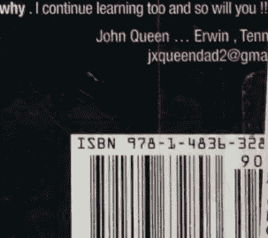

