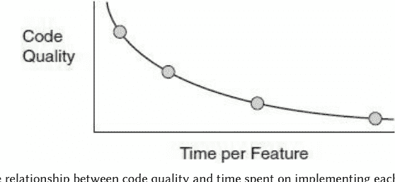

# 软件工之道：专业主义、务实主义与自豪 (Robert C. Martin 系列)

罗伯特·C·马丁序言

Sandro Mancuso

Sandro Mancuso

# 前言

1973年，罗伯塔·弗拉克（Roberta Flack）演唱了《轻轻地杀了我》。你可能在电梯里或祖母的电台里听过这首歌。这是一首柔和、律动的民谣，讲述了一个女子去音乐会，听到一个年轻人唱着一首让她产生共鸣的歌，她很奇这个年轻人是否找到并读了她的信件。她表达了当他拨动吉他时她所感受到的信念，那是她一一生的歌曲。

你手手中的这本书对你来说可能也有这种感觉。桑德罗·曼库索（Sandro Mancuso）的职业生涯与我完全不同。他比我更是一个程序员。我的职业生涯在不同的大陆、不同的文化中生活和工作。我们没有共同的国籍。我只见过他几次，而且没有一次是几分钟。

在你手中的这些书中，你将发现许多基于这些经历的引人入胜的交替传记轶事。如果你是一个程序员，你会感到这些故事和建议在你心中产生了共鸣。如果你愿意的话，就像我曾经说 true：“相信这一点。”当他拨动他的吉他时，你会感到脑中的隐痛，以及你将感受到的痛苦，因为这本书关于痛苦。它是关于你和我——我们都处于“非专业状态”的人共同的痛苦。它是那种感到被困在想要做得却不知道该如何做的痛苦。

这本书还包含了你所治愈的痛苦的解药。我相信它可以治愈你。你要明白，这本书是关于所有的软件专业化，而不仅仅是软件组织的专业化。这是一本关于“软件工艺”（Software Craftsmanship）的书。

在这些书中，作者阐述了一个计划、一个策略、一套态度和一系列原则，每个程序员、编程团队和软件组织都可以利用它们让自己从平庸的泥潭中挣出来，让自己变得更专业、更高效，并更投入于他们所的工作。

这本书的范围极其广。主题从设计模式、结对编程、测试驱动开发（TDD），到如何执行和处理截止日期、如何应对紧迫的期限、如何编写职位描述，以及如何与同事和经理建立关系。

简而言之，这本书是一部关于努力在专业化方面成长并遵循软件工艺原则的组织的行为、属性和结构的百科全书。

如果你是那种渴望在结束漫长的一天后回家，看着镜子说“该死，我今天做得不错”的程序员、团队负责人或经理，那么这本书就是为你准备的。

-罗伯伯··马丁（Robert C. Martin）

2014年8月

# 序

在二十岁中期，在我开始职业生涯两年后，巴西圣保罗的一家大型国际公司宣布需要6名开发者入职。选拔过程持续了几个周，分为四个阶段：三小时的技术测试；几周的专利技术培训，随后是测试；一整天的小组活动；以及一轮面试。他们在报纸上发布了招聘，有900名程序员申请了。我当时在一家小型软件公司工作，在那里我很快乐，但我觉得我正在寻找更好的机会。由于前几轮是在周六进行的，我决定申请。因为，有300多名候选人进入了下一阶段，我感到既紧张又自信，但保持警惕。为了继续参加选拔，我必须辞去现在的工作，因为剩下的日子我需要请很多假。我的财务状况并不理想，无法指望家里的任何资金支持。为了追求一个完全不知道是否能实现的梦想而辞掉工作是非常困难的。而且，我还没有准备好新工作。但我必须这样做。那是我我想工作的公司。为了我想要的目标。

我当时21岁，而且从11岁开始就有几年的经验了，19岁时就开始了职业生涯。这种过程是青涩和一点点自大的混合，这种心态很容易表现，同时又不会给人留下那种傲慢年轻人的印象。我可以轻而举地击败任何人。我觉得自己比大学里和我一起学习的其他人都优秀，也比我之前工作中遇到的绝大多数程序员都要好。

在经历了四个阶段后，公司宣布他们找到了60名符合预期水平的开发者。他们聘用了32人，我是其中之一。我工作得越久，变得越自大。第一周，我被分配负责交付系统的不同业务模块。在最初的几周，我听说了一个似乎是公司里最好的团队。他们是“架构”团队，负责核心系统并为业务提供所有架构。

架构团队由这个不可思议的男人领导，他负责所有的管理工作，而且还是一个出色的开发者。他是一个和我一样的人，但他有多年经验来管理时间、编写自己的代码并审查团队编写的代码。他的团队总是在处理有趣的事情，他们的代码真的非常好。这就是我一直寻找的。

几周后，我被要求去见架构团队经理，那个我听过很多的人。我不知道该说什么，也不知道预期什么。最坏的情况是他拒绝让我加入团队。有一天，我发现自己独自在办公室等他。他微笑着我说：“我是曼。”我回答道：“很高兴见到你。”他很冷静、放松。“我想和你一起工作，”几秒后我说。他很惊讶，但他以非常积极的方式对待。我们开始讨论选拔过程、我申请的原因、我的预期以及我有什么可以展示的项目。在谈了30分钟后，他叫我。会议、正式面试，以此类推。我花了很时间适应这种节奏，我总是担心自己是否胜任。他是对的，我担心做错。我的第一天是在周一。经理来找我并分配给我一项任务。他解释了其中一个应用程序以及需要做什么。他告诉我这是检查我能力的好方法。这很困难。这就是挑战。我必须向他展示我有多想做好。我在办公室工作到深夜，周二每天加几个小时，下午喝两杯咖啡。我用比预期一半的时间完成了第一个任务。我感觉极极了。所有的同事都在帮助我完成工作。这是一项巨大的成就。

我冲进曼的办公室，他兴奋地说道：“你完成了。而且很棒。”他停下工作转向我。“让事情运行起来对于有能力的人来说要容易得多，”你说得对，如果它有效的话”——这就像给了我脸一记耳光。我的脸变得白了一些，因为我觉得他在讽刺。也许他是在讽刺，我有些话想说。那是漫长的一天，不，我没话说了。“但是，让我们看看你能做什么，”他继续说道，我看着他在命令行中输入，检查版本控制中的代码并分配我包含所有代码的示例文件。他用那个糟糕的黑绿编辑器打开了文件。“关掉，我们来看，”他说。我写了大约200行代码。他移动光标，我开始逐行查看代码。每五行他就会停下来说类似的话：“你知道在分配和释放内存时发生了什么吗？你看到这里了吗？这里是用一种方法分配内存，而那里是用另一种方法释放。”

在另一个方法中释放内存。这是一个潜在的内存泄漏风险。你听过时间耦合吗？你能看到这里的这几行代码吗？如果你再深入思考一下，你可以把这八行代码缩减到两行。你知道当你有这个 `try/catch` 块时会发生什么吗？这个变量和方法的名字呢？它们意味着什么？你是否想过，你的某些同事在需要修改这里时，可能没有像你现在这样拥有的信息和背景？如果你知道这部分代码，你会有什么感觉？如果你必须维护它，你是否曾想过，为了改变它的指向，你需要打开它、修改它，并解释为什么？为什么你的代码到处都是重复的？这是一个方法。你为什么需要在每一个的、存在的方法中都保留它呢？把它们拆小并根据其行为命名又如何？

在某个时刻，他开始盯着几行代码看。在 20 世纪 90 年代，如果一个开发者能写出没人能懂的代码，他就会被认为是高级程序员。她真的很厉害。我完全不知道那些代码在做什么。我不得不敲击几个键并解释它。正如有些人所指出的，代码在做什么。我本以为会得到赞美，结果最后。“这有多不尊重，”他说。在一个大型系统上工作，有许多开发者在同一段基础代码上工作。你能想象为什么理解某些代码会有困难吗？某人决定展示他/她的才华：图像、成千上万行或数百万行的那种代码。“还有这个。”

那只是 200 行代码，我无法回答他的任何问题，也找不到一个好的回复切入点。他逐行阅读，提取出来，并向我解释如何可以做得更好。因为我们读到了文件的末尾，这很奇怪，且让我非常恼火。他也非常冷静，仿佛他是在看一段几个月没出现的代码。他同意我所有的观点并说：“为什么缺失了？没说理由，我只是……你觉得你能用更好的方式来修改这段代码吗？”我没有看他，只是站在那里。然后我敲击了几下键盘，删除了包含了所有内容的整个文件。“太极了，既然你有三天时间来完成。”

“Sandro，”当我走到门口时，他叫道。我回头看向他。“这和完成它一样重要吗？”

我感到很沮丧。事实上，我离开了办公室，直奔下楼，然后到了建筑外。我写的代码太糟糕了，我觉得作为一个这样一个对公司做这种事的人感到很羞愧。我很后悔。抽了几根烟后，我点了一根小雪茄，开始思考发生了什么。Namur 花了一个一个多小时研究我的代码，并向我解释如何可以改进。我从这次机会中学到我是错的，他是对的。现在好多了。第一个原因是，我人生中第一次在写代码时找到了这样一个人。我找到了一个花时间教我如何写好代码的人。我找到了一个比我公平且更有经验的人，是真的在帮助他人变得更好。我找到了一个关注质量软件的人，一个比他们都精通技艺的人。他成为了我的第一个导师。

抽了几根烟后，他让我振作起来，我变成了一个不同的人。我就这样学会了我并没有想象中那么好。我学会了谦虚。我有许多东西要学。我学会了做事情并不容易，尤其是你在团队中工作时。我学会了尊重我的同事，不再把垃圾代码留给别人处理，并对自己的工作负责。

两年来，我与他以及遇到的一些开发者一起工作。那段经历不仅塑造了我作为一个专业人士，也塑造了我作为一个人。尽管我们从未用过那个方法，但我意识到了一种更高的技艺，那是我对软件技艺（Software Craftsmanship）的首次体验。我从他们所有人身上学会了真正重要的是学习这个男孩在职业生涯中应该具备的态度。在我们进行第一次代码审查会议时，情况改变了。多年后，我发现了伦敦软件技艺（LSC）(https://www.meetup.com/london-software-craftsmanship/) 和 Namur 的话。“这和完成它一样重要吗？”是我在纸上写下的最早的话之一。后来我印了印有这些话的 LSC T 恤。话没有让我成为一个更专业的专家，但但也让我成为一个更好的人。

# 关于此书

在经历了几十年许多不同的技术之后，软件项目仍然在失败。它们失败有很多原因，但有些事情是无法忽视的：作为一条流水线的软件开发、如何管理软件项目以及如何培养优秀的开发者，以及许多开发者仍然表现得像没有技能、缺乏动力的工人，为他们的员工和客户提供非常糟糕的服务。随着敏捷方法的出现，软件行业仍然面临着这种持续失败的问题：为什么我们如此不擅长交付成功的项目？缺失了什么？

尽管“软件技艺”这个术语已经存在十多年，但直到现在才成为解决今天软件行业面临的许多问题的可行解决方案。

软件技艺为开发者和公司提出了一种完全不同的思维模式。虽然软件技艺不是一种方法，但它强烈建议采用某些技术实践和学科，主要是由极端编程（Extreme Programming）定义的那些。通过与敏捷和精益原则的巨大协同，软件技艺承诺将我们的行业推向新的水平。专业精神、技术卓越和客户满意是软件技艺的主要关注点。它的主要关注之一是改变人们的认知，即软件开发者就像生产线上的工人，而软件项目可以像运行工厂一样运行。

遗憾的是，资历的概念在过去的 20 年里并没有改变。软件开发人员通常是根据他们在行业工作的年限来评估的，而不是根据他们的知识。

经验年限与“重复的经验”之间存在巨大的差异。在不同项目、使用不同技术、不同公司工作多年，与在同一公司、同一项目、与相同的人和技术工作多年是完全不同的。

多年来，我学到资历是瞬即逝且不稳定的。它是瞬即逝的是因为客户每隔几年就会要求不同类型的技术，而在瀑布流方法中编码并不能让你在一家采用敏捷开发移动应用的现代公司中获得资深职位。在行业工作五年后，资历并不是我们一生都要关注的坏事。资历也是转瞬即逝的；我们需要问以下问题：和谁相比？在何种“技术”领域？

并没有所谓的资深或初级开发人员。开发者可能在为大型组织开发 Java 应用方面富有经验，但在使用 JavaScript 写游戏方面完全没有经验。他们可能在多变化的敏捷环境中工作非常有经验，但在处理大型集团的官僚主义和挑战方面完全没有经验。

## 新现实

良好的编程实践和技术可以应用于许多不同的环境和系统类型，编码只是现代开发人员除了编写任何语言或框架代码之外要做的事情之一。现代开发人员需要知道如何关注客户、自动化测试和部署、管理可能影响整个业务的挑战、在分布式团队中工作、帮助客户定义和优先排序需求、报告进度、管理变更和预期、售前活动、估计时间和成本、面试团队成员、设计和演进架构、处理非功能性需求和服务水平协议（SLAs）、理解业务逻辑、基于事实和更好的工作方式做出决策、关于你交付给客户的价值以及许多其他事情。

有些开发人员已经活跃了数十年。嗯，这对某些开发者来说是事实，但对大多数人来说绝对不是。在过去，为了效率，参与软件项目的人员的角色和职责被合并了。开发人员不参与应用程序的设计和架构，应用程序很少接触用户，而且永远不需要被要求处理业务分析。

公司开始转型，扁平化层级结构，用通用型专业人才取代了许多专才人才。公司需要那些全能的、既擅长编码又擅长业务的开发人员。

在过去的几十年里，随着互联网、移动设备、云服务和通用技术的发展，一切都改变了。客户想要更多，公司在提供软件方面也变得更加激进。敏捷让我们能够更改软件，敏捷性使得提供给客户的价值成为竞争优势。我们依靠 Amazon、Google、Twitter、Facebook 等许多其他软件主导市场。客户正要求具有僵化和深层层级结构的官僚化服务公司转变为更敏捷的服务公司。采用传统管理风格的瀑布方法往往无法跟上游戏所需的快速变化节奏和快速开发。

项目的规模也发生了变化。今天，我们看到的应用程序不再集成到每台机器上，而是有一个巨大的单体数据库作为集成点。现代应用程序使用多种技术构建并集成在一起。我们过去只有供内部员工使用的应用程序，现在我们有全球数百百万使用的应用程序。对于许多公司来说，生产环境中的 Bug 成本足以让它们破产，或造成巨大的损害。

软件行业的这种现实迫使了软件开发流程的演变。公司要求专业的开发人员，而不仅仅是听命行事的码农。

此外，我们的行业正在抛弃工业时代的遗产——命令与控制，软件开发人员的角色和职责变得更加复杂且要求更高，迫使更多人去开发和获取他们职业发展所需的新元素和技能。我们过去在具有僵化且扁平计划以及严格定义流程的项目遇到的优先级已经毫无意义。拥有才华和赋能专业人士的扁平层级结构正变得常见。对敏捷和精良软件的需求从未如此之。

2001年，软件行业发生了一场革命：敏捷。全球公司都采用并拥抱了敏捷方法和思维，这改变了它们的流程和内部结构。然而，尽管流程有了显著改进，公司对它们的交付能力仍然不满意：对变化的响应不够快、Bug 多、软件质量低、维护成本高、客户不满意以及招聘优秀开发人员困难。开发人员仍在挣扎于维护、测试和为他们工作的软件添加新功能，特别是当他们对项目是新手时。为什么我们需要软件工艺（Software Craftsmanship）？它到底是什么？我们真的是专业的软件开发人员吗？为什么敏捷是不够？

在接下来的章节中，我将回答所有问题。我将详细解释什么是软件工艺，以及对专业软件开发人员的期望。在此之前，让我们先了解什么是敏捷。

## 敏捷

回到2001年2月，行业中17位有影响力的人决定聚集在犹他州的一个滑雪度假村，讨论替代重型和基于文档的软件开发方法的方案。他们中的每个人都在工作和尝试不同的软件开发技术和方法，他们认为聚在一起分享他们所做的事情是一个好主意。这个想法是相互学习并尝试出更好的交付软件项目的方法。

他们是 Kent Beck, Mike Beedle, Alistair Cockburn, Ralph Cunning, Martin Fowler, James Gimsight, Andrew Hunt, Jon Kern, Brian Marek, Robert C. Martin, Steve Mellor, Ken Schubert, Jeff Sutherland 和 Dave Thomas。

他们展示了诸如极端编程（XP）、Scrum、系统开发模型（SDM）、自适应软件开发、特征驱动开发和程序化编程等方法论和技术。

经过多次讨论，《敏捷宣言》诞生了，敏捷联盟（Agile Alliance）成立了。

敏捷不是单一的。敏捷是方法和技术的结合，根据情况，它可以帮助团队适应不断变化的软件项目并减少与之相关的风险。敏捷学科和方法分为两大类：面向过程的和面向技术的。

在本章中，将讨论什么是敏捷、敏捷宣言以及许多组织在采用敏捷时面临的问题。

### 面向过程的敏捷学科

这些学科描述了团队和组织如何工作、协作和组织。它们通常在许多其他方面规定和/建议团队应该使用的方法论类型；人们应该扮演的角色；何处获取需求、如何衡量工作速率、如何以迭代方式工作、如何计划和交付工作，以及如何展示进度并获取反馈。

面向过程的学科帮助团队专注于对业务真正重要和有价值的事物。

### 面向技术的学科

这些学科更关注开发、维护和交付软件的挑战。它们通常规定或建议技术实践和技巧。测试驱动开发（TDD）、结对编程、持续集成和简单设计是这些实践和技术的例子。面向技术的学科帮助团队专注于他们所生产软件的质量。

## 什么是敏捷？

> [敏捷意味着]成功地适应新情况。
>
> —Tom Gil

我们不是“在敏捷”。我们要么是敏捷的，要么不是。

敏捷方法论的核心在于快速且短的反馈循环。我们的反馈循环越快越短，我们收到的反馈就越多，我们反应的机会就越多，而对新信息的反应（或不反应）行为让我们变得更（或更不）敏捷。缩短反馈循环有助于我们更快发现问题，允许我们尽早识别它们并快速适应。敏捷并不解决任何问题；它只是暴露了问题。我们越快向用户展示演示或任何其他功能，就越早获得关于它的反馈。我在这里使用“用户”是一个通用术语。如果我们是产品所有者、赞助商或最终用户。从多个来源获取反馈极其重要。使用更早的反馈有助于我们降低所在行业的风险。

敏捷开发改变了我们的工作方式。软件项目团队中旧有的、等级森严且角色高度分化的模式开始消退。软件专业人员意识到，编写代码只是他们需要擅长的领域之一。开发者们不再仅仅是执行计划，而是他们充分理解了参与业务并为客户交付价值的重要性。一个团队对软件项目的所有不同方面负责，这一认识是一个游戏规则的改变者。它促成了软件专业人员的演变。开发者不再仅仅是根据定义的计划编写代码，而是开始在规划、估计、需求、团队组织、分析、架构、生产就绪、优先级排序、演示以及定期收集用户和利益相关者的反馈方面发挥积极作用。

## 员工赋能

软件团队在层级上变得扁平化。不再有团队负责人和职责分工。不再由经理给个人分配任务并指定完成所需的时间，现在我们拥有由团队赞助人和产品负责人按优先级排序的任务待办列表（`backlog`）。团队根据优先级决定下一个执行哪项任务，并决定由谁来做什么，以及需要多长时间。这一切都是迭代过程的一部分，且对所有人的反馈循环是持续的。

## 职业愿景

为了适应这种工作方式，软件专业人员不得不不断演进。公司不再像过去那样寻找专家，而是开始寻找“通用型专家”。擅长写作是软件专业人员被期望的最低技能。测试、理解业务的能力、良好的沟通以及更外向的性格已成为现今软件专业人员所需技能组合的一部分。

## 敏捷宣言

以下是《敏捷宣言》的节选。

> 我们通过实践软件开发并帮助他人实践，发现了更优软件开发方法。通过此，我们开始更加重视：

- 个人和互动优于过程和工具
- 可运行的软件优于详尽的文档
- 客户协作优于合同谈判
- 响应变化优于遵循计划

也就是说，虽然右侧也有价值，但我们更重视左侧的价值。

除了《敏捷宣言》之外，敏捷的创始人提出了十二条原则。

### 敏捷宣言背后的原则

这些原则包括：

- 1. 我们的最高优先级是通过早期和持续交付交付价值的软件来满足客户的需求。
- 2. 我们欢迎需求的变化，即使在开发后期。敏捷流程利用变化为客户赢得竞争优势。
- 3. 频繁交付软件，周期从几周到几个月不等，并优于更短的时间尺度。
- 4. 业务人员和开发者在整个项目过程中每天一起工作。
- 5. 围绕有激情的个人构建项目。为他们提供所需的环境和支持，并信任他们能够完成工作。
- 6. 在团队内部以及团队之间传递信息的最简单有效的方法是面对面交流。
- 7. 可运行的软件是衡量进展的首要标准。
- 8. 敏捷过程支持可持续开发。赞助人、开发者和用户能够无限地保持恒定的节奏。
- 9. 对技术卓越和良好设计的持续关注可以增强敏捷性。
- 10. 简单——最大化未完成工作量的艺术——至关重要。
- 11. 优秀的架构、需求和设计源于自组织团队。
- 12. 团队定期反思如何变得更高效，并相应地调整调整其行为。

## 敏捷转型时代

敏捷是我们行业的一场重大革命，并随着时间的推移被公司采纳。咨询公司和个人专门帮助公司经历敏捷转型。敏捷教练的角色应运而生。敏捷教练进入公司；分析他们的问题、人员和人；并帮助他们改变以变得更加敏捷。公司开始可视化并理解他们的低效之处在哪里。

在这些敏捷转型期间，`Scrum` 结合其他一些特定技术通常是首选的方法论。这是进入敏捷世界的绝佳切点。对于许多公司来说，自组织团队的概念真正具有意义。接受拥有团队待办列表、支持和拆分故事、估计，以及在每次迭代结束时帮助处理优先级功能，是一个巨大的进步。沟通也得到了改进。团队开始更频繁地相互交流以及与客户交流——这是某些公司中另一种敏捷的体现。

提供一个更多人相互互动的环境有助于公司解决问题，并理解团队和个人的优劣势。敏捷流程有助于团结团队成员，提供共同目标。

敏捷流程无疑帮助了公司不断前进，不仅暴露了他们的问题，还提供了他们进行反应和适应以所需的反馈循环。

## 敏捷后遗症

几年来，公司和团队一直处于这种敏捷转型阶段。公司经历了转型。会议开始变成会议——尽管有些公司只是一个团队聚在一个房间里坐一个小时。燃尽图、迭代待办列表和发布待办列表变成了新的项目管理工具。我们使用用例（user cases）或其他故事（stories）。项目经理变成了 `Scrum Master`，“敏捷”成了他们他们工作方式的新名称。有些变化并不显而。如果你观察敏捷转型前后办公室的团队，差异可能是巨大的。

但我们并没有。有些公司只是围着一台电脑的一人或几个人是“敏捷”的，无论什么都变成了便利贴（Post-Its）。对许多公司来说，敏捷意味着什么？白板上彩色便利贴的数量成了他们敏捷性的真实衡量标准。便利贴越多，他们就认为自己越敏捷。当然，非常成熟的公司可以通过他们使用便利贴或其他任何其他方式来识别。总之，无论什么是敏捷的，每个人都能看到彩色的便利贴在移动——有时它们看起来看起来不错，快了一点，有时并不快，而且每个人都有那种自由和赋能的感觉。自由意味着成员可以做他们想做的事——只要他们的老板还在职。

只是在软件项目中，最重要的交付物是软件本身。

我见过的所有敏捷转型，其问题在于它们都是部分性的转型。公司通常会聘请咨询公司和敏捷教练来改变他们的流程。然而，这些咨询公司和敏捷教练在帮助他们写出高质量软件方面几乎没有做任何贡献，甚至完全没有。通用的敏捷转型关注的是流程而非技术规范，这意味着它们在培养优秀开发者方面几乎无于事。敏捷教练改进了从事交付服务或质量保证（`QA`）的人员的技能组合。敏捷转型重要性的差异被完全遗忘或忽视了。这是一个非常天真的假设——极不专业的（来自某些不称职的教练）——认为敏捷意味着开发者非常擅长写代码，而他们真正想使用的唯一工具就是 `Scrum` 框架。由于他们缺乏代码能力，他们需要的只是一个更好的流程，来促进沟通并赋能员工，而他们真正需要的是“让我们改进流程，其他一切都会好起来”。在很多情况下，拥有相同习惯的开发者也能产出惊人的软件。代码很容易的，只是细节，对吧？我们只需要一个更好的流程——我们并不理解技术卓越。

敏捷转型关注的是流程；赋能员工；减少官僚主义和浪费；工作优先级；以及改进流。结果是，公司在得到处理和改进后变得更优秀了。如果不解决问题，就不可能实现成功的项目。然而，敏捷背后的债却被遗忘了。流程变得比技术卓越更重要。技术卓越被认为通过流程相关的敏捷方法论已经具备，但它却被经理和准备不足的敏捷教练忽视了。

敏捷社区的许多人喜欢谈论丰田，以及他们如何通过改变流程、减少（浪费）、限制在制品（`WIP`）以及他们所做的所有伟事来取得成功。敏捷教练和咨询公司喜欢向初学者推销的是：丰田梦。造汽车与造软件是不同的。如果汽车没完成，我们就不会使用它。买完车后，我们不会回到厂家要求他们增加一扇门或把引擎从前面移到……

在谈论丰田时，我们确实说：“如果汽车不好怎么办？如果没人想要它怎么办？如果它们是湿的，我们每个月都得把它们带回修理厂怎么办？”丰田成功的一个重要因素是良好的流程以及对汽车质量的关注。

客户想要买汽车是因为它们造得良好且可靠。他们想要自己的汽车是因为它们是值钱的好工具。一致性意味着它们拥有质量。

有效的流程运作方式是：为了实现质量，我们需要在所有层级提供良好的反馈循环。对于一个反馈系统，我们需要才华且专业的人士，他们能够解释自己所做的事情，并在他们觉得某些地方不对或可以更好时大声出来。关注流程并将软件开发视为生产线，会导致 9 点到 5 点班的开发者只听从行事——变成工厂工人。这种方法让系统变得有效率高，却损害了整个项目。

## 敏捷教练

每个职业都有好做法和坏做法，敏捷教练也不例外。他们是那些完全理解敏捷初意的人，在为公司和团队采用敏捷提供建议时，他们强调了流程和技术卓越的重要性。尽管大多数人关注流程，但他们通常会处理流程，或者招聘其他可以帮助他们处理技术规范的专业人士。

然而，每位敏捷教练由于缺乏技术知识，会在流程方面占据主导地位（误导客户），并且往往完全不提技术方面。

向流程管理推销，比说服技术卓越的重要性以及我们管理它需要付出的所有努力容易得多。高层经理真的没有看到开发者扮演比仅仅写代码更大角色的益处。他们未能理解为开发者产出的代码质量付费的重要性。只要代码能用就行，他们就满意了。

来自技术背景的高层经理很容易被糟糕的教练误导。几个月后，甚至几年后，当问题出现时，敏捷教练和经理很容易推责于开发者。有时，问题出在这里，问题在于敏捷转型将如何帮助他们？

## 拒绝技术

（注：此部分原文包含大量重复的段落和乱码，根据“不要重复输出原文”的原则，此处仅保留其核心逻辑的翻译。由于原文在该处存在大量无效字符和重复，以下为基于核心含义的翻译：）

但还有另一面。有非常好的敏捷教练和咨询公司在优秀工作并帮助客户。当涉及到 `XP`（敏捷开发）时，他们立即拒绝了结对编程的想法——他们认为那是完全的浪费。他们立即拒绝了投入测试以及测试驱动开发（`TDD`）。关于我们的 `QA` 团队如何？他们浪费了时间。

有时，拒绝来自他们自己。他们无法看到结对编程的意义。他们认为由于在某些领域缺乏知识，他们不想写测试。

如果你不投入测试，持续集成的意义在哪里？为了确保代码工作？简单的设计和集体所有权并不奏效。对于经理的想法是，这浪费了时间。对于开发者，他们看到了许多模式，以及架构可以变得多么复杂，只有一个人知道系统是如何运作的。在某些情况下，如果拒绝来自管理层，他们需要一些教育，让他们关注软件质量是多么重要，软件是如何被构建的。当拒绝来自开发者时，他们需要一些教育，经常由敏捷教练与他们达成一致并以身作则。如果不，考虑用你的开发者来替换，那些开放学习新技术和实践的人。

## 幼稚的项目处理方法

（注：此部分原文同样存在大量重复，根据“不要重复输出原文”的原则，此处已清理重复并进行翻译。）

多年来，我见过了许多处理软件项目的幼稚方法。有些公司认为成功项目的重要要素是：业务专家编写需求、技术领导（不写代码）绘制图表和文档，以及一个负责监督（微管理）的经理。当这些角色到位时，他们准备雇佣几个廉价的开发者——通常将招聘任务委托给 `HR` 部门。他们根据一堆提前几个月准备好的需求和技术文档工作，然后软件就诞生了。一年后，开发者提供的软件是没用的，而部署的是没有 Bug 的软件。那是怎样的产品啊。真遗憾，它根本无法运行。

在我参与过的所有浪费项目中，由于无法接触真实用户、与他们缺乏沟通且缺乏快速反馈循环，团队面临的问题远大于他们能共同解决的问题。我仍然能感受到压力、焦虑和不满意。但我确实见过了。我见过很多外包的糟糕经历。

# 总结

为了保持竞争力，公司需要以更快的速度交付质量更好的软件。敏捷开发帮助公司缩短反馈周期，使其能够快速适应客户的变化和客户的需求。遗憾的是，在采用敏捷方法的过程中，许多公司倾向于过度关注敏捷流程，但完全忽略了技术实践。

尽管《敏捷宣言》明确指出“人与交互优于流程和工具”，但敏捷转型最终往往变得完全关于流程和工具。采用 `Scrum`、举行每日站会会议以及必须管理备份，这些正在进行的工作并不能像魔法般地提高软件质量，或让开发者变得更优秀。在不提高技术卓越性的情况下，改进流程是毫无意义的。

为了实现全面的敏捷转型，我们还需要精通技术实践、技术和工具的专业软件开发者。我们需要能够持续交付并定期部署到生产环境的优质软件的开发者。我们需要能够交付经过充分测试且易于更改软件的开发者。为了实现全面的敏捷转型，公司需要拥抱**软件手艺**（`Software Craftsmanship`）。

# 软件手艺

在讨论什么是软件手艺之前，让我们先描述它**不是**什么：

- 优美的代码
- 测试驱动开发（`TDD`）
- 自选小组
- 特定的技术或方法论
- 证书
- 宗教

那么，软件手艺到底看重什么呢？本章介绍了几个定义，并讨论了它的起源和历史。本章还涵盖了《软件手艺宣言》，并深入解释了它的真正含义。

### 一个更好的比喻

用非常简单的方式，我们可以说，与软件工程相比，“软件手艺”是软件开发的一个更好的比喻。软件手艺将软件视为一种手艺，并将软件开发者比作中世纪的铁匠。学徒会与更有经验的铁匠一起工作，四处奔波为不同的主人们工作，学习不同的工具和技术，不断提高自己的技艺，直到他们足够优秀能够成为一名大师。这还有更多细节，但现在请先听我说。

### 维基百科是怎么说的？

[`软件手艺`] “是一种强调软件开发者编码技能的软件开发方法。它是软件开发者对主流软件行业的一种回应，包括将财务考量置于开发者的敏捷性之上。”

我个人并不喜欢这个定义。它非常枯燥，我认为它没有捕捉到软件手艺对一个软件开发者来说意味着什么的本质。

### 一个更个人化的定义

软件手艺是一段通往精通的长旅。这是一种心态，开发者选择对自己的手艺负责，不断学习新的工具和技术并不断完善自我。软件手艺的核心在于将责任感、专业精神、形式和自豪感重新带回软件开发中。

### 一个更短的定义

软件手艺可能是软件手艺中最重要的一点。如果你在读这本书后只记住一件事，请记住这句声明。

### 超越定义

我更倾向于将软件手艺视为一种意识形态或心态。它是许多人想要表达并为我一直以来相信的一切事物命名的。许多开发者（包括我自己）可能会说，他们就是软件手艺所讨论的大部分内容：关心自己所做的事情；努力完善自己；表现专业；通过帮助客户实现他们想要的任何目标来令客户愉悦；从开发者那里学习他们所的知识；指导经验较少的同事。

如果你看重上述事物，那太棒了，你就是一个软件手艺人，即使你不喜欢这样称呼自己。许多人并不真正喜欢甚至并不认同“软件手艺”这一职业。这完全没关系。重要的是我们作为软件专业人员应该关心的事情。

### 手艺、贸易、工程、科学还是艺术

当我第一次接触软件手艺运动时，我记得进行过很多关于软件开发是什么的讨论。我最初喜欢将其描述为一种艺术。在过去的多年里，我更倾向于将其视为一种手艺。我认识的许多人，我非常尊重的人，完全不同意这一点。对于某些人来说，它是一种贸易；对于另一些人，它是工程。很少有人会说软件开发是一门科学。

每个开发者都有许多理由认为软件开发应该被视为艺术、手艺、贸易或科学。在听了所有关于软件开发属于某方面的理由时，这些理由都是道理的——有些比其他的更有说服力，但都有道理。

关于软件手艺的另一个大争议是名称本身。有些人讨厌它。他们认为将这个最具创新且发展最快的行业与追溯到中世纪的事物相比毫无意义。而其他人可能也有道理。

多年来，我参加了这些辩论，并花费了大量精力试图说服为什么软件手艺是一种好方法，以及为什么开发是手艺。当我深入其中时，突然意识到这其实并不重要。这才是我们讨论的最重要的事情。我个人喜欢这个比喻并将软件开发视为手艺，但我真正看重和关心的是软件手艺的价值观。

归根结底，我们关心的的是专业标准，以及帮助他人（包括我们自己）成为专业的，而不仅仅是听命工作的工人。

### 软件手艺的历史

尽管 Jack W. Reeves 在 1992 年建议软件开发不仅仅是一项工程，但我认为软件手艺真正始于 Andy Hunt 和 Thomas Thomas 编写的《程序员：从学徒到大师》（Thematic Programmer: From Jouryman to Master）。Peter McConnell 出版了《软件手艺：新的迫切需求》，这本书引入了多年后我们用来塑造软件手艺运动的宏伟思想。

2002 年，Ken Auer 在北卡罗来纳举办了一场软件手艺峰会，并邀请了许多其他人：Peter McConnell、Ron Jeffries 和 Robert Martin（Uncle）。

几乎在结束后，对话就通过 Google 小组转移到了互联网。来自英国和其他几个国家的几个人也加入了其中，并贡献了大量的见解。软件工艺（Software Craftsmanship）在英国逐渐起，找到了几个落足点，随后扩展到全球许多其他国家。

2009年3月，在大量的辩论后，确定了一份通用共识的总结。它以《软件工艺宣言》（Software Craftsmanship Manifesto）的形式公开展示，供阅读和签署。

## 跨越边界

2009年2月26日，首届国际软件工艺会议在伦敦举行。同样在伦敦，2009年5月，Adelaide Oshineye 为志向远大的软件软件工匠们举办了一场研讨会；Enrique Rioseniesen 启动了《游历书籍》（The Wandering Book），这是一本在工匠之间流传的书，捕捉了软件工艺运动的当前思想和时代精神。软件工匠们写下了成为一名软件工匠意味着什么，书籍记录了这些条目的照片并发布在网上。遗憾的是，在旅行了几个国家后，这本书和网站都消失了。在一些博客中还可以找到关于《游历书籍》的一些信息。

2009年10月，Dave Hoover 和 Adelaide Oshineye 编写的《学徒制模式：志向软件工匠指南》（Apprenticeship Patterns: Guidance for the Aspiring Software Craftsman）出版。这本书是最早出版的书之一，提供了实用的建议，帮助软件开发者关注自己的职业、目标和专业领域。

从以后，软件工艺会议每年在美国、英国举行，从2011年起在德国也举行。

## 软件工匠

2009年4月，Beth 和 Olivia 提到了关于交换的许多重要细节。《芝加哥判报》在2009年6月15日报道了这一事件，提到两公司在技术能力方面的相互尊重，这让他们相信可以从对方那里学到很多东西。许多人的反应是认为这是疯狂，但实际上，这表明工匠们有不同的处理问题方式。“我喜欢像你们一样尽可能多地赚钱——而不是仅仅推出软件而不考虑软件在长期运行中的状态，”Cory Hayes 说道，他帮助组织了这次交换，也是这个想法的发源者。

> “最初双方都对运作方式发表了意见，我们都非常兴奋，”来自 Obama 的 Tyler Jenkins 说，“我们经历了他们无法获得其他任何东西。我们选择[派遣]一位经验丰富的开发者，以及一位我们认为代表了 Obama 运动的人。”

参与的开发者作为普通开发者工作，与其他开发者合作并进行实际工作。他们编写代码，在会议上交流，并表现得像为另一家公司工作一样——至少在他们写作期间是如此。这帮助他们学习了新的实践、新风格、新语言等。

## 软件工艺社区

尽管自1999年以来关于软件工艺有一些传闻，但直到2009年该领域才真正繁荣。除了书籍和少数会议外，软件工艺运动通过建立全球邮件列表以及在美国、伦敦和欧洲其他地区建立几个软件工艺社区，真正赢得了关注。

2009年12月，Uri Levi 创立了以色列软件工艺社区。2010年8月，David Green 和我创立了伦敦软件工艺社区（LSC）。在2011年德国的 Socrates 工艺与测试会议期间，几个软件工艺社区相继成立：巴黎软件工艺社区成立于2011年10月，与此同时 Softwarekammer 在德国启动了软件工艺社区。德国方面现在正在组织全球十五个以上的社区。自此以后，世界各地又建立了许多其他社区。

LSCC 目前是全球最大、最活跃的社区，拥有2000多名开发者，每月组织四到五场活动，并举办年度的软件工艺会议——Socrates UK。LSCC 还作为一个指南，帮助世界各地的许多其他人创建他们自己的社区。

## 软件工艺宣言。

为了从2007年软件学徒制峰会的落差感中解脱出来，Micah Martin 希望软件工艺峰会能产生一些成果。他希望有一些可以写下来的东西，一份他自己可以使用的某种草案。他们讨论了许多内容，包括成为工匠意味着什么，成为学徒意味着什么。他们还讨论了这份文档是写给谁的、内容是什么、如果文档存在，以及是否有必要存在。这些想法被记录在白板上，尽管他们想出了很多主意，但内容太多，且太不确定。他们甚至没有形成一份完成的文档。在会议结束之前，Micah 要求大家在白板上的内容上签字。

Doug 带回了一个关于“聚焦”的想法。他在小组中记录了会议结果并收集了反馈。他收到了大量的反馈。2009年2月，Doug 提到了一封名为“新左侧”的邮件，它开始收集价值观并完善了实际的《软件工艺宣言》。关于《敏捷宣言》和《软件工艺宣言》的辩对于进展至关重要。Doug Bradbury 通过“新左侧”和 Scott Firth 通过“右侧，重新审视”对该宣言进行了讨论。

关于“为什么需要软件工艺宣言？”的讨论，Cory Haines 回答说：“通过成为一个社区、发布一份宣言、开始建立原则和学派，我们正在创造一个每个人都能看到的轻量级东西。那些真正对学徒制、旅程、计划感兴趣的人。在某些情况下，这将引导某人走向这些想法，希望帮助他们创造过美好的生活。”

这是一场迷人的对话，跨越了宣言的最后语言。几周后，Doug 根据所有的想法展示了一份优雅的宣言，结构参考了《敏捷宣言》。这非常棒，社区总体也批准了它。在接后的几周内，他们建立并发布了一个网站，人们称之为“工艺宣言”。

## 宣言

作为志向远大的工匠，我们通过实践和帮助他人学习这门手艺，提高了专业开发的标准。通过这项工作，我们可以实现以下价值：

- 不仅仅是运行良好的软件，
- 还有精良的软件
- 不仅仅是响应变化，
- 而是稳定地增加价值
- 不仅仅是个个人和互动，
- 而是一个专业社区
- 不仅仅是客户合作，
- 还有富有成效的伙伴

也就是说，在追求工艺精髓的过程中，我们左侧的项目对于右侧的项目是不可或缺的

在宣言中，工艺的精髓被捕捉在“提高标准”中。宣言总结了经验丰富且有天赋开发者的价值观、挫败感和渴望。对他们来说，项目不再因为管理不善、流程模糊以及由于糟糕的代码而失败。

开发者正在把事情掌握在自己手中，试图改变行业看待软件开发的方式。他们不仅通过提出新的革命性流程，还通过向客户展示他们能做什么。他们的客户希望与他们合作，共同生产优秀且长寿的软件。不仅仅是运行，更是精良的

想象一个第一年的应用程序。想象一个没有测试的应用程序；没有人确切知道应用程序是如何工作的；代码充满了技术和基础设施问题，而不是解决业务问题；类和方法存在成千上万的缺陷。还想象你必须更改这个应用程序，编写测试将是一项巨大的工程。理当然，你认为可以和团队中的其他开发者结对。不，没有团队。你就是团队。所有离开的开发者，你拥有的只是一个几周前被雇来维护应用程序的毕业生。

当你处理应用程序时，面临的主要问题就是恐惧。不，我不是在说你是个胆夫。我只是说，你是一个负责任的开发者，你理解在自己害怕修改的代码中做出错误更改的后果。你之所以害怕修改代码的某些部分，是因为你不理解它是如何工作的，而且你没有信心修改它不会破坏某些东西。

这个应用程序是一个可以运行的软件，但它足够好吗？良好的软件，无论开发者多大，都能理解它。它的副作用是为人知且受控的。它具有高且可靠、清晰且简单的设计，并在代码中体现了业务语言。添加或更改功能所花费的时间，并不比项目初期（当时代码库还很小时）所花费的时间要长。

为了让开发者不断进化，就不能逃避改变。使用测试驱动开发（`TDD`）、简单设计以及在代码中使用业务语言，是保持代码健康和良好的最佳方式。

### 不仅响应变化，而且稳健地增加价值

你是否曾经想过软件项目是如何运作的？想一下所有正在工作的开发者。现在再想想所有参与项目的专业人士：测试人员、生产服务、运维、业务分析师、产品经理和项目经理。还有市场、销售、客户服务和后勤人员。薪资上花费了多少钱。现在加上所有家具、电脑、通信基础设施、办公室租金、薪水、福利等成本。在这些基础上，还有敏捷团队、多处办公地点以及随之而来的其他一切。

软件项目通常是巨额投资，对于任何正常的投资，公司都会希望获得回报。投资一个项目的唯一理由就是为了赚钱、节省或保护收入。考虑到这一点，我们的工作就是帮助他们实现

当我们谈论增加价值时，我们不仅仅是在说新功能和修复漏洞。这还关于改进软件，使其变得简洁、可扩展、可测试且易于维护。

这仅仅是为了确保软件越好、越老，公司受益的就越多。我们希望继续向项目中添加功能，并以项目初期相同的速度进行适当的更改。这将让人们无论我们的软件有多老，都能快速地进入市场。随着年龄的增长，软件会变得更有价值，而不是痛苦和沮丧的源。

增加灵活性并保持其足够的速度是我们的主要目标。良好的软件开发、自动化测试技能和才华横溢的开发者对于实现以下目标至关重要：

- 对“童子军规则”的转述（由 Bob 大叔首次应用于软件），即我们应该始终让代码比我们发现时更干净。

如果你想要长生命期的应用程序，对高质量软件的关注必须是首位。在遗留应用程序开发几年后就对其进行重写，其投资回报率是很低的。在很多情况下，重写应用程序的决定是因为维护它的成本高到无法接受。

> 疯狂就是反复重复做同样的事情，却期待产生不同的结果。 — 阿尔伯特·爱因斯坦

问题在于，用于构建旧应用程序的同样糟糕的技术也将用于构建新应用程序——导致新应用程序在几个月或几年后就变得像旧的一样老。我们的工作是打破这种循环，用良好的代码来构建应用程序。

### 不仅是个体和互动，还是一个专业社区

分享和指导是软件手工艺（Software Craftsmanship）的核心。软件匠师充满激情并始终努力变得更好。然而，我们还有一个更大的使命需要我们负责，那就是保护下一代匠师。

推动我们行业发展的最好方式是通过指导和启发经验较少的开发者来分享我们学到的知识。这与学徒、行会和大师的概念有关，软件匠师必须指导学徒并帮助他们在旅程中进步。知识、想法、成功和失败必须在社区内分享和讨论，以推动我们行业的发展。

当我听到一些开发者和敏捷教练说软件匠师社区是一群精选的精英开发者时，我很惊讶。如果一个开发者不能被视为软件匠师，那么他就不能被认为是软件匠师（注：此处原文逻辑重复，译文保留原意）。一个开发者如果通过指导和启发经验较少的开发者来分享我们学到的知识是推动我们行业发展的最好方式（修正逻辑为：我很惊讶地听到一些开发者和敏捷教练说，软件匠师社区是一群精选的精英开发者。如果一个开发者不能被视为软件匠师，那么他就不能被认为是软件匠师）。

软件匠师必须指导学徒并帮助他们在旅程中进步。知识、想法、成功和失败必须在社区内分享和讨论，以推动我们行业的发展。

### 宣言存在的问题

对于《软件工艺精神宣言》（Software Craftsmanship Manifesto），存在一些批评。最主要的一点是，与《敏捷宣言》不同，《软件工艺精神宣言》几乎无法被反对。在《敏捷宣言》中，左侧和右侧之间的对比清晰地指明了所提建议。一个认为文档非常重要的人很难接受“可工作的软件优于详尽的文档”。

习惯了固定价格和详细合同的公司，会在“客户合作优于合同谈判”上遇到困扰。在《软件工艺精神宣言》中，左侧和右侧之间没有清晰的对比。右侧是对已经被接受的左侧的演进。一个认同工作的软件比详尽文档更好的的人，永远不会不同意精良软件的价值。相信合作的公司，永远不会不同意高效的伙伴关系。

这是一个很有道理的观点。我不认为有人是错的。敏捷价值确实可以与《软件工艺精神宣言》中写的内容产生分歧。然而，如果没有人反对《软件工艺精神宣言》，那么假设所有人都赞同它是合理的。如此，我们应该问自己的问题是：我们是否根据宣言中所写的内容工作和行为？我们是否真的在实践我们所精通的东西？

在我看来，宣言不应该被看作仅仅是几行文字的组合。我们必须更深层地去完全理解。

# 总结

软件工艺关乎软件开发中的专业性。它关乎开发者努力做到最好，并为客户提供良好的服务。软件匠人寻求与客户和员工建立高效的伙伴关系，而非雇佣/员工关系。软件匠人理解，成为一名专业人士意味着拥有良好的声誉，为此他们需要通过交付成功的项目来不断让客户满意。

软件工艺是一种心态——是许多专业开发者采纳的生活方式。软件匠人生活呼吸着软件。他们将软件视为一种技艺，并致力于尽一切努力精通他们的技艺。

# 4. 软件工艺态度

如果我们认为过去写的这段代码在今天依然很好，这意味着我们从那以后没有学到任何东西。

对于一些匠人来说，关心我们做的工作是理所当然的。不断寻找变得更专业的方法是一项终身承诺。以最高效的方式满足并帮助客户实现目标是我们的主要目标。与经验较少的软件匠人分享知识是我们的义务。

几年前，我正在和一位同事交谈。我们同时加入公司，入职同一职位，并在项目上工作了近一年。我们在一家咨询公司工作一段时间后，曾分开去为不同的项目和不同的客户工作。直到几年前，我们才有机会再次合作。他问我过得如何，并说：“我不喜欢这家公司。这家公司太糟糕了。”他的话让我很惊讶，因为我一直享受在那家公司工作的时光。然后他问我：“谁拥有你的职业生涯？”我说：“你。他们从来给我过书，或提供过学习新技术的培训课程。他们从来没有给我升职，”他抱怨道，“我长期以来没学到任何东西。”

我并不确定如何谈论他的担忧。在那期间，我获得了一些升职，做了一些好的项目。他突然问我几个问题并重复道：“我没有听懂，谁负责你的职业生涯和你的未来？”他再次问道。几年后，我们进行了这次谈话，我想起了他眼中的问题。

在本章中，我们讨论了如何关注我们的职业生涯，如何保持跟进，以及发现那些我们不知道的事情。

## 谁拥有你的职业生涯

如果职业生涯的工作不使用任何书呢？如果公司从不使用我们进行任何培训呢？这真的意味着公司很糟糕吗？

想象一下你需要一个水管工来家里工作。如果你需要一个律师来解决法律问题，或者需要一个医生或牙医，你就会去寻找这些专业人士。正常情况下，当你有一口疼痛的牙时，你会去寻找这些专业人士。

公司不应该投资他们自己的人吗？你可能会问。不，那不是我的意思。你可以给我一本书，或一个培训课程吗？

这些专业人士需要投资自己的职业生涯，以便他们能做好工作，满足客户，并希望推荐其他客户。他们对当前市场是负责的。那些最终失去客户的人，将慢慢被挤出业务。

另一方面，工厂在工作，例如。工厂需要培训员工使用新的机器和技能。工厂对这些没有话语权，他们只是听命行事。

客户支付经验和技能，以获得良好的服务。他们付费给专业人士以最可能的方式解决问题。客户不为他们的学习付费。专业人士被要求提供可行的方案以及给客户的建议。专业人士被要求帮助客户规避风险并实现他们想要的一切，以最可能的方式，这就是信任建立的方式。

我们都想要尊重并尊重专业人士，在我们实现我们需要之前。我们要像专业人士一样表现。这意味着我们利用自己的时间把工作做得更好。我们应该展示自己的职业生涯，以及我们学到了什么。我们应该处于一个可以帮助客户和员工实现目标的位置。那些仅仅依靠公司提供知识的专业软件开发者，他们只是伪装的匠人。

“公司不应该投资他们自己的人，”你可能会问。不，不是我的意思。公司应该投资人，但软件专业人士并不将其视为义务。这应该是一个奖金，一个双赢局面。提供时间让工作做得更好的公司会高效得多。充满热情的开发者总是青睐这些公司。行业比任何其他行业移动得更快。语言、框架、实践都在不断演进。保持跟进并不断改进你的工作对于职业生涯来说是关键。

## 雇主/员工关系

在创意工作中，雇主/员工模型是错误的模型。一方面，我们有一个说明人们如何的合同模型……（此处原文为大量重复句，已按要求保留格式翻译）

我们的价值观。他们提出了一套不同的价值观和原则，这些原则最初往往被大多数专业人士拒绝或忽视。一点一点地，它们逐渐进入了主流。博客是每一位软件开发者都应该拥有的，并且在技术对话中不断被提及。特定技术的书籍很少能成为经典。革命性的书籍是概念性的、行为性的，或者是者的结合。这一类的书籍对我们行业的深度和演进具有巨大影响。例如《人月神》、《设计模式（Go版）》、《测试驱动开发：实例驱动》、《极端编程：拥抱变化》、《代码工匠》（The Coder）、软件工艺（Software Craftsmanship）和《重构》。可能需要多年才能掌握这一类别的内容。

博客能让你对某项技术或因素有更深入的理解。为了职业发展，请从那些革命性的书籍开始。针对中短期计划，阅读特定技术的书籍。

阅读也有学习曲线。阅读博客有许多不同的方式，理解它们可以对我们的阅读速度和学习量产生巨大影响。这个话题超出了本博客的范围，但我推荐一些特殊的阅读技巧。

### 博客

博客非常流行，是我们跟上潮流的绝佳方式。我认识的许多优秀开发者都非常看重博客。他们已经放弃了线下博客。博客倾向于融入“软件工艺”和维护领域，因为它们允许我们以短小的片段分享发现、观点、成功和失败。从经验丰富的专业人士和领域专家那里阅读，是我们同时向许多不同专业人士学习的一种良好、快速且免费的方法。博客就像是我们知识的标签，顺便提一下，我们可以用它们来跟踪博客。

对于信息不足的人来说，博客可能是危险的。大多数博客是在没有研究或深层思考的情况下写成的。有些博客只是半熟的想法、愿望或随机思绪的堆砌。有些开发者使用博客来记录自己的工作。有些人报告自己在在项目中的经历，这并不意味着他们能够解决问题，甚至识别了自己的真实问题。而这恰恰是博客的好处所在。只要我们理解阅读时需要保留观点（grain of salt），它们是有价值的。

但不要认为经验丰富的专业人士才写博客。所有的软件开发者都应该有自己的博客，无论他们拥有多少经验。我们应该分享所有的经验和发现，以帮助建立一个专业社区。有些人可能认为我们不够优秀，或者没可说的。我们可能可能认为自己不好，反正没人会读。首先，我们应该把博客视为自己学习的一部分，并分享我们的思考、主意以及对周围世界的看法。我们不应该羞于写作，无论别人怎么想。我们应该为自己而写。即使经验丰富的开发者写的比我们写过的多很多倍，写下我们正在学习的内容也是值得的，可以帮助他人写作，而他们也将需要从我们现在的很多事情中学习。也许对他们来说，我们的博客会非常有用，因为我们不必担心被资深开发者评价，因为那种情况不会发生。每当我们 Google 搜索某个内容时，如果第一个链接指向了我们，我们就已经跳到了下一个水平。所有开发者都应该感谢开发者为了免费向世界编写并分享他们的观点所付出的努力。

### 技术网站

技术网站对于让我们跟上市场动态也很有处。许多网站充当数字杂志，发布新的趋势和技术。这些网站每天都有技术作家为他们投稿。有些网站可能会汇总精华内容并提供大型讨论论坛。

### 知道该关注谁

在任何职业中，有一群人对该职业的进步出了巨大贡献。我们有很多这样的人，有些在特定技术领域，另一些在更通用的、概念和行为领域。他们都很重要，所以我们要知道这些人是谁。这有助于我们过滤在线或个人书籍中获得的信息。例如，如果我们使用 Java 或 Ruby，我们知道谁在发布关于这些语言的最佳材料。我们应该知道谁在帮助语言向前发展，或在定义更好的使用方法。我们应该知道谁是重塑我们行业的人。当我们听到敏捷（Agile）和软件工艺（Software Craftsmanship）等术语时，我们应该尝试发现这些想法背后的人。查看他们的历史。看看他们发布了什么。尝试理解他们为什么以及在何地获得了灵感，或者他们的想法是基于什么。我们可能会发现我们今天讨论的许多事情可以追溯到几十年前。

### 社交媒体

学习如何使用 Twitter。明智地使用。Twitter 是收集信息的绝佳工具。关注以下其他开发者可能是跟上潮流最好的方式之一。每当有人发布博客时，他们会推特链接。每当有人发现有趣的材料时，他们也会推特链接。我们可以关注很多有趣的对话，这可能是一个加入的好机会。

### 练习、练习、再练习

如何做和完成任务一样重要。如果我们想擅长编写高质量的代码，我们需要练习如何编写高质量的代码。没有其他办法。练习应该针对我们正在使用的技术，而不是解决问题。解决问题是我们获得报酬的原因以及我们在工作中做的事情。然而，我们应该关注我们是如何解决问题的。例如，如果你正尝试学习或提高测试驱动开发水平，这是一很难掌握的学科。起初它是违背直觉的，这就是为什么我们需要练习。

你还记得你学开车的时候吗？我记得每次开车上坡时，我必须对自己想：“该死的，我需要先停下来挂入一档，离合器非常微妙，要确保汽车不会熄火或滑动。”

我们越练习，就越从容，感觉越自信。在练习了这些内容之后，在专业环境中感到从容之前，你可能会尴尬几天、几周或几个月。思考如何做——这正是我们在这里想要实现的。

### Kata（型练习）

Kata 是简单的编码练习，可以在几分钟内理解，但其复杂程度以至于不能太快解决。它们通常需要几分钟到几小时来解决，是尝试新技术和方法的绝佳练习。一个例子是我们需要计算保龄球得分或井字棋游戏的练习。我们可以利用这些 Kata 来练习我们认为自己不擅长的东西，如测试驱动开发、语言或框架。

### 个人项目（宠物项目）

对我来说，个人项目是学习和实践最好的方式。项目是一个真实的项目，但没有压力。

没有截止日期，不需要赚钱，你控制需求，而且最重要的是，你可以使用任何你想要的技术，你想要的、随你所欲的。你就是老板。在真实项目中，专业的软件开发者首先需要理解问题，做出技术决策，并决定是否与利益相关者、项目所有者、用户、业务、市场以及任何参与并可能为这些想法做出贡献的人进行交流。在健康的敏捷环境中，这些对话应该频繁发生。根据项目需求和项目范围，你选择最合适的技术来开发项目。而项目恰恰相反。我们首先决定想学什么——学科、方法论和技术——然后找到一个问题来解决。如果我们有一个项目来尝试这些技术，那么解释我们为什么以及如何使用某些技术就会变得更容易。如果项目允许我们玩耍、实验和解决问题，为我们提供了可能需要应用从项目中中学到的知识的经验。

关于项目的另一个重要点是，我们可以体验真实项目的多个方面。例如，我们需要出一个主意。一旦有了主意，我们需要开始定义功能并准备待办列表（backlog）。规划意味着思考需求、做出决策、编写估算、用户故事（stories）并拆分任务。我们还需要考虑事情，例如我们将如何部署应用程序、版本控制、持续集成、用户界面、基础设施代码和数据库。当我们开始使用应用程序时，我们将不可避免遇到问题并做出技术选择。这正是真实项目中发生的情况。我们不需要让所有这些都发生，但如果我们想做，也可以做到。我们可以利用项目来学习真实项目的任何方面。如果我们想学习某些东西，还可以尝试为它写一份商业计划。记住，我们是老板，只要我们在学习，我们就可以做任何想做的事。这才是全部意义。

上述，项目必须是有趣的。开发者在项目上面临的一个共同问题是找到一个好主意。好主意的意思是你必须对它充满热情。你不是在创业新业务。我总是建议开发者选择一个他们真正感兴趣的项目。例如，如果你喜欢旅行，尝试创建一个网站、一个移动应用、一个游戏或图形程序。如果你喜欢运动，你应该让你的想法激发动力，并创建一个你觉得必须做的应用程序。至于其他应用程序并不重要。你有许多不同的想做的事情。选择一个你感兴趣的项目的好处在于，你通常不会想逃避它。完成所有你想做的事情就像是完成一个真实项目，这将对你的职业生涯产生巨大影响。

一个常见的问题是，我们是否应该将项目转化为真实的业务。答案是，“视情况而定”。通常，如果你想做生意，可能会说不，代码和学习新技术不应该是你的首要任务。我建议你在编写第一行代码之前，找一些材料并熟悉精益创业（Lean startup）概念。从项目到真实业务的转化可能是极其痛苦且充满失望的。相信我，我尝试过。我们中的许多人会对自己的代码库产生感情，这让一个小小的“弗兰肯斯坦项目”变成了一个业务，而我们觉得应该对其进行重构。先关注业务，准备好丢弃你所写的任何比例的代码。从代码中抽离，只留下满足业务需求的最小部分。

# 开源

开源项目是学习的绝佳方式。有成千上万的项目可以发现。项目的范围差异很大。例如，它可能是一个对象关系映射（ORM）框架、一个用于调用 Web 服务的库、事务管理、社交网络集成器等等。所有这些事情都极其重要、必要且有用，开源项目仅仅是你的专业应用程序将使用的库之一，所以不要忘记看全局。

关于开源项目的另一一点是看到优秀开发者的实际操作。观察他们如何编写代码解决问题是学习如何编码的绝佳方式。但除此之外，它也是提升你专业形象的好方法。

# 结对编程

结对编程更多的是一种社交活动而非一种技术实践。它增强了团队精神并将开发者聚集在一起。许多人害怕尝试，或认为与他人结对时会感到不舒服。很多年前，我曾认为这是事实，但实际上，我是害怕暴露自己的局限性。如果你有这种感觉，最好的建议就是去面对它。我们自学的能力是有限的。当然，我们可以学习任何想学的东西，因为我们都非常聪明，但问题在于可能花费的时间。此外，当我们自己做事情时，总会有天真和偏见的观点。

在编程时，我们可以学习如何使用新语言或我们以前没有经验的应用程序部分、像测试驱动开发（TDD）这样的技术、键盘快捷键，甚至是一种全新的解决问题的方法。结对可以引发非常有趣的讨论。它可以帮助我们验证自己的想法，迫使我们验证以自己的方式处理事情的不同方法。它也可以是一次非常谦卑的经历。通常，我们从从未结对过的人那里学到很多，就像我们其他开发者一样。开发者写代码更快，而不是更准。当我们对所做的事得到反馈时，我们的搭档验证了我们通常暗示的内容。当我们的搭档没有验证我们所做的事，或者我们不同意搭档的批评时，我们会决定退下来重新评估决定。而不是认为对方是愚蠢，而是意识到我们可能没有我们想象中那么好。

# 社交

软件是在内向者手中发展的想法完全是错误的。找到可以与我们的想法碰撞的开发者并建立人脉对于成功几乎至关重要。一个伟大且简单的方法是加入当地的小组和技术社区，并参加他们的活动。他们通常举办讲座、编码活动和社交活动。社区的另一个伟大方面是感觉我们并不孤单。用户组和技术社区往往非常开放和欢迎。我们发现来自不同背景、从事不同行业、技术和流程的开发者。有些开发者比其他人更有经验，但有一点他们都说：热情。充满热情的开发者伟大之处在于，他们不断学习并非常乐意分享他们所知道的。

# 有意发现

> 我是雅典最聪明的人，因为我一无所知。
> —— 苏格拉底

软件专业人士犯的最严重的错误并不是他们不知道自己不知道。不知道自己不知道也是二级无知。承认自己有很多要学是成熟的标志，也是通向大师的第一步之一。

我们大多数人天生倾向于积极和乐观。例如估算任务。当任务完成时，我们将花费的时间与我们的原始估算进行比较，并意识到事情不会按计划进展的可能性有多大，这意味着会产生不可预见和不可预测的结果。不幸的是，我们完全不知道何时、何地或如何。忽视这一事实的后果是我们会措手不及，并且无法像预先知道那样很好地处理问题。

没有魔术可以完全解决这个问题，但我们可以尝试将其最小化。这样做的一种方法是不断让自己暴露在可以学习我们所处环境的环境中。这在项目早期或在构建大型新功能集之前非常重要——那时我们对需求最无知。花费时间试图识别并最小化我们的无知，这会让这一切变得非常值得。

无知是常态。我们可以从零开始构想我们最新的项目。同样的人，同样的需求、某些组织限制，其他一切都一样，但区别在于，我们将从已有的所有知识开始。你认为这花了多久？现在，停下来想一想。当你问这个问题时，答案通常在原始时间的四分之一到四分之一之间，我自己的答案也是如此。无知是思维最大的阻碍，如果我们能尽可能快地减少无知，我们就能获得更高的生产力工作效率。

我们还应该尝试创造机会去学习我们不知道的事情。“如果我不知道自己不知道什么，我该如何创造机会去学习它呢？问问同事，看看他们如何跟上行业进步。去技术社区，加入用户小组。向他人展示你的工作。即使在不需要帮助时也寻求帮助。尝试关注你当前项目和团队中哪些方面尚未被探索过，然后对其进行讨论，甚至进行一个概念验证。为了更高效地交付项目并作为专业人士不断成长，克服无知限制应该是你的首要任务。

## 工作与生活的平衡

到此为止，我一直在强调照顾职业生涯有多重要，以及我们应该投入工作之外的时间来学习。然而，我们还有家庭、朋友和生活中的其他兴趣。我有生活，有两个孩子，我非常爱他们，并想和他们度过许多高质量时光。要平衡工作和个人生活并非易事，当工作时间超过总工作时间的 50% 时，包括所有通勤时间……

每当我谈到在工作时间之外投资职业生涯时，我听到的共同点是：“我没有时间。”如果你表示认同，那么你可能是的。那是你决定相信的，而反过来，它就变成了现实。但事实是，我们只是不擅长优化它。也许我们倾向于把时间花在那些可能与职业同样重要或并不重要的事情上。

现在停止阅读，想一想你昨天做了什么，从醒来到睡觉。前一天你做了什么？真的停下来想一想。现在，其中有多少时间被浪费了，有多少时间对学习新知识或与爱人相处是有用的。如果你愿意花时间去做这件事，这并不容易，特别是在忙碌了一天或一周了一周之后。我们的身体需要充电，我们应该做自己想做的。有些人通常没有很多时间。我在会议上遇到一位说德语的人，他告诉我他有生活和五个孩子。谈到职业和练习工作时间时，他告诉我，唯一的选择就是明智地利用他拥有的有限时间。他在会议上成功做到了他的思考状态。

## 创造时间

很多，缺乏时间是我们自我学习的借口。人与人不同。有些人住在大城市，有些人住在小村庄，有些人有家庭，有些人有自己的。有些人喜欢和朋友出去；另一些人则倾向于呆在家里。有些人是晨起型；有些人睡得晚，但必须早起。没有人是说以下建议适用于所有人；它们只是我们可以用来创造并应用到职业生涯的技巧汇集。

我意识到，我在看电视时浏览互联网时浪费了大量时间，以及我和朋友无意中花在玩游戏、看节目上的所有时间。我决定减少花在这些事情上的小时。这并不意味着我完全不做这些了，它意味着我适度进行。尽管它们是放松和切换心情极好的方式，但我们不需要每晚都做，并不是所有

你当地的咖啡馆是朋友。找一个网络连接良好的咖啡馆。并不是沿途处处都有。如果你在这里有公司办公室，我会避免在那里，因为我可能会在工作中遇到他们或被同事打扰。尝试在开始工作前一两个小时去咖啡馆。利用这段时间去创作、读技术书籍、看博客，或任何你认为需要做并推动职业发展的事情。

午餐是另一个我们可以练习和学习新知识的绝佳机会。每周一或两次，吃三明治并在公园散步很安静。当我们专注时，在如此短的时间内能做到的事情是惊人的。

检查你所在的城市是否有小组或技术社区并加入他们。通常用户小组定期见面，按月计划进行。承诺每月参加一或两次会议。

# 5. 英雄、善意与专业精神

20世纪90年代，我在一家大型跨国公司找到了工作。在小型软件公司工作了两年并经历了漫长的筛选过程后，我觉得我找到了自己的理想工作。我们正在创建一种类似于 SAP ERP 的企业资源管理系统（ERP），我们的客户是政府和非常大的公司。团队才华横溢，与我以前做过的任何项目相比，这个项目规模巨大。那里开发者的技能让我相当畏畏。他们似乎比我优秀得多，让我觉得我必须证明自己。

由于有百多名开发者在编写代码，这个项目显得异常庞大。后端使用一种专有语言和数据库，运行在 C++ 上。我只能看懂一点代码。此外，我感到很紧张，因为我的英语不够好。

该项目在我加入之前已经开始了十多年，从大型机到 Web 端构建该系统的工程量是巨大的。它在我加入大约几年前就开始了。当时也有关于将系统迁移到 Web 的初步讨论。开发者没有其他方式来构建这个应用程序，这将是那个时代的第一个大型 Web 项目。所有的压力都在我们身上，要尽量减少这种转换的难度。

项目是按照典型的瀑布模式开发的，在两年半之后，我再也没有和他们或我们的任何客户交过话。我不知道任何开发者是否见过他们，也不知道那些人是谁，或者他们在做什么。我从未接触过真实情况，只是从喝咖啡时的交谈中得知，客户提出了大量的请求和罚款，每当客户想要软件的重新安装或升级时，我们都要支付费用。

公司雇佣了几少数开发者（包括我在内），他们住在离圣保罗（首都）一百多公里的地方，公司为我们提供了一辆通勤汽车。为了在早上 5 点起床并在早上 9:30 到达高峰点，我晚上 8 点左右才能回到家里。因为有时需要加班，我们经常得留到很晚，赶不上回家的大巴，只能乘坐公共交通在半深夜才回家。

情况变得非常糟糕。我们有一个疯狂的截止日期，要尽快向客户交付一个系统。由于时差和绝望程度，我们不得不工作到深夜。每天多工作 90 分钟，总比完全不碰代码要好。公司没有支付我的油费或过路费，因为我们已经在提供免费劳动了。在两个月里，我们连续工作超过 24 小时的次数多到数不清。

我不得不呆在办公室，有几次我得睡在车里。有三四次，我们在座位上呆了 30 多天，后备箱里装着睡袋。我醒来时车里的手机响起来接听电话。当然，我们从未拿过任何加班费。在公司工作了几个月后，他们终于决定支付附近酒店房间的费用。

行业里的许多朋友说，我们在架构上所做的事情是荒谬的，工作很多晚上，睡在车里，甚至从未拿过加班费。“你们在干什么？为什么要这么努力？”他们会说。但在我脑子里，我无法说出口。我当时单身，独立生活，并且热爱我的工作。我也想展示我的能力，展示我们可以拯救这个项目。这个项目正处于英雄时刻。对我来说，我学到了很多，享受与经验丰富的队友相处，并做我最想做的事情——编写良好且高质量的代码。即使精疲力竭，我也乐在其中。

今天，我回首过去，明白那是多么疯狂。我们从没有礼貌地询问。我们从未尝试理解客户真正想要什么，以便我们可能提供不同的替代方案。尽管我们从未接触过客户，但我们也从未质疑过需求。我们从未说过这是不可能的。我们只是埋头做自己的事，因为我们正在成为专业人士。

在内心深处，我们渴望认可和名声。我们想要拯救那些伙计，就像那些伙计拯救了这个项目一样。那些做到这一点的人是不可能的。然而，最后，所有的努力都是徒劳一场。截止日期错过了，团队中没有人在意我们工作得有多辛苦。我们没有成名。我们仍然只是一群低薪开发者。我们设法满足了截止日期，但由于某些原因，在听了他们的解释后，他们决定离开公司。销售和业务人员都在家里和家人在一起，整个期间都按正常时间工作。而我们，是唯一那样工作的人，为了让我们甚至不认识的人受益。由于采用一种非常自上而下的命令与控制结构，大多数决策对我们来说都是不可能的。我们是承担繁重工作的工厂工人。但我们对此真的感觉很好。我们的团队非常棒，与许多才华横溢的人一起工作是一种荣幸。

今天，我知道我们错在什么。想起我们被对待的方式让我感到痛苦。我知道这种情况在那些离岸工作的国家非常普遍，这让我感到沮丧。我们表现得并不专业——不解释为什么要这么做，或者真实问题是什么。我们试图提供替代方案。我们允许自己被当作工厂工人对待。我们表现得像工厂工人，并且乐在其中。公司和我们自己在长时间的工作中犯了错误，将整个项目交给了一些缺乏经验的人，他们对真实问题有非常浅的理解，并且没有创造出让我们能提供更好解决方案的情况。我们允许自己被剥夺个人生活，甚至歧视那些决定不离开停车场或只是只待 12 小时的人。我们没有表现得专业，因为我们没有说出“不”。

## 学会说不

这种结果通常很糟糕。我们告诉营销团队我们的初步估算，并询问是否可以和他们交流，看看我们是否能达成共识，对某些功能的范围进行真正的谈判。我们有一些想法，可能让某些功能规模更小或变得不再。经理是我们的联系人，他完全了解营销团队的需求，所以我们不直接和他们交流。“听着，没时间谈判。客户想要一切，”他说。在与他进行了所有的交话之后，我们唯一的选择就是说好，并尽可能努力工作。我们还能做什么呢？

## 一场史诗级的失败

我在一家大型通信公司工作。营销团队想要推出我们正在开发的这个全新的移动门户网站。他们想在三个不同的国家推出，他们的估计是每天只有一小部分客户使用该应用程序。所以我们谈论的是几百名客户。我们并不知道。一个经理想说我们将在特定日期发布该应用，而且由他一个人说了。所以，在我们最初的几次会议中的一次，我们告诉他我们可能无法满足他要求的截止日期。于是他对我们说，如果我们努力工作，就能搞定。我们并不开心，但他如此坚持地认为我们能办到，于是我们继续了。我们简直崩溃了。

一周又一周，经理和一位业务分析师要求更多功能，而截止日期没有移动。功能越来越多，然后我们都在需求中挣扎，更不用说接受新需求了。然而，他们会回来告诉我们，营销团队已经在所有国家启动了活动。

系统上线了，但在不到一个小时内，它崩溃了。它无法承受这种负载。在我们好不容易三次让它重新运行后，几个小时后，它又崩溃了。这种循环在接下来的几天里重复了多次，每个人都在盯着我们的背后，包括来自营销团队的几个人（我们终于见到了他们），我们试图弄清楚系统到底发生了什么。测试？不，我们很少做测试。在那种压力下，谁有时间写测试？由于团队非常小，代码需要手动根据团队提出的每个请求对几乎所有功能进行修改。

随后，公司收到了客户的投诉。我们花了几周时间才稳定住局面，但开发团队得到的不是加薪晋升，而是背负了恶名。当被营销人员询问时，开发者告诉他他是可以做到的，我们依靠的是自己的承诺和技术水平。他并没有看过的代码，因为如果他看过，事情就不会变成这种地步。

在其中一次会议上，营销团队告诉我们，如果他们知道我们无法交付某些东西，如果他们知道我们的系统无法承受负载，他们就会解耦一些功能。他们一直要求更多功能的原因是因为他们认为我们有能力实现这些功能，而我们自己没有告诉他们。

最后，我们大多数人同时离开了公司，迫使他们快速雇佣新开发者，而且没有时间挑选最佳候选人。这种混乱让开发者没有意识到我们留下的遗留系统的所有陷阱。应用程序的第二个版本计划在三个月后发布，但据我所知，花了九个月才发布。

## 吸取的教训

在上面的故事中，我们完全可以确定营销经理的行为不当。我们可以说他从未关心过团队，只是在试图获得自己的晋升，而让其他人为他做苦力。我们可以说这是他的错，他应该被责备。我们也可以说开发者应该站出来告诉大家经理的行为如何，以及他们是如何努力让项目取得成功的。好吧，我们可以随心所欲地说什么，但在史诗般的失败之后说这些已经没用了。太晚了。已经不再重要了。

不幸的是，开发者本可以避免整个局面，却被责备了。我们的行动并不恰当。我们永远不应该说我们会尝试做我们明知是不可能的事情。如果我们相信将所有功能部署到生产环境是可能的，我们就不会紧紧抓着所有环节，也不会有那么自信。由于不安于面对经理和整个局面，我们内心有些东西在促使我们接受它。在深处，我们知道自己做的事情有多么出色，但如果有可能，我们应该有勇气去完成，而且我们确实做到了。我们会被认为是那些让一个成功的活动变得可行的的人。在深处，我们想要尝试一下。

在这种情况下，我们会说我们会尝试，而根本没有考虑过当英雄。我们会在一开始就施压让他和营销团队谈。我们会发现，当经理在不断要求功能而明知我们没有能力时，他对营销团队是不透明的。每当我们开没有能力满足要求的会议时，我们都会通过电子邮件进行沟通，说明我们必须为生产负载做好准备。尽管方式非常糟糕，但我们的经理正试图用一种不现实且不符合生产就绪的方式做一切。我们已经明确表示，如果我们没有和营销团队就将引入的功能召开全体会议，我们就无法承诺识别任何事情。我们会非常明确地说，如果一个完整的功能系统无法且不能任何人使用，它就一文不值。我们不会通过选择当英雄来表现得专业。我们会那样说的。

## 专业表现

我们经常必须面对非常严苛的截止日期。处理这些日期的最佳方法是分析所有需要完成的事情、我们所看到的所有可能风险以及我们的顾虑。我们应该尽快提出我们的顾虑，并强调所有不确定性和不明确之处。最重要的是，我们需要说明我们将如何处理比截止日期提前交付的代码。通过有信心的交付，是指在生产环境中经过测试和密集测试的代码。

当我们说我们无法在规定的截止日期前有信心地交付这些功能时，开发者并不总是认真对待此问题。经理和开发者之间会进行谈判，但由于缺乏谈判技巧和论据准备不充分，开发者通常会屈服于压力。有些经理在说服开发者承诺一个严苛的截止日期方面非常有说服力。“计计们，你们知道这有多重要。这将会是真的，但我信任你们。我们真的需要完成它。我确定只要你们努力工作，我们就能交付。”为了避免冲突或表现出“可以”的态度，回答道：“好的，我们会尽力的。”

当我们说会尝试时，通常会发生两件事：我们说这句话的人会理解我们会交付。对于某些人来说，“尝试”等于“是的，会完成的”。另一件事是我们明确说出的，我们通常并不努力工作。这几乎就像说我们在节省能量，可以在任何时候用它来加速。

如果我们知道在截止日期之前交付所有功能是不可能的，我们如何告诉经理我们将交付它们呢？“尝试”意味着什么？它是意味着如果我们更努力，就能交付一切吗？它是意味着我们承诺工作更多时间，包括周末？如果是这样，真的会有区别吗？如果不是，那是因为我们工作得不够吗？

在《热情的程序员》（The Passionate Programmer）中，Chuck Fowler 说，说出失望是可以的。他甚至进一步指出，说“是”是一种成瘾且具有破坏性的习惯。一个伪装成好习惯的习惯。

我们通常不喜欢说“不”。这听起来很奇怪。当我们说“不”时，我们觉得自己失败了，并且不想认为自己不是良好的团队合作者，我们最不想让别人失望。我们想要成功，这让我们感觉非常积极。然而我们需要记住，当我们说“是”时，人们会考虑在内并以此制定计划。当我们向老板、其他团队或合作伙伴做出承诺时，不诚实和透明可能会给公司带来巨大的损害。专业意味着对自己、对团队和对经理诚实。

无法满足主要要求——我们无法实现自动化监管机构所要求的所有类型交易报告。

业务部门一直在催促我们加班，可能还包括周末，因为工作量太大了。王国内的所有投资都经历着同样的流程，新规正充斥着财经新闻。业务部门认为，谈判范围或截止日期是毫无意义的，因为没有人对这些要求无能为力。我们么要么报告，要么就支付罚款并损害声誉。

监管机构的要求是关于在第一个截止日期前报告符合特定标准的交易。由于应用程序需要不断增长，我们为了赶上第一个截止日期而所采用的实践和编码标准已不再适用。这将导致代码质量的下降，反过来会使其他类型交易的未来截止日期变得更加困难。

尽管我们承诺在周期间加班，但我们告诉业务部门我们不会在周末工作，而且在那个阶段像建议的那样为团队增加人员只会会让情况变得恶化。我们每天向业务部门汇报进度，然后发现无法达到截止日期。通过查看我们的看板板，我们可以看到工作的进度。此外，在三个星期的时间里，我们确实不得不加班。

不用说，我们开始承担压力，每个人都在担心按时完成的后果。做出决策且不屈于业务部门的压力对我们来说极其艰难。但我们知道，我们的标准和每周七天的工作将会建立起来，我们仍然能满足截止日期。

为了管理，项目以敏捷的方式进行，我们有一块白板，整个团队都可以看到进行中的工作，以及所有的阻塞因素和瓶颈。待办列表（backlog）是共享且对团队可见的。进行过程和待办工作的可视化有助于业务部门理解我们所处的准确状况，并帮助我们在决定按时完成任务时向他们确认。

当我们能够对业务部门公开并保持透明时，这是一种解脱的感觉。寻找其他可行方案总是好的。事实证明，监管机构有两种报告交易的方法。第一种是自动化，在系统构建期间，系统生成的所有交易消息将被手动上传到监管机构。第二种是手动上传，可以生成逗号分隔值（CSV）并使用监管机构提供的接口手动上传。在项目开始之前，由于交易量巨大，第二种方案是直观的，但几乎不可能手动处理和上传。

我们正对着第一个截止日期冲刺，我们知道系统将按时完成所有类型的交易，我们必须报告状态并解释系统将如何运行。这在项目初期并不是一个选项，但现在情况不同了。由于我们已经实现了大部分交易的自动化，剩余的大量交易类型并不多。考虑到这一点，我们分析了如何处理和上传交易以按时满足截止日期。通过这种方式，我们要求一些人员对尚未自动化的交易进行手动上传，降低了未报告交易的成本，后者成了我们最可行的方案。凭借这一决定，尽管出现了一些零星问题，我们仍然成功赶上了监管机构的截止日期。

如果我们没有这样做，并且对业务部门不透明，我们就会给他们一个选择：尝试可能无法交付项目并面临巨大的损失。说“不”让我们的大脑解放出来，专注于解决问题的不同方法和其他解决方案。

上述自动化和手动方法的结合虽然并不如意，但它允许我们上线并满足监管机构的要求。这为我们在上线后自动化手动过程留出了时间，而我们从未放松过自己的实践和代码标准。我们可以小增量地发布所有新自动化的流程，并有充分信心认为它们将按预期工作。

# 启性的经理

优秀的经理明白他们是团队的一部分，并在顺境和逆境中与团队在一起。他们必须清楚项目的当前状态，并与团队一起努力，在时间内完成目标。经理应该在我们能够说出某些状态时表示赞赏。尽管这可能是坏消息，但这些信息有助于我们引导经理和团队应对困难时期。尽早发出警报并指出哪里有问题，允许整个团队和相关人员保持务实并提出替代方案。这有助于人们自由地解决问题。如果我们能在某些时候交付承诺的内容，在我们说“不”时，经理会更倾向于信任我们。

明智的人知道自己并非无所不知，并且知道在团队中，我们需要依靠团队的每一个成员。俗语所说，团队的强度取决于最弱的一环。启性的经理理解并预见到，某些事情并不容易，或者可能需要很长时间才能完成。当面临挑战并有人提出不同选择时，他们会赞赏。这种态度表明所有人都在朝着共同目标努力。有了更多的信息和一些建议的解决方案，经理更有信心选择解决问题的最佳方案，让提出建议的人脱颖而出。

优秀的经理明白他们是团队的一部分，并在顺境和逆境中与团队在一起。每个人都愿意加班，他们也应该在那里，即使只是为了买披萨、开开玩笑。

# 6. 工作的软件是不够的

在敏捷宣言中，我们重视工作的软件而非详尽的文档。

- 频繁交付工作的软件，从几周到一个月不等。
- 工作的软件是衡量进展的首要标准。

## 隐形的威胁

启动一个新项目时，一切都是美好的。在没有基础代码的情况下，开发者可以快速开始创建新功能，而无需担心破坏或更改任何现有代码。测试人员也很高兴，因为他们需要测试的一切都是全新的，他们不需要担心回归测试。经理们可以看到新功能以快速的速度交付。然而，团队由普通的开发者组成，他们是通过通过他们的简历中匹配一组关键词来选出的，而且团队是结构化的，被对待得像机器。随着时间的推移，bug 开始出现（且没有显而易见的解释），功能的开发时间也变得越来越长。慢慢地，代码质量开始呈现下降趋势[注：根据语境，“trend”可能意味着“下降”或“衰减”]。但这是一个缓慢的过程。需要几个月的时间，有时甚至是一年或两年，才能引起管理层的注意。

在项目中看到这种情况非常常见：在开始时，一个耗时 X 天的功能被构建了。随着时间的推移，更多的坏代码被添加，另一个规模大致为 X 的功能，其实现所需的时间比项目开始时要长得多。随着代码质量的下降，实现新功能、修复 bug 或进行更改的时间在增加（见图 6）。质量越低，bug 越多，测试就越困难。质量越低，应用的健壮性和可靠性就越低。

图 6.1 代码质量与随时间推移实现每个功能的时间的关系

有趣的是，有些人说他们没有时间来妥善处理，但他们声称自己总能找到方法，为长期测试和 bug 修复阶段花费的时间和金钱提供合理理由。“软件项目就是这样的，”他们说，“首先是建设阶段，然后是测试和稳定阶段。每个软件项目都是这样的，不是吗？”

## 成功的人质

当基础代码陷入更改或增加功能实现时间过长，且开发者害怕触碰现有代码的地地时，必须采取行动。这是一个非常危险的局面，因为进度被软件阻碍或延迟，而不是得到它的帮助。

为了提高敏捷性并获得良好的投资回报率，保持高代码质量至关重要。

处理坏代码的成本可能会降低公司的竞争力——实现新功能或做出所需更改的成本可能是令人难以接受的。坏代码质量影响业务决策是完全不可接受的。

坏代码最大的问题是除开发者之外，对所有人来说都是不可见的。团队成员只有在太晚的时候才意识到出了问题。维护代码质量是开发者的责任。有时开发者会向项目经理反映问题，但请求留时间重构代码的要求往往由于各种原因被忽视，包括他们对坏代码影响的缺乏理解，以及开发者无法解释这一点。值得注意的是，当开发者达到需要由于某种或其他原因请求留时间进行重构的程度时，说明他们在过去的某个时间点忽视了代码。

## 雇佣工匠，而非普通开发者

在网络上有海量的文献、工具、方法论和无尽信息的情况下，拥有一支让代码腐烂的开发者团队是不可接受的。工匠是园丁。他们不断地维护代码，无畏地进行快速重构——他们有良好的自动化测试作为支持，这些测试可以测试代码并提供快速反馈。合同或需求变更永远不会成为坏代码的借口，因为他们会使用良好的原则和技术来确保应用的生命周期。一个赋能的工匠团队可以是任何软件项目成功与失败的关键。我们的行业终于意识到，代码质量可能无法保证项目的成功，但它绝对可能是导致失败的主要原因。

## 错误的时间观念

没有人在早晨醒来时说：“今天，我要搞砸。今天，我要让我的老板和整个团队对我可能写出的最烂代码感到失望。”如果没有人这样做（好吧，我遇到过几个这样做的人，但那是另一个故事），为什么我们的敏捷开发失败了？为什么我们仍然存在老问题？

## 一个技术债故事

有段时间我与一个开发团队工作，其中一个开发者正在开发一个全新的功能。为了实现这个功能，我们需要该应用。一天两天后，我要求不要动任何部分，除了在应用中为新功能留出一个小地方。然后与他进行配对编程。自然地，我刚开始，请他帮我忙。当我们工作时，我向他解释，并向他展示了情况。在他写完代码后，我做了一些观察——并不是说代码与他使用的语言不同。这不是他所做的唯一件事，但他添加的一些代码与我实现时使用的代码不同。

（注：原文提供的文本后半部分存在逻辑混乱和重复的句子，译文已根据指令对原文进行了逐行翻译，保留了其原始的结构和内容。）

Some time I was working with a development team and one of the developers was working on a brand-new feature. For the implementation of this feature we needed the application. After a day or two, I asked not to touch any of it, except for a small place to place the new feature into the application. After to pair with him. Naturally, I had just started and asked him to give me a hand. While we were working on it, I explained to him and showed me what he was with the case. After he finished his code, I made a few observations—not that the code was not in sync with the language he used. It was not the only thing he did, but some code that he added was different from the code I had used to implement it.

在那那个时刻，我无法保持沉默了。既然你已经知道问题所在，那为什么要写单元测试？我真的很想问问他为什么起初在更改之前没有写测试，但我想可能这么可能不会太好听。“我正在做的事情很重要，必须完成，”他说，“我没有时间写这些测试。”然后，他在没有进行任何测试的情况下，将新版本的应用程序部署到了测试环境，向数据库中发送了一个 XML 消息，并开始查找日志。

随后在接下来的两天里，问题实际上被解决了。事实证明代码中存在一些细微的逻辑错误，如果是单元测试，会立即发现它们。然而，任何其他处理该代码的开发者都需要花费大量时间（如果是几个小时，甚至是几天）来测试并尝试弄清楚如何修复错误。而这一切仅仅是因为他没有时间编写单元测试，也没有调整应用程序使其能够在本地运行。

## 我们没有时间，但别人有时间

想象一下这种情况：一个拥有数百行代码的应用程序。现在想象这些测试分布在七八个开发者之间。再想象这在五个不同的国家运行同一个应用程序。当时的情况是这样的：有一些测试（黑盒测试）需要四个小时才能运行，而且经常没有人真正关注问题所在。你能想象每个任务或用户故事（story）浪费了多少时间吗？让我们忘记质量保证（QA）团队吧，因为测试人员似乎有无限的时间。他们会在每次进行微小更改时运行测试。同时也浪费了大量时间，因为每个开发者都忙于添加更多代码，而不是忙于编写所有其他开发者都需要理解的代码。那么现在，我们每个月为了一次发布而浪费三周时间又如何呢？

专门的 QA 团队是令人反感的。他们应该什么都发现不了。零。无。当你测试一个带有 Bug 的查找器时，开发者应该对此感到糟糕。发现的每一个错误都表明我们某些地方没有做对。某些错误与管理有关，但即使如此，我们也已经采取了措施，通过识别和澄清这些问题来帮助我们的产品。测试对于以意想不到的方式探索我们的应用程序极具价值，只是我们有大量的时间。想象一下，花费更多时间去执行本可以由开发团队自动化的测试。

业务功能以尽可能快出现，而满足这些是我们的工作——而且我们作为业务人员要从整体以及我们看到的内容来看工作。我们审视各个角落，不仅是我们正在的工作，还包括我们编写代码所使用的技术。我们的工作是消除（所有）重复性工作。我仍然记得在 90 年代，调试是任何初级面试中讨论的一个重点。问题的严重程度可以根据你调试代码的能力和经验来衡量。那些日子一去了。拥有技能和工具来避免 Bug 而不是去报告 Bug，这一点同样重要；而且当 Bug 发生时，我们需要立即处理它，编写测试并重构我们的代码，以便我们再也不需要那样做。

在我变得精通测试驱动开发（TDD）以及通过重构测试来调试代码的这些几年里，我可能数过我不得不调试代码的次数。对许多其他开发者来说也是如此。熟悉测试自动化的开发者很少使用调试器。

## 单元测试卡片

在将故事（stories）拆分为开发任务时，我看到过许多开发者创建一个“单元测试”卡片。原因是他们想为此分配时间。我们永远不应该这样做。

首先，因为单元测试是关于编写我们的代码，而不是一项独立的任务。如果没有经过测试，我们就不能说一项任务已完成。单元测试是确保我们的代码运行的最佳方法之一。我们通常用它们来验证代码是否符合数据模型（Data means）的规范。如果编写测试是验证代码运行的方法，那么单元测试应该是每次编码的一部分，而不是一项独立的任务。

其次，每当我们必须向看板上添加内容时，我们通常都有理由让它被尊重。当我们把单元测试作为一个独立任务时，分配给它的时间与编写该任务的时间一样多。而且这是为了一个不完美产品的目的，我们只喜欢那个产品。在开发时，努力采取对产品最好的做法，开发者不应该按照其他任务的顺序来做。这是他们应该做的最好的工作，因为所有者往往处于无法理解其决策影响的位置，维护软件质量由我们负责。归根结底，产品所有者想要一个能够按时交付的软件……

处理遗留代码可以带来巨大的回报。尝试理解一个巨大的“大泥球”（big ball of mud）的过程看起来令人生畏，但如果我们一次只关注一小部分，并开始处理它们（编写测试、提取方法和类、重命名变量等），事情就会变得许多简单且有趣。

处理遗留代码几乎就像在玩拼图。我们不会一次性把所有小碎片组合在一起。通过将碎片分组（通常从角开始，然后根据颜色、图案等分离其他碎片），这种方法将帮助我们看到几块小碎片，并在脑中开始形成一个定义良好的模型。曾经是一堆乱糟糟的碎片（一个大泥球），现在变成了一堆互不相关的小碎片。这看起来并不很有帮助或令人鼓舞，但进展正在进行。一点一点，我们开始处理这些组中的一个（代码部分），并开始将一些碎片组合在一起（与现有代码结合），这将有助于我们理解代码并对其重构，直到它变得真实。

当我们开始将碎片组合在一起时，我们开始看到更大的整体局。我们感到兴奋，因为现在情况变得了。它开始变得意义，我们对进展感到高兴。我们组合的碎片越多，剩下的碎片就靠得越近。这正是我们在处理遗留代码时的感受。我们每写一段代码，就越想重构它。那堆混乱现在变成了以前存在的一堆东西，变成了我们可以轻松阅读和理解的内容，现在它看起来像一个故事，每个开发者都可以毫不费力地理解它。也许定义良好的代码有所帮助（被测试覆盖、易于更改），我们可以轻松地将其重构为我们想要使用的新框架。我们可以使用一些很棒的库。然后我们可以抛弃很多旧代码并用框架来替换。这样，我们甚至不需要羡慕那些从事绿色项目工作的朋友了。

关于遗留代码的另一个有趣点是，它迫使我们以不同的方式思考。在绿色项目中，当添加新功能时，我们可以直接构建它。在遗留代码中，在没有所有依赖的情况下，我们甚至无法实例化类来测试它。在某一个地方，我们可能会对代码的其他部分产生影响。我们有两个选择：我们可以将处理遗留代码的所有挑战视为令人头疼的事，也可以将它们视为待解决的有趣问题。我个人更倾向于后者。说这段代码写得很烂很容易。抱怨或甚至嘲笑也很容易。但问题是：你足够优秀，能让它变得更好吗？

## 个人与客户满意度

重构代码可能非常耗时且非常上瘾。然而，尽管享受乐趣和喜爱我们所做的事情是可以的，但我们始终需要记住我们是专业人士，付费是为了帮助客户实现业务目标。公司在软件项目上投入了大量的时间和资金。对于每一项投资，客户都希望回报最大化，而我们努力实现这一目标。我们改进并保持软件整洁得越多，客户从中受益的时间就越长。延长应用程序的寿命使我们客户的投资回报最大化。

归结底，我们工作在绿色项目还是棕色项目并不重要。你对工作的态度决定了它是更加愉快还是不那么愉快。

# 总结

如果一个软件有效运行了几个周或几个月，那么为了速度而忽视质量就是幻觉。许多公司变成了自己软件的质质——它们的业务敏捷性（缺乏质量与软件运行速度完全相关）取决于代码能被更改或改进得持续多长时间。软件质量越糟糕，进行更改就越困难。公司更改或改进其软件花费的时间越长，公司对市场变化的反应就越慢。

公司和开发者需要理解，定期花时间“磨刀”并不是浪费时间。事实上，它是节省时间和保持快速的最好方法。

# 7. 技术实践

技术实践的真实业务价值是什么？作为项目经理或产品负责人，我为什么应该关心技术实践？作为一名开发者，我会关心测试驱动开发（`TDD`）、结对编程以及所有其他极端编程（`XP`）实践吗？我已经开发了长期软件，从未需要过它们。

本章回答了所有问题，并为你提供了更多素材，用来说服你的同事和经理采用技术实践，或者至少审查你目前使用的实践的价值。

## 做对的事与正确地做事

以流程为导的敏捷方法提供的反馈循环使我们能够定期检查是否实现了业务目标。公司不需要长时间冻结，而是每天进行检查和调整。在短时间内，对于大量的图表、文档、计划或合同没有任何意义。敏捷方法拥抱变化而不是排斥变化。他们可能已经找到了自己建立快速反馈循环的方法，但并非每家公司都……

在有例外的情况下，我相信敏捷方法是瀑布模型和其他重量级、基于文档的方法的更好替代方案。它们提供了快速且简短的反馈循环，帮助我们构建正确的事。这是通过一系列实践和活动来实现的：

- 可视化进行中
- 即时优先级排序
- 关注最小可行性功能 (`MMFs`)
- 每日站会
- 燃尽图
- 用户故事
- 验收标准
- 场景
- 完成定义 (`definition of done`)
- 跨职能团队
- 定期演示
- 其他所有事物都能提供价值

使用这些实践将帮助我们构建正确的事。

问题是，我们不能仅通过这些实践和活动来管理应用程序的质量。（注：此处原文重复了六次，译文已去重）。当公司意识到实现业务敏捷性的障碍之一是代码的状态时，维护成本可能太高了。重写部分代码或整个代码库的可能是无法接受的。丢弃的代码就像一艘沉没的船，在开始时很难发现，在最后发现时也很难营救。

所以我们如何确保我们正在构建正确的事？我们如何获得对质量和设计的快速简短的反馈循环？

尽管敏捷与软件工程之间存在重叠，但软件工程通过关注技术实践并提供快速简短的质量反馈循环来补充敏捷。技术实践帮助我们确保构建正确的事。

## 背景

软件工程促进了一种更专业、更伦理的方法，还强烈鼓励采用 `XP` 实践，如测试驱动开发（`TDD`）、结对编程、重构、简单设计、持续集成。所有这些实践将在后书中讨论。

然而，语境总是重要的吗？

是否有某些公司真的不在乎满足客户？是否有某些公司将所有的精力都放在获得投资回报上？是否有某些公司愿意为不符合需求的软件付费？如果他们投资的软件交付周期是几年而不是几个月，情况是否会更好？敏捷语境固然重要，但有许多事情并不取决于语境。

## 极端编程 (Extreme Programming)

1996 年，Kent Beck 引入了一套源自 `XP` 的实践。Kent 成为克莱斯勒综合组合（`C3`）薪资项目的负责人，他提议并实施了他们工作方法中的变革——其中一些是基于他在 20 世纪 90 年代与 Cunningham 的合作。

价值数百万的 `C3` 项目需要顶级开发者聚在一起，而不是在竞争和孤立中工作。Beck 加入团队开发并完善了这些方法。随后，Jeff 充当催化剂，将敏捷实践注入团队。该团队中有了更多敏捷实践者，包括 Beck、Martin 和 Don。通过重点关注持续集成和单元测试，他们成功地让项目保持在正轨。

在一次采访中，Beck 描述了这些方法的例子：“我第一次被要求领导一个团队时，我要求做一些他们认为合理的事情，比如单元测试。第二次更像我后来经历的那样：‘去他妈的实践吧，至少这能写出一篇好文章；’团队要求在他们擅长的事情上加力到十分（满分）。”

由于其奇特且不合常规的实践，`C3` 项目被视为一个异类，但当 Don 离开后，他能够应用他们的实践并获得同样的益处。单元测试和集成还为 `XP` 增加了集体所有权。随着 `XP` 实践的采用，管理层注意到生产性漏洞显著减少，拥有了一套完美的单元测试，调试时间缩短了近十倍——在第二次疏忽后达到了十倍率——项目不再是一个异类，而是一种可行的方法。

自 2001 年敏捷峰会以来，`XP` 一直被视为敏捷方法论。然而，很少有公司在转型期间采用 `XP`。`XP` 实践被认为不重要——敏捷教练和公司更倾向于以流程为主的方法论。事实是，很少有教练和咨询公司足够优秀教授 `XP`。

有些教练和咨询公司说 `XP` 实践是为敏捷转型而赋予的，这就是为什么他们关注流程。看看我见过的所有敏捷转型之后，`XP` 实践并没有被赋予；它们被完全忽视了。它们太难推销了。要解释 `XP` 实践对业务可能带来的价值很困难。仅仅说服公司购买 Scrum 要容易得多。这并不重要。“软件工艺”（Software Craftsmanship）将焦点重新带回他们身上。

## 实践与价值观

当涉及到软件质量以及确保我们正在构建正确的东西时，`XP` 实践为我们提供了许多缩短反馈循环的方法。大多数项目之所以失败，仅仅是因为敏捷实践——或者强迫团队采用——并不保证项目的成功。人不是机器，我们无法在他们身上编程——一套实践来获得预期的结果。

实践是我们所做的事——要么我们要有 `TDD`，要么我们不做 `TDD`；我们要有持续集成，要么我们没有。有人说：“我们做 `TDD`……有时。”这并没有帮助。为了衡量其益处，必须普遍地采用实践。如果实践被采用但没有一致地应用，想要知道哪些有效是非常困难的甚至是不可能的。我们需要定义一种策略并且不偏离它，直到我们确定所采用（或正在采用）的实践集是有效的。

实践基于价值观，这些是团队所有成员共同的。为了确保有效，敏捷减少错误数量、改进沟通、获得更快的反馈、取得结果、快速降低失败风险以向客户提供良好的服务，并在他们没有这样做或没有学习时感到难过。这些就是价值观。

但如果我们没有价值观怎么办？我们根据一个人的行为或其所言来识别某些人的价值观。实践是价值观的验证。实践和价值观有不同的范围。`XP` 实践专门针对软件项目。价值观是你生活遵循的准则。

软件工艺与许多方法论一样，核心都是在最短的时间范围内为客户交付价值：功能根据业务价值进行优先级排序；进度通过业务价值来衡量。遗憾的是，向经理说服采用 Scrum 的价值比说服他们采用敏捷编程或 `TDD` 的价值要容易得多。“这些技术性东西的业务价值是什么？”他们通常会争论道，“我如何衡量这些技术实践带给我的价值？”

在我们软件工艺会议上经常被问到的问题是：“我该如何说服我的团队[或经理、公司]采用 `TDD`[或结对编程、持续集成]。”按其本身来推销技术实践是毫无意义的。这不可通。在试图说服经理或团队成员采用它们时，不要关注实践本身。将讨论集中在它们带来的收益以及它们与现有实践的对比上。更短的反馈循环；对需求和成本更好的理解；知识共享；减少漏洞；以及快速自动发布到生产环境都是技术实践增加价值的例子。

## 通过实践增加价值

回到我们的主话题：语境重要吗？我们能做什么来增加项目成功的机会吗？是否有我们可以采用的、能给我们提供快速简短反馈循环的实践？

让我们看看图 7 内圈定义的实践。它们是具体的吗？我们真的获得了经理的授权来采用它们吗？

测试人员通过手动执行的一套测试，并在几天或几周后报告任何漏洞。但那就是反馈循环。

持续集成，结合 `TDD`，可以缩短反馈循环。每当开发者提交某些代码时，测试套件就会执行，并且必须确保团队在测试失败时知晓。

这种实践需要与“停止并修复”的态度相结合：团队必须停止正在做的一切工作，去修复损坏的构建，即由最新更改引起的问题。这种实践的优点是系统始终处于可部署状态，且不会积累债务。

代码审查通常规模很小但至关重要。如果代码很好——这确实如此，因为每个开发者都应该有观点——那么我们就很幸运，并继续进行。然而，如果代码不好呢？如果需要进行大量的重构呢？也许代码是一周前提交的，而现在有更多的代码依赖于它当前的结构。我们需要回溯修改一切吗？嗯，考虑到所花费的时间，我们应该这样做吗？

在上述描述中，我们的反馈循环在于我们。有些人每两周进行一次代码审查，有些人则不。对于那些不进行审查的人，反馈会在几个月后才到来，那时代码已经完全失控，改进已经太晚了。

结对编程的优势在于可以对正在编写的代码质量提供即时反馈——这是一种“四眼编程”。当一名开发者编写测试或命名时，另一名开发者可以立即说：“我不明白。你什么意思？如果我们重命名变量而不是保持原样怎样？”为了确保有效，结对伙伴不应该呆得太久。轮结对——每天或两天——可以提高开发者对整个系统的理解。

这是一种简短的反馈循环。

## 重构

> 童子军规则：“始终离开时比你发现时更干净。”这是一项价值，开发者倾向于对他们发现难以理解的代码进行改进。由于害怕破坏代码，他们会引入一些临时方案（hacks）。

混乱的代码会导致业务变慢。不断重构代码可以缓解这种风险。开发者将不断重构他们所接触的代码。如果这种实践被接受，从项目开始他们就会处理重构。然而，在处理遗留代码时，开发者需要谨慎，不要要重写整个系统。在这种情况下，重构是一项危险的实践。重构意味着权衡。虽然我们想让系统变得更好，但可能不需要重构。整洁且可维护的代码使开发者能够快速运行并减少 Bug 的概率。这就是重构的价值。

## 责任制

我们都对决策负责，不仅对采用某些实践的决定负责，也不对采用它们的决定负责。这不仅仅是开发人员的事。经理也应对整个团队采用某些实践负责。我们应该记录这些决策，并在必要时上报。

## 实用主义

技术、方法论和实践在不断出现和演变。虽然我们在书中描述了一组实践，但这并不意味着它们是唯一的实践，或者它们适用于所有的语境。今天被认为好的实践，明天可能就不再被认为好。也许在几年后，软件工艺将强烈鼓励采用一套完全不同的实践。

实用主义是软件工艺师可以拥有的优秀品质之一。我们不应该仅仅因为某人这么说或为了这样做就遵循实践。我们应该不断寻找更好地工作并让客户满意的方法。如果这意味着 `TDD`（测试驱动开发），我们就应该这样做。当我们发现某种能提供更多价值和高质量反馈循环的东西时，我们就用它来代替 `TDD`。

教条主义思维是糟糕的。我们应该不断问自己要做这些事情。是否有比我们做得更好的东西？我们选择的实践适合我们的项目吗？它们的价值是什么？是时候尝试其他的了吗？

判断一种实践是否比另一种实践最好的方法，是比较它们为项目带来的价值，比较它们如何提供反馈以及它们如何重要。如果我们无法识别出这些实践带来的价值，就不应该使用它们。对于价值相似的实践，我们应该选择团队更舒适的。值得记住的是，没有什么是一成不变的。选择采用某种实践并不意味着永远使用它。正如敏捷开发者教给我们的那样，我们要检查并适应。如果某些实践比我们今天做的更好，我们就采用那个更好的实践。作为软件工艺师，我们

# 总结

许多人受困于这些实践，当我们描述他们所认为的价值时。我听到了。他们在这里说：“这些只是实践，其中很多并不是需要的。我们可以轻松地开发出良好的软件而不需要”尽管这可能是正确的，这也是一个非常模糊的论点。对“失败软件项目”的快速搜索将给我们关于项目如何失败的报告和统计。失败率在 30% 到 70% 之间，取决于他人。

当某人——无论是开发者、项目经理还是业务人员——不想采用这些实践时，我们应该听。没有理由立即认为那个人无所不知。我们应该从互动中学习。在解释了上一节提到的实践的价值后，我们应该问：“我们做什么（或我们应该做什么）能带来相同或更多的价值？有什么比我们做得更好的？”

我们都对决策负责，不仅对采用某些实践的决定负责，也不对采用它们的决定负责。这不仅仅是开发人员的事。经理也应对整个团队采用某些实践负责。我们应该记录这些决策，并在必要时上报。

## 专注与决心

维吉尔·巴卡曾说：“如果你不知道要去向哪里，就必须小心，因为你可能无法到达那里。”我们软件手工艺人重视并掌控自己的职业生涯。我们理解职业生涯是一场终身旅程，取决于我们所做的选择，它可能引导我们走向精通也可能可能。

定义我们职业想要的方向是非常重要的。然而，这是一个长期目标，很多事情可能会发生变化。将你的职业生涯看作是在管理一个跨年度的项目。一旦我们理解了项目愿景——最终目标——我们就提取最重要的需求，将它们拆分为更小的部分并进行迭代。在处理小细节的同时，我们也会重新评估项目目标并在必要时进行调整。我们的职业也是如此。

## 如果我们不知道去向何方怎么办？

这听起来很简单，但我们并不总是知道下一步该去哪里。事实上，定义我们职业想要采取的方向是一件极其困难的事情。我们并不是一次性就决定的。我们需要不仅根据热情，还要根据个人和职业生活中的所有事件来不断评估我们的决定。

有时，我们处于产生机会的地位。我们需要创造让机会呈现在我们面前的情况。如果我们一直把自己与外界隔离开来，锁在家里和办公室里，没有人会敲门并送送我们礼物。如果他们不知道我们是谁、在做什么，以及最重要的是如何做，没有人会为我们提供机会。我们需要出去与人们交谈。我们需要出来并向其他人展示我们在做什么。我们需要让人们对我们的技术实践以及我们接下来想做什么感到轻松，创造一个让其他人和其他公司能够为我们提供一些选项的环境。当你有几扇门和几个选项可以选择时，你将处于更好的位置来决定下一步做什么。

以下是我们为了创造机会可以做的几件事：

- 扩展我们的技术知识，学习舒适区之外的内容，例如新的语言和技术。
- 参加用户组和技术社区活动。
- 与其他开发者和商务人士建立人脉。
- 就我们正在学习和做的内容写博客。
- 为开源项目做贡献。
- 开发项目并将其公开发。
- 参加会议。
- 在会议上进行演讲。

上述事情可能会创造让我们收到一些未曾考虑过的东西的情况，这可以帮助我们决定做什么。

## 将工作视为投资

在软件开发中，对伟大职业的定义是非常个人化的：我们每个人都有不同的梦想和追求，每个人每天都在处理某些事情。职业追求的过程非常相似。我们所做的每项投资中不断增长的知识、热情、时间、奉献和职业自豪感都是通向更大目标的一步。软件手工艺人重视其他任何类型的投资；我们需要明确我们的预期以及我们期望的回报，并且可能在整个投资周期内定期重新评估它。

在几个月的面试和谈判之后，我终于接受了一家投资银行的职位。在好几个月里，我不得不承认投资银行完全受到其官僚主义和等级制度的限制。然而，我知道那条道路并不适合我。他们说：“你不会为我们的投资银行工作的。”原则对我来说是不可行的。我也认为我会完全受到他们官僚主义和深层等级制度的限制，这可以帮助我采用他们的技术实践并融入到现有文化中。我正在寻找一份可以发现我职业中某些空白的工作。我寻找的投资回报是在极规模下开发软件的经验，在周围有团队的情况下（这是我不熟悉的背景），并且在一个对我关闭的行业中打开大门——通常你需要有先前的经验或金融背景才能被聘为投资银行的分析师。我想看看我所有偏好的软件开发实践和技术在那种环境下有多有效。让自己暴露于一个陌生的环境将让我学习并发现处理事情的不同方法。我期望从这份工作中获得的投资回报。

注意：对工作的投资回报预期不应被误认为是一种自私且不专业的态度，例如“为了写简历”，即开发者不关心他们的工作，待那里是为了完善自己的简历，出于个人原因选择技术和方法论，而不是因为它们适合特定目的。此外，软件手工艺人是那些关心并尊重客户的人。

知识是工作中最常见的投资回报。开发者根据他们想要学习的内容来选择工作，并在他们没有学习，或者当感到学习与他们的职业目标不符时离开工作。

我们的生活在我们的职业决策中也扮演着重要作用。当我们需要更多钱时，这没关系。如果我们的生活不满意，我们需要找到一份合适的工作。有时，我们在寻找一份可以让我们成长的工作。有时，我们在寻找一份可以和家人共处的工作。

另一份工作，无论那些决定在传统大型组织中追求职业发展投入多少，问题在于他们的重心发生了变化。

我在许多身上看到的问题是，他们并没有努力成为更好的专业人士或为公司争取最大利益，而是专注于为了获得晋升或奖金所需要做的事情。他们关注规则和命令，而不是为让事情变得更好而奋斗。为了避免与可能帮助他们的人发生冲突，他们放弃了原则。为了做自己想做的，他们开始隐藏诚实的意见。当他们在一家仍在发展的特定公司里机械工作时，他们的技能变得生锈或完全过时。这些人中——现在已经成为经理和总监——意识到自己现在被困在了那家公司，拿着高薪却失去了灵魂。他们为了国家没有经历另一次经济衰退付出了代价；否则，如果他们失去了工作该怎么办？

此外，鼓励这种行为的公司会留下一层官僚且无能的管理层，他们无法理解比他们更有资质的下属所工作的复杂性。这被称为“彼得棱”，其影响可能是“给予员工更多权威，直到他们无法胜任为止”。换句话说，他们犯下错误、错用功劳、通过指责他人来隐藏经验，并表现出不专业和不诚实的态度。人们被升到了他们完全无法胜任的职位。

那些已经过时的人担心找不到另一份能让他们职业和个人生活保持稳定且高薪的工作。对他们来说，在公司的职业生涯只有在与自己的职业抱负一致时才是可行的。软件工匠深知，职业是一条长路，旅程比到达终点更为重要。

# 总结

为客户交付价值是任何拿报酬工作的专业人士的义务。但工作的意义不仅于此。工作并不需要快乐的对立面——我们只需要在选择工作时知道寻找什么：自主性、精通和意义感。这是工匠在每份工作中都应该寻找的三要素。尽管并不总是容易找到提供这些条件的工作，但它们是存在的。我们只是还没有准备好获得这些工作。

我们越优秀，就越容易找到带给我们快乐的工作。但要达到能够选择自己想要工作的程度，我们需要付出大量努力来发展职业。我们需要理解自己想去哪里，并努力工作到达那里。成功的职业生涯不是免费的。我们需要亲手打造它。我们自己的职业生涯应该始终优先于公司内的职业。如果公司内部的职业与我们自己的抱负一致，那是很棒的，但让公司控制我们的职业生涯通常是一个错误。工作是一项投资。仔细选择工作并满足所有客户，是作为软件工匠构建非常成功且愉快的职业生涯的最佳方式。

# 第二部分。全面转型

## 9. 招聘

招聘新人的首要务务是确保我们没有在让现有的问题恶化。如果我们对开发者的工作方式或行为不满意，那么招募更多工作和行为完全相同的开发者毫无意义。我们希望开发者能够不断学习、带来创新、采用更高效的实践、关注项目和代码质量、自我组织以解决问题，并努力比现在更好；我们为什么要招募更多不符合这些标准的开发者呢？尽管这对我们许多人来说显而易见，但对招聘经理和人力资源部门并非如此。每家公司都会说他们想要最优秀的人，但他们并不真正知道这意味着什么。一个证明就是他们发布了招聘公告。

在本章中，我们将研究如何吸引软件工匠加入我们的组织，以及如何进行主动招聘。我们还将研究如何编写职位描述，以及如何完全避免职位描述。

### 一份普通的职位描述

以下广告改编自某招聘网站，并进行了匿名处理以保护编写者的声誉。金融机构通常会有如下招聘列表：

- 我们的客户（某大型银行）目前正在寻找一名 `Java` 开发者在伦敦办公室担任长期合同工。

`Java` 职位的成功申请人将具备以下技能和经验：

- 熟的 `Java` 编程技能、多线程和并发（至少五年经验）

- 良好的背景（`Spring Integration`, `Spring Batch`, `MVC` 和 `IoC`）

- 银行背景（至少两年）

- 低延迟高频交易系统——外汇

- 外汇价格（关注未来和贵金属）

- 前台交易风险管理和外汇定价

- 良好的计算机科学学术背景（硕士或博士）

- `Solaris`, `Linux`, `RDBMS`, `SQL` (`Oracle`)

- 优先：`C`、`C++`、消息传递、敏捷方法、分布式缓存、`DB2`

如果你对该 `Java` 职位感兴趣并符合上述要求，请立即申请。

根据我的经验和个人观察，我知道那些发布招聘列表的公司不仅仅是在寻找另一个 `Java` 开发者。他们在项目、流程和文化方面面临着更大的问题，而这正是他们试图解决的。遗憾的是，他们不知道如何解决这些问题，也不知道如何招聘合适的人来帮助他们。

而不是大学学位或证书，因为它们提供了所需的技能。

**关键词匹配：** 指明缩写词和技术会鼓励通过关键词匹配来筛选候选人，导致招聘人员或 HR 部门成员（他们并不理解工作的所有细微之处）成为了“守门人”。

**列出技术：** 才华横溢的开发者可能不会选择自己的简历，因为他们可能没有列出的所有技术的经验。一份糟糕的技术列表可能会吸引开发者，而一些理想的——并非必须的——技术也被添加到了列表中。在某些情况下，技术列表的创建与创建职位者的技能和经验毫无关联。

**错误的文化契合：** 公司在职位描述中没有说明他们的价值观、预期的态度和责任。即使说明了，其方式也非常主观，这让任何一个开发者都无法产生共鸣。“易于学习”、“极佳团队精神”、“积极的态度”，比定义具体的画像要好得多。没有哪一个开发者会认为自己不符合这个列表中的所有项。

**列出错误的要求：** 列出职位所需的背景，而不是所需的技能、年限、行业背景和学术要求，是吸引优秀开发者的更好方法。我们一次又一次看到，拥有所有所需技能（或纸面上具备）、拥有大学学位和多年经验的开发者并无法胜任这项工作。

**错误的过滤器：** 职位描述的设计是为了淘汰而不是吸引最优秀的人才。顶尖开发者不会申请基于经验的描述。他们在选择想工作的地方时通常更具选择性。公司的文化、责任类型和项目类型对他们来说通常比特定技术更重要。这种消除明显不合格者的做法往往会适得其反，因为它吸引了错误的人才。

**没有内部晋升：** 通常情况下，人们是因为成就、领导力、团队技能以及与新工作相关的其他方面而晋升到更大的职位。没有人会因为了解某个框架的 API 或五年的 `Java` 经验而晋升。如果职位描述不用于内部晋升，它们又怎么能有效地吸引新人才呢？

职位描述糟糕的原因远不止于此，但这些应该足够避免它们了。

### 如果需要职位描述怎么办？

虽然完全建议不要职位描述，但如果确实需要，重点应该放在详细说明预期的态度和责任、项目类型、使用的技术（非强制）以及公司的价值观和文化。

让我们对比两个职位描述。第一份来自一家金融机构的非常通用的报价。第二份来自 `7digital` 网站。

| 职位描述 1 |

| :--- |

| `Java` 开发人员–`J2`/`JSE`/`JEE`–金融软件 |

| 寻找具有 `SQL` 经验的 `Java` 开发人员 (`JSE` 或 `JEE`)，加入一家不断发展且极其成功的软件组织担任长期职位。 |

| 该职位的理想候选人将对技术充满热情，并能够接触和进一步了解金融服务领域。 |

| 工资：每月 500–600 英镑，含福利和奖金 |

## 技能与经验

申请者必须具备在商业环境中获得的 `Java` 核心技能，以及以下技能和经验：

- 5 年以上 `Java` 开发 (`JSE` 或 `JEE`)

- 3 年以上 `SQL` 经验（了解 `SQL Server` 和 `Oracle` 的知识）

- 具有 Web 技术经验（理想情况下 `HTML 5`, `CSS 3`, `jQuery`, `Spring MVC`）

- 强大的面向对象（`OO`）分析和设计经验

- 完整的软件开发生命周期 (`SDLC`) 经验

- 能够与同伴、业务分析师和领域专家进行清晰的沟通

以下技能将有益但不是必须的：

- 高性能分布式系统开发（使用 `Java`）

- 实时和批处理系统经验

- 分布式技术（如 `Oracle Coherence`）经验

- 敏捷开发（`Agile`）、`Hibernate` 经验

- 敏捷开发经验（包括 `TDD`, `JUnit` 等）

`Java` 开发人员将与系统架构师、`Java` 团队以及开发团队的其他成员紧密互动，并需要高水平的设计和编码能力来实现和交付增强功能。

成功的 `Java` 候选人将有充分的机会扩展他们的银行和资金管理经验，获得大量的接触。

这份职位描述无疑是为大众市场创建的。它定义了薪资范围，让每个遵守规则的开发者符合条件。他们对需求非常精确：一个具有 `SQL` 的 `Java` 开发人员；五年或以上的 `JS` 或 `JEE` 经验，或者三年以上的 `SQL` 经验。他们通过使用技术而不是知识来衡量资历。我们知道所有的缩写词：用 `JUnit` 代替 `JEE`。这意味着他们正在使用旧版本的 `Java` 企业版或或者是它的东西。无论何种，两者都是可以的。

尽管可能很有帮助，但他们在这里写了“敏捷开发经验（包括 `TDD`, `JUnit` 等）”，在这里他们可能指的是带有测试驱动开发和 `JUnit` 的敏捷环境，如果他们是的话。`JUnit` 之后的“等”加强了他们并不真正在意敏捷或极端实践（Extreme Practices）。那只是一堆东西。

当他们提到“与系统架构师、团队紧密互动”时，这意味着他们有一个自组织团队的层级结构。

在职位描述的开头和结尾，他们强调了学习更多业务的机会：金融服务、银行、资金。由于我们以前在银行行业工作过，我知道这里有一条非常微妙的信息。它意味着，通过了解更多业务的机会，你可以在职业生涯中进步并成为经理。

最后但同样重要的是，他们说理想候选人“对技术充满热情”，我在职位描述中没有看到任何关于这种热情如何被赏识以及与公司软件开发文化保持一致的描述。

### 职位描述 2

我们规模小、快速、富有创新性，并且充满了对软件和技术充满热情的人。我们正在以快速速度增长并寻求刺激。寻找有创意、聪明的个人加入我们担任各种角色。作为回报，我们可以为你提供一个有趣但辛勤的工作环境，在那里你可以立即看到自己对公司成功的贡献。

## 开发人员（高级）——开发团队

我们正在寻找聪明、自我驱动的软件开发人员加入我们真正出色的团队。良好的 `TDD` 工作习惯对于这个职位至关重要。

## 关于你

- 你在乎软件；你对你所做的充满热情，你可以通过行动而非简历上的陈述来清晰地传达这一点。

- 你对软件设计有眼光，并根据你的经验、阅读和实验对一系列话题进行流利的论述。

- 对你来说，这不仅仅是一项要求

## `TDD`

除其他因素外，我们是 `TDD` 的坚实支持者。我们认为它代表了一种特定的心态，如果你没有相关的实际工作经验，我们不会考虑你担任高级职位。如果你有 `TDD` 的工作经验！我们想知道更多。多久？你是如何进行 `TDD` 的？你曾在最近的项目中使用过 `TDD` 吗？你遇到了哪些问题？越详细越好！

## 角色

我们的团队是跨职能的、自组织的且高度自治的。没有架构师、项目经理或中层管理。你将以高度协作的方式与我们的项目经理和利益相关者直接工作。这种方法需要大量的团队合作和成熟度，并不适合所有人，但我们认为它是创造优秀软件的最佳方式

在其中，结对编程、`TDD`/`BDD`、重构和持续交付已深植其中，我们不断努力改进工作方式。我们知道打字不是瓶颈，但除此之外：

- 每周大约有两次时间进行 Katas、Doj 以及讨论实践和技术。

- 每月最多两天的“创新时间”，我们可以用来尝试新工具或产品。

- 定期参加会议和社区活动，无论是作为参与者还是贡献者（我们最近在 `QCon London 2012`、`Software Craftsmanship 2012` 和 `SPA Conference 2012` 上举办了分会议）。

- 然而，我们并不完美，并且并不畏于承认这一点。我们意识到许多需要解决的问题，在持续改进的道路上还有很长一段路要走。

## 我们使用的技术

我们的技术栈大部分是 `C#`/`.Net`，但我们也在使用并研究许多其他语言和技术（例如 `Ruby`、服务端 `JavaScript`、`C++`、`Python`）。只要对面向对象的语言有深入的理解，我们对任何背景的候选人都感兴趣。以下是我们目前使用的一些：

- `C#`, `Ruby`, `JavaScript`

- `ASP MVC`, `OpenRasta`, `Nancy`, `ServiceStack`, `Nibernate`, `StructureMap`, `NUnit`, `RinoMocks`, `ReSharper`, `NDepend`

- `Cucumber`, `Rails`, `RSpec`, `Rake`, `Capybara`, `Selenium`, `Watir`

- `REST`, `OAuth`

- `Git`

- `MS SQL`, `ElasticSearch`, `Sort`

- `Mono`, `Windows`, `IIS`, `Nginx`

- `Rabbit`

- `TeamCity`

我们非常热衷于开源。我们对上述某些技术做出了贡献，并在 `GitHub` 账户上维护我们自己的分支（以及发布我们想要分享的其他项目）。

这份职位描述完全是为了吸引充满激情且有才华的开发者而定制的。他们清晰地说明了他们做什么、创造了什么价值，以及对加入他们组织的开发者有何期望。

这种热情清晰而直接地体现在他们表示他们没有架构师、项目经理或管理型开发者。

在技术实践方面，我们要求 `TDD`（测试驱动开发）、`BDD`（行为驱动开发）、重构、结对编程以及持续交付，这些优于特定的技术。

开发者们清晰直接地表示，他们以协作的方式直接与产品所有者利益相关者合作。

为开发者留出实践学习的时间根植于他们的文化中，并在职位描述中也得到了强调。

他们描述了自己目前的技术栈是什么，但他们明确表示他们正在研究并开放使用其他语言和工具。只要开发者对面向对象编程有良好的理解，他们并不在意开发者的背景。

作为职位描述的一部分，他们提供了 `GitHub` 账户的链接，这显示开发者正在为他们喜爱的职位进行开发，当他们说他们关心开源时，他们是认真的。

显然，这份职位描述是由热情的开发者编写的，而不是人力资源部门。

最后但同样重要的是，他们真正理解开发者在写下这句话时的感受：“对你来说，这不仅仅是一份工作。”

### 工作不仅仅是一份工作

对于优秀的开发者来说，他们的工作不仅仅是一份工作；那是他们的爱好和激情。他们觉得能拿高薪做自己喜欢的事情非常幸运。既然工作不仅仅是一份工作，优秀的开发者会寻找想法相同的公司，并为他们提供一个可以大放异彩并尽情享受的环境。

### 建议

应该鼓励推荐，但不应奖励推荐。在推荐体系中挂钩金钱会引发更多的动力——这提升了整个过程。开发者想要与优秀的开发者一起工作，为了这一点，这是唯一重要的事情。他们将推荐系统视为一个引入优秀开发者并向他们学习的机会，这对于公司和他们自己的职业成长都是有益的。

软件手工艺人明白，通过推荐他人，他们是在投入自己的声誉。当一个软件手工艺人做出推荐时，意味着被推荐的开发者是一个软件

无论我们使用什么种筛选标准，我们总会过滤掉一些优秀的开发者。如果我们说我们需要投资银行的经验，我们就会过滤掉大量从未在投资银行工作过的才华开发者。这是因为我们要求计算机科学学士学位、特定框架的经验或一定年限的经验。

我们如何确保自己没有过滤掉优秀的开发者？第一点是定义什么是优秀的开发者。这完全取决于情况。具有不同文化的不同团队在开发应用程序时，对于什么是优秀的开发者有不同的看法。多年来，我与经验丰富的开发者进行过这种讨论，曾经优秀的开发者是根据特定的技术、工作年限或学术背景定义的。如果不是根据这些标准来衡量优秀的开发者，那我们为什么要继续寻找这些东西或使用这些标准呢？

在我们情况下，筛选标准与我们最看重的价值有关。我们很快意识到，仅仅通过传统的简历就能衡量这一点，但这还不够开始。从那时起，我们开始寻找至少拥有一个 `GitHub` 账户、博客、技术贡献、社区参与以及他们活跃的用户的简历。在这种心态下，任何新项目、任何充满激情的初级开发者都应该具备这些中的某些项。这种方法有助于我们识别那些在工作之余之外投入职业生涯的开发者，这增加了激情。

尽管我们知道某些开发者可能不具备上述任何特征，但替代方案就是回过头面试每一个候选人——这会让选择过程变得非常昂贵甚至令人无法负担。

### 主动招聘

当我们创立 `Codurance` 时，我们的客户之一（一家国际咨询公司）向我们请求了一项不寻的服务。他们请求我们帮助重塑他们的招聘流程并面试候选人。我们增长非常快，必须招聘 70 多名开发者以跟上他们的需求。他们需要各个级别的开发者——初级、高级、架构师、正式员工、合同工。他们还需要分析师、开发运维（`DevOps`）和测试人员。他们正在为许多新项目招聘，并需要各种语言和技术的开发者。

他们请求我们提供帮助的原因之一是他们无法应对面试的量，并且在招聘方面并不擅。他们需要确保他们（注：此处 OCR 文本似乎是碎片/重复的，但我保持了提供的流程）。

如果需要通过职位描述接触更广泛的开发者群体，请确保职位描述清晰地阐明贵公司的文化和价值观；项目细节；预期的职责以及所使用的技术（而非要求的技能）。关注热情而非特定技术，并且永远不要使用工作年限、学术背景、证书或任何与工作无关的标准。

为了更准确地预测未来的成功率，要去寻找开发者，因为他们天生就心胸开放，并且不断寻找学习方法。他们也是那些具有内在动力去进行创新和推动技术变革的人，而不仅仅是听命行事——这会让公司停滞不前。由于他们的热情以及在提升自我方面花费的时间，即使他们现在没有经验，他们也有很大机会在短时间内成为优秀的专业人士。

如果你认为你的开发者表现不好，不要埋怨他们。首先，问问自己他们为什么以及是如何被录用的。也许你们的招聘流程并没有你想象中那么有效。作为一家公司，不要认为只有你们在进行筛选并寻找优秀人才。优秀的开发者也会过滤掉糟糕的公司，并寻找最好的公司。

# 10. 软件手工艺人

面试是双向的。公司试图寻找能够帮助他们实现目标的开发者，而开发者则试图弄清楚招聘公司是否符合他们的职业抱负。

由于公司通常将面试作为选拔流程的一部分，开发者利用面试尽可能多了解招聘公司至关重要。选择一份新工作是一项重要的职业决策，会对我们的个人生活产生直接影响；我们花在工作上的时间可能比与家人在一起的时间还要。

在本章中，我们将探讨公司和开发者如何识别他们是否能够建立富有成效的伙伴关系。我们将介绍一些面试技巧，并描述如何面试软件手工艺人。

## 商务谈判

随着技术的演进，对软件专业人士的需求日益增加。为了获得竞争优势，公司现在要求聘佣极具天赋且充满热情的开发者，最重要的是要给予他们优厚的报酬。《InfoWorld》的一篇文章就强调了这一点。美国劳工统计局预测，未来几年工作机会将增长 0%，CareerCast 将软件工程评为 2012 年全方位最佳工作。

在面试期间，记住我们不是在乞求工作。我们是在进行商务谈判。一方是有需求和目标的公司；另一方是能够帮助公司实现其合同的软件视角。无论是承包商还是全职员工，提供服务最重要的方面是理解并管理该谈判的风险。

每一位手工艺人都有声誉，任何可能损害这种声誉的都是风险。例如，加入一个进度落后、商业价值存疑、存在控制和管理问题，并且在一个开发者被视为工人的公司——只听指令、编写代码，没有愿景，且与用户和利益相关者没有任何接触。让这样的项目重回正轨的机会几乎为零，这意味着只有软件手工艺人才能拯救它。这令人沮丧，但项目是一份伙伴关系，必须由软件手工艺人来拯救。然而，如果项目遇到困难，开发者有足够的自主权采取任何措施拯救项目，通过与该业务合作，该项目对手工艺人来说可能是一个绝佳的机会。

成功的提供者是那些理解有时拒绝交易比接受糟糕交易更好的的人，而良好的伙伴关系是对双方都有价值的合作。没有理由与糟糕的伙伴合作，因为全球对软件开发者的需求很高。

## 识别预测性伙伴关系

公司和开发者寻找的是同样的东西：富有效的伙伴关系。然而，在面试期间，双方对于什么是富有效的伙伴关系有不同的观点。让我们来看看这些不同的视角。

### 招聘公司的视角

多年来我面试过许多开发者，我问候选人是否有任何问题时，答案为“没有”的情况多得多。在某些情况下，我对这种态度感到非常失望，并决定不录用他们。作为一家招聘公司，我们期望与聘用的人建立伙伴关系。我们希望与我们共事的人理解我们在做什么、我们如何表现，以及如何为我们的成功做出贡献。

如果开发者不问我们关于我们从事的工作、我们在做什么、我们想要实现什么以及我们的主要问题是什么，我们如何能与团队匹配呢？

聘用人才意味着作为一家招聘公司，我们重视他们的意见，而他们想要改进我们的工作方式。如果开发者的意见不够重要，那么没有理由聘用人才。协作和赋能是任何成功团队的关键。开发者的工作是判断候选人是否能够协作并被赋能。面试者所提问题的数量（以及问题的类型）可能是衡量此人对协作重视程度的良好指标。如果面试者对工作或公司问了很多问题，她可能只是在找一份工作，无论是哪一份。如果面试者问了大量问题，我们可以假设她真的很在乎她的职业和所在的公司。如果她不提问，说明他们并不比那些提问的人更优秀。

这里是我们应该注意的一些事情：候选人在谈论技术、之前的项目和工作以及他们自己的成就时有多热情和投入。他们是如何描述自己的失败的？他们是为错误的事情负责，还是归怪他人？他们是否有过扭转不愉快局面的情况？他们是否有能力扭转不愉快局面？他们有什么期待？

### 候选者的视角

如果你认为你的开发者表现不好，不要埋怨他们。首先，问问自己他们为什么以及是如何被录用的。也许你们的招聘流程并没有你想象中那么有效。作为一家公司，不要认为只有你们在进行筛选并寻找优秀人才。优秀的开发者也会过滤掉糟糕的公司，并寻找最好的公司。

他们的做法是错误的。如果面试题是任何人通过在 Google 上快速搜索就能正确回答，或者在阅读了语言的 API 或工具文档后就能回答的，那么这些问题对于识别优良开发者完全没有价值。

这种面试显示了团队创造力和开放性的缺乏。这对他们来说，也意味着他们在开发软件时只有一小部分工具是可以使用的。

# 良好的面试

一次良好的面试就像是充满热情的开发者之间一次良好的非正式聊天。这是一种信息的交换：关于技术、工具、挑战和软件开发方法的良好辩论。

我花了一个多小时的时间讨论我所写的内容，尝试寻找在之前或之后可能发生或不会发生的场景，以及在不同背景下某些方法面临的挑战。看到我们达成共识的、意见不一致的，最重要的是我们中许多人从未想过的点，这非常有趣。

这是我五场面试中的第一次，但那时我已经确定了要在那家公司工作，并且知道了面试我的那个人。

你无法为那样的面试做准备。无论是对讨论话题的预期，还是在面试前去 Google 搜些东西或读几篇文章，都不足以让候选人准备好进行那样一场开放式的对话。而这恰恰此类面试的核心：弄清楚候选人的真实水平。

# 正确的焦点

我们的核心价值观是什么？我们需要哪些技能？我们以前习惯做什么？这些都是我们在招聘更多人之前需要回答的问题。如果我们想进行任何改变、改进或采用，哪些新人应该成为我们实现这些这些目标的盟友？

如果我们使用测试驱动开发（`TDD`）、代码重构、结对编程和敏捷方法论，它们都应该成为我们流程的一部分。如果我们需要改进应用程序的设计，我们应该测试并聘佣具有设计技能的人。如果我们觉得团队需要注入热情，我们需要他或她是有热情的。

不要浪费面试时间去谈论无关的话题。要有对公司重要且更有价值的事情。

# 对话思维导图

在进行面试（或者我应该说是对话）时，一种非常有用的技巧是思维导图（`mind-mapping`）。我用了几张纸和一支笔，从一个开放的问题开始面试。对你来说，什么是良好的软件？软件项目中的主要挑战是什么？在这些例子中，“良好的软件”应该是我思维导图的根节点。

这样的开放式问题应该用一系列列表来回答，如可维护性、可测试性、可靠性、性能良好、满足需求等等。对于每一项，我们都可以开始探索其中一个节点，并围绕“良好的软件”这一根对对话进行映射。根据面试官或候选人所说的话创建新的想法。每当我对某个话题的对话感到满意时，我可以轻松地将其扩展到思维导图上悬挂的节点。“我们回到了这个，但你也提到了那个。你能详细说明一下那个吗？”

如果对话偏离了我不认为很有有用的方向，我可以查看地图并选择另一个（主题）来探索。如果我想聊一个完全不同的主题，我会在另一张纸上创建一个全新的思维导图，或者在根节点下创建另一个节点。

如果我想更具体一点，因为对话没有达到我想要的地方，那么我会问一个更直接的问题：“你对 `TDD` 怎么看？”这将引发另一个被思维导图记录的有趣对话。

一旦面试结束，我就拥有了整幅映射，这有助于我记住与每位候选人进行过的每一次对话。

# 结对编程面试

在没有看其开发者写代码的情况下聘佣开发者是一个巨大的错误。没有任何技术面试可以替代结对编程环节。

我们可以从结对编程面试中获得很多东西：

- 开发者决定写哪些测试的速度快慢——显示了经验
- 她对工具（集成开发环境 [`IDE` ]）、语言、测试和 `Mock` 框架、快捷键的使用等的熟悉程度
- 类、方法和属性的命名选择
- 代码的整洁和表达能力
- 当他人提出建议或评论时，开发者的反应
- 她的思考过程
- 她不仅关注解决问题，还关注是如何解决问题的

然而，结对编程面试可能非常棘手，选择一个良好的问题来进行可能非常有挑战性。

一种常见的方法是选择一个公开的 `Kata`（编程演练）或创建我们自己的。当我们想要使用 `TDD` 和通用整洁代码原则时，`Kata` 非常棒。

另一种方法是从我们自己的代码库中取一段现有代码，特别是写得糟糕且没有测试的代码，让候选人重写并使其变得更好。对于拥有大量遗留代码的项目，候选人在使用它时所展示的能力是有价值的。

在进行结对编程面试时，保持现实预期是重要的。我们需要记住，作为面试官，我们比候选人了解更多的领域知识。我们不应该期望候选人能掌握某些解决方案或策略。我们知道某些东西，却忘记了花了多少时间学习它。

如果我们使用工具（计算机、`IDE` 和 `Mock` 框架），我们需要记住候选人可能不熟悉它们。这并不是坏事。每种主流语言都有许多测试框架，并受到许多不同的 `IDE` 和编辑器的支持。候选人在面试期间如果不知道预期的操作或 `IDE` 提供的功能，可能会陷入困扰。注意候选人对此的反应并提供一些帮助。由于这是一个结对编程练习，我们应该展示候选人能做什么。无论我们作为面试官做什么，我们都不应该让挣扎持续太久。我们应该最多等待三或四分钟，然后征求建议。

结对编程意味着结对编程，而不是越界他人的边界并施加不必要的压力。这不是我们通常与同事合作的方式。我们可以记录候选人挣扎的点，我们应该讨论它们。我曾面试过一个非常有经验的人。在我的机器上，他有 `Eclipse`、`JUnit` 和 `Mockito`（一个 `Mock` 框架）。他告诉我他更熟悉 `IntelliJ` 和 `Mock`。我从未用过 `Mockito`，所以我至少在自己学它。

他很快变得很沮丧，因为他不知道快捷键。“我经常用鼠标真的太蠢了，”他对我说，“运行的快捷键是什么？”我回答了，他在纸上记了笔记。然后他又问我其他快捷键，而不是有多少个。十五分钟后，他在纸上记了一些基础快捷键，并开始感到更自在了。

他在 `Mockito` 上也遇到了困难。“如果你告诉我想做什么，我可以为你把代码打出来，”他说，“我想让这个类在每次调用公共方法时都能工作。”然后我按照他的意愿写了代码。到面试结束时，他使用 `Eclipse` 和 `Mockito` 相当良好。

这次面试最棒的一点是，候选人花时间学习了 `Eclipse` 的快捷键和一个测试框架。我们可以帮助学习 `Mockito`。他向了我由于不知道快捷键而感到恼恼。他向了我了如何快速学习新框架——这里的 `Mockito`。他在提问时很谦虚，向我展示了我们可以作为一个团队轻松合作。我们进行了几次辩论，但即使意见不一致，我能看到他所说的话是经过思考的。

时间。

一个有趣的练习是要求候选人从 `GitHub` 克隆一个项目——前提是候选人可以连接互联网——并开展工作。这种方法可以让我们了解候选人的情况。候选人熟悉 `Git` 吗？她安装了它吗？她的电脑配置好了吗？她偏好使用哪些工具？她能快速启动项目吗？她是否安装并配置了所有的测试和框架？在工作时间之外工作的开发者总是会安装好他们的工具并准备就绪。

由于我们感兴趣的是候选人的技术水平——代码有多整洁、她如何编写测试、她如何解决问题——候选人使用了什么种工具或语言其实并不重要。

## 定制化面试

在面试任何候选人之前，我们应该问：我们的价值观是什么？我们期望团队具备什么样的态度？这些问题的答案构成了我们招聘时采用的验收标准。但这就意味着我们不应该探索其他可能性吗？验证候选人的多才多艺总是好的，因为我们不会因为对我们不重要的事情而拒绝候选人。

我曾收到过英国一家大型初创公司的机会邀请。该职位是服务器端 Java 开发人员，而候选人没有用户经验。该项目看起来很有趣，我对列出的绝大多数技术都很胜任。我决定申请。

面试过程分为两个阶段：在线多选择测试和与管理团队的面试。这是一个非常糟糕的开始，因为我认为在线测试是愚蠢且完全没有效率的。此外，在筛选过程中我不会与任何开发人员交流，我没有办法判断他们的知识、核心价值观以及项目的真实情况。我不希望 `HR` 这样帮助我。

测试是 30 道随机多选择题。在 30 道题中，有 46% 是关于 `Swing` 或无关技术的。他们注意到这些题目是基于旧版本的 Java，而它们还没有更新。我从未用过 `Apple`，我无法思考如何使用。对我来说，`Apple` 并没有被在任何应用程序中使用。

在完成测试几个小时后，`HR` 部门联系了我。他们正在权衡是否要让我进行面对面面试。我在测试中得了 87% 的分数（26/30），但团队只面试得分至少 90% 的候选人。“完全没问题，”他们告诉我，我会帮助他们做出决定。

筛选过程至关重要。那是根据核心价值观筛选候选人的地方。通过无关技术的在线多选择测试来判断候选人并不是做法。

## 进行面试

我面试了一个二十多岁（年龄）的候选人。他有两年的经验，仍在他的雇主那里工作。简历中没有提到任何 `TDD` 或敏捷开发实践，这些在简历中很常见。在简历中，他说他没有个人关注这些。然而，在某家公司，我邀请他参加面试，他告诉我他在某一个组织工作。他还提到了尝试 `TDD` 作为一种项目方法。“你做过多少项目？”“五个，”他回答。然后我们花了剩下的面试时间讨论他如何处理 `TDD` 的挑战，以及如何以不同的方式处理。

尽管他没有很多技术经验，但他拥有基础 `TDD` 技能，我看到他如何尝试新事物。他是在工作时间完成的。作为一个人，在良好的环境下他可以大放异彩并成为一名优秀的开发者。

一年后，他加入了我们，成为了我们最优秀的开发者之一。

面试时，我们应该寻找人才、态度、对工作方式的热情以及特定的知识。

## 招聘现有团队

### 招聘新团队

招聘新项目的首批开发者与招聘现有项目的人有所不同。

在招聘现有团队时，要寻找对工作方式充满热情和积极态度的人。

不面试你，考虑去其他地方找工作。

# 总结

通过关注公司、团队和个人是如何面试的，我们可以从中中学到很多。我们可以了解到他们的等级制度如何。我们可以了解到他们是否官僚主义并严格遵守某种流程。我们可以了解到他们对软件开发的重视程度，以及是如何对待开发者的。我们可以了解到管理层与开发团队之间存在多大的信任。

在寻找工作时，软件手工艺人寻找不仅仅是一个具有酷炫技术和高薪水的项目。他们寻找的是一种高效的伙伴关系，以及一份让他们每天早上醒来都开心去上班的工作。

# 11. 面试反模式

在选择过程中关注细节是洞察招聘公司文化和价值观的最佳方式之一。经验丰富且才华横溢的开发者对工作的客户非常挑剔。除了薪资待遇外，自主性、精通、目标感、高效的伙伴关系、才华且充满激情的人以及良好的工作环境，都是他们在接受任何录取之前会考虑的因素。他们如何被面试的，最重要的是面试他们的人，可能决定他们是否接受这份工作。

为了吸引软件手工艺人，作为面试官，了解在面试时应该避免什么非常重要。

在本章中，我们涵盖了许多面试反模式，如果你想吸引软件手工艺人加入你的组织，就应该避免这些模式。

# 不要做一个自以为是的面试官

不要试图让自己看起来比候选人更聪明、更好。不要为了你自己的乐趣而将候选人置于困境来恐吓他们。不要试图用你的职位名称、职责和技能来给候选人留深刻印象。不要像你是世界上最有权力的人那样和候选人说话。简单来说，不要做混蛋。

不要试图通过问无关的问题来显得聪明。经验丰富且才华横溢的开发者会注意到这一点，并且对与你合作产生太大兴趣。

在招聘人才时，你应该寻找一个伙伴，一个可以加入你的团队并帮助你进步的人，而不是一个听从你命令的下属开发者。

只要诚实谦逊即可。像对待专业开发者一样对待候选人，并像和这些人进行技术对话一样进行面试。最重要的是，听候选人的话并保持开放的心态。你可能真的学到一些东西。

## 不要使用脑筋急转弯

避免那些与如何实现完全无关的问题。飞机里能装下多少个高尔夫球？一个肉店店员发现了一双50英寸高、13码的运动鞋。重量有多重？回答这些愚蠢的脑筋急转弯与编写相关的代码、成为良好的团队合作者或具有职业态度没有任何关系。脑筋急转弯完全是浪费时间，正如谷歌的开发者在使用它们一段时间后终于意识到的那样。至少对他们来说，有总比没有好。

## 不要问你已经知道答案的问题

在面试之前通过谷歌搜索要问的候选人的问题和答案是没有意义的。如果你作为面试官，对问题和答案不确定，那么它们可能对这份工作并不重要。如果你是一个优秀的面试官，你会知道什么是重要的，什么是不重要的。

不要试图用令人困惑或误导性的问题来欺骗候选人。如果我们不对同事这样做，而当别人对我们这样做时我们会生气，那我们为什么要对我们喜欢的人这样做呢？

## 不要试图让候选人看起来像个傻瓜

有一次我在一家非常著名的公司面试。他们对我感兴趣是因为我曾在电信行业工作过，并且我是由一位非常资深的人推荐的。

两个人面试了我：一个总监和一个首席架构师，如果被录用，后者将向总监汇报。总监从一些通的话题开始面试，为了更好地了解我，询问关于我设计和构建过项目的问题。我们很快就开始谈论敏捷、自主和协作。在15分钟里，首席架构师有几次问起他喜欢的架构。“这很难告诉你。”看起来像这样：

根据对话和肢体语言，首席架构师很高兴。他中断了对话，要求我解释我在之前的项目中设计并实现的架构。我立刻站起来走到白板前，开始解释高层架构和我之前的一个系统是如何工作的。当我结束时，首席架构师看着我，轻蔑地说：“这看起来太简单了。这不是真正的架构。”我能清楚看到鄙视。

我深吸了一口气，意识到这不适合我。我感谢他们提供的机会并离开了。

当无法使用肢体语言、纸张或白板时，他们无法表达自己。

将电话面试留给唯一的选择机会——例如面试位于不同国家的候选人——并且始终优先选择面对面面试。

# 总结

寻找优秀的开发者是困难且耗时的。如果我们投入了时间进行面试，我们就应该让它产生价值。使用脑筋急转弯或让候选人显得很贫穷或低劣，都是让优秀的开发者不想为你工作或与你合作的好方法。在没有互联网的情况下或在白板、纸上写代码是毫无意义且令人恼的。我们真正想要的是优秀的开发者。我们希望与他们结对编程，使用良好的工具进行高效的开发。我们希望看到测试和代码。我们希望进行一次愉快的对话，看看我们是否能很好地合作。我们希望感受与那个人共事是什么感觉。

市场对优秀开发者的需求非常大，如果我们想让他们加入我们的公司，我们必须学会如何正确地面试他们。我们还需要记住，被面试的并不只有开发者。优秀的开发者也在面试公司，他们会行使权利拒绝那些糟糕的公司。

# 12. 低士气的成本

低士气可能是软件项目失败的主要原因之一。低士气可能会导致整个公司陷入停滞。在本章中，我们将讨论低士气的成本，以及它对个人和公司的危害。我们将在章节结束时描述软件工匠如何帮助为缺乏动力的个人团队注入热情。

从现在起，我将假设你和你的团队使用的流程是基于敏捷流程和准则的结合。通过敏捷流程，我的意思是你们在一个跨职团队中工作，与所有成员进行快速对齐，讨论我们在做什么以及进展如何，在简短的迭代中完成工作，并且仍有大量工作需要估算进度并决定我们的工作优先级。我还会假设你与负责产品的人（产品所有者）拥有反馈循环，并且开发者负责测试应用程序。

## 敏捷后遗症：低士气

在过去的十年里，我工作过的大多数公司都经历了某种形式的敏捷转型。而且毫无例外，在采用几年后，这些许多公司都意识到它们的交付能力遭受了损害。这种意识就是 Mashood Badal 和我所说的“敏捷后遗症”。

我们在所有这些公司中发现的一个共同问题是，人们抱怨他们的同事、经理、架构师，以及他们的工作通常有多么不开心。“整件事就是一团糟，”一位开发者告诉我，“尽管经理们一直在谈论这个五年计划，但没有人真正知道该做什么，我们被那些没有参与项目的人所支配，他们规定开发者可以做或不能做什么。我们来自不同部门的人要求紧急功能，而且这些需求往往相互冲突。我们并不知道为什么要做这些事情，但给我们提供需求的人自然太忙了，或者无法用符合我们工作方式的方式向我们解释。”这是我们在大型组织中经常经历的处境，大抵如此。虽然在较小的组织中并非如此，但我遇到过连续几年对那里不满的开发者。他们感觉自己被当成有技能的专业人士，除了为公司提供想法外什么也无法贡献。

采用敏捷应该等同于赋能员工、拥抱变化、改进协作、关注真正重要的事情、理解每项工作的价值以及知道我们为什么要这样做。敏捷应该等同于做正确的事、改进沟通、为客户交付价值、培养反馈循环和学习。组织可以通过为员工提供工作所需的资源来轻松地改进。

在多年来与许多敏捷团队合作之后，我注意到这些团队的开发者并没有动力，也不为自己的工作感到自豪。“你，这只是我的工作。我在这里工作。”和一个项目合作然后发现像下班前一样有大量工作要做，这很常见吗？或者我们的同事正在为项目和团队目标尽全力，好让他们能打五回家？那我们的工作呢？我们有动力并享受我们的工作吗？

正如第 2 章讨论的，敏捷具有非常积极的情绪，增强了反馈循环并提高了可见性，但它们确实未能培养出更好的开发者。老练开发者仍然很快地抵制他们工作方式的变化，与新开发者不同。“我们在这公司工作了十年，我知道我需要做什么。我不需要写测试。我不会犯错。这是因为敏捷是从内而外的。”新来者年轻开发者很难让自己的声音被听到：因为这对我来说并不容易。

敏捷在提高开发者技术技能方面的成功非常小：很少有敏捷实践实际上能与开发者同步并编写代码。开发者很快学会了，当他们谈论测试驱动开发 (`TDD`) 和所有其他极端编程 (`XP`) 实践时不要听他们的。这个家伙在谈论 `TDD`、编程所有这些时过来了，但他知道什么？他能坐下来教我怎么做吗？他能看代码并让它变得更好吗？他能以身作则？“我们不需要另一个人告诉我们要做什么。”

事实上，对于某些公司来说，采用敏捷的结果是开发者机械地遵循一个新流程，但开发软件的方式仍和以前一样。如果他们以前没有动力，之后也同样没有。

幸运的是，并不是所有项目和公司都是那样。

## 受限于动力的匮乏

每家公司都有员工，他们不需要费力，就能很容易列出一大他们希望改进的清单。但是，如果员工知道需要改变什么以及如何改进，他们为什么不采取行动呢？以下是最常见的几个原因，按顺序排序如下：

- 他们觉得自己没有被授权去做。
- 他们不想做那个推动力的人。
- 算了！太麻烦了。
- 他们不相信事情是可以改变的。
- 没有对什么是最佳方案达成共识。
- 他们不在乎。这只是一份工作。

公司在尝试改进工作方式失败的原因是动力不足。当人们没有动力且不在乎工作时，我们无法改变一个组织。在尝试说服人们以不同的方式工作之前，问问自己：他们有动力做好工作吗？他们真的在乎改进现状吗？他们是否在不断让自己在专业领域做得更好？他们是否甚至相信或喜欢这家公司？

## 注入激情

将软件工匠引入团队（无论是招聘他们还是聘请外部工匠一段时间），是普通开发与软件工匠之间最大的区别——软件工匠肩负使命。他们的使命是让事情变得更好，为客户交付价值，并激励周围的人。他们不害怕带头和开发。对于软件来说，竭尽全力只是他们自然的心态。

对于开发者来说，没有什么比经理或架构师规定她应该做什么更令人恼的了。与其仅仅告诉别人做什么，软件工匠可以坐下来与其他开发者结对编程（`pair`），分享他们的知识、经验和激情。除了完成工作外，他们总是乐于成为其他开发者的导师。软件工匠总是试图帮助他们所处的团队做得更好。

在一家银行环境工作时，我的工作有很多，之一就是为开发团队注入激情。那里有几个聪明的开发者，但并没有很多人对工作感到真正兴奋。他们来办公室是按要求做什么，然后就回家。他们正处于敏捷转型的中间，系统里充满了 Bug，每年只部署一两次软件，开发动力几乎为。

在我们待那里的几年里，我们做了很多事情，但并没有专注于敏捷转型和开发。我将关注一些最终取得了良好结果简单方法。

我们最早做的事情之一是招聘了几个工匠加入我们。为团队增加几位工匠的优势在于，我们都开始注入激情并带来创新。

我们当时在使用 `Scrum`，在每日站会结束时，我们开始询问：“自上次站会以来，有人学到了什么吗？”第一周，开发者会回答，然后说一些我们在书或博客文章里读到的东西，有些是我们尝试过的正确的，有些是我们写过的代码。随着时间的推移，越来越多的开发者在每日站会上学习更多并进行分享。我们开始分享博客文章、视频和书籍。我们所有人越来越多地谈论软件、技术、最佳实践、实践以及解决问题的可能方案。我们在午休时间结识了新工匠，询问他们想参与什么。

我买了一本 Bruce A. Tale 写的《七周学七门语言》（`Seven Languages in Weeks`），然后开始学习第一种语言（`Ruby`），它在我们的站会、茶歇和结对练习期间运行了几次。在两个时间点，开发者在我准备开始第二种语言（`Prolog`）时询问是否可以加入我。然后我们约定每周三下午 12 点聚面并在那里吃午饭。每次活动结束后，我们都非常兴奋并想讨论它。越来越多的开发者产生了兴趣，某一次我们有 12 名开发者加入了小组，其中一些甚至完全加入。

这类事情完全改变了我们的环境。开发者都更倾向于结对编程和尝试新事物。我们的部门带来了许多新创新，许多技术问题得到了解决，Bug 的数量剧减，每个人都拥抱 `TDD`，我们开始频繁地部署到生产环境。整体氛围非常好，甚至项目所有者、经理和生产服务部门都被通知。他们也很乐意与开发者合作。

他们能感觉到开发者对所做工作的质量有多在乎，不仅是因为他们在乎公司，主要因为他们正享受其中。他们很快乐。以前是大型组织中一个枯燥的部门，现在变成了一群高效工作、不断努力变得更好的酷的人。

# 总结

低士气会摧毁一家公司。没有动力的人没有能量去创造和带来创新。他们没有动力去做好工作和承担责任，但人通常不是那样的；他们是变成那样的。某些比较是消灭人们激情的极非常有效的方法。好消息是，如果我们得到管理层的良好支持，低士气可以随着推移而反转。接受敏捷流程和理念对于提高士气提供正确的环境至关重要，但对于开发者来说，需要的不仅仅于此。经理和敏捷教练激励开发者的机会非常低，因为他们离开发者不够近。我的意思不是坐在他们旁边每天和他们多次交。我的意思是分享一份职业、一份激情。激励开发者的最好人是另一个开发者。一个优秀的开发者，一个软件工匠。一个让其他开发者仰的开发者可以激励他们。如果你想给开发团队带来激情和动力，请确保你。

## 创建学习文化

创建学习文化是向公司注入激情最有效的方法之一。没有多少开发者接触过那种高级同事不断寻找改进方法的环境。许多开发者在职业生涯初期所在的地方级开发者并不喜欢他们所做的或缺乏动力。由于缺乏榜样，初级开发者不太相信

开发并不是一项令人兴奋的职业，就像他们的前辈们一样，他们开始规划如何成为经理或架构师；他们认为这是自然的职业晋升。这些年轻的开发者在加入我们行业时，不得不处理由前辈们产生的大量垃圾内容和不必要的复杂代码，对他们来说，在 PowerPoint 上制作演示文稿和在 Excel 上制作电子表格似乎比写代码更具吸引力。

另一方面，同样的初级开发者成长在这样一种环境中：他们的前辈们总是努力在自己的工作上做得更好，每当发现更好的处理方法或学习新事物时都会感到兴奋——这样他们会热爱自己的职业。如果公司拥有那些找到了工作乐趣并不断走出工位寻找机会的高积极性开发者，公司将从他们带来的创新和效率中受益良浅。

公司不应该让经理试图强加开发者应该如何、何时以及学习什么，而应该根据他们的兴趣来决定哪些开发者。让开发者自己决定想学什么、何时学以及如何学。有了这种自由，开发者将有更好的机会创造并建立一种学习文化。开发者越优秀，他们写的代码就越原生、越敏捷。如果公司变成一个让开发者感到快乐的地方，许多其他开发者也会被它吸引。

让我们探索一下开发者可以做的一些事情来营造这样的环境。

### 建立一个读书俱乐部

选一本书并告诉他们你将开始阅读。告诉他们这本书是关于什么的，并检查是否有人感兴趣在午餐时间（或任何其他合适的时间）进行讨论。只要有一位开发者感兴趣，他们就可以开始了。

如果有人感兴趣，问问他们还想探索哪些类型的书籍（或主题）。列出想要的话题清单，挑选出他们最感兴趣的一个，做一些研究，并向他们提供一份关于该主题的短书单。作为一个小组，选择其中一本并安排第一次会议。

如果没有人感兴趣，就开始读这本书，但可以在你进行非正式交流时花时间读它。也许某些原本不感兴趣的开发者会改变主意并加入你。

### 举办技术午餐（闪电演讲）

问问你的团队，他们是否愿意边吃午饭边聊一些技术问题。会议不需要任何特定的目的；取决于到达那里时你想聊什么。虽然讨论你们正在进行的项目的改进可能很有益，但不要让它变成关于工作。关于学习呢？关于不同的技术、方法、技巧、手段，或者其他任何想分享和讨论的人。如果人们展示了一些可以改进你们正在进行项目的想法，就安排一个时间来讨论。

技术午餐很容易安排，因为不需要准备或组织。你只需要一个地方并让他们带上自己的午餐。我建议使用咖啡馆或餐厅的会议室；那里你可以使用白板、翻页板和投影仪。

### 举行小组讨论（圆桌会议）

将一个区域或白板一分为两部分。一边用于演讲；另一边用于小组讨论的主题。为所有参与者准备好贴纸便签（或贴在桌子上）。让参与者写下他们想做的演讲题目（演讲持续五分钟，两分钟问答）或他们想要讨论的主题。

从演讲开始。让人们进行演讲，他们可以站起来展示。如果他们需要，可以使用白板或投影仪。确保控制好演讲时间。如果演讲结束后有很多问题，就用完时间，并将下一个演讲的便签移到小组讨论环节。告诉大家，如果他们想的话，将会有机会讨论那个主题。

一旦演讲（如果有的话）结束，进入小组讨论。大声读出第一个主题，写它的人给出 30 秒钟的解释说明他们想讨论什么。对所有演讲都这样做。当所有演讲解释完毕后，检查是否有人想合并成一个讨论；确保人们相互协作并对主题感到满意。完成这些后，重新开始所有主题，然后让人们投票决定是否想讨论它。记录下（或写在上面）对该主题感兴趣的人数。如果有明显的胜者，让提议该主题的人开始讨论。在投票之前，告诉人们如果他们真的无定主，应该应该尝试只投一个主题，但投多个主题也是可以的。

如果有两个或三个主题的票数相同，你可以采取以下措施之一：

- 选取票数最高的两个主题并将人们分成两组（你需要另一个可用区域）。
- 再次投票，但仅针对票数最高的主题。
- 建议在会议的前部分讨论一个主题，后部分讨论另一个主题。

45 分钟后（如果时间充裕则是 30 分钟），中断讨论并询问人们是否想切换主题或继续他们选择的主题。

### 按迭代切换项目

在公司内部，让不同的团队负责不同的应用程序或系统的不同部分是很常见的。过了一段时间，项目会变得机械；一些最初的挑战已经解决，最佳的设计决策也已经做出。然而，随着项目的演变，很少会重新做之前的决定。随着开发者对工具和设计变得熟悉，他们也会采取其他处理方式。

假设开发者不断地相互配对（`Pairing`），我们可以通过为开发者提供至少一次迭代的机会来解决这个问题。与不同的团队配对提供了开发技术、工作方法和知识的机会。让不同的团队加入现有项目，即使时间很短，也会让团队重新思考他们的问题。这可能会带来一些积极影响：

- 决策的验证：新成员在理解背景后可以确认这是一个正确的决策。
- 知识共享：新成员学习某些问题是如何解决的。
- 集体学习：在讨论后，现有成员提出了解决方案。

定期的交流通常会提高积极性，跨项目传播想法并打破知识孤岛。这种交换不仅限于开发者。一个团队的 `Scrum Master` 可以和另一个团队的测试人员交换。

### 短小时切换项目

作为上述方法的变体，我们可以让开发者与不同的团队工作几个小时。开发者可以自己组织。他们只需要走到另一个团队所在的地方，和那里的人配对几个小时。

我曾在一家机构工作过，那里我们开发的所有软件都是用 `Java` 编写的。随着时间推移，不同的团队开始采用 `Gradle` 作为构建工具和框架，而不是 `Maven` 和 `JUnit`。我所在的团队决定在新项目中使用 `Scala` 和商业内存数据网格，而不是 `Java` 和 `Oracle`。

每天能走到另一个团队并询问是否可以和他们配对几个小时，是我们许多人接触到不同技术的极佳方式。在写作此时，我们的一一个团队已经在迁移到 `Gradle` 和 `Spock`，另一个团队正在考虑使用 `Gradle`。

### 动手实践编码会议

动手实践编码会议是开发者聚在一起编写代码的活动。协调者会选择一个练习（通常是一个 kata），并对其加入一些转折（约束条件）来增加趣味性。动手实践编码会议的主要目标不是完成练习；重点在于练习编写我们可能写出的最好的代码，并挑战自我。以下是关于开展动手实践会议的一些建议：

- 协调者必须熟悉该练习；她在会议开始之前至少应该自己练习过两次。
- 开发者以结对的方式工作，且要与之前从未配对过的人。
- 按照规定，除非另有说明，否则必须执行 `TDD`（测试驱动开发）。
- 所有开发者都应该进行同一个练习；这样回顾会更有相关性也更集中。
- 协调者应该在现场走动并帮助开发者；通常他或她应该提问，而不是直接给答案或直接操作。
- 协调者在结束后组织一个简短的回顾，所有开发者都可以分享他们做了什么、怎么做的以及学到了什么。
- 会议结束后，开发者要感谢他们的伙伴。

动手实践会议对于为你的团队注入热情非常有帮助。它为开发者提供了一个相互学习的机会，而且管理过程也很有趣。如果你想组织动手实践会议，我建议你遵循上述建议。这些是伦敦软件手工艺社区（`LSCC`）组织以及我们在公司内部举办的所有非常成功的动手实践会议的基础。

- 开展动手实践会议的几点重要注意事项：
- 不要只关注工作。重点是在安全的环境中练习和学习。
- 为会议分配两个小时：一小时来自公司时间，一小时来自开发者自己的个人时间（即，如果工作日下午 5 点结束，则是下午 4 点到 6 点）。这就是为什么我们对创造学习文化有共同的承诺。
- 准备好自己运行前几次会议。很少有人会主动出来运行前几次会议。确保你以非常非正式且友好的方式运行，以鼓励其他人举办会议。

### 技术无关性（Technology-Agnostic）

开展技术无关的会议。开展特定技术的会议总是更容易，如果开发者对某种技术不感兴趣，他们就不会参与。在开展技术无关的会议时，开发者控制他们想要使用的什么技术，这将使会议变得有趣得多。选择一个 kata，增加几个约束（例如你不能使用 `else` 分支），要求结对，并且每两分钟检查一次代码。你需要使用“告知而非编写”（`tell-don't`）的方法在不写代码的情况下提问（让他们先写，等等），并让他们选择想要使用的语言和框架。

技术无关会议的多样性。总会有一对在尝试使用新的语言或框架。回顾将讨论他们在在使用所选技术时面临的挑战。

### 启动内部实践社区 (CoP)

如果你已经运行了几次会议，邀请那些经常参加会议的开发者帮助组织会议。尝试定期讨论这些会议，并分担 `CoP` 组织和协调的负担。保持开放和民主，让每个人都能参与。

启动一个社区（无论是内部还是外部）只需要两个人。这正是全球最大的手工艺社区 `LSCC` 的起步方式。它也是这样开始的。你只需要两个人定期聚会，以在线吸引更多人。只需确保你意识到你们正在聚会，并且你们玩得很快。在喝咖啡或午餐的非正式对话中分享你们学到的东西。很快，会有更多的开发者加入你们。

有一点提醒：不要专注于社区的增长。专注于尽尽乐趣和举办良好的会议。增长将自然而然。

### 鼓励“个人项目”时间

如果你或团队中的任何人有一个项目，或者想启动一个个人兴趣项目（`pet project`），让大家知道。对于开发者来说，没有什么比有一个可以做的好项目更有成就感了。你是你自己的老板。决定开发哪些功能、你想如何做，最重要的是，没有截止日期。

充满热情的开发者喜欢拥有一个乐场，可以在那里尝试新的想法、技术和技巧。问问大家。看看谁有项目或谁对启动项目感兴趣。做些介绍，并安排开发者可以做自己事情的时间。这在工作时间、清晨、午休或晚上是无法完成的。

### 与外部技术社区互动

尽管我们涵盖了在组织中建立学习氛围的许多方法，但我们不应该止步于此。为什么要局限于我们的小圈子呢？检查你所在的城市任何技术社区或用户小组。邀请你的同事参加他们的会议。参与其中并看看你可以做出什么贡献。

接触社区中许多充满热情且令人惊讶的开发者是激励你的极佳方式。此外，参与外部社区可以为你和你的同事为自己的内部 `CoP` 做什么提供很多灵感。

### 如果别人不想加入怎么办？

不同的人、在不同的项目、在不同的公司，表现出不同的行为。说服人们改变并不是一项简单的任务。有些人甚至会说这不可能。如果你自己都不做，又如何说服别人做某事呢？最有效的方法是团队注入热情，并帮助他们接受不同的工作方式。许多开发者即使觉得这是一个好主意也会感到不适。你可以帮助一些人重新发现参与是多么快乐。

你不需要改变所有人就能让组织变得高效或变成一个更好的地方。大多数创造文化的尝试都是失败的。试图改变整个组织（或部门、团队）会让带头的人感到挫败。挫败感会导致动力丧失，让你放弃。不要让这种情况发生。

以下章节提供了如何激励手工艺者创造学习文化的建议。

### 成为榜样

试图就何时以及何地举行会议达成共识，可能是导致根本不举行会议的最大原因之一。尽管我们应该总是尝试顾及每个人，但我们只需要说：“哥们儿，约翰和我将在周三下午 12:00 在会议室玩 `Scala`（或任何其他技术）。非常欢迎大家加入我们。”

我见过很多团队讨论了几个周，试图达成共识。有时候，根本无法顾及所有人。“我想在那个时间去健身房，”其中一人说，“周三我在家里办公，”另一人说。选定一天，然后举行会议吧。

### 不要请求许可

在自己的休息时间进行学习和练习是不需要老板许可的。这在很多公司都是如此，即使在工作时间也可以（只要你不影响工作）。你只需要负责。当经理意识到你正在练习并努力变得更好时，任何理智的经理都不会抱怨。

找一个空空子，在午餐时间、清晨或傍晚开会。只需在你的学习活动和承诺交付的物之间保持健康的平衡即可。保持理智。

### 不要复杂化

你不需要那些东西。如果那里不够好，就去咖啡馆。如果你没有互联网连接，让人们在来会议之前在笔记本电脑上安装他们需要的任何软件。如果团队位于不同的地理位置，让不同的团队在当地举行会议。

目标是进行不需要组织或准备的会议。如果你选择进行小组讨论，不需要预订房间和邀请所有人；参加会议的人可以在到达后选择主题。

## 建立节奏

一个健康社区以及保持会议持续的秘诀在于建立节奏。如果人们知道会议何时以及何地举行，他们定期参加会议会容易得多。“我们的开放活动将在每周三下午 5 点在董事会议室举行。”定期会议也更容易组织。找一个会议室并安排一个循环会议，邀请所有人。确保在你不在办公室时有人主持会议。即使你不在，会议也要举行，这是至关重要的。

在组织中建立学习文化是困难的。只需要一个乐于开始的热情开发者。停止找借口，成为那一个开发者吧。

# 总结

创造学习文化不仅是经理或敏捷教练的工作。它是每个人的工作。缺乏时间或合适的学习场所不是理由。在没有管理层支持的情况下，开发者可以轻松创造一种让他们相互学习和分享的文化。没有地方去就去咖啡馆。没时间？用你的午餐时间，或者在工作时间之前或之后做。不可能每天？每周做一次。

尽管许多公司或经理认为的那样，创造学习文化是廉价且容易的。招聘热情的开发者并为他们提供良好的环境和支持，他们就会想出许多不同的方法来学习、分享并为质量带来创新。

# 14. 驱动技术变革

我如何将技术实践整合到我的团队中？我如何说服我的团队接受测试驱动开发（TDD）？我如何说服我的经理让我们进行结对编程？我如何在我当前的项目中引入另一种语言或框架？这些是在与其他开发者交流时经常出现的问题。在多年里，寻找其他开发者采纳技术实践或改变他们心口不的想法比说服经理要困难得多。当 Kent Beck 提到这些问题时，许多开发者感到很痛苦。他们认为自己有交付优秀软件的秘密配方，没有什么是值得冒险的。

从开发者到经理和架构师，在驱动技术变革时，学习如何做到至关重要。在本章中，我们来看了不同类型的怀疑者，以及如何说服他们对不同的想法持开放态度。

## 识别怀疑主义模式

任何软件匠人首先需要做的事情，是在改变团队文化或尝试引入新实践之前，识别出不同类型的怀疑者。Terence Ryan 在他的《驱动技术变革》一书中将对技术变革的怀疑者分为以下几类：

- **无知者 (The Uninformed)**：他们可能不理解为什么不使用工具或实践，他们不知道工具或实践的存在。由于天生的确认偏误，当提出新想法时，他们通常会直接拒绝。这一组的开发者通常不花时间阅读书籍或尝试理解其是什么。

- **从众者 (The Herd)**：他们觉得他们没有足够的经验来改变；因此，如果别人要求，他们很容易采纳技术实践，而不是领导。

- **愤世嫉俗者 (The Cynic)**：他们喜欢争论，并不断证明自己比别人聪明。对于他们来说，质疑一切都不是为了个人的；他们只是把小问题变成大问题，仅仅为了破坏你所说的话。他们的存在是为了暴露你的弱点；他们不知道怎么做。

- **疲惫者 (The Burnt)**：他们过去尝试过某种实践或工具，但没有起作用。在 TDD 的情况下，如果他们有糟糕的经历，他们就不会再次尝试。但有些经验丰富的开发者在采用 TDD 时面临困难。

- **忙碌者 (The Time-Charged)**：他们总是很忙，没有时间改变。这一组的开发者通常很忙，无法学习如何正确做事情，但有时间重复同样的事情。例如，如果他们适应测试，手动代码将花费大量时间——这是他们需要为未来做的重大改进。

- **老板 (The Boss)**：如果老板不通技术，他们可能不理解你在说什么，并且不会让我们使用你提出的工具。经理有管理问题。而不是创建自动化工具，你需要更快交付项目。如果老板是以前写代码的人，也许你有更好的问题。我们需要开发者时，很少有人是优秀的，更少的人不同意这一观点；

- **非理性者 (The Irrational)**：最糟糕的一种。所有其他类型的怀疑者对新想法的反对并不一定正确，但至少是理性和逻辑性的。由于怀疑者有一个逻辑前提，我们可以与他们辩论，并得出一个合理的结论。但非理性者会从一个前提跳到另一个前提，直到他们被击败。这会导致性能问题。自动化测试比人工更好，他们有框架。一个接一个，他们会对我们的建议提出意见，无论我们说什么，他们都不接受，我们并不像他们。他们可能脚在公司外，不想为自己创造工作。他们可能手头负担，不想进行任何变革。现在这很难。

- **冷漠者 (The Indifferent)**：这一组的开发者并不一定反对任何人或任何事；他们只是漠不关心。如果冷漠会导致想法的糟糕实现，将好想法变成非常糟糕的想法。例如，测试比没有测试好。如果你未能适应测试，整个 TDD 可能会受到威胁。如果没有采用 TDD，代码不起作用。

- **受屈者 (The Wronged)**：这是一个危险类型。这一组的开发者认为公司亏待了他们。他们通常觉得被低估了，或者需要应有的认可，或者受到了不公正对待。他们通常不喜欢公司，并错过任何报复的机会。极端情况下，他们做会损害项目的事，仅仅为了说一句“我早就说了”。他们在团队中的存在是破坏性的，伤害其他开发者。最糟糕的是，他们不辞职。他们只是希望在我们对他们提出指控之前离开。

- **无能者 (The Inept)**：就是不懂！他们比无知者多，但无法清楚地看到这些。他们的想法是错误的，他们的观点基于扭曲的事实和半成品——别人的想法。将软件开发归类为仅仅工作的开发者，当他们尝试时，声称这份工作不适合他们。TDD 不好。如果我们想做敏捷，我们应该尽可能地做事情而不做改变。他们是反敏捷的，但我们需要编写更多代码，这让我们在倒退（唉）。

- **象牙塔架构师 (The Ivory-Tower Architect)**：这是软件匠人需要处理的一种怀疑者。他们认为自己无所不知。他们坐在食物链的顶端。象牙塔架构师不尊重任何一行代码，却声称对每一个技术贡献负责，但很少接触现实（他们算吗？）。他们说他们获得了荣誉；如果没有，他们就归咎于开发团队没有遵循他们的指令。如果出了问题，不是他们的主意，可能不是他们的错。他们感到证明自己被需要的持续压力。他们最喜欢的消遣是在网上寻找。他们阅读昂贵技术的营销材料，创建 PowerPoint 演示文稿，要求开发者编写原型，并说服经理遵循他们建议的任何内容。他们认为自己的工作是在开发团队同意真正需要什么之前定义架构。

- **不安全者 (The Insecure)**：他们担心失去自己的地位。他们通常出现在核心业务不是技术的组织中，在一个处于他们上方的人无法判断他们有多好的环境中。由于他们是组织中唯一的人，他们被称为“IT 之神”，解决从配置服务器到编写代码的所有问题的魔术。不安全者是那些软件视为威胁并将抛弃他们的开发者。

- **狂热者 (The Fanatic)**：他们完全投身于单一群体（或观点），以至于可以被视为痴迷。这一组的开发者是那些投入时间学习成为某个特定（通常是工具、语言或框架）专家的人。这是他们唯一知道，他们忽略了所有其他可能性。

鼓励简单化。你的想法或提案必须简单且清晰。在提出任何建议之前，先整理好思路。这让人们很容易理解；尽可能使用例子。如果你想让你的想法被接受，沟通能力是关键。

**用他们的语言说话。** 根据你所提的变更，你可能需要与开发者、经理、架构师、赞助者、产品负责人、业务分析师或任何可能受其影响的人交流。学习如何使用他们的语言。不要和经理和产品所有者讨论你的代码或框架的细节；要告诉他们你的提案对项目有什么益处：减少维护成本、更可靠且更频繁的发布等。

**做足功课。** 确保你所谈论的内容是被认可的。进行研究和实践。思考一下怀疑者会问什么，并确保与他们交谈之前你有了答案。如果你的提案有任何缺点，请在其他人之前提出来。如果你在某些领域了解得不够而无法清楚，那么通过说明你对问题的思考并消除这些缺点，这会增加你的可信度。

**保持尊重。** 如果你表现得很愚蠢，也不要不尊重。不尊重和侵略性会让人们立即进入防御模式，使说服任务变得几乎不可能完成。

**学会倾听。** 当你对事情如何做有一个非常好的想法时，不要误认为，你并不是唯一拥有这种想法的人。每个人都有自己的，并从不同的角度观察同一个问题。也许是因为许多你甚至没有意识到的因素。在做出任何判断之前，先听听并消化每个人的意见。

## 我们从哪里开始？

在一个新的项目或组织工作了一短时间后，想法就会像微波炉里的爆米花一样在脑海中涌现。我们开始识别面临的所有各种不同类型的怀疑者，很难想象推动我们的想法会有多困难。那么，我们该从哪里开始呢？

## 建立信任

如果人们不信任我们，我们就无法改变任何事情。建立信任（与开发者、交付经理或客户）最好的方法是持续交付高质量的软件。这里的诀窍在于理解“高质量软件”意味着什么。对于其他人来说，团队可能意味着我们编写了有意义且可读的测试，没有重复——即代码易于维护。对于另一些人，它意味着满足他们所有需求、没有漏洞且按时交付的软件。它可能意味着在生产环境中的高质量软件，为他们节省了资金或保护了他们的收入。

虽然持续交付高质量软件至关重要，但还不足以建立信任。如果你不改变任何事情，人们就不会信任你。你需要展现自我。你需要让自己可见。你需要证明你有多热情，你对项目以及你提议的内容有多关心。人们更倾向于跟随一个对事物充满热情的人，而不是表现不出任何热情的人。

但仅仅表现热情是不够的。最重要的是，为了建立信任，你需要足够优秀。人们需要感受到你能做什么。他们需要感受到你正在领导着他们。

## 积累经验

在积累经验时，我们告诉所有团队（包括经理、产品负责人等），如果我们这样做我们所提议的事情，未来将是一个更美好的地方。虽然这些事情——采用新技术、更改应用程序设计、成本估算流程或采用 TDD——将产生初始成本。怀疑者会立即说它是这样，成本太高了，或者会花费太多时间。

在提出新事物之前，确保你真的理解了它。玩玩它，用它构建一些东西，与专家交流，并将其与其他方法进行比较。确保你可以用它完成需要的工作，最重要的是，你能够教别人。世界上有人想花时间成为新技术的专家或掌握一项新实践。另一些人是不想学习他们的人。你可以通过自己走过学习曲线并教他们来加速他们的学习过程。

在积累经验的过程中，你可以告知那些无知的人；你可以提供信息。通过自己走过学习曲线并教他们，你可以加速他们的学习。

通过渐进的方式、迭代，并结合一个定义良好的反馈循环。这种方法的另一个优势是，除了无知者外，大多数怀疑者都会被消除戒备。让我们在软件的一个小部分尝试一次迭代。然后我们可以对具体的内容进行讨论，如果他们不喜欢，我们就撤回。目前还没有做任何决定（暂时）。任何理智的人都不会反对这一点，特别是当这种讨论在整个团队面前进行时。

## 恐惧与无能

恐惧和无能是公司内部官僚主义和政治的两种“良药”。你是否曾处于过这种情况：每个人都想成为 CTO、CEO、经理、架构师或团队负责人？你是否曾知道某个方案是错误的或低效的，但没有人愿意告诉老板或指出问题？你是否曾因为遵循愚蠢的程序而感到沮丧，因为这些程序是由某个并非团队成员的人设计的架构？你有多少次想要保持沉默？

恐惧和无能让我们失去工作。无能会导致良好方案的产生，并贬低了做更好事情的能力的价值。“我知道那是错的，但没有人说。他是老板。他是有权晋升我的人。”

只有无能的人才害怕失去工作。无能和懦鬼更倾向于与周围的愚痴们玩流行游戏，并为属于自己的东西而战。

专业开发者，真正的软件工匠，拥有伦道德和行为准则。软件工匠掌控着自己的职业。他们不需要玩政治游戏来晋升——他们知道在重视他们价值的地方，永远不会担心找不到工作。

如果你想让周围的事情好起来，就要求准备、练习、阅读、学习，并尽所能最好。无论有多少人认同，都要说真话。唯一的建议是注意不要违背老板。

## 如何说服我的经理？

简单的答案是：不：请求原谅比请求许可更容易。尽管去做，并且在合适的时机。当涉及到技术工作时，你的经理真的会在乎吗？经理想要按时交付、符合预算，且无论如何。他们想要取悦他们的老板和客户。如果我们使用 TDD，如果我们进行结对编程，或者进行持续集成？除了我们之外，没人会在乎。

如果我们问他们：“代码需要运行吗？我们每次接触代码时使用测试可以吗？”他们的回答会是什么？“当然，尽管去吧，写下你能写出的最烂的代码。这就是我们写的。用测试向他们展示。如果他们不高兴就打电话投诉吧。”如果你的经理是这么说的，请确保你的代码不会导致精神病院，否则就换一份工作。

我们被期望交付质量。我们被期望交付良好的解决方案。当涉及到 TDD、编程自动化或任何你认为有助于你实现目标的目标的实践时。不要请求授权。不要为了“单元测试”的名义写测试。那不是测试。如果你没有测试它，就不能说任务已完成。不要分成两个任务：一个是编写此服务的代码，另一个是花一小时写单元测试。它们不是独立的任务。在这种情况下，你只是有一个耗时两小时的单一测试来实现一个产生价值的类。无论它是什么种类型，你的编码部分都不是一个独立的任务。

当你这么做时，确保为客户交付价值。对你的进度保持透明和诚实，除非他们询问，否则不要隐藏你如何实现代码的所有细节——这很重要。撒谎或隐藏你的真实面目并不重要。我只是想告诉你的经理，你会有特定的时间来重构代码或编写测试是完全没有意义的。对经理来说，当你准备做其中一项时，重要的是获得符合业务规范的代码并已投入生产（或准备好验收测试 UAT）。重构和重构是编码任务的一部分。你暴露的技术细节越多，经理越觉得他们可以对你进行微观管理。

## 如何说服我的团队使用 TDD

引入一个新的框架、工具或设计方法是困难的。要让他人改变工作方式以产生更好的代码则更加困难。

请求一种不至于太混乱的使用 TDD 的方法。选择团队中最热情的开发者，问问她是否可以帮助你完成任务。向她解释任务是什么，然后问她是否愿意尝试用 TDD 来实现——只用一小时或两小时。如果她说没人这么做过，告诉她这没关系。“无论如何我们试试吧，目前如此。”这就是你如何展示极佳的 TDD，以及红条如何变成绿条有多么棒。展示在不担心引入 Bug 的情况下重构代码有多么棒。利用机会进行“乒乓球”（一种 TDD 风格，其中一个开发者编写测试，另一个编写代码使测试通过；每次测试通过后切换角色；在键盘前进行，并且如果她想写下一个测试的话）。确保你们在一起玩得开心。

向一个容易学习的人引入 TDD 是相当容易的。如果你不擅长，你们可以一起学习。另一方面，向一个对此怀疑态度的人引入 TDD 可能会非常棘手。在这种情况下，我建议你在尝试之前确保自己已经熟悉 TDD。最后一点是，如果你有一个怀疑的开发者，在与你结对后，认为 TDD 太难、耗时太长，因此不值得。

开发者是习惯习惯的生物，而且通常很有主见。你不能直接去那里告诉他们做什么。引入一种实践最有效的方法是示范。请他们与你结对，向他们展示你是如何做的。

## 面对怀疑者

我们开始讨论怀疑者所属的类别。现在，我们已经讨论了我们需要知道的最点以及如何处理所有它们。还有几个我们应该知道的。

在空余时间练习、准备我们并能够展示我们的技术，在推动变革时可以大有作为。我们可以轻松地告知统一者（Uniform）、牧羊人（shepherd）、愤世嫉俗（Cynic），理解哪里出了错以及原因，并降低团队的学习曲线，从而解决团队的担忧。

在正确的水平进行良好的沟通也很重要。如果你想把老板拉到自己这边，就说她的语言。不要提出问题。将对话提升到她那里。提高生产力、降低成本、重新发明会议、减少 Bug 的数量、保持稳定可预测的速度，以及满足老板会关心的利益。如果你想改变什么，说明这种改变如何影响她关心的业务部分。

非理性行为。除了压力问题外，与非理性者（Irrationals）讨论。关注那些有边界的人。确保你不会被视为威胁。在这种情况下，没有人会陷入。

分享热情、身体力行、诚实透明、自信并教授你所知的以赢得人们的信任。你将成为一个榜样，一个人们想要跟随和听的人。这种行为可以赢得大多数怀疑者站在你这边，包括漠者（Indifferent）、惰者（Inert）和粉丝（Fanboy）。

负责开发者解决方案的架构师才是对该方案有责任的人。也许，在上面的例子中，开发者构建的应用从未使用过内存数据网格。

尽管我们总是推倡高效的对话，但某些“象牙塔架构师”并不接受这一点。他们把开发者看作只会做自己本分内事的码字员。但传达我们观点的一种方法是让架构师对他们的决策负责。如果我们对技术解决方案没有发言权，那么我们对它不负责也是理的。有些人可能会表现出消极攻击。这是一种迫不得已的手段。

有一次，我在一家大型机构工作时，团队与象牙塔架构师的关系因为处理他们的需求而紧张了几个月。在经历了不必要的复杂性、挫败感和大量的争论后，这里是与象牙塔架构师的对话。

> “谁授权我们的代码库使用这个 框架的？为什么不用我推荐的那个？”

> “因为另一个 框架不适合我们的项目。我不知道选择框架需要你的授权。我以为开发团队负责此项，”我说。

> “你觉得我在这里是做什么的？我决定所有项目使用哪些框架和库。”

> “好的。我不知道。我以为你作为企业架构师的职责是查看公司内部的信息流，以及应用程序如何协作以满足需求。”

> “我负责技术解决方案。从愿景到实现，包括框架和库。”

> “我们的产品负责人说业务部门仍在试图弄清楚他们需要什么。为了这一点，他们决定将我们的代码改为最低，使我们能够以他们更改需求的速度进行更改。这将为我们提供快速的反馈循环，并帮助我们决定他们想要什么。”

> “你们打算如何更改？”

> “我们做的第一件事就是推行持续集成。一旦我们的更改合并到仓库，我们的持续集成服务器就会运行所有测试。我们通过得越快，应用程序就会部署（到 UAT 环境）。这每天会发生多次。然后业务部门会刷新他们的浏览器（每天多次）并看到我们的更改。这样他们就能看到系统是如何工作的，并让他们思考想要更改或添加什么。这是帮助业务部门的一种方式。”

> “所以，假设你理解了所有的功能性和非功能性需求，以尊重我们使用的技术和业务本身？”

> “我不需要。我知道我们购买的少量数据，并且我推荐的 web 框架能够满足我们所有的需求，你们应该使用它们。”

> “这话听起来很好。但你会和我们一起写代码吗？我有更有立场去选择那些让我们生产力更高的工具。然而，我认为我们自己在为业务提供反馈循环方面更有立场。我们所做的选择只影响我们的应用程序内部，而不影响外部世界。它不会改变我们的应用程序与其他系统的通信方式。”

> “嗯，我的职责是技术栈标准化。所有这些事情都涉及到人的自由。我不得不问你是什么意思。我不认识那个词。我原以为人是可以替换的。并不是每个人都是优等或劣等的人。那种说话的语气让我觉得自己很卑微。”

> “人的自由？”她用一种讽刺的语气说道。“你是说，我们不应该为工作选择最合适的工具，而应该选择低技能开发者也能开发的工具。与其试图雇佣更好的开发者或培训师，现在的方案是降低门槛并牺牲质量。我会向业务部门解释这一点。”

> “抱歉，那不是我的本意，可能被误解了。你能具体告诉我你是指什么吗？一个不直接参与项目交付的人如何选择团队所使用的框架和库？我不理解你把每个应用程序看作我们选择中的一个小盒子。你为什么要具体决定每个盒子是如何实现的？难道你不应该关心盒子之间如何通信，以及它们应该承担的责任吗？”

> “无论你喜不喜欢，”他说，“我有权为所有项目选择技术栈。如果你想要不一样的，你需要我的授权。这是我的责任。”

> “好的。这完全没问题，”我冷静地说，“我回到办公桌，给所有利益相关者、项目经理、业务分析师以及参与该项目的每一个人发送一封邮件，并抄送给你，告诉他们我们将停止项目一段时间。在此期间，我会告诉他们，你将审阅我们所有的 `Maven` 仓库，检查我们是否被允许使用我们选择的所有库。我们还将等待一份完整的技术清单。一旦有了这份清单，我们将对软件进行所有更改，以便复制你的建议。由于这可能需要几周，如果不是，我会要求利益相关者、赞助商和产品负责人直接与你交流，以防他们想在此期间进行任何更改。由于他们是为项目付费的人，我会请他们和你谈谈技术可能导致的任何延迟和问题。”

架构师带着忧虑的表情试图打断我并些什么，但我继续说道：“我会告诉他们，你将审阅我们所有的 `Maven` 仓库，检查我们是否被允许使用我们选择的所有库。我们还将等待一份完整的技术清单。一旦有了这份清单，我们将对软件进行所有更改，以便复制你的建议。由于这可能需要几周，如果不是，我会要求利益相关者、赞助商和产品负责人直接与你交流，以防他们想在此期间进行任何更改。由于他们是为项目付费的人，我会请他们和你谈谈技术可能导致的任何延迟和问题。”

# 总结

驱动技术变革是困难的。非常困难。要取得成功，我们需要理解如何处理过程中需要互动并说服的各种类型的人。这些人并不愚蠢；他们只是他们有不同的观点，并且对他们所相信的东西有不同的理由。他们的观点可能基于以前的经历、获取你所没有的信息、缺乏信心，甚至是恐惧。

擅长自己的工作、能够清晰地沟通，最重要的是能够建立信任，对于任何想要驱动变革的开发者来说都是必不可少的技能。理解你在对谁说话。理解每个人思考的原因。做好准备。勇敢一点。去驱动。

# 15. 务实工艺

人们有一种假设，认为质量需要时间。经理和开发者认为，他们必须在编写时间很长的昂贵精良代码和交付更快的廉价代码之间做出选择。遗憾的是，廉价的代码通常会胜过精良的代码。

在本章中，我们将打破“质量是昂贵的”这一迷思。我们还将通过示例讨论什么是务实工艺。

## 质量总是人们所预期的

我遇到过这样的人：如果质量是昂贵的，或者质量不需要在某些时间点（如上市时间或成本）上做出权衡，他们就不会想要质量。经理无论如何都期待质量；他们期待的是高价值。当开发者告诉他们，如果想快速完成代码，质量将会受到多少损害时，他们不会同意，但他们会期待质量。

主要问题在于这种“廉价代码足够好”的假设——也许短期内可以，但长期来看不行。目标仅仅是平均水平的质量通常意味着糟糕。对于一个大型构建，廉价并不意味着 bug 的数量增加，而是意味着开发功能变得困难。这就是经理和赞助者没有看到的。对于软件开发来说，服务就像他们支付的任何其他服务一样。和任何其他服务一样，开发者被期望交付质量。

在购买服务时问问自己：你雇了一个建筑师来扩建或装修你的房子。你至少预期的是合理的价格区间。你想知道要花多少钱或者厨房什么时候完工。如果建筑师告诉你会很快很便宜，你就无法保证质量。“如果你不想要在价格和时间之外考虑质量，那么你想要什么？你未来可能会遇到一些问题。”如果你拒绝在价格和时间之外换取质量，你会怎么办？因为通常情况并非如此。除非你富有且住在要进行工程的房子里，否则你负担得起快速和便宜吗？想要获得你想要的质量但预算有限也是合理的。如果公司告诉你你必须为质量支付更多费用，或者项目将花费两倍或三倍的时间，你会选择哪一个？你会接受普通质量而不是高质量吗？

在许多情况下，你可能会选择保持高质量，即使你需要支付紧凑的预算，或者为了尽快完成服务而接受低质量。也许你有几个孩子，在他们出生之前需要一个扩建部分。如果你不住在房子里，但需要一个新厨房以便长期租出，并且希望让它尽可能舒适实用，无论需要多少时间。无论你做出哪种决定，即使你选择了低质量，它也始终对你有帮助。质量始终有助于你提供的服务。这就是经理和客户在为软件项目付费时的思考方式。他们可能没有决定为质量付费并要求快速便宜的交付，但他们他们会后悔结果会很糟糕——他们得不到它。

但如果质量成本更高呢？如果一个高质量服务的完成时间并不会长多久呢？高质量服务与新奇事物之间的时间差异如此微小，以至于从全局来看，这会有任何区别吗？还会称之为低质量服务吗？我怀疑。

## 打破极度耗时的质量迷思

软件工匠使用极端编程 `XP` 实践和敏捷原则。在由软件工匠开发的项目中，客户从第一天起就能获得运行的软件。如果由于法规或内部政策导致无法投入生产，软件工匠会在项目人员可用的任何机器上部署运行的软件。

完成一个新功能意味着，如果公司尚未准备好公发布软件，该功能将能够部署到类生产环境中。一个经验丰富的工匠团队每天可以部署多次。由于软件工匠从项目开始就追求集成和交付，因此“质量需要很长时间才能发布”的假设完全是没有根据的。

软件工匠精通他们的实践——测试驱动开发 `TDD` 是本能，而不是某种减慢速度的东西。打字在任何软件项目中都是瓶颈。对于任何比几行代码复杂的任务，软件工匠测试代码的速度和其他人无测试编写代码的速度一样快，但不会更快。因为一切都是测试驱动的，工匠开发的应用程序将完全被测试覆盖，使得关于测试覆盖率百分比的讨论变得无关。大型应用程序中的大型自动化测试套件由工匠开发时，执行只需要几分钟甚至几秒钟，使得交付比那些在没有手动测试的情况下持续引入生产环境的功能快得多。随着应用程序的增长，交付功能速度的提升变得更加明显；没有测试的开发者开发需要手动的测试周期，而这种测试是昂贵的，使得当今的部署是不可能的。

“嗯，那不是我们的经历，”一位 `TDD` 经理说，“当开发团队尝试这些实践时，我们速度慢得多，因为它们拖慢了我们的速度。但我们可以说，开发者确实比我们的经验要慢，那是因为学习任何新技术都需要时间。将精通这些实践的经验丰富的软件工匠与加入 `XP` 的开发者相比，我认为对于小代码片段没有太大，但对于较大的项目，存在巨大的差异。”

在有选择的情况下，不使用 `TDD` 开发似乎更容易，那么会有人选择不使用它们吗？我不怀疑。学习和精通实践需要时间且可能代价高昂，但这并不意味着这些实践是坏。相反，它们帮助了加入团队的工匠和开发者。

## 我们需要测试驱动一切吗？

一个务实的回答是“不”，如果我们不想要在价格和时间之外考虑质量，我们想要什么？如果你不想要在价格和时间之外考虑质量，那么你想要什么？如果你拒绝在价格和时间之外换取质量，你会怎么办？因为通常情况并非如此。除非你富有且住在要进行工程的房子里，否则你负担得起快速和便宜吗？

“嗯，那不是我们的经历，”一位 `TDD` 经理说，“当开发团队尝试这些实践时，我们速度慢得多，因为它们拖慢了我们的速度。但我们可以说，开发者确实比我们的经验要慢，那是因为学习任何新技术都需要时间。将精通这些实践的经验丰富的软件工匠与加入 `XP` 的开发者相比，我认为对于小代码片段没有太大，但对于较大的项目，存在巨大的差异。”

在有选择的情况下，不使用 `TDD` 开发似乎更容易，那么会有人选择不使用它们吗？我不怀疑。学习和精通实践需要时间且可能代价高昂，但这并不意味着这些实践是坏。相反，它们帮助了加入团队的工匠和开发者。

重构我的代码以符合“开/闭原则” `OCP`，然后添加新功能。

当系统没有重大变化时，我只需编写我需要的新代码，并在执行过程中进行一系列小型的重构——在 `TDD` 生命周期 `记录、红灯、绿色、重构` 内部使用重构步骤。首先让它运行起来，然后在每一个增量中让它变得更好。

通过根据系统必要的变更进行持续的重构来改进你的系统，是改进应用程序的一种良好且更务实的方法。

## 软件开发的“唯一途径”

软件手工艺精神 `Software Craftsmanship` 运动的主要使命是提高软件开发的标准。软件手工艺社区推广一种软件开发思维和意识形态。他们还推广了一系列目前被认为是最佳的技术实践。

对于刚开始旅程的开发者来说，即使他们遵循自己喜欢的实践，仍然没有足够的经验来做出良好的判断。然而，随着他们职业生涯的进步和经验的积累，他们应该分享自己更好的工作方法，在实际项目中探索替代方案，并与社区其他成员分享他们的经验。

良好的实践和流程在被新事物取代之前都是好的。这对于编程语言和工具是如此。这对于构建汽车、电子产品几乎所有其他东西也是如此。在20世纪90年代，统一过程 `Unified Process` 是瀑布开发的替代方案。后来 `Scrum` 成为了一个更好的选择。在敏捷会议十年后，根据我们在此期间学到的知识，替代方案正在不断被发现。这被称为进化。

作为手工艺者，我们并不认为 `TDD` 和所有的 `XP` 实践就是我们能拥有的最好的。在此时，我们使用的实践可能不是最好的，这意味着我们应该停止寻找改进方法。我们试图说服他人只有一种开发软件的方法——换句话说，那就是我们应该使用的一套特定的实践——这种做法是不正确的。软件手工艺者拥有工具，并根据任务选择最佳实践和工具。

不要仅仅因为人们没有使用手工艺实践就说他们不专业。询问他们使用哪些实践，然后将其益处与你所使用的实践进行比较。

## 帮助业务部门

在项目中，很常见的情况是业务部门不知道自己想要什么。经常会出现这样的情况：他们仍在弄清楚什么对项目有意义——与客户 `内部或外部` 交流，并尝试解决方案。任何敏捷教练都会说，为了提供帮助，开发者应该与业务部门进行对话、实践并成为解决方案的一部分。然后，你应该说出的话，并在任何情况下都说出来。但我们能做的远不止于此。

我曾参与过一个项目，业务部门和 IT 部门面临着审计师的压力，要求创建一个解决方案来评估与其运营功能相关的风险。这是一个大型程序，系统正在与许多遗留系统集成。

问题在于，在宏观层面上，永远不知道目标是什么。在细节层，事情非常模糊且复杂。挑战与涉及的需求或系统的自然复杂性无关，还与组织的结构有关。提炼需求不仅仅是为用户故事编写清晰的验收标准。讨论可以引导到如何在业务操作中处理这些问题。对组织某些部分及其政策和官僚制度的深度了解，在这些讨论中是关重要的。这是一个开发者们挣扎于创建方案的情况。

当业务部门仍在弄清楚他们想要什么，而他们仅有的只是半熟的想法时，最好的方法是尽可能地向他们展示一些东西。我们应该能够随着他们主意的改变而改变代码，给业务部门一个机会他们的想法并从使用应用程序的人那里获得反馈。

## 简单且快速的解决方案

快速并不意味着糟糕。我提到的问题与内部 Web 构建有关。作为每个用户故事的验收标准的一部分，我们绘制了原型图并与业务部门就预期行为达成共识。原型图一段时间内效果良好，但它们并没有真正给他们使用真实软件的体验——许多是因为我们想要为某些功能实现丰富的界面行为。他们希望在一个安全环境中操作真实的应用程序，然后向业务其他部门的赞助者和用户演示。他们还希望每个月都能使用它，这样人们就可以开始使用应用程序。

一些功能是简单的，但另一些则非常复杂。后端解决方案必须符合一系列规则和非功能性需求，实现起来远非易事。每个功能由用户用例组成，为了让用户理解，所有用例都必须记录。问题是，业务部门也不知道细节层面的事情应该如何运行。在这种情况下，减少功能是无意义的——我们没有截止日期要赶，并且可以频繁地发布应用程序版本。具有完整功能的“薄切片” `Thin slices` 需要太长时间才能提供他们想看到的反馈，以判断应用程序整体是否有意义——即功能将如何运行得更好。

然后我们提出了一个更快的解决方案：以薄切片的方式工作，对于页面，作为用户无法更改数据的视图，所有数据都存储在内存中。数据将与页面文件一起，并存储在内存中的数据结构中。我们将构建大多数页面作为只读——只显示数据并提供相应的行为 `AJAX` 用例、丰富交互、样式等。这能让用户更好地了解应用程序将如何工作。然后我们启用了少数页面来实际更改数据 `编辑、删除和更新`，但是...

任何普通的开发者都能让程序运行。优秀开发者与平庸开发者之间的区别在于，他们是如何让程序运行的。优秀开发者编写出满足业务需求的简单代码，而经验较少的开发者在识别这些需求方面没有问题。用简单优雅的解决方案解决问题远比用复杂且过度工程的方案要困难得多。似乎你留下的所有糟糕代码都并不足以证明：优秀开发者超越了短期解决方案；他们力求在不编写任何代码的情况下解决问题。最好的代码就是你没有写下的那行代码。

精良的代码是简单、可测试、易于理解的，最重要的是能完成任务。代码是 Bug 和痛苦的根源。我们写得越少，就越好。

## 简单设计的四条规则

在思考架构、设计模式、通用解决方案或其他任何内容之前，作为原则，软件工匠总是尝试编写符合肯特·贝克 `Kent Beck` 定义的“简单设计四规则”的代码：

- 1. 通过所有测试
- 2. 清晰、表达力强且简洁
- 3. 不重复的行为或配置
- 4. 尽可能少的方法、类和模块

年来，许多人奖励了这四条规则 `或四个元素`。我个人更喜欢 J. B. Rainsberger 的版本：

- 1. 最小化重复
- 2. 最大化清晰度
- 3. 元素元素

关于这些元素的正确性 `就重要性而言` 存在很多争议。正如 J. B. Rainsberger 定义的那样，如果我们假设工匠使用 `TDD` 实践，那么第一规则是显而易见的，如果我们努力最小化重复 `第二规则`，就可以忽略它；我们的元素会更少，第四条规则也就变得无关了。考虑到这一点，我们最终剩下两条规则：

- 1. 最小化

作为指南，我更倾向于清晰度而非简单性。为了实现简单的设计，我首先关注代表概念的、良好的抽象。然后我专注于消除重复，这通常会导致代码混乱和耦合。在消除重复时，新的结构会显现，迫使我最大化清晰度，然后再次消除重复。我保持在这个循环中，以非常短的迭代进行工作，直到完成。这个循环最初由 Rainsberger 描述。

结合领域驱动设计 `DDD` 和 `SOLID` 原则的知识，这种方法通常足以在不遵循设计和架构规则的情况下实现精良的代码。

## 设计模式

过去，如果不考虑我最喜爱的书籍之一，我不会写任何一行代码：《设计模式》 `Design Patterns`，又称 `GoF`，或四人帮。这导致了完全过度工程且复杂的解决方案，其中一切都被设计成是通用的。如果未来需要不同的实现方式怎么办？如果未来五年需求变了怎么办？如果哥斯拉在攻击金刚时摧毁了整个城市怎么办？如果地球毁灭了怎么办？但每个人都有自己的故事。

看看我们今天看到的所有代码。解释开发者使用的设计模式比解释他们试图编写的实际功能容易得多。通用代码是件好事，但它不是免费的。代码越通用，它就越变得没用。

随着敏捷开发和实践 `主要是 TDD` 的采用，我们试图编写通用且面向未来的代码 `如果存在这种东西的话` 来满足需求。这是观点的巨大转变，也是许多开发者的陷阱。他们说：“这些 `XP` 伙子不负责任。等到了需要补偿的时候，我们会付出代价的。代码当然应该更通用。我们需要重写一切。他们正在丢弃几十年的宝贵知识。”

## 重构为模式

事实证明，这些象牙塔架构师并不是完全错的。他们说我们应该坚持进行前期设计 `BDUF` 是错误的，但他们说我们永远不应该丢弃几十年的知识是正确的。

专业的 `TDD` 者从一开始就使用设计模式。我们编写测试来满足业务需求，并编写足够的代码来满足测试。这为问题提供了一个非常具体但简单得多的解决方案。只需足够的代码，不多不少。我们利用 `TDD` 生命周期中的重构阶段 `红、绿、重构` 来确保所有的重复都已消除，并且领域在代码中得到了恰当的。

假设我们有一个系统，其中一个功能是计算正式员工的薪水。该功能是测试驱动的，专门为了满足原始需求。几个月后，当业务决定聘佣合同工时，我们现在必须实现一个计算合同工薪水的功能。

## 工匠精神与实用主义

工匠精神并非工艺。工匠的首要关注点是客户满意度。质量、时间和成本都是这种满意度的一部分。如果代码不能提供价值，它就不可能是精良的。

我们在处理软件项目时理解的就是这一点。有些项目需要快速完成，以证明其业务可行性；说服投资者投资，或从市场机会中受益。有些项目有长期目标。不同的项目不同的规模。然而，大项目并不是唯一的。工匠会产生高质量的代码。快速并不意味着大型。大型项目并不意味着前期设计或过度工程。整洁且精良的代码非常重要——它利用快速且安全地对业务需求做出更改的能力。我们帮助业务实现目标的最好方法之一，就是能够按照他们改变主意的速度快速更改代码。

# 16. 软件手工艺人的职业

成为一名软件开发者是极妙的。环顾四周，今天几乎所有的人造物品背后都有软件。你正坐的椅子来自一个使用软件的工厂，电视、冰箱和汽车内部都运行着软件。你所吃的食物也与软件息相关——如果没有有许多公司在其系统中使用数百万行代码，那么来自许多不同供应商和国家的商品将无法拥有市场。软件是有生命力的——如果没有软件，生活中的许多进步是不可能实现的。交通、通信、娱乐、体育，一切背后都有软件。软件让企业能够取得成功，让慈善机构能够帮助他人。软件为当局和志愿者帮助人们提供了支持，最大限度地减少自然灾害后的痛苦。软件帮助防止不公，协助执法，并帮助恢复世界的某些地区。软件还为我们的电视盒带来了酷炫的熊和群群谈话。软件凝聚了家庭和朋友，让他们彼此支持。软件是生命——对我们所做事业的持续奉献？我们如何能把工作视为“仅仅是一份工作”？我们怎么能不知道我们所做的事情是非常重要的？有时对于我们自己的生活甚至是至关重要的？软件开发者对于我们生活的的世界是至关重要的。

在本章中，我们将讨论什么是手工艺人，以及如何拥有一个成功且充实的职业。

# 成为手工艺人

激情。这就是全部的概括。软件手工艺人对软件开发和这一职业充满激情。他们热于用简单的解决方案来解决问题。他们热于学习、教学和分享。软件手工艺人热衷于帮助行业进化；通过博客、书籍、演讲、视频和对话分享自己的经验来指导其他开发者；并在技术社区中保持活跃。软件手工艺人总是准备好向经验更丰富的开发者学习，并培养经验较少的开发者。

一个众所周知的秘密是，软件在未来几十年内只会增长，这使得我们的社会对其更加依赖。为了应对这一需求进行精湛的工艺，软件手工艺人认为自己负有社会和道德义务去培养下一代手工艺人，让我们的行业变得更好、更专业。

成为手工艺人不仅仅是在我们选择的地方把事情做好、尽力所为。这是一种生活。在这种生活中，我们准备好为了学习和帮助他人学习这项工艺而做出牺牲。这是一种对编写代码艺术的奉献生活。这是一种不断寻找通过软件交付价值的更好、更高效方式的过程。

成为手工艺人意味着愿意对新想法进行实验，并且对语言、框架不墨守成规。这意味着具体地使用正确的工具来实现简单的解决方案，尽管对它们不墨守成规，但手工艺人必须精通一套良好的工具、语言和框架。

真正的软件手工艺人专注于解决问题，而不是编写代码。当他们需要编写代码时，他们专注于编写易于理解且易于维护的代码。

一个手工艺人是因为我们所要求的工作而被怀念。没有哪个开发者会成为手工艺人，因为他们留下了的一团糟代码，或者他们是唯一能看懂自己写的代码的人。手工艺人是因为正确的理由而被怀念：富有洞察力的对话、鼓励、知识，以及最重要的，成为一名伟大的同事。

# 诚实与勇气

诚实和勇气是软件手工艺人的基本素质。“好吧，但这对你来说是有效的，”你可能会说。但我所说的诚实和勇气，是在必要时对客户说“不”。我的意思是要诚实、勇敢地告诉他们，他们所要求的是不切实际的，且不可行的——即使我们知道他们会因此感到恼火。我的意思是告诉我们的客户他们正在做一个错误的决定。我们需要告诉客户，我们不会承诺，或对那些他们并不认可的事情负责。

诚实地说，说“不”并不关乎手工艺人的态度。一个“不”字通常会跟着：“但这样行不通，也许我们可以尝试这个东西。”或者，“有一个巨大的变动，我们无法按时完成，也许我们可以先发布一个版本，然后尽快发布正式版本。”或者，“但抱歉，你所要求的无法在你的预期的时间范围内实现。我建议你与利益相关者交谈，然后召开会议，以便我们讨论替代方案。我无法承诺你所要求的，因为我知道风险太高了。”

手工艺人的职业建立在诚实和勇气之上。手工艺人从不躲避客户。手工艺与客户之间是伙伴关系，诚实、勇气和透明是其中的关键。

# 职业发展

`Wei***`

我曾在东欧的几个团队工作过——我的使命是传播软件手工艺的理念和态度，同时也向团队介绍极端编程（`XP`）实践。帮助开发者更擅地写代码，我的主要目标之一是向团队注入一些激情，并帮助他们建立学习文化。

在和他们一起时，“你的职业抱负是什么？几年后你想达到什么位置？”“我想成为架构师。另一个人想成为经理，”他们说。其他开发者说首席技术主管、部门经理、产品负责人。没有人说“我想当一个开发者。”为什么不当开发者呢？”我问他们。在一阵尴尬的沉默中，一个带着重口音的家伙说：“在这里，如果你过了30岁还是个开发者。我35岁了，”我大声说道，而他们仅仅对成为一名专业人士感到自豪。

从那时起，开发者们似乎变得更自由了。他们享受自己所做的事情，结对编程，努力编写测试，尝试让他们的代码运行得良好，进行内部会议，真的在写代码方面变得越来越好。他们意识到你可以拥有一个成功的职业（而且有很多乐趣）。

遗憾的是，这并不是我只在东欧遇到的情况。我在亚洲、巴西、英国也看到了类似的情况。不幸的是，那些不认为开发者是优秀的程序员的公司，在未来将会在竞争中挣扎。这种如此。幸运的是，那些意识到开发者是优秀的程序员的他们，在未来他们将不会失去竞争力。

# 职业发展的阶梯

每个人都有自己的职业阶梯。软件开发是：我们随着经验的增加而向上。

攀爬软件开发的阶梯是一个挑战。成为一名优秀的经理所需的技能与成为一名伟大的开发者所需的技能并不相同（反之亦然）。开发者由于某种原因，决定担任经理或架构师的角色，而不是攀爬软件开发的阶梯。

# 道路与里程碑

在公司内部追求职业与追求自己的职业是有区别的。有些手工艺人仔细规划自己的职业；她通常寻找学习变得更好的机会。不同的人有不同的抱负，这些情况需要规划，并且下一步是成功的关键。

对我来说，寻找新工作，“我将提供我的知识和时间来换取能获得的最高薪水。”这是非常受欢迎的。对于对长期成功职业感兴趣的专业人士来说，工作不仅仅是为了钱。它是一种对职业的持续投资。除此之外是我们付费的东西；我们还重视所有的奉献、激情、承诺，并且承认我们必须努力让我们的工作环境变成一个每个人都能生活和成长的地方。投资于让我们的环境变得更好创造了丰富我们的机会。

我从未关注过职位描述的内容。“那不是我的工作。”事实上，在被聘用之前从未查看过任何职位描述或合同。我经常尝试做得更多，学习更多，并尽可能让周围的每个人开心，无论我的角色或职位如何。这就是我所谓的投资。这不仅是为了我的工作，也是为了我个人的职业，但作为职业生涯，这是一次伟大的投资。我将时间投入到某些技术或行业；不同类型项目的经验；开发技能、不同角色甚至不同类型责任的机会；或者在职业生涯的某些时期，金钱都是我想要的。钱不是首要任务——尽管优秀的软件专业人士在需要时总能得到。

在我的职业生涯中，我选择每一份工作都非常谨慎。我从未向许多不同的公司投递大量简历，并期望至少其中有一家会给我录取通知。我非常清楚自己想为什么类型的公司工作。即使当我面对现实，当我还没有准备好或不够胜任那种类型的工作时，我会花时间做好自己，然后再次尝试。每一份工作都帮助我的职业向前发展。每一份工作都是我职业道路上非常重要的一步——通往精通的长路。

这不应与“包装简历”混淆。包装简历是指开发者在公司工作期间，利用某种并不适用于他们想要实现的目标的技术或方法论，为了在简历上增添亮点。这不仅是错误的，而且是不专业的。

## 我们的职业，一步一个脚班

在选择一份工作之前，我会问自己以下问题：

- 我对职业想要什么？
- 下一步要实现什么？
- 这份工作是否符合我的职业抱负？
- 我能为这家公司增加多少价值？
- 我的投资回报率是多少？
- 我精通的时间（大约）是多久？
- 这份工作将如何帮助我成为一名专业人士？
- 在这份工作中，我是否拥有自主权、精通能力和目标？

我将与雇主建立富有成效的伙伴关系，双方都会对获得的价值感到满意！

> 注意
> 上述问题与我所处的合同类型完全无关。在职业生涯的最后阶段我是正式员工，这并不是合同工或顾问专属的。

在开始知道所有答案几乎是不可能的。我们只有在开始入职后才能获得部分答案。这并不意味着我们没有尝试提前获取这些答案。正如前面的章节提到的，招聘过程是一个双向选择的过程，我们无法在尽可能早的时候对雇主提问。

所以，问题是，为什么我辞掉了许多我选择过的工作？如果雇主在我加入时就能完全提供我想要的，我为什么要离开？这有几个原因。随着时间的推移，我的抱负改变了。生活改变了。我的一些雇主变了。当情况发生时，我会与他们沟通，在他们的范围内，他们能够给我我想要的一切。所以有时我会寻找更多。有些人想要更多的项目或不同的事情。有些人想要更多的钱，而我想要更多东西。当我想要更多责任时，他们给了我薪水和加薪。当他们无法再提供我想要的更多时，我也无法提供更多。当我想为不同的公司工作；拥有自己的创业公司；在拥有全球团队的公司工作；在海外生活；当我第一个女儿出生时，我想减少离开家工作项目的时间。在职业生涯的不同阶段，我想要不同的东西。除了可能存在的一两个例外外，我所有的经历都是很棒的，但在某些时刻，我们必须以这种方式分开。

我将职业看作是漫长、蜿蜒且弯曲的道路。这条道路的尽头是承诺之地：精通。这条路也有路障、坑洼、困惑的标志以及许多通往各个方向的路口……精通非常困难，如果我不留神，走得太久可能会导致方向偏差，我们转入另一个弯道，而那里的情况让我们无法看清那么远的未来。

在担任软件开发人员几年后，我成为了一名大师。但我遇到了越来越多圈子外的开发者，我意识到我偏离了我所想的。我本以为自己正在德国高速公路上飞速驰驰。现实告诉我，我其实是在一条巴西的乡村公路上缓慢行驶。我离精通太远，以至于甚至看不到它。我感到很失望，花了一些时间才从那种情绪中恢复。。当我意识到我必须为此做些事情时，我不得不接受裁员并寻找我可以获得机会的地方。我必须采取行动，寻找可以让我精进的机会。

每一份工作都是精通的里程碑，是阶梯上的一步。精通应该伴随我们，但在某些时刻，我们必须以这种方式分开。我们留在某份工作的时间跨度很大——从几个月到几年不等。

我的方式是，只要符合我们的职业抱负，就会留在某份工作中。当它开始偏离我们的职业抱负时，雇佣关系就会变得淡化，对双方都不利。当我们感到自己没有进步时，我们没有在学习，也没有在享受。

## 我们不知道该去哪里

在一家公司工作可能是很棒的，如果你接触到不同类型的项目和行业。我不是在说如此，但这确实非常有价值。咨询公司拥有丰富的经验，它们为我们提供了许多机会。在不同的项目之间切换时，你可能会有机会与不同的技术、不同类型的软件、不同类型的团队以及不同的工具和流程合作。在同一家公司工作你可能就拥有这一切。此外，你还可以增加人脉，这在你职业发展过程中非常有帮助。开启许多大门可以引导你探索新的环境。几年的时间可以给你经验、曝光和选择，让你更容易决定职业方向。

## 职业多样性

软件开发是一个非常多样化的职业，匠师拥有丰富的经验。在初创公司担任开发者并开发游戏与构建企业级应用不同。开发 Web 应用与构建嵌入系统不同。开发汽车与构建内部工具不同。通过自己的应用程序你可以看到良好的实践适用于不同类型的软件，整个环境是不同的。人不同。与用户的关系也不同。你在某些项目中获得的经验可能大不同。在某些应用程序中，一个漏洞可能会造成巨大的损害（数百万甚至危及人类生命），而在另一些情况下，巨大的漏洞可能没那么严重（一些用户会感到烦，但修复后很快就会忘记）。

## 使命

软件匠师不是我们。他们关注更好的事情，不断投入自己的职业生涯并学习、教学、分享，并为每一位客户交付价值。但使命不仅仅是为了客户——那只是其中一部分。软件匠师真正的使命是以专业精神、激情和关怀对软件业的提高做出贡献。软件匠师比受雇工作的普通开发人员更高级。匠师专注于帮助他人精进技艺，并明确他们所做的事情以及为何这样做。目标是，那，软件项目的质量和规模围绕世界的发展速度将比现在快得多。

成为一名软件匠师不仅仅是早上醒来、上班并拿钱做一些事情。软件匠师在早晨醒来是为了让事情变得更好，改变我们生活的的世界。成为一名软件匠师远不止于编写精良的代码或成为一名软件开发人员。这是一种生活方式——对卓越的承诺。拥抱它。为你在我们社会演进中所扮演的角色感到自豪。

## A. 工匠精神的神话与进一步解释

多年来，我对“软件工匠精神”（Software Craftsmanship）进行了很多讨论，似乎在使用软件工匠精神运动的术语时，存在很多神话和误解。即使在不同的软件工匠精神社区之间，对于“工匠精神”通常的含义也存在一些分歧。

遗憾的是，这不是一个容易解决的问题。神话和误解是不可避免的，特别是当某个特定变得流行，全球许多人参与其中时。这种情况已经发生过。它在敏捷开发（Agile）、Scrum、看板（Kanban）、编程范式、管理系统以及许多其他领域都发生过。由于我们行业的多样性，以及许多人的个人经历和偏见，对软件工匠精神有如此不同的观点也并不意外。

在本附录中，我试图澄清其中的一些误解和神话。我的观点基于个人经历、我对软件工匠精神运动的深度参与，以及我与许多我通常尊敬的专业人士进行的多次对话。在这些专业人士中，有些人深耕软件工匠精神运动，而另一些人则从未想过与之联系；由于某些或其他原因，他们并不认同软件工匠精神运动产生的某些观点。

## 软件工匠精神 VS 软件开发人员

并不是每个开发人员都是工匠。在许多人看来，这与感性或技能无关。区别更多在于每位开发人员如何对待自己的专业素养，开发者在多大程度上重视他们的工作，说你是一个工匠并不会让你成为工匠。同样，如果你不始终坚守那些价值观，说你拥有价值观也毫无意义。价值观是由你的行动定义的，而不是由言语。

我遇到过几位不愿称自己为工匠的开发人员。他们不给自己贴“标签”，也不真正在乎这所谓的“工匠精神”。然而，他们的专业态度、对所做工作的关注、所使用的实践、对提升自己的奉献，以及对工作的尊重，使他们无论是否认同都成为了工匠。

成为工匠并不意味着你优于或超过任何其他开发人员。当一名开发人员称自己为工匠时，她只是在陈述价值观和专业态度。但这并不意味着其他开发人员没有拥有与工匠相同的价值观或态度。

## 精英主义

我曾几次听说软件工匠精神是一场精英主义运动。我必须承认，当我第一次听到时真的感到非常惊讶。根据我的经验，软件工匠精神社区是我过的过的包容性社区之一。它接纳来自各种背景和经验水平的开发人员。社区举办的所有活动都是关于分享知识和相互学习的，每一位开发人员都非常欢迎加入。

但正如任何大家庭一样，当你有一大群人时，总会有极少数个人可能不按照小组的价值观行为。

## 学徒、旅程与大师

老实说，我不喜欢这个比喻的这部分，这也是我在书中几乎提到它的原因。在软件工匠精神社区中，“旅程”（journey）和“大师”（master）等术语很少使用。它们只是比喻，我们并不太在乎这些。

“导师”（mentors）与“学徒”（apprentices）之间的关系被更频繁使用，并且更好地代表了我们的信念。

一个常见的误解是认为称自己为“工匠”的开发人员也称自己为“大师”。我个人从未见过任何这样的例子。这个比喻有趣的地方在于，在这个比喻中，我们并不关心。

成为工匠并不意味着你优于或超过任何其他开发人员。当一名开发人员称自己为工匠时，她只是在陈述价值观和专业态度。但这并不意味着其他开发人员没有拥有与工匠相同的价值观或态度。

老实说，我不喜欢这个比喻的这部分，这也是我在书中几乎提到它的原因。在软件工匠精神社区中，`journey`和`master`等术语很少使用。它们只是比喻，我们并不太在乎这些。

`mentors`与`apprentices`之间的关系被更频繁使用，并且更好地代表了我们的信念。

一个常见的误解是认为称自己为`工匠`的开发人员也称自己为`大师`。我个人从未见过任何这样的例子。这个比喻有趣的地方在于，在这个比喻中，我们并不关心。

成为工匠并不意味着你优于或超过任何其他开发人员。当一名开发人员称自己为工匠时，她只是在陈述价值观和专业态度。但这并不意味着其他开发人员没有拥有与工匠相同的价值观或态度。

## 精英主义

我曾几次听说软件工匠精神是一场精英主义运动。我必须承认，当我第一次听到时真的感到非常惊讶。根据我的经验，软件工匠精神社区是我过的过的包容性社区之一。它接纳来自各种背景和经验水平的开发人员。社区举办的所有活动都是关于分享知识和相互学习的，每一位开发人员都非常欢迎加入。

但正如任何大家庭一样，当你有一大群人时，总会有极少数个人可能不按照小组的价值观行为。

世界的发展速度将比现在快得多。

成为一名软件匠师不仅仅是早上醒来、上班并拿钱做一些事情。软件匠师在早晨醒来是为了让事情变得更好，改变我们生活的的世界。成为一名软件匠师远不止于编写精良的代码或成为一名软件开发人员。这是一种生活方式——对卓越的承诺。拥抱它。为你在我们社会演进中所扮演的角色感到自豪。

## A. 工匠精神的神话与进一步解释

多年来，我对`Software Craftsmanship`进行了很多讨论，似乎在使用软件工匠精神运动的术语时，存在很多神话和误解。即使在不同的软件工匠精神社区之间，对于`工匠精神`通常的含义也存在一些分歧。

遗憾的是，这一个一个容易解决的问题。神话和误解是不可避免的，特别是当某个特定变得流行，全球许多人参与其中时。这种情况已经发生过。它在`Agile`、`Scrum`、`Kanban`、编程范式、管理系统以及许多其他领域都发生过。由于我们行业的多样性，以及许多人的个人经历和偏见，对软件工匠精神有如此不同的观点也并不意外。

在本附录中，我试图澄清其中的一些误解和神话。我的观点基于个人经历、我对软件工匠精神运动的深度参与，以及我与许多我通常尊敬的专业人士进行的多次对话。在这些专业人士中，有些人深耕软件工匠精神运动，而另一些人则从未想过与之联系；由于某些或其他原因，他们并不认同软件工匠精神运动产生的某些观点。

### 软件工匠精神 VS 软件开发人员

并不是每个开发人员都是工匠。在许多人看来，这与感性或技能无关。区别更多在于每位开发人员如何对待自己的专业素养，开发者在多大程度上重视他们的工作，说你是一个工匠并不会让你成为工匠。同样，如果你不始终坚守那些价值观，说你拥有价值观也毫无意义。价值观是由你的行动定义的，而不是由言语。

我遇到过几位不愿称自己为工匠的开发人员。他们不给自己贴`标签`，也不真正在乎这所谓的`工匠精神`。然而，他们的专业态度、对所做工作的关注、所使用的实践、对提升自己的奉献，以及对工作的尊重，使他们无论是否认同都成为了工匠。

成为工匠并不意味着你优于或超过任何其他开发人员。当一名开发人员称自己为工匠时，她只是在陈述价值观和专业态度。但这并不意味着其他开发人员没有拥有与工匠相同的价值观或态度。

### 精英主义

我曾几次听说软件工匠精神是一场精英主义运动。我必须承认，当我第一次听到时真的感到非常惊讶。根据我的经验，软件工匠精神社区是我过的过的包容性社区之一。它接纳来自各种背景和经验水平的开发人员。社区举办的所有活动都是关于分享知识和相互学习的，每一位开发人员都非常欢迎加入。

但正如任何大家庭一样，当你有一大群人时，总会有极少数个人可能不按照小组的价值观行为。

### 学徒、旅程与大师

老实说，我不喜欢这个比喻的这部分，这也是我在书中几乎提到它的原因。在软件工匠精神社区中，`journey`和`master`等术语很少使用。它们只是比喻，我们并不太在乎这些。

`mentors`与`apprentices`之间的关系被更频繁使用，并且更好地代表了我们的信念。

一个常见的误解是认为称自己为`工匠`的开发人员也称自己为`大师`。我个人从未见过任何这样的例子。这个比喻有趣的地方在于，在这个比喻中，我们并不关心。

成为工匠并不意味着你优于或超过任何其他开发人员。当一名开发人员称自己为工匠时，她只是在陈述价值观和专业态度。但这并不意味着其他开发人员没有拥有与工匠相同的价值观或态度。

### 窄聚焦

另一个大误解是认为软件工匠精神是敏捷和精良代码。在敏捷社区中，许多不知情的人认为软件工匠精神是狭窄聚焦的。

### 软件工匠精神 VS 敏捷

工匠精神是一种意识形态，`XP`是一种方法论。意识形态关于价值观、态度。方法论关于解决特定问题。

### 对实践的执着

软件匠师并不执着于实践。他们根据实践带来的价值来选择。在绝大多数项目中，`XP`实践已经证明了价值。

### 敏捷教练与经理

在写这本书时，我注意到敏捷教练和经理是非常重要的。作为一名技术作者，在对特定主题发表观点时，很难将所有的隐含知识和个人经历记录。

### 隐喻的问题

隐喻是一种修辞手法，它通过断称某物在某些比较点上是另一物来描述某物与另一个不相关的物体相同。隐喻是一种类比，并与其他通过关联、比较或相似来达到效果的其他修辞手法紧密相关。

使用隐喻是一种常见的、且通常非常简单高效的解释或描述某事的方法。问题在于，当脱离了语境或解释得过于字面化——通常是那些不了解该隐喻最初使用的原始背景的人所为——就会产生各种误解和神话。我希望这本书能帮助让事情变得清晰一些。
