# 软件工程：有效教学与学习方法及实践


## 第一章：软件工程教育：过去、现在与未来

*Gregory W. Hislop，美国德雷塞尔大学*

全球对熟练软件工程师的需求强劲且不断增长。培养软件工程师的机构正在不断发展和变革以满足这一需求。本章概述了发展软件工程教育的努力。讨论了软件工程教育的历史发展，提供了对当前状况的一些见解，并指出了软件工程教育者面临的一些挑战。本章面向的对象是对软件工程教育感兴趣但尚未参与当前进展的任何人。目标是提供关于这一学科如何演变的背景摘要，并指出作为该历史一部分的关键出版物。由于本章综述了软件工程教育的基础主题，本章涉及的许多主题将在本卷其他章节中得到更详细的讨论。

## 第二部分：学生学习与评估

### 第二章：软件工程教育中的建设性一致性：与什么对齐？

*Jocelyn Armarego，澳大利亚西澳州莫道克大学*

实践者研究表明，正式的IT相关教育并未培养毕业生在日常工作中所需的技能和知识。特别是，人们认识到需要将关注焦点从技术能力转向软技能和元认知技能。本章主张可以开发一种学习框架


该模式更贴近实践者的实际经验，并回应了他们对新手软件工程师的期望。一项纳入三个行动研究循环的研究评估表明，所需要的正是建立专业实践特征与所采用学习模型之间的映射关系。研究还表明，学习者与学习模型之间也存在关系，这种关系可在胜任的本学科实践者的培养中加以利用。

### 第三章
#### 论学习理论在推进软件工程教育中的作用 ................................... 38

Emily Oh Navarro，美国加利福尼亚大学尔湾分校
André van der Hoek，美国加利福尼亚大学尔湾分校

学习理论描述人们如何学习。有大量关于学习理论的工作可供借鉴，这是一笔宝贵的资源，而软件工程教育研究领域迄今尚未充分利用它。在本章中，作者探讨了学习理论在软件工程教育中可能发挥的作用。作者提出，学习理论可以通过帮助我们分类、设计、评估和交流软件工程教育方法来推动软件工程教育领域的发展。他们通过以下方式对此进行论证：（1）综述一组相关的学习理论；（2）从学习理论的角度对常见的软件工程教育方法进行分类；（3）将其中一种方法（SimSE）作为案例研究，探讨如何利用学习理论改进现有方法、设计新方法，并构建和指导对方法的评估。

### 第三部分
#### 创新教学方法

### 第四章
#### 软件工程教育中的任务：以一门软件工程中人的因素课程为例................................................................................................................ 61

Orit Hazzan，以色列理工学院
Jim Tomayko，美国卡内基梅隆大学

软件工程领域是多方面的。因此，必须培养学生应对不同种类任务和问题的能力。本章描述了一系列旨在以不同方式提高学生技能的任务。作者通过描述一门关于软件工程中人的因素的课程来说明他们的想法。该课程的目标是提高学习者对学生可能在软件工程世界中面临的问题、困境、伦理问题以及其他与人相关情境的意识。作者试图通过向学习者提出不同种类的问题和任务来实现这一目标，这些问题和任务旨在增强他们的抽象思维并拓展他们的分析视角。本章基于作者在卡内基梅隆大学和以色列理工学院教授该课程的经验。

针对软件工程最佳实践。引入了一些过程特性，试图使项目，或更重要的是，使从项目工作中获得的经验，更加符合行业期望。在“软件企业”项目结束时，学生将对如何利用软件过程作为工具促进项目成功演进形成应用性的理解。本章介绍“软件企业”项目，重点介绍三个新颖方面：高度迭代、以学习者为中心的教学模式，跨年级指导，以及将多个项目作为学习目标排序的新颖手段。

### 第八章
#### 在计算机科学专业中运用亲和研究小组理念教授软件工程............................................................................... 136

Steve Roach，美国德克萨斯大学埃尔帕索分校
Ann Q. Gates，美国德克萨斯大学埃尔帕索分校

本章描述了在德克萨斯大学埃尔帕索分校计算机科学专业中开设的一门为期两个学期的软件工程课程。该课程与其他课程的不同之处在于，它以亲和研究小组（ARG）理念为基础，该理念侧重于在合作环境中刻意培养学生的团队、职业和技术技能。为了应对在顶点课程中既要教授职业与团队技能，又要教授软件工程原理、方法、技术和工具的挑战，作者定义了一种方法，该方法采用教学、实践和应用连续进行的方式，并带有建设性反馈循环。作者希望读者能从对该方法以及ARG组件如何融入课程的描述中受益。

### 第九章
#### 真实项目与真实客户课程的成功框架............................................................................... 157

David Klappholz，美国史蒂文斯理工学院
Vicki L. Almstrum，美国德克萨斯大学奥斯汀分校
Ken Modesit，美国印第安纳大学与普渡大学韦恩堡分校
Cherry Owen，美国德克萨斯大学玻密斯盆地分校
Allen Johnson，美国休斯顿-蒂洛森大学
Steven J. Condly，美国HSA学习与绩效解决方案公司

本章论证了真实项目与真实客户课程（RPRCCs）在计算课程体系中的重要性。基于作者的共同经验，本章为建立这类课程的有效支持基础设施提供了建议。作者讨论了在何处以及如何寻找客户、他们使用过的项目类型，以及如何组建和培训团队。作者还考察了他们在课程中使用的各种标准和工作项目，并探讨了与测评和评估相关的问题。最后，本章思考了以RPRCC为中心的计算课程体系方法所带来的益处。

### 第十五章
#### 软件工程研究生专业中的课程体系持续重构................................ 278

Daniela Rosca，美国蒙茅斯大学
William Tepfenhart，美国蒙茅斯大学
Jiacun Wang，美国蒙茅斯大学
Allen Milewski，美国蒙茅斯大学

软件工程课程体系的开发、维护和交付带来了其他工程学科所没有的特殊挑战。软件工程领域的持续进步要求课程体系和课程内容进行高频次的更新。本章描述了在交付一个满足行业和学生需求的专业课程时所面临的挑战。它介绍了在开设此类专业21年中所学到的经验教训，以及如何处理课程体系和课程内容持续重构的相关问题，还有学生群体对课程体系和课程内容的影响。本章最后为寻求创建软件工程研究生专业的人提供了作者的建议，并特别提及本科和研究生专业需要同处一个系的情况。

### 第十六章
#### 如何创建可信的软件工程学士学位项目：在专业建设的激流中航行................................................................................................................ 298

Stephen Frezza，美国甘农大学
Mei-Huei Tang，美国甘农大学
Barry J. Brinkman，美国甘农大学

本章以案例研究的形式介绍了软件工程（SE）学士学位项目的开发。它概述了SE专业开发中的问题、解决这些问题的各种方法，并解释了在本科SE专业初始和持续开发中如何处理这些问题。作者以SEEK和SWEBOK作为需求来源，定义本科软件工程师需要掌握的知识，进而逐步介绍了在美国一所小型综合性大学创建示例课程体系的过程。当前和初始的课程体系均有展示。本章讨论了在规划和启动一个新的BSSE项目过程中需要考虑的许多事项，如认证、课程体系指南、信息来源和潜在问题。

### 第七部分
#### 职业实践

### 第十七章
#### 确保学生参与伦理与职业实践概念............................................... 327

J. Barrie Thompson，英国桑德兰大学

与伦理和职业实践相关的教学和学习给教师和学生都带来了重大挑战，因为这些主题比软件设计和测试等抽象得多。本章的核心是深入考察伦理与职业实践如何能够

将以一种非常实际的方式加以探讨。为了设定场景并提供背景信息，本章首先介绍了国际职业精神模型、软件工程师职业道德规范，以及处理伦理问题时可采用的多种教学方法。本章的主体部分随后详细阐述了一种在英国桑德兰大学开发的教学方法。最后，给出了结论、对现状和未来发展的看法，以及尚未解决的挑战的详细信息。

### 第十八章 软件工程专业资质的国际视角 ... 351

Stephen B. Seidman，美国中央阿肯色大学

本章提供了一个关于软件工程专业资质的国际视角。它区分了专业执照、认证以及其他形式的资质。它对几种主要的专业资质获得方法进行了比较和对照：基础广泛的认证、国家考试和职业框架。本章详细讨论了每个类别中的资质示例。本章还讨论了为这些资质制定国际标准的努力。本章最后简要描述了当前软件工程专业资质的概况。

## 参考文献汇编 ... 362

## 撰稿人简介 ... 393

## 索引 ... 403

#### 前言

如今，软件在社会中扮演着日益重要的角色。事实上，软件几乎渗透到生活的方方面面，包括医疗保健、娱乐、交通、通信和金融等。如今，我们对软件的依赖已经到了这样的程度：一种计算机病毒的传播就可以让我们的生活方式在相当长一段时间内陷入停滞。至少二十年来，商业界和政府界一直在强调对越来越多的软件专业人员的需求，而且看不到这一需求趋于平稳的迹象。此外，用于生产我们如此依赖的软件的方法、方式和工具也在迅速扩展。因此，学术机构正面临越来越大的压力，需要培养出更多能够胜任的软件开发人员。

软件工程和软件开发教育目前面临许多挑战。不断扩展的软件工程知识领域使培养下一代软件工程师成为一项挑战。此外，当前这代学生与前几代人有着截然不同的互动模式，这使得评估学习效果变得困难。软件如今在我们生活中扮演的角色越来越重要（例如网格计算、普适计算、可穿戴计算、生物信息学等），这就要求教育者调整其教学内容，将这些新应用纳入其中。此外，许多学术机构必须在课程认证、大学使命、人口结构甚至政治环境的限制下应对这些挑战。显然，确定处理这些问题的成功方法对于帮助软件工程教育者至关重要。本书收录了大量代表软件工程教育最佳实践的方法，包括学生评估与学习、创新教学方法、基于项目的软件工程、专业实践与伦理、课程管理以及认证与执照。

本书对学者和从业者都很有用。学术读者将了解软件工程教育中经过验证的实践，并可在其所在机构采用。行业读者将受益于理解教育实践与真实世界软件开发之间的协同作用。所有读者都将获得对软件工程教育的国际视野。教育者可以将本书作为参考，用于采用新颖的教学技术并改进他们在各种计算课程中的教学。

本书分为七个部分，涵盖学生学习和评估、创新教学方法、基于项目的软件工程、教育技术、课程与教育管理以及专业实践。下面，我们简要介绍各章内容。

### I. Hislop

为了给本书其余部分提供背景，Hislop博士的导论章概述了软件工程教育的历史和现状。软件工程是一门相对较新的学科，软件工程教育则更年轻。Hislop博士讨论了影响软件工程教育发展的问题，包括新学科的起源、软件工程在组织中的位置、执照、认证和课程认证。还讨论了软件工程教育者能够交流思想与开展合作的共同体问题。此外，还介绍了课程的发展与现状，包括对从完整的软件工程项目到其他计算学位中个别软件工程课程等一系列教育场所的讨论。

### II. Armarego

理解学习理论对于如何最好地教育学生至关重要。事实上，经验表明，采用有组织和可控的方式教育软件工程师比临时性的方法更成功。然而，软件工程教育界在探索各种学习理论在教育中的应用方面一直进展缓慢。如果应用得当，学习理论可以使教育者能够设计、评估和交流教育方法，从而识别出最佳方法，进而改善软件工程教育的状况。

在**学生学习和评估**部分的第一章“*软件工程教育中的建构性对齐：与什么对齐？*”中，Armarego博士认为，学习既应该适合学习者，也应该适合所学学科。本章探讨了软件工程学科中使用的实践与学生在学术机构中吸收软件工程知识所使用的学习模式之间的一致性。Armarego博士讨论了开发一个对软件从业者经验进行建模的学习框架的进展，并建议对用于教育的学习模式进行描述和映射，以适应专业实践。本章包含了一项研究的结果，该研究表明，调整当今学术界使用的学习模式有可能改善学生的软件工程学习。

### III. Navarro

继续探讨学习理论在软件工程教育中的作用，第三章“*论学习理论在促进软件工程教育中的作用*”由Navarro博士和van der Hoek博士撰写，讨论了学习理论在软件工程教育中的可能用途。本章对现有学习理论进行了综述，并评述了它们在软件工程教育中的使用情况。作者根据这些理论对当前软件工程教育方法进行了分类。书中以一个使用交互式图形游戏教授软件工程过程的示例方法，演示了学习理论如何能够成功应用于软件工程教育。

### IV. Hazzan

**创新教学方法**部分首先讨论了软件工程中可能最难向学生传授的一个方面，即人的视角，包括团队合作、冲突解决和从不同角度解决问题。Hazzan和Tomayko在第四章“*软件工程教育中的任务：以软件工程中人的方面课程为例*”中提出了一种教育学生了解软件工程中人的方面的方法。该方法通过基于问题和任务的方式，增强学生的抽象思维并拓展其分析视角。本章提出了十种不同类型任务的分类，这些任务可以在整个课程中使用，以使学生更加意识到他们可能在软件工程世界中面临的与人相关的问题、困境、伦理问题和其他情况。该任务分类基于作者在两所不同机构教授“软件工程中人的方面”课程的经验，其中一所位于美国

对软件工程教学新手很有帮助，因为该软件工程项目以有趣的方式将软件开发生命周期的诸多方面整合到两门连续课程中，即使经验丰富的教师也能学到一两点。

## 八、罗奇

在**《基于项目的软件工程》**第二章中，题为“*在顶点项目课程中使用亲和模型：在计算机科学课程中教授软件工程*”，罗奇博士和盖茨博士描述了他们的两学期软件工程序列方法，该方法强调通过合作（基于团队的）学习来获得专业技能和技术技能。这一序列在德克萨斯大学埃尔帕索分校（UTEP）实施，由学生在学习的最后一年修读两门组合课程，将软件工程基础主题与沟通和团队技能的发展相结合，其中包括对软件工程道德规范和职业实践的实际接触。与第十章所述方法不同，第十章中顶点项目是在较早接触软件工程原理和实践之后进行；而UTEP计算机科学系提供的这门课程则相反——将首次接触软件工程与顶点项目经验结合在一起。作者通过详细介绍课程设置、学生和教师职责、项目和课程要求、项目管理、课程交付成果等来探讨他们的方法。作者通过一系列调查评估了他们独特的序列，这些调查收集了来自校友和雇主的数据；他们获得了许多积极的结果和反馈。作者最后讨论了未来趋势，这些趋势从高层（总统科技顾问委员会报告了网络和信息技术（NIT）系统的重要性及其所需劳动力）到新兴技术趋势（面向服务的架构），并探讨了它们对课程的影响。

## 九、克拉普霍尔兹

显然，软件行业更倾向于聘用有实际工作经验的学生，因为这样的学生全面发展，能更快地为项目做出贡献。真实客户的存在可以激励学生并为项目提供方向。然而，让学生参与有真实客户的项目也会带来问题，例如寻找客户、客户沟通问题、设定合理的项目范围、组建高效团队、评估项目等。

克拉普霍尔兹博士、阿尔姆斯特伦博士、莫德西特博士、约翰逊博士和康德利博士在第九章“*真实项目真实客户课程的成功框架*”中提出了关于让学生参与真实客户项目的建议。作者讨论了使用真实世界项目的重要性，并提出了与“真实项目、真实客户课程”中学生参与相关的问题分类。作者讨论了与客户互动相关的问题，包括寻找合适的客户；与项目相关的问题，包括合适的项目和范围；与团队相关的问题，包括团队组建和运作；与产品相关的问题，包括交付物；以及与评估和评价相关的问题。该方法基于在美国多类不同机构中与真实客户开展真实项目所积累的经验而开发。

## 十、德穆尔吉安

在项目领域继续深入，德穆尔吉安博士和尼达姆博士在第十章“*基于项目的软件工程经验：哪些有效，哪些无效*”中讨论了基于项目的顶点软件工程课程的成功与不成功特征。作者展示了在美国两所不同机构提供基于项目课程合计共12年的经验结果。他们演示了如何通过提供教育成果评估，利用此类课程支持ABET认证。作者理解获取认证评估数据可能耗时，因此为教师提供指导，帮助他们管理评估数据的收集。此外，作者还讨论了项目属性，并建议项目应具有灵活性，以便适应教师的背景。同时讨论了团队规模和沟通问题，作者提供了一个评分标准，用于评估团队内学生的个人贡献。未来计划包括使用计算机科学（CS）和信息技术（IT）专业的混合团队。

## 十一、布恩斯

在本书**教育技术**部分的第一章，题为“*在工业环境中应用混合式学习：一份经验报告*”中，作者布恩斯博士、佩珀博士、奥克斯博士、格吕茨纳博士和施泰因巴赫-诺德曼博士探索了混合式学习在软件工程教育中的使用，继续在课堂环境中研究基于实践的软件工程。混合式学习是一种将多种教学方法结合到单一环境中的技术，为学生提供独特的视角和学习体验。在本章中，作者报告了他们在使用UML进行基于模型和面向对象开发的混合式学习方面所做的努力，提供了一种结合自主学习、协作学习、在线导师辅导、社交学习和传统课堂教学的体验。本章的独特之处在于，这些经验同时适用于学术和工业环境。这项工作包括一个强有力的案例研究（问卷调查）、数据收集和混合式学习的数据分析，基于这些结果得出结论，并探讨了未来趋势，如使用维基、播客、博客和虚拟学习环境。

## 十二、博拉尼奥斯

第十二章题为“*面向高年级计算机科学学生培训的集成软件测试学习环境*”，完成了**教育技术**部分。博拉尼奥斯博士和谢拉博士探索了一种面向高年级计算机科学学生的软件测试方法论。本章中的教育技术组件旨在建立一个允许实际测试的环境，包括：测试计划、测试用例设计、一套测试自动化工具、测试结果的分析和报告、软件配置管理工具（用于多次测试迭代）以及软件执行和部署工具。这是通过一个为此目的开发的实际的、定制的、多层的客户端-服务器软件应用程序实现的，该应用程序支持全方位测试（例如单元测试、集成测试、功能测试等）。与前章一样，作者依靠自愿评价调查（每年平均150名学生修读该课程，调查回收率为93%）来评估课程，并将结果反馈到未来的课程中。未来，随着底层开发技术的演进和越来越多测试工具的出现，作者预计会持续变化。

## 十三、麦克唐纳

2001年，首批学士学位课程获得ABET认证时，美国本科软件工程教育的历史达到了一个关键里程碑。自那时以来，越来越多的本科软件工程项目正在寻求ABET的认可。但对许多项目负责人而言，认证仍然是令人望而生畏的事。

对许多项目负责人及其教师来说，项目认证工作大致如下：在认证访问前大约一年，项目负责人必须首先让教师明白，自我评估不应是一项以五年周期计算的活动，而应是几乎每天都在发生、并且是教学自然组成部分的活动。然后，一名幸运的教师被派去参加至少一次ABET研讨会，了解认证相关事宜。他回来后，这名惊恐的教师——现在成为内部认证专家——召开了一个紧急会议，这个会议没有人想参加，但所有人都参加了，因为害怕被分配一项繁重（且不公平）的认证任务。随后竞赛开始，教职员工争相收集数据并试图理解这些数据。认证专家获得了几门课程的教学减免时间，以帮助整理项目文档。在访问前大约一个月，会有多次教师会议，会议中充斥着极其漫长且毫无结果的争论，以及无休止地光顾系里的复印机。在ABET团队到达前一周，项目负责人和认证专家在为一场他们希望是精彩的活动做最后润色，此时大家情绪紧张，脾气一触即发。

但准备认证访问不一定是一场磨难。作为本书**课程与教育管理**部分的第一章，第十三章题为“*美国的软件工程认证*”，麦克唐纳、塞伯恩和瓦利诺用简单的语言解释了认证中涉及的许多问题。作者们涵盖了诸如理解ABET的标准、成果与目标以及数据收集等问题。本章最宝贵的特征之一是，作者们作为项目评估员、项目负责人和内部认证专家，积累了多年经验，他们结合自己的观点，简洁直白地呈现了许多值得关注的主题。

## 十四、卢德维希

软件工程课程可能类似于香草冰淇淋：它们都叫同一个名字，但口味却大不相同。软件工程教育的历史上充斥着各种课程，其“口味”从以计算机科学为主、略带软件工程细微差别，到涂满厚重计算机科学焦糖的软件工程，再到最纯粹无杂质的软件工程。无论结构如何，这些课程都服务于其目标受众，并满足各自大学的学术使命。

在第十四章“*全面规模的软件工程：一套独特的课程*”中，卢德维希博士描述了斯图加特大学开发的软件工程课程的演变、内容和结构。据他所述，卢德维希博士描述的软件工程项目在德国有点独特，因为在德国本土没有其他大学拥有完整的软件工程课程。它基于个人责任原则，由一套明确的初始课程组成，然后在后续课程中给予学生很大的灵活性。此外，每学期只有一套考试，学生可以在一学期上课，并在来年甚至更晚参加该课程的考试。

## 十五、罗斯卡

任何有机会从零开始建设学术项目的人都能对建设项目的挑战以及看到学生群体逐年壮大的兴奋感感同身受。虽然创建研究生水平的软件工程项目是一项艰巨的任务，但使其保持最新并维护其完整性，对于确保项目多年来的成功至关重要。敬业的教师必须不断权衡市场需求与学术和技术发展，例如技术变革、软件开发与维护过程的创新或新的软件设计趋势。然后，他们必须确定如何为研究生项目带来变革。

在题为“*研究生软件工程项目中的持续课程重构*”的第十五章中，罗斯卡博士、特普芬哈特博士、王博士和米列夫斯基博士与读者分享了他们在蒙茅斯大学维护硕士水平项目21年间的丰富经验。由于软件工程学的持续进步，作者断言，软件工程研究生项目的维护带来了其他工程项目中不存在的挑战。此外，作者还讨论了他们在维护研究生项目时将学生因素纳入考虑的经验。


input 与其系的软件工程学士学位项目并存。阅读本章的读者将受益于作者在过去 21 年里维护蒙茅斯大学软件工程研究生学位的经验。

### XVI. Frezza

1968 年在德国加尔米施举行的北约会议上，软件工程这一术语首次在正式场合被提及。当时，该术语更多是一种愿景的表述，而非事实。我们今天所知的计算领域仍处于孕育阶段。16 年后，美国国防部授予卡内基梅隆大学合同，成立软件工程研究所（SEI），其宗旨是“推进软件工程实践，因为高质量的软件按时、按预算生产是美国国防系统的重要组成部分”。SEI 实现其使命的方式之一是使大学能够开设软件工程硕士学位。但当时还没有人谈论软件工程的本科学位。直到 1996 年，美国才诞生了首个软件工程本科学位。此后，越来越多的学校开始认真考虑软件工程本科教育。

在第十六章中，Frezza 及其同事详细描述了开发“可信赖的软件工程学士项目”所涉及的诸多问题。引人入胜地使用“可信赖”一词应会激发读者对本章的兴趣，因为在美国和加拿大的计算机科学入学人数下降的情况下，学校正被诱惑将现有的计算机科学项目重新命名为软件工程，希望借此利用软件工程入学人数上升的趋势。正如 Frezza 及其同事所解释的那样，建立一个可信赖的软件工程本科学位需要付出努力、妥协和奉献。但更重要的是，它需要学术诚信。

### XVII. Thompson

本书的最后一部分题为专业实践。伦理是软件工程师专业实践方面的重要组成部分。伦理话题对于即将进入全球软件开发环境的软件工程学生来说尤其重要。学生从学术项目毕业后，必须了解他们在专业实践方面的责任以及伦理的作用。

Thompson 博士在第十七章《确保学生参与伦理和专业实践概念》中讨论了在软件工程教育中教授伦理的问题。Thompson 博士概述了两种广泛使用的伦理准则，即 IFIP 专业标准协调以及 ACM 和 IEEE-CS 软件工程伦理与专业实践准则。作者随后提出了一种教授伦理和专业实践的实用方法，该方法使学生表现出更大的热情。Thompson 博士提供了关于有效教授伦理的见解，包括教育应与学生的学科相关，所有讲师都应具备教授伦理的能力，教学应尊重不同人群的价值观，并且伦理教学应贯穿整个课程。

### XVIII. Seidman

本书最后一章题为“专业软件工程资质的国际视角”，提供了专业软件工程资质的国际视角。Seidman 博士概述了资质形式，包括专业许可、认证等。本章解释了全球使用的专业资质方法，包括

广泛的认证、国家考试和职位框架，并讨论了制定这些资质标准的国际努力。Seidman 博士得出结论，软件工程专业人员的资质应区别于特定的产品或工具，并且随着软件在社会中的作用不断增长，资质将变得越来越重要。

本书汇集了来自世界各地经过验证成功的软件工程师教育课堂技巧和经验。它包含软件工程教学与学习领域的最佳实践汇编，提供了对软件工程教育中使用的有效教育方法的理解。它为已经从事软件工程教育教学或考虑在其机构内建立或扩展软件工程教育的教育者提供指导。此外，本书可作为软件工程教育者学习和采用新教育实践以改进教育的资源。所呈现的主题和方法的多样性为软件工程教育提供了广泛而国际化的视角。

### Acknowledgment

我们谨向以下评审名单表示感谢和致谢：

| Name | Affiliation | Country |
|---|---|---|
| Almstrum, Vicki | University of Texas at Austin | USA |
| Armarego, Jocelyn | Murdoch University | Australia |
| Bolanos, Daniel | Autonoma University of Madrid | Spain |
| Bourque, Pierre | University of Quebec | Canada |
| Brinkman, Barry | Gannon University | USA |
| Carrington, David | University of Queensland | Australia |
| Condly, Steve | University of Central Florida | USA |
| Duggins, Sheryl | Southern Polytechnic State University | USA |
| Dupuis, Robert | University of Quebec | Canada |
| Hazzan, Orit | Technion - Israel Institute of Technology | Israel |
| Henderson, Pete | Butler University | USA |
| Horton, Tom | University of Virginia | USA |
| Kaner, Cem | Florida Institute of Technology | USA |
| Klappholtz, David | Stevens Institute of Technology | USA |
| Lethbridge, Tim | University of Ottawa | Canada |
| Liu, Chang | Ohio University | USA |
| Ludewig, Jochen | Universität Stuttgart | Germany |
| Lutz, Mike | Rochester Institute of Technology | USA |
| James McDonald | Monmouth University | USA |
| Murphy, Mike | Southern Polytechnic State University | USA |
| Navarro, Emily | University of California Irvine | USA |
| Owen, Cherry | University of Texas of the Permian Basin | USA |
| Phat, Vinh | Cogswell Polytechnical College | USA |
| Roach, Stephen | University of Texas at El Paso | USA |
| Rosca, Daniela | Monmouth University | USA |
| Seidman, Steve | University of Central Arkansas | USA |
| Shoemaker, Dan | University of Detroit Mercy | USA |
| Sobel, Ann | Miami University | USA |
| James R. Vallino | Rochester Institute of Technology | USA |
| Wallace, Charles | Michigan Technological University | USA |

### Section I
引言

### Chapter I

### 软件工程教育：
过去、现在与未来

**Gregory W. Hislop**
*Drexel University, USA*

### ABSTRACT

*对熟练软件工程师存在强劲且不断增长的全球需求。培养软件工程师的机构正在不断发展和变化以满足这一需求。本章概述了发展软件工程教育的工作。它讨论了软件工程教育的历史发展，对当前状况提供一些见解，并指出了软件工程教育工作者面临的一些挑战。本章的预期读者是任何对软件工程教育感兴趣但未参与至今发展的人。目标是提供学科演变过程的背景摘要以及该历史中关键出版物的指针。由于本章概述了软件工程教育中的基础主题，本章涉及的许多主题在本书的其他章节中都有更详细的论述。*

### INTRODUCTION

随着软件被用于越来越广泛的领域，对熟练软件开发人员的需求正在以惊人的速度增长。互联网使用的增加、可用数据的惊人增长速度以及生物传感器、网格计算和认知机器等新发展，都需要能够在预算内以合理成本正确设计和修改此类系统的软件工程师。因此，教育机构正面临越来越大的压力来培养受过教育且有能力的软件工程师。然而，教育机构在培养这些软件工程师方面面临的挑战远远超出了课程问题。软件工程仍是一个试图在计算和工程学科中确立自身并找到一席之地的学科。因此，本章将涉及与三个主题相关的混合问题：


SWENET，软件工程教育者网络社区。

- **SWEEP：** 在1998-1999年，ACM和IEEE-CS赞助了软件工程教育项目（SWEEP）。该小组致力于为本科软件工程课程制定指导方针，并为本科软件工程项目制定一套认证指导方针草案。SWEEP的成员开始了后来演变为软件工程课程模型的工作（ACM & IEEE，2004）。
- **SWECC：** 软件工程协调委员会是ACM和IEEE-CS联合努力的一部分，旨在促进SE作为一种职业。该努力为SE职业道德准则的制定以及SE知识体系项目提供了起点。ACM在决定反对软件工程师许可的立场时退出了该组织。
- **SE 2004：** 本科SE课程模型源于上面提到的一些早期工作。但它在获得IEEE-CS和ACM的认可方面是一个明显的进步。此外，它受益于更正式、更广泛的开发流程，该流程已在计算课程卷的历史中演变。
- **SWEBOK：** 《软件工程知识体系指南》是由SWECC于1998年启动的项目。其意图“是提供对软件工程学科范围的共识性验证的描述，并为支持该学科的知识体系提供主题访问。”（SWEBOK，2004，第xvii页）。为了提供一个起点，SWEBOK借鉴了IEEE支持的先前SE标准工作。此外，SWEBOK因其力求透明并基于广泛参与提供共识结果而引人注目。
- **FASE：** 软件工程推进论坛是一个在线新闻通讯，其中包含软件工程教育者感兴趣的公告、报告和短文。它每月出版多年，归档文章在线维护。
- **SWENET：** 软件工程教育网络社区，是一个NSF项目，产生了公开可用的软件工程课程模块存储库（Hislop, Lutz & Sebern, 2006）。SWENET还支持了几次有效的软件工程教育者社区建设研讨会。该项目于2005年结束，但存储库仍在支持。

上面的列表代表了在软件工程社区规模适中的情况下做出的令人印象深刻的努力。与此同时，很明显，过去发挥良好作用的一些机制未能跟上软件工程社区的变化和增长。

例如，WGSEET，软件工程教育与培训工作组已不复存在。用SEECo，即IEEE CS软件工程技术委员会内的教育社区取代WGSEET的努力并未成功。同样，SEPLA，软件工程项目领导者协会，是WGSEET的衍生组织，旨在让系主任和项目主任互动。该组织有一个活动很少的邮件列表，但从未真正活跃过。最后，FASE，在线软件工程教育新闻通讯，定期出版了十多年。但FASE在过去几年中基本处于不活跃状态，因为很少有人选择提交材料进行分发。

这些变化可以被视为软件工程成功的反映。许多SE教育者的原始目标，例如创建课程模型和制定认证标准，都已经实现。这些努力现在获得了主要计算专业协会的主流支持。因此，这些努力将得到广泛关注，并在一段时间内得到维护。

另一方面，似乎软件工程教育者社区失去了一些曾经由WGSEET和FASE等机制提供的支持结构。那些努力的副产品是感兴趣的教师成员之间非正式互动的机会。鉴于全球SE学位项目总数仍然不是很大，似乎在未来寻找更多非正式社区互动的机会也可能很有价值。

### 认证、资格认证和许可

认证对美国的软件工程来说是一个明显的成功。认证标准于1998-1999年制定，首批学位项目于2003年获得认证。目前有13个项目获得认证，预计未来几年将有更多项目完成此流程。

SE认证由ABET工程认证委员会（EAC）负责，ABET是美国工程和技术认证机构。在SE认证工作开始后，ABET与CSAB合并，CSAB是计算机科学的认证机构。CSAB合并后，ABET成立了计算认证委员会（CAC）。CAC目前负责计算机科学、信息系统和信息技术的认证。

就课程内容而言，软件工程与CAC学科有明显重叠。另一方面，将软件工程与其他工程学科放在EAC中是有意义的。碰巧的是，这个问题仅仅通过事件发生的顺序就决定了（认证标准制定随后是合并）。

许可一直是也是软件工程的争议性问题。尽管在英国和加拿大，许可（或英国的特许）进展相对顺利，但在美国几乎没有进展。无论软件工程师是否应该获得许可这一问题如何，许可都涉及几个困难问题。

也许总体上最重要的一个问题是为许可提供基础的知识体系。意见分歧在于软件工程知识是否成熟到足以有意义地支持许可。也就是说，软件工程中的持证从业人员是否拥有保护公众免受软件风险所需的知识，或者软件工程知识体系是否还不够成熟，无法支持履行这一责任？Shaw（1990）从软件工程学科可能出现的广阔视角讨论了这个问题。在更近期的讨论中，Shaw重申了这一论点，并评论道：“……专业许可对公众做出承诺，我们可以实现提供产品某些安全性和实用性属性的实践水平，但这种实践水平尚未常规实现”（Shaw，2000，第375页）。

还应注意的是，许可的关注很大程度上围绕着将软件社区带入工程社区的困难。这以多种方式体现出来，包括以下内容：

- 许多传统工程学科的工程师并不接受软件工程作为“真正的”工程学科
- 传统工程学科处理物理产品的工程，传统工程的核心知识建立

### 第一章 p8 大数据 云计算 人工智能，塑造数字时代新篇章

在科技日新月异的今天，大数据、云计算和人工智能（AI）正以前所未有的速度改变着我们的世界。作为推动数字经济发展的三大核心驱动力，它们相互依存、相互促进，共同开启了智能时代的新篇章。

大数据是数字时代的“石油”，它承载着海量信息的采集、存储和处理。随着互联网、物联网和移动设备的普及，数据量呈指数级增长。如何从这些数据中挖掘价值，成为企业和政府的重要课题。通过高效的数据处理技术，企业和组织可以洞察市场趋势、优化运营流程、提升决策效率，从而在激烈的竞争中立于不败之地。

云计算作为大数据和人工智能的基石，为海量数据存储和复杂计算任务提供了灵活、可扩展的基础设施。借助云计算平台，企业和个人无需投入大量资金购买硬件，即可按需获取计算资源和存储空间。这不仅降低了技术门槛，也促进了创新和创业活力，让各类应用和服务可以快速部署和迭代。

人工智能则是大数据的“炼金术”，它通过深度学习、自然语言处理、计算机视觉等技术，使机器能够具备感知、理解、决策和行动的能力。AI 在医疗、金融、交通、教育等领域的应用层出不穷，从智能客服到自动驾驶，从辅助诊断到精准营销，人工智能正在重塑各行各业。

大数据、云计算和人工智能的融合，已经催生了众多创新应用。例如，智能制造通过实时数据分析和机器学习优化生产流程；智慧城市利用云计算汇聚各类数据，通过AI实现交通管理、公共安全、环境监测等智能服务。这些应用不仅提高了效率，也提升了人们的生活品质。

未来，随着5G、物联网、边缘计算等新技术的兴起，大数据、云计算和人工智能将更加深度融合，开启万物智联的新时代。我们应积极拥抱变革，抓住机遇，推动经济社会的数字化转型，共创美好未来。

（本文含大量图片，如需查看完整图文，请下载PDF或前往知识专区）


软件工程非常注重基于团队的工作。这一点体现在软件工程教育对团队合作和团队项目的强调上。本文第四部分包含一系列章节，涉及项目式工作的各个方面。这种对团队的强调，是让学生获得大型软件系统经验的一种机制。

团队项目是更广泛地强调为学生实践做好准备的一个例子。作为一门工程学科，软件工程非常强调知识的应用和为专业实践做准备。本卷中Armarego撰写的章节探讨了一种确保软件工程教育与实践保持一致的方法。第六部分的其他章节讨论了专业素养以及为专业实践做准备的问题。

软件工程还涉及各种各样远超团队合作范围的与人相关的问题。在本卷中，Brady等人撰写的章节特别关注关于软件的沟通问题。Hazzan和Tomayko撰写的章节概述了软件工程活动和主题，并强调人的因素。这些章节以及基于项目的章节所涵盖的广泛主题清楚地表明，软件工程具有与大多数传统工程学科不同的人的因素。

许多软件工程教师正以研究项目的形式应对软件工程教学中的挑战。这些努力的经费竞争激烈，但有多个来源可用。在美国，最重要的经费来源是美国国家科学基金会，主要通过对本科教育相关研发的资助提供支持。如前所述，国防部曾通过软件工程研究所（SEI）提供的专项资助已不再可用，尽管国防部最近确实资助了一项为软件工程创建新的硕士课程模式的努力。其他各种联邦机构和基金会偶尔也会提供影响软件工程教育的资助。

技术基础与上述问题的强调相结合，使得软件工程教学尤其具有挑战性。这也意味着，软件工程教师的任职资格有独特要求，尤其是拥有具备专业经验的教师非常重要。这是一个难题，因为既具有学术资历又具有专业经验的候选人储备相对有限。McDonald撰写的章节从认证角度讨论了这一问题，Rosca等人则探讨了招聘和留住具备适当资历组合的教师的问题。

### 软件工程教育现状评估

目前尚无全球软件工程课程的定期普查，尽管已有多种努力来跟踪本科和硕士层面的学位课程，包括Knoke（1998）、Modesitt等人（2000）以及Bagert（Bagert & Ardis, 2003; Bagert & Chenoweth 2005）。截至2007年，仅美国就至少有32个软件工程本科专业和53个MSSE专业。全球数量至少会是这些数字的两倍。美国还有3个软件工程博士专业。

自2000年前后以来，美国的软件工程专业也未能幸免于计算类专业所经历的学生入学人数下降。没有可靠的数据来衡量软件工程专业入学人数下降的程度，但有大量轶事证据表明下降幅度很大，尽管可能不如计算机科学那么严重。无论如何，要解读入学数据都很困难，因为自2000年以来启动的BSSE专业占了整整三分之二。更有趣的问题是，在寻求计算机专业的学生数量不可避免地回升之后，BSSE专业将如何发展。另一个积极信号是，在这一学生对计算机专业兴趣下降的时期，各院校仍在继续开设BSSE专业。

#### 表2. 美国院校的BSSE学位课程

|  |  |
|---|---|
| Auburn University | Milwaukee School of Engineering |
| Butler University | Mississippi State University |
| California Poly – San Luis Obispo | Missouri Tech |
| Capitol College | Monmouth University |
| Champlain College | Montana Tech |
| Clarkson University | Penn State University – Erie |
| Cogswell College | Rochester Institute of Technology |
| Colorado Tech | Rose-Hulman Institute of Technology |
| Drexel University | San Jose State University |
| Embry-Riddle Aeronautical Univ. | South Dakota State University |
| Fairfield University | Southern Polytechnic State Univ. |
| Florida Institute of Technology | University of Michigan-Dearborn |
| Gannon University | University of Texas at Arlington |
| Indiana Wesleyan University | University of Texas at Dallas |
| Iowa State University | University of Wisconsin-Platteville |
| Michigan Tech | Vermont Technical College |

目前已知提供BSSE学位的美国院校列于表2。思考一下这些院校的一些总体特征很有趣，这些特征可能使它们成为了BSSE发展的早期采用者。

例如，这些院校中超过三分之一是技术类学院或大学。一方面，这可能使开设BSSE专业变得顺理成章。另一方面，这些院校大多已经拥有多个计算类学位，这可能导致在增加又一个计算类学位的明智性上产生尖锐的意见分歧。

第二个特征是，其中许多院校与当地市场的企业有密切联系。一些技术学院当然如此，但像蒙茅斯大学以及一些公立院校的分校也是如此。

同样值得注意的是，根据卡内基基金会的分类方案（Carnegie 2007），这份名单包含了多种院校类型。例如，在“研究型大学”类别中有四所BSSE院校（奥本大学、德雷塞尔大学、佛罗里达理工学院（FIT）和爱荷华州立大学），而且在硕士类和学士类这两个类别中也有不少院校。

虽然院校类型相对广泛，但计算机科学系排名靠前的院校并未出现在名单中。例如，根据Taulbee调查（Zweben 2007）排名前36的计算机科学系中，这些系所在院校均未提供BSSE学位，尽管其中几所（包括卡内基梅隆大学和马里兰大学）拥有非常活跃的软件工程研究团队。由于这些院校的强大声誉通常使它们能够自由进入新领域，因此没有BSSE专业更可能是出于选择，而非受限于无法开设BSSE。

### 软件工程教育的未来

在思考软件工程教育的未来时，可以从多个角度出发。例如，Lethbridge等人（2007）概述了以下一系列挑战：

- 1. 让专业对学生更具吸引力，
- 2. 恰当聚焦教育内容，
- 3. 更有效地传达行业实际，
- 4. 定义具有前瞻性的课程体系，
- 5. 为现有从业者提供教育，
- 6. 让软件工程教育更加基于证据，
- 7. 确保软件工程教育者具备必要的背景，
- 8. 提升软件工程教育研究的声誉和质量。

这是一份极好的清单，显然包含了软件工程教育面临的各类重要挑战。不过有意思的是，这份清单中的大多数条目也相当适用于所有这些计算学科，或至少适用于其中多个。如果不仅从计算机科学的角度，也从信息技术等较新学科的角度来看，尤其如此。如果去掉“软件工程”一词，第6、7、8项甚至也适用于更广泛的领域。（例如，第6项适用于信息系统（IS），第7项适用于信息技术（IT）。）

从这一系列挑战中可以得出的一个可能结论是，软件工程教育的未来不可避免地与其他计算学科联系在一起。在很大程度上，这些学科共同面临挑战，而应对这些挑战的效果将决定它们共同的兴衰。尽管计算学科之间历史上存在紧张关系，但在可能的地方开展合作更有可能为各方带来进步。

关于未来的另一个视角是审视表1中Ford提出的模型。虽然有充分理由对在这一框架下取得的进展持乐观态度，但在大多数类别中仍有许多工作要做。软件工程显然尚未达到Ford模型所定义的“成熟”专业水平。这似乎应被视为对学科相对新颖性的评价，而绝非失败的标志。与此同时，这也意味着软件工程教育界需要不断推动学科发展，而不能满足于迄今取得的成就。

一个更难评估的视角是学科之间持续不断的演变和紧张关系，尤其是计算机科学与软件工程之间。新的软件工程专业开始设立时看似常见的持续交锋，以及计算机科学排名靠前的院校没有BSSE专业，这两点很好地表明这种演变尚未完成。一个根本问题是，很大比例的计算机科学毕业生最终成为实践者而非科学家。这就引出一个问题：软件工程专业的增长是否会在很大程度上以牺牲计算机科学专业为代价。这种可能性将给两个学科都带来困难。

在软件工程教育者群体中，20世纪90年代保持的凝聚力似乎已大大减弱。部分原因在于其在实现认证等初始目标方面取得的成功。然而，对于一个仍然相当小的群体来说，这令人担忧。随着更多院校提供软件工程学位课程，重要的是它们拥有


## 第二部分：学生学习与评估

### 第二章：软件工程教育中的建构性对齐：对齐到什么？

Jocelyn Armarego  
默多克大学，西澳大利亚州

#### 摘要

实践者研究表明，正式的IT相关教育并未培养出毕业生在日常工作中所需的知识和技能。特别是，研究表明重点需要从技术能力转向软技能和元认知技能。本章认为，可以开发一种学习框架，使其更贴近实践者的经验，并满足他们对初级软件工程师的期望。对一项包含三个行动研究循环的研究进行的评估表明，所需要的正是专业实践特征与应用学习模式之间的映射。研究还表明，学习者与学习模式之间也存在关系，并且可以利用这种关系来培养有能力的学科实践者。

#### 引言

20世纪60年代末，从事软件开发的人们一致认为，应对内在困难（如复杂性、不可见性和易变性（Brooks, 1986））的一种机制是将其生产过程置于应用科学环境中。Royce（1970）率先明确指出需要采用工程方法。这种对齐的隐含意义是，与其他工程活动一样，必须系统性地应用方法、工具和程序，以促进流程的整体目标、控制流程并开发出高质量的产品。

这种对工程的兴趣反映在软件开发者的教育中，最初在工程环境下提供的软件本科学位数量呈指数增长。软件开发教育越来越注重过程和可重复性，模拟科学和工程方法论。这种方法的基本假设是，“良好”的软件开发是通过应用科学调查技术来实现的（Pfleeger, 1999）。

基于实践者的研究（例如 Trauth, Farwell, & Lee, 1993; Lethbridge, 2000; Lee, 2004）帮助我们构建了在职IT专业人士的画像。综合这些研究可知，成为胜任的实践者所需的知识和技能是多学科的：行业需要能够融入组织结构的专业人士，他们不仅能应对当前感知到的问题，更重要的是拥有模型、技能和分析技术，能够评估和应用合适的新兴技术，并管理解决方案交付的流程。更广泛地说，软件技术被视为一个快速变化的领域：新方法、工具、平台、用户期望和软件市场都凸显了教育的必要性，即让专业人士具备快速适应的能力。

#### 发展教育-学习者-实践者对齐<sup>1</sup>

Freed（1992）创造了“不懈创新”（relentless innovation）一词，用以描述发明和实施新思想并影响生活各个方面的能力。Oliver（2000）认为创新的速度如此之快，以至于21世纪头十年末将使用的知识大多尚未被发明。技术演进的速度、其对社会影响的多重性以及这些影响的后果，意味着元认知和知识建构技能以及适应能力对从事技术工作的专业人士至关重要。拥有这些技能的专业实践者将成为变革的推动者（Garlan, Gluch, & Tomayko, 1997）。

然而，自从工程学院建立以来，大多数工程培训项目的基本特征几乎没有受到挑战（Mulder, 2006）。总的来说，这种教育基于规范性的专业教育课程，学生首先学习基础科学，然后学习相关的应用科学（Waks, 2001），因此学习可以被视为通过任务分析、策略选择、尝试和重复向专业知识演进的过程（Winn & Snyder, 1996）。风险在于，严格遵守工程和科学方法论会阻碍软件设计过程至关重要的创造力（Lubars, Potts, & Richer, 1993; Maiden & Gizikis, 2001; Maiden & Sutcliffe, 1992; Thomas, Lee, & Danis, 2002）。

因此，本章的目的是探讨学科实践的实际状况与正规软件开发教育所提供的学习模式之间的对齐程度。对IT学科正规教育中占主导地位的教学法以及过去15年进行的实践者研究的概述，为这一探讨奠定了基础。

在默多克大学软件工程（SE）项目中进行的一项行动研究，为建立SE正规教育与行业需求之间的对齐模型提供了背景。为了实现这一目标，项目中应用了包括课程映射和学科解码在内的多种技术，以建立并评估所识别的对齐关系。本章接着探讨学生与学习环境之间对齐的重要性，以便最终实现学科、学习环境和毕业生实践者之间的紧密联系。

#### 背景

行动研究<sup>2</sup>项目的背景是工程学院内的软件工程课程。

包括无法始终如一地保证产品的质量、适合其开发目的、按时并在预算内交付。20世纪90年代中期报告的成功项目率并不比20世纪70年代和80年代报告的高多少（Mann, 1996），并且在21世纪初仍然很低。

“工艺”这一标签也有积极的意义。每个系统都被视为硬件、软件以及其使用组织环境之间的独特协同。这种观点表明，开发过程不可能是可重复的，因为每个情境中发挥作用的力量都会有所不同：随着所有利益相关者对开发系统特征理解的加深，这些力量也在不断变化。从这个角度来看，软件是一种协作发明。它的开发是一个探索性和自我修正的对话（Bach, 1999），基于洞察驱动的知识发现（Guindon, 1989），并由机会主义行为（Guindon, 1990; Visser, 1992）促成。

#### 学科教育

Hannafin（1997）和Reeves（1994）认为，在描述学习系统时，有几个维度是相关的：

- **认识论基础：** 涉及关于知识本质的理论，并描述要传播的世界观。一个极端（客观主义）是，内容力求全面准确，并基于该领域专家的建议。另一个极端（建构主义）是，内容反映领域内的各种观点，为构建知识提供多种视角/选择。

- **心理学基础：** 代表关于个体如何思考和学习的信念。在这一连续体上，一端是通过刺激、反馈、强化等塑造理想行为，另一端则与认知主义强调心智模型及其之间的联系形成对比。待构建的知识类型被认为驱动着所采用的学习策略。

- **哲学基础：** 强调待学习领域如何被表征，以及为支持学习而提供的可供性。指导主义基础强调从领域中抽取目标和目的的重要性。另一方面，建构主义基础则强调学习者意图、经验和元认知策略的首要地位，并通过可针对个人需求定制的丰富环境来实现。

这些维度描述了学习的本质、所采用的方法和策略，以及学科应如何组织并提供给学习者的方式。

尽管任何软件开发项目都被认为是知识密集型的，并且许多概念是为了简化或指导认知处理（Robillard, 1999）和学习（Klemola & Rilling, 2002）而开发的，但学科内实际教授的内容是一个复杂的综合，它源于学科的意识形态、学习的背景以及用于促进该学习的“工具”，所有这些在理论上都受到该学科实践者需求的影响。图1描述了一个概念框架，确定了这一综合的要素：知识体系（BoKs）和模型课程是专家意见和特定领域文本的提炼。这种分解被认为涵盖了文本和标准中所讨论的领域，或者完全一致，或者如《软件工程知识体系》（SWEBoK）所述，来源于这些及其他来源，以反映共识并识别学科中成熟且稳定的概念（Sawyer & Kotonya, 2000）。

与此同时，一种视角（由上述认识论、心理学和哲学基础构成）也施加了


### 图 1. 影响软件工程学习环境的影响因素

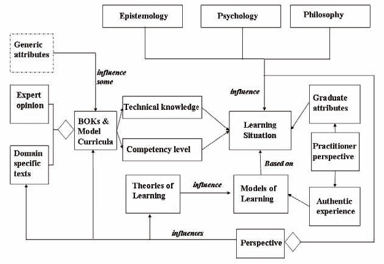

对每个领域、知识体系等以及学习理论的影响。在 IT 学科中，这导致了对其定义和研究的多种方法：Iivari（1991）和 Glass（1992）的工作基于所采取的认识论和本体论立场识别并对这些方法进行了分类。其含义是，对该学科及其教育的理解取决于所采用的立场（视角）而不同。这对软件开发实践的学习构成了严峻挑战。

被接受的观点，即科学/工程方法将确保质量，影响了 SE 的学习：由此暗示，科学/工程教育被视为培养学生成为胜任从业者的机制。在科学/工程学术院系之外也是如此：Benson（2003）指出，在 1970 年代新兴的信息系统（IS）学科中，学者们是该学科的移民，绝大多数拥有其他领域的资格，最常见的是计算机科学。从业者也严重依赖科学、数学和工程学科，其中许多人具有工程和制造背景。

这些影响在开发模型课程的尝试中得到了体现，其中偶尔会增加针对通用属性的指南。Shackelford（2005）概述了今天可能被视为计算的内容（SE 的空间如图 2 所示）。在根本层面上，对例如系统的本质或其背景的重要性，以及知识的本质所做的假设，影响了所采取的视角以及工作的开展方式。然而，计算课程的每一卷（CC-CS（Engel & Roberts, 2001）、CC-IS（Gorgone et al., 2002）和 CC-SE（LeBlanc & Sobel, 2004）），它们有助于确定学科的学习情况，均采用相同的模型并依赖相同类型的来源。

在一般广泛的 IT 专业中，潜在的假设是世界以理性方式运作，因此“良好”的软件开发是通过应用（从中选择的）科学调查技术来实现的。在这种借鉴自然科学的实证主义方法中，软件开发人员基于以下内容构建模型：理论和科学知识；工程知识——经验性的，包括需要哪些技能、工具如何协同工作、过去什么有效/无效；生物医学和流行病学知识——经验性的，这捕捉了关于因果关系的证据以及社会、经济和制度知识——谁和什么参与了我们所观察到的事物（Pfleeger, 1999）。通过这些手段，“科学”软件开发人员寻求能够增加对什么使软件良好理解的关系。这些关系被应用于增加生产良好软件的次数，基于因果搜索：如果他/她能找出导致良好软件的过程活动、工具、度量，他/她就能建立一个有效的软件过程，每次都能生产出良好软件（Pfleeger, 1999）。

图 2. SE 计算空间（Shackelford, 2005）[©2005 ACM and IEEE. Reprinted by permission]

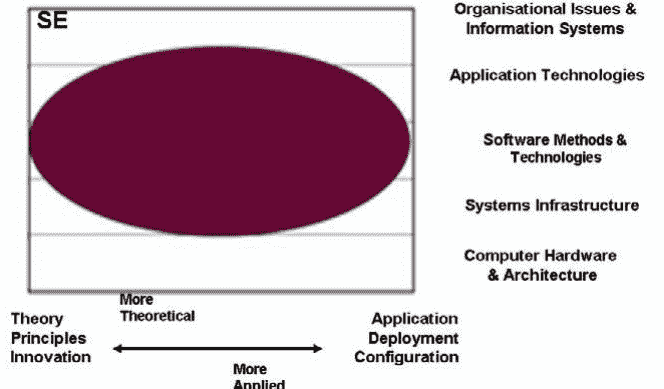

问题、僵化的方法和有限的成果范围，但学生在可量化技能方面的表现较好，这反映了对现实世界影响和压力的重视不足。

因此，虽然对软件开发主要模型课程（即 IS、CS 和 SE）的回顾显示，从总体上看，毕业生应从正规教育中获得对基本软件开发过程的知识（因此，理论上能够生产出成功的软件），但这既没有承认从业者强调的在正规教育中缺失的多学科技能⁴，也没有承认通用智力能力和技能，尽管这些能力受到雇主高度重视，但在高等教育课程中有时仅得到“口头重视”（Bentley, Lowry, & Sandy, 1999）。

在 IS 教育中也应用了此类方法，它们倾向于基于项目管理的方法、技术和工具，并且虽然成功地创建了一系列制品，但在管理信息系统的开发上并不成功（Banks, 2003）。Banks 得出结论，倾向于“菜谱”式且定义明确的方法的弱点在于

### 学科解码

开发教学和学习模型的主要动机之一，其中从业者可以更多地参与关于人们如何思考以及学生如何学习的研究，一直是对学习学科性质的关注。解码过程的结果是确定为学科所必需的技能的模型。

学科在从业者应用的策略和“思维方式”上存在差异。然而，尽管这些对于理解学科和在其中行动至关重要，但通常不会明确地呈现给学生。Parnas 和 Clements（1986）认为，鉴于设计过程的非理性（即所有设计过程），文档应使其看起来是理性的。他们通过使最终的维护任务更容易，以及使设计团队的新成员更容易吸收项目知识来证明这种对理性外观的伪装是合理的。然而，正如一些研究（例如，Nguyen & Swatman, 2000）所建议的那样，通向这种简化的过程是隐藏的，导致新手任务中产生不切实际的期望。根据 Middendorf 和 Pace（1986），这种二分法导致了学习策略与特定学科所需技能之间的差距。

因此，尽管从业者研究一致认为，大学课程中使用的模型涵盖了内容知识的基础案例，但更仔细的观察揭示了从业者需求与软件开发正规教育之间的不匹配程度。

### 从业者视角

在他的 Point/Counterpoint 讨论中，Bach（1997）指出，SE 没有得到更认真研究的其中一个原因是行业普遍认为，大多数教授它的书籍和课程都不切实际。对为获得从业者视角而进行的研究的概述表明，这种指责并非言过其实。

下面提到的大多数研究通过检查不同利益相关者认为的特定主题的总体重要性来解决软件开发活动的要求。由于从不同目标群体获取这种知识时采用了不同的方法：对经验丰富的从业者、管理人员、招聘人员、学生和应届毕业生进行调查、焦点小组、论坛或访谈，以及对 IS、CS 和工程学科的招聘广告进行审查，因此可以对从业者视角有所了解。

自 1990 年代初以来 IS 从业者研究（例如，Trauth et al., 1993；Parker et al., 1999；Lee, 2004）显示，从编程和其他技术科目向业务分析和以人为本技能的长期转变是显著的——强调向通用属性和管理知识的转变。从学生视角来看，对“职业韧性”需求的认识已经出现（Waterman, Waterman, & Collard, 1994），而技术相关学位的需求则较少。Lee（1999）得出结论，学术课程应强调信息检索和问题表述（而不仅仅是问题解决），以便学生能更有效地应对行业的挑战。他指出，人际沟通是技术工作中最重要的知识传递方式，团队成员是最常用的个人间信息来源。

从后来的研究中 Lee 发现，新毕业生社会化过程中涉及的现实冲击之一是，他们必须自学所需知识以便成功完成任务。他得出结论

> …教育工作者还应帮助学生培养其主动性和处理非结构化问题的能力。这需要强调独立学习和协作团队合作的方法。（Lee, 2004, p 135）

较少的研究涉及 SE 和 CS 所需的技能和知识。Turley 和 Bieman（1995）研究了专业软件工程师，试图确定有助于“卓越”表现的胜任能力和人口统计学特征。他们提供了一套三十八项


表达了软件产品（而非维护、管理等）开发中 IT 专业人员所需的一系列行为能力。它们将能力分为四个类别，用以区分卓越（XP）与非卓越（NXP）表现者（见表 1）。与卓越表现相关的统计显著能力中，大多数都集中在外部关注这一主题上，只有技能与技术的掌握属于自我导向（内部）技能。早在 Turley（1991）就得出结论，教育需要通过创设强调这些能力的学习情境，来支持差异化技能（即人际技能和个人属性）的发展。Lethbridge（2000）也考察了行业的认知：他的目的是获得从业者对来自（新兴）SCE（软件与计算机工程）和 CS 课程体系的特定主题有用性的排序，这些主题对受访者职业生涯的影响，以及他们在正式学习中掌握了多少与作为专业人士所需相比。相关于我们的考量，Lethbridge 根据重要性细节和影响力的平均值计算了主题的总体重要性。其研究结果表明，正式学习与工作中的重要性之间存在显著差距。在差距较大的前十个主题中，50% 反映了“软”知识（例如谈判（84% 差距）、领导力（73%）、伦理与职业精神（62%））。

澳大利亚背景的研究支持了这些发现。Scott 和 Yates（2002）的研究受访者指出，学习专业特定内容为重要的终身专业学习提供了“支架”：具备这种学习能力至关重要，能够知道何时以及何时不部署技术专长，以及如何持续更新它，是成功专业实践的关键。

根据 Scott 和 Wilson（2002）的研究，发现是，虽然成功的专业人士必须具备高水平的专业特定技术专长，但如果没有其他技能，这些技能几乎没有价值：

> ...当意外发生时，最能说明问题的是能够容忍情况的不确定性和模糊性，拥有可以调用以识别潜在相关解决方案的成熟互惠网络，能够“解读”困扰情况的整体技术和社会组成部分，然后能够与团队其他成员合作，运用高水平的适当技术技能来解决情况。（Scott & Wilson, 2002, p 6）

这些研究的综合意味着需要使学生不仅能够在一般层面上学习利用过去的经验，而且能够以各自的术语处理每一个新的问题情境，这需要一定的通用智力能力和技能。Gott 等人（1993）认为，这种适应性/生成性能力表明，执行者不仅知道问题解决的程序步骤，而且还理解何时部署它们以及为什么它们有效。其含义是投入精力于更高（元认知）学习技能，包括抽象和反思。然而，仅仅应用知识已被确定为本科教育的[content]

表达了软件产品（而非维护、管理等）开发中 IT 专业人员所需的一系列行为能力。它们将能力分为四个类别，用以区分卓越（XP）与非卓越（NXP）表现者（见表 1）。与卓越表现相关的统计显著能力中，大多数都集中在外部关注这一主题上，只有技能与技术的掌握属于自我导向（内部）技能。早在 Turley（1991）就得出结论，教育需要通过创设强调这些能力的学习情境，来支持差异化技能（即人际技能和个人属性）的发展。Lethbridge（2000）也考察了行业的认知：他的目的是获得从业者对来自（新兴）SCE（软件与计算机工程）和 CS 课程体系的特定主题有用性的排序，这些主题对受访者职业生涯的影响，以及他们在正式学习中掌握了多少与作为专业人士所需相比。相关于我们的考量，Lethbridge 根据重要性细节和影响力的平均值计算了主题的总体重要性。其研究结果表明，正式学习与工作中的重要性之间存在显著差距。在差距较大的前十个主题中，50% 反映了“软”知识（例如谈判（84% 差距）、领导力（73%）、伦理与职业精神（62%））。

澳大利亚背景的研究支持了这些发现。Scott 和 Yates（2002）的研究受访者指出，学习专业特定内容为重要的终身专业学习提供了“支架”：具备这种学习能力至关重要，能够知道何时以及何时不部署技术专长，以及如何持续更新它，是成功专业实践的关键。

根据 Scott 和 Wilson（2002）的研究，发现是，虽然成功的专业人士必须具备高水平的专业特定技术专长，但如果没有其他技能，这些技能几乎没有价值：

> ...当意外发生时，最能说明问题的是能够容忍情况的不确定性和模糊性，拥有可以调用以识别潜在相关解决方案的成熟互惠网络，能够“解读”困扰情况的整体技术和社会组成部分，然后能够与团队其他成员合作，运用高水平的适当技术技能来解决情况。（Scott & Wilson, 2002, p 6）

这些研究的综合意味着需要使学生不仅能够在一般层面上学习利用过去的经验，而且能够以各自的术语处理每一个新的问题情境，这需要一定的通用智力能力和技能。Gott 等人（1993）认为，这种适应性/生成性能力表明，执行者不仅知道问题解决的程序步骤，而且还理解何时部署它们以及为什么它们有效。其含义是投入精力于更高（元认知）学习技能，包括抽象和反思。然而，仅仅应用知识已被确定为本科教育的

教育期望（学习目标）被映射到可能实现这些目标的学习活动（教学情境），而评估任务则侧重于学习过程的质量。基于学习与教学支持网络工程学科中心的工作（LTSN, 2002）构建的对齐模型，被应用于本研究项目中（见图 3）。

图 3. 成果与评估之间的对齐（改编自 LTSN, 2002）

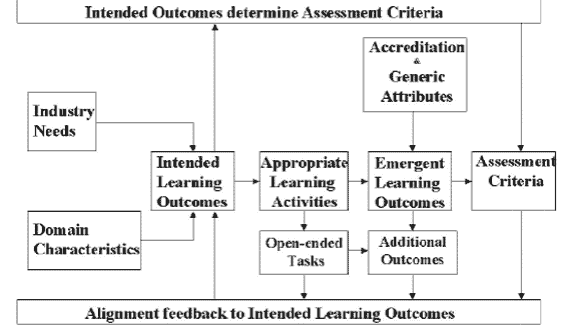

为了促进所有所需对齐的实现，构建了墨尔本大学软件工程的课程地图。课程映射作为归因于 English（1978）的评估工具，主要在学校中使用，在高等教育中的使用有限。English 提倡使用映射以确保上述建构性对齐的实现——即个人技能的声明、交付、学习和评估的对齐。

这些初始阶段的结果，即审查课程和学习模型，并通过对从业者视角的元分析来解码该学科，证实了需要在课程中纳入对通用和软技能的关注，作为项目中每门课程成果的一部分，以满足从业者和学科需求。为了最大化有效性，这些技能必须嵌入到学生在学习过程中构建的知识体系中。这具有使学生能够在学习情境中培养所需技能的优势，但当然需要对现有学习环境进行广泛的调整。

在所开展的项目中，课程映射是逐门课程进行的，从提供的初始软件工程课程开始（标识为 ENG260），该课程涉及需求工程。首先按课程的广阔领域进行分类，然后按需解决的学习成果进行分类。该地图基于对与课程相关的文件的审查；特别是学期开始时提供给学生的教学大纲和课程概要信息。这些详细说明了要涵盖的主题、评估要素和标准以及预期的可证明成果。从所有这些中获得的数据最初被映射到墨尔本大学的通用毕业生成果，然后，随着为解决已识别的学习成果而开发活动进展的推进，也映射到这些成果上。图 4 显示了对齐所需的映射。学习目标是从适当的 BoKs 和模型课程中确定的，并结合我们对本情境从业者需求的理解。所涉及的主题（表示为领域）映射到墨尔本大学的毕业生属性。问题标识了将解决这些目标的活动。由于课程是在基于问题的学习环境中呈现的（因此是问题驱动的），这些活动永远不是讲座，也不仅仅是评估项目或教程/实验室练习。学生通过识别、探索并随后解决特定的问题情景来参与所需内容。这些情景通过触发器逐步呈现（图 5 是一个例子——此时学生对软件工程估算技术没有任何先验知识）。

图 4.（摘自）学习目标 - ENG260

#### 需求工程

| | Objective | Domain | Graduate Attributes | Problem |
|---|---|---|---|---|
| | *To incrementally build knowledge on:* | | | |
| 1 | Requirements Engineering | Concepts | Professional Knowledge | 1, 2, 6 |
| 2 | Elements of the SDLC, both classical and object-oriented | Requirements Engineering Process | Professional Knowledge | 2, 6 |
| | *To identify:* | | | |
| 3 | Components of Requirements Specification | Concepts | Professional Knowledge | 2 |
| 4 | SDLC Process Models (classical and OO) | Requirements Engineering Process | Professional Knowledge | 6, 2 |
| | *To be aware of:* | | | |
| 5 | Group Dynamics and collaboration in the Software Development process (Team and Stakeholder) | People Issues/Teamwork | Interdisciplinarity/ Social Interaction | 3 + |
| 6 | Historical issues in Software Development | History | Professional Knowledge | 2 + |
| | *To develop skills in:* | | | |
| 7 | Creating and evaluating deliverables of the Requirements Phase (complementary models, documentation) | Requirements Engineering Process | Analysis & Problem Solving/ Communications | 2 + |
| 8 | Group Collaboration | People Issues/Teamwork | Social Interaction | 3 |

学习和“被教导”，并表明学生的学习环境特征的概念与其学习取向和策略相关。

本学院内的其他研究（Armarego, Fowler, & Roy, 2001）表明，如果没有考虑到工程学生的学习风格以及教导他们的教职员工的学习风格，他们的动机和成功可能会受到不利影响。有相当多的证据表明，讲师对学生学习方式的期望与学生自身偏好的学习风格之间存在不匹配，这会使学生处于不利地位。研究表明，这些不匹配会导致学生缺乏动机和兴趣，并影响他们的成功（Felder, 1996; UWA, 1996; Zywno & Waalen, 2001）。

这些发现得到了本章讨论的项目所支持，加强了对额外对齐重要性的指示——教师和学习环境与学生。学习风格工具应用于工程学术人员时，也表明了强烈的趋同者教学方法。其含义是，主导的教学风格没有表现出学科特征或正在开发的学习环境所需的适应性和灵活性。

因此，建构性对齐一词超出了确保教学、评估和教学-学习环境的每个方面都与课程的主要目标或预期学习成果保持一致的需要。当课程与学习者兴趣不一致或情境限制了学生的学习方法时，依赖型学习者模式往往会占主导——学习过程的控制权被放弃给教师，而学生会要求精心阐述的结构、明确的指导和明确定义的评估（Armarego, 2007b）。因此，依赖型学习者与本章前面描述的学科特征不一致。提倡开展教职员工发展，以引入体验式学习模型和“围绕学习循环进行教学”（Felder, 1996），Armarego & Fowler（2005）也讨论了本项目中实施的教职员工发展。

### 对齐的概念模型

此处所述调查的结果，以及支撑它的行动研究项目，是开发了一个复杂模型的发展，该模型将学科能力与学生特征与学习环境对齐，如图 6 所示。

本章认为，传统的正规教育无法满足行业的能力期望。从业者对正规教育的不满集中在能力非技术组成部分：他们寻找的是灵活、能够在组织环境中适应并能持续学习的毕业生。这些已被确定为与高阶学习相关的认知技能、实现机会主义和创造力的策略以及情绪智力的发展。

该项目的三个周期探索了替代学习模型，以评估其解决这些问题的适用性。焦点从技术能力转向了使软件工程胜任实践成为可能的软技能和元认知技能。每种干预策略都解决了特定的问题，并且通过对干预的评估和反思，策略会为下一个周期进行完善，以解决已识别的额外问题：

- Cycle 1 – Cognitive Apprenticeship: Focus on authenticity and transfer of skills acquired to other courses and, eventually, to the profession. This cycle highlighted student problems in generalising their learning, and in willingness to apply previous knowledge to the ‘new’ learning. In effect they were


学生所习得的知识之所以重要，是因为它充当了毕业生就业的“过滤器”；而对专业能力影响更大的，则是对软技能和元认知技能的关注。这些技能可以在正规教育环境中习得，尽管需要采用非传统的学习模式。在“工作室学习”研究项目中开发并应用的最终模型，在解决学科实践者和教育文献研究中所提出的问题上似乎是有效的。关于工作室学习在莫道克大学软件工程课程中的应用，已在其他地方进行了更详细的讨论（Armarego, 2007a）。

该模型与本章前面强调的学科/教育问题相契合，其结果表明需要做到以下几点：

-   为学生提供真实的体验，培养超出特定学科知识的能力：学生将学习既视为一种“普遍”的元认知活动，也视为一种在学科情境中不断调整和运用的技能。思维灵活性——涉及创造力、随机应变以及发散/聚合思维——变得明确，并制定了开发这种灵活性的策略。
-   在协作环境中，让学习者深入了解复杂人类活动系统中的自我与他人：学生意识到并学会了在实现学习成果时利用彼此的长处和短处。他们学会了如何“凝聚成一个团队”，如果做不到该怎么做，以及如何体谅其他学生所处的环境。他们学会了重视并利用不同利益相关者（客户、教师/顾问、其他团队成员）对问题带来的不同视角来丰富自己的学习。他们意识到需要自我激励和独立学习——学生在学习环境中能够自信地质疑自己和他人的假设。
-   留出时间探索新想法并反思可能的过程和结果：学生愿意“信任”彼此的知识（无论其是否隐含、是否技术性），并能接受实现学习目标所需的技能和知识的多学科性质。
-   接受挑战：学生因所分配任务（日益增加的）复杂性而受到激励，并能够专注于认知和人际交往技能以适应所施加的变化。

所采用的技术包括：向学生提供关于学习理论（基于问题的学习、情境学习、终身学习）的信息，确保“高阶学习”得到重视，更强调分析和综合而非课程内知识的应用，将反思实践嵌入每门课程（例如日志、绩效和团队协作评审），强调解决问题的替代方法并“奖励”（可行）解决方案的多样性，将变化嵌入所处理问题的各个方面（不断变化的需求、场景、交付物、团队组成、客户联系等），以突出随机应变、灵活性和适应性的重要性（Armarego, 2007c）。

不仅学生的反馈是积极的，而且其评估成绩有了显著提高；对后续学习的观察和分析（Armarego, 2007c）也强烈表明，学生愿意迁移所学知识、掌控自己的学习，并表现出进行更深层次学习的动机，正如Entwistle和Ramsden（1983）的研究所示。

然而，实践者研究（尤其是Minor（2004）的工作）和本研究都暗示了个人特征和能力的重要性。Minor的参与者指出，能力型实践中包含个性成分。对学生反思性共同实践者的考察：一个各对齐之和大于其组成部分之和的案例。

### 参考文献

Andresen, L., Boud, D., & Cohen, H. (1995). Experience-based learning. In G. Foley (Ed.), Understanding Adult Education and Training (pp. 207-215). Sydney: Allen and Unwin.

Armarego, J. (2002). Advanced Software Design: a case in problem-based learning. Paper presented at the CSEET2002 15th Conference on Software Engineering Education and Training, Covington (Ke).

Armarego, J. (2004). Student perceptions of quality learning: evaluating PBL in Software Engineering. Paper presented at the Seeking Educational Excellence: 13th Teaching Learning Forum, Perth.

Armarego, J. (2005). Educating agents of change. Paper presented at the CSEE&T2005 18th Conference on Software Engineering Education and Training, Ottawa.

Armarego, J. (2007a). Beyond PBL: preparing graduates for professional practice. Paper presented at the CSEET2007: 20th Conference on Software Engineering Education & Training, Dublin.

Armarego, J. (2007b). Deconstructing student attitude to learning: a case study in IT education. Paper presented at the CSITed2007: Computer Science and IT Education Conference, Mauritius.

Armarego, J. (2007c). Educating Requirements Engineers in Australia: effective learning for professional practice. Unpublished PhD, University of South Australia, Adelaide.

Armarego, J., & Fowler, L. (2005). Orienting students to Studio Learning. Paper presented at the Proceedings of the 2005 ASEE/AaeE 4th

Global Colloquium on Engineering Education, Sydney.

Armarego, J., Fowler, L., & Roy, G. G. (2001). Constructing Software Engineering Knowledge: development of a learning environment. Paper presented at the In search of a Software Engineering Profession: CSEE&T2001 14th Conference on Software Engineering Education and Training, Charlotte (NC).

Bach, J. (1997). SE education: we’re on our own. IEEE Software, 14(6), 26,28.

Bach, J. (1999). Reframing requirements analysis. IEEE Computer, 32(2), 120-122.

Banks, D. A. (2003). Belief, inquiry, argument and reflection as significant issues in learning about Information Systems development methodologies. In T. McGill (Ed.), Current Issues in IT Education (pp. 1-10). Hershey (PA): IRM Press.

Barrows, H. S., & Tamblyn, R. M. (1980). Problem-based Learning, an Approach to Medical Education. New York: Springer.

Bentley, J. F., Lowry, G. R., & Sandy, G. A. (1999). Towards The Compleat Information Systems Graduate: a Problem based Learning Approach. Paper presented at the Proceedings of the 10th Australasian Conference on Information Systems.

Biggs, J. (1999). Teaching for Quality Learning at University: what the student does. Buckingham (UK): Open University Press.

Bloom, B. S. (1956). Taxonomy of Educational Objectives: the classification of educational goals Handbook 1: cognitive domain. New York: David Mackay.

Brooks, F. P. (1986). No silver bullet - essence and accidents of software engineering. Paper presented at the Proceedings of Information Processing 86: the IFIP 10th World Conference, Amsterdam.

Brown, G., Bull, J., & Pendlebury, M. (1997). Assessing Student Learning in Higher Education. London: Routledge.

Brown, J. S., Collins, A., & Duguid, P. (1989). Situated cognition and the culture of learning. Educational Researcher, 18, 32-42.

Carr, W., & Kemmis, S. (1986). Becoming Critical: education, knowledge and action research. Lewes (UK): Falmer.

Cropley, D. H., & Cropley, A. J. (1998). Teaching Engineering Students to be Creative - Program and Outcomes. Paper presented at the Australasian Association of Engineering Education: 10th Annual Conference.

Dreyfus, H. L., & Dreyfus, S. E. (1986). Mind over Machine. New York: Free Press.

Engel, G., & Roberts, E. (Eds.). (2001). Computing Curricula 2001: Computer Science -- final report: Joint Task Force on Computing Curricula, ACM and IEEE Computer Society.

English, F. (1978). Quality control in curriculum development. Arlington (VA): American Association of School Administrators.

Entwistle, N. J., & Ramsden, P. (1983). Understanding Student Learning. London: Croom Helm.

Entwistle, N. J., & Tait, H. (1990). Approaches to learning, evaluations of teaching, and preferences for contrasting academic environments. Higher Education, 19, 169-194.

Entwistle, N. J., & Tait, H. (1995). Approaches to studying and perceptions of the learning environment across disciplines. New directions for teaching and learning, 64, 93-103.

Felder, G. M., & Spurlin, J. (2005). Applications, reliability and validity of the Index of Learning Styles. International Journal of Engineering Education, 21(1), 1-3-112.

Felder, R. M. (1996). Matters of Style. Prism: Journal of the American Society of Engineering Education, 6(4), 18-23.

Felder, R. M., & Brent, R. (2005). Understanding student differences. Journal of Engineering Education, 94(1), 57-72.

Felder, R. M., & Silverman, R. L. (1988). Learning and teaching styles in engineering education. Engineering Education, 78(8), 674-681.

Freed, G. (1992). Fifth generation innovation. Sydney: Australian Centre for Innovation and International Competitiveness, University of Sydney.

Garlan, D., Gluch, D. P., & Tomayko, J. E. (1997). Agents of Change: Educating Future Leaders in Software Engineering. IEEE Computer, 30(11), 59-65.

Glass, R. L. (1992). A comparative analysis of the topic areas of Computer Science, Software Engineering, and Information Systems. Journal of Systems and Software, 25.

Glass, R. L. (1995). Software Creativity: Prentice-Hall.

Gorgone, J. T., Davis, G. B., Valacich, J. S., Topi, H., Feinstein, D. L., & Longenecker, H. E. (Eds.). (2002). IS 2002: model curriculum for undergraduate degree programs in Information Systems. Park Ridge (IL): ACM.

Gott, S. P., Hall, E. P., Pokorny, R. A., Dibble, E., & Glaser, R. (1993). A naturalistic study of transfer: adaptive expertise in technical domains. In D. K. Detterman & R. J. Sternberg (Eds.), Transfer on Trial: intelligence, cognition and instruction (pp. 258-288). Norwood (NJ): Ablex.

Guilford, J. P. (1967). The Nature of Human Intelligence. New York: McGraw-Hill.

Guindon, R. (1989). The process of knowledge discovery in system design. In G. Salvendy &


Meyer, J. H. F., & Boulton-Lewis, G. M. (1997). 大学生的学习感知影响与其学习知识、经验和观念之间的关联。载于第7届欧洲学习与教学研究会议论文集，雅典。

Middendorf, J., & Pace, D. (1986). 解码学科：帮助学生学习学科思维方式的模型。《教学与学习新方向》，98，1-12。

Minor, O. (2004). 需求工程中的理论与实践：课程与行业需求的调查。未发表硕士论文，科布伦茨-兰道大学，科布伦茨（德国）。

Mulder, K. F. (2006). 可持续发展工程课程：对代尔夫特理工大学变革的评估。《欧洲工程教育杂志》，31(2)，133-144。

Nguyen, L., & Swatman, P. A. (2000). 需求模型中的本质复杂性与偶然复杂性。载于第四届需求工程教育国际会议论文集，斯考姆堡（伊利诺伊州）。

Oliver, R. W. (2000). 生物技术时代的到来：生物材料的商业。《生物材料商业》。纽约：麦格劳-希尔。

Parnas, D. L., & Clements, P. C. (1986). 一个合理的设计过程：如何以及为何要伪造它。《IEEE软件工程学报》，12(2)，251-257。

Pfleeger, S. L. (1999). 阿尔伯特·爱因斯坦与实证软件工程。《IEEE计算机》，32(10)，32-37。

Reeves, T. C. (1994). 评估计算机化教育中真正重要的东西，来自 http://www.medicine.mcgill.ca/ibroedu/review/Reeves Evaluating What Really Matters in Computer-Based Education.htm

Reigeluth, C. M. (1997). 教学理论、实践者需求与新方向：一些反思。《教育技术》，37(1)，42-47。

Robillard, P. N. (1999). 软件开发中的知识作用。《美国计算机协会通讯》，42(1)，87-92。

Rothman, R., Slattery, J. B., Vranek, J. L., & Resnick, L. B. (2002). 标准与测试的基准与对齐（CSE报告编号 566）。洛杉矶：评估研究中心，

国家教育评估、标准与学生测试研究中心，教育与信息研究研究生院，UCLA。

Royce, W. W. (1970). 管理大型软件系统的开发：概念与技术。载于IEEE WESCON会议论文集。

Sawyer, P., & Kotonya, G. (2000). SWEBOK：软件需求工程知识领域描述（第0.6版）：IEEE计算机学会/ACM。

Schön, D. A. (1983). 反思型实践者：专业人士如何在行动中思考。纽约：Basic Books。

Scott, G., & Yates, W. (2002). 利用成功毕业生提高本科工程项目质量。《欧洲工程教育杂志》，27(4)，60-67。

Shackelford, R. (Ed.). (2005). 计算课程2005：概览报告：计算课程2005联合工作组。

Soloman, B., & Felder, R. (1999). 学习风格指数（ILS）。，来自 http://www2.ncsu.edu/unity/lockers/users/f/felder/public/ILS page.html

Somekh, B. (1989). 行动研究与协作学校发展。载于R. McBride（编），《教师在职培训：一些问题与视角》。布莱顿：Falmer Press。

并就软件工程教育方法进行交流。根据学习理论对方法进行分类可以帮助我们理解方法之间的关系，理解它们如何相互契合，并指出未被充分利用的潜力领域。可以设计新的方法来利用某些理论的潜力，这些潜力尚未得到充分发挥或已知在我们的领域中特别有价值。学习理论可用于评估方法，通过帮助构建实验来寻找学习者过程中这些及其他理论的存在。并且，我们可以利用新获得的知识，以学习理论的共同语言来交流不同的方法及其经验。

本章详细阐述了在软件工程教育领域主要使用学习理论的愿景。我们首先简要介绍了一套众所周知的（主要是建构主义的）学习理论，这些理论尤其适用。然后我们根据它们似乎所围绕的学习理论，对迄今为止的主要软件工程教育方法进行分类。随后，我们讨论了学习理论在分析和改进软件工程教育方法的设计（以及设计新方法）中可以发挥的作用，并以一种方法的分析（SimSE）作为案例研究。我们随后讨论了如何根据学习理论评估软件工程教育方法，同样以SimSE作为案例研究。我们在最后一节以总结结束。

### 背景：学习理论

为了为我们关于学习理论在软件工程教育中作用的讨论提供一些背景，本节将简要介绍我们为分析目的所调查的学习理论集合。我们在此不列出所有学习理论的详尽清单并提供详细说明。相反，本节的目的是简单介绍我们看到软件工程教育方法最频繁围绕的一些理论，并提供有关每个理论的更多信息的指针。此外，我们还将简要介绍每个理论的含义和典型或可能的软件工程教育应用。

我们选择此处讨论的特定学习理论集合是基于两个标准：与软件工程的相关性以及定义理论的因素之间的正交性。换句话说，这些理论是我们调查的软件工程教育方法中最清晰和/或最频繁体现的理论。此外，学习理论之间存在很大重叠，并且有几种学习理论涵盖了其他若干理论。在这些情况下，我们将具有相同基本思想的理论归为一组，并省略那些只是组合了若干理论的理论。

我们承认这些理论主要属于建构主义范式（而非行为主义或认知范畴），然而，鉴于建构主义是最新的发展范式，而软件工程是一个相对较新的学科，这并不令人惊讶（事实上，有人认为，过去十年左右计算机科学教育的演变在很大程度上受到了建构主义的影响（Kolikant，2001））。虽然很明显大多数交付方法通常包含属于三个阵营（建构主义、行为主义和认知）的各种理论的混合，但由于建构主义方面是最受关注的，我们选择将本次调查和分析的范围主要集中在这些理论上。当然，可以对认知和行为主义理论进行类似的调查和分析，这将产生有趣的结果，然而，这样的练习超出了本章的范围。

尽管如此，本章调查的一些理论确实包含认知和/或行为主义原则的元素。例如，通过失败学习涉及一种形式的“惩罚”（失败），旨在“消除”某种行为。

另一个需要注意的问题是学习“理论”、学习“模型”和学习“方法”之间的区别，以及教学设计领域的对应概念（教学设计理论、模型和方法）。由于这些概念之间的界限模糊且经常互换使用，应注意的是，在本章中，我们所指的若干“学习理论”也可以被称为这些其他术语中的一些。当出现这种情况时，我们将在讨论这些理论时指出这一点。然而，正如文献中经常所做的那样，我们将“学习理论”一词广泛使用，作为涵盖所有这些类别的术语。

最著名的学习理论之一是做中学，基于这样一个前提：人们通过实际做任务比通过听讲学习得更好（Dewey，1916）。该理论对教学设计的含义如下：学习者应有充足的机会实际执行他们需要学习的活动，而不是使用被动媒介，如讲座和阅读。在软件工程教育中，这意味着超越仅仅讲座和阅读作业（尽管，对于大多数领域来说，一定量的此类脚手架是必要的，以为学习者提供有效参与做中学的必要背景知识）。软件工程教育者已经认识到这一点，现在几乎所有软件工程课程的标准组成部分都是课堂项目——学生必须使用课堂上学到的一些技术开发的小型软件工程项目。

情境学习（Lave，1988）是一种教育理论，建立在做中学方法之上。虽然做中学关注学生执行的特定学习活动，但情境学习理论关注做中学发生的环境。特别是，情境学习基于这样一种信念：知识是情境化的，很大程度上是其发展和使用的活动、情境和文化的产物。因此，学生练习新获得的知识的环境应是“真实的”，尽可能接近知识在现实生活中使用的环境。软件工程教育中该理论的流行应用侧重于将现实主义（或“真实性”）方面纳入课堂项目，例如使用工业参与者扮演客户角色（Hayes，2002），使用基于维护或演进的项目（McKim & Ellis，2004），或使用在地理位置上分布的大团队（Favela & Pena-Mora，2001）。

与情境学习类似，Keller的ARCS动机理论（Keller，1983）也侧重于激励学生学习。然而，与其关注他们学习的物理环境不同，Keller的ARCS动机理论关注于在学习者中产生被认为促进学习的某些感受。特别是，这些感受是注意、相关性、信心和满意度。

- 注意：必须吸引学习者的注意力和兴趣。提出的方法是：引入独特且意外的事件；改变教学的各个方面；并通过让学习者解决或生成问题或问题来激发信息寻求行为。
- 相关性：学习者必须感到知识与他们的生活相关。该理论建议使用与学习者过去、现在和未来经验相关的示例和概念来呈现和练习知识。


#### 基于学习理论的现有方法分类

学习理论在软件工程教育研究中可被用来为该领域提供一种分析并分类现有方法的方式，既可独立进行，也可在相互关系中进行。这种分类有助于我们理解不同方法如何相互契合，并勾勒出整个领域的图景，从而发掘出优势、劣势和未被开发的潜力。我们已进行了这样的分类，将在本文节中呈现。

在创建该分类之前，为了组织我们的分析，我们首先调查了过去几年发表的主要软件工程教育方法，发现它们可以归为三大类：现实主义、专题和仿真（这些分类可进一步细分为子分类，如表1所示）。现实主义方法是指那些侧重于使学生项目体验的各个方面更接近现实世界中他们将遇到的体验的方法。其中一些方法包括行业参与（Beckman et al., 1997; Kornecki et al., 2003; Wohlin & Regnell, 1999），强调市场营销和项目管理等非技术技能（Gnatz et al., 2003; Goold & Horan, 2002），以及侧重于使从事项目的学生团队的性质和构成更具现实性（例如，使其非常庞大（Blake, 2003）或由多个子团队组成（Navarro & van der Hoek, 2005b））。专题方法旨在让学生详细了解主流教科书和讲座中通常未深入涵盖的主题。这些方法不侧重于特定的交付方式，而是侧重于将该主题作为软件工程有效且完整教育的关键组成部分而加入。一些此类主题的例子是形式化方法（Abernethy & Kelly, 2000）、实时软件工程（Kornecki, 2000），以及特定软件流程，如个人软件流程（Hilburn, 1999）或理性统一流程（Halling et al., 2002）。最后，仿真方法是指让学生在（通常是）计算机化仿真环境中练习软件工程流程的方法。在软件工程仿真的范畴内，主要有三种类型：将工业仿真带入课堂（Collofello, 2000; Pfahl et al., 2000）、基于游戏的仿真（Drappa & Ludewig, 2000; Navarro & van der Hoek, 2005a），以及群体流程仿真（Nulden & Scheepers, 2000; Stevens, 1989）。

为了从学习理论的角度对这些方法进行分类，我们仔细研究了每一种方法，以确定哪些学习理论似乎已被应用（无论是有意还是无意），以及哪些学习理论有明显的潜力可被采用。 resulting 分类以方法与所利用的学习理论的矩阵形式呈现于表2中。（有关该分类的完整讨论，参见（Navarro, 2005）——此处仅呈现要点。）表中三个星号表示该方法体现了特定理论，或以其为中心。两个星号表示该理论似乎参与了该类型方法的设计，但可能并非其内在组成部分，且不一定涉及该类型下的所有方法。一个星号表示该特定类型的方法明显有潜力采用该学习理论，但已知或已知的案例很少，甚至没有。

### 示例：仿真与学习理论

作为我们如何根据学习理论分析每种方法的示例，本节将聚焦于仿真类别，并逐步说明我们如何确定每种学习理论对这些方法的适用性。首先，所有上述教育软件工程仿真都允许学生通过参与其中（学习通过做）来学习软件流程，尽管是虚拟的。该理论是教育仿真范式的核心（因此，表中为三个星号）。这些仿真还通过增加学习环境的真实性来采用情境学习，尽管方式不同：工业仿真以仿真模型中的真实项目数据形式增加现实因素；基于游戏的仿真通过让学生沉浸于现实游戏场景的参与者角色中来增加真实性；群体流程仿真通过模拟角色的行为与现实世界参与者相似来注入真实性。由于这些现实因素是人工的，即为虚拟的（而非现实生活环境），我们为该理论在表中标注了两个星号。

仿真方法与 Keller 的 ARCS 学习模型高度契合。特别是，它们专门设计用于促进注意、相关性、信心和满意度（并且在某些情况下已被证明确实如此），方式如下：

- **Attention:** 多项关于教育软件工程仿真的研究反复表明，学生认为这些仿真有趣、引人入胜，并且是一个有趣的挑战，他们乐于接受（Baker et al., 2003; Dantas et al., 2004; Navarro & van der Hoek, 2005a; Sharp & Hall, 2000; Stevens, 1989）。对于基于游戏的仿真尤其如此。显然，这是由于惊喜、幽默、挑战和乐趣等元素是许多基于游戏的仿真的核心。
- **Relevance:** 因为学习者可以亲身体验他们所学知识在现实世界情境中的相关性（即仿真中描绘的情境），仿真促进了学生对其未来职业的相关性感。这种相关性可通过在模型中使用真实世界数据使仿真更具现实性而得到增强。此外，正如理论所建议的那样，如果教育方法建立在先前和当前知识之上，相关性会得到进一步增强。用于演示已通过其他形式（如讲座或文本）传达给学生的概念的仿真直接解决了这一点。
- **Confidence:** 仿真提供了一个非平凡但可完成的挑战。随着学生获得在仿真中取得成功的机会，他们会对学习材料产生个人信心的感觉。在基于游戏的仿真中尤其如此，因为学生在此基础上还会有“赢得游戏”的额外成就感。

#### Table 2. Software engineering educational approaches and the learning theories they incorporate

| | Learning by Doing | Situated Learning | Keller's ARCS | Model-Based Instruction | Discovery Learning | Learning Through Failure | Learning Through Reflection | Elaboration |
|---|---|---|---|---|---|---|---|---|
| Industrial Partnership – Real Project | ** | *** | ** |  |  |  | * |  |
| Maintenance/Evolution | ** | *** |  |  |  |  | * | ** |
| Team Composition | ** | *** |  |  |  |  | * |  |
| Open-Endedness | ** | ** | *** |  | ** | ** | * |  |
| Non-Technical Skills | ** | ** |  |  |  |  | * |  |
| Practice-Driven | *** |  |  | *** | *** | ** | * | * |
| Sabotage | ** | ** |  |  |  | *** | * |  |
| Topical | ** | * | * | * | * | * | * | * |
| Simulation | *** | ** | *** | * | *** | ** | * | ** |


在进度过程中以及购买工具时。游戏结束时，玩家会收到一个分数，表明他们的表现如何，一个解释性工具为他们提供游戏的视觉分析，包括何时触发了哪些规则、事件追踪以及各种属性（如代码的正确性）随时间的“健康”状况（见图2）。

迄今为止，共有六种SimSE游戏模型：瀑布模型、检查模型、增量模型、极限编程模型、快速原型模型和Rational统一过程模型。关于SimSE的更多信息，包括其设计、玩法与仿真模型，请参阅（Navarro，2006）。

SimSE的想法最初源于一个假设：仿真可以为软件工程教育带来许多与其他教育领域相同的益处。具体来说，我们认为通过使用仿真让学生练习管理各种“真实的”软件工程过程，可以改进软件工程过程教育。学术环境的限制使得学生无法在课程项目中练习许多围绕软件工程过程的问题。因此，我们的方法专注于通过使用仿真来提供这种机会。

为了指导SimSE的设计，我们进行了两项活动：（1）对软件工程教育领域进行研究，以发现其独特需求；（2）从研究文献中调查成功教育仿真的著名原则。这产生了一套特定的关键决策，这些决策在此列出，并根据我们后来发现的与之直接相关的学习理论进行讨论：

图1. SimSE图形用户界面

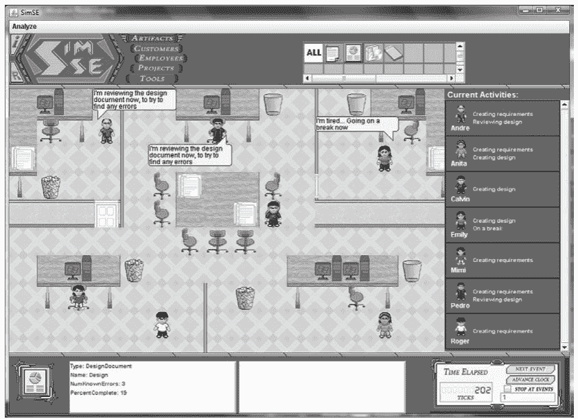

### 关于学习理论的作用

注意力，并使他们有时可能通过失败来学习）但并非不可能，促进最终的成功，从而带来对学习材料的信心和体验的满意度（这是凯勒ARCS模型的核心原则）。

回顾SimSE的设计并参照学习理论，有助于将我们在设计SimSE时的一些直觉与这些理论联系起来，从而增强我们对自己方法走在正确道路上的信心。除此之外，它还揭示了一些我们本可以利用的错失机会，如果最初设计SimSE时考虑到学习理论的话。例如，我们本可以通过设计逐步复杂化的模型版本，并按复杂度递增的顺序向学生介绍，从而更好地利用细化理论。在课程中和课外研究中使用SimSE时，我们本可以通过向学生提供明确的解释性工具练习，使其成为该方法中更核心和更有结构的部分，这些练习能鼓励反思，从而有助于巩固在仿真中学到的经验教训（目前，学生只是得到解释性工具，如何使用由他们自己决定）。再举一个例子，我们本可以通过在模型中包含更多随机事件（现实世界的一个典型特征）来更好地融入真实性方面（促进情境学习）。这些类型的事件在我们的许多模型中只是偶尔使用。

与大多数软件工程教育方法一样，SimSE在设计时并没有考虑学习理论。但是，通过参照学习理论回顾其设计，我们已经了解到很多关于SimSE如何促进学习以及如何改进它以促进更大学习成效的知识，正如我们在本节中所看到的。

### 以学习理论为中心的评估

尽管我们在SimSE的初始设计中并没有明确使用学习理论，但我们确实将它们作为设计其大部分评估的核心指导因素。验证一种方法旨在采用（或看起来采用）的理论是否确实被采用，以及发现一种方法是否包含了任何其他理论的特征，可能是非常有用的练习——这些数据可以用来使该方法和其他类似方法更有效，因为可以通过针对已知能促进每种理论的特点来调整它们（van Eck，2006）。因此，作为SimSE评估的一部分，我们进行了一项深入的观察性研究，重点调查SimSE玩家的学习过程，以确定他们是否表现出表明各种学习理论的行为。

### 案例研究：simSE评估设置

在这项研究中，我们以11名已通过加州大学欧文分校软件工程入门课程的大学生作为受试者。设置这一要求是为了确保他们至少具备玩SimSE所需的基本软件工程概念。研究以一对一的方式进行——一名受试者和一名观察者。首先指导每名受试者如何玩SimSE，然后观察他们玩SimSE约2.5小时。为了评估解释性工具在多大程度上实现了其帮助通过反思学习的目标，我们让八名学生使用解释性工具玩SimSE，三名学生不使用。（然后可以比较每组的行为、态度和意见差异，尽管显然达不到统计学显著的程度。）在受试者玩游戏时，观察并记录他们的游戏行为和表现。随后，对受试者进行了约30分钟的体验访谈。除了观察者根据特定受试者在游戏过程中的动作或行为提出的临时问题外，所有受试者还被问及一组标准问题。其中几个问题旨在专门检测受试者学习过程中是否存在一种或多种学习理论。有些问题不针对特定理论或理论组，而是意在引发受试者的深刻评论，从中可以推断出各种学习理论，并发现对学习过程的一般洞见。以下是标准问题中的一些示例，适用时后面括号中标出了针对的学习理论。

- *你认为每场游戏得分变化（或不变）（改善、恶化、波动、稳定）的原因是什么？*（发现式学习，通过失败学习）
- *你觉得你是在“赢”的时候学到更多，还是在“输”的时候学到更多？为什么？你从每次“赢”或“输”中学到了什么？*（发现式学习，通过失败学习）
- *当你失败时，你是否感到有再次尝试的动力？为什么？*（通过失败学习）
- *在1到5的范围内，玩SimSE在多大程度上吸引了你的注意力？为什么？*（凯勒的ARCS模型）
- *自完成此练习以来，你对学习材料的信心水平有多大变化？*（凯勒的ARCS模型）
- *你是否觉得通过玩SimSE学到了以前不知道的任何软件过程新概念？如果有，是哪些？*（答案可能涉及多种理论）
- *如果你觉得从SimSE中学到了东西，你认为SimSE的哪些方面促进了你的学习？*（答案可能涉及多种理论）
*你的学习？*（答案可能涉及多种理论）

还有一些问题主要设计用于比较使用了解释性工具的受试者和未使用的受试者。这些问题旨在发现玩家如何弄清其分数背后的原因，以及他们对此原因的理解程度。

- *你认为你在第1/2/x场游戏中哪里出了错？*（反思学习）
- *请描述你用来理解分数背后原因、或找出你哪里做错/做对的过程。*（反思学习）

实验结束后，对访谈者的观察和访谈笔记进行了分析，试图发现哪些行为和评论表明了各种学习理论及其方式，并发现从此数据中可能获得的关于SimSE作为教学工具的任何其他见解。

### 评估结果

在每个受试者的学习过程中，最明显涉及的学习理论是发现式学习。所有受试者都能讲述他们从SimSE中学到的至少几节课，而这些课在体验过程中从未被明确告知过。相反，他们是通过游戏中的探索和实验独立发现的。有趣的是，尽管玩某个模型的所有受试者似乎（在很大程度上）发现了相同的教训，但没有两个受试者以相同的方式发现它们。每位受试者都以不同的策略接近游戏，但最终都获得了类似的新知识，这表明SimSE可以适用于各种各样的学生，他们...


来自不同背景、拥有不同想法且可能采用不同学习风格的学习者。这是“发现式学习”这类以学生为中心的理论的一个核心方面。由于学习主要取决于学习者而非教师，学习者可以自由地运用自己的风格和想法去发现知识，而不是被迫遵循一种僵化的教学方式。

“从失败中学习”似乎也得到了广泛体现。每个受试者似乎都采用“分而治之”的方法来玩 SimSE，将模型的各个方面隔离开来，然后逐个（或一次几个）加以攻克。当受试者在访谈中描述游戏进程时，很明显他们攻克每个方面的方式都是经历至少一两轮失败，在失败中发现哪些做法不可行，并由此找到通往成功的正确方法。当被明确问到是否从失败中学习时，每位受试者都表示他们在失败时有所学习，但他们报告的学习程度各不相同。五名受试者说他们从失败中学到的比从成功中学到的更多，两名受试者说他们在成功时学到的更多，还有四名受试者说他们从失败和成功中学到的一样多。除一人外，所有受试者都表示在失败后他们会有动力再试一次。这种动力在几位受试者的行为中也很明显，因为有些人在一轮游戏失败后，会迫不及待地赶紧开始新的一局。其中一位受试者甚至在实验规定的游戏时间已经结束、且已被告知那是最后一局时，还试图开始一局新的游戏。

“做中学”理论似乎也涉及了大多数受试者的学习体验。11 名受试者中有 8 人对他们玩 SimSE 的体验发表了评论，这些评论暗示了“做中学”的各个方面。他们的一些评论包括：

- “[SimSE 帮助我学习，是因为它]让你负责各种事务。这是应用知识的好方法。”
- “[SimSE 帮助我学习，是因为它]是互动的，而不是仅仅坐在那里听讲。”

能体现“情境学习”的评论也相当频繁，11 名受试者中有 7 人提到了这类内容。其中一些包括：

- “[SimSE 帮助我学习，是因为]它非常逼真，帮助我学到了软件工程中许多现实元素，比如员工、预算、时间和突发事件。”
- “[SimSE 的学习促进特征之一是]看到真实项目在具有现实因素（如员工背景和对话）的情况下实际运行。”

能够体现凯勒 ARCS 动机理论的行为和评论也很明显，尽管该理论的某些方面比其他方面表现得更突出。为了解释这一点，让我们分别看看该理论的四个方面（注意力、相关性、自信心和满足感）。

首先，受试者的注意力似乎相当集中于 SimSE。这体现在他们的肢体语言、在游戏过程中和访谈中发表的评论，以及他们对 SimSE 参与度的评分上。他们中的许多人在游戏的大部分时间里都坐在座位边缘，身体前倾，眼睛紧盯着屏幕。有人点头，有人对随机事件和角色描述发出轻笑，在游戏中取得高分后有人喊道“呜呼！”，当玩家表现不佳时有人摇头，当实验规定的游戏时间即将结束时，有人请求“我能再试一次吗？”一些受试者在访谈中用来描述 SimSE 的词语是“具有挑战性”、“有趣”、“好玩”、“令人上瘾”和“引人发笑”。当被明确问到 SimSE 在多大程度上吸引了他们的注意力时，学生们的评分相当高——平均为 4.1 分（满分 5 分）。

其次，相关性被评为中等偏上，但没有参与度那么高。五名受试者将 SimSE 与他们未来经历的相关性评为“相当相关”或“非常相关”，五人描述为“有些”或“部分”相关，还有一人说完全无关。虽然没有被明确问及 SimSE 与他们过去经历的相关性，但几乎所有受试者都提到，他们运用了在软件工程课程中学到的一些知识来制定游戏策略，这表明他们过去的经历（在课堂上学到的概念）与他们在 SimSE 中的学习体验之间也存在相关性。

第三，大多数受试者觉得他们对学习材料（所模拟的软件过程模型以及总体上的软件过程）的自信心水平在玩过 SimSE 后至少有所提升。四名受试者报告说他们的自信心水平变化“很大”或“非常大”，五人表示变化“有一些”，还有两人说完全没有变化。

第四，受试者对满足感的评价相当高。11 名受试者中有 9 人表示“相当满意”、“非常满意”、“完全满意”或“颇为满意”，三名受试者表示“有些满意”。大多数被报告的、促成满足感的因素都与受试者从一局游戏到下一局游戏不断取得的成功有关，不过也有人提到，SimSE 本身的乐趣和挑战性也为他们的满足感做出了贡献。

解释工具确实在一定程度上促进了“反思式学习”。大多数能使用解释工具的受试者确实利用了它，在多数游戏之后使用它的时长从 5 分钟到 25 分钟不等。很明显，没有解释工具的受试者（后文简称为“非解释组受试者”）比有解释工具的受试者（后文简称为“解释组受试者”）在对自己分数的原因以及如何改进方面明显更加困惑、更不自信。所有非解释组受试者都表达了这一点，而解释组中只有一名受试者提出了这样的看法。以下是非解释组受试者的一些评论：

- “我一直在猜我做错了什么，所以我可能选错了自己做错的地方，然后我试图换回我原来的方式，结果有点忘了那是什么了，一旦我开始尝试改进，我的所有小细节都开始变化，我不知道是哪些部分导致我的分数变低了。”
- “我感觉我知道，哦，有时我知道自己错在哪里了，比如我应该在那里少花些时间，但很多时候我对自己错在哪里判断错了。”

另一方面，解释组的大多数受试者的评论都表示，解释工具确实促进了他们的学习：

- “[解释工具]向我展示了我为什么表现不佳——因为正在发生的某些事件。”
- “[解释工具中描述的]规则真的很有帮助——即使有人对软件工程一无所知，我觉得这些规则也能教你如何玩这个游戏。”

#### 评估结果的意义

根据学习理论来评估 SimSE，让我们获得了若干有价值的见解，了解 SimSE 如何帮助学生学习的。此外，它还帮助我们发现了可能让 SimSE 更有效的方法。在本小节中，我们将描述在评估中聚焦某些理论如何为我们提供了有助于最大化 SimSE 有效性的知识。

##### 从失败中学习：

总体而言，获得“失败”分数并努力改进这一挑战，似乎是 SimSE 中一条重要的学习途径，也是一个强大的激励因素。这强化了我们的观念：模拟模型应当具有足够的挑战性，使学生有时会遭遇失败。正是这些失败提供了某些最大的学习机会。通过在观察中聚焦这一方面，我们还发现我们的一款模型（快速原型）挑战性还不够，学生有时无需真正吸取教训也能获得不错的分数。因此，我们后来为这一模型增加了更多挑战，并将继续在未来构建具有适当挑战水平的模拟模型。

##### 做中学：

几位受试者的评论提到，将先前学到的知识付诸实践的能力，是 SimSE 的一个促进学习的特征。这验证了我们将 SimSE 作为其他教学方法的补充的选择，从而让它能够承担这一重要角色——成为学生实践“做中学”的途径，让他们去做那些只在课堂上听说过的事情。

##### 情境学习：

SimSE 中的现实元素似乎显著增强了其教育效果。因此，我们必须继续将现实世界的元素纳入我们的模型中，以便将学生的知识置于一个真实的环境中。

##### 精细加工：

从我们的观察中可以清楚地看出，我们的一款模型（瀑布模型）对于“SimSE 初学者”来说过于庞大和复杂。（尽管瀑布过程本身很简单，但相应的 SimSE 模型相当复杂，包含了一些非技术性的、管理方面的内容。）将如此复杂的模型交给一个从未玩过 SimSE 的学生，显然违反了精细加工理论的原则。因此，根据该理论来审视这一结果让我们明白，在学生先玩过其他更简单的模型之前，不应引入这种复杂的模型。

##### 凯勒的 ARCS 模型：

通过这项研究，我们能够发现 SimSE 及其模型中的哪些元素最能吸引学生的注意力，方法是留意学生何时看起来最投入，以及他们在访谈中对哪些事物给予了正面评价。例如，有几位学生提到，模型中的随机事件（例如，客户改变主意并要求团队返工部分代码）增添了惊喜和真实感的元素，使事情保持有趣。因此，我们将继续在未来的模型中加入这些元素，并尽量在当前模型中使其最大化。我们还发现了学生认为不吸引人的元素。例如，几位受试者认为检查模型无聊且重复。通过访谈，我们能够准确地发现检查模型之所以让人感觉如此的原因，并且最近已经实施了我们预计会使其对未来的 SimSE 玩家更有趣的改动。

##### 反思式学习：

解释工具部分实现了其促进反思的目标，但很明显它还需要改进。特别是，需要更多地帮助用户生成有意义、有用的图表，并且规则描述需要更容易被访问。我们最近在开发中已经解决了这些问题，为每个模型添加了专门用于解释性图表目的的属性，并通过用户界面使规则描述更易访问。

学习理论可以通过提供关于研究者应该关注学生哪些学习过程的想法来帮助构建评估。正如我们在 SimSE 中看到的那样，即使在设计方法时并没有考虑学习理论，也可以进行这种评估。根据学习理论对方法的设计进行仔细的事后分析，可以揭示以学习理论为中心的评估应当聚焦的方面。进行这样的评估既有可能揭示一种方法的效果，也有可能在相关领域指导未来的工作。


Schank, R. C. (1997). *虚拟学习*. New York, NY, USA: McGraw-Hill.

Schön, D. (1987). *培养反思型实践者*. San Francisco, CA, USA: Jossey-Bass.

Sharp, H., & Hall, P. (2000). 面向研究生软件工程师的交互式多媒体软件屋模拟。载于 *第22届软件工程国际会议论文集* (pp. 688-691): ACM。

Stevens, S. M. (1989). 代码检查的智能交互式视频模拟。*Communications of the ACM*, 32(7), 832-843。

Tomayko, J. E. (1996). 卡内基梅隆软件开发工作室：五年回顾。载于 *第九届软件工程教育与培训会议论文集* (pp. 119-129)。Daytona Beach, FL, USA: IEEE。

van Eck, R. (2006). 基于数字游戏的学习：不仅仅是数字原住民感到不安。*Educause Review*, 41(2), 17-30。

Wohlin, C., & Regnell, B. (1999). 实现软件工程教育中的工业相关性。载于 H. Saiedian (Ed.), *第十二届软件工程教育与培训会议论文集* (pp. 16-25): IEEE Computer Society。

### Table 1. 举例说明

Step A: 该问题最初作为第4课——软件即产品 的准备问题：

问题表述：

1. 学生通常会被给出一个需求清单，并被要求开发一个满足这些需求的软件系统。此任务可以帮助你揭示定义软件需求所涉及的一些问题。为此，你被要求假设自己是一名需要基于网络调查软件系统的客户。
首先，确定你拥有的业务类型。基于此决定，为基于网络的系统定义你的需求。将这些需求写成非软件开发人员会写的方式。
在列出需求后，分析它们：
- 你列出了哪些类型需求（以用户为导向、以技术为导向、以性能为导向、其他）？
- 将你的清单与真实的基于网络的调查工具进行比较。你能否将现有工具作为收集需求的资源？
此练习至少重要有两个原因。首先，你可能在某个时候成为软件系统的客户，并必须定义你需要的软件系统的需求。其次，作为软件开发人员，当你有真正的客户时，这种经历可以帮助你从客户的角度看待情况。
2. 基于你在§1中的经验，解释为什么需求变更在软件工程中如此普遍。
3. 数据表明，实际满足客户需求的软件工具的比例相对较低。基于你在§1中的经验，解释这一现象。

Step B: 该问题继续作为第12课 - 软件即商业 的总结问题：

问题表述：

此问题延续了第4课 - 软件即产品 中提出任务，即你被要求列出支持在线调查的应用程序的需求。
- 扩展你为在线调查构建的需求清单，使其也包括电子商务的手段。
- 这些需求的增加如何可能影响在线调查工具的开发过程？

在任务的第二部分，学生被要求扩展他们最初生成的需求清单。其目的是说明产品可以在一个渐进的过程中演变，当客户要么提高对自身需求的理解，要么客户需求得到扩展，并且只要开发过程支持功能的逐步添加，就可以在软件产品中添加额外功能。当学生添加功能时，他们被要求分析此添加对软件开发过程的潜在影响。

总之，在整个任务中，学生采取客户视角，检查并扩展他们自己的需求清单，并分析需求收集过程与软件开发过程之间的联系。

可以合理地假设，在完成此任务时学生所采取的此类活动和视角的集合，扩展了他们对软件开发过程的整体看法，并特别提高了他们对软件工程人文方面的认识。

我们现在介绍在课程期间向学生提出的十种问题类型。它们对学生学习的贡献通过从不同课程章节中取出的具体问题示例来说明。能够被分类的问题——

c. 选择第4课 - 软件即产品 中描述的一个或多个定性研究工具。设计一个小规模的研究大纲，考察特定编程风格指南对程序员开发计算机程序方式的影响。开展研究并描述你的结论。

此问题由两个聚焦的部分——(a) 和 (b)——以及一个更开放的部分——(c) 组成。前两个部分旨在突出编程风格对程序理解过程的影响。第三部分要求学生发挥创造力并为特定目标规划一个小型研究项目。希望这种经历能向学生表明，首先，在某些情况下需要进行小规模研究，其次，他们具备开展此类研究所需的工具。

### X. 构建案例研究 / 讲故事

这些问题要求学生基于他们作为软件工程的个人经验以及在课程中学到的和讨论的内容来构建场景和案例研究。案例的范围各不相同：从简短而集中的故事到涵盖软件工程多个方面的庞大叙述。这些任务有几个优点。首先，学生必须考虑案例研究中包含什么重要内容，以及什么不太重要。其次，他们必须将与软件工程相关的不同问题整合到一个故事中。第三，他们必须分析自己构建的内容，这一活动再次增强了他们对与软件工程相关的不同主题的认识。以下我们将通过不同范围的故事来说明这些想法的应用。

#### Example 13: Lesson 5
软件工程道德准则，中级阶段问题

提出软件开发中一个团队必须决定是否向管理层报告他们开发的特定软件工具中的一个错误的情况。道德准则在这种情况下说了什么？你会在这种情况下如何表现？

此任务侧重于伦理问题。它要求学生创建一个聚焦于特定案例的场景。它说明了细节如何决定情况的性质。当针对不同主题重复此类任务时，这一信息会被强调和突出。

#### Example 14: Lesson 5
软件工程道德准则，总结问题

撰写一个引发伦理考虑的故事。对软件工程师进行此案例的访谈。要求他们表达在此情况下的意见和预测行为。分析他们的反应。所有反应都相似吗？它们彼此之间以及与你的意见有何不同？这些反应对软件开发意味着什么？你将从这次经历中带走什么教训以应用于你未来的软件开发？

此任务说明了案例研究可用于教育目的的另一种方式。具体来说，基于学生开发的故事，他们开展一项小规模研究，探索与软件工程过程相关的不同意见。


### 示例15：课程结束任务：案例研究构建与分析

在课程结束时，学生需要按照一个指导他们构建案例研究的流程来构建并分析一个案例研究。该流程在本章附录中有所概述。此任务的目标是整合课程中学到的所有材料，并使学生能够就课程中所学的各种主题表达自己的观点。

### 未来趋势

我们现在为本章所介绍工作的后续发展提出几点建议：

- 评估：本章按任务类型进行组织。目前，一个定性研究项目正在考察这些任务的实际影响，该项目审视了这些问题对学生关于课程所涉及不同主题的认知所产生的多方面贡献。特别是，我们正在探索这种认知的发展，以及它对学生对软件工程学科看法的影响。
- 其他分类方式：本章根据学生需要完成的任务类型，介绍了“软件工程中的人为因素”课程中布置给学生的任务。当然，对学生在课程期间所做的不同任务进行分类还有其他方式。一种分类是按问题的学习目标分类；另一种是按完成任务时所采用的心理过程分类。

### 结论

最后，我们提出一些关于将本章所呈现的思想应用于其他软件工程课程的建议。总的来说，我们建议本章所展示的大多数任务类型可以应用于许多软件工程课程。

我们建议，本章所呈现的任务有助于学生应对软件工程职业挑战时提升专业技能。特别是，我们建议在符合以下条件的课程中引入本章类型的题目：

- 旨在通过一种学习方法提高学生的分析能力、反思过程和问题解决能力，该方法使学生能够形成自己的观点，并探索支撑其观点的资源。
- 旨在向学生展示软件工程职业的多面性，引导他们去探寻不同的观点、有争议的问题，以及未来必须应对的困境和冲突。
- 旨在将课程建立在学生互动的基础上，鼓励他们向同伴学习，体验团队合作和信息共享。

我们认为，软件工程专业所开设的许多课程都应针对这些问题。我们希望我们的贡献在于提供一系列可用于实现这些目标的题型。

#### 说明

本章献给我的同事吉姆·托马科（Jim Tomayko），他是《软件工程中的人为因素》（2004）的合著者，于2006年1月去世。

### 参考文献

- Cockburn, A. (2001). Agile Software Development, Addison-Wesley Pub Co.
- Davis, R. B., Maher, C. A. and Noddings, N. (1990, eds.). Constructivist views on the teaching and learning of mathematics, Journal for Research in Mathematics Education, Monograph Number 4, The National Council of Teachers of Mathematics, Inc.
- Hazzan, O. (2002). The reflective practitioner perspective in software engineering education, The Journal of Systems and Software 63(3), pp. 161-171.
- Kerth, N. (2001). Project Retrospectives: A Handbook for Team Reviews, Dorset House Publishing Company.
- Piaget, J. (1977). Problems of Equilibration. In Appel, M. H and Goldberg, L. S. (1977). Topics in Cognitive Development, Volume I: Equilibration: Theory, Research and Application, Plenum Press, NY, pp. 3-13.
- Schön, D. A. (1983). The Reflective Practitioner, BasicBooks.
- Schön, D. A. (1987). Educating the Reflective Practitioner: Towards a New Design for Teaching and Learning in The Profession, San Francisco: Jossey-Bass.
- Smith, J. P., diSessa, A. A. and Roschelle, J. (1993). Misconceptions reconceived: A constructivist analysis of knowledge in transition, The Journal of the Learning Sciences 3, pp. 115-163.
- Tomayko, J. and Hazzan, O. (2004). Human Aspects of Software Engineering, Charles River Media.

#### 附录——案例研究构建的六个阶段

（来源：Tomayko 和 Hazzan，2004，第286-287页）

**第1步：选择主题：** 思考一个你觉得有趣且与你相关的主题进行讨论。

**第2步：分析主题的性质：** 在这一阶段，你需要检查你希望关注的主题是否有足够的份量作为案例研究的核心。问问自己这样的问题：

- 所选主题与哪些软件开发活动相关？
- 哪些参与软件开发环境的人员与这一主题相关？
- 该主题涉及软件工程中的哪些人为因素？
- 该主题是与团队中的个人相关，还是与团队整体相关？

如果你对上述问题的回答表明该主题确实足够“丰富”，并且可以与软件开发环境中的不同问题相关联，那么它可能适合作为案例研究的中心主题。

**第3步：设想可能的情景：** 设想至少两种软件工程中可能与该主题相关的情景。目的是查看你希望探讨的主题在软件工程中是否有具体情景具有重要体现。

**第4步：撰写案例研究：** 开始撰写所选的案例研究。尽量使其尽可能生动，同时不要忘记包含你想要探讨的主要问题。

**第5步：检查案例研究的范围：** 在完成案例研究的第一稿（和编辑）后，检查是否可以添加其他相关主题。确保不要改变案例研究的重点。然后，检查诸如以下问题：你希望在这个案例研究中传达的主要信息是否恰当体现？案例研究中所涉及的不同主题之间的联系是否清晰？

**第6步：围绕案例研究开发问题：** 针对你刚刚开发的案例研究，提出一些有启发性的问题以供探讨。

### 第五章：谈及软件：软件沟通中的案例研究

**安·布雷迪**  
*美国密歇根理工大学*

**玛丽卡·西格尔**  
*美国密歇根理工大学*

**托马斯·沃塞基**  
*美国密歇根理工大学*

**查尔斯·华莱士**  
*美国密歇根理工大学*

#### 摘要

我们描述了近来为生成和使用案例研究来教授软件开发中的沟通技巧所做的工作。我们相信我们的工作在几个方面具有创新性。这些案例研究涉及对软件开发至关重要但在软件工程领域并不常见的修辞议题。此外，它们向学生呈现的是复杂、具有问题性的情境，而不是通常与案例研究作业相关的经过修饰的事后解释。该案例研究项目是一个跨学科合作项目，融合了软件工程师和技术传播者的专业知识。通过这种交叉融合，我们的软件工程和技术传播课程得到了加强。

#### 概述

我们认为，*沟通*的艺术，无论是口头形式还是书面形式，在软件工程教育中受到的关注相对较少，尽管它在软件开发中具有根本性的重要性。似乎有两个主要问题阻碍了对沟通问题的更彻底处理。首先，尽管软件工程师可能是有效的沟通者，但他们通常缺乏阐述是什么使沟通有效（或无效）的实践。也就是说，他们的知识停留在隐性层面，难以传授给学生。其次，软件工作场所中沟通困难的部分原因在于其复杂性和微妙性——“魔鬼在细节中”。学生不会被玩具例子说服；只有真实的软件开发故事才足够。然而，创建适当规模的沟通环境的前景似乎令人望而却步。

我们正在进行的跨学科工作旨在解决这两个问题。它利用了技术传播者的专业知识，他们擅长讨论和分析沟通。凭借软件工程的实例、民族志的经验性技术以及修辞学的分析技术，我们创建了*案例研究*，用于教授软件开发中的沟通技巧，并在软件工程和技术传播的高年级课程中使用了这些案例研究。在这里，我们使用“案例研究”一词不是指它在社会科学中作为一种研究工具的意义，而是指它作为一种*教学*工具的意义，目前主要在法律和商学院中使用。我们的案例研究基于从事毕业设计（capstone projects）的真实软件工程学生的经历。相关的教学材料涉及通常并不与软件工程相关联的修辞议题：受众、积极倾听、批判性分析、时机和规划。此外，它们向学生呈现复杂、有问题的情境，而不是通常与案例研究作业相关的经过修饰的*事后*解释。

案例研究项目是一项跨学科合作，融合了软件工程师和技术传播者的专业知识。我们的软件工程课程通过这种交叉融合得到了加强——既得益于对沟通的洞察，也得益于生成案例所采用的定性方法。我们报告了该项目的成功，并描述了为这项工作设想的一些未来方向。

#### 动机

我们认为，学生在学术界所练习的技能与他们在工作场所必须使用的技能之间存在巨大鸿沟。在本节中，我们展示了实践中的软件开发人员承认沟通技巧的重要性，并期望新员工具备这些技能。然后，我们转向软件工程教育的现状，并评论沟通技巧在学术界的地位。

#### 软件工作场所中的沟通

在单个项目的生命周期中，软件工程师必须与各种各样的利益相关者打交道，这些人有着截然不同的观点和目标（Poole，2003）。他们必须仔细从客户那里获取需求，并随时告知客户预算或日程安排的变更。他们必须咨询最终用户，以设计既方便又有价值的产品。他们还必须在开发团队内部进行沟通，以保持对如何分工以及如何处理项目风险的清晰认识。

从单个项目的层面上升到审视软件开发全貌，我们发现应用种类多得惊人。没有其他工程产品具有如此多样化的潜在用途。用途的多样性带来了利益相关者的多样性。在整个职业生涯中，软件开发人员从一个项目转到另一个项目——很可能从一个公司转到另一个公司——每一步都要面对新的应用和新的利益相关者群体，他们的知识、需求和沟通风格差异很大。

多项研究指出，需求方面的缺陷是导致大规模


项目失败（Curtis, Krasner, & Iscoe, 1988; Davis, 1990; Glass, 1998）。这可以追溯到客户与开发者之间缺乏承诺和信任。开发者认为“未能获得用户承诺”和“用户参与不足”等风险比“引入新技术”和“人员配备不足/不当”等严重风险更为重要（Keil, Cule, Lyytinen, & Schmidt, 1998）。这些证据表明，在需求获取和分析期间需要改进沟通。

当然，沟通问题也是开发团队内部冲突的一个来源。社交技能集——即“招聘启事中常提到的‘良好沟通能力’”（Reinsch & Shelby, 1997）——现在已成为新员工的明确要求（Muir, 2004）。虽然团队内部冲突通常被视为管理或组织行为问题，但许多研究人员认为它们本质上是沟通问题（Putnam & Folger, 1988; Putnam & Poole, 1987; Schultz & Anderson, 1984）。无论冲突源于管理层的行为、个人行为还是沟通缺陷，提高沟通技能都是首先避免冲突或在冲突发生时解决冲突的一种方式。Myers 和 Larson 在讨论学生需要在其职业生涯早期掌握协商工作冲突的技能时指出：“对冲突的沟通性理解可以帮助学生理解员工在组织中经历的冲突的性质或类型，从而促进他们向全职工作的过渡”（Myers & Larson, 2005）。

一项针对软件工程专业人士的调查（McMillan & Rajaprabhakaran, 1999）根据他们认为对职业发展最重要的方面，对四个软件工程项目特征进行了排序。前两个分别是“与真实用户合作”和“开发可工作的原型”。这凸显了客户沟通的重要性，而客户沟通对这两个开发方面都至关重要。当课堂上教授的沟通技能在课程作业中未被应用时——无论是与项目团队沟通还是与导师沟通——学生的工作往往会受到影响（Liu, 2005）。

由于多种原因，软件环境中的沟通本质上是有问题的。软件开发是复杂的，这不仅是因为软件本身的功能，还因为不同利益相关者之间相互竞争且往往相互冲突的目标。软件工程是一个新兴领域，缺乏历史悠久的通用词汇。广泛的应用领域将不同背景、几乎没有共同词汇的利益相关者聚在一起。此外，软件开发者在一个信息不完整、不完美的世界中工作。虽然他们可以通过计算机语言的精确性访问机器内部，但他们必须通过不那么机械的人类语言渠道来理解其他利益相关者的需求和愿望。因此，沟通策略的教学需要扎根于能够反映和模拟这些困难的实际情境中。

### 软件工程教育中的沟通

我们认为，鉴于沟通软件的过程的重要性和难度，它在软件工程教育中没有得到足够的重视。与其他利益相关者沟通以及编写软件文档的教学通常是技术沟通辅助课程的任务，这些课程由软件工程之外的系开设。虽然这些课程提供了对职场有效沟通方式的重要介绍，但单门课程无法提供在各种学科特定情境中的广泛实践，而这些实践是充分培养软件工程学生所必需的。

编程语言和计算机硬件的精确性让计算学科的学生和教育者感到舒适，但这种舒适恰恰可能让学生忽视那些最初推动软件开发的人类问题。与人类利益相关者互动的过程通常被视为“软性”内容，不值得认真关注。在近年来提交给 SIGCSE 和 CSEET 会议的软件工程教育论文中，只有少数几篇涉及软件开发中人与人之间的沟通问题。

这里的部分困难在于，开发者在工作中获得的沟通技能仍然处于隐性形式；总的来说，没有“明确的规则表述”（Freedman, 1993b）。针对职场与学术界之间的鸿沟，Alred（Alred, 2006）指出：“职场要求从业者寻求根本不同的方式来应对其情境和紧急情况——例如，这些方式不要求他们记录自己的思维过程，也不要求他们与学术文献或任何其他文献保持一致”。

有趣的是，看看 IEEE 软件知识体系（SWEBOK）（Abran, Moore, Bourque, & Dupuis, 2004）是如何处理沟通问题的。在“软件需求”部分，它指出：“良好软件工程的基本原则之一是软件用户和软件工程师之间要有良好的沟通”。在“项目管理”（软件工程本身之外的“相关学科”）部分，它指出：“在一个需要精确理解用户需求以及复杂需求和设计的领域，沟通管理也经常被提及为个人表现中被忽视但重要的方面”。

显然，SWEBOK 对沟通的作用有些矛盾。一方面，它确实包含了强调沟通过程重要性的语言。“沟通管理”甚至被引用为“被忽视”的方面。然而，尚不清楚 SWEBOK 是否有助于提升沟通的重要性。只有用户和开发者之间的沟通被纳入“软件工程”的范围内；所有其他类型的沟通（包括团队内部沟通）都被归入辅助领域。将沟通置于软件工程之外，助长了将沟通“外包”给其他部门的现状，而不是在软件工程课程的背景下处理它。

### 愿景与方法

我们设想了一种新的课程体系，其中沟通是一项核心技能，与软件工程的其他方面紧密结合，而不是在该学科之外教授的独立主题。通过这样的课程，软件工程学生不仅将成为创造性的设计师和深思熟虑的分析师，还将成为有效的沟通者。赋予学生参与积极沟通的能力，将使他们更投入自己的职业，更不容易感到沮丧和倦怠。此外，那些拥有沟通技能和兴趣、追求超越以隔间为中心的“编程”软件开发视角的学生，将被吸引到这一领域。Margolis 和 Fisher 指出，许多女学生寻求有意义的应用基础，并对以计算机为中心的理念感到幻灭（Margolis & Fisher, 2002）。关注真实的软件问题可能会吸引那些更喜欢“有目的的计算”的学生。

为了实现这一愿景，我们组建了一个由软件工程师和技术沟通者组成的跨学科团队。我们的技术沟通者在帮助学生应对沟通挑战方面拥有丰富经验，我们从中受益。在此，我们探讨技术沟通、修辞学的作用以及案例研究的价值。

#### 技术沟通

技术写作的实践可以追溯到公元前五世纪，历经中世纪，直到工业革命（Tebeaux & Killingsworth, 1992）。在美国，其系统性教学始于南北战争之后（Connors, 2004）。技术沟通的历史通常将第二次世界大战视为该职业的诞生之时，当时战时技术的繁荣引发了相应的文档繁荣，这些文档有助于传播和操作——也因此需要一类新的工作者来编写和汇编这些文档。西屋电气、通用汽车和通用电气意识到雇用工程师既设计又写作并不划算，于是建立了自己的内部技术写作部门，技术写作最终在美国被承认为一个独立的领域。

早期的技术沟通课程基于所谓的语言“玻璃窗”观点（Miller, 1979）。根据这一观点，技术沟通者的角色（无论该技术沟通者是技术沟通专业人士，还是将在其职业中使用技术沟通文类的软件开发者）是尽可能清晰透明地呈现技术信息。这种技术沟通观的问题在于其隐含假设，即有可能达到一种普遍清晰透明的技术语言。这一论点的推论是，任何解读此类语言的困难都归因于读者或听者的不足，而非信息呈现背后的假设。技术沟通的“玻璃窗”观点假定意义是从发送者单向传递到接收者，而不是在两者之间协商产生的。

特别是在二十世纪后半叶，技术沟通学者主张采用更具修辞性和人文性的方法来教授和实践技术沟通。例如，在其里程碑式的文章《技术写作的人性化理据》（Miller, 1979）中，Miller 认为，“认为这是一门‘技能’课程、几乎没有人文价值的普遍看法，是一种挥之不去且无处不在的科学实证主义观点的结果……一种迫使思想屈服于现实的高效方式”。因此，技术沟通课程的学生往往将写作视为“其技术工作中多余、麻烦且通常无关紧要的部分”。作为纠正，Miller 建议我们“教授技术或科学写作，不是将其作为一套让棘手事物迁就滑溜词语的技巧，而是作为理解如何归属于一个共同体……写好文章就是理解自己参与的条件——那些允许与共同体认同并决定沟通成败的概念、价值观、传统和风格”。最近，学者们开始关注软件文档和开发周围的文类，注意到可用性测试和研究方法与沟通修辞观之间的相似之处。与沟通的修辞方法一样，可用性关注不同类型的受众、他们工作的特定情境以及文档将被用于的目的，而不是假设一个普遍的、脱离情境的用户，为此必须将专家级的系统知识“降低难度”（Johnson-Eiola, 2001; Johnson, 1998）。

我们相信，这种基于修辞学的技术沟通方法有望让学生在进入职场时成为更成功的沟通者。学生不是学习一种死记硬背的、修辞性的技术沟通文类方法，而是学会根据其所处的受众、目的和情境，策略性地参与并运用这些文类。


### 修辞学

在本项目中，我们对沟通采取了一种特定的方法，该方法以修辞学理论和实践为基础。虽然“修辞”一词已带有贬义，即“[l]语言华丽、矫揉造作、不真诚或智力空洞”，但我们使用的是一个更古老的定义：“[t]使用语言有效地和有说服力的艺术或研究”（Pickett, 2004）。更精确地说，我们将修辞定义为战略性沟通。软件开发者经常面临只能通过谨慎沟通才能解决的挑战：例如，了解软件产品在工作场所的典型使用方式、评估用户对原型的满意度，或传达错过截止日期的坏消息。成功的沟通需要一种策略，这种策略以对受众的认知为依据、以对潜在文体的广泛了解为基础，并对风格的影响敏感。

事实上，我们看到修辞与软件工程之间存在一种清晰的契合。软件工程学生与修辞学家一样，可以依靠探究的艺术、知道在特定情况下提出什么问题，以便为各种受众做出适当的沟通。当学生接触案例研究时，他们会接触到可以用这些修辞原则进行分析和理解的沟通问题。

向软件工程学生揭示修辞情境的复杂性，是教授他们进行战略性沟通的第一步（Johnson, 1998）。软件工程师生产的远不止源代码——设计文档、用户指南、致管理层或其他团队成员的备忘录，仅举几例——他们必须学会考虑其产品所处的广泛使用情境。例如，小型初创企业中的沟通将与大型公司中的沟通显著不同，因为机构和学科限制并定义了沟通的方式。在一家小型、近期成立的公司中，沟通系统很可能以“扁平”的方式组织；员工很可能相互认识，因此沟通更直接，不受既定协议的约束。那些在更大、更成熟的组织中工作的人可能需要通过既定的层级渠道进行沟通。另一个例子是，国内的沟通做法不一定适用于国际环境，因为文化和历史遗产指导并塑造了组织和风格上的惯例。

理解这些细微差别的软件工程学生，更能胜任与开发团队成员以及国内外利益相关者的合作。

修辞还为软件工程学生提供了将沟通作为问题解决过程的实用理解，并为他们提供了系统地走向解决方案的策略（Deili, 1988; Flower, 1998）。虽然“问题”一词在计算理论中具有精确且久经考验的含义，但在这里我们考虑的是另一种类型的问题——以人为中心，不易进行数学形式化。然而，当软件工程师涉足复杂的沟通情境时，他们可以调用问题解决模型中高度可识别的一系列技术。具体而言，修辞将规划分为几个阶段：发明、安排、风格和表达。这种分阶段的分解对于教导学生进行积极倾听和批判性分析特别有用。

规划的第一阶段、发明，可能是最重要的，因为它为接下来的三个阶段设定了要求。它为学生提供了一种方法，以收集关于如何在特定情境下与特定受众最有效地沟通的信息，并且基于四组问题。第一组问题关注受众。它提出了关于利益相关者特征、他们的态度和说服的问题”（Fulmer, 1992）。Fulmer 描述的技能显然是修辞技能。

案例研究被报告的两个缺陷是其缺乏即时性，以及未能呈现引人注目、逼真的情境（Gale, 1993）。虽然承认案例研究在准专业沟通课程中的重要性，但 Dorn 对商科教育案例研究的分析（Dorn, 1999）发现，基于案例的教学在工作场所可能用途有限：“[这些案例]通常要求学生应对非同寻常的修辞情境，而实际上作家通常面临的修辞情境需要更多平凡和标准化的 discourse 类型”。例如，技术沟通中一个常见的案例研究聚焦于导致 1986 年航天飞机 *Challenger* 被毁的沟通失败。虽然这无疑是一个引人入胜的故事，但这些情况不太可能被许多初级员工遇到。下面，我们描述了一种克服这些困难的方法，以创建反映本科生项目流程的有趣案例。

### 创建案例

我们汇编的案例研究源自民族志和修辞学——与技术沟通密切相关的领域。在这里我们解释了我们如何在身边找到丰富的沟通故事，以及我们如何收集和撰写它们。

#### 定位来源

为教学目的构建案例研究的努力通常会受到大多数软件开发保密性的阻碍。虽然我们的许多学生和大多数教师在行业或政府资助的开发中都有经验，但这些信息的专有性质通常阻止他们分享自己的经验。我们确实有一个宝贵且 readily available 的来源：学生本人。所有软件工程学生都必须修读“高级设计项目”毕业设计课程。在这门课程中，高年级学生开发真实、实用的软件产品，旨在根据真实客户和其他利益相关者的需求进行实际使用。这些项目通常涉及计算机科学系以外的客户互动。介绍这些项目的案例提供了引人入胜、存在问题的沟通示例，学生可以产生共鸣，因为它们植根于同学的真实经历。

#### 将民族志应用于教育领域

正如 Beverly Moss 所解释的，民族志是“一种定性研究方法，允许研究者全面了解某个社区或社会群体的社会互动、行为和信仰。换句话说，目标是……研究、探索和描述一个群体的文化”（Moss, 1992）。我们使用了民族志中的一些 proven 技术来创建真实软件开发环境的视图。然而，我们的案例研究不应被误认为是真正的民族志研究；由于我们的资源有限，我们无法进行此类研究所需的数年实地工作。

我们的方法遵循定性案例研究方法，该方法试图通过“密切研究个人、小群体或整个环境”来“识别所选现象检查的重要方面或变量”，目的是确定进一步研究的途径（Lauer & Asher, 1988）。在我们的工作中，这项进一步的研究包括基于我们的观察开发案例研究，并向其他学生展示，作为模拟他们日后在计算机科学职业生涯中将遇到的条件的手段。


希望在软件开发问题中捕捉反复出现的模式，这一愿望在软件工程文献中其他地方也有体现。例如，Sutcliffe 等人（A. G. Sutcliffe, Maiden, Minocha, & Manuel, 1988）提出，“如果能在需求工程（RE）过程早期在新的应用领域中发现常见的抽象，那么可能可以重用通用需求并将其链接到可重用的设计。这可以为重用存在于可重用组件库中的软件工程知识的宝库提供一条渠道”（1073，斜体为我们所加）。换句话说，个人及其工作的群体常常会创造应对项目设计过程不确定性的方法，并在这一过程中积累大量且有价值的知识库。通过我们的案例研究，我们旨在捕捉这种知识，它反映在一个个体或一组个体所经历的生活经验中。将这种知识和经验纳入教学工具中，我们的案例在使用于课堂时有可能将这种经验传授给他人。

### 数据收集

为了开发这些首批案例研究并试点我们的方法，研究生的学生从高级设计学生那里收集了书面材料（笔记、会议纪要、软件版本、电子邮件等）。遵循定性研究中的标准做法（Agar, 1996; Kirsch & Sullivan, 1992; Lauer & Asher, 1988），研究生在学生会议的大部分时间里担任参与观察者。作为研究人员，他们做了音频录音，绘制了人们坐的位置和在房间中移动方式的图表，并记录了供日后参考的田野笔记。遵循 Emerson、Fretz 和 Shaw 的建议，他们的田野笔记记录了细微的细节（Emerson, Fretz, & Shaw, 1995）以便日后回忆、重建和分析。此外，他们的笔记侧重于关键事件和事件——例如客户需求和期望的戏剧性且出乎意料的转变——并记录了利益相关者的反应。这些策略通过包含细节和行动的丰富描述使案例“栩栩如生”，从而捕捉到情况的视觉和口头氛围，带来“身临其境”的感觉。

随着学生开展高级设计项目，重要的案例研究数据不断积累：会议纪要、电子邮件、给客户和高级设计教师的报告以及记录的代码。电子邮件通过临时邮件列表收集，项目团队用其在团队内部以及与其他人之间进行沟通。此外，高级设计学生反思他们每天的结果，然后将收集到的信息整合在一页进度报告中，每周向教师提交一次。因此，学年期间案例研究的重点是数据收集、组织和编码；暑假则侧重于案例研究构建。

项目接近尾声时，研究生还对高级设计学生及其客户进行了半结构化访谈。他们利用这些访谈来三角验证早期结果，正如 Hesse-Biber 和 Leavy 所推荐的那样（Hesse-Biber & Leavy, 2005），并支持研究结果，“赢得读者的信任，即研究人员已经‘弄对了’”。

### 构建故事

为了构建案例研究，研究生首先将所有原始材料按时间顺序汇编成一份长篇的总结性叙述，其中包含指向原始文档的超链接，然后将其划分为模块。他们还为每个模块开发了问题集，以帮助学生识别和审视问题，以及一些受密码保护的教学辅助材料，供教师提供背景材料和对情况的“内部视角”。这些被整合到最终的时间顺序版本中。

### 示例：SEABASE 案例研究

我们展示了“Seabase”案例研究中的材料示例，其中高级设计学生（称为“CS 团队”）与机械工程的教师和学生合作，为一艘船载起重机开发控制软件。该项目中的沟通挑战十分显著：学生必须学习机械工程师的文化，以及一种新的编程语言 Matlab。作为一个已经在进行的项目的后来者，他们必须在对他们来说陌生的既定工作环境中找到自己的位置。

模块 C 故事的摘录如图所示 1。故事文档包含指向三个主要来源的超链接：项目团队负责人的会议纪要、团队的风险文档，以及机械工程项目顾问的电子邮件。电子邮件揭示了 CS 团队的一个有趣问题：来自机械工程教师的沟通表明，对项目具有挑战性的部分存在不同的期望。在此，顾问 Hank Taylor 指出，“起重机 [控制器] 部分是‘最大、最棘手’的部分”，而设计起重机控制器的 GUI 的一个并行项目则是“最容易的部分”。

*图 1. Seabase 案例研究模块 C 故事摘录*

#### 模块 C 故事

在学期第四周的星期三（9 月 22 日），三个起重机项目团队的负责人与 Hank Taylor 和 Nancy Smith 会面。他们决定“由于‘会议的目的是为了让团队进行常规协调，他们将继续在星期三 12-1 举行团队负责人会议’”。代表 CS 团队的是 JoAnn、Ken 和 Bob；Matt 和 Ben 代表起重机建造者；Jon 则在那里讨论平台。

**9 月 22 日起重机团队负责人会议纪要**

JoAnn 对会议的总结要点如下：

- 本学期 CS 团队将从事起重机工作，而不是平台。
- 在讨论 CS 团队部分的范围时，Hank 说起重机部分是“最大、最棘手的部分”，他认为平台的 GUI 大约需要一个小时，是最容易的部分。

在一周前的会议上，Nancy Smith 曾表示相反的观点：“GUI 设计是 CS 团队的一个好项目”，并且“只从事起重机控制器工作会‘太简单’。” 问题（见图 2）和教师笔记挑战读者使用问题解决来解决这种差异。

图 3 包含模块 E 故事的摘录，说明了沟通循环的概念。短时间内发生了两次会议：首先是团队的非正式会议，他们为 Hank Taylor 准备问题；然后是与 Hank 的会议。这是一个三步过程，学生在此过程中提出问题、提出问题，最后在模块 F 中对答案进行解包。

模块 E 的问题（见图 4）要求读者评估该过程的有效性：学生在多大程度上能够表达他们的需求并解读 Hank 的回应。还有其他更广泛范围的链接。例如，在听完关于模型起重机代码的讨论后，读者被要求回到之前流传的该代码的文档，并确定对话是否有助于澄清之前的文档。此外，在头脑风暴会议上，确定需要更多机械起重机的需求；在教师笔记中（图 5 的摘录），读者被要求向前查看故事以发现需求何时成形。

### 示例：SOILSIM 案例研究

我们现在转向“SoilSim”案例研究，其中高级设计学生与当地研究实验室的一名环境科学家合作，为小学生开发一个关于土壤生态的教育模拟游戏。模块 C 故事的摘录如图所示 6。故事中的学生在继续由其他学生开始的项目。

一名学生（Jacob）曾对游戏进行过早期工作，但团队中的另外两名学生必须熟悉土壤生态的基础知识以及早期团队留下的代码。团队为理解问题所涉及的生态机制而苦恼，使用了早期团队的文档以及 Jacob 的知识。最终，他们意识到需要一些验证模拟的标准，因此转向了科学家（Fritz）。故事包括 Jacob 寻求帮助的电子邮件，以及随后 Fritz 与团队之间讨论的音频片段。

图 7 和图 8 所示的问题和教师笔记侧重于第二个音频片段。此处的关注主题是客户与开发人员之间的知识差距（在一定程度上通过 Jacob 向其队友的解释得到缓解）以及更改客户需求的风险。

*图 6. SoilSim 案例研究模块 C 故事摘录*

#### 模块 C 故事

Dave 任命 Jacob 为团队-客户之间的联络人，Jacob 使用电子邮件联系 Fritz 讨论与团队会面。

Fritz，

我们想知道您是否能为我们提供某种测试指标，以便我们验证 SoilSim 是否按预期运行。例如，如果我们在模拟中添加 10 条蚯蚓和几只蜘蛛，程序的行为是否应该如此？我们知道程序当前状态下的行为，但我们需要一些指标来测试，以确定其是否正确运行。如果您需要稍微玩一下程序来获取这些信息，我们很乐意与您会面，并为您提供程序的副本供您查看。如果您对任何事情需要澄清，请告诉我。

谢谢，Jacob

Jacob，我很乐意为您提供这些信息。最好的方法是让我看看程序现在是如何运行的，所以如果我们能安排下周某个时间对我来说是可行的。-- Fritz.

在 14 周学期的第 7 周，即 2 月 22 日，Fritz 和团队在 CS 实验室首次会面。这对团队来说是一次至关重要的会议，显著提高了生产力。以下是该会议的音频记录，按时间顺序分为五个片段呈现。


expectations (as evidenced implicitly by Fritz’s comments during the meeting).

### USING THE CASES

我们的案例研究已在软件工程课程以及技术传播课程中使用，涉及各类学生。材料似乎不仅有足够的深度来再现软件项目中沟通的复杂性，而且有足够的广度来与软件工程之外的学生产生联系。我们在此报告我们的发现。

### Technical Communication

我们在一个跨学科的技术传播课程中使用了 Seabase 案例研究，该课程包括计算机科学和软件工程学生，以及工程、商业和技术传播专业的学生。案例在 2006 年夏季使用了两个半周的单元，在 2006 年秋季使用了四周的单元。学生在跨学科团队中工作，每个团队都包括一名计算机科学或软件工程学生。在课堂讨论、备忘录和最终报告中，他们分析了高级设计小组产生的各种沟通文体（如需求文档、风险文档、电子邮件、时间表、会议纪要、报告和演示文稿）如何促成项目利益相关者的行动或不行动，并最终导致 Seabase 项目的整体成功或失败。例如，一个课堂练习要求学生在对这些文件的目的和受众进行广泛讨论后，重写从案例中摘取的一份会议纪要。同样，在他们的最终报告中，学生团队不仅分析了 Seabase 项目失败的与沟通相关的成因，而且还利用他们的分析提出了旨在帮助未来的高级设计学生和教师改进沟通实践的建议。

该案例在技术传播课程中的成功使用表明，它所传授的关于沟通和跨学科团队合作的经验教训既适用于计算机科学课堂之外，也适用于课堂之内。

从学生的书面评论和他们在最终报告中提出的分析来看，我们得出结论，学生对修辞方法反应良好。他们从案例研究中更好地理解了采用修辞方法而非死记硬背的方法来解决问题和沟通循环的重要性。该项目特别强调了学生考虑文件各种受众——或利益相关者的重要性。在反思该项目时，一名学生写道：“在这门课之前，我只是写了一篇又一篇的论文，从未考虑过除了布置作业的教授之外还有谁在阅读它。我觉得我不仅学会了如何为特定受众设计论文，我还学会了选择受众以及这样做的重要性。”

学生特别喜欢案例中包含了高级设计小组为 Seabase 项目实际制作的文件这一事实：他们能够看到文件缺乏修辞意识（对受众、目的和背景因素的关注）如何显著促成了项目的最终失败。例如，在一份最终报告中，学生观察到 CS 团队制作的时间表缺乏日期和交付成果：“最大的问题是时间表上根本没有日期，”他们写道。“团队尚未确定开始时间、持续时间，最重要的是截止日期。”阅读案例的学生得出的结论是，该文件是机械地制作的，以满足课程要求——而没有意识到将来会有人实际阅读、使用或修改它。学生读者提供了一份修订后的时间表，其中包含日期、截止日期和交付成果，并明确了哪些团队成员负责哪些任务。在一个相关的例子中，学生在课堂讨论中观察到，风险文件帮助高级设计小组记录项目在发生时的风险，但没有帮助他们预防或管理这些风险。

该案例还为鼓励学生讨论并体验与本学科以外的利益相关者沟通提供了绝佳机会。例如，机械工程系的教授似乎始终低估了计算机科学学生需要投入到项目中的工作量。在模块 B 中，一位机械工程教授被引用为说“只做起重机控制器会‘太简单’。”在下一个模块中，该模块在上文图 1 中摘录，一位不同的机械工程教授给出了完全相反的意见（认为控制器将是最困难的部分）。这两个模块提供了讨论不仅澄清利益相关者角色和充分记录在调和此类冲突主张方面的重要性，而且讨论跨学科沟通策略的绝佳机会。

尽管学生在该课程夏季和秋季的两个学期中对案例的反应总体上是积极的，但在未来的课程中仍需要解决几个问题。首先，没有计算机科学经验的学生最初会被案例中使用的技术术语所吓倒。幸运的是，在课程的两个班中都有计算机科学和软件工程学生，他们帮助解释了不仅术语，而且计算机科学学生进入项目时可能具备的关于 Matlab 等程序的知识水平。就目前而言，如果没有具有一定专业知识的学生或讲师的帮助，很难教授该案例。正如 Schulery（1999）所观察到的，“案例[理想情况下]应适用于班级中的所有学生”。但这种缺乏技术信息也带来了意想不到的好处，即让计算机科学和软件工程学生有机会向本学科以外的人解释技术信息，这在他们进入职场时肯定会派上用场。这些解释可以正式纳入课程中。（例如，学生可以研究一个不熟悉的术语，并向全班同学提交一份简短的“白皮书”或类似文件。）

对 CS 团队故事的研究本身就是以团队形式进行的，这给了案例研究读者立即应用他们从案例分析中学到的知识的机会。一些团队不得不与案例中突出的沟通问题作斗争——文件开发的机械、公式化方法、对本学科以外知识缺乏尊重尤其明显。特别是，学生经常面临自己的技能被低估的前景，这是一种由 Meyers 和 Larson（2005）描述的基于权力的团队内部冲突。例如，在对项目的评估中，一名技术传播学生写道：“我不喜欢我的团队运作方式。一些人拥有的技能被忽视或不被重视。我的团队的功能是‘取悦讲师’而不是做好作业。”这是一个可以在未来课程中富有成效地解决的问题：例如，学生在项目开始时可以讨论他们为团队带来的技能，并明确他们在小组中的各自角色。

由于案例的大部分内容特定于计算机科学和软件工程，一些学生对案例失去了兴趣，尤其是在秋季学期，案例占据了为期十四周课程中的四周。然而，大多数学生似乎发现案例对于其所传授的项目管理（特别是高级设计项目的管理）、协作工作以及修辞性问题解决和沟通循环方法而言是有趣且相关的。


### 跨学科：鼓励进一步的互惠

软件工程是一个汲取广泛学科的领域。本项目说明了跨越学科边界，将外部知识带入软件工程课程的好处（Brady, Johnson, & Wallace, 2006）。几十年来，学术技术传播者一直从事提取和整合工作，这是 Klein 所称的跨学科交流的第一阶段（Klein, 1990）。也就是说，他们进入其他学科（包括软件工程），带回重要发现，然后将其应用于技术传播实践和教学。结果形成了一批关于真实工作场所中沟通与协作的丰富研究，以及界面设计和写作的新思想和最佳实践。我们的项目代表了跨学科交流的第三阶段：互惠，即技术传播者“回馈”，提供其工作成果以改善软件工程领域。

为了进一步开展这项工作并鼓励他人参与类似的跨学科努力，我们希望建立一个软件开发利益相关者社区——包括教育者和从业者——他们理解彼此的潜在贡献，并致力于将沟通教育整合到软件工程课程中的原则。这些利益相关者可以描述他们在教授和使用沟通时遇到的困难，以及他们发现有效的实践。作为一个团体，我们希望探索如何扩展当前的教育实践。

### 在线案例研究

我们已在 www.speaksoft.mtu.edu/cases/ 建立了一个在线案例研究库。目前，第一学期的 Seabase 案例和 SoilSim 案例已公开可用。还将很快添加三个案例研究：Seabase 项目的第二学期（成功）案例、Java Logic Simulator 项目（与计算机科学教授合作创建电路设计教育工具），以及 3-D Maze 项目（与另一位计算机科学教授合作创建用于三维界面导航的人机交互研究的测试平台）。

### 致谢

本工作得到了 NSF 资助 #CCF-0417548 的支持。我们感谢帮助设计和实施案例研究的同事：Anne Mareck、Leroy Steinbacher、Jon Woods 和 Robert Johnson。我们也深深感谢我们记录其项目的 Senior Design 学生，以及使用案例研究并参与评估的学生。最后，我们感谢审阅者提出的宝贵意见。

### 参考文献

- Abran, A., Moore, J. W., Bourque, P., & Dupuis, R. (Eds.). (2004). Guide to the Software Engineering Body of Knowledge. IEEE Computer Society.
- Agar, M. (1996). The Professional Stranger. Academic Press.
- Alred, G. J. (2006). Bridging Cultures: The Academy and the Workplace. Journal of Business Communication, 43, 79-88.
- Blakeslee, A. M. (2001). Bridging the Workplace and the Academy: Teaching Professional Genres Through Classroom-Workplace Collaborations. Technical Communication Quarterly, 10(2), 169-192.
- Brady, A., Johnson, R. R., & Wallace, C. (2006). The intersecting futures of technical communication

### 第六章

#### 将安全需求工程纳入软件工程课程和课程的新方法

Nancy R. Mead
Software Engineering Institute, USA

Dan Shoemaker
University of Detroit Mercy, USA

#### 摘要

本章描述了将安全需求工程纳入软件工程课程和课程的方法。本章讨论了安全需求工程的重要性以及安全知识与通用计算知识的关系，通过将安全知识体系与标准计算课程进行比较。然后将安全需求与标准计算课程联系起来，并描述了安全需求工程的教育举措及其成果。还包括了 SQUARE 方法在安全需求工程案例研究中的扩展讨论，以及该领域未来的计划。未来计划包括开发和教授安全需求工程的学术课程材料，然后将其提供给教育工作者。作者希望有更多教育工作者能够在软件工程课程中教授安全需求工程，并在其课程中纳入该内容。

#### 引言

软件中可利用的缺陷对我们的国家安全和生活方式构成威胁。这是因为我们的关键基础设施由信息技术支撑（PITAC, 2005）。

尽管如此，即使软件在确保我们经济每个部门方面发挥着关键作用，总统信息技术咨询委员会（PITAC）发现，“常用的软件工程实践允许存在危险缺陷，这些缺陷使攻击者每年能够入侵数百万台计算机”（PITAC, 2005, p. 39）。

大多数缺陷是编程或设计错误的结果（Jones, 2005）。而且此类缺陷无需被识别或主动利用就能构成威胁（Redwine, 2006）。然而，鉴于这一不幸事实，PITAC 仍发现“当前商业软件工程缺乏确保以可接受成本生产无缺陷产品的严格控制”（PITAC, 2005, p. 39）。更糟糕的是，“未来，国家可能面临更具挑战性的问题，因为对手——无论是外国还是国内——在将恶意代码插入关键软件方面的能力变得越来越复杂”（Redwine, 2006, p. xiv）。

从财政角度看，利用缺陷的成本平均每年给美国经济造成 600 亿美元的损失（Newman, 2002）。然而，真正的担忧在于，利用支撑电力和通信等基本基础设施服务的基础软件中的漏洞可能导致重大的国家灾难。关键基础设施工作组用一句话总结了这种可能性：“国家的经济越来越依赖网络空间。这引入了未知的相互依赖性和单点故障。数字灾难每天都会袭击某个企业，[并且]基础设施中断会产生连锁影响，放大其网络和物理影响”（Clark, 2002, p. 6）。

公认的解决可利用缺陷问题的方案是在软件和软件制品的获取、开发和维护的各个方面采用更安全的实践。尽管如此，“知情消费者越来越担心能够构建安全软件的从业者稀缺”（Redwine, 2006, p. xiii）。

由于熟练从业人员的关键重要性以及普遍缺乏适当准备，《国家网络空间安全战略 – 行动/建议 2-14》已授权国土安全部（DHS）“发布最佳实践和方法，以促进软件代码开发的完整性、安全性和可靠性，包括减少在开发过程中引入错误代码、恶意代码或后门可能性的方法和程序”（NIAC, 2003, p. 35）。

“识别必要的劳动力能力、利用健全实践并指导教育和培训相关课程开发以实现软件保证”似乎是一项简单的任务（Redwine, 2006, p. xiv）。然而，问题在于安全不是一个成熟的领域，因此安全主题的教学在高等教育中分散在多个不连贯的地方。这包括“软件工程、系统工程、信息系统安全工程、安全、测试、信息保证和项目管理”（Redwine, 2006, p. xiv）。

“关于软件保证流程和实践的连贯知识尚未整合到相关学科的知识体系中”（Redwine, 2006, p. xiv）。由于这种整合的缺乏，结果往往是培养出开发出有漏洞代码且安全措施薄弱的软件工程学生。

将整个软件保证知识体系简单地塞入传统的计算机课程既不切实际也不可能。因此，有必要采用一种有针对性的策略和明确的起点。整合过程的逻辑起点之一是安全实践至关重要但也已确立且对通用开发也很重要的领域。那就是安全需求工程。


### 需求工程的重要性

众所周知，需求工程对任何重大开发项目的成功都至关重要（Addison，2000；Carr，2000；Hecht，2000；Mead，2006；Palyagar，2004b）。多项权威研究表明，需求工程缺陷在系统部署后加以纠正的代价，是在需求开发阶段发现并纠正的代价的10到200倍（Boehm，2001）。其他研究表明，在大多数软件开发项目中，返工需求缺陷所花费的成本占总项目工作量的40%到50%，而需求工程阶段引入的缺陷比例估计超过50%（McGibbon，1999；Mead，2005b）。由需求缺陷导致的项目预算占比为25%到40%（McGibbon，1999；Mead，2005b）。

最近一项研究发现，如果在开发周期早期引入安全分析和安全工程实践，投资回报率在12%到21%之间，其中当分析在应用设计期间进行时，回报率最高（Soo Hoo，2001）。因此，糟糕的安全需求所带来的成本表明，即使在该领域进行微小改进也能产生高价值。当应用程序部署到其运行环境中后，再要显著提高其安全性将非常困难且代价高昂。

### 开发安全需求的问题

安全需求通常是在系统生命周期中确定的。然而，这些需求往往是所需功能的一般性规格说明，例如密码保护、防火墙和病毒检测工具。安全需求常常独立于其他需求工程活动而开发，因此没有融入需求活动的主流。结果是，那些针对具体系统并保护基本服务和资产的安全需求往往被忽视。

在审查需求文档时，我们通常会看到，安全需求即使存在，也是单独成节，并且是从一套通用的安全需求中复制而来的。为获得一套更好的安全需求所需的需求启发和分析工作很少进行。

需求工程研究和实践的大部分内容都聚焦于系统将提供的能力。因此，人们从用户角度对系统功能给予了大量关注，但对系统不应该做什么却很少关注。在一次关于某个特定大型系统需求优先级的讨论中，易用性被赋予比安全需求更高的优先级。安全需求排在优先级需求的下半部分。这部分是因为当时考虑的唯一安全需求与访问控制有关。

当前的研究认识到，安全需求是负向需求。因此，像“系统不得允许成功攻击”这样的通用安全需求通常是不可行的，因为除了对包括COTS组件在内的整个系统应用形式化方法外，没有公认的验证方法。然而，我们可以识别必须保护的基本服务和资产。我们能够验证访问控制、安全级别、备份、复制和策略等机制是否得到实施和执行。我们还可以验证系统是否能够妥善处理威胁模型所识别的特定威胁，并正确响应入侵场景。

如果安全需求没有得到有效定义，那么所生成的系统在实施之前就无法被有效地评估其成败。在需求启发过程中，安全需求常常缺失，并且在后续过程中容易被忽视。除了采用适用的软件工程技术外，组织还必须了解如何将这些技术融入其现有的软件开发流程（Linger，1998）。识别组织中促进或阻碍采用安全需求启发的机制，可以作为最终产品安全水平的一个指标。

### 将安全需求实践与课程模型联系起来

尽管存在支持需求工程总体效益的数据，但专门支持安全需求工程效益的数据仍是零散的。人们普遍认为，通过采用系统化的安全需求工程方法，组织可以显著提高其系统的安全性。然而，人们也感到，要决定如何将安全需求工程整合到各相关学科的知识体系中，第一步是理解安全需求实践与每个领域的课程模型之间的精确关系。因此，我们开展了一项研究，专门考察安全需求如何能够最好地融入所有传统计算机学科的课程要求中。这项工作得到了实质性帮助，因为高等教育中三个最具影响力领域的赞助学会当时刚刚完成了对这些课程的全面清单编制。

### 权威基线：CC2005

该研究即《计算课程2005：总览报告》，通常被称为“CC2005”。CC2005得到了编制它的三个机构的完全认可，这三个机构分别是ACM、IEEE计算机学会和信息系统协会。CC2005的意图是“为社会提供一个关于我们共同领域、该领域内各学科以及学生、教育工作者及其社区所面临的有意义选择的实用愿景。本报告的目标是阐明各学科的共同身份以及各自的独特身份”（JTCC，2005，第8页）。就此而言，CC2005将计算机工程、计算机科学、信息系统和软件工程课程的内容与重点建议合并为一份权威摘要。

为实现这一目标，一个由ACM、IEEE和AIS专家组成的工作组审查了每个参与学科的最新课程模型。该工作组随后“比较了[五个模型课程中规定的]内容，并综合出了他们认为的基本描述性和比较性信息”（JTCC，2005，第5页）。该分析产生了40个主题领域。这40个主题被认为是适用于所有五个主要计算学科的完整课程项目集合。报告明确指出，“五个学科特定课程中的每一个都代表了相关专业、科学和教育协会的最佳判断，并作为这些学位课程应该是什么和做什么的定义”（JTCC，2005，第5页）。

除了40个主题领域（它们实际上总结了教学过程中的所有知识输入），CC2005还提供了对各学位课程毕业生可能具备能力的比较视角（JTCC，2005）。因此，“[报告]除了总结学生将学习什么之外，……还总结了学生毕业后的期望”（JTCC，2005，第28页）。在某些方面，这60个能力目标帮助最大，因为它们意味着超出课程成果与安全实践相关知识要素之间中等期望水平的知识。

在实施方面，在这些课程中的每一个中，从业者导向以及安全内容并非该领域核心这一事实，往往表明，最容易融入安全实践内容的课程，是那些旨在向学生提供特定生命周期活动知识的课程，例如规格说明、设计、测试与保障。

最后需要指出，本研究使用的测量过程（原始计数）本质上不如专家对每个知识元素含义的上下文分析准确。因此，应该进行更严格的比较，以更好地描述CBK中的项目与各种课程标准之间的功能关系。

### 将安全需求工程融入主流学术界

一旦我们更好地理解了安全领域完整知识体系与所有计算学科课程建议之间的关系，我们就准备好解决如何最好地在学术环境中呈现安全需求工程的问题。

典型的本科课程除了在包含安全需求的项目课程中融入外，没有太多空间来增加安全需求工程实践。然而，有许多方法可以将安全需求工程方法纳入软件工程课程（Mead，2006）。如果一个本科项目包含需求开发，学生可以承担一项任务，在识别（并实现）安全需求的同时处理其他更传统的需求。这将在项目的早期阶段进行。或者，如果学生不开发项目的需求，仍然可以要求他们提出安全需求建议。

在研究生（硕士）层面，更容易看到如何解决安全需求问题。这些材料可以成为需求课程或安全系统开发课程的一部分，其中包括若干讲座以及一个关于安全需求的练习或案例研究。在研究生级别的项目课程中，学生通常会开发需求，而不是基于已有需求开发软件，因此有机会将这种方法插入到此类课程中。在这种情况下，学生将在其需求收集过程中应用诸如SQUARE之类的方法，教师可以根据安全需求的质量和实现的成功程度对学生进行评分。

另一种可能性是将这些材料整合到软件工程或信息系统研究生项目中安全专业方向的课程中。通常会有多门信息安全课程，其中至少有一门涉及安全软件的开发。安全需求工程的讨论可以纳入一系列讲座和案例研究中。最终可以开设一门半学期或全学期的课程专门用于安全需求工程。这也将有助于对已开发的各种支持安全需求工程的技术进行比较研究。

### 安全需求工程技术

Mead等人撰写的一份报告聚焦于可生存性需求工程，描述了若干需求工程技术（Mead，2003）。在构建一个启发式框架并将其应用于一个软件开


讨论误用案例，TROPOS（Giorgini, 2007），以及目标驱动的需求工程（KAOS）（De Landtsheer, 2005）。此外还有一个基于通用准则的案例研究。

国际信息技术研究所海得拉巴分校（Garg, 2006）在安全需求工程和一般安全工程方面使用案例研究，作为弥合行业与大学差距的手段。

软件工程研究所的网络系统与生存能力（NSS）项目在三个学期的学术时间内，对教育学生开发软件系统的安全需求工程进行了新型技术的实验（Mead, 2006）。在三个独立的课程项目中，十三名学生通过涉及真实软件开发项目的案例研究获得了实践经验。我们将在下面对这些案例研究进行扩展讨论。

SEI 还开发了一套关于安全需求工程和 SQUARE 的学术讲座。这些讲座正在底特律 Mercy 大学试点，并将得到完善并提供给其他感兴趣的教师。

### SQUARE 案例研究

使用安全质量需求工程方法（Mead, 2005a），学生能够理解安全需求在软件系统中的重要性，并改善他们所工作的客户项目的<|message|> 安全基础。在每项研究中，学生都是卡内基梅隆大学的研究生。他们都注册了以信息安全为导向的课程，尽管他们的重点在安全技术和信息安全政策之间有所不同。

### 案例研究选择过程

案例研究客户包括行业和政府项目。具体来说，它们包括匹兹堡地区的中小型公司，一个国土安全部项目和一个国防部项目。项目选择中的一些考虑因素是（1）能够获得组织中关键利益相关者的访问权限，（2）项目规模合理，适合一个学期由三到五名学生组成的团队进行，（3）项目是新的或重大升级，尽管我们也对现有项目进行了一些追溯分析，以及（4）项目具有重要的软件开发成分。请注意，客户通常担心这需要花费多少时间，因此我们需要非常敏感地管理会议时间和其他客户互动的需求。我们还与客户方的单一联络点合作，以便我们不会被视为对大量员工的时间提出持续要求。我们通常从 SQUARE 流程的概述简报开始，确定关键客户参与者，然后将我们的互动限制在这些参与者，直到我们准备好报告结果为止。

### SQUARE 流程概述

安全质量需求工程是卡内基梅隆大学软件工程研究所 Nancy Mead 开发的模型。SQUARE 背后的动机是看看良好的需求工程流程是否可以专门适应识别安全需求的问题。如果能成功做到这一点，组织将能够在前期而不是事后识别安全需求。SQUARE 流程为信息技术系统和应用程序提供了一种 eliciting、分类和优先排序安全需求的手段。请注意，虽然没有什么独特之处

文化、所需的安全级别、成本/收益分析等。

技术：AHP、Triage、Win-Win 等优先级方法。

技术：工作会议

参与者：由需求工程师引导的利益相关者

参与者：需求工程师

输出：优先排序的需求

输出：选定的 elicitation 技术

### 第 6 步：Elicit 安全需求

### 第 9 步：需求检查

输入：工件、风险评估结果、选定技术

输入：优先排序的需求、候选正式检查技术

技术：加速需求方法（ARM）、联合应用开发（JAD）、访谈、调查、基于模型分析、检查表、可重用需求类型列表、文档审查

技术：Fagan 等检查方法、同行评审等。

参与者：检查团队

参与者：由需求工程师引导的利益相关者

输出：初步选定需求、决策过程和理由的文档

输出：安全需求的初步筛选

### 第 7 步：按级别（系统、软件等）对需求进行分类，并确定它们是需求还是其他类型的约束

### SQUARE 案例研究作为学习工具的新颖方面

输入：初始需求、架构

在我们的学术案例研究（Mead, 2006）中，学生有各种背景。有些人有安全背景，有些人有软件工程或信息技术背景。然而，没有一名学生有 eliciting 和记录软件系统的安全需求的经验。同样，他们也没有使用正在开发的方法（如 SQUARE）工作的经验。因此，学生必须开发两个产品来完成课程要求：（1）一份交付给客户的文档，提出客户项目的 security 需求和支持工件，以及（2）一份仅交付给教师顾问的过程文档。该第二份文档描述了学生如何应用流程中的每一步，应用起来是否容易或困难，以及如何改进。在换句话说，他们负责提供反馈

技术：使用标准分类集的工作会议

参与者：需求工程师，根据需要其他专家

输出：分类后的需求

### 第 8 步：优先排序需求

输入：分类后的需求和风险评估结果

ceptable 同行评审——可以预期获得 B。学生在努力程度、未能参加会议、未能按承诺交付工作产品或无法完成技术工作方面贡献较少的人获得了较低的成绩。学生在团队成就方面做出更大的技术贡献、交付卓越的产品、承担额外工作，并在会议和团队互动中建设性地贡献的人获得了更高的成绩。

### 对这种方法益处的评估

目前，我们只有定性数据证实 SQUARE 方法是有益的。许多学生已进入安全领域的工作岗位，并表示案例研究工作对他们非常有用。以下是我们保持联系的两名学生的评论。

Hassan 在安永工作：“我从 SQUARE 项目中获得的真实世界经验给了我完美的信息安全项目管理和预算技能，这在我安永的工作中非常宝贵。”

Eric 在圣地亚哥的太空和海军战系统中心（SPAWAR）担任软件工程师：“在与 Mead 博士一起进行 SQUARE 项目时，我参与了涉及不同规模和声誉的组织的几项深入案例研究。这是一个 wonderful 的机会，让我感受到真实公司如何开发和管理大型 IT 项目的机会。这种洞察力，加上 SQUARE 的安全重点，使我能够在这里 SPAWAR 开展我们正在开发的安全项目时迅速上手。总体而言，这是一次极其宝贵的经历，我很感激我参与其中。”

此外，我们还收到了研究对象客户的以下证词：“我们的公司在精简、快节奏、不断变化的环境中运营，我对我们能花多少时间来适应 CMU 研究生项目的目标和他们繁忙的日程安排有一些保留。我对我们如何协调努力设定会议日期、遵守日程安排并在双方都不造成最小不便的情况下共享信息印象深刻。我们的公司为他们提供了一个评估多方面产品的机会，他们则优雅地分享了他们用于分析我们应用程序安全方面的不同技术。他们的结果给了我们一些见解，此后影响了我们的应用程序开发和配置。在两年期间与三个独立团队及其赞助人合作是一件愉快的事。”

### 未来计划

目前我们正在试点安全需求工程的研讨会和学术课程材料。这些材料将提供给希望将此类主题纳入软件工程课程的教育工作者。此外，我们正在进一步研究标准软件工程课程中对软件保证知识体系的覆盖情况。随着对这些方法的经验增长，我们的计划包括收集更多定量数据以显示我们在此讨论的方法的好处。我们希望将来软件保证和软件工程教育之间会有更多的协同作用。

### 参考文献

Addison, T., & Vallabh, S. (2000). Controlling Software Project Risks – an Empirical Study of Methods Used by Experienced Project Managers. KPMG.

Alexander, I. (2003). Misuse cases: Use cases with hostile intent. IEEE Software, 20(1), 58-66.


- Benzel，T.（1989）。整合安全需求与软件开发标准。收录于*第12届国家计算机安全会议论文集*（第435-458页）。马里兰州米德堡：国家计算机安全中心。

- Boehm，B.和Basili，V.（2001）。软件缺陷减少——十大列表。*IEEE计算机*，34(1)，135-137。

- Carr，J. J.（2000）。需求工程与管理：设计高质量复杂系统的关键。*TQM杂志*，12(6)，400-407。

- Clark，R. A.和Schmidt，H. A.（2002）。国家网络安全战略。华盛顿特区：总统关键基础设施保护委员会。

- De Landtsheer，R.和van Lamsweerde，A.（2005）。在需求工程阶段推理机密性。收录于*第十届欧洲软件工程会议与第十三届ACM SIGSOFT软件工程基础国际研讨会联合论文集*（第41-49页）。纽约州纽约市：ACM。

- Ellison，R. J.和Moore，A. P.（2003）。通过入侵感知设计实现可信精化（技术报告编号 CMU/SEI-2003-TR-002）。宾夕法尼亚州匹兹堡：卡内基梅隆大学软件工程研究所。2007年11月1日检索自 http://www.sei.cmu.edu/publications/documents/03.reports/03tr002.html

- Garg，K.和Varma，V.（2006）。安全：通过案例研究弥合学术界与产业界之间的鸿沟。收录于*第十三届亚太软件工程会议论文集*（第485-492页）。纽约州纽约市：IEEE计算机学会出版社。

- Giorgini，P.，Mouratidis，H.和Zannone，N.（2007）。使用Secure Tropos建模安全与信任。*整合安全与软件工程：进展与未来愿景*，160-189。宾夕法尼亚州赫尔希：IGI Global。

- Hecht，H.和Hecht，M.（2000）。可靠软件的可靠需求有多可靠？*软件技术新闻*，3(4)。2007年5月31日检索自 http://www.softwaretechnews.com

- Heitmeyer，C.和Bharadwaj，R.（2000）。将SCR需求方法应用于灯光控制案例研究。*通用计算机科学杂志*，6(7)，650-678。

- Honiden，S.，Tahara，Y.，Yoshioka，N.，Taguchi，K.和Washizaki，H.（2007）。Top SE：培养能够将软件工程工具应用于日本实际开发中的超级架构师。收录于*第29届国际软件工程会议（ICSE'07）论文集*（第708-718页）。纽约州纽约市：IEEE计算机学会。

- 计算课程联合工作组（JTCC）2004.（2004）。*软件工程2004：软件工程本科课程指南*。纽约州纽约市：ACM和IEEE。

- 计算课程联合工作组（JTCC）2005.（2005）。*计算课程2005：综述报告*。纽约州纽约市：ACM和IEEE。

- Jones，C.（2005）。*2005年软件质量：技术现状调查*。马萨诸塞州马尔堡：软件生产力研究公司。

- Konieczka，S.（2003）。*可预测的发布：高质量软件的关键*。科罗拉多州博尔德：SCM实验室公司。2007年11月1日检索自 http://www.stickyminds.com/

- Kuehl，C. S.（2001年10月）。通过应用运营概念过程改进系统需求质量：系统持续保障的关键要素。在NDIA第四届年度系统工程会议上发表的论文，德克萨斯州达拉斯。2007年11月2日检索自 http://www.dtic.mil/ndia

- 来自工业过程改进计划。2007年11月2日检索自 http://www.tts.lth.se/Personal/bjornr/Papers/CEIRE98-REJ.pdf

- Sawyer，P.，Sommerville，I.和Viller，S.（1997）。通过分阶段引入良好实践实现需求过程改进。*软件过程改进与实践*，3(1)，19-34。

- Shoemaker，D.，Mead，N. R.，Drommi，A.，Bailey，J.和Ingalsbe，J.（2007）。SWABOK对通用课程标准的适配。收录于*第20届软件工程教育与培训会议论文集*。加利福尼亚州洛斯阿拉米托斯：IEEE计算机学会出版社。

- Sindre，G.和Opdahl，A.（2000）。通过误用例挖掘安全需求。收录于*TOOLS Pacific 2000论文集*（第120-130页）。加利福尼亚州洛斯阿拉米托斯：IEEE计算机学会出版社。

- Soo Hoo，K.，Sudbury，A. W.和Jaquith，A. R.（2001）。通过安全软件工程实现有形投资回报。*安全业务季刊*，1。

- Zave，P.（1997）。需求工程中研究工作的分类。*ACM计算调查*，29(4)，315-321。

### 第七章

#### 软件企业：培养行业就绪的软件工程师

凯文·A·加里

美国亚利桑那州立大学

#### 摘要

“经验是教不会的”——但你当然可以尝试。在亚利桑那州立大学理工学院校区，我们正在开发一种名为“软件企业”的做中学软件工程教学方法。顶点体验被扩展为两个为期一年的项目，并作为软件工程最佳实践的主要教学和学习载体。我们引入了几个过程特性，以使项目——更重要的是从项目工作中获得的经验——更符合行业期望。在“软件企业”结束时，学生将应用性地理解如何利用软件过程作为成功项目演进的工具。本章介绍“软件企业”，重点介绍三个新颖的方面：高度迭代的、以学习者为中心的教学模型，跨年级指导，以及将多个项目作为学习目标排序的新颖手段。

#### 引言

学生必须从“写程序—拿成绩”的心态转变为“遵循过程—交付成果”的心态（并最终转变为“使用并改进过程以解决客户问题”）。这种从学习者到实践者的演变甚至是一种个人层面的文化心态。初级专业人员在毕业并进入职场后立即面临现实世界的情况。专业精神对初级工程师的挑战方式与学术伦理不同。初级专业人员可以通过实习等专业环境中的正式和非正式指导关系获得专业精神，但我们不应仅仅依赖行业来承担这一负担；我们必须将其纳入学习环境。

#### 背景与动机

“软件企业”于四年前在亚利桑那州立大学理工学院校区的计算研究部推出，是我们为让新毕业生为软件职业做好准备所做的尝试。在理工学院模式下，相比于纯粹的科学学习，更强调动手实践。为实现这一目标，我们选择的机制是顶点项目（Capstone project），该传统上集中于本科课程结束时要求的一两个学期项目。顶点项目是工程学科传承下来的要求，往往被视为一种“成人礼”而非教学和学习的机会。我们认为，顶点体验为软件工程提供了成为主要教学和学习模式的绝佳机会。我们的解决方案是一种名为“软件企业”的做中学模式。

“软件企业”一部分是“进化”，一部分是“革命”。它借鉴了我们在过去十年中发表的大量顶点软件工程项目中所见到的一些最佳实践。特别是，强调学生团队内的指导关系，以及对课程和项目主题的精心排序。“软件企业”还提出了一种新颖的教学模式，旨在加速学生对软件工程的理解。这种新旧结合被包裹在一个应用学习计划中，以更好地让新毕业生为软件工程职业做好准备。

本章组织如下。下一节通过讨论新计算专业毕业生的一些公认不足来论证“企业”的必要性。接下来介绍“企业”的教学创新，然后详细描述该教学法在ASU理工学院是如何实施的。最后，我们对“企业”进行持续评估并总结。

软件工程师是最快增长的职业之一（美国劳工统计局，2007），其工资中位数最高（Morsch，2006）。不幸的是，许多雇主认为新毕业生无所作为，而与此同时，这些毕业生也感到对第一份工作没有准备。传统的计算机科学教育被批评为过时、过于理论化和过于碎片化。作为教育者，我们应该更好地让新毕业生为未来做好准备。我们应该让学生接触当今计算挑战的真实本质，努力让他们扎根于基础理论，并为他们提供现代学科所需的现代工具。

“软件企业”采用自下而上的方法，通过多年顶点体验将过程最佳实践和过程模型融入其中。最佳实践的例子包括配置管理、单元测试和软件开发中的代码审查。所谓软件过程模型，我们指的是将公认的过程模型作为教学和学习软件构建、维护和项目管理的机制。识别问题、分析风险、辩论、达成共识以及在团队中工作的能力，是软件工程师可能比其他工程学科更需要的管理技能的例子，因为开发软件产品面临独特的挑战。我们还认为，在强调过程执行和项目管理技能的交汇点上，有更多的东西没有受到应有的重视。换句话说，学习促进者如何既展示过程结构的必要性，同时又指导学生运用判断力，在需要时改变当前过程实例以确保项目成功？

“软件企业”的方法是提供一种过程结构，然后给团队“足够的绳子”去解决他们自己的过程相关问题。我们通过几种方式做到这一点。创伤性的“现实世界事件”被注入到dur-


在项目执行中，团队被迫在利用流程的同时锻炼软技能。项目团队迫使资深成员指导初级成员，提供了一种指导式沟通模式。学生在反思性学习中参与，以识别最合适的流程技术，并被要求解释为何选择这些技术而非其他可用的技术。

在我们个人在工业界的经验以及与我们项目行业顾问的讨论中，雇主招聘应届毕业生时面临的一个重要问题是，毕业生缺乏从事该专业的准备。许多学生能够在软件工程课程中取得好成绩，但在面对工业级复杂性的软件系统时，他们能否将这些知识付诸实践？我们认为，经常是不能的。我们认为罪魁祸首是软件工程项目通常采用的传统课程模式，如图1所示。

传统模式遵循 SE2004 指南中规定的一般课程模式（Association for Computing Machinery [ACM] & The Institute for Electrical and Electronic Engineers Computer Society [IEEE-CS], 2004），要求学生首先修读一门（或多门）广度导向的概览式课程，使他们接触到广泛的工程实践和流程，但通常在任何特定领域都缺乏深度。其结果是学生能够背诵基本原理，但缺乏应用它们的能力。这些类型的课程随后会跟进深入探讨特定流程主题的课程，例如软件设计或软件质量保证课程。这些课程专注于在狭窄的流程领域内进行深度技能培养。学生随后以顶点项目完成项目，要求他们在一个为期一学期的项目中应用这些知识。这种方法存在“玩具问题效应”。许多学生做

图1. 传统软件工程课程模式

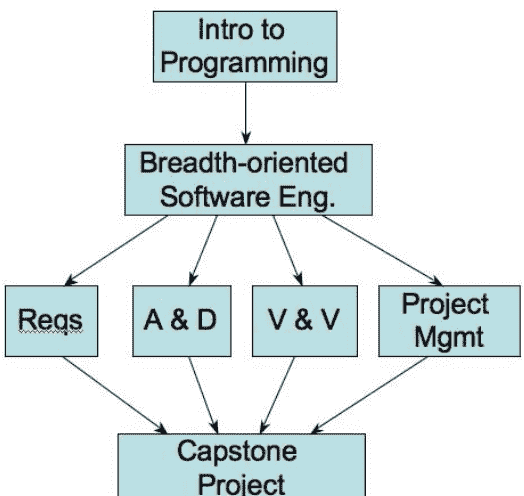

并由第四学期学生跟踪。第二年学生在企业中也在指导，因为他们完成了第一年，因此了解这些学生面临的确切情况。共址的每周实验室会议促进了协作和指导关系。

表1和表2所示的主题和课程排序出于实际原因。课程1：工具与流程，是一门以工具为中心的课程，将第一学期大三学生

引入企业。在他们学术生涯的这个阶段，第一学期大三学生（至少在我们的项目中）尚未 heavily 依赖工具，也尚未在可扩展的团队导向项目中实践完整的软件工程活动。这些学生接受了概念的轻度介绍，并对工具给予了高度重视。例如，构建管理是使用 Apache 的 Ant 工具（ant.apache.org）讲解的主题。对大多数这个水平的学生来说，基于第三方组件（jars）的多（许多）文件、多包编译和组装过程是一种新体验，至少在可扩展的层面上是如此。课程1专注于 Ant 的熟练度，以完成“构建”和“部署”，即使以牺牲对基于组件的软件工程的完整理解为代价。我们的目标是让学生以构建和部署软件的方式思考，而不是仅仅编译和运行它。课程1的这种方法出于实际需要，导致这些学生被温和地引入项目；他们不会从第1周就被放任不管。请注意，课程1中的大多数主题将在序列的后面阶段重新审视以获得更深的概念深度。

表1. 软件企业课程主题

| Course 1: Tools & Process | Course 2: Construction & Transition |
|---|---|
| Intro to PSP | GUI development |
| Using an IDE | Software Construction |
| Build Management | Unit Testing Concepts |
| Use case diagrams | Test-driven development |
| Unit testing | Defensive Programming |
| Functional testing | Refactoring |
| Metrics tools | Code Reviews |
| CM tool | Static/dynamic code analysis |
|  | Configuration Management |
|  | Professionalism & Ethics |
| Course 3: Inception & Elaboration | Course 4: Process & Project Management |
| Software Lifecycle Process | Software Development Planning |
| Requirements Engineering | Task Identification / WBS |
| Requirements Documentation | PERT, Critical Path Analysis |
| Requirements Elicitation | Task Scheduling / Gantt charts |
| Use Cases | Estimation |
| User Stories | Risk Management |
| Requirements Quality | Inspections |
| Requirements Analysis | Verification and Validation |
| RUP Analysis | Test Planning |
| Structured Analysis | Test Script Writing |
| Usability | Release Management |
| Requirements Management | Postmortem |

表2. 软件企业学生参与轨迹

| Year in Sequence | Project | Fall | Spring |
|---|---|---|---|
| Year 1 (Juniors) | 1 | Course 1 | Course 2 |
| Year 2 (Seniors/Graduates) | 2 | Course 3 | Course 4 |

课程2涵盖了传统计算机项目中通常不包含但我们认为成为更好程序员必不可少的主题。课程2中大多数主题的基础来自敏捷社区，在那里代码级质量最佳实践比其他流程模型更受重视。课程2的讲座涵盖概念基础，而实验室课程将概念付诸实践。例如，配置管理主题包括代码行质量阈值、代码行分支模式以及与发布管理的连接等概念；实验室让学生创建沙箱、执行签出、更新和合并。课程2的学生在项目团队中扮演软件开发人员、配置管理员和构建管理员的角色，因此这些概念被直接付诸实践。而课程1逐渐将学生迁移到图2所示的教学模式，课程2完全遵循该模式。

课程3与许多计算机项目中的需求课程相似，只要对软件工程有合理的重视；然而企业课程强调沟通和理解而非规范。大量时间（超过半个学期）花费在从商业想法到需求发现再到通过迭代细化过程确定的优先需求的收敛管道上。

细化过程尤其关键，因为团队被要求反复重新审视需求以求清晰和成熟，以 IEEE-830 标准（IEEE-CS 1998）中的质量属性表达。反思性学习在这门课程中或许最为重要，因为学生开始意识到，获取和传达需求的过程并不像走进去问项目赞助人他们想要什么那么简单。

课程3具有最多的课程内容，材料本身的广度和深度对教师来说具有挑战性，对学生来说也难以吸收。对学生而言，这是他们首次接触一个没有确定答案的主题；需求仍然主要是一个主观过程。在企业中由于强调沟通（获取）和理解（转化为架构）而非仅仅学习一套规范符号和文档格式，这一问题尤为突出。我们还注意到，基于轶事观察和项目成绩，外国学生往往在这样的课程中挣扎。我们认为这是由于这些文化中普遍存在的讲座导向的推送模式所致，并得出结论，这使得此类课程成为他们教育经历中更重要的组成部分。

到学生进入课程4时，他们已完全沉浸在企业中，这意味着他们能够借鉴前3门课程的经验。他们往往高度有动力在项目中表现出色并真正拥有交付成果。与适应教学模式相关的障碍此时完全消失，因为学生现在已习惯于快速接触和整合新概念。本课程中一个常见现象是学生抱怨希望更早知道所涵盖的技术，特别是在项目管理方面。在前3门课程中，学生使用“常识”方法组织团队活动，这意味着他们依赖临时规划和监控技术。这是有意为之，以便学生理解这些技术的功效和重要性以及挑战


项目经理工作的挑战。目标是打击项目经理工作缺乏复杂性、且“没有技术工作那么难”的刻板印象；课程 4 的学生最终将真正拥有项目的责任；而课程 3 的任务包括识别所有利益相关者，课程 4 的学生则真正受制于他们。

### 教师视角和后勤问题

本节涵盖了软件企业中教师面临的许多重要后勤考虑因素。

### 选择流程生命周期模型

软件企业使用流程元模型来约束流程规划和流程生命周期模型执行。软件企业将项目约束为使用一个流程元模型（一种更高阶的流程模型，可能包含特定的生命周期模型和流程实践）。这使各团队之间的主要发布点保持同步，并为比受限于特定流程生命周期模型的项目所执行的更高层次的决策提供了基础。被考虑的流程元模型包括个人/团队软件流程（PSP/TSP）（Humphrey 1997；Humphrey 2000）、敏捷方法特别是极限编程（XP）（Beck 2000）、理性统一流程（RUP）（Krutchen 2000）以及螺旋/理论-W 模型（Boehm et. al. 1998）。

我们的决定是使用 RUP 作为软件企业的流程元模型。我们在相关的地方也融入了 Win-Win 螺旋模型方面的内容，例如风险分析、风险管理、阶段边界规划、原型设计和谈判。虽然“借用”了螺旋模型的活动，但使用 RUP 模型是由于当前工具支持、文本和其他支持材料的可用性、定义了具有团队角色的协作模型，以及包含过渡（部署）阶段。它也有助于 RUP 的四个阶段在学期边界上比螺旋模型的再进入特性更吻合。

我们决定不在流程元模型层级使用敏捷/XP 方法。从后勤角度看，学生在同一门课程上花费的时间不足以进行 XP 所需的日常互动（Umphress, Hendrix, & Cross, 2002）。更重要的是，过于依赖经验和持续集成，无法为学生在项目环境中学习软件工程提供合适的框架。换句话说，许多 XP 项目之所以成功，是由于相关工程师的能力和经验以及他们能够不断协作的接近性。学生 simply 没有成功使用敏捷元模型所需的技能水平或稳定的时间安排。然而，许多敏捷方法，特别是 XP，在识别软件构建期间有用的实践方面非常有帮助，我们在企业序列的第二学期（构建与过渡）期间纳入基于这些实践的问题中心学习模块。有用的 XP 实践包括重构、测试驱动开发、结对编程、演进度量、配置管理、客户评审、频繁集成和估算速度。

我们还决定不在软件生命周期层级使用 PSP/TSP。在审阅了这些流程的教科书材料（Humphrey 1997；Humphrey 2000）和在线材料（Carnegie Mellon 2005）以及它们在软件工程教育中应用的文献示例（Borstler et. al. 2002；Hilburn & Humphrey, 2002；Sebern 2005）之后，我们认为在生命周期模型层级引入它们负担过重。PSP/TSP 在流程元层级缺乏 RUP 和螺旋模型的灵活性。此外，该方法的使用方式意味着一种全盘接受或放弃的做法。由于我们无法干净地将 PSP/TSP 活动彼此分离，因此我们也没有采用个人

不同校区）。一些行业项目选择主要在校内会面，这通常是行业赞助商“逃离办公室”的借口。是学生团队需要被移出舒适区。通过在客户现场进行客户会议，学生团队对赞助组织的业务现实有更强的认知，因此准备得更好、更专业。从某种意义上说，这迫使团队充当服务组织（Poole, 2003）。软件企业通过个人行业联系和工业顾问委员会来确定项目赞助商。只有在校外赞助商得到考虑后，才会考虑校内赞助商。

最好的项目由项目经理赞助，尤其是那些软件开发专业知识有限的人。具有显著技术专长的赞助商往往过于急于为团队解决问题，而且倾向于不表达需求而是定义技术任务。这在课程 3 尤其明显，项目团队负责需求获取、原型设计和定义架构。这些活动对学生来说是最具挑战性的。虽然与行业导师类型的技术互动确实能带来一些好处，但这些技术人员往往成为解决方案的拐杖。教师也成为糟糕的项目赞助人，因为他们通常对项目的学习目标和评估标准感兴趣。简而言之，他们认为自己是在教授和评分团队，而不是赞助他们。如果教师以任何方式参与企业，情况会更糟，因为双方都无法在学生-教师和团队-赞助商互动之间划清界限。那些在技术上不活跃（尽管管理技术项目）的项目经理作为赞助人效果最好，因为他们倾向于遵循一种以期望、计划、风险和交付成果进展为重点的互动模式，因此团队习惯于将工作集中在他们应提供的服务上。不幸的是，目前大多数企业项目都是由技术人员赞助的，无论是来自行业还是学术界。

最好的项目利用现有技术。我们发现学生在实现层面上使用现有源代码的能力极度缺乏。这背后的主要原因很简单——他们还没有被要求这样做。这是计算课程的一个更大问题。在企业之前，学生没有被要求检查大量源代码并理解其结构和风格。学生通常对软件系统的规模一无所知，即使是他们每天使用的系统。例如，一个课堂练习要求学生估算他们几乎每天都使用的特定软件系统的代码行数。所讨论的系统大约有 200 万行代码；超过一半的学生估计为 1 万行或更少，2 人估计少于一千行。企业要求团队利用现有的源代码库，通常取自之前的解决方案或开源社区。此外，大多数项目都有重大的集成需求，无论是数据集成还是控制集成。这些项目因其现实性以及技术特征而非常有用。

最好的项目定义模糊。课程 3 的主要目标是通过获取、原型设计和架构获得对问题和解决方案空间的共同理解。给出过于“现成”的项目会将项目简化为一个大型编程练习，使团队无需体验如何执行迭代细化过程。正如 Szyperski 所指出的，利益相关者通常更擅长将需求表达为对他们已熟悉的系统的增量扩展（Szyperski, 2005）。然而，我们不希望系统需求能被客户 readily 表达；相反，我们希望学生通过获取工作来挖掘出这些需求。另一方面，给出过于以发现为导向的项目则


#### 表 3. 企业使用的工具

| 工具 | 用途 | 备注 |
|---|---|---|
| Eclipse/Jazz | IDE | Eclipse 是一个主要平台，Jazz 基于 Eclipse 构建并可作为 beta 版免费获得。 |
| Ant | 构建脚本 | 开源标准，跨平台，Eclipse 支持。正在考虑 maven。 |
| Jira | 缺陷跟踪 | 供应商工具，对学术/与 Confluence 捆绑的许可证提供优惠价格 |
| CVS | 配置管理 | 初级但流行的工具，曾考虑 Subversion，现在使用 Jazz 中提供的 CM |
| JUnit | 单元测试 | Eclipse 插件可用 |
| SourceforgeMetrics | 度量 | metrics.sourceforge.net，Eclipse 插件 |
| PMD | 静态分析 | Eclipse 插件，可高度自定义 |
| iRise | 故事板/UI 原型 | 供应商工具，提供免费学术许可证，www.irise.com |
| MagicDraw | UML | 个人版可免费用于学术用途，支持 RUP 分析类立体类型且跨平台。 |
| MS Excel / Jira | 变更管理 | 需求通常通过 Confluence 和 Word 版本控制而演进。 |
| MS Word | 文档 |  |
| Open Workbench | 项目管理 | 支持工作分解结构、PERT/Gantt 图表、资源模型 |
| Coverlipse | 代码覆盖率 | Eclipse 插件 |
| Checkclipse | 代码风格 | Eclipse 插件 |
| Jupiter | 代码评审 | 来自夏威夷大学的 Eclipse 插件 |
| Academus/Sakai | 课程管理 | 门户界面支持团队协作更轻松。 |
| Confluence | Wiki | 以“空间”组织，使团队支持变得容易。 |
| Sticky notes | 需求获取 | 头脑风暴/亲和过程，故事板 |

问题；利益相关者经常更改需求，每天都会宣布新技术，计算设施变得不可用。这些不幸事件发生在我们的学生身上，应被视为利用其流程来解决这些问题的学习机会。

企业方法实施起来很简单：处理它。成功的团队找到方法来解决这些问题，而不是将其作为借口并向利益相关者求情。为此不仅有健康的“严爱”剂量，而且我们经常在项目期间有意引入干扰事件并强迫学生在现场解决

它们。一些事件示例包括：

- *轮换团队成员。* 团队每学期可能交换一次成员。此交换是未提前通知的，并且团队通常只有很短的时间（几天）来向其他团队成员转移知识和任务。
- *取消项目。* 严重落后或被判定为不成功的项目将被取消。团队成员将被分配到其他项目。
- *更改需求。* 需求变更可能随时由客户引入。
- *更改技术。* 项目通常利用开源技术来完成项目实施。这些技术经常发生变化，团队被要求随技术而变。
- *轮换团队角色。* 尽管没有更换团队成员那么具侵入性，但在团队内部更换角色往往会导致团队内部化学反应更好。
- *学期之间的流失。* 跨越一个以上学期的项目中常见的学生流失问题被视为“现实世界”中团队成员流失是预期情况的体现。

当然，这些类型的问题往往会减慢最终软件产品的生产速度并降低其质量。好处是团队必须依靠良好的流程实践、组织、风险分析、判断和协作来解决这些问题。

### 项目评估

学生项目根据其定义流程、遵循流程和适应变化的能力进行评分。成绩的权重对于序列（特别是第二年）主要取决于在流程背景下设定、遵循和调整活动的的能力，而对交付成果质量的关注仅次之。基于这些标准构建评估模型很困难。首先，很难直接衡量一种流程模型相对于另一种流程模型的影响，特别是在流程的初学者（按定义学生通常是）环境中。其次，跟踪学生项目中的流程相关数据可能对教师来说是巨大的时间负担。学生流程数据收集的有效性是另一个问题。虽然 PSP/TSP 确实强调数据收集和

数据驱动的流程改进方面，但仍然很难要求学生确定，例如，特定配置管理策略对软件质量的影响。此外，学生以成绩为导向，因此当学生担心成绩影响时，要求他们诚实报告流程数据往往会导致乐观报告，有时团队的真实情况要到学期结束时才会被揭示。在我们看来，这些问题没有简单的答案。

此外，企业项目有两个关键组成部分会影响评估。

- 跨学年的协作。如前所述，项目团队由大三和大四学生共同组成。这些团队每周还一起进行一次扩展实验室课程。高级学生投入指导的精力包含在其最终成绩的评估中。这可能与极具才华的学生产生分歧，他们倾向于领先于团队其他成员而不是与他们一起推动团队前进。
- 整个班级是“公司”。学生团队项目通常彼此竞争，以展示最好的最终产品以获得最高成绩。在企业中，所有项目团队都是同一家公司的一部分，公司的成功与单个项目的成功一样重要，如果不是更重要的话。因此，最终成绩的一部分受所有班级项目表现如何的影响，而不仅仅是团队参与的项目。这鼓励团队在项目之间分享经验教训，有时还共享资源。这一原则已在其他顶点课程中使用（Coppit 2006；Turhan & Bener, 2007），尽管原则上的区别在于，在那些项目中，大班学生作为一家公司参与一个项目，而企业学生则是作为一家公司执行多个项目。我们认为这更准确地再现了许多软件服务公司在软件开发和资源共享方面的压力。

### 评估

软件企业目前处于第四年；82 名不同的学生在前三年中至少选修了一门企业课程，43 名学生（其中 30 名为新学生）目前在 2007 年秋季注册。由于提供时间有限且人口相对较少，目前尚无法对学生满足“行业准备度”总体目标的绩效进行统计有效评估。然而，我们正在收集纵向数据并分享迄今为止学到的知识。

每年收集几种定量和定性评估数据：

- 1. **课程评估：** 这些是 ASU 所有课程的标准评级导向课程评估。学生被要求对学习体验的质量进行评级，并提供一些定性反馈。
- 2. **课程调查：** 在每个学期结束时进行企业特定课程调查。学生被要求对学习体验的质量进行定量问题回答，以及对课程主题领域的专业知识进行自我评估。
- 3. **亲和过程：** 学生在小组中被提出无上下文问题并将响应组织成自然形成的集群（对彼此响应的“亲和力”）。有趣的是，这一过程也是需求获取的一部分。
- 4. **即将毕业和近期毕业生调查：** 对即将毕业和近期毕业生的调查询问他们对教育在技术职业方面的实用性的看法。目标是重复这项研究数年以积累关于我们毕业生准备情况的趋势数据。
- 5. 定性数据反映在 1 和 2 的调查中匿名学生手写回复、项目赞助商的反馈以及两个行业咨询委员会的意见。

亲和过程（3）和课程调查（2）在评估学生对行业准备度的感知方面特别有用。毕业生调查（4）在结果完成时将很有用。

*亲和过程。* 亲和过程是一种获得无偏结果的方法（Kawakita, 1982）。流程如下：

- 1. 向参与者解释流程
- 2. 提出问题
- 3. 要求每位参与者尽可能写下尽可能多的关于该问题的回答（至少 10 个）。每个便签上应只写一个想法（最好是一个词）。允许大约 5 分钟完成此阶段。
- 4. 要求所有参与者将所有便签放在白板上并作为一个团体留在板前。告诉参与者（不要互相讨论）将想法聚类成连贯的组，通过将便签物理移动到彼此靠近的位置。参与者应考虑板上的所有项目，而不仅仅是他们创建的项目。如果存在争议（例如，一个想法在不同集群之间来回移动，将该想法复制到另一张便签上并将其放在两个集群中）。


5. 要求参与者作为一个整体来命名聚类。他们在此阶段被鼓励讨论名称。将每个聚类的名称写在便签上，将便签与每个聚类一起放在白板上，并圈出该聚类。

6. 要求参与者使用提供的投票贴纸对每个已命名聚类的重要性进行个人多选投票。参与者可以对一个聚类多次投票，也可以将投票分散到多个聚类中。

7. 就所做的选择对参与者进行回顾。

8. 从白板上收集便签，将聚类名称便签放在每个主题组的最上方

亲和图法被用作评估学生在为期一年的项目团队经历中认为学到的最相关概念的一种手段。亲和图法在每学年结束时进行，并且针对企业中的第一年和第二年参与者。我们在此过程中向学生提出三个问题之一是关于他们对初级软件工程师技能需求的看法：

> Q2: *初级专业人士最重要的技能是什么？*

这个问题要求学生考虑他们认为毕业后最需要哪些技能。有趣的是，学生熟练地用软技能（例如“正确的态度和个性”43%）回应，超过了技术技能（例如“软件技能”19%）。

这一结果很有趣，因为它反映了关于学生认为作为即将到来的初级专业人士最需要了解哪些技能的非定向反馈，而且学生压倒性地认识到软技能将在他们从事第一份工作时成为差异化因素

当他们从事第一份工作时。关于我们完整的亲和图法结果的报告可在我们之前的工作中找到（Gary et al. 2006）。

亲和图研究的一个常见问题是纵向对齐结果的能力。虽然受访者每年可能会创建相似的聚类，但他们很少创建完全相同的聚类，从而导致如何规范聚类以保持一致性的问题。

*课程调查。* 学生在每学期结束时被要求填写一份匿名在线调查。调查询问学生在开始企业之前对特定企业主题的学术接触程度，以及他们期望从接触该主题中获得的专业收益程度。结果如表4所示。

这些结果反映了29名学生的回应，因此在统计上无效。然而，有趣的是，从轶事上观察，尽管学生认为大多数主题具有很多专业益处，但他们之前的学术接触通常非常低。

我们从这些研究得出的结论是，企业包含了与行业相关的主题。轶事上，行业合作伙伴认为主题和教学法都会培养出准备更充分的毕业生。来自亚利桑那州立大学项目赞助商和教职同事的额外轶事反馈也表明应用理解力有所提高，这反映在学年末系级演示日学生团队和项目的深度和专业性上。然而，无论是研究还是轶事反馈，目前都无法确定更大的应用知识是否源于教学法。为此，我们正在进行一项纵向研究（评估技术编号4，首次数据收集于2006年12月），希望在一段时间内证明我们的毕业生具有更大的行业准备度。

#### 表4. 课程调查结果

| Survey Results | Academic Exposure | Professional Benefit |
|---|---|---|
| Topic Area | none | some | lot | lot | some | none |
| Code Reviews | 57% | 36% | 8% | 57% | 43% |  |
| CM | 91% | 9% |  | 91% | 9% |  |
| Defensive Programming | 36% | 54% | 9% | 80% | 20% |  |
| IDEs (Eclipse) | 15% | 54% | 31% | 82% | 9% | 9% |
| Metrics | 82% | 9% | 9% | 40% | 20% | 40% |
| Refactoring | 73% | 27% | 9% | 82% | 18% |  |
| Deployment/Release Mgmt | 92% | 9% |  | 67% | 33% |  |
| Unit Testing | 36% | 45% | 18% | 90% | 10% |  |
| Estimation | 77% | 23% |  | 83% | 17% |  |
| Project Management | 69% | 23% | 8% | 77% | 23% |  |
| Quality Planning | 57% | 22% | 22% | 92% | 8% |  |
| Release Management | 83% | 17% |  | 62% | 23% | 15% |
| Defect Tracking | 67% | 11% | 22% | 71% | 29% |  |
| Risk Management | 53% | 33% | 13% | 92% | 8% |  |
| Task Planning & Sequencing | 53% | 20% | 27% | 92% | 8% |  |
| Test Types (alpha, beta) | 75% | 8% | 17% | 50% | 42% | 8% |
| Analysis Modeling | 75% | 25% |  | 57% | 42% |  |

### 相关研究

高等教育中的软件工程发展速度很快，即使在入学人数下降的情况下也是如此。过去十年中，该领域非常活跃，出现了新的学位项目（Bagert & Chenoweth, 2005），课程建议（ACM & IEEE-CS, 2004），知识体系的可用性（IEEE-CS, 2004），以及关于软件工程教学法的日益增长的文献，其中很大一部分集中在以项目为导向的课程上。软件工程项目可能存在大量变体，软件企业既借鉴了其他学术项目中的做法，也提倡这些做法，如本章所述。在本节中，我们将重点介绍对企业整体结构和实施特别有影响的项目提供。

对我们软件企业的发展产生深远影响的具有示范性项目提供的具体项目包括卡内基梅隆大学专业硕士项目中的软件开发工作室组件（Tomayko 1996）、密尔沃基工程学院的软件开发实验室（Sebern 2002）、奥本大学的毕业设计项目（Umphress, Hendrix, & Cross, 2002），以及西佛罗里达大学硕士轨道的毕业设计项目

硕士轨道的毕业设计项目（Wilde et al., 2003）。

CMU的软件开发工作室（Tomayko 1996）是以项目为导向的软件课程中的开创性项目。工作室让攻读 terminal 学位的研究生经历多学期项目，涵盖软件过程活动的全范围。工作室激发了企业的前身软件工厂（Tvedt, Tesoriero, & Gary, 2001），该工厂强调在整个本科学习过程中进行项目参与。软件企业与工作室共享多学期方法，并强调软技能发展。然而，企业以相反的顺序引入软件阶段，并通过多年结构化学生协作强调软技能发展。企业还将该序列引入本科而非研究生项目。

过程阶段的逆向排序也由MSOE的软件开发实验室引入。Sebern（Sebern 2002）承认新学生掌握过程和软技能概念的难度，因此学生通过“从坟墓到摇篮”引导过程阶段。不幸的是，并未提供这种方法实用性的进一步描述。Sebern还讨论了学生流动或项目连续性的问题，并描述了为准备项目序列而为高年级学生开设的预备课程。该课程包括来自项目注册者的指导活动、项目上的共同建议以及基本技能准备。这是我们希望在第一年第一学期工具课程中复制的模式。

（Umphress, Hendrix, & Cross, 2002）阐述了将毕业设计用作教学和学习体验而非总结性体验的动机：“...教师期望他们整合在以前课程中学到的技术技能，学会作为团队协同工作，计划和跟踪他们的工作，满足客户——并生产出可靠的软件。然而，

更常见的是，以这种方式构建的项目教会了参与者又一种不开发软件的方法。”我们完全同意。此外，我们企业最初的迭代遇到了论文中描述的一些相同问题——平衡工作量、技能集的扩展、团队内的职责——对此我们通过收紧流程的某些部分同时有意将其他部分保持开放来做出回应。结果是我们迭代导向的RUP元模型，沿途纳入了最佳实践。本文还影响了我们围绕使用过程导向的评分方法而非产品导向的思考。

西佛罗里达大学的项目（Wilde et al., 2003）也在我们的思考中具有影响力，因为它强调了软件演进以及软件过程。作者有力地论证了在不付诸实践的情况下学习演进概念是困难的，从而将课堂上对这些概念的教学应用到毕业设计项目中并不一定能成功实现。在其他话说，这里唯一的选择是立即应用概念以使其具体化。这是我们对图2中迭代交付模型推理的基础。我们希望作者也将这种方法应用于管理主题，而他们却采用了研讨会式格式。在企业中，管理概念也是使用相同的教学模式引入的，这在展示这些工具的价值方面非常有效（工作分解结构、关键路径分析、挣值分析等）。

再次，这些只是现在可用于软件工程毕业设计项目实施的大量工作中的一小部分。某种程度上，企业为关于运行此类课程的后勤辩论贡献了自己的声音。在更大层面上，社区现在似乎正朝着关于软件工程教育影响的更大讨论发展，它是什么，在哪里未能达到预期，以及


Humphrey W.S. (2000). *团队软件过程导论*. Boston: Addison-Wesley.

电气和电子工程师学会计算机学会 (1998). *IEEE软件需求规格说明书推荐实践*. (IEEE标准830-1998). New York, NY.

电气和电子工程师学会计算机学会 (2004), *软件工程知识体系指南（SWEBOK）*. Los Alamitos, CA.

Kawakita, J. (1982). *原始KJ方法（英文版）*. Tokyo: Kawakita Research Institute.

Kruchten, P. (2000). *Rational统一过程——导论（第2版）*. Boston: Addison-Wesley.

Leffingwell, D. & Widrig, D. (2003). *管理软件需求：用例方法（第2版）*. Boston: Addison-Wesley.

Lethbridge, T., Diaz-Herrera, J., LeBlanc, R., and Thompson, J.B. (2007). 通过教育改进软件实践：挑战与未来趋势. FOSE’07会议录：*软件工程的未来*, ICSE’07特别分会：*第29届国际软件工程会议*. Minneapolis, MN.

McConnell, S. (2004). *代码大全2（第2版）*. Redmond WA: Microsoft Press.

Morsch, L. (2006). *一些增长最快工作的薪资*. 检索于2008年1月4日，来自 http://www.cnn.com/2006/US/Careers/01/26/cb.top.jobs.pay/index.html.

Poole, W.G. (2003). 客户软件开发中较软的一面：与其他参与者合作. CSEET’03会议录：*第16届软件工程教育与培训会议*. Madrid, Spain.

Sebern, M. (2002). 软件开发实验室：将工业实践融入学术环境. CSEET’02会议录：*第15届软件工程教育与培训会议*. Covington, KY.

Sebern, M. (2005). 软件过程：在工程教育中应用工业级方法. ASEE’05会议录：*美国工程教育学会全国会议*. Portland, OR.

Szyperski, C. (2005). 软件工程师的培养：教育工作者的挑战. ICSE’05会议录：*第27届国际软件工程会议*. St. Louis, MO.

Tomayko, J.E. (1996). 卡内基梅隆的软件开发工作室：五年回顾. CSEE’96会议录：*第9届软件工程教育会议*. Daytona Beach, FL.

Turhan, B. & Bener, A. (2007). 面向大规模软件工程课程的真实世界团队项目模板. ICSE’07会议录：*第29届国际软件工程会议*. Minneapolis, MN.

Tvedt, J. Tesoriero, R., & Gary, K. (2001). 软件工厂：结合本科计算机科学与软件工程教育. ICSE’01会议录：*第23届国际软件工程会议*. Toronto, CA.

Umphress, D., Hendrix, T., & Cross, J. (2002, 9/10月). 课堂中的软件过程：顶点体验. *IEEE软件*, 19(5), 78-81.

美国劳工统计局（U.S. BLS）(2007). *经济和就业预测：2006-2016*. 检索于2008年1月4日，来自 http://www.bls.gov/news.release/ecopro.toc.htm.

Wilde, N., White, L.J., Kerr, L.B., Ewing, D.D., & Krueger, A. (2003). 一些经验与

培养学徒技师。工作产品的最终版本交付给客户。

### 项目

为了解决让学生获得开发大型软件系统经验的问题，本课程要求学生为真实客户构建软件，这些客户需要针对某一问题的软件解决方案。鉴于项目在课程中的核心作用，项目的选择是课程准备的关键部分；然而，项目只是达到目的的手段。我们的重点是教授学生支持构建复杂、可靠和可维护系统的方法。项目让他们有机会应用过程并实践过程改进。

软件工程关乎管理变更，但学生往往对不变的需求有经验。因此，他们需要的是真实世界的经验，即客户可能在项目期间更改需求、可能不清楚自己的需求，并且不确定如何最好地解决其问题。识别和澄清模糊、不完整和不一致的需求，以及管理变更，是课程的重要组成部分。学生通常缺乏需求获取和规格说明的经验，下面一位客户的评论支持了定义需求过程的重要性：

> 作为SCIMITAR项目的负责人，我觉得学生们在软件开发的复杂性中获得了真实的沉浸体验。他们学会了倾听客户、开发需求以及从客户那里获得反馈的重要性。他们也学到了真正确定这些需求是多么困难，以及这样做从长远来看能节省多少。——Lon Anderson，陆军研究实验室（L. Anderson，个人交流，2003）

除了管理需求变化及其对保持一致性影响外，学生还必须学会预见设计中的变化。事实上，体会面向变化设计的最好方式就是让变化在设计过程中逼近，然后观察当变化发生时设计会变成什么样。

#### 项目描述

软件工程项目有无限可能，我们经常接到潜在客户的咨询。为了帮助我们选择合适的项目，我们考虑了以下项目要求：

- 客户必须真正需要该软件产品。客户的参与至关重要。客户参与访谈和演示，并且每学期都要出席最终演示。他们必须在两学期课程的关键时刻随时回答有关预期产品的问题。

- 客户必须愿意等待两个学期或更长时间才能获得可用的软件。本顶点课程可采用两种方法。一种是瀑布模型，另一种是称为“特性驱动开发”（FDD）(Coad,1999)的敏捷方法的改编版。使用瀑布模型是有意的：我们的学生熟悉编码，但对软件工程的其他方面不太熟悉。FDD的原始版本由五个过程组成：开发整体模型、构建特性列表、按特性计划、按特性设计、按特性构建。FDD的修改版(Rauda, 2005)使用这五个过程，但对过程内部任务进行了修改，以满足课程成果。

- 项目必须具有足够的规模，使一两名学生在两个学期内完成任务是不可行的。这创造了积极的相互依赖，鼓励团队凝聚并共同工作。

- 项目必须是可行的，或者必须能够为团队设定项目范围，以便他们负责的项目部分可行。

项目客户涵盖地质学、农学、环境科学和软件工程的研究人员，以及试图向美国陆军客户、美国地质调查局和地理信息学网格（GEON, 2007）用户交付软件的项目经理。以下是过去几年完成的一些项目。

- PACES卫星场景查看器：该项目通过将ENVI图像处理和Oracle数据库管理系统软件与图形用户界面集成，提供了对泛美地球与环境研究中心（PACES）卫星图像存档的访问。

- HATS图形用户界面（Winter, 2006）：该项目为桑迪亚国家实验室开发的高可靠性转换系统（HATS）创建了图形用户界面。HATS GUI促进了用于生成高可靠性应用软件的转换规则的创建和解释。

- 弹药与目标交互中的场景与对抗措施集成（SCIMITAR）(Anderson, 1999)：SCIMITAR是一种分析工具，用于评估场景内弹药与地面平台的交互。SCIMITAR允许用户通过在场景中添加遮蔽物和目标类型来修改和分析图像，从而分析瞄准点概率和对抗措施有效性。

- 重力数据存储与处理系统（GDRP）(GeoNet, 2007)：GDRP是一个基于Web的工具，提供关于重力测量的一般信息，并提供一组用于添加、访问、可视化和处理数据的工具。该项目是德克萨斯大学埃尔帕索分校（UTEP）、亚利桑那州立大学和美国地质调查局的协同努力。

#### 项目管理

项目的最终结果应该是软件产品或原型产品。为了生产出可用的软件，项目管理至关重要。当同时管理多个软件团队时，这一点尤为重要。虽然有很多资源可以指导讲师进行基本的软件项目管理（Wysock, 2006; Whitehead, 2001; DeMarco, 1999; McConnell 1997），但本节我们讨论学术顶点项目特有的项目管理方面。

UTEP课程的学生在高度结构化和受管理的项目团队中工作，涉及开发的各个方面：需求获取、可行性、建模与分析、原型设计、需求规格说明、追踪、高层和低层设计、实现和测试。此外，学生要提交正式文档（在适当时使用IEEE标准），包括可行性报告、访谈报告、软件需求规格说明书（SRS）、软件设计文档（SDD）、测试计划、测试缺陷报告和配置管理计划。学生参与设计和原型的走查和审查，并向客户正式展示软件需求和最终产品。图2显示了按传统学年进行的为期两学期课程主要交付物的甘特图。

验证与确认任务包括纸质原型审查、可执行原型审查、审查、走查和结构-

如何处理并欣赏多元化的观点。许多招聘人员告诉我们，他们从不同的学院和大学招聘人才，仅仅是为了让员工队伍在教育和文化上具有多样性。我们在团队中也采用这种方法。

我们让学生组成五人团队工作整整一年，很少会从团队中移除成员。正因如此，我们在组建团队时非常谨慎，并在挑选成员时投入了大量精力，考虑四个总体方面：个性、职位偏好、经验、平均绩点，以及项目和性别相关问题。学生会被提供职位描述和每个职位分配的交付物清单。他们需要提供简历并撰写申请信，在信中指定他们认为自己最有资格或最感兴趣的三个职位。我们的团队分配流程包括评估学生的申请信和简历、评估主导人格特征，以及在性别、种族、成绩和教育经历方面平衡团队多样性等步骤。

我们使用 Shapes 人格练习（Bonura, 1998）来评估个性。该练习是 Myers-Briggs 人格类型评估的改良形式。在练习中，学生选择他们最认同的“人格形状”。学生们会认识到，并非所有同学都认同相同的形状，并且每种形状都有其优势和需求。在我们的团队中，我们力求在每个团队中平衡四种形状。

我们尝试根据学生的经验和学术成就来平衡团队。我们要求学生在简历上报告其累计和专业平均绩点。我们还根据申请信对他们的写作能力进行初步评估。我们的目标是在学术背景方面平衡团队。我们尝试让每个团队都有几名英语能力强或学业记录良好的学生。对于特定项目，在分配学生到团队时，我们也会考虑工作经验和某些课程（如数据库管理）。我们尽量避免将朋友分配到同一团队。

性别相关问题包括在可能的情况下，将女学生分配到至少还有一名其他女学生的团队。虽然并非总是必要，但让团队中有多名女学生的做法有助于在女生的意见被忽视或不被重视的情况下发挥作用。

#### 培养专业技能

我们不会仅仅因为学生处于团队中就假设他们知道如何有效地开展团队工作，而是刻意教导学生如何开展团队工作，通过描述如何进行有效的会议，让每个学生都有机会学习如何担任领导角色，要求学生分析其团队的表现，并提出提高个人参与度和团队有效性的方法。学生会被分配到团队中的特定职位，我们利用该职位来分配不同交付物的负责人。负责人负责确保交付物（参见表 1）完成，并且每个团队成员都为每个交付物做出贡献。此人负责启动工作（通常是通过召开团队会议并设定会议议程），监控任务分配，收集成品并交付最终版本。我们设立轮换负责人的目标是为学生提供练习任务规划策略的机会，并学习领导技能。我们的经验是，一些通常不会选择领导团队工作的学生最终成为优秀的领导者，并发展出此前未被认可的技能和才能。

培养专业技能的其他方法包括在课堂上使用合作学习和经验分享，其中教师或客座讲师讨论与有效团队行为相关的现实世界经验。为了鼓励基本领导技能的发展，我们讲授并示范设定议程、在会议中分配角色、明确任务分配、达成共识、定义任务和时间表、记录会议纪要并检查目标进展情况。议程和会议纪要由指导团队在评估个人责任时使用。

#### 个人责任

我们经常听到学生说他们不喜欢团队工作，因为有些学生做所有工作，而其他学生则袖手旁观白拿成绩。在课堂上，不可能解雇不贡献的团队成员。我们可以做的，是将团队结构化，使不活跃的学生难以隐藏。我们对学生对团队工作的贡献负责，并使用三种基本工具来监控学生参与度：观察、自我评估和直接访谈。我们对个人对团队项目贡献的正式和非正式评估方法使我们能够清楚地了解每位学生的贡献水平，并利用这些指标调整小组项目的个人成绩。

团队笔记本，可能包括个人工程笔记本，由学生每周更新，包含会议纪要、电子邮件交流和草稿工作产品。对这些笔记本的审查，可能以电子方式保存（如使用 WebCT），经常能识别出团队冲突和团队成员未达到团队期望的情况。这些审查可用于识别团队运作中的问题，并在必要时让教师进行干预。非正式方法包括在学生工作时观察他们。该课程的助教经常与在实验室工作的学生保持联系，助教非正式地观察项目团队成员的行为。为了帮助观察，使用量规来统计团队成员在会议期间表现出的特定行为是有用的，例如寻求成员参与、总结主要观点或提问。

学生必须自行报告其贡献程度。其中一些陈述必须与（并由）其他团队成员共享并签字，而一些则仅在学生与指导团队之间保密。此外，成员会报告团队中运作良好的方面以及需要改进的地方。

在团队与教师的会议期间，教师会访谈每位团队成员以评估其贡献程度。考试用于评估学生对给定主题的掌握程度。经常，这些考试会暴露出未参与团队工作产品开发的学生在知识上的薄弱环节。

评估学生在团队项目上的表现的另一种方法是最终展示时的访谈。这些展示包括课程以外的学术界成员，在这种情况下对个别学生提问非常有效地确定其对课程概念的熟悉程度以及对团队成功的贡献程度。

#### 团队问题

经常，团队中的学生会遇到冲突，并非所有学生都同样擅长处理这些情况，特别是那些源于优先事项和个性冲突的情况（Scholtes, 1996）。当学生无法自行解决团队问题时，项目课程的教师会面临重大挑战。为了期望学生开展团队工作，我们必须教他们如何解决团队冲突。Johnson（Johnson, 2005）描述的过程通常比临时冲突解决过程更有效。

帮助团队解决冲突的第一步是确定团队存在问题。学生经常会将问题告知教师。为了监控未报告困难的团队，指导团队会查看多项指标。例如，电子邮件往来中缺乏主动性或粗略草案中交付的工作质量差，表明团队成员未做出贡献。最终产品中未出现的一系列工作成果，或出现在电子邮件中但未出现在工作产品中的建议，可能表明团队成员在忽视或贬低某位成员。

一旦识别出团队问题，指导团队就会与项目团队会面。在相对简单的情况下，可能需要讨论团队技能和确保沟通清晰的技术，例如总结团队会议结果并在会议后立即通过电子邮件发送任务分配。后续会议可用于评估团队运作的变化。在更复杂的情况下，该过程可能涉及更长期的流程，包括让团队成员表达他们的看法和情绪，并让其他团队成员复述队友所说的话。复述迫使学生倾听并理解其他学生的立场。经常，学生从这样的经历中获得对队友的新尊重和欣赏。复杂案例通常需要在团队能够自行处理问题之前进行多次指导会议。

团队冲突的一个来源是高度积极的学生与较少积极的学生混合在一起的情况。虽然低成就学生变得投入并对项目团队产生高度生产力和价值是正常的，但团队中有一两个成员仍然缺乏动力和生产力并不少见。在这些情况下，指导团队会为团队中的个别学生协商成绩和交付物调整。

在大多数情况下，这些简单的干预措施就足够了。然而，在更极端的情况下，我们会让团队制定行为准则并确定他们对课程和项目的期望。在最严重的情况下，我们已将团队成员从团队中移除，并让该学生直接向指导团队汇报。

#### 书面和口头沟通技能

虽然我们的所有学生在进入毕业设计课程之前都已修读过英语写作课程，但其中许多人在

成员。这一过程帮助团队成员和指导团队识别问题，并与团队一起回顾解决问题的技能。反复出现的主题，尤其是在第一学期，主要集中在会议以及所有成员缺乏承诺上。

关于会议，问题通常集中在会议效率低下和会议时长上。这方面的反馈包括回顾如何开展有效的会议，例如设定议程、分配计时员和参与度检查员等角色、创建行动事项，以及检查先前行动事项的状态。还鼓励学生考虑“100英里规则”，即把每次会议都当作每位成员跋涉100英里来参加一样，因此务必准时到达并召开富有成效的会议（Scholtes, 1996）。

关于缺乏承诺，给团队的建议集中在建立积极的相互依存关系，以及认识到成员对项目的贡献和重视他人意见的重要性。其他建议包括通过任务分配和截止日期来构建个人责任。鼓励负责人通过会议纪要或电子邮件往来记录个人贡献和状态。以下对“哪些做法效果良好”这一问题的回答反映了某个团队如何从一个学期到下一个学期取得进步：

上个学期我们团队合作得非常糟糕。然而，这个学期，我们接受了每位成员的优点和缺点。因为我们已经学会作为一个团队思考，现在我们行动如一。很明显，信任团队成员能够产生预期的结果。每个人都愿意花费必要的时间来产出自己需要交付的内容。由于不想让团队失望，每位成员（包括我自己）都非常努力地工作，以交付团队成果。

另一位团队成员的反思如下：

上个学期开始时，当我看到未来团队成员名单时，我不知道该怎么想，只有一个熟悉的名字。现在再看看这个团队，我们真的像一个“熔炉”：一个台湾人、一个西班牙裔/美国人、一个印度人、一个墨西哥人和一个白人。谁说我们不能和睦相处？我们每个人在能力和性格上都有自己的优点和缺点。神奇的是，我所缺乏的，别人可以提供；别人需要的，我可以帮助。这就是团队合作的真正定义。我们做到了。这次经历让我受益匪浅，我感谢你们每一个人。

##### 产品

我们对学生所产出产品质量的评估，是每学期期末展示评审的一部分。这些展示由指导团队和客户共同评估。通过这些评估，我们发现了测试策略的有效性以及详细设计中前置和后置条件规格方面的问题。

将学生视为产品，我们查看校友调查，以确定毕业五年后校友是否认为该课程培养了他们团队合作、应用软件工程原理、建模和设计的能力。调查结果见表2。

表2. 2007年校友调查结果（n=37）

| 调查项目 | 回应 |
|---|---|
| Q17c：为团队合作做好准备。 | 91.8% 强烈同意或同意 |
| Q17g：培养了应用软件工程原理的能力。 | 97.3% 强烈同意或同意 |
| Q17h：为真实世界流程和对象建模做好准备。 | 81.0% 强烈同意或同意 |
| Q18：设计过系统、组件或流程 | 91.9% 是 |
| Q19：针对特定设计任务的准备质量 | 29.4% 优秀，61.8% 良好，8.8% 低于平均水平 |

近期对修读该课程校友的焦点小组评估支持了以下观点：亲和模型有助于学生处理冲突，并提高他们的沟通和演示技能。该模型培养的一项主要技能是建设性地批评他人工作，并接受对自己工作的建设性批评。关键因素在于，亲和模型帮助他们发展了社交和专业技能，使其能够与同事进行富有成效的互动。

##### 课程

就课程而言，多年来我们进行了大量调整，包括引入新工具、改进工具使用教程，以及修订学生理解困难概念的教学策略。我们引入的一种重要课程评估方法是将课程成果映射到考试中的特定任务或问题以及作业上，以确定学习效果。例如，表3显示了该两学期课程的一小部分课程成果，以及与之相辅相成的相应ARG组件。

表3. 课程成果子集及相应的ARG组件

| 课程成果 | 评估 | ARG组件描述 |
|---|---|---|
| a. 应用需求获取技术，包括进行访谈和开发一次性原型。 | 项目：访谈、客户互动和原型 | 提出技术问题；为原型评审准备演示 |
| b. 分析需求，以确定其是否满足良好编写需求的属性。 | 考试、SRS评审 | 需求同行评审，识别常见错误，SRS草稿 |
| c. 作为个人和团队，表现出负责任的态度和工作习惯，遵循专业软件工程道德规范。 | 笔记本、团队备忘录、演示评估 | 项目工作中的个人责任：准备和记录团队会议。 |
| d. 口头整理和陈述技术工作。 | 项目演示 | 协作团队；进行技术演示；回答问题。 |
| e. 开发小组内协作和解决问题的有效技巧，以创造高质量的成品。 | 项目笔记本 | 协作团队；专业和团队技能；冲突解决。 |
| f. 进行技术评审。 | 原型评审、SRS评审、设计评审、代码评审 | 对开展良好评审所需技能进行有意识的指导；基于技术价值的专业演示。 |
| g. 编写语法正确且技术上合理的技术文档。 | 项目文档 | 进行良好评审；专业演示。 |

课程成果分为两个层次：第2级是应用与分析。这些成果要求学生能够在熟悉的情境中应用所学材料，例如，可以解决结构熟悉且细节略有变化的问题。第3级是综合与评价。这些成果要求学生能够在新情境中应用所学材料。这是最高水平的掌握。

### 相关工作

由于项目和团队经验已嵌入大多数计算机科学和软件工程本科课程中，许多教师遇到与我们类似的问题也就不足为奇了，而且我们在此建议的许多方法也正在其他院校使用。采用合作与协作学习法、主动学习和结对编程，有助于在团队成员能力存在差异的情况下实现团队整合，帮助团队成员克服沟通障碍，并激励学生在团队环境中学习（Ellis, 2000; Aller, 2004; Doerschuk, 2004; Spickard-Prettyman, 2004; Mickle, 2004; Layman, 2005）。团队项目的评估困难且耗时，而最有效的方法包括评审和工程笔记本（Meyer, 2005; Cooley, 2004）。人们尝试通过引入真实客户为学术项目增添“真实世界”色彩的方法有很多（例如，参见Ford 2004和Bruhn 2004）。

### 未来趋势

美国在不久的将来对技术工作者的需求将持续增长（Holahan, 2007; McGee, 2007a）。对可靠软件的需求已超出我们的生产能力。总统科技顾问委员会（PCAST, 2007）报告了与物理世界相连接的网络和信息技术（NIT）系统的重要性。这些系统包括嵌入式系统、工程系统和信息物理系统，例如家庭保健设备、地面交通监控和环境监控。设计和开发安全关键且安全的NIT系统的能力是国家优先事项。我们需要培养一支能够在多学科环境中工作并具备扎实安全和验证理解的劳动力队伍。此外，雇主将继续寻求项目管理、沟通和团队技能（McGee, 2007b）。包括在不同地点、不同时区和不同文化背景下与成员协作的能力在内的团队技能将变得更加普遍。分布式团队开发（例如参见Ramesh 2002和Duarte 2006）和多学科软件开发的趋势将持续下去。这方面的一个例子是面向服务（SO）的趋势，其中应用程序由通过互联网以Web服务或网格服务形式提供的资源构建而成。术语SO指的是功能被指定的抽象级别。具体而言，SO是一种用于分析、设计和开发模块的方法，这些模块支持可重用性、松耦合、抽象和关注点分离等原则（Erl, 2005）。更常见的术语“面向服务的架构（SOA）”用于描述“使应用程序功能能够作为一组服务被提供和消费的策略、实践和框架”（Sprott, 2004）。

将需要整合现有软件服务和组件，以快速生成软件解决方案。来自商业和科学领域的应用程序开发者正在使用Web服务来实施基于SOA范式的系统。Web服务技术提供了必要的机制，可在网络上公开可共享资源（提供数据和功能的面向服务的模块），并允许用户跨异构平台使用这些资源，从而增强组织间的交互。所需技能包括指定服务功能的能力，以便服务可以发布和发现。

美国劳工部劳工统计局预计，在2004-2014年间，软件工程师的需求将增长46%（Hecker, 2005）。市场迫切需要熟悉软件开发工具（如自动化测试工具和辅助开发者从设计生成代码的系统）的软件工程师。计算机科学（CS）和软件工程（SE）之间的区分将日益明显，但对开发者的需求

这将要求我们在计算机科学专业中培养出能胜任的开发者。

### 结论

ARG 模型关注学生的发展。我们利用 ARG 模型的迭代反馈特性，通过合作学习和技能培养来教授软件工程顶点课程。该课程提高了学生的水平，以满足我们的利益相关者——行业招聘人员——的需求和期望。“讲授-实践-应用”方法将软件工程技术反复应用于真实世界问题，并与经验丰富的软件工程师进行广泛互动，从而教会学生软件工程的实践。正如 ARG 模型所建议的，我们使用结构化、审慎的方法教学生如何合作产出软件工程交付物并解决冲突。来自行业合作伙伴的反馈表明，团队经验和项目对学生来说极具价值。来自校友和学生的反馈表明，这些经历通过为他们进入职场做好准备，对他们的职业生涯产生了显著影响。

CC 2001（2001，第43页）描述了发展补充课程的重要性，即通过实习教授的一系列技能，例如撰写有效简历、有效管理时间、进行图书馆研究、保持职业责任感、紧跟领域最新发展以及参与终身学习。如本文所述，UTEP SE 方法显然通过支持发展一套可迁移技能来提供补充课程的好处，这些技能提高了学生的整体效能，并增强了他们有效贡献于软件工程劳动力的能力。

### 致谢

本工作部分得到美国国家科学基金会（NSF）的资助，项目编号为 DUE-0443061 和 CNS-0540592。本文所表达的任何观点、发现、结论或建议均为作者本人的意见，不一定反映 NSF 的观点。

### 参考文献

ACM/IEEE-CS 软件工程伦理与职业实践联合工作组（1999）。《ACM/IEEE 软件工程职业道德准则与职业实践》。2007年2月检索自 http://www.acm.org/about/se-code。

ACM 教育委员会（2004）。《ACM 教育委员会 2003 财年年度报告》。

Aller, B. M., Kline, A. & Tsang, E.（2004）。进行中的工作：改进高年级顶点课程。载于《第334届 ASEE/IEEE 教育前沿会议论文集》（第 TCG/12-TCG/14 页）。

美国心理学会（1992）。《以学习者为中心的心理原则：学校重新设计与改革的指导方针》。华盛顿哥伦比亚特区：美国心理学会。

Anderson, L., Chenault, T., Churchman, J., & Homack, R.（1999）。《弹药与目标相互作用的场景与对策集成》，陆军研究实验室，白沙导弹靶场，新墨西哥州，生存性/致命性分析处。2007年5月检索自 http://stinet.dtic.mil/oai/oai?&verb=getRecord&metadataPrefix=html&identifier=ADA368518

Astin, A. W.（1985）。《实现学术卓越》。旧金山：Jossey-Bass。

Bloom, B.（1956）。《教育目标分类学》。David McKay 公司。

Parnas, D. L.（1999）。软件工程专业不是计算机科学专业。《IEEE Software》，16（6）：19-30。

PCAST（2007）。总统科技顾问委员会。《挑战下的领导力：竞争世界中的信息技术研发：对联邦网络与信息技术研发项目的评估》。www.ostp.gov。

Ramesh, G.（2002）。《管理全球软件项目：如何领导地理分布的团队、管理流程并使用质量模型》。McGraw-Hill 有限公司。

Rauda, L. G.（2005）。《一种用于本科生软件工程课程的特性驱动开发方法》。硕士项目，得克萨斯大学埃尔帕索分校，2007年5月。

Rodriguez, C.（1994）。《让少数族裔本科生留在科学与工程领域》。论文发表于第19届高等教育研究协会年会，亚利桑那州图森。

Scholtes, P., Joiner, B. & Streibel, B.（1996）。《团队手册》（第2版）。Joiner Associates 公司。

SE2004（2004）。《软件工程本科专业课程指南》，计算机协会与 IEEE 计算机学会。2006年12月检索自 http://sites.computer.org/ccse/。

Spickard-Pretty man, S., Qammar, H., Broadway, F., Cheung, F.M. & Evans, E.（2004）。设计团队垂直整合对化学工程专业的影响。载于《第34届 ASEE/IEEE 教育前沿会议论文集》（T2G/15-T2G/19）。

Sprott, D. & Wilkes, L.（2004）。理解面向服务的架构。《Microsoft 架构师期刊》。2007年5月检索自 http://msdn2.microsoft.com/en-us/library/aa480021.aspx。

Teller, P. & Gates, A. Q.（2001）。利用亲和研究组模型让本科生参与计算机科学。《工程教育杂志》，549-555。

Tinto, V., Goodsell Love, A., & Russo, P.（1993）。《离开大学：重新思考学生流失的原因与对策》（第2版）。芝加哥：芝加哥大学出版社。

Whitehead, R.（2001）。《领导软件开发团队：成功领导人员与项目的开发者指南》。Addison-Wesley。

Winter, V.（2006）。高可靠性转换系统。2006年12月检索自 http://faculty.ist.unomaha.edu/winter/HATS_Page/hats_index.html。

Whitehead, R.（2001）。《领导软件开发团队：成功领导人员与项目的开发者指南》。Addison-Wesley。

Wysocki, R.（2006）。《有效的软件项目管理》。John Wiley & Sons。

### 第九章

#### 真实项目、真实客户课程的成功框架

**David Klappholz**
*美国史蒂文斯理工学院*

**Vicki L. Almstrum**
*美国得克萨斯大学奥斯汀分校*

**Ken Modesit**
*美国印第安纳大学-普渡大学韦恩堡分校*

**Cherry Owen**
*美国得克萨斯大学二叠纪盆地分校*

**Allen Johnson**
*美国休斯顿-蒂洛森大学*

**Steven J. Condly**
*美国 HSA 学习与绩效解决方案公司*

#### 摘要

在本章中，我们论证了“真实客户真实项目课程”（RPRCC）在计算课程中的重要性。基于我们的集体经验，我们为如何建立这类课程的有效支持基础设施提供建议。我们讨论了在何处以及如何寻找客户、我们使用过的项目类型，以及如何组建和培训团队。我们研究了在课程中使用过的各种标准和工作产品，并探讨了与测评和评估相关的问题。最后，我们考虑了以 RPRCC 为中心的计算课程体系的好处。

一门课程正在进行。学生们兴奋、投入，渴望应用他们正在学习的内容，渴望互相交流他们的项目工作、他们需要完成的事项，以及他们必须从外部利益相关者那里了解什么。作为一份不错的额外收获，学生们正在开发的项目不仅仅是一个玩具问题或一个会在书架后面积灰的产品——他们正在编写有用且将被使用的软件。

这类课程已经存在，并在许多环境中取得了成功，包括公立和私立机构，小型、中型和大型机构，以及传统黑人大学和西班牙裔服务机构（即合著者任教的学院和大学）。在本章中，我们推广“真实客户真实项目课程”（RPRCC）的理念，并讨论在多种环境中成功规划与执行这些课程的关键问题。

#### 引言

RPRCC 是学生以团队形式为真实客户开发真实软件的课程，这些客户包括所在机构的教职工、营利性公司、非营利组织和政府机构。要成为“真实”的软件，它必须通过解决问题或为客户（或客户所代表的组织）提供服务来满足客户的需求。RPRCC 适用于所有《计算课程体系 2005》（IEEE CS/ACM 联合工作组，2005）学科，即计算机科学（CS）、信息系统（IS）、计算机工程（CE）、软件工程（SE）和信息技术（IT），我们统称为“计算学科”或简称“计算”。RPRCC 也适用于所有类型的高等教育机构，包括社区学院、四年制学院和大学，甚至可以在中学阶段使用。

本章探讨了合著者多年开发的一个分类法所涉及的核心问题。该分类法详细描述了设计和实施 RPRCC 所涉及的问题，并根据研讨会和其他会议活动参与者的反馈进行了完善（例如，Almstrum, Klappholz, & Modesitt, 2007; Klappholz, Almstrum, & Modesitt, 2006）。附录 A 给出了当前版本分类法的前两层。

在本章中，我们探讨了开发和教授 RPRCC 所涉及的以下基本问题：

-   客户相关问题，包括在哪里寻找客户、如何筛选其是否适合作为客户，以及如何管理客户期望；
-   项目相关问题，包括可能的项目类型以及如何筛选项目是否合适；
-   团队相关问题，包括如何组建团队并培训他们；
-   产品相关问题，包括标准和所需工作产品；以及
-   与测评和评估相关的问题。

完整分类法详细说明了这些问题以及大量其他问题。最后，在“未来趋势”部分，我们主张以 RPRCC 为中心的计算课程体系，即在本科课程的多个层次包含 RPRCC 的课程体系。

我们在本章讨论的经验可以帮助读者理解在规划 RPRCC 框架时需要考虑的问题。我们真诚希望以下提出的想法能够使各种经验的教师更好地规划和执行成功的 RPRCC。


#### 为什么采用RPRCC？

除了使用真实项目和真实客户之外，教授同一门课程的RPRCC版本与传统版本有何不同？我们中的一些教师观察到，教授RPRCC可能比教授同一门课程的传统版本花费更多时间，尤其是当授课教师从未在规范的开发环境中工作过时。教授RPRCC的某些方面可能难以预测和控制。RPRCC需要不同的规划方式（例如，寻找客户、确定团队、协调时间表、管理客户期望）和不同的监督方式（例如，确保团队朝着目标前进）。在开始教授这样一门课程时，学习曲线十分陡峭，这使得第一两个学期尤其辛苦且充满风险。

那么，为什么计算专业的教师还要投入额外精力，院系还要投入额外资源来开设RPRCC呢？我们认为，RPRCC和以RPRCC为核心的课程能为三类群体带来益处：计算院系、计算专业的学生，以及IT/软件开发从业人员。我们将在下文中讨论这些问题。

#### 对院系的好处

对于提供RPRCC的计算院系来说，最直接的好处与认证有关。除了传统的一套技术技能之外，美国应用科学、计算、工程和技术领域公认的认证机构ABET公司的新标准还包括另一套同样重要的专业技能，这些技能也是RPRCC的基本组成部分。Shuman、Besterfield-Sacre和McGourty（2005）将后一类技能划分为过程技能和意识技能：过程技能包括沟通、团队合作、职业道德和职业素养；意识技能则包括终身学习、对当代议题的了解，以及在社会和全球背景下的工程实践。

RPRCC的第二个潜在好处是，使用行业客户可以加强教育机构与行业之间的合作。这种密切互动有助于学生获得实习岗位和毕业后就业机会。这种关系还能促进技术转让和研究成果共享（Grisham, Krasner, & Perry, 2006）。

招生和保留率是大多数计算院系的主要关切。由于注册RPRCC的学生往往被这些课程中真实技能与理论技能的混合所强烈吸引（Hogan, Smith, & Thomas, 2005），包含RPRCC的计算课程可能会提高保留率。在课程早期（例如在pre-CS1阶段和中学阶段）开设RPRCC，可能会说服那些几乎没有编程背景、或者原本永远不会选择软件开发职业的学生考虑选择计算专业。

与其他科学和工程领域女性人数不断增加相比，计算领域女性人数的减少令人沮丧。1985年，38%的计算机科学学士学位授予了女性。到2003年，这一比例已缩减至28%。由于RPRCC注重人际交往技能，而且每个社区都有项目具有社会意义的潜在RPRCC客户，因此RPRCC的提供可以对招募和保留女性以及代表性不足的少数群体成员产生强大的积极影响（Eisenman, 2001; Jessup, Sumner, & Barker, 2006; Margolis & Fisher, 2001; Norman & Keating, 1997; Schuhmann, 1992）。

#### 对学生的好处

注册RPRCC和以RPRCC为核心的课程的个体学生，可以尽早获得社区服务机会，增强对自己能力的信心，并为终身就业打下坚实的基础。如果RPRCC使用非营利或教育类客户，学生就能够在获得学业学分的同时为社区提供服务。

许多计算专业毕业生报告说，他们在本科期间所学到的东西不足以应对进入职场后遇到的工作（Fernandez & Tedford, 2006; Fernandez, Garcia, Camacho, & Evans, 2006）。RPRCC可以帮助学生增强对自己技能的信心，并积累经验，帮助他们进入职场后更快地发挥生产力。

RPRCC灌输了许多技能，尤其是与商业相关和人际交往的技能，这些技能是最难外包的（Aspray, Mayadas, & Vardi, 2006; Boehm, Abi-Antoun, Port, Kwan, & Lynch, 1999; Mitchell, 2006）。虽然这类技能可以当作理论原则来教授，但大多数学生只有通过实践，也就是通过主动学习，才能深入掌握。因此，学生在修读RPRCC期间所练习的技能，为那些希望在本国（即把工作外包到海外的国家）工作的计算专业毕业生的终身职业奠定了基础。

RPRCC非常契合“主动学习”这一教学类型，这种学习方式强调学生参与解决实际问题、团队合作以及理论和原则的应用（McKeachie, 1961）。将主动学习纳入课程已被证明能在学生学习和成绩以及知识迁移方面带来显著改善，涉及的学科包括普通科学（Akinoglu & Tandogan, 2007）、医学（Frohna, Hamstra, Mullan, & Gruppen, 2007）、护理（Bowles, 2006）、商业管理（Zheng & Padmanabhan, 2006）、统计学（Enders & Diener-West, 2006）、创业学（Tan & Ng, 2006）和纺织学（Kadolph, 2005）。感兴趣的读者可以参阅*《高等教育中的主动学习》*期刊（http://alh.sagepub.com/）以获取该领域的最新研究。

#### 对IT/软件开发从业人员的好处

RPRCC为从业人员带来了数量和质量的双重好处。统计数据显示，目前计算毕业生的供应无法满足需求。美国劳工统计局（BLS）预测，到2014年，仅在美国，尽管存在离岸外包，由于行业增长和婴儿潮一代退休，IT和软件开发的各个领域总共将有448,000个职位空缺。相比之下，计算机和信息科学家预计只有8,000个新的研究职位（Hecker, 2005; Vegso, 2006）。因此，如果学术界能够培养足够多的新毕业生来填补所有预计的空缺，那么超过98%的人将受雇于软件开发的某个方面，而不是研究岗位。学生的培养除了传统的理论背景外，还包括RPRCC旨在灌输的实际技能，这将使他们更能够在毕业后不久成为富有生产力的劳动力成员。

Standish混沌报告（Standish Group, 1994, 2003）概述了软件项目成本超支、进度延期以及在投入大量时间和资源后彻底取消的原因，并指出一个主要因素是缺乏某些技能，而其中许多技能正是RPRCC所教授的。Starney（2006）揭示了项目失败的三个主要原因：缺乏需求管理、缺乏风险管理以及项目规划不力。所有这些技能都在RPRCC中有所涉及。

RPRCC所培养的技能超越了传统的学术计算技能，后者仅涵盖典型项目中必须执行的软件开发任务的一小部分。除了算法开发和编程等技能外，项目工作还需要RPRCC所固有的技能，如需求工程、分析与设计、测试、成本和工作量估算、进度安排、风险管理和整体项目管理。软件库和复杂中间件的普及，使得算法开发在开发过程中的主导地位远不如10或15年前。

#### 为什么RPRCC如此之少？

既然有这些好处，为什么许多院系不把RPRCC纳入其课程呢？在我们开始研究RPRCC时，我们推测一个主要原因是许多院系缺乏具有相关背景和信心的教师来教授此类课程。与技术计算课程不同，教授RPRCC所需的技能很难通过阅读教科书和解决示例问题来获得。相反，学习教授RPRCC需要为真实客户开发真实软件的实践经验，这种经验通常通过在行业工作而获得，无论是作为主要职业还是通过工业教师实习（例如，http://www.boeing.com/companyoffices/pwu/fellowship/objective.html；Johnson, Powers, & Wagert, 1989）。根据我们的经验，许多计算专业的教师从研究生院直接进入学术界，没有绕道获取行业经验，因此对教授RPRCC准备不足。

与此同时，从业界转入学术界教授RPRCC的人也可能遇到挑战，虽然通常原因不同。有一个例子，一位拥有30多年行业和政府经验的教师教授一门新的RPRCC，最终不得不取消，各方都感到不快。虽然这位教师确实具备必要的软件开发技能，但他缺乏必要的教学技能，无法使课程对学生和客户来说既有吸引力又成功。而在另一个极端，我们的一位合著者在行业工作时，作为IBM大学技术教育项目的一部分，接受了如何教学的特殊培训，并成功地将这段经验转化为课堂上的成功。

#### 作者们的教学环境

特定RPRCC的细节取决于课程预期成果、学生水平和可用资源等因素。在讨论与客户、项目、团队、工作产品和评估相关的问题之前，我们先描述我们在计算课程的不同层次教授RPRCC的各种不同教学环境。

本章中的观点来源于近50年教授RPRCC的累积经验。我们所在学校的学生背景差异很大，教师可用的资源也各不相同。这种经验的广度展示了广泛的可能性，以及在不同环境中实现RPRCC的不同方式。我们曾在美国以下类型的高等院校的计算机科学系教授RPRCC：

- *一所小型私立工程学校。* 学生入学时准备充分，SAT整体成绩远高于全国平均水平。几乎所有新入学的计算机科学大一新生都在高中修过至少一门计算课程，还有相当一部分学生在进入本科课程前做过额外的编程。在过去几年中，有少数新生带着专业经验入学，主要是网站设计，还有少数学生甚至拥有自己的网页设计公司。

- *一所小型西班牙裔服务大学。* 学生可能以较低的SAT成绩被录取，许多人入学时的数学分级考试成绩较低。进入计算机科学专业的学生中，只有少数在高中学习过编程或其他先修课程。


courses. Some students have been employed in industry, which has given them valuable project-work experience.

- *一所规模小、私立的传统黑人大学。* 入学的学生通常没有编程课程经历，且数学可能较弱。学生经常以较低的 SAT 分数被录取，这使得他们难以解决技术问题和设计程序。许多学生还有家庭和工作责任，以及交通问题，这使得他们更难安排会议和完成项目工作。作为对这些问题的部分解决方案，课程已重新结构化，以提供额外的实验时间供团队会议使用。

- *一所主要为通勤校园的中型区域州立大学。* 学生准备相对较好，数学是最常见的不足之处。入学学生的 SAT 语文和总分是学院任何项目中学生中最高的，显著超过大学和全国的平均水平。大多数学生在高中已有一些编程经验，但如果没有此经验，入学后可能会修读一门基础计算课程（CS0）。到他们修读两门必修 RPRCC 中的第一门时，他们已熟悉网络、数据库和架构，以及技术写作。学习计划包括一门新的非计算先修课程，强调团队合作和领导技能。

- *一所大型私立研究型大学。* 课程包括一门选修的两学期入门级研究生 SE RPRCC。超过四分之三的该课程学生是最近抵达的亚洲籍人士，主要是印度人，但也包括许多中国人、韩国人和泰国人。约有一半的学生有一些行业背景。

- *一所非常大的公立州立研究型大学。* 超过一半的入学学生高中修读过计算课程，许多人有大学先修课程学分，约有一半人做过网页编程或创建过网站。很少有人有专业经验。CS 专业学生在大学中平均 SAT 分数最高。该项目虽如此，也包括相当数量较弱的学生，他们喜欢使用计算机并希望成为 CS 专业学生。

在整章中，我们拥抱学生群体的多样性，以及在我们不同机构的 RPRCC 中所体现的巨大多样性。我们的示例中的课程包括：多种软件工程（SE）课程（例如，一门一学期选修的初级/高级课程；一门一学期必修课程，以及一门两学期必修的毕业设计序列）；一门一学期必修的初级/中级数据库课程；一门一学期信息系统设计课程；一门高级研究课程；以及一门必修的两学期仅项目毕业设计。在所有这些课程中，包括早至大二年级的课程，学生为真正的客户开展真实项目。

由于学生群体的多样性，我们各种 RPRCC 的教育目标在某些方面存在显著差异。因此，我们在设计和教授 RPRCC 时所采用的方法范围从一端的有结构和规定性到另一端的“即兴发挥”。我们所包含的示例应能体现这一范围。

### BUILDING THE CLIENT POOL

对新教授 RPRCC 的教师来说，一个可能令人望而生畏的规划挑战是寻找将构成课程支柱的客户（以及项目）。

对 RPRCC 来说是一个有趣的挑战，因为此类项目通常针对的是办公室环境以外的更严苛环境。例如，在为水质部门的一个项目中，学生为手持设备开发了嵌入式软件。与政府机构合作的好处是，学生、部门和机构都可以获得广泛的有利宣传。

如果 RPRCC 要为盈利企业生产软件，潜在客户可以从校友、研究生和拥有业务联系的工业顾问中挑选。虽然与行业的联系可以为 RPRCC 讲师和系带来好处，但出于政治考虑，讲师在招募行业客户之前最好先有教授 RPRCC 的经验。对学生而言，他们可能正在寻求实习或全职就业，从企业中挑选的客户可以带来有价值的联系。除了常规的客户任务外，来自盈利企业的客户通常还可以充当导师，因为他们在预算、进度、截止日期、可交付成果、质量、迭代开发、沟通技能、需求、风险评估和测试等问题的经验。

如果系里有，PAB 可以成为客户的有用来源（Modesitt, 2005, 2006）。由于 PAB 成员通常渴望与将来可能成为员工的学生合作，他们对项目的成功有切身利益。PAB 成员也处于独特的位置，可以为学生团队提供各种真实问题。作为额外好处，PAB 客户可以发挥双重作用，因为像 ABET 的计算认证委员会（CAC）这样的认证组织鼓励系部利用 PAB。

#### How Many Clients are Sufficient?

运行 RPRCC 所需的客户数量取决于 RPRCC 的组织方式。如果每个团队都要做一个独特的项目，并且每个客户代表一个项目，那么客户的数量必须等于团队的数量。我们中一些人采用的变化是提供比团队数量更多的项目选项。有了过剩的选项，每个团队更有可能与适合其成员的项目匹配。这种策略的缺点是一些客户可能无法与团队匹配，这一结果应在管理客户期望的过程中进行讨论（见下一小节）。

有时，客户可能会要求提出多个项目。如果客户确实有时间担任多个项目的客户，那么讲师可以用比团队更少的客户来应付。如果项目完全不同，那么客户与每个团队的互动可以相对独立。如果客户提出一个较大的项目，那么不同的组件可以分配给不同的团队，并在以后集成，客户可根据需要与单独的团队或合并的团队会面。我们不建议客户在从未担任过此角色的情况下与多个团队合作。

#### Preparing the Potential Client for What to Expect

在招募潜在客户的过程中，讲师必须提供有关该角色所涉及内容、风险和回报的明确信息。一个好的起点可以是一份传单或网页，介绍课程、客户的角色、课程中活动的节奏，以及合适的项目类型。此信息也可以通过电话或电子邮件传达，无论是个人还是群发。

提供给潜在客户的介绍信息应包括：

- 表明这是在寻找有项目想法、可以由学生团队开发的客户。

development process; later, software development professionals or students in a subsequent RPRCC can implement the product and test it, often with considerable net financial savings to the client organization.

本节我们讨论项目类别，从一端定制的开发到另一端的研究导向项目。我们还探讨了项目审查的考虑因素，包括项目需求、学术挑战和交付后考虑。

#### Project Categories

我们集体的经验包括广泛的项目类型：从零开始设计和实现的定制软件；增强先前成果的项目；使用“胶水代码”将多个开源或现成商业产品（COTS）联系起来的应用程序；定制近似客户需求的开源或 COTS 产品；以及为独立研究与开发（IRAD）做出贡献的项目。

在定制开发项目中，团队首先根据可能相当模糊的问题陈述开发需求。对于修读一学期 RPRCC 的较弱学生来说，这种类型的项目可能要求过高。在两学期序列中，工作可以拆分，例如第一学期专注于需求工程和设计，第二学期专注于实现和测试。另一种在与较弱学生合作时的方法是只接受较小的项目，而第三种方法是允许可以划分为易于集成的模块或包的较大项目。虽然后一种方法使得多个团队能够并行处理不同的模块，但讲师必须考虑客户与多个团队合作的能力，并可能需要指导项目划分和增量集成规划的过程。

让团队增强他人制作的软件可以是一次特别宝贵的经历。研究表明，在行业中平均 60% 的工作是维护和增强（Hanna, 1993; Glass, 2001），许多软件开发人员的初始工作分配都集中在这些任务上。增强项目因多种原因而产生：也许之前的团队不得不从原始需求中缩减；它可能是对一个对一学期课程来说太大的项目的迭代开发计划的下一步；或者客户可能获得了如何扩展产品或使其更有用的见解。在后来的 RPRCC 中，可能是一门专注于学习维护和增强技能的课程，此类项目可以由不同的团队继续。在任何情况下，新团队必须使用原始开发团队制作的文档和其他制品，因此该经历很可能教会他们可读项目制品和良好文档化代码的重要性。在开始增强项目时，团队必须审查现有版本应用程序的制品，以了解需求和已尝试的可能解决方案。一般来说，团队的任务将包括更新和扩展制品，尽管一些团队决定从零开始而不是修改早期工作。在后一种情况下，团队应被要求用除 NIH（此处未发明）之外的理由来证明从头开始的合理性。在一个增强项目中，一个团队为一位人文学科教授工作，修改了一个包含这位教授研究重点的中世纪法国诗人的全部作品语料库的数据库。之前的两个团队曾在 DB RPRCC 的背景下开展过该项目。在最新团队的第一次课堂展示后，讲师意识到软件，包括 DB 模式，文档记录很差。最新团队的任务随后变成以可接受的方式记录模式，而不是尝试纠正所有


因此，在不久的将来，对客户组织来说，这几乎肯定是一个糟糕的选择。

### 学术挑战

我们中的一些人倾向于提供学生至少有些熟悉的领域的项目。对于较弱的学生，一个完全不熟悉的领域可能会使团队进展缓慢，以至于在一个学期内难以取得很大进展，这可能导致挫败感。对于较强的学生，面对不熟悉的领域具有模拟现实的优势，尽管学生最初可能会因这一不习惯的挑战而感到不知所措。虽然我们中的一些人在评估潜在项目范围方面投入了大量精力，但另一些人则将范围界定和调整期望的主要任务留给团队，作为其学习体验的一部分。

对于任何类型的项目，影响工作进展速度的一个关键因素是团队成员对可能需要的工具或组件的熟悉程度，例如数据库管理系统或中间件。我们中的一些人要求学生在他们的 RPRCC 项目中使用先前课程中学到的特定编程（或其他）技能，这可能限制适合的项目类型。另一些人则将语言、工具和组件的选择留给团队，因为团队会逐步理解客户领域和需求，开始开发设计，并与将托管完成软件的干系人沟通，以确定他们愿意且能够支持的技术。

对于任何类型的项目，一种选择是让多个团队并行处理同一项目的不同方面，甚至处理整个项目。每个团队可以负责项目的一个或多个组件，并在课程后期集成整个系统。例如，当一位六年级教师想要一个评分工具时，一个团队专注于前端组件（用户界面和报告），而另一个团队专注于后端问题（数据库和数据分析）。这种方法面临的挑战是协调交付时间表并将完成的组件集成到单一产品中。这种方法的一个好处是，它可以激励团队分享想法并相互审查工作。然而，集成应该迭代进行，而不是在最后进行大爆炸式的努力。

也可以让多个团队彼此独立地并行处理完全相同的项目，而不是处理同一项目的不同方面。虽然为实现客户目标而进行的多次尝试似乎会增加至少一个团队成功的可能性，但这种方法可能对客户的时间造成不可接受的沉重负担。解决这一问题的一种方法是要求所有团队都派代表参加所有客户会议。然而，这种方法的一个缺点是，它可能引发某种竞争，诱使团队相互破坏而不是相互支持。

对于新手 RPRCC 教师，尤其是那些没有早期工业工作经验的教师，最好避免让多个团队并行处理同一项目。潜在风险在教师具备足够经验之前可能难以理解和应对。

### 与交付产品相关的问题

我们中的一些人只接受客户同意允许团队产生的所有工件置于公共领域的项目。当项目在开源协议下开发时，同一或其他机构的未来团队可以对其进行扩展并从中学习。另一些人则接受那些要求我们（有时也包括学生）签署合同的项目，这些合同限制部分或全部成果的未来使用。如果项目是为营利性企业或大学实体进行的，那么隐私、商业秘密和知识产权问题可能很重要。在这些情况下，团队可能被要求签署保密协议，并将进行中的工作产品安全地保管起来。我们中的一些人不介意此类限制，而另一些人则避免这种情况。

必须与客户讨论的一个关键问题是学生团队所开发软件的交付后维护。管理客户期望的一部分是解释未来进行维护的可能性，并考虑由谁负责。在某些情况下，客户组织会承担这一责任。例如，为一个中国慈善机构开发的网站，其客户是教师数据库课程的前助教。对于这个项目，前助教有能力并愿意在学生团队开发完成后维护该产品。另一种解决方案是让未来的学生团队进行维护，可能作为其常规项目工作的一部分。我们中的一位已经安排了让参加独立研究的学生和相关资助支持的学生工人完成过去项目的维护任务。在其他情况下，所有未来的维护将由一个独立的组织负责。Sun 和 Decker（2004）讨论了各种维护人选方案的权衡，例如当前团队、未来团队或客户的 IT 组织等独立支持机制。在我们的一些机构中，IT 部门愿意维护为该机构客户开发的网站，前提是产品使用了已在使用的 COTS 产品，并且测试表明产品质量足够高。

在某些情况下，客户会提出一个需要由多个团队在多个学期内开发的项目。每学期，一个或多个团队负责开发和交付项目的一个组件或增量，然后将其作为后续课程的基础。Werner 和 MacLean（2006）描述了这样一个项目：一个社区服务项目经过 5 个学期的扩展。我们有一个人在工业界有过这样的经验，一家公司采取非常系统的方法，让团队在多个学期中相继构建一个复杂项目。另一个人与教育领域的几个客户有这种经历。例如，一个旨在帮助幼儿探索组合学和递归等数学概念的项目，由八个不同的团队在七个学期中进行了扩展和改进。

在 RPRCC 期间开发的软件的长期愿景差异很大。在某些情况下，任何未来的维护完全由客户负责。这意味着，如果发现问题，或者托管平台、操作系统或组件 COTS 产品发生变化（例如，其中一项更新到新的不兼容版本），客户必须另找人（可能是另一个 RPRCC 团队）来更新产品。

对于在 RPRCC 期间开发的产品，另一个长期考虑是，在课程结束之后应如何（以及是否）使其可用。我们中的一位创建了一个跨越所有课程开设的总体身份，使每个项目都作为教师维护的在线资源库的一部分保持可用。该资源库包含一个底层管理系统，以支持每学期的课程，并提供一个统一界面来访问所有工作产品。

### 团队组建与准备

在学生开始项目工作之前，必须先将其分配到团队中。在本节中，我们讨论影响团队规模选择的因素、组建团队的选项、如何为学生团队合作做好准备，以及将团队与项目匹配的方法。在班级规模较小的较小机构中，团队设置相对简单，因为教师已经了解


互动程度和团队数量。另一方面，较大的团队可能需要更多的工作，因为需要管理和协调子团队（尽管在某些情况下，团队本身可以承担大部分这方面的责任）。最终，团队规模的选择取决于RPRCC的目标、教师的经验和舒适程度，以及各个团队成员的情况。

#### 组建团队

一旦决定了团队规模，下一个问题就是如何组建团队。主要方法有：（1）教师将学生分配到团队中，（2）学生自行组建团队，（3）结合这两种方案的混合方法。如果学生自行组建团队，教师可以审查每个团队，以确保技能组合恰当，必要时调整团队构成。如果课程配备了助教，可以请助教根据预先指定的算法提出初步的团队划分方案，再由教师根据需要进行微调。文化和语言方面的考虑也可能影响团队构成。例如，我们中一位通常指定团队的人有时会允许完全由中国人、非洲人或中东人组成的自行选择团队，因为这有助于团队内部的更好沟通，而这是一个关键的成功因素。在这种情况下，团队仍然需要按照本节后面所述的方式平衡团队技能。

在一种分两个学期的多阶段团队组建方法中，较小的团队在第一学期完成创建特定平台设计所需的所有步骤，然后在第二学期进行实现、测试、安装和用户培训。在采用这种方法的RPRCC系列课程中，第一学期注册的学生不要求必须注册第二学期。由于从第一学期到第二学期的注册人数通常会显著下降，团队数量也会随之减少。在大多数情况下，被继续推进的项目在学期之间至少会失去一到两名团队成员，因此一些学生必须被重新分配到新的团队。如果一个项目失去了大部分团队成员，那么它很少会被推进到第二学期。这种潜在的结果必须在前期明确告知潜在的客户，作为期望管理的一部分。

关于团队组建的一个关键问题是，在学期开始后多久应该组建团队。我们发现，明智的做法是等到课程注册稳定后再组建团队，前提是退选/加选期结束距离课程开始时间不太久。虽然较早组建团队可以让团队更早开始他们的项目，但如果在前几周允许学生加选或退选课程，这可能需要额外的工作（如果RPRCC是必修课，这个问题不太可能发生）。

一旦工作开始进行，学期中期也可能会出现需要重新调整团队的情况，例如，如果学校允许延迟退课。如果团队成员对某一位成员的行为或表现普遍不满，也可能需要重新调整。明智的做法是公布一套程序，供团队用来向教师提交申诉，以便学生理解将团队成员从团队中除名的后果。然而，根据我们的经验，团队通常能够自行解决这类问题。

#### 团队所需的技能

一个团队必须拥有多项技能才能在软件开发项目中取得成功。其中包括人际沟通技能、写作技能、解决问题技能（例如，用于分析和设计）以及技术技能。不同的人会给团队带来不同的优势，部分原因在于天赋。然而，学生以往的经验也会产生强烈的影响，例如，因为他们所学的必修课或选修课不同，参与过的外部软件项目不同，以及所获得的就业或实习机会不同。

我们用来评估学生技能的工具包括以下几种：

-   调查量表，列出各项技能，包括各种编程语言和商业现货（COTS）产品，如数据库系统和中间件。学生通过从零到五的等级对每项技能进行自我评估。
-   个人数据表，收集诸如所学课程、每周日程、住校 vs. 通勤状态（以确定课堂之外的时间可用性）以及家中可用的计算设备等信息。
-   正式的简历，在某些情况下是在职业服务部门的帮助下准备的。
-   非正式的“关于我”报告。
-   课堂面试，由教师或其他学生对每位学生进行面试。面试过程可以从非常非正式到相当正式，以便让学生为未来的求职面试进行练习。面试方案可以根据系PAB等来源提供的方案进行调整。
-   成绩单，通常法律上只允许教师查看，而不允许助教或其他学生查看。

在真实的软件开发世界中，项目管理通常根据技能与项目需求的匹配来分配开发人员到团队。如果由教师将学生分配到团队，可能更容易平衡每个团队的技能组合，以帮助确保每个团队都能在项目上取得成功。允许学生自己决定团队可能会导致不同团队之间的技能分布不均。

我们中有一位教师在开始将学生分配到团队的过程中，使用以下指标来描述每位学生：

1.  技术经验（基于自我评估调查）。
2.  沟通技能（基于人文学科课程的平均绩点（GPA））。
3.  解决问题技能（基于计算机和数学课程的平均绩点）。
4.  确保项目成功的驱动力（基于总体平均绩点）。

这位教师组建团队时，确保每个团队至少由两名自我报告技术经验较高的学生、至少一名沟通能力强的学生、至少一名解决问题能力强的学生，以及至少一名驱动力的学生组成。偶尔，这位教师也允许由四或五名学生自行组成的小组，如果他们能提出令人信服的理由，例如他们之前曾在一起成功完成过一个项目。在大多数情况下，结果都非常好。

另一种由教师主导的团队组建方法，是根据学期早期收集的个人数据对学生进行排序。我们中有一位经常使用以下标准列表（按优先级从高到低排列）来确定团队：

1.  反亲和性：谁不想和谁一起工作。
2.  日程安排（兼容性）：基于一般的时间类别{上午、下午、傍晚、深夜}、偏好的星期几，以及完整的日程表作为最终合理性检查。
3.  性别：除非有强烈的互选请求，否则任何性别在小组中不应只有一个人（即，避免团队中只有一位女性）。
4.  拆分小团体：每个团队最多三个互选请求。
5.  亲和性：谁想和谁一起工作；如果是互选请求则更有价值。
6.  **团队中的技能覆盖：** 理想的团队分配应平衡成功关键的技能，包括管理、编程/技术、写作、软件工程和测试经验，以及行业经验。
7.  **面试/出行计划：** 任何团队都不应全部由在学期中都在求职面试的成员组成。
8.  **临近毕业：** 尽量减少“高年级倦怠症”的潜在影响。

是否必须根据所有这些因素来平衡所有团队？对我们中的一些人来说，结果好坏参半。有些团队即使纸面上在每个领域都有均衡的优势，也会遇到困难。其他团队一开始看起来似乎很弱，但却设法挖掘出技能并表现出色，即使这些指标原本预测的是相反的结果。预先规划只能做到一定程度——剩下的就靠团队自己了。

#### 学生自行组建团队

学生通常更倾向于自行组建团队。一个风险是，那些认识的同学很少或被认为技能较弱的人最终可能会感到被冷落。根据一位作者的经验，允许学生自行选择团队在研究生中比在本科生中更成功。

为了支持自行选择的过程，学生必须首先了解使团队成功所需的角色以及与每个角色相关的责任。在许多其他角色中，这些角色可能包括：团队经理；客户联系人；文档经理；程序员；配置经理；以及测试人员。学生还应了解组建一个缺少能够并愿意承担一个或多个必要角色的成员的团队所伴随的风险。学生必须获得关于其他班级成员的充分信息，以便能够考虑相关因素，例如技能和每周日程的兼容性。这些信息可以发布在一个易于访问的地方，例如在黑布林（Blackboard）或WebCT等课程管理工具的受保护区域内。

为了为自行选择团队做准备，我们中有一位教师为学生提供了关于角色和技能组合相关问题的两小时讲座。讲座结束后，学生们立即参加一个半小时的“交流会”，他们站在标有其首选角色的横幅下。在交流会期间，学生们开始与之前未曾交谈过的其他人交流。在接下来的一周左右，学生们自行组建团队，并将他们的决定告知课程工作人员，教学人员不进行任何微调。

无论教师如何强调不同角色所需的技能，仍会有一些学生群体纯粹基于友谊或另一种类型的相容性来组建团队。在一个案例中，一群以英语为第二语言的学生，都是刚来到美国不久，他们决定组建一个团队，因为他们更倾向于用母语交流。虽然他们都拥有很强的技术技能，但该团队在项目中的表现却非常糟糕，因为没有人能与客户进行足够的沟通来执行基本的需求工程活动。

#### 团队合作教学

团队合作技能可以通过讲座、阅读材料、嘉宾演讲，以及从早期RPRCC课程中收集的反思和案例（也称为组织记忆）来传授。我们中的一些人为学生提供关于团队合作和其他与软件开发相关问题的持续性的或“及时”的指导。本小节讨论我们涵盖的几个主题。

学生可以学习的重要团队技能包括：如何成为团队会议或团队-客户会议的有效促进者，如何在团队成员之间分配工作，以及如何处理诸如团队成员之间的冲突等问题。


### 进度安排指南

为 RPRCC 进行规划的一个关键方面是制定一个进度安排框架，使团队保持正轨并以稳定的速度工作。这种框架提高了在可用时间内成功完成项目的可能性。在一种完全结构化的方法中（适用于刚接触软件开发的学生），讲师设定主要工作产品到期时间的严格时间表，而团队则控制中间截止日期。

随着学生逐渐积累软件开发方法的经验，尤其是在他们的第二个或第三个 RPRCC 中，讲师可以采用让团队自行确定截止日期的方法。在顶点课程中，这可以成为练习设定和按时完成任务期限的绝佳工具。要使这种方法行之有效，讲师必须与每个团队保持定期联系，以确保他们正在取得进展并按时完成任务。这可以通过定期的书面进度报告、正式的面对面会议和非正式讨论来实现。

### 附加指南

指南有助于帮助团队保持工作的一致性，也能使讲师和客户评估工作产品变得更加容易。向学生提供格式指南可以帮助他们学习遵循专业的职场实践，并引入有助于评估和使用工作产品的一致性。指南可以规定提交工作产品的方法，例如打印副本的数量，或者如何通过电子方式提交工作产品（例如作为电子邮件附件、作为特定文件夹中具有特定名称的文档，或作为 WebCT 或 Blackboard 等课程管理系统中的提交内容）。

关于截止日期的指南可以指出团队必须做什么来请求延期，以及任何后果，例如如果有延迟，评分将如何受到影响。相关的指南可以解释如果讲师和客户同意，团队必须做什么来重新调整其项目范围。

另一个指南可能涉及谁可以在何时查看工作产品。对于某些课程，网站或项目目录仅对团队成员开放；在另一个极端，工作产品可能会在整个课程期间发布在公开的团队网站上，从而允许互联网上的任何人查看。如果项目有安全和隐私要求，讲师和团队必须注意保护私人信息。

某种形式的配置管理对于协调工作产品的版本至关重要，并且也为学生的技能组合增加了重要技能。可以引入一项指南来解释团队是否被要求使用特定的配置管理工具、他们自行选择的其他工具，或者一种更非正式的方法来跟踪工作产品的版本。相关的指南可以涵盖缺陷跟踪工具的使用，以及团队应跟踪和报告哪些类型的缺陷。

### 个人工作产品

正式的个人写作任务可以帮助学生探索与正在进行的工作相关的问题，并鼓励他们阅读与项目工作相关的选定文章。这类任务可以让学生有机会反思团队的工作，并思考问题可能的解决方案。这些类型的任务在课程中可以发挥重要作用，既能促使学生思考，又能帮助讲师更好地监控团队动态和挫败情绪。

我们中的一些人会审阅个别学生完成的项目工作，以帮助分配个人成绩。个人任务还可以帮助学生思考项目并反思客户的需求，讲师或客户都可以做出回应，以便所有团队成员都能看到答案。与口头进度报告相比，书面进度报告的一个好处是，它们提供了整个项目从头到尾的按时间顺序的记录。

我们中的大多数人要求所有客户会议都要以客户会议报告的形式记录在案。这些报告可以是进度报告的一部分，也可以是独立的文档。客户会议报告应记录讨论要点以及会议期间做出的任何决定。

需求文档用于记录产品的必需功能，以及（如果客户指定）开发过程中所使用的必需功能。该文档有助于确保构建正确的系统。在某些情况下，我们中的一些人允许团队放弃需求文档，转而采用有良好文档记录的 GUI 原型。

设计文档展示了将要构建的应用程序的结构。该文档通常描述预期软件的高层（架构）和低层设计，并且可能包括与平台无关和与平台相关的模型，或许以数据流图或 UML 图的形式记录。

原型设计允许学生探索替代可能性并学习使用新的开发工具。原型可以关注整个产品，也可以只关注部分，例如 GUI 界面。在更好地理解所提议的产品之后，原型通常会被丢弃，但在某些情况下，原型会交给客户以支持未来增量部分的工作。下面这段引言出自布鲁克斯经典著作《人月神话》（1975年）的原始版本，很好地反映了这种情况：

> 在大多数项目中，第一个构建的系统几乎无法使用。它可能太慢、太大、使用不便，或者三者兼有。别无选择，只能重新开始，虽然受挫但更加明智，并构建一个解决了这些问题的重新设计版本。……当使用新的系统概念或新技术时，必须构建一个系统然后
> 丢弃，因为即使是最好的规划也不是万能的，无法第一次就做对。因此，管理问题不在于是否构建一个试点系统并将其丢弃。你会那样做的。唯一的问题是提前计划构建一个可丢弃的系统，还是承诺将可丢弃的系统交付给客户……（第116页）

许多学生项目也是如此。与真实客户一样，RPRCC 的客户往往在看到产品之前并不知道自己想要什么。此外，项目中使用的技术可能对客户和学生团队来说都是全新的。增量式原型可以帮助客户更好地明确项目需求并理解开发选项。即使团队不使用完整的原型方法，许多软件开发过程模型也鼓励在项目的各个阶段进行原型设计。（Pressman（2005）第3.4节对这种迭代过程给出了解释。）

测试、验证和确认是密切相关的任务，但在不同的 RPRCC 中处理方式却大不相同。例如，我们中的一些人要求提供全面的验证和确认计划，该计划描述并指定所有类型项目工件的审查时间，以及在开发生命周期的每个阶段要执行的测试。其他人则只包括功能测试计划，特别是如果该课程为课程体系中的早期课程。讲师必须指导团队制定适合课程目标的测试计划，但范围必须足够有限，以便在可用时间内完成测试。一种简单的测试计划形式是列出每个测试，并带有唯一的测试编号、测试描述和预期测试结果的描述。一旦进行了测试，学生应记录结果并将其与预期结果进行比较，以证明应用程序按预期工作。我们中的一些人要求团队在单独的验证和确认报告中描述所有验证和确认工作，包括测试结果。


### 结语

本章远非详尽无遗。对于我们分享的每一个想法，都有许多我们和其他人尝试过的更多变体。从学生的角度来看，参与一个 RPRCC 的体验范围从有趣且令人振奋到困难且令人沮丧不等。面对学生对工作量和挑战的抱怨时，我们经常指出在求职面试中使用 RPRCC 经历中的“战争故事”的价值。学生对其项目中如何克服逆境的解释，或其团队如何克服逆境的解释，比关于个人编程或数据库作业的故事更有可能给面试官留下深刻印象。

从教师的角度来看，教授 RPRCC 具有挑战性、令人精疲力竭、令人沮丧、令人欣慰、耗时……并且正是学生为未来做准备所需的体验类型。我们所有人都经历过的令人振奋的反馈，即“这是我在本科阶段上过的最有用的课程”，为 RPRCC 的重要性提供了轶事证据。

随着我们继续完善 RPRCC 分类法，我们计划为教师相关、学生相关和客户相关的材料库做出贡献，每类材料都有适合不同教育目标和可用资源的变体。我们希望本章是一个有用的开端。

### 参考文献

ABET, Inc. (2007). Item IV-17. 2007-2008 Criteria for Accrediting Computing Programs. Available: http://www.abet.org/forms.shtml#For_Computing_Programs_Only

Akinoglu, O., & Tandogan, R. Ö. (2007). The effects of problem-based active learning in science education on students’ academic achievement, attitude and concept learning. Eurasia Journal of Mathematics, Science & Technology Education, 3(1), 71-81.

Almstrum, V. L., Klappholz, D., & Modesitt, K. (2007, March). Workshop on planning and executing real projects for real clients courses. Proceedings of the 38th SIGCSE Technical Symposium on Computer Science Education (p. 582). Covington, KY.

American College & University Presidents Climate Commitment (2007). Program overview. Available: http://www.presidentsclimatecommitment.org/

Ardovino, J., Hollingsworth, J., & Ybarra, S. (2000). Multiple measures: Accurate ways to assess student achievement. Thousand Oaks, CA: Corwin Press.

Aspray, W., Mayadas, F., & Vardi, M. Y. (Eds). (2006). Globalization and offshoring of software. A Report of the ACM Job Migration Task Force. Available: http://www.acm.org/globalizationreport/

Bloom, G. S., Madaus, G. F., & Hastings, J. T. (1981). Evaluation to improve learning. New York: McGraw-Hill.

Boehm, B. W., Abi-Antoun, M., Port, D., Kwan, J., & Lynch, A. (1999). Requirements engineering, expectations management, and the two cultures. Proceedings of the 4th IEEE International Symposium on Requirements Engineering (pp. 14-22). Limerick, Ireland: IEEE.

Boehm, B. W., Port, D., Yang, Y., Bhuta, J., & Abts, C. (2003). Composable process elements for developing COTS-based applications. ISESE 2003, 8-17.

Boehm, B. W., & Turner, R. (2004). Balancing agility and discipline: A guide for the perplexed. Boston: Addison-Wesley.

Boehm, B. W., Yang, Y., Bhuta, J., & Port, D. (2005). Composable spiral processes for COTS-based application development. Proceedings of the 4th International ICCBSS conference (pp. 6-7), Bilbao, Spain: Springer.

Bowles, D. J. (2006). Active learning strategies ... Not for the birds! International Journal of Nursing Education Scholarship, 3(1), 0-11.

Brooks, F. (1975). The mythical man-month: Essays on software engineering. Reading, MA: Addison-Wesley.

Deretchin, L. F. (2002). Making the grade. In P. Schwartz & G. Webb (Eds.), Assessment: Case studies, experience and practice from higher education (pp. 114-120). London: Kogan Page.

Ecker, P. S., Caudill, J., Hoctor, D., & Meyer, C. (2004). Implementing an interdisciplinary capstone course for associate degree Information Technology programs, Proceedings of the 5th Conference on Information Technology Education (pp. 60-65). Salt Lake City, UT.

Eisenman, R. (2001). Stimulating achievement among Hispanic college students. Radical Pedagogy, 3(2). Available: http://radicalpedagogy.icaap.org/content/issue3_2/eisenman.html

Enders, F. B., & Diener-West, M. (2006). Methods of learning in statistical education: A randomized trial of public health graduate students. Statistics Education Research Journal, 5(1), 5-19.

Fenwick, J. B., & Kurtz, B. L. (2005). Intra-curriculum software engineering education. ACM SIGCSE Bulletin inroads, 36(1). 540-544.

Fernandez, J. D., & Tedford, P. (2006). Evaluating computing education programs against real world needs. Journal of Computing Sciences in Colleges, 21(4), 259-265.

Fernandez, J. D., Garcia, M., Camacho, D., & Evans, A. (2006). Software engineering industry experience – the key to success. Journal of Computing Sciences in Colleges, 21(4), 230-236.

Franch, X., & Port, D. (2005). COTS-Based Software Systems. Proceedings of the 4th International ICCBSS Conference (LNCS 3412). Bilbao, Spain: Springer.

Friedman, R., McHugh, J. A., & Deek, F. P. (2003). NJIT’s sandbox: An industry/education partnership for IT development. In Proceedings of the 4th Conference on Information Technology Curriculum (pp. 201-205). Lafayette, Indiana, USA.

Frohna, A. Z., Hamstra, S. J., Mullan, P. B., & Gruppen, L. D. (2006). Teaching medical education principles and methods to faculty using an active learning approach: The University of Michigan Medical Education Scholars Program. Academic Medicine, 81(11), 975-978.

Glass, R. L. (2001). Frequently forgotten fundamental facts about software engineering. IEEE Software, 18(3), 112 - 111.

Grisham, P. S., Krasner, H., & Perry, D. E. (2006). Data engineering education with real-world projects, ACM SIGCSE Bulletin, 38(2), pp. 64-68.

Hanna, M. (1993). Maintenance burden begging for a remedy. Datamation, April, 53-63.

Hecker, D. E. (2005). Occupational employment projections to 2014, Monthly Labor Review, Bureau of Labor Statistics, 128(11), November 2005. Available: http://www.bls.gov/opub/mlr/2005/11/contents.htm

Hislop, G. W. (2006). Scaffolding student work in capstone design courses. 36th ASEE/IEEE Frontiers in Education Conference (pp. T1A1-T1A4). San Diego, CA.

Hogan, J. M., Smith, G., & Thomas, R. (2005). Tight spirals and industry clients: The modern SE education experience. In Proceedings of the 7th Australasian Conference on Computing Education - Volume 42 (pp. 217-222). A. Young & D. Tolhurst (Eds.), ACM International Conference Proceeding Series, vol. 106. Australian Computer Society, Darlinghurst, Australia.

IEEE Software Engineering Standards Central (2007). Software Engineering Standards Over-

Morris, J. (2004). Programming doesn’t begin to define computer science. Pittsburgh Post-Gazette. July 4, 2004. Retrieved June 6, 2007, from http://www.post-gazette.com/pg/04186/341012.stm

Norman, K. I., & Keating, J. F. (1997). Barriers for Hispanics and American Indians entering science and mathematics: Cultural dilemmas. Association for the Education of Teachers in Science (AETS) Conference Proceedings (pp. 448-464). Available: http://www.ed.psu.edu/ci/Journals/97pap22.htm

Pressman, R. S. (2005). Software engineering: A practitioner’s approach. (6th ed.). New York: McGraw-Hill.

Schmuck, R. A., & Schmuck, P. A. (1997). Group processes in the classroom (7th ed.). Madison, WI: Brown & Benchmark.

Schuhmann, A. (1992). Learning to teach Hispanic students. In M. Dilworth (Ed.), Diversity in teacher education – New expectations (pp. 93-111). San Francisco: Jossey-Bass.

Shelly, G. B., Cashman, T. J., & Rosenblatt, H. J. (2008). Systems analysis and design (7th ed.). Boston: Thompson Course Technology.

Shuman, L. J., Besterfield-Sacre, M., & McGourty, J. (2005). ABET “professional skills” – Can they be taught? Can they be assessed? The Journal of Engineering Education, January 2005. Available: http://www.findarticles.com/p/articles/mi_qa3886/is_200501/ai_n9521126

Slavin, R. E. (2005). Educational psychology: Theory and practice (8th ed.). Boston: Allyn and Bacon.

The Standish Group. (1994). The Standish Group Report – CHAOS 1994. Standish Group International. Available: http://www.standishgroup.com/sample_research/chaos_1994_1.php

The Standish Group. (2003). CHAOS Chronicles Version 3.0. West Yarmouth, MA: The Standish Group.

Starney, K. (2006). Why do projects fail? CrossTalk: The Journal of Defense Software Engineering, 19(6), 3. Available at http://www.stsc.hill.af.mil/crosstalk/2006/06/index.html

Stein, R.F., & Hurd, S. (2000). Using student teams in the classroom: A faculty guide. Boston: Anker Publishing.

Sun, N., & Decker, J. (2004). Finding an “ideal” model for our capstone experience. Journal of Computing in Small Colleges, 20(1), 211-219.

Supercomputing Online. (2007). Princeton professor foresees computer science revolution: An interview with Bernard Chazelle. Retrieved June 6, 2007, from http://www.supercomputingonline.com/article.php?sid=10496

Tan, S. S., & Ng, C. K. F. (2006). A problem-based learning approach to entrepreneurship education. Education & Training, 48(6), 416-428.

The TLT Group. (2007). Student Technology Assistant Programs. Available at http://www.tltgroup.org/programs/sta.html

Vegso, J. (2006). BLS IT workforce projections compared. CRA Bulletin, January 19, 2006. Available: http://www.cra.org/wp/index.php?cat=14

Voigt, W. P. (2007). Quantitative research methods for professionals. Boston: Allyn and Bacon.

Werner, M., & MacLean, L.M. (2006). Building community service projects effectively. Journal of Computing Sciences in Colleges, 21(6), 76-87.

Williams, J. C., Bair, B., Borstler, J., Lethbridge, T.C., & Surendran, K. (2003). Client sponsored projects in software engineering courses. ACM SIGCSE Bulletin inroads, 35(1). 401-402.

Worthen, B. R., & Sanders, J. R. (1988). Educational evaluation: Alternative approaches and practical guidelines. White Plains, NY: Longman.


### 附录A：RPRCC分类法的前两级

在本附录中，我们提供了当前版本的RPRCC分类法草案的前两级。该分类法涵盖了真实项目与真实客户课程（RPRCCs）中所涉及的各种问题，并展示了RPRCCs潜在的多样性和稳健性。该分类法还展示了任何准备教授RPRCC的教员在根据本地需求和资源限制进行调整时必须考虑的广泛问题。

#### I. 课程
- 1. 课程概况
- 2. 课程中涵盖的专业主题
- 3. 学习软件工程原理的其他活动
- 4. 课程规划/灵活性（“重新调整”）
- 5. 支持材料
- 6. 学生培训
- 7. 额外人员
- 8. 机构记忆
- 9. 项目展示（已完成或进行中）
- 10. 挑战
- 11. 其他

#### II. 团队
- 12. 团队组建
- 13. 团队风格/组织
- 14. 团队与项目匹配
- 15. 团队建设与团队运作定义
- 16. 沟通考量

#### III. 客户
- 17. 客户来源
- 18. 教师对客户的审查
- 19. 为客户的角色做准备
- 20. 法律问题

#### IV. 项目
- 21. 项目类型
- 22. 教师对项目的审查
- 23. 项目提案
- 24. 资源问题
- 25. 流程指南
- 26. 支持工具
- 27. 工作产品/交付物
- 28. 项目相关活动
- 29. 项目规划与跟踪
- 30. 学生负责的项目风险管理
- 31. 学生使用项目数据

#### V. 评估与评价
- 32. 学期期间的评估
- 33. 最终工作产品的正式评估
- 34. 有效性评估与课程反馈

理解软件开发者所面临的内在困难的关键方面。敏捷、轻量级方法论，如极限编程（Beck, 1999），强调客户参与并促进团队合作，以使开发过程更好地适应不断变化的需求。值得注意的是，Beck的方法采用临时团队来解决开发过程中出现的困难。软件工程教育工作者部分地通过本科生层面基于项目的软件工程顶点课程的出现来回应这些需求。

此类软件工程顶点课程正成为许多计算机科学（CS）和计算机科学与工程（CS&E）项目的基石，并遵循软件工程课程序列设计的当前趋势（Abran & Moore, 2004; Boehm, Kaiser & Port, 2000; LeBlanc & Sobel, 2004; Meyer, 2001; Shaw, 2000），为团队环境中基于实践的探索大型项目提供了一种方式。我们基于项目的软件工程顶点课程方法允许学生在临近毕业时的顶点体验中应用整个本科阶段积累的概念和想法。对学生而言，这类课程提供了掌控项目主题、选择队友（有限程度）、做出关键决策，并通过应用课程知识和自身经验来解决问题的机会。我们的团队选择的项目主题涵盖了从独立Java应用程序、使用雨刮电机和通过Web界面控制的微处理器PVC管的自动混合机，到自主水下航行器的嵌入式系统控制器。在这类课程中，教师可以充当导师或项目经理，监督每周的截止日期安排，并在团队成员之间出现困难或性格冲突时进行仲裁。

基于项目的软件工程顶点课程在认证方面也可以发挥至关重要的作用。ABET（2005年前称为工程与技术认证委员会，ABET, 2007）已承担CS、CS&E、信息技术、软件工程和计算机工程项目的认证。作为ABET认证的一部分，各系必须确定项目目标，并详细说明每个项目的预期成果；CS&E的成果受工程认证要求的影响，而CS的成果受计算认证要求的影响。给定一组项目成果，为了支持持续改进过程，各系有必要定期评估其项目。由于重点明确的基于项目的软件工程课程在主题覆盖上几乎可以涵盖整个课程体系，因此它们可以成为实现这一目标的理想载体。

本章主要聚焦于康涅狄格大学（UConn）计算机科学与工程系的CSE293“顶点项目实验室”课程。来自美国海军学院（USNA）类似课程IC480“计算机科学顶点”的经验，在它们提供重要补充或相反视角的地方穿插其中。UConn的CSE293是2001年春季学期开发的一门新课程，我们设计并设立它是为了配合ABET 2000认证的主要课程改革的一部分。自那时起，该课程在UConn每学期开设，由多位教师教授多个平行班。CSE293的课程理念是让学生（通常是临近毕业的高年级学生）展示在最少或没有指导的情况下团队工作的能力，团队根据学期设定的（并提前告知的）里程碑来组织、规划、设计、原型制作和交付产品。在整个学期中，教师以各种媒介（口头、电子邮件、批注文档等）向学生提供适当的反馈，以回应学期项目。在本课程中，学生参加关于软件开发生命周期各阶段的讲座，并开发、交付、口头展示和演示包括快速原型、规格/分析、设计和测试在内的各个里程碑。最终交付里程碑包括一次演示，展示每个团队在多大程度上满足课程开始时给出的验收测试计划。海军学院的顶点课程与UConn的CSE293类似，后者在后续讨论中描述。

UConn CSE293顶点课程的内容体现在其描述中：

本课程是必修的主要设计体验的第二学期。在一个为期一学期的团队项目中，学生将提出、设计、制作并评估一个软件和/或硬件系统。项目最终将交付一个可工作的系统、一次正式的公开演示和书面文档。要求进行口头和书面进度报告。

在CSE293中，学生自行组建团队、选择项目主题、确定团队职责、规划原型制作时间表等；教师是项目经理，负责确保项目按时完成并及时解决团队成员之间的纠纷。CSE293旨在展示学生在有限或最少指导下的团队工作能力。该课程以一个不超过18名学生组成的教学班形式开设，学生被分成多个团队。我们为期一学期的顶点设计课程与其他方法一致（Ellis & Mitchell, 2004; Flener 2006）。

在CSE293中，学期前半部分包括确定项目主题（在后续章节进一步讨论）、制定综合规格说明书、进行全面详细的设计，以及为原型交付物建立里程碑并在队友间分配工作。在每个里程碑中，教师以不同媒介（口头、电子邮件、书面）提供评论，引导每个团队走向正确方向。学期后半部分用于原型制作和评估，并包含多个交付物。

关于课程任务，CSE293的完整详情可在 http://www.engr.uconn.edu/~steve/Cse293/cse293.html 获取，具体课程任务在表2中总结，并在下文中简要评述。

CSE293每周正式授课一次，每次2小时，共14周；整个班级

#### 表2. CSE293任务描述与时间线

| 任务 | 截止时间 | 标题 | 描述 |
|---|---|---|---|
| 1-第一部分 | 第1周 | 建立团队 | 学生组成4至6人的团队，并非正式地讨论可能的项目主题。 |
| 1-第二部分 | 第2周 | 初步项目构想 | 每个团队提交一份1-2页的项目主题提案供教师评阅。团队对评阅意见作出回应，准备一份五页的拟议项目描述，并展示其提案。课程中的所有展示均面向教师和全班其他同学进行。 |
| 2 | 第3周 | 规格说明与软件质量分析 | 团队提交其拟议项目主题的10至12页规格说明书。教师规定所需章节，每位学生必须标明自己撰写的章节。此外，每位学生选择两个软件特性（性能、可靠性、可重用性等），并讨论这些质量特性与其项目主题的相关性/重要性以及在其项目主题中实现这些特性的方式。 |


### 项目式软件工程的经验

#### 表 2. 继续

| 作业 | 周次 | 交付物 | 描述 |
|---|---|---|---|
| 3-第一部分 | 第 4 周 | 修订后的规范 | 基于教师的评论，提交一份修订并扩展/增强的规范。 |
| 3-第二部分 | 第 5 周 | 多方面设计 | 设计文档要求使用 UML 设计工具，并将详细设计组织成六项任务。每位学生必须负责设计的特定方面，并必须明确标识其图表和文档。构成详细设计的六项任务包括：<br>A. 实体关系图。<br>B. 数据流图或 UML 时序图。<br>C. 有限状态机或 UML 状态图。<br>D. UML 类/对象图。<br>E. Petri 网或 UML 活动图。<br>F. 关于任务 A 至 E 中所有图表的关系和相互作用的三页总结文档。 |
| 3-第三部分 | 第 6 周 | 修订后的多方面设计 | 基于对作业 3-第二部分的教师点评，要求学生修改其图表和书面文档。 |
| 4-第一部分 | 第 6 周 | 原型计划 | 团队制定实施其项目主题的计划，并在第 9、12 和 14 周提供原型交付物。计划描述三个原型，以及每个原型的组件和子组件。 |
| 4-第二部分 | 第 6 周 | 管理计划 | 团队用管理计划补充作业 4-第一部分的原型计划，管理计划确定每个团队成员对每个子组件的职责，包括每个子组件的主负责人和备份人员。计划还确定每个子组件在相应原型中是否未实现（存根）、部分实现或完全实现。 |
| 4-第三部分 | 第 9、12 和 14 周 | 原型报告和演示 | 团队为每个原型提供交付物，包括：<br>A. 展示其进展/状态的演示，包括系统演示。<br>B. 原型和管理计划的更新（他们达到了/错过了哪些里程碑）。<br>C. 项目状态的评估，以及对团队合作经验的批评。 |
| 5 | 课程最后一天 | 产品开发的现实问题 | 每位学生通过撰写一份 3 页的分析，探讨与项目商业化相关的问题，涉及诸如：资金、商业化、知识产权、社会/伦理/法律、软件许可、支付、HIPAA 安全，或与商业化相关的任何其他具体问题。 |
| 最终项目 | 课程最后一天 | 最终项目交付 | 邀请计算领域的行业经理进行点评/提供意见。最终提交包含团队和个人两部分。对于团队提交，每支团队提供项目概述及其目标，自作业 3-第三部分以来的变更摘要、详细的用户手册等。对于个人提交，则有团队评估和自我评估，以及学生对其成就的反思、所学内容，以及如果重新开始项目他们会改变/做不同的事情。 |

在学期的前半段，每周与教师会面。教师解释学期内每个交付作业，并通过提供口头和书面反馈给每个小组来充当项目经理。第一节课用于概述课程要求、网站和材料，最重要的是将学生组织成由四到六名个人组成的团队（表 2 中的作业 1，第一部分）。我们通常有一到两个团队在课程开始前由希望一起工作的学生提前组建，教师组建其他

除了表 2 中所示的作业外，每个团队还必须开发并部署一个项目网页，以电子形式包含所有这些材料，每个团队成员在整个学期内维护其活动的博客。学生需要使用 UML 工具（如 Borland 的 Together Architect 或 Eclipse 插件）进行 UML 图表开发，并鼓励使用适当的交互式开发环境和源代码控制。所有课程作业和演示的示例解决方案都可在课程网页上获得。

### 什么有效，什么无效

关于项目式软件工程的许多努力都涉及经验教训的总结，包括 Flener（2006），他详细介绍了自己在尝试将现实性纳入软件工程课程中的经验，并收集了学生对积极和消极经历的评论；Polack-Wahl（2006），他从获得第一份软件工程职位角度考虑了项目类型（教师 vs. 行业 vs. 其他）对学生成果的影响；以及 van der Duim 等人（2007），报告了多大学团队项目的经验，其结论包括现实生活中的项目过于复杂。

在本节中，我们报告了在 CSE293 中在多个不同类别中的成功和失败，范围从外部问题如课程、认证和成果评估，到内部问题如项目选择、团队成员背景和团队规模。我们发现内部问题往往对学生和教师都有很强的负面影响潜力。本节余下部分依次讨论这些问题，并对我们的努力进行了坦诚的评估，分为两个类别（有效和无效）。

### 认证和成果评估

就认证而言，项目式软件工程顶点课程（如 CSE293，学期或学年制）为在学生项目后期阶段评估跨整个课程的项目成果的实现提供了理想的机会。在认证中，项目成果评估旨在成为一个持续改进过程，每学期通过识别并评估关键课程与项目成果的符合情况来进行，CS-a 至 CS-k 用于 CS 项目，CSE-a 至 CSE-m 用于 CS&E 项目，如前一节所述。例如，在 UConn，我们的 CS 项目使用五种类别的课程进行评估（软件工程、算法、伦理、编程语言和编译器，以及 CSE293 中的顶点高级设计）。CSE293 提供了一种方式，通过学生的交付工作来证明对 CS 项目的 CS-b 至 CS-k 成果和 CS&E 项目的 CSE-c 至 CSE-l 成果的重大贡献，如表 3 所示。

如表 3 所示，课程作业 2、3 和 5 在衡量 CS 和 CS&E 项目成果评估的达成程度上贡献很大。

总之，对于我们经认证的 CS 和 CS&E 项目而言，将 CSE293 这类项目式软件工程顶点课程用作认证的主要成果评估课程，大大促进了持续评估过程。例如，在分析 2007 年春季学期收集的 CSE293 评估测量数据时，我们注意到我们缺乏关于 CS 项目目标中 CS-e、CS-g 和 CS-h 以及 CS&E 项目目标中 CSE-f、CSE-h、CSE-i 和 CSE-j 的现实问题的测量。因此，作为评估过程的结果，关于产品开发现实问题的课程作业 5 被添加到此课程的后续开设中。总体而言，利用顶点课程来衡量项目成果达成度的问题属于 *有效* 类别，尽管存在顶点课程可能因收集过多此类测量而负担过重的危险，如我们在下一节中讨论的那样。

#### 表 3. 衡量 ABET 项目成果的手段

| ABET 项目成果 | 衡量 ABET 项目成果达成的手段 |
|---|---|
| CS-b; CSE-e | 课程作业 1（第二部分-初步项目构想）和 2（规范和软件质量分析），以及课程作业 3 第一部分要求学生分析问题并在规范中定义其范围。 |
| CS-c; CSE-e | 课程作业 3（第二部分-多方面设计和第三部分-修订后的多方面设计）涉及计算机系统的设计。 |
| CSE-e | 课程作业 4（第一部分-原型计划和第二部分-管理计划和第三部分-原型报告和演示）在不同程度上证明了识别、制定和解决工程问题的能力。 |
| CS-d; CSE-d | 所有课程作业在不同程度上要求团队合作。 |
| CSE-g | 所有课程作业要求向教师进行口头和书面交流。原型演示面向全班进行。最终演示邀请计算领域的行业经理进行点评/提供意见。 |
| CS-e; CSE-h | 课程作业 5（产品开发的现实问题）探讨与商业化相关的现实问题（例如，专业、伦理、法律、安全、社会、全球问题和责任）。 |
| CS-f | 所有课程作业要求向教师进行口头和书面交流。原型演示面向全班进行。最终演示邀请计算领域的行业经理进行点评/提供意见。 |
| CS-g; CSE-c; CSE-f | 课程作业 5（产品开发的现实问题）探讨与商业化相关的现实问题和约束，以及计算对个人、组织和社会在本地和全球的影响，包括伦理、法律、安全和全球政策问题。 |
| CS-h; CSE-c; CSE-i; CSE-j | 课程作业 5（产品开发的现实问题）要求学生学习和研究一个可能在其项目中未深入涵盖的主题（如商业化）。 |
| CS-i; CSE-k; CSE-l | 课程作业 3（第二部分-多方面设计和第三部分-修订后的多方面设计）要求学生使用当前技术（UML 和其他模型）及其相关工具进行设计。 |
| CS-j | 当学生就其团队的初始和修订设计获得反馈时，针对课程作业 3（第二部分-多方面设计和第三部分-修订后的多方面设计），学生必须以对系统建模和设计的修订做出回应。 |
| CS-k | 课程作业 3（第二部分-多方面设计和第三部分-修订后的多方面设计）证明了将 UML（和其他模型）应用于其项目的解决方案构建的能力。 |

如表 3 所示，许多项目成果可以通过像 CSE293 这样结构的顶点课程来衡量。这种多功能（从评估角度）课程的一个非预期后果可能是给教授该课程的教师带来收集大量评估数据的过重负担。为了解决 USNA 的这个问题，系的 as-


评估委员会编制了一份矩阵，列出了该项目中每门课程可能测量的每一种可能的项目成果。在一系列以评估为重点的系部会议上，教师们审阅了该矩阵，以确保项目中的每门课程确实有助于一个或多个成果，并修改了矩阵以消除过度冗余（例如同一成果在过多课程中被测量），同时将评估工作量在课程中均匀分配。我们力求确保每个项目成果至少被测量两次，且在整个项目中不超过四次。该问题绝对属于“Works”类别，因为分析评估矩阵的过程使教师对我们对项目评估的方法产生了显著的认同，同时也有助于简化在各门课程中测量的可能项目成果。

### 全校课程目标

在2005年秋季，CSE293被要求额外计为写作课程（W-course），以便其可用于满足全校范围的写作连续体。W-course要求每位学生撰写至少15页单倍行距的论文，且这些页面需包含原创页面和经编辑的页面（由教师对英语语法、格式、内容等提出修改建议）。康涅狄格大学的学生必须修读两门W-course以满足通识教育要求。对于CS&E和计算机工程项目，学生无需CSE293即可满足该要求。对于CS项目，CSE293至关重要。这对CSE293来说是一场噩梦，并要求教师仔细划分每个项目，以便追踪每个团队中每位学生的写作，即使实际需要CSE293计为W-course的学生并不占全部在读学生。此外，还增加了文档和修改周期，以期在学期早期达到15页，因为它们必须是“经编辑”的页面。每个学生到学期结束时都能轻松达到这一目标，通过最终报告、用户手册、个人/团队评估等。然而，这种方法对教师来说负担很重。虽然CSE293在认证的成果评估中发挥了 exemplary 的作用，但其作为通识教育要求的W-course的作用被置于不当位置，因为CSE293在项目中开设得太晚，无法开始向学生教授技术写作。我们目前正在讨论将W-course要求移至项目中的更早阶段，以便学生能够在后续课程中利用他们所学到的技术写作、项目文档等知识。CSE293作为W-course，虽然在“Works”和“Doesn’t”之间摇摆不定，但明显偏向“Doesn’t”。

### 课程资料共享

自2001年春季开设该课程以来，CSE293的教学资料在网页上出现后，已被多位教师使用。在最近的一个学期（2007年春季），使用了完全相同的核心教学资料（课程项目），而该课程的各任课教师对其各自的教学班进行了一些有趣的补充。在一个教学班中，我们增加了一个第四个原型交付物，发现这种方法并不太成功，因为春假后时间有限（七周），增加第四个交付物意味着该交付物在功能增量方面的潜力非常小。在另一个教学班中，我们要求进行与每个团队的课程网站设计以及所使用的软件开发环境（SDE）相关的自我和团队评估。关于SDE，我们要求每位学生详细说明他们使用的工具、工具的使用方式，以及学生是否会再次使用此类工具。我们对该课程最近一次开设情况的分析表明，即使存在一套核心课程作业，该课程仍具有足够的灵活性，可以增加内容并以其他方式定制一个供作者、审稿人和编辑使用的基于网络的应用程序，以跟踪已提交的期刊文章。就创新而言，硬件/软件组合项目包括：使用挡风玻璃雨刷电机和PVC管道、由微处理器控制并通过网络界面运行的自动混合机；运行在笔记本电脑上并连接汽车串行端口以实时分析汽车性能的诊断系统；带有嵌入式计算机、支持控制和反馈传感器的模型火车（称为数字火车），可通过使用串行连接的Java应用程序控制；大量单人和多人网络游戏；以及机器人项目，例如将机器人连接到PDA再连接到带有网络界面的手机，以及将机器人与网络控制摄像机连接的项目。什么行不通：团队失败的原因多种多样，部分原因在于其项目选择。一种似乎占主导地位的失败特征是，当团队选择晦涩或过时的硬件，而文档或硬件支持不可用或超出学生掌握能力时。例如，一些团队的失败部分归因于他们针对Atari 800计算机平台。其他失败发生在团队依赖商业软件发布的时机，而该软件由公司承诺，但随后根本没有发布（如果发布的话），直到学期只剩下几周时间。有趣的是，由团队在一个学期成功完成的项目，可能在下一个学期由团队完成时失败，即使两个团队的技能水平相似。例如，前面提到的数字火车系统的要求由教师提供，第一个承担该项目的团队非常成功。然而，在后续学期使用相同数字火车要求的团队则成功率低得多。回顾来看，后续的数字火车团队倾向于选择该项目主题，因为团队无法提出自己的项目创意。总的来说，成功和失败似乎更多地取决于团队成员对项目想法的认同程度，而非团队成员的特定技能。

### 为期一年的毕业设计

在许多以毕业设计为基础的软件工程课程中，提倡采用两学期的方法，以提供足够的时间进行整个软件工程过程的真实体验（Bagert & Mengel, 2003; Clark, Davies & Skeers, 2005）。事实上，在UConn和USNA，许多非计算机工程项目（例如机械、化学等）都有长期的年度项目历史。作为在春季/秋季周期下的一个实验，在UConn实施了一个为期一年的项目。在春季学期，CSEYYY（CSE293的前身）被分为两组：一组按常规进行一学期项目。第二组定义了将与CSE293连续进行的两学期项目。例如，CSEYYY中的六个小组中的三个在随后的秋季学期在CSE293中继续了他们的项目。这需要维护两个单独的日程和里程碑（针对一学期组与两学期组），并为两学期组提供额外的工作，以便为两学期序列定义更大规模的项目。该问题在UConn绝对属于“Doesn’t work”类别；说它是彻底失败还不足以形容。在2005年春季，三个为期一年的小组分别有五、四和四名成员。其中一个小组缩减到两名成员，随后更换了项目。另一个小组先从四名缩减到三名，然后在最后四周缩减到两名。第三个小组保持完整，但在15周的实施过程中，其整体成果仅比一学期项目略好一些。学生在该项目中获得的最终成绩是该教师在UConn职业生涯中（20年，18门项目课程）在项目制课程中给出过的最低成绩。


### 评估/个人贡献

教授CSE293的一个微妙之处在于要求每位团队成员进行保密的自我评估和团队成员互评。正如Chrisman和Beccue（1987）、Scott、Bisland、Tiehenor和Cross（1994）以及Wilkins和Lawhead（2000）所指出的，在团队环境中对个体学生进行评估存在诸多难题，而教师介入解决团队内纠纷的需求则可能使问题进一步复杂化。多年来，我们尝试了不同的方法，如表4所示。

我们尝试的第一种方法是表4中的“字母等级”技术，结果除少数例外（超过70个团队中不到7个）外，几乎所有学生都给自己的学期平均分打了90分或更高，并认为所有团队成员至少应得A或A-。这往往与现实完全相反，尤其是在学生各自课程项目所得成绩方面。我们认为，这是因为学生认为只要完成了课程项目且项目或多或少“能运行”，就应该得高分。使用表4中的“总和为一”方法时也出现了类似效果。当要求每个学生指出自己及队友在每项可交付成果（如规格说明书、设计等）中的参与程度时，也出现了相关案例。

尽管明确告知学生并非所有学生都必须对所有可交付成果做出同等贡献，但对于四人团队，学生通常表示每人每项交付成果付出25%的努力，五人团队为20%，依此类推。在少数情况下，评估是不平衡的。例如，我们遇到过这样一个案例：一个六人团队中，五名学生指出第六名学生贡献不均，应得低分；令人欣慰的是，这名第六名学生也表示同意！还有一些功能失调的团队，每个团队成员都指责另一名成员不贡献，也有团队抱怨领导者过于控制。

在毕业设计课程中，有意义的同伴互评长期以来一直是个难题。在Clark等人（2005）的努力中，自我和同伴评估以正式的商业导向方式进行，学生提供工时表、详细调查表以及供教师使用的评分公式。在另一项尝试（Ellis & Mitchell, 2004）中，使用了调查问卷，教师得出的结论与我们的观察相似。在以下章节中，我们讨论如何加强同伴互评的效用和影响。

在美国海军学院（USNA），我们制定了表5所示的评分量规，以追求我们称之为“同伴评估乘数”的机制，用于为团队项目中个体学生打分。在这些评估中，每名学生圈选一个评分等级，以表明评估者认为每位团队成员在完成面向团队的项目任务时履行职责的程度。学生被告知，他们对团队成员的评分应反映每个人的参与程度、努力程度和责任感，而不是其学术能力。

学生在学期初就拿到了评分量规，因此他们知道自己将如何被同伴评估，并且教师会为不同评分等级分配权重（例如“优秀”为100分，“非常好”为90分等）。学生被告知他们对团队成员的具体评分将保持保密，但教师会在整个课程中大约每4周告知他们自己的平均同伴评估结果。这是较大团队规模（四至六人）比较小团队规模（两至三人）效果更好的另一个方面，因为在小型团队中更难确保这种保密性。对于更大的团队（六人以上），我们发现学生会带入额外的影响因素，往往降低同伴评估的效用。例如，在前面讨论的多学科无人机（UAV）和自主水下航行器（AUV）团队中，同一专业的学生倾向于给同专业的同学打更高分，主要因为他们曾一起上过早期课程，彼此更熟悉，也更能理解同专业学生所做工作的质量。对于四至六人的团队规模，我们观察到此类外部影响扭曲同伴评估的机会通常较少，因为团队要么由同一专业组成，要么每个专业的学生人数不足，无法不合理地影响同伴评估。

在所有情况下，显著提高同伴评估实用性的做法是：我们开始告知学生，他们各自在团队中获得的个体同伴评估结果，相对于团队整体同伴评估平均值，会影响每个学生记录的团队项目成绩。我们的意图是利用同伴评估给那些同伴认为工作出色的成员额外加分，并惩罚表现不佳的成员。例如，假设一个四人团队中，一名成员的同伴评估

表4. 学生自我评估和团队成员评估的方法

| 描述 | 技术 | 结果 |
|---|---|---|
| 字母等级 | 学生给自己和每位队友分配一个字母或数字分数（0..100）。 | 无效果。几乎所有学生给自身的学期平均分都打了90分或更高，并认为所有团队成员至少应得A或A-。 |
| 总和为一 | 学生给自己和团队成员分配一个分数，且分数之和必须为1。 | 无效果。几乎所有学生给四人团队每人打0.25，五人团队每人打0.20，依此类推。与上述字母等级方法的最终效果相同。 |
| 描述性量规 | 学生使用预定义的描述性量规对自我和团队成员进行评估。 | 有成效。学生很少会自我评为能最大化得分的描述，也很少有团队为每名成员统一选择最高描述。 |

表5. 学生自我评估和团队成员评估的量规

| 等级 | 描述 |
|---|---|
| 优秀 | 始终超越职责要求；关心帮助队友；经常远超其分配的团队职责。 |
| 非常好 | 总是完成应做之事；准备充分且非常合作。 |
| 良好 | 大多数情况下完成应做之事；准备和合作程度可接受。 |
| 满意 | 多半情况下完成应做之事，不多不少；准备和合作程度最低。 |
| 边缘 | 有时无正当理由缺席或未完成任务；很少做准备。 |
| 不足 | 经常无正当理由缺席或未完成任务；很少做准备。 |
| 严重不合格 | 一贯无正当理由缺席或未完成任务，毫无准备。 |

以检查情况并酌情批准开除；在这种情况下，该成员将负责完成自己的项目。

- 3. 复发备忘录。如果该成员暂时纠正了不负责任的行为，但随后再次沦为无法发挥作用的团队成员，则无需额外的警告备忘录。团队可立即执行上述开除备忘录的步骤。

我们已在超过50个团队中使用了上述“开除无效团队成员规定”，效果非常好。教师不得不作为仲裁者介入的案例大幅减少，从每学期几个左右下降到执行规定后几乎不需要仲裁。总共有4个警告备忘录发出，其中一个案例进入开除备忘录阶段。“开除无效团队成员规定”这项技术完全属于“有效”类别。我们的方法鼓励团队在适当的低层面解决小纠纷，改善团队沟通，并鼓励团队成员积极参与团队项目。

### 未来趋势

软件工程的未来趋势聚焦于学科、课程项目以及教师三个层面。软件工程教育在国家和地区层面都受到许多不同努力的影响。ABET目前已认证了13个符合其标准的软件工程项目。有两个主要的正在进行中的课程项目：一个是《软件工程知识体系指南》（Abran & Moore, 2004），旨在将软件工程专业提升到与其他工程学科相同的执业许可和认证水平；另一个是《软件工程2004》（LeBlanc & Sobel, 2004），为软件工程本科专业提供课程指南。这两项努力在文献中都是大量讨论的主题：Simmons（2006）研究了因外包以及美国劳工部对该职业的增长预测而需应对全球软件工程师需求的问题；Thomson和Edwards（2006）报道了英国在弥合软件工程教育中大学与行业差距方面的工作，并建议将最佳行业实践纳入课程；van Vliet（2005; 2006）指出了SWEBOK和SE2004在实现真实世界经验方面的不足、软件工程与其他工程学科之间的差异以及项目规划技术的不准确性。此外，Bagert（2004）关于软件工程路线图的工作是对相关问题的一个极好总结，涉及学科职业道德规范、专业许可（得克萨斯州和加拿大）以及认证（美国和加拿大）。

目前有许多与软件工程毕业设计课程（如CSE293）相关的新尝试正在进行。Bagert和Mengel（2003）讨论了在其MSSE和BSCS项目中采用的一种标准化软件过程，强调以实践为基础的软件工程教育方法。他们的本科生先学习一门初级的软件工程课程，然后是高年级的产品设计课程，接着是高年级的产品实现实验室。这与CSE293的重点相似，但给了整整一学期的时间专注于软件设计，而CSE293只安排了部分学期用于设计。Bernhart、Grechenig、Hetzl和Zuser（2006）开发了两门课程，力求将SE2004中确定的软件工程知识需求转化为实际的软件工程课程设计。其中一门是基于项目的软件工程入门课程


课程在设计上具有足够的灵活性，允许教师根据自身背景和偏好对课程进行补充和定制。此外，标准化的核心作业也有助于满足认证项目所需的持续改进要求。

我们讨论了不同团队规模的经验，得出的结论是，四到六名学生的目标团队规模能够提供合适的比例，以支持规模适当的学期项目，承受不可预见的成员流失，进行保密且有用的同伴评价，并确保团队成员体验到足够的团队内部沟通复杂性。

在项目选择方面，我们发现由学生选择、教师限定范围、涉及知名或新兴技术的项目效果良好。然而，团队成员必须在概念上认同所提议具体项目背后的基础。此外，团队必须采取措施，避免因商业承诺的未来软件版本而受到限制，以便完成项目。我们已经证明，为期一年（而非单学期）的跨学科顶点项目是可行的。我们讨论了在相关院系之间同步采取的步骤，以确保由不同团队子集在不同地点开发的软件和硬件能够在全年适当的时间间隔内进行集成。此外，为这类项目开发的软件设计，只要在设计可重用性方面给予仔细关注，就能获得克服后期集成障碍所需的灵活性。

以团队为导向的软件工程顶点课程的关键方面包括：需要保密的自我和团队成员评估，以及处理不合作团队成员的各种机制。我们提供了一份评分细则，最终通过同伴评估乘数来为团队项目中的个别学生分配成绩。我们展示了如何利用这一乘数重新分配团队的最终项目成绩，从而使同伴评价中最努力工作的团队成员得到认可，同时公平地对待表现不佳的团队成员。在极少数情况下，团队中可能会有成员严重未能履行其对团队项目的职责。为缓解此类情况，我们提出了“驱逐条例”技术，使团队能够在尽可能低的层面上处理此类情况，就像他们在行业中需要做的那样。

在未来的工作方面，在美国海军学院（USNA），除了目前获得ABET认证的计算机科学（CS）项目外，我们最近还开发、开设了信息技术（IT）项目，并成功通过了试点认证。截至撰写本章时，全国仅有5个获得ABET认证的IT项目。对于未来开设的以项目为导向的软件工程顶点课程，我们计划要求计算机科学和信息技术专业的学生在混合团队中开展顶点项目，这些团队包含合理比例的计算机科学和信息技术专业学生。我们目前正在修改顶点课程，以适应专业混合，并确保合并后的顶点课程能够像CSE293解决计算机科学和计算机科学与工程（CS&E）项目成果评估一样，为两个项目所需的项目成果评估提供衡量标准。

对于CSE293，我们还开始探索不同的授课机制。在即将到来的学期中，我们将采用团队教学，一位教师提供总体指导，并将学生分成三个部分（每部分10名学生，每位教师负责两个团队），以便通过与教师更多的接触时间，为每个团队提供更详细的互动和指导。这将使一位教师专注于软件/数据库项目，一位教师专注于软件/网络项目，第三位教师专注于网络/硬件项目；每位教师将指导属于其优势领域的项目。

此外，选修该课程的计算机科学和计算机科学与工程学生将能够获得针对其项目领域的专门指导。

### 参考文献

ABET (2007). *Leadership and Quality Assurance in Applied Science, Computing, Engineering, and Technology Education.* Retrieved December 18, 2007, from http://www.abet.org.

Abran, A., & Moore, J. W. (2004). *Guide to the Software Engineering Body of Knowledge.* IEEE Computer Board of Governors. Retrieved December 18, 2007, from http://www.swebok.org/

AUVSI (2007). *Association for Unmanned Vehicle Systems International.* Retrieved December 18, 2007, from http://www.auvsi.org.

Bagert, D., & Mengel, S. (2003). Using a Web-Based Project Process Throughout the Software Engineering Curriculum. *Proceedings of 25th International Conference on Software Engineering, ICSE 2003*, pp. 634-640.

Bagert, D. (2004). SEER: Charting a Roadmap for Software Engineering Education. *Proceedings of 17th Conference on Software Engineering Education and Training, CSEET 2004*, pp. 158-161.

Beck, K. (1999). Embracing Change with Extreme Programming, *IEEE Computer* 32(10), pp. 70-77.

Bernhart, M., Grechenig, T., Hetzl, J., & Zuser, W. (2006). Dimensions of Software Engineering Course Design. *Proceedings of 28th International Conference on Software Engineering, ICSE 2006.* pp. 667-672.

Boehm, B., Kaiser, G., & Port, D. (2000) A Combined Curriculum Research and Curriculum Development Approach for Software Engineering Education, *Conference on Software Engineering Education and Training*, 2000, p. 310.

Brooks, F. (1987). No Silver Bullet, *IEEE Computer* 20(4), pp. 10-19.

Brooks, F. (1995). *The Mythical Man-Month; 2nd edition*, Addison-Wesley Professional.

Chrisman, C., & Beccue, B. (1987) Evaluating students in system development group projects. *SIGCSE-Bulletin*, 19(1): pp. 366-373, 1987.

Clark, N., Davies, P., & Skeers, R. (2005). Self and Peer Assessment in Software Engineering Projects. *Proceedings of 7th Australasian Computing Education Conference, ACE 2005*, pp. 91-100.

Daigle, R. & Niccolai, M. (1997). Inter-Class Synergy by Design. In *Proceedings of the SIGCSE Conference on Computer Science Education (SIGCSE '97).* New York, NY: ACM Press, pp. 92-95.

Ellis, H., & Mitchell, R. (2004). Self-Grading in a Project-Based Software Engineering Course. *Proceedings of 17th Conference on Software Engineering Education and Training, CSEET 2004*, pp. 138-143.

Fenwick, J., & Kurtz, B. (2005). Intra-curriculum software engineering education. *Proceedings of the 36th SIGCSE Technical Symposium on Computer Science Education, SIGCSE 2005*, pp. 540-544.

Flener, P. (2006). Realism in Project-Based Software Engineering Courses: Rewards, Risks, and Recommendations. *Proceedings. of 21st International Symposium on Computer and Information Sciences, ISCIS 2006*, pp. 1031-1039.

Ghezzi, C., Jazayeri, M., & Mandrioli, D. (2002). *Fundamentals of Software Engineering.* 2nd edition, Prentice Hall.

Ghezzi, C., & Mandrioli, D. (2005). The Challenges of Software Engineering Education. *Proceedings of 27th International Conference on Software Engineering, ICSE 2005*, pp. 637-638.

Hazeyama, A. (2005). State of the Survey on Team-based Software Engineering Project Course. Proceedings of the 17th International Conference on Software Engineering and Knowledge Engineering, SEKE 2005, pp. 430-435.

Last, M., Hause, L., Daniels, M., & Woodroffe, M. (2002). Learning from Students: Continuous Improvement in International Collaboration. Proceedings of the Conference Integrating Technology into Computer Science Education, ITiCSE 2002. ACM Press, New York, NY, pp. 136-140.

LeBlanc, R., & Sobel, A. (2004). Software Engineering 2004 Curriculum Guidelines for Undergraduate Degree Programs in Software Engineering, ACM, 2004. Retrieved December 18, 2007 from http://sites.computer.org/ccse/.

Meyer, B. (2001). Software Engineering in the Academy, Computer, 34(5), pp. 28-35.

Naur, P., Randell, B., & Buxton, J. (Eds.). (1976). Software Engineering: Concepts and Techniques: Proceedings of the NATO Conferences, Petrocelli-Charter, New York.

Needham, D. (2005). Interdisciplinary Teams for Software System Development. Proceedings of the 2005 International Conference on Frontiers in Education: Computer Science & Computer Engineering, FECS 2005, pp. 10-16.

Polack-Wahl, J. (2006). Lessons Learned From Different Types of Projects in Software Engineering. Proceedings of the 2006 International Conference on Frontiers in Education: Computer Science & Computer Engineering, FECS 2006, pp. 258-263.

Scott, T., Bisland, R., Tiehenor, L., & Cross, J. (1994). Team Dynamics in Student Programming Projects. SIGCSE Bulletin 26(1), pp. 111-115.

Shaw, M., Software Engineering Education: A Roadmap. International Conference of Software Engineering - Future of SE Track, ICSE 2000, pp. 371-380.

Simmons, D. (2006). Software Engineering Education in the New Millennium. Proceedings of 30th Annual International Computer Software and Applications Conference, COMPSAC 2006, pp. 46-47.

Thompson, J., & Edwards, H. (2006). Bridging the University/Industry Gap. Proceedings of 28th International Conference on Software Engineering, ICSE 2006, pp. 1011-1012.

van der Duim, L., Andersson J., & Sinnema M. (2007). Good Practices for Educational Software Engineering Projects. Proceedings of 29th International Conference on Software Engineering, ICSE 2007, pp. 698-707.

van Vliet, H. (2005). Some Myths of Software Engineering Education. Proceedings of 27th International Conference on Software Engineering, ICSE 2005, pp. 621-622.

van Vliet, H. (2006). Reflections on Software Engineering Education. IEEE Software, 24(3), pp. 55-61.

Wilkins, D., & Lawhead, P. (2000). Evaluating individuals in team projects. SIGCSE-Bulletin, 32(1), pp. 172-175.


### 第五节 教育技术

#### 第十一章：在工业环境中应用混合式学习：一次经验报告

**Christian Bunse**
*德国国际大学，德国*

**Christian Peper**
*弗劳恩霍夫实验软件工程研究所，德国*

**Ines Grützner**
*弗劳恩霍夫实验软件工程研究所，德国*

**Silke Steinbach-Nordmann**
*弗劳恩霍夫实验软件工程研究所，德国*

#### 摘要

随着软件工程创新速度的加快，新的技术的教学与学习已成为一个挑战性问题。提供适当的教育是受益于新技术的关键前提。经验表明，典型的课堂教育的效果和效率不如预期。电子学习方法似乎是一个有前景的解决方案，但电子学习存在诸如缺乏社会交流或学习进度控制松散等问题。本章描述了一种混合式学习方法，它将传统的课堂教育与电子学习相结合，并利用紧密集成的辅导活动。通过一个工业案例研究讨论了这种方法的具体效果和促成因素。研究结果表明，采用混合式学习方法对学习时间、有效性和可持续性具有积极影响。

#### 引言

今天，软件系统几乎适用于人类生活的各个方面，从家用电器到交通/物流、通信和健康。虽然这在工作量和成本方面是有利的，但同时也增加了对高质量系统的需求。但是，高质量软件系统的开发需要使用先进工具和技术的训练有素的专业人员。不幸的是，将新技术和工具从研究转移到工业实践并非易事。一个新颖、有前景甚至已被证实的思想，可能需要数年时间才能被接受为标准的工业实践。软件开发人员和组织在技术采用方面经常面临技术决策。因此，技术适应和引入需要适当的培训（Lutz 2007），尤其是在开发方法论和质量管理方面。

通常，培训需求基于员工的岗位和活动概况（即，开发人员接受他们将在项目中应用的技术培训）或所应用的课程要求。基于参与者的实际需求和要求构建培训计划是朝着正确方向迈出的一步，因为这克服了与静态培训计划相关的灵活性、及时性等问题（Singh 2003）。然而，即使是最灵活的培训计划（就内容而言），如果其转移方法（即培训应如何进行）没有得到调整以确保最大程度的可持续性，其价值也是有限的。

根据（Wills 2006），使用教室和技术及主题专家（例如专业人士或教授）的“传统”策略被广泛使用。不幸的是，这些策略不仅成本高，而且耗时高。虽然这在大学环境中可能是可以接受的，但公司，特别是具有紧张开发计划和短软件发布周期的中小企业，无法承担此类培训。参加传统培训项目的开发人员无法同时开发软件（即开发时间的减少）。电子学习已被宣传为这一问题的解决方案，因为它允许并积极支持随时随地进行教育。

电子学习需要为准备培训媒体进行初始投资，并非“便宜”。

因此，提供此类培训活动的公司必须获得大量受众才能获得正的投资回报（Ochs & Pfahl 2002）。然而，大量受众存在泛化的危险（即培训材料未根据参与者的具体情况进行调整）并且缺乏社会交流（即孤立学习）（Stark & Schmidt 2002）。通过提供在线支持、指导和讨论设施，可以缓解交流问题，尽管这些需要额外的资源和精力，从而增加了对更大受众的需求。与大量受众相关的另一个问题是其参与者的经验水平和背景知识各不相同（即异质性）（Bunse, Grützner, Peper & Steinbach-Nordmann 2005）。因此，成本效率和大量受众就像追逐自己的尾巴。

传统和电子学习各有其优势和劣势。将它们结合在所谓的混合式学习安排中可能会抵消两种方法的负面影响，保留积极影响，甚至可能增加额外价值。基于对“传统”和电子学习的实践观察和经验，我们提出了一种混合式学习方法（Bunse, Grützner, Peper & Steinbach-Nordmann 2005），它混合了传统课堂和电子学习：电子学习用于在开始时提升知识和技能，随后进行深入研讨会以教授高级概念以及进行小组工作和实践练习。

开发和应用我们方法的一个重要目标是确保可持续的学习效果（Asian Development Bank 1997）。在教育和培训的其他领域（例如软技能），辅导是解决这一问题的常用手段。辅导是一种观察当前运作、评估优势和劣势并制定应对所需变化措施的技术。转移到技术教育领域，辅导必须集成到受训人员的日常工作中（即以工作流程为导向），以获得显著改善。因此，我们的混合式学习方法通过随后的、以工作流程为导向的辅导过程得到丰富。为了获得我们方法可行性和有效性的证据，它已应用于工业培训项目。结果表明，尤其是其对参与者需求的适应性和辅导方面是参与者认为最突出的益处。

本章的其余部分结构如下。第二部分介绍了我们用于教授面向对象开发与 UML 的混合式学习策略。第三部分描述了从市场趋势得出的产品结构的主要理由。第四部分描述了在各种应用领域使用我们策略的已有经验（例如培训学生和专业人士）。此外，它客观地分析了我们方法的效果并讨论了混合式学习如何改善软件工程教育。第五部分讨论了软件工程教育的最新趋势和方向。最后，第六部分提供了简短的总结和一些结论。

#### 软件工程教育中的混合式学习

总体而言，混合式学习使用各种教学方法和媒体的混合，以“在正确的时间以正确的格式将正确的内容传递给正确的人”。因此，它结合了相互补充的多种交付方法（Singh 2003）。正如美国管理协会（AMA）所说，它“整合了看似相反的方法……以实现个人和组织（学习）目标”。除了传统的课堂培训外，混合元素的可能组成部分包括电子学习模块和组件（例如评估、模拟、资源集合或在线工作簿）、虚拟协作手段（如电子邮件、实践社区、在线会议或电子导师设施），或面对面方法（例如研讨会、项目团队工作的作业或辅导）（Rossett & Vaughan Frazee 2006, Singh 2003）。凭借其优势，尤其是在（社会）互动和学习组织方面，混合式学习方法正日益渗透到大学（Jones & Northrop 2006a）、培训提供商（Jones & Northrop 2006b）和行业（Lutz 2007 和 Heidecke, Mayrhofer, Schiesser & Back 2007）的教学实践中。有趣的是，这些领域所应用的方法存在很大差异。方法范围从教育游戏（Jain & Boehm, 2006）、撰写主题（Wang & Sorensen 2006）、案例研究（Burge & Troy 2006）、项目工作（Frailey 2006）到模拟（Ubal, Cano, Petit & Sahuquillo 2006 以及 Fetaji & Fetaji 2006）。

有趣的是，混合式学习有助于克服公司使用电子学习方法培训员工所面临的障碍。根据关于电子学习潜力的市场研究（例如 Ochs & Pfahl, 2002），关于电子学习的五个最重要的阻力因素是：

- 1. 人员在电子学习相关任务方面的资格不足，
- 2. 所用软件系统的质量低，
- 3. 电子学习工具的整体质量被认为不令人满意。
- 4. 现有工具成本过高，以及
- 5. 内容质量往往被认为不足以满足特定需求。

此外，该研究预测对以电子学习为中心的服务类别的中期（即 1-2 年，因此现在！）需求将增加（即基于网络的培训为 43%，基于网络的


辅导，以及基于 Web 的协作学习和问题解决为 58%）。

有趣的是，混合式学习项目似乎消除了这种抵制力量，因为这些项目提供的课堂培训与参与者的工作情境完全契合。在这方面另一个因素是，混合式学习方法（至少本章介绍的这些）允许使用在线学习元素，而无需依赖托管在培训机构平台上的专门管理系统。质量的提升以及由此带来的风险因素的减少，也在工业案例研究中得到体现（即参与者成功获得认证）。

总之，混合式学习似乎是一种开展有效、高效且具有可持续效果的培训的有效方法。本章提出的混合式学习方法基于 (Singh & Reed 2001) 中的定义：“混合式学习侧重于通过应用‘合适’的学习技术来匹配‘合适’的个人学习风格，在‘合适’的时间将‘合适’的技能传授给‘合适’的人，从而优化学习目标的实现。”这一定义关注学习目标，并强调需要支持多种不同的个人学习风格，以覆盖广泛的受众。

Ferreira、Fonseca、d’Alge 和 Monteiro (2002) 以及 Höhle 和 Cho (2000) 对远程学习以及学员如何接受和学习这些课程进行了深入研究。他们指出，纯远程学习中积累的经验可以被借鉴并应用于现场混合式学习课程，如本章介绍的那样。参照 (Mühlhauser 2002)，我们的方法以得到使用、更新，而最重要的是能够起到教育作用的材料为基础。

我们的方法基于标准定义和方法；然而，最重要的问题是应用该方法时会产生哪些具体效果，以及其促成因素是什么。因此，需要实证证据。

有趣的是，以往针对案例研究的研究并未聚焦于混合式学习 (Solberg Søilen 2007)。(Yildiz & Chang 2003) 指出，基于 Web 的课程往往比常规课堂教育“更丰富、质量更高”。相比之下，(Mikulecky 1998) 观察到，学生在基于 Web 的课程中能够产生更具思考性的回应。根据 (Solberg Søilen 2007) 的观点，交互式和混合式学习涉及三种互动形式：学习者与教师、学习者与内容、学习者与学习者之间的互动。(Solberg Søilen 2007) 中介绍的案例研究证实了学生与教师及其他学生的互动的重要性，这种互动是远程或在线学习之外的补充。我们的研究也支持这一点，并表明混合式学习对学习时间有积极影响，而且由于整合了辅导措施，还能支持有效的学习并产生可持续的效果。

### 在混合式学习方法中使用 UML 教授面向对象开发

鉴于在职培训的需求、技术的快速变化以及应用领域的多样性，混合式学习是促进软件工程教育的一种有前景的方法。在本节中，我们描述了通用混合式学习方法在基于模型的、面向对象的 UML 开发中的应用或实例化。

选择面向对象和 UML 作为培训主题，是因为该范式及其相关技术在许多行业中日益普及和广泛传播。因此，具体而言，需要对扎实的面向对象分析、设计和编程，以及使用 UML 的基于模型的规格说明和架构进行系统化教育。有趣的是，对在线学习设施的需求也在同步增加。这促使我们开发了一个名为“混合式学习 OO & UML”的集成产品，该产品已成功应用于学术教育和专业教育。

总体而言，如第 2 节所讨论和概述的，混合式学习提出了学习活动的混合，包括自主式学习活动、合作与协作学习活动、在线导师支持的学习活动、社交学习活动以及传统课堂教学活动。该方法必须涵盖所有这些要素，同时需要灵活适应不同的情境要求。这与软件工程技术的情况类似：软件工程技术不太可能以单一整体式风格转移到实践中。

总之，我们的方法建立了四个模块化的学习产品层级（见图 1）。每个层级整合其下面的层级，并在教学过程中补充新的活动。这种模块化设计为教育项目的设计提供了最大的灵活性，并确保对特定项目中学习者的最佳适应性。下表（表 1）详细描述了每个产品层级。

总体而言，不同的项目模块可以独立应用于具体的培训活动中。既然没有“银弹”，尤其是在工程教育中，简单地使用预定义的学习项目或模块会阻碍可持续效果的实现。要产生这种效果，项目或模块就必须针对各种情境因素进行单独调整，例如应用领域（如特定领域的示例和最佳实践）、技能水平等。然而，调整既不容易也不便宜（例如，调整在线学习课程需要大量精力）。因此，我们总体上规定，调整将侧重于课堂培训方面，并使用标准的在线学习课程来帮助参与者建立共同理解。课堂培训中使用的培训材料采用不同的模块，这些模块可以单独组合和/或交换。因此，特定情境的模块可以简单地插入培训材料中。基本策略（先在线学习，再进行课堂活动）要求定义实际开展培训的标准方案。

图 2 展示了在 OO&UML 背景下定义的标准方案。该方案将产品层级中的各种内容传递给学习者。

#### 图 1. 产品层级

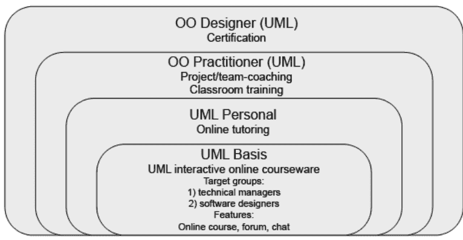

#### 表 1. 产品层级说明

| 学习产品的层级 | 说明 |
|---|---|
| UML Basis | “UML Basis”位于最低层级，围绕两个基于 Web 的培训（WBT）展开，这两个培训面向不同群体：(1) “UML Interactive for Technical Managers”介绍 UML 的起源、特征和优势，并简要概述不同的 UML 图以及现有工具支持，使学习者能够就在即将到来的开发中使用 UML 做出决策。(2) “UML Interactive for Software Designers”提供额外的学习内容，使学习者能够开发出高质量的 UML 图。这两个 WBT 均由互联网论坛支持，提供同步和异步的交流机会。学习者可以在这里提问，或与同伴聊天/讨论。 |
| UML Personal | “UML Personal”位于第二层级。除“UML Basis”外，它还提供在线导师支持。导师解答学科内容和组织管理方面的问题。在辅导活动的扩展版本中，导师会对模拟真实工作任务的实践练习提供反馈。这些练习代表了知识转移的第三阶段（即除了 WBT 中的示例和自测之外）。因此，导师能够评估学习者获得的知识和技能以及个人的学习行为。 |
| OO Practitioner (UML) | 在第三层级“OO Practitioner (UML)”中新增的学习活动是课堂培训和项目辅导。课堂培训涵盖面向对象分析、设计和实现领域的多个主题，并通过来自学习者应用情境的练习等来强化面向对象概念。主题事先与学习者及其上级共同确定。课堂培训结束后，提供项目辅导（也称为行动学习）。在辅导阶段，学习者在专家的支持下，将所获得的知识和技能应用于真实项目。 |
| OO Designer (UML) | “OO Designer (UML)”位于最高层级，增加了学习活动的认证。在认证过程中，学习者必须与同伴一起完成一项复杂的练习，或在团队内完成一个长期项目。结果将提交给导师并与之讨论。认证主题属于学习者的日常工作内容。 |

在第一阶段，设计并组织教育项目，包括对学习者技能、教育需求和学习环境的详细分析。用于分析这些领域的方法是技能画像与分析方法“QUALISEM-People”(de Haan, Waterson, Trapp & Pfahl, 2003)，该方法确保项目的内容和教学策略是基于客观信息确定的。这旨在通过满足客观识别的培训需求，提高学习项目的接受度，从而提高其有效性。在第二阶段，教育项目启动。项目以一个启动研讨会开始，目的是让学习者和导师相互了解，并向学习者解释项目的组织安排。随后是在线阶段，学习者使用 UML Basis 或 UML Personal 层级的基于 Web 的培训课程进行学习。在线学习阶段的目标是让学习者对 UML 符号达到相同的知识水平。这是后续课堂培训中高效教学的必要前提，因为培训师届时可以专注于提供来自 OO Practitioner (UML) 产品层级的详细高级知识，如面向对象分析、设计和编程。在第三阶段，所获得的知识被应用到实践中。也就是说，学习者开展一个面向对象的软件开发项目。此时，导师作为教练，按照支架式（scaffolding）和逐渐撤除（fading）的原则支持他们的努力。最终，所获得的知识被认证为已达到最高产品层级，进而达到最高教育水平——OO Designer (UML)。


### 工业环境中的观察与经验

本文提出的混合学习方法已在学术界和工业界成功测试，并已发表了若干经验报告（Grützner & Bunse, 2002; Grützner, Steinbach-Nordmann, Ochs, & Bunse 2003; Bunse, Grützner, Peper, & Steinbach-Nordmann, 2005）。为了改进混合学习安排并使工业培训项目与参与者的需求相匹配，建立了持续评估。与这些评估活动同时进行，参与者被询问了他们个人的学习需求、学习行为和学习偏好。提问分为预问卷（在线学习第一阶段开始前）和第二阶段结束时的后问卷。

### 培训项目的安排

混合学习方法必须根据企业的组织需求进行调整。研讨会的教学材料根据领域的具体需求以及（尽可能）参与者的经验进行了调整。为此，企业提供了一些真实世界的材料（文档、源代码等），代表了企业业务领域的特定应用领域。课程以认证日结束，参与者需在两到三人小组中自主解决一个复杂且领域特定的练习。所有参与者在完成培训部分后仍可访问在线课程。

### 案例研究的设置

为了评估所应用的混合学习方法的影响和接受度，我们开始收集数据。我们无意测试特定的研究假设，而是希望更多地了解参与者的学习需求和偏好，以及如何改进培训项目。

特别是，我们希望对以下问题找到答案：

**预问卷：**

- (Q1) 参与者关于培训的个人起点是什么（例如 UML 经验、动机、期望和个人时间安排）？

Figure 2. Product levels and phases

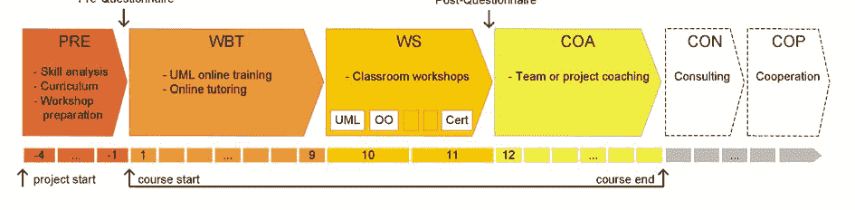

- (Q2) 参与者更喜欢如何学习？

**后问卷：**

- (Q3) 参与者如何评价培训措施及其要素（例如 WBT、课堂教学、培训材料和练习）？

- (Q4) 参与者如何使用基于网络的培训？学习和工作能否整合？

预问卷在培训项目之前进行，旨在收集有关即将到来的培训阶段的学习需求、偏好和期望的信息（参见表 2）。后问卷在认证日结束时提供给学习者（参见表 3）。

所有参与者都被邀请在第一阶段开始时填写在线问卷（见表 2），并在第二阶段结束时填写另一份印刷问卷（见表 3）。

### 案例研究的结果

共有 42 名员工（软件开发人员、经理、负责人）年龄在 20-49 岁之间参加了培训项目。

工业案例研究中混合学习培训参与者的构成：

- 43% 软件开发人员（其他例如机械工程师）
- 85.71% 男性
- 年龄范围：
  - 20 - 29 岁（28.6%）
  - 30 - 39 岁（35.71%）
  - 40 - 49 岁（28.6%）
- （未达 100：无填写）

问卷的回收率（28 份预问卷/38 份后问卷）相当令人满意，尽管数据量和群体构成不允许任何经验上的概括。然而，评估结果可能为学习者的需求和期望以及工业环境中混合学习不同要素的使用提供一些有趣的见解。

#### 预问卷（N=28）

**(Q1) 参与者关于培训的个人起点是什么？**

被问及面向面向对象软件开发与 UML 的培训项目对其未来项目工作的重要性时，几乎一半的参与者（48%）回答说，急需了解更多关于 UML 的知识。此外，被问及他们对培训项目的个人目标和期望（开放式问题）时，绝大多数回答（80%）可归纳为‘能够在未来项目中积极应用 UML’。

当参与者被问及他们最期望混合学习方法中的哪一个要素时，他们依次提到了课堂教学、辅导和 WBT。

当被问及他们认为哪种学习模式最有效时，参与者倾向于与同事进行或多或少非正式的交流。与此几乎处于同一高水平的是涉及讲师的课堂教学，讲师在培训后仍可作为项目教练提供支持（见图 5）。

**(Q2) 参与者更喜欢如何学习？他们如何整合工作与学习？**

除一人外，其余参与者（97.3%）没有任何 e-learning 或在线培训的经验。

#### 后问卷（N=38）

Table 3. Post-questionnaire: Assessment of satisfaction and learning behavior

| Question | Options |
| --- | --- |
| **Learning behavior** |  |
| 1. How much time did you invest into working with the Web-based Training (WBT)? | - More than planned<br>- As planned<br>- Less than planned<br>- I did not plan any time period in advance |
| If you invested more or less time, what do you think are the reasons for this? | free text |
| 2. How well were you able to integrate working with the WBT into your daily work? | Well, Not so well, Rather badly, Badly |
| Which factors were particularly beneficial, respectively detrimental, in this regard? | free text |
| 3. How did you mostly work with the WBT? Please characterize your personal learning situation with the help of the following categories (several answers are possible). | Online version, Printed version, At work, At home, On the road, During working hours, During spare time |
| Remarks | free text |
| **Post-Evaluation of Education Course (Phase I-II)** |  |
| 4. Which part of the continuing education course has fulfilled your expectations and goals best so far? | WBT, On-site training, The combination of WBT and on-site training (Blended Learning) |
| 5. Which part of the continuing education course could you most easily do without? | WBT, On-site phase (training + certification), I don’t want to do without anything. |
| 6. How well did the following components of the WBT support you in understanding the study material?<br><The teaching texts of the WBT><br><The diagrams of the WBT><br><The animations of the WBT><br><The exercises of the WBT> | (1) very well, (2) well ... (6) |
| 7. How well did the following components of the on-site phase support you in understanding the study material?<br><The explanations of the lecturer><br><The presentation slides and the handout><br><The exercises adapted to the domain><br><Cooperation with colleagues><br><The complex task during certification> | (1) very well, (2) well ... (6) |
| 8. Has your basic attitude towards e-learning changed through your work with the WBT? | - No, I continue to think that e-learning is a good thing<br>- No, I still do not think much of e-learning<br>- Yes, it has improved, since: ...<br>- Yes, it has gotten worse, since: ... |
| **Personal Information** |  |
| 9. Do you want to provide some personal information? | |
| <Sex><br><Age><br><Position in company> | Male, Female<br><20, 20-29, 30-39, 40-49 years, 50-59, >60<br>free text |

**(Q3) 参与者如何评价培训措施及其要素（例如 WBT、课堂教学、培训材料、练习）？**

在第二份问卷中，参与者认为课堂教学是混合学习项目中最重要的学习模式。

为了探索培训项目的哪个要素最有效地支持了他们的个人学习过程，参与者被要求在 1（= 非常好）到 6（= 不足） 的量表上评估每个要素。

在评估课堂教学要素时，参与者最满意的是：

- 讲师指导（1.6）
- 与同事的合作（2）
- 领域特定练习（2.5）
- 培训材料（2.7）

在评估基于网络的培训要素时，参与者最满意的是：

- 图示（1.6）
- 文本（1.8）
- 练习（2.1）
- 动画（2.1）

培训结束后，大多数参与者（85%）认为没有任何部分可以省略。

对培训要素的评估证明，参与者现有的学习偏好和习惯（课堂教学和与同事讨论）导致了相应的评估结果：培训开始前预期最有效的方式在培训后被评估为最有效的学习方式。但作为新的学习模式的 e-learning 也似乎得到了高度认可。对基于网络培训要素的良好评价以及没有任何培训部分被认为可以省略的事实表明，参与者将 e-learning 视为培训的有价值补充。这也表明，e-learning 不被视为独立的培训模式，而混合学习是学习者眼中备受推崇的方法。

Figure 3. Perceived effectiveness of ways to learn (pre-questionnaire)

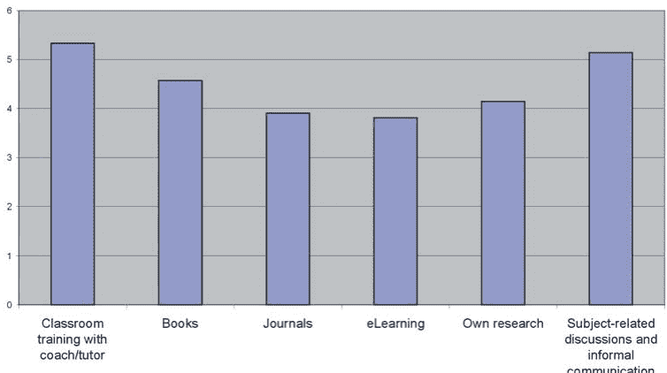


图4显示了参与者的访问分布，大部分学习时间安排在下午4点之后。此外，大部分时间安排在周五。显然，在线课程的灵活性实际上被用来优化工作与学习的共存。

重要的成功因素（请记住，针对特定领域的练习在所有培训材料中获得了最高评价（问题3））。让企业和教师双方都尽可能减少这项任务的精力和成本是符合双方利益的。在以往所有项目中，都可以就改编的特定工作量达成一致，并得到企业提供的适当材料支持。为了进行合理的改编，一些前提条件被证明很重要：(a) 准备材料的导师必须能够处理应用领域。这一要求并非易事，因为通常需要对材料进行完全的逆向工程：通常，你可能只能期望获得C/Java源代码或一些文本文档，必须从中推导出部分UML模型。(b) 该

### 经验教训

上一节描述了参与者对课程的经验。现在我们将切换到提供方的视角，讨论在案例研究期间（及之后）收集的一些定性经验。

如前所述，将研讨会练习和示例改编到特定领域是一个

#### 表4. 学习项目上花费的精力

| 超出计划 | 按计划 | 少于计划 | 未计划 |
|---|---|---|---|
| 0 0% | 8 21.0% | 24 63.2% | 5 13.1% |

缺失：1（2.7%）

#### 表5. 学习与工作活动的融合

| 非常好 | 可以 | 差 | 非常差 |
|---|---|---|---|
| 20 52.6% | 11 28.9% | 3 7.9% | 3 7.9% |

缺失：1（2.7%）

#### 表6. 影响学习与工作活动融合的因素

| 积极因素 | 消极因素 |
|---|---|
| - 学习单元的模块化 | - 噪音、干扰 |
| - 单元较小 | - 日常事务、短期任务 |
| - 主管的投入 | - 缺乏组织（需要帮助） |
| - 灵活性 | - 数据传输缓慢 |
| - 家庭作业 | - 无法访问互联网 |

企业中的联系人应能够选择合适的资料，即他应该对所教授的内容已有一些经验。(c) 参与者应有足够的时间来熟悉所选定的原始材料。

工业技术转移项目的主要目标是使企业员工能够将特定知识应用于给定问题。在实践中，知识内容及其应用模式的精确识别并不像预期的那样清晰。

第一个原因在于相关人员的不同观点。我们在工业项目的背景下区分三种角色：管理层通常是项目发起者，并愿意投资于员工教育以实现更高的生产力。因此，他们通常对项目成果抱有很高的期望。这些期望可能包括增加对某项技术或昂贵工具的使用。员工在处理新技术时通常有不同的先前经验和动机。因此，他们往往期望从所提供的内容中获得截然不同的信息。教练必须将这些内容传达给员工，并与管理层保持联系。由于管理层的观点和员工的看法通常不同，教练成为双方之间的协调者。这也适用于员工竞争群体之间的调解。此外，他可能有自己的学术兴趣，例如介绍特定方法等。

导致内容不确定性的第二个原因是证据随时间而变化。所有项目参与者在项目期间都会获得经验。因此，重点可能会转向那些对成功应用至关重要但在开始时并未被考虑的知识细节。

在混合式学习方法中，我们可以区分项目工作的几个阶段：自主安排学习课件或

#### 表7. 基于网络的培训学习

| 参与者在哪里以及如何通过基于网络的培训学习？ | 回答（多选） |
|---|---|
| 工作场所 | 29（76.3%） |
| 工作时间 | 28（73.7%） |
| 在线 | 24（63.1%） |
| 打印版（.pdf） | 16（42.1%） |
| 在家 | 6（15.8%） |
| 业余时间 | 3（7.9%） |
| 移动设备 | 0（0%） |

#### 图4. 参与者访问分布作为在线学习时间的指标

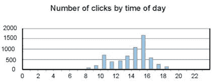


在WBT使用期间通过首次论坛讨论。研讨会通常考虑特定领域的示例，辅导会介绍一些浅层的企业特定问题（教练需准备数小时），咨询则会提出详细的问题（需准备数天）。这最终进入合作阶段，在该阶段定制程度无法进一步提高。对于基于网络的培训，知识呈现的灵活性也为零，因为所有材料都以标准形式呈现。对于研讨会，这种情况略有改善，但教练仍然依赖于一套标准的演示幻灯片和练习。由于后续阶段可用于准备的精力明显更多，因此在选择备选方案、讨论等方面也有更大的空间。

### 建议

前几节介绍的评估和观察可以总结为几个一般性结论和建议：

- 尽管电子学习和基于网络的培训旨在缩短学习时间，但我们指出，学习仍然需要时间。这一见解应尽可能多地向企业管理层强调，以确保培训得到合理安排。
- 让人们选择自己的学习方式和学习情境。我们认为，人们对灵活的学习解决方案感兴趣，并且能够以最适合的方式（时间、任务优先级）调整学习计划以适应个人的环境约束。
- 将电子学习（即基于网络的培训）与课堂培训和辅导相结合。我们的经验是，通过媒体（书籍、数字内容）进行的个人学习是一个重要方面。然而，它非常内容驱动。为了学习更多专业方法论，参与者应该被赋能并鼓励应用所学知识，并了解其在现实世界中的效果。这可以通过在课堂培训中使用真实任务和材料，或在教练协助下的真实项目中来实现。

并鼓励他们应用所学知识，并了解其在现实世界中的效果。这可以通过课堂培训中的真实任务和材料，或在教练协助下的真实项目来实现。

- 信任的社会氛围非常重要，教练与员工之间（也包括教练与管理层之间）需要建立个人关系。应在项目阶段有意识地培养这种氛围，例如通过以下方式：
  - 尽早介绍教练，例如通过个性化的启动电子邮件，甚至与网络培训用户会面。
  - 让同一个人负责研讨会和后续辅导。
  - 不要更换教练。
  - 不要贬低现有能力，而应将其整合。
- 内容应尽早进行定制。在理想情况下，可以从应用环境中选取一个具体问题作为参考示例。但这样会较早增加项目成本。
- 不要过早结束项目，例如在WBT结束后立即结束。这会让人们独自面对上述内容和应用的不确定性。
- 出于同样的原因，项目目标应时常重新调整。与不同参与者的定期沟通有助于调和他们的利益。
- 识别能够支持并在未来继续知识转移的内部专家。

### 未来趋势

面向对象和基于模型的软件开发的教学是一个快速发展的领域，创新率很高。最近服务导向的出现就是很好的例子（即，


本章介绍了一种混合学习法（即在线培训与传统课堂教学相结合），并通过紧密整合的辅导活动来强化。该方法实际应用于培训专业软件开发人员使用 UML 进行面向对象的软件开发。具体而言，该方法利用在线培训活动建立对技术的共同理解和知识，通过课堂培训传授应用和特定领域知识，并通过辅导确保新学的内容被正确应用。

为了在实践成功应用我们的方法，并支持他人决定采用我们的成果，评估该方法的具体效果并批判性反思促成因素非常重要，也就是说，需要证据支持。因此，本章第二部分展示了一项工业案例研究，以深入了解学习者的期望、偏好，以及在工业环境中工作与学习的融合。结果表明，采用混合学习法对学习时间有积极影响，并且由于整合了辅导措施，不仅支持有效学习，还能带来可持续成果。然而，有限的数据点不足以泛化这些结果。因此，还需要进一步的额外研究。

### 参考文献

Rossett, A. & Vaughan Frazee, R. (2006). 混合学习机会. AMA 特别报告. 检索于 2007 年 10 月 24 日，来自 http://www. amanet.org/blended/pdf/WhitePaper_Blend-Learn.pdf.

亚洲开发银行（1997）。教育项目中培训的有效性与影响专项研究。技术报告。专项研究系列第29号），SST:INO 97023.

Burge, J. & Troy, D. (2006). 迎接挑战：在软件工程教育中使用面向商业的案例研究。第十九届软件工程教育与培训会议论文集。夏威夷龟湾。

Bunse, C., Grützner, I., Peper, C., Steinbach-Nordmann, S. (2005). 应用混合学习策略进行软件工程教育。第18届软件工程教育与培训会议（CSEE&T）论文集。加拿大渥太华。

Collins, A., Brown, J. S. & Newman, S. E. (1990). 认知学徒制：教授阅读、写作和数学的技艺。载于 Resnick, L. B. (Ed.). 认识、学习与教学：罗伯特·格拉泽纪念文集。新泽西州希尔斯代尔：劳伦斯·厄尔鲍姆出版社。

de Haan, D., Waterson, P., Trapp, S. & Pfahl, D. (2003). 将需求评估整合到下一代电子学习系统中：从案例研究中吸取的经验教训。IFIP 开放工作会议“eTRAIN 2003：专业组织的电子培训实践”论文集。芬兰波里。

Ferreira, H.S., Fonseca, L.M.G., d’Alge, J.C.L., Montiero, A.M.V. (2002). 地球技术教学的新方法。摄影测量与遥感国际档案及空间信息科学，巴西圣若泽多斯坎波斯。第 XXXIV 卷，第 6 部分，CVI.

Fetaji, B. & Fetaji, M. (2006). 软件工程 Java 教学软件及其定性研究。第四届国际多媒体与信息通信技术教育会议 m-ICTE 2006“技术辅助教育的当前发展”论文集。西班牙塞维利亚，第 3 卷。

Frailey, D. J. (2006). 将实际软件工程任务引入软件工程课堂。第十九届软件工程教育与培训会议论文集。夏威夷龟湾。

Solberg Søilen, K. (2007). 在混合学习中使用案例研究以提高互动性并降低辍学率。*第19届北欧管理学院会议*。挪威卑尔根。

Stark, C.M. & Schmidt, K.J. (2002). 向电子学习过渡：案例研究。*2002年 eTEE 会议论文集*。瑞士达沃斯。

Thomas L. & Ras E. (2005). 使用单一来源方法开发课件。*世界教育多媒体、超媒体与电信大会论文集*。

Ubal, R., Cano, J.-C., Petit, S. & Sahuquillo, J. (2006). RAC FP：一种在本科课程中处理浮点表示、算法和电路的训练工具。*IEEE 教育汇刊*。49 (3), 第 321-331 页。

Wang, A. I. & Sorensen, C.-F. (2006). 将写作作为学习软件工程的工具。*第十九届软件工程教育与培训会议论文集*。夏威夷龟湾。

Wills, S. (2006). 混合式电子学习的战略规划。*第七届基于信息技术的高等教育与培训国际会议论文集*。澳大利亚悉尼。

Yildiz, Senem, Chang, Carrie (2003) 远程学生对三个基于异步网络会议课程的参与和互动感知的案例研究。*美国土耳其在线远程教育杂志-TOJDE*。4 (2).

### 测试计划的制定

一旦学生理解了课程目标并熟悉待测试的系统，他们就必须开始制定测试计划。该文档需要按照技术报告的格式编写，这一点尤为重要，因为学生即将完成学业，需要准备好应对软件开发行业使用的文档格式标准。该文档必须切合实际，并包含与课程时长相适应的进度安排和里程碑。

### 单元测试

单元测试是 XP 的核心实践之一，包括将面向对象软件系统中的每个类单独取出并进行隔离测试。鼓励学生选择自下而上的测试方法，即先测试系统中的各个类，再测试类的组合。采用这种方法，集成测试会变得容易得多。教师还鼓励学生特别重视单元测试，原因如下：

- 单元测试隐式地涉及一种文档，它使学生能够更好地理解模块、需求和 API。
- 良好的单元测试是进行回归测试的基础。

由于本课程选用 Java 作为编程语言，辅助单元测试过程的工具非 JUnit 莫属。为了深入理解单元测试，需要涵盖许多与测试用例设计以及如何正确隔离测试对象相关的问题。在以下小节中，我们将详细描述这些问题，并结合我们授课经验提出一些教学建议。不过请注意，某些方面（如测试用例设计）并非与单元测试唯一相关。

#### 测试用例设计

进行单元测试的第一步是设计测试用例，黑盒和白盒技术都适用于此目的。黑盒测试包括在给定某些输入的情况下，测试函数

图1. 待测试系统及其环境图

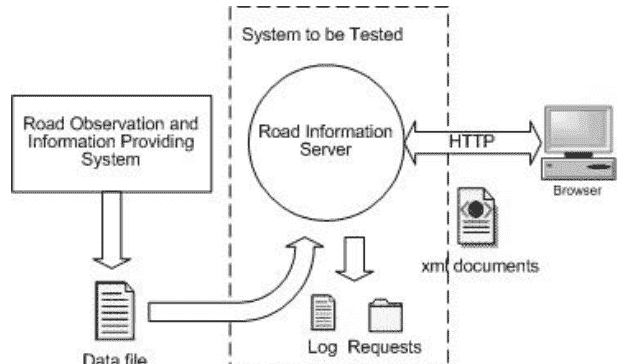

或方法的输出是否符合其功能规格说明。白盒测试包括分析源代码以指导测试数据的选择。在这方面，学生需要具备足够好的 Java 编程技能，以彻底理解方法源代码中的执行流程。在课程开始时创建结对时，平衡配对非常重要；Java 编程技能较弱的学生必须与经验较丰富的学生配对。必须适当选择测试数据，以实现对待测试代码的充分覆盖。学生必须决定在测试每个方法时使用哪种覆盖（语句、边、分支或路径），并说明所作决定。此外，学生还必须为每个方法绘制流程图，并在必要时在图中标出由异常处理派生的特殊情况。请注意，整个系统中只选择了 6 个方法进行测试，因此工作量是可承受的。

我们遇到学生在理解和适当设置调用给定测试用例方法的上下文方面存在困难。有一种趋势是把方法看作一个执行实体，其结果仅由输入参数决定，而不管方法被调用的上下文。这个问题在白盒视角下设计测试用例时尤其明显。因此，我们选择了一些结果深受事件影响的方法，例如文件系统中是否存在某个文件，或方法所在对象的内部状态。另一个重要问题是，要让学生考虑设置方法调用上下文所涉及的所有因素，并检查其执行的所有可观察结果。

#### 隔离测试

也许单元测试中最困难的方面是将一个类与其协作类完全隔离。通常，一个对象会利用其他对象来执行超出自身功能之外的某些任务。显然，该对象所属方法的执行结果（以及因此得到的测试结果）将在很大程度上由对象的内部状态决定。通常很难设置领域状态来暴露需要测试的特征。即使我们可以做到，所编写的测试也可能非常复杂，难以理解和维护。我们可以使用 Mock 对象（Mackinnon, T., Freeman, S., & Craig, P. 2000）来避免这些问题，Mock 对象是一种替代实现，用于模拟或检测其他领域代码（尤其是协作类）。它们应该比真实代码更简单，不重复其实现，并允许开发人员设置私有状态以辅助测试。Mock 对象非常有用，但手工创建可能很繁琐，因此学生使用名为 JMock 的工具。JMock 根据原始类自动生成 Mock 类的源代码，并提供了非常直观的接口，学习曲线非常平缓。除了生成 Mock 对象之外，通常还需要进行初步的重构过程，包括创建工厂方法，在工厂方法中用 Mock 对象替换原始对象。源代码清单 1 显示了一个实例化协作类的工厂方法示例。

```
public class TargetClass() {
    protected CollabClass factory-Method(){
        return new CollabClass();
    }
    ...
}
```

#### 源代码清单 1

按照此过程，可以测试继承自目标类并重写工厂方法的对象，从而用该实例化替换协作对象的实例化。


参考文献。有一些关于该主题的建议；即使像 JUnit 这样的框架也提供了辅助工具。然而，我们观察到缺乏深入分析，学生无法依靠它在大多数可能的情况下成功继续。

在测试异常时，学生倾向于将它们视为一段 if-else 代码块，其中 if 对应 try 语句，else 对应 catch 语句。这样，测试过程将包括为每种可能的执行路径定义两个测试用例。然而，当学生将此过程付诸实践时，会出现相当数量的非平凡问题。是否应按照相同程序测试所有异常？是否应测试所有可能抛出的异常？如果不是，决定哪些异常不应测试的标准是什么？在本节的剩余部分，我们将尝试阐明这些问题。

目标是验证异常仅在必要时才生成。遵循这一考虑，可以将它们归类为预期或非预期。请注意，这种分类并不针对异常本身，而是针对为测试它而设计的测试用例的性质。

### 预期异常

预期异常是指测试用例中，方法下测试的执行上下文被设置成必须抛出异常。测试它们包括使用“异常”数据调用抛出方法并通过断言检查异常是否确实被抛出。可以使用 JUnit 4.x 中的注解 `@Test(expected=ExpectedException.class)` 在定义测试方法时进行此类异常的测试。然而，它有一个明显的缺点：检查是否生成了正确的异常取决于框架，并且由于异常对象在测试方法中不可用，因此无法对异常对象本身进行额外验证。

为简单和通用起见，已向学生提出源代码清单 4 中所示的程序：

```java
public void testSomeMethod() {
    try {
        instanceToTest.methodToTest(params);
        fail("An exception was expected");
    } catch (ExpectedException e) {
        // Execution control must reach here
    }
}
```

**源代码清单 4**

通过这些代码语句，我们确保如果在调用要测试的方法时使用适当的参数未引发异常 ExpectedException，将会发生失败。我们在学生中观察到预期异常的常见误解。有时，他们包含一些测试用例，其中预期异常的概念被扩展为“测试 Java 平台”。例如，编写测试用例会导致在未初始化对象上调用方法，从而产生由 JVM 引发的 NullPointerException。这种测试用例毫无意义，因为测试 JVM 显然超出了测试计划的范围。

### 非预期异常

非预期异常对应于系统无法提出任何解决方案的那些不可预测的情况。这类异常易于测试，因为 JUnit 会自动捕获测试方法抛出的异常并将其报告为错误（请注意 JUnit 中错误和失败之间的非平凡区别）。对于未检查异常（继承自 `RuntimeException` 的那些），无需执行任何操作，而已检查异常必须在测试方法定义的 throws 子句中声明。

```java
public void testSomeMethod() throws SomeCheckedException {
    // test something
}
```

**源代码清单 5**

### 提高可维护性

如今，软件企业的大部分活动和经济效益来自维护相关任务。事实上，通常在绝大多数软件项目中，维护生命周期比开发生命周期长得多，所投入的资源量也更大。这里有趣的一点是，需要的资源越多，成本效益改善的潜力就越大，因此在教授该主题的良好实践方面付出的努力也必须越大。

在生产代码正在被修改的维护阶段，需要以非常高的周期性进行回归测试，并且必须尽可能自动化，以便以合理的资源成本运行。因此，有必要训练学生在良好的测试实践方面，以保证生产不仅可维护的测试软件，而且具有高度自动化的测试软件，可以在回归中有效使用。除了一些一般建议，例如最小化测试代码与生产代码之间的耦合和使用自动部署脚本外，学生还接受了名为 JTestCase 的开源工具的使用培训。该工具在协助测试用例设计和执行任务方面非常有帮助；它基本上是一个 JUnit 扩展库，允许将测试用例数据与测试用例源代码分离。这种分离是通过使用 XML 数据文件以非常结构化和可读的方式存储测试用例数据来实现的。为了进一步增强可维护性，必须使用不同的 XML 文件来存储属于不同类的测试数据。

JTestCase 还提供了在测试过程中从测试代码加载此数据到内存所需的 API 方法。导致我们向学生推荐使用该库的主要优点有两个：

- 可以通过仅向 XML 文件添加新的测试用例描述来扩展测试用例数据集，而无需修改和重新编译测试源代码。
- 设计测试用例数据集的开发人员无需了解要测试的方法的源代码。因此，建立了测试用例设计和执行角色之间的明确分离。

然而，该库也存在一些缺点，我们在设计实验室练习时需要处理这些缺点，以避免过度增加其复杂性。例如，当它们是复杂数据类型或用户定义类的实例时，将要测试的方法的参数数据存储在 XML 文件中可能会导致非常复杂和乏味的任务（因为它们不直接受 JTestCase 提供的语法支持）。尽管这个问题可以使用 JICE 库克服，但我们认为学生花费时间学习新工具是不值得的。

我们提出的另一个建议是使用作为测试用例设计文档的一部分生成的 XML 文档（XML 文件可供人类和机器阅读），从而避免始终难以维护的重复信息。

### 报告和解释测试结果

一旦使用相应的 Ant 脚本执行测试用例，就会生成大量总结检测到的错误和失败的信息。正确解释和理解这些信息是定位和适当解决测试过程中发现的软件缺陷的关键问题。JUnit 包括以文本形式（命令行窗口的标准输出）或图形形式呈现测试用例执行结果的支持。然而，对于通常开发数千个测试用例的实际应用，这些信息呈现方法不可读且不切实际。为应对这一问题，我们指导学生使用 JUnitReport 工具，该工具允许生成包含每个特定执行测试用例的执行结果的超文本可浏览 HTML 格式文档。该工具能够合并由 `<junit>` Ant 任务生成的单个 XML 文件，并在最终文档上应用样式表。JUnitReport 作为 Ant 发布版的附加任务提供，但需要安装外部第三方库。需要指出的一件重要事情是，`<junit>` 和 `<junitreport>` 任务必须在 Ant 脚本的不同目标中编写，以便测试用例执行和结果报告任务不相互依赖。

另一个必须涵盖的基本主题是对获得结果的正确解释。通常，JUnit 在错误和失败之间做出区分；然而，这种区分是人为的、无用的，并且通常是学生之间误解的来源。这种区分不能提供有关发现的软件缺陷来源的明确信息。虽然失败与未满足的断言方法有关，即生产代码中的缺陷，但错误反映了测试用例执行期间发生的非预期情况，可能由生产代码或测试代码中的缺陷引起。此问题必须在课程开始时涵盖 JUnit 工具时进行。

### 集成测试

集成测试以系统中类的协作为中心。一旦不同类在隔离情况下显示工作良好，就有必要验证它们组合时也能正常工作。在对目标类进行单元测试时，学生会进行少量重构过程，通过使用工厂方法用模拟对象替换域对象。之后，必须逐步用原始对象替换模拟对象。这可以使用 (Wick, M., Stevenson, D., & Wagner, P. 2008) 中提出的方法直接完成。学生必须用返回学生希望集成的实际对象的新工厂方法替换原始目标类的工厂方法。请注意，这种方法允许逐步集成，即如果我们一个一个地替换工厂方法，我们就是一个一个地将原始类添加到集成测试中。与单元测试相比，集成测试由于设置域以测试特定行为的复杂性而更难实现。在集成测试中涉及大量对象，而在单元测试中仅涉及少数模拟对象加上目标对象。此外，与模拟对象相比，模拟对象的状态设置非常容易。由于这些困难，我们发现学生需要额外的支持和指导才能使集成测试成功。

### 功能测试

最后一步是对整个系统进行功能测试。为此，学生提供一份简要的软件需求文档，其中例如描述了系统提供的 HTTP 请求的语法和返回的 XML 文档的格式。目标是进行自动化测试以验证系统行为是否符合软件需求。仅在 JUnit 的帮助下从头开始对分布式应用程序进行功能测试是一项艰巨的任务（请注意，尽管其名称为 JUnit，但 JUnit 并非专门用于单元测试）。为应对这一困难，我们在学习环境中引入了两个有趣的 JUnit 扩展库（这两个库以及本章所述学习环境中包含的所有工具都是免费的开源工具），以便于这项工作：HttpUnit 和 XMLUnit。请注意


尽管名字如此，XMLUnit 和 HttpUnit 并不是单元测试工具，而是功能测试工具；尽管如此，“unit”前缀是一种简单的方式，使这些工具很容易被识别为属于 JUnit 家族。一方面 HttpUnit 通过隐藏所有 HTTP 协议细节来简化与 Web 应用程序的交互。该工具基本上模拟了 Web 浏览器的功能，允许测试代码像用户通过点击链接和使用常规 Web 浏览器和鼠标查看文档一样导航 Web 应用程序并检索其内容。一旦测试代码能够从系统中检索文档，下一步就是验证检索到的文档的内容和结构，以确保它们遵循软件需求文档中包含的规范。为此目的，HttpUnit 可以与 XmlUnit 结合使用。前者能够解析和验证 HTML 文档的内容（如页面标题、其中存在的表格和表单，甚至脚本代码的正确性），后者能够对 XML 文档进行验证。

在进行功能测试时另一个有趣的点是允许多次失败的可能性，即允许在同一个测试方法中出现一个以上的 assert 方法失败。JUnit 通常在第一次失败发生时停止测试方法的执行并继续执行下一个方法。虽然这在单元测试的特定情况下很方便，因为在发生失败后被测对象的状态可能不可预测，但在功能测试中通常设计测试用例以执行一组通常不相关的更高级别的操作。在这些情况下，一个失败可能不会影响后续操作的正常执行，而且由于功能测试通常是一项非常耗时的任务，能够继续测试过程可以节省大量执行时间。有一种专门设计的工具可以克服 JUnit 在应用于功能测试时的这一缺点，其名称为 JFunc，并且也被纳入测试环境。

在以下几点中，我们总结了课程举办的三年学术年期间我们观察到的一些有趣问题。

-   将功能测试工具纳入课程的过程如果没有适当的示例和指导，则涉及相对较长的学习曲线。
-   一旦工具有效地应用于功能测试过程，学生就会意识到所产生的测试代码的简单性以及解决方案的可扩展性和通用性。在初步的指导研究努力之后，再进行后期的独立研究努力，他们将一套最先进的功能测试工具纳入其课程，这些工具明显提高了测试的质量和自动化水平，并且在回归测试中非常有帮助。
-   有时学生需要额外的支持来区分 Web 文档中必须测试的方面和不必测试的方面。虽然所包含的信息的内容和组织很重要，但诸如演示和 Web 设计元素等方面显然超出了范围。
-   系统生成的文档是动态的，这是一个有趣的点，因为我们故意包含的一些动态内容，如时间戳或自动递增值，由于其本质而几乎不可能进行测试。在这些情况下，学生被指示从整体内容验证过程中消除对这些值的验证。

### 充分利用软件管理配置工具（SMC 工具）

如今 SMC 工具对于跟踪正在开发的软件的演变至关重要，并且也代表了每个软件开发协作工作模式的基本支持

### 评估方法有效性

何时将哪些软件元素提交到存储库。这对于评估学生编写的测试计划中规定的进度在多大程度上得到满足非常有帮助。这是一个重要问题，因为计算机科学的应届毕业生必须证明有足够的经验来准确估计完成一项任务所需的时间和资源。

-   实践考试，在此考试中，学生接受技能测试，以表明其对所用工具的理解和处理水平良好。在这方面学生通常表现非常好，并且在被问及时，他们显示出能够将工具应用于新场景的能力。

在绝大多数情况下，学生在口头报告和实践考试中表现非常好。有趣的是，一些学生超出了课程范围并将新工具纳入测试过程，例如性能分析工具。然而，经过仔细检查每个学生对在存储库中工作文件夹的更改日志后，似乎其中一些人在估计完成每项任务所需的时间方面存在困难。我们将其归因于缺乏将所介绍的测试技术付诸实践的经验。我们预计在今后这方面会有更好的表现。

最终结果表明，约 85% 的学生（在课程举办的三年的平均值）满意地完成了课程，平均成绩为 10 分中的 7.5 分。这一百分比与实际完成课程中所有练习的学生人数非常相似。这使我们得出结论，只要教师让学生足够参与其中，学习环境成功的保证就得以实现。

为了评估课程对学生学习和态度的影响，我们进行了一系列调查。调查在课程开始时和结束时进行，该课程在过去三年学术年中举办。尽管调查是自愿性质的，但平均每年 150 名学生的 93% 完成了调查。值得注意的是，学生知道他们对问题的回答不会影响他们的成绩。调查的目的是评估学生在课程期间涵盖的相关软件测试主题上的态度是否根据我们之前陈述的假设发生了变化。

态度评估调查的设计方式与（Sitaraman, M., Long, T.J., Weide, B.W., Harner, E.J. & Wang, L. 2001）中提出的方式相似。调查由 18 条陈述组成。每条陈述都必须由学生用六种选择之一标记：强烈不同意（1）、不同意（2）、中度不同意（3）、中度同意（4）、同意（5）和强烈同意（6）；其中括号中的数字是与每种选择相关的分数。表 2 包含构成态度调查的 18 句话中的 6 句。请注意，每句话都用一个词（“positive”或“negative”）标记，该词指的是在比较课程开始和结束时的调查时，对该句话结果的预期趋势。

表 3 总结了表 2 中包含的句子的结果。这些结果来自在 2005-2006 学术年开设的课程的 134 名学生。第一列表示句子的编号。第二和第三列表示在课程开始时和结束时进行的调查中每句话的平均同意分数。第五列显示了对原始数据进行单侧配对 t 检验得出的 P 值。这些值用于确定

评估还显示，学生在进行集成测试时通常存在困难。他们不知道如何开始集成以及如何逐步选择要添加到集成测试中的新类。在这一点上需要大量的指导。最终评估还显示，学生通常对自己的工作感到满意，并认为所尝试的方法在长期内是有用的。

我们当前的工作和未来的意图是通过将软件测试世界中不断出现的最相关的软件测试相关趋势和技术纳入其中来更新和增强学习环境。特别是，我们目前正在努力将数据库访问测试和新的测试反模式识别方法纳入课程。

### 参考文献

Astrachan, O., Duvall, R.C., & Wallingford, E. (2001). Bringing Extreme Programming to the Classroom. Presented at XPUniverse Conference’01, 2001.

Beck, K. et al. (2001). Agile Manifesto. Retrieved March 30th 2007, from http://agilemanifesto.org/

Beck, K. (2000). Extreme Programming Explained: Embrace Change. Addison Wesley.

Cobertura. (2005). Retrieved from http://cobertura.sourceforge.net/

Cockburn, A., & Williams, L. (2001) The costs and benefits of pair programming. In G. Succi and M. Marchesi (Eds.), Extreme Programming examined (pp. 223-243). Boston: Addison-Wesley.

Collofello, J. & Vehathiri, K. (2005). An Environment for Training Computer Science Students on Software Testing. Paper presented ad Frontiers in Education, 2005. FIE ‘05. 19-22 Oct. 2005, T3E-6- T3E-10.

Edwards, S. (2003). Using Test-Driven Development in the Classroom: Providing Students with Automatic, Concrete Feedback on Performance. Paper presented at International Conference on Education and Information Systems: Technology and Applications EISTA 2003, Orlando, FL, 2003.

Kaufmann, R., & Janzen, D. (2003). Implications of test-driven development: a pilot study. Paper presented at 18th annual ACM SIGPLAN conference on Object-oriented programming, systems, languages, and applications (OOPSLA 2003), Anaheim, CA, 2003.

Lui, K.M., & Chan, K. C.C. (2003). When Does a Pair Outperform Two Individuals?, Lecture Notes in Computer Science, Volume 2675, 225–233.

Mackinnon, T., Freeman, S., & Craig, P. (2000). Endo-Testing: Unit Testing with Mock Objects. Presented at eXtreme Programming and Flexible Processes in Software Engineering - XP2000.

McDowell, C., Werner, L., Bullock, H., & Fernald, J. (2002). The Effects of Pair-Programming on Performance in an Introductory Programming Course. Presented at 33rd SIGCSE technical-symposium on Computer science education. 2002, 38-42.

McDowell, C., Werner, L., Bullock, H., & Fernald, J. (2003). The impact of pair programming on student Performance, perception and persistence. Presented at Int.Conf. on Software Engineering (ICSE2003), 2003, 602-607.

Melnik, G., & Maurer, F. (2002) Perceptions of Agile Practices: A Student Survey.” Paper presented at Agile Universe/XP Universe 2002, Chicago, IL, 2002.

Mugridge, R. (2003). Challenges in Teaching Test Driven Development. Paper presented at XP 2003, Genova, Italy, 2003.


Müller, M., & Hagner, O. (2002). 关于测试优先编程的实验. IEE Proceedings Software, 第149卷, 第131-136页.

Müller, M., & Tichy, W. (2001). 案例研究：大学环境中的极限编程. 在2001年第23届国际软件工程会议（ICSE 2001）论文集上发表的论文，多伦多，安大略省，2001年.

Reichlmayr, T. (2003). 敏捷方法在本科软件工程课程项目中的应用. 在2003年第33届教育前沿会议（FIE 2003）年会上发表的论文，博尔德，科罗拉多州，2003年.

Shukla, A., & Williams, L. (2002). 为软件工程核心课程调整极限编程. 在2002年第15届软件工程教育与培训会议（CSEE&T 2002）上发表的论文，卡温顿，肯塔基州，2002年.

Sitaraman, M., Long, T.J., Weide, B.W., Harner, E.J. & Wang, L. (2001). 基于构件的软件工程教育与评估的正式方法. 在第23届国际软件工程会议（ICSE 2001）上发表的论文.

Subversion. (2000). 取自 http://subversion.tigris.org/

Tinkham, A., & Kaner, C. (2005). 程序员测试课程的教学经验. 在2005年敏捷会议（2005年7月24-29日）上发表的论文，第298-305页.

Wick, M., Stevenson, D., & Wagner, P. (2008). 在课程中全面使用测试和JUnit. 在2005年第36届SIGCSE计算机科学教育技术研讨会上发表，第236–240页.

Williams, L., Kessler, R. A., Cunningham, W., & Jeffries, R. (2000). 加强结对编程的理由, IEEE Software, 17(4), 19-25.

Williams, L. A., & Kessler, R. R. (2000). “结对压力”和“结对学习”对软件工程教育的影响. 在2000年3月第13届软件工程教育与培训会议上发表，第59-65页.

Williams, L., & Kessler, R. (2000). 在计算机科学课堂中试验行业的结对编程模型. 计算机科学教育杂志, 10(4).

理工学院，一门其标题中包含“软件工程”一词的学术课程。由于各种原因，在具有重要软件工程内容的课程变得更加普遍之前，已经过去了相当长的时间（Tomayko, 1998; Duggins， 2002）。从1977年开始，一些软件工程研究生项目被开发并开始运作，包括西雅图大学、德克萨斯基督教大学和王氏研究生院（Tomayko, 1998）。在本科阶段，许多计算机科学和计算机工程项目纳入了一到两门软件工程课程，通常使用调查类教科书进行教学，这些教科书覆盖面广但深度相对有限。尽管国际上早在1985年就出现了本科软件工程项目（联合计算课程工作组，2004），但直到1996年，罗切斯特理工学院才启动了后来在2003年成为美国首批获得认证的四个软件工程项目之一；该组中的其他项目由克拉克森大学、密尔沃基工程学院和密西西比州立大学提供。

虽然我们认识到其他国家的软件工程项目已由所在国的认证机构进行了认证，但本章仅讨论在美国获得认证的软件工程项目的历史和经验。希望这里提供的材料对美国乃至世界各地的软件工程教育工作者都有价值。

### ABET与工程专业认证

ABET, Inc.（前身为工程技术认证委员会）是美国高校在应用科学、计算、工程和技术领域公认的认证机构。它是一个代表上述领域的专业和技术学会联合会（目前有28个）。ABET的认证活动由四个委员会管理；其中与软件工程关系最直接的两个是工程认证委员会（EAC）和计算认证委员会（CAC）。与其他工程学科一样，软件工程归入EAC，而CAC负责计算机科学、信息系统和信息技术。与其他一些学科相比，历史上认证一直是美国工程项目的一项预期属性，因此也是软件工程教育工作者关注的一个重要问题。

每个学科都有一个相关的“牵头学会”，它是ABET的成员学会之一。该学会主要负责制定学科特定的认证标准，以及遴选、培训和评估项目评估员。最初，软件工程的牵头学会是电气与电子工程师协会（IEEE），它编写了软件工程项目标准的最初版本（工程认证委员会，1999，第47页），本章稍后将讨论该标准。

随着ABET与计算科学认证委员会（CSAB）于2001年11月合并，CSAB接管了软件工程牵头学会的角色，IEEE成为“合作学会”。与IEEE和ABET大多数其他成员学会不同，CSAB本身不是一个会员制学会。相反，CSAB的当前成员是另外三个专业学会：计算机协会（ACM）、IEEE计算机学会（IEEE-CS）和信息系统协会（AIS）。

从寻求初始认证的软件工程项目的角度来看，该过程从评估申请开始，该申请必须在请求评估访问的当年1月之前提交。由于ABET政策要求项目在评估访问时至少有一名毕业生，因此评估申请通常是在预计首批毕业生的那一年提交。

当然，项目和课程定义的工作必须更早开始。项目教师通常会参加ABET教师研讨会，并派代表参加ABET项目评估员的培训课程，以熟悉认证标准、流程和惯例。项目还必须定义其教育目标和成果，下文将对此进行更详细的讨论。

一旦提交了评估申请，下一个任务是完成自评报告，该报告提供详细的数据和证据，以证明项目符合适用的认证标准。自评报告基于ABET提供的模板（工程认证委员会，2007a），并且必须在提出申请的当年6月底前提交。

评估访问在秋季进行。访问团队由一名团队主席（通常是EAC的成员）和每个待评估项目至少一名项目评估员（PEV）组成。最小团队规模为三名成员（ABET，2006，第8页），因此如果在同一访问中没有其他项目被评估，可能会为单个项目分配两名项目评估员。在访问之前，项目评估员会审查自评报告和相关材料，如学生成绩单。与项目领导层的持续沟通有助于在团队到达校园之前解决尽可能多的问题。在访问期间，评估员访谈教职员工和学生，审查诸如学生作业示例等其他材料，评估设施，并收集任何其他必要信息。

在访问结束时的离场会议上，认证团队向机构提供其评估总结。访问结束后，项目有机会提交补充证据，主要针对访问期间发现的任何不足。随后，团队主席和项目评估员准备一份调查结果的声明草稿，发送给机构征求意见。声明的最终版本包含因该机构“正当程序”回应而产生的任何修改，并在访问后的夏天发送给EAC以供最终行动。如果认证获批，通常的做法是将认证追溯至上一年的毕业生，因为在认证审查期间接受审查的正是他们的工作和课程。

### 认证标准

当前的工程认证标准（工程认证委员会，2007年）基于最初被称为“2000年工程标准”（通常缩写为“EC2000”或“EC2K”）的重大修订版。以前版本的标准侧重于详细的规范，并且在许多工程教育工作者看来，限制了灵活性和创新的机会。修订后的标准采用了一种设定总体目标并让各个项目负责通过适当的评估和评价来证明实现这些目标的方法。

ABET认证学士学位工程项目的每一项标准都针对一个特定的关注领域。在2007年，对标准的编号和组织的变更被提出，如表1所示；这些变更将在2008-2009年认证周期生效。

尽管组织发生了变化，但每个关注领域的内容仍然相当


#### 表 1. 各 ABET 准则涵盖的关注领域

| 关注领域 | 准则 (2007-2008) | 准则 (2008-2009) |
|---|---|---|
| 学生 | Criterion 1 | Criterion 1 |
| 项目教育目标 | Criterion 2 | Criterion 2 |
| 项目成果 | Criterion 3 | Criterion 3 |
| 持续改进 | Criterion 2-3 | Criterion 4 |
| 课程 | Criterion 4 | Criterion 5 |
| 教师 | Criterion 5 | Criterion 6 |
| 设施 | Criterion 6 | Criterion 7 |
| 支持 | Criterion 7 | Criterion 8 |
| 项目准则 | Criterion 8 | Criterion 9 |

自 EC2000 准则引入以来一直稳定至今。准则如下：

##### Students.
出于历史原因，准则首先讨论工程项目与其学生之间的关系，尽管从逻辑上讲，更合理的做法是从项目教育目标和成果开始。项目必须对学生进行评估并监控其进展，同时提供课程和职业指导。特别指出需要对转学生的录取、转学分授予以及验证所有学生是否满足所有项目要求制定有效的政策和程序。

##### Program educational objectives.
自 EC2000 准则最初引入以来，用于指定工程项目力求实现的结果的术语一直在不断演变和澄清。根据当前定义，项目教育目标涉及毕业生所准备的广泛的职业和专业成就。项目领导和教师通常会与雇主和其他利益相关者进行协商，以确保项目目标准确反映项目的毕业生将工作的环境。由于

这些成就与毕业后的表现有关，通常要等一段时间后才能确定项目在这方面的成功程度。即使如此，也可能难以评估项目对个人毕业生实现这些长期目标的贡献。

项目的教育目标应与其机构使命保持一致，并向潜在学生和公众传达其具体目标。一个典型的项目目标可能是，“项目的毕业生预计在毕业后六个月内获得软件开发行业的就业和/或进入研究生院。”

##### Program outcomes.
为了补充项目教育目标，项目还必须定义和评估项目成果，这些成果是更 narrow 的陈述，描述学生在毕业时应具备的知识和技能。其基本假设是，这种知识和技能将为实现长期职业和专业成就提供基础。该准则要求纳入一套十一个具体成果，通常被称为“a-k”，因为它们是这样枚举的，但项目可以自由地阐述额外的成果。一个典型的成果是：“到学生从项目毕业时，他们必须证明能够应用数学、工程和科学的知识”，这是具体成果列表中的成果 a)。

历史上，项目一直被鼓励根据其具体项目目标制定自己的成果。这些项目特定成果通常旨在纳入“a-k”成果。例如，软件工程项目可能会采用与设计软件组件和系统相关的项目成果，隐含地引用处理在现实约束下设计系统、组件或过程的“3(c)”成果。

然而，定义一套完整的项目特定成果也可能意味着项目在准备认证访问时需要额外的工作，因为此时有必要证明学生对“a-k”成果和额外的“项目定义”成果的掌握。一种替代方案是通过阐述少量额外的成果来扩充标准的“a-k”成果，如果项目认为通用成果不足的话。拟议的 2008-2009 工程准则省略了项目必须“制定与项目目标相关的项目成果”的先前要求，或许暗示着远离项目特定成果的转变。

##### Continuous improvement.
对项目进行持续改进的持续行动要求，先前在项目目标和成果的背景下提出，已成为 2008-2009 草案中的一个单独准则。项目必须提供这些行动的证据，这些行动预计基于准则中关于项目目标和项目成果所要求的评估和评价过程的结果。

##### Curriculum.
工程准则的这一部分有两个主要部分。第一部分涉及

课程内容的最低标准。课程必须包括至少一年的大学水平数学和基础科学课程，通常为 32 个学期学分或 48 个季度学分。基础科学课程中至少部分必须包括实验经验。还要求至少一年半，48 个学期学分或 72 个季度学分 的工程主题。工程主题包括工程科学和工程设计。课程还要求纳入补充技术内容的通识教育组成部分，但对该组成部分没有强制性的量化规定。

软件工程项目的一个问题是，是否可以用一些计算机科学内容来满足“数学和基础科学”要求。这种类型的核算似乎是合理的，因为计算机科学与软件工程之间的关系类似于例如力学物理学与机械工程之间的关系。此外，许多计算机科学主题在本质上是数学的。然而，目前对此没有明确的政策，因此许多项目采取了防御性立场，确保学分要求使用与数学和基础科学的更传统定义一致的课程内容得到满足。

课程准则的第二部分要求学生通过课程为工程实践做好准备，并且这门课程以一个将工程标准和多重现实约束纳入其中的主要设计经验为顶点。主要设计经验的要求通常通过“高级设计项目”课程或课程序列来解决。

##### Faculty.
与项目教师相关的准则涉及三个主要问题。首先，教师人数及其能力必须足以覆盖项目的全部课程领域，同时确保教师有时间指导和与学生互动、支持大学服务活动、继续自己的专业发展并与从业人员和雇主保持联系。

其次，项目教师必须拥有足够的权力为项目提供有效的指导，并定义和执行项目目标、成果和课程的评估、评价和持续改进流程。

第三，准则为评估教师能力提供了指导，引用了教育、专业多样性、工程经验、教学有效性、沟通能力、学术研究、参与专业学会以及专业工程执照等因素。除了这些传统衡量标准外，准则还明确了对“开发更有效项目的热情”的需求（Engineering Accreditation Commission, 2007, p. 3），或许认识到建立和维持有效评估和改进流程所需的个人和共同投入。

##### Facilities.
项目必须确保教室、实验室和设备充足，并且它们提供有利于学习的氛围，促进师生互动，并支持专业发展和活动。学生必须有机会学习使用现代工程工具，并且必须提供充足的计算设施来支持学生和教师。

##### Support.
项目必须拥有并证明其拥有维持教师和设施所需的机构支持和财务资源。该准则还明确要求充足的支持人员和机构服务。还特别提到需要“建设性领导”以确保项目的质量和连续性。

##### Program Criteria.
通用工程认证准则旨在适用于截然不同的工程学科。虽然

这种共同性和一致性是有价值的，但也理解每个学科可能有其自身的具体要求。为了解决这些问题，工程准则纳入了项目特定准则的集合，这些准则在名义上仅限于课程主题和教师资格。给定一组项目准则的适用性由项目名称决定；例如，“计算机与软件工程”项目预计满足计算机工程和软件工程的项目准则。当多个项目准则集适用时，重叠要求只需满足一次。软件工程的项目准则在下一节中讨论。

### SOFTWARE ENGINEERING 的项目准则

如上所述，项目准则仅限于课程主题和教师资格。当前软件工程项目准则的课程相关部分（Engineering Accreditation Commission, 2007, p. 18）规定了两个主要要求。

首先，课程要求在由项目名称和目标暗示的工程和计算机科学主题范围内提供广度和深度。除了特殊情况外，例如专注于将软件工程应用于航空或金融建模的项目，这通常意味着符合软件工程学科的公认“社区”定义。两项此类定义见于《软件工程知识体系指南》（2004 年）和联合计算课程工作组制定的本科软件工程课程指南（2004 年）。

其次，软件工程项目准则的课程部分要求课程


program demonstrate a number of specific student outcomes. While these mandated outcomes are not really “curricular topics”, there is precedent for requirements of this type in the program criteria for many other disciplines (Engineering Accreditation Commission, 2007, pp. 5-18).

The software engineering program criteria require the program to demonstrate that graduates have the ability to analyze, design, verify, validate, implement, apply, and maintain software systems. Although the term “analyze” has a generic engineering meaning, in this context it is generally understood to refer to requirements analysis. Graduates must also be able to apply, in the context of complex software systems, discrete mathematics, probability, statistics, and relevant topics in computer science and supporting disciplines.

Additionally, the program must demonstrate that graduates have the ability to work in one or more significant application domains. In itself, this requirement does not dictate any particular curricular content, but it does imply some coursework or other experience beyond core software engineering and computer science topics. Some existing software engineering programs have chosen to require specific courses in one or more application domains such as embedded software, gaming software or web applications. Other programs have defined a set of elective course sequences, in a variety of areas, allowing students to choose according to their own interests. A few programs have adopted both of these strategies.

In regard to faculty qualifications, the current program criteria for software engineering do not impose any additional requirements. Effective for the 2001-2002 accreditation cycle, the program criteria were amended to require that “those faculty teaching core software engineering material have practical software engineering experience” (Engineering Accreditation Commission, 2000, p. 16), but that section was later deleted (Engineering Accreditation Commission, 2002, p. 22) with little public explanation for the change.

### GROWTH OF ACCREDITED SOFTWARE ENGINEERING PROGRAMS

The first undergraduate program in software engineering in the United States was started in 1996 at Rochester Institute of Technology. Since that program took root and showed the viability of an undergraduate software engineering program, there has been a steady growth in the number of programs, with several new ones started each year. This has happened despite the general downturn in undergraduate computing program enrollments since 2000 (Computing Research News, 2007). There are currently 35 programs leading to an undergraduate degree in Software Engineering. Through the summer of 2007, fifteen of these programs have been accredited by ABET. The Rochester Institute of Technology program graduated its first class of baccalaureate-level software engineers in May 2001. The first four programs applying for accreditation had their campus visits in fall of 2002, and received accreditation approval in the summer of 2003. The EAC granted the Rochester Institute of Technology program an extended grandfathering which covered their May 2001 class. That gave the program the distinction of awarding the first ABET accredited BS in Software Engineering degrees. Figure 1 shows the growth in both the total number of undergraduate software engineering programs and the number of accredited programs.

### CURRENTLY ACCREDITED PROGRAMS

Table 2 lists the fifteen software engineering programs accredited by ABET as of 2007. All

Figure 1. Number of undergraduate software engineering programs

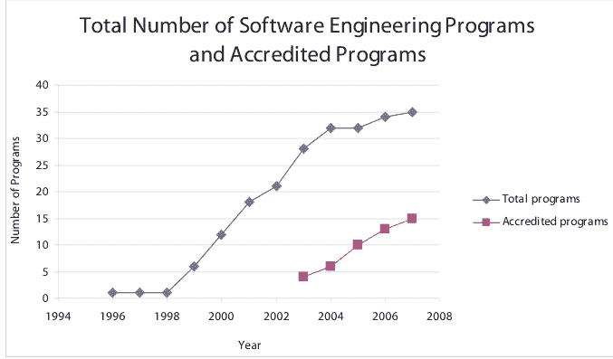

Table 2. Year when program was accredited

| Name of Institution | Year Accreditation Awarded |
| Auburn University | 2005 |
| Clarkson University | 2003 |
| Embry-Riddle Aeronautical University (Florida) | 2005 |
| Fairfield University | 2006 |
| Florida Institute of Technology | 2004 |
| University of Michigan-Dearborn | 2005 |
| Milwaukee School of Engineering | 2003 |
| Mississippi State University | 2003 |
| Monmouth University | 2005 |
| Penn State University – Erie | 2006 |
| Rochester Institute of Technology | 2003 |
| University of Texas at Arlington | 2004 |
| University of Texas at Dallas | 2006 |
| Rose-Hulman Institute of Technology | 2007 |
| University of Wisconsin - Platteville | 2007 |

of these programs award a Bachelor of Science degree in Software Engineering. The programs have a range of student populations from 30 to over 400.

### EXPERIENCES OF PROGRAMS AND PROGRAM EVALUATORS

The authors have completed informal on-line surveys of both software engineering programs that have been accredited by ABET and the ABET

projects have significant design content, that the work was clearly and completely documented, and that engineering standards and constraints were appropriately considered.

### THE MOST DIFFICULT ISSUES

While the survey results indicated a good deal of agreement between program leaders and program evaluators, there were some exceptions. Specifically, there was some evidence, of inconsistency, and even some contention, related to faculty qualifications and curricular content.

Program leaders generally reported no problems related to faculty qualifications. However, several program evaluators expressed concerns regarding a low proportion of faculty with true breadth and depth of experience in software engineering. This issue seemed to arise primarily in software engineering programs housed in computer science departments. As one evaluator stated, “It is sometimes difficult to agree with established CS programs adding an SE program that they have sufficient breadth and stability in SE to satisfy the ABET criteria.”

Another concern of some evaluators related to the isolation of some software engineering faculty members, who seemed to have little involvement with the software engineering practitioner community and with the software engineering education community.

PEVs noted a need for all faculty to be aware of and be involved with the ABET/EAC procedures and self-study preparation. The problem most frequently observed across all criteria has been defining appropriate and viable assessment and evaluation processes. Even when adequate processes have been defined, PEVs often identify problems with faculty compliance. To satisfy the requirements of outcomes assessment, the program faculty members must be committed to ongoing execution of the defined processes. Most programs and evaluators understood that

the Outcomes Criterion requires the direct measurement of student outcomes via capstone projects, portfolio evaluations or specific quiz or exam questions. However, almost all agreed that the overhead required to do this rigorously placed a high burden on the programs, particularly for programs that had decided to evaluate all outcomes and all students every year.

As noted previously, the software engineering Program Criteria require appropriate curricular content. Several evaluators commented that there were problems with programs’ interpretations of the breadth and depth of software engineering material required to satisfy these criteria. They said that these problems have most frequently been seen when programs are developed from a base of a computer science or a computer engineering curriculum.

Two programs reported that they have had problems with a specific program evaluator’s interpretation of the requirements related to Program Criteria. These evaluators, they say, were looking for coverage of a specific topic area, such as software evolution, as part of the maintenance activities which students are required to be able to do by the time they graduate according to this criterion.

In the case of programs that have had problems with curricular content, faculty members have sometimes felt that they were already covering many of the required software engineering topics. By requiring students to take specific existing computer science courses and adding a software engineering capstone course to the curriculum, they felt that they would meet the breadth and depth requirements.

The programs that have been most successful in satisfying the curriculum requirements of the program criteria have linked their curricula to accepted frameworks such as the Guide to the Software Engineering Body of Knowledge (2004) and Joint Task Force on Computing Curricula (2004) and have made these links explicit in their course syllabi, by describing which courses


cover which topics outlined in those documents. The number of specific software engineering courses in these programs usually ranges from six to twelve. Typically those courses cover 50% to 80% of the topics specified in the referenced documents.

While the program criteria do require breadth and depth of software engineering content, it is not necessary that these topics be covered in specific “software engineering” courses. However, if this content is embedded in other (e. g., computer science) courses it must be very clear from the course syllabi and from the work done by students that the software engineering topics are, in fact, being covered. It is a common expectation that at least some of these courses employ textbooks that address a variety of advanced software engineering topics, and that they do not rely primarily on the small number of commonly used introductory software engineering textbooks.

### IMPROVEMENTS MADE

The variety of improvements that have been made as a result of assessment and preparation for accreditation visits is extremely long. This section will summarize a subset of those with which the authors are familiar.

For the requirements related to Students, a few programs have found that they were not advising and monitoring their students carefully enough. This sometimes resulted in students not completing all of the courses required by the program, usually due to course substitutions that were done without appropriate review. The programs that have had this problem have typically tightened their advising and monitoring processes to insure that the problem does not happen in the future.

Several programs have formed new industrial advisory committees and gotten them deeply involved in helping to specify Program Educational Objectives. A few have developed employer surveys to get feedback on achievement of program educational objectives and at least one has modified the wording of its objectives to eliminate misunderstandings of the wording. Based on our experience, with our own programs and with programs that we have evaluated, we believe that the greatest benefits to the programs have been the improved relationships between the programs and local industry that have resulted from the involvement of industrial advisory committees in the accreditation process.

In response to shortcomings identified in the Program Outcomes area and to the measurement of specific outcomes, many programs have modified the content of specific courses, usually with small changes to assure that prerequisite courses were meeting the expectations of instructors in later courses. Some programs have developed specific courses to assure that students were developing an understanding of professional and ethical responsibilities. Others have developed new methods and courses for assuring that students were receiving a broad education, recognizing the need to engage in life long learning and developing an understanding of contemporary issues. All of these improvements were made as direct results of measurements indicating that student learning results were below expectations for one or more of the specified outcomes.

To effectively demonstrate compliance with the requirements for a major design experience by the Curriculum criterion, some programs have provided additional encouragement for students to document their engineering processes, design approaches and their consideration of engineering standards and multiple practical constraints in their design projects.

To address shortcomings related to faculty experience and competencies to cover all curricular areas, as required by the Faculty criterion, a few programs have added one or more faculty members. Typically they have taken advantage of existing open positions or of planned retirements to add these resources. To strengthen faculty guidance and oversight, some programs have decided to encourage faculty member participation in workshops related to ABET accreditation and assessment.

To meet the Program Criteria requirements for curricular breadth and depth, a number of programs have modified their courses and their curricula to insure that adequate coverage of topics such as verification, validation and maintenance. Some have developed completely new courses to address missing content or to provide additional depth in certain areas.

While few of the programs from which data were collected reported unexpected benefits, those who have made improvements uniformly reported that the improvements made were beneficial and should have been made, with or without an accreditation process. In several cases program leaders agreed that the results of the accreditation review gave them leverage with both members of their faculty and with their institutions’ administration to make appropriate improvements. And, finally, all agreed that having ABET accreditation gives credibility to their programs by certifying that their software engineering program is a real engineering program.

### FUTURE DIRECTIONS

At the time this chapter was being written, there were 35 undergraduate software engineering programs being offered by colleges and universities in the United States. Fifteen of them have been accredited by ABET. It appears likely that most of the remaining programs, which are not yet accredited, will be seeking initial accreditation within the next few years.

Finally, the National Academy of Engineering has made a recommendation that the master’s degree should become the first professional degree accepted for entry into the engineering profession. Currently, ABET allows only one degree level at each institution in each field of engineering to be accredited. If the master’s degree becomes the entry point into the engineering profession, that would imply a policy or practice change for ABET to allow accreditation at both the masters and bachelors level or to award accreditation primarily at the masters level. There are several good arguments for and against each of these proposals. Only time will tell if any change will be made and what form that change is likely to take.

### REFERENCES

ABET. (2006). Accreditation policy and procedure manual. Baltimore, MD. ABET, Inc. Retrieved May 13, 2007, from http://abet.org/forms.shtml.

Computing Research News (2007), 2005-2006 Taulbe Survey, May 2007.

Duggins, S. L., & Thomas, B. B. (2002). An historical investigation of graduate software engineering curricula. Proceedings of the 15th Conference on Software Engineering Education and Training (CSEET’02), Los Alamitos, CA, IEEE Computer Society Press.

Engineering Accreditation Commission. (1999). Criteria for accrediting engineering programs: Effective for evaluations during the 2000-2001 Accreditation Cycle. Baltimore, MD. ABET, Inc.

Engineering Accreditation Commission. (2000). Criteria for accrediting engineering programs: Effective for evaluations during the 2001-2002 Accreditation Cycle. Baltimore, MD. ABET, Inc.

Engineering Accreditation Commission. (2001). Criteria for accrediting engineering programs: Effective for evaluations during the 2002-2003 Accreditation Cycle. Baltimore, MD. ABET, Inc.

Engineering Accreditation Commission. (2002). Criteria for accrediting engineering programs: Effective for evaluations during the 2003-2004 Accreditation Cycle. Baltimore, MD. ABET, Inc.

### Chapter XIV

### Software Engineering
at Full Scale:
A Unique Curriculum

Jochen Ludewig
Universität Stuttgart, Germany

### ABSTRACT

In 1996, a new Software Engineering curriculum was launched at Universität Stuttgart. It was based on many years of practical experience teaching computer science and also on experience in industry where most of our graduates will find jobs. While the topics of this curriculum are not very different from those of computer science, there is much more emphasis on problem solving, software construction, and project work. In 2009, our traditional curriculum leading to the so-called diploma (equivalent to a master’s degree) will be replaced by a new curriculum according to the bachelor and master concept. This chapter describes both the old and the new curriculum, and discusses problems and achievements.

### INTRODUCTION

Software engineering is usually taught as a special course for students studying computer science or engineering. But software engineering is not just a set of topics, as the SWEBOK (SWEBOK, 2004) suggests, but also, or primarily, a particular mindset, a way of thinking, very similar to the mindset engineers tend to have. One might say that you get a software engineer if you combine a

computer science graduate’s knowledge with the mental structure, the way of thinking, reasoning, and solving problems, of an engineer.

In order to educate such people, it is not enough to modify our CS programs by some cosmetic changes, a new lecture or a nice little project. We need a radical change. And we cannot pretend that our knowledge should be good enough for our students; we have to teach them what they need rather than teaching them what we like, because


most people like to teach what they have taught all the time (Ludewig, Reiβing, 1998). This paper describes such a new curriculum that was launched in 1996, and discusses our experience.

### BACKGROUND

Traditionally, students of science and engineering in Germany finally receive a diploma, which is equivalent to a master’s degree. Since there is no formal level below the diploma, there is no equivalent to the Bachelor’s degree and, hence, no straightforward mapping between a curriculum in Germany and a curriculum in Great Britain or in the United States.

The Diploma curriculum is similar to what is called an integrated master’s degree program in Great Britain, India and some other countries.

Though space does not allow for a detailed comparison, here are some significant differences:

- In Germany, three levels of school education are available, differing in their requirements and in their duration. The highest level leads to a final examination, the so-called “Abitur”. One out of three young people actually pass this examination, usually at an age around 19. In most of the engineering studies including computer science and software engineering, those who hold an Abitur may enrol without entrance examinations. But many of them underestimate the difficulties they encounter at university. That is one of the reasons why many students fail soon after beginning.
- A complete curriculum consists of 9 semesters: 4 semesters for the “basic studies”, another 4 for the “advanced studies”, and one for the diploma thesis. Most students take more time, resulting in an average of some 12 semesters. Many students have a part-time job in industry, or even run a small business.
- Both written and oral examinations are offered once in every semester; there are no mid-term exams. Students may attend a lecture this year and take the examination next year or even later. If they fail, they are required to repeat the examination after another semester. If they do not pass in the second attempt, they have to leave.
- The curriculum of the basic studies (semesters 1 through 4) is fairly rigid because there is little choice for the students. Still, they may postpone lectures and examinations. Therefore, only a minority has actually finished all the examinations that constitute the so-called “Pre-diploma” (Diplomvorprüfung) after two years. The Pre-diploma is not a degree but only the entrance condition for the advanced studies. Though the Pre-diploma may at first sight resemble a bachelor’s degree, it is in fact very different because it covers mainly fundamental topics like mathematics and theory.
- In the advanced studies, the students can arrange their schedule as they like. When they have met all requirements, they can start their diploma thesis, which is strictly limited to six months.

The effect of these differences is that our students must take full responsibility for themselves. If they fail to work continuously, they will drop out sooner or later, as more than 50 % actually do. Those who survive can usually handle common problems fairly well. Colleagues from abroad who come to Germany and teach at our university tend to find that the system is strange for them but works well for those who succeed.

Faculty members in Germany enjoy a constitutional freedom of teaching: While we have to teach, we decide what we teach. This freedom has a subtle influence on curricula: There are no standardized components like in the US, because any professor teaching e.g. the basic course “introduction to CS” can (and often will) change the content, the text book, and the exercises. When we design a new curriculum, we better make sure that we can actually implement it with the faculty that is around. If they do not like it, the curriculum will not work.

A few years ago, there was a political decision (the so called “Bologna agreement”) to switch to the bachelor/master schedule; these changes will be discussed in the final part of this chapter.

Other changes take place as well. Traditionally, universities (like schools) were free for the students who had to pay a small administrational fee only. Now, they are charged in most states of our federal republic. Currently, charges are low compared to most universities in the world (around 1000 € per year), but this may be only the beginning. Private schools and universities do exist in Germany but are not relevant in a statistical sense. More than 96 % of all students attend one of the public universities; if only universities offering a Ph.D. are considered, it is more than 99 % (HRK, 2007).

### CONCEPTS

When the Software Engineering curriculum (SEC) was designed in 1995 and 1996, little material was available. There was a guideline issued by the German CS society (Gesellschaft für Informatik, 1985); a new guideline was being prepared at that time. While the new guideline did not influence our curriculum, the curriculum had some impact on the guideline (Gesellschaft für Informatik, 1997; Mahn et al., 1999). Some of our concepts, in particular the large projects, have been successfully copied in other universities (cp. Bungartz, Bernreuther, 2006), but a complete university-level curriculum in software engineering has not yet been offered anywhere else in Germany.

In 1995, our department decided to have an evaluation of the CS curriculum including interviews with alumni. Many of them voted for better education in software engineering.

The SEC was launched in 1996. Since then, every year some 60 to 140 students were enrolled. In 1999, the SEC was evaluated by an international group of peers, with extremely positive results. Some minor changes were implemented shortly after. This paper refers to the SEC that has been applied since 2000.

The fundamental idea was to offer a curriculum that comprises most of the courses also contained in the CS curriculum, but far more project work of various types. The structure is very similar to an electrical engineering curriculum. (The author who designed the curriculum holds a diploma in electrical engineering.) This concept is often confused with an education covering both traditional engineering and CS, like the curriculum at MacMaster University in Hamilton, Ontario (Parnas, 1999). While their graduates are engineers in a traditional sense, our graduates should cooperate with other engineers, but not replace them. The similarity to other engineering studies lies in the practical, constructive approach: If you encounter a problem, solve it using a minimum of resources!

Many universities offer courses in software engineering as an add-on for CS students. But, despite SWEBOK, software engineering is not only a body of knowledge. Software engineering is a paradigm. If you put physicists into some courses on materials, they will still be physicists, not electrical engineers, because they have not enjoyed an engineer’s education. Software engineering must be taught, and practiced, early.

Some time ago, when I talked to a student, I asked him if he was a CS student or an SE student. He said that he was a first year SE student. “Well, then you won’t really feel a big difference, do you?” “Oh yes, I do”, was his answer. “The CS students are those whose programs are unreadable.”

Here is a list of those components (courses) that were designed for, and are offered exclusively to, the Software Engineering students. They are discussed in detail in the following paragraphs.

- a. Programming lab (b 1st semester)
- b. Courses in English and economics
- c. Programming in the large ("Introduction to SE I" in Figure 1), including project-manager training using a project simulator (SESAM) (3rd semester)
- d. Programming in the small ("OOP" in Figure 1) (3rd semester)
- e. Formal methods ("Introduction to SE II" in Figure 1) (4th semester)
- f. First software project ("Basic project" in Figure 1) (4th semester)
- g. Lecture on advanced software engineering (5th semester)
- h. Large software project (5th and 6th semester)
- i. Large software project in an application area (6th and 7th semester)
- j. Project on problem analysis (8th semester)

All the lectures described below include exercises where small problems are discussed. The exercises are usually under the control of Ph.D. students (who are, in most cases, employees of the university). The volume is given in credit points. Our standard formula is 3 credit points per 2 lessons (= 2*45 min) per week for a full semester (15 weeks).

### COURSE DETAILS

#### Programming Lab (1st semester; 3 Credit Points)

Many students have written programs before they enter the university, while a few have not. Therefore, we have to teach programming, preferably using a language that is equally unknown to all the students. Currently, we teach Ada as the first programming language.

Programming is taught in the introductory course (where SE students are not separated from the CS students). The programming lab is directed towards systematic programming, with emphasis on style guides and other standards (e.g. for comments) that are to be observed. Our message is: The program that you build is not for you. It is for others who have to read and maintain it.

Until recently, we used to teach programming like most people do, i.e. bottom-up. Students learn some concepts of programming, like types and control structures. Then, they build a small program. From a software engineering point of view, that is wrong. Soon after, it takes us much effort to convince our students that large programs are not just multiples of small ones. The fact that software engineering is primarily concerned with complexity is not well integrated.

Therefore, we changed this course, starting with a fairly large software system. We use a program named AdaDoc, which generates HTML documents from Ada code. It is sufficiently large (2700 statements, 9341 non-comment source lines, more than 23 000 LOC altogether) to challenge the students. In order to modify this program, they have to understand it, though only partially. They easily learn to appreciate good style (egoless programming). The new course started only recently (in October 2007), but the first results are very promising. Students co-operate and learn from experience and understanding what used to be a boring, bureaucratical command.

#### Courses in English and Economics (3rd and 4th semester; 6 Credit Points)

All our students (at least those who grew up in Germany) learned English in school. But some


of them did not learn it very well. In order to make sure that our graduates can read English documents and communicate on an international level, we offer a course followed by a test (similar to a TOEFL). They also learn some economics because many of them will later be managers or run a software company.

### 大规模编程，包括使用项目模拟器进行项目经理培训（sEsAM）（第3学期；6学分）

整个课程都是以项目为驱动的。因此，大规模编程课程从规划和成本估算一直到测试，涵盖一个小型项目，目的是为学生准备更大的项目（见 d、g、h）。在本课程结束时，学生使用本系开发的模拟器练习软件项目管理（SESAM；Drappa, Ludewig, 2000）。

### 小规模编程（第3学期；4学分）

作为大规模编程（b）的补充，学生学习如何使用 UML 和 Java 开发面向对象的系统。

### 第一个软件项目（第4学期，9学分）

学生三人一组开发一个中等规模的程序。所有学生都从相同的（非正式）规范开始。其中一些成果至今仍在使用，例如生成时间偏移图的工具。

### 形式化方法（第4学期；5学分）

学生学习如何应用形式化技术进行规范和验证；目前，他们使用 Alloy 作为规范语言。

### 高级软件工程讲座（第5学期；6学分）

本讲座有两个目标：首先，学生应更多地了解软件项目管理，以便掌握大型项目（见下文）的问题。其次，还需要涉及一些与项目工作关系不大的主题，如过程评估和改进或伦理。

大量时间用于讨论和动机。只有当学生理解良好的软件工程为何可取时，他们才能说服业界的同事。

### 大型软件项目（第5和第6学期；24学分）

研究小组向课程委员会提交项目提案。这些项目不应包含研究，而应是严肃的软件开发。最常见的是，学生开发某种新工具或现有工具的新组件。当项目被接受后，学生可以选择它；但他们的自由度受到限制，即每个项目必须有六到十二名参与者。

我们要求研究小组为每个项目提供某些角色：必须有一位教授最终对学生进行考核；有一位客户，并且通常有两位主管在必要时帮助学生。为了避免混淆，客户不得担任主管；这些角色是明确分离的。所有责任都由学生承担。项目差异很大；在软件工程组中，所有项目都从投标阶段开始。如果有九名参与者（理想规模！），他们组成三家竞争公司。与客户交谈后，他们将准备演示，争取赢得项目。然后各组合并，共同工作。（研究小组除上述角色外不参与。）他们将选举项目经理并按照在讲座和之前的小型项目中学到的原则组织工作。虽然项目经理通常保持其角色，但其他学生担任多个职位；某人可能例如共同撰写规范、实现系统的一部分并组织评审。这由团队决定。他们必须记录工作量，以便注意到有人在项目上花费的时间明显少于或多于其他人。

长达十到十二个月，学生们在一起花费大量时间，并体验到真实项目的各种问题和挫折。这包括在相当大的团体中工作的效果；三个人可以在没有太多组织的情况下合作，但八到十个人则不行。因此他们学会欣赏良好的流程和可靠的项目管理。我们努力确保他们最终成功，因为我们坚信积极的经验比消极的经验有效得多。

没有唯一的“正确答案”。如果它能工作并且文档相当完整且有用，那就很好。我们发现采用两遍流程很有前景：他们在大约一半时间内设计并实现核心部分，然后征求反馈。根据需要进行的更正和改进，他们在第二遍中添加一些只是锦上添花的部分。

最后，学生将向客户交付产品。最终演示往往是一件大事。而且大多数项目交付的软件与商业上可用的软件一样好，甚至更好。其中许多系统之后实际上被使用和维护。

大型项目包括讲座和研讨会，研讨会涉及与项目相关或超出项目的一些更雄心勃勃的主题。我们对项目工作（权重 0.5）、研讨会（0.2）和考试（0.3）进行评分，得出最终成绩。项目工作不及格者不得通过。我们通常对项目整体进行评分，并对贡献明显高于或低于平均水平的同学进行修正。

在我们（即软件工程组）的项目中，我们尝试了各种设置，视任务而定。有时，我们有来自工业界的客户；有时我们是客户（要求为我们的 SESAM 系统开发新组件，见上文）。我们最近的项目（于 2007 年 11 月完成）生产了一种用于玻璃盒测试的新工具。该工具可以收集并可视化多种覆盖率指标。开发人员被要求为公共领域开发软件；在研讨会上，我们讨论的不仅是测试的技术方面，还包括公共领域中使用的许可证相关问题。

### 应用领域中的大型软件项目（第6和第7学期）

每位学生选择一个应用领域，在该领域通过笔试或口试获得 18 学分。我们目前提供三个这样的领域：

- 交通系统（铁路、空中交通等）
- 工业自动化（包括机器人和现代工厂使用的所有机器）
- 技术管理（例如产品工程）

在该应用领域（即赞助该应用领域的系）中，学生进行

- 有些考试成绩不理想的学生在项目中表现出色。我们的传统标准偏向科学工作，而大多数毕业生永远不会从事研究，而是开发和维护软件系统，很快成为管理者。
- 当学生做真实项目时，对解决实际问题的讲座需求强烈。学生明确要求提示（如何编写规范、如何设计软件等）。使用自己的教科书（Ludewig, Lichter, 2007）在这种情况下相当解脱，但其遗漏很快就会暴露出来。通常不接触项目工作的 CS 学生不会提出此类问题。
- 在每个项目中都会出现某种合作和沟通风格；我们尚不清楚决定这种风格的条件是什么（否则我们希望能够影响它）。项目经理显然很重要；但学生选择自己的项目经理，我们不干预。
- CS 系的任何研究小组都可以提供项目，即充当客户。但客户并不总是欣赏良好的软件工程。这不仅在工业界如此，在我们大学内部也是如此。我们曾有多起客户为追求编码快速进展而挑战规划和质量保证的案例。学生必须学会很好地“推销”他们的方法，以便避免苛刻的截止日期与雄心勃勃的质量目标之间的冲突。

### 软技能

- 软技能，如做演示、谈判变更或延期、或组织团体，并不会在需要时自动发展；它们必须被教授。我们提供一门关于撰写论文和做演示技巧的课程。我们也利用研讨会来指导演示技巧。其他一切都在项目中进行。
- 工业经验在任何情况下都非常有用：找到具有高软件工程标准的公司的学生可以看到它是如何运作的。其他进入对软件工程知之甚少环境的学生将看到人们在没有系统、无质量保证等情况下从事软件工作时会发生什么。
- 我们目前还不提供其他培训课程，例如关于团体动力学、调解或文档的课程。它们显然有需求，但不一定有要求。学生倾向于只花费时间在能带来回报（学分）的活动上。

### 转向学士学位

如开头所述，我们的文凭很快将被废弃，让位于学士和硕士学位。虽然 2008 年 10 月入学的学生仍将遵循传统安排，但 2009 年 10 月入学的学生将进入学士项目。许多大学已经转向新结构。（但新学生更愿意注册其他大学，显示出对引进学位的信心不足。）总体而言，这是一场自上而下强加的革命，并未得到大多数教师的支持。

博洛尼亚协议规定总共 10 个学期。但大多数大学同意采用 6 加 4 的安排，因此我们必须设计一个为期六个学期的本科课程。一些教授认为他们可以简单地重新安排课程，因为他们期望学生，至少是优秀的学生，会继续攻读硕士学位。但我们的大多数学生将以学士身份离开，因为他们获得了有吸引力的职位、助学金被取消，并且厌倦了承担


意义。我们认为，即使在软件工程的相当小的细分领域中，一次深入的体验，也比任何高层次的概述更有价值。我们的毕业生预计会解决他们（和我们）从未听说过的问题。我们无法为他们未来的挑战做好准备。但我们可以提供这样的经验：系统的工作、持续的质量保证，加上相当一部分知识和创造力，确实有效。这可能是我们方法最简短的描述。我们希望培养出优秀的软件工程师（Brooks, 1987）。

### 进入专业化时代

软件工程是一个伟大的领域。我们许多英雄，如 Dave Parnas、Barry Boehm 和 Fred Brooks，仍然健在并仍在贡献。哪个其他领域能在一个会议室里提供几乎整个历史，就像我们在 1991 年看到的那样（Broy, Denert, 2002）？

但先驱者让位于年轻专家。由于该领域庞大，并非只有一个专业领域，而是许多个，大约半打甚至一打。银行和保险公司的软件工程不像汽车系统中的软件工程。因此，在各种应用领域会出现软件专家，因为这些人在目标、方法、语言和工具上各不相同。

专业化实际上正在进行，但几乎没有在书籍和杂志中得到体现，在教育体系中体现得更少。至少有三个原因导致这种延迟：

- 没有得到普遍接受的领域分类法。我们不知道如何将其切分为若干部分。
- 在这些领域中的大多数，我们没有构成科学领域的积累知识。
- 能够在这些领域授课的专家确实存在，但几乎不在大学之内。系里的大多数同事不会喜欢聘请几位新教授的想法，而这些教授在传统意义上并不是 CS 社区成员。

Michael Jackson（1999）指出，专业化是非常可取的。IEEE CS & ACM 工作组（2004，2.3.3）指出：“领域特定的技术、工具和组件通常提供了最引人注目的软件工程成功案例。”但到目前为止，情况并没有改变太多。如果私营公司分析其需求，他们肯定会发现他们应该在各自的领域赞助新的教授。也许我们应该尝试传达这个想法。

### 结论

SEC 自 1996 年启动以来，已吸引了 1000 多名学生。到目前为止，很少有人后来转到 CS（这相对容易）。许多毕业生表示，他们获得了非常有用的知识和经验。该课程在德国许多其他大学产生了影响，尽管在其他地方没有建立完整的软件工程课程。

很快，SEC 将被一个通向学士学位的本科课程取代。大多数，尽管不是全部，特点将得以保留。很快将增加一个提供一定专业化的硕士学位。

### 参考文献

Brooks, F.P. (1987). No silver bullet – Essence and accidents of software engineering. IEEE Computer, 20(4), 10-19.

内容。教育背景、就业状况、教育目标和沟通技能的多样性所引发的问题，为任何软件工程项目带来了需要处理的挑战。

本章其余部分详细讨论了上述主题。它首先介绍我们项目历史上课程的演变。然后讨论软件工程课程内容持续变化所涉及的各种问题。随后一节概述了我们招聘和留住教师方面的经验，然后介绍学生群体对课程和课程内容多样性的影响。本章以对那些有兴趣开设软件工程研究生项目的人的建议以及 MU 项目的未来趋势的介绍作为结尾。此讨论将强调在同一系内容纳软件工程本科和研究生项目。

### 持续课程重组

在短暂的历史中，软件工程（SE）作为一个领域一直是一个移动目标。我们观察到能力成熟度模型、统一建模语言、个人和团队软件过程以及企业对 ISO 标准的遵守成为软件工程组织中的主要力量。我们观察到分析和设计的重要变化，从结构化分析和设计转向面向对象的分析和设计。甚至今天发布的架构也已从客户端-服务器架构转向分布式架构，目前的趋势集中在面向服务的架构上。

解决该领域专业人员所需技能和实践的课程必须随着时间的推移不断重新发明自己。软件工程课程的变更频率约为每十年两次，而工程（Clough, 2005）和科学（Stryer, 2003）通常为数十年。大约每十年软件工程课程的各个方面都容易发生变化。为了适应行业需求并跟上软件工程作为一个领域的进步，我们增加了或删除了课程，并增加了新的轨道和项目。决策是在在软件工程的理论、技术和实践方面创造和保持平衡的背景下做出的。

改变课程不能以临时方式进行。我们遵循一个明确的过程。首先，教师根据行业、学生和当前出版物的反馈讨论变更的必要性。反馈的获取是一个持续的过程，通过行业顾问委员会、校友调查、学生离校访谈、学生学习成果评估、由软件工程教育领域的知名人士担任的外部评审员对项目的定期评估以及参加专业会议来协助。我们建立了一套学习成果，我们定期监控，并在需要进行重大课程变更时予以考虑。

接下来，项目主任撰写一份提案，确定新的课程以及可能需要的任何额外课程。这项工作包括为每门新开设的课程撰写完整的教学大纲，为内容有重大变化的课程修改现有教学大纲，并为每门被删除的课程提供理由。

该提案提交给系内教师征求意见。意见包括对课程内容变更的质疑以及对整体方案的讨论。各种课程的教学大纲可能会经过多次迭代。

一旦提案在系内获得批准，提案将提交给学院的系主任会议。经常，软件课程的变更可能需要其他系（例如计算机科学和商学院）的课程内容变更。如果学院内其他系提出重大反对意见，提案将由系重新考虑。

在学院系主任会议上，可以决定需要更强有力的商业案例。外部机构通常制定此商业案例。它要么是由独立公司开发的调查，要么是由外部工业顾问委员会开发的。商业案例反映了行业的需求和现状，这将吸引新学生。

在将变更建议纳入提案后，它将提交给大学研究生院委员会。在这里，课程根据其与适用于研究生项目的大学政策的一致性进行评估。这包括确定最大班级规模、接触小时数、实验室费用分配和其他因素。

接下来我们介绍蒙茅斯大学研究生软件工程课程的演变。这种演变显示了从在计算机科学系内部创建的软件工程项目，逐渐过渡到涵盖整个软件生命周期的工程课程的项目。它纳入了学术界和工业界之间强有力的合作成果（Powell, 1997）。

#### 初始课程（1986）

蒙茅斯大学最初的软件工程课程由 30 个学分组成，包括 6 门核心课程和 4 门选修课（见图 1）。由于具有适当背景的教师有限，核心课程仅详细涵盖了软件生命周期的实现（使用 Ada）和项目管理方面。课程更像“带有工程味道的计算机科学课程”（Dart, 1997），涵盖经典的计算机科学课程，如算法、操作系统、计算机体系结构和数据库管理系统。

学生的实践培训通过一门 3 学分的实习课程完成。该课程由团队项目组成，用于从初始需求到最终经过测试和记录的产品开发软件系统。早期课程更偏向理论方面（请注意对 SE 数学基础的高度集中），对特定 SE 技术和实践的接触较少，正如（Ford, 1987）早期推荐的那样。

#### 1991 年课程变更

该课程增加了许多 SE 课程，包括形式方法、形式规范、软件过程和 SE 环境（见图 2）。然而，它仍然偏向计算机科学，提供人工智能课程、4 门数学基础和形式方法课程以及 4 门网络技术课程，这是由于我们地理位置位于以电信行业为主的地区。它类似于第一个 MSE 模型课程（Ardis, 1989a; Ardis 1989b），该课程建议 10-12 门课程，包括 6 门核心课程、3 门或更多选修课和为期两个学期的实习项目。然而，由于合格教师的缺乏，所提供的核心课程无法涵盖整个软件生命周期。

#### 1995 年课程变更

1995 年课程进行了重大更改，包括 36 个学分，10 门核心课程和 2 门选修课程（见图 3），以符合软件工程研究所模型课程（Ardis, 1989）和 1991 年计算


### 研究生软件工程课程体系中的持续重构

#### 图1. 1986年课程体系

**核心课程（6门课程 = 18学分）**

- SE 501 软件工程数学基础 I（3学分）
- SE 505 大型编程（3学分）
- SE 510 计算机网络设计（3学分）
- SE 516 软件工程 I（3学分）
- SE 518 项目管理（3学分）
- SE 525 系统项目实现（3学分）

**选修课程（4门课程 = 12学分）**

- SE 502 软件工程数学基础 II（3学分）
- SE 506 小型编程（3学分）
- SE 509 编程语言（3学分）
- SE 511 协议工程（3学分）
- SE 512 算法设计与分析（3学分）
- SE 514 计算机体系结构（3学分）
- SE 515 操作系统实现（3学分）
- SE 517 软件工程 II（3学分）
- SE 519 数据库管理（3学分）

#### 图2. 1991年课程体系

**核心课程（6门课程 = 18学分）**

- SE 501 软件工程数学基础 I（3学分）
- SE 505 软件系统设计（3学分）
- SE 506 编程中的形式化方法（3学分）
- SE 516 软件工程（3学分）
- SE 518 项目管理（3学分）
- SE 525 系统项目实现（3学分）

**选修课程（4门课程 = 12学分）**

- SE 502 软件工程数学基础 II（3学分）
- SE 503 计算机通信网络导论（3学分）
- SE 509 编程语言（3学分）
- SE 510 计算机网络设计（3学分）
- SE 511 协议工程（3学分）
- SE 519 数据库管理（3学分）
- SE 522 软件工程环境（3学分）
- SE 532 软件过程质量（3学分）
- SE 534 软件系统形式化规范（3学分）
- SE 536 计算机安全基础（3学分）
- SE 538 网络拓扑高级专题（3学分）
- SE 540 人工智能导论（3学分）

#### 图3. 1995年课程体系

**核心课程（10门课程 = 30学分）**

- SE 501 软件工程数学基础 I（3学分）
- SE 504 软件工程原理（3学分）
- SE 505 软件系统设计（3学分）
- SE 506 软件形式化方法（3学分）
- SE 507 软件系统需求（3学分）
- SE 508 软件实现与复用（3学分）
- SE 512 软件测试与质量（3学分）
- SE 513 软件系统安全（3学分）
- SE 518 软件项目管理（3学分）
- SE 525 系统项目实现（3学分）

**高级/选修专业化方向（2门课程方向 = 6学分）**

*分布式软件系统*

- SE 526 网络化软件系统 I
- SE 527 网络化软件系统 II

*软件管理*

- SE 531 软件组织管理
- SE 532 软件质量管理

*信息系统*

- SE 541 信息系统架构
- SE 542 信息系统工程

*实时系统*

- SE 551 实时软件分析与规范
- SE 552 实时软件设计与实现

课程指南（Tucker, 1991; Ford, 1991）。该课程体系通过新增3门课程，具体涉及需求、实现与复用、测试与质量，详细覆盖了完整的软件生命周期。原为选修课的软件系统安全变成了核心课程。

由于核心课程如此繁重，该课程体系为学生提供了很少的灵活性来学习他们最感兴趣的软件工程方面的内容。另一个重大变化体现在引入了多门新课程，形成6学分的选修专业化方向：分布式软件系统、软件管理、信息系统和实时系统。引入这些方向是为了响应本地行业和政府合作者的需求与反馈（Powell, 1997）。这一课程改革之所以能够实现，是因为聘请了既有理论背景又有行业工作经验的教师，并辅以在软件工程专业领域具有专长的兼职教师的实质性帮助。

#### 1996年课程调整

1996年对课程体系进行了小幅调整。它仍然是一个36学分的项目，包含9门核心课程和3门选修课程，比之前的课程体系提供了稍多的灵活性。该课程体系覆盖了软件生命周期的各个方面。顶点课程为3学分的实习实践或6学分的学位论文研究。引入学位论文选项之所以成为可能，是因为吸引了有愿望从事研究活动的教师。

#### 1998年课程调整

1998年的课程体系代表了另一次重大变革，在36学分的项目中提供了更大的灵活性，包括5门核心课程、5门选修课程，以及6学分的实习实践或6学分的学位论文（见图4）。

认识到软件工程项目中实践经验的重要性，实习项目从3学分增加到6学分，并且在课程体系中的大多数课程中引入了学期项目。这与第一套MSE课程体系的建议（Ardis, 1989）类似，即提供两个学期的实习实践，并将多达30%的项目时间用于项目工作。

MU课程体系继续遵循软件生命周期模型，而CMU模型（Garlan, 1995）则强调在整个课程体系中教授“贯穿性的软件开发原则”。因此，CMU模型围绕建模、开发方法、管理、分析和架构组织了五门核心课程。此外，他们在整个项目期间设立了一个软件开发工作室，用于培养实践技能。

1998年的MU课程体系新增了一门课程——《软件工程过程》，该课程在很大程度上遵循了Watts Humphrey的个人软件过程（PSP）原则（Humphrey, 2005）。引入这门课程是基于对毕业生的需求，他们需要意识到并具备必要技能，以可预测的方式及时且经济高效地生产高质量系统，并在工作中尽可能多地使用可复用组件。尽管手动输入PSP所涉及的各种表单和模板数据需要付出大量辛苦工作，学生们还是对在这门课程中学到的原则的实用性给予了非常积极的反馈。为了减轻与手动输入数据相关的文书工作，我们创建了一个半自动化工具来支持PSP过程（Rosca, 2001）。该工具是一组学生为期两个学期的实习项目的成果。

原先的两门核心课程——软件工程数学基础和软件工程原理——已被转变为预备（衔接）课程（见图4）。连同另外三门编程课程，“衔接”项目面向本科专业不是计算机科学、计算机工程、电气工程或信息系统的学生。在完成15学分的预备课程和一个学期的项目课程后，如果学生不希望继续攻读硕士学位，可以获得软件开发证书。

该课程体系中包含的选修课程是完成所选专业化方向（如组织管理、电信、嵌入式系统和信息系统）所必需的。这些15学分的专业方向比1995年课程体系中的对应方向更加全面。它们包含了来自其他学科（如商业、电气工程和计算机科学）的课程。然而，如果学生不想专攻某个方向，他们也可以跨方向选修课程。下面简要介绍各专业化方向。

组织管理方向培养学生成为软件开发经理或软件过程改进专家。研究主题包括过程改进、质量管理、组织发展与治理、风险管理以及项目规划与管理。


电信方向培养学生成为电信领域的专家。学习主题包括网络、软件系统安全以及电信系统的评估。

嵌入式系统方向培养学生成为嵌入式系统开发专家。学习主题包括嵌入式实时系统需求的规格说明与分析、嵌入式实时软件系统的设计与实现、嵌入式实时软件系统的性能评估以及实时组件的开发。

信息管理方向培养学生成为首席信息官或信息系统集成与开发专家。学习主题包括信息技术管理、信息系统的规格说明与分析、信息系统的评估以及信息系统软件组件的开发。

### 2002年课程变更

2002年，唯一的课程变更是新增了一个专业化方向：软件技术管理，由蒙茅斯大学商学院合作提供。这一方向的理念源于对行业外包越来越多的软件开发这一现实的认识。该方向培养学生成为首席技术官或企业软件系统采购专家。学习主题包括评估软件对组织可能产生的影响、通过购买或外包进行系统采购的需求开发、根据组织需求评估软件技术，以及在组织中实施受控的技术引入。

软件工程知识体系（SWEBOK）项目（Bourque，2004）的所有知识领域都可以在本课程体系中找到。

### 课程内容的持续更新

在技术层面，计算领域经历了重大变革，迫使软件工程课程中所教授的内容发生了改变。自从我们的软件工程硕士项目启动以来，我们见证了面向对象技术的广泛采用（以及技术和方法论上的巨大变化）、万维网的迅猛爆发、Java的出现，以及安全需求从企业平台向消费平台的转移，这些仅仅是众多变化中的一部分。因此，针对该领域专业人员所需技术理解的课程体系所涵盖的内容需要随着时间持续更新。

这一问题以多种不同的形式出现。具体来说：

-   课程内容的持续变化
-   教材过时
-   操作系统/编程语言的偏向
-   课程项目的持续开发

以下各段将对以上每一项进行更详细的讨论。

### 课程内容的变化

可以预期，每年都需要修订课程材料。这是为了适应技术变化并融入新的行业实践所必需的。例如，自我们的项目启动以来，我们已将课堂上教授的编程语言从Ada改为C++和Java；在需求工程课程中，面向对象分析方法被添加到结构化分析方法中（Rosca，2000）；在设计课程中，经历了从结构化设计到面向对象设计、基于组件的设计和架构设计的转变。在测试课程中，我们增加了关于测试使用商业现成（COTS）组件构建的应用程序的内容，并使用自动化测试和测试管理工具。对于项目管理，则逐步引入了更多关于进度工具（如MS Project）、风险模拟器（如Risk+）的使用内容，并讨论了在软件开发项目规划中使用缓冲任务的问题（McDonald，2000）。未来，由软件工程社区专业人士为整个社区创建的SWENET项目（Lutz，2003）所提供的课程材料，可能有助于减轻这种持续课程创建或更新的负担。

课程材料的持续修订构成了教师的大量工作量。短短三年内，该领域的变化就足以使许多课程必须完全重新设计。UML的采用及其后续演进迫使设计图、用于描述设计的词汇发生修订，并引入了新的最佳实践。

### 过时的教材

随着技术的变化和软件工程的发展，教材跟上这些变化的能力受到严重考验。教师会发现，为了恰当覆盖一个主题领域，他或她需要使用三四本教材。书籍之间看似相互矛盾，仅仅因为它们出版时间相隔两年。通常，一本只有三年书龄的教材会包含许多已被取代或更名的概念。许多优秀的教材没有更新到当前的表示形式，例如UML2。

这迫使教师不断研究新版本和更新的印刷版本。教师必须考虑学生对推荐教材有用性的反馈。一些新教材在出版时可能已经过时。

### 操作系统/编程语言的偏向

很少有话题能像选择哪种操作系统（OS）或编程语言作为课程工作的通用语言那样引发如此多的争论。似乎每个人都有一种观点或现实需求，认为应该学习一种环境而不是另一种。选择一种环境而非另一种，会对教师可用的工具、教师必须带入课堂的知识以及必须维护的设备产生重大影响。就我们而言，多年来我们已从UNIX平台迁移到Windows，再到同时运行Windows和Linux的双启动机器。大多数学生熟悉这两种操作系统，因为不同的教师偏好不同的操作系统。他们欣赏我们实验室中提供的双启动机器所带来的灵活性。

编程语言之争比操作系统偏好更棘手一些。许多研究生层次的学生在工作中使用C++、Java或C#。学生们经常坚持要求在他们课程中使用他们在工作场所使用的编程语言。问题是，编程语言的选择会显著影响课程内容的适当性。设计C++程序所使用的模式不同于设计Java程序所使用的模式，因为C++程序必须显式地管理内存。从历史上看，编程语言的选择主要是基于市场和外部项目评审人员的输入做出的。例如，在撰写本文时，

多样性涵盖多个维度：教育背景、就业状况、教育目标和母语。一个成功的项目必须处理所有这些多样性维度。

### 教育背景

与该项目的起源一致，研究生项目中的许多学生获得了计算机科学的学士学位。这些学生有很强的编程技能，但很少具备强调理解待解决问题或遵循过程工程的纪律。这些学生一旦收到需要解决的问题，往往倾向于立即开始编码。学生不止一次地问，为什么在他们可以更快地编写程序时还有必要设计程序。

我们也有大量来自其他工程和非工程学科的学生进入研究生项目。这些学生通常更容易接受工程过程，但编程技能相对较弱，对计算机如何运作的知识了解甚少。为了适应他们，我们不得不纳入一系列预备课程，以提供在项目中取得成功所必需的编程技能和计算机知识。

我们的项目已经开始接收新一批学生。这些学生拥有软件工程的学士学位，已经对工程实践有很好的理解，并兼具编程技能。此时，我们的项目不得不处理越来越高级的软件工程主题，这些主题可能超出了其他两组学生的知识范围。关于这一主题的详细讨论将在“未来趋势”部分进行。

### 就业状况

学生的就业状况对项目有重大影响。它影响学生在项目中的时间长度、他们在作业上投入的精力、他们对课程材料的接受意愿，以及课程的开课时间。应当指出的是，（少数例外除外）全日制进入项目的学生通常在第一年年底找到工作，并转为非全日制学生。我们的大多数学生是软件行业全职工作、非全日制上课的。我们大多数课程安排在傍晚，以适应他们的需求。

普通学生全职工作、非全日制上课这一事实意味着他们可能在项目中学习长达8年。事实上，学生群体比课程体系稳定得多。一些学生毕业时，他们入学时的课程体系已经被替换过两次。

在软件行业的就业状态对某些学生接受课堂所学概念的意愿有显著影响。这些学生已经养成了与最佳实践不一致的工作习惯。学生经常说，他们在工作中不进行某项特定的工程实践，并且不认为有需要这么做。当然，这些学生中的许多人也会谈到他们在工作中的项目往往混乱不堪。其他学生则报告说，他们在保守的组织中尝试实践课堂所学内容时遇到了困难。这两种情况都容易削弱教师在课堂上呈现新材料的信心。在这种情况下，教师的行业经验在选择教学内容以及回应学生对所学主题在现实世界中有用性的担忧方面都发挥着重要作用。

有工作的学生往往也会专注于他们在当今职场中立即成功所需的东西。他们常常坚持学习一种产品（如Oracle或Sybase），而不是学习概念（即数据库原理）。这种对技能而非知识的强调与


该项目的目标是培养能够引领组织走向未来的软件工程师。我们已将其中一些产品纳入课堂，但课程的主要目标仍然是教授该领域的工程原理，这些原理可应用于大量产品。

未在行业就业的学生在确定所学材料的优先级或将其置于交付产品的背景下时存在困难。如果他们被要求学习 C++，他们会认为所有雇主都用 C++ 编写代码。当他们找到工作并发现必须学习一种新的编程语言时，他们常常感到惊讶。学生偶尔会担心课程涵盖了实现特定目标的许多不同方法和方法，而不是强调一种方法。他们必须被教导理解，他们在学校获得的知识和技能必须融入他们加入的任何组织，并且他们需要在这一动态领域中进行不可避免的终身学习过程。

- 开始一份收入可观的职业
- 在软件领域找到一份工作，该工作不需要大量编码。

这些目标对学生感兴趣的学科领域产生了重大影响。我们不得不根据这些不同的目标调整我们的课程。我们发现相当一部分学生对流程、项目管理和组织管理课程非常感兴趣。其他人发现需求和软件测试课程为他们提供了一个进入软件业务的切入点，而该业务似乎不需要大量的编码工作。最后，强调特定类型软件系统（实时、信息和嵌入式系统）的课程吸引了那些希望获得特定知识和技能的学生，从而使他们能够掌握自己选择的职业领域。

### 沟通技能

我们的学生在沟通技能方面存在显著差异。然而，沟通技能在软件工程中至关重要，被认为与技术技能同等重要（Teles, 2003; Lethbridge 2000）。平均而言，软件工程专业的学生可能会比平均英语专业的学生制作更多文件并进行更多公开演讲。沟通必须精确、无歧义、完整、逻辑严谨且结构良好。口头报告必须在时间限制内传达复杂信息。学生必须学会判断需要传达多少信息。这要求他们判断听众预期知道什么以及必须呈现什么。虽然典型的本科通识教育课程试图教授这些技能，但进入我们研究生课程的大多数学生仍需要在这一领域接受额外的指导和培训。

### 教育目标

如果所有学生都带着成为软件工程师并交付特定类型产品的愿望和目标进入该项目，那就太好了。然而，学生的教育目标从想要了解有关软件和工程的一切，到另一个极端，即他们只想获得能够让他们赚取更高薪水的资格。我们从他们的申请材料、咨询会议和校友调查中得知，我们的学生群体似乎由少数教育目标驱动。这些目标是：

- 获得业务和流程知识，从而能够管理软件项目和人员。
- 获得技能和知识，从而能够在他们选择的职业中更高效地工作。

国际学生由于英语是他们的第二语言，往往处于劣势。这会影响他们的写作能力，词汇方面的弱点往往使他们无法清晰简洁地表达自己。它也削弱了他们在公开演讲中的信心，因为他们担心自己的语言能力以及他人可能因口音而无法理解他们。这也可能严重限制他们在课堂讨论中的参与。

国际学生并不是唯一在沟通方面存在问题的人。许多学生，特别是那些具有计算机科学背景的学生，并不习惯撰写技术文档。虽然他们可能擅长编写代码，但在书面文件中简洁表达自己时，他们常常遇到困难。

应对学生群体发生重大变化的最直接方法是调整课程和个别课程以满足学生不断变化的需求。鼓励在职学生表达他们对材料的看法，以便他们的经验可以与尚未进入该领域的学生分享。在某些课程中，编程作业可以用 Java 或 C++ 编写，具体取决于学生的选择。

另一个变化是在课程中纳入更多学期论文，以让学生获得更多写作经验。论文根据技术内容、结构、主题的遵守程度以及语言使用情况进行评分。会提出修改建议，学生有机会重新提交修改后的作业。关于口头沟通，学生必须对他们的学期项目进行口头报告。这样，直到他们完成毕业设计项目，学生将有机会多次锻炼他们的沟通技能。我们还观察到，当我们创建多元文化团队并鼓励非正式同伴指导时，学生的沟通技能和自信心有了显著进步。正如我们的一位外部项目评审员所观察到的那样，

学生的口头沟通技能在反复录像并与讲师讨论其录制演讲的优缺点后显著提高。

### 启动和管理项目的指导

根据上述在启动和管理蒙茅斯大学软件工程项目方面的经验，我们将向考虑类似项目的学术部门提供以下建议：

- 1. 进行研究，以确定 IEEE、ACM 和其他来源的最新课程建议。
- 2. 通过参与制定这些建议的全国性团体和委员会，了解可能发生的未来变化。
- 3. 争取学术机构的工业顾问委员会的帮助，以确定如何根据当地行业的需求调整一般建议。与当地行业的合作将带来多重好处，例如为课程提供真实项目、为学生提供暑期实习安置、为课程或研究研讨会提供行业客座讲师。
- 4. 成立一个由 SE 和 CS 部门教授组成的特别工作组，以确保两个部门不会相互冲突。还应邀请外部评审员，他们可以根据在另一所大学建立此类项目的个人经验提供具体指导。
- 5. 招募全职教师，他们能够胜任教授所需的各种课程，并且在实际工作环境中应用软件工程技术方面具有工业经验。不要期望这是一项轻松的任务。您可能需要依靠兼职教师的大力支持来最初管理该项目。
- 6. 预计课程需要随着时间的推移而变化，以适应学科的变化以及当地雇主需求的变化。
- 7. 制定一套学生学习成果，并持续监控，使用结果来评估改进的必要性。
- 8. 定期寻求国家委员会的认证，或至少邀请一位在该领域具有突出地位的外部评估员进行彻底审查。这些努力将确保您课程的质量。
- 9. 如果您打算向国际学生宣传您的项目，请确保您教育学生对该项目的研究导向或实践培训导向性质的期望。
- 10. 如果您打算在多个校区或在线提供该项目，您需要确保拥有设备、技术以及合格且愿意教授远程学习课程的教师。不要期望这是一项轻松的任务，教师教授这些课程的努力可能比面对面授课高得多。

### 未来趋势

回顾过去后，现在是时候展望我们项目的未来了。特别是，我们认识到需要进行另一组变化。开设本科软件工程项目对研究生项目产生了深远影响，迫使其课程发生重大变化。重新设计的课程应使软件工程学士学位的新毕业生有机会将他们的知识和技能扩展到新的前沿。特别是，我们认为在本科项目中，学生应专注于应用级软件开发，而在研究生阶段，他们应专注于企业和全球层面。此外，我们希望这些学生能够在应用知识方面表现出原创性，并开展研究以推动他们选择的 SE 领域的知识边界（类似于（Edwards, 2003）中报道的英国项目）。

就此而言，我们在 2007 年修改了我们的研究生项目，使得拥有软件工程学士学位的学生必须修读 5 门核心课程、6 门选修课程和为期两个学期的论文。如果学生在软件工程理学学士课程中已完成同等课程，则最多可免修 9 个学分的核心课程。这将使我们的软件工程研究生项目在结构上与美国电气工程、机械工程等硕士项目相似（见图 5）。

特别是，我们将一门桥梁课程移入核心课程：原 SE501《数学基础》与原 SE561《形式方法》合并为一门新的增强型核心课程 SE561《软件工程数学基础》。该课程将包括软件工程师需要掌握的数学方法，例如图论、形式语言、逻辑、集合论等。

原 SE565 和 SE570，即需求和设计课程，已被修改为涵盖软件开发的全球和企业层面的技术。原 SE575《软件验证与确认》课程已修改为涵盖验证、确认和维护技术和工具。原 SE580 课程将涵盖团队软件流程（Humphrey,1999），这是由于认识到毕业生在职业生涯的大部分时间里需要在团队中工作，以及从毕业生那里收到的反馈。


Figure 5. 2007 curriculum

#### Core Courses (5 courses = 15 credits)

- SE561 Mathematical Foundations of Software Engineering
- SE565 Software Systems Requirements
- SE570 Software System Design
- SE575 Software Verification, Validation and Maintenance

#### Electives (4 courses = 12 credits)

Choose two pairs of guided electives from among:

- SE601 Outsourcing: Specifications and Strategies and SE602 Technology assessment
- SE620 Network Software Systems I and SE621 Network Software Systems II
- SE625 Information Systems Architecture and SE626 Information Systems Engineering
- SE630 Real-Time Software Analysis and Specifications and SE631 Real-Time Software Design and Implementation
- SE637 Wireless Communications and SE638 Communications Systems
- SE650 Software Project Management and SE651 Software Organization Management

#### Electives (2 courses = 6 credits)

Choose two guided electives from among SE601, SE602, SE603, SE605, SE610, SE611, SE615, SE620, SE625, SE626, SE630, SE631, SE637, SE638, SE650, SE651, SE652, SE660, SE698, SE699, CS514, CS517, CS533, BM565

#### Thesis (6 credits)

Two semester Thesis:

- SE690A: Thesis Research and SE690B: Thesis Research

We have also made some changes in the bridge courses of our curriculum by adding two bridge-courses, SE510 (Object-oriented Analysis and Design) and SE515 (Disciplined Software Development). We strongly believe that all our students should know the basic analysis and design methods by the time they enter the graduate program. This would allow us to teach advanced methods for software analysis and design in the corresponding core courses (SE565 and SE570), instead of spending a considerable amount of time teaching basic knowledge. Also, we are strong believers of the engineering principles emphasized by a disciplined approach to developing programs, such as the Personal Software Process (PSP). We would like all our students to be familiar with these engineering techniques at the individual level, to be able to leverage them at the team level in the software process core course (SE580). This course will also introduce principles of agile software development.

We removed Operating Systems Concepts (CS505) from the curriculum since the material was covered in several other software engineering courses. We revised SE504 (Principles of Software Engineering) to focus on structured analysis and design methods while presenting the breadth of software engineering principles. This emphasis would allow us to focus on the modern object-oriented methods in the core analysis and design classes.

In the electives courses, we added a course on Secure Web Services Design (SE611) to develop a sequence of courses on security, together with SE610 (Software Systems Security). This sequence will cover both the theoretical and practical aspects of software systems security, given the ubiquity of security issues in today’s systems.

Another future trend that we believe will induce major changes in the way we deliver our program will be determined by the increasingly mobile characteristic of the majority of our students, whom are working full-time and take the courses part-time. To allow them maximum flexibility, we might need to change our delivery mode to include more distance learning, maybe in the way The Open University in UK does (Quinn, 2006). At the moment we are experimenting with offering “hybrid courses” that are a combination of a traditional, face-to-face delivery, and distance learning that uses online curricular materials. This delivery mode saves students the travel time to campus, and also allows them to keep up to speed when they travel for business. Students are required to come to campus every other week, to meet with the instructor for a face-to-face class. If their grade falls below a certain threshold, they are required to come to class every week. This is a new approach for us, and we don’t have enough data yet for a thorough evaluation.

Another issue, that is beyond the scope of this paper though, is the awareness of the influence that the licensing of software engineers shall have on the design of the curriculum. However, the directions and discussions that are taking place with regard to licensing have to be followed so that appropriate changes can be implemented in the curriculum.

### CONCLUSION

This chapter has presented the main problems and lessons learned from one of the oldest programs in software engineering in the USA. The evolution of the graduate curriculum over its 21 years of existence has been shown as an example for other colleges and universities considering the addition of a software engineering degree. We expect this evolution to continue in the future, as the SE field is a constant moving target.

We have argued that the continuous update of the course content has a special meaning in software engineering, due to the dynamics of the field. With this respect, we have shown the impact of the advances in the field on the textbooks used, the need for continuous reevaluation of the chosen programming language, operating system, or software tools used in class.

The chapter has shown the difficulties we have experienced in attracting and retaining the faculty over the years, due to the need of the new faculty to have both a record of scholarly accomplishments and industrial experience. The emphasis here is on the conjunction of these two requirements, which sets great restrictions on the pool of available candidates.

We explained how various issues related to the diversity of the student body influence the curriculum and course content. As such, the educational backgrounds, employment status, educational goals, and communications skills of the student body are challenges any software engineering program has to solve.

Based on our experience in dealing with these problems, we have offered some recommendations for those interested in starting a similar program, with an emphasis on the curriculum and course content issues that arise where an undergraduate and graduate program in software engineering coexist in the same department.

As a measure of success of our continuous efforts to improve, we have seen the program enrollment increasing steadily over the years. This is not a reason to rest, since the SE field will continue to evolve, and we will have to respond to new challenges.

### REFERENCES

- Ardis, M., & Ford, G. (1989). 1989 SEI Report on Graduate Software Engineering Education (Tech. Rep. CMU/SEI-89-TR-21), Software Engineering Institute.
- Ardis, M., & Ford, G. (1989). SEI Report on Graduate Software Engineering Education, Proceedings of the Software Engineering Education Conference, Springer-Verlag.
- Boehm, B. (2006). Learning by Doing: Real-client Software Project Courses, ASEE Tutorial 2006, Retrieved from http://db-itm.shidler.hawaii.edu/cseet2006/Boehm%20ASEET.pdf.
- Boehm, B., Kaiser, G., & Port, D. (2000). A Combined Curriculum Research and Curriculum Development Approach to Software Engineering Education, Workshop on Developing Undergraduate Software engineering Programs, Proceedings of CSEE&T 2000, 310-311
- Bourque, P., & Dupuis, R. (2004). Guide to the Software Engineering Body of Knowledge – Final Version, SWEBOK, Feb. 2000, Retrieved from http://www.swebok.org/
- Clough, G.W. (2005). Educating the Engineer of 2020: Adapting Engineering Education to the New Century. Washington, D.C.: National Academies Press, Retrieved from http://www.nap.edu.
- Dart, P., Johnston, L., Schmidt, C., & Sonenberg, L. (1997). Developing an Accredited SE Program, IEEE Software, Nov/Dec, 66-70.
- Duggins, S.L., & Thomas, B.B. (2002). An Historical Investigation of Graduate Software Engineering Curriculum, Proceedings CSEE&T, 78-87.
- Ellis, H., McKim, J.C., & Younessi H. (2000). Issues Affecting Graduate and Postgraduate Software Engineering Curricula, Workshop on Developing Graduate and Postgraduate Software Engineering Courses, Proceedings of CSEE&T 2000, 190
- Ford, G. (1991). 1991 SEI Report on Graduate Software Engineering Education, Technical Report CMU/SEI-91-TR-2, Software Engineering Institute, Carnegie Mellon University
- Ford, G., Gibbs, N., & Tomayko, J. (1987). Software Engineering Education: An Interim Report from the Software Engineering Institute, Technical Report CMU/SEI-87-TR-8, Software Engineering Institute,
- Garlan, D., Brown, A., Jackson, D., Tomayko, J., & Wing, J. (1995). The CMU Master of Software Engineering Core Curriculum, Proceedings of CSEE&T 1995, 65-86, Springer Verlag.
- Germain, E., & Robillard, P. (2003). What Cognitive Activities are Performed in Student Projects?, Proceedings of CSEE&T 2003, 224-231
- Glass, R. (2003). A Big Problem in Academic Software Engineering and a Potential Outside-the-Box Solution, IEEE Software, July/August, 94-96.
- Grant, D. (2000). Undergraduate Software Engineering Degrees in Australia, Proceedings of CSEE&T 2000, 308-309


可用性，以及与开设这些课程的教师有效合作的能力，以确保新项目有效。虽然软件工程通常被归类为计算子学科，但在许多机构中，计算学科可能分布在多个分散在不同学院的系中，也可能不是。各个系和学院的性质及其协作能力（例如工程学院与文理学院等）可能难以驾驭，并可能延迟项目的推出。

项目的安置问题十分重要，因为它会影响与共享课程内容、认证、资金、招聘、终身教职以及大量其他微妙且相互关联的学术问题相关的问题，其中最不重要的是主导项目的教师的文化。错配会不利地影响项目的发展，但更主要的是影响学生学习和教师保留问题。

虽然许多项目最初安置在现有的系结构中，但在若干实例中，赞助系是跨系的，甚至是跨学院的安排。在某些情况下，这些为启动 SE 项目而创建的更复杂结构后来被取代。可能影响复杂行政结构因素包括入学人数增长、竞争、预算和资金、教师问题以及其他可持续性因素。在一些学校，更复杂的结构被证明是可行的，并得以维持（例如 Drexel）。共同主题是获得足够的机构认可，以提供 SE 课程和相关项目内容。

在我们的案例中，对项目安置地点的协商导致项目启动推迟了大约一年。我们的初始提案是从电气与计算机工程（ECE）系以系统导向的方式运行新的 SE 项目。问题所在是软件工程的性质——很少有教师具有超出嵌入式软件开发的显著经验，或对界定软件工程作为一门学科的重大且全球性的努力有了解（Bourque, 2000）。找到关于软件工程本科项目应包含内容的权威指南对此次协商至关重要。即使有了这些指南，确定我们新的 SE 项目的性质以及它应在何处开发/安置的过程也绝非简单。

解决这一安置问题导致了多次调查和演示，使用来自会议的材料（Diaz-Herrera, 2001）、ABET 项目特定标准（ABET, 2005）、认证软件开发专业（CSDP）工作（McConnell, 1999; IEEE CS, 2001）、SWEBOK 草案（Abran, 2004）以及 SE2004 草案（Diaz-Herrera, 2004）来为学生、教师和管理员定义软件工程。特别是 SE2004、SWEBOK 和 ABET 被证明是最有用的，并作为我们提案开发的权威指南。在这些讨论结束时，尽管项目提案源自我们的 ECE 系，但 SE 项目的强计算焦点被认为更适合安置在开设我们计算机科学（CS）和管理信息系统（MIS）学位项目的计算机与信息科学（CIS）系。

由于 CIS 系与 ECE 位于同一学院，因此未遇到行政上的反对意见。新的任务是以主要由 CIS 教师组成的团队重新制定项目愿景和项目细节的方式，以便在新项目从 CIS 系启动和管理时取得成功。将项目安置在不同系意味着 ECE 放弃了对提案的控制，提案倡导者需要与新的系主任和新的教师合作伙伴合作。这一重新开发工作的好处是承诺在最终交付项目的人员之间围绕共同愿景建立共识。

Figure 1. Accredited software engineering related programs in the U.S., Canada, and Australia (current as of Sept. 2007)

| Us (ABET) | Canada (CEAB) | Australia (EA) |
|---|---|---|
| Auburn University | University of Calgary | Australian National University |
| Clarkson University | Carleton University | Curtin University of Technology |
| Embry-Riddle Aeronautical University, Daytona Beach | Concordia University | Flinders University |
| Fairfield University-School of Engineering | Lakehead University | Griffith University Nathan Campus |
| Florida Institute of Technology | McMaster University | La Trobe University (Bundoora campus) |
| University of Michigan-Dearborn | University of New Brunswick | Monash University |
| Milwaukee School of Engineering | University of Ottawa | Murdoch University |
| Mississippi State University | University of Waterloo | RMIT University |
| Monmouth University | University of Western Ontario | Swinburne University of Technology |
| Pennsylvania State University, Behrend College | École de technologie supérieure | University of Canberra |
| Rochester Institute of Technology | Laval | The University of Melbourne |
| University of Texas at Arlington | Polytechnique | The University of Newcastle |
| University of Texas at Dallas |  | The University of New South Wales |
|  |  | The University of Queensland |
|  |  | The University of Western Australia |
|  |  | University of Southern Queensland |
|  |  | University of Sydney |
|  |  | University of Technology, Sydney |

development. This is also a significant source of external expertise that can be used to help validate the program, such as a ‘blue-ribbon’ or other external panel that can validate or provide guidance to program development.

在我们的案例中，找到软件工程与教育工作组以及最近的软件工程项目领导者协会（SEPLA）的帮助被证明对于帮助查找和分享材料以向各方（教师、学生、管理员）解释 SE 职业，以及提供有用的市场数据和比较项目非常有用。多个 SEPLA 成员也自愿提供意见，并对各种项目提案提供意见。SEPLA 邮件列表可在 sepla@listserv.butler.edu 获取。

根据我们的经验，我们使用权威指南为自己定义软件工程的教师发展绝对是必不可少的。这一教育的需求最初是为了应对我们的组织问题而产生的。我们的认证目标规定必须考虑 ABET 标准，但更广泛的国际指南（SWEBOK 和 SE2004）更有信息量。融合这些观点的过程有助于为我们的 BSSE 项目建立详细的“需求”，并就这些需求达成一致。这一分析工作对项目提案过程的成功至关重要，并成为开发项目成果、期望以及最终其详细设计的核心。我们的特定融合在随后的《定义 BSSE 毕业生》和《软件工程师需要知道的内容》部分中进行了总结。

虽然权威来源（ABET、SE2004 和 SWEBOK）都针对不同的目标受众，但它们为这些受众提供的软件工程定义很重要。这些定义都直接针对我们的 BSSE 毕业生在项目建立后、 hopefully 获得认证并进入职业生涯后应有的期望。因为这些定义是外部的，它们比任何特定教师的观点具有更重要的分量。这些定义一旦融合，就成为项目开发过程中我们 BSSE 项目共同愿景的核心，并此后继续支持成果评估和项目改进。

Educational Objectives，是适用于所有工程项目的更广泛集合。第二类为每个工程学科提供一套独特的项目标准，具体针对该学科。

虽然这些目标和标准对于美国的认证是决定性的，但它们提供的细节不如 SE2004 指南（Diaz-Herrera, 2004）那么多。困难在于，当将 SE2004 学生成果（Diaz-Herrera, 2004）与相关的 EAC 项目教育目标（ABET, 2005）和 EAC SE 项目标准（ABET, 2005）进行比较时，它们之间存在明显差距（Frezza, 2006）。然而，相关的 SE 技能的超集表明，项目应至少提供以下成果（Frezza, 2006）：

### DEFINING THE BSSE GRADUATE

为了创建高质量、可认证的项目，定义 BSSE 毕业生所具备的期望知识和技能至关重要。定义期望知识和技能的更有用形式之一是项目的“成果”。成果与学生在项目进展过程中应获得的广泛定义的技能、知识和行为相关（Wankat, 1993）。如果毕业生实现了所有项目成果，这表明学生达到了项目的既定教育目标，并具备作为 BSSE 毕业生应有的功能。

要创建可认证的 SE 项目，项目设计必须满足 BSSE 项目的既定教育目标和项目标准。至少有两个主要来源为这些目标和标准提供了定义 BSSE 毕业生最低知识和技能的内容。在美国，工程认证委员会（EAC）提供了两类适用于工程项目设计的教育目标和标准（ABET, 2005）。第一类，EAC 项目

- 掌握开始作为软件工程师实践所需的软件工程知识和技能，以及专业问题
- 证明能够适当应用科学、离散数学、实证技术、概率和统计以及计算机科学和相关学科的相关主题来开发复杂软件系统
- 作为个人和作为跨学科团队的一部分开发和交付高质量软件制品
- 调和冲突的项目目标，在成本、时间、知识、现有系统和组织限制内找到可接受的妥协
- 使用集成伦理、社会、法律和经济问题的软件工程方法，在一个或多个应用领域设计适当解决方案
- 理解专业和道德责任
- 展示理解并应用提供问题识别基础的当前理论、模型和技术


SEEK 定义了 10 个教育知识领域（KA），每个领域都被认为是每位软件工程学士学位毕业生需要掌握的知识体系中的重要组成部分。以下是 SEEK 所定义的十个知识领域的简要描述（Diaz-Herrera, 2004）：

- 1. **软件演化。** “软件演化是在假设、问题、需求、架构和技术不断变化的情况下，持续支持利益相关者使命的需求所产生的结果。”（Diaz-Herrera, 2004）

- 2. **软件过程。** “软件过程涉及以下知识：常用软件生命周期过程模型的描述以及机构过程标准的内容；软件过程的定义、实施、度量、管理、变更和改进；以及使用已定义的过程来执行软件开发和维护所需的技术和管理活动。”（Diaz-Herrera, 2004）

- 3. **软件验证与确认。** “软件验证与确认使用静态和动态的系统检查技术，以确保最终程序满足其规格说明，并且所实现的程序符合利益相关者的期望。”（Diaz-Herrera, 2004）

- 4. **软件质量。** “软件质量是一个普遍存在的概念，它影响并受软件开发、支持、修订和维护的所有方面影响。它涵盖了所开发和/或修改的工作产品的质量……以及用于开发和/或修改工作产品的工作过程的质量。”（Diaz-Herrera, 2004）

- 5. **软件设计。** “软件设计涉及用于确定如何实现组件或系统的问题、技术、策略、表示和模式。设计将在其他需求（如资源、性能、可靠性和安全性）所施加的约束内符合功能需求。”（Diaz-Herrera, 2004）

- 6. **软件管理。** “软件管理涉及软件生命周期所有阶段的规划、组织和监控方面的知识。”（Diaz-Herrera, 2004）

- 7. **计算基础。** “计算基础包括支持软件产品设计和构建的计算机科学基础知识。”（Diaz-Herrera, 2004）

- 8. **软件建模与分析。** “建模与分析可以被视为任何工程学科中的核心概念，因为它们对于记录和评估设计决策及备选方案至关重要。建模与分析首先应用于需求的分析、规格说明和验证。”（Diaz-Herrera, 2004）

- 9. **数学与工程基础。** “软件工程的数学与工程基础为构建具有期望属性的软件产品提供了理论和科学支撑。”（Diaz-Herrera, 2004）

- 10. **专业实践。** “专业实践关注软件工程师必须以专业、负责和道德的方式实践软件工程所需的知识、技能和态度。”（Diaz-Herrera, 2004）

每个知识领域（KA）进一步划分为称为单元（unit）的更小模块。图2中的左列以浅灰色列出了SEEK知识领域，并以斜体列出了为每个KA定义的知识单元（KU）。

如果没有提供参考资料，教师可能很难找到合适的教科书或材料来涵盖所需的主题。另一方面，SWEBOK为每个KA、子领域、主题和子主题提供了详细的描述和有趣的讨论，以及书籍和文章的链接。

### 启动过程

为软件工程专业的具体实例制定愿景的实际过程涉及许多需要解决的问题，例如重点、风格、领导力，以及由机构优势、劣势和机遇所衍生的需求。作者的经验是在主办机构现有的计算和工程专业背景下开发新专业，因此关于创建新学术结构的问题仅作推断性讨论。

#### 项目领导

直接的起点必然是领导力——谁来领导这个项目来定义和启动该专业。虽然这似乎有些老生常谈，但明确界定学术利益相关者至关重要，因为在专业开发早期未能让相关学术部门的适当代表参与进来的风险是真实存在的，并且已被证明是软件工程专业发展的绊脚石。与任何成功的项目一样，在各层级建立行政支持是关键，与行政支持者和利益相关者的沟通同样重要。支持专业持续验证、沟通和发展的一种机制是指导委员会。

一个有效的专业开发指导委员会应遵循机构内的有效模式，通常由系主任、经验丰富的教师、外部顾问以及任何其他被认为适合该机构的人员组成。该委员会，无论其组成是正式还是非正式，都必然应包括有权在机构内正式提议新专业的人员。在某些情况下，这一过程可能需要跨学院合作，因此也可能包括学术院长或其代表。

指导委员会应至少批准专业开发决策，但也可能（如我们的情况）在专业细节的开发中发挥更积极的作用。其中，确定专业的预期风格是一系列重要的决策。例如，在我们的案例中，刻意选择不要求合作教育，也不专注于某一种特定的软件工程风格（如嵌入式系统），而是允许学生通过技术选修课自行选择风格和领域。

在我们的开发过程中，项目始于一名教师项目负责人，在归属（哪个系）问题解决后最终成立了开发委员会。在印第安纳州的巴特勒大学，归属系很明确，他们成立了一个由当地软件行业领袖组成的外部顾问委员会，这在制定专业和建立内部可信度方面发挥了重要作用（Henderson, 2003）。

#### 发挥机构优势

每个教育机构都有自己的一套特色，包括教师队伍、教学风格、历史、地理位置等。新专业的成功部分在于其能够以强化专业、增强对学生吸引力和提高毕业生有效性的方式在专业中体现这些特色。

在许多情况下，这些机构优势很容易被识别，并且涉及全校范围的支持结构。这些结构可以有多种形式：核心课程、新生序列、服务学习、市场营销、发展、校友服务、合作安排等。虽然许多这些学术和非学术特征也可能成为约束，但它们也为新专业打上了机构独特的烙印。清楚地识别并彰显这些机构优势对于在内部和外部推广该专业都意义重大。进行正式的SWOT（优势、劣势、机遇、威胁）分析可能会有所帮助。

一个更常见的、依赖于机构优势的软件工程专业开发问题是，是否将合作就业安排作为学术专业的一部分。在一些机构，如罗切斯特理工学院（RIT）和德雷塞尔大学，这是机构优势，并且是大多数专业的要求。在其他学校，合作教育要求很普遍，机构支持也唾手可得。然而，在大多数机构中情况并非如此——无论是文化还是学术结构都不支持合作教育，因此在专业设计中加入强制合作教育安排可能会给专业带来显著更高的成本。

在我们的案例中，与巴特勒大学类似，我们在一所“文理”院校开发了我们的软件工程学士学位（BSSE）专业，其通识教育要求包括36个学时的通识教育课程，并为该专业打上了显著的机构“烙印”。同样，机构也不支持强制合作教育安排，尽管这种安排很有吸引力，但开发指导委员会认为其不可行。

需要协商的更重要机构限制之一是教师资源的可用性；一些机构非常规避风险，因此在招生人数证明需求之前，它们非常不愿意为新专业投入新的教师职位。另一些机构则更愿意接受风险，对有助于使专业脱颖而出并确保其早期成功的投资更为宽容。

在我们的案例中，在制定初始学术计划后，我们预测了开发和维持新专业所需的教师资源。根据招生人数估算，请求的形式是：专业启动后第一年增加一名新教师，如果招生人数达到或超过估算，则在启动后两年再增加一名教师。

### 课程构建与设计

学生在大学期间通过所学课程获得并积累知识和技能。课程决定了特定专业的学生应该修读哪些课程以及修读顺序。因此，课程在决定学生获得学士学位时应具备哪些知识和技能方面发挥着重要作用。另一方面，学生所修的每门课程都有一套特定的课程目标，完成课程的学生应实现这些目标；课程也在决定通过课程成果实现哪些专业成果方面起着决定性作用。此外，课程是每个机构展示其优势、独特性和特殊专业重点的地方。那么，一个机构的软件工程学士学位课程应该包含哪些课程？这个问题没有简单的答案。

为了创建一个可认证的专业，使毕业生达到或超过预期的专业成果，根据我们的经验，在课程设计和构建过程中有几个因素需要考虑。


### 1. 院校/大学的实力与限制

每个大学/教育机构都有其独特的特征，如“利用机构优势”小节中所讨论的那样。无论特征如何，其中一些（如师资、教学风格和合作教育安排）非常适合作为机构独特优势进行营销，而另一些（如核心课程、合作教育要求和新生序列）则可被视为课程开发的限制。

在我们的案例中，我校要求 36 学分的通识教育，这确保了每位毕业生都能达到大学培养目标（Frezza, 2003）。尽管所需学分数是强制性的，但每个项目都拥有自主权，可以限制学生可从每个类别中选择的课程，以更好地满足各项目的需要。此外，我校的软件工程项目没有合作教育要求，这为课程腾出了学分。另一方面，如果大学实施合作教育安排，则合作教育安排所需的学分数将成为课程设计的限制。

一个可能很重要的方面是总学分数——在我们的案例中，计算机科学和其他工程项目均要求超过 130 学期学分，因此在创建软件工程项目的课程时留出了一些空间。许多学校有非常具体的学分限制，这会使情况变得更加困难，例如在美国，许多学校对学士学位项目有 128 学分的限制。如同我们的案例，使用学校内的相关项目（如电气工程或计算机科学）作为模式被证明是有效的。这些现有项目所具有的许多模式，例如何时修读通识教育课程、实验课程和实验学分的模式、合作教育的模式、共同课程和学科特定课程的模式，都被证明是有用的。在我们的案例中，我们以计算机科学学位作为模式，并尽可能重复使用这些课程；通过用软件工程课程替代一些高级数学课程，这使我们能够创建一个与计算机科学项目学分数基本相同的项目。

### 2. 软件工程项目所在院系/学院的限制

除了大学/机构的限制外，项目所在院系/学院可能也有其自身的一系列要求（如最大程度重复使用师资和现有课程、现有先修结构、毕业设计项目要求、院系培养目标、项目所需的最大学分数），需要得到满足。

在我们的案例中，软件工程所在院系 CIS 要求新的软件工程项目与现有的 CIS 计算项目兼容：计算机科学和管理信息系统。这不仅是为了共享课程和师资资源的经济效益，而且还允许学生在项目早期转换专业而对获得学位所需的时间影响不大（Frezza, 2003）。这一要求导致对现有 CIS 课程开设情况、先修结构和软件工程项目愿景进行映射/兼容性分析。由于软件工程项目侧重于外包和 MIS 类别，CIS 教师强烈需要软件工程学生具备扎实的编程、系统、网络和计算背景，这反过来又导致了大量现有 CIS 课程的重复使用。具体而言，软件工程和计算机科学项目学生在前两年几乎修读完全相同的课程。然而，这种安排也限制了可开设的软件工程专业课程的学分数。

此外，每位 CIS 院系毕业生都必须完成一个毕业设计项目并达到一系列院系培养目标。毕业设计项目将伦理和项目管理与跨学科的双

### 如何创建可信的软件工程学士项目

表 2. Gannon BSSE 项目培养目标与通用软件工程培养目标的映射

| Gannon software Engineering (bsse) program outcomes 2006-7 |  |  |  |  |  |  |  |  |  |
|---|---|---|---|---|---|---|---|---|---|
| 1. Apply problem solving strategies to software development | 2. Interface with business and analytical professionals to solve software or systems development problems | 3. Comprehend ethical decisions and their ramifications as professionals. | 4. Demonstrate effective verbal, written and listening communication skills as required for professional, group, and team interactions | 5. Demonstrate the ability to continue in professional development and expansion of their professional interests | 6. Maintain a comprehension of the changing technology and its ramifications | 7. Realize and manage high quality sw development processes in one or more application domains | 8. Apply discrete mathematics and abstract structures to system development | 9. Apply quantitative measures in the evaluation of software components and systems |  |
|  | Show mastery of the software engineering knowledge and skills, and professional issues necessary to begin practice as a software engineer | x | x | x | x | x | x | x | x |  |
|  | Ability to appropriately apply science, discrete mathematics, empirical techniques, probability and statistics and relevant topics in computer science and supporting disciplines to the development of complex software systems | x |  |  |  |  |  | x | x | x |
|  | Work as an individual and as part of a multi-disciplinary team to develop and deliver quality software artifacts | x | x |  |  |  |  | x |  |  |
|  | Reconcile conflicting project objectives, finding acceptable compromises within limitations of cost, time, knowledge, existing systems and organizations | x |  |  |  |  |  | x |  | x |
|  | Design appropriate solutions in one or more application domains using software engineering approaches that integrate ethical, social, legal and economic concerns | x |  | x |  |  |  | x |  |  |
|  | Understanding of professional and ethical responsibility |  |  | x |  |  |  |  |  |  |
|  | Demonstrate an understanding of and apply current theories, models, and techniques that provide a basis for problem identification and analysis, software design, development, implementation, and documentation. | x |  |  |  | x |  | x |  | x |
|  | Demonstrate an understanding and appreciation for the importance of negotiation, effective work habits, leadership, and good communication with stakeholders in a typical software development environment. |  | x | x | x |  |  |  |  |  |
|  | Learn new models, techniques and technologies as they emerge and appreciate the necessity of such continuing professional development. |  |  |  |  | x | x |  |  |  |
|  | Knowledge of contemporary issues |  |  |  |  | x |  |  |  |  |
|  | Broad education necessary to understand the impact of engineering solutions in a global, economic, environmental, and societal context |  |  | x |  |  | x |  |  |  |

该领域的发展将来自快速发展的技术以及由信息安全问题驱动的新软件需求。

随着软件开发的国际化程度不断提高，一些国家将看到更多的软件开发被外包到国外。然而，软件工程的工作岗位不太可能被送往国外，因为该职业需要创新和密集的研究与开发。大多数公司只要切实可行，就更愿意将此职能保留在内部。

由于 BSSE 是一个相对较新的专业，很难获得准确的统计数据来单独区分该专业。这在讨论起薪时也是如此。国家大学与雇主协会网站上有一些基本信息可供参考（National Association of Colleges and Employers, 2007）（更详细的信息可供会员查阅）。该新闻稿列出了最近管理信息系统/商业数据处理学士毕业生平均起薪为 $46,966。计算机科学毕业生的平均 offer 为 $52,177。该新闻稿并未区分工作类型，也未将软件工程列为学位类别。

美国劳工统计局（U.S. Department of Labor, 2006b）列出了美国计算机软件工程师的中位薪资数据，但该数据针对的是整个职业。正如下面所讨论的那样，大多数从事软件工程工作的从业者并没有软件工程学位，因此该数据适用于任何从事软件工程工作的人，而不仅仅是拥有软件工程学位的人。

鉴于就业前景乐观，一个后续问题是学生是否正在报名 BSSE 项目。如果我们建立了项目，他们是否会来？

与就业趋势一样，很难获得专门适用于软件工程专业的准确入学统计数据。《教育统计摘要，2005》（National Center for Education Statistics, 2005）列出了 2003-04 年获得计算机软件工程学士学位的学生为 163 人，而 2004 年摘要（National Center for Education Statistics, 2004）列出了 2002-03 年获得计算机软件工程学士学位的学生为 121 人。这些是截至本文撰写时一般可获得的最新的官方统计数据。虽然这些统计数据表明学士学位授予人数稳步增长，但软件工程毕业生的数量与所需软件工程师的数量相比仍然极小。

很难获得软件工程作为职业偏好的统计数据。例如，国家大学与大学招生研究中心（NRCCUA）开展的《高等教育规划调查分析》职业选择偏好中列出了“计算机科学”、“信息技术”以及几种工程选择，但“软件工程”并未作为单独选择列出（NRCCUA, 2007）。大学理事会 2007 年关于准大学生意向专业的 SAT 调查仅包括“计算机和信息科学及支持服务”和“工程”这两个宽泛类别（The College Board, 2007）。

根据上述数据，可以得出结论，大多数从事软件工程工作的从业者并没有软件工程学位，而是在计算机科学或某些相关学科获得学位。问题是传统的计算机科学学位项目是否能最好地为当今典型的软件工程工作和未来的职业需求做好准备，这并不需要讨论；两者专业都有空间和需求。

就业和入学前景乐观，最后一个总体问题是市场是否已被新的 BSSE 项目所淹没。简短而简单的答案是“否”（或者至少在 2002 年是这样，撰写本文时仍然如此）。

2003 年，美国有 21 个已知的项目提供某种类型的学士


已设有软件工程学位，另有更多学位项目正在提议中（Bagert, 2003）。截至2007年1月1日，美国至少有34个已知的软件工程学士学位项目（BSSE），其中13个获得了ABET认证（ABET, 2006）。基于这些数字以及对软件工程师的预计需求，似乎还需要更多以软件工程为重点的项目。

### 建立更多支持

一旦这些初步问题得到解答，就必须获得多个群体的支持才能继续推进。首先，受影响的教师必须支持该项目。如果设在计算机科学项目下，一个调整将是某些高年级课程重点的转变。编程、数据库、网络、操作系统和计算机体系结构的基础知识将在这两个专业中都有教授。然而，计算机科学专业的学生随后将学习算法分析、比较编程语言、编译器和形式语言等主题。另一方面，软件工程专业的学生将学习软件设计与测试、软件架构、需求工程、项目管理、质量保证和人机界面设计等主题。

对一些教师来说，这将是一个问题。这会被视为从一系列技术性强、内容明确界定的课程转向一系列内容更具主观性的课程。如果与计算机科学项目同处一个系，高年级课程的重点划分和教学任务分配可能会自然地沿着教师的优势和兴趣展开，并被视为积极因素。如果并非如此，则需要为教师和由教师做出一些调整。这通常可以通过合理分配核心课程来实现。无论最初的反应如何，计算机科学项目入学人数近期的下降趋势，应能为教师支持一个很可能增加入学人数的项目提供动力。

一旦教师支持软件工程项目的构想，就必须说服大学管理层相信启动该项目是一个好主意。虽然涉及多个因素，但管理层最关心的问题很可能是经济方面的：新项目会赚钱还是亏钱？对大学而言，商业论证归结为招生增加带来的收入是否能抵消增加的成本。该提案的整体影响是创建七门软件工程新课程并为其配备师资；如果按计划每年开设，这就意味着需要增加一名新教师。在我们的案例中，我们制定的提案以先启动项目、然后在第二年增加新教师为特色，以抵消经济影响。

成本增加可能因前几节讨论的因素而差异很大。如果项目设在计算机科学等系内，课程和教师可以大量复用。因此，在项目刚启动时，可能不会产生多少额外成本。随着项目进入第三、第四年，必须开发和教授新的高年级课程。这部分成本可以通过取消或减少目前选课人数不足的课程的开课频率来转移。其他成本则可被招生人数的增加所充分抵消。

对大学的另一个好处是开设前沿项目所带来的知名度。这将有助于吸引学生和教师，同时提升大学的整体形象。在我们的案例中，软件工程项目的加入使CS+SE（计算机科学+软件工程）的招生趋势发生了变化——此前大幅下滑的数字转为略有增长并趋于稳定。

最后，为了取得成功，该项目必须对学生和家长都有吸引力。当然，一个主要的方面是软件工程是一个有前途的职业。该领域提供充足的就业机会和丰厚的薪水。软件工程学位使毕业生能够参与这一领域的工作。

该项目需要尽可能广泛地宣传，招生部门需要了解该项目的录取要求。他们还需要将入学的软件工程新生安排在合适的大学一年级课程中。

最后，还需要处理转学生的问题，包括校内与校外转学生。由于该项目在四年内分阶段实施，在前两年，我们无法接受高年级转学生（除非他们愿意多读一年），因为前两年不开设高年级课程。事实上，我们在项目第一年确实接受了一名大二转学生，他只需多上一个学期就能毕业。

### 变更管理

在项目开发早期需要解决的一个重要问题是为变更做规划。这从学习成果和测量开始。幸运的是，我们在这一领域所需的许多流程大多已经就位。计算机与信息科学系（CIS）已经为计算机科学（CS）和管理信息系统（MIS）专业定义了学习成果，并已有一些测量工具。

此外，电气工程和机械工程系已获得ABET认证。在软件工程（SE）专业启动的同时，计算机与信息科学系正在为现有的两个专业准备ABET认证，电气工程和机械工程系也在准备更新其认证。为帮助这一过程，开发了一个在线课程评估工具，用于收集ABET认证过程特别要求的信息。（全校范围内的课程评估工具已对所有课程使用了几年，但并未收集ABET要求的全部信息。）该工具从软件工程项目一开始就投入使用。

尽管我们即将进入项目的第四年，并且高年级课程将首次开设，我们已经对项目进行了调整。首先，我们意识到在操作系统领域存在覆盖空白。为了在教师时间和预算限制内解决这个问题，我们将完整的“操作系统”课程加入了必修课列表。为了腾出空间，我们删掉了一门“工程导论”课程，该课程只有部分内容符合我们的需求。我们将这些相关内容融入了现有课程中最合适的位置。

核心通识教育要求之一是一门基础商业课程。我们的许多专业学生选择了微观经济学或宏观经济学中的一门。项目运行两年后，我们看到了为软件工程专业提供一门更直接适用的商业课程的机会。因此，我们与商学院共同开发了一门课程（“项目经济学”），该课程既提供基础经济学理论，也提供这些理论在项目环境中的应用。这门课程现在被指定为软件工程专业的商业课程。

我们当前的软件工程课程设置（2007-8）列于图4中。斜线阴影表示复用的计算机与信息科学课程。深灰色阴影表示计算机与信息科学系为软件工程专业开发的新课程。最初提议的七门新软件工程课程（见图3）中，“软件工程研讨课”曾开设两次，之后被确定未能满足我们软件工程学生的需求，因此从课程设置中移除。如前所述，“离散数学2”由数学系为我们的软件工程项目开发。软件工程专业要求的其余课程，包括应用领域课程，按阴影图例标注在图4中。除上文讨论的“项目经济学”外，这些课程已经由校内各个系开设。

### 结论

本文并未讨论传统计算机科学项目与软件工程项目在教育上的相对优劣。但似乎确实需要提供本文所讨论的这种软件工程课程，而且这种课程可以与更传统的计算机科学课程并行提供，而不是替代它。各种规模、整体定位、项目风格和优势各异的高校已经并可以引入此类项目。

本文讨论了规划和启动一个新的软件工程学士（BSSE）项目过程中需要考虑的许多事项。此外，获得项目认证是非常可取的，在某些情况下是必要的。在项目生命周期的某一阶段，必须了解相应认证机构对获得认证的要求步骤。尽早了解这些步骤并在项目规划中加以考虑，将有助于更顺利地获得认证。

### 参考文献

ABET工程认证委员会（EAC）（2005）。工程专业认证标准，适用于2006-7认证周期的评估。马里兰州巴尔的摩。检索日期：2007年5月28日，取自 http://www.abet.org/forms.shtml.

ABET（2006）。软件工程认证项目列表，2006年10月1日。检索日期：2007年5月28日，取自 http://www.abet.org/ABETWebsite.asp#area

ABET（2007）。主页。检索日期：2007年5月28日，取自 http://www.abet.org/index.shtml

Abran, A., & Moore, J.（编）。（2004）。软件工程知识体系指南，2004版。IEEE计算机学会出版社。可从 http://www.swebok.org 获取。

Bagert, D., & Ardis, M.（2003年11月）。美国软件工程学士项目概述。载于教育前沿会议（FIE'03）论文集。科罗拉多州博尔德。

Bourque, P., Dupuis, R., Abran, A., Moore, J., & Tripp, L.（2000年8月）。就软件工程知识体系达成共识。载于2000年世界计算机大会论文集，中国北京。可从 http://www.gelog.etsmtl.ca/publications/pdf/535.pdf 获取。

加拿大专业工程师委员会，加拿大工程认证委员会（2006）。CEAB认证标准和程序。加拿大安大略省渥太华。检索日期：2007年10月26日，取自 http://www.engineerscanada.ca/e/files/report_ceab.pdf

Diaz-Herrera, J. L., Hilburn, T., Hislop, G., Lutz, M., MacNeil, P.E., & McCracken, M.（2001年10月）。软件工程教育应当这样呈现：A：科学，B：工程，C：技术，D：以上都不是，E：以上都是，其他。载于教育前沿会议（FIE'01）论文集，内华达州里诺。

Diaz-Herrera, J. L., & Hilburn, T.（编）。（2004）。软件工程2004课程指南：软件工程本科学位课程，计算课程系列丛书之一。可从 http://sites.computer.org/ccse 获取。

澳大利亚工程师协会（2007）。由澳大利亚工程师协会认证的澳大利亚专业工程课程。最后更新于2007年9月6日。检索日期：2007年11月11日，取自 http://www.engineersaustralia.org.au/education/program-accreditation/accredited-programs/accredited-programs_home.cfm


Frezza, S., Sasi, S., & Seol, J.（2003年11月）. 来自一线的报告：将SEEK应用于BSSE项目开发. 收录于《教育前沿会议论文集》（FIE’03）. 科罗拉多州博尔德市.

Frezza, S. T., Tang, M-H., & Brinkman, B. J.（2006年）. 打造可认证的软件工程学士学位项目. 《IEEE Software》，23(6)，27-35页.

Henderson, P., Linos, P., & Tinsley, E.（2003年）. 在文科环境中打造本科软件工程项目. 未发表扩展摘要，巴特勒大学，印第安纳州印第安纳波利斯.

IEEE计算机学会（2001年）. 认证软件开发专业人员项目，可从 http://www.computer.org/portal/pages/ieeeecs/education/certification 获取.

Jones, C.（2003年）. 软件开发实践中的差异. 《IEEE Software》，20(6)，22-27页.

Kelley, R. E.（1999年）. 如何成为明星工程师. 《IEEE Spectrum》，36(10)，51-58页.

McConnell, S., & Tripp, L.（1999年）. 专业软件工程：事实还是虚构？ 《IEEE Software》，16(6)，13-18页.

全国大学与雇主协会（2007年）. 更高的起薪反映了新大学毕业生就业市场的积极趋势. 新闻稿. 2007年5月28日检索自 http://www.naceweb.org/press/display.asp?year=2007&prid=256

国家教育统计中心（2004年）. 美国教育部教育科学研究所. 《教育统计摘要，2004》. 2007年5月28日检索自 http://nces.ed.gov/programs/digest/

国家教育统计中心（2005年）. 美国教育部教育科学研究所. 《教育统计摘要，2005》. 2007年5月28日检索自 http://nces.ed.gov/programs/digest/

全国大学入学研究中心（2007年）. 《中学后规划调查分析，2007-2008版》. 2007年11月15日检索自 http://www.nrccua.org/downloads/reports/survey_analysis.pdf

Naur, P. & Randell, B.（编）（1969年）. 软件工程：由北约科学委员会赞助的会议报告，德国加米施，1968年10月7–11日，布鲁塞尔，北约科学事务处.

Sobel, A. E. K., Bagert, D. J., Frezza, S. T., & Pavlov, V. L.（2007年10月）. 专题讨论——评估SE2004课程指南的影响，发表于教育前沿会议（FIE’07），威斯康星州密尔沃基.

大学理事会（2007年）. 《2007年即将上大学的高三学生总体情况报告》. 2007年11月15日检索自 http://www.collegeboard.com/prod_downloads/about/news_info/cbsenior/yr2007/national-report.pdf

美国劳工部劳工统计局（2006a）. 《职业展望手册》（OOH），2006-07版. 2007年5月28日检索自 http://www.bls.gov/oco/

美国劳工部劳工统计局（2006b）. 《职业就业与工资》，2006年5月. 2007年5月28日检索自 http://www.bls.gov/oes/current/oes151032.htm

Wankat, P. & Oreovicz, F.（1993年）. 《工程教学》，新泽西州上鞍河：麦格劳希尔出版公司.

- 一个框架或元模型，于1999年由IFIP批准，定义于名为“专业标准协调”的文件中（Mitchell, Juliff, & Turner, 1998），以及
- 由ACM和IEEE计算机学会主持制定的“软件工程伦理与职业实践规范”（SECEPP, 1999）。

至于ACM和IEEE计算机学会的其他举措，一个关于定义知识体系的项目因观点分歧导致合作关系破裂后，由IEEE计算机学会单独完成（ACM, 2000）。其成果《软件工程知识体系指南》（SWEBOK）于2004年出版（Bourque & Dupuis, 2004）。然而，两会随后合作编写了课程文件《软件工程2004：软件工程本科学位课程指南》（IEEE-CS & ACM, 2004）。

### IFIP的专业标准框架

IFIP是一个非政府、非营利的伞形组织，由信息处理领域的各国学会组成。该联合会本质上是学会的联合会——其成员包括ACM、澳大利亚计算机学会、英国计算机学会和IEEE计算机学会等众多机构。IFIP的使命是成为领先的、真正国际性的、非政治性组织，鼓励并协助信息技术的开发、利用和推广，以造福所有人。技术工作是IFIP活动的核心，由一系列技术委员会（TCs）管理，每个技术委员会又负责若干工作组（WGs）。

在20世纪90年代，IFIP开始处理与信息技术专业人员跨国流动相关的问题。其背后的推动因素是世界贸易组织的一种观点，即在一个促进自由贸易和工人跨国自由流动的国际条约时代，制定关于专业资格的标准非常重要。1997年，一个工作小组被组建，其目的是编写一份文件，明确规定高等教育、实践或经验、伦理以及继续教育的标准——这些标准是客户对面向公众提供服务的从业者所期望的。1998年，一个小型写作小组召开会议，起草了一份名为《专业标准协调》的标准草案（Mitchell, Juliff, & Turner, 1998）。该草案随后于1999年8月提交给IFIP教育技术委员会（TC3），并提交给TC3工作组中负责职业教育和培训（WG3.4）的成员会议。

IFIP专业标准文件的主要部分作为本章附录1转载，涉及以下六个方面：

- 职业实践伦理，
- 既定知识体系，
- 教育与培训，
- 职业经验，
- 最佳实践和成熟方法论，以及
- 能力维持。

在工作组3.4看来，信息处理领域中最适合考虑专业性的领域是软件工程。因此，从2000年9月开始，开展了一系列持续两年的活动，旨在推广IFIP专业标准文件，并为其与软件工程界的相关性分析提供一个论坛。该界的总体反应非常令人鼓舞——人们认识到，IFIP文件本质上定义了一个框架或元模型，如果以敏感且恰当的方式使用，应有助于推动专业标准的发展。在IFIP 2005年世界计算机教育大会（Thompson, 2005）上报告了推广和评估该文件所开展工作的总结以及最重要的成果。该论文还详细阐述了在最佳实践和成熟方法论、能力维持以及相关教育支持方面，软件工程成熟度所涉及的关切。

### 软件工程伦理与职业实践规范

ACM与IEEE-CS在软件工程方面的合作始于1993年，当时成立了一个联合指导委员会，旨在“将软件工程确立为一种职业”。该委员会的任务主要是“建立一套适当的软件工程职业实践标准和规范，使行业决策、专业认证和教育课程能够以此为基础。”（ACM & IEEE-CS, 1999a）。1998年，两个组织通过成立软件工程协调委员会（SWECC）进一步规范了合作，SWECC负责协调、资助和促进它们在软件工程方面的各类活动（ACM & IEEE-CS, 1999b）。

ACM和IEEE-CS通过SWECC合作取得的一项重大成就是，由东田纳西州立大学的Don Gotterbarn领导的特别工作组制定了《软件工程伦理与职业实践规范》（SECEPP）。

该规范有两种形式——一个是在高度抽象层面概括期望的简短版本，另一个是包含附加条款的完整版本（SECEPP, 1999）。后者提供了示例和细节，说明该规范的期望应如何改变人们作为软件工程专业人员的行为方式。当前该规范的简短版本（5.2版）作为本章附录2转载，涉及以下八个方面的基本原则：

- 公众，
- 客户与雇主，
- 产品，
- 判断，
- 管理与职业，
- 同事，以及
- 自我

值得注意的是这些领域的排列顺序，将“公众”放在第一位，而“自我”放在最后。该规范除了获得ACM和IEEE-CS双方的批准外（Gotterbarn, Miller, & Rogerson, 1999），还在世界各地被广泛采用（SECEPP，无日期）。事实上，它似乎是少数几个批评意见极少的项目。一个可能的原因是，制定该规范的特别工作组（由三人执行委员会和22名普通成员组成）具有真正的国际构成。

### 教学方法

在《计算课程》软件工程卷的指导原则中，明确认识到在软件工程课程中处理伦理与职业问题的重要性：

> “所有软件工程学生的教育都必须包含学生对软件工程职业实践的体验。软件工程的职业实践


“涵盖了广泛的问题和活动，包括问题解决、管理、伦理和法律问题……”（IEEE-CS & ACM, 2004, p. 10）。

自20世纪90年代中期以来，许多论文和著作都探讨了软件工程师在现实世界情境中所面临的专业性与伦理相关问题（例如 Myers, Hall & Pitt, 1997 以及 Bott, 2005）。遗憾的是，针对该领域的教学支持并不像设计和测试等其他技术性更强的学科那样容易获得。另一个问题是，主要的软件工程教科书对专业和伦理问题往往只是稍带提及，几乎没有深入讨论。然而，在2003年和2004年的软件工程教育与培训会议上，多篇论文深入探讨了各种教学方法（Towell, 2003; Towell & Thompson, 2004）。此外，在Ethicomp系列会议论文集、The Ethicomp Journal以及Journal of Information Communication and Ethics in Society中，也可以找到针对更广泛计算受众的专业性与伦理教学方法的论文（关于这些来源的更多信息，可从德蒙福特大学（DMU, 2007）的计算与社会责任中心获取）。

关于教学方法的更丰富信息来源是结合国际会议举办的各种研讨会和辅导课（例如 Granger et al (1997)、Gotterbarn & Miller (2001)、Thompson & Towell (2004)）。最后一项活动于2004年软件工程教育与培训会议上举行，专门探讨软件工程课程中的伦理教学。该研讨会的运作和结果随后刊登在《Forum for Advancing Software engineering Education》第160期（FASE, 2004）。研讨会期间，与会者认为在伦理教学中最常用的教学技巧包括：

- 讨论教师个人经历
- 讨论当前时事
- 审查各种伦理守则，例如《软件工程伦理与职业规范守则》
- 使用案例研究来突出特定的伦理考量
- 运用角色扮演让学生参与探索伦理情境
- 使用游戏，例如洛克希德·马丁公司的《伦理挑战》（由 Bekir, Cable, Hashimoto, & Katz 于2001年记录）
- 采用基于网络的学习系统，例如 Walter Maner 的「Interactive Computer Ethics Explorer」（Maner, ud）

关于这些方法的更多细节，可参见 Towell、Thompson 和 McFadden（2004）的论文，该论文探讨了如何在信息系统课程中落实专业标准。

在讲授伦理与专业相关主题时，教师必须面对的一个主要问题是：最佳方法究竟是设立一个或多个非常具体的模块来涵盖这些领域，还是应该将这些主题贯穿于整个课程，从而直接补充和支持其他学科领域。Gotterbarn（2001）明确支持贯穿式方法，然而这可能会带来一些实际困难：

- 大多数教授其他学科的教师自己需要相信伦理和专业性的重要性，并且需要具备必要的知识来应对学生可能提出的问题。

如果学术课程需要认证（例如在美国由ABET或在英国由英国计算机协会认证），那么很难让来访的认证专家组相信这些主题确实贯穿于整个课程。

许多机构采取的务实做法，尤其是在认证被视为一项主要要求的情况下，就是直接开设一个或多个明确命名的模块，以便很容易看出这些模块涉及相关问题。

### 桑德兰大学的方法：概述

在桑德兰大学，我们在计算机硕士课程中采用了一种特定的方法来解决伦理与职业实践概念，该方法结合了前一节中列出的若干策略。这些课程涵盖广泛的专业方向，包括软件工程硕士。一个名为《研究、伦理、专业与法律问题》的共同模块是这些课程中的关键组成部分，正是在该模块中，我们处理与专业性、伦理和行为准则相关的问题。在此，我仅打算讨论我们在讲座和辅导课中开展的与伦理和职业实践相关的活动。在桑德兰大学的情境中，辅导课是由一位导师和一小群学生组成的正式排课时段，通常涉及面向实践或讨论式的工作。该模块的整体细节、学习成果和运作方式可在2004年ETHICOMP会议上发表的论文中找到（Thompson & Edwards 2004）。尽管如此，值得注意的是，该模块在一年内已有多达300名校内硕士生通过面授学习，另有同等数量的校外学生通过远程学习材料学习。许多校内课程招收大量海外学生，我们发现无论学生来自何种族群背景，这种方法都非常有效。评估的主要组成部分是一篇批判性评论论文，针对特定的伦理、专业或法律问题；我们在课堂上的活动有助于提供支持该论文的上下文理解。

我们的方法利用了以下内容：

- 通过头脑风暴会议识别当前的伦理挑战
- 探讨若干非常简短的情境案例研究
- 关注国际动态
- 将IFIP模型作为专业性框架加以考量
- 审查《软件工程伦理与职业规范守则》（SECEPP）
- 一项大型课堂角色扮演活动，利用SECEPP和一个虚构案例研究——《杀手机器人案》（Epstein, 1997）

上述内容将在接下来的四个部分中依次讨论。我们认为重要的是让学生参与进来，并采用鼓励他们以团队而非个人形式合作的机制。我们尽量减少单纯传递信息的面对面课堂教学。我们的策略是利用讲座课来涵盖主要概念、介绍新活动并对之前的活动提供反馈。真正的工作则是在规模小得多的辅导课上通过真正的主动学习来完成。

### 桑德兰大学的方法：准备工作

在讨论伦理概念时，我们尽量让事情保持简单直接。我们首先指出，哲学家们对伦理和道德存在激烈争论，但我们只将伦理视为个人或群体所持有的道德原则。因此，在给定一套伦理准则的前提下，个人可以判断自己认为某些行为是对还是错。我们通过探讨学术研究中的伦理（学生通常能直接产生共鸣）以及伦理委员会在审查研究活动中的作用来进一步展开。之后，我们继续讨论基于计算机的信息系统的伦理使用，尤其是在处理个人信息方面。在这里，我们可以利用讲师自身的经历，甚至一些学生自己的经历。

我们的第一个辅导课练习旨在提高学生的参与度，并尽可能收集广泛的观点。我们给每位学生发放便利贴，然后要求他们在便利贴上写下他们认为计算机领域中的一个重大伦理挑战。学生们将提交的内容贴到教室墙上，并由一两名学生负责将这些内容进行归类。我们让学生查看并思考所提交的内容，然后进行课堂讨论，尝试深入探讨提出的问题。

我们的下一个课堂练习是探讨一系列微型情境，这些情境详述于论文《软件工程师能承担得起道德的代价吗？》（Langford, 1996）中。这些情境涵盖了个人行为、“公共”行为、公司行为，以及工作中不道德行为在短期后果、形象和法律方面的影响。我们在上课前几天向学生分发该论文的副本，要求他们完整阅读，并思考其中的例子在今天是否仍然适用（该论文已有十多年历史）。在此之前，学生已经被分成小组，他们需要与小组成员讨论各自的发现，并在上课前就每个情境达成共识意见。在课堂上，我们会让每个小组就某一特定情境展示他们的发现——每次展示之后紧接着进行课堂讨论。另一种方法（如果口头展示对学生来说挑战太大）是在课程开始时，发给每个小组一两张海报大小的纸张，让小组就某一特定情境写出他们的发现。随后将其张贴在教室墙上，学生观看后，我们对每一张进行讨论。一旦开始讨论，学生通常会花相当长的时间进行辩论——让他们辩论通常并不是难事，尽管让小组或个人做展示往往是难事！因此我们才使用海报。

### 桑德兰大学的方法：探讨发展动态与专业性框架

我们的下一步是为伦理在计算领域中的作用，以及迈向创建一门专业学科的发展，提供一个更广阔的背景视角。作为范例，我们重点介绍软件工程领域所作的努力。我们既涉及美国在20世纪90年代的发展，也涉及IFIP同时期开展的工作。

#### 专业性方面的发展

我们经常以美国的发展为例，说明在多年时间内可能出现的问题和“政治”：


- 1993年，ACM和IEEE-CS联合指导委员会成立，旨在推动“软件工程成为一门职业”，并成立了多个工作组，分别处理以下问题：知识体系与推荐实践、伦理与职业实践，以及教育。（ACM & IEEE-CS, 1999a）。
- 1998年，通过成立软件工程协调委员会（SWECC）进一步开展正式合作（ACM & IEEE-CS, 1999b）。
- 1999年，发布了《软件工程伦理与职业实践规范》（SECEPP, 1999）。
- 《德克萨斯工程实践法案》的修订版于1999年1月1日生效（Texas Board of Professional Engineers, 1999），该修订允许将软件工程认定为独立的工程学科，从而为此类工程师颁发执照。
- ACM因执照问题退出SWECC（ACM, 2000）。
- 最终于2004年，在IEEE计算机学会的单独支持下，出版了《软件工程知识体系指南》（SWEBOK）（Bourque & Dupuis, 2004）。
- 2004年，在两大组织的共同支持下，发布了课程文件《软件工程2004：软件工程本科课程指南》（IEEE-CS & ACM, 2004）。
- IEEE计算机学会自行推出了认证软件开发专业人员（CSPD）资格认证（Engel, 2006）。该认证需要通过一项与SWEBOK相关的考试。

这种时而波折的进展可以用于开展课堂讨论，并审视推动这些事件发生背后的动机。

我们还明确指出，规范职业实践的模式有所不同，既可以通过执照制度，也可以通过认证制度，其中：

- **执照**——是由政府机构管理的强制性过程。
- **认证**——是由职业自身管理的自愿性过程。

同样，这些也可以引发对每种模式利弊的讨论。

### IFIP职业标准框架

我们以IFIP职业标准框架的制定过程（Mitchell, Juliff, & Turner, 1998）作为国际合作的案例，并强调在软件工程领域，ACM和IEEE-CS（无论是联合还是单独）的努力如何充实了IFIP框架的各个组成部分，该框架包括：

- 职业伦理实践，
- 成熟的知识体系，
- 教育与培训，
- 职业经验，
- 最佳实践和经过验证的方法，
- 以及能力保持。

例如，SWEBOK和《软件工程2004》课程文件中定义的知识体系都支持了IFIP框架的第二个要素。

正如IFIP职业标准文件中详细阐述的那样，我们还强调了国际公认标准所声称的好处（Mitchell, Juliff, & Turner, 1998）：

- 公众得以确信，无论在世界哪个地方，涉及安全或经济上至关重要的工作均由具备能力的人员执行。

### 桑德兰方法：杀手锏审判/调查

我们的解决方案是通过案例研究和角色扮演相结合的方式，促进学生思考伦理规范。角色扮演成为我们辅导课活动中的亮点，并已被证明是鼓励学生合作的绝佳机制。我们使用的案例研究是虚构的《杀手机器人案》（Epstein, 1997）。这是一个刻意夸张的研究，完整版本相当长。不过，我们使用了一个精简版本，该版本可在网上免费获取，供学生使用。该案例研究的核心包括七篇报纸文章、一篇期刊文章和一篇杂志访谈。故事围绕赛博耐克斯公司的一名机器人操作员被另一家公司——硅电子科技公司生产的流水线机器人杀死的情节展开。最初的说法是，事故原因是硅电子科技公司某程序员编写的劣质软件。然而，随着案例研究的推进，越来越多的其他人可能对此负有全部或部分责任，并且涉及众多伦理问题。

我们将学生分成若干小组，每组分配案例研究中的一个选定角色。小组中一半学生必须为该角色对机器人操作员的死亡负有责任（或导致其死亡）进行指控陈述，另一半学生则必须提出相反观点。该小组还必须说明该角色的行为如何违反了《软件工程伦理与职业实践规范》中所阐述的原则。每位学生都会获得一份精简版案例研究和《伦理与职业实践规范》。随后，各小组将有一周时间与组员一起为“杀手机器人审判/调查”做准备。

我们通常将学生分成五个小组，并为每组分配案例研究中的一位主要角色。我们决定重点关注的具体角色及其职责如下（Epstein, 1997）：

- **兰迪·塞缪尔斯**，程序员。他编写的程序代码导致Robbie CX30机器人剧烈摆动，致其操作员巴特·马修斯死亡。
- **萨姆·雷诺兹**，CX30项目经理。他有数据处理背景，但被任命负责Robbie项目。雷诺兹坚持采用瀑布式开发模型。
- **迈克尔·沃特森**，硅电子科技公司总裁兼首席执行官。他将萨姆·雷诺兹安排到Robbie CX30项目，以节省成本。
- **辛迪·亚德利**，硅电子科技公司员工，软件测试员。她承认为了保住同事的工作而伪造软件测试。
- **巴特·马修斯**，机器人操作员。发生故障的Robbie机器人将他击中致死。

这些角色让我们能够很好地覆盖案例研究中不同层级的人员，从高层管理者到遇难工人。如上所述，在审判/调查前一周，每个小组的半数成员必须为该角色负有责任准备指控（控方陈述），小组其他成员则准备相反观点（辩方陈述）。在每种情况下，他们都应指出该角色的行为如何符合或偏离了伦理规范。

在尽可能的情况下，辅导课面向特定培养项目的学生。这意味着讨论和思考可以针对相关应用领域内存在的特定挑战进行。在这种情况下，我们可以从“杀手机器人审判/调查”中收集反映特定项目学生观点的数据。表1显示了从这样一组审判中收集的数据。这些数字反映了来自六个不同理学硕士项目的学生投票得出的责任程度。这些数据随后可用于引发进一步的讨论，尤其是因为它们显示出不同项目学生观点之间的明显差异。

表1：2003/2004学年进行的一系列“杀手机器人审判/调查”的结果

平均责任值（负值表示无责任分数）：

| 角色 | ITM | SE | ECA | EC | CBIS | HIM |
|---|---|---|---|---|---|---|
| 兰迪·塞缪尔斯 | 3.0 | 2.3 | 2.3 | 2.1 | 2.3 | 1.9 |
| 萨姆·雷诺兹 | 1.6 | 1.6 | 3.4 | 2.5 | 2.1 | 2.4 |
| 迈克尔·沃特森 | 2.7 | 3.6 | 1.7 | 3.7 | 3.7 | 2.8 |
| 辛迪·亚德利 | 2.7 | 3.4 | 2.1 | 2.3 | 1.9 | 1.4 |
| 巴特·马修斯 | 0.3 | 1.7 | 1.2 | 0.1 | -0.9 | -2.0 |

“杀手机器人”活动几乎每次开展都取得了成功——有时连教师自己也感到惊讶。即使几乎所有学生都来自海外国家，我们发现他们也很愿意完全投入其中。事实上，一些最热烈的互动恰恰发生在这样的情况下。然而，这很大程度上取决于教师能否激励学生、鼓励多元观点，并让审判保持为一项有趣好玩的活动。我们反复遇到的唯一启动问题，是在发放案例研究材料时，需要让学生理解：他们小组并不是在扮演所分配的角色，而是在扮演该角色的控方和辩方团队成员。

显然，学生在课堂互动方面能实现的效果在很大程度上取决于课堂情况。桑德兰的安排是，修读同一模块不同项目的所有学生一起上大课。由于总人数可能超过一百人，在这些大课上进行深入讨论会有些受限。因此，互动工作必须主要在配套的辅导课中进行，通常一名教师对应16至20名学生。在许多情况下，由于教室限制，辅导课会合并，由两名教师对应35至40名学生。然而，我们发现这种情况实际上有助于讨论和互动——两位教师可以互相“配合较量”，这能鼓励学生更加投入。在班级总人数较少的情况下，可以采用更具互动性的方法，使正式讲座和辅导课之间的界限模糊化。我们总是尽量调整我们的方法，以使其最适合班级总人数和可用资源（教室和支持人员）。


- tion 检索于2006年10月3日，来自 http://www.ifip.org/projects/IT-Pract-main.htm
- BCS（无日期）。《行为准则》与《良好实践准则》。两者均于2003年11月19日检索自 http://www.bcs.org.uk
- BCS（2006）。《IT专业化计划》，刊载于《IT NOW》2006年5月刊的一系列文章中。英国斯温顿：英国计算机学会。
- Bekir, N., Cable, V., Hashimoto, I., & Katz, S.（2001）。《工程伦理教学：一种新方法》。收录于第31届ASEE/IEEE教育前沿会议论文集，2001年10月10-13日，美国内华达州里诺，T2G分会场。新泽西州皮斯卡塔韦：IEEE。
- Bott, F.（2005）。《信息技术中的专业问题》。英国斯温顿：英国计算机学会。
- Bourque, P., & Dupuis, R.（编）（2004）。《软件工程知识体系指南》（SWEBOK）。由IEEE计算机学会出版。指南本身及其开发详情和更多SWEBOK项目信息可检索自：http://www.swebok.org
- 德蒙福特大学（DMU，2007）。计算机与社会责任中心。提供Ethicomp系列会议论文集、《Ethicomp期刊》以及《社会中的信息传播与伦理杂志》的详细信息，主页：http://www.ccsr.cse.dmu.ac.uk/
- Engel, G.（2006）。《来自IEEE计算机学会的IT机遇》。在IFIP“提升IT从业者技能”讲习班上的演示，2006年8月25日（第19届IFIP世界计算机大会的一部分，2006年8月20-25日，智利圣地亚哥）。摘要和演示内容于2006年10月3日检索自：http://www.ifip.org/projects/IT-Pract-main.htm
- Epstein R.A.G.（1997）。《杀人机器人案》。纽约：约翰·威利父子出版社。另可免费获取网络删减版，例如来自凯斯西储大学在线伦理中心：http://onlineethics.org/cases/robot/robot.html
- ETHICOMP（2004）。《ETHICOMP 2004简介》。收录于第七届国际ETHICOMP会议论文集（ETHICOMP 2004），2004年4月14-16日，希腊锡罗斯，第3-4页。锡罗斯：爱琴大学。
- FASE（2004）。《关于CSEE&T 2004研讨会的报告：软件工程课程中的伦理教学》。软件工程教育促进论坛（FASE），第14卷第4期（第160期），2004年4月。
- Gotterbarn, D.（2001）。在教程中表达的观点：《行业与学术界的软件工程伦理培训：专业精神与软件工程道德准则》，由Gotterbarn, D.和Miller, K.在第十四届软件工程教育与培训会议上组织，2001年2月19-21日，北卡罗来纳州夏洛特。教程详情见Gotterbarn和Miller（2001）。
- Gotterbarn, D., & Miller, K.（2001）。教程：《行业与学术界的软件工程伦理培训：专业精神与软件工程道德准则》。收录于第十四届软件工程教育与培训会议论文集，2001年2月19-21日，北卡罗来纳州夏洛特，第24页。加利福尼亚州洛斯阿拉米托斯：IEEE计算机学会。
- Gotterbarn, D., Miller, K., & Rogerson, S.（1999）。《计算机学会与ACM批准软件工程道德准则》。《Computer》杂志，10月号，第84-88页。
- Granger, M. J., Currie Little, J., Adams, E. S., Björkman, C., Gotterbarn, D., Juettner, D.D., 等（1997）。《利用信息技术将社会与伦理议题融入计算机科学和信息系统课程》。ITiCSE '97“计算机课程中的社会与伦理议题”工作组报告，载于SIGCSE/SIGCUE ITiCSE '97补充论文集，第38-50页。纽约：ACM出版社。
- Hughes, C.（2006）。《IT走向成熟——行业中的专业化》。载于《英国计算机学会2006年年评》，第12-13页。斯温顿：英国计算机学会。
- IEEE-CS & ACM（2004）。《软件工程2004：软件工程本科课程指南》。由IEEE-CS出版，可从ACM教育网站获取：http://www.acm.org/education/ 该卷的编写过程记录在SE2004站点：http://sites.computer.org/ccse/
- IFIP OECD WITSA（2002）。联合工作会议“满足全球IT技能需求——专业精神的作用”，2002年10月25-27日，英国沃金，2005年2月1日检索自 http://www.globalitskills.org/
- Langford, D.（1996）。《软件工程师承受得起讲道德吗？》。收录于“软件工程中的专业意识”会议（PASE'96）论文集，1996年2月1-2日，伦敦。该会议论文后来作为编辑章节出版：Myers C., Hall T.和Pitt D.（编）（1997），《负责任的软件工程师》，伦敦：Springer-Verlag。
- Maner, W.（无日期）。《交互式计算机伦理学探索器》（ICEE）。网络应用程序，2004年2月1日检索自 http://www.cs.bgsu.edu/maner/xx-icee/html/welcome.htm
- Mitchell, I., Juliff, P., & Turner, J.（1998）。《专业标准的协调》。国际信息处理联合会，1998年，2001年2月13日检索自 http://www.cet.sunderland.ac.uk/seis/icse-2001workshop/IFIPharmonisationDraft1998.html 另可作为论文《对IFIP拟议专业标准的评估》（Thompson, 2005）的附录获取，也可从 http://www.ifip.or.at/minutes/C99/C99_harmonization.htm 获取。
- Myers, C., Hall, T., & Pitt, D.（1997）。《负责任的软件工程师：IT专业精神选读》。伦敦：Springer-Verlag。
- 皇家工程院（2004）。《复杂IT项目的挑战》。皇家工程院与英国计算机学会工作小组报告，2004年，2006年10月12日检索自 http://www.bcs.org/upload/pdf/complexity.pdf
- SECEPP（无日期）。《采用软件工程道德准则与专业实践规范》。详细信息于2006年4月1日检索自 http://csciwww.etsu.edu/gotterbarn/secepp/
- SECEPP（1999）。《软件工程道德准则与专业实践规范》。2006年4月1日检索自 http://www.acm.org/serving/se/code.htm 该规范及其发展详情也可从 http://csciwww.etsu.edu/gotterbarn/secepp/page.asp?Name=Code 检索。
- 得克萨斯州专业工程师委员会（1999）。《得克萨斯工程执业法》，1999年1月1日修订版，得克萨斯州奥斯汀，1999年。2000年7月11日检索自 http://www.main.org/peboard/law.pdf
- Thompson, J. B.（2005年7月）。《对IFIP拟议专业标准的评估》。论文发表于第8届IFIP世界计算机教育大会（WCCE 2005），2005年7月4-7日，南非开普敦斯泰伦博斯大学，P10.3分会场。
- Thompson, J.B.（2007）。《全球化与IT专业人员》。收录于第9届国际ETHICOMP会议论文集，2007年3月27-29日，东京明治大学，第564-575页。东京：明治大学全球e-SCM研究中心。

### 附录A
#### IFIP文件摘录：专业标准的协调

由Ian Mitchell（FNZCS）、Peter Juliff（FACS）和Joe Turner（FACM）起草。

#### 信息技术专业实践标准

#### 专业实践伦理

道德准则承认从业者对整个社会、公众、雇主、缔约方及同行从业者的职业责任。许多成员学会及IFIP本身已发布了道德准则。该标准的每一次实施都必须包含一套道德准则。此类道德准则必须与从业者通常工作所在社会的文化相适应。从业者必须以符合其当前工作所在地及产品可能使用地的文化的方式开展工作。

*从业者必须公开认同该标准中发布的道德准则。*

#### 既定知识体系

一些IFIP成员学会已经发布了知识体系，其中部分已获得广泛认可。这些公认的知识体系根据从业者所提供的各种服务被划分为许多领域。任何实施所依据的知识体系应至少包含这些知识体系中的公共组成部分，同时确保在本地采用的每个领域都能自成体系。

掌握这样的知识体系是实践准备的基础。从业者必须展示至少精通其中一个领域，并掌握知识体系中确定的全部核心组成部分。

*从业者必须知晓并能接触到与其实践领域相关的、有充分文献记录的当前知识体系。*

#### 教育与培训

大多数从业者将带着先前的教育和培训进入劳动力队伍，通常是评估知识体系掌握程度的学士学位。提供此类教育和培训的机构应准备好公开与提供类似课程的国际知名且受认可的同行机构进行比较。人们认识到，这种掌握程度可以通过教育和经验的各种组合来实现。然而，从业者必须能够向已符合此标准的从业者提供此类掌握程度的证据。

*知识体系的最低掌握程度必须达到学士学位水平。*


### 专业经验

经验在许多重要方面建立在知识之上。例如：

- 它发展并提高实践技能和能力。
- 它提供了以用户术语理解任务定义的理解。
- 它有助于发展人际交往技能，促进所有参与者之间的沟通和人际互动。
- 由于许多问题解决方案方法不易扩展，在无监督环境中工作之前，在各种类型和规模的问题上积累经验是可取的。经验通常需要在评估任务复杂性时具备。
- 任务管理、整体项目管理和质量管理通常需要经验。

其他职业在允许其成员在没有监督的情况下执业之前，对经验有明确的要求。

*除证明掌握了知识体系外，建议在从业者无监督操作之前具备相当于两年监督经验的最低要求。*

### 最佳实践和经过验证的方法论

经验丰富的从业者已识别并记录了许多实践和方法，其使用通常会导致项目成果成功。在有此类最佳实践和经过验证的方法论可用的情况下，从业者应使用它们，除非特定任务具有特殊属性。

成员学会应借鉴所有可用的国际来源，鼓励最佳实践和经过验证的方法论的记录和推广。

*从业者应熟悉当前最佳实践和相关经过验证的方法论。*

### 能力维护

为保持已证明的能力，从业者必须熟悉其执业领域的新发展。

此类发展可能反映在知识体系、最佳实践和经过验证的方法论以及具体技能中。

对新发展的熟悉程度可通过正规教育或同行互动获得。

当前能力的评估可能通过正式考试、同行评估或雇主或客户对成功工作的认可来进行。

从业者应至少每年相当于10天时间参与有助于保持能力的活动。认识到在不同地区，持续发展的机会可能有所不同。

每个国家或地区标准必须说明如何满足这一要求以及 IFIP 成员学会在监督此职能中的作用。

*从业者必须能够提供其能力维护的证据。*

### 附录 B

### 软件工程伦理与专业实践守则

由 ACM/IEEE-CS 软件工程伦理与专业实践联合工作组制定。

版权所有 (c) 1999 由 Association for Computing Machinery, Inc. 和 Institute for Electrical and Electronics Engineers, Inc. 所有。

#### 简明版

#### 前言

守则的简明版以高度抽象的水平概括了抱负；完整版中包含的条款给出了这些抱负如何改变我们作为软件工程专业人士的行为方式的示例和细节。没有这些抱负，细节可能会变得法律主义和乏味；没有细节，抱负可能会变得高调但空洞；两者结合，形成了一套连贯的守则。

软件工程师应致力于使软件的分析、规范、设计、开发、测试和维护成为有益且受人尊敬的职业。根据他们对公众健康、安全和福利的承诺，软件工程师应遵守以下八项原则：

- 1. 公众 - 软件工程师应始终与公众利益保持一致。
- 2. 客户和雇主 - 软件工程师应以符合公众利益的方式行事，符合其客户和雇主的最佳利益。
- 3. 产品 - 软件工程师应确保其产品及相关修改达到可能的最高专业标准。
- 4. 判断 - 软件工程师应在其专业判断中保持正直和独立。
- 5. 管理 - 软件工程经理和领导者应认同并推广软件开发和维护的伦理方法。
- 6. 职业 - 软件工程师应推进职业的正直和声誉，符合公众利益。
- 7. 同事 - 软件工程师应公平对待并支持其同事。
- 8. 自我 - 软件工程师应参与其专业实践的终身学习，并应推广对专业实践的伦理方法。

### 1. 马修斯先生在其职业中备受尊敬。

首先我想请您注意证据 A：“对现在被标记为‘杀人机器人悲剧’的重建。” 本文由美国硅谷计算机科学与相关事务系的霍雷斯·格里蒂博士撰写。

尽管马修斯夫人计划如此，马修斯先生仍在那个星期日早晨去上班。原因是什么？

赛博奈特克斯最近为其装配线工厂购买了一台新机器人（CX30）。马修斯和公司都非常兴奋，因为机器的制造速度异常迅速……他们渴望看看它能做什么……该机器人具有革命性，代表了在复杂性方面的巨大飞跃。马修斯先生迅速认识到这一事实，并将手册放在他工作的地方旁边。证据 A：“对现在被标记为‘杀人机器人悲剧’的重建。” 杀人机器人界面事件列表：“参考手册是打开的，并平放在工作站的读写区域”。

因此，重申马修斯先生非常认真对待工作，始终保持最高程度的专业精神。

证据 B：软件工程伦理与专业实践守则。3.07 “努力充分理解他们所工作的软件规范”（在此情况下为机器）。

其次，我想提醒您注意硅科技通向股东的年度报告，该报告于上月三月出版，其精美封面上有一张微笑的巴特·马修斯照片（不幸的是我们未能获得副本）。死者被显示操作着同一台 CX30，该机器在照片拍摄后大约两个月造成了致命事件。这再次向我们保证，马修斯先生在赛博奈特克斯公司内备受推崇，因为他成功登上了封面，而不是第2页或第3页，而是报告的封面，该报告分发给所有利益相关者（其中一些人可能亲自认识马修斯先生）。那么，为什么有人会暗示马修斯先生可能对其自己的死亡负责呢？

### 2. 操作缺陷

我现在想再次参考证据 A：“对现在被标记为‘杀人机器人悲剧’的重建。” 我首先想为您的兴趣朗读几段摘录。

> “Robbie CX30 机器人违反了几乎每一条界面设计规则”
>
> “Robbie CX30 操作员界面违反了 Schneiderman 的每一条规则。其中一些违规直接导致了导致机器人操作员死亡的事故。”
>
> “控制台有键盘，但没有鼠标。”
>
> “读写区域距离计算机屏幕相当远……这给操作员的背部造成了很大压力，也导致了过度的眼部疲劳。”
>
> “Robbie CX30 用户界面存在许多一致性违规。”
>
> “系统对操作员来说似乎是一种很大的精神压力”。
>
> “当系统处于异常状态时，大多数操作都是不可逆的，这有助于导致杀人机器人悲剧”。

还有许多类似性质的引文。我认为公平的结论是，格里蒂博士认为界面设计与死亡原因有很大关系。

格里蒂博士的推断再次表明死者无过失。

我还想参考证据 C：《硅谷哨兵-观察家》题为“操作员培训质量受质疑”的文章。

其中，露丝·威瑟斯彭（“为兰迪·塞缪尔斯伸张正义”委员会发言人）解释说，“巴特·马修斯是在异常情况 5.2.4.26 出现时被杀死的。这涉及异常暴力且不可预测的机器人臂运动。此情况需要操作员干预，即输入文件中提到的命令代码……程序正确地触发了此异常情况，机器人操作员收到了有关某事出错的适当警告”

那么为什么马修斯没有输入命令代码呢？可能是因为：

- 手册距离界面太远？

  （我再次参考证据 A）

- 在如此短的时间内输入命令代码太困难？

  同样在证据 A 中，格里蒂博士指出“……他尝试‘紧急中止’子菜单……这涉及六个单独的菜单选择。”

- 马修斯先生没有注意到错误信息，因为没有音频效果提醒用户查看界面？

  在证据 A 中，格里蒂博士提出“上午10点22分，屏幕上出现‘ROBOT DYNAMICS INTEGRITY ERROR - 45’。巴特·马修斯没有注意到这一点，因为没有蜂鸣声或其他音频效果，而在每种其他错误情况下都会出现这种效果”。（也表明设计上存在不一致，使机器不利于用户）。这也是违反软件工程伦理与专业实践守则；证据 B：
  1.03 “仅在他们有充分理由相信它是安全的、符合规范、通过适当测试，并且不会降低生活质量、侵犯隐私或损害环境时，才批准软件”

- 不充分的培训是悲剧的原因？

  在证据 C，《硅谷哨兵-观察家》题为“操作员培训质量受质疑”的文章中引用了赛博奈特克斯公司的一名机器人操作员的话：
  “我和巴特·马修斯从未接受过处理这种异常情况的培训。我怀疑巴特·马修斯在计算机屏幕开始闪烁错误信息时知道自己应该做什么。” 正如软件工程伦理与专业实践守则（证据 B）中所写：
  1.04 “向适当的人员或当局披露他们合理认为对用户、公众或环境构成的任何实际或潜在危险”


与软件或相关文档相关联。

Silicon Techtronics 声称提供 40 小时的操作员培训；然而，Witherspoon 回忆说，机器人操作员只接受了 8 小时的培训。

#### 3. 掩盖。

难道是把责任推给死者（他方便地无法为自己辩护）？这是阴谋论，旨在阻止公众关注 Silicon Techtronics 内部的其他事情吗？

我不是来指控，而是来推测的。

我觉得很有趣的是，死亡的描述被小报平息了。Mathews 先生实际上是被斩首，而不是如最初刊登的那样被压碎。

我也觉得很奇怪，‘特殊情况’从未被指出给机器人操作员。

#### Summary

- Mr. Mathews went into work on his day off despite personal circumstances
- The manual was found open at the scene of the crime
- Mr. Mathews was placed on the front cover of Silicon Techtronics' report to stakeholders
- The design of the robot was unsafe.
- The robot operators were not trained sufficiently and were not aware of any ‘exceptional circumstances’.
- Propaganda
- Exceptional circumstances were never pointed out.

### Chapter XVIII: An International Perspective on Professional Software Engineering Credentials

Stephen B. Seidman  
University of Central Arkansas, USA

#### Abstract

本章从国际角度阐述专业软件工程资质。它区分了专业许可、认证和其他形式的资质。它比较并对比了几种主要的专业资质方法：广泛的认证、国家考试和工作框架。每个类别的资质示例都进行了详细讨论。本章还讨论了制定这些资质国际标准的努力。本章以专业软件工程资质当前状况的简要描述作结。

#### Introduction

专业资质可分为两大类。第一类资质授予政府认可的专业地位，并附带特定的权利和特权。例如，在美国，州政府向希望从事各种职业的个人颁发执照，包括医学、工程、会计和建筑。

这些职业的执业仅限于持有适当执照的人。无证执业将受到法律处罚，包括罚款和监禁。在英国和澳大利亚，工程师、建筑师和会计师的特许资格具有类似的权利、特权和限制。获得和维持执照或特许资格所需的条件和流程是法定的。这些要求和流程的执行由政府机构负责，该机构可能会将此责任委托给专业协会。

专业认证构成第二类资质。它们由寻求证明掌握特定知识体系的从业者所追求。重要的是区分广泛的认证和产品特定的认证。广泛的认证基于涵盖整个专业学科或该学科子专业知识体系。 这些认证通常由专业协会颁发。广泛认证的例子包括医学或法律的专业认证和金融认证。在计算领域，软件工程师和安全专家可获得广泛的认证。相比之下，产品特定认证基于特定产品或产品线，例如医疗设备或操作系统。产品或产品线的制造商通常颁发与其产品相关的认证。

总体而言，申请广泛认证的候选人必须满足特定的教育和经验要求。候选人对知识体系的熟悉程度通常通过考试来评估，尽管一些认证项目使用同行评审来评估知识和/或专业经验。大多数认证项目要求证书持有者展示专业活动和继续教育以维持认证。广泛认证项目受国家和国际标准管理。产品特定认证通常使用考试来评估候选人对产品及其使用的熟悉程度，且维护要求较少见。

另一种专业资质方法是基于工作框架，它将专业人员在某一领域执行的任务组织成多维结构。维度代表专业人员执行的技能以及这些技能在特定工作类别中被使用的方式和水平。最近在欧洲开发了几种信息和通信技术（ICT）领域的工作框架。

本章将描述软件工程专业资质的范围。它将概述软件工程许可和认证的历史和国际背景。它将总结并置于背景中一些与软件工程专业人员相关的当前许可和认证工作。所举例子包括：

- The IEEE Computer Society’s Certified Software Development Professional (CSDP) certification
- The Australian Computer Society’s approach to granting chartered status to software engineers
- The approaches to software engineering licensure taken by Texas and some Canadian provinces
- The Japanese program of information technology professional examinations
- The iSQI approach to certifying software testing professionals
- The UK’s SFIA job framework and its relationship to other European job frameworks

本章还将讨论制定 ISO/IEC 标准以认证软件工程专业人员的持续努力。

#### Professionalism and Licensure

直到十九世纪，专业地位仅限于神职人员、医生和律师。专业组织控制地位和执照考试；将软件工程纳入这一体系已被证明更容易。

值得注意的是，由于“工程师”和“工程”是 Engineers Canada 拥有的商标，加拿大认可的软件工程项目在工程学院提供。安大略省、阿尔伯塔省和不列颠哥伦比亚省已经在许可软件工程师。这种情况导致了两个专业协会之间的争端：Engineers Canada（加拿大专业工程师理事会的商业名称）和加拿大信息处理学会（CIPS）。CIPS 对加拿大情况的看法可在其网站上找到的文件中找到（Van Dalen, 2003; Canadian Information Processing Society, 2007）。Engineers Canada 的观点可在其网站上的一篇论文中找到（Engineers Canada, 2001）。

在英国，英国计算机学会（BCS）是 Engineering Council UK 的特许成员，其成员因此有资格申请特许工程师资格。这意味着具有适当经验的 BCS 认可项目毕业生可以申请特许工程师资格。在澳大利亚，澳大利亚计算机学会和 Engineers Australia 已制定了联合授予软件工程师特许资格的方法。这种方法的成功也取决于对项目认证的严格控制。

在考虑软件工程的出现时，有趣的是将其置于新职业历史发展的背景下。Adams（2004）从这一角度讨论了软件工程，特别参考了美国、英国和加拿大。

#### Broad-Based Professional Certifications

广泛的专业认证计划旨在认可个人在专业共同体认可的知识体系中的专业能力。此类计划的例子包括项目管理专业人士（www.pmi.org）、医学专业的委员会认证（www.abms.org）、认证财务规划师（www.cfp.net），以及针对软件工程师的 IEEE Computer Society 的认证软件开发专业人士（CSDP；www.computer.org/certification）。

IEEE Computer Society 的 CSDP 认证计划是广泛软件工程认证的例子。该计划的起源可追溯近十年。1998 年，IEEE Computer Society 开始考虑认证软件工程专业人员的可能性。对这一可能性的正式调查的第一步是收集专业界的意见。1999 年，该学会进行了一项研究，包括对潜在证书持有者和行业代表的调查和讨论。该研究结果显示出对认证的强烈兴趣。在接下来的两年里，计算机学会与一家主要测试开发顾问合作准备认证考试。该过程包括准备任务和知识陈述清单。然后将这些陈述分发给一组软件工程师进行验证，其评论被用于制作陈述的最终版本。重要的是要注意，知识陈述被视为主要内容，任务陈述明确映射到知识陈述。

此外，使用 Bloom（1984）首次提出的分类法，为每个知识陈述分配适当的知识水平。然后根据工作分析得出的信息制定测试规范。规范成为确定考试最终内容和确定内容权重的蓝图。然后由独立的软件工程师小组准备和评估测试问题（题目）。顾问确保考试在心理测量学上有效且文化上适当。已批准的题目


然后按照测试规范组装成两份考试试卷，每份包含 180 道题目。组装好的试卷由一名测试开发人员和一组软件工程师进行最终审阅，他们审阅潜在的问题项目，并在必要时进行替换。2001 年，经批准的试卷由一组选定的软件工程师进行试点测试，该组工程师的选拔与教育和经验目标相匹配。经过进一步分析，切分分数由 IEEE 计算机学会专业实践委员会（PPC）确定并接受，PPC 担任 CSDP 监督委员会。随后，第二份试卷在统计上与第一份试卷等值，之后考试正式准备发布。

CSDP 考试自 2002 年起举行。考试共 180 道题目，需在 3.5 小时内完成。考试在许多国家的测试中心提供。目前已有超过 700 名 CSDP 证书持有者。这些个人居住在世界各地的许多国家。IEEE 计算机学会的 PPC 目前正在修订考试，以使其知识体系与 SWEBOK 知识体系的修订版保持一致（参见 www.swebok.org）。与此同时，PPC 正在开发一项针对近期大学毕业生的新考试。该认证将被称为认证软件开发助理（CSDA）。

另一个面向软件工程师的专业认证方案的例子由国际软件质量协会（iSQI）运营，iSQI 是德国的一个独立非营利组织（在德国国家和州政府的支持下），在软件质量领域提供全面的服务。iSQI 的主要使命是协调行业和专业努力，以开发和实施软件质量标准。软件工程专业人员的认证是 iSQI 活动的重要组成部分。认证提供三种软件工程专业领域：软件架构、项目管理和软件测试。每项 iSQI 考试均由考试委员会管理。

所有考试均提供基础级别。测试考试还提供高级级别，且专家级认证正在开发中。其他专业领域也预计将提供高级考试。基础级别考试为 90 分钟的单项选择题考试。高级测试考试由三部分 90 分钟的单项选择题组成（测试经理、功能测试员、技术测试员）。考试在德国的两个地点经常提供。面向拟参加考试人员的培训课程由多个组织提供。相应的考试委员会认可提供培训课程的组织。可以从 iSQI 网站（www.isqi.org）上的培训课程大纲推断出基础知识体系和考试规范。

总体而言，任何专业认证方法都可以用三个相对独立的维度来描述：（D1）待认证的专业角色的特征，（D2）该角色专业人员所需的技能和能力清单，以及（D3）认证过程及其组织的描述，包括开发、管理与维护。国家和国际认证方案标准要求给定的方案描述其沿这些维度的组织方式。在美国，此类标准由国家认证机构委员会（NCCA）制定（National Commission for Certifying Agencies, 2003）。类似的国际标准、ISO/IEC 标准 17024（International Organization for Standardization, 2003）最近已被欧洲共同体采纳为标准。该模型使得可以比较和对比不同的专业认证方法。

也可用作评估候选人过去经验的方式。考试题目由约由 400 名来自工业界和学术界的专家组成的考试委员会制定。分委员会负责题目开发、检查和选择。每个分委员会有权独立构建适当的问题。一般而言，每次考试都会产生新的问题，但某些知识问题可能会修改后重复使用。考试结束后，考生可以将试卷带回家用于自学和进修。部分问题的正确答案会被公布，考生可以获得考试成绩。因此，考试的透明度通过以下几种方式得到保证：考试范围、考试题目的制作、考试成绩和样本问题答案的可用性。

经济产业省向成功应试者颁发证书。证书显示认证日期，但目前没有到期日。从 1969 年到 2004 年，12,404,713 名考生参加了考试；1,324,869 名成功考生获得了证书。在其 35 年的存在期间，信息技术工程师考试能够适应快速变化的信息技术环境。其对时代需求的适应性是其成功的主要因素。此外，九个亚洲国家（印度、新加坡、韩国、中国、菲律宾、泰国、越南、缅甸、台湾）最近同意接受日本考试作为专业资格。

### 职业框架

认证软件工程专业人员专业知识的另一种方法是，将这些专业人员执行的任务置于信息技术专业职位更广泛的模型中。这种模型称为职业框架。信息技术领域开创性的职业框架工作是信息时代技能框架（SFIA，www.sfia.org.uk）。SFIA 框架在英国开发并于 2000 年首次推出；框架第 3 版于 2005 年发布（Skills Framework for the Information Age, 2005）。SFIA 是一个二维模型；维度代表信息和通信技术（ICT）专业人员使用的技能以及为特定工作所需的技能水平。技能沿模型的第一个维度排列；它们被分为六个类别，例如开发或服务提供。模型的第二个维度由 ICT 专业人员行使的七个责任和问责级别组成。模型的两个维度产生了显示 ICT 专业人员使用的完整技能集的矩阵。矩阵中的每个技能和级别对应一个专业职位。模型提供了描述，提供了该职位专业人员执行的典型任务的示例。

例如，SFIA 3.0 技能类别“开发”包含子类别“系统开发”。与此子类别相关的技能包括“数据库设计”、“编程/软件开发”和“系统测试”。使用了七个级别中的四个：“协助”、“应用”、“使能”和“确保/建议”。在此子类别中使用的级别的描述如下所示。

- (Assist) 设计、编码、测试、纠正并记录简单程序，并协助实施构成适当工程信息或通信系统一部分的软件。
- (Apply) 根据提供的规范，使用商定的标准和工具，设计、编码、测试、纠正并记录中等复杂度的程序和程序修改。进行提供的规范的评审，与他人视情况共同进行。
- (Enable) 根据提供的规范，使用商定的标准和工具，设计、编码、测试、纠正并记录大型和/或复杂的程序和程序修改，以实现良好的工程结果。参与自己工作的评审并领导同事工作的评审。
- (Ensure, advise) 为编程工具和技术设定标准，就其应用提供建议并确保合规。对软件开发过程中的所有阶段承担技术责任。准备项目和质量计划并为系统开发团队提供建议。分配编程人员的工作并监控绩效，根据需要为经验较少的同事提供建议、指导和帮助。

职业框架与专业资格的关系在于，个人可以根据其在一种或多种技能上的水平获得认证。例如，根据上述描述，软件开发人员可以被归类为第 5 级（确保/建议）。SFIA 第 5 级认证申请将包括适当的教育/培训和工作经验的证明。申请的评估将包括对申请人资格的审查以及由已在该级别获得认证的考官进行的面对面面试。

最近，欧洲共同体赞助了一个基于职业框架的信息学认证项目（EUCIP，www.eucip.com）。EUCIP 将信息学职业空间划分为若干选修档案。到 2004 年 2 月，已定义了以下档案：业务分析师、信息系统分析师、软件开发人员和网络管理员。此后已定义了更多 EUCIP 档案（European Certification of Informatics Professionals, 2006）。档案的结构包括对应工作的人员将执行的任务的简要描述、该工作所需的必要行为技能清单、所需详细技能清单，以及个人可以通过其证明其拥有这些技能的认可学习模块矩阵。

EUCIP 职业框架也是二维的；一个维度由所需的技能组成，而另一个维度表示技能水平，分为深度（扎实的胜任力和经验）、透彻（概念得到经验强化）和入门（一些概念、一般涉猎）。

例如，EUCIP 软件开发人员（European Certification of Informatics Professionals, 2004）的任务描述包括句子如“定义详细规范并直接为使用适当标准和工具高效创建和/或修改复杂软件系统做出贡献。”，以及“根据规范构建或修改、测试和纠正大型和/或复杂的组件模块。”相应的行为技能由句子如“软件开发人员角色首先需要一种理性的思维态度，能够进行概念和分析性思考，对细节高度重视并采取坚持不懈的目标导向方法，通过灵活方式制定的结构化解决方案实现结果。”详细技能按级别组织。示例包括：

- Deep: “使用不同的编程设计方法，如面向对象设计、自顶向下设计、结构化编程”，“理解对象和类的使用”，“应用软件工程原理。”
- Incisive: “收集和分析用户需求”，“协调软件开发项目”，“重用对象和代码。”

该档案的学习模块清单（European Certification of Informatics Professionals, 2004, p.12）包括大学课程名称（例如信息系统、软件工程）和行业证书（Microsoft、Oracle、Sun）。


### 专业资格标准化努力

需要注意的是，职位框架围绕技能和技能水平组织。这与 CSDP 认证计划和 SWEBOK 知识体系所使用的基于知识的方法形成对比。

SFIA 和 EUCIP 职位框架旨在涵盖信息技术职业的整个范围。这种覆盖范围的广度往往使此类框架对于具有特定需求的工业部门或企业来说不太完美。Grant（2006）探讨了特定框架与行业整体框架之间的张力。

软件行业全球化程度的不断提高表明，软件工程师将越来越多地需要在国家之间流动。此类个人需要一种能够在国界间移植的专业软件工程资格获取方式。一种可能的方法是，一个国家与其他国家签订双边协议以相互承认专业资格。日本已将其考试计划与其它亚洲国家进行了此类互认。这种方法的弊端在于，双边协议的数量会迅速变得非常庞大，而管理一个国家对国家的等效矩阵将成为一个大问题。

一种更简单且更易维护的方法是为软件工程认证创建国际标准。存在此类标准将使软件工程专业人士更容易确立由某个国家或专业协会颁发的认证的国际有效性。国际标准化组织（ISO）的一个分委员会于 2004 年秋季开始了这项工作。具体而言，正在进行的努力是在 ISO/IEC JTC1 SC7 的一个工作组内进行，该工作组负责制定软件和系统工程标准。标准的草案已准备就绪，预计该标准将在 2008 年前定稿并获批为国际标准。声称符合拟议标准的认证计划需要证明：（1）其纳入了现有国际标准（ISO/IEC 17024）中包含的个人认证流程，以及（2）认证计划所使用的知识体系可以映射到软件工程的 SWEBOK 知识体系（Software Engineering Body of Knowledge, 2004）。

区域标准化方法也在考虑之中。几个欧洲国家已为信息技术创建了职位框架。我们已经讨论了 SFIA 和 EUCIP 职位框架，但欧洲还有其它创建框架的努力。因此，欧盟一直在努力标准化信息技术领域的专业资格。这项正在进行的工作集中在欧洲职业培训发展中心的工作中，该中心以法语缩写 CEDEFOP 为人所知，网址为 www.cedefop.europa.eu。该组织成立于 1975 年，是欧盟职业教育和培训的参考中心。CEDEFOP 为建立信息技术技能的欧洲标准所做的努力的一个例子是关于欧洲“e-skills”问题的系列会议。该系列最近一次会议于 2006 年 10 月在塞萨洛尼基举行。描述该会议的网址为 http://eskills.cedefop.europa.eu/conference2006。该会议的背景文件之一是 2006 年 2 月发布的一份文件（European Committee for Standardization, 2006），该文件提出了信息技术技能的欧洲元框架。意图是，欧洲元框架将提供一种结构，可用于对比和比较现有的国家职位框架，例如英国的 SFIA、德国的 AITTS 框架（Federal Ministry for Information and Research, 2003）以及法国信息技术行业组织 CIGREF（Club Informatique des Grandes Entreprises Françaises, 2006）开发的框架。

### 总结与未来趋势

很明显，软件工程专业人士（更一般地说是信息技术专业人士）需要不受特定制造商产品束缚的专业资格。有几种不同的此类资格方法。

专业执照或特许身份建立在其它职业中已确立的模式之上。在这种方法中，政府向个人授予或批准授予专业身份，而该身份在法律上享有权利和特权。在美国，这仅适用于德克萨斯州的软件工程师，而且似乎不太可能迅速扩展到其它州。在加拿大，这种身份更容易获得。在英国和澳大利亚，软件和/或信息技术专业人士的特许身份已成功地以工程师的特许身份为模式。似乎不太可能这种模式会扩展到许多其它国家。

广泛的专业认证通常由专业协会颁发。这些认证计划基于既定的知识体系，并符合认证计划运作的国际标准。此类计划在其它专业学科中已建立并成功运行多年。它们对软件工程来说相对较新，但根据其它学科的经验，可以预期它们将逐渐在证明软件工程师的专业能力方面发挥重要作用。这些认证计划的流行度和可移植性将受益于国际标准的出现。

国家考试在证明信息技术专业人士能力方面也发挥着作用。它们在日本最为重要，日本几十年来向数百万有志专业人士提供此类考试。日本在许多亚洲国家提供其考试，并已建立互认协议。在亚洲以外，国家考试的作用较小，通常作为证明无法证明适当学术经验的信息技术专业人士能力的手段。

职位框架是证明信息技术专业人士能力的又一种方式。它们在欧洲尤其受欢迎，欧盟正在努力制定一个元框架，可作为区域标准，以衡量国家框架。

信息和软件技术对当今社会的重要性无疑将在未来进一步扩大。在这种情况下，可以预期上述所有专业认证方法都将继续变得越来越受欢迎和被接受。

### 致谢

我谨感谢以下人士提供的有关欧洲、澳大利亚和日本软件工程资格认证工作的信息：Juan Garbajosa、Bob Hart、Bernd Hindel、Hiroshi Mukaiyama。

### 参考文献

Adams, T. (2004). Software engineering in Canada, the US, and the UK: inter-professional relations and the emergence of a new profession. London, Ontario: University of Western Ontario, Workforce Aging in the New Economy.


Bagert, D. (2004). 计算机专业人员的许可和认证. Advances in Computers, 60, 1-34.

Bloom, B. (1984). 教育目标分类学. Boston MA: Allyn and Bacon.

Canadian Information Processing Society. (2007). 软件工程. Retrieved January 15, 2007, from http://www.cips.ca.it/position/softeng

Club Informatique des Grandes Entreprises Françaises. (2006). 关于欧洲电子能力框架的期望. Paper presented at the European e-Skills 2006 Conference, Thessaloniki, Greece. Retrieved February 4, 2007 from http://eskills.cedefop.europa.eu/conference2006/presentations/PS1-2_Delafon.pdf.

Engineers Canada. (2001). 软件工程项目的认证是好消息. Retrieved September 29, 2007, from http://www.engineerscanada.ca/e/pub_ceo_01_02.cfm

European Certification of Informatics Professionals. (2004). EUCIP 软件开发人员：选修级别概况规范. Dublin, Ireland: EUCIP Ltd.

European Certification of Informatics Professionals. (2006). 介绍 EUCIP 选修级别，版本 2.3. Dublin, Ireland: EUCIP Ltd.

European Committee for Standardization. (2006). CWA 15515, 欧洲 ICT 技能元框架 – 现状综述、现实澄清以及下一步建议. Brussels, Belgium: European Committee for Standardization.

Federal Ministry for Information and Research (2003). 德国高级 IT 培训体系：概念与成果. Bonn, Germany: Federal Ministry for Information and Research.

Fuller, U., Pears, A., Amillo, J., Avram, C., & Mannila, L. (2006). 博洛尼亚进程的计算视角. ACM SIGCSE Bulletin, 38(4), 142-158.

Grant, S. (2006). 能力框架：通用还是特定. presented at TenCompetence Workshop on Learning Networks for Lifelong Competence Development, March 20-21, 2006, Sofia, Bulgaria. Retrieved September 29, 2007 from http://hdl.handle.net/1820/836

Information-Technology Promotion Agency. (2004). 日本信息技术工程师考试手册. Tokyo, Japan: Japan Information-Technology Engineers Examination Center.

International Organization for Standardization. (2003). ISO/IEC 17024: 合格评定 – 人员认证机构的通用要求. Geneva, Switzerland: ISO Copyright Office.

National Commission for Certifying Agencies. (2003). 认证项目认证标准. Washington, DC: National Organization for Competency Assurance.

Shaw, M. (1990). 软件新兴学科的前景. IEEE Software, 7(6), 15-24.

Skills Framework for the Information Age. (2005). London, UK: SFIA framework reference, version 3. SFIA Foundation.

Software Engineering Body of Knowledge. (2004). Retrieved February 4, 2007 from http://www.swebok.org

Van Dalen, G. (2003). 软件工程师 – 你有执照吗？ Retrieved February 4, 2007 from http://www.cips.ca/news/national/news.asp?aID=1731

### Compilation of References

Abernethy, K., & Kelly, J. (2000). 形式化软件规范方法的技术转移问题. In S. A. Mengel & P. J. Knoke (Eds.), Proceedings of the thirteenth conference on software engineering education and training (pp. 23-31). Austin, TX: IEEE Computer Society.

ABET (2006). 软件工程认证项目清单，2006年10月1日. Retrieved May 28, 2007, from http://www.abet.org/ABETWebsite.asp#area

ABET (2007). Home Page, Retrieved May 28, 2007, from http://www.abet.org/index.shtml

ABET (2007). 应用科学、计算、工程和技术教育中的领导力与质量保证. Retrieved December 18, 2007, from http://www.abet.org.

ABET Engineering Accreditation Commission (EAC) (2005). 认证工程项目标准，适用于 2006-7 认证周期评估. Baltimore, MD. Retrieved May 28, 2007, from http://www.abet.org/forms.shtml.

ABET. (2006). 认证政策与程序手册. Baltimore, MD. ABET, Inc. Retrieved May 13, 2007, from http://abet.org/forms.shtml.

Abran, A., & Moore, J. (Eds.). (2004). 软件工程知识体系指南，2004 版，IEEE Computer Society Press. Available at http://www.swebok.org.

Abran, A., & Moore, J. W. (2004). 软件工程知识体系指南. IEEE Computer Board of Governors. Retrieved December 18, 2007, from http://www.swebok.org/

Abran, A., Moore, J. W., Bourque, P., & Dupuis, R. (Eds.). (2004). 软件工程知识体系指南. IEEE Computer Society.

Accreditation Board for Engineering and Technology (2007). Item IV-17. 2007-2008 计算机项目认证标准. Available: http://www.abet.org/Linked%20Documents-UPDATE/Criteria%20and%20PP/A004%2007-08%20Accreditation%20Policy%20and%20Procedure%20Manual%2011-10-06.pdf

ACM & IEEE (2004) Computing Curricula, 软件工程 2004：软件工程本科专业课程指南. IEEE Computer Society and Association for Computing Machinery. Piscataway, NJ: IEEE CS Press

ACM & IEEE (2005) Computing Curriculum 2005: The Overview Report. IEEE Computer Society and Association for Computing Machinery. Piscataway, NJ: IEEE CS Press

ACM & IEEE-CS (1999a). 历史 of Joint IEEE Computer Society and ACM Steering Committee for the Establishment of Software Engineering as a Profession. Retrieved September 1, 1999, from http://www.acm.org/serving/se/History.htm

ACM & IEEE-CS (1999b). 软件工程协调委员会 (SWECC). Information retrieved September 1, 1999, from http://www.acm.org/serving/se/

### Compilation of References

Collins, A., Brown, J. S. & Newman, S. E. (1990). 认知学徒制：教授阅读、写作和数学的技艺. In: Resnick, L. B. (Ed.), *Knowing, learning and instruction: Essays in honor of Robert Glaser*. Hillsdale, N.J.: Lawrence Erlbaum.

Collofello, J. & Vehathiri, K. (2005). *用于计算机科学学生软件测试培训的环境*. Paper presented at Frontiers in Education, 2005. FIE ’05. 19-22 Oct. 2005, T3E-6- T3E-10.

Collofello, J. S. (2000). 大学/产业合作开发基于模拟的软件项目管理培训课程. In S. Mengel & P. J. Knoke (Eds.), *Proceedings of the thirteenth conference on software engineering education and training* (pp. 161-168). Austin, TX: IEEE Computer Society.

Computing Research News (2007), *2005-2006 Taulbe Survey*, May 2007.

Connors, R. J. (2004). 美国技术写作教学的兴起. In J. Johnson-Eiola & S. Selber (Eds.), *Central Works in Technical Communication* (pp. 4-19). Oxford University Press.

Coppit, D. (2006). 在软件工程课程中实施大型项目. *Computer Science Education 16*(1), 53-73.

Cowling, A. J. (1998). 软件工程本科学位课程的第一个十年. *Annals of Software Engineering*, 6(1-4), 61-90.

Cropley, D. H., & Cropley, A. J. (1998). *教授工程学生创造力 - 项目与成果*. Paper presented at the Australasian Association of Engineering Education: 10th Annual Conference.

Curtis, B., Krasner, H., & Iscoe, N. (1988). 大型系统软件设计过程的实地研究. *Communications of the ACM, 31*(11), 1268-1287.

Daigle, R. & Niccolai, M. (1997). 设计中的跨班级协同. In *Proceedings of the SIGCSE Conference on Computer Science Education (SIGCSE ’97)*. New York, NY: ACM Press, pp. 92-95.

Dantas, A. R., Barros, M. O., & Werner, C. M. L. (2004). 一个用于项目管理体验式学习的基于模拟的游戏. In *Proceedings of the 2004 international conference on software engineering and knowledge engineering*. Banff, Alberta, Canada.

Dart, P., Johnston, L., Schmidt, C., & Sonenberg, L. (1997) 开发一个经认证的 SE 项目, *IEEE Software*, Nov/Dec, 66-70.

Davis, A. (1990). *软件需求：对象、函数和状态*. Prentice Hall.

Davis, R. B., Maher, C. A. and Noddings, N. (1990, eds.). 数学教学与学习的建构主义观点, *Journal for Research in Mathematics Education*, Monograph Number 4, The National Council of Teachers of Mathematics, Inc.

Dawson, R. (2000). 培训软件工程师的二十个肮脏技巧. In *Proceedings of the 22nd international conference on software engineering* (pp. 209-218): ACM.

de Haan, D., Waterson, P., Trapp, S. & Pfahl, D. (2003). 在下一代电子学习系统中整合需求评估：案例研究经验教训. *Proceedings of the IFIP OPEN WORKING CONFERENCE “eTRAIN 2003: E-Training Practices for Professional Organisations”*. Pori, Finland.

De Landstheer, R., & van Lamsweerde, A. (2005). 在需求工程阶段对保密性进行推理. In *Proceedings of the 10th European Software Engineering Conference held jointly with 13th ACM SIGSOFT International Symposium on Foundations of Software Engineering* (pp. 41-49). New York, NY: ACM.

Deili, M. (1988). *一种面向问题解决的可用性测试方法*. Paper presented at the International Technical Communication Conference.

Deretchin, L. F. (2002). 取得好成绩. In P. Schwartz & G. Webb (Eds.), *Assessment: Case studies, experience and practice from higher education* (pp. 114-120). London: Kogan Page.

Development of the volume is documented at the SE2004 site: http://sites.computer.org/ccse/


8月20-25日，2006年)，摘要和演示文稿于2006年10月3日检索自：http://www.ifip.org/projects/IT-Pract-main.htm

Engel, G., & Roberts, E. (Eds.). (2001). 计算课程2001：计算机科学——最终报告：ACM与IEEE计算机学会联合计算课程工作组。

工程认证委员会。(1999)。工程项目认证标准：适用于2000-2001认证周期评估。巴尔的摩，MD。ABET, Inc。

工程认证委员会。(2000)。工程项目认证标准：适用于2001-2002认证周期评估。巴尔的摩，MD。ABET, Inc。

工程认证委员会。(2001)。工程项目认证标准：适用于2002-2003认证周期评估。巴尔的摩，MD。ABET, Inc。

工程认证委员会。(2002)。工程项目认证标准：适用于2003-2004认证周期评估。巴尔的摩，MD。ABET, Inc。

工程认证委员会。(2007)。工程项目认证标准：适用于2007-2008认证周期评估。巴尔的摩，MD。ABET, Inc。于2007年5月13日检索自 http://abet.org/forms.shtml。

工程认证委员会。(2007a)。工程自我研究问卷。巴尔的摩，MD。ABET, Inc。于2007年5月13日检索自 http://abet.org/forms.shtml。

Engineers Australia (2007)。由Engineers Australia 认证的澳大利亚专业工程项目。最后更新于2007年9月6日。于2007年11月11日检索自 http://www.engineersaustralia.org.au/education/program-accreditation/accredited-programs/accredited-programs_home.cfm

Engineers Canada。(2001)。软件工程项目认证是好消息。于2007年9月29日检索自 http://www.engineerscanada.ca/e/pub_ceo_01_02.cfm

English, F. (1978)。课程开发中的质量控制。阿灵顿（VA）：美国学校行政人员协会。

Entwistle, N. J., & Ramsden, P. (1983)。理解学生学习。伦敦：Croom Helm。

Entwistle, N. J., & Tait, H. (1990)。学习方法、对教学的评价以及对对比学术环境的偏好。高等教育，19，169-194。

Entwistle, N. J., & Tait, H. (1995)。学习方法与对学习环境的认知在学科间的差异。新方向：教学与学习，64，93-103。

Epstein R.A.G. (1997)。杀人机器人案例，纽约：John Wiley and Sons。也有免费的节选网络版本，例如来自凯斯西储大学在线伦理中心的版本：http://onlineethics.org/cases/robot/robot.html

ETHICOMP (2004)。ETHICOMP 2004 引言。载于第七届国际ETHICOMP会议论文集（ETHICOMP 2004），2004年4月14-16日，希腊锡罗斯，（第3-4页）。锡罗斯：爱琴海大学。

欧洲信息专业认证。(2004)。EUCIP 软件开发人员：选修级别概况规范。爱尔兰都柏林：EUCIP Ltd。

欧洲信息专业认证。(2006)。EUCIP 选修级别介绍，版本2.3。爱尔兰都柏林：EUCIP Ltd。

欧洲标准化委员会。(2006)。CWA 15515，欧洲ICT技能元框架——现状综述、现实澄清以及下一步建议。比利时布鲁塞尔：欧洲标准化委员会。

Fairley, R. (1986)。学术界在软件工程教育中的作用。1986年ACM第十四届计算机科学年会论文集。第39-52页。纽约：ACM出版社。

Ford, G., Gibbs, N., & Tomayko, J. (1987) 软件工程教育：来自软件工程研究所的临时报告，技术报告 CMU/SEI-87-TR-8，软件工程研究所，

Ford, Gary A. (1994)。本科软件工程教育进展。SIGCSE公报。26,4。纽约：ACM出版社。

Frailey, D. (2006)。将现实的软件工程作业带入软件工程课堂。CSEET’06论文集：第十九届软件工程教育与培训会议。夏威夷欧胡岛。

Frailey, D. (2006)。将现实的软件工程作业带入软件工程课堂。CSEET’06论文集：第十九届软件工程教育与培训会议。夏威夷欧胡岛。

Frailey, D. J. (2006)。将现实的软件工程作业带入软件工程课堂。第十九届软件工程教育与培训会议论文集。夏威夷图特湾。

Franch, X., & Port, D. (2005)。基于COTS的软件系统。第四届国际ICCBSS会议论文集（LNCS 3412）。西班牙毕尔巴鄂：Springer。

Freed, G. (1992)。第五代创新。悉尼：澳大利亚创新与国际竞争力中心，悉尼大学。

Freedman, A. (1993a)。展示与讲述？显式教学在新体裁学习中的作用。英语教学研究，27(3)，222-251。

Freedman, A. (1993b)。展示与讲述？显式教学在新体裁学习中的作用。英语教学研究，27(3)，222-251。

Freedman, A., Adam, C., & Smart, G. (1994)。穿着西装上课：模拟体裁与作为体裁的模拟。书面交流，11(2)，193-226。

Frezza, S. T., Tang, M-H., & Brinkman, B. J. (2006)。创建可认证的软件工程学士项目。IEEE软件，23(6)，27-35。

Frezza, S., Sasi, S., & Seol, J. (2003年11月)。来自前线的报告：将SEEK应用于BSSE项目开发。2003年教育前沿会议论文集（FIE’03）。科罗拉多州博尔德。

Friedman, R., McHugh, J. A., & Deek, F. P. (2003)。NJIT的沙盒：IT开发的产学合作。载于第四届信息技术课程会议论文集（第201-205页）。美国印第安纳州拉斐特。

Frohna, A. Z., Hamstra, S. J., Mullan, P. B., & Gruppen, L. D. (2006)。使用主动学习方法向教师教授医学教育原则和方法：密歇根大学医学教育学者项目。学术医学，81(11)，975-978。

Fuller, U., Pears, A., Amillo, J., Avram, C., & Mannila, L. (2006)。博洛尼亚进程的计算视角。ACM SIGCSE公报，38(4)，142-158。

Fulmer, W. E. (1992)。在管理发展项目中使用案例。管理发展期刊，11，33-37。

Gale, F. C. (1993)。以修辞方式教授专业写作：统一案例方法。商业与技术交流期刊，7(2)，256-266。

Garg, K., & Varma, V. (2006)。安全：利用案例研究弥合学术界与工业界的差距。载于第十三届亚太软件工程会议论文集（第485-492页）。纽约，NY：IEEE计算机学会出版社。

Garlan, D., Brown, A., Jackson, D., Tomayko, J., & Wing, J. (1995) CMU软件工程硕士核心课程，CSEE&T 1995论文集，65-86，Springer Verlag。

Garlan, D., Gluch, D. P., & Tomayko, J. E. (1997)。变革的推动者：培养软件工程未来的领导者。IEEE计算机，30(11)，59-65。

Gary, K., Gannod, B. Gannod, G., Koehnemann, H., Lindquist, T., & Whitehouse, R. (2005)。工作进展——软件企业。FIE’05论文集：教育前沿会议。印第安纳州印第安纳波利斯。

Linger, R. C., Mead, N. R., & Lipson, H. F. (1998)。可生存系统的需求定义。第三届需求工程国际会议（第14-23页）。洛斯阿拉米托斯，CA：IEEE计算机学会。

Linn, R. L. (Ed.). (1989)。教育测量（第3版）。纽约：美国教育委员会和麦克米伦出版。

Liu, C. (2005)。使用问题跟踪工具促进软件工程课程中沟通技能的学生学习。在软件工程教育与培训会议上宣读的论文。

LTSN。(2002)。建构性对齐及其对学习者的重要性，来自 http://www.ltsneng.ac.uk/er/theory/constructivealignment.asp

Lubars, M., Potts, C., & Richer, C. (1993)。需求建模实践现状综述。在需求工程国际研讨会上宣读的论文，圣地亚哥。

Ludewig, J., H. Lichter (2007)：软件工程——基础、人员、流程、技术。dpunkt. verlag 海德堡。

论文集，SIGCSE技术研讨会。第287-291页。纽约：ACM出版社。

Lutz, M.J., Hilburn, T.B., Hislop, G., McCracken, M., & Sebern, M. (2003) SWENET项目：从知识体系到课程开发的桥梁，FIE 2003论文集，第3卷，S3C-7。

Mackinnon, T., Freeman, S., & Craig, P. (2000)。EndoTesting：使用模拟对象的单元测试。在eXtreme编程和软件工程灵活流程——XP2000上发表。

Mahn, A., et al. (1999)：德国计算机学会e.V.关于加强大学计算机科学文凭课程应用导向的建议，Informatik- Spektrum 22，444-448。

Mahoney, M.S. (2004) 为软件工程寻找历史。IEEE计算历史年鉴。第8-19页。Piscataway, NJ：IEEE CS出版社。

Maiden, N. A. M., & Gizikis, A. (2001)。需求从何而来？IEEE软件，18(5)，10-12。

Maiden, N. A. M., & Sutcliffe, A. G. (1992)。通过类比利用可重用规范。ACM通讯，34(5)，55-64。

Maner, W. (ud)。交互式计算机伦理探索器（ICEE）。2004年2月1日检索的网络应用，来自 http://www.cs.bgsu.edu/maner/xxicee/html/welcome.htm

Mann, J. (1996)。项目升级在解释失控信息系统开发项目中的作用：实地研究。佐治亚州立大学。


### 参考文献汇编

McConnell, S., & Tripp, L. (1999). Professional Software Engineering: Fact or Fiction? IEEE Software, 16(6), 13-18.

McDonald, J. (2000). Teaching Software Project Management in Industrial and Academic Environments, Proceedings of CSEE&T, 151-160.

McDowell, C., Werner, L., Bullock, H., & Fernald, J. (2002). The Effects of Pair-Programming on Performance in an Introductory Programming Course. Presented at 33rd SIGCSE technical symposium on Computer science education. 2002, 38-42.

McDowell, C., Werner, L., Bullock, H., & Fernald, J. (2003). The impact of pair programming on student Performance, perception and persistence. Presented at Int.Conf. on Software Engineering (ICSE2003), 2003, 602-607.

McGibbon, T. (1999). A business case for software process improvement revised. Washington, DC: DoD Data Analysis Center for Software (DACS).

McKeachie, W.J. (1961). Understanding the learning process. Journal of Engineering Education, 51, 405-408.

McKim, J. C., & Ellis, H. J. C. (2004). Using a multiple term project to teach object-oriented programming and design. In T. B. Horton & A. E. K. Sobel (Eds.), Proceedings of the seventeenth conference on software engineering education and training (pp. 59-64). Norfolk, VA: IEEE.

McMillan, J. H. (2001). Essential assessment concepts for teachers and administrators. Thousand Oaks, CA: Corwin Press.

McMillan, W. W., & Rajaprabhakaran, S. (1999). What leading practitioners say should be emphasized in students’ software engineering projects. Paper presented at the Conference on Software Engineering Education & Training.

Mead, N. R. (2003) Requirements Engineering for Survivable Systems (Tech. Rep. No. CMU/SEI-2003-TN-013). Pittsburgh, PA: Software Engineering Institute, Carnegie Mellon University. Retrieved November 2, 2007 from http://www.sei.cmu.edu/publications/documents/03.reports/03tn013.html

Mead, N. R., & Hough, E. D. (2006). Security requirements engineering for software systems: Case studies in support of software engineering education. In Proceedings of the 19th Conference on Software Engineering Education and Training (pp. 149-158). Los Alamitos, CA: IEEE Computer Society Press.

Mead, N. R., & Stehney, T. R. II. (2005b, May). Security quality requirements engineering (SQUARE) methodology. Paper presented at the meeting of the Software Engineering for Secure Systems (SESS05), ICSE 2005 International Workshop on Requirements for High Assurance Systems, St. Louis, MO.

Mead, N. R., Hough, E. D., & Stehney, T. R. II. (2005a). Security quality requirements (SQUARE) methodology (Tech. Rep. No. CMU/SEI-2005-TR-009). Pittsburgh, PA: Software Engineering Institute, Carnegie Mellon University. Retrieved November 2, 2007 from http://www.sei.cmu.edu/publications/documents/05.reports/05tr009.html

Melnik, G., & Maurer, F. (2002) Perceptions of Agile Practices: A Student Survey.” Paper presented at Agile Universe/XP Universe 2002, Chicago, IL, 2002.

Meyer, B. (2001). Software Engineering in the Academy, Computer, 34(5), pp. 28-35.

Meyer, J. H. F., & Boulton-Lewis, G. M. (1997). The association between university students’ perceived influences on their learning and their knowledge, experience, and conceptions, of learning. Paper presented at the Proceedings of the 7th European Conference for Research on Learning and Instruction, Athens.

Michaelsen, L. K. (2002). Getting started with team-based learning. In L. K. Michaelsen, A. B. Knight, & L. D. Fink (Eds.), Team-based learning: A transformative use of small groups (pp. 27-50). Westport, CT: Praeger.

Middendorf, J., & Pace, D. (1986). Decoding the disciplines: a model for helping students learn disciplinary ways of thinking. New Directions for teaching and learning, 98, 1-12.

Mikulecky, L. (1998). Diversity, discussion, and participation: Comparing a web-based and campus-based adolescent literature classes. Journal of Adolescent & Adult Literacy, 42(2), pp. 84-97.

Miller, C. R. (1979). A Humanistic Rationale for Technical Writing. College English, 40, 610-617.

Minor, O. (2004). Theory and Practice in Requirements Engineering: an investigation of curricula and industry needs. Unpublished Master, University of Koblenz-Landau, Koblenz (Germany).

Mitchell, I., Juliff, P., & Turner, J. (1998). Harmonization of Professional Standards. International Federation of Information Processing, 1998, retrieved February 13, 2001, from

Mitchell, R. L. (2006). How not to get “offshored.” Computerworld Blogs. March 31, 2006 http://www.computerworld.com/blogs/node/2150

Modesitt, K. (2004, September). The Distributed Development of Software Engineering Professionals. International Colloquium on Engineering Education. ASEE and Tsinghua University, Beijing, PRC.

Modesitt, K. (2005, October). W³ – Winning Three Times Over: Industry, University, Society. ABET Annual Meeting on Accreditation, Innovation, and Improvement, San Diego, CA, pp. 17-24.

Modesitt, K. (2006). A practical assessment guide to the use of Professional Advisory Boards. Best Assessment Processes VIII of ABET, Rose-Hulman Institute of Technology, February 27-28.

Modesitt, K. L., Bagert, D. J., Werth, L. & Knoke, P. J. (2000). Annual Survey of International Software Engineering Academic Programs - Progress Report Number 2. Forum for Advancing Software engineering Education (FASE), Vol. 10, No. 11. (electronic newsletter) <http://www.cs.ttu.edu/fase/v10n11.txt>

Modesitt, K., Maxim, B., & Akingbehin, K. (1999). Just in Time Learning in software engineering. The Journal of Mathematics and Science Teaching. 18(3). 287-301.

Moffett, J. D., Haley, C. B., & Nuseibeh, B. (2004). Core Security Requirements Artefacts (Technical Report 2004/23, ISSN 1744-1986). UK: The Open University. Retrieved November 2, 2007 from http://mcs.open.ac.uk/computing-tr/

Morris, J. (2004). Programming doesn’t begin to define computer science. Pittsburgh Post-Gazette. July 4, 2004. Retrieved June 6, 2007, from http://www.post-gazette.com/pg/04186/341012.stm

Morsch, L. (2006). What some fastest-growing jobs pay. Retrieved January 4, 2008 from http://www.cnn.com/2006/US/Careers/01/26/cb.top.jobs.pay/index.html.

Morsch, L. (2006). What some fastest-growing jobs pay. Retrieved January 4, 2008 from http://www.cnn.com/2006/US/Careers/01/26/cb.top.jobs.pay/index.html.

Moss, B. J. (1992). Ethnography and Composition: Studying Language at Home. In G. Kirsch & P. Sullivan (Eds.), Methods and Methodology in Composition Research. Southern Illinois University Press.

Mugridge, R. (2003). Challenges in Teaching Test Driven Development. Paper presented at XP 2003, Genova, Italy, 2003.

Mühlhäuser, M., Trompler, C., 2002, Digital Lectures Halls Keep Teachers in the Mood and Learners in the Loop. Proceedings of E-Learn 2002, Montreal, Canada. Association for the Advancement of Computing in Education (AACE), pp. 714-721.

Muir, C. (2004). Learning Soft Skills at Work: An Interview with Annalee Luhman. Business Communication Quarterly, 67(1), 99-101.

Mulder, K. F. (2006). Engineering curricula in Sustainable Development: an evaluation of changes at Delft University of Technology. European Journal of Engineering Education, 31(2), 133-144.

Müller, M., & Tichy, W. (2001). Case study: extreme programming in a university environment. Paper presented at Software Engineering, 2001. ICSE 2001.

Needham, D. (2005). Interdisciplinary Teams for Software System Development. Proceedings of the 2005 International Conference on Frontiers in Education: Computer Science & Computer Engineering, FECS 2005, pp. 10-16.

Newman, Michael. (2002). Software errors cost U.S. economy $59.5 billion annually. Gaithersburg, MD: National Institute of Standards and Technology (NIST).

Nguyen, L., & Swatman, P. A. (2000). Essential and incidental complexity in requirements models. Paper presented at the Fourth International Conference on Requirements Engineering Education, Schaumburg (IL).

Norman, K. I., & Keating, J. F. (1997). Barriers for Hispanics and American Indians entering science and mathematics: Cultural dilemmas. Association for the Education of Teachers in Science (AETS) Conference Proceedings (pp. 448-464). Available: http://www.ed.psu.edu/ci/Journals/97pap22.htm

Nulden, U., & Scheepers, H. (2000). Understanding and learning about escalation: Simulation in action. In Proceedings of the 3rd process simulation modeling workshop (prosim 2000). London, United Kingdom.

Ochs, M., & Pfahl, D. (2002) eLearning Market Potential in the German IT Sector: An explorative Study. Kaiserslautern, Germany: Fraunhofer IESE. Retrieved November 2, 2003 from http://www.iese.fhg.de/market_survey.

Ohlsson, L., & Johansson, C. (1995). A practice driven approach to software engineering education. IEEE Transactions on Education, 38(3), 291-295.

Oliver, R. W. (2000). The coming biotech age: The business of bio material. New York: McGraw-Hill.

Palyagar, B. (2004). A framework for validating process improvements in requirements engineering. Retrieved November 2, 2007 from http://www.ics.mq.edu.au/~bpalyaga/papers/palyagar_b.pdf

Palyagar, B. (2004). Measuring and influencing requirements engineering process quality. In Proceedings of AWRE 04, 9th Australian Workshop on Requirements Engineering. Retrieved November 2, 2007 from http://awre2004.cis.unisa.edu.au/

Parnas, D.L. (1999): Software Engineering Programmes are not Computer Science Programmes. IEEE Software, Vol. 16, No. 6, 19-30. (Originally published in the Annals of Software Engineering, Vol. 6, April 1999, 19-37)

Parnas, D. L. (2002). Licensing Software Engineers in Canada. Communications of the ACM. 45(11), 90-98. New York: ACM Press.

Parnas, D.L., & Clements, P.C. (1986). A rational design process: how and why to fake it. IEEE Transactions on Software Engineering, 12(2), 251-257.

Pfahl, D., Klemm, M., & Ruhe, G. (2000). Using system dynamics simulation models for software project management education and training. In Proceedings of the 3rd process simulation modeling workshop (prosim 2000). London, United Kingdom.

Pfleeger, S. L. (1999). Albert Einstein and empirical software engineering. IEEE Computer, 32(10), 32-37.

Piaget, J. (1977). Problems of Equilibration. In Appel, M. H and Goldberg, L. S. (1977), Topics in Cognitive Development, Volume 1: Equilibration: Theory, Research and Application. Plenum Press, NY, pp. 3-13.

Pickett, J. P. (Ed.). (2004). The American Heritage Dictionary of the English Language (4th ed.). Houghton Mifflin.

Polack-Wahl, J. (2006). Lessons Learned From Different Types of Projects in Software Engineering. Proceedings of the 2006 International Conference on Frontiers in Education: Computer Science & Computer Engineering, FECS 2006, pp. 258-263.

Poole, W. G. (2003). The softer side of custom software development: Working with the other players. Paper presented at the Conference on Software Engineering Education and Training.

Poole, W.G. (2003). The softer side of customer software development: Working with the other players. Proceedings of CSEET'03: The 16th Conference on Software Engineering Education and Training. Madrid, Spain.


|  |  |
|---|---|
| 0.15 | 0.30 |
| Dr.Watson |  |

### 参考文献汇编

Wang, A. I. & Sorensen, C.-F. (2006). Writing as a Tool for Learning Software Engineering. Proceedings of the Nineteenth Conference on Software Engineering Education & Training. Turtle Bay, Hawaii.

Wankat, P. & Oreovicz, F. (1993). Teaching Engineering, Upper Saddle River, NJ: McGraw Hill.

Waterman, R. H., Waterman, J. A., & Collard, B. A. (1994). Toward a career resilient workforce. Harvard Business Review, 69, 87-95.

Werner, M., & MacLean, L.M. (2006). Building community service projects effectively. Journal of Computing Sciences in Colleges, 21(6), 76-87.

White, J. & Simons, B. (2002). ACM’s Position on Licensing of Software Engineers. Communications of the ACM. 45(11), 91-92. New York: ACM Press.

Wick, M., Stevenson, D., & Wagner, P. (2008). Using Testing and JUnit Across the curriculum. Presented at 36th SIGCSE technical symposium on Computer science education, 2005, 236–240.

Wilde, N., White, L.J., Kerr, L.B., Ewing, D.D., & Krueger, A. (2003). Some experiences with evolution and process-focused projects. Proceedings of CSEET’03: The 16th Conference on Software Engineering Education and Training. Madrid, Spain.

Wilde, N., White, L.J., Kerr, L.B., Ewing, D.D., & Krueger, A. (2003). Some experiences with evolution and process-focused projects. Proceedings of CSEET’03: The 16th Conference on Software Engineering Education and Training. Madrid, Spain.

Wilkins, D., & Lawhead, P. (2000). Evaluating individuals in team projects. SIGCSE-Bulletin, 32(1), pp. 172–175.

Williams, J. C., Bair, B., Borstler, J., Lethbridge, T.C., & Surendran, K. (2003). Client sponsored projects in software engineering courses. SIGCSE Bulletin inroads, 35(1), 401-402.

Williams, J. M., & Colomb, G. G. (1993). The Case for Explicit Teaching: Why What You Don’t Know Won’t Help You. Research in the Teaching of English, 27(3), 252-264.

Williams, L. A., & Kessler, R. R. (2000). The Effects of ‘Pair-Pressure’ and ‘Pair-Learning’ on Software Engineering Education. Presented at 13th Conference on Software Engineering Education and Training, March 2000, 59-65.

Williams, L., & Kessler, R. (2000). Experimenting with industry’s pair programming model in the computer science Classroom. Journal of Computer Science Education, 10(4).

Williams, L., Kessler, R. A., Cunningham, W., & Jeffries, R. (2000). Strengthening the Case for Pair-Programming, IEEE Software, 17(4), 19-25.

Wills, S. (2006). Strategic Planning for Blended eLearning. Proceedings of the 7th International Conference on Information Technology Based Higher Education & Training. Sydney, Australia.

Winn, W., & Snyder, D. (1996). Cognitive perspectives in psychology. In D. H. Jonassen (Ed.), Handbook of Research for Educational Communications and Technology (pp. 112-142). New York: Simon & Schuster Macmillan.

Wohlin, C., & Regnell, B. (1999). Achieving industrial relevance in software engineering education. In H. Saeidian (Ed.), Proceedings of the twelfth conference on software engineering education and training (pp. 16-25): IEEE Computer Society.

Worthen, B. R., & Sanders, J. R. (1988). Educational evaluation: Alternative approaches and practical guidelines. White Plains, NY: Longman.

Yildiz, Senem, Chang, Carrie (2003) Case Studies of Distance Students’ Perceptions of Participation and Interaction in Three Asynchronous Web-based Conferencing Classes. The U.S. Turkish Online Journal of Distance Education-TOJDE. 4 (2).

Young, G., & Marks-Maran, D. (2002). But they looked great on paper. In P. Schwartz & G. Webb (Eds.), Assessment: Case studies, experience and practice from higher education (pp. 106-113). London: Kogan Page.

Zave, P. (1997). Classification of research efforts in RE. ACM Computer Surveys, 29(4), 315-321.

Zheng, Z. A., & Padmanabhan, B. (2006). Selectively acquiring customer information: A new data acquisition problem and an active learning-based solution. *Management Science*, 52(5), 697-712.

Zuber-Skerritt, O. (1995). Models for action research. In S. Pinchen & R. Passfield (Eds.), *Moving On: creative applications of action learning and action research* (pp. 3–29). Mt Gravatt (Qld): Action Learning, Action Research and Process Management Assn, Inc.

Zweben, S. (2007). *2005-2006 Taulbee Survey*. Computing Research News. pp. 7-22.

Zywno, M., & Waalen, J. (2001). *The effect of hypermedia instruction on achievement and attitudes of students with different learning styles*. Paper presented at the Proceedings of the 2001 American Society for Engineering Education Annual conference and Exposition Session 1330.

### 贡献者简介

**Heidi J. C. Ellis** is an assistant professor in the Computer Science Department at Trinity College, Hartford, CT. Dr. Ellis is a member of the IEEE Computer Society and the IEEE Education Society and has been involved in the development of the Computer Society’s Certified Software Development Professional exam. Dr. Ellis is currently involved in the Trinity humanitarian free and open source (H-FOSS) effort. She is also a member of the CONNJUR project, an open source integration environment for biomolecular NMR data analysis developed collaboratively with Dr. Michael Gryk at the University of Connecticut Health Center. Dr. Ellis’ research interests include software engineering education, technology for learning and teaching, and tools for biological data processing and analysis. Professor Ellis graduated from the University of Connecticut in 1995 with a PhD in computer science and engineering with a focus on software engineering.

**Steven A. Demurjian** is a full professor of computer science & engineering at the University of Connecticut. Dr. Demurjian is a member of ACM, IEEE Computer Society, IFIP WG11.3 on Database Security, and was elected in 2007 as a member of the Connecticut Academy of Science & Engineering. Dr. Demurjian’s research interests include: UML extensions for role-based (RBAC) and mandatory (MAC) access control with assurance and automatic generation of aspect-oriented software for security enforcement, RBAC and MAC models and security solutions for assurance in web-based and distributed computing environments, and design/code level reusability and refactoring for component-based systems. Dr. Demurjian has over 120 archival publications (book, journal articles, book chapters, and conference/workshop articles). Dr. Demurjian graduated from The Ohio State University in 1987 with a PhD in Computer and Information Sciences with a focus on database models and systems.

**J. Fernando Naveda** is co-founder and chair of the department of software engineering at Rochester Institute of Technology (RIT), where he has been since 1993. In 1986 he earned a PhD in computer science from the University of Minnesota, Twin Cities; and a bachelor’s degree in computer systems engineering from Instituto Tecnológico y de Estudios Superiores de Monterrey, México, in 1975. In 1990 he was a visiting scientist at the Software Engineering Institute. An active member and volunteer with the IEEE Computer Society, Naveda currently serves as the vice-chair in the Educational Activities Board. He is the co-editor of the volume *IEEE Computer Society Real-World Software Engineering Problems – A Self-Study Guide for Today’s Software Professional.*

* * *

National Center for Women in Information Technology. In addition, she is a program evaluator for the Computing Accreditation Committee of ABET. She received her PhD in computer science from New Mexico State University.

Ines Grützner received her diploma in computer science and economics from Dresden University of Technology. She works as a scientist and project manager in the field of Software Engineering Education and Training as well as eGovernment at the Fraunhofer Institute for Experimental Software Engineering (IESE) in Kaiserslautern. Her research in eLearning is focused on the systematic, engineering-style development of online courses. She has led several projects targeted at the development of online courses on software engineering topics.

Orit Hazzan is an associate professor at the Department of Education in Technology and Science of the Technion – Israel Institute of Technology and she heads the computer science education track of the department. She is a co-author (with Jim Tomayko) of Human Aspects of Software Engineering (2004, Charles River Media). Currently, she writes (with Yael Dubinsky) her second book – Agile Software Engineering – to be published by Springer in 2008. Dr. Hazzan has 19 years of teaching experience in academia and industry (courses, workshops, lectures and conference presentations) and she is the author of about 100 journal and conference publications.

Gregory W. Hislop is a faculty member and former associate dean in the College of Information Science and Technology at Drexel University. He has played a central role in development, implementation, and revision of degree programs in software engineering, information systems, and information technology. He was one of the four leaders of the NSF SWENET project, which created an online repository of software engineering curricular materials. Prior to coming to Drexel, Dr. Hislop spent 18 years working in government and industry. His efforts encompassed technology planning and evaluation, software development and support, and development and delivery of technical education. His research interests include technology for learning and teaching, education in the computing disciplines, and design, evolution, and evaluation of software. He has delivered over 60 papers and presentations related to these areas in recent years.

Allen Johnson is interim chair of computer science at Huston-Tillotson University. Dr. Johnson has more than 35 years of experience developing computer systems and software in the industry. He is the chair of the Student and Academic Relations Committee of the Association of Software Testing and served on the advisory board for the UT Austin Software Engineering Institute’s Software Project Management certificate program. In workshops and presentations, Dr. Johnson has been an advocate for the scholarship of teaching and learning. He has over 25 years of experience teaching one-semester courses at the graduate/senior/junior level, teaching computer science college-level courses for IBM and other corporations, and 48-week industry courses that involved clients from not-for-profits and industry.

David Klappholz is associate professor of computer science at Stevens Institute of Technology. He has 33 years of experience teaching computer science and has performed and supervised technology research on parallel computing and compiler technology (sponsored by organizations such as NSF, DOE, and IBM Research). Dr. Klappholz is an ABET program evaluator and has been involved in NSF-sponsored software process pedagogy research. He co-taught CS577, Barry Boehm’s SE RPRCC at


### 关于贡献者

2002年，在USC休假期间，并在过去五个夏天中的部分时间担任访问学者，致力于改进CS577课程。Klappholz博士在史蒂文斯理工学院教授大二/大三必修的DBMS RPRCC课程已有五年经验，客户主要是大学教职员工，但也有少数通过口口相传了解到该课程的非营利组织和行业客户。

**Jochen Ludewig** 1947年出生于德国汉诺威。他拥有汉诺威工业大学的电气工程文凭，以及慕尼黑工业大学的计算机科学研究生证书。他于1981年获得慕尼黑工业大学博士学位，论文主题是实时系统软件的规格说明。在瑞士巴登的Brown Boveri研究所工作五年后，他成为苏黎世瑞士联邦理工学院（ETH）的副教授。1988年，他回到德国，担任斯图加特大学软件工程正教授。他撰写或合著了八本书，包括一本计算机科学导论和一本软件工程教科书。他设计了斯图加特大学1996年推出的软件工程课程，并自此持续监督和改进这一课程。

**James McDonald** 是蒙茅斯大学软件工程系副教授兼系主任。他获得了新泽西理工学院电气工程学士学位、麻省理工学院电气工程硕士（MSEE）学位和纽约大学博士学位。McDonald博士在软件和电气工程领域拥有丰富的行业背景，曾在AT&T、贝尔实验室、Bellcore和朗讯科技工作。他是电气与电子工程师协会（IEEE）、IEEE计算机学会、计算机协会（ACM）和美国工程教育学会（ASEE）的高级会员。在蒙茅斯大学，他教授项目管理、软件组织管理、软件验证、确认与维护、软件工程实践、信息技术及其他软件工程相关课程。他担任ABET电气、计算机和软件工程项目的评估员。

**Nancy R. Mead** 是软件工程研究所（SEI）CERT项目下可生存系统工程小组的技术高级成员。Mead还是卡内基梅隆大学软件工程硕士和信息系统管理硕士项目的教员。她的研究兴趣集中在信息安全、软件需求工程和软件架构领域。Mead拥有100多篇出版物和特邀报告。她是电气与电子工程师协会（IEEE）和IEEE计算机学会的会士（Fellow），也是计算机协会（ACM）的成员。Mead博士获得了纽约理工学院的数学博士学位，以及纽约大学的数学学士和硕士学位。

**Allen Milewski** 目前是美国新泽西州西朗布兰奇市蒙茅斯大学的软件工程副教授。他的研究兴趣结合了协作工作和用户界面设计。项目包括团队协作、全球团队合作以及社会与认知过程中的文化差异。此外，他在用户界面国际化领域也有发表。最近，他涉足用于国土安全和应急管理的协作信息系统设计。他在工程领域拥有超过20年的行业经验。

**Kenneth Modesitt** 在2007年退休之前，是印第安纳大学与普渡大学韦恩堡分校的计算机科学教授兼临时系主任，以及对外合作与研究副院长。他的专业领域包括软件工程、专家系统和分布式学习。他在四所不同的大学工作了20多年，利用学生团队为真实客户开发软件。他在工业界的工作经历对他追求将“现实感”带入课堂产生了重大影响。这些经历始于1963年的Control Data Corporation，并包括在德州仪器、罗克韦尔国际和Loral担任软件和管理职位。

**Emily Oh Navarro** 是加州大学尔湾分校Donald Bren信息与计算机科学学院信息学系的项目科学家。她于2006年在UCI获得信息与计算机科学博士学位，论文题为“SimSE：面向软件过程教育的软件工程模拟环境”。她还拥有UCI的信息与计算机科学硕士学位，以及UCI的生物科学学士学位。Emily的研究专注于为软件工程教育开发基于游戏的模拟工具。她是SimSE项目的主要开发者，并为教育性软件工程卡牌游戏《Problems and Programmers》的设计和评估做出了贡献。

**Donald M. Needham** 是美国海军学院计算机科学副教授。Needham博士是ABET-CAC项目评估员，也是ACM和IEEE计算机学会的成员。他的研究兴趣包括应用于软件故障树的安全关键软件度量以及产品线内的软件复用。他获得了联合技术办公室、海军海上指挥系统、Electric Boat、海军研究实验室和NASA的资助，并发表了40多篇存档出版物（书籍、期刊文章、书籍章节和会议/研讨会文章）。Needham博士于1997年毕业于康涅狄格大学，获得计算机科学与工程博士学位。

**Cherry Owen** 是德克萨斯大学二叠纪盆地分校艺术与科学学院数学与计算机科学系计算机科学助理教授。她拥有20年计算机科学和数学教学经验，以及7年在美国埃克森公司担任系统分析师的经验。过去十年来，她尽可能将真实项目融入各类课程，客户来自工业界、非营利组织和大学教师。

**Christian Peper** 在德国萨尔大学学习计算机科学和物理。1995年，他加入凯泽斯劳滕大学，担任研究员，从事形式化描述技术面向复用的应用研究。自2003年起，他在凯泽斯劳滕的弗劳恩霍夫实验软件工程研究所（IESE）工作，目前专注于自适应组件导向系统的开发和规格说明。自2004年以来，他还在多个工业教育和合作项目中担任UML培训师和顾问。

**Steve Roach** 自1999年以来，一直在课程和研究中采用合作学习和ARG模型。2002年和2003年，他担任IEEE CCSE高级软件工程课程分委员会主席。CCSE是一个开发本科和研究生软件工程项目模型的国际组织。2003年，他在第33届ASEE/IEEE教育前沿会议上主持了“让学生练习团队技能的艺术”专题讨论会（与E. Villa、J. Sullivan、R. Upchurch和K. Smith合作）。他是IEEE-CS认证的软件开发专家，也是ABET计算认证委员会的项目评估员。他获得了怀俄明大学的计算机科学博士学位。

**Daniela Rosca** 目前是美国新泽西州蒙茅斯大学软件工程系副教授。她的主要研究兴趣涵盖需求工程、业务规则、动态工作流系统和流程建模等领域。最近，她一直在将她的专业知识应用于各类应急管理系统。在加入蒙茅斯大学之前，Rosca博士是罗马尼亚计算机研究所的高级技术人员。她发表了大量研究论文，涉及期刊、书籍和会议论文集。Rosca博士曾担任多个国际会议和研讨会的程序委员会成员、分会主席或组织者。她是ACM成员。

**Mark J. Sebern** 是密尔沃基工程学院（MSOE）电气工程与计算机科学系教授。他是MSOE本科软件工程项目的创始项目主任，该项目是美国最早获得认证的四个此类项目之一。在加入MSOE之前，Sebern博士在工业界工作了二十年，担任计算机和软件工程师。他的兴趣包括软件工程过程、软件设计与架构、数据库、Web应用框架和嵌入式计算机系统。Sebern博士领导MSOE与行业合作伙伴在软件过程改进方面的合作，为软件开发团队和管理者提供有针对性的培训和指导支持。他还担任过ABET计算机工程和软件工程项目的评估员。

**Stephen B. Seidman** 是中阿肯色大学自然科学与数学学院院长。他曾在新泽西理工学院、奥本大学、科罗拉多州立大学和乔治梅森大学担任行政和学术职务。他在密歇根大学获得数学博士学位。Seidman的研究兴趣在于软件架构、形式化方法和计算教育。他积极参与改善计算和软件工程教育及专业化的努力，包括担任IEEE计算机学会教育活动副主席、CSAB董事会成员以及ISO/IEC工作组成员。

**Marika Seigel** 是密歇根理工大学修辞学与技术传播助理教授，教授来自不同学科的学生技术传播的本科和研究生课程。除了技术传播，她的研究兴趣还包括可用性、性别研究以及科技修辞学。她在密歇根大学获得英语学士学位，在宾夕法尼亚州立大学获得英语硕士和博士学位（主攻修辞学与写作）。

**Dan Shoemaker** 是保障研究中心主任，该中心是美国国家安全局（NSA）在信息保障教育领域的学术卓越中心。过去24年来，他一直担任底特律慈悲大学计算机与信息系统教授兼系主任。他一直……


**J. Barrie Thompson** 是英国国家教学研究员，并在英国桑德兰大学计算与技术学院担任应用软件工程教授。他的主要兴趣是与软件工程相关的教育、专业和伦理问题。他推动开发符合行业需求的创新教学方法。他曾担任代表 IEEE 计算机学会软件工程技术委员会的软件工程课程指导委员会成员。自 2005 年 1 月起，他担任 IFIP 工作组 3.4 专业与职业教育和培训的主席。他是《信息通信与社会伦理期刊》编辑顾问委员会成员，也是《国际信息与通信技术教育期刊》的副主编。他还共同编辑在线通讯 FASE（软件工程教育推进论坛）。

**James E. Tomayko** 在卡内基梅隆大学计算机学院担任教学教授超过 16 年。同时，他在软件工程研究所担任兼职高级技术人员。Tomayko 博士的出版物包括 *Software Engineering Education: SEI Conference on Software Engineering*（1991），由 Springer-Verlag 出版；*Computers in Space: Journeys with NASA*（1994），*Computers Take Flight: A History of NASA’s Pioneering Digital Fly-by-Wire Project*（2000）以及 *Human Aspects of Software Engineering*（2004，与 Orit Hazzan 合著）。Tomayko 博士于 2006 年 1 月因长期疾病去世，享年 56 岁。

**Will Tracz** 是洛克希德·马丁 IS&S 在纽约恩迪科特的全球作战支援系统 - 空军（GCSS-AF）应用集成部门的主任软件工程师/应用架构师，负责调查 GCSS-AF 架构集成框架的创新应用并评估技术。Tracz 博士是洛克希德·马丁公司高级软件技术重点小组的成员。此外，他曾是国防高级研究计划局（DARPA）动态装配系统以实现适应性、可靠性和保证（DASADA）以及领域特定软件架构（DSSA）项目的联合首席研究员。Tracz 博士是罗切斯特理工学院软件工程咨询委员会成员、软件工程研究所工程与方法技术咨询小组成员，以及 IEEE TCSE 执行委员会特邀成员。此外，他还是 ACM SIGSOFT 软件工程通讯的编辑，曾任 IEEE 和 ACM 赞助的国际软件工程会议主席，并著有 100 多份关于软件工程、软件架构和软件重用的技术报告和书籍。

**James R. Vallino** 是罗切斯特理工学院软件工程系的副教授。他积极参与软件工程项目的开发，该项目是美国第一个本科软件工程项目。参与内容包括将主动学习和基于问题的学习引入课程、开发 NSF CCLI 资助的实时和嵌入式系统跨学科课程序列，以及指导项目通过 ABET 认证。在加入 RIT 之前，Vallino 博士在工业界拥有十七年的软件开发经验，随后在罗切斯特大学攻读计算机科学博士学位。他的研究兴趣包括软件工程教育的教学法、软件设计，尤其是在实时和嵌入式系统领域，以及基于模型的发展方法。

#### L
- 学习通过实践 40, 44, 45, 47, 53, 55, 296
- 学习理论 38, 39, 55, 56
- 学习时间 213, 216, 224, 225, 226, 228, 230

#### M
- 基于模型的教学 46
- 以模型为中心的教学 41

#### N
- 北约会议，1968 191

#### P
- 泛美地球与环境研究中心（PACES） 143
- 教学工具，76
- 专业资格 351
- 专业精神，和许可 352
- 基于项目的软件工程 iv–vi, xi–xiv, 191–212

#### R
- 真实项目面向真实客户课程（RPRCCs） 157–190
- 真实项目面向真实客户课程（RPRCCs），对系部的益处 159
- 真实项目面向真实客户课程（RPRCCs），对学生的益处 159
- 真实项目面向真实客户课程（RPRCCs），建立客户池 159
- 需求工程 100
- 需求工程（RE） 83

#### S
- SE2004 305
- Seabase 案例研究 85
- 安全需求工程 iv–vi, ix–xiv, 98–114
- 情境学习 40, 44, 45, 47, 49, 51, 53, 96
- 软件设计文档（SDD） 143
- 软件开发 2, 15, 16, 17, 18, 19, 20, 21, 24, 34, 35, 37, 47, 59, 61, 62, 63, 64, 65, 66, 68, 69, 70, 71, 74, 75, 76, 78, 81, 82, 83, 94, 96, 100, 101, 104, 105, 106, 111, 116, 124, 128, 132, 134, 137, 140, 142, 152, 154, 155, 156, 159, 160, 161, 163, 164, 165, 167, 168, 169, 172, 173, 174, 175, 176, 177, 178, 180, 182, 184, 191, 193, 195, 200, 201, 203, 218, 220, 228, 229, 230, 234, 235, 236, 238, 244, 247, 254, 270, 284, 286, 287, 289, 293, 295, 299, 300, 305, 306, 314, 318, 321, 346, 356, 357, 358
- 软件工程师，作为一种职业 116
- 软件工程（SE），学士学位项目 298–326
- 软件工程认证，在美国 v–vi, xii–xiv, 251–264
- 软件工程课程，目标 139
- 软件工程课程（SEC） 265–277
- 软件工程课程（SEC），课程 268–271
- 软件工程课程，重组 278–297
- 软件工程教育 iii–vi, viii–xiv, 61–74
- 软件工程教育，沟通 77
- 软件工程研究所（SEI） 4
- 软件工程师 1, 6, 7, 8, 15, 36, 57, 59, 62, 64, 67, 68, 71, 75, 76, 78, 80, 103, 116, 125, 129, 152, 153, 207, 257, 276, 291, 295, 299, 301, 306, 307, 317, 318, 335, 346, 352, 353, 354, 355, 359, 360
- 软件企业，《The Software Enterprise》 iv–vi, ix–xiv, 115–135
- 软件质量保证 233, 234
- 软件需求规格说明书（SRS） 143
- 软件系统 8, 9, 12, 34, 35, 65, 106, 108, 112, 124, 142, 194, 203, 208, 213, 215, 257, 274, 283, 286, 291, 295, 304, 314, 335, 358
- 软件测试，学习环境 236
- 软件测试培训 233
- 软件工作场所，沟通 76
- SQUARE 方法，在安全需求中 98
- 战略沟通 80
- SWEBOK 265, 305, 307

#### U
- 斯图加特大学 265–277
- 桑德兰大学 327

#### W
- 基于网络的课程 216
- 基于网络的培训 215, 218, 220, 221, 223, 224, 226, 228

