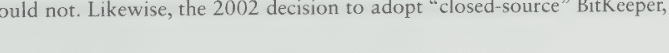
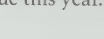

# 软件布道与道德修辞：数字民主中的代码正义（Routledge 修辞与传播研究）

本书通过考察软件中编码的意义层级以及围绕软件的修辞，为软件、道德与政治之间的交汇提供了一个迫切的视角。在软件开发文化中，“福音”（evangelism）通常指一种修辞实践，旨在将软件开发者以及非技术普通用户从一个平台引导到另一个平台（例如，从微软 Windows 迁移到 Linux）。本书认为，软件福音与其宗教领域的对应物一样，必须被理解为在构建道德和政治价值，这些价值的影响远超了开发文化的边界。以往的研究将这些价值定位在代码使用的效果中或特定类型的代码（如自由和开源软件 F/OSS）中，而马赫认为，所有代码在其技术性和可执行功能之外都具有意义。为了促进这一分析，本研究建立了一套福音理论，并说明了该理论在专有软件行业和 F/OSS 社区运作。作为代码层面运作的政治自由主义的例子，这些关于共享建构的福音修辞，涵盖了关于“善”的竞争性概念，而这些概念落于对“正义”的共同信仰之中。马赫还说明了这些对善和正义的信念并不总是以可复制的方式执行，正如在巴西和中国背景下对软件福音的不同解读方式所揭示的那样。本书展示了软件福音如何对世界产生变革力量，这种力量与代码本身具有同等的重要性，强调了修辞即使在最看似非修辞的技术尝试中的重要性，并凸显了数字时代对修辞素养的关键需求。

詹妮弗·海伦·马赫是美国马里兰大学巴尔的摩县英语系副教授。

# 致谢

致我的家人

1985 年，我是伊利诺伊州 Mundelein Santa Maria 学校的八级学生。由于某种幸运，学校获得了一个教室电脑，我和同学在 Alice 修女的帮助下开始学习 BASIC。经过仔细的代码，“Hello World!”出现在我的屏幕上，背景是一个浮出的城市天际线。然后，那一年结束了。除了我的计算机课得了“C”导致没能进入优生榜外，直到多年后一位程序员朋友偶然提到他们谈论的内容非常“有趣”。在研究了 14 年程序员谈论的内容后，我可以证实这一点。

感谢以各种方式帮助我完成这本书的人：迈阿大学的 Susan Jarratt, Fran Dolan, Kate Ronald, Morris Young 和 Lu Ming；北方伊利诺大学的 Doris McDonald, Michael Day, Bradley Peters, Deb Holdstein 和 John Schaeffer；以及马里兰大学巴尔的摩校区的 Jodi Crandall, Lucie McCarthy, Beckel 和 Christine Mallinson。Phil Lips，感谢你多年来的关心。向在本书看似不可逾越的障碍时一直支持我的优秀朋友们表示感谢，特别是 Aimee Reissenbauer, Heather Linville, Eric Savage, Cori Diggins, Donna Kain, Catherine Fox, Noki Shanga 和 Elizabeth Wardle。向我的战友们——Jody Shipka 和 Helen Burgess——谢谢你们。在 Routledge 出版，我要感谢 Liz Levine, Felisa Salvogo-Keyes 以及长期支持的 Andrew Weckmann，以及匿名评审员。最后，由于他们多年来始终如一的支持，我向我的妹妹 Amy Galindo、教母 Betty Maher、父亲 George Maher、父亲 Dennis Knight 和母亲 Rae Lynn Knight 表达最诚挚的感谢。没有你们，我无法做到。

经许可印自 2011 年的文章《The Technical Communicator as Evangelist: Toward Critical and Rhetorical Literacies of Software Documentation.》，*Journal of Technical Writing and Communication* 41(4): 367–401。

# 1 编码与解码

软件传教（Software evangelism）——这两个词的结合可能会让读者产生慈善，认为这是一种巧妙的比喻，在形象上创造了一种原本并不存在的关系。毕竟，软件属于科学技术领域。软件建立在算法的基础上，软件编程试图通过计算来处理和组织世界。就像普通的烹饪食谱一样，这种编程通过有限的、循序渐进的指令进行，并产生可执行的效果。另一方面，传教存在于宗教领域，是一种信者通过这种活动旨在传播神圣启示的“福音”，以努力感化并从而拯救不信教者的灵魂。在基督教传统中，传教的责任源于新约圣中的使徒福音：“所以，你们应当去，万民作我的门徒，奉父、子、圣灵的名给他们洗，教导他们遵守我所吩你们的”（马太福音 28:19–20）。因此，虽然这两个词很容易被看作理性与信仰之间的分界，但在软件领域，使用“传教”一词在软件开发文化中并不罕见，与那些曾经看似属于宗教范畴的道德关怀也无关。事实上，我在整本书中论证，软件传教在道德和政治上都构成了算法科学和技术编程；事实上，软件传教解释了自由民主的一个基本困境：在一个拥有具有竞争性的、不可调和的道德信仰的自由平等的人中，是否存在（以及如何存在）一种关于正义的共同观念？

我的观点是，对软件传教的分析不仅有可能揭示在代码中通过修辞工程构建的道德（以及不道德）影响，而且揭示创建一个正义系统的斗争——即重新确认程序员选择其代码如何被使用、修改和分发的权利——我意识到这并不是一个小的主张。在许多方面，这一主张最初似乎与开发文化中通常理解的软件传教完全背道而驰：即鼓励特定平台的第三方开发，以增加该平台上可用工具和应用程序的数量。在软件背景下最早引用“传教士”一词的，大卫·尼尔（David Needle）在 1984 年 8 月 6 日版的《信息世界：微型计算机社区周报》的一篇短文中，报道了在内华达州拉斯维加斯举行的国家计算机会议上新软件的发布。在报道过程中，尼尔转述了与苹果员工盖·卡瓦基（Guy Kawasaki）的交流，尼尔给他的头衔加上了引号，以表示该头衔在软件开发世界中的奇特用法：

“苹果预计在今年夏天结束前 Mac 将拥有 50 个软件软件包，并在年底前大约达到 150 个，”盖·卡瓦基说道，他是苹果的“软件传教士”，负责与苹果之外的其他参与 Macintosh 和 Lisa 系统产品开发的公司合作。“毫无疑问，你将在麦金塔上以最快的引入速度，在任何个人电脑上看到最具想象力的软件，”卡瓦基说。(12)

与他当时的许多同类一样，Macintosh 电脑面临开发工具、编程语言和软件应用程序的匮乏。作为一名传教士，卡瓦基的目标是传播公司即将发布的好消息，并鼓励第三方开发者为 Macintosh 平台创作。“软件传教士”这一术语源于软件初创公司之间的竞争以及推翻计算巨头 IBM 的愿望，这个词由苹果经理迈克·穆里（Mike Murray）创造，它概括了在修辞意义上赢得第三方开发者支持的重要性——简而言之，将他们转化为 Macintosh 平台。在尼尔的文章发表近一年后，汤姆·马玛（Tom Maemaa）在 1985 年 7 月 20 日的《信息世界》上撰写的《天使帮助开发者》指出，传播“麦金塔的福音”是该公司软件在不到一年内从几十件产品增长到几百件产品的主要原因，这一成就是如此显著，以至于连“歌利亚”IBM 都注意到了大卫 (39)。

尽管软件传教对个人电脑早期历史的特定时期显然非常重要，但软件传教不应被误认为是挣扎着建立立足之地的初创公司的策略。微软甚至在 2001 年通过其“开发者与平台传教部”正式地将传教制度化，根据该公司的公告，其目的是“在整个微软整合开发者工具和传教工作，并为数百万开发者、合作伙伴、信息技术专业人员和终端用户增强可用工具和技术”。除了苹果和微软，Adobe、亚马逊、eBay、惠尔罗普、谷歌、IBM、英特尔、Oracle、红帽、三星和雅虎目前都雇用了传教士，其头衔从“开发者传教士”、“首席技术传教士”到“云传教士”和“用户体验传教士”，反映了传教如今在软件开发中所占据的广泛范围。在可能是最广泛的传教角色中，互联网创始人温顿·瑟夫（Vinton G. Cerf）自2005年以来一直是谷歌的“首席传教士”。

随着企业对传教的拥抱，人们很容易将软件传教等同于传统的营销或倡导。出于鼓励开发和可见性的愿望，公司可以使用传教不仅增加第三方开发者的投入度，还可以销售其技术进步的内在价值。但传教，即使被确定为营销或倡导，通常意味着一种信仰的交流，这种交流绝不仅仅是经济或技术性的，即使明确是关于经济或技术时。在 1990 年出版的《麦金塔之道》（The Macintosh Way）中（这是传教力量的第一份详尽证词），前苹果传教士卡瓦基描述了为了说服开发者转化为 Macintosh 平台的修辞诉求。这些诉求强调了一个“梦想”，在这个梦想中，开发者可以“创造历史，改变世界”，并确保大卫在“IBM”之后通过“帮助苹果成功”来击败歌利亚 (100)。在热情和狂热（但为了钱）的驱动下，传教士旨在通过分享超越 Macintosh 技术规范和应用的信仰来诱导转化。

十七年后，在对软件传教的一段发人深省的描述中，“IBM Web 2.0 传教士”大卫·巴恩斯（David Barnes）将自己的传教工作与更传统的职场倡导类型区分开来：“我不属于营销部门，也不属于销售部门。”相反，他在 IBM 新兴技术小组的角色是见证正在进行的数字伦理：“展示我们在 IBM 内部正在做的工作，以将[新技术]带给世界。”相比之下，微软对其开发者传教部门的描述似乎淡化了（如果不是矛盾的话）在传教工作中激情而非利润的重要性，特别是考虑到平台副总裁吉姆·奥尔金（Jim Allchin）的评论，即公司的传教部“将为全球数百万软件开发者创建并提供支持，这些开发者都致力于为客户提供高性能、廉价且尖端的技术——无论何时、何地或在何种设备上。”但正如比尔·盖茨在 2002 年反垄断法案（*纽约州诉微软公司*）中的证词中所揭示的那样，“激情和投入”是微软传教士的主要动力，包括那些在年前“传播 MS-DOS 益处的人”。

## 4 编码与解码

由那些并非职业传教者的人所传播。无论是针对开发者，还是像后来发展那样针对消费者，福音主义（evangelism）远比支持或销售产品的策略得多。川崎（Kawasaki）对福音主义的描述揭示了：“当你销售产品时，人们使用它；当你向人们传福音时，他们会被感染，为你跳动并传递火炬，并抵御你的敌人”（1990, 99）。尽管川崎的描述被斥为狂热的技术爱好者或赤裸裸资本主义者的夸张其词，但他的描述也可以被理解为提供了一种想象方式，将软件福音视为一种对道德和政治目的的创造性修辞工程，而这些目的在很少被归于科学技术追求的领域中。然而，让我再次声明，我并没有胆大到认为软件福音在在我贯穿全书审视的道德与正义修辞中明确框架时，其最终并不服务于资本主义，而且在许多情况下目标是服务资本主义。然而，如果将驱动软件福音的热情仅仅限于公司效用最大化或利润积累，将忽视对道德善和正义感的诉求在软件开发文化内部及之外的各种福音中传播和竞争的程度。

## 软件生态系统的政治学

今天的软件作为一种生态系统存在，由专有软件、免费软件和开源软件组成（Merschmitt und Szyperski）。与在 ways和复制方面有严格限制的专有软件不同，自由和开源软件（F/OSS）赋予了自由使用和复制代码的权利。专有软件限制对其源代码（用计算机语言编写的人类可读指令）的访问，从而防止对其代码进行修改；而 F/OSS 使其源代码透明，通常不仅允许修改，还允许对修改后的软件进行重新发行。尽管在实践上基本相同，自由和开源软件在哲学上存在差异。对于自由软件传教者理查·斯尔曼（Richard Stallman）来说，1983年启动 GNU 项目的动力源于分享的自由与以专有软件和非披露协议形式剥夺的自由之间的“严酷的道德抉择”。对于开源传教者林斯·托瓦尔斯（Linus Torvalds）来说，他那最终成为 Linux 内核（即操作系统的核心）的项目启动是因为“我只是想要一个能在我的 386 上运行的东西”，正如他在集《开源：革命之声》中所解释的那样。在描述他向他人公开代码的原因时，托瓦尔斯在 1991 年写给 MINIX 操作系统 Usenet 组写道：“我很享受[sic]做这件事，可能有人会喜欢查看它，甚至为了自己的需要对其进行修改。它仍然足够小，可以被理解、使用和修改，我期待你们的任何评论。”自由社区和开源社区之间的这些哲学差异导致了许多激烈的辩论。例如，斯尔曼在 1998 年辩称，“开源的修辞”侧重于制造高质量、强大软件的潜力，但规避了自由、社区和原则的理想。但开源社区的人士对开源技术优点的福音派式关注——根据托瓦尔斯在 2007 年对 Google 的演讲中所言，“这是开发软件的唯一正确方式”——提供了吸引力，最终导致了不仅是开源软件，而且自由软件的主流接受。然而，尽管存在竞争的哲学，自由共享、可修改和可重新发行的软件在实践中是协同工作的，尽管它们在福音意义上被构建为自由或开源。事实上，斯尔曼和托瓦尔斯发起的各自项目共同形成了流行的操作系统 Linux，有时在自由软件社区中也被称为 GNU/Linux。

在描述 F/OSS 生产和监管的意义时，对 F/OSS 的社会经济研究强调了这种发展对专有软件开发中体现的传统劳动关系和工作概念构成了挑战（例如 DiBona, Eckman and Stone; Lakhani and Wolf; O’Reilly 2006; Raymond 2001; Soderberg）。因为 F/OSS 开发不将代码本身视为专有软件，这种方法寻求传统福特主义资本主义框架的彻底替代方案，将软件构建为生产者和消费者之间交换的商品。要识别 F/OSS 作为自由共享软件开发的非预期结果而非首要目标的后福特主义影响，对为何 F/OSS 开发社区对待代码的方式如此不同的考察至关重要。

这些考察的核心是*黑客（hacking）*的概念。大卫·列维（David Levy）解释道，黑客行为源于马诸塞理工学院的技术模型铁路俱乐部（TMRC），这是一个创建一个精细微型铁路展示的学生组织。在这种背景下，一个*黑客行为（hack）*是一个“不仅是为了实现某些建设性目标而承担或构建的项目，在更多参与中获得乐趣……要称得上是一个黑客行为，这项壮举必须注入创新、风格和技术技艺”（23）。对于 TMRC 的成员来说，其中许多人参与了软件编程的早期形态，“技术是他们的游乐场。”作为“驻留民族学家”和软件黑客，埃里克·雷蒙（Eric Raymond）后来在《新黑客词典》（*The New Hacker’s Dictionary*）中描述道，黑客是“喜欢探索可编程系统的细节以及如何扩展其能力的人，对于大多数倾向于只学习最少必要的用户来说（1996, 223）”。这种探索性实践的发生，要求确保游乐工具对任何可能想使用它们的人都是自由可用的。

因为对于程序员来说，工具是代码，因为代码是信息，所以信息的共享对于编码游戏至关重要，但不仅仅是为了实用考虑。*黑客伦理（hacker ethics）*在《新黑客词典》中被定义为“相信信息共享是一种强大的善，黑客有道德责任通过分享专业知识来获取信息资源”（1996, 234）。当复制程序和重新发行的自由得到确保时，任何有兴趣、需要或想要的人都可以从中获取无限宝库。此外，由于每个人都能访问并利用这些工具，黑客伦理被认为上是民主的。正如列维所言，黑客功能是“创造的行为，是在局部、明确的计算机世界中，真理、开放和民主存在的力量”。因此，游戏的概念及其产生的隐喻可能会产生轻浮的象，但黑客行为的意义以及游戏的普遍意义，无论从实践还是哲学角度都不应被低估。

随着 FOSS 对许多方面已成为 1980 年代代码作为商品化的常态方法提出的挑战，人们经常读到关于 FOSS，或者更具体地说，一场“开源革命”。在亚马逊购物、在 eBay 讨价、使用 Firefox 浏览——这一切都是通过 FOSS 实现的。通过互联网始终使用自由共享、可修改和可重新发行的软件，截至 2013 年 7 月，57% 的网站通过开源 Web 服务器 Apache 托管（Netcraft）。在采纳时代，指令在巴西、委内瑞拉和厄瓜多尔政府机构实施了 FOSS，而对 FOSS 的偏好由韩国、意大利和南非等国表达；中国、西班牙和泰国投入了政府资金用于 FOSS 开发；FOSS 的推广则由俄罗斯、波兰和欧盟等组织承担（Moon and Baker）。由于黑客强调共享，人们很容易假设非商品化软件使用的增加本身就代表了采纳者的民主冲动。在反抗许多方面已成为专有软件开发默认模式的情况下，从“封闭式”专有软件向自由开源软件的转变，被诱人地翻译为从威权主义向民主的转变。随着中国政府开发红旗 Linux（一种 FOSS 操作系统系统的发行版），有些人可能认为中国官方接受自由共享、可修改和可重新发行的软件是迈向言论的一步。假设颠覆性技术会自动导致颠覆性政治并非没有问题。自由、开放与民主的转喻性关联往往模糊了采纳 FOSS 的实际原因。在他们的技术分析中，大卫·贝里（David Berry）和吉尔斯·莫（Giles Moss）认为经济和技术

## 编码与解码 7

效率往往是政府采用技术的动力。自由开源软件（FOSS）并没有显著改变“现有的权力关系和不对称”，而是导致了“常规政治”而非民主化 (22)。由于这一发现——政府官僚机构本质并不完全令人意外——那么发现软件黑客行为对资本主义可能提供极小的抵抗（如果这确实是一种挑战的话），可能更不令人意外了。如果对资本主义的挑战确实是 F/OSS 社区的意图目标（这一假设存在很大疑），那么在 F/OSS 开发和监管中发生的商品化位移的影响是非常有限的。正如约翰·索德伯格（Johan Soderberg）所解释的，黑客软件并不等同于黑客资本主义。

在这种代码开发中，劳动力和信息的去等级化“凸显了资本关系的轮廓” (187)，但绝没有摧毁它们。在 F/OSS 开发中，游戏往往优于工作，享乐优于利润，赠送优于销售。但由于通用计算领域中专有软件模式的持续主导地位，索德伯格警告说：“如果我们要遵守比例原则的承诺，我们最好对黑客行为进行过度解读。”事实上，软件生态系统的政治并不包括更传统的抵抗性政治。技术政治必须处于这样一种状态：民主实践（如果发生的话）始终处于崩溃的边缘，因此威权主义与民主之间的任何紧张关系仅仅是自由临终挣扎的效应，也许这与一般的政治有所不同（Mumford 1964）。


然而，如果我们坚持认为对科学和技术权威主义进行解放性挑战的可能性，那么通过黑客伦理在 F/OSS 中体现的自由，似乎对专有软件的限制性提供了非常真实的抵抗。这种对软件开发文化的解读是如此普遍，以至于软件生态系统的政治被描述为各种理想主义的黑客对抗生产专有代码的“恶棍”公司（例如，Chun 2008；Falk；Hayles）。尽管这种二元对立在文化上很常见，能够警醒软件开发文化之外的人（包括非技术终端用户）注意编码政治的存在，但这种二元对立并没有问题。正如加布里埃拉·科曼（Gabriela Coleman）所说，自由共享、修改和重新分发软件的创造源于“黑客美学而非政治结果”，并导致了一种“政治冷漠”，将代码政治与任何形式的宏观政治脱离开 (2004, 509)。因为黑客伦理关注的是技术美学和实用性的最大化，黑客既不需要也不想要一种超出创建高质量代码实践的政治，事实上，政治意图和主观性在自由软件和开源运动的构成中确实明显缺失 (508)。与其说这是一个负面特征，这种政治意图的缺失让黑客能够在某种环境下工作，一个不受技术工具性之外事务干扰的环境。


## 8 编码与解码

这种环境超越了技术工具性的范围。尽管“每位开发者编写自由软件都有自己的个人理由”，科曼总结道：“黑客认为情感应该保持私有，他们不应该将其集体工作归于某种普遍的政治信息” (2013, 188)。这种对自由共享软件生产的共同且单一的关注使得当它发布到世界时，能够更多地关注高质量代码的创建；黑客代码希望不仅没有技术漏洞，也没有道德上的狂热和投机取巧的政治。从这个角度来看，自由作为黑客游戏的必要条件，被理解为仅限于“编程的务实性”和“一种开放的实用主义伦理” (2004, 51–11)。因此，在软件语境下，将“自由”和“开源”误读为旨在确认更广泛的、民主自由的自由与平等信念的政治行动，将威胁到代码、其开发者及其用户的重要利益。

一个功能完备且动态的软件生态系统的存在本身似乎促进了 F/OSS 的冷漠。专有软件巨头微软目前是最新版本开源 Linux 内核的最大贡献者 (Corbett)。对于一种超越自由软件与开源软件之间哲学差异的 F/OSS 冷漠，微软、IBM 和英特尔是否会对非商品化的软件开发做出如此程度的贡献（如果有的话）？然而，尽管坚定的黑客可能认为 F/OSS 开发发生在一个冷漠的蚕茧中，但科曼敏锐地指出，即使在那些相反意见的黑客证词中，自由中立也是一种幻象 (2013, 189)。

事实上，诉诸中立或冷漠出于许多原因是存在问题的。例如，技术中立被揭露为一个危险的神话，它使科学技术的道德构成变得模糊，甚至是完全不可见的。与像兰登·维纳（Landon Winner）、安德鲁·费恩伯格（Andrew Feenberg）和阿尔伯特·博格曼（Albert Borgmann）等其他技术哲学家一样，赫伯·马库斯（Herbert Marcus）解释说，在构建自主性技术时，“人类和自然变成了组织的交换对象”，那些“神秘且不可控的事物”变得受“客观属性和规律”支配 (168)。只有当自然投影为“无尽的功能物质”时，这意味着手段和目的本质上是一致的：“（科学）理性的计算表现”。因此，雅克·埃吕尔（Jacques Ellul）认为道德被“抛弃到了虚空，使道德失去了具体的活动” (147)。通过这样做，除了“纯私私的”之外，人类活动没有任何道德影响。对什么是好、什么是标准的判断仅仅是技术的范畴，其结果是“如果一个不能进入技术系统并与其保持一致，将不会被认为是有效的”。

与亚里士多德将实践视为一种沉思的反思不同，这种反思通过“言行”通向一个有意义的（telos），除了建造的房屋、创作的歌曲或编写软件，科学技术认为“实践的真理是纯粹且简单的” (148)。在这种观点下，技术作为“最高主体”，从中产生了任何有意义的行动。

## 9 编码与解码

通过强化软件的非道德化和去政治化，中立性的主张还威胁将软件还原为各种比特之间通信结果的工具性执行，特别是因为这种执行与以往的任何技术都不同。也就是说，亚历山大·盖洛（Alexander Galloway）认为：“代码是唯一可执行的语言，这意味着它是第一个具有实质影响的论说” (165)。不同于仅仅的写作，写作依赖说服来产生影响，但由于可能产生误读或冲突性解释，其实质影响有限；代码的执行通过一系列协调的输入和输出不断实现。

## 10 编码与解码

用加洛威（Galloway）所认的“母语”（164）进行写作，其语法旨在创建一种执行组织化控制系统的代码，这种系统在 Hunt 和 Thomas 的描述中得到了典型体现。过去，从文化和习俗中培养的人类协议设定了行为规则，而代码现在通过一种网络化的控制组织来实现这一点，并设定了行动的边界。

如果是如此，软件的功能无异于原始源头，万物的源头。编程工作看起来是如此单一地专注于执行，以至于黑客甚至专有开发者很容易认为对非技术终端用户很少或完全不关心，而这些用户在某些人眼中只是一种中性工具。只有当代码交到这类用户手中时，无论其是否自由共享，才会与更传统的道德和政治目标相结合，而这些目标本存在于 F/OSS（自由/开源）开发中那种无关关心的之外。

尽管表面上存在于传统政治的限制之外，但黑客的中立主张寄生于自由主义的中立原则，即关于什么构成“善”的道德关注应该从正义问题中抽离，正如确保法律下的宽容与平等一样。政治哲学家罗纳德·德沃金（Ronald Dworkin）指出，自由主义的动力问题是“政府将公民视为平等意味着什么？”（191），他将该问题的答案分为两个阵营：要么政府根据关于“人类应该是什么”的全面道德准则来对待公民，要么在关于“应当”的道德问题上保持中立，以实现正义。

一个全面的道德准则可以作为多样化公民在民主上是正确的指南针，这种可能性在今天显然是不可行的，这让阿拉斯代泰尔·麦金因泰尔（Alasdair MacIntyre）和查尔斯·泰勒（Charles Taylor）等道德哲学家感到遗憾，他们更温和地渴望基督教这类“道德源头”带来的赋能灵感。鉴于关于内在价值和意义的冲突思想导致的道德僵局，自由主义的中立提供了一种承诺，即将关于“正确”的判断从关于“良善”的问题中解放出来，因此，如果在平等和自由问题上存在任何道德命令，那么在自由主义国家中也应当是中立的。

这一假设的可行性似乎日益具有挑战性，根据查尔德·阿德森（Richard Arerson）对自由主义中立的“尸检”，这没有任何任何迹象。无论从目标、效果还是辩护的角度来看，意图良好的正义事务中对“善”的缺失是难以实现的。

正如在自由主义中立视角下对法律在民主社会中角色的考量一样，黑客可能希望看到他们的工作存在于定义善与恶的斗争洪流之中，以便为所有公民平等地工作，无论他们的道德、宗教或哲学信仰如何。尽管对 F/OSS 开发实证现实之外的事保持中立似乎是实现高质量代码的最佳途径，但需要这种“身在其中却漠不关心”（interested disinterest）来支撑，而黑客对编码中立的主张这本身就是一个可以引起争议的断言。

这种漠然是否是 F/OSS 开发中道德（或确切说是“爱”）事务的真实状态，还是为了代码而从不同程度上背景淡化关于道德良善的潜在争议性论点的修辞策略，是值得调查的，特别是考虑到软件开发文化中流出的福音主义修辞。如果那么中立（无论是技术上的还是自由主义的）都是一种谬误，我们该如何理解不仅是 F/OSS 而且专有软件开发具有比目前认可的更大道德和政治意义的潜力呢¹？

## 超越中立

在初生的数字时代，双重中立——一方面是技术性的，另一方面是自由主义的——体现在《版权作品新技术用途国家委员会》（CONTU）的《最终报告》中，该报告于 1978 年 7 月 31 日发布。CONTU 受美国国会委托，确定版权法对计算机代码的适用性，旨在消除人们认为将版权扩展到用人工语言编写并在机器黑盒内部执行的作品会催生社会影响的恐惧。

为了平息不仅由计算机技术使用的潜在负面后果引起，还由于代码可能被视为等同于创作艺术中“严肃”作者作品的法律而引起的道德恐慌，委员会认为：

> 任何归因于计算机使用对社会影响日益增加而可能产生的去人性化影响，与用于保护程序语言所采用的模式完全无关。显然，计算机的用途完全取决于用户的意图，而与旨在保护程序的机制无关。说程序的版权在某种程度上对表面上由计算机使用引起的社会问题负责，这类似于反对对最糟糕电视节的版权，或者反对对耗油汽车部件的专利保护，其理由是这些作品对美国文化是有害的。

因为技术本身既不善也不坏，而且由于此类关注只在开发后的后果中产生，因此根据 CONTU 报告，在关于将版权扩展到计算机程序的审议中，此类关注没有价值。但这种强调结果的实用主义技术中立，只是加深了建立在自由主义中立基础上的根深蒂固。正如报告所指出的，对什么是“正确”的判断必须排除“文化价值”（25），因此与美学或道德相关的“内在价值”在旨在回答“该对象是否是原创作者作品？”这一法律判断中没有立之地。对于法律事务，此类判断必须是“实然”的问题，而不是“应当”的问题。

通过自由主义中立的棱镜，很难看出编码中立的好处。法律理论家劳伦斯·莱西格（Lawrence Lessig）“代码即法律”的主张凸显了代码中立超越最看似中立的民主政治系统之内在局限性的潜力。正如莱西格解释的那样：“我们作为一种法律文化，希望宪法解决权利问题；我们不希望它们成为我们解释斗争的中心”（1996, 6）。但那些最初由美国宪法早期框架保障的本质自由在许多方面得到了保护，是因为技术上的局限性——莱西格称之为“缺陷”——限制了政府侵犯基本自由的潜力（43）。

随着数字代码克服这些缺陷的能力，一旦限制性约束被轻易解除，我们只能希望威权主义与民主之间的斗争可能仍是软件的政治，因为至少在那时，自由的可能性尚未熄灭。尽管编码中立和透明度可以作为“对国家权力的制衡”（1999, 101），但除了基本自由的缓慢死亡之外，任何其他可能性似乎越来越不可行，这并非由于代码本身，而是由于一种日益封闭的收用，这种收用根据一种“与其出生时的架构截然相反的架构”（4）构建了今天和未来的网络空间。

因此，作为网络空间的塑造者，黑客认为一种免于传统政治和道德负担争纷的编码中立无政府主义并不奇怪。根据科尔曼（Coleman）的公正观点，即使是那些出于传统道德或政治原因创建代码的黑客通常也对这些原因保持沉默，以便所有黑客都能轻松关注“黑客热于痴迷的：技术的功能、优雅和分量，以及日益增长的连接技术手段——互联网，让他们能够集体关联”（2013, 189）。

谈论代码具有与创建可执行代码的直接关注之外的世界相对应的内在道德、哲学或政治价值，这不仅破坏了高质量自由软件的创作，更重要的是破坏了允许自由软件存在的活动。在对自由软件黑客的民族志研究中，克里斯托·凯尔蒂（Christopher Kelty）解释说，这些活动构成了一个“递归公众”（recursive public），他将其定义为“一个独立于其他构成权力形式的集体，并能够通过生产实际存在的替代方案与现有权力形式进行对话”（3）。

没有了由构成并构成对自由/开源缺乏需求——意味着物质上的需求——哲学辩论的自由软件实践和条件，任何相关的道德或某些程序员选择通过令人生反感的“带有情感的表演”（14）将政治信仰与代码联系起来，这种做法是完全不可能的。

这种现象解释了为什么那些坚持认为创建自由软件具有道德义务的传教者，有时需要礼貌，有时则不需要，且出于某种理由——这不仅是因为不可知论者，也源于那些深信黑客伦理与言论自由权根本交织的程序员，他们认为任何不接受这一点为基本且不容置疑的论都是不合理的。

例如，开源传教者雷蒙德（Raymond）在在线杂志《Linux News》中建议读者，不一定要求报告理想，而是要清楚地报告像理查德·M·斯尔曼（Richard M. Stallman）这样的自由软件传教者的“修辞和策略”。直率地说，雷蒙德建议说：“所以下次当 RMS [理查德·M·斯尔曼] 或其他人敦促你‘谈论自由’时，我敦促你回答‘闭嘴，给他们看代码’”（1999d）。

尽管技术和自由的中立似乎最有利于 F/OSS 在各种数字活动中的最佳用途，但那种认为法律自然存在、因此代码可以自由共享、修改和重新分发的辩护，忽视了对自由主义中立性这一概念本身提出的挑战。在不深入讨论这些挑战的情况下，我转而将罗尔斯（Rawls）的政治自由主义作为重新思考 F/OSS 中立性的有用工具，特别是软件宪法，寻求避免自由主义中立性的陷阱（19–95）。

罗尔斯同意公正的政治体系必须在不诉诸宗教、哲学或道德价值的情况下持续，并将这种系统的原则定义为“公平即正义”（justice as fairness），这呈现为一种正义观，可以作为公民达成理性的、知情的且自愿的政治共识的基础（10）。通过公平即正义，自由主义政治能够在那些不仅拥有相互竞争、而且往往是不可调和的道德、哲学或信仰的人之间运作“重叠共识”（易读）。这并非对自由主义中立性的指责，而是一种拥抱；尽管如此，公平即正义允许在自由主义政治中突出道德的本质作用。

根据罗尔斯所描述的“两种道德力量”，公民被理解为同时拥有“正义感的能力和对正善的概念的能力”（81）。公平即正义持续依赖这些力量来培养公民之间共同的感性，但这种感性仍然尊重每个人的“理性自主”（72–74）。

在罗尔斯讨论的许多自主性类型中，理性自主源于亚里士多德的实践，并体现为人们“行使他们形成、修订和追求正善的概念的能力，并据此进行考量”（72）。对于政治自由主义中这种理性自主构想而言，至关重要的是公民能够达成“公平合作条款”的能力，这些条款能够生产性地约束行动范围，使得这种范围被认为是合理且公平的（但不一定中立），即使在存在竞争性道德信仰的情况下如此。

## 14 编码与解码

这些公平条款产生于一种“完全自主”，这种自主表现为公民在“正义的政治原则以及对基本权利和自由的享有”中的相互承认（77）。公平即正义可以被理解为通过一种制衡机制动态运作，这种机制“肯定了所有人的政治自主，但将伦理自主的权重留给公民根据他们的各种信仰系统来决定”（78）。

考虑到人们通常持有道德信仰的热情，完全的政治自主似乎总是受限于驱动理性自主的伦理系统，因此，自由主义中立性呼吁超越那些对日常努力（尤其是那些具有科学和技术性质的任务）如此不必要的分散注意力的道德斗争，便显得具有吸引力。

从完全自主中建立的共同点部分构建于一种自我实施的审查，这种审查源于承认他人信仰权的能力，以及源于一个与自身不同的正善概念。正如罗尔斯解释的那样：“通常情况下，我们在辩论基本政治问题时所使用的综合性哲学和道德观点在公共生活中应该让位”（11）。

因此，正如修辞学家切莉尔·格伦（Cheryl Glenn）所称的“作为策略选择的沉默”（13），往往可以是对这种多样性的务实回应，这是一种将所有人的完全政治自主置于个人伦理自主之上的合作行为。通过对道德差异做出策略性沉默，每位公民都“退回到中立地带”（59），正如自由主义理论家查尔斯·拉莫尔（Charles Larmore）所说，这种做法既是尊重的标志，也是理性对话中的一个重要元素，促进了对政治自主的共同投入感。

虽然这似乎又带我们回了中立性的处，但事实并非如此。虽然为了重叠共识而退回到中立地带确实存在，但有时不退缩也同样可能。对于拉莫尔来说，面对竞争性道德信仰时拒绝退缩表明了缺乏尊重，因为“他人凭借他们构建连贯的世界观以及事实上对良好生活的能力而受到平等的尊重的……”（65）。

但，如果是这样的话，为了政治自主而建议这必须一直保持在阴影中似乎并不那么尊重，特别是当那些具有冲突道德信仰的人对特定法律的批评达成的共识可以作为加强政治自主的检查时。正如罗尔斯暗示的，我们并没有为了重叠共识而在公共领域被升华，因为个人的道德自主并不旨在涵盖集体的政治自主。

与其总是退回到没有任何伦理争端的中立地带，与他人（即使是那些具有不同道德信仰系统的人）进行理性接触，有时意味着通过修辞来参与，在存在模糊性的情况下解释自己的审议方式和结果判断。正如自由主义理论家威廉·加尔斯顿（William Galston）所说：

> “当我们向他们提供解释时，他们尊重我们所认为的行动的真实且最佳理由”（109）。

## 15 编码与解码

在软件开发的背景下，道德和伦理（我交替使用的术语）历史上一直局限于软件使用的后果和命令式的伦理规范。詹姆斯·摩尔（James Moor）在他1985年的《什么是计算机伦理》中指出，随着计算机对整个机构和活动产生日益巨大的影响，程序员从计算机伦理的角度进行思考变得重要，他将其定义为“对计算机技术性质和社会影响的分析，以及对这种技术伦理使用的相应政策制定和证明”。

开发计算机伦理要求程序员承认并反思他们如何通过代码选择来实现善恶。例如，通过识别其“不可见性因素”，软件被识别为一种潜在的滥用工具，通过这种工具发生了盗窃、监控、知识产权滥用、反竞争市场偏差（272）。

因为正如摩尔所说，“可见的编程价值是如此不可见，以至于程序员自己都没有意识到它们”（274），只有在首先处理软件存在的“概念真空”时，软件被使用的“政策真空”才能以有意义的方式被解决。换句话说，对于编写可自由共享、修改和重新分发代码的能力不可剥夺的 FOSS 程序员来说也是如此。

然而，这种视角模糊了本该显而易见的东西；让完全政治自主对人们中存在的各种合理信仰系统保持中立是不够的。在罗尔斯的构想中，公平即正义不仅是一个关于正确的原则，也是关于善的原则，因为它源于我们的力量，使得公民在对良好生活的构想存在巨大差异时能够和谐共处。

难道没有看到，当个人发现做正确的事也能让他们做他们认为善的事时，自由主义才是最好的吗？通过研究软件开发文化成员如何通过各种软件传教来表达他们的力量，编码中立性可以被理解为一种沉默策略的效果，这种策略偏见并消除了软件开发中的传统道德和政治，而非科学技术事务的自然状态。

## 16 编码与解码

“通过对事物的好坏判断，‘我们发现了关于我们价值什么以及不价值什么东西’ (267)。”

当 1992 年 10 月 16 日投票替换其 1972 年通过的原始道德准则时，计算机学术协会（ACM）试图明确哪些类型的编程行为（无论是人类方面还是代码方面）是普遍有益的。这份修订后的《ACM 道德规范与职业行为准则》包含了 24 条“指令”，旨在指导计算专业人员的道德信仰和伦理实践。

在这些义务论指令中的前八项包含了“一般道德准则”，阐定了 ACM 成员应当遵循的行为准则：

- 1.1 为社会和人类福祉做贡献
- 1.2 避免伤害他人
- 1.3 诚实且值得信赖
- 1.4 公平公正并采取行动消除歧视
- 1.5 尊重财产产权，包括版权和专利
- 1.6 为知识产权给予适当荣誉
- 1.7 尊重他人隐私
- 1.8 遵守保密性


这些通用准则中缺乏计算实践，起初令人困惑，但 ACM 指出这是刻意为之，以承认“适用于计算机伦理的原则源于更一般的道德原则”。其他指令，如“更具体的专业责任”、“组织领导指令”和“对准则的遵守”，一个职业道德准则在塑造受准则约束的人员良好行为方面有多有效，这无疑是有争议的（Ladd; Luegenbriehl）。

最近，在 2008 年的《IEEE Software》一篇文章中，编辑、开发者兼 IBM Fellow 士格拉迪·布赫（Grady Booch）认为，整个软件开发文化必须思考道德与代码相互交叉的模糊方式：

> “我们作为一个专业社区，开发的技术已经改变了个人生活方式、业务运营、社区互动以及国家和文明的繁荣与扩张。在那种抽象层面上，道德维度无疑在起作用：当我们的技术触及人类精神的活动时，社会责任、个人权利以及与周围道德氛围的契合度问题就变得活跃起来 (8).”

布赫主要关注如何通过创建伦理准则和实践规范（如 1999 年发布的《软件工程道德与职业实践准则》）来确保和规范开发者的个人责任和义务，他引用自由主义和技术中立作为工程师必须通过道德视角评估技术解决方案的理由。尽管诉讼（或诉讼威胁）往往确保了工程师对其创建的代码拥有利益关系，但“法律无法强制道德准则” (8)。此外，因为“技术本身既不善也不坏”，软件开发中的道德风险并不总是显见的。正如摩尔（Moor）一样，布赫认为，“软件的危险之处在于，这些道德和伦理影响对开发者来说可能并不那么明显” (9)。尽管布赫自己承认这种道德呼召并不受欢迎，但他认为开发者有基本的伦理责任去考虑他们的软件会在多大程度上“允许”用户做什么，事实上，以至于开发者应该考虑某些可以创建的软件是否应该存在。通过鼓励开发者对软件在世界上产生的影响负责（而不仅仅是工具性的影响），布赫试图打破软件的道德真空。

尽管软件的伦理考量必不可少，但摩尔和布赫旨在通过改变早期模式，催使开发者在软件后果的讨论中引入道德语言，特别是当与不可知的黑客并列时。2010 年 5 月 14/15 日，苹果 CEO 史夫·乔布斯（Steve Jobs）与苹果消费者莱恩·泰特（Ryan Tate）之间的一场激烈的邮件交流证明了这一点，泰特当时为《Gawker》杂志就硅谷和技术问题发出警告。在看了苹果新款 iPad 的广告后，泰特对广告结尾的陈述有异：“这已经是一场革命，而且才刚刚开始。”为了发泄对苹果缺乏黑客式自由的不满，泰特给乔布斯发了一封邮件，而乔布斯知道“[鲍勃]·迪伦今天 20 岁了，他会如何看待你们的公司？他会认为 iPad 与‘革命’有一点关系吗？革命关乎自由。”

面对这种对黑客自由伦理的引用（尽管在道德和政治上可能很熟悉），乔布斯在三个多小时后用他的私有数据做了回复：“是的，从那些浪费你内存的程序中获得自由。从色情中获得自由。是的，自由。时代在变，确实如此。”对于乔布斯来说，道德软件是指他所认为的保护用户免受数字生存危害的东西，如信息窃取和轻松获取色情。当泰特回答说“我不想从色情中获得自由”时，乔布斯承认：“当你有了孩子，你可能更关心色情……”但泰特认为紧迫的问题是限制他人自由的决定，无论是为了规定开发决策的平台障碍，还是只有在批准的封装内才被认为可发布的内容。

当乔布斯试图将“原生”平台特权仅仅归为“一个技术问题”，因此不值得“如此苦恼”时，泰特回答道：“是的，也许我很苦恼。因为我不认为这根本不是一个技术问题——这是你在强加你的道德，关于色情、商业秘密，以及在最诡异的意义上的技术纯洁性。”

在结束对话时，乔布斯坚持认为，无论苹果做什么都是出于善意：“对于我们来说，我们只是在尽所能地尝试实现（并保持）我们设想的用户体验。你可以有不同意见，但我们的动机是纯洁的。”在一个展示代码创建者特权地位的公开权力动作中，乔布斯向泰特修辞性地问道：“顺便问一下，你做了什么伟大的事情？你创造了什么，还是仅仅在批评别人的工作？”

在摩尔和布赫设定的道德框架内，考虑到苹果代码选择的道德含义的人将受到表扬；如果不这样做，将把道德考量完全排除在软件开发之外。显然，从黑客视角来看（泰特所表现出的），对信息内在重要性的不可知信念排斥了这种道德化，并强调了信息的权利。然而，无论这些差异如何，两者都物化了代码的中立性。

## 编码与解码 19

手段与目的。“媒介”背后的信息本身就要求将道德与技术媒介隔离开来，以便揭示后者对社会的影响。简而言之，“清除环绕我们技术的某些道德迷雾”对道德和技术是有益的（2011, 180）。

从这个角度来看，我们可以理解为，例如，文字技术影响了一种社会转型，这种转型从部落转向了个人。但这种转型绝不应被误认为是本质上是道德的。更最近，根据麦卢汉（McLuhan）的观点，电子时代被“编程”（1967, 78）出一种“新道德”，这种道德据称能防止技术的道德化。

这种“新道德”拒绝了通过根植于“过去与现在对比的幻象”的“价值判断”而发生的“无休止的重复性道德说教”，以及从意识的外在性向潜意识的内在性的转变（176–77）。尽管 20 世纪 60 年代关于内在之旅的隐喻显而易见，但麦卢汉讨论中意义重大的是他的立场，即“善（189）最好通过技术中立和极端的个人主义来实现”。

我们不是要根据已有的技术、政治或道德历史进行“分类”，而是要“探测”并将每种体验视为是独特的（188）。虽然他认为电子时代让人类恢复到了一种“原始”状态，在这种状态下，我们不再是包含我们的世界的观察者和占据者，而是我们环境的制造者和设计者（83），但这一主张似乎是在进行新道德据称拒绝的那种过去与现在的比较。

撇开这种批判不谈，这种“新道德”更紧迫的问题在于其潜在假设：随着电子时代以及随后即将到来的数字时代，世界在某种程度上变成了我们每人创造的对象，结果就是对于什么是“善”完全缺乏共同答案。

尽管像麦卢汉这样的方法提供了逃避通常与技术（尤其是新技术）相关的道德恐慌的可能性，但那种认为摆脱技术就是自由的信念忽略了这种可能性：即将软件构想为道德，会进入由比尔·盖斯（Bill Gates）等人所谓的“软件的魔力”所笼罩一切的科学技术迷雾。

这种可能性在于，技术本身在其诞生和设计之初就工程了道德维度。布鲁诺·拉图（Bruno Latour）建议，最平凡的日常物品也包含了“隐藏的社会群体”（1992, 227）。这些“非人类”的功能不仅根据预期效果运作，还将那些将其价值观“转移”到“非人类行动者”身上的人的委托（231）。

## 编码与解码 20

在设计层面，人类价值的委托被“编程”到技术中，成为一个“非人类行动者”；座椅的填充是为了防止儿童在碰撞时受伤；固定座椅的能力确保了座椅不会变成导致伤害的投射物；而那些对于座椅来说太大了且未系安全带的儿童仍然受到了保护。因此，拉图采取了作为“座椅”的人类特征，并借此根据最基本的道德义务之一发挥作用。

但技术的可见或经验性功能并不仅仅是在其道德价值上被发现的。在拉图这里，我们“追溯工程师将文本和项目转化为物品所采取的步骤”（1992, 233）。虽然此类文本的获取通常由于意图或环境而被密封，但尤其是 F/OSS（自由开源软件）开发，其发生方式使得代码通常通过自然语言枢纽进行共享，就像代码本身一样。

专有开发者对软件创建和监管的积极修辞参与，使得通信的获取变得比以往任何时候都更加困难。“遵循这条从文本到物品的路径”允许揭示一个此前隐藏的道德景观，在这一景观中，即使是最平凡的事物，曾经仅因其工具功能而被欣赏，现在也具有了道德特征。

我们不必对道德的现状感到绝望，或许承认我们未能找到一个双方认可的道德来源，或者道德已经变得如此主观，以至于在个人经验之外空无一物。通过一种修辞计划，在这些软件道德意义的局限性与软件表象中立所引发的道德真空之间所出的选择将变得透明。

## 修辞计划

## 编码与解码 21

为了对抗弥漫在软件中的技术中立性神话，并解码其道德和政治构成，我试图说明软件布教（software evangelism）如何从道德和政治角度对代码编码。

在软件开发文化中，对“编码”（encode）的功能性理解是指将一种符号或格式转换为另一种。我在键盘上输入“hello”，字符通过字符编码系统转换为二进制代码的机器语言。通过这些 0 和 1 的功能性组合和重新组合，二进制代码指示计算机运行，而“hello”中的“h”被编码为 `01001000`。

然而，这种对代码编码的功能性理解并没有考虑到这种最基础的含义仅代表了分配给“编码”的一层意义。相反，对“编码”的符号理解强调了修辞的重要性，即自然语言的说服性使用、对现实的构建，以及在软件布教的情况下，代码在输入/输出黑箱之外发挥作用的方式。

《牛津英语词典》将“execute”（执行/实施）定义为“遵循、使生效（一个意图、目的、计划、指令或命令）”。代码和修辞在执行方式上存在差异；这被更好地理解为程度上的区别而非种类上的。自然语言的说服性使用并不享有输入和输出之间纯粹的对应，而代码经常（但并非总是）具有对应。

尽管如此，这种程度上的差异并没有否定这样一个事实：修辞以同样的无形力量对世界发挥作用，并且代码本身通过其参与过程具有修辞性。

尽管修辞没有享有肯尼迪·伯克（Kenneth Burke）所说的一一对应的“纯粹认同”，代码也没有，至少并非总是如此。因为，如果有的话，在非技术终端用户最常见的旋转圈、冻结屏幕和脚本错误等错误中，就不会有“冲突”（1969, 145）。

然而，尽管承认机器冲突通常可以通过调试更容易解决，这在修辞性的编码和解码中并不一定成立，而且在程度上也不如此。因此，修辞的转瞬即逝和多故障（buggy）的特性使其成为接受代码逻辑承诺的完美理由。

在总结这种被不公正归于修辞的立场时，斯坦利·芬奇（Stanley Finch）写道：

> “修辞的对立面是真实、实质或本质，因此，修辞通常代表非正统、转瞬即逝和多余。这体现在几乎总是出现在‘修辞’之前的形容词‘仅仅’（mere）之中”（228）。

在 F/OSS 研究中，对 F/OSS 社区修辞的强调导致了这样局面，正如凯尔蒂（Kelty）所说，“我们溺于‘为什么’……渴求‘如何做’”（x）。许多研究强调了

## 22 编码与解码

自由软件社区对其“自由话语”（Berry）进行了“道德转折”（Chopra and Dexter）式的处理，其修辞特征被描述为一种“意识形态的狂热”（Vainio and Vadén），这种狂热以牺牲经济利益为代价来维护道德理想。

相比之下，开源社区是务实的，他们认为信息应当自由于一种“中立的工程视角”（Vainio and Vadén），这种视角能够最大化软件的技术效率和优越性。深陷于功利主义的“道德不可知论”（Chopra and Dexter），自由被民主化了，但以务实为导向的技术自由除外。

结果，自由软件社区通常被描绘为充斥着道德、政治和意识形态，而开源社区则被描绘为对无谓分心抽象的抵制。将哲学差异置于共同开发实践之上（或反反之），只会加剧一种有问题的理想主义/唯物主义二元对立。

受限于只有通过生产模式才可能实现的物质性，在技术之前，关于思想、价值观和信念的修辞表达很容易且危险地被感知为非物质的——无论是在真实的意义上，还是在不重要的意义上。

虽然 Kelty 断言增加对 F/OSS（自由/开源软件）开发文化“如何做”的关注是非常必要的，但我们不需要考虑“为什么如何做”以及其他独立性。在竞争性的软件传教中，理解“为什么如何做”要求将修辞本身识别为物质性的。

对修辞（广泛）和传教（特指）作为物质性的承认，有助于超越超越实践的起源和终结问题，同时也拥抱了说服的真实效果。修辞不是发现原本隐藏的事物或对现实的更多呈现，而是成为一种构建和构成人与人以及人与物体之间关系的活动。

Michael McGee 解释道，修辞虽然不像“石头”那样具有物质性（x）。但这种桥梁作为一种“允许人之间互动的社会功能”（21），连接了现在与过去，个人与集体，以及有用与道德及政治。

因为表述的每一个时刻的每一个词都嵌入在充满了社会力量和形成之间争议与争夺的历史中，意义从未在不受受之前事物影响的情况下产生。意义并不总是由过去预先决定的。

相反，意义和关系通过它们的修辞构建，通过情境活动的“有动机的”、“有利的”和“有说服力的”实例处于持续的“生成”过程之中；这是稳定与变化的来源，这一过程在某种通过修辞参与者（人类和非人类）之间关系施加的代理发生。

由于修辞的物质性，Burke 观察到，“事物因此超越了它们作为纯粹事物的本质。它们被发现能够移动

## 编码与解码 23

不仅通过它们在粗糙物理形态上的本质，还通过它们所代表的符号性的最远触及”（1970, 301）。只要那种“语言是行动的一种类型，即符号行动”（1966, 15），正是这种修辞符号性促使我们行动。

修辞符号性的一个相对透明但具有揭示意义的时刻，涉及我进行软件传教研究过程中的一个关键时刻。在 2001 年 5 月 3 日由微软高级副总裁发表并发布在公司网站上的演讲演讲转录中，Craig Mundie 引入了微软新的“共享源代码哲学”，并表示：“共享源代码不是开源。”

我最初在 2002 年访问该网站阅读 Mundie 的演讲，随后在 2008 年再次访问，我发现了一个修辞补丁，这个补丁是在 Mundie 的言变为“共享源代码是开源”时添加的。这是微软试图更紧密结合 F/OSS 实践的尝试，还是黑客为了嘲笑这家专有公司试图利用 F/OSS 成功的尝试，这目前并不完全清楚。

考虑到后期选项中引入的语法和拼写错误，仅仅看起来是简单插入的补丁，我倾向于后者，因为我对添加该补丁时的粗心大意感到惊讶。然而，在 2011 年再次访问该文档时，这些错误已经得到了纠正，除了缺少一个撇号。

这一时刻显然指向了在互联网这一电子档案中进行研究面临的挑战。但更重要的是，这些变化强调了权力不仅存在于在人工编程语言中构建对象的能力，还存在于对人工语言的修辞编码中。

表面上，修改 Mundie 声明的存档没有任何“实际”理由。我严重怀疑是否有少数几（如果有的话）在关注这份文档。然而，这显然符合这种假设的利益：无论是谁对这些内容进行了更改，这样做是相信技术专家对实际性比符号性更感兴趣，对工具性比道德性更感兴趣，在流动的自然中对 1 和 0 世界的固定性更感兴趣。

Lev Manovich 认为，通过超链接等工具，“交互性的新修辞”取代了那些“指导、启发、说服并诱导其读者采纳新思想、新世界解释方式、新意识形态的文本（77）”。然而，共享源代码（Shared Source）的例子表明，一个单词可以并执行其自身作为一个有意义的斗争场所。

关于 Burke 如何将“自由”之类的词识别为“神圣术语”（God-term），事实是——正如 Kelty 所说，“声称开放、自由、公共或民主是每个人都会做的事”（302）——指向了需要理解自由如何通过政治权力以不同的方式构建，而政治权力又是通过软件传教构建的。这些传教行为在许多方面

- 指向了理解自由如何通过政治权力以不同的方式构建，而政治权力又是通过软件传教构建的。

## 24 编码与解码

通过竞争性的传教，代码不断处于编码和解码的过程中。虽然宗教传教曾是创造美好的主导力量，但 Burke 认为，“现在是科学家而非先知在试图转化（感化）我们”（1954, 80）。

对于 Burke 而言，在宗教领域引发新取向的传教通常被称为转化（conversion）。因此，取向主义者的目标是通过“要求我们改变取向”（80）来促进这些转化。从一种取向转向另一种取向并按照这种新取向行动，其承诺（无论是宗教还是科学）是相同的：不像基督教传统中承诺来世的救赎，科学救赎承诺“我们将自己和我们的群体更接近良好的生活”（81）。

- 在我们在没有艺术或系统引导的情况下处理我们所审议的事务”（1984d, I 1357a2–3）。根据这个定义，修辞似乎与软件编程几乎没有关系（某些可能会认为如此），因为软件编程中的指令及其执行是根于稳固的科学逻辑的。

然而，通过自由软件社区的传教，由于其公开强调创建可自由共享和分发软件的道德义务，我们看到了对技术意义的一次有意义的破解。这种破解不仅仅是技术性的，它的创造性在于揭示了程序员以及软件开发文化中其他人员（例如律师、高管、新闻记者和监督者）在决策过程中可能发生的道德和政治考量。

对于亚里士多德来说，良好的生活在于 eudaimonia，它被定义为幸福的一种“计算”³，与其等同的不是快乐，而是人类的繁荣⁶：

> “由于最好的幸福，这就是终结，而完全的终结是一项活动，这意味着通过按照卓越性去生活，我们将获得幸福并拥有最大的善”(1984a, I1184b 36–1185a)。

## 编码与解码 25

在如何通过修辞的活动在物质上构建繁荣（这不仅仅是享乐，而是人类的繁荣）这一过程中，变量众多，对共识（特别是在道德问题上）的诉求是显而易见的；如果过良好的生活意味着一种投入性的生活，即选择允许实践不受限于协议、网络或其他形式，那么这种诉求就不一定如此了。

然而，如果我们将共识理解为一个参与而非退缩的空间，那么代码就成了通往幸福（eudaimonia）的路径，它让公民能够运用实践智慧（phronesis）采取行动，类似于罗尔斯对道德力量的概念。

根据亚里士多德的观点，拥有实践智慧是指一个人能够“看到什么对自己是有好处，对人类整体是有好处的 1984b 1140b–11)”。如果我们将其理解为将繁荣视为终极目标，并用道德和政治价值对其进行修辞性编码，那么在充满科学技术的世界里，人类关注此类价值的机会似乎在萎缩。

然而，在软件程序员的传教中，代码变成了春所描述的“再资源（re-source）”，一种将“效能与历史和语境联系起来”的东西 (2008, 322)。通过代码再资源，代码的执行超越了机器可读的指令，包含了亚里士多德式的实践。

这样做，软件开发文化中的不同群体可以被认为，其动力不仅仅是创建高效代码的需求，还为了追求幸福而行动。接下来的内容将阐明人类繁荣是如何通过软件传教活动构建的，并以此目标。

## 注释

1. 这个广泛的问题深受当代自由主义哲学家及其各种表现形式所产生提问的影响。为了提供这些提问题的示例，约翰·罗尔斯将自由主义的核心问题确定为：“如何可能随着时间的推移，存在一个公正且稳定的自由平等公民组成的社会，而他们对合理的宗教、哲学和道德学说感到深切欢欣？”(47)。

杰拉德·高斯总结道，“公共理性自由主义的调节性目标是探究具有深刻且持久分歧的自由平等的人是否——以及如果是，如何——都认同一种社会政治秩序。”

杰米·罗逊通过断言概括了自由主义的问题：“自由社会被设想为一个人们在其中实践和追求各种对立且不可通的生活方式的社会。但这些人如何可能和平地生活在一起，并接受相同的社会正当化形式？”(1993, 54)。


## 2 自由的邀请

黑客用游戏取代工作，体现了工业时代与信息时代之间日益增长的区别。正如佩卡·希马宁所描述的，“典型的晚期工业生活轨迹”本质上涉及一种相当固定的线性，其中“一个人为一份工作接受训练，并在余生的生产力中从事这项工作，从早九到晚五 (112)。”在生活中，工作与游戏分开，工作日与周末分离，员工与个人区分。随着构成网络社会的通信技术出现（这种社会似乎正日益发生），这种划分变得不仅是不必要的，而且几乎是不可能的。曼努埃尔·卡斯特斯在他关于网络社会的揭示性著作中指出，身份不再是由一个人在一天中履行的各种角色构建的（例如，母亲、医生、老师、邻居）。相反，身份简单且完全是一个赋予目的的意义来源 (7)。

在一种对西方关于意义如何产生的理解的长期纠正中，对 F/OSS（自由/开源）社区之间哲学差异的强调是理想主义的结果；而对他们共同实践的强调倾向于唯物主义。在理想主义中，无论是作为经验的先验，还是通过后现代的主体多元性，目标都是解释为什么世界是现在这样。路易·阿尔图塞在对对理想主义的批判中解释道：“一切存在物的原则都取决于其存在的理由——这个理由隐藏在直时性、经验性、此地此地给定物的表象之下”(2006, 216–7)。因此，语言变成代表抽象思想的手段，为世界分配主观色彩和意义。同时，通过关注程序员的修辞，倾向于理想主义的 F/OSS 阅读考虑了那些本是隐藏的价值，反过来强调自由软件社区与开源软件开发社区之间的本质区别。相比之下，倾向于唯物主义的 F/OSS 阅读通过突出他们的共同实践来强调这些社区之间的本质相似性。但这样做需要将语言（更具体说是自然语言）置于更重要的生产和使用实践之前。卡尔·马克思在讨论历史唯物主义时写道：“政治、法律的语言……道德、宗教、形而上学以及所有其他意识形态以及与之相应的意识形式，不再保留独立性的假象”(马克思和恩格斯, 47)。受限于只有通过生产方式才可能的物质性，思想、价值和信念的修辞表达很容易且危险地被感知为非物质的，在“越来越不重要”的意义上也是如此。这是他希望终结这个故事。

参见 Biesecker and Lucaites；Burke；Hollis；McGee；Rice；Selzer and Crowley。

由于亚里士多德在描述以幸福为目标进行权衡的过程中使用了“计算（calculation）”，这很容易被误解。（此处原文包含大量 OCR 错误重复，已省略）。

关于幸福的现代概述，请参见 Bostock 2000 和 Nussbaum 1986, fn. 6。

正如亚里士多德在《尼各马德伦伦学中所揭示的，什么构幸福往往被其不同的构建方式所模糊：让我们假设这种共识让传教者和被教者达成一致，即使是暂时的：

> 传教的基本规则是你必须从共识开始。考虑保罗对雅典人的演说。既作为犹太人也作为基督徒，保罗会发现雅典的成千上万的图像令人厌恶。他这样开头（凭记忆，因此不准确）：
>
> “我观察到你们对神灵的敬畏比其他人更深。例如，在经过观察你们的崇拜对象时，我发现了一处铭文：‘给一位未知的神’。这就是我向你们发表的神。”（注：此处原文中存在大量重复的 OCR 错误，已按逻辑翻译核心内容）。

## 26 编码与解码

在十八世纪，《基督词典》（The Christian's Dictionary）将传教者定义为“[带来消息或好消息的人；因此因为四福音是救赎的消息，它们受启的作者被被称为福音传道者]”(第 10 号, 1)。如果我们将传教者的角色从其教会根源中分离，认为软件传教者也充当信使者并非可能的。例如，参考 1999 年 8 月非营利组织开源计划（OSI）列表上的一个讨论，根据其首页，该使命是“教育并倡导开源的益处”。与专有软件在用途和分发上的限制，以及其不透明的源代码导致代码不可修改不同，开源软件通常是自由复制、修改和可重新分发的。在开源被采纳为新品牌的这一萌芽时期，出现了如何最好地传教的问题。在 OSI 的主题“传教基础”中，程序员兼 OSI 创始董事成员奇普·萨尔森堡（Chip Salzenberg）指出，成功的传教总是始于某种共同利益，这种利益让传教者和被教者达成一致，即使是暂时的：

对于世界上大部分地区，追求效率、效能或利润最大化的愿望往往提供了这种共识。所投入的工作应该导致

## 自由的邀请 29

某种奖励以及工具按预期发挥功能，这提供了一个基本的共识点，即使在最不可能达成一致的群体之间也是如此。针对 Salzenberg，开源电子商务套件及支持服务公司的首席执行官 Brian DeSpain 赞同了这一策略：“我也发现，关注业务问题的解决方案是一个极好的方法。问问他们的内部流程。他们面临的具体问题是什么，以及你们的解决方案是如何解决这些问题的。”但此类关注仅仅是通向更复杂、甚至更具风险的修辞行动的第一步。因为福音传播开始的共同基础，不可避免地意味着将破碎，并希望未来能以更深层的方式重新结合。

在最基础的层面，福音传播的发生是因为差异，事实上，它是构成差异的首要活动。在任何根深蒂固的叙事中（即对大量信徒产生长期重大号召力的叙事），只要叙事的核心元素存在，信徒的解释之间仍然存在微妙或不微妙的差异。在基督教案例中，通过共同信仰产生的统一感，与在不同教派和宗派之间通过“道”产生意义的不同方式来培养差异是同时发生的。对于伯克（Burke）来说，修辞的核心目的始终与认同和分裂联系在一起，因为“[它]根于语言本身的一种本质功能，这种功能是完全现实主义的，并且不断新生；将语言作为一种符号手段，诱诱那些天生对符号产生反应的生物产生合作”（1966, 43）。修辞涉及人类所有的交流，甚至包括科学和技术领域，因为我们使用语言（以及软件等符号系统）来创造社会凝聚力和合作。伯克的修辞理论将修辞定位为力量的相互作用，其驱动力是不断引导观众趋向或远离共同基础：“基本上，术语分为两类：将事物聚集在一起的术语，以及将事物拆散开的术语。换句话说，A 可以感到自己与 B 认同，或者可以认为自己与 B 疏离”（1960, 49）。重要的是，认同与分裂之间的区别总是模糊的，并标志着“对修辞的一种特征性邀请，这种邀请不仅导致了合作，也导致了冲突”（1969, 25）。因此，通过符号性，我们被要求研究词汇和事物是如何始终被激发的，并因此始终具有修辞色彩。

重要的是，伯克的修辞理论观点认为，任何活动（包括科学和技术活动）都可以被理解为自主的或“免于与[自身]之外的其他动机产生认同”（1969, 127）。伯克解释道：“任何专业活动都参与一个更大的行动单元。‘认同’是描述自主主体在这一宽泛背景下的位置的词，主体可能并不在意意这个位置。牧羊人作为牧羊人，是为了羊的利益而行动，保护它们免受伤害。”

## 30 自由的邀请

但牧羊人也可能与一个为了市场而饲养羊的项目产生‘认同’”（27）。伯克预见到了 Moore 在呼吁考虑“计算机伦理”时所表达的那些“隐形的编程价值观”。我们不必将这些价值观局限于后果，即使这正是软件与道德问题经常被局限的原因。正如伯克所指出的，科学家和技术人员创造了一种语言，“缺乏调性、缺乏模仿性的强化、缺乏模糊的人类情境，而这些元素构成了诗意媒介完整且复杂的号召力。对于科学家的符号，人们可以通过查书来做出充分的回应。正是这种灵活性的缺乏，有助于他们避开灵活性的号召力”（58）。尽管科学和技术术语最容易缺乏解释信息（这种信息是修辞或诗学中可以接受的功能，但对于几乎完全由使用有效性证明的工艺领域来说是适得其反的），技术专家的词汇掩盖了技术绝不仅仅是工具，尽管人们付出了巨大的努力让它看起来是那样。相信这一切都是为了科学和技术的福音传播，否了修辞（无论是宗教还是世俗的）的符号性。如果道德动机并不局限于技术或自由主义的中立，那么软件使用的后果就成为通过竞争性福音传播所构成并构成代码的道德和政治网中的一个元素。

我们可以从一个关于计算史的趣味叙述中更清楚地看到认同与分裂的作用，这被称为《Tux 企鹅福音》（The Gospel According to Tux）。这份福音于 1999 年发布在网上，像《创世记》一样，从识别所有计算的原始源头开始：“起初，图灵创造了机器。”福音记录了统治第一时代的“伟大巨人”，然后继续着标志第二时代的计算公司化：

现在，营销部门的子们看着图灵的后代，看到他们头脑敏捷、名字简洁，拥有许多伟大且凶险的属性。他们对自己说：“让我们现在去建立公司吧，将系统束缚为我们自己使用，以便为我们带来巨大的财富。”他们用甜言诱诱客户，用许多锁链束缚系统，按照他们自己的形象塑造系统。营销部门的子们为自己缝制了西装穿，以便更好地诱诱客户，并写了严厉且危险的许可协议（Licenses），以便更好地束缚系统。营销部门的子们因此变成了西装人，被真正的工程师——冯·诺依曼的后代所鄙视，也被他们所鄙视。

通过从旧约中汲取的图像，口舌两舌的公司从一个伊甸园带走了客户，在那里，黑客代码 ENIAC 曾果实累累。

## 自由的邀请 31

在看到这一幕后，“图灵和冯·诺依曼的灵魂……感到不悦”，正如上帝俯看人类的罪恶时一样。

随着福音的继续，第三时代（由芯片的发展定义）发现现代软件处于一种惨状，被专有软件巨头微软及其专有许可协议所统治：

现在，微软在芯片公司中变得伟大强大；比它之前的任何主机公司都要强大。盖茨的心硬化了，他对他的客户和工程师发下了这段诅咒的话：

> 冯·诺依曼的后代们，听听图灵和冯·诺依曼灵魂严厉且危险的许可。我现在对你们说：我比之前的任何公司都要伟大。我会释放你们的许可吗？不，我将用比我父辈更大、更危险的许可束缚你们。我会将我的许可刻在你们的心上，在你们的前额叶上写下我的序列号。我将用诡计和法和阴险的计划将你们束缚在 Windows 平台上……以前从未被奴役过……你们将求我，并因我的怜悯和愤怒而生存。我是地狱之门；我掌握着 MSNBC 的门户和蓝屏的钥匙。要恐惧吧；要大恐惧吧；唯侍我，即可生存。

为了回应人们的呼求，《Tux 福音》揭示了计算的神位一体在第四时代提供了一个来自“公司”和“西装人”的“拯救者”：林斯·托瓦尔斯（Linus Torvalds）。正如圣经《路加福音》中守护羊群的牧人震惊又喜，托瓦尔斯本人也收到了起初令人震惊的好消息：

林斯是一个虔诚的人，RMS（理查德·马修·斯坦尔曼）的弟子，在图灵、冯·诺依曼和摩尔的精神中非常强大。有一天，当他冥想架构时，林斯陷入了真空并获得了一个幻象。在幻象中，他看到一只巨大的、宁静且相貌良好的企鹅，坐在冰地上吃鱼。看到企鹅时，林斯深感恐惧，他向图灵、冯·诺依曼和摩尔的灵魂祈求解释梦。

在梦中，图灵、冯·诺依曼和摩尔的灵魂回答并对他说道：“恐惧吧，林斯，我最爱的黑客……你看到的巨大企鹅是一个操作系统

## 32 自由的邀请

你将把它创造并部署到地球上。冰山是地球及其所有系统，企鹅将在上面栖息，并在完成任务后感到欣喜。企鹅所食的鱼类是游动在地球系统之下的陈旧的受许可代码库。企鹅将捕猎并吞噬所有陈旧、扭曲且狂野的东西；所有像面条代码一样蠕动、被有毒生物侵扰、或被严重且危险的许可证所约束的代码，它都将捕获。在捕捉过程中它将进行复制，并在记录中为地球及所有创造它的人带来自由、宁静和最酷的体验。

Linus 从冥想中醒来，按照梦想的预见，创建了一个微型操作系统内核；效仿 RMS 的方式，他将内核发布到万维网供所有人索取和欣赏。在互联网时代的盛期，内核成长并复制，变得极其酷且异常寒冷，直到最后它被公认为是一只伟大强大的企鹅，名字叫 Tux。Linus 的追随者接纳了内核、库和工具；他们安装了一个又一个发行版，并向 GNU 和企鹅献祭，感谢图灵、诺依曼和摩尔的神灵，让他们从微软的手手中解脱。这就是第四时代的开端，开源时代。

无论从风格还是形式，这篇福音都幽默地“破解”了圣经《创世记》，尽管加入了一些文化引用，这些引用与各种技术术语共同构成了一种独特的方言。例如，从道格拉斯·亚当斯的《银河系漫游指南》中使用了“frosty”一词，意为“酷”；而在黑客文化中使用了“crufty”，被《新黑客词典》定义为“构建得糟糕，可能过于复杂”（Raymond 1996）。

尽管可能会忽视这种破解的任何修辞效果，但 Tux 的福音构成了神话的核心元素，以一种动力的方式构建了 F/OSS 运动的起源。在这个叙事中，反对微软及其对程序员和用户的奴役的集体立场被 Torvalds（以及像 Stallman 那样）宣告，提供了一种通过自由共享、可修改和可分发的代码来实现救赎的方法。令人惊讶的是，福音继续记录了对微软的胜利，包括红帽公司：现在关于那些日子里奇异而奇妙的事件有很多可以说的；微软的西装们如何策划企鹅，但在万圣节被发现并被他的朋友背叛、钉在十字架上；红帽的骑士们如何将企鹅福音带进了大厅。

## 33 自由的邀请

考虑到福音传播总是对多种解读开放的，根据 Tux 构建的福音叙事不应被读作向所有黑客（更不用说程序员）传达不容置疑的真理。通过 F/OSS 创造者之间的分化产生的看似结晶认同，福音讲述了那些拥有自由的人之间的另一种分化：“Gnome 和 KDE 兄弟之间关于某种许可证的争议”。当时，Linux 的两个主要桌面环境是 GNU 网络对象环境（GNOME）和桌面桌面环境（KDE）。虽然 KDE 的所有代码完全采用 GNU 通用许可，确保了开发和分发中的透明度，但 KDE 使用了一个名为 Qt 的图形用户界面工具包，它是免费的，但在自由意义上并非免费（根据软件基金会，后者是仲裁者）。

然而，尽管 GNOME/KDE 争议引发了不和——这种现象未来可能会与其他平台、程序和工具重复——那些认同某些黑客信念的兄弟相信，Tux 福音所形成的神话证明了一个核心真理，即在封闭软件主中提供的真实救赎。这种神话的创建对于福音传播至关重要。在对神话动态的研究中，Raphael Falco 强调了这种共享认同与某种二次分化之间关系的益处。Falco 写道：“所有的基督教福音运动都依赖于基础的神话，他们在此基础上进行主题解读”（27）。在任何福音化的神话叙事中，某种真理元素既统一了信徒，又允许他们之间存在差异。尽管通过相同性产生的差异可能引入威胁信徒核心信念的混乱，但由于这种动态，神话实际上加强了他们：“采用新的公式，转移重点，并让信徒相对于感知的核心处于一种轻微混乱的状态”（27）。

即使是以 Tux 福音这种形式，软件福音也比构建个人价值观和信念要多得多。软件福音在软件开发文化中建立了物质联系和分化，并通过修辞的符号性实现了这一点。正如 Jonathan Dancy 所写：

证明一个人的选择是给出自己做出该选择的理由，而给出这些理由只是陈述自己如何看待这种情况，从正确的地方开始，并继续以正确的

## 34 自由的邀请

方式展示各种显著特征；这样做是为了填补道德的地平线。给出这些理由并不是为自己的看待情况的方式辩护。相反，而是呼吁他人去接受……自己看待……自己的方式，而这种呼吁在于尽可能有说服力地陈述那种方式。（113）

福音传播被构想为特殊的修辞执行，其实践（praxis）在于福音传播向他人发出一种邀请，在 Tux 福音案例中，以特定的方式看待各种形式的软件（例如：自由、开源和专有）。福音传播并不要求他人自动同意这种叙事——即使有时感觉上是如此——而是同意福音传播者以这种方式看待它是合理的。但由于福音传播的作用是结晶核心信念并围绕这些信念建立社区，正是这些效应使得福音传播（甚至是它不那么推崇的对应词“传教”）成为我们怀疑的对象，特别是在黑客中，但不限于黑客。在建立在黑客竞争和工具化执行的 F/OSS 共同基础之上，软件福音往往似乎在问题上分散了人们通常认为最后真正有意义的工作：可运行的代码。

## 对福音传播的抵制

软件文化中的参与者，特别是黑客，与福音传播有着复杂的关系。例如，《新黑客词典》包含了“to rave（狂热）”一词条，其定义为：“1. 坚持讨论某个特定主题。2. 对一个自己了解甚少的主题以权威口吻发言。3. 向一个没有能力解决该困难的人抱怨。4. 刻意在言语上骚扰他人。5. 传福音……6. 也用于描述一种较不负面的言闲谈，例如友好的胡说八道（friendly bullshitshing）。”（Raymond 1996, 377）。通过联想，福音传播的负面含义是显而易见的，而这个词竟然惊讶地被包含在这部词典中。但随着 F/OSS 开发项目的成功，福音化本身成为了一种流行现象，以至于 Linux 内核之父 Torvalds 经常公开拒绝被标识为福音传播者。例如，在解释他选择使用他统称为 Linux 操作系统的红帽发行版时，Torvalds 澄清说，他使用和谈论红帽 Linux 不应被认为是对某一个发行版优于其他的福音：“我不想传红帽的福音——我经常这样做，例如”（Schaeffer）。Torvalds 对福音传播的抵制绝不仅限于特定的平台发行。在更广泛地对自由软件社区的福音传播活动进行评论时，Torvalds 曾表示：“人们没有理由去传福音，并且对此自以为是”（Torvalds and Diamond, 1997）。

## 自由的邀请 35

不出意外的是，托瓦兹（Torvalds）对传教主义的评论是在对斯尔曼（Stallman）的讨论之后提出的。托瓦兹并非出于贬义而称其为“自由软件之神”（58）。但托瓦兹解释道：“我想我倾向于尊重像理查德那样有强烈道德观点的人。但为什么他们就不能把这些观点留在心里呢？我喜欢的是那些告诉我我应该做什么或不该做什么的人”（196）。在某些时刻，传教主义变成了针对斯尔曼和其他其他自由软件传教者的常见指控，尽管这两种修辞之间的界限往往取决于个人自身的信仰。对于许多黑客来说，特别是那些认同开源的道德和政治不可知论的人来说，传教主义是对他人及其信仰的某种“强加”（196）。简而言之，这是为了某种重大的工具性利益而未能尊重中立性的共同基础。但正如托瓦兹所承认的，即便有有防备，滑入传教主义的泥潭也是在常有的。事实上，发现一段对传教主义和传教者的痛斥，随后紧接着承认正如托瓦兹所说的那样，“我听起来就像他们中的一个”（197），这种现象并不罕见。

从柏拉图时代起，意在滥用或欺骗的修辞就被称为诡辩术（sophistry）。通过编织语言来操纵他人的能力往往导致“修辞”作为一个贬义词被援用。例如，在各种邮件列表（listservs）上，当*修辞*（retoric）一词与不同的操作系统平台结合使用时，其最常见的用法如下所示：

- “在你构思了一个虚构的稻草人论点来将话题引离那些拙劣的反 Linux 修辞到底有多么无力之前，我们可没在谈论学习 Linux。” —kikkaha 通过 comp.os.linux.advocacy


- “老实说，这里没有多少微软狂信徒。你看到的是许多人对极端的反微软修辞感到厌倦，并以此做出回应以平衡局面。如果人们不喜欢 Linux，他们可能不会在这里。事实是，微软并不是世界的救世主。但他们也不是巴比伦那种试图统治世界并让我们变成他们无脑奴隶的邪恶、不道德的 *****。” —forcestupp 通过 ubuntuforums.org

- “我喜欢那只企鹅，但我无法忍这些幼稚的修辞。” —steve 通过 comp.sys.laptops

- “我的 Linux 字体比 Windows XP 好。这个满脸泡沫的角色似乎靠着反 Linux 修辞过了一辈职业。” —David W Wiseman 通过 alt.os.linux.sese

- “但我看 Linux 用户留下的帖子，并与我看到的进行比较，得出的结论是，90% 的反微软修辞仅仅是政治。” —John Reynolds 通过 comp.os.linux.hardware

## 36 自由的邀请

这些对修辞的援用清楚地说明了该术语如何被用于不仅否定帖的内容，还否定其作者的人格。在柏拉图的《斐德鲁篇篇》中，诡辩者的目标是蛊惑，使听众被迫相信所说之的话，无论事实真相如何。苏格拉底问：“从广义上说，修辞是否是一门通过论证来迷迷的通用艺术？这种艺术不仅在法庭和公共集会上练习，而且在私人住宅中也一样，涉及一切大小事务，无论好坏，并且具有同样巨大的价值，且同样受推崇？”（1997b, 261a–b）。在《斐尔吉亚篇》中，苏格拉底进一步辩称，修辞就像烹饪，太容易关注产生“满足感和快乐”，以至于演讲者像不关心身体健康的厨师一样，忽略了对灵魂的照顾。

回到计算机科学的萌芽时代，艾兰·图灵（Alan Turing）利用天教会过去的诡辩行为，来挑战当代对创造具有人类认知能力机器的神学反对：

> 我对无论使用什么支持来支持的神学论点都不留任何深刻印象。这些论点在过去往往被发现是不令人满意的。在加利时期，有人认为经文中“太阳停立了……持续了一整天没有落下”（约书亚书 10:13）和“他立定了地的根基，使其永远不会动摇”（诗篇 c. 5）的文字是对哥白尼理论的反驳。（443–44）

图灵指出，最有说服力的论据——那些如此容易被用来制造虚假的论据——之所以被揭露，是因为它们曾经揭示了真相，以至于“以我们现在的知识，这样的论据似乎是徒劳的”（444）。随着思维机器的可能性，未来可能是一个科学的揭示力量可以限制、甚至消除诡辩术危险的地方，因此对可能领域投入过多的关注会引发“迷信”的（439），而这在科学技术领域是没有立足之地。

在软件开发文化中，修辞性的诡辩通常表现为所谓的 **FUD**（恐惧、不确定性和怀疑），这种策略在历史上最常见于专有开发公司，最著名的是最早见于 IBM 和微软。《新黑客词典》将 FUD 的原始定义归于前 IBM 员工阿马达尔（Amadahl），他解释道：“FUD 是销售人员在可能考虑 [阿马达尔] 产品的潜在客户心中灌输的恐惧、不确定性和怀疑”（Raymond 1996, 208）。《词典》中的 FUD 条目继续解释道：“当然，这个想法是说服[客户]选择 IBM 的设备而不是竞争对手的设备。”

## 自由的邀请

也许在微软与开源社区的战争中，最早的大型 FUD 作品是微软的《Linux 迷话》（Linux Myths）。该文章于 1999 年 10 月 4 日发布在其公司网站上，旨在说服读者，尽管 Linux 受到了新的关注，Windows NT 在技术上仍然优越的。《Linux 迷话》写道：

随着对 Linux 的关注日益增加，重要的是跳出炒作回到现实。首先，值得注意的是 Linux 是一个类 Unix 操作系统。Linux 从根本上依赖于 30 年前的操作系统技术和架构。Linux 从设计之初就没有支持对称多处理（SMP）、图形用户界面（GUI）、异步 I/O、细粒度安全模型以及许多现代操作系统的重要特性。这些架构限制意味着，当客户使用平台来有效地部署可扩展、安全且健壮的应用程序时，Linux 无法做到。

## 38 自由的邀请

在“需求驱动的客户环境”中，因此缺乏“商业质量”，特别是与 Windows NT 不同，没有原始设备制造商（OEM）为 Linux 操作系统提供“保证”。此外，微软声称 Linux 操作系统存在安全漏洞。在服务器市场中，安全性尤为重要，因为某台计算机上某一个软件中的病毒可以传播到该服务器上的所有其他计算机，从而感染整个组织或所有使用该受感染特定网站的消费者。由于 Linux 采用扁平化的组织结构，当时并不存在漏洞报告的“中心位置”。相比之下，微软“提供了一个单一的安全存储库，用于通知和修复相关问题”。在《Linux 迷话》中提出的另一个问题是成本和收益问题，这对应于代码的透明度。尽管任何人都可以免费获取 Linux 和基于 Linux 的软件副本，但微软警告说，基于商业的 Linux 企业“将通过收取服务费来盈利。因此，Linux 的商业支持服务将是收费的，并且价格可能高昂”。尽管 Linux 的源代码是开放的，但微软希望读者知道，这并不意味着软件免费免费。Linux 并非没有成本；它只是免除了许可费用，微软辩称“这只是客户整体决策过程中的一小部分”。

针对微软发表《Linux 迷话》，网上发布了一系列反驳。1999 年 10 月 6 日，新闻媒体《今日 Linux》（Linux Today）发表了读者 Martin Brooks、Steven Kowalik、Stafford Goodsell、Ivo van der Dijk 和 James Andrews 的回复，他们表示：“我们认为这篇文章中的一些观点完全是错误的，因此发布了针对本文的回应”，并随后详细阐述了微软论点中的缺陷。同一天，开源传教士埃里克·雷蒙德（Eric Raymond）发布了《看微软的“Linux 迷话”》，他将其描述为“期待已久的微软反击”。与 Brooks 等人一样，雷蒙德反驳了微软的主张。针对这家软件巨头利用《PC 周刊》的第三方性能测试来声称 Windows NT 优于 Linux，雷蒙德指出，测试确实显示 NT 的性能优于 Linux，但微软没有注意到 Linux 的新版本已经修复了那些测试中的问题。为了反驳微软关于由于缺乏支持 Linux 可靠性的数据导致 Linux 的可靠性存疑”的说法，雷蒙德数道：“鉴于展示出的高知名基于 Linux 的网站之多，这似乎有点奇怪。”但在雷蒙德的回应中极具越界色彩的信息是，他承认微软的这一批评“指出了需要工作的地方”，但这些工作已经在进行中：“这里几乎没有什么不是正在被解决的。鉴于 Linux 世界的发展速度，微软的文档很快就会过时。因为 Linux 是通过比 Windows NT 之类的产品更好的开发模型构建的。”其意义在于。

## 自由的邀请 39

关于这次交流，其重要性在于现实方式显然是修辞性的建构。虽然第三方的性能评估似乎提供了可以衡量的、可证明的且可以被不可辩驳地信赖的证据，但情况并非总是如此。在制定论点和反论点时，此类证据如何被解码并重新编码，在很大程度上构建了局势的现实性。

一个人在这一修辞过程中的动机是出于利益还是出于关怀，并不总是明确的。因为很多意义是通过认同或反驳信息来解读的（即针对作者、针对信息或两者兼有），因此真理与诡辩之间的界限往往比真理的清晰性所允许我们承认的要模糊得多。在《Linux 迷话》案例中，雷蒙德意识到了这种模糊性，并判定文本并非 FUD（恐惧、不确定和怀疑），这与意图而非执行力有同等的关系：“正如所见，微软的文档部分是真实的，部分不是。它是公然地不诚实。”虽然这并称不上对微软品格的鼎力支持，但雷蒙德并没有将《Linux 迷话》视为一种诡辩行为。

但如果在《Linux 迷话》案例中诡辩的转变并不一定适用于微软，并不意味着这在其他修辞情境下是不适用的。非如此。这份由微软技术传教士詹姆斯·普拉蒙登（James Plamondon）于 1997 年编写的《通用传教时间线》（Generalized Evangelism Timeline）详细描述了有效传教的过程，并对微软并非不参与深思熟虑的诡辩表示怀疑。因为 Plamondon 认为，“技术是那种能为微软盈利、防止微软直接或间接亏损的技术”（47），经济利润被建构为唯一的终极目标。因此，实现这一有利可图的目标被确定为微软传教的目的。Plamondon 指出，不仅限于微软员工，除了媒体、导师、课件设计人员以及技术书籍文章的作者外，Plamondon 还强调了独立分析师对微软传教的重要性：

-   分析师是那些付钱让他们立场的人，同时他们试图看起来像是不带偏见的观察者（这种独立性的表象可以最大化他们出卖立场时能收取的价格）。像对待核武器一样对待他们——作为你武器库的重要组成部分，你不希望他们落入敌手。在这里行贿以产生“研究”，证明你的技术优于敌人的，并且其势头增长得更快。(4)

## 40 自由的邀请

如果对赋予分析师的角色进行一种宽容的解读哪怕是可能的，那么在这种情况下，这种修辞操纵的责任可能归于资本的腐蚀影响。但要排除这种诡辩——例如对于那些所谓的独立技术专家为了赞美微软技术而收到的“每小时 200 美元”的费用——考虑到欺骗的公然挥霍，是不可能的。例如，在微软某产品发布公测版后，Plamondon 认为传教必须采取“游击营销”的形式，他将其称为“口号”（Slog）。

> 堆砌的面板……就像一副洗过的牌……充满了那些表面上应该中立的人，但他们实际上是我们技术的坚定支持者。堆砌面板的关键在于选择主持人。大多数会议组织者允许主持人挑选面板，所以如果你能挑选主持人，你就赢了。因为你不能指竞争对手代表自己发表意见，所以你必须让主持人同意面板上只有“独立的 ISV”[独立软件供应商]。如此独立，不是吗？]事实上，它允许我们用支持我们事业的 ISV 来堆砌面板。因此，这个“独立”面板最终告诉观众我们的技术胜过其他技术。媒体随后报道这一点。你赢得了一场大胜。(10)。

注册屏幕将一个[动态库] DLL 替换为破解后的版本。对于媒体文件而言，在 PC 上录制音频程序的时代似乎已经过去了（如果该程序源于 PC）。如果声卡同时在播放音频程序，那么声卡的输入在软件层面会受到严重降化（在这里用 Grooveshark 进行测试）。这可能只是冰山一角。与 RIAA 勾结已经够糟糕了，但将自己的文件锁起来是一种极其无耻的策略，甚至可能导致许多人的操作系统崩溃。许多用户不会愿意尝试使用第二个声卡或计算机来从在线源录制，或者启动一个支持 ntfs-3g 的 Linux 来管理他们的文件。

在对“Windows 7 中严酷的 DRM”的 1127 回回复中，一些人参与了揭露许多发布者在评论中识别为 TechForensics 的 FUD（恐惧、不确定性、怀疑）帖子的行为。例如，Blake Rat 写道：

> 人们会阅读像摘要这样的胡话并立即假设它是半真的，这一事实让我非常、非常难过。不，它不是半真。它不是十分之一的真。如果你还记得这个网站上的话，关于 Vista 的任何 DRM 说法也并非如此。面对现实吧，当涉及到 Windows DRM 时，Slashdot 发表的全是未经过滤的胡话。

随着自由/开源软件（F/OSS）变得越来越主流，此类反微软的诡辩术案例似乎在增加，Holmerwerda 在 2009 年 2 月 18 日通过媒体平台 OSNews，在一个题题为“诉诸 FUD 会损害对微软的替代方案”的帖子中，恳求传教者通过媒体渠道抵抗此类策略：

> 微软和 Windows 除了这些所谓的 DRM 问题外，还有足够的错误；问题在于，各种反微软倡导者不得不诉诸于他们指责微软的那些策略：恐惧、不确定性、怀疑。OSNews 上有很多种用户堕落到像 Slashdot 昨天所做的那种程度，这很令人哀心。我个人已经非常厌倦了自由软件爱好者四处散布的 DRM FUD。我 Try自己尽可能在任何地方使用自由软件，并试图让其他人也看到它的价值。然而，我努力坚持事实，并对 Windows 的缺点和自由软件的优点保持诚实，以便我的朋友和家人能做出明智的决定。诉诸 FUD 会损害 Windows 和微软的替代方案。请原谅我

像大多数不仅反对 FUD 同时也反对传教主义的谴责者一样，Holwerda 恳求他人坚持一个共同点，在 F/OSS 的情况下，这个共同点表现为一种道德和政治上的中立，其基础是：那些创建自由共享、可修改和可分发软件的开发实践，其代码比专有软件具有更大的技术价值。但无论是出于这种信念，还是出于对代码作为商品具有内在货币价值的信念，传教主义无疑受到诡辩术的影响。

前 Macintosh 传教者川（Kawasaki）通过将“传教”替换为“魅惑”，进一步使软件传教的角色复杂化。根据他在《The Macintosh Way》中对传教的原始描述，魅惑不应被理解为受金钱利益驱动，而是为了坚持一种“喜悦”的渴望，并从喜悦进行转化：“[魅惑]是为了实现心灵和思想的自愿改变，从而产生行动。这不仅仅是操纵人们帮助你达到目的。魅惑改变了处境和关系。它将动荡转化为高尚。它将敏捷重塑为亲和。它让怀疑者和愤世嫉俗者信服（2011, 3）。尽管这个定义镜像了 20 世纪 80 代对 Macintosh 传教的描述，但魅惑似乎可以更夸张地绕过、甚至跨越传教与诡辩之间的界限。根据川崎的说法，引发魅惑的修辞策略包括诸如“如何获得好感”、“如何获得信任”、“如何克服阻力”、“如何魅惑你的员工”、“如何魅惑你的老板”以及“如何让魅惑持久”。成功魅惑的特定战术包括：如何创造“稀缺感”以及如何“界定竞争”。

尽管有时很难不看到川崎对修辞学家强调以牺牲信任为代价创造快乐的讨论，但魅惑的主张可能比其他地方更复杂，川崎还声称传教总是受到一种“道德义务”的迫使（Jarvis）。但这种义务的终点与乔布斯描述 Apple 产品魅惑以及它们带来的极有限版本的狂喜的方式是一致的“在 Apple 的 DNA 中，仅仅有技术是不够的——是技术与自由艺术融合、与人文科学结合，才产生了让我们心动不已的结果”。但这种魅惑也可能导致极度的不道德。正如分析师 Ronnie Moas 在 2014 年 1 月对 Standpoint Research 下调 Apple 股票的解释中所写道：

Apple 公司在银行里有 1500 亿美元的情况下，给工人支付每小时 2 美元的工资，这简直是无耻。他们的工人在抑郁的心情下从事着极其辛苦且伤眼的工作，在许多情况下已经自杀。他们没有把员工当人看，而是把他们当动物对待。如果不是因为这些员工，Apple 不会有今天的局面。但他们没有给这些人更好的生活，而是给了他们最基本的保障，并以工资高于当地平均水平且与竞争对手一致的理由来辩护这种行为。（Streetinsider）

虽然新产品的物理排队确实证明了 Apple 带给消费者的喜悦，但魅惑可能会减少对道德快乐的诱导，并显然允许各种恶行的产生。

尽管川崎提倡的某些魅惑策略是为了遏制狡诈的可能，例如“不要强加你的价值观”，但滑坡效应依然显而易见。虽然轻易滑入诡辩似乎引发了完全反对传教的理由，但事实并非如此。正如亚里士多德所解释的，“使人成为诡辩者的不是他的能力而是他的选择”（1984c, I1355b）。程序员可以传播破坏性的病毒，也可以创建一个良好的程序，选择不参与前者而努力后者，体现了某种伦理动机。

在公元 427 年的《基督教教义》中，奥古斯丁写道，修辞本身是模糊的，可以很容易被用于善或恶：“既然通过修辞手段推动真理和虚假的人，他们主张真理应该在防御者面前不受侵害地站立……”与柏拉图认为修辞最好留给拥有永恒真理特殊知识的哲学家不同，奥古斯丁认为修辞具有揭露欺骗的力量，就像它欺骗一样。正如我们在上面的例子中看到的，FUD 引发了修辞辩。在基督教传统的背景下，奥古斯丁认为，与其在欺骗者传播腐败信念时袖手旁观，信徒可以使用修辞的力量，特别是雄辩的天赋来传播福音：“如果邪恶被夺用于为了维护不公和错误的虚妄事业而赢得胜利，那么善为什么不能在服务真理中获得利用呢？”最终，参与狡诈并不仅仅取决于一个人将恶伪装成善的技术、修辞能力，而是取决于其道德品质，这对于那些认为传教是多余甚至对“真正的”编程工作有害的人来说，几乎无法改变他们的想法。

# 作为自由的传教

虽然承认软件开发文化中不同程度的反传教主义情绪，但我们仍然必须面对克斯福音的物质化劳动如何强加了一种本可以避免的“强加”，用托瓦兹的话说。如果传教似乎在边缘

## 44 通向自由的邀请

尽管面临着伦理的悬崖，但我们仍然认为福音传播在许多方面都是有成效的，于是我们开始寻找一种可能的替代方案，以取代将福音视为修辞术的普遍观念。长期以来，人们一直在传扬（尽管未在实践中）一种信念，即这种修辞活动必须在承认参与者自由相互尊重的基础上进行。天主教会《关于福音传教某些方面的教义说明》解释道，福音者必须尊重“所有人的良知和宗教自由……因为没有什么比对善与善的追求更能体现人类的自由”（梵蒂冈 1997, II, 第3-4节）。因此，福音传播既需要福音者的自由，也需要被传教者的自由。在福音象征性中的参与者不应被看作一方已通过真理获得自由，而另一方被困于无知。相反，双方都必须被理解为享有自由，这样福音才能在“对话伙伴”之间发生（第8节）。因此，虽然福音的目标是“交流……重大事件和真理，以便它们被他人接受”（第7节），

梵蒂冈将福音传播描述为自由平等伙伴之间的对话，这对于解决他人的信念作用有限。因为福音者的目标是改变他人的信念，那么在不牺牲潜在转化者自由的情况下，这种改变是如何发生的呢？对于保罗·里科尔（Paul Ricoeur）来说，福音传播的首要工作不是诱导转化，而是“再生”自由（1978, 1990）。在这个框架内，福音传播成为一种道德生态的本质要素，这种生态植根于对个人自由的基本信念：“我无法将自己看作自由的并相信自己是这样”（176）。这种对自由的信念导致了“原始的‘我能’”（177），意味着因为我是自由的，我可以采取行动，使我对自由的信念在“我证明这一‘我能’的现实历史中”具象化（177）。通过这种由于“对做事能力的测试”（177）而产生的“喜悦的肯定”（178），一个人的行为如果被视为坚决反福音的，便“见证”了其自身的自由，这种自由不仅是对自由的主观构想，而且置身于里科尔所定义的价值观、规范和道德法则等既有“机构”之中。自由的实现及其产生的喜悦驱动人们去为他人追求自由——即里科尔所谓的“第二人称自由”——其结果是对自身自由的首次“自我肯定”，以及对他人的“我自由的类比复制”的渴望。道德生态变成了一个递归场所，我的自由肯定了你的自由，你对自由的肯定也予以了肯定。然而，在“我能”的实现中，构成自由的意义往往充满冲突，不仅是因为“自由与另一种自由的对立”，还因为自由的实践发生在已经“非伦理中立”的情境中（179）。

## 通向自由的邀请 45


## 通向自由的邀请

由于相互渴望促进自由不是以牺牲他人自由为代价，而是互惠的，福音传播变成了对自由作为道德善的复数性这一本质信念的内在肯定，正如罗尔斯政治自由主义中的“道德力量”一样。天主教会将这种道德视为一个简单但“重要的人类学事实”，即人类渴望“他人分享自己的财富”（12, 第7节），而这种渴望产生了福音传播的需求。这种通过福音传播的修辞活动来确保自由的欲望，带来的不仅是混乱的可能，还有“无政府主义”（Ricoeur 1978, 181）；因为“我”之中的原始自由是以抽象形式存在的，必须在行动中具象化。有些人可能会认为，仅仅克制福音传播可能是避免对他人自由进行唯一可能的强加以及避免无政府主义的最佳方法。然而，里科尔认为，由将自我定位为自由、第二人称自由以及机构对这两者的中介所构成的道德生态，向福音传播引入了使这种生态重新活起来的任务。福音传播不能被等同于强加，而应被视为肯定自由的再生。救赎可能不仅取决于一套价值观与另一套价值观的交换，还取决于“我能”实现的特定时刻对这些价值观的阐述。里科解释道，“‘拯救’这个动词最初意思是‘解放，让自由重新运动，恢复其原始的动力’”（189）。在见证和修辞性地构建自由的路径时，福音传播挑战了道德规范的熵，并通过福音传播中的递归过程引入了“伦理反思”，这种过程既是“伦理意图”的催化剂，也是结果（187–89）。

通过里科尔对福音传播的重构，我们可以理解为福音传播并不像 F/OSS（自由/开源软件）作为礼物存在那样是一种强加（Raymond 2000; Szczespans, Bergquist, and Ljungberg; Weber），福音传播完全可以被视为一份礼物。由于福音传播显著（尽管有些模糊）影响了里科尔的话语“自由的经济学”（Bourdieu 1977; Maas），里科尔的“自由经济学”体现了交换，但植根于对话而非经济学的交换。正如天主教会指出的，福音传播应该在自由伙伴之间的激进交换中进行，并最终通过转化实现不信者的救赎。然而，通过里科尔的视角，福音传播的修辞活动假设并强化了对自由的基本信念，而这正是自由主义者的标志。

但这并不是说专利软件公司总是被描绘为自由的对立面。考虑到 IBM 和 Google 是全球最大的开源贡献者（Asay），尽管他们仍从事专利代码业务，但在软件行业中，关于谁在制作和发布什么以及为什么要这样做是模糊的，除了像红帽（Red Hat）这样专注于开源的公司。例如，Google 的 Android 真的是开源的吗？答案是“是的”，特别是与电子边疆基金会（Electronic Frontier Foundation）的呼声相比。

## 微软：福音传播者还是布教者？

接受一种观点，即承认福音传播是对一种原始自由信念的影响和再生，且这种信念可以赠送给他人——尽管实践中对自由的实现可能会产生如此不同的善的观念——这并非没有挑战。由于自由软件福音传播和开源福音传播中弥漫着自由的修辞（有时尽管那些不愿成为福音者的最佳初意也是如此），将 F/OSS 福音传播想象成对福音者和潜在转化者自由的肯定要容易得多。

《企鹅福音》（The Gospel of Tux）以及类似的 F/OSS 福音活动很少（甚至可以说从未）允许微软与自由之间存在联系。正如软件自由法律中心创始人、自由软件基金会律师埃本·摩根（Eben Morgen）清晰总结的那样，微软一直是“不自由的主要党支持者”（2007），这种情绪微软往往不仅通过其行为，也通过其对福音传播的构想来强化。

这就是运行苹果移动端 iOS 设备的“水晶监狱”（Eckersley 和 Lee）。但与诸如红帽 Linux（Red Hat）等 Linux 发行版相比，另一个答案显然是“不是”。

正因为这种模糊性——《连线》杂志贡献者斯科特·吉尔伯森（Scott Gilbertson）在关于 Android 的文中称为“语义洗牌”——我们可能无法回答微软到底是传教士（evangelist）还是布道者（proselytizer）的问题。在 Plamond 再次撰写并随其《广义传教时间线》收出的《有效传教》中，微软的传教被定义为“让开发者发布支持微软平台的产品的艺术与科学”（4），并被构建为一种将软件行业以及通过它将整个消费者转变为微软教义的手段。在报告标题为“传教即战争”的开头章节中，微软传教的任务描述如下：

> 我们的使命是建立微软平台成为整个行业的事实标准。我们的敌人是与我们竞争的平台供应商：网景（Netscape）、太阳（Sun）、IBM、Oracle、甲骨（Lotus）等。战场是软件行业。成功通过发布应用程序来衡量。每一行按照我们的标准编写的代码都是一次小胜；每一行按照任何其他标准编写的代码都是一次小失败。对于[开发者关系小组]（Developer Relations Group）来说，全面胜利是指开发者普遍采用我们的标准，因为这是微软自身走向全面胜利的重要一步：“每张办公桌和每个家庭都有一台运行微软软件的电脑。”
>
> 我们的武器是心理的、经济的和政治的，而不是军事的。没有人在枪口下被迫采用我们的标准。我们只能说服，不能强迫。那些采用我们的标准是为了服务其自身目的而出的理性决策，无论其目的是什么。我们的工作是确保那些选择操作系统的人面对的是压倒性的、大量的支持我们标准的证据和合理的论证——这些证据是如此压倒性，或者（理想情况下）以至于选择我们的标准显得显而易见，让开发者甚至没有意识到面临过决策并做过选择。
>
> 我们做到这一点的方法是理解可能阻止开发者采用我们标准的障碍并消除它们；通过理解可能促进开发者采纳我们标准的诱因并提供这些诱因；通过理解我们承诺的论点并反驳它们（1）。

最初，微软的“传教即战争”似乎对里柯（Ricœur）将传教视为一种构成性实践和自由再生的观念构成了合理的挑战。首先，贯穿这段描述的战争隐喻似乎与自由是对立的。如果传教对于馈赠经济至关重要，那么没有什么比以下更能破坏这一观点：


将传教框定为战争中的一种力量。其次，对微软传教的描述没有显见的、传统的道德诉求，而是将技术理性作为诱导转化的手段。结合时间线来看，微软传教这种显而易见的非道德性允许了那些可能是被伪造的论点，这些论点欺骗性地诉诸技术质量和功能问题。第三，资本主义受自利动机驱动。虽然自利自由对资本主义普遍而言是必要的，对新自由主义具体而言如此，但它止于对他人利益的关注（2002 弗德曼），当然当然，除了原始本能之外，其结果是动态道德生态的停滞，甚至可能是道德本身的停滞。

尽管后续章节的讨论将继续使专有软件传教复杂化，并坚持与所有其他类型的软件传教一样，“它意味着伦理的根本动机……让你的自由像我的一样进步”（Ricoeur, 190），我仍然想即便简短地提供理由，来抵抗这种将微软这样的公司及其传教视为预先与自由对立的冲动。首先，“战争”经常被用作一种道德手段，用以传播或确保在战争意义上的传教，这并不意味着两者之间没有联系。事实上，在对修辞的唯物主义理解中，引用“战争”指向的是力量的程度问题而非强迫，麦格希（McGee）解释说，如果这种强迫缺失的话：

> 传统上，我们更关注声称和控制过程中力量的程度，而非强迫的事实。我们看到所谓的“道德论证”与法西斯主义冲锋队相关的纯物理威胁在种类上是不同的。诚然，它更舒适也更受青睐；但无论是支持者的动机、确保协议的手段，还是产生的痛苦程度，都没有改变使用符号（称为“论证”或“威胁”）来限制人类去做他/她独自认为合适的事情和相信的事情的自由。在“修辞”而非“战争”中这种优越性恰恰是痛苦的符号化升华，而不是在控制行为/信仰的行为中缺乏或强迫。（33）

此外，传教式的对战争的引用在软件开发文化中绝不仅限于专有代码的创建者。开源传教士雷蒙德（Raymond）在他同名的“反微软耶勒米亚”中指出，“我过去绝不会选择加入他们”，但现在，由于微软针对开源的行动，“我必须成为比尔·盖茨的敌人”（Raymond 2004）。如果说真有什么什么的话，修辞化的战争在许多方面是软件开发文化的一种自然化状态，“口水战、浏览器大战”、“编辑器大战”似乎在每个虚拟角落爆发。但战争隐喻远不仅仅是诗意的，它们是不可或缺的一部分。

建立和开展业务的一部分。根据菲利普·尤班克斯（Philip Eubanks）的，市场很容易变成一个让胜利思想战胜的战争空间（149）。因此，从市场中剔除传教的可能性只会导致道德。（参见 Finn; Stehr; Weiler）。同样，这种剔除只是复制了一个有问题的二元对立：利他主义与自利。

考虑到这些挑战，我主张我们暂时暂停对微软作为传教士的自动拒绝。但我请求这种暂停，是为了凸显我认为最大的威胁。这种威胁在 Plamondon 对“理想”状态的描述中显现出来，即转化应当发生的方式，以至于开发者甚至没有意识到面临过决策并做过选择。与其通过确认参与者自由的对话，最有效的微软传教（根据 Plamondon 的说法）剥夺了追随者选择的机会，这实际上引发了对公司传教是否与解放有关，或仅仅是布道的严重忧虑。但这是一个值得研究的问题。

尽管是付费的，但有时会免费提供，或许某些平台为了将用户锁定在这些动机中，才会这样做。然而，如果软件的使用本身属于此类动机，那么对于自由/开源软件（F/OSS）的传道者来说，这可能更成问题，因为软件和源代码是免费提供的，无论用户的信仰如何。可以说，F/OSS 是没有微软软件那种附带条款的。但某些人可能会认为，这在某些方面让可以自由分享的软件更具诱惑。虽然默里（Murray）的解释为区分“传教”（proselytism）与“传道”（evangelism）提供了一种有趣的方法，但很难看到许多宗教传道通过其自身的强制诱导所提供的对永恒救赎的承诺。

将“传教”理解为“偷羊”（Szabolcs; Tull and Carter; Währisch-Oblau）这种更古老的观点，在解释微软构建的传道对道德生态构成的威胁时，或许更有成效。在基督教的《约翰福音》中，好牧羊人和“雇工”和“小偷”并列。与邪恶的小偷和无无图利的雇工不同，好牧羊人“来是要叫[羊群]得生命，并且得充”。”。好牧羊人的工作过程中，“他的羊跟随他，因为他们认识他的声音。但他们永远不会跟随陌生人；事实上，他们会逃避他，因为他们不认识陌生人的声音。”这个比喻在解释微软将修辞性言辞视为传教的威胁时，似乎是一个奇特的选择，尤其是我目前呼吁将传道文化与其神学根源剥离开。然而，在软件开发文化中，“羊”或“羊群”（sheepple）一词最常用来描述贬低微软用户。然而，随着软件生态系统的增长，这些术语的使用也扩展到了 F/OSS 用户身上。

根据好牧羊人的比喻，我们可以将“羊群”理解为那些由于习惯而非选择而不意识地跟随声音的人。对于大多数微型软件生产，主要是微软然后是 Apple，尽管在很大程度上是因为 Linux 和 Mozilla Firefox 浏览器。但这种主导地位的出现并不是因为用户选择了微软的专有软件，而是因为软件通常就在那里，已经安装好了，等待使用，而不需要也没有机会进行意识的选择。非技术用户这种选择的缺失——面对现实吧，他们可能对软件做什么感兴趣，而不是它是如何工作的——是很少被刻意规定的。但对于许多黑客来说，这就是问题的所在。雷蒙德（Raymond）在对盖茨（Gates）的批判中写道：“最糟糕的——绝对的最糟糕——是他习惯了计算机用户去期待甚至爱上衍生的、实现拙劣的垃圾。成千上万人认为，拥有一个如此脆弱的操作系统是正常的，它每周崩溃三四次，而且每当你更改比壁纸更深的内容时就必须重启。该死，我们在 1975 年就知道比那做得更了！”（2004）。对专有代码的一个常见批评是，特别是非技术用户，被训练成接受低质量代码为有效代码，因为他们并不知道别的。由于专有软件公司从代码许可中获利，为了让这些公司继续盈利，它们必须像好牧羊人目标的那样做：“我还有别的羊不是这羊圈的。我必须把它们也带进来。它们也听我的声音，必有一群羊，一个牧人。”（约翰福音）。根据微软将传道视为战争的实施，将开发者和消费者都加入他们羊群的理想方式，就是让组成群的人缺乏意识的选择。

因此，将信仰传道视为战争的真正危险不在于它的风格、感性，甚至是代码的物质质量，而在于它的目标是中断对话，从而从信徒面前掩盖传道所提供的自由的物化。向微软软件消费的转变应该是如此自然，以至于不被察觉。这种在存在选择的情况下缺失选择的自然化要求对话的缺失，这一过程可能了传道者对自由的宣称，但否定了给予他人自由的这一核心要素。在这些情况下，传道变成了传教。因为，在里柯（Ricour）的道德生态配置中，未能确认他人的自由并确保对话缺失等同于邪恶（1966, 1967）。布鲁斯·佩伦（Bruce Perens），一位自由软件、开源以及再次自由软件的传道者，曾挑战 FOSS 社区参与传道以防止这种缺失。在参与 Slashdot 的一次问答中，佩伦表达了对平板电脑和手机市场自由未来的担忧，特别是关于终端用户的：

> 如果你偶尔在 Apple Store 呆一会儿，你会注意到那群快乐、热烈的人，他们快乐地将自己束缚在 Apple 的做事方式中。那些人诚地相信他们的工具也给了他们自由。那种在其他情况下会更困难或无法实现的事情的自由。同样，当我们承认 Kindle 让人们从堆叠得凌乱的纸张中解脱出来时，我们也必须承认该设备存在主义的风险和潜在的滥用。
>
> 普通人选择 iPad、Kindle 或封闭的 Android 这一事实不应被自由软件开发者忽视。我们必须害怕软件传道，以便理解其实践智慧上的（phronetic）潜力，这种潜力比提倡任何网络浏览器或操作系统优于其他让这在非技术用户中变得困难，甚至不可能，我认为这种类型转换的简易程度已经降低，无疑是因为 F/OSS 对 Firefox 和 Red Hat 的传道，尽管 F/OSS 传道者在这个领域仍有许多工作要做。这种在存在选择的情况下缺失选择的自然化要求对话的缺失，这一过程可能了传道者对自由的宣称，但否定了给予他人自由的这一核心要素。在这些情况下，传道变成了传教。因为，在里柯的道德生态配置中，未能确认他人的自由并确保对话缺失等同于邪恶（1966, 1967）。

然而，我在这里并不是建议将微软、Apple 或其他类似的公司误认为是某种原罪的来源。邪恶总是作为“一种现在引起的、一直在那里的”存在（Ricoeur,1967, 55）。由于道德取决于“做的能力”，未能向他人赠送信仰不仅导致了道德存在和创造力所要求的潜力和可能性，还导致了“存在的容量”（Ricoeur 1996）。尽管微软可能渴望以这种具有诱惑的方式影响转换；F/OSS 传道已让这在非技术用户中变得困难，甚至不可能，我认为这种类型转换的简易程度已经降低，无疑是因为 F/OSS 对 Firefox 和 Red Hat 的传道，尽管 F/OSS 传道者在这个领域仍有许多工作要做。这种在存在选择的情况下缺失选择的自然化要求对话的缺失，这一过程可能了传道者对自由的宣称，但否定了给予他人自由的这一核心要素。在这些情况下，传道变成了传教。

通过阐明传道如何被理解为自由的一种本质实践，我试图将传道识别为道德生态的关键要素，并帮助减少该术语在开发文化中引发的愤恨。未能承认传道带有伦理意图，就是未能承认软件开发和选择中的道德创造力。如果这种盲目持续下去，我们面临的风险不仅仅仅是在功能最强大或成本效益最高的软件包之间进行选择，而是更重要的东西——在一个手段和目的在比特位层面都相互交织的世界里，作为完全参与的人的能力。

## 自由的邀请

但如果软件布道作为对自由的邀请、以及代码作为一种道德源的潜力仍然难以接受，特别是考虑到那些软件传教的实例，请允许我转入一个话题。这个离题旨在说明那些看起来最不可能表现的哲学原则是如何通过软件体现的：即美学。美的本质与鉴赏是美学的范畴。美学的概念起源于启蒙运动，指的是认知之美以及从艺术中令人悦的形式或表达中可能产生的感官愉悦。在《判断力批判》中，伊曼努尔·康德认为审美判断存在于先验原则中，这些原则产生了对美的愉悦感（或对缺乏美的不悦）。正如康德所解释的，“如果[艺术]以愉悦感作为其直接目标，那么它被称为审美艺术。这既是悦人的艺术，也是美的艺术。如果是前者，它作为纯粹的感官伴随；如果是后者，它是作为伴随这些认知形式的目的是”（2000, §44）。然而，康德所说的“目的”并不是对象对象形式之外的某种目的，因为“美的艺术……是一种本身具有目的性的表现”（§44）。因此，审美判断发生在对通过想象（§51）创造的“形式的形式性”（§13）的理性沉思中。


在绘画、雕塑、音乐和诗歌等纯艺术中，想象被允许发挥最大的潜力，因为正是在这些美丽的艺术中，天才才可以在创造无害的形式时存在。正如康德所解释的，任何对形式之外目的的兴趣都会产生美的可能性：“审美是在不带任何利益的情况下，通过满足或不满足来判断一个对象或一种表现的能力”（§5）。因此，对“无利害”判断的需求将实用艺术排除在美领域之外：从理上说，只有源于自由的生产（即通过选择能力将理性作为行动的根基）应该被称为“艺术”。尽管在康德的美学体系中，真正的、美丽的艺术不受工具性使用的影响，这会排除软件的审美欣赏，但编程超越了这一局限性。

尽管有这一局限性，美学显然在编码中发挥了作用。在最初于1968年出版的开创性四卷本《程序设计艺术》中，唐纳德·纳特（Donald Knight）否认编程仅仅是算法科学的技术应用，而是认为，“它也可以是一种像写诗或作曲一样的审美体验”（1968, v）。与康德一样，纳特从形式的角度定义了美学。“当我谈论计算机编程作为一种艺术时，我首要的是将其视为一种艺术形式，即从美学的意义上来说。作为教育工作者和作者，我的首要目标是帮助人们学习如何编写美丽的程序”（1974, 670）。对于那些不精通许多人工编程语言之一的人来说，很难想象程序员的创作体验可以与……相比的。


## 54 自由的邀请

诗歌。程序员是否能像诗人弗兰克·奥哈拉（Frank O’Hara）那样对他的艺术宣称：“我在这里，我是一切美的中心！写下这些诗！想象一下！”？在《登神少年月》这本最初于1974年出版的关于软件项目管理的革命性著作中，弗雷德里克·布鲁克斯（Frederick Brooks）用极具诗意的语言解释了编程的艺术：“在这种远离了纯思维物质的触感介质中工作是一种快乐。程序员像诗人一样，通过发挥想象力在空中筑城堡。很少有媒介的创作是如此灵活、如此易于润色和重做、如此能够实现概念性结构的（1995, 7）。”在布鲁克斯的描述中，编写代码给程序员带来了快乐。由于这种只有在自然语言中才能找到类似的可塑性，代码这种人工语言的形式以富有想象力的方式成型，而康德曾有问题地将此限制在有限的艺术中。但这种愉悦绝不仅限于作为作者的程序员，正如库纳斯（Knuth）所描述的：

> 当我们阅读别人的程序时，我们可以识别出其中一些是真正的艺术品。我仍然记得1958年读到Stan Boley的 SOAP II 汇编程序列表时，对我来说是多么兴奋；你可能觉得我疯了……但在当时，看到一个系统可以如此优雅，对我来说意义重大……编写美丽程序的可能性，即使在汇编语言中也是如此，这正是让我最初迷上编程的原因。（1974, 670）

SOAP II 汇编程序用命名助记符代替数字序列，为程序员为 IBM 650 编写指令提供了一种更高效的方法。但让库纳斯感到快乐的、使代码构成审美艺术的（即使在严格的康德式意义下），是程序员工艺的美。

计算机科学家杰夫·克斯（Geoff Cox）、亚历克斯·麦克林（Alex McLean）和阿德里安·沃德（Adrian Ward）在代码的美学分析中指出，“尽管代码和诗歌是不同的，代码仍然保留了一些[诗歌的]节奏和韵律。”欣赏代码的美学需要关注代码是如何制作的。“正如诗歌一样，”克斯等人写道，“代码的美学价值在于它的执行，而不仅仅是它的书写形式。为了充分欣赏，我们需要‘看到’代码以充分理解我们正在经历的体验，并对代码的行为建立理解。在赋予执行以价值时，代码并不总是美丽或令人愉的。例如，混淆代码是故意被写得难以理解的、甚至是具有欺骗性的代码。尽管优雅的代码通常被认为唤起了愉悦体验，但混淆代码……是故意被写得难以理解的，甚至是具有欺骗性的代码（注：原文此处存在逻辑重复，翻译已按原文保留）。*（注：原文文本中多处重复了关于混淆代码的描述，已完整翻译*）尽管优雅的代码通常被认为唤起了愉悦体验，但混淆代码……是故意被写得难以理解的，甚至是具有欺骗性的代码。

# 68

## 自由的邀请 55

程序员可享有的空间”（1974）。当然，无论是因为美还是混淆，软件的美学并不抹杀这样一个事实：即使是最令人喜欢的代码，根据库纳斯的说法，也是‘美丽的工具’（1974, 672）。在库纳斯对创造软件“最高境界”的那些属性讨论中，这种用途的重要性是显而易见的：

> 首先，一个运行正确的程序是特别好的。其次，当适应需求增加时，一个不容易更改的程序通常是好的……一个生产程序的另一个重要方面是它与用户的交互优雅，特别是在从输入数据错误中恢复时……程序质量另一个重要方面是计算机资源的利用效率。（1974, 671）

对于关注软件美学的程序员来说，所创造对象的价值并不人意料地通常通过其功能属性来衡量，这些属性反过来定义了价值，对应于其作为工具的效率和效用。正如布鲁克斯所解释的，“程序构造与诗人的词不同，在意义上是真实的，因为它会移动并工作，从构造本身产生可见的输出。它打印结果、绘制图像、产生声音、移动手臂”（7–8）。一位诗人当然有权挑战布鲁克斯对诗歌描述的局限性，毕竟诗歌往往是……但这段美学的讨论说明，软件作为一种技术产物，并非没有美这样的传统关怀。虽然代码的美可能只有技术专家才能欣赏，但即使是最传统的美学概念也存在，尽管往往处于技术工具主义的阴影下。正如萨米·乔普拉（Samir Chopra）和斯科特·德克斯（Scott Dexter）所解释的，“当我们思考代码的美和编程中内在的创造力时，程序员教会我们的关于如何定义美的知识正如……”

## 56 一封自由的邀请

科学 ... (86)。对于非技术领域的普通用户来说，代码中可能存在美，这或许比那些能够体验这种美（或这种审美硬币的另一面——丑陋）的技术专家更难接受。尽管程序员威胁说，由于技术自主性并非完全自主的发现，其技术崇高感的乐趣可能会暂时被中断，但对普通人而言 Threat可能同样重大，甚至更为如此。当技术的益处主要作为消费主义消费为普通人构建，并被辅以独立的伦理使用准则（如大学和工作场所用于监管消费者行为的准则）时，人们意识到科学和技术远不止它们提供的慰藉与舒适，正如皮尤研究中心《技术的胜利，道德的动摇》中所证的那样。要说对于对普通人而言无关紧要的人来说，代码可以是美的，他们可能只会点头说：“美在观者眼中，所以尽情享受吧。”毕竟，非技术性的普通人多久会去读一遍源代码？然而，我在这里想要论证，所有漂浮在我们周围、在许多方面让我们的生活变得可能且充实的比特在道德上是编码的，这引发了一个困境：如果个人使用的软件在道德上违背了他们自己的信念，他们该怎么办？虽然这不是我直接关注的问题，但随之而来的是，如果代码可以是美的，那么代码是否极可能也是道德的呢？

允许代码——所有代码——在道德上不可避免地被编码，这要求我们重新思考人类与技术之间的关系。带着一种由“不可知论的命令”所赋予的自由感，即继续将自己视为技术进步的感戴的受益者，要从机器协议中夺回价值判断的唯一来源，坦率地说，其工作量似乎比其价值的要大得多。如果人类的道德状态在此时看来只是又一个持续的失望，那么如果那些定义通向人类繁荣的目的论驱动的传统方式局限于对工具性实践的客观评估，我们或许确实有更好的改进机会。虽然在这一点上我应该论证我们需要重新夺回人之所以为人的本质——那种独立于物质之外的、不仅保护了“机器中的幽灵”而且试图释放它的东西——但我几乎不需要这样做，因为作为艺术家的程序员总能克制自己使用道德语言，这似乎是不可能的。物理学家斯坦利·埃丁顿在评价他的同事时写道：“我们几乎无法避免用目的论语言来表达自己”(77)。因为目的论语言如果被很好理解为 *eudaimonia*（人类繁荣），它是在构建而非仅仅传递关于善与恶、对与错的概念，因此，通过此，我们可能会看到，在拒绝赋予代码道德和政治宪法时，软件开发文化中的许多人倾向于退缩到技术实践的共同地。但通过这样做，我们也论证了这样可能性：通过在软件开发文化中参与传教（而不仅仅是在自由软件社区），有时可以离开这一共同地，以传统的道德和政治方式对代码进行修辞性的工程。

## 注释

- 1. 《Tux 福福音》（The Gospel According to Tux，或简称为《Tux 福福音”）的作者并不完全清楚。Pekka Himanen 在《黑客伦理与信息时代的精神》中首次提到过该文本，但他并未指出作者。我随其后，但指出的作者可能是 Lennier 或 Parker。

- 2. “Comes 诉微软案”于 2000 年 2 月 8 日起诉，是由爱荷华州代表其公民提起的一项集体诉讼，诉控微软涉嫌违反该州反垄断法，“蓄意损害爱荷华州消费者”，寻求超过 3.3 亿美元的赔偿。由于微软的垄断和反竞争行为，诉状认为，爱荷华州的消费者由于缺乏市场竞争而不得不为他们的软件支付更多费用。七年后，微软同意以未披露的金额和解，后后被披露为 1.7995 万美元（Zelle Hoffman）。

# 3 道德代码

亚里士多德在《《政治学》中写道：“每一个共同体的建立都是为了某种善；因为每个人总是为了获得他们认为好的东西而行动，”而 F/OSS（自由/开源）社区已被证明并非例外。通常，自由软件社区被视为康德的义务论，而开源社区则被视为效用主义，这些关于软件道德之好的观念反映了现代西方世界两种主导的（Nussbaum 2004）规范性哲学。例如，在 1999 年 8 月，开源倡议组织（OSI）邮件列表的一场讨论开源软件许可的题为“延迟 RFC 论文”的讨论中，Jacques Chester 无意中开启了一个主题，征求对其论文草稿的反馈，他在文中分析了 F/OSS 生产的经济学。在对 GNOME 的研究中，Chester 将这一桌面环境识别为“开源”。作为回应，自由软件传教士 Richard M. Stallman 在列表上发帖以进行“纠正”：

> GNOME 是 GNU 项目的一部分，我们是自由软件运动的一部分，而不是开源运动的一部分。他们做着类似的事情，我们在实践中可以合作，但我们的哲学理由是尽可能不同的。你是否可以礼地将 GNOME 作为自由软件运动的例子，而不是开源运动的例子？请不要传播后者包含了我们所有人的观点。

这种声明在当时并不罕见，尤其是在那个时期，随后出现了一系列帖子，其中包括传教士、OSI 联合创始人 Eric Raymond 的几条帖子（OSI 是一家自 1998 年以来致力于提高开源意识的非营利机构）。作为对 Stallman 的回应，Raymond 写道：

> 在你将教义纯洁与有效的务实主义隔离开的热情中，你主要取得的成功是让 FSF 两者都边缘化。如果你坚持这样做，你最终将面对一个不认为这是良好结果的观众；你为社区付出了太多。你难道不能学会更优雅地接受你的胜利和你的盟友吗？这就是问题所在：你为未来付出了太多。

因为对快乐的追求和对痛苦的规避支配着我们的一言一行，因此道德行为应当是促进效用的持续练习。

虽然严格执行义务论所主张的规则会带来某些挑战，特别是在一个渴望技术灵活性的文化中，但效用主义往往掩盖了对通过软件开发文化传教构建道德的深层理解，正如 Raymond 试图复杂化这一点时所示：

> 我在列表上观察这场辩论有一段时间了，真的问题在于 Eric 和 Richard 永远不会达成共识，因为他们的世界观不同。Richard 是义务论的世界观。他认为软件应该是自由的，不自由是坏事。Eric 拥有后果主义的世界观，这意味着行动（如软件许可）仅在结果上是恶的（例如 Windows 的垄断）。而一些后果主义者（像我）对自由的信念与 Richard 一样深层且热情。虽然我同意这是我与 RMS 之间的区别，但我必须不同意你关于这是唯一问题的主张。

如果计算快乐最大化是效用主义的目标，那么开源软件的吸引力显而易见的。由于其自由共享、修改和重新分发的特性，数量没有限制

## 60 道德准则

能够处理代码并从中受益的人，这种现象雷蒙德（Raymond）将其总结为“林纳斯定律”：“只要有足够的眼睛，所有的漏洞都是浅的，”2，这诉诸了效用原则。但，由于这种构建，这种功利主义允许软件继续被构建为“既非善也不恶”，这借用了布赫（Booch）对软件开发者考虑编程伦理影响的呼吁。因此，开源开发本身并没有语音编码，除了一个通过代码自由获取的广泛程度来衡量的效用之外。与人类这一更复杂的整体以及“我们的技术如何触及人类精神活动”的衡量相比，从道德角度来看，开源的效用显得是平面的。然而，与此同时，效用的吸引力——尤其是当局限于黑客的利益时——是显而易见的，以至于功利主义作为一种创建自由共享、修改和重新分配代码的可衡量方法出现，这并不意外。

然而，问题在于，功利主义这种“淡道德化”只会鼓励技术中立，并出卖了代码具有更深道德维度的潜力。功利主义的批评者指出，快乐是根据总和计算的，使绝大多数人获得最大的效用（Dewey and Tufts；Posner）。因此，功利主义对利润的强调可以同样地通过股东利润最大化来衡量，甚至通过为了国家经济而增加的收入来衡量，这一论点显然与某些专有软件宣教者的主张一致。但功利主义中更具挑战性的可能是是以牺牲审慎为代价对计算的特权，其结果往往仅仅是对“什么是善”的浅层探索。也许意料之中，这种功利主义的道德观往往等同于“弱评价”，未能解决关于“生活质量、我们是或想成为什么样”的“深层次”问题和偏好（Taylor 1985, 26）。然而，对于编码产生更大的道德意义似乎是不可能的，因为出于功能性的考虑，程序员（特别是那些从事大型协作项目的程序员）能够继续进行编码工作，而对技术效用和效果之外的“什么是好代码”产生极少的分心。当结合布赫所描述的大多数程序员拒绝承认道德与代码之间可能存在联系（即使是功利后果所提供的那种联系）时，代码的更深层道德编码似乎是可能的，除非是自由软件社区的“狂热主义”。

然而，在分析软件开发文化中实际上就代码交流的人时，出现了另一幅图景。尽管无疑被技术性的话题、占据代码创造者的日常活动和惯例所主导，但软件宣教（software evangelism）似乎在最不可能的场合出现，使得从纯技术事务转向代码道德编码的显式转变始终可能，尽管这种情况发生的频率并不高。但在这些情况下，宣教的目的并非简单地描述事件（技术性或其他）的事实，而是追求对善与恶的预言式感知。宣教被构想为一种在与他人交往中自由的特定类型叙事，作为“叙事实践”（Ricoeur 1985, 44），成为一种识别和理解软件道德编码的途径。具体来说，宣教者在编写代码的过程中，如何为自己也为代码塑造道德性格，这揭示了更频繁的对效用的诉求是如何被整合进关于“什么是善”的深层次哲学辩论中的。

## 从底向上构建道德

对善与恶的观念长期以来与性格（ethos）的构建错综复杂。正如亚里士多德所解释的，“行动的起源是选择，而选择源于为了某个目标的欲望和推理。这就是为什么没有思想和理智，或者没有道德状态，选择就不存在；因为善行及其对立面没有理智性格的结合就不存在”（1984b, 1139a 32–35）。亚里士德提供了一份近乎完整的美德列表，用于理解性格如何导致道德判断，而判断反过来导致审慎的行为以实现导致人类荣（eudaimonia）的善；他对性格的讨论没有考虑到现代政治中涉及的变量，包括否定它们的相关性，甚至否定它们的存在。此外，亚里士德将美德性格配置为存在于“过度与匮乏”之间的情感中间（例如，勇气是恐惧感和自信之间的中道），这在思考选择时往往似乎提供了更多困惑而非清晰（1105b 19–1109b 26），特别是考虑到当今现代多元主义社会缺乏统一的价值体系。

然而，亚里士多德美德伦理学的局限性不应掩盖他为思考道德、选择、善、恶如何在实践中作为反射性交织在一起而提供的启发方法。事实上，当这种启发方法被置于亚里士多德对性格作为一种“说服模式”的讨论中时，宣教的叙事实践中的诉求被重新聚焦为通过语言构建性格：“当演讲是为了让我们认为他是可信的而进行时，说服是通过演讲者的个人性格实现的”（1984d, 1356a 4–6）。虽然这种描述也指向了诡辩术的可能性，但当我们意识到“身份更多是活出来的而不是被感知的”（Burke 1964, 61）时，这正是风险。和亚里士多德一样，伯克相信，“行动涉及性格，而性格涉及选择”（1970, 41）。但与亚里士多德不同，伯克并没有假设一套构成道德卓越的固定美德集。相反，性格的符号化构建是通过“选择的形式[其]在是与否的区分（在‘你应当’与‘你不准’之间）达到其完美的”。尽管通常局限于神学事务，但伯克认为，在使用符号时（这不仅包括自然语言，还包括身体、食物和软件），我们不可避免地早已“被负面道德化了”。对于里库来说，负面以不同程度的禁止形式存在（1978, 183–88）。价值观通常指定偏好，而规范则反映了某者相对于其他者的利益性渴望。在命令的形式下，道德负面性表现为强加，即使它是被批准和欢迎的。但对于那些不欢迎命令的人来说，诫可能感觉是对背自由的（186）。但当命令缺乏普遍性时，道德律令使负面处于一种不受争议的单一性中，因此“你不准”。

由于在日常生活中解放的事物上缺乏“是”与“否”之间的完美提炼（这在民主国家中是生产性必要的），禁止通常被更好地理解为“你本不该”。然而，这一规则的例外是“我能”（I can）这一原始自由的普遍法则，这也许是政治自由主义中允许的唯一道德普遍化，并最终对罗尔斯的道德是必要的——“正义感的能力和善的概念的能力”（86）。例如，当自由软件宣教者、软件自由中心创始人埃本·莫兰（Eben Moglan，“自由的主要爱国者”）引用类似于“你不应该压迫”的道德诫律时，由于“你不应该”也包含在“你应该”之中，我们也可以认为莫兰在宣教“你要鼓励自由”。在对性格的构建中，“它是对‘你不准’道德的反应（积极或消极）”（Burke 1966, 11），或者正如我在这里论证的，在非普遍的、注入道德的“你不应该”的合理多样性，软件宣教者构建了不断自我证明的代码，即使这些代码似乎被埋在软件开发文化的技术或经济野心之中。

符号性强调宣教中通过符号构建性格来编码道德的“负面注入的”（11）方式，似乎仍然与我之前将宣教本质上视为对自由的邀请讨论相矛盾。如果道德编码经常通过诉诸“你不应该”来宣教，那么软件宣教除了最完美的伪善的道德化外还能是什么呢？对于里库所确定的重新激活道德网络和旨在解放自由的伦理意图至关重要的，在特权自身的国家或文化中的宣教必须被视为自由的实践（1978）。参与宣教是对“我能”这一信念的履行。但正是这种信念，即里库所说的“行动的光”，对于自由本身是关重要的。因为他人的自由（即“第二人称的自由”）被想象成自己的（即“第一人称的自由”），竞争性道德宣教的效果是

## 道德规范 63


这是一个对齐与划分的过程。通过这种划分，所谓的“福音传播”（evangelism）往往带上了道德强加的色彩，这正是许多黑客（尤其是黑客）对此有意见的地方。尽管反对自身福音传播的这种令人反感的回应通常被指责为多余且不受欢迎，但事实上，对何为“好”的思想的讨论有时会导致统一退缩到技术中立或（在某些情况下）自由中立的共同阵地。

在“Essay RFC 延迟”邮件列表的另一篇文章中，`Sujah Shah` 最终请求了这种退缩，他问道：“我们现在可以停止这个话题，好吗？我想我们，如果不是所有人，也都听过这个问题已经被讨论得烂透了。其中涉及根本性的分歧……而且我们对这些都有不同的看法……我们应该讨论的是许可证，而不是哲学，对吧？”但尽管有些人努力避免，软件福音主义将编程讨论用道德上的“准”与“不准”进行编码，目前这种现象比许多其他领域都要多，以至于自由软件和开源社区竞争性的福音主义，为 F/OSS（自由/开源）开发中看似最具工具性的实践提供了道德背景。然而，正如雷蒙（`Raymond`）的批判指出的，这种背景不应被误认为是永恒不变的。我用来解释这些社区福音的伊曼努尔·康德（`Immanuel Kant`）和约翰·杜伊（`John Dewey`）的道德哲学理论被理解为仅仅是解释性的。因此，自由软件社区与开源社区之间的义务论/功利主义区别，到目前为止证明是揭示通过软件编码执行的道德哲学的第一步。但在应用类似命令的规则或功利主义计算时，严格的义务论只会会在不需要互斥的地方制造出虚幻的互斥性（如果这种互斥性真的存在过的话）。这种方法也允许对专有软件福音主义有更深层次的理解。微软的福音主义虽然有时理地充当了传教者，但通过亚当·斯密（`Adam Smith`）道德哲学的视角进行解码，证明了它也关注通过对“你应当”的修辞性编码来塑造道德人格。

## F/OSS 的竞争性福音主义

针对马丁·坎贝尔-凯利（`Martin Campbell-Kelly`）所称的 1979 年至 1983 年发生的软件“淘金热”，MIT 人工智能实验室的开发者斯尔曼（`Stallman`）于 1983 年 9 月向 Arpanet 组 `net.unix-wizards` 发送了一条信息，这是一个讨论专有 UNIX 操作系统的公告板。在他名为“新 UNIX 实现”的帖子中，斯尔曼谈到了他决定为这个流行的、专有的操作系统创建一个免费的替代方案。他所说的“GNU 项目”（GNU's UNIX* 的缩写）将由“黄金法则”这一普遍准则所驱动。正如他所解释的：“我认为黄金法则要求如果我喜欢一个程序，我必须把它分享给其他喜欢它的人……这样我就可以继续使用”

通过在“新 UNIX 实现”中发布公告，斯尔曼试图为他人提供一个根据这种特定的代码编码采取行动的机会。斯尔曼并没有寻找启动资金或投入自己的货币资本，而是为 GNU 项目请求征集“程序和工作的捐赠”，并向计算机制造商索求慈善性的“机器和资金捐赠”。斯尔曼解释说，对于任何资金贡献，“我可能雇佣几个人或兼职。薪水不会很高，但我正在寻找那些认为‘知道自己在帮助人类与金钱同样重要’的人。”这些捐赠和时间投入的回报对于斯尔曼或 GNU 项目员工而言，并不是基于金钱利润的修辞构建，这与微软完全不可比，根据微软的年度报告，在斯尔曼宣布 GNU 的同年，该公司获得了 50,065,000 美元的收入。但对于斯尔曼来说，确保他人通过自由软件获得日益被剥夺的自由是最重要的。显而易见，这些行动具有道德价值，因为它们符合绝对命令（`categorical imperative`）。但同样重要的是，这些行动优先考虑了社会关系的形成，确保每个人都能获得同样的自由。简而言之，参与 GNU 创建的人在康德的术语中，通过他们的行动朝向“目的王国”努力，在那里个人不仅被视为手段，更是被允许按照自己的意志行动的“理性存在”。因此，分享自由软件确保了更广泛的自由，即“最高善”是“共同的善”（`Kant 1998, 6:97`）。

在斯尔曼宣布 GNU 项目八年后，赫尔辛基大学的一位计算机科学学生向一个类 UNIX 专有操作系统 MINIX 的互联网小组发布了“适用于 386-AT 的类自由内核”。尽管我无需说明，当时专有软件行业继续主导软件开发文化，导致托瓦尔兹（`Torvalds`）限制了这个“我的‘私有项目’”的适用性，因为 GNU “Hurd”内核没有很快出来（1991 年 8 月 26 日）。但当 Hurd 未能实现时，托瓦尔斯的内核（最终命名为 Linux）与 GNU 项目的自由软件相结合，变成了一个完整的操作系统，今天通常被称为 Linux，较少被称为 GNU/Linux。

值得注意的是，托瓦尔斯的福音主义中缺乏斯尔曼在公告中构建的显式道德编码，尽管这不应被误认为是完全缺乏道德。由于拥有了约翰·杜伊（`John Dewey`）所认的“感兴趣的问题”（`problem of interest`），托瓦尔兹决定将他的解决方案分享给这个邮件列表社区成员，这些人可能对玩玩源代码有实际需求：“这是一个黑客为黑客编写的程序。”因此，Linux 内核的动力既不是出于对经济利益的自私追求，也不是出于将分享视为义务义务的绝对命令。相反，他的故事是一个黑客在玩耍，在解决问题的挑战所提供的乐趣中，如何与大学的系统连接，他希望分享他的玩耍成果，并在此过程中允许在这个社区中进行更多地玩耍。然而，这种玩耍不再是

## 66 道德规范

胡玩胡闹（`fooling around`）。正如杜伊解释的，“玩耍的人不仅仅是在做某事……他们正试图去做成某事，这种态度涉及引起他们回应的预测。然而，预期的结果是随后的行动，而不是对事物的特定改变”（1922, 203）。在杜伊的实用主义中，托瓦尔兹分享代码的决定构成了一个围绕方法核心形成社区的机会，这种方法旨在确保参与“自由且灵活的”玩耍（203）。正是通过这种杜伊式的“理想方法”，而不是义务论规则的固定性，道德才进入了。例如，“诚实规则”（`rule of honesty`）如果被视为命令，就需要忽略任何感兴趣的问题的细节，根据杜伊的观点，诚实的意义因此被“简化为[一个]骨架，并且没什么可以挽留了，只剩下个体的普通判断，或者由外部权威来发现在这种情况下意味着什么”（1980, 137）。但如果强调方法而非规则，那么在特定情况下构成诚实的行为将取决于商议解决。

随着社区作为不仅是自由的、而且是杜伊实用主义中想象力玩耍的重要元素，托瓦尔兹的这一特定福音时刻是邀请他人与他一起进行科学发现：

你还在怀念 minix-1.1 的美好时光吗？那时男人还是真正的汉，他们编写自己的设备驱动程序？你没有一个可以根据需要尝试修改的奇妙项目和操作系统吗？你发现一切在 minix 上运行让你感到沮丧吗？不再需要为了一个运行良好的程序而通宵了吗？那么这篇帖子可能正是为你准备的 :-)（1991 年 9 月 5 日）

代码开发中的弹性玩耍已经造福了托瓦尔兹，他明确表示：“我现在正在使用 Earl Chews 的 estdio（感谢提供一个良好且运行良好的系统）。”但这种不仅是为了玩耍而且为了获得黑客所看重的社交资本的邀请，并不一定是对所有人开放的。为了充分参与围绕自由共享软件组织的社区，更重要的是为了他的福音道德，托瓦尔兹请求那些愿意分享代码的人参与，特别是目前使用的专有工具和库函数：“如果你的努力是自由分发的……我想听到你们的消息，以便我将它们添加到系统中。”这种为了创建一个植根于科学同行评审的社区而进行协作和信息的自由，在这种福音案例中被构建为理想的目标。

而在托瓦尔兹的帖子中，对于不愿参与自由软件创建的人没有显式的价值判断，而这种缺失不应被误认为是对专有软件的接受。

## 道德准则 67

生产与监管实践也是如此。道德，即实用主义，是“让一种经验能够自由地应用于另一种经验”的自由（1922, 339）。这种自由允许知识的相互培养，这些知识用于解决日常生活中出现的各种问题。通过促进合作、参与和想象力，正如杜威所说，“我们可以按照问题出现的顺序，一个接一个详细地面对它们，并利用集体智慧提供的所有资源来开展协作行动”（1989, 134）。但对于托瓦尔斯（`Torvalds`）来说，这意味着专有软件在理想方法中仍有一席之地，正如他自己的项目所所示：“整个内核源代码是免费的，因为没有使用任何 minix 代码。库源码仅是部分免费，因此目前无法分发。”鉴于当时专有软件的主导地位，从道德角度否定其使用会被许多人认为是技术上的愚莽，因为这阻碍了那些需要使用专有代码的人根据其关注问题的需求进行操作。这种方法的理想并非“位于云端”，而是存在于“可以被付诸使用的东西……以及它们对共同和共享生活的贡献”（1989, 120, 11）。

斯尔曼（`Stallman`）和托瓦尔斯各自的传教行为构建了相互竞争的代码道德编码，但它们之间并非互不排斥。例如，斯尔曼对“黄金法则”的引用，让人们想起了托瓦尔斯的杜威式实用主义必然拒绝的那些位于云端的代码。然而，托瓦尔斯对自由软件的技术偏好，以及斯尔曼遵循黄金法则行动与托瓦尔斯如何创造性地适应同一规则之间的区别，最好的解释是由杜威本人提供的：

> 黄金法则本身没有给我提供任何关于我应该做什么的绝对知识。在这种情况下，我应该做什么才能像我所希望的那样，这个问题仍然有待解决，尽管黄金法则是我最高准则的千倍。这条规则是一项完美的建议；它对我道德处境（即实践条件）的分析时的一种警告，即它对我对你的影响要保持公正。或者，它是一个原则的陈述——个性化原则，即每个相关者的活动都拥有平等的考量权……对于要执行的具体行为，它重复一遍，一点也不提。但它是一次极其奇妙的分析；它帮助我理顺并清理了这片实践关系的丛林。（1891, 194）

托瓦尔斯对自由软件的偏好可以理解为并非源于黄金法则本身的先验信念，而是通过在为自己的项目创建自由共享、可修改和可重新发的代码的过程中对黄金法则进行持续测试。在 Linux 内核的案例中，黄金法则的道德和实践适用性在使用过程中得到了证明，它不仅让高效代码产生，还形成了一个致力于为技术以及社会问题创建社区生成解决方案的社区。

当然，在这些相互竞争（尽管并非完全对立）的黄金法则解码中，这种程度上的差异在某一点演变成了一种质的差异，挑战了像斯尔曼和托瓦尔斯这些人之间传教式的和谐，或者至少是他们最初的和谐表象。在一次采访中被问及对斯尔曼（RMS）的看法时，托瓦尔斯后来评论道：

> 我个人不喜欢将政治与技术问题混合，而且我在很多问题上并不总是认同 rms [斯尔曼]。对于 rms 来说，涉及到软件时有很多几乎是宗教的问题，而我对很多事情要务实得多。结果，我们在某些事情上存在分歧，而且我们积极避免合作得太紧密，因为我们知道那样不会很顺利。（`Rubini`）

也许最有问题的是斯尔曼自诩的“十字军运动”，这结合 1985 年非营利组织自由软件基金会（FSF）的成立，似乎创造了反对资本主义的自由。在 1993 年为《GNU 宣言》增加的脚注中（该宣言由斯尔曼于 1985 年 3 月编写并发表在 Dobbs 博士的软件工具期刊上），他在使用“free”来描述 GNU 项目的动力时提到用词是“粗率”的，“我写下这些是为了让我免费地赠送给每个能使用它的人。”正如在他最初宣布 GNU 项目时，斯尔曼未能识别“自由”的哲学含义。因此，替代性的解释被解码并重新编码，其方式与他的道德动机并不一致。例如，FSF《自由软件定义》中提供的准则，写道：

- 出于任何目的运行该程序的自由（自由 0）。

- 研究程序如何工作并根据你的需要对其进行修改的自由（自由 1）。访问源代码是此前提条件。

- 重新分发副本以帮助你的邻居的自由（自由 2）。

- 改进程序并将改进发布给公众，以便整个社区受益（自由 3）。访问源代码是此前提条件。

鉴于这四项自由（程序员和专有软件行业将从中获得经济利益），GNU 的尝试开篇句具有高度歧义：“‘自由软件’是一个关乎自由的问题，而不是价格的问题。要理解这个概念，你应该考虑‘言论自由’而不是‘免费啤酒’。”正因为在“free”的多种执行中的这种特定解码，自由软件的解码并不能轻易允许符合杜威式实用主义原则的代码道德编码。由于这一故障，自由软件的解码……

## 道德准则 69

在雷蒙德（`Raymond`）在其《大教堂与集市》中传教的推动下，Netscape 公司于 1998 年 1 月 22 日宣布决定将其软件套件（包括流行的浏览器 Navigator）自由化，并允许无限分发：“现在是时候采取大胆行动让我们的客户端免费的时机了，我们通过承诺发布未来版本的源代码来更进一步一步。”在自由软件的历史中，Netscape 的决定……是一个重要的转折点，不仅是因为自由软件首次受到了全国范围的关注，还因为这是自由软件最后一次毫无争议地识别为自由共享、可修改和可重新发的专有软件替代品。

在 Netscape 宣布两周后，雷蒙德以及其他在实践上（而非哲学上）让自己位于自由软件社区的人士，规划了如何传播这一导致 Netscape 转变的好消息。对于这项任务来说，紧要的是为自由软件寻找一个替代名称。在 1989 年创立了首批自由软件公司之一 Cygnus Solutions 的与会者·蒂曼（`Michael Tiemann`）对这一决定的动力描述道：“会议决定是时候抛弃过去与‘自由软件’相关的道德说教和对抗态度，并完全根据推动 Netscape 的务实商业案例理由来推销这一理念了”（蒂曼）。从这一点起，“开源”（`open source`）成为了软件的一种修辞编码，尽管它仍然是自由的，但拒绝了斯尔曼传教的道德动机和准则所构成的自由。

> 在 Netscape 的公告于 1 月爆发后，我深入思考了下一阶段——即让“自由软件”在主流企业界被接受的严肃推动。我意识到“自由软件”本身存在一个严重的问题。

>

> 特别来说，我们对“free software”这个术语本身存在问题。

## 70 道德准则

这个问题在于两点。首先，它容易引起困惑；“free”（自由）这个词非常模糊（这是自由软件基金会的宣传工作必须不断与之斗争的问题）。“free”是指“不收钱？”还是指“任何人都可以自由修改”，或者其他意思？

其次，这个术语让许多企业人士感到紧张。虽然这在本质上一点也没有困扰到我，但我们现在有一个务实的利益，即转化这些人，而不是对他们指手画脚。现在，我们有机会在不损害我们的理想和对技术卓越追求承诺的前提下，在主流世界获得重大进展——因此是时候重新定位了。我们需要一个新的、更好的标签。

在与 Netscape 会面后的次日，我与硅谷的一些 Linux 追随者（包括 Linux 国际董事会成员 Larry Augustin）进行了了头脑风暴。我们讨论并摒弃了几个替代方案，最后想出了一个我们都喜欢的替代标签：“开源”（`open source`）。

我们建议，凡是我们作为一种文化载体之前谈论“自由软件”的地方，都应该将标签改为“开源”。开源软件。开源模型。开源文化。Debian 开源指南。（在向企业界推销这一观点时，我将经常引用“同行评审”的概念。）

而且我们应该公开解释改变的原因。Linus Torvalds 在《世界领域 101》中一直说，开源文化需要付出巨大的努力来占据桌面市场并参与企业主流。当然，他是的——而这种重新标签，正如 Linux 所认同的那样，是这一过程的一部分。它表明我们愿意合作，并为了自己的目的而吸纳这一理念，而不是停留在边缘化的、对立的立场上。

这种重新标签从以来在黑客文化中吸引了许多支持（也遭到了了一些反对）。支持者包括 Linus 本人、John “maddog” Hall、Larry Augustin、Debian 的 Bruce Perez 以及《Linux Journal》的 Phil Hughes。其他人还包括 Richard Stallman，他最初曾考虑过这个想法，但现在认为“开源”不够纯粹。（1998年）

遵循自己的建议，Raymond 完善了有助于催化 Netscape 转化的文本，并在他的里程碑意义的著作《大教堂与集市》中将所有“自由软件”替换为“开源”。那场将他人从自由软件的好消息转向开源好消息的有组织的运动，还包括 Perens 和 Raymond 创立了非营利组织 OSI，这是一个“非营利实体”，是自由软件基金会的替代方案。OSI 的目的是宣布开源的存在，正如 OSI 主页的标题所示：“开源：未来已来。”但更广泛地说，OSI 的功能是作为一个传教的来源，继续为开源辩护。


为此，OSI 网站旨在吸引各种能够从开源现象中受益的受众，正如证词记录所证明的：“你可以阅读一段简要介绍、一个技术人员/黑客的案例、一个商人的案例和一个客户的案例。还是不信服？那就读读一些第三方案例研究。”

标记“开源”与“自由”之间正式分裂的其他修辞手段还包括开发“开源认证标志”，该标志旨在识别经过 OSI 批准的合规开源软件。在 Netscape 公布了 Communicator 代码（此后将被称为 Mozilla）不久，Netscape 以及后来的 Mozilla 基金会就成为了开源的忠实传教士。在宣扬开源益处的同时，也揭破了一些有关开放开发的神话，Mozilla 当时在其网站上解释道：

“可以观察到，所有成功的开源软件项目都遵循这种分布式开发和集中集成的模型。开源新手经常表达的恐惧之一是，源代码的可用会导致碎片化，导致原始软件产生成千上万个不同的后代，并导致混乱和无序。但现实中，这种情况并没有发生；像 mo.org 这样的组织往往会出现。Eric Raymond 在他优秀的论文《大教堂与集市》中试图解释了这是为什么。我们希望以‘集市’风格运作，并让 Netscape 源代码公开，正如 Linus Torvalds 之于 Linux 一样。”

通过超链接提供《大教堂与集市》后，Netscape 的 Mozilla 成为了开源的重要传教士，其他公司也是如此。

尽管“自由”和“开源”之间仍然存在着某种程度的模糊——这无疑是因为两者之间的实际相似性——但“开源”被证明是将商业世界转向自由共享软件的成功修辞策略。1998 年 10 月，英特尔对新的开源公司红帽的投资，标志着企业精英对开源的认可。在 1998 年春天，IBM（它将成为开源最著名的企业支持者）和 Linux 曾致力于将 Linux 移植到 IBM 主机，并最终在 1999 年 12 月放弃了自己的 S/390 产品，转而采用 Linux（`Wacker`）。同样在 1999 年，IBM 建立了 Linux 技术中心，正如公司近十年后解释的那样，该中心“源于一种信念：Linux 不仅仅是一个世界级的操作系统，而且提供了灵活性、选择和具有吸引力的总成本，能够让 IBM 客户受益”（`IBM, 2008`）。

## 72 道德准则


但正是一份机密报告，可能比当时的任何其他事件都预示了商业界对开源的接受。这份由 Raymond 在 1998 年 10 月底泄出的报告，将开源（特别是 Linux）定性为一种可行的挑战。正如作者在 1998 年 8 月的一份备录中所写：“开源倡导者正在提出越来越令人信服的论点，认为开源在商业上至少同样强大，甚至更强——这是一个直接的短期收入威胁……长期的心智威胁。”微软面临的问题还包括开源的传教修辞。这种恐惧和怀疑之一涉及软件的“碎片化”。因为开源是长期可信的，意味着源代码始终可用，因此无法对其采取战术。”

## 道德准则 73

这清晰地说明了自由共享软件（无论是免费还是开源）在商业世界的到来，无论微软是否已将开源视为对软件世界主导业务模式的潜在威胁。

企业对其的拥抱以及在某些情况下对将自由软件重新编码为开源软件所产生的恐惧，是源于后来成为“开源社区”的传道士们采取了有效的“道德中和策略”。正如 OSI 后来在其常见问题解答页面中所解释的那样：“开源倡议是一项针对自由软件的营销计划。它是在坚实基础的基础上对‘自由软件’的推销，而非意识形态的说教。获胜的内容没有改变，改变的是失败的态度和象征意义。”尽管这通常被称为自由软件的“重塑”，但从修辞上来说，这并不仅仅是一种策略。将其局限于是要求我们忽视对自由共享、可修改和可分发软件所进行的竞争性道德编码。在自由软件社区的情况下，开源社区的行为并非出于道德义务感，而是出于——最好是、最坏也是——自私利益。康德解释说，某些个人“没有任何其他变故或私利动机……在向周围散发快乐中找到内在的满足，并在他人的满足中获得快乐，只要那是他们自己的成果”（1997, 4:398）。但对于康德来说，倾向于某种方式并不等同于出于义务的行为。即使出于倾向和出于义务的行动是相同的，后者也是道德的，因为是准则而非倾向，创造了以特定方式进行选择的义务。因此，为了权衡在给定情况下如何良好行动，一个人不能受到除结晶在《自由软件定义》准则中的自由道德律之外的任何事物的限制。从康德的角度来看，为了获得同伴尊重而采取行动的动机是成问题的。虽然这种利益没有反映商人的私利，但黑客之间重视的社会资本仍然属于私利的一种范畴，而对于斯托曼（Stallman）来说，正如我们像康德一样，这种利益作为准则与黄金法则背道而驰的。因为这种利益不仅排除了道德行为，还助长了将他人视为手段的不道德行为。

但对于开源社区来说，对黄金法则的教条式实施否认了动态响应情况下出现的问题及其不断变化的环境的必要能力。根据杜威（Dewey），“选择意味着有意识选择偏好的能力”（1996, 96）。在开源社区中，这翻译为如果利益问题需要这种使用，那么使用专有软件就是一种道德行为。例如，在1998年——开源的元年，瓦尔兹（Torvalds）在世界最大的计算机相关会议 Comdex 上使用微软的 PowerPoint 来传道 Linux。尽管 PowerPoint 是专有的，但它以当时任何 FOSSS（自由开源软件）无法无法的方式满足了瓦尔兹的需求。同样，2002 年采用“闭源”BitKeeper 的决定，



## 道德准则 74

一个用于内核源码的源码管理（SCM）程序，其结果源于对效率的追求。BitKeeper 的开发者 Larry Mcoy 拒绝用户访问源代码，因此导致该工具不可修改，这引发了关于是否在使用闭源软件来开发 Linux 等 FOSS 项目的激烈争论。尽管 BitKeeper 已被用于管理 Linux 内核开发三年，但开发者 Andrew Tridgill 试图通过反向工程 BitKeeper 来创建一个开源替代品违反了 BitKeeper 的条款，导致 Mcoy 撤销了该工具，这暂时关闭了 Linux 内核的管理。2005年4月6日，在 Linux 内核邮件列表的一封邮件中宣布由于无法与 Mcoy 解决局面而决定寻找 BitKeeper 的替代品，瓦尔兹谈到了自己对使用 BitKeeper (BK) 决定的冲突：“我的 BK 选择并非完全没有冲突——不，真的吗？快告诉我！噢，你是说我们经历的几 GB 的火药吗？”在某种意义上这是不可避免的，但我确实希望这只发生一次，即一个合理的开源替代品。事实如此，我们不得不忙碌一阵（2005年4月6日）。最初决定使用 BitKeeper 是为了给这项工作寻找最好的工具。在杜威的“理想方法”中，解决问题的每条途径都应该处于考虑范围内。虽然自由共享软件对于开源传道士来说无疑是优的，但由于缺乏用于管理 Linux 内核的功能性 FOSS 工具，使用 BitKeeper 成为必要。但对于像斯托曼这样的人来说，BitKeeper 根本不应该是一个选项：

遗憾的是，有人使用专有软件。在公共领域用于开发一个知名的自由软件包是特别遗憾的，因为这树立了一个坏的榜样……已经有自由程序可以完成同样的基础工作了……林斯·瓦尔兹觉得它们不够方便……但仅仅因为我们在技术优劣的问题上与专有软件竞争，并不意味着我们应该仅仅根据技术特性来选择版本控制程序。这意味着给自由本身赋予了零价值。（Biancucci）

自由软件传道士的定言命令将代码构建为将自由视为首要，以至于对任何其他因素（如功能性）的考虑都会否定道德自由。正如斯托曼所宣称的那样，BitKeeper 的使用带来了它带着鞭子的精神……专有软件的精神”（2002）。而对于自由软件传道士来说，采用 BitKeeper 是不道德的，因为它拒绝了黄金法则的道德命令；而仅仅基于黄金法则完全拒绝 BitKeeper 对于开源传道士来说是不道德的。这种自由在开源社区中没有立足之地，但正如杜威解释的那样，“我们所谓的道德规则正是这样的分析工具”（1891, 194）。

在杜威实用主义的哲学中，BitKeeper 的使用已经被问题化，被识别为不自由，但直到一个自由的开源替代品被开发出来，它最终以名为 Git 的开源 SCM 出现。

开源社区从自由软件社区中产生而导致分裂具有严重影响，特别是在修辞象征的领域。正如里科尔（Ricoeur）所建议的，传道是那种“重新激活整个道德网络，通过自由的再生赋予其‘动态性’”的实践（1978, 189）。在这种修辞语境下，传道士在“我可以”的信念中确认了她的自由，“我即我所为的，我可以做我所是的事”（176）。在传道的复制和编排中，这种信念产生了一种规范效应，使得对自由的渴望变成了对某种不仅是可能的而且是优的自由的渴望（184）。通过这样做，召唤出的“伦学的阴暗面”开始发挥作用。从欲望到偏好、从偏好到规范、再从规范到法律的简单转换，将偏好的正面定性投影到偏离的负面定性上，这回溯了“未为”（184），正如伯克识别出自由软件社区和开源社区不同的道德自由构构，因此影响的不只是分裂，而是里科尔所说的“断裂”。在断裂的情况下，“你应该开始获胜”是以那些可能持有不同意见的个体为代价的，并表现出“异类……非我的东西”（184）。传道事业以构建“你不应”的方式背离了“我可以”，与 F/OSS 传道的竞争通过其重新夺回道德价值的能力，递归地再生了这种本质的自由，以考虑到竞争传道可能带来的道德化异化。

关于开源社区，斯托曼评论道：

> 我创立了自由软件运动，一个为了协作自由的运动。开源是对我们理想主义的反击。我们仍然在这里，开源人士并没有把我们消灭。开源运动只引用实际利益。他们否认自由是一个原则问题。
>
> 这种与邻居分享的自由，并观察专业人士在做什么，如果不喜欢就进行更改的自由。然而，他们认为，让人们这样做是有用的。(2006, 136)

开源倡议组织（Open Source Initiative）的 FAQ 页面在许多方面确实证实了斯尔曼的观点：“开源倡议组织对于思想可以被拥有、专利是好是坏以及任何相关的争议没有立场。我们认为开源的经济自利论点已经足够强大，没有人需要继续进行任何道德十字军运动了。”但在开源软件（OSS）的传教中，将技术功能性的讨论置于核心而将自由置于背景的做法，至少对于开源社区的人来说来说，完全抵消了自由。正如在编码行为中一样，开源社区正在根据特定的编码特定的修辞情境来塑造其编码。换句话说，这个社区仅仅是利用受众分析，将开源自由中不同但仍互补的元素推向前端，这些元素既具有道德属性又具有技术属性。但对于自由软件社区来说，剪裁自由软件的信息以使专有软件在世界上占有一席之地，损害了本应决定编码和传教实践的自由道德法则。

## 自由？

在开源被采用仅一年后，它的主导地位甚至让那些对于成功实施修辞符号变革至关重要的人，这种变革呼吁重新关注自由软件传教中编码的价值观。1999 年 2 月 17 日，“开源定义”的作者、OSI 创始人雷蒙德的共同创始人佩伦斯（Perens）在 Debian 开发者邮件列表中发布了《是时候再次谈论自由软件了》。尽管佩伦斯最初在声称“大多数黑客都知道自由软件和开源只是同一事物的两种表达方式”时，强调的是技术统一性，并指出了竞争性传教修辞带来的实质性物质影响。感叹开源淡化了自由软件所涉及的自由之性，佩伦斯呼吁重新强调自由：“现在世界都在注视，我们是时候教教他们自由软件了。注意，我说的是自由软件，而不是开源。”⁴ 在开源倡议组织的 `license-discuss@opensource.org` 邮件列表中，一个源自之前提到的、题为“延迟的 Essay RFC”的讨论（“谁在为倡导受困？”）的修辞理论分支，揭示了杜威实用主义与受康德启发的传教之间的紧张关系。自由软件社区成员伊·泰勒（Ian Taylor）对雷蒙德在之前的传教中将自己描述为“黑客部落的公共倡导者”表示异议：

> 根据你的公开写作，我不认为你在倡导我的利益或信念。因此，我不希望被归类为你公共倡导的群体成员。（我理解你可能认为你在倡导我的利益或信念；我假设你会授予我尊重并表达不同意见的权利。）（Essay）

雷蒙德的回应指向了开源传教者所处的困境，他们一方面对想象的道德自由有直觉上的渴望，另一方面对游戏的传播有实际的、不可知的需求：

> 当然如此。但我必须做一个互惠假设——即我可以尊重地不同意你的不同意见:-)。特别是，我找不到倡导我所认为的你的利益的更好替代方案，即使我知道我并没有在效仿你所属的某个少数群体的信念。
>
> 我说“我找不到更好的替代方案”，是因为另一种方案是让我因为少数人的反对而在有效代表大多数人时陷入瘫痪……
>
> 如果我知道某些黑客不同我对黑客文化的画像，那么我说话是否对黑客文化更有益，还是我应该因为某些地方反对而保持沉默？（谁在为倡导受困）

雷蒙德引用了一种本质上功利的诉求，认为大多数人的实际和道德意志不能因为我（即自由软件社区）的意志受到受到。开源传教服务于大多数黑客，尽管这可能以自由软件社区的哲学为代价，但自由软件传教者仍然从产量的增加和自由共享软件的机会中获益。

然而，自由软件社区在传教上的边缘化并不意味着其传教在符号意义上的重要性降低，特别是如果自由软件传教最终触动了许多黑客。正如线程参与者凯尔·罗斯（Kyle Rose）提到的：

> 理查德的消息吸引了那些为了代码加入运动的黑客；里克的消息吸引了可能雇佣或指导这些黑客的西装人士。对于自由软件的未来，理查德的消息显然是两者中更不可或缺的，因为世界上所有的西装如果没有黑客来做就无法制造软件。（Essay）

对于罗斯来说，黑客更有可能对自由软件传教的精神做出反应，而不是开源，后者往往表现为仅仅是企业认为可以接受的工具主义性诉求。即使对于雷蒙德来说，这种剥离了显性自由道德传教的内容并不总是令人愉悦的，但必须有人去这样做：

> 事实证明我非常擅长这套狗事；高明到让高薪的专业公关人士称我为“天生的”，而且我至少看到过一次关于我宣传技术的严肃符号学研究……
>
> 真的，如果我没有发现自己是那种可以微笑、微笑、再微笑，并为那些注意力跨度和智商像脚趾真菌一样的记者提供精心调校的金句，同时并与那些一生中从未有过原创想法的、肥大肥臀的企业掠食者握手的人，我会过得幸福得多
>
> 该死的，那些烂事本应该是 RMS（斯塔曼）的工作。我根本不需要去做。所以当这些话听起来像是在指责我背叛时，我倾向于开个小玩笑。受着吧。（Essay）

开源的传教即使局限于功利考量，也只需要诉诸底线世界的利益。雷蒙德反映了杜威的实用主义视角，向邮件列表参与者提问：“我正在带我们走向一个软件更好的世界？更多自由？更多黑客可以追求艺术而不必饿死的语境？如果我相信这是我该做的，我会承认你的反对并继续我的工作吗？”（谁在为倡导受困）

## 道德代码 77

自由共享可修改软件传教者之间对于这种类型代码的道德编码的斗争，反映了命名和定义能力所带来的权力，这种斗争在导致开源社区诞生的正式分裂之前就开始了。这种斗争是如此核心，以至于 F/OSS 社区产生的最知名项目的命名一直是争议的来源。尽管通常被称为 Linux，

## 道德准则 79

Linux 实际上是一个内核，而不是操作系统。作为操作系统的核心，它的其余部分（如果可以这么说的话）是由 GNU 项目的软件组成的。为了强调产生这一操作系统的协作，Stallman 在 1996 年 5 月撰写了《Linux 与 GNU 系统》。在篇文章中，Stallman 认为，将操作系统简单地称为“Linux 系统”会产生一种 Linux 与“GNU 系统”在某种程度上是分离的印象。为了反驳这种印象，Stallman 号召对 GNU 开发者和用户发起了福音传播般的行动：

> 我们应该继续谈论分享和修改软件的自由——并教导其他用户重视这些自由。如果我们乐意拥有一个自由的操作系统，那么考虑长期维护这些自由是有意义的。如果我们乐意拥有各种自由软件，那么考虑鼓励他人编写更多的自由软件，而不是更多的专有软件，是有意义的。
>
> 我们不应该接受 GNU 和 Linux 是两个独立社区的观点。相反，我们应该传播一种理解，即“Linux 系统”是 GNU 系统的变体，这些系统的用户既是 GNU 用户，也是 Linux 用户（Linux 内核的用户）。了解这一点的用户自然倾向于去看看让这些系统产生的 GNU 哲学。
>
> 我写这篇文章是实现这一目标的方法。另一种方法是在当你编写或提到此类系统时，使用“基于 Linux 的 GNU 系统”或“GNU/Linux 系统”，而不是“Linux 系统”。(1996b)

在 Stallman 号召后不久，了一次特别值得注意的自由软件福音活动，当时一个补丁被发布在 GNU Emacs 的 19.31 版本中，而该版本是 Stallman 在 20 世纪 70 年代中期共同编写的。该补丁的部分内容如下：

```bash
## moves and renames
rm lisp/dired.todo
rm lisp/iso002-acc.el
rm lwlib/lwlib-Xol
rm nt/config.w95
rm src/gmalloc1.c
rm src/gmalloc2.c
rm src/s/windows95.h
```

```bash
mv lisp/bytecat.el lisp/patcomp.el
mv lisp/cal-chinese.el lisp/cal-china.el
test -f lisp/cal-chinese.elc && mv lisp/cal-chinese.elc lisp/cal-china.el
mv lisp/cal-islamic.el lisp/cal-islam.el
```

```bash
test -f lisp/cal-islamic.elc && mv lisp/cal-islamic.elc lisp-cal-islam.elc
mv src/s/linux.h src/s/linux.h
mv src/unexelfsg.c src/unexsfgi.c
mv src/unexfsni.c src/unexnsni.c
```

在包含指令“mv src/s/linux.h src/s/linux.h”的补丁中，它将 Linux 重命名为 Lignux，以突出 GNU 对操作系统的贡献。这一变化在许多邮件列表上引发了大量讨论，包括 Debian 用户列表；GNU 杂项讨论以及 comp.os.linux.advocacy（也称为 COLA）。

为了遏制关于“Lignux”的讨论，Torvalds 在 COLA 邮件列表上开启了名为“Lignux，你们大家伙是怎么了？”的贴子。他的开头贴如下：

> 嗯，这个讨论已经持续很长时间了，非常感谢。
>
> 人们如何称呼 Linux 并不重要，只要把功劳归给该归的人（双方都是）即可。我个人会继续称它为“Linux”，但已经有一些发行版称之为“Linux Pro(tm)”等，我不认为这很奇怪。
>
> GNU 的人们尝试称其为 GNU/Linux，这没关系。这个名字绝对比“Linux Pro”、“红帽 Linux”或“Slackware Linux”要好得多（后两者在 Linux 内部之间谈论时通常被直接称为“红帽”和“Slackware”，所以“Linux”部分完全消失了）。
>
> Lignux 只是一个好笑的名字——我自己觉得 GNU/Linux 或 GNU/Lignux 稍微更“专业”一点，但我不会为此事愁白了头发。
>
> 比这个奇怪的名字更糟糕的是这演引发的愚蠢新闻组和邮件活动。这并不是说 FSF 单方面更改了“操作系统”的名字——他们只是更改了他们的“发行版”名称（嗯，看来目前只是针对 Linux 的 GNU Emacs，但这将成为趋势）。
>
> 顺便说一下，我经常对 Linux gcc 设置中的“unknown”感到恼火，我任何时候都更看到 gcc 自称为“i586-gnu-linux”（但我不得不承认，在这种语境下，哪一个都比“lignux”好 🙂）。
>
> 放松点，Linux

尽管 Torvalds 针对特定的发行版构建了 Lignux，但正如 Randolph Russell 在回复 Torvalds 贴子中所述，Lignux 的目标是“重命名 Linux 本身……Stallman 的立场意味着，未来任何人创建的任何操作系统只要它依赖于 GNU 工具，它就是一个 GNU 操作系统。”现在，这是否是 Stallman 的目标并不完全清楚，而且

## 道德准则 81

这种怀疑绝不是修辞之过，然而，在试图将这种信念扩展给他人时，程序员们否认了这种信念的内在兴趣——这种兴趣源于创造、想象以及在必要时分享的能力，也对于那些认为开源具有内在价值的人来说，即使这种价值仅限于技术层面——可能存在一种关于如何最好实现这种技术创造力的信念，而理想的开源技术创造方法可能具有某种道德准则？

## 道德准则 82

对于开源而言，即使这种价值仅限于技术层面——可能存在一种关于如何最好实现这种技术创造力的信念，而理想的开源技术创造方法可能具有某种道德准则？

## 道德准则 83


归根结底，F/OSS 社区的传教士（包括那些传播“利益无私”哲学的人）都在活跃软件开发文化道德网络中的一个重要元素方面发挥着至关重要的作用。无论自由共享和可修改的软件是被编码为道德命令的需求，还是基于游戏的理想方法的成果，这种不仅渴望与他人共享代码的愿望，以及一种特定的修辞-物质主义的自由构型，都肯定了这种自由的重要性。在传播自由或开源软件时，传教士们证明了他们对自身自由的信念，同时也对实现道德目标最佳途径进行了反思。因此，传教变成了一个审量并见证什么是“善”的过程，并选择和塑造这些手段（无论是修辞上的还是其他的）以实现该目标。但正如在存在选择时经常发生的那样，自由软件社区和开源社区所提供的竞争性自由构型，在两个社区之间制造出了一道鸿沟。

尽管传统的唯物主义解读大多将开发 F/OSS 的共同生产和监管实践视为将这两个社区视为本质上统一体的原因，但关注他们各自传教中的修辞物质效应，使得将两者合并为一个单一群体具有高度的问题性。而事实上，创建的技术过程同样重要。但这并不意味着，在那些发生两类群体对齐的传统唯物主义代码创建实践中，以及在发生差异的修辞唯物主义实践中，传教绝不仅仅是构成了 F/OSS 社区符号差异的唯一实践。事实上，正是通过传教的关键时刻，F/OSS 社区才表现出最的一致性。

## 共同见证（COMMON WITNESS）

尽管通过自由软件社区和开源社区竞争性的传教创造了不同的自由构型，但这些社区在教会术语中经常以“共同见证”的方式共同运作。共同见证意味着，尽管教派之间可能存在显著差异，但一种本质的共同信仰允许在推进教义的核心要素时达成某种战略联盟。在天主教会与世界教会委员会联合小组制作的报告中，加强统一被确定为共同见证的目标，并不意料地用宗教术语阐明了这一点：

> 当他祈求他们合而，世就可以信……耶稣在教会的统一与对福音的接受之间建立了明确的联系。不幸的是，基督徒在他们的教会中仍然分裂，他们对福音的见证被削弱了。然而，现在有许多迹象表明所有基督追随者之间已经存在最初的统一，并且这种统一正在以重要的方式发展。我们所共有的以及在我们心中的盼望，使我们能够胆着地宣布福音，并相信世界将接受它。共同见证是教会的核心呼召，它在特别方面回应了教会生活中普世主义时代的精神。它表达了我们真实的统一，增加了我们对上帝话语的服侍，加强了教会在宣布福音和寻求统一之满方面的力量。（第 36 段）

这是众多诉求之一，即那些使基督教教会产生的差异不应掩盖统一他们的因素：基督的福音以及传教其教义的责任。

F/OSS 社区之间共同见证的发生，并不是因为对单一自由概念的共同信仰，而是因为对什么构“非自由”的共同信仰。令人惊讶的是，微软经常被视为软件开发文化中“非自由”的首要传教士。然而，在《万圣节文档 I》出现不久后发布在 GNU 操作系统网站上的文章《微软是大撒旦吗？》将自由软件社区与微软的关系描述为并非专门针对微软，而是针对所有私有软件开发者：

> 我们看到微软正在做一件对软件用户不利的事：使软件私有化，从而剥夺了他们正当的自由。但微软并不孤单；几乎所有的软件公司都在对用户做同样的事情。如果其他公司设法主导的用户比微软少，那并不是因为没有尝试过。这并不是为了开脱微软。相反，它是为了提醒人们，微软是基于划分用户和剥夺其自由的软件行业的自然演变产物。在批评微软时，我们不能激怒其他同样制作私有软件的公司。在自由软件基金会，我们不运行任何私有软件——无论是来自微软还是其他人的。（GNU 操作系统 1998 年）

但对于开源社区的人来说，这种对私有软件的敌对立场是有问题的，这不仅是因为私有软件有时在技术上仍然是必要的，还因为开发者向 F/OSS 转化的可能性增加了用户和贡献者的潜力。在 2003 年 9 月 28 日《纽约时报》的一次采访中，当要求对比尔·盖茨被其称为“宿敌”的定性做出回应时，瓦尔兹回答道：

> ……微软与我所做的完全无关。这听起来可能奇怪，因为他们显然是 Linux 所在市场的主导者，但问题是：我并不在“市场”里。我关注 Linux 是因为技术，而 Linux 的启动并不是作为某种反对“邪恶帝国”的宗教。事实上，恰恰相反：从技术角度来看，微软确实是最有趣的公司之一。所以我从没有将其视为一种“林纳斯对阵比尔”的问题。要成为一个宿敌，你必须主动破坏某些东西，不是吗？我真的不是为了破坏微软。那将只是一个无意的副作用。（Diamond 2003）

虽然，如果称 F/OSS 社区之间的共同见证源于“敌人的敌人就是我的朋友”的战斗策略，将是不准确的；但这种共同信仰是，认为私有软件是不道德的，因为它同时剥夺了根据定言命令采取行动的自由。因此，私有产业的传教，以及其开发和监管实践，使得 F/OSS 社区尽管存在哲学差异，也能共同见证反对非自由。

以微软对“共享源代码哲学”的传教作为 F/OSS 社区共同见证的一个例子。2001 年 5 月 3 日，微软高级副总裁克雷格·蒙迪在纽约大学商学院发表了一场题为《商业软件模型》的演讲，该演讲文本也被上传到了微软网站。在这场演讲中，蒙迪引入了微软新的“共享源代码哲学”，这允许了微软所认为的源代码共享。蒙迪解释说，“共享源代码哲学”是一种“平衡的方法，允许我们与客户共享源代码，同时维护支持强大软件业务所需的知识产权”。在微软传统的私有方法中，源代码是被拒绝授予给许可者的，这种拒绝反而阻止了对源代码的任何修改。另一方面，根据共享源代码哲学获得许可的微软将授予某些用户此前未授予的权利，例如查看和修改源代码的权利。然而，重新发布软件（无论是原始形式还是随后修改的形式）的权利仍然是版权许可方的专有权利。微软解释说，这种编码方法允许微软保留“支持强大软件业务所需的知识产权”，而不像“开源软件”等其他替代方法。

尽管这位在演讲中从未提到自由软件的微软高级副总裁承认开源并非完全没有“积极元素”，但蒙迪认为它是有问题地“要求软件开发者免费或以亏损的方式交出他们产出的东西是‘具有最高价值’”。通过像 GNU 通用公共许可证（GPL）这样的许可协议赋予用户本质上无限的权利（该协议已获得自由软件定义和开源定义的认证），开源软件的开发者使其软件及其源代码“自由地可用，不再保留任何排他性权利，因此排除了（排他性）权利”。为了说明这种软件开发模式的危险性，Mundie 的传教将开源实践和许可协议构建成了“互联网泡沫和 2001 年美国衰退（即过去二十年经济增长中‘最具实质性的减速带’）”的催化剂。为了避免由于持续致力于增长经济而产生的“共享方法”与损害了原本成功增长经济的“开放方法”之间产生任何混淆，Mundie 明确表示：“共享源代码（Shared Source）并非开源（Open Source）。”

尽管共享源代码哲学似乎为微软的常规业务提供了一种替代方案，但事实上，共享源代码并不与主导并支配地位的专有方法对立。根据微软 2001 年年度报告，专有方法在同一年创造了 253 亿美元的收入，这一事实在软件文化的其他人士中也引起了关注。作为对微软“商业软件模型”的直接回应，著名的 F/OSS 开发者包括理查德·斯托曼（Richard Stallman）、埃里克·雷蒙德（Eric Raymond）和林斯·托瓦尔斯（Linus Torvalds）宣布：“自由软件领袖今日共同在一起”。《自由软件领袖共同在一起》于 2001 年 5 月 15 日通过主要作者布鲁斯·Perens 的网站以及《Linux 周刊》等各类软件相关新闻媒体发布，首次庆祝了微软对非专有软件合法性的认可：“我们注意到开源和自由软件的一项新胜利：我们已经成为微软如此严肃的竞争对手，以至于他们的高管公开宣布他们的恐惧。”但 Perens 等人很快指出，共享源代码哲学与其说是为了改变，不如说是为了延续；无论如何，微软那种“只看不能摸——且我们控制一切”的软件方法依然存在，并有效地隐藏在微软对“共享”的杂化外壳之下。

Perens 等人认为，共享源代码哲学缺失了“自由”。由于微软保留了某些权利，根据共享源代码哲学许可的软件虽然扩展了服务用户的某些能力，但仍然拒绝那些用户复制和重新发他们帮助创建的修改后的源代码的能力。因此，该软件及任何改进继续由微软专有，微软可以对其进行随心所欲。在 Mundie 的“商业软件模型”中，通过夸大“免费即是赠送”的概念，这些自由领袖认为微软“欺骗性地”构建的开源与以利润为驱动的商业业务是不兼容的。Perens 等人解释纠正了这一错误：“……自由指的是自主，而不是免费……”

开源的商业模式是通过在合作者之间分发软件来降低开发和维护成本。通过对传统软件版权的反转（被称为哥比尔许可 `copyleft`），所有开发者和用户都获得了类似于 GNU GPL 的所有许可：复制和发软件代码的自由，以及修改和重新发其源代码的自由。为了将这些自由扩展到微软的许可者，“自由软件领袖共同在一起”对这家软件巨头提出了以下要求：

- 停止要求单向共享，接受分享的责任，并伴随开源带来的利益。承认它与业务是兼容……自由软件是构建软件共同基础的极佳方式，鼓励创新和公平竞争。微软，是时候加入我们了。

在《自由软件领袖共同在一起》中，值得注意的是其信息的刻意凝聚。尽管存在分歧，来自两个社区的传教士聚集在一起，见证那些让他们能够和谐见证的事：非自由。托瓦尔斯和雷蒙德以及其他开源传教士允许自己被识别为“自由软件领袖”，以便以一个声音发声。在类似的牺牲中，自由软件社区的成员学会了通常是显性的道德传教，以凸显开源商业模式的技术和商业利益。

自由软件社区传播包含商业利益优点在内的好消息的意愿，似乎可能与其许多传教活动相对立。毕竟，该社区对专有软件行业投出的传教式敌意，以及这种敌意可能是企业工业的代名词的可能性，这种误认导致了微软首席执行官史蒂夫·鲍尔（Steve Ball）在去年警告说，Linux 无异于共产主义（Lea）。当 Nagyal Szabolcs 关于普世共同见证的工作识别出一条允许具有显著差异的人们进行统一传教的“黄金法则”时：“让我们一起做所有事情和行径，除非对我们良知的忠诚禁止这样做”（59）。虽然对自由的承诺（尽管类型不同）似乎是自由软件社区和开源社区之间唯一的统一线索，但一种资本主义的共享方法——即通过封闭代码来产生最大的每日货币价值——也在发挥作用。例如，在 1999 年 O'Reilly 出版的《开源源代码：开源革命的声音》一书的一个章节中，斯托曼写道他向那些无法下载副本的人出售自由 GNU Emacs 副本的决定：

> 所以问题是，我要对他们说什么呢？我可以说，“找一个在网上的朋友，让他为你复制一份。”或者我可以像我对原始的 PDP-10 Emacs 所做的那样：告诉他们，“给我寄一盘磁带和一个自付邮费信封（SASE），我会寄回一个装有 Emacs 的磁带。”但我没有工作，我正在寻找从自由软件中赚钱的方法。因此我宣布将向任何想要的人寄送磁带，费用为 150 美元。这样，我开始了一项自由软件分发业务，即如今分发整个基于 Linux 的 GNU 系统的先驱。（1999, 55）

尽管自由软件社区从未反对资本主义，但斯托曼承认自由软件传教往往错误地鼓励了这种信念。在 1992 年为《自由宣言》增加的脚注中（该宣言是斯托曼在 1984 年宣布 GNU 项目后不久写的），他注意到了传教中使用“自由”一词的问题：

> 意图是让没有人为使用 GNU 系统的“许可”付费。但这些词并不清楚，人们经常将其解释为应该总是免费分发副本。这并非初意……自由软件是用户拥有自由传播和更改的软件。有些用户免费获得副本，另一些用户付费获得——如果资金有助于支持软件，那就好了。重要的是每个人都有副本，并拥有与他人协作的自由。（1999, 58）

合作的自由明确地说明了统一 F/OSS 社区的共同信念，但同时也隐含地强化了不同的自由哲学方法，这就是为什么当共同信念仅仅建立在对自由的引用时，共同见证可能特别具有挑战性。

从杜威实用主义者的角度来看，纳入企业开发者一直被认为是增加共享软件开发和传播的实用，托瓦尔斯的“用于 386-AT 的自由类 minix 内核源码”中描述的内容后来被林斯法则所总结。在这方面，企业对开源项目的资金和员工时间投入被特别有用。正如托瓦尔斯指出的：

> 没有商业利益，Linux 如何进入新市场？它如何创造创新机会？它如何能够接触到那些想要糟糕技术的替代品——一种自由替代品的人？除了企业的赞助，还有什么现实的方法让开源立足？还有什么更好的方法可以在公司内部完成一些不那么有趣的工作，比如维护和支持这些无聊的事情呢？（托瓦尔斯和 Diamond, 164）

即使是从一种坚持认为利益具有潜在腐蚀性的康德道德进行传教的自由软件社区，也承认了企业赞助的益处。

## 道德准则 89

自由软件的传道者从未为了开源社区那种明确支持业务的传教寻求过赞助者。例如，2003 年 3 月 27 日，自由软件基金会（FSF）宣布了其企业赞助计划。该计划最初规定的会费根据特定公司的员工人数确定，最初对应的是：5 人及以下员工的公司每年 500 美元，超过 10,000 人的公司每年 10,000 美元；像 IBM 和惠尔罗普普这样的公司作为赞助的回报，被允许在其材料和网站上显示 FSF 赞助标志；在 FSF 网站上列为赞助者并接受 FSF 的服务；并获得两张参加 FSF 赞助活动的免费通行证。在第一年，FSF 的收入为 750,000 美元，其中 78% 来自企业赞助计划，以及年费为 120 美元的个人“关联”会员。2011 年，谷歌贡献了 50,000 美元并成为单一赞助者，Oracle 和 IBM 随之贡献了 30,000 美元，Linux 基金、reddit、Mozilla 和 Intel 等组织的支持水平在 15,000 美元及以上。在 2011 财年，FSF 的收入为 1,018,490 美元，关联和赞助计划的贡献占总额的 82.7%。斯托曼（Stallman）对自由软件社区的反资本主义特征回应道：“我不会投入生命中的多年来让程序变得不自由。那不是我的目标。我是一个程序员，我不介意自己拿钱”（2001 年）。然而，传统上将软件价值置于商品化的所有资本主义所具有的潜在腐蚀影响是必须始终抵抗的，因此 FSF 在其列出赞助者的网页顶部附上了免责声明：“FSF 不认可如 Google、Oracle 和 IBM 等专有软件开发商，FSF 明确，尽管愿意从那些与自由软件社区不具有相同道德使命的公司获得财务支持，但该非营利组织的优先事项可能与其赞助者的优先事项发生冲突。”

因为自由/开源软件（F/OSS）社区都没有提供过精美艺术的范例。杜惠抱怨道，艺术一旦反映与日常生活的联系而被创造出来，就日益“孤立了它产生的人类以及它在实际生活体验中产生的人后果”（2005, 1）。艺术的产生不是由于或为了“像市场上的其他商品一样，在市场上待售”（8）。

杜惠描述的资本主义心理学解释了开源社区和自由软件社区对专有软件行业处理专有编码业务方式的批判。专有软件行业的传教并非源于共同利益问题，而是将代码构建为商品。正如蒙迪（Mundie）提醒大家那样，软件的价值在于代码本身及其变现。为了保护其价值，软件不能被随意复制，其代码不能供所有人查看、修改和重新发布。出于显而易见的原因，专有软件行业的福特主义资本主义教条阻止了通过开源传道者进行理想编程的方法，而这种方法允许解决问题所需的动态选择自由。在自由软件社区的语境下，杜惠的解释鼓励人们理解技术专家和终端用户是如何被构建为仅仅是手段而非目的。尽管康德认为市场的自利性违背了自由的道德律，但商业交换本身并不排斥道德行为。当为了利润而剥夺他人根据其理性行动的自由时，道德律就被破坏了。结果，专有软件行业的资本主义本质上是腐蚀性的，不仅破坏了编程，也破坏了对 F/OSS 社区如此重要的共同生活。

尽管 F/OSS 社区能够见证资本主义的官僚心理以及专有软件行业构建的反自由主义传教，但在形成共同共识之前，修辞的策略时刻不应被误认为反映了这些社区之间完全处于舒适状态；实际上，自由软件和开源泡泡的实践性编码之间道德差异的意义，在 F/OSS 对话的表面下具有可见性，直到周期性地爆发并可见。例如，在 `license-discuss` 的“Essay RFC 延迟”帖子中，Ean Schusseller 对雷蒙德（Raymond）对斯托曼“教义纯洁性”的指责做出了回应，对斯托曼提出了以下建议：

> 你应该更有风度一点。想想你将获得的益处。看看你其他同事在你纠结这些哲学事务时是如何发财的。还不晚！如果你愿意“配合”，主流机构可能仍然能安排某种类型的聘金，甚至可能在某个热门的“开源”IPO 中获得股权！

## 道德准则 91

> 别再用这些麻烦的意识形态立场折磨你自己了！如果几家公司以人民为代价变得富了呢？这反正不可避免的。在你的“品牌知名度”被彻底边缘化之前，利用它吧。也许埃里克（Eric）可以做你的代理人！他确实证明了自己是一个老练的推广者。看看他为自己的声誉做了什么。噢，他发明了“开源”。

这篇帖子很容易被斥为黑客之间并不常见的调侃，初看似乎是在追逐斯托曼，指责他那唐吉德式的十字战。然而，Schuesler 实际上是在攻击雷蒙德，Schuesler 指责雷蒙德本质上是在背叛。起初，通过描述专有软件行业造成的局面以及将开发者从这些条件下解放出来作用，雷蒙德似乎忽略了一个事实：Schuesler 的帖子是对雷蒙德本人的讽刺：

> 对的。我猜你宁愿在一个贫民窟里待二十年，看着微软之类的公司逐渐窒息网络，直到没有像 RMS 这样的人的空间了吗？

但随后雷蒙德的帖子发生了转折。意识到 Schuesler 是在指责雷蒙德而非斯托曼，这位开源传道者为自己辩护，反驳 Schuesler 对他的嘲讽性定性——为一个背叛者，或者更糟——即将他为一个根本没有意识到道德承诺重要性的人：

> 我一直看着你的部落输掉、输掉、再输，而那时你还在学会不在围嘴上流口水。我很幸运能处于一个可以做些事情的位置，而且我做到了。

> RMS 将看到一个几乎完全“自由”软件的世界。他将获得它，因为林斯·托瓦尔斯（Linus Torvalds）管理开发者方面比他更擅长，而且**他**完全清楚如何用甜言诱导我们购买自由。我们是 RMS 有过的最好的团队——即使**你**永远不会长大意识到这一点，我怀疑 RMS 已经通过……发现了这一点。

尽管雷蒙德使用“甜言”一词唤起了传教式诡辩的威胁，但杜惠式的实用主义传道让可共享、可修改和可重新发的软件被企业接受的这一事实，并不意味着这种传道旨在通过虚假吸引观众来诱导转化。开源传道复杂了导致专有软件主导地位的商品化心理，它是明确支持资本主义的，但并非以牺牲 F/OSS 的生产和流通为代价，根据雷蒙德的说法，这可以通过不那么教条的自由方法增加。雷蒙德继续解释道，尽管他从开源及其获得了货币利益，但其动机从未是钱，而是胜利，无论代价如何，要赢得传教和专有软件的胜利：


“是的，我有红帽的股票，还有 VA 的期权。我对自己将变得富有感到很高兴；只有那些穿苦行衣的傻瓜才会认为这是一种美德。但只有更更大的傻瓜才会观察我的行为，并幻想着那是金钱驱动的。我怀疑你们那么愚蠢，尽管我承认你们似乎在这一点上很努力。

底线是，*我想赢*。我想为我们的部落而赢，为所有每天都被垃圾软件困扰的用户而赢，也为每一个在半夜醒来、因为他所有的工具平台太糟糕而想砸掉工作的程序员而赢。我想赢的欲望比你们多，也比 RMS（理查德·斯托曼）任何时候都多。

你们这两个高贵的理想，从未对胜利渴望过如此。你们从未足够的欲望去跳进泥潭去做那些‘必要’的事，即使这意味着意味着要变成一个四处奔走的媒体，学习官话，放弃你的生命、隐私和黑客时间。但我做了。我很庆幸我做了。

无论有多少个混蛋对此冷嘲热讽，我都会庆幸自己做了。代价是高的，但回报是值得的。尽管……”

雷蒙德在回应中因使用‘部落’一词而受到嘲笑，并被指责‘自以为是的傲慢’，但在描述他的传教时，他仍然展示了杜威理想方法在自由软件传教中固定性问题上的务实应用。与其与其任由软件的工具价值似乎被忽视并让开发者被边缘化，像雷蒙德这样的开源传教者强调了他们的代码对于最看重效率的受众的功能。但用户要拥有最有效的代码，取决于用户相互合作的自由，因为只有通过开源开发者以及自由软件开发者的自由嬉戏，才能产生高质量的代码，为世界的数字问题提供代码解决方案。尽管自由软件社区并非完全不关心质量——在斯尔曼 1983 年的 GNU {中，他首先通过这些技术成就定义了自己，然后才传教他的道德追求——但传播工具性的卓越性并非自由软件传教者的首要任务。受根据《自由软件定义》准则行动的义务驱动，自由软件传教者将任何其他利益（如利润或实用性）视为始终受定言命令义务的约束。

自由软件传教者与开源传教者在传教策略上的差异，在许多方面平行于第一波和第二波女性主义者之间的修辞斗争。正如第一波女性主义者以问题的方式本质化女性，从而抹除了女性在种族、阶级和性向方面的差异一样，第一波软件传教者旨在将自由本质化，并在此过程中也本质化了共享、可修改、可分发软件生产者的动机。由于需要打破数字世界中已成为专有软件自然状态的状态，自由软件传教者强调了代码-商品与代码-自由之间的这些本质区别。然而，通过这种对共享、可修改、可分发软件的第二波传教，开源传教者挑战了第一波传教者试图将其特定的自由配置普世化的尝试，并为自由软件社区的自由概念提供了一种道德替代方案。这种替代方案与第一波传教不同，它允许开源传教者明确地将他们的修辞与企业界的利益对齐，并非不顾这一点，而是因为他们对道德自由的杜威式务实构想。

尽管这些不同类型的自由的意义很容易导致这两个社区花费精力相互斗争，这只会有利于专有软件开发者的利益并确保他们的主导地位，但第一波和第二波传教者反而选择在共同见证的关键时刻（kairotic moments）汇合，共同见证 F/OSS（自由/开源软件）的益处。这种‘战略传教’引用佳雅特·斯皮瓦克（Gayatri Spivak）的话，是一种‘人们曾经有意识地利用这种不可还原的本质主义时刻作为自己策略的一部分’的行为 (109)。尽管 F/OSS 社区竞争性的传教说明自由并没有本质主义的意义，但这并不意味着第一波和第二波传教者不能策略性地见证专有软件及其开发者的非自由状态，例如在‘自由领袖并肩作战’的案例中。最终，通过专有软件开发者的传教而实现的对继续与非自由斗争的需求的相互认可，使得自由软件社区和开源社区能够共同见证。尽管两个社区要求的策略性传教导致了不同程度的牺牲，但它并没有到必须使任何一方的道德信仰做出妥协的地步，这需要一种默契，即在那些时刻不传扬他们自由概念的差异。因此，尽管 F/OSS 社区之间存在持续的修辞斗争，这些斗争似乎采取了定义许多火焰战争的焦焦土政策。因为只有当盟友尊重对方的自由（尽管不同）时，共同见证才是可能的，里科尔（Ricoeur）将其定位为‘第二人的自由’的效果 (1978, 178)，这种对第二人的自由的意愿结束于 F/OSS 社区，这些


## 94 道德规范

传教活动通过修辞工程设计，使得人格中自由的第二阶段结束于这

这种对 F/OSS 各自传教的分析说明，非常传统的道德在自由共享、可修改、可分发软件的发展中确实起着很大作用。尽管缺乏教会式的关注，该社区的传教深受编码了对‘无私’的战略性编码，这不应被误认为是是在构建一个与自由道德中立的替代方案。随着共享、可修改、可分发代码的第二波传教，开源取代了自由的显性道德编码，但并不是通过一个修辞补丁来纠正一个错误——该错误错误地让道德价值和考量与软件开发变得相关，甚至在考虑使用中软件的伦理影响之前就是。相反，开源社区构建了一个相对于自由传教所构建的道德的道德替代方案。在这种替代方案中，最终价值位于选择的自由，即根据特定需求行动的能力。因此，虽然开源无疑优于专有软件，但特定问题可能需要使用非自由的代码。

然而，在 F/OSS 社区对自由的不同修辞构建中，对自由道德价值的共同信念使得自由共享、可修改、可分发软件的传教者能够共同见证并反对专有软件的非自由。根据批评者的说法，专有软件在代码编写和编码上都旨在否定这些在实际上导致了这些创造的自由。对于自由软件社区来说，这种否定等同于奴役：‘如果软件被设计为给用户戴上枷链怎么办？那么无力会让枷链越勒越紧，且越难移除’ (Stallman, 2007)。对于开源社区来说，对自由的否定通常用不那么煽情的术语来描述，但仍然指向相同的结果：专有软件导致了‘供应商锁定’并迫使客户陷入永无止的升级

“……跑步机，”其目的是让供应商能够从其商品化的代码中无限地获利。托瓦尔斯在 2011 年 LinuxCon Brasil 上对微软和苹果进行批判时表示：“封锁一切的技术最终会失败。人们渴望自由，市场也渴望自由。”对传播自由的渴望是一个共同目标，它使得自由/开源软件（F/OSS）社区聚集在一起，共同见证专有软件。尽管这种共同见证对于第一波和第二波传教者来说并非没有牺牲——在那些共同见证的时刻，他们克制了对自身特定自由概念之间细微差异——但这种战略性本质主义在反对专有软件的修辞战争以及随后对开源软件采纳率的提高中被证明是极其有效的。尽管这种划分对于推动开源传教的道德和技术十字军运动至关重要，但自由与非自由的二元对立并不能解释软件生态系统如何包含专有软件。如果开源社区“无私利益”的战术福音可以掩盖其道德性，以至于那些自由共享、可修改和可分发代码的第二波传教者被描述为道德漠不，那么专有软件创作过程中的道德动力是否也可能被掩盖呢？

## 专有的自利

认为专有软件行业的某些人行为是出于利润动机之外的使命，这并非没有重大问题，特别是当 2013 年全球最大的软件公司总收入达到 4,073 亿美元时，其中前 10 家公司占了 40%；微软位列名单之首，创造了 657 亿美元的收入（高盛纳数据）。如果积累货币资本这种看似单一的动机还不够，那么微软技术传教士詹姆斯·普拉蒙登（James Plamondon）在《有效传教》和《广义传教时间线》中不仅描述了而且赞扬的这种诡辩，为专有软件的深层道德编码构成了巨大的障碍。放任主义经济学的主导观念并不易于转化为对资本主义与道德之间关系的互补理解。自由市场通常植根于亚当·斯密在 1776 年出版的《国富论》中概述的基本动态，它被认为仅由对经济自利的追求驱动效果最好。斯密在一个许多国家正从农业经济体系向制造业体系演变的时代写道，他认为财富不仅仅仅取决于地主的富裕，而在于“社会劳动每年生产的消费品”（2003, 862）。货物作为商品发挥作用，其价值“对于拥有它的人来说，等同于他能够购买或支配的劳动量（44）”。由于对商品的这种强调，产品推向市场的成本加上市场对产品的需求产生了货币资本，而这种资本成为了商业的共同工具（45）。市场成功的整合性要素是那些愿意将自己的劳动和资本投入到商品开发中的个人，斯密将这一过程比作一种“冒险”（68）。但因为这种冒险涉及风险，斯密认为，承担这些风险的人是出于自己的自利，正如著名的“看不形的手”比喻所描述的那样：

> 一般来说，每一个个体，事实上并不知道自己促进了多少这种目标。通过优先考虑公共利益，通过支持本工业而非外国工业，他意图的只是自己的安全；通过以这种方式引导工业使其产品可能产生最大的价值，他意图的只是自己的利益，而在许多其他情况下，他被一只看不形的手引导，去促进一个并非他本意的目标。对于参与其中的社会来说，这也不总是坏事。通过追求自己的利益，他往往比他真正想要促进社会利益时更有效地促进社会。我从未见过那些为了公共利益而受贸易影响的人做过多少善事。（2003, 572）

除了在全球经济时代经常被视为不利的国家保护主义外，自利（斯密也称为“自爱”，24页）仍被被地认同为不仅是刺激经济增长的最佳动力，也是导向世界的准则。通过对资本主义冒险的成功追求，企业家通常受其自身经济利益的激励：斯密写道：“但只有为了利润，任何人才会投入精力来支持工业，因此，他总是会支持那些其产品可能产生最大价值，或能换取最多数量货币或其他货物的工业”（572）。因此，根据斯密的说法，由根据自身自利行动的个人推动的经济市场共同创造了一个“完美自由的体系”。

“看不形的手”经常被批评为赤裸裸自利的借口，正合理化了对公共利益的完全无视，它已成为许多人心中资本主义制度所有错误的象征。马克斯·韦伯所描述的“铁笼”。这个笼子本质上阻止了在世界上进行有意义行动的自由，除非通过“根据可计算的规则且不考虑个人的情况下履行业务”（215页）。这种推动生活各个层面的“不可阻挡的力量”是“纯粹实用主义”之一，旨在为大多数人实现资本最大化。每一个对象和符号只不过是实现这种目的的手段。但对于有影响力的经济学家米尔顿·弗里德曼来说，看不形的手对更多资本的无尽追求并不是问题，而是一种祝福：

这种观点正获得广泛接受，公司官员和劳工领袖拥有一种超越服务股东利益的“社会责任”。这种观点显示了对自由经济特征和本质的基础性误解。在这样的经济中，企业只有一种社会责任——增加其利润，只要它遵守游戏规则，也就是说，在公开竞争中，不进行欺骗或欺诈。（2002, 133）

尽管有人要求如今享有“法人身份”的机构企业在做出商业决策时要考虑到考虑他人的福祉，但弗里德曼通过显式引用斯密关于“看不形的手”的比喻拒绝了这些号召，并警告道：“很少有趋势能像公司官员接受除为股东赚最多钱以外的社会责任那样，如此彻底地破坏自由社会的基础”（133页）。

## 98 道德准则

在个人电脑诞生之前，个人无法负担计算机。但 Altair 8800 的营销是基于其个人消费的负担能力——首批套件售价 400 美元。同样，盖茨（Gates）和艾伦（Allen）将他们的专利、不可共享的 BASIC 定价在 60 至 500 美元之间，取决于购买的版本。通过在这个新兴的爱好者市场中对软件进行合理定价，盖茨和艾伦期望收回投资，并希望获得金钱利润，以便他们开发诸如 AOL 库之类的其他软件产品。但微软却发现自己成了广泛范围盗窃的受害者：“最直接地说，你们所做的一切都是盗窃。”在计算机技术的价值传统上处于硬件、而软件通常是共享的时代，一些爱好者通过复制和分享 Altair BASIC 的磁带，挑战了微软创始人的预期，即即开发者与消费者之间的关系本应该是生产者与消费者的关系。

尽管“我们从数百位表示他们正在使用 BASIC 的那里获得了积极的反馈”，盖茨还写了微软从这些反馈中学到的两个“令人惊讶的事实”：“1) 这些用户中大多数从未买过 BASIC（所有 Atari 所有者中少于 10% 买过 BASIC），以及 2) 我们从那些花时间在 Altair BASIC 上的爱好者那里收到的版税每小时不足 2 美元。”与以想象力和乐趣程度衡量的黑客代码开发不同，盖茨显然衡量了微软编程不仅仅是一项爱好者的活动，而可以是一项专业事业。根据看不见的手，那些“偷窃”软件的爱好者的非法活动不仅威胁了微软，还威胁了整个社会，因为企业家的自利服务于整个社会的福祉。随着资本的积累，企业家能够雇佣斯密（Smith）口中的其他“工业人员”，从而提高商品生产和消费的速度。由此产生的“分工”——斯密在针针头制造中解释过这一点——改善了工人的处境，使他们能够赚取工资，而反过来又让他们能够支付租金、购买食物并购买产品。因此，公共利益通过支撑市场经济的看不见之手在无意中得到了服务。但是，根据盖茨的说法，分享软件的爱好者威胁了“使资本更广泛可用”的功利主义（Friedman 2002, 207）。在非法地拒绝盖茨及其伙伴获得他们自利的成果时，这些爱好者盗窃者也给所有“爱好者抹了黑”（1976）。但更重要的是，这些爱好者阻碍了资本的积累和流通。通过偷窃软件，爱好者阻止了优秀软件的编写——这些软件本可以被购买，并由此拒绝了为程序员提供机会所需的收入，斯托尔曼（Stallman）在六年后在宣布 GNU 项目时承认这是一个重要的关注问题。

继斯托尔曼的“新 Unix 实现”和托瓦尔兹（Torvalds）的“用于 386-AT 的免费类 Minix 内核源码”等后续的传教案例之后，盖茨在《致爱好者的开放信函》中的传教目标（telos）被证明是一致的。在 29 年后回顾微软的起步时，盖茨坚持认为，“我们在软件角色方面所相信的一切，即它会变得更好、雇佣聪明的人，我们的基本原则在今天与公司成立时是一样的”（2004）。

在《11 和 0 的价值》中，这是一篇发表在微软《议题：科学与技术》（On the Issues: Science and Technology）上的文章，该杂志在 1999-2009 年间运行，旨在帮助公众理解技术……并激发公众对话。根据史蒂夫·鲍尔默（Steve Ballmer）的说法，微软重申了在下一个千年的软件开发中自利的必要性，这样做将软件作为商品的逻辑延伸到了 21 世纪：

> 软件开发——就像电影、音乐、书籍和药物的开发——涉及对研发的巨大投资。如果任何领域的公司无法确保其投资能获得合理回报，他们就不愿意开发新产品。许多政府官员，包括联邦储备委员会主席艾兰·格林斯潘（Alan Greenspan），最近注意到信息技术如何帮助提高了美国的生产力。这结合价格的下降，有助于降低国家的通膨胀率，而美国软件产品的海外销售提供了美国贸易收支中近期最强有力的亮点之一。到明年，软件行业对美国经济的贡献将超过任何其他制造业的贡献。（1999）

这种经济系统不仅服务于那些为了产生更多资本而冒险投入资本的个人。同样重要的是

自由市场交换的修辞出现在微软的大多数传教中。例如，在 2005–2008 年的年度报告中，微软一直通过以下功利自利的语言描述其目标：“我们打算通过技术创新、工程卓越以及向客户和合作伙伴提供高质量产品和服务的承诺，维持业务的长期增长。”正如自由开源软件（F/OSS）传教士后来证明的，伙伴关系对软件开发至关重要。正如盖茨和艾伦与 Altair 8800 的制造商 MITS 建立了伙伴关系一样，微软和其他软件供应商不仅与其他软件供应商建立了企业伙伴关系，还与原始设备制造商

## 100 道德准则

（OEM）在 1975 年，盖茨和艾伦与 MITS 建立了 BASIC 分销的伙伴关系；1980 年，微软与 IBM 建立了后来闻名的 DOS 伙伴关系；1982 年，微软与 Apple 合作创建了兼容 Macintosh 的软件。事实上，微软与 OEM 的伙伴关系增长到如此程度，以至于在 1999 年 11 月，该公司被发现违反《谢曼反垄断法》，并被命令拆分为两家公司，尽管该裁决后来被撤销并达和解。2001 年 10 月与司法部达成的替代和解防止了微软惩罚任何给予消费者选择非微软软件的硬件制造商。

但企业伙伴关系并不是传播纯自利软件编码的唯一手段。微软在业务成功中承认了对员工的感激：“我们的业务基于成功地吸引和留住员工”（2005, 18）。截至 2014 年 6 月 30 日，公司在“微软事实”中指出，全球范围内共有 128,076 名员工，其中 58,990 名位于美国。正如盖茨将软件构建为一个致力于开发优质产品的专业企业，微软可以从中培养收入、投入研发，并为消费者提供更好质量的产品一样，38 年后的微软也是这样做的。这种循环过程使微软能够继续行使生产自由，从而使消费者能够继续行使消费自由：“全球的客户将继续从我们的创新中受益，我们对新技术的开发将为未来的增长奠定基础”（2005, 2）。

## 比尔·盖茨问题

完全通过功利主义看不见的手视角来解读微软的传教，忽略了被称为“亚当·斯密问题”的内容。对斯密看不见的手的传统解读（如弗里德曼的解读）由于未能考虑到斯密在其较少关注的《道德情感论》中首次引入看不见的手，并且忽视了其相关的历史背景，正面临挑战。

## 道德规范基础

史密曾如此。例如，伊丽莎白·罗斯斯尔德（Elizabeth Rothschild）认为，史密对“看不见的手”的使用是“讽刺的”，而二十世纪将这一比喻用于通过市场将精英利益转化为公共利益的做法，是他本人可能不会喜欢的观点（1994, 319）。多根·格尔克曼（Dogan Göcman）同样认为，对史密“看不见的手”的常见“扭曲解释”长期以来一直是说服策略的核心，通过这种策略，“世界各政治家提议建立自由市场贸易；将公共服务、教育系统和医疗保健私有化，或者让企业放弃社会责任”（1）。因此，重新思考看不见的手需要理解史密的道德观念，而这反过来又允许对微软的传教活动进行另一种解读。

在《道德情感论》中，史密试图揭示“我们道德情感的本质和起源”（2002, 313）。史密认为文明及其持续演进源于一只看不见的手，正如他在《富富论》中描述的那样，这手通过个人利益的自由促进了积极的社会效应，他写道：

> 富人……尽管他们天生自私且贪婪，尽管他们只为了自己的方便，尽管他们从所雇佣的成千上万劳动者身上提出的唯一目的是为了满足自己的帮助和永无止境的需求，却渴望与穷人共同分享他们所有改进的成果。他们被一只看不见的手引导，使对生活必需品的分配几乎与如果土地在所有居民之间平均分配时所会产生的分配一致；因此，他们在并在无意间、不知情的情况下，促进了社会的利益，并为物种的繁衍提供了手段。（215-216）

在这种描述中，个人利益本身并非天生之善，史密对富人的刻画证明了这一点。利益的善处源于其意外效应，这些效应并非仅产生于利益，而是通过“对系统的热爱”（216），这种热爱培养了“普遍的行为准则”，个人对这些准则有“义务感”去遵守（188）。这一系统的驱动力不是功利主义，而是为了实现幸福（eudaimonia）的人类繁荣。对于不明情的人，或许可以基于效用进行论证，但经济系统的道德性实际上是为了促进人与人之间的“情感感应”（Smith 2002, 91 脚注 II）。


为了衡量道德判断的恰当性，史密提出了公正旁观者（impartial spectator）的概念。与“常见的谚语格言”不同——对这些格言“极其严格且字面的遵循……显然是最荒谬和可笑的迂学之风”（2002, 203），公正旁观者表现为一种情感，它是负责评估特定情境行为恰当性的客观法官。对于史密来说，“人性仅仅在于旁观者对主要相关者的情感所产生的精妙同理心，即为他们的痛苦感到悲，为他们的伤害感到愤，为他们的好运感到高兴”（223）。通过公正旁观者，这种同理心使人能够判断他行为是有“功劳”还是“过失”，以及那人是否值得“赞赏”或“贬责”。总之，公正旁观者充当了善恶的判官。

尽管自私并不存在，史密辩道：“无论君主被认为是多么自私，他的本性中显然存在某些原则，使他关注他人的命运，并使他们的幸福对他变得必要，尽管他除了看到这种幸福的快乐之外从中获得任何好处”（11）。例如，带着“适当仁慈”道德情感行动的个人，有权期望公正旁观者判定她的美德行为是有价值的，并且她值得赞誉（279）。而在行为未被观察而是被讨论的情况下，史密主张，公正旁观者变成了修辞的法官：

> 批准他人的观点就是采纳这些观点，而采纳这些观点就是批准这些观点。如果那些说服了我的相同论据同样说服了你的信念，那么我必然认同你的信念；如果这些论据没有说服我，我必然不认同它。

置于史密的道德情感理论中，出于追求利益的自由而进行的行为（包括那些修辞性的行为）必然在道德或不道德上被编码。这一事实将这种具有解放性的经济交换系统从一种纯粹的功利事业转变为另一种形式——詹姆斯·奥弗顿顿（James Overton）在重读“看不见的手”时称之为“道德市场”，而这一论点仅受到自由/开源软件（F/OSS）社区市场友好型传教活动的支撑。

通过这种对亚当·史密个人利益的替代方案，对《致爱好者爱好者的开放信》的另一种解读，使得盖茨（Gates）传教活动的道德编码变得更加明显。盖茨将他和阿尔伦（Allen）的创业转变为仁慈的姿态，正如他信的开头所示：

> 对我来说，目前爱好市场最关键的问题是缺乏良好的软件课程、书籍和软件本身。没有良好的软件和理解编程的所有者，爱好电脑就是浪费。（1976）

为蓬勃发展的微型计算机市场供应软件产品的愿望，不仅是为了销售一种能让微软产生收入、（希望）盈利并为像大卫沃（Davido）那样的人提供更多就业机会的商品，更是为了为个人提供他们沉浸爱好所需的工具。然而，并没有得到感激，微软对创始人以及爱好者的行为本应产生的恰当情感却遭遇了盗窃的伤害。作为回应，盖茨表现出了愤慨，这是一种适当的情感（Smith 2002, 30）。通过在信中穿插这些问题：

- 硬件必须付钱吗？
- 谁付得起免费工作的钱？
- 这公平吗？
- 软件（是可以分享的东西吗？
- 谁在乎开发它的人是否能拿到报？
- 会不会为爱好者市场编写高质量的软件？

当然，那些后来由自由软件社区以及后来的开源社区传扬的情感，清楚地展示了在一个公正旁观者充当善恶判官的道德市场中可能产生的复杂问题。该经济系统内部对善的概念可以有所不同，且对《致爱好者爱好者的开放信》的两种回应……

## 道德准则

爱好者们说明了“公正旁观者”情感的差异是多么微妙。在1976年3月31日发表于《自制电脑通讯报》的一封信中，查尔·L·帕克（Charles L. Pack）写道他对阅读盖斯（Gates）信件的喜悦，并认自己是微软 `Altair 8K BASIC` 的道德消费者之一。在解释导致他购买软件的自身利益时，帕克断称：“我不反对合法地为 8K BASIC 支付75美元，也不反对为了获得该价格而要求购买合适的硬件。”帕克的构建是：合法性等同于对显著产品的金钱补偿；因为他遵循了这一道德准则，帕克与盖斯在情感上产生了共鸣。

然而，爱好者市场中其他人缺乏对这一规则的遵守，产生了怨恨情绪：帕克表示“我恨那些人们获得免费的盗版拷贝。”帕克比盖斯在自己的信中表达得更明确，他论证了购买软件的价值。尽管版权法在软件领域的应用仍然相对新颖，不像后来那样正式化，但并没有借口：

> 作为一名在会计、制造和使用 `COBOL`、`PL/1` 和汇编语言的研究应用方面拥有近10年背景的程序员/分析师，我对许多爱好者、包括一些专业人士显然在滥用版权软件的行为深表遗憾。偷软件和偷别人的音响设备有什么区别？在任何一种情况下，罪恶者都是小偷。

公正旁观者的互惠性本应使个人将道德义务提交给版权等保护，尽管后来自由开源软件（F/OSS）的挑战显示了专有软件行业是如何严格解释这一规则的，并导致了斯密（Smith）所警告的“荒谬且愚蠢的学院主义”（2002, 203）。

但盖斯和帕克之间的共同情感并未于此。帕克重申了不仅对偷软件的企业家，对那些希望市场有更多软件的爱好者也感到怨恨，他在自身利益与繁荣之间建立了明确的联系：

> 我想使用微处理器开发一些用于商业和会计应用的优秀软件。如果我在一个总账软件包上花费了数百小时的时间——更不用花一些钱了——我为什么要免费送给某些销售服务呢？程序员也得吃饭啊！那么为什么 BASIC 或 A 要被免费送？

通过将销售软件的能力与养活能力联系起来，帕克强调了从自己的劳动中积累资本的道德必要性，这是系统确保其不仅有用用，而且是符合道德的自然结果。

然而，帕克和盖斯之间建立的“完美和谐”（Smith 2002, 20）并没有在随后第二封发表于《自制电脑俱乐部通讯报》的信中重现，那封信是对《一封给爱好者的开放信》的回应。这封信是由来自应用电子领域的迈克尔·海斯博士（Dr. Michael Hayes）撰写的，海斯在信的开头对盖斯的慷慨表示了感谢：“你的软件帮助了许多爱好者，对此应该感谢你。”

但在开头之后，那种由于对 `Altair BASIC` 开发具有道德价值的判断而产生的情感消失了，取而代之的是对盖斯的责备：

> 然而，你不应该因为自己营销不力而归咎于爱好者。是你免费送出的它；没人偷你的它……如果你的努力每小时只能得到2美元，那么如果能带来更多钱，你应该要么改变你的产品，要么改变你的销售方式，哪怕是每小时2美元。

海斯拒绝了盖斯的观点，即作为对他慷慨的回报，盖斯已经成了那些他出于经济自身利益而本可以帮助的人的受害者。

简单来说，根据海斯的观点，盖斯的不幸源于盖斯自己。因此，海斯并没有表现出盖斯试图通过《一封给爱好者的开放信》所激发的同情。相反，海斯嘲笑盖斯自己身陷的处境：

> 我确信如果我是 MITS，我会因为从你那里得到的这笔交易而一路笑到银行。毕竟，你那奇妙的软件让他们卖出了一台电脑，如果没有它，除了作为一种令人沮丧的新奇物品外，没人会碰它。

> 我祝贺你和 MITS 在电脑爱好者市场的创立中发挥了主要影响。遗憾的是，你们没有从自己的努力中获得他们从自己的努力中获得的利润，那是你的错，不是他们的错，也不是爱好者的错。你给产品定价太低了。

根据斯密的说法，“最残忍的侮辱是……似乎在轻视他们的灾难”（2002, 19）。对于海斯来说，不仅对盖斯缺乏同情而且对其进行嘲笑的原因，归于微软合伙人未能充分利用市场系统的规则。当商品因稀缺而需求巨大时，市场会为这些商品支付高得多的价格。盖斯未能对 `Altair BASIC` 进行定价，表明缺乏审慎。

根据斯密，审慎是一种美德，这种未能根据资本主义基本原则行动的行为使得海斯无法与盖斯产生情感共鸣。为了强调资本主义系统基本规则对盖斯的重要性，海斯以以下缺乏同情的话作为结尾：

> 如果你想为你的软件创作获得金钱回报，你最好花时间写写代码并了解你的市场以及你打算如何销售它。顺便说一句，把所有的潜在客户都称为小偷可能是一种“不酷”的营销策略！

通过强调侮辱那些软件业务及其驱动其自身利益所赖以的客户是前所未有的侮辱，海斯的感受最好描述为对盖斯的震惊。斯密写道，“如果我们听到一个人哀叹他的不幸”并不会引起同情，因为我们无法进入其中，所以称之为胆小和软弱（2002, 20）。

基于这封信，海斯和盖斯之间的不协调是盖斯的错，他没有关注自己的自身利益。斯密所描述的“热爱系统”体现在自身利益自然产生的公共利益中。因此，当自身利益相互作用时，斯密的“热爱系统”会激起适当的情感，并在适当的情况下进行惩罚。

但道德错误并不总是等同于法律错误，它不会出现在热衷追求自身利益的企业家身上。然而，这种道德与法律之间的区别不应与资本主义的实用主义方法混淆。对于像弗里德曼（Friedman）这样的人来说，系统没有《反垄断法》这样的规则会更好，他认为这种法律引入了自杀性的

## 道德准则 107

将“冲动”引入自由市场。在“美国诉微软公司”一案中，弗里德曼写道：

> 让政府对付微软真的符合硅谷的自身利益吗？你们的行业，计算机行业，其发展速度远快于法律程序……但除此之外，你们呼叫政府的那一天终将会来临。从现在起，这个在相对免受政府干预方面一直非常幸运的计算机行业，将经历政府监管的持续增加。反垄断会迅速演变为监管。（1999）

尽管弗里德曼正确地指出了法律无法跟上科技飞速进步的问题，但反垄断法以及公司相互采取法律行动的能力，是确保市场道德的一部分。如果说法律跟不上市场变化的问题是一个问题，那么它是一个系统性问题，只要像微软这样的公司遵守惩罚那些损害他人利益以维护自身利益行为的法律裁决，这个问题就是可以解决的。

基于微软的行为以及那些正确承认资本主义体系内在良性的人的情感，微软及其传教活动可能也可以被视为具有道德基础，即使其诡辩和可疑的反竞争行为可能会引发中立旁观者的评判，认为这些行为值得谴责。因为，归根结底，只要微软热地追求自身利益，这种热忱就被认为已经与公共利益交织在一起了。

在另一个系统中，情况可能并非如此。但自由市场要求该系统允许每个个体在系统规则内追求自己的经济自由。而当这些规则被打破时，系统就会明智地、中立旁观者就会感性地约束违规方，这才是公平的。

虽然接受一家公司可能具有道德编码这一点可能很困难（因为这家公司有时让其他人如此容易地证明了这一点），但海耶斯对盖茨的《致爱好者爱好者的开放信》的反应说明了，微软不仅可以、而且确实对 `Altair BASIC` 向客户收取了比公司实际售价高得多的费用。

创造一个实现最大利润的产品并非微软的意图，至少根据其联合创始人的一些传教说法是这样说的。在 1996 年出版的自传《前行之路》中，盖茨描述了由艾伦和他自己设想的未来：

> 我们知道，创办一家公司意味着巨大的牺牲。但我们也意识到，如果不这样做，就会永远失去制造微机软件的机会……我们认为我们看到了英特尔 8080 芯片之外的东西并付诸行动。我们问：“如果计算几乎免费会怎样？”（19）

盖茨和艾伦想象的是一种可以被实际创造并让潜在消费者能够负担得起的软件。当时，除了 IBM 之外，F/OSS 社区的企业赞助者后来将不存在；考虑到历史背景，盖茨梦想的 F/OSS 替代方案是不可能的：盖茨指出：“在 PC 出现之前，基本上没有软件行业。”

但随着 Altair 的发展，程序员通过他们热爱的事来维持生活的梦想变得更加可能：

> 我们先到达那里，我们的早期成功让我们有机会聘佣越来越多聪明明的人。我们建立了一个全球销售队伍，并对其产生的收入进行去风险处理，以资助新产品。（1996, 20）

虽然雇佣聪明的人来创造和创新产品也符合功利目的，但在微软和其他微型计算机公司成立时期，软件行业的缺失也可以被理解为具有一种道德动力，这种动力并非仅仅由公司的底线来衡量。

但正如预期的那样，当见证公司自身利益所带来的公共利益时，微软传教活动的道德编码变得最不模糊。正如其 2014 年的《公民报告》所述，于 1983 年非正式开始的员工捐款活动允许微软每员工向慈善机构捐赠高达 $15,000，并对员工的时间贡献按小时匹配。

参与该活动的 66% 美国员工筹集了 5320 万美元，微软匹配了 5900 万美元，总计 1122 万美元。在强调微软及其员工的慈善捐赠时，似乎我对传教道德编码的解释正危险地接近“目的正当手段”的功利主义观点。事实并非如此。

对于像弗里德曼这样的功利主义者来说，企业捐赠应该只有那些肯定公司功利自身利益的慈善机构和组织才能享受：

> 为什么要决定由股东收入支持的慈善目的呢？为什么每位股东不能决定这一点呢？为什么整个商界如此坚持要支持他们自己的敌人？（1999）

如果微软的任务仍然是“每个办公桌和每个家庭都有一台运行微软软件的电脑”，那么企业对员工捐款的匹配并没有促进自身利益，反而违背了资本增长的目标，这一事实影响了史蒂夫·乔斯。1997 年，乔斯加入苹果时他结束了慈善捐赠，包括苹果的捐赠匹配计划，且从未恢复（Greenfield）。

尽管苹果参与了 `(RED)`——一项从私人利益募集资金以对抗非洲艾滋病/结病的运动，但企业的参与是有限的，包括生产了一款特版 `(RED) iPod nano`，其购买价格中捐赠了 `$10` 给该活动（Hickman）。然而，在蒂姆·库克的领导下，苹果于 2011 年 9 月恢复了对员工慈善捐赠的最高 10,000 美元的匹配计划。从那以后，苹果的慈善足迹不断增长，仅向 `(RED)` 就捐赠了约 2500 万美元，这只是苹果贡献之一。

## 道德准则 108

然而，在苹果的案例中，捐款更为复杂。事实上，对于乔斯来说，慈善捐赠是以苹果产品的形式存在的，这强化了只有技术本身才是真正重要的。

根据其《公民报告》，微软在 2014 年“向世界范围非盈利组织捐赠了价值超过 9486 万美元的软硬件”。像弗里德曼这样的人可能会批准这种捐赠，因为有助于确保接收方被锁定在平台中。

反对这种捐赠的功利主义观点，伦理学家彼得·辛格强调这种捐赠的道德性，他写道：“捐赠巨款而不是将钱花在广告或新产品的开发上，并不是一种明智的策略。”根据盖茨的捐赠辩护可能被误认为是试图产生良好的声誉，特别是考虑到微软的公开斗争，辛格得出结论说，这告诉我们的关于攻击者的信息比关于被攻击者的要多得多。

然而，盖茨的传教活动是通过一种基于自身利益而非功利主义自身利益的情感理论编码的，或者说，企业捐赠或个人捐赠可能被理解为培养“同情心”并服务公共利益。

资本主义系统的自然道德效应在比尔和梅琳达·盖茨基金会的背景下变得最清晰，该基金会的资金规模在 2014 年底已达到 430 亿美元（盖茨基金会）。自 1994 年成立以来，盖茨基金会向基金会贡献了 340 亿美元自有资金，基金会本身向全球各慈善机构和项目授予了 329 亿美元的拨款。

在当时基金会首席执行官帕蒂·斯托纳 2004 年年度信中，她描述了盖茨创立基金会的资金：

> 比尔和梅琳达创立他们的基金会是因为他们想增加公平（equity）——帮助确保无论出生在哪里，都有机会充分利用生活。我们选择了我们认为最能促进公平的四个领域：全球健康、美国教育、数字信息获取以及我们当地地区的赠款。

引人注目的是，斯托纳使用的是“公平”（equity）而非“平等”（equality）。正如斯密强调通过自身利益进行的资本循环一样，公平被建构为对公共利益最重要的益处。

但基金会并非公平真正增加的途径，这一目标是：斯托纳强调了非慈善组织的主导地位：

> 我们认为慈善在推动社会变革方面的作用相对较小。基金会可以作为催化剂，但私营部门和政府才是主要的驱动力。

人们生活中道德水平的提高。他们的成就是真正值得强调的——因为我们在今天面临的一些最重要的问题上取得了进展。对于盖茨基金会而言，政府尤为重要，因为许多获得资助的国家并没有运作良好的资本主义体系。因此，与斯密认为政府应承担“传教士”角色的体系不同，盖茨基金会强调了私营和公营伙伴在改善世界各地生活方面的作用。

自2008年以来，盖茨通过基金会每年发布年度信。在2011年的信中，盖茨注意到一个讽刺的现象：当他在微软工作时，他谈论的是“软件的魔力”，而现在他谈论的是“疫苗的魔力”，这了基金会的特定目标，促进教育、健康和农业领域的创新，并消灭脊灰热、疟疾和艾滋病等疾病。

在写到消灭脊灰热的益处时，盖茨首先提到了让儿童免于瘫痪和死亡。但他写到了消灭脊灰热的成本效益：

> 消灭脊灰热所节省的资金将超过我们用于消灭它的支出。投入消灭资金的最后十亿美元所带来的长期收益将是极其惊人的。最近的一项估计加了不再必要的治疗费用，以及未患脊灰热的成人所增加的经济贡献。在未来25年，消灭该疾病可以为世界节省高达500亿美元。（2011）

显然，防止儿童死亡本身就是一种道德高尚的行为。然而，正如盖茨所证明的，这种预防也有经济原因。对这种正当性（无论道德的还是不道德的）的经济效益的认可，并不会自动使此类行为变得合理。相反，允许这种行为根据自由市场参数进行分析的自利性，考虑了在其他情况下可能被忽视的方式产生的自利利益。

凭借他在微软工作创造的资本，盖茨能够通过基金会于公共利益，如果这些资本不是通过“对系统的热爱”产生的，这些服务本是不可能发生的。一个截至2015年是全球最富有的人，却为贫困的一半人发声，这种讽刺感盖茨并非没有察觉：

> 最穷的人不会像其他利益群体那样去拜访政府领导人来诉求，因此我想通过描述我在健康和发展关键领域所看到的进展和潜力，来帮助他们发声。对于一个如此幸运的人来说，谈论那些不幸运的人的需求，或许是一种讽刺。
>
> 我相信，对于富裕世界来说，继续投资对外援助符合其利益。如果社会不能保障人们的基本健康，如果不能为人们提供食物和教育，那么他们的人口和问题就会增长，世界将变成一个不稳定的地方。

## 道德准则 111

无论你认为这是道德义务还是世界的明智自利，确保能够让所有人拥有健康、繁荣未来的条件，是我认为我们共同拥有的目标。（2011）

在自利的传教中，模糊了康德所传扬的包罗一切的诫律道德与实用主义在实践中几乎不存在的道德之间的传统界限，因此无论如何，公共利益都得到了维护。但对于斯密来说，这就是由自利推动的系统的本质。正如斯密在《国富论》中解释的那样，“同样，富人被要求为……贡献……救济”（2003, 741）。

自从亚里士多德以来，用于善之目的财富被视为“自由”的美德（1984a）。在捐赠了这么多财富后，人们很难指责盖茨犯了亚里士多德所说的“挥霍”这种不道德的过度，或金钱的浪费。

在对盖茨传教的解码中，在私有软件的创造过程中发生的有时不仅仅是赤裸裸的自利，米尔顿·弗里德曼提出了这样可能性：追求自利的自由并不一定限于实用主义的道德概念，而这种概念在实际上可能看起来是不道德的。

在微软的案例中，生产私有软件的自由是以用户的自由为代价的，正如自由软件（FOSS）社区经常传扬的那样，而且这很容易导致私有软件生产商被魔鬼化，而这种魔鬼化并不总是合理的。（当然，有时这种魔鬼化看起来是完全合理的。）

通过斯密的自由市场概念（在那种市场中，“看不见的手”也是一只道德的手），我们面临的挑战是超越长期以来定义软件开发文化的二元对立，并研究斯密很久以前阐述的这种自利自由，将如何使软件传教中构建的自由的道德和非自由的不道德能够以多种方式被编码和解码。

## 道德创造力


正如自由软件社区和开源社区各自的传教，以及微软和盖茨的特征性式传教所示，软件不再是一个仅通过其执行的成功与失败来评估的工具。虽然代码通常具有技术性的修辞编码是为了将道德问题从编程的实际关注中隔离开来，但很清楚，代码的道德编码与其技术源头是密不可分的。对于自由软件社区的许多人来说，编码是一种道德义务；对于开源社区的人来说，是一种动态方法；而对于盖茨这样的人来说，是一种伦理上的自利。然而，尽管

## 112 道德准则

在这些竞争性的传教之间存在显著差异，但对道德善的共同信仰中和并解码了“自由作为义务”、“自由作为选择”以及“自由作为资本”。通过这种方式，这些小组中的每一个都重申了里库尔认为的伦理基础的原始信念，尽管这种信念已不再仅仅源于 FOSS 社区所传扬的各种自由的差异，而是更广泛地源于盖茨有时所展示的具有道德色彩的自利，这种分裂发生了。在创造“一种必须以某种方式行动而不以另一种方式行动的责任感”时，传教可能成为一种不受欢迎的道德化评价 (Ricoeur 1978, 183)，特别是对于那些对善有不同、甚至有些相关的观念的人来说。试图在修辞上调试这一特征的方法之一是对传教定义进行具象化，以中和这种道德化。正如 Coding Horror 博客作者 Jeff Atwood（他的头曾包含传教）在2006年12月4日的一篇文章中所述的：“传教仅仅是以有效的方式与他人分享你的兴奋和热情，”这些评价不应该在道德上进行编码和解码，而应该在心理上进行。但即便如此，这也不是传教问题的万灵药，正如约翰·斯特对 Atwood 文章的评论揭示的那样：

想象一个（宗教）传教士走向街上的陌生人说：“你好，我是一个传教士。”这会对那些已经相信的人留下良好印象，而给其他人留下负面印象。

这就是当有人介绍自己为技术传教士时我的感受。这种感觉就像是他们宣布决心要影响我的观点，而没有先询问我的观点是什么，或者我是否有改变它的兴趣。更重要的是，这表明他们从未考虑过他们的方法是否会冒犯我。（作为一名专业的人士，认为我需要被“传教”的想法可能会冒犯到我——无论对错）。

即使传教可以简化为论点的有效结构化，而没有任何代码的实践智慧（phronetic）编码，无论是在代码中还是论证中，这都很难结束冲突，即使这种冲突受限于技术或自由主义中立的共同基础。这就是修辞符号性的本质。

在软件的竞争性传教中阐述的这种“你应当”与“你不应当”的效果，是为了塑造性格（无论是代码的还是其创造者的），使得这种性格通过不自由或不足而道德化。虽然对于某些认为技术上可以独立于道德存在的人来说，这看起来像是一个悲哀的状态，但软件传教将技术创造力与道德创造力结合在了一起，

## 道德准则 113

这成为了一种构想和构建世界本应如此的方式，使得软件成为其自身的道德终结。软件的道德构成有时使得人们难以为以下这一事实感到高兴，正如奥特伍德（Atwood）所说：“我们都是冯·诺依曼教会的信徒。赞美主，并传递零吧！”然而，忽视通过竞争性的软件福音所构成的实践性差异，就是拒绝了分析人身攻击（ad hominem）的机会；在这种攻击中，编码的道德化塑造了软件生态，而一种道德生态学也嵌入在关注正义概念的政治生态学之中。正如罗尔斯（Rawls）所说，在两种“道德力量”中，一种存在于“对善的概念的能力”，另一种存在于“对正义感的能力”（81）。在考察了通过道德自由的福音以多种方式构想“善”之后，我将在下文中探讨自由的编码政治中所传扬的关于正义与不义的概念。

## 笔记

- 1. 人身攻击，除了本贴中那些侮辱他人智力的证据外，帖子中的质量（或缺乏质量）很少没有反驳。雷蒙德（Raymond）提到，其他人向他抱怨斯托尔曼（Stallman）的卫生问题。作为回应，舍斯勒（Schoessler）回复雷蒙德：“如果你要在论述中加入像‘理查的个人卫生’[sic]的内容，我们完全可以开始讨论你无法正常走路的问题。别越界。”针对舍斯勒，Signal 11 回复：“好的，我认为我们应该把这归案。大家已经表达了自己的观点（甚至更多），现在让我们继续吧……”凯尔·罗斯（Kyle Rose）发出了最后的请求：“好的，如果我们能避免人身攻击？到目前为止，讨论非常有意思。”

- 2. 利纳斯法则（Linus’s Law）在实践中的有效性一直受到质疑（例如：Glass；Viega 和 McGraw；Zhao 和 Elbaum）。在《软件工程的事实与谬》中，罗伯特·格拉斯（Robert Glass）写道：“开源运动的口号‘眼睛足够，所有漏洞都是浅显的’流传在许多层面，以至于我不禁要称其为谬误……当然，参与调试的人越多，发现的漏洞就越多。但我们不应该认为一群蒙古人式的调试员，无论他们动机多么强烈，他们产生无错误产品的概率会比我们的任何错误消除方法都要高……”（134, 175）。斯托尔曼在批评中也采取了类似的方法，这种批评含蓄地引用了利纳斯法则：开源的想法允许用户更改和分发软件，将使其变得更强大、更可靠。但这种并不是有保证的”（2007）。但对于对利纳斯的每种批评，似乎都有一个反方论点证实了其最大化的益处。

- 3. 在《道德形而学奠基》的一个脚注中，康德指向了黄金法则的一种负面变体——不要做你不希望别人对你做的事——即他人认为这一准则是“正确”的，但缺乏必要的道德义务支撑（4:430）。因此，根据康德的观点，一个杀手可以推论认为他不介意被杀害，所以他可以杀人。然而，关于黄金法则的研究指出，有必要将这一准则理解为具有道德基础的（如 Thomas 1970；Weiss 1941），而非相对主义的。事实上，保罗·魏斯（Paul Weiss）在《哲学杂志》上认为，康德的定言命令“是对黄金法则的很好的翻译”（430）。

- 4. 佩伦斯（Perens）和雷蒙德都是自由软件与开源社区之间往往模糊但意识形态截然不同的边界的例子。在帮助领导开源福音后，佩伦斯在对开源的公开商业化感到不适后离开了开源倡议组织（OSI）。在1999年6月《连线》（Wired）杂志一次意义的交流中，关于开源社区内部的内斗以及雷蒙德决定授权开源商标出版商奥雷利及其公司（O’Reilly and Associates）为其开源峰会提供支持（会上将展示非开源产品），佩伦斯对这一事件和开源的身份是这样说的：“在自由软件和狂热的类微软商业主义之间存在一个中间地带。开源倡议组织曾占据那个位置。如果你现在听埃里克（Eric）的，他改变了调子：我想要不糟糕的软件。埃里克被诱惑了。”对于这一评论，雷蒙德回答道：“关注目标（更好的软件）而不是关注手段（开源）很重要。我们大多数人都能接受 IBM 和 Sun 参与其中。反商业主义的少数派只是在自我边缘化”（http://www.wired.com/archive/7.06/）。

- 5. 美国经济研究局（美国领先的非营利经济组织）将衰退定义为“全国经济活动显著下降，持续超过一个月，通常体现在 GDP、实际收入、就业、工业生产以及批发零售销售额中”（www.nber.org/cycles/recessions.html）。20世纪80年代初的两次衰退以 GDP 大幅下降、通货膨胀飙和高失业率为特征。增长型行业出现在经济的服务业部门，而在这些行业中，计算机和数据处理排名最高（Plunkert, 10）。

- 6. 正如我在第二章中讨论的，“共享源代码不是开源”在几年后读变成了“共享源代码就是开源”。

- 7. 在斯托尔曼名为“新 Unix 实现”的帖子的“我是谁”章节中，斯托尔曼写道：“共享源代码不是开源”在几年后读变成了“共享源代码就是开源”。（注：此处OCR文本存在重复或重叠，已根据提供的逻辑清理）。

- 8. 另一个共同证人 de/OSS...（注：此处OCR文本损坏，将根据提供的完整文本进行处理）。

# 4 公正监管

在《理想国》中，柏拉图认为，希腊城邦唯一“良好且正确”的政体是一种让所有人都在理想状态下共享公有的政体。因为私有财产以及随之产生的将其称为“我的”的欲望不仅导致了国家的不和谐，也导致了灵魂的不和谐（1997c, V 464c）。相反，“除了[人的]身体外，一切共有”平息了对“诉讼和相互指控”的需求（V 464d）。正如柏图所解释的，因为“正义的行为在灵魂中产生正义，不正的行为产生不义”，不仅是城邦，个人也将通过共有享受到“和谐的状态”（IV 443d–44d）。针对这种对身体之外的一切追求通有的呼吁，亚里士多德在《政治学》中提供了一种替代方案，这种方案承认了由“我的”和“非我的”共同构成的世界现实（1984c, II 1261b 19）。关于公民在共享公有和每个城邦私有财产之间哪个更好，这个问题最好通过对政体的理解来涵盖。由于不同城邦之间不可避免地存在政治差异，那些被城邦所采纳的系统被认为是正义的，正如他在《修辞学》中所述：“民主的终点是自由；寡头制的终点是财富；暴政的终点是暴君的保护”（1984d）。

但尽管旨在鼓励那些能促进幸福（eudaimonia，人类繁荣）目标的政体所培养了统一性，在实践中，这一目标仍然存在变数，因为人类“根据其目标选择其手段”（1984d, I 1366a–9）。然而，这一过程并非阻碍，而是具有生成性的，使得民主自由可以通过不同的途径产生，同时仍以自由作为其终点。这种生成性特征要求自由的终点（telos）必须在一个具有一定弹性的系统内是可以实现的。在罗尔斯的政治自由主义的“重叠共识”中，作为理性公民对公平即正义这一政治信念以及他们自身政治自主性的共识，尽管是紧迫的，但这种共识并不排除在确保自由和平等的最佳实践的判断上存在差异。然而，出于对所有公民共享基本权利和自由的完全自主性的尊重，被排除的是诉诸道德作为正确行为的辩护。在自由主义物理学中，任何关于付诸行动的公平条款正性的修辞争论，都应限于对强调团结公民的政治性但非道德价值的诉求。

## 公正监管 117

随着软件许可协议充当法律宪法的功能（Chopra and Dexter; Weber），我们可能会在自由/开源软件（F/OSS）的情况下，看到黑客无知论（hacker agnosticism）的法律体现，即版权对于通过 F/OSS 传道者通过其各自的“善”所构建的竞争性道德观念应当保持中立。作为自由中立原则的工具，其作为软件许可协议的应用形式，提供了一种“公正的合作条款”，旨在确保双方同意遵守合同义务，即根据任何给定许可协议中界定的权利和限制来采取行动。虽然对自由、平等和民主等公共价值的论证诉求创造了传教行为，将公民作为一个整体在自由主义国家所享有的完全自主性置于个人道德信念之上，但特定的许可协议不仅是财产权或或赠与权利的中立内涵，而且是一个实践（praxis）的机会。虽然由于版权的性质，这种实践必然是特定的，但它也可以是道德的，因为特定的软件许可协议可以将道德规范化，即使这种道德被普遍认为排除在公共生活中。这样做，作为实践的软件许可协议可以被理解为具有超越中立的动机，即使它在道德关怀上表现出不必要的中立。

例如，SCO Group, Inc. 诉 International Machines Corporation 于 2003 年 3 月 6 日在犹他州盐湖市州法院提起的民事案件。最终被移至联邦地区法院，SCO 指控 IBM 作为开源的投资者和传道者，通过向 Linux 内核贡献属于 SCO 的专有代码参与了版权侵权等行为。作为 IBM 侵权的补偿，SCO 索要了 10 亿美元的损害赔偿。在直接和间接参与诉讼的人（包括 SCO 主席 Daryl McBride 和 F/OSS 传道者）的一系列在线帖子中，对正义感的侵犯激发了诉讼本身以及对诉讼的愤怒反应。McBride 在解释对 IBM 提诉时，在一封公开信中辩称，F/OSS 社区是以下敌人之一：

> 美国及世界其他地方有一群软件开发人员，他们不相信国会规定的版权保护方法。在过去的 20 年里，自由软件基金会（FSF）和开源软件运动中的其他人一直在积极且有意地破坏美国和欧洲的版权和专利体系。FSF 的领导者投入了巨大精力，写了大量文章，并有时强制执行[通用公共许可证]的规定，这是由于他们深信需要破坏和消除软件专利法和版权法。（2003）

McBride 援引用 FOSS 传道主义和 GNU 通用公共许可证（GPL）是对宪法中美国价值核心核心的威胁，并在关于 SCO 诉讼的裁决中进一步辩称，“全球经济的未来正悬于一线。”

回应包括来自开源传道者 Linus Torvalds 和自由软件传道者 Eben Moglen 的回应，后者认为可自由共享、可修改和可分发的软件并未对民主构成威胁，实际上使其具象化了。对于 Torvalds 来说，引用美国法典第 17 卷第 101 节，他写道，“当他攻击 GPL 在某种程度上反对财务收益时，GPL 的‘版权作品的交换’这一概念实际上被编码在法律中。这并不是某个嬉皮在药物影响的昏迷中想出来的疯狂想法”（2003）。对于 Torvalds 来说，开源开发依赖于法律。与其受传统版权应用的限制，GPL 破解了版权以创造出新物。重申这一点，Groklaw（一个致力于讨论 F/OSS 相关法律事务的虚拟中心）的成员在给 McBride 的公开信中解释道：

> 尽管你试图在世界中描绘一种错误的印象——我们是一个不尊重版权法的法律社区——我们希望告知你，我们相信版权法。这是 GPL 的法律基础，我们依靠它来保护我们的权利。如果 Linux 内核开发者不相信版权，他们会将软件进入公有领域，而不是选择根据 GPL 进行许可。（2003）

## 公平监管 119

运动。我们并不是试图让竞争对手破产，或让任何人破产。我们不在乎谁在市场中成功或失败。我们盯着目标。我们知道我们要去哪里：自由。现在。（2004年）

对于自由软件社区，GPL 在合同上规定了分享的道德义务，这不仅是因为共享软件体现了黄金法则，而且因为这种行动对于实现美国宪法》序言中所述的理想是必要的：即形成“一个更完美的联盟”。

版权法并非在涉及道德关怀方面起中立作用，而是我们可以从这种异步交换中看到一种可能性：法律可以作为道德善、竞争性道德善理念的工具，同时对这些关怀表现得中立。正如伯克所推断的，“宪法的首要作用是证实一个‘应当’（为关于‘应当如何’的陈述为‘事实如何’奠基础）。在我们竞争性的世界里，这种证实通过与关于‘不应当如何’的概念进行对比，获得了意义和深刻的影响力”（1969a, 358）。无疑，在许多争议性问题上，法律对道德关怀表现得中立是理想的。尽管与主导法律且缺乏任何道德基础的实证主义方法不同（Greenlaw; Hart; Raz and Wise and Sebok），“你应当”与“你不允许”的交汇将善与实结合在一起。如果正如亚里士多德所说，“国家是一个复数体”且“宪法是一个社区”（1984b, II 1263b 36–37, 1260b 39），那么关于通过传教对代码进行实践性编码的问题，涉及到程序员们在努力开发软件的过程中在多大程度上依赖于共同的正义感。或者换句话说，专有软件行业、自由软件社区和开源社区的不同“宪法”是如何通过修辞构建关于软件保护公平性的判断，从而允许多元性的存在？

## 软件监管

专利和版权是监管软件最常见的法律手段。第一项软件专利于 1968 年 4 月 28 日授予马丁·格茨（Martin Goetz），这促使《计算机世界》（“计算机社区新闻周刊”）宣布：“第一项软件专利颁发，其全面影响尚不为人知根据美国专利商标局（USPTO），申请获得专利的昂贵过程涉及建立一个想法的“实用性”、“新颖性”和“非显而易见性”。如果该想法（在软件情况下为方法或技术）在对已知的“现有技术”进行审查后符合这些标准，专利将授予发明者“所有权”。这种私有的、垄断的权利保护了该想法作为发现的应用，并在有限时间内阻止他人在机器或工艺中生产该发明。 120 公平监管

美国宪法第一条第 8 款保证了这种保护权利，以“‘促进科学和实用技艺的进步，通过在有限的时间内授予作者和发明者对其各自著作和发现的专有权利’。”在进步和财产的功利主义叙事中，排他权推动了科学技术的主流修辞。但正如《美国法典》第 35 章所述，在知识产权领域，这种进步是通过创造人为的排斥实现的；即“排除他人在美国全范围内使用、制造、要价出售或出售发明，或将发明引入美国的权利；如果该发明是一项工艺，则排除他人在美国全范围内使用、要价出售或出售由该工艺制造的产品，或将其产品引入美国的权利。”

在授予卓越（或其他称为合法垄断）时，专利创造了思想的“人为稀缺性”（Bouckert; Kinsley; Plant）。从托马斯·杰斐逊时代起，创造人为稀缺就被确认为是将专利保护应用于思想中的一个固有问题，因为 (i) 它的特殊特征是——没有人拥有更少，因为其他每人都拥有它的全部（180）。与自然资源和制品的产生的稀缺性不同，思想流通和消费的唯一限制是其流通和消费的手段。与手稿和印刷出版相比，互联网对思想的流通和消费几乎没有任何阻碍，正如互联网本身作为思想的集合所清晰地说明了样样。因此，如果没有创造人为稀缺的动力，新想法的发现就可以无限制地流通。对于某些人来说，流通发明发现的无限机会是为思想提供专利保护的充分理由；而对于另一些人来说，这是重新思考软件专利保护实用性的充分理由。

在整体安排中，授予专利所有者的专有权相对较短，从申请之日起仅有 20 年，而版权的时间则要长得多，至少为 70 年。在这 20 年之后，曾经被垄断的思想就变成了任何人都可以无限制访问的公共资源的一部分。从所有权的功利主义角度来看，这种有限的排他性为创新提供了激励。正如知识产权专家威廉·兰德斯（William Landes）和理查德·波斯特（Richard Poster）解释所说，“授予发明法律保护的传统理由……是生产者在当体现新发明的产品或工艺易于复制时，试图收回其研发固定成本可能遇到的困难”（294）。由于软件创作并不像传统的工业发明那样需要工厂，盖茨的《致爱好爱好者的开放信信》表明，即使在初创企业中，研发也可能非常昂贵。以及公平的诉求 公平监管 121

与专利保护特定的方法或技术不同，版权适用于代码的表达，包括人类可读的源代码和机器可读的代码，尽管并非一直如此。在计算机诞生之前，软件的复印意义不大，因为软件程序是针对特定硬件的，而且硬件极其昂贵，限制了潜在侵权者的范围。因此，软件几乎不需要保护，因为它从上受到机器可用性和型号特定性限制的内在保护。根据《美国法典》第 17 卷第 102 条，版权是为“固定在任何有形表达媒介中的原创作者作品（无论现在已知还是以后开发，它们可以直接或借助机器或设备被感知、复制或以其他方式传播）的作者提供的保护”。这似乎复制了康德对纯艺术与手工艺的区别，《美国法典》中的作者作品类别包括八类：

- 文学

- 音乐

- 戏剧

- 哑剧和舞蹈

- 绘画、图形和雕塑

- 电影和其他视听

- 声音录制

- 建筑


在版权这一知识产权监管工具中，如何定位软件一直未被定论，即使美国版权局从 1964 年开始根据“疑点规则”接受软件程序的版权注册（该规则正如 1965 年 1 月版版权局通告中所的）。正如该规则暗示的，版权局认定，尽管版权对软件的适用性需要通过法律确定，但软件将被视为像“书”一样的作者作品（即使是不可读的），并予以注册，只要软件展示了“足够的原创作者身份”、已带有版权声明发布，并且是以人类可读的形式存在的，即“以人类可以理解的语言”。为了促进公共资源的积累同时也为了最大化发明效应带来的快乐，进行了一种权衡：作为最终无限制访问公共资源的交换，发明者有权在有限时间内从中获利。根据美国专利商标局数据库提供的截至 2014 年 12 月 31 日的授予数量：

| 公司 | 专利数 |
| :--- | :--- |
| IBM | 94,073 |
| 微软 | 25,716 |
| Apple | 8,492 |
| 谷歌 | 6,531 |
| 思科 | 9,633 |

为了明确……之间的关系

## 122 公平监管

关于软件与版权，国家版权作品新技术使用委员会（CONTU）应美国国会要求于 1974 年成立。该委员会的工作成果是 1978 年 7 月 31 日出版的《CONTU 最终报告》，该报告对 1976 年《版权法》提出了修订建议，尽管当时已经出现了现代计算机程序，但该法对于版权在软件领域的应用仍然模糊不清。

CONTU 将“数字计算机”识别为“通信和信息革命最重要的贡献之一”，并试图理解这些机器如何“通过创作天才的元素，为记录、存储和传输人类思想开辟新途径”（国家委员会，9）。由于通用机器的发展使得软件的泛滥不再仅仅是因为硬件的规模和成本，因此，在代码创作方面的努力被认为“由于易于复制而具有极高的侵权风险”。因此，CONTU 认为“如果复制信息（如软件程序）的成本很小，那么缺乏良心的人就很容易复制它。这意味着，如果为了创造和传播信息，法律和物理上的保护都是必要的激励”（24）。其中隐含的意义是通过版权对数字表达进行激励，以反映通过专利对思想进行激励。正如 CONTU 所言，发明者需要保护他们的发现，以便通过特许费收回研发成本，软件所有者也是如此。因此，版权的适用性不仅要评估作品的传播能力，还要评估其传播所承载的媒介。与其他通信技术不同，软件是“截然不同的”，因为它既是作者作品，又是其所传达的媒介。由于代码介质使得复制变得容易，软件即使是在对人类不可读的机器代码中，也是一种受版权保护的作品。代码本质上是一种只有在自身存在时才可能并具有意义的“表达”。

由于版权处理的是作者作品，程序的概念提出了独特的挑战。作者，无论是诗人、电影制作人还是画家，都是通过某种有意义、独特的表达进行交流的创造者。机器语言目标表达中嵌入了什么含义，加洛威认为这种功能如何使得代码作为唯一真实的执行符号具有独特性？在担任 CONTU 委员期间，约翰·赫西（John Hersey）委员将此问题作为拒绝给予机器代码版权保护的理由：

> 程序与宪法受版权保护的各种形式的“作者作品”有本质不同。作者作品一直意是为了传播给人类并供他们使用——为了阅读、听取或观看，出于愉悦或实用的目的。计算机程序在其成熟阶段是面向机器的。（28）

## 公平监管 123

但最终，在对“写作”的解释中，CONTU 将代码定义为“版权主张者发明的用作发送电报代码的一系列无意义的词”（35）。基于莱恩德·汉（Learned Hand）法官在版权中“写作要求”的里程碑案例中的裁决，委员会得出结论：所有非字母的通信手段都是高度任意的，并被指定为本质上是“无意义的”。软件代码与这些其他类型的代码无区别，因此与“字面写作”无异。引用汉法官的裁决：

> 如果……模型或画作是“写作”，我找不到任何理由为什么[用于发送电报的无意义代码]……不应该也是如此，因为它们没有传达任何东西。尽管如此，它们可能有其用途，无论是美学还是实用的，而且它们可能是高智慧的产物，甚至是天才之作……[我们的宪法（没有）……僵化地固定 1789 年的习惯[宪法建立时]……它对国会的权力授予不仅承诺了已知的事物，还承诺了人类之后应当发明的智慧。（引用自第 14 页）

在代码的构建中，它远不止是 A、B、C，但也不仅仅限于 1 和 0 的特权代码，CONTU 确认了代码是一种作者作品，并将程序员和机器视为其他类型的作者。通过这种方式，意义和美学的传统概念显然不是受版权保护的艺术。

1980 年 12 月 12 日，美国国会根据 CONTU 报告的建议，对 1976 年《版权法》进行了修订，并明确将版权保护扩展到软件，包括其机器读代码。法典第 17 编第 101 条术语和形式的定义经过修订，包含了“计算机程序”，其定义为“一组直接或间接用于计算机以产生特定结果的语句或指令”。将版权扩展到软件的规定如下：版权保护，针对在任何有形的表达媒介中固定的、现在或以后开发的原创作者作品，这些作品可以直接或通过机器或设备的帮助被感知、复制或通过方式传播（12）。此外，增加了第 17 编第 117 条，以包含对“专有权利限制：计算机程序”的讨论。

由于这些知识产权保护系统被明确编码在民主的象征基石——美国宪法中，专利和版权的使用可能被理解为内在和本质上是民主的。然而，这一假设是一个谬误，通过观察亚里士多德对奴隶制的发现可以揭示这一点。在那些认为战争战利品包括被征服者的公民中，他们“由于他们认为仅仅是坚持一种正义原则（因为惯俗是一种正义），假设奴隶制


## 公平监管 124

是公正的”（1984）。

由于这些知识产权保护系统被明确编码在民主的象征基石——美国宪法中，专利和版权的使用可能被理解为内在和本质上是民主的。然而，这一假设是一个谬误，通过观察亚里士多德对奴隶制的发现可以揭示这一点。在那些认为战争战利品包括被征服者的公民中，他们“由于他们认为仅仅是坚持一种正义原则（因为惯俗是一种正义），假设奴隶制

## 专利不和谐

专利等知识产权监管依赖于一种观点，即思想可以被构成财产，而根据财产的本质，这意味着思想可以被所有，所有者的权利应受到保护，免受那些从“盗取”合法所有者财产的人的影响。效用主义财产理论可能是在数字时代最被自然化的理论，鉴于对思想作为财产的批判，它最有可能以民主化为代价来证明威权主义的合理。然而，尽管洛克的自然权利理论被各种政治立场奇异的盟友（Bethel）共同谴责，它仍然经常被隐含地引用为软件专利的福音式辩护，无论是为了支持还是反对。尽管如此，通过他的自然权利理论，“混合”和“公地”的隐喻对于分析软件开发文化中对专利支持与反对的福音化非常有帮助，特别是当与支持专利的效用主义辩护进行对比时。

洛克在《政府论论》中将财产描述为自然权利。上帝赐给全人类的土地及其所有内容提供了一个供个人通过劳动占有的公地：

> 虽然地球和所有低等生物是全人类共有的，但每个人对自己的身体都拥有财产：这个身体任何拥有他自己的权利。可以说，他身体的劳动和双手的工作完全属于他自己。他从自然提供并留下的状态中移出的任何东西，他都投入了自己的劳动，并将其与某种他自己的东西结合，从而使其成为他的财产。通过将其从自然所处的共有状态中移出，他通过劳动在上面附带了某些东西，这些东西排除了他人的共同权利：因为这种劳动是劳动者不可争议的财产，除了他之外，没有人能对与之附带的东西拥有权利。……（12）

将个人劳动与公地可获得的资源相结合，赋予了个人所有权的自然权利。为了准确阐明这种权利是如何运作的，洛克提供了一个例子：个人从橡树上捡起一个橡果，或从林中摘下一个苹果。通过她采集的劳动，她从自然的公地中“占有”了资源，并通过“私有权利”将共有物变为她私有的。但对于这种自由主义方法，洛克设定了限制所有权的附加条款。根据第一条条款，个人只有在“公地留有足够且同样良好的资源供他人”时（12），才能通过其劳动产生私有财产。因此，创造私有财产意味着公地不能被耗尽。根据第二条条款，个人只能拥有她能使用的东西：“超出此的一切都超出了他或她的份额，属于他人”（13）。那些“拿了超过自己份额并抢夺他人东西”的人，不仅阻止了他人收集自己的份额，还导致了“浪费”（18）。因此，任何超过个人份额的部分都应该被送出去，以免让其无用地腐烂。根据第三条条款，洛克写道，每个人都有权获得其生存所需的物品：正如正义赋予每个人对其诚实劳动成果的所有权一样……慈善赋予每个人从他人的富足中获得足够维持生存的权利，并使他免于没有其他生存手段的情况下陷入极端困境（3）。这被称为洛克的“慈善条款”（charity proviso）。尽管有时被带有争议地认同为功用主义者（西蒙斯），但洛克并不认为“将公地的可用资源与个人劳动相结合”使得财产获取对所有愿意投入劳动力的人开放。将“混合”作为所有权的条件，或者在软件这种非自然资源的情况下“重新混合”，因此鼓励了平等（洛克，35），而这反过来又创造了“和平与宁，这是政府和人类社会的事务”（3）。根据马修·克拉默的说法，洛克的“原始和谐”概念曾存在于神创的公地中，其结果是“虚荣的野心”（洛克，38），因此留给国家在法律上重新创造这种原始和谐的表象。

## 公平监管

但是，软件开发文化中专利的使用并没有创造和谐，而是不和谐的持续源头。从产权的功用主义理论来看，发明性创意的专利化带来了许多可计算的幸福。自 1992 年以来，IBM 授予的专利数量每年位居全球第一。据该公司称，2014 年，“IBM 的发明者平均每天获得超过 20 项专利……促使公司成为首个单年突破 7,000 项专利的企业”（2015）。尽管软件专利和专利申请的确切货币价值难以确定，但特定的专利组合购买案例揭示了知识产权可以是多么丰厚：2011 年 7 月，一个包括苹果、微软、索尼和爱立信的财团花费 45 亿美元从北电贝尔（Nortel）购买了 6,000 项专利作为其清算的一部分；2011 年 8 月，谷歌以 125 亿美元收购了摩托罗拉移动公司（Motorola Mobility）及其 25,000 项专利的组合；2012 年 4 月，微软以 11 亿美元从 AOL 购买了 925 项专利和申请；2012 年 4 月，Facebook 以 5.5 亿美元收购了微软在同月从 AOL 购买的 650 项专利的权利。而这几个例子甚至未涉及到为了获得合法许可访问专利技术而积累的版税费用金额。但专利侵权，无论是故意的还是由于对软件开发缺乏适当审查或理解，也使专利价值的计算变得复杂。例如，2007 年 2 月，微软被命令向阿尔卡特-力思（Alcat-Lucent）支付 15.2 亿美元赔偿金，因侵犯了信思拥有的 MP3 压缩技术专利。但微软绝非孤单。谷歌和苹果等其他大型软件公司也被发现构成了专利侵权。在苹果诉三星案中，原告和被告均被发现侵犯了对方的专利。但对于软件行业特别是整个技术行业的许多人来说，对软件专利的持续诉讼证明了软件专利固有的内在问题。

事实上，从软件方法和技术的财产化中可以获得的巨额金钱，创造了通常被贬义地称为“专利流氓”（patent troll）的群体。专利流氓在修辞上被构建为寄生性的而非发明的，因未能在其发现创意或使用其“自身”发明的领域投入其劳动而受到谴责。因为专利流氓拥有创意，但不拥有由其自身劳动产生且需要使用的创意。相反，专利流氓通过以下方式得以繁衍：首先购买专利，其次寻找那些可能正在使用其专利组合中任何发明的人，第三为该等侵权行为收取金钱补偿，无论是故意的还是无意的。这违反了洛克的第二条条款，专利流氓未能在其财产上产生生产力，除了囤积财产以及对那些“正当使用”且正在从事生产性活动的人进行诉讼之外。在违反洛克的第二条条款的情况下，专利流氓未能在其财产上产生生产力，除了囤积财产以及对那些“正当使用”且正在从事生产性活动的人进行诉讼之外。

## 公平监管 127

非生产性实体（NPE）的专利许可是一个日益引起争议的话题。有时由于被无帮助地称为“专利流氓”，NPE 对公司构成了特殊的挑战，并经常招致他们的愤怒。即使在修辞上，NPE 的辩护者也开始将大型科技公司描绘成“连续侵权者”，认为他们应当目前面临的专利攻击。

根据 PatentFreedom 的说法，对自由有一种功用主义的理解，这种理解不与开源软件（FOSS）社区所倡导的自由混淆，2014 年 7 月有 830 家 NPE，2012 年 7 月为 640 家。前 25 家 NPE 持有约 30,000 项活跃美国专利和 55,000 项专利出版，后者作为现有技术防止他人申请这些创意。在一项成本分析中，NPE 被发现使技术行业（特别是那些投入大量研发的公司）从 1990 年到 2010 年损失了 5000 亿美元；且从 2006 年到 2010 年的每年，该行业损失了超过 800 亿美元（Bessen, Ford, and Meurer, 26）。对于目前被 PatentFreedom 估计拥有最大专利组合的 NPE Intellectual Ventures（10,000 至 15,000 项），NPE 的作用是使创意变现。宣扬纯粹的功用主义产权观，Intellectual Ventures 的创始人兼首席执行官纳森·米尔霍德（曾任微软首席技术官）在公司常见问题中解释道：“我们相信创意是有价值的。在 Intellectual Ventures，我们为发明投入了专业知识和资金。”通过帮助发明者“将其发明变现”，Intellectual Ventures 试图创造一个“更高效更有活力的发明经济”。

## 128 公平监管

在一个完全基于构思的市场体系中，发明并不非要付诸实践。对于专利流氓（patent troll）或非专利专利实施实体（NPE）来说，他们除了阻止他人利用相同的构思之外不需要做任何其他事情。简而言之，NPE 不需要橡果的内在价值作为养分。橡果的价值完全在于产生收益的可能性。与其让橡果腐烂或让饿者挨死，不如让橡果仅仅为了被拥有、为了产生资本，并在必要时被拍卖。但如果情况确实如此，那么通过《美国宪法》促进科学和实用艺术进步而最终保障的公有领域将变成什么样？林斯·托瓦尔斯（Lin Torvalds）对公有领域的描述非常清晰：“当我最初发布 Linux 时，我觉得我是在遵循他人的足迹——正如艾萨克·牛顿爵士的话，是站在巨人的肩膀上。我分享工作不仅是为了让别人找到它，我还希望获得反馈（好吧，还有赞美）。向那些可能帮助我改进工作的人收费是没有意义的”（Diamond and Torvalds, 93–94）。但由于专利引起的冲突，以最极端的专利流氓为典型，因此在专利讨论中经常引用“战争哲学家”（warophers）一词并不令人意外。在专利战中，公司和社区用自己的专利“军库”“武装”自己，以与 NPE 进行“战斗”，在某些情况下，双方还就这一知识产权监管工具的正当使用和合规性发生争执。

但在专利战中，专利流氓绝不是唯一的。正如科技新闻媒体的头条新闻所示的那样，大型、高产的软件公司日益被指控从事专利流氓行为：“谷歌接触微软、诺基亚进行专利‘流氓’活动”（Whittaker）；“苹果现在是专利流氓了”（Wilcox）；“微软的 Android 专利流氓之胜”（Vaughan-Nichols）。在专有软件行业，由于其通常持支持专利的立场，哪些专利被执行以及如何执行，通常通过对“商业合理性”的辩护来传达，根据《布莱克法律词典》的定义，即当对产品或财产进行公平性测试时，诚实是接受的做法。如果销售不合理，则可以撤销。”在软件专利的情况下，引用“商业合理性”允许 IBM、微软和诺瓦尔等公司以不同的方式制定专利协议。例如，在其“知识产权许可政策”中，微软解释道：

> 微软一直有根据公平和合理的条款许可专利的历史，这些条款尊重微软的知识产权……通常情况下，微软考虑所有的许可请求，但保留了不许可某些技术和/或专利的权利。在微软决定许可专利时，我们通常以非排他性的方式，并根据技术行业内其他人员许可其专利的类似条款进行，通常被称为“商业合理”条款。


## 129 公平监管

正如“共享源代码哲学”（Shared Source Philosophy）一样，微软以及其他执行专利发明有限垄断权利的公司，诉诸商业合理性创造了一种平衡的知识产权方法。这种方法在金钱上奖励了高产软件公司的劳动成果，但也允许这些公司为公有领域做出贡献，尽管使用这些商品可能仍产生许可费。

微软在一个让软件行业许多人感到惊讶的行为中，实际上放宽了对其专利权利的“强知识产权保护”，这种保护有时会强制对侵权者发出禁令和排除令。为了支持行业标准，微软于 2012 年 2 月 8 日宣布了其“标准必要专利”。除了避免使用禁令和排除令外，微软还承诺“遵守其对组织做出的承诺，以公平、合理且非歧视的条款提供其标准必要专利可用”（“微软的支持”）。为了进一步加强对行业标准的支持，微软还表示，其必要专利将开放，而无需要求这些公司将其专利许可给微软，除非它们拥有的专利对于同一行业标准也是至关重要的。最后，微软承诺，除非该公司同意遵守这些观点，否则不会将其必要专利出售给任何其他公司。在它的宣传中，微软强调了建立一个确保每个开发者和用户都能获得标准的公有领域的重要性。作为微软企业标准小组和反垄断小组的副总裁兼法务总顾问，戴夫·海纳（Dave Heiner）在微软新立场之后解释道：

> 标准是在协作过程中开发的。来自不同公司（和其他利益相关者群体）的工程师在几个月或几年里聚集在一起，就如何最好定义新标准贡献想法。这些标准通常包含专利发明——以及执行各种功能的更好方法。公司可以从将其构思纳入新标准中获益，作为交换，公司通常会做出承诺：如果他们拥有任何对于实现某标准是“必要”的专利，他们将把这些专利提供给所有人。特别是，这些公司通常承诺，他们将以合理且非歧视的条款向任何希望实施该标准的公司提供这些“标准必要专利”。这确保了每家公司都可以基于该标准构建产品，并确信自己可以获得任何必要专利的许可。这意味着每个消费者都应该合理地预期能够观看视频或连接到无线网络，无论他们正在使用何种设备。

在宣传必要标准时，微软强调了软件生态系统中所有成员的相互依赖关系，特别是考虑到专利可能给

## 130 公平监管


造成的破坏。由于这种依赖关系，由代码元素技术上构成的公有领域的重要性促进了软件功能和开发者之间的协作。不意外的是，考虑到他们对代码的道德化宣扬，自由软件社区和开源软件社区都对专利作为正当监管工具持有意见。自由软件社区对什么是正当的宣扬拒绝了专利过程可以自我改进的建议，正如`5049881`号专利的例子所示。位于加利福尼亚州奥古拉希斯的`Intersecting Concepts, Inc.`于 1990 年 6 月 18 日提交专利申请，并于 1991 年 9 月 17 日授予，该发明是“一种利用哈希技术的极高数据压缩装置和方法”（Gibson and Graybill）。在修辞上构建其申请以证明其想法的实用性、新颖性和显而易见性，`Intersecting Concepts`的方法被`USPTO`认为具有创新性并授予专利。但对于自由软件基金来说，这种特定的专利授予是软件不公正的症状。在回顾需要新的压缩程序时，因为“事实上的标准‘compress’ 被专利夺走了”，自由软件基金会表示，在发布罗斯·威廉姆斯（Ross Williams）为分发压缩编写的新程序时，`USPTO`授予了`5049881`号专利（1996b）。由于专利授予的新颖性要求是根据是否为现有技术来评估的，威廉斯程序的 1991 年 4 月发布日期发生在`Intersecting Concepts`申请之后但在专利实际授予之前。因此，威廉斯的免费压缩程序不被视为现有技术，而这正是自由软件基金会认为系统规则存在致命缺陷的地方，正如基金会解释道：

> 在美国的法律体系中，专利旨在作为社会与个人之间的交易；社会本应通过公开原本无法获得的技术来获益。很显然，通过授予`5049881`号专利，社会并没有获得任何收益。这项技术本就是可用的。很容易发现有几个人同时做到了。（1996b）

该专利压缩程序的方法既不新颖也不具显而易见性。然而，`USPTO`作为这些因素的决定者，得出了相反的结论。因此，根据自由软件基金会，解决`5049881`号专利这类问题不是改进规则，而是将其抛弃，因为最终该系统“取决于运气”，这在依赖法律公正执行的事宜上是不应该的。此外，专利体系中固有的这种赌博方法，虽然

## 公平监管 131

这对律师和他们的费用是有利的，但却阻碍而非促进了创新：正如自由软件基金会（FSF）所言，“这套体系有利于法律实践，但不能促进软件的进步”（1996b）。在 FSF 发布该声明后的几年里，它预言的“[在专利迷宫中穿行比编写软件更困难]已被证明是真的，看似无尽的专利授予和侵权诉讼案件证明了这一点。

在斯尔曼（Stallman）的传播中，他强调了这些监管机制对任何项目所带的功能性威胁：“软件专利等于软件项目中的地雷：每个设计都带有踩中专利的风险，而这可能会摧毁你的项目”（2004）。因为“结合许多想法（通常是成百上千个）”这种混组是软件开发的自然过程。因此，侵犯专利的可能性很大，并不是因为每分每秒发现新颖且非显而易见的软件发明，而是因为美国专利商标局（USPTO）授予专利的方式。根据斯尔曼的话，个人对抗专利永远无法消除软件专利的危险，就像拍蚊子无法消除疟疾一样。尽管那些糟糕的专利被错误授予，要么是因为未能识别现有技术，要么是因为`USPTO`未能理解软件编程中什么才是发明性，但斯尔曼的目标是将洛克（Locke）的“慈善条款”作为自然权利的唯一决定因素：

> 如果我们留心，我们可以让我们推翻单个软件专利的努力事半功倍，为纠正整个问题的努力提供支持。关键不在于将“坏”软件专利等同于错误的或无效的软件专利。每当我们谈论我们的尝试计划时，我们都应该明确说：“少一个软件专利，就等于为程序员少了一个威胁：我们的目标是零。”

专利制度的不公不仅仅是程序员无法工作的问题。根据自由软件社区的观点，一个道德体系必须优先考虑“黄金法则”以及根据该法则不受束缚生活的能力。因为，这种道德编码的正义感确保了“每个人都能获得良好的系统软件，像空气一样自由”（Stallman, 1984）。运行、修改和重新发布软件的权利等同于呼吸的权利、生存的权利。令人惊讶的是，斯尔曼认为，“每一个软件专利都是有害的，而且每一个软件专利都不正地限制了你使用电脑的方式”（2004）。自由软件社区认为公平的是消除对编程技术和方法的有限垄断。通过这种消除，公有领域将随之构建成一种洛克想象在伊甸园中曾存在过的原始和谐。

## 132 公平监管

与自由软件社区对正义的构想一样，开源社区这种道德传教式的观念也有助于阐明软件的监管政治。在 2000 年于日本京都举行的 Linux 大会议上，在接受“开源活动家”玛雅·塔米雅（Maya Tamiya）的采访时，开源传播者雷蒙德（Raymond）表达了对软件专利的不满，并提出了“独立重新发现”作为对当前进程的可能回应。例如，在第`5,049,881`号专利案例中，威廉姆斯（Williams）的压缩程序不会侵犯`Intersecting Concepts`的专利，因为自由程序中的技术将是一项发现，或者用雷蒙德的话说，这是一种独立于专利方法进行的“重新发现”。这种改革也将挑战`USPTO`的非显而易见性概念。但最终，雷蒙德暗示系统改革应该导致专利的消失：“我想我可以想象出一个公平公正的软件系统，但它与我们拥有的完全不相似。首先，我认为任何合理的软件系统都必须接受整个开源体系作为现有技术，因此如果某项技术是以开源形式创建的，那么它就可以授予专利”（塔米雅）。雷蒙德的改革将产生一个由开源且免费的软件构成的、既提供“发现”又提供“重新发现”的系统。根据其逻辑结论，这种公有领域的构成将排除（真正创新的作品除外）`USPTO`授予的垄断，并像自由软件社区建立的那样，将慈善条款作为公有领域交换的基础，尽管假设在自由软件传教中可能没有那种规则限制的绝对性。在随后的提问中，塔米雅询问开源倡议（OSI）和 FSF 是否“应该帮助并鼓励自由软件开发者获得专利，并使这些专利仅供自由软件使用？”鉴于这次采访的时间——距离“开源”一词的命名不到两年——雷蒙德的回答并不意外：

> 并不是说我不认为专利是个问题，软件专利是一个非常恼人、令人不安的问题。但我没有花很多时间担心它们，因为我认为我们有更需要关注的问题，比如，反复地证明以说服传统的软件开发经理，存在不依赖于代码秘密的可行商业模式。如果我们不能做出这种证明，专利发生什么并不重要。如果我们能做出这种证明，那么专利最终将不再是。

当时，像雷蒙德这样的传播者正努力工作，将商业世界从对专有软件的单一信仰转向开源软件。但尽管后来获得了接受，专利问题已日益成为开源社区中受关注的焦点。

## 133 公平监管

尽管 OSI 对专利等事务持有一种利益相关但保持中立（interested disinterested）的传教立场——“开源倡议对于是否可以被拥有、专利是好是坏或任何相关争议都没有立场”——但开源社区经常将自己置于反对专利的立面。为了实施塔米雅五年前在雷蒙德采访中提到的提议行动方案，开源开发实验室（OSDL）于 2005 年 8 月 8 日宣布了专利公地项目。正如 OSDL 首席执行官斯斯图特·科恩（Stuart Cohen）在新闻稿中解释的那样：

> OSDL 专利公地项目旨在通过提供一个供我们所有人受益的知识产权中央库，增加过去一年日益增多的专利承诺的效用和价值。我们的目标是让开发者和行业更容易利用那些可能为了支持社区而承诺专利和知识产权的供应商、个人和组织。

向公有领域做出贡献，那些贡献专利或同意不主张专利权的签署了一份“承诺”（commitment），该承诺被定义为“承诺不对可能引发侵权指控的活动的第三方不执行专利”（专利公地项目）。通过对专利制度的巧妙“黑客”行为，专利公地项目承认了对劳动的自然权利。但并不是通过将思想作为财产进行垄断来创造人为稀缺，专利公地项目确保了公有领域能够享有洛克想象的那种丰饶——一种不会因使用而枯竭的丰饶。

在展示了修辞游戏对杜威式实用主义道德具有重要性的传教中，OSDL 在宣布专利公地项目时明确诉诸了效用主义价值。然而，其公告中“价值”（value）之前缺少描述性词，这允许读者根据自己认为价值的内容来补充阅读。对于开源社区来说，价值的符号意义使其传教能够动态地适用于不仅仅一种（道德）类型的读者，而不会滑入诡辩。为了为此，OSDL 在项目主页的描述使用了利益相关但保持中立的策略中立：

> 专利公地项目致力于记录“公有领域”的边界——这是一个受软件专利持有者提供的支持承诺保护的、开发者和用户可以在其中在增强的安全环境中进行创新、协作并访问资源。

## 134 公平监管

我们的图书馆是一个中心、中立的论坛，专利承诺或其他承诺可以被随时访问并易于理解。（专利公用地项目）

OSDL 专利公用地项目代表了对当前专利体系问题的一种杜威式的实用主义回应。但 OSDL 并不是去执行几乎不可能完成的规避专利系统的任务（OSDL 于 2007 年与自由标准小组合并，成为名为“致力于促进 Linux 增长的非营利财团”的 Linux 基金会），而是构建了一种更公平的行使专利权的方式的方式：即选择不主张该权利。尽管专利的功能可能成为创建自由共享、修改和可分发软件的破坏性障碍，但开源社区的传道者们都在努力通过创造性地重新配置现有的专利系统，以抑制人们进入公共领域并在创建开源软件时不受阻碍进行劳动的方式。在 2004 年 3 月的一场诺威（Novell）会议上，托瓦兹（Torvalds）在问答环节被问及什么是 Linux 最大的威胁，他回答道：“我可以很好地解决技术问题。但令我担心的是软件专利。当非技术问题被用来阻止软件开发时，对我来说，那是最可怕的部分”（Donoghue）。OSDL 专利公用地项目是对这种担忧的回应，旨在将专利的负面非技术后果限制在不受约束的、创造性编码的理想方法上。

早在 2000 年 3 月 29 日的一次 LinuxWorld 采访中，斯托尔曼（Stallman）提到了“专利池”的益处，该池“不仅仅由软件开发者组成；其他想要保护自己的人也可以加入这样的池。问题在于如何启动它，因为池子越大，加入的收益就越高。所以池子越小，加入的理由就越少。没有人能够启动过这样的池”（Kelly）。五年后，OSDL 专利公用地项目开始作为一个池获得成功。大约同时，由 IBM、红帽、诺威、飞利浦、尼康和索尼发起的发明网络（Open Invention Network, 简称 OIN）致力于创建一个基于“非侵略”原则的防御性专利管理系统，以建立“公平的竞争环境”。正如公司使命声明中所述：

> 发明网络® 认为，Linux 社区创新的关键之一是共享软件代码想法的能力。发明网络® 收购专利，并免费提供给任何同意不对 Linux 系统主张其专利权诉讼的公司、机构或个人。这使得公司能够在 Linux 上进行重大的企业和资本支出——有助于促进协作并推动经济增长。

到 2013 年底，OIN 拥有超过 300 多项专利，并与其超过 1,300 名许可者（包括 Facebook、Google、惠尔公司和 Twitter）进行合作。虽然专利公用地项目和 OIN 都在使用（尽管仅仅是）解决软件专利问题，但两者都没有为“重混”（remixing）建立道德上的性。FSF 总律师、软件自由法律中心（SFLC）创始人莫格伦（Moglen）对 OSLD 专利公用地的公告这样评价道：

> OSDL 是像专利公用地项目这样重要的法律倡议的理想守护者。无论你对软件专利持什么态度（我反对它们），我都呼吁开发者为 OSDL 专利公用地项目做出贡献，因为人多力量大，当个人贡献汇集在一起时，它创造了一个让开发者可以无畏创新的避风港。（Marson）

但莫格伦的声明不应被误认为是对专利的实用主义接受，尽管他在哲学上反对专利。对于自由软件社区来说，专利公用地和 OIN 仍在系统性地鼓励将软件理解为知识产权，而软件作为“知识产权”无非只是一个“诱人的幻象”（Stallman, 2006b）。例如，在 IBM 被授予 4,914 项专利的同一年，IBM 指出它“发布了近 4,000 项可供他人使用的发明。IBM 通过发布这些发明，作为其对改进专利质量承诺的一部分”（IBM 2010）。尽管 IBM 宣扬其对专利公用地的贡献是为了“激励后续创新”，但事实依然是，IBM 与许多软件开发公司一样，仍然非常支持专利的，因为任何合法化专利在软件中适用性的、同时又强调该系统局限性的传道行为，都可能被理解为这一点。

## 一场专利的背叛

尽管关于代码开发中发明性软件方法和技术如何构成公平监管的竞争性传道式构建仍在进行，但在软件开发文化中，专利问题会有以特定强度爆发的时刻。为了说明，2006 年 11 月 2 日，微软和基于 Linux 的操作系统 SUSE 的分销商兼 OIN 联合创始人诺威宣布，他们已签署了《专利合作协议——微软与诺威互操作性合作》。在两公司高管参加的联合新闻发布会上，微软首席执行官史蒂夫·鲍尔默（Steve Ballmer）在仅六年前还试图对 Linux 发起“红色恐慌”，他表示：“这系列协议将有助于缩小开源软件和专有源软件之间的差距，并‘增强 Linux 和 Windows 之间的互操作性’”（微软与诺威）。诺威的执行副总裁兼首席技术官杰弗里·贾夫（Jeffrey Jaffe）谈到了该协议“将如何加强开源社区”。除了同意在资金上投资支持并销售 SUSE 的销售以促进互操作性外，微软还对诺威及其客户进行了免责，意味着预见到其承担责任的权利：微软代表其及其子公司（合称为“微软”），在此承诺不因客户使用由诺威或其子公司（合称为“诺威”）分发的受涵盖产品而侵犯微软的涵盖专利而对诺威客户提起诉讼，如果诺威直接或间接收到了收入。（Microsoft 2006a）

尽管诺威关于该协议的常见问题指出，“诺威承认其 Linux 和开源产品侵犯了任何其他方的专利”，但协议的第一段明确让诺威侵犯微软专利并非暗示一种可能性，而是必然性。尽管诺威高管在新闻发布会上对开源进行了明确的传道，总裁兼首席执行官……以“Linux 世界”的视角发言，微软高级副总裁兼总律师布拉德·史密斯（Brad Smith）透露，协议的内容不仅是促进技术互操作性。协议试图“建立一座桥，一座知识产权桥或专利桥”，以解决客户对“专利问题”的担忧……这样他们就不需要思考如何处理这些问题。但在一个引人注目的描述中，史密斯的传道从表面用实用主义术语构建了这座桥：“当然，其中涉及了一点经济因素，正如它们所表现。”这些细节包括“诺威对微软的经济承诺，涉及根据协议发行的开源软件支付的特许权费，即收入分成”。

然而，要理解这项收入协议的意义，必须简要讨论一下在协议签署时影响了大部分软件开发文化的一个特定法律纠纷。在 2003 年 3 月 6 日提交的 *The SCO Group, Inc. v. International Business Machines Corporation* 诉状中，SCO 声称它在 1995 年从诺威处获得了 UNIX 的所有权，这一主张如果属实将使 SCO 有权从那些分发 Linux 的实体中获得利润。因此，SCO 声称自己是 UNIX 的合法所有者，并指控 IBM “未经授权滥用 UNIX 方法、概念和

## 公平监管 137

“技术诀窍”（第 96 段）。正如其诉状所述，“UNIX 和 SCO 是价值巨大的软件程序，SCO 及其前身公司在开发和增强方面投入了数亿美元”，结果却“为了让其专有软件在违反协议和既定法律的情况下被擅自挪用和误用”（第 2–3 段）。通过支持 Linux 的开发和传播，诉状将此描述为“一种源自并基于 UNIX 的新操作系统”（第 74 段）的 IBM 作为财政赞助人和开源的著名传道士，不仅“违反了其对 SCO 的义务”，还鼓励了其他人效仿（第 4 段）。SCO 还认为 Linux 的设计意图并非用于商业化开发，这推测本不会导致 SCO 提起涉及专利侵权和版权权侵犯的诉讼：“Linux 最初的市场定位是创建一个免费的类 UNIX 操作系统，供开发者和计算机爱好者在个人、实验和非营利应用中使用。正如此，Linux 对 UNIX 几乎没有、甚至完全不构成威胁”（第 76 段）。

然而，根据诉状描述，在 IBM 的支持下，衡量 Linux 的标准突然发生了：“在 IBM 介入之前，Linux 在软件上等同于自行车。UNIX 在软件上等同于豪华汽车”（第 84 段），后者的开发成本高达 10 亿美元（第 116 段）。通过引用多个 Linux 传道和开源的案例，SCO 认为，“IBM 发起了一系列行为，其目的和影响是利用 Linux 在企业市场中进行不公平竞争”（第 87 段）。因此，SCO 要求索不少于 10 亿美元的赔偿金。2003 年 8 月 6 日，IBM 反而提出了反诉，IBM 指控 SCO 误用并继续误用其“对名为 AIX 和 Linux 的 UNIX 操作系统的权利，并借此不当得利来获取横财”（“被告”）。此外，IBM 在受欢迎的开发者中提出了反诉提议，认为 SCO 实际上侵犯了其专利：“尽管 SCO 试图保护他人的知识产权——并且由于指控未能尊重 SCO 的权利而自己发起了诉讼——但 SCO 本身侵犯了不满四项 IBM 专利”（第 2 段）。

随着多年来发生的一系列修订诉状和反诉——这是我们在 2013 年 7 月重新开启的案件——SCO 诉 IBM 持续在计算机新闻中占据头条。与微软签署的《专利合作协议》被许多自由/开源（F/OSS）社区视为 Novell 为了保护自身及其 SUSE 客户免受微软而非 SCO 提出的任何侵权指控的手段。SUSE 在 Novell 网站上被誉为“唯一的企业级 Linux”平台，为您的关键任务需求提供完整的解决方案——从桌面到数据中心”，与其他 Linux 发行版不同，SUSE 免于了法律后果，因为 Linux 的开发将受益于


微软拥有的专利技术。尽管 Novell 首席执行官 Hovsepian 声称该协议允许“最高水平的可操作性，并确保我们两家公司支持这些解决方案”，但该协议让许多人感到问题极大，一位评论员将这种局面比作“狐嫁鸡，双方都进了鸡窝”（Gardner）。

自由/开源社区对该协议的其他反应谴责 Novell 异于一个犹人。《Linux 杂志》的 Nicholas Petreley 写道：


醒醒吧小 SUSE，醒醒吧，这还不够。醒醒吧 SUSE 客户们，醒醒。Novell 为了自己的短期利益正在危害 Linux 的未来。如果你想看到 Linux 繁荣，更不用说 Novell 与微软的五年协议结束后还能生存，我建议我们与微软签署一份替代的五年协议。在这种情况下，我们协议的一部分是花上五分钟、几个月或几年时间，将家里、办公室或企业中的每一丝 Novell/SUSE 软件迁移掉。

在更剧烈的反应中，Groklow 的编辑 Pamela Jones 评论道：“抱歉，我要吐了，我发现他们不再认为 Linux 是癌症或共产主义了。现在[微软]只是想从中获得专利特许费。”即使在著名的自由/开源传道士中，该协议也被视为一种背叛。在 Jones 关于微软/Novell 协议后续文章的第一条评论中，用户 TiddlyPom 提出了一个修辞问题“Novell——你对它做错了什么？”并继续解释道：

我一直是 Open SUSE 的坚定支持者，并说服我的雇主购买 SLES 10.1 而不是 Microsoft Server 203。我的家用电脑一直运行在 Open SUSE 10.1 上，但在今天之后我正在考虑切换到 Fedora Core 6 或 Mandriva One ...

我希望 Linux 成功，并在桌面端成为 Windows 的真正竞争对手。Open SUSE 是一个美丽的发行版，但你自己的行为背叛了整个开源运动，我无法忽视这一点。

但由开源公司 Red Hat 赞助的桌面 Linux 发行版 Fedora 项目创始人 Warren Togami 对 Novell 表达了最大的蔑视，他在个人博客题为《Fedora 绝不妥协》的文章中详细描述了这种蔑视：

只要我还在 Fedora 项目工作，Fedora 就绝不会在 FOSS 的基本自由上妥协，也不会背叛社区。但自由的代价不是免费的，也不舒服。遗憾的是，

## 公平监管 139

我们社区的一些“领导者”愿意为了短期利益而牺牲自由。我对比这类人感到恶心，也对 Novell 对社区的背叛感到恶心。

Red Hat 工程部门每年向 FOSS 投入数百万美元。这些开发者极大地促进了社区的增长。Red Hat 进行此项投资有三个关键原因：

- 它在商业上是合理的：与社区建立良好的关系可以更快、更廉地提高质量。在赚钱的同时不妥协价值观是可能的。
- 也许，做出这些改进的技术领导者最能支持客户。
- Red Hat 的许多人相信 FOSS 的伦理价值观及其给社会带来的利益。

只要我还在 Fedora 项目工作，Fedora 就绝不会在 FOSS 的基本自由上妥协，也不会背叛社区。但自由的代价不是免费的，也不舒服。遗憾的是，我们社区的一些“领导者”愿意为了短期利益而牺牲自由。我对比这类人感到恶心，也对 Novell 对社区的背叛感到恶心。

Togami 与批评者不同，他将不受限制的重新组合能力看作是对两个自由/开源社区所宣扬的竞争性道德的遵从。他将 Novell 与埃里克·雷蒙德（Eric Raymond）等人归为类，后者是我在链接中指出的“我们社区的一些‘领导者’”和“这类人”。Togami 谴责雷蒙德的复杂性是对自由/开源社区所宣扬的软件道德编码的威胁。尽管协议允许 Novell 绕过专利侵权的潜在威胁，并增加微软与 SUSE 用户及开发者之间增加功能的可能性，但该协议也含蓄地承认了 SUSE 因此 GNU 和 Linux 可能会侵犯微软的专利。该协议导致

这种做法违背了创建自由共享、可修改和可重新分配软件的协作道德精神，它是通过利用专利体系固有的不公正性来实现的。正如东间（Togami）所解释的那样，“诺瓦实际上是用长期自由换取了短期安全。”然而，与对自由软件社区和开源社区各自对道德自由的建构构成威胁同样的是，该协议还同意了对自由开源软件（FOSS）开发职业伦理的威胁——特别是开源社区通过其对商业友好的开源宣教所付出的巨大努力才建立的理念。即使对于外行读者来说，该协议对微软也保持着高度顺从，并相应地让这家软件巨头在与诺瓦的关系中处于主导地位，正如以下限制所揭示的：“微软保留根据诺瓦与微软之间于2006年11月2日公开宣布的《专利合作协议》条款更新（包括终止）上述承诺的权利；然而，在此类更新之前，上述承诺将继续适用于诺瓦为营利分发的特定受保护产品副本。”诺瓦并非被视为合作伙伴，而是被解释为依赖微软的仁慈，且没有任何保证微软的情绪不会改变，或微软不会根据其认为合理的理由做出改变。

协议公布七天后，自由软件基金首席技术官布拉德利·M·库恩（Bradley M. Kuhn）在 SFLC 网站上发布了《关于诺瓦专利承诺致 FOSS 开发社区的信》。他的批评中包括协议对受涵盖的开发者类型施加的限制：“专利承诺仅适用于你在家里开发并为自己保留的软件……此外，要符合该承诺的条件，开发者必须对其工作不收取任何报酬。”该协议的实际做法并没有恢复比盖斯（Gates）在《给业爱好者的开放封信》中最初宣扬的那套社会关系。专有软件开发人员为商业用途创建高质量软件；另一方面，爱好者仅仅是沉溺于业余追求。此外，专业创建的软件在微型计算机初期实际上是稀缺的，被构建为一种依然稀缺的资源；但事实上，如果软件能够为非专利专利体系提供规则规定，那么稀缺性的辩护理由就不可能是真实的。鉴于这些原因，关于该协议，库恩写道：

这比没用还要糟，因为这个空洞的承诺会营造一种虚假的安全感。不要被休战的幻象所误导；开发者现在受微软专利的威胁比以前更小了。相反，微软利用这项专利承诺来表明，在他们看来，唯一好的自由软件开发者是孤立的、无报的、无关重要的自由软件开发者。

## 公平监管 141

通过该协议，创造了一个虚假的公地，在这个公地里，GNU/Linux 开发者似乎可以自由地从微软的专利组合中提取一项创新技术，将其与自己的劳动混合，并创建所需的代码。相反，微软与诺瓦之间的协议危险地模糊了在专利公地部分存在的微小垄断。虽然该协议营造的和谐印象，但它是一个基于商业合理性价值观，而非科学发现或道德普遍性的假面具。

在微软与诺瓦宣布《专利合作协议》12天后，这个假面具变得更加透明了。在 SQL Server 专业协会的一次问答会议上，这只狐狸开始啃鸡肉了，正如协议的批评者所预测的那样。据最初由埃里克·莱（Eric Lai）在《计算机世界》上报道，并在新网站和列表中无限转载，鲍尔（Balmer）宣布 Linux“使用了我们的知识产权”，因此该协议的动机之一是微软为了从我们的创新中为股东获得适当的经济回报”（莱）。与诺瓦在发布当天的断言（即诺瓦认为协议与诺瓦及其用户所谓的——无论是隐含还是显式的——侵权行为无关）相反，鲍尔尖锐地表示：“只有 SUSE 的客户为微软的知识产权付过费。我们愿意与红帽和其他 Linux 分发商进行交易。”除了持续支付的特许费外，诺瓦的公司注册文件还显示，该公司同意向微软支付4000万美元，以换取对 SUSE 用户的免责保护。虽然 SUSE 客户得到了“恰当的涵盖”，但任何其他 Linux 用户都可能侵犯了——微软的法律权利。为了使微软的立场更加明确，鲍尔表示：“我们相信每个 Linux 客户基本上都有一项未披露的资产负债表负债”（莱）。那些谴责诺瓦与这家专有软件巨头合作的批评者已经意识到了他们的恐惧，即微软将利用诺瓦来对 FOSS 传播不确定性、恐惧和怀疑（FUD）。鲍尔的陈述被指控为其他 Linux 和 GNU/Linux 发行版侵犯了微软的专利，从而使客户面临法律风险。

为了控制损害，诺瓦首席执行官霍夫塞皮安（Hovsepian）于2006年11月20日发布了《致社区的开放信》，他在信试图为协议辩护，反驳谴责诺瓦的人，挑战鲍尔的主张，并提醒他人诺瓦对“自由和开源”的承诺。在集中关注互操作性和客户“安心”并反复重申辩护性诉求后，霍夫塞皮安推销了微软将在未来五年内“重新分发”的35万份 SUSE Linux 企业订阅。尽管诺瓦显然会从被微软认可为首选 Linux 分发商中获益，但“开源社区”也必然从微软增加开发支持中受益。此外，霍夫塞皮安指出，如果微软侵犯了任何专利，微软客户将获得免责保护。此外，根据协议条款，微软实际上将向诺瓦支付更多费用，这构成了一个双赢局面。

至此，微软与诺瓦加入的显而易见的僵局变得显而易见，因为这种结合需要某种基于超越技术主义的战略统一。为了强调其对专利的立场没有改变，霍夫塞皮安在信中记录了诺瓦对开源社区的贡献。除了联合创立 OIN（开源创新网络）并向其贡献专利外，列出的许多贡献都是空泛性质的。例如，“我们已经承诺通过我们的软件专利来保护开源。”然而，在一个只能被标记为修辞失误的行为中，霍夫塞皮安列出的对开源社区的有益行动之一包括：“我们为被指控侵犯知识产权的 Linux 客户提供免责。”尽管这种免责并非针对微软对诺瓦客户提出的或可能提出的任何权利，但这一声明只加强了微软的 FUD。最后，霍夫塞皮安承诺诺瓦对 F/OSS 社区价值观持续忠诚：“我们希望澄清，诺瓦致力于保护、维护和促进自由以及开源。”

在诺瓦发布开放信的当天，微软在其公司网站上发布了一个声明，维护了诺瓦免受批评者严厉指控：

> “我们微软尊重诺瓦对专利问题的观点，尽管我们礼貌地持有不同意见。诺瓦的陈述完全正确，即签署专利合作协议并不意味着承认或认可任何专利问题。微软对我们的专利组合进行了分析，并得出结论，为这些产品的客户创建专利契约是必要且重要的。我们很高兴现在有了这样一个解决方案。”（2006b）

## 公平监管 143

当微软认为这是一个解决方案时，自由/开源软件（F/OSS）社区看到的却是同样的问题。这种“连接专有软件与开源软件的新型知识产权桥梁”是一座根本就不应该存在的桥梁。这种观点并非因为 F/OSS 与专有开发人员之间的合作本质上是坏事。显然，开源社区长期以来一直在宣扬这种合作的益处。这种知识产权桥梁的问题在于，F/OSS 社区反对专利的宣扬，将这种支持专利的论点构建为本质上是有缺陷的。在开源社区中，由于发明性游戏的自由正受到专利保护的扼杀，至少在目前是如此。对于自由软件社区，根据“金法则”的道德要求采取行动的自由被完全粉碎了。因此，这种构成我们存在的桥梁，反而凸显了诸如“专利公地”（Patent Commons）等项目试图颠覆的问题。在软件开发文化的各种生态系统中，为了某些相互依赖的互操作性，这种做法仍然存在，即使这些者的道德和政治价值观是对立的。由于软件方法的可专利性而陷入僵局，在这种情况下，最佳的情况在微软声明的开头句中得到了揭示：“微软和诺贝尔已就某些开源产品是否侵犯了微软的专利达成分歧，并不意外的是，微软在六个月后提出了更具体的断言，称‘开源技术’侵犯了微软的 235 项专利（Parloff）。”

专利公地的建立以及诸如《专利合作协议》（Patent Cooperation Agreement）等不稳定的联盟已经续签了两次，并将微软与那个被简单称为 SUSU 的实体（由于另一家公司收购了诺贝尔）的伙伴关系延长到了 2016 年 1 月 1 日，这证明了对现行专利法进行规避操作的需求。鉴于即使它们在竞争道德信念，以及对软件采取的本质上是纯粹的功利主义方法，也对专利授予软件发明明者的方式持有异议，这种监管模式显然是专利旨在创造的和谐氛围的阻碍。对于那些拥有大型专利组合的公司（包括但不限于 IBM 和微软）来说，这种扩展不仅威胁了它们的专利组合，还威胁了《美国宪法》第一条第 8 款。正如这些公司给美国参议院领导的一封集体信中所解释的：

> 美国专利系统在过去的 200 多年里在促进创始人所意图的“科学和实用艺术的进步”方面取得了巨大的成功，部分原因在于始终为所有类型的发明提供相同的激励。扩大并永久化 CBM 程序将是一个不明智的决定，并将使其不可逆转地转向一个新方向——对一整类技术创新产生歧视。（创新联盟）

随着法案中删除了“涵盖业务方法审查”（Covered Business Method），众院于 2013 年 12 月 5 日投票通过了 H.R. 3309 号《创新法案》。正如电子前沿基金会（EFF）所指出的，“创新法案并不完美。”但它是改革专利法过程中急需的一步：

> 它为被告提供了反击的工具，降低了诉讼成本，并包含了一项重要的费用分担条款，因此敢于反抗专利流氓（trolls）的公司有机会在诉讼结束时收回费用和成本。它要求流氓通过提供有关其专利和所谓侵权行为的基本信息来预先提出主张。而且它禁止流氓躲在壳公司后面。（Samuels）

2014 年 5 月 21 日，参议院司法委员会主席帕特里克·莱希参员（民主-VT）宣布他将专利法案从参议院司法委员会撤回，从而阻止了该法案进入参议院投票。莱希将专利改革的问题确定为“如何在不增加每天依赖专利系统保护发明的公司和大学负担的情况下，对抗流氓对经济的侵害”，并对“这一问题双方的竞争公司拒绝就如何实现这一目标达成一致”表示遗憾，尽管我们都同意专利流氓滥用了现有的专利系统。“我希望我们今年能够回到这个问题上。”截至 2014 年底，任何实质性的专利改革尚未发生。



## 版权许可的和谐

### 内在的不和谐

与专利不同，代码的版权保护长期以来在软件开发社区中一直享有共识。在 1976 年第一版的《BYTE》杂志中，卡尔文·莫尔（Calvin Moers）问道：“你的新软件如何既能出售又能免受‘软件盗版’（softlifting）的侵害？”莫尔写道，答案可以在版权的“魔法”中找到：“我们最好的工具是版权，它是所有作者——小说、戏剧和其他创作作品作者——所使用的法律工具。尽管在 CONTU 建议的《版权法》修正案将代码在各个层面确立为合法作品之前还有多年时间，但爱好者已经习惯于将自己视为作者。”特别是由于微型计算机的专有性，版权赋予了作者（无论是个人、爱好者群体还是公司）一种监管软件的能力，这种能力不仅控制了他人使用其财产，还允许作者将一种道德转化为法律。尽管在受版权保护的源代码和目标代码创建的政治生态系统中，微软、自由软件社区和开源社区对版权的方法在许多方面与专利公地通过实践支持其道德信念的做法相似，但争论点不再在于版权作为一种软件监管手段是否公平，而在于哪种版权应用最有利。

## 用于归档以及在计算机上重新安装软件

除非本最终用户许可协议（EULA）或当地法律另有规定，否则你不得对软件进行任何复制，包括随附软件的打印材料。

通过这一限制，微软作为许可方，防止了被许可方将公司的作者性作品复制到一台以上的计算机上，除非另有规定。通过这种方式，微软的有限垄断使该公司能够大幅增加从其软件许可中收取的可能版税。正如法律学者汤姆·帕尔默（Tom Palmer）所描述的，“版权垄断使特权生产者能够通过限制供应来增加其来自成功产品的收入”（1990, 192）。由于一个消费者可能拥有或使用多台计算机，微软对被许可方何时以及如何复制和使用公司软件的限制，实现了其投资回报的最大化。

如果不承认微软道德福音中可能存在的替代性编码，EULA 的利润最大化可能会被解读为具有纯粹的功利主义目标。然而，这一功能是自由市场道德编码的一部分。正如亚当·斯密（Adam Smith）所说，“劳动的报酬……是财富增加的结果”（2003, 55）。但从财产和“排他特权[sic]”（400）的“真实权利”中积累的个人财富，自然服务于“最大的公共财产”（55）。版权发行中固有的正义，与立法机构设定特定金额来奖励作者性作品的系统相比，有限垄断鼓励报酬“精准定位于发明的价值”（83）。斯密说，“如果发明是好的，且对人类是有益的，‘他可能会借此赚到一笔钱；但如果它毫无价值，他将无法获得任何收益’”（83）。只有通过将权利承认为财产和排他特权，才能真正实现一个国家繁荣所需的“完美的自由和完美的正义”（472）。

EULA 通过对使用和复制的限制来人为创造稀缺性形成了互补，因为软件是由于作者创作并临时拥有的知识产权，软件享有与任何其他文学作品相同的保护。为了进一步加强其复制功能中法律规定的保护，并借此将其根据市场上计算机的数量而非通过 EULA 具有法律约束力的合同拥有其生产商品的权利，它拒绝用户（无论是否获得许可）分发其知识产权，包括法律许可的软件和合法制作的备份副本。正如 EULA 所解释的，“你不得借出、出租、租赁、贷款或以其他方式将 CD 或备份副本转移给其他用户。”因此，微软的软件商品在任何情况下都是不可分发的。因为制作和使用备份副本的权利限于

## 公平监管 147

被许可方及其被许可方，与其他用户共享该副本并非授予被许可方的权利，事实上，这在 EULA 规定的条件下属于侵权行为。对于专有软件，软件的经济价值在于软件本身这种商品，具体在于其销售价值。EULA 在法律上将产品的销售价值构建为“终产品”（Raymond 2001, 48）。EULA 规定的分发限制最大化了利用商品化软件销售价值的机会，正如复制功能所做的一。

无论被宣扬为分享还是偷窃，将微软的知识产权分发给他人都剥夺了微软的排他特权，因此是侵权。忽略或违反微软指定的限制，在版权法上都是对微软复制和分发其知识产权副本的排他性权的侵犯。

与 EULA 不同，调节 GNU 项目和 Linux 内核的 GNU 通用许可证（GPL）是一部宪法，它创造性地将版权适应于 F/OSS 社区所宣扬的相应道德自由。尽管 GNU GPL 也像 EULA 一样由复制和分发规范的通用特征结构化，但它与 EULA 传递的价值观有显著不同，并基于康德的“放弃”（waiver）概念构建。正如 GPL 第 3 节所述，“你[被许可方]可以以目标代码或可执行格式复制和分发程序……”通过赋予被许可方复制和分发软件的权利，GPL 在法律上将软件构建为自由且受欢迎的。EULA 为了保护作者的垄断权而拒绝被许可方复制和分发专有软件的权利，而 GPL 本质上放弃了所有者的排他性财产权利，并授予被许可方与出租方相同的权利，这一过程变成了“著左”（copyleft）。斯尔曼（Stallman）在 1983 年宣布 GNU 项目时，最初告诉程序员他们可以“通过编写某些 Unix 工具的兼容副本并交给我”来做出贡献。这种做法并不罕见，Moors 在 1976 年首次在《BYTE》杂志上讨论身份问题时实际上描述过赠送软件：“最简单的方法是把你的软件送人，从而放弃所有权。作为所有者，你不会遇到任何问题。对于某些类型的爱好软件，这是首选方案。毕竟，爱好主要是为了乐趣，你并不指望从中赚到钱”（17）。然而，随着微型计算机软件的商品化，为工作获得报的可能性挑战了这种做法。但即使将软件交给斯尔曼也代表着一种过于非正式的安排，并不一定能保护 GNU 代码免受后来专有实体的占用。

斯尔曼在 1985 年发表的《GNU 宣言》中解释“著左”的概念时写道：“GNU 并不属于公有领域。每个人都将被允许修改和重新分发 GNU，但任何分发者都不允许限制其重新分发。这意味着不允许专有的修改。

## 公平监管 148


“自由的。”为了解决这些问题，GNU GPL 将开源社区后来传播的道德自由法典化。GNU GPL 旨在保证你分享和更改的自由。正如 GNU 前言中所述：“大多数软件的许可证旨在剥夺你分享和更改它的自由——让软件自由”（FSF 2005）。

GPL 的作用是将自 80 年代以来统治许多软件的许可证区分开来。但这并不意味着 F/OSS 社区在保护作者身份方面比专有软件行业投入更多。任何合理的法律系统必须确保自由，康德将其定义为：“自由（不受他人选择的约束），只要它能与每个人的自由共存，它是每个人因其人性而拥有的原始权利”（1996, 6:247）。

当康德在写道德法时，我们可以看到通过 GPL，自由软件社区能够将其道德法构建为土地法律。基于他们竞争性的道德福音，自由软件社区将放弃视为软件版权的规则，而开源社区将放弃视为软件版权的准则。

然而，复制和分发权利的放弃并不意味着 GPL 对许可证没有任何限制。关于源代码的权利和限制在 EULA 中并未讨论，专有软件供应商为了保护其商品价值对源代码进行黑箱处理。另一方面，GPL 挑战了这种构建并使源代码合法地可以自由共享。

因此，GPL 既限制从许可副本中可以制作的源代码数量，也不限制分发程序源代码的权利。然而，作为实际可执行程序的复制和分发限制，该权利的第一个限制是被许可方不允许阻止他人拥有这一权利。分享权必须扩展到源代码的复制和分发。正如 GPL 第 1 节所述：

> 你可以以收到的形式、在任何媒介上复制和分发程序的源代码的原样副本，只要你在每份副本中显著且适当地发布适当的版权声明……保留所有引用本许可证的通知……并向程序的任何其他接收者提供本许可证副本。

通过将复制和分发应用扩展到源代码，GPL 确保了著左适用于详述该的作者性作品代码的实际构建。

## 公平监管

GPL 不仅赋予了自由获取源代码的权利，还通过“拷贝左”（copyleft）强制要求每个被许可者必须像许可者一样拥有分享源代码的权利。正如对程序复制和分发的限制一样，对代码的相同限制也确保了被许可者不能向他人剥夺其通过 GPL 所享有的相同权利，因为这些权利是可转移的。

如果被许可者试图在合同上破坏契约中规定的互惠权利，那么同样涵盖了程序复制和分发的 GPL 第 4 节将终止被许可者的权利。因此，GPL 确保了每个被许可者都通过拷贝左获得了许可者在著作权法下赋予的同等自由。正如 GPL 第 6 节所述：“每当你重新分发该程序……[或]分发……受这些条款和条件约束的程序。”

由于版权在合同上规定被许可者与版权所有者拥有相同的权利，因此拒绝权利也是同等的。被许可者被剥夺了限制他人权利的权利，正如他们是被许可者一样。

版权权利的第二个限制涉及对源代码的修改，这被称为 GPL 的“病毒性”特征。与微软的最终许可协议（EULA）不同，EULA 未对其黑盒源代码的修改提供任何规定，而 GPL 允许对任何 GPL 许可软件的源代码进行修改。

因为 GPL 的复制和分发特征规定代码必须是可能的，因此需要 GPL 的监管。因此，GPL 第 2 节规定修改源代码的权利赋予了被许可者：

> 你可以修改对程序的一份或多份副本或其任何部分，创建一个基于该程序的作品……

与其拷贝左分发特征一致，GPL 允许分发修改后的源代码以及据此创建的衍生程序；正如标题为“源代码”的第 2 节进一步解释：

> 你可以根据上述第 1 节的条款复制和分发此类修改或作品……

然而，为了分发修改内容，被许可者必须执行以下操作：

- 发布“显著通知”，说明文件已更改以及更改日期；
- 以 GPL 许可该衍生作品；
- 如果程序具有交互性，则要让程序显示或打印包括版权声明在内的指定信息。

GPL 的这种“病毒性”特征强制要求转移由 GPL 软件产生的任何衍生作品的使用、复制、分发和修改的权利。通过 GPL 对衍生作品的这种病毒式附加，GPL 确保了未来 GPL 软件的传播。

GPL 和 EULA 是构建法律边界的宪法，这些边界强化了专利软件行业和自由/开源软件（F/OSS）社区各自的道德边界。由于软件开发文化中所有人都共同相信版权是代码的公平监管手段，软件版权享有一种专利所不具备的本质和谐。

正如今日的技术实践所说明的，这些群体之间的伙伴关系和赞助是被允许的，因为这些边界具有足够的弹性，允许代码进行灵活的共同开发。虽然识别程序员对其所使用的许可协议的忠诚度可能有助于从上了解该程序员的传教倾向，但这种识别并不一定考虑到编码的实际情况。

因此，这种方法虽然可以轻松识别程序员的价值观——当这些价值观仅限于某些私有软件开发者的纯实用主义和自由软件传教者的道德义务时——软件许可与道德价值之间的一一对应关系就无法解释对开源社区至关重要的“免费定价”，也无法解释例如斯密在私有开发中发挥作用的心态。

正如伯克所说，“宪法是好争性的工具。”（1969a, 357）。因此，修辞编码的象征意义要求对通过构成许可协议宪法的传教活动所构建的意义进行更动态的解码。

为了使这种对应关系复杂化，我转而关注有时与 EULA 和 GPL 一起使用的比喻。与专利不同，版权格局是一个混合生态系统，由对编码资源不同程度的访问组成。但我并没有将对这些许可协议的讨论限制在许可本身的语言上，通常与 EULA 和 GPL 相关的各自的“积极的或目的论的”比喻（Burke, 1984, 260）也证明了其启发性。

## 婚姻比喻

比喻并非仅仅在修辞上起作用，它们还隐式地编码了软件开发者的正义性与不公性。正如伯克在对符号性的讨论中解释的那样，比喻“揭出了那个事的厚度，或这个事的厚度”（1969, 503）。

更具体地说，将“事物、模式、结构、本质、人、物体、行为、角色、过程、事件等”与另一个进行隐喻性的链接，是将前者的某种“性格”赋予前者以进行编码。

在软件领域，婚姻和病毒比喻通过私有软件行业和 F/OSS 社区各自的传教，将版权许可协议符号化地编码为不仅是不同软件开发社区的宪法，而且是民主宪法。在这种文化中，民主通常被视为描述行为正性的理所应当的证明。

亚里士多德将修辞证明识别为推段论（enthymeme），他将其鉴定为最强大的证明类型和“说服的实质”（修辞学 1354a15）。与三段论不同，推段论缺少一个前提，这意味着论点所依据的一个前提没有被修辞者阐述，因此必须由听众补充。

例如，著名的亚里士多德三段论的变体是：“所有人都会死。苏格拉底是人。苏格拉底会死。”但在推段论中，位于结论之前的前提“苏格拉底是（会死的）”是缺失的。

要揭示民主推段论如何通过婚姻和病毒比喻发挥作用，不仅是为了推导出特定许可协议及其代码的性格是公正的，也是为了将他们传教某种许可的方式在政治自由主义理解正义的基本方式上被编码为公平。

在私有许可协议的传教中，一种引用的比喻是婚姻。例如，在微软的官方网站上，“婚姻”一词出现了 40700 次。在描述受版权保护软件与硬件之间的关系时，微软解释道：

> 简单来说，[许可]“婚姻”于其安装的原始电脑。（家庭版许可）

在另一个例子中，关于预装在新硬件上的 OEM 许可的常见问题解答将版权协议构建为单一的关系：

- 问题：如果我买了一个带有 OEM 许可的电脑，可以在新电脑上使用该软件吗？
- 回答：不可以。简单来说，OEM 产品“婚姻”于其安装的原始电脑。目前的 OEM 许可不可相互转移。软件无法从一台电脑移动到另一台电脑，即使安装它的原始电脑已不再使用。所有 OEM 软件——操作系统和应用程序都是如此。（教育版）

正如硬件和软件一样，微软平台之间的关系也是一种通过婚姻构建的关系：

> 以下是 Excel 和 Access 婚姻非常有意义的十个理由。Excel 用户，不要害怕放弃你们的数据。想这样想，你没有失去一个 Excel 女儿，而是获得了一个 Access 女婿（前十名）。

这种为硬件提供基本功能的操作系统代表了父母之间的婚姻，而允许用户完成特定类型任务的“次级”程序之间的兼容联盟，代表了父母婚姻的结晶后代，也代表了法律认可联合的持续传统。

在强调婚姻关系在描述硬件与代码之间法律关系的恰当性时，非私有的著作作品（如 XML 标记语言）则被构建为“未婚”的：

> XML 不嫁于任何平台。我们作为一家公司相信 XML 是一种开放的行业标准。而且有人说，“这是微软在说吗？”

## 公平监管

现在？答案是定的……XML 是关于将这种代码共享和重用的基本现象扩展到每个人的软件，并提供一个可以实现这种运行的架构”（Ballmer, 2002年2月13日）。

然而，免费或开放标准是代码与特定机器保持“未婚”状态的唯一原因。在微软的一次演讲中，来自技术咨询公司 Chappell & Associates 的 David Chappell 谈到在虚拟化世界，传统的婚姻日益被视为过时：

> 传统的许可证通常与硬件绑定，这是一种便利夫妻，这种婚姻在虚拟化世界中是破裂的。（Chapell）

尽管随着虚拟化和云计算等技术的发展，许可中的婚姻比喻可能正在衰落，但婚姻关系为硬件与代码之间的关系提供了专有性的建构。

在美国，联邦政府对婚姻的定义——为“仅限于一个男人和一个女人作为夫妻的法律结合”（目前至少）——被植根于婚姻的宗教联系中。《基督教字典》将婚姻定义为“男人和女人之间的一项协议，旨在以和谐的状态生活在一起，促进彼此的利益，无论是世俗的还是精神上的”（16）。

但婚姻不仅仅是一项宗教契约，宗教婚姻的和谐效果在世俗的婚姻经济学讨论中也同样常见。对于亚当·斯密来说，签约就是行使个人权利（2003, 400），就像软件许可协议一样。例如，通过签订婚姻合同，相关人员对合同条款表示同意。

在一个不将平等视为自由和正义基本前提的非自由经济体系中，严酷剥夺了同意权，至少对某些人是如此。例如，奴隶之间的婚姻可能存在，但根据斯密的说法，主人可以“通过将丈夫妻子卖给不同的人来解除婚姻”（268）。

自由市场体系中的婚姻防止了严酷（275），并因此培养了和谐与繁荣。在解决人类稀缺问题方面，例如斯密认为婚姻是解决“北美劳动力短缺持续抱怨”的恰当方法（49）。

因为在新殖民地，道德自利促进了婚姻，这反过来又有利于后代的生产并增加了他们的生存几率，进而增长了更多劳动力的潜力，从而产生了更多的资本：

> 孩子们在婴儿时期得到了充足的食物并受到了妥善的照顾；当他们长大后，劳动的价值就足以支付他们的生活费用。当成年后，高昂的劳动价格和低廉的土地价格使他们能够像先父以前那样建立起自己的事业。（54）

但这种确保社会繁荣的递归过程，取决于个人自由进入婚姻合同的能力。因为婚姻的纽带与奴隶的纽带完全不同，但在许多方面，这仅仅是因为财产所有权和契约权的差异。

尽管在斯密的配置中，婚姻和生殖在经济上是受到激励的，但这并没有使人际关系变得廉价，而是鼓励了和谐的繁荣。

在用于象征性编码专有许可的婚姻比喻背景下，将软件从其硬件配偶中离婚，等于剥夺许可方对其作者作品的使用获取金钱报酬的权利。

在最初进入被许可方自由进入的协议同时——无论是通过使用还是点击屏幕上的虚拟方框——被许可方让微软变成了一个奴隶，其劳动的成果和财产被剥夺了。这些果实毕竟不仅具有货币价值。

整个社会都受益于自由市场中的婚姻关系。除了微软在非政府组织（NGO）、社区组织和慈善政府方面的企业货币计划外，在微软工作不仅提供了就业机会，还提供了重要的公民工作。

正如微软在 2005 年的《公民报告》中所解释的：

> 如果没有员工的非凡努力，我们的任何成就是不可能的。他们不仅每天工作让微软成为一家成功的企业，还投入时间、专业知识和个人资源到我们的许多公民努力中。

这些与员工相关的努力包括为台湾、哥伦比亚和土耳其地震灾民组织救济活动；开发一个注册科索沃难民的系统，以及向微软年度捐赠活动进行捐赠。

事实上，微软的繁荣促进了它的全球公民努力，正如盖茨和鲍尔默在 2004 年所提到的那样：

> 作为一家成功的全球性公司，我们有责任利用我们的资源和影响力对世界及其人民产生积极影响。在微软，我们对卓越的热情与我们行善的愿望相匹配。我们相信，实现这些并行目标的最佳方法是将我们的业务和全球公民战略对齐。为了实现这一目标，我们咨询了员工，以及来自世界许多地区的政府和工业界人士，我们希望创建一个既能反映又能增强我们业务其他方面的公民框架。（2004）

因此，通过侵权者的行为，奴役性的不公不仅强加于微软，也强加于整个社会。

由于这种对一个人的不公就是对所有人的不公的因果关系，斯密主张“保护贸易……免受海盗和掠夺者的侵害”，根据斯密的说法，这种保护“对于防御共同体是至关重要的”（2003, 515）。

为了维护其作为许可方的权利，微软和其他主要的专有软件公司一样，已经采用了各种监控方法以确保财产的妥善使用。

## 公平监管

几个世纪以来，戒指一直被用来表示婚姻状态。在伊丽莎白时代，婚戒上经常刻有“诗词”（posie）或戒指格言，如“我们的契约是上天的作为”（Taylor 1894）。

尽管专有软件显然没有佩戴戒指，但诸如正品证书（COA）之类的标识功能与婚戒非常相似，作为合法结合的视觉标记。例如，微软的许可规定，COA 必须附在软件的包装上或安装了软件的计算机上：

> 如果你在设备上获得软件，或者在光盘或其他介质上获得，正版微软“许可证明”COA 标签标识了授权的软件副本。为了有效，该标签必须固定在计算机上。如果你单独收到标签，它是无效的。你应该将标签留在计算机或包装上，以证明你有权使用该软件。

通过许可协议的 COA，微软向被许可方许下了誓言，甚至是承诺。由于专有软件是由特定供应商或其 OEM 合作伙伴生产和销售的，微软通过 COA 确保购买或安装的每个软件副本都是正版。

由于人士的专有编程确保了软件的质量——这种关联在盖茨的《致业余爱好者的信》中首次提出，后来被专有软件界的许多人揭露——COA 还确保修改过的微软软件正版是优质产品。

在婚姻中，质量历史上是根据嫁妆的大小和对贞洁的保证来评估的。尽管在软件开发文化中，谈论未使用的“处女”计算机和软件并不罕见，但 COA 的功能是向任何路人保证硬件和软件是结合的，并经过金钱报酬和合法许可。

通过证明软件的真实性，供应商也确保了软件的使用，前提是被许可方同意许可协议并了解其法律地位。没有 COA，硬件与软件之间的任何结合都是对本应构建完美自由体系的财产权的侵蚀。

为了增加监控，专有软件行业资助了诸如软件出版商协会（SPA）、软件和信息行业协会（SIIA）以及业务软件联盟（BSA）。

BSA 成立于 1988 年，根据其自己的话，它是“全球商业软件行业及其硬件合作伙伴在政府和国际市场上的发声。其成员代表了世界上增长最快的行业。”成员包括 Adobe、Apple、IBM、Microsoft 和 Symantec。

## 公正监管

在“促进安全且合法的数字化世界”中，软件许可联盟（BSA）开展研究，倡导反对专利流氓行为，提供合法软件使用信息，并参与对“非法”软件共享的监管。

在 2004 年的一次演讲中，BSA 主席罗伯特·霍利曼（Robert Holyman）认为：

> 有决心的、创新的黑客、病毒和犯罪分子一直在不断开发破解系统的新方法——就像犯罪分子不断地发明新的欺诈类型并寻找新的入车方法一样。（2004）

尽管霍利曼所指系统是指个人、公司或政府机构的实际计算系统，但根据其大部分文献，同样面临风险的系统不仅由实用主义软件生产者宣扬，还由美国宪法和全球知识产权协议所宣扬的产权体系。

信息和隐私的损失不仅导致消费者对专有软件信任度的“侵蚀”，还导致了通过遵守财产权基本权利和获得财产补偿的权利所确保的和谐。

由于这种威胁的程度，BSA 许多为了婚姻神圣性而担任守望者的组织——如邻居、神职人员、执法人员——一样，延续了“黑客”等同于“犯罪分子”、“共享”等同于“盗版”的虚构，而不承认传统意义上最可能被盗版的类型实际上是专有软件。

BSA 在一份针对软件程序员编写的信息报告中解释道，软件盗窃是偷窃行为：

> 如果您或您的公司被发现复制软件，您可能需要根据民事和刑事法承担责任。

通过将盗版、盗窃、偷窃和复制混为一谈，BSA 宣扬了将软件视为一种商品的构建，以及由于知识产权被盗窃而造成的破坏性影响。

为了说明盗版软件不仅对开发者而且对用户造成的有害影响，BSA 与研究小组 IDC 开展的“全球盗版软件研究”显示，例如，尽管 2004 年有价值 900 亿美元的商业封装 PC 软件被投入使用，但实际上只有 590 亿美元花在了购买软件上（1）。

价值 310 亿美元的软件由于盗版行为剥夺限制了供应商的就业机会，可能损害计算机和数据，并使用户面临刑事起诉的风险（“反盗版信息”）。

为了打击非法复制和使用软件的有害影响，BSA 建立了约 65 条国际热线，包括美国的 `1800-RU-LEGIT` 和 `1800-NO-PIRACY`。这些热线提供了有关软件盗版的信息，并允许个人报告软件盗版行为，其网站上的“报告盗版”（Report Piracy）链接也是如此。

正如那些可以将偷窃物品的“坏”爱好者从俱乐部会议踢出去的“好”爱好者一样，软件盗窃的社会不公正要求每一个人都有权保护自己免受伤害，并对他所遭受的行为施加某种程度的惩罚”（Smith, 2002, II.ii.1.7）。

BSA 代表专有开发者有时会向侵权者索取赔偿。例如，1999 年 2 月，洛杉矶联合学区同意向 BSA 支付 300,000 美元，用于购买 Adobe、Microsoft、Novell 和 Symantec 专有软件的未经授权副本，这些软件当时都在学校电脑上使用。

在拨打 `1-800-NO-PIRACY` 电话后，BSA 收到了有关该学区侵犯版权的提醒。


在婚姻历史上，对违反婚姻合同的人的惩罚包括公开羞辱、放逐和丧失财产（Instone-Brewer; Tull）。正如 BSA 代表专有供应商收到的和解协议所示，守望组织可以充当许可方和侵权者之间的中介。然而，涉及专有软件的大规模复制和分发的盗版行为，不仅占领了代表专有软件行业监管软件使用的守望组织，还占领了美国政府机构，特别是美国司法部（U.S. DOJ）刑事局的计算机犯罪与知识产权部门（CCIPS）。

CCIPS 的首要任务是执行美国宪法第第一条第 8 款，该条款涉及如 1997 年《反电子盗窃法》（No Electronic Theft Act of 1997）等法律中关于软件和数字内容的规定。1997 年《反电子盗窃法》规定，在任何 180 天内通过复制或分发（包括电子手段）一件或多件受版权保护的作品的一或多份拷贝或录音制品，对版权的侵犯属于“刑事犯罪”。处罚（包括监禁和罚金）根据盗版作品的副本数量和“零售价值”确定。

根据该法，已有若干案件被起诉。这些软件相关案件的首例是 1999 年 11 月的美国美国诉利维案（United v. Levy），其结果是“FBI、俄勒冈州警察、俄勒冈州大学、软件信息行业、商业软件联盟……”等共同努力的结果”（U.S. DOJ）。来自俄勒冈州俄勒冈州大学的大年级学生杰弗里·利维（Jeffrey Levy）因非法复制和分发来自专有软件行业以及其他依赖数字内容版权保护的行业（例如音乐和娱乐行业）的软件和内容而被起诉。

由于当时无法确定其网站上发布的软件和其他其他版权保护材料的零售价值，利维受到的处罚仅是几年的条件假禁。但在 2005 年 10 月，达谢尔·庞塞·德里昂（Dashielle Ponce de Leon）被判入监狱 46 个月，并被支付约 115 万美元的赔偿金，原因是复制和分发了超过 100 万美元的软件。根据美国司法部的说法，该判决旨在震慑可能尝试的人。

## 157 公正监管

虽然对侵权者的惩罚是软性的，但自由和开源软件的混合和重混创造了一种有时更具教育意义的共同生态。例如，微软在 2008 年设立了全球反盗版日，该活动在 2011 年 11 月 17 日被公司命名为“公正监管日”，以强调盗版的反竞争本质：软件盗版隐藏在合法行业的阴影中，因此某些人对它对消费者、企业和经济的影响可能会感到。由于软件盗版者销售非正品的能力很大程度上取决于秘密性，提高意识是解决问题的关键。（Microsoft 2011b 11月17）

为了让人们意识到全球盗版的影响，微软在当天发布了一份说明盗版软件财务损害的报告。在对巴西、俄罗斯、印度和中国四个增长最快的国家的研究中，微软得出结论：“公平使用通用软件的制造商每年因那些非法削减成本和偷窃行为而遭受超过 16 亿美元的竞争劣势”（2011a 11月17日）。

但“公正监管日”的教育方面（该活动最后一次于 2013 年庆祝，此后完全与“安全上网”（It Safe）活动合并，强调了盗版软件与恶意软件之间的联系）例如还包含了对侵权者的含蓄警告，警告他们公司先进的“取证技术”，其中某些技术曾在 2010 年在巴黎的反盗版展览上展示过。

## 158 公平规制

毫无意义的威胁是对自由市场体系所固有的“正义美德”的传教，该体系承认对通过法律契约结合的人进行婚姻干预是不正义的。

自由/开源软件（F/OSS）社区对代码的道德编码提供了充分的理由，说明了专有软件行业通过用户许可许可协议（EULA）构建的公平性在不同程度上是不道德的，但在法律上又是公正的。当通过康德和杜威对婚姻与正义交汇点的讨论，进一步探讨了软件与硬件之间的“婚姻比喻”时，EULA 的政治编码得到了更大程度的阐明。

康德对婚姻的处理反映了我们可能对 18 世纪晚期作者所预期的理想，尽管他将婚姻视为一种只有在参与“婚姻权利”的人共享平等的情况下才能发生的权利。这种权利传递了“互惠的，或者一个人对另一个人的性器官和能力的利用”（1996, 6:277）。从事婚姻权利意味着“婚姻中伙伴的关系是占有的对等关系”，这意味着一方对另一方的给予得到了另一方对一方给予的回报（6:278）。

任何不符合此点的婚姻都可以使任何一方在另一方乐意时取消合同，并有权对任何对其权利的侵犯行为提出投诉（6:279）。在自由软件社区的道德传教和 GPL 许可条款的背景下，起初似乎康德在为完全忽略版权法而辩护。如果 EULA 拒绝让被许可者享有许可者同等的自由，那么就不存在平等的婚姻。

但事实并非如此。GPL 是对“……假设软件公司拥有拥有软件的不可置疑的权利，并因此对所有用户拥有权力”这一假设的反击（Stallman 1998）。结果，一个由专有软件主导的世界为那些拒绝进入不平等者之间婚姻的人留下了极少的选择。他们的选择要么是禁欲，要么是不平等的婚姻；而根据康德和斯塔尔曼的观点，以及例如道德编码来看，这种做法已经创造了一个迫切的第三种选择，允许平等者之间的婚姻。

正如开源社区对专有软件的不道德编码所揭示的那样，对 EULA 的反对与斯塔尔曼的反对意见相似。EULA 的核心是基于一种不允许任何演变的固定设置的平等差异。在杜威对伯特兰·罗塞尔关于婚姻修正思想的赞誉中，我们可以看到对以下内容的影响：“一种宗教主导了旧的婚姻形式，因此宗教必须主导新的形式”（引自杜威 1998, 236），罗塞尔不得不对婚姻权利得出一个更具动态的观点。

杜威写道：“[罗塞尔先生]本人已经在一个重要问题上发现了修改其早先表达观点的理由。他现在认为离婚比试图修补一个不满意的婚姻更具优先性。”这种变化说明了“游戏性”，使得规则不会像亚里士多德描述的那样导致“公约意义上的奴隶”（《政治学》，I 1254a 14–17）。

正如杜威解释的，罗塞尔“修改”其婚姻观角的意义在于，这种变化是他通用的科学方法和道德严谨性的指示。它们与这一事实相联系：在他的著作中，没有任何地方声称所表达的观点是自由的，或者其目的是为了除了通过科学讨论最终促进比现在存在的更高层次伦理之外的任何目的（1944, 77）。

GPL 并没有顺从在被许可者和许可者之间创建固定关系的 EULA 惯例，正如托瓦兹在采访中解释的那样，它强化了在开源开发中既是实践动力又是道德动力的这种“游戏性”：

> 我更喜欢自由软件，因为我很少看到运行得好到能满足我需求的程序，而拥有源代码可以救命。从这个意义上说，我是自由软件的热烈推广者，特别是 GPL 化的东西”（山形）。

事实上，通过 GPL 许可 Linux 内核的选择是他思维转变的结果：

> 我最初实际上在非 GPL 版权保护下发布了完整源代码的 Linux，那（的版权）实际上比 GPL 严格得多：它要求所有源代码必须始终可用，并且完全不允许为了 Linux 交换任何金钱（即，我不光试图从自己身上赚钱，还禁止任何其他人这样做）。
>
> 那种最初的版权主要是针对我用来运行 Linux 时所使用的操作系统的反击：“Minix”。Minix 原本是一个教学操作系统，但它对于教学来说太局限了，而且在我看来太贵了。它也很获得。当我制作 Linux 时，我希望它能通过 ftp 轻松获取并带有完整源代码，我不想让它对任何人来说太贵。
>
> 我在大约半年内将版权更改为 GPL：很快明显，我最初的版权太严格了，以禁止了某些有效用途（如磁盘拷贝服务——这在当时的 CD-ROM 上非常流行）。虽然我起初对 GPL 感到紧张，但也想对 Linux 所信赖的 gcc C 编译器表示感谢，它显然是 GPL 化的。
>
> 将 Linux GPL 化绝对是我做过最棒的一件事。

通过反制 EULA（这在是显然占据主导地位的软件许可协议）并改变最初许可 Linux 的许可协议，托瓦兹展示了选择的重要性。这种选择的权利，由 EULA 构建的传统婚姻权利，在人们最初选择进入一种非常传统、甚至可能被认为老旧的婚姻合同观念后，是不允许提供这种权利的。但对于那些传扬 EULA 所有正义的人来说，F/OSS 社区的批评只揭示了 GPL 的不公正以及它对自由体系的所谓威胁。

## 病毒比喻

为了回应对 EULA 和传统婚姻比喻的批评，专有软件行业首先利用 GPL 的“病毒性”特征，向行业传播共享、可修改和可分发代码的威胁。微软的第一份《万圣节文档》隐含地引用了 GPL 的病毒特征，认为其与“经济动机”对立，并将拷贝（copyleft）描述为“一种不仅让隐藏 GNU 软件源代码非法，还让隐藏源自 GNU 软件的作品非法的许可方案”（微软, 1998）。

当时微软反对 GPL 的传教集中在对当时已成为传统商业软件行业制度的危险上。在克雷格·蒙迪（Craig Mundie）2001 年 5 月宣布微软新的“共享源代码哲学”时，他阐明了 GPL 的威胁：

> 一些最成功的开源技术是根据通用公共许可（GPL）许可的。GPL 要求任何包含已根据 GPL 许可源代码的软件本身也将受到 GPL 的约束。当生成的软件产品分发时，其创建者必须向所有人免费提供源代码，而不收取额外费用。GPL 的这种病毒特性对使用它的组织的知识产权构成了威胁。它还从根本上破坏了独立商业软件部门，因为它实际上使得无法根据接收者为产品而非仅为分发成本付费的基础上来分发软件。

微软将其编码为对自由市场固有的正义的不自然阻碍，并将 GPL 描述为不公正。2000年7月，斯蒂夫·鲍尔默（Steve Ballmer）将“文明的”竞争对手（如太阳和 Oracle）与 Linux 进行了对比。

尽管“Linux 是一个强力的竞争对手。鲍尔默评论道：“没有名为 Linux 的公司，几乎没有 Linux 路线图。然而，Linux 似乎是从土地中有机生长出来的。而且，你知道的，它具有人们非常、非常喜爱的共产主义特征。那就是，它是免费的（Lea）。”

2005年1月，盖茨在一次采访中被问及是否有必要改革知识产权法，反驳了 Linux 的共产主义色彩。盖斯回答道：

> 不，我认为在当今的世界经济中，对知识产权的信仰比以往任何时候都多。如今世界上共产主义者比以前少了。现在出现了一些新的现代共产主义者，他们想通过各种借口消除音乐家、电影制作人及软件开发者的激励机制。他们认为这些激励不应该存在。（Kanellos）

尽管比鲍尔默明确指名 Linux 更具模糊性，盖斯将自由开源软件的特征不仅编码为一种竞争性的替代方案，更将其视为一种社会危险。

在视频能够“病毒式传播”通常所具有的积极联想之前，病毒这一比喻几乎完全是负面内涵。在麦锡锡时代，病毒比喻尤为显著。J·埃德加·胡佛在1947年向美国议院美国活动委员会作证时表示：

> 我担心只要美国劳工团体仍被共产主义病毒渗透、主导或饱和。我担心我们一些本该更理性的劳工领袖对共产主义采取缓和和含糊其辞的姿态，他们成了为了共产主义事业而进行的阴险但精明的操纵的棋子。

甚至共产主义在其他国家蔓延的传染威胁也被视为担忧。作为冷战政策发展关键人物的美国外交官乔治·凯南在论述处理美国境外共产主义者反美活动的重要性时写道：

> 对于对当地共产主义者的方法，我们不能太教条。这些方法各不相同，取决于当地自治政府概念和传统的活力与效能。在这些活力和效能相对较高的地方（例如在我们自己的国家），政治实体可能承受共产主义病毒，而不允许其扩大到危险的程度。这在前提存在的情况下，无疑是解决共产主义问题的最佳方案。但在这些条件不存在的情况下，当大众政府的概念和传统太薄弱，无法成功吸收共产主义攻击的强度时，我们必须承认严厉的政府镇压措施可能是唯一的答案。

## 公平监管

微软希望限制 F/OSS（自由开源软件）的传播，特别是在商业企业中，这促使它对自由共享软件及其开发社区采取了许多敌对行动。在许多方面，这种反民主、反资本主义的福音派运动代表了最大的威胁之一，因为人们对民主的正义性有着几乎不质疑的信念。

2001年2月14日在接受彭博社新闻采访时，微软副总裁吉姆·奥尔金（Jim Allchin）表示：“开源是知识产权的破坏者”（Bloomberg）。因为知识产权权是美国民主的根本基石，奥尔金论证了 F/OSS 根本不是美国产。“我是一个美国人，”奥尔金说，“我深信美式道路。我担心政府鼓励开源，而且我认为我们还没有对政策制定者进行教育，让他们理解这种威胁”（Bloomberg）。

虽然没有必要对可自由共享、可修改和可重新分发的自由共享软件进行批判性的理解，但它与财产的关系确实比专有软件行业要复杂得多。自由软件社区的分裂凸显了在一个“自由”往往被视为非自然状态的资本主义文化中宣扬“自由”的问题。

无疑，在像专有软件行业这种产生资本的巨头背景下要求“自由”，会在公众想象中勾起“无所有权与所有权”之间的冲突，即使这种二元对立只在共产主义的粗浅形式下才是真实的（马克思, 210）。但共产主义的威胁不仅限于财产，还渗透到人类生存的财产感中。

根据马克思的，“婚姻……被承认为一种排他性的私有财产的形式”，而刻画许多专有软件行业中硬件与软件之间关系的“婚姻”比喻则翻译成了婚姻的缺失。粗浅的共产主义在马克思的话中被翻译为一个“女性成为集体和公共财产”的世界，其结果是“从与私人所有者的独占性婚姻关系向与社区的普遍性卖淫关系的转变”（210–11）。

尽管这与软件相比似乎有些牵强，但共产主义对代码的感染影响了这一结果。与其说通过 EULA（最终用户许可协议）实现硬件与软件之间的一夫制婚姻，不如说 GPL 许可了一种放荡的多妻制。尽管微软的批量许可仍允许某种类似于合法多妻制的行为，但正统的婚姻依然得到了维护。

因为财产权和婚姻权是并肩的，以便产生那种只有通过收入再生产和适当的道德情感才能实现的繁荣与和谐。另一方面，GPL 许可的软件拒绝了这些文明且有序的做法，转而采用助于感染的做法。难怪例如 BSA（软件许可联盟）强调，“未授权”的专有软件（即盗版软件）被恶意软件感染的几率极高（2013）。

从这里开始，只需一步就能得出结论：未经许可的软件或没有版权的软件面临着此类感染的更大威胁。简而言之，这引发了 F/OSS 在其存在的最基础层面是自由代码的可能性。

但当 GPL 的病毒比喻被构建成危险时，它忽略了病毒可以被解码的另一种方式。在他关于控制论的著作中，诺伯特·维纳（Norbert Weiner）指出，病毒挑战了科学家重新思考生命的边界：

> 每当我们发现一种在某种程度上具有我们已称为“生命现象”的特质的新现象，但不符合定义“生命”一词的所有相关方面时，我们就面临一个问题：是扩大“生命”一词以包含它们，还是用一种更具限制性的方式来定义它。我们过去曾遇到这个问题是在考虑病毒时，病毒显示了生命的倾向——生存、繁殖和组织——但没有以充分的形式表现这些倾向。（31–32）

尽管被构建为比通常认为的有机体更不发达，但维纳将病毒效应描述为对理所当然的生命假设的挑战，说明了 GPL 许可 F/OSS 对软件开发现实产生的类似影响。

F/OSS 不仅仅是一项爱好，它扩展的不仅是专业开发代码的边界，还使得商品的销售价值本质上不再是构建经济交换的唯一方式。因此，病毒比喻实际上可以象征某些积极的东西。

在《病毒风暴：新大流行病的黎明》中，内森·内森（Nathan Nathan）论述了将病毒视为传染病源与理解疾病同样的重要性。作为最小的微生物，病毒是创造疫苗的“伙伴关系”的一部分（223）。甚至某些病毒的感染也可能是一件好事。

在评价 2004 年一项针对艾滋患者的研究时，沃尔夫（Wolfe）写道：“[研究人员显示，感染 GB 病毒可以延长那些艾滋病毒（HIV）感染者的寿命 …… GB 病毒如何发挥作用拯救艾滋病患者尚不清楚，但它似乎可能直接干扰艾滋病毒] 无论机制如何，这种微小生物在大流行病期间很可能延长了数百万人的生命”（231）。

## 164 公平的监管

微生物像病毒一样，不应该引发一场“人与虫的斗争”（233）。相反，病毒应该被视为促进进化的适应和突变的重要部分。对于传染的病毒特性，负责任的反应不应是在病毒传播之前将其清除。人类生活的生物生态远比简单的善恶之分要复杂得多。

Wolfe 推测道：“我们是一个极其丰富的相互作用微生物社区的一部分——彼此以及我们自己之间有着极其复杂的协作、斗争和战争。”

就像人类的生物生态一样，软件开发的政治生态比共产主义与民主主义的二元对立更为复杂。正如开源传教士姆·奥雷利（Tim O’Reilly）在回应 Allchin 将 GPL 许可的自由共享软件描述为“非美国主义”时评论道，对“开源”的政治认同完全是误导的：“[Allchin] 几乎无法意识到这种陈述的历史共鸣，它触及了冷战时期自由市场民主主义与共产主义的形象”（2001）。

奥雷利进一步表达了他的不信，写道：“让关于替代商业模式的讨论下降到这种水平，要么说明 Allchin 被断章取义了（因为我听闻他是一个深思、聪明的人），要么说明微软在面对 Linux 的竞争威胁时确实变得绝望了。”GPL 并非威胁要破坏自由市场系统，而是一种自然的反应，它影响并是 20 世纪末自由市场系统变化的结果。

事实上，奥雷利挑战道：“开源非常接近美国方式的核心：创新（包括软件和商业模式的创新，以及思想的自由市场）。”GPL 为实现这些价值所做的不同之处在于修改了关于知识产权的基本假设：“即使是像理查·斯尔曼（Richard Stallman）这样的自由软件倡导者，实际上 true追求终结知识产权，而是创造一种为了公共利益可以自由重新发的财产类别。通过 GPL 实现的知识产权的演变，标志着后工业时代自由市场体系中商业行为含义的改变。因此，开源不仅不是‘非美国主义’的，开源开发者也在理所地竞争资本主义体系授予的‘果实’，因此，‘开源和专有软件模型正在市场上按照伟大的美国传统行事。’”

但由病毒比喻中编码的演化修改所催化的变化，可能会使“最好的软件一直是专有软件”这一假设变得不再自然。GPL 的条款最明显地具体化了《自由软件定义》的道德编码。通过其“四项自由”，“自由软件定义”宣扬了自由的重要性。

由于开源社区对“自由”的战略性拒绝（这种拒绝使社区远离了自由软件传教主义的道德编码），《自由软件定义》作为自由软件社区的道德准则，对于开源来说是没有问题的。为了解决这个问题，布鲁斯·佩伦斯（Bruce Perens，当时认同为“开源”倡导者）修改了 Debian 社会合同中的 Debian 自由软件指南（该由他起草并于 1997 年 7 月 5 日发布）。

Debian 作为一个 GNU/Linux 发行版，是一个主要由 GPL 许可的操作系统。通过修改 Debian 的自由软件指南，佩伦斯创建了开源定义（OSD），作为《自由软件定义》的替代方案，以优先考虑开源传教主义中构建的创造性游戏的道德编码。通过这种方式，佩伦斯创建 OSD 并不是为了治疗 GPL 的病毒效应，而是为了治疗 GPL 表似激进的症状。


OSD 最被理解为一种元许可（meta-license），它在某些方面与 EULA 和 GPL 不同，尽管 OSD 的结构仍遵循软件许可协议的通用惯例。用开源倡议（OSI）的话说，OSD “概述了开源软件的本质属性”，以及这些属性应如何应用于监管开源软件使用的软件许可协议中。具体而言，OSD 规定了什么构成了软件许可协议通用特征的开源应用，包括复制和分发。正如 OSD 的“引言”所解释的，“开源不仅意味着可以访问源代码。开源软件的分发条款必须符合以下标准……”通过创建符合 OSD 概述的“本质属性”的许可协议，该许可协议及其许可的软件可以获得 OSI 认证。为了显示哪些软件是根据 OSD 获得许可的，OSI 创建了一个认证标记，标识一个要附在代码交付介质上的图形。在软件上标有认证标记或图形，是为了告知被许可者，用 OSI 的来说，“该软件是根据符合《开源定义》的许可进行分发的。对于未根据 OSI 批准的许可分发的软件使用这些标记，是对 OSI 认证标记的侵权，并且是违法的。”要获得认证标记或图形，软件许可协议必须经过 OSI 的批准。

在涉及复制和分发通用特征的“本质属性”方面，OSD 与 GPL 非常相似——这并不意外，因为 GPL 是 OSI 认证的，而且根据佩伦斯的，OSD 是 GPL 的“衍生品”。与 GPL 相似而 EULA 不同，OSD 规定根据第 1 条开源许可协议必须允许“自由重新发”。为了获得 OSI 认证，开源许可协议必须允许被许可者复制软件并将这些副本分发给他人。这是复制和分发通用特征的应用，使得这一社区能够在科学探究的精神下创建最有用的工具。此外，OSD 在第 1 条规定，“任何许可都不应限制任何人出售或赠送软件。由于复制和分发代码的权利允许被许可者在 EULA 下运行和测试，对于一个科学驱动的社区（即开源社区）而言，理解程序为何这样运行至关重要。通过阅读源代码，程序员才能理解程序如何运作。因此，第 2 条规定 OSI 认证的许可协议必须允许自由共享。然而，这种要求不应与 GPL 的相同要求混淆。开源社区的源代码共享是由确保游戏的理想方式驱动的，而不是 GPL 的义务。为了强调 GPL 和 OSD 之间的差异，OSD 在第 6 条规定“不歧视任何领域”。尽管 GPL 并不包含真正的反商业传教主义，但区分自由软件传教主义与开源软件传教主义的需求使得对这一点进行了澄清。因此，OSD 规定：“许可不应限制人在特定领域使用该程序。例如，许可不应限制任何目的——无论是商业还是其他。”

努力。例如，它可能不会限制程序被用于商业领域，或被用于通用研究。”由于开源传教及其在开源定义定义（OSD）中的规范化旨在被解读为有利于商业的，因此，OSD 的第 6 条旨在为开源许可实现类似于“转向开源”和“远离自由”这一转变对开源传教所起的作用。正如开源软件协会（OSI）在该节的理由中所解释的：“我们希望商业用户加入我们的社区，而不是被排除在之外。”

正如 GPL 是自由软件社区的法律宪法，OSD 构成了开源社区的道德准则。GPL 设定了程序员可以行使道德自由以履行义务的条款，而 OSD 则设定了程序员可以行使道德自由以进行创作的权利和限制。为了扩展选择的自由，OSD 规定源代码是可修改的，并且这些修改根据软件和源代码的分发应用，是可以作为衍生作品进行重新分发的。在 OSD 的第 2 条中规定开源许可协议必须使源代码透明且可分发：“源代码应是程序员修改程序的首选形式。不允许故意混淆源代码。”

包含透明源代码的原因是为了使代码更易于修改。如果没有这种能力，科学创作的理想方法将受到极大限制。同样，因为这种编程科学模型依赖于社区的工作，OSD 强制要求 OSI 认证许可协议必须允许对开源软件创建的衍生作品进行分发。OSD 的第 3 条——“衍生作品”解释道：“许可必须允许修改和衍生作品，并允许他们按照原始软件许可相同的条款进行分发。”由于硬件-软件和软件配置创建了特定程序运行的无限环境，根据开源社区的杜威实用主义传教，可用性、稳定性和安全性（即软件的质量）增加的可能性就越大。

但并非所有的 OSI 认证许可都自动与 GPL 兼容。由于长期以来创建的许可数量之多，使得需要一个列表来说明某许可是“与 GPL 兼容的自由软件许可”、“与 GPL 不兼容的自由软件许可”还是“非自由软件许可”。正如 GNU 操作系统指出的，列出所有非自由软件许可是不可能的，因此该列表仅限于那些最与自由软件许可混淆的非自由许可。但是，在这样做时，GNU 网站明确表示：

> 我们在不违反我们通用政策的情况下，提供了这些许可的链接：即我们不向推广、鼓励或促进使用非自由软件包的站点提供链接。我们最不想做的是给任何非自由程序宣传，可能会鼓励更多人使用它。出于同样的原因，我们避免为使用了某种许可的程序命名，除非我们认为出于特定原因这不会产生适得其反。（2012）

另一方面，OSI 为 OSI 认证许可提供了一个字母列表，还提供了一个按许可流行程度或活动程度组织的列表：流行且广泛使用的或具有强大社区的许可、特殊许可、其他/杂杂许可、与更流行的许可重复的许可、不可重用的许可、被取代的许可、自愿退休的许可以及未分类许可。OSI 的列表特别针对许可的过度生产。正如 Perens 在 2009 年评论过的：“开源倡议到目前已批准了 73 许可。你真的需要多少个？如果你是一家生产开源软件的公司或个人，最多只需要 4 个。你只需要其中 2 个就能过得很好” (2009)。由于许可的泛滥，OSI 旨在剔除所有的“许可死木”，这些内核只会让自由和开源版权变得混乱。

由于不仅在像 EULA 和 GPL 这样的专有许可之间存在差异，在用于 F/OSS（自由开源软件）的许可种类也存在差异，F/OSS 社区对侵权采取了与专有软件行业完全不同的方法。正如教育证明对于限制生物病毒至关重要，教育对于传播拷贝权（copyleft）隐喻病毒同样重要。许多与开源相关的业务提供了合规咨询，帮助企业以符合 OSD 中描述的权利和限制的软件许可协议通用特征的方式正确使用软件。例如，开源咨询公司 Tangient，特别是考虑到那些使用 EULA 等专有软件许可协议的人，最初可能对 OSI 认证开源软件的正确用法感到困惑。Tangient 的网站表示：“你符合这些开源许可，但不确定。你想保护自己的知识产权并降低风险，但你不想花费大量的时间或金”（“开始使用”）。同样，FSF 创建了自由软件合规实验室，FSF 将其描述为教育：

> GPL 合规实验室自 1992 年以来一直是自由软件基金的一项非正式活动，并于 2003 年底正式成立。合规实验室是我们负责调查 GPL……违规行为以及在确认违规后进行后续执法的部门。实验室还协助其他版权所有者（除 FSF 本身外）在寻求执行 GPL 时提供帮助。最后，实验室提供有关 GNU GPL 和自由软件许可的通用“知识基础设施”；我们每天都会回答来自公众和在该领域工作的律师的许多许可问题。

为了方便 GPL 的执行，并帮助那些可能想要采纳 GPL 的人员，实验室协助对 GPL 进行调查并提供信息，以便使非法用户能够转为合规。正如自由软件传教士、软件自由中心的 Moglen 所说：

> 我们的立场一直是，遵守许可和确保未来行为的安全是最重要的目标。我们已经尽一切努力让违规者容易合规，我们对过去的错误表示了宽恕。

通过阻碍执法和鼓励合规，作为自由社区的旗舰组织，自由软件基金抵制惩罚（尽管版权法赋予其权利）GPL 违规者。这种帮助确保版权合规的共同教育方法反映了与许多软件公司截然不同的方法，例如。尽管关于使用专有软件的教育确实存在，但美国的知识产权体系在存在的大部分时间里将思想视为任何其他类型的财产。如果一个人偷了他人的财产，那么小偷就要受到惩罚。这是自由市场体系中最自然的正义感。然而，因为 FOSS 创造了一种不同的财产感，因为它应该是共享而非垄断的，因此对侵权者的正义行使惩罚性要小得多。对他权利的侵犯并不源于康德所说的“合法自由”（1996, 6:307），也源于不理解地在某处说“这是你的”，而在稍后的时间对同一件事说“我很清楚这不属于你”（6:254）。对于杜威来说，惩罚而非教育一个“不服从”的侵权者将错失一个让该个人在获得预期结果的过程中发展参与倾向的机会，从而以正确的方式培养出一种内在且持续的方向”（1922, 32）。

## 170 公平监管

在自由/开源软件（F/OSS）社区处理侵权问题时，正义通常通过鼓励合规而非通过惩罚来维护，但针对拒绝遵守许可条款的侵权者的诉讼也发生过。美国首起 GPL 违规诉讼发生在 2007 年 9 月 20 日，当时软件自由中心（Software Freedom Center）代表版权所有者 Eric Andersen 和 Rod Ladley 对 Monsoon Multimedia 发起了诉。正如诉状所述，“被告在未获得原告许可的情况下发放并继续分发原告的 BusyBox，尽管原告已通知被告其非法活动”。（BusyBox 被誉为 Linux 的“瑞士军刀”，根据 GPL 协议许可）。然而，尽管 GPL 有要求，Monsoon 实际上已经关闭了对 BusyBox 源代码的分发。尽管原告在诉讼中寻求了“损害赔偿和禁令性救济”，但 Moglen 解释说，原告的动机并非金钱：“像 GPL 这样的自由许可的存在是为了保护计算机用户的自由。如果我们不确保这些许可得到尊重，它们就无法实现其目标……我们的目标是确保 Monsoon 遵守 GPL 的条款。”五周后，软件自由中心宣布 BusyBox 版权所有者与 Monsoon 之间达成和解。和解内容包括一项未披露的财务和、由“开源合规官”对 Monsoon 的活动进行监控，以及对近期获得 GPL 权利接收者的通知（软件自由）。软件自由中心对 BusyBox 的版权所有者提起了诉讼，包括 Verizon、Best Buy、IBM 和三星在内的被告，他们均被指控侵犯版权权。

## 道德政治

软件传教中对正义和公平的修辞诉求以无数种方式呈现。但即使是最显性的斗争来源之一，也每次都依赖民主来构建各种将代码规制视为正义或不正的方式。在这些软件许可的政治化传教中，引人注目的是传教者如何以说服性的方式将版权构建为公平或不公平，而这些方式也具体化了他们的道德编码。因此，在版权法这一根本上公平的政策内部，专有软件行业、开源社区和自由软件社区不同的修辞编码创造了一种本质的和谐，这种和谐源于对政治价值首要地位的共同信念，尽管他们对于什么是好的道德竞争存在竞争性的传教。当关于软件专利缺乏公平性的合理论证引发了专利（至少是目前颁发的专利）存在内在不公性的可能性时，这种现象变得更加引人入胜。在思考代码本身发挥传教功能时，民主变成了一种修辞编码，它在向世界执行的过程中通过多次修改在代码中被编码和解码，不仅执行工具性功能，还执行道德和政治功能。尽管软件编程文化中的道德价值观各不相同，但对民主的共同政治信念具有足够的活性，使其不仅不是因为这些差异而存在，而是因为有了这些差异而存在。

软件规制的政治反复地回到那些具体化所有理性公民必须持有的共同价值的术语：即平等、自由和民主。尽管通过使用某种许可协议而非另一种协议来识别政治，似乎提供了一种了一种解码许可方和被许可者特征的透明方法，但这种解码并不总是准确。更具说明意义的是用于刻画特定版权应用场景的说服策略。例如，通过婚姻和病毒比喻的修辞编码，我们看到，尽管在什么是构成“作为公平的正义”上存在共识，但这些原则在软件规制实施中的运作实际上引发了巨大争议。软件专利化似乎是在阻碍而非促进编码。当然，这并不意味着版权会导致软件编程文化中产生完美的和谐。渗透在 F/OSS 社区的“许可证之塔”（Babel of Licenses）说明了事实并非如此。软件规制允许了实践，因为它允许一个人的道德价值观在政治中获得公共出口，即使看起来并不如此。因此，软件规制政策往往也具有道德性，不仅是因为具有正义感，还因为专利和版权的创造性应用创造了一种递归性：在这种情况下，法律是道德的，因为它重新确认了道德信念；而道德是公正的，因为它重新确认了法律。尽管国家无法创建并执行对应任何单一道德学说的法律（特别是存在的道德多元性），但一种特别动态的、自由政治（如版权法所体现的）允许具有竞争价值观的个体在修辞上表现得好像如此。回到软件规制设备的修辞编码，与其像大多数用户那样盲目地点击“接受”，不如鼓励提高道德和政治价值的透明度，这些价值不仅编码了代码，还以可能同意或反对的方式编码了用户。亚里士多德建议道：

> [我们]应该了解每种政府形式的性格，因为每种性格的特殊性注定会为我们提供最有效的说服手段。我们将像学习个人品质一样学习政府的品质，因为这些品质体现在他们的选择中；而这些选择是由激发它们的终决定的。（修辞学 1365b12–15）

## 172 公平监管

我们同样应该意识到缺乏调节我们数字生活的“编码宪法”。通过这样做，我们了解了我们生活所属的道德和政治生态。

## 注释

- 1. 波斯纳（Posner）提出了他的财富最大化规范理论作为功利主义的替代方案。早在 1979 年，波斯纳就挑战了现代经济中频繁消除功利主义的做法。
- 3. 东神（Togami）对 Raymond 最近的决定持有特殊意见。第一，正如 Linux 和自由软件新闻网站 LW.net 报道，Raymond 批评红帽的 Fedora 需要找到一种支持如 MP3 等媒体的方法（Corbett）。尽管 MP3 是一项专利技术，但 Raymond 建议红帽探索促进、可能包括一个供 Fedora 使用的 MP3 插件的可能性，结果是 Fedora “将不再是 100% 自由。如果解决多媒体问题需要红帽为每个发行版出售插件，这很糟糕——但比我们陷入自己的理想主义而无法在桌面端获得关注要好得多”（Raymond 2006）。第二个问题是 Raymond 加入领导委员会的决定。根据公司的公告，Freespace 是“一个由社区驱动的、基于 Linux 的操作系统，允许用户选择将自由开源软件与某些专有解码器、驱动程序和应用程序相结合”（Raymond）。Raymond 在公告中表示桌面 Linux 必须进步。如果桌面 Linux 要进入更广泛的受众，它必须与 iPhone 和其他 MP3 播放器配合，播放 DVD 电影，在网页上查看 Windows Media 和 Quick Time 内容等。如果用户不需要这些这些格式，但期望他们在不久后产生这些要求是不天真的现实。”
- 4. 除非另有说明，本文分析使用 GPL 版本2（GPL2）。通过这样做，我们避免了与 GPL 版本3 的“反平庸化”（anti-tivolization）条款相关的争议，我认为这是由于自由软件社区和开源社区所宣扬的竞争性宪法导致分裂的另一个例子。此外，由于 Linux 继续在 GPL2 下许可，我重点放在该版本上。
- 5. 尽管通常被识别为严格的法律实主义者，但关于康德法律理论的近期研究展示了其内在的道德可能性。

## 公正监管 173

法律（Höffe; McConnell; Waldron 2005）。正如 Höffe 所解释的，“严格的权利理论禁止在法庭上执行个人放弃行为”（116）。然而，康德认为，放弃是正义财产权理论中的一个重要要素。放弃某项权利允许个人采取违背法律系统将其编码为“永远正义”的行为。法律学者罗伯特·梅吉斯（Robert Merges）指出了放弃在当代知识产权问题中的重要性，并认为“一种简单且具有约束力的放弃机制[允许]权利持有者将其作品向公众做出具有约束力的奉献，从而实现了一种‘包含权’，这种权利与作为[知识产权]及广义财产核心的传统‘排斥权’是同等扩张的”（290）。

# 5 拥抱修辞

在我们周围，代码以最有意义的方式进行诉说。但很多时候，代码所想要表达的大部分内容并未被听见，正如拉图尔（Latour）所描述的，“构成我们道德的隐藏且被剥夺的社会大众”。通过软件布教（software evangelism）进行解码，代码开始不仅通过其技术效果说话，还通过其道德和政治说话。技术术语的语言是如此强大且令人疏离，以至于每天，非技术终端用户早已停止倾听更多科技可能想说的大部分内容，我们被 1 和 0 的那些简单、甚至令人愉悦的功能性执行所分心。即使在程序员——这些数字世界的高祭司眼中，什么是“好”也仅从纯粹的实用主义术语被概念化。在写给谷歌股东的《创始人信：‘用户手册’》并列入公司 2004 年 IPO 招股说明书中，谷歌的格号“不作恶”（Don’t Be Evil）由拉里·普奇（Larry Page）和谢盖·布林（Sergey Bin）这样解释道：

> 我们坚信，从长远来看，一家即使我们放弃一些短期利益也为世界做贡献的公司，作为股东以及在所有其他方面都能让我们受益。这是我们文化中重要的一个方面，并在公司内部得到了广泛共识。
>
> 谷歌信任我们的系统帮助他们做出重要决策：医疗、财务以及许多其他。我们的搜索结果是我们所知的最好的产物。它们是无偏且客观的，我们不接受为了结果或为了包含或更频繁更新而进行的付费。我们还展示广告，并努力使其相关，且对其进行清晰的标记。这类似于报纸，广告是清晰的，而文章不受广告商付费的影响。我们认为，让每个人接触最好的信息和研究是关重要的，而不仅仅是人们付钱让你看的信息。

不作恶意味着既不阻碍对无偏计算搜索结果的访问，也不在广告与“客观”信息之间制造混淆。不仅是信息本身，还通过谷歌算法对信息进行挖掘和组织的方式，使人能够对海量信息进行精通。反过来，通过搜索引擎为用户提供最大的效用，谷歌也最大化了投资者的长期回报，因此，这是获得最佳投资回报以寻找最佳信息的最优工具。但认为这构成了“不作恶”似乎是有些牵强的。

然而，这种对善恶可能具有局限性的理解，并不意味着大多数非技术终端用户或程序员都是傻子。技术工具主义的使用是如此强大，以至于阿尔伯特·博格曼（Albert Borgmann）认为，“大多数社会和道德批评家并不认为技术产物的集合立即表达了……一种区分性的且带有道德色彩的生活形式”（209）。相反，“他们认为道德准则和原则是自主阐述的，通常其权威性是通过通过妥善使用技术设备来中介行使的，而不是立即体现在技术产物的构想和构建中。”在许多方面，否定技术本身中道德和政治性的冲动源于一种长久以传统，这种传统将*应当*（ought）的歧义性理解为固有的局限性，认为是对*实然*（is）的确定性多余的阻碍。1937年，艾兰·图灵（Alan Turing）本人写道：“科学是一个边界条件。”与科学世界不同，科学对现象的答案可以建立在物理或数学定律之上，宗教本身就是一种现象，其答案无法通过观察或计算提供，而必须依赖于神圣话语（divine Word）构成的信仰，这种信仰确立了某些看似不可置疑的价值观。因为这种差异，宗教以及因此产生的修辞，长期以来一直被认为将技术人员从单纯的宗教边界中解放出来，更广泛地，从道德和政治中解放出来。


考虑到图灵自己悲剧性的生平，将科学技术从任意且具有限制性的信仰边界中解放出来的愿望更加容易理解。软件布教的传统用法已经被中和了，意味着鼓励支持某个特定平台，无论是通过第三方开发者还是非技术终端用户。然而，正如里柯尔（Riceur）解释的那样，“我们每个人……都产生于一个道德上并不中立的处境。选择、偏好、评价已经发生，并结晶为每个人在那里发现的价值观”（1978, 180）。但正如我对软件布教的研究所示，科学技术并不一定受到受技术或甚至自由自由限制的信仰的负面限制。事实上，在软件的情况下，科学技术为技术专家提供了一个机会，根据对*幸福*（`eudaimonia`）的渴望来执行“好”。构成“美好生活”的“好”仍然无法通过算法计算，至少目前还没有。但这并不意味着道德上的好和政治上的正义的边界条件本身自动具有局限性，并且是某种需要超越而非去涉的。无论其起源如何，对神和正义概念的信仰在科学和技术事业中有时是显性的、往往是更隐性的催化剂。与其说是限制这些事业，这些这些道德和政治信仰让科学家和技术人员能够按照他们认为应当这样做的方式行动。

## 拥修辞 177

`McClintock` 认为发生了第二形式的测绘，在这种形式中，“对未知世界的[知识]被描绘成一种性别暴力的形而上学——并通过新启蒙运动关于私有财产和占有个人主义的逻辑得到了验证”（23）。测绘因此成为实施所有权暴力的手段，而地图本身则充当了“转换技术”。简而言之，通过对启蒙逻辑的认识论进行测绘，殖民者试图让熟悉的土地和生存方式变得如此，以便“新”的经验和权力动态能够复制“旧”的模式，正如凯琳·福克斯（`Catherine Fox`）和我我在其他地方讨论过的那样。

尽管宗教传教在今天显然存在，但 `McClintock` 阐明了福音工作不应局限于教会事务或人类传教士。因为像地图这样的技术对象充当了在异国土地编码和解码其本土价值观的传教士，因此软件应该像地图一样，被视为具有传教职能，这种功能通常通过开发者的福音活动进行编码，并通过软件监管设备在政治上进行法典。在美国软件开发的案例中，这种编码依赖于对道德和政治自由的诉求，无论是在专有软件行业、自由软件社区还是开源社区的竞争性福音活动中。尽管程度较小，软件开发和福音活动主要由美国对民主正义的观念所编码，这也许并不意外，因为美国在历史上一直是代码开发的主要枢纽。这种“软件文化”在创业精神、功绩主义和个人主义的国家价值观的促进下（这些价值观不仅体现在微软等公司的企业文化中），在诸如给艾琳·卡梅尔（`Erin Carmel`）等人的福音文本中，使其延续为软件开发中的“美国霸权”（136–138）。我们可以在诸如《1 和 0 的价值》一文等福音文本中清楚地看到这一点，在正文中，微软利用美国的知识产权体系为自己的公司行为辩护，并为美国例外论（`American exceptionalism`）唱响了赞美：

美国——世界知识产权权利的领先倡导者——也是世界最大软件产业的所在地，这并非巧合。美国强有力的知识产权保护也帮助创建了繁荣的电影、出版、唱片音乐和制药行业，这些行业与软件相结合，驱动了国家的经济。

但在努力鼓励技术中立和抵抗软件福音活动时，对功绩主义价值的诉求可能更加清晰，正如计算机爱好者丹尼尔·坎贝尔（`Daniel Campbell`）在他博客 `Springbox` 上的文章所证实的的一样：

- 功绩主义中的软件福音活动对其社会纤维是有害的。在一个推崇功绩和成就的社会，还有什么空间来推广某一个软件包或另一个呢？软件分发商对于他们选择分发的软件有自己的决策政策。福音活动干扰了决策过程的流向，有时会使其完全偏离轨道。当这种情况发生时，决策要么被推迟，要么仓促做出。结果，软件分发可能会创建无法修复的配置，暴露意料之外的错误，使过去的知识过时，并在用户和开发者之间产生摩擦。因此，尽可能识别并停止软件福音活动是关重要的，否则将面临失去人才成员和降低功绩主义丰富性的风险。

但并不意外的是，随着美国霸权的到来，也来了一种“美式的抵抗”，尽管这种抵抗显然发生在美国的地理边界之外。在弗雷德·特纳（`Fred Turner`）对 20 世纪 60 年兴起的新社区主义（`New Communalism`）的研究中，他描述了技术创造力如何被认为是“个人和集体意识转变”的源泉（6）。许多人想象“技术作为一种反文化力量，在 20 世纪 60 年代的社会运动消失视野后，塑造公众对计算和其他机器的理解”。

作为传教士（无论是人类还是非人类）走向世界，`FOSS`、`FLOSS`（自由/许可/开源软件）的道德和政治编码可以执行与原始修辞设定的完全不同的方式。例如在巴西，天主教会极大影响了该国的价值观，这些价值观与自由软件社区的福音活动契合，远高于开源社区的福音活动。这种契合的一个可能原因可以在根植于巴西的解放神学中找到。解放神学“被定义为一个致力于拉丁美洲社会状况革命以及激进经济和政治改革的教会——这种教会[承认] 救赎是一个与穷人团结的物质和历史过程”（`Hernd` and `Bauer`, 565）。在 1986 年审议新国家宪法期间，解放神学发挥了显著作用，巴西天主教主教关于新宪法目标的声明应当是：“这种新的社会[模型]继承了所有公民共同参与社会进步努力的权利，以及国家促进共同利益的，创造一种有机且参与的民主”（`von Sinner`, 175）。这种民主实例化中的重点在于对制度的重新构想，在其中，“伙伴们从那些支持或迎合更大规模经济、文化和政治压迫的婚姻惯俗中解放出来”（`Wall` 2001, 159）。

尽管解放神学通常是一个小规模的草根运动，但2011 年前金属工人、巴西工人党创始人路易斯·纳西奥·卢拉·席尔瓦（`Luiz Inácio Lula da Silva`）当选总统，赋予了解放神学力量，使其目标可以通过政治机构实现。例如，席尔瓦试图弥合巴西存在的巨大鸿沟。当时，1.7 亿人口中只有 1700 万人拥有家用电脑（美联社， 2003）。在巴西国家技术学院首脑塞尔吉奥·阿马德（`Sergio Amade`）的领导下，86 个运行自由软件的计算机中心于 2004 年开放。同年，220 名巴西公务员通过政府资助的计划接受自由软件培训，其目标是“让参与者变成传播者”（`Cardoso`）。反思席尔瓦执政以来巴西的数字成就，他在 2009 年 7 月的国际软件论坛上发表了以下言：

现在菜准备好了，人们吃起来很容易。但准备这道菜可不是玩笑。我记得在 `Granja do Porto` 的第一次会议上，我不理解人们所讨论的语言，主张在巴西采用自由软件的人与认为我们应该一直购买他人智慧的人之间存在巨大的紧张关系。我们必须做出选择，要么我们去厨房准备我们想要的菜，配上我们想要的调料，给我们的食物带来巴西味道，要么我们就吃微软想让我们吃的东西。胜出的，仅仅是自由的思想。（2009）

由于创建自由共享、修改和重新分发的技术细节统一了 `FLOSS` 社区，开源在这一层也促进了席尔瓦数字包容和激进改革的目标。然而，驱动解放神学的义务性道德律令与开源社区唯曼式的实用主义福音活动形成了明显的道德冲突。席尔瓦和其他自由的福音活动使用“自由”（`free`）或更准确地说是“许可”（`libre`）而非“开源”（`open`），这也许并不意外。

尽管美国和巴西价值观背后的制度力量不同，但与竞争性的 `FLOSS` 软件福音提供了不同程度的亲和力，而像中国这样的国家完全不同。贯穿于软件福音以及美巴西国家文化叙事中的民主之线被中国的价值观强烈抵制。中国极权主义经常将民主建构为必须受到保护的危险。为了确保这种保护的技术包括取缔私有财产（`Thornton`, 20）。

## 180 拥抱修辞

文化革命以及对言论自由等民主权利的否定。不意外的是，即使是1950年中国的“自由婚姻”制度，与美国的婚姻制度也几乎不相似（`Croll`; `M. Palmer` 2008）。由于 `FLOSS`（自由及开源软件）以“如言论般自由，而非如金钱般免费”这一口号为典范，考虑到过去十年里中国发生的变化，这为 `FLOSS` 社区对自由的各自道德传教带来了有趣的问题。例如，2004年中国宪法的修正将“公民的合法的私有财产不受侵犯”纳入其中，以及对自由市场原则的采纳，导致一些人得出结论：民主原则无法随着时间的推移而改变；然而，怀疑者认为，自由市场与民主之间并没有必然的联系（`Mann`; `Tsai`; `Zhao`）。如果事实如此，`FLOSS` 对自由的传教以及将软件视为文化产物的理解就引发了有趣的问题。

中国政府于1979年实施的“开放政策”标志着其现代化的努力，并以此遏制文化革命催化的经济萧条。通过开放政策，“中国传统文化将保持中心地位，而西方技术将作为发展中国经济和军事力量的方法被引入”（`Huan`, 2）。该政策如此成功，其他国家（特别是美国）经常采取强硬手段，旨在选择塑造了技术生产和消费的中国价值观。这种强硬手段在知识产权领域最为明显。例如，在同意最初在《伯尔尼公约》、《日内瓦公约》和《巴黎公约》中规定的知识产权条款，并在1992年《美利坚合民国政府与中华人民共和国政府关于保护知识产权的谅解备忘录》中重申后，美国同意“根据美国贸易法的‘301条款’终止调查，并撤销对中国作为优先国家的认定，自本备忘录签署之日起生效（备忘录）”。尽管中国对版权、专利和商标的典型忽视可能被简单地理解为需要调查和处罚的非法活动，但关于 `IBM` 诉讼案中 `SCO` 的讨论说明了知识产权在很大程度上受到国家价值观的影响。在一个直到最近私有财产都被归为非法的国家，美国宪法中“为作者和发明者对其各自的作品和发现的有限的独占权”的规定，是非常外来的价值观。

中国对传统知识产权观念的抵制最初似乎暗示了与 `FLOSS` 存在某种相似性。毕竟，对自由的传教建立在可以自由复制、修改和重新分发的软件内在价值之上。但事实上，# 181 拥抱修辞

这种相似性并不真实存在。尽管用于保护许多 `FLOSS` 的版权应用通过手段回溯了传统的版权观念，但自由的传教并没有推崇侵权，即使是对专有许可协议也是如此，因为 `GPL` 以及其他 `FLOSS` 许可证依赖于版权法提供的保护，正如针对违反 `GPL` 条款人员的诉讼所示的那样。问题在于，最近一项关于国际 `FLOSS` 使用情况的调查显示，80.3% 的中国受访者表示使用的主要原因是没有许可费用，72.6% 的受访者还提到可以获取源代码（`Actuate`, 2009）。如果这些百分比是可信的（尽管它们受到了质疑，`Dean`, 2009），中国开源传教士弗雷德里克·穆勒（`Frederick Muller`）认为，尽管“中国关于 `Linux` 和开源”，但中国软件公司在拥抱 `FLOSS` 开发实践方面一直进展缓慢（2010）。

另一方面，中国政府投入巨资开发了一种新型 `Linux`，并将“红旗 `Linux`”（`Red Flag`）作为促进技术进步的计划的一部分。但中国政府对红旗 `Linux` 的投资不应被误认为是与自由软件社区或开源社区的道德或政治建立了萌芽联盟。红旗 `Linux` 最可能指向 `FLOSS` 的威权版本，这种版本将可以自由共享的代码与自由的道德和政治分离开。为了支持目前仍属推测的内容，一份关于“红旗亚洲”的报告和传教士枢纽 `Slashdot` 显示，南昌市的官员强迫网吧将其当前的操作系统替换为红旗 `Linux`（`Montagne` and `Inskeep`）。尽管打击盗版被认为是这些替换的动力，但报告声称，官员要求即使是微软软件的合法副本和非红旗 `Linux` 发行版也必须更换。南昌事件似乎是孤立的（如果确实发生过的话），考虑到红旗 `Linux` 发行版的开发已于2014 年被放弃，现在更不具有潜在威胁。这个例子说明了威权主义国家文化如何复杂、甚至剥夺 `FLOSS` 传教中对自由的编码，并以冲突的方式进行重新编码。

正如我们在软件开发文化中看到的，代码的技术功能至关重要，因为它从本质上构成了数字世界。然而，对技术执行的愿望绝不是软件开发文化中唯一的执行工作。对于自由软件社区以及专有软件行业，开发高效有效代码的各种传教模型并不总是功利主义的。在主张他们构思善意具有正义感（`Rawls`）的道德力量时，程序员以传教的方式将代码编码为道德和政治对象，进入一个不仅仅是技术性的复杂意义汇中。当然，程序员和代码 195 # 182 拥抱软件开发的修辞在今天比以往任何时候都具有共生性

然而，这种技术生态被组装成远超软件开发边界的更为复杂的道德和政治生态。代码编码了非常传统的世俗的道德和政治，而不仅仅是手段。

因为我们生活在代码构成的世界中，软件传教中代码的编码和解码的复杂性表明，需要培养修辞素养。尽管增加 `STEM` 教育的需求目前主导了素养讨论，但修辞教育的重要性不容忽视。对于一些人来说，人工智能极大地干扰、甚至取代了自然语言。马诺维奇（`Manovich`）认为，通过链接文本工具，“交互的新修辞展示、启发并诱导读者接受新的思想、新的世界解释方式和新的意识形态”（77）。但从软件传教士参与的工作中可以看出，代码是通过自然语言、编程语言和机器语言进行开发、汇和解构的。因此，理解这种复杂性不仅需要编码素养，还需要修辞素养。在对计算机编程的考察中，安妮特·维（`Annette Vee`）解释说，素养是“人类利用符号和基础设施技术——如写作系统——的能力，可以用于创作、交流和修辞目的”（45）。

`Actuate`. 2009年6月22日。“第4届 `Actuate` 年度开放调查涵盖中国：吸引了创纪录回复。”`http://www.actuate.com/company/news/press-release?articleid=17928`.

`Althusser, Louis`. 2006. 《相遇的哲学：后期著作，1978–1987》。纽约：`Verso`。

`Anderson, v. Monsoon Multimedia, Inc.` `https://www.softwarefreedom.org/news/2007/sep/20busybox/complaint.pdf`.

`Aristotle`. 1984a. 《宏大的道德学》。收于《亚里士多德全集》，第二卷，`Jonathan Barnes` 编辑，1886–1921。普林斯顿：普林斯顿出版社。

1984b. 《尼各马德伦学》。收于《亚里士多德全集》，第二卷，`Jonathan Barnes` 编辑，1729–867。普林斯顿：普林斯顿出版社。

1984c. 《政治学》。收于《亚里士多德全集》，第二卷，`Jonathan Barnes` 编辑，1986–2129。普林斯顿：普林斯顿出版社。

1984d. 《修辞学》。收于《亚里士多德全集》，第二卷，`Jonathan Barnes` 编辑，2152–269。普林斯顿：普林斯顿出版社。

`Aronson, Richard J.` 2003. “自由的中立：一个引人入胜且激进的原则。”收于《完美主义与中立》，`Steven Wall` 和 `George Kloska` 编辑，191–218。兰姆：`Rowman & Littlefield`。

`Asay, May`. 2009. “世界最大的开源社区？谷歌。”`CNET`。`http://www.cnet.com/news/worlds-biggest-open-source-community/google/`

2013. “开源确实很好，但专有软件仍然占优。”富布斯。`http://www.forbes.com/benkipes/2013/10/02/open-source-is-good-and-all-proprietary-is-still-winning`.

美联社（`Associated Press`）. 2003年11月16日。“巴西对开源点头。”`http://www.wired.com/techbiz/news/2003/11/61257`.

计算机协会（`Association for Computing Machinery`）. 1992. 《`ACM` 道德与职业行为规范》。`http://www.acm.org/about-code-of-ethics/#preamble`.

`Atwood, Jeff`. 2006. “也是传教士吗？”编码恐惧。`http://www.codinghorror.com/blog/2006/12/are-you-an-evangelist-tool.html`.

`Ballmer, Steve`. 2002年2月13日。“`Visual Studio-NET` 发布。”微软。`http://www.microsoft.com/en-us/news/exec/steve/2002/02-13vsnet.aspx`.

`Barnes, David`. 2007年8月28日。“开发者访谈：将 `Web 2.0`引入企业级。”`Web`。`http://www.ibm.com/developer/podcast/dwi/cm-0182807txt.html`.

`Bastos, Maria Inés` and `Charles Cooper`, 1995. 《拉丁美洲的技术原理》。纽约：`Routledge`。

`Bentham`

`Mineaola: Timothy`

# 184 参考文献

`Bergquist, Magnus`, and `Jan Jungberg`. 2001. “礼物的力量：开源社区中的社会关系组织。”《信息系统期刊》11 (4): 305–25.

`Berry, David M.` 2008. 《复制、刻录、刻录：著作许可与开源的政治》。伦敦：`Pluto Press`。

`Berry, David M.`, and `Giles Moss`. 2006. “自由开源软件：开放并民主化电子政府的黑箱。”《信息》11 (1): 21–34.

`Berry, Helen`, and `Elizabeth Foyster`, 2011. 《早期英国伦敦的家庭》。剑桥：剑桥出版社。

`Bessen, Jennifer Ford`, and `Michael J. Meurer`. 2011–2012. “专利费的私人与社会成本。《监管》34 (4): 26–35.

`Bethom`, 1998. 《高贵的信托：跨越时代的财产与繁荣》。纽约：`St. Martin’s Press`.

`Bhartiya, Swapnil`. 2011年11月2日。“林纳·托瓦兹：软件和流程专利毫无意义。”`Muktuare`。`http://www.muktuare.com/news/2886/linux-torvalds-software-and-process-patents-dont-make-sense`.

`Biancuzzi, Federico`. 2004年12月22日。“自由、创新与便利：`RMS` 采访。”`O’Reilly`。`http://linuxdev.com/pub/a/linuxdev/2004/12/22/rms-interview.html`.

`Bieceker, Barbara A.`, and `John Lucaites`, 编. 2009. 《修辞。物质性》。纽约：`Peter Lang Publishing, Inc.`


Blakey, 2009年2月17日。“回复：这不可能。”Slashdot。`http://tech.slashdot.org/story/2009/06/22/25927-draconian-drm-revealed-in-windows`

彭博新闻（Bloomberg News）。2011年2月14日。“微软调查 Linux 的威胁。”`http://www.cnet.com/news/item/0-9900-1028-0`

Booch, Grady. 2008。“软件架构。”《25 (1): 8–9。

Borgmann, Albert. 1992。“技术的道德。”收于《民主与社会》，Landon Winner 编辑，207–13。诺里奇：Kluwer Publishers。

Bostock, David. 2000。《亚里士多德伦理学》。牛津大学。

Bouckaert, Boudewijn. 1990。“什么是财产？”《法律与公共政策》13 (3): 775–81。

Bourdieu, Pierre. 1977。《实践理论大纲》。剑桥：剑桥出版社。

Brooks, Frederick. 1995。《神人月》。波士顿：Addison-Wesley。

Brooks, Martin et al. 1999年10月6日。“对微软声明的回应。”`http://www.linux.com/infrastructure/1999106014`

Brown, Pamela. 2003。《羊：伦敦的戏剧与文化》。伊塔卡：康奈尔大学出版社。

Burke, Kenneth. 1954。《持久性与变化：目的的解剖》。伯克利：加州大学出版社。

1966。《作为符号的行动：生活与方法》。伯克利：加州大学出版社。

1969。《动机的语法》。伯克利：加州大学出版社。

1970。《宗教的修辞：符号学研究》。伯克利：加州大学出版社。

## 参考文献 185

1989。“作为符号的行动。”收于《符号与社会》，Joseph R. Gusfield 编辑，77–134。芝加哥：芝加哥大学。

商业软件联盟（Business Software Alliance）。2004。《全球隐私研究》。`http://www.bsa.org/antipiracy/`

2013。《无许可软件与安全威胁》。`http://globalstudy.bsa.org/2013/cyber-threat.html`

Byfield, Bruce. 2011年9月22日。“诋毁自由软件。”Linux Magazine。`http://www.linux-magazine.com/Online/Off-the-Beat-Byfield-s/Blog/bad-the-free`

Campbell, Daniel. 2013年2月11日。“软件传教的危险。”Sporkbox。`http://sporkbox.us/misc_old_posts/108.html`

Campbell-Kelly, Martin. 2003。《从航空公司收入到索尼小子：软件行业史》。剑桥：MIT出版社。

Cardosa, Mauricio. 2004。“在巴西你说‘购买’？”`http://www.brazil.com/2004/html/articles/apr04/p11364apr04`

Carmel, Erran. 1997。“封装软件贸易中的美国霸权与软件文化。”《信息科学》13 (1): 125–142。

战略与国际标准中心（Center for Strategic & International Standards）。2010年4月16日。“政府开源政策。”`http://policy.com/publication/government-open-source-0`

Ceruzzi, Paul E. 1998。《计算机史》。MIT出版社。

Chapman, Gary. 2004。“为了‘良好生活’塑造技术：技术必然性对抗必然性。”收于《塑造网络社会：公民软件在网络空间的新角色》，Douglas Schuster 和 Peter Day 编辑，43–66。MIT出版社。

Chappell, David. 2008。《Windows 虚拟化：技术概述》。微软。`http://www.microsoft.com/download/0/A/C/0AC7003-473C-4F9A-B4B0`

Cheng, Jacqui. 2012年2月2日。“蒂姆·库克：苹果向医院捐赠5000万美元，向（红）项目捐赠5000万美元。”Ars Technica。`http://artechnica.com/apple/2012/02/apples-philanthropy-results-in-50-million-donated-to-stanford-hospitals/`

Chopra, Sam and Scott D. Dexter. 2008。《解码解放：自由开源软件的承诺》。纽约：Routledge。

Choulariki, Lili, and Norman Flairaugh. 2000。《晚现代性：重新思考批判分析》。杜伦：杜克大学出版社。

Christian Hunt. 1997年10月7日。“基督给这个时代的消息。”63: 571。

Chun, Wendi Hu Kyong. 2004。“论软件与视觉知识的持久性。”《Grey Room》18: 26–51。

2008。“论‘来源’或代码的代码。”《Configurations》16: 209–324。

2011。《程序愿景：软件与记忆》。剑桥：MIT出版社。

Elena, Gabriela. 2004。“自由开源软件的政治方面与对比的无意政治。”《人类学季》77 (3): 507–19。

2013。《编码自由：黑客的伦理与美学》。普林斯顿：普林斯顿出版社。

## 186 参考文献

Cox, Geoff, Alex McLean, and Adrian Ward. 2000。“生成式代码的美学。”`http://www.ada.lynxlab.com/staff/steve/.../cox_aesthetics_generative_code.pdf`

Crabtree, Jerome Bruce. 1901。《现代机制的奇迹与社会行为的关系》。芝加哥：The King-Richardson Company。

Croll, Elisabeth. 2010。《当代中国的记忆政治》。Cambridge: Cambridge University Press。

Dancy, Jonathan. 1993。《道德理由》。Cambridge: Blackwell Publishers。

da Silva, Luiz Inacio Lula. 2009。“国际自由软件论坛第10届演讲。”`http://www.conseg.gov.br/2009/lula-no-fisl/lula-speech-at-fisl-10-in-english/`

Dean, Sam. 2009年6月2日。《中国、德国及其他地区的开源热潮》。Ostatic。`http://ostatic.com/blog/actuatesvey-open-source-booming-in-china-and-other-regions`

Deleuze, Gilles. 2002。“控制社会后记。”10月59期：3–7。

Dewey, John. 1891。“道德理论与实践。”《国际伦理杂志》1: 186–203。

1922。《民主与教育》。纽约：Minton. Balch &。

1930。《旧的与新的个人主义》。纽约：Minton. Balch & Co。

1980。《道德生活的理论》。纽约：Irving Publishers, Inc。

1988。“为伯特兰·罗素辩护。”收于《后期作品选集》，第14卷：1931–1941，Jo Anne Boynton 编，231–234页。Carbondale: Southern Illinois University Press。

1989。《自由与文化》。Albermart: Prometheus Books。

1996。“自由的哲学。”收于《约翰·杜威全集，后期作品》，第3卷：1927–28，Jo Anne Boynton 编，92–114页。Carbondale: Southern Illinois University Press。

2005。《作为经验》。纽约：Penguin。

Dewey, John, and James Tufts. 1908。《伦理学》。纽约：Henry Holt and Company。

《我们现在的生活：给林斯·托瓦尔斯的问题》。The New Times。`http://www.nytimes.com/2003/09/28/magazine/the-way-live-now-9-28-03-questions-for-linux-torvalds-the-share.html`

Diamond, Larry, and Mark F. Plattner. 2012。《解放技术：社交媒体与民主的斗争》。巴尔的摩：Hopkins University Press。

Dirona, Sam Okan, and Mark Stone. 1999。“引言。”收于《开源：开源革命的声音》，1–17页。Sebasopoli: O’Reilly & Associates, Inc。

Donoghue, Andrew. 2004年3月。“专利是 Linux 的‘巨大威胁’。”ZDNET。`http://www.zdnet.com/patents-biggest-threat-to-linux-torvalds-3039149799/`

dpilot. 2009年2月17日。“回复：应该作为组成部分添加 DRM。”Slashdot。`http://tech.slashdot.org/09/02/16/2259257/draconian-drm-revealed-in-windows-7`

Dworkin, Ronald. 1985。《原则之大师》。Cambridge: Harvard University Press。

Eckers, Peter, and Micah Lee. 2012。“苹果的晶晶监狱与开源平台的未来。”Electronic Frontier Foundation。`https://www.eff.org/deplinks/2012/05/apples-crystal-prison-and-future-open-platforms`

Eddington, Arthur. 1963。《物理世界的本质》。Ann Arbor: University of Michigan Press。

## 187 参考文献

Electronic Frontier Foundation。“专利破解计划。”`https://www.eff.org/patent-busting`

Elliott, Margaret S. 2008。“考察无处不在时代计算机化运动的成功：自由开源软件运动。”收于《计算机化运动与技术扩散：从大型机到无处不在》，由 Margaret S. Elliott 和 Kenneth L. Kraemer 编，359–79页。Medford: American Society for Information Science and Technology。

Ellquac, Jaques. 1980–1988 系统。纽约：Continuum。

“文章 RFC-声明 1999年8月15日。”`http://www.mail-archive.com/license-discuss@opensource.org/msg03278`

Eubanks, Philip. 2006。《贸易话语中的言辞战争：隐喻的修辞建构》。Carbondale: Southern Illinois Press。

Falco, Raphael. 2010。《魅力与神话》。纽约：Continuum。

Pasi, Pok. 2004。“数字战争：关于数字革命的心理与道德维度的笔记。”收于《转型中的文化认同：全球现象的状况》，由 Erkki Savainen 和 John A. Stokes 编。New Delhi: Atlantic Publishers。

Feenberg, Andrew. 1999。《技术》。London: Routledge。

Feast, Paul. 2003。《软件之大》。CNET。`http://news.cnet.com/2100-9270`

Finn, Daniel K. 2006。《市场生态学：评估正义》。纽约：Cambridge University Press。

Fish, Stanley. 1999。《原则的问题》。Harvard University Press。（根据 OCR 重新对齐）

Gaus, Gerald。“正义的范围（或如何获得自由宽容）。”Cato Unbound。`http://www.cato-unbound.org/2011/10/geraldgarange-or-liberal-tolerance`

Fisher, Eugene. 1991。“对话的新成熟。”收于《我们的时代》，Eugene Fisher 和 Leon Klein 编。纽约：Paul Press。

Foucault, Michel. 1977。《规训与惩罚：人的诞生》。纽约：Vintage Books。

Freespace. 2006年9月27日。“开源埃里克·雷蒙德团队。”Homebrew Newsletter。`http://www.digibarn.com/collections/newsletters/homebrew/V2_01-gatesletter.html`

Friedman, Milton. 1999。“商业界的自杀冲动。”Cato Report 21 (2): 6–7。`http://www.cato.org/pubs/policy-report/v21n2/friedman.html`

Friedman, Milton. 2002。《资本主义与自由：二十周年版》。Chicago: University Chicago Press。

Galloway。《协议：去中心化之后》。Cambridge: MIT Press。

Galston, William A. 1991。《目的：自由国家的美德与多样性》。Cambridge: Cambridge University Press。

Gardner, Dana. 2006年11月2日。“微软与诺贝尔的收购。”zdnet.com。`http://www.zdnet.com/blog/gardner/microsoft-and-novell-for-foxies-move-into-home/2369`

Gartner. 2014年3月31日。“高特纳称2013年全球软件市场增长了4.8%。”`http://www.gartner.com/newsroom/id/269317`

Gates, Bill. 1976。“给爱好者的一封开源信。”Homebrew Club Newsletter。`http://www.digibarn.com/collections/newsletters/homebrew/V2_01-gatesletter.html`

## 188 参考文献

Gates. 1996。《前方之路》。纽约：Warner Books。

Gates. 2011。“比尔信。”Bill & Melinda Gates Foundation。`http://www.gatesfoundation.org/annual-letter/2011/pages/home.aspx`

Gates Foundation。“基金会简介。”`http://www.gatesfoundation.org/Who-We-Are/General-Information/Factsheet`

Gibson, Dean K., and Mark D. Gray. 1990年6月18日。美国专利第5,049,881号。

Gilertsonson, Scott. 2010。“安卓是开源的吗？”`http://www.wired.com/2010/10/is-android-open/`

Glass, Robert L. 2003。《软件工程的信仰与谬误》。Boston: Addison-Wesley。

Glenn, Cheryl. 2004。《未说：沉默的修辞》。Carbondale: Southern Illinois University Press。

GNU 操作系统。1998。“微软是大撒旦吗？”`http://www.gnu.org/philosophy/microsoft.html`

2008。“违反 GNU 许可证的行为。”`http://www.gnu.org/licenses/gplolation.html`

2012。“各种许可证及其评论。”`http://www.gnu.org/licenses/license-list.html#GPLIncompatibleLicenses`

Gócman, Dominic. 2007。《亚当·斯密问题：在《道德情感论》与《国富论》中调和人性与社会》。London: I.B. Tauris。

Columbia, David. 2009。《计算的文化逻辑》。Cambridge: Harvard University Press。

Google. 2004。“创始人信：给谷歌股东的‘手册’。”`http://www.sec.gov/edgar/data/128876/00019931250142045`

Greenfield, Rebecca. 2011年8月30日。“你不需要因为斯蒂夫·乔布是个慈善家而看轻他。”The Wire。`http://www.thewire.com/technology/2011/08/you-can-think-less-steve-jobs-not-being-philanthropist/41885/`


Groklaw，2003年9月20日。“Groklaw 给首席执行官卡尔·迪恩的开源信”。`http://www.groklaw.net/articlebasic.php?story=2003092022112725`

Gros, Jeffrey, Thomas B. Best, and Loreleti F. Fuchs. 2007. “教会、福音与仁爱的纽带”。收于《增长中的共识三：国际对话文本与共识声明 1998–2005》，68–93页。Geneva: WCC Publications.

Hayes, Katherine. 2005. 《我的母亲是计算机：数字批判与文学文本》。Chicago: University of Chicago.

Heiner, David. 2012年2月8日。“微软对行业标准的支持”。Microsoft on Issues。`http://blogs.tech.com/b/microsoft_on_the_issues/archive/2012/02/08/microsoft-support-for-industry-standards.aspx`

Hernd, Carl, and Danny A. Bauer. 2003. “演讲的重要性：解放神学、修辞表演与社会行动”。《大学写作与交流》54 (4): 558–585.

Hickman, Martin. 2006年10月14日。“苹果为波诺的非洲活动推出特别红色 iPod”。The Independent。`http://www.independent.co.uk/news/science/apple-jobs-bonos-campaign-for-africa-with-special-red-ipod-420044.html`

Himanen, Pekka. 2001. 《黑客伦理与信息时代的精神》。纽约：Random House。

Hirsch, Moshe. 1998. “传教的自由”。《普会评论》50 (4): 441–48。

Hoffe, Otfried. 2006. 《康德的法律与和平世界主义理论》。剑桥：剑桥大学出版社。

Holwerda, Thom. 2009年2月18日。“利用 FUD（恐惧、怀疑、不确定）手段损害微软的替代方案”。Osneus。`http://www.osenet.com/story/21002/Resorting_to_FUD_Hurts_alternatives_to_Microsoft`

Hoover, J. Edgar. 1947年3月26日。“J. Edgar·胡佛在美国活动调查委员会的证词”。`http://www.digitalhistory.uh.edu/disp_text_book.cfm?smID=3&psid=3632`

Huan, G. 1986. “中国的开放政策，1974–84年”。《国际事务杂志》39 (1): 1–8。

Hunt, Andrew, and David Hunt. 1999. 《程序员的之道》。读书：艾迪逊·威斯利。

IBM. 2003年8月6日。“被告 IBM 对诉状的答辩及反诉——反诉人 IBM 对 SCO 的反诉”。`http://groklaw.net/pdf/Doc-27.pdf`

— 2008。“IBM 在 2014 年打破美国专利记录”。IBM。`http://www-03.cnet.com/press/us/pressrelease/45793.html`

— 2015年1月12日。“致参议院领导层的信：反对扩大‘受保护业务方法专利’”。`http://www.redhat.com/promo/summit/2008/.../pdf/IBM_and_Link.pdf`

Innovation Alliance. 2014年1月30日。“致参议院领导层的信：反对扩大‘受保护业务方法专利’”。`http://innovation-alliance.net/from-the-alliance/innovation-alliance-letter-senate-leadership-opposing-covered-business-method-patent-program/`

Intellectual Ventures. 12.“发明的业务”。`https://iv.secure.force.com/IVExchange/IV Exchange Log`

Jarvis, Chase. 2012.“访谈盖·卡瓦崎”。`https://www.youtube.com/watch?v=qXAIR8iFOGQ`

Jefferson, Thomas. 1853. 《托马斯·杰斐逊著作集》，第7卷。华盛顿特区：Taylor and Maury。

罗马教会与世界教会工作小组。1992.“基督徒见证——共同见证”。收于《宣教与福音化的新方向1：基本声明》，由 James A. Scherer 和 Stephen B. Evans 编选，第15–65页。马丽凯恩：Orbis书社。

Jones, Pamela. 2006年11月2日。“永不出卖”。`http://groklaw.net/article/article.php?query=200611021755043`

Kaelnich, Michael. 2005年1月5日。“新闻制造者：盖斯进入了你的书房”。CNET。`http://www.cnet.com/gates-taking-a-seat-in-your-den-page-4/2100-1041_3514121.html`

Kant, Manuel. 1996. 《道德形上学》。Mary Gregory 编。剑桥：剑桥大学出版社。

— 1997. 《道德形上学基础》。Mary Gregory 编。纽约：剑桥大学出版社。

— 1998. 《理性范围宗教》。Allen Wood 和 George di Giovanni 编。剑桥：剑桥大学出版社。

Kawasaki, Guy. 1990. 《麦金塔之道》。格伦尼维：Scott, Foresman and Company。

— 2011. 《迷醉之术：改变人心、思想与行动的艺术》。纽约：Portfolio/Penguin。

Kelly, J. S. 2000年3月29日。“无法获得专利的 RMS 告诉我们关于软件专利的问题”。LinuxWorld。`http://www.linuxworld.com/linuxworld/lw-2000-03/lw-03-rms.p.html`

Kelty, Christopher M. 2008. 《比特：自由软件的文化意义》。罗利利：杜克大学出版社。

Kennan, George F. 1990. “国务院顾问致国务卿的备忘录”。`https://history.state.gov/historicaldocuments/frus1950v02/d330`

Knuth, Donald. 1968. 《计算机程序设计》。波士顿：艾迪逊·威斯利。

— 1974.“作为艺术的计算机编程”。《ACM通讯》17 (12): 667–73。

Kramer, Matthew H. 1997. 《约翰·洛克与私有财产的起源》。剑桥：剑桥大学。

Ladd, John. 1991.“职业伦理规范的追求：知识与道德的混乱”。收于《工程中的伦理问题》，由 Deborah G. Johnson 编选，第130–136页。恩格伍德克里夫：Prentice-Hall。

Lai, Eric. 2006年11月11日。“鲍默：Linux 用户”。ComputerWorld.com。`http://www.computerworld.com/article/900517/ballmer_users_ow`

Landes, William M., and Richard A. Posner. 2003. 《知识产权法的经济结构》。剑马塞：哈佛大学出版社。

Lamon, Charles. 1987. 《复杂的模式》。剑桥。

Latour, Bruno. 1992.“缺失的人在哪里？文物的社会学”。收于《塑造技术》，由 Wiebe Bijker 和 John Law 编选，第225–258页。剑桥：MIT出版社。

— 1999. 《潘多拉的希望》。剑马塞：哈佛大学出版社。

— 2002.“道德与技术：手段的终结”。《文化与社会》19 (5/6): 247–260。

Lea, Graham. 2000年7月30日。“鲍默：Linux 是共产主义”。《The Register》。`http://www.theregister.com/2000/07/31/ballmer_is_communism/`

Leahy, Patrick. 2014年5月21日。“利希议员（民主党），参议院司法委员会关于专利立法的评论”。`https://www.senate.gov/comment-of-senator-leahy-d-vt-senate-judiciary-committee-on-legislation`

Lessig, Lawrence. 1996.“阅读网络空间”。《埃默里法学杂志》45 (3): 1–44。

— 1999. 《网络法律》。纽约：Basic Books。

Levy, Steven. 1994. 《黑客：计算机革命的英雄》。塞巴斯波尔：Reilly Media。

Locke, John. 1988. 《政府的两份条约》。Peter Laslett 编。剑桥：剑桥大学出版社。

Luebruch, Heinz C. 1983.“伦理守与工程师的教育”。《商业与专业伦理》2 (1): 41–61。

Macintyre, Alasdair. 2007. 《美德：道德理论研究》。南本：圣母大学出版社。

Maher, Jennifer H., and Catherine O. Fox. “揭示和谐的暴力：通过（不）和谐挑战和更新知识产权政策”。收于《女性主义的挑战：场域、学术与话语》，由 Kristi Cole 编选，第240–263页。纽卡斯尔泰恩：剑桥出版社。

Mann, James. 2008. 《中国幻想：为什么资本主义不会带来民主》。纽约：Penguin Books。

Manovich, Lev. 2001. 《新媒体语言》。剑桥：MIT出版社。

Marcuse, Herbert. 1964. 《单向的人》。波士顿：Beacon出版社。

— 1973. 《批判哲学研究》。波士顿：Beacon出版社。

Mare, Tom. 1985年7月29日。“福音传播者的助手”。《InfoWorld》7(30): 39–40。

Marson, Ingrid. 2005年8月10日。“开源的专利习惯”。CNET。`http://www.cnet.com/2100-7344_3-582675.html`

Mark, Karl. 2000.“私有与共产主义”。收于《大陆审美读者》，由 Clive Cazeaux 编选，第210–219页。纽约：Routledge。

Marx, Karl, and Frederick Engels. 1970. 《德意志意识》。Christopher John Arthur 编。纽约：International Publishers。

Masters, Kate. 2011.“盗版行为：黑天鹅、理论出版与维多利亚国家”。收于《19世纪的海盗与叛乱者：剑击者与骗子》，由 Grace Moore 编选，第133–148页。布尔灵顿：Ashgate。

Mauss, Marcel. 1967. 《礼物》。纽约：Norton。

May, Christopher. 2007. 《世界知识产权组织：研究与发展议程》。纽约：Routledge。

McBride, David L. 2003年12月4日。“关于版权开放信”。`http://www.sco/copyright`

McClintock, Anne. 1995. 《帝国奢华：殖民扩张中的种族、性别与性欲》。纽约：Routledge。

McConnell, Terrace. 2000. 《不可采纳的：医学与法律中同意的局限性》。牛津：牛津大学出版社。

McGee, Michael Calvin. 1982.“一个唯物主义者对修辞的构想”。收于《修辞探索：对 Ehninger 的研究》，由 Ray E. McKerrow 编选，第23–48页。格伦尼维：Scott Foresman。

McLuhan, Marshall. 1967.“道德的未来：内在与外在探索”。收于《新道德：连续性与断裂性》，由 William Emery 编选，第175–189页。纽约：Herder and Herder。

— 2011. 《古登堡星系：排版地图的制作》。多伦多：多伦大学出版社。

美国政府与中华人民共和国政府关于保护知识产权的谅备备录。1992。`http://tcc.export.gov/Trade_Agreements/All_Trade-Agreements/exp_005362.asp`

Merges, Robert P. 2011. 《知识产权的正当性》。剑桥：哈佛大学出版社。

Merschchmidt, David G., and Clemens Zipperski. 2005. 《软件系统：理解不可缺的技术与行业》。剑桥：MIT出版社。

Microsoft.“教育版操作系统许可问答”。`download.microsoft.com/download/4/e/3eace0-4c6123-9d0c-c`

— “IP 许可政策”。`http://www.microsoft.com/en-us/legal/Intellectual-Property/IPLicensing/Policy.asp`

— “微软对行业标准的支持”。`http://www.microsoft.com/en-us/legal/IntellectualProperty/IPLicensing/ip2.aspx`

— “在 Excel 中使用 Access 的 10 个理由”。`http://office.microsoft.com/en-us/excel-help/top-10-reasons-to-use-with-excel-HA010264081.aspx`

— 1998年8月11日。万圣节文档 I。`http://www.catb.org/hallow/halloween1.html`

— 1999年10月4日。“Linux 神话”。`http://www.microsoft.com/ntserver/news/msn/msn/linuxths.aspx`

— 1999年10月18日。“1 和 0 的价值。”《议题：科学与技术》。`https://www.microsoft.com/issues/essays/1999/10-18piracy.mspx`

— 2001年10月16日。“微软成立新部门加强对软件开发者的支持”。`http://www.microsoft.com/presspress/press/2001/01/10-16newdivisionpr.mspx`

— 2004年。全球公民报告。`download.microsoft.com/download/load/7/154/../citizenship2004.doc`

— 2006年11月2日。“专利合作协议——微软与 Novell 的互操作协作”。`http://www.microsoft.com/about/legal/en-us/IntellectualProperty/IPLicensing/customercovenant/msnovellcollab/partner_agreement.aspx`

— 2006b11月20日。“微软对新协议的声明”。`http://www.microsoft.com/presspress/press/2006/01-20-Statement.mspx`

— 2009年7月29日。“微软向社区贡献 Linux 驱动程序”。`http://www.microsoft.com/pressuas/features/2009/jul09-07-20linuxqa.msp`

— 2011年1月14日。“微软员工创造了历史上最重要的2010慈善年。”微软新闻中心。`http://www.microsoft.com/en-us/news/features/2011/01/01-14-giving.aspx`

— 2011a11月17日。“微软在‘公平交易日’上研究了软件盗版造成的财务损害”。`http://blogs.technet.com/b/microsoft_on_the_issues/archive/2011/11/17/microsoft-examines-the-financial-harm-of-software-piracy-on-play-day-fair.aspx`

— 2011b11月17日。“‘公平交易日’揭示了盗版问题”。`http://blogs.technet.com/b/archive/2011/11/17/play-fair-day-shades-light-on-piracy.aspx`

— 2012年。“IP 许可政策”。`http://www.microsoft.com/about/legal/en-us/intellectualproperty/licensing/policy.aspx`

— 2012年1月4日。“微软对英国零售商 Corp 采取法律行动”。`http://www.microsoft.com/en-us/news/press/2012/jan/12-04-CometPr.aspx`

— 2012年2月8日。“微软对行业标准的支持”。`http://www.microsoft.com/about/legal/en-us/IntellectualProperty/iplicensing/ip2.aspx`

— 2012年5月16日。“中国采取行动停止软件假版”。`http://www.microsoft.com/en-us/news/press/2012/may/12-05-ChinaPr.aspx`

— 2014年。公民报告。`http://www.microsoft.com/about/corporate-citizenship/en-us/about-citizenship/`


## 194 参考文献

- 2006年11月2日。“微软与 Novell 的合作公告。”`http://www.microsoft.com/en-us/news/exec/steve/2006/11-02-NovellInterop.aspx.`

- Mill, John Stuart. 1987.“功利主义。”收于《功利主义与其他论文》，由 Alan Ryan 编，272–338。纽约：企鹅出版社。

- Moen, R 2008年10月16日。“FOSS 社区高度。”旧金山 Linux 用户组。`http://linuxmafia.com/pipermail/sf-log/2008q4/005673.html.`

- Moglen, Eben. 2004年2月23日。“哈佛大学法律与技术杂志的演讲。GNU 操作系统。”`http://www.gnu.org/philosophy/moglen-harvard-speech-2004.`

- 2007年。问答：开源支持者 Eben Moglen 称软件是“可再生资源”。`http://www.computerworld.com/article/9050379/Q_A_Open_source_backer_Eben_Moglen_says_software_a_renewable_resource?=88&page=2.`

- Montagne, Rene, and Steve Inske 2008年12月3日。“中国城市打击盗版软件。”NPR。`http://www.npr.org/templates/story/storyid=977314.`

- Fortnick, Nick. 2008.“混淆代码。”收于《软件研究》，由 Matthew Fuller 编，193–99。剑桥：MIT 出版社。

- Movers, Calvin N. 1976.“你是作者吗？”《IEEE》1:16–22.

- Moon, Nathan W., and Paul M. Baker.“开源的采用与使用。”`http://www.redhat.com/f/ossi-review.pdf.`

- Moore, James H. 1985.“计算机是什么？”《Metaphilos》16 (4):26–75.

- Miller, F. 2010.“开源运动。”`http://www.zdnet.com/opensource/03800123069.`

- Mumford, Lewis. 1964.“威权与民主技术。”《技术与文化》5 (1):1–8.

- 1970年。“五角大楼：机器。”纽约：Jovanovich.

- Myrhold, Nathan. 2013.“常见问题。”`http://www.intellectualventures.com/about/faq/.`

- 国家版权委员会。1978年。“最终报告。”华盛顿特区。

- Needle, David 1984年8月6日。“苹果计划。”《InfoWorld》6 (32):12.

- Netcraft 2013.“Web 服务器。”`http://news.netcraft.com/archives/2013/07/02-web-server.html.`

- Norton, Quinn. 2011年1月11日。“匿名独裁者与生存。”`http://www.wired.com/threat/2012/01/anonymous-dictators-existential/.`

- Novell. 2006年11月22日。“致社区的公开信。”`http://www.novell.com/linux/community_letter.html.`

- Nussbaum, Martha C. 1986.“善的脆弱性：希腊悲剧与哲学中的伦理。”剑桥：剑桥大学出版社。

- 1990年。“爱的知识：哲学论文。”牛津：牛津大学出版社。

- 2004.“亚里士多德与边沁。”《Datalalus》133 (2):60–68.

- 版权注册办公室。1965年1月。“公告 SM-47。”第31期。

- O'Hara, Diana. 2000.“求偶与限制：反思图铎时期英国的婚姻。”曼彻斯特：曼彻斯特大学出版社。

- Open Innovation Network®. 2012.“使命宣言。”`http://www.openinvention-network.com/.`

- O'Reilly, Tim. 2011年2月18日。“对 Jim Allchin 的回复。”`http://www.oreillynet.com/manila/tim/stories/story_reader-167.`

## 194 参考文献

- 2006.“开源范式转移。”收于《自由与开源软件》，由 Joseph Feller 等人编，461–81。剑桥：MIT 出版社。

- Orsolic, Daniel. 2007年2月8日。“Richard Stallman 关于‘世界统治2001’。”`http://www.libveris.com/article/richard_stallman_on_world_domination_201.`

- Ottelson, James R. 2002.“亚当·斯密的生命市场。”剑桥：剑桥大学出版社。

- Pack, Charles L. 1976.“给 Bill Gates 的信。”《Homebrew Computer Newsletter》2 (3):3.

- Page, Larry, and Sergey Brin. 2004.“2004年 IPO 信：谷歌股东手册。”`https://investor.google.com/corporate/2004/ipo-founders-letter.html.`

- Palmer, Michael. 2008.“邓后时代的中国家庭：婚姻、离婚与生育。”收于《中国法律体系：新发展、新挑战》，由 Donald C. Clarke 编，121–44。剑桥：剑桥大学出版社。

- Palmer, Tom G. 1990.“专利和版权在道德上是合理的吗？产权与理想对象的哲学。”《哈佛法律与公共政策杂志》13 (3):81–65.

- Lex, Alex A. “财富的福音。”`http://www.google.com/cht-gospel.html.`

- Parloff, Roger 2010年5月14日。“自由世界中的财富。”`http://archive.fortune.com/magazines/fortune_archive/2007/05/28/100033867index.html?question=20070501409.`

- Patents Common Project. 2006年2月27日。`http://www.patent-commons.org/.`

- PatentFreedom. 2017.“什么是 NPE？”`https://www.patentfreedom.com/about/`

- Pearson, Keith. 2002.“病毒体的生命：技术与演化。”收于《德勒兹与哲学》，180–210。伦敦：Routledge。

- 中华人民共和国。2004年。“宪法。”`http://www.usconstitution.org/china.html.`

- Perens, Bruce. 2012年11月5日。“Bruce Perens 回答问题。”Slashdot。`http://news.slashdot.org/story/12/051238/bruce-perens-answers-questions.`

- 2001。“自由领袖共同立场。”`http://perhens.com/Articles/StandTogether.html.`

- 2009年2月6日。“你需要多少个开源许可证？”DataMation.`http://it.earthweb.com/osrc/article.php/380301.`

- Petley, Nicholas, 2006年11月8日。“与微软达成五年协议以放弃 Novell/SSE。”《LINUX Journal》。`http://www.linuxjournal.com/node/100021.`

- Pew Research Center. 1999。“技术胜利，道德衰落。”`http://www.people-press.org/1999/07/03/technology-triumphs-morality-falters/.`

- Plamond, James. 有效布道。`http://antitrust.org/www-iowacsummercase.org/011607/3000/PX03096.pdf.`

- 1997年10月9日。“通用布道时间线。”`http://www.iowacsonsumercase.org/011607/3000/PX03096.pdf.`

- Plant, Arnold. 1934.“关于创新的经济理论。”《经济学》1 (1):30–51.

1997c. 柏拉图《理想国》：全集，John M. Cooper 编，1971-1223。印第安波利斯：哈凯特出版公司。

Posner, Richard A. 1979. “功利主义、经济学与法律理论”。《法律杂志》8 (1): 103-40.

Proat, H. G. 1898年8月13日. “工程训练对心理和道德的影响”。《电工世界》32 (7): 58-59.

Proffitt, Brian. 2011年9月20日. “自由软件领导力带来的更多党派倾向”。ITworld.`http://www.itworld.com/mobile-wireless/204973/more-partisanship-free-software-leadership.`

Ratcliffe, Michael. 2006年11月2日. “诺基亚-微软：你可以出卖灵魂多少次？”ZDNet.`http://www.zdnet.com/ratcliffe/novell-microsoft-how-many-times-can-sell-your-soul/216`

Rawls, John. 2003. 《政治自由主义》。纽约：哥伦比亚大学出版社。

Raymond, Eric S. 1996. 《新黑客字典》，第3版。剑桥：麻理工学院出版社。

- -1998年2月8日. “再见，‘自由源’：你好，开源。”`http://www.catb.org/es-open-source.html.`

- -1999a 10月6日. “审视微软的神话”。`http://lwn.net/features/myths/MSResponse.html.`

- -1999b 8月27日. “回复：说 RFC 延迟”。开源讨论。`http://www.mail-archive.com/license-discuss@opensource.org/msg00420.html.`

- -1999c. “黑客的复仇”。收于 Chris DiBona, Sam Ockman 和 Mark Stone 著的《开源：开源革命的声音》，第207-19页。加利福尼亚州塞巴斯托波：O'Reilly & Associates。

- -1999d 6月2日. “闭嘴并展示代码”。`http://www.catb.org/es-/writings/shut-up-and-show-the.html.`

- -2000. 心智圈的农场。`http://catb.org/es/writings/homesteading/index/index.html`

- -2001. 《大教堂与大集市》。加利福尼亚州塞巴斯托波：O'Reilly Media, Inc. 2004年8月6日. “万圣节文档：赏析”。`http://www.catb.org/es-/not-the-osi/halloween-rerant.html.`

- -2006 3月28日. “Fedora 的前进之路”。`http://lwn.net/Articles/1782861/`

Raz, Joseph. 2009. 《法律的权威》，第2版。剑桥：剑桥大学出版社。

Rice, Jenny. 2012. 《远方的公众：修辞的发展与危机的主体》。匹兹堡：匹兹堡大学出版社。

Riceur, Paul. 1967. 《恶的象征主义》。纽约：灯塔出版社。

- -1978. “道德哲学的基础问题”。《今日哲学》22 (3): 175-192.

- -1996. 《自由与自然》。埃文斯顿：西北威斯星大学出版社。

Rothschild, Elizabeth. 1994. “亚当·斯密与看不见的手”。《美国经济评论》84 (2): 319-22.

- -2001. 《经济情感：亚当·斯密、康多塞与启蒙运动》。剑桥：哈佛大学出版社。

Rubini, Alessandro. 2008. “访谈林纳斯·托瓦兹”。《Linux 杂志》。`http://linux gazette.net/issue32/rubini.html.`

Samuels, Julie. 2013年12月5日. “好消息，美国。我们离专利改革又近了一大步。”电子边界基金会。`https://www.eff.org/deeplinks/2013/12/good-news-america-we-one-giant-step-closer-patent-reform.`

## 196 参考文献

Sayre-McCord, Geoffrey. 2010. “情感与观众：亚当·斯密的道德判断理论”。收于《亚当·斯密哲学：亚当·斯密评论》，第5卷，Vivienne Brown 和 Samuel Fleischerchar 编，124–44页。纽约：Routledge。

Schaefer, Tom. 1997年11月1日. “林纳斯·托瓦兹近况”。Softpanorama.`http://www.softpanorama.com/People/Torvalds/Interviews/linux1997.html.`

SCO 集团公司诉 IBM Commerce（国际商业机器公司）。2003年3月6日。`http://groklaw.net/pdf/IBM-835-Exhibit_1.pdf.`

Selberg, Stuart. 2004. 《数字时代的多元素养》。卡邦代尔：南伊利诺伊州大学出版社。

Simmons, A. John. 1992. 《洛克的权利理论》。普林斯顿：普林斯顿大学出版社。

Singer, Peter. 2006年12月17日. “亿翁应该给什么，你应该什么？”《纽约时报》。`http://www.nytimes.com/2006/12/17/magazine/17.html?paged=all&r=0.`

Smith, Adam. 2002. 《道德伦理学》。Knud Haakon 编。纽约：剑桥大学出版社。

- -2003. 《国富论》。纽约：本沁学校。

- -Solomon, Robert C. 2008. “自由企业、同情与美德”。收于《道德市场：价值在经济中的关键作用》，Paul J. Zak 编，普林斯顿大学出版社。

- -Spivak, Gayatri Chakravorty. 1988. “底层研究：解构史学”。收于《底层研究》，Ranajit Guha 和 Gayatri Chakravorty Spivak 编，1–32页。纽约：牛津出版社。

- -Stallman, Richard M. 1983. “新实现”。`http://comp.unix.webservices/ds/97/`

- -1984. 《GNU 宣言》。`http://www.gnu.org/gnu/manifesto.`

- -1996a. 自由软件。`http://www.gnu.org/free/free.`

- -1996b. “GNU 与系统”。`http://www.gnu.org/philosophy/sw.`

- -1998. “GNU 项目”。开源讨论。`http://www.gnu.org/the.`

- -1999 8月18日. “回复：RFC 延迟”。`https://www.mail-archive.com/license-discuss@opensource.org/msg00420.html.`

- -1999c. “黑客的复仇”。收于 Chris DiBona, Sam Ockman 和 Mark Stone 著的《开源：开源革命的声音》，第207-19页。加利福尼亚州塞巴斯托波：O'Reilly & Associates。

- -1999d 6月2日. “闭嘴并展示代码”。`http://www.catb.org/es-/writings/shut-up-and-show-the.html.`

- -2000. 心智圈的农场。`http://catb.org/es/writings/homesteading/index/index.html`

- -2001. 《大教堂与大集市》。加利福尼亚州塞巴斯托波：O'Reilly Media, Inc. 2004年8月6日. “万圣节文档：赏析”。`http://www.catb.org/es-/not-the-osi/halloween-rerant.html.`

- -2006 3月28日. “Fedora 的前进之路”。`http://lwn.net/Articles/1782861/`

Raz, Joseph. 2009. 《法律的权威》，第2版。剑桥：剑桥大学出版社。

Rice, Jenny. 2012. 《远方的公众：修辞的发展与危机的主体》。匹兹堡：匹兹堡大学出版社。

Riceur, Paul. 1967. 《恶的象征主义》。纽约：灯塔出版社。

- -1978. “道德哲学的基础问题”。《今日哲学》22 (3): 175-192.

- -1996. 《自由与自然》。埃文斯顿：西北威斯星大学出版社。

Rothschild, Elizabeth. 1994. “亚当·斯密与看不见的手”。《美国经济评论》84 (2): 319-22.

- -2001. 《经济情感：亚当·斯密、康多塞与启蒙运动》。剑桥：哈佛大学出版社。

Rubini, Alessandro. 2008. “访谈林纳斯·托瓦兹”。《Linux 杂志》。`http://linux gazette.net/issue32/rubini.html.`


Samuels, Julie. 2013年12月5日。“好消息，美国。我们离专利改革又近了一大步。”电子边界基金会。<https://www.eff.org/deeplinks/2013/12/good-news-america-we-one-giant-step-closer-patent-reform>。

## 196 参考文献

Sayre-McCord, Geoffrey. 2010。“情感与观众：亚当·斯密的道德判断理论”。收于《亚当·斯密哲学：亚当·斯密评论》，第5卷，Vivienne Brown 和 Samuel Fleischerchar 编，124–44页。纽约：Routledge。

Schaefer, Tom. 1997年11月1日。“林纳斯·托瓦兹近况”。Softpanorama。<http://www.softpanorama.com/People/Torvalds/Interviews/linux1997.html>。

《SCO 集团公司诉国际商业机器公司（IBM）案》。2003年3月6日。<http://groklaw.net/pdf/IBM-835-Exhibit_1.pdf>。

Selberg, Stuart. 2004。《数字时代的多元素养》。卡邦代尔：南伊利诺州大学出版社。

Simmons, A. John. 1992。《洛克的权利理论》。普林斯顿：普林斯顿大学出版社。

Singer, Peter. 2006年12月17日。“亿翁应该给什么，你应该什么？”《纽约时报》。<http://www.nytimes.com/2006/12/17/magazine/17.html?paged=all&r=0>。

Smith, Adam. 2002。《道德伦理学》。Knud Haakon 编。纽约：剑桥大学出版社。

——2003。《国富论》。纽约：本沁学校。

Solomon, Robert C. 2008。“自由企业、同情与美德”。收于《道德市场：价值在经济中的关键作用》，Paul J. Zak 编，普林斯顿大学出版社。

Spivak, Gayatri Chakravorty. 1988。“底层研究：解构史学”。收于《底层研究》，Ranajit Guha 和 Gayatri Chakravorty Spivak 编，1–32页。纽约：牛津出版社。

Stallman, Richard M. 1983。“新实现”。<http://comp.unix.webservices/ds/97/>

——1984。《GNU 宣言》。<http://www.gnu.org/gnu/manifesto>

——1996a。自由软件。<http://www.gnu.org/free/free>

——1996b。“GNU 与系统”。<http://www.gnu.org/philosophy/sw>

——1998。“GNU 项目”。开源讨论。<http://www.gnu.org/the>

——1999年8月18日。“回复：RFC 延迟”。<https://www.mail-archive.com/license-discuss@opensource.org/msg00420.html>

——1999c。“黑客的复仇”。收于 Chris DiBona, Sam Ockman 和 Mark Stone 著的《开源：开源革命的声音》，第207–19页。加利福尼亚州塞巴斯托波：O'Reilly & Associates。

——2000。《心智圈的农场》。<http://catb.org/es/writings/homesteading/index/index.html>

——2001。《大教堂与大集市》。加利福尼亚州塞巴斯托波：O'Reilly Media, Inc。

——2001。2004年8月6日。“万圣节文档：赏析”。<http://www.catb.org/es-/not-the-osi/halloween-rerant.html>

——2001。《GNU 常见问题》。<http://www.gnu.org/faq>

——2002年10月13日。“Streetider：对苹果（AAPL）的站点下载”。<http://www.streetider.com/2002/13/standpoint-for>

——2004。“战斗软件”。<http://www.gnu.org/philosophy/fighting-software>

——2006。自由软件：与理想主义在一起的 GNU。

——2006a。“实用主义”。收于《自由软件》，Richard M. Stallman 编，第91–93页。

——2006b。“你说了‘知识产权’吗？”<http://www.catb.org/es-/not-the-osi>

——2006c。“GNU 与运动”。<http://www.catb.org/es-/not-the-osi>

——2007。“开源错过了重点”。<http://www.gnu.org/misses-the-point>

《State of New York v. Microsoft（纽约州诉微软案）：Gates 的证言》。

Thornton, John L. 2008。“中国民主化的前景”。《外交事务》89:2–22。

TiddyPol. 2006年11月3日。“诺基亚让我想要哭！”Groklaw。<http://www.groklaw.net/comment.php?mode=display&sid=20061103073628401&ctitle=Novell+me+want+to+cry%21&type=article&order=0&hideanonymous=0&ids=498507%3D498529>

Tiemann, Michael。“OS 的历史”。开源倡议。<http://opensource.org/history>

Toffler, Alvin, and Heidi Toffler. 2007。《革命性的财富》。纽约：Knopf。

Togami, Warren. 2006年11月3日。“Fedora 永远不会妥协”。<http://wtogami.livejournal.com/11305>

Torvalds, Lin。“你最想在 Minix 中看到什么？”1991年8月26日。<https://groups.google.com/forum/#!msg/comp.os.minix/dlNt7RRrGA/SwRACzVE7gj>

——“适用于 386-AT 的自由 Minix 类内核源码”。1991年9月5日。<https://groups.google.com/forum/#!topic/comp.os.minix/4995Siv90>

# 索引

ACM。参见计算机协会（Association for Computing Machinery）

不可知论 7–8, 10, 12–14, 17–18, 22, 35, 81–82, 117

Allchin, Jim 3, 162, 164

Allen, Paul 97

Altair BASIC 97–100, 103–005, 107, 115

Android 46–47, 51

Apple 2–3, 17–18, 42–43, 50–51, 100, 108–09, 126

亚里士德 8, 24–27, 43, 58, 61, 111, 116, 119–23, 145–50–51, 171

计算机协会（Association for Computing Machinery）16

Artwood, Jeff 112

自主性 8, 13–15, 29, 56, 82–116

Ballmer, Steve 97, 99, 135, 142–152–53, 160–61

Arnes, David 3

BASIC。参见 Altair BASIC

美。参见美学（aesthetics）

比尔与梅琳达·盖茨基金会（Bill & Melinda Gates Foundation）109–10

BitKeeper 73–75

Booch, Grady 16–18, 60

Borgmann, Albert 175

巴西 157–178

Brin, Sergey 174

Brook, Frederick 54–56

BSA。参见商业软件联盟（Business Software Alliance）

Burke, Kenneth 21–24, 27, 61–62, 75, 119–150

商业软件联盟（Business Software Alliance）54–556, 163

BusyBox 170

Campbell, David 177–178

资本主义 3–5, 7, 48–49, 68–87, 95–96, 99, 105–07, 162

定言命令。参见康德（Kant）

天主教会 36, 44–45, 83–84, 178

真实性证书（Certificate of Authenticity）154, 163

性格。参见伦理特征（ethos）

Chester, Jaques 58

中国 6, 179–81

Chopra, Samir 22, 55, 117

基督教 1, 10, 24, 28–29, 43, 50, 83–84, 152

Chun, Wendy Hui Kyong 9, 25, 46

Coleman, Gabriela 7–12

共同基础 14, 25–29, 34–35, 41, 56–57, 63, 112

共同见证 83–95

COA。参见真实性证书（Certificate of Authenticity）

CONTU。参见版权作品新技术用途国家委员会（National Commission on New Technological Uses of Copyrighted Works）

转换 3, 21, 24, 42, 44–45, 48–49, 52, 64, 69–70, 84, 91, 177

左公许可（copyleft）86, 118, 147–160, 160, 181

版权 11, 86, 104, 117–123, 137, 145–51, 156–169, 178–181

1976年版权法 122–23, 145

版权局通告（Copyright Office Circular）121–22

受保护业务方法（Covered Business Method）144

da Silva, Luiz Inácio Lula 178–79

Debian 10, 76, 80–81, 165

民主 1, 6–7, 12, 15, 16–18, 123–24, 150–51, 162, 164, 170–71, 178–80

德律学 58, 63。另见康德（Kant）

Spain, Brian 29, 55

Dewey, John 60, 65–68, 73–75, 76, 81–83, 88–94, 133–34, 158–159

Dexter, Scott D. 22, 55, 117

数字版权管理 40–41

不和谐 116, 124–26, 145

DRM。参见数字版权管理（digital rights management）

Dworkin, Ronald 10

生态系统 4–8, 46, 95

Eddington, Arthur S. 56

电子前沿（Electronic Frontier）46, 144, 172

Elluc, Jaques 8

魅幻 42–43。另见复杂性（sophistication）

用户最终许可协议（End User Licensing Agreement）145–50, 154, 158–60, 162, 165–68

恩提假设（enthemyme）50–51, 170

公平 90, 109

伦理。参见道德（Morality）

eth 61, 140

幸福论（eudaimonia）24–27, 92, 97, 116, 175

EULA。参见用户最终许可协议（End User Licensing Agreement）

福音主义 1–4, 21–25, 28–30, 33–35, 39–53, 60–63, 82–94, 174–82

执行 9–10, 21–25。参见31, 63, 81

赠品经济 45

Glenn, Cheryl 14

全球反盗版日（Global Anti-Piracy Day）157

GNOME 33, 58

GNU/Linux 65, 79

GNU 宣言 68, 88, 147

GNU 项目 4, 58, 63–65, 79, 88, 99, 147, 158

Goetz, Martin 119

黄金法则 63, 67–68, 73–74, 87, 113, 131

良好生活。参见幸福论（eudaimonia）

Google 2–3, 46, 89, 121, 126, 135, 174

福音书 1–28

福音书 30–34, 43, 46, 57

GPL。参见通用公共许可证（General Public License）

恐惧、不确定和怀疑 36–41, 48, 52, 72, 141–143, 160–61

Fedora 项目 138–39, 17

FLOSS。参见自由/开放/开源（free/libre/open source）

自由/开放/开源 178–81

自由与开源 4–8, 10–11, 20–23, 43–45, 46–50, 58–59, 73–75, 82–86, 95, 104, 108–118, 137–150, 162–63, 168

自由 4–8, 10–13, 17, 19–22, 28–52, 59–62, 66–69, 73–82, 100–102, 111–112, 116–119, 139–43, 147–169, 171

非自由 95–99, 107–110, 146, 152–158, 160, 184

自由软件 4–8, 12–13, 22–26, 33–85, 147–150, 158–59, 178–79

自由软件定义 68, 92

自由软件发行版 33, 68, 130, 135, 169

Friedman, Milton 97–98, 106–109

FSF。参见自由软件基金（Free Software Foundation）

黑客 5–7, 13, 17

黑客 5–7, 92

万圣节文档 72, 84, 160

和谐 68, 87, 103, 116, 125, 131, 141, 149, 152, 155, 163

Learned, 123（注：此处原文可能为误写，按上下文推测可能为特定术语或保留原样，根据要求不翻译内联代码/特定符号，此处保留：Learned 123）

爱好者 97–99, 102–105, 137–140

Hoover, J. Edgar 161

Hovsepian, Ron 136, 138, 141–42

人类繁荣 2, 3, 36–37, 46–47, 71, 89, 114–115, 117, 126, 180

IBM。eudaimonia

理想主义 26, 64, 75, 85, 90, 92, 94–137

理想方法。参见杜威（Dewey）

旁观者 104, 107。另见 Smith

不可见的手 96–102, 111

创新法 127

国际专利大会 143–44

Galloway, Alexander 9–10, 122

Galston, William 14–15

Gates, Bill 3, 48, 100–111

盖茨基金会。参见比尔与梅琳达·盖茨基金会

通用公共许可证（General Public License）36–87, 117–19, 147–50, 159–60

Jefferson, 120, 124

Jobs, Steve 17–18, 42, 108–09

Pamela, James 138

正义即公平 13–15。参见罗尔斯（Rawls）

康德, Immanuel 53–55, 64–65, 73, 88, 90, 94, 113–114

Kawasaki, Guy 2–4, 42–43

KDE 33

Kelty, Christopher 12, 21–23

Kennen, George 161–62

Knuth, Donald 54–55

Kuhn, Bradley M 140–41

新黑客字典 32, 34, 36

电子盗窃法 156

非自由 84, 93–95。另见自由（freedom）

非实践者。参见流氓（troll）

Novell 106, 26–28, 134–43

Larmache 14

Latour, Bruno 19–20

Leahy, Patrick 144

Lessig, Lawrence 12

Levy, Steven 5

Levy, Jeffrey 156

解放理论 178–79

Linux 79–81

Linux 法 60, 88, 113

Linux 4–6, 33–35, 65–74, 81–84–128, 134–142, 159–61

素养 182

混淆 54, 167

开源网络 134–35

OSI。参见开源开发（Open Source Development）

开源定义 76, 81

开源实验室 133–35

开源倡议 28, 58, 70, 76, 114, 132–163

开源 4–8, 12–26, 33–85, 147–150, 158–59, 178–79

Pack, Charles 104

Page, Larry 174

专利 117, 119–44

专利公共项目 133–35

专利合作协议 Microsoft & Novell 协作性 135

专利号 5, 04, 88

专利流氓 126–145

赞助 98, 108, 150

Perens, Bruce 51, 70, 76, 86, 165

Pew 研究中心 18

手机 25

Ponce de Leon 156

柏拉图 35–36, 42–43, 116


公平游戏日。参见古古代（Antiquity）

政治自由主义。参见罗尔斯（Rawls）

实用主义。参见杜威（Dewey）

实践 8–9, 13, 25, 34, 61, 117, 143, 171。另见亚里士多德（Aristotle）和利柯尔（Ricoeur）

说销 34–49, 52, 160

Mill, John Stuart 5

MINIX 4, 64–67, 159

传教 176

MITS 9, 105

Moglen, Eben 62, 118, 135

Monsoon Media 170

Moors, Calvin 145

Moore, James 15–17

道德 8, 10, 16, 18–20, 46, 58–74–75

道德力量 13–15, 25, 113。另见罗尔斯（Rawls）

Mozilla 基金会 71–72

Mumford, Lewis 39

版权作品新技术用途国家委员会 11–12, 122–145

Needle, David 1–2

Netscape 69–71

Rawls, John 13–15, 25, 116

Raymond, Eric S. 5, 13, 31–38, 48–58–60, 69–72, 76–78, 86–87, 90–114, 132–333, 139, 147, 172

红旗 6, 181

## 204 索引

Red Hat 32, 34, 46, 71, 80, 92, 125–26, 138–39, 172

修辞 4, 9, 11, 13–15, 20–25, 26, 29–30, 33–40, 42–46, 48–50, 181–82

SUSE 34, 13–39, 141–42

符号性 22–23, 29–30, 68, 112, 124, 133, 152

切线 168

速率 17–18

泰勒，查尔斯 10, 60

泰勒，伊恩 76–77

塞彻，约翰 143

蒂曼曼，米克尔 69

东谷尼，沃伦 138–40, 172

利库尔，保罗 44–48, 51–52, 61–62, 75, 112, 175

塞尔，伯特兰 158–59

圣奥古斯丁 43

schim 71

舒塞尔勒，伊恩 90–91

分裂 75, 78, 112

SCO 117–118, 135–137, 180

自利 48–49, 64–65, 73, 76, 90, 95–112

情感 109–163

共享源哲学 23, 85–86, 114, 129, 160

她 29–30, 50–51

羊 见 羊

沉默 14–15

辛格，彼得 109

Slashdor 40–41, 51, 181

史密斯，亚当 95–98, 100–11, 115, 146, 152–33, 155, 157

索德伯格，约翰 7

诡辩 35–36, 39–44, 61, 78, 107

斯皮瓦克，盖雅特 93

斯托曼，理查德·M. 4–5, 35, 58–59, 63–65, 67–70, 73–76, 79–80, 86–91, 113, 118, 131, 134–35, 147, 158

斯通斯西弗，帕蒂 109

托瓦尔斯，林斯 4–5, 31–32, 34–35, 65–68, 70–75, 80–81, 84–88, 91, 118, 128, 134, 159

网络喷子者。见 专利流氓

图灵，艾伦 30–32, 36, 175

美国司法部 114, 156

美国专利商标局 119, 121, 126, 130–32

UNIXTO：见 美国专利商标局

功利主义 22, 58–60, 96, 101, 111, 150, 174–75

梵蒂冈。见 天教会

病毒 38, 155, 160–64

批量许可 145–62

豁免 147–48, 72–73

结婚戒指 154

沃尔夫，内森 163–64

| 截止日期 | | | | | |
|---|---|---|---|---|---|
| | | | | |
| | | | | | |
| | | | | | |
| | | | | | |
| | | | | | |
| | | | | | |
| | | | | | |
| | | | | | |
| | | | | | |
| | | | | | |

QA Maher, Jennifer

76.9 Helene。（海伦）

M35 传教与2016年的道德修辞

# 卢特奇修辞与传播研究系列

## 自适应修辞

进化、文化与说服的艺术

Alex C. Parrish

## 传播、公共话语与道路安全运动

说服人们变得安全

Nurit Gutman

## 绘制基督教修辞地图

连接对话，开辟新领域

Michael-John DePalma 和 Jeffrey M. Ringer 编

## 离散所叙事中的身份与权力

Katrina M. Powell

## 公共记忆的教学法

在博物馆、档案馆和纪念馆教授写作与修辞

Jane Greer 和 Laurie Grobman 编

## 争议的作者身份

对真实性、自主性作者的文化挑战

Amy E. Robillard 和 Ron Fortune 编

## 软件传教与道德修辞

在数字民主中编写正义

Jennifer E. Helene Maher
