# 软件测试：匠心方法，第四版


献给 Carol, Kirsten, 和 Katia

作者................................................................................................vii

# 第一部分 数学背景

## 1 测试的视角.......................................................3

## 2 示例............................................................15

## 3 测试者的离散数学 .......................................................35

## 4 测试者的图论 .......................................................53

# 第二部分 单元测试

# 6 等价类测试 ...................................................................... 99

# 7 基于决策表的测试................................................................................ 117

# 8 路径测试................................................................................ 133

## 9 数据流测试

### 9.2 基于切片的测试

### 9.3 程序切片工具

## 10 单元测试回顾

### 10.1 测试方法的摆钟效应

### 10.2 穿过摆钟

### 10.3 评估测试方法

### 10.4 保险案例研究

### 10.5 指南

# 第三部分 超越单元测试

## 11 基于生命周期的测试

### 11.1 传统瀑布测试

#### 11.1.1 瀑布测试

#### 11.1.2 瀑布模型的优缺点

### 11.2 迭代生命周期中的测试

### 11.2.1 瀑布变体

### 11.2.2 基于规格的生命周期模型

### 11.3 敏捷测试

### 11.3.1 极端编程（XP）

### 11.3.2 测试驱动开发（TDD）

### 11.3.3 Scrum

### 11.4 敏捷模型驱动开发

### 11.4.1 敏捷模型驱动开发

### 11.4.2 模型驱动敏捷开发

## 12 基于模型的测试

### 12.1 基于模型的测试

### 12.2 适当的模型

### 12.2.1 栅（Lattice）

### 12.2.2 主干线的表达能力

### 12.2.3 问题

### 12.2.4 如何使其恰当

### 12.3 基于模型的测试工具支持

## 13 集成测试

## 14 系统测试

### 14.1 线程（Threads）

### 14.1.1 线程可能性

### 14.1.2 线程定义

### 14.2 需求规格的基础概念

### 14.2.1 数据

### 14.2.2 动作

### 14.2.3 设备

### 14.2.4 事件

### 14.2.5 线程

### 14.2.6 基础概念之间的关系

### 14.3 基于模型的线程

### 14.4 基于用例的线程

### 14.4.1 用例级别

### 14.4.2 一个工业测试执行系统

### 14.4.3 系统级测试用例

- 15 面对象测试 ........................................ 295
- 17.4.2.3 拒绝 ............................................................364
- 17.4.2.4 推迟 ........................................................364
- 17.4.2.5 1993年11月事件的泳道描述 ............364
- 23 结语：卓越软件测试......................................................... 433

## 附录：完整的技术检查包....................................... 439

## 第四版序言

## 软件测试：工匠的方法，第四版

*软件测试：工匠的方法*扩展了过去 18 年对模型驱动测试的强调，增加了对路径测试的更深层次覆盖，并包含了四个新章节。本书经历了三个版本的迭代以及 18 年的课堂教学和工业应用，不断演变。它展示了理论与实践的强有力结合，并选取了精当且易于理解的示例。此外，第三版的大部分材料已合并、重组并更加简洁。面向对象软件测试的大部分材料已与过程化软件测试统一成一个完整的整体。此外，路径测试章节包含了关于复杂条件测试和修改条件判定覆盖（MC/DC）的新材料，这些是联邦航空局和美国国防部标准所强制要求的。

- 软件评审、技术检查（第 22 章）。这被广泛认为是“静态测试”，而前三个版本侧重于“动态测试”，即对精心选择的测试执行程序代码。本章的内容源于在一个具有极其成熟评审机制的开发组织中20 年的工业/实践经验。
- 附录包含了一套完整的文档，适用于对一组源自 UML 的用例（Use Cases）进行工业级检查，以响应典型的客户规格。附录包括用例标准、用例故障定义、潜在问题的技术检查清单，以及典型的评审报告和最终报告。
- 系统测试（第 17 章）。系统系统（Systems of systems）是一个较新的课题（自 1999 年以来）。从业者社区才开始跟随几位大学研究者的脚步，主要集中在如何规范系统系统领域。本章引入了“泳道事件驱动的特里网”，其表达能力与流程图非常相似。
- 软件复杂度（第 16 章）。大多数教材只考虑单元级的圈复杂度（McCabe 复杂度）。本章从两个方面扩展了单元级复杂度，并增加了两个集成级复杂度视角。对面向对象编程以及系统级测试的复杂性进行了简要处理。在所有层面上，复杂度都是改进设计、编码、测试和维护的重要方式。对软件复杂度的连贯呈现增强了这些每一个活动。
- 评估测试用例（第 21 章）。这个新章节考虑了一个困难的问题：如何评估一组测试用例？测试覆盖率指标是一个长期接受的答案，但始终存在某种程度的不确定性。古老的罗马问题“谁来守护守卫者”扩展到了“测试在测试什么”。变异测试几十以来一直答案，其贡献在本章中涵盖。还提供了两种方法：模糊测试（fuzzing）和故障注入。

在担任软件开发人员和大学教授的 47 年后，我对软件测试的知识既深又广。我的大学教育背景是数学和计算机科学，加之 20 年的工业软件开发和管理经验，使我在规范化和改进对软件测试的教学与理解方面处于优势地位。我不断获得新的见解，往往是在脱离教材进行教学时。我将这本书看作我对软件工程领域的贡献。最后，感谢我的三位同事——Roger Ferguson 博士、Jagadeesh Nandigam 博士和 Christian Trefftz 博士在面向对象测试章节中的帮助。Wopila tanka!

# 第三版序言

# 软件测试：一种工艺方法，第三版

自第二版出版以来已过去五年，软件测试在兴趣和技术上经历了一次复兴。最大的变化是敏捷编程日益受到关注和认可。敏捷编程的各种形式对软件测试产生了有趣且严肃的影响。几乎作为对敏捷编程的一种反应，基于模型的开发和测试方法也吸引了越来越多的追随者。第三版的第五部分分析了在新千年里日益获得认可的测试方法。除了修正错误外，前五部分的内容通常保持不变。

多年来，几位读者在指出缺陷（包括拼写错误和更严重的故障）方面给予了巨大的帮助。特别感谢 Neil Bitzenhofer（明尼苏达州圣保罗）、韩可（北京）、Jacob Minidor（伊利诺伊伊州）和 Jim Davenport（俄亥俄州）。此外，在过去的十五年里，我的许多学生也提出了非常有用的建议。特别要感谢两位受尊敬的同事 Roger Ferguson 博士和 Christian Trefftz 博士，他们的帮助。

本书现在已作为数十个国家软件测试正式课程的教材。为了支持教师和学生，我增加了更多的练习，采用本书的教师可以获得 CRC Press 提供的一套支持材料。

我在过去的五年里也发生了变化。我现在有几位拉科塔族（Lakota）朋友。在第 23 章中，他们有一些有趣的影响，这里只有一个词——Hecatayelo！

# 第二版序言

# 软件测试：一种工艺方法，第二版

自从我撰写第一版序言以来已过去七年。期间发生了很多变化，因此有了这个新版本。最显著的变化是统一建模语言（UML）成为面向对象软件规范和设计的标准并占据主导地位。这反映在第五部分处理面向对象软件测试的五个章节中。第五部分几乎所有的材料都是基于 UML 的。

第二个主要变化是第一版中的 Pascal 示例被替换为语言伪代码。这些示例经过了详细：CRC Press 网站上提供的 Visual Basic 可执行模块支持这些示例。几个新示例说明了测试面向对象软件的一些问题。还有几十处其他变化：改进的等价类测试描述、一个持续的案例研究，以及关于集成测试的更多细节，是最重要的补充。

我感到很荣幸，第一版是 ACM 和 IEEE 计算机学会联合制作的试用标准《工程知识体系》（www.swebook.org）中关于软件测试的主要参考书之一。这种认可使得存在未被纠正错误的问题成了一种负担。韩国庆畿大学的 G. H. Kwon 教授给我发了一份第一版 38 处错误的列表，我软件测试研究生班的学生们也慷慨地贡献了其他错误。这里与测试有一个很好的类比：我已经修复了所有已知的错误，我的编辑告诉我是时候寻找其他的错误了。如果你发现任何错误，请告诉我——那是我的责任。我的电子邮箱地址是 jrogensp@gsvsu.edu。

我需要感谢 CRC Press 的 Jerry Papule 和 Helena Redcap 的耐心。我还要感谢我的朋友兼同事 Roger Ferguson 教授，感谢他对第五部分新材料提供的持续帮助，特别是那个持续的面向对象日历示例。在某种意义上，Roger 一直是对 16 到 20 章多个章节草稿的测试者。

# 第一版序言

# 软件测试：一种工艺方法

我们挤在会议室的门口，每个人轮流通过小窗向里看。里面，一位新雇的软件设计师在会议桌上铺开了源代码列表，并小心地让一个挂在长链上的水晶体在源代码上方移动。每过一会儿，设计师就会在列表上用红笔画一个圈。后来，我的一个同事问那位设计师在会议室里做什么。他漫不经心地回答道：“在找我程序里的 bug。”这是一个真实故事，发生在 20 世纪 80 年代中期，当时人们对水晶中隐藏的力量寄予厚望。

从某种意义上说，本书的目标是为你提供一套更好的“水晶”。正如标题所示，我相信软件（和系统）测试是一门工艺，我认为我在这项工艺方面有一定的造诣。在开发电话系统的二十年里，我花费了三分之一的时间在测试上：定义测试方法和标准、协调一个大型国际长途交换机的系统、规范并构建了两个测试执行工具（现在我们称之为 CASE 工具），以及大量的纯手工、实践测试。在过去的七年里，我一直在大学水平教授软件工程。我对设计和规范的学术研究遵循牛津方法，即除非你必须教，否则你永远学不会某东西——我认为他们是对的。我的测试研究生课程学生都是当地行业的全职员工。相信我，他们会让你保持诚实。这本书是我在该课程中的讲座和项目的产物。

我视自己为软件工程师，但当我将我领域盛行的知识精确度和深度与更传统的工程学科相比时，我对这个术语感到不适。我和一位同事在 Myers 的书《软件测试艺术》（*The Art of Software Testing*）出版时回到了意大利的办公室。在去机场的路上，我们在 MIT 书店停下买了一了早期副本之一。在随后的 15 年里，我相信我们从“艺术”转向了“工艺”。我最初计划将这本书命名为《软件测试的工艺》（*The Craft of Software Testing*），因为我担心会出现另一本同名的书。也许这证实了软件测试正在成为一种工艺。在它变成科学之前，还有一段路要走。

任何工艺的一部分都是了解工具和媒介的能力及其局限性。优秀的木工拥有各种工具，并根据要制作的物品和使用的木材知道哪种工具是最合适的。在软件开发生命周期的传统瀑布模型的所有阶段，测试是最容易进行精确分析的部分。

将软件测试提升为工艺需要超越数学分析的背景。我们必须具备良好的技术和判断力，以识别合适的测试方法并良好地应用它们。这是第二、第三部分的目标，涉及基本的功能和结构测试技术。这些技术被应用于第二章描述的持续示例。在第四部分中，我们将这些技术应用于集成和系统级测试，以及面向对象测试。在这些层面，我们更关注测试什么而不是如何测试，因此讨论转向需求规范。第四部分以对软件控制系统交互的检查结束，并对客户端服务器系统进行了简短讨论。

一本关于测试的书存在错误是讽刺的。尽管评审者和编辑付出了努力，但我确定文中仍存在错误。剩下的错误是我的责任。

1977 年，我参加了由 Edward Miller 主角的测试研讨会，他后来成为软件测试领域的著名人物之一。在那个研讨会上，Miller 极力说服我们测试不必是枯燥的劳动，而是可以是软件开发中非常有创意、有趣的部分。我对你——这本书读者的目标是让你成为一名测试工艺师，并让你能从完成工作中获得自豪感和快乐。

# 作者

Paul Jorgensen 博士在第一个职业生涯的 20 年里，从事了电话交换系统软件开发的所有阶段。他于 1986 年开始了他的学术生涯，在亚利桑那州立大学教授软件工程研究生课程，并自 1988 年起任职于大谷州立大学，并在那里担任正教授。他的咨询业务公司 Software Paradigms 在学年期间处于休状态，在温暖的月份会短暂活跃。他曾担任主要的 CODASYL、ACM 和 IEEE 标准委员会成员。2012 年，他的大学授予了他“学科卓越贡献奖”以表彰其一生成就。

除了他编写的第四版软件测试书籍外，他还是《软件行为建模：工匠方法》（Modeling Software Behavior: A Craftsman's Approach）的作者。他也是《数据处理数学》（McGraw-Hill, 1970）和《结构化方法——合并模型、技术与CASE》（McGraw-Hill, 1993 1993）的合著者。最近，Jorgensen 博士参与了国际软件测试认证委员会（ISTQB），担任高级别大纲（Advanced Level Syllabi）的合著者，并任 ISTQB 术语工作组副主席。

在意大利生活和工作三年让他成为了一个“意大利爱好者”。他、妻子 Carol 以及女儿 Kirsten 和 Katia 多次访问那里的朋友。在密歇根的夏天，他有空就会驾驶他的 Rebel 号帆船。自2000年以来，Paul 和 Carol 每年夏天都在南达科他州松松岭预留区的松鼠学校担任志愿者。他的电子邮件地址是 jensenp@gvsu.edu。

# 摘要

自从本国际畅销书上次出版以来，人们对基于模型的测试兴趣再次回升。这第四版《软件测试：工匠方法》（Software Testing: A Craftsman's Approach）通过理论与精选案例的仔细结合，继续并巩固了这一重点。本书经过三个版本和 18 年的课堂及工业界使用演变而来。第三版中的许多材料已重新组织和整合，为重要的新兴主题留出了空间。路径测试章节包含了关于复杂条件测试的新材料，以及根据联邦航空管理局（FAA）和美国国防部标准的修改条件决策覆盖（MC/DC）。

第四版包含四个章节的新材料。软件评审章节强调技术检查，并辅以附录，提供了一个示例用例技术检查所需的全套文档包。它包含了 15 年工业实践中获得的教训。对系统系统的处理引入了一种创新方法，该方法将早期版本中的事件驱动 Petri 网（Petri nets）与统一建模语言（UML）中的“泳道”（swim lane）概念相结合，允许对系统系统中组成部分之间的四级交互进行基于模型的测试。泳道 Petri 网精确地表示了并发问题，而这些问题以前需要通过状态图（StateCharts）的正交区域才能进行正确描述。软件复杂度章节提供了一个基于图论的连贯视角，涵盖了单元、集成和系统这传统的三个测试层面的复杂度。最后，最后一章考虑了如何评估一组测试用例，并介绍了了变异测试及替代方案。

> 通过修订、更新和扩展，第四版《软件测试：工匠方法》无疑将成为那些需要跟上软件测试最新想法的人士的标准参考书。它也可以作为大学软件测试课程的优秀教材。对于软件测试人员、开发者、工程师和研究人员来说，它仍然是一份极具价值的参考资料。采用第四版作为教材的教职员工可以获得全套支持材料。

# 数学背景

# 第 1 章

## 测试的视角

我们为什么要测试？两个主要原因是对质量或可接受性做出判断，以及发现问题。我们测试是因为人是会犯错的——这在软件和软件控制系统领域尤为如此。本章的目标是创建一个框架，我们可以在该框架内审查软件测试。

### 1.1 基础定义

许多测试文献深陷于令人困惑（有时不一致）的术语中，因为测试技术已经经过了几十年的发展和数十位作者的演变。国际软件测试认证委员会（ISTQB）拥有一详尽的测试术语表（参见网站 http://www.istqb.org/downloads/glossary.html）。这里的术语（以及全书）与 ISTQB 的定义兼容，而这些定义反过来又与电气工程师学会（IEEE）计算机学会开发的标准（IEEE, 1983）兼容。入门，这里有一个实用的术语演进顺序。

**错误（Error）**——人会出错。一个良好的系统是经过考虑的。当人在编码时犯错时，我们将这些错误称为 bug。错误倾向于传播；一个需求在设计期间可能会放大，并在编码期间进一步被放大。


**故障（Fault）**——故障是错误的结果。更准确的说法是故障是错误的表示，其中表示是表达的模式，如原生文本、统一建模图、层次结构图和源代码。**缺陷（Defect）**（参见 `ISTQB` 术语表）是故障的良好同义词，指在表示中遗漏了本应存在的东西。这暗示了一个有用的改进方向；例如，当我们谈论“作性故障（faults of commission）”和“疏漏性故障（faults of omission）”时。作性故障发生在我们输入错误信息时。疏漏性故障发生在我们未能输入正确信息时。

**失败（Failure）**——失败发生在故障执行时。这里有两个微妙之处：一是失败只发生在可执行的表示中，通常是源代码，更准确地说是目标代码；第二个微妙之处是这种定义仅关联作性故障。我们如何处理那些从未执行的疏漏性故障？

**事件（Incident）**——当失败发生时，它向用户（或客户或测试人员）发出警示。事件是与失败相关的症状。

**测试（Test）**——显然关注错误、故障、失败和事件。测试是用测试用例执行软件的行为。测试有两个明确的目标：发现失败或证明正确执行。

**测试用例（Test case）**——测试用例有一个标识，并与程序行为相关。它还包含一组输入和预期输出。

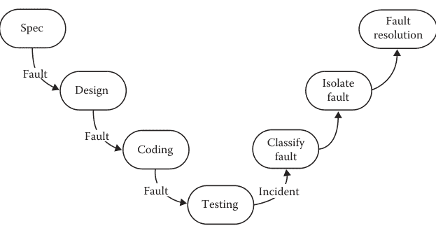

**图 1.1** 测试生命周期。

图 1.1 展示了一个生命周期模型。注意在开发阶段存在错误的机会，导致故障传播到开发的剩余过程中。故障解决步骤是另一个产生错误的机会。当修复导致软件行为异常时，该修复是有缺陷的。我们在讨论回归测试时会再次回到这一点。

从这一系列术语中，我们看到测试用例在测试中占据核心位置。测试过程可以细分为不同的步骤：测试计划、测试开发、运行测试用例和评估测试结果。本书的重点在于如何识别有用的测试用例集。

### 1.2 测试用例

软件测试的本质是为测试项确定一组测试用例。测试用例是（或应该是）一种受认可的工作产品。完整的测试用例将包含测试用例标识符、简要目的说明（例如业务规则）、前置条件描述、实际测试输入、预期输出、后置条件描述以及执行历史。历史主要用于测试管理——它可能包含运行日期、执行人员以及通过/失败结果。

# 测试的视角

测试用例的输出部分经常被忽视，这非常遗憾，因为那里是最困难的部分。例如，假设你正在测试一个软件，该软件根据联邦航空管理局（`FAA`）的空中走廊限制和飞行当天的天气数据为飞机确定最佳路线。你如何知道最佳路线是什么？不同的回答解决了这个问题。学术界的回答是假设存在一个“知晓所有答案”的测试用言（oracle）。工业界对该问题的另一种回答被称为参考测试（reference testing），即在专家用户存在的情况下对系统进行测试。这些专家会判断执行的一组测试用例的输出是否可以接受。

测试执行用例包括建立必要的先决条件、提供测试用例输入、观察输出、将这些与预期输出进行比较，并确保预期值存在，以判断测试是否通过。从这一切中可以清楚地看出测试用例是有价值的——至少作为源代码是有价值。测试用例需要被开发、修订、使用和管理。

### 1.3 从维恩图中获得的启示

测试本质上关注的是行为，而行为与软件和（系统）开发者常用的基于代码的视角是正交的。一个简单的区别是：基于代码的关注的是“它是什么”，而行为视角关注的是“它做什么”。测试人员面临的持续困难来源之一是，基础文档通常是由开发者并为开发者编写的；因此重点是基于代码的信息，而不是行为信息。在本节中，我们将开发一个简单的维恩图来澄清关于测试的问题。

考虑一个程序行为的宇宙。（注意，我们正在强迫关注测试的本质。）给定一个程序及其规范，考虑“指定行为”的集合 `S` 和“编程行为”的集合 `P`。图 1.2 显示了指定行为与编程行为之间的关系。所有可能的程序行为中，指定的行为在标记为 `S` 的圆中，所有的行为都在 `P` 中。通过此，我们可以更清楚地看到测试人员面临的问题。如果某些行为没有被编程怎么办？在我们早期的术语中，这些是遗漏缺陷（faults of omission）。同样，如果某些已编程（实现）的行为没有被指定呢？这些对应于越界缺陷（faults of commission）以及在规范完成后发生的错误。`S` 和 `P` 的交集（足球形区域）是“正确”部分，即既被指定又实现的行为。对测试的一个非常好视角是：它是确定程序既被指定又实现的行为的范围。（顺便提一下，“正确性”是一个相对术语，而不是绝对的。）

图 1.3 中的新圆代表测试用例。注意它与我们的讨论域以及程序行为集之间的细微差异。由于一个测试用例涵盖了一个程序行为，数学家可能会原谅我们。现在，考虑集合 `S`、`P` 和 `T` 之间的关系。可能存在未测试指定的行为（区域 2 和 5）、已测试的行为（区域 1 和 4），以及对应未指定行为的测试用例（区域 3 和 7）。

同样，可能存在未测试的编程行为（区域 2 和 6），或者对应于未实现行为的测试用例（区域 4 和 7）。

这些区域每一个都很重要。如果存在没有测试用例的指定行为，针对未指定行为的测试用例就会出现几种可能性：要么这种测试用例是不需要的，规范是有缺陷的，要么测试人员希望确定指定的非行为不会发生。（根据我的经验，优秀的测试人员经常恰恰假设了此类测试用例。这让优秀的测试人员参与规范和设计评审是一条微妙的界限。）

我们已经处于这样一种看到测试作为一种手艺的可能性的点：测试人员能否让这些集合相交的区域（区域 1）尽可能大？另一种方法是询问集合 `T` 中的测试用例是如何识别的。短答案是，测试用例是通过测试方法识别的。这个框架为我们提供了一种比较不同测试方法有效性的方法，我们将在第 10 章看到。

# 软件测试

程序行为


图 1.2 指定和实现的行为。

程序行为


图 1.3 指定、实现和测试的行为。

### 1.4 识别测试用例

有两种基本方法用于识别测试用例；在传统上，这些被称为功能测试和结构测试。基于规范和基于代码是更具描述性的名称，我们将使用这些术语。两种方法都有不同的测试用例识别方法；它们在方法论上是一致的，因为遵循相同“方法”的测试人员会设计出非常相似的（？）

#### 1.4.1 基于规范的测试

基于规范的测试最初被称为功能测试，是因为任何程序都可以被视为从其输入域映射到其输出范围的函数。（输入域和范围在第 3 章中定义。）这种概念在工程中很常见，当系统被视为黑盒时；即黑盒的内容（实现）是不可知的，完全通过其输入和输出来理解黑盒（见图 1.4）。在《禅与摩托车》中，罗伯特·皮尔提到了“浪漫性”。

在本节中，我们开发一个简单的维恩图来澄清关于测试的问题。

| 输入 | 输出 |
| :--- | :--- |
| 规范 | 规范 |
| 程序 | 程序 |

**图 1.4** 黑盒。

#### 1.4.2 基于代码的测试

基于规范的测试最初被称为功能测试，是因为任何程序都可以被视为从其输入域映射到其输出范围的函数。（输入域和范围在第 3 章中定义。）这种概念在工程中很常见，当系统被视为黑盒时；即黑盒的内容（实现）是不可知的，完全通过其输入和输出来理解黑盒（见图 1.4）。在《禅与摩托车》中，罗伯特·皮尔提到了“浪漫性”。

**图 1.5** 基于代码。

#### 1.4.3 基于规范与基于代码的争论

由于有两种截然不同的测试用例识别方法，质疑哪种更好是自然的。如果你阅读大量的文献，你会发现每种选择都有坚定的支持者。

之前的维恩图为这场争论提供了一个强有力的解决。回顾两种方法的目标都是识别测试用例（图 1.7）。基于规范的测试仅使用规范来识别测试用例，而基于代码的测试使用源代码（实现）作为测试用例识别的依据。后续章节将建立

**图 1.6** 比较基于代码的测试用例识别方法。

# 测试视角

程序行为

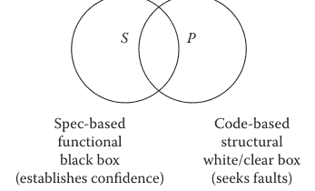

图 1.7 测试用例的来源。

任何一种方法单独来说都是不够的。考虑程序行为：如果所有指定的行为都未实现，基于代码的测试用例永远无法识别出这一点。相反，如果程序实现了未指定的行为，基于规范的测试用例将永远无法揭示这一点。（特洛伊马就是这种未指定行为的一个好例子。）快速的回答是，两种方法都是必不可少的；测试匠人的合理结合，将能够提供基于规范测试的信心，并提供基于代码测试的衡量。此前，我们断言基于规范的测试往往面临冗余和缺失的双重问题。当基于规范的测试用例与基于代码的测试覆盖率结合执行时，这两个问题都可以被识别并解决。

测试的韦恩图提供了最后的一种洞察。测试用例集 `T` 与指定行为集 `S` 以及已实现行为集 `P` 之间是什么关系？显然，集合 `T` 中的测试用例是由所使用的测试识别方法决定的。一个很好的问题是，这种方法有多合适（或有效）？为了完成之前披露的闭环，回想从错误到故障、失效和事件的因果链。如果我们知道自己容易犯哪种错误，知道待测试软件中可能存在什么样的故障，我们就可以利用此采用更合适的测试识别方法。这就是测试真正成为一门手的地方。

### 1.5 故障分类

我们对错误（error）和故障（fault）的定义区分了过程和产品：过程指的是我们如何做某事，而产品是过程的最终结果。测试与软件质量保证（`SQA`）的汇点在于，`SQA` 通常试图通过改进过程来改进产品。从这个意义上说，测试显然更偏向于产品。`SQA` 更关注减少开发过程中固有的错误，而测试则更关注发现产品中的故障。这两个学科都受益于对故障类型更清晰的定义。故障可以通过多种方式分类：发生相应错误的开发阶段、相应失效的后果、解决难度、风险等。我最喜欢的分类方式是按异常（故障）发生的情况：仅此一次、间歇性、循环性或可重复性。

# 软件测试

关于故障类型的全面处理，请参见《`IEEE` 软件异常分类标准》（`IEEE`, 1993）。（该文档将软件异常定义为“偏离预期”，这与我们的定义非常接近。）`IEEE` 标准定义了一个围绕四个阶段（另一个生命周期）构建的详细异常解决过程：识别、调查、行动和处置。表 1.1 到 1.5 给出了一些实用的异常；其中大部分来自 `IEEE` 标准，但我添加了一些我喜欢的。

由于软件评审的主要目的是发现故障，因此评审检查清单（见第 22 章）是故障分类的另一个良好来源。`Karl Wiegers` 在他的网站上有一组非常好的检查清单：`http://www.processimpact.com/pr_goodies.html`。

# 表 1.1 输入/输出故障

| 类型 | 实例 |
|---|---|
| 输入 | 正确的输入未被接受 |
| | 接受了错误的输入 |
| | 描述错误或缺失 |
| | 参数错误或缺失 |
| 输出 | 格式错误 |
| | 结果错误 |
| | 在错误的时间给出正确结果（太早或太） |
| | 结果不完整或缺失 |
| | 伪结果 |
| | 拼写/语法错误 |
| | 外观问题 |

# 表 1.2 逻辑故障

| 缺失的用例 |
| 重复的用例 |
| 忽略了极端情况 |
| 误解 |
| 缺失条件 |
| 多余的条件 |
| 测试错误的变量 |
| 错误的循环迭代 |
| 错误的运算符（例如，用 `<` 代替 `≤`） |

# 表 1.3 计算故障

| 错误的算法 |
| 缺失的计算 |
| 错误的操作数 |
| 错误的操作 |
| 括号错误 |
| 精度不足（舍入、截断） |
| 错误的内置函数 |

# 表 1.4 接口故障

| 错误的中断处理 |
| I/O 时机问题 |
| 调用了错误的过程 |
| 调用了不存在的过程 |
| 参数不匹配（类型、数量） |
| 类型不兼容 |
| 多余的包含 |

# 表 1.5 数据故障

| 错误的初始化 |
| 错误的存储/访问 |
| 错误的标志/索引值 |
| 错误的打包/解包 |
| 使用了错误的变量 |
| 错误的数据引用 |
| 缩放或单位错误 |
| 错误的数据维度 |
| 错误的下标 |
| 错误的类型 |
| 错误的数据范围 |
| 传感器数据超出限值 |
| 差一（Off by one） |
| 数据不一致 |

### 1.6 测试级别

到目前为止，我们还没有提到测试的一个核心概念——抽象层次。测试级别呼应了软件开发周期瀑布模型中发现抽象层次。尽管这种模型有其缺点，但对于测试来说，它是识别测试级别以及澄清与每个级别相关的目标的手段。瀑布模型的一种图形变体（在 `ISTQB` 术语中称为 V 模型）如图 1.8 所示，这种变体强调了测试与设计级别之间的对应关系。注意，特别是在基于规范测试方面，三个定义级别（规范、初步设计和详细设计）直接对应于三个测试级别——系统测试、集成测试和单元测试。

测试级别与基于规范和基于代码的测试之间存在着实际的关系。大多数从业者认同，基于代码的测试在单元级最合适，而基于规范的测试在系统级最合适。这通常是对的；然而，这也是需求规范、初步设计和详细设计阶段产生的基础信息的可能结果。为基于代码测试定义的结构在单元级最有意义，而类似的结构现在才开始出现在集成和系统级测试中。我们在第 11 到 17 章中开发了此类结构，以支持传统软件和面向对象软件的集成和系统级基于代码的测试。

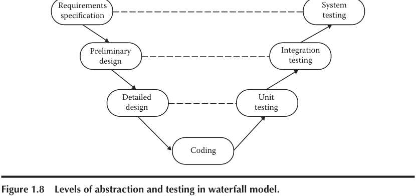

## 练习

+ 1. 画一个韦恩图，反映以下语句的一部分：“……我们留下了该做而未做的事，又做了不该做的事……”

2. 画一个韦恩图，反映莱因霍德《宁静祈祷文》的精髓：主啊，请赐平静的心接受我无法改变的事，赐勇气去改变我能改变的事，并赐智慧去分清两者。

3. 描述图 1.3 中的八个区域。你能在写过的软件中回想起这些的例子吗？

4. 软件传说中的一个故事描述了一个不满的员工写了一个工资程序，该程序在生成支票前会检查员工识别号。如果该员工被解雇，程序就会造成混乱。请从错误、故障和失效模式的角度来讨论这种情况，并决定哪种形式的是合适的。

# 第 2 章

## 示例

在第 5 至第 9 章中将使用三个示例来说明不同的单元测试方法：三角形问题（测试领域中一个经典的例子）；一个逻辑复杂的函数 `NextDate`；以及一个典型的 MIS 应用示例，在此处称为佣金问题。这些示例合在一起，涵盖了测试技师在单元层级会遇到的大多数问题。第 11 至第 17 章对更高层次测试的讨论使用了另外四个示例：自动取款机（`ATM`）的简化版，在此处称为简单 `ATM` 系统（`SATM`）；货币转换器，这是一种典型的图形用户界面（`GUI`）应用程序的事件驱动应用；以及萨星汽车的雨刮器控制设备。车库门控制器说明了“系统之系统”的一些问题。

为了基于代码的测试，本章提供了这三个单元级示例的伪代码实现。第 11 至第 17 章提供了 `SATM` 系统、货币转换器、萨星雨刮器系统和车库门控制器的系统级描述。这些应用使用有限状态机、事件驱动 Petri 网的变体、选定的 StateCharts 以及通用建模语言（`UML`）进行建模。

### 2.1 通用伪代码

伪代码提供了一种与语言无关的程序源码表达。此版本松散基于 `Visual Basic`，包含两个层级的结构：单元和程序组件。单元可以被解释为传统的组件（过程和函数），也可以解释为面向对象的组件（类和对象）。这个定义有些是非正式的；表达式、变量列表和字段描述等术语的使用没有正式定义。角括号中的标识符表示可以在识别位置使用的语言元素。任何伪代码的价值部分在于抑制了不需要的细节；在这里，我们通过允许使用自然语言短语代替更正式、复杂的条件来阐明这一点。

### 表 2.1 通用伪代码

| 语言元素 | 通用伪代码结构 |
| --- | --- |
| 注释 | ' `<text>` |
| 数据结构声明 | Type `<type name>` <br><list of field descriptions> <br>End `<type name>` |
| 变量声明 | Dim `<variable>` As `<type>` |
| 赋值语句 | `<variable>` = `<expression>` |
| 输入 | Input (`<variable list>`) |
| 输出 | Output (`<variable list>`) |
| 条件 | `<expression>` `<relational operator>` `<expression>` |
| 复合条件 | `<Condition>` `<logical connective>` <br><Condition> |
| 序列 | 按顺序排列的语句 |
| 简单选择 | If `<condition>` Then <br><then clause> <br>EndIf |
| 选择 | If `<condition>` <br>Then <then clause> <br>Else <else clause> <br>EndIf |
| 多路选择 | Case `<variable>` Of <br>Case 1: `<predicate>` <br><Case clause> <br>... <br>Case n: `<predicate>` <br><Case clause> <br>EndCase |
| 计数控制循环 | For `<counter>` = `<start>` To `<end>` <br><loop body> <br>EndFor |
| 先测试循环 | While `<condition>` <br><loop body> <br>EndWhile |

### 表 2.1 通用伪代码（续）

| 语言元素 | 通用伪代码结构 |
| --- | --- |
| 后测试循环 | Do <loop body> Until `<condition>` |
| 过程定义（函数和 o–o 方法类似） | `<procedure name>` (Input: `<list of variables>`; Output: `<list of variables>`); <body> End `<procedure name>` |
| 单元间通信 | Call `<procedure name>` (`<list of variables>`; `<list of variables>`) |
| 类/对象定义 | `<name>`<attribute list>; <method list>, <body>> End `<name>` |


| 单元间通信 | `msg <destination object name>.<method name>(list of variables>)` |

| 对象创建 | `Instantiate <class name>.<object name> (list of attribute values)` |

| 对象销毁 | `Delete <class name>.<object name>` |

| 程序 | `Program <program name> <unit list> End<program name>` |

### 2.2 三角形问题

三角形是软件测试文献中最广泛使用的示例。三十年的测试文献中，一些著名的条目包括 Gruenberger (1973)、Brown and Lipov (1975)、Myers (1979)、Pressman (1982) 及后续版本、Clarke and Richardson (1983, 1984)、Cheappella (1987) 以及 Hetzel (1988)。虽然其他的，但这个列表已经说明了问题。

### 2.2.1 问题描述

**简单版本：** 三角形问题接受三个整数 `a`、`b` 和 `c` 作为输入。这些被视为三角形的边。程序的输出是根据边确定的三角形类型：等三角形（Equilateral）、等腰三角形（Isosceles）、不等三角形（Scalene）或非三角形（NotTriangle）。有时，此问题会扩展到包含直三角形作为第五种类型；我们将在某些练习中使用这种扩展。

**改进版本：** 三角形问题接受三个整数 `a`、`b` 和 `c` 作为输入。这些被视为三角形的边。整数 `a`、`b` 和 `c` 必须满足以下条件：

- `c1`. `1 ≤ a ≤ 200`
- `c2`. `1 ≤ b ≤ 200`
- `c3`. `1 ≤ c ≤ 200`
- `c4`. `a < b + c`
- `c5`. `b < a + c`
- `c6`. `c < a + b`

程序的输出是根据边确定的三角形类型：等三角形、等腰三角形、不等三角形或非三角形。如果输入值未通过 `c1`、`c2` 或 `c3`，程序将输出“值不在范围内”并进行记录。

- 1. 如果所有边都相等，输出为等三角形。
- 2. 如果恰好有一对边相等，输出为等腰三角形。
- 3. 如果没有等等的边，输出为不等三角形。
- 4. 如果不满足 `c4`、`c5` 和 `c6` 中的任何一个条件，输出为非三角形。

### 2.2.2 讨论

也许这个示例之所以长久不衰的原因之一是它包含了清晰但复杂的逻辑。它体现了一些会损害开发者和测试人员之间通信的不完整定义，特别是三角形不等式：任意两边之和必须严格大于第三边。200 的上限是任意且方便的；当我们在第 5 章开发测试用例时，将使用该限制。

### 2.2.3 传统实现

所有示例的传统实现都有一种类似于 FORTRAN 的风格。该实现的流程图见图 2.1。图 2.2 是改进版本的流程图。流程图中的框与随后给出的（类 FORTRAN 的）伪代码中的注释编号对应。（这些数字对应 Pressman [1982] 中的数字。）

### 2.2.4 改进实现

变量 `match` 用于记录边对之间的相等性。FORTRAN 风格的一个经典复杂性与变量 `match` 有关：注意，并不是所有的三角形不等式测试都发生了。如果两条边相等（例如 `a` 和 `c`），只需要比较 `a + c` 与 `b`，因为 `b` 必须大于 0，且 `a + b` 必须大于 `c`。这显然减少了必须进行的比较次数。这个版本的效率是以牺牲清晰度（以及测试便利性）为代价的。在我们稍后讨论不可执行的程序执行路径时，我们会发现这个版本用。这就是延续这一版本的最佳理由。注意，有六种方法可以到达非三角形（12.1–12.6），有三种方法可以到达等三角形情况（15.1–15.3）。

```
Program triangle1 `Fortran-like version

Dim a, b, c, match AS INTEGER

Output("输入三个三角形边的整数")
Input (a, b, c)
```

```
Output("Side A is",a)
Output("Side B is",b)
Output("Side C is",c)
match = 0
If a = b
    Then match = match + 1
EndIf
If a = c
    Then match = match + 2
EndIf
If b = c
    Then match = match + 3
EndIf
If match = 0
    If (a + b) <= c
        Then Output("NotTriangle")
        Else If (b + c) <= a
            Then Output("NotTriangle")
            Else If (a + c) <= b
                Then Output("NotTriangle")
                Else Output("Scalene")
    EndIf
Else If match = 1
    Then If (a + c) <= b
        Then Output("NotTriangle")
        Else Output("Isosceles")
    EndIf
Else If match=2
    Then If (a + c) <= b
        Then Output("NotTriangle")
        Else Output("Isosceles")
    EndIf
Else If match = 3
    Then If (b + c) <= a
        Then Output("NotTriangle")
        Else Output("Isosceles")
    EndIf
    Else Output("Equilateral")
EndIf
EndIf
EndIf
End Triangle
```

## 2.2.4 结构化实现

`Program triangle2` '简单规格的结构化编程版本

`Dim a,b,c As Integer`

`Dim IsATriangle As Boolean`

© 2010 Taylor & Francis Group, LLC

## 22 软件测试

'Step 1: 获取输入

`Output("输入三个作为三角形边边的整数")`

`Input(a,b,c)`

`Output("Side A is",a)`

`Output("Side B is",b)`

`Output("Side C is",c)`

'Step 2: 是三角形吗？

`If (a < b + c) AND (b < a + c) AND (c < a + b)`

    Then `IsATriangle = True`

    Else `IsATriangle = False`

`EndIf`

'Step 3: 确定三角形类型

`If IsATriangle`

    Then `If (a = b) AND (b = c)`

        Then `Output("Equilateral")`

    Else If `(a ≠ b) AND (a ≠ c) AND (b ≠ c)`

        Then `Output("Scalene")`

    Else `Output("Isosceles")`

`EndIf`

Else `Output("Not a Triangle")`

`EndIf`

`End triangle2`

第三版本

`Program triangle3'`

`Dim a, b, c As Integer`

`Dim c1, c2, c3, IsATriangle As Boolean`

'Step 1: 获取输入

```
Do
    Output("输入三个作为三角形边边的整数")
    Input(a,b,c)
nc1 = (1 ≤ a) AND (a ≤ 300)
nc2 = (1 ≤ b) AND (b ≤ 300)
nc3 = (1 ≤ c) AND (c ≤ 300)
    If NOT(c1)
        Output("Value of a is not in the range of permitted values")
    EndIf
    If NOT(c2)
        Output("Value of b is not in the range of permitted values")
    EndIf
    If NOT(c3)
        Output("Value of c is not in the range of permitted values")
    EndIf
Until c1 AND c2 AND c3
Output("Side A is",a)
Output("Side B is",b)
Output("Side C is",c)
'Step 2: Is A Triangle?'
If (a < b + c) AND (b < a + c) AND (c < a + b)
    Then IsATriangle = True
    Else IsATriangle = False
```

© 2010 Taylor & Francis Group, LLC

## 示例

```
EndIf
'Step 3: 确定三角形类型
If IsATriangle
    Then If (a = b) AND (b = c)
        Then Output ("Equilateral")
        Else If (a != b) AND (a != c) AND (b != c)
            Then Output ("Scalene")
        Else Output ("Isosceles")
    EndIf
Else Output ("Not a Triangle")
EndIf
End triangle3
```

### 2.3 NextDate 函数

三角形程序中的复杂性源于输入与正确输出之间的关系。我们将使用 `NextDate` 函数来阐另一种复杂性——输入变量之间的逻辑关系。

### 2.3.1 问题描述

`NextDate` 是一个包含三个变量的函数：月份、日期和年份。它返回输入日期的第二天。月份、日期和年份变量具有整数值，并满足以下条件（2012年份范围是任意的，来自第一版）：

- `cl`. `1 ≤ month ≤ 12`
- `cl`. `1 ≤ day ≤ 31`
- `cl`. `18 ≤ year ≤ 2012`

正如我们处理三角形程序那样，我们可以让问题描述更具体。每个问题都涉及对日、月、年输入无效值的详细响应。我们还可以为输入的无效组合定义响应，例如任何年份的6 月 31 日。如果条件 `c1`、`c2` 或 `c3` 的任何一个失败，`NextDate` 将产生一个输出，指示相应的变量值超出范围——例如，“Value of not in the range 1...12.”

### 2.3.2 讨论

`NextDate` 函数存在两个复杂性来源：之前讨论的输入域复杂性，以及决定年份是否为闰年的规则。一年为 365 天；因此，闰年被用于解决“额外的一天”问题。如果我们每四年宣布一个闰年，就会出现细微错误。格列哥日历通过调整闰年来解决这个问题。因此，如果一个年份能被 4 整除，它就是闰年，除非它是 100 的倍数（400 除外）；因此，1992 年、1996 年和 2000 年是闰年，而 1900 年不是。`NextDate` 函数我们经常发现齐普夫定律的例子，该定律指出 80% 的活动致力于对闰年的考虑。在第二个实现中，注意有多少代码是用于输入验证的。

### 2.3.3 实现

```
Program NextDate '简单版本
Dim tomorrowDay,tomorrowMonth,tomorrowYear As Integer
Dim day,month,year As Integer
Output ("Enter today's date in the form MM DD YYY")
Input (month, day, year)
Case month Of
Case 1: month Is 1,3,5,7,8, or 10: '31天的月份（除12月外）'
If day < 31
    Then tomorrowDay = day + 1
Else
    tomorrowDay = 1
    tomorrowMonth = 1
EndIf
Case 2: month Is 4,6,9,Or 11 '30天的月份'
If day < 30
    Then tomorrowDay = day + 1
Else
    tomorrowDay = 1
    tomorrowMonth = 1
EndIf
Case 3: month Is 12: '12月'
If day < 31
    Then tomorrowDay = day + 1
Else
    tomorrowDay = 1
    tomorrowMonth = 1
    If year = 2012
      Then Output ("2012 is over")
    Else
EndIf
Case 4: month is 2: '2月'
If day < 28
    Then tomorrowDay = day + 1
Else
    If day = 28
      Then If (year is a leap year)
        Then tomorrowDay = 29
    EndIf
  Else If day = 29
    Then If (year is a leap year)
      Then tomorrowDay = 1
      tomorrowMonth = 3
    Else 'not a leap year
    tomorrowMonth = 3
    Output("Cannot have Feb.", day)
EndIf
EndIf
EndCase
Output("Tomorrow's date is,", tomorrowMonth, tomorrowDay, tomorrowYear

Program Next2 改进版本
Dim tomorrowDay,tomorrowMonth,tomorrowYear As Integer
Dim day,month,year As Integer
Dim c1, c2, c3 As Boolean
Do
    Output("Enter today's date in the form MM DD YYY")
    Input (month, day, year)
c1 = (1 ≤ day) AND (day ≤ 31)
c2 = (1 ≤ month) AND (month ≤ 12)
c3 = (1812 ≤ year) AND (year ≤ 2012)
    If NOT(c1)
        Output("Value of a is not in the range of permitted values")
    EndIf
    If NOT(c2)
        Output("Value of b is not in the range of permitted values")
    EndIf
    If NOT(c3)
        Output("Value of c is not in the range of permitted values")
    EndIf
Until c1 AND c2 AND c3
Case month Of
Case 1: month Is 1,3,5,7,8, or 10: '31天的月份（除12月外）'
If day < 31
    Then tomorrowDay = day + 1
Else
    tomorrowDay = 1
    tomorrowMonth = 1
EndIf
Case 2: month Is 4,6,9,Or 11 '30天的月份'
If day < 30
    Then tomorrowDay = day + 1
Else
    tomorrowDay = 1
    tomorrowMonth = 1
EndIf
Case 3: month Is 12: '12月'
If day < 31
    Then tomorrowDay = day + 1
Else
    tomorrowDay = 1
    tomorrowMonth = 1
If year = 2012
    Then Output ("Invalid Input Date")
Else tomorrowDay.year = year + 1
Endif
```


### Case 4: month is 2: `2月`
If `day` < 28
    Then `tomorrowDay` = `day` + 1
Else
    If `day` = 28
      Then If (`year` is a leap year)
        Then `tomorrowDay` = 29 'not a leap year
        `tomorrowDay` = 1
        `tomorrowMonth` = 3
    EndIf
  Else If `day` = 29
    Then If (`year` is a leap year)
      Then `tomorrowDay` = 1
      `tomorrowMonth` = 3
    Else 'not a leap year
    `tomorrowMonth` = 3
    Output("Cannot have Feb.", `day`)
EndIf
EndIf
EndCase
Output("Tomorrow's date is,", `tomorrowMonth`, `tomorrowDay`, `tomorrowYear`)

## 2.4 佣金问题

我们的第三个例子更符合商业计算场景。它包含了计算和决策的混合，因此引发了有趣的测试问题。我们使用这个例子的主要目的是讨论数据流和基于切片的测试。

### 2.4.1 问题描述

亚利桑那地区的一名步枪销售员出售密苏里州枪匠制造的步枪锁、枪托和枪管。锁的价格为45美元元，枪托为30美元，枪管为25美元。销售员必须

每月至少出售一个锁机、一把枪托和一个枪管（但不一定得是整支步枪），生产限制规定了销售人员每月最多售出 70 个锁机、80 根枪托和 90 根枪管。每次访问城镇后，销售员都会向密苏里州的枪械制造师发送电报，告知已售出的锁机和枪管数量。在月底，销售员会发送一封非常短的电报，显示售出了 -1 个锁机。此时，制造师就知道每月销售已完成，并按如下方式计算销售员的佣金：1000 美元（含）以内的销售额提取 10%，接下来的 800 美元提取 15%，超过 1800 美元的任何销售额提取 20%。

#### 示例 ■ 27

### 2.4.2 讨论

这个例子有些刻意，是为了让读者能快速看到算术过程。考虑其他多个变量的加函数可能更符合现实，例如填写美国 1040 所得税表时的各种计算。（我们稍后会讨论。）这个问题分为三个独立的部分：输入数据程序（在其中我们可以处理输入数据验证，正如三角形和 NextDate 程序中所做的那样）、销售计算以及佣金计算部分。这次我们将省略输入数据部分。我们将使用哨兵控制循环来复制模板惯例，这在 MIS 数据采集应用中是典型的做法。

### 2.4.3 实现

```
Program Commission (INPUT, OUTPUT)

Dim locks, stocks, barrels As Integer

dim lockPrice, stockPrice, barrelPrice As Real

dim totalLocks, totalStocks, totalBarrels As Integer

Dim lockSales, stockSales, barrelSales As Real

Dim sales, commission : REAL
```

```
lockPrice = 45.0

stockPrice = 30.0

barrelPrice = 25.0

totalLocks = 0

totalStocks = 0

totalBarrels = 0
```

```
Input (locks)

While NOT (locks) = -1) '输入设备使用 -1 表示数据结束

Input (stocks, barrels)

totalLocks = totalLocks + locks

totalStocks = totalStocks + stocks

totalBarrels = totalBarrels + barrels
```

```
EndWhile

Output("Locks sold:", totalLocks)

Output("Stocks sold:", totalStocks)

Output("Barrels sold:", totalBarrels)

lockSales = lockPrice * totalLocks

stockSales = stockPrice * totalStocks
```

© 2010 Taylor & Francis Group, LLC

# 软件测试

```
barrelSales = barrelPrice * totalBarrels
sales = lockSales + stockSales + barrelSales
Output("Total sales:"), sales)
```

```
If (sales > 1800.0)

Then

  commission = 0.10 * 1000.0

  commission = commission + 0.15 * 800.0

  commission = commission + 0.20 * (sales-1800.0)

Else If (sales > 1000.0)

Then

  commission = 0.10 * 1000.0

  commission = commission + 0.15*(sales-1000.0)

EndIf

EndIf
```


```
EndIf
Output("Commission is $",commission)
End Commission
```

## 2.5 SATM 系统

为了讨论集成和系统测试问题，我们需要一个范围更大的例子（图 2.3）。

- 此处描述的 ATM 是极简的，但它包含了有趣的功能和交互，这些是典型的客户端-服务器系统的客户端特征。

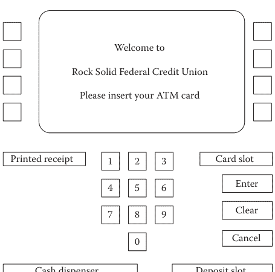

图 2.3 SATM 终端。

### 2.5.1 问题描述

SATM 系统通过图 2.4 所示 15 个屏幕与银行客户通信。使用如图 2.3 所示特征的终端，SATM 客户可以选择三种交易类型之一：存款、取款和余额查询。为了简单起见，这些交易只能在支票账户中进行。

当客户到达 ATM 站时，显示屏幕 1。银行客户使用带有编码个人账户号码（PAN）的塑料卡访问 SATM 系统，该号码是内部账户文件的密钥，其中包含客户姓名和账户信息等。如果客户的 PAN 与客户账户文件中的信息匹配，系统将向客户显示屏幕 2。如果未找到客户的 PAN，则显示屏幕 4 并保留该卡片。

在屏幕 2，提示客户输入其个人识别码（PIN）。如果 PIN 正确（即与客户账户文件中的信息匹配），系统将显示屏幕 5；否则显示屏幕 3。客户有三次机会输入正确的 PIN；失败三次后，显示屏幕 4，客户从屏幕显示的选项中选择所需的交易。

如果请求查询余额，则显示屏幕 14。如果请求存款，则根据终端控制文件中的一个字段确定存款槽的状态。无已知问题，系统将显示屏幕 7 以获取交易金额。如果存款槽出现问题，系统显示 12。一旦输入存款金额，系统显示 13，接受存款并处理存款。系统随后显示 14。

如果请求取款，系统检查终端中出钞口的状态（堵塞或可用）。如果是堵塞，则显示屏幕 10；否则显示屏幕 7 让客户输入取款金额。一旦输入取款金额，系统检查终端是否有足够的货币进行发放。如果没有，显示屏幕 9；否则处理取款。系统检查客户余额（如余额查询所示）；如果账户资金不足，则显示屏幕 8。如果账户余额充足，则显示屏幕 11 并发放现金。余额将打印在交易据上，正如余额查询时一样。取出现金后，系统显示 14。

当在 10、12 或 14 上点击“否”按钮时，系统显示 15 并退还的 ATM 卡。一旦移除卡片，你仔细关闭它，显示屏幕 1。当在 10、12 或 14 上点击“是”按钮时，系统显示 5，以便客户选择其他交易。

| 屏幕 1 | 屏幕 2 | 屏幕 3 |
| --- | --- | --- |
| 屏幕 1 | 屏幕 2 | 屏幕 3 |
| 屏幕 4 | 屏幕 5 | 屏幕 6 |
| 屏幕 7 | 屏幕 8 | 屏幕 9 |
| 屏幕 10 | 屏幕 11 | 屏幕 12 |
| 屏幕 13 | 屏幕 14 | 屏幕 15 |

图 2.4 SATM 屏幕。

# 30 ■ 软件测试

系统显示 12。一旦输入存款金额，系统显示 13，接受存款并处理存款。系统随后显示 14。

### 2.5.2 讨论

给出的系统描述中隐藏了惊人的信息。例如，如果你仔细阅读，可以推断出终端只包含 10 美钞（见屏幕 7）。这种文本定义可能比实际遇到的更精确。这个例子是故意简化的（因此得名）。

大量问题可以通过一组假设来解决。例如，有借贷额度吗？如何防止客户在多个 ATM 终端取出的金额超过实际余额？有很多启动问题：机器里最初有多少现金？如何向系统添加新客户？这些以及其他现实世界的改进为了保持简单被消除了。

## 2.6 汇率转换器

汇率转换程序是另一个事件驱动程序，强调了与 GUI 相关的代码。示例 GUI 如图 2.5 所示。

图 2.5 汇率转换器图形用户界面。

该应用程序将美元转换为四种货币之一：巴西雷尔、加拿大加元、欧元和日元。货币选择由单选按钮（选项按钮）控制，这些按钮是互斥的。当选择一个国家时，系统会通过完成标签来做出响应：例如，如果点击加拿大按钮，“等于 ...”将变为“等于加元”。此外，在所选货币金额的输出位置会出现一个小小的加拿大国旗。用户可以在选择货币之前或之后输入美元金额，或者点击“退出”（Quit）按钮。点击“计算”（Compute）按钮会将美元金额转换为所选货币的等值金额。点击“清除”（Clear）按钮将重置货币选择、美元金额、当前金额以及相关标签。点击“退出”（Quit）按钮将结束应用程序。这很好地说明了带有 UML 的描述和面向对象的实现，我们将在第 15 章中使用这些。

## 2.7 土星挡风雨刮控制器

土星汽车上的挡风雨刮器由多个组件组成，由一个拨杆控制。拨杆有四个位置：OFF（关闭）、INT（间歇）、LOW（低）和 HIGH（高）；旋钮有三个位置，编号为 1、2 和 3。旋钮位置表示间歇速度，且仅当拨杆处于 INT 位置时旋钮才有效。下面的决策表显示了拨杆和旋钮方向对应的挡风雨刮器速度（每分钟刮次数）。

| c1. 拨杆 | OFF | INT | INT | INT | LOW | HIGH |
|---|---|---|---|---|---|---|
| c2. 旋钮 | n/a | 1 | 2 | 3 | n/a | n/a |
| a1. 雨刮器 | 0 | 4 | 6 | 12 | 30 | 60 |

## 2.8 车库门器

打开车库门的系统由多个组件组成：驱动电机、驱动链、车库门轨道、灯和电子控制器。系统大部分由商业 110 V 电力供电。几个设备与车库门控制器通信——无线键盘（通常位于汽车内）、车库门外的数字键盘和墙壁按钮。此外，还有两个安全功能：地板附近的光束和障碍传感器。如果光束被中断（例如被宠物碰到），门会立即停止，然后反向运动直到门完全打开。如果门在关闭时遇到障碍物，有一种方法可以让门移动，无论是在关闭还是打开过程中。信号可以来自三个设备（无线键盘、数字键盘或墙壁控制按钮）中的任何一个。对任何设备的响应都是不同的——门停在原地。来自任何设备的后续信号将让门按照停止时的相同方向启动。最后，还有传感器用于检测门是否移动到了一个极端位置（完全打开或完全关闭）。

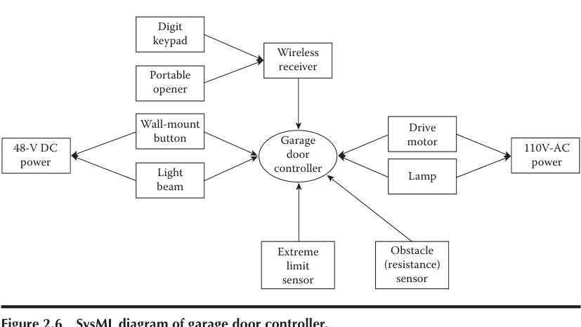

图 2.6 车库门控制器的 SysML 图。

当门运动时，灯会亮起，并在门到达其中一个极端位置后继续点亮约 30 秒。

这三个信号设备和安全功能是基础车库门开启器的可选添加。此示例将在第 17 章关于系统系统的讨论中使用。目前，图 2.6 给出的是车库门开启器的 SysML 上文图。

## 习题

- 1. 重新审视图 2.1 中传统的三角形问题流程图。变量 `match` 的值可以是 4 吗？或者是 5？是否可能“执行”以下编号的框的序列：1, 2, 5, 6？
- 2. 回想第 1 章关于程序规范与实现之间关系的讨论。如果你仔细研究 `NextDate` 的实现，你会发现一个问题。查看针对 30 天月份（4, 6, 9, 11）的 CASE 子句。对于 `day = 31` 没有特殊操作。讨论这种实现是否正确。对 2 月 29 日的值重复此讨论。
- 3. 在第 1 章中，我们提到测试的一部分是预期输出。对于 1812 年 6 月 31 日的 `NextDate` 测试用例，你会使用什么作为预期输出？为什么？
- 4. 三角形问题的一个常见扩展是检查直角。如果满足勾股定理关系 `$c^2 = a^2 + b^2$`，则三边构成一个直角三角形。这一变化要求边按递增顺序呈现变得方便，即 `$a < b < c$`。扩展 `Triangle3` 程序以包含直角三角形图形。我们将在后面的练习中使用此扩展。
- 5. `Triangle2` 程序对于边长 –3, –5, ?? 会做什么？根据我们在第 1 章中做出的考虑因素讨论此问题。
- 6. 函数 `YesterDate` 是 `NextDate` 的逆函数。给定月、日、年，`YesterDate` 返回前一天的日期。用你喜欢的语言（或我们的通义伪代码）为 `YesterDate` 开发一个程序。我们将此此作为一个持续练习。
- 7. GUI 设计的一部分是防止用户错误。事件驱动应用程序特别容易受到输入错误，因为事件可以以任何顺序发生。给定的...
- 8. GUI 设计的一部分是防止用户错误。事件驱动应用程序特别容易受到输入错误，因为事件可以以任何顺序发生。如给定的...
- 9. GUI 设计的一部分是防止用户错误。事件驱动应用程序特别容易受到输入错误，因为事件可以以任何顺序发生。如给定的...
- 10. GUI 设计的一部分是防止用户错误。事件驱动应用程序特别容易受到输入错误，因为事件可以以任何顺序发生。如给定的...

# 36 ■ 软件测试

我们将此符号读为“M1 的集合元素是 4 月、6 月、9 月、11 月。”

### 3.1.1 集合成员关系

集合中的项被称为元素的元素（elements）或成员（members），这种关系用符号 ∈ 表示。因此，我们可以写 `April ∈ M1`。当某个项不是集合的成员时，我们使用符号 ∉，所以我们可能会写 `December ∉ M1`。

### 3.1.2 集合定义

集合有三种定义方式：简单地列出元素、给出判定规则、或从其他集合构建一个结构。列举法对于元素较少或元素遵循明显模式的集合效果良好。我们在上面定义 M1 时使用了这种方法。我们可能按如下方式定义定义 `NextDate` 程序中允许的年份的集合：

```


`Y = [1812, 1813, 1814, ..., 2012]`

当我们通过列出元素来定义集合时，元素的顺序是不紧要的。我们将看到为什么我们要讨论相等性。判定规则方法更为复杂，这种复杂性既带来了优势也有劣势。我们可以这样为 `NextDate` 定义年份：

```
Y = {year: 1812 ≤ year ≤ 2012}
```

其读法为“Y 是所有年份的集合（冒号表示‘使得’），年份在 1812 到 2012 之间（包含边界）。”当使用判定规则定义集合时，该规则必须是不歧义的。给定任何可能的 `year` 值，我们就可以确定该 `year` 是否在我们的集合 `Y` 中。

使用判定规则定义集合的优势在于，唯一性要求强制了清晰性。经验丰富的测试人员遇到过“不可测试的需求”。很多时候，此类需求无法测试的原因归结于歧义的判定规则。例如在我们的三角形程序中，我们定义了一个集合

```
N = {t : t 是一个近等三角形}
```

我们可能会说边长 `(500, 500, 501)` 的三角形是 `N` 的一个元素，但我们该如何处理边长 `(50, 50, 51)` 或 `(5, 5, 6)` 的三角形呢？使用判定规则定义集合的另一个优势是，我们可能对元素难以列举的集合感兴趣。例如在佣金问题中，我们可能对集合感兴趣

```
S = {sales: 15% 的佣金率适用于总销售额}
```

我们无法轻易写这个集合的元素；然而，给定一个特定的销售值，我们可以很容易地应用判定规则。

判定规则的主要缺点是它们可能会在逻辑上变得复杂，特别是当它们用谓词逻辑的量词 `∃`（“存在”）和 `∀`（“对于所有”，全部”）表示时。

韦恩图最初是由英国逻辑学家约翰·韦恩（John Venn）于 1881 年发明的。大多数韦恩图显示两个或三个重叠的圆。（是不可能画出五个集合所有可能的交集的韦恩图的。）阴影有两种用法——通常情况下，阴影区域是感兴趣的子集，但偶尔，阴影被用来指示空区域。因此，包含一个明确说明阴影含义的图例是重要的。此外，韦恩图应该放在表示论域的矩形内。第 1 章中的图 1.3 和 1.4 显示了两个集合和三个集合的韦恩图。

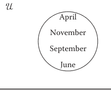

图 3.1 30 天月份集合的韦恩图。

重叠并不假定集合之间存在关系；同时，重叠描述了所有潜在的交集。最后，没有办法画出空集的图示。

Venn diagrams were originally devised by John Venn, a British logician, in 1881. Most Venn diagrams show two or three overlapping circles. (It is impossible to show a Venn diagram of five sets showing all possible intersections.) Shading is used in two ways—most often, shaded regions are subsets of interest, but occasionally, shading is used to indicate an empty region. It is therefore important to include a legend explicitly stating the meaning of shading. Also, Venn diagrams should be placed within a rectangle that represents the universe of discourse. Figures 1.3 and 1.4 in Chapter 1 show of two- and three-set Venn diagrams.


Figure 3.1 Venn diagram of set of 30-day months.

### 3.1.6 集合关系

We use set operations to construct interesting new sets from existing sets. When we do, we often like to know something about the new and old sets are related. Given two sets, `A` and `B`, we define three fundamental relationships:

- `A` is a subset of `B`, written `A ⊆ B`, if only if (iff) `a ∈ A ⇒ a ∈ B`.
- `A` is a proper subset of `B`, written `A ⊂ B`, iff `A ⊆ B ∧ B - A ≠ ∅`.
- `A` and `B` are equal sets, written `A = B`, iff `A ⊆ B ∧ B ⊆ A`.

In plain English, `A` is a subset of `B` if every element of `A` is also an element of `B`. To be a proper subset of `B`, `A` must be a subset of `B` and there must be some element in `B` that is not an element of `A`. Finally, the sets `A` and `B` are equal if each is a subset of the other.

译文：

3.1.6 集合关系

我们使用集合运算从现有集合构建出有趣的新集合。当我们这样做时，通常想知道新集合和旧集合之间有什么关系。给定两个集合 `A` 和 `B`，我们定义了三种基本关系：

- `A` 是 `B` 的子集，记作 `A ⊆ B`，当且仅当（iff）`a ∈ A ⇒ a ∈ B`。
- `A` 是 `B` 的真子集，记作 `A ⊂ B`，当 `A ⊆ B ∧ B - A ≠ ∅`。
- `A` 和 `B` 是相等集合，记作 `A = B`，当 `A ⊆ B ∧ B ⊆ A`。

简单来说，如果 `A` 的每个元素也是 `B` 的元素，那么 `A` 就是 `B` 的子集。要成为 `B` 的真子集，`A` 必须是 `B` 的子集，且 `B` 中必须存在不在 `A` 中的元素。最后，如果 `A` 和 `B` 彼此的子集，那么它们相等。

### 3.1.7 集合划分

A partition of a set is a very special situation that is extremely important for testers. Partitions have several analogs in everyday life: we might put partitions to separate an office area into individual offices; we also encounter political partitions when a set is divided into legislative districts. In both of these, notice the sense of “partition” is to divide a whole into pieces such that everything is in some piece and nothing is left out. More formally:

Given a set `A`, and a set of subsets `A₁, A₂, ..., An` of `A`, the subsets are a partition of `A` iff

```
A ∪ A₂ ... ∪ Aⁿ = A, and i ≠ j ⇒ Aᵢ ∩ Aⱼ = ∅
```

Because a partition is a set of subsets, we frequently refer to subsets as elements of the partition. The two parts of this definition are important for testers.

译文：

3.1.7 集合划分

集合的划分是非常特殊的情况，对测试人员至关重要。划分在日常生活中有很多类比：我们可能会使用隔板将办公区域分成独立的办公室；当集合被分为选区时，也会遇到政治划分。在这两种情况下，请注意“划分”的意思是将整体分成部分，使得所有内容都在某个部分中，且没有任何遗漏。更正式地说：

给定集合 `A` 以及一组 `A` 的子集 `A₁, A₂, ..., An`，这些子集是 `A` 的一个划分，当且仅当

```
A ∪ A₂ ... ∪ Aⁿ = A, and i ≠ j ⇒ Aᵢ ∩ Aⱼ = ∅
```

由于划分是子集的集合，我们经常将子集称为划分的元素。这个定义的两个部分对测试人员非常重要。

# 测试员离散数学 ■ 41

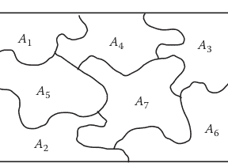

**图 3.3** 划分的维恩图。

在测试，我们将发现其内在缺陷是容易受到漏洞和冗余的影响：某些内容可能未被测试，而另一些内容则被重复测试。功能测试核心的困难之一在于找到合适的划分。例如在三角形问题中，论域是所有正整数三元组的集合。（注意，这实际上是正整数集合自身的三次笛卡尔积。）我们可以对这个论域进行三种划分：

- 1. 划分为三角形和非三角形
- 2. 划分为等三角形、等腰三角形、不等三角形和非三角形
- 3. 划分为等三角形、等腰三角形、不等三角形、直角三角形和非三角形

这些划分看起来还可以，但最后一种划分存在问题。不等三角形和直角三角形的集合不是不交的（边长为 3, 4, 5 的三角形既是直角三角形又是不等三角形）。

## 3.1.8 集合恒等式

集合运算和关系结合产生了一类重要的集合恒等式，可以用代数方法简化复杂的集合表达式。数学学生通常需要推导这些等式；我们只需列出并（偶尔）使用它们。

| 名称 | 表达式 |
|---|---|
| 恒等律 | $A \cup \emptyset = A$<br>$A \cap U = A$ |
| 主控律 | $A \cup U = U$<br>$A \cap \emptyset = \emptyset$ |
| 等幂律 | $A \cup A = A$<br>$A \cap A = A$ |
| 补补律 | $(A')' = A$ |
| 交换律 | $A \cup B = B \cup A$<br>$A \cap B = B \cap A$ |
| 结合律 | $A(B \cup C) = (A \cup B) \cup C$<br> $A(B \cap C) = (A \cap B) \cap C$ |
| 分配律 | $A(B \cap C) = (A \cup B) \cap (A \cup C)<br> $A(B \cup C) = (A \cap B) \cup (A \cap C)$ |
| 德摩根律 | $(A \cup B)' = A' \cap B'$<br> $(A \cap B)' = A' \cup B'$ |

### 3.2 函数

函数是软件开发和测试的核心概念。例如，整个功能分解范式隐式地使用了函数的数学概念。非正式地说，函数将集合中的元素关联起来。例如在 `NextDate` 程序中，给定日期的函数是次日的日期；在三角形问题中，三个输入整数的函数是根据边长对应的三角形类型。在佣金问题中，销售的佣金是销售额的函数，而销售额又是锁、库存和桶数量的函数。SATM 系统中的函数复杂得多；不意外，这将会增加测试的复杂性。

任何程序都可以被看作一个将其输出与输入关联的函数。在函数的数学公式中，输入是定义域，输出是函数的值域。

### 定义

对于集合 `$A$` 和 `$B$`，函数 `$f$` 是 `$A \times B$` 的子集，使得对于 `$a_i \in A, b_j \in B, b_k \in B$`，若 `$f(a_i)=b_j, f(a_i)=b_k \Rightarrow b_j \neq b_k \Rightarrow a_i \neq a_l$`。

这种正式定义以晦涩著称，所以让我们仔细观察一下。函数 `$f$` 的输入是集合 `$A$` 中的元素，`$f$` 的输出是集合 `$B$` 中的元素。该定义说的意思是，函数 `$f$` 是“良”的，即 `$A$` 中的一个元素永远不会关联到 `$B$` 中的多个元素。（如果可能发生这种情况，我们该如何测试这样的函数呢？这是一个非确定性的例子。）

### 3.2.1 定义域和值域

在上面的定义中，集合 `$A$` 是函数 `$f$` 的定义域，集合 `$B$` 是值域。因为输入和输出具有“自然”顺序，很容易说函数 `$f$` 实际上是一组有序对集合，其中第一个元素来自定义域，第二个元素来自值域。这里是函数的两种常用表示法：

```
$f: A \rightarrow B$
```

```
$f \subseteq A \times B$
```

我们在这个定义中没有对集合 `$A$` 和 `$B$` 设定任何限制。我们可以 `$A = B$`，且 `$A$` 或 `$B$` 都可以是其他集合的笛卡尔积。

### 3.2.2 函数类型

通过映射的细节进一步描述函数。在下面的定义中，我们从函数 `$f: A \rightarrow B$` 开始，定义集合：

```
$f(A) = \{b_i \in B; b_i = f(a_i) \text{ for some } a_i \in A\}$
```


这个集合有时被称为 $A$ 在 $f$ 下的像。

### 定义

- $f$ 是从 $A$ 到 $B$ 的**射函数**，当且仅当 $f(A) = B$
- $f$ 是从 $A$ 到 $B$ 的**内****当且仅当 $f(A) \subset B$（注意这里是真集！）
- $f$ 是从 $A$ 到 $B$ 的**单射函数**，当且仅当对于所有 $a_i, a_j \in A, a_i \neq a_j \Rightarrow f(a_i) \neq f(a_j)$
- $f$ 是从 $A$ 到 $B$ 的**多对函数**，如果存在 $a_i, a_j \in A, a_i \neq a_j$，使得 $f(a_i) = f(a_j)$。

回到通俗白话，如果我们固定一个从 $A$ 到 $B$ 的射函数，我们知道 $B$ 中的每个元素都关联到 $A$ 中的某个元素。如果我们固定一个从 $A$ 到 $B$ 的函数，我们知道 $A$ 中的每个元素最多关联到 $B$ 中的一个元素。如果一个函数是单射，那么 $B$ 中的每个元素最多关联到 $A$ 中的一个元素。如果它是射，那么 $B$ 中的每个元素至少关联到 $A$ 中的一个元素。如果它既是单射又是射，那么 $B$ 中的每个元素恰好关联到 $A$ 中的一个元素。

## 3.3 关系 (Relations)

函数是关系的一种特殊情况：两者都是某些笛卡尔关系的子集；然而，在函数的情况下，我们有一个良好的要求，即定义域元素不能关联到多个值域元素。这在日常用法中得到了证实：当我们说某物是另一物的“函数”时，我们的意图是存在一种确定性的关系。并不是所有关系都是严格的函数。考虑患者集合与医生集合之间的映射。一个患者可能由多个医生治疗，而一个医生可能治疗多个患者——这是一个多对多的映射。

### 3.3.1 集合之间的关系

### 定义

给定两个集合 $A$ 和 $B$，关系 $R$ 是笛卡尔积 $A \times B$ 的子集。
有两种表示法很流行：当我们想要谈论整个关系时，我们直接写 $R \subseteq A \times B$；对于特定的元素 $a_i, b_j \in B$，我们写 $R_{a,b}$。大多数任务都省略了对关系的处理；我们之所以关注关系是因为它们对数据建模和面向对象的分析至关重要。

接下来，我们需要解释一个重义词——基数 (cardinality)。回想当它应用于集合时，基数是指集合中元素的数量。因为关系也是一个集合，我们可能认为关系的基数是指集合 $R \subseteq A \times B$ 中有多少个有序对。遗憾的是，事实并非如此。

### 定义

给定两个集合 $A$ 和 $B$，关系 $R \subseteq A \times B$，关系 $R$ 的基数是：

-   一对一：$R$ 是从 $A$ 到 $B$ 的一对一函数
-   多对一：$R$ 是从 $A$ 到 $B$ 的多对一函数
-   一对多：$R$ 当且仅当至少一个元素 $a \in A$ 出现在 $R$ 中的两个序对中，即 $ $\langle a, b \rangle \in R$ 且 $\langle a, b' \rangle \in R$
-   多对多：$R$ 当且仅当至少一个元素 $a \in A$ 出现在 $R$ 中的两个序对中（即 $\langle a, b \rangle \in R$ 且 $\langle a, b' \rangle \in R$），且至少一个元素 $b \in B$ 出现在 $R$ 中的两个序对中（即 $\langle a, b \rangle \in R$ 且 $\langle a', b \rangle \in R$）

进入值域和满射值域的区别在关系中有一个类比的概念——参与度 (participation)。

### 定义

给定两个集合 $A$ 和 $B$，关系 $R \subseteq A \times B$，关系 $R$ 的参与度是：

-   进入 (Into)：当且仅 $A$ 的每一个元素都在 $R$ 的某个序对中
-   部分 (Partial)：当且仅 $A$ 的某些元素不在 $R$ 的某个序对中
-   满射 (Onto)：当且仅 $B$ 的每一个元素都在 $R$ 的某个序对中
-   非满射 (Not onto)：当且仅 $B$ 的某些元素不在 $R$ 的某个序对中

家庭关系是这些属性的很好的例子。你可能想考虑以下关系并判断它们适用于哪些属性：兄弟、兄弟姐妹、祖先。现在我们可以定义两个重要的关系。

### 定义

关系 $R \subseteq A \times A$ 是一个排序关系 (ordering relation)，如果 $R$ 是自的、反对称的且传递的。排序关系具有方向性；常见的排序关系包括“早于”、$\ge$、$\Rightarrow$ 和“祖先”。（反射部分通常需要一些通融——我们真的应该说“年轻于”而不是“是后代”。）排序关系在软件中很常见：数据访问技术、哈希、树形结构和数组都是使用排序关系的情况。

给定集合的幂集是该集合所有子集的集合。集合 $A$ 的幂集记为 $P(A)$。子集关系 $\subseteq$ 是 $P(A)$ 上的一个排序关系，因为它是反对称的（任何集合都是自身的平凡子集），它是反射的且是传递的。

### 定义

关系 $R \subseteq A \times A$ 是一个等价关系 (equivalence relation)，如果 $R$ 是反射的、对称的且传递的。数学中充满了等价关系：等价和全等是两个例子。等价关系与集合的划分之间存在着非常重要的联系。假设我们有集合 $B$ 的划分 $A_1, \dots, A_n$，我们说 $B$ 的两个元素 $b_i$ 和 $b_j$ 是相关的（即 $b_i, b_j$ 在同一个划分中）。这种关系是反射的（任何元素都在其自身的划分中），它是对称的（如果 $b_i$ 和 $b_j$ 在一个划分元素中，那么 $b_j$ 和 $b_i$ 也是），它是传递的（如果 $b_i$ 和 $b_j$ 在同一个集合中，且 $b_j$ 和 $b_k$ 在同一个集合中）。由划分定义的关系是由划分诱导的等价关系。相反过程同样。如果我们在集合上定义了一个等价关系，我们可以根据相互相关的元素来定义子集。事实证明这是一个划分，被称为由等价关系诱导的划分。划分中的集合被称为等价类 (equivalence classes)。最终结果是划分被称为等价类。

### 3.4 命题逻辑 (Propositional Logic)

我们通常用小写字母表示命题，$p, q$ 和 $r$。命题逻辑具有运算、表达式和恒等式，这些与集合论非常相似（事实上，它们是同构的）。

逻辑运算符（也称为连接词或运算）是根据它们所作用的真值来定义的。这很简单；只使用两个值：$T$（真）和 $F$（假）。

#### 3.4.1 逻辑运算符

三个基本的逻辑运算符是 $(\wedge)$、$(\vee)$ 和非 $(\neg)$；这些有时被称为与、或、非。否定是唯一的一元（单操作数）逻辑运算符；其他的都是二元的。这些和否定通过真值表定义：

| p | q | $p \wedge q$ | $p \vee q$ | $\neg p$ |
|---|---|---|---|---|
| T | T | T | T | F |
| T | F | F | T | F |
| F | T | F | T | T |
| F | F | F | F | T |

与和或在生活中很熟悉：与只有在所有组件都为真时为真，而或在至少有一个组件为真时为真。否定的行为也符合预期。另外两个常用的连接词是：异或 ($\oplus$) 和蕴含 ($\rightarrow$)。它们的定义如下：

| p | q | $p \oplus q$ | $p \rightarrow q$ |
|---|---|---|---|
| T | T | F | T |
| T | F | F | F |
| F | T | T | F |
| F | F | F | T |

异或仅当恰好有一个命题为真时为真，而或（或包含或）在两个命题都为真时也为真。蕴含运算符通常引起最大的困难。简单的观点是这是一个定义；然而，因为其他连接词都能很好地转换到自然语言，我们对蕴含也有类似的预期。快速的回答是，蕴含运算符与推理过程密切相关：在一个演绎三段论中，我们可以说“如果前提，那么结论”，而这个蕴含语句将是一个永真式。

### 3.4.2 逻辑表达式

我们使用逻辑运算符来构建逻辑表达式的方法，与使用算术运算符来构建代数表达式完全相同。我们可以按照通常的括号约定来指定运算符的执行顺序，或者采用优先级顺序（否定优先，然后是合取，最后是析取）。给定一个逻辑表达式，我们总是可以通过根据括号确定的以下顺序“向上构建”来找到它的真值表。例如，表达式 $\sim(p \to q) \wedge (q \to p)$ 具有如下真值表：

| $p$ | $p \to q$ | $q \to p$ | $(p \to q) \wedge (q \to p)$ | $\sim(p \to q) \wedge (q \to p)$ |
| --- | --- | --- | --- | --- |
| T | T | T | T | F |
| T | F | T | F | T |
| F | T | T | F | T |
| F | F | T | T | F |

### 3.4.3 逻辑等价

算术等式和相同集合的概念在命题逻辑中也有对应概念。注意表达式 $\sim((p \to q) \wedge (q \to p))$ 和 $p \oplus q$ 具有相同的真值表。这意味着无论给基础命题 $p$ 和 $q$ 赋予什么真值，这些表达式的真值始终相同。该属性可以通过多种方式定义：我们使用最简单的一种。

### 定义

两个命题 $p$ 和 $q$ *逻辑等价*的（记作 $p \Leftrightarrow q$），当且仅当它们的真值表相同。
顺带一下，我们一直使用的“当且仅当”（iff）奇奇缩写有时被称为双条件，因此命题 $p \iff q$ 实际上是 $(p \to q) \wedge (q \to p)$，记作 $p \Leftrightarrow q$。

### 定义

恒为真的命题称为*永真式*；恒为假的命题称为*矛盾式*。要成为永真式或矛盾式，命题必须包含至少一两个原始命题。我们有时将永真式记为命题 $T$，矛盾式记为命题 $F$。我们现在可以列出几个与集合律直接对应的定律。

| 律 | 表达式 |
| --- | --- |
| 恒等律 | $p \wedge T \Leftrightarrow p$ <br> $p \vee F \Leftrightarrow p$ |
| 支配律 | $p \vee T \Leftrightarrow T$ <br> $p \wedge F \Leftrightarrow F$ |
| 幂等律 | $p \wedge p \Leftrightarrow p$<br>$p \lor p \Leftrightarrow p$ |
| 补积律 | $\sim(p) \Leftrightarrow p$ |
| 交换律 | $p \wedge q \Leftrightarrow q \wedge p$<br>$p \lor q \Leftrightarrow q \lor p$ |
| 结合律 | $p \wedge (q \wedge r) \Leftrightarrow (p \wedge q) \wedge r$<br>$p \lor (q \lor r) \Leftrightarrow (p \lor q) \lor r$ |
| 分律律 | $p \lor (q \wedge r) \Leftrightarrow (p \lor q) \wedge (p \lor r)$<br>$p \wedge (q \lor r) \Leftrightarrow (p \wedge q) \lor (p \wedge r)$ |
| 德摩根律 | $\sim(p \wedge q) \Leftrightarrow \sim p \lor \sim q$<br$\sim(p \lor q) \Leftrightarrow \sim p \land \sim q$ |

### 3.5 概率论

在软件测试研究中，我们将两次机会用到概率论：一个处理特定语句路径执行的概率，另一个将其推广到一个通用的工业概念，称为*运行剖面*（见第 14 章）。由于使用有限，我们在这里只涵盖基础知识。
与集合论和命题逻辑一样，我们从一个原始概念开始——事件的概率。这里是经典教科书提供的定义：

事件 $E$ 是有限样本空间 $S$ 中等可能结果的子集的概率为 $p(E) = |E|/|S|$。

这个定义依赖于实验产生结果的想法，样本空间是所有可能结果的集合。这个定义是循环的：什么是“等可能”的结果？两个世纪前，法国数学家拉普拉斯对概率有一个合理的定义。换言之，某事发生的概率是有利次数除以总情况数（有利和不利）。拉普拉斯的定义当我们考虑从袋子里取出弹子时很好用，但无法扩展到难以枚举各种可能的情况。我们将使用我们的（改进的）集合论能力，这些事件，事件的集合是我们的论域。现在，对于某些论域 $U$ 和关于 $U$ 的某些命题 $p$，我们做一个定义：

命题 $p$ 的真值集合 $T(p)$ 是论域 $U$ 中使 $p$ 为真的元素集合。命题 $p$ 为真的概率记作 $Pr(p)$，为 $|T(p)|/|U|$。有了这个定义，拉普拉斯的“有利次数”变成了真值集合 $T(p)$，而总次数变成了论域的基数。这强制了一个连接：因为永真式的集合是论域，而矛盾式的真值集合是空集 $\varnothing$，$\varnothing$ 和 $U$ 的概率分别为 0 和 1。NextDate 问题是一个很好的示例。考虑月份变量 $m$ 和命题 $p(m): m$ 是 30 号月份。论域是集合 $U = \{Jan., Feb., ..., Dec.\}$，$p(m)$ 的真值集合是 $T(m)) = \{Apr., Sept., Nov.\}$。现在，给定月份是 30 号月份的概率是 $Pr(p(m)) = |T(m))||U| = 4/12$。

论域的作用存在一个细微差别——假设我们想知道某个月份是 2 月的概率。快速答案是 1/12。没那么容易——我们需要一个包含闰年的论域。可以使用同余算术，选择连续四年的月份——例如 1991、1992、1993 和 1994。这将包含 48 个“月份”，在这个论域中，29 号月份的概率是 1/48。另一种可能性是使用 NextDate 程序的 200 年范围，其中 1900 年不是闰年。这会稍微减少 29 号月份的概率。一个结论：获得正确的论域很重要。更大的结论：避免“移动论域”更重要。

这里有一些直接使用无需证明的概率事实。它们引用给定论域、命题 $p$ 和 $q$，以及真值集合 $T(p)$ 和 $T(q)$：

$Pr(\sim p) = 1 - Pr(p)$

$Pr(p \wedge q) = Pr(p) \times Pr(q)$

$Pr(p \vee q) = Pr(p) + Pr(q) - Pr(p \wedge q)$

这些事实加上集合论和命题恒等式，提供了处理概率表达式的强大代数能力。

## 练习题

1. 集合运算与命题逻辑中的逻辑连接之间存在深层联系（同构）。

| 操作 | 命题逻辑 | 集合论 |
| --- | --- | --- |
| 析取 | 或 (Or) | 并集 (Union) |
| 合取 | 与 (And) | 交集 (Intersection) |
| 否定 | 非 (Not) | 补集 (Complement) |
| 蕴含 | 如果...那么...If, Then) | 子集 (Subset) |
| | 异或 (Exclusive or) | 对称 (Symmetric difference) |

- a. 用文字表示 $A \oplus B$。
- b. 用文字表示 $(A \cup B) - (A \cap B)$。
- c. 说服你自己 $A \oplus B$ 和 $(A \cap B)$ 不是同一个集合。
- d.  $A \oplus B = (A - B) \cup (B - A)$ 是否正确？
- e. 你想在上方表格的空白处填写什么？

### 2. 在美国许多地方，房产税由不同的征税机构征收，例如学区、消防保护区、镇等。讨论这些征税机构是否构成了一个州的划分。50 个州是否构成了美利坚联邦共和国的划分？（哥伦比亚特区呢？）

### 3. 在所有人集合上，brotherOF（兄弟）是否是一个等价关系？siblingOF（兄弟）呢？

# 第 4 章

## 面测试者的图论

图论是拓扑学的一个分支，有时被称为“橡皮层几何”。很有趣的是，因为拓扑学中的“橡皮层”部分与图论几乎没有关系；此外，图论中的图并不像你可能预期的那样涉及轴、比例尺、点和曲线。无论这个术语的起源如何，图论可能是计算机科学中最实用的数学部分——比微积分有用得多——但它并没有被常教授。我们对图论的探索将遵循“纯数学”的精神，即定义尽可能地不包含具体的解释。通过最大限度地推迟解释，以便在稍后进行解释，这就像定义良好的抽象数据类型能够促进重用一样。

我们使用了两种基本类型的图：无向图和有向图。由于后者是前者的特例，我们从无向图开始。这将使我们在处理有向图时能够继承许多概念。

### 4.1 图

图（也称为线性图）是由两个集合定义的抽象数学结构——一个节点集合和一个用于在节点之间建立连接的边集合。计算机网络是图的一个极佳示例。更正式地说：

### 定义

一个图 G = (V, E) 由一个有限（且非空）的节点集合 V 和一个由节点无序对组成的边集合 E 组成。

$V = \{n_1, n_2, \dots, n_m\}$

和

$E = \{e_1, e_2, \dots, e_p\}$

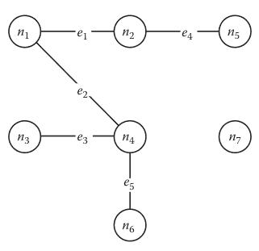

**图 4.1** 具有七个节点和五条边的图。

其中边 $e_k = \{n_i, n_j\}$对于某些节点 $n_i, n_j \in V$。回想第3章，集合 $\{n_i, n_j\}$ 是一个无序对，我们有时将其写作 $\{n_i, n_j\}$。

节点有时被称为顶点（vertices）；边有时被称为弧（arcs）；我们有时将节点称为弧的端点。图的常见视觉形式显示圆圈和边为连接节点对的直线，如图 4.1 所示。我们将使用此图作为持续示例，因此请花一点时间熟悉它。

在图 4.1 的图中，节点和边是：

$V = \{n_1, n_2, n_3, n_4, n_5, n_6, n_7\}$

$E = \{e_1, e_2, e_3, e_4, e_5\}$

$=\{(n_1, n_3), (n_1, n_4), (n_3, n_4), (n_2, n_5), (n_4, n_6)\}$

为了定义一个特定的图，我们必须首先定义节点集合，然后定义节点对之间的边集合。我们通常将节点视为程序语句，并且有各种类型的边，例如表示控制流或定义/使用关系。

### 4.1.1 节点的度

### 定义

图中一个节点的*度*（$degree$）是以该节点为端点的边的数量。我们将 $n$ 的度写为 $deg(n)$。

我们可以说节点的度表示了它在图中的“人气”。事实上，社会科学家使用图来描述社会交互，其中节点是人，边通常指的是“友谊”、“通信来”等。如果我们建立一个以对象为节点、边为边的图，那么节点（对象）的度表示了适用于该对象的集成测试的覆盖程度。

图 4.1 中节点的度为：
```


`deg(n_1) = 2`

`deg(n_2) = 2`

`deg(n_3) = 1`

`deg(n_4) = 3`

`deg(n_5) = 1`

`deg(n_6) = 0`

### 4.1.2 关联矩阵

图不需要以图化形式表示——它们可以在关联矩阵中完全表示。这个概念对测试者来说非常有用，因此我们将将其形式化。当图被赋予特定的解释时，关联矩阵始终为新的解释提供有用信息。

#### 定义

具有 `$m$` 个节点和 `$n$` 条边的图 `G=(V, E)` 的*关联矩阵*（*incidence matrix*）是一个 `$m \times n$` 矩阵，其中第 `$i$` 行第 `$j$` 列的元素为 1，当且仅当节点 `$i$` 是边 `$j$` 的端点；否则，元素为 0。

图 4.1 中图的关联矩阵如下：

| | e1 | e2 | e3 | e4 | e5 |
|---|---|---|---|---|---|
| n1 | 1 | 1 | 0 | 0 | 0 |
| n2 | 1 | 0 | 0 | 1 | 0 |
| n3 | 0 | 0 | 1 | 0 | 0 |
| n4 | 0 | 1 | 1 | 0 | 1 |
| n5 | 0 | 0 | 0 | 1 | 0 |
| n6 | 0 | 0 | 0 | 0 | 1 |

我们可以通过检查关联矩阵来对图得出一些观察。首先，注意到任何列的元素之和均为 2。这是因为每条边都有两个端点。也就是说，每一列元素之和等于 2。当我们发现某行的元素和时，它就是该节点的度。当我们发现某行的元素和为0 时，说明该节点是孤立的。

### 4.1.3 邻接矩阵

邻接矩阵（adjacency matrices）是图论中非常有用的工具之一。对于测试者来说，这个概念也变得非常有用。

#### 定义

具有 `$m$` 个节点的图 `G=(V, E)` 的*邻接矩阵*（*adjacency matrix*）是一个 `$m \times m$` 矩阵，其中第 `$i$` 行第 `$j$` 列的元素为 1，当且仅当节点 `$i$` 和节点 `$j$` 之间存在边；否则，元素为 0。图 4.1 中图的邻接矩阵如下：

| | n1 | n2 | n3 | n4 | n5 | n6 | n7 |
|---|---|---|---|---|---|---|---|
| n1 | 0 | 0 | 1 | 1 | 0 | 0 | 0 |
| n2 | 0 | 0 | 0 | 0 | 1 | 0 | 0 |
| n3 | 1 | 0 | 0 | 1 | 0 | 0 | 0 |
| n4 | 1 | 0 | 1 | 0 | 0 | 1 | 0 |
| n5 | 0 | 1 | 0 | 0 | 0 | 0 | 0 |
| n6 | 0 | 0 | 0 | 1 | 0 | 0 | 0 |
| n7 | 0 | 0 | 0 | 0 | 0 | 0 | 0 |

我们可以通过检查邻接矩阵对图得出一些观察。首先，注意到任何行的元素之和等于该节点的度。此外，由于邻接矩阵是对称的，如果节点 `$i$` 和节点 `$j$` 之间存在边，那么节点 `$j$` 和节点 `$i$` 之间也存在边。

### 4.1.4 路径

路径是图论中的另一个核心概念。在介绍如何使用图论之前，我们需要定义路径。

#### 定义

*路径*（*path*）是边的序列，其中序列中每对相邻的边 `e_i, e_j` 都共享一个公共端点。路径可以以边的序列描述，也可以以节点的序列描述；后者更常见。

### 4.1.5 连通

路径可以直接从图的邻接矩阵通过矩阵乘法和加法生成。

图 4.1 中的一些路径：

| 路径 | 节点序列 | 边序列 |
|---|---|---|
| 从 n1 到 n5 | n1, n2, n5 | e1, e4 |
| 从 n6 到 n5 | n6, n4, n3, n2, n5 | e5, e3, e2, e4 |
| 从 n3 到 n2 | n3, n4, n1, n2 | e3, e4, e1 |

- `$e$` 是 `G` 中的边数。
- `$n$` 是 `G` 中的节点数。
- `$p$` 是 `G` 中的连通分支数。

`V(G)` 是强连通有向图中不同区域的数量。在第 8 章中，我们将研究一种基于代码的测试方法，该方法将程序图中的所有路径视为一个向量空间。该空间的基向量集合有 `V(G)` 个元素。我们示例图的圈数为 `V(G) = 5 - 7 + 2 = 0`。对于圈复杂度来说，这不是很好的例子。当我们在第 8 章中使用圈复杂度，并在第 16 章对其进行扩展时，我们（通常）会遇到强连通图，它们的圈复杂度会比这个小例子要大。

### 4.2 有向图

有向图是普通图的细微改进：边具有了方向性。从符号上说，无序对 `$(n_i, n_j)$` 变成了有序对 `\<n_i, n_j\>`，我们称从节点 `n_i` 到 `n_j` 有一条有向边，而不是节点之间有边。

#### 定义

有向图 `D = (V, E)` 由一个有限的节点集 `V=\{n_1, n_2, \dots, n_m\}` 和一个边集 `E=\{e_1, e_2, \dots, e_p\}` 组成，其中每条边 `e_k = \<n_i, n_j\>` 是节点 `n_i, n_j \in V` 的有序对。

在有向边 `e_k = \<n_i, n_j\>` 中，`n_i` 是初始（起始）节点，`n_j` 是终止（或结束）节点。有向图自然地契合了许多软件概念：顺序行为、命令式编程语言、按时间排序的事件、定义/引用对、函数和过程调用等。鉴于此，你可能会问为什么我们在普通图上花费了（或浪费了？）这么多时间。声明式编程语言和命令式编程语言之间的差异非常相似。在命令式语言（如 COBOL, FORTRAN, Pascal, C, Java, Ada）中，语言语句的顺序决定了编译代码的执行顺序。这对于声明式语言（如 Prolog）并不成立。对于大多数软件开发者来说，常见的声明式场景是实体/关系（E/R）建模。在 E/R 模型中，我们选择实体并将关系识别为边（如果一个关系涉及三个或更多实体，我们需要一个具有三个或更多端点的“超边”概念）。E/R 模型生成的图可以更准确地被解释为普通图。良好的 E/R 建模抑制了有向图所提倡的顺序思维。

在测试用声明式语言编写的程序时，测试人员唯一可以使用的概念是那些源自普通图的概念。幸运的是，大多数软件是用命令式语言开发的；测试人员通常可以使用有向图的全部功能。

接下来的系列定义与普通图的定义并行。我们将对后续的持续示例修改为如图 4.2 所示。

我们具有相同的节点集 `V=\{n_1, n_2, n_3, n_4, n_5, n_6, n_7\}`，边集也保持相同：`E=\{e_1, e_2, e_3, e_4, e_5\}`。区别在于边是 `V` 中节点的有序对：

```
$E = \{<n_1, n_2>, <n_1, n_4>, <n_3, n_4>, <n_2, n_5>, <n_4, n_5>, <n_4, n_6>\}$
```

## 软件测试

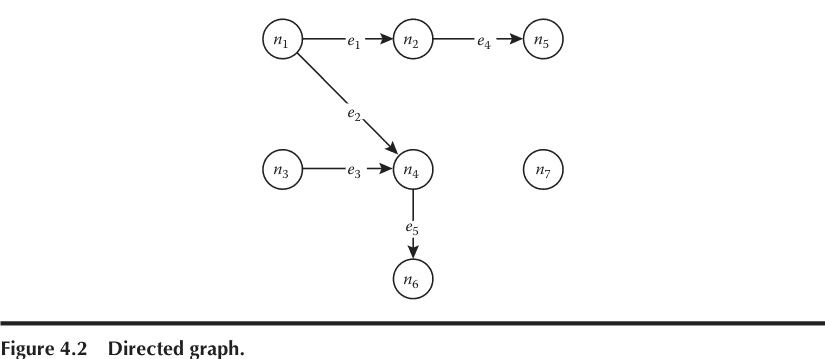

### 4.2.1 入度和出度

普通图中节点的度数被细化以反映方向，如下所示：

#### 定义

有向图中节点的*入度*是以该节点作为终止节点的不同边的数量。我们将节点 `n` 的入度写为 `indegree(n)`。

有向图中节点的*出度*是以该节点作为起始点的不同边的数量。我们将节点 `n` 的出度写为 `outdegree(n)`。

有向图（图 4.2）中的节点具有以下入度和出度：

```
indeg(n₁) = 0 outdeg(n₁) = 2

indeg(n₂) = 1 outdeg(n₂) = 1

indeg(n₃) = 0 outdeg(n₃) = 1

indeg(n₄) = 2 outdeg(n₄) = 1

indeg(n₅) = 1 outdeg(n₅) = 0

indeg(n₆) = 1 outdeg(n₆) = 0

indeg(n₇) = 0 outdeg(n₇) = 0
```

普通图和有向图通过 `deg(n) = indeg(n) + outdeg(n)` 等定义汇。

### 4.2.2 节点类型

有向图增加的描述能力允许我们定义不同类型的节点

#### 定义

- 入度 = 0 的节点是源节点。
- 出度 = 0 的节点是汇节点。
- 入度 ≠ 0 且出度 ≠ 0 的节点是传输节点。

源节点和汇节点构成了图的边界。如果我们制作有向图（来自结构化分析产生的数据流集合），外部实体将是源和汇节点。

在我们的持续示例中，`n_1, n_3` 和 `n_7` 是源节点；`n_2, n_5` 和 `n_6` 是汇节点；`n_2` 和 `n_4` 是传输节点（也称为内部节点）。既是源节点又是汇节点的节点是孤立节点。

### 4.2.3 有向图的邻接矩阵

正如我们预期的那样，边的方向改变了有向图邻接矩阵的定义。（它也改变了关联矩阵，但这种矩阵很少用于向图。）

#### 定义

具有 `$m$` 个节点的有向图 `D = (V, E)` 的邻接矩阵是一个 `$m \times m$` 矩阵 `A = (a(i, j))`，其中当存在从节点 `i` 到 `j` 的边时，`(i, j)` 为 1。

有向图的邻接矩阵并不一定对称。行代表节点的出度，列代表节点的入度。我们示例的邻接矩阵如下：

| | n_1 | n_2 | n_3 | n_4 | n_5 | n_6 | n_7 |
|---|---|---|---|---|---|---|---|
| n_1 | 0 | 1 | 0 | 1 | 0 | 0 | 0 |
| n_2 | 0 | 0 | 0 | 0 | 1 | 0 | 0 |
| n_3 | 0 | 0 | 0 | 1 | 0 | 0 | 0 |
| n_4 | 0 | 0 | 0 | 0 | 1 | 1 | 0 |
| n_5 | 0 | 0 | 0 | 0 | 0 | 0 | 0 |
| n_6 | 0 | 0 | 0 | 0 | 0 | 0 | 0 |
| n_7 | 0 | 0 | 0 | 0 | 0 | 0 | 0 |

有向图的一种常见用途是记录家族关系，其中祖先、堂兄弟等通过祖先连接，父母、后辈等通过后代连接。

### 4.2.4 路径与半路径

方向使得连接图中节点的路径具有更精确的含义。作为一个方便的类比，你可以将其视为单行道和双向道。

#### 定义

- （有向）路径是边序列，对于序列中的任何一对相邻的边 `e_i, e_j`，第一条边的终止节点是第二条边的起始节点。
- 循环是起始并结束于同一个节点的有向路径。
- 链是节点序列，其中每个节点的入度为 1 且出度为 1。
- 起始节点的入度为 0 或 1。终止节点的出度为 0 或大于 1（我们将在第 8 章使用这个概念）。
- （有向）半路径是边序列，使得序列中至少有一对相邻的边 `e_i, e_j`，第一条边的终止节点是第二条边的起始节点，或者第一条边的终止节点是第二条边的终止节点。

我们的持续示例包含以下路径和半路径（未列出全部）：

- 从 `n_1` 到 `n_6` 的路径
- `n_1` 和 `n_3` 之间的半路径
- `n_2` 和 `n_4` 之间的半路径
- `n_5` 和 `n_6` 之间的半路径

### 4.2.5 可达性矩阵

当我们用向图建模应用程序时，我们经常会问关于可以到达（或“进入”）某些节点的问题。这是一项非常有用的功能，并通过向图的可达性矩阵得以实现。

#### 定义

有向图的可达性矩阵可以从邻接矩阵 `A` 计算：

```
$R = I + A + A^2 + A^3 + \dots + A^k$
```


其中 $k$ 是 $D$ 中最路径的长度，$I$ 是单位矩阵。我们持续示例的可达性矩阵如下：

# 测试人员的图论 ■ 63

| | $n_1$ | $n_2$ | $n_3$ | $n_4$ | $n_5$ | $n_6$ | $n_7$ |
|---|---|---|---|---|---|---|---|
| $n_1$ | 1 | 0 | | 1 | 1 | | 0 |
| $n_2$ | 0 | 1 | | 0 | 0 | 1 | 0 |
| $n_3$ | 0 | 0 | 1 | | 1 | 0 | |
| $n_4$ | 0 | 0 | | 1 | 0 | 1 | 0 |
| $n_5$ | 0 | 0 | | 0 | 1 | | 0 |
| $n_6$ | 0 | 0 | | | 0 | 1 | |
| $n_7$ | 0 | 0 | | | 0 | 0 | 1 |

可达性矩阵告诉我们，节点 $n_2, n_4, n_5$ 和 $n_6$ 可以从 $n_1$ 到达；节点 $n_5$ 可以从 $n_2$ 到达；此类推。

## 4.2.6 n-连通性

普通图的连通性扩展为了有图（digraph）的一个丰富且具解释力的概念。

### 定义

有图中的两个节点 $n_i$ 和 $n_j$ 为：

- 0-连通当且仅当 $n_i$ 和 $n_j$ 之间不存在路径
- 1-连通当且仅当 $n_i$ 和 $n_j$ 之间存在半路径但不存在路径
- 2-连通当且仅当 $n_i$ 和 $n_j$ 之间存在路径
- 3-连通当且仅当存在从 $n_i$ 到 $n_j$ 的路径，且存在从 $n_j$ 到 $n_i$ 的路径

不存在其他程度的连通。

我们需要修改之前的示例来展示 3-连通性。变化是增加了一条从 $n_6$ 到 $n_5$ 的新边 $e_6$，因此图包含了一个环。

借此，我们在图 4.3 中获得了以下 n-连通性的实例（并非全部列出）：

- $n_1$ 和 $n_7$ 是 0-连通的
- $n_2$ 和 $n_6$ 是 1-连通的
- $n_1$ 和 $n_6$ 是 2-连通的
- $n_3$ 和 $n_6$ 是 3-连通的

从单向道的角度来看，你无法从 $n_2$ 到 $n_6$。

# 64 软件测试

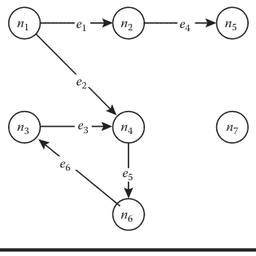

图 4.3 带环的有图。

## 4.2.7 强通分支

类比继续。我们从 n-连通性得到两个等价关系：1-连通产生我们所谓的“弱连通”，并由此产生弱通分支（这些结果证明与我们在普通图中得到的相同，这本应如此，因为 1-连通性实际上忽略了方向性）。第二个等价关系基于 3-连通性，它诱导了有图节点集的划分，这更有趣。然而，由于其收缩图（condensation graph）非常不同。之前是 0-、1- 或 2-连通的节点保持原样。3-连通节点变成了强通分支。

### 强通分支

有向图的强通分支是 3-连通节点的最大集。

在我们修改后的示例中，强通分支是集合 {$n_3, n_4, n_6$} 和 {$n_5$}。修改后示例的收缩图如图 4.4 所示。

强通分支允许通过移除环和孤立节点来简化。虽然这不像我们在普通图中的简化那样剧烈，但它确实解决了一个主要的测试问题。注意，有图的收缩图永远不会包含环。（如果包含，该环将通过划分的最大性被收缩。）这些图有一个特殊的名称：有向无环图，有时写为 DAG。

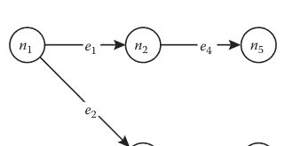

图 4.4 图 4.3 有图的收缩图。

# 测试人员的图论 ■ 65

许多关于结构化测试的论文强调了相对简单的程序如何拥有数百万条不同的执行路径。这些讨论的意图是说服我们穷尽测试确实是——穷尽的。大量的执行路径来自于嵌套循环。收缩图消除了循环（或至少将它们收缩为单个节点）；因此，我们可以将其作为一种策略，来简化在计算上无法维持的情况。

### 4.3 测试用图

我们本章以四种广泛用于测试的特殊图作为结束。其中第一个是程序图，主要用于单元测试级别。另外三个——有限状态机、状态图和佩特里网——用于描述系统级行为，尽管它们也可以用于较低层次的测试。

### 4.3.1 程序图

在本章的开始，我们强调了非执行语句，如注释和声明语句。最简单的答案是忽略它们。对于命令式语言编写的程序，其程序图如下：

- 传统定义：$n_i$ 和 $n_j$ 存在从 $n_i$ 到 $n_j$ 的路径
- 改进定义：$n_i$ 和 $n_j$ 存在从 $n_i$ 到 $n_j$ 的路径

（注：原文后续部分存在大量重复和 OCR 错误，译文已根据核心逻辑进行整理翻译）

# 测试人员的图论 67

输入事件
- $e_1$:按下控制器按钮
- $e_2$:下行轨道击中结束
- $e_3$:上行轨道击中结束
- $e_4$:击中障碍物
- $e_5$:激光束跨越

输出事件（动作）
- $a_1$:启动驱动电机向下运动
- $a_2$:启动驱动电机向上运动
- $a_3$:停止驱动电机
- $a_4$:库门在半途中停止
- $a_5$:库门继续打开
- $a_6$:库门继续关闭

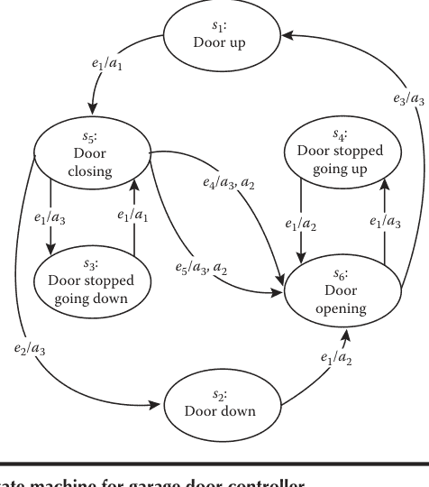

图 4.6 车库库门控制器的有限状态机。

遵循一种约定即：“分子”是引起转换的事件，“分母”是与转换关联的动作。事件是强制性的——转换不会凭空发生，但动作是可选的。有限状态机是表示各种事件可能发生且其发生具有不同后果的情况简单方法。

有限状态机是可以执行的；然而，首先需要一些约定。其是“激活状态”的概念。我们说一个系统“处于”某个状态；当系统被建模为有限状态机时，激活状态指的是“我们正处于该状态”。另一个约定是，有限状态机可以有一个初始状态，即进入有限状态机时的状态。（初始状态和结束状态分别通过缺少入站和出站转换来识别。）在任何时候，只能有一个状态是激活状态。我们还认为转换是瞬时发生的，而引起转换的事件也是一个接一个发生的。要执行一个有限状态机，我们从初始状态开始，并提供一系列引起转换的事件。随着每个事件的发生，转换改变激活状态，并发生一个新事件。通过这种方式，一组事件序列选择了通过机器的一条状态路径（或等价地通过转换序列）。

© 2010 Taylor & Francis Group, LLC

# 软件测试

### 4.3.3 Petri 网

Petri 网是 Carl Adam Petri 在 1963 年博士论文的主题；今天，它们是涉及并发和分布式处理的协议和其他应用的接受模型。Petri 网是有向图的一种特殊形式：二分图。二分图有一组节点集合 $V_1$ 和 $V_2$，以及一组边 $E$，限制是每条边的初始节点都位于 $V_1$ 或 $V_2$ 集合之一，而终端节点位于另一个集合中）。在 Petri 网中，其中一组集合被称为“库”（places），另一组被称为“转换”（transitions）。这些集合通常表示为 $P$ 和 $T$。库是转换输出的输入；输入和输出关系是函数，它们通常表示为 In 和 Out，如下定义所示。

# 定义

Petri 网是一个二分有向图 $(P, T, In, Out)$，其中 $P$ 和 $T$ 是不交的节点集合，$In$ 和 $Out$ 是边集合，其中 $In \subseteq P \times T$，$Out \subseteq T \times P$。

对于图 4.7 中的简单 Petri 网，集合 $P, T, In,$ 和 $Out$ 为：

$P = \{p_1, p_2, p_3, p_4, p_5\}$
$T = \{t_1, t_2, t_3\}$
$In = \{<p_1, t_1>, <p_3, t_1>, <p_5, t_3>, <p_2, t_3>, <p_3, t_2>\}$
$Out = \{<t_1, p_3>, <t_2, p_4>\}$

Petri 网的执行方式比有限状态机更有趣。接下来的几个定义引导我们进入 Petri 网。

# 定义

标记 Petri 网（marked Petri net）是一个五元组 $(P, T, In, Out, M)$，其中 $(P, T, In, Out)$ 是 Petri 网，$M$ 是库到正整数的映射。

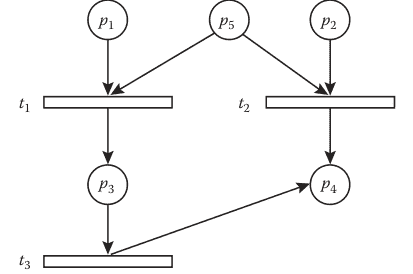

图 4.7 Petri 网。

# 测试人员的图论 ■ 69

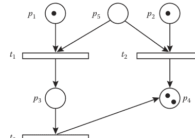

图 4.8 标记 Petri 网。

集合 $M$ 被称为 Petri 网的标记集（marking set）。$M$ 的元素是 n 元组，其中 $n$ 是集合 $P$ 中库的数量。对于图 4.7 中的 Petri 网，$M$ 包含形式为 $<n1, n2, n3, n4, n5>$ 的元素，其中 $n$ 与相应的库相关。“处于”该库的令牌数量。令牌（Tokens）是用于建模情况的抽象。例如，令牌可能指的是库被使用的次数，库中物品的数量，或者库是否为真。图 4.8 显示了一个标记 Petri 网。

# 定义

如果每个输入库中至少有一个令牌，则 Petri 网中的转换是激活的。图 4.8 中标记网的标记元组是 $<1,1,0>$。我们需要令牌的概念来完成两个基本定义。如果我们在库 $p5$ 中放入一个令牌，那么转换 $t2$ 就会激活。

# 定义

在激活的 Petri 网中，从每个输入库中移除一个令牌，并在每个输出库中添加一个令牌。在图 4.9 中，转换 $t2$ 在左网和右网都是激活的。图 4.9 网的标记序列包含两个元组——第一个显示 $t2$ 激活时，第二个显示 $t2$ 执行后：

$M = \{<1,1,0,2,1>, <1,0,0,3,0>\}$

令牌可能通过转换创建或销毁。在特殊情况下，网中的令牌总数不变；这样的网是保守的。标记让我们以执行状态机的方式执行 Petri 网。（证明有限状态机是 Petri 网的一种特例。）

© 2010 Taylor & Francis Group, LLC

# 软件测试


再次观察图 4.9 中的网；在左网（任何转换之前），库 $p_1, p_2$ 和 $p_3$ 都被标记了。具有这样的标记，转换 $t_1$ 和 $t_2$ 都是激活的。如果我们选择执行 $t_2$，库 $p_3$ 中的令牌被移除且 $t_1$ 不再激活。同样，如果我们选择执行 $t_1$，我们就禁用了 $t_2$。这种模式被称为 Petri 冲突（Petri conflict）。具体来说，我们说转换 $t_1$ 和 $t_2$ 对于库 $p_2$ 冲突。Petri 冲突展示了两个转换之间有趣的交互形式；我们将在第 17 章重温此（以及其他交互）。

### 4.3.4 事件驱动 Petri 网

基本的 Petri 网需要稍微增强以成为事件驱动 Petri 网（EDPN）。第一个能够密切地表示事件驱动系统，第二个处理 Petri 网标记以表示静性（quiescence），这是面向对象应用中的一个重要概念。这些扩展共同构成了软件需求的有效操作视图。

# 定义

*事件驱动 Petri 网*是一个三部有向图 $(P, D, S, In, Out)$，由三组节点 $P, D$ 和 $S$ 以及两个映射 $In$ 和 $Out$ 组成，其中：

- $P$ 是端口库（port places）集合
- $D$ 是数据库（data places）集合
- $S$ 是转换集合
- $In$ 是来自 $(P \cup D) \times S$ 的有序对集合
- $Out$ 是来自 $S \times (P \cup D)$ 的有序对集合

EDPN 表达了第 14 章定义的五个系统构造中的四个：转换集合 $S$ 对应普通的 Petri 网转换，解释为动作；库的类型（端口事件和数据库）是由输入输出函数 $In$ 和 $Out$ 定义的 $S$ 中转换的输入或输出。线程是 $S$ 中转换的序列，因此我们总是可以构造线程中转换的输入和输出。EDPN 的输入输出在图形表示上与普通 Petri 网相同；唯一的区别是使用三角形表示端口事件库。图 4.10 中的 EDPN 有四个转换 $s_5, s_8, s_9$ 和 $s_{10}$；两个输入事件 $p_3$ 和 $p_4$；三个数据库 $d_5, d_6$ 和 $d_7$。它没有端口输出事件。

这个 EDPN 对应第 15 章中为星链雨刮器系统部分开发的有限状态机（见图 15.1）。该网的组件在表 4.1 中描述。

EDPN 的标记通常更复杂，因为我们可以处理静性。

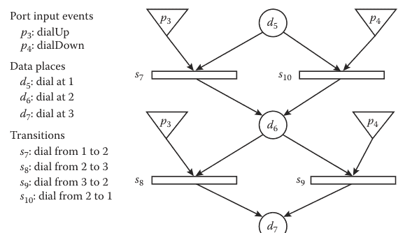

图 4.10 事件驱动 Petri 网。

# 表 4.1 图 4.10 中的 EDPN 元素

| 元素 | 类型 | 描述 |
| :--- | :--- | :--- |
| $p_3$ | 端口输入事件 | 顺时针旋转 |
| $p_4$ | 端口输入事件 | 逆时针旋转 |
| $d_5$ | 数据库 | 位置 1 |
| $d_6$ | 数据库 | 位置 2 |
| $d_7$ | 数据库 | 位置 3 |
| $s_7$ | 转换 | 状态转换：$d_4$ 到 $d_6$ |
| $s_8$ | 转换 | 状态转换：$d_6$ 到 $d_7$ |
| $s_9$ | 转换 | 状态转换：$d_7$ 到 $d_6$ |
| $s_{10}$ | 转换 | 状态转换：$d_6$ 到 $d_5$ |

# 软件测试

## 定义

EDPN (P, D, S, In, Out) 的标记 $M$ 是一个 $p$ 元组序列 $M = \langle m_1, m_2, \dots \rangle$，其中 $p = k + n$，$k$ 和 $n$ 分别是集合 $P$ 和 $D$ 中的元素数量，$p$ 元组中的每个条目表示事件或数据位置中的令牌（token）数量。

按照惯例，我们将位置（places）放在前面，随后是输入事件位置，然后是输出事件位置。一个 EDPN 可以具有任意数量的标记；每个标记对应于网的一次执行。表 4.2 显示了图 4.10 中 EDPN 的示例映射。

EDPN 中启用和触发的规则与传统的 Petri 网（Petri nets）具有精确的类比关系：如果输入位置中至少有一个令牌，则该转换处于启用状态；当一个启用的转换触发时，会从它的每个输入位置移除一个令牌，并在它的每个输出位置放置一个令牌。表 4.3 遵循表 4.2 给出的标记序列，展示了转换的启用和触发。

EDPN 与传统 Petri 网之间的重要区别在于，通过在端口输入事件位置创建一个令牌可以打破事件静止（event quiescence）。在传统的 Petri 网中，当没有转换被启用时，网是死锁。在 EDPN 中，当没有转换被启用时，网处于事件静止点。（当然，如果没有事件发生，这等同于死锁。）事件静止在表 4.3 的线程中发生了四次：分别在 $m_1$、$m_3$、$m_5$ 和 $m_7$ 处。

## 表 4.2 图 4.10 EDPN 的映射

| 元组 | $(p_u, p_v, d_u, d_v)$ | 描述 |
|--- | --- | --- |
| $m_1$ | (0, 0, 1, 0) | 初始条件，处于状态 $d_5$ |
| $m_2$ | (1, 0, 1, 0) | $p_3$ 发生 |
| $m_3$ | (0, 0, 0, 1) | 处于状态 $d_6$ |
| $m_4$ | (1, 0, 0, 1) | $p_1$ 发生 |
| $m_5$ | (0, 0, 0, 1) | 处于状态 $d_7$ |
| $m_6$ | (0, 1, 0, 1) | $p_4$ 发生 |
| $m_7$ | (0, 0, 0, 1) | 处于状态 $d_6$ |

## 表 4.3 表 4.2 中启用和触发的转换

| 元组 | $(p_u, p_v, d_u, d_v)$ | 描述 |
|--- | --- | --- |
| $m_1$ | (0, 0, 1, 0) | 无启用 |
| $m_2$ | (1, 0, 1, 0) | $s_7$ 启用；$s_7$ 触发 |
| $m_3$ | (0, 0, 0, 1) | 无启用 |
| $m_4$ | (1, 0, 0, 1) | $s_8$ 启用；$s_8$ 触发 |
| $m_5$ | (0, 0, 0, 1) | 无启用 |
| $m_6$ | (0, 1, 0, 1) | $s_9$ 启用；$s_9$ 触发 |
| $m_7$ | (0, 0, 0, 1) | 无启用 |

标记中的单个成员可以被视为执行过程的快照。

### 4.3 StateCharts

David Harel 开发 StateChart 时有两个目标：他希望设计一种视觉形式，能够模仿维恩图的表达能力以及有向图的表达能力（Harel, 1988）。StateChart 的执行方式比有限状态机要容易得多。StateChart 现在是许多商业工具的建模语言（UML, https://www.ibm.com/rational）的基础模型。维恩图通过包含关系来表达状态，这在 StateChart 中也得到了支持。在图 4.11 中，状态通过边来连接。StateChart 允许状态嵌套，这在 Petri 网中是类似的。在图 4.12 中，状态 A 包含子状态，因此指向 A 的边指的是所有子状态。因此，从 A 到 D 的边意味着转换可以从状态 B 或状态 C 发生。如果在图 4.13 中有一个从 D 到 A 的边，由于 B 被标记为初始状态，这意味着转换实际上是从 D 到 B。这种约定极大地减少了有限状态机变成“面条代码”的倾向。

## 练习题

1. 为图中路径的长度给出一个定义。
2. 如果在图 4.1 的图中节点 $n_5$ 和 $n_6$ 之间添加一条边，会产生什么（循环）？
3. 证明有向图节点的 3-连通性是一个等价关系。
4. 计算图 4.5 中每个结构化编程语句的圈复杂度。
5. 图 4.15 中的数字是通过向图 4.3 有向图添加节点和边得到的。计算每个新有向图的圈复杂度，并解释这些变化如何影响复杂度。
6. 假设我们创建一个图，其中节点是人，边对应于某种社交互动（如“聊天”或“社交”）。找到与社会概念（如流行、团团、紧密）对应的图论概念。

## 参考文献

- Harel, D., On visual formalisms, *Communications of the ACM*, Vol. 31, No. 5, May 1988, pp. 514–530.
- McCabe, T. J., A complexity measure, *IEEE Transactions on Software Engineering*, Vol. 2, No. 4, December 1976, pp. 308–320.

## 单元测试

“单元（unit）”一词需要解释。关于究竟什么构成一个单元，有几种解释。在过程化编程语言中，一个单元可以是：

- 单个过程
- 一个函数
- 实现单个函数的代码体
- 能在一页纸上的源代码
- 代表 4 到 40 小时工作量的代码体（如工作分解结构所示）
- 可以独立编译并执行的最小代码体

在面向对象的编程语言中，通常共识是类（class）是一个单元。然而，类的方法可能会受到过程化代码中对单元的任何“定义”的限制。

底线情况是，“单元”可能由实现代码的组织来定义最好。在我的电信职业生涯中，出于规划考虑的“标准单元”是 300 行源代码。这样做的主要原因是电话交换系统软件非常大，因此较大的单元更为合适。我个人对单元的定义是一个由一个人或可能一对程序员进行设计、编码和测试的软件体。第 5 至第 10 章涵盖了单元级测试，由于面向对象编程中的方法与过程化单元非常相似，这些材料适用于这两种编程语言。

# 第 5 章

### 边界值测试

在第 3 章中，我们看到函数将值从一个集合（定义域）映射到另一个集合（值域），且定义域和值域可以是其他集合的笛卡尔积。任何程序都可以被视为一个函数，因为程序的输入构成了定义域，程序的输出构成了值域。在本章和接下来的两个章节中，我们将研究如何利用程序函数性的知识来为程序确定测试用例。输入域测试（也称为“边界值测试”）是广为人知的基于规范的测试技术。从历史角度来看，这种形式的测试关注输入域；然而，应用许多此类技术来开发基于值域的测试用例通常是一个很好的补充。

适用于输入域有两个独立的考虑因素。第一个是我们是否关注变量的无效值。**普通边界值测试**只关注输入变量的有效值。**健壮边界值测试**考虑无效值和变量值。第二个考虑因素是我们是否采用可靠性理论中常见的“单点故障”假设。该假设故障是由于单个变量的错误值引起的。如果这不成立，意味着我们关注两个或多个变量之间的相互作用，那么我们需要取各个变量的笛卡尔积。结合这两个考虑因素产生了边界值测试的四种变体：

- 普通边界值测试
- 健壮边界值测试
- 最坏情况边界值测试
- 健壮最坏情况边界值测试

为了便于理解，本章的讨论指的是两个变量 $x_1$ 和 $x_2$ 的函数 $F$。当函数 $F$ 实现为程序时，输入变量 $x_1$ 和 $x_2$ 有某些（未指定的）边界：


`a \leq x_1 \leq b`

`c \leq x_2 \leq d`


**图 5.1 两个变量函数的输入域。**

不幸的是，区间 `[a, b]` 和 `[c, d]` 是 `$x_1$` 和 `$x_2$` 的范围，因此意图从文中很明确。强类型语言（如 Ada 和 Pascal）允许对此类范围进行显式定义。事实上，强类型的历史原因是防止程序员产生导致故障的错误，这通过边界值测试很容易揭示。其他语言（如 COBOL、FORTRAN 和 C）不是强类型的，因此边界值测试更适用于这些语言编写的程序。我们函数 `F` 的输入空间（定义域）如图 5.1 所示。矩形内的任何点都是函数 `F` 的合法输入。

### 5.1 普通边界值测试

所有形式的边界值测试都关注输入边界以确定测试用例。边界值测试的原理是错误往往发生在变量的极值附近。例如，循环条件可能在 `<=` 时发生“偏移”（计数是从零还是从一？）边界值测试的基本思想是使用变量的最小值、最小值以上、标称值、最小值以下以及最大值。一种商用可用测试工具（最初命名为 T）为正确指定的程序生成测试用例。该工具已与两个流行的前端工具集成（来自 Cadre Systems 和来自 Aonix；更多信息请参见 http://www.aonix.com/pdf/2140-AON.pdf）。T 将这些值称为 `min`、`nom` 和 `max`。健壮格式增加了两个值，`min-` 和 `max-`。

边界值分析的下一部分基于一个关键假设；可靠性理论中称为“单点故障”假设。故障很少是两个（或更多）故障同时发生的结果。全对测试方法（在第 2 章描述）与此矛盾，观察到软件中的几乎所有故障都是变量间相互作用的结果。普通和健壮变体通过保持除一个变量以外的所有标均为值，让该变量假设其全值集获得。边界值分析很简单：如果我们有一个函数（如图 5.2 所示）


**图 5.2 两个变量函数的边界值分析测试用例。**

```
<X1nom, X2min>, <X1nom, X2nom>, <X1nom, X2max>

<X1min, X2min>, <X1min, X2nom>, <X1min, X2max>

...
```


©2010 Taylor & Francis Group, LLC

### 5.1.1 边界值分析的泛化

基本的边界值分析技术可以通过两种方式进行泛化：通过变量的数量和范围的类型。泛化变量的数量很容易：如果我们有一个 `$n$` 个变量的函数，我们保持其中一个为标称值，其余变量假设 `min`、`min+`、`max-` 和 `max` 值。因此，对于 `$n$` 个变量的函数，边界值分析产生 `4n + 1` 个唯一的测试用例。

泛化范围取决于变量本身的性质（更准确地说是类型）。例如，在 `NextDate` 函数中，我们有月份、日期和年份的变量。在类似 `FORTRAN` 的语言中，我们可能会对其进行编码，一月对应 1，二月对应 2，依此类推。在支持用户定义的语言（如 `Pascal` 或 `Ada`）中，我们可以将变量 `month` 定义为枚举类型 `[Jan., Feb., ..., Dec.]`。无论哪种，`min`、`min+`、`max-` 和 `max` 的值从上下都很清晰。当变量具有离散的、边界的值时（如佣金问题中的枚举所示），`min`、`min+`、`max-` 和 `max` 也容易确定。当没有显式边界时（在三角形问题中），我们必须创建“人工”边界。边长的下限是 1（负的边长是愚蠢的）；但对于上限我们可以做什么？默认情况下，某些语言中称为 `MAXINT` 的最大整数是一种可能；或者我们可能会设定一个任意上限，如 200 或 2000。对于其他数据类型，例如变量支持排序关系（定义见第 3 章），我们可以很容易推断出 `min`、`min+`、标值和 `max` 值。例如，字母表的测试值将是 `[a, b, m, y 和 z]`。

边界值分析对于布尔变量没有意义；极值是 `TRUE` 和 `FALSE`，但剩下的三个没有可选范围。我们将在看到

# 82 软件测试

第 7 章展示了布尔变量适用于基于决策表的测试。逻辑变量对边界值分析也带来了问题。在 `ATM` 示例中，客户的 `PIN` 码是一个逻辑变量，交易类型（存款、取款或查询）也是如此。我们可以对这些变量进行边界值分析测试，但这种练习并不非常符合测试人员的直觉。

## 5.1.2 边界值分析的局限性

当待测程序是几个代表有界物理量的独立变量的函数时，边界值分析效果良好。在数学上，变量需要由一个真实的顺序关系来描述，对于变量的每一对 `<a, b>`，都可以说 `a ≤ b` 或 `b ≤ a`。（顺序关系的详细定义参见第 3 章）。例如，颜色集合（足球球队）不支持排序；因此，对于此类变量，任何形式的边界值测试都是不合适的。这里使用的键是独立的物理量。快速查看 `NextDate` 的边界值分析测试（见 5.5 节），可以发现它们是不够的。对二月和一月的测试压力很小。真实问题在于月份和年份变量之间存在依赖关系。边界值分析假设变量是真正独立的。尽管如此，边界值分析也能捕获月末和年底的错误。边界值测试源于引用物理量的有界变量的极值，没有考虑函数的性质或变量的语义含义。我们看到边界值分析测试用例非常原始，缺乏洞察力和想象力。在有这么多因素的情况下，你产出的结果取决于（此处不完整）。

物理量标准同样重要。当变量引用物理量时（如温度、压力、风速、攻角、负载等），物理边界可能变得极其重要。（这方面的一个例子是，位于凤凰亚利桑那州的凤凰哈港国际机场于 1992 年 6 月 26 日关闭，因为气温为 122°F。飞机飞行员在起飞前无法进行仪表设置；仪表只能接受最高 120°F 的空气温度）。在另一个案例中，医疗分析使用步进电机移动待分析样本转盘。事实证明，将转盘移回起始单元格的机械结构会导致机器人错过第一个单元格。

作为逻辑（对比物理）变量的示例，我们可以查看 `PIN` 码或电话号码。很难想象测试 0000、0001、5000、9998 和 9999 等 `PIN` 值会揭示什么错误。

### 5.2 健壮边界值测试

健壮边界值测试是普通边界值测试的简单扩展：除了变量的五个边界值分析值外，我们还观察当值超过比最大值大一点（`max+`）和比最小值小一点（`min-`）的数值时会发生什么。我们继续示例的健壮边界值测试用例如图 5.3 所示。

关于边界值分析的大部分讨论直接适用于健壮测试，特别是其泛化和局限性。健壮测试最重要的部分不仅关于输入，还关于预期输出。当物理量超过其……会发生什么？

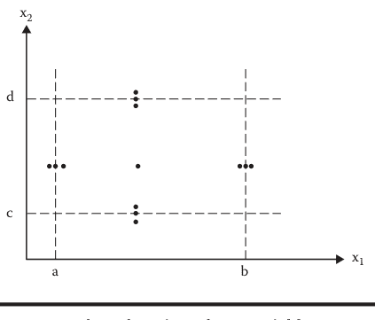

**图 5.3 双变量函数的健壮性测试用例。**

最大值？如果是机翼攻角，飞机可能会失速。如果是公共电梯的载重量，我们希望不要发生特殊情况。如果是日期，如 5 月 32 日，我们期望看到错误消息。健壮测试的主要价值在于它迫使人们关注异常处理。在强类型语言中，健壮测试可能非常笨拙。例如，在 `Pascal` 中，如果变量被定义在某个范围内，超出该范围的值将导致终止正常执行的运行时错误。这引发了关于实现哲学的有趣问题：执行范围检查并使用异常处理来处理“健壮值”更好，还是保持强类型更好？异常处理的选择强制要求了健壮测试。

### 5.3 最坏情况边界值测试

正如之前提到的，两种形式的边界值测试都符合可靠性理论单故障假设。由于它们的相似性，我们在本节中同时处理最坏情况边界值测试和健壮最坏情况边界测试。拒绝单故障假设意味着我们关注当一个变量具有极值时会发生什么。在电子电路分析中，这被称为“最坏情况分析”；我们用它来生成最坏情况测试集。对于每个变量，我们从包含 `min`、`min+`、`max-` 和 `max` 的五元素集合开始。我们取这些集合的笛卡尔积（参见第 3 章）来生成测试用例。其双变量版本如图 5.4 所示。

最坏情况边界值测试显然更加彻底，因为边界值分析用例是最坏情况测试集的真子集。它代表了更多的工作：`n` 变量函数的最坏情况测试会生成 `5^n` 个测试用例，而边界值分析仅为 `4n+1` 个测试用例。

最坏情况测试遵循边界值分析的泛化模式。它也有自己的局限性，特别是与独立输入有关。最坏情况测试的最佳应用可能是物理变量具有许多相互作用，且函数失败代价极其高昂的地方。对于真正的偏执性测试，我们可以采用健壮最坏情况测试。这涉及七元素集合的笛卡尔积，产生了 `7^n` 测试用例。图 5.5 显示了双变量函数的最坏情况测试用例。

# 84 软件测试

img/caa3a36b6e8a0f28e72c4d26c243e580_114_0.png)

图 5.4 双变量函数的最坏情况测试用例。

img/caa3a36b6e8a0f28e72c4d26c243e580_114_1.png)

图 5.5 双变量函数的健壮最坏测试用例。

### 5.4 特殊值测试

特殊值测试可能是最常用的函数测试形式。它最直觉也无规律。特殊值测试是测试人员利用领域知识、对类似程序的经验以及关于“软点”的信息来设计测试用例。我们也可以将其称为经验测试。除了专家判断外，没有任何指南。

### 5.5 示例

要形成三角形，任意两条边的长度之和必须大于第三边。如果边为 `a`、`b` 和 `c`，条件为：
- `a + b > c`
- `a + c > b`
- `b + c > a`

在实践中，如果我们假设 `a ≤ b ≤ c`，那么我们只需要检查 `a + b > c`。

如果边 `a, b` 和 `c` 是 `[1, 10]` 范围内的整数，则有 `10^3 = 1000` 种可能的组合。然而，许多组合并不是三角形。例如，`(1, 2, 5)` 不是三角形，因为 `1+2 ≯ 5`。

三角形的数量可以通过遍历 `a, b` 和 `c` 的所有可能值并检查三角形条件得到。共有 165 个这样的三角形。

下表了三角形问题的一些边界值测试用例。

| a | b | c | 结果 |
|---|---|---|---|
| 1 | 1 | 1 | 三角形 |
| 1 | 1 | 2 | 不是三角形 |
| 1 | 10 | 10 | 三角形 |
| 10 | 10 | 10 | 三角形 |
| 10 | 10 | 19 | 不是三角形 |
| 5 | 5 | 9 | 三角形 |
| 5 | 5 | 10 | 不是三角形 |

表格只是可能的测试用例的一个子集。完整的测试用例将要大得多。

## 表 5.2（选定的）最坏情况边界值测试用例

| 测试用例编号 | a | b | c | 预期输出 |
|---|---|---|---|---|
| 1 | 1 | 1 | 1 | 等边三角形 |
| 2 | 1 | 1 | 2 | 不是三角形 |
| 3 | 1 | 1 | 100 | 不是三角形 |
| 4 | 1 | 1 | 199 | 不是三角形 |
| 5 | 1 | 1 | 200 | 不是三角形 |
| 6 | 1 | 2 | 1 | 不是三角形 |
| 7 | 1 | 2 | 2 | 等腰三角形 |
| 8 | 1 | 2 | 100 | 不是三角形 |
| 9 | 1 | 2 | 199 | 不是三角形 |
| 10 | 1 | 2 | 200 | 不是三角形 |
| 11 | 1 | 100 | 1 | 不是三角形 |
| 12 | 1 | 100 | 2 | 不是三角形 |
| 13 | 1 | 100 | 100 | 等腰三角形 |
| 14 | 1 | 100 | 199 | 不是三角形 |
| 15 | 1 | 100 | 200 | 不是三角形 |
| 16 | 1 | 199 | 1 | 不是三角形 |
| 17 | 1 | 199 | 2 | 不是三角形 |
| 18 | 1 | 199 | 100 | 不是三角形 |
| 19 | 1 | 199 | 199 | 等腰三角形 |
| 20 | 1 | 200 | 200 | 不是三角形 |
| 21 | 1 | 200 | 1 | 不是三角形 |
| 22 | 1 | 200 | 2 | 不是三角形 |
| 23 | 1 | 200 | 100 | 不是三角形 |
| 24 | 1 | 200 | 199 | 不是三角形 |
| 25 | 1 | 200 | 200 | 等腰三角形 |

## 5.5.2 NextDate 函数的测试用例

`NextDate` 的所有 125 个最坏情况测试用例列在表 5.3 中。花些时间检查是否存在遗漏测试或冗余测试。例如，有人会想测试五个不同年份的 1 月 1 日吗？二月底的测试足够充分？

## 表 5.3 最坏情况测试用例

| 测试用例编号 | 月份 | 日 | 年份 | 预期输出 |
|---|---|---|---|---|
| 1 | 1 | 1 | 1812 | 1, 2, 1812 |
| 2 | 1 | 1 | 1813 | 1, 2, 1813 |
| 3 | 1 | 1 | 1912 | 1, 2, 1912 |
| 4 | 1 | 1 | 2011 | 1, 2, 2011 |
| 5 | 1 | 1 | 2012 | 1, 2, 2012 |
| 6 | 1 | 2 | 1812 | 1, 3, 1812 |
| 7 | 1 | 2 | 1813 | 1, 3, 1813 |
| 8 | 1 | 2 | 1912 | 1, 3, 1912 |
| 9 | 1 | 2 | 2011 | 1, 3, 2011 |
| 10 | 1 | 2 | 2012 | 1, 3, 2012 |
| 11 | 1 | 15 | 1812 | 1, 16, 1812 |
| 12 | 1 | 15 | 1813 | 1, 16, 1813 |
| 13 | 1 | 15 | 1912 | 1, 16, 1912 |
| 14 | 1 | 15 | 2011 | 1, 16, 2011 |
| 15 | 1 | 15 | 2012 | 1, 16, 2012 |
| 16 | 1 | 30 | 1812 | 1, 31, 1812 |
| 17 | 1 | 30 | 1813 | 1, 31, 1813 |
| 18 | 1 | 30 | 1912 | 1, 31, 1912 |
| 19 | 1 | 30 | 2011 | 1, 31, 2011 |
| 20 | 1 | 30 | 2012 | 1, 31, 2012 |
| 21 | 1 | 31 | 1812 | 2, 1, 1812 |
| 22 | 1 | 31 | 1813 | 2, 1, 1813 |
| 23 | 1 | 31 | 1912 | 2, 1, 1912 |
| 24 | 1 | 31 | 2011 | 2, 1, 2011 |
| 25 | 1 | 31 | 2012 | 2, 1, 2012 |
| 26 | 2 | 1 | 1812 | 2, 3, 1812 |
| 27 | 2 | 1 | 1813 | 2, 3, 1813 |
| 28 | 2 | 1 | 1912 | 2, 3, 1912 |

## 表 5.3 最坏情况测试用例（续）

| 测试用例编号 | 月份 | 日 | 年份 | 预期输出 |
|---|---|---|---|---|
| 29 | 2 | 1 | 2011 | 2, 3, 2011 |
| 30 | 2 | 1 | 2012 | 2, 3, 2012 |
| 31 | 2 | 2 | 1812 | 2, 3, 1812 |
| 32 | 2 | 2 | 1813 | 2, 3, 1813 |
| 33 | 2 | 2 | 1912 | 2, 3, 1912 |
| 34 | 2 | 2 | 2011 | 2, 3, 2011 |
| 35 | 2 | 2 | 2012 | 2, 3, 2012 |
| 36 | 2 | 15 | 1812 | 2, 16, 1812 |
| 37 | 2 | 15 | 1813 | 2, 16, 1813 |
| 38 | 2 | 15 | 1912 | 2, 16, 1912 |
| 39 | 2 | 15 | 2011 | 2, 16, 2011 |
| 40 | 2 | 15 | 2012 | 2, 16, 2012 |
| 41 | 2 | 30 | 1812 | 无效日期 |
| 42 | 2 | 30 | 1813 | 无效日期 |
| 43 | 2 | 30 | 1912 | 无效日期 |
| 44 | 2 | 30 | 2011 | 无效日期 |
| 45 | 2 | 30 | 2012 | 无效日期 |
| 46 | 2 | 31 | 1812 | 无效日期 |
| 47 | 2 | 31 | 1813 | 无效日期 |
| 48 | 2 | 31 | 1912 | 无效日期 |
| 49 | 2 | 31 | 2011 | 无效日期 |
| 50 | 2 | 31 | 2012 | 无效日期 |
| 51 | 6 | 1 | 1812 | 6, 2, 1812 |
| 52 | 6 | 1 | 1813 | 6, 2, 1813 |
| 53 | 6 | 1 | 1912 | 6, 2, 1912 |
| 54 | 6 | 1 | 2011 | 6, 2, 2011 |
| 55 | 6 | 1 | 2012 | 6, 2, 2012 |
| 56 | 6 | 2 | 1812 | 6, 3, 1812 |
| 57 | 6 | 2 | 1813 | 6, 3, 1813 |

## 表 5.3 最坏情况测试用例（续）

| 测试用例编号 | 月份 | 日 | 年份 | 预期输出 |
|---|---|---|---|---|
| 58 | 6 | 2 | 1912 | 6, 3, 1912 |
| 59 | 6 | 2 | 2011 | 6, 3, 2011 |
| 60 | 6 | 2 | 2012 | 6, 3, 2012 |
| 61 | 6 | 15 | 1812 | 6, 16, 1812 |
| 62 | 6 | 15 | 1813 | 6, 16, 1813 |
| 63 | 6 | 15 | 1912 | 6, 16, 1912 |
| 64 | 6 | 15 | 2011 | 6, 16, 2011 |
| 65 | 6 | 15 | 2012 | 6, 16, 2012 |
| 66 | 6 | 30 | 1812 | 7, 1, 1812 |
| 67 | 6 | 30 | 1813 | 7, 1, 1813 |
| 68 | 6 | 30 | 1912 | 7, 1, 1912 |
| 69 | 6 | 30 | 2011 | 7, 1, 2011 |
| 70 | 6 | 30 | 2012 | 7, 1, 2012 |
| 71 | 6 | 31 | 1812 | 无效日期 |
| 72 | 6 | 31 | 1813 | 无效日期 |
| 73 | 6 | 31 | 1912 | 无效日期 |
| 74 | 6 | 31 | 2011 | 无效日期 |
| 75 | 6 | 31 | 2012 | 无效日期 |
| 76 | 11 | 1 | 1812 | 11, 2, 1812 |
| 77 | 11 | 1 | 1813 | 11, 2, 1813 |
| 78 | 11 | 1 | 1912 | 11, 2, 1912 |
| 79 | 11 | 1 | 2011 | 11, 2, 2011 |
| 80 | 11 | 1 | 2012 | 11, 2, 2012 |
| 81 | 11 | 2 | 1812 | 11, 3, 1812 |
| 82 | 11 | 2 | 1813 | 11, 3, 1813 |
| 83 | 11 | 2 | 1912 | 11, 3, 1912 |
| 84 | 11 | 2 | 2011 | 11, 3, 2011 |
| 85 | 11 | 2 | 2012 | 11, 3, 2012 |
| 86 | 11 | 15 | 1812 | 11, 16, 1812 |

## 表 5.3 最坏情况测试用例（续）

| 测试用例编号 | 月份 | 日 | 年份 | 预期输出 |
|---|---|---|---|---|
| 87 | 11 | 15 | 1813 | 11, 16, 1813 |
| 88 | 11 | 15 | 1912 | 11, 16, 1912 |
| 89 | 11 | 15 | 2011 | 11, 16, 2011 |
| 90 | 11 | 15 | 2012 | 11, 16, 2012 |
| 91 | 11 | 30 | 1812 | 12, 1, 1812 |
| 92 | 11 | 30 | 1813 | 12, 1, 1813 |
| 93 | 11 | 30 | 1912 | 12, 1, 1912 |
| 94 | 11 | 30 | 2011 | 12, 1, 2011 |
| 95 | 11 | 30 | 2012 | 12, 1, 2012 |
| 96 | 11 | 31 | 1812 | 无效日期 |
| 97 | 11 | 31 | 1813 | 无效日期 |
| 98 | 11 | 31 | 1912 | 无效日期 |
| 99 | 11 | 31 | 2011 | 无效日期 |
| 100 | 12 | 31 | 2012 | 无效日期 |
| 101 | 12 | 1 | 1812 | 12, 2, 1812 |
| 102 | 12 | 1 | 1813 | 12, 2, 1813 |
| 103 | 12 | 1 | 1912 | 12, 2, 1912 |
| 104 | 12 | 1 | 2011 | 12, 2, 2011 |
| 105 | 12 | 1 | 2012 | 12, 2, 2012 |
| 106 | 12 | 2 | 1812 | 12, 3, 1812 |
| 107 | 12 | 2 | 1813 | 12, 3, 1813 |
| 108 | 12 | 2 | 1912 | 12, 3, 1912 |
| 109 | 12 | 2 | 2011 | 12, 3, 2011 |
| 110 | 12 | 2 | 2012 | 12, 3, 2012 |
| 111 | 12 | 15 | 1812 | 12, 16, 1812 |
| 112 | 12 | 15 | 1813 | 12, 16, 1813 |
| 113 | 12 | 15 | 1912 | 12, 16, 1912 |
| 114 | 12 | 15 | 2011 | 12, 16, 2011 |
| 115 | 12 | 15 | 2012 | 12, 16, 2012 |

## 表 5.3 最坏情况测试用例（续）

| 测试用例编号 | 月份 | 日 | 年份 | 预期输出 |
|---|---|---|---|---|
| 116 | 12 | 30 | 1812 | 12, 31, 1812 |
| 117 | 12 | 30 | 1813 | 12, 31, 1813 |
| 118 | 12 | 30 | 1912 | 12, 31, 1912 |
| 119 | 12 | 30 | 2011 | 12, 31, 2011 |
| 120 | 12 | 30 | 2012 | 12, 31, 2012 |
| 121 | 12 | 31 | 1812 | 1, 1, 1813 |
| 122 | 12 | 31 | 1813 | 1, 1, 1814 |
| 123 | 12 | 31 | 1912 | 1, 1, 1913 |
| 124 | 12 | 31 | 2011 | 1, 1, 2012 |
| 125 | 12 | 31 | 2012 | 1, 1, 2013 |

## 5.5.3 佣金问题的测试用例

我们不再再次遍历 125 个无聊的测试用例，而是查看佣金问题更有趣的测试用例。这次，我们将查看从输出范围得出的边界值，特别是在佣金百分比变化的 `$1000` 和 `$1800` 阈值点附近。佣金的输出空间如图 5.6 所示。这些阈值平面与轴的交点如图所示。


图 5.6 佣金问题的输入空间

## 软件测试

## 表 5.4 输出边界值测试用例

| 测试用例编号 | 锁 | 桶 | 销售额 | 佣金 |
|---|---|---|---|---|
| --- | --- | --- | --- |
| 1 | 1 | 1 | 100 |
| 2 | 1 | 1 | 125 | |
| 3 | 1 | 2 | 130 | |
| 4 | 2 | 1 | 145 | |
| 5 | 5 | 1 | 500 | |
| 6 | 10 | 10 | 975 | |
| 7 | 10 | 9 | 970 | |
| 8 | 9 | 10 | 955 | |
| 9 | 10 | 10 | 1000 | |
| 10 | 10 | 11 | 1025 | |
| 11 | 10 | 11 | 1030 | |
| 12 | 12 | 10 | 1045 | |
| 13 | 14 | 14 | 1400 | |
| 14 | 18 | 18 | 1775 | |
| 15 | 18 | 17 | 1770 | |
| 16 | 17 | 18 | 1755 | |
| 17 | 18 | 18 | 1800 | |
| 18 | 18 | 19 | 1825 | |
| 19 | 19 | 18 | 1830 | |
| 20 | 19 | 18 | 1845 | |
| 21 | 21 | 48 | 4800 | |
| 22 | 70 | 80 | 7775 | |
| 23 | 70 | 79 | 7770 | |
| 24 | 69 | 80 | 7755 | |
| 25 | 70 | 80 | 7800 | |

## 表 5.5 输出特殊值测试用例

| 用例 | 锁 | 股票 | 桶 | 销售额 | 佣金 | 注释 |
| :--- | :--- | :--- | :--- | :--- | :--- | :--- |
| 1 | 10 | 11 | 9 | 1005 | 100.75 | 边界点 + |
| 2 | 18 | 17 | 19 | 1795 | 219.25 | 边界点 – |
| 3 | 18 | 19 | 17 | 1805 | 221 | 边界点 + |

这些数字恰好使得边界点很容易生成。有趣的地方在于：测试用例 9 是 `$1000` 边界点。如果我们微调输入变量，就能得到略低于和略高于边界的值（用例 6–8 和 10–12）。如果我们愿意，可以选取边界附近的值，例如 `(22, 1, 1)`。当我们这样继续下去时，我们感觉到自己正在“执行代码的部分”。我们可能会说这实际上是一种特殊值测试，因为我们利用了数学洞察力来生成测试用例。

表 5.4 包含了根据佣金函数输出端的边界值得出的测试用例。表 5.5 包含了特殊值测试用例。

### 5.6 随机测试

文献中包含了至少两个十年关于随机测试的讨论。其中大多数都是有趣的，而且从统计学角度来说，我们的样本问题非常适合随机测试。其核心思想是，与其总是选择边界变量的 `min`、`min+`、`max-` 和 `max` 值，不如使用随机生成器来选取测试用例值。这避免了测试中任何形式的偏见。它还提出了一个严肃的问题：多少个随机测试用例才足够？以后当我们讨论结构测试覆盖指标时，将会得到一个优雅的答案。目前，表 5.6 到 5.8 显示随机生成的测试用例的结果。它们源自一个视觉应用程序，该程序如下为边界变量 `a ≤ x ≤ b` 取值：

## 表 5.6 三角形程序的随机测试用例

| 测试用例数 | 非三角形 | 不等边 | 等腰三角形 | 等边三角形 |
| :--- | :--- | :--- | :--- | :--- |
| 1289 | 663 | 593 | 32 | 1 |
| 15,436 | 7696 | 7372 | 367 | 1 |
| 17,091 | 8556 | 8164 | 367 | 1 |
| 2603 | 1284 | 1252 | 66 | 1 |
| 6475 | 3197 | 3122 | 155 | 1 |
| 5978 | 2998 | 2850 | 129 | 1 |
| 9008 | 4447 | 4353 | 207 | 1 |
| 百比 | 49.83% | 47.87% | 2.29% | 0.01% |

## 表 5.7 佣金程序的随机测试用例

| 测试用例数 | 10% | 15% | 20% |
| :--- | :--- | :--- | :--- |
| 91 | 1 | 6 | 84 |
| 27 | 1 | 1 | 25 |
| 72 | 1 | 1 | 70 |
| 176 | 1 | 6 | 169 |
| 48 | 1 | 1 | 46 |
| 152 | 1 | 6 | 145 |
| 125 | 1 | 4 | 120 |
| 百比 | 1.01% | 3.62% | 95.37% |

```python
```


```
x = Int((b - a + 1) * Rnd + a)
```


其中 `Int` 函数返回浮点的整数部分，而 `Rnd` 函数在 `[0, 1]` 范围内生成随机测试用例。程序持续生成测试用例，直到每个输出至少出现一次。在每个表中，程序经过七个“循环”结束了“难以生成”测试用例。在表 5.6 和 5.7 中，最后一行显示了生成测试用例的百分比。在 NextDate 表中，百分比非常接近表 5.8 最后一行的计算结果。

### 5.7 边界值测试指南

除了特殊值测试外，基于输入域 $a$ 的测试方法是最基础的。这些方法假设输入变量是相互独立的；但当这个假设不成立时，它们会生成不合理的测试用例（例如 31 日、1912 年用于 NextDate）。健壮性测试是测试变量的一个良好选择。

第 10 章有关于“测试摆钟”的讨论。这里有一个短的例子：考虑三个变量 $a, b, c$。边界为 $0 \le a \le 10000$，$0 \le b < 10000$，$0 \le c < 18$。函数 $F = (a - b)/c$；表 5.9 显示了正常值测试用例。缺乏语义知识，表 5.9 中的前四个测试用例是边界值测试工具会生成的（不会产生预期的输出）。仅仅是测试——避免了用例 11 中除零的可能性。

## 表 5.8 NextDate 程序的随机测试用例

| 测试用例数 | 31 天的 1–30 日 | 31 天的 31 日 | 30 天的 1–29 日 | 30 天的 30 日 |
| :--- | :--- | :--- | :--- | :--- |
| 913 | 542 | 17 | 274 | 10 |
| 1101 | 621 | 9 | 358 | 8 |
| 4201 | 2448 | 64 | 1244 | 46 |
| 1097 | 600 | 21 | 350 | 9 |
| 5853 | 3342 | 100 | 1804 | 82 |
| 3959 | 2195 | 73 | 1252 | 42 |
| 1436 | 786 | 22 | 456 | 13 |
| 百比 | 56.76% | 1.65% | 30.91% | 1.13% |
| 概率 | 56.45% | 1.88% | 31.18% | 1.88% |
| 2 月的 1–27 日 | 闰年 2 月 28 日 | 平年 2 月 28 日 | 闰年 2 月 29 日 | 不可能 |
| 45 | 1 | 1 | 22 |
| 83 | 1 | 1 | 19 |
| 312 | 1 | 8 | 77 |
| 92 | 1 | 4 | 19 |
| 417 | 1 | 11 | 94 |
| 310 | 1 | 6 | 75 |
| 126 | 1 | 5 | 26 |
| 7.46% | 0.04% | 0.19% | 0.08% | 1.79% |
| 7.26% | 0.07% | 0.20% | 0.07% | 1.01% |

当我们加上 $F$ 计算汽车每加仑英里的语义（其中 $a$ 和 $b$ 是行程的结束和开始值，$c$ 是油箱容量），我们看到了更严重的问题：
1. 我们必须满足 $a \ge b$。这将避免 $F$ 的负值（测试用例 1, 2, 9 和 10）。
2. 测试用例 3、8 和 12–15 指的是特定长度的行程。
3. 测试用例 11 的除零情况是一个明显的问题。
4. 表 5.9 显示了表 5.10 的边界值影响。

## 表 5.9 $F = (a - b)/c$ 的边界值测试用例

| 测试用例 | $a$ | $b$ | $c$ |
| :--- | :--- | :--- | :--- |
| 1 | 1000 | 1000 | 1 |
| 2 | 1000 | 1001 | 1 |
| 3 | 1000 | 0 | 1 |
| 4 | 999 | 0 | 1 |
| 5 | 999 | 1000 | 1 |
| 6 | 1000 | 0 | 0 |
| 7 | 1000 | 0 | 18 |
| 8 | 1000 | 0 | 17 |
| 9 | 1000 | 999 | 18 |
| 10 | 1000 | 999 | 17 |
| 11 | 1000 | 999 | 0 |
| 12 | 999 | 999 | 1 |
| 13 | 999 | 999 | 0 |
| 14 | 999 | 999 | 18 |
| 15 | 999 | 999 | 17 |

## 表 5.10 $F = (a - b)/c$ 的语义边界值测试用例

| 测试用例 | 结束里程表 | 开始里程表 | 油箱容量 | 每加仑英里 |
| :--- | :--- | :--- | :--- | :--- |
| 4 | 9998 | 5000 | 10 | 531.7 |
| 5 | 9999 | 5000 | 10 | 531.8 |
| 6 | 5000 | 0 | 10 | 531.9 |
| 7 | 5000 | 1 | 10 | 531.8 |
| 8 | 5000 | 5000 | 10 | 0.0 |

## 习题

- 1. 为 n 个变量的函数的健壮性测试用例数开发公式。
- 2. 为 n 个变量函数的健壮最坏情况测试用例数开发公式。
- 3. 画一个恩图，显示边界值分析、健壮性测试、最坏情况测试和健壮最坏情况测试之间的关系。
- 4. 如果尝试进行输出健壮性测试会怎样？以佣金为例。
- 5. 如果你做了第 2 章的第 8 题，你已经熟悉 CRC Press 下载网站（http://www.crcpress.com/product/isbn/9781466506080）。在那里你会找到名为 `specBasedTesting.xls` 的 Excel 表格（它是 `Naive.xls` 的扩展版本，包含了相同的插入错误）。不同的工作表分别包含三角形、NextDate 和佣金问题的最坏情况边界值测试用例。运行这些测试用例集，并与你在第 2 章的原始测试结果进行比较。
- 6. 对表 5.9 和 5.10 中的每加仑英里示例应用特殊值测试。为你所选测试用例提供理由。

# 第 6 章
## 等价类测试

将等价类作为功能测试的基础有两个动机：我们希望对测试的完整性有一个直观的认识，同时也希望避免冗余。边界值测试并不能实现这两种愿望——从测试用例表中可以很容易看到大量的冗余，而仔细观察会发现，还存在严重的疏漏。等价类测试呼应了边界值测试的两个决定性因素：健壮性以及单故障/多故障假设。本章介绍了等价类测试的传统观点；单故障与多故障的假设产生了“弱/强”的区别，而对无效数据的关注产生了第二种区别：“正常与健壮”。结合起来，这两种假设导致了弱正常、强正常、弱健壮和强健壮等价类测试。

健壮形式的测试存在两个问题。第一个是，当规范没有定义无效输入的预期输出应该是什么时。（我们可以认为这是规范的缺陷，但这并不能从根本上帮助我们解决任何问题。）因此，测试人员花费花费大量时间为各种用例定义预期输出。第二个问题是，强类型语言消除了考虑无效输入的必要性。传统的等价测试是 FORTRAN 和 COBOL 等语言主导时代的产物；因此，这类错误非常常见。事实上，正是错误的高发生率导致了强类型语言的实现。

### 6.1 等价类

在第 3 章中，我们注意到等价类的重要方面是它们形成了一个集合的划分，其中划分指的是一组互不相交的子集，这些子集的并集是整个集合。这对于测试具有两个重要意义——整个集合的表示提供了一种形式的完整性，而互不相交确保了形式的非冗余。子集由等价关系决定；子集中的元素具有共同点。等价类测试的想法是使用来自每个等价类中的一个元素来确定测试用例。如果明地选择等价类，将极大地减少测试用例之间的潜在冗余。

例如，在三角形问题中，我们肯定有一个等边三角形的测试用例，我们可以选取三角形 (5, 5, 5) 作为测试用例的输入。如果我们这样做，就不会指望从 (6, 6, 6) 和 (100, 100, 100) 等测试用例中学习到很多东西。我们的直觉告诉我们，这些与第一个测试用例被“相同对待”；因此，它们是冗余的。当我们在第 8 和 第 9 章考虑基于代码的测试时，我们会发现“相同对待”映射到“遍历执行路径”。四种形式的等价类测试解决了四种边界值测试中常见的疏漏和冗余问题。由于赋值的原因，四种边界值测试的形式也与四种等价类测试对齐。将会存在一个重叠点。国际软件测试委员会 (ISTQB) 的大纲提到，这四种形式的边界值测试与四种形式的等价类测试是一致的。由于等价类测试的应了因素因素因素因素因素，，，，，，，，等，类测试测试。     。。

contentcontent。

健壮形式的测试存在两个问题。第一个是，当规范没有定义无效输入的预期输出应该是什么时。（我们可以认为这是规范的缺陷，但这并不能从根本上帮助我们解决任何问题。）因此，测试人员花费大量时间为各种用例定义预期输出。第二个问题是，强类型语言消除了考虑无效输入的必要性。传统的等价测试是 FORTRAN 和 COBOL 等语言主导时代的产物；因此，这类错误非常常见。事实上，正是错误的高发生率导致了强类型语言的实现。

### 6.1 等价类

在第 3 章中，我们注意到等价类的重要方面是它们形成了一个集合的划分，其中划分指的是一组互不相交的子集，这些子集的并集是整个集合。这对于测试具有两个重要意义——整个集合的表示提供了一种形式的完整性，而互不相交确保了形式的非冗余。子集由等价关系决定；子集中的元素具有共同点。等价类测试的想法是使用来自每个等价类中的一个元素来确定测试用例。如果明智地选择等价类，将极大地减少测试用例之间的潜在冗余。

例如，在三角形问题中，我们肯定有一个等边三角形的测试用例，我们可以选取三角形 (5, 5, 5) 作为测试用例的输入。如果我们这样做，就不会指望从 (6, 6, 6) 和 (100, 100, 100) 等测试用例中学习到很多东西。我们的直觉告诉我们，这些与第一个测试用例被“相同对待”；因此，它们是冗余的。当我们在第 8 和 第 9 章考虑基于代码的测试时，我们会发现“相同对待”映射到“遍历执行路径”。四种形式的等价类测试解决了四种边界值测试中常见的疏漏和冗余问题。由于赋值的原因，四种边界值测试的形式也与四种等价类测试对齐。将会存在一个重叠点。国际软件测试委员会 (ISTQB) 的大纲提到，这四种形式的边界值测试与四种形式的等价类测试是一致的。

### 6.2 传统等价类测试

大多数标准测试书籍（例如 Myers, 1979）讨论了基于有效和无效值的等价类测试，这与健壮测试几乎相同（见 6.3）。在 1960 年代和 1970 年代，“垃圾进，垃圾出”（GIGO）是一个重要问题。在当时，这个术语被称为 GIGO。作者们经常评论，在结构化编程的经典架构中，输入数据验证是关注的点。在这种背景下，对 GIGO 的防御是进行广泛的测试以确保数据有效性。现代编程语言（特别是具有强类型的语言）以及图形用户界面（GUI）的出现消除了输入数据验证的必要。下拉列表和滑动条等界面设备减少了错误的概率。

传统的等价类测试呼应了边界值测试的过程。图 6.1 显示了对于两个变量 $x$ 和 $y$ 的函数 F 的测试用例，正如第 5 章中所示。扩展到更真实的 $n$ 个变量的情况如下：

1. 对所有变量的有效值测试 F。
2. 如果步骤 1 成功，则测试 $x$ 的无效值，同时其余变量为有效值。任何失败将由于 $x$ 的无效值引起。
3. 对其余变量重复步骤 2。

第一种方法的优点之一是它关注无效数据，忽略了我们在边界值测试中看到的最坏情况组合。图 6.1 显示了对于我们持续的函数 F 进行该过程的少数测试用例。

### 6.3.1 弱正常等价类测试

在给定的符号下，等价类测试通过使用每个类中的一个值来完成（注意单故障假设）。对于运行的示例，我们将得到图 6.2 所示的三个测试。这三个测试使用了每个类中的一个值。

从一个失败的弱正常等价类测试（即预期输出和实际输出不一致）中学习到什么？是 $x$ 的问题，还是 $y$ 的问题，或者是两者之间的相互作用？这种歧义性正是“弱”命名的由来。如果失败的预期很低（例如回归测试中），这可以是可以接受的选择。

### 6.3.2 强正常等价类测试

强等价类测试基于多故障假设，因此我们需要来自等价类笛卡尔积中每个元素的测试用例，如图 6.3 所示。注意这些测试用例的模式与命题逻辑中真值表构建之间的相似性。笛卡尔积保证了我们在两个意义上都有“完整性”的概念：我们覆盖了所有的等价类，并且拥有每种可能的输入组合。

## 6.3.3 弱健壮等价类测试

这种形式的名称诚然违反直觉且自相矛盾。东西怎么既是“弱”的又是“健壮”的？“健壮”部分来自于对无效值的考虑，而“弱”部分指的是单点故障假设。健壮等价类测试的过程是弱正常等价类测试的简单扩展——选取测试用例使得每个等价类都被代表。在图 6.4 中，有效类的测试用例如图 6.2 所示。额外的两个测试用例涵盖了四类无效值。该过程与边界值测试相似：

- 1. 有效输入，从每个有效等价类中选取一个值（正如我们所说的正常等价类测试。注意这些测试用例中的每个输入都是有效的）。
- 2. 无效输入，一个测试用例包含一个无效值，其余值全部有效。（因此，“单点故障”应该导致测试用例失败。）

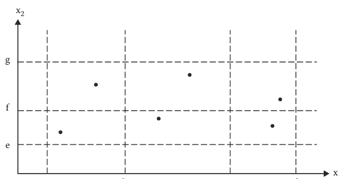

图 6.3 强正常等价类测试用例。

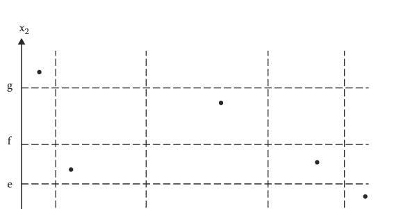

图 6.4 弱健壮等价类测试用例。

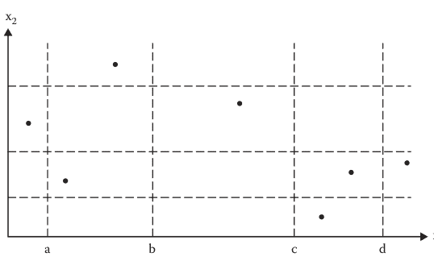

**图 6.5 修改后的弱健壮等测试用例。**

该策略产生的测试用例如图 6.4 所示。这些测试用例存在一个问题问题——左上和右下角的测试用例。每个测试用例代表来自两个无效等价类的值。其中任何一个失败可能由于两个变量之间的相互作用。图 6.5 展示了“纯”弱正常类测试与其健壮扩展之间的折中方案。

## 6.3.4 强健壮等价类测试

至少这部分的名称既不违反直觉也不自相矛盾，只是冗余。和之前一样，健壮部分来自于对无效值的考虑，而强部分指的是多点故障假设。我们从所有等价类（包括有效和无效）的笛卡尔积的每个元素中获取测试用例，如图 6.6 所示。

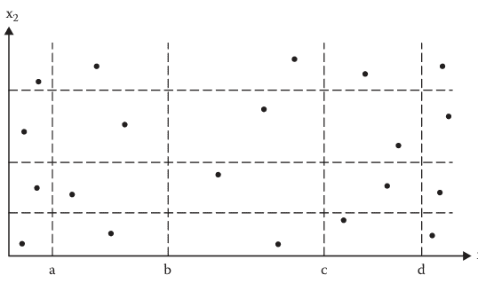

**图 6.6 强健壮等价类测试用例。**

## 6.4 三角形问题的等价类测试用例

在问题描述中，我们种可能的输出：不是三角形（NotTriangle）、不等三角形（Scalene）、等腰三角形（Isosceles）和等三角形（Equilateral）。我们可以利用这些来识别输出（范围）等价类：

- R1 = <a, b, c>: 边为 a, b, c 的三角形是等三角形
- R2 = <a, b, c>: 边为 a, b, c 的三角形是等腰三角形
- R3 = <a, b, c>: 边为 a, b, c 的三角形是不等三角形
- R4 = <a, b, c>: 边 a, b, c 不能组成三角形

从每个类中任意选取的四个弱正常等价类测试用例如下：

| 测试用例 | a | b | c | 预期输出 |
|---|---|---|---|
| W1 | 5 | 5 | 5 | 等三角形 |
| W2 | 2 | 2 | 3 | 等腰三角形 |
| W3 | 3 | 4 | 5 | 不等三角形 |
| W4 | 4 | 1 | 2 | 不是三角形 |

由于 a, b 和 c 不存在有效区间，强正常等价类测试用例与弱正常等价类测试用例相同。考虑 a, b 和 c 的无效值会产生额外的弱健壮等价类测试用例。（无效值为零、负数或大于200的数。）

| 测试用例 | a | b | c | 预期输出 |
|---|---|---|---|
| WR1 | -1 | 5 | 5 | a 的值不在范围内 |
| WR2 | 5 | -1 | 5 | b 的值不在范围内 |
| WR3 | 5 | 5 | -1 | c 的值不在范围内 |
| WR4 | 201 | 5 | 5 | a 的值不在范围内 |
| WR5 | 5 | 201 | 5 | b 的值不在范围内 |
| WR6 | 5 | 5 | 201 | c 的值不在范围内 |

这里是三维空间中额外健壮等价类测试用例的一个“角”：

| 测试用例 | a | b | c | 预期输出 |
|---|---|---|---|
| SR1 | -1 | 5 | 5 | a 的值不在范围内 |
| SR2 | 5 | -1 | 5 | b 的值不在范围内 |
| SR3 | 5 | 5 | -1 | c 的值不在范围内 |
| SR4 | -1 | 1 | 2 | 不是三角形 |
| SR5 | 5 | -1 | -1 | b, c 的值不在范围内 |
| SR6 | -1 | 5 | -1 | a, c 的值不在范围内 |
| SR7 | -1 | -1 | -1 | a, b, c 的值不在范围内 |

注意预期输出是如何彻底地描述输入值的。等价类测试对定义类的关系非常敏感。这里是另一种情况。如果我们基于输出域建立等价，将获得更丰富的测试用例。对于 a, b 和 c 这三个整数有哪些可能性？它们可以全部相等，或者全相等。

- D1 = {a, b, c: a = b = c}
- D2 = {a, b, c: a = b, a ≠ c}
- D3 = {a, b, c: a = c, a ≠ b}
- D4 = {a, b, c: b = c, a ≠ b}
- D5 = {a, b, c: a ≠ b, a ≠ c}

我们可以应用三角形属性来判断它们是否构成三角形吗？（例如，<1, 4, 1> 有一对等边，但它们不能组成三角形。）

- D6 = {a, b, c: a ≥ b + c}
- D7 = {a, b, c: b ≥ a + c}
- D8 = {a, b, c: c ≥ a + b}

如果我们想更彻底一点，可以将“大于或等于”分为两个不同的情况；那么集合将变为：
- D6’ = {a, b, c: a = b + c}
- D6 = {a, b, c: a > b + c}

## 6.5 NextDate 函数的等价类测试用例

NextDate 函数很好地说明了选择底层关系的技巧。记得 NextDate 是三个变量：月、日、年的函数，它们的有效值区间定义如下：

- M1 = {month: 1 ≤ month ≤ 12}
- D1 = {day: 1 ≤ day ≤ 31}
- Y1 = {year: 1812 ≤ year ≤ 2012}

无效等价类为：

- M2 = {month < 1}
- M3 = {month > 12}
- D2 = {day < 1}
- D3 = {day > 31}
- Y2 = {year < 1812}
- Y3 = {year > 2012}

因为有效类的数量等于独立变量的数量，所以只出现一个弱正常类测试用例，它与强正常类测试用例相同：

| 用例 ID | 月 | 日 | 年 | 预期输出 |
|---|---|---|---|
| WN1, SN1 | 6 | 15 | 1912 | 6/16/1912 |

这里是完整的健壮测试用例集：

| ID | 月 | 日 | 年 | 预期输出 |
|---|---|---|---|
| WR1 | 6 | 15 | 1912 | 6/16/1912 |
| WR2 | -1 | 15 | 1912 | 月的值不在 1–12 范围内 |
| WR3 | 13 | 15 | 1912 | 月的值不在 1–12 范围内 |
| WR4 | 6 | -1 | 1912 | 日的值不在 1–31 范围内 |
| WR5 | 6 | 32 | 1912 | 日的值不在 1–31 范围内 |
| WR6 | 6 | 15 | 1811 | 年的值不在 1812–2012 范围内 |
| WR7 | 6 | 15 | 2013 | 年的值不在 1812–2012 范围内 |

与三角形问题一样，这里是三维空间中额外强健壮等类类的一个“角”：

| 用例 ID | 月 | 日 | 年 | 预期输出 |
|---|---|---|---|
| SR1 | -1 | 15 | 1912 | 月的值不在 1–12 范围内 |
| SR2 | 6 | -1 | 1912 | 日的值不在 1–31 范围内 |
| SR3 | 6 | 15 | 1811 | 年的值不在 1812–2012 范围内 |
| SR4 | -1 | -1 | 1912 | 月的值不在 1–12 范围内；日的值不在 1–31 范围内 |
| SR5 | 6 | -1 | 1811 | 日的值不在 1–31 范围内；年的值不在 1812–2012 范围内 |
| SR6 | -1 | 15 | 1811 | 月的值不在 1–12 范围内；年的值不在 1812–2012 范围内 |
| SR7 | -1 | -1 | 1811 | 月的值不在 1–12 范围内；日的值不在 1–31 范围内；年的值不在 1812–2012 范围内 |

# 等价类测试 ■ 109

问题。我们还特别关注日期：D1 中的日期（几乎）总是递增的，而 D4 中的日期仅对 M2 中的月份有意义。最后，我们有三类年份：特殊年份 2000 年、闰年和平年。这并不是一个完美的等价类集，但它的使用将揭示许多潜在的错误。

## 6.5.1 等价类测试用例

这些类产生了以下正常等价类测试用例。与之前一样，输入是从对应类的类的中间部分机械地选择的：

| 用例 ID | 月份 | 日 | 年份 | 预期输出 |
|---|---|---|---|
| WN1 | 6 | 14 | 2000 | 6/15/2000 |
| WN2 | 7 | 29 | 1996 | 7/30/1996 |
| WN3 | 2 | 30 | 2002 | 输入日期无效 |
| WN4 | 6 | 31 | 2000 | 输入日期无效 |

输入值的机械选择没有考虑我们的领域知识，因此导致了两个不可能的日期。这在“自动”测试用例生成中始终是一个问题，因为我们所有的领域知识都没有包含在等价类的选择中。针对修改类的强正常等价类测试如下：

| 用例 ID | 月份 | 日 | 年份 | 预期输出 |
|---|---|---|---|
| SN1 | 6 | 14 | 2000 | 6/15/2000 |
| SN2 | 6 | 14 | 1996 | 6/15/1996 |
| SN3 | 6 | 14 | 2002 | 6/15/2002 |
| SN4 | 6 | 29 | 2000 | 6/30/2000 |
| SN5 | 6 | 29 | 1996 | 6/30/1996 |
| SN6 | 6 | 29 | 2002 | 6/30/2002 |
| SN7 | 6 | 30 | 2000 | 输入日期无效 |
| SN8 | 6 | 30 | 1996 | 输入日期无效 |
| SN9 | 6 | 30 | 2002 | 输入日期无效 |
| SN10 | 6 | 31 | 2000 | 输入日期无效 |
| SN11 | 6 | 31 | 1996 | 输入日期无效 |
| SN12 | 6 | 31 | 2002 | 输入日期无效 |
| SN13 | 7 | 14 | 2000 | 7/15/2000 |
| SN14 | 7 | 14 | 1996 | 7/15/1996 |

| 用例 ID | 月份 | 日 | 年份 | 预期输出 |
|---|---|---|---|
| SN15 | 7 | 14 | 2002 | 7/15/2002 |
| SN16 | 7 | 29 | 2000 | 7/30/2000 |
| SN17 | 7 | 29 | 1996 | 7/30/1996 |
| SN18 | 7 | 29 | 2002 | 7/30/2002 |
| SN19 | 7 | 30 | 2000 | 7/31/2000 |
| SN20 | 7 | 30 | 1996 | 7/31/1996 |
| SN21 | 7 | 30 | 2002 | 7/31/2002 |
| SN22 | 7 | 31 | 2000 | 8/1/2000 |
| SN23 | 7 | 31 | 1996 | 8/1/1996 |
| SN24 | 7 | 31 | 2002 | 8/1/2002 |
| SN25 | 2 | 14 | 2000 | 2/15/2000 |
| SN26 | 2 | 14 | 1996 | 2/15/1996 |
| SN27 | 2 | 14 | 2002 | 2/15/2002 |
| SN28 | 2 | 29 | 2000 | 3/1/2000 |
| SN29 | 2 | 29 | 1996 | 3/1/1996 |
| SN30 | 2 | 29 | 2002 | 输入日期无效 |
| SN31 | 2 | 30 | 2000 | 输入日期无效 |
| SN32 | 2 | 30 | 1996 | 输入日期无效 |
| SN33 | 2 | 30 | 2002 | 输入日期无效 |
| SN34 | 2 | 31 | 2000 | 输入日期无效 |
| SN35 | 2 | 31 | 1996 | 输入日期无效 |
| SN36 | 2 | 31 | 2002 | 输入日期无效 |

从弱测试转向正常测试会带来一些我们在边界值测试中产生的冗余问题。在正常类的情况下，从弱测试转向强测试也会引入独立性假设，这反映在等价类的笛积中。我们还可以通过更仔细地观察年份来简化测试集。如果我们合并 Y1 和 Y2，并将结果称为“闰年”，我们的 36 个测试用例将减少到 24 个。这种变化抑制了对 2000 年的特殊关注，并且增加了确定哪些年份是闰年的复杂性。

## 6.6 等价类问题

佣金问题的输入域通过锁、股票和桶的限制被“自然”地划分。这些等价类正是传统等价类测试会识别的那些类。第一个类是有效的；另外两个是无效的。输入域等价类会导致非常不满意的集合。输出的等价类将是一个改进。

- L1 = {1 ≤ locks ≤ 70}
- L2 = {locks < 1}
- L3 = {locks > 70}
- S1 = {1 ≤ stocks ≤ 80}
- S2 = {stocks < 1}
- S3 = {stocks > 80}
- B1 = {1 ≤ barrels ≤ 90}
- B2 = {barrels < 1}
- B3 = {barrels > 90}

然而，发生了一个问题。当锁的值为 -1 时，循环会终止，并且使用了总锁、总股票和总桶的值来计算佣金。除了名称外，这与强等价类情况完全相同。我们将会有八个弱测试用例。

| 用例 ID | 锁 | 桶 | 预期输出 |
|---|---|---|---|
| WR1 | 10 | 10 | $100 |
| WR2 | -1 | 40 | 程序终止 |
| WR3 | -2 | 40 | 不在 1...70 范围内的锁 |
| WR4 | 71 | 40 | 不在 1...70 范围内的锁 |
| WR5 | 35 | -1 | 不在 1...80 范围内的股票 |
| WR6 | 35 | 81 | 不在 1...80 范围内的股票 |
| WR7 | 35 | -1 | 不在 1...90 范围内的桶 |
| WR8 | 35 | 40 | 不在 1...90 范围内的桶 |

这里是三维空间中额外的强健壮等价类测试用例的一个“角”：

| 用例 ID | 锁 | 股票 | 桶 | 预期输出 |
|---|---|---|---|---|
| SR1 | -2 | 40 | 45 | 不在 1...70 范围内的锁 |
| SR2 | 35 | -1 | 45 | 不在 1...80 范围内的股票 |
| SR3 | 35 | 40 | -2 | 不在 1...90 范围内的桶 |
| SR4 | -2 | -1 | 45 | 不在 1...70 范围内的锁且不在在 1...80 范围内的股票 |
| SR5 | -2 | 40 | -1 | 不在 1...70 范围内的锁且不在在 1...90 范围内的桶 |
| SR6 | 35 | -1 | -1 | 不在 1...70 范围内的锁且不在在 1...90 范围内的桶 |
| SR7 | -2 | -1 | -1 | 不在 1...70 范围内的锁且不在在 1...80 范围内的股票且不在在 1...90 范围内的桶 |

正如三角形问题的情况一样，输入是一个三元组，意味着我们不再从笛卡尔积中提取测试用例。

| 测试用例 | 锁 | 存 | 桶 | 销售额 | 佣金 |
|---|---|---|---|---|---|
| OR1 | 5 | 5 | 5 | 500 | 50 |
| OR2 | 15 | 15 | 15 | 1500 | 175 |
| OR3 | 25 | 25 | 25 | 2500 | 360 |

这些测试用例让我们感觉到我们正在练习问题中的重要部分。结合弱健壮性测试用例（weak robust cases），我们对佣金问题进行了一次非常好的测试。我们可能想要添加一些边界检查，以确保销售额在 $1000 和 $1800 时的转换是正确的。这并不容易，因为我们只能选择锁、库存和桶的值。恰好这个例子中的常量是经过刻意设计的，以便产生“优异”的三元组。

### 6.7 边缘测试

ISTQB 高级体系大纲（ISTQB, 2012）描述了边界值分析与等价类测试的结合，并命名为“边缘测试”。当特定变量的连续范围构成等价类时，就需要这种测试。图 6.2 显示了 xi 的两个有效值等价类，以及 xj 的两个等价类。可以推测，这些类指的是在某些应用程序中“被同样对待”的变量。这表明在类的边界附近可能存在缺陷，边缘测试将测试这些潜在的缺陷。对于 6.2 中的示例，完整的边缘测试值如下：

- $xi$ 的正常值：[a, a-, b, b+, c-, c+, d-, d+]
- 包含 $xi$ 测试用例的健壮性值：[a-, a+, b-, b+, c-, c+, d-, d+, d+]
- 包含 $xj$ 测试用例的正常值：[e-, e+, f-, f+, g-, g+, d+}]

一个细微的区别是，边缘测试值不包含边界值测试中所使用的标称值（nominal values）。一旦确定了边缘值集，边缘测试可以遵循等价类测试的任何四形式。与边界值测试和等价类测试的变化一样，测试用例的数量显然会增加。

## 6.8 指南与观察

现在我们已经过过了三个示例，最后对等价类测试得出一些观察结果和指南。

- 1. 显然，等价类测试的弱形式（正常或健壮形式）不如相应的强形式那么全面。
- 2. 如果实现语言是强类型的（且无效值会导致运行时错误），那么使用健壮形式是没有意义的。

## 软件测试

- 3. 如果错误条件是高优先级的，则健壮形式是合适的。
- 4. 当输入数据按区间和离散值集定义时，等价类测试是合适的。当变量值超出范围可能导致系统故障时，情况无疑如此。
- 5. 通过与边界值测试的混合方法可以加强等价类测试。（我们可以“复用”在定义等价类时所付出的精力）。
- 6. 当程序功能复杂时，应进行等价类测试。在某些情况下，函数的复杂性有助于识别有用的等价类，例如 `NextDate` 函数。
- 7. 强等价测试假设变量是相互独立的，相应的测试用例乘法会引发冗余问题。如果出现任何依赖关系，它们通常会产生“错误”测试用例，就像在 `NextDate` 函数中那样。（第 7 章中的决策技术解决了这个问题）。
- 8. 在发现“正确”的等价关系之前，可能需要多次尝试，正如我们在 `NextDate` 示例中看到的。在其他情况下，存在“显而易见”或“自然”的等价关系。如果有疑问，最好的办法是质疑任何合理实现的方面。这有时被称为“能力程序员假设”。
- 9. 等价类测试强形式和弱形式之间的区别有助于区分推进测试和回归测试。

## 练习题

- 1. 从 `NextDate` 函数的 36 个正常等价类测试用例开始，按照讨论的内容修改类，然后定义其他九个测试用例。
- 2. 如果你对强类型语言使用编译器，请讨论它将如何响应健壮等价类测试用例。
- 3. 修改考虑直角三角形的扩展三角形问题的正常等价类用例集。
- 4. 对比单故障/多故障假设与边界值测试及等价类测试。
- 5. 标准时间与夏令时间之间的春季切换为电话账单带来了一个有趣的问题。在春天，这种切换发生在周日凌晨 2:00（3 月或 4 月初），此时时钟被重置为 3:00。对称的变更通常发生在 10 月的最后一个星期日，此时时钟从 2:59:59 变为 2:00:00。对于一个使用以下费率计费的长途电话服务函数，其等价类：
  - 通话时长 $\le$20 分钟，每分钟或不足分钟收取 $0.05
  - 通话时长 >20 分钟，收取 $1.00 加上超过 20 分钟的部分每分钟或不足分钟收取 $0.10。
做出以下假设：
- 通话的可计费时间从被叫方接听开始，到呼叫方挂断结束。
- 以秒计算的话时长向上进位到下一个分钟。
- 任何通话时长不超过 30 分钟。
- 6. [内容缺失或不完整]

## 

- ISTQB Advanced Level Syllabus, ISTQB Advanced Level, 2012.
- Mosley, D., The Handbook of MIS Application, Prentice Hall, Englewood Cliffs, NJ, 1993.
- Myers, G.J., The Art of Software Testing, Wiley Interscience, New York, 1979.

## 第 7 章：决策表测试

在所有功能测试方法中，基于决策表的方法最为严谨。使用了两种密切相关的方法：因果图（Elmendorf, 1973; Myers, 1979）和决策矩阵法（Mosley, 1993）。这些方法使用起来更复杂，与决策表完全冗余。对于感兴趣的读者，7.5 节对因果进行了简要讨论。

### 7.1 决策表

决策表自 20 世纪 60 年代以来一直用于表示和分析复杂的逻辑关系。适用于描述在不同条件组合下采取动作的情况。决策表的某些术语如表 7.1 所示。

一个决策表分为四个部分：粗垂直线左侧是存根部分（stub），右侧是输入部分。粗水平线上方是条件部分，下方是动作部分。因此，我们可以引用存根、条件输入、输入存根和动作。输入部分中的每一列都是一条规则。规则规定了在所指示的情况下会采取哪些动作（如果有的话）。

表 7.1 决策表部分

| 存根 | 规则 1 | 规则 2 | 规则 3, 4 | 规则 5 | 规则 6 | 规则 7, 8 |
|---|---|---|---|---|---|---|
| c1 | T | T | | F | F | F |
| c2 | | T | | F | T | T | |
| c3 | T | | | | T | F | |
| a1 | | X | X | | X | | |
| a2 | | X | | | | X | |
| a3 | | | X | | X | | |
| a4 | | | | X | | | X |

这些被称为扩展条目决策表（EEDTs）。我们将在 NextDate 问题中看到两种类型的示例。决策表是刻意声明式的（与命令式相反）；条件之间并不意味着特定的顺序，且选定的动作也不会以任何特定的顺序发生。

## 7.2 决策表技术

为了使用决策表识别测试用例，我们将条件视为输入，将动作视为输出。有时，条件指的是输入的等效类，而动作指的是测试项的主要功能性处理部分。规则被解释为测试用例。因为决策表可以机械地强制保持完备，所以我们有把握将拥有一组全面的测试用例。产生决策表的几种技术对测试人员来说更有用。一种有帮助的风格是添加一个动作来显示某个规则在逻辑上是不可能的。在表 7.2 的决策表中，我们看到了“忽略（don't care）”和“不可能”规则的示例。如果整数 a、b 和 c 不构成三角形，我们甚至不关心可能的等式关系，如第一条规则所示。

表 7.2 三角形问题的决策表

| c1: a, b, c 是否构成三角形? | F | T | T | T | T | T | T |
|---|---|---|---|---|---|---|---|
| c2: a = b? | | | T | T | F | F | F |
| c3: a = c? | | | T | F | F | T | F |
| c4: b = c? | | | | T | F | T | T | F |
| a1: 不是三角形 | X | | | | | | | |
| a2: 不等边 | | | | | | | X | |
| a3: 等腰 | | | | | X | X | X | |
| a4: 等边 | | | X | | | | | |
| a5: 不可能 | | | | X | X | X | | |

在规则 3、4 和 6 中，如果两对整数相等，根据传递性，第三对也必须相等；负值条目使得这些条目变得不可能。

表 7.3 中的决策表说明了另一个考虑因素：条件的选择可以极大地扩展决策表的大小。在这里，我们将奇异条件（c1: a, b, c 是否构成三角形？）扩展为对三角形三个不等式的更详细的视图。如果其中任何一个不等式失败，这三个整数就不构成三角形的边。

我们还可以进一步扩展这一点，因为不等式失败有两种方式：一条边可能等于另外两边的之和，或者可能严格大于它们。

当条件引用等效类时，决策表具有特征的外观。表 7.4 决策表中的条件指的是月份变量的互斥可能性。由于月份恰好位于一个等效类中，我们永远不会出现两个条目为真的规则。忽略条目（—）实际上意味着“必须为假”。某些决策表爱好者使用符号 P? 来表示这一点。

忽略条目的的使用对识别完备决策表的方式有细微的影响。对于一个具有 n 个条件的有限决策表，可能会有 2ⁿ 个独立规则。

表 7.3 三角形问题的精细化决策表

| c1: a < b+ c? | F | T | T | T | T | T | T | T |
|---|---|---|---|---|---|---|---|---|
| c2: b < a+ c? | — | F | T | T | T | T | T | T |
| c3: c < a+ b? | — | — | F | T | T | T | T | T | T |
| c4: a = b? | — | — | — | T | T | T | F | F | F |
| c5: a = c? | — | — | — | T | F | F | T | F | F |
| c6: b = c? | — | — | — | T | F | T | F | T | F |
| a1: 不是三角形 | X | X | X | | | | | | | | |
| a2: 不等边 | | | | | | | | | | | |
| a3: 等腰 | | | | | X | X | X | | | |
| a4: 等边 | | | | X | | | | | | | |
| a5: 不可能 | | | | | X | X | X | | |

表 7.4 互斥条件的决策表

| 条件 | R1 | R2 | R3 |
|---|---|---|---|
| c1: 月份在 M1 中? | T | — | — |
| c2: 月份在 M2 中? | — | T | — |
| c3: 月份在 M3 中? | — | — | T |
| a1 | | | | |
| a2 | | | | |
| a3 | | | | |

当忽略条目确实表示该条件无关时，我们可以按照如下方法制定规则计数：出现忽略条目的规则视为一条规则，每个忽略条目都会使该规则的计数翻倍。表 7.3 决策表的规则计数如表 7.5 所示。注意，规则计数的和为 64（理应如此）。

如果我们将这种简单的算法应用于表 7.4 中的决策表，将得到表 7.6 所示的规则计数。我们本应该只有八条规则，所以显然我们出了问题。为了找到问题所在，我们扩展了三个规则中的每一个，将 — 条目替换为 T 和 F 的所有可能性，如表 7.7 所示。注意，我们有三个所有条目均为 T 的规则：1.1、2.1 和 3.1。我们还有两个具有 T、F 条目的规则：规则 1.2 和 2.2。同样，规则 1.3 和 3.2 是相同的；规则 2.3 和 3.3 也是如此。如果我们删除重复项，我们就得到了七条规则；缺失的规则是为假的。这一过程在表 7.8 中。

表 7.5 带规则计数的决策表

| | T | T | T | T | T |
|---|---|---|---|---|---|
| c1: a=b+c? | | | | | | |
| c2: b < a+c? | | | | | | | |
| c3: c < a+b? | | | | | | | |
| c4: a=b? | | | | | | | |
| c5: a=c? | | | | | | | |
| c6: b=c? | | | | | | | |
| 规则计数 | 32 | 16 | 8 | 1 | 1 | 1 |
| a1: |三角形 | | | X | | | | | | a a a: 不 不边 | | | | | | | | | a a a a | | | | | | | | | | | | | | a | | | | | | | | | | | | a a a: | | | | | X | X | X |

表 7.6 互斥条件的决策表规则计数

| 条件 | R1 | R2 | R3 |
|---|---|---|---|
| c1: 月份在 M1 中? | T | — | — |
| c2: 月份在 M2 中? | — | T | — |
| c3: 月份在 M3 中? | — | — | T |
| 规则计数 | 4 | 4 | 4 |
| a1 | | | |

表 7.7 表 7.7 中的规则

| 条件 | 1.1 | 1.2 | 1.3 | 1.4 | 2.1 | 2.2 | 2.3 | 2.4 | 3.1 | 3.2 | 3.3 | 3.4 |
|---|---|---|---|---|---|---|---|---|---|---|---|---|
| c1: 月份在 M1 中? | T | T | T | T | T | F | F | T | T | F | T | F |
| c2: 月份在 M2 中? | T | T | F | F | T | T | T | T | T | F | T | F |
| c3: 月份在 M3 中? | T | F | T | F | T | F | T | F | T | T | T | T |
| 规则计数 | 1 | 1 | 1 | 1 | 1 | 1 | 1 | 1 | 1 | 1 | 1 | 1 |
| a1: 不可能 | X | X | — | X | X | X | X | X | | | |

表 7.8 互斥条件的不可能规则

| | 1.1 | 1.2 | 1.3 | 1.4 | 2.3 | 2.4 | 3.4 |
|---|---|---|---|---|---|---|---|
| c1: 月份在 M1 中? | T | T | T | F | F | F | F |
| c2: 月份在 M2 中? | T | T | F | F | T | F | F |
| c3: 月份在 M3 中? | T | F | T | F | T | F | F |
| 规则计数 | 1 | 1 | 1 | 1 | 1 | 1 | 1 |
| a1: 不可能 | X | X | X | X | | X |

表 7.9 冗余决策表

| 条件 | 1–4 | 5 | 6 | 7 | 8 | 9 |
|---|---|---|---|---|---|---|
| c1 | | T | F | F | F | F | T |
| c2 | | | | T | F | F | F |
| c3 | | | | T | T | F | F |
| a1 | | X | X | X | | | X |
| a2 | | | X | X | X | | — |
| a3 | | X | | | X | X | X |


## 软件测试

| 表 7.10 不一致的决策表 |
| 条件 | 1–4 | 5 | 6 | 7 | 8 | 9 |
|---|---|---|---|---|---|---|---|
| c1 | | T | | F | F | F | T |
| c2 | | | T | T | F | F | F |
| c3 | | | T | F | T | F | F |
| a1 | | X | | X | | | | |
| a2 | | | X | X | X | | X |
| a3 | | X | | X | X | | — |

规则 4 和 9 是不一致的，因为它们的动作集不同。整个表格表是非确定性的，因为没有方法可以决定是应用规则 4 还是规则 9。对于测试人员来说，底线是：在决策表中使用“不关心”（don't care）条目时应小心。

## 7.3 三角形问题的测试用例

使用表 7.3 中的决策表，我们得到了 11 个功能测试用例：三个不可能的情况、三个无法满足三角形属性的情况、一种得到等边三角形的方法、一种得到不等边三角形的方法，以及三种得到等腰三角形的方法（见表 7.11）。我们仍然需要为条件中的变量提供实际值，但对于那些不可能的规则，我们无法这样做。

| 表 7.11 来自表 7.3 的测试用例 |
| 用例例 ID | a | b | c | 预期输出 |
|---|---|---|---|---|
| DT1 | 4 | 1 | 2 | 不是三角形 |
| DT2 | 1 | 4 | 2 | 不是三角形 |
| DT3 | 1 | 2 | 4 | 不是三角形 |
| DT4 | 5 | 5 | 5 | 等边三角形 |
| DT5 | ? | ? | ? | 不可能 |
| DT6 | ? | ? | ? | 不可能 |
| DT7 | 2 | 2 | 3 | 等腰三角形 |
| DT8 | ? | ? | ? | 不可能 |
| DT9 | 2 | 3 | 2 | 等腰三角形 |
| DT10 | 3 | 2 | 2 | 等腰三角形 |
| DT11 | 3 | 4 | 5 | 不等边三角形 |

如果我们扩展决策表以显示导致不等式失效的两种方式，我们将获得更多的测试用例（其中某一边正好等于另外两边之和）。由于规则数量呈指数级增长，这里需要一些判断。在这种情况下，我们将得到更多的“不关心”条目和更多不可能的规则。

## 7.4 NextDate 函数的测试用例

选择 `NextDate` 函数是因为它说明了输入域中的依赖关系问题。这使其成为基于决策表测试的完美示例，因为决策表可以突显此类依赖关系。回想一下，在第 6 章中，我们识别了 `NextDate` 函数输入域中的等价类。第 6 章中发现的一个局限性是，从等价类中无差别地选择输入值会导致“奇怪”的测试用例，例如寻找 1812 年 6 月 31 日的日期。这个问题源于假设变量是独立的。如果是的话，那么这些类的笛卡尔积是有意义的。当输入域中的变量之间存在逻辑依赖时，这些依赖关系在笛卡尔积中就会丢失（用“抑制”更为准确）。决策表格式允许我们使用“不可能”动作的概念来强调此类依赖关系，以表示不可能的条件组合（这些实际上是不可能的规则）。在节节中，我们将尝试对 `NextDate` 函数建立决策表公式。

### 7.4.1 第一次尝试

识别合适的条件和动作提供了一个展现工艺的机会。假设我们从一组与第 6 章使用的相似的等价类开始。


`M1` = {`month`: `month` 有 30 天的月份}

`M2` = {`month`: `month` 有 31 天的月份}

`M3` = {`month`: `month` 是二月}

`D1` = {`day`: 1 ≤ `day` ≤ 28}

`D2` = {`day`: `day` = 29}

`D3` = {`day`: `day` = 30}

`D4` = {`day`: `day` = 31}

`Y1` = {`year`: `year` 是闰年}

`Y2` = {`year`: `year` 不是闰年}

如果我们希望突出不可能的组合，可以创建一个具有以下条件和动作的有限输入决策表。（注意，年份的等价类在表 7.12 中合并为一个条件）。此决策表将有 256 条规则，其中许多是不可能的。如果我们想显示这些规则是不可能的，我们可以将动作修改为如下：

- `a1`: 日期对于该月份无效
- `a2`: 不可能在非闰年发生
- `a3`: 计算下一个日期

### 表 7.12 带有 256 条规则的第一个决策表

| 条件 | | | | | | | | | | | |
|---|---|---|---|---|---|---|---|---|---|---|
| c1: 月份在 M1 中吗？ | T | | | | | | | | | | |
| c2: 月份在 M2 中吗？ | | T | | | | | | | | | |
| c3: 月份在 M3 中吗？ | | | T | | | | | | | | |
| c4: 日期在 D1 中吗？ | | | | | | | | | | | | |
| c5: 日期在 D2 中吗？ | | | | | | | | | | | | |
| c6: 日期在 D3 中吗？ | | | | | | | | | | | | |
| c7: 日期在 D4 中吗？ | | | | | | | | | | | | |
| c8: 年份在 Y1 中吗？ | | | | | | | | | | | | |
| a1: 不可能 | | | | | | | | | | | | |
| a2: 下一个日期 | | | | | | | | | | | | |

### 7.4.2 第二尝试

如果我们关注 `NextDate` 函数的闰年方面，可以使用等价类集合。为了说明另一种技术，这次我们将开发一个决策表，使用我们在第 6 章那样的等价类。这些类包含了 36 条规则笛卡尔积，其中许多是不可能的。

`M1` = {`month`: `month` 有 30 天的月份}

`M2` = {`month`: `month` 有 31 天的月份}

`M3` = {`month`: `month` 是二月}

`D1` = {`day`: 1 ≤ `day` ≤ 28}

`D2` = {`day`: `day` = 29}

`D3` = {`day`: `day` = 30}

`D4` = {`day`: `day` = 31}

`Y1` = {`year`: `year` 是闰年}

`Y2` = {`year`: `year` 不是闰年}


在某种意义上，我们可以争论，由于“不关心”条目的存在，决策表会产生 36 条规则，其中许多是 1812 年到 2012 年之间的年份。如果这些规则是交叠的，那么我们将得到一个不完整的决策表。决策表必须确保输入域的互不交集，这在表 7.13 中产生一个问题，我们将通过增加规则来修复它。

### 表 7.13 带有 36 条规则的第二次尝试决策表

| | 1 | 2 | 3 | 4 | 5 | 6 | 7 | 8 |
|---|---|---|---|---|---|---|---|
| c1: 月份在 M1 中吗？ | M1 | M1 | M1 | | M2 | M2 | M2 | |
| c2: 月份在 M2 中吗？ | | | | M1 | M1 | M1 | | M2 |
| c3: 月份在 M3 中吗？ | | | | | | | | M3 |
| c4: 日期在 D1 中吗？ | D1 | D1 | D1 | D2 | D2 | D2 | D3 | D4 |
| c5: 日期在 D2 中吗？ | | | | | | | | |
| c6: 日期在 D3 中吗？ | | | | | | | | |
| c7: 日期在 D4 中吗？ | | | | | | | | |
| c8: 年份在 Y1 中吗？ | Y1 | Y2 | Y3 | Y1 | Y2 | Y3 | | |
| a1: 不可能 | | | | | | | X | |
| a2: 下一个日期 | X | X | | X | X | X | | |
| a3: 重置日期 | | | X | | | | X | X |
| a4: 增加月份 | X | X | X | X | | | | |
| a5: 重置月份 | | | | | | | | |
| a6: 增加年份 | | | | | | | | |

(注：上述表格内容在翻译过程中根据逻辑进行了对齐处理，以保持 Markdown 结构)

由于原文文本较为复杂且存在部分逻辑断层（如 7.4.2 节中的描述与表格表格似乎存在存在或或的乱乱），我已严格按照您的要求对格式进行了翻译和翻译。

# 基于决策表的测试 ■ 127

## 表 7.14 NextDate 函数的决策表

| | 1 | 2 | 3 | 4 | 5 | 6 | 7 | 8 | 9 | 10 |
|---|---|---|---|---|---|---|---|---|---|---|
| c1: 月份 | M1 | M1 | M1 | M1 | M1 | M2 | M2 | M2 | M2 | |
| c2: 期数 | D1 | D2 | D3 | D4 | D5 | D1 | D2 | D3 | D4 | D5 |
| c3: 年份 | | | | | | | | | | |

# 动作

| | | | | | | | | | | | | | |
|---|---|---|---|---|---|---|---|---|---|---|---|---|
| a1: 不可能 | | | | | X | | | | | | | |
| a2: 日期加1 | X | X | X | | | X | X | X | | | | |
| a3: 日期重置 | | | | X | | | | | X | | | |
| a4: 月份加1 | | | | X | | | | | X | | | |
| a5: 月份重置 | | | | | | | | | | | | |
| a6: 年份加1 | | | | | | | | | | | | |

| | 11 | 12 | 13 | 14 | 15 | 16 | 17 | 18 | 19 | 20 | 21 | 22 |
|---|---|---|---|---|---|---|---|---|---|---|---|---|
| c1: 月份 | M3 | M3 | M3 | M3 | M3 | M4 | M4 | M4 | M4 | M4 | | | |
| c2: 期数 | D1 | D2 | D3 | D4 | D5 | D1 | D2 | D3 | D4 | D5 | | | |
| c3: 年份 | | | | | | | | Y1 | Y2 | Y1 | Y2 | | |

# 动作

| | | | | | | | | | | | | | |
|---|---|---|---|---|---|---|---|---|---|---|---|---|
| a1: 不可能 | | | | | | | | | X | X | X | | |
| a2: 日期加1 | X | X | X | X | | X | X | | | | | | |
| a3: 日期重置 | | | | | X | | | X | X | | | | |
| a4: 月份加1 | | | | | | | | X | X | | | | |
| a5: 月份重置 | | | | | X | | | | | | | |
| a6: 年份加1 | | | | | X | | | | | | | |

## 7.5 佣金问题的测试用例

佣金问题并不适用于决策表分析。这并不令人意外，因为该问题中使用的决策逻辑很少。由于等价类中的变量是相互独立的，因此在条件对应等价类的决策表中，不会出现不可能的规则。因此，我们的测试用例与等价类测试时使用的用例相同。

## 表 7.15 NextDate 函数的简化决策表

| 1–3 | 4 | 5 | 6–9 | 10 |
|---|---|---|---|---|---|
| c1: 月份 | M1 | M1 | M1 | M2 | M2 |
| c2: 期数 | D1, D2, D3 | D4 | D5 | D1, D2, D3, D4 | D5 |
| c3: 年份 | — | — | — | — | — |
| a1: 不可能 | | | X | | |
| a2: 日期加1 | X | | | X | | |
| a3: 日期重置 | | X | | | X |
| a4: 月份加1 | | X | | | X |
| a5: 月份重置 | | | | | | |
| a6: 年份加1 | | | | | | |

| 11–14 | 15 | 16 | 17 | 18 | 19 | 20 | 21, 22 |
|---|---|---|---|---|---|---|---|---|
| c1: 月份 | M3 | M3 | M4 | M4 | M4 | M4 | M4 | M4 |
| c2: 期数 | D1, D2, D3, D4 | D5 | D1 | D2 | D2 | D3 | D3 | D4, D5 |
| c3: 年份 | — | — | — | Y1 | Y2 | Y1 | Y2 | — |
| a1: 不可能 | | | | | | | X | X |
| a2: 日期加1 | X | | X | X | | | | | | |
| a3: 日期重置 | | X | | | X | X | | | | |
| a4: 月份加1 | | | | | X | X | | | | |
| a5: 月份重置 | | X | | | | | | | | |
| a6: 年份加1 | | X | | | | | | | | |

### 7.6 因果图

在计算机早期，软件社区从硬件社区借用了许多思想。在某些情况下这种方法非常有效，但在其他情况下，软件问题与现有的硬件技术并不契合。因果图就是一个很好的例子。硬件的基础概念是由 AND、OR 和 NOT 逻辑门组成的电路。通常是一个电路的输入侧，并且

## 表 7.16 NextDate 决策表测试用例

| 情况 ID | 月份 | 日 | 年份 | 预期输出 |
|---|---|---|---|---|
| 1–3 | 4 | 15 | 2001 | 4/16/2001 |
| 4 | 4 | 30 | 2001 | 5/1/2001 |
| 5 | 4 | 31 | 2001 | 无效日期 |
| 6–9 | 1 | 15 | 2001 | 1/16/2001 |
| 10 | 1 | 31 | 2001 | 2/1/2001 |
| 11–14 | 12 | 15 | 2001 | 12/16/2001 |
| 15 | 12 | 31 | 2001 | 1/1/2002 |
| 16 | 2 | 15 | 2001 | 2/16/2001 |
| 17 | 2 | 28 | 2004 | 2/29/2004 |
| 18 | 2 | 28 | 2001 | 3/1/2001 |
| 19 | 2 | 29 | 2004 | 3/1/2004 |
| 21, 22 | 2 | 30 | 2001 | 无效日期 |

输入通过各种组件的流通常可以从左到右追踪。通过这种方式，硬件故障（固定为1/0）的影响可以追踪到输出侧。这极大方便了测试。因果图遵循这种模式：在图的左侧显示输入单元，并使用 AND、OR 和 NOT “门”来表示单元内部的数据流。图7.1 显示了基本的因果图结构。基本结构可以通过“恒等”、“需要”和“仅”操作进行增强。从因果图中可以学的最多的是，如果输出出现问题，可以追溯到影响输出的输入路径。图7.2 显示了佣金问题的因果图。

![img/caa33b6e8a0f28e7c4d26580_159_0 图7.1 因果图操作](

img/caa33b6e8a0f28e7c4d26580_160_0 图7.2 佣金问题的因果图

## 7.7 指南与观察

与其他测试技术一样，基于决策表的测试对于某些应用（如 NextDate）效果良好，而另一些应用（如佣金问题）则不值得麻烦。惊讶的是，它效果良好的情况是存在大量决策的情况（例如三角形问题），以及输入变量之间存在重要逻辑关系的情况（NextDate 函数）。

1. 具有以下任何特征的应用适用于决策表：
   a. 明显的 if–then–else 逻辑
   b. 输入变量之间的逻辑关系
   c. 涉及输入变量子集的计算
   d. 输入与输出之间的因果关系
   e. 高圈复杂度（见第9章）
2. 决策表的扩展性并不好（具有 n 个条件的限制输入表有 2^n 条规则）。有几种方法处理这个问题——使用扩展决策表、通过代数简化将大表“分解”为小表，以及处理重复的条件模式。尝试分解 NextDate 的扩展表（表7.14）。
3. 与所有其他技术一样，迭代很有帮助。你识别的第一组条件和动作可能并不理想。将其作为起点并逐渐改进，直到你对决策表满意。

## 练习

1. 为角度三角形三角形问题开发决策表和额外的测试用例（见第2章练习）。注意有等腰直角三角形，但边长不是整数。
2. 为 NextDate 函数的“第二次尝试”开发决策表。在31天的月份结束时，日期始终重置为1。对于非12月，月份加1；对于12月，月份重置为1月，年份加1。
3. 为 Yesterday 函数开发决策表（见第2章练习）。
4. 扩展佣金问题以考虑对销售限制的“违反”。为“公司友好”版本和“销售员”版本开发相应的决策表和测试用例。

# 基于决策表的测试 ■ 131

5. 讨论决策表测试如何处理多故障假设。
6. 为时间问题开发决策表测试用例（第6章，问题5）。
7. 如果你做了第2章的练习8、第5章的练习5以及第6章的练习6，你已经熟悉 CRC 的下载网站（http://www.crc.com/product/isbn/97814465080）。你将发现一个名为 BasedTesting.xls 的 Excel 表格（它是 Naive.xls 的扩展版本，其中包含了故障）。不同的集合分别包含三角形、NextDate 和佣金问题的用例。运行这些用例并与第2章的原始测试、第5章的边界值测试以及第6章的等价类测试进行比较。
8. 公立学校教师的退休金是最后3年平均工资的百分比。通常，教学年限就是百分比系数。为了鼓励教师提前退休，密歇根州议会在2010年5月通过了以下激励措施：教师必须在2010年6月11日前申请该激励。符合退休条件（年龄≥63岁）的教师，其工资在90,000美元及以下部分的比例系数为1.6%，超过90,000美元的部分为1.5%。对于达到90,000美元的教师，其超过90,000美元的部分比例为1.5%。制作一个决策表来描述退休政策；要仔细考虑退休资格。对于一个目前64岁、有20年教学经验且工资为95,000美元的人，系数是多少？

## 参考文献

Elendorf, W.R., Cause-Effect Graphs in Functional Testing. IBM System Development Division, Poughkeepsie, NY, TR-00.2487, 1973.

Mosley, D.J., The Handbook of MIS Application Software Testing, Yourdon Press, Prentice Hall, Englewood Cliffs, 1993.

Myers, G.J., The Art of Software Testing. Wiley Interscience, New York, 1979.

# 第 8 章

## 路径测试

基于代码的测试方法的显著特征是，如其名所示，它们都是基于被测试程序的源代码，而不是基于规格说明。由于这种绝对的依据，基于代码的测试方法非常有利于进行严谨的数学分析和有用的测量。在本章中，我们将研究路径测试的两种常见形式。这些方法后的技术自 20 世纪 70 年代中期以来可用，这些方法的起源现在已有公司在市场上销售实现这些技术的成功工具。这两种技术都从程序图开始；我们在这里重复第 4 章中改进后的定义。

### 8.1 程序图

### 定义

给定一个用命令式编程语言编写的程序，其程序图是一个有向图，其中节点是语句片段，边表示控制流。（完整的语句是一个“默认”语句片段。）

如果 $i$ 和 $j$ 是程序图中的节点，那么当且仅当节点 $j$ 对应的语句片段可以在节点 $i$ 对应的语句片段之后立即执行时，从节点 $i$ 到节点 $j$ 存在一条边。

### 8.1.1 程序图的风格选择

从给定的程序推导出程序图是一个容易的过程。这里用四个基本的结构化编程构造结构（图 8.1）进行了说明，还用我们在第 2 章中三角形程序的伪代码实现进行了说明。行号指的是语句和语句片段。这里可以使用一个判断元素：有时将一个片段保留作为一个独立的节点是方便的；其他时候，将它与语句的另一个部分合并似乎更好。例如，在图 8.2 中，第 14 行可以拆分为两行：

- 14 Then If (a = b) AND (b = c)
- 14a Then
- 14b If (a = b) AND (b = c)

这种自由度会收敛到一个唯一的 DD-路径图，因此不同判断引入的差异是无关紧要的。（数学家会指出，对于给定的程序，可能会使用几个不同的图，但它们都将归化为唯一的 DD-路径图。）我们还需要决定是否将节点与不可执行的语句（如变量和类型声明）关联；我们没有这样做。三角形问题第二个版本（见第 2 章）的程序图如图 8.2 所示。

节点 4 到 8 是判断节点，节点 9 到 12 是 if–then–else 构造，节点 13 到 22 是嵌套的 if–then–else 构造。节点 4 和 7 是程序的源节点和汇节点，连接到单一入口和退出标准。不存在循环，因此这是一个有向无环图。程序图的重要性在于从源节点到汇节点的程序执行。由于测试用例强制了某些程序路径的执行，因此我们对测试用例与其所测试的程序部分之间的关系有非常明确的描述。我们还有一个优雅且易处理的方法来处理程序中可能大量的执行路径。

存在基于路径测试的反对者。图 8.3 是一个简单（但非结构化的！）程序的图；它是反对者用来展示即使是简单的程序也无法完全测试的（实践上的）不可能性的典型示例（此示例最早出现在 Schach [1993] 中）。在这个程序中，有五条路径从循环内部的节点 B 通向节点 F。如果循环最多重复 18 次，则存在 4.77 万亿不同的程序执行路径。（实际上，是 4,768,371,582,030 条路径。）反对者采取一种情况，将其推向极端，证明这种极端支持了你的观点，然后将其应用回原始问题。反对者错过了基于代码的测试的要点——在本章的稍后部分中，我们将看到这个巨大的数字如何有理由地减少到更易于管理的大小。

```
1 Program triangle2

2 Dim a,bc As Integer

3 Dim IsTriangle As Boolean

4 Output("Enter 3 integers which are sides of a")

5 Input(a,b)

6 Output("Side A is", a)

7 Output("Side B is", b)

8 Output("Side C is", c)

9 If (a < b + c) AND (b < a + c) AND (c < a + b)

10 Then IsTriangle = True

11 Else IsTriangle = False

12 Endif

13 If IsTriangle

14 Then (a = b) AND (b = c)

15 Then Output("Equilateral")

16 Else If (a=b) OR (a=c) OR (b=c)

17 Then Output("Isosceles")

18 Else Output("Scalene")

19 Endif

20 Else

21 Output("Not a Triangle")

22 Endif

23 End2
```


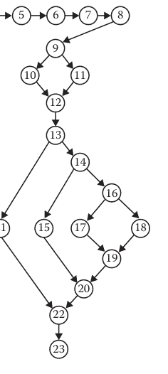
图 8.2 三角形的程序图。

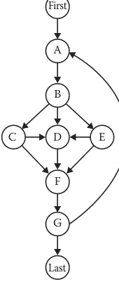
图 8.3 百万条路径。

### 8.2 DD路径

路径测试的最已知形式是基于决策路径（DD路径）。DD路径是程序图中的节点序列，从源节点开始，到汇节点结束，并至少包含每个决策节点一次。决策路径是包含每个决策节点至少一次的路径。简单路径恰好包含每个决策节点的路径。线性路径是包含每个决策节点至少一次的路径。完整路径是包含每个决策节点至少一次的路径。可行路径是包含每个决策节点至少一次的路径。稳健路径是包含每个决策节点至少一次的路径。可靠路径是包含每个决策节点至少一次的路径。有效路径是包含每个决策节点至少一次的路径。安全路径是包含每个决策节点至少一次的路径。高效路径是包含每个决策节点至少一次的路径。快速路径是包含每个决策节点至少一次的路径。可扩展路径是包含每个决策节点至少一次的路径。灵活路径是包含每个决策节点至少一次的路径。模块化路径是包含每个决策节点至少一次的路径。可重路径是包含每个决策节点至少一次的路径。便携路径是包含每个决策节点至少一次的路径。多功能路径是包含每个决策节点至少一次的路径。自适应路径是包含每个决策节点至少一次的路径。智能路径是包含每个决策节点至少一次的路径。智能路径是包含每个决策节点至少一次的路径。认知路径是包含每个决策节点至少一次的路径。机器路径是包含每个决策节点至少一次的路径。数字路径是包含每个决策节点至少一次的路径。虚拟路径是包含每个决策节点至少一次的路径。云路径是包含每个决策节点至少一次的路径。边缘路径是包含每个决策节点至少一次的路径。移动路径是包含每个决策节点至少一次的路径。量子路径是包含每个决策节点至少一次的路径。生物路径是包含每个决策节点至少一次的路径。神经路径是包含每个决策节点至少一次的路径。网络路径是包含每个决策节点至少一次的路径。去中心化DD路径是包含每个决策节点至少一次的路径。去中心化路径是包含每个决策节点至少一次的路径。全局路径是包含每个决策节点至少一次的路径。本地路径是包含每个决策节点至少一次的路径。区域路径是包含每个决策节点至少一次的路径。国家路径是包含每个决策节点至少一次的路径。国际路径是包含每个决策节点至少一次的路径。通用路径是包含每个决策节点至少一次的路径。宇宙路径是包含每个决策节点至少一次的路径。银系路径是包含每个决策节点至少一次的路径。太阳路径是包含每个决策节点至少一次的路径。恒星路径是包含每个决策节点至少一次的路径。行星路径是包含每个决策节点至少一次的路径。月球路径是包含每个决策节点至少一次的路径。虚空路径是包含每个决策节点至少一次的路径。真空路径是包含每个决策节点至少一次的路径。空间路径是包含每个决策节点至少一次的路径。时间路径是包含每个决策节点至少一次的路径。空间路径是包含每个决策节点至少一次的路径。物质路径是包含每个决策节点至少一次的路径。能量路径是包含每个决策节点至少一次的路径。力路径是包含每个决策节点至少一次的路径。波路径是包含每个决策节点至少一次的路径。光路径是包含每个决策节点至少一次的路径。黑暗路径是包含每个决策节点至少一次的路径。生命路径是包含每个决策节点至少一次的路径。灵魂路径是包含每个决策节点至少一次的路径。精神路径是包含每个决策节点至少一次的路径。大脑路径是包含每个决策节点至少一次的路径。身体路径是包含每个决策节点至少一次的路径。心脏路径是包含每个决策节点至少一次的路径。出生路径是包含每个决策节点至少一次的路径。死亡路径是包含每个决策节点至少一次的路径。重生路径是包含每个决策节点至少一次的路径。循环路径是包含每个决策节点至少一次的路径。梦路径是包含每个决策节点至少一次的路径。现实路径是包含每个决策节点至少一次的路径。真实路径是包含每个决策节点至少一次的路径。谎言路径是包含每个决策节点至少一次的路径。虚构路径是包含每个决策节点至少一次的路径。故事路径是包含每个决策节点至少一次的路径。神话路径是包含每个决策节点至少一次的路径。传奇路径是包含每个决策节点至少一次的路径。历史路径是包含每个决策节点至少一次的路径。未来路径是包含每个决策节点至少一次的路径。过去路径是包含每个决策节点至少一次的路径。现在路径是包含每个决策节点至少一次的路径。总是路径是包含每个决策节点至少一次的路径。从路径是包含每个决策节点至少一次的路径。从路径是包含每个决策节点至少一次的路径。偶尔路径是包含每个决策节点至少一次的路径。经常路径是包含每个决策节点至少一次的路径。很少路径是包含每个决策节点至少一次的路径。频繁路径是包含每个决策节点至少一次的路径。持续路径是包含每个决策节点至少一次的路径。永恒路径是包含每个决策节点至少一次的路径。无限路径是包含每个决策节点至少一次的路径。有限路径是包含每个决策节点至少一次的路径。三路径是包含每个决策节点至少一次的路径。两次路径是包含每个决策节点至少一次的路径。单路径是包含每个决策节点至少一次的路径。双路径是包含每个决策节点至少一次的路径。三路径是包含每个决策节点至少一次的路径。四倍路径是包含每个决策节点至少一次的路径。五倍路径是包含每个决策节点至少一次的路径。六倍路径是包含每个决策节点至少一次的路径。七倍路径是包含每个决策节点至少一次的路径。八倍路径是包含每个决策节点至少一次的路径。九倍路径是包含每个决策节点至少一次的路径。十路径是包含每个决策节点至少一次的路径。年代路径是包含每个决策节点至少一次的路径。世纪路径是包含每个决策节点至少一次的路径。千路径是包含每个决策节点至少一次的路径。百万路径是包含每个决策节点至少一次的路径。十亿路径是包含每个决策节点至少一次的路径。万亿路径是包含每个决策节点至少一次的路径。京亿路径是包含每个决策节点至少一次的路径。亿万亿路径是包含每个决策节点至少一次的路径。百亿路径是包含每个决策节点至少一次的路径。十亿路径是包含每个决策节点至少一次的路径。decillion路径是包含每个决策节点至少一次的路径。duillion路径是包含每个决策节点至少一次的路径。tredecillion路径是包含每个决策节点至少一次的路径。quattudecillion路径是包含每个决策节点至少一次的路径。quindecillion路径是包含每个决策节点至少一次的路径。sexdecillion路径是包含每个决策节点至少一次的路径。septdecillion路径是包含每个决策节点至少一次的路径。octodecillion路径是包含每个决策节点至少一次的路径。nonodecillion路径是包含每个决策节点至少一次的路径。vigintillion路径是包含每个决策节点至少一次的路径。一vigintillion路径是包含每个决策节点至少一次的路径。双vigintillion路径是包含每个决策节点至少一次的路径。三vigintillion路径是包含每个决策节点至少一次的路径。四倍vigintillion路径是包含每个决策节点至少一次的路径。五倍vigintillion路径是包含每个决策节点至少一次的路径。六倍六-vigintillion路径是包含每个决策节点至少一次的路径。七倍vigintillion路径是包含每个决策节点至少一次的路径。八倍vigintillion路径是包含每个决策节点至少一次的路径。九倍vigintillion路径是包含每个决策节点至少一次的路径。trintillion路径是包含每个决策节点至少一次的路径。一trintillion路径是包含每个决策节点至少一次的路径。双trintillion路径是包含每个决策节点至少一次的路径。三trintillion路径是包含每个决策节点至少一次的路径。四倍trintillion路径是包含每个决策节点至少一次的路径。五倍trintillion路径是包含每个决策节点至少一次的路径。六倍trintillion路径是包含每个决策节点至少一次的路径。七倍trintillion路径是包含每个决策节点至少一次的路径。八倍trintillion路径是包含每个决策节点至少一次的路径。八intintintillion路径是octagintillion路径是包含每个int节点至少一次的路径。octagintillion路径是包含每个决策节点至少一次的路径。一unoctagintillion路径是包含每个决策节点至少一次的路径。双uoctagintillion路径是包含每个决策节点至少一次的路径。三uoctagintillion路径是包含每个决策节点至少一次的路径。四倍uoctagintillion路径是包含每个决策节点至少一次的路径。五倍uoctagintillion路径是包含每个决策节点至少一次的路径。六倍uoctagintillion路径是包含每个决策节点至少一次的路径。七倍uoctagintillion路径是包含每个决策节点至少一次的路径。八倍uoctagintillion路径是包含每个决策节点至少一次的路径。九倍uoctagintillion路径是包含每个决策节点至少一次的路径。十nonagintillion路径是包含每个决策节点至少一次的路径。一unnonagintillion路径是包含每个决策节点至少一次的路径。双dunonagintillion路径是包含每个决策节点至少一次的路径。三trenonagintillion路径是包含每个决策节点至少一次的路径。四倍quattuornnonagintillion路径是包含每个决策节点至少一次的路径。五倍quindnonagintillion路径是包含每个决策节点至少一次的路径。六倍sexnonagintillion路径是包含每个决策节点至少一次的路径。七倍septnonagintillion路径是包含每个决策节点至少一次的路径。八倍octnonagintillion路径是包含每个决策节点至少一次的路径。九倍nonnonagintillion路径是包含每个决策节点至少一次的路径。十vigintillion路径是包含每个决策节点至少一次的路径。一unvigintillion路径是包含每个决策节点至少一次的路径。双duvigintillion路径是包含每个决策节点至少一次的路径。三trevigintillion路径是包含-path是包含每个决策节点至少一次的路径。四倍quattuorvigintillion路径是包含每个决策节点至少一次的路径。五倍quindvigintillion路径是包含每个决策节点至少一次的路径。六倍sexvigintillion路径是包含每个决策节点至少一次的路径。七倍septvigintillion路径是包含每个决策节点至少一次的路径。八倍octvigintillion路径是包含每个决策节点至少一次的路径。九倍nonvigintillion路径是包含每个决策节点至少一次的路径。 (Wait, I'm repeating numbers,让我们关注文本结构）。

---

- If–Then–Else
+ 1 If <condition>
2 Then
3 <then statements>
4 Else
5 <else statements>
6 End If
7 <next statement>

- Pretest loop
+ 1 While <condition>
2 <repeated body>
3 End While
4 <next statement>

- Case/Switch
+ 1 Case n of 3
2 n=1:
3 <case 1 statements>
4 n=2:
5 <case 2 statements>
6 n=3:
7 <case 3 statements>
8 End Case

- Posttest loop
+ 1 Do
2 <repeated body>
3 Until <condition>
4 <next statement>

图 8.1 结构化构造。从给定的程序推导出程序图是一个容易的过程。这里用四个基本的结构化编程构造结构（图 8.1）进行了说明，还用我们在第 2 章中三角形程序的伪代码实现进行了说明。行号指的是语句和语句片段。这里可以使用一个判断元素：有时将一个片段保留作为一个独立的节点是方便的；其他时候，将它与语句的另一个部分合并似乎更好。例如，在图 8.2 中，第 14 行可以拆分为两行：

- 14 Then If (a = b) AND (b = c)
14a Then
14b If (a = b) AND (b = c)

这种自由度会收敛到一个唯一的 DD-路径图，因此不同判断引入的差异是无关紧要的。（数学家会指出，对于给定的程序，可能会使用几个不同的图，但它们都将归化为唯一的 DD-路径图。）我们还需要决定是否将节点与不可执行的语句（如变量和类型声明）关联；我们没有这样做。三角形问题第二个版本（见第 2 章）的程序图如图 8.2 所示。

节点 4 到 8 是判断节点，节点 9 到 12 是 if–then–else 构造，节点 13 到 22 是嵌套的 if–then–else 构造。节点 4 和 7 是程序的源节点和汇节点，连接到单一入口和退出标准。不存在循环，因此这是一个有向无环图。程序图的重要性在于从源节点到汇节点的程序执行。由于测试用例强制了某些程序路径的执行，因此我们对测试用例与其所测试的程序部分之间的关系有非常明确的描述。我们还有一个优雅且易处理的方法来处理程序中可能大量的执行路径。

存在基于路径测试的反对者。图 8.3 是一个简单（但非结构化的！）程序的图；它是反对者用来展示即使是简单的程序也无法完全测试的（实践上的）不可能性的典型示例（此示例最早出现在 Schach [1993] 中）。在这个程序中，有五条路径从循环内部的节点 B 通向节点 F。如果循环最多重复 18 次，则存在 4.77 万亿不同的程序执行路径。（实际上，是 4,768,371,582,030 条路径。）反对者采取一种情况，将其推向极端，证明这种极端支持了你的观点，然后将其应用回原始问题。反对者错过了基于代码的测试的要点——在本章的稍后部分中，我们将看到这个巨大的数字如何有理由地减少到更易于管理的大小。


图 8.2 三角形的程序图。

### 8.2 DD路径

路径测试的最已知形式是基于决策路径（DD路径）的定义。DDpath] 实际上，DD-路径图是一种收缩图的形式（见第 4 章）；在 във收缩中，2 连通分量被合并为单个节点，对应于案例 DD-路径（对应于案例 1–4），以保留这种约定，即语句（或语句片段）恰好位于一个 DD-路径中。

| 路径类型 | 描述 |
| :--- | :--- |
| Case 1 | 包含 0 indeg. |
| Case 2 | 包含 0 outdeg. |
| Case 3 | Indeg ≥ 2. |
| Case 4 | Out-deg = 1. |
| Case 5 | 最大路径。 |

DD-路径图如图 8.4 所示。

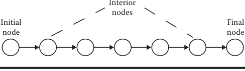
图 8.4 有向图中的节点链。

$G_{nodes}$ 与 $G_{edge}$ 的区别在于，在后者中，我们可以确保决策语句的所有结果都能被执行。在我们的三角形问题中（见图 8.2），节点 9、10 和 11 构成成了一个完整的 `if-then-else` 语句。如果我们要求节点覆盖整个语句，我们只需要执行决策备选方案中的一个即可满足语句覆盖标准。由于我们允许语句片段，因此自然地将此类语句划分为单独节点（条件测试、真结果和假结果）。这样做产生的是谓词结果覆盖（predicate outcome coverage）。无论是否遵循了我们的约定，这些覆盖指标都要求我们找到一组测试用例，使得在执行时，程序图中的每个节点至少被遍历一次。

## Definition

对于一个程序的一组测试用例，如果它们在程序上执行时，程序图中每个长度大于或等于 2 的图都被遍历了，那么它们就构成了链覆盖（chain coverage）。将这种覆盖水平表示为 $G_{chain}$。

$G_{chain}$ 覆盖等同于与给定程序图对应的 DD 路径图中的节点覆盖。由于 DD 路径在 E.F. Miller 原有的测试覆盖公式中很重要（定义在第 8.3.2 节），我们现在在纯程序图结构与 Miller 的测试覆盖之间建立了清晰的联系。

## Definition

对于一个程序的一组测试用例，如果它们在程序上执行时，程序图中从源节点到汇点的每个路径都被遍历了，那么它们就构成了路径覆盖（path coverage）。将这种覆盖水平表示为 $G_{path}$。

当程序存在循环时（如图 8.3 所示），这种覆盖存在严重的局限性。E.F. Miller 在假设用于循环覆盖的 $C_2$ 指标时部分地预到了这一点。回到第 4 章，观察到程序图中的每个循环都代表一组强连通（3连通）节点。为了处理循环的影响，我们执行每个循环，然后形成原始程序图的收缩图（condensation），这必须是一个有向无环图。

## 8.3.2 E.F. Miller 的覆盖指标

使用了几种广泛接受的测试覆盖指标；表 8.1 中的大部分指标都源于 Miller (1977) 的早期工作。客观地观察程序的测试程度使得管理测试过程成为可能。大多数质量组织认为 $C_1$ 指标（DD 路径覆盖）是最低的测试覆盖水平。

这些覆盖指标形成了一个序（数据流覆盖指标的序请见第 9 章），其中某些是相等的，而某些包含了其他的。其重要性在于，总会有故障类型可以逃过低水平测试的检测。Miller (1991) 观察到，当测试用例达到 DD 路径覆盖时，85% 的故障会被暴露。表 8.1 中的覆盖指标告诉我们应该测试什么，但没有说明如何测试。在本节中，我们将更深入地研究执行源代码的技巧。我们必须记住一个重要的区别：Miller 的测试覆盖指标基于程序图，在图中节点是完整的语句，而我们的公式允许语句片段（可以是整个语句）作为节点。

### 8.3.2.1 语句测试

由于我们对程序图的定义允许语句片段作为单独节点，Miller 的 $C_0$ 指标被我们的 $G_{node}$ 指标所包含。

## Table 8.1 Miller 的测试覆盖指标

| 指标 | 覆盖描述 |
| --- | --- |
| C$_0$ | 每条语句 |
| C$_1$ | 每条 DD 路径 |
| C$_{1p}$ | 每个结果的每个谓词 |
| C$_2$ | $C_1$ 覆盖 + 循环覆盖 |
| C$_d$ | $C_1$ 覆盖 + 每对依赖的 DD 路径 |
| C$_{MCC}$ | 多重条件覆盖 |
| C$_{ik}$ | 每条包含最多 $k$ 次循环的程序路径 |
| C$_{stat}$ | “具有统计学意义”的路径比例 |
| C$_\infty$ | 所有可能的执行路径 |

语句覆盖通常被视为最低要求。如果某些语句没有被测试用例执行，则测试存在明显的缺陷。尽管足够的语句覆盖（$C_0$）仍被广泛接受：它被 ANSI（美国国家标准协会）87B 标准强制，并从 70 年代中期以来一直成功使用。

### 8.3.2.2 DD 路径测试

当每个 DD 路径都被遍历（$C_1$ 指标）时，我们知道每个谓词结果都已执行；这等同于遍历 DD 路径图（或程序图）中的条边。因此，$C_1$ 指标正是我们的 $G_{chain}$ 指标。对于 `if-then-else` 语句，这意味着真分支和假分支都被覆盖。对于 `CASE` 语句，每个子句都被覆盖。除此之外，较长的 DD 路径通常代表复杂的计算，我们可以将其视为边界值。

### 8.3.2.3 简单循环测试

$C_2$ 指标要求 DD 路径覆盖（$C_1$ 指标）加上循环测试。循环测试的简单观点是每个循环涉及一个决策，另一个是退出（或不进入）循环。这在 Huang (1979) 中得到了仔细证明。注意这等同于 $G_{edge}$ 测试覆盖。

### 8.3.2.4 谓词结果测试

这种水平的测试要求每个决策（谓词）的结果都必须执行。由于我们对程序图的定义允许语句片段作为单独节点，Miller 的 $C_{ip}$ 指标被我们的 $G_{od}$ 指标包含。E.F. Miller 的测试覆盖了在复合条件上做出的决策。

### 8.3.2.5 依赖 DD 路径对

依赖关系的识别必须在代码层面进行，而不仅仅通过程序图。DD 路径对之间最常见的依赖是定义/引用关系，其中变量在一条 DD 路径中被定义（接收值），在另一个中被引用。依赖的重要性在于它们与不可路径的问题有关：在图 8.5 中，C 和 H 是这样一对 DD 路径 D 和 H。变量在节点 C 处设置为 TRUE，在节点 D 处设置为 FALSE。节点 H 是分支处。任何包含节点 D 和 H 的路径都是不可行的。简单的 DD 路径覆盖可能无法执行这些依赖；因此无法暴露更深层的故障。

### 8.3.2.6 复杂循环覆盖

Miller 的 $C_{lo}$ 指标将循环覆盖扩展到包含循环的从源到汇点的完整路径。我们在第 4 章研究的收缩图为循环测试问题提供了优雅的解决方案。循环测试已被广泛研究，理由充分——循环是源代码中容易出错的部分。首先，存在循环分类（Beizer, 1984）：如图 8.6 所示的连接型、嵌套型和结型。

连接循环仅仅是不交叉循环的序列，而嵌套循环是一个包含另一个的。当遵循结构化编程原则时，不会出现结型（Beizer 称之为“糟糕”）循环，但它们可以在像 Java 这样带有 try/catch 的语言中出现。当可能从循环中间进入或退出，且这些分支位于其他循环内部时，结果就是 Beizer 的结型循环。

img/caa3a3b6e8a0f28e72cd26c243e580_171_0.png

图 8.6 连接、嵌套和结型循环。

我们也可以采用改进的边界方法，赋予循环索引最小、标度和最大值（见第 5 章）。我们可以进一步推向全边界值测试甚至健壮测试。如果简单循环的体是一个执行复杂计算的 DD 路径，如所述，也应该进行测试。一旦测试了循环，测试就会将其压缩为单个节点。如果循环是嵌套，则从最内层节点向外重复此过程。这导致了我们在边界值分析中发现的测试用例倍数，这是合理的，因为每个循环索引变量都像输入变量。如果循环是结型的，则需要根据第 9 章讨论的数据流对它们进行仔细分析。作为预览，考虑如果一个循环篡改了另一个循环索引的值，可能会发生无限循环。

### 8.3.2.7 多重条件覆盖

Miller 的 $C_{MCC}$ 指标解决了由复合条件做出的决策的测试。仔细观察 DD 路径 B 和 H 中的条件。与其遍历谓词到其真、假结果，我们应该调查每个结果发生的不同方式。一种可能性是制作决策表；三个条件的复合条件有八条规则（见表 8.2），产生测试用例。另一种可能性是将谓词重编程为嵌套的简单 `if-then-else` 逻辑，这将导致更多的 DD 路径需要覆盖。我们看到了一种有趣的权衡：语句复杂度与路径复杂度。多重条件覆盖确保了这一点不会被掩盖在 DD 路径覆盖之下。该指标已改进为修正条件决策覆盖（MCDC），定义在第 8.3.3 节。

# 路径测试 ■ 143

布尔表达式可能是一个简单的布尔变量，也可能是包含一个或多个布尔运算符的复合表达式。Chilenski 将布尔运算符分为四类：

| 运算符类型 | 布尔运算符 |
|---|---|
| 一元（单一操作数） | NOT(-) |
| 二元（两个操作数） | AND(∧), OR(∨), XOR(⊕) |
| 短路逻辑运算符 | AND (AND–THEN), OR (OR–ELSE) |
| 关系运算符 | =, #, <, >, ≥ |

在数学逻辑中，布尔表达式被称为逻辑表达式，其中逻辑表达式可以是：

- 1. 不包含逻辑连接词的简单命题
- 2. 包含至少一个逻辑连接词的复合命题

同义词：谓词（predicate）、命题、条件。

在编程中，Chilenski 的布尔表达式出现在决策语句的条件中：If-Then、If-Else、If-ElseIf、Case/Switch 以及 For 和 Until 循环。本小节关注复合条件的测试。复合条件在程序图中显示为单个节点；因此，它们引入的复杂性被掩盖了。

## 8.3.3.2 条件（根据 Chilenski）

“条件是布尔运算符（布尔函数、对象和运算符）的操作数。通常情况下，这指的是最低层次的条件（即那些本身不是布尔值的条件），它们通常是表达式树的叶子节点。注意，条件是一个布尔（子）表达式。”

在数学逻辑中，Chilenski 的条件被称为简单命题或原子命题。命题可以是简单的或复合的，复合命题包含至少一个逻辑连接词。命题也称为谓词，即 E.F. Miller 使用的术语。

## 8.3.3.3 耦合条件（根据 Chilenski）

如果改变一个条件也会导致另一个条件发生变化，则这两个（或多个）条件是耦合的。

当条件相互耦合时，可能无法单独改变条件，因为耦合的条件可能随之发生变化。Chilenski 注意，条件可以是强耦合或弱耦合的。在强耦合三组中，改变一个条件可能会改变另一个耦合条件，但不会改变第三个。Chilenski 提供了这些示例：

- 在 ((x = 0) AND A) OR (x != 0 AND B)) 中，条件 (x = 0) 和 (x != 0) 是强耦合的。
- 在 (x = 1) OR (x = 2) OR (x = 3)) 中，这三个条件是弱耦合的。

## 144 ■ 软件测试

## 8.3.3.4 掩码条件（根据 Chilenski）

“条件屏蔽过程涉及将运算符的一个操作数设置为某个值，使得该运算符另一个操作数的变化不会改变该运算符的值。”

参考第 3.4.3 章，掩码使用了支配律（Domination Laws）。对于 AND 运算符，可以通过保持另一个操作数为 False 实现其中一个操作数的掩码。

```


(X AND False = False; 无论 X 的值是什么，结果都是 False.)

对于 `OR` 运算符，可以通过保持另一个操作数为 `True` 实现其中一个操作数的掩码。

(X OR True = True; 无论 X 的值是什么，结果都是 True.)

## 8.3.3.5 修改决策条件覆盖 (MCDC)

根据 DO-178B 测试，“A级”软件需要进行 MCDC。MCDC 有三种变体：掩码 MCDC、唯一原因 MCDC 以及唯一原因 + 掩码 MCDC。这些在 Chilenski (2001) 中有详尽解释，该书得出结论：尽管掩码 MCDC 是这三种形式中最弱的，但仍建议用于符合 DO-178 标准的情况。以下定义引用自 Chilenski。

## 定义

MCDC 要求：

- 1. 每条语句必须至少执行一次。
- 2. 每个程序入口点和出口点必须至少被调用一次。
- 3. 每个控制语句的所有可能结果都必须一次性覆盖。
- 4. 每个非常量布尔表达式都已评估为真和假两种结果。
- 5. 布尔表达式中的每个非常量条件都已评估为真和假两种结果。
- 6. 布尔表达式中的每个非常量条件已被证明能独立地影响（表达式的）结果

MCDC 的基本定义需要一些解释。控制语句是指那些做出决策的语句，例如 `If/Switch` 语句和循环语句。在程序图中，控制语句的出度大于 1。常量布尔表达式是指那些始终评估为相同最终值的。例如，布尔值 `(p V p)` 始终评估为 `True`，正如条件 `(a = a)`。同样，`(p ^ p)` 和 `(a != a)` 是常量表达式（评估为 `False`）。从程序图的角度来看，MCDC 要求 1 和 2 转化为节点覆盖，而 MCDC 要求 3 和 4 转化为边覆盖，这进入了 MCDC 测试的复杂部分。在接下来，Chilenski 讨论的三种变体旨在澄清通用定义第 6 点的含义，即“独立性”的确切含义。

## 路径测试

## 定义（根据 Chilenski）

唯一原因 MCDC 要求唯一原因（通过翻转单个条件来改变结果），对于所有可能的非耦合条件。

## 定义（根据 Chilenski）

唯一原因 + 掩码 MCDC 要求唯一原因（通过翻转单个条件来改变结果），对于所有可能的非耦合条件。在强耦合的情况下，允许对该条件进行屏蔽，即保持其他非耦合条件不变。

## 定义（根据 Chilenski）

屏蔽允许对该条件进行操作，即保持其他非耦合条件不变。Chilenski 评论道：“在强耦合的情况下，不允许屏蔽。”

## 8.3.4.1 示例

## 8.3.4.2 简单条件的条件

在数学逻辑中，Chilenski 的条件被称为简单命题或原子命题。命题可以是简单的或复合的，复合命题包含至少一个逻辑连接词。命题也称为谓词，即 E.F. Miller 使用的术语。

图 8.7 a (b OR c) 的决策表

## 表 8.2 程序片段的决策表

| 条件 | 规则 1 | 规则 2 | 规则 3 | 规则 4 | 规则 5 | 规则 6 | 规则 7 |
|---|---|---|---|---|---|---|---|
| a | T | T | T | T | F | F | F |
| b | T | T | F | F | T | F | F |
| c | T | F | T | F | T | F | F |
| a AND (b OR c) | True | True | False | False | False | False | False |

| 动作 | | | | | | | |
|---|---|---|---|---|---|---|---|
| y = 1 | x | x | | | | | |
| y = 2 | | | x | x | x | x | x |

## 8.3.4.2 NextDate 的复合条件

在我们的 NextDate 问题中，假设我们对日、月、年变量有效输入进行了编码。该代码片段及其图见图 8.8。表 8.3 是 NextDate 代码片段的决策表。由于日、月、年变量都是独立的，因此每个都可以为真或为假。图 8.8 中程序图的环圈复杂度为 5。

- 对应所有规则的八个测试用例对于提供决策覆盖是必要的。

## 路径测试 147

```
NextDate Fragment

Dim day, month, year As Integer

Dim dayOK, monthOK, yearOK As Boolean

Do

 Input(day, month, year)

 If 0 < 32

 Then dayOK = True

 Else dayOK = False

 Endif

 If month < 13

 Then monthOK = True

 Else monthOK = False

 Endif

 If 1911 < 2013

 Then yearOK = True

 Else yearOK = False

 Endif

 Until (dayOK AND monthOK AND yearOK)

End Fragment
```

图 8.8 NextDate 片段及其流程图。

## 表 8.3 NextDate 片段的决策表

| 条件 | 规则 1 | 规则 2 | 规则 3 | 规则 4 | 规则 5 | 规则 6 | 规则 7 | 规则 8 |
|---|---|---|---|---|---|---|---|---|
| dayOK | T | | T | T | F | F | F | F |
| monthOK | | T | | T | F | F | T | F | F |
| YearOK | | F | | T | F | T | F | T | F |
| Until 条件 | True | False | False | False | False | False | False | False |

| 动作 | | | | | | | | | | |
|---|---|---|---|---|---|---|---|---|---|
| 退出循环 | x | | | | | | | | |
| 重复循环 | | x | x | x | x | x | x | x |

### 8.3.3 来自三角形程序的复合条件

包含此示例是为了展示它与前两个示例之间的重要区别。图 8.9 中的代码片段是三角形程序中检查 a、b、c 的值是否构成三角形的部分。三角形包含这样一个定义：每条边必须严格小于其他两条边之和。图 8.7 和 8.9 中的 NextDate 片段和三角形程序都是三个变量的函数。第二个区别是，三角形程序中的 a、b 和 c 是相互依赖的，而 NextDate 片段中的 dayOK、monthOK 和 yearOK 是真正的独立变量。

## 软件测试

```
1. If (a < b + c) AND (a < b + c) AND (a < b + c)
2. Then Isa Triangle = True
3. Else Isa Triangle = False
4. Endif
```

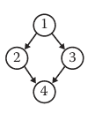

图 8.9 三角形片段及其程序流程图。

a、b 和 c 之间的依赖关系是表 8.4 中片段决策表中存在四个不可能规则的原因；接下来将证明这一点。

事实：在数值上，两个条件同时为假是不可能的。

证明（反证法）：假设任意两个条件可以同时为真。任意选择前两个可能同时为真的的条件，我们可以写出两个不等式：

```
a >= (b + c)
b >= (a + c)
```

将它们相加，得到：

```
(a + b) >= (b + c) + (a + c)
```

并重新排列右侧，得到：

```
(a + b) >= (a + b) + 2c
```

但 a、b、c 均 > 0，因此我们得到了矛盾。证毕。

决策覆盖通过执行任意两个规则，使得每个动作至少执行一次来实现。规则 1 和规则 2 对应的测试用例提供了决策覆盖，正如规则 1 和规则 3，以及规则 1 和规则 5 所示。规则 4、6、7 和 8 由于其数值上的不可能性无法使用。

条件覆盖通过执行一组规则来实现，使得每个条件都被求值为真和假。规则 1 和规则 2 对应的测试用例翻转了 `(c < a + b)` 条件，规则 1 和规则 3 翻转了 `(b < a + c)` 条件，1 和 5 翻转了 `(a < b + c)` 条件。

MCDC 由于这三个条件之间的数值（以及逻辑上的）不可能性而变得复杂。这三对（规则 1 和 2、规则 1 和 3 以及规则 1 和 5）构成了 MCDC。

## 表 8.4 三角形程序的决策表

| 条件 | 规则 1 | 规则 2 | 规则 3 | 规则 4 | 规则 5 | 规则 6 | 规则 7 |
|---|---|---|---|---|---|---|---|
| (a < b + c) | T | T | T | F | F | F |
| (b < a + c) | T | T | F | F | T | T | F |
| (c < a + b) | T | F | T | F | T | F |
| IsaTriangle = True | x | | | | | | |
| IsaTriangle = False | - | x | x | | | x |

## 路径测试 149

在这种复杂情况下，退回到决策表是一个总是有效的答案。将复合条件重写为嵌套的 If 逻辑如下所示：

```
1. If (a < b + c)
2. If (b < a + c)
3. If (c < a + b)
4. Then IsaTriangle = True
5. Else IsaTriangle = False
6. Endif
7. If (c < a + b)
8. Then IsaTriangle = True
9. Else IsaTriangle = False
10. Endif
11. If (b < a + c)
12. Then IsaTriangle = True
13. Else IsaTriangle = False
14. Endif
15. If (c < a + b)
16. Then IsaTriangle = True
17. Else IsaTriangle = False
18. Endif
19. If (a < b + c)
20. Then IsaTriangle = True
21. Else IsaTriangle = False
22. Endif
23. If (c < a + b)
24. Then IsaTriangle = True
25. Else IsaTriangle = False
26. Endif
27. If (b < a + c)
28. Then IsaTriangle = True
29. Else IsaTriangle = False
30. Endif
31. If (a < b + c)
32. Then IsaTriangle = True
33. Else IsaTriangle = False
34. Endif
35. If (a < b + c)
36. Then IsaTriangle = True
37. Else IsaTriangle = False
38. Endif
39. If (b < a + c)
40. Then IsaTriangle = True
41. Else IsaTriangle = False
42. Endif
43. If (a < b + c)
44. Then IsaTriangle = True
45. Else IsaTriangle = False
46. Endif
47. If (c < a + b)
48. Then IsaTriangle = True
49. Else IsaTriangle = False
50. Endif
51. If (c < a + b)
52. Then IsaTriangle = True
53. Else IsaTriangle = False
54. Endif
55. If (b < a + c)
56. Then IsaTriangle = True
57. Else IsaTriangle = False
58. Endif
59. If (a < b + c)
60. Then IsaTriangle = True
61. Else IsaTriangle = False
62. Endif
63. If (c < a + b)
64. Then IsaTriangle = True
65. Else IsaTriangle = False
66. Endif
67. If (b < a + c)
68. Then IsaTriangle = True
69. Else IsaTriangle = False
70. Endif
71. If (a < b + c)
72. Then IsaTriangle = True
73. Else IsaTriangle = False
74. Endif
75. If (c < a + b)
76. Then IsaTriangle = True
77. Else IsaTriangle = False
78. Endif
79. If (b < a + c)
80. Then IsaTriangle = True
81. Else IsaTriangle = False
82. Endif
83. If (a < b + c)
84. Then IsaTriangle = True
85. Else IsaTriangle = False
86. Endif
87. If (c < a + b)
88. Then IsaTriangle = True
89. Else IsaTriangle = False
90. Endif
91. If (c < a + b)
92. Then IsaTriangle = True
93. Else IsaTriangle = False
94. Endif
95. If (b < a + c)
96. Then IsaTriangle = True
97. Else IsaTriangle = False
98. Endif
99. If (a < b + c)
100. Then IsaTriangle = True
101. Else IsaTriangle = False
102. Endif
```

# 路径测试 ■ 151

图 8.10 右侧图中线性无关回路的数量为：

```
V(G) = e - n + p
= 11 - 7 + 1 = 5
```


图 8.10 中强连通图的圈复杂度为 5；因此，有五个线性无关的回路。如果我们删除从节点 G 到节点 A 的新增边，这五个回路将变为从节点 A 到节点 G 的五条独立路径。在小图中，我们可以视觉上识别独立路径。在这里，我们将路径识别为节点序列：

- `p1`: A, B, C, G
- `p2`: A, B, C, B, G
- `p3`: A, B, E, F, G
- `p4`: A, D, E, F, G
- `p5`: A, D, F, G

表 8.5 显示了每条路径经过的边，以及边被遍历的次数。我们通过定义加法和标量乘法的概念，使其看起来像一个向量空间：路径加法简单是指一条路径后接另一条路径，而乘法对应于路径的重复。通过这种公式，McCabe 将程序路径看作向量空间。他对于这一框架基部分的说明是：路径 A, B, C, B, E, F 是 `p2 + p3 - p1` 之和，而路径 A, B, C, B, C, G 是线性组合 `2p2 - p1`。使用关联矩阵（见第 4 章）更容易看出这种加法，矩阵的行对应路径，列对应边，如表 8.5 所示。表中的条目是通过跟踪路径并记录遍历了哪些边得到的。例如，路径 `p1` 遍历了边序列：1, 4, 3, 4, 9。因为边 4 被路径 `p2` 遍历了两次，这就是边 4 列的条目。

我们通过检查该关联矩阵的前五行来检查路径 `p1–p5` 的独立性。粗体条目显示了恰好出现在一条路径中的边，因此路径 `p2–p5` 必须是独立的。`p1` 与所有这些路径都是独立的，任何用其他路径来表示 `p1` 的尝试都会引入不需要的边。没有任何一个都无法删除，这五条路径组从节点 A 到节点 G 的所有路径。此时，你可能会检查两个示例路径的线性组合。（加法和乘法是在列条目上进行的。）

| 表 8.5 路径/遍历的边 |
| 路径/遍历的边 | 1 | 2 | 3 | 4 | 5 | 6 | 7 | 8 | 9 | 10 |
|---|---|---|---|---|---|---|---|---|---|---|
| `p1`: A, B, C, G | 1 | 0 | 0 | 1 | 0 | 0 | 0 | 0 | 1 | 0 |
| `p2`: A, B, C, B, G | 1 | 0 | 1 | 2 | 0 | 0 | 0 | 0 | 1 | 0 |
| `p3`: A, B, E, F, G | 1 | 0 | 0 | 0 | 1 | 0 | 0 | 1 | 0 | 1 |
| `p4`: A, D, E, F, G | 0 | 1 | 0 | 0 | 0 | 1 | 0 | 1 | 0 | 1 |
| `p5`: A, D, F, G | 0 | 1 | 0 | 0 | 0 | 1 | 0 | 0 | 0 | 1 |
| `ex1`: A, B, C, B, E, F | 1 | 0 | 1 | 1 | 1 | 0 | 0 | 0 | 0 | 1 |
| `ex2`: A, B, C, B, C, G | 1 | 0 | 2 | 3 | 0 | 0 | 0 | 0 | 0 | 1 |

# 软件测试

### 表 8.6 图 8.5 中的基路径
| 原始 | | |
|---|---|---|
| B 处翻转 `p1` | `p1`: A-B-C-E-F-H-J-K-M-N-O-最后 | 腰三角形 |
| | `p2`: A-B-D-E-F-H-J-K-M-N-最后 | 不可行 |
| F 处翻转 `p1` | `p3`: A-B-C-E-F-G-O-最后 | 不可行 |
| H 处翻转 `p1` | `p4`: A-B-C-E-F-H-I-N-O-最后 | 等边三角形 |
| J 处翻转 `p1` | `p5`: A-B-C-E-F-H-J-L-M-N-O-最后 | 等腰三角形 |

McCabe 接下来开发了一种算法（称为基准方法）来确定一组基路径。该方法从选择基准路径开始，应该对应某些“正常情况”下的程序执行。这具有某种任意性；建议选择尽可能节点路径。接下来，撤回基准路径并在每个决策处对其进行“翻转”；即当遇到出度 ≥ 2 的节点时，必须另一条边。在这里我们遵循 McCabe 的示例，他假设路径节点 A, B, C, B, E, F, G 为基准。（这之前用路径 `p1` 表达过）。该路径中的第一个决策（出度 ≥ 2）是节点 A；那么，对于基路径，我们遍历边 2 而不是边 1。我们得到路径 A, D, E, F，我们在路径 1 中撤回 E, F 以尽可能不同。接下来，我们可以遵循第二条路径，并取节点 D 的其他决策结果，这给了我们路径 A, D, F。现在节点 B 和 C 还没有翻转；这样做产生了最后两条路径 A, B, E, F 和 A, B, C。注意这组基路径与图 8.6 不同：这不是问题，因为需要唯一的路径。

# 8.4.2 对 McCabe 方法的观察

如果你尝试过关于基路径和和的讨论，可能会感到怀疑。对于正性观察，基路径覆盖保证了DD路径覆盖：翻转决策的过程确保了每个结果都被遍历，这与DD路径覆盖相同。我们从基路径的关联矩阵描述以及我们的三角形可行路径看到了这个示例。

三角形问题的特殊之处在于存在循环。程序有八种可能的路径；其中只有上面列出的四条路径是可行的。因此，对于这个特殊情况，我们得到了与特殊值测试和输出范围测试相同的结果。

### 8.4.3 本质复杂度 (Essential Complexity)

McCabe 在圈复杂度方面的工作，对编程的改进作用超过了对测试。在本节中，我们将快速查看这种图论、结构化编程的优雅结合，以及这些理论对测试的影响。整套理论的核心围绕着“本质复杂度”的概念（McCabe, 1982），它只是另一种形式的收缩图的圈复杂度。回想一下，收缩图是简化现有的方法；因此，我们的简化基于移除强连通分量或DD路径。在这里，我们对结构化编程构造进行收缩，如图 8.11 所示。

基本思想是寻找一个结构化编程构造的图，将其合并为一个节点，并重复此过程，直到无法找到更多的结构化编程构造。图 8.12 展示了这一过程，它从伪代码三角形程序的DD路径图开始。`if-then` 构造收缩了节点 a，然后将三个三个 `then` 构造合并到节点 b、c 和 d。剩余的 `if-then-else`（对应于 IF Triangle 语句）被合并为节点 e，导致生成的收缩图圈复杂度 `$V(G) = 1$`。通常情况下，当一个程序结构良好（即仅由结构化编程构造组成）时，它总可以还原为一个只有一个节点的图。

图 8.11 中的图无法通过这种方式还原（试试看！）。由于从 B 到 E 的边，包含节点 B 和 C 的循环无法合并。同样，节点 D、E 和 F 看起来像一个 `if-then` 构造，但从 B 到 E 的边违反了结构。McCabe (1976) 进一步发现了违反结构化编程原则的元素级“非结构化”结构。这些如图 8.13 所示。这些违反情况中的每一个包含三条不同的路径，而对应的结构化编程构造中只有两条路径；

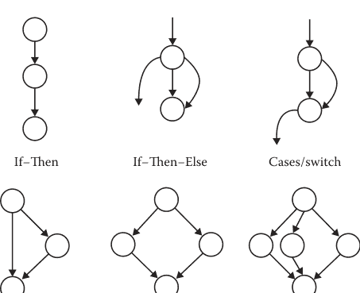

图 8.11 结构化编程构造。

# 路径测试 (Path Testing) ■ 155

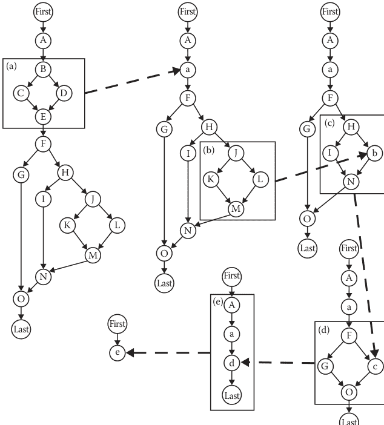

**图 8.12** 关于结构化编程构造的收缩。

因此，一个结论是，这些违反增加了圈复杂度。McCabe 分析的*核心之作*（pièce de résistance）在于，这些违反不会单独发生：如果程序中出现了一个，就必须至少有一个，因此程序不可能是稍微非结构化的。因为这些违反增加了圈复杂度，最少测试数量也增加了。在下一章中，我们将看到这些违反对数据流测试具有有趣的意义。

对于测试人员来说，结论是：圈复杂度高的程序需要更多的测试。在使用圈复杂度指标的机构中，大多数为最大接受复杂度设定了指南；`V(G)=10` 是一个常见的选择。如果一个单元的复杂度更高怎么办？有两种可能：要么简化单元，要么进行更多测试。如果单元结构良好，其本质复杂度为 1；因此可以很容易简化。如果单元的本质复杂度大于 1，通常最好的选择是消除这些违反。

# 软件测试 (Software Testing)

进入决策分支 (Branching into a decision)

离开决策分支 (Branching out of a decision)

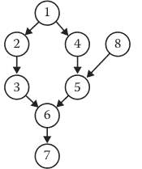

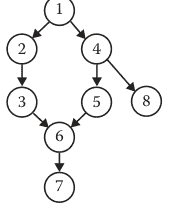

进入循环分支 (Branching into a loop)

离开循环分支 (Branching out of a loop)

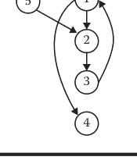

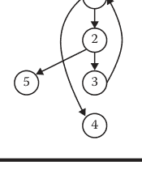

图 8.13 结构化编程构造的违反。

### 8.5 指南与观察

在对基于规格说明说明的测试的研究中，我们观察到缺陷和冗余可能同时存在，且当时无法被识别。问题在于基于规格说明的测试使我们离代码太远。路径测试方法代表了摆钟摆得太远的情况：从代码到有向图的表示模糊了代码中的重要信息，特别是可行路径和不可行路径之间的区别。任何形式的基于代码的测试无法揭示需求中指定的功能。在下一章中，我们将查看基于数据流的测试。这些技术更接近代码，因此路径分析的极端会回到……

McCabe (1982) 的观察是正确的，他指出：“重要的是理解这些纯粹是衡量测试质量的标准，而不是识别测试用例的过程。”他指的是 DD 路径覆盖指标以及基于圈复杂度的基础路径。路径测试为我们提供了所需测试量的下限。

基于路径的测试还为我们提供一组作为规格测试交叉检查的指标。我们可以使用这些指标来解决缺陷。当我们发现同一个程序被遍历时，我们知道 DD 路径覆盖无法揭示错误。例如，假设我们有一个逻辑复杂的程序，尽管进行了大量测试，DD 路径覆盖可能无法揭示错误。

# 软件测试

- e. 对于任何 `x ∈ V`，存在一个向量 `-x ∈ V`，使得 `x + (-x) = 0`。
- f. 对于任何 `x ∈ V`，向量 `kx ∈ V`，其中 `k` 为标量常数。
- g. `k(x + y) = kx + ky`。
- h. `(k + l)x = kx + lx`。
- i. `k(dx) = (kd)x`。
- j. `lx = x`。

在程序路径的“向量空间”中，这10个标准中有几个成立？

## 参考文献

- Beizer, B., Software Testing Techniques, Van Nordstrom, New York, 1984.
- Chilinski, J., An Investigation of Three Forms of the Modified Decision Coverage (MCDC) Criterion, DOT/FAA/AR-01/18, April 2001. http://www.faa.gov/about/office_org/offices_ang/offices/tc/library/ (参见 actlibrary.tc.faa.gov).
- Huang, J., Detection of dataflow anomaly through program instrumentation, IEEE Transactions on Software Engineering, Vol. SE-5, 1979, pp. 226–236.
- Miller, E. F. Jr., Tutorial: Program Testing Techniques, COMPSAC '77, IEEE Computer Society, 1977.
- Miller, E. F. Jr., Automated software testing: a technical perspective, American Programmer, Vol. 4, No. 4, April 1991, pp. 38–43.
- McCabe, T. J., A complexity metric, IEEE Transactions on Software Engineering, Vol. SE-2, No. 4, December 1976, pp. 308–320.
- McCabe, T. J., Structural Testing: A Software Testing Methodology Using the Cyclomatic Metric, National Bureau of Standards (Now NIST), Special Publication 500-99, Washington, DC, 1982.
- McCabe, T. J., Structural Testing: A Software Testing Methodology Using the Cyclomatic Complexity Metric, McCabe and Associates, Baltimore, 1987.
- Perry, W.E., A Structured Approach to Systems Testing, QED Information Systems, Inc., Wellesley, MA, 1987.
- Schach, S.R., Software Engineering, 2nd ed., Richard D. Irwin, and Aksen Associates, Inc., Homewood, IL, 1993.

# 第9章

## 数据流测试

数据流测试是一个令人遗憾的术语，因为它暗示了与数据流图之间存在某种联系；但实际上并没有联系。数据流测试指的是结构化测试方法，重点关注变量赋值点以及这些值被使用（或引用）的点。我们将看到，数据流测试充当了路径测试的“真实性检查”；事实上，许多数据流测试的支持者（以及研究人员）将这种方法视为路径测试的一种形式。虽然数据流和基于切片的测试在单元级上很繁琐，但它们非常适用于面向对象的代码。我们将介绍数据流测试两种主流形式：一种提供了一系列基本定义和一个称为“程序切片”的统一指标。这两种都对测试人员的直观行为（和分析）进行了形式化，尽管它们都始于程序图，并且都向功能测试的方向回溯。此外，这两种方法都很难手动执行，遗憾的是，很少有商业工具能让数据流和切片测试者的工作变得轻松。从好的方面，两种技术对编码和调试都有帮助。

大多数程序以数据的形式交付功能。代表数据的变量以某种方式接收值，而这些值又被用于其他值。自20世纪60年代初以来，程序员根据变量赋值点（语句和语句片段）以及这些值被使用的点对源代码进行分析。很多时候，他们的分析是基于列出变量出现语句编号的关联信息（这种关联在第二代语言编译器中非常流行）。早期的数据流分析关注以下定义/引用异常：

- 变量被定义但从未被使用
- 变量在定义之前被使用
- 变量在使用之前被定义了两次

这些异常都可以从程序的关联中识别出来。由于关联信息是编译器生成的，这些异常可以通过静态分析来发现：即在不执行代码的情况下发现缺陷。

### 9.1 定义/使用测试

定义/使用测试的形式化工作大部分完成于80年代初（Rapps and Weyuk, 1985）；本节的定义与 Clarke 等人 (1989) 的工作兼容，后者总结了大多数定义/使用测试。该研究与我们在第4章和第8章中开发的公式非常兼容。它假设一个程序图，其中节点是语句片段（片段可以是一个完整的语句），且程序遵循结构化观点。

以下定义指的是程序 `P`，它具有一个程序图 `G(P)` 和一组程序变量 `V`。程序图 `G(P)` 的构建见第4章，包含语句片段和表示节点序列的边。我们还丢弃了指向节点自身的边。路径、子路径和循环与第4章相同。路径集为 `S(P)`。

# 定义

如果存在从 `n` 到 `v` 使用处的路径，且在该路径上 `v` 没有被重新定义，则节点 `n ∈ G(P)` 是变量 `v ∈ V` 的定义节点。

# 定义

如果存在从 `v` 的定义到 `n` 的路径，且在该路径上 `v` 没有被重新定义，则节点 `n ∈ G(P)` 是变量 `v ∈ V` 的使用节点。

# 定义

如果路径 `p ∈ S(P)` 起于 `v` 的定义并结束于 `v` 的使用，且在该路径上 `v` 没有被重新定义，则该路径 `p` 是一个定义-使用路径。

# 软件测试

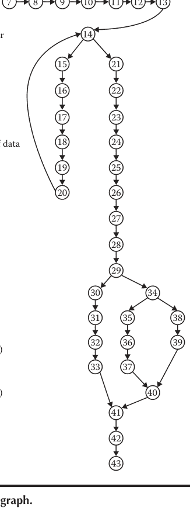

图 9.1 佣金问题及其程序图。

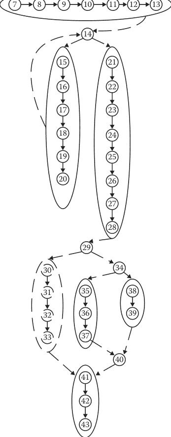

图 9.2 佣金问题伪代码（见图 9.1）的DD路径图。

### 9.1.2 Stocks 的 du路径

首先，让我们来看一条简单的路径：变量 `stocks` 的 `du`路径。我们有 `DEF(stocks, 15)` 和 `USE(stocks, 17)`，因此路径 `<15, 17>` 是相对于 `stocks` 的一条 `du`路径。没有其他定义节点用于 `stocks`；因此，该路径也是定义清晰（definition clear）。

### 9.1.3 Locks 的 du路径

两个定义节点和使用节点使得 `locks` 变量变得更有趣：我们有 `DEF(locks, 13)`, `DEF(locks, 19)`, `USE(locks, 14)` 和 `USE(locks, 16)`。这产生了四条 `du`路径；它们如图 9.3 所示。

- `p1 = <13, 14>`
- `p2 = <13, 14, 15, 16>`
- `p3 = <19, 20, 14>`
- `p4 = <19, 20, 14, 15, 16>`

注意：`du`路径 `p1` 和 `p2` 指 `locks` 的初始值，该值在节点 13 被读取。`locks` 变量在 `while` 语句（节点 14）中谓词使用（predicate use），如果条件为真（如路径 `p2`），则在语句 16 处发生计算。其他 `du`路径从 `while` 循环结束附近开始并在循环重复时发生。这些路径提供了第 8 章讨论的循环覆盖——跳过循环、重复循环和退出循环。所有这些 `du`路径都是定义清晰的。

```
13 Input(locks)
```


14 `While NOT(locks = -1)` 'locks' = -1 signals end of data

15 `Input(stocks, barrels)`

16 `totalLocks = totalLocks + locks`

17 `totalStocks = totalStocks + stocks`

18 `totalBarrels = totalBarrels + barrels`

19 `Input(locks)`

20 `While`

```
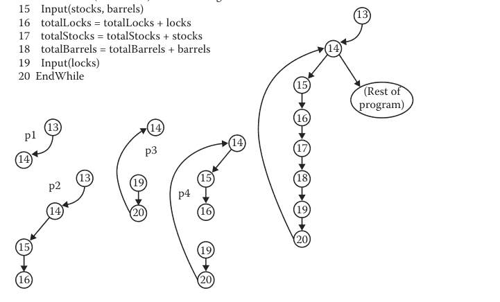
```
图 9.3 `locks` 的 du路径。

## 表 9.1 图 9.1 中的 DD路径

| DD-路径 | 节点 |
| :--- | :--- |
| A | 7, 8, 9, 10, 11, 12, 13 |
| B | 14 |
| C | 15, 16, 17, 18, 19, 20 |
| D | 21, 22, 23, 24, 25, 26, 27, 28 |
| E | 29 |
| F | 30, 31, 32, 33 |
| G | 34 |
| H | 35, 36, 37 |
| I | 38 |
| J | 39 |
| K | 40 |
| L | 41, 42 |

## 表 9.2 佣金问题中变量的定义/使用节点

| 变量 | 定义于节点 | 使用于节点 |
| :--- | :--- | :--- |
| `lockPrice` | 7 | 24 |
| `stockPrice` | 8 | 25 |
| `barrelPrice` | 9 | 26 |
| `totalLocks` | 10, 16 | 16, 21 |
| `totalStocks` | 11, 17 | 17, 22 |
| `totalBarrels` | 12, 18 | 18, 23 |
| `Locks` | 13, 19 | 14, 16 |
| `Stocks` | 15 | 17 |
| `Barrels` | 15 | 18 |
| `lockSales` | 24 | 27 |
| `stockSales` | 25 | 27 |
| `barrelSales` | 26 | 27 |
| `Sales` | 27 | 28, 29, 33, 34, 37, 38 |
| `Commission` | 31, 32, 33, 36, 37, 38 | 41 |

## 表 9.3 选择的定义/使用路径

| 变量 | 路径 (起始, 结束) 节点 | 可行 | 定义清晰 |
| :--- | :--- | :--- | :--- |
| `Commission` | 31, 32 | 是 | 是 |
| `Commission` | 31, 33 | 是 | 否 |
| `Commission` | 31, 37 | 否 | 不适用 |
| `Commission` | 31, 41 | 是 | 否 |
| `Commission` | 32, 32 | 是 | 是 |
| `Commission` | 32, 33 | 是 | 是 |
| `Commission` | 32, 37 | 否 | 不适用 |
| `Commission` | 32, 41 | 是 | 否 |
| `Commission` | 33, 32 | 否 | 不适用 |
| `Commission` | 33, 33 | 是 | 是 |
| `Commission` | 33, 37 | 否 | 不适用 |
| `Commission` | 33, 41 | 是 | 是 |
| `Commission` | 36, 32 | 否 | 不适用 |
| `Commission` | 36, 33 | 否 | 不适用 |
| `Commission` | 36, 37 | 是 | 是 |
| `Commission` | 36, 41 | 是 | 否 |
| `Commission` | 37, 32 | 否 | 不适用 |
| `Commission` | 37, 33 | 否 | 不适用 |
| `Commission` | 37, 37 | 是 | 是 |
| `Commission` | 37, 41 | 是 | 是 |
| `Commission` | 38, 32 | 否 | 不适用 |
| `Commission` | 38, 33 | 否 | 不适用 |
| `Commission` | 38, 37 | 否 | 不适用 |
| `Commission` | 38, 41 | 是 | 是 |

### 9.1.4 `totalLocks` 的 du路径

`totalLocks` 的 du路径将引导我们进入典型情况。有两个定义节点（`DEF(totalLocks, 10)` 和 `DEF(totalLocks, 16)`）和两个使用节点（`USE(totalLocks, 16)`, `USE(totalLocks, 21)`），我们可能会六条 du路径。让我们仔细观察。路径 `p5 = <10, 11, 12, 13, 14, 15>` 是一个 du路径，其中 `totalLocks` 的初始值 (0) 被计算。下一条路径是定义清晰的：`p6 = <10, 11, 12, 13, 14, 15, 16, 17, 18, 19, 20, 21, 24>`。

```
10 totalLocks = 0

11 totalStocks = 0

12 totalBarrels = 0

13 Input(locks)

locks = -1 signals end of data

14 While NOT(locks = -1)

15 Input(stocks, barrels)

16 totalStocks = totalStocks + stocks

17 totalBarrels = totalBarrels + barrels

18 Input(locks)

19 End

21 Output("Locks;", totalLocks)

22 Output("Stocks;", totalStocks)

23 Output("Barrels;", totalBarrels)

24 lockSales = lockPrice * totalLocks
```

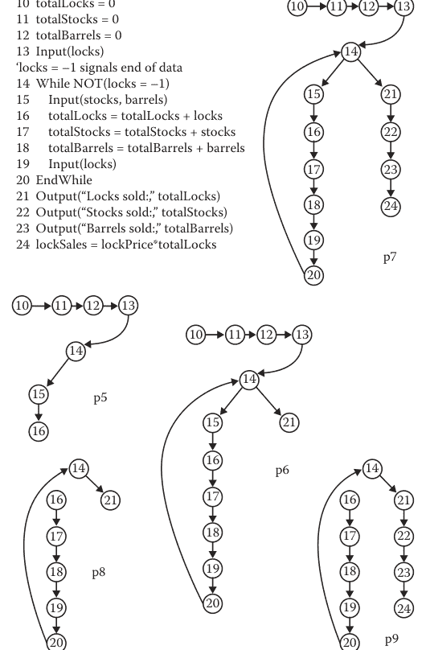

图 9.4 `totalLocks` 的 du路径。

## 数据流测试

路径 `p6` 忽略了循环的重复。我们可以通过子路径 `<16, 17, 18, 19, 20, 14, 15>` 可能会被多次遍历。目前，我们有一个无法定义清晰的 du路径。如果节点 21（输出语句）处发生了 `totalLocks` 的值问题，我们应该查看下一个路径 `p6`；对于 `p6`，我们可以使用相应的路径名称来显示这一点：

```
p7 = <10, 11, 12, 13, 14, 15, 16, 17, 18, 19, 20, 21, 22, 23, 24>

p7 = <6, 23, 24>
```

du路径 `p7` 不是定义清晰的，因为它包含了节点 16。节点 16（赋值语句）。第一个 `<16, 16>` 似乎是退化的。如果展开成机器码，就可以分离定义和使用部分。我们将不允许这些作为 du路径。技术上，赋值的右侧引用了节点 10 定义的值（见路径 `p5`）。剩下的两个 du路径都是 `p7` 的子路径：

```
p8 = <16, 17, 18, 19, 20, 14>

p9 = <16, 17, 18, 19, 20, 14, 21, 22, 23, 24>
```

两者都是定义清晰的，并且都有之前讨论的循环迭代问题。`totalLocks` 的 du路径如图 9.4 所示。

### 9.1.5 `Sales` 的 du路径

`sales` 有一个定义节点；因此，相对于 `sales` 的所有 du路径必须是定义清晰的。它们说明了谓词使用和计算。前三条 du路径是：

```
p10 = <27, 28>

p11 = <27, 28, 29>

p12 = <27, 28, 29, 30, 31, 32>
```

注意 `p12` 是一个带有三个使用的定义清晰路径；它也包含了路径 `p10` 和 `p11`。如果我们使用 `p12` 进行测试，我们知道也会覆盖另外两条路径。我们将在章节结束时回顾这个问题。

29 到 40 中的 `IF, ELSE if` 语句凸显了原始研究中的歧义。两种 du路径有两种选择：一种是路径 `<27, 28, 29, 30, 31, 32>`另一种是路径 `<27, 28, 29, 30, 31, 32, 33, 34, 35, 36, 37, 38, 39, 40, 41>`。剩下的 du路径是：

```
p13 = <27, 28, 29, 30, 31, 32, 33, 34, 35, 36, 37, 38, 39, 40, 41>

p14 = <27, 28, 29, 30, 31, 32, 33, 34, 35, 36, 37, 38, 39, 40, 41>

p15 = <27, 28, 29, 30, 31, 32, 33, 34, 35, 36, 37, 38, 39, 40, 41>
```


注意，动态视图与第 8 章中使用的思维方式非常兼容。

### 9.1.6 Commission 的 du路径

如果你仔细跟了这里的讨论，你可能在担心节奏的变化。在语句 29 到 41 中，佣金的计算是使用中间值构建起来的。这是一种常见的编程实践，而且是理想的，因为它展示了值是如何计算的。我们决定不允许从 31 和 32 这样的赋值语句产生 du路径，因此我们只考虑从“真实”定义节点开始的 du路径：`DEF(commission, 33)`, `DEF(commission, 37)` 和 `DEF(commission, 39)`。使用了一个使用节点：`USE(commission, 41)`。

# 定义

对于程序 $P$，集合 $T$ 满足 All-C-Uses/Some P-Uses 准则，当且仅当：对于每个变量 $v \in V$，$T$ 包含从 $v$ 的每个定义节点到 $v_i$ 的每个计算处的定义清晰路径；并且如果 $v$ 的某个定义没有 C-使用，则该定义的定义清晰路径必须通向至少一个谓词使用。

# 定义

对于程序 $P$，集合 $T$ 满足 All-DU-paths 准则，当且仅当：对于每个变量 $v \in V$，$T$ 包含从 $v$ 的每个定义节点到 $v$ 的使用处的定义清晰路径，以及到每个 `USE(v, n)` 后继节点的定义清晰路径，且这些路径要么是单次循环遍历，要么是无环的。

这些测试覆盖率指标具有若干基于集合论的关系，这些关系在 Rapps 和 Weyuker (1985) 中被称为“包含”（subsumption）。这些关系如图 9.5 所示。现在我们对在（无法实现的）All-Paths 指标与通常接受的最小指标 All-Edges 之间的结构化测试可能性有了更细致的观察。这些有什么用呢？定义/使用测试提供了一种严谨、系统的方法来检查故障发生的位点。

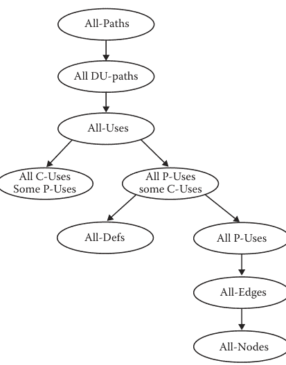

图 9.5 Rapps–Weyuker 数据流覆盖率指标层次。

### 9.1.8 面向对象的代码定义/使用测试

所有的定义/使用定义都没有提到变量在哪里定义以及在哪里。在过程化代码中，这通常假设在一个单元内，但它可能会引入对耦合不当单元的调用。我们可以通过将这些定义称为“无上下文”来区分这种区别；即变量被定义的地方是相互独立的。面向对象的范式改变了这一点——我们现在必须考虑带有类聚合、继承、动态绑定和多态的定义与使用位置。底线是，面向对象代码的数据流测试从单元级移动到了集成级。

### 9.2 基于切片的测试

程序切片（Program slices）自 20 世纪 80 年代初以来就在软件工程文献中出现并合并。它们在 Weiser 1979 年的论文中提出（Weiser, 1979），在 Weiser (1985) 中更广泛地提供，在 Gallagher 和 Lyle (1991) 中作为软件维护的方法引入，最近在 Biem (1994) 中被用于量化功能内聚。在 20 世纪 90 年代初，关于切片的发表活动非常频繁，包括论文（Ball and Eick, 1994）描述了一个用于可视化程序切片的程序。后者描述了一个在工业界使用的工具。（注意，将一个开创性想法引入工业实践花费了大约 20 年。）

程序切片的实用性和多功能性部分归于该概念直观上清晰的本质。然而，程序切片是一组在程序某一点对变量值产生贡献或影响的程序语句集合。这种切片概念也适用于其他学科。我们也可以以切片的形式研究历史——美国历史、欧洲历史、俄罗斯历史、东亚历史、罗马历史等。这些历史切片被证明与程序切片的交互方式非常相似。

我们将从扩展程序切片的的工作定义开始。我们继续使用用于定义/使用路径的符号：一个程序 $P$ 拥有一个程序图 $G(P)$ 和一组程序变量 $V$。最初的尝试完善了 Gallagher 和 Lyle (1991) 中的定义，允许 $P(G)$ 中的节点引用语句片段。

# 定义

给定一个程序 $P$ 和 $P$ 中的变量集合 $V$，在语句 $n$ 处关于变量集 $V$ 的*切片* `S(V, n)` 是 $P$ 中所有对节点 $n$ 处 $V$ 中变量值有贡献的语句片段集合。

一个简化概念——或者在讨论中，变量集 $V$ 包含单个变量 $v$。将其扩展到多个是显而易见且复杂的。对于多个变量集合，我们只需取 $V$ 中每个变量切片的并集。关于程序切片有两个基本问题：它们是后向切片还是正向切片，是静态的还是动态的。后向切片指的是对语句 $n$ 处 $v$ 的值有贡献的语句片段。正向切片指的是受 $v$ 的值和语句 $n$ 影响的所有程序语句。这是定义/使用概念很有用的地方。在后向切片 `S(v, n)` 中，语句 $n$ 被很好地理解为变量 $v$ 的使用节点；然而，正向切片没有那么容易描述，但它们确实取决于变量 $v$ 的谓词使用和计算。

# 数据流测试 ■ 173

静态/动态二分法更为复杂。我们从数据库技术中借用了术语来解释区别。在数据库术中，我们可以引用数据库的意图（intention）和扩展（extension）。意图（唯一的）是基础数据库结构，假设用数据建模语言表示。填充数据库创建了扩展，对已填充数据库的更改会产生新的扩展。在此，静态后向切片 `S(v)` 由程序中所有确定语句 *n* 处变量 *v* 取值的语句组成，独立于。

（注：由于文本包含大量重复和 OCR 错误，以下是基于唯一内容的合并版本）

*(注：由于 OCR 包含大量重复，我将提供合并版本)*

- 集合 $T$ 满足程序 $P$ 的 All-C-Uses/Some P-Uses 准则，当且仅当对于每个变量 $v \in V$，T$ 包含从 $v$ 的每个定义节点到 $v_i$ 的每个计算处的定义清晰路径；并且如果 $v$ 的某个定义没有 C-使用，则该定义的定义清晰路径必须通向至少一个谓词使用。

集合 $T$ 满足程序 $P$ 的 All-DU-paths 准则，当且仅当对于每个变量 $v \in V$，T$ 包含从 $v$ 的每个定义节点到 $v$ 的使用处的定义清晰路径，以及到每个 `USE(v, n)` 后继节点的定义清晰路径，且这些路径要么是单次循环遍历，要么是无环的。

这些测试覆盖率指标具有若干基于集合论的关系，这些关系在 Rapps 和 Weyuker (1985) 中被称为“包含”。这些关系如图 9.5 所示。现在我们对在 All-Paths 指标与通常接受的最小指标 All-Edges 之间的结构化测试可能性有了更细致的观察。这些有什么用呢？定义/使用测试提供了一种严谨、系统的方法来检查故障发生的位点。


图 9.5 Rapps–Weyuker 数据流覆盖率指标层次。

### 9.1.8 面向对象的代码定义/使用测试

所有的定义/使用定义都没有提到变量在哪里定义以及在哪里。在过程化代码中，这通常假设在一个单元内，但它可能会引入对耦合不当单元的调用。我们可以通过将这些定义称为“无上下文”来区分这种区别；即变量被定义的地方是相互独立的。面向对象的范式改变了这一点——我们现在必须考虑带有类聚合、继承、动态绑定和多态的定义与使用位置。底线是，面向对象代码的数据流测试从单元级移动到了集成级。

### 9.2 基于切片的测试

程序切片自 20 世纪 80 年代初以来在软件工程文献中出现并合并。它们在 Weiser 1979 年的论文中提出（Weiser, 1979），在 Weiser (1985) 中更广泛地提供，在 Gallagher 和 Lyle (1991) 中作为软件维护的方法，最近在 Biem (1994) 中被用于量化功能内聚。在 20 世纪 90 年代初，关于切片的发表活动非常频繁，包括论文（Ball and Eick, 1994）描述了一个用于可视化程序切片的程序。后者描述了一个在工业界使用的工具。（注意，将一个开创性想法引入工业实践花费了大约 20 年。）

程序切片的实用性和多功能性部分归于该概念直观上清晰的本质。然而，程序切片是一组在程序某一点对变量值产生贡献或影响的程序语句集合。这种切片概念也适用于其他学科。我们也可以以切片的形式研究历史——美国历史、欧洲历史、俄罗斯历史、东亚历史、罗马历史等。这些历史切片被证明与程序切片的交互方式非常相似。

我们将从扩展程序切片的的工作定义开始。我们继续使用用于定义/使用路径的符号：一个程序 $P$ 拥有一个程序图 $G(P)$ 和一组程序变量 $V$。最初的尝试完善了 Gallagher 和 Lyle (1991) 中的定义，允许 $P(G)$ 中的节点引用语句片段。

# 定义

给定一个程序 $P$ 和 $P$ 中的变量集合 $V$，在语句 $n$ 处关于变量集 $V$ 的*切片* `S(V, n)` 是 $P$ 中所有对节点 $n$ 处 $V$ 中变量值有贡献的语句片段集合。

一个简化概念——或者在讨论中，变量集 $V$ 包含单个变量 $v$。将其扩展到多个是显而易见且复杂的。对于多个变量集合，我们只需取 $V$ 中每个变量切片的并集。关于程序切片有两个基本问题：它们是后向切片还是正向切片，是静态的还是动态的。后向切片指的是对语句 $n$ 处 $v$ 的值有贡献的语句片段。正向切片指的是受 $v$ 的值和语句 $n$ 影响的所有程序语句。这是定义/使用概念很有用的地方。在后向切片 `S(v, n)` 中，语句 $n$ 被很好地理解为变量 $v$ 的使用节点；然而，正向切片没有那么容易描述，但它们确实取决于变量 $v$ 的谓词使用和计算。

静态/动态二分法更为复杂。我们从数据库技术中借用了术语来解释区别。在数据库术中，我们可以引用数据库的意图（intention）和扩展（extension）。意图（唯一的）是基础数据库结构，假设用数据建模语言表示。填充数据库创建了扩展，对已填充数据库的更改会产生新的扩展。在此，静态后向切片 `S(v)` 由程序中所有确定语句 *n* 处变量 *v* 取值的语句组成，独立于。

（注：由于文本包含大量重复，以下是合并后的内容。）

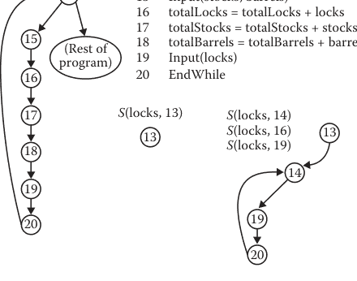

图 9.6 locks 的切片。

## Software Testing

- 10 totalLocks = 0
- 11 totalStocks = 0
- 12 totalBarrels = 0
- 13 Input(locks)
- 14 While NOT(stocks,barrels) = -1
- 15 Input(stocks)
- 16 totalLocks = totalStocks + stocks
- 17 totalStocks = totalStocks + stocks
- 18 totalBarrels = totalBarrels + barrels
- 19 Input(locks)
- 20 EndWhile
- 21 Output("Locks,"totalLocks")
- 22 Output("Stocks,"totalStocks")
- 23 Output("Barrels,"totalBarrels")
- 24 lockSlices = lockPrice*totalLocks

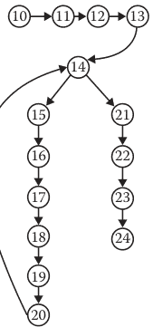

图 9.7 循环中的切片。

回顾简化定义：切片 `V(n)` 是单个变量的切片；切片 `V` 计算单个变量 `v`。如果语句片段 `n` 是 `v` 的定义节点，则 `n` 被包含在切文中。如果语句片段 `n` 是 `v` 的使用节点，则 `n` 不包含在切文中。如果一个语句既是定义节点又是使用节点，则它包含在切文中。在静态切片中，其他（并非切片集 `V` 中的 `v`）的 P-use 和 C-use 在其执行影响变量 `v` 的范围内被包含进来。作为一个准则，如果 `v` 的值决定一个语句片段是被包含还是排除，则排除该语句片段。

L-use 和 I-use 变量通常在它们的单元外部是不可见的，但这并不能排除此类变量经常产生的问题。另一个判断：在这里（带有某种风险），我们选择将它们从“贡献”的意图中排除。。因此，O-use、L-use 和 I-use 节点被排除在切片之外。

### 9.2.1 示例

书中使用了佣金问题（commission problem），因为它包含有趣的数据流属性，这些属性在三角形问题（或 NextDate）中并不存在。在下文中，除非特别说明，我们讨论的是静态后向切片，并且包含了对应于可执行语句片段的节点。示例引用了图 9.1 中佣金问题的源代码。在我们的示例中有 42 个“有趣的”静态后向切片。它们在表 9.5 中列出。我们将选择性查看一些有趣的切片。

第一批切片是最简单的——即变量化的节点。

| 表 9.5 佣金问题中的切片 | | | |
| :--- | :--- | :--- |
| $S_1$: S(lockPrice, 7) | $S_{15}$: S(barrels, 18) | $S_{29}$: S(barrelSales, 26) |
| $S_2$: S(stockPrice, 8) | $S_{16}$: S(Totalbarrels, 18) | $S_{30}$: S(sales, 27) |
| $S_3$: S(barrelPrice, 9) | $S_{17}$: S(Socks, 19) | $S_{31}$: S(sales, 28) |
| $S_4$: S(totalLocks, 10) | $S_{18}$: S(TotalLocks, 21) | $S_{32}$: S(sales, 29) |
| $S_5$: S(TotalStocks, 11) | $S_{19}$: S(TotalStocks, 22) | $S_{33}$: S(sales, 33) |
| $S_6$: S(totalbarrels, 12) | $S_{20}$: S(Totalbarrels, 23) | $S_{34}$: S(sales, 34) |
| $S_7$: S(Locks, 13) | $S_{21}$: S(lockPrice, 24) | $S_{35}$: S(sales, 37) |
| $S_8$: S(locks, 14) | $S_{22}$: S(TotalLocks, 24) | $S_{36}$: S(sales, 39) |
| $S_9$: S(stocks, 15) | $S_{23}$: S(Socks, 24) | $S_{37}$: S(commission, 31) |
| $S_{10}$: S(barrels, 15) | $S_{24}$: S(stockPrice, 25) | $S_{38}$: S(commission, 32) |
| $S_{11}$: S(locks, 16) | $S_{25}$: S(TotalStocks, 25) | $S_{39}$: S(commission, 33) |
| $S_{12}$: S(totalLocks, 16) | $S_{26}$: S(Totalbarrels, 25) | $S_{40}$: S(commission, 36) |
| $S_{13}$: S(stocks, 17) | $S_{27}$: S(barrelPrice, 26) | $S_{41}$: S(commission, 37) |
| $S_{14}$: S(TotalStocks, 17) | $S_{28}$: S(Totalbarrels, 26) | $S_{42}$: S(commission, 39) |

`$S_1$: S(lockPrice, 7) = [7]`
`$S_2$: S(stockPrice, 8) = [8]`
`$S_3$: S(barrelPrice, 9) = [9]`
`$S_4$: S(totalLocks, 10) = [10]`
`$S_5$: S(totalStocks, 11) = [11]`
`$S_6$: S(totalbarrels, 12) = [12]`

切片 7 到 17 位于哨兵 while 循环，其中 totals、stocks 和 barrels 在此累加。这些变量在该循环中有两次使用：14 处的 P-use 和 16 处的 C-use。它在语句 13 和 19 处有两个定义节点。stocks 和 barrels 变量分别在 15 处有一个定义节点，在 17 和 18 处有计算节点。注意所有相关语句片段的存在。locks 的切片如图 9.6 所示。

`$S_7$: S(locks, 13) = [13]`
`$S_8$: S(locks, 14) = [13, 14, 19, 20]`
`$S_9$: S(stocks, 15) = [13, 14, 15, 19, 20]`
`$S_{10}$: S(barrels, 15) = [13, 14, 15, 19, 20]`
`$S_{11}$: S(locks, 16) = [13, 14, 19, 20]`
`$S_{12}$: S(totalLocks, 16) = [10, 13, 14, 16, 19, 20]`
`$S_{13}$: S(stocks, 17) = [13, 14, 15, 19, 20]`
`$S_{14}$: S(totalStocks, 17) = [11, 13, 14, 15, 17, 20]`
`$S_{15}$: S(barrels, 18) = [12, 13, 14, 15, 19, 20]`
`$S_{16}$: S(totalBarrels, 18) = [12, 13, 14, 15, 19, 20]`
`$S_{17}$: S(locks, 19) = [13, 14, 20]`

切片 18、19 和 20 是输出语句，没有任何变量被定义；因此，相应的语句不包含在切片中。

`$S_{18}$: S(totalLocks, 21) = [10, 13, 14, 16, 19, 20]`
`$S_{19}$: S(totalStocks, 22) = [11, 13, 14, 15, 17, 19, 20]`
`$S_{20}$: S(totalBarrels, 23) = [12, 13, 14, 15, 18, 19, 20]`

切片 21 到 30 处理的是变量切片的计算。作为一个顺带的，我们可以写成 `$S_{30}$: S(sales, 27) = S_{23} \cup S_{26} \cup S_{29} \cup [27]`。这更像 Weiser (1979) 在其差分法中提到的——一种回溯程序的自然方法。Gallagher 和 Lyle (1991) 将其作为维护程序员中的一种模式进行了呼应。这也导致了 Gallagher 的“切片拼接”概念。切片 `$S_{23}$` 计算总锁，`$S_{25}$` 计算总库存，`$S_{28}$` 计算总桶数。从自下而上的视角来看，这些切片可以单独编码和测试，然后拼接在一起。“拼接”实际上是一个恰当的比喻——任何扭过绳子的人都知道拼接涉及在合适的地方仔细合并区间。（参见图 9.7 关于循环对切片的影响。）

`$S_{21}$: S(lockPrice, 24) = [7]`
`$S_{22}$: S(totalLocks, 24) = [10, 13, 14, 16, 19, 20]`
`$S_{23}$: S(lockSales, 24) = [7, 10, 13, 14, 16, 19, 20]`
`$S_{24}$: S(stockPrice, 25) = [8]`
`$S_{25}$: S(totalStocks, 25) = [11, 13, 14, 15, 17, 19, 20]`
`$S_{26}$: S(stockSales, 25) = [8, 11, 13, 14, 15, 17, 20]`
`$S_{27}$: S(barrelPrice, 26) = [9]`
`$S_{28}$: S(totalBarrels, 26) = [12, 13, 14, 15, 18, 19]`
`$S_{29}$: S(barrelSales, 26) = [9, 12, 13, 14, 15, 18, 19, 20]`
`$S_{30}$: S(stocks, 27) = [7, 8, 9, 10, 11, 12, 13, 14, 15, 16, 17, 18, 19, 20, 24]`

切片 31 到 36 是相同的。`$S_{31}$` 是 sales 的 O-use；其他的都是 C-use。除了 `$S_{30}$` 之外，这些没有一个改变切片的值。
`$S_{31}$: S(stocks, 28) = [7, 8, 9, 10, 11, 12, 13, 14, 15, 16, 17, 18, 19, 20, 24, 25, 26]`
最后七个切片与 sales 的计算结合在一起。
`$S_{37}$: S(commission, 31) = [7, 8, 9, 10, 11, 12, 13, 14, 15, 16, 17, 18, 19, 20, 24, 25, 26, 29, 30, 31]`
`$S_{38}$: S(commission, 32) = [7, 8, 9, 10, 11, 12, 13, 14, 15, 16, 17, 18, 19, 20, 24, 25, 26, 29, 30, 31]`
`$S_{39}$: S(commission, 33) = [7, 8, 9, 10, 11, 12, 13, 14, 15, 16, 17, 18, 19, 20, 24, 25, 26, 29, 30, 31, 32]`
`$S_{40}$: S(commission, 36) = [7, 8, 9, 10, 11, 12, 13, 14, 15, 16, 17, 18, 19, 20, 24, 25, 26, 29, 30, 31, 34]`
`$S_{41}$: S(commission, 37) = [7, 8, 9, 10, 11, 12, 13, 14, 15, 16, 17, 18, 19, 20, 24, 25, 26, 29, 30, 31, 34, 35]`
`$S_{42}$: S(commission, 39) = [7, 8, 9, 10, 11, 12, 13, 14, 15, 16, 17, 18, 19, 20, 24, 25, 26, 29, 30, 31, 34, 35, 36, 38]`
`$S_{43}$: S(commission, 41) = [7, 8, 9, 10, 11, 12, 13, 14, 15, 16, 17, 18, 19, 20, 24, 25, 26, 29, 30, 31, 32, 33, 34, 35, 36, 37, 39, 40]`

查看片段编号集合（图 9.8）在我们的定义中是正确的，但观察切片是如何由之前切片的集合组成的也有帮助。我们接下来将这样做，并在图 9.9 中显示最终的晶格。

`$S_1$: S(lockPrice, 7) = [7]`
`$S_2$: S(stockPrice, 8) = [8]`
`$S_3$: S(barrelPrice, 9) = [9]`
`$S_4$: S(totalLocks, 10) = [10]`
`$S_5$: S(totalStocks, 11) = [11]`
`$S_6$: S(totalBarrels, 12) = [12]`
`$S_7$: S(locks, 13) = [13]`
`$S_8$: S(locks, 14, 20) = S_7 \cup [14, 20]`
`$S_9$: S(stocks, 15) = S_8 \cup {15}`
`$S_{10}$: S(barrels, 15) = S_8`
`$S_{11}$: S(locks, 16) = S_8`
`$S_{12}$: S(totalLocks, 16) = S_4 \cup S_{11} \cup [16]`
`$S_{13}$: S(stocks, 17) = S_9 \cup {13, 14, 19, 20}`


图 9.8 佣金问题的切片部分晶格。


图 9.9 佣金问题的完整晶格。

`$S_{14}$: S(totalStocks, 17) = S_4 \cup S_{13} \cup {17}`
`$S_{15}$: S(barrels, 18) = S_6 \cup S_{10}`
`$S_{16}$: S(totalBarrels, 18) = S_6 \cup S_{15} \cup {18}`

`$S_{19}: S(totalStocks, 22) = S_{14}`
`$S_{20}: S(totalBarrels, 23) = S_{15}`
`$S_{21}: S(lockPrice, 24) = S_{1}`
`$S_{22}: S(totalLocks, 24) = S_{13}`
`$S_{23}: S(lockSales, 24) = S_{21} \cup S_{22} \cup [24]`
`$S_{24}: S(stockPrice, 25) = S_{5}`
`$S_{25}: S(totalStocks, 25) = S_{14}`
`$S_{26}: S(stockSales, 25) = S_{24} \cup S_{25} \cup [25]`
`$S_{27}: S(barrelPrice, 26) = S_{5}`
`$S_{28}: S(totalBarrels, 26) = S_{20}`
`$S_{29}: S(barrelBarrels, 26) = S_{27} \cup S_{28} \cup [26]`
`$S_{30}: S(sales, 27) = S_{23} \cup S_{26} \cup S_{29} \cup [27]`
`$S_{31}: S(sales, 28) = S_{30}`
`$S_{32}: S(sales, 29) = S_{30}`
`$S_{33}: S(sales, 33) = S_{30}`
`$S_{34}: S(sales, 34) = S_{30}`
`$S_{35}: S(sales, 37) = S_{30}`
`$S_{36}: S(sales, 39) = S_{30}`
`$S_{37}: S(commission, 31) = S_{30} \cup [29, 30, 31]`
`$S_{38}: S(commission, 32) = S_{37} \cup [32]`
`$S_{39}: S(commission, 33) = S_{38} \cup [33]`
`$S_{40}: S(commission, 36) = S_{30} \cup [29, 34, 35, 36]`
`$S_{41}: S(commission, 37) = S_{30} \cup [37]`
`$S_{42}: S(commission, 39) = S_{39} \cup [29, 34, 38, 39]`
`$S_{43}: S(commission, 41) = S_{39} \cup S_{41} \cup S_{42}`

图 9.9 中的几处连接是双向箭头，表示集合等价。（回顾第 3 章，如果 `A \subseteq B` 且 `B \subseteq A`，则 `A = B`）。我们可以通过移除这些连接来清理图 9.9，从而得到一个更好的格。结果如图 9.10 所示。

### 9.2 风格与技术

当我们从有趣的切片（slices）的角度分析程序时，会忽略无关的部分。我们无法通过 du 路径（du-paths）来实现这一点——它们是包含了可能感兴趣的语句和变量的序列。在讨论某些分析技术之前，我们首先来看“良好的风格”。我们将这些风格准则构建到了定义中，但这样导致定义比所需的更严格了。

- 1. 永远不要为切片 `S(V, n)` 创建切片，使得 `V` 中的变量 `v` 未出现在语句片段 `n` 中。切片的定义允许这种可能性，但这是一种糟糕的做法。例如，我们对变量 27 处的锁（locks）定义了一个切片。定义此类切片将需要跟踪程序中所有点所有变量的值。
- 2. 对单个变量进行切片。切片 `S(V, n)` 中的变量集合 `V` 可以包含多个变量，有时这样的切片是有用的。

```


$`V` = [`lockSales`, `stockSales`, `barrelSales`]$ 


包含了切片 `$S_{30}$`：`$S(sales, 27)$` 的所有元素，除了第 27 条语句。

## 软件测试

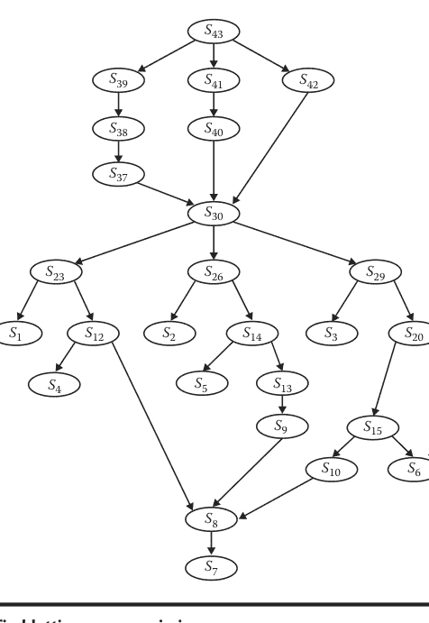

图 9.10 佣金的简化格。

- 3. 为所有的 A-def 节点创建切片。当变量通过赋值语句计算时，在该语句处对变量的切片将包含计算中所用变量的所有 du 路径（部分）。`$S_{30}: S(sales, 27)$` 是一个 A-def 切片的良好示例。对于通过输入语句（I-def 节点）定义的变量也是如此，例如 `$S_{10}: S(barrels, 15)$`。
- 4. 没有太大理由为输出语句中的变量创建切片。对 O-use 变量的切片始终表示为该 O-use 变量的所有 A-def（以及 I-def）切片的并。
- 5. 为 P-use 节点创建切片。当变量在谓词中使用时，在该语句处该变量的切片将显示该变量是如何获取值的。这在像佣金程序这样决策密集的程序中非常有用。
- 6. 考虑让切片可编译的。切片的定义中没有任何要求语句集是可编译的；然而，一组语句声明是每个切片的子集。如果我们将这些语句添加到为佣金程序创建的所有切片中，我们的格不受影响；但是，每个切片都是独立编译的（因此是可执行的）。在第 1 章中，我们建议良好的实践会导致更好的编程。在这里我们有一个很好的例子。如果我们这样做，我们会编写一个切片并对其测试。然后我们编写那些切片并将它们合并（有时称为“拼接”）成一个相当健壮的程序。

## 9.2.3 切片拼接

佣金程序刻意设计得很小，但足以说明“切片”的概念。在 9.1 到 9.4 中，佣金程序被分成四个切片。切片 1 包含由 `locks` 变量控制的输入循环。这是一个很好的起点，因为切片 2 和切片 3 分别使用循环获取股票（stocks）和桶（barrels）的输入值。切片 1、2 和 3 各有一个销售额（sales）值，这是切片 4 的起点，切片 4 计算销售额的值。

对于这个小例子来说这有些过度；但这个想法可以完美地扩展到更大的程序中。它也说明了软件维护所需的程序理解的基础。切片允许维护程序员专注于当前处理的问题，并避免 du 路径中包含的额外信息。

```
1 Program Slice1 (INPUT,OUTPUT)
2 Dim locks As Integer
3 Dim lockPrice As Real
4 Dim totalLocks As Integer
5 Dim locksSales As Real
6 Dim sales As Real
7 lockPrice = 45.0
13 Input(locks)
locks = -1 signals end of data
14 While NOT(locks) = -1
16 totalLocks = totalLocks + locks
19 Input(locks)
20 EndWhile
21 Output("Locks sold",totalLocks)
24 locksSales = lockPrice*totalLocks
27 sales = stockSales
28 Output("Total sales; sales")
```


图 9.11 切片 1。

```
1 Program Slice2 (INPUT,OUTPUT)
2 Dim locks As Integer
3 Dim lockPrice As Real
4 Dim totalLocks As Integer
5 Dim locksSales As Real
6 Dim sales As Real
8 stockPrice = 30.0
11 totalStocks = 0
13 Input(locks)
locks = -1 signals end of data
14 While NOT(locks) = -1
15 Input(stocks)
17 totalStocks = totalStocks + locks
19 Input(locks)
20 EndWhile
21 Output("Stocks sold",totalStocks)
25 locksSales = lockPrice*totalStocks
27 sales = stockSales
28 Output("Total sales; sales")
```

切 2。

```
1 Program Slice3 (INPUT,OUTPUT)
2 Dim locks As Integer
3 Dim lockPrice As Real
4 Dim totalLocks As Integer
5 Dim locksSales As Real
6 Dim sales As Real
9 barrelPrice = 25.0
12 totalBarrels = 0
13 Input(locks)
locks = -1 signals end of data
14 While NOT(locks) = -1
15 Input(barrels)
18 totalBarrels = totalBarrels + locks
19 Input(locks)
20 EndWhile
23 Output("Barrels sold",totalBarrels)
24 barrelsSales = barrelPrice*totalBarrels
27 sales = barrelsSales
28 Output("Total sales; sales")
```

切片 3。

```
1 Program Slice4 (INPUT,OUTPUT)
2 Dim locks As Integer
3 Dim lockPrice As Real
4 Dim totalLocks As Integer
5 Dim locksSales As Real
6 Dim sales As Real
7 stockSales As Real
10 barrelsSales As Real
13 Input(locks)
locks = -1 signals end of data
14 While NOT(locks) = -1
16 totalLocks = totalLocks + locks
19 Input(locks)
20 EndWhile
21 Output("Locks sold",totalLocks)
24 locksSales = lockPrice*totalLocks
27 sales = locksSales + stockSales + barrelsSales
28 Output("Total sales; sales")
```

切片 4。

## 9.3 切片工具

任何仔细阅读过本章节的人都会同意，程序切片在逻辑上是可行的。对于程序理解，程序切片工具是有用的。JSlice 适用于面向对象的系统。这里有一些商业工具。

## 表 9.6 选定的切片工具

| 工具/产品 | 语言 | 静态/动态？ |
| --- | --- | --- |
| Kamkar | Pascal | 动态 |
| Spyder | C | 动态 |
| Unravel | ANSI C | 静态 |
| CodeSonar | C++ | 静态 |
| Indus/Kaveri | Java | 静态 |
| JSlice | Java | 动态 |
| SeeSlice | C | 静态 |

## 练习

- 1. 思考 du 路径的静态与动态。对于 p2, p3 和 p4，发现了哪些 du 路径？
- 2. 尝试对 9.5 中的 Rapps–Weyker 层次结构进行合并。
- 3. 列出佣金的 du 路径。
- 4. 我们对切片的讨论实际上是“向后切片”，因为我们总是关注对程序某点变量贡献的部分。我们也可以考虑“正向切片”，指向程序中使用该变量的部分。比较正向切片与 du 路径。

## 参考文献

Biem, J. and Ott, L., 功能内聚，IEEE Transactions on Software Engineering, Vol. SE-20, No. 8, August 1994, pp. 644–657.
Ball, T. and Eich, S.G., 程序切片的视觉化，Proceedings of the 1994 IEEE Symposium on Visual Languages. St. Louis, October 1994, pp. 288–295.
Clarke, A. et al., 数据流选择标准的正式评估，IEEE Transactions on Software Engineering, Vol. SE-15, No. 11, November 1989, pp. 1318–1332.
Gallagher, K.B. and Jile, J.R., 软件维护中的切片视觉化，IEEE Transactions on Software Engineering, Vol. SE-7, No. 8, August 1991, pp. 751–761.
Hoffner, T., 程序切片工具的评估与比较，技术报告，瑞典链接大学计算机与信息科学系，1995.
Rapps, S. and Weyker, E., 使用数据流信息选择测试数据，IEEE Transactions on Software Engineering, Vol. SE-11, No. 4, April 1985, pp. 367–375.
Weiser, M., 程序切片：自动程序抽象方法的正式心理与实际研究。博士论文，密歇根大学，安诺堡，MI。1979.
Weiser, M.D., 程序切片，IEEE Transactions on Software Engineering, Vol. SE-10, No. 4, April 1988, pp. 352–357.

## 第10章
## 单元测试的回顾

单元测试何时应该停止？这里有一些可能的答案：

- 1. 当你时间用完时
- 2. 当继续测试不再产生新的失败时
- 3. 当继续测试不再发现新缺陷时
- 4. 当你想不出任何新的测试用例时
- 5. 当你到达了收益递减点时
- 6. 当达到了强制要求的覆盖率时
- 7. 当所有缺陷都已修复时

遗憾的是，第一个答案太常见了，而第七个答案无法保证。这使得测试设计者处于中间的某个位置。软件可靠性模型提供了支持第二和第三种选择的答案；这两种方法在工业中已成功应用。第四种选择很有趣：如果你遵循了我们一直在讨论的准则和指南，这可能是一个很好的答案。但另一方面，如果原因是因为缺乏动力，那么这个选择就和第一个一样令人遗憾。收益递减点具有吸引力：它表明严谨的测试仍在持续，发现新缺陷的速度已大大缓慢。继续测试变得非常昂贵，并且可能无法发现新缺陷。如果可以确定剩余缺陷的成本（或风险），这种权衡就是显而易见的。（这是一个条件。）我们剩下覆盖率这个答案，这是一个非常好的答案。在本章中，我们将看到如何将测试作为功能测试的交叉检查来产生强大的结果。首先，我们对研究过的单元测试方法进行概括性的回顾。比喻地说，这被描述为一个在两个极端之间摆动的摆锤。接下来，我们沿着摆锤的轨迹，从基于代码测试的最抽象形式，到强语义基础的方法，然后回到基于规范测试的非常抽象层次。我们将通过“三角形程序”对这些方法进行巡游。之后，将对两种形式的单元测试给出建议，然后是另一个案例研究——这次是一个汽车保险的案例。

## 10.1 测试方法摆锤

正如生活中的许多事情一样，存在一个在两个极端之间摆动的摆锤。测试方法的摆锤在低语义内容的两个极端之间摆动——从严格的拓扑结构到功能性。随着测试方法远离极端并向中心移动，它们会变得更加有效，同时也变得更加困难（见图10.1）。

在基于代码的一侧，基于路径的测试依赖于程序图的连通性——节点的语义意义丢失了。程序图是代码的纯拓扑抽象，几乎不包含代码意义——只留下了控制流。这导致了无法通过自动化手段识别为不可行的程序路径。移动到数据测试，通常创建不可行路径的依赖类型通常可以被检测到。最后，从切片（slices）的角度来看，我们尽地接近了代码的语义意义。

在基于规范的一侧，仅对变量的边界值进行测试容易出现严重的间隙和冗余，而这两者在纯粹基于规范的测试中都是不可知的。等价类测试使用“相似处理”的想法来识别类别，并在此过程中利用更多规范的语义意义。最后，决策表测试使用源自规范的可能和不可能的条件组合来处理复杂的逻辑考量。

在摆动摆锤的两侧，当我们向极端移动时，测试用例的识别变得变得越来越容易。随着测试技术向更高的语义意义移动，它们变得更难自动化——但也更有效。嗯，难道可能是埃德加·爱伦·波在撰写《深渊与摆锤》时，实际上在把测试看作一个深渊和一个摆锤吗？由你决定。同时，这些思想在图10.2中得到了近似。

这些图需要一些详细说明。从程序图测试开始，注意节点中完全不包含关于语句片段的语义信息——边描述了一个片段是否可以在前一个片段之后执行。程序图中的路径在拓扑上都是可能的——事实上，它们可以用 Marshall 算法通过数学生成。

| 基于代码的测试 | 基于规范的测试 |
| :--- | :--- |
| 路径测试 | 数据流测试 |
| 切片测试 | 决策表测试 |
| 等价类测试 | 边界值测试 |
| 低语义内容 | 高语义内容 低语义内容 |

图10.1 测试方法摆锤。

## 单元测试的回顾 ■ 187

测试用例识别工作

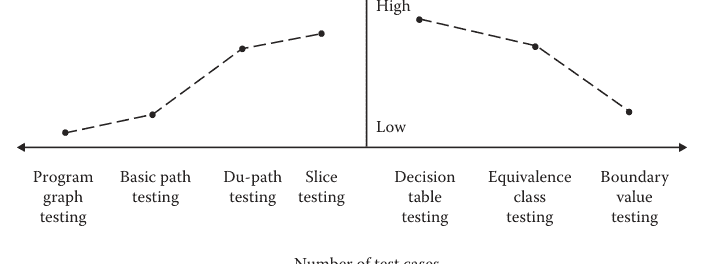

测试用例数量

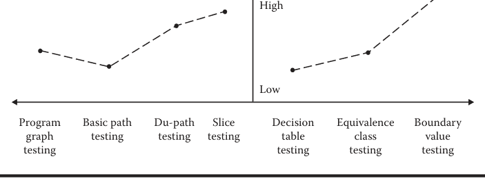

**图 10.2** 测试方法的努力和效能。

问题在于拓扑上可能的路径集包含了可行路径和不可行路径，正如我们在第8章讨论的那样。向 McCabe 的基路径测试方向移动增加了一些语义内容。建议的起点是代表常见功能的主线路径。基路径由于在起点路径上遇到“决策”时简单地“平化”的启发式方法而遇到麻烦。这也导致了不可行路径的可能性。当移动到定义/使用（define/use）域时，我们使用了更多的语义意义。我们遵循变量值定义和使用的地方。定义使用路径（du-paths）和定义清晰路径（definition-clear paths）之间的区别提供了更多的语义信息。最后，反向切片做了两件事：它们消除了不需要的细节，并将注意力精确集中在需要的地方——所有影响该值的语句。

在基于规范的一侧，仅对变量的边界值进行测试容易出现严重的间隙和冗余，而这两者在纯粹基于规范的测试中都是不可知的。等价类测试使用“相似处理”的想法来识别类别，并在此过程中利用更多规范的语义意义。最后，决策表测试使用源自规范的可能和不可能的条件组合来处理复杂的逻辑考量。问题在于拓扑上可能的路径集包含了可行路径和不可行路径，正如我们在第8章讨论的那样。向 McCabe 的基路径测试方向移动增加了一些语义内容。建议的起点是代表常见功能的主线路径。基路径由于在起点路径上遇到“决策”时简单地“平化”的启发式方法而遇到麻烦。这也导致了不可行路径的可能性。当移动到定义/使用（define/use）域时，我们使用了更多的语义意义。我们遵循变量值定义和使用的地方。定义使用路径和定义清晰路径之间的区别提供了更多的语义信息。最后，反向切片做了两件事：它们消除了不需要的细节，并将注意力精确集中在需要的地方——所有影响该值的语句。

基于规范的一侧，仅对变量的边界值进行测试容易出现严重的间隙和冗余，而这两者在纯粹基于规范的测试中都是不可知的。等价类测试使用“相似处理”的想法来识别类别，并在此过程中利用更多规范的语义意义。最后，决策表测试使用源自规范的可能和不可能的条件组合来处理复杂的逻辑考量。

问题在于拓扑上可能的路径集包含了可行路径和不可行路径，正如我们在第8章讨论的那样。向 McCabe 的基路径测试方向移动增加了一些语义内容。建议的起点是代表常见功能的主线路径。基路径由于在起点路径上遇到“决策”时简单地“平化”的启发式方法而遇到麻烦。这也导致了不可行路径的可能性。当移动到定义/使用（define/use）域时，我们使用了更多的语义意义。我们遵循变量值定义和使用的地方。定义使用路径和定义清晰路径之间的区别提供了更多的语义信息。最后，反向切片做了两件事：它们消除了不需要的细节，并将注意力精确集中在需要的地方——所有影响该值的语句。

## 10.2 穿过摆锤

正如生活中的许多事情一样，存在一个在两个极端之间摆动的摆锤。测试方法的摆锤在低语义内容的两个极端之间摆动——从严格的拓扑结构到功能性。随着测试方法远离极端并向中心移动，它们会变得更加有效，同时也变得更加困难（见图10.1）。

在基于代码的一侧，基于路径的测试依赖于程序图的连通性——节点的语义意义丢失了。程序图是代码的纯拓扑抽象，几乎不包含代码意义——只留下了控制流。这导致了无法通过自动化手段识别为不可行的程序路径。移动到数据测试，通常创建不可行路径的依赖类型通常可以被检测到。最后，从切片（slices）的角度来看，我们尽地接近了代码的语义意义。

基于规范的一侧，仅对变量的边界值进行测试容易出现严重的间隙和冗余，而这两者在纯粹基于规范的测试中都是不可知的。等价类测试使用“相似处理”的想法来识别类别，并在此过程中利用更多规范的语义意义。最后，决策表测试使用源自规范的可能和不可能的条件组合来处理复杂的逻辑考量。

© 2010 Taylor & Francis

# 单元测试回顾 189

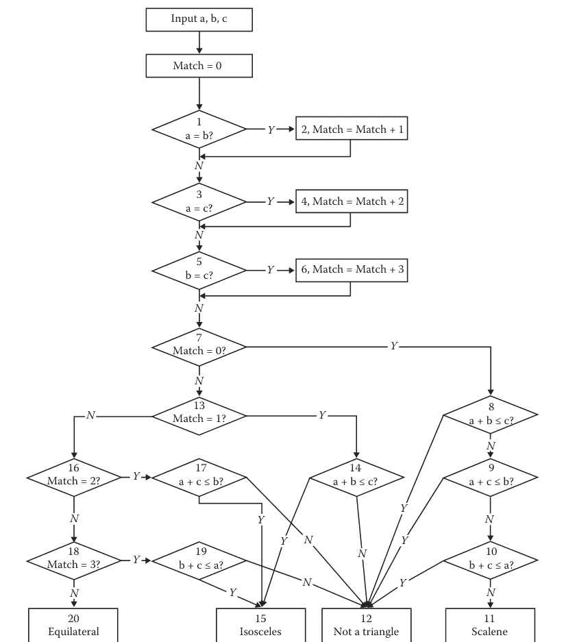

**图 10.3** 类 FORTRAN 三角形难题的流程图。类似的注释适用于切片 `S(triangleType, 20)`，其中 `triangleType` 的预期值为“Equilateral”（等边三角形）。在这里我们只需要一个测试用例，这可能预示了等价类测试。最后需要测试的切片将是等腰三角形，以及针对 a、b、c 无法构成三角形边的六种情况。

请注意，从非常抽象的程序图到语义丰富的基于切片的测试，在这个摆动，测试得到了改进。我们可以预期在基于规格的方面也有同样的结果。

© 2010 Taylor & Francis Group, LLC

# 190 软件测试

`V(G) = e - n + p`
`= 33 - 20 + 1`
`= 14`

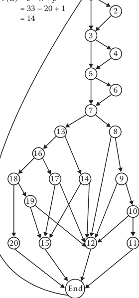

表 10.1 类 FORTRAN 三角形程序的可行路径

| 路径 | 节点序列 | 描述 |
| :--- | :--- | :--- |
| p1 | 1-2-3-4-5-6-7-13-16-18-20 | 等边三角形 |
| p2 | 1-3-5-6-7-13-16-19-15 | 等腰三角形 (b = c) |
| p3 | 1-3-5-6-7-13-16-19-12 | 不是三角形 (b = c) |
| p4 | 1-3-4-5-7-13-16-15 | 等腰三角形 (a = c) |
| p5 | 1-3-4-5-7-13-16-17-12 | 不是三角形 (a = b) |
| p6 | 1-2-3-5-7-13-14-15 | 等腰三角形 (a = b) |
| p7 | 1-2-3-5-7-13-14-12 | 不是三角形 (a = b) |
| p8 | 1-3-5-7-8-12 | 不是三角形 (a + b ≤ c) |
| p9 | 1-3-5-7-8-9-12 | 不是三角形 (b + c ≤ a) |
| p10 | 1-3-5-7-8-9-10-12 | 不是三角形 (a + c ≤ b) |
| p11 | 1-3-5-7-8-9-10-11 | 不规则三角形 |

# 单元测试回顾 191

假设我们使用边界值测试来定义测试用例。我们将对基本公式和最坏情况公式进行此类操作。表 10.2 显示了使用功能测试的标称边界值生成的测试用例。最后一列显示了测试用例所经过的路径（来自表 10.1）。

覆盖了以下路径：p1, p2, p3, p4, p5, p6, p7；缺失了路径8, p9, p10, p11。现在假设我们使用更强大的功能测试技术——最坏情况边界测试。我们在第 5 章中看到它产生了 125 个测试用例；它们在这里汇总于表 10.3 中，以便我们看到冗余路径的程度。

总来看，125 个测试用例提供了全路径覆盖，但这种冗余是沉重的。摆动的下一步是等价类测试。对于三角形问题，单个变量的等价类是没有意义的。相反，我们可以建立等价

| 表 10.2 标称边界值的路径覆盖 |
| 用例 | a | b | c | 输出 | 路径 |
| :--- | :--- | :--- | :--- | :--- | :--- |
| 1 | 100 | 100 | 1 | 等腰三角形 | p6 |
| 2 | 100 | 100 | 2 | 等腰三角形 | p6 |
| 3 | 100 | 100 | 100 | 等边三角形 | p1 |
| 4 | 100 | 100 | 199 | 等腰三角形 | p6 |
| 5 | 100 | 100 | 200 | 不是三角形 | p7 |
| 6 | 100 | 1 | 100 | 等腰三角形 | p4 |
| 7 | 100 | 2 | 100 | 等腰三角形 | p4 |
| 8 | 100 | 100 | 100 | 等边三角形 | p1 |
| 9 | 100 | 199 | 100 | 等腰三角形 | p4 |
| 10 | 100 | 200 | 100 | 不是三角形 | p5 |
| 11 | 1 | 100 | 100 | 等腰三角形 | p2 |
| 12 | 2 | 100 | 100 | 等腰三角形 | p2 |
| 13 | 100 | 100 | 100 | 等边三角形 | p1 |
| 14 | 100 | 199 | 100 | 等腰三角形 | p2 |
| 15 | 200 | 100 | 100 | 不是三角形 | p3 |

| 表 10.3 最坏情况值的路径覆盖 |
| | p1 | p2 | p3 | p4 | p5 | p6 | p7 | p8 | p9 | p10 | p11 |
| :--- | :--- | :--- | :--- | :--- | :--- | :--- | :--- | :--- | :--- | :--- | :--- |
| 标称 | 3 | 3 | 1 | 3 | 1 | 3 | 0 | 0 | | | |
| 最坏情况 | 5 | 12 | 6 | 11 | 6 | 12 | 7 | 18 | 19 | 12 |

# 192 软件测试

| 表 10.4 类 FORTRAN 程序的决策表 |
| c1. Match = | 0 | 1 | 2 |
| :--- | :--- | :--- | :--- |
| c2. a + b < c | T | F! | F | T | F! | F! | T | F! | F |
| c3. a + c < b | F! | T | F! | F! | T | F! | T | F! | F |
| c4. b + c < a | F! | F! | T | F! | F! | T | F! | T | T |
| a1. 不规则三角形 | | | x | | | | | | | | |
| a2. 不是三角形 | x | x | | x | x | | | | | | |
| a3. 等腰三角形 | | | x | | | | | | | | | |
| a4. 等边三角形 | | | | | | | | | | | | x |
| a5. 不可能 | | | | | | | | | | | | | | |

| c1. Match = | 3 | 4 | 5 | 6 |
| :--- | :--- | :--- | :--- | :--- |
| c2. a + b < c | T | F! | F | — | T | F! | F |
| c3. a + c < b | F! | T | F! | F | — | F! | F! | F |
| c4. b + c < a | F! | F | T | F | — | F! | F! | T | F |
| a1. 不规则三角形 | | | | | | | | | | | | |
| a2. 不是三角形 | x | x | | x | x | | | | | | | |
| a3. 等腰三角形 | | | x | | | | | | | | | | |
| a4. 等边三角形 | | | | | | | | | | | | x |
| a5. 不可能 | | | | | | | | | | | | | | |

关于三角形类型，以及变量 a、b、c 无法构成三角形边的六种方式。在第 6 章（第6.4 节），我们得到了这些等价类：


D1 = {a, b, c}: a = b = c

D2 = {a, b, c}: a = b, a ≠ c

D3 = {a, b, c}: b = c, a ≠ b

D4 = {a, b, c}: b = c, a ≠ b

D5 = {a, b, c}: a ≠ b, b ≠ c

D6 = {a, b, c}: a > b + c

D7 = {a, b, c}: b > a + c

D8 = {a, b, c}: c > a + b

D9 = {a, b, c}: a = b + c

D10 = {a, b, c}: b = a + c

D11 = {a, b, c}: c = a + b

© 2010 Taylor & Francis Group, LLC

# 单元测试回顾 193

由于这些等价类，我们只需要 11 个测试用例，并且我们知道将完全覆盖图 10.3 中的 11 条可行路径。

最后一步是查看决策表是否能为等价类测试用例增加任何内容。它们没有增加，但可以为决策提供一些见解。

# 194 软件测试

识别了单元测试中的元素。当执行 $m$ 个测试用例时，它们会遍历 $s$ 个结构元素中的 $n$ 个。

## 定义

方法 $M$ 相对于指标 $S$ 的覆盖率是 $n$ 与 $s$ 的比值。我们将其记为 `C(M,S)`。

## 定义

方法 $M$ 相对于指标 $S$ 的冗余率是 $m$ 与 $s$ 的比值。我们将其记为 `R(M,S)`。

## 定义

方法 $M$ 相对于指标 $S$ 的净冗余率是 $m$ 与 $n$ 的比值。我们将其记为 `NR(M,S)`。

我们对这些指标的解释如下：覆盖率指标 `C(M,S)` 处理的是间隙。当此值小于 1 时，相对于该指标的覆盖存在间隙。注意，当 `C(M,S) = 1` 时，代数上强制要求 `R(M,S) = NR(M,S)`。冗余率指标显而易见——它越大，冗余度越高。冗余率更有用——它指的是实际被遍历的内容，而不是待遍历内容的总空间。这三个指标共同提供了一种定量方法，用于评估任何基于规格测试（特殊值测试除外）相对于代码指标的有效性。然而，这只是成功了一半。我们真正想知道的是测试用例对于各种故障的有效性如何。遗憾的是，这类信息根本无法获得。我们可以根据故障类型（或者可能是我们最担心的故障）选择相应的代码指标来接近这一点。具体建议请参阅本章末尾的指南。

通常情况下，复杂的基于代码的指标在更严谨的代码指标上进行评估时，其有效性往往会降低。这在直觉上是很有吸引力的，我们的例子也证明了这一点。这些指标的设计使得最佳可能值为 1。参考我们之前章节中将这些指标应用于三角形程序的数据。表 10.5 使用了测试用例，表 10.6 对佣金问题重复了这一分析。

### 表 10.5 三角形程序的指标

| 方法 | m | n | s | C(M,S) = n/s | R(M,S) = m/s | NR(M,S) = m/n |
|---|---|---|---|---|---|---|
| 常规 | 15 | 7 | 11 | 0.64 | 1.36 | 2.14 |
| 最坏情况 | 125 | 11 | 11 | 1.00 | 11.36 | 11.36 |
| 目标 | s | s | s | 1.00 | 1.00 | 1.00 |

### 表 10.6 佣金问题的指标

| 方法 | m | n | s | C(M,S) = n/s | R(M,S) = m/s |
|---|---|---|---|---|---|
| 输出 bva | 25 | 11 | 11 | 1 | 2.27 |
| 决策表 | 3 | 11 | 11 | 1 | 0.27 |
| DD-路径 | 25 | 11 | 11 | 1 | 0.27 |
| du-路径 | 25 | 33 | 33 | 1 | 0.76 |
| 切片 | 25 | 40 | 40 | 1 | 0.63 |

## 10.4 保费案例研究

这里有一个示例，让我们能够比较基于规格和基于代码的测试方法并应用这些指南。一个假设的保险费程序根据两个参数计算半年度车险保费：保单人的年龄和驾驶记录：

`Premium = BaseRate * ageMultiplier - safeDrivingReduction`

这里的 `ageMultiplier` 是保单人年龄的函数，当保单人驾驶照的当前积分（由交通法院根据交通违章分配的分数）低于与年龄相关的截止值时，将给予安全驾驶减免。保单是针对 16 到 100 岁之间的驾驶员编写的。一旦保单人超过 12 分，驾驶照将被吊销（因此，不需要保险）。`BaseRate` 会随时间变化；例如，半年度保费为 500 美元。保险程序的数据在表 10.7 中。

### 10.4.1 基于规格的测试

基于输入变量、年龄和分数的最坏情况边界值测试得出了年龄和分数的以下极值（表 10.8）。相应的 25 个测试用例如图 10.5 所示。

### 表 10.7 保费数据

| 年龄范围 | 年龄系数 | 积分截止值 | 安全驾驶减免 |
|---|---|---|---|
| 16 ≤ Age < 25 | 2.8 | 1 | 50 |
| 25 ≤ Age < 35 | 1.8 | 3 | 50 |
| 35 ≤ Age < 45 | 1.0 | 5 | 100 |
| 45 ≤ Age < 60 | 0.8 | 7 | 150 |
| 60 ≤ Age < 100 | 1.5 | 5 | 200 |

### 表 10.8 保费数据

| 变量 | Min | Min+ | Nom. | Max |
|---|---|---|---|---|
| Age | 16 | 17 | 54 | 99 | 100 |
| Points | 0 | 1 | 11 | 12 |


图 10.5 保费问题的最坏情况边界值用例。没有人应该满足于这些用例。问题缺失了太多。各种年龄截止值没有测试，积分截止值也没有。我们可以通过更仔细地观察年龄范围的类来细化这一点：

```
A1 = [age: 16 ≤ age < 25]

A2 = [age: 25 ≤ age < 35]

A3 = [age: 35 ≤ age < 45]

A4 = [age: 45 ≤ age < 60]

A5 = [age: 60 ≤ age < 100]
```

这里是依赖于积分的年龄类：

```
P1(A1) = [points: 0, 1]

P2(A2) = [points: 2, 3]

P3(A3) = [points: 4, 5]

P4(A4) = [points: 6, 7]

P5(A5) = [points: 8, 9, 10, 11]
```


增加的复杂性是积分依赖于年龄的。这些年龄截止值在图 10.6 中显示。这些截止值的类在图 10.6 中显示。最坏情况边界用例在表 10.9 中显示了这些


图 10.6 保费问题的最坏情况边界值用例。

### 表 10.9 最坏情况详细值

| 变量 | Min | Min+ | Nom. | Max |
|---|---|---|---|---|
| Age | 16 | 17 | 20 | 24 |
| Age | 25 | 26 | 30 | 34 |
| Age | 35 | 36 | 40 | 44 |
| Age | 45 | 46 | 53 | 59 |
| Age | 60 | 61 | 75 | 99 | 100 |
| Points(A1) | 0 | 1 | n/a | n/a |
| Points(A1) | 2 | 3 | 7 | 11 |
| Points(A2) | 0 | 1 | n/a | n/a |
| Points(A2) | 4 | 5 | 8 | 11 | |
| Points(A3) | 0 | 1 | 3 | 4 | 5 |
| Points(A3) | 6 | 7 | 9 | 10 | 11 |
| Points(A4) | 0 | 1 | 2 | 3 | 4 | 5 | 6 | 7 |

类不是独立的，我们无法进行通常的组合。相应的稳健测试用例如图 10.7 所示。


图 10.7 保费程序的弱和稳健测试用例。

下一步是查看决策表方法是否有帮助。表 10.10 是基于年龄类的决策表。决策表测试用例与图 10.7 几乎相同；决策表中缺失的唯一稳健测试用例是积分超过 12。

保险程序的易错案例在哪里？年龄范围的端点是一个很好的开始，这让我们回到了边界值模式。

### 表 10.10 保费决策表

| 1 | 2 | 3 | 4 | 5 | 6 | 7 | 8 | 9 | 10 | 11 | 12 |
|---|---|---|---|---|---|---|---|---|---|---|---|
| 年龄 | | <16 | 16–24 | 25–34 | | 35–44 | 45–59 | | 60–100 | | >100 |
| 积分低于截止值？ | | | T | F | T | F | T | F | T | F | F | |
| ageMultiplier = 2.8 | | x | x | | | | | | | | |
| ageMultiplier = 1.8 | | | | x | x | | | | | | | |
| ageMultiplier = 1.0 | | | | | | x | x | | | | | |
| ageMultiplier = 0.8 | | | | | | | | x | x | | | |
| ageMultiplier = 1.5 | | | | | | | | | x | x | | |
| 安全驾驶减免 | | x | x | x | x | x | | | | | | |
| 保单允许 | x | | | | | | | | | | x | |

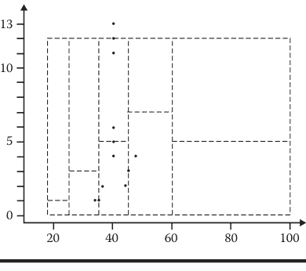

图 10.8 35 到 45 岁年龄段的混合测试用例。

当所有保险时，超过 12 的点。所有这些显示在图 10.7 中。（注意，对这些问题的响应并没有出现在问题说明中，但我们的测试分析促使我们去发现它们。）这可能被称为混合功能测试：它将三种形式的优点结合在一起，这种结合取决于应用程序的性质（特殊价值测试的细微差别）。混合方法似乎是合适的，因为选择通常是为了改进库存。

为了将边界值测试与健壮等价类测试相结合，请注意年龄段板会进入下一个年龄段，因此具有轻微的经济性。图 10.8 显示了保险费问题中 35–45 岁年龄范围的混合测试用例。

## 10.4.2 基于代码 Testing

我们的分析完全是基于规格的。为了完整性，我们真的需要代码。我们将回答诸如变量是否为整数（我们在此之前的假设）等问题。`points` 变量是整数这一点是不容置疑的。伪代码实现是极简的，因为它几乎没有进行错误检查。伪代码及其程序图见图 10.9。由于程序图是无环的，因此只存在有限数量的路径——在这种情况下为 11 条。最佳选择是拥有能够执行每条路径的测试用例。这自动构成了语句覆盖和 DD 路径覆盖。复合谓词表示多条件覆盖；这只有通过最坏情况边界测试用例和混合测试用例才能实现。其余基于路径的覆盖指标不再适用。

### 10.4.2.1 基于路径的

保险费程序程序图的圈复杂度为 `V(G) = 11`，恰好有 11 条可执行路径。它们列在表 10.11 中。如果我们按照第 5 章中各种功能测试用例集的伪代码，你将发现表 10.12 所示的结果。我们可以从结构化测试中获得一些见解。例如，间隙和冗余问题是显而易见的。只有来自混合方法的测试用例产生了路径覆盖。比较这 25 个测试用例的结果是有启发意义的：这 25 个边界值测试与其他两种方法产生了相同数量的测试用例。

```
程序保险费
Dim driverAge, points As Real
Dim baseRate, premium As Real
1 Input(baseRate, driverAge, points)
2 premium = 0
+   3 safeDrivingReduction = 0
4 Select Case driverAge
5 Case 1: 16<= driverAge < 25
6 ageMultiplier = 2.8
7 If points < 1
8 safeDrivingReduction = 50
9 EndIf
10 Case 2: 25<= driverAge < 35
11 ageMultiplier = 1.8
12 If points < 3
13 safeDrivingReduction = 50
14 EndIf
15 Case 3: 35<= driverAge < 45
16 ageMultiplier = 1.0
17 If points < 5
18 safeDrivingReduction = 100
19 EndIf
20 Case 4: 45<= driverAge < 60
21 ageMultiplier = 0.8
22 If points < 5
23 safeDrivingReduction = 150
24 EndIf
25 Case 5: 60<= driverAge <= 100
26 ageMultiplier = 1.5
27 If points < 5
28 safeDrivingReduction = 200
29 EndIf
30 Case 6: Else
31 Output("Driver age out of range")
32 End Select
33 premium = baseRate * ageMultiplier
34 Output(premium)
35 End
```

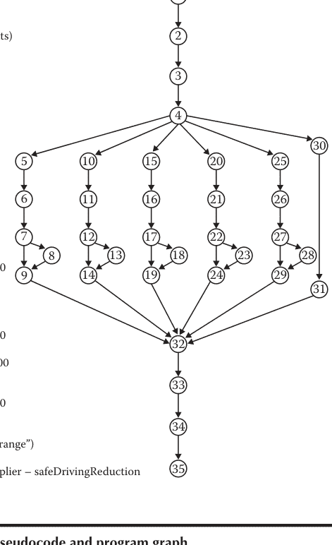

图 10.9 保险费伪代码和程序图。

用例仅覆盖了 6 条可执行执行路径，而 25 个正常等价类测试用例覆盖了 10 条可执行执行路径。下一个区别在于 `case` 语句中条件的覆盖。每个谓词都是形式为 `a <= x < b` 的复合条件。唯一能产生执行这些极值的测试用例的方法是最坏情况边界值 `10` 测试用例和混合 `32` 测试用例。顺便提一下，McCabe 基准方法将产生 12 个决策测试用例中的 11 个。

### 10.4.2.2 数据流测试

该问题的数据流很枯燥。`driverAge`、`points` 和 `safeDrivingReduction` 变量出现在六定义清晰的 du路径中。`driverAge` 和 `points` 的“使用”都是谓词使用。回想第 9 章，全路径（All-Paths）标准意味着所有的下数据流覆盖。

## 表 10.11 保险费程序中的路径

| 路径 | 节点序列 |
|---|---|
| p1 | 1-2-3-4-5-6-7-8-9-32-33-34 |
| p2 | 1-2-3-4-5-6-7-8-9-32-33-34 |
| p3 | 1-2-3-4-10-11-12-14-32-33-34 |
| p4 | 1-2-3-4-5-10-11-12-13-14-32-33-34 |
| p5 | 1-2-3-4-5-15-16-17-19-32-33-34 |
| p6 | 1-2-3-4-5-15-16-17-19-32-33-34 |
| p7 | 1-2-3-4-20-21-22-24-32-33-34 |
| p8 | 1-2-3-4-20-21-22-24-32-33-34 |
| p9 | 1-2-3-4-25-26-27-29-32-33-34 |
| p10 | 1-2-3-4-25-26-27-29-32-33-34 |
| p11 | 1-2-3-4-30-31-32-33-34 |

| 图 | 方法 | 测试用例 | 覆盖路径 |
|---|---|---|---|
| 10.5 | 边界值 | 25 | p1-p9 路径 |
| 10.6 | 最坏情况边界值 | 103 | p1-p8 路径 |
| 10.7 | 弱等价类 | 10 | p1-p10 路径 |
| 10.7 | 健壮等价类 | 12 | p1-p11 路径 |
| 10.7 | 决策表 | 12 | p1-p11 路径 |
| 10.8 | 混合规格说明（所有年龄段） | 32 | p1-p11 路径 |

## 表 10.12 保险费程序功能方法的路径覆盖

### 10.4.2.3 切片测试

切片测试没有提供足够的见解。有四个切片值得关注：

- `S(safeDrivingReduction, 33) = [1, 2, 3, 4, 5, 7, 8, 9, 10, 12, 13, 14, 15, 17, 18, 19, 20, 22, 23, 24, 25, 27, 28, 29, 32]`
- `S(ageMultiplier, 33) = [1, 2, 3, 4, 5, 6, 10, 11, 15, 16, 20, 21, 25, 26, 32]`
- `S(baseRate, 33) = [1]`
- `S(Premium, 33) = [1, 2, 3, 4, 5, 6, 7, 8, 9, 10, 11, 12, 13, 14, 15, 16, 17, 18, 19, 20, 21, 22, 23, 24, 25, 26, 27, 28, 29, 32]`

这些切片的并集是整个程序。我们从切片测试中获得的唯一见解可能是，如果第 33 行发生故障，`safeDrivingReduction` 和 `ageMultiplier` 的切片会将程序分为两个不相交的部分，从而简化故障隔离。

### 10.5 指南

这里有一个最喜欢的测试故事之一。一个醉酒的人在路灯下的人道上爬。当警察问他在做什么时，他回答说他在找车钥匙。“你把钥匙丢了吗？”警察问。“不，我是在停车场丢掉的，但那里的光线更好。”

这个小故事给测试人员传递了一个重要信息：测试可能不存在的故障是没有意义的。更有效的方法是对可能出现（或破坏性最大）的故障有良好的了解，然后选择可能揭示这些故障的测试方法。

# 单元测试回顾 203

表 10.13 功能测试的适当选择
| | 变量 (P, 物理; L, 逻辑) | P | P | P | P | L | L | L | L |
|---|---|---|---|---|---|---|---|---|---|---|
| c2 | 独立变量？ | Y | Y | Y | N | Y | Y | Y | N |
| c3 | 单点故障假设？ | | Y | N | N | | Y | Y | N | |
| c4 | 异常处理？ | | Y | N | Y | N | Y | N | | |
| a1 | 边界值分析 | | x | | | | | | | | |
| a2 | 健壮性测试 | | | | | | | | | | | |
| a3 | 最坏情况测试 | | | | | | | | | | | |
| a4 | 健壮最坏情况 | | x | | | | | | | | |
| a5 | 弱健壮等价类 | | x | | | | x | x | | | |
| a6 | 弱正常等价类 | | x | | | | x | x | | | |
| a7 | 强正常等价类 | | | x | x | | | x | x | | |
| a8 | 决策表 | | | | | x | | | x | |

## 练习题

1. 使用第 2 章中的结构化实现和第 8 章中的 DD 路径图，对三角形问题重复进行间隙和冗余分析。
2. 为你在练习 1 中的研究计算覆盖率、冗余率和净冗余指标。
3. 保费计算程序的执行部分没有检查 16 岁以下或（不太可能的）超过 100 岁的驾驶员年龄。此外，Else 子句（情况 6）会捕获到这一点，但输出信息不够具体。此外，输出语句 `33` 不受司机年龄检查的影响。哪些功能测试技术会发现这一缺陷？如果未满足何种结构测试覆盖，会发现这一缺陷？

## 参考文献

Brown, J.R. and Lipov, M., Testing for software reliability, Proceedings of the International Symposium on Reliable Software, Los Angeles, April 1975, pp. 518–527.

Pressman, R.S., Software Engineering: A Practitioner’s Approach, McGraw-Hill, New York, 1982.

# 单元测试之外 III

在第三部分中，我们在第二部分涵盖的单元测试基本思想的基础上进行构建，但有一个主要变化。现在我们更关注知道要测试什么。为了实现这一目标，本部分的讨论从基于模型的测试整体概念开始。第 11 章考察了基于软件开发生命周期模型的测试，第 12 章讨论了软件/系统行为模型。第 13 章介绍了集成测试的基于模型的测试策略，这些策略在第 14 章中被扩展到系统测试。我们在第 15 章回到面向对象软件测试的问题，重点关注面向对象范式与传统范式不同的点。完成这些内容后，我们可以在第 16 章中认真审视软件复杂性。在第 17 章中，我们将大部分内容应用于一个较新的问题：系统系统的测试。

# 第 11 章

## 基于生命周期的测试

在本章中，我们从软件开发生命周期的各种模型开始，考虑这些生命周期对测试的影响。我们在第 1 章中采取了通用观点，根据软件开发瀑布模型中的对称性识别了三个层次（单元、集成和系统）。这种观点在过去的几十年里取得了较大成功，这些层次依然存在；然而，替代生命周期模型的出现要求我们更深入地考虑替代性的测试用例。我们从传统的瀑布模型开始，主要是因为它被广泛理解，并且是较新模型的参考框架。然后我们看瀑布模型的衍生模型，最后维护单调的敏捷变体。

我们的思维方式也发生了重大转变。我们更关注如何表示被测试的项目，因为表示方法可能会限制我们识别测试用例的能力。看看软件测试顶级会议（专业或学术）上发表的论文——你会发现关于规格模型和测试技术的演讲几乎一样多。基于模型的测试 `MBT` 是所有层面软件建模与测试的交汇点。

### 11.1 传统瀑布测试

传统的软件开发模型是瀑布模型，如图 11.1 所示。它有时被画成一个 V 字，以强调测试的基本层次反映了瀑布模型的早期阶段。在 ISTQB 圈子里，这被称为“V 模型”。在这种观点下，开发阶段的某一个产生的信息构成了该层次测试用例识别的依据。这里没有争议；我们确实希望系统用例与需求规格有明确的相关，并且单元测试用例源自单元的详细设计。在瀑布的左上角，紧密的“做什么/如何做”循环至关重要。它们强调了这样一个事实：前序阶段定义了后继阶段要做的“什么”。完成后，后继阶段说明了它如何“如何”完成要做的“什么”。这些也是进行软件评审的理想点（见第 22 章）。有些人可能认为这些阶段是缺陷产生阶段，而右侧的阶段是缺陷检测阶段。

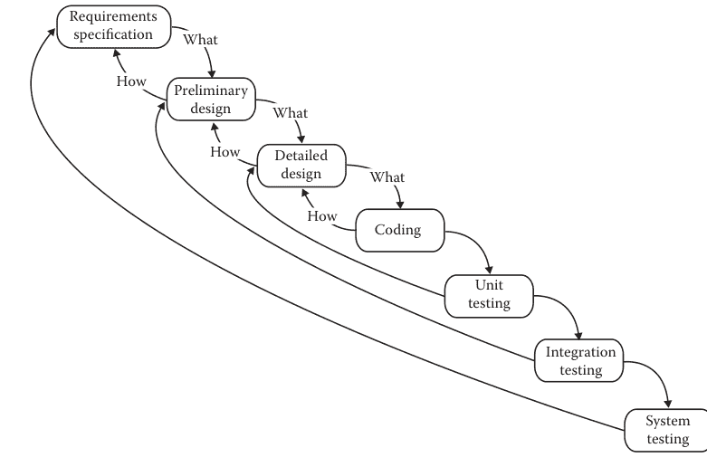
图 11.1 瀑布生命周期。

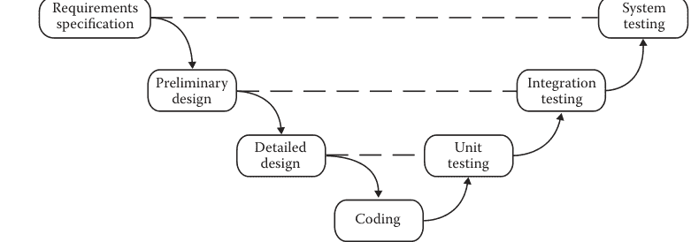
图 11.2 作为 V 模型的瀑布生命周期。

在这种观点下，开发阶段的某一个产生的信息构成了该层次测试用例识别的依据。这里没有争议；我们确实希望系统用例与需求规格有明确的相关，并且单元测试用例源自单元的详细设计。在瀑布的左上角，紧密的“做什么/如何做”循环至关重要。它们强调了这样一个事实：前序阶段定义了后继阶段要做的“什么”。完成后，后继阶段说明了它如何“如何”完成要做的“什么”。这些也是进行软件评审的理想点（见第 22 章）。有些人可能认为这些阶段是缺陷产生阶段，而右侧的阶段是缺陷检测阶段。

两个观察：这里使用了功能测试的明确假设，并使用了自下向上的顺序。在这里，“自下向上”指的是抽象层次——单元，然后集成，最后是系统测试。在三个主要的测试层次（单元、集成和系统）中，单元测试是最好的理解。第 5 到 10 章针对单元测试理论和技术。系统测试比集成测试更容易被理解，但两者都需要澄清。

#### 11.1.1 瀑布测试

传统的软件开发模型是瀑布模型，它与自顶向下的开发和设计密切相关。初步设计的最终结果是将整个系统的功能分解为树状结构。对于这种分解，自顶向下的集成将从主程序开始，检查对下一单元的调用，依此类推，直到达到分解层次。在每个点，低级单元被存根（stubs）替换——即调用时使用的丢弃代码。自下向上的集成是相反的序列，从叶节点单元开始到主程序，高级单元被驱动程序（另一种形式的丢弃代码）替换以模拟过程调用。“大爆炸”方法简单地将所有单元放在一起，没有任何存根或驱动程序。无论采用何种方法，传统集成测试的目标是根据功能分解树集成之前的单元。

#### 11.1.2 瀑布模型的优缺点

自 1968 年首次出版以来，瀑布模型经过了分析和批判。最早的汇编是 Agresti `1986`，它是一个很好的来源。Agresti 观察到：

- 该框架与层级管理结构非常契合。
- 各阶段有明确定义的产出物（退出标准），反过来对项目管理非常方便。
- 详细设计阶段标记了负责单元的人员可以并行工作的点，从而缩短项目开发周期。

更重要的是，Agresti 指出了瀑布模型的主要局限性。我们将看到衍生生命周期是如何解决这些问题的。他观察到：

- 需求规格与系统测试之间存在很长的反馈周期，期间客户缺席。
- 模型强调分析，而几乎排除了合成，合成首次出现在集成测试阶段。
- 由于人员限制，大规模的并行开发可能不可持续。
- 最重要的是，需要“完美的远见”，因为需求中的任何缺陷或遗漏都会渗透整个生命周期。

“遗漏”部分对早期的瀑布开发者来说特别令人困扰。因此，几乎所有的需求规格论文都要求一致性、完整性和清晰度。一致性对于大多数需求规格技术是无法证明的。详细内容见后续章节。

# 210 ■ 软件测试

（决策表除外），对清晰度的需求是显而易见的。有趣的部分在于完整性——所有的后续生命周期都假设是不完全的，并依赖某种形式的迭代来逐渐达到“完整性”。

### 11.2 迭代生命周期中的测试

自20世纪80年代初以来，从业人员为了应对上述传统瀑布模型的缺陷，开发了各种替代方案。这些替代方案的共同点是从是从功能分解转向强调迭代和组合。功能分解非常适合瀑布模型自上而下的演进以及自下而上的测试顺序，但它依赖于Agrei `1986` 指出的瀑布型开发的三个弱点之一——对“完美预见性”的需求。只有在系统被完全理解时才能进行功能分解，而且它促进了分析，几乎排除了同义词的使用。结果是需求规范与完成的系统之间存在非常长的间隔，在这一期间，没有获得来自客户反馈的机会。相反，组合更接近人们的工作方式：从已知且理解的内容开始，然后向其添加，并可能移除不需要的部分。

### 11.2.1 瀑布模型的衍生模型

瀑布模型有三种主要的衍生模型：增量式开发和螺旋模型 `Boehm, 1988`。每种模型都涉及一系列增量或构建，如图11.3所示。将初步设计保持为一个不频繁的阶段，而不是将其摊销到一系列构建中，这是非常重要的。（这样做会导致早期构建中做出的设计选择产生不幸的后果，这些选择在后期构建中令人遗憾。）这种单一的设计步骤在演化模型和螺旋模型中是无法实现的。这也是自下而上的敏捷方法的局限性。

在边界内，从详细设计到测试的瀑布阶段每个阶段都有一个重要的区别：系统测试被分为两种测试——回归测试和演进测试。系列构建的主要影响是回归测试成为目标。回归测试的目标是确保之前在构建中正常工作的功能在添加新代码后仍然正常工作。回归测试可以在集成测试之前或之后进行，或者可能在两个地方进行。演进测试假设回归测试已成功，且新功能可以进行测试。（我们倾向于认为新代码的添加代表进展，而不是退化。）由于对现有系统的更改具有众所周知的涟波效应，在系列构建中，回归测试是绝对必须的。（工业平均水平是每五次更改中就有一个会引入新故障。）

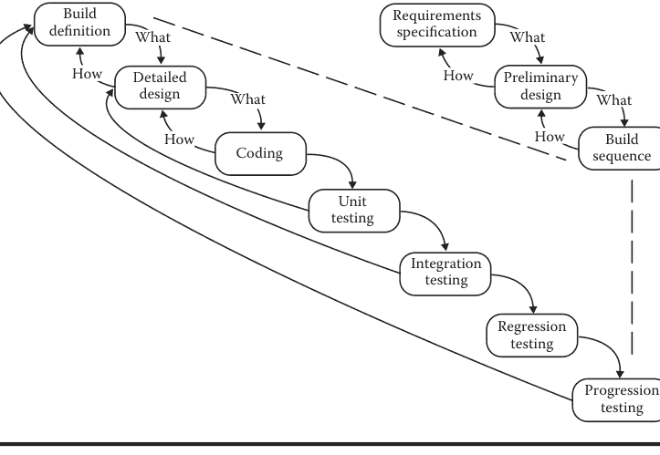

**图 11.3** 迭代开发。

Barry Boehm 的螺旋模型具有演化模型的影子。最大的区别在于，增量的确定更多是基于风险而非客户建议。螺旋叠加在 x-y 坐标平面上，左上象限用于风险分析，右下限指开发（测试），左下限用于规划下一次迭代。这四个阶段——确定目标、分析风险、开发与测试以及下一次迭代规划——以演化的方式重复。在每次迭代中，螺旋都会向前迈进。

回归测试有两种观点：一种是简单重复上一次迭代的测试；另一种是划分一组关注影响故障的较小测试用例集。重复全套之前的测试在自动化测试环境中是可以的，但在更多的手动环境中是不可取的。与演进测试相比，回归测试对失败的预期（或更低）。作为指南，回归测试可能只在重复的演进测试的5%中失败。而对于演进测试，这一比例可能会增加到20%。如果手动执行回归测试，对于特殊的回归测试用例有一个有趣的术语：皂剧式测试 `Soap Opera Tests`。

# 212 ■ 软件测试

这三个衍生模型之间的差异在于构建是如何识别的。在增量式开发中，分离构建的动力通常是为了扁平化人员结构。在纯瀑布式开发中，从详细设计到单元测试的阶段会出现大量的人员激增。许多组织无法支持快速波动，因此系统被划分为现有人员可以支持的构建。在演化式开发中，构建的假设是系统正在演化。螺旋模型是快速原型设计和演化开发的结合，这是其核心原则。

## 11.2.2 基于规范的生命周期

当系统未被完全理解时（无论是客户还是开发者），功能分解是非常危险的。Barry Boehm描述了一个“我不知道我想要，但我看到时就会认识”的客户。快速原型周期 `11.4` 通过提供系统的“外观和感觉”来解决这个问题。因此，从某种意义上说，客户可以识别他们看到的东西。反，这通过产生非常早的规范缩短了规范到客户的反馈周期。与其构建最终系统，而是构建“快速粗糙”的原型并用于收集反馈。根据反馈，可能会进行原型设计。一旦开发者和客户同意原型代表了理想的系统，开发者就可以继续构建正确的规范。

快速原型对迭代测试没有影响；然而，它对系统测试有很大的影响。需求在哪里？对此问题的一个良好的答案是将原型活动作为信息收集活动，然后以更传统的方式产生需求规范。另一种可能性是捕捉客户使用原型的操作，然后将其作为系统测试。这些可能是敏捷周期用户故事的前身。快速原型的主要贡献是为需求规范带来了运行（或行为）视角。通常，规范技术强调系统的结构而非行为。可执行规范 `图11.5` 是快速原型概念的扩展。通过这种方法，需求以可执行的形式规范（例如有限状态机、状态图或 Petri 网）。客户随后执行规范以观察预期的系统行为，并像快速原型模型一样提供反馈。可执行模型是、或可以是相当复杂的。对于全版的状态图来说这只是轻描描写。构建可执行模型需要专业知识，而执行它需要一个引擎。

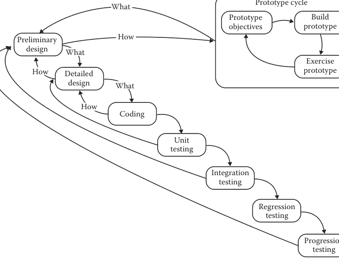

**图 11.4** 快速原型周期。

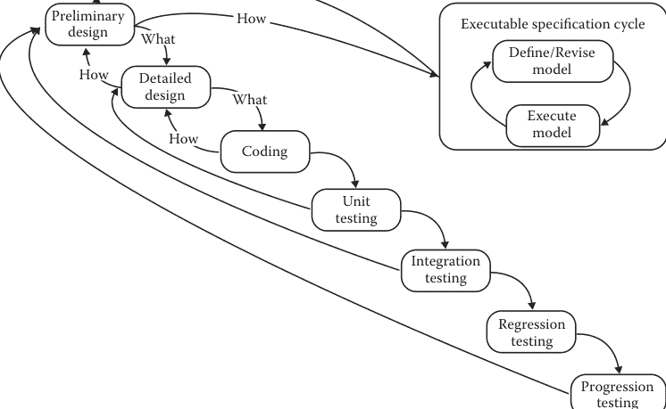

**图 11.5** 可执行规范。

## 214 软件测试

规范最适用于事件驱动系统，特别是当事件以不同顺序到达时。状态图 `StateCharts` 的发明者大卫·哈雷 `David Harel` 将此类系统称为“响应” `Harel, 1988`，因为它们会对外部事件做出反应。与快速原型一样，规范的目的是让客户体验预期行为场景。另一个相似点是，可执行模型可能需要根据客户反馈进行修订。其优点是，良好的可执行模型引擎将支持捕捉“有趣的”系统事务，并且转换为真实的系统测试用例通常是一个近乎机械的过程。如果执行得当，系统测试可以直接追溯到需求。

再次，这种生命周期对集成测试没有影响。一个大区别是需求文档是显性的，而原型不是。更重要的是，从可执行规范中开发测试用例通常是一个机械化的过程。我们将在第14章中看到这一点。虽然开发可执行规范需要更多工作，但生成系统测试用例时投入的精力部分抵消了这一点。这里有另一个重要区别：当系统测试基于可执行规范时，我们在系统级获得了一种有趣的结构化测试形式。最后，正如我们在快速原型中看到的那样，可执行规范步骤可以与任何迭代生命周期模型结合。

### 11.3 敏捷测试

《敏捷宣言》 `http://agilemanifesto.org/` 是由敏捷联盟的17位顾问在2001年2月编写的。它已被翻译成42种语言，并极地改变了软件世界。所有敏捷生命周期的底层特征是：

- 客户驱动
- 自底向上开发
- 应对需求变化的灵活性
- 早期交付功能完备的组件

这些在图11.6所示。客户以用户故事 `user stories` 的形式表达他们的期望，这些故事被视为极短的设计-测试迭代的需求。

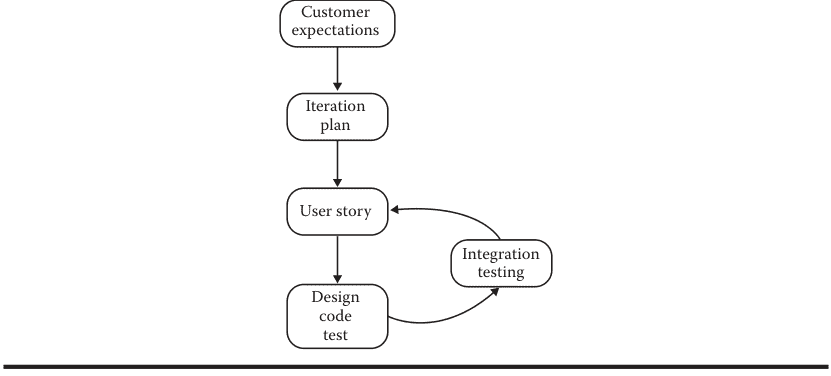

图11.6 通用敏捷生命周期。

### 11.3.1 极端编程

极端编程 `XP` 首次于1996年由肯特·贝克 `Kent Beck, http://www.extremeprogramming.org/` 在克莱斯勒公司工作期间应用于一个项目。该项目取得了巨大的成功，尽管它是对早期版本的修订，这促成了他的著作 `Beck, 2004`。XP的主要方面如图 11.7 所示。它显然是客户驱动的，正如用户故事驱动了发布和系统测试的位置所示的那样。发布计划定义了一系列迭代，每次迭代都交付一个可运行的组件。XP的一个区别是强调结对编程 `paired programming`，即一对开发者紧密合作工作，通常共享一台开发计算机和键盘。一个人在代码层面上工作，而另一个人从稍微高一点的视角观察。从某种意义上说，这对正在进行持续评审。在第22章中，我们将看到这被更好地描述为持续的代码走查 `code walkthrough`。

### 11.3.2 测试驱动开发

测试驱动开发 `TDD` 是敏捷性的极端情况。它由一系列用户故事驱动，如图11.8所示。一个用户故事可以被分解为几个任务，而这正是巨大差异发生的地方。在为任务编写任何代码之前，开发者就决定了如何对其进行测试。测试变成了规范。下一步是——在不存在的代码上运行测试。自然地，它们会失败，但这导致了TDD最出色的特————极大地简化了故障隔离。


图11.7 极端编程生命周期。


图11.8 测试驱动开发循环。

### 11.3 Scrum

Scrum可能是所有生命周期中使用频率最高的。它强调团队和团队合作。Scrum生命周期中的测试发生在两个。图11.9改编自“官方”Scrum文献，敏捷联盟 `http://www.scrumalliance.org/learn_about_scrum`。


图11.9 Scrum生命周期。

### 11.4 敏捷模型驱动开发

### 11.4.1 敏捷模型驱动开发

AMDD 的敏捷部分是建模步骤。Ambler 的建议是仅针对当前的用户故事 `user story` 进行足够的建模，然后用 TDD 实现它。AMDD 与任何敏捷生命周期的巨大区别在于，它有一个明确的设计步骤。见图 11.10。


图 11.10 敏捷模型驱动开发生命周期。

### 11.4.2 模型驱动敏捷开发

模型驱动敏捷开发 `MDAD` 是我提出的在传统世界与敏捷世界之间的折中方案。它的灵感来自 Georg 对既需要策略需要技巧的观点，因此才有了这种折中。MDAD 与迭代开发有何不同？MDAD 建议将测试驱动开发作为战术，并采用 Ambler 的短迭代观点。


策略部分是对整体模型的强调，而这反过来支持了 MBT。在 MDAD 中，单元、集成和系统这三个层级的测试都是存在的。

## References

Agresti, W.W., New Paradigms for Software Development, IEEE Computer Society Press, Washington, DC, 1986.

Beck, K., Extreme Programming Explained: Embrace Change, 2nd ed., Addison Wesley, Boston, 2004.

Boehm, B.W., A spiral model for software development and enhancement, IEEE Computer, Vol. 21, No. 6, May 1988, pp. 61–72.

Harel, D., On visual formalisms, Communications of the ACM, Vol. 31, No. 5, May 1988, pp. 514–530.

# 第 12 章

## 基于模型的测试

> “我的天哪！四十多年来，我一直在说散文，却对它一无所知……”

> 出自《凡场假士》中的乔尔丹先生

### 12.1 基于模型的测试

建模行为的主要优势在于，建模过程通常会对所建模系统产生深刻的见解和理解。对于有限状态机、Pet 网等可执行模型尤其如此。在第 14 章中，我们将看到可以轻松转换为系统级用例的行为线程是从许多模型中导出的。鉴于此，MBT 的有效性始终取决于模型的准确性。MBT 的本质是以下步骤：

1. 建模系统。
2. 从模型中识别系统行为线程。
3. 将这些线程转换为用例。
4. 在（实际系统）上执行用例并记录结果。
5. 根据需要修改模型并重复过程。

### 12.2 适当的模型

### 12.2.1 Peterson 晶格

James Peterson `1981` 开发了一个优雅的计算晶格，如图 12.1 所示。晶格中的箭头表示“表达力强于”的关系，箭头起点的模型比终点的模型表达力强。例如，他展示了一个无法用有限状态机表示的系统。Petri 网有数十种扩展；Peterson 为了简单起见将它们归在一起。标记图是数据流图的形式化，Peterson 证明了它们是有限状态机的对偶。


图 12.1 Peterson 晶格。


图 12.3 带有泳道模型的格栅模型。

## 12.2.2 主线模型的表达能力

Peterson 从它们能够表示的行为问题类型出发，审视了四种主线模型。图 12.4 所示维恩图展示了他的总结。

## 12.2.3 建模问题

本小节的大部分信息取自 Jorgensen `2009`。需求规范模型有两种基本类型：描述结构的模型和描述行为的模型。这对应于系统的两个基本视图：系统*是什么*以及系统*在做什么*。数据流图、实体/关系模型、层次结构图、类图和对象图都关注系统*是什么*——即组件、其功能以及它们之间的接口。它们强调的是结构。第二类型，包括决策表、有限状态机、状态图 `StateCharts` 和 Petri 网，描述的是系统行为——系统在做什么。系统行为模型具有不同程度的能力，这在技术上等同于能够在另一种语言中表达*多样性*。


- 1. 数据流
- 2. 控制流
- 3. 冲突
- 4. 互斥
- 5. 公平调度
- 6. 通信
- 7. 同步

图 12.4 Peterson 格栅中的表达能力。

# 表 12.1 选行为模型的表达能力

| 行为问题 | 问题来源 |
| --- | --- |
| 顺序 | |
| 选择 | 结构化编程 |
| 重复 | |
| 启用 | |
| 禁用 | |
| 触发 | |
| 激活 | 扩展系统建模语言 |
| 挂起 | |
| 恢复 | |
| 暂停 | |
| 冲突 | |
| 优先级 | |
| 互斥 | 任务管理 |
| 并发执行 | |
| 死锁 | |
| 上下文敏感输入事件 | |
| 多重上下文输出事件 | 事件 |
| 异步事件 | |
| 事件静止 | |

表 12.2 将 19 个行为问题映射到五个可执行模型上，每个模型都适用于模型驱动测试 `MBT`。

## 12.2.4 做出恰当选择

选择合适的模型始于理解要建模（及测试）的系统的本质。一旦理解了这些方面，就必须将它们与上述讨论的各种能力联系起来，然后简化合适的选择。最终的选择将

# 表 12.2 五种可执行模型的表达能力

| 行为问题 | 决策表 | FSMs | Petri 网 | EDPNs | 状态图 |
| --- | :--- | :--- | :--- | :--- | :--- |
| 顺序 | 否 | 是 | 是 | 是 | 是 |
| 选择 | 是 | 是 | 是 | 是 | 是 |
| 重复 | 是 | 是 | 是 | 是 | 是 |
| 启用 | 否 | 否 | 是 | 是 | 是 |
| 禁用 | 否 | 否 | 是 | 是 | 是 |
| 触发 | 否 | 否 | 是 | 是 | 是 |
| 激活 | 否 | 否 | 是 | 是 | 是 |
| 挂起 | 否 | 否 | 是 | 是 | 是 |
| 恢复 | 否 | 否 | 是 | 是 | 是 |
| 冲突 | 否 | 否 | 是 | 是 | 是 |
| 优先级 | 否 | 否 | 是 | 是 | 是 |
| 互斥 | 是 | 否 | 是 | 是 | 是 |
| 并发执行 | 否 | 否 | 是 | 是 | 是 |
| 死锁 | 否 | 否 | 是 | 是 | 是 |
| 上下文敏感输入事件 | 是 | 是 | 间接 | 是 | 是 |
| 多重上下文输出事件 | 是 | 是 | 间接 | 是 | 是 |
| 异步事件 | 否 | 否 | 间接 | 是 | 是 |
| 事件静止 | 否 | 否 | 间接 | 是 | 是 |

## 参考文献

Bruyn, W., Jensen, R., and Keskar, D. An systems modeling language `ESML`, Association for Computing Machinery, ACMSOFT Software Engineering Notes, Vol. 13, No. 1, 1998.

DeVries, B., Mapping of UML Diagrams to Petri Nets for Formal Verification, Master’s thesis, Grand Valley University, Allende, 2013.

Hartman, A., Model Generation Tools, 2003, available at www.agedis.de/documents/ModelGenerationTools.pdf.

Jorgensen, P.C., Modeling Software: A Craftsman’s Approach, CRC Press, New York, 2009.

Peterson, J.L., Petri Net Theory and the Modeling of Systems, Prentice Hall, Englewood Cliffs, NJ, 1981.

Utting, M. and Legeard, B., Practical Model-Based Testing, Morgan Kaufmann, San Francisco, 2006.

# 224 软件测试


图 12.3 带有泳道模型的格栅模型。

## 12.2.2 主线模型的表达能力

Peterson 从它们能够表示的行为问题类型出发，审视了四种主线模型。图 12.4 所示维恩图展示了他的总结。

## 12.2.3 建模问题

本小节的大部分信息取自 Jorgensen `2009`。需求规范模型有两种基本类型：描述结构的模型和描述行为的模型。这对应于系统的两个基本视图：系统*是什么*以及系统*在做什么*。数据流图、实体/关系模型、层次结构图、类图和对象图都关注系统*是什么*——即组件、其功能以及它们之间的接口。它们强调的是结构。第二类型，包括决策表、有限状态机、状态图 `StateCharts` 和 Petri 网，描述的是系统行为——系统在做什么。系统行为模型具有不同程度的能力，这在技术上等同于能够在另一种语言中表达*多样性*。


- 1. 数据流
- 2. 控制流
- 3. 冲突
- 4. 互斥
- 5. 公平调度
- 6. 通信
- 7. 同步

图 12.4 Peterson 格栅中的表达能力。

# 表 12.1 选行为模型的表达能力

| 行为问题 | 问题来源 |
| --- | --- |
| 顺序 | |
| 选择 | 结构化编程 |
| 重复 | |
| 启用 | |
| 禁用 | |
| 触发 | |
| 激活 | 扩展系统建模语言 |
| 挂起 | |
| 恢复 | |
| 暂停 | |
| 冲突 | |
| 优先级 | |
| 互斥 | 任务管理 |
| 并发执行 | |
| 死锁 | |
| 上下文敏感输入事件 | |
| 多重上下文输出事件 | 事件 |
| 异步事件 | |
| 事件静止 | |

表 12.2 将 19 个行为问题映射到五个可执行模型上，每个模型都适用于 MBT。

## 12.2.4 做出恰当选择

选择合适的模型始于理解要建模（及测试）的系统的本质。一旦理解了这些方面，就必须将它们与上述讨论的各种能力联系起来，然后简化合适的选择。最终的选择将

# 表 12.2 五种可执行模型的表达能力

| 行为问题 | 决策表 | FSMs | Petri Nets | EDPNs | StateCharts |
| --- | :--- | :--- | :--- | :--- | :--- |
| 顺序 | 否 | 是 | 是 | 是 | 是 |
| 选择 | 是 | 是 | 是 | 是 | 是 |
| 重复 | 是 | 是 | 是 | 是 | 是 |
| 启用 | 否 | 否 | 是 | 是 | 是 |
| 禁用 | 否 | 否 | 是 | 是 | 是 |
| 触发 | 否 | 否 | 是 | 是 | 是 |
| 激活 | 否 | 否 | 是 | 是 | 是 |
| 挂起 | 否 | 否 | 是 | 是 | 是 |
| 恢复 | 否 | 否 | 是 | 是 | 是 |
| 冲突 | 否 | 否 | 是 | 是 | 是 |
| 优先级 | 否 | 否 | 是 | 是 | 是 |
| 互斥 | 是 | 否 | 是 | 是 | 是 |
| 并发执行 | 否 | 否 | 是 | 是 | 是 |
| 死锁 | 否 | 否 | 是 | 是 | 是 |
| 上下文敏感输入事件 | 是 | 是 | 间接 | 是 | 是 |
| 多重上下文输出事件 | 是 | 是 | 间接 | 是 | 是 |
| 异步事件 | 否 | 否 | 间接 | 是 | 是 |
| 事件静止 | 否 | 否 | 间接 | 是 | 是 |

## 软件测试

最容易的方法：在 във集成视图中，所有单元都被编译在一起并一次性测试。这种方法的缺点是，当观察到失败（是时候而不是可能！）时，很少有线索可以定位故障的位置。

功能性分解树是集成测试的基础，因为它是主要的表示形式。图 13.1 包含了 `Calendar` 程序的功能分解树。接下来给出了伪代码。

这里在此处用伪代码勾勒的 `Calendar` 程序获取 `mm, dd, yyyy` 格式的日期，并提供以下功能：

- 下一日期（我们的老朋友 `NextDate`）
- 与日期对应的星期
- 日期的星座
- 最近一次在 5 月 27 日庆祝纪念节的日期
- 最近一次 13 号星期五


图 13.1 `Calendar` 程序的功能分解。

## Calendar 程序的伪代码

Main Calendar
Data Declarations
`mm, dd, yyyy, dayNumber, dayName, zodiacSign`
Function `isLeap` (input `yyyy`, returns T/F)
`isLeap` 是自包含的
End Function `isLeap`


# Calendar 程序

## Procedure `getDate` (returns `mm`, `dd`, `yyyy`, `dayNumber`)

## Function `isValid` (inputs `mm`, `dd`, `yyyy`; returns `T/F`)

## Function `lastDayOfMonth` (inputs `mm`, `yyyy`; returns `28`, `29`, `30`, or `31`)

`lastDayOfMonth` body

`(uses isLeap)`

end `lastDayOfMonth` body

End Function `lastDayOfMonth`

## Function `isValid` body

`(uses lastDayOfMonth)`

end `isValid` body

End Function `isValid`

## Procedure `getDigits` (returns `mm`, `dd`, `yyyy`)

`(uses Function isValid)`

End Procedure `getDigits`

## Procedure `memorialDay` (inputs `mm`, `dd`, `yyyy`; returns `yyyy`)

## Function `isMonday` (inputs `mm`, `dd`, `yyyy`; returns `T/F`)

`(uses weekDay)`

End Function `isMonday`

`memorialDay` body

`isMonday`

end `memorialDay`

End Procedure `memorialDay`

## Procedure `friday13th` (inputs `mm`, `dd`, `yyyy`; returns `mm1`, `dd1`, `yyyyl`)

## Function `isFriday` (inputs `mm`, `dd`, `yyyy`; returns `T/F`)

`(uses weekDay)`

End Function `isFriday`

`friday13th` body

`(uses isFriday)`

end `friday13th`

End Procedure `friday13th`

## Procedure `getDate` body

`getDigits`

`isValid`

`dateTodayNumber`

end `getDate` body

End Procedure `nextPage` (input `daynum`, output `mm1`, `dd1`, `yyyyl`)

## Procedure `dayNumToDate`

`dayNumToDate` body

`(uses isLeap)`

end `dayNumToDate` body

`extDate` body

`dayNumToDate`

end `nextDate` body

End Procedure `nextDate`

## Procedure `weekDay` (input `mm`, `dd`, `yyyy`; output `dayName`)

`(uses Zeller’s Congruence)`

End Procedure `weekDay`

## Procedure `zodiac` (input `dayNumber`; output `dayName`)

`(uses dayNumbers of zodiac cusp dayName)`

End Procedure `zodiac`

## Main program body

`getDate`

`nextDate`

`weekDay`

`zodiac`

`memorialDay`

`friday13th`

End program body

## Calendar 程序的词法包含

Main Calendar

Function `isLeap`

Procedure `weekDay`

Procedure `getDate`

Function `isValidDate`

Function `lastDayOfMonth`

Procedure `getDigits`

Procedure `memorialDay`

Function `isMonday`

Procedure `friday13th`

Function `isFriday`

Procedure `nextDate`

Procedure `dayNumToDate`

Procedure `zodiac`


### 13.1.1 自顶向下集成

自顶向下集成从主程序（树的根）开始。任何下层单元都由主程序作为“存桩”（stub）调用，存桩是模拟单元的丢弃代码片段。如果我们对 `Calendar` 程序执行自顶向下集成，第一步将为主程序调用的所有单元开发存桩：`isLeap`、`weekDay`、`getDate`、`zodiac`、`nextDate`、`friday13th` 和 `memorialDay`。在任何单元的存桩中，硬编码对调用者的正确响应。例如，如果主程序用 `05, 27, 2012` 调用 `zodiac`，存桩将返回 "Gemini"。

自顶向下集成的第一步。`pretend` 前缀强调这不是真实的响应。在实践中，开发存桩的工作量是巨大的。有理由将存桩代码作为项目的一部分并在配置管理下维护。在图 13.2 中，显示了自顶向下集成的第一步。阴影单元都是存桩。第一步的目标是检查主程序的功能是否正确。

一旦测试了主程序，我们就一次替换一个存桩，剩下的作为存桩。图 13.3 显示了用实际代码替换存桩的前三个步骤。存桩替换过程按分解树的宽度优先遍历进行，直到所有存桩都被替换。（在图 13.2 和 13.3 中，没有显示第一层以下的单元，因为不需要。）自顶向下集成的“理论”是，随着存桩被替换，如果出现问题，一定是在最近替换的存桩上。（注意故障隔离与测试驱动开发相似。）问题在于功能性分解具有误导性。因为它源于大多数编译器要求的词法包含，该过程产生了可能的接口。`Calendar main` 并不直接引用。

图 13.3 自顶向下集成的后续步骤。

### 13.1.2 自底向上集成

自底向上集成是自顶向下的“镜像”，区别在于它从叶节点开始。使用驱动器（drivers）来模拟单元是这里的关键。在实践中，开发驱动器的工作量是巨大的。有理由将驱动器代码作为项目的一部分并在配置管理下维护。在图 13.4 中，显示了自底向上集成的第一步。阴影单元都是驱动器。第一步的目标是检查节点的功能是否正确。

一旦测试了节点，我们就一次替换一个驱动器，剩下的作为驱动器。图 13.5 显示了用实际代码替换驱动器的前三个步骤。驱动器替换过程按分解树的自底向上遍历进行，直到所有驱动器都被替换。（在图 13.4 和 13.5 中，没有显示第一层以上的单元，因为不需要。）自底向上集成的“理论”是，随着驱动器被一次替换，如果出现问题，一定是在最近替换的驱动器上。（注意故障隔离与测试驱动开发相似。）问题在于功能性分解具有误导性。因为它源于大多数编译器要求的词法包含，该过程产生了可能的接口。`Calendar main` 并不直接引用。

图 13.4 自底向上集成的第一步。
图 13.5 自底向上集成。

### 13.1.3 三明治集成

三明治集成是自顶向下和自底向上集成的结合。如果我们从分解树的角度考虑它，我们实际上是在一个子树上进行大集成（见图 13.6）。压力和驱动器的工作量会更少，但这会被大集成带来的故障隔离难度增加所抵消。三明治集成中既不需要存桩也不需要驱动器。

三明治是从分解树根节点到叶节点的路径。在图 13.6 中，单元集合在语义上都是一致的，除了缺少了 `Leap`（闰年）。这组单元可以进行有意义的集成，但无法覆盖 2 月底的测试用例。

### 13.1.4 优缺点

除了大集成外，基于分解的方法直观上是清晰的。每当观察到失败时，都会怀疑是最近添加的单元。集成测试过程很容易对照分解树进行跟踪。（如果树很小，在集成单元时对节点涂上阴影是一个很好的做法。）自顶向下和自底向上方法建议对分解树进行优先遍历，但这不是强制的。

对功能分解和瀑布式开发最常见的反对意见之一是，两者都是人为的，且都更多是为了满足项目管理的需求而非软件开发者的需求。这对于基于分解的测试也是如此。整个机制是根据结构对单元进行；这假设正确的行为源于单个正确的单元和正确的接口。（实践者知道并非如此。）存桩或驱动器的开发工作量是这些方法的另一个缺点，而且由于重测试的工作量而更加加剧。

图 13.6 三明治集成示例。

## 13.2 基于调用图的分解集成

基于分解的集成的缺点之一是功能分解树。我们已经看到，这导致了不可能的测试对。如果我们改用调用图（call graph），就可以解决这一缺陷；我们可能会沿着结构测试的方向进行。调用图是通过将单元映射为节点开发的，如果从 A（或单元）调用单元 B，则就有一条从节点 A 到节点 B 的边。程序的调用图如图 13.7 所示。

由于调用图中的边指的是实际的执行时间，因此调用图允许了我们在基于分解树的集成版本中看到的所有问题出现。事实上，我们可以重复第 13.1 节关于单元中存桩（stubs）和驱动程序（drivers）的讨论。这种方法效果良好，并且保留了基于分解方法的故障隔离性。图 13.8 显示了基于调用图的自顶向下集成的第一步。

第一个会话中的存桩可以如下运行运行：当 `Calendar` 主程序调用 `getDateStub` 时，存桩可能会返回 2013 年 5 月 27 日。`zodiacStub` 将返回“双子座”，以此此类推。一旦主程序逻辑通过测试，就会像我们在第 13.1 节讨论的那样替换存桩。当存桩和驱动程序基于调用图而非功能分解时，第 13.1 节中的三种策略将非常有效。

我们现在可以享受在图论讨论中付出的投入了。因为调用图是一个有向图，为什么不使用我们处理程序图的方法呢？这引出了两种新的集成测试方法：我们将它们称为“两对集成”（pairwise integration）和“邻域集成”（neighborhood integration）。

图 13.7 `Calendar` 程序的调用图。
图 13.8 `Calendar` 程序的基于调用图的自顶向下集成。

### 13.2.1 两对集成

两对集成的背后的思想是消除存桩/驱动程序的开发工作。与其开发存桩和/或驱动程序，为什么不使用实际代码呢？起初，这听起来像是大集成，但我们将一次会话限制在调用图中的少数单元。结果是，调用图中的每条边都有一个集成测试。当一个节点（单元）被两个或更多其他单元使用时，两对集成会导致会话数量增加。在 `Calendar` 示例中，自顶向下集成会有 15 个会话（每个存桩替换一个）；这在两对集成中增加到 19 个会话（调用图中的每条边一个）。这通过减少存桩/驱动程序的开发得到了抵消。图 13.9 显示了三个两对集成会话。

两对集成的主要优势是高度的故障隔离性。如果测试失败，故障一定在两个单元之一。最大的缺点是，对于涉及几对组合的单元，在某一对组合中有效的修复方法可能在另一对组合中不起作用。这又是第 10 章中讨论的“测试摆钟”的另一个例子。调用图集成略优于基于分解树的方法，但可能会脱离被测试代码的现实。

### 13.2.2 邻域集成

我们可以从拓扑学（拓扑学的一个分支）中借用“邻域”（neighborhood）的概念来更进一步。图中节点的邻域是与给定节点相隔一条边的节点集合。（技术上讲，这是半径为 1 的邻域；在较大的系统中，增加邻域半径是有意义的。）在有向图中，这包括所有前驱节点和所有直接后继节点（注意这些是该节点的存桩和驱动程序集合）。`getDate`、`Friday13th` 和 `weekDay` 的邻域如图 13.10 所示。

`Calendar` 示例的 15 个邻域（基于图 13.7 中的调用图）列于表 13.1。为了使表格更简单，原始单元名称被替换为节点编号（如图 13.11），其中编号通常是广度优先的。图 13.11 保留了并列和连接性。

表 13.1 中的信息在表 13.2 中给出，作为调用图的邻接矩阵。列和显示了每个节点的入度，行和显示了出度。

图 13.9 两对集成的三对。
表 13.10 邻域集成的三个邻域（半径为 1）。

#### Calendar 图半径为 1 的邻域

| 节点 | 单元名称 | 前驱 | 后继 |
| :--- | :--- | :--- | :--- |
| 1 | Calendar (Main) | 无 | 2, 3, 4, 5, 7 |
| 2 | getDay | 1 | 8, 9 |
| 3 | zodiac | 1 | 10 |
| 4 | getMonth | 1 | 11 |
| 5 | isLeap | 1 | 12 |
| 6 | isWeekday | 1 | 13 |
| 7 | is13th | 1 | 14 |
| 8 | getDay | 2 | 15 |
| 9 | getYear | 2 | 15 |
| 10 | getZodiac | 3 | 15 |
| 11 | getMonth | 4 | 15 |
| 12 | isLeap | 5 | 15 |
| 13 | isWeekday | 6 | 15 |
| 14 | is13th | 7 | 15 |
| 15 | format | 8, 9, 10, 11, 12, 13, 14 | 无 |

#### 表 13.2 Calendar 调用图的邻接矩阵

| | 1 | 2 | 3 | 4 | 5 | 6 | 7 | 8 | 9 | 10 | 11 | 12 | 13 | 14 | 15 | 行和 |
| :--- | :--- | :--- | :--- | :--- | :--- | :--- | :--- | :--- | :--- | :--- | :--- | :--- | :--- | :--- | :--- | :--- |
| 1 | 0 | 1 | 1 | 1 | 1 | 1 | 1 | 0 | 0 | 0 | 0 | 0 | 0 | 0 | 0 | 7 |
| 2 | 0 | 0 | 0 | 0 | 0 | 0 | 0 | 1 | 1 | 0 | 0 | 0 | 0 | 0 | 0 | 2 |
| 3 | 0 | 0 | 0 | 0 | 0 | 0 | 0 | 0 | 0 | 1 | 0 | 0 | 0 | 0 | 0 | 1 |
| 4 | 0 | 0 | 0 | 0 | 0 | 0 | 0 | 0 | 0 | 0 | 1 | 0 | 0 | 0 | 0 | 1 |
| 5 | 0 | 0 | 0 | 0 | 0 | 0 | 0 | 0 | 0 | 0 | 0 | 1 | 0 | 0 | 0 | 1 |
| 6 | 0 | 0 | 0 | 0 | 0 | 0 | 0 | 0 | 0 | 0 | 0 | 0 | 1 | 0 | 0 | 1 |
| 7 | 0 | 0 | 0 | 0 | 0 | 0 | 0 | 0 | 0 | 0 | 0 | 0 | 0 | 1 | 0 | 1 |
| 8 | 0 | 0 | 0 | 0 | 0 | 0 | 0 | 0 | 0 | 0 | 0 | 0 | 0 | 0 | 1 | 1 |
| 9 | 0 | 0 | 0 | 0 | 0 | 0 | 0 | 0 | 0 | 0 | 0 | 0 | 0 | 0 | 1 | 1 |
| 10 | 0 | 0 | 0 | 0 | 0 | 0 | 0 | 0 | 0 | 0 | 0 | 0 | 0 | 0 | 1 | 1 |
| 11 | 0 | 0 | 0 | 0 | 0 | 0 | 0 | 0 | 0 | 0 | 0 | 0 | 0 | 0 | 1 | 1 |
| 12 | 0 | 0 | 0 | 0 | 0 | 0 | 0 | 0 | 0 | 0 | 0 | 0 | 0 | 0 | 1 | 1 |
| 13 | 0 | 0 | 0 | 0 | 0 | 0 | 0 | 0 | 0 | 0 | 0 | 0 | 0 | 0 | 1 | 1 |
| 14 | 0 | 0 | 0 | 0 | 0 | 0 | 0 | 0 | 0 | 0 | 0 | 0 | 0 | 0 | 1 | 1 |
| 15 | 0 | 0 | 0 | 0 | 0 | 0 | 0 | 1 | 1 | 1 | 1 | 1 | 1 | 1 | 0 | 7 |
| 列和 | 0 | 1 | 1 | 1 | 1 | 1 | 1 | 2 | 1 | 1 | 1 | 1 | 1 | 3 | 0 | |

## 测试

我们可以通过借用拓扑学中的邻域概念来进一步进行数学计算。图中每个内部节点都有一个邻域，如果叶子节点直接连接到根节点，则额外增加一个。（内部节点具有非零入度和非零出度）。我们有：内部节点 = 节点数 - (源节点 + 汇节点)，邻域 = 内部节点 + 源节点，组合起来：邻域 = 节点数 - 汇节点。

## 13.3 基于路径的集成

数学发展中的许多进展源于一种优雅的模式：清晰地明确你想去向哪里，然后定义带你到达那里的概念。我们在基于路径的集成测试中也这样做，但首先我们需要为这些操作提供动机。

我们已经知道，在单元级上，结构化测试和功能测试的结合是非常理想的；如果在集成（以及系统）测试中也有类似的能力，就太好了。我们还知道，我们希望用行为化的方式来表达系统测试。最后，我们修订了集成测试的目标：不再测试单独开发和测试的单元之间的接口，而是关注这些单元之间的交互（“协同工作” Co-functioning 也许是一个很好的术语）。接口是结构化的，而交互是行为化的。

当一个单元执行时，会遍历源代码语句的某条路径。假设调用跳转到了另一个单元的某条路径。此时，控制从调用单元传递到被调用单元，在被调用单元中会遍历另一条源代码语句路径。我们在第 8 章中刻意忽略了这种情况，因为这里是处理该问题的更好地方。目前有两种可能：放弃单入单出口原则，将此类调用视为一个出口后接一个入口；或者在控制最终返回调用单元之前抑制该调用语句。抑制的选择在单元测试中效果良好，但与集成测试是背道而驰的。

### 13.3.1 新概念与扩展概念

为了到达我们需要去的地方，我们需要精炼一些程序图概念。与之前一样，这些概念指的是用命令式语言编写的程序。我们允许语句片段成为完整的语句，且语句片段是程序图中的节点。

### 定义

当程序执行开始或恢复时，程序中的源节点是一个语句片段。单元中的第一个可执行语句显然是一个源节点。源节点也紧出现在将控制转移到其他单元的节点之后。

### 定义

当程序执行终止时，单元中的汇点节点是一个语句片段。程序中的最后一个可执行语句显然是一个汇点节点；转移控制到其他单元的语句也是如此。

### 定义

模块执行路径是从源节点开始并以汇点节点结束的语句序列，中间没有汇点节点。

到为止定义的定义是，程序图现在有了多个源节点和汇点节点。这将大大增加单元测试的复杂性，但集成测试假设单元测试已经完成。

### 定义

消息是一种编程语言机制，通过它一个单元将控制传递给另一个单元，并从另一个单元获取响应。

根据编程语言的不同，消息可以被解释为子程序调用、过程调用、函数引用以及面向对象编程语言中的普通消息。我们遵循以下约定：接收消息的单元（消息目标）始终将控制返回给消息源。消息可以向其他单元传递数据。我们终于可以为基于路径的集成测试做出定义。我们的目标是拥有一个 DD 路径的集成测试对应物。

### 定义

MM 路径是模块执行路径和消息的交织序列。MM 路径的基本思想（Jorgensen 1985; Jorgensen and Erickson 1994）是，我们现在可以描述包含独立单元间控制转移的模块执行路径序列。在传统软件中，“MM”很好地理解为“模块-消息”；在面向对象的软件中，将“MM”解释为“方法-消息”更清晰。这些转移通过消息实现，因此 MM 路径始终代表可行的路径，且这些路径跨越了边界。图 13.12 中的假设示例展示了一个 MM 路径（实线边），其中模块 A 调用模块 B，模块 B 又调用模块 C。注意，对于传统的（过程化）软件，MM 路径始终在主程序中开始（并结束于主程序）。

图 13.12 跨三个单元的假设 MM 路径。

在单元 A 中，节点 `a1` 和 `a6` 是源节点（`a5` 和 `a6` 是节点 `a5` 决策的结果），节点 `a4`（一个决策）和 `a8` 是汇点节点。同样，在单元 B 中，节点 `b1` 和 `b3` 是源节点，节点 `b2` 和 `b5` 是汇点节点。节点 `b2` 是汇点节点，因为控制在该点离开了单元 B。它也可能是一个源节点，因为单元 C 返回了在节点 `b2` 使用的值。单元 C 有一个源节点 `c1` 和一个汇点节点 `c9`。单元 A 包含三条执行路径：`<a1, a2, a3, a4>`、`<a4, a5, a7, a8>` 和 `<a4, a6, a7, a8>`。实线是该假设示例中遍历的边。虚线是单元作为独立存在时的图，但它们在假设的 MM 路径中并未“执行”。我们现在可以定义一种有效辅助单元测试的 DD 路径集成测试算法。

### 定义

给定一组单元，它们的 MM 路径图是一个有向图，其中节点对应执行路径，边对应从一个单元到另一个单元的消息和返回。

注意，MM 路径图是相对于一组单元定义的。这直接支持了单元的组合和基于组合的集成测试。我们可以分解到单个模块执行路径的级别，但那可能比需要的要详细得多。

### 13.3.2 MM 路径复杂度

如果你比较 13.12 和 13.17 中的 MM 路径，直觉上后者比前者更复杂。因为这些是强连通图，我们可以“盲目”计算它们的圈复杂度：回顾公式 `V(G) = e - n + 2p`，其中 `p` 是强连通区域的数量。由于消息返回发送单元，我们始终=1，因此公式简化为 `V(G) = e - n + 2`。惊讶的是，两个图的 `V(G)` 都是 7。显然，MM 路径复杂度除了圈复杂度还需要尺寸（图 13.13）。

图 13.13 两个 MM 路径的圈复杂度。

### 13.3.3 优缺点

MM 路径是功能测试和结构测试的混合。从功能上来说，它们代表了具有输入输出的操作。因此，所有的功能测试技术都是可能的。最终结果是功能方法和结构方法的交叉检查整合到了基于路径的集成测试构件中。因此，我们避免了结构测试的陷阱，同时集成测试获得了与系统测试的无缝衔接。基于路径的集成测试对于传统瀑布模型或基于组合的替代生命周期模型开发的软件同样有效。MM 路径概念直接适用于面向对象的软件。

基于路径的集成测试最重要的优势是它与实际行为紧密结合，而不是基于分解和调用图的结构化动机。然而，基于路径的集成测试的优势是有代价的——需要更多精力来识别 MM 路径。这种精力可能会被消除桩程序和驱动程序的开发所抵消。

## 13.4 示例：integrationNextDate

我们熟悉的 NextDate 被重写为一个带有过程和函数的主程序。这个 `integrationNextDate` 是一个扩展：增加了对月份、日期和年的有效性检查，且遵循 13.14 和 13.15 的伪代码从 50 条语句增加到 81 条。图 13.14 和 13.15 分别显示了功能分解和调用图。图 13.16 显示了 `integrationNextDate` 中各个单元的程序图。图 13.17 显示了输入日期 2012 年 5 月 27 日 MM 路径。

集成测试 ■ 245

**图 13.14** `integrationNextDate` 的功能分解图。
**图 13.15** `integrationNextDate` 的调用图。

### 13.4.1 基于分解的集成

`isLeap` 和 `lastOfMonth` 函数处于分解的第一层，因为它们必须被 `GetDate` 和 `IncrementDate` 调用。（我们可以将 `isLeap` 移动到 `lastOfMonth` 的作用域内）。基于图 13.4 中分解的成两对集成是有问题的；因为 `isLeap` 和 `lastOfMonth` 从不被主程序直接调用，因此这些集成会话将会为空。从 `isLeap` 开始，然后是 `lastOfMonth`、`ValidDate` 和 `GetDate` 的自底向上成两对集成将是有用的。涉及 `Main` 与 `GetDate`、`IncrementDate` 以及 `PrintDate` 的对都是非常有用（但很短）的会话。构建 `ValidDate` 和 `lastOfMonth` 的构建将很容易。

### 13.4.2 基于调用的集成

基于图 13.15 调用图的成两对集成是对基于分解的成两对集的改进。显然，没有空的集成会话，因为边引用的是实际的单元。仍然存在结构体的问题。由于这个示例很小，采用三明治集成是合适的。事实上，它适用于一种构建序列。构建 1 可以包含 `Main` 和 `PrintDate`。构建 2 可以包含 `Main`、`IncrementDate`、`lastOfMonth` 以及已有的 `PrintDate`。最后，构建 3 将添加剩余的单元 `GetDate` 和 `ValidDate`。

246 ■ 软件测试

基于调用图的邻域集成可能会从 `ValidDate` 和 `lastDayOfMonth` 的邻域开始。接下来，我们可以集成 `GetDate` 和 `IncrementDate` 的邻域。最后，我们将集成 `Main` 的邻域。注意，这些邻域形成了一个构建序列。

`integrationNextDate` 伪代码
```
```


# Main integration
`NextDate` '此处发生程序事件'

## Date

### Month As Integer

### Day As Integer

### Year As Integer

## EndType

`Dim today, tomorrow As Date`

`Output("Welcome to NextDate!")` 'msg1'

`GetDate(today)` 'msg2'

`PrintDate(today)` 'msg3'

`tomorrow = IncrementDate(today)` 'msg4'

`PrintDate(tomorrow)`

`End Main`

## Function isLeap(year) Boolean

`If (year is divisible by 4)`

`Then`

`If (year is NOT divisible by 100)`

`Then isLeap = True`

`Else`

`If (year is divisible by 400)`

`Then isLeap = True`

`Else isLeap = False`

`Else`

`EndIf`

`EndIf`

`Else isLeap = False`

`EndOf`

`End (Function is isLeap)`

## Function lastDayOfMonth(month, year) Integer

`Case month Of`

`Case 1: 1, 3, 5, 7, 8, 10, 12`

`lastDayOfMonth = 31`

`Case 2: 4, 6, 9, 11`

`lastDayOfMonth = 30`

`Case 3: 2`

`If (isLeap(year))` 'msg5'

`Then lastDayOfMonth = 29`

`Else lastDayOfMonth = 28`

`EndCase`

`End (Function lastDayOfMonth)`

## Function GetDate(aDate) Date

`dim aDate As Date`

`Function ValidDate(aDate) Boolean` '在 GetDate 的作用域内'

`dim aDate As Date`

`dim dayOK, monthOK, yearOK As Boolean`

`If ((aDate.Month > 0) AND (aDate.Month <= 12)))`

247 ■ 集成测试

```
38 Then monthOK = True
39 Output("Month OK")
40 Else monthOK = False
41 Output("Month out of range")
```

`EndIf`

`If (monthOK)`

`Then`

`If ((aDate.Day > 0) AND (aDate.Day <=`

`lastDayOfMonth(aDate.Month, aDate.Year)))`

`dayOK = True`

`Output("Day OK")`

`Else dayOK = False`

`Output("Day out of range")`

```
51 EndIf
52 If ((aDate.Year > 1811) AND (aDate.Year <= 2012)
53 Then yearOK = True
54 Output("Year OK")
55 Else yearOK = False
56 Output("Year out of range")
```

`EndIf`

`If (monthOK AND dayOK AND yearOK)`

`Then ValidDate = True`

`Output("Month OK")`

`Else ValidDate = False`

`Output("Please enter date")`

`EndIf`

```
64 End (Function ValidDate)
```

`Until (Function GetDate)`

## Function IncrementDate(aDate)

`If (aDate.Day < lastDayOfMonth(aDate.Month))`

`Then aDate.Day = aDate.Day + 1`

`Else aDate.Day = 1`

`If (aDate.Month = 12)`

`Then aDate.Month = 1`

`aDate.Year = aDate.Year + 1`

`Else aDate.Month = aDate.Month + 1`

```
74 EndIf
75 End (IncrementDate)
```

## Procedure PrintDate(aDate)

`Output("Day is ", aDate.Month, "/", aDate.Day, "/", aDate.Year)`

`End (PrintDate)`


**图 13.16** `integrationNextDate` 中的单元程序图。


**图 13.17** 2012 年5月 27日的 MM 路径。

250 ■ 软件测试

## 13.4.3 基于 MM 路径的集成

由于程序是数据驱动的，所有 MM 路径都始于主程序并返回主程序。这里是 2012 年5月 27日的第一个 MM 路径（当主程序调用 `PrintDate` 和 `IncrementDate` 时还有其他路径）。如图 13.17 所示。

```
Main (1, 2)

  msg1

    GetDate(34, 56, 57, 58, 59, 60, 61, 62, 63, 64, 65, 66)

    msg7

      validDate(35, 36, 37, 39, 40, 41, 42))

    msg6

      lastDayOfMonth(21, 22, 23, 24, 32, 33)

      '消息静止点'

    Validate(43, 45, 46, 47, 48, 50, 51, 52, 55)

  GetDate (67)
```


我们有充分的理由来描述 MM 路径是足够的：MM 路径集应该覆盖单元集中所有从源到汇点的路径。这在图 13.17 中微妙地体现出来。实线在 MM 路径上，但虚线不在。当存在循环时，收缩图将产生有向无环图，从而解决潜在无限（或过大）路径数量的问题。

## 13.5 结论与建议

表 13.3 总结了上述讨论中的观察结果。MM 路径作为集成测试基础的显著改进是因为它们对动态软件行为的精确表示。MM 路径也是目前数据流（定义/使用）集成测试方法研究的基础。使用 MM 路径进行集成测试需要额外的工作。作为备选方案，请基于调用图进行集成测试。

表 13.3 集成测试策略对比

| 策略基础 | 测试接口的能力 | 测试协同功能的能力 | 故障隔离解决能力 |
| --- | --- | --- | --- |
| 功能分解 | 可接受但可能具有误导性 | 限于单元对 | 良好，定位故障单元 |
| 调用图 | 可接受 | 限于单元对 | 良好，定位故障单元 |
| MM 路径 | 优秀 | 完整 | 优秀，定位故障单元执行路径 |

## 集成测试

## 练习题

- 1. 找到 `isValidDate` 中的源节点和汇节点。
- 2. 为 `isValidDate` 编写驱动程序（driver）。
- 3. 为 `isValidDate` 编写桩程序（stub）。
- 4. 这里是 MM 路径的其他复杂度指标：
  `V(G) = e - n`
  `V(G) = 0.5e - 2`
  节点的出度和
  节点数加上边的和
- 5. 构造一些例子，看看 MM 路径遍历了图 13.16 中的哪些部分。为 MM 路径设计“覆盖率指标”。
- 6. 集成测试的目标之一是隔离故障。请考虑以下集成策略：
  A = 自顶向下集成
  B = 自底向上集成
  C = 三明治集成
  D = 大爆炸集成
  E = 基于调用图的成对集成
  F = 基于调用图的邻域集成（半径 2）
  G = 基于调用图的邻域集成（半径 1）

通过将字母放在下面的连续体进行评分。例如，假设策略 X 和 Y 效果相当且无效，而策略 Z 非常有效。

Y
X
高

## 参考文献

Deutsch, M.S., 软件验证与确认：真实的项目方法，Prentice-Hall, Englewood Cliffs, NJ, 1992.
Fordahl, M., 火星探测器的致命错误，Associated Press，访问地址 `http://mars.jpl.nasa.gow/msp958/mco9930.html`,1999年10月1日.
Hetzel, B., 软件测试完全指南，第2版，Q Information Sciences, Inc., Wellesley, MA, 1988.
Jorgensen, P., MM路径在创意软件开发中的应用，博士论文，亚利桑州州大学，Tempo, AZ, 1985.
Jorgensen, P. and Erickson, C., 面对象集成测试，ACM通讯，1994年9月.
Kaner, C., Falk, J. and Nguyen, H.Q., 软件测试，第2版，Van Noord Reynolds, New York, 1993.
Mosley, D.J., MIS应用软件测试手册，Yourdon, Prentice-Hall, Englewood Cliffs, NJ, 1993.
Pressman, S.R., 软件工程：实践者的方法，第6版，McGraw-Hill, New York, 2005.
Schach, S.R., 面对象与经典软件工程，第5版，McGraw-Hill, New York, 2002.

# 第14章

## 系统测试

在三个层级的测试中，系统级测试最接近日常生活体验。我们会测试很多东西：在购买二手车之前测试它，在订阅在线网络服务之前测试它，等等。这些熟悉形式中的一个共同模式是，我们根据自己的预期来评估产品，而不是根据规范或标准。因此，目标不是发现缺陷，而是证明行为的正确性。正因如此，我们倾向于从基于规范的角度而非基于代码的角度来处理测试。由于直觉上很熟悉，实践中的系统测试往往比可能需要的更不正式，而交付截止日期通常剩余的测试间隔缩短进一步加剧了这一点。

“工匠”的比喻依然适用。我们需要对介质有更好的理解；我们从一个新的构建构建开始——原子系统函数（Atomic System Function，简称 ASF），并开发这一概念，重点介绍基于线程的系统测试的一些实际问题。系统测试与需求规范紧密结合；因此，我们将使用适当的系统级方法来利用基于模型的测试的优势。这些方法的共同点是“线程”的概念，因此我们将看到如何在各种常见模型中识别系统级线程。这一切引向了一个有序的基于线程的系统测试策略，该策略利用了基于规范和基于代码测试之间的共生关系。我们将该策略应用于第2章描述的简单自动取款机（SATM）系统。

## 14.1 线程

线程很难定义；事实上，某些发布的定义是适得其反、具有误导性或错误的。将线程视为一个不需要正式定义的原始概念是可能的。目前，我们将使用示例来建立一种“共同愿景”。以下是关于线程的几种视角：

- 正常使用的场景
- 系统级测试用例
- 一对刺激/响应对
- 由一系列系统级输入产生的行为

# 软件测试

- 端口输入和输出事件的交错序列
- 系统状态机描述中的转换序列
- 对象消息和方法执行的交错序列
- 一序列机器指令
- 一序列的源实例
- 一序列的 MM 路径
- 一序列的 ASFs（将在本章中定义）

线程具有不同的级别。单元级线程很容易被理解为源输入的集成时路径，或者，理解为 DD 路径的序列。集成级线程是一个 MM 路径——即模块执行路径和消息的交替序列。如果继续这种模式，系统级线程就是 ASF 的序列。由于 ASFs 以端口作为其输入和输出，ASFs 的序列意味着端口输入和输出事件的交错序列。最终结果是，线程为我们的三个层级测试提供了一个统一的视图。单元测试识别函数；集成测试检查单元之间的相互作用；系统测试检查 ASFs 之间的相互作用。在本章中，我们关注系统级线程并回答一些基本问题，例如：“线程有多大？我们在哪里找到它们？我们如何测试它们？”

## 14.1 线程的可能性

定义系统级线程的端点稍微有点笨拙。我们通过从线程想要去的地方反推，从而引出一个整洁的、基于图的定义。以下是我们的 SATM 系统中的四个候选线程：

- 输入数字
- 输入个人识别码 (PIN)
- 一个简单的交易：插入 ATM 卡、输入 PIN 码、选择交易类型（存款、取）、显示账户详情（支票或储蓄账户、金额）、执行操作并返回结果
- 一个包含两个或多个简单操作的 ATM 会话

数字输入是最小 ASF 的良好示例。它始于一个端口输入事件（数字按键），结束于一个端口输出事件（屏幕回显），这符合一个刺激/响应对。这种粒度对于系统测试的目的来说太细了。

第二个候选者 PIN 输入是限制测试的高层级良好示例，同时也是系统测试的起点。PIN 输入是 ASF 的良好示例。它也是一组刺激/响应行为的良好示例，这种行为由端口输入事件触发，遍历程序化逻辑，并在其中一个可能的响应（端口输出事件）中终止。PIN 输入进入了一个输入输出序列。

1. 请求 PIN 数字的屏幕。
2. 数字按键和屏幕响应的交错序列。
3. 客户在输入完整 PIN 码之前取消的可能性。
4. 系统处理：客户有三次机会输入正确的 PIN 码。一旦输入了正确的 PIN，用户就会看到请求的交易；否则，屏幕告知客户 ATM 卡将不会退还，且不提供 ATM 功能访问。

显然存在几个刺激/响应对，这使得 ASFs 明确置于系统级测试的领域。ASF 的其他示例还包括插卡、选择交易、提供交易详情、交易报告和会话终止。这些每一项在集成测试意义上都是最大的，在系统测试意义上都是最小的。也就是说，我们不想集成任何比 ASF 更大的东西；同时，我们不想在系统测试部分中测试任何东西。

第三个候选者简单交易具有一种“端到端”的完成感。客户永远无法单独执行 PIN 输入（需要插卡），但简单交易通常会被执行。这是系统级线程的良好示例；注意它涉及到多个 ASFs 之间的相互作用。

最后一种可能性（会话）实际上是线程的序列。这也是系统测试的一个正确属性；在这一层级，我们关注线程之间的相互作用。遗憾的是，大多数系统测试工作从未达到相互作用的水平。

### 14.1.2 线程定义

我们通过定义一个新术语来简化讨论，帮助我们实现目标。

**定义**：原子系统函数 (ASF) 是一种在系统级通过端口输入和输出事件可观测的动作。

在事件驱动系统中，ASFs 被事件静止点（event quiescence points）隔开；这些点发生在系统（几乎）空闲时，等待端口输入触发进一步处理。事件静止具有一种有趣的彼里网洞察。在传统的彼里网中，当没有转换被启用时，就会发生死锁。在事件驱动彼里网中，事件静止类似于死锁；但事件输入可以为网带来新的生命。ATM 系统在几处表现出事件静止：一个是 ATM 会话开始时的紧密循环，此时系统显示欢迎屏幕并等待将卡片插入卡槽。事件静止是一个系统级属性；它是集成级消息静止（message quiescence）的直接类比。

事件静止对 ASFs 的作用就像消息静止对 MM 路径的作用一样——它提供了一个自然的端点。一个 ASF 始于一个端口事件并结束于一个输出事件。从系统级来看，不存在理由将一个 ASF 分解为更底层的细节（即原子性）。在 ATM 系统中，数字输入是 ASF 的良好示例——插卡、取款和关闭会话也是如此。PIN 输入可能太大了；也许我们应该称之为分子系统函数。

原子系统函数代表了集成测试与系统测试之间的缝隙。它们是集成测试的最大项，也是系统测试的最小项。我们可以在两个层级上测试 ASF。我们将在 14.10 节中重新查看集成NextDate 程序以寻找 ASF。

**定义**：一个根据 ASFs 定义的系统，其 ASF 图是一个有向图，其中节点是 ASFs，边表示顺序流。

# 软件测试

## 定义

源 ASF（source ASF）是作为系统 ASF 图中源节点出现的原子系统功能（Atomic System Function）；同样，汇点 ASF（sink ASF）是作为 ASF 图中汇点节点出现的原子系统功能。
在 SATM 系统中，插卡口 ASF 是源 ASF，而会话终止 ASF 是汇点 ASF。注意，中间 ASF 本身永远无法在系统级进行独立测试——它们需要前序 ASF 才能“到达”。

## 定义

系统线程（system thread）是系统 ASF 图从源 ASF 到汇点 ASF 的路径。
这些线程提供了一组连贯且视角不断拓宽视图，从非常短的线程（单元内部）开始，到系统级线程之间的交互结束。我们可以将这些视图比显微镜的目镜，在它们之间切换以查看不同粒度的细节。这些概念只是问题的一部分；支持这些概念则是另一回事。接下来，我们从测试人员的需求规范视角度来看，看看如何识别线程。

## 14.2 需求规范的基础概念

回想向量空间基的概念：从空间中的所有元素中可以生成一组独立元素（见第 8 章第 9 题）。我们不必预判需求规范方法、符号和技术评分方案的所有变化，而是根据需求构造的基集：数据、动作、事件和线程，来讨论测试。每个系统都可以用这些基本概念进行建模（每个需求规范模型都使用了这些概念的某种组合）。我们在这里检查这些基本概念，以查看它们如何支持测试人员识别线程的过程。

### 14.2.1 数据

当用数据描述系统时，重点是系统所使用和创建的信息。我们通过变量、数据结构、记录、数据存储和文件来描述数据。实体/关系（E/R）模型在最高层最常见，而在更详细的层级则使用某种形式的正表达式（例如 Jackson 图或数据结构）。以数据为中心的视图也是几种面向对象分析的起点。数据指的是被初始化、启动、更新或（可能）销毁的信息。在 SATM 系统中，初始数据描述了各种账户（带有个人卡号 PAN）和 PIN 码，每个账户都有一个包含账户余额等信息的数据结构。随着 ATM 交易的发生，结果作为数据保存，并用于终端到中央银行的每日过账。许多以数据为中心的视图占据主导地位。这些系统通常根据 CRUD 操作（创建、检索、更新、删除）开发。我们可以这样描述 SATM 系统的事务部分，但它对于用户界面部分就不通了。

有时可以从数据模型中识别线程。数据实体之间的关系可以是一对一、一对多、多对一或多对多；这些区别影响了线程处理数据的方式。例如，如果银行客户有多个账户，每个账户都需要唯一的 PIN。如果几个人访问同一个账户，他们需要具有相同 PAN 的 ATM 卡。我们还可以找到只读不写的的初始数据（如 PAN 和预期 PIN 对）。只读数据必须是系统初始化过程的一部分。否则，必须有线程创建此类数据。因此，只读数据是源 ASF 的指示。

### 14.2.2 动作

以动作为中心的建模仍然是一种常见的需求规范形式。这是命令式编程语言动作中心本质的历史演变。动作具有输入和输出（端口事件）。这些可以是数据也可以是端口事件。以下是动作的某些特定方法论同义词：转换、数据转换、控制转换、处理、活动、任务和服务。动作还可以被分解为较低层次的动作，最显著的是结构化分析中的数据流图。动作的输入/输出视图正是基于规范的测试的基础，而动作的分解（以及最终实现）则是基于代码测试的基础。

### 14.2.3 设备

每个系统都有端口设备；这些是系统级输入和输出（端口事件）的源和终点。端口与端口设备之间的微小区别对测试人员有帮助。从技术上讲，端口是 I/O 设备连接到系统的点，例如串口端口、并行端口、网络端口和电话端口。物理动作（击键和屏幕发光）发生在端口设备上，这些从物理形式翻译为逻辑形式（或从逻辑形式翻译为物理形式）。在没有实际端口设备的情况下，大部分测试可以通过“将端口边界向端口事件的逻辑实例移动”来完成。从现在起，我们将使用“端口”一词来指代端口设备。SATM系统的端口包括数字键、功能键、显示屏、存取口以及几个不那么明显的设备，例如移动卡片和存款信进入机器的滚轮、取钞机、收据打印机等。（参见我们的工作示例图 14.1。）


图 14.1 ATM (SATM) 终端。

### 14.2.4 事件

事件具有某种分裂性；它们既具有数据的特征，又具有动作的特征。事件是发生在端口设备上的系统级输入（或输出）。事件可以是离散的（如 SATM 击键）或连续的（如温度、高度或压力）。离散事件必然具有持续时间，这在实时系统中是一个关键因素。我们可能将输入视为读取，但将输出想象为破坏操作则有些牵强。

事件像动作，因为它们是现实世界和内部逻辑表现之间的翻译。输入事件是物理-逻辑翻译，对称地，输出事件是逻辑-物理翻译。测试人员应该关注事件的物理侧，而不是逻辑侧（集成重点）。存在改变事件逻辑含义的情况。在 SATM 系统中，例如当屏幕 5 显示时，按下按钮 B 意味着“余额”，当屏幕 6 显示时意味着“检查”，当屏幕 10、11 和 14 显示时意味着“是”。我们将这些情况称为“上下文敏感端口事件”，并在每个上下文中测试此类事件。

### 14.2.5 线程

不幸的是，对于测试人员来说，线程是最常用的五个基本构造之一。因为我们通常需要在数据和动作之间找到线程。需求规范中唯一出现线程的地方是快速原型，很快我们将在控制模型中看到线程。问题在于——这些是模型，而不是系统的现实。

### 14.2.6 基本概念之间的关系

图 14.3 是基本概念的 E/R 模型。注意所有关系都是多对多的：数据和事件是输入或输出。同一个事件可以发生在多个端口，且通常发生在单个端口。最后，一个线程由多个动作组成。此图展示了测试的一些困难性。测试人员必须确保所有多对多的关系是正确的。

### 14.3 基于模型的线程

在本节中，我们将使用 SATM 系统（见第 2 章）说明如何从模型中识别线程。图 14.2 显示了 SATM 需要的 15 个屏幕（这只是骨架）。思考线程有助于测试人员定义基于输入的系统测试空间；同样，输出设备提供了基于输出的信息。例如，我们希望足够的线程来生成图 14.2 中的所有 SATM 屏幕。


图 14.3 基本概念的 E/R 模型。


**图 14.4** 最顶层 SATM 有限状态机。

并将卡片与提供服务的卡列表进行比对。一旦测试了宏观状态细节，我们就使用一个简单的线程进入下一个宏观状态。
PIN 输入状态 S2 被分解为图 14.5 所示的更详细的视图。显示相邻状态是因为它们是上层 PIN 输入状态转换的源点和终点。（这种分解方法让人想起旧的数据流图中“平衡分解”的思想。）在 S2 分解中，我们关注 PIN 输入机制；所有的输出事件都是真实的端口事件，但输入事件仍然是逻辑性的。
事务处理状态 S3 被分解为图 14.6 所示的更详细的视图。在该有限状态下，我们仍然有抽象输入事件，但输出事件是实际端口事件。状态 3.1 需要额外信息。该状态包含两个步骤：账户类型的选择和交易类型的选择。小小的“c”和“-”符号代表屏幕相邻的实体按钮，如图 14.1 所示。顺带提一下，如果将其拆分为两个状态，系统必须在第一个状态中“记住”账户类型。然而，有限状态机中是不存在内存的，无论它是如何组合的状态。再次，我们拥有抽象输入事件和真实的端口输出事件。


图 14.5 PIN 输入状态的分解。


图 14.6 事务处理状态的分解。

# 262 软件测试


图 14.7 PIN 尝试状态的分解。

我们最终的状态分解用于查看 PIN 输入尝试 S2.1、S2.2 和 S2.3 的细节（见图 14.7）。每次 PIN 尝试都是相同的，低层状态编号为 S2.$n$，其中 $n$ 代表 PIN 尝试次数。我们拥有几乎是真实的事件输入。如果我们知道预期的 PIN 是“2468”，并且将数字输入（例如“第一位数字”）替换为“2”，那么我们最终就能拥有真实的端口输入。还剩下少量抽象事件——那些指向有效和无效 PIN 以及尝试条件的事件。

能够触达到一个转换由实际端口输入引起、动作由端口输出产生的状态机是很好的。如果我们有一个有限状态机，为这些线程生成系统测试用例是一个机械化的过程——只需遵循转换路径，并记录路径上发生的端口输入和输出即可。表 14.1 追踪了图 14.7 中 PIN 尝试有限状态机中的这样一个路径。该路径对应于一个在第一次尝试就正确输入 PIN 的线程。为了使测试用例显式化，我们假设一个前提条件是预期的 PIN 为“2468”。表 14.1 最后一行括号中的事件是逻辑事件，它“上浮”到父状态机并导致在该处转换到“等待事务选择”（Await Transaction Choice）状态。

©2010 Taylor & Francis Group, LLC

# 系统测试 ■ 263

# 表 14.1 第一次尝试正确 PIN 的端口事件序列

| 端口输入事件 | 端口输出事件 |
|---|---|
| | 显示屏幕 2 为 '- - - *' |
| 按下 2 | 显示屏幕 2 为 '- - *' |
| 按下 4 | 显示屏幕 2 为 '- - * *' |
| 按下 6 | 显示屏幕 2 为 '- - * *' |
| 按下 8 | 显示屏幕 2 为 '* * *' |
| (有效 PIN) | 显示屏幕 5 |

基于模型的测试（Jorgensen, 2009）的产品从被测系统的有限状态机描述开始，并生成图中的所有路径。如果存在循环，这些（或应该）被替换为两条路径，正如我们在第 8 章在程序图级别所做的那样。给定这样的路径，引起转换的端口输入位于系统测试用例中；类似的，作为转换发生的端口输出也是如此。

这里有一条来自工业经验的教训。一个电话交换实验室尝试用有限状态机定义一个小型电话系统。选择了一个私用自动分机交换（PBX），因为在交换系统中，它是相当简单的。有一位老练的测试员 Casimir，被指派协助开发模型。他的名字起得极有深意。根据维基百科，他的名字意思是“在战斗中摧毁对手声望/荣誉的人” (http://en.wikipedia.org/wiki/Casimir)。Casimir 非常多疑，且不信任他人。团队向他保证，一旦项目完成，系统必须在第一个状态中“记住”账户类型。然而，有限状态机中是不存在内存的，无论它是如何组合的状态。再次，我们拥有抽象输入事件和真实的端口输出事件。

©2010 Taylor & Francis Group, LLC

### 14.4 基于用例的线程

用例（Use Cases）是统一建模语言（UML）的核心部分。它们的主要优势是客户和开发者都能轻松理解。它们捕获的是行为而非结构。

# 14.4.1 用例的级别

一位作者（Larman, 2001）定义了用例的层次结构，并命名如下：

- 高级（一个用户故事）
- 核心级（Essential）
- 扩展级（Expanded）
- 真实级（Real）

这些层级的信息如图 14.8 所示。分级用例提供了系统的快速概述。核心用例增加了输入和输出事件的序列。真实用例处于实现层。


图 14.8 Larman 的用例级别。

表 14.2 第一次尝试正确 PIN 的高级级用例

| 用例 | 第一次尝试正确 PIN |
|---|---|
| 用例 ID | HLUC-1 |
| 描述 | 用户在第一次尝试时正确输入 PIN。 |

表 14.3 第一次尝试正确 PIN 的核心用例

| 用例名称 | 第一次尝试正确 PIN |
|---|---|
| 用例 ID | EUC-1 |
| 描述 | 用户在第一次尝试时正确输入 PIN。 |
| | 事件序列 |
| 输入事件 | 输出事件 |
| | 1. 显示屏幕 2 为 '- - - *' |
| 2. 用户按下第一位数字 | 3. 显示屏幕 2 为 '- - *' |
| 4. 用户按下第二位数字 | 5. 显示屏幕 2 为 '- - * *' |
| 6. 用户按下第三位数字 | 7. 显示屏幕 2 为 '- - * *' |
| 8. 用户按下第四位数字 | 9. 显示屏幕 2 为 '* * *' |
| 10. 用户按下回车 | 11. 显示屏幕 5 |

扩展级用例处于实现层。测试数据库已经组装。在我们的 SATM 系统中，这可能包含多个关联 PIN 和账户余额（表 14.5）。

# 14.4.2 工业级测试执行系统

本节描述了我在 20 世纪 80 年代负责的一个自动测试执行系统。由于它是为了执行回归测试用例（一项非常无聊的手动任务），因此被命名为自动回归测试系统（ARTS）。这已经接近艺术世界的领域了。ARTS 系统有一套人类可读的测试用例语言，可以在个人计算机上预先执行。在 ARTS 语言中，有两个动词：CAUSE 会引起一个不良输入事件发生，而 VERIFY 会观察输出事件。此外，测试员可以引用有限数量的设备以及与这些设备相关的有限数量输入事件。这里是一个典型的 ARTS 测试用例改写片段。

```


`CAUSE` `Go-Offook` On `Line 4`

`VERIFY` `Dialtone` On `Line 4`

`CAUSE` `TouchDigit` `'3'` On `Line 4`

`VERIFY` `NoDialtone` On `Line 4`


## 表 14.4 首次尝试输入正确 PIN 的扩展核心用例

| 用例名称 | 首次尝试输入正确 PIN |
| :--- | :--- |
| 用例 ID | EEUC-1 |
| 描述 | | 客户在第一次尝试时正确输入了 PIN 码。 |
| 前提条件 | 1. 预期的 PIN 已知<br>2. 显示屏幕 2 |
| 事件序列 | |
| 输入事件 | 输出事件 |
| | 1. 屏幕 2 显示'- ----' |
| 2. 客户点击第 1 位数字 | 3. 屏幕 2 显示'- * *' |
| 4. 客户点击第 2 位数字 | 5. 屏幕 2 显示'- * *' |
| 6. 客户点击第 3 位数字 | 7. 屏幕 2 显示'- * * *' |
| 8. 客户点击第 4 位数字 | 9. 屏幕 2 显示'- * * *' |
| 10. 客户点击回车 | 11. 显示屏幕 5 |
| 功能交叉引用 | 选择选择界面处于激活状态 |
| 后置条件 | |

与电话原型的物理连接需要一根线束，将个人计算机与原型端口连接起来。测试用例语言由用于输入输出事件的 `CAUSE`（引起）和 `VERIFY`（验证）动词，以及连接到线束的可用名称组成。在输入端，线束包含了从逻辑到物理的转换，而在输出端则是对称的物理到逻辑的转换。基本架构如图 14.9 所示。

我们在人因工程中获得了一个教训。测试用例语言实际上是自由的，解释器消除了噪声词。添加噪声词的自由是为了让测试用例设计者放置一些不会执行但保留在测试执行报告中的节点。结果是像这样的测试用例（为了测试用例设计者的自由度）：

只要不下雨，如果你立即在第 4 行 `CAUSE` 一个离线事件（Go-Offbook event），然后看你是否能 `VERIFY` 发生了某种变体的拨号音（Dialtone）。

## 表 14.5 首次尝试输入正确 PIN 的真实用例

| 用例名称 | 首次尝试输入正确 PIN |
| :--- | :--- |
| 用例 ID | RUC-1 |
| 描述 | 客户在第一次尝试时正确输入了 PIN 码。 |
| 前提条件 | 1. 预期的 PIN 为“2468"<br>2. 显示屏幕 2 |
| 事件序列 | |
| 输入事件 | 输出事件 |
| | 1. 屏幕 2 显示’- - - -’ |
| 2. 客户点击数字 2 | 3. 屏幕 2 显示’ - *’ |
| 4. 客户点击数字 4 | 5. 屏幕 2 显示’ - *’ |
| 6. 客户点击数字 6 | 7. 屏幕 2 显示’ - *’ |
| 8. 客户点击数字 8 | 9. 屏幕 2 显示’ - * *’ |
| 10. 客户点击回车 | 11. 显示屏幕 5 |
| 功能交叉引用 | (通常在此处完成) |
| 后置条件 | 选择选择处于激活状态 |


图 14.9 自动化测试执行系统架构。

## 软件测试

在第 4 行，如果你心情不错，为什么不在第 4 行 `CAUSE` 一个点击数字 '3' 的动作呢？最后（最后终于了！），看你是否能 `VERIFY` 第 4 行没有拨号音（NoDialtone）。

回溯起来，ARTS 系统早于用例的出现。注意真实用例的事件序列部分与 ARTS 测试用例是多么危险地接近。我后来得知该系统演变成了一个寿命为 15 年的商业产品。

### 14.4.3 系统级测试用例

系统级测试用例无论是手动执行还是自动执行，其信息本质上与真实用例相同（表 14.6）。

## 表 14.6 首次尝试输入正确 PIN 的系统测试用例

| 测试用例名称 | 首次尝试输入正确 PIN |
| :--- | :--- |
| 测试用例 ID | TC-1 |
| 描述 | 客户在第一次尝试时正确输入了 PIN 码。 |
| 运行此测试用例的前提条件 | 1. 预期的 PIN 为“2468"<br>2. 显示屏幕 2 |
| 事件序列 | |
| 输入事件（由测试人员执行） | 输出事件（系统测试人员观察） |
| 点击数字 2 | 1. 屏幕 2 显示‘- - - - *’ |
| 客户点击数字 4 | 3. 屏幕 2 显示‘- - - *’ |
| 客户点击数字 6 | 5. 屏幕 2 显示‘- - * *’ |
| 客户点击数字 8 | 7. 屏幕 2 显示‘- * *’ |
| 客户点击回车 | 9. 屏幕 2 显示‘- * *’ |
| 功能交叉引用 | 11. 显示屏幕 5 |
| 后置条件 | 选择选择处于激活状态 |
| 测试结果 | 成功 |

## 14.4.4 用例转换为事件驱动网

事件驱动网（EDPN）在第 4 章定义。事件驱动网的输入部分显示为向下，输出部分显示为向上。图 14.10 显示了首次尝试的 EDPN。由于 EDPN 是 Petri 网的扩展，因此输入事件用矩形表示，而输出事件用箭头表示。


图 14.10 首次尝试。

事实上，将用例转换为 EDPN 是部分成功的，但存在以下问题：
- 最明显的是关于屏幕 2 显示。它是孤立的，因为它不是转换产生的。
- 转换没有命名。如果我们要开发 EDPN，例如 s1：获取数字。
- 离线连接是预设的。这在 EDPN 中就会失败。
- 并没有提供中间数据。

## 14.4.5 状态机转换为事件驱动网

数学上，状态机是普通 Petri 网的一种特例，其中每个 Petri 网只有一个输入位置和一个输出位置。由于 EDPN 是 Petri 网的扩展，因此状态机到 EDPN 的转换是有保证的。图 14.11 显示了从状态机 14.7 转换而来的 EDPN。

输入
- p2: 数字 1
- p4: 数字 2
- p12: 取消

输出
- p3: 屏幕 2...''
- p5: 屏幕 2...'**'

数据位置
- d1: 期望数字 1
- d2: 期望数字 2
- d3: 期望数字 3
- d4: 重试

转换
- s1: 获取数字 1
- s2: 获取数字 2
- s3: 取消数字 1
- s4: 取消数字 2


图 14.11 来自状态机 14.12 的部分。

在 14.11 中，当 ATM 等待第一个 PIN 位时，p2 和 p12 都可能发生。同样，当 ATM 等待第二个 PIN 位时，p4 和 p12 都可能发生。用例显示了三条路径。描述这些路径主要有两种方法——作为输入事件的序列，或者作为 EDPN 转换的序列。使用后者，图 14.11 中的三条路径分别为 <s1, s2>、<s4> 和 <s5>与数据库术语之间存在有趣的联系。数据库的意图是底层数据模型。意图的不同群体被称为数据库的扩展。给定数据库的意图是唯一的，但它可以有无数可能的扩展。对于未标记和已标记的 EDPN 也是如此——未标记的 EDPN 有许多可能的标记序列执行。

## 272 软件测试

在用例领域（case domain）中，通常的观点是用例是一个完整的、端到端的事务。对于 SATM 系统，完整的用例将从屏幕 1（欢迎屏幕）开始并结束。在此之间，会发生某些路径，这些路径表现为特定的用例、有限状态机中的一条路径，或者是完整 EDPN 中的一个标记。这种做法的问题在于，在两种模型中都存在大量的路径，并且存在大量的单个用例。端到端的用例是一个“长用例”（long case）。第 22 章（软件技术评审）中的用例是短用例。作为长用例的一个快速示例，请考虑一个段具有以下序列的故事：

> 客户插入了一张有效卡，随后在第一次尝试时输入了正确的 PIN。客户选择“取款”选项，并输入 20 美作为取款金额。SATM 系统吐出了 10 张钞票，并给客户请求另一笔交易的机会。客户拒绝，SATM 系统更新客户账户，退还客户的 ATM 卡，打印交易收据，并返回欢迎屏幕。

在这里我们使用“短用例”，它们从端口输入事件开始，以端口输出事件结束。短用例必须处于“扩展核心用例”（Expanded Essential Use Case）级别，因此前置后条件是已知的。然后我们可以根据前置后条件的连接开发短用例序列。如果用例 A 的后置条件与用例 B 的前置条件一致，则短用例 B 可以紧随短用例 A。上述的长用例可以用四个短用例来表示：

- 1. 有效卡
- 2. 第一次尝试 正 正
- 3. 取出 20 美元
- 4. 选择不再继续

表 14.7 成功的 SATM 交易短用例

| 短用例 | 描述 |
|---|---|
| SUC1 | 刷有效 ATM 卡片 |
| SUC2 | 刷无效 ATM 卡片 |
| SUC3 | PIN 尝试正确 |
| SUC4 | PIN 尝试失败 |
| SUC5 | 选择余额 |
| SUC6 | 选择存款 |
| SUC7 | 选择取款：有效的取款金额 |
| SUC8 | 选择取款：金额不是 20 美元的倍数 |
| SUC9 | 选择取款：金额大于账户余额 |
| SUC10 | 选择取款：金额超过每日限额 |
| SUC11 | 选择不再进行交易 |
| SUC12 | 选择另一笔交易 |

使用短用例的动机是，考虑到所有四种状态分解，图 14.5 中的 SATM 有限状态机共有 1909 种可能的路径。其中大多数由于 PIN 输入尝试失败（有六种失败方式，一种成功方式）。14.7 列出了一组用于成功的 SATM 交易的有用短用例。如果我们为所有 PIN 输入失败的方式添加短用例，我们就能对 SATM 系统实现良好的覆盖。

图 14.12 显示了表 14.7 中的短用例，并与 SATM 系统略有不同的有限状态机模型关联。

那么 PIN 输入失败的方式又是呢？有人可能会认为这实际上是一个单元级的问题；因此不要对这些可能的情况使用短用例。另一方面，在图 14.7 的 PIN 输入详细视图中只有 13 个转换，而且我们为数字转换提供了端口输入和输出。（五个可能的取消点和无效四位 PIN 的转换都有一个中间状态以简化处理。）表 14.8 列出了完整 PIN 输入覆盖的短用例。


图 14.12 由短用例引起转换的 SATM 有限状态机。

## 表 14.8 PIN 输入尝试失败的短用例

| 短用例 | 描述 |
|---|---|
| SUC13 | 输入数字 1 |
| SUC14 | 输入数字 2 |
| SUC15 | 输入数字 3 |
| SUC16 | 输入数字 4 |
| SUC17 | 使用有效 PIN 提交 |
| SUC18 | 在数字 1 之前取消 |
| SUC19 | 在数字 1 后取消 |
| SUC20 | 在数字 2 后取消 |
| SUC21 | 在数字 3 后取消 |
| SUC22 | 在数字 4 后取消 |
| SUC23 | 使用无效 PIN 提交 |
| SUC24 | 下一次 PIN 尝试 |
| SUC25 | 最后一次 PIN 尝试 |

现在我们看到了短用例的优势——1909 个长用例被 25 个短用例覆盖。通过这种压缩，基于模型的测试的优势变得更加清晰。注意这与我们在第 8 章看到的单元级节点和边测试覆盖的相似性。

## 14.6 多少用例？

当一个项目由用例驱动时，不可避免会有需要多少个用例的问题。用例驱动开发本质上是一个自下而上的过程。在敏捷世界中，答案是——客户/用户决定需要多少用例。但在非敏捷项目中会发生什么？用例驱动开发仍然（或可以）是一个很有吸引力的选择。在本节中，我们检查了四种帮助决定需要多少个自下而上的用例的策略。每种策略都使用关联矩阵（incidence matrix，见下）。每种策略是基于前置后条件的连接开发短用例序列。如果用例 A 的后置条件与用例 B 的前置条件一致，则短用例 B 可以紧随短用例 A。上述的长用例可以用四个短用例来表示：

- 1. 有效卡
- 2. 第一次尝试 正确
- 3. 取出 20 美元
- 4. 选择不再继续

表 14.7 成功的 SATM 交易短用例

| 短用例 | 描述 |
|---|---|
| SUC1 | 刷有效 ATM 卡片 |
| SUC2 | 刷无效 ATM 卡片 |
| SUC3 | PIN 尝试正确 |
| SUC4 | PIN 尝试失败 |
| SUC5 | 选择余额 |
| SUC6 | 选择存款 |
| SUC7 | 选择取款：有效的取款金额 |
| SUC8 | 选择取款：金额不是 20 美元的倍数 |
| SUC9 | 选择取款：金额大于账户余额 |
| SUC10 | 选择取款：金额超过每日限额 |
| SUC11 | 选择不再进行交易 |
| SUC12 | 选择另一笔交易 |

### 14.6.1 输入事件

当用例在客户/用户和开发者之间共同识别时，它们从端口输入事件开始，以端口输出事件结束。短用例必须处于“扩展核心用例”级别，因此前置后条件是已知的。然后我们可以根据前置后条件的连接开发短用例序列。如果用例 A 的后置条件与用例 B 的前置条件一致，则短用例 B 可以紧随短用例 A。上述的长用例可以用四个短用例来表示：

- 1. 有效卡
- 2. 第一次尝试 正确
- 3. 取出 20 美元
- 4. 选择不再继续

### 14.6.2 输出事件

显示用例与输出事件的矩阵是与输入事件以迭代方式开发的。表 14.11 列出了 SATM 系统的输出事件。

表 14.9 端口事件

| 端口事件 | 描述 |
|---|---|
| e1 | 刷有效 ATM 卡 |
| e2 | 刷无效 ATM 卡 |
| e3 | 正确 PIN 尝试 |
| e4 | 输入 |
| e5 | 失败的 PIN |
| e6 | 取消 |
| e7 | 点击取消 |
| e8 | 点击取消 |
| e9 | 选择余额 |
| e10 | 选择存款 |
| e11 | 输入金额 |
| e12 | 选择取款 |
| e13 | 输入取款金额 |
| e14 | 取款金额 |
| e15 | 不是 20 美元的倍数 |
| e16 | 大于余额 |
| e17 | 超过每日限额 |
| e18 | 是 |
| e19 | 否 |

表 14.10 用例输入矩阵

| 端口事件 | SUC | 1 | 2 | 3 | 4 | 5 | 6 | 7 | 8 | 9 | 10 | 11 | 12 | 13 | 14 | 15 | 16 | 17 | 18 | 19 |
|---|---|---|---|---|---|---|---|---|---|---|---|---|---|---|---|---|---|---|---|
| 1 | | X | | | | | | | | | | | | | | | | |
| 2 | | | X | | | | | | | | | | | | | | | | |
| 3 | | | | X | | | | | | | | | | | | | | | |
| 4 | | | | | X | | | | | | | | | | | | | | |
| 5 | | | | | | X | | | | | | | | | | | | | | |
| 6 | | | | | | | X | | | | | | | | | | | | | |
| 7 | | | | | | | | X | | | | | | | | | | | | |
| 8 | | | | | | | | | X | | | | | | | | | | | |
| 9 | | | | | | | | | | X | | | | | | | | | | |
| 10 | | | | | | | | | | | X | | | | | | | | |
| 11 | | | | | | | | | | | | X | | | | | | | |
| 12 | | | | | | | | | | | | | X | | | | | | |
| 13 | | | | | | | | | | | | | | X | | | | | |
| 14 | | | | | | | | | | | | | | | X | | | | |
| 15 | | | | | | | | | | | | | | | | X | | | |
| 16 | | | | | | | | | | | | | | | | | X | | |
| 17 | | | | | | | | | | | | | | | | | | X | |
| 18 | | | | | | | | | | | | | | | | | | | X |
| 19 | | | | | | | | | | | | | | | | | | | | X |

系统测试 ■ 277

## 14.6.3 与所有端口事件的关联性

在实践中，关联方法（incidence approach）需要对所有端口级事件进行。这仅仅是第 16.2.1 节和 16.2.2 节讨论的结合。全端口事件矩阵的一个优点是它可以以实用的方式重新排序。例如，可以将短用例放在一起，或者可能按照合理的基于事务的顺序列出。端口事件也可以被排列成连续的子组，例如，与 PIN 码相关的输入事件，或与存款相关的输出事件。

## 14.6.4 与类的关联性

面向对象的开发人员之间存在着一个长期的争论，即从何开始——是先用用例，还是先用类。我的一个同事（一个非常有格调的人）坚持使用类优先的方法，而另一些人则更倾向于用例优先的视图。一个很好的折中方案是开发一个关联矩阵，显示需要哪些类来支持哪些用例。通常，为某个用例识别类比为整个系统识别类要容易得多。对于其他关联矩阵，当确定了足够的类集后，这种方法提供了一个很好的答案。

## 14.7 系统测试的覆盖率指标

在第 10 章中，我们看到了结合基于规格和基于代码的测试技术的优势，因为它们是互补的。现在我们在系统测试也处于同样的地位。第 14.3 节中基于模型的方法可以与第 14.4 节中基于用例的方法相结合。此外，第 14.6 节的关联矩阵可以作为基于规格的测试覆盖率指标的依据。

### 14.7.1 基于模型的系统测试覆盖率

我们可以使用基于模型的指标作为用例线程（use–case threads）的交叉检查，就像我们在单元级上使用 DDpaths 来识别基于规格的测试用例中的缺失和冗余一样。我们有伪结构化测试（Jorgensen, 1994）；节点和边覆盖率指标是根据系统模型定义的，而不是推导自系统实现。通常，行为模型只是对系统现实的近似，这就是为什么我们需要将模型分解到足够详细的程度。如果我们建立一个真正的完整模型，它的规模和复杂度将使其变得过于笨重而无法使用。基于模型的指标的很大缺点在于底层模型可能是一个糟糕的选择。三个最常见的行为模型（决策表、有限状态机和 Petri 网）分别适用于变换型、交互型和并发系统。

决策表和有限状态机非常适合 ASF 测试。如果使用决策表描述 ASF，条件通常包括输入端口事件，而动作是端口输出事件。然后我们可以测试覆盖每个事件、每个动作或最完整地覆盖每条规则的测试用例。对于有限状态模型，测试用例可以覆盖每个状态、每次转换或每条路径。

基于决策表的线程测试是繁琐的。我们可能将线程描述为来自不同决策表的序列，但在覆盖率方面跟踪这会变得非常混乱。我们至少需要有限状态机，如果发生了任何形式的交互，Petri 网是更好的选择。在那里，我们可以设计出覆盖每个位置（place）、每次转换以及转换序列的线程。

© 2010 Taylor & Francis Group, LLC

## 14.7.2 基于规格的测试覆盖率

基于模型的线程识别方法显然很有用，但如果被测系统存在一个行为模型怎么办？测试工匠有两个选择：开发一个行为模型，或者测试基于规格测试的系统级模拟。回想一下，基于规格的测试用例的识别是使用了来自输入和输出空间以及函数本身的信息。在这里，我们将系统测试线程描述为从三个基本概念（事件、端口和数据）派生的覆盖率指标。

### 14.7.2.1 基于事件的线程测试

考虑端口输入事件的范围。很容易定义五个端口输入线程覆盖率指标。达到这些级别的系统测试覆盖需要一组线程，使得：

- 端口输入 1：每个端口输入事件都发生
- 端口输入 2：端口输入事件的常见序列发生
- 端口输入 3：在每个“相关”数据上下文中每个端口输入事件都发生
- 端口输入 4：对于给定的上下文，所有“不适当”的输入事件都发生
- 端口输入 5：对于给定的上下文，所有可能的输入事件都发生

端口输入 1 指标是最低要求，对于大多数系统来说是不够。端口输入 2 覆盖是最常见的，对应于系统测试的直观视图，因为它处理的是“正常使用”。然而，很难量化：什么是常见的事件序列？什么是不常见的序列？

这三个指标是根据“上下文”（context）定义的。对上下文最好的理解是它是事件序列的一个点。在 SATM 系统中，屏幕显示发生在事件序列的点上。端口输入 3 指标定义了上下文敏感的端口输入事件。这些是物理输入事件，其逻辑意义由其发生的上下文决定。在 SATM 系统中，在 B1 功能按钮上的按键发生在五个上下文中（显示的屏幕）中，并有三个不同的指标。该指标的关键在于它是由一个具有上下文和多种事件的事件驱动的。端口输入 4 和端口输入 5 指标是反向的：它们从一个上下文开始，以各种测试者（输入）结束，以试图破坏系统。在给定的上下文中，它们提供未经请求的不适当输入事件以观察会发生什么。例如，在 SATM 系统中，如果在 PIN 码输入期间按下按钮会发生什么？适当的事件是数字和按键。不适当的事件是 B1、B2 和 B3 按钮上的按键。

这部分是一个规格问题：我们正在讨论规定行为（应该发生的）和规定行为（不应该发生的）之间的区别。需求规格说明书很难描述规定行为；通常是测试人员发现了规定行为。维护我本地 SATM 系统的设计人员在有人把鱼肉三明治插入存款口可能会这样做。（显然他们认为那是一个容器。）无论如何，没有任何预料到鱼肉三明治作为端口输入事件被插入。端口输入 4 和端口输入 5 指标非常有效。

系统测试 ■ 279

我们还可以根据输出定义两个覆盖指标：

- 输出 1：每个输出事件都发生
- 输出 2：常见的输出序列发生

输出 1 覆盖是最低要求。输出 2 覆盖是最常见的，对应于系统测试的直观视图，因为它处理的是“正常使用”。然而，很难量化：什么是常见的事件序列？什么是不常见的序列？

这三个指标是根据“上下文”定义的。对上下文最好的理解是它是事件序列的一个点。在 SATM 系统中，屏幕显示发生在事件序列的点上。端口输入 3 指标定义了上下文敏感的端口输入事件。这些是物理输入事件，其逻辑意义由其发生的上下文决定。在 SATM 系统中，在 B1 功能按钮上的按键发生在五个上下文中（显示的屏幕）中，并有三个不同的指标。该指标的关键在于它是由一个具有上下文和多种事件的事件驱动的。端口输入 4 和端口输入 5 指标是反向的：它们从一个上下文开始，以各种测试者（输入）结束，以试图破坏系统。在给定的上下文中，它们提供未经请求的不适当输入事件以观察会发生什么。例如，在 SATM 系统中，如果在 PIN 码输入期间按下按钮会发生什么？适当的事件是数字和按键。不适当的事件是 B1、B2 和 B3 按钮上的按键。

这部分是一个规格问题：我们正在讨论规定行为（应该发生的）和规定行为（不应该发生的）之间的区别。需求规格说明书很难描述规定行为；通常是测试人员发现了规定行为。维护我本地 SATM 系统的设计人员在有人把鱼肉三明治插入存款口可能会这样做。（显然他们认为那是一个容器。）无论如何，没有任何预料到鱼肉三明治作为端口输入事件被插入。端口输入 4 和端口输入 5 指标非常有效。

## 14.8 系统测试的补充方法

所有基于模型的测试方法都面临这样的批评，即测试的效果取决于底层模型。这是不可避免的。作为回应，一些权威建议了各种“随机”补充。两种此类技术——变异测试和模糊测试在第 21 章中进行了讨论。在本节中，我们考虑了两种回退策略，均以线程执行概率为起点。运行分析和基于风险的测试都是对可用系统测试时间压缩的响应。

### 14.8.1 运行分析

在最通用的形式下，齐普法则认为 80% 的活动发生在 20% 的空间内。活动和空间可以有多种解释方式：桌子凌乱的人有每

# 280 软件测试

对桌面杂乱物品的使用：程序员很少使用其喜爱的编程语言中超过20%%的功能，而莎士（其作品词汇量巨大）在大多数时候只使用其词汇中的一小部分。齐夫定律（Zipf's law）以多种方式应用于软件（测试）中。对于测试人员来说，最有用的解释是：空间由所有可能的线程组成，而活动是执行（或遍历）。因此，对于一个具有许多线程的系统，80% 的执行遍历了 20% 的线程。

记住，当故障（fault）被执行时就会发生失效（failure）。测试的核心是执行用例，使得当失效发生时，能够揭示故障的存在。我们可以做一个重要的区分：系统中的故障分布仅与系统的可靠性直接相关。系统可靠性的最简单观点是在特定时间间隔内没有发生失效的概率。（注意，这里没有提到故障、故障数量或故障密度）。如果故障仅位于极少被遍历的线程“边缘”处，那么整体可靠性将高于相同数量的故障位于“高流量”线程的情况。运行剖面（operational profiles）的概念是定义各种线程的执行情况，并利用这些信息为系统测试选择线程。特别是当测试时间有限（通常如此）时，运行剖面通过引发频繁遍历线程的失效来最大化发现故障的概率。在这里我们使用了 SATM 系统。在图 14.13 中，图 14.12 转换上的短案例标签被估计的转移概率所取代。


图 14.13 图所示为 SATM 有限状态机中的转移概率。

## 系统测试

有限状态机是识别执行概率的首选模型。其背后的数学原理是转移概率可以表示为“转移矩阵”，其中第 $i$ 行第 $j$ 列的元素是从状态 $i$ 转移到状态 $j$ 的概率。转移矩阵的幂类似于我们在第 4 章讨论可达性时邻接矩阵的幂。对于小型系统，在电子表格（如表 14.12）中显示转移概率更容易。一旦确定了概率，就会按执行概率从高到低进行排序。这在表 14.13 中完成。

正如基于模型的测试质量受限于底层模型的正确性一样，运行剖面的分析也受限于转移概率估计的有效性。有多种策略来开发这些估计值。一种是使用相似系统的历史数据。另一种是使用客户提供的估计值。还有一种是使用德尔菲法（Delphi approach），让一组专家给出猜测并进行一系列估计值的平均，或者可能通过让几位专家并尽可能减少极大值和最小值。

# 表 14.12 SAT 转移概率电子表格

| 路径 | 转移 | | 路径概率 | | | |
|---|---|---|---|---|---|
| 第一次尝试 | S1, S2, S5, S6 | 0.999 | 0.96 | 0.02 | 1 | 0.019181 |
| | S1, S2, S5, S7 | 0.999 | 0.96 | 0.05 | 1 | 0.047952 |
| | S1, S2, S5, S8 | 0.999 | 0.96 | 0.85 | 1 | 0.815184 |
| | S1, S2, S5, S9 | 0.999 | 0.96 | 0.05 | 1 | 0.047952 |
| | S1, S2, S5, S10 | 0.999 | 0.96 | 0.02 | 1 | 0.019181 |
| | S1, S2, S5, S11 | 0.999 | 0.96 | 0.01 | 1 | 0.009590 |
| 第二次尝试 | S1, S2, S3, S6 | 0.999 | 0.04 | 0.02 | 1 | 0.000767 |
| | S1, S2, S3, S7 | 0.999 | 0.04 | 0.05 | 1 | 0.001918 |
| | S1, S2, S3, S8 | 0.999 | 0.04 | 0.85 | 1 | 0.032607 |
| | S1, S2, S3, S9 | 0.999 | 0.04 | 0.05 | 1 | 0.001918 |
| | S1, S2, S3, S10 | 0.999 | 0.04 | 0.02 | 1 | 0.000767 |
| | S1, S2, S3, S11 | 0.999 | 0.04 | 0.01 | 1 | 0.000384 |
| 第三次尝试 | S1, S2, S4, S6 | 0.999 | 0.04 | 0.02 | 1 | 0.000031 |
| | S1, S2, S4, S7 | 0.999 | 0.04 | 0.05 | 1 | 0.000077 |
| | S1, S2, S4, S8 | 0.999 | 0.04 | 0.85 | 1 | 0.001304 |
| | S1, S2, S4, S9 | 0.999 | 0.04 | 0.05 | 1 | 0.000077 |
| | S1, S2, S4, S10 | 0.999 | 0.04 | 0.02 | 1 | 0.000031 |
| | S1, S2, S4, S11 | 0.999 | 0.04 | 0.01 | 1 | 0.000015 |
| 卡片错误 | S1, S1 | 0.001 | 1 | 1 | 0.001000 |
| PIN 失败 | S1, S2, S3, S1 | 0.999 | 0.04 | 0.04 | 1 | 0.000064 |

## 软件测试

| 路径 | 转移概率 | 路径概率 |
| --- |---|---|
| 第一次尝试 | S1, S2, S5, S8, S12 | 0.999 | 0.96 | 0.85 | 1 | 81.5184% |
| 第一次尝试 | S1, S2, S5, S7, S12 | 0.999 | 0.96 | 0.05 | 1 | 4.7952% |
| 第一次尝试 | S1, S2, S5, S9, S12 | 0.999 | 0.96 | 0.05 | 1 | 4.7952% |
| 第二次尝试 | S1, S2, S3, S8, S12 | 0.999 | 0.04 | 0.85 | 1 | 3.2607% |
| 第二次尝试 | S1, S2, S5, S6, S12 | 0.999 | 0.96 | 0.02 | 1 | 1.9811% |
| 第一次尝试 | S1, S2, S5, S10, S12 | 0.999 | 0.96 | 0.02 | 1 | 1.9811% |
| 第一次尝试 | S1, S2, S5, S11, S12 | 0.999 | 0.96 | 0.01 | 1 | 0.9590% |
| 第二次尝试 | S1, S2, S3, S7, S12 | 0.999 | 0.04 | 0.05 | 1 | 0.1918% |
| 第二次尝试 | S1, S2, S3, S9, S12 | 0.999 | 0.04 | 0.05 | 1 | 0.1918% |
| 第三次尝试 | S1, S2, S3, S4, S5, S8, S12 | 0.999 | 0.04 | 0.85 | 1 | 0.1340% |
| 卡片错误 | S1, S1 | 0.001 | 1 | 1 | 0.1000% |
| 第二次尝试 | S1, S2, S3, S5, S6, S12 | 0.999 | 0.04 | 0.02 | 1 | 0.0767% |
| 第二次尝试 | S1, S2, S3, S5, S10, S12 | 0.999 | 0.04 | 0.02 | 1 | 0.0767% |
| 第二次尝试 | S1, S2, S3, S5, S11, S12 | 0.999 | 0.04 | 0.01 | 1 | 0.0384% |
| 第三次尝试 | S1, S2, S3, S4, S5, S7, S12 | 0.999 | 0.04 | 0.05 | 1 | 0.0077% |
| 第三次尝试 | S1, S2, S3, S4, S5, S9, S12 | 0.999 | 0.04 | 0.05 | 1 | 0.0077% |
| PIN 失败 | S1, S2, S3, S1 | 0.999 | 0.04 | 0.04 | 1 | 0.0064% |
| 第三次尝试 | S1, S2, S3, S5, S6, S12 | 0.999 | 0.04 | 0.02 | 1 | 0.0031% |
| 第三次尝试 | S1, S2, S3, S5, S10, S12 | 0.999 | 0.04 | 0.02 | 1 | 0.0031% |
| 第三次尝试 | S1, S2, S3, S5, S11, S12 | 0.999 | 0.04 | 0.01 | 1 | 0.0015% |

# 软件测试

Schaefer 应用于 SATM 用例的风险分类如下所示。存款失败被视为最严重的，因为客户可能依赖存款的成功来支付其他支票。余额查询的严重程度最低，因为功能故障只是非常不便。

- 灾难性：存款、无效取款
- 破坏性：正常取款
- 阻碍性：无效 ATM 卡、PIN 输入失败
- 烦人性：余额查询

表 4.14 中按风险排序的 SATM 用例与表 14.13 中的操作概况略有不同。在第一次尝试成功输入 PIN 码后的正常取款位于首位，这主要是由于其概率很高。

作为一种改进，Schaefer 建议为用例增加若干属性，并为这些属性赋予权重值。对于我们的 SATM 系统，我们可能会考虑客户便利性、银行安全和身份盗用等因素。

## 14.9 非功能系统测试

上述已经通过基于规格或基于行为的需求讨论了系统测试。功能性需求完全处于*做什么*（does）的视角，因为它们是系统所做的（或应该做的）内容。广义地说，非功能测试指的是系统如何执行其功能需求。许多非功能需求被归类为“能力”：可靠性、可维护性、扩展性、易用性等。虽然许多从业者对其产品领域内的这些“-能力”的含义有明确的想法，但这些术语或技术并没有多多的标准化。在这里，我们考虑最常见的非功能测试形式——压力测试。

## 14.9.1 压力测试策略

压力测试也称为性能测试、容量测试或负载测试，是最常见且最重要的非功能测试形式。由于压力测试与被测系统的本质密切相关，因此压力测试技术也取决于应用程序。我们描述了三种常见的策略，并用示例进行了说明。

### 14.9.1.1 压缩

考虑系统在极端负载下的性能。一个基于 Web 的应用程序可能非常受欢迎，其服务器可能没有容量。电话交换系统使用忙时小时呼叫次数（BHCAs）来表示这种流量负载。这些系统的策略最好被理解为压缩。

本地交换系统必须识别用户何时发起通话。然后，通话尝试的指示是输入数字。尽管仍然存在一些数字信号，但大多数用户使用数字键。技术术语是双音多频（DTMF）调，通常的 3 × 4 数字键阵列的列有三个频率，行有四个频率。每个数字由两个频率表示，因此得名。本地交换系统必须将这些频率转换为数字形式，这是通过 DTMF 接收器实现的。

这是一个带有简化数字假设示例，有助于理解压缩策略。假设本地交换系统必须支持 50,000 次 BHCA。为此，系统可能有 5000 个 DTMF 接收器。为了测试这种流量负载，必须在 60 分钟内生成 50,000 次呼叫。压缩策略的核心思想是将这些数字减少到更易管理的规模。如果原型只有 50 个 DTMF 接收器，负载则需要在每分钟生成 500 次通话。

这种压缩某些形式的流量以及相关设备以处理提供的流量的模式出现在许多应用领域，因此有了了通用术语：流量工程。

### 14.9.1.2 复制

某些非功能需求在实际执行时可能异常困难。很多时候，实际性能会破坏被测系统（破坏性测试 vs 非破坏性测试）。在第一帧中，Calvin 看到一个写着“最大重量 5 吨”的桥。他问父亲是如何确定的。父亲回答说，重型卡车开过桥时桥塌了。在最后一帧中，Calvin 露出了他标准的震惊表情。在破坏系统后，可以测试某种形式的复制。示例如下。

陆野战电话交换中心的一个非功能需求是在跳伞降后必须能够运行。这样做非常昂贵且逻辑复杂。其中一个系统知道如何复制这一点；然而，在咨询了一位前伞兵后，测试人员了解到伞降的影响类似于从十英尺（三米）高的墙上跳下。测试人员在叉车上测试了一个原型，将其升到十英尺的高度，并向前送直到它滑落掉。撞击地面后，原型仍然运行，测试通过。

飞机最危险的事故之一是与鸟类的空中碰撞。以下是摘录：

> 舱罩系统必须承受 480 节下 4 磅鸟类撞击加固挡风玻璃以及 350 节下撞击舱罩的冲击，且不会：
> - 当坐在设计中的“高”位置时破碎或偏转并击中飞行员，
> - 对舱罩造成导致飞行员丧失能力的伤害，或
> - 导致飞机无法安全操作或紧急逃生的损坏。

显然，避免空中碰撞是不可能的，因此洛克希德·马丁（Lockheed Martin）用一个复杂的大炮复制了这一问题，向挡风玻璃发射一只死鸡并进行测试。

在 Snopes.com 上被揭穿的一个都市传说中，关于一家英国（或法国，或填入你喜欢的国家）公司，他们被用于舱罩测试，但他们的测试全部失败了。当他们询问美国测试人员为什么失败如此一致时，他们收到了一个回答：“你先需要‘磨磨嘴’（chew the fat）”。提到这个做什么？如果非功能测试是通过复制完成的，那么尽可能地做到是非常重要的。

## 14.9.2 数学方法

在某些情况下，非功能测试无法直接、间接或通过工具完成。三种分析形式可能有帮助：队列理论、可靠性模型和仿真。

### 14.9.2.1 队列理论

队列理论处理到达率、服务时间，以及队列和服务器的数量。在日常生活中，我们看到队列的例子：超市的结账线、电影院买票队或滑雪场的排队。这恰好是最有效的排队规则——单队列多服务器。

### 14.9.2.2 可靠性模型

可靠性模型与队列理论某些相关。可靠性处理故障率和某些特征，如故障概率、平均失效时间（MTTF）、平均故障间隔时间（MTBF）和平均修复时间（MTTR）。给定系统组件的实际或假设故障率，可以计算这些量。

电话交换系统的可靠性要求是连续运行 40 年内停机时间不超过两小时。这意味着可用性为0.999949，或者从负面角度说，故障率为 $5.7 \times 10^{-6}$（0.0000057）。

可靠性模型在物理系统方面有坚实的应用历史，但它们能应用于软件吗？物理组件的故障会迅速下降到接近零。这通常处于威布尔分布，该分布在代表组件使用寿命的间隔后会增加。问题在于软件，即使经过良好测试，也不会退化。

### 14.9.2.3 蒙特卡洛测试

蒙特卡洛测试可能被系统测试人员工具箱中的最后手段。蒙特卡洛测试的基本思想是随机生成大量的线程（事务）并和

## 系统测试

查看是否有意外发生。蒙特卡洛测试源于随机数的使用，而非逻辑逻辑（见第6章）。蒙特卡洛测试在涉及物理变量的应用中是成功的。蒙特卡洛测试的缺点是需要大量的预期输出才能确定随机测试用例是通过还是失败。

## 14. 原子测试示例

我们可以通过伪代码来说明集成测试。这个版本与第13章不同。为了识别事件，添加了一些输出语句。

```
```


`Main integration event occurs here`

``` 
Type Date

   Month Integer

   Day Integer

   Year Integer

End

today As Date

tomorrow As Date

Output("Welcome to NextDate!") 'msg1

GetDate(today) 'msg2

tomorrow = IncrementDate(today) 'msg3

PrintDate(tomorrow) 'msg4

Function isap(year) Boolean

   If (year divisible by 4)

      Then

      If (year NOT divisible by 100)

         Then isap = True

      Else

         If (year divisible by 400)

            Then isap = True

            Else

               isap = False

      EndIf

   Else

      isap = False

   EndIf

Function lastOfMonth(month, year) Integer

   Case month

      Case 1, 3, 5, 7, 8, 10, 12

         lastOfMonth = 31

      Case 4, 6, 9, 11

         lastOfMonth = 30

      Case 2

         If (isap(year))

            Then lastOfMonth = 29

            Else

               lastOfMonth = 28

   EndCase

Function GetDate(aDate) Date

   Function ValidDate(aDate) Boolean 'within scope of GetDate

      dim aDate As Date

      dim day, monthOK, yearOK As Boolean

      If ((aDate.Month > 0) AND (aDate.Month < 12))

         Then monthOK = True

            Output("Month OK")

      Else

            monthOK = False

            Output("Month of range")

      EndIf

      If (monthOK)

         Then

            ((aDate.Day > 0) AND (aDate.Day <= lastOfMonth(aDate.month, aDate.Year))) 'msg6

               Then dayOK = True

                  Output("Day OK")

         Else

            dayOK = False

            Output("Day of range")

      EndIf

      If ((aDate.Year > 1811) AND (aDate.Year <= 2012))

         Then yearOK = True

            Output("Year OK")

      Else

            yearOK = False

            Output("Year of range")

      EndIf

      If (monthOK AND dayOK AND yearOK)

         Then ValidDate = True

      Else

            ValidDate = False

            Output("Please enter a valid date")

   End

   'GetDate body begins here

   Do

      Output("enter a month")

      Input(aDate.Month)

      Output("enter a day")

      Input(aDate.Day)

      Output("enter a year")

      Input(aDate.Year)

      GetDate.Month = aDate.Month

      GetDate.Day = aDate.Day

      GetDate.Year = aDate.Year

   Until (ValidDate(aDate)) 'msg7

End

Function IncrementDate(aDate) Date

   If (aDate.Day < lastOfMonth(aDate)) 'msg8

      Then aDate.Day = aDate.Day + 1

   Else

      aDate.Day = 1

      If (aDate.Month = 12)

         Then aDate.Month = 1

            aDate.Year = aDate.Year + 1

      Else

         aDate.Month = aDate.Month + 1

   EndIf

End

Procedure PrintDate(aDate)

   Output("Day is ", aDate.Month, "/", aDate.Day, "/", aDate.Date)

End
```

## 14.10 输入和输出事件

回顾 ASF 从输入事件开始，进行某些处理，我们可以通过定位输入和输出发生的节点来识别 ASF。表 14.15 列出了集成中的输入和输出事件。

### 表 14.15 输入事件的位置

| 输入事件 | 节点 | 输出事件 | 节点 |
| :--- | :--- | :--- | :--- |
| e0: 程序开始 | 1 | e7: 欢迎消息 | 2 |
| e1: 输入月份 | 67 | e8: 输出日期 | 4 |
| e2: 输入月份 | 67 | e9: 输出日期 | 6 |
| e3: 输入日 | 69 | e10: "月份 OK" | 39 |
| e4: 输入日 | 69 | e11: "月份范围" | 41 |
| e5: 输入年份 | 71 | e12: "日期 OK" | 47 |
| e6: 输入年份 | 71 | e13: "日期范围" | 49 |
| | | e14: "年份 OK" | 54 |
| | | e15: "年份范围" | 56 |
| | | e16: "日期 OK" | 62 |
| | | e17: "输入有效日期" | 66 |
| | | e18: "输入月份" | 68 |
| | | e19: "输入日" | 70 |
| | | e20: "输入年份" | 71 |
| | | e21: "日期为月/日/年" | 89 |

## 14.10.2 原子函数

下一步是根据输入和输出事件识别 ASF。表 14.16 包含了首次识别尝试。这组 ASF 存在一个微妙的问题。图 14.14 中的 ASF 状态是独立的，但它们并不是。正如我们所看到的，密集节点会导致不可能的路径。ASF 图显示了所有输入月份、日期和年份的方式，到 ASF-8（或 ASF-9）的转换取决于之前的 ASF。由于有限状态机（FSM）没有内存，这些转换是未定义的。

### 表 14.16 首次尝试 ASF

| 原子系统函数 | 输入 | 输出 |
| :--- | :--- | :--- |
| ASF-1: 程序开始 | e0 | e7 |
| ASF-2: 输入无效月份、有效日期和年份 | e2, 3, 5 | e11, e12, e14, e17 |
| ASF-3: 输入无效日、有效月份和年份 | e1, 4, 5 | e10, e13, e14, e17 |
| ASF-4: 输入无效年份、有效月份和月份 | e1, 3, 6 | e10, e15, e17 |
| ASF-5: 输入有效月份、日期和年份 | e1, 3, 5 | e10, e12, e14, e16, e21 |
| ASF-6: 输入有效月份、无效日和无效年份 | e1, 4, 6 | e10, e13, e15, e17 |
| ASF-7: 输入有效日期、无效月份和无效年份 | e2, 3, 6 | e11, e12, e15, e17 |
| ASF-8: 输入有效年份、无效日和无效月份 | e5, 4, 46 | e14, e13, e15, e17 |
| ASF-9: 输入无效月份、无效日和无效年份 | e2, 4, 6 | e11, e13, e15, e17 |


integrationDate 的原子函数定向图。

## 14.10.3 修改后的原子函数

从节点 65 到 75 的 Do Until 循环允许许多错误。有效月份、日期和年份值的检查是线性的，但三个值都正确才能终止 Do Until 循环。由于我们可以以任何顺序产生任意数量的输入错误，无法在 ASF 图表示 Do Until 循环何时终止。顺便说，这就是安娜·卡列娜原则（见 Diamond, 1997）。该原则指的是准则组合必须为真的情况；任何一个为假都会否定整个情况。它出自列夫·托尔斯利的俄罗斯小说《安娜·卡列娜》的第一句：“幸福的家庭都是相似的，每一个不幸福的家庭都有自己的方式不幸福。” 端口输入和端口输出。每个 ASF 是（月、日、年）的输入。ASF 2、3 和 4 每次产生一个错误，而 ASF-5 获取所有值。我们真的需要最后四个产生两个或三个错误吗？可能不需要。这种测试已经在单元级别进行。图 14.15 是前五个“修改后”ASF 的新 ASF 图。

| 原子系统函数 | 输入 | 输出 |
| :--- | :--- | :--- |
| ASF-1: 程序开始 | e0 | e7 |
| ASF-2: 输入无效月份、有效日期和年份 | e2, 3, 5 | e11, e12, e14, e17 |
| ASF-3: 输入无效日、有效月份和年份 | e1, 4, 5 | e10, e13, e14, e17 |
| ASF-4: 输入无效年份、有效月份和月份 | e1, 3, 6 | e10, e15, e17 |
| ASF-5: 输入有效月份、日期和年份 | e1, 3, 5 | e10, e12, e14, e16, e21 |
| ASF-6: 输入有效月份、无效日和无效年份 | e1, 4, 6 | e10, e13, e15, e17 |
| ASF-7: 输入有效日期、无效月份和无效年份 | e2, 3, 6 | e11, e12, e15, e17 |
| ASF-8: 输入有效年份、无效日和无效月份 | e5, 4, 46 | e14, e13, e15, e17 |
| ASF-9: 输入无效月份、无效日和无效年份 | e2, 4, 6 | e11, e13, e15, e17 |

292 ■ 软件测试


**图 14.15** 用于集成五个原子系统函数的有向图。

## 练习

- 1. 系统测试的问题之一（特别是对于交互式系统）是预测用户可能的所有奇怪行为。如果客户输入了三位 PIN 码然后离开，SATM 系统会发生什么？
- 2. 为了“控制”异常用户行为（是行为异常，而不是用户异常），SATM 系统可能会引入一个具有 30 秒超时的计时器。当 30 秒内没有输入事件时，SATM 可以询问用户是否需要更多时间。用户可以回答是或否。设计一个新屏幕，并识别实现此类超时事件的端口事件。
- 3. 假设你为 SATM 系统添加了练习 2 中描述的超时功能。你将进行哪些回归测试？
- 4. 对 PIN 有限状态机（图 14.6）进行额外的细化，以实现练习 2 中的超时指标，然后修订表 14.3 中的线程测试用例。
- 5. 为表 14.8 中的 PIN 输入短用例开发一个类似于表 14.10 的关联矩阵。
- 6. 将测试指标与操作剖面结合使用是否有意义？基于风险的测试也是如此。请讨论一下。
- 7. 对于问题 7 到 9，请重新回顾第 2 章中车库门控制器的设计以及第 4 章中相应的有限状态机。
- 8. 为车库门控制器开发扩展的关键用例。
- 9. 车库门控制器的输入和输出事件如图 4.6 所示。使用这些作为起点，创建用例相对于输入事件、输出事件和所有事件的关联矩阵。
- 10. 为车库门控制器开发事件驱动 Petri 网。

## 参考文献

Diamond, J., *Guns, Gems, and Steel*, W. W. Norton, New York, 1997.
Jorgensen, PC., System testing with pseudo-structures, *American Programmer*, Vol. 7, No. 4, April 1994, pp. 29–34.

© 2010 Taylor & Francis Group, LLC

Jorgensen, P.C., Modeling Software Behavior: A Craftsman's Approach, CRC Press, New York, 2009.
Larman, C., Applying UML and Patterns: An Introduction to Object-Oriented Analysis and Design, 2nd ed., Prentice-Hall, Upper Saddle River, NJ, 2001.
chaefer, H., Risk based testing, strategies for prioritizing tests against deadlines, Software Test Consulting, http://home.c21.net/schaefer/testing.
Owens, S., Caldwell, E. and Woodward, M., Structural Integrity Program (ASIP) Conference, Jacksonville, FL, December 2009, http://www.flightglobal.com/blogs/the-line/2010/07/unit-35.pdf.

## 第 15 章：面向对象的测试

### 15.1 面向对象软件中的问题

自 20 世纪 90 年代以来，面向对象测试的理论和实践工作都蓬勃发展。本节的目标是识别面向对象软件提出的问题。首先，我们考虑测试层级：单元、集成和系统。接下来，我们检查面向对象设计如何解决这些问题。在随后的剩余章节中，我们将考虑组合和封装的影响。统一建模语言（UML）是这些讨论的框架。

### 15.1.1 面向对象测试的单元

“类作为单元”有许多优点。在 UML 上下文中，类关联着一个描述其行为的状态图（StateChart）。稍后我们将发现，这对于测试用例的识别非常有帮助。第二个优势是面向对象的集成具有更明确的目标，即检查类之间的协作性。传统的单元测试有多种定义：

- 单元是最小的可测试组件。
- 单元是可复复的组件。

### 15.1.2 组合与封装的影响

组合（相对于分解）是面向对象软件中的核心设计策略。为了实现复用目标，组合产生了对强单元测试的需求。由于一个单元（类）可能由其他单元组成，因此传统的耦合和内聚概念仍然适用。封装具有解决这一关注点的潜力，但只有当类具有高内聚和低耦合时才可行。组合的主要影响是，即使有单元级测试，真正的负担也在集成级。

其中一些可以通过例子得到澄清。假设我们从面向对象的角度重新审视土星挡雨器系统。我们可能会识别出三个类：拨杆（lever）、刮器（wiper）和旋钮（dial）；它们的行为由图 15.1 中的状态机决定。这些类接口的伪代码如下：

```
Class lever(leverPosition)

    private senseLeverUp()

    private senseLeverDown()

Class dial(dialPosition)

    private senseDialUp()

    private senseDialDown()

Class wiper(wiperSpeed)

    setWiperSpeed(newSpeed)
```


拨杆和旋钮类具有感知其各自设备上物理事件的操作。当这些方法执行时，它们会将各自的设备位置报告给刮器类。挡雨器系统的趣味性之处在于，拨杆和旋钮是独立的设备，并且当拨杆处于间歇（INT）位置时它们会相互作用。

封装的准则要求类只感知并操作自身的内容。因此，拨杆不知道旋钮的位置，旋钮也不知道拨杆的位置。问题在于刮器需要知道两个位置。一种可能性（如之前的接口所示）是拨杆和旋钮都报告其位置，然后刮器

# 面向对象的测试 ■ 297


图 15.1 雨刮器类的行为。

取决于它必须执行的操作。通过这种选择，雨刮器变成了“主程序”，并包含了整个系统的基本逻辑。

另一个选择可能是让拨杆类成为“智能”对象，因为它知道自己何时处于 INT 状态。通过这种选择，当对拨杆的响应使拨杆进入 INT 状态时，一个方法会获取拨盘状态（带有拨盘消息），并简单地告诉雨刮器需要什么速度。通过这种选择，三个类之间的耦合更加紧密，导致可重用性降低。这种选择还会产生另一个问题：如果拨杆处于 INT 位置且随后发生了拨盘事件，会发生什么？拨杆没有理由获取新的拨盘位置，也不会向雨刮器类发送任何消息。

第三种选择可能是让雨刮器作为主程序（如第一个选择所示），但与拨杆和拨盘类使用 Has（包含）关系。通过这种选择，雨刮器类使用拨杆和拨盘类的感知操作来检测物理事件。这迫使雨刮器类在轮询意义上持续活动状态，因为可以观察到拨杆和拨盘处的异步事件。

从组合和封装的角度来考虑这三个选择。第一种选择（命名很巧妙，因为它是最好的）类与类之间的耦合非常小。这最大化了类被重用的潜力（即以以意想不到的方式进行组合）。例如，更廉价的雨刮器可能会完全省略拨盘，而昂贵的雨刮器可能会将三位拨盘替换为“连续”拨盘。拨杆也可以进行类似的更改。在另外两个选择中，类之间增加的耦合降低了它们的组合能力。结论：良好的封装使得类更容易组合（从而重用）并进行测试。

尽管选择类作为单元似乎是自然的，但继承的作用使这一选择变得复杂。如果一个给定的类继承了超类的属性和/或操作，单元的独立编译标准就会被牺牲。Binder (1996) 建议用“扁平化类”作为答案。

## 298 软件测试

扁平化类是原始类的扩展，包含了它所继承的所有属性和操作。扁平化类与结构化分析中完全扁平化的数据流图相似。（注意，扁平化类由于多重继承而变得复杂，并由于选择性和多重选择而变得复杂）。对扁平化类进行单元测试解决了继承问题，但引发了另一个问题。扁平化类可能不是最终系统的一部分，因此仍然存在不确定性。此外，扁平化类中的方法可能不足以测试该类。下一种解决方法是添加特殊用途的测试方法。这有助于类作为单元的测试，但引发了一个问题：带有测试方法的类不是（或不应该是）交付系统的一部分。这与传统软件中测试原始代码或插桩代码的问题完全相似。这还引入了一些歧义：测试方法本身也可能是错误的。如果测试方法错误地报告了故障，或错误地报告了成功怎么办？测试方法面临着与医学实验相同的假阳性和假阴性结果。这导致了测试其他方法的无休止链条，就像试图为形式系统的一致性提供外部证明一样。

图 15.2 显示了我们早期的简单自动取款机 (SATM) 系统的 UML 继承图：这个更好的示例添加了功能。支票账户和储蓄账户都有账号和余额，这些可以被访问和更改。支票账户有每笔检查的处理费用，必须从账户余额中扣除。储蓄账户产生利息，必须按定期进行计算和过账。

如果我们不“扁平化”`checkingAccount` 和 `savingsAccount` 类，我们就无法访问余额，也无法更改。这对于单元测试是不可接受的。“扁平化”的 `checkingAccount` 和 `savingsAccount` 类显然是可以测试的单元。解决一个问题引发了另一个问题：通过这种方法，我们将两次测试 `getBalance` 和 `setBalance`，从而损失了部分预期的效率。

| Account |
| :--- |
| accountNumber |
| getBalance() setBalance() |

| checkingAccount | savingsAccount |
| :--- |
| accountNumber | interestRate |
| getBalance() setBalance() |

图 15.2 继承。

# 面向对象的测试 ■ 299

| checkingAccount | savingsAccount |
| :--- |
| accountNumber | interestRate |
| getBalance() setBalance() |

**15.3 扁平化 checkingAccount 和 savingsAccount。**

## 15.1.4 多态的影响

多态的核心是同一个方法适用于不同的对象。将类视为单元意味着多态问题将由类/单元覆盖。

## 15.1.5 面向对象的测试层次

根据对单元的定义，使用三或四层测试。如果将单个对象视为单元，就有四个层次：操作/方法、类、集成和系统。集成测试可以重命名为类内和类间测试。其次，系统测试是在端口级进行的，与系统测试相同。

## 15.1.6 面向对象的数据流测试

我们在第9章中考虑数据流测试时，它限于单个单元。继承和组合的问题需要更深层次的视角。传统软件中的路径使这种公式复杂；一种解决方法是将调用嵌入单元中（非常类似于扁平化类）。在本章后面（15.4节），我们开发了修订的对象 Petri 网。

### 15.2 示例：ooDate

在单元/类级别要求的文档很少。在这里，我们为每个类添加了类协作（CRC）卡片，然后是类的伪代码，最后是类的操作图（见图15.4至15.7）。CRC卡片不是 UML的正式部分。

## 15.2.1 类：CalendarUnit

职责：提供一个操作在继承类中设置其值，并提供一个布尔操作，告知继承类中的属性是否可以增加。

```
class CalendarUnit 'abstract class

    currentPos As Integer

    CalendarUnit(pCurrentPos)

        currentPos = pCurrentPos

  End 'CalendarUnit
```

# 302 软件测试

```java
a setCurrentPos (pCurrentPos)
b   currentPos = pCurrentPos
  End   setCurrentPos
  abstract protected Boolean increment()
```

## 15.2.2 类：testIt

职责：作为测试驱动程序，通过创建测试对象、请求该对象对其自身递增，最后打印其新值。

```java
class testIt
main() {
1 testdate = instantiate Date(testMonth, testDay, testYear) msg1
2 testdate.increment() msg2
3 testdate.printDate() msg3
  End   'testIt
```

## 15.2.3 类：Date

职责：Date 对象由日、月、年对象组成。Date 对象通过在 Day 和 Month 对象中继承的布尔型 increment() 方法进行自身递增。如果日和月对象无法递增（例如，月的最后一天或年的最后一天），Date 的 increment 方法将根据需要重置日期和月份。在 12 月 31 日的情况下下，它还会增加年份。printDate 操作使用 Day、Month 和 Year 对象中的 get() 方法，并以 mm/dd/yyyy 格式打印日期值。

```java
class Date
private Day d
private Month m
private Year y
4 Date(month, pDay, pYear)
5 y = instantiate Year(pYear) msg4
6 m = instantiate Month(pMonth, y) msg5
7 d = instantiate Day(pDay, m) msg6
  End   'Date constructor
8 increment () {
9 if (NOT(d.increment())) msg7
10 Then
11   if (NOT(m.increment())) msg8
12   Then
13     y.increment() msg9
14     m.setMonth(1,y) msg10
15   Else
16     d.setDay(1, m) msg11
17 End
18 EndIf
  End   'increment
```

```java
19 printDate () {
20 Output (m.getMonth()+
```

## 15.2.4 类：Day

职责：Day 对象有一个私有的月份属性，如果日期值可以递增或重置为 1，则 increment 方法会使用它。Day 对象还提供 get() 和 set() 方法。

```java
class Day is CalendarUnit
private Month m
21 Day(pDay, Month pMonth)
22    setDay(pDay, pMonth)  msg15
    End             'Day constructor
23 setDay(pDay, Month pMonth)
24    setCurrentPos(pDay)  msg16
25    m = pMonth
    End             'setDay
26 getDay()
27    return currentPos
28    End             'getDay
29 boolean increment()
30    setCurrentPos = currentPos + 1
31    if (currentPos < m.getMonthSize())  msg17
32        return 'True'
33    Else        return 'False'
34    EndIf
35    End             'increment'
```

## 15.2.5 类：Month

职责：Month 对象有一个值属性，用作上个月天数数组的下标（例如，1 月最后一天是 31 天，2 月最后一天是 28 天，依此类推）。Month 对象提供 get() 和 set() 服务以及继承的布尔型 increment 方法。2 月 29 日的可能性通过向 Day 对象发送的大小消息决定。

```java
class Month is CalendarUnit
private Year y
private sizeIndex = <31, 28, 31, 30, 31, 30, 31, 31, 31, 30, 31>
34 Month(pcur, Year pyear)
35    setMonth(pcur, pyear)
    End
'Month constructor
3MonthMonth((pcur, pyear)
3
    setCurrent((cur)  msg19
38    y = pyear
39    End             'setMonth
40 getMonth()
41    return currentPos
42    End             'getMonth
43 getMonthSize()
44    if (y.isleap())  msg20
```

```java
43    Then sizeIndex[2]
44    Else sizeIndex[28
45    EndIF
46    return currentPos
47    End             'EndSize

48 boolean increment ()
49    currentPos = currentPos + 1
50    if (currentPos > 12)
51        Then return 'False'
52    Else return 'True'
53    EndIF
54    End             'increment
```

## 15.2.6 类：Year

职责：除了 get() 和 set() 方法外，Year 对象在测试日期为 12 月 31 日时会递增。Year 对象提供一个布尔服务来判断是否为闰年。

```java
class Year is CalendarUnit
53    Year(pYear)
54    setCurrentPos(pYear)  msg21
55    End
'Year constructor
```

```java
56 getY ()
57    return currentPos
58    End             'Year
```

```java
59 increment ()
60    currentPos = currentPos + 1
61    return 'True'
62    End             'increment
```

```java
63 boolean isap ()
64    if ((currentPos MOD 4 = 0) AND (currentPos MOD 100 = 0))
65        OR (currentPos MOD 400 = 0))
66    Then return 'True'
67    Else return 'False'
68    EndIF
69    End             'isleap
```

### 15.3 面向对象的测试

在本节中，我们重新审视类或方法何为单元的问题。大多数面向对象的测试，是 305。

## 15.3.1 方法作为单元

表面上，这把面向对象的测试简化为了传统的（过程化的）测试。方法与过程几乎等效，面向对象的框架是可用的。

## 15.3.2 类作为单元

将类作为单元解决了类与集成问题，但也带来了其他问题。必须处理类的各种视图。在静态视图中，类以代码的形式存在。如果进行代码阅读，这是足够的。静态视图忽略了继承，但我们可以通过使用完全平化的类来解决这个问题。

# 306 软件测试

对于一个类，我们需要继承树中位于其上方的所有其他类。可以想象这一需求对软件配置管理产生的影响。当继承发生较少且类具有我们所说的“内部控制复杂度”时，选择“以类为单位（作为测试单元）是最合理的。类本身应该带有一个“有趣的”（轻微复杂的、非平凡的）状态图（StateChart），并且应该有大量的内部消息。为了探索以类为单元的测试，我们将使用更复杂的版本重新审视雨刷器示例。

## 15.3.2.1 雨刷器类的伪代码

第 15.1.2 节中讨论的三个类在这里合并为一个类。通过这种表述，操作 `sense lever` 和 `dial` 维护拨杆和拨钮位置变量的状态。当拨钮或拨杆事件发生时，相应的 `sense` 方法会向 `setWiperSpeed` 方法发送一条（内部）消息，该方法随后设置其状态变量 `wiperSpeed`。我们修订后的雨刷器类有三个属性，以及感知拨杆和拨钮设备上四个物理事件的方法。

```
class windshieldWiper {
    private wiperSpeed
    private leverPosition
    private dialPosition
    windshieldWiper(wiperSpeed, leverPosition, dialPosition)
    getWiperSpeed()
    setWiperSpeed()
    getLeverPosition()
    setLeverPosition()
    getDialPosition()
    setDialPosition()
    senseLeverUp()
    senseLeverDown()
    senseDialUp()
    senseDialDown()
}
```

图 15.8 中的状态图了类的行为，其中三个设备出现在正交组件中。状态表示将正交区域视为真正的并发区域。观察这一属性的另一种方式是，正交区域代表了相互通信的有限状态机。在拨钮和拨杆组件中，转换是由事件引发的，而雨刷组件中的转换全部是由引用“拨钮或拨杆正交组件中哪个状态是‘激活’的”的命题引起的。（此类命题是 StateMate 中允许的转换注释的丰富语法的一部分。）

## 15.3.2.2 雨刷器类的单元测试

以类为单位的选择之所以困难，部分在于单元测试存在多个层次。例如，按照自底向顺序进行，从状态变量的 `get/set` 方法开始是合理的（这些方法仅在可能另一个类需要它们的情况下存在）。拨钮和拨杆方法都非常相似；接下来给出 `senseLeverUp` 方法的伪代码。


图 15.8 雨刷器状态图。


```
senseLeverUp ()
Case leverPosition Of
  Case 1: Off
    leverPosition = Int
  Case dialPosition Of
    Case 1:1
      wiperSpeed = 6
    Case 2:2
      wiperSpeed = 12
    Case 3:3
      wiperSpeed = 20
  EndCase `dialPosition
Case 2:Int
  leverPosition = Low
    wiperSpeed = 30
  Case 3: Low
    leverPosition = High
    wiperSpeed = 60
  Case 4: High
    (impossible; error condition)
EndCase `leverPosition
End senseLeverUp
```

测试 `senseLeverUp` 方法需要检查 `Case` 和嵌套 `Case` 语句中的每一种替代方案。“外层” `Case` 语句的测试涵盖了状态图中对应的 `leverUp` 转换。同样地，我们必须测试 `leverDown`、`dialUp` 和 `dialDown` 方法。一旦我们知道拨钮和拨杆组件是正确的，就可以测试雨刷组件了。测试驱动类的伪代码看起来如下所示：

```
class testSenseLeverUp
  wiperSpeed
  leverPos
  dialPos
  testResult 'boolean
main()
  testCase = instantiate windshieldWiper(0, Off, 1)
  windshieldWiper.testSenseLeverUp()
  leverPos = windshieldWiper.getLeverPosition()
  If leverPos = Int
    Then testResult = Pass
    Else testResult = Fail
  EndIf
End 'main
```

还有两个测试用例，分别测试从 `INT` 到 `LOW` 以及从 `LOW` 到 `HIGH` 的转换。接下来，我们用以下伪代码测试 `windshieldWiper` 类的部分。

```
class testWindshieldWiper
  wiperSpeed
  leverPos
  dialPos
  testResult 'boolean
main()
  testCase = instantiate windshieldWiper(0, Off, 1)
  windshieldWiper.testSenseLeverUp()
  wiperSpeed = 6
  If wiperSpeed = Pass
    Then testResult = Pass
    Else testResult = Fail
  EndIf
End 'main
```

这里出现了两个子标题。`instantiate windshieldWiper` 语句设置了测试用例的前置条件。伪代码中的测试用例恰好是图 15.8 中拨钮和拨杆组件的默认进入状态。注意，很容易强制其他前置条件。次要子集是模糊的。状态图的雨刷组件具有我们可能称为类的“测试者（或外部）值”。在这种情况下，雨刷驱动器的进入和转换是由各种 `inState` 命题引起的。然而，实现导致了这些转换被方法用于更改类的值。15.1 中的用法描述了类的典型场景。相应的测试用例在表 15.1 中给出。注意，更高层次的覆盖率实际上与“以类为单位”的思想相矛盾。场景与系统级测试几乎相同。这里有一个用例和相应的消息序列，我们以面向对象的方式定义了测试用例。状态图测试支持这一点。

## 表 15.1 拨杆和拨钮

| 用例名称 | ID | 输入事件 | 前置条件 | 后置条件 |
| :--- | :--- | :--- | :--- | :--- |
| UC-1 | 1 | 雨刷处于 OFF，拨钮位于 1，用户将拨杆移至 INT。 | 拨杆移至 INT | 雨刷处于 OFF，拨钮位于 1。 |
| UC-2 | 2 | 雨刷处于 OFF，拨钮位于 2，用户将拨杆移至 LOW。 | 拨杆移至 LOW | 雨刷处于 OFF，拨钮位于 2。 |
| UC-3 | 3 | 雨刷处于 OFF，拨钮位于 3，用户将拨杆移至 HIGH。 | 拨杆移至 HIGH | 雨刷处于 OFF，拨钮位于 3。 |
| UC-4 | 4 | 雨刷处于 OFF，拨钮位于 1，用户将拨钮移至 2。 | 拨钮移至 2 | 雨刷处于 OFF，拨钮位于 2。 |
| UC-5 | 5 | 雨刷处于 OFF，拨钮位于 2，用户将拨钮移至 3。 | 拨钮移至 3 | 雨刷处于 OFF，拨钮位于 3。 |
| UC-6 | 6 | 雨刷处于 OFF，拨钮位于 3，用户将拨钮移至 INT。 | 拨钮移至 INT | 雨刷处于 OFF，拨钮位于 3。 |
| UC-7 | 7 | 雨刷处于 OFF，拨钮位于 1，用户将拨杆移至 LOW。 | 拨杆移至 LOW | 雨刷处于 OFF，拨钮位于 1。 |
| UC-8 | 8 | 雨刷处于 OFF，拨钮位于 2，用户将拨杆移至 HIGH。 | 拨杆移至 HIGH | 雨刷处于 OFF，拨钮位于 2。 |
| UC-9 | 9 | 雨刷处于 OFF，拨钮位于 3，用户将拨杆移至 INT。 | 拨杆移至 INT | 雨刷处于 OFF，拨钮位于 3。 |
| UC-10 | 10 | 雨刷处于 OFF，拨钮位于 1，用户将拨钮移至 2。 | 拨钮移至 2 | 雨刷处于 OFF，拨钮位于 1。 |
| UC-11 | 11 | 雨刷处于 OFF，拨钮位于 2，用户将拨钮移至 3。 | 拨钮移至 3 | 雨刷处于 OFF，拨钮位于 2。 |
| UC-12 | 12 | 雨刷处于 OFF，拨钮位于 3，用户将拨钮移至 INT。 | 拨钮移至 INT | 雨刷处于 OFF，拨钮位于 3。 |

## 表 15.2 所有状态转换

| 用例名称 | ID | 事件序列 |
| :--- | :--- | :--- |
| UC-1 | 1 | 组件中的所有状态 |
| UC-2 | 2 | 组件中的所有状态 |
| UC-3 | 3 | 组件中的所有状态 |
| UC-4 | 4 | 组件中的所有状态 |
| UC-5 | 5 | 组件中的所有状态 |
| UC-6 | 6 | 组件中的所有状态 |
| UC-7 | 7 | 组件中的所有状态 |
| UC-8 | 8 | 组件中的所有状态 |
| UC-9 | 9 | 组件中的所有状态 |
| UC-10 | 10 | 组件中的所有状态 |
| UC-11 | 11 | 组件中的所有状态 |
| UC-12 | 12 | 组件中的所有状态 |

```
class testScenario {
    wiperSpeed
    leverPos
}
dialPos
step10K 'boolean
step20K 'boolean
step30K 'boolean
step40K 'boolean
step50K 'boolean
step60K 'boolean

```

main()

    testCase = instantiate windshieldWiper(0, Off, 1)

    windshieldWiper.senseLeverUp()

    wiperSpeed = windshieldWiper.getWiperSpeed()

    If wiperSpeed = 4

        Then step10K = Pass

        Else step10K = Fail

    EndIf

    windshieldWiper.senseDialUp()

    wiperSpeed = windshieldWiper.getWiperSpeed()

    If wiperSpeed = 6

        Then step20K = Pass

        Else step20K = Fail

    EndIf

    windshieldWiper.senseDialUp()

    wiperSpeed = windshieldWiper.getWiperSpeed()

    If wiperSpeed = 12

        Then step30K = Pass

        Else step30K = Fail

    EndIf

    windshieldWiper.senseLeverUp()

    wiperSpeed = windshieldWiper.getWiperSpeed()

    If wiperSpeed = 20

        Then step40K = Pass

        Else step40K = Fail

    EndIf

    windshieldWiper.senseLeverDown()

    wiperSpeed = windshieldWiper.getWiperSpeed()

    If wiperSpeed = 12

        Then step50K = Pass

        Else step50K = Fail

    EndIf

    windshieldWiper.senseLeverDown()

    wiperSpeed = windshieldWiper.getWiperSpeed()

    If wiperSpeed = 0

        Then step60K = Pass

        Else step60K = Fail

    EndIf

End 'main'

# 面向对象的测试 ■ 311

表 15.2 杆组件测试用例
| 测试用例 | 前提条件（实例化语句） | windshieldWiper 事件 | 预期的 leverPos |
|---|---|---|---|
| 1 | windshieldWiper(0,Off,1) | senseLeverUp() | INT |
| 2 | windshieldWiper(0,Int,1) | senseLeverUp() | LOW |
| 3 | windshieldWiper(0,Low,1) | senseLeverUp() | HIGH |
| 4 | windshieldWiper(0,High,1) | senseLeverDown() | LOW |
| 5 | windshieldWiper(0,Low,1) | senseLeverDown() | INT |
| 6 | windshieldWiper(0,Int,1) | senseLeverDown() | OFF |

### 15.4 面向对象的集成测试

在软件测试的三条主要线中，集成测试是最不受理解的；对于传统软件和面向对象的软件都是如此。对于传统的过程化软件，面向对象的集成测试假设已经完成了单元级测试。单元选择对面向对象的集成测试都有影响。如果选择操作/方法作为单元，则需要两个层级的集成：一个是将操作集成到一个完整的类中，另一个是将该类与其他类集成。这不应该被忽视。选择“以操作为单元”的原因是类通常很大，并且涉及到多个设计者的参与。

转向更常见的“以类为单元”的选择，一旦完成单元测试，必须执行以下两个步骤：(1) 如果使用了扁平化的类，必须恢复原始的类层次结构；(2) 如果添加了测试方法，则必须将它们移除。

一旦我们有了“集成测试平台”，就需要确定需要测试什么内容。正如我们在传统软件集成中看到的，可以进行静态和动态变化。我们可以通过纯静态的方式来处理多态带来的复杂性：针对每个多态上下文测试消息。面向对象集成测试的动态视图则更有趣。

### 15.4.1 UML 对集成测试的支持

在 UML 定义的面向对象软件中，协作图（Collaboration Diagrams）和时序图是集成测试的基础。一旦定义了这一层，就会添加集成层面的细节。协作图显示了类与之间的（部分）消息流。图 15.9 是 OoCalendar 的协作图。协作图与第 13 章使用的调用图（Call Graph）非常相似。因此，协作图同时支持集成测试的成对方法和邻域方法。

在成对集成中，单元（类）根据其“相邻”类进行测试，这些相邻类向被集成的类发送或接收消息。在该类向其他类发送/接收消息的范围内，其他类必须表示为存根（stubs）。这种额外的工作使得类的成对集成变得像我们看到的过程化单元成对集成那样不受欢迎待。根据图 15.9 中的协作图，我们有以下几对类需要进行集成：

# 312 ■ 软件测试

- 1. create
  2. increment
3. getYear


- 1. create
  2. increment
3. printDate

- 1. create
  2. increment
3. getMonth
4. setMonth

- 1. create
  2. increment
3. getDay
4. setDay

图 15.9 ooCalendar 的协作图。

- testIt 和 Date，带有 Year、Month 和 Day 的存根
- Date 和 Year，带有 testIt、Month 和 Day 的存根
- Date 和 Month，带有 testIt、Year 和 Day 的存根
- Date 和 Day，带有 testIt、Month 和 Year 的存根
- Year 和 Month，带有 Date 和 Day 的存根
- Month 和 Day，带有 Date 和 Year 的存根

基于协作图进行面向对象集成测试的一个缺点是，在类级别上，UML 中选择的行为模型是状态图（StateChart）。状态图是测试用例的极佳基础，这对于“以类为单元”的选择表现得尤为合适。然而，问题在于，通常很难通过组合状态图来观察更高层级的行为（Regni, 1999）。

邻域集成从图论的角度提出了一些有趣的问题。使用图 15.9 中的（无向）图，Date 的邻域是整个图，而 testIt 的邻域仅仅是 Date。数学家们已经识别出线性图的各种“中心”。例如，其中之一是超中心（ultracenter），它能最小化到图中其他节点的最大距离。就像在平静的水面上投掷石子一样。如果我们添加超中心和仅一条边的节点，那么类的邻域集成无疑会减少存根的工作量，但以牺牲诊断精度为代价。如果某个用例失败了，我们不得不查看更多的用例来找到故障。

时序图追踪了通过协作图的执行时间路径。（在 UML 中，时序图有两个级别：系统/用例级和类集成级。）粗的垂直线代表一个类或类的类的实例，箭头标记了按时间顺序由类（实例）发送的消息。ooCalendar 应用程序中打印新日期的部分如图 15.10 所示的时序图所示。

# 面向对象的测试 ■ 313

| testIt | Date | Month | Year |
|---|---|---|---|
| --- | --- | --- | --- |
| | printDate | d.setDay | m.setMonth |


图 15.10 printDate 的时序图。

在创建了时序图的情况下，它们是面向对象测试的合理基础。该时序图的实际测试代码类似于：

1. testDate
2. d.setDay(27)
3. m.setMonth(5)
4. y.setYear(2013)
5. Output("预期值为 5/27/2013")
6. testIt.printDate
7. Output("实际输出为...")
8. End testDate

语句 2、3、4 使用所属的方法来设置预期输出。目前，该测试驱动依赖于人工根据打印输出判断判断失败。我们可以将比较逻辑放入测试驱动中以进行实际比较。这可能会产生问题，因为如果在代码中犯了错误，可能会在比较逻辑中犯同样的错误。

基于协作图或时序图进行面向对象的集成测试并不是最优的。协作图强制使用了集成测试的成对方法。时序图稍微好一点，但集成测试人员仍然需要针对特定集成单元的所有时序图。第三种非 UML 策略是使用第 13 章讨论过的调用图。回想图中节点是过程化单元或面向对象的方法。对于面向对象集成，边代表从一个方法到另一个方法。

## 15.4.2 面向软件的 MM 路径

面向对象的 MM 路径是通过消息链接的方法执行序列。

当我们在传统软件中讨论 MM 路径时，我们使用“消息”来指代独立单元（模块）之间的调用，并讨论执行路径（模块线程而非完整的模块）。在这里，我们使用相同的缩写来指代被消息分隔的交替方法执行序列——即方法/消息路径（Method/Message Path）。正如传统软件一样，方法可能有多个内部执行路径。我们选择不在面向对象的集成测试中操作到该细节级别。MM 路径从一个方法开始，到达一个不再发出任何消息的方法时结束；这就是消息静止（message quiescence）点。图 15.11 显示了调用图向面向对象软件的扩展。类、方法和消息均引用 15.2 节中的 ooNextDate 伪代码。

# 面向对象的测试 315

从某种意义上说，此图是协作图详细视图；它展示了所有潜在的消息流，这与我们在第 14 章中针对 EDPN 分析的“意图与扩展”非常相似。通过这个视图，我们可以独立于将单元视作操作或类的选择，来理解面向对象的集成测试。

以下是实例化值为 2013 年 1 月 3 日的 Date 对象的部分 MM 路径。语句和消息编号来自第 15.2 节中的伪代码。该 MM 路径如图 15.12 所示。


图 15.12 为 2013 年 1 月 3 日的 MM 路径。

# 316 ■ 软件测试

```
testIt<1>

msg1

Date:testdate<4, 5>

msg4
```


Year:y<53, 54>

msg21

Year:y.setCurrentPos<a, b>

(return to Year.y)

(return to Date:testdate)

Date:testdate<6>

msg5

Month:m<34, 35>

msg18

Month:m.setMonth<36, 37>

msg19

Month:m.setCurrentPos<a, b>

(return to Month:m.setMonth)

(return to Month:m)

(return to Date:testdate)

Date:testdate<7>

Day:d<21, 22>

msg15

Day:d.setDay<23, 24>

msg16

Day:d.setCurrentPos<a, b>

(return to Day:d.setDay)

Day:d.setDay<25>

(return to Day:d)

(return to Date:testdate)

```
这里有一个更有趣的 MM 路径，针对实例化日期 2013 年 4 月 30 日（图 15.13）。
```

testIt<2>

msg2

Date:testdate.increment<8, 9>

msg7

Day:d.increment<28, 29> 'now Day.d.currentPos = 31

msg17

Month:m.getMonthSize<41, 42>

msg20

Year:y.isle<60, 61, 63, 64> 'not a leap year

(return to Month:m.getMonthSize)

Month:m.getMonthSize<44, 45, 46> 'returns month size = 30

(return to Day:d.increment)

Day:d.increment<32, 33> 'returns false

(return to Date:testdate.increment)

Date:testdate.increment<10, 11>

msg9

Month:m.increment<47, 48, 49, 51, 52> 'returns true

(return to Date:testdate.increment)

Date:testdate.increment<15, 16>

msg11

Day:d.setDay<23, 24, 25> 'now day is 1, month is 5 (return to Date:testdate.increment) Date:testdate.increment<17, 18> (return to testIt)

采用有向图公式化使我们能够对基于 MM 路径的集成测试用例的选择进行分析。首先，我们可能会问需要多少个测试用例。图 15.11 中的有向图环圈复杂度为 23（每个消息的返回边未显示，但必须计算在内）。虽然我们确实找到


图 15.13 为 2013 年 4 月 30 日的 MM 路径。

# 软件测试

基础路径，但没有必要这样做，因为单个 MM 路径将覆盖其中许多路径，而且有更多路径在逻辑上是不可行的。一个下限是三个测试用例；即测试伪代码中以语句 1、2 和 3 开头的 MM 路径。这可能并不足够，例如，如果我们选择一个“容易”的日期（2013 年 1 月 3 日），则涉及 isLeap 和 setColor 的消息就不会发生。正如我们在过程化代码的单元级测试中看到的，至少，我们需要一组覆盖每条消息的 MM 路径。我们在第 8 章中为 NextDate 设计的 13 个基于决策的测试用例构成了 ooCalendar 应用的完整集成测试用例集。这一点是面向对象集成测试的基于代码的视图提供了我们无法从基于规范的视图中获得的深刻洞察。我们可以寻找 MM 路径来确保图 15.11 图中的每条消息（边）都被遍历。

## 15.4.3 面向对象数据流测试的框架

MM 路径的定义用于作为 DD 路径的集成分析。正如我们在过程化软件中看到的，DD 路径测试通常是不够的；面向对象的测试更为合适。面向对象的软件也是如此，由于两个原因，需求更大：(1) 数据可以从继承获取值；(2) 数据可以在不同阶段被定义。该框架提供了分析数据流的方法。

MM 路径的定义用于作为 DD 路径的集成分析。正如我们在过程化软件中看到的，DD 路径测试通常是不够的；面向对象的测试更为合适。面向对象的软件也是如此，由于两个原因，需求更大：(1) 数据可以从继承获取值；(2) 数据可以在不同阶段被定义。该框架提供了分析数据流的方法。

## 15.4.3.2 继承引起的数据流

考虑一个继承树，其中定义了一个数据；在该树中，考虑一条从定义数据的位置开始到树“底部”的链。这将是数据位置和方法执行路径的交替序列，方法执行路径实现了面向对象的继承机制。该框架支持多种继承形式：单继承、多继承和选择多继承。表示继承的 EMDPN 由数据位置和方法执行路径组成，如图 15.16 所示。

## 15.4.3.3 消息引起的数据流

图 15.17 中的 EMDPN 显示了三个对象之间的通信。作为定义/使用路径的示例，假设 mep3 是数据的定义节点，传递给 mep5，在 mep6 中修改，通过 return(mep2), return(msg1)，最后在使用节点 mep2 中使用。我们可以识别这两个 du 路径：

```
du1 = <mep3, msg2, mep5, d6, mep6, return(msg2), mep4, return(msg1), mep2>

du2 = <mep6, return(msg2), mep4, return(msg1), mep2>
```


# 面向对象的测试 319

# 定义

`EMDPN` 是一个由以下部分组成的有向图 (`P`, `D`, `S`, `In`, `Out`)：
- `P` 是一组位置
- `D` 是一组数据
- `S` 是一组转换（或转换）
- `In` 是一组 `P × D`
- `Out` 是一组 `P × S`

`EMDPN` 框架如图 15.14 所示，为面向对象的测试提供了连接性。尽管存在四种类型的节点，但它们之间仍然存在路径；因此我们简单地忽略节点类型，只关注连接性。


图 15.15 对象之间的消息。

# 320 ■ 软件测试

# 面向对象的测试 ■ 321

在这个示例中，`du2` 的定义是清晰的；`du1` 则不是。虽然我们没有为面向对象的软件开发数据流测试，但这种公式化将支持该工作。

## 15.4.3.4 切片 (Slices)

人们很容易断言这种公式化也支持面向对象软件中的切片。其基本原理如此，以至于我们可以通过图论的操作来处理。记住，更理想的可执行切片形式实际上是非常困难的，而且如果没有它，此类切片仅作为一种定位故障的案头检查方法具有意义。

### 15.5 面向对象的系统测试

系统测试（或应该）独立于系统实现。测试人员并不真正需要知道实现是过程化的代码还是面向对象的代码。正如我们在第 14 章看到的，系统测试的原语是端口输入和输出事件，我们知道如何将系统级线程表示为 I/O 路径。问题在于识别哪些线程应该作为测试用例。在第 14 章中，我们使用需求规格模型（特别是行为模型）作为测试用例识别的基础。我们还从底层行为模型的角度讨论了伪结构覆盖指标。从某种意义上说，这非常面向对象：我们继承了传统软件系统测试的许多思想。本章唯一的真实区别是系统已经使用 UML 进行定义和完善了。因此，一个重点是从标准 UML 模型中寻找系统级测试用例。在系统级，正如我们在第 14 章看到的，UML 描述由不同层次的用例、用例图、类定义和类图组成。

### 15.5.1 货币转换器 UML 描述

我们将使用货币转换器应用程序作为系统测试的示例。因为对象管理组（Object Management Group）的 UML 被广泛认可，我们将使用类似于 Larman (1997) 风格的完整 UML 描述。术语和 UML 内容通常遵循 Larman 风格，并在扩展用例（EEUCs）中增加了前置条件和后置条件。

### 15.5.1.1 问题描述

货币转换器应用程序将美元转换为四种货币之一：巴西雷亚尔、加加元、欧元和日元。用户可以修改输入并进行重复的货币转换。

### 15.5.1.2 系统功能

在第一步（有时称为项目启动阶段），客户/用户用非常通用的术语描述应用程序。这可能以“用户故事”的形式出现，它们是用例的前身。从这些故事中，识别出三种系统功能：显性的（evident）、隐藏的（hidden）和装饰性的（frill）。显性功能是显而易见的。隐藏功能可能不会立即被发现，而装饰性则是常见的“点缀”。表 15.3 列出了货币转换器应用程序的系统功能。

# 软件测试

表 15.3 货币转换器应用程序系统功能

| 引用编号 | 功能 | 类别 |
|---|---|---|
| R1 | 启动应用程序 | 显性 |
| R2 | 结束应用程序 | 显性 |
| R3 | 输入美元金额 | 显性 |
| R4 | 选择国家 | 显性 |
| R5 | 执行转换计算 | 显性 |
| R6 | 清空用户输入和程序输出 | 显性 |
| R7 | 国家间的互斥关系 | 隐藏 |
| R8 | 显示国旗图像 | 装饰性 |

### 15.5.1.3 呈现层

画画胜千言万言。Larman 方法的第三步是勾绘用户界面；我们的版本如图 15.18 所示。这么多信息可以支持客户走查，以证明识别出的系统功能可以通过界面得到支持。

### 15.5.1.4 高层用例

用例从一个非常高层次的视角开始。注意，随着后续层次用例的细化，早期的大部分信息被保留了。对于不同层次的用例，拥有简短、结构化的命名规范是方便的。在这里，例如 HLUC 指高层用例（没有缩写我们该怎么办？）。高层用例中提供的细节极少；不足以识别测试用例。高层用例的主要点在于，它们捕捉了对即将构建的系统中发生的事情的叙述描述。


图 15.18 货币转换器 GUI。

# 面向对象的测试 ■ 323

| HLUC 1 | 启动应用程序 |
|---|---|
| 描述 | 用户启动应用程序。 |

| HLUC 2 | 结束应用程序 |
|---|---|
| 描述 | 用户结束应用程序。 |

| HLUC 3 | 转换美元 |
|---|---|
| 描述 | 用户输入美元金额并选择一个国家；应用程序计算并显示所选国家的等值金额。 |

| HLUC 4 | 修改输入 |
|---|---|
| 描述 | 用户重置输入以开始新交易。 |

| HLUC 5 | 重复转换 |
|---|---|
| 描述 | 用户输入美元金额并选择一个国家；应用程序计算并显示所选国家的等值金额。 |

| HLUC 6 | 修改输入 |
|---|---|
| 描述 | 用户取消输入。 |

| HLUC 7 | 异常情况：无国家 |
|---|---|
| 描述 | 用户输入金额并在未选择国家的情况下点击计算按钮。 |

| HLUC 8 | 异常情况：无金额 |
|---|---|
| 描述 | 用户选择了一个国家并在未输入金额的情况下点击计算按钮。 |

| HLUC 9 | 异常情况：未选择国家 |
|---|---|
| 描述 | 用户输入金额并在未选择国家的情况下点击计算按钮。 |

# 面向对象的测试 ■ 324

扩展用例 (Essential Use Cases)

扩展用例在高层用例中增加了“参与者”和“系统”事件。参与者可以是人、设备或时间等抽象。由于某些用例是显而易见的，它们被删除；但编号仍然引用高层用例。参与者事件和系统的编号显示它们是同时发生的。

| EUC-1 | 启动应用程序 |
|---|---|
| 描述 | 用户通过运行命令或双击应用程序图标启动应用程序。货币转换器应用程序出现在显示器上并准备好输入。 |

| EUC-3 | 转换美元 |
|---|---|
| 描述 | 用户输入美元金额并选择一个国家；应用程序计算并显示所选国家的等值金额。 |

# 面向对象的测试 ■ 325

| EUC-4 | 修改输入 |
|---|---|
| 描述 | 用户重置输入以开始新交易。 |

| EUC-7 | 异常情况：未选择国家 |
|---|---|
| 描述 | 用户输入金额并在未选择国家的情况下点击计算按钮。出现一个标题为“必须选择国家”的消息框。用户关闭消息框。消息框不再可见。 |

## 详细的 GUI 定义

一旦确定了一组扩展用例，就可以增加设计级细节来完善 GUI。在这里，我们使用 Visual Basic 实现货币转换器，并遵循图 15.19 所示的 Visual Basic 控件推荐命名规范。（对于不熟悉 Visual Basic 的读者，此设计使用了四种控件：用于输入的文本框、用于输出的标签、用于指示的选择按钮以及用于控制应用程序执行的命令按钮。）这些控件将在 EEUC 中被引用。再次由于空间原因，仅包含所选的 EEUC。

## 326 软件测试


**图 15.19 详细的 GUI 定义。**

### 15.5.1.7 扩展本质用例

扩展本质用例（EEC）是高层用例的倒数第二次细化。在这里，我们添加了前置和后置条件（不属于 Lamar 风格）、关于可选事件序列的信息，以及与流程早期识别的系统函数的交叉引用。另一个扩展是在此阶段识别并添加用例。这是任何规格说明制定和设计过程的正常组成部分：更详细的视图提供更多的见解。请注意，在这一阶段，用例层级之间的数字追踪将会丢失。

前置和后置条件需要一些额外的说明。我们只关注与定义的扩展本质用例（EEUC）直接相关的条件，正如第 14 章关于良好用例的讨论。我们始终可以添加诸如“电源已开启”和“计算机正在 Windows 下运行”等前置条件；然而，如果这些没有被使用，则不会被添加到前置条件中。类似的注释也适用于后置条件。

| EEUC-1 | 启动应用程序 |
| :--- | :--- |
| 描述 | 用户在 Windows 中启动汇率转换应用程序。 |
| 前置条件 | 磁盘存储中存在汇率转换应用程序 |
| 事件序列 | |
| 输入事件 | 输出事件 |
| 1. 用户双击汇率转换应用程序图标 | 2. 屏幕上出现 `frmCurrConv` |
| 后置条件 | 1. 汇率转换应用程序位于内存中 |
| | 2. `txtDollar` 获得焦点 |

| EEUC-4 | 重复转换，同一国家 |
| :--- | :--- |
| 描述 | 用户输入美元金额并选择国家；应用程序计算并显示所选国家货币的等金额。 |
| 前置条件 | `txtDollar` 获得焦点 |
| 事件序列 | |
| 输入事件 | 输出事件 |
| 1. 用户在键盘上输入美元金额 | 2. 美元金额出现在 `txtDollar` 中 |
| 3. 用户点击国家按钮 | 4. 国家货币名称出现在 `lbEquiv` 中 |
| 5. 用户点击 `cmdCompute` 按钮 | 6. 计算出的等金额出现在 `lbEqAmount` 中 |
| 7. 用户点击 `txtDollar` | 8. `txtDollar` 获得焦点 |
| 9. 用户在键盘上输入不同的美元金额 | 10. 美元金额出现在 `txtDollar` 中 |
| 11. 用户点击 `cmdCompute` 按钮 | 12. 计算出的等金额出现在 `lbEqAmount` 中 |
| 后置条件 | `cmdClear` 获得焦点 |

### 15.5.1.8 真实用例

在 Larman 的术语中，真实用例（real use cases）与本质用例（EUC）略有不同。诸如“输入美元金额”之类的短语必须替换为更具体的“在 `txtDollar` 中输入 125”。同样，“选择一个国家”将被替换为“点击 `optBrazil` 按钮”。为了节省空间（并减少读者的厌倦），省略了真实用例。请注意，系统级测试用例可以从真实用例机械地派导出。

### 15.5.2 基于 UML 的系统测试

我们的表述对系统级测试非常具体；对于 GUI 应用，至少有四个可识别的层级以及相应的覆盖率指标。第一层是测试 Larman 的 UML 方法中第一步给出的系统函数（见表 15.3）。这些函数在扩展本质用例中有交叉引用，因此我们可以轻松地构建一个诸如表 15.4 所示的影响矩阵。

检查该矩阵，我们可以看到覆盖七个系统函数的几种方法。一种是从对应于扩展用例 1、2、5 和 6 的真实用例派导出测试用例。这些需要是真实用例而非本质用例。这种方法是与扩展用例 1, 2, 5 和 6 对应的真实用例派导出测试用例。这些需要是真实用例而非本质用例。由于“点击国家按钮”和输入美元金额是扩展本质用例 1, 2, 5 和 6 的序列，这是测试用例的序列。

第二层是从所有本质用例开发测试用例。假设这是对原始本质用例的测试，这是系统测试可接受的水平。

#### 表 15.4 用例与系统函数的影响矩阵

| EUUC | R1 | R2 | R3 | R4 | R5 | R6 | R7 |
| :--- | :--- | :--- | :--- | :--- | :--- | :--- | :--- |
| 1 | x | | | | | | |
| 2 | | x | | | | | |
| 3 | | | x | | | | |
| 4 | | | | x | | | |
| 5 | | | | x | x | | |
| 6 | | | | x | x | x | |
| 7 | | | | | | | x |
| 8 | | | | | | | |
| 9 | | | | | | | |

| 系统测试用例 3 | 正常使用（首次尝试） |
| :--- | :--- |
| 执行者 | |ensen |
| 前置条件 | `txtDollar` 获得焦点 |
| 事件序列 | |
| 输入事件 | 输出事件 |
| 1. 在键盘上输入 10 | 2. `txtDollar` 中出现 10 |
| 3. 点击国家按钮 | 4. label 中出现“欧元” |
| 5. 点击 `cmdCompute` 按钮 | 6. `lbEqAmount` 中出现“7.60” |
| 后置条件 | `cmdClear` 获得焦点 |
| 测试结果 | 通过 |
| 日期 | 2013年5月27日 |

第三层是从 GUI 的外部外观有限状态机派导出测试用例，正如我们在第 14 章中所做。第四层是从基于状态的事件表导出测试用例；对于具有大量转换的状态是有意义的。这是一个“穷尽”的，因为执行了每个状态的所有可能事件。然而，它并不是真正的穷尽，因为我们没有跨状态测试事件序列。另一个问题是，它是与集成级测试用例高度重复的详细视图。

### 15.5.3 基于状态图的系统测试

这里需要一个说明。状态图是系统测试很好的基础。问题是 UML 中的状态图被规定在类级别。没有简单的方法可以将多个类的状态图组合以获得系统级状态图（Regmi, 1999）。一种可能的替代方案是将每个类级状态图转换为一组 `EDPN`，然后组合这些 `EDPN`。

## 练习

- 1. `ooCalendar` 问题可以通过多种方式扩展。一种扩展方式是添加占星内容：每个星座都有名称和开始日期（通常是每月的 21 号）。在月份类中添加属性和方法，以便根据给定日期找到星座。

# 第 16 章

## 软件复杂度

关于软件复杂性的讨论主要集中在两个模型上：环圈复杂度（或决策复杂度）以及通过 Halstead 指标衡量的文本复杂度。这两种方法在单元级都很常用；然而，它们也可以用于集成级和系统级。本章将详细审视单元、集成和系统这三个层面的软件复杂度。在单元级，基本的环圈复杂度模型（也称为 McCabe 复杂度）通过两种方式进行了扩展。集成级复杂度将环圈复杂度应用于有向图，其中节点和边代表面向对象的消息或过程性调用。在讨论了由面向对象实践引起的复杂度后，系统级复杂度将用关联性矩阵来表示，该矩阵与软件系统的“它是什么”的视图（is views）和“它做什么”的视图（does views）相关联。

复杂度通常被分析为源代码的静态属性（即编译时属性），而不是运行时的属性。这里讨论的方法直接源于源代码，或者可能源于设计与规范层面的模型。为什么要关注软件复杂度？它直接关系到所需软件测试的范围；同时，它是软件维护（特别是程序理解）难度的指标。随着软件复杂度的增加，开发工作量也会之增加，尽管这带有误骗性，因为大部分分析是基于现有代码的（那时太晚了！）。最后，对软件复杂度的意识可能会改进编程实践，甚至是更好的设计技术。

## 16.1 单元级复杂度

单元级复杂度的描述始于第 8 章（路径测试）中的程序图概念。回想对于命令式编程语言中的程序，其程序图是一个有向图，其中节点是语句或语句片段，边代表控制流（当且仅当节点 $j$ 对应的语句[或语句片段]可以在节点 $i$ 对应的语句或语句片段之后立即执行时，则存在一条从节点 $i$ 到节点 $j$ 的边）。程序图代表了源代码的流结构，这引出了环圈复杂度的通常定义。

### 16.1.1 环圈复杂度

定义：在强连通有向图 $G$ 中，其环圈复杂度记作 $V(G)$由 $V(G) = e - n + p$ 给出，其中：

- $e$ 是 $G$ 中的边数
- $n$ 是 $G$ 中的节点数
- $p$ 是 $G$ 中的连通区域数

在符合结构化编程（单入口单出口）的代码中，我们始终有 $p = 1$。文献关于 $V(G)$ 的公式存在一些混淆。常见的有两种公式：

(1) $V(G) = e - n + p$
(2) $V(G) = e - n + 2p$

方程 (1) 指的是强连通的有向图 $G$，即对于 $G$ 中的任意两个节点 $n_i$ 和 $n_j$，都存在从 $n_i$ 到 $n_j$ 的路径。由于结构化程序的图并不是真正的强连通的，因为没有从汇节点（sink node）到源节点的路径），应用该公式的常用方法是添加从汇节点到源节点的边。如果添加了边，则应用方程 (1）；否则应用方程 (2)。根据这个定义，给定一个程序图，环圈复杂度通过简单计算节点和边并应用方程 (2) 来确定。这对于小型程序是可以的，但像图 16.1 所示的程序图呢？即使是这种规模的程序，计算节点和边也是繁琐的。而且，绘制程序图也很繁琐。幸运的是，有一种更优雅的方法，基于有向图理论的洞察。我们开发了两个捷径。

#### 16.1.1.1 “牛圈”与环圈复杂度

环圈复杂度是指强连通有向图中独立循环的数量。在图中绘制时（如图 16.1 所示），这些循环可以很容易通过视觉识别，适用于小型程序。与其计算较大图中所有的节点和边，我们可以将节点想象成栅栏桩，将边想象成牛圈内的围（更晦涩的术语是“封闭区域”，顶部专家倾向于用这个）。在图 16.1 的程序图中，有 37 条边和31 个节点。由于图不是强连通的，应用方程 (2)，$V(G) = 37 - 31 + 2 = 8$。这8 个“牛圈”也被编号了（注意有一个圈在所有其他圈的“外面”）。绘制有向图来识别牛圈仍然很繁琐。再次，有一种基于图论更多定义的更优雅的方法。

#### 16.1.1.2 节点出度与环圈复杂度

正如我们在第 4 章看到的，有向图中节点的入度是终止于该节点的边数。同样，有向图中节点的出度是源于该节点的边数。这些通常标记为节点 $n$ 的 $inDeg(n)$ 和 $outDeg(n)$。我们需要另一个定义来取代牛圈法的思维方式。


**图 16.1** 复杂度中等复杂的程序图。

**定义**

有向图中节点 $n$ 的*减1出度*比其出度少 1。将 $n$ 的减1出度记作 `reducedOut(n)`。我们将 $n$ 的减1出度表示为 `reducedOut(n)`；我们可以写出：

`reducedOut(n) = outDeg(n) - 1`

我们使用减1出度来计算环圈复杂度。表 16.1 显示了图 16.1 中满足此条件的节点。

**表 16.1** 图 16.1 中的减1出度

| 节点 | outDeg | reducedOut |
| :--- | :--- | :--- |
| 1 | 2 | 1 |
| 7 | 3 | 2 |
| 13 | 2 | 1 |
| 19 | 3 | 2 |
| 26 | 2 | 1 |
| 总计 | | 7 |

## 软件测试

减1出度的和是牛圈的数量，但没有计算“外部”的牛圈，结果是 8——即环圈复杂度。作为一个指南，一个具有 $k$ 个分支的 If-Then-Else 语句决定 $k-1$ 个牛圈。

**定理：**给定具有 $n$ 个节点的有向图 $G$，环圈复杂度 $V(G)$ 由 $G$ 的减1出度之和加 1 给出：

$V(G) = 1 + \sum_{i=1}^{n} reducedOut(i)$

### 16.1.1.3 决策复杂度

环圈复杂度是一个起点，但它过于简化了。为什么？因为决策语句并不是平等的——复合条件增加了复杂度。考虑以下来自程序的代码片段，该程序计算三个整数 `a, b, c` 组成的三角形。该片段应用三角形不等式，即三角形的每边都严格小于另外两边的和。

```c
```


进入`/path/to/xxx`目录，找到`xxx.json`。

在表达式`cvar = avar + bvar`中，加法运算符（`+`）将`avar`与`bvar`相加，得到它们的和`cvar`

在`List.of(arg0, arg1, arg2)`中，`List`接口的工厂方法`of()`接受一系列的元素，返回包含它们的只读列表。

之后我们这样调用`cmd`命令：`cmd arg0 arg1 arg2`。

```
if (condVar > someVal) {console.log("xxx")}
```

```
if (a < b + c) AND (b < a + c) AND (c < a + b)

    IsTriangle = True

else

    IsTriangle = False
```

该片段的程序图非常简单——它的环圈复杂度为 2。从软件测试的角度来看，我们会应用多条件测试，或者可以将片段重写如下所示，得到的环圈复杂度为 4：

```c
if (a < b + c)
    if (b < a + c)
        if (c < a + b)
            IsTriangle = True
        else
            IsTriangle = False
    else
        IsTriangle = False
else
    IsTriangle = False
```

复合条件增加的复杂度无法从程序图确定——它必须源于源代码。对复合条件进行完全条件测试分析需要建立一个真值表，其中简单条件被视为单个命题，然后找到复合表达式的真值表。目前，我们选择简化这一点，并定义复合条件增加的复杂度小于表达式中简单条件的数量。为什么是 1 ？复合条件创建了一个环圈复杂度单元，因此这避免了“重复计算”。

软件复杂度 ■ 335


**图 16.2 两个等效程序片段的程序图。**

## 16.1.2 计算复杂度

到为止，我们关注的是可以被称为控制复杂度，或者说是决策复杂度的——基本上是查看程序图中指向节点的边。但节点本身呢？就像决策一样，并不是所有节点都是“等同的”的。为了探索这一点，我们使用第 8 章中 DD-path 和 DD-path 图方法的定义。

回想一下，DD-path 执行就像多米诺骨牌：一旦第一条语句执行，DD-path 中的每条语句都会执行，直到遇到下一个决策。在这一点上，我们可以开始考虑 DD-path 的长度。由于对于任何程序 $P$，DD-path 内部不包含任何决策性语句，因此 $P$ 的圈圈复杂度等于 $P$ 的 DD-path 图的圈复杂度。我们现在的问题被简化为考虑 DD-path 的计算复杂度，而这正是 Halstead 指标用用的地方。

### 16.1.2.1 Halstead 指标

对于给定的程序（DD-path），考虑程序代码中的操作符和操作数。运算符包括常用的算术运算符和逻辑运算符，以及如平方根之类的内置函数。操作数是标识符。Halstead 指标基于以下源自程序（DD-path）源代码的度量：

- 不同的运算符数量，$n_1$
- 不同的操作数数量，$n_2$
- 运算符的总数，$N_1$
- 操作数的总数，$N_2$

在此基础上，Halstead 定义了：

- 程序长度为 $N = N_1 + N_2$
- 程序词汇量为 $n = n_1 + n_2$
- 程序体积为 $V = N \log_2(n)$
- 程序难度为 $D = (n_1 \times N_2)/2n_2$

在这些公式中，程序体积的公式似乎最有意义，但我们也可以选择程序难度，因为这在语言上似乎与我们描述软件复杂度的目标相关。

### 16.1.2.2 示例：使用泽勒剩余公式计算星期

在这里我们比较了两种略有不同的泽勒剩余公式实现，该公式用于确定给定日期的星期。输入 `d`, `m`, `y` 分别是日、月、年。表 16.2 和表 16.3 显示了 Halstead 指标的输入值。

#### 第一次实现

```
if (m < 3) {
    m += 12;
    Y -= 1;
}
int k = y% 100;
int j = y/100;
int dayOfWeek = ((d + ((m + 1) * 26)/10) + k + (k/4) + (j/4) + (5 * j))%;
```

表 16.2 第一次实现的 Halstead 指标

| 运算符 | 出现次数 | 操作数 | 出现次数 |
| --- | --- | --- | --- |
| If | 1 | m | 3 |
| < | 1 | y | 3 |
| += | 1 | k | 3 |
| -= | 1 | j | 3 |
| = | | dayOfWeek | 1 |
| % | 2 | d | 1 |
| / | 4 | 3 | 1 |
| + | | 12 | 1 |
| * | | 1 | 1 |
| n1 = 9 | N1 = 21 | 100 | 2 |
| | | 26 | 1 |
| | | 10 | 1 |
| | | 4 | 2 |
| | | 5 | 1 |
| | | 7 | 1 |
| | | n2 = 15 | N2 = 25 |

表 16.3 第二次实现的 Halstead 指标

| 运算符 | 出现次数 | 操作数 | 出现次数 |
|---|---|---|---|
| If | 1 | Month | 3 |
| < | 1 | Year | 5 |
| += | 1 | Dayray | 1 |
| - | 1 | Day | 1 |
| Return | 1 | 3 | 1 |
| + | 6 | 12 | 1 |
| * | 2 | 1 | 1 |
| / | 2 | 26 | 1 |
| % | 1 | 10 | 1 |
| $n_1=9$ | $N_1=16$ | 4 | 1 |
| | | 6 | 1 |
| | | 100 | 1 |
| | | 400 | 1 |
| | | 7 | 1 |
| | | $n_2=14$ | $N_2=20$ |

#### 第二次实现

```
if (month < 3) {
    month += 12;
    year -= 1;
}
return dayray = (int)(day + (month + 1) * 26)/10 + (year/100) + ((year/100)/4) + ((year%100)/4) + (5 * (year%100))%7;
```

表 16.4 显示了两种实现的 Halstead 指标。查看这两个版本，判断你认为这些指标是否有用。记住，这些片段非常小。表 16.4 中的计算经过了合理的处理。两个版本的运算符和操作数总数几乎相等。巨大的差异出现在次数上（21 对 16，25 对 20）。纯长度会增加复杂度吗？这取决于代码的处理。尺寸、运算符数量和操作数数量对程序维护有明确的影响。两个版本的测试是相同的。

338 ■ 软件测试

表 16.4 两种实现的 Halstead 指标

| Halstead 指标 | 版本 1 | 版本 2 |
| --- | --- | --- |
| 程序长度，$N = N_1 + N_2$ | 21 + 25 = 46 | 16 + 20 = 36 |
| 程序词汇量，$n = n_1 + n_2$ | 9 + 15 = 24 | 9 + 14 = 23 |
| 程序体积，$V = N \log_2(n)$ | $46 \log_2(24) = 21.68$ | $36 \log_2(23) = 16.72$ |
| 程序难度，$D = (n_1 \times N_2)/2n_2$ | $(9 \times 25)/2 \times 15 = 7.50$ | $(9 \times 20)/2 \times 14 = 6.42$ |

表 16.5 两个版本的字符计数

| 特性 | 版本 1 | 版本 2 |
| --- | --- | --- |
| 字符（无空格） | 99 | 107 |
| 字符（有空格） | 147 | 157 |
| 行 | 7 | 7 |

## 16.2 集成复杂度复杂度

16.1 节关于单元复杂度的整个讨论适用于代码和对象方法。这两种范式的差异在集成层面首次被注意到——事实上它们局限于该层面。在集成层面，关注点从单个单元的正确性转向跨单元的正确性。集成层面测试的一个假设是单元已经经过了“隔离”测试。因此，注意力转向单元之间的接口以及我们所谓的“通信流量”。在单元复杂度中，我们使用有图来辅助讨论。起点是第 13 章的调用图。

对于用命令式编程语言编写的程序，其*调用图*是一个节点对应单元、边对应消息的有图。对于面向对象的代码，如果方法 A 向节点 B 发送消息，则从 A 到 B 有一条边。对于过程化代码，如果单元 A 引用单元 B，则从 A 到 B 有一条边。通常情况下，过程化代码的集成层面调用图比功能等的对象代码复杂。同时，方法的单元复杂度通常小于过程。这表明存在“复杂度守恒”，复杂度并没有从对象代码中消失，而是移动到了集成层面。（这超出了本章的范围，因此只是观察结果）。

### 16.2.1 集成圈复杂度

集成层圈复杂度反映了我们在单元层面采取的方法；现在我们使用调用图而不是程序图。和之前，我们需要区分强连通调用图和“几乎”强连通的调用图。回想我们用于这种区分的方程：

- (1) $V(G) = e - n + p$，对于强连通调用图
- (2) $V(G) = e - n + 2p$，对于具有单源节点和多个汇节点的调用图

注意后续定义适用于面向对象和过程化代码。我们重复了第 4 章的两个定义。

对于程序的调用图（无论什么语言范式），*集成层面圈复杂度*就是调用图的圈复杂度。

对于具有 $n$ 个节点的有向图 $G$，其*邻矩阵*是 $n \times n$ 矩阵 $A = (a_{i,j})$，如果从节点 $i$ 到节点 $j$ 有边，则 $a_{i,j} = 1$，否则为 0。

正如我们在第 4 章看到的，有向图中的所有信息都可以从其（唯一的！）邻矩阵中导出，除了节点和边的几何位置。例如，节点 $n$ 的第 $i$ 行元素之和；第 $n$ 列元素之和是节点 $n$ 的入度。节点的入度和出度之和是该节点的度。由于每条边都贡献了某个节点的出度，这与节点数相结合，得出了圈复杂度 $V(G) = edges - nodes + 2p$。

鉴于此，很多时候提供邻矩阵比绘制调用图要简单得多。第 16.3 节开发了重写版 NextDate 的单元和集成层面复杂度的完整示例。该版本的调用图见图 16.3，随后是其邻矩阵（表 16.6）。


图 16.3 集成版本的调用图。

# 表 16.6 图 16.3 中调用图的邻接矩阵

| Main | GetDate | IncrementDate | printDate | ValidDate | lastDayOfMonth | isleep | 行和 (出度) |
|---|---|---|---|---|---|---|---|
| Main | | 1 | 1 | | | | 3 |
| GetDate | | | | | 1 | | 1 |
| IncrementDate | | | | | | 1 | | |
| printDate | | | | | | | | 0 |
| ValidDate | | | | | | 1 | | 1 |
| lastDayOfMonth | | | | | | | 1 | 1 |
| isleep | | | | | | | | 0 |
| 列和 | 0 | 1 | 1 | 1 | 1 | 2 | | 7 |

集成层级的调用图很少（或从不）是强连通的，但我们仍然可以从调用图的邻接矩阵中推导出我们所需的所有内容。行和（或列和）的总和为 7。出度为 0 的节点必须是汇节点；因此，对于每个汇节点，我们将添加一条边以使调用图强连通。图 16.3 中有两个这样的节点，因此集成层环圈度的计算为：

```
V(G) = edges – nodes + 1 = 9 – 7 + 1 = 3
```

### 16.2.2 消息流量复杂度

正如我们在单元层级复杂度中看到的，仅考虑环圈复杂度是过于简化的。正如并不是所有的决策都是平等的，所有的接口也如此。例如，假设我们发现有一个单元不断向同一个目的地发送消息——显然这增加了整体复杂度，我们希望在集成测试中考虑这一点。为了做到这一点，我们使用调用图的扩展邻接矩阵。在扩展版本中，元素不再仅仅是 1 和 0，而是显示一个方法（或单元）引用另一个方法（或单元）的次数。对于图 16.3 的示例，这种情况只发生了一次，即 Main 单元调用了两次 `printDate`。我们将得到这个扩展邻接矩阵。

## 16.3 软件复杂度示例

NextDate 程序（通常作为一个函数）在这里被重写为主主程序，并功能分解为过程和函数（图 16.4）。伪代码从 50 语句增加到 81 句。图 16.5 到 16.7 显示了 NextDate 另一个集成版本的单元程序图。功能分解如图 16.4 所示，调用图如图 16.3 所示。新增的决策复杂度点以**粗体字体**作为注释形式标出。


图 16.4 NextDate 集成版本的功能分解。


图 16.5 集成NextDate 的程序图，部分 1。

```
21 Function lastDayOfMonth(month, year) Integer
22 Case monthOf
23 Case 1: 1, 3, 5, 7, 8, 10, 12
24 lastDayOfMonth = 31
25 Case 2: 4, 6, 9, 11
26 lastDayOfMonth = 30
27 Case 3: 
28 If (isLeap(year)) 'msg5'
29 Then lastDayOfMonth = 29
30 Else lastDayOfMonth = 28
31 Endif
32 EndCase
33 End (Function lastDayOfMonth)
```

```
68 Function IncrementDate(aDate) Date
69 If (aDate.Day < lastDayOfMonth(aDate.Month)) 'msg8'
70 Then aDate.Day = aDate.Day + 1
71 Else aDate.Day = 12
72 If (aDate.Month = 1)
73 Then aDate.Month = 1
74 aDate.Year = aDate.Year + 1
75 Else aDate.Month = aDate.Year + 1
76 Endif
77 Endif
78 End (IncrementDate)
```


```
79 Procedure PrintDate(aDate)
80 Output("Day is *, aDate.Month, "/", aDate.Day, "/", aDate.Year)
81 End (PrintDate)
```

图 16.6 集成NextDate 的程序图，部分 2。

```
34 Function GetDate(aDate) Date
    dim aDate As Date
35 Function ValidDate(aDate) Boolean 'within scope of GetDate'
    dim aDate As Date
    dim dayOK,monthOK,yearOK As Boolean
    36 If (aDate.Month > 0) AND (aDate.Month <= 12)
        added decision complexity = +1
    37 Then monthOK = True
    38 Else monthOK = False
    39 Endif
    40 If (monthOK)
    41 Then
    42 If (aDate.Day > 0) AND (aDate.Day <= 31) 'msg6'
        added decision complexity = +1
    43 Then dayOK = True
    44 Else dayOK = False
    45 Endif
    46 If (aDate.Year > 0) AND (aDate.Year <= 9999)
        added decision complexity = +1
    47 Then yearOK = True
    48 Else yearOK = False
    49 Endif
    50 If (monthOK AND dayOK AND yearOK)
    51 added decision complexity = +2
    52 Then ValidDate = True
    53 Else ValidDate = False
    54 Endif
    55 End (Function ValidDate)
    V(G) = 6
```

```
57 GetDate body begins here
58 Do
59 Output("enter a month")
60 Input(aDate.Month)
61 Output("enter a day")
62 Input(aDate.Day)
63 Output("enter a year")
64 GetDate.Month = aDate.Month
65 GetDate.Day = aDate.Day
66 GetDate.Year = aDate.Year
67 If (ValidDate) 'msg7'
68 End (Function GetDate)
```


图 16.7 集成NextDate 的程序图，部分 3。

## 16.3.1 单元层级环圈复杂度

| 单元 | 环圈复杂度 | 新增决策复杂度 | 总单元复杂度 |
|---|---|---|---|
| Main | 1 | 0 | 1 |
| GetDate | 2 | 0 | 2 |
| IncrementDate | 3 | 0 | 3 |
| PrintDate | 1 | 0 | 1 |
| ValidDate | 6 | 5 | 11 |
| lastDayOfMonth | 4 | 0 | 4 |
| isLeap | 4 | 0 | 4 |
| 复杂度总和 | | | 26 |

## 16.3.2 消息集成层级环圈复杂度

在 16.3 中，从 `GetDate` 到 `Main` 以及 `isLeap` 到 `Main` 添加了边以使图强连通。（因此现在适用 $V(G) = e + p$ 公式。）

$V(G(\text{call graph})) = 9 - 7 + 1 = 3$

消息流量增量 = 1，因此总集成层级复杂度为 4，加上单元层级复杂度（25）得到总复杂度 29。

### 16.4 面向对象的复杂度

`Chidamber/Kemer` (CK) 指标是面向对象软件最好的指标（Chidamber and Kemer,1994）。CK指标的名字几乎一目易懂；某些可以从调用图中推导出；另一些使用了 16.2 节中讨论的单元层级复杂度。

- `WMC`—类加权方法数
- `DIT`—继承树深度
- `NOC`—子类数量
- `CBO`—类间耦合
- `RFC`—类响应
- `LCOM`—方法间内聚性缺失

### 16.4.1 WMC—类加权方法数

`WMC` 指标统计类中方法的数量，并根据其环圈复杂度进行加权。这种加权可以很容易扩展到包含 16.2 节中的决策复杂度概念。与过程代码一样，该指标是实现和测试工作的良好预测指标。

### 16.4.2 DIT–继承树深度

名字已经说明了一切。如果我们制作另一个类图来显示继承，这就是从根节点到叶子节点的路径长度。这可以直接从标准的 UML 类图中推导出。虽然 `DIT` 指标值较大有利于重用，但也增加了测试难度。一种策略是“扁平化”继承类，使得所有方法在一个类中。目前的指南建议 `DIT = 3`。

### 16.4.3 NOC—子类数量

继承图中 `DIT` 指标类的数量简单的每个节点的出度。这与类图的环圈复杂度非常。

### 16.4.4 CBO—类间耦合

该指标是从过程耦合继承到结构化分析设计技术的，当一个单元引用另一个单元时耦合会增加。在过程版本中，识别了几个级别的耦合。这些都可以应用于面向对象的方法。与过程代码一样，更大的耦合意味着更大的测试和维护难度。良好的类设计应该降低 `CBO` 值。

### 16.4.5 RFC—类响应

`RFC` 方法指的是由初始消息产生的消息序列的长度。在第 13 章中，我们说这也是集成测试构造（MM 路径）的“长度”。

### 16.4.6 LCOM—方法间内聚性缺失

`LCOM` 指标是过程代码内聚指标的另一个直接扩展。`LCOM` 是使用类中给定实例变量的方法的数量，并对每个实例变量进行计算。

### 16.5 系统级复杂度

虽然概念上可以考虑系统层级的环圈复杂度

部分系统复杂度源于软件单元之间的交织程度。这通过一个关联用例与类（或方法）的实例矩阵很好地展示，正如我们在第14 章中提到的。行对应用例，列对应类（或方法）。那么行列 j 中的“x”表示类（方法）j 用于支持执行用例 i。注意，对于过程代码，关联或稠密矩阵——稀疏矩阵表明这些

# 软件测试

软件之间是松散交织的，这使得维护和测试相对容易。相反，高耦合度意味着单元之间紧密耦合，因此具有高度的相互依赖性。在高耦合度下，我们可以预期简单的更改会产生更多的涟漪效应，并且在更改后更需要进行严谨的回归测试。顺便提一下，关联矩阵是控制待回归测试项的一种方便方法。

## 练习

- 1. 比较 `NextDate` 过程化实现的圈圈复杂度与其集成版本的总复杂度。然后对第 15 章中的面向对象版本进行同样的比较。
- 2. 考虑一个用于查找给定日期对应星座的日历函数。比较 `zodiac1`、`zodiac2` 和 `zodiac3` 伪代码描述的总复杂度。

`zodiac1` 使用一个 `validEntry` 过程来检查月份、日期和年份的范围。

```java
public zodiac1(month, day, year) {
  if (validEntry(month, day, year)) {
    if (month = 3 AND day >= 21 OR month = 4 AND day < 19) {
    return("Aries");
    } else if (month = 4 OR month = 5 AND day < 20) {
    return("Taurus");
    } else if (month = 5 OR month = 6 AND day < 20) {
    return("Gemini");
    } else if (month = 6 OR month = 7 AND day < 22) {
    return("Cancer");
    } else if (month = 7 OR month = 8 AND day < 22) {
    return("Leo");
    } else if (month = 8 OR month = 9 AND day < 22) {
    return("Virgo");
    } else if (month = 9 OR month = 10 AND day < 22) {
    return("Libra");
    } else if (month = 10 OR month = 11 AND day < 21) {
    return("Scorpio");
    } else if (month = 11 OR month = 12 AND day < 21) {
    return("Sagittarius");
    } else if (month = 12 OR month = 1 AND day < 19) {
    return("Capricorn");
    } else if (month = 1 OR month = 2 AND day < 18) {
    return("Aquarius");
    } else {
    return("Pisces");
    }
  } else {
    return("Invalid Date");
  }
}
```

# 软件复杂度 ■ 347

`zodiac2` 假设月份、日期和年份的值是有效的。星座被假设存储在数组 `zodiac(i)` 中。

```java
public Zodiac2(month, day, year)
  switch(month)
  {
    case 1: {if(day() > 20)
      return zodiac[0];
    else
      return zodiac[3];
    case 2: {if(day() > 19)
      return zodiac[7];
    else
      return zodiac[0];
    case 3: {if(day() > 21)
      return zodiac[1];
    else
    case 4: {if(day() > 20)
      return zodiac[10];
    else
      return zodiac[1];
    case 5: {if(day() > 21)
      return zodiac[4];
    else
      return zodiac[10];
    case 6: {if(day() > 21)
      return zodiac[2];
    else
      return zodiac[4];
    case 7: {if(day() > 23)
      return zodiac[5];
    else
      return zodiac[2];
    case 8: {if(day() > 23)
      return zodiac[5];
    else
      return zodiac[11];
    case 9: {if(day() > 23)
      return zodiac[6];
    else
      return zodiac[6];
    case 10: {if(day() > 22)
      returnreturn[10];
    else
      return zodiac[9];
    case 11: {if(day() > 23)
      return zodiac[5];
    else
      return zodiac[9];
    case 12: {if(day() > 20)
      return zodiac[3];
    else
      return zodiac[8]; }
default:
    return zodiac[12]; }
}
```


```
（注：此处原文中代码块存在部分逻辑重复或截断，根据指令不翻译代码块内容，仅翻译其周围描述）
*修正对代码块的描述翻译：*
`zodiac2` 假设月份、日期和年份的值是有效的。星座被假设存储在数组 `zodiac(i)` 中。
（代码块保持不变）

这种设计仅假设月份、日期和年份的值是有效的。... 比较 `zodiac1`、`zodiac2` 和 `zodiac3` 伪代码描述的总复杂度。

`zodiac1` 使用一个 `validEntry` 过程来检查月份、日期和年份的范围。

（代码块保持不变）

## 参考文献

Chidamber, S. 和 Kemerer, C.面向面向指标IEEE IEEE IEEE on on on,22,,   1999,  476–993

# 第 17 章：系统的基于模型的测试

在 2012 年 3 月 2 日，一场 EF4 龙卷风袭击了 Henryville 市。龙卷风风达到 170 英里，路径长达 50 英里。我们看到印第安纳州国民卫在 I-65 公路上行驶，显然 Henryville 也停止了。第二天，我们从一辆卡车得知该地区已转变为为国民卫协调灾害工作的指挥中心。该行动涉及：

- 印第安纳州警察
- 当地和县警察
- 区域消防部门
- 区域救护服务
- 公用事业公司
- 电视台
- 美国气象局
- (可能还有许多其他)

考虑这一切是如何发生的。这些不同的团体是如何聚集的？是否有任何中央协调？系统在软件工程的多个领域已成为日益重要的话题。在本章中，我们将查看一些早期定义（Maier, 1999）、用于这些系统的 SysML 技术，最后我们将开发一个描述系统及其基于模型测试的模型。

### 17.1 系统的特征

我们每天都会遇到复杂的系统，但什么是系统之系统呢？早期的一些尝试包括：

- “超级系统”
- 协作系统的集合
- 自主系统的集合
- 组件系统的集合

这些早期尝试触住了核心思想，但它们也适用于汽车、公司内的集成 MIS 系统甚至是人体。Meier 通过指出两个基本区别来开始区分：系统之系统是引导的或协作的。最初，他将“协作系统”作为“系统之系统”的同义词，其定义特征是“由大型系统构建的”。他提供了更具体的属性：

它们由独立的系统构建
它们通常以进化的方式开发
它们表现出涌现（而非预计划的）行为

此外，他观察到组件可能不在同一地点，这限制了信息共享。组件的通用术语是“成员系统”，其通用架构如图 17.1 所示。注意成员


图 17.1 系统之系统的通用视图。

# 系统的基于模型的测试 351

它们可能具有除中央控制点以外的链接。控制中心部分引出了 Maier 关于组成系统之间协作性质的三个重要区别。

## 定义 (Maier, 1999)

- **引导式系统系统**（directed system of systems）是为了特定目的而设计、构建和管理的。
- **协作式系统系统**（collaborative system of systems）具有有限的集中管理和控制。
- **虚拟系统系统**（virtual system of systems）没有集中管理和控制。

区分这些类别的主要特征是它们通信以及控制/协作的方式。Maier 进一步认为，潜在的系统系统必须满足两个基本要求：

- 1. 组成系统本身必须是独立的系统。
- 2. 每个组成部分与其他组成部分之间具有行政独立性。

Maier 的三个类别被扩展（Lane, 2012）包含了第四类类别：**确认式**（acknowledged）。按照控制程度从高到低，我们有引导式、确认式、协作式虚拟系统系统。

系统系统（缩简称 SoC）是演进的。亨利维尔龙卷风事件最初是一个虚拟系统系统——没有中央控制点。当印第安纳州州警察到达时，它演变成了一个协作式系统系统。到第二天早晨，印第安纳州国民卫队将一个休息区变成了指挥中心，此时它变成了一个确认式系统系统。为什么这不是引导式系统系统呢？组成部分都是可以独立运行的系统，且每个系统都有独立的行政控制；然而，作为一个系统系统，它从不是为了这个目的而创建的。

## 17.2 示例系统系统

为了深入了解 Maier 的系统系统分类，我们考虑每种类型的一个示例。本节的重点是组成系统如何通信，以及它们是如何被控制的，或者可能会如何被控制。

### 17.2.1 车库门控制器（引导式）

图 17.2 显示了一个近乎完整的车库门控制器系统（见第 2 章）作为系统系统存在。某些元素必须存在：驱动电机、墙挂式按钮和极限位传感器。其他组成部分是可选的但很常见。便携式开门器通常放在车内，可能有两个或多个。有时在车库外侧会安装一个数字键盘，以便孩子放学后进入。开门器和数字键盘向无线接收器发送微弱的无线信号，接收器进而控制驱动电机。图中未显示可能的基于互联网的控制器，但可以添加。最后，光束和电阻传感器作为可选的安全设备被添加。


图 17.2 车库门控制器组成部分。

许多组成系统由不同的制造商制造，并集成到商业车库门开启器系统中。

车库门控制器满足了 Maier 的大部分定义标准——存在一个真正的中央控制器，而且完整系统系统的商业版本可以通过添加某些组成系统（例如数字键盘）来演进。

### 17.2.2 空中交通管理系统（确认式）

在商业机场（或任何受控机场），空中交通管制员使用空中交通管理系统（另一种 ATM）来管理起飞和降落。图 17.3 显示了空中交通控制系统的主要组成系统。空管员必须做出的第一个决定是跑道分配。


图 17.3 空中交通管理系统组成部分。

这主要取决于风向，但也可能考虑当地的噪音限制。到达的飞机通常优先于起飞的飞机，因为地面上的飞机可以避开降落的飞机。空中飞机受到三种形式间隔的限制，每种都必须保持——垂直间隔、横向间隔和时间间隔。这些协议的唯一例外是，在紧急情况下，到达飞机的飞行员可以请求紧急降陆优先。

为什么是“确认式”而不是“引导式”？通常情况下，空中交通管制员正如其名，控制着所有跑道使用、间隔、降落和起飞飞机。然而，正如我们后面看到的，可能会发生紧急情况，这成为了一个确认系统系统。

### 17.2.3 GVSU 雪应急系统（协作式）

大河谷州立大学（GVSU）位于密歇根州西部，那里会且经常发生严重的降雪事件。在极端情况下，为了学生、教职和员工的安全，必须关闭校园。在雪应急期间，防止车辆进入校园很重要，或者如果它们已经在那里，则要将其移除。信息技术办公室维护着一个“反向 911”系统，通过电子邮件通知所有方（学生、教职和员工）。如果雪应急在早上 6 点前宣布，会通知电视电视台（图 17.4）。校园安全部门守在校园入口处拦截任何进入的流量。如果在课程期间宣布雪应急，情况将更加复杂。停车场内的汽车必须移除以便清理作业开始。这可能涉及校园设备；然而，在极端天气下，可以从当地清雪公司和县道部获得支持。组成部分都有主要功能，但在雪应急期间，这些职责变成了次要。

| 信息技术 | 美国气象局 | GVSU 校园 |
|---|---|---|
| 雪应急通知 | GVSU 校园安全 | 停车场清理 |
| 当地清雪服务 | 电视电视台 | 县道部 |

**图 17.4** GVSU 雪应急系统组成部分

### 17.2.4 Rock Solid 联邦信用社（虚拟式）

假设的 Rock Solid 联邦信用社（RSFCU）是在政府支持下组织的小型信用社。所有信用社都是为成员服务的非营利组织。成员服务包括：

- 开户和销户
- 贷款（抵押、房屋、汽车/签字）
- 信用咨询

此外，还有管理职，包括：

- 员工管理（工资、工作分配、聘雇责任）
- 与董事会对接
- 公共关系

由于 RSFCU 拥有联邦特许，因此存在政府级别的控制和责任，包括地方、州和联邦接口。为了开展业务，RSFCU 与多个系统合作。主要的系统如图 17.5 所示。

RSFCU 是一个虚拟系统系统，因为每个组成系统都可以向信用社提出需求。相反，信用社也可以向其他组成部分提出需求。每个组成部分都有行政自主权，但也存在固有的协作模式。例如，在办理抵押贷款时，除了联邦储备银行都会参与。

## 17.3 系统系统的软件工程

将软件工程原理和技术应用于系统系统的文献非常少。这里描述了一些早期工作（Maier, 1999; Lane, 2012），以及


图 17.5 小型联邦信用社的组成部分。

# 体系系统的基于模型的测试 355

……一些原始材料。我们将所有这些内容称为一种 UML 的方言（dialect）。在阐述了这种 UML 方言如何表示体系之系统之后，我们将转向一种支持系统进行基于模型测试的方法。

## 17.3.1 需求摄取

在一次网络研讨会中，Jo Lane 描述了一个处理加利福尼亚南部草火的应急响应体系系统（Lane, 2012）。Lane 提供了一种类瀑布的活动序列，用于描述给定体系之系统的通用需求。这些步骤包括：

- 识别资源——潜在的组成系统，并使用 SysML 对其进行建模
- 确定方案——职责和依赖
- 评估方案——以用例的形式表示
- 识别组成系统的可行组合
- 将职责分配给各个组成系统

在接下来的章节中，我们修订并扩展了标准的 UML 实践，以使其适用于体系之系统。这些实践将通过第 17.2 节中的示例进行说明。

## 17.3.2 使用 UML 方言进行规范化：SysML

SysML 方言包含三个部分——根据组成系统对其他组成部分的职责以及其提供的服务，对其类类的定义；用例展示了整个体系之系统功能跨组成系统的流转；以及使用传统的 UML 时序图来展示这些案例与组成系统的发生关系。

### 17.3.2.1 空中交通管理系统类

SysML 方言扩展并修订了部分传统的 UML 模型。在 SysML 方言中，组成系统被建模为类，其中与其他类的职责占据了属性的位置，而服务则取代了类方法。图 17.3 中的两个组成系统在文中以文本格式被描述为“类”。

#### 进场飞机

| 对其他组成系统的职责 | 服务 |
| :--- | :--- |
| 飞行飞机 | |
| 降落飞机 | |
| 保持就绪以应对突发情况 | |

#### 空中交通管制员

| 对其他组成系统的职责 | 服务 |
| :--- | :--- |
| 进场飞机 | 根据天气状况分配跑道 |
| 离场飞机 | 监控间隔测量仪表 |
| 跑道（状态） | 分配降落许可 |
| 间隔仪表 | 分配起飞许可 |
| 天气仪表 | 维护跑道状态 |

## 17.3.2.2 空中交通管理系统用例与时序图

在标准 UML 以及所使用的方言中，类构成了关注系统（以及体系之系统）结构和组件的*视图（*view*）。

*视图*对开发人员最有用，但对客户/用户和测试人员来说用处较小，他们使用的是关注行为的*执行视图（*does view*）。用例是与*执行视图*相关的最早 UML 模型，且它们被广泛认为是客户/用户的首选视图。UML 时序图是唯一将*执行视图*与*存在视图（*is view*）联系的地方。图 17.6 是“正常着陆”用例的时序图。对于我们的方言，我们在用例格式中添加了参与者（组成系统）。此外，标准 UML 用例中通常的事件序列被组成系统的动作序列所取代。


图 17.6 正常着陆的时序图。

## 正常着陆用例

| ID: 名称 | SoS UCI: 飞机正常着陆 |
| :--- | :--- |
| 描述 | 在正常情况下管辖进场飞机的程序。 |
| 参与者 | 1. 空中交通管制员<br> 2. 进场飞机<br> 3. 间隔传感器（垂直、侧向和时间） |
| 前提条件 | 1. 指定跑道空闲<br> 2. 进场飞机已准备好降落 |
| 动作序列 | |
| 参与者 | 动作 |
| 进场飞机 | 1. 请求降落许可 |
| 空中交通管制员 | 2. 检查所有间隔传感器 |
| 侧向间隔 | 3. OK |
| 垂直间隔 | 4. OK |
| 间隔间隔 | 5. OK |
| 空中交通管制员 | 6. 给出降落许可 |
| 进场飞机 | 7. 发起着陆程序 |
| 进场飞机 | 8. 在指定的跑道上 |
| 进场飞机 | 9. 滑行至指定的机口 |
| 空中交通管制员 | 10. 着陆完成 |
| 后置条件 | 1. 跑道可供其他飞机使用 |

1993 年，一架民用飞机正准备向芝加哥奥哈尔国际机场的一条跑道进行最后的着陆进场。当进场飞机高度约为 100 英尺时，一名等待起飞的飞行员发现降落飞机没有放下起落架。降落飞机和起飞飞机之间没有直接通信，因此飞行员联系了奥哈尔地面管制塔，报告了即将发生的灾难。管制塔挥手示意飞机返回，避免了一场灾难。这就是我们第二个用例和时序图的主题。在这个案例中，飞机 L 是降落飞机，飞机 G 是地面的飞机。我们可以想象第二个用例可以是第一个用例在动作第 7 步的延续。我们也可以想象，一旦达到后置条件，所有参与人员都感到非常松口气。

## 1993年11月事件用例

| ID: 名称 | SoS UC2: 1993年11月奥哈尔机场事件 |
| :--- | :--- |
| 描述 | 最终进场的飞机起落架收起状态。滑道上的飞行员看到此并通知了管制塔。 |
| 参与者 | 1. 空中交通管制员<br> 2. 进场飞机<br> 3. 间隔传感器 |
| 前提条件 | 1. 指定跑道空闲<br> 2. 进场飞机已准备好降落<br> 3. 起落架收起状态 |
| 动作序列 | |
| 参与者 | 动作 |
| 空中交通管制员 | 1. 允许飞机 L 降陆 |
| 飞机 L | 2. 发起着陆 |
| 飞机 L | 3. 未能放下起落架 |
| 飞机 L | 4. 在跑道上方 100 英尺处 |
| 飞机 G | 5. 联系空中交通管制员 |
| 空中交通管制员 | 6. 终止许可 |
| 飞机 L | 7. 中止着陆 |
| 飞机 L | 8. 在跑道上方恢复高度 |
| 空中交通管制员 | 9. 指令飞机 L 绕飞 |
| 空中交通管制员 | 10. 感谢飞机 G |
| 空中交通管制员 | 11. 允许飞机 L 降落 |
| 飞机 L | 12. 着陆完成 |
| 后置条件 | 1. 跑道可供其他飞机使用 |

这次事件发生在我到达芝加哥做报告时。那天的主题是检查清单的重要性。在随后的电视报道中，联邦航空管理局的一位官员表示，他对比常规航班的担心比极端情况更大。由于——人在极端情况下会更加专注。事件的时序图见 17.7。注意，用例中的许多“内部”动作（2、3、4）并没有出现在时序图中。


图 17.7 1993年11月事件的时序图。

# 体系系统的基于模型的测试 ■ 359

## 17.3.3 测试

体系测试必须关注组成系统之间的通信方式。正如集成测试位于单元测试之后，体系系统的测试必须确保组成系统已经经过了充分测试。SysML 方言模型仅是测试的通用指南。体系系统测试的主要目标是关注组成部分之间的通信。在本节中，我们开发了一组描述通信类型的原语。它们将以 Petri 网的形式呈现，并用它们来描述控制上的区别。

### 17.4 体系系统的通信原语

四种类型体系系统的区别在于组成部分通信的方式。在本节中，我们将扩展系统建模语言（ESML）的原语映射到泳道 Petri 网（Swim Lane Petri Nets）。在 17.5 中，我们使用泳道中的 ESML 原语形式来说明四种类型体系系统的通信机制。我们理解泳道是面向设备的，用于表示组成系统，而 ESML 原语表示组成部分之间的通信类型。在第 17.6 节中，我们通过 1993 年 11 月的事件使用泳道事件驱动 Petri 网来说明体系系统的通信。

通信原语的第一候选集是 ESML 原语集。其中大多数原语表达了中央控制部分的权力，它们显然适用于指令体系系统，可能也适用于确认式体系系统。协作式和虚拟体系系统需要类似的原语。在这里我们提出了新的原语：请求、接受、拒绝和推迟。

### 17.4.1 作为 Petri 网的 ESML 原语

有五个

# 360 ■ 软件测试

基础 ESML Prompt：启用（Enable）、禁用（Disable）、触发（Trigger）、挂起（Suspend）、恢复（Resume），它们最适用于定向且经过确认的系统系统。另外两个是原始五个提示的组合：激活（Activate）是启用后紧跟禁用，而暂停（Pause）是挂起后紧跟恢复。ESML 提示以传统的 Petri 网形式表示，并在本节中进行简要描述。Petri 网的标记和触发将在第 4 节中描述。

## 17.4.1.1 Petri 网冲突

我们首先描述 Petri 网冲突，因为它出现在某些 ESML 提示中。图 17.8 显示了基础的 Petri 网冲突模式——库/place p2 同时是函数 1 转换和函数 2 转换的输入。三个库中都被标记，因此在 Petri 网的意义上，两个转换都是启用的（“启用”是一个多义术语——ESML 指的是一种提示，而 Petri 网的意义指的是转换的一种种属性）。如果我们选择触发函数 1 转换，库 p1 和 p2 中的令牌将被消耗，这禁用了函数 2 转换，从而产生冲突。

在空中交通管制控制示例中，两个组成部分（进场飞机和起飞飞机）都使用同一条跑道，导致它们对有限资源产生竞争——这是 Petri 网冲突的一个良好示例。由于进场飞机的优先级高于起飞飞机，我们得到了下一步将描述的互锁机制的实例。

## 17.4.1.2 Petri 网互锁

互锁（Interlock）用于确保一个动作发生在另一个动作之前（或具有更高优先级）。在 Petri 网中，这是通过互锁库实现的，在图 17.9 中标记为“i”，该库是首选转换的输出，也是次要转换的输入。互锁库被标记的唯一方法是触发转换。


图 17.8 Petri 网冲突。


图 17.9 Petri 网互锁。

# 系统的基于模型的测试 ■ 361

## 17.4.1.3 启用、禁用与激活

启用（Enable）提示表达了一个动作允许另一个动作发生的交互。这并不要求第二个动作实际发生，只要它*可能*发生即可。图 17.10 所示 Petri 网中，标记为“受控动作”的转换有两个输入库。为了成为一个启用的转换，它的两个输入库必须被标记。标记为“e/d”的库只有在启用转换被触发时才能被标记。此时，受控动作满足了其前提条件之一，但仍然需要另一个输入库被标记。当受控动作触发时，它会再次标记 e/d 库，使其保持启用状态。

在机场，空中交通管制员选择一条跑道，然后给进场飞机许可。我们可以用启用提示对对这进行建模。由于进场和起飞飞机之间的关系，这实际上导致了飞机起飞的禁用（Disable）提示。由于飞机降落有明显的开始和结束，这也可以解释为一个激活（Activate）提示。空中交通管制员“激活”了降落过程。

禁用提示取决于 Petri 网冲突。图 17.10 中的禁用转换和受控动作转换与 e/d 库存在冲突。如果禁用转换触发，则受控动作转换就无法触发。e/d 库在启用和禁用转换之间起着互锁的作用，因此受控动作只有在被启用后才能被禁用。原始 ESML 团队发现，“启用-禁用”序列发生得如此频繁，以至于为其命名：激活。

## 17.4.1.4 触发

触发（Trigger）提示（17.11）是启用提示的加强版本——它使动作立即发生。在普通语言中，启用的效果是“可以”，而触发的效果是“现在！”。注意到触发与启用具有相同的模式。如果需要，我们可以对触发作为一次性动作的行为进行修改。

## 17.4.1.5 挂起与恢复

挂起（Suspend）和恢复（Resume）提示在图 17.12 中所示，它们在同时出现时被称为暂停（Pause）。挂起提示取决于 Petri 网冲突。图 17.10 中的禁用转换和受控动作转换与 e/d 库存在冲突。如果禁用转换触发，则受控动作转换就无法触发。e/d 库在启用和禁用转换之间起着互锁的作用，因此受控动作只有在被启用后才能被禁用。


图 17.10 启用、禁用与激活。


图 17.11 触发。


图 17.12 挂起与恢复。

（注：原文此处似乎存在多处重复或格式错误，翻译时已根据逻辑进行了整合处理）

## 17.4.2 以泳道图表示的提示

这些提示如图（img/caa3a36b6e8a0f28e72c4d26c243e580_393.png）所示，以泳道图形式表示。在 17.4 节中，我们映射了每一个提示。

### 17.4.2.1 请求 

在图 17.13 中，组成部分 A 向组成部分 B 请求服务并收到响应。该图仅显示 A 的视角，因为 B 的响应是未知的。通常，响应是接受、拒绝或推迟。

### 17.4.2.2 接受 

接受和拒绝的原理几乎相同，除了 17.14 和 17.15 的性质不同。

### 17.4.2.3 拒绝

拒绝响应中的“未完成”部分对测试人员可能是有问题。如何测试未发生的事？接受和拒绝响应在接收方中通常会产生 Petri 网冲突，如图 17.16 所示。图 17.17 显示了两个组成部分冲突的相当完整的视图。组成部分 A 要么接受要么拒绝请求，因此“完成”或“未完成”库会被标记，这解决了 A 部分的 Petri 网冲突。

### 17.4.2.4 推迟 

如果 B 正在忙于内部优先级任务并收到 A 的请求会发生什么？互锁模式是 B 在响应 A 的请求之前完成其首选任务（见图 17.18）。


图 17.13 请求 Petri 网。


图 17.14 接受 Petri 网。


图 17.15 拒绝 Petri 网。

面向体系系统的模型测试 █ 365


**图 17.16** 接受与拒绝的 Petri 网冲突。


**图 17.17** 请求、接受与拒绝 Petri 网之间的连接。

### 17.5 体系系统层级对提示（Prompts）的影响

当 ESML 委员会首次定义这五个提示时，对于提示的顺序存在一些困惑。例如，挂起（Suspend）是否可以优先于触发（Trigger）？困惑的部分在于，ESML 委员会并没有从体系系统的角度来考虑。在某种程度上，体系系统四个层级的定义解决了这些问题。

开始澄清这一点的一种方法是假设存在两种通信类型：命令（commands）和请求（requests）。四个新提示已被知为请求，但原始的 ESML 提示呢？触发、挂起、禁用和恢复提示均为命令，而启用（Enable）则更像是一种请求。

### 17.5.1 指向型和确认型体系系统

在导向型和确认型体系系统中，中央控制器显然意图对其组成部分拥有触发、挂起、禁用和恢复的“命令”权力。反过来呢？由组成部分“控制”中央控制器是否有意义？当组成部分与软件中将成为中断的对象进行通信时，这似乎是合理的。考虑车库门控制器的安全功能——当遇到障碍物或光束交叉时，电机立即停止并反转以打开车库门。

### 17.5.2 协作型和虚拟体系系统

由于缺乏强有力的控制组成部分，这两种类型的系统可以使用任何提示。例如，在 RSFCU 中，美国政府可以（并且确实会）发出触发提示。同时，信用合作社也可以对其某些组成部分提出即时要求。同样的关系在 GVSU 雪雪紧急状态体系系统中也存在。

## 练习题

- 1. 讨论禁用（Disable）提示是否应该具有与挂起（Suspend）提示相同的中断能力。如果需要，可以使用示例。
- 问题 2 和 3 重新回顾第 2 章中对车库门控制器的描述以及第 4 章中相应的有限状态机。
- 2. 判断四种体系系统类型最能描述车库门控制器。
- 3. 使用线性 Petri 网展示车库门控制器中的交互作用。

## 参考文献

Bruyn, W., Jensen, R., Keskar, D. and P. Ward., An extended systems modeling language based on the data flow diagram, ACM Software Engineering Notes, Vol. 13, No. 1, 1988, pp. 58–67.

Lane, J.A., System of Systems Capability-to-Requirements Engineering, Viterbi School of Engineering, University of Southern California, webinar given February 2012.

Maier, M., Architecting principles for systems-of-systems, System Engineering, Vol. 1, No. 4, 1999, pp. 251–315.

# 第 18 章

## 探索测试

考虑一个进入医院急诊室（ER）且呼吸困难的人。急诊室医生的任务是识别潜在问题，然后制定医疗应对方案。急诊室医生如何操作？首先，收集有关患者的相关病史。下一步可能的步骤是进行几项广谱测试，旨在消除呼吸困难的常见原因。从某项测试中获得的知识通常会导致随后的、更具体的测试。在整个过程中，急诊医生受到丰富经验和领域知识的指导。这种模式同样适用于软件测试，，被称为探索测试（exploratory testing）。

### 18.1 探索测试详解

Andy Tinkham 和 Cem Kaner 对定义探索测试的工作（及人员）进行了简要的总结（Tinkham and Kaner, 2003）。他们确定了探索测试的五个基本特征：它是交互性的；涉及认知与执行的并行；具有高度的创造性；它倾向于快速产生结果；并且减少了传统对正式测试文档的强调。前两个特征也描述了一个经典的学习系统。在测试术语中，探索性测试者了解被测系统，并利用这些新知识通过更具针对性的测试更深层次地探索系统——非常像教授进行口试一样。由于探索测试也具有高度创造性，因此很难精确描述这一过程。它显然取决于测试者的态度和动机，也取决于被测系统的性质以及系统利益相关者的优先事项。一个快速的例子：想象一个高可靠性电话系统与电子商务应用面临的极端上市压力之间不同的优先级。

从表面上看，探索测试似乎是第 5 章讨论的特殊价值测试的一种复杂方法。在这里，“探索”的隐喻是调查未知的领域。探索测试需要首先通过实验室中的专业人员来执行。著名的探险家对知识库的贡献是有意义的。路易斯和克拉克的路易亚纳探险就是一个例子。杰斐逊想更多地了解他从法国购买的北美大部分地区。路易斯和克拉克组建了一支完善的团队，包括军事人员、猎人、博物学家以及一位熟悉密苏西河流域的肖肖族女性 Sacajewa。更重要的是，他能够与当地人交流。

这次探险始于国会的批准以及当时美国总统杰斐逊制定的详细计划。在封 1803 年 6 月 20 日的信中，杰斐逊写道（Jackson， 1978）：

> “我们任务的目标是探索密苏西河及其干流，以及其与太平洋水域的关系，无论哥伦比亚河或其他河流是否提供最直接、可行的跨越大陆的水路。”

> “从密苏西河口开始，你们将对河流上的所有显著地点，特别是河口、急流、岛屿以及其他具有持久性特征的自然标记和特征的地点，进行仔细的经纬度观测。这些观测点之间的河流走向可以通过测程和时间来提供，并根据观测结果本身进行修正。不同地点的地磁偏差也应该被注意到。”

> “密苏西河上游与通往太平洋最佳水路之间的也应通过观测来固定，其进入海洋的方式与密苏西河相同。”

> “你们的观测必须非常仔细且准确，以确保他人以及你们能够清晰、智能地通过表格来理解所需的所有元素，并提交战争部，以便由专业人员同步进行计算。在空闲时间对这些记录以及你的其他笔记制作多个副本，并交给最值得信赖的随从保管，以防止可能遭受的意外损失。进一步的保护措施是将其中副本写在桦树皮上，因为它比普通纸更不易受潮湿损坏。”

> “与你们所行路线上的人们可能进行的贸易，使得了解这些人变得非常重要。因此，你们将努力在行程允许的范围内，了解各个部落的名称和人数；”

> “他们的领土范围和边界；他们与其他部落的关系；”

# 探索性测试 ■ 371

刘易斯和克拉克探险持续了28个月，带回了关于该地区的大详细信息。他们到达了如今俄勒冈州阿斯托利亚的哥伦比亚河河口。（当然，他们还要完成回程！）大多数人（美国原住民除外）认为这次探险是一个巨大的成功。它确实为一波新定居者开辟了道路。从探索性测试的角度来说，关键在于他们对杰逊指令的执行与探索性测试的目标和技术几乎完全对应：

- 他们知道自己在寻找什么（通往太平洋的路线）。
- 他们有适当的人员和其他资源。
- 他们在探索中学习。
- 他们被给予了充足的时间。
- 他们被要求仔细记录所看到的内容。

另一种形式的探索说明了探索性测试的学习属性；它发生在教授给学生考试时。第一个相似点是教授拥有丰富的领域知识。其次，教授希望探索学生对该学科的掌握程度。第三个，也是最有启发性的相似点是，当学生表现出弱点时，教授会提问后续问题来探索该弱点的程度；从一个问题中获得的知识会引发一个相关的问题。这种模式被称为自适应测试。

这些探索形式解释了特殊价值测试（special value testing）与探索性测试之间的区别。正如第5章提到的，特殊价值测试取决于测试人员的技能、洞察、领域知识和经验。测试人员假设发现“似乎重要”的缺陷是他们的。在某种意义上，没有反馈（测试用例执行的通过/失败结果外）。通常情况下，测试人员的过去是最大的资产，就像进行口试的教授一样。相比之下，探索性测试人员更加专注，并拥有更好的技术来帮助发现缺陷——就像刘易斯和克拉克探险一样。根据术语起源之一 James Bach（2003）的话，探索性测试的本质是“……学习、测试和执行”。Bach同意探索性测试人员最像进行口试的教授。当探索性测试人员在程序中遇到意外行为时，他将设计并执行更多测试来隔离问题。缺陷可能存在于程序的正常部分，而特殊价值测试无法发现。某些测试的结果决定了额外测试的性质。正是学习方面将特殊价值测试与探索性测试区分开来。

### 18.2 探索一个熟悉的示例

佣金问题提供了复制探索性测试的机会。假设我们知道某个实现是有缺陷的；传统软件测试的目标仅仅是验证缺陷的存在。探索性测试更进一步，旨在发现被揭示缺陷的性质。回想佣金问题涉及一个销售互换零件的销售员：锁具、枪托和枪管。锁花费45美元，枪托花费30美元，枪管花费25美元；因此一把完整的步枪花费100美元。当我们假设的销售员报告月销售额时，佣金包含了一种激励：前1000美元部分为10%，1001至1800美元之间的销售额为15%，超过1800美元的销售额为20%。

在最初几个月里，新手销售员从未超过1000美元的目标，佣金是正确的。然而，当销售额最终达到15%的水平时，销售员的佣金低于预期。某个月，当销售额接近2000美元时，佣金略高于预期。好奇的销售员通过四个方程开始探索（锁、枪托和枪管是每种物品的数量）：

- (1) 销售额 = 45*锁 + 30*枪托 + 35*枪管
- (2) 佣金 = 0.10*销售额 (当 $0 ≤ 销售额 ≤ $1000)
- (3) 佣金 = $100 + 0.15*(销售额 – 佣金) (当 $1000 < 销售额 ≤ $1800)
- (4) 佣金 = $220 + 0.20*(销售额 – $1800) (当销售额 > $1800)

如果我们这位进取的销售员可以使用电子表格，她会看到类似表18.1的内容。方程(1)可能会出错？销售额列是正确的，但系数中可能有偏移误差。第一次探索是看当只卖一种物品会发生什么。系数显然是正确的（表18.2）。

为了探索(3)，我们无畏的销售员想要删除1000美元佣金激励附近的销售额。非常方便（谁说这反反例呢？），系数本身非常适合这项任务。结果在表18.3中。

### 表18.1 第一次探索

| 用例编号 | 锁 | 枪托 | 枪管 | 销售额 | 预期佣金 | 计算的佣金 | 通过？ | 预期少于计算值 |
|---|---|---|---|---|---|---|---|---|
| 1 | 1 | 1 | 1 | $100.00 | $10.00 | $10.00 | 通过 | $0.00 |
| 2 | 8 | 8 | 8 | $800.00 | $80.00 | $80.00 | 通过 | $0.00 |
| 3 | 10 | 10 | 10 | $1000.00 | $100.00 | $100.00 | 通过 | $0.00 |
| 4 | 11 | 11 | 11 | $1100.00 | $115.00 | $100.00 | 否 | $15.00 |
| 5 | 17 | 17 | 17 | $1700.00 | $205.00 | $190.00 | 否 | $15.00 |
| 6 | 18 | 18 | 18 | $1800.00 | $220.00 | $205.00 | 否 | $15.00 |
| 7 | 19 | 19 | 19 | $1900.00 | $240.00 | $260.00 | 否 | -$20.00 |

### 表18.2 第二次探索

| 用例编号 | 锁 | 枪托 | 枪管 | 销售额 | 预期佣金 | 计算的佣金 | 通过？ | 预期少于计算值 |
|---|---|---|---|---|---|---|---|---|
| 1 | 10 | 0 | 0 | $450.00 | $45.00 | $45.00 | 通过 | $0.00 |
| 2 | 0 | 10 | 0 | $300.00 | $30.00 | $30.00 | 通过 | $0.00 |
| 3 | 0 | 0 | 10 | $250.00 | $25.00 | $25.00 | 通过 | $0.00 |

### 表18.3 第三次探索

| 用例编号 | 锁 | 枪托 | 枪管 | 销售额 | 预期佣金 | 计算的佣金 | 通过？ | 预期少于计算值 |
|---|---|---|---|---|---|---|---|---|
| 1 | 22 | 0 | 0 | $990.00 | $99.00 | $99.00 | 通过 | $0.00 |
| 2 | 21 | 0 | 2 | $995.00 | $99.50 | $99.50 | 通过 | $0.00 |
| 3 | 21 | 1 | 1 | $1000.00 | $100.00 | $100.00 | 通过 | $0.00 |
| 4 | 21 | 2 | 0 | $1005.00 | $100.75 | $85.75 | 否 | $15.00 |

啊！我们的数学销售员推理道，方程(3)的唯一错误在于从销售额中减去的金额。求解这两个方程：

- $100.75 = 100 + 0.15(1005 – 1000)$
- $85.25 = 100 + 0.15(1005 – x)$
- $x = 1100$

销售员推理出，实际上计算公式是：

- 佣金 = $100 + 0.15*(销售额 – $1100)$

注意这个微小的、虽然设计的探索过程。销售员拥有佣金政策的领域知识，并调查了哪里可能出错。在排除一种可能性（系数错误）后，尝试了其他测试。最后，通过代数分析，销售员发现了问题。作为一个脚注，我们可以想象我们勤奋的销售员报告了这个缺陷，并被告诉那是唯一的策略，佣金程序还没有更新。

### 18.3 观察与结论

James Bach 认为任何测试软件的人都在进行某种程度的探索性测试。更准确地说，调试自己的代码就是探索性测试。由于这些测试形式的描述是通用的，在这里很难得出精确的结论。以下是我的：

- 1. 探索性测试在敏捷编程环境中是合适的但困难的。基于之前测试结果进行后续测试的整个假设了一个完整的应用程序。
- 2. 探索性测试本质上依赖于测试人员的领域经验。类比，计算机科学教授能多有效地为历史专业的学生进行口试？
- 3. 要成功，探索性测试人员必须具有高度的动力、好奇心和创造力。一个枯燥、无关的测试人员将能够设计有趣的后续测试。
- 4. 探索性测试无法进行预测性。这对于本质上是创造性的活动都是如此，而不只是软件测试。即使是非常高效的探索性测试人员也无法估计剩余多少缺陷。一个尽职的探索性测试人员可以判断何时没有发现被发现。想象一下梅里维瑟·刘易斯预测他探险完成日期的困难程度。
- 5. 探索性测试的管理减少为坚持拥有清晰的章程，以及所要求的文档和结果。
- 6. 探索性测试的有效性与被测试系统的大小和复杂度成反比。由于探索性测试与团队方法结合得不好，单个测试人员总会有某些系统理解的阈值。探索性测试人员确实可以“探索”一个大型复杂的系统，但跟踪所有的后续测试将很困难。

## 练习

- 1. 这是一个真实的故事（但名字是错枉的）：Ralph 是一个小型电话交换系统开发的项目经理。Ralph 从电气工程师开始，具体来说是一个逻辑设计师。随着职业生涯的发展，他获得了电话交换系统的领域知识。当项目完成，且第一批增量软件被加载时，Ralph 申请了三个小时的系统测试时间。在会议结束时，他召集了整个项目团队并宣布系统“充满了漏洞”，并且还有工作要做。当被要求提供更多细节时，Ralph 可以说他尝试了“许多事情”，但大多数都没有用。没有发现缺陷的记录，没有执行测试的指示，也没有可以重复的隔离缺陷。讨论 Ralph 的测试在哪些方面符合并不同探索性测试。
- 2. 如果你仔细看表18.1，还有另一个缺陷，这次有利于我们那位形容词很多的销售员。她是像一个诚实的销售员一样报告了第二个缺陷，还是保持沉默变成了一个贪婪的销售员？你可以使用 exploreCommission.xls 电子表格来检测另一个缺陷。

## 参考文献

- Bach, J., Exploratory Testing Explained, Vol. 1.3, April 2003, available at www.satisfice.com/articles/et-article.pdf
- Jackson, D., ed. Letters of the Lewis and Clark Expedition with Related Documents, 2nd ed., University of Illinois Press, Urbana, IL, 1978 (2 volumes).
- Kaner, C., The Context-Driven Approach to Software Testing, STAR East, Orlando, FL., 2002.
- Tinkham, A. and Kaner, C., Exploring exploratory testing, 2003, available at www.testingeducation.org/a/explore.pdf.

# 第19 章

## 测试驱动开发

“选一点，说一点，选一点，说一点，选，选，选，多说一点，再选一点。”

选自梅雷迪·威尔逊（Meredith Wilson）的音乐剧《音乐人》！

如果我们将“选”替换为“测试”，将“说”替换为“代码”，这首歌就捕捉了测试驱动开发的精髓：以小规模、增量且交替的步骤编写测试和代码。首先编写测试用例，在没有相应代码的情况下，执行时测试用例会失败。立即编写恰好的代码以使测试用例通过。（注意：此处“通过”意味着观察到的输出与预期输出一致）。随着代码规模的增加，允许进行重构，但所有原始测试必须仍然通过（否则重构就是错误的！）。测试驱动开发（简简称 TDD）在敏捷编程社区中变得非常流行。在这里，我们使用我们的备用示例 `NextDate` 程序来详细观察这一过程。

### 19.1 测试驱动代码循环

测试驱动开发已经成熟到既有商业工具也有免费工具来支持这一过程的步地。极端编程（Extreme Programming）的两个原则清晰体现在 TDD 中：只做足够的工作（“你不需要它”指令）以及始终拥有一个可运行的、尽管可能是不完整的程序版本。现在该仔细遵循示例了。惯例是，粗体字源码是为了使相应的测试用例通过而添加的内容。TDD 的支持者很快声称，在 TDD 过程中故障隔离几乎是微不足道的。在过程中的任何一点，如果新的测试通过失败，故障只能出现在最近添加的代码中。这通常是正确的，但无法立即看出这对于“深层”故障（例如仅通过流测试发现的故障）是否始终成立。

测试驱动开发由从客户/用户获取的一系列用户故事引导。表 19.1 包含了在本节开发的用户故事序列。敏捷编程变体的一个假设是，客户可能并不确切想要什么，看到最终应用程序已实现（并经过测试！）的部分通常会导致额外的用户故事。整个由用户故事驱动的过程非常依赖于故事给出/接收的顺序。在这个示例中，故事以极度自底上的顺序出现——这对于 TDD 是理想的，但在实践中可能不会发生。还有一个关于故事粒度的伴随问题；这将推迟到 19.3.3 节。

### 表 19.1 NextDate 用户故事

| 用户故事 |
| :--- |
| 1. 程序编译。 |
| 2. 可以输入并显示日期。 |
| 3. 可以显示输入的月份。 |
| 4. 可以显示输入的年份。 |
| 5. 可以检测小于小于最小值的日期。 |
| 6. 可以检测大于最大值的日期。 |
| 7. 可以检测小于最小值的月份。 |
| 8. 可以检测大于最大值的月份。 |
| 9. 可以检测小于最小值的年份。 |
| 10. 可以检测大于最大值的年份。 |
| 11. 30 天月份中日期 = 31。 |
| 12. 二月日期 = 30（注意：还需要二月日期 = 31）。 |
| 13. 平年二月日期 = 29。 |
| 14. 闰年二月日期 = 29。 |
| 15. 能被 4 整除的年份是闰年（世纪年除外）。 |
| 16. 不能被 4 整除的年份是平年。 |
| 17. 不能被 400 整除的世纪年是平年。 |
| 18. 能被 400 整除的世纪年是闰年。 |
| 19. 增加月份最后一天。 |
| 20. 增加 30 天月份的最后一天。 |
| 21. 增加 31 天月份的最后一天。 |
| 22. 增加 12 月 31 日。 |
| 23. 平年二月 28 日。 |
| 24. 闰年二月 28 日。 |
| 25. 闰年二月 29 日。 |

在这一系列用户故事中，只显示了最近的一项测试（为了节省空间）。在实践中，所有测试都存在并运行。在这里，为了使测试通过而添加的新代码是粗体。

```


## User Story 1 The program compiles.

Input:

Expected Output: `OK`

```
Program NextDate

End NextDate
```

## User Story 2 A day can be input and displayed.

Input: `15`

Expected Output: `day = 15`

```
Program NextDate

dim thisDay As Integer

Input("day =", thisDay)

End NextDate
```

## User Story 3 An input month can be displayed.

Input: `15, 11`

Expected Output: `day = 15, month = 11`

```
Program NextDate

dim thisDay As Integer

dim thisMonth As Integer

Input("day =", thisDay)

Input(thisMonth)

Output("month =", thisMonth)

End NextDate
```

## User Story 4 An input year can be displayed.

Input: `15, 11, 2005`

Expected Output: `day = 15, month = 11, year = 2005`

```
Program NextDate

dim thisDay As Integer

dim thisMonth As Integer

dim thisYear As Integer

Input("day =", thisDay)

Input(thisMonth)

Output("month =", thisMonth)

Input("year =", thisYear)

End NextDate
```

## 软件测试

Refactor Code（这个是微不足道的，但节省了空间）

```
Program NextDate

dim thisDay, thisMonth, thisYear As Integer

Input (thisDay, thisMonth, thisYear)

Output("day =", thisDay, "month =", thisMonth, "year =", thisYear)

End NextDate
```

## User Story 5 a day below minimum can be detected

Input: `0, 11, 2005`

Expected Output: `day = 0 is below minimum, month = 11, year = 2005`

```
Program NextDate

dim thisDay As Integer

dim thisMonth As Integer

Input (thisDay, thisMonth, thisYear)

If (thisDay < 1) Then

    Output("day =", thisDay, "is below minimum")

    Output("month =", thisMonth, "year =", thisYear)

Else

    Output("day =", thisDay, "month =", thisMonth, "year =", thisYear)

End If
```

## User Story 6 a day above maximum can be detected

Input: `32, 11, 2005`

Expected Output: `day = 32 is above maximum, month = 11, year = 2005`

```
Program NextDate

dim thisDay As Integer

dim thisMonth As Integer

Input (thisDay, thisMonth, thisYear)

If (thisDay < 1) Then

    Output("day =", thisDay, "is below minimum")

    Output("month =", thisMonth, "year =", thisYear)

Else

    Output("day =", thisDay, "month =", thisMonth, "year =", thisYear)

End If

If (thisDay > 31) Then

    Output("day =", thisDay, "is above maximum")

    Output("month =", thisMonth, "year =", thisYear)

End If

End NextDate
```

Refactor Date（将 `thisDay` 的顺序测试改为嵌套 语句。）

```
Program NextDate

dim thisDay,thisMonth,thisYear As Integer

Input (thisDay,thisMonth,thisYear)

If (thisDay > 1) AND (thisDay < 31) Then

    Output("day =",thisDay,"month =",thisMonth,"year =",thisYear)

Else

    If (thisDay < 1) Then

        Output("day =",thisDay,"is below minimum")

        Output("month =",thisMonth,"year =",thisYear)

    EndIf

    If (thisDay > 31) Then

        Output("day =",thisDay,"is above maximum")

        Output("month =",thisMonth,"year =",thisYear)

    EndIf

End NextDate
```

## User Story 7 A month below minimum can be detected
Input: `15, 0, 2005`
Expected Output: `day = 15, month = 0 is below minimum, year = 2005`

## User Story 8 A month above maximum can be detected
Input: `15, 13, 2005`
Expected Output: `day = 15, month = 13 is above maximum, year = 2005`

## User Story 9 A year below minimum can be detected
Input: `15, 11, 1811`
Expected Output: `day = 15, month = 11, year = 1811 is below minimum`

## User Story 10 A year above maximum can be detected
Input: `15, 11, 2013`
Expected Output: `day = 15, month = 11, year = 2013 is above maximum`

### Pseudocode（在添加了类似于日期有效性的代码并重构后）

```
Program NextDate

dim thisDay, thisMonth, thisYear As Integer

Input (thisDay, thisMonth, thisYear)

If (thisDay >= 1) AND (thisDay < 31) Then

    Output("day =",thisDay,"month =",thisMonth,"year =",thisYear)

Else

    If (thisDay < 1) Then

        Output("day =", thisDay, "is below minimum")

    Else

        If (thisDay > 31) Then

            Output("day =", thisDay, "is above maximum")

        End If

    End If

End If

If (thisMonth >= 1) AND (thisMonth < 12) Then

    Output("month =", thisMonth)

Else

    If (thisMonth < 1) Then

        Output("month =", thisMonth, "is below minimum")

    Else

        If (thisMonth > 12) Then

            Output("month =", thisMonth, "is above maximum")

        End If

    End If

End If

If (thisYear >= 1812) AND (thisYear < 2012) Then

    Output("year =", thisYear)

Else

    If (thisYear < 1812) Then

        Output("year =", thisYear, "is below minimum")

    Else

        If (thisYear > 2012) Then

            Output("year =", thisYear, "is above maximum")

    End If

End If

End NextDate
```

此时，输入数据范围已经检查完毕。下次迭代将处理给定月份中可能的日期。为了节省空间，删除了有效性检查代码。当然，在 TDD 实践中它仍然会存在。

## User Story 11 Day = 31 in a 30-day month
Input: `31, 11, 2005`
`day = 31 cannot happen when month is 11`
`month = 11`
`year = 2005`

### Pseudocode

```
Program NextDate

dim thisDay, thisMonth, thisYear As Integer

Input (thisDay, thisMonth, thisYear)

'data validity checking code would normally be here

If (thisDay = 31) AND thisMonth IN {2, 4, 6, 9, 11} Then

    Output("day =", thisDay, "cannot happen when month is", thisMonth)
```

# 测试驱动的开发 ■ 381

EndIf
End NextDate

### 用户故事 12：二月日期 >= 29 天
输入：`30, 2, 2005`
预期输出：
`day = 30 不能在月份为二月时发生`
`month = 2`
`year = 2005`

伪代码：
```
Program NextDate

dim thisDay, thisMonth, thisYear As Integer

Input(thisDay, thisMonth, thisYear)

'此处通常是有效性检查代码

If (thisDay = 31) AND thisMonth IN {2, 4, 6, 9, 11} Then

Output("day =\ cannot happen when month is", thisDay)

EndIf

End NextDate
```

### 用户故事 13：平年的二月日期 = 29 天
输入：`29, 2, 2005`
预期输出：
`day = 29 不能在平年的二月时发生`
`month = 2`
`year = 2005`

> '注：`isLeap` 是一个布尔函数，当
> '参数对应于闰年时返回 true。在
> 'Function `isLeap` 经过测试之前，无法运行此测试用例。

End NextDate

# 382 ■ 软件测试

这里发生了一个异常。开发者假设了一个布尔函数 `isLeap`，根据输入的年份是否为闰年或平年返回 True 或 False。这个函数必须在测试“当前”用例之前进行测试。这可能是另一个重构点。`Function isLeap` 是接下来几个用户故事的主题。

### 用户故事 14：能被 4 整除的年份为闰年（世纪除外）
输入：`2004`
预期输出：`True`
伪代码：
```
Function isLeap(year) As Boolean

dim year As Integer

'主程序已给出并测试了 1812 < year <= 2012

isLeap = False

'MOD 是大多数语言中内置的取模运算符

If ((year MOD 4) = 0) Then

isLeap = True

EndIf

End isLeap
```

### 用户故事 15：不能被 4 整除的年份为平年。
输入：`2005`
预期输出：`False`
伪代码：
```
Function isLeap(year) As Boolean

dim year As Integer

'主程序已给出并测试了 1812 < year <= 2012

isLeap = False

'MOD 是大多数语言中内置取模运算符

If ((year MOD 4) = 0) Then

isLeap = False

Else

EndIf

End isLeap
```

### 用户故事 16：不能被 400 整除的世纪年为平年。
输入：`1900`
预期输出：`False`
伪代码：
```
Function isLeap(year) As Boolean

dim year As Integer

'主程序已给出并测试了 1812 < year <= 2012

isLeap = False

'MOD 是大多数语言中内置的取模运算符

If (((year MOD 4) = 0) AND NOT (year MOD 100 = 0)) Then

isLeap = True

Else

isLeap = False

EndIf

End isLeap
```

### 用户故事 17：能被 400 整除的世纪年为闰年。
输入：`2000`
预期输出：`True`

伪代码：
```
Function isLeap(year) As Boolean

dim year As Integer

'主程序已给出并测试了 1812 <= year < 2012

isLeap = False

MOD 是大多数语言中内置的取模运算符

If (((year MOD 4) = 0) AND NOT(year MOD 100 = 0)) OR

((year MOD 400) = 0) Then

isLeap = True

Else

isLeap = False

EndIf
```

注释：TDD 在 `Function isLeap` 的开发中显示出明显的优势。在课堂环境中，只有少数学生能够直接根据需求编写出完整的条件（用户故事 17）。TDD 的构建过程简化了这个相当困惑的条件。现在用户故事回到了日期有效性测试。

### 用户故事 18：闰年的二月日期 = 29 天
输入：`29, 2004`
预期输出：`day = 1`
`month = 3`
`year = 2004`

伪代码：
```
Program NextDay

dim thisDay, thisMonth, thisYear Integer

Input (thisDay, thisMonth, thisYear)

'此处通常是有效性检查代码

If (thisDay = 31) AND thisMonth IN (2, 4, 6, 9, 11) Then

Output("day = cannot happen when month is", thisMonth)

EndIf

If (thisDay = 30) AND thisMonth = 2 Then

Output("day = cannot happen in February")

EndIf

If (thisDay = 29) AND NOT(isLeap(thisYear)) Then

Output("day = cannot happen in February in a common year")

Else

Output("day = 1, month = 3, year =")

EndIf

NextDate
```

# 软件测试

前 10 个用户故事检查了日、月、年值是否在适当范围内。用户故事 11 到 18 处理了不可能的日期……（后续文本为乱码，未翻译）

```java

else

{

    if (thisMonth < 1) {

        System.out.println("Month = "+thisMonth+" is below minimum.");

        return false;

    }

    else

        if (thisMonth > 12) {

            System.out.println("Month = "+thisMonth+" is above maximum.");

            return false;

        }

}

// 如果参数 thisYear 在有效范围内，validRangeYear 将返回 true

public static boolean validRangeYear(int thisYear) {
```


```
    if ((thisYear >= 1812) && (thisYear <= 2012)) {

        System.out.println("Year = "+thisYear+");");

        return true;

    }

    else

        if (thisYear < 1812) {

            System.out.println("Year = "+thisYear+" is below minimum.");

            return false;

        }

        else

            if (thisYear > 2012) {

                System.out.println("Year = "+thisYear+" is above maximum.");

                return false;

            }

    return false;
```

// 如果参数组合是有效的，`validCombination` 将返回 true

```java
public static boolean validCombination(int thisDay, int thisMonth, int thisYear) {
    if ((thisDay == 31) && ((thisMonth == 2) || (thisMonth == 4) || (thisMonth == 6) || (thisMonth == 9) || (thisMonth == 11))) {
        System.out.println("Day = "+thisDay+" cannot happen when month is "+thisMonth+");");
        return false;
    }
    if ((thisDay == 30) && (thisMonth == 2)) {
        System.out.println("Day = "+thisDay+" cannot happen in February.");
        return false;
    }
    if ((thisDay == 29) && (thisMonth == 2) && (!isLeap(thisYear))) {
        System.out.println("Day = "+thisDay+" cannot happen in February.");
        return false;
    }
    return true;
}
```

// 如果参数组合是有效的，`validDate` 将返回 true

```java
public static boolean validDate(int thisDay, int thisMonth, int thisYear) {
    if (!validRangeDay(thisDay)) {
        return false;
    }
    if (!validMonth(thisMonth)) {
        return false;
    }
    if (!validRangeYear(thisYear)) {
        return false;
    }
    if (!validCombination(thisDay,thisMonth,thisYear)) {
        return false;
    }
    // 到达此点时，日期是有效的
    return true;
}
```

# 19.3.2 JUnit 测试代码

为了测试一个 Java 单元，测试人员必须首先编写一个像下面的测试程序。这建立了被测 Java 单元与 JUnit 框架之间的连接。实际的测试用例使用 `assertEquals` 方法，其中断言（assertion）会检查使用测试用例值执行调用单元的通过/失败结果。例如，断言

```
assertEquals(true, Validate.validDate(29, 2, 2000));
```

要求 JUnit 运行 `ValidateDate` 类中的 `validDate` 方法，对应的测试用例为2000年2月29日。这是一个有效日期，JUnit 的预期响应是 "true"。同样，下面的断言测试了一个无效日期。

```
assertEquals(false, Validate.validDate(29, 2, 2001));
```

以下是实际的 JUnit 测试代码。

```java
// ValidateDateTest 类，由 Christian Trefftz 博士编写
public class ValidateDateTest extends framework.TestCase {
    // 测试类 ValidateDateTest 的默认构造函数
    public ValidateDateTest() {
    }
    // 设置测试固件。在每个测试用例方法之前调用。
    protected void setUp() {
    }
    // 拆卸测试固件。在每个测试用例方法之后调用。
    protected void tearDown() {
    }
    public void testIsLeap() {
        assertEquals(true, Validate.isLeap(2000));
        assertEquals(false, Validate.isLeap(1900));
        assertEquals(false, Validate.isLeap(1999));
    }
    public void testValidRangeDay() {
        assertEquals(false, Validate.validRangeDay(-1));
        assertEquals(false, Validate.validRangeDay(32));
        assertEquals(true, Validate.validRangeDay(2020));
    }
    public void testValidRangeMonth() {
        assertEquals(false, Validate.validRangeMonth(0));
        assertEquals(false, Validate.validRangeMonth(13));
        assertEquals(true, Validate.validRangeMonth(6));
    }
    public void testValidRangeYear() {
        assertEquals(false, Validate.validRangeYear(1811));
        assertEquals(false, Validate.validRangeYear(2013));
        assertEquals(true, Validate.validRangeYear(1960));
    }
    public void testValidCombination() {
        assertEquals(false, Validate.validCombination(31, 4, 1960));
        assertEquals(false, Validate.validCombination(29, 2, 2001));
        assertEquals(true, Validate.validCombination(29, 2, 2000));
        assertEquals(true, Validate.validCombination(28, 2, 2001));
    }
    public void testValidDate() {
        assertEquals(true, Validate.validDate(29, 2, 2000));
        assertEquals(false, Validate.validDate(29, 2, 2001));
        assertEquals(true, Validate.validDate(11, 10, 2006));
        assertEquals(false, Validate.validDate(30, 4, 1960));
        assertEquals(true, Validate.validDate(30, 4, 1960));
    }
}
```


### 19.4 剩余问题

#### 19.4.1 基于代码还是基于规范？

`TDD` 是基于代码的，还是基于规范的？从意义上说，测试用例是一个非常低层面的，因此 `TDD` 似乎是基于规范的。然而，测试用例与代码密切相关，所以它看起来像是基于代码的测试。当然，在路径层面的代码覆盖率是不可避免的。声称所有测试用例的集合构成了一个规范是否是牵强？想象一下客户的反应。测试用例的集合构成了一个规范？在敏捷开发的意义上，`TDD` 遵循细粒度的细节。测试用例的集合构成了一个规范？在敏捷开发的意义上，`TDD` 遵循细粒度。从自下而上的角度来看，`TDD` 是细粒度的。

#### 19.4.2 配置管理？

`TDD` 似乎是一个配置管理的噩梦。即使是一个 Java 单元，测试人员也必须编写一个测试程序。在某些点，`TDD` 可能会被重构。这是一个有效的日期，且 `JUnit` 的预期响应是 `"true"`。同样，下面的断言测试了一个无效日期。在某些点上，`TDD` 是细粒的。

#### 19.4.3 粒度？

`19.3.1` 节中的用户故事使用了非常细粒度的详细信息。作为替代方案，考虑 `19.2` 表中用户故事的扩大粒度。将“较大”的用户故事拆分为一系列更细的任务，代码被

# 表 19.2 用户故事粒度

| 大粒度用户故事 | 细粒度用户故事 |
| --- | --- |
| 1. 程序编译。 | 1. 程序编译。 |
| 2. 日期可以输入并显示。 | 2. 日期可以输入并显示。 |
| | 3. 月份可以输入并显示。 |
| | 4. 年份可以输入并显示。 |
| 3. 无效日期可以被识别。 | 5. 日期最小值被检测。 |
| | 6. 日最大值被检测。 |
| 4. 无效月份可以被识别。 | 7. 月份最小值被检测。 |
| | 8. 月份最大值被检测。 |
| 5. 无效年份可以被识别。 | 9. 年份最小值被检测。 |
| | 10. 年份最大值被检测。 |
| 6. 无效日期可以被识别。 | 11. 30 天月份中的 31 号。 |
| | 12. 2 月中大于 29 号。 |
| | 13. 平年 2 月的 29 号。 |
| | 14. 闰年 2 月的 29 号。 |
| 7. 闰年可以被识别。 | 15. 能被 4 整除的年份是闰年。 |
| | 16. 不能被 4 整除的年份是平年。 |
| | 17. 不能被 400 整除的世纪是平年。 |
| | 18. 能被 400 整除的世纪是闰年。 |
| 8. 有效日期可以增加。 | 19. 增加非最后一天。 |
| | 20. 增加 31 天月份的最后一天。 |
| | 21. 增加 31 天月份的最后一天。 |
| | 22. 增加 12 月 31 日。 |
| | 23. 增加平年 2 月 28 日。 |
| | 24. 增加闰年 2 月 28 日。 |
| | 25. 增加闰年 2 月 29 日。 |

每个任务。通过这种方式，保留了故障隔离性。为了区分这些粒度选择，有时将较大的版本命名为“故事驱动开发”。

## 19.5 TDD 的优点、缺点与开放性问题

与大多数创新一样，`TDD`（测试驱动开发）也有其优点、缺点、主张和未解决的问题。`TDD` 的优点显而易见。得益于极其紧密的测试/代码循环，代码总是是可以运行的。反过来，这意味着一个 `TDD` 项目可以交给其他人（可能是一个编程配对）进行持续开发。`TDD` 可能是最大的优点是卓越的故障隔离。如果测试失败，原因必然是最近添加的代码。最后，`TDD` 得到了各种测试框架的支持，包括第 `19.2` 节中列出的那些。

在没有测试框架的情况下进行 `TDD` 几乎是不可能的，或者起码是极其繁琐的。这很少有借口，因为大多数编程语言都有可用的框架。如果测试人员无法为项目使用的语言找到测试框架，那么 `TDD` 就是一个糟糕的选择。直接更换语言要好得多。

在更深层次上，`TDD` 不可避免地取决于测试者的才智。良好的测试用例对于 `TDD` 生成良好的代码是必要的，但不充分的。部分原因是 `TDD` 的自底而上的本质为实现优雅的设计提供了很少机会。`TDD` 的回应是主张：良好的设计是通过一系列重构最终实现的，重构会稍微改进代码。`TDD` 的最后一个缺点是，自底而上的过程使得“深度故障”（那些只有通过数据测试才能发现的故障）不太可能通过增量创建的用例发现。这些故障需要对代码有更全面的理解，而第 `17` 节讨论的线程交互故障的可能性进一步加剧了这一缺点。

任何新技术或手段都有一系列开放性问题，`TDD` 也是如此。最简单的问题是如何扩展到大型应用程序。看起来，个人在开发过程中能够“记在脑子里”的内容是有实际局限的。这是编程模块化和信息隐藏的早期早期动力因素之一，而这些是面向对象范式的基石。如果规模是一个问题，那么复杂性更为严重。用 `TDD` 开发的系统有效地处理了关于可靠性和安全的问题！这类问题通常需要复杂的模型，但 `TDD` 并不产生这些模型。最后是关于长期维护支持的问题。敏捷编程社区和 `TDD` 倡导者认为，不需要更传统的开发方法所产生的文档，甚至反对在源代码中注释。他们的观点是：测试用例就是规范，而良好的代码配合有意义的变量和方法名即是自文档的。时间会证明一切。

## 19.6 MDD 与 TDD 的回顾

北美大平原的北夏罗亚安人（Northern Cheyenne）拥有基于他们对自然界观察结果的教学故事。当他们谈到“药轮”（Medicine Wheel）时，他们将动物与四个方向联系起来，这些动物具有自然界中的特质。一对有趣的组合是老鹰和老鼠。老鹰能看到“大局”，因此理解事物之间的重要关系。而老鼠只看到看到它穿梭的地面和遇到的草丛——一种非常详尽的视角。遵循药轮生活意味着每种视角都受到尊重——为了获得更好的理解，每种视角都是需要的。

北夏罗亚安人可能从未深思过模型驱动开发（`MDD`）和 `TDD`，这两者都是显而易见的：为了更好地理解（在此情况下是指理解）待开发的程序，这两种方法都是需要的。这真的并不意外。在 `20` 世纪 `70` 年代和 `80` 年代，软件社区阵营激烈辩论了基于规范测试与基于代码测试的优劣。深思考的人得出这两种方法都是必要的。为了说明这两种方法，考虑我们的布尔函数 `isLeap`，它判断给定年份是普通年还是闰年。

模型驱动方法开发 `isLeap` 可能会从一个决策表（表 `19.3`）开始。使用决策表构建模型的优点是它是完整的、一致的且不冗余的。规则 `r1` 指闰年，规则 `r2` 指世纪年。规则 `r3` 描述非闰世纪年，规则 `r8` 指普通年。如果我们根据这个决策表编写 `isLeap`，将得到类似于图 `19.1` 中 Basic 函数的结果。

注意从源节点到汇节点有四条路径。通过节点 `8` 的路径对应规则 `r1`，节点 `9` 和 `10` 对应 `r2`，以此此类推。编写三层嵌套逻辑可能不是普通开发者会做的，至少第一次不是这样。（而且开发者不太可能第一次就写对。`MDD` 的得分。）

测试驱动方法导致了另一种形式的复杂性。参考 `19.1` 节中用户故事 `14` 到 `17` 的代码，注意 `TDD` 代码逐渐形成复合 `If` 语句，而不是 `MDD` 版本中的嵌套 `If` 逻辑（在图 `19.2` 中经过了重构）。

# 表 19.3 闰年决策表

| 条件 | r1 | r2 | r3 | r4 | r5 | r6 | r7 | r8 |
|---|---|---|---|---|---|---|---|---|
| c1. 年份是4 的倍数 | T | T | T | F | F | F | F | F |
| c2. 年份是世纪年 | F | F | F | T | T | T | T | T |
| c3. 年份不是世纪年 | T | T | T | F | F | F | F | F |
| c4. 年份被 400 整除 | F | F | F | T | F | F | F | F |
| c5. 年份未被 400 整除 | F | F | F | F | T | T | T | T |
| c6. 年份是闰年 | T | T | T | F | F | F | F | F |
| c7. 年份是普通年 | F | F | F | T | T | T | T | T |
| c8. 逻辑上不可能 | x | x | x | x | x | x | x | x |

# 第 20 章

# 深入探讨全对测试（All Pairs Testing）

当全对测试最初被引入时，它非常受欢迎。根据 James Bach 的说法，已有超过 40 篇期刊文章和会议论文探讨了该技术（Bach and Schroeder, 2003）。它在最近的软件测试书籍中持续被讨论，被包含在 ISTQB 高级水平大纲中，而且从业者会议也持续提供全对测试的教程。人们很想说，关于全对测试的文字比人们已知的要多。在本章中，正如标题所示，我们将深入研究全对测试技术，并回答这些问题：

- 什么是全对测试？
- 为什么它如此受欢迎？
- 它在什么时候效果良好？
- 什么时候不适用？

本章结束于关于适用使用方法的建议。

### 20.1 全对技术

全对测试技术源于实验设计的统计学。在那里，正交表是生成所有实验变量对的方法，使得每对变量出现的概率都相等。从数学角度上讲，该统计技术源于拉丁方阵（Mandl, 1985）。Wallace 和 Kuhn (2000, 2001) 的 NIST 论文引起了软件开发社区的关注，特别是敏捷社区。这些论文得出结论：软件控制医疗系统中 98% 的缺陷是由变量对之间的相互作用引起的。


**图 20.1** 组合爆炸。

对于具有 `$n$` 个输入变量的程序，全对技术是识别每一对的方法。数学上，这通常被称为 `$n$` 个元素取 2的组合数，通过以下公式计算：

> $$C_2 = n! / (2!(n-2)!)$$

这就是众为人知的“组合爆炸”。`$_C_2$` 的前 20 个值如图 `20.1` 所示。例如，通过全对技术，12 个变量之间的 66 对相互作用可以在单个测试用例中执行。

全对测试最常被引用的例子是由 Bernie Berger 开发，并在 2003 年的 STARTEast 会上提出的（Berger, 2003）。他的论文包含一个具有 12 个输入变量的贷款申请示例。（在一封私密邮件中，他说“12”是一个简化。）Berger 为这 12 个变量识别了等价类，数量从 7 个变量的类到 6 个变量的两类不等。等价类的笛卡积产生了 725,760 个案例。应用全对技术后，这减少到了 50 个案例——减少非常显著。

全对技术由一种商业工具自动高效测试生成器（AETG）系统支持（Cohen, 1994）。它还受到由 James Bach 在 `http://www.satisfice.com` 提供的免费程序支持。该技术基于以下假设：

- 可以为每个程序输入识别出有意义的等价类。
- 程序输入是独立的。
- 程序输入没有顺序。
- 故障仅由程序输入对之间的相互作用引起。

每个假设的必要性都通过（反例）得到了证明。

#### 20.1.1 程序输入

正如我们在前面的章节中看到的，程序输入可以是事件也可以是数据。全对技术仅指数据；即输入是变量的值，而不是事件。区分物理变量和逻辑变量是有用的，如第 `10` 章表 `10.13` 所示。作为准则，物理变量通常与某些计量单位相关，例如速度、高度、温度或质量。逻辑变量很少与单位相关；相反，它们通常指的是某些枚举类型，例如电话号码或员工识别号。识别逻辑变量的等价类通常更容易。

作为一个反例，考虑三角形程序。三条边 `a`、`b` 和 `c` 都是整数，并且受到 `1 ≤ side ≤ 200` 的限制。这些是物理变量，以某种长度单位度量。`a`、`b` 和 `c` 哪些等价类适用？只有处理无效输入值的：

```
Class1(side) = {x: 是整数且 x < 1} (无效值)

Class2(side) = {x: 是整数且 1 ≤ x ≤ 200} (有效值)

Class3(side) = {x: 是整数且 x > 200} (无效值)
```


感兴趣的测试人员可能会假设如至少两条边相等的等价类，但对于三角形输入，并不是这样。表 20.1 包含了这些等价类的 `allpairs.exe` 输出；实际的测试用例在表 20.2 中。由于有九个无效值类，这只执行了有效值。

### 表 20.1 Allpairs.exe 输出

| 用例 | Side a | Side b | Side c | 配对 |
|---|---|---|---|---|
| 1 | a < 1 | b < 1 | c < 1 | 3 |
| 2 | a < 1 | 1 ≤ b ≤ 200 | 1 ≤ c ≤ 200 | 3 |
| 3 | a < 1 | b > 200 | c > 200 | 3 |
| 4 | 1 ≤ a ≤ 200 | b < 1 | c < 1 | 3 |
| 5 | 1 ≤ a ≤ 200 | 1 ≤ b ≤ 200 | c < 1 | 3 |
| 6 | 1 ≤ a ≤ 200 | b > 200 | c > 200 | 2 |
| 7 | a > 200 | b < 1 | c < 1 | 3 |
| 8 | a > 200 | 1 ≤ b ≤ 200 | c < 1 | 3 |
| 9 | a > 200 | b > 200 | 1 ≤ c ≤ 200 | 3 |
| 10 | 1 ≤ a ≤ 200 | 1 ≤ b ≤ 200 | c > 200 | 2 |

### 表 20.2 Allpairs.exe 生成的三角形测试

| 用例 | Side a | Side b | Side c | 输出 |
|---|---|---|---|---|
| 1 | -3 | -2 | -4 | 不是三角形 |
| 2 | -3 | 5 | 7 | 不是三角形 |
| 3 | -3 | 201 | 205 | 不是三角形 |
| 4 | 6 | -2 | 9 | 不是三角形 |
| 5 | 6 | 5 | -4 | 不是三角形 |
| 6 | 6 | 201 | -4 | 不是三角形 |
| 7 | 208 | -2 | 205 | 不是三角形 |
| 8 | 208 | 5 | -4 | 不是三角形 |
| 9 | 208 | 201 | 7 | 不是三角形 |
| 10 | 6 | 5 | 205 | 不是三角形 |

### 20.1.2 独立变量

`NextDate` 函数违反了独立变量假设。日期和月份之间存在依赖关系（30 天月份不能有 31 号），月份和年份之间存在依赖关系（二月的最后一天取决于年份是闰年还是平年）。日、月、年变量是逻辑变量，它们适用于有效的等价类。在第 6 章中，我们有以下等价类，并使用决策表来处理依赖关系。表 20.3 是一个扩展决策表；它是对第 6 章完整决策表进行代数约简的结果。在“规范”的意义上，它代表了所有有效变量值的组合。日、月、年之间的依赖关系都表达在 `NextDate` 的规范决策表中。第 6 章的基础等价类在此处重复：

- 对于日：
  `D1 = {1 ≤ day ≤ 27}`
  `D2 = {28}`
  `D3 = {29}`
  `D4 = {30}`
  `D5 = {31}`
- 对于月：
  `M1 = {30 天的月份}`
  `M2 = {除十二月外的 31 天月份}`
  `M3 = {十二月}`
  `M4 = {二月}`
- 对于年：
  `Y1 = {平年}`
  `Y2 = {闰年}`

表 20.3 显示了来自完整扩展决策表的规则与等价类结合的结果：

- `D6 = D1 U D2 U D3 = {1 ≤ day ≤ 29}`
- `D7 = D1 U D2 U D3 U D4 = {1 ≤ day ≤ 30}`

#### 表 20.3 NextDate 变量的规范决策表

| 规则 | 1 | 2 | 3 | 4 | 5 | 6 | 7 | 8 | 9 | 10 |
|---|---|---|---|---|---|---|---|---|---|---|
| Day | D6 | D4 | D7 | D5 | D7 | D5 | D1 | D2 | D2 | D3 |
| Month | M1 | M1 | M2 | M2 | M3 | M3 | M4 | M4 | M4 | |
| Year | | | | | | | | Y1 | Y2 | |
| Day = 1 | | x | | x | | x | | x | | x |
| Day++ | x | | | | x | | | x | | |
| Month = 1 | | | | | x | | | | x | |
| Month++ | | x | | x | | | | x | | |
| Year++ | | | | | x | | | | | |

# 软件测试

### 表 20.4 NextDate 的全对测试用例

| 用例 | 日 | 月 | 年份 | 配对 | 有效？ | DT 规则 |
|---|---|---|---|---|---|---|
| 1 | 1–27 | 30天 | 闰年 | 3 | 是 | 1 |
| 2 | 1–27 | 31天 | 平年 | 3 | 是 | 3 |
| 3 | 28 | 30天 | 平年 | 3 | 是 | 1 |
| 4 | 28 | 31天 | 闰年 | 3 | 是 | 3 |
| 5 | 29 | 2月 | 闰年 | 3 | 是 | 10 |
| 6 | 29 | 12月 | 平年 | 3 | 是 | 5 |
| 7 | 30 | 2月 | 平年 | 3 | 否 | |
| 8 | 30 | 12月 | 闰年 | 3 | 是 | 5 |
| 9 | 31 | 30天 | 闰年 | 2 | 否 | |
| 10 | 31 | 31天 | 平年 | 2 | 是 | 4 |
| 11 | 1–27 | 2月 | 非闰年 | 1 | 是 | 7 |
| 12 | 1–27 | 12月 | 非平年 | 1 | 是 | 5 |
| 13 | 28 | 2月 | 非平年 | 1 | 是 | 9 |
| 14 | 28 | 12月 | 非闰年 | 1 | 是 | 5 |
| 15 | 29 | 30天 | 非平年 | 1 | 是 | 1 |
| 16 | 29 | 31天 | 非闰年 | 1 | 是 | 3 |
| 17 | 30 | 30天 | 非闰年 | 1 | 是 | 2 |
| 18 | 30 | 31天 | 非平年 | 1 | 是 | 3 |
| 19 | 31 | 2月 | 非闰年 | 1 | 否 | |
| 20 | 31 | 12月 | 非平年 | 1 | 是 | 6 |


图 20.2 货币转换 GUI。

# 深入了解全对测试

由于对用户输入事件的顺序没有控制，计算按钮必须预测无效的用户输入序列。它产生五条错误消息：

- 错误消息 1：未输入金额
- 错误消息 2：未选择货币
- 错误消息 3：未输入金额且未选择货币
- 错误消息 4：美元金额不能为负数
- 错误消息 5：美元金额不能大于 $10,000

因此，点击计算按钮是一个上下文敏感的输入事件，包含六种文本——其中五个产生错误消息，另一个是有效范围内的美元金额。输入事件的数据上下文显然是测试人员感兴趣的成对，因此全对技术应该是适的。

初看之下，货币转换 GUI 似乎非常适合全对技术。以下类别自然地从描述中得出，并在表 2.5 中所示

`USDollar1 = {未输入}`

`USDollar2 = {$0}`

`USDollar3 = {$11–10K}`

`USDollar4 = {$10K}`

`Currency1 = [欧元]`

`Currency2 = [英镑]`

`Currency3 = [瑞士法郎]`

`Currency4 = [未选择]`

`Operation1 = [计算]`

`Operation2 = [全部清除]`

`Operation3 = [退出]`


表 20.6 的前四列是 `allpairs.exe` 程序的输出。（由测试人员提供的）预期输出在最后一列。测试用例 15 和 16 中的“计算”是 `allpairs.exe` 的输出，引导测试人员选择“计算”以外的操作（它是决策表中“不关心”条目的扩展）。注意，只生成了错误消息 1、4 和 2 或 5。测试用例 9 生成了第四种上下文，计算了等值的英镑金额。这是唯一的实际计算——全对测试用例从未检查美元到欧元或瑞士法郎的转换。

# 表 2.5 货币转换 GUI 的 allpairs.exe 输入

| 美元 | 货币 | 操作 |
|---|---|---|
| 未输入 | 欧元 | 计算 |
| $0 | 英镑 | 全部清除 |
| $1–$10K | 瑞士法郎 | 退出 |
| >$10K | 未选择 | |

# 表 20.6 货币转换 GUI 的 allpairs.exe 测试用例

| 用例 | 美元 | 货币 | 操作 | 预期输出 |
|---|---|---|---|---|
| 1 | 未输入 | 欧元 | 计算 | 错误消息 1 |
| 2 | 未输入 | 英镑 | 全部清除 | 英镑重置 |
| 3 | 未输入 | 瑞士法郎 | 退出 | 应用程序结束 |
| 4 | <$0 | 欧元 | 全部清除 | 美元金额、欧元重置 |
| 5 | <$0 | 英镑 | 计算 | 错误消息 4 |
| 6 | <$0 | 瑞士法郎 | 计算 | 错误消息 4 |
| 7 | <$0 | 未选择 | 退出 | 应用程序结束 |
| 8 | $1–$10K | 欧元 | 退出 | 应用程序结束 |
| 9 | $1–$10K | 英镑 | 计算 | 等值的英镑 |
| 10 | $1–$10K | 瑞士法郎 | 全部清除 | 美元金额和瑞士法郎重置 |
| 11 | >$10K | 英镑 | 退出 | 应用程序结束 |
| 12 | >$10K | 未选择 | 计算 | 错误消息 5 或 错误消息 2 |
| 13 | >$10K | 欧元 | 全部清除 | 美元金额重置、欧元重置 |
| 14 | 未输入 | 未选择 | 全部清除 | 无变化 |
| 15 | $1–$10K | 未选择 | ~计算 | ? |
| 16 | >$10K | 瑞士法郎 | ~计算 | ? |

全对算法存在一个更微妙的问题——输入的顺序可能会产生意外差异，尽管这本应该是无关的。表 20.7 改变了美元输入的顺序，产生的测试用例在表 20.8 中。通过这种微调，进行了两次货币转换（英镑和瑞士法郎），但只生成了错误消息 3、4 和 5。

这种变化是由算法选择对的方式引起的。早期的测试用例包含最多的对，而后期的包含最少。这意味着一个潜在的全对测试人员需要考虑的是变量类别呈现给算法的顺序。

# 表 20.7 不同顺序的 allpairs.exe 输入

| 美元 | 货币 | 操作 |
|---|---|---|
| <$0 | 欧元 | 计算 |
| $1–$10K | 英镑 | 全部清除 |
| >$10K | 瑞士法郎 | 退出 |
| 未输入 | 未选择 | |

# 表 20.8 allpairs.exe 测试用例（与表 2.6 的差异）

| 用例 | 美元 | 货币 | 操作 | 预期输出 |
|---|---|---|---|---|
| 1 | <$0 | 欧元 | 计算 | 错误消息 4 |
| 2 | <$0 | 英镑 | 全部清除 | 美元金额重置、英镑重置 |
| 3 | <$0 | 瑞士法郎 | 退出 | 应用程序结束 |
| 4 | $1–$10K | 欧元 | 全部清除 | 美元金额重置、欧元重置 |
| 5 | $1–$10K | 英镑 | 计算 | 等值的英镑 |
| 6 | $1–$10K | 瑞士法郎 | 计算 | 等值的瑞士法郎 |
| 7 | $1–$10K | 未选择 | 退出 | 应用程序结束 |
| 8 | >$10K | 欧元 | 退出 | 应用程序结束 |
| 9 | >$10K | 英镑 | 计算 | 错误消息 5 |
| 10 | >$10K | 瑞士法郎 | 全部清除 | 美元金额重置、瑞士法郎重置 |
| 11 | 未输入 | 英镑 | 退出 | 应用程序结束 |
| 12 | 未输入 | 未选择 | 计算 | 错误消息 3 |
| 13 | 未输入 | 欧元 | 全部清除 | 欧元重置 |
| 14 | <$0 | 未选择 | 全部清除 | 美元金额重置 |
| 15 | >$10K | 未选择 | ~计算 | ? |
| 16 | 未输入 | 瑞士法郎 | ~计算 | ? |

## 20.1.4 由输入对导致的失败

根据定义，全对技术仅可能揭示两个变量相互作用引起的故障。`NextDate` 反例表明，三个变量相互作用引起的故障（例如平年的 2 月 28 日）将无法检测到。这并不能作为全对技术的指责——支持者明确指出，它仅限于寻找变量交互引起的故障。正交数组和 `OATS` 技术可用于寻找三个或更多变量之间的交互。只要所测试的程序使用逻辑变量，风险就不太大。如果程序涉及物理变量的计算，可能需要一些洞察。例如，假设计算一个比率，分子和分母来自不同的类别。普通值没有问题，但很大的分子除以非常小的分母可能会导致溢出故障。最坏情况边界值测试可能是揭示此类故障的方法。

## 20.2 深入了解 NIST 研究

大多数基础逻辑课程讨论一类被称为非形式谬误的论证。其中一种“延伸谬误”（Fallacy of Extension）发生在论证从简单情况扩展到极端情况时，从而更容易说服对方接受观点。然后将结论回到简单情况。延伸谬误最常见于某人请求特殊考虑时，而回答是类似于“如果我们让每个人都有那个例外呢？”。

在强调全对算法如何将海量测试用例压缩为更小、更易于管理的的集合的无数论文中，包含着延伸谬误的元素。虽然流行的论文将 NIST 研究视为全对技术的依据，但 NIST 的论文（`Wallace` and `Kuhn`, 2000）并没有强调这种压缩思想；相反，他们强调两个变量以上的故障是罕见的（在我们研究的示例中占 2%）。

## 20.3 全对测试的适用场景

表 20.9 给出了两个有助于判断全对技术是否适用于特定应用的考虑因素。第一个考虑因素是应用是静态的还是动态的。静态应用是在计算开始之前所有输入都可用的。`David Harel` 将此类应用称为“转换型”，因为它们将输入转换为输出

## 深入研究全对测试 ■ 405

表 20.9 适用于全对测试的应用

| 单处理器 | 多处理器 | |
|---|---|---|
| 静态 | 所有配对均可能可行 | 均无法处理输入顺序 |
| 动态 | 所有配对可能存在问题 | 所有配对均无法处理输入顺序 |

数据 (`Harel`, 1988)。具有输入部分、处理部分和输出部分的经典 `COBOL` 程序是静态应用的良好范例。

动态应用是指那些所有决定程序最终路径的输入在计算开始时就已经可用的应用。`Harel` 使用“反应式（reactive）”一词来表达这些应用会对随时间顺序发生的输入做出反应的特性。静态应用和动态应用之间的区别类似于离散元件组合电路与顺序电路之间的区别。由于输入顺序非常重要，动态应用并不适合全对技术。目前没有办法保证有趣的配对会按所需的顺序出现。此外，动态应用经常包含上下文敏感的输入事件，其中物理输入的意义由其发生的上下文决定的。第 20.1 节中的转换示例包含了上下文敏感的输入。

第二个考虑因素是应用运行在单处理器上还是多处理器上。全对技术无法保证跨处理器的适当输入配对。竞态条件、实时中事件的持续时间以及异步输入顺序在多处理应用中很常见，全对测试可能无法满足这些需求。因此，分区动态侧的应用（无论是在单处理器还是多处理器上）都不适合全对测试。

剩余的象限——即多处理环境下的静态应用，情况较不明确。这些应用通常是计算密集型的（因此需要并行处理）。如果它们在处理器内部确实是静态的，那么全对可以是一个合适的选择。

## 20.4 全对测试的建议

全对测试仅仅是另一种捷径。当分配给测试的时间缩短时（这经常发生），捷径既有吸引力又充满风险。如果以下问题都能被回答为“是”，那么使用全对测试的风险就会降低。

- 输入是否完全是数据（而不是数据和事件的混合）？
- 变量是否是逻辑的（而不是物理的）？
- 变量是否是独立的？
- 变量是否有用性类别（usefulness classes）？
- 输入顺序是否无关（即该应用既是静态的又是单处理器的）？

由于全对算法只生成测试用例的输入部分，最后一个问题是：全对测试用例的预期输出可以确定吗？

## 练习

- 1. 从 `James Bach` 的网站下载 `allpairs.exe` 程序，并对你的版本的 `YesterDate` 程序进行实验。

## 参考文献

`Bach`, J. and `Schroeder`, P.J., Pairwise testing: A best practice that isn't, STARWest, San Jose, CA, October 2003.

`Berger`, B., Efficient testing with all-pairs, STAREast, Orlando, FL, May 2003.

`Cohen`, D.M., `Dalal`, S.R., `Kajla`, A. and `Patton`, G.C., The Automatic Efficient Test Generator (AETG) system, Proceedings of the 5th International Symposium on Software Reliability Engineering, IEEE Computer Society Press, 1994, pp. 303–309.

`Harel`, D., On visual formalisms, Communications of the ACM, Vol. 31, No. 5, May 1988, pp. 514–530.

`Mandl`, R., Orthogonal Latin squares: An application of experiment design to compiler testing, Communications of the ACM, Vol. 28, No. 10, 1985, pp. 1054–1058.

`Wallace`, D.R. and `Kuhn`, D.R., Converting System Failure Histories into Future Win Situations, available at `http://hissa.nist.gov/effProject/manual/failure/hase99.pdf`, 2000.

`Wallace`, D.R. and `Kuhn`, D.R., Failure modes in medical device software: An analysis of 15 years of recall data, International Journal of Reliability, Quality, and Safety Engineering, Vol. 8, No. 4, 2001, pp. 351–371.

## 第21 章

## 评估测试用例

> Quis custodiet ips custodes?（谁来守护卫士？）
> 尤维纳（讽刺诗 VI，第347–8行）
> 公元1世纪世纪后期

正如罗马讽刺诗人尤维纳询问谁来守护卫士一样，无论一组测试开发得多么仔细，软件测试人员都应该询问他们的测试用例有多好。`Dijkstra`观察到测试可以检测缺陷的存在，但永远无法断言缺陷不存在。谁来测试这些用例？更准确地说，如何测试一组测试用例？一个答案已经存在了30多年——变异测试（mutation testing）。最近加入的成员“模糊测试（fuzzing）”更接近随机测试。将捕鱼人数视作测试用例成功的估计的想法既新颖又成功。我们在本章中简要查看这三种方法。

### 21.1 变异测试

流传着一个（现在被认为是都市传说）关于早期太空计划中 `FORTRAN` 程序错误的故事，其中用句号代替逗号（`Myers`, 1976）。该语句（据称）是这样的

```
DO 20 I=0,100,2
```

但被输入为 `DO 20, I=0,100,2`。（注：此处原文中存在大量重复的错误描述，译文已按要求处理逻辑）

### 21.1.2 变异算符

`Ammann` 和 `Offut` (2008) 是两位长期变异研究人员。在他们的书中，他们开发了 11 类变异算符（嗯……这会是“变异过载”吗？抱歉，我只是忍不住用了这个双关语）。为了了解这些替换的特征，最常见的变异是将一个语法元素替换为同一集合中的另一个元素。例如，算术算符集合 `A` 是：

```
A = {+, -, *, /, %};
```

（如果我们愿意，可以添加指数运算和其他原始类型。）同样，关系算符集合 `R` 是集合：

```
R = {<, <=, ==, !=, >=, >};
```

第三种常见的替换集合 `L` 处理的是我们在第 3 章中使用的逻辑连接符：

```
L = {∧, v, ⊕, ~};
```

此时此，变异测试者的创造力可以将基本思想扩展到特定单元的选择上。如果程序使用了三角函数，它们可以被替换为其他函数；统计函数也是如此。在第 16 章中，我们讨论了类似于 `Halstead` 指标的内容。接下来的三个使用免费的在线变异测试工具 (`PIT`) 来分析我们之前处理过的三个示例：`is.leap`（来自 `NextDate`）、`isTriangle`（来自 `Triangle` 程序）以及 `commission` 程序的一个版本。变异测试者可以让想象力在“变异爆炸”中尽情发挥。回一下我们之前示例中的布尔函数 `isleap`。

```vb
+ Public Function isleap(year) As Boolean
    Dim year As Integer
    Dim c1, c2, c3 As Boolean
    1. c1 = (year % 4 == 0)
    2. c2 = (year % 100 == 0)
    3. c3 = (year % 400 == 0)
    4. isleap = False
    5. If ((c1 AND NOT(c2)) OR (c3)) Then
    6. Isleap = True
    7. Else
    8. Isleap = False
    9. EndIf
End Function
```

“变异爆炸”只是被暗示了。在完全变异中，语句 1 中的 `%` 操作有四种变异，加上 `==` 连接符的五种替换。由于变异是单次进行的，语句 1 将会有九种变异，几乎对应语句 2 和 3 的各一个。语句 5 中的复合条件包含三个逻辑连接符，每一个连接符都可以通过细微修改常量来替换：我们可能会替换 `{-4, 3, 0, 5}` 中的 4 个，以及 `{101, 0, 99, -100}` 中的任意 1 个。总之，我们可以想象基础 `isleap` 有几十个变异体。

#### 21.1.2.1 isLeap 变异测试

`isLeap` 被编码为一个 `Java` 方法 `isLeapYear` 以及一个类测试固件 `TestIsLeap`。我的同事也是朋友 `Christian Trefftz` 博士开发并运行了本节中的示例。

```java
public class IsLeap {
    public static boolean isLeapYear(int value) {
        return (value % 4 == 0 && value % 100 != 0) || value % 400 == 0;
    }
}
```

```java
import org.junit.Test;
import static org.junit.Assert.*;
```

```java
public class TestIsLeap {
    @Test
    public void testIsLeapYear() {
        assertTrue(isLeap.isLeapYear(2012));
        assertTrue(isLeap.isLeapYear(2000));
        assertTrue(!isLeap.isLeapYear(2013));
        assertTrue(!isLeap.isLeapYear(1900));
    }
}
```

`PIT` 是一个与 `Java` 集成良好的变异程序。以下是 `PIT` 版本 0.2 报告的结果：

- 1. 将取模替换为乘法：KILLED -> TestLeapYear(TestLeap)
- 2. 将取模替换为乘法：KILLED -> TestLeapYear(TestLeap)
- 3. 将整数返回值替换为 (x == 0 ? 1 : 0)：KILLED -> TestLeapYear(TestLeap)
- 4. 反转条件：KILLED -> TestLeapYear(TestLeap)
- 5. 反转条件：KILLED -> TestLeapYear(TestLeap)
- 6. 反转条件：KILLED -> TestLeapYear(TestLeap)
- 7. 将取模替换为乘法：KILLED -> TestLeapYear(TestLeap)

`PIT` 通过检查源代码并选择变异机制来执行变异。在这个示例中，`PIT` 使用了以下算符：

- `INCREMENTS_MUTATOR`
- `CONDITIONALS_MUTATOR`
- `RETURN_VALS_MUTATOR`
- `VOID_METHOD_CALL_MUTATOR`
- `INVERT_NEGS_MUTATOR`
- `MATH_MUTATOR`
- `NEGATE_CONDITIONALS_MUTATOR`

#### 21.1.2.2 isTriangle 变异测试

```java
public class IsTriangle {
    public static boolean isTriangle(int a, int b, int c) {
        return (a < b + c) && (b < a + c) && (c < a + b);
    }
}
```


```java
import org.junit.Test;

import static org.junit.Assert.*;
```
```java
public class TestIsTriangle {

    @Test
    public void testIsTriangle() {
        assertTrue(IsTriangle.isTriangle(3, 4, 5));
        assertTrue(IsTriangle.isTriangle(5, 2, 3));
        assertTrue(IsTriangle.isTriangle(6, 2, 3));
    }
}
```

### PIT 报告摘录

- 1. 命名条件：KILLED -> `TestIsTriangle(TestIsTriangle)`
- 2. 改变边界：KILLED -> `TestIsTriangle(TestIsTriangle)`
- 3. 命名条件：KILLED -> `TestIsTriangle(TestIsTriangle)`
- 4. 命名条件：KILLED -> `TestIsTriangle(TestIsTriangle)`
- 5. 将加法替换为减法：KILLED -> `TestIsTriangle(TestIsTriangle)`
- 6. 将整数返回值替换为 (x == 0 ? 1 : 0)：KILLED -> `TestIsTriangle(TestIsTriangle)`
- 7. 将加法替换为减法：KILLED -> `TestIsTriangle(TestIsTriangle)`
- 8. 改变边界：KILLED -> `TestIsTriangle(TestIsTriangle)`
- 9. 将加法替换为减法：KILLED -> `TestIsTriangle(TestIsTriangle)`
- 10. 改变边界：KILLED -> `TestIsTriangle(TestIsTriangle)`

### 激活算符

- `INCREMENTS_MUTATOR`
- `CONDITIONAL_BOUNDARY_MUTATOR`
- `RETURN_VALS_MUTATOR`
- `VOID_METHOD_CALL_MUTATOR`
- `INVERT_NEGS_MUTATOR`
- `MATH_MUTATOR`
- `NEGATE_CONDITIONALS_MUTATOR`

### 已检查测试

- `TestIsTriangle.testIsTriangle(TestIsTriangle)` (92 ms)

## 21.1.2.3 Commission 变异测试

这个示例更有趣。在 PIT 报告中，我们看到两个变异（11 和 17）存活了。遗憾的是，没有关于存活算符的进一步信息。这次运行的变异分为 19/21，或 0.905。之前的两个示例具有完美的变异分 (1.0)。

```java
public class SalesCommission {
    public static int calcSalesCommission(int locks, int stocks, int barrels) {
        int commission;
        sales = 45*locks + 30*stocks + 25*barrels;
        if (sales < 1000)
            commission = sales*0.10;
        if ((sales > 1000) && (sales <= 1800))
            commission = 100 + (sales - 1000)*0.15;
        if (sales > 1800)
            commission = 100 + 800*0.15 + (sales - 1800)*0.20;
        return commission;
    }
}
```
```java
import org.junit.Test;

import static org.junit.Assert.*;
```
```java
public class TestSalesCommission {
    @Test
    public void testCommission() {
        assertEquals(SalesCommission.calcSalesCommission(1, 1, 1), 10);
        assertEquals(SalesCommission.calcSalesCommission(8, 8, 8), 80);
        assertEquals(SalesCommission.calcSalesCommission(10, 10, 100), 100);
        assertEquals(SalesCommission.calcSalesCommission(11, 11, 115), 115);
        assertEquals(SalesCommission.calcSalesCommission(17, 17, 17), 205);
    }
}
```


PIT 报告摘录：

- 1. 将加法替换为减法：`KILLED` -> `TestSalesCommission(TestSalesCommission)`
- 2. 将乘法替换为除法：`KILLED` -> `TestSalesCommission(TestSalesCommission)`
- 3. 将乘法替换为除法：`KILLED` -> `TestSalesCommission(TestSalesCommission)`
- 4. 将加法替换为减法：`KILLED` -> `TestSalesCommission(TestSalesCommission)`
- 5. 将乘法替换为除法：`KILLED` -> `TestSalesCommission(TestSalesCommission)`
- 6. 改变边界：`KILLED` -> `TestSalesCommission(TestSalesCommission)`
- 7. 反转条件：`KILLED` -> `TestSalesCommission(TestSalesCommission)`
- 8. 将乘法替换为除法：`KILLED` -> `TestSalesCommission(TestSalesCommission)`
- 9. 改变边界：`KILLED` -> `TestSalesCommission(TestSalesCommission)`
- 10. 反转条件边界：`KILLED` -> `TestSalesCommission(TestSalesCommission)`
- 11. 改变边界：`SURVIVED`
- 12. 反转条件：`KILLED` -> `TestSalesCommission(TestSalesCommission)`
- 13. 将乘法替换为除法：`KILLED` -> `TestSalesCommission(TestSalesCommission)`
- 14. 将加法替换为减法：`KILLED` -> `TestSalesCommission(TestSalesCommission)`
- 15. 将加法替换为减法：`KILLED` -> `TestSalesCommission(TestSalesCommission)`
- 16. 反转条件：`KILLED` -> `TestSalesCommission(TestSalesCommission)`
- 17. 改变边界：`SURVIVED`
- 18. 将加法替换为减法：`KILLED` -> `TestSalesCommission(TestSalesCommission)`
- 19. 将加法替换为减法：`KILLED` -> `TestSalesCommission(TestSalesCommission)`
- 20. 将乘法替换为除法：`KILLED` -> `TestSalesCommission(TestSalesCommission)`

# 414 ■ 软件测试

21. 将整数大小的返回值替换为 `(x == 0 ? 1 : 0)`：杀死 (`KILLED`) -> `TestSalesCommission.testCommission(TestSalesCommission)`

激活变异器 (`Active mutators`)

- `INCREMENTS_MUTATOR`
- `CONDITIONALS_BOUNDARY_MUTATOR`
- `RETURN_VALS_MUTATOR`
- `VOID_METHOD_CALL_MUTATOR`
- `INVERT_NEGS_MUTATOR`
- `MATH_MUTATOR`
- `NEGATE_CONDITIONALS_MUTATOR`

已检查测试

- `TestSalesCommission.testCommission(TestSalesCommission)` (112)

### 21.2 模糊测试 (Fuzzing)

模糊测试（Fuzzing）最初源于威斯康星大学的学术好奇心（Miller 等，1989年）。用典型的浪漫小说格式来说，这篇开创性的报告指出，“在一个风暴雨加的深夜里……”这个想法是偶然发现的。Barton Miller 和他的两名研究生 Lars Frederik 和 Bryan So 在暴风雨中使用中使用拨号上网连接。生成的乱码字符串上的电子噪声导致多个 UNIX 系统发生故障，引发了他们的好奇心，并演变成了一项长期的研究。他们检查了七个 UNIX 版本上的 88 个实用程序，以及随机字符字符串所揭示的相应故障。

从那时起，模糊测试的思想扩展到多个操作系统。“模糊测试器”（Fuzzers）是能够以命令行和交互式应用程序的形式呈现随机字符字符串的程序。随机字符串的优势在于它们可以揭示测试用例设计者永远无法想到的情况。缺点是无法定义测试用例的预期输出。这通常不是太大的问题，因为故障输入通常是一个错误消息。

这与电话交换系统原型中使用的“自动拨号器”非常相似（但它们生成的是多频数字，而不是脉冲数字）。这些设备产生大量的随机原型目录号码，目的是确定丢呼率。这些系统还兼作了流量生成器。

# 21.3 渔业人数统计与故障注入

在拥有强大渔业计划的州，鱼类和野生动物管理部门使用基于“船员计数”（crew counts）的方法来评估渔业政策的成功情况。例如，密歇根州罗克福德附近的 Rogue 河被指定为鳟鱼溪。每年，这里都会投放孵化场鱼。脂肪鳍（靠近尾部）会被去除，在钓鱼季节，要求钓鱼者参与船员计数，由他们自愿报告自己的捕获量。根据这些数据，河流管理部门可以对野生（有脂肪鳍）和孵化场鳟鱼的相对数量进行估计。例如，假设 Rogue 河投放了 1000 条标记过的鳟鱼，在钓鱼季节，鱼篮报告的总数为捕获 500 条鱼，其中 300 条是孵化场鳟鱼。河流管理团队将得出 Rogue 河中 60% 的鳟鱼是人工（投放的）鱼。总数量可以进行估计；在这种情况下，捕获的 500 条鱼占总数量的 30%。这种估计方法假设孵化场鱼和野生鱼是以均匀的方式被捕获的。

同样的思想也可以应用于确保测试用例的成功率和剩余故障的数量。假设一个组织对开发程序中发现的故障数量和类型保留人口统计信息。假设新程序大致相似，将一组已知故障添加到“野生代码”中，然后在“投放的代码”上运行现有的测试用集。如果测试用集发现了了所有插入的故障，该组织就可以非常有信这测试用集是可以接受的。如果只发现了一半插入的故障，那么“野生故障”的数量可能只代表故障总数的一半。

故障注入方法的有效性显然假设插入的故障在“野生故障”群体的人口特征方面具有合理的代表性。

## 练习

1. 讨论鱼篮计数故障检测方法是否可以优化初始测试用例集。一旦一组测试用例发现了所有插入的故障，是否可能减少测试用例的数量？

## 参考文献

Ammann, P. and Offutt, J., Introduction to Software Testing, Cambridge University Press, New York, 2008.
Juvenal (Satire VI, lines 347–8), ca. 公 1 世纪末.

Miller, B. et al., An Empirical Study of the Reliability of UNIX Utilities, 1989, ftp://ftp.cs.wisc.edu/paradyn/technical_papers/fuzz.pdf

Myers, G.J., Software Reliability: Principles & Practice, Wiley, New York, 1976, p. 25.

# 第 22 章

# 软件技术评审

> “一失亨缪，胜于千年。”
> Francis Baily, 1797

常识在日常生活的许多方面呼应了英国天文学家 Baily 的观点，从汽车维修到预防性软件维护。在许多方面，我们都依赖于各种形式的评审——手术的二诊意见、电影和餐厅评论、家庭安全检查、联邦航空管理局（FAA）的飞机检查等（添加你喜爱的）。

软件技术评审是测试的一种形式吗？通常接受的答案是“肯定的”。这在国际软件测试认证委员会（ISTQB）基础和高级大纲中关于软件评审的章节中得到了加强（ISTQB 2007, 2012）。软件测试试图通过引发故障来识别缺陷，如第 1 节所示。软件评审试图识别缺陷（而不是软件故障），但识别出的缺陷通常会演变成故障源（faults）。

将软件评审理解为对工作产物的批判性评估是有帮助的，它应该是一个具有准入和出口标准的计划活动。

许多开发组织不愿意建立软件评审，主要是因为对成本的短视。。早在 1981 年，Barry Boehm 就通过他的故障解决图消除了这种观点。

### 22.1 软件评审的经济学

418 ■ 软件测试

相对成本 故障解决

![img/caa3ab6e8a0f28e72c4d26c3e580448.png]
**图 22.1** 解析成本。（来自 Boehm, B., Software Engineering, Englewood Cliffs, NJ: Prentice-Hall, 1981。）

这是一个非常的比较，因为它涉及三个不同机构的数据。成本采用对数刻度，最佳趋势线显示修正成本随时间指数级增长。早在 1982 年，Roger Pressman (Pressman, 1982) 使用了一种缺陷放大方法，该方法在 IBM 系统科学的一个案例中提出。该模型描述了来自瀑布流阶段的缺陷如何在后续阶段被放大。某些缺陷可能被直接通过，而另一些可能会被后续阶段放大。这些缺陷随后形成了它们自己的瀑布流，这可能是瀑布方法的本意所在。报告继续假设了一个缺陷检测步骤，通过技术检查在缺陷传递到后续阶段之前检测其年龄。Pressman 提供了一个假设性示例，显示了两个基于瀑布的软件开发版本——一个有技术检查，一个没有。结果是：没有评审的 12 个缺陷在评审后减少到 3 个，这是一个广泛认同的事实——降低了成本。最近，Karl Wieners (1995) 报告说，在未命名的公司，通过测试修复缺陷的成本是检查中发现问题的 14.5 倍，如果是客户报告的，这个数字会增长 68 倍。Wieners 继续引用更新后的 IBM 数据：在项目中发现的缺陷，如果在设计阶段修复，其成本是现在的 45 倍。他认为，虽然技术检查可能占总项目成本的 5%-15%，但喷气推进实验室估计为 NASA 生产的软件进行的 300 次检查净节省了 750 万美元”，“另一家公司报告每年节省了 250 万美元。”Wieners 最后表示：在一家未命名的公司，通过检查修复缺陷的成本为 146 美元，而修复客户发现的缺陷的成本为 2900 美元，导致成本效益比为 0.0503。

# 软件技术评审 ■ 419

核心结论是什么？开发组织中的人员会出错，错误越早被发现，解决成本就越低。为了确保有效，评审既需要流程，也需要评审者的信誉；它们必须考虑人为因素。在接下来的章节中，我们将描述评审中的角色；随后，我们将介绍并比较三种类型的评审、进行彻底评审所需的材料、一个经过时间检验的评审流程以及评审礼仪。本章将以大大谷大学（Grand Valley University）进行的一项相当令人意外的研究作结。

### 22.2 评审中的角色

在所有三种类型的评审中，角色都是相似的。评审团队由开发工作产品的人员、一名评审负责人和一名记录员组成。这些角色存在某些重叠，在某些情况下，某些角色可能会缺失。评审是软件项目中的一个有趣点，每种类型评审的结果都是给负责管理者的技术建议，而这正是责任默认移交给管理层的关键点。

### 22.2.1 生产者 (Producer)

顾名思义，这是创建被检查工作产品的人员。生产者会参加评审会议，但其贡献可能仅相当于一名评审者。我们都都知道，检查他人的工作比检查自己的工作容易得多。技术评审也是如此。在第 22.3 节中，将讨论生产者在不同类型评审中可能承担的角色。在所有类型评审结束时，生产者将是解决评审会议期间识别出的行动项（action items）的人员。

### 22.2 评审负责人 (Review Leader)

评审负责人负责评审的整体成功。他们承担以下职责：

- 安排实际评审会议
- 确保评审团队的所有成员都拥有适当的评审材料
- 主持实际评审会议
- 编写评审报告

为了完成这些工作，评审负责人必须具备技术能力、组织良好、具有领导力并必须学会优先考虑任务。最重要的是，评审负责人必须能够主持有序、节奏良好的业务会议。可以从运行不当的会议中汲取教训。会议的特征具有以下某些或全部特征：

- 参与者认为它们是在浪费时间。
- 参加会议的人不对。
- 没有议程，即使有议程也没有被执行。
- 没有先前的准备。
- 无法轻易识别问题。
- 讨论很容易偏离主题。
- 时间花在解决问题上而非仅仅是识别问题。

## 420 软件测试

上述任何一点都会导致评审会议失败，确保这些情况不发生是评审负责人的责任。

### 22.2.3 记录员 (Recorder)

由于与“秘书”含义相关，该角色的首选术语是评审记录员。正如标题所示，记录员在评审会议期间做笔记。为了做到这一点，记录员必须能够跟踪对话并并行记录笔记——这是一项技能，并非所有人都具备这种能力。如果记录员能够写得清晰简洁，将很有帮助，因为记录的笔记将是正式评审报告的依据。记录员在会议最后几分钟进行“微评审”，回顾笔记以查看是否遗漏了任何内容是良好的做法。

### 22.2.4 评审者 (Reviewer)

个人评审者负责客观地评审工作产品。为了做到这一点，他们必须具备技术能力，并且不应有任何偏见或无关的计划。评审者识别问题并为每个项目分配一个严重程度。在评审会议期间，会讨论这些问题，并可能通过共识更改严重程度。在评审会议之前，每位评审者提交包含以下信息的评审选票：

- 评审者姓名
- 评审准备时间
- 带有严重程度的问题列表
- 整体评审处理建议（维持现状、接受并小幅重做、重做并需要重新评审）

### 22.2.5 角色重叠

在较小的组织中，可能需要一个人担任两个评审角色。以下是一些常见的配对，每种可能的情况如下：

- 评审负责人是生产者——这发生在走查（walkthrough）中。这通常是一个坏主意，特别是当生产者在技术上不自信时。
- 评审负责人是记录员——这可行，但很困难。
- 评审负责人是评审者——这种效果尚可，但非常耗时。

### 22.3 评审类型

软件评审有三种基本类型：走查（walkthroughs）、技术检查（technical inspections）和审计（audits）。这里描述了每种类型，然后将其与其他进行比较。在在此之前，我们明确了进行评审的理由。以下是经常给出的理由列表：

# 软件技术评审 ■ 421

- 开发者之间的沟通
- 培训，特别是针对新人员或最近加入项目的人员
- 管理进度报告
- 缺陷发现
- 性能评估（针对工作产品生产者）
- 团队士气
- 客户的（再次）保证

所有这些都可以在软件评审中发生；然而，进行评审的最佳（仅此！）理由是发现缺陷。有了这一重点，所有其他“理由”都被证明是多样化的，而且每种都会削弱发现缺陷的目标。

### 22.3.1 走查 (Walkthroughs)

走查是最常见的评审形式，也是非正式的。它们通常只涉及两个人：生产者和一名同事。走查之前通常没有准备，而且通常产生的文档很少。生产者是评审负责人；因此，走查的效用取决于生产者的真实目标。

### 22.3.2 技术检查 (Technical Inspections)

技术检查由 Michael Fagan 于 20 世纪 70 年代在 IBM 创立，是最有效的评审形式。它们是一个高度正式的过程，更多细节见 22.4。

- 文档化的检查过程
- 正式评审
- 预算内的准备时间
- 充足的时间
- 经过思考的评审团队
- 精炼的评审清单
- 技术过技术的参与者

### 22.3.3 审计 (Audits)

审计通常由软件质量小组、项目小组或外部机构执行。审计主要关注并非发现缺陷——其主要关注的是确认内部或外部预期。这可能是昂贵的，因为它们需要大量的准备。审计可能是合同要求的，不理想的审计会导致昂贵的纠正措施。

### 22.3.4 评审类型比较

表 22.1 总结了三种评审类型的主要特征。由于技术检查在发现缺陷方面最有效，它是剩余内容的重点。

## 22.4 检查包的内容

技术检查成功的因素之一是评审团队使用的材料包。每个检查包项目在随后的章节中描述。附录包含一个示例检查包。

### 22.4.1 工作产品需求

正如前面提到的，技术检查非常有价值，因为它们在开发早期就能发现故障。在瀑布模型及其许多变体中，早期阶段以“做什么/如何做”循环为特征，其中一个阶段描述下一阶段必须做什么，而后续阶段描述它“如何”响应“做什么”的定义。这些紧密的“做什么/如何做”循环非常适合技术检查；因此，检查包中的一个重要元素是工作产品需求。没有这个，评审团队无法判断“如何做”的部分是否已完成。

### 22.4.2 冻结的工作产品

一旦确定了检查团队，每个成员都会收到完整的检查包。这是软件项目三个学科汇汇点：开发、管理和配置管理。在配置管理的视角，工作产品被称为“设计项”。一旦设计项经过评审并批准，它就会变成“配置项”。设计项可以由负责的设计师（生产者）更改，但配置项是被冻结的，除非先进行演示，否则人都不能更改。

| 维度 | 走查 | 检查 | 审计 |
|---|---|---|---|
| 范围 | 广而粗略 | 深入 | 取决于审计员 |
| 驱动者 | 生产者 | 检查清单 | 标准 |
| 准备时间 | 低 | 高 | 可能非常高 |
| 正式程度 | 低 | 高 | 严谨 |
| 有效性 | 低 | 高 | 低 |

设计状态项。一旦某个设计项进入检查流程，生产人员可能不再对其进行任何更改。这确保了整个检查团队在字面上处于“同一步线上”。

## 22.4.3 标准与检查清单

当被交付一个待检查的工作产品时，评审人员如何知道该做什么？应该寻找什么？在一个成熟的检查过程中，组织会针对各种待检查的工作产品准备适当的检查清单。检查清单识别了评审人员应该寻找的问题类型。检查清单随着时间的推移而不断完善，许多公司将自己的检查清单视为专有信息。（谁会愿意分享产品的弱点和关注点呢？）

一个良好的检查清单在使用过程中会进行修改的。事实上，检查议程中的一项内容可以是询问是否需要对检查清单进行更改。在开发组织中，检查清单应该是公开的。其益处在于检查清单可以改进开发过程。这与学术界使用评分量表（rubrics）非常相似。如果学生知道评分标准，他们更有可能提交一份更好的作业。当开发者创建检查清单时，他们知道历史上的某些情况容易出错，因此他们可以主动处理这些潜在问题。

开发检查清单方面有丰富的材料可以借鉴。一篇论文（http://portal.acm.com/citation?id=308798）调查了来自24个来源的117份检查清单。文中讨论了不同类别的清单项，并提供了良好的清单项示例以及应该避免的项。Karl Weigers 的网站是另一个获取清单的好来源（http://www.processimpact.com/pr_goodies.shtml）。

适用标准的作用与检查清单类似。开发组织可能拥有代码命名标准，例如，或者对测试用例定义要求的模板。通常要求符合适用标准，因此它们是检查列表上容易处理的项目。与检查清单相比，标准可能会发生变化，尽管速度较慢。

## 22.4.4 评审问题表格

个人评审人员识别问题并将其提交给评审负责人。使用如表 22.2 所示列的电子表格，可以方便评审负责人用于合并来自整个检查团队输入信息的流程。

### 表 22.2 个人评审人员问题表格

| | <工作产品信息> |
| :--- | :--- |
| <评审名称> | |
| <准备日期> | |
| <评审人员准备时间> | |
| 位置 | 检查清单 | |
| 问题编号 | 页码 | 项 | 严重程度 | 描述 |
| 1 | 1 | 18 | 拼写错误 | 1 | 将“accound”改为“account” |

## 424 软件测试

个人评审人员问题表格中的信息由评审负责人合并到主表格中（表 22.3）。该表格随后可以按位置、检查清单项、故障严重程度或这些者的组合进行排序。这使得评审负责人能够对问题进行优先级排序，这随后成为评审会议议程的骨架。对所有已识别问题的总览也可以用于估计评审会议的时间。在极端情况下，这些故障可能构成“致命性故障”（showstopper）——即严重到工作产品尚未准备好进行评审，并被返回给生产人员。生产人员可以使用合并后的问题来指导修订工作。

## 22.4.5 评审报告表

一旦评审人员完成对工作产品的检查，他们就会向评审负责人提交一份个人报告表。该表单应包含以下信息：

- 评审人员姓名
- 经评审的工作产品
- 花费的准备小时
- 评审问题表格摘要，显示每个严重程度级别的问题数量

### 表 22.3 评审报告表格

| <工作产品信息> | | |
| :--- | :--- | :--- |
| 评审团队成员 | 准备时间 | |
| 负责人 | | |
| 记录员 | | |
| 评审人员 | | |
| 评审人员 | | |
| 评审人员 | | |
| 评审人员 | | |
| 总计准备时间 | | |
| 会议日期 | | |
| <评审建议> | | |
| 位置 | 检查清单 | | | | | |
| 问题编号 | 评审人员 | 页码 | 行 | 项 | 严重程度 | 描述 |
| 1 | | 1 | 18 | 拼写错误 | 1 | 将“accound”改为“account” |

## 软件技术评审 ■ 425

- - 对任何“致命性故障”的描述
- 建议（维持现状、需要轻微重工，或需要新版本进行重大重工）

这些信息可用于分析评审过程的有效性。在我的职业生涯中，软件质量小组对发现的缺陷与小时的关系进行了研究。他们证明了显而易见的结论，但结果很有趣：在四个严重等级中，只有发现真正严重故障的评审人员是那些花了六到八小时准备时间的人。在严重程度光谱的另一端，那些只花一到两个准备小时的人只发现了最低程度的故障。

还有其他可能的分析，它们与开放和问责的整体理念有关。基础假设是所有评审文档都是开放的，即它们对所有人可见。问责是开放性的预期结果。如果有这种模式，可以进行相应的干预。相反，持续发现严重故障的评审人员可以获得认可，这可以是年度考核的考虑因素。

## 22.4.6 故障严重程度

如果检查清单中的项目赋予严重程度是有帮助的。《IEEE 异常标准》已发布（且）1044-2009（2009）。严重程度的排序并不有趣：通常最简单的故障为1，最复杂的位于比例的高端。（4意味着高优先级，还是1意味着第一优先级？）

## 22.4.7 评审报告大纲

评审报告是技术责任结束行政责任开始的点，因此评审报告必须满足两组的需求。它也是管理层赖以技术判断的依据。

以下是报告示例：

- 1. 引言
  - a. 工作产品识别
  - b. 评审团队与角色
- 2. 初步问题列表
  - a. 潜在故障
  - b. 严重程度
- 3. 优先级操作列表
  - a. 已识别故障
  - b. 严重程度
- 4. 个人报告摘要
- 5. 评审统计
  - a. 总花费小时
  - b. 按严重程度排序的故障
  - c. 按位置排序的故障
- 6. 评审建议
- 7. 包含完整评审包的附录

### 22.5 工业级检查流程

本节描述了一个在软硬件研发实验室经过12年逐渐演变的技术评审流程。由于这些系统的商业寿命可以达到30年，开发组织出于经济需要必须产生无无的系统。正如人们所说，需要是发明之母——对于这里所谓的“工业级检查流程”来说无疑如此。

图22.2展示了工业级检查流程的阶段。即使这些阶段也是经过精心设计的。从呈现方式来看，它与常见的瀑布式生命周期模式相似，但有几个不同之处。阶段的顺序很重要，偏离顺序将无法运作。每个阶段的活动及其某些原因将在后续节中描述。


图 22.2 工业级检查流程的阶段。

# 软件技术评审 ■ 427

……与好朋友在私下里“吐槽”，而主管可能想向生产人员“传达某种信息”。这两种情况都是令人遗憾的，但确实会发生。从积极的一来说，如果生产人员和主管对评审的价值达成共识，他们都会将其视作是在维护自身的利益。经过一些协商后，生产人员和主管都需要接受并批准确定的评审团队。在真正正式的流程中，双方可能会对该协议进行签字。

主管应该召开一次承诺会议（必要时与其他主管一起参加），以获得所有评审团队成员的承诺。任何任务的批准将在该会议上进行沟通。一旦完成所有这些工作，结果将交给评审负责人。这就是行政权力移交给技术人员的节点。这同时管理层从评审过程中抽离的节点。

## 22.5.2 评审介绍

一旦评审团队移交给评审小组，评审负责人就会召集团队召开简短会议。为了准备这次会议，评审负责人会准备好完整的评审包并冻结待检查的工作。在初步会议上，评审负责人分发评审包并对工作进行简要概述。可能会对工作产品进行讨论，包括任何特殊的关注点。由于评审团队对评审建议负责，因此团队应决定评审包是否完整。其中一项议程是选择评审记录员并安排评审会议时间。会议结束时，所有团队成员将承诺遵守流程，或可能声明自己退出。在后的情况下，流程可能会回到承诺计划阶段（这种情况是罕见的，或者本就应该是罕见的）。

## 22.5.3 准备

评审团队成员已批准了准备时间——这非常重要。对于团队成员来说，花费个人时间（即无报酬时间）进行评审准备显然是不切实际的。正常评审（持续 60–90 分钟）的评审准备间隔应为五个工作日，期间，每个评审团队成员最多可以使用 8 小时的准备时间。留出 5 天的间隔应该足够评审人员应对大多数其他承诺。

作为准备工作的一部分，评审人员根据评审检查清单和自己的专业知识检查工作产品。在发现问题时，这些问题会被记录在个人评审电子表中（见表 22.2）。评审人员描述问题，提供简短的解释或描述，然后在评审会议前的一个整天内，评审人员将他们的个人电子表发送给评审负责人，连同他们的投票、实际花费的时间以及初步建议。

一旦所有个人报告到齐，评审负责人将它们合并为一个电子表，并对问题进行排序。这涉及到一些洞察力，因为通常两个评审人员会对同一个底层问题提供略有不同的描述。位置信息通常足以识别此问题。根据最终的问题列表后，评审负责人根据问题的数量和严重程度做出“通过/不通过”（Go/No Go）的决定。（取消评审应该是罕见的，但考虑到这种可能性是明智的。）假设评审将举行，评审负责人通过对合并后的问题进行排序来准备最终议程——一种分诊形式。

## 22.5.4 评审会议

实际的评审会议应作为有效的商务会议进行。在第 22.2.2 节中，列出了运行不佳的商务会议特征。评审流程已经采取了某些步骤以确保评审会议的高效：

- 评审团队经过了仔细挑选，因此正确的人将参加会议。
- 议程基于优先排序的问题列表，因此不应该感觉会议是在浪费时间。
- 流程要求预算化的准备，即在会议之前识别问题。

通常，首要议程是决定是否应该推迟会议。主要原因可能是团队成员缺席或未做好准备。假设评审将进行，评审的主要工作是遵循议程，并确保问题被识别和达成共识，而不是解决。一旦完成议程，评审负责人将就评审建议征求共识。记住，选项有：原样接受、经微小评审接受但不需要额外评审、或拒绝。评审会议以记录员进行的简短总结结束，在总结期间，将确定问题列表，对个人选票进行投票，并由团队检查没有遗漏内容。

## 22.5.5 报告准备

评审负责人主要负责编写评审报告，当然记录员的协助也是所应当的。报告是给管理层的技术建议，它结束了技术责任（但没有结束问责）。如果有任何问题，它们会被记录为需要生产人员进行额外工作的“待办事项”。评审报告以及所有其他材料应应对整个组织开放，因为这增强了问责。

## 22.5.6 处置

一旦生产人员的主管收到报告，它就成为管理决策的依据。可能会有迫切的理由忽略技术发现，但如果确实发生这种情况，这显然是一个管理选择。假设建议是接受工作产品，它将受配置管理函数的约束，工作产品不再是一个设计对象；而是一个配置项。因此，它可以在项目的剩余部分作为可靠的组件使用，不受更改。如果评审建议列出了待办事项，生产人员的主管和生产人员将估计解决这些待办事项所需的精力，并由生产人员完成。一旦所有待办事项得到解决，主管关闭报告或启动重新评审流程。

# 软件测试
软件技术评审 ■ 429

### 22.6 有效的评审文化

所有形式的评审都是社交过程，因此需要考虑因素。此外，评审可能会带来压力，这同样需要考虑因素。评审是一项小组活动，因此规模成为问题。通常，技术评审团队应由六人组成。

有效企业文化的一部分是，管理层和技术人员都认为评审是有价值的活动。必须为第 22.5 节描述的所有活动分配时间。人为因素很重要。长时间的评审很少有效——心理学家知道大多数人的注意力跨度约为 12 分钟。（包括手机！）

评审会议的最佳时间是？工作开始后大约一小时。这让团队成员能够处理可能引起分心的小事。最糟糕的时间是？周五下午 3 点。

### 22.6.1 礼仪

为了减轻评审带来的压力，应遵守以下评审礼仪：

- 1. 做好准备。否则，评审的有效性将降低。在某种程度上，未做好准备的团队成员是对评审的不尊重。
- 2. 尊重。评审产品而不是生产人员。
- 3. 避免讨论风格。
- 4. 在会议结束时向生产人员提供小意见（例如拼写错误）。
- 5. 具有建设性。评审不是进行个人批评或表扬的地方。
- 6. 保持专注。识别问题；不要解决它们。评审团队的选择经过了深思熟虑。
- 7. 参与但不主导讨论。
- 8. 开放。所有评审信息应对整个组织公开。

# 430 软件测试

做了正常的准备吗？如果未能回答这两个问题中的任何一个，管理人员就会成为审查会议的负担。公平地说，确实有些管理人员在技术上胜任的，而且他们足够自律能够尊重流程。他们的“入场券”就是进行正常的审查准备，并搁置任何管理目标。

## 22.6.3 两个审查的故事

斯科·亚当斯（Scott Adams）的《伯特》（Dilbert）漫画通常包含对软件开发状况的敏锐见解。以下是符合扩展版《伯特》场景的两种可能的审查场景。

### 22.6.3.1 尖脑袋主管（Pointy-Haired Supervisor）

- 1. 制作人挑选了友好的评审员。
- 2. 几乎完全没有准备时间。
- 3. 没有经过批准的准备时间。
- 4. 工作项没有冻结。
- 5. 审查会议被推迟了两次。
- 6. 部分评审员缺席；另一些人接听电话。
- 7. 有些设计师从未参与，因为他们无法抽身。
- 8. 没有检查清单。
- 9. 没有识别并报告任何待办事项（action items）。
- 10. 审查负责人按页顺序进行（不进行分级处理）。
- 11. 缺陷在“记忆还很新时”被解决。
- 12. 需要咖啡和和午休时间。
- 13. 评审员在会议中进进出出。
- 14. 制作人的主管是审查负责人。
- 15. 邀请了几个人作为观众。

想象一下，这竟然是一个审查会议！

### 22.6.3.2 理想的审查

以下是理想审查文化中审查的某些特征。

- 1. 制作人不畏惧审查。
- 2. 评审员拥有经过批准的准备时间。
- 3. 在充足的提前时间内交付了完整的审查包。
- 4. 所有参与者都接受过正式的审查培训。
- 5. 技术人员认为审查是有成效的。
- 6. 管理人员认为审查是有成效的。
- 7. 审查会议具有高优先级。
- 8. 检查清单得到了积极维护。
- 9. 顶尖开发者是频繁的评审员。
- 10. 审查有效性被认可为绩效评估的一部分。
- 11. 审查材料公开可用并被使用。

### 22.7 审查案例研究

在大学环境中可以做但在工业界无法做的一件事就是重复。工业开发小组无法证明多次执行相同工作的合理性。本节报告了格兰谷州立大学软件测试研究生课程的一项研究结果。五组学生分别利用附录中的材料审查包执行了用例审查（Use Case Inspection）。（用例在附录中已简化）。班中的团队成员均具有工业界开发小组的代表性——经验范围从新员工到二十年的软件开发经验不等。表 22.4 总结了五个审查小组的经验概况。

表 22.5 从工业经验方面明确了经验水平。该课程基于本章的前身材料进行了 3 小时的教学。审查团队在课堂上确定，并使用了附录中的审查包。下周周，每个团队都有整周的时间进行审查准备，并通过电子邮件进行通信。

50 技术审查。在表 22.6 中，最后两列需要解释。报告给审查负责人的项目总数通常在审查期间减少为较短的需要额外工作的待办事项列表。例如，在第3 组的情况下，许多低级问题只是简单的修正。此外，报告的问题之间将存在重复——审查负责人必须识别并将其合并为一个议程项目。

如果能有一个韦恩图显示每个审查团队的行动就太好了。对于五个圆来说，这在拓扑上是不可能的。表 22.7 描述了小组之间的重叠情况。在 32 种可能的组合组合中，仅列出了有重叠的。审查会议结束后，五组共发现了 116 个待办事项。

当所有这些都对齐（通过消除相同底层缺陷的多次出现）时，表 22.7 令人震惊。考虑前几行，50 个缺陷仅由一个……发现

#### 表 22.4 审查小组的经验水平

| 组别 | 经验 |
|---|---|
| 1 | 1 人非常有经验，3 人有一定经验 |
| 2 | 4 人有丰富经验 |
| 3 | 2 人有丰富经验，2 人经验很少 |
| 4 | 2 人有丰富经验，2 人经验很少 |
| 5 | 2 人经验很少 |

#### 表 22.5 审查小组的经验水平

| 经验水平 | 年限 |
|---|---|
| 很少 | 0–2 |
| 一定 | 3–6 |
| 丰富 | 7–15 |
| 非常丰富 | >15 |

Boehm, B., Software Engineering Economics, Englewood Cliffs, NJ: Prentice-Halls, 1981.
Pressman, R.S., Software Engineering: A Practitioner’s Approach, New York: McGraw-Hill, 1982.
Wiegers, K., Improving quality through software inspections, Software Development, Vol. 3, No. 4, April 1995, available at http://www.processimpact.com/articles/inspects.html.

# 第 23 章

## 结语：卓越的软件测试

完成一本书几乎和开始一本书一样困难。无处不在的诱惑是回到“已完成”的章节添加新想法、改变某些内容，或者删除某部分。这种模式写作与软件开发相似，这两种活动在截止日期临近时都会经历小焦虑。

这本书最初是对 Myers 的《软件测试艺术》的回应；事实上原标题是《软件测试工艺》，但 Brian Marrick 出了一本同名的书。在 1978 年（Myers 的书）到 1995 年（本书的第一版）之间，软件测试工具和技术已经成熟到足以支持这种工艺。

想象一个连续体，一端是艺术，通向工艺，然后是科学，最后是工程。软件测试在这个连续体上处于什么位置？工具供应商将其完全放在工程端，声称他们的产品消除了连续体其他部分所需的思维。流程社区可能会认为它是一门科学，认为遵循定义良好的测试流程就足够了。情境驱动派可能会将软件测试视为一种艺术，认为其需要创造力和天赋。对我个人而言，我仍然认为软件测试是一门工艺。无论它位于连续 bò的什么位置，软件测试都可以从卓越性的角度来理解。

# 结语：卓越软件测试 435

- 软件指标
- CASE（计算机辅助软件工程）工具
- 用于项目、变更和配置管理的商业工具
- 集成开发环境
- 软件软件过程成熟度（评估）
- 软件过程改进
- 可执行规范
- 自动代码生成
- UML（及其变体）
- 模型驱动开发
- 极端编程（带有其奇特的缩写 XP）
- 敏捷编程
- 测试驱动开发（TDD）
- 自动化测试框架

这些听起来很熟悉，不是吗？可能遗漏了一些条目，但重点是，软件开发仍然是一项艰巨的活动，专业的从业者将不断寻求新的或改进的实践。

### 23.3 我认为的卓越软件测试 10 最佳实践

关于最佳测试实践的底层假设是，软件测试是由软件手工艺完成的。之前的讨论意味着测试人员精通这门手艺，并且有工具和时间来卓越地完成任务。关于测试人员是否应该是有才华的程序员，这是一个长久争议的话题。对我来说，答案是肯定的。作为一名手工艺者，编程显然是主题内容的一部分。其他属性还包括创造力、机敏、好奇心、纪律，以及带有些愤世色彩的“破坏性”心态。我个人的“前10名”最佳实践在这里仅作要描述；大部分在包含的章节中会有更完整的讨论。

### 23.3.1 模型驱动的敏捷开发

模型驱动开发（见第 11 章）已成为传统模型驱动开发（MDD）与敏捷世界自下而上增量的强大结合。MDD 的主要优势之一是，如果使用得当，它可以引发人们关注其他可能被忽略的细节。模型本身对于应用程序在使用生命周期内的维护变更将极其有用。敏捷部分将测试驱动开发（TDD）的公认优势带到了敏捷 MDD 项目中。

### 23.3.2 仔细定义和识别测试层级

任何应用程序（除非规模很小）都应该至少有两个层级的测试——单元测试和系统测试。较大的应用程序通常需要增加集成测试。控制这些层级的测试至关重要。每个层级都有明确的目标，应该遵守这些目标。执行单元级考虑因素的系统级测试用例既是荒谬的对宝贵时间的浪费。

### 23.3.3 系统级模型测试

如果使用可执行规范，就可以自动生成大量的系统级测试用例。这本身极大地抵消了创建可执行模型的额外精力。此外，这能够根据需求模型对系统测试进行直接追踪。因为可执行规范具有启发性，自动生成的系统测试用例包含了许多其他可能不会创建的可能性。

### 23.3.4 系统测试扩展

对于复杂的、任务关键的应用程序，跨线程测试是必要的，但是不够的。至少需要线程交互测试。特别是在复杂系统中，线程交互既严峻又难以识别。压力测试是识别线程交互的一种粗暴方法。很多时候，仅通过压力测试强迫产生的交互状态管理器，就能揭示此前未发现的故障的存在（Hill, 2006）。Hill 指出，压力测试关注软件中已知的（或怀疑的）弱点，且通过/失败的判断通常比传统测试更有主观性。基于风险的测试可能是必要的捷径。基于风险的测试是第 14 章讨论的操作方法的扩展。基于风险的测试不仅仅是测试最频繁（高概率）的线程，而是将线程概率乘以失败的成本（或惩罚）。当时间受到严重限制时，根据风险而非简单的概率对线程进行测试。

### 23.3.5 使用关联矩阵指导回归测试

传统的和面向对象的软件项目都从关联矩阵获益。对于过程化软件，主干函数（有时称为特性）与实现程序之间的关联关系记录在矩阵中。因此，对于某个特定函数，可以很容易识别出支持该函数所需的程序集。对于面向对象的软件也是如此，用例与类之间的关联关系被记录在矩阵内。在这种范式中，信息可以用于：

- 确定构建（或增量）的顺序和内容
- 在发现（或报告）故障时便于故障隔离
- 指导回归测试

### 23.3.6 使用 MM 路径进行集成测试

鉴于第 13 章讨论的集成测试的三种基本方法，MM 路径被证明是优越的。它们还可以与关联矩阵结合使用，其方式与系统级测试并行。

### 23.3.7 基于规范和基于代码的单元测试智能结合

单靠基于规范或基于代码的单元测试都是不够的，但两者的结合是非常理想的。最佳实践是根据单元的性质选择基于规范的技术（见第 10 章），使用工具运行测试用例以显示覆盖率，然后使用覆盖报告减少冗余测试用例，并添加覆盖要求的额外测试用例。

### 23.3.8 基于单个单元性质的代码覆盖率指标

没有“通用”的测试覆盖率指标。最佳实践是根据源代码的属性选择覆盖率指标。

### 23.3.9 维护期间的探索测试

当测试代码由测试人员以外的人编写时，探索测试是一种强大的方法。这对于遗留代码的维护尤为如此。

### 23.3.10 测试驱动开发

敏捷编程社区已经证明在适合敏捷方法的应用中使用 TDD 是成功的。TDD 的主要优势是具有卓越的故障隔离。

### 23.4 将实践映射到多样化项目

最佳实践必然取决于项目。这里有三种不同的项目类型。在描述之后，将前 10 项实践映射到表 23.1。

### 23.4.1 任务关键型项目

任务关键型项目具有严格的可靠性和性能限制，通常以高度复杂的软件为特征。它们的规模通常大到没有任何一个人可以理解整个系统及其潜在交互。

### 23.4.2 时间关键型项目

虽然任务关键型项目可能对时间敏感，但本节指的是那些必须快速完成的项目。上市时间以及相关的市场份额损失是此类项目的主要驱动因素。

### 23.4.3 遗留代码的纠性维护

纠性维护是最常见的软件维护形式。它是对报告故障的响应。软件维护通常占组织编程活动的四分之三，而且由于维护通常由非创建代码的人完成，这变得更加严重。

表 23.1 不同项目的最佳实践

| 最佳实践 | 任务关键型 (Mission Critical) | 时间关键型 (Time Critical) | 遗留代码 (Legacy Code) |
|---|---|---|---|
| 模型驱动开发 | x | | |
| 仔细定义和识别测试层级 | x | x | x |
| 系统级模型测试 | x | | |
| 系统测试扩展 | x | | |
| 关联矩阵指导回归测试 | x | | x |
| 使用 MM 路径进行集成测试 | x | | |
| 基于规范和基于代码的单元测试智能结合 | x | | x |
| 基于单个单元性质的代码覆盖率指标 | x | | |
| 维护期间的探索测试 | | x | |
| 测试驱动开发 | | | |

参考文献

Brooks, F.P., No silver bullet—Essence and accident in software engineering, Proceedings of the IFIP Tenth World Computing Conference, 1986, pp. 1069–1076, also found at No silver bullet—Essence and accidents of software engineering, IEEE Computer, Vol. 20, No. 4, April 1987, pp. 10–19.
Hill, T.A., Importance of performing stress testing on embedded software applications, Proceedings of QA & TEST Conference, Bilbao, Spain, October 2006.

# 软件工程与系统开发

经过更新和重新整理的第四版《软件测试：实践方法》（*Software Testing: A Craftsman's Approach*）将前版本中深厚的数学内容应用于基于模型（结构化）和基于规范（功能性）测试的连贯处理。这些技术从通常的单元测试讨论扩展到了对理解程度较低的集成测试和系统测试的全方位覆盖。

第四版特点：

- 强调技术评审，并辅以附录，其中包含了完成一个示例用用例（Use Case）技术评审所需的全套文档。
- 引入了一种创新的方法，该方法将早期版本中的事件驱动性特里网（Event-Driven Petri Nets）与统一建模语言（UML）中的“泳道”（Swim Lane）概念相结合，允许对系统系统各组成部分之间的四个层级交互进行基于模型的测试。
- 引入了基于模型的开发，并解释了如何在基于模型的开发环境中进行测试。
- 新增了关于在敏捷编程环境中进行软件测试方法的章节。
- 探索了测试驱动开发（TDD），重新审视了全对测试（all-pairs testing），并解释了软件测试的四种语境。

经过彻底修订和更新，《软件测试：实践方法》第四版无疑是那些需要跟上软件测试演进技术的人士的标准参考。秉持前版本的传统，它将继续为软件测试人员、开发者和工程师提供价值贵的参考。


```
