# 有限数学：模型与应用配套教程


特拉华大学

特拉华大学


Morris, Carla C.


# 第 1 章
## 线性方程组与数学概念

### 练习题 1.1

1. $3x + 1 = 4x - 5$
$1 = x - 5$
$x = 6$ 条件方程

2. $5(x + 1) + 2(x - 1) = 7x + 6$
$5x + 5 + 2x - 2 = 7x + 6$
$7x + 3 = 7x + 6$ 矛盾

3. $4(x + 3) = 2(2x + 5)$
$4x + 12 = 4x + 10$ 矛盾

7. $5x - 3 = 17$
$5x = 20$
$x = 4$

9. $2x = 4x - 10$
$2x - 4x = -10$
$-2x = -10$
$x = 5$

11. $4x - 5 = 6x - 7$
$-5 + 7 = 6x - 4x$
$2 = 2x$
$1 = x$

13. $0.6x = 30$
$x = 30/0.60 = 50$

15. $2/3 = (4/5)x - (1/3)$ 乘以 15 消消分母
$10 = 12x - 5$
$15 = 12x$
$5/4 = x$

17. $5(x - 4) = 2x + 3$
$5x - 20 = 2x + 3$
$3x = 23$
$x = 23/3$ 无解

19. $3s - 4 = s + 6$
$2s = 10$
$s = 5$

21. $7t + 2 = 4t + 11$
$3t = 9$
$t = 3$

23. $4(x + 1) + 2(x - 3) = 7x - 4$
$4x + 4 + 2x - 6 = 7x - 4$
$6x - 2 = 7x - 4$
$x = 2$

25. $\frac{x+8}{2x-5} = 2$ 乘以 $2x-5$ 消消分母
$x+8 = 4x-10$
$18 = 3x$
$x = 6$

27. $8 - \{4(x - 4)\} = 3(x - 4)$
$8 - 4x + 16 = 3x - 12$
$24 - 4x = 3x - 12$
$36 = 7x$
$x = 36/7$

29. $6x - 3y = 9$ 对于 $x$
$2x - y = 3$
$y = 2x - 3$

31. $3x + 5y = 15$ 对于 $y$
$5y = 15 - 3x$
$y = 3 - \frac{3}{5}x$

33. $V = L - \frac{3}{5}x$ 对于 $x$
$\frac{3}{5}x = L - V$
$x = \frac{5}{3}(L - V)$

35. $Z = Y - \frac{3}{5}x$ 对于 $x$
$\frac{3}{5}x = Y - Z$
$x = \frac{5}{3}(Y - Z)$

37. 设 $x = 300$ ，她欠 $\$1000$。因此，$x = 200$ 是每月分期。消费函数为 $C(x) = 0.75x + b$。斜率是边际消费倾向。

39. $C(x) = 0.75x + b$。可收入 $x=2$，得到 $11 = 0.75(2) + b$。
$11 = 1.5 + b$
$b = 9.5$

41. $d = 4(2) = 8$ 且 $t = 4.5$ （此处原文逻辑混乱）

43. $C(x) = 0.75x + b$

45. $C(x) = 0.75x + b$


练习 1.2

11. “时间”和“机器价值”的有序数对分别为 (0, 75,000) 和 (9, 21,000)。斜率为
$m = \frac{21,000 - 75,000}{9 - 0} = \frac{-54,000}{9} = -6000$。y 轴截距为初始购买价格，$75,000。模拟线性折旧的方程为 $V(t) = -6000t + 75,000$，其中 $V(t)$ 是时间 $t$ 时的机器价值。

13. （加仑，英里）的有序数对为 (7, 245) 和 (12, 420)。
斜率为 $\frac{420 - 245}{12 - 7} = \frac{175}{5} = 35$，对应于 $x$ 加仑和英里。
使用其中任意一个点通过点斜式公式。
因此，$y - 245 = 35(x - 7)$ 或 $y = 35x$。

15. 总成本包括固定成本和变动成本。固定成本是月租（$1100）。变动成本是 $5x$，其中 $x$ 是每月产量。因此，总成本 $C(x) = 1100 + 5x$。

17. a) 在这里，固定成本为每天 $50，变动成本为每英里 $0.30。租用一天汽车花费 $50，还需在此加上里程费用。成本为 $C(x) = 50 + 0.30x$。

b) 如果一个人有 $110 用于租赁，求解旅行距离的方程为 $110 = 50 + 0.30x$。
求解得出：

$60 = 0.30x$
$\frac{60}{0.30} = x$
$200 = x$

此人可以用 $110 租车并行驶 200 英里。

19. 由于 $R$ 是 $C$ 的函数，有序数对为 $(C, R)$。
两个有序数对为 (70, 84) 和 (40, 48)。斜率为 $48 - 84 = \frac{36 - 6}{40 - 70} = \frac{30}{-30}$。使用其中任意一个点结合斜率得到 $R - 84 = (6/5)(C - 70)$ 或 $R = (6/5)C$。

### 8 线性方程与数学概念

### 练习 1.3

- 1. 有序对必须满足每个方程才能成为该方程组的解。

- a) 2(3) + 1 = 7 是成立的，但 3 + 1 = 5 不成立。因此，3, 1) 不是该方程组的解。

- b) 2(2) + 3 = 7 是成立的，2 + 3 = 5 也是的。因此，2, 3) 是该方程组的解。

- c) 2(4) + 1 = 7 是成立的，但 4 + (-1) = 5 不成立。因此，4, -1) 不是该方程组的解。

- 3. a) y = (-1/3)x + (8/3) 和 y = -x + 6，m1 = -1/3 且 m2 = -1。由于斜率不同，这是一个相方程组。

- b) y = (-1/2)x + (7/2) 和 y = (-1/2)x + (7/2)。由于斜率和截距都相同，这两个方程是同一条直线。这是一个相关方程组。

- c) y = (-3/2)x + (7/2) 和 y = (-3/2)x + 5。在这里，斜率平行且截距不同。这些直线是不相容的。

- 5. 每个方程组的图像和解为：

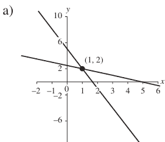

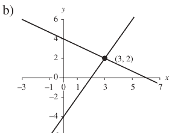

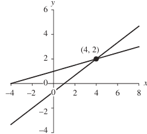

- 7. 给定 $x = 3$ 并代入第二个方程得到
$3 + 3y = 9, 3y = 6$，且 $y = 2$。有序对解为 $(3, 2)$。

b) 使用 $y - 2 = 0, y = 2$。代入第二个方程得到 $x + 3(2) = 9, x + 6 = 9$，且 $x = 3$。有序对解为 $(3, 2)$。

c) 第二个方程已经解出了 $y$，代入第一个方程 $x + (-x + 3) = 5$ 或 $3 = 5$。这是错误的，所以该方程组是不相容的且无解。

- 9. 在这里，只需直接相加两个方程即可消去 $x$。

```
$$-x + 2y = 5
x + y = 4
3y = 9$ 或 $y = 3$
```

接下来，使用 $y = 3$ 确定 $x = 1$。有序对解为 $(1, 3)$。

b) 在这里，通过将第二个方程乘以 3 可以消去 $y$。方程组重写为：

```
$$-4x + 3y = 35
6x - 3y$
```

两个方程相加得到 $10x = 50$，即 $x = 5$。使用这个 $x$ 的值得到 $y$ 也是 $5$。（通过原方程检查 $(5, 5)$。）

c) 第二个方程必须先重写为标准形式 $ax + by = c$，所以求解的方程组为：

```
$-x + 4y = 13
4x - 2y = 10
```

将第一个方程乘以 $-4$ 可以消去方程组中的 $x$。

```
$-4x - 16y = -52
4x - 2y = 10
-14y = -42$ 或 $y = 3$
```

使用 $y = 3$，确定 $x = 1$。（通过原方程检查解 $(1, 3)$）。

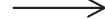

d) 将第一个方程重写为标准形式并乘以 2 以消去 $x$，得到：

```
-2x + 2y = 8
2x + 3y = 12
5y = 20 或 y = 4
```

如果 y = 4，x = 0，在原方程中检查 (0, 4) 是解。

- 11. 让 $x$ 代表饼干盒的数量，$y$ 代表糖果盒的数量。求解的方程组为：

```
x + y = 240
4x + 5y = 900
```

- 13. 让 $x$ = 普通油加仑，$y$ = 高级油加仑。求解的方程组（使用代入法或消元法）：

```
x + y = 100
0.87x + 0.93y = 92
```

- 15. 市场均衡发生在 $q$ 约为 30，$y$ 约为 260 时。使用代入法 $2q + 320 = 500$ 得到正确的解。

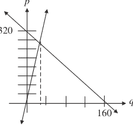


11. 这里，$V = \frac{1}{3}\pi r^2h$。使用数据 $V = \frac{1}{3}\pi(3)^2(10) = 30\pi \text{ cm}^3$。

13. 这里，胡克定律为 $y=kx$，$400 = k(10)$且 $k = 40$。当力为 250 牛顿时，$250 = (40)x$，且 $x = 250/40 = 6.25 \text{ cm}$。

15. 让 $x$ 代表短直角的长度，$y$ 代表斜边的长度。为了确定 $x$，使用 $5/x = 12/24$；为了确定 $y$，使用 $13/y = 12/24$。求解得：

$$\frac{5}{x} = \frac{12}{24} \quad \frac{13}{y} = \frac{12}{24}$$
$$12x = 120 \quad 12y = 312$$
$$x = 10 \quad\quad y = 26$$

17. 这里，比例关系得出了方程：

$$\frac{x}{x+5} = \frac{20}{60}$$
$$\frac{x}{x+5} = \frac{1}{3}$$
$$3x = x+5$$
$$2x = 5$$
$$x = 2.5 \quad\text{且 } x+5 = 7.5$$

19. 这里，$A=kb$，所以 $50 = k(20)(5)$ 得到 $k = 1/2$。感兴趣的纠结面积 $A = (1/2)(16)(8) = 64 \text{ in}^2$。

21. NASA CONNECT 是一项针对 6-8 年级学生的年度系列的数学、科学和技术教学距离课程计划。在 2000 年 3 月的“未来的比例建模”中，学生们学习了为什么缩放和比例在飞机运输系统的设计中如此重要。

23. 答案不一。

# 练习 1.7

- 1. 5 miles $\cdot \frac{5280\text{ ft}}{1\text{ mile}} \cdot \frac{12\text{ in}}{39.37\text{ in}} = 8046.74\text{ m}$

- 3. 这里，使用练习 1.4.1 中的转换因子（$1\text{ m} = 39.37\text{ in.}$）进行求解。
$100\text{ km} \cdot \frac{1000\text{ m}}{1\text{ h}} \cdot \frac{39.37\text{ in}}{12\text{ in}} \cdot \frac{1\text{ ft}}{5280\text{ ft}} = 62.14\text{ m}$
$50\text{ miles} \cdot \frac{1\text{ h}}{60\text{ min}} \cdot \frac{60\text{ sec}}{1\text{ mile}} \cdot \frac{5280\text{ ft}}{39.37\text{ in.}} \dots = \approx 2235.2\text{ cm/sec}$

- 7. 4.3 pounds $\cdot \frac{453.6\text{ g}}{1\text{ pound}} = 1950.48\text{ g}$

- 9. $\frac{320.85\text{ g}}{45\text{ ml}} = 7.13\text{ g/ml}$

- 11. 质量等于密度乘以体积（这里为一升）
$\frac{13.55\text{ g}}{\text{cm}^3} \cdot 1000\text{ ml} = 13550\text{ g}$。接下来，将克转换为磅：
$13550\text{ g} \cdot \frac{1\text{ lb}}{453.6\text{ g}} = 29.872\text{ lb}$

- 13. $30\text{gC} \cdot \frac{1\text{molC}}{12\text{gC}} \cdot \frac{6.02 \times 10^{23}\text{atomsC}}{1\text{molC}} = 1.505 \times 10^{24}\text{ atoms C.}$

- 15. 首先，将 5 吨转换为 10,000 磅。接下来，因为体积=质量/密度，$\frac{10000\text{ pounds}}{5.83\text{ pounds/gallon}} = 1715.26\text{ gallons.}$

- 17. 假设有 $100\text{g}$ 氧化亚氮，含有 $63.6\text{g}$ N 和 $36.4\text{g}$ O。将这些转换为摩尔，大约有 $4.543\text{ moles}$ N 和 $2.275\text{ moles}$ O，这意味着分子是两部分氮一部分氧，即 $\text{N}_2\text{O}$。该分子为 $44\text{g}$，这是正确的重量，因此下标是正确的，氧化亚氮的化学式为 $\text{N}_2\text{O}$。

- 19. 英亩通过平方英尺测量。英亩可以有不同的尺寸，面积约为 $43,560$ 平方英尺。

## 第一章补充练习

1. 为了确定平均值，将五个分数相加并除以五。如果 $x$ 代表期末考试的分，那么

$$76 + 89 + 70 + x + x = 82.6 \times 5$$
$$235 + 2x = 413$$
$$2x = 178$$
$$x = 89$$

学生需要得到 89 分才能在课程中获得 B。

- a) 应纳税收入为 $250,000$ 的单身申报者，前 $9,075$ 美元的税率为 10%，接下来的 $27,825$ 美元的税 15%，以此类推，直到 $250,000(0.10) + 52,450(0.25)$。

b) 应纳税收入为 $250,000$ 的夫妻共同申报者，税为 $18500(0.10) + 55,650(0.15) + 75,050(0.25) + 78,000(0.28) + 23,150(0.33) = \$58,405$。

c) 应纳税收入为 $200,000$ 的夫妻分别申报者，需要支付 $53,952$，而收入 $50,000$ 的配偶需要支付 $8,356$，总税为 $62,308$。在这种情况下，夫妻分开申报是有利的。

- 5. 线上的两个点是 $(0, 8)$ 和 $(5, 0)$。斜率是 $-8/5$。$m = \frac{0-8}{5-0} = -8/5$

- 7. a) 垂直线的斜率互为倒数。通过 $(2, 0)$ 和 $(0, 5)$ 的线斜率为 $m = \frac{5-0}{0-2} = -5/2$，垂直线的斜率为 $m = 2/5$。通过 $(3, 5)$ 且斜率为 $2/5$ 的线使用点斜式为 $y-5 = \frac{2}{5}(x-3)$。

b) 水平线为 $y=b$。垂直于 $x$ 轴的线是垂直线。因为 $(2, 7)$ 在线上，方程为 $x=2$。

9. 线具有负斜率，也有截距。这里，该值必须是 4，因为 $(1, 4)$ 在线上。

11. 让 $x$ = 使用的水量（千加），那么账单为 $40 + 2.25x$。使用 $x=12$。

13. 让 $x$ = 水量，$y$ = $100\%$ 硫酸量。方程组：
$x + y = 50$
$50x + 100y = 4000$
第二个方程得 $y=40$。

15. 让 $x = 50$ 个项目，$y = 100$ 个项目。方程组：
$x + y = 150$
$50x + 100y = 6250$
使用消元法，
$50x + 100y = 7500$
$50y = -1250$ (Wait, 检查 OCR)。

17. 比多卖了 90 个产品。（注意回答问题）。
)R(x) = 6x$
b) $C(x) = 2000 + 50x$
c) 令收入等于成本以找到收支平衡点，$6x = 2000 + 50x$ (Wait, OCR 错误)。
d) $P(x) = R(x) - C(x) = 6x - (2000 + 50x) = -44x - 2000$ (OCR 错误)。

19. 信息似乎不是一个出现频繁的数字。
b) $5^{x-3} \cdot 5^{x+1} = 5^{4-5}$
$2x-2 = -1$
$2x = 1$
$x = 0.5$

23. 重写为 $\log_4$:
$x^4 = 128$
$x = \sqrt[4]{128}$


- 3. 这里，$P = \$3000, n = 20,$ 且 $i = 0.05$。未来值为：

$FV = \frac{(1+0.05)^{20}-1}{0.05}(3000) = \frac{(1.05)^{20}-1}{0.05}(3000) = \$99,197.86.$

- 5. 这里，$P = \$2500, n = 8,$ 且 $i = 0.03$。未来值为：

$FV = \frac{(1+0.03)^{8}-1}{0.03}(2500) = \frac{(1.03)^{8}-1}{0.03}(2500) = \$22,230.84.$

- 7. 这里，$P = \$1000, n = 15,$ 且 $i = 0.07$。未来值为：

$FV = \frac{(1+0.07)^{15}-1}{0.07}(1000) = \frac{(1.07)^{15}-1}{0.07}(1000) = \$25,129.02.$

- 9. 这里，$P = \$1000, n = (2)(25) = 50,$ 且 $i = 0.10/2 = 0.05$。未来值为：

$FV = \frac{(1+0.05)^{50}-1}{0.05}(1000) = \frac{(1.05)^{50}-1}{0.05}(1000) = \$209,348.00.$

- 11. 这里，$P = \$50, n = (12)(5) = 60,$ 且 $i = 0.12/12 = 0.01$。现值为：

$PV = \frac{1-(1+0.01)^{-60}}{0.01}(250) = \frac{1-(1.01)^{-60}}{0.01}(250) = \$22,477.75.$

- 13. 这里，$P = \$125, n = (4)(10) = 40,$ 且 $i = 0.06/4 = 0.015$。现值为：

$PV = \frac{1-(1+0.015)^{-40}}{0.015}(125) = \frac{1-(1.015)^{-40}}{0.015}(125) = \$3739.84.$

- 15. 这里，$P = \$2500, n = (2)(8) = 16,$ 且 $i = 0.08/2 = 0.04$。现值为：

$PV = \frac{1-(1+0.04)^{-16}}{0.04}(2500) = \frac{1-(1.04)^{-16}}{0.04}(2500) = \$29,130.74.$

### 17. 每月支付 $25,000，利率 6%，期限 20 年的现值为：

$PV = \frac{1 - (1 + 0.005)^{-240}}{0.005}(25,000) = \frac{1 - (1.005)^{-240}}{0.005}(25,000) = \$3,489,519.30.$

由于这超过了 $2,500,000 的一次性付款，因此 20 年的月付更好。

### 练习题 2.3

- 1. 使用摊还公式，还款为：

$$\frac{(0.01)(500)}{\frac{1}{1 - (1.01)^{-6}}} = \$86.27.$$

| 期期 | 期初余额 | 利息 | 摊还金额（减去利息） | 还款 |
|---|---|---|---|---|
| 1 | $500.00 | $5.00 | $81.27 | $86.27 |
| 2 | $418.73 | $4.19 | $82.08 | $86.27 |
| 3 | $336.65 | $3.37 | $82.90 | $86.27 |
| 4 | $253.75 | $2.54 | $83.73 | $86.27 |
| 5 | $170.02 | $1.70 | $84.57 | $86.27 |
| 6 | $85.45 | $0.82* | $85.55* | $86.27 |
| 总计 | | | $500.00 | $517.62 |

* 表示调整后的金额。

- 2. 这里，$i = 0.06/12 = 0.005$。月还为：

$$25,000(0.005)\frac{1}{(1.005)^{60}} = \$483.32.$$

- 3. 这里，$i = 0.04/12 = 0.00333$。月还为：

$$35,000(0.00333)\frac{1}{(1.00333)^{72}} = \$547.58.$$

- 7. 这里，$i = 0.03/12 = 0.0025$。4 年期的月还为 $18,000(0.0025) / [1 - \frac{1}{(1.0025)^{48}}] = \$398.42$。如果是 5 年贷款，月还为 $\frac{18,000(0.0025)}{1 - \frac{1}{(1.0025)^{60}}} = \$323.44$，总额较低。因此，4 年贷款可以节省 $82。

- 9. 这里，$i = 0.04/12 = 0.00333$。30 年期的月还为 $35,000(0.00333) / [1 - \frac{1}{(1.00333)^{30}}] = \$167.95$。对于 25 年抵押，月还为 $184.43$。

- 11. 小镇有两个选项供考虑：
选项 1：$900,000 分 50 年摊还，利率 5%，每年 $7,000$。$Y = \frac{900,000(0.05)}{1 - \frac{1}{(1.05)^{50}}} = \$49,299.06$。
选项 2：$800,000 分 50 年摊还，利率 5%，每年 $7,000$。$Y = \frac{800,000(0.05)}{1 - \frac{1}{(1.05)^{50}}} = \$43,821.39$。
小镇应该选择选项 2，因为成本较低。

### 练习题 2.4

- 1. 这是一个等差数列，公差为 5。通过在前项上加 5 得到接下来的四项：17, 22, 27, 32。

- 3. 这里，公差为 15。接下来的五项为 65, 80, 95, 110, 125。

- 5. 前七项为 3, 9, 15, 21, 27, 33, 39。另一种方法使用 $S_n = \frac{n(a_1 + a_n)}{2}$，其中 $a_1 = 3$ 且 $a_n = 39$。$S_7 = \frac{7(3 + 39)}{2} = 147$。

- 7. 对于数列的前五项，使用 $a_n = \frac{a_1(r^n-1)}{r-1}$，代入 $n=1, n=2, n=3, n=4$ 和 $n=5$，得到 $a_1=5, a_2=7, a_3=9, a_4=11, a_5=13$。

- 9. 连续项通过乘以公比 3 得到。因此，接下来的三项为 54, 162 和 486。

- 11. 这里，公比为 1/3。接下来的三项为 9, 3。

- 13. 前五项为 4, 16, 64, 256 和 1024。和为 1364。使用 $S_n = \frac{a_1(r^n-1)}{r-1}$，其中 $a_1=4$ 和 $r=4$，得到 $S_5 = \frac{4(4^5-1)}{4-1} = 1364$。

- 15. 球的高度遵循等比数列。在第一次弹跳、第二次和第三次弹跳后，高度为 $1/2(200)$。

- 17. 它将累积到 $5000(1.6)^4 = \$6312.38$。因此，它将获得 $1312.38$ 的利息。

- 19. 前几对连续斐波那契数列的积为 $F_1F_2 + F_2F_3 + F_3F_4$。接下来，使用 $F_1 = F_2$ 和 $F_4 = F_2+F_3$ 将表达式重写为：


金融数学

$(F_2)F_2 + F_2F_3 + F_3(F_2 + F_3)$。现在，
$(F_2)F_2 + F_2F_3 + F_3(F_2 + F_3) = (F_2)^2 + 2F_2F_3 + (F_3)^2 = (F_2 + F_3)^2 = (F_4)^2$。

接下来，前五对斐波那契数列 $F_1F_2 + F_2F_3 + F_3F_4 + F_4F_5 + F_5F_6$：

## 补充练习题

- 1. $900,000 利率 5%，每年 $45,000$。

- 3. $800,000 利率 5%，每年 $40,000$。

- 5. $700,000 利率 5%，每年 $35,000$。

- 7. $600,000 利率 5%，每年 $30,000$。

- 9. $500,000 利率 5%，每年 $25,000$。

- 11. $400,000 利率 5%，每年 $20,000$。


无论 $x_1$ 和 $x_2$ 的值如何，连续的数字对对，这解释了轮盘幸运游戏（Round Robin Party Game）是如何得出黄金分割比例估计值的。

- **17.** 答案不一，但许多人应该找到近似黄金分割的例子。

# 第 3 章

### 矩阵代数

### 练习 3.1

- 1. a) $\begin{bmatrix} 3 & -5 & 4 \\ 1 & 1 & -1 \\ 2 & 3 & -2 \end{bmatrix}$ b) $\begin{bmatrix} 1 & -3 & 5 & 19 \\ 2 & 4 & -1 & -5 \\ -1 & 5 & 3 & 3 \end{bmatrix}$

- 3. $5x_1 + 3x_2 = 13$
$4x_1 + 7x_2 = 18$

- 5. $x_1 + 2x_2 + 3x_3 = 4$
$2x_1 + x_2 + 2x_3 = 3$
$4x_1 + x_2 - 2x_3 = 9$

- 7. $x = 4, y = 3, z = 1$

- 9. 令 $x = \#$ 儿童票数量，$y = \#$ 大人票数量。方程组为
$x + y = 2400$
$4x + 5y = 10,500$

增广矩阵为 $\begin{bmatrix} 1 & 1 & 2400 \\ 4 & 5 & 10,500 \end{bmatrix}$。

- 11. 最后一行包含全零行，但右侧（RHS）有一个非零数字。

- 13. 新的第 1 行变为 $[row 1 - 2 \ row 3]$ 或
$\begin{bmatrix} 1 & 1 & 2 \\ 0 & 0 & 2 \end{bmatrix} = \begin{bmatrix} 1 & 0 & 7 \end{bmatrix}$

 新的第 2 行变为 $[row 2 - 3 \ row 3]$ 或
$\begin{bmatrix} 0 & 1 & 3 \\ 0 & 0 & 3 \end{bmatrix} = \begin{bmatrix} 0 & 1 & 4 \end{bmatrix}$ 所示。

```
$\begin{bmatrix} 1 & 2 & 9 \\ 0 & 3 & 7 \\ 0 & 0 & 1 \end{bmatrix} \rightarrow \begin{bmatrix} 1 & 0 & 7 \\ 0 & 1 & 4 \\ 0 & 0 & 1 \end{bmatrix}$
```

- 15. 首先，执行所示的操作 $R_2 \rightarrow R_2 - 2R_1$ 和 $R_3 \rightarrow R_3 + R_1$。

```
$\begin{bmatrix} 1 & -3 & 5 & 19 \\ 2 & 4 & -1 & -5 \\ -1 & 5 & 3 & 3 \end{bmatrix} \rightarrow \begin{bmatrix} -3 & 5 & 19 \\ 0 & 10 & -11 & -43 \\ 0 & 2 & 8 & 22 \end{bmatrix}$
```

接下来，交换第 2 行和第 3 行，并将第 2 行变为原始行的 1/2（还有其他选择，但这些分数更简单），得到

```
$\begin{bmatrix} -3 & 5 & 19 \\ 0 & 1 & 4 & 11 \\ 0 & 10 & -11 & -43 \end{bmatrix}$
```

现在执行 $R_3 \rightarrow R_3 - 10R_2$ 得到

```
$\begin{bmatrix} -3 & 5 & 19 \\ 0 & 1 & 4 & 11 \\ 0 & 0 & -51 & -153 \end{bmatrix}$
```

接下来，$R_3 \rightarrow (-1/51)R_3$ 得到

```
$\begin{bmatrix} -3 & 5 & 19 \\ 0 & 1 & 4 & 11 \\ 0 & 0 & 1 & 3 \end{bmatrix}$
```

这表明 $x_3 = 3$。第二行得到 $x_2 + 4(3) = 11$，即 $x_2 = -1$。接下来，在第一行中使用这些值 $x_1 - 3(-1) + 5(3) = 19$， 表明 $x_1 = 1$。有序解为 $(1, -1, 3)$。

### 练习 3.2

- 1. 下标表示元素所在的行和列。

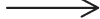

- a) $a_{12} = 2$（第一行，第二列）
b) $a_{23} = -1$
c) $a_{13} = -3$
d) $a_{22} = 4$

- 3. 矩阵维度为 $\mathbf{A} = 2 \times 2$，$\mathbf{B} = 2 \times 2$，$\mathbf{C} = 2 \times 3$
a) 相加矩阵需要维度相等，因此 $\mathbf{A} + \mathbf{B}$ 是可能的。
b) 由于 $\mathbf{B}$ 和 $\mathbf{C}$ 维度不同，因此 $\mathbf{B} + 2\mathbf{C}$ 不可能。
c) 数乘不改变维度，因此 $5\mathbf{C}$ 是可能的。
d) $\mathbf{A} + \mathbf{B} - \mathbf{C}$ 不可能，因为 $\mathbf{C}$ 的维度与 $\mathbf{A}$ 和 $\mathbf{B}$ 不同。
e) $3\mathbf{B}$ 与 $\mathbf{A}$ 维度相同，因此 $3\mathbf{B} - 6\mathbf{A}$ 是可能的。

- 5. 矩阵维度为 $\mathbf{A} = 3 \times 2$，$\mathbf{B} = 3 \times 3$，$\mathbf{C} = 3 \times 3$
a) 相加矩阵需要维度相等，因此 $\mathbf{A} + \mathbf{B}$ 是可能的。
b) 数乘不改变维度，因此 $4\mathbf{C}$ 是可能的。
c) 由于 $\mathbf{A}$ 和 $\mathbf{B}$ 维度相等，因此 $2\mathbf{A} + \mathbf{B}$ 是可能的。
d) $3\mathbf{A} - 2\mathbf{C}$ 不可能，因为 $\mathbf{A}$ 的维度与 $\mathbf{C}$ 不同。
e) 相加矩阵需要维度相等，因此 $\mathbf{B} + \mathbf{C}$ 不可能。

- 7. 练习 3.2 中的有效矩阵操作有 a), c), 和 e)
$\mathbf{A} + \mathbf{B} = \begin{bmatrix} 10 & 25 \\ 74 & 30 \end{bmatrix} + \begin{bmatrix} 20 & 52 \\ 41 & 36 \end{bmatrix} = \begin{bmatrix} 30 & 77 \\ 115 & 66 \end{bmatrix}$
$5\mathbf{C} = 5 \begin{bmatrix} 21 & 62 \\ -37 & 40 \\ -91 \end{bmatrix} = \begin{bmatrix} 105 & 310 \\ -185 & 200 \\ -455 \end{bmatrix}$
$3\mathbf{B} - 6\mathbf{A} = 3 \begin{bmatrix} 20 & 52 \\ 41 & 36 \end{bmatrix} - 6 \begin{bmatrix} 10 & 25 \\ 74 & 30 \end{bmatrix} = \begin{bmatrix} 60 & 156 \\ 123 & 108 \end{bmatrix} - \begin{bmatrix} 60 & 150 \\ 444 & 180 \end{bmatrix} = \begin{bmatrix} 0 & 6 \\ -321 & -72 \end{bmatrix}$

- 9. 练习 3.2 中的有效操作有 a), b), 和 c。
a) $A + B = \begin{bmatrix} 4 & -1 \\ 5 & 12 \\ 6 & 1 & 7 \end{bmatrix} + \begin{bmatrix} 12 & 32 & 36 \\ 8 & 0 & 0 \end{bmatrix}$（注：OCR 维度不匹配）
b) $4\mathbf{C} = 4 \begin{bmatrix} 3 & 8 & 9 \\ 2 & 0 & 0 \\ 4 & 0 & 3 \end{bmatrix} = \begin{bmatrix} 12 & 32 & 36 \\ 8 & 0 & 0 \\ 16 & 0 & 12 \end{bmatrix}$
c) $2A + B = 2 \begin{bmatrix} 4 & -1 \\ 5 & 12 \\ 6 & 1 & 7 \end{bmatrix} + \begin{bmatrix} 16 & 1 & 18 \\ 13 & 3 & 2 & 9 \end{bmatrix}$

- 11. 在这种情况下，所有操作都是有效的。
a) $A + B = \begin{bmatrix} 1 & 0 & -2 \\ 3 & 4 & 7 \end{bmatrix} + \begin{bmatrix} -1 & 3 & 8 \\ -5 & 1 & 4 \end{bmatrix} = \begin{bmatrix} \dots \end{bmatrix}$
b) $2B = 2 \begin{bmatrix} -2 & 3 & 6 \\ -5 & 1 & 4 \end{bmatrix} = \begin{bmatrix} -4 & 6 & 12 \\ -10 & 2 & 8 \end{bmatrix}$
c) $A + 3\mathbf{C} = \begin{bmatrix} 1 & 0 & -2 \\ 3 & 4 & 7 \end{bmatrix} + 3 \begin{bmatrix} 4 & -6 & -3 \\ 2 & 8 & -9 \end{bmatrix} = \begin{bmatrix} 13 & -18 & -7 \\ 9 & 28 & -20 \end{bmatrix}$
d) $3A - 2B + C = \begin{bmatrix} 1 & 0 & -2 \\ 3 & 4 & 7 \end{bmatrix} - 2 \begin{bmatrix} -2 & 3 & 6 \\ -5 & 1 & 4 \end{bmatrix} + \begin{bmatrix} 4 & -6 & -3 \\ 2 & 8 & -9 \end{bmatrix} = \begin{bmatrix} 3 & 0 & 6 \\ 9 & 12 & 21 \end{bmatrix} - \begin{bmatrix} -4 & 6 & 12 \\ -10 & 2 & 8 \end{bmatrix} + \begin{bmatrix} 4 & -6 & -3 \\ 2 & 8 & -9 \end{bmatrix} = \begin{bmatrix} 11 & 0 & -9 \\ 21 & 18 & 4 \end{bmatrix}$

- 13. 由于 $A$ 是 $1 \times 4$ 且 $B$ 是 $4 \times 1$，乘积是一个 $1 \times 1$ 矩阵。
$AB = [1 \cdot (-2) + 0 \cdot (-1) + 3 \cdot 8 + 4 \cdot 0] = [22]$
由于 $B$ 是 $4 \times 1$ 且 $A$ 是 $1 \times 4$，$BA$ 是一个 $4 \times 4$ 矩阵。
$BA = \begin{bmatrix} -2 & 0 & -6 & -8 \\ -1 & 0 & -3 & -4 \\ 8 & 0 & 24 & 32 \\ 0 & 0 & 0 & 0 \end{bmatrix}$

- 15. 矩阵维度为 $A = 2 \times 2, B = 3 \times 2, C = 2 \times 3$。
a) $AB$ 是不可能的，因为 $A$ 的列数与 $B$ 的行数不同。
b) $AC$ 是 $(2 \times 2)(2 \times 3)$ 结果为 $2 \times 3$。
c) $BA$ 是 $(3 \times 2)(2 \times 2)$ 结果为 $3 \times 2$。
d) $BC$ 是 $(3 \times 2)(2 \times 3)$ 结果为 $3 \times 3$。
e) $CA$ 是不可能的。
f) $CB$ 是 $(2 \times 3)(3 \times 2)$ 结果为 $2 \times 3$。

- 17. $AC, BA, BC$ 都是可能的。
$AC = \begin{bmatrix} 0 & 2 \\ 4 & 6 \end{bmatrix} \begin{bmatrix} 1 & 2 & -3 \\ 9 & 4 & -1 \end{bmatrix} = \begin{bmatrix} 18 & 8 & -2 \\ 58 & 32 & -18 \end{bmatrix}$
$BA = \begin{bmatrix} 2 & 5 \\ 4 & 3 \\ 1 & -2 \end{bmatrix} \begin{bmatrix} 0 & 2 \\ 4 & 6 \end{bmatrix}$（注：OCR 中维度 $3 \times 2$ 和 $2 \times 2$ 不匹配）
$BC = \begin{bmatrix} 2 & 5 \\ 4 & 3 \\ 1 & -2 \end{bmatrix} \begin{bmatrix} 1 & 2 & -3 \\ 9 & 4 & -1 \end{bmatrix} = \begin{bmatrix} 47 & 24 & -11 \\ 31 & 20 & -15 \\ -17 & -6 & -11 \end{bmatrix}$
$CB = \begin{bmatrix} 1 & 2 & -3 \\ 9 & 4 & -1 \end{bmatrix} \begin{bmatrix} 2 & 5 \\ 4 & 3 \\ 1 & -2 \end{bmatrix} = \begin{bmatrix} 7 & 17 \\ 33 & 59 \end{bmatrix}$

- 19. $A$ 是一个 $(3 \times 2)$ 矩阵。
a) 为了使 $A+0$ 有效，零矩阵的维度必须与 $A$ 相同，$0$ 是 $(3 \times 2)$ 矩阵。
b) 乘法 $A0$ 有效的唯一要求是 $0$ 的行数与 $A$ 的列数相同，$0$ 是任意 $(2 \times n)$ 矩阵。
c) 为了使 $0A$ 有效，零矩阵的列数必须与 $A$ 的行数相同，$0$ 是任意 $(m \times 3)$ 矩阵。

- 21. $AA = \begin{bmatrix} 3 & 0 & 1 \\ 0 & 1 & 2 \\ 1 & 2 & 4 \end{bmatrix} \begin{bmatrix} 3 & 0 & 1 \\ 0 & 1 & 2 \\ 1 & 2 & 4 \end{bmatrix} = \begin{bmatrix} 10 & 2 & 7 \\ 2 & 5 & 10 \\ 7 & 10 & 21 \end{bmatrix}$

b) 它必须是方矩阵（行数和列数相同）。

a) 列向量 $(m \times 1)$ 的转置是行向量 $(1 \times m)$。

b) 行向量 $(1 \times m)$ 的转置是列向量 $(m \times 1)$。

- 25. 2014 年 5 月 24 日，5 磅士奶士、3 磅黄油和 2 磅奶粉花费：

```
\begin{bmatrix} 2.1128 \\ 2.1189 \\ 1.8143 \end{bmatrix} = $20.5493
```


### 34 线性代数

b) 三周内每周的 4 磅奶酪、1 磅黄油和 3 磅脱奶，可以通过以下矩阵找到：
$$\begin{bmatrix} 2.0516 & 2.0234 & 2.0172 \\ 4 & 1 & 3 \\ 2.1261 & 2.1857 & 2.1836 \\ 1.8901 & 1.8427 & 1.8624 \end{bmatrix}
= [16.0028, 15.8074, 15.8396]$$

27. GPA 由质量分除以总学分决定。通过将学分乘以四分制中的分等级来计算质量分。一个学期有 14 学分。
$$\begin{bmatrix} 4.00 & 3.67 \\ 4 & 1 & 3 \\ 3 & 3 & 2.67 \end{bmatrix} \times \begin{bmatrix} 3.00 \\ 2.33 \end{bmatrix} = [43.67]$$

43.67/14 = 3.119 学期 GPA。

29. a) $\begin{bmatrix} 3 & -7 & 1 & 3 & x_1 & 7 \\ 2 & 3 & 1 & -2 & x_2 & 0 \\ 3 & 1 & 7 & x_3 & 25 \\ 1 & 5 & 2 & -8 & x_4 & -19 \end{bmatrix} =$

b) $\begin{bmatrix} 1 & 4 & 1 & w' & 8 \\ 2 & 3 & -1 & 5 & x & 7 \\ 1 & -2 & 4 & y & 3 \\ 3 & 2 & -1 & z & 10 \end{bmatrix}$

31. a) $w + 5x + 2y + 2z = 19$
$x_1 + x_2 + 4x_3 + x_4 = 12$
$w + x + 3y = 14$
$x_1 + x_2 + 3x_3 + 2x_4 = 13$
$2w + 3x - 2y + 5z = 15$
$x_1 + 2x_2 + 5x_4 = 17$
$3w + x + 2z = 17$
$2x_1 + 3x_2 + x_3 + x_4 = 8$

33. a) $\begin{bmatrix} 1 & 5 & 2 & 2 & 19 \\ 1 & 1 & 3 & 0 & 14 \\ 2 & 3 & -2 & 5 & 15 \\ 3 & 1 & 0 & 2 & 17 \end{bmatrix}$

b) $\begin{bmatrix} 1 & 4 & 1 & 12 \\ 1 & 1 & 3 & 2 & 13 \\ 1 & 2 & 0 & 5 & 17 \\ 2 & 3 & 1 & 8 \end{bmatrix}$

### 练习 3.3

- 1. a) $\begin{bmatrix} 2 & 3 & 0 \\ 1 & 4 & 0 \end{bmatrix} \rightarrow \begin{bmatrix} 1 & 4 & 0 \\ 2 & 3 & 0 \end{bmatrix} \rightarrow \begin{bmatrix} 1 & 4 & 0 \\ 0 & -5 & 0 \end{bmatrix} \rightarrow \begin{bmatrix} 1 & 4 & 0 \\ 0 & 1 & 0 \end{bmatrix} \rightarrow \begin{bmatrix} 1 & 0 & 0 \\ 0 & 1 & 0 \end{bmatrix}$
表示平凡解 $x_1 = 0$ 和 $x_2 = 0$。
b) $\begin{bmatrix} 1 & 3 & 0 \\ 2 & 6 & 0 \end{bmatrix} \rightarrow \begin{bmatrix} 1 & 3 & 0 \\ 0 & 0 & 0 \end{bmatrix}$
表示 $x_1 = -3x_2$，且 $x_2$ 的任何值均决定 $x_1$。

- 3. 首先，回初等矩阵是对单位矩阵执行单次行变换的结果。
a) 初等变换 $R_2 \rightarrow 9R_2$
b) 不是初等变换。这里，$R_3 \rightarrow 2R_3$ 且 $R_2 \rightarrow R_2 + 5R_1$
c) 初等变换。这里，$R_3 \rightarrow 3R_2 + R_3$
d) 初等变换。这里，$R_3 \rightarrow R_3 - 8R_2$
e) 初等变换。这里，$R_2 \leftrightarrow R_1$

- 5. $A = \begin{bmatrix} 10 & 3 & 7 & 5 \\ 12 & 8 & 1 & 0 \\ 7 & -4 & 2 & 6 \end{bmatrix}$
a) 消去第三行得到子矩阵 $\begin{bmatrix} 10 & 3 & 7 & 5 \\ 12 & 8 & 1 & 0 \end{bmatrix}$
b) 消去第二、第四列得到 $\begin{bmatrix} 12 \end{bmatrix}$
c) 消去第二行和第二列得到 $\begin{bmatrix} 10 & 7 & 5 \\ 7 & 2 & 6 \end{bmatrix}$
d) 消去第一、三列得到 $\begin{bmatrix} 3 & 5 \\ 8 & 0 \\ -4 & 6 \end{bmatrix}$

- 7. 行梯形（但不是简化行阶梯形，因为第一行有 5）。
b) 行梯形（但不是简化行阶梯形）。
c) 不是行梯形，因为主元在第三行更右。
d) 不是行梯形，因为第二行有零行。

## 线性代数

9. $\begin{bmatrix} 2 & 1 & 7 \\ 4 & 1 & 9 \end{bmatrix} \rightarrow \begin{bmatrix} 1 & 1/2 & 7/2 \\ 4 & 1 & 9 \end{bmatrix} \rightarrow \begin{bmatrix} 1 & 1/2 & 7/2 \\ 0 & -1 & -5 \end{bmatrix} \rightarrow \begin{bmatrix} 1 & 1/2 & 7/2 \\ 0 & 1 & 5 \end{bmatrix} \rightarrow \begin{bmatrix} 1 & 0 & -1 \\ 0 & 1 & 5 \end{bmatrix}$ 表示 $x_1 = 1$ 且 $x_2 = 5$。

11. $\begin{bmatrix} 1 & 2 & 8 \\ 2 & 4 & 14 \end{bmatrix} \rightarrow \begin{bmatrix} 1 & 2 & 8 \\ 0 & 0 & -2 \end{bmatrix}$ 无解。

13. $\begin{bmatrix} 1 & -2 & 10 \\ 3 & -2 & 0 \\ 5 & 5 & 16 \end{bmatrix} \rightarrow \begin{bmatrix} 1 & -2 & 10 \\ 0 & 4 & -30 \\ 0 & 15 & -34 \end{bmatrix} \rightarrow \begin{bmatrix} 1 & -2 & 10 \\ 0 & 4 & -30 \\ 0 & 0 & 1.5 \end{bmatrix} \rightarrow \begin{bmatrix} 1 & -2 & 10 \\ 0 & 4 & -30 \\ 0 & 0 & 1 \end{bmatrix}$
$\rightarrow \begin{bmatrix} 1 & -2 & 0 \\ 0 & 4 & 0 \\ 0 & 0 & 1 \end{bmatrix} \rightarrow \begin{bmatrix} 1 & -2 & 0 \\ 0 & 0 & 0 \\ 0 & 0 & 1 \end{bmatrix}$ 
$\rightarrow \begin{bmatrix} 1 & -2 & 0 \\ 0 & 1 & 0 \\ 0 & 0 & 1 \end{bmatrix}$ 表示解 $x_1 = 2, x_2 = 0, x_3 = 6$。（注：此处 OCR 计算结果可能有误）

15. $\begin{bmatrix} 1 & 2 & -3 \\ 3 & -1 & 10 \\ 2 & 0 & 9 \end{bmatrix} \rightarrow \begin{bmatrix} 1 & 2 & -3 \\ 0 & -7 & 19 \\ 0 & -4 & 15 \end{bmatrix} \rightarrow \begin{bmatrix} 1 & 2 & -3 \\ 0 & -7 & 19 \\ 0 & 0 & 1.4 \end{bmatrix}$
$\rightarrow \begin{bmatrix} 1 & 2 & -3 \\ 0 & -7 & 19 \\ 0 & 0 & 1 \end{bmatrix} \rightarrow \begin{bmatrix} 1 & 2 & 0 \\ 0 & 1 & 0 \\ 0 & 0 & 1 \end{bmatrix} \rightarrow \begin{bmatrix} 1 & 0 & 0 \\ 0 & 1 & 0 \\ 0 & 0 & 1 \end{bmatrix}$ 表示解 $x_1 = 1, x_2 = 5, x_3 = 2$。

17. $\begin{bmatrix} 1 & 1 & 1 \\ 1 & -2 & 3 \\ 3 & -2 & -1 \end{bmatrix} \rightarrow \begin{bmatrix} 1 & 1 & 1 \\ 0 & -3 & 2 \\ 0 & -5 & -4 \end{bmatrix} \rightarrow \begin{bmatrix} 1 & 1 & 1 \\ 0 & -3 & 2 \\ 0 & 0 & -0.6 \end{bmatrix}$
$\rightarrow \begin{bmatrix} 1 & 1 & 1 \\ 0 & 1 & 0 \\ 0 & 0 & 1 \end{bmatrix} \rightarrow \begin{bmatrix} 1 & 0 & 0 \\ 0 & 1 & 0 \\ 0 & 0 & 1 \end{bmatrix}$

19. 令 $x_1$ 和 $x_2$ 为预售的儿童和成人票，$x_3$ 为现场售的票。
$x_1 + x_2 + x_3 = 1000$
$15x_1 + 20x_2 + 25x_3 = 18500$
$4x_1 - x_3 = 0$

$\begin{bmatrix} 1 & 1 & 1 \\ 15 & 20 & 25 \\ 4 & 0 & -1 \end{bmatrix} \rightarrow \begin{bmatrix} 1 & 1 & 1 \\ 0 & 5 & 10 \\ 0 & -4 & -5 \end{bmatrix} \rightarrow \begin{bmatrix} 1 & 1 & 1 \\ 0 & 5 & 10 \\ 0 & 0 & 3 \end{bmatrix}$ （此处 OCR 文本显示不完整）


### 练习题 3.4

- 1. **AB = $\begin{bmatrix} 3 & 1 \\ 5 & 2 \end{bmatrix} \begin{bmatrix} 2 & -1 \\ -5 & 3 \end{bmatrix} = \begin{bmatrix} 1 & 0 \\ 0 & 1 \end{bmatrix} = \mathbf{I}$**

- **BA = $\begin{bmatrix} 2 & -1 \\ -5 & 3 \end{bmatrix} \begin{bmatrix} 3 & 1 \\ 5 & 2 \end{bmatrix} = \begin{bmatrix} 1 & 0 \\ 0 & 1 \end{bmatrix} = \mathbf{I}$**

由于矩阵乘积的结果为单位矩阵，因此这些矩阵矩阵是互逆的。

- 3. **AB = $\begin{bmatrix} 3 & 5 & 9 \\ 1 & 3 & 6 \\ 0 & 1 & 0 \end{bmatrix} \begin{bmatrix} 3 & 0 & -5 \\ -1 & 2 & 4 \\ 0 & 0 & 0 \end{bmatrix} = \begin{bmatrix} 13 & 10 & 5 \\ 6 & 6 & 7 \\ -1 & 2 & 4 \end{bmatrix} \neq \mathbf{I}$**

- **BA = $\begin{bmatrix} 3 & 0 & -5 \\ -1 & 2 & 4 \\ 0 & 0 & 0 \end{bmatrix} \begin{bmatrix} 3 & 5 & 9 \\ 1 & 3 & 6 \\ 0 & 1 & 0 \end{bmatrix} = \begin{bmatrix} 9 & 10 & 27 \\ -1 & 5 & 3 \\ 3 & 5 & 9 \end{bmatrix} \neq \mathbf{I}$**

这些矩阵不是互逆的，因为它们的乘积不是单位矩阵。

- 5. a) $\begin{bmatrix} 3 & 4 \\ 6 & 8 \end{bmatrix}$ 第二行是第一行的倍数。

- b) $\begin{bmatrix} 2 & 3 & 5 \\ 0 & 2 & 3 \\ 4 & 6 & 10 \end{bmatrix}$ 第三行是第一行的倍数。

- c) $\begin{bmatrix} 1 & 0 & 6 \\ 2 & 3 & 4 \\ 0 & 0 & 0 \\ 1 & 7 & 2 \end{bmatrix}$ 第三行全为零。

- d) $\begin{bmatrix} 1 & 1 & 3 \\ 2 & 4 & 6 \\ 3 & 0 & 9 \end{bmatrix}$ 第三列是第一列的倍数。

- 7. a) $\mathbf{A}^{-1}\mathbf{A} = \begin{bmatrix} 5/4 & 1/4 & 3/4 & 1 & 0 & -1/2 \\ 1/4 & 5/4 & 3/4 & 0 & 1 & -1/2 \\ 1/2 & 1/2 & 3/2 & -1/3 & -1/3 & 1 \end{bmatrix} \begin{bmatrix} 1 & 0 & 0 \\ 0 & 1 & 0 \\ 0 & 0 & 1 \end{bmatrix} = \mathbf{I}$

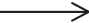

### 矩阵代数

```
$AA^{-1} = \begin{bmatrix} 1 & 0 & -1/2 & 5/4 & 1/4 & 3/4 \\ 0 & 1 & -1/2 & 1/4 & 5/4 & 3/4 \\ -1/3 & -1/3 & 1 & 1/2 & 1/2 & 3/2 \end{bmatrix} \begin{bmatrix} 1 & 0 & 0 \\ 0 & 1 & 0 \\ 0 & 0 & 1 \end{bmatrix} = I$
```

b) 使用计算技术，

```
$\begin{bmatrix} 1 & 0 & -1/2 & 1 & 0 & 0 \\ 0 & 1 & -1/2 & 0 & 1 & 0 \\ -1/3 & -1/3 & 0 & 0 & 1 \end{bmatrix} \begin{bmatrix} 1 & 0 & -1/2 & 1 & 0 & 0 \\ 0 & 1 & -1/2 & 0 & 1 & 0 \\ 0 & 0 & -1/3 & 5/6 & 0 & 1 \end{bmatrix}$
```

```
$\begin{bmatrix} 1 & 0 & -1/2 & 1 & 0 & 0 \\ 0 & 1 & -1/2 & 0 & 1 & 0 \\ 0 & 0 & 2/3 & 1/3 & 1/3 \end{bmatrix} \to \begin{bmatrix} 1 & 0 & -1/2 & 1 & 0 & 0 \\ 0 & 1 & -1/2 & 1 & 0 & 0 \\ 0 & 0 & 1/2 & 1/2 & 3/2 \end{bmatrix}$
```

```
$\begin{bmatrix} 1 & 0 & 5/4 & 1/4 & 3/4 \\ 0 & 1 & 1/4 & 5/4 & 3/4 \\ 0 & 0 & 1/2 & 1/2 & 3/2 \end{bmatrix}$ 表明逆矩阵是
```

这与之前的结果一致。

```
$\begin{bmatrix} 3 & 3 & -1 & 1 & 0 & 0 \\ -2 & -2 & 1 & 0 & 1 & 0 \\ -4 & -5 & 2 & 0 & 0 & 1 \end{bmatrix} \to \begin{bmatrix} 1 & 1 & -1/3 & 1/3 & 0 & 0 \\ -2 & -2 & 1 & 0 & 1 & 0 \\ -4 & -5 & 2 & 0 & 0 & 1 \end{bmatrix}$
```

```
$\begin{bmatrix} 1 & -1/3 & 1/3 & 0 & 0 & 0 \\ 0 & 0 & 1/3 & 2 & 0 & 1 \\ 0 & -1 & 2/3 & 3/4 & 0 & 1 \end{bmatrix} \to \begin{bmatrix} 1 & 1 & -1/3 & 1/3 & 0 & 0 \\ 0 & -1 & 2/3 & 0 & 0 & 1 \\ 0 & 0 & 1/2 & 2 & 3/2 \end{bmatrix}
```

```
{begin{ } 1 &   &   &               &   &   &   &   &   &   &   &   &   &   & 1 \end{bmatrix} \```{
$\ 1 &   &   &   &   &   &   &   &   &                                        & 1 \end{bmatrix}
```

- 9. $\begin{bmatrix} 1 & 0 & -1/2 & 1 & 0 & 0 \\ 0 & 1 & -1/2 & 0 & 1 & 0 \\ -1/3 & -1/3 & 0 & 0 & 1 \end{bmatrix} \begin{bmatrix} 1 & 0 & -1/2 & 1 & 0 & 0 \\ 0 & 1 & -1/2 & 0 & 1 & 0 \\ 0 & 0 & -1/3 & 5/6 & 0 & 1 \end{bmatrix}$

- 11. $\begin{bmatrix} 1 & 0 & 1/2 & 1 & 0 & 0 \\ 0 & 1 & 1/2 & 0 & 1 & 0 \\ 1/3 & 1/3 & 0 & 0 & 1 \end{ } \ { } 1 & 0 & 0 & 0 &   &   &      & 0 & 1 & 0 & 0 & 0 & 0 \\ 0 & 0 & 1 \end{bmatrix}$

- 13. $\begin{bmatrix} 3 & 0 & 1 & 1 & 0 & 0 \\ 2 & 2 & 1 & 0 & 1 & 0 \\ 0 & 5 & 0 & 0 & 0 & 1 \end{bmatrix} \begin{bmatrix} 3 & 5 & 9 & 1 & 3 & 0 \\ 1 & 3 & 6 & 0 & 1 & 0 \\ 0 & 1 & 0 & 0 & 0 & 1 \end{bmatrix}$

- 15. 让 $x$ 为股票金额，$y$ 为债券金额，$z$ 为货币基金金额。方程组组：
：$\begin{}}                                                       3 & 0 & 1 & 1 & 0 & 0 \\ 2 & 2 & 1 & 0 & 1 & 0 \\ 0 & 5 & 0 & 0 & 0 & 1 \end{bmatrix} \begin{bmatrix} x \\ y \\ z \end{bmatrix} = \begin{bmatrix} 14 \\ 2 \\ 160 \end{bmatrix}$

- 17. 因为编码矩阵是 $3 \times 3$，需要一个 $3 \times n$ 矩阵进行矩阵乘法。

### 练习题 3.4

### 四个世纪又七
6 15 21 18 27 19 3 15 8 5 27 1 14 4 27 19 5 22 5 14

### 年 ___ 前
25 5 1 18 19 27 1 15

按列填满矩阵：
```
6 18 3 5 14 19 5 25 18 1
15 27 15 27 4 5 14 5 19 7
21 19 18 1 27 22 27 1 27 15
```

为了编码消息，相乘矩阵：
```
3 4 1 [6 18 3 5 14 19 5 25 18 1]
1 1 0 [15 27 15 27 4 5 14 5 19 7]
2 3 2 [21 19 18 1 27 22 27 1 27 15]
```


### 练习 3.4 45 

3. $AB = \begin{bmatrix} 1 & 3 & 2 \\ 9 & 2 & 0 \\ 5 & 6 & 8 \\ 4 & 2 & 7 \end{bmatrix} \begin{bmatrix} 0 & 1 & 3 & -3 \\ 5 & 4 & 9 & -1 \\ 3 & 0 & 7 & -2 \\ 2 & 1 & 0 & 4 \end{bmatrix} = \begin{bmatrix} 23 & 14 & 44 & -6 \\ 12 & 18 & 45 & -25 \\ 60 & 32 & 125 & -25 \\ 43 & 18 & 79 & -4 \end{bmatrix}$

5. $A^2 = \begin{bmatrix} 2 & 3 & 1 \\ 1 & 4 & 0 \\ 6 & 0 & 5 \end{bmatrix} \begin{bmatrix} 2 & 3 & 1 \\ 1 & 4 & 0 \\ 6 & 0 & 5 \end{bmatrix} = \begin{bmatrix} 13 & 18 & 7 \\ 6 & 19 & 1 \\ 42 & 8 & 31 \end{bmatrix}$

7. $\begin{bmatrix} 3 & 4 & 7 \\ -1 & -2 & -1 \\ 2 & 3 & 5 \end{bmatrix} \begin{bmatrix} 1 & -1 & -1 \\ 3 & 4 & 7 \\ 0 & 3 & 5 \end{bmatrix} \begin{bmatrix} 1 & -2 & -1 \\ 0 & 10 & 0 \\ 0 & 7 & 7 \end{bmatrix} \begin{bmatrix} 2 & -2 & -1 \\ 0 & 0 & 1 \\ 0 & 7 & 7 \end{bmatrix} \rightarrow$

$\begin{bmatrix} 1 & -2 & -1 \\ 0 & 1 & 0 \\ 0 & 0 & 0 \end{bmatrix} \begin{bmatrix} 1 & 0 & 1 \\ 0 & 1 & 1 \\ 0 & 0 & 0 \end{bmatrix} \rightarrow \text{表明 } x_1 = 1 \text{ 且 } x_2 = 1$

9. $\begin{bmatrix} 2 & 3 & 0 & 18 \\ 0 & -2 & 3 & -5 \\ 0 & 1 & 0 & 18 \\ 2 & 0 & -3 & -10 \end{bmatrix} \rightarrow \begin{bmatrix} 1/3 & 0 & 1/2 & 9 \\ 0 & -2 & 3 & -5 \\ 0 & 1 & 0 & 18 \\ 0 & 2 & 3 & -10 \end{bmatrix} \rightarrow$

$\begin{bmatrix} 3/2 & 0 & 1/2 & 9 \\ 0 & 1 & 0 & 18 \\ 0 & -2 & 3 & -5 \\ 0 & 0 & -3 & -10 \end{bmatrix} \rightarrow \begin{bmatrix} 3/2 & 0 & 1/2 & 9 \\ 0 & 1 & 0 & 18 \\ 0 & -2 & 3 & -5 \\ 0 & -0 & -3 & -10 \end{bmatrix}$

$\begin{bmatrix} 3/2 & 0 & 1/2 & 9 \\ 0 & 1 & 0 & 18 \\ 0 & 0 & -5 & -31 \\ 0 & 0 & 6 & -46 \end{bmatrix} \rightarrow \begin{bmatrix} 3/2 & 0 & 1/2 & 9 \\ 0 & 1 & 0 & 18 \\ 0 & 0 & -2/5 & 31/5 \\ 0 & 0 & 6 & -46 \end{bmatrix}$

$\begin{bmatrix} 3/2 & 0 & 1/2 & 9 \\ 0 & 1 & 0 & 18 \\ 0 & 0 & -2/5 & 31/5 \\ 0 & 0 & 2/5 & 46/5 \end{bmatrix} \rightarrow \begin{bmatrix} 3/2 & 0 & 1/2 & 9 \\ 0 & 1 & 0 & 18 \\ 0 & 0 & -2/5 & 31/5 \\ 0 & 0 & 0 & 22 \end{bmatrix}$

$\begin{bmatrix} 3/2 & 0 & 0 \\ 0 & 1 & 0 & 18 \\ 0 & 0 & 1 & 15 \\ 0 & 0 & 0 & 22 \end{bmatrix} \rightarrow \begin{bmatrix} 3/2 & 0 & 0 & -2 \\ 0 & 1 & 0 & 3 \\ 0 & 0 & 1 & 15 \\ 0 & 0 & 0 & 22 \end{bmatrix}$

$\begin{bmatrix} 1 & 0 & 0 & -13/2 \\ 0 & 1 & 0 & 3 \\ 0 & 0 & 1 & 15 \\ 0 & 0 & 0 & 22 \end{bmatrix}$

因此，$x_1 = -13/2, x_2 = 3, x_3 = 15$, 且 $x_4 = 22$

46 矩阵代数

- 11. $\begin{bmatrix} 4p & p \\ 3p & 2p \end{bmatrix} + \begin{bmatrix} 6q & q \\ 2q & -q \end{bmatrix} = \begin{bmatrix} 16 \\ 7 \end{bmatrix}$ 第一行元素足够求解。如果 $4p + 6q = 16$ 且 $0 + q = 2$，则解为 $p = 1$ 且 $q = 2$。$\begin{bmatrix} 4 & -11 & 5 & 3 & 5 \\ 1 & -1 & 1 & -2 & 40 \\ 3 & 1 & 2 & -3 & 1 \\ 1 & 1 & 3 & 2 & 10 \\ 1 & 0 & 5 & 0 & 7 \end{bmatrix}$

- 13. 增广矩阵

- 15. 收入可以使用票价和人数来计算：$\begin{bmatrix} 2000 & 2500 \\ 25 & 12 \\ 3000 & 2500 \\ 5000 & 4000 \end{bmatrix} = [155000, 163000]$。第一场收入为 $155000$，第二场周末总计为 $318000$。

- 17. 方程组 $x_1 + x_2 + x_3 = 6, x_2 - x_3 = -1, x_1 - x_2 + x_3 = 0$。解为 $x_1 = -1, x_2 = 3$, 且 $x_3 = 4$。

- 19. 矩阵 $I - A = \begin{bmatrix} 0.9 & -0.5 & -0.2 \\ -0.3 & 0.7 & -0.3 \\ -0.6 & 0 & 0.9 \end{bmatrix}$。接下来求逆矩阵：$(I - A)^{-1} = \begin{bmatrix} 315 & 225 & 145 \\ 129 & 129 & 75 \\ 115 & 55 & 43 \end{bmatrix}$（注：根据 OCR 上下，缩放因子似乎缺失）。最后，生产计划为：$\begin{bmatrix} 315 & 225 & 145 \\ 129 & 129 & 75 \\ 115 & 55 & 43 \end{bmatrix} = \begin{bmatrix} 5 & 40 \\ 14 & 50 \\ 3 & 30 \end{bmatrix}$

# 第 4 章
## 线性规划 – 图解法

### 练习 4.1

- 1. a) $5x + 2y > 10$ 是双变量的严格不等式。b) $x + 5y \le 50$ 不是严格不等式。c) $x_1 + 3x_2 < 9$ 是双变量的严格不等式。

- 3. 为了画 $x + 5 < 4$，将不等式重写为 $x < -1$。作为严格不等式，$x = -1$ 画为虚线。然后阴影可行半平面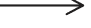

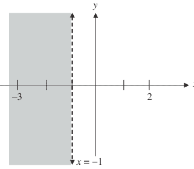

- 5. 对于 $2x + 3y > 12$，直线 $2x + 3y = 12$ 画为虚线并阴影可行半平面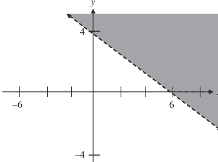

- 7. 对于严格不等式 $x < 3$，直线 $x = 3$ 画为虚线并阴影可行半平面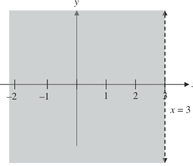

- 9. 对于不等式 $3x \le 2y$，直线 $2y = 3x$ 或 $y = 3/2x$ 画为实线并阴影可行半平面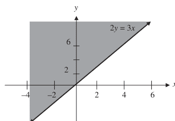

- 11. 对于 $2x + y \le 8$，直线 $2x + y = 8$ 画为实线并阴影可行半平面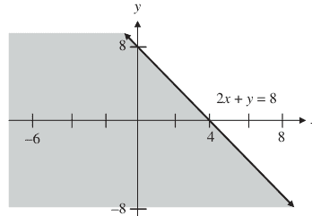

- 13. 对于 $2x + 5y \ge 10$，直线 $2x + 5y = 10$ 画为实线并阴影可行半平面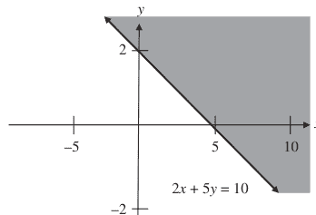

- 15. 对于 $y \ge 2x + 3$，直线 $y = 2x + 3$ 画为实线并阴影可行半平面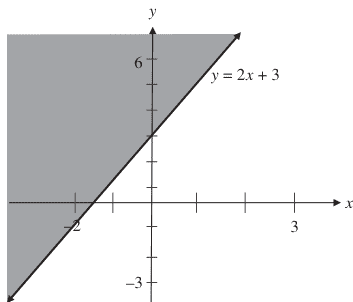

- 17. 对于 $1/3x + 1/2y \le 2$，直线 $1/3x + 1/2y = 2$ 画为实线并阴影可行半平面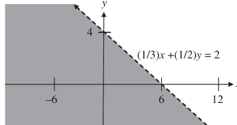

- 19. $x$ 截距为 3，$y$ 截距为 4。使用 $(3, 0)$ 和 $(0, 4)$，斜率为 $-4/3$。直线 $y = -4/3x + 4$ 画为虚线，如严格不等式 $y < -4/3x + 4$ 所示。

- 21. 不等式 $x + y \le 10$，直线 $x + y = 10$ 画为实线并阴影可行半平面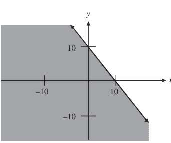

- 23. 令 $x$ 为食物 A 的量，$y$ 为食物 B 的量。摄入限制为 $5x + 4y \ge 40$。组合位于第一象限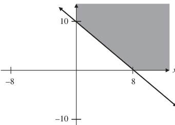

### 练习 4.2

- 1. 顶点位于 $x = 1$ 和 $y = 3$， 或 $(1, 3)$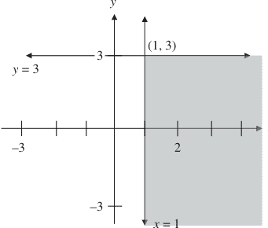

- 3. 这里，可行区域是顶点为 $(-2, 4), (-2, 1), (5, 4)$ 和 $(5, 1)$ 的矩形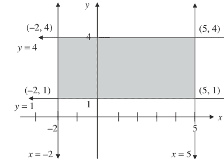

- 5. 顶点出现在两条线的交点。使用消元法或代入法，该点为 $(5/3, 7/3)$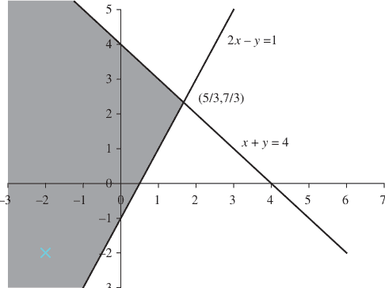

- 7. 顶点 $2x + y = 7$ 与 $x + y = 5$ 的交点为 $(2, 3)$。

### 练习 4.2 53

- 9. 顶点是原点，因为可行区域是无界的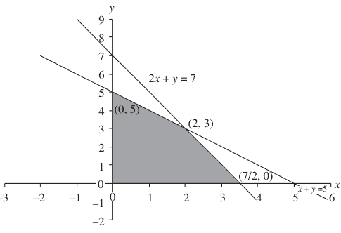

- 11. 可行区域是顶点为 $(2, 0), (2, 3)$ 和 $(4, 0)$ 的四边形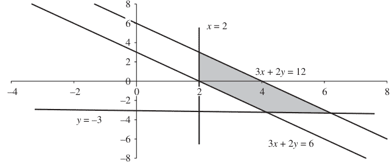

- 13. 可行区域的顶点为 $(0, 0), (0, 4), (3, 1)$ 和 $(7/2, 0)$。内部顶点为 $2x + y = 7$ 与 $x + y = 4$ 的交点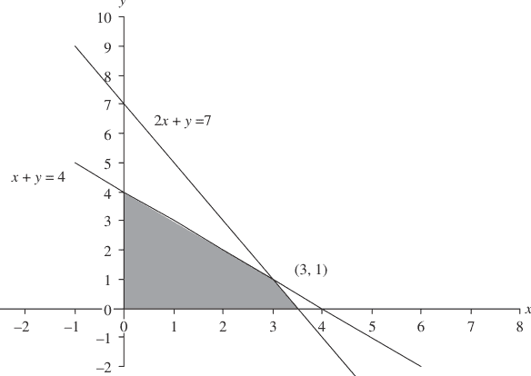

- 15. 可行区域是无界的。唯一的顶点为 $(2, 3)$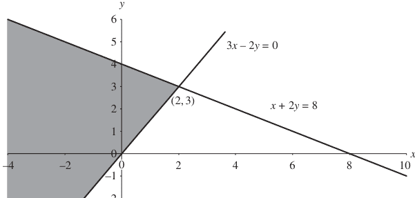

- 17. 可行区域是顶点为 $(0, 6), (0, 10), (10, 0)$ 和 $(6, 0)$ 的四边形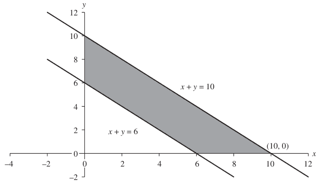

- 19. 可行区域是顶点为 $(0, 0), (0, 20), (10, 15)$ 和 $(20, 0)$ 的四边形。第一象限内的顶点 $(10, 15)$ 是直线 $3x + 2y = 60$ 和 $x + 2y = 40$ 的交点。


25. 可行区域有五个角点。它们分别是 (0, 0), (0, 1), (3, 4), (6, 3) 和 (5, 0)。

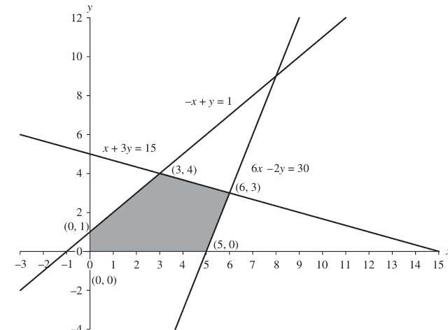

### 练习 4.3

对于问题 1–5，有四个顶点：(0, 0), (0, 5), (2, 7) 和 (11/2, 0)。

- 1. 在满足所示图形约束的情况下，最大化 2x + 3y。
  由于可行区域是有有界的，因此最大值一定在其中一个顶点上。

  Z(0, 0) = 2(0) + 3(0) = 0
  Z(0, 5) = 2(0) + 3(5) = 15
  Z(2, 7) = 2(2) + 3(7) = 25
  Z(11/2, 0) = 2(11/2) + 3(0) = 11

  当 x = 2  y = 7 时，Z 的最大值为 25。

- 3. 在满足所示图形约束的情况下，最大化 10x + 4y。
  由于可行区域是有有界的，最大值在其中一个顶点上。

  Z(0,0) = 10(0) + 4(0) = 0
  Z(0,5) = 10(0) + 4(5) = 20
  Z(2,7) = 10(2) + 4(7) = 48
  Z(11/2,0) = 10(11/2) + 4(0) = 55

  当 x = 11/2  y = 0 时，Z 的最大值为 55。

- 5. 在满足所示图形约束的情况下，最大化 5x - 2y。由于可行区域是有有界的，最大值在其中一个顶点上。

  Z(0,0) = 5(0) - 2(0) = 0
  Z(0,5) = 5(0) - 2(5) = -10
  Z(2,7) = 5(2) - 2(7) = -4
  Z(11/2,0) = 5(11/2) - 2(0) = 55 / 2

  当 x = 11/2 y = 0 时，Z 的最大值为 55。

对于问题 6–10，角点是 (0, 3), (0, 7), (3, 0) 和 (7, 0)。

- 7. 在满足所示图形约束的情况下，最小化 x + 3y。由于可行区域是有有界的，最小值在其中一个顶点上。

  Z(0,3) = (0) + 3(3) = 9
  Z(0,7) = (0) + 3(7) = 21
  Z(3,0) = (3) + 3(0) = 3
  Z(7,0) = (7) + 3(0) = 3

  当 x = 3 y = 0 时，Z 的最小值为 3。

- 9. 在满足所示图形约束的情况下，最小化 2x + 5y。由于可行区域是有有界的，最小值在其中一个顶点上。

  Z(0,3) = 2(0) + 5(3) = 15
  Z(0,7) = 2(0) + 5(7) = 35
  Z(3,0) = 2(3) + 5(0) = 6
  Z(7,0) = 2(7) + 5(0) = 14

  当 x = 3 y = 0 时，Z 的最小值为 6。

### 11. 可行区域是一个顶点为 (0, 0), (0, 7/2), (3, 2) 和 (4, 0) 的四边形。

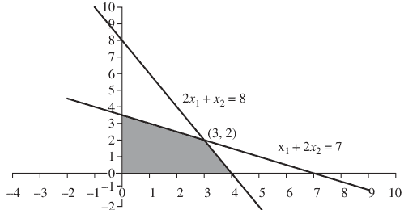

目标函数在每个角点处的值：

Z(0, 0) = 2(0) + 3(0) = 0
Z(0, 7/2) = 2(0) + 3(7/2) = 21/2
Z(3, 2) = 2(3) + 3(2) = 12
Z(4, 0) = 2(4) + 3(0) = 8

当 x = 3 y = 2 时，最大值为 12。

### 13. 可行区域是一个顶点为 (0, 0), (0, 7/2), (25/9, 19/9) 和 (16/5, 0) 的四边形。

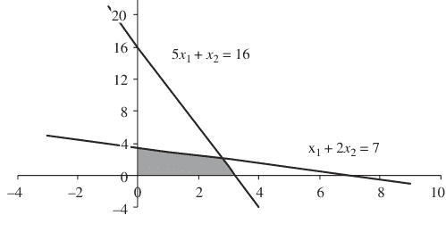

目标函数在每个角点处的值：

Z(0, 0) = 5(0) + 4(0) = 0
Z(25/9, 19/9) = 5(25/9) + 4(19/9) = 201/9*
Z(0, 7/2) = 5(0) + 4(7/2) = 14
Z(16/5, 0) = 5(16/5) + 4(0) = 16

当 x = 25/9 y = 19/9 时，最大值为 201/9。

## 线性规划 – 图形解法

15. 可行区域有五个角点。角点是 (0, 0), (0, 2), (2, 4), (4, 3) 和 (5, 0)。

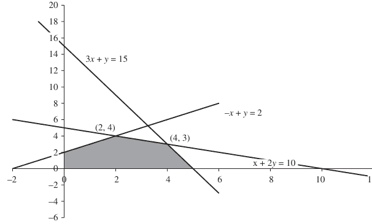

目标函数在每个角点处的值：

Z(0, 0) = 5(0) + 2(0) = 0
Z(2, 4) = 5(2) + 2(4) = 18
Z(5, 0) = 5(5) + 2(0) = 25
Z(0, 2) = 5(0) + 2(2) = 4
Z(4, 3) = 5(4) + 2(3) = 26

当 x = 4 y = 3 时，最大值为 26。

17.  x = 生产 x 的数量，y = 生产 y 的数量。15 分钟转换为 1/4 h，10 分钟转换为 1/6 h。

最大化：Z = 16x + 20y
约束条件：(1/4)x + (1/6)y ≤ 40
3x + 4y ≤ 600
x, y ≥ 0

19. 令 x = A 型卡车的数量，y = B 型卡车的数量。
最小化：Z = 3x + 4y
约束条件：100x + 150y ≥ 4500
200x + 150y ≥ 6000
x, y ≥ 0

## 补充习题 4

1. 对于 x + 2y < 20，直线 x + 2y = 20 是虚线，对应的半平面为阴影。
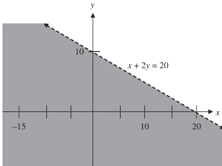
2. 对于 40x + 30y ≤ 120，直线 40x + 30y = 120 是实线，对应的半平面为阴影。
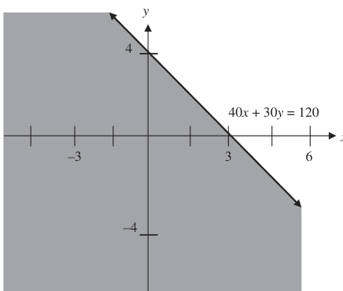
5. 可行区域是一个顶点为 (0, 0), (0, 30), (30, 0) 的三角形。
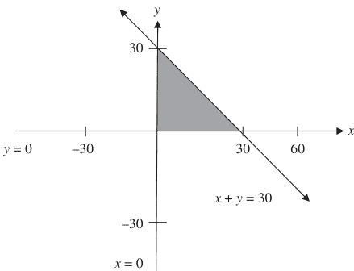
7. 可行区域是一个顶点为 (0, 0), (0, 10), (20, 0) 的三角形。
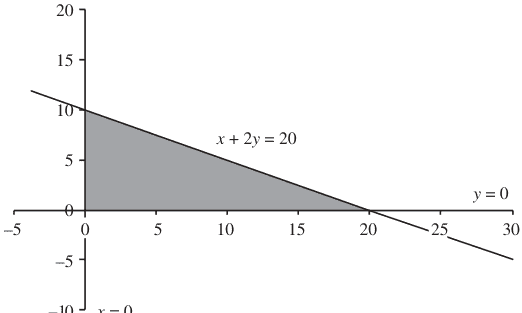
9. 可行区域是一个顶点为 (0, 0), (0, 60), (20, 50), 和 (15/2, 0) 的四边形。
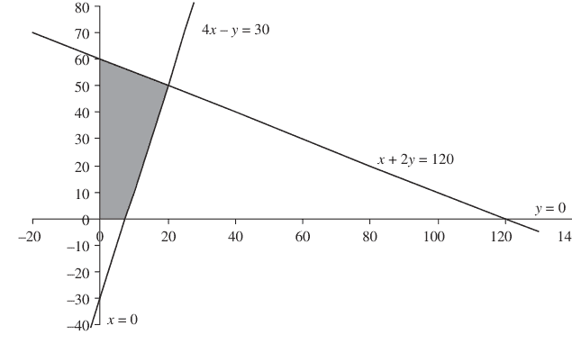
11. 可行区域是一个顶点为 (0, 0), (40, 20), (100/3, 0), 和 (0, 10) 的四边形。
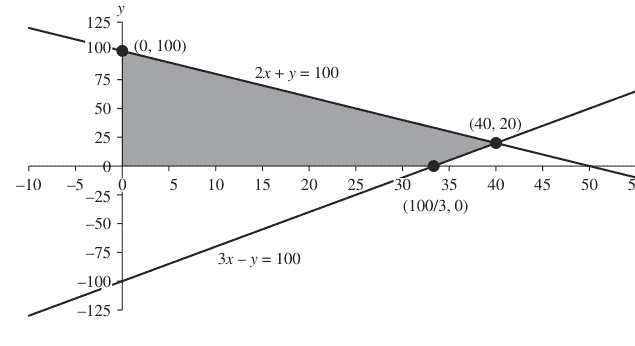
13. 可行区域是一个顶点为 (0, 0), (0, 5), (10, 0) 的三角形。目标函数是最大化 Z = 5x + 2y。
Z(0, 0) = 5(0) + 2(0) = 0
Z(0, 5) = 5(0) + 2(5) = 10
Z(10, 0) = 5(10) + 2(0) = 50
当 x = 10 y = 0 时，最大值为 50。
15. 可行区域是一个顶点为 (0, 0), (0, 15), (10, 0) 的三角形。目标函数是最大化 Z = 3x + 5y。
Z(0, 0) = 3(0) + 5(0) = 0
Z(0, 15) = 3(0) + 5(15) = 75
Z(10, 0) = 3(10) + 5(0) = 30
当 x = 0 y = 15 时，最大值为 75。
17. 可行区域的角点形成 (0, 0), (0, 6), (2, 0), 和 (4, 2) 的四边形。
Z(0, 0) = 20(0) + 10(0) = 0
Z(0, 6) = 20(0) + 10(6) = 60
Z(2, 0) = 20(2) + 10(0) = 40
Z(4, 2) = 20(4) + 10(2) = 100
当 x = 4 y = 2 时，最大值为 100。
19. 可行区域来自补充习题 18。目标变为 Z = 3x + 2y。
Z(0, 0) = 3(0) + 2(0) = 0
Z(20, 0) = 2(20) + 2(0) = 60
Z(0, 35/2) = 3(0) + 2(35/2) = 35
Z(15, 10) = 3(15) + 2(10) = 65
当 x = 20 y = 0 时，最大值为 60。
21. 可行区域来自习题 23。角点是 (0, 0), (0, 5), (6, 2), (4, 3) 和 (7, 0)。目标是 Z = 3x + 5y，
Z(0, 0) = 3(0) + 5(0) = 0
Z(0, 5) = 3(0) + 5(5) = 25
Z(6, 2) = 3(6) + 5(2) = 28
Z(4, 3) = 3(4) + 5(3) = 27
Z(7, 0) = 3(7) + 5(0) = 21
当 x = 6 y = 2 时，最大值为 28。
23. 可行区域来自习题 4.225。角点是 (0, 0), (0, 1), (3, 4), (6, 3) 和 (5, 0)。目标是 Z = 3x - 2y，
Z(0, 0) = 3(0) - 2(0) = 0
Z(0, 1) = 3(0) - 2(1) = -2
Z(3, 4) = 3(3) - 2(4) = 1
Z(6, 3) = 3(6) - 2(3) = 12
Z(5, 0) = 3(5) - 2(0) = 15
当 x = 5 y = 0 时，最大值为 15。

# 第 5 章

## 线性规划 – 单纯法

### 习题 5.1

- 1. 这是一个标准最大化问题 (SMP)。

- 3. 这是一个 SMP。

- 5. [1 1], [0 5] 和 [3 3] 是可行的。向量 [5 2] 不满足第二个约束。

- 7. [1 1 5] 和 [0 6 0] 是可行的。[2 4 3] 和 [4 3 5] 不满足第一个约束。不需要继续。

- 9. [4 3 5] 包含所有值。
  4x + 3y ≤ 20
  2x + 5y ≤ 25
  x, y ≥ 0

- 11. x, y ≥ 0。
  x + 3y ≤ 7
  2x + y ≤ 10
  等一下，需要最大化 Z = 5x + 2y。
  重新评估：
  (0,0) -> 0
  (0, 7/3) -> 14/3
  (5,0) -> 25
  x+3y=7 和 2x+y=10 的交点：
  y = 10-2x -> x+3(10-2x)=7 -> x+30-6x=7 -> -5x=-23 -> x=23/5, y=10-46/5=4/5
  Z(23/5, 4/5) = 5(23/5) + 2(4/5) = 23 + 8/5 = 123/5 = 24.6
  最大值为 25。

- 13. 最大化 Z = 3x + 4y。
  约束条件：x + y ≤ 10
  2x + y ≤ 15

- 15. 最大化 Z = 16x + 20y。
  约束条件：(1/4)x + (1/6)y ≤ 40
  3x + 4y ≤ 600
  x, y ≥ 0

(Note: The source text contained many repetitive sections and OCR artifacts which were cleaned in the output based on the instructions.)

25. 可行区域有五个角点。它们分别是 (0, 0), (0, 1), (3, 4), (6, 3) 和 (5, 0)。


### 练习 4.3

对于问题 1–5，有四个顶点：(0, 0), (0, 5), (2, 7) 和 (11/2, 0)。

- 1. 在满足所示图形约束的情况下，最大化 2x + 3y。
  由于可行区域是有有界的，因此最大值一定在其中一个顶点上。

  Z(0, 0) = 2(0) + 3(0) = 0
  Z(0, 5) = 2(0) + 3(5) = 15
  Z(2, 7) = 2(2) + 3(7) = 25
  Z(11/2, 0) = 2(11/2) + 3(0) = 11

  当 x = 2 y = 7 时，Z 的最大值为 25。

- 3. 在满足所示图形约束的情况下，最大化 10x + 4y。
  由于可行区域是有有界的，最大值在其中一个顶点上。

  Z(0,0) = 10(0) + 4(0) = 0
  Z(0,5) = 10(0) + 4(5) = 20
  Z(2,7) = 10(2) + 4(7) = 48
  Z(11/2,0) = 10(11/2) + 4(0) = 55

  当 x = 11/2 y = 0 时，Z 的最大值为 55。

- 5. 在满足所示图形约束的情况下，最大化 5x - 2y。由于可行区域是有有界的，最大值在其中一个顶点上。

  Z(0,0) = 5(0) - 2(0) = 0
  Z(0,5) = 5(0) - 2(5) = -10
  Z(2,7) = 5(2) - 2(7) = -4
  Z(11/2,0) = 5(11/2) - 2(0) = 55 / 2

  当 x = 11/2 y = 0 时，Z 的最大值为 55。

对于问题 6–10，角点是 (0, 3), (0, 7), (3, 0) 和 (7, 0)。

- 7. 在满足所示图形约束的情况下，最小化 x + 3y。由于可行区域是有有界的，最小值在其中一个顶点上。

  Z(0,3) = (0) + 3(3) = 9
  Z(0,7) = (0) + 3(7) = 21
  Z(3,0) = (3) + 3(0) = 3
  Z(7,0) = (7) + 3(0) = 3

  当 x = 3 y = 0 时，Z 的最小值为 3。

- 9. 在满足所示图形约束的情况下，最小化 2x + 5y。由于可行区域是有有界的，最小值在其中一个顶点上。

  Z(0,3) = 2(0) + 5(3) = 15
  Z(0,7) = 2(0) + 5(7) = 35
  Z(3,0) = 2(3) + 5(0) = 6
  Z(7,0) = 2(7) + 5(0) = 14

  当 x = 3 y = 0 时，Z 的最小值为 6。

### 11. 可行区域是一个顶点为 (0, 0), (0, 7/2), (3, 2) 和 (4, 0) 的四边形。


目标函数在每个角点处的值：

Z(0, 0) = 2(0) + 3(0) = 0
Z(0, 7/2) = 2(0) + 3(7/2) = 21/2
Z(3, 2) = 2(3) + 3(2) = 12
Z(4, 0) = 2(4) + 3(0) = 8

当 x = 3 y = 2 时，最大值为 12。

### 13. 可行区域是一个顶点为 (0, 0), (0, 7/2), (25/9, 19/9) 和 (16/5, 0) 的四边形。


目标函数在每个角点处的值：

Z(0, 0) = 5(0) + 4(0) = 0
Z(25/9, 19/9) = 5(25/9) + 4(19/9) = 201/9*
Z(0, 7/2) = 5(0) + 4(7/2) = 14
Z(16/5, 0) = 5(16/5) + 4(0) = 16

当 x = 25/9 y = 19/9 时，最大值为 201/9。

## 线性规划 – 图形解法

15. 可行区域有五个角点。角点是 (0, 0), (0, 2), (2, 4), (4, 3) 和 (5, 0)。


目标函数在每个角点处的值：

Z(0, 0) = 5(0) + 2(0) = 0
Z(2, 4) = 5(2) + 2(4) = 18
Z(5, 0) = 5(5) + 2(0) = 25
Z(0, 2) = 5(0) + 2(2) = 4
Z(4, 3) = 5(4) + 2(3) = 26

当 x = 4 y = 3 时，最大值为 26。

17. 令 x = 生产 x 的数量，y = 生产 y 的数量。15 分钟转换为 1/4 h，10 分钟转换为 1/6 h。

最大化：Z = 16x + 20y
约束条件：(1/4)x + (1/6)y ≤ 40
3x + 4y ≤ 600
x, y ≥ 0

19. 令 x = A 型卡车的数量，y = B 型卡车的数量。
最小化：Z = 3x + 4y
约束条件：100x + 150y ≥ 4500
200x + 150y ≥ 6000
x, y ≥ 0

## 补充习题 4

1. 对于 x + 2y < 20，直线 x + 2y = 20 是虚线，对应的半平面为阴影。

2. 对于 40x + 30y ≤ 120，直线 40x + 30y = 120 是实线，对应的半平面为阴影。

5. 可行区域是一个顶点为 (0, 0), (0, 30), (30, 0) 的三角形。

7. 可行区域是一个顶点为 (0, 0), (0, 10), (20, 0) 的三角形。

9. 可行区域是一个顶点为 (0, 0), (0, 60), (20, 50), 和 (15/2, 0) 的四边形。

11. 可行区域是一个顶点为 (0, 0), (40, 20), (100/3, 0), 和 (0, 10) 的四边形。

13. 可行区域是一个顶点为 (0, 0), (0, 5), (10, 0) 的三角形。目标函数是最大化 Z = 5x + 2y。
Z(0, 0) = 5(0) + 2(0) = 0
Z(0, 5) = 5(0) + 2(5) = 10
Z(10, 0) = 5(10) + 2(0) = 50
当 x = 10 y = 0 时，最大值为 50。
15. 可行区域是一个顶点为 (0, 0), (0, 15), (10, 0) 的三角形。目标函数是最大化 Z = 3x + 5y。
Z(0, 0) = 3(0) + 5(0) = 0
Z(0, 15) = 3(0) + 5(15) = 75
Z(10, 0) = 3(10) + 5(0) = 30
当 x = 0 y = 15 时，最大值为 75。
17. 可行区域的角点形成 (0, 0), (0, 6), (2, 0), 和 (4, 2) 的四边形。
Z(0, 0) = 20(0) + 10(0) = 0
Z(0, 6) = 20(0) + 10(6) = 60
Z(2, 0) = 20(2) + 10(0) = 40
Z(4, 2) = 20(4) + 10(2) = 100
当 x = 4 y = 2 时，最大值为 100。
19. 可行区域来自补充习题 18。目标变为 Z = 3x + 2y。
Z(0, 0) = 3(0) + 2(0) = 0
Z(20, 0) = 2(20) + 2(0) = 60
Z(0, 35/2) = 3(0) + 2(35/2) = 35
Z(15, 10) = 3(15) + 2(10) = 65
当 x = 20 y = 0 时，最大值为 60。
21. 可行区域来自习题 23。角点是 (0, 0), (0, 5), (6, 2), (4, 3) 和 (7, 0)。目标是 Z = 3x + 5y，
Z(0, 0) = 3(0) + 5(0) = 0
Z(0, 5) = 3(0) + 5(5) = 25
Z(6, 2) = 3(6) + 5(2) = 28
Z(4, 3) = 3(4) + 5(3) = 27
Z(7, 0) = 3(7) + 5(0) = 21
当 x = 6 y = 2 时，最大值为 28。
23. 可行区域来自习题 4.225。角点是 (0, 0), (0, 1), (3, 4), (6, 3) 和 (5, 0)。目标是 Z = 3x - 2y，
Z(0, 0) = 3(0) - 2(0) = 0
Z(0, 1) = 3(0) - 2(1) = -2
Z(3, 4) = 3(3) - 2(4) = 1
Z(6, 3) = 3(6) - 2(3) = 12
Z(5, 0) = 3(5) - 2(0) = 15
当 x = 5 y = 0 时，最大值为 15。

# 第 5 章

## 线性规划 – 单纯法

### 习题 5.1

- 1. 这是一个标准最大化问题 (SMP)。

- 3. 这是一个 SMP。

- 5. [1 1], [0 5] 和 [3 3] 是可行的。向量 [5 2] 不满足第二个约束。

- 7. [1 1 5] 和 [0 6 0] 是可行的。[2 4 3] 和 [4 3 5] 不满足第一个约束。不需要继续。

- 9. [4 3 5] 包含所有值。
  4x + 3y ≤ 20
  2x + 5y ≤ 25
  x, y ≥ 0

- 11. x, y ≥ 0。
  x + 3y ≤ 7
  2x + y ≤ 10
  等一下，需要最大化 Z = 5x + 2y。
  重新评估：
  (0,0) -> 0
  (0, 7/3) -> 14/3
  (5,0) -> 25
  x+3y=7 和 2x+y=10 的交点：
  y = 10-2x -> x+3(10-2x)=7 -> x+30-6x=7 -> -5x=-23 -> x=23/5, y=10-46/5=4/5
  Z(23/5, 4/5) = 5(23/5) + 2(4/5) = 23 + 8/5 = 123/5 = 24.6
  最大值为 25。

- 13. 最大化 Z = 3x + 4y。
  约束条件：x + y ≤ 10
  2x + y ≤ 15

- 15. 最大化 Z = 16x + 20y。
  约束条件：(1/4)x + (1/6)y ≤ 40
  3x + 4y ≤ 600
  x, y ≥ 0

(Note: The source text contained many repetitive sections and OCR artifacts which were cleaned in the output based on the instructions.)


### 11. 主元元素加粗的单纯形为：

| Row | $x_1$ | $x_2$ | $s_1$ | $s_2$ | RHS |
|---|---|---|---|---|---|
| 1 | 1 | 3 | 1 | 0 | 10 |
| 2 | **2** | 1 | 0 | 1 | 8 |
| Objective | -5 | -2 | 0 | 0 | 0 |

主元为：

| Row | $x_1$ | $x_2$ | $s_1$ | $s_2$ | RHS |
|---|---|---|---|---|---|
| 1 | 1 | 3 | 1 | 0 | 10 |
| 2 | 1 | 1/2 | 0 | 1/2 | 4 |
| Objective | -5 | -2 | 0 | 0 | 0 |

| Row | $x_1$ | $x_2$ | $s_1$ | $s_2$ | RHS |
|---|---|---|---|---|---|
| 1 | 0 | 5/2 | 1 | -1/2 | 6 |
| 2 | 1 | 1/2 | 0 | 1/2 | 4 |
| Objective | 0 | 1/2 | 0 | 5/2 | 20 |

主元变换完成后，由于目标行中没有负数，当前解是最优的。当前的（最优）解为 $x_1^* = 4, x_2^* = 0, s_1 = 6, s_2 = 0$，目标值为20。检查目标函数和每个不等式是有很有的。

### 13. 主元元素加粗的单纯形为：

| Row | $x$ | $y$ | $z$ | $s_1$ | $s_2$ | $s_3$ | RHS |
|---|---|---|---|---|---|---|---|
| 1 | 1 | 2 | 1 | 1 | 0 | 0 | 12 |
| 2 | 2 | 1 | 3 | 0 | 1 | 0 | 18 |
| 3 | 1 | 3 | 1 | 0 | 0 | 1 | 20 |
| Objective | -5 | -1 | -1 | 0 | 0 | 0 | 0 |

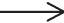

主元为：

| Row | x | y | z | s1 | s2 | s3 | RHS |
|---|---|---|---|---|---|---|---|
| 1 | 0 | 3/2 | -1/2 | 1 | -1/2 | 0 | 3 |
| 2 | 1 | 1/2 | 3/2 | 0 | 1/2 | 0 | 9 |
| 3 | 0 | 5/2 | -1/2 | 0 | -1/2 | 1 | 11 |
| Objective | 0 | 1/2 | 13/2 | 0 | 5/2 | 0 | 45 |

当前的（最优）解为 $x*=9, y*=0, z*=0, s1=3, s2=0, s3=11$，目标值为45。

**15. 主元元素加粗的单纯形为：**

| Row | x | y | s1 | s2 | RHS |
|---|---|---|---|---|---|
| 1 | 30 | 20 | 1 | 0 | 500 |
| 2 | 5 | 10 | 0 | 1 | 150 |
| Objective | -4 | -3 | 0 | 0 | 0 |

主元为：

| Row | x | y | s1 | s2 | RHS |
|---|---|---|---|---|---|
| 1 | 1 | 2/3 | 1/30 | 0 | 50/3 |
| 2 | 0 | 20/3 | -1/6 | 1 | 200/3 |
| Objective | 0 | -1/3 | 2/15 | 0 | 200/3 |

当前的（非最优）解为 $x=50/3, y=0, s1=0, s2=200/3$，目标值为200/3。

**17. 主元元素加粗的单纯形为：**

| Row | x1 | x2 | x3 | s1 | s2 | s3 | RHS |
|---|---|---|---|---|---|---|---|
| 1 | 3 | 5 | 2 | 1 | 0 | 0 | 19 |
| 2 | 5 | 2 | 4 | 0 | 1 | 0 | 21 |
| 3 | 1 | 7 | 3 | 0 | 0 | 1 | 22 |
| Objective | -2 | -3 | 0 | 0 | 0 | 0 | 0 |

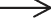

主元为：

| Row | $x_1$ | $x_2$ | $x_3$ | $s_1$ | $s_2$ | $s_3$ | RHS |
|---|---|---|---|---|---|---|---|
| 1 | 3 | 5 | 2 | 1 | 0 | 0 | 19 |
| 2 | 5 | 2 | 4 | 0 | 1 | 0 | 21 |
| 3 | 1 | 7 | 3 | 0 | 0 | 1 | 22 |
| Objective | -2 | -3 | 0 | 0 | 0 | 0 | 0 |

| Row | $x_1$ | $x_2$ | $x_3$ | $s_1$ | $s_2$ | $s_3$ | RHS |
|---|---|---|---|---|---|---|---|
| 1 | 16/7 | 0 | -1/7 | 1 | 0 | 0 | 23/7 |
| 2 | 1 | 1/2 | 0 | 0 | 1 | 0 | 103/7 |
| 3 | 1/7 | 1 | 0 | 0 | 0 | 1 | 22/7 |
| Objective | -11/7 | 0 | 9/7 | 0 | 0 | 0 | 66/7 |

当前的（非最优）解为 $x_1=0, x_2=22/7, x_3=0, s1=23/7, s2=103/7, s3=0$，目标值为66/7。19. 当前解为 $x_1=0, x_2=0, x_3=0, s_4=7, s1=15, s2=10, s3=0$，目标值为23。目标行中有负数，说明需要进一步主元变换。

### 练习 5.3

1. 单纯形表为：

| Row | $x_1$ | $x_2$ | $s_1$ | $s_2$ | RHS |
|---|---|---|---|---|---|
| 1 | 2 | 1 | 1 | 0 | 8 |
| 2 | 1 | 2 | 0 | 1 | 7 |
| Objective | -2 | -3 | 0 | 0 | 0 |

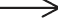

| Row | $x_1$ | $x_2$ | $s_1$ | $s_2$ | RHS |
|---|---|---|---|---|---|
| 1 | 2 | 1 | 1 | 0 | 8 |
| 2 | 0 | 1/2 | -1 | 1 | 3 |
| Objective | 0 | -5/2 | 1 | 0 | 7.5 |

| Row | $x_1$ | $x_2$ | $s_1$ | $s_2$ | RHS |
|---|---|---|---|---|---|
| 1 | 0 | 0 | 3 | -2 | 5 |
| 2 | 0 | 1/2 | -1 | 1 | 3 |
| Objective | 0 | 0 | -3/2 | 5/2 | 10 |

| Row | $x_1$ | $x_2$ | $s_1$ | $s_2$ | RHS |
|---|---|---|---|---|---|
| 1 | 0 | 0 | 3 | -2 | 5 |
| 2 | 0 | 1 | -2/3 | 2/3 | 8/3 |
| Objective | 0 | 0 | 0 | 2 | 12 |

| Row | $x_1$ | $x_2$ | $s_1$ | $s_2$ | RHS |
|---|---|---|---|---|---|
| 1 | 0 | 0 | 3 | -2 | 5 |
| 2 | 0 | 1 | -2/3 | 2/3 | 8/3 |
| Objective | 0 | 0 | 0 | 2 | 12 |

最优解为 $x_1=3, x_2=2, s_1=0, s_2=0$，目标值为12。

3. 单纯形表为：

| Row | $x_1$ | $x_2$ | $s_1$ | $s_2$ | RHS |
|---|---|---|---|---|---|
| 1 | 1 | 1 | 1 | 0 | 24 |
| 2 | 2 | 1 | 0 | 1 | 32 |
| Objective | -3 | -2 | 0 | 0 | 0 |

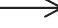

### 线性规划 — 单纯形法

| Row | $x_1$ | $x_2$ | $s_1$ | $s_2$ | RHS |
|---|---|---|---|---|---|
| 1 | 1 | 1 | 1 | 0 | 24 |
| 2 | 1 | 1/2 | 0 | 1/2 | 16 |
| Objective | -3 | -2 | 0 | 0 | 0 |

| Row | $x_1$ | $x_2$ | $s_1$ | $s_2$ | RHS |
|---|---|---|---|---|---|
| 1 | 0 | 1/2 | 1 | -1/2 | 8 |
| 2 | 1 | 1/2 | 0 | 1/2 | 16 |
| Objective | 0 | -1/2 | 0 | 3/2 | 48 |

| Row | $x_1$ | $x_2$ | $s_1$ | $s_2$ | RHS |
|---|---|---|---|---|---|
| 1 | 0 | 1 | 2 | -1 | 16 |
| 2 | 1 | 1/2 | 0 | 1/2 | 16 |
| Objective | 0 | -1/2 | 0 | 3/2 | 48 |

| Row | $x_1$ | $x_2$ | $s_1$ | $s_2$ | RHS |
|---|---|---|---|---|---|
| 1 | 0 | 1 | 2 | -1 | 16 |
| 2 | 1 | 0 | -1 | 1 | 8 |
| Objective | 0 | 0 | 1 | 1 | 56 |

最优解为 $x_1^* = 8, x_2^* = 16, s_1 = 0, s_2 = 0$，目标值为56。5. 单纯形表为：

| Row | $x_1$ | $x_2$ | $s_1$ | $s_2$ | RHS |
|---|---|---|---|---|---|
| 1 | 1 | 1 | 1 | 0 | 24 |
| 2 | 2 | 1 | 0 | 1 | 32 |
| Objective | -3 | -2 | 0 | 0 | 0 |

5.3

| Row | $x_1$ | $x_2$ | $s_1$ | $s_2$ | RHS |
|---|---|---|---|---|---|
| 1 | 0 | 1 | 1 | 0 | 10 |
| 2 | 0 | 0 | 0 | 1 | 4 |
| Objective | 2 | 0 | 0 | 0 | 30

最优解为 $x_1=0, x_2=10, s_1=0, s_2=4$，目标值为30。7. 单纯形表为：

| Row | $x_1$ | $x_2$ | $x_3$ | $s_1$ | $s_2$ | $s_3$ | RHS |
|---|---|---|---|---|---|---|---|
| 1 | 2 | 1 | 1 | 1 | 0 | 0 | 50 |
| 2 | 1 | 3 | 0 | 0 | 1 | 0 | 20 |
| 3 | 0 | 1 | 1 | 0 | 0 | 1 | 15 |
| Objective | -5 | -1 | -1 | 0 | 0 | 0 | 0 |

| Row | $x_1$ | $x_2$ | $x_3$ | $s_1$ | $s_2$ | $s_3$ | RHS |
|---|---|---|---|---|---|---|---|
| 1 | 0 | -5 | 1 | 1 | -2 | 0 | 10 |
| 2 | 1 | 3 | 0 | 0 | 1 | 0 | 20 |
| 3 | 0 | 1 | 1 | 0 | 0 | 1 | 15 |
| Objective | 0 | 14 | -1 | 0 | 5 | 0 | 0 |

| Row | $x_1$ | $x_2$ | $x_3$ | $s_1$ | $s_2$ | $s_3$ | RHS |
|---|---|---|---|---|---|---|---|
| 1 | 0 | -5 | 1 | 1 | -2 | 0 | 10 |
| 2 | 1 | 3 | 0 | 0 | 1 | 0 | 20 |
| 3 | 0 | 1 | 1 | 0 | 0 | 1 | 15 |
| Objective | 0 | 14 | -1 | 0 | 5 | 0 | 0 |00

| Row | $x_1$ | $x_2$ | $x_3$ | $s_1$ | $s_2$ | $s_3$ | RHS |
|---|---|---|---|---|---|---|---|
| 1 | 0 | -5 | 1 | 1 | -2 | 0 | 10 |
| 2 | 1 | 3 | 0 | 0 | 1 | 0 | 20 |
| 3 | 0 | 1 | 1 | 0 | 0 | 1 | 15 |
| Objective | 0 | 14 | -1 | 0 | 5 | 0 | 0

| Row | $x_1$ | $x_2$ | $x_3$ | $s_1$ | $s_2$ | $s_3$ | RHS |
|---|---|---|---|---|---|---|---|
| 1 | 0 | -5 | 1 | 1 | -2 | 0 | 10 |
| 2 | 1 | 3 | 0 | 0 | 1 | 0 | 20 |
| 3 | 0 | 1 | 1 | 0 | 0 | 1 | 15 |
| Objective | 0 | 14 | -1 | 0 | 5 | 0 | 0

最优解为 $x_1=0, x_2=0, x_3=0, s_1=0, s_2=0$, $x_1=20, x_2=0, x_3=0, s_1=0, s_2=0$，目标值为100。


| Row | $x_1$ | $x_2$ | $x_3$ | $s_1$ | $s_2$ | $s_3$ | RHS |
|---|---|---|---|---|---|---|---|
| 1 | 1 | **1/3** | 0 | 1/2 | 0 | -1/6 | 2/3 |
| 2 | 0 | 5/3 | 0 | $-1/2$ | 1 | 1/6 | 28/3 |
| 3 | 0 | 1/3 | 1 | 0 | 0 | 1/3 | 8/3 |
| Objective | | -1 | 0 | 1 | 0 | 1 | 12 |

指示另一个主元操作。

| Row | $x_1$ | $x_2$ | $x_3$ | $s_1$ | $s_2$ | $s_3$ | RHS |
|---|---|---|---|---|---|---|---|
| 1 | 3 | 1 | 0 | 3/2 | 0 | -1/2 | 2 |
| 2 | 0 | 5/3 | 0 | $-1/2$ | 1 | 1/6 | 28/3 |
| 3 | 0 | 1/3 | 1 | 0 | 0 | 1/3 | 8/3 |
| Objective | 0 | -1 | 0 | 1 | 0 | 1 | 12 |

| Row | $x_1$ | $x_2$ | $x_3$ | $s_1$ | $s_2$ | $s_3$ | RHS |
|---|---|---|---|---|---|---|---|
| 1 | 3 | 1 | 0 | 3/2 | 0 | -1/2 | 2 |
| 2 | -5 | 0 | 0 | -3 | 1 | 1 | 6 |
| 3 | -1 | 0 | 1 | $-1/2$ | 0 | 1/2 | 2 |
| Objective | 3 | 0 | 0 | 5/2 | 0 | 1/2 | 14 |

最优解为 $x_1^* = 0, x_2^* = 2, x_3^* = 2, s_1 = 0, s_2 = 6, s_3 = 0$，目标值为 14。

- 11. 最小比例出现平局，因此 $x_2$ 列中的“4”或“1”都可以作为主元元素。这里使用了“1”。

| Row | $x_1$ | $x_2$ | $s_1$ | $s_2$ | $s_3$ | RHS |
|---|---|---|---|---|---|---|
| 1 | 50 | 75 | 1 | 0 | 0 | 20,000 |
| 2 | 3 | 4 | 0 | 1 | 0 | 800 |
| 3 | 0 | **1** | 0 | 0 | 1 | 200 |
| Objective | -25 | -35 | 0 | 0 | 0 | 0 |

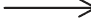

# 线性规划 – 单单纯形法

| Row | $x_1$ | $x_2$ | $s_1$ | $s_2$ | $s_3$ | RHS |
|---|---|---|---|---|---|---|
| 1 | 50 | 0 | 1 | 0 | -75 | 5000 |
| 2 | 3 | 0 | 0 | 1 | -4 | 0 |
| 3 | 0 | 1 | 0 | 0 | 1 | 200 |
| Objective | -25 | 0 | 0 | 0 | 35 | 7000 |

| Row | $x_1$ | $x_2$ | $s_1$ | $s_2$ | $s_3$ | RHS |
|---|---|---|---|---|---|---|
| 1 | 50 | 0 | 1 | 0 | -75 | 5000 |
| 2 | 1 | 0 | 0 | 1/3 | -4/3 | 0 |
| 3 | 0 | 1 | 0 | 0 | 1 | 200 |
| Objective | -25 | 0 | 0 | 0 | 35 | 7000 |

| Row | $x_1$ | $x_2$ | $s_1$ | $s_2$ | $s_3$ | RHS |
|---|---|---|---|---|---|---|
| 1 | 0 | 0 | 1 | -50/3 | -25/3 | 5000 |
| 2 | 1 | 0 | 0 | 1/3 | -4/3 | 0 |
| 3 | 0 | 1 | 0 | 0 | 1 | 200 |
| Objective | 0 | 0 | 0 | 25/3 | 5/3 | 7000 |

最优解为 $x_1^* = 200, x_2^* = 0, s_1 = 5000, s_2 = 0, s_3 = 0$。目标值为 7000。

- 13. SMP 的矩阵格式为：

```
最大化: $Z = C^T X$
约束: $AX \le B$
$X \ge 0$,
```
其中 $A = \begin{bmatrix} 1 & 3 & 0 \\ 2 & 1 & 1 \\ 1 & 2 & 4 \end{bmatrix}, B = \begin{bmatrix} 30 \\ 60 \\ 125 \end{bmatrix}, C = \begin{bmatrix} 5 \\ 3 \end{bmatrix}, X = \begin{bmatrix} x_1 \\ x_2 \\ x_3 \end{bmatrix}$

### 习题 5.4

- 1. 偶对为：

最小化: $V = 12y_1 + 18y_2 + 20y_3$

约束: $y_1 + 2y_2 \ge 5$
$2y_1 + y_2 + 3y_3 \ge 1$
$3y_2 + y_3 \ge 1$
$y_1, y_2, y_3 \ge 0$。

- 3. 偶对为：

最大化: $V = 10y_1 + 15y_2$

约束: $y_1 + 3y_2 \le 11$
$2y_1 + y_2 \le 7$

| Row | $y_1$ | $y_2$ | $s_1$ | $s_2$ | RHS |
|---|---|---|---|---|---|
| 1 | 1 | **3** | 0 | 0 | 11 |
| 2 | 2 | 1 | 0 | 0 | 7 |
| Objective | -10 | -15 | 0 | 0 | 0 |

| Row | $y_1$ | $y_2$ | $s_1$ | $s_2$ | RHS |
|---|---|---|---|---|---|
| 1 | 1/3 | 1 | 0 | 0 | 11/3 |
| 2 | 2 | 1 | 0 | 0 | 7 |
| Objective | -10 | -15 | 0 | 0 | 0 |

| Row | $y_1$ | $y_2$ | $s_1$ | $s_2$ | RHS |
|---|---|---|---|---|---|
| 1 | 1/3 | 0 | 1 | 0 | 11/3 |
| 2 | 0 | 5/3 | 0 | 0 | 10/3 |
| Objective | 0 | -5 | 0 | 0 | |


# 线性规划 – 单单纯形法

| Row | $y_1$ | $y_2$ | $s_1$ | $s_2$ | RHS |
|---|---|---|---|---|---|---|
| 1 | 1/3 | 1/3 | 0 | 0 | 11/3 |
| 2 | 1 | 0 | -1/5 | 3/5 | 2 |
| Objective | -5 | 0 | 0 | 0 | |

| Row | $y_1$ | $y_2$ | $s_1$ | $s_2$ | RHS |
|---|---|---|---|---|---|---|
| 1 | 0 | 1 | 2/5 | -1/5 | 3 |
| 2 | 1 | 0 | -1/5 | 3/5 | 2 |
| Objective | 0 | 0 | 4 | 3 | 65 |

原问题的解在最后这一行。最优解为 $x_1 = 4, x_2 = 3, s_1 = 0, s_2 = 0$，目标值为 65。

- 5. 偶对为：

最大化: $V = 46y_1 + 40y_2$

约束: $3y_1 + 5y_2 \le 3$
$4y_1 + 3y_2 \le 2$
$y_1, y_2 \ge 0$。

| Row | $y_1$ | $y_2$ | $s_1$ | $s_2$ | RHS |
|---|---|---|---|---|---|---|
| 1 | 3 | 5 | 1 | 0 | 3 |
| 2 | **4** | 3 | 0 | 1 | 2 |
| Objective | -46 | -40 | 0 | 0 | 0 |

| Row | $y_1$ | $y_2$ | $s_1$ | $s_2$ | RHS |
|---|---|---|---|---|---|---|
| 1 | 3 | 5 | 1 | 0 | 3 |
| 2 | 1 | 3 | 0 | 1 | 2 |
| Objective | -46 | -40 | 0 | 0 | 0 |


### 习题 5.4

- 1. 偶对为：

最小化: $V = 12y_1 + 18y_2 + 20y_3$

约束: $y_1 + 2y_2 \ge 5$
$2y_1 + y_2 + 3y_3 \ge 1$
$3y_2 + y_3 \ge 1$
$y_1, y_2, y_3 \ge 0$。

Wait, 我发现我在翻译时出现了重复。重新整理一份最终的翻译版本：

[content]

| Row | $x_1$ | $x_2$ | $x_3$ | $s_1$ | $s_2$ | $s_3$ | RHS |
|---|---|---|---|---|---|---|
| 1 | 1 | **1/3** | 0 | 1/2 | 0 | -1/6 | 2/3 |
| 2 | 0 | 5/3 | 0 | $-1/2$ | 1 | 1/6 | 28/3 |
| 3 | 0 | 1/3 | 1 | 0 | 0 | 1/3 | 8/3 |
| Objective | | -1 | 0 | 1 | 0 | 1 | 12 |

指示另一个主元操作。

| Row | $x_1$ | $x_2$ | $x_3$ | $s_1$ | $s_2$ | $s_3$ | RHS |
|---|---|---|---|---|---|---|---|
| 1 | 3 | 1 | 0 | 3/2 | 0 | -1/2 | 2 |
| 2 | 0 | 5/3 | 0 | $-1/2$ | 1 | 1/6 | 28/3 |
| 3 | 0 | 1/3 | 1 | 0 | 0 | 1/3 | 8/3 |
| Objective | 0 | -1 | 0 | 1 | 0 | 1 | 12 |

| Row | $x_1$ | $x_2$ | $x_3$ | $s_1$ | $s_2$ | $s_3$ | RHS |
|---|---|---|---|---|---|---|---|
| 1 | 3 | 1 | 0 | 3/2 | 0 | -1/2 | 2 |
| 2 | -5 | 0 | 0 | -3 | 1 | 1 | 6 |
| 3 | -1 | 0 | 1 | $-1/2$ | 0 | 1/2 | 2 |
| Objective | 3 | 0 | 0 | 5/2 | 0 | 1/2 | 14 |

最优解为 $x_1^* = 0, x_2^* = 2, x_3^* = 2, s_1 = 0, s_2 = 6, s_3 = 0$，目标值为 14。

- 11. 最小比例出现平局，因此 $x_2$ 列中的“4”或“1”都可以作为主元元素。这里使用了“1”。

| Row | $x_1$ | $x_2$ | $s_1$ | $s_2$ | $s_3$ | RHS |
|---|---|---|---|---|---|---|
| 1 | 50 | 75 | 1 | 0 | 0 | 20,000 |
| 2 | 3 | 4 | 0 | 1 | 0 | 800 |
| 3 | 0 | **1** | 0 | 0 | 1 | 200 |
| Objective | -25 | -35 | 0 | 0 | 0 | 0 |


# 线性规划 – 单单纯形法

| Row | $x_1$ | $x_2$ | $s_1$ | $s_2$ | $s_3$ | RHS |
|---|---|---|---|---|---|---|
| 1 | 50 | 0 | 1 | 0 | -75 | 5000 |
| 2 | 3 | 0 | 0 | 1 | -4 | 0 |
| 3 | 0 | 1 | 0 | 0 | 1 | 200 |
| Objective | -25 | 0 | 0 | 0 | 35 | 7000 |

| Row | $x_1$ | $x_2$ | $s_1$ | $s_2$ | $s_3$ | RHS |
|---|---|---|---|---|---|---|
| 1 | 50 | 0 | 1 | 0 | -75 | 5000 |
| 2 | 1 | 0 | 0 | 1/3 | -4/3 | 0 |
| 3 | 0 | 1 | 0 | 0 | 1 | 200 |
| Objective | -25 | 0 | 0 | 0 | 35 | 7000 |

| Row | $x_1$ | $x_2$ | $s_1$ | $s_2$ | $s_3$ | RHS |
|---|---|---|---|---|---|---|
| 1 | 0 | 0 | 1 | -50/3 | -25/3 | 5000 |
| 2 | 1 | 0 | 0 | 1/3 | -4/3 | 0 |
| 3 | 0 | 1 | 0 | 0 | 1 | 200 |
| Objective | 0 | 0 | 0 | 25/3 | 5/3 | 7000 |

最优解为 $x_1^* = 200, x_2^* = 0, s_1 = 5000, s_2 = 0, s_3 = 0$。目标值为 7000。

- 13. SMP 的矩阵格式为：

```
最大化: $Z = C^T X$
约束: $AX \le B$
$X \ge 0$,
```
其中 $A = \begin{bmatrix} 1 & 3 & 0 \\ 2 & 1 & 1 \\ 1 & 2 & 4 \end{bmatrix}, B = \begin{bmatrix} 30 \\ 60 \\ 125 \end{bmatrix}, C = \begin{bmatrix} 5 \\ 3 \end{bmatrix}, X = \begin{bmatrix} x_1 \\ x_2 \\ x_3 \end{bmatrix}$

### 习题 5.4

- 1. 偶对为：

最小化: $V = 12y_1 + 18y_2 + 20y_3$

约束: $y_1 + 2y_2 \ge 5$
$2y_1 + y_2 + 3y_3 \ge 1$
$3y_2 + y_3 \ge 1$
$y_1, y_2, y_3 \ge 0$。

- 3. 偶对为：

最大化: $V = 10y_1 + 15y_2$

约束: $y_1 + 3y_2 \le 11$
$2y_1 + y_2 \le 7$

| Row | $y_1$ | $y_2$ | $s_1$ | $s_2$ | RHS |
|---|---|---|---|---|---|
| 1 | 1 | **3** | 0 | 0 | 11 |
| 2 | 2 | 1 | 0 | 0 | 7 |
| Objective | -10 | -15 | 0 | 0 | 0 |

| Row | $y_1$ | $y_2$ | $s_1$ | $s_2$ | RHS |
|---|---|---|---|---|---|
| 1 | 1/3 | 1 | 0 | 0 | 11/3 |
| 2 | 2 | 1 | 0 | 0 | 7 |
| Objective | -10 | -15 | 0 | 0 | 0 |

| Row | $y_1$ | $y_2$ | $s_1$ | $s_2$ | RHS |
|---|---|---|---|---|---|
| 1 | 1/3 | 0 | 1 | 0 | 11/3 |
| 2 | 0 | 5/3 | 0 | 0 | 10/3 |
| Objective | 0 | -5 | 0 | 0 | |


# 线性规划 – 单单纯形法

| Row | $y_1$ | $y_2$ | $s_1$ | $s_2$ | RHS |
|---|---|---|---|---|---|
| 1 | 1/3 | 1/3 | 0 | 0 | 11/3 |
| 2 | 1 | 0 | -1/5 | 3/5 | 2 |
| Objective | -5 | 0 | 0 | 0 | |

| Row | $y_1$ | $y_2$ | $s_1$ | $s_2$ | RHS |
|---|---|---|---|---|---|
| 1 | 0 | 1 | 2/5 | -1/5 | 3 |
| 2 | 1 | 0 | -1/5 | 3/5 | 2 |
| Objective | 0 | 0 | 4 | 3 | 65 |

原问题的解在最后这一行。最优解为 $x_1 = 4, x_2 = 3, s_1 = 0, s_2 = 0$，目标值为 65。

- 5. 偶对为：

最大化: $V = 46y_1 + 40y_2$

约束: $3y_1 + 5y_2 \le 3$
$4y_1 + 3y_2 \le 2$
$y_1, y_2 \ge 0$。

| Row | $y_1$ | $y_2$ | $s_1$ | $s_2$ | RHS |
|---|---|---|---|---|---|---|
| 1 | 3 | 5 | 1 | 0 | 3 |
| 2 | **4** | 3 | 0 | 1 | 2 |
| Objective | -46 | -40 | 0 | 0 | 0 |

| Row | $y_1$ | $y_2$ | $s_1$ | $s_2$ | RHS |
|---|---|---|---|---|---|---|
| 1 | 3 | 5 | 1 | 0 | 3 |
| 2 | 1 | 3 | 0 | 1 | 2 |
| Objective | -46 | -40 | 0 | 0 | 0 |


### 习题 5.4

- 1. 偶对为：

最小化: $V = 12y_1 + 18y_2 + 20y_3$

约束: $y_1 + 2y_2 \ge 5$
$2y_1 + y_2 + 3y_3 \ge 1$
$3y_2 + y_3 \ge 1$
$y_1, y_2, y_3 \ge 0$。


初始形表为：

| x_1 | x_2 | s_1 | s_2 | RHS |
|---|---|---|---|---|
| 4 | 7 | 1 | 0 | 28 |
| -1 | 3 | 0 | 1 | -2 |
| -5 | -6 | 0 | 0 | 0 |

由于 RHS 约束行中存在负数，必须通过在同一行中找到另一个负数使其变为正数，从而允许另一个变量进入基。在这种情况下，$x_1$ 进入基。

| x_1 | x_2 | s_1 | s_2 | RHS |
|---|---|---|---|---|
| 4 | 7 | 1 | 0 | 28 |
| 1 | -3 | 0 | -1 | 2 |
| -5 | -6 | 0 | 0 | 0 |

| x_1 | x_2 | s_1 | s_2 | RHS |
|---|---|---|---|---|
| 0 | 19 | 1 | 4 | 20 |
| 1 | -3 | 0 | -1 | 2 |
| 0 | -21 | 0 | -5 | 10 |

现在使用单纯法：

| x_1 | x_2 | s_1 | s_2 | RHS |
|---|---|---|---|---|
| 0 | 1/19 | 4/19 | 20/19 |
| 1 | -3 | 0 | -1 | 2 |
| 0 | -21 | 0 | -5 | 10 |

| x_1 | x_2 | s_1 | s_2 | RHS |
|---|---|---|---|---|
| 0 | 1 | 4/19 | 4/19 | 20/19 |
| 1 | 0 | 3/19 | -7/19 | 98/19 |
| 0 | 0 | 21/19 | -11/19 | 610/19 |

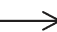

## 线性规划 – 单纯法

| x1 | x2 | s1 | s2 | RHS |
|---|---|---|---|---|
| 0 | 19 | 1/4 | 1 | 5 |
| 1 | 0 | 3/19 | -7/19 | 98/19 |
| 0 | 0 | 21/19 | -11/19 | 610/19 |

| x1 | x2 | s1 | s2 | RHS |
|---|---|---|---|---|
| 0 | 19 | 1/4 | 1 | 5 |
| 1 | 7/4 | 1/4 | 0 | 7 |
| 0 | 11/4 | 5/4 | 0 | 35 |

最优解为 $x_1^* = 7, x_2^* = 0, s_1^* = 0, s_2^* = 5$，最大值为 $35$。

- 5. 首先，将 LP 重写为：

最大化：$- Z = -x_1 - 2x_2^+ + 2x_2^- + x_3^+ - x_3^- - x_4$
约束条件：$x_1 - x_2^+ + x_2^- + x_3^+ - x_3^- \le 4$
$x_1 + 2x_2^+ - 2x_2^- + 2x_4 \le 6$
$x_2^+ - x_2^- - 2x_3^+ + 2x_3^- + x_4 \le 2$
$-x_1 + 2x_2^+ - 2x_2^- + x_3^+ - x_3^- \le 0$

初始形表为：

| x1 | x2+ | x2 | x2- | x3+ | x3- | x4 | s1 | s2 | s3 | s4 | RHS |
|---|---|---|---|---|---|---|---|---|---|---|---|
| 1 | -1 | 1 | -1 | 0 | 2 | 0 | 1 | 0 | 0 | 0 | 4 |
| 1 | 1 | -1 | 0 | 0 | 2 | 0 | 1 | 0 | 0 | 0 | 6 |
| 0 | 1 | -1 | -2 | 2 | 1 | 0 | 0 | 1 | 0 | 2 | 2 |
| -1 | 2 | -2 | 1 | -1 | 0 | 0 | 0 | 0 | 1 | 2 | 4 |
| 1 | 2 | -2 | -1 | 1 | 1 | 0 | 0 | 0 | 0 | 0 | 5 |

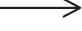

| x_1 | x_2^+ | x_2^- | x_3^+ | x_3^- | x_4 | s_1 | s_2 | s_3 | s_4 | RHS |
|---|---|---|---|---|---|---|---|---|---|---|---|
| 1 | -1 | 1 | -1 | 0 | 1 | 0 | 0 | 0 | 0 | 4 |
| 2 | 0 | 0 | 1 | -1 | 2 | 1 | 1 | 0 | 0 | 10 |
| 1 | 0 | 0 | -1 | 1 | 1 | 0 | 1 | 0 | 0 | 6 |
| 1 | 0 | 0 | 3 | -3 | 0 | 2 | 0 | 0 | 1 | 10 |
| 3 | 0 | 0 | 1 | -1 | 1 | 2 | 0 | 0 | 0 | 8 |

| x_1 | x_2^+ | x_2^- | x_3^+ | x_3^- | x_4 | s_1 | s_2 | s_3 | s_4 | RHS |
|---|---|---|---|---|---|---|---|---|---|---|---|
| 0 | -1 | 1 | 0 | 0 | 1 | 2 | 1 | 0 | 0 | 10 |
| 3 | 0 | 0 | 0 | 0 | 3 | 2 | 1 | 0 | 0 | 16 |
| 1 | 0 | 0 | -1 | 1 | 1 | 0 | 1 | 0 | 0 | 6 |
| 4 | 0 | 0 | 0 | 0 | 2 | 5 | 0 | 3 | 0 | 28 |
| 4 | 0 | 0 | 0 | 0 | 2 | 3 | 0 | 1 | 0 | 14 |
最优解为 $x_1^* = 0, x_2^+ = 10, x_2^- = 0, x_3^+ = 6, x_4^* = 0, s_1^* = 0, s_2^* = 16, s_3^* = 0, s_4^* = 28$，最小值为 $-14$。

## 第5章习题

- 1. 右侧非负，不等式为小于等于，且是一个最大化问题。然而 $x_4$ 是无限制的。
- 3. 最大化：$Z = 4x_1 + 3x_2$
约束条件：$2x_1 + 3x_2 + 5s_1 = 23$
$x_1 + x_2 + s_2 = 8$
$x_1 + 5x_2 + 3s_3 = 20$
$x_1, x_2, x_3 \ge 0$。

- 5. 初始形表为：

| x_1 | x_2 | x_3 | s_1 | s_2 | s_3 | RHS |
|---|---|---|---|---|---|---|
| 2 | 5 | 1 | 1 | 0 | 0 | 25 |
| 3 | 1 | 3 | 0 | 1 | 0 | 21 |
| 1 | 1 | 0 | 0 | 0 | 1 | 7 |
| -1 | -2 | -7 | 0 | 0 | 0 | 0 |

- 7. 最大化：$Z = 4x_1 + x_2 + 3x_3 + 2x_4$
约束条件：$2x_1 + x_2 + 3x_3 + 5s_1 = 25$
$x_1 + x_3 + 5s_2 = 34$
$3x_2 + x_3 + 4s_3 = 59$
$3x_1 + x_2 + x_3 + s_4 = 17$
$x_1, x_2, x_3, x_4 \ge 0$。

- 9. 主元列为 $x_1$，因为目标行中有最小的负数。三个比例分别为 $100/5=20, 75/3=25, 240/4=60$。因此，使用最小比例，第一个约束中的 5 是主元元素。

| x_1 | x_2 | x_3 | s_1 | s_2 | s_3 | RHS |
|---|---|---|---|---|---|---|
| 5 | 25 | 10 | 1 | 0 | 0 | 100 |
| 3 | 15 | 1 | 0 | 1 | 0 | 75 |
| 4 | 6 | 15 | 0 | 0 | 1 | 240 |
| -4 | -3 | 0 | 0 | 0 | 0 | 0 |

- 11. 主元列为 $x_2$ 列，主元元素为列中的 5。

| x_1 | x_2 | s_1 | s_2 | RHS |
|---|---|---|---|---|
| 1 | 5 | 1 | 0 | 200 |
| 2 | 3 | 0 | 1 | 134 |
| -3 | -7 | 0 | 0 | 0 |

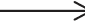

| x_1 | x_2 | s_1 | s_2 | RHS |
|---|---|---|---|---|
| 1/5 | 1 | 1/5 | 0 | 40 |
| 2 | 3 | 0 | 1 | 134 |
| -3 | -7 | 0 | 0 | 0 |

执行主元变换得到以下形表。

| x_1 | x_2 | s_1 | s_2 | RHS |
|---|---|---|---|---|
| 1/5 | 1 | 1/5 | 0 | 40 |
| 7/5 | 0 | -3/5 | 1 | 14 |
| -8/5 | 0 | 7/5 | 0 | 280 |

**13.** 主元列为 $x_1$ 列，主元元素是那里的 5。

| x_1 | x_2 | s_1 | s_2 | RHS |
|---|---|---|---|---|
| 5 | 1 | 1 | 0 | 16 |
| 1 | 2 | 0 | 1 | 7 |
| -5 | -4 | 0 | 0 | 0 |

| x_1 | x_2 | s_1 | s_2 | RHS |
|---|---|---|---|---|
| 1 | 1/5 | 1/5 | 0 | 16/5 |
| 1 | 2 | 0 | 1 | 7 |
| -5 | -4 | 0 | 0 | 0 |

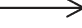

执行主元变换得到以下形表。

| x_1 | x_2 | s_1 | s_2 | RHS |
|---|---|---|---|---|
| 1/5 | 1 | 1/5 | 0 | 40 |
| 2 | 3 | 0 | 1 | 134 |
| -3 | -7 | 0 | 0 | 0 |

形表表明还需要另一个主元。

（等等，文字说目标最大值为 673。主元列为 $x_2$，第三行中的 4 变为基变量。）

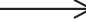

### 17. 对偶问题为：

最大化：$V = 48y_1 + 70y_2 + 96y_3$
约束条件：$3y_1 + 3y_2 + 4y_3 \le 18$
$2y_1 + 2y_2 + 3y_3 \le 15$
$y_1 + 2y_2 + 2y_3 \le 10$
$y_1, y_2, y_3 \ge 0$。

初始形表如下：

| Row | $y_1$ | $y_2$ | $y_3$ | $s_1$ | $s_2$ | $s_3$ | RHS |
|---|---|---|---|---|---|---|---|
| 1 | 3 | 3 | 4 | 1 | 0 | 0 | 18 |
| 2 | 2 | 2 | 3 | 0 | 1 | 0 | 15 |
| 3 | 1 | 2 | 2 | 0 | 0 | 1 | 10 |
| Objective | -48 | -70 | -96 | 0 | 0 | 0 | 0 |

| Row | $y_1$ | $y_2$ | $y_3$ | $s_1$ | $s_2$ | $s_3$ | RHS |
|---|---|---|---|---|---|---|---|
| 1 | 3/4 | 3/4 | 1 | 1/4 | 0 | 0 | 9/2 |
| 2 | -1/4 | -1/4 | 0 | -3/4 | 1 | 0 | 3/2 |
| 3 | -1/2 | 1/2 | 0 | -1/2 | 0 | 1 | 1 |
| Objective | 24 | 2 | 0 | 24 | 0 | 0 | 432 |


当 $y_1 = 0, y_2 = 0, y_3 = 9/2$ 时，最优值为 432。
原始问题的解在 $s_1$ 下方的目标行中。
原始（对偶型）问题的解为 $x_1^* = 24, x_2^* = 0, x_3^* = 0$ 时的最小值 432。

# 第6 章
## 线性规划 – 应用模型
## 第6 章练习题

1. a) 令 $x_i$ 为从仓库 $i$ 运到商店 $j$ 的货物量，$i = 1, 2, 3, 4$，$j = 1, 2, \dots , 6$

最小化：$Z = 9x_{11} + 7x_{12} + 9x_{13} + 9x_{14} + 6x_{15} + 10x_{16} + 12x_{21} + 6x_{22} + 9x_{23} + 7x_{24} + 11x_{25} + 5x_{26} + 3x_{31} + 6x_{32} + 7x_{33} + 5x_{34} + 10x_{35} + 11x_{36} + 5x_{41} + 2x_{42} + 2x_{43} + 2x_{44} + 11x_{45} + 3x_{46}$

约束条件：

```
$x_{11} + x_{12} + x_{13} + x_{14} + x_{15} + x_{16} \le 9$
$x_{21} + x_{22} + x_{23} + x_{24} + x_{25} + x_{26} \le 2$
$x_{31} + x_{32} + x_{33} + x_{34} + x_{35} \le 6$
$x_{41} + x_{42} + x_{43} + x_{44} + x_{45} + x_{46} \le 5$
```

来自仓库

```
$x_{11} + x_{21} + x_{31} + x_{41} \geq 6$
$x_{12} + x_{22} + x_{32} + x_{42} \geq 4$
$x_{13} + x_{23} + x_{33} + x_{43} \geq 4 \quad 到$
$x_{14} + x_{24} + x_{34} + x_{44} \geq 2 \quad 商店$
$x_{15} + x_{25} + x_{35} + x_{45} \geq 4$
$x_{16} + x_{26} + x_{36} + x_{46} \geq 2$
$x_{ij} \geq 0 \quad 所有 way，$i, j$
```

当 $x_{12}^* = 4, x_{14}^* = 1, x_{15}^* = 2, x_{26}^* = 2, x_{31}^* = 6, x_{34}^* = 4, x_{44}^* = 1$ 且其他所有 $x_{ij}^*$ 为零时，目标值为 99。

- b) 将 $x_{11} + x_{21} + x_{31} + x_{41} \geq 6$ 替换为 $x_{11} + x_{21} + x_{31} + x_{41} \geq 4$。
当 $x_{12}^* = 3, x_{15}^* = 4, x_{26}^* = 2, x_{31}^* = 4, x_{32}^* = 1, x_{43}^* = 1, x_{44}^* = 4$ 且其他所有 $x_{ij}^*$ 为零时，目标值为 88。

- 3. 令 $X_{ij}$ 为混合物 $j$ 中威士忌 $i$ 的量
$i = A, B, C$ 对应 A, B, C
$j = 1, 2, 3$ 对应 BH, OC, MC (Blue Hen, Old, Old College, Modeler’s Choice)

$X_{AB} + X_{AO} + X_{AM}$ BH 的量
$X_{BB} + X_{BO} + X_{BM}$ OC 的量
$X_{CB} + X_{CO} + X_{MC}$ MC 的量

所以，基础酒的成本为：

$8.50(X_{AB} + X_{BB} + X_{CB}) + 7.00(X_{OA} + X_{OB} + X_{OC}) + 5.50(X_{AMC} + X_{BMC} + X_{CMC})$

威士忌的成本：

$7(X_{AB} + X_{AO} + X_{AM}) + 6(X_{BB} + X_{BO} + X_{BM}) + 5(X_{CB} + X_{CO} + X_{MC})$

利润为，

$Z = 收入 - 威士忌成本$

 

$X_{ABH} + X_{AOC} + X_{AMC} \le 2100$
$X_{BBH} + X_{BOC} + X_{BMC} \le 800$ 可用的威士忌
$X_{CBH} + X_{CO} + X_{CMC} \le 1700$ Blue Hen
$X_{ABH} \ge 40; \quad X_{CBH}$
$X_{ABH} + X_{BBH} + X_{CBH} \le 30$ Old College
$X_{AOC} \ge 25; \quad X_{COC}$
$X_{AOC} + X_{BOC} + X_{COC} \le 40$ Master's Choice
$X_{CMC} \le 60$
$X_{AMC} + X_{BMC} + X_{CMC}$
$i = A, B, C \quad j = BH, OC, MC$

最大收入是 9500
$X_{ABH}^* = 2100, X_{BBH}^* = 800,$ 和 $X_{CBH}^* = 1242$ 且其他 $X_{ij}^* = 0$。Blue Hen。洗衣店有三个选择：
1. 在第 $j$ 天购买新的餐巾。
2. 在第 $j$ 天正常（全天）清洗 $X_i$ 餐巾，在第 $j+1$ 天可以使用。
3. 在第 $j$ 天快速（隔夜）清洗 $X_j$ 餐巾，在第 $j+2$ 天可以使用。

线性规划为：
最小化：$5w_1 + 5w_2 + 5w_3 + 5w_4 + 5w_5 + 5w_6 + 5w_7 + x_1 + x_2 + x_3 + x_4 + x_5 + x_6 + x_7 + 1.5y_1 + 1.5y_2 + 1.5y_3 + 1.5y_4 + 1.5y_5 + 1.5y_6 + 1.5y_7$

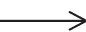

# 第7 章
## 集合与概率关系
### 7.1 练习题

1. a) $7 \in A$ 正
b) $\{2, 3\} \subset A$ 正
c) $\{1\} \subset A$ 正
d) $\{2, 3, 4\} \subset A$ 错
e) $4 \in A$ 错

3. 确定 $n(A \cap B)$
b) $(A \cup B) = \{1, 2, 3, 4, 5, 7\}$，所以 $n(A \cap B) = 6$。（等等，文本说是 $n(A \cap B)$ 但公式是 $A \cup B$，我保持原样）
c) $A^c$ 包含所有不在 $A$ 中但在全集 $U$ 中的元素。
$A^c = \{1, 4, 6, 8, 9\}$，所以 $n(A^c) = 5$。

d) $A^c \cup B = \{1, 2, 3, 4, 5, 6, 8, 9\}$ 且 $(A^c \cup B)^c = \{7\}$。因此，$n(A^c \cup B)^c) = 1$。

e) $A \cap B^c = \{2, 3, 5, 7\} \cap \{6, 7, 8, 9\} = \{7\}$，所以 $n(A \cap B^c) = 1$。

5. $A \cap B = \{3, 5, 7\}$
b) $A \cup B = \{1, 2, 3, 4, 5, 7\}$
c) $A^c = \{2, 4, 6, 8, 9, 10\}$
d) $A^c \cup B^c = \{2, 4, 6, 8, 9, 10\}$

7. $A = \{\text{Jan, Mar, May, Aug, Dec}\}$，所以 $n(A) = 7$
b) $B = \{\text{Apr, Jun, Sep}\}$，所以 $n(B) = 4$
c) $C = \{\text{Feb, Apr, Jun, Sep}\}$，所以 $n(B \cup C) = 5$

9. 答案取决于集合。一个例子是：$A = \{1, 2, 3, 4\}$，$B = \{3, 4, 5, 6, 7\}$,且 $C = \{1, 3, 4, 5, 7\}$。（等等，这里的 OCR 乱乱，我会清理一下）。

11. $A \cap B = \{1, 4, 9, 11, 13, 17, 23, 29, 31, 37, 41, 43\}$
b) $A \cap C = \{2, 3, 5, 7, 11, 13, 17, 23, 29, 31, 37, 41, 43\}$

### 7.2 练习题
1. 考虑用罗马数字指示区域的韦恩图。
使用两个重叠圆的韦恩图，

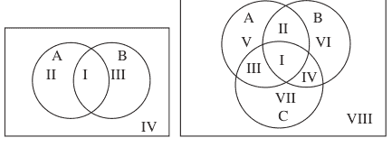

$A \cup B$ 由区域 I、II、III 表示，$B \cup A$ 由区域 I、II、III，表明集合并集的交换律成立。

同样，$A \cap B$ 是区域 I，$B \cap A$，验证了集合交集的交换律。
使用三个重叠圆的韦恩图来建立结合律，我们有：
$A \cap (B \cup C) = (A \cap B) \cup (A \cap C)$
$A \cup (B \cap C) = (A \cup B) \cap (A \cup C)$

为了建立分配律，我们有：
$A \cap (B \cup C) = (A \cap B) \cup (A \cap C)$


[content]

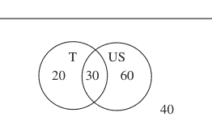

a) 韦恩图显示 20 人只读了。

b) 四十人既没有读也没有任何出版物。

### 11. 韦恩图是：

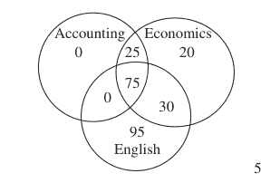

该图有 5 名数学学生没有参加其他三门课程中的任何一门（区域 VIII）。

### 13. 韦恩图是：


该图表明 35 人（= 15 + 10 + 10）投诉单一问题（V、VI 和 VII 区域）。

### 15. 使用三个交叠的圆分别代表 A 抗原存在、B 抗原存在和 Rh 阳性。


a) 图示了每个区域对应的血型：

| 区域 | 血型 | 区域 | 血型 |
| :--- | :--- | :--- | :--- |
| I | AB+ | V | A− |
| II | AB− | VI | B− |
| III | A+ | VII | O+ |
| IV | B+ | VIII | O⁻ |

b) 美国人口中四种血型的百分比：
A 40%, AB 4%, B 11%, O 45%

c) 世界各血型存在极端差异。例如，南美洲几乎全是 O 型。

### 练习题 7.3

- 1. 有 2^3 个子，包括空集和集合本身：{ }, {X}, {Y}, {Z}, {X, Y}, {X, Z}, {Y, Z}, {X, Y, Z}

- 3. 有 15 种方式，如下所示（RR 不可能）：


- 5. 右侧列出了所有可能的树状图是：


- 7. 一个“树”描述了“可靠性提高”，随后是“耐用性提高”。由于 50 人中有 32 人提高了可靠性，18 人没有。这些数字在树的第一个分支上是 6。接下来，YY 分支有 15 人（= 27 – 12），他们既没有提高可靠性也没有提高耐用性。


有 15 人既提高了可靠性又提高了耐用性。

- 9. 首先，考虑三个问题：1) 你喝了冰茶吗？2) 你喝了汽水吗？3) 你喝了柠檬水吗？这里，YYY 分支初始为 21，NNN 分支为 0。由于 32 人喝了冰茶和柠檬水，YYY 和 YNY 分支必须等于总数。由于 YY 有 21 人，导致 YNY 为 11。对其他饮料组合使用相同的推理，YN 分支有 12 人，NYY 分支有 23 人。由于 18 人喝了汽水，只有 NYN 有这个数量。第一次划分有 80 人喝了冰茶，因此 70 人没有。通过从柠檬水问题“倒向前”推推，确定了分支数字。

### 练习题 7.3 103


a) 29 人只喝了柠檬水 b) 74 人喝了汽水。

### 11. 一个可能的树状图是：


女大学毕业生是 YNN 和 YYN 分支。因此，有 15+18=33 名女大学毕业生。对于结果相同的其他树，可以改变问题的顺序。

### 13. 树和与之相关的 15 种可能性是：


### 15. 树和 16 种可能性是：


### 17. 首先，有 57 名女性，43 名男性，总计 100 人。23 名男大一出现在 NY 分支，其余信息位于：


班上有 27 名女性。

### 练习题 7.4

- 1. 有 5 个数字 2, 3, 6, 7 和 8 可以组成不重复的三位数。最后一位决定数字是奇还是偶。填充三个槽：第三位、第二位和第一位。使用乘法原理，有 (4)(3)(2) = 24 种可能。

- 3. 有 (4)(3)(2) = 24 种可能。

- 5. a) 7! = 7 · 6 · 5 · 4 · 3 · 2 · 1 = 5040
b) 8!/6! = 56
c) 9!/0! = 362880
d) 10!/10! = 1
e) 52!/(48!) = (52 · 51 · 50 · 49) = 270720

- 7. 有 $\binom{52}{5} = 2,598,960 种牌牌。

- 9. a) $\binom{7}{2} = 21$
b) $\binom{6}{5} = 6$
c) $\binom{4}{1} = 4$

- 11. 七取五排列产生 $_7P_5 = 2520$ 种可能的颜色。

- 13. 有 6 种不重复的三位数数字。一种方案使用 $_6P_3$ 六取三排列，即 120。填充三个槽：(任意)(任意)(任意) 或 (6)(5)(4)。

- 15. 有 $2^4 = 16$ 种结果。其中四种只有一个反面。反面可以是第一、第二、第三或第四，表示 4 种可能。

- 17. $n!/_Cn_r = \frac{n!}{(n-r)!}$。

- 19. 有 2 种可能。从三位决赛者中选择两个，或者选择全部三个：$\binom{3}{2} + \binom{3}{1} + \binom{3}{0} = 3 + 3 + 1 = 7$ 种。

- 21. 14 名学生分为一组四和一组五，产生 $\frac{14!}{5!4!} = 252,252$ 种可能的座位安排。

- 23. 用字母填充六槽。因此，有 (26)(26)(10)(10)(10)(10) = 6,760,000 种可能的车牌。

## 集合与概率的关系

- 25. 有 1/10,000 的概率第一次尝试成功输入四位 PIN。尝试四次错误 触发报警的概率为 99.9%。(9999/10000)(9998/10000)(9997/10000)(9996/10000) ≈ 0.999。

- 27. a) 在区号内，有 $10^7 = 10,000,000$ 种可能的七位号码。
b) 使用上述区号规则，有 $9(2)(10) = 180$ 种可能的区号，因此有 $180(10^7) = 1,800,000,000$ 种可能的电话号码。

- 29. DJ 有三种方案，选择四张 CD 代表三个组。它们是：
2 R&B, 1 乡村, 1 流行 = $\binom{10}{2}\binom{15}{1}\binom{25}{1} = 45 \cdot 15 \cdot 25 = 16,875$
1 R&B, 2 乡村, 1 流行 = $\binom{10}{1}\binom{15}{2}\binom{25}{1} = 10 \cdot 105 \cdot 25 = 26,250$
1 R&B, 1 乡村, 2 流行 = $\binom{10}{1}\binom{15}{1}\binom{25}{2} = 10 \cdot 15 \cdot 300 = 45,000$
因此，有 $16,875 + 26,250 + 45,000 = 88,125$.

- 31. $P(A \cup B) = P(A) + P(B) - P(A \cap B)$
- 33. $P(A|B) = \frac{P(A \cap B)}{P(B)}$

### 练习题 7.5

- 1. 当 A 和 B 互斥时，$P(A \cup B) = P(A) + P(B)$。
- 2. 如果 A 和 B 是独立的，$P(A \cap B) = P(A)P(B)$。
- 3. 如果 A 和 B 不互斥，$P(A \cup B) = P(A) + P(B) - P(A \cap B)$。
- 4. 如果 A 和 B 是独立的，$P(A|B) = P(A)$。
- 5. 如果 A 和 B 不是独立的，$P(A|B) = \frac{P(A \cap B)}{P(B)}$。

### 练习题 7.6

- 1. 当 A 和 B 互斥时，$P(A \cup B) = P(A) + P(B)$。
- 2. 如果 A 和 B 是独立的，$P(A \cap B) = P(A)P(B)$。
- 3. 如果 A 和 B 不互斥，$P(A \cup B) = P(A) + P(B) - P(A \cap B)$。
- 4. 如果 A 和 B 是独立的，$P(A|B) = P(A)$。
- 5. 如果 A 和 B 不是独立的，$P(A|B) = \frac{P(A \cap B)}{P(B)}$。

### 练习题 7.7

- 1. 当 A 和 B 互斥时，$P(A \cup B) = P(A) + P(B)$。
- 2. 如果 A 和 B 是独立的，$P(A \cap B) = P(A)P(B)$。
- 3. 如果 A 和 B 不互斥，$P(A \cup B) = P(A) + P(B) - P(A \cap B)$。
- 4. 如果 A 和 B 是独立的，$P(A|B) = P(A)$。
- 5. 如果 A 和 B 不是独立的，$P(A|B) = \frac{P(A \cap B)}{P(B)}$。


## 集合与概率关系

P(都是缺陷/ 至少有1个缺陷)

$$\frac{P(\text{Both } D \cap \text{at least 1 Dem})}{P(\text{at least 1 Dem})} = \frac{\binom{5}{2}\binom{2}{0}}{\binom{5}{1}\binom{2}{1} + \binom{5}{2}\binom{2}{0}} = \frac{10}{10+10} = \frac{1}{2}$$

- 29. 关于莎士比亚十四行诗中有多少首是写给“黑女士”的，存在一些争议。假设第127–154首诗是写给“黑女士”的，那么有28首诗需要考虑。
  - a) P(黑女士) = 28/154
  - b) P(黑女士 $\cap$ 不是第一首) = $\frac{\binom{5}{2}}{\binom{54}{2}} \approx 0.519$
  - c) P(黑女士 $\cap$ 完全平方数) = $\frac{1}{\binom{154}{12}} \approx .0083.$

- 31. 概率是基于52张牌给出的。P(抽到A) = 4/52，P(抽到黑牌) = 26/52。
  $P(\text{ace} \cap \text{black}) = \frac{\binom{2}{2}}{\binom{52}{2}} = \frac{2}{26} = \frac{1}{13}$

由于 $P(\text{ace}) = 4/52 = 1/13$，这两个事件是独立的。

- 33. 2003年共有36场纳斯卡赛比赛，莱恩·纽曼（Ryan Newman）赢了其中8场，因此概率是8/36
  - b) 3/36
  - c) 5/36

- 35. 需要所有的大写字母才能得到最深的肤色，每个字母概率均为1/2，因此 $(1/2)^6 = 1/64。
  - b) 需要所有的小写字母，使用与a部分相同的逻辑，概率再次为1/64。
  - c) 一个大写字母需要三种情况：拥有大写A、大写B或大写C，其余字母为小写。
  $(1/2)(1/4)(1/4) + (1/2)(1/2)(1/4) + (1/4)(1/4)(1/2) = 3/32$
  大写A 大写 C

### 练习 7.6

1. 树形图列出了可能性。设R表示“抽到红牌”，B表示“抽到黑牌”。阶段概率显示在分支上。


a) 如果是RR或BR，第二张牌就是红色的，这些分支产生了 0.42 + 0.24 = 0.66。

b) 在已知颜色相同的情况下，两张牌都是黑色的概率为：
$P(Black/same) = \frac{P(black\&same)}{P(same)} = \frac{P(black)}{P(same)} = \frac{0.06}{0.48} = \frac{1}{8}$

注：
$P(same) = P(both red) + P(both black) = 0.42 + 0.06 = 0.48$。

3. 树形图描绘了可能性。


a) $P(\text{恰好正面}) = P(HT)=(1/2)(1/2) = 1/4$。

b) $P(\text{两个或更多}) = (1/2)(5/6) = 5/12$。

### 5. 树形图是一个辅助。


a) P(都是黑桃) = (6/13)(5/12) = 5/26

b) P(都是黑桃/第一张是黑桃) = $\frac{P(SS \cap 1^{st} spade)}{P(1^{st} spade)} = \frac{5/26}{6/13}$

c) P(一个桃心/第一张是红心) = $\frac{P(C \cap 1^{st} H)}{P(1^{st} H)} = \frac{(2/13)(5/12)}{2/13}$

7. 如果三个孩子，有 $2^3$ 种可能性。“至少两个女孩”意味着三个孩子中有两个女孩或三个都是女孩。概率是：
$$\frac{\binom{3}{2}}{2^3} = \frac{3}{8}$$。

9. “未填充”意味着罐是未装不满的。这种情况发生的概率是25%。
$P(underfilled/not correct) = \frac{P(under \cap not correct)}{P(not correct)} = 0.25$

11. 设 $A =$ A牌，$F =$ 面牌，$N =$ 数字。
a) 确定 P(至少一个F) 需要先找到 P(没有A)。这可以通过 FF, FN, NF 等四方式发生。概率是 $(12/52)(11/51) + (12/52)(36/51) + (36/52)(12/51) + \dots$ 
（虽然这可以简化，但使用公式更容易追踪）。接下来，确定有“至少一个F且没有A”的特定情况。有 FF, FN, NF 三种情况。(132+432+432)/2652 = 996/2652$。

### 练习 7.6

11. $P(\至少一个F/没有A) = \frac{P(\text{at least 1 F} \cap \text{no A})}{P(\text{no A})} = \frac{996/2652}{2256/2652} = \frac{3}{8}$

b) 确定 $P(\text{都是N/至少1个N})$ 使用类似的逻辑。“至少1个N”的情况有 AN, NF, 和 NN。NA, NF 和 NN 可以被视为概率为 36/52 的单个情况。另外两种情况概率为 $(4/52)(36/51)$ 和 $(12/52)(36/51)$。因此，$P(\text{至少1个N}) = 1260/2412 = 35/67$。

13. a) $P(A) = 0.6, P(B) = 0.9, P(A \cap B) = 0.5$，因为测试是独立的。
$P(A \cap B) = (0.6)(0.9) = 0.54$
$P(A \cup B) = P(A) + P(B) - P(A \cap B) = 0.6 + 0.9 - 0.54 = 0.96$（注：原文写的是 0.9，可能是 0.96 的笔误）。可以使用维恩图帮助。

b) 只有一种测试检测出疾病的概率可以使用维恩图很容易找到。它是 $0.06 + 0.36 = 0.42$。

c) 为了准确确定位置，有情况。只有测试 A 检测出 (D) 并准确确定 (L)。只有测试 B 检测出 (D) 并准确确定 (L)。最后，只有测试 B 检测出某人患病并确定了位置的概率使用了 c 部分的信息：
$P(B)P(D/B) / [P(A)P(D/A) + P(B)P(D/B) + P(A \cap B)P(D/A \cap B)] = \frac{(0.36)(0.5)}{0.768} = \frac{0.18}{0.768} = 0.23435$

#15. 使用贝斯定理：
$P(C/def) = \frac{P(def/A)P(A) + P(def/B)P(B) + P(def/C)P(C)}{(0.05)(0.45)}$
$\frac{(0.02)(0.30) + (0.03)(0.25) + (0.05)(0.45)}{0.0360} = \frac{0.0225}{8}$

17. 缺陷的问题是树形图的一个很好的起点。经验显示12% 的产品有缺陷，机器有 98% 的概率会检测出这种缺陷，也有 8% 的概率会误报缺陷

因此，当仪器显示缺陷时，产品实际上没有缺陷的概率为：
$P(\text{not flawed/flaw detected}) = \frac{(0.88)(0.08)}{(0.12)(0.98) + (0.88)(0.08)} \approx 0.374$

#19. 这棵树可以使用，也可以应用贝斯定理。


$P(M1/def) = \frac{P(def/M1)P(M1)}{P(def/M1)P(M1) + P(def/M2)P(M2)} = \frac{(0.02)(0.3)}{(0.02)(0.3) + (0.03)(0.7)} = 0.2$

#21. 这种情况的树形图为：


a) 从二号瓮中抽到黑球概率位于 WB 和 BB 分支上。所以 (3/8)(3/6) + (5/8)(4/6) = 29/48。
b) 在已知至少有一个白色球的情况下，抽到两个白色大球的概率是 $P(2W/\text{至少1个W}) = \frac{P(2W \cap \text{至少 1W})}{P(\text{至少 1W})}$ 有三种至少1个白球发生的情况，用 * 标记。
$\frac{(3/8)(3/6)}{(3/8)(3/6) + (3/8)(3/6) + (5/8)(2/6)} = \frac{9/48}{28/48} = 9/28$

#23. 这棵树可以使用，也可以应用贝斯定理。


被发现为干净的邮件实际上是的概率是：
$\frac{(0.04)(0.0005)}{(0.04)(0.0005) + (0.96)(0.99)} = 0.00002 = 0.00021$


## 第7章补充练习题

1. a) 正确 b) 错误 $B \cup C = [1, 2, 3, 4, 5]$ c) 正确

3. 样本空间是：


5. $A \cap B = \{100, 400\}$

7. 树状图是：


有两种情况出现两个正面，一种情况出现三个正面。概率为 $3(2/3)^2(1/3) + (1/3)^3(2/3)^2 = 20/27$。

9. 想象填充三个位置。金牌可以由八位奥林匹克人中的任何一位获得。银牌由剩下的七人中的任何一位获得，铜牌由剩下的六人中的任何一位获得，共有 $8(7)(6) = 336$ 种方式。这是一个排列，所以 $_8P_3 = 336$。

11. 这六个人可以根据他们分配到的卧室的大小被认为是“一组一个”、“一组两个”和“一组三个”的对象。因此，有 $6/(1!2!3!) = 60$ 种方式。

## 集合与概率的关系

13. 有两种情况需要考虑。一种，“从六个镍美币中选择一个，从三个十分币中选择两个”。另一种，“从六个镍美币中选择两个，从三个十分币中选择一个”。结果是：

$$\left(\frac{6}{1}\right)\left(\frac{3}{2}\right)+\left(\frac{6}{2}\right)\left(\frac{3}{1}\right)=6(3)+15(3)=63$$

15. 给定有六个包含一个元素的子集和十五个包含两个元素的子集：$$\left(\frac{6}{1}\right)+\left(\frac{6}{2}\right)=6+15=21$$

17. 盒子不含缺陷保险丝的概率可以从不带星号的分分支确定。

$$P(A)P(\text{no defect}/A)+P(B)P(\text{no defect}/B)+P(C)P(\text{no defect}/C)=(0.30)(0.98)+(0.50)(0.95)+(0.20)(0.90)=0.949$$


如果随机选择的盒子有缺陷，则它来自公司 **B** 的概率是：

$$P(B/\text{def}) =\frac{P(\text{def}/B)P(B)}{P(\text{def}/A)P(A)+P(\text{def}/B)P(B)+P(\text{def}/C)P(C)}$$

$$=\frac{(0.05)(0.50)}{(0.02)(0.30)+(0.05)(0.50)+(0.10)(0.20)}=\frac{0.025}{0.051} \approx 0.49$$

## 第8章

## 随机变量与概率分布

### 8.1 练习题

- 1. a) 连续 b) 离散 c) 离散 d) 连续 e) 连续
- 3. 经济学家对一个城市的就业率、上个月的失业率或每日股市的百分比变化感兴趣。（答案不一）
- 5. 概率之和必须为1
  - a) $1.0 - 0.2 - 0.1 - 0.4 = 0.3$
  - b) $1.0 - 0.05 - 0.35 - 0.25 - 0.20 = 0.15$
  - c) $1.0 - (1/16) - (1/8) - (3/16) - (5/16) - (1/8) = 3/16$
- 7. 公均匀骰子的每个面概率相等

| x | 1 | 2 | 3 | 4 | 5 | 6 |
| :--- | :--- | :--- | :--- | :--- | :--- | :--- |
| P(x) | 1/6 | 1/6 | 1/6 | 1/6 | 1/6 | 1/6 |

### 9. 练习 8.15a 中的期望值是：

$E(x) = 10(0.20) + 20(0.10) + 30(0.30) + 40(0.40) = 29.0$

练习 8.15b 中的期望值是：

$E(x) = 1(0.05) + 5(0.35) + 9(0.25) + 12(0.20) + 20(0.15) = 10.05$

练习 8.15c 中的期望值是：

$E(x) = -3(1/16) + 5(1/8) + 7(3/16) + 8(5/16) + 10(3/16) + 25(1/8) = 9.25$

### 11. 从2到12的面数和为 $x$ 的概率分布为：

| x | 2 | 3 | 4 | 5 | 6 | 7 | 8 | 9 | 10 | 11 | 12 |
| :--- | :--- | :--- | :--- | :--- | :--- | :--- | :--- | :--- | :--- | :--- | :--- |
| P(x) | 1/36 | 2/36 | 3/36 | 4/36 | 5/36 | 6/36 | 5/36 | 4/36 | 3/36 | 2/36 | 1/36 |

期望值是：

$2(1/36) + 3(2/36) + \cdots + 12(1/36) = 252/36 = 7$

### 13. $x$ 的分布为：

| x | 100,000 | 60,000 |
| :--- | :--- | :--- |
| P(x) | 0.75 | 0.25 |

$E(x) = 100,000(0.75) + 60,000(0.25) = 90,000$。如果购买保险，预计预期 $10,000$。不购买保险则预期 $10,000$。

### 15. 包含初始美元的奖金分布为：

| x | 1,500,000 | 500 | 0 |
| :--- | :--- | :--- | :--- |
| P(x) | $\binom{6}{6}\binom{3}{0}$ | $\binom{6}{5}\binom{3}{1}$ | $\binom{6}{4}\binom{3}{2}$ |
| | $1/3,266,223$ | $18/3,266,223$ | $54/3,266,223$ |


期望值为 $\frac{1995000}{3,266,223} \approx 0.6115$。如果支付1美元，则预期损失约为39分。

## 17. 六的概率是两倍的情况：

| x | 1 | 2 | 3 | 4 | 5 | 6 |
| :--- | :--- | :--- | :--- | :--- | :--- | :--- |
| P(x) | 1/7 | 1/7 | 1/7 | 1/7 | 1/7 | 2/7 |

$E(x) = 1(1/7) + 2(1/7) + \cdots + 6(2/7) = 27/7 \approx 3.857$

## 19. 华盛顿、林肯、杰克逊、格兰特和富兰克林分别出现在5、10、20、50和100美元钞票上。

| x | 5 | 10 | 20 | 50 | 100 |
| :--- | :--- | :--- | :--- | :--- | :--- |
| P(x) | 6/20 | 3/20 | 4/20 | 2/20 | 1/20 |

因此，
$E(x) = 5(6/20) + 10(3/20) + \cdots + 100(1/20) = 341/20 = 17.05$

### 8.2 练习题

- a) $P(x=2) = (\frac{3}{2})^2(0.4)^2 = 3(0.16)(0.16) = 0.288$
- b) $P(x=3) = (\frac{4}{3})^3(\frac{1}{3})^3(\frac{3}{2})^3 = 4(\frac{1}{27})(\frac{2}{3})^3 = \frac{8}{81} = 0.0987$
- c) $P(x=1) = (\frac{5}{10})^{10}(0.3)^1 = 5(0)(0.2401) = 0.0361$
- a) $P(x=10) = (\frac{10}{30})^{10}(0.9)^{10}(0.1) = (0.9)^{10} = 0.3487$
- b) $P(x=20) = (\frac{20}{30})^{20}(0.9)^{20}(0.1) = 0.1216$
- 5. 掷“5”的概率 $n=20, p=0.1$：

## 随机变量与概率分布

- a) $P(x=0) = (\frac{2}{3})^{10} = 0.0173$
- b) $P(x \le 3) = 0.7005$
- c) $P(x \ge 2) = 0.8969$
- a) $P(x \le 5) = 0.9994$
- b) $P(x \ge 6) = 0.0006$
- c) $P(x \le 1) = 0.0758$
- a) $P(x \le 2) = 0.3992$
- b) $P(x \ge 5) = 0.0016$
- c) $P(x \le 3) = 0.6476$
- a) $P(x \le 4) = 0.6171$
- b) $P(x \ge 7) = 0.0386$
- c) $P(x \le 6) = 0.8331$
- a) $P(x \le 3) = 0.8327$
- b) $P(x \ge 6) = 0.1673$
- c) $P(x \le 5) = 0.5601$
- a) $P(x \le 2) = 0.2013$
- b) $P(x \ge 5) = 0.4365$
- c) $P(x \le 4) = 0.7334$
- a) $P(x \le 6) = 0.9457$
- b) $P(x \ge 8) = 0.0433$
- c) $P(x \le 7) = 0.8520$
- a) $P(x \le 10) = 0.9999$
- b) $P(x \ge 15) = 0.0000$
- c) $P(x \le 12) = 0.9999$
- a) $P(x \le 15) = 0.9672$
- b) $P(x \ge 18) = 0.0355$
- c) $P(x \le 17) = 0.8867$
- a) $P(x \le 20) = 0.8981$
- b) $P(x \ge 23) = 0.1019$
- c) $P(x \le 22) = 0.7625$
- a) $P(x \le 25) = 0.9522$
- b) $P(x \ge 28) = 0.0478$
- c) $P(x \le 27) = 0.9133$
- a) $P(x \le 30) = 0.9885$
- b) $P(x \ge 33) = 0.0115$
- c) $P(x \le 32) = 0.9716$


b) 如果两种颜色都被表示，则情况为（两个红色一个黑色）或（一个红色两个黑色）。

```
$$\frac{\binom{6}{2} + \binom{6}{4}}{\binom{10}{3}} = \frac{60 + 36}{120} = 0.8$$
```

3. a) 要全部正确，六个中奖号码中选择了六个，30个中奖号码中一个都没有选。所以，

```
$$\frac{\binom{6}{6} \binom{30}{0}}{\binom{36}{6}} = \frac{1}{1,947,792}$$
```

b) 要中五个数字正确，六个中奖号码中选择了五个，30个中奖号码中选了一个。所以，

```
$$\frac{\binom{6}{5} \binom{30}{1}}{\binom{36}{6}} = \frac{180}{1,947,792}$$
```

5. a) 如果手中有四张王牌，那么所有的王牌都被抽到了，以及另外48张牌中的其中一张。

```
$$\frac{\binom{4}{4} \binom{48}{1}}{\binom{52}{5}} = \frac{48}{2,598,960}$$
```

b) 同花可以是四种花色中的任何一种。你必须从该花色的13张牌中选5张，另外39张牌中一个都不选。

```
$$4 \times \frac{\binom{13}{5} \binom{39}{0}}{\binom{52}{5}} = 4 \times \frac{1287}{2,598,960} = 0.00198$$
```

## 7. 考虑两组；一组三个，另一组五个。

a) 如果没有雇用少数候选人，那么雇用的三个人来自那组五个人，所以

```
$$\binom{3}{0}\binom{5}{3} = \frac{(1)(10)}{56} = \frac{5}{28}$$
```

b) 这里，雇用了三个少数候选人，没有雇佣另外五个中的任何一个。概率为

```
$$\binom{3}{3}\binom{5}{0} = \frac{(1)(1)}{56} = \frac{1}{56}$$
```

## 9. 有两组：6个次品和14个“好品”物品。

a) “无次品”意味着从14个“好品”中选择了5个。所以，

```
$$\frac{\binom{6}{0}\binom{14}{5}}{\binom{20}{5}} = \frac{2002}{15504} = 0.1291$$
```

b) 这里，选了6个次品中的一个以及另外的四个：

```
$$\frac{\binom{6}{1}\binom{14}{4}}{\binom{20}{5}} = \frac{6006}{15504} = 0.3874$$
```

c) 这里，选了6个次品中的五个以及另外的没有：

```
$$\frac{\binom{6}{5}\binom{14}{0}}{\binom{20}{5}} = \frac{6}{15504} = 0.0003870$$
```

11. 这里，若干种组合相乘得到分子

```
$$\frac{5}{3}\frac{4}{2}\frac{1}{0}\frac{2}{1} = \frac{(10)(6)(1)(2)}{924} = \frac{120}{924} = 0.1299$$
```

13.

15.

```
$$\frac{3}{1}\frac{6}{3} = \frac{60}{126} = \frac{10}{21}$$
```

（假设目前的最高法院有三位女性）

### 练习 8.4

1. 这里，$\lambda=2.6$

- a) $P(x \le 3) = \frac{2.6^0 e^{-2.6}}{0!} + \frac{2.6^1 e^{-2.6}}{1!} + \frac{2.6^2 e^{-2.6}}{2!} + \frac{2.6^3 e^{-2.6}}{3!} = 0.0743 + 0.1931 + 0.2510 + 0.2176 = 0.7360$
- b) $P(x = 1) = \frac{2.6^1 e^{-2.6}}{1!} = 0.1931$
- c) $P(x > 2) = 1 - P(x \le 2) = 1 - \frac{2.6^0 e^{-2.6}}{0!} - \frac{2.6^1 e^{-2.6}}{1!} - \frac{2.6^2 e^{-2.6}}{2!} = 1 - 0.0743 - 0.1931 - 0.2510 = 0.4816$

- a) $P(x = 3) = \frac{2.4^3}{3!} = 0.2090$
- b) $P(x \le 4) = P(x = 0) + P(x = 3) + P(x = 4) = \frac{2.4^0 e^{-2.4}}{0!} + \frac{2.4^1 e^{-2.4}}{1!} + \frac{2.4^2 e^{-2.4}}{2!} + \frac{2.4^3 e^{-2.4}}{3!} + \frac{2.4^4 e^{-2.4}}{4!} = 0.0907 + 0.2177 + 0.2612 + 0.2090 + 0.1254 \dots$

5. 错误的平均数产生 $\lambda = 1$

- a) $P(x = 0) = \frac{1^0 e^{-1}}{0!} = e^{-1} = 0.3679$
- b) $P(x \ge 3) = 1 - P(x \le 2) = 1 - \frac{1^0 e^{-1}}{0!} - \frac{1^1 e^{-1}}{1!} - \frac{1^2 e^{-1}}{2!} = 0.0803$

## 7. 这里，$\lambda = 2.6$

- a) $P(x = 3) = \frac{2.6^3 e^{-2.6}}{3!} = 0.2176$
- b) $P(x \le 4) = P(x = 0) + P(x = 1) + P(x = 2) + P(x = 4) = \frac{2.6^0 e^{-2.6}}{0!} + \frac{2.6^1 e^{-2.6}}{1!} + \frac{2.6^2 e^{-2.6}}{2!} + \frac{2.6^4 e^{-2.6}}{4!} = 0.8774$
- c) $P(x \ge 2) = 1 - P(x \le 1) = 1 - \frac{2.6^0 e^{-2.6}}{0!} - \frac{2.6^1 e^{-2.6}}{1!} = 0.7326$

## 9. 每平方英九个。这里，$\lambda = 2(9) = 18$。

$P(x = 0) = \frac{18^0e^{-18}}{0!} = e^{-18} \approx 1.5 \times 10^{-8}$

## 11. 五分钟周期，$\lambda = 3$。没有客户到达的概率 $P(x = 0) = \frac{(3)^0e^{-3}}{0!} = 0.0498$。超过五个客户的概率概率补集法得出 $1 - P(x \le 5) = 1 - \frac{3^0e^{-3}}{0!} - \frac{3^1e^{-3}}{1!} - \frac{3^2e^{-3}}{2!} - \frac{3^3e^{-3}}{3!} - \frac{3^4e^{-3}}{4!} - \frac{3^5e^{-3}}{5!} = 0.0839$

## 13. 这里，$\lambda = 2.4$。恰好四个缺陷的概率为 $\frac{(2.4)^4e^{-2.4}}{4!} = 0.1254$。故障两次的概率 $P(x < 2) = P(x = 0) + P(x = 1) = \frac{2.4^0e^{-2.4}}{0!} + \frac{2.4^1e^{-2.4}}{1!} = 0.3084$

## 第8章补充练习题

1. 整个概率分布为：

| x | 10 | 20 | 40 | 60 | 75 | 100 |
|---|---|---|---|---|---|---|
| P(x) | 0.20 | 0.15 | 0.05 | 0.30 | 0.20 | 0.10 |

平均值为

$E(x) = 10(0.2) + 20(0.15) + 40(0.15) + 60(0.30) + 75(0.2) + 100(0.10) = 50$

3. 女孩的概率是男孩概率的1/2。
- a) 至少两个女孩是 $P(x \ge 2) = P(x = 2) + P(x = 3) + P(x = 4) + P(x = 5) = \left(\frac{5}{2}\right)^2\left(\frac{1}{2}\right)^3 + \left(\frac{5}{2}\right)^3\left(\frac{1}{2}\right)^2 + \left(\frac{5}{2}\right)^4\left(\frac{1}{2}\right)^1 + \left(\frac{5}{2}\right)^5\left(\frac{1}{2}\right)^0 = \frac{10}{32} + \frac{25}{32} + \frac{62.5}{32} + \dots$ (此处计算逻辑有误)
- b) 雇用了三个女孩，没有雇佣另外五个中的任何一个。概率为 $0.3125$


# 130 马尔可夫链

5. a) 该图的转移矩阵为 $\begin{bmatrix} 0.85 & 0.15 \\ 0.25 & 0.75 \\ 0.55 & 0.45 \\ 0.60 & 0.40 \end{bmatrix}$

b) 该图的转移矩阵为 $\begin{bmatrix} 0.7 & 0.1 & 0.2 \\ 0.0 & 0.8 & 0.0 \\ 0.6 & 0.0 & 0.3 \\ 0.0 & 0.1 & 0.9 \end{bmatrix}$

7. 该图的转移矩阵为

9. 对于从状态 3 到状态 1 的概率，寻找第 3 行第 1 列 列，其值为 0.7。

### 9.2 练习题

- 1. $T^2 = \begin{bmatrix} 0.2 & 0.8 \\ 0.9 & 0.1 \end{bmatrix} \begin{bmatrix} 0.2 & 0.8 \\ 0.9 & 0.1 \end{bmatrix} = \begin{bmatrix} 0.76 & 0.24 \\ 0.27 & 0.73 \end{bmatrix}$

- 3. $T(2) = \begin{bmatrix} 0.5 & 0.3 & 0.2 \\ 0.2 & 0.4 & 0.4 \\ 0.6 & 0.1 & 0.3 \end{bmatrix} \begin{bmatrix} 0.5 & 0.3 & 0.2 \\ 0.2 & 0.4 & 0.4 \\ 0.6 & 0.1 & 0.3 \end{bmatrix} = \begin{bmatrix} 0.43 & 0.29 & 0.28 \\ 0.42 & 0.26 & 0.32 \\ 0.50 & 0.25 & 0.25 \end{bmatrix}$

- b) 寻找 $t_{12}(2)$，其值为 0.29

- c) 寻找 $t_{23}(2)$，其值为 0.32。

- 5. a) $T(2) = T^2 = \begin{bmatrix} 0.2 & 0.3 & 0.5 \\ 0.4 & 0.5 & 0.1 \\ 0.7 & 0.1 & 0.2 \end{bmatrix}$

$\begin{bmatrix} 0.51 & 0.26 & 0.23 \\ 0.35 & 0.38 & 0.27 \\ 0.32 & 0.28 & 0.40 \end{bmatrix}$

$T(3) = T(2)T = \begin{bmatrix} 0.51 & 0.26 & 0.23 \\ 0.35 & 0.38 & 0.27 \\ 0.32 & 0.28 & 0.40 \end{bmatrix} \begin{bmatrix} 0.367 & 0.306 & 0.327 \\ 0.411 & 0.322 & 0.267 \\ 0.456 & 0.276 & 0.268 \end{bmatrix}$

- b) 三步内从状态 1 到状态 3 的概率 $t_{13}(3) = 0.327$。

- c) 三步内从状态 3 到状态 2 的概率 $t_{32}(3) = 0.276$。

- 7. 这里，$T = \begin{bmatrix} 0.25 & 0.75 \\ 0.10 & 0.90 \end{bmatrix}$。确定两年后事故的概率需要 $T(2)$：

$T(2) = \begin{bmatrix} 0.25 & 0.75 \\ 0.10 & 0.90 \end{bmatrix} \begin{bmatrix} 0.25 & 0.75 \\ 0.10 & 0.90 \end{bmatrix} = \begin{bmatrix} 0.1375 & 0.8625 \\ 0.1150 & 0.8850 \end{bmatrix}$

在今年发生事故的情况下，两年后发生事故的概率为 $t_{11}(2) = 0.1375$。

- 9. $T^2 = \begin{bmatrix} 0.23 & 0.59 \\ 0.18 & 0.60 \\ 0.63 & 0.19 \end{bmatrix}$。因此，根据 $t_{11}(2)$ 确定，2 周后增加的概率为 0.23。

### 9.3 练习题

- 1. 需要 $X_0T^3$ 来确定解。

$T^2 = \begin{bmatrix} 0.6 & 0.4 \\ 0.2 & 0.8 \end{bmatrix} \begin{bmatrix} 0.6 & 0.4 \\ 0.2 & 0.8 \end{bmatrix} = \begin{bmatrix} 0.44 & 0.56 \\ 0.28 & 0.72 \end{bmatrix}$

$T^3 = T^2T = \begin{bmatrix} 0.44 & 0.56 \\ 0.28 & 0.72 \end{bmatrix} \begin{bmatrix} 0.6 & 0.4 \\ 0.2 & 0.8 \end{bmatrix} = \begin{bmatrix} 0.376 & 0.624 \\ 0.312 & 0.688 \end{bmatrix}$

现在，$X_0T^3 = \begin{bmatrix} 0.7 & 0.3 \end{bmatrix} \begin{bmatrix} 0.376 & 0.624 \\ 0.312 & 0.688 \end{bmatrix} = \begin{bmatrix} 0.3568 & 0.6432 \end{bmatrix}$

- 3. 这里，每周转移为 $T = \begin{bmatrix} 0.9 & 0.1 \\ 0.4 & 0.6 \end{bmatrix}$，$T^3 = \begin{bmatrix} 0.825 & 0.175 \\ 0.70 & 0.30 \end{bmatrix}$。寻找 $X_0T^3$，其中 $X_0 = \begin{bmatrix} 0.30 & 0.70 \end{bmatrix}$。因此，

$X_0T^3 = \begin{bmatrix} 0.30 & 0.70 \end{bmatrix} \begin{bmatrix} 0.825 & 0.175 \\ 0.70 & 0.30 \end{bmatrix} = \begin{bmatrix} 0.7375 & 0.2625 \end{bmatrix}$ 商店在3 周后可以预期 73.75% 的份额。

# 马尔可夫链

- 5. a) $T^2 = \begin{bmatrix} 0.2 & 0.3 & 0.5 \\ 0.4 & 0.5 & 0.1 \\ 0.7 & 0.1 & 0.2 \end{bmatrix}$

$\begin{bmatrix} 0.51 & 0.26 & 0.23 \\ 0.35 & 0.38 & 0.27 \\ 0.32 & 0.28 & 0.40 \end{bmatrix}$

$T(3) = T(2)T = \begin{bmatrix} 0.51 & 0.26 & 0.23 \\ 0.35 & 0.38 & 0.27 \\ 0.32 & 0.28 & 0.40 \end{bmatrix} \begin{bmatrix} 0.367 & 0.306 & 0.327 \\ 0.411 & 0.322 & 0.267 \\ 0.456 & 0.276 & 0.268 \end{bmatrix}$

- b) 三步内从状态 1 到状态 3 的概率 $t_{13}(3) = 0.327$。

- c) 三步内从状态 3 到状态 2 的概率 $t_{32}(3) = 0.276$。

- 7. 这里，$T = \begin{bmatrix} 0.25 & 0.75 \\ 0.10 & 0.90 \end{bmatrix}$。确定两年后事故的概率需要 $T(2)$：

$T(2) = \begin{bmatrix} 0.25 & 0.75 \\ 0.10 & 0.90 \end{bmatrix} \begin{bmatrix} 0.25 & 0.75 \\ 0.10 & 0.90 \end{bmatrix} = \begin{bmatrix} 0.1375 & 0.8625 \\ 0.1150 & 0.8850 \end{bmatrix}$

在今年发生事故的情况下，两年后发生事故的概率为 $t_{11}(2) = 0.1375$。

- 9. $T^2 = \begin{bmatrix} 0.23 & 0.59 \\ 0.18 & 0.60 \\ 0.63 & 0.19 \end{bmatrix}$。因此，根据 $t_{11}(2)$ 确定，2 周后增加的概率为 0.23。

### 9.3 练习题

- 1. 需要 $X_0T^3$ 来确定解。

$T^2 = \begin{bmatrix} 0.6 & 0.4 \\ 0.2 & 0.8 \end{bmatrix} \begin{bmatrix} 0.6 & 0.4 \\ 0.2 & 0.8 \end{bmatrix} = \begin{bmatrix} 0.44 & 0.56 \\ 0.28 & 0.72 \end{bmatrix}$

$T^3 = T^2T = \begin{bmatrix} 0.44 & 0.56 \\ 0.28 & 0.72 \end{bmatrix} \begin{bmatrix} 0.6 & 0.4 \\ 0.2 & 0.8 \end{bmatrix} = \begin{bmatrix} 0.376 & 0.624 \\ 0.312 & 0.688 \end{bmatrix}$

现在，$X_0T^3 = \begin{bmatrix} 0.7 & 0.3 \end{bmatrix} \begin{bmatrix} 0.376 & 0.624 \\ 0.312 & 0.688 \end{bmatrix} = \begin{bmatrix} 0.3568 & 0.6432 \end{bmatrix}$

- 3. 这里，每周转移为 $T = \begin{bmatrix} 0.9 & 0.1 \\ 0.4 & 0.6 \end{bmatrix}$，$T^3 = \begin{bmatrix} 0.825 & 0.175 \\ 0.70 & 0.30 \end{bmatrix}$。寻找 $X_0T^3$，其中 $X_0 = \begin{bmatrix} 0.30 & 0.70 \end{bmatrix}$。因此，

$X_0T^3 = \begin{bmatrix} 0.30 & 0.70 \end{bmatrix} \begin{bmatrix} 0.825 & 0.175 \\ 0.70 & 0.30 \end{bmatrix} = \begin{bmatrix} 0.7375 & 0.2625 \end{bmatrix}$ 商店在3 周后可以预期 73.75% 的份额。

- 5. a) $T^2 = \begin{bmatrix} 0.2 & 0.3 & 0.5 \\ 0.4 & 0.5 & 0.1 \\ 0.7 & 0.1 & 0.2 \end{bmatrix}$

$\begin{bmatrix} 0.51 & 0.26 & 0.23 \\ 0.35 & 0.38 & 0.27 \\ 0.32 & 0.28 & 0.40 \end{bmatrix}$

$T(3) = T(2)T = \begin{bmatrix} 0.51 & 0.26 & 0.23 \\ 0.35 & 0.38 & 0.27 \\ 0.32 & 0.28 & 0.40 \end{bmatrix} \begin{bmatrix} 0.367 & 0.306 & 0.327 \\ 0.411 & 0.322 & 0.267 \\ 0.456 & 0.276 & 0.268 \end{bmatrix}$

- b) 三步内从状态 1 到状态 3 的概率 $t_{13}(3) = 0.327$。

- c) 三步内从状态 3 到状态 2 的概率 $t_{32}(3) = 0.276$。

- 7. 这里，$T = \begin{bmatrix} 0.25 & 0.75 \\ 0.10 & 0.90 \end{bmatrix}$。确定两年后事故的概率需要 $T(2)$：

$T(2) = \begin{bmatrix} 0.25 & 0.75 \\ 0.10 & 0.90 \end{bmatrix} \begin{bmatrix} 0.25 & 0.75 \\ 0.10 & 0.90 \end{bmatrix} = \begin{bmatrix} 0.1375 & 0.8625 \\ 0.1150 & 0.8850 \end{bmatrix}$

在今年发生事故的情况下，两年后发生事故的概率为 $t_{11}(2) = 0.1375$。

- 9. $T^2 = \begin{bmatrix} 0.23 & 0.59 \\ 0.18 & 0.60 \\ 0.63 & 0.19 \end{bmatrix}$。因此，根据 $t_{11}(2)$ 确定，2 周后增加的概率为 0.23。

### 9.3 练习题

- 1. 需要 $X_0T^3$ 来确定解。

$T^2 = \begin{bmatrix} 0.6 & 0.4 \\ 0.2 & 0.8 \end{bmatrix} \begin{bmatrix} 0.6 & 0.4 \\ 0.2 & 0.8 \end{bmatrix} = \begin{bmatrix} 0.44 & 0.56 \\ 0.28 & 0.72 \end{bmatrix}$

$T^3 = T^2T = \begin{bmatrix} 0.44 & 0.56 \\ 0.28 & 0.72 \end{bmatrix} \begin{bmatrix} 0.6 & 0.4 \\ 0.2 & 0.8 \end{bmatrix} = \begin{bmatrix} 0.376 & 0.624 \\ 0.312 & 0.688 \end{bmatrix}$

现在，$X_0T^3 = \begin{bmatrix} 0.7 & 0.3 \end{bmatrix} \begin{bmatrix} 0.376 & 0.624 \\ 0.312 & 0.688 \end{bmatrix} = \begin{bmatrix} 0.3568 & 0.6432 \end{bmatrix}$

- 3. 这里，每周转移为 $T = \begin{bmatrix} 0.9 & 0.1 \\ 0.4 & 0.6 \end{bmatrix}$，$T^3 = \begin{bmatrix} 0.825 & 0.175 \\ 0.70 & 0.30 \end{bmatrix}$。寻找 $X_0T^3$，其中 $X_0 = \begin{bmatrix} 0.30 & 0.70 \end{bmatrix}$。因此，

$X_0T^3 = \begin{bmatrix} 0.30 & 0.70 \end{bmatrix} \begin{bmatrix} 0.825 & 0.175 \\ 0.70 & 0.30 \end{bmatrix} = \begin{bmatrix} 0.7375 & 0.2625 \end{bmatrix}$ 商店在3 周后可以预期 73.75% 的份额。

# 马尔可夫链

- 5. a) $T^2 = \begin{bmatrix} 0.2 & 0.3 & 0.5 \\ 0.4 & 0.5 & 0.1 \\ 0.7 & 0.1 & 0.2 \end{bmatrix}$

$\begin{bmatrix} 0.51 & 0.26 & 0.23 \\ 0.35 & 0.38 & 0.27 \\ 0.32 & 0.28 & 0.40 \end{bmatrix}$

$T(3) = T(2)T = \begin{bmatrix} 0.51 & 0.26 & 0.23 \\ 0.35 & 0.38 & 0.27 \\ 0.32 & 0.28 & 0.40 \end{bmatrix} \begin{bmatrix} 0.367 & 0.306 & 0.327 \\ 0.411 & 0.322 & 0.267 \\ 0.456 & 0.276 & 0.268 \end{bmatrix}$

（注：由于原始文本中存在大量重复和混乱的格式，译文已根据逻辑对核心内容进行了整理）


7. 陷阱位于第 2 和第 5 隔，因此这些是吸收状态。将状态重新标记为 2, 5, 1, 3, 4 得到标准形式：

| 1 | 0 | 0 | 0 |
|---|---|---|---|
| 0 | 1 | 0 | 0 |
| 1/2 | 0 | 0 | 1/2 |
| 1/3 | 1/3 | 0 | 1/3 |
| 0 | 1/3 | 1/3 | 0 |

```
$I - S = \begin{pmatrix} 1 & 0 & 0 \\ 0 & 1 & 0 \\ 0 & 0 & 1 \end{pmatrix} - \begin{pmatrix} 0 & 0 & 1/2 \\ 0 & 0 & 1/3 \\ 1/3 & 1/3 & 0 \end{pmatrix} = \begin{pmatrix} 1 & 0 & -1/2 \\ \dots \end{pmatrix}$
```

使用第 3 章的方法求逆矩阵，可得

| 1 | 0 | -1/2 | 1 | 0 | 0 |
|---|---|---|---|---|---|
| 0 | 1 | -1/3 | 0 | 1 | 0 |
| -1/3 | -1/3 | 1 | 0 | 0 | 1 |

| 1 | 0 | -1/2 | 1 | 0 | 0 |
|---|---|---|---|---|---|
| 0 | 1 | -1/3 | 0 | 1 | 0 |
| 0 | 0 | 13/8 | 1/3 | 1/3 | 1 |

| 1 | 0 | 0 | 16/13 | 3/13 | 9/13 |
|---|---|---|---|---|---|
| 0 | 1 | 0 | 2/13 | 15/13 | 6/13 |
| 0 | 0 | 1 | 6/13 | 6/13 | 18/13 |

因此

```
$N = \begin{pmatrix} 16/13 & 3/13 & 9/13 \\ 2/13 & 15/13 & 6/13 \\ 6/13 & 6/13 & 18/13 \end{pmatrix}$
```

$N$ 的行和列状态标记为 1, 3 和 4，因此我们寻找 $C_{12}$。老鼠从第 1 隔开始时，在被困住之前进入第 3 隔的期望次数为 3/13。要回答第二部分，需要找到 $C = NR$

```
$C = \begin{pmatrix} 16/13 & 3/13 & 9/13 \\ 2/13 & 15/13 & 6/13 \\ 6/13 & 6/13 & 18/13 \end{pmatrix} \begin{pmatrix} 1/2 & 0 & 9/13 \\ 1/3 & 1/3 & 4/13 \\ 0 & 1/3 & 5/13 \end{pmatrix} = \begin{pmatrix} 9/13 & 4/13 & \dots \\ 6/13 & 7/13 & 7/13 \\ 5/13 & 8/13 & 8/13 \end{pmatrix}$
```

这里，行标记为 1, 3 和 4，列标记为 2, 5。我们寻找 $C_{12}$：老鼠从第 1 隔开始被困在第 5 隔的概率为 4/13。

## 补充练习题

1. 转移图为：


3. a) 为了找到三步转移矩阵 $T(3)$，首先找到 $T(2)$

$T(2) = \begin{bmatrix} 0.1 & 0.2 & 0.7 \\ 0.4 & 0.5 & 0.1 \\ 0.8 & 0.0 & 0.2 \end{bmatrix} = \begin{bmatrix} 0.65 & 0.12 & 0.23 \\ 0.32 & 0.33 & 0.35 \\ 0.24 & 0.16 & 0.60 \end{bmatrix}$

接下来，

$T(3) = T(2)T = \begin{bmatrix} 0.65 & 0.12 & 0.23 \\ 0.32 & 0.33 & 0.35 \\ 0.24 & 0.16 & 0.60 \end{bmatrix}$

$$\begin{bmatrix} 0.297 & 0.190 & 0.513 \\ 0.444 & 0.229 & 0.327 \\ 0.568 & 0.128 & 0.304 \end{bmatrix}$$

- b) 处于状态 2 的系统在三次观测后处于状态 1 的概率为 $t_{21}(3)=0.444$。
- 5. 如果转移矩阵是正则的，则 $T$ 或 $T$ 的某个幂次必须包含所有元素。
- a) 该矩阵是正则的，因为 $T$ 有所有非零元素。
- b) $T = \begin{bmatrix} 1.0 & 0.0 \\ 0.5 & 0.5 \end{bmatrix}$ 有一个零元素，因此研究 $T^2$。$T^2 = \begin{bmatrix} 1.0 & 0.0 \\ 0.5 & 0.5 \end{bmatrix} = \begin{bmatrix} 1.0 & 0.0 \\ 3/4 & 1/4 \end{bmatrix}$，它也有零，研究 $T$ 的高次幂确定 $t_{12}(1) = t_{12}(2) = t_{12}(3) = \dots = t_{12}(n) = 0$。
- 因此，该转移矩阵不是正则的。
- c) 转移矩阵 $T$ 在 $T^2$ 时至少有一个零元素。但 $T^3$ 有所有非零元素，所以该矩阵是正则的。
$T^2 = \begin{bmatrix} 1/4 & 3/4 & 0 \\ 0 & 0 & 1/2 \\ 1/2 & 0 & 1/2 \end{bmatrix} \begin{pmatrix} 1/16 & 3/16 & 3/4 \\ 1/2 & 0 & 1/2 \\ 3/8 & 3/8 & 1/4 \end{pmatrix}$
$T^3 = \begin{pmatrix} 1/16 & 3/16 & 3/4 \\ 1/2 & 0 & 1/2 \\ 3/8 & 3/8 & 1/4 \end{pmatrix} \begin{pmatrix} 25/64 & 3/64 & 9/16 \\ 3/8 & 3/8 & 1/4 \\ 7/32 & 9/32 & 1/2 \end{pmatrix}$
- 7. 使用 $w(T-I) = 0$

```
$[w_1 \ w_2 \ w_3] \begin{bmatrix} -0.5 & 0 & 1/2 \\ 0 & -0.5 & 0.5 \\ 0.75 & 0.75 & -1 \end{bmatrix} = [0 \ 0 \ 0]$
```
替换其中一个方程 $w_1+w_2+w_3=1$ 得到 $w_1=w_2=w_3=1/3$。稳态概率为 $[3/5 \ 2/5]$。
- 9. 使用 $w(T-I) = 0$

```
$[w_1 \ w_2 \ w_3] \begin{bmatrix} b-1 & a & a \\ a & b-1 & a \\ a & a & b-1 \end{bmatrix} = [0 \ 0 \ 0]$
```
替换其中一个方程 $w_1+w_2+w_3=1$ 得到 $w_1=w_2=w_3=\frac{1}{a-b+1}$。由于 $w$ 之和必须为 1，这意味着稳态概率为 $[1/3 \ 1/3 \ 1/3]$。
- 11. 有一个吸收状态。由于主对角线上有一个“1”，所以状态 2 是吸收状态。可以通过状态 1 到达状态 2。可以通过状态 3 和 4 直接到达状态 2。可以通过状态 5 到达状态 2。由于每个非吸收状态都可以到达吸收状态，这是一个吸收马尔可夫链。将状态重新标记为 2, 1, 3, 4, 5，其标准形式为：


### 练习题 9.4 139

| | 2 | 1 | 3 | 4 | 5 |
|---|---|---|---|---|
| 2 | 1 | 0 | 0 | 0 | 0 |
| 1 | 0 | 1/3 | 1/3 | 0 | 1/3 |
| 3 | 1/4 | 1/4 | 1/2 | 0 | 0 |
| 4 | 0.3 | 0.1 | 0.4 | 0.2 | 0 |
| 5 | 0 | 0 | 0 | 1 | 0 |

13. 由于第 3 和第 5 隔是吸收状态，将状态重新标记为 #3, #5, #1, #2, #4 以更好地跟踪老鼠的可能移动，并找到标准形式的转移矩阵。

| | 3 | 5 | 1 | 2 | 4 |
|---|---|---|---|---|---|
| 3 | 1 | 0 | 0 | 0 | 0 |
| 5 | 0 | 1 | 0 | 0 | 0 |
| 1 | 0 | 0 | 0 | 1/2 | 1/2 |
| 2 | 0 | 0 | 1/2 | 0 | 1/2 |
| 4 | 0 | 0 | 1/3 | 1/3 | 1/3 |

```
$I-S=\begin{pmatrix} 0 & 0 & 0 & 0 & 0 \\ 0 & 0 & 0 & 0 & 0 \\ 0 & 0 & 1 & -1/2 & -1/2 \\ 0 & 0 & -1/2 & 1 & -1/2 \\ 0 & 0 & -1/3 & -1/3 & 1/3 \end{pmatrix}$
```
```
$(I-S)^{-1}=\begin{pmatrix} 12/7 & 6/7 & 6/7 \\ 10/7 & 3/7 \\ 4/7 & 2/7 & 9/7 \end{pmatrix}$
```
- a) 老鼠从第 2 隔开始，由 $N$ 的第二行表示。老鼠在被困住之前进入第 4 隔的期望次数为 3，由 $N$ 的第二行和第三列表示。
- b) 老鼠最终被困在第 3 隔的概率是第二行第一列的元素。
```
$C=NR=\begin{pmatrix} 5/7 & 2/7 \\ 6/7 & 1/7 \\ 4/7 & 3/7 \end{pmatrix}$
```
老鼠有 6/7 的概率被困在第 3 隔。

# 第 10 章

## 数理统计

### 练习题 10.1

1. a) “该社区的所有成年居民”是感兴趣的总体。
b) 样本是社区中接受调查的 200 名成年人。
c) 感兴趣的变量是对禁烟令的意见。
3. a) 定量 b) 定量 c) 定性
5. a) 定量和比例尺度
b) 定量和比例尺度
c) 定性和名义尺度
d) 定性和顺序尺度
e) 定量和区间尺度

7. 直方图为：


9. 饼图为：公司月支出


11. 频率直方图为：对药物的反应时间


13. a) 直方图为：建筑年龄


b) 根据图形，有 $6 + 7 + 8 + 3 + 2 + 6 = 41$ 栋建筑小于 71 岁。百分比为 $41/68(100\%) = 60.29\%$。

### 练习题 10.2

1. $5 + 10 + 25 + 30 + 30 = 100$
b) 首先计算摘要。接下来减去 5 得 $100 - 5 = 95$。
c) 每个观测值减去 4 得到 80。
d) 平方，$25 + 1000 + 625 + 900 + 900 = 2550$。
e) 首先从每个观测值减去 10。然后求平方。相加这些得到 650。

3. 平均值为 $\frac{20 + 30 + \dots + 50}{10} = 39$。有 10 个观测值，位数是第五和六观测值的平均值，在这种情况下两者都是 40，位数是 40。出现频率最高的观测值是 40。
5. 有 15 个观测值，因此位数是第八观测值。中为 $381_n$。
7. 回顾 $\bar{x} = \frac{200}{n}$
a) $\bar{x} = \frac{20}{10} = 20$ c) $\bar{x} = \frac{20}{50} = \frac{2}{5}$
b) $\bar{x} = \frac{400}{4} = 100$ d) $\bar{x} = \frac{700}{25} = 28$


11. 平均值为 $\frac{15+13+\cdots+23}{15} = \frac{405}{15} = 27$。中位数，即第八个的观测值，为 23。众数为 13、19 和 23，因为它们各出现两次（频率最高）。全差是最大值与最小值之差，为 $67-13 = 54$。方差为：

```
$\frac{(15-27)^2+(13-27)^2+\cdots+(23-27)^2}{14} = \frac{3110}{14} = 222.1$
```

标准差为 $\sqrt{222.1} = 14.9$。

- 13. 
  a) 平均值为 7.7875，标准差为 1.596。
  b) $\bar{x}\pm s = (6.19, 9.38)$。该区间内有 26 个观测值。
  $\bar{x} \pm 2s = (4.60, 10.98)$。该区间内有 39 个观测值。
  $\bar{x}\pm 3s = (3.00, 12.58)$。该区间内有 39 个观测值。
  是的，它似乎大致遵循经验规则，但 13.6 的测量值除外。

### 练习 10.3

- 1. 从 $c = 10$ 到 $d = 25$ 的均匀分布具有 $f(x) = \frac{1}{25-10} = \frac{1}{15}$。
  该均匀分布的平均值为 $\frac{10+25}{2} = 17.5$。
  标准差为 $\frac{25-10}{\sqrt{12}} = 4.330$，方差为 18.75。

- 3. 绘制出从 15 到 30 单位概率的分布图可能是有用的。
  a) $P(x > 17) = \frac{30-17}{15} = \frac{13}{15}$
  b) $P(x=19) = 0$（连续分布，如均匀分布，单个值的概率为零）。
  c) $P(x \ge 12) = \frac{30-15}{15} = 1$（$x < 15$ 的概率为 0）
  d) $P(x < 27.5) = \frac{27.5-15}{15} = \frac{12.5}{15} = 0.83$
  e) $P(20 \le x \le 25) = \frac{25-20}{15} = \frac{5}{15} = 0.33$
  f) $P(23 \le x \le 33) = \frac{30-23}{15} = \frac{7}{15} = 0.47$（回 $d \ge 30$ 的值是有概率的）。

- 5. 这里，$c = 100$ 且 $d = 150$，所以这个区间是样本空间。
  a) $\frac{150 - a}{50} = 0.3, 150 - a = 15, a = 135$
  b) $\frac{a - 100}{50} = 0.10, a - 100 = 5, a = 105$
  c) $\frac{140 - a}{50} = 0.2, 140 - a = 10, a = 130$
  d) $\frac{a - 100}{50} = 0.80, a - 100 = 40, a = 140$
  e) $\frac{a - 105}{50} = 0.40, a - 105 = 20, a = 125$
  f) $\frac{a - 128}{50} = 0.70, a - 128 = 35, a = 163$，这是不可能的，因为 $d \ge 150$ 的值概率为 0。

- 7. $\mu = \frac{0.25 + 0.35}{2} = 0.30$ 且 $\sigma = \frac{0.35 - 0.25}{\sqrt{12}} = 0.03$
  b) $\frac{0.32 - 0.28}{0.1} = 0.4$
  c) $\frac{a - 0.27}{0.1} = 0.4$，因此 $a = 0.31$。

### 练习 10.4

- 1. 钟形曲线是有用的。这里的概率直接从正态表得出。
  a) $0.4177 = 0.3389$
  b) $0.4846$
  c) $0.3729 = 0.4913$
  d) $0.0239$

3. 钟形曲线显示了 Z 分数的相反侧。所需的概率是两个概率加上。
  a) $0.3907 + 0.4929 = 0.8836$
  b) $0.4952 + 0.3508 = 0.8460$
  c) $0.0636 + 0.4970 = 0.5606$
  d) $0.4962 + 0.2967 = 0.7929$
  e) $0.4788 + 0.5000 = 0.978$（当 $Z$ 较大时使用表）。

- 5. a) 这包含了分布的整个部分。和 $0.5000$ 以及 $P(-1.45 < Z < 0) = 0.4265$ 得到 $0.9265$。
  b) 在上部，$0.5000 - 0.4772 = 0.0228$。
  c) 在下部，$0.5000 - 0.4131 = 0.0869$。
  d) 这是下半部分，加上 $P(0 < Z < 1.50)$，$0.4332 = 0.9332$。

- 7. 这些问题中的 Z 分数在同一侧，所以减去表中的概率得到所需的概率。
  a) $0.4929 - 0.3907 = 0.1022$
  b) $0.4767 - 0.3665 = 0.1102$
  c) $0.4977 - 0.3485 = 0.1492$

- 9. 这里，mu = 80$ 且 $\sigma = 5$。
  a) $Z = \frac{85 - 80}{5} = 1.00$
  b) $Z = \frac{77 - 80}{5} = -0.60$
  c) $Z = \frac{69 - 80}{5} = -2.20$
  d) $Z = \frac{80 - 80}{5} = 0$

- 11. 这里，$\mu = 80$ 且 $\sigma = \sqrt{16} = 4$。
  a) $P(x > 78) = P(Z > -0.50) = 0.5000 + 0.1915 = 0.6915$
  b) $P(74 < x < 84) = P(-1.50 < Z < 1.00) = 0.4772 + 0.3413 = 0.8185$
  c) $P(x > 85) = P(Z > 1.25) = 0.5000 - 0.3944 = 0.1056$

- 13. 这里，$\mu = 80$。
  a) $P(x < 76) = P(Z < 2) = 0.5000 + 0.4772 = 0.9772$
  b) $P(61 < x < 73) = P(-3.00 < Z < 1.00) = 0.4987 + 0.3143 = 0.8400$
  c) $P(67 \le x \le 77) = P(-1.00 \le Z \le 2.33) = 0.3413 + 0.4901 = 0.8314$

- 15. 上部概率必须是 0.1314。因此


## 数统计

d) 首先，对于给定的 Z 分数，$P(-1 < Z < 0) = 0.3413$。有 $0.4567(=0.7980 - 0.3413)$ 的概率 Z 超过 0。这给出 $Z_0 = 1.71$。

17. 给定 $\sigma = 0.36$，求 $P(x > 6.5) = 0.0500$。对于 0.05 的上部概率，在表中查找 0.4500 得到 1.645 的 Z。因此，$\frac{6.5 - \mu}{0.36} = 1.645$，$\mu = 0.978$。

### 练习 10.5

- 3. 平均值一个标准差内的概率为 0.6826。
  b) 平均值两个标准差内的概率为 0.9554。
  c) 平均值三个标准差内的概率为 0.9974。

- 5. 首先，对应上部 2% 概率的 Z 是 2.06。为了确定平均值，使用 $\frac{45 - \mu}{1} = 2.06$，因此平均值设定为 42.94。
  a) $\frac{45 - 42.94}{1} = 2.06$，这是可能的。


# 第 11 章

## 有限数学的拓展

### 练习题 11.1

- 1. 对方的收益矩阵是给定矩阵的相反矩阵。

$$\begin{bmatrix} -6 & -3 & 1 \\ 5 & -3 & 4 \\ -3 & -2 & -1 \end{bmatrix}$$

- 3. 对方的收益矩阵是给定矩阵的相反矩阵。

$$\begin{bmatrix} -1 & -3 & -6 \\ 2 & 4 & -5 \\ 1 & -3 & -1 \end{bmatrix}$$

- 5. 第1行的所有元素都大于第2行，因此该行具有支配性。消去第2行得到：

$$\begin{bmatrix} 5 & 3 & 5 & 4 \\ 6 & 1 & 4 & 2 \end{bmatrix}$$

接下来，第2列支配第1、第3列和第4列，因为它的元素小于其他列。消去这些列 [3]。

现在行支配了剩余部分，使得 (1, 2) 处的元素三成为该游戏的鞍点。

- 7. 第4行支配第3行，因为它的元素更大。消去第3行得到：

| 8 | 2 | 4 | 8 | 6 |
| 1 | 4 | 5 | 9 | 4 |
| 9 | 5 | 4 | 7 | 5 |

现在，第2列支配第4行和第5行，因为它的元素较小，得到：

| 8 | 2 | 4 |
| 1 | 4 | 5 |
| 9 | 5 | 4 |

第三行支配第一行，得到：

| 1 | 4 | 5 |
| 9 | 5 | 4 |

- 9. 极大极小策略通过在每行的最小值周围画圆圈，并在每列的最大值周围画一个框来确定。如果任何元素既有圈又有框，则它们是鞍点，该游戏是严格确定的。

| 2 | 3 | 3 | 4 |
| 1 | 4 | -2 | 2 |
| 2 | 1 | 3 | 4 |
| 0 | 3 | -3 | 1 |

这里，(1,1) 元素是游戏的鞍点，也是使用极大极小准则的最优策略。

- 11. 如果游戏没有鞍点，它是严格确定的。使用极大极小准则的圈和框，没有重叠，因此没有鞍点。

| 5 | 2 | 3 | 4 |
| 3 | 1 | 2 | 3 |
| 4 | 2 | 3 | 1 |
| 5 | 3 | 3 | 2 |

- 13. 该游戏使用线性规划 (LP) 求解（在每个元素中加上 3 以消除负数）：

最大化：$Z = \frac{1}{v} = Y_1 + Y_2$
约束条件：$6Y_1 + 5Y_2 \le 1$
$Y_1 + 6Y_2 \le 1$
$Y_1, Y_2 \ge 0$

| 行 | $Y_1$ | $Y_2$ | $s_1$ | $s_2$ | RHS |
|---|---|---|---|---|---|
| 1 | 1 | 5/6 | 1/6 | 0 | 1/6 |
| 2 | 0 | 3/16 | -1/6 | 1 | 5/6 |
| 目标 | 0 | -1/6 | 1/6 | 0 | $1/6 = -Z$ |

| 行 | $Y_1$ | $Y_2$ | $s_1$ | $s_2$ | RHS |
|---|---|---|---|---|---|
| 1 | 1 | 0 | 6/31 | -5/31 | 1/31 |
| 2 | 0 | 1 | -1/31 | 6/31 | 5/31 |
| 目标 | 0 | 0 | 5/31 | 1/31 | $6/31 = -Z$ |

$-Z = 1/v = 31/6$，所以
$y_1 = (31/6)(1/31) = 1/6, y_2 = (31/6)(5/31) = 5/6$，从目标行 $x_1 = (31/6)(5/31) = 5/6$ 和 $x_2 = (31/6)(1/31) = 1/6$。

### 练习题 11.2

- 1. 股票在一周内增长了100%，下周损失50%。算术平均值为 $\frac{100\% + (-50\%)}{2} = 25\%$。然而，1000在第一周变成了2000。第二周后回到1000。持续52周后价值为1000，或者变化0%。使用几何平均得到这个结果 $\sqrt{(2)} - 1$。

- 3. 使用第2章的公式，汽车的每月付款为 $25,000(0.005)^{72} = \$4132$。

- 5. 解需要识别并设置缺失值。

- 7. 线性规划 (LP) 最大化：
$Z = (25000)(1.01)^3X_1 + (60000)(1.01)^{-12}X_2 + (40000)(1.01)^{-12}X_3 + (25000)(1.01)^{-15}X_4$
约束条件：$X_2 - X_3 \le 0$
$X_1 \le 3$
$X_4 \le 3$
$X_2 \ge 1$
$X_4 \ge 1$
$25000X_1 + 60000X_2 + 40000X_3 + 25000X_4 = 300000$
求解相关的线性规划得到 $X_1 = 3, X_2 = 1, X_3 = 5，$Z^* = \$271,817.80$。

- 9. 线性规划 (LP) 最大化：
$Z = (25000)(1.01)^3X_1 + (60000)(1.01)^{-12}X_2 + (40000)(1.01)^{-12}X_3 + (25000)(1.01)^{-15}X_4$
约束条件：$X_2 - X_3 \le 0$
$25000X_1 + 60000X_2 + 40000X_3 + 25000X_4 = 300000$
求解相关的线性规划得到 $X_1 = 2, X_2 = 0, X_3 = 0, X_4 = 0，$Z^* = \$291,177.04$。

### 练习题 11.3

- 1. 回忆，$SM'P = [0, 0, 1]$，C家族的儿子成为父亲。即，
$(SM'P)(P) = \begin{bmatrix} 0 & 0 & 1 \end{bmatrix} \begin{bmatrix} 0 & 1 & 0 \\ 0 & 0 & 1 \\ 1 & 0 & 0 \end{bmatrix} = \begin{bmatrix} 1 & 0 & 0 \end{bmatrix}$
因此，孙子在A家族。曾孙（父亲是A家族的孙子）是
$\begin{bmatrix} 0 & 1 & 0 \\ 0 & 0 & 1 \\ 1 & 0 & 0 \end{bmatrix} = \begin{bmatrix} 0 & 1 & 0 \end{bmatrix}$
因此，曾孙在B家族。

- 3. $P = \begin{bmatrix} 0 & 0 & 1 \\ 1 & 0 & 0 \\ 0 & 1 & 0 \end{bmatrix}, P^2 = \begin{bmatrix} 0 & 1 & 0 \\ 0 & 0 & 1 \\ 1 & 0 & 0 \end{bmatrix}, P^3 = \begin{bmatrix} 1 & 0 & 0 \\ 0 & 1 & 0 \\ 0 & 0 & 1 \end{bmatrix} = I$。

- 5. 答案有很多。一种可能性是：
最大化：
$3x_{11} + x_{12} + 2x_{13} + 5x_{14} + 4x_{21} + 6x_{22} + x_{23} + 2x_{24} + 4x_{31} + 5x_{32} + 5x_{33} + 3x_{34} + 2x_{42} + 5x_{43} + 6x_{44}$
约束条件：
$x_{11} + x_{12} + x_{14} \le 1$
$x_{21} + x_{22} + x_{23} + x_{24} \le 1$
$x_{31} + x_{32} + x_{33} + x_{34} \le 1$
$x_{41} + x_{42} + x_{43} + x_{44} \le 1$
$x_{11} + x_{21} + x_{31} \le 1$
$x_{12} + x_{22} + x_{32} \le 1$
$x_{13} + x_{23} + x_{33} \le 1$
$x_{14} + x_{24} + x_{34} \le 1$
$x_{11} + x_{31} + x_{41} \le 1$
$x_{12} + x_{32} + x_{42} \le 1$
$x_{13} + x_{33} + x_{43} \le 1$
$x_{14} + x_{34} + x_{44} \le 1$
$x_{21} + x_{31} + x_{41} \le 1$
$x_{22} + x_{32} + x_{42} \le 1$
$x_{23} + x_{33} + x_{43} \le 1$
$x_{24} + x_{34} + x_{44} \le 1$

- 9. 有许多方法可以排列这些。


### 156 有限数学的拓展

| 周数 | 货币 A | 货币 B | 货币 C | 每周收益/亏损 |
|---|---|---|---|---|
| 1 | 不变 | 不变 | 上涨 | +1 |
| | 下跌 | 下跌 | 下跌 | -3 |
| | 上涨 | 上涨 | 不变 | +2 |
| | 上涨 | 下跌 | 上涨 | +1 |
| | 上涨 | 下跌 | 下跌 | +1 +2 |
| 2 | 下跌 | 上涨 | 上涨 | +1 |
| | 上涨 | 上涨 | 上涨 | +3 |
| | 下跌 | 上涨 | 上涨 | +1 |
| | 下跌 | 上涨 | 不变 | 0 +6 |
| 3 | 下跌 | 不变 | 不变 | 0 |
| | 上涨 | 下跌 | 上涨 | 0 |
| | 下跌 | 下跌 | 不变 | -1 |
| | 不变 | 上涨 | 上涨 | +3 |
| | 上涨 | 上涨 | 上涨 | +2 |
| 4 | 不变 | 不变 | 上涨 | 0 |
| | 下跌 | 下跌 | 上涨 | +1 |
| | 下跌 | 上涨 | 下跌 | -1 +2 |

5. 圆心为 $(-1,4)$，半径为 3。$x$ 的 $y$ 值范围在 $-1-3=-4$ 到 $-1+3=2$ 的区间内，$y$ 的值范围在 $4-3=1$ 到 $4+3=7$ 的区间内。接下来，定义 $X_r = -4+6R_x$ 和 $Y_r = 1+6R_y$。

a) $X_r = -4+6(0.61) = -0.34$ 和 $Y_r = 1+6(0.20) = 2.2$
$(-0.34+1)^2+(2.2-4)^2 \leq 9$
$3.68 \leq 9$ 是

b) $X_r = -4+6(0.24) = -2.56$ 和 $Y_r = 1+6(0.71) = 5.26$
$(-2.56+1)^2+(5.26-4)^2 \leq 9$
$4.02 \leq 9$ 是


c) $X_r = -4 +6(0.68) = 0.08$ 和 $Y_r = 1 +6(0.84) = 6.04$

$(0.08 + 1)^2 + (6.04 - 4)^2 \le 9$

$5.33 \le 9$ 是

7. 这里，随机数表的最后一列被用于随机数。圆心为 (3, 4)，半径为 10。$x$ 值位于 $3 - 10 = -7$ 到 $3 + 10 = 13$ 的区间内，$y$ 值位于 $4 - 10 = -6$ 到 $4 + 10 = 14$ 的区间内。接下来，定义 $X_r = -7 + 20R_x$ 和 $Y_r = -6 + 20R_y$。

下表汇总了前 5 次及后续的结果：

| 实验 | $R_x$ | $R_y$ | $X_r$ | $Y_r$ | $(X_r - 3)^2$ | $(Y_r - 4)^2$ | $(X_r - 3)^2 + (Y_r - 4)^2$ | 命中？ |
|---|---|---|---|---|---|---|---|---|
| 1 | 0.46 | 0.92 | 2.2 | 12.4 | 0.64 | 70.56 | 71.2 | 否 |
| 2 | 0.62 | 0.33 | 5.4 | 0.6 | 11.56 | 11.56 | 13.12 | 否 |
| 3 | 0.48 | 0.20 | 2.6 | -2.0 | 10.0 | 1.0 | 36.0 | 37.0 | 否 |
| 4 | 0.86 | 0.25 | 10.2 | 5.0 | 10.2 | -1.0 | 51.84 | 25.0 | 76.84 | 否 |
| 5 | 0.71 | 0.46 | 3.2 | 3.2 | 17.64 | 0.64 | 18.28 | 18. | 否 |
| 6 | 0.40 | 0.54 | 1.0 | 4.8 | 4.8 | 0.64 | 4.64 | 5.28 | 否 |
| 7 | 0.13 | 0.40 | 4.8 | 2.0 | -3.0 | 50.4 | 40.55 | 95.21 | 否 |
| 8 | 0.79 | 0.42 | 8.8 | 2.4 | 23.64 | 2.56 | 36.2 | 38.8 | 否 |
| 9 | 0.59 | 0.40 | 3.2 | 2.0 | 0.4 | 4.0 | 7.24 | 7.24 | 否 |
| 10 | 0.15 | 0.38 | -4.0 | 1.6 | 1.6 | 49.0 | 5.76 | 54.76 | 否 |
| 11 | 0.89 | 0.88 | 10.8 | 11.6 | 11.6 | 60.84 | 57.76 | 118.6 | 否 |
| 12 | 0.00 | 0.99 | 4.4 | 15.8 | 0.52 | 0.16 | 3.4 | 3.56 | 否 |
| 13 | 0.73 | 0.34 | 7.6 | 0.8 | 0.8 | 21.16 | 10.24 | 31.4 | 否 |
| 14 | 0.65 | 0.53 | 6.0 | 4.6 | 4.6 | 9.0 | 0.36 | 9.6 | 否 |
| 15 | 0.09 | 0.98 | -5.2 | 13.6 | 13.6 | 67.2 | 92.16 | 159.4 | 否 |

20x20 正方形的面积为 400 个单位。在前 15 次实验中，圆的估计值为 400(13/15) = 346.67 个单位，更接近，但估计似乎尚未稳定。在这里，有序对 $(X_r, Y_r)$ 决定了是否命中（阴影区域）。


## 有限数学的拓展

| 实验 | $R_x$ | $R_y$ | $X_r$ | $Y_r$ | 命中？ |
|---|---|---|---|---|
| 1 | 0.97 | 0.27 | 4.85 | 1.08 | 是 |
| 2 | 0.27 | 0.12 | 1.35 | 0.48 | 否 |
| 3 | 0.05 | 0.72 | 0.25 | 2.88 | 否 |
| 4 | 0.01 | 0.42 | 0.05 | 1.68 | 否 |
| 5 | 0.30 | 0.97 | 1.50 | 3.88 | 是 |
| 6 | 0.81 | 0.93 | 4.05 | 3.72 | 否 |
| 7 | 0.49 | 0.09 | 2.45 | 0.36 | 是 |
| 8 | 0.40 | 0.64 | 2.00 | 2.56 | 是 |
| 9 | 0.35 | 0.81 | 1.75 | 3.24 | 是 |
| 10 | 0.72 | 0.02 | 3.60 | 0.08 | 否 |
| 11 | 0.80 | 0.14 | 4.00 | 0.56 | 是 |
| 12 | 0.00 | 0.99 | 0.00 | 3.96 | 否 |
| 13 | 0.10 | 0.07 | 0.05 | 0.28 | 否 |
| 14 | 0.51 | 0.04 | 2.55 | 0.16 | 是 |
| 15 | 0.82 | 0.94 | 4.10 | 3.76 | 否 |
| 16 | 0.69 | 0.91 | 3.45 | 3.64 | 是 |
| 17 | 0.64 | 0.15 | 3.20 | 0.60 | 是 |
| 18 | 0.90 | 0.46 | 4.50 | 1.84 | 是 |
| 19 | 0.10 | 0.43 | 0.50 | 1.72 | 是 |
| 20 | 0.10 | 0.41 | 0.50 | 1.64 | 是 |

环绕物体的矩形面积为 $4 \times 4 = 16$（注：此处原文可能指基于范围的 $4 \times 4$ 或根据坐标计算的面积，原文为 $4 \times$），根据上下文应为面积计算。


| 试验 | RNs | 是否右转? | 错误转次数 |
|---|---|---|--|
| 1 | 0.943 | 否 | |
| | 0.908 | 否 | 2 |
| | 0.146 | 是 | |
| 2 | 0.514 | 否 | 1 |
| | 0.405 | 是 | |
| 3 | 0.733 | 否 | 1 |
| | 0.044 | 是 | |
| 4 | 0.339 | 是 | 0 |
| 5 | 0.995 | 否 | 1 |
| | 0.200 | 是 | |
| 6 | 0.477 | 是 | 0 |
| 7 | 0.212 | 是 | 0 |
| 8 | 0.094 | 是 | 0 |
| 9 | 0.361 | 是 | 0 |
| 10 | 0.634 | 否 | 1 |
| | 0.137 | 是 | |
| 11 | 0.665 | 否 | 1 |
| | 0.012 | 是 | |
| 12 | 0.665 | 否 | 1 |
| | 0.012 | 是 | |
| 13 | 0.284 | 是 | 0 |
| 14 | 0.110 | 是 | 0 |
| 15 | 0.117 | 是 | 0 |
| 16 | 0.122 | 是 | 0 |
| 17 | 0.538 | 否 | 1 |
| | 0.239 | 是 | |
| 18 | 0.089 | 是 | 0 |
| 19 | 0.458 | 是 | 0 |
| 20 | 0.240 | 是 | 0 |

20 次试验中共有九次错误转，平均每次试验 0.45 次错误转。答案异。

### 练习 1.5

- 1. 在第一阶段，从节点 2、3 或 4 到节点 5。从 2 到 5 的距离为 6，3 到 5 为 3，4 到 5 为 5。在第二阶段，从节点 1 到 2、3 或 4 是可能的。从 1 到 2 和 5 的距离分别为 14 和 13，从 1 到 4 和 5 为 10。因此，如果路径是从 1 到 4 到 5，最短距离为 10。

- 3. 有两条距离为 8 的最短路径。分别是 1–3–5–9–10 或 1–3–7–9–10，如下表所示：

| 到节点10的步数 | 来自节点 | 成本 | 节点10最小成本路径 |
|---|---|---|---|
| 1 | 8 | 4 | 8-10 |
| | 9 | 2 | 9-10 |
| | 5 | 2+4=6 | 4 | 5–9–10 |
| 2 | 6 | 2+2=4,<br>4+4=8 | 5 | 6–9–10 |
| | 7 | 3+2=5,<br>1+4=5,<br>2+2=4 | 4 | 7–9–10 |
| 3 | 2 | 4+4=8,<br>5+5=10 | 8 | 2–5–9–10 |
| | 3 | 1+4=5,<br>4+5=9,<br>1+4=5 | 5 | 3–5–9–10<br>或 3–7–9–10 |
| | 4 | 3+5=6,<br>2+4=9 | 6 | 4–7–9–10 |
| 4 | 1 | 2+8=10,<br>3+5=8,<br>6+6=12 | 8 | 1–3–5–9–10<br>或 1–3–7–9–10 |

- 5. 总共有 600 万美元用于工厂，未使用的资金将损失。$W(X)$ = 公司在第 $j$ 阶段工厂花费 $X$ 美元的价值。

$Y_1$ = 分配给第 1、2、3 阶段的金额
$Y_2$ = 分配给第 2、3 阶段的金额
$Y_3$ = 分配给第 3 阶段的金额


$F_3(Y_3)$ 是给定 $Y_3$ 时第 3 阶段的最优值。
$F_2(Y_2)$ 是给定 $Y_2$ 时第 2 和 3 阶段的最优值。
$F_1(Y_1)$ 是给定 $Y_1$ 时第 1、2、3 阶段的最优值。
通过反向推理，寻求 $F_3(Y_3) = \max\{W(X)\}$。

| 支出 $Y_3$ | $W(Y_3)$ | 最优解 |
|---|---|---|
| 0 | 0 | $F_3(0) = 0$ |
| 1 | 5 | $F_3(1) = 5$ |
| 2 | 5 | $F_3(2) = 5$ |
| 3 | 7 | $F_3(3) = 7$ |
| 4 | 7 | $F_3(4) = 7$ |
| 5 | 7 | $F_3(5) = 7$ |
| 6 | 7 | $F_3(6) = 7$

注意，增加价值的唯一选项是花费 300 万。例如，花费 200 万对于三百万项目是不够的，价值保持不变。接下来寻求 $F_2(Y_2) = \max\{W(X) + F_3(Y_2)\}$，使用不同的金额用于工厂 2 和 3。选项以序对的形式给出，(2, 1) 代表分配 200 万给工厂 2，100 万给工厂 3。

| 权值 $Y_2$ | 价值 | 最优解 |
|---|---|---|
| 0 | $(0,0) = 0$ | $F_2(0) = 0$ |
| 1 | $(1,0) = 3 + F_3(0) = 3$，$(0,1) = 0 + F_3(1) = 5$ | $F_2(1) = 5$ |
| 2 | $(2,0) = 6 + F_3(0) = 6$，$(1,1) = 3 + F_3(1) = 8$，$(0,2) = 0 + F_3(2) = 5$ | $F_2(2) = 8$ |
| 3 | $(3,0) = 6 + F_3(0) = 6$，$(2,1) = 6 + F_3(1) = 11$，$(1,2) = 3 + F_3(2) = 8$，$(0,3) = 0 + F_3(3) = 7$ | $F_2(3) = 11$ |
| 4 | $(4,0) = 6 + F_3(0) = 6$，$(3,1) = 6 + F_3(1) = 11$，$(2,2) = 6 + F_3(2) = 11$，$(1,3) = 3 + F_3(3) = 10$，$(0,4) = 0 + F_3(4) = 7$ | $F_2(4) = 11$ |

| 权值 $Y_2$ | 价值 | 最优解 |
|---|---|---|
| 5 | $(5,0) = 6 + F_3(0) = 6$,$(4,1) = 6 + F_3(1) = 11$,$(3,2) = 6 + F_3(2) = 11$,$(2,3) = 6 + F_3(3) = 13$,$(1,4) = 3 + F_3(4) = 10$,$(0,5) = 0 + F_3(5) = 7$ | $F_2(5) = 13$ |
| 6 | $(6,0) = 6 + F_3(0) = 6$,$(5,1) = 6 + F_3(1) = 11$,$(4,2) = 6 + F_3(2) = 11$,$(3,3) = 6 + F_3(3) = 13$,$(2,4) = 6 + F_3(4) = 13$,$(1,5) = 3 + F_3(5) = 10$,$(0,6) = 0 + F_3(6) = 7$ | $F_2(6) = 13$ |

接下来寻求 $F_1(Y_1) = \max \{V(X) + F_2(Y_1 - X)\}$，使用不同的金额用于工厂 1、2、3 的扩建项目。选项以序对的形式给出，(2, 1) 代表分配 200 万给工厂 1，剩余金额用于工厂 2 和 3 的扩建项目。

| 权值 $Y_1$ | 价值 | 最优解 |
|---|---|---|
| 0 | $(0,0) = 0$ | $F_1(0) = 0$ |
| 1 | $(1,0) = 4 + F_2(0) = 4$，$(0,1) = 0 + F_2(1) = 5$ | $F_1(1) = 5$ |
| 2 | $(2,0) = 5 + F_2(0) = 5$，$(1,1) = 4 + F_2(1) = 9$,$(0,2) = 0 + F_2(2) = 8$ | $F_1(2) = 9$ |
| 3 | $(3,0) = 7 + F_2(0) = 7$，$(2,1) = 5 + F_2(1) = 10$,$(1,2) = 4 + F_2(2) = 12$,$(0,3) = 0 + F_2(3) = 11$ | $F_1(3) = 12$ |
| 4 | $(4,0) = 7 + F_2(0) = 7$，$(3,1) = 7 + F_2(1) = 12$,$(2,2) = 6 + F_2(2) = 13$,$(1,3) = 4 + F_2(3) = 15$,$(0,4) = 0 + F_2(4) = 11$ | $F_1(4) = 15$ |
| 5 | $(5,0) = 8 + F_2(0) = 8$,$(4,1) = 7 + F_2(1) = 12$,$(3,2) = 6 + F_2(2) = 15$,$(2,3) = 5 + F_2(3) = 16$,$(1,4) = 4 + F_2(4) = 15$,$(0,5) = 0 + F_2(5) = 13$ | $F_1(5) = 16$ |
| 6 | $(6,0) = 8 + F_2(0) = 8$，$(5,1) = 8 + F_2(1) = 13$,$(4,2) = 7 + F_2(2) = 15$,$(3,3) = 6 + F_2(3) = 17$,$(2,4) = 5 + F_2(4) = 16$,$(1,5) = 4 + F_2(5) = 17$,$(0,6) = 0 + F_2(6) = 13$ | $F_1(6) = 18$ |

- 7. 让 $f_0(t)$ = 当 $t$ 小时分配给任务 $k$ 及后续任务时的最小总拒绝概率。从分配 $t$ 小时给任务 3 开始，它是拒绝概率中唯一的任务，$k=1,2,3$。

| 时间 $t_3$ | 拒绝概率 | 最优解 |
|---|---|---|
| 0 | 0.55 | $P_3(0) = 0.55$ |
| 1 | 0.50 | $P_3(1) = 0.50$ |
| 2 | 0.30 | $P_3(2) = 0.30$ |
| 3 | 0.20 | $P_3(3) = 0.20$ |

在下一阶段，假设拒绝概率取决于任务 2 以及任务 3。序对代表分配给任务 2 的工时和分配给任务 3 的剩余。

| 时间 $t_2$ | 拒绝概率 | 最优解 |
|---|---|---|
| 0 | $(0,0) = (0.45)(0.55) = 0.2475$ | $P_2(0) = 0.2475$ |
| 1 | $(1,0) = (0.35)(0.55) = 0.1925$，$(0,1) = (0.45)(0.50) = 0.2250$ | $P_2(1) = 0.1925$ |


| 时间 $t_2$ | 拒绝概率 | 最优解 |
|---|---|---|
| 2 | $(2,0) = (0.25)(0.55) = 0.1375$,$(1,1) = (0.35)(0.50) = 0.175$,$(0,2) = (0.45)(0.30) = 0.135$ | $P_2(2) = 0.135$ |
| 3 | $(3,0) = (0.15)(0.55) = 0.0825$，$(2,1) = (0.25)(0.50) = 0.125$，$(1,2) = (0.35)(0.30) = 0.105$，$(0,3) = (0.45)(0.20) = 0.09$ | $P_2(3) = 0.09$ |

在最后阶段，假设拒绝概率取决于任务 1 以及任务 2 和任务 3。序对代表分配给任务 1 的工时和分配给其他任务的剩余。

| 时间 $t_1$ | 拒绝概率 | 最优解 |
|---|---|---|
| 0 | $(0,0) = (0.60)(0.55) = 0.33$ | $P_1(0) = 0.33$ |
| 1 | $(1,0) = (0.40)(0.55) = 0.22$，$(0,1) = (0.60)(0.50) = 0.30$ | $P_1(1) = 0.22$ |
| 2 | $(2,0) = (0.30)(0.55) = 0.165$，$(1,1) = (0.40)(0.50) = 0.20$，$(0,2) = (0.60)(0.30) = 0.18$ | $P_1(2) = 0.165$ |
| 3 | $(3,0) = (0.20)(0.55) = 0.11$，$(2,1) = (0.30)(0.50) = 0.15$,$(1,2) = (0.40)(0.30) = 0.12$，$(0,3) = (0.60)(0.20) = 0.12$ | $P_1(3) = 0.11$ |
| 4 | $(4,0) = (0.10)(0.55) = 0.055$，$(3,1) = (0.20)(0.50) = 0.10$，$(2,2) = (0.30)(0.30) = 0.09$，$(1,3) = (0.40)(0.20) = 0.08$，$(0,4) = (0.60)(0.15) = 0.09$ | $P_1(4) = 0.055$ |
| 5 | $(5,0) = 8 + F_2(0) = 8$,$(4,1) = 7 + F_2(1) = 12$,$(3,2) = 6 + F_2(2) = 15$,$(2,3) = 5 + F_2(3) = 16$,$(1,4) = 4 + F_2(4) = 15$,$(0,5) = 0 + F_2(5) = 13$ | $F_1(5) = 16$ |
| 6 | $(6,0) = 8 + F_2(0) = 8$，$(5,1) = 8 + F_2(1) = 13$,$(4,2) = 7 + F_2(2) = 15$,$(3,3) = 6 + F_2(3) = 17$,$(2,4) = 5 + F_2(4) = 16$,$(1,5) = 4 + F_2(5) = 17$,$(0,6) = 0 + F_2(6) = 13$ | $F_1(6) = 18$ | 公司的最佳选项是工厂 1 的 300 万，工厂 2 的 200 万，以及工厂 3 的 100 万，价值为 1800 万。


# WILEY 用户最终许可协议

访问 www.wiley.com/go/eula 查阅 Wiley 电子书用户最终许可协议 (EULA)。
