# C++ 求解偏微分方程：统一面向对象方法下的数值方法（计算科学与工程）

## 图表清单
1.1 数字计算机的三个基本元素。 . . . . . . . . . . . . . . 4

1.1 一个 if-else 结构。首先检查顶部的条件。如果成立，则执行右侧的命令。如果不成立，则执行左侧的命令，包括另一个 if-else 问题。 . . . . . . . 15

1.2 一个循环：同一指令对 i = 0,1,2,3,4,5,6 重复执行（SIMD）。 . 17

1.3 嵌套循环：外层循环遍历 i = 0,1,2；对于每个特定的 i，内层循环遍历 j = 0,1,2。 . . . . . . . . . . . . . . . . 20

1.4 帕斯卡三角形。 . . . . . . . . . . . . . . . . . . . . . . . . . . . . . . 29

1.5 选择局部最大值 f 所在子区间的二分算法的一次迭代。 f 在三个中间点计算。如果这些点的最大值出现在中点，则选择中间子区间（a）。如果出现在左点，则选择左子区间（b）。如果出现在右点，则选择右子区间（c）。 . . . . . . . . . . . . . . . . 31

1.6 选择局部最大值 f 所在子区间的黄金分割算法的一次迭代。 f 在中间点 l 和 r 计算。如果 f(l) > f(r)，则选择左子区间（a）；否则选择右子区间（b）。 . . . . . . . . . . . . . . . . 33

1.7 “fix()”函数通过从后向前扫描直到找到‘+’来计算 3·7 + 12/3，并将其拆分为两个子表达式 3·7 和 12/3，递归计算后相加。 . . . . . . . . . . . . . 36

2.1 继承的示意表示。 . . . . . . . . . . . . . . . . . . 79

2.2 从基类 “point” 到派生类 “complex” 的继承示意表示。 . . . . . . . . . . . . . . . . . . . . . . 79

2.3 类的三种成员（public、protected 和 private）及其访问模式。 . . . . . . . . . . . . . . . . . . . . . . . . . 81

2.4 从基类 “vector<vector>” 到派生类 “matrix” 的继承示意表示。 . . . . . . . . . . . . . . . . 86

3.1 对象列表的示意表示。箭头代表指针，圆点代表构造的对象。 i 代表指针数组中的索引。 . . . . . . . . . . . . . . . . . . . . . . 101

3.2 链表的示意表示：每个项（用圆点表示）包含一个指向下一项的指针（用箭头表示），除最后一项包含空（或零）指针外。 . . . . . . . . . . . . . . . 104

3.3 在保持顺序的同时合并两个链表。顶部链表（当前对象）中的项由外层循环中的指针 “runner” 扫描。底部链表 'L'（参数）中的项由内层循环中的指针 “Lrunner” 扫描并插入到合适的位置。 . . . . . . . . . . . . . . . . 114

3.4 对无序链表进行排序的 “order()” 函数：原始列表被拆分为两个子列表，递归排序后合并（保持顺序）。 . . . . . . . . . . . . . . . . . . . . . . 116

3.5 具有三层的二叉树示意表示。箭头代表指针，圆点代表构造的对象。最低层的圆圈代表空（零）指针。 . . . . . . . . . . . . . 119

3.6 有向图的示意表示。 . . . . . . . . . . . . . . . . . . . . . . 120

3.7 无向图的示意表示。 . . . . . . . . . . . . . . . . . . . . . . 120

4.1 图的向上实现。节点作为对象实现并存储在数组中。边未实现，仅由函数 A_i,j 表示，当且仅当 i 和 j 由边连接时该函数取非零值。 . . . . . . . . . . . . . . . . . . . . . . . . . . 152

4.2 图的向下实现。边被实现并存储在数组中。每条边指向其两个端点，提供边到节点的（但非节点到边）数据访问。 . . . . . . . . . . . . . . . . 153

4.3 具有完整数据访问的向下实现。边可以访问其端点，节点可以访问使用它们作为端点的边。 . . . . . . . . . . . . . . . . . . . . . . . . . . . . . . . . . . . 154

4.4 C++ 中的图实现。每个节点指向与其连接的节点。边通过这些指针隐式实现。 . . . . . . . . . . . . . . . . . . . . . . . . . . . . . . . . . . . 155

4.5 三角剖分，或三角形的共形网格。 . . . . . . . . . . . . . . . . 157

4.6 三角剖分的朴素向上实现。节点被实现并存储在数组中。三角形未实现，仅由函数 A_i,j,k 表示，当且仅当 i、j 和 k 构成三角形时该函数取非零值（立方存储和时间）。 . . . . . . . . . . . . . . . . 158

4.7 三角剖分的向下实现。每个三角形作为指向其三个顶点的对象实现，提供三角形到节点（但非节点到三角形）的数据访问（线性存储，二次时间）。 . 159

5.1 从基类 “list” 到派生类 “polynomial” 的继承示意表示。 . . . . . . . . . . . . . . . . . . . . . . . . . . 169

5.2 短记忆过程：对于固定的 x，每个导数只能从关于前一个的数据计算得出。 . . . . . . . . . . . . . . . . . . . . . 180

5.3 在长记忆过程中，霍纳算法更可取，因为导数必须提前计算并存储，而在短记忆过程中，它们更适合在使用后丢弃，这只能在标准算法中实现。 . . . . . . . . . . . . . . . . . . . . 180


## 图列表

- 图 5.4 长记忆过程：对于固定的 $x$，计算每个导数需要关于之前所有项的数据。 181
- 图 5.5 多项式 $p(x, y)$ 在其上积分的单位三角形。 185
- 图 6.1 Kuramoto–Sivashinsky 方程的数值解，投影到 $(u, v)$ 平面上。使用截断幂级数来启动数值推进。在发散到 $(-\infty, -\infty)$ 之前，解足够接近不动点，这证明了渐近解的存在。 239
- 图 III.1 产生原始物理现象的数值近似值的整个过程。 248
- 图 7.1 用于对流-扩散方程在时空域 $0 < x < L$, $0 < t < T$ 上离散化的均匀 $M \times N$ 时空网格。 255
- 图 7.2 对流-扩散方程的对象层次结构：“domain”对象使用“xtGrid”对象，而“xtGrid”对象又使用“dynamicVector”和“difference”对象。 263
- 图 7.3 从基类“list”（动态向量列表）到派生类“xtGrid”和“difference”的继承示意图。 265
- 图 7.4 用于对流-扩散项在单位正方形 $0 \le x, y \le 1$ 上离散化的均匀 $N_x \times N_y$ 空间网格。 270
- 图 9.1 向左传播的稀疏波 ($a < b < 0$)。 285
- 图 9.2 其右半部分向右传播且左半部分向左传播的稀疏波 ($a < 0 < b \le -a$)。 285
- 图 9.3 以速度 $(a + b)/2 > 0$ 向右传播的激波。 286
- 图 9.4 方格 $s$，在其上对守恒律进行积分以生成古诺夫格式。 287
- 图 9.5 包含点 $j$ 和 $j + 1$ 的两个相邻单元中的局部黎曼问题，在 $i$ 时间步。该局部问题生成了古诺夫格式中使用的半步长。 288
- 图 9.6 由古诺夫格式在第 200 个时间步产生的 N 波，其中 $\Delta t = h/2$，且 $x$-$t$ 网格为 200 × 200。 290
- 图 9.7 由随机选择法在第 200 个时间步产生的 N 波，其中 $\Delta t = h/2$，且 $x$-$t$ 网格为 200 × 200。 291
- 图 9.8 由显式古诺夫格式在第 200 个时间步产生的奇异摄动 N 波，其中 $\Delta t = h/2$, $\varepsilon = h/4$，且 $x$-$t$ 网格为 200 × 200。 292
- 图 9.9 特征线（沿此线对 $F$ 进行积分以贡献到半步长处的 $u_{i+1/2, j+1/2}$）若左侧状态 $u_{i,j}$ 向右传播，则斜率 $dx/dt = u_{i,j} > 0$ (a)；若右侧状态 $u_{i,j+1}$ 向左传播，则 $dx/dt = u_{i,j+1} < 0$ (b)；若 $u_{i,j} < 0 < u_{i,j+1}$，则 $dx/dt = 0$ (c)。 296
- 图 9.10 牛顿迭代快速收敛到凸函数 $f$ 的期望根 $x$。 299

- 图 18.10 对于特定问题并行计算机与串行计算机的公平比较：每种计算机的性能都是使用该计算机在高效实现方面最适合的算法来估计的。 471
- 图 18.11 对称 Gauss-Seidel 松弛法：将三角预条件子 *L* 和 *U* 描述为观察矩阵 *A* 元素的窗口。 474
- 图 19.1 本扩散示例中的定义域、扩散系数和边界条件。 488
- 图 19.2 初始（粗）网格，仅包含 11 个节点和 9 个三角形，并在自适应细化算法中在定义域内部和圆形边界处进一步细化。 489
- 图 19.3 扩散示例中前 14 个细化层级的节点分布。自适应细化使用自动边界细化和在每个层级中可能变化的动态阈值。 490
- 图 20.1 在强制性证明中，从 $\Gamma_D$ 通往 $(x, y) \in \Omega$ 的 $\Omega$ 中的阶梯。 496
- 图 20.2 线性弹性方程的自适应细化算法：通过修改的多重网格预条件子在特定网格上得到的 *u* 和 *v* 的数值近似值被用于进一步细化该网格并产生下一个细化层级。 499
- 图 20.3 线性弹性示例中的边界段 $\Gamma_D$（给定 Dirichlet 边界条件）和 $\Gamma_N$（给定 Neumann 边界条件）。 500
- 图 20.4 前五个细化层级（带有自动边界细化）的节点分布。泊松比为 $\nu = 1/3$。 501
- 图 21.1 Stokes 方程和线性弹性方程都可以被视为一般线性弹性的特例。 509
- 图 21.2 前五个细化层级（带有自动边界细化）的节点分布。泊松比从第一层的 0.9 逐渐增加到第七层的 0.99（1000 个节点）。 510
- 图 21.3 待延拓的粗网格函数。在角点处可以获取 *u* = ($u^{(1)}$, $u^{(2)}$) 的值。*p* 的值在每个子域中是常数 [上子域为 $p^{(t)}$，下子域为 $p^{(b)}$]。 515
- 图 21.4 第一个延拓步骤，通过在包含每条边的薄条带中求解 Dirichlet–Neumann 子问题来确定每条边上延拓后的 *u* 值，使用角点处可用的 *u* 值作为 Dirichlet 数据，以及上下子域上常数的 *p* 值作为 Neumann 数据。 516
- 图 21.5 第二个延拓步骤，通过在子域中求解 Dirichlet 子问题来确定子域中延拓后的 *u* 和 *p* 值，使用边上已可用的 *u* 值以及原始形式的 $p^{(b)}$ 值作为 *p* 的加性常数。 517
- 图 22.1 双线性有限元网格。 523
- 图 22.2 双线性有限元方案的参考单元。 523
- 图 22.3 测量问题：根据从左侧物体切口反射的波来确定其深度。 524
- 图 22.4 测量问题的双线性有限元网格。 525
- 图 22.5 测量问题的近似圆形模型。 527
- 图 22.6 半圆形定义域中的非线性有限元网格。 528
- 图 22.7 波方程和麦克斯韦方程可以通过对时间变量 *t* 进行傅里叶变换以及分别假设 $\nabla \cdot \mathbf{V} = -\frac{1}{c} \Phi_t$ 来简化为亥姆霍兹方程。 531
- 图 23.1 第一张模糊图像，其中右上和左下子方格（包括莱娜的眼睛和鼻子）被模糊。 545
- 图 23.2 第二张模糊图像，其中右下和左上子方格（包括莱娜的眉毛）被模糊。 546
- 图 23.3 多重网格融合算法的结果，该算法将上述莱娜的模糊图像融合成一张清晰的图像。 547
- 图 25.1 向量 *p* 包含两个傅里叶模态的情况：近乎奇异模态 *c*⁽ˡ⁾ (*l* = 2)，其特征值 $\lambda_l$ 的模量最小；以及模态 *c*⁽ˡ⁻²⁾，其特征值 $\lambda_{l-2}$ 的模量下限由图中水平线的大小限定。 572
- 图 25.2 向量 *p* 包含两个傅里叶模态的情况：近乎奇异模态 *c*⁽ˡ⁾，其特征值 $\lambda_l$ 的模量最小；以及模态 *c*⁽ˡ⁺²⁾，其特征值 $\lambda_{l+2}$ 的模量下限由图中水平线的大小限定。 572
- 图 26.1 概括代码以使其也适用于高级应用所需的额外工作量，在使用 OOP 时与不使用 OOP 时不同。 578
- 图 26.2 没有 OOP 时，随着应用变得更加通用和复杂，代码大小呈指数级增长。另一方面，使用 OOP 时，它仅呈线性增长。 578
- 图 27.1 单位四面体。 593
- 图 29.1 最小化问题：每个圆包含形如 *v* ∼ (*x*, *y*) 的点，其中 *g*(*v*) 为常数。这些常数随圆的半径增加而增大。这就是为什么最小化 *g* 的解 *u* 必须位于中心的原因。 624
- 图 29.2 带约束的最小化问题：垂直约束线包含点 *v* ∼ (*x*, *y*)，其中 *L*(*v*) ≡ *v*(*a*) = *x* = −2.5。这就是为什么解是点 *u*，此时该线与圆相切，因此 *g* 在 *u* 处的梯度与 *L* 的梯度平行。 624
- 图 31.1 在粗网格中以节点 j⃗, k⃗, l⃗ 和 m⃗ 为顶点的粗四面体 *t*。 661


### 前言

用于求解偏微分方程（PDEs）的软件包有很多。然而，由于这些软件包仅作为黑箱提供，它们往往缺乏改进原始物理、数学或数值模型所需的灵活性。这就是本书为用户提供一个完全开放的面向对象框架的原因，以便研究和适应其特定应用。事实上，这里实现的数学和数值对象不仅可用于当前的示例，也可用于数值建模和工程中的许多其他问题。

特别是，本书介绍了自适应有限元和多重网格等先进数值方法。此外，它利用 C++ 中强大的编程工具，以透明且经过充分调试的计算机代码实现这些方法。

为了实现当前的面向对象实现，有必要简要介绍应用数学、数值分析和编程中的一些已确立主题。这些主题在许多其他书籍中有更详细的介绍。尽管如此，这里提供的简明背景使读者能够较为顺畅地进入当前问题领域。这样，本书便引导读者贯穿整个求解过程，从原始 PDE，经过离散化阶段，到所得离散系统的数值求解。本书的应用范围从图像处理和密码学到三维自适应网格上的非线性 PDE 系统（Navier–Stokes、Maxwell、Helmholtz）。

本书包含七个部分。第一部分和第二部分简要介绍了编程语言和面向对象方法。第三部分和第四部分介绍了有限差分和有限元并加以实现。第五部分涉及数值线性代数和并行计算。第六部分和第七部分使用当前代码求解二维和三维空间中的非线性 PDE 系统，包括弹性、Stokes、Navier–Stokes、Maxwell 和 Helmholtz 方程。

第二版的新材料不仅包含新的应用，还对原始面向对象框架进行了实质性扩展，使其更易于理解和使用。特别是，它包含：

- 第七部分（第 24–31 章）中的新的三维应用，
- 第 23 章中图像处理的新应用，
- 第 4 章开头关于哲学的一些评论，
- 第 5 章末尾密码学的新应用，
- 第 2–3 章、9–10 章、15 章、17–18 章、21 章和附录 A 末尾包含更多算法的新章节。

每章末尾都有相关的练习和解答。由于本书简明地介绍了编程、PDE 和数值分析所需的背景知识，唯一的先修要求是微积分和线性代数。因此，本书可作为以下课程的教材

- 面向数学家和工程师的 C 和 C++ 面向对象编程，
- 数值线性代数，
- PDE 数值方法，
- 计算物理

适用于研究生和高级本科生水平。

### 致谢

谨向以下人士表示感谢

- 审阅者提出的宝贵意见，
- 洛斯阿拉莫斯国家实验室在 1995 年启发我使用 C++ 的 Dan Quinlan 博士，
- Daniel Michelson 教授在 [65] 中的 M.Sc. 论文中提供的宝贵建议（用于第 6 章，第 15 节），
- 1988 年在耶路撒冷希伯来大学课程项目中提供宝贵建议的 Matania Ben-Artzi 教授（图 9.6 和 9.7），
- 介绍了第 22 章第 8 节和第 9 节中模型的 Technion 的 Moshe Israeli 教授，
- 洛斯阿拉莫斯国家实验室的 Mable Amador 改进了我早期论文的写作风格，
- 我的儿子 Roy 和 Amir 给予的帮助和支持。

Yair Shapira

# 第一部分：编程基础知识

20 世纪最伟大的发明之一无疑是数字计算机。这种发明不仅让我们能够在易于访问的存储设备中存储海量信息，还能完成以前从未尝试过的大量计算任务。这一技术转折点为科学、工业和商业服务开辟了新的视野。

数字计算机的发明彻底改变了现代世界中的科学和技术发展。人类大脑不再需要从事可以交给计算机的技术计算，从而可以获得更多自由和时间来发展思想和理论。

与 17 世纪 Pascal 建造的计算机器不同，后者仅限于算术计算，数字计算机是一种通用计算机：原则上，只要提供所需的数据和求解方法（算法），它就可以解决所有可计算问题。因此，为了充分利用计算机的全部能力，需要用其自身的语言描述问题及其求解方法。这就是编程的艺术。

求解计算问题的算法实际上是一系列有限的指令。起初，这些指令（或命令）可以用自然（人类）语言书写，计算机无法理解。然后将原始算法重写为计算机自己的语言，形成程序或代码。这是由程序员完成的；我们也说代码是算法在计算机上的实现。

然而，有些问题在合理的时间内无法通过任何算法解决。最早研究可计算问题性质的是 Alan Turing。Turing 在 1940 年代定义了一种理论计算机，被称为图灵机。可以证明，并非所有问题都是可计算的，意思是它们无法通过某种图灵机上的某种算法求解。此外，即使在上述意义上可计算的问题，也可能在合理时间内不可计算。

有些问题虽然可计算，但需要花费太多时间来求解。例如，一个以 N 个数据元素给出并需要 exp(N) 时间单位（指数时间）求解的问题实际上是不可解的，或不可计算的。另一方面，如果一个问题可以在 N^k（对于某个固定的 k）时间单位内求解（多项式时间），那么该问题不仅在理论上可计算，而且在实践上也可计算。

最早的数字计算机之一是由 Von Neumann 在 1950 年代建造的。该计算机由三个基本元素组成：存储数据和程序的内存、执行这些程序的处理器，以及获取信息和问题并返回答案和解决方案的输入/输出（I/O）设备。常见的 I/O 设备有键盘、屏幕、打印机、鼠标等（见图 I.1）。

计算机的主要优点（或缺点）是，与我们人类不同，它缺乏常识或幽默感。因此，它完全按照所指示的内容执行。为此，它必须有一份清晰且井然有序的指令清单。该清单以程序的形式存储在内存中，并由处理器执行。

处理器可以执行的指令主要有两种：对整数或实数进行简单的算术运算，以及从内存中获取数据。

内存通常分为两部分：主内存，其中仅存储当前执行程序所需的数据；辅助内存，其中存储其余数据。主内存更容易访问，这在程序的实际执行（运行）中节省了宝贵时间。另一方面，辅助内存更难访问，因此在实际运行中应尽量避免。

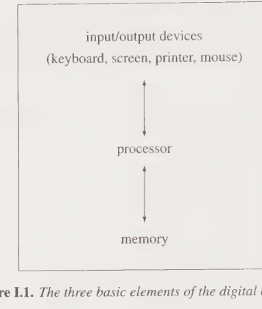

图 I.1. 数字计算机的三个基本元素。

即使是最强大的计算机，在通过输入设备接收要执行的程序之前也是无用的。此外，即使计算机已求解问题，解决方案在通过输出设备传回用户之前也是无用的。因此，I/O 设备与内存或处理器一样重要。

现代计算机使用与原始数字计算机相同的原理和基本元素。特别是，它们在运行之前需要用自己的语言编写程序。

在本部分中，我们讨论编程：用计算机自己的语言编写算法的艺术。当前的示例属于偏微分方程（PDEs）求解的数值算法领域。该领域的问题虽然在多项式时间内可计算，但需要相当复杂的算法和实现，适合说明高级编程技术。

编程是在所谓的<|message|>


执行算法的主要指令块位于最高层级。该块中的每条指令都可能调用较低层级的另一个块，而该块又会调用更低层级的块，依此类推。

模块化程序更易于调试。错误（Bug）是程序员犯下的错误，导致算法不同，从而产生错误的输出。在大型程序中，错误尤其难以定位。函数层次结构在此处可能很有用：首先，通过反复运行程序并比较该段中每条指令执行前后的数据，将错误定位在层次结构的最高层级（即实际执行算法的代码段）中。该段中存在错误的指令通常会调用另一个函数：然后，通过递归地重复相同的过程来调试该函数的代码块，等等，直到最终找到错误。

某些编程语言（如 Fortran）在某种程度上结构过于僵化，这意味着内存必须在编译时预先分配。（当我们在这本书中提到 Fortran 时，我们指的是通用的 77 版本；较新的版本确实支持一些面向对象特性，但它们似乎出现得太晚了，因为大多数人已经转向了更自然的面向对象语言，如 C++。）这一要求是不理想的，因为在许多应用程序中，所需的内存量直到运行时才知晓。更灵活的编程语言（如 C 和 C++）也支持运行时的动态内存分配。这一特性最为重要，因为它允许递归：函数可以递归调用自身，而数据仅在运行时指定，内存也仅在运行时分配。

C++ 编程语言建立在 C 之上；也就是说，C++ 可以使用 C 中可用的所有命令、类型和结构。此外，C++ 还可以定义新对象和相关函数。这些对象随后可以像标准类型一样被使用，这在复杂算法的实现中最为有用。

对象是可以进行操作的一种抽象概念。在 C 中，只使用数值对象，如整数或实数；它们可以作为输入参数传递给函数并作为输出返回。另一方面，在 C++ 中，程序员可以构建更复杂的对象（以及表达其属性的自身函数），并在后续代码中使用它们。

因此，C++ 被视为一种面向对象的语言，它关注的是对象及其完整实现，而不是使用它们的算法和函数。在 C++ 中，程序员不仅实现算法，还实现自己的对象，这些对象可用于许多算法和应用程序。这种方法称为面向对象编程。

这部分包含三章。前两章描述 C 和 C++ 语言，假设读者没有任何先前的知识。第三章实现了数值算法中经常使用的数据结构。

## 本书中的代码段

本书中的代码段均已完全调试和测试。它们使用标准 GNU 编译器（版本 3.2 或更早版本）进行编译。（更高版本可能需要一些微小改动，如下文所述。）在 UNIX 操作系统上，通过以下命令调用此编译器

```
>> g++32 program.cxx
>> a.out
```

## 第 1 章

### C 语言简明介绍

C++ 建立在 C 之上，因此 C 的所有特性在 C++ 中也可用。这就是为什么我们从对 C 的简明描述开始。具体来说，我们展示了如何编写逻辑“if”条件、循环和函数。我们以几个使用数值应用程序中递归的例子结束本章，递归是书中经常使用的特性。

#### 1.1 变量和类型

C 程序是一系列命令或给计算机的指令。通常，一条命令写在一行代码中；然而，长命令可以延伸到两行甚至更多行代码。每条命令必须以字符 ';' 结尾。

最基本的命令是定义变量。该命令包含两个字符串，用于指定变量的类型和名称。计算机通过为变量分配足够的内存来执行此命令。然后可以通过变量名访问这部分内存。

因此，变量只是计算机内存中的一个位置，具有足够的空间来存储指定其值的信息，通常是整数或实数类型。例如，如果在 C 程序中编写

```
int i;
float a;
double x;
char c;
```

则内存中的位置变得可用于存储整数、实数、双精度实数和字符，分别对应。

整数变量可以取任何整数值，无论是负数、正数还是零。“float”和“double”变量都可以取任何实数值。字符变量只能取 0 到 255 之间的非负整数值。这些潜在值中的每一个代表键盘上的一个字符，如英文字母（小写或大写）、数字、算术符号或其他特殊字符。

#### 1.2 赋值

变量通过其名称被引用（在上例中为 'i'、'a'、'x' 或 'c'）。最初，它们被赋予随机的、无意义的值。之后可以赋予有意义的值，例如

```
i = 0;
a = 0.;
x = 0.;
c = 'A';
```

请注意，'0' 代表整数零，而 "0." 代表实数零。

C 中的一个命令实际上是一个函数，它不仅执行指令，还返回一个值。特别是，上面使用的赋值运算符 '=' 不仅将值分配给特定变量，还将分配的值作为输出返回。该属性可以如下使用：

```
x = a = i = 0;
```

此命令从右向左执行。首先，整数值 0 被分配给变量 i。此分配还返回分配的值 0，该值隐式转换为实数 0. 并分配给变量 a。此分配还返回（单精度）实数 0.，该值隐式转换为（双精度）实数 0. 并分配给变量 x。因此，上述命令等同于三个赋值命令。

#### 1.3 初始化

实际上，可以通过在定义时以所需值初始化变量来避免上述赋值：

```
int i = 0;
float a = 0.;
double x = 0.;
char c = 'A';
```

这里，'=' 符号的含义不再是之前那样对现有变量的赋值，而是立即用正确值初始化新变量。

与赋值不同，初始化不返回值，因此无法编写

```
double x = double y = 0.;  /* 错误！ */
```

这里，字符 "/*" 表示注释的开始，以字符 "*/" 结束。这样的注释被 C 编译器忽略。（C++ 有另一种形式的注释：字符 "//" 表示注释行的开始，被 C++ 编译器忽略。）

通常，注释用于简要说明代码的功能。然而，在这里，注释用于警告我们代码是错误的。确实，因为右侧的初始化 "double y = 0." 不返回值，所以不能用于初始化左侧的 'x'。

#### 1.4 转换

我们在上面看到，从函数返回的值可以隐式转换为分配给某些变量所需的类型。这里我们看到，变量也可以显式转换为另一种类型。转换实际上从不改变变量；它只返回其值，并带有所需的类型。虽然“转换”是一个不准确的术语，但它常用于指示返回值中的类型更改。

下面是显式转换的使用方式：

```
i = 5;
 x = (double)i;  /* 或：double(i) */
 i = (int)3.4;   /* 或：int(3.4) */
```

这里，‘i’ 是整数变量并保持不变，‘x’ 是 "double" 变量并保持不变。‘i’ 前的前缀 "(double)" 表示一个函数，它返回 ‘i’ 中的值，并将其转换为 "double" 类型。在上面的例子中，‘i’ 中的整数值 5 在分配给 "double" 变量 ‘x’ 之前被转换为 5.。然后，实数 3.4 前的前缀 "(int)" 将其截断并转换为整数 3，然后分配给整数变量 ‘i’。

上述代码中使用的显式转换实际上是不必要的。即使没有前缀 "(double)" 和 "(int)"，也会产生完全相同的结果。这是因为当 C 编译器遇到赋值时，它会隐式地将分配的值转换为正确的类型。

#### 1.5 算术运算

C 编译器还支持标准二元算术运算：乘法（由 ‘*’ 表示）、除法（‘/’）、加法（‘+’）和减法（‘−’）。它还支持一元正（‘+’）和负（‘−’）运算符。这些算术运算符实际上是两个（或一个）变量的函数，返回与参数相同类型的结果。例如，C 编译器调用整数乘以整数版本的乘法运算符来乘以整数 i 和 j 并产生整数结果 ij，并调用 "float" 乘以 "float" 版本来乘以 float 变量 a 和 b 并产生 "float" 结果 ab。

如果不同变量的变量相互乘积，则较低类型的变量在乘法发生前会隐式转换为较高类型。例如，为了计算乘积 "j*b"（其中 ‘j’ 是整数，‘b’ 是 "float"），‘j’ 中的值首先隐式转换为 "float"，然后与 ‘b’ 相乘。

算术运算按照标准的优先级顺序执行：乘法和除法具有相同的优先级，且优先于取模运算符（%），其


#### 1.5 算术运算符（由上下文推断）

`returns`（可能是 `remainder` 或类似，文本中写为“返回余数”）在整数除法中。取模运算符的优先级高于加法和减法，而加法和减法具有相同的优先级。

相同优先级的运算按书写顺序（从左到右）执行。例如，1 + 8/4*2 的计算如下。首先，调用除法运算符计算 8/4 = 2。然后，调用乘法运算符计算 2*2 = 4。最后，调用加法运算符计算 1 + 4 = 5。（如果需要，可以使用括号来改变此顺序。）

整数除法带余数，且该余数可通过取模运算符获得，记为 ‘%’。例如，10/3 的结果为 3，而 10%3 的余数为 1。

为方便起见，算术符号通常与参数之间用空白分隔。例如，“a + b” 与 “a+b” 相同，但更易读。然而在使用乘法时，必须注意对称地使用空白。例如，“a * b” 和 “a*b” 都表示 ‘a’ 乘以 ‘b’，但 “a *b” 和 “a* b” 表示完全不同的含义，与乘法无关。

算术运算的结果，以及任何其他函数返回的值，都存储在一个在当前命令结束前没有名称的临时变量中。因此，返回的值只能在当前命令中使用，在此之前它就会无迹可寻地消失。如果需要更长时间使用返回的值，则必须通过赋值或初始化将其存储到一个正确定义的变量中。

C 编译器还支持一些特殊的算术运算：

```c
x += 1.;
x -= 1.;
x *= 1.;
x /= 1.;
++i;
--i;
i++;
i--;
```

这些运算等同于

```c
x = x + 1.;
x = x - 1.;
x = x * 1.;
x = x / 1.;
i = i + 1;
i = i - 1;
i = i + 1;
i = i - 1;
```

（分别对应）。在上述情况中，首先使用 ‘x’ 或 ‘i’ 的旧值执行右侧的算术运算，并将结果存储到一个临时、无名的变量中。然后，将该值重新赋给 ‘x’ 或 ‘i’ 以更新其值，并销毁临时变量。

“+=”、“-=”、“*=” 和 “/=” 运算符实际上是函数，它们不仅改变第一个参数（左侧的变量），还将新的（更新后）值作为输出返回。此特性用于以下命令中：

```c
a = x += 1;
j = ++i;
j = --i;
```

在每个命令中，首先执行右侧的运算以更新 ‘x’ 或 ‘i’ 的值并将其作为输出返回。然后将此输出赋给左侧的 ‘a’ 或 ‘j’。

只有在使用一元运算符 “++” 和 “--” 时，才可以选择通过编写以下代码将 ‘i’ 的旧值赋给 ‘j’

```c
j = i++;
j = i--;
```

#### 1.6 函数

上述赋值和算术运算实际上是内置于 C 语言的函数。然而，程序员并不限于这些函数；他们也可以编写自己的函数。

C 语言中编写的函数具有标准格式。在函数的第一行代码（即函数头）中，首先出现返回值的类型（也称为函数类型）。如果未指定类型，则假定函数返回整数。函数也可以是 “void” 类型，表示它不返回值。

函数头中的第二个词是函数名，由程序员指定。函数就是通过此名称被调用（或 invoked）。

函数名后面跟着包含函数所取参数列表的括号，参数之间用逗号分隔，并在前面加上其类型。这就完成了函数头。

函数头后面是函数块，它以 ‘{’ 开始，以 ‘}’ 结束，并包含在调用时要执行的指令列表。良好的做法是将关闭块的 ‘}’ 符号写在函数头第一个字符的正下方（即写在以 ‘{’ 符号结尾的那行的开头下方），然后将块的主体写在这些符号之间的行中，向右缩进两个空格。这样就不太可能忘记关闭块。以下是一个简单示例：

```c
int add(int i, int j){
    return i+j;
}
```

此代码定义了一个名为 “add()” 的函数，它返回两个整数的和。由于和也是整数，因此函数类型也是整数，正如函数名前面的保留字 “int” 所指示的那样。函数体中相加的整数 ‘i’ 和 ‘j’ 被称为局部（或虚拟）参数（或变量），因为它们仅存在于函数块内，并在函数终止后消失。局部参数用在实际调用函数时传递给函数的相应具体参数的值进行初始化。

以保留字 “return” 开始的命令创建一个无名变量来存储函数返回的值。该变量的类型在函数头的第一个词中指定（上述示例中的 “int”）。这个新变量是临时的：它仅存在于函数实际被调用的命令行中，并在不久后消失。

“return” 命令还终止函数的执行，无论是否已到达函数块的末尾。因此，即使是类型为 “void” 且不返回值的函数，也可以使用 “return” 命令在需要时停止执行。在这种情况下，“return” 命令后面不跟任何值，因为没有返回值。

当 C 编译器遇到函数定义时，它会创建一个有限状态机或自动机（一个接收输入并执行命令以产生输出的过程），该自动机以机器语言实现函数。此自动机具有输入线用于接收具体参数，以及输出线用于返回值。当编译器遇到对函数的调用时，它会将此次调用中使用的具体参数作为输入传递给自动机并调用它。因此，自动机在函数块编译时一次性生成，可以在对函数的多次调用中使用，无需重新编译。

以下是如何调用函数 “add()”：

```c
int k=3, m=5, n;
n = add(k,m);
```

这里 ‘k’ 和 ‘m’ 是已定义且已初始化的整数变量，作为具体参数传递给函数。调用函数时，其局部参数 ‘i’ 和 ‘j’ 被初始化为与 ‘k’ 和 ‘m’ 相同的值。然后 “add()” 函数计算其局部变量 ‘i’ 和 ‘j’ 的和，这实际上是 ‘k’ 和 ‘m’ 所需的和。此和必须赋给已定义的变量 ‘n’，否则它将无迹可寻地消失。

“add()” 函数也可以如下调用：

```c
int i=3, j=5, n;
n = add(i,j);
```

此代码中的整数变量 ‘i’ 和 ‘j’ 与 “add()” 函数定义中的局部变量不同。事实上，它们是已定义的变量，在函数调用之前、期间和之后都存在。这些外部变量作为具体参数传递给函数，其值用于初始化局部变量。这些局部变量虽然与外部变量同名，但与它们完全不同：它们仅存在于函数块内，并在函数结束时消失。因此，名称 ‘i’ 和 ‘j’ 没有歧义：在调用函数的代码中，它们指的是作为具体参数传递的外部变量，而在函数块中，它们指的是局部变量。因此，允许并且确实推荐为外部变量和局部变量使用相同的名称，如后者代码所示，以反映它们在计算和的数学公式中扮演相同角色的事实。

#### 1.7 打印输出

每个 C 程序都必须包含一个名为 “main()” 的函数。程序运行时会执行此函数中的命令。“main()” 函数返回一个整数值，在当前程序中从未使用，例如 0。


在本节中，我们展示了一个简短的程序，该程序执行几个算术运算并将结果打印到屏幕上。程序开头的“include”指令提供了对支持数据读写操作的标准 I/O 库的访问。特别是，它允许调用“printf()”函数将输出打印到屏幕上。

“printf()”函数需要几个参数。第一个参数是要打印到屏幕上的字符串。该字符串用双引号括起来，通常以字符“\n”结尾，其含义是“行尾”。该字符串还可以包含符号“%d”（整数）或“%f”（实数）。这些数值由传递给“printf()”函数的其余参数指定。

在下面的程序中，“printf()”函数被用于展示整数除法和实数除法之间的区别。首先，它打印整数除法 10/3 的结果和余数。然后，它打印实数除法 10./3 的结果，其中整数 3 在被用于除以实数 10. 之前被隐式转换为实数 3.：
```
#include<stdio.h>
int main(){
    printf("10/3=%d,10 mod 3=%d,10./3.=%f\n",10/3,10%3,10./3);
    return 0;
}
```

由于赋值运算符实际上也是一个返回赋值结果值的函数，因此以下写法是合法的：
```
int i;
printf("10/3=%d.\n",i = 10/3);
```
这里，赋值“i = 10/3”的输出，实际上就是 3，被打印到了屏幕上。另一方面，初始化不返回任何值。因此，以下写法是非法的：
```
printf("10/3=%d.\n",int i = 10/3);
    /* 错误！！！没有返回值 */
```

下面是一个在后续部分中经常使用的简单用户自定义函数。该函数只是将一个“double”变量打印到屏幕上：
```
void print(double d){
    printf("%f; ",d);
} /* 打印一个 double 变量 */
```

使用这个函数，只需编写“print(x)”即可简单地打印“double”变量 'x'。

#### 1.8 条件

所有编程语言都支持逻辑“if”判断。这意味着，如果满足某个条件，则指示计算机执行一项操作；如果条件不满足，则指示计算机执行另一项操作。C 语言以两种可能的方式支持逻辑“if”。第一种方式仅限于确定某个特定变量的值。有两种可能的值；根据条件是否满足来选择其中之一。例如：
```
double a = 3., b = 5.;
double max = a > b ? a : b;
```
这里，“double”变量“max”通过“? :”运算符返回的值进行初始化。根据问号前的条件，该运算符可能返回两个可能的值。如果条件成立（'a' 确实大于 'b'），则返回问号右侧出现的值（例如上面的 'a'）并用于初始化“max”。否则，使用冒号“:”后面出现的值（例如上面的 'b'）。

上述示例中的条件“a > b”也可以被视为一个整数，当且仅当 'a' 确实大于 'b' 时，它取非零值。事实上，“>”符号代表一个函数，当且仅当其第一个参数确实大于第二个参数时，它返回一个非零值（比如 1）。从“>”运算符返回的值（传递给“? :”运算符以决定其结果）在上述代码中只是临时存储。然而，更合适的做法是在将其传递给“? :”运算符之前，将其存储在一个定义明确的整数变量中：
```
double a = 3., b = 5.;
int condition = a > b;
double max = condition ? a : b;
```
“? :”运算符实际上是一个三参数函数。第一个参数（上述例子中的“condition”）是一个整数。第二个和第三个参数是潜在的结果 'a' 和 'b'，它们由“:”符号分隔。该运算符根据第一个参数“condition”的值，返回 'a' 或 'b'。

上述条件中使用的“>”运算符，当且仅当其第一个参数大于第二个参数时返回非零值。另一方面，“<”运算符，当且仅当其第一个参数小于第二个参数时返回非零值。此外，“==”运算符当且仅当它的两个参数相等时返回非零值：“a == b”当且仅当 'a' 和 'b' 确实相同时取非零值。反之，“a != b”当且仅当 'a' 和 'b' 不相同时取非零值。

请注意，单个“=”字符与字符串“==”的含义完全不同。确实，“=”表示赋值，而“==”是检查两个数是否相等的逻辑运算符。

逻辑运算符“非”、“与”和“或”也可用。特别是，符号“!”代表一元“非”运算符：“!cond”当且仅当整数“cond”为零时非零。此外，符号“&&”代表逻辑“与”：“cond1 && cond2”当且仅当整数“cond1”和“cond2”都非零时非零。最后，符号“||”代表逻辑“或”：“cond1 || cond2”当且仅当“cond1”和“cond2”都为零时为零。

这些逻辑运算符的优先级顺序是通常的：“&&”优先于“||”，“!”优先于“&&”。（可以使用括号来改变这些优先级。）

在 C 中给出条件指令的第二种方式是通过“if-else”格式（见图 1.1）。例如，上述代码也可以实现为：
```
double a = 3., b = 5.;
int condition = a > b;
double max, min;
```
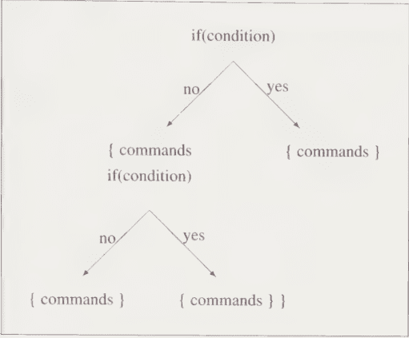

> **图 1.1. 一个 if-else 结构。** 首先检查顶部的条件。如果条件成立，则执行右侧的命令。如果不成立，则执行左侧的命令，包括另一个 if-else 判断。
```
if(condition)
    max = a;
else
    max = b;
```
在此代码中，如果整数“condition”非零，则执行紧随“if”判断之后的指令。否则，执行紧随“else”之后的指令。“else”部分是可选的；如果缺少它，那么当“condition”为零时，什么也不做。

#### 1.9 重载函数和变量作用域

if-else 格式比“?:”格式更通用，因为它不仅允许条件值，还允许条件指令甚至指令列表。事实上，“if”判断后面可以跟随一个指令块（“if”块），在条件成立时执行；而“else”后面可以跟随一个完全不同的指令块（“else”块），在条件不成立时执行。然而，必须记住，在块内定义的变量仅存在于该块中，并在该块结束时消失。例如，在以下代码中，“if”和“else”块内部定义了无用的局部变量：
```
double a = 3., b = 5.;
if(a>b){
    double max = a; /* 糟糕的编程！！！ */
    double min = b;/*  局部变量   */
}
```
```
else{
	double max = b; /* 糟糕的编程！！！ */
	double min = a; /* 局部变量 */
}
```
这段代码完全无用：由于变量仅存在于定义它的块中，变量“max”和“min”在 if-else 块结束后就不再存在。正确的实现如下：
```
double a = 3., b = 5., max, min;
int condition = a > b;
if(condition) {
	max = a; /* 好的编程！！！ */
	min = b;
}
else{
	max = b;
	min = a;
}
```
这里，变量“max”和“min”在第一行代码中定义，位于 if-else 块开始之前，因此在这些块结束后它们仍然存在，并可进一步使用。

上述变量“min”和“max”分别包含两个变量 'a' 和 'b' 的最小值和最大值。更好的想法是定义返回参数最小值和最大值的函数。以下函数接受整数参数并计算它们的最小值和最大值：
```
int max(int a, int b){
	return a>b ? a : b;
} /* 两个整数的最大值 */
```
```
int min(int a, int b){
	return a<b ? a : b;
} /* 两个整数的最小值 */
```
这里，局部变量 'a' 和 'b' 仅存在于定义它们所在的函数块中。函数实际上是用在调用函数之前、期间和之后都存在的具体参数调用的。这些具体变量的名称不一定是 'a' 和 'b'。例如，“min(c,d)”返回某个外部整数变量 'c' 和 'd' 的最小值。然而，使用与对应形参同名具体实参是个好主意。例如，“min(a,b)”返回外部变量 'a' 和 'b' 的最小值。

也可以定义接受“double”参数的类似函数：
```
double max(double a, double b){
	return a>b ? a : b;
} /* 实数的最大值 */
```


```c
double min(double a, double b){
    return a<b ? a : b;
} /* 实数的最小值 */
```

这种针对另一种参数类型（或带有额外参数）重新定义原始函数的过程被称为重载。

当调用“max()”或“min()”函数时，编译器会调用与调用时使用的具体参数类型相匹配的版本。如果具体参数类型为“int”，则调用“int”版本。另一方面，如果具体参数类型为“double”，则调用“double”版本。

另一个实用函数用于返回实数的绝对值：

```c
double abs(double d){
    return d > 0. ? d : -d;
} /* 绝对值 */
```

实际上，该函数在标准“math.h”库中可用，名称略有不同，为“fabs()”。

#### 1.10 循环

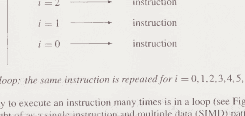

图 1.2. 循环：对于 i = 0,1,2,3,4,5,6，同一条指令被重复执行（SIMD）。

执行指令多次的最佳方式是使用循环（见图 1.2）。循环可以被视为单指令流多数据流（SIMD）模式，其中同一指令使用不同的数据被反复执行。循环中使用的数据通常由循环索引指示，例如 'i'。例如，如果希望将 1 到 100 的整数打印到屏幕上（每个数占一行），则可以编写如下代码：

```c
int i = 1;
while(i<=100){
    printf("%d\n", i);
    i++;
}
```

上述“while”命令由两部分组成：包含在括号中的条件（头部），以及被反复执行的指令或指令块。只要条件成立，该指令或指令块就会被反复执行。在上面的例子中，指令块包含两条指令：打印 'i' 并将其递增 1。这些命令在“i”不大于 100 期间执行。一旦“i”达到值 101，条件不再成立，循环终止，执行流程继续到“while”块之后的代码行。

实际上，由于“i++”返回“i”在被递增之前的旧值，上述“while”块可以简化为仅一条命令：

```c
int i = 1;
while(i<=100)
    printf("%d\n", i++);
```

上述“while”循环也可以写成一个“do-while”循环：

```c
int i = 1;
do
    printf("%d\n", i++);
while(i<=100);
```

这只是风格不同；该循环与之前使用的“while”循环等价。使用“for”循环也可以产生相同的结果，如下所示：

```c
int i;
for(i=1;i<=100;i++)
    printf("%d\n", i);
```

在“for”行的头部中，有三个由';'字符分隔的项目。第一个指定循环开始时索引'i'的初始值。第二个指定是否执行指令（或指令块）或跳过它并退出循环的条件。最后，第三个项目指定每次循环重复时应进行何种更改：在这里，即'i'应如何变化。在上例中，'i'初始为 1。指令针对此值执行，'i'被打印到屏幕上。然后'i'依次递增 1 并被打印，直到它达到值 101，此时由于条件不再成立，它不再被打印，循环完成。

头部第三项中'i'的更改是在指令已经执行之后发生的。因此，该项目也可以放在指令块的末尾：

```c
int i=1;
for(;i<=100;)
{
    printf("%d\n", i);
    i++;
}
```

这里，只有第二项出现在头部。第一项（初始化）放在循环之前，第三项（更改）放在指令块的末尾。这段代码与前面的代码等价。

头部中的第一项不仅可以用于初始化，还可以实际定义'i'：

```c
for(int i=1;i<=100;i++)
    printf("%d\n",i);
```

这个循环与前面的循环略有不同。虽然它产生与之前相同的结果，即 1 到 100 的整数被打印到屏幕上，但循环终止后'i'不再存在。实际上，'i'是一个局部变量，仅存在于循环内部，在外部不可用。

如果'i'在循环外部从未被使用，那么就没有理由存储它。因此，将其定义为在“for”循环头部定义的局部变量，通常被认为是更好的编程习惯。

#### 1.11 循环示例

这里有一个示例，展示了如何使用循环来计算幂 base^exp，其中“base”是一个整数，“exp”是一个正整数（类型为“unsigned”）：

```c
int power(int base, unsigned exp){
    int result = 1;
    for(int i=0; i<exp; i++)
        result *= base;
    return result;
} /* “base”的“exp”次方 */
```

另一个很好的示例是下面的“log()”函数，它返回 ⌊log₂ n⌋（小于或等于 log₂ n 的最大整数），其中 n 是一个给定的正整数：

```c
int log(int n){
    int log2 = 0;
    while(n>1){
        n /= 2;
        log2++;
    }
    return log2;
} /* 计算 log(n) */
```

循环在阶乘函数的实现中也非常有用，阶乘定义为：

n! = 1·2·3···n,

其中 n 是一个正整数。（阶乘也定义为 0：0! = 1。）实现如下：

```c
int factorial(int n){
    int result = 1;
    for(int i=1; i<=n; i++)
        result *= i;
    return result;
} /* 使用循环计算 n! */
```

跟随循环头部的指令本身可以是一个循环。这种结构被称为嵌套循环（图 1.3）。下面是一个使用嵌套循环打印棋盘图案的程序：

```c
#include<stdio.h>
int main(){
    for(int i=0;i<8;i++){
        for(int j=0;j<8;j++)
            printf("%c ",((i+j)%2)?'*':'o');
        printf("\n");
    }
    return 0;
} /* 打印棋盘图案 */
```

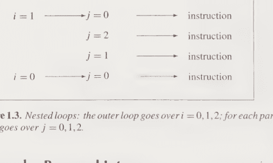

图 1.3. 嵌套循环：外层循环遍历 i = 0, 1, 2；对于每个特定的 i，内层循环遍历 j = 0, 1, 2。

#### 1.12 示例：反转整数

这里展示如何在一个函数中使用循环来反转任意长度整数的数字顺序。例如，对于具体参数 123，它返回输出 321：

```c
int reversed(int number){
    int result=0;
    while (number){
        result *= 10;
        result += number % 10;
        number /= 10;
    }
    return result;
} /* 反转整数 */
```

该函数可以按以下方式调用：

```c
int n = 778;
int m = reversed(n);
```

此调用将'm'初始化为值 877。另一方面，变量'n'在此调用中从未被改变，其值保持为 778。确实，“reversed()”函数创建了自己的具体参数'n'的本地副本。只有这个副本在函数执行期间被改变，而不是原始变量'n'。

上述生成的反转表示是通常的十进制基数。“reversed()”函数可以稍作修改，以产生整数在任何基数下的反转表示。这是通过引入额外参数“base”来表示输出数所用的基数来实现的：

```c
int reversed(int number, int base){
    int result=0;
    while (number){
        result *= 10;
        result += number % base;
        number /= base;
    }
    return result;
} /* 任意基数的反转数 */
```

这个版本对于获取整数的二进制表示很有用。为此，“reversed()”的后一版本被调用两次：第一次获取原始数在基数 2 下的反转表示，第二次反转该表示以获取有序的二进制表示。因此，输出是一个包含与所需二进制表示相同二进制位（0 或 1）的十进制数。

请注意，当“reversed()”的具体参数以零结尾时，这些零会在反转数中丢失。例如，3400 反转为 43。这就是为什么需要给偶数参数'n'加 1 使其变为奇数。这个额外的 1 在函数结束时被减去：

```c
int binary(int n){
    int last = 1;
    if(!(n%2)){
        last = 0;
        n += 1;
    }
    return reversed(reversed(n,2),10) - (1-last);
} /* 二进制表示 */
```


#### 1.13 指针

指针是一种整数变量，它只能包含特定类型变量的地址。例如，指向“双精度浮点数”（pointer-to-"double"）的指针只能包含双精度浮点数变量的地址，指向整数的指针只能包含整型变量的地址，依此类推。我们说指针“指向”其内部存储了地址的那个变量。以下是指针的定义方式：

```
double *p;
int *q;
```

在这里，‘*’ 并不代表乘法，而是代表解引用。解引用运算符应用于指针，返回其内容，即它所指向的变量。在上述代码中，‘p’ 的内容被定义为“双精度浮点数”（因此 ‘p’ 被定义为指向“双精度浮点数”的指针），‘q’ 的内容被定义为整型（因此 ‘q’ 被定义为指向整数的指针）。因此，‘*’ 也可以被视为符号 ‘←’："double" ←*p（‘p’ 指向一个 "double"）和 "int" ←*q（‘q’ 指向一个 "int"）。

‘*’ 符号也可以向左移动一个空格，而代码的含义不变：

```
double* p;
int* q;
char* w;
```

在这种风格中，"double*" 是指向"double"的指针类型，"int*" 是指向整数的指针类型。类似地，"char*" 是指向字符的指针类型，等等。

由于上述的 ‘p’ 和 ‘q’ 未被初始化，它们初始值为零，这意味着它们不指向任何内容。

还可以定义指向常量变量的指针：

```
const int* p;
```

在这里，‘p’ 的内容是一个常量整数，换句话说，‘p’ 指向一个常量整数。因此，一旦 ‘p’ 的内容被初始化为某个值，在 ‘p’ 定义的作用域内，它将永远不会改变。出于这个原因，‘p’ 永远不能被赋值给指向非常量整数的指针，也不能用于初始化此类指针。确实，‘p’ 包含的是常量整数的地址。如果写

```
int* q = p;  /* 错误!!! p 指向只读整数 */
```

那么新指针 ‘q’ 将包含相同的地址。然而，该地址处的变量可能会意外地通过 ‘q’ 发生改变，这违反了它必须是常量的事实，因为 ‘p’ 也指向它。因此，编译器将拒绝将 ‘p’ 中的地址赋值给 ‘q’，并会产生编译错误。

如上所述，解引用运算符 ‘*’ 应用于指针并返回其内容。取地址运算符 ‘&’ 以相反的方式工作：它应用于变量并返回其地址：

```
double* p;
double v;
p = &v;
```

在这里，‘v’ 的地址被赋值给指针 ‘p’。取地址和解引用运算符在后续内容中经常被使用。

#### 1.14 数组

在 C 语言中，数组实际上是指向长序列中第一个变量的指针，这些变量具有相同的类型并连续放置在计算机内存中。例如，命令

```
double a[10];
```

定义了一个包含 10 个“双精度浮点数”类型变量的数组，这些变量被分配连续的内存，并被称为 ‘a’ 的元素或 "a[0]"、"a[1]"、...、"a[9]"。这些变量对应的地址分别是 ‘a’、"a+1"、...、"a+9"。

在上面的例子中，我们看到了一个元素为"双精度浮点数"变量的数组。不可能定义元素为混合类型的数组。不过，可以定义元素本身也是数组的数组，前提是它们的大小相同。这种结构被称为二维数组。例如，可以定义一个包含五个元素的数组，其中每个元素本身是一个包含十个“双精度浮点数”元素的数组，定义如下：

```
double a[5][10];
```

此数组中的"双精度浮点数"变量在计算机内存中按行排列。更具体地说，先存储第一行 "a[0][0]"、"a[0][1]"、...、"a[0][9]"，然后存储第二行 "a[1][0]"、"a[1][1]"、...、"a[1][9]"，依此类推。当使用嵌套循环扫描数组时，使用此顺序是最有效的：外层循环通过递增二维数组的第一个索引从一行跳到下一行，而内层循环通过递增第二个索引扫描单行。这样，数组中的变量将按照它们在计算机内存中的物理顺序被扫描，从而提高效率。

在上面的二维数组中，‘a’ 指向第一个"双精度浮点数"变量，即 "a[0][0]"。更一般地，"a+10*i+j" 指向"双精度浮点数"变量 "a[i][j]"，其中 0 ≤ i < 5，0 ≤ j < 10。

当二维数组的大小在编译时未知时，它仍然可以被定义为一个指向双精度浮点数指针的指针：

```
double** a;
```

一旦在运行时确定了数组的大小并分配了所需的内存，指向指针的指针 ‘a’ 就变成了数组的数组或二维数组 "a[i][j]"。

#### 1.15 向函数传递参数

如上所述，程序员可以定义自己的函数。在本节中，我们将研究向此类函数传递参数的策略。

让我们从一个简单的函数开始，该函数接受一个整数参数并返回其值加一：

```
int addOne(int i){
    return ++i;
} /* 返回值加一 */
```

然而，参数本身保持不变。例如，如果函数被调用为

```
int main(){
    int k=0;
    addOne(k);  /* k 保持不变 */
```

那么 'k' 的值保持为零。这是因为 'k' 是按值（或按名称）传递给函数的。换句话说，当使用 'k' 作为具体参数调用函数时，会定义一个名为 'i' 的局部整型变量，并将其初始化为与 'k' 相同的值。在函数执行过程中，只有 'i' 发生变化，而 'k' 不会改变。

只有当具体参数是按地址而非按值传递时，才能被更改：

```
int addOne(int *q){
    return ++(*q);
} /* 加一 */
```

```
int main(){
    int k=0;
    addOne(&k);  /* k 确实增加了一 */
```

这样，"addOne" 函数接受的是指向整数的指针类型的参数，而不是整型参数。当被调用时，该函数将此指针的内容加一，这种实际的影响在函数终止后依然有效。

在调用 "addOne(&k)" 时，'k' 的地址作为具体参数被传递。函数随后创建一个名为 'q' 的局部变量，类型为指向整数的指针，并用 'k' 的地址进行初始化。然后，通过 'q' 中的 'k' 的地址对 'k' 进行递增。虽然 'q' 在函数终止时被销毁，但对 'k' 的影响如预期般保持有效。

#### 1.16 输入/输出

到目前为止，我们使用了标准的 "printf" 函数，它向屏幕打印字符串。在下面的代码中，我们也使用了标准的 "scanf" 函数，它从屏幕读取字符串。"scanf" 函数的第一个参数是该字符串：其余参数是将数字放入的变量的地址。这些参数必须按地址传递，以便它们存储被读入的值：

```
#include<stdio.h>
#include<stdlib.h>
int main(){
    int i=0;
    double x=0.;
    scanf("%d %f\n",&i,&x);
    printf("i=%d, x=%f\n",i,x);
```

也可以使用从文件或向文件读写（而非屏幕）的标准函数："fscanf" 和 "fprintf" 函数。为此，必须先访问文件并拥有引用它的方式。"fopen" 标准函数打开一个文件并返回其地址。此地址存储在一个名为 "fp" 的变量中，该变量的类型为指向文件的指针或 "FILE*"，其中 "FILE" 是文件变量的保留字。

"fopen" 函数接受两个字符串参数：第一个是正在打开的文件名，第二个是 'r'（如果文件用于读取）或 'w'（如果文件用于写入）：

```
FILE* fp = fopen("readFile","r");
fscanf(fp,"%d %f\n",&i,&x);
```

指向文件的指针 "fp"（包含文件的地址）现在被传递给 "fscanf" 函数作为其第一个参数。换句话说，具体文件是按地址传递的。"fscanf" 函数的工作方式与 "scanf" 相同，除了它从文件而不是屏幕读取。在本例中，数据从名为 "readFile" 的文件读取，该文件存储在程序运行的目录中。

接下来，打开另一个文件以向其打印。然后该文件按地址传递给 "fprintf" 函数：

```
fp = fopen("writeFile","w");
fprintf(fp,"i=%d, x=%f\n",i,x);
return 0;
}
```

在这个例子中，数据被打印到名为 "writeFile" 的文件，该文件存储在程序运行的目录中。

#### 1.17 递归

递归是一种过程，其中函数在其自身的定义中被调用。递归调用可以使用新的数据结构，这些数据结构必须在运行时分配额外的内存。因此，递归不能用于需要编译时内存分配的结构化编程语言，如 Fortran。另一方面，C 允许运行时内存分配并支持递归。

这里有一个简单的例子，展示了递归的实用性。第 1.11 节中的 "power" 函数可以递归地编写如下：

```
int power(int base, unsigned exp){
    return exp ? base * power(base,exp-1) : 1;
} /* "base" 的 "exp" 次方（带递归） */
```

这种实现实际上使用了公式

base^exp = base · base^(exp−1)。

确实，"power" 函数的定义使用了对自身的调用。当计算机在运行时遇到此调用时，它使用 "power" 函数的定义


函数来完成它。在此递归调用中，计算机自动为参数和返回值分配所需的内存。

递归调用本身可以使用具有更小参数“exp”的进一步递归调用。这种嵌套过程一直持续到达到最终的递归调用，该调用使用零“exp”参数，在这种情况下，不再进行进一步的递归调用。

为参数和输出额外分配的内存使得上述“power”函数的递归实现比原始实现效率更低。然而，当实现大型复杂对象时，这种开销可以忽略不计。递归在复杂的非结构化应用中非常宝贵，正如我们稍后会看到的那样。

接下来，我们使用递归按如下方式重写第 1.11 节中的“log()”函数：

```
int log(int n){
    return n>1 ? log(n/2)+1 : 0;
} /* compute log(n) recursively */
```

第 1.11 节中的“factorial”函数也可以使用递归最优雅地实现。此实现使用阶乘函数的定义：

n! = { 1 if n = 0, n(n-1)! if n > 0. }

此递归（或归纳）定义用于以下代码中：

```
int factorial(int n){
    return n>1 ? n * factorial(n-1) : 1;
} /* compute n! using recursion */
```

同样，由于每次递归调用中为参数和输出额外分配内存，此实现可能比第 1.11 节中的原始实现效率稍低一些。尽管如此，它特别简短而优雅，并且遵循了上述数学定义的精神。

这里是另一个与阶乘函数有关的例子。对于任意数 a 和非负整数 n，定义

C(a,n) ≡ a(a-1)(a-2)⋯(a-(n-1)) = { 1 if n = 0, a C(a-1,n-1) if n ≥ 1. }

特别是，如果 a 是非负整数，则

C(a,n) = { a! / (a-n)! if a ≥ n, 0 if a < n. }

以下是此函数的递归实现：

```
int C(int a, int n){
    return n ? a * C(a-1,n-1) : 1;
} /* a!/(a-n)! */
```

#### 1.18 示例：二进制表示

这里我们展示如何使用递归计算并打印非负整数 n 的二进制表示。此表示的数学定义为

n = Σ_{i=0}^{⌈log₂ n⌉} a_i 2^i

其中 a_i 为 0 或 1。使用循环实现此公式并不容易；事实上，在第 1.12 节的代码中，系数 a_i 的序列必须先反转再反转，才能获得二进制表示。相比之下，递归以正确的顺序给出所需的二进制表示。实际上，递归基于一个更直接、更有用的公式：

n = 2(n/2) + (n%2)

其中 n/2 表示带余数的整数除法，而 n%2 包含余数。此公式导致以下函数，该函数打印非负整数的二进制表示：

```
void printBinary(int n){
    if(n>1) printBinary(n/2);
    printf("%d",n%2);
} /* print binary representation */
```

这里，首先通过递归调用将 n/2 的二进制表示打印到屏幕上，然后紧接着打印最后的二进制位 n%2。这确实以正确的顺序打印了 n 的整个二进制表示。

以下函数使用类似的递归重新实现第 1.12 节末尾的“binary()”函数。此函数返回包含与原始数字的二进制表示相同的二进制数字（0 或 1）的十进制数，其顺序正确：

```
int binary(int n){
    return n>1 ? 10*binary(n/2)+n%2 : n%2;
} /* binary representation */
```

显然，此实现比第 1.12 节中的实现更易读且更高效。此函数的输出可以打印到屏幕上

从 i 开始并按某种顺序逐一改变这些 k 位，直到 i 与 j 重合。在此过程中，i 依次按 2 的幂递增或递减，直到达到 j。

有多少条这样的路径？好吧，这取决于对这些 k 位进行排序的不同可能方式的数量。让我们计数：选择要更改的第一个数字有 k 种可能性。对于每种选择，选择要更改的第二个数字有 k − 1 种可能性，依此类推。通过继续此过程，可以得到这些 k 位的 k! 种可能排序。由于每种排序定义了不同的路径，因此从 i 到 j 的路径总数也为 k!。

在从 i 到 j 的有序路径中，上述 k 位按从最低有效位到最高有效位的自然顺序逐一更改。以下函数将此路径打印到屏幕上。如果 i > j，则它会递归调用，并交换 i 和 j：

```
void path(int i, int j){
    if(i <= j){
        int go = i;
        int power = 1;
        int increment = 0;
        printf("%d\n",i);
        while(j){
            if(increment = (j%2 - i%2) * power)
                printf("%d\n", go += increment);
            i /= 2;
            j /= 2;
            power *= 2;
        }
    }
    else
        path(j,i);
} /* well-ordered path from i to j */
```

#### 1.19 示例：帕斯卡三角形

一个使用二维数组和嵌套循环的应用的良好例子是帕斯卡三角形。此三角形可以嵌入到正方形网格的左下部分（见图 1.4）。网格中的每个单元都有一个整数数字的空间。以下我们描述填充帕斯卡三角形单元的规则。

设 i = 0,1,2,… 为行索引（自下而上编号），j = 0,1,2,… 为网格中的列索引（自左而右编号）。假设粒子最初位于原点单元 (0,0)。现在，它开始移动。每次移动中，粒子可以向右或向上前进一个单元。

考虑某个非负整数 k,l 的单元 (k,l)。粒子可以通过多少条不同路径到达 (k,l)？

此问题可递归求解。粒子可以从左侧的 (k,l − 1) 或正下方的 (k − 1,l) 到达 (k,l)。因此，粒子必须先到达这些单元之一，然后才能到达 (k,l)。因此，通向 (k,l) 的不同路径数是通向 (k,l − 1) 的不同路径数加上通向 (k − 1,l) 的不同路径数。

实现此算法以填充帕斯卡三角形的代码使用二维数组和嵌套循环如下：

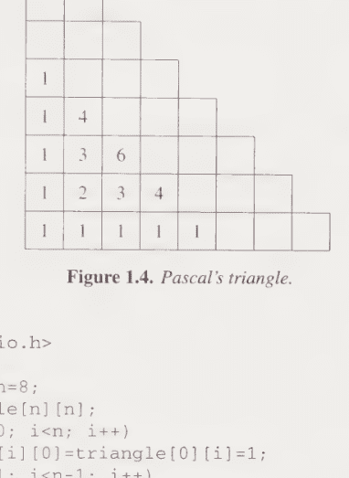

图 1.4. 帕斯卡三角形。

```
#include<stdio.h>
int main(){
    const int n=8;
    int triangle[n][n];
    for(int i=0; i<n; i++)
        triangle[i][0]=triangle[0][i]=1;
    for(int i=1; i<n-1; i++)
        for(int j=1; j<=n-1-i; j++)
            triangle[i][j] = triangle[i-1][j]+triangle[i][j-1];
    return 0;
} /* filling Pascal's triangle */
```

计算从原点单元 (0,0) 到单元 (k,l) 的不同路径数还有另一种公式。显然，到达 (k,l) 所需的总移动次数为 k + l。其中 k 次向上，其余向右。为了关注特定路径，应指定哪些移动是向上的。可以有几种不同的方式来做到这一点？换句话说，可以有几种不同的方式从 k + l 个项目中挑选 k 个项目？答案当然是牛顿二项式系数

$$\binom{k+l}{k}=\frac{(k+l)!}{k!\cdot l!}.$$

事实上，让我们计算从整个 k + l 个项目集中挑选 k 个项目有多少种不同方式。（如果至少有一个项目在一方式中被挑选而在另一方式中未被挑选，则两种方式不同。）第一次挑选有 k + l 个候选；在此基础上，第二次挑选剩下 k + l − 1 个候选，以此类推，直到第 k 次挑选，

此时只剩下 \(l+1\) 个候选。挑选 \(k\) 个项目的不同方式总数是这些数字的乘积，即 \((k+1)!/l!\)。这里，我们只关心 \(k\) 次挑选的最终结果，而不是挑选的顺序。因此，上述计数中存在一些重复。事实上，每个最终结果都被计算了 \(k!\) 次，这是 \(k\) 次挑选可以排序的不同方式的总数。因此，挑选 \(k\) 个项目的真正不同方式的总数确实是 \((k+1)!/(k!l!)\)。

然而，二项式系数的直接计算由于乘法次数众多而相当昂贵。上述代码提供了一种计算和存储它们更有效的方法。二项式系数将在以下几个应用中使用。

#### 1.20 示例：局部最大值

这里我们使用循环和递归实现寻找给定函数局部最大值的算法。然后循环与递归的优缺点就显而易见了。

问题是找到函数 \(f(x)\) 在区间 \([a,b]\) 上的局部最大值。解 \(x\) 需要的精度为，例如，小数点后六位。

二分算法迭代地解决此问题。由于所需的解在区间 \([a,b]\) 中，如果我们用更小的区间替换此原始区间会有所帮助。通过重复此过程，我们随后获得越来越小的区间，解必须位于其中。

更具体地说，在每次迭代中，\(a\) 和 \(b\) 以使 \(b-a\)减半的方式更新。当 \(b-a\) 足够小时，迭代终止，中间点 \((a+b)/2\) 被接受为足够精确的解。

以下是算法的详细说明。

##### 算法 1.1.
- 1. 计算 \(f(a)\)，\(f(b)\)，和 \(f((a+b)/2)\)。
- 
- 2. 计算 \(f((3a+b)/4)\) 和 \(f((a+3b)/4)\)。
- 
- 3. 如果 \(f((a+b)/2)\) 大于 \(f((3a+b)/4)\) 和 \(f((a+3b)/4)\) 两者，则代入
- 
- \(a \leftarrow (3a+b)/4\) 和 \(b \leftarrow (a+3b)/4\)。
- 
- 否则，代入
- 
- \(b \leftarrow (a+b)/2\) 如果 \(f((3a+b)/4) > f((a+3b)/4)\)，
- 
- \(a \leftarrow (a+b)/2\) 如果 \(f((3a+b)/4) < f((a+3b)/4)\)。
- 
- 4. 如果 \(b-a < 10^{-6}\)，则接受 \((a+b)/2\) 作为解；否则，返回步骤 2。

二分算法中的一次迭代显示在图 1.5 中。以下是如何使用循环实现此算法：


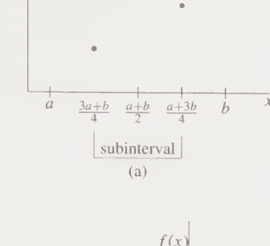
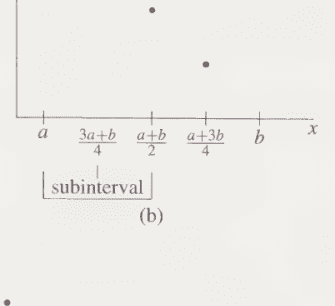
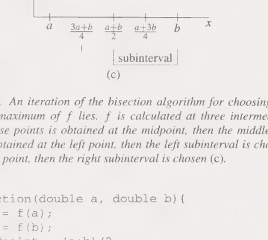

#### 图 1.5

二分法迭代一次，用于选择一个包含 *f* 局部最大值的子区间。*f* 在三个中间点处计算。如果这些点中的最大值在中点处获得，则选择中间子区间 (a)。如果在左点获得，则选择左侧子区间 (b)。如果在右点获得，则选择右侧子区间 (c)。

```c
double bisection(double a, double b){
    double Fa = f(a);
    double Fb = f(b);
    double midpoint = (a+b)/2;
    double Fmidpoint = f(midpoint);
    while(b-a>1.e-6){
        double left = (a+midpoint)/2;
        double Fleft = f(left);
        double right = (midpoint+b)/2;
        double Fright = f(right);
        if(Fmidpoint>max(Fleft,Fright)){
            a = left;
            Fa = Fleft;
            b = right;
            Fb = Fright;
        }
        else{
            if(Fleft>Fright){
                b = midpoint;
                Fb = Fmidpoint;
                midpoint = left;
                Fmidpoint = Fleft;
            }
            else{
                a = midpoint;
                Fa = Fmidpoint;
                midpoint = right;
                Fmidpoint = Fright;
            }
        }
    }
    return midpoint;
} /* 二分法求局部最大值 */
```

（局部变量 `Fa` 和 `Fb` 可能是不必要的，因为在上述代码中从未使用它们。）这是一段相当长的代码。它必须使用许多局部变量，以避免对函数 `f()` 进行可能代价高昂的调用。

代码能否缩短？幸运的是，可以。这通过观察到二分法本质上是递归的来实现。实际上，从原始区间 [a,b] 到图 1.5 中子区间的缩减是主要步骤：其余部分可以通过将同一算法本身应用于子区间来递归完成。这一思想用于以下递归实现：

```c
double bisection(double a, double b,
                double midpoint, double Fa,
                double Fb, double Fmidpoint){
 double left = (a+midpoint)/2;
 double Fleft = f(left);
 double right = (midpoint+b)/2;
 double Fright = f(right);
 return b-a < 1.e-6 ? midpoint
   : Fmidpoint > max(Fleft,Fright) ?
     bisection(left,right,midpoint,Fleft,Fright,Fmidpoint)
   : Fleft > Fright ?
     bisection(a,midpoint,left,Fa,Fmidpoint,Fleft)
   : bisection(midpoint,b,right,Fmidpoint,Fb,Fright);
 } /* 递归二分法求局部最大值 */
```

（事实上，上述函数中的第 4 个和第 5 个参数可能可以被省略。）在这段代码中，图 1.5 中的三种可能性列在 `return` 命令中。这比之前使用的 `if-else` 块更高效。此外，这种实现还需要更少的局部变量。尽管如此，它仍然需要六个参数，这些参数在每次递归调用中都会隐式地分配内存。

从两种实现中可以看出，二分法算法每次迭代需要两次函数 `f(x)` 的计算。这个数字能减少吗？幸运的是，可以。下面描述的黄金分割算法不仅更高效，而且更易于实现。

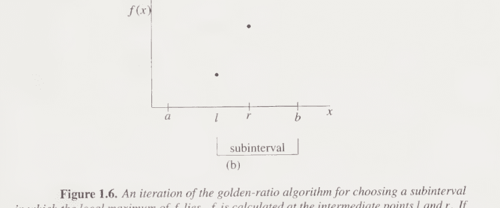

黄金分割比例是一个数字 $g = \frac{-1 + \sqrt{5}}{2}$，它满足 $\frac{1 - g}{g} = g$。

这一性质保证了图 1.6 中的迭代可以在子区间内良好地重复，每次迭代只需计算一次 *f*。以下是算法的详细定义。

#### 算法 1.2

- 1. 定义 $l = b - g(b - a)$ 和 $r = a + g(b - a)$。
- 2. 替换：
  - 如果 $f(l) > f(r)$，则 $b \leftarrow r$，
  - 如果 $f(l) \le f(r)$，则 $a \leftarrow l$。
- 3. 如果 $b - a < 10^{-6}$，则接受 $(a + b)/2$ 作为所需解；否则，返回步骤 1。

如上式所述的黄金分割比例 *g* 的特殊性质意味着，中间点（图 1.6 中的 *l* 或 *r*）也可以用于下一次迭代的子区间。因此，没有必要在该点重新计算 *f*。这样，成本已降低到每次迭代仅计算一次 *f*。

黄金分割算法不仅开销更小，而且更直接、更易于实现。以下是如何使用循环来实现这一目的：

```c
double goldenRatio(double a, double b){
    double Fa = f(a);
    double Fb = f(b);
    double right = a + (-0.5+sqrt(5.)/2.) * (b-a);
    double Fright = f(right);
    double left = a + b - right;
    double Fleft = f(left);
    while(b-a>1.e-6){
        if(Fleft>Fright){
            b = right;
            Fb = Fright;
            right = left;
            Fright = Fleft;
            left = a + b - right;
            Fleft = f(left);
        }
        else{
            a = left;
            Fa = Fleft;
            left = right;
            Fleft = Fright;
            right = b - (left - a);
            Fright = f(right);
        }
    }
    return (a+b)/2;
} /* 黄金分割算法求局部最大值 */
```

（局部变量 `Fa` 和 `Fb` 可能是不必要的，因为在上述代码中从未使用它们。）这种实现可以通过使用递归进一步简化和缩短，如下所示：

```c
double goldenRatio(double a, double left,
    double right, double b, double Fa,
    double Fleft, double Fright, double Fb){
    return b-a < 1.e-6 ? (a+b)/2
        : Fleft > Fright ?
        goldenRatio(a,a+right-left,left,right,
            Fa,f(a+right-left),Fleft,Fright)
        : goldenRatio(left,right,b+left-right,b,
            Fleft,Fright,f(b+left-right),Fb);
} /* 黄金分割算法（递归） */
```

（事实上，上述函数中的第 5 个和第 8 个参数可能可以被省略。）这种实现完全不需要局部变量。虽然它使用了八个参数，这些参数必须在每次递归调用中分配内存，但它们是隐式的，并且对程序员是隐藏的，程序员可以享受优雅且易于调试的代码。

从两种实现中可以看出，黄金分割算法确实每次迭代只需计算一次 *f*。当 *f* 的计算代价高昂时，这一改进至关重要，如第 6 章第 15 节所述。

以下是上述四种实现如何用于在特别长的区间内寻找 *f(x) = cos(x)* 的局部最大值：

```c
#include<stdio.h>
#include<math.h>

double f(double x){
    return cos(x);
}

int main(){
    double a = -100.;
    double b = 10.;
    printf("%f\n",bisection(a,b));
    printf("%f\n",bisection(a,b,(a+b)/2,
        f(a),f(b),f((a+b)/2)));
    printf("%f\n",goldenRatio(a,b));
    double right = a + (-0.5+sqrt(5.)/2.) * (b-a);
    double left = a + b - right;
    printf("%f\n",goldenRatio(a,left,right,b,
        f(a),f(left),f(right),f(b)));
    return 0;
}
```

#### 1.21 示例：算术表达式

在这里，我们在一个读取任意长度算术表达式的程序中使用递归，以后缀和前缀格式打印它并计算其值。二进制算术表达式的后缀（或前缀）格式将算术运算符号放在参数之前（或之后）。例如，算术表达式 2 + 3 的后缀格式为 +23，前缀格式为 23+。（不使用括号。）

上述任务按如下方式递归完成。算术表达式存储在一个字符串中，或存储在由数字和算术符号（如 '+'、'-' 等）组成的数组中。该字符串作为输入送入执行所需任务的函数 `fix()`。在该函数中，字符串按逆序（从右到左）扫描。一旦找到对应于算术运算的字符，字符串就被分割成两个子字符串，并且函数为每个子字符串递归调用（见图 1.7）。

为了实现这个过程，我们需要定义一些基本函数。我们从定义一个函数开始，该函数将字符串 *s* 的前 *n* 个字符复制到字符串 *t* 中：

```c
#include<stdio.h>
void copy(char* t, char* s, int n){
    for(int i=0;i<n;i++)
        t[i]=s[i];
    t[n]='\0';
} /* 将 s 的前 n 个字符复制到 t */
```

下面定义的函数 `fix()` 执行三种可能的任务之一：以后缀格式写入、以前缀格式写入或计算算术表达式的值。具体执行的任务由其最后一个参数、名为 `task` 的整数的值决定。算术表达式作为第一个参数传递给 `fix()` 函数，其长度由第二个参数指定。第三个参数，整数 `task`，取三个可能值，指定所需任务：如果为零，则以后缀形式打印算术表达式；如果为一，则以前缀形式打印算术表达式；如果为二，则计算算术表达式并返回其值。

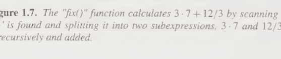

图 1.7。`fix()` 函数通过向后扫描 3·7 + 12/3 直到找到 '+'，并将其分割为两个子表达式 3·7 和 12/3，递归地计算并相加，从而计算出 3·7 + 12/3 的值。


标准 "printf" 函数将输出打印到屏幕上，使用符号 "%c" 来表示类型为字符的变量。以下是 "fix()" 函数的完整实现：

```
int fix(char* s, int length, int task){
    for(int i=length-1;i>=0;i--)
        if((s[i]=='+')||(s[i]=='-')){
            char s1[i+1];
            char s2[length-i];
            copy(s1,s,i);                 /* create first substring */
            copy(s2,s+i+1,length-i-1);/* create second substring */
            if(task==2){ /*calculate the arithmetic expression*/
                if(s[i]=='+')
                    return fix(s1,i,task) + fix(s2,length-i-1,task);
                else
                    return fix(s1,i,task) - fix(s2,length-i-1,task);
            }
            if(task==0)printf("%c",s[i]);   /* print symbol (postfix) */
            fix(s1,i,task);     /* recursive call (first substring) */
            fix(s2,length-i-1,task);/*recursive call (second substring)*/
            if(task==1)printf("%c",s[i]);   /* print symbol (prefix) */
            return 0;
        }
```

在上述循环中，字符串按逆序扫描，我们要查找 '+' 或 '-' 字符。这些字符对应优先级最低的算术运算，因此首先被考虑。如果找到 '+' 或 '-' 字符，则字符串被分割为两个子字符串，这两个子字符串将被相加或相减（如果任务是计算）或以后缀或前缀形式打印（如果任务是这样做）。下一个循环对 '%' 字符做同样的处理，它代表取模运算，其优先级比前一级的更高：

```
for(int i=length-1;i>=0;i--)
    if(s[i]=='%'){
        char s1[i+1];
        char s2[length-i];
        copy(s1,s,i);                 /* create the first substring */
        copy(s2,s+i+1,length-i-1);/* create the second substring */
        if(task==2)return fix(s1,i,task) % fix(s2,length-i-1,task);
        if(task==0)printf("%c",s[i]);/* "mod" symbol (postfix) */
        fix(s1,i,task);     /* recursive call (first substring) */
        fix(s2,length-i-1,task);/*recursive call (second substring)*/
        if(task==1)printf("%c",s[i]);/* "mod" symbol (prefix) */
        return 0;
    }
```

下一个循环对 '*'（或 '/'）字符做同样的处理，它对应乘法（或除法），具有最高优先级，因此最后被考虑：

```
for(int i=length-1;i>=0;i--)
    if((s[i]=='*')||(s[i]=='/')){
        char s1[i+1];
        char s2[length-i];
        copy(s1,s,i);            /* create first substring */
        copy(s2,s+i+1,length-i-1);/* create second substring */
        if(task==2){  /* calculate arithmetic expression */
            if(s[i]=='*')
                return fix(s1,i,task) * fix(s2,length-i-1,task);
            else
                return fix(s1,i,task) / fix(s2,length-i-1,task);
        }
        if(task==0)printf("%c",s[i]);  /* print symbol (postfix) */
        fix(s1,i,task);     /* recursive call (first substring) */
        fix(s2,length-i-1,task);/*recursive call (second substring)*/
        if(task==1)printf("%c",s[i]);  /* print symbol (prefix) */
        return 0;
    }
```

（或者，子字符串 "s1" 和 "s2" 可能直接嵌入在原字符串 's' 中，以避免显式生成它们并提高效率。）最后，字符串再次被扫描，这次我们查找数字。如果找到数字，则计算它们组成的整数的值（如果这是所需的任务）或将其打印到屏幕上（如果这是所需的任务）：

```
if(*s == '\n'){
    printf("error");
    return 0;
}
if(task==2){  /* calculation of an integer number */
    int sum=0;
    int exp=1;
    for(int i=length-1;i>=0;i--){
        if((s[i]>='0')&&(s[i]<='9')){
            sum += (s[i]-'0') * exp;
            exp *= 10;
        }
        else{
            printf("error");
            return 0;
        }
    }
    return sum;
}
for(int i=0;i<length;i++){  /* print an integer number */
    if((s[i]>='0')&&(s[i]<='9'))
        printf("%c",s[i]);
    else{

```
```
printf("error");
    return 0;
}
}
    return 0;
} /* calculate or print in prefix/postfix format */
```

这完成了 "fix()" 函数，该函数执行所需的任务。以下是 "main()" 函数，它实际读取算术表达式（使用标准的 "getchar()" 函数逐个读取每个字符）并执行三个所需的任务：以前缀和后缀格式打印它以及计算其值。

```
int main(){
    char s[80];
    int i;
    for(i=0; (s[i]=getchar()) != '\n'; i++);/*read expression*/
```

这个循环（具有空循环体）将整个算术表达式从屏幕上的字符逐个读入字符串 `s` 中，并将整数 `i` 设置为已读取的字符数量。现在可以应用 "fix()" 函数：

```
fix(s,i,0);            /* print in postfix form */
printf("\n");
fix(s,i,1);            /* print in prefix form */
printf("\n");
printf("%d\n",fix(s,i,2));   /* print expression value */
return 0;
}
```

如上所述，在函数块内部定义的变量（局部变量）在函数结束时被销毁。不过，通过将其声明为 "static" 可以保存它。例如，如果我们在上面的 "fix()" 函数中写：

```
static FILE* fp = fopen("writeFile","w");
fprintf(fp,"length of subexpression=%d\n",length);
```

那么原始算术表达式的长度以及后续子表达式的长度将被打印到文件 "writeFile" 中。这里，"fp" 是一个指向静态文件的指针变量。该文件在函数首次启动时创建并初始化，并且在函数终止后仍然存在。因此，可以在对该函数的进一步递归调用中继续向文件写入数据。

#### 1.22 示例：指数函数

在本节中，我们实现指数函数 exp(x)（也记作 e^x）。尽管该函数在标准 "math.h" 库中可用，但我们在这里显式地实现它，作为使用循环的良好练习。此外，当前的实现可以扩展到计算方阵的指数（第 2 章，第 22 节）。

指数函数被定义为一个无穷级数：

```
exp(x) = 1 + x + x^2/2! + x^3/3! + ... = sum_{n=0}^{∞} x^n / n!
```

这也是指数函数在零处的泰勒展开式（见下文第 5.11 节）。我们通过截断级数来近似该函数

$T_K(x) = \sum_{n=0}^{K} \frac{x^n}{n!}$。

这里，$K$ 是某个预先确定的整数，例如 $K = 10$。

当 $x$ 的绝对值相对较小时，泰勒多项式 $T_K$ 是指数函数良好的近似。当 $x$ 的绝对值较大时，仍可以通过选取一个足够大的整数 $m$ 来近似 $\exp(x)$，使得 $x / 2^m$ 的绝对值足够小，并近似

$\exp(x) = \exp(x / 2^m)^{2^m}$

为

$\exp(x) \doteq T_K(x / 2^m)^{2^m}$。

函数 "expTaylor()" 遵循此公式：

```
double expTaylor(double arg) {
    const int K=10;
    double x=arg;
}
```

首先，需要找到一个合适的整数 $m$。这在循环中完成，其中 $x$ 被连续除以 2，直到其绝对值足够小，例如小于 0.5。$x$ 被除以 2 的总次数即为分配给 $m$ 的值：

```
int m=0;
while(abs(x)>0.5) {
    x /= 2.;
    m++;
}
```

现在，我们回到泰勒多项式 $T_K(x)$ 的求值。这可以最有效地以霍纳算法（第 5 章，第 11 节）的精神进行：

$T_K(x) = \left( \cdots \left( \left( \frac{x}{K} + 1 \right) \frac{x}{K-1} + 1 \right) \frac{x}{K-2} + 1 \cdots \right) x + 1.$

该计算使用一个具有递减索引 $n$ 的循环，其中 $T_K$ 在最初取值 1，然后依次乘以 $x / n$ 并加 1：

```
double sum=1.;
for(int n=K; n>0; n--) {
    sum *= x/n;
    sum += 1.;
}
```

在这个阶段，局部变量 "sum" 具有值 $T_K(x / 2^m)$。所需的输出，即 $T_K(x / 2^m)$ 的 $2^m$ 次幂，是从第三个长度为 $m$ 的循环中获得的，其中 "sum" 被依次替换为其平方：


#### 1.22 指数函数（续）

指数函数 $\exp(x)$ 也可以使用对角帕德（Padé）近似进行计算。这种方法被认为比之前的方法 [79] 更加稳定，尽管在我们的实验（其中 $x$ 为标量或矩阵）中，我们未发现支持这一说法的证据。事实上，我们观察到两种方法的结果完全相同。

定义为：

$$ P_K(x) = \sum_{n=0}^{K} \frac{\binom{K}{n} x^n / n!}{\binom{2K}{n}} $$

其中二项式系数定义为：

$$ \binom{k}{n} = \frac{k!}{n!(k-n)!} \quad (k \geq n \geq 0). $$

$P_K(x)$ 的计算可以遵循霍纳（Horner）算法的思想，如下所示：

$$ P_K(x) = ( \dots ( ( \frac{x}{K(K+1)} + 1 ) \frac{2x}{(K-1)(K+2)} + 1 ) \frac{3x}{(K-2)(K+3)} + 1 ) \dots ) \cdot \frac{Kx}{1 \cdot 2K} + 1. $$

现在使用对角帕德多项式 $P_K$ 来近似指数函数，公式为：

$$ \text{exp}(x) \doteq \left( \frac{P_K(x/2^m)}{P_K(-x/2^m)} \right)^{2^m}. $$

与泰勒近似类似，随着 $K$ 的增加，近似的精度也会提高。在我们的实验中，我们发现 $K = 5$ 就足以提供足够的精度。

因此，帕德近似的完整实现如下：

```c
double expPade(double arg){
    const int K=5;
    double x=arg;
    int m=0;
    while(abs(x)>0.5){
        x /= 2.;
        m++;
    }
    
    double nom=1.;
    for(int n=K; n>0; n--){
        nom *= x*(K-n+1)/(n*(2*K-n+1));
        nom += 1.;
    }
    
    double denom=1.;
    for(int n=K; n>0; n--){
        denom *= -x*(K-n+1)/(n*(2*K-n+1));
        denom += 1.;
    }
    
    double sum = nom/denom;
    for(int i=0; i<m; i++)
        sum *= sum;
    return sum;
} /* calculate exp(arg) using diagonal Pade method */
```

#### 1.23 练习

- 标准函数 `sizeof()` 接受某种类型的名称，并返回计算机内存中存储该类型变量所使用的字节数。例如，在大多数计算机上，`sizeof(float)` 返回 4，表示使用四个字节来存储一个 `float` 数。由于每个字节存储两位十进制数字，因此 `float` 类型的精度为八位数字。另一方面，`sizeof(double)` 通常返回 8，表示 `double` 数以 16 位十进制数字的精度存储。请编写代码打印 `sizeof(float)` 和 `sizeof(double)`，以查明您计算机上的精度是多少。

- 通过打印差值 $x_1 - x_2$（其中 $x_1 = 10^{10} + 1$ 且 $x_2 = 10^{10}$）来验证使用 `double` 数的算术运算确实比使用 `float` 数更精确。如果 $x_1$ 和 $x_2$ 被定义为 `double` 变量，则结果应为 1。然而，如果它们被定义为 `float` 数，由于有限的机器精度，结果将是 0。

- 众所周知，调和级数 $\sum 1/n$ 是发散的。事实上，
  $$ \sum_{n=2}^{\infty} \frac{1}{n} = \sum_{k=0}^{\infty} \sum_{n=2^k+1}^{2^{k+1}} \frac{1}{n} \geq \sum_{k=0}^{\infty} \frac{2^k}{2^{k+1}} = \sum_{k=0}^{\infty} \frac{1}{2} = \infty. $$
  编写一个函数 `harmonic(N)`，返回调和级数前 N 项的和。（请确保在代码中使用 `1./n` 而不是 `1/n`，以便除法被解释为实数除法而不是整数除法。）验证该函数的结果随着 N 的增加而无限增长。

- 另一方面，级数 $\sum 1/n^2$ 是收敛的。事实上，
  $$ \sum_{n=1}^{\infty} \frac{1}{n^2} \leq \sum_{n=1}^{\infty} \frac{2}{n(n+1)} = 2 \sum_{n=1}^{\infty} \left( \frac{1}{n} - \frac{1}{n+1} \right) = 2. $$
  编写函数 `series(N)` 来计算该级数前 N 项的和。验证随着 N 的增加，该函数的结果确实收敛。

- 编写一个函数 `board(N)`，打印一个大小为 $N \times N$ 的棋盘图案，其中 N 是整数参数。在棋盘上使用 `+` 表示红色方格，使用 `-` 表示黑色方格。

- 正弦函数 $\sin(x)$ 和余弦函数 $\cos(x)$ 的泰勒级数分别由以下公式给出：
  $$ \sin(x) = x - \frac{x^3}{3!} + \frac{x^5}{5!} - \dots = \sum_{n=0}^{\infty} \frac{(-1)^n x^{2n+1}}{(2n+1)!} $$
  以及
  $$ \cos(x) = 1 - \frac{x^2}{2!} + \frac{x^4}{4!} - \dots = \sum_{n=0}^{\infty} \frac{(-1)^n x^{2n}}{(2n)!}, $$
  编写函数 `sinTaylor(N,x)` 和 `cosTaylor(N,x)` 来计算级数前 N 项的和。在代码开始处包含数学库 `math.h`，以便可以使用标准函数 `sin(x)` 和 `cos(x)`。验证误差
  $$ |\sin(x) - \sinTaylor(N,x)| $$
  和
  $$ |\cos(x) - \cosTaylor(N,x)| $$
  被对应泰勒级数中的第 (N+1) 项（即第一个被丢弃的项）所界住。

- 运行第 1.11 节示例中的代码片段，并验证它们确实产生了所需的结果。

- 定义一个存储第 1.11 节中棋盘的二维数组。使用嵌套循环扫描它，并逐行打印到屏幕上。验证输出确实与第 1.11 节中的相同。

- 更优雅地重写第 1.12 节中的函数 `reversed()`，使其代码块仅包含三行。解决方案可以在附录的 A.1 节中找到。

- 将第 1.12 节中的函数 `binary()` 推广为更通用的函数 `changeBase()`，该函数接受两个整数参数 `n` 和 `base`，并返回 `n` 在基数 `base` 下的表示。请确保 `changeBase()` 函数写得足够优雅，使其代码块仅包含两行。解决方案可以在附录的 A.1 节中找到。

- 修改第 1.18 节中的代码，以生成整数在基数 `base` 下的表示，其中 `base` 是另一个整数参数。

- 修改第 1.20 节中的函数，以寻找函数的局部最小值，而不是局部最大值。

- 运行第 1.19 节中构建帕斯卡三角形的代码，并验证第 (k,l) 个单元格中的数字确实是牛顿二项式系数 $\binom{k+l}{k}$。此外，计算第 n 条对角线 $\{(k,l) \mid k+l=n\}$ 上条目的总和，并验证其等于
  $$ \sum_{k=0}^{n}\binom{n}{k}=\sum_{k=0}^{n}\binom{n}{k}1^{k}1^{n-k}=(1+1)^{n}=2^{n}. $$

- 使用递归编写一个函数，打印任意大整数的质因数。解决方案可以在附录的 A.2 节中找到。

- 使用递归实现欧几里得算法，以找到两个正整数 m 和 n（m > n）的最大公约数。例如：
  
  **算法 1.3**
  `GCD(m,n):` 如果 m 能被 n 整除，则返回 n；否则，返回 `GCD(n,m mod n)`。
  
  解决方案可以在附录的 A.3 节中找到。

- 使用对 m 的归纳法证明上述代码确实有效。

- 修改第 1.21 节中的代码，以便将结果打印到 `fix()` 函数中定义的一个静态文件中。

- 修改第 1.21 节中的代码，使其能够读取带括号的算术表达式，并以带括号的前缀和中缀形式打印它们。

- 将第 1.22 节中函数的结果与 `math.h` 库中可用的 `exp(x)` 函数的结果进行比较。

- 假设实函数 f 及其导数 $f'$ 可以作为计算机函数使用，返回任意参数 x 处的值 $f(x)$ 和 $f'(x)$。还假设 f 有一个根 $\tilde{x}$，使得 $f(\tilde{x})=0$。寻找 $\tilde{x}$ 的牛顿（或牛顿–拉夫逊）迭代如下。设 $x^{(0)}$ 为初始近似值（初始猜测），该值不要离 $\tilde{x}$ 太远。对于 $i = 0,1,2,\dots$，定义
  $$ x^{(i+1)} = x^{(i)} - \frac{f(x^{(i)})}{f'(x^{(i)})}. $$
  对于足够大的 i，$|x^{(i+1)} - \tilde{x}|$ 足够小，并且 $x^{(i+1)}$ 被视为 $\tilde{x}$ 的一个足够好的近似值。（另见下文第 9.12 节。）编写实现牛顿迭代的循环。

# 第 2 章

### C++ 简介

C++ 似乎最适合许多实际应用。事实上，C++ 具有足够的高级特性，允许透明的面向对象编程和高效利用人力资源，同时它又具有足够的低级特性，拥有类型、变量、指针、数组和循环，从而允许高效利用计算机资源。

在本章中，我们将简要介绍 C++，并说明其作为面向对象编程语言的力量。特别地，我们将展示如何构建和使用诸如向量和矩阵等抽象数学对象。我们还将解释模板类的概念，该概念可以在编译后期填入具体类型。我们还将讨论继承并说明其潜力。

#### 2.1 对象

正如上文所见，C 是一种基于函数的语言。每个命令也是一个函数，它返回一个值，该值可以根据程序员的意愿被进一步使用或丢弃。此外，程序员可以编写自己的函数，这些函数也可以返回在函数名称之前指定的类型的变量。当函数被调用时，会创建一个临时的、未命名的变量来存储返回的值，直到它被使用为止。

另一方面，C++ 是一种面向对象的语言。在这类语言中，主要关注的不是可以执行的函数，而是它们所操作的对象。虽然 C++ 支持 C 中可用的所有操作和特性，但其观点不同。C++ 允许用户不仅创建自己的函数，还可以创建自己的对象和类型，这些类型可以像 C 中内置的 `int`、`float` 或 `double` 类型一样以相同的方式使用。C++ 程序员定义的新类型不仅可以用于实现它们的具体应用程序，还可以用于许多其他潜在的应用程序。因此，C++ 可以被视为 C 的动态扩展，随着越来越多有用对象的定义而不断发展和增长。

面向对象编程的主要优势是清晰地分离了抽象（数学）概念及其详细实现。让我们考虑一个由两名 C++ 程序员组成的团队：程序员 A，负责实现对象；以及程序员 B，负责在实际应用程序中使用它们。就像 C 程序员对


整数或实数在计算机硬件中的实际实现方式。程序员 B 并不关心程序员 A 所准备的对象的详细实现。程序员 B 所需要的仅仅是对象本身以及作用于它们的功能。一旦这些对象可用，无论其内部结构如何，程序员 B 都可以自由地将其用于其特定的应用程序中。

事实上，我们也可以考虑一个更大的 C++ 程序员团队，其中程序员 A 实现了其他程序员在其特定应用程序中所需要的对象。当然，程序员 A 还应该利用来自这些程序员的反馈来开发可能对潜在用户有用的新功能。

这些程序员（或用户）拥有一个方便的对象使用接口至关重要。这个接口不应改变，因为任何对其的修改都将要求更改使用它的每一个应用程序。然而，如果必要，程序员 A 可以对对象的实际实现进行修改，只要这种修改不影响接口即可。用户不应能够访问对象的内部实现，否则他们可能会无意中对其进行更改，从而破坏整个框架。

因此，就像 C 程序员不能更改整数或实数类型的属性一样，由程序员 A 准备的对象的.users也不能更改其属性或功能。对象中使用的数据结构应仅通过由程序员 A 实现和维护的公共接口函数对外部用户可访问。事实上，除非程序员 A 确保公共接口函数以相同的方式被调用和使用，否则连程序员 A 自己也不能修改其实现。

因此，使用由程序员 A 准备的对象的用户的思维可以自由地开发其自身应用程序所需的算法。他们可以通过接口函数使用这些对象，而无需担心任何实现细节。他们可以将这些对象视为完美的抽象概念，这对于开发新的方法和途径特别有用。这在数值建模中尤为重要，因为在数值建模中经常涉及复杂的数学对象。

#### 2.2 类

如上所述，C++ 特别适合实现抽象数学结构，然后这些结构可被其他程序员用作新的对象或类型。例如，假设一个人想要实现二维笛卡尔平面上的一个点。实现良好的点应当被外部用户像使用 "int" 或 "double" 等标准类型一样使用，使用户完全 unaware 它是如何存储或操作的。这将解放用户的思维，使其能够专注于其特定的应用程序，而不被点的实现细节分散注意力。

特别是，用户应当能够编写如下命令：

```
point P;
point Q=P;
```

来定义一个点 'P' 并使用它来定义和初始化另一个点 'Q'。如我们稍后将看到的，这个目标是通过定义具有其接口函数的 "point" 类来实现的。

在 C++ 中，新对象在类中定义如下：

```
class point{
public:
```

```
double x;
double y; // not object oriented
};
```

这被称为类块。符号 "//" 表示注释行的开始；其后的词语旨在描述或解释代码，并被 C++ 编译器忽略。

上面的块定义了一个名为 "point" 的新类，其中包含两个类型为 "double" 的数据字段。现在可以使用该类来定义类型为 "point" 的变量。一旦定义了具体的 "point" 变量 'P'，"P.x" 就指代其第一个字段（表示 'x' 坐标），而 "P.y" 则指代其第二个字段（表示 'y' 坐标）。上述代码中的保留字 "public:" 表明这些字段对类的每个用户都是可访问的。

然而，这种实现并不符合面向对象编程的精神。由于数据字段 'x' 和 'y' 是可访问的，"point" 对象不能被看作是一个完整的“黑箱”点的实现。由于用户不熟悉内部结构，他们可能会无意中对其进行更改，从而破坏该对象。此外，如果编写 "point" 类的程序员 A 想在某个阶段更改实现，那么他/她将不得不告知所有用户，用户不得不相应地更改他们自己的代码。以下面向对象实现避免了这个问题：

```
class point{
    double x;
    double y; // an object-oriented implementation
public:
    double X() const{
        return x;
    } // read x

    double Y() const{
        return y;
    } // read y

    void zero(){
        x=y=0.;
    } // set to zero
};
```

在这个版本中，数据字段 'x' 和 'y' 不再对外部用户可访问。由于它们出现在保留字 "public" 之前，它们默认被认为是 "private"（私有）：定义 "point" 对象 'P' 的用户不能像以前那样简单地通过 "P.x" 或 "P.y" 访问其坐标。因此，"point" 对象中的数据受到了保护，免受粗心用户的无意更改。尽管如此，用户只能通过公共接口函数 "X()" 和 "Y()" 读取（但不能更改）'P' 中的数据字段。例如，"P.X()" 返回 'P' 的 'x' 坐标，"P.Y()" 返回 'P' 的 'y' 坐标。我们将 'P' 称为当前对象或变量，即调用函数 "X()" 或 "Y()" 时所使用的对象或变量。调用 "P.X()" 和 "P.Y()" 并不比之前实现中的相应调用 "P.x" 和 "P.y" 更昂贵，因为这些函数每个只包含一行代码且不创建新对象。

规则是，类块中未声明为 "public" 的字段和函数默认是私有的。这就是上述 'x' 和 'y' 字段是私有的原因。也可以在类块的末尾声明更多的私有字段和函数，方法是在它们的声明之前写入保留字 "private:"。

函数 "X()" 和 "Y()" 读取当前 "point" 对象的坐标而不改变它们。这由紧跟在打开函数块的符号 '{' 之前的保留字 "const" 表示。该保留字保证当前的 "point" 对象永远不会被该函数更改，任何试图更改它的行为都将导致编译错误。

上述代码中的公共函数 "zero" 在其块之前缺少 "const" 一词，因为它更改了当前的 "point" 对象并将其设置为零。因此，"point" 类的用户仅能通过像 "zero" 这样的非恒定函数更改 "point" 对象中的数据。

像 "X()"、"Y()" 和 "zero" 这样的接口函数可以随时由负责实现的程序员 A 进行修改，前提条件仍然是它们接受相同数量的参数并返回与之前相同的类型，以便其他用户可以像之前一样使用它们。这样，用户完全 unaware 实际实现或其中的任何更改。他们需要知道的只有如何使用接口函数。事实上，他们可以像 'P' 这样的 "point" 变量看作二维笛卡尔平面上的一个点。与之关联的接口函数也可以被看作是对实际点的操作。

如前所述，接口函数放在类块内部，紧接在数据字段定义之后。这种风格适用于不包含几行代码的短函数。每次调用函数时，这些函数都会被重新编译。一种更高效的风格也适用于较长的函数，它在类块内声明函数，将其实际定义留到后面。该定义放置在类块外部，其中的函数名前有一个前缀，包含类名后跟符号 "::"，以表明这确实是该类中的一个接口函数。这样，它就被视为如果它被放置在类块内部一样。例如，"point" 类也可以等价地编写如下：

```
class point{
    double x;
    double y; //  an object-oriented implementation
public:
    double X() const;
    double Y() const; //  declarations only
    void zero();
};
```

```
double point::X() const{
    return x;
} //  definition of X()
```

```
double point::Y() const{
    return y;
} //  definition of Y()
```


在这里，接口函数仅在类块中声明，而其实际定义则留在了类块外部。每个定义只编译一次，从而创建了一个有限状态机（自动机）。每当调用该函数时，便会调用此机器，传入的具体参数作为输入，返回值作为输出。

上述代码中函数名之前的“point::”前缀实际上可以被视为一个运算符，它将定义“转移”回类块中。然而，在当前的“point”示例中，由于函数定义非常简短，这种格式并非必要。在这种情况下，原先那种将完整定义写在类块内部的风格更为可取。

```cpp
void point::zero(){
    x=y=0.;
}   // “zero()”的定义
```

#### 2.3 构造函数

当用户通过编写以下代码来定义一个 point 对象时

```cpp
point P;
```

计算机会通过为该新“point”变量‘P’的数据字段分配内存来执行此命令。这些数据字段，即“double”变量“P.x”和“P.y”，尚未被初始化为任何有意义的值；事实上，它们最初包含的是随机、无意义的值。只有“point”类的接口函数才能访问这些变量，并为其赋予有意义的值。

C++ 有一个默认构造函数，它会为数据字段分配内存并用随机值初始化它们。然而，这并不总是足够好。程序员 A 可能对用户编写“point P;”这类代码行时应该发生什么有不同的想法，并且他/她可能还希望用户能够编写更复杂的代码行，如“point P = 0;”，其中‘P’被构造并初始化为零。确实，如果“point”对象要表现得像标准类型一样，那么用户应该可以使用此类命令。

因此，在类中编写一个显式构造函数是一个好的做法。构造函数是一个公共接口函数，它告诉计算机如何构造一个新对象并为其数据字段分配内存。构造函数的名称必须与类本身的名称相同。例如，如果在“point”类的块中编写

```cpp
point(){
}   // “point”类的默认构造函数
```

那么每当编译器遇到“point P;”形式的命令时，就会调用此构造函数。构造函数体的代码行中没有任何内容。但它仍然做了某些事情：一旦被调用，该构造函数会隐式调用 C++ 内置的默认构造函数，该函数为数据字段“P.x”和“P.y”分配存储空间并用随机数填充它们。上述构造函数也被称为“point”类的默认构造函数，因为它由诸如“point P;”之类的命令调用，且不进行任何初始化。

在类块中可以编写多个构造函数。特别是，还可以定义一个更具信息量的构造函数，它不仅为构造对象中的数据字段分配内存，还用有意义的值初始化它们。例如，如果在“point”类的块中编写

```cpp
point(double xx,double yy){
    x=xx;
    y=yy;
}
```

那么每当编译器遇到以下形式的命令时，就会调用此构造函数

```cpp
point P(3.,5.);
```

来创建一个新的“point”对象‘P’，其‘x’字段的值为 3，‘y’字段的值为 5。

下面是这个构造函数的工作原理。当它被调用时，首先隐式调用 C++ 编译器内置的默认构造函数，该函数为‘x’和‘y’字段分配内存并用随机数填充它们。然后，‘x’和‘y’字段会分别从对应的参数“xx”和“yy”中重新赋得正确的值。

这个过程有些低效。为什么不立即用正确的值初始化‘x’和‘y’字段呢？这确实可以通过使用初始化列表来完成，如下所示：

```cpp
point(double xx,double yy):x(xx),y(yy){
} // 带初始化列表的构造函数
```

跟在字符‘:’后面的初始化列表是构造对象中数据字段的列表，字段之间用逗号分隔。每个数据字段后面都跟着括号中的初始值。当调用此构造函数时，字段按照它们在类块中出现的（声明的）顺序进行内存分配和正确初始化，而不一定是初始化列表中的顺序。构造和初始化就此完成，因此函数体中没有任何剩余工作，保持为空。

更进一步，可以将上述构造函数改写如下：

```cpp
point(double xx=0.,double yy=0.):x(xx),y(yy){
} // 带默认值的参数
```

这样，参数“xx”和“yy”采用默认值 0，当它们未被显式指定时就会使用该默认值。这个构造函数在“point”类中同时充当默认构造函数，因此无需再编写任何其他构造函数。当编译器遇到如下命令时

```cpp
point P(3.,5.);
point Q(3.); // 或 point Q=3.;
point W;
```

它会将缺失的参数补为零，并构造三个 point 对象：‘P’的‘x’字段初始化为 3，‘y’字段初始化为 5；‘Q’的‘x’字段初始化为 3，‘y’字段初始化为 0（因为第二个参数“yy”未指定，因此采用默认值 0）；‘W’的两个字段都初始化为 0（因为参数“xx”和“yy”均未指定）。

#### 2.4 显式转换

上述构造函数还提供了从“double”类型到“point”类型的显式转换运算符。正如在 C 语言中，“(double)n”会产生一个临时的“double”变量，其值与整数变量‘n’相同，“(point)a”会产生一个临时的“point”对象，其第一个字段包含与“double”变量‘a’相同的值，第二个字段为零。这是通过调用上述构造函数完成的，其中‘a’作为第一个参数，并且没有第二个参数。得益于上述代码中的默认值，第二个参数隐式地取零值，随后被赋给“(point)”函数返回的临时变量中的第二个字段。这称为显式转换。

“转换”一词有些令人困惑。实际上，‘a’从未以任何方式被转换或改变。它仅被用作“(point)”函数的参数。事实上，可以等价地编写“point(a)”并得到相同的结果：一个临时“point”对象，第一个字段等于‘a’，第二个字段为零。该对象只能在其构造所在的那行代码中使用，并在随后不久消失。虽然“转换”一词并不精确，但它很方便，并且通常用来指代此功能。

#### 2.5 隐式转换

上述构造函数还提供了从“double”类型到“point”类型的隐式转换。在需要“point”类型变量的代码中，如果出现的是“double”类型变量，则会隐式调用上述构造函数，将“double”变量转换为所需的“point”变量。此功能在接收“point”参数的函数中特别有用。当使用“double”参数调用此类函数时，该参数会被隐式转换为所需的“point”参数。此功能类似于 C 语言中的类型转换。一方面，它可能使代码更透明、更直接；另一方面，它也可能代价过高，我们稍后会看到。

隐式转换需要额外调用一次构造函数。此构造过程中的内存分配需要额外的计算机时间来完成。虽然对于像 point 这样的小对象，这种开销可以忽略不计，但对于较大的对象来说，可能就相当可观了，特别是当隐式转换在长循环中重复很多次时。因此，应当仔细考虑是否使用隐式转换。

#### 2.6 默认复制构造函数

上述构造函数可用于构造新的“point”对象并用指定值初始化它们。然而，“point”类的用户还应该能够使用现有对象来初始化新对象。例如，他们肯定希望编写如下代码

```cpp
point P(3.,5.);
point Q(P); // 或 point Q=P;
```

其中‘P’首先按之前的方式构造，然后‘Q’被构造并初始化为与‘P’相同的值。这是通过复制构造函数完成的。

复制构造函数构造（分配内存）一个新对象，并用作为参数传递给它的对象的值来初始化它。构造和初始化


#### 2.7 析构函数

在函数块的末尾，局部变量会被销毁，为它们分配的内存会被释放以供将来使用。这是由计算机隐式调用的析构函数完成的。如果在类块中没有显式定义析构函数，则使用 C++ 编译器中可用的默认析构函数。此析构函数会遍历对象中的数据字段并逐一销毁它们。这是按相反顺序进行的：例如，“point”对象是通过释放其 'y' 字段然后释放其 'x' 字段来销毁的。

然而，默认析构函数并不总是能正确完成工作。因此，在类块中编写显式析构函数是一个良好的实践：

```cpp
~point() {
} // destructor
```

这里，实际的销毁工作由默认析构函数完成，该析构函数在此析构函数的末尾被隐式调用。这就是为什么此析构函数的主体为空的原因。

然而，默认析构函数无法正确销毁具有本身是指针的数据字段的更复杂对象。事实上，当默认析构函数遇到此类字段时，它只销毁其中的地址，而不是其内容。此地址中的对象虽然因其地址不再可用而无法访问，但仍占用宝贵的内存。这就是为什么需要显式析构函数来使用保留的 "delete" 命令正确删除此字段的原因。此命令不仅删除字段中的地址，还会隐式调用适当的析构函数以销毁其中的对象并释放其占用的内存。

#### 2.8 成员函数和友元函数

接口函数可能是两种可能的类型：成员函数或友元函数。接下来，我们将描述这些类型函数的特征。

构造函数、析构函数和赋值运算符必须是成员函数。上面的 "X()"、"Y()" 和 "zero" 函数也是成员函数：它们在类块内定义并作用于调用它们的当前对象。例如，调用 "P.X()" 将函数 "X()" 应用于 "point" 对象 'P' 并返回其 'x' 字段，"P.x"。

由于成员函数是在类块内定义的，因此它们的定义只能使用（或调用）在类块中声明的其他接口函数；它们不能使用在类块外定义的普通（非接口）函数，除非它们被声明为该类的友元。

成员函数使用当前对象调用，例如 "P.X()" 中的 'P'。当执行 "X()" 等成员函数时，假定在其定义中提到的字段 'x' 和 'y' 指的是当前对象中的相应字段；'x' 被解释为 "P.x"，'y' 被解释为 "P.y"。

另一方面，友元函数没有当前对象，只能像普通函数一样接收参数。

成员函数最重要的属性是它们可以访问当前对象以及作为具体参数传递给它们的对象的所有字段，包括私有字段。接下来，我们将解释如何授予此访问权限。

当用户对某个 "point" 变量 'P' 调用 "P.X()" 时，'P' 的地址会被传递给函数 "X()"，该函数将其存储在名为 "this" 的局部变量中，其类型为常量指针指向常量 point。（在 C++ 中，“this”一词为此目的而保留。）"this" 的类型保证 "this" 及其内容都不能更改。事实上，"X()" 是一个常量函数，它永远不会更改其当前对象，这由函数块前的保留字 "const" 所指示。

现在，成员函数 "X()" 可以通过 "this" 中包含的 'P' 的地址访问 'P' 的私有成员 "P.x" 和 "P.y"。在 "X()" 的定义中，'x' 和 'y' 只是 "this->x"（或 "(*this).x"）和 "this->y"（或 "(*this).y"）的简写。事实上，"X()" 的定义可以用以下命令重写：

```cpp
return this->x;  // same as (*this).x
```

在像 "zero" 这样的非常量函数中，"this" 的类型略有不同：它是常量指针指向 point，而不是常量指针指向常量 point。这允许通过它更改当前对象。事实上，"zero" 是一个非常量函数，其块前缺少保留字 "const"。当用户调用 "P.zero()" 时，"this->x" 和 "this->y" 被设为零，这实际上意味着 "P.x" 和 "P.y" 被设为零，正如所要求的。

"this" 变量也用于返回值。例如，如果我们希望函数 "zero" 返回调用它的当前 "point" 对象的指针，那么我们应该将其重写如下：

```cpp
point* zero(){
    x=y=0.;
    return this;
} // returns pointer-to-current-point
```

这样，在函数块的末尾会创建一个临时、无名的指针到 point 类型的变量并初始化为 "this" 中的值。此无名变量可以在调用 "zero" 函数的同一代码行中进一步使用，并可作为另一个函数的参数。

由于从上面的 "zero" 函数返回的指针只存在于临时状态，因此不建议使用它来更改其内容。通常，内容应仅通过永久的、明确定义的指针更改，而不是通过函数作为输出返回的临时、无名指针。因此，更好的风格如下，其中返回的指针是指针到常量 point，因此不能进一步用于更改其内容。这由函数类型前的保留字 "const" 所指示：

```cpp
const point* zero(){
    x=y=0.;
    return this;
} // returns pointer-to-constant-point
```

"zero" 函数返回的指针可以例如在 "printf" 函数中使用，如下所示：

```cpp
int main() {
    point P;
    printf("P.x=%f\n", P.zero()->X());
    return 0;
} // print P.x after P has been set to zero
```

这里，"printf" 函数打印由 "zero()" 函数返回的地址的 "point" 对象 'P' 的 'x' 字段。

稍后，我们将展示如何将 "zero" 函数也重写为 "friend" 函数。然后在类块中的声明中，函数名称前应加上保留字 "friend"。没有当前对象或 "this" 指针可用；对象必须像普通函数一样显式作为参数传递。接下来，我们将看到参数应通过引用而不是按名称（或值）传递。

#### 2.9 引用

在 C++ 中，可以定义对变量的引用。引用实际上是同一变量的另一个名称。例如，

```cpp
point p;
point& q = p;
```

定义了一个类型为引用到 point 的变量 'q'，初始化为引用 "point" 对象 'p'。（由于 'q' 是一个引用，它必须被初始化。）对 'q' 的任何更改也会影响 'p'，反之亦然。

在上一章中，我们看到如果一个函数 supposed to 更改一个变量，那么该变量必须按地址传递给它，即通过传递指向它的指针参数。更透明的方法是传递对该变量的引用，这允许函数引用它并更改它。例如，上面的 "zero" 函数也可以实现为友元函数，它将参数设为零。这如下所示完成。

```cpp
friend const point* zero(point&);
```

实际的定义可以在 "point" 类的块之外进行：

```cpp
const point* zero(point&p){
    p.x=p.y=0.;
    return &p;
} // set "point" argument to zero
```

通过这种实现，"zero" 函数也可以声明为其他类的友元，因此如果需要，它也可以使用它们的私有字段。在本例中，这不是必需的，因此实际上可以在 "point" 类的块内同时声明和定义该函数，如下所示：

```cpp
friend const point* zero(point&p){
    p.x=p.y=0.;
    return &p;
} // declare as friend and define
```


#### 2.10 复制构造函数

这里，`P.zero()` 返回的对 `P` 的引用，在后续对 `X()` 函数的调用中充当当前对象。

按引用传递参数不仅方便，而且高效。事实上，当参数按引用而非按值传递时，就无需调用复制构造函数来构造局部副本。例如，若第 2.6 节中的“negative”函数被改写为

```cpp
const point negative(const point& p){
    return point(-p.X(),-p.Y());
}   //  passing argument by reference
```

那么就不会构造局部的“point”对象，而只会构造一个指向实参的局部引用。创建这个引用只需要复制实参的地址，而不必在物理上复制整个实参。这样一来，调用“negative”函数时的构造总数将从三次减少到两次。

“negative”函数仍然需要两次调用“point”对象的构造函数：一次用于构造局部的负值对象，另一次用于返回它的副本。这个次数已经无法进一步减少。如果试图通过下面这种写法来避免第二次构造，看看会发生什么：

```cpp
const point& negative(const point& p){
    return point(-p.X(),-p.Y());
}   //  wrong!!! returns reference to nothing
```

这个版本按引用而不是按值返回。（确实，函数类型是“const point&”而不是“const point”。）它返回一个引用，指向包含“point”实参的负值的局部变量。然而，“point”实参的负值是一个临时局部变量，在函数结束时已不存在，因此它实际返回的是一个空引用。所以应该放弃这个版本，继续使用前一个版本。

如第 2.6 节所述，定义一个显式的复制构造函数是一个好习惯。例如，可以在“point”类的代码块中编写一个合适的复制构造函数，如下所示：

```cpp
point(const point& p):x(p.x),y(p.y){
}   //  copy constructor
```

这里，被复制的“point”对象按引用传递给构造函数，其字段用于初始化正在构造的“point”对象中的对应字段。

实际上，并不一定要编写这个构造函数，因为 C++ 编译器提供的默认复制构造函数所做的正是同一件事。尽管如此，编写自己的复制构造函数仍然是一个好习惯，因为在很多情况下默认复制构造函数会做错事，我们稍后会看到。

只要编译器遇到显式复制，例如

```cpp
point Q = P;  // same as point Q(P);
```

或者隐式复制，例如向函数传递参数或按值从函数返回对象，上述复制构造函数就会被调用。

#### 2.11 赋值运算符

“point”类的用户可能希望以自然的方式进行赋值，如下所示：

```cpp
point P,W,Q(1.,2.);
P=W=Q;
```

这里，point 对象“P”、“W”和“Q”由第 2.3 节中的构造函数在第一行代码中创建，该构造函数使用默认值为 0 的“double”参数。这样，“Q”中的字段被初始化为指定的值 1 和 2，而“P”和“W”中的字段取默认值 0。在第二行代码中，C++ 编译器内置的默认赋值运算符被调用来将“Q”中字段的值赋给“W”和“P”中对应的字段。这是从右到左进行的，具体如下：首先，“Q”中字段的值按照它们在类代码块中声明的顺序，逐一赋给“W”中对应的字段。也就是说，先用“Q.x”赋值给“W.x”，然后用“Q.y”赋值给“W.y”。这个赋值操作还会返回一个对“W”的引用。这个引用继续用于将更新后的“W”对象赋值给“P”，因此最终三个 point 对象都拥有相同的值，正如所要求的那样。

尽管默认赋值运算符在这里做了正确的事情，但定义自己的赋值运算符仍然是一个好习惯。根据 C++ 的规则，它必须是一个成员函数。下面是在类代码块中定义它的方式：

```cpp
const point& operator=(const point& p){
```

这是一个函数的开头部分，其中参数类型在圆括号中声明，返回对象类型在函数名“operator=”之前声明。请注意，参数和输出都按引用而不是按值传递/返回，以避免不必要的复制构造函数调用。此外，参数和返回对象也被声明为常量，因此它们不会在不经意间被改变。事实上，参数和函数名前面都有“const point&”，它表示“指向常量 point 的引用”。

如果从圆括号中删去“const”一词，将参数声明为非常量，看看会发生什么。编译器会拒绝接受任何常量实参，因为它担心实参会通过其非常量局部引用而被改变。更进一步，编译器甚至拒绝接受某个其他函数返回的作为临时对象的非常量实参，因为它担心实参在赋值运算符执行期间可能被改变。由于改变一个很快就要消失的临时对象毫无意义，编译器便认为该调用有误并发出编译错误。像上面代码行那样将参数声明为常量，可以避免所有这些麻烦。现在，该函数既可以按需接受常量参数，也可以接受非常量参数。

```cpp
if (this != &p){
    x = p.x;
    y = p.y;
}
```

最后，还会返回一个对当前对象的引用以供进一步使用：

```cpp
return *this;
}   // point-to-point assignment
```

我们将此运算符称为 point 到 point 的赋值运算符。

也可以将“double”类型的值赋给“point”对象。例如，可以写

```cpp
P=W=1.;
```

编译此命令时，首先会调用构造函数，将“double”数字“1.”隐式转换为一个临时的未命名 point 对象，其“x”和“y”字段分别包含值 1 和 0。然后，这个对象如前所述被赋值给“W”和“P”。这样一来，第 2.2 节中的“zero()”函数就不再需要了，因为只需写“P = 0.”即可将“P”设为零。

如前面第 2.5 节所述，隐式转换可能相当昂贵，因为它需要额外构造一个“point”对象。当赋值在长循环中多次使用时，这个问题尤其重要。为了避免这种额外的构造，可以编写一个接受“double”参数的赋值运算符：

```cpp
const point& operator=(double xx){
    x = xx;
    y = 0.;
    return *this;
}   // double-to-point assignment
```

我们将此运算符称为 double 到 point 的赋值运算符。它也必须是至少声明（甚至定义）在类代码块内部的成员函数。

当编译器遇到形如“P = 1.”的命令时，它首先查找 double 到 point 的赋值运算符。如果存在这样的运算符，就可以在此处使用它，从而避免隐式转换。更具体地说，double 到 point 的赋值运算符按需要将 1 赋给“P.x”，将 0 赋给“P.y”，从而避免构造任何新对象。同时还会返回对当前对象的引用，以允许形如“W = P = 1.”的命令。

赋值运算符允许编写“P = Q”和“P = 1.”这样紧凑优雅的代码行。此外，它还可以像普通函数一样被调用：

```cpp
P.operator=(W.operator=(0.));   // same as P=W=0.;
```

这与上面使用的“P = W = 0.”完全相同。当然，原来的形式更好。

下面我们还会看到更多有用的运算符，它们可以由类的编写者实现。这些运算符使用与 C 语言标准运算符相同的符号，例如上述赋值运算符中的“=”符号。然而，由编写者实现的运算符并不一定与 C 语言中的对应运算符相关。这里使用的符号只是保留了标准的优先级顺序。


#### 2.12 运算符

“point”类的程序员还可以定义其他运算符，以便方便地操作对象。在“point”类上下文中，用于表示算术和逻辑运算符的符号可以被赋予新的含义。运算符的新解释会在其定义中明确说明。

尽管新运算符可能具有完全不同的含义，但它必须仍然保持与 C 语言相同的结构：也就是说，它必须接受与 C 语言相同数量的参数。然而，这些参数的类型、返回的对象，以及运算符实际执行的操作，则取决于类的程序员。例如，程序员可以赋予符号“&&”向量积的含义，如下所示：

```
double operator&&(const point&p, const point&q){
    return p.X() * q.Y() - p.Y() * q.X();
} // 向量积
```

这样，尽管 C 语言中的“&&”运算符与向量积无关，但在“point”对象上下文中，它可以作为向量积运算符使用，因为它接受两个参数，符合相关要求。不过，应牢记的是，C 语言中的“&&”运算符是逻辑运算符，其优先级弱于算术运算符。因此，每当在“point”对象上下文中使用“&&”符号时，如果希望其首先被激活，必须将其放入括号中。

注意，上述运算符被实现为一个普通的（非成员、非友元）函数，因为它不需要访问“point”类的任何私有成员。事实上，它通过公共成员函数“X()”和“Y()”访问‘p’和‘q’中的数据字段。参数‘p’和‘q’以引用方式传入以避免不必要的复制。这些参数也被声明为常量，因此该函数可以接受常量或非常量具体参数。用户现在只需编写“P&&Q”即可调用此函数，其中‘P’和‘Q’是某些“point”变量。

#### 2.13 逆向转换

另一个可选的运算符是逆向转换。这个运算符很特殊，因为它的名称不是一个符号，而是代表对象被转换到的类型的保留字。

在“point”类上下文中，此运算符将“point”对象转换为“double”对象。具体如何实现由类的程序员决定。然而，这里程序员没有选择函数状态或名称的自由：它必须是一个成员函数，其名称与对象被转换到的类型相同，即“double”。以下是该运算符如何在“point”类的类块中定义：

```
operator double() const{
    return x;
} // 逆向转换
```

使用此运算符，用户可以编写“(double)P”或“double(P)”来读取“point”对象‘P’的'x'坐标。当然，在此操作中‘P’永远不会改变，正如在打开函数块的大括号‘{’之前的保留字“const”所指示的那样。

术语“conversion”（转换）并不精确，仅用于可视化该过程。实际上，并没有发生任何转换；唯一发生的事情是读取第一个坐标，而当前对象完全没有变化。

逆向转换也可以隐式调用。如果“point”对象‘P’作为具体参数传递给一个接受“double”参数的函数，那么编译器会隐式调用上述运算符，将‘P’转换为所需的值“Px”的“double”参数。

隐式调用逆向转换运算符也是有风险的。程序员并不总是意识到这些调用，或者无法决定它们是否应该被使用。似乎更好的做法是不定义逆向转换，让编译器在错误类型的参数传递给函数时发出错误。这样，程序员就会意识到这个问题，并可以决定是否显式转换参数。在本文涉及的类中，我们确实没有定义逆向转换。

#### 2.14 一元运算符

2.6节中的“negative”函数实际上可以作为一个只接受一个参数（一元运算符）的运算符来实现。为此，只需将函数名从“negative”更改为“operator-”即可。有了这个新名称，只需编写“-Q”就可以更优雅地调用该函数（其中‘Q’是某个“point”对象）：

```
point W,Q=1.;
W=-Q;  //  等同于 W=operator-(Q);
```

在此代码中，“point”对象‘W’被赋予值(-1,0)。

“operator-”可能比原始的“negative”函数更高效。例如，代码

```
point W=negative(1.);
```

使用隐式转换将“double”参数1转换为“point”参数(1.0)，然后才对它应用“negative”函数。一旦“negative”函数被重命名为“operator-”，上述代码就被重写为

```
point W=-1.;
```

这将-1解释为“double”数字，并直接使用它来初始化‘W’，而不进行任何转换。

可以在“point”对象上定义其他可选运算符。在定义中，函数名中的保留字“operator”后面跟着用于调用该运算符的符号。

例如，下面展示了如何将“+=”运算符定义为“point”类的成员函数。该定义允许用户编写优雅的“P+=Q”来将“point”参数‘Q’加到当前“point”对象‘P’上：

```
const point& operator+=(const point& p){
    x += p.x;
    y += p.y;
    return *this;
}  //  将点加到当前点
```

在这里，“point”参数以引用方式传递给“+=”运算符，以避免不必要的复制。然后，其'x'和'y'坐标的值被加到存储在“this”中的当前对象的相应字段中。更新后的当前对象也以引用形式作为输出返回。该输出可以在同一代码行中进一步使用，如下所示：

```
P=W+=Q;
```

此代码行从右向左执行：首先，‘W’被‘Q’增加，然后‘W’的结果值被赋给‘P’。这种赋值之所以能实现，是因为2.11节中的点对点赋值运算符接受指向常量点的引用参数，因此不用担心它会改变从“W+=Q”返回的临时对象，该对象作为具体参数传递给它。

上述代码实际上等同于以下（不太优雅的）代码：

```
P.operator=(W.operator+=(Q)); // 等同于 P=W+=Q;
```

与2.11节中的赋值运算符类似，“+=”运算符也通过隐式转换接受“double”参数。例如，调用

```
W+=1.;
```

首先将“double”参数1隐式转换为临时“point”对象(1,0)，然后使用该对象来增加‘W’。如上所述，隐式转换之所以能在此处使用，是因为“operator+=”接受指向常量点的引用参数，而不仅仅是指向点的引用，因此它没有拒绝接受隐式转换返回的临时“point”对象作为参数的问题。

上述隐式转换仅在没有显式的“+=”运算符版本（接受“double”参数）的情况下使用。如果存在这样的版本，编译器将调用它，因为它匹配调用“W+=1.”中参数的类型。该版本的“operator+=”可以在类块中如下定义：

```
const point& operator+=(double xx) {
    x += xx;
    return *this;
} // 将实数加到当前点
```

此版本通过避免隐式转换来提高效率。这一特性在复杂应用中尤为重要，因为它可能在长循环中被多次使用。

上述“+=”运算符作为成员函数实现，这是其自然的实现方式。然而，它们也可以作为友元函数实现，如下所示：

```
friend const point&
operator+=(point&P,const point& p) {
    P.x += p.x;
    P.y += p.y;
    return P;
}
```

在这种风格中，函数接受两个参数。第一个参数是非常量的，因为它代表被第二个常量参数增加的对象。类似地，也可以为接受“double”参数的“+=”运算符编写一个“friend”版本。对“+=”运算符的调用方式与之前相同。

尽管“friend”实现是正确的，但在面向对象编程的上下文中有些不太自然。实际上，它具有 C 语言函数的格式，该函数会改变其参数。然而，在面向对象编程中，我们习惯以对象及其表达其特征的功能来思考，而不是以作用于对象的功能来思考。这一概念在将“+=”运算符实现为成员函数的原始实现中表达得更好。

“friend”版本还有另一个缺点。尽管它正确地增加了定义良好的“point”变量，但它拒绝增加由其他函数返回的临时、未命名的“point”对象。事实上，由于“friend”版本中增加的参数类型为指向非常量点的引用，它拒绝任何临时具体参数，因为改变一个即将消失的对象没有意义，并且假设这一定是人为错误。当然，编译器可能不知道这是有意的。另一方面，在“+=”运算符的原始“member”版本中，即使是临时对象也可以被增加，因为它们充当非常量当前对象。这种“member”实现的更大灵活性也有助于下面‘+’运算符的实现。

#### 2.15 二元运算符

在本节中，我们定义接受两个参数以产生返回对象的二元运算符。在这方面，这些运算符具有与普通 C 函数相同的结构。然而，区别在于，它们使用对象，而不仅仅是像 C 语言中那样的整数或实数。此外，运算符可以方便地调用，并产生模仿原始数学公式的代码。

将两个“point”对象相加的‘+’运算符可以编写为一个普通的（非成员、非友元）函数，该函数不需要访问点对象的私有数据字段，因此不需要在类块中声明：

```
const point
operator+(const point& p, const point& q){
    return point(p.X()+q.X(),p.Y()+q.Y());
} // 将两个点相加
```

与“+=”运算符不同，此运算符不改变其参数，这两个参数都以指向常量点的引用形式传递，但仅使用它们来产生并返回它们的和。注意，返回的变量不能声明为引用，否则它将引用一个在函数结束时消失的局部“point”对象。它必须是一个新的“point”对象，由复制构造函数在“return”命令中自动构造，以存储该局部变量的副本。这一点由函数名称前的词语“const point”（而不是“const point&”）所指示。

上述‘+’运算符最自然的调用方式为

```
P=W+Q;  // 等同于 P=operator+(W,Q);
```


如2.13节末尾所述，我们假设没有逆向转换，因为将"point"转换为"double"的"operator double()"已被弃用。因此，由于"operator+"中的两个参数都是const point的引用类型，"operator+"不仅可以用两个"point"参数（如"W+Q"）调用，还可以用一个"point"参数和一个"double"参数（如"W+1."或"1.+W"）调用。实际上，得益于2.5节中提到的隐式double到point转换，"double"数字"1."在被加到"W"之前会先被转换为point (1.0)。此外，由于缺乏逆向转换，不存在歧义，因为不可能将"W"转换为"double"并以"double"数字的形式将其加到"1."上。

如果某人因其额外成本和风险而不关注隐式转换，并希望编译器在遇到将"double"数字加到"point"对象的尝试时报告错误，那么可以通过不在2.3节的构造函数中为"double"参数指定默认值来完全弃用转换。这样，构造函数将期望两个"double"参数而不是一个，并且不会将单个"double"数字转换为"point"对象。

在上述实现中，'+'运算符被定义为类"point"块之外的一个普通函数。然而，以这种方式，它在类块中是不可用的，除非在那里被显式声明为"friend"（友元）：

```
friend const point operator+(const point&,const point&);
```

通过此声明，'+'运算符也可以从类块内部调用。此外，它可以访问其"point"参数的数据字段。事实上，它可以在类块内如下定义：

```
friend const point operator+(
    const point& p, const point& q){
    return point(p.x+q.x,p.y+q.y);
} // 在类块中定义为 "friend"
```

'+'运算符也可以在类块内作为成员函数实现，如下所示：

```
const point operator+(const point& p) const{
    return point(x+p.x,y+p.y);
} // 在类块中定义为 "member"
```

通过这种实现，'+'运算符仍然以相同的方式调用（例如，"W+Q"）。在上述代码中，第一个参数('W')作为当前对象，而第二个参数('Q')是传递到上述函数中的具体引用参数。

然而，这是一种相当不对称的实现。实际上，隐式转换只能发生在作为const point引用类型的第二个参数上，而不能发生在第一个参数（即当前对象）上。因此，允许像"W+1."这样的混合调用，但不允许"1.+W"。这种不对称性没有明显的意义。

将"operator+"作为类块外的普通函数实现的原始实现更符合面向对象编程的精神。实际上，它避免了对"point"对象中私有数据字段'x'或'y'的直接访问，并且仅使用公共成员函数"X()"和"Y()"来读取它们。这样，'+'运算符独立于"point"对象的内部实现。

还可以另外编写"operator+"的两个版本，以显式地将"double"数字和"point"对象相加。这些版本通过避免使用上述隐式转换来提高效率。它们也作为类块外的普通函数实现：

```
const point operator+(const point& p, double xx){
    return point(p.X()+xx,p.Y());
} // point 加 实数
```

```
const point operator+(double xx, const point& p){
    return point(p.X()+xx,p.Y());
} // 实数 加 point
```

每当遇到如"W+1."或"1.+W"这样的调用时，编译器都会调用这些版本，从而避免隐式转换。

将'+'运算符作为普通函数实现的原始实现也可以用一种更优雅的方式书写，使用2.14节中定义的"operator+="成员函数：

```
const point
operator+(const point& p, const point& q){
    return point(p) += q;
} // point 加 point
```

得益于"+="运算符在2.14节中被定义为"point"类的成员（而不仅仅是友元），它甚至可以接受临时的"point"对象作为具体参数。特别是，即使是第一个参数（在"+="运算符中被递增的当前对象）也可以是一个临时对象。这一特性在上述代码中被使用，其中从拷贝构造函数返回的临时对象"point(p)"在作为整个'+'运算符的输出返回之前，先被"+="运算符递增。这种优雅的编程风格将在后续内容中使用。

#### 2.16 示例：复数

在Fortran中，"complex"类型是内置的，并且与所需的算术运算一起可用。程序员只需编写"complex c"即可定义一个复数变量'c'，并对其进行算术运算和其他一些基本函数。

另一方面，C和C++编译器不支持"complex"类型。如果想要定义和使用复数，首先必须定义实现此类型的"complex"类。自然，类的块应包含两个"double"字段来存储复数的实部和虚部，以及实现基本算术运算的一些成员运算符。一旦实现完成，只需编写"complex c"即可定义一个"complex"对象'c'，然后对其应用算术运算，就像它是编程语言内置的一样。

一些标准的C库确实支持复数。尽管如此，这里实现的"complex"对象仍然是C++中面向对象编程的一个很好的例子。

这个例子清楚地说明了面向对象方法是如何工作的：它提供了新的对象，然后这些对象可以像它们是内置于编程语言中一样被使用。

这些新对象随后可以被视为编程语言的一个组成部分，并可以为编程语言增添新的维度和可能性。编程语言通过在不断更高的编程层级添加越来越多的对象而动态发展。

以下是"complex"类的详细实现：

```
#include<stdio.h>
class complex{
    double real;  //  实部
    double image;  //  虚部
public:
    complex(double r=0.,double i=0.):real(r), image(i){
    } //  构造函数

    complex(const complex&c):real(c.real),image(c.image){
    }  //  拷贝构造函数

    ~complex(){
    }  //  析构函数
```

在上述构造函数中，所有的工作都是在初始化列表中完成的，在那里为数据字段"real"和"image"分配了具有正确值的内存。因此，这些函数的主体保持为空。上面的析构函数也不需要做任何事情，因为在其末尾隐式调用的默认析构函数会自动销毁数据字段。

由于数据字段"real"和"image"在保留字"public:"之前声明，它们是类的私有成员。因此，只有类的成员和友元可以访问和改变类中对象的数据字段。尽管如此，我们仍希望其他用户能够从既不是类成员也不是友元的普通函数中读取这些字段。为此，我们定义以下两个公共成员函数，它们只能读取（但不能修改）数据字段：

```
double re() const{
    return real;
}  //  读取实部

double im() const{
    return image;
} //  读取虚部
```

接下来，我们定义赋值运算符。此运算符将允许用户通过简单编写"c = d"来将"complex"对象'd'的值赋值给"complex"对象'c'：

```
const complex&operator=(const complex&c){
    real = c.real;
    image = c.image;
    return *this;
}  //  赋值运算符
```

接下来，我们定义一些修改当前"complex"对象的成员算术运算符。例如，"+="运算符允许用户编写"c += d"以将'd'加到'c'上：


```
const complex&operator+=(const complex&c){
    real += c.real;
    image += c.image;
    return *this;
} // add complex to the current complex
```

```
const complex&operator-=(const complex&c){
    real -= c.real;
    image -= c.image;
    return *this;
} // subtract complex from the current complex
```

```
const complex&operator*=(const complex&c){
    double keepreal = real;
    real = real*c.real-image*c.image;
    image = keepreal*c.image+image*c.real;
    return *this;
} // multiply the current complex by a complex
```

```
const complex&operator/=(double d){
    real /= d;
    image /= d;
    return *this;
} // divide the current complex by a real number
```

在后一个函数中，当前复数除以一个实数。这个运算符将在后续用于更通用的“/=”运算符版本中，该版本将当前复数除以另一个复数。

最终，我们将拥有两个“/=”运算符：一个接受实数参数，另一个接受复数参数。当C++编译器遇到形如“c /= d”的命令时，如果‘d’是实数，则调用第一个版本；如果‘d’是复数，则调用第二个版本。

复数除以复数的操作将在“operator/=”的另一个版本中实现。作为成员函数，此函数无法识别任何在类块外部定义的普通函数，除非这些函数是该类的成员或友元。这就是为什么以下两个函数被定义为“complex”类的友元：它们需要由随后定义的“operator/=”成员函数调用。

这两个函数中的第一个返回复数的共轭复数。该函数的名称“operator!”与C语言中使用的逻辑“非”运算符没有任何关系。事实上，这里选择这个名称仅仅是因为它代表一个一元运算符，稍后可以作为“!c”调用来返回‘c’的共轭复数。

请注意，返回的对象必须是复数，而不是指向复数的引用（"complex&"），否则它将指向一个在函数结束时消失的局部变量。上述代码中函数名称前的单词“complex”表示局部变量被复制到临时未命名变量中以存储返回值。由于该变量未声明为“constant”，因此可以在下面的“/=”运算符中进一步更改：

```
friend complex operator!(const complex&c){
    return complex(c.re(),-c.im());
} // conjugate of a complex
```

下面定义的第二个函数“abs2()”返回复数绝对值的平方：

```
friend double abs2(const complex&c){
    return c.re() * c.re() + c.im() * c.im();
} // square of the absolute value of a complex
```

由于它们被声明为友元，这两个函数现在可以从“operator/=”成员函数中调用，该函数将当前的“complex”对象除以另一个对象：

```
const complex&operator/=(const complex&c){
    return *this *= (!c) /= abs2(c);
} // divide the current complex by a complex
};
```

在这个“/=”运算符中，当前复数通过将其乘以‘c’的共轭复数（由“operator!”返回）除以‘c’绝对值的平方（由“abs2()”函数返回）来除以复数参数‘c’。由于其参数是实数，因此该除法由带有实数参数的早期版本“/=”运算符执行。由于该运算符是成员函数，它可以更改其非常数未命名当前对象“!c”并将其除以“abs2(c)”。结果用于乘以当前复数，这相当于将其除以‘c’，符合所需结果。这完成了“complex”类的代码块。

以下函数是普通的非接口（非成员、非友元）函数，它们实现了对复数的基本操作。注意有两个不同的“-”运算符：一个是用于减法的二元运算符，另一个是用于返回复数负数的一元运算符。当C++编译器在程序中遇到“-”符号时，它会调用适合参数数量的版本：如果有两个参数，则调用二元减法运算符；如果只有一个参数，则调用一元负数运算符：

```
const complex
operator-(const complex&c){
    return complex(-c.re(),-c.im());
} // negative of a complex number
```

```
const complex
operator-(const complex&c,const complex&d){
    return complex(c.re()-d.re(),c.im()-d.im());
} // subtraction of two complex numbers
```

以下是更多的二元运算符：

```
const complex
operator+(const complex&c,const complex&d){
```

```
return complex(c.re()+d.re(),c.im()+d.im());
}  //  addition of two complex numbers

const complex
operator*(const complex&c,const complex&d){
    return complex(c) *= d;
}  //  multiplication of two complex numbers

const complex
operator/(const complex&c,const complex&d){
    return complex(c) /= d;
}  //  division of two complex numbers
```

在上面的函数中，返回的对象类型不能是指向复数的引用（"const complex&"），否则它将指向一个不再存在的局部变量。它必须是类型“const complex”，这意味着局部变量通过拷贝构造函数复制到在函数结束时构造的临时“complex”对象，该对象在函数终止后仍然存在。

最后，我们还定义了一元“operator+”以返回复数的共轭复数。这样，用户可以为任何数值变量t（无论是实数还是复数）编写“+t”。确实，如果t是实数，则+t = t，符合要求；如果t是复数，则+t = t̄。

```
complex operator+(const complex&c){
    return complex(c.re(), -c.im());
}  //  conjugate complex
```

这就结束了复数的算术运算。最后，我们定义一个函数来打印复数：

```
void print(const complex&c){
    printf("(%f,%f)\n",c.re(),c.im());
}  //  printing a complex number
```

以下是复数在程序中实际使用的示例：

```
int main(){
    complex c=1., d(3.,4.);
    print(c-d);
    print(c/d);
    return 0;
}
```

#### 2.17 模板

在上述内容中，我们实现了“point”对象和将其值设为零的“zero()”函数。现在，假设我们需要实现的不仅是二维笛卡尔平面上的点，还有三维笛卡尔空间中的点。一种可能的实现方式如下：

```
class point3{
    double x;
    double y;
    double z;
    public:
        void zero(){ x=y=z=0.; }
};
```

然而，这种实现方式既不够优雅，在人力资源效率上也不高，因为已经在“point”类中编写并调试过的函数（例如算术运算符）现在需要在“point3”类中重新编写和调试。一种更好的方法是不使用模板。

模板可以被视为一个具有尚未指定参数的对象。此参数必须在编译时指定，以便使用该对象的函数能够编译。当编译器遇到对该对象的函数调用时，它会使用指定的参数进行解释，并像普通对象一样进行编译。编译后的函数实际上是一个有限状态机，可以进一步用于所有具有相同参数的未来函数调用。

“point”类实际上可以定义为具有整数参数‘N’的模板类，以确定所考虑空间的维度。这样，该类别只为‘N’维向量定义一次；“point”和“point3”通过指定‘N’为2或3而自动作为特殊情况获得。

模板类称为“point<N>”而不是“point”，其中‘N’代表维度。类块前面的保留字“template<int N>”表明这确实是一个依赖于尚未指定参数‘N’的模板类：

```
#include<stdio.h>
template<int N> class point{
    double coordinate[N];
    public:
        point(const point&);
```

在此声明的拷贝构造函数将在后面明确定义。

因为“coordinate”字段出现在保留字“public:”之前，所以它默认是“point”类的私有成员，只能被类的成员和友元访问。尽管如此，我们希望用户能够从类块外部编写的普通函数中读取“point”对象中的第‘i’个坐标（尽管不能修改）。为此，我们定义了以下公共成员运算符：

```
double operator[](int i) const{
    return coordinate[i];
} // read ith coordinate
};
```

这就完成了“point”模板类的代码块。

上述“operator[]”允许用户简单地通过“P[i]”来读取“point”对象‘P’中的第‘i’个坐标。这是一种只读实现：也就是说，可以读取第‘i’个坐标，但不能更改。这一特性是通过返回第‘i’个坐标的拷贝来实现的


而不是对其的引用，正如在函数名之前出现的单词“double”（而不是“double&”）所指示的那样。

实现只读运算符的另一种可能策略是定义返回的变量为 double 的常量引用：

```
const double& operator[](int i) const{
    return coordinate[i];
} // read-only ith coordinate
```

如果坐标本身是复制成本很高的庞大对象，则这种方法更可取：这里，然而，由于它们只是“double”对象，无论是通过值返回还是通过常量引用返回都没有区别。

“operator[]”函数也可以按如下方式实现为“读写”运算符：

```
double& operator[](int i) {
    return coordinate[i];
} // read/write ith coordinate (risky)
```

此版本返回对第 'i' 个坐标的非常量引用，该引用甚至可以从既不是“point”类的成员也不是友元的普通函数中进一步更改。使用此版本，只有当“point”对象 'P' 为非常量时，才能进行形如“P[i]”的调用；否则，其第 'i' 个坐标为常量，不能作为非常量引用，以免通过它被更改。因此，在打开函数块的 '{' 字符之前的保留字“const”缺失：这表明当前对象可以被函数更改，因此不能为常量。

然而，后一种版本有些危险，因为坐标可能会被无意中更改，从而破坏原始的“point”对象。因此，此版本必须谨慎使用，并且仅在必要时使用。

也可以使用括号定义“operator()”而不是“operator[]”。此时，“point”对象 'P' 中的第 'i' 个坐标读作“P(i)”而不是“P[i]”。在这里，两种风格之间没有实质性区别。然而，在其他情况下，“operator()”可能更有用，因为它可以接受任意数量的参数，而“operator[]”必须恰好接受一个参数。

“point”模板类中剩下的唯一工作是显式定义上面声明的拷贝构造函数。此任务将在下面讨论并完成。

“point”模板类必须有一个拷贝构造函数，因为编译器提供的默认拷贝构造函数做错了。事实上，此拷贝构造函数只是将复制对象的每个数据字段复制到构造的对象中。由于“point<>”模板类中的字段是一个数组，它包含一个“double”变量的地址。因此，默认拷贝构造函数只是将此地址复制到构造对象的相应字段中，并且没有创建新数组，并且两个对象在其数据字段中具有相同的数组。结果是，构造的对象并不是真正的新对象，而仅仅是对旧对象的引用，这绝对不是所需的结果。下面的代码中的拷贝构造函数，另一方面，确实创建了一个与旧对象具有相同数据的新对象，正如所要求的。

定义之前的“template<int N>”一词表示这是一个模板函数。函数名之前的“point<N>::”前缀表示这是一个成员函数的定义：

在下一节中，我们提供此模板类的更完整版本，其中包含许多有用的函数，从中可以获得二维和三维点作为特例。

#### 2.18 示例：向量对象

在本节中，我们介绍实现 N 维向量空间的“vector<T,N>”模板类，其中每个向量具有 N 个类型为 'T' 的分量。此类中实现的算术运算符为处理向量提供了一个有用且方便的框架。二维和三维点对象也可以作为特例获得。

除了非常短的运算符和函数外，大多数运算符和函数仅在下面的类块内部声明，其实际定义稍后放在其外部。函数名前面的“vector<T,N>::”前缀表示定义了成员函数。函数定义之前的前缀“template<class T, int N>”表示这是一个模板函数，使用尚未指定的类型 'T' 和整数 'N'：

```
#include<stdio.h>
template<class T, int N> class vector{
    T component[N];
public:
    vector(const T&);
    vector(const vector&);
    const vector& operator=(const vector&);
    const vector& operator=(const T&);
```

到目前为止，我们仅声明了构造函数、拷贝构造函数以及带标量和向量参数的赋值运算符。实际定义将在后面提供。接下来，我们定义析构函数。实际上，析构函数不包含任何命令。实际的销毁由函数结束时调用的默认析构函数完成：

```
~vector(){
} // destructor
```

由于向量中的分量是私有类成员，我们需要公共函数来访问它们。然后这些函数甚至可以从非成员和非友元函数中调用：

```
const T& operator[](int i) const{
    return component[i];
} //read ith component

void set(int i,const T& a){
    component[i] = a;
} // change ith component
```

在这里我们声明更多将在后面定义的成员算术运算符：

```
template<class T, int N>
const vector<T,N>&
operator+(const vector<T,N>&u, const vector<T,N>&v) {
    return vector<T,N>(u) += v;
} // vector plus vector
```

以下是按常见数学公式对向量进行操作的单目运算符：+v 与 v 相同，-v 是 v 的负值。

```
template<class T, int N>
const vector<T,N>&
operator+(const vector<T,N>&u) {
    return u;
} // positive of a vector
```

```
template<class T, int N>
const vector<T,N>&
operator-(const vector<T,N>&u) {
    return vector<T,N>(u) *= -1;
} // negative of a vector
```

以下函数返回两个向量的内积和一个向量的平方和：

```
template<class T, int N>
const T
operator*(const vector<T,N>&u, const vector<T,N>&v) {
    T sum = 0;
    for(int i = 0; i < N; i++)
        sum += u[i] * v[i];
    return sum;
} // vector times vector (inner product)
```

```
template<class T, int N>
T squaredNorm(const vector<T,N>&u) {
    return u*u;
} // sum of squares
```

最后，这里有一个将向量打印到屏幕的函数：

```
template<class T, int N>
void print(const vector<T,N>&v) {
    printf("(");
    for(int i = 0; i < N; i++) {
        printf("v[%d]=", i);
        printf(v[i]);
    }
    printf(")\n");
} // printing a vector
```

模板类“vector<T,N>”及其函数现在已完成。二维和三维点类可以从中作为特例获得：

```
typedef vector<double,2> point;
typedef vector<double,3> point3;
```

“typedef”命令为名称长且复杂的类型提供简短方便的名称。这样，“point”是二维向量的简写，“point3”是三维向量的简写。在下面，我们展示如何使用“point”类进一步派生“complex”类的另一种实现。

#### 2.19 继承

在第 2.16 节中，我们定义了实现复数的“complex”类。隐藏在“complex”对象中的数据是两个“double”字段，用于存储其实部和虚部。在本节中，我们介绍一种略有不同的实现，使用复数作为二维笛卡尔平面中点的几何解释，其中 x 坐标表示实部，y 坐标表示虚部。例如，可以写

```
class complex{
    point p;
public:
    complex(const point&P):p(P){}

    complex(const complex&c):p(c.p){}

    const complex&operator=(const complex&c){
        p=c.p;
        return *this;
    }

    const complex&operator+=(const complex&c){
        p+=c.p;
        return *this;
    }
};
```

等等。此实现使用“has a”方法：“complex”对象有一个“point”字段来包含数据。在这种方法中，必须显式编写“complex”类中所需的功能。

上述方法并不完全自然。从数学上讲，复数并不“拥有”任何点，而是“是”二维笛卡尔平面中的一个点。这引导我们使用 C++ 中可用的“is a”方法。在这种方法中，“complex”对象实际上是一个带有一些额外功能或函数的“point”对象。这种方法在这种情况下更符合面向对象编程的精神，因为它允许人们将复数精确地实现为它们在数学上的样子：具有一些额外代数特征的笛卡尔平面中的点。


#### 图 2.1. 继承的示意表示。


#### 图 2.2. 从基类 "point" 到派生类 "complex" 的继承示意表示。

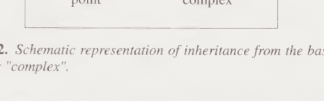

C++ 中的 "is a" 概念通过继承或派生实现。新的类从 "base" 类派生并继承其属性（见图 2.1）。在本例中，"complex" 类从 "point" 类派生并继承其作为二维笛卡尔平面中一点的属性（见图 2.2）。在此基础上，还可以在派生的 "complex" 类中定义更多专属于复数的算术运算。这些代数运算（两个复数的乘法和除法）将笛卡尔平面从一个单纯的向量空间完善为一个完整的数学域。

```cpp
class complex : public point{
```

基类名称前的单词 "public" 是可选的。然而，没有它，派生就是私有的，意味着基类中的非公共函数对派生类对象或函数不可用。换句话说，派生类具有与普通类相同的访问权限。这样，用户在意义上完全 "不知道" 派生，因为他们无法在以基类为参数编写的函数中使用派生类的对象。这正是我们在这里想要的：事实上，我们确实希望 "complex" 类的用户能够像对待普通的 "point" 对象一样对复数进行加法和减法运算。因此，我们在此使用公共派生，在基类名称前写上单词 "public"，如上代码行所示。

```cpp
public:
complex(const point& p) {
set(0,p[0]);
set(1,p[1]);
} // constructor with "point" argument

complex(double re=0., double im=0.){
set(0,re);
set(1,im);
} // constructor with "double" arguments
```

当构造一个 "complex" 对象时，其底层的 "point" 对象首先由其自身的默认构造函数构造，该构造函数将其字段值设为 0。然后这些值被重置为从参数获得的正确值。这种重置必须使用第 2.18 节中 "vector" 模板类中的公共 "set" 函数。因为向量的分量被声明为 "vector" 类中的私有，所以无法直接更改向量对象的分量，因此不仅用户无法访问，连派生者也无法访问。

```cpp
friend complex operator+(const complex&){
return complex(c[0], -c[1]);
} // complex conjugate
```

接下来，我们定义一个友元函数，该函数调用构造函数返回复共轭：

```cpp
const complex&operator+=(double);
const complex&operator-=(double);
const complex&operator*=(const complex&);
const complex&operator/=(const complex&);
};
```

这完成了派生 "complex" 类的块。

派生类无法访问基类的私有字段。然而，它可以访问 "半私有" 字段：即在基类块中通过简单地在其名称前写上保留字 "protected:" 而声明为 "protected" 的字段。这些字段只能被派生者访问，不能被其他用户访问。事实上，如果 "component" 字段在基 "vector" 类中声明为 "protected"，那么它就可以从派生的 "complex" 类中访问，并在其构造函数中直接设置。然而，使用第 2.18 节中 "vector" 类的当前实现，"complex" 对象的构造函数必须通过上述公共 "set" 函数间接访问它。

总之，一个类的成员有三种可能的类型：
- (a) 公共成员，可供所有人使用；
- (b) 私有成员，仅可被成员和友元访问；以及
- (c) 受保护成员，可被派生类的成员和友元访问（或在通过公共派生派生的当前对象结合调用时访问），但不能被普通函数访问，即使它们接受来自该类或其派生类的参数（见图 2.3）。

#### 图 2.3. 类的三种成员（public、protected 和 private）及其访问模式。

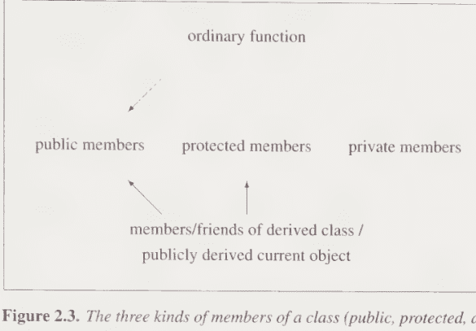

当派生对象被构造时，基类构造函数首先被调用。因此，派生类中的构造函数不能为这些字段使用初始化列表，因为它们已经被初始化为默认值。如果这些数据字段在基类中声明为 protected，则可以在派生类构造函数的函数体中重置它们。另一方面，如果它们是基类的私有成员，则只能通过公共成员函数间接重置，如上例中的 "set"。在此示例中，"set" 函数应用于当前正在构造的 "complex" 对象。由于派生的 "complex" 类中没有此类函数，"complex" 对象被解释为 "point" 对象，并调用第 2.18 节的 "set" 函数，将表示复数的实部和虚部的字段重置为正确值。

类似地，当 "complex" 对象作为具体参数传递给函数时，编译器首先在接受 "complex" 参数的函数中查找该函数。只有在不存在此类函数时，它才会将传递的 "complex" 对象解释为 "point" 对象，并查找接受 "point" 参数的函数。

当派生对象被销毁时，从基类继承的数据成员最后被销毁。这是由基类的默认析构函数完成的，该析构函数在销毁结束时自动调用，并按与在其中声明的相反顺序销毁从基类继承的成员。因此，"complex" 类的析构函数无需执行任何操作：基 "point" 类中的析构函数隐式地执行实际的销毁。为此，自动在 "complex" 类中可用的默认析构函数已足够，无需编写显式析构函数。

上述讨论表明，继承过程在时间和存储方面都存在轻微的开销，因为每个派生对象背后都隐藏着一个基对象。尽管如此，为了优雅透明的编程以及为了使用已正确实现的现有对象来派生各种更高级的对象，它可能非常值得。此外，继承使我们有机会遵循数学对象及其之间关系的真正概念。它在高级编程中特别有用，在那里程序员可以专注于从更技术性的基本对象派生的新对象的特殊属性。

基类的成员也作为派生类的成员发挥作用，因此可以在其自身成员的定义中使用。此外，由于派生是公共的，基类的公共成员在派生类中仍为公共，因此可供其用户使用。

基类的成员也可以在派生类中重写。在这种情况下，派生类中的版本会覆盖基类中的版本。例如，"complex" 类中的 `*=` 和 `/=` 运算符覆盖基 "point" 类中对应的运算符，因此对 "complex" 对象使用。仍然可以通过在函数名称前加上 "base::" 前缀的形式来调用基类中的版本（其中 "base" 代表基类的名称）来指示调用旧版本。例如，`point::operator*=` 调用基 "point" 类中的 `*=` 运算符。

上面定义的 unary `+` 运算符也覆盖了 "point" 类中对应的运算符，并返回复数的复共轭。选择 `+` 符号用于此目的，因为它表示唯一使实数保持不变的运算符，而复共轭运算符在应用于虚部为零的复数时也确实如此。该运算符用于复数的除法：

```cpp
const complex&
complex::operator*=(const complex& c) {
    double keep0 = (*this)[0];
    set(0,(*this)[0]*c[0]-(*this)[1]*c[1]);
    set(1,keep0*c[1]+(*this)[1]*c[0]);
    return *this;
}   // multiplying by complex

const complex&
complex::operator/=(const complex& c) {
    return *this *= (complex)((point)(+c)/=squaredNorm(c));
}   // dividing by complex
```

上面的 "/=" 运算符的工作方式如下。用复数 c̄ 除以复数相当于乘以 c̄/|c|²。首先，通过 "squaredNorm" 函数计算 |c|²。由于派生的 "complex" 类没有此类函数，参数 c̄ 被解释为 "point" 对象，并调用第 2.18 节中基 "vector" 类的 "squaredNorm" 函数。另一方面，unary `+` 运算符在基类和派生类中都可用，因此派生 "complex" 类中的版本覆盖了基 "vector" 类中的版本。因此，`+c̄` 被解释为所需的复共轭 c。现在，编译器需要调用一个 "/=" 运算符来将 "complex" 对象 c̄ 除以 "double" 数 |c|²。然而，如果天真地尝试这样做，由于 "complex" 类中没有除以 "double" 的操作，编译器会隐式地将数 |c|² 从 "double" 转换为 "complex"，并递归调用 "/=" 运算符。当然，这将导致无限多次递归调用，无法得到结果。

解决上述问题的办法是显式地将 c̄ 从 "complex" 转换为 "point"，方法是加上前缀 `(point)`，该前缀将派生对象转换为底层的基对象，同时保留其值。然后，"point" 对象 c̄ 由 "vector" 类第 2.18 节的 "/=" 运算符无歧义地除以标量 |c|²，如所需。

然后，将得到的 "point" 对象 c̄/|c|² 转换回 "complex" 对象，通过前缀 `(complex)`，该前缀调用接受 "point" 参数的构造函数，构造一个具有相同值的 "complex" 对象。由于 c̄/|c|² 现在被解释为复数，它可以乘以存储在 "this" 中的当前 "complex" 对象，从而完成对复数 c 的除法。


上述实现涉及两次额外的转换，在需要进行大量除法的应用中，这可能会导致相当大的开销。以下替代实现避免了这些转换：

```
const complex&
complex::operator/=(const complex&c){
    return *this *= (+c).point::operator/=(squaredNorm(c));
} // dividing by complex
```

在这段代码中，内部调用“/=”运算符前的前缀“point::”表明要使用基类“point”的“/=”运算符。这种实现在完全没有转换的情况下产生正确结果。

没有必要使用带“complex”参数的“+=”和“-=”运算符重写，因为基类“point”中相应的运算符工作正常。然而，需要显式编写带“double”参数的“+=”和“-=”运算符。否则，编译器会将“double”参数隐式转换为“point”对象 (a,a)，就像第 2.18 节中接受 double 参数的构造函数那样。当然，这个对象具有错误的值：正确的值应该是 (a,0)。因此，必须显式实现这些运算符，如下所示：

```
const complex& complex::operator+=(double a){
    set(0, (*this)[0] + a);
    return *this;
} // adding a real number

const complex& complex::operator-=(double a){
    set(0, (*this)[0] - a);
    return *this;
} // subtracting a real number
```

同样适用于（非成员）二元“+”和“-”运算符。对于混合“complex”和“double”参数的情况，应按如下方式重写这些运算符：

```
const complex
operator+(double a, const complex&c){
    return complex(c) += a;
} // double plus complex

const complex
operator+(const complex&c, double a){
    return complex(c) += a;
} // complex plus double

const complex
operator-(double a, const complex&c){
    return complex(a) - c;
} // double minus complex
```

```
const complex
operator-(const complex&c, const complex&d){
    return complex(c) -= d;
} // complex minus complex
```

以下是程序中实际使用复数的方式：

```
int main(){
    complex c=1.,i(0.,1.);
    complex d=c*3+4.*i;
    print(c+1);
    print(c/d);
    return 0;
}
```

似乎第 2.16 节中“complex”对象的原始实现比后者更简单且成本更低，因为它避免了构建基类“point”对象，以及每当调用基类函数时与其进行隐式转换。尽管如此，在许多应用中，继承可能无价之宝，正如我们将在下文中看到的。当前“complex”类的实现可以看作是使用继承的一个良好练习。

#### 2.20 示例：矩阵对象

这里我们使用继承来实现“matrix”对象及其有用的算术运算。首先，我们简要描述该对象及其主要功能。

假设我们要实现一个 N × M 矩阵，即一个具有 M 列、每列 N 个元素的矩阵：

A ≡ (A_{i,j})_{0≤i<N, 0≤j<M} = (c₀ | c₁ | ⋯ | c_{M−1})。

在这里，矩阵 A 被表示为 M 个列 c₀,c₁,…,c_{M−1} 的集合，每一列包含 N 个元素。

对于 N 维向量 u，u 乘以 A 的积是 M 维向量

uA ≡ ((u,c₀),(u,c₁),…,(u,c_{M−1}))，

其中 (u,c_j) 是 u 和 c_j 的内积。

对于 M 维向量 v = (v₀,v₁,…,v_{M−1})，A 乘以 v 的积是 N 维向量

Av ≡ Σ_{j=0}^{M−1} v_j c_j。

设 B 是一个 K × N 矩阵。B 乘以 A 的积是一个 K × M 矩阵

BA ≡ (Bc₀ | Bc₁ | ⋯ | Bc_{M−1})。

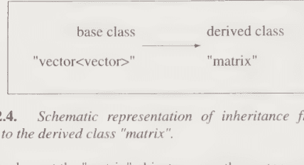

图 2.4. 从基类“vector<vector>”到派生类“matrix”的继承示意图。

为了实现“matrix”对象，我们使用如第 2.18 节所述的向量，其分量本身也是向量，表示矩阵中的列。换句话说，矩阵被实现为向量的向量。为此，“matrix”类从“vector<vector>”类派生（见图 2.4）。然后，三种不同的乘积（向量-矩阵、矩阵-向量以及矩阵-矩阵）严格按照上述数学定义实现。

模板类的实现使用三个参数，将在编译时指定：'T' 用于指定元素类型，'N' 用于指定行数，'M' 用于指定列数。这样，定义是通用的，类型和维度未指定：

```
template<class T, int N, int M>
class matrix : public vector<vector<T,N>,M>{
    public:
        matrix(){}  // default constructor
```

使用这个默认构造函数，用户可以定义一个不带任何参数的“matrix”对象。然后编译器隐式调用基类“vector”的默认构造函数，以构建底层的“vector”对象。

此外，以下构造函数将基类“vector”对象隐式转换为派生类“matrix”对象：

```
matrix(const vector<vector<T,N>,M>&) {
} // implicit convertor
```

使用此转换器，类型为“matrix”的函数（即返回“matrix”对象的函数）可以在其“return”命令中返回基类“vector”对象。该对象然后在函数终止时被隐式转换为所需的“matrix”对象。

接下来，我们转向一个更有意义的构造函数，它实际上执行某些操作。更具体地说，虽然由基类“vector”的默认构造函数创建的底层“vector”对象最初只包含平凡的零元素，但在函数块内，它被进一步更改以获取更有意义的值：

```
matrix(const vector<T,N>&u, const vector<T,N>&v) {
    set(0,u);
    set(1,v);
} // constructor with 2 columns
```

然而，在某些编译器中，包括 GNU 编译器的高级版本，诸如“vector”这样的模板基类的成员不能仅通过它们的名称从派生类访问。对于这些编译器，上述对继承自基类“vector”的函数“set”的调用必须替换为“vector::set”或“this->set”：

```
matrix(const vector<T,N>&u, const vector<T,N>&v) {
    this->set(0,u);
    this->set(1,v);
} // constructor with 2 columns
```

幸运的是，这里我们使用的是 GNU 的早期版本，如 Version 3.2，因此这种额外的编程是不必要的。

这里还有一个有用的函数，仅读取指定的矩阵元素：

```
const T& operator()(int i,int j) const{
    return (*this)[j][i];
} // read the (i,j)th matrix element
```

最后，我们还声明了一些成员运算符，这些运算符稍后必须定义，以便让编译器知道它们以与基类“vector”中相同的方式应用于底层“vector”对象：

```
const matrix& operator+=(const matrix&);
const matrix& operator-=(const matrix&);
const matrix& operator*=(const T&);
const matrix& operator/=(const T&);
};
```

至此，“matrix”类的代码块结束。复制构造函数、赋值运算符和析构函数不必在这里定义，因为基类“vector<vector>”中相应的函数工作正常。另一方面，乘法和除以标量的运算符必须重写，因为基类“vector”中相应的运算符返回基类“vector<vector>”对象，而不是所需的“matrix”对象。这些运算符的实际定义留作练习。

现在我们可以定义新的类型“matrix2”和“matrix3”，分别作为 2 阶和 3 阶方阵，作为上述模板类的特例：

```
typedef matrix<double,2,2> matrix2;
typedef matrix<double,3,3> matrix3;
```

两个“matrix”对象的加法和减法由继承自基类“vector”的相应运算符完成，因此不必在这里重写。上述向量乘以矩阵、矩阵乘以向量以及矩阵乘以矩阵的实际实现留作练习，详细解答见附录 A.5 节。假设这些函数可用，可以定义和操作矩阵如下：

```
int main(){
    matrix2 m(point(2,1),point(1,1));
```


```cpp
print(m+m);
print(m-m);
print(m*m);
return 0;
}
```

尽管乘法运算符同时存在于基类和派生类中，但派生类函数会覆盖基类函数，因此被调用的是它们，正如所要求的。

#### 2.21 方阵的行列式与逆

方阵 A（阶数为 N）的行列式 det(A) 和逆 A^{-1} 的计算是两个困难且重要的任务。最好的做法是使用下面描述的 A 的 LU 分解。

设 e^{(j)} 为第 j 个标准单位向量，即第 j 个分量等于 1，其余分量都等于 0 的向量。非奇异方阵 A 的 LU 分解为

A = L U P

其中 L、U 和 P 是阶数为 N 的方阵，具有以下性质。

- 1. L 是主对角线元素等于 1 的下三角矩阵：
  L_{i,j} = 0,  0 ≤ i < j < N, 且 L_{i,i} = 1,  0 ≤ i < N.
- 2. U 是主对角线元素非零（主元）的上三角矩阵：
  U_{i,j} = 0,  0 ≤ j < i < N, 且 U_{i,i} ≠ 0,  0 ≤ i < N.
- 3. P 是置换矩阵，即其列为不同的标准单位向量的矩阵。

上述 LU 分解由高斯消元法得到，并通过列的适当置换来避免零主元。在此，我们给出该算法的简化版本，假设主元的绝对值不太小，因此不需要置换，P 只是单位矩阵 I。

##### 算法 2.1

- 1. 将 L = (L_{i,j})_{0≤i,j<N} 初始化为单位矩阵 I。
- 2. 将 U = (U_{i,j})_{0≤i,j<N} 初始化为与 A 相同的矩阵。
- 3. 对 i = 1,2,3,...,N−1 执行以下操作：
  - 对 j = 0,1,2,...,i − 1 执行以下操作：
    - (a) 定义 factor = U_{i,j} / U_{j,j}.
    - (b) 对 k = j, j + 1, ..., N − 1，置 U_{i,k} ← U_{i,k} − factor · U_{j,k}.
    - (c) 置 L_{i,j} ← factor.

A 的行列式可以最有效地按如下方式计算：

det(A) = det(L) det(U) det(P) = ± det(U) = ± U_{0,0} U_{1,1} U_{2,2} ⋯ U_{N−1,N−1}.

换句话说，A 的行列式只是高斯消元过程中得到的主元 U_{i,i} 的乘积。

LU 分解在计算 A 的逆 A^{-1} 时也很有用。事实上，A^{-1} 中的第 j 列只是向量方程的解 x

Ax = e^{(j)}.

将上述 LU 分解代入 A 可求解该方程：

LU P x = e^{(j)}.

该方程分三步求解。首先，求解方程

L z = e^{(j)}

求未知向量 z（L 中的前向消元）。然后，求解方程

U y = z

求未知向量 y（U 中的回代）。最后，由于 P 是正交的，其逆等于其转置：P^{-1} = P^{t}。因此，所求向量 x 为

x = P^{t} y.

这样，无需显式求逆 L 或 U，可节省大量计算。此外，高斯消元过程中计算得到的三角因子 L 和 U 可存储以供进一步使用。事实上，如果不再需要 A，则它们可以占用 A 先前占用的同一数组，以节省宝贵的计算机内存。

#### 2.22 方阵的指数

阶数为 N 的方阵 A 的指数由收敛的无穷级数定义

exp(A) = I + A + A^{2}/2! + A^{3}/3! + ⋯ = Σ_{n=0}^{∞} A^{n} / n!,

其中 I 是阶数为 N 的单位矩阵。

该函数可通过第 1 章第 22 节中提到的泰勒或帕德近似来近似，只需将其中使用的标量 x 替换为矩阵 A。为此目的，当前的“matrix”类非常有帮助。

与第 1 章第 22 节类似，首先必须找到一个足够大的整数 m，使得 A/2^m 的 l₂-范数足够小（例如小于 1/2）。由于 l₂-范数不可用，我们用 l₁- 和 l∞-范数来估计它：

$$\|A\|_2 \le \sqrt{\|A\|_1 \|A\|_{\infty}},$$

其中 l₁- 和 l∞-范数由下式给出

$$\|A\|_1 = \max_{0 \le j < N} \sum_{i=0}^{N-1} |A_{i,j}|,$$

$$\|A\|_{\infty} = \max_{0 \le i < N} \sum_{j=0}^{N-1} |A_{i,j}|.$$

因此，通过找到一个足够大的整数 m 使得

$$2\sqrt{\|A\|_1 \|A\|_{\infty}} < 2^m,$$

我们也保证了 A/2^m 的 l₂-范数小于 1/2，如所要求的那样。

近似 exp(A) 的算法与第 1 章第 22 节中的方法相同，采用泰勒或帕德多项式。第 1 章第 22 节中使用的标量 x 被方阵 A 替换。第 1 章第 22 节中的代码很容易改编以适用于方阵，只要所需的算术运算是明确定义的即可。

模板的威力在这里显而易见。事实上，如果第 1 章第 22 节中的函数被写成模板函数，则它们可立即用于计算矩阵的指数，只需将它们的模板指定为“matrix”类即可。此方法留作下面的练习。

#### 2.23 对角化

在此我们给出并实现一个对给定阶数为 n 的方阵 A 进行对角化的算法。换句话说，该算法产生两个上三角矩阵 W 和 Z（其主对角线元素等于 1）以及一个对角矩阵 D（其唯一非零元素为形式为 D_{i,i}，1 ≤ i ≤ n 的元素），使得

$$W^T A Z = D.$$

该算法基于广义 Gram–Schmidt 过程，从阶数为 n 的单位矩阵的列开始，逐步从中产生两组向量（最终形式的 W 和 Z 的列），它们相对于由 A 诱导的双线性形式是相互双正交的 [15]。为确保不会除以零，我们在此为简单起见假设 A 的 i × i 上左块子矩阵（1 ≤ i < n）是非奇异的。

设 A^{(i)} 表示 A 中的第 i 列，因此 (A')^{(i)} 是 A 中的第 i 行。算法现在定义如下 [15]：

- 将 W 和 Z 都初始化为阶数为 n 的单位矩阵。
- 对 i = 1,2,...,n 执行以下操作：
  - 1. 对 j = 1,2,...,i−1，更新 W^{(i)}（W 中的第 i 列）为 $W^{(i)} \leftarrow W^{(i)} - \frac{(A^{(i)}, Z^{(j)})}{D_{j,j}} W^{(j)}$ [其中上述系数中的分子是第 i 行在 A 中与第 j 列在 Z 中的所谓的实内积（不取复共轭）]。
  - 2. 同样，对 j = 1,2,...,i−1，更新 Z^{(i)}（Z 中的第 i 列）为 $Z^{(i)} \leftarrow Z^{(i)} - \frac{(W^{(j)}, A^{(i)})}{D_{j,j}} Z^{(j)}$（其中上述系数中的分子是 W 中第 j 列与 A 中第 i 列的实内积）。
  - 3. 最后，定义 $D_{i,j} \equiv (W^{(i)}, A Z^{(j)})$（实内积，无复共轭）。

幸运的是，该算法主要使用列运算，因此第 2.20 节中“matrix”对象作为列向量的集合的实现特别合适。为了充分利用这种结构，我们必须首先向第 2.18 节中基“vector”类的块添加一个额外的“operator()”成员函数：

```cpp
T& operator() (int i) {
return component[i];
} // read/write ith component
```

现在可以从应添加到第 2.20 节中派生“matrix”类块的另一个“operator()”成员函数中调用此运算符：

```cpp
vector<T,N>& operator() (int i) {
return vector<vector<T,N>,M>::operator() (i);
} // read/write ith column
```

有了这个新运算符，不仅可以通过编写 `m[i]` 来读取“matrix”对象 m 的第 i 列，还可以通过编写 `m(i)` 来更改它，后者返回对其的非常量引用。

此外，上述新运算符现在被用来向第 2.20 节中派生“matrix”类块添加另一个版本的“operator()”。该版本返回对特定矩阵元素的非常量引用：

```cpp
T& operator()(int i, int j, char*){ 
return (*this)(j)(i); 
} // read/write A(i,j)
```

有了这个新版本，不仅可以通过编写 `m(i,j)` 来读取已定义的矩阵 m 的 (i,j) 元素，还可以通过编写例如 `m(i,j,"write")` 来更改它。这样，可以向第 2.20 节中的类块添加另一个构造函数，该构造函数接受一个“double”参数来构造 2 × 2 矩阵：

```cpp
matrix(double d){
(*this)(0,0,"write") = d;
(*this)(1,1,"write") = d;
} // constructor of a 2 by 2 matrix
```

此外，上述运算符还可用于生成给定矩阵的转置：

```cpp
template<class T, int N, int M>
const matrix<T, M, N> transpose(const matrix<T, N, M>&A){
matrix<T, M, N> At;
for(int i=0; i<N; i++)
for(int j=0; j<M; j++)
At(j,i,"write") = A(i,j);
return At;
} // transpose of a matrix
```

我们现在准备通过简单地遵循其原始数学表述来实现对角化算法：

```cpp
template<class T, int N, int M, int W, int Z, int D>
void diagonalize(matrix<T,N,N>&W,
const matrix<T,N,N>&A,
matrix<T,N,N>&Z,
vector<T,N>&D){
for(int i=0; i<N; i++){
W(i,i,"write") = 1.;
Z(i,i,"write") = 1.;
}
matrix<T,N,N> At = transpose(A);
for(int i=0; i<N; i++){
vector<T,N> r = At[i];
for(int j=0; j<i; j++)
W(i) -= r * Z[j] / D[j] * W[j];
vector<T,N> c = A[i];
for(int j=0; j<i; j++)
c(j) -= W(j) * Z[j] / D[j] * c[j];
}
}
```


```
Z(i) -= W[j] * c / D[j] * Z[j];
D(i) = W[i] * (A * Z[i]);
}
} // diagonalize a matrix
```

特别是，对角矩阵 D，其主对角线存储在上述代码中生成的向量 'D' 中，现在可用于计算原矩阵 A 的行列式，即 D_i,i 的乘积：

```
template<class T, int N>
const T det(const vector<T,N>&D) {
    T result = 1.;
    for(int i=0; i<N; i++)
        result *= D[i];
    return result;
} // determinant using diagonalization
```

#### 2.24 练习

- 1. 将复数实现为模板类 "complex<T>"，其中 'T' 为实部和虚部的类型。定义所需的算术运算并在 "complex<float>" 和 "complex<double>" 类型的对象上进行测试。
- 2. 在极坐标中实现复数：一个 "complex" 对象包含两个字段 'r' 和 "theta"，用于存储极坐标表示 r exp(iθ) 中使用的参数 r ≥ 0 和 0 ≤ θ < 2π。定义并测试所需的算术运算。
- 3. 使用 "complex" 类的用户是否必须被告知上述修改？为什么？
- 4. 完成第 2.18 节中缺失的运算符，例如向量的减法以及与标量的乘法和除法。解法见附录 A.4 节。
- 5. 实现加法和减法两个矩阵的运算符。解法见附录 A.5 节。
- 6. 实现第 2.20 节代码中缺失的向量-矩阵、矩阵-向量、矩阵-矩阵以及标量-矩阵乘积。解法见附录 A.5 节。
- 7. 编写返回 2 × 2 矩阵的转置、逆和行列式的函数（第 2.20 节中的 "matrix2" 对象）。解法可参见附录 A.5 节。
- 8. 将第 1 章第 22 节中的 "expTaylor" 和 "expPade" 函数重写为模板函数，使其接受类型为 'T' 的参数，并将其应用于类型为 "matrix2" 的参数 A 以计算 exp(A)。确保代码中提供矩阵之间所需的所有算术运算。

9. 将上述函数应用于类型为 "matrix<complex,4,4>" 的对象，并验证对于复参数 λ，

exp(⎛⎝λ  1 λ  1 λ  1 λ⎞⎠) = exp(λ)⎛⎝1  1/1! 1  1/2! 1/1! 1  1/3! 1/2! 1/1! 1⎞⎠

（上述矩阵中的空白表示零元素）。

10. 将你的代码与可在本书网页 http://www.siam.org/books/cs09 上找到的 Fortran 代码（461 行）进行比较。数值结果是否相同？哪段代码更易于阅读和使用？

# 第 3 章

### 当前应用中使用的数据结构

在本章中，我们描述了几种有用的数据结构及其 C++ 实现。特别是，我们介绍了动态数据结构，其大小是在运行时而非编译时指定的。此外，我们还实现了大小可变的对象的列表。最后，我们实现了灵活的链表，并提供了合并和排序的算法。这些数据结构在整本书中都非常有用。

#### 3.1 数据结构

如上所述，在程序执行期间定义和使用变量，只是在计算机内存中为相应数据存储的一个特定位置。变量的名称实际上是一种引用它并访问计算机内存中存储的数据的方式。

在大多数应用中，人们不仅需要使用单个变量，还需要使用可能包含许多变量的大型结构。这些结构遵循某种模式，据此变量被排序或相互关联。这些结构称为数据结构。

最常见的数据结构是数组。在数组中，变量一个接一个地连续存储在计算机内存中。因此，它们必须全部为同一类型，例如整数、浮点数、双精度等。

数组被认为是一种特别高效的数据结构。因为变量在计算机内存中一个接一个地存储，所以在循环中扫描它们特别容易。然而，数组通常不够灵活：其大小和类型是固定的且不能更改，并且在构造后也无法向其中添加更多项或删除项。

数组在实现线性代数算法时特别有用。事实上，线性代数中经常使用的矩阵和向量对象可以自然地在数组中实现。这些数学对象的自然实现提供了以它们最初开发的精神实现数值算法的机会。

这种方法在 C++ 中得到了进一步发展，其中数组不仅用于高效存储向量和矩阵，还用于实际提供完整的矩阵和向量对象，以及它们之间的所有所需算术运算。然后，这些对象可以像原始数学算法中一样使用：代码不包含任何关于存储问题的细节，透明且易于调试。

总之，在 C++ 中，数学算法与存储细节完全分离。数组隐藏在向量和矩阵类内部，并且仅通过接口函数进行操作。一旦向量和矩阵对象准备就绪，它们就可以作为完整的数学对象在所需的数值算法中使用。

#### 3.2 数据结构中的模板

如上所述，数组必须是同质的：它只能包含一种类型的变量。这一特性自然导致了在 C++ 中使用模板。当向量和矩阵被定义为模板类时，它们中的变量类型不是预先确定的，而是保持隐式，直到实际构造具体对象。利用模板的机会节省了大量编程工作，因为它允许使用每一种可能的变量类型定义数据结构。例如，向量和矩阵类可以用整数、浮点数、双精度或复数类型，或任何其他大小恒定的变量使用。

模板不仅提供了一种高效且经济的编程风格，也为数据结构的实现提供了一种合适的方法。事实上，数据结构与所使用的特定变量类型无关。它们可以用通用类型更好地定义，以便在使用时在具体应用中确定。

因此，在数据结构定义中使用模板是最自然的；它排除了关于特定变量类型的任何分散注意力的细节，让程序员专注于纯数据结构及其数学特征的最优实现。

数据结构的数学特征还包括变量在其内部的组织方式。这些特征可能相当复杂：例如，它们可以描述如何从另一个变量访问特定变量。变量之间的关系最好在模板类中实现，其中特定变量类型被消除。

到目前为止，我们只处理了最简单的数据结构：向量。在这种数据结构中，变量之间的关系由它们在向量中的顺序决定：特定变量与向量中前一个和下一个变量相关。这就是为什么向量特别适合循环的原因。在矩阵中，变量也与矩阵中位于其上方和下方的变量相关。因此，矩阵也适合嵌套循环。

在下一节中，我们介绍一种向量的实现，其中维度是在运行时而非编译时确定的。这一属性在实际应用中非常重要。

#### 3.3 动态向量

第 2 章第 18 节中 "vector" 对象的实现要求其维度 'N' 在编译时指定。然而，在许多情况下，维度只在运行时才知道。例如，维度可能是一个从外部文件读取的参数、在递归过程中指定，或作为参数传递给函数。在这种情况下，


编译时维度尚不可知，因此不能使用第2章第18节的“vector”类。显然需要一种能在运行时确定维度的动态向量。

本节将提供所需的动态实现。在该实现中，“dynamicVector”对象的维度存储在一个私有数据成员中。因此，“dynamicVector”对象不仅包含向量的分量，还包含一个额外的整数来指定向量的维度。该整数的值可以在运行时根据需要设置。

由于实际维度在编译时未知，用于存储“dynamicVector”对象的内存无法在编译时分配。相反，内存分配在运行时使用保留字“new”完成。“new”函数为某个对象分配内存并返回该内存的地址。例如，

```
double* p = new double;
```

为“double”变量分配内存，并用其地址初始化一个名为“p”的指向double的指针。

当前实现灵活且动态，符合要求。模板仅用于指定分量的类型，而非分量的数量。这个数量确实是在运行时动态确定的。

“dynamicVector”类中的数据字段声明为“protected”，以便稍后定义的派生类可以访问它们。使用了两个数据字段：指示向量维度的整数“dimension”和指向向量分量的指针“component”。

由于维度尚不可用，“component”字段必须声明为指向T的指针，而不是像第2章第18节的“vector”类中那样声明为T的数组。只有在实际调用“dynamicVector”类的构造函数时，所需的内存才会被分配，“component”才会指向具体的分量数组：

```
#include<stdio.h>
template<class T> class dynamicVector{
protected:
    int dimension;
    T* component;
public:
    dynamicVector(int, const T&);
    dynamicVector(const dynamicVector&);
    const dynamicVector& operator=(const dynamicVector&);
    const dynamicVector& operator=(const T&);
```

上面只声明了构造函数和赋值运算符。实际定义将在后面给出。接下来，我们定义析构函数：

```
~dynamicVector(){
    delete [] component;
} // 析构函数
```

析构函数中使用的“delete[]”命令会删除整个数组“component”，并释放其占用的内存以供将来使用。注意，“dimension”字段不需要显式删除。因为它不是指针，所以会被C++编译器内置的默认析构函数隐式删除，该默认析构函数在每次调用上述析构函数结束时自动调用。

因为“dimension”字段是protected的，我们需要一个公共函数来从非“dynamicVector”派生类的普通类中读取它：

```
int dim() const{
    return dimension;
} // 返回维度
```

下面定义的“operator()”返回当前“dynamicVector”对象中第i个分量的引用。由于该引用非常量，用户可修改它。而“operator[]”返回常量引用，因此第i个分量只能通过它读取：

```
T& operator()(int i){
    return component[i];
} // 读/写第i个分量
```

```
const T& operator[](int i) const{
    return component[i];
} // 只读第i个分量
```

我们还声明了一些成员算术运算符，它们作用于当前的“dynamic Vector”对象。完整定义将在后面给出。

```
const dynamicVector& operator+=(const dynamicVector&);
const dynamicVector& operator-=(const dynamicVector&);
const dynamicVector& operator*=(const T&);
const dynamicVector& operator/=(const T&);
};
```

“dynamicVector”类的定义到此结束。

现在我们来定义上面仅声明过的函数。在下面定义的构造函数中，如果维度非零，则在初始化列表中为分量数组分配内存：该动态内存分配由“new”命令完成。该命令返回的地址存放在“component”字段中以供将来访问：

```
template<class T>
dynamicVector<T>::dynamicVector(
    int dim = 0, const T& a = 0)
    : dimension(dim), component(dim ? new T[dim] : 0){
for(int i = 0; i < dim; i++)
    component[i] = a;
} // 构造函数
```

拷贝构造函数中使用相同的方法：

```
template<class T>
dynamicVector<T>::dynamicVector(const dynamicVector<T>& v)
```

: dimension(v.dimension),
component(v.dimension ? new T[v.dimension] : 0){
  for(int i = 0; i < v.dimension; i++)
    component[i] = v.component[i];
} // 拷贝构造函数

接下来，我们定义赋值运算符：

```
template<class T>
const dynamicVector<T>&
dynamicVector<T>::operator=(const dynamicVector<T>& v){
  if(this != &v){
```

我们刚刚进入“if”块，它确保赋值运算符不会被形如“u = u”的无意义调用触发。现在，我们需要使当前向量的维度与参数向量“v”的维度相同：

```
if(dimension != v.dimension){
  delete [] component;
  component = new T[v.dimension];
}
```

这样，数组“component[]”的维度与数组“v.component[]”的维度相同，并且可以在一个标准循环中填充对应的值：

```
for(int i = 0; i < v.dimension; i++)
  component[i] = v.component[i];
dimension = v.dimension;
}
return *this;
} // 赋值运算符
```

这就完成了接受向量参数的赋值运算符的定义。接下来，我们定义接受标量参数的另一个赋值运算符。该标量被简单地赋给当前动态向量的所有分量：

```
template<class T>
const dynamicVector<T>&
dynamicVector<T>::operator=(const T& a){
  for(int i = 0; i < dimension; i++)
    component[i] = a;
  return *this;
} // 带标量参数的赋值运算符
```

接下来，我们实现一些有用的算术运算符：

```
template<class T>
const dynamicVector<T>&
dynamicVector<T>::operator+=( const dynamicVector<T>&v){
  for(int i = 0; i < dimension; i++)
```

```
```cpp
component[i] += v[i];
return *this;
} // 将dynamicVector加到当前向量上

template<class T>
const dynamicVector<T>
operator+(const dynamicVector<T>&u,
         const dynamicVector<T>&v){
  return dynamicVector<T>(u) += v;
} // dynamicVector加dynamicVector

template<class T>
const dynamicVector<T>
operator-(const dynamicVector<T>&u){
  return dynamicVector<T>(u) *= -1.;
} // dynamicVector的负向量
```
```

最后，这里有一个将动态向量打印到屏幕的函数：

```
```cpp
template<class T>
void print(const dynamicVector<T>&v){
  print("[");
  for(int i = 0; i < v.dim(); i++){
    printf("v[%d] = ",i);
    print(v[i]);
  }
  print("]\n");
} // 打印dynamicVector
```
```

一些算术运算的实现，如减法、乘法、标量除法和内积，留给读者作为练习。假设这些运算也可用，就可以编写各种向量操作如下：

```
```cpp
int main(){
  dynamicVector<double> v(3,1.);
  dynamicVector<double> u;
  u=2.*v;
  printf("v:\n");
  print(v);
  printf("u:\n");
  print(u);
  printf("u+v:\n");
  print(u+v);
  printf("u-v:\n");
  print(u-v);
  printf("u*v=%f\n",u*v);
  return 0;
}
```
```

#### 3.3. 动态向量

#### 3.4 列表

上述向量和动态向量都是作为类型为“T”的分量数组实现的。根据定义，C（以及其它编程语言）中的数组必须包含类型和大小都相同的分量。任何数组都不能包含占用不同内存量的分量。

然而，在许多应用中，需要使用大小各异的对象序列。例如，可能需要使用维度在编译时尚不可知的向量序列。这类应用不能再使用标准数组来存储向量，因为最终它们可能占用不同的大小。需要一种更灵活的数据结构。

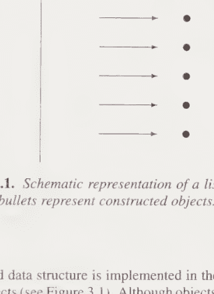

图3.1. 对象列表的示意图。箭头表示指针，圆点表示已构造的对象。i表示指针数组中的索引。

所需的数据结构实现在“list”类中，该类包含一个指向“T”对象的指针数组（见图3.1）。虽然“T”类型的对象可能具有不同的大小（例如，当“T”是“dynamicVector”时），但它们的地址只是占用固定内存量的整数，因此可以放在数组中。在运行时，具体的“T”类型对象被放置在数组中的地址处。例如，如果在编译时将“T”指定为“dynamicVector”，则列表中的“dynamicVector”对象的维度在运行时通过“dynamicVector”类的构造函数指定，然后放置在列表数组中包含的地址处。

列表的长度，即其中数组中指向“T”的指针的数量，也可以在运行时动态确定。与“dynamicVector”类一样，这是通过使用一个额外的整数字段来存储项的数量来实现的。因此，“list”类包含两个受保护的数据字段：“number”表示项数量，“item”存储它们的地址。详细实现如下：


```cpp
template<class T> class list{
protected:
    int number;
    T** item;
public:
    list(int n=0):number(n), item(n ? new T*[n]:0){
    } // constructor

    list(int n, const T&t)
        : number(n), item(n ? new T*[n] : 0){
        for(int i=0; i<number; i++)
            item[i] = new T(t);
    } // constructor with T argument

    list(const list<T>&);
    const list<T>& operator=(const list<T>&);
};
```

拷贝构造函数和赋值运算符仅在上面声明，后续再定义。下面的析构函数首先删除“list”对象中数组里的指针，然后再删除整个数组本身：

```cpp
~list(){
    for(int i=0; i<number; i++)
        delete item[i];
    delete [] item;
} // destructor
```

由于“number”字段是受保护的，不能从普通函数中读取。读取它的唯一方式是使用“size()”函数：

```cpp
int size() const{
    return number;
} // list size
```

同样，由于“item”字段是受保护的，不能被普通函数访问。访问其元素的唯一方式是通过“operator()”（读写）或“operator[]”（只读）：

```cpp
T& operator()(int i){
    if(item[i])return *(item[i]);
} // read/write ith item

const T& operator[](int i)const{
    if(item[i])return *(item[i]);
} // read only ith item
};
```

至此，“list”类的代码块结束，包括构造函数、析构函数以及读取和访问列表中单个元素的函数定义。注意，只有当列表 'l' 包含 well-defined 的第 i 个元素时，才应调用 “l(i)” 或 “l[i]”。

拷贝构造函数和赋值运算符仅在上面的类块中声明。以下是实际定义：

```cpp
template<class T>
list<T>::list(const list<T>&l):number(l.number),
  item(l.number ? new T*[l.number] : 0){
    for(int i=0; i<l.number; i++)
      if(l.item[i])
        item[i] = new T(*l.item[i]);
      else
        item[i] = 0;
  } // copy constructor
```

以下是赋值运算符的定义：

```cpp
template<class T>
const list<T>&
list<T>::operator=(const list<T>& l){
  if(this != &l){
    if(number != l.number){
      delete [] item;
      item = new T*[l.number];
    }
    for(int i = 0; i < l.number; i++)
      if(l.item[i])
        item[i] = new T(*l.item[i]);
      else
        item[i] = 0;
    number = l.number;
  }
  return *this;
} // assignment operator
```

我们刚刚进入了确保赋值运算符没有被形如 “l = l” 的平凡调用所调用的 “if” 块。现在，我们确保当前列表包含的项目数与作为参数传递的列表 “l” 相同。换句话说，数组 “item[]” 被修改为与数组 “l.item[]” 具有相同的维度。我们现在可以继续将 'l' 中的项目复制到当前的 “list” 对象中。

最后，我们实现将列表中的项目打印到屏幕上的函数：

```cpp
template<class T>
void print(const list<T>&l){
  for(int i=0; i<l.size(); i++){
    printf("i=%d:\n",i);
    print(l[i]);
  }
} // printing a list
```

#### 3.5 链表

第 3.4 节中的 “list” 对象实现为指向对象的指针或地址的数组。然而，这个数组过于结构化：添加新项目或删除旧项目并不容易。此外，项目的数量在列表构造时就确定了，之后无法更改。这些缺点使得 “list” 数据结构不适合许多应用。我们需要一种更灵活、易于操作且不受限制的列表类型。

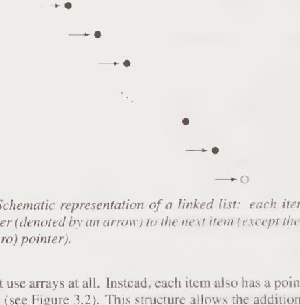

图 3.2. 链表的示意表示：每个项目（用圆点表示）包含一个指向下一个项目的指针（用箭头表示），除最后一个项目外，最后一个项目包含空（或零）指针。

链表根本不使用数组。相反，每个项目还具有一个指向列表中下一个项目的指针（见图 3.2）。这种结构允许在必要时向链表添加无限数量的项目，并且还允许在其中每个位置插入和删除项目。

通过指针访问项目如上所述也称为“间接索引”。显然，它不如数组中使用的直接索引高效，因为项目不再连续存储在计算机内存中。尽管如此，其优点远远超过这一缺点。事实上，插入和删除项目的自由对于实现许多有用的对象至关重要（见第 4 章）。此外，为换取更好的人力资源利用，计算机资源的轻微低效也是值得的：使用链表的程序员可以利用其特殊的递归结构来实现复杂的对象、函数和算法。

链表在下面定义的模板类 "linkedList" 中实现。（链表中的项目类型为 "T"，将在编译时定义。）"linkedList" 类包含两个数据字段：“item”，包含链表中的第一个项目；“next”，包含其余链表的地址。两个数据字段均声明为 “protected”，因此以后可以从派生类访问。

“linkedList” 对象的定义是递归的：包含除第一个项目之外的所有项目的较短链表也被递归地定义为一个 “linkedList” 对象，并放置在字段 “next” 的地址中。这种递归模式在许多基本操作中很有用。

以下是 “linkedList” 类的完整实现：

```cpp
template<class T> class linkedList{
    protected:
        T item;
        linkedList* next;
    public:
        linkedList():next(0){
        } // default constructor

        linkedList(T&t, linkedList* N=0)
            : item(t),next(N){
        } // constructor

const T& operator()() const{
    return item;
} // read item field

const linkedList* readNext() const{
    return next;
} // read next

const linkedList& operator=(const linkedList&);
linkedList(const linkedList&l):item(l()),
    next(l.next ? new linkedList(*l.next):0){
} // copy constructor

~linkedList(){
    delete next;
    next = 0;
} // destructor

linkedList& last(){
    return next ? next->last() : *this;
} // last item

int length() const{
    return next ? next->length() + 1 : 1;
} // number of items

void append(T&t){
    last().next = new linkedList(t);
} // append item

void insertNextItem(T&t) {
    next = new linkedList(t,next);
} // insert item in second place

void insertFirstItem(T&t){
    next = new linkedList(item,next);
    item = t;
} // insert item at the beginning

void dropNextItem();
void dropFirstItem();
const linkedList& operator+=(linkedList&);
linkedList& order(int);
template<class S>
    const S truncateItems(double, const S&);
template<class S>
    const S dropPositiveItems(
        int, const S&, double);
template<class S>
    const S maskItems(
        const dynamicVector<int>&, const S&);
};
```

数据字段 “item” 和 “next” 也可以通过上面定义的公共成员函数 “operator()” 和 “readNext()” 从普通函数中读取（尽管不能更改）。赋值运算符仅在此声明，后续再定义。链表的递归模式在拷贝构造函数中特别有用。事实上，它只需要复制 “item” 字段，然后递归地应用于包含其余项目的较短链表：

在这里，所有工作都在初始化列表中完成：构造对象的 “item” 字段被初始化为 “l()”，即 'l' 中的第一个项目（通过上面定义的 “operator()” 访问）。构造对象的 “next” 字段随后通过 “new” 命令和对拷贝构造函数本身的递归调用进行初始化。

递归结构在定义析构函数时也很有用。事实上，析构函数只需要一条命令来删除指向包含除第一个项目之外所有项目的较短链表的字段 “next”。当该指针被销毁时，相同的析构函数会自动被调用以销毁其内容（较短的链表）并将其释放以供进一步使用。这样，链表中的其余项目也会被销毁，无需编写任何显式代码。

“linkedList” 对象中的第一个字段 “item” 无需显式命令来销毁它，因为它不是指针。它在 “next” 被销毁后自动销毁。

此外，我们定义了返回链表中最后一个项目的引用以及其中项目数量的递归函数。这些函数随后用于在链表末尾追加新项目。

以下函数在链表的不同位置插入新项目。函数 “insertNextItem()” 将新项目放在链表第一个项目之后。函数 “insertFirstItem()” 将新项目放在链表第一个项目之前。最后，我们还声明了一些更多函数，包括从链表某些位置删除某些项目的函数。（这些函数的完整定义将在后面给出。）


#### 3.5. 链表

注意，上述后三个函数还使用了一个额外的模板符号 ’S’，作为返回对象的类型。当用户调用这些函数中的任意一个时，他/她必须通过引用传递一个具体的实参来指定 ’S’。

这就结束了 "linkedList" 类的声明部分：上述仅声明的函数将在下文定义。

人们可能会合理地追问：为什么在上述构造函数以及 "insertNextItem" 和 "insertFirstItem" 等函数中，’T’ 参数没有被声明为常量？毕竟，在这些函数中被改变的是当前的 "linkedList" 对象，显然没有必要同时改变 ’T’ 参数。将其声明为常量难道不能保护代码免受编译时和运行时错误的侵害吗？

答案是，通常确实是一个好主意将参数声明为常量。然而，在这里，我们计划从一个非寻常的类继承该 "linkedList" 类，该类的构造函数也会改变其参数。这个非寻常的类在第13章中有描述。

接下来，我们引入赋值运算符。该运算符也受益于链表的递归结构。事实上，在第一个元素被赋予值之后，赋值运算符会递归地应用于链表的其余部分：

```
template<class T>
const linkedList<T>&
linkedList<T>::operator=(const linkedList<T>& L) {
    if(this != &L) {
        item = L();
        if(next) {
            if(L.next)
                *next = *L.next;
            else{
                delete next;
                next = 0;
            }
        }
        else
            if(L.next)next = new linkedList(*L.next);
    }
    return *this;
}   // assignment operator
```

链表的主要优势在于插入和丢弃元素的机会。下面是丢弃链表中第二个元素的函数。（可以通过将相同的函数应用于更短的链表来丢弃下一个元素，在该链表中它是第二个元素。）

```
template<class T>
void linkedList<T>::dropNextItem(){
    if(next){
        if(next->next){
            linkedList<T>* keep = next;
            next = next->next;
            keep->item.~T();
        }
        else
            delete next;
            next = 0;
    }
    else
        printf("error: cannot drop nonexistent next item\n");
} // drop the second item from the linked list
```

上述函数还用于以下函数中，以丢弃链表中的第一个元素：

```
template<class T>
void linkedList<T>::dropFirstItem(){
    if(next){
        item = next->item;
        dropNextItem();
    }
    else
        printf("error: cannot drop first item; no next.\n");
} // drop the first item in the linked list
```

请注意，当链表只包含一个元素时，该元素永远不会被丢弃。如果尝试丢弃它，则会在屏幕上打印错误消息。

#### 3.6 递归截断

在此我们实现上面声明的 “truncateItems” 成员函数。该函数会从当前链表中丢弃量级相对较小的元素。此外，我们指出了该函数递归实现中的一个轻微低效问题，并展示了如何修复它。

假设 “T” 类有一个 “getValue()” 函数，该函数返回 “T” 对象的值。如果该值（按绝对值）小于规定的阈值，则该元素将从链表中被丢弃。反之，如果 “T” 类没有 “getValue()” 函数，则不能调用本函数。

详细实现如下：

```
template<class T>
void linkedList<T>::truncateItems(double threshold){
    if(next){
        if(abs(next->item.getValue()) <= threshold){
            dropNextItem();
            truncateItems(threshold);
        }
```

在上述内部 "if" 块中，链表的第二个元素被视为待丢弃。如果它确实被丢弃，则第三个元素将取代它成为新的第二个元素，然后在递归调用中被考虑是否丢弃。另一方面，如果它没有被丢弃，则第三个元素保持在其原始位置，并通过应用于当前链表 "tail"（从第二个元素开始的较短链表）的递归调用来考虑是否丢弃：

```
else
    next->truncateItems(threshold);
}
```

最后，只要第一个元素不是链表中唯一的元素，它也会被考虑是否丢弃：

```
if(next && (abs(item.getValue()) <= threshold))
    dropFirstItem();
} // truncate small items
```

请注意上述实现中如何使用链表的递归结构。首先，链表的第二个元素被考虑是否丢弃。然后，该函数递归地应用于剩余元素。

这里可能会问：为什么不是通过 "dropFirstItem" 函数考虑丢弃第一个元素，然后递归地将该函数应用于剩余元素？之所以不采用这种方法是，因为由最内层递归调用丢弃的链表中的最后一个元素（如果它确实足够小）永远无法通过 "dropFirstItem" 函数丢弃，而是通过从上一个元素调用的 "dropNextItem" 函数丢弃。事实上，"dropFirstItem" 函数不能丢弃链表中唯一的元素。因此，递归必须始终向前看并截断下一个元素，而不是当前元素。

这就是为什么链表的第一个元素在上述代码段末尾最后才被考虑丢弃的原因。然而，上述实现仍然存在低效问题。确实，链表的第一个元素被检查丢弃了两次：一次在函数最后一行代码中，另一次在递归调用中（如果第二个元素确实应该被丢弃，那么上述内部 "if" 块确实会被进入）。此外，这个问题在内层递归调用中甚至更加严重，因为它们可能会不必要地检查所应用于的链表中的第一个元素。为了避免这种冗余工作，可以将最后一段代码从上述函数中分离出来并放入另一个函数中，该函数仅在流程结束时执行一次。换句话说，上述函数可以拆分为以下两个函数。第一个函数 "truncateTail" 仅从当前链表的 "tail"（即从第二个元素开始）丢弃小元素。为此，它使用与原始函数相同的递归方法：

```
template<class T>
void linkedList<T>::truncateTail(double threshold){
    if(next){
        if(abs(next->item.getValue()) <= threshold){
            dropNextItem();
            truncateTail(threshold);
        }
        else
            next->truncateTail(threshold);
    }
} // truncate small items from the tail only
```

此外，下一个函数 "truncateFirstItem" 仅截断第一个元素（即，如果它的量级确实足够小且不是当前链表中唯一的元素）：

```
template<class T>
void linkedList<T>::truncateFirstItem(double threshold){
    if(next&&(abs(item.getValue()) <= threshold))
        dropFirstItem();
} // truncate the first item only
```

所需的 "truncateItems" 函数现在可以作为一个组合上述两个函数的形式，更高效地重新实现：

```
template<class T>
void linkedList<T>::truncateItems(double threshold){
    truncateTail(threshold);
    truncateFirstItem(threshold);
} // truncate small items
```

链表的递归结构也适用于打印。事实上，在第一个元素被打印之后，"print" 函数会递归地应用于链表中剩余的项：

```
template<class T>
void print(const linkedList<T>&l){
    printf("item:\n");
    print(l());
    if(l.readNext())print(*l.readNext());
} // print a linked list
```

这是链表在程序中的实际使用方式：

```
int main(){
    linkedList<double> c(3.);
    c.append(5.);
    c.append(6.);
    c.dropFirstItem();
    print(c);
    return 0;
}
```

#### 3.7 非递归截断

在此，我们提供上述 "truncateItems" 函数的稍有效率更高的非递归版本。此外，该版本还返回被丢弃元素的总和。


该和的类型的类型与 'T' 类的 "getValue" 函数返回的类型相同。此时，该类型仍未指定。因此，它用模板符号 'S' 表示，由实际调用该函数的用户稍后指定。

在我们的应用中，'S' 始终为 "double"；在更高级的应用中，它也可以代表复数。

符号 'S' 的具体解释取决于作为引用传递给函数的参数 "compare"。该参数用于确定当前链表中哪些项太小应从中删除：

```cpp
template<class T>
template<class S>
const S linkedList<T>::truncateItems(double threshold,
    const S& compare) {
    S sum = 0.;
    if (next) {
        int dropped = 0;
```

下面的循环使用指向链表的指针 "runner" 从当前链表中的一项推进到下一项。在循环中，并非由 "runner" 指向的项，而是其后面的项由 "dropNextItem" 函数考虑是否删除。如果该项确实应被删除，则局部整数变量 "dropped" 取值为 1，这意味着 "runner" 已推进到下一项。反之，如果该项不应被删除，则 "dropped" 取值为 0，这意味着应手动将 "runner" 推进到下一项以继续循环：

```cpp
for (linkedList<T>* runner = this;
    runner->next;
    runner = dropped ? runner : runner->next) {
    dropped = 0;
    if (fabs(runner->next->item.getValue())
        <= threshold * fabs(compare)) {
        sum += runner->next->item.getValue();
        runner->dropNextItem();
        dropped = 1;
    }
}
```

最后，当前链表中的第一项也应考虑是否删除：

```cpp
if (next && (fabs(item.getValue())
    <= threshold * fabs(compare))) {
    sum += item.getValue();
    dropFirstItem();
}
return sum;
} // truncate small items
```

以下是另外两个与上述函数非常相似的函数。事实上，它们与之的区别仅在于删除项的标准。它们假定 'T' 类还具有 "getColumn" 函数，该函数返回一个整数，用以表征该项在链表中的位置。事实上，由 "getColumn" 函数返回的整数可视为链表中该项的（可能不连续的）索引：链表中的第一项具有最小索引，下一个项具有（可能大得多）的更大索引，依此类推，直到链表中的最后一项，它具有最大索引。

下面的 "dropPositiveItems" 函数接收两个额外参数：整数 "diag" 和 'S' 对象 "center"。删除项的标准是其由 "getColumn" 函数返回的索引是否不同于 "diag"，以及其大小是否很小或其符号与 "center" 相同：

```cpp
template<class T>
template<class S>
const S linkedList<T>::dropPositiveItems(
    int diag, const S& center, double threshold) {
    S sum = 0.;
    if (next) {
        int dropped = 0;
        for (linkedList<T>* runner = this;
            runner->next;
            runner = dropped ? runner : runner->next) {
            dropped = 0;
            if ((double(runner->next->item.getValue() / center)
                >= -threshold) &&
                (runner->next->item.getColumn() != diag)) {
                sum += runner->next->item.getValue();
                runner->dropNextItem();
                dropped = 1;
            }
        }
    }
    if (next && (double(item.getValue() / center) >= -threshold)
        && (item.getColumn() != diag)) {
        sum += item.getValue();
        dropFirstItem();
    }
    return sum;
} // drop positive or small items
```

另一个与上述函数非常相似的函数是 "maskItems" 函数。在该函数中，链表中的项由作为引用传递给它的整数向量 "masked"。这样，只有其 "getColumn()" 索引对应于该向量中非零分量的项保留在当前链表中，而所有其他项都从中删除。

传递给函数的第二个参数在代码中实际上从未使用。它的唯一目的是在用户实际调用函数时指定类型 'S'。该类型随后用于定义局部变量 "sum"，它包含被删除项的和：

```cpp
template<class T>
template<class S>
const S linkedList<T>::maskItems(
    const dynamicVector<int>& mask, const S&) {
    S sum = 0.;
    if (next) {
        int dropped = 0;
        for (linkedList<T>* runner = this;
            runner->next;
            runner = dropped ? runner : runner->next) {
            if (!mask[runner->next->item.getColumn()]) {
                sum += runner->next->item.getValue();
                runner->dropNextItem();
                dropped = 1;
            }
        }
    }
    if (next && (!mask[item.getColumn()])) {
        sum += item.getValue();
        dropFirstItem();
    }
    return sum;
} // masking items
```

#### 3.8 合并问题

链表的用户可能希望以多种方式操作它们。例如，他们可能希望向其中插入项或从中删除项。此外，他们希望能够在无需处理指针和地址等存储问题的情况下完成此操作。执行这些任务的函数如上所述。

链表的用户可能还希望执行另一种操作：将两个有序链表合并在一起，同时保持顺序。高效完成此任务称为合并问题。

模板的强大之处在此显现。事实上，处理未指定的类型 'T' 特别方便，前提是它支持某种顺序。这样，我们就可以专注于所考虑的数据结构，而非其中变量所使用的类型。只有在调用合并函数时，具体类型才会被指定。

下面，我们描述一个将两个链表合并为单个链表同时保持顺序的函数。假定链表中项的类型 'T' 支持完整的优先级顺序；也就是说，每两个 'T' 对象都可以通过 '<'、'>' 和 "==" 二元运算符进行比较。

该优先级顺序可能有各种不同的解释。事实上，如果 'T' 类的 '<'、'>' 和 "==" 运算符具有通常含义，则 'T' 类中的项应按递增值的顺序排列，从最小到最大。反之，如果这些运算符在 'T' 类中按绝对值解释，则链表中的项应按递增幅度的顺序排列，从幅度最小到幅度最大（参见第 3.22 节的练习）。

然而，在本书后面使用的应用中，并未使用这两种解释。事实上，上述优先级顺序是根据 `T` 类中可用的 "getColumn()" 函数诱导的：一个 `T` 对象并非因其（绝对）值小于另一个而优先于（“小于”）另一个，而是因其 "getColumn()" 索引小于另一个。

还假定当前的 `linkedList` 对象和合并到其中的 `linkedList` 参数在意义上是良好有序的，即每一项都优先于（“小于”）下一项。

目的是将作为参数传递的链表合并到当前链表中，同时保持正确的优先级顺序。此操作在第 16 章实现的稀疏矩阵中特别有用。

还假定 `T` 类支持 "+=" 运算符。在这些假设下，使用 "+=" 运算符将链表合并到当前链表中也可以定义。

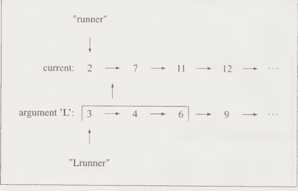

**图 3.3.** *合并两个链表同时保持顺序。* 顶部链表（当前对象）中的项由外层循环中的指针 "runner" 扫描。底部链表 `L`（参数）中的项由内层循环中的指针 "Lrunner" 扫描并插入到正确位置。

代码使用两个“runner”扫描链表中的项（见图 3.3）。主 runner 扫描当前链表中的项。由该 runner 指向的项与其后项之间的空间应由作为参数传递的第二个链表中的项填充，前提是它们确实按顺序属于那里。为此，使用一个称为 "Lrunner" 的次要 runner 来扫描确实属于主 runner 所指向位置的第二个链表中的项。这些项随后逐一按其正确位置插入到当前链表中。

如果第二个链表中的一项与当前链表中现有项具有相同的优先级顺序 `<`，即在 `T` 类的 `"=="` 运算符意义上相等，则它使用 `T` 类的 `"+="` 运算符加到该项上。这种方法确实。


#### 3.8 合并问题

这种方法适用于当前的应用场景，因为 “getColumn()” 索引在 “T” 类的 “+=” 运算符下保持不变，所以原始顺序得以保留。而在上述另一个例子中，“T” 类中的优先级顺序由（绝对）值诱导产生，因此必须从下面的代码中移除对 “T” 类 “+=” 运算符的调用，以便将第二个链表中的每个元素放置在当前链表中小于或等于它的元素之后。（可以将紧随此类调用的代码行设为条件执行，以避免在结果列表中重复相同元素。）

```cpp
template<class T>
const linkedList<T>&
linkedList<T>::operator+=(linkedList<T>&L){
    linkedList<T>* runner = this;
    linkedList<T>* Lrunner = &L;
```

最初，“Lrunner” 指向作为参数传递给函数的链表 “L”。然而，为了开始合并过程，我们首先必须确保当前链表中的第一个元素在优先级顺序（‘<’）上优先于 ‘L’ 中的第一个元素 “L.item”。如果情况并非如此，则必须首先将 “L.item” 放置在当前链表的开头，并将 “Lrunner” 前进到 ‘L’ 中的下一个元素：

```cpp
if(L.item < item){
    insertFirstItem(L.item);
    Lrunner = L.next;
}
for(; runner->next; runner=runner->next){
```

这里我们进入主循环。最初，“runner” 指向整个当前链表。然后，它逐渐前进，指向包含更少元素的后续子链表。当 “runner” 指向仅包含原始链表中最后一个元素的子链表时，循环终止。

现在我们准备好从 ‘L’ 中取一个元素添加到当前链表中。如果 “Lrunner” 所指向的元素与 “runner” 所指向的元素具有相同的优先级，则使用 ‘T’ 模板类中可用的 “+=” 运算符将其相加：

```cpp
if(Lrunner&&(Lrunner->item == runner->item)){
    runner->item += Lrunner->item;
    Lrunner = Lrunner->next;
}
for(; Lrunner&&(Lrunner->item < runner->next->item);
        Lrunner = Lrunner->next){
```

现在我们进入内层循环，其中 ‘L’ 中由 “Lrunner” 指向的元素被逐个添加到当前链表中，并放置在由 “runner” 指向的元素和紧随其后的元素之间。一旦 ‘L’ 中的某个元素被添加到当前链表中，“runner” 指针必须前进以跳过它：

```cpp
runner->insertNextItem(Lrunner->item);
runner = runner->next;
}
}
```

内层循环和外层循环现在都已完成。然而，‘L’ 中可能仍包含应放置在当前链表末尾的更多元素。幸运的是，“runner” 和 “Lrunner” 是在循环开始前定义的，因此它们仍然存在。事实上，在此阶段，“runner” 指向当前链表中的最后一个元素，而 “Lrunner” 指向 ‘L’ 中剩余的元素（如果有）。这些元素按以下方式附加到当前链表：

```cpp
if (Lrunner && (Lrunner->item == runner->item)) {
    runner->item += Lrunner->item;
    Lrunner = Lrunner->next;
}
if (Lrunner) runner->next = new linkedList<T>(*Lrunner);
return *this;
} // merge two linked lists while preserving order
```

这就完成了将 ‘L’ 合并到当前链表中并保留顺序的过程，符合需求。

#### 3.9 排序问题

排序问题如下：寻找一种高效的算法，以对一个给定的无序元素列表进行排序。显然，该算法需要改变原始列表中的顺序。因此，上面实现的链表，由于其能轻松接受任何所需的变更，是作为所需算法数据结构的明显候选者。

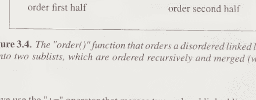

**图 3.4.** “order()” 函数，用于对一个无序链表进行排序：原始链表被拆分为两个子链表，这两个子链表递归排序并合并（同时保留顺序）。

这里，我们使用合并两个有序链表的 “+=” 运算符来定义 “order()” 模板函数，该函数用于对一个无序链表进行排序（见图 3.4）。执行此操作的算法使用递归，步骤如下。将无序链表拆分为两个子链表。分别对这两个子链表应用 “order()” 函数。然后，使用上述 “+=” 运算符将它们合并为一个有序列表。

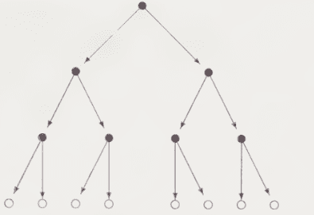

**图 3.5.** 具有三个层级的二叉树的示意图。箭头代表指针，圆点代表构建的对象。最底层圆圈代表空（零）指针。

此外，二叉树缺少链表中所具备的元素自然顺序。虽然可以递归地对元素进行排序（例如，左、中、右），但这种顺序可能比链表中的自然顺序复杂得多。

通过将 “left” 和 “right” 指针替换为指向树链表的指针，还可以定义更通用的树：

```cpp
template<class T> class tree{
protected:
    T item;
    linkedlist<tree<T> >* branch;
public:

    ...

};
```

这种树可以在链表中包含任意数量的子树。这个链表由私有成员 “branch” 指向。请注意，“branch” 定义中的 '>' 符号之间由一个空格分隔，以区别于 “iostream.h” 标准库中含义完全不同的字符串 “>>”。

在上述数据结构中，移除现有子树和添加新子树特别容易。也可以通过在树中增加一个名为 “parent” 的指针字段来派生双向树，该字段包含父树的地址。

#### 3.13 图

在上面的树中，一个元素只能指向新的元素；它不能指向父树或祖先树，甚至不能指向兄弟子树。因此，树不能包含环。

另一方面，在图中，元素不仅可以指向新的元素，还可以指向已有的元素；它们可以是祖先、兄弟，甚至是自身。

事实上，图的数学定义是一个编号为 1, 2, 3, ..., N 的节点集合和一个边（节点对）集合。边的集合通常用 $E$ 表示。

有两种类型的图。在有向图中，每条边是节点的有序对，因此对 $(i,j)$（也记为 $i \rightarrow j$）不同于 $(j,i)$（也记为 $j \rightarrow i$）。很可能 $(i,j) \in E$ 但 $(j,i) \notin E$，或者反过来（见图 3.6）。

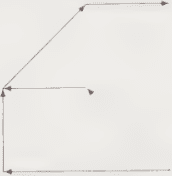

**图 3.6.** 有向图的示意图。

而在无向图中，对没有顺序：$(i,j)$ 与 $(j,i)$ 相同，且要么两者都在 $E$ 中，要么两者都不在 $E$ 中（见图 3.7）。


**图 3.7.** 无向图的示意图。

在图中，一组由以下形式构成的 $k$ 条边

$(i_1,i_2), (i_2,i_3), (i_3,i_4), \ldots, (i_{k-1},i_k), (i_k,i_1)$

被称为 $k$ 条边的环。例如，三元组 $(i,j)$、$(j,k)$ 和 $(k,i)$ 形成一个三条边的环，边对 $(i,j)$ 和 $(j,i)$ 形成一个两条边的环，甚至单条边 $(i,i)$ 本身也形成一个仅有一条边的环。这些环虽然不允许出现在树中，但在图的实现中必须允许。

尽管如此，上述树的实现也适用于图，前提是规则被修改为允许环的存在。这意味着 “graph” 类中的构造函数必须不同于 “tree” 类中的构造函数。树的构造函数必须在 “*” 分支链表中的每个子树中使用 “new” 命令，而图的构造函数也可以在此链表中引用现有的地址。

允许环的存在意味着图中的元素没有自然顺序。这是上述实现的一个缺点，因为没有自然的方式来遍历节点。在下一章中，我们将看到更多实用的图实现，其中原始顺序 1, 2, 3, ..., $N$ 得以保留。


#### 3.14 动态矩阵

基于与动态向量相同的原因，人们也希望拥有动态矩阵，其维度（宽度和高度）在运行时而非编译时指定。该类在下方实现。

```cpp
template<class T>
class dynamicMatrix : public dynamicVector<T>{
int N;
public:
dynamicMatrix(int, int, const T&);
}
```

上述声明的构造函数将在后续定义。

“dynamicMatrix”对象中的元素可以通过带有两个整数参数的“operator()”访问，以指示元素在矩阵中的位置。事实上，由于数组“component”在基类“dynamicVector”中仅被定义为“protected”（而非“private”），因此它也可以从派生类“dynamicMatrix”中访问：

```cpp
T operator()(int i, int j){
return component[i*N+j];
} // 访问 (i,j) 分量
```

通过此操作符，一旦动态矩阵 'A' 在某个代码中被良好定义，其第 (i, j) 个元素 $A_{i,j}$ 就可以通过 "A(i,j)" 进行访问（用于读取或写入）。

“operator()”的另一个版本只能读取（但不能修改）动态矩阵的第 (i,j) 个元素。为了将此版本与之前的版本区分开来，它接受一个哑字符串参数：

```cpp
const T& operator()(int i, int j, char*) const{
return component[i*N+j];
} // 第 (i,j) 个分量 (只读)
```

要调用此版本，只需在参数列表中任意添加一个字符串即可。例如，"A(i,j,'read')" 读取动态矩阵 'A' 中的第 (i,j) 个元素。

以下成员函数返回矩阵的维度：高度（或长度）和宽度。

```cpp
int height() const{
return dim()/N;
} // 网格高度

int length() const{
return dim()/N;
} // 网格长度

int width() const{
return N;
} // 网格宽度
```

#### 3.19 较大矩阵的行列式

我们现在准备实现第 2.21 节中的算法，以获得 LU 分解 $A = LUP$。由于最终 U 是上三角矩阵，L 是下三角矩阵且主对角线元素均等于 1，因此 L 和 U 都可以存储在单个动态矩阵对象中，命名为 "LU"。此外，由于置换矩阵 P 是交换矩阵的乘积，因此可以将其存储为整数向量，其第 i 个分量包含与第 i 列在第 i 个交换矩阵中交换的列的索引。存储此信息的整数向量通过非 const 引用传递给函数，因此函数执行过程中计算得出的列索引保存在其中以供将来使用。

```cpp
template<class T>
const dynamicMatrix<T> LUP(const dynamicMatrix<T>&A, dynamicVector<int>&P){
	dynamicMatrix<T> LU = A;
	for(int j=0; j<A.width(); j++){
		P(j) = maxRowI(LU,j);
		switchColumns(LU,j,P[j]);
	}
	for(int i=j+1; i<A.height(); i++){
		LU(i,j) = LU(i,"read") / LU(j,j,"read");
	}
	for(int k=j+1; k<A.width(); k++)
		LU(k) -= LU(i,j,"read") * LU(j,k,"read");
	}
	return LU;
}
// LU 分解
```

在外层列循环 j 中，第 j 个交换矩阵通过寻找列 j，即整数向量 'P' 的第 j 个分量来定义。该列的索引随后存储在整数向量 'P' 的第 j 个分量中。该列也与第 j 列进行交换。通过这种方式，"LU" 中的第 (i,j) 个元素（第 2.21 节中的 $U_{j,j}$）在数值上变得足够大。

接下来，内层循环使用索引 'i' 计算因子 $L_{i,j}$，将其存储在 "LU(i,j)" 中，并使用它来消除原始元素 $A_{i,j}$；

```cpp
for(int i=j+1; i<A.height(); i++){
	LU(i,j) = LU(i,"read") / LU(j,j,"read");
}
```

这种消除是通过从 U 的第 i 行中减去 U 的第 j 行的倍数来完成的：

```cpp
for(int k=j+1; k<A.width(); k++)
	LU(k) -= LU(i,j,"read") * LU(j,k,"read");
}
```

原始矩阵的行列式现在可以最有效地计算为存储在 "LU" 中的 U 的主对角线元素的乘积（第 2.21 节）：

```cpp
template<class T>
const T det(const dynamicMatrix<T>&LU, const dynamicVector<int>&P){
	T detLU = 1;
	for(int i=0; i<LU.height(); i++){
    detLU *= LU(i,i,"read");
    if(P[i] != i)
        detLU *= -1;
}
return detLU;
} // 使用 LU 分解计算行列式
```

#### 3.20 较大矩阵的逆

此外，上述 LU 分解可用于对特定的右侧向量 b “求逆” A，或求解线性方程组

$$A x = L U P x = b$$

以求出未知向量 x。事实上，由于

$$x = P^{-1} U^{-1} L^{-1} b,$$

x 通过对 L 进行前向消除从 b 获得，

```cpp
template<class T>
const dynamicVector<T>
invert(const dynamicMatrix<T>&LU,
    const dynamicVector<int>&P, const dynamicVector<T>&v){
    dynamicVector<T> x = v;
    for(int i=1; i<v.dim(); i++)
        for(int j=0; j<i; j++)
            x(i) -= LU(i,j,"read") * x[j];
```

接着对 U 进行回代，

```cpp
for(int i=v.dim()-1; i>=0; i--){
    for(int j=v.dim()-1; j>i; j--)
        x(i) -= LU(i,j,"read") * x[j];
    x(i) /= LU(i,i,"read");
}
```

最后通过对 x 应用交换矩阵，将其第 'i' 个分量与第 'P[i]' 个分量进行交换：

```cpp
for(int i=v.dim()-2; i>=0; i--)
    if(i!=P[i]){
        T keep = x[i];
        x(i) = x[P[i]];
        x(P[i]) = keep;
    }
return x;
} // 对某些右侧向量求逆
```

此外，通过将右侧向量 b 设置为单位矩阵的第 j 列（存储在下方代码中的 "ej" 中），上述函数生成逆矩阵 $A^{-1}$ 的第 j 列：

```cpp
template<class T>
const dynamicMatrix<T>
invert(const dynamicMatrix<T>&LU,
    const dynamicVector<int>&P) {
dynamicMatrix<T> inverse(LU.height(),LU.width());
dynamicVector<T> zero(LU.height(),0.);
for(int j=0; j<LU.width(); j++){
    dynamicVector<T> ej = zero;
    ej(j) = 1.;
    dynamicVector<T> columnJ = invert(LU,P,ej);
    for(int i=0; i<LU.height(); i++)
        inverse(i,j) = columnJ[i];
}
    return inverse;
} // 使用其 LU 分解求矩阵的逆
```

该算法避免了使用克莱默法则（Cramer's formula）中昂贵的递归，因此也可用于较大的矩阵。

#### 3.21 高效使用堆内存

上述动态对象中使用的 "new" 命令在所谓的“堆”内存中分配内存（在运行时），这是二级内存中最容易访问的部分，并返回一个指向它的指针，该指针存储在所谓的“栈”内存中，这是一级内存的一部分。应该在定义此类动态对象的块结束时释放此内存。这应由 C++ 编译器隐式调用相关的析构函数来完成。

然而，C++ 编译器经常拒绝在相关块结束时调用析构函数。事实上，销毁可能会延迟到有很多对象需要销毁时。不幸的是，一起销毁许多对象可能比逐个销毁昂贵得多。

确实，销毁中最耗时的部分是定位对象在堆内存中占用的内存。由于 C++ 编译器最初是为服务 Windows 操作系统的用户并为其提供实时响应而编程的，它不会在意在前进到下一个任务之前完成一个任务。相反，它只完成第一个任务的一小部分，然后开始下一个任务，然后回到第一个任务完成另一小部分，依此类推。

这种策略对于操作系统来说可能有意义，让用户在他/她想完成的项目的各个方面同时获得实时进展，但对于此处运行 C++ 程序来说则不然。事实上，由于销毁任务中最耗时的部分是寻找应释放的堆内存，因此只查找一次并一次性释放它，比暂停然后再查找一次要合理得多。


为了确保编译器在销毁下一个对象之前确实销毁了整个对象，最好在定义对象的块末尾显式调用析构函数。这样，编译器被迫一次性完成整个对象的销毁，包括它所占用的全部内存，从而避免反复定位该内存的需要。

然而，在本书的应用中，我们并不费心去编写这些额外的代码行。它们留给细心的读者作为练习。

#### 3.22 习题

- 1. 补全第3.3节动态向量实现中缺失的算术运算符，例如减法、乘法和标量除法。解法见附录A.6节。

- 2. 使用第3.4节中的“list”对象，编写函数“Taylor()”，该函数以实数 h 和函数 f(x) 在某点 x 处计算的 N 个导数的列表为参数，并输出 f(x + h) 的泰勒逼近：

$$f(x + h) \simeq \sum_{n=0}^{N} \frac{f^{(n)}(x) h^{n}}{n!}$$

其中 f⁽ⁿ⁾ 表示 f(x) 的 n 阶导数。解法见第5章第11节。

- 3. 编写函数“deriveProduct()”，该函数输入两个列表，分别包含两个函数 f(x) 和 g(x) 在某点 x 处的导数，并返回乘积 f(x)g(x) 的导数列表，使用公式

$$(f(x)g(x))^{(n)} = \sum_{k=0}^{n} \binom{n}{k} f^{(k)}(x) g^{(n-k)}(x)$$

解法见第5章第12节。

- 4. 在第1章第19节中，将帕斯卡三角实现为对角线列表。对角线实现为维度递增的动态向量。（第一条对角线长度为1，第二条长度为2，依此类推。）这些向量中的分量是整数。验证第 n 条对角线上各项之和确实为 2ⁿ，且第一条、第二条……第 n 条对角线中各项之和确实为 2ⁿ⁺¹ − 1。

- 5. 定义模板类“triangle<T>”，它派生自上述维度递增的动态向量列表。这些向量中的分量类型为未指定的 'T'。将帕斯卡三角实现为“triangle<int>”对象。验证第 n 条对角线上的各项之和确实为 2ⁿ。

- 6. 定义模板类“triangle2<T>”，它派生自对角线列表（如前一练习），其中对角线是负斜率且维度为 (2n-1) 的线，包含 $2n-1$ 个元素。该元素被选为满足条件 $k + l = n$ 的索引对 $(k, l)$。对角线中的每个元素存储值

$$\frac{\partial^{k+l} f}{\partial^{k} x \partial^{l} y}(x,y)$$

在某点 $(x,y)$ 处。这样，直到 $n$ 阶的导数都存储在三角形的前 $n$ 条对角线中。

- 7. 编写函数“Taylor2()”，它以上述三角形和两个较小的“double”参数 $h_x$ 和 $h_y$ 为参数，根据公式产生 $f(x+h_x, y+h_y)$ 的二维泰勒逼近：

$$f(x+h_x, y+h_y)=\sum_{n=0}^{\infty}\frac{1}{n!}\sum_{k=0}^{n}\binom{n}{k}\frac{\partial^{n} f}{\partial^{k} x \partial^{n-k} y}(x,y)h_x^{k}h_y^{n-k}.$$

解法见第5章末尾的练习。

- 8. 将第3.9节中的“order()”函数应用于整数链表，并按绝对值排序。例如，验证列表

$$(-5,2,-3,0,\dots)$$

被重新排序为

$$(0,2,-3,-5,\dots).$$

- 9. 补全“binaryTree”类的实现，包括构造函数、析构函数和赋值运算符。

- 10. 补全“tree”类的实现，包括构造函数、析构函数和赋值运算符。解法见参考文献[69]的第18章。

- 11. 修改你的“tree”类以获得“graph”类。

- 12. 为动态矩阵实现算术运算符，包括加法、减法、乘法和标量除法。解法见附录A.7节。

- 13. 验证第2.21、2.23和3.19节中三个版本的“det()”函数确实产生相同结果。

# 第二部分

## 面向对象编程

计算机程序确实是一个数学对象的好例子，它不涉及代数（算术）运算，却具有定义良好的层次化多级结构：它可以包含子程序（或函数），这些子程序本身就是完成特定任务的程序。因此，程序可以与任何自然人类语言中的句子相比，句子也可以包含子句，每个子句本身也是一个句子。唯一的区别是，计算机程序中的基本原子（或变量）是严格定义的（它们只能取0或1），而人类语言中使用的基本词汇是模糊的、依赖上下文的，并且只能通过唤起每个人脑海中的主观记忆来指示一种主观意义。事实上，一个特定的词只能通过同义词来解释，而这些同义词永远与原词不完全相同。这就是为什么我们经常通过给出一个词在句子中如何使用的例子来隐含地解释它。

这也是面向对象实现如此有帮助的原因。它不仅可能高效地实现原始算法，还可能为其中使用的原始数学概念提供恰当的解释。这样，原始算法变得更加清晰且易于修改，原始数学理论也呈现出更加具体的形式，以帮助开发更高级的算法。

对象是可供操作抽象概念。在C语言中，只有整数、实数或字符等数值对象可用。这些对象仅作为传递给函数的参数。另一方面，在C++中，程序员可以构造自己的对象，这些对象可以复杂得多，并具有许多有用的功能。因此，在C++中，对象扮演着更加积极的角色。它们是实现的中心，实现聚焦于对象及其属性。它们不仅等待某个函数将它们用作参数，还主动调用反映其潜力的函数。

在C++中，程序员不仅实现孤立的算法，还实现完整的数学对象（如向量和矩阵），这些对象可用于许多算法和应用。这使得编程语言更加动态：新对象可以作为新类型，使原始语言更加丰富，更适合新的应用。

本部分介绍C++核心的面向对象方法。在本部分的第一章（第4章）中，使用图论中的统一方法来介绍当前的面向对象框架，并讨论其在非结构化网格和稀疏矩阵中的潜在应用。本部分的第二章（第5章）介绍密码学和数值分析中在实现中使用数学对象的算法。最后，本部分的第三章（第6章）展示如何将面向对象方法用于非线性常微分方程（ODEs）的数学分析。

## 第4章

### 从维特根斯坦—拉康理论到图与矩阵的面向对象实现

人类记忆可以与数字计算机的内存相类比。在计算机中，大部分内存存储在辅助存储器中，其容量足够大，可以容纳大量数据，但其中的数据不容易访问。当计算机需要一些数据来计算和解决用户提供给它的特定问题时，它会访问所需数据，并将其从辅助存储器传输到主存储器。

虽然主存储器比辅助存储器小得多，但其中的数据更容易访问。因此，处理器可以利用这些数据，使用用户提供给它的程序中的指令，进行所需的计算并解决原始问题。

在人脑中，潜意识扮演辅助存储器的角色，而意识扮演主存储器的角色。然而，在这里，数据并不需要物理地传输到主存储器来思考或处理。相反，血液流向数据所在的细胞。供给这些细胞的氧气提供所需能量，将存储在其中的数据提升到意识层面，以进行思考、处理并得出所需结论，然后将结论置于一个新细胞中。

那么，我的记忆与我自身之间是什么关系？我的记忆，或者更准确地说，我的次级记忆，包含了我并不总是愿意记住的所有背景。从中，我只使用或记得特定时刻所需的信息。然后，我将这些信息带入意识中，用它得出所需结论，并在不久后将其遗忘。

诗人维斯拉瓦·辛波斯卡写下了她与自己大脑中记忆的复杂关系。记忆总是追随着她，寻求她的全部注意力。在睡眠时，它确实成功了。而在白天，她则设法逃避和避开记忆摆在她眼前的场景和影像。她想结束这一切，与记忆永远分离。但话说回来，这也意味着她的终结。

因此，在编程语言中实现形式对象的艺术，可以比作用自然人类语言讨论抽象概念。然而，在交谈中，有时即使最好的词语也不足以完全描述该概念。事实上，词语至多只能部分实现概念，并激发或引出更精确的词语来描述概念的真实本质。尽管如此，正是这种不断使用更好词语的尝试，使原始概念变得越来越清晰和具体。也许只有诗歌才能完整描述概念。毕竟，如同梦、艺术、语言和思想，在


一般来说，诗歌存在于潜意识与意识的交界面上，并且可能将思想从潜意识转移到意识中。

在本章中，我们介绍面向对象编程的概念，并在图着色和三角形着色问题中使用它。事实上，面向对象编程的概念在数值方法所需的数学对象的实现中证明是最有帮助的，包括图、稀疏矩阵和非结构化网格。

为此目的，然而，我们首先介绍一些关于自然人类语言的哲学思想，这些思想可能与编程语言和数学等形式语言也最相关。

在本章开始时，试图突出编程语言与自然人类语言之间的关系，并展示计算机语言的发展如何反映了几个世纪以来对人类心智及其运作方式理解的不断发展。

事实上，编程语言并非凭空产生；尽管它们的发展是由技术进步推动的，但它们出现和发展的方式与我们心智的工作方式、我们彼此以及与自己交流的方式、我们了解世界的方式，以及我们如何使用自己的心智和记忆来获取、处理和检索信息的方式内在相关。

为此，下面的讨论包含试图为诸如心智、灵魂和语言等模糊术语提供一些哲学背景。特别是，据认为人类的灵魂只是他/她欲望的集合，正如斯宾诺莎所指出的那样。此外，心智与语言之间的关系被描述为从心智到语言的投射，正如维特根斯坦所指出的那样。以这种解释，形式语言与自然语言之间的差异更清晰：形式语言中的词使用已经解释过的低级词进行归纳解释，而自然语言中的词则从个人的联想和记忆中直观地解释。

#### 4.1 Wittgenstein: Limits of Human Language

伟大的哲学家路德维希·维特根斯坦研究了任何自然人类语言的局限性。他意识到有些思想无法用言语表达。例如，关于地貌的最准确报告永远无法表达其美感。这就是为什么维特根斯坦说有些事情是不能或不应该说的。

词语本质上是模糊的。事实上，要解释或定义或解释一个词，必须使用其他更基础的词。此外，要解释这些词，又必须反过来使用更基础的词。通过继续这一过程，最终必须使用极其基础的词，这些词本身没有任何解释。关于这些“原子”词所能说的全部是它们提供一些指示或暗示，因此有助于解释更复杂的词。

在亚里士多德的理论中，原子词只代表对象的本质：表征它并使其成为其所是的属性或关系（或函数，或公理）。这确实是本书采用的方法。另一方面，在柏拉图的理论中，每个原子词必须有一个“神”来客观地代表它并赋予它意义和推理。在一神论中，另一方面，人们可能相信有一个词是所有原子词的源头。他们将此词称为“上帝”。

下面我们更详细地讨论维特根斯坦的理论与柏拉图和亚里士多德理论的关系。

#### 4.2 Wittgenstein, Plato, and Aristotle

在柏拉图的理论中，一般抽象对象必须有一个“神”来代表它。例如，一般的石头由石头的神代表。毕竟，没有一般的石头；只有单独的具体石头存在。事实上，石头的神只代表一般石头的思想。

另一方面，在亚里士多德的理论中，一般抽象对象是根据其本质或表征它并使其成为其所是的特征来定义的。例如，石头的本质是沉重。机器的本质是做人类所需的工作。计算机的本质是执行人类所需计算。士兵的本质是服从其指挥官的命令。遵循这一理论的精神，人们也可以说人的本质是自由的，并且只从上帝那里接受道德命令，例如十诫。

在维特根斯坦的理论中，一般抽象概念也不能用词语精确解释。毕竟，对该概念的唯一精确解释在于其背后的思想本身（或“神”，或本质），而这无法用词语表达。

现代小说家克拉丽丝·利斯佩克托尔意识到词语永远无法捕捉在当下独特时刻的存在感：

> “我只有词语可以给予……活跃的词语用来构成句子并带有额外的隐藏含义……不要逐字阅读我的词语——只需在它们之上漂浮以在字里行间阅读……我的书不包含词语——它只是一个问题或一张沉默的照片……现实在我之外……我热爱事实，但我所知道的唯一事实就是感受、思考或写作……真理是一种内在的触碰……生命没有词语来表达其意义……我的书不完整——答案仍缺失……” （自由诠释）。

下面我们从另一个角度讨论维特根斯坦的理论。下面所做的观察不仅将在关于人类语言的讨论中被使用，也将在关于形式编程语言（包括面向对象语言）的讨论中使用。

#### 4.3 Deduction–Induction

要解释一个抽象概念，人们可能想使用具体例子。不幸的是，例子只与特殊情况相关，无法以其最一般的形式表达原始概念。

从原始概念构造具体例子的过程称为演绎。利用这些例子来说明原始概念并对其有更好理解的过程称为归纳。

整个演绎-归纳过程可能有助于更好地理解原始概念。不幸的是，由于每个例子仅限于特殊情况，因此该过程本质上是不准确且不完整的。尽管如此，演绎-归纳过程可能是对高度抽象概念有所了解的最好方式。

总之，任何解释本质上都是不准确的，因为它必须使用模糊的词语或有限的例子。指称一个概念的唯一方式是说在给定语言中指称它的唯一词。任何同义词或解释都是不准确的。事实上，由于缺乏完整的解释，甚至这个词本身也只是一个符号，它指示或暗示原始概念。

我们理解自己所说的词是一种错觉。事实是，我们最多只能从中获得一些关于它所代表的概念的指示或印象。事实上，这种指示高度主观且相对：它取决于使用该词的人。这就是为什么不同的人可能对同一个词有不同的解释，基于他们不同的背景。这也是为什么具有不同背景的人之间即使使用同一种语言也经常发生误解。

#### 4.4 Words

一个词只是一个工具，用来将与之相关的记忆从一个人的潜意识中提升到意识中。因此，一个词只是一个指向深藏在一个人心智中数据的“指针”。它只是触发与之相关或由之指示的情感或记忆的触发器。

因此，说话实际上也是情感过程。每個词或思想都会引发某些情感，这些情感源于一个人对它的反应。这就是为什么思想，包括对词语的解释，都是高度个人化和主观的。

一旦在一个人心智中说出和/或解释，词语就会吸引他/她的注意力到记忆的子集，并改变他/她的情感状态。

这就是为什么计算机永远无法说话或写作或使用任何人类语言：它没有情感，也缺乏生存的驱动力。另一方面，人类受生存和活下去的驱动力控制，包括爱和被爱的欲望（达尔文的理论）。因此，任何有意义的思想都会给他/她带来满足感和心灵平静，使他/她快乐。然而，这只是错觉。幸福或愉悦的感觉只意味着更好的生存机会。

下面我们利用上述讨论来解释从哲学角度来看人类到底是什么。

#### 4.5 Human

人类因此是存储在他/她心智潜意识部分中的记忆的集合，有时由思想或词语提升到意识中。思想可能会以有利于生存的方式改变一个人的情感状态。例如，如果它有意义并提高生存机会，它可能会引起满足感。这种机制就是人们可能称之为灵魂的东西。

事实上，人类比其身体更像其灵魂。确实，思想的机制使大脑工作，即使在睡眠中。一旦没有思想，人类就死了。因此，人就是其灵魂，或思想的流动。

总之，人类只是他/她欲望的集合（正如哲学家巴鲁赫·斯宾诺莎所指出的那样）。这就是为什么，在他/她的整个生命中，一个人总是想要某物。只有当他/她死去时，才不再想要任何东西。

斯宾诺莎的方法不同于古代认为人具有某种绝对本性的观点。它更接近现代列维纳斯的提议，即人


个体仅相对于他人及其对他们的情感而言被定义。事实上，从出生起，婴儿就认同他的/她的母亲，随后也认同他的/她的父亲。此外，在整个生命中，人类看到的不是他自己/她自己，而仅仅是他人，并始终寻求他们的关注、欣赏、保证、接纳以及对其对社会有价值贡献和地位的认可。在此观点下，每个独立的人类心灵仅相对于他人存在，作为对他人的参考或镜子。只有两面或更多的镜子才能共享和反射信息，并形成系统或社会。另一方面，孤立的镜子将永远处于黑暗之中。正如禅宗所指出的，一只手永远无法鼓掌。

观察上述观点如何也适用于语言中最抽象的形式——诗歌，是特别有趣的。

#### 4.6 魏尔伦：诗歌中的印象主义

诗歌，以及其他形式的艺术，确实可以被视为深藏在一个人脑海中的朦胧思想和印象与可以用任何人类语言表达的更明确思想之间的接口。诗歌的节奏以及行间使用的停顿和空白传达了无法用任何语言表达的情感、印象和思想。正如伟大的诗人保罗·魏尔伦在其诗作《诗艺》中向诗人建议的那样（阿米纳德夫·迪克曼的解读的自由诠释）：

> 你使用的词语  
> 必须选择  
> 带有一定程度的轻率。  
>
> 记住：  
> 珍视那些  
> 隐含的原始思想  
> 与明确定义相遇的点。  
>
> 其余一切——  
> 不过是散文。

事实上，魏尔伦甚至在此建议使用不准确的词语。毕竟，没有机会恰当地表达纯粹的思想或深层的情感，那为什么要费心使用精确的词语呢？围绕原始思想进行表达，仅仅暗示或提示它，更有意义。为了产生正确的印象，诗歌中使用的戏剧性词语和节奏特别合适。其余的一切都留给读者去理解。

#### 4.7 恩岑斯贝格尔和里尔克

以下是德国诗人汉斯·马格努斯·恩岑斯贝格尔的另外两首诗，向我们展示了词语在表达深层、微妙的情感和感受时是多么贫乏和不精确（阿舍尔·莱希的解读的自由诠释）：

> 因为说“我快乐”  
> 并不意味着你快乐。  
>
> 因为口渴的人  
> 不知道自己是口渴的。  
> 绝望的人  
> 不说自己绝望。  
> 高潮与高潮  
> 是两回事。  
> 垂死之人  
> 只说悄悄话，  
> 我们听不见。

这里还有另一首诗：

我的儿子，  
不要读诗。  
读铁路时刻表，  
它们更精确。  
读地形图，  
趁还来得及。  
睁开你的眼睛；  
不要写诗。

此外，在恩岑斯贝格尔的《但丁》一诗中，他也写到了身份。他说，没有人能为你确定你的身份。只有你自己能决定你的身份究竟是什么，即使这可能与其他人的期望不一致。

在其著作*《马尔特·劳里茨·布里格的笔记》*（1910年）中，赖内·马利亚·里尔克写道，记忆必须在人的头脑中得到良好的处理和整合，才能以诗歌的形式呈现出来。这就是为什么只有在老年时，一个人才能将其全部的生活体验转化为至多一首好诗。此外，整个人类整体的历史不如一位诗人的生命重要。事实上，正如亚里士多德所说，诗歌比历史更重要。毕竟，历史可以讲述过去，但诗歌可以捕捉当下的独特时刻。

#### 4.8 惠特曼及其追随者

在上述诗歌中，人们可以发现一些普遍真理或观察，而不仅仅是私人的内省。诗人不仅向读者揭示他/她自己的心理状态，还反映了整个自然或社会景观。这正是有价值的诗歌的特征，例如伟大诗人沃尔特·惠特曼及其追随者的诗歌，包括以色列诗人阿沃特·耶书兰和纳德夫·利涅尔。

年轻诗人纳德夫·利涅尔不仅受惠特曼的影响，还受亚里士多德和维特根斯坦的影响。事实上，似乎利涅尔意识到，没有词语能够表达真正的、深刻的、原始的情感（自由诠释）：

铁记得雨  
带着一丝锈。  
岩石怀念雨  
那将它侵蚀。

有没有任何方式  
去记住你的名字？  
有没有任何名字  
给一个没有身体的灵魂？  
爱就是爱。

此外，在他的诗作《前进与后退》中，利涅尔以相当生动的方式描述了他如何在自己家中走来走去，以及街上经过的汽车发出的每一缕光和冰箱里的每一种食物如何让他想起他独自睡在另一房间的伴侣的存在。利涅尔为此使用的隐喻确实产生了一种相当现实的色情和抒情氛围，这是任何散文都无法描述的。

此外，在他致惠特曼的信《事物》中，利涅尔利用时间和空间尺度表明，在观察自然和见证自然时，一个人应该多么谦逊：

我跟随你  
去学习事物如何  
从它们的名字中跳出  
被送走。  
树木从大地向天空发送信息  
天空以雨水回答。  
山谷承载着吨位空气  
雷声轰鸣。  
这里不以人来衡量。  
而我？我什么也说不出来。  
树木记得它们的出生  
没有一棵树能在一天内长成。  
我不知道绿色的名字。  
许多我不能说的事  
写在那些树里  
它们将像你们一样变成书页。  
在打开门  
看到你已经不在之前，  
我再次尝试  
从一切中说出一件事。

#### 4.9 什么是诗歌？

在散文或古典诗歌中，词语通常指向每个读者或多或少都了解的一般概念。然而，每个词语的精确含义可能是主观的，取决于每个读者个人的背景。

另一方面，在现代诗歌中，词语可能不仅指代特定概念，还指代模糊的想法。因此，读者在根据他/她自己的联想世界解释词语方面具有更主动的角色。此外，读者可以自由地使用他/她自己的想象力将词语组合成短语，并产生整体的情感氛围。

这或许就是诗歌可能对读者产生如此强烈影响的原因：它可能通过真正触动人心的词语反映他/她自己的情感状态。

因此，诗歌可以被定义为任何能给读者带来美感和洞察力的文本。这个定义当然是主观的：某些文本可能对某些读者来说像是诗歌，而对其他读者来说只是散文。事实上，这不仅可能适用于用自然人类语言编写的文本，也可能适用于用形式语言编写的文本，例如编程语言或数学。例如，一些读者完全可能看到精心编写的科学理论、数学证明或计算机程序中的美，并认为它是诗歌。

下面，我们观察现代诗歌实际上可以被视为对潜意识的一瞥。

#### 4.10 梦境与潜意识——弗洛伊德的理论

诗歌可能会像梦境一样强烈而深刻地触动读者。事实上，正如弗洛伊德的理论所述，梦境也可能让做梦者短暂地一瞥自己的潜意识。在梦中看到的景象没有明显的语言表述。然而，一旦做梦者向别人讲述梦境，用于此目的的词语可能会揭示做梦者潜意识中的秘密，这些秘密此前对他/她来说完全未知。

因此，用来讲述梦境的词语与梦境本身来自同一来源：即潜意识。事实上，这些词语指的是做梦者原始背景中的原始记忆，这些记忆可能已被封存多年。因此，这些词语可以被视为主观的指针或指向一个人头脑中主观记忆的参考。

#### 4.11 自然人类语言

如上所述，自然人类语言中使用的通用对象和概念如此模糊，以至于没有词语能精确描述它们。词语充其量只能指代或指示原始概念，以便它们可以与其他单词结合在子句和句子中。然而，这些指示不是客观的，而是主观的：它们强烈依赖于使用它们的人的背景和他/她的个人联想和记忆。

幸运的是，某种语言的大多数说话者有相当相似的背景，因此他们对每个单词赋予相当相同的意义。这样，他们确实可以相互沟通并理解彼此。

上述思想在下面被用来试图解释任何人类最重要、最神秘和模糊的活动：思考。

#### 4.12 思考

在上述方法中，思考一个对象实际上意味着引入更多与之相关的记忆，以使它的解释更广泛和更相关。思考过程帮助人们将对象与其他对象联系起来，给予它更相关的解释。


思考一个对象也可能导致用在不同上下文中可能相关的更准确的词语来命名它。这就是为什么自然语言也常被称为上下文相关语言。

思考过程也可能导致意识到对象在不同情况下对其他对象的影响。这可能导致对原始对象的描述不仅以其原始属性为依据，还以其潜在效果为依据。

尽管思考过程可能使对象在不同上下文中相关的属性或效果方面得到越来越好的描述，但它永远无法导致完全客观的定义。事实上，任何定义都必须使用词语，而词语本身也是模糊和不精确的。因此，思考一个对象最多只能改善一个人自己的私人主观解释，而永远无法形成普遍客观的无上下文解释。

下面我们介绍一个模型来尝试解释人类心智并展示它与语言的关系。

#### 4.13 针对谈话、聆听和思考的归纳模型

上述讨论可用于引入一个关于个人心智活动的模型。在此模型中，一个人的记忆和经验位于其心智的私人背景中，而其词汇则位于其心智的前景中。当一个人说话时，他/她的私人记忆从心智背景中转化为前景中的词语，供他人聆听和解读。

然而，由于词语本身固有地不准确，从背景到前景的转换（或投影，或映射）并非一对一：两个不同的想法（或概念，或思想）可能非常接近或相似，以至于两者都用同一个词表达。因此，产生一个人词语的背景到前景的映射并不总是可逆的：可能无法从他/她的词语中恢复出他/她的原始想法。这大概就是为什么一个人常常觉得需要使用越来越多的词语来形成越来越多的句子，以便使自己更清晰，并使他/她的原始想法更好地被他人和自己理解。

因此，聆听词语的人永远无法知道词语背后真正是什么。事实上，他/她永远无法确定说话者的原始意图。充其量，听者只能根据句子中的上下文以及他/她自己的私人背景和当前心态来解读每个特定的词语。

事实上，说话者也是自己词语的听者。毕竟，他/她有机会在词语即将说出时审视自己的词语，并检查它们是否确实符合并很好地反映了自己原始的想法和意图。

例如，当说话者向他人讲述自己的梦时，他/她也在聆听自己的词语，而这些词语又会唤起可能深藏在他/她自己潜意识中的记忆。由于这些记忆来自与梦本身相同的潜意识来源，它们确实可能揭示梦背后的真正深层情感以及其中象征的正确解释。

上述关于使用和解读词语的模型是归纳性的，因为一个词只能通过具体的例子来理解。例如，“床”一词可能让人回忆起躺在自己童年床上时的原始感觉。通过归纳，可以将这种具体记忆扩展到一般床的抽象概念。此外，通过演绎，可以检查另一个对象是否也是床：事实上，如果确实可以在上面躺下并产生相同的感觉，那么它也必须是床。

思考也可以以类似的方式建模。在此模型中，投影不再是从背景到前景，而是从潜意识到意识。例如，人们常常从眼角看到一个物体却没有注意到它或意识到它的存在。这种物体的视野可能被视为无用的噪音。只有当物体的存在变得足够重要或相关时，它才会变得有意识：一个脑细胞被分配来存储其图像以供进一步使用。换句话说，被观看的图像从潜意识投影到意识中以供实际（理性）使用。一旦此图像不再需要，它就会从大脑中移除并被遗忘，以便释放脑细胞供将来使用。

这大概就是为什么引入新词语可能有助于思考。毕竟，一旦一个概念被特定的词语命名，它就会从潜意识直接转移到意识中，并被放置在一个特定的脑细胞中，以便在需要时随时用来指代原始概念。这就是即使是模糊的概念如美或荣耀也能变得明确并随时可用的方式：代表它的具体感觉或记忆被存储在由“美”或“荣耀”一词所指的脑细胞中。这确实是一个归纳过程。演绎随后用于检查给定对象是否美丽：如果它唤起与名为“美”的脑细胞中相同的感觉，那么它确实应被视为美丽。

上述讨论也可能解释了艺术对人类心智为何如此重要。毕竟，它让我们罕见地一窥潜意识中可能隐藏的纯粹（积极）情感，并将其短暂地提升到意识中。这就是一个人如何获得对其自身人格的新见解，特别是其中可能欣赏和享受审美感的那一部分。

大脑因此可以用数学图来建模，其中每个节点代表一个脑细胞。这样，思考过程可被视为该图中的离散流动。这种信息的离散流动很可能满足与标准连续物理流动相同的规律：即守恒定律、热力学定律、熵增条件，以及以离散形式出现的流动方程。

#### 4.14 康德理论中的对象

上述思想也与康德关于对象及其解释的理论相关。事实上，在康德的理论中，一个对象被我们人类所理解或识别，并非以任何固有属性或特征为依据，而是仅以与我们相关的功能为依据。例如，“椅子”一词被解释为用于坐的家具。毕竟，这就是椅子的唯一目的，或其唯一的实用功能。

这一观察在形式数学语言中的数学对象尤其有帮助。事实上，如下所述，数学对象最好不是以数据或存储为依据来描述、理解和实现，而是以表征它们并使它们成为它们真正所是以及将它们与其他对象联系起来的功能为依据。这确实就是面向对象编程不仅对实现复杂数学对象有用，而且对更好地理解其深层本质也很有用的原因。

因此，我们现在准备将迄今为止关于自然人类语言所做的论点扩展到形式语言。这确实是面向对象编程的开始。

#### 4.15 形式语言

与自然语言不同，形式语言（如编程语言或数学）完全客观，没有任何个人解释的余地。事实上，形式对象在数学上是唯一定义的，可能使用先前公理或已在更早定义过的低级对象。这种归纳定义方法将在下面更详细地讨论。

尽管形式对象可以从几个不同的观点直观地解释，但它们在数学上必须一致并给出数学上等价的属性和功能。事实上，该对象可以在计算机上以多种不同方式实现，其中一些比其他更有效。尽管如此，所有这些潜在的实现在数学上必须彼此等价，并满足使该对象成为其所是的原始数学公理和属性。

因此，思考一个形式对象意味着认识到其数学本质：使其成为其所是的属性和功能。实现该对象在计算机上是最好的方式。事实上，这样可以认识到对象的形式结构，包括它所需的数据以及它们之间的关系和交互。选择合适的数据结构对于正确解释对象的本质可能特别有帮助。此外，对象的属性一旦以高效的计算机函数实现便最好被理解，这些函数构成了对象实现不可分割的一部分。

总之，由于其客观的数学本质，形式语言比自然人类语言稳定得多。尽管如此，即使形式语言也可能需要一些仅以基本公理隐式定义的“原子”对象。然后可以递归地定义任意大的、越来越复杂的对象的层次结构，如下所述。

下面我们介绍一个用于学习和解释语言的数学模型。该模型不仅与形式语言相关，也与在成年期而非童年期学习的人类语言相关。事实上，这类语言是通过心智的理性（而非直觉）部分来学习的。

#### 4.16 归纳定义和解释

在自然语言和形式语言中，都可以使用已在更早定义或将很快定义的低级对象来定义和解释任意复杂的对象。此过程实际上使用了数学归纳。事实上，为了定义一个高度复杂的对象，人们假设所有较不复杂的对象都已被正确定义。这样，当前对象的定义就可以很好地使用任何低级对象。

上述方法实际上是每种语言的基础，无论是形式语言还是自然语言。事实上，任何词的词典定义都使用假设读者已很好定义和理解的词语。

上述假设实际上可以被视为一个归纳假设。事实上，假设低级对象已被很好理解，它们确实可以用来产生对当前被定义的高级对象的相当清晰和合理的解释。

多亏了上述假设或假设，定义采取了相当透明和优雅的形式。事实上，没有必要费心于低级对象的详细定义。毕竟，它们被假设为已被很好理解。因此，它们可以作为完整的（钻石）对象使用，从而可以完全关注当前被定义对象的特征。


#### 4.17 递归定义与解释

当然，实际的解释是递归进行的，而非归纳进行的。事实上，为了使用较低层级的对象，必须回顾它们的原始定义。这些定义反过来又调用了更低层级对象的更基本定义，如此类推，直至达到最底层的原子对象。

因此，实际的解释是向上进行的，而非向下进行的。事实上，递归最底部的原子对象首先被解释，随后用于高层级对象的定义，接着又用于更高层级对象的定义，如此类推，直至达到并定义最顶层级的当前对象。

幸运的是，复杂的递归过程可以留给计算机处理。当我们要定义或解释一个对象时，我们使用更优雅的（向下的）归纳方法。这样，我们可以假设低层级对象已经被良好地解释，从而专注于当前正在考虑的高层级对象的特征。

上述模型不仅适用于形式语言，也适用于人类语言，前提是这些语言是在成年时期由心智的理性部分习得的。另一方面，婴儿使用的第一种语言是通过一种更直观的（维特根斯坦式）机制习得的。

#### 4.18 直观解释——乔姆斯基的理论

如上所述，单词的字典定义在本质上是归纳的：它使用假设已被良好理解的较低层级的单词。这一观点不仅适用于形式语言，也适用于成人研究的第二自然语言。

事实上，这种归纳机制可能产生任意大小的、越来越复杂的对象层级，使个人的词汇越来越丰富。实际上，通过引入新对象和概念，利用先前的定义，它使原始词汇不断扩展。

尽管如此，正如乔姆斯基的理论所述，婴儿学习第一种自然语言并非来自字典，而是通过直观的方式，直接来自实践经验。这样，新单词作为一个新的原子单词，独立于其他任何单词，被深刻地嵌入其心智中：它与相关的记忆紧密相连，这些记忆存在于婴儿心智的背景中。每当该单词后来被使用时，这些记忆会被调用。

我们现在准备利用当前的思想来引入面向对象编程的概念。

#### 4.19 语言中的对象

自然（人类）语言中的每个句子都包含一个主语，该主语作用于一个对象。因此，对象可以解释为主语所作用的东西。更好的是，对象可以独立于任何主语，被解释为名词，即可以对其执行操作的对象。

上述不仅在自然语言中成立，也在诸如数学语言和编程语言等形式语言中成立。例如，代数对象（如数、向量和矩阵）可以 undergo 算术运算，如加法、减法和乘法。在面向对象编程中，每个对象都在一个类中实现，该对象连同作用于它的那些函数和操作符一起实现。

#### 4.21 拉康：心智即语言

拉康的理论提出，人类的心智实际上等同于他/她所使用的语言。事实上，为了思考一个对象，必须首先给它一个名字。反过来，为了给一个对象命名，必须首先对它有一些想法。因此，用于指代对象的术语实际上使它存在于一个人的心智中。例如，为了能够思考一般的椅子（而不是具体的椅子），必须引入“椅子”这个词。反过来，为了理解“椅子”这个词，必须熟悉椅子的通用概念。这就是为什么缺乏语言的动物只能思考具体的椅子，而不是椅子的通用概念的原因。

上述不仅在自然语言中说得通，也在诸如数学等形式语言中说得通。然而，在这里，赋予对象的名字必须具有数学意义，以通过关系或公理化特征来描述对象。例如，术语“向量”意味着可以执行具有交换律和分配律的算术运算。

在拉康的理论中，只有当一个人拥有某个词时，他/她才能思考一个抽象概念。例如，只有当一个人词汇表中有“自由”这个词时，他/她才能思考自由。同样，数学家之所以能够思考向量，是因为他/她熟悉“向量”这一术语，或者熟悉唯一刻画它并使它成为它的数学性质：一个可以进行线性算术运算的对象。面向对象的实现也可以通过将刻画该对象的性质和公理在数据结构和计算机函数方面赋予更具体的形式，从而有助于更好地理解数学对象。

#### 4.22 语言与心智

在维特根斯坦的理论中，语言仅包含指向一个人心中想法和概念的主观指针或引用。此外，语言可能仅指涉意识中的理性和抽象部分。人类心智的其余部分，包括潜意识，只能通过象征性的观点（如梦中）而非通过文字来指代。

在这方面，自然人类语言中的单词可以比作一段古典音乐或现代（而非写实）艺术。事实上，正如一段现代艺术可能引入新的见解或揭示隐藏的情感一样，一个单词也可以调用深深嵌入潜意识甚至无意识中的记忆。例如，即使像“桌子”这样平淡的、指代一般桌子抽象概念的单词，也必须突出对童年早期某张具体桌子的主观记忆。

另一方面，在拉康的理论中，语言即心智。更准确地说，语言是意识中的理性和抽象部分。事实上，一个人意识中的抽象概念不仅可能，而且必须被某个单词表示，以使人能够思考它或将其与其他概念联系起来。

#### 4.23 语言与创造力

一个人一生中所接收的输入信息，包括书面、口头或感官信息，定义并发展一个人的个性和意识。同时，这些信息也发展一个人的语言，使人不仅能够指代抽象概念，还能思考抽象概念或在概念之间建立关系。事实上，如果没有语言，人类只能像动物一样，利用关于具体对象的感官信息来思考它们。

传统教育方法侧重于提供基础信息和实施实用工具。然而，这种方法可能导致思维过于纪律化，并阻碍任何自然的好奇心或创造力。

相比之下，更现代的教育方法试图在人类一般文化及其发展过程的背景下激发学生的想象力。在这些方法中，教育不仅应基于精心准备的信息，还应基于原始材料，以允许学生有一些空间进行玩耍、实验、探索和围绕这些内容发展自己的方式。这样，学生有可能发展出他自己的自由语言，这可能引导他/她进行新的发现或任何原创工作。

因此，发展生产力工作技能的关键不一定在于技术信息或背景，而在于高层语言。高层语言中使用的抽象水平可能提供进一步丰富其词汇并发展新思想和理论所需的工具。

#### 4.24 语言与教育——卢梭的理论

这就是为什么教育不能过于严格：必须为个人的自由发展留下足够的空间。尽管如此，学生必须至少接受改善其自身语言所需的最低限度的信息。这可以通过大量自由、均衡的阅读来获得。

教育的先知让-雅克·卢梭甚至反对这种阅读。事实上，卢梭说，孩子应该只与他/她的导师交谈，以了解真正的自由和解放，并且在15岁之前不读任何东西。只有在这个年龄，孩子才准备好读他/她的第一本书——丹尼尔·笛福的《鲁滨逊漂流记》——以获得一个完全独自生活、因此完全不受任何外部影响或社会强加的律法约束的人的感觉。

卢梭提出的教育理想形式可能过于严格。事实上，对所有类型的散文、诗歌、小说和非虚构作品进行自由、均衡的阅读，可能丰富孩子的语言，从而允许发展他/她心智中的抽象部分。

如下文所述，这在人类自然语言中成立，在形式数学语言中也成立。特别是，面向对象编程的关键因素是允许程序员不断用越来越抽象的对象丰富其自身的编程语言，以便能够实现先进的数学对象和算法。

#### 4.25 面向对象编程语言

C 语言可以被视为一种过程导向的编程语言。事实上，C 中的基本元素是过程或函数（带有一个或多个输入参数），它计算并产生所需的输出。事实上，C 中的每个命令实际上都是一个函数，它也返回值。

C 中过程中使用的输入数据不被视为过程的组成部分。事实上，可以在指定数据之前定义过程。例如，可以使用虚拟参数定义函数，这些参数仅在函数实际被调用时才被赋予具体值。事实上，当函数被编译时，会创建一个有限状态机（自动机），每个虚拟参数由一条输入线表示，该输入线将在函数实际被调用时由具体参数填充。


具体的参数也可以被视为函数所操作的对象。因此，在 C 语言中，重点在于函数，它们操作于对象。

C 语言中最重要的函数之一是引用运算符‘&’。当该运算符应用于一个变量时，它返回其地址。例如，“&x” 是变量‘x’的地址。引用运算符的逆运算是解引用运算符‘*’。当应用于一个地址时，它返回存储在其中的变量。例如，“*p” 是地址‘p’的内容。这两个运算符允许使用指针，而指针在数据结构实现中非常重要。

另一方面，Fortran 可以被视为一种面向存储的编程语言。因为没有指针，每个数据结构都必须由用户显式分配内存。事实上，每个数据结构都必须嵌入到一个数组中，数组中的索引充当其虚拟地址。这样，用户就可以通过数组中的索引来模拟指针。然而，这种方法可能极其复杂且难以使用和阅读。这清楚地表明了为什么 C 被认为比 Fortran 更灵活、更先进的语言。

C++ 比 C 和 Fortran 都更先进，因为它提供了定义和实现新对象以及它们自身函数的机会。与 C 不同，操作于对象上的函数被视为其实现不可分割的一部分。准备良好的数学对象随后可以在复杂的算法、应用程序以及甚至更复杂对象的定义中进一步使用。事实上，只要所需函数实现得当，对象就可以像标准类型一样在进一步的代码中使用。例如，如果两个对象的乘法运算符定义良好，那么它们就可以像两个整数或实数一样相乘。

定义和使用新对象的机会不仅方便，而且高效，尤其是在人力资源方面。确实，复杂的数学结构和算法可以用其原始精神实现。透明且模块化的实现允许轻松调试、修改和进一步改进。这些优点在下面得到说明。

#### 4.26 示例：图着色问题

为了说明面向对象编程的优势，我们考虑以下图着色问题：在如第 3 章第 13 节中的图上，使用尽可能少的颜色对边进行着色，使得两个共享节点的边具有不同的颜色。换句话说，找到最小的正整数 ℰ，使得 E 中的每条边都可以分配一个介于 1 和 ℰ 之间的整数，并且每两条共享节点的边都被分配不同的数字。1 到 ℰ 之间的数字随后被称为“颜色”，而 ℰ 是颜色数。不幸的是，这个问题是 NP-完全的，这表明它不能通过任何实际算法求解。尽管如此，设计一种高效的算法来用适量的颜色对图进行着色是可能的。

有时将图视为矩阵会更容易。事实上，N 个节点的图等价于一个 N × N 矩阵（阶数为 N 的方阵），其元素为 -1 或 0。更具体地说，对应于图的矩阵 A 定义为

```
A_{i,j} ≡ { −1  if (i,j) ∈ E,
            0   if (i,j) ∉ E }
```

（其中 E 是图中的边集）。

对于有向图，A 由上述定义唯一确定。此外，反向也是成立的：每个元素为 0 或 -1 的方阵 A 唯一定义一个有向图。

对于无向图而言，上述定义并不足够精确。事实上，对于无向图，$A_{i,j}$ 必须与 $A_{j,i}$ 相同，因此矩阵 A 是对称的。严格来说，$A_{i,j}$ 和 $A_{j,i}$ 是矩阵 A 中的不同元素，而在相应的图中，$(i,j)$ 和 $(j,i)$ 实际上是同一条边。表示无向图的一种更精确（且更经济）的方法是仅使用 A 的上三角部分，其中仅包含满足 $i \leq j$ 的元素 $A_{i,j}$。与无向图相关联的矩阵 A 因此定义为

$$A_{i,j}=\begin{cases}-1 & \text{if }(i,j)\in E\text{ and }i\leq j,\\0 & \text{otherwise}\end{cases}$$

（其中 $E$ 是图中的边集）。

有向图和无向图现在可以通过表示它们的矩阵以统一的方式处理：有向图由一般（对称或非对称）矩阵表示，而无向图由上三角矩阵表示。利用这些表示，图着色问题可以重新表述为关于矩阵而非图的问题：找到最小的正整数 $C$，使得 A 中的非零元素可以被 1 到 $C$ 之间的正整数替换，使得在 A 的同一行或同一列中没有正数出现超过一次。更精确地说，每个非零元素 $A_{i,j}$ 被替换为一个正整数 $c_{i,j}$，$(1\leq c_{i,j}\leq C)$，使得对于有向图，

$$c_{i,j}\ne c_{k,l}\quad\text{if }i=k\text{ or }j=l$$

或，对于无向图，

$$c_{i,j}\ne c_{k,l}\quad\text{if }i=k\text{ or }j=l\text{ or }i=l\text{ or }j=k.$$

数字 $1,2,3,\ldots,C$ 也被称为颜色，因此也可以说 A 中的元素被着色，使得一种颜色在每一行或每一列中最多出现一次。

让我们给出一个着色矩阵的算法 [64]。对于有向图，算法如下。对于 $i=1,2,3,\ldots,N$，执行以下操作。对于 $j=1,2,3,\ldots,N$，执行以下操作：用尚未在第 $i$ 行或第 $j$ 列中使用的第一个颜色 $c_{i,j}$ 为 $A_{i,j}$ 着色；换句话说，$c_{i,j}$ 是满足以下条件的最小正整数

$$c_{i,j}\ne c_{i,l},\qquad 1\leq l<j,$$

并且

$$c_{i,j}\ne c_{k,j},\qquad 1\leq k<i.$$

这完成了有向图的算法。

对于无向图，上述算法稍作修改如下。对于 $i=1,2,3,\ldots,N$，执行以下操作。对于 $j=i,i+1,i+2,\ldots,N$，执行以下操作：将 $A_{i,j}$ 分配为满足以下条件的最小正整数 $c_{i,j}$

$$c_{i,j}\ne c_{i,l},\qquad i\leq l<j.$$

并且

$c_{i,j} \neq c_{k,j}, \quad 1 \le k < i,$

并且

$c_{i,j} \neq c_{k,i}, \quad 1 \le k < i.$

这完成了无向图的算法。

让我们现在估计算法的复杂度，即它所需的存储量和计算时间。显然，存储需求与 $N^2$ 成正比，即 A 中元素的数量。所需计算次数与 $N^2 \bar{e}$ 成正比，其中 $\bar{e}$ 是每行非零元素的平均数量。

这些相当大的复杂度估计的原因是宝贵的资源浪费在了 A 中的零元素上。更精确地说，缺点不在于算法，而在于实现。事实上，当 $\bar{e}$ 远小于 $N$ 时，$A$ 是稀疏的，即其大部分元素为零。因此存储 A 中的零元素或在上述算法中使用它们是没有意义的。更有意义的是仅存储 A 中的非零元素，使用灵活的数据结构。然后，上述算法可以实现得更高效，因为仅使用非零元素。

在下面，我们考虑稀疏矩阵 $A$ 和着色算法的合适实现。当谈论复杂度时，我们经常省略“与...成正比”这一说法，并假设复杂度估计在与不依赖于 $N$ 或 $\bar{e}$ 的常数相乘的意义下成立。

#### 4.27 向下实现

上述着色算法的实现可以被视为一种“向上”实现，其中基本对象首先被实现，然后用于实现更复杂的对象（图 4.1）。事实上，图中的基本对象，即节点，被存储在一个 N 维数组中。这样，数组中的第 $i$ 个条目可以包含关于第 $i$ 个节点的信息，例如其几何位置。索引 $1 \le i \le N$ 然后用于引用第 $i$ 个节点；事实上，它可以被视为该节点在节点数组中的“虚拟地址”。该虚拟地址可能与该


图 4.1. 图的向上实现。节点被实现为对象并存储在数组中。边未被实现，但仅由函数 $A_{i,j}$ 指示，当且仅当 $i$ 和 $j$ 由一条边连接时该函数取非零值。


每个数组条目都在计算机内存中。尽管如此，它对于在着色问题和算法中引用节点已经足够好了。

图中更复杂的对象是边，它们实际上是节点对。然而，边从未真正作为物理对象存储；相反，有关它们的信息以两个变量 i 和 j 的函数形式提供：该函数名为 A_{i,j}，当且仅当 i 和 j 在图中由一条边连接时，它假设非零值。关于边存在的信息只能通过节点 i 和 j 访问，即函数 A_{i,j} 的参数。

函数 A_{i,j} 经常可能假设值为 0，该值在着色问题或算法中从未使用。事实上，函数 A_{i,j} 必须存储在一个 N × N 数组中，其中条目经常会消失。这并不是对计算机资源的好利用。

现在让我们考虑一种“向下”实现，在其中更复杂的对象在基本对象之前被考虑（图 4.2）。当然，这种方法假设所需的基本对象是可用的；只有它们的实际实现被推迟到以后阶段。这种方法使人能够集中于复杂对象，而复杂对象通常是整个问题领域中更重要的对象，而不是基本对象，后者通常只包含技术细节，可能与问题无关。

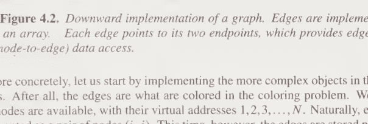

图 4.2. 图的向下实现。边被实现并存储在一个数组中。每条边指向其两个端点，这提供了边到节点（但不是节点到边）的数据访问。

更具体地说，让我们首先实现图中更复杂的对象：边。毕竟，在着色问题中被着色的就是边。我们假设节点是可用的，其虚拟地址为 1,2,3,...,N。自然地，每条边被实现为一对节点 (i, j)。这次，边被物理地存储在一条长度为 Nẽ 的边长数组中。数组中每条边包含其在图中的端点的两个虚拟地址。换句话说，每条边通过其虚拟地址访问其端点。

在向下实现中，边被物理实现并实际存储在边的数组中。每条边都有自己的虚拟地址：其在边的数组中的索引。节点现在不仅可以通过其虚拟地址直接访问，也可以通过使用它们作为端点的边间接访问。

这个数组实际上包含两个数字：i 和 j。（该结构可以物理地实现为两个整数数组。）因此，该数组等价于上述边的数组，只是这里非零矩阵元素的顺序被指定为按行排列。因为零矩阵元素未被存储，存储需求从 N² 减少到仅 Nẽ。

现在让我们定义一个原型着色算法，该算法特别适合上述向下实现。算法如下。遍历边的数组中的边。对于遇到的每条边，用尚未在与它共享一个节点的先前边中使用的第一个颜色对其着色：换句话说，必须使用边的数组中先前边的内部循环来找到共享节点的先前边并避免使用其颜色。这就完成了原型着色算法的定义。

显然，该算法在数学上等价于前一个算法。唯一的区别是这里忽略了非零矩阵元素，因为在着色时它们永远不需要。算法因此在存储需求方面更有效。

不幸的是，原型算法在计算时间方面仍然昂贵。事实上，因为它使用对长边的数组的嵌套循环，它需要 N²ẽ² 次计算。这种缺点的原因是向下实现中可用的单向数据访问。事实上，我们只有边到节点访问，因为边对象包含其端点的虚拟地址，但没有节点到边访问，因为节点“不知道”哪些边从它发出或指向它。这就是内部循环如此长的原因：它必须扫描所有先前的边，因为我们不知道确切地哪些边与当前边（在外层循环中扫描）共享一个节点。

上述讨论导致了一种改进的实现，具有边到节点和节点到边的数据访问（图 4.3）。在此实现中，节点也“知道”哪些边从它发出或指向它。这是如何实现的。对于每个 1 ≤ i ≤ N，令 1 ≤ n(i) ≤ Nẽ 为边的数组中非零元素在 A 中第 i 行开始列出的位置。边的数组中索引为 n(i), n(i)+1, …, n(i+1)−1 的条目对应于从节点 i 发出的边。因此，第 i 个节点可以访问从它发出的连续边列表，或 A 中第 i 行的非零元素。如果 A 的转置 A′ 也是以相同方式存储，则第 i 个节点也可以访问指向它的连续边列表，或 A 中第 i 列的非零元素。（与第 18 章第 17 节中用于存储稀疏矩阵的 Harwell–Boeing 方法中使用的列指针进行比较。）


图 4.3. 具有完整数据访问的向下实现。边可以访问其端点，节点可以访问使用它们作为端点的边。

#### 4.28. The C++ Implementation

因此，原型算法中昂贵的内部循环可以用 A 中第 i 行和第 j 列的非零元素上的两个短循环代替（其中 i 和 j 是外层循环中扫描的非零元素 A_{i,j} 的索引）。使用此实现，原型算法中的计算次数从 N²ε² 减少到 Nε²，这相当有效。

下面，我们将看到如何在 C++ 中很好地实现此实现。

##### 4.28 The C++ Implementation

向下实现需要为单个边分配内存。边存储在一条长数组中，边的虚拟地址只是其在此数组中的索引。此实现等价于将非零元素按行存储在长度为 Nε 的稀疏矩阵数组中。

这就是在像 Fortran 这样面向存储的编程语言中向下实现的实现方式，其中没有指针可用，必须使用虚拟地址。显然，实现涉及大量存储细节，可能掩盖全局图景。

幸运的是，在 C++ 中这不是必要的，因为指针可以用来形成所需的数据结构和对象（图 4.4）。事实上，A 中第 i 行的非零元素可以存储在链表中，避免存储不必要的零元素。更具体地说。A 可以实现为 N 个项目的列表，其中每个项目本身就是一个链表。

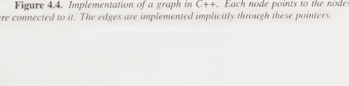

整数列表。这些整数只是相应非零元素 A_i,j 的列索引 j。换句话说，一条边 (i, j) 可以访问其第二个端点 j，因此我们有了所需边到节点数据访问的一半。此外，节点 i 可以访问列表中的第 i 个项目，其中包含 A 中第 i 行的非零元素，或从 i 发出的边。因此，我们也拥有所需节点到边数据访问的一半。如果 A^t 也是以相同方式存储，则我们具有完整的边到节点和节点到边数据访问，从而以两个短内部循环实现原型着色算法的经济实现，循环遍历存储 A 中第 i 行和 A^t 中第 j 行的链表（其中 i 和 j 是外层循环中当前边的端点，或 A_i,j 的索引，外层循环中扫描的非零元素）。使用此实现，整个原型算法中的总计算次数从 N^2 e^2 减少到仅 N e^2。

上述转置矩阵 A^t 的实现实际上等价于存储稀疏矩阵的 Harwell-Boeing 方法（第 18 章，第 17 节）。当然，现在的实现要透明得多，因为它使用真实地址而不是虚拟地址。事实上，因为矩阵行存储在链表中，就没有必要像以前那样将非零矩阵元素存储在长的边数组中。毕竟，它们的物理地址在链表中的指针中可用，因此不需要虚拟地址。完整的 C++ 实现可在第 16 章获得。

请注意，在 C++ 实现中，非零矩阵元素不再存储在连续数组中。因此，外层循环必须通过循环遍历节点 i = 1,2,3,...,N 并对存储第 i 行的链表进行循环来执行。这样，外层循环使用间接而非直接索引进行。

内部循环也可以有效地执行。因为链表中的项目包含整数 j，即 A_i,j 的列索引，所以 i 和 j 都可用以执行两个短内部循环，遍历 A 中的第 i 行和 A^t 中的第 j 行，以检查特定颜色是否已被使用。

C++ 实现还有另一个重要优点：因为非零元素存储在链表中，通过添加新的非零元素或删除旧元素来修改矩阵变得特别容易（或等价地，向图中引入新的边或从中删除旧边）。C++ 实现的这种额外灵活性在三角剖分的上下文中特别有用，下文将讨论。

#### 4.29 Triangulation

让我们使用向下方法来实现三角剖分。为了定义三角剖分，我们首先需要定义图中的形状。

图中 k 个节点的形状是 k 个节点

i₁, i₂, i₃, ..., i_k

的集合，它们通过 k 条边相互连接，这些边一起形成一个圆：

(i₁,i₂), (i₂,i₃), (i₃,i₄),..., (i_{k-1},i_k), (i_k,i₁).

该形状的子形状是上述节点集合的子集，其本身也是一个形状。例如，如果 i₁, i₂ 和 i₄ 通过边 (i₁,i₂), (i₂,i₄) 和 (i₄,i₁) 连接，则它们形成上述形状的子形状。

三角形是三个节点的形状。在上面的例子中，i₁, i₂ 和 i₄ 形成一个三角形。


对于非定向图，只需考虑 $i < j < k$ 的情况（否则，可以交换 $i, j$ 和 $k$ 以满足这些不等式）。在这种情况下，当且仅当 $i, j$ 和 $k$ 属于同一三角剖分中的同一个三角形时，$A_{i,j,k} = -1$。因此，立方体 $A$ 确实等价于该三角剖分。

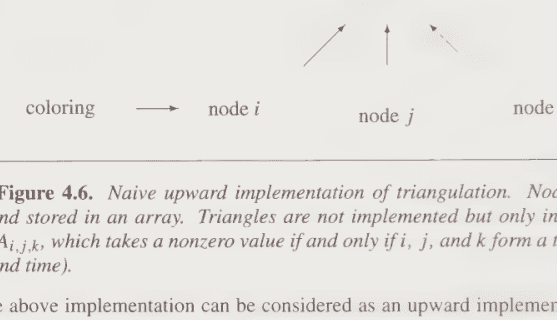

**图 4.6. 三角剖分的朴素向上实现。** 节点被实现并存储在一个数组中。三角形未被实现，仅在函数 $A_{i,j,k}$ 中指示，当且仅当 $i, j$ 和 $k$ 构成一个三角形时，该函数取非零值（立方级存储和时间复杂度）。

上述实现可被视为一种向上实现（图 4.6）。确实，节点具有虚拟地址 $1, 2, 3, \dots, N$ 以便引用，但三角形并未物理实现，也没有物理或虚拟地址。指示三角形存在的函数 $A_{i,j,k}$ 经常返回零值，因此需要 $N^3$ 的大存储复杂度。

尽管第 4.26 节中的着色算法可以扩展到三角形着色算法，但它的计算复杂度将高达 $N^3$。确实，必须至少进入立方体 $A$ 中的每个单元格一次，以检查其是否包含非零整数。这种复杂度大得无法接受；唯一的补救方法是使用向下方法。

#### 4.31 向下实现

三角剖分中的基本数学对象是节点。我们假设节点已经实现，并通过索引 $i = 1, 2, 3, \dots, N$ 编号。

三角剖分中更复杂的对象是三角形，每个三角形由三个顶点组成。三角形尚未实现。事实上，在上面的实现中，它们根本没有被实现。这就是为什么这种实现被称为向上实现：它关注基本的节点对象，通过这些节点对象利用函数 $A_{i,j,k}$ 访问有关三角形存在的信息。正如上面所见，这种实现需要过多的存储空间，对于三角形着色问题来说速度也太慢。

这就是为什么我们在这里切换到向下实现。这种方法关注问题领域中更复杂的数学对象：三角形（图 4.7）。每个三角形被实现为指向作为其顶点的节点的指针三元组。不存在的三角形（那些 $A_{i,j,k} = 0$ 的）现在被避免，根本不被实现。因此，在存储方面，这种实现要经济得多：它只需要

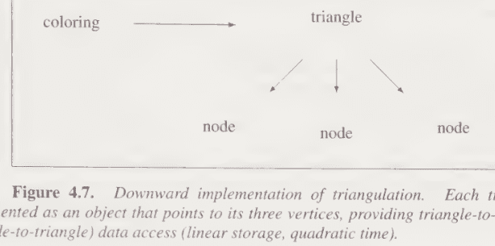

**图 4.7. 三角剖分的向下实现。** 每个三角形被实现为指向其三个顶点的对象，提供从三角形到节点（而非从节点到三角形）的数据访问（线性存储，二次时间）。

$N \bar{t}$ 个存储单元，其中 $\bar{t}$ 是每个节点的平均三角形数量，通常非常接近 1。

向下实现也最适合三角形着色问题。毕竟，三角形是其中的着色对象，因此必须正确实现。原型三角形着色算法类似于第 4.27 节中的原型图着色算法。其代码如下：遍历三角剖分中的各个三角形。对于每个三角形，使用内循环扫描先前的三角形，找到相邻三角形并避免使用它们的颜色。这就完成了原型三角形着色算法的定义。

就时间而言，原型算法仍然相当昂贵。确实，由于对三角形的嵌套循环，它需要 $N^2 \bar{t}^2$ 个时间单位。这是因为向下实现仅使用从三角形到节点的数据访问，通过这种访问，一个三角形“知道”其顶点的地址，但没有从节点到三角形的数据访问，因此节点不“知道”它属于哪些三角形。这就是为什么内循环如此长。

上述算法可以像第 4.28 节中那样进行改进。由于我们也需要从节点到三角形的数据访问，三角剖分应该实现为链表列表。更具体地说，该列表包含 $N$ 个项目，每个项目本身又是一个链表。对于 $1 \le i \le N$，第 $i$ 个链表存储使用第 $i$ 个节点作为顶点的三角形的地址。

现在可以避免上述原型算法中冗长的内循环。由于外循环中当前三角形的顶点可以访问使用它们作为顶点的三角形，因此可以轻松找到相邻三角形，即与当前三角形共享两个顶点的三角形。然后，当前三角形可以用尚未用于为相邻三角形着色的第一种颜色进行着色。因此，该算法的复杂度降低为 $N \bar{t}^2$。

请注意，上述链表中的项目是指向三角形的指针，而非三角形本身。这是因为一个三角形出现在三个不同的链表中。由于三角形对象不能被构建多次，必须在这三个链表中使用其地址，以实现从节点到三角形的数据访问。

由于上述链表不存储物理三角形，因此仍然需要决定将三角形本身在计算机内存中存储的最佳数据结构是什么。这个问题将在下面讨论。

#### 4.32 信息的分离

向下方法关注问题领域中更复杂的数学对象，并优先实现它们，假设更基本的对象已经可用。在三角剖分中，这意味着三角形被实现为其顶点地址的三元组。然后，三角形对象可用于着色算法和其他有用算法中的进一步使用。

然而，还有一个问题尚未得到解答：存储三角形对象的最佳数据结构是什么？毕竟，三角剖分中的三角形彼此相关，肯定不应该在计算机内存中彼此分离。存储它们的数据结构必须反映三角形之间的关系。

乍一看，存储三角形的合适数据结构是一个非定向图。在这个图中，每个节点代表一个三角形，当且仅当对应的三角形在三角剖分中彼此相邻时，图中的两个节点由一条边连接。

然而，上述方法有一个主要缺点：它不够灵活。确实，向现有三角剖分添加新三角形太过复杂，因为它要求在图中移除现有边并引入新边。需要更容易修改的数据结构。

此外，事实证明上述图中的边完全是多余的。确实，关于三角形邻接性的信息可以从它们的顶点获得：两个三角形相邻当且仅当它们共享两个顶点。没有必要再次以图边的形式存储此信息。

上述讨论引出了信息分离的概念。该原则意味着，在同时具有基本对象和复杂对象的系统中，建议在基本对象中存储尽可能多的技术信息，并将其隐藏在复杂对象中。这样，复杂的（高层）对象可以自由地协助按其原始精神实现数学算法，而基本的（低层）对象则负责处理在算法和应用中无关或次要的技术细节。

在我们的案例中，节点是基本的（低层）对象，而三角形是复杂的（高层）对象。因此，节点对象负责存储技术数据（例如它们在笛卡尔平面中的几何位置）。确实，这些信息在三角形着色问题和算法中完全无关，它们实际上仅根据三角形和邻接关系定义。因此，需要一个邻接函数，该函数接受两个三角形参数并检查它们是否共享两个顶点。着色算法应在内循环中将此函数作为黑箱使用，而无需知道或关心它实际如何工作。这符合信息分离原则的精神：算法仅处理三角形及其关系，且应独立于任何几何考虑。

在 C++ 中，信息分离的概念保持得特别好。确实，在 C++ 中，几何信息可以保持为“node”类的私有成员，对外部世界（包括三角形对象）不可知。着色算法中从未使用此信息。确实，由于三角形被实现为指向节点的指针三元组，邻接函数只需比较两个三角形对象中节点的地址，以查明这些地址是否重合即可。因此，三角形对象本身不包含任何几何数据，并准备好在着色算法中进行着色。


#### 4.33 在数值方案中的应用

在应用科学和工程中的实际应用通常以偏微分方程 (PDE) 的形式表述。PDE 的解是在最初给出 PDE 的领域中定义的一个函数。不幸的是，PDE 很少能被解析求解：通常只能使用数值方案进行近似求解。在数值方案中，领域通过网格进行近似，解是仅在网格中的离散节点上定义的离散网格函数，而原始的 PDE 被替换为基于网格中节点值的合适差分方程。这个离散方程组的解被称为数值解。如果数值方案足够准确且充分地近似原始问题，那么数值解就是原始 PDE 解的良好近似。

在大多数应用中，定义 PDE 的领域是复杂的，并且可能具有弯曲和不规则的边界。因此，拥有一个足够细的网格以尽可能准确地近似该领域尤为重要。三角形剖分（triangulation）是完成这一任务的天然候选者。

三角形剖分可能包含大小各异的三角形。特别是，它可能在弯曲或不规则的边界段附近使用小三角形以提供所需的高分辨率，而在仅需要较低分辨率的区域使用较大的三角形。这种灵活性在数值建模的实际应用中特别具有吸引力。这就是为什么三角形剖分在数值方案中被经常使用的原因。

为了构建近似原始 PDE 的离散方程组，必须遍历三角形并组装它们的贡献（参见第 12 章，第 5 节）。为此，相关的对象是三角形，而不是节点。因此，上文使用的自顶向下实现确实是合适的方法，因为它关注的是三角形而不是节点。

在数值方案中，通常需要通过添加越来越小的三角形来细化三角形剖分，直到获得能够良好近似原始领域的足够细的三角形剖分。因此，最重要的一点是以灵活的数据结构存储三角形剖分，该结构支持添加新三角形和移除旧三角形。第 4.31 节中原始的自顶向下实现最适合此目的。在这种方法中，三角形可以存储在链表中，这提供了轻松且高效地添加或移除三角形的机会。由于更复杂的对象（即三角形）是显式实现的，因此三角形到节点的数据访问是可用的。另一方面，节点到三角形的数据访问是不可用的，因为它需要额外的数据结构，而这些数据结构在三角形剖分中添加新三角形或移除旧三角形时不容易修改。尽管这可能需要对三角形的整个列表进行嵌套循环，但为了拥有一个易于细化的网格，这是值得支付的价格。事实上，由于在自顶向下实现中，节点从未存储在数组或列表中，引入新节点或移除旧节点特别容易。实际上，可以通过 `new` 命令创建一个新的节点对象，并将其地址放置在使用该节点作为顶点的三角形中。

因此，存储三角形的合适数据结构应忽略其在网格中的位置，并专注于其主要任务：提供灵活的存储机制。适合此工作的数据结构不是图，而是链表。确实，在链表中，三角形着色算法的外层循环可以轻松执行。此外，链表非常灵活，允许在必要时向三角形剖分中插入新三角形并从中移除旧三角形。链表仅存储三角形，并忽略它们之间的任何关系（包括通过其他方式检查的邻接关系）。这就是为什么它提供了存储单个三角形的最合适方法的原因。

在下一节中，我们将说明当前实现不仅适用于着色算法，还适用于数值算法，例如本书后续章节中实现的算法。

因此，自顶向下方法是三角形剖分实现中一个特别有用的工具。所需的对象层级（节点、三角形、三角形剖分）在 C++ 中实现得特别好，正如第 13 章中实际所做的那样。

#### 4.34 练习

- 1. 证明一个人仅仅是其欲望的集合。
- 2. 解释为什么任何自然语言中的单词都无法准确代表一个概念。（利用同义词的存在，从不同的角度或观点照亮该概念。）
- 3. 得出结论：单词充其量只能指示一个概念，即在脑海中唤起与该概念相关的个人记忆。
- 4. 得出结论：人脑可以如下建模：记忆放置在背景中，而（第一种）自然语言放置在前景中。背景中的每个特定记忆都投影到前景中的某个单词上。一旦听到或说出这个单词，该记忆确实会被唤起。
- 5. 解释“思考一个对象”这一术语，即在脑海中引入或唤起与它相关的越来越多记忆，以更好地理解其本质。
- 6. 证明与婴儿出生时使用的第一种自然语言不同，成年人使用的第二种自然语言不使用上述直观模型，而是使用归纳模型，其中每个单词都用假设已经解释良好且已知的低层级单词来解释。
- 7. 证明单词的字典解释也使用上述归纳模型。
- 8. 证明上述归纳模型的实际实现实际上是递归的。
- 9. 证明引入一个指代抽象对象的单词有助于思考它并将其与其他对象联系起来。
- 10. 证明形式语言也使用上述归纳-递归模型来定义对象。
- 11. 证明在计算机上实现一个形式对象有助于更好地理解其本质和特征，并使用它来描述问题领域以及设计算法来解决这些问题。

# 第 5 章

### 快速傅里叶变换（FFT）和其他算法及其在数值分析和密码学中的面向对象实现

在本章中，我们讨论计算问题、求解方法及其高效实现。我们描述了编写算法以解决特定问题的不同方法，并从存储和计算需求方面将它们进行比较。特别是，我们重点关注数值分析和密码学中的应用，包括霍纳（Horner）、RSA 和 FFT 算法。

下面介绍的数学对象不仅有助于实现算法，还有助于首先开发这些算法，并在必要时对其进行修改。我们在“多项式”对象的实现中说明了这些要点，以及有用的算术运算和函数。该对象在书中后续讨论的有限元离散化方法中特别有用。

最后，我们还实现了“数字”对象，这是一个任意大的整数，以及与其相关的算术运算。然后使用该对象来实现密码学中的高级算法。

#### 5.1 想法及其实现

程序员头脑中有一个关于如何完成特定任务的构想。这种构想通常可以用英语等自然语言中的文字表达出来。这种表述使构想更清晰、更实用；确实，当你向朋友或同事解释你的构想时，它对你自己也会变得更清晰、更具体。

然而，从实用角度看，仅用文字描述构想通常是不够的。更有用的描述必须采取操作列表的形式，这些操作可以逐个执行，以产生所考虑问题的所需解决方案。这被称为算法。

算法中的单个操作仍然用自然语言书写，这可能有些模糊和含混。事实上，自然语言中术语的解释很可能取决于其使用的上下文。因此，算法必须仅包含无歧义（上下文无关）的指令，这些指令可以由人类或机器执行。

当构想涉及如何解决计算问题时，它通常可以写成上下文无关的形式语言，使用数学符号、结构和对象。这

这确实是阐述想法的最佳方式，因为由此衍生出的算法也可以用清晰的数学指令来书写。

最初的想法如果不能传达给人和机器，便毫无用处。人类通常可以通过（依赖上下文的）自然语言来理解它，而机器必须拥有用上下文无关的形式语言编写的显式算法。将想法转化为形式化算法对开发者自身也有帮助，因为这使他们有机会对其进行调试，并检查它是否确实实现了预期功能。

因此，运用这一想法的最重要步骤是将其用数学语言表达出来。这正是 C++ 发挥作用之处：它提供了定义所需数学对象的框架。这些对象可以充当编写算法所用的形式语言中的“词汇”。用 C++ 这样的高级编程语言来书写原始想法和算法，称为“实现”。

实际上，面向对象的方法不仅有助于按照原有精神实现想法和算法，而且首先提供了对它们进行思考和展开所需的术语与对象。通过引入有用的术语和对象，它提供了发展、表达和重塑原始想法所需的词汇，直至其成熟为最终形态。

#### 5.2 多级编程

在高级编程语言中，可以使用字符和数字等对象。我们可以定义变量来取不同的值，并通过一元和二元运算及函数对它们进行操作。然而，这些基本对象通常不足以实现实用算法。事实上，即使是基本算法，也需要抽象的数学对象。虽然理论上这些对象可以像最初的图灵机那样仅用字符来实现，但这种方法显然极不实用。使用数组的传统编程语言固然更好，但在其中实现复杂的数据结构可能仍然过于复杂，且难以阅读、使用和必要时修改。要实现复杂的数学结构，显然需要一种高抽象级别的编程语言。

借助像 C++ 这样的面向对象语言，可以使用标准语言中不可用的对象来实现复杂的算法。这被称为“高层编程”。在这种方法中，程序员假定所需的对象及其操作函数都是可用的。这些对象和函数的实际实现可以推迟到之后的阶段，称为“底层编程”。

高层编程要求对算法及其背后的概念和思想有深入理解。编写高层代码的程序员应写下注释，说明具体需要哪些对象以及有哪些可用的操作函数。这些需求随后应传递给擅长底层编程的同事。这样，高层代码的程序员就可以继续按照原有精神实现算法，而不会被实现这些对象的具体细节所干扰。

底层编程可能需要计算机硬件和内存方面的知识与经验。执行底层编程的程序员应根据高层代码程序员传递的需求，尽可能高效地实现这些对象。

所需的结果，但随后，为了作为输出返回，该对象必须（通过类的复制构造函数）被复制到一个临时的外部对象中，以便在局部对象消失后存储结果。不过，为了代码的清晰和实用，这点轻微开销是值得的。此外，一些 C++ 编译器支持的版本可以将这种开销降至最低。

接下来，我们将展示 C++ 在实现多项式对象及相关算法方面的有效性。

#### 5.4 示例：多项式对象

这里，我们展示在 C++ 中将多项式实现为对象是多么方便。面向对象的方法使人可以定义接收和返回对象（而非指针或数组）的函数，从而避免处理存储细节的需要。此外，这种方法还支持定义多项式之间的有用算术运算，例如加法、乘法等。

我们主要考虑两个常见问题：两个多项式的乘法，以及计算多项式在给定点的值。

考虑多项式

$$p(x) \equiv \sum_{i=0}^{n} a_i x^i$$

其中 $x$ 是自变量，$n$ 是多项式的次数（$x$ 的最大幂），$a_0, a_1, \dots, a_n$ 是系数。

第一个问题是如何存储多项式。要回答这个问题，可以注意到多项式 $p(x)$ 由其系数 $a_0, a_1, \dots, a_n$ 刻画。因此，存储多项式只需存储其系数即可。

在 C 语言中，人们自然会将系数存储在数组中；但这样一来，将它们传递给函数就涉及存储细节，使程序员无法专注于数学算法。

在 C++ 中这样做效率更高，例如使用第 3 章第 4 节中的 `list` 对象。实际上，`polynomial` 类可以从数字列表派生而来，因此 `polynomial` 对象实际上是一个系数列表。然后，无论其内部实现如何，该对象都可以像往常一样轻松地通过引用传递给函数。此外，`polynomial` 对象还可以作为函数的输出返回，并在后续对其他函数的调用中继续用作输入。

由于 $x$ 和 $a_i$ 的类型尚未指定，我们使用 C++ 中另一个强大的工具：模板。这样，`polynomial` 模板类中的参数 `T` 代表自变量和系数的类型，并可用于函数定义。由于特定类型在函数所用算法中无关紧要，模板还意味着可以忽略类型，专注于算法中的数学概念。当编译器遇到使用 `polynomial` 对象的函数调用时，替换 `T` 的具体类型将在之后指定。然后，这些函数就可以针对指定类型的多项式（整数、实数、复数等）进行调用。

以下是从基类 `list` 派生 `polynomial` 类的代码（图 5.1）：

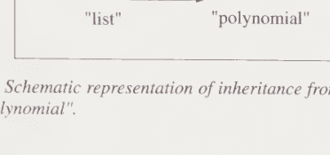

##### 图 5.1：从基类 `list` 到派生类 `polynomial` 的继承关系的示意图。

```cpp
template<class T> class polynomial:public list<T>{
    public:
        polynomial(int n=0){
            number = n;
            item = n ? new T*[n] : 0;
            for(int i=0; i<n; i++)
                item[i] = new T(0);
        } // constructor

        polynomial(int n, const T&a){
            number = n;
            item = n ? new T*[n] : 0;
            for(int i=0; i<n; i++)
                item[i] = new T(a);
        } // constructor with 'T' argument
```

这些构造函数首先隐式调用基类 `list` 的默认构造函数，该构造函数构造一个不含任何项的空列表。得益于基类 `list` 中的 `number` 和 `item` 字段被声明为 `protected` 而非 `private`，上述构造函数可以访问它们并为其赋予有意义的值。

注意，某些编译器（包括比 Version 3.2 更新的 GNU 版本）可能要求使用 `this->` 前缀来访问从基类 `list` 继承的 `number` 和 `item` 字段：

```cpp
this->number = n;
```

（另请参见附录中 A.34 节的代码，以及本书网页 http://www.siam.org/books/cs09 上的代码，它们同样可以配合新的 GNU 版本编译。）但在后文中，我们就不费心添加此前缀了。

复制构造函数和赋值运算符无需定义，因为基类 `list` 中的相应运算符会执行正确的操作，即将实参中的项逐一复制或赋值给当前对象。

下面的析构函数也无需做任何事情，因为基类 `list` 的析构函数（在此析构函数末尾隐式调用）会按要求先销毁底层列表中的各个项，然后再销毁列表本身：

```cpp
~polynomial(){
} // destructor
```


下面这个成员函数返回多项式的次数：

```cpp
int degree() const{
    return number-1;
}   // degree of polynomial
};
```

至此，`polynomial` 类的代码块结束。接下来，我们还要实现两个多项式相加的运算符。具体来说，`+=` 运算符接受两个 `polynomial` 参数，并把第二个加到第一个上：

```cpp
template<class T>
const polynomial<T>&
operator+=(polynomial<T>& p, const polynomial<T>&q){
    if(p.size() >= q.size())
        for(int i=0; i<q.size(); i++)
            p(i) += q[i];
    else{
        polynomial<T> keepQ = q;
        p = keepQ += p;
    }
    return p;
}   // add polynomial
```

这个运算符的工作方式如下。如果 `p` 的次数大于或等于 `q` 的次数，就把 `q` 中的系数逐一加到 `p` 中对应的系数上。在逐项相加时，使用从基类 `list` 继承的 `operator()` 来修改左侧的 `p(i)` 项，而使用 `operator[]` 来读取右侧的 `q[i]` 项。

另一方面，如果 `p` 的次数小于 `q` 的次数，上述算法就不再适用。此时会改为对 `+=` 运算符进行一次内部调用，并互换 `p` 和 `q` 的角色。

由于这里的 `+=` 运算符是作为非成员函数实现的，它的第一个（非常量）参数不能是另一个函数作为输出返回的临时变量。事实上，编译器不会接受这样的调用，因为修改一个反正马上就要消失的临时对象是没有意义的。这就是为什么定义了额外的 `polynomial` 对象 `keepQ`，并将其作为第一个参数传给 `+=` 运算符的内部调用。

上面的 `+=` 运算符现在进一步用在 `+` 运算符中，后者返回两个多项式的和：

```cpp
template<class T>
const polynomial<T>
operator+(const polynomial<T>& p,
          const polynomial<T>&q){
    polynomial<T> keep = p;
    return keep += q;
}   // add two polynomials
```

这使我们有机会将整个对象作为一个整体传给函数，而无需操心存储细节。

下面这个函数接受多项式 *p* 和点 *x*，并返回 *p(x)*：

```cpp
template<class T>
const T
calculatePolynomial(const polynomial<T>&p, const T&x){
    T powerOfX = 1;
    T sum=0;
    for(int i=0; i<p.size(); i++){
        sum += p[i] * powerOfX;
        powerOfX *= x;
    }
    return sum;
}   //  calculate a polynomial
```

注意，这里我们使用了局部变量 `powerOfX` 来存储多项式中用到的各个幂次 *xⁱ*。这个额外变量略微降低了代码的优雅性。接下来，我们将看到一个改进的算法，它不仅更高效，而且实现也更优雅。

#### 5.7 算法及其实现

到目前为止，我们主要讨论了实现方面的问题。我们提到过，C++ 这类面向对象语言让我们有机会把整个项目分成两部分：底层部分负责实现基本对象，高层部分则实际使用这些对象，按算法的本来意图实现算法。这种两层方法还有一个优点：实现良好的对象不仅可用于当前算法，也可用于其他算法和应用。实际上，项目的底层部分可以扩展成完整的对象库，以备将来使用。此外，还可以一层层地构建库的层次结构，每一层都使用较低层库中的对象来构成更复杂的对象。这称为多级编程。

代码中实现常用对象的底层部分，在内存分配和数据访问方面应当特别高效。另一方面，代码中实现数学算法的高层部分，在运算次数方面应当尽可能高效。更重要的是，它应当是模块化、透明且对读者友好的；这不仅有助于潜在读者，也有助于程序员在编写、调试以及必要时修改代码的过程中获得帮助。

虽然效率是一个重要特性，但透明性和清晰性对于保证代码的正确性和可用性可能更为重要。尤其是，对象应当是完整的，并能在未来的每个应用中被随时使用。尤其要将存储细节对用户隐藏；用户应完全不了解对象的内部结构，只能通过接口函数、依据对象的数学属性来认识它们。

此外，我们甚至建议，在必要时可以为了透明性和清晰性而牺牲效率。例如，一个返回对象的函数需要额外调用类的复制构造函数来构造临时输出对象。虽然这个额外调用会降低效率，但为了代码更清晰，这样做可能非常值得。实际上，返回的对象可以在同一行代码中继续作为其他函数调用的输入。返回一个对象远比返回一个数字数组合适，因为后者没有能够作为完整对象的明确解释。

在大多数情况下，高层程序员与底层程序员之间会相互交流。高层程序员可以向底层程序员提出需求，同时也会收到反馈，了解这些需求是否现实，以及所需对象有哪些限制和缺陷。这些反馈可能会促使高层程序员修改最初的实现，使其适应硬件方面的问题和限制。

实际上，即便是数学算法的开发者也不是完全独立的。一个算法在理论运算次数上可能看起来很高效，但它所需的对象可能难以实现。因此，尽管算法通常是在纯数学环境中开发的，但更实际的实现问题也不应被忽视。（另见第18章第18.14节。）

算法开发者首先关心的当然是如何减少理论运算次数。幸运的是，事实证明，在理论意义上高效的算法，在实际实现上往往也是直接而高效的。

高效算法的常见原则之一是，避免重新计算那些可以轻松从内存中获取的数据。在下一节中，我们将看到在“计算给定点处多项式值”这一问题中运用该原则的算法。我们还将看到，这个算法确实具有直接而高效的实现。

#### 5.8 Horner 算法

高效计算的第一条规则如下：

> 除非绝对必要，否则不要展开括号！

的确，分配律告诉我们：

$A(B + C) = AB + AC,$

其中 $A$、$B$ 和 $C$ 是某个数学域中的元素。不使用括号的右边需要两次乘法和一次加法才能计算，而使用括号的左边只需要一次加法和一次乘法。这也是用于计算多项式值的 Horner 算法背后的思想。事实上，该算法会在多项式中尽可能多地引入括号。

第5.6节中的多项式实际上是直接由下面的公式计算的：

$p(x)=\sum_{i=0}^{n} a_i x^i.$

由于右边不包含括号，需要 $2n$ 次乘法（$n$ 次用于计算幂 $x^i$，另外 $n$ 次用于将它们与系数 $a_i$ 相乘）和 $n$ 次加法。这个数目还能减少吗？

能。Horner 算法使用以下公式：

p(x) = (⋯((aₙ x + aₙ₋₁) x + aₙ₋₂) x + aₙ₋₃)⋯) x + a₀.

该过程从最内层的括号开始，先计算系数为 aₙ 的项，然后逐步向外层括号推进，最后加上常数项系数 a₀。由于引入了大量括号，该算法总共只需 n 次乘法和 n 次加法，而且实现也很漂亮，如下所示：

```cpp
template<class T>
const T
HornerPolynomial(const polynomial<T>&p, const T&x) {
    T result = p[p.degree()];
    for(int i=p.degree(); i>0; i--) {
        result *= x;
        result += p[i-1];
    }
    return result;
} // Horner algorithm to calculate a polynomial
```

该算法不仅更高效，而且实现也更高效。实际上，代码比第5.6节中的代码略短，并且避免了那里使用的额外变量 `powerOfX`。

在下一节中，我们将使用上述算法来高效计算单个幂 xⁿ 在给定点 x 处的值。事实证明，就此目的而言，虽然 Horner 算法效率略低，但它的代码要优雅得多，也更容易理解和调试。这种效率与透明性之间的权衡，不仅经常出现在像本例这样的简单例子中，也经常出现在复杂的应用中；在复杂应用中，优雅性和透明性对于代码易于调试且切实可用至关重要。

#### 5.9 幂的计算

通常，多项式是针对实数或复数参数 x 来计算值的。不过，这里我们要说明，参数为整数的多项式这一概念也很有用。实际上，这个多项式从未被显式计算过，因为它的值已经可以直接获得。尽管如此，将一个整数表示成多项式（如第1章第18节所述）的做法，仍有助于解决当前的问题。

考虑下面的问题：对于给定的 x 和一个很大的整数 n，高效地计算 xⁿ。当然，这可以通过递归公式用 n 次乘法完成：

xⁿ = x · xⁿ⁻¹

（见第1章第17节），但能否更高效地完成呢？

答案是肯定的，只需 2 log₂ n 次乘法即可完成。为此，我们使用整数 n 的二进制表示，将其看作关于数 2 的多项式：

n = Σᵢ₌₀ᵏ aᵢ 2ⁱ,


其中系数 $a_i$ 为 0 或 1。通过这种表示方法，我们有

$$x^n=\prod_{i=0}^{n}x^{a_i2^i},$$

这是 $x$ 的所有 $a_i2^i$ 次幂的乘积。现在，$x$ 的 $2^i$ 次幂可以通过 $i$ 次以下替代计算得出

$$x\leftarrow x^2.$$

因此，计算的总成本最多为 $2\log_2 n$ 次乘法。

该算法可以很好地实现如下：

```cpp
template<class T>
const T
power(const T&x, int n){
    T result = 1;
    T powerOfX = x;
    while(n) {
        if(n % 2) result *= powerOfX;
        powerOfX *= powerOfX;
        n /= 2;
    }
    return result;
}   // compute a power
```

在上述“while”循环的主体中，$n$ 的二进制表示中的最后一位是通过取模运算 $n\%2$ 找到的。一旦使用完该位，通过无余数地将 $n$ 除以 2 即可将其舍弃。采用这种方法，代码尤其优雅。

然而，计算幂 $x^n$ 还有一种更好的方法。该方法基于霍纳多项式（Horner's polynomial）。回顾一下，多项式 $p(x)$ 的霍纳表示实际上基于以下递归

$$p(x)=\sum_{i=0}^{n}a_ix^i=a_0+xp_1(x),$$

其中

$$p_1(x)=\sum_{i=0}^{n-1}a_{i+1}x^i$$

是一个 $n-1$ 次多项式。实际上，多项式 $p_1(x)$ 可以按相同方式递归重构，最终导致第 5.8 节中的表示形式。

当然，由于构造 $p_1(x)$ 作为“多项式”对象的成本很大，上述递归形式从未被显式使用。这就是为什么第 5.8 节中的代码实际上“展开”了递归，并从其末端（最内层括号）开始，在普通循环中回溯到开头。

然而，在当前的问题中，由于多项式 $p(2)=n$ 仅仅是整数 $n$ 的二进制表示，$p_1(2)=n/2$ 可以通过无余数地将 $n$ 除以 2 立即获得。事实上，我们有

$$n=(n\%2)+2(n/2),$$

其中 n/2 表示无余数的整数除法，n%2 包含余数（参见第 1 章第 18 节）。这意味着

$$x^n = x^{n\%2}(x^2)^{n/2}.$$

这导致了“power()”函数的以下递归实现：

```cpp
template<class T>
const T
power(const T&x, int n){
    return n ? (n%2 ? x * power(x * x,n/2)
        : power(x * x,n/2)) : 1;
} // compute a power recursively
```

这样，“power()”函数只包含一条指令。这种风格特别高效，因为它避免了显式定义局部变量。由于“power()”函数递归调用了 $\log_2 n$ 次，就操作次数而言，总成本仍然最多为 $2\log_2 n$ 次乘法，与之前相同。然而，也应考虑到递归调用带来的额外成本。事实上，在每次递归调用中，计算机需要为局部变量 'x' 和 'n' 分配内存。尽管 'x' 是按引用传递的，其地址仍需在每次递归调用中本地存储。尽管如此，为了获得简短且优雅的代码，这种额外成本可能是值得的。确实，$n$ 的递归重构比原始的显式形式短得多，也更简单，因此也更容易调试。虽然对于目前经过充分测试的代码，调试并非必要，但在复杂应用中它可能构成关键问题。这就是为什么编写简短且优雅的代码是一项极具吸引力的技能。

#### 5.10 导数的计算

在上面的讨论中，假设只需要计算 $x$ 的 $n$ 次幂，$x^n$。但如果需要所有幂 $x^2, x^3, \dots, x^n$ 呢？在这种情况下，当然使用上述算法没有意义。原始方法要合理得多：

$$x^k = x \cdot x^{k-1}, \quad k = 2,3,\dots,n.$$

确实，这种方法仅用 $n$ 次乘法即可计算出所有所需的幂。

现在提出的问题是如何存储所有这些计算出的幂。在 C 语言中，人们被迫使用数组。但再次强调，数组并不是一个有意义的对象，将其传递给函数或从函数返回它意义不大。第 3 章第 4 节中的“list”对象更适合此目的。尽管“list”对象相对于标准数组的优势看起来微不足道，但在复杂应用中它变得至关重要，因为许多函数应用于其他函数返回的对象。因此，使用合适的对象而不是标准数组是最有用的。

#### 5.11 泰勒展开

实现中的基本任务是将关于 $f$ 及其在 $x$ 处的导数的必要信息传递给计算机。下方代码中的“Taylor()”函数必须将数值 $f(x), f'(x), f''(x), \dots, f^{(n)}(x)$ 作为输入，然后才能开始计算 $f(x + h)$ 的泰勒近似。如上所述，这些数值被放置在一个单一的“list”对象中并传递给函数。这样，编写该函数的程序员可以忽略存储问题，专注于数学算法。

由于上述泰勒近似实际上是关于 $h$ 的 $n$ 次多项式，可以使用第 5.6 节中算法的版本。在这个版本中，多项式中的项通过以下递归计算得出

$$\frac{h^i}{i!}=\frac{h}{i}\frac{h^{i-1}}{(i-1)!}.$$

这些项随后与 $f^{(i)}(x)$（在输入“list”对象中可用）相乘并加到总和中。我们将此版本称为标准算法；其实现如下：

```cpp
template<class T>
const T
Taylor(const list<T>&f, const T&h){
    T powerOfHoveriFactorial = 1;
    T sum=0;
    for(int i=0; i<f.size()-1; i++){
        sum += f[i] * powerOfHoveriFactorial;
        powerOfHoveriFactorial *= h/(i+1);
    }
    return sum;
}   // Taylor approximation to f(x+h)
```

注意，输入列表中的最后一项，包含 $(n$ + 1) 阶导数，在这里并未实际使用；它保留用于估计误差（参见第 6 章第 10 节）。

上述标准算法总共需要 $3n$ 次乘法和 $n$ 次加法。更高效的算法是第 5.8 节中霍纳算法的一个版本。此版本基于观察：泰勒近似可以写成如下形式

$$\left(\cdots\left(\left(f^{(n)}(x)\frac{h}{n}+f^{(n-1)}(x)\right)\frac{h}{n-1}+f^{(n-2)}(x)\right)\frac{h}{n-2}\cdots\right)\frac{h}{1}+f^{(0)}(x).$$

以下代码实现了该公式：

```cpp
template<class T>
const T
HornerTaylor(const list<T>&f, const T&h){
    T result = f[f.size()-2];
    for(int i=f.size()-2; i>0; i--){
        result *= h/i;
        result += f[i-1];
    }
    return result;
}   // Horner algorithm for Taylor approximation
```

### 第 5 章 快速傅里叶变换（FFT）及数值与密码学中的其他算法

该代码仅需要 $2n$ 次乘法和 $n$ 次加法。此外，其实现略短且更优雅。

然而，问题在于是否值得这样做？标准算法有一个主要优势：它按自然顺序，从 0 到 n 添加各项。这不仅更符合原始公式的精神，而且在某些情况下在存储方面更经济。

例如，考虑一个“短记忆”过程，其中 $f^{(i)}(x)$ 仅依赖于前一个数 $f^{(i-1)}(x)$，而不依赖于更早的数 $f(x), f'(x), f''(x), \dots, f^{(i-2)}(x)$（图 5.2）。在这种情况下，更有意义的是在循环内计算 $f^{(i)}(x)$，一旦它对总和做出贡献并用于计算下一个数 $f^{(i+1)}(x)$，就将其丢弃。实际上，新数 $f^{(i+1)}(x)$ 可以存储在与之前用于存储旧数 $f^{(i)}(x)$ 相同的变量中。然而，这种策略仅在标准算法中可行，其中各项按自然顺序相加（图 5.3）。因此，在这种情况下，标准算法变得更加有吸引力，因为它可以避免存储和向“Taylor()”函数传递输入。

然而，在我们的应用中，我们主要感兴趣的是“长记忆”过程，其中 $f^{(i)}(x)$ 不仅依赖于前一个数 $f^{(i-1)}(x)$，还依赖于所有更早的数 $f(x), f'(x), f''(x), \dots, f^{(i-2)}(x)$（图 5.4）。在这种情况下，导数的列表必须完整存储并在上述代码中使用，因此由于在操作次数方面成本更低，霍纳算法更可取。

> $f(x) \rightarrow f'(x) \rightarrow f''(x) \rightarrow f'''(x)$


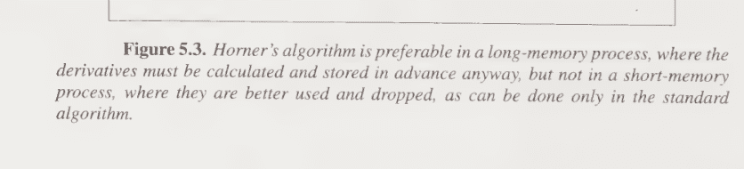


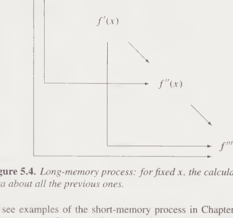

图 5.4. 长记忆过程：对于固定的 x，每个导数的计算都需要之前所有导数的数据。

我们将在第 6 章第 9 节看到短记忆过程的例子，并在第 6 章第 14 节看到长记忆过程的例子。在下一节中，我们将说明将整个列表传递给一个函数是多么有用，尤其是当列表中的所有项都被组合起来以产生所需结果时。

#### 5.12 乘积的导数

在本节中，我们说明为什么将导数列表存储为对象的机会特别重要。为此，我们介绍一个函数，它接受列表参数并在计算中组合其中的所有项。这个函数在第 6 章第 14 节的长记忆过程中将特别有用。

假设函数 f(x) 和 g(x) 在给定点 x 处直到 n 阶（含 n 阶）的导数都是可用的。计算乘积 fg 在 x 处的 n 阶导数，记为

```
(fg)^(n)(x).
```

注意，该量与牛顿二项式具有相同的代数结构：

```
(f + g)^n = Σ_{i=0}^n (n choose i) f^i g^{n-i}.
```

唯一的区别是，这里的和被乘积取代，幂被导数取代。因此，我们得到如下公式

```
(fg)^(n) = Σ_{i=0}^n (n choose i) f^{(i)} g^{(n-i)}
```

在给定点 x 处。

下面的代码实现了这个公式。函数 "deriveProduct()" 接受两个 "list" 对象作为输入，这两个对象包含 f 和 g 在固定点 x 处直到 n 阶（含 n 阶）的导数，并返回 fg 在 x 处的 n 阶导数。这里假设存在一个包含帕斯卡三角的全局整数数组。这个名为 "triangle" 的数组像第 1 章第 19 节那样预先构造好，并放置在 "deriveProduct()" 函数可访问的全局域中。与每次调用该函数时重新计算所需的二项式系数相比，这似乎是一种更好的策略：

```cpp
template<class T>
const T
deriveProduct(const list<T>&f,const list<T>g,int n){
    T sum = 0;
    for(int i=0; i<=n; i++)
        sum += triangle[n-i][i] * f[i] * g[n-i];
    return sum;
} // nth derivative of a product
```

#### 5.13 二元多项式

第 5.4 节中的多项式 ∑ a_i x^i 被实现为系数 a0, a1, a2, ..., an 的列表。这种实现是合适的，因为多项式由其系数唯一确定。

不过，有人可能会问：为什么要用 list 而不是 vector？毕竟，系数都是相同类型的，因此可以安全地存储在维数为 n + 1 的 vector 中。此外，由于支持直接索引，vector 比 list 更高效，也就是说，使用数组来存储系数本身，而不是它们的地址。这不仅节省了存储空间，而且通过高效循环遍历连续存储在计算机内存中的系数，还节省了宝贵的时间。那么为什么要用 list 呢？

答案是：在某些情况下，多项式中的系数占用不同数量的内存，因此不能存储在数组中。例如，考虑两个独立变量 x 和 y 的多项式：

p(x, y) ≡ ∑_{i+j ≤ n} a_{i,j} x^i y^j

其中 i 和 j 是非负索引，a_{i,j} 是给定系数，n 是多项式的次数。这个多项式也可以写成 y/x 的 k 次多项式的形式，由下式给出：

a_k(y/x) ≡ Σ_{j=0}^k a_{k-j,j} (y/x)^j .

因此，原始多项式 p(x, y) 可以实现为列表 a0(y/x), a1(y/x), a2(y/x), ..., an(y/x)。该列表中的每一项本身就是一个多项式，因此也实现为 "polynomial" 对象。更具体地说，原始多项式 p(x, y) 被实现为多项式的多项式，即 "polynomial<polynomial<T> >" 对象，其第 k 项是多项式 a_k(y/x)。多项式 a_k(y/x) 根据其自身的系数 a_{k,0}, a_{k-1,1}, a_{k-2,2},..., a_{0,k} 来定义和存储。

显然，这种实现之所以可能，是因为 "polynomial" 类派生自 "list" 类，而 "list" 类可以包含不同大小的项（例如不同次数的多项式）。使用这种实现，两个二元多项式的相乘特别容易。（这个操作在第 15 章的高阶有限元中特别有用。）具体做法如下：

设 q(x, y) 是另一个二元多项式：

q(x, y) ≡ Σ_{k=0}^m b_k(y/x) x^k ,

其中 b_k(y/x) 本身是 y/x 的 k 次多项式。那么 p 和 q 的乘积为

(pq)(x, y) ≡ p(x, y) q(x, y)

= Σ_{k=0}^{m+n} ( Σ_{j=max(0,k-m)}^{min(k,m)} a_{k-j}(y/x) b_j(y/x) ) x^k .

注意，上述括号中的多项式乘积 a_{k-j}(y/x) b_j(y/x) 本身是 y/x 的 k 次多项式，因此这些括号中的和也是 y/x 的 k 次多项式。这个乘积之和可以使用单变量多项式之间的算术运算来计算（第 5.4 和 5.5 节）。因此，所需的 p 和 q 的乘积可以按照与第 5.5 节相同的方式执行；唯一的区别是系数 a_{k-j} 和 b_j 是多项式而不是标量，因此它们之间的算术运算被解释为多项式之间的算术运算，而不是标量之间的算术运算。一旦编译器遇到的是多项式而非标量，这种解释就会自动使用。

因此，第 5.5 节中的乘法运算符也可以用于二元多项式。事实上，它的工作方式与之前完全相同，只需将其中表示系数类型的模板 'T' 指定为 "polynomial" 即可。例如，下面的代码计算多项式 (1 + x + y)^2 的系数并将其打印到屏幕上：

```cpp
int main() {
    polynomial<polynomial<double> >
        p2(2, polynomial<double>(1,1));
    p2(1) = polynomial<double>(2,1);
    print(p2 * p2);
    return 0;
}
```

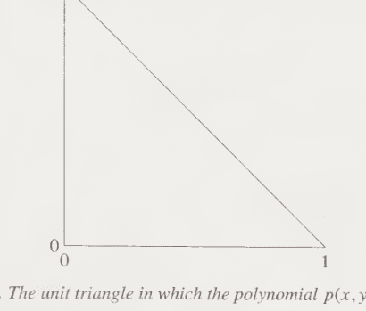

图 5.5. 多项式 p(x, y) 在其上进行积分的单位三角形。

此外，我们知道如何将这些多项式与多项式 x^{k-j} 和标量 a_{k-j,j}/(j+1) 相乘。最后，我们还知道如何对这些多项式求和并在单位区间上积分。这样就完成了在图 5.5 的单位三角形上对 p(x, y) 进行积分的算法。

下面是实现该算法的代码：

```cpp
template<class T>
const T
integral(const polynomial<polynomial<T> >&p){
    polynomial<T> sum(p.size()+1,0);
    polynomial<T> one(1,1);
    polynomial<T> x(2,0);
    x(1) = 1;
    polynomial<T> oneMinusX(2,1);
    oneMinusX(1) = -1;
    list<polynomial<T> > xPowers(p.size(),one);
    list<polynomial<T> > oneMinusXpowers(p.size()+1,one);
    for(int i=1; i<p.size(); i++)
        xPowers(i) = x * xPowers[i-1];
    for(int i=1; i<=p.size(); i++)
        oneMinusXpowers(i) = oneMinusX * oneMinusXpowers[i-1];
    for(int k=p.degree(); k>=0; k--)
        for(int j=0; j<=k; j++)
            sum += (p[k][j]/(j+1))
                   * oneMinusXpowers[j+1] * xPowers[k-j];
    return integral(sum);
} // integral in the triangle
```

尽管这个函数与之前在单位区间上积分的函数同名，但不会产生歧义。事实上，当函数被实际调用时，编译器会查看其具体参数。如果参数是一元多项式，则调用之前的版本；而如果是二元多项式，则调用这个版本。

#### 5.15 密码学应用

十进制数也可以看作是关于 10 的多项式。毕竟，最右边（个位）的数字只是 10⁰ = 1 的倍数，其左边的下一个数字是 10¹ = 10 的倍数，依此类推。在小学，我们学习如何进行长算术运算。没有人告诉我们的是，这些运算实际上基于数学归纳法：我们假设该算法对于 n 位（或列）的数字运行良好，然后我们也将该算法扩展到 n + 1 位的稍大数字。这确实很容易做到：一旦将该技术应用于第一列，我们就只剩下一个 n 位的较短数字，而我们假设该算法对此数字运行良好。于是，我们将原始算法递归地应用于这个 n 位的较短数字，我们已知如何做，如此继续，直到到达最后一列并得出结论。

然后，我们必须确保没有错误。为此，我们对结果应用逆算术运算：如果原始练习是除法，那么逆运算就是乘法。一旦此检查成功，我们就知道没有出错。

数学归纳法原理保证长运算适用于任意长的数字，n 可以任意大。例如，这对于生成实际上无法破解的密码以在互联网上传输秘密消息非常有用。下面正是这样做的。

为此，面向对象的方法被证明特别有用。此外，使用二进制（而非十进制）表示整数，实现起来特别简短而优雅。

#### 5.16 寻找素数

接下来，我们研究一些用于密码学实际问题的算法。这些算法随后将在当前的面向对象框架中实现。

考虑找出 2 与给定的大整数 N 之间所有素数的问题。乍一看，用归纳法解决这个问题是合理的：假设我们已经找到了小于给定数 n 的所有素数，并将它们（按递增顺序）存储在链表中。然后，我们可以通过扫描这个链表，检查 n 是否能被其中任何一个数整除，来判断 n 是否是素数。

注意，只有平方不大于 n 的素数才需要检查它们是否能整除 n。毕竟，如果某个素数 p > √n 能整除 n，那么必然存在一个数 q ≤ √n 使得 n = p q。在这种情况下，n 一定早就被证明不是素数了，因为 q 的每个素因子也都能整除 n。

下面的 "isPrime" 函数返回一个类型为 "bool" 的布尔变量，该变量只能取零或一：

```cpp
template<class T>
bool isPrime(const T&n, const linkedList<T>& primes) {
```


```
for(const linkedList<T>* runner = &primes;
    runner; runner = runner->readNext()){
    if(n%(*runner)() == 0)
        return 0;
    if((*runner]() * (*runner]() >= n)
        return 1;
}
return 1;
} // 是否为质数？
```

请注意，此函数实现为模板函数。这赋予了用户自由，可以在调用时使用“int”、“long int”，甚至是下文第 5.24 节中所述的任意长度整数类作为 'T'。事实上，'T' 由调用函数时传入的参数指定。如果它们是“int”类型，则 'T' 被解释为“int”；反之，如果它们是“long int”（可以是高达 10^9 的整数）类型，则 'T' 被解释为“long int”，以此类推。

现在，上述函数可用于归纳算法中，以找到 2 到 N 之间的所有质数。确实，一旦我们拥有了包含所有小于 n 的质数的链表，就可以调用上述“isPrime”函数来确定 n 是否也是质数。如果是，则将其添加到链表中，并且该过程继续到 n + 1：

```
template<class T>
void findAllPrimes(const T&range,
    T&largest, T&secondLarge) {
```

通过引用传递给函数的非常量参数 “largest” 和 “secondLarge” 用于返回两个大于第一个参数 “range” 的质数，而 “range” 对应于上述讨论中的 N。只要布尔局部变量 “notComplete” 非零，下方的循环就会继续执行：

```
bool notComplete = 1;
largest = 2;
linkedList<T> primes(largest);
T n=2;
while(notComplete)
    if(isPrime(++n,primes)){
        secondLarge = largest;
        primes.append(largest = n);
        if(secondLarge>=range)
            notComplete = 0;
    }
} // 质数链表
```

#### 5.17 复杂度的下界

让我们计算上述算法在 N 很大时的复杂度下界。众所周知，小于 N 的质数数量级为 N / log N。

（在此，对数函数解释为以 2 为底：log x ≡ log₂ x。）此外，正如我们将在下文第 5.24 节中看到的，计算两个大自然数 n > m 的取模运算符 n%m 的复杂度为 (log n)(log m) 位操作量级。（对 n 进行除法或由 m 乘以 n 也是同样如此。）因此，上述循环中遇到的每个质数 x 必须（在调用 “isPrime” 函数时）对其每个 O(√x / log x) 个小于 √x 的质数执行取模运算。现在，至少其中一半的质数足够大，使其对数与 √x 的对数大致相同。因此，对 x 取每个模的代价可能高达 log² √x = (log² x)/4 位操作。

为了估算（从下界）整个算法的复杂度，我们必须对 2 到 N 之间所有 x 的上述成本进行积分，特别是针对所有 O(N / log N) 个质数 x：

∫₂ᴺ 1/log N ∫₂ᴺ √x/(2 log √x) (log √x − 1)(log x) dx ∼ 1/(2 log N) ∫₂ᴺ √x log x dx = 1/(2 log N) · 2/3 x³ᐟ² (log x − 2/3) |₂ᴺ ∼ 1/3 N³ᐟ².

因此，上述算法的位操作成本高达 O(N³ᐟ²)，并且需要足够的内存来存储 O(N / log N) 个质数。不幸的是，这些要求太昂贵，难以承受。

#### 5.18 消除算法

现在让我们考虑另一种方法，这种方法可能更实用。这是消除算法，它使用稍多的存储空间来大幅降低时间需求。在此算法中，从 2 到 N 的所有数字都存储在一个长数组中。然后，按照以下描述从数组中消除非质数。

首先，我们需要计算 √N 的整数部分，记为 ⌊√N⌋（小于或等于 √N 的最大整数）：

```
template<class T>
const T intSqrt(const T& n) {
    T result = 0;
    for(; n >= result*result; ++result)
        ;
    return --result;
} // 整数平方根
```

这里，空循环增加局部变量 “result”，直到它变得大于所需的输出。

现在，从 2 到 'N' 的数字被放置在一个包含 'N' 个条目的长数组中，其中 'N' 是一个常数外部整数：

```
const long int N = 10000;
int findAllPrimes(){
    int numbers[N];
    numbers[0] = numbers[1] = 0;
    for(int i=2; i<N; i++)
        numbers[i] = i;
```

接下来，质数（数组中的非零条目）从 2 扫描到 ⌊√N⌋：

```
for(int i=2; i<=intSqrt(N); i++)
    if(numbers[i])
```

对于遇到的每个质数（数组中的非零条目），其所有倍数显然是非质数的，通过将相应条目设置为零而从数组中消除：

```
for(int j=2*i; j<N; j+=i)
    numbers[j] = 0;
```

最后，该函数还返回找到的最大质数：

```
for(int i=N-1; i>=0; i--)
    if(numbers[i])
        return i;
} // 消除非质数
```

#### 5.19 复杂度估算

现在让我们计算上述消除算法复杂度的上界。如下文第 5.24 节所述，两个大整数 n 和 m 相互乘法的复杂度为 (log n)(log m) 位操作量级。现在，位于 2 和 √N 之间的每个 O(√N / log N) 个质数 x 都有 ⌈N / x⌉ 个不大于 N 的倍数。计算这些倍数的每一个的成本最多为 (log x)(log N) 位操作。因此，整个算法的复杂度为量级：

```
1/log N ∫₂^√N N/x (log x)(log N) dx = N ∫₂^√N log x / x dx
= N/2 log² x |₂^√N
~ N log² N / 8.
```

因此，消除算法的时间需求仅为 O(N log² N)，这远远小于第 5.16 节中原始（归纳）算法的时间需求。另一方面，存储需求比归纳算法稍大：是 N 个数字，而不是 O(N / log N) 个数字。

#### 5.20 寻找一个大质数

上述问题相当困难：找到 2 到 N 之间的所有质数。这就是为什么它具有相当大的存储复杂度，这使得 N 保持适中。毕竟，生成的质数必须存储在某个地方。

现在我们考虑一个更容易的问题：只寻找一个大质数。为此，实际上只需要一个高效的 “isPrime” 函数来检查给定的数字 n 是否为质数。

乍一看，计算并存储直到 ⌊√n⌋ 的质数似乎值得，这样 n 只需要与它们进行检查。毕竟，如果 n 不能被其中任何一个整除，那么它本身也必须是质数。然而事实证明，计算和存储这些质数（如第 5.16 节或 5.18 节中所示）不仅会增加存储需求，还会增加时间需求。如下文所示，使用“无记忆”算法更好，其中中间结果一旦使用过就立即丢弃。

确实，以下函数通过扫描所有小于其平方根的数字（无论它们是否为质数）来检查给定的大数字 n 是否为质数，并检查它们是否任一个能整除 n：

```
template<class T>
bool isPrime(const T& n){
    for (T i=2; n>=i*i; ++i)
        if(n%i==0)
            return 0;
    return 1;
} // 是否为质数？
```

此函数的复杂度为

∫₂^{√n} (log x)(log n) dx = (log n) x (log x − 1) |₂^{√n} ≈ (√n log² n)/2

现在我们使用这个高效函数来寻找一个大质数。设 n 为一个给定的大数字，它不一定是质数。为了找到小于或等于 n 的最大质数，我们从 n 开始，反复减去 1，直到达到所需的质数：

```
template<class T>
const T findPrime(const T& n){
    for (T p=n; ; --p)
        if(isPrime(p))
            return p;
} // 寻找一个大质数
```

幸运的是，由于 n 与小于 n 的质数数量之间的比值是 log n 量级，上述循环应该在最多 O(log n) 步内终止。因此，


该算法的总时间复杂度仅为

$O(\sqrt{n}\log^3 n).$

此外，这是一个完全无内存的算法，其存储需求低至 $O(1)$ 个数。

事实上，上述无内存的“isPrime”函数也可以用来解决找出 2 到 $N$ 之间所有素数的原始问题。这可以通过简单地扫描从 2 到 $N$ 的所有数字并检查其中哪些是素数来完成。显然，这是一个完全无内存的算法，存储需求低至 $O(1)$ 个数。（算法过程中找到的素数可以立即打印到某个外部文件以备妥善保存。）此外，其时间复杂度为

$\frac{1}{2}\int_{2}^{N} \sqrt{x}\log^2 x\,dx = \frac{1}{2}\cdot\frac{2}{3}\left(x^{3/2}\log^2 x - \frac{4}{3}\left(x^{3/2}\log x - \frac{2}{3}x^{3/2}\right)\right)\Bigg|_{2}^{N}$

$\sim \frac{1}{3}N^{3/2}\log^2 N.$

这一时间需求仅比第 5.16 节中的略大。

#### 5.21 互质数

现在，我们引入一种算法，用于找出给定数字 $n$ 的一个互质数，即与 $n$ 没有共同约数的数字。为此，我们首先实现欧几里得算法，找出两个给定数字 $m > n$ 的最大公约数（参见第 1 章末尾的练习）：

```
template<class T>
const T GCD(const T& m, const T& n) {
    T mModn = m;
    return (mModn%n) >= 1 ? GCD(n,mModn) : n;
} // greatest common divisor
```

现在，我们可以简单地循环迭代，直到达到给定数字 `n` 的一个互质数：

```
template<class T>
const T
coprime(const T&n){
    for(T co = 5; ; ++co)
        if(GCD(n,co) == 1)
            return co;
} // coprime
```

该实现的一个优点是得到的互质数相当小。正如下文所讨论的，这在密码学应用中是一个优势。

#### 5.22 模运算

在密码学的许多实际应用中，需要进行模运算，例如

$m^e \bmod n,$

其中 $m$、$e$ 和 $n$ 是给定的正整数。不幸的是，$m^e$ 可能太大而无法存储在计算机中。为了避免过长的数字，建议不仅要在 $m^e$ 已经计算完之后进行“取模”操作，还要在过程中使用的每次乘法之后进行。例如，第 5.9 节中的“power”函数可以重写如下：

```
template<class T>
const T
powerMod(const T&x, const T&n, const T&m) {
    return n!=1 ?
        (n%2 != 0 ?
            x * powerMod(x * x % m, n/2, m) % m
        :
            powerMod(x * x % m, n/2, m))
    :
        x;
// ... x to the n mod m
```

在这里，得益于在递归调用中对第一个参数应用取模运算符，其大小得以保持在适中范围内，符合要求。

另一个重要问题是求 $q$ 模 $p$ 的逆元

$q^{-1} \bmod p,$

其中 $p$ 和 $q$ 是给定的互质数。更具体地，该逆元定义为方程

$q x \equiv 1 \bmod p.$

的解 $x$。

让我们证明 $q$ 模 $p$ 的逆元确实存在且唯一。事实上，考虑小于 $p$ 的非负整数集合：

$S \equiv \{0,1,2,\dots,p-1\}.$

再考虑映射

$M : S \to S$

其定义为

$M(a) \equiv q a \bmod p, \quad a \in S.$

让我们证明 $M$ 是一一映射。事实上，如果对于某些 $a,b \in S$（设 $a \ge b$）有

$M(a) = M(b)$

那么

$q(a - b) \equiv 0 \bmod p.$

换句话说，\(p\) 能整除 \(q(a-b)\)。然而，由于 \(p\) 与 \(q\) 没有共同的质因数，它也必须整除 \(a-b\)，即

$$a \equiv b \pmod p.$$

这表明 $M$ 确实是一一映射。因此，$S$ 在 $M$ 下的像中不同元素的数目与原始集合 $S$ 中不同元素的数目相同：

$$|M(S)|=|S|=p.$$

所以，$M$ 是 $S$ 到 $S$ 的一一映射。因此，$M$ 也是可逆的。换句话说，

$$M^{-1}: S\to S$$

是良定义的。特别地，我们现在可以定义

$$q^{-1}\pmod p\equiv M^{-1}1.$$

这就完成了我们原始断言——$q$ 模 $p$ 的逆元确实唯一存在——的证明。

下面的函数确实可以计算这个逆元。事实证明，至少对于适中的 \(q\)，最好的做法是扫描序列

$$1+p,\ 1+2p,\ 1+3p,\ldots$$

直到找到一个能被 \(q\) 整除的数。该算法可以如下实现：

```
template<class T>
const T
invertMod(const T&q, const T&p){
  for(T one = p+1; one+=p)
    if(one%q==0)
      return one / q;
} // inverse of q mod p
```

#### 5.23 用于编码-解码的 RSA 算法

现在，我们准备介绍用于编码和解码消息的 RSA 算法 [59]。这里假设消息已经以正整数的形式存在。然而，我们希望消息以一种只有合法接收者（解码者）才能解码的方式被编码。

RSA 算法的定义如下。设 \(p\) 和 \(q\)（假设 \(p<q\)）为保密的两个大素数。它们的乘积

$$n=pq,$$

则公开可用。同时定义

$$\phi=(p-1)(q-1).$$

由于 \(p\) 和 \(q\) 保密，\(\phi\) 也是保密的。

此外，设 \(e \ge 5\) 为 \(\phi\) 的一个小的互质数（参见第 5.21 节）。现在，设 \(m\) 为一条消息，即一个小于 \(p\)、需要秘密发送给解码者的整数。由于 \(n\) 和 \(e\) 都是公开可用的，发送方可以使用第 5.22 节中的“powerMod”函数来计算编码后的消息

c = m^e mod n.

要解码编码后的消息 \(c\)，解码者还必须拥有另一个秘密数字 \(d\)，即 \(e\) 模 \(\phi\) 的逆元：

d ≡ e⁻¹ mod φ.

鉴于 \(e\) 和 \(\phi\) 互质，\(d\) 确实唯一存在，并且可以使用第 5.22 节中的“invertMod”函数来计算。幸运的是，只有拥有 \(\phi\) 的解码者才能做到这一点。

根据下文介绍的费马小定理，有

m^φ = (m^{p-1})^{q-1} = 1 + J q
m^φ = (m^{q-1})^{p-1} = 1 + L p

其中 \(J\) 和 \(L\) 为满足 \(J q = L p\) 的非负整数。由于 \(p\) 和 \(q\) 都是素数，\(p\) 也必须整除 \(J\)，因此对于某个非负整数 \(J'\)，有 \(J q = J' p q = J' n\)。这意味着

m^φ ≡ 1 mod n

也成立。

因此，解码者是唯一能够使用第 5.22 节中的“powerMod”函数中的 \(d\) 来恢复原始消息 \(m\) 的人，具体如下：

c^d mod n = (m^e)^d mod n = m^{ed} mod n = m m^{K φ} mod n = m.

其中 \(K\) 是某个非负整数。这就完成了 RSA 算法的定义。

下面的程序实现了 RSA 算法。该实现使用了“long int”类型的变量，这类变量可以容纳约 \(10^9\) 量级的整数。特别是，\(p\)、\(q\) 和 \(m\)（以及外部变量 \(N\)）必须保持在 \(10^4\) 量级，以确保 \(n\)、\(\phi\)、\(d\) 以及编码后的消息 \(c\)（包括“powerMod”函数中产生它的递归调用所使用的局部临时变量）不超过 \(10^9\)。

```
int main(){
    long int p,q,n,phi,e,d,m,c;
    printf("q=%d\n",q = findPrime(N-1));
    printf("p=%d\n",p = findPrime(q-1));
    printf("n=%d\n",n = p * q);
    printf("phi=%d\n",phi = (p - 1) * (q - 1));
    printf("e=%d\n",e = coprime(phi));
    printf("d=%d\n",d = invertMod(e,phi));
    printf("ed mod phi=%d\n",e * d % phi);
    m = p-1;
    printf("m=%d\n",m);
```

```
printf("c=%d\n",c = powerMod(m,e,n));
printf("recovered message=%d\n",powerMod(c,d,n));
return 0;
}
```

显然，这个程序必须只能由解码者秘密保管。只有 \(n\) 和 \(e\) 是公开的，以便用户编码他们的消息。不幸的是，通过使用例如附录中第 A.2 节的“primeFactors”函数将 \(n\) 分解为其质因数 \(p\) 和 \(q\)，破解这个代码是相当容易的。

因此，有必要使用数量级高得多的 \(p\) 和 \(q\)，使得 \(n\) 大到无法在可接受的时间内被分解。幸运的是，下面的改进实现确实适合这一目的：其中使用的数字没有长度限制。

#### 5.24 任意长整数

下面实现的“number”类派生自一个布尔分量向量，用于存储数字二进制表示中的二进制位。由于向量中的分量数量没有限制，因此数字的位数（长度）也没有限制。此外，由于底层向量是动态的，位数可以在运行时适当设置，以实现高效的算术运算。

```
class number : public dynamicVector<bool>{
public:
    int length() const{
        return dim();
    } // length of number
```

上面的“length()”函数返回当前“number”对象中二进制位的数量，即底层向量中的分量数量。虽然这个函数与从基类“dynamicVector”继承的“dim()”函数完全相同，但它的名称在数字的语境中更贴切、更自然。

在下面的构造函数中，首先隐式调用基类“dynamicVector”的默认构造函数，构造一个完全没有分量的平凡向量。然后，执行构造函数体，为从基类“dynamicVector”继承的“component”数组分配内存，并用有意义的值对其进行初始化。


```
number(int dim,const number&n){
    dimension = dim;
    component = dim ? new bool[dim] : 0;
```

事实上，'n' 中的数字是逐个读取的（使用从基类 "dynamicVector" 继承的 "operator[]" 函数），并放置到构造的 "number" 对象中：

```
int len = min(dim,n.length());
for(int i=0; i<len; i++)
    component[i] = n[i];
```

如果 'n' 太短，则多余的数字设为零：

```
for(int i=len; i<dim; i++)
    component[i] = 0;
} // constructor from another number
```

下一个构造函数构造传递给它的按值传递的整数参数 "decimal" 的二进制表示。为此，在以下循环中计算所需的二进制位数并存储在从基类 "dynamicVector" 继承的 "dimension" 字段中。事实上，循环中使用的局部整数变量 "dec" 初始化为 "decimal"，然后反复除以 2，直到该除法的结果消失：

```
number(int decimal){
    dimension = 1;
    for(int dec = decimal; dec /= 2; )
        dimension++;
```

一旦计算出所需的二进制位数，就可以使用它分配足够的内存并正确填充：

```
component = dimension ? new bool[dimension] : 0;
component[0] = decimal%2;
int i = 1;
for(int dec = decimal; dec /= 2; i++)
    component[i] = dec%2;
} // constructor from a standard integer
```

以下成员函数使用空循环返回最后一个非零数字的索引加 1：

```
int lastOne() const{
    int last = length();
    for( ; !component[--last]; );
    return max(++last,1);
} // index of last 1
};
```

至此，"number" 类的块完成。接下来，我们还实现一些有用的非成员函数，包括带数字的算术运算符。

以下函数使用上面的 "lastOne()" 函数和接受 "number" 参数的构造函数，从按引用传递给它的 "number" 对象 'n' 中删除无意义的前导零：

```
const number& dropLeadingZeroes(number&n) {
    int last = n.lastOne();
    if(last < n.length())
        n = number(last,n);
    return n;
} // drop leading zeroes
```

以下函数在下面的算术运算符中有用。它使用整数参数 "from" 和 "to" 以某种意义上比较数字 'n' 与数字 'k'。更精确地说，'n' 中仅包含从索引 "from" 开始的数字的子数与 'k' 的子数进行比较，后者仅包含由数字 0、1、2、... 直到 "to" 减 "from" 减 1 得到的最终数字所索引的数字：

```
bool geq(const number&n,
    const number&k, int from, int to){
```

如果 'n' 在索引 "to" 或之后包含非零数字，则上述 'n' 的子数显然大于上述 'k' 的子数，因此函数返回 1：

```
for(int i=n.length()-1; i>=to; i--)
    if(n[i])
        return 1;
```

否则，子数相互比较：

```
for(int i=to-1; i>=from; i--) {
    if(n[i]&!k[i-from])
        return 1;
    if(!n[i]&k[i-from])
        return 0;
}
```

最后，如果没有一个子数大于另一个，则它们必然相等，因此函数也返回 1：

```
return 1;
} // n is greater than or equal to k
```

类似地，以下函数检查子数是否相等：

```
bool equal(const number&n,
    const number&k, int from, int to){
for(int i=n.length()-1; i>=to; i--)
```

```
for(int i=to; (i<n.length())&store; i++)
    if(n[i])
        store = n(i) = 0;
    else
        n(i) = 1;
} // subtract a subnumber
```

上面的 "add()" 函数现在被用来实现将两个数相乘的标准算法：

```
const number
operator*(const number& n, const number&k){
    number nk(n.length()+k.length(),0);
    for(int i=0; i<k.length(); i++)
        if(k[i])
            add(nk,n,i,i+n.length());
    return dropLeadingZeroes(nk);
} // n times k
```

请注意，在返回之前，会从乘积 "nk" 中删除无意义的前导零。或者，两个长自然数的乘法也可以使用快速傅里叶变换 FFT 和卷积来实现。这可能会将时间复杂度从 O(log² n) 降低到 O((log n)log(log n))。

类似地，上面的 "subtract()" 函数被用来实现将 'n' 除以 'k' 的标准算法：

```
const number
operator/(number n, const number&k){
    int len = n.length()-k.length();
    if(geq(n,k,len,n.length()))
        len++;
    number result(len,0);
    for(int i=len-1; i>=0; i--){
        if(geq(n,k,i,i+k.length())){
            result(i) = 1;
            subtract(n,k,i,i+k.length());
        }
        else
            result(i) = 0;
    }
    return dropLeadingZeroes(result);
} // divide n by k
```

请注意，由于 'n' 是按值传递而不是按引用传递，因此在函数期间对其所做的更改不会被保存。

相同的算法也在下面的 "%=" 运算符中使用，以计算 'n' 对 'k' 的模并将结果存储在 'n' 中。唯一的变化是，这里不需要 'n' 除以 'k' 的结果，因此不进行计算：

```
const number&
operator%=(number& n, const number&k) {
    int len = n.length() - k.length();
    if (geq(n,k,len,n.length()))
        len++;
    for(int i=len-1; i>=0; i--)
        if(geq(n,k,i,i+k.length()))
            subtract(n,k,i,i+k.length());
    return dropLeadingZeroes(n);
} // mod k
```

上面的 "%=" 运算符也可以用在以下不会改变其参数的 "%" 运算符中：

```
const number
operator%(const number& n, const number&k) {
    number a(n);
    return a %= k;
} // n mod k
```

让我们现在定义一些逻辑运算符。上面的 "equal()" 函数被用在下面的 "==" 运算符中，以检查两个给定的数字是否相等：

```
bool operator==(const number& n,const number& k) {
    return n.length() >= k.length() ?
        equal(n,k,0,k.length())
        :
            equal(k,n,0,n.length());
} // check if n is equal to k
```

类似地，上面的 "geq()" 函数被用在下面的 ">=" 运算符中，以检查第一个参数是否确实大于或等于第二个数字：

```
bool operator>=(const number& n,const number& k) {
    return n.length() >= k.length() ?
        geq(n,k,0,k.length())
        :
            (n==k) | !geq(k,n,0,n.length());
} // check if n is greater than or equal to k
```

此外，上面的 "==" 运算符也可以用来检查两个给定的数字是否不同：

```
bool operator!=(const number& n,const number& k) {
    return !(n==k);
} // check if n is not equal to k
```

接下来，我们还定义了一些加法和减法运算符。上面的 "add()" 函数被用来将数字 'k' 加到（不更短的）数字 'n' 上：

```
const number&
operator+=(number&n, const number&k) {
    add(n,k,0,k.length());
    return n;
}  //  add a number
```

这个 "+ =" 运算符反过来被用在下面的不会改变其参数的 '+' 运算符中：

```
const number
operator+(const number& n, const number&k) {
    if(n.length()>=k.length()) {
        number a(n);
        return a += k;
    }
    else{
        number a(k);
        return a += n;
    }
}  //  n plus k
```

此外，"+ =" 运算符还被用来（结合将标准整数转换为 "number" 对象的构造函数）将 'n' 增加 1 并返回结果：

```
const number& operator++(number&n) {
    return n += number(1);
}  //  add 1
```

事实上，这里也可以同样写成 "n+ 1"，并让上面的构造函数隐式调用以将标准整数 '1' 转换为 "number" 对象 "number(1)"。

类似地，上面的 "subtract()" 函数被用来定义下面的 "- =" 运算符：

```
const number&
operator-=(number&n, const number&k) {
    subtract(n,k,0,k.length());
    return n;
}  //  subtract a number
```

这个 "- =" 运算符反过来被用在下面的不会改变其参数的 '-' 运算符中：

```
const number
operator-(const number& n, const number&k) {
    number a(n);
    return a -= k;
}  //  n minus k
```


此外，“-=” 运算符也用于实现下文的 “--” 运算符，该运算符将其参数减 1：

```
const number& operator--(number&n) {
    return n -= number(1);
}  // subtract 1
```

这就完成了使用 "number" 对象实现算术运算符的过程。

最后，下面是一个函数，它接受一个中等大小的 "number" 对象（数量级为 10^5）并将其转换为标准整数：

```
const int in(const number&n){
    int result = n[n.length()-1];
    for(int i=n.length()-2; i>=0; i--){
        result *= 2;
        result += n[i];
    }
    return result;
}  // conversion to int
```

不建议将此函数实现为 "number" 类块中的 "operator int" 成员函数，因为这样一来，编译器不仅会显式使用该函数将 "number" 对象转换为标准整数，还会隐式使用它（完全无需通知），这可能并非程序员的初衷。

#### 5.25 使用长整数的 RSA 算法

以下是如何使用上述 "number" 类来实现 5.23 节中的 RSA 算法，支持任意长度的数字。这里假设 'N' 是一个大型外部 "number" 对象。

```
int main(){
    number q = findPrime(N-1);
    number p = findPrime(q-1);
    number n = p * q;
    number phi = (p-1) * (q-1);
    number e = coprime(phi);
    number d = invertMod(e,phi);
    number m = 999999;
    printf("m=%d\n",in(m));
    number c = powerMod(m,e,n);
    printf("recovered message=%d\n",in(powerMod(c,d,n)));
    return 0;
}
```

#### 5.26 破解代码

正如我们在上面 5.20 节中看到的，找到一个大素数 p 所需的时间量为

√p log³ p

位运算。同样，找到一个更大的素数 q 所需的时间量为

√q log³ q。

一旦找到了所需的素数 p 和 q，就可以如 5.25 节所述计算以下数字：

n = p q
φ = (p − 1)(q − 1)
e = min { j ≥ 5 | GCD(φ, j) = 1 }
d = e⁻¹ mod φ

数字 n 和 e 被放置在公共领域，供用户对其消息进行编码。另一方面，数字 d 仅由合法解码者秘密持有。

显然，代码的质量是以破解它所需的时间来衡量的。破解所需时间越长，代码被认为越好。幸运的是，破解 RSA 代码所需的时间相当长。确实，为了发现 d，破解者必须知道 φ。幸运的是，φ 也被保密。要发现它，破解者必须先将 n 分解为其素因数的乘积：

n = p q。

由于只有 n 可用，破解者必须扫描从 2 到 ⌊√n⌋ 的数字，并检查哪些数字能整除 n。如上面 5.20 节所述，这需要多达

∫₂ᵖ (log x)(log n) dx = log(pq) x (log x − 1) |₂ᵖ
∼ p (log p)(log p + log q) / 2

位运算。这个时间要求比最初形成代码所需的时间大得多（特别是考虑到下面介绍的可能是素数的数字），这表明代码确实具有高质量。确实，对于足够大的 p，破解代码所需的时间如此之大，潜在的破解者可能会提前放弃，根本不会尝试破解它。

#### 5.27 费马小定理

费马小定理在密码学中特别有用。该定理如下：设 p 为一个素数。则对于任何自然数 a，

aᵖ ≡ a mod p。

此外，假设 a 和 p 互质，或者说 a 不是 p 的倍数。那么

a^{p-1} ≡ 1 mod p。

再者，设 q 为使得

a^{q} ≡ 1 mod p

的最小自然数。

[q 被称为 a 的阶，记为 q = o_p(a) 。] 那么 q 整除 p − 1 且没有余数。

定理的第一部分通过关于 a 的归纳法证明（欧拉证法）。确实，对于 a = 1，我们显然有

a^{p} = 1^{p} = 1。

对于归纳步骤，我们首先需要做出以下观察。对于任何满足 0 < i < p 的整数，考虑二项式系数

binom{p}{i} = p! / (i! (p−i)!)。

由于素数 p 仅出现在分子中而不出现分母中，因此 p 必须整除该二项式系数且没有余数：

p | binom{p}{i}。

我们现在可以准备进行归纳步骤了。假设对于某个 a ≥ 1，有 a^{p} ≡ a mod p。根据牛顿二项式公式，我们有

(a + 1)^{p} = sum_{i=0}^{p} binom{p}{i} a^{i} ≡ a^{p} + 1 ≡ a + 1 mod p，

符合要求。这完成了归纳步骤。这证明了定理的第一部分。

到目前为止，我们证明了

p | a^{p} − a = (a^{p−1} − 1)a。

此外，由于 p 是素数，它必须整除第一个因子 a^{p−1} − 1 或第二个因子 a。因此，如果 a 和 p 互质，那么 p 不能整除 a，必须整除上述乘积中的第一个因子：

p | a^{p−1} − 1。

换句话说，

a^{p-1} ≡ 1 mod p。

这证明了定理的第二部分。

为了证明最后一部分，请注意 q 定义为使得 a^{q} ≡ 1 mod p 的最小自然数，这意味着

q ≤ p − 1。

让我们证明 q 确实整除 p − 1。这通过反证法证明。确实，假设 q 不整除 p − 1，或者说

p − 1 = l q + r，

其中 l 是某个自然数，且余数 r 满足 1 ≤ r < q。那么我们将有

a^r = a^r 1^l ≡ a^r a^{q l} = a^{l q + r} = a^{p − 1} ≡ 1 mod p，

这违反了 q 作为最小值的原始定义。因此，我们原本假设的 q 不整除 p − 1 必然是错误的。这确实证明了

q | p − 1，

符合要求。这结束了费马小定理的证明。该定理在下文用于寻找一个几乎可以确定是素数的大数 n。

#### 5.28 可能是素数的数字

不幸的是，5.20 节中查找大素数 n 的算法由于 "isPrime" 函数复杂性中巨大的 √n 因子而代价高昂。为了避免这个因子，我们需要重写 "isPrime" 函数，以测试给定的数字 n 是否是“可能是素数”而不是“肯定是素数”。这将产生一个查找大的可能是素数 n 的算法，这对大多数应用来说已经足够了。

特别是，我们可以安全地在当前的 RSA 编解码算法中使用可能是素数的数字，而不是肯定是素数的数字。毕竟，没有黑客会浪费时间尝试破解一个可能使用素数因而是实际上几乎无法破解的代码。

然而，为此目的，n 是素数的概率必须真的很高。为了展示这一点有多重要，我们首先介绍一种不够好的朴素测试。然后，我们介绍并实现一种更可靠的测试，该测试确实用于实际应用中。

#### 5.29 朴素测试

考虑以下测试，用于检查给定的数字 n 是否可能是素数。选取一个满足 1 ≤ a < n 的整数 a。如果

a^{n − 1} ≡ 1 mod n，

则通过测试。否则，测试失败。

根据费马小定理，如果 n 恰好是素数，则对所有 a 都通过测试。这意味着通过测试确实是 n 为素数的必要条件。不幸的是，这不是充分条件：存在一些非素数的 n，却通过了 1 到 n − 1 之间过多的 a 的测试。

上述朴素测试太容易指示这些 n 是素数，尽管它们实际上不是。因此，我们需要一个更严格的测试，它不太容易通过这些 n。

#### 5.30 拉宾–米勒测试

一种可靠得多的测试确实是拉宾–米勒测试 [51]，[58]。该测试检查给定的奇数 n > 3 是否可能是素数。

该测试定义如下。首先，将 n − 1 分解为如下形式

n − 1 = 2^r s

其中 s 为奇数。（因为 n 是奇数，n − 1 是偶数，所以 r > 0。）然后，选取一个满足 1 < a < n − 1 的整数 a。如果满足以下任一条件，则称测试通过：

a^s ≡ 1 mod n

或

a^{2^j s} ≡ −1 mod n

对于某个 0 ≤ j < r。否则，测试不通过。

上述测试基于公式

a^{2^r s} − 1 = (a^{2^{r−1} s} − 1)(a^{2^{r−1} s} + 1) = (a^{2^{r−2} s} − 1)(a^{2^{r−2} s} + 1)(a^{2^{r−1} s} + 1) = (a^{2^{r−3} s} − 1)(a^{2^{r−3} s} + 1)(a^{2^{r−2} s} + 1)(a^{2^{r−1} s} + 1) = ⋯ = (a^s − 1)(a^s + 1)(a^{2 s} + 1)(a^{2^2 s} + 1)⋯(a^{2^{r−1} s} + 1)。

当前测试确实比原始的朴素测试更严格：它要求 n 不仅整除 a^{2^r s} − 1，还整除上述分解中的某个特定因子。

如果 n 是素数，那么情况确实如此。毕竟，费马小定理保证 n 整除 a^{2^r s} − 1。此外，由于 n 是素数，它必须整除上述分解中的某个因子。

另一方面，如果 n 不是素数，它仍然可能整除 a^{2^r s} − 1，因此原始的朴素测试可能会误导我们认为 n 是素数。尽管如此，n 可能无法通过当前更严格的测试。例如，n 可以写成两个因子的乘积，每个因子分别整除上述 a^{2^r s} − 1 分解中的不同因子。在这种情况下，拉宾–米勒测试不通过，这表明 n 不是素数，符合要求。

综上所述，通过测试是 n 为素数的必要条件。然而，它不是充分条件。事实上，存在一个非素数的 n，却通过了 2 到 n − 2 之间多个 a 的测试。这样的 a 被称为“说谎者”，因为它误导我们认为 n 是素数。幸运的是，2 到 n − 2 之间的 a 中最多只有 25% 是说谎者 [58]。因此，如果在 2 到 n − 2 之间随机选取 a，则测试通过的概率最多为 1/4。

因此，k 个独立测试都误导我们认为 n 是素数的概率小到

4^{−k}。

例如，对于 k = 10，这个概率小到

4^{−10} = 2^{−20} = 1024^{−2} ≤ 10^{−6}。


#### 5.31 拉宾-米勒测试的实现

为了实现拉宾-米勒测试，我们必须首先编写一个函数，该函数接收非常量参数“n1”，并从中过滤出所有的 2 的幂次。换句话说，该函数将“n1”写为形式

n1 = 2^r s，

其中 s 是奇数。在此过程中，“n1”逐渐变为 s，并且 r 由该函数返回：

```cpp
template<class T>
int factor2(T& n1){
    int r = 0;
    while(n1%2==0){
        n1 /= 2;
        r++;
    }
    return r;
} // 分解 2 的幂次
```

当实际调用该函数时，模板参数 'T' 可以设置为上述定义的类 "number"，以代表任意长度的整数。此外，输入参数“n1”可以取值为 n − 1，其中 n 是被测试的数。这样，该函数确实产生了所需的因式分解

n − 1 = 2^r s，

其中 s 是奇数。然后，数值 r 和 s 被传递给实现拉宾-米勒测试的函数 "test()"，其实现如下：

```cpp
template<class T>
bool test(const T& a, int r, const T& s, const T& n){
    T a2js = powerMod(a,s,n);
    for(int j=0; j<r; j++){
        if(a2js==1)
            return j ? 0 : 1;
```

在这个循环中，局部变量“a2js”包含数值

a^(2^j s) mod n。

最初，索引 'j' 的值为 j = 0，因此“a2js”取值为

在循环的后续阶段，当索引 'j' 包含值 j ≥ 1 时，情况有所不同。事实上，如果 "a2js = 1 或 a2js ≡ 1 mod n，则 a2j+1s = (a2js)^2 ≡ 1^2 ≡ 1 mod n。此外，通过重复这一过程，我们还有 a2j+2s ≡ a2j+3s ≡ … ≡ a2js ≡ 1 mod n。这意味着测试失败，因此函数必须返回 0，如上述代码行所示。

另一方面，如果对于某个 0 ≤ j < r，a2js ≡ -1 mod n，则测试通过，因此函数确实必须返回 1：

```cpp
if(a2js == n - 1)
    return 1;
a2js = a2js * a2js % n;
return 0;
// 拉宾-米勒测试
```

显然，上述循环的长度为 r ≤ log2 n。此外，循环中的每一步最多需要一次模运算，其时间复杂度最多为 log2 n。因此，上述函数的总时间复杂度小至 O(log^3 n)。

现在使用上述函数来应用连续的 'k' 次测试。理想情况下，输入参数 'a' 应在 2 和 n - 2 之间随机选取。这样，'k' 次测试确实是相互独立的。然而，在下面的实现中，我们最初在第一次测试中选取 a = s/2，然后在后续测试中逐渐增加 a。尽管此时测试不再相互独立，但它们仍能相当有力地表明 n 是否很可能是一个素数：

```cpp
template<class T>
bool isPrime(int k, const T& n) {
    if ((n==2) || (n==3))
        return 1;
if(n%2==0)
    return 0;
T s = n - 1;
int r = factor2(s);
T a = s / 2;
for(int i=0; i<k; i++){ 
    if(!test(a,r,s,n))
        return 0;
    ++a;
}
return 1;
} // 可能是素数？
```

这就完成了拉宾-米勒测试的实现。总时间复杂度小至

$O(k \log^3 n)$。

#### 5.32 快速傅里叶变换及其在密码学中的应用

离散傅里叶变换在应用科学和工程中经常使用。计算此变换的一种高效方法是使用由 Cooley 和 Tukey 引入的递归快速傅里叶变换（FFT）。

下面我们使用递归和动态向量来构建一个特别直接的 FFT 实现。此外，我们还研究 FFT 的性能，并证明其确实优于朴素算法。同时，我们还讨论并估计了 FFT 中的存储开销。

FFT 在高效地乘积任意大的自然数方面特别有用。如前所述，该运算在密码学的实际算法中经常需要。

如上所述，密码学中使用的自然数应该足够大，以至于永远无法存储在标准的 "int" 甚至 "long int" 变量中。幸运的是，面向对象的方法再次帮助我们：毕竟，我们可以定义自己的 "number" 类（如第 5.24 节所示），通过从任意长位数组派生来实现。这样，任何数学算法都可以保留其原始实现：只需在原始模板函数中使用 "number" 而不是 "int" 即可。这样，原始算法可以使用巨大的自然数来生成实际上无法破解的编码-解码方法。

#### 5.33 离散傅里叶变换

设

$f \equiv (f_0, f_1, f_2, \dots, f_{n-1})^t$

为一个具有复数分量的 $n$ 维向量。令 $f()$ 也表示次数为 $n-1$ 的多项式

$f(z) \equiv f_0 + f_1 z + f_2 z^2 + \cdots + f_{n-1} z^{n-1} = \sum_{i=0}^{n-1} f_i z^i.$

如下文所见，原始向量 f 的离散傅里叶变换通过对多项式 f(Z) 在 n 个不同的复数点 z 处进行采样来获得。由于任何 n − 1 次的多项式都由其在 n 个不同点处的值唯一确定，因此傅里叶变换确实是可逆的。

更准确地说，逆傅里叶变换可用于从多项式在复平面单位圆上 n 个等距点 z0, z1, ..., zn−1 处的值计算多项式的系数。这可能非常实用：例如，要计算给定的两个多项式 f() 和 g() 的乘积的系数，只需在 z0, z1, ..., zn−1 处对它们进行采样，然后对 n 个乘积 f(z0)g(z0), f(z1)g(z1), ..., f(zn−1)g(zn−1) 应用逆傅里叶变换。

现在让我们更详细地定义傅里叶变换。令 wn 为复平面中的单位 n 次复数根：

wn ≡ exp(−2π√−1/n).

定义 n 阶傅里叶矩阵为

Wn = (wij)0≤i,j<n .

傅里叶变换将原始向量 f 转换为通过评估多项式 f() 在 w 的幂次上得到的向量 Wn f：

Wn f = (f(1), f(wn), f(wn2), ..., f(wn^{n−1}))^t .

#### 5.34 逆变换

现在让我们讨论傅里叶变换及其逆变换的几个性质。首先，Wn 的列是相互正交的。确实，第 j 列和第 k 列（对于某个不同的 0 ≤ j,k < n）的内积为

∑_{i=0}^{n−1} (w^j)^i (w^k)^i = ∑_{i=0}^{n−1} (w^{j−k})^i = (1 − (w^{j−k})^n ) / (1 − w^{j−k}) = (1 − 1) / (1 − w^{j−k}) = 0.

此外，Wn 的第 j 列的 l2 范数的平方（对于某个 0 ≤ j < n）为

∑_{i=0}^{n−1} (w^j)^i (w^j)^i = ∑_{i=0}^{n−1} (w^j)^i = ∑_{i=0}^{n−1} 1 = n.

因此，逆傅里叶矩阵为

Wn^{−1} = 1/n Wn^* = 1/n \bar Wn = 1/n ( (w_n^{-1})^{ij} )_{0≤i,j<n} .

因此，逆傅里叶变换可以通过应用原始傅里叶变换，将原始的 w_n 替换为 \bar w_n = w_n^{-1}，然后除以 n 来简单应用。

#### 5.35 朴素实现

让我们首先以朴素的方式实现傅里叶变换及其逆变换。假设原始向量 **f** 的分量类型为 ‘T’，它可以是“complex”类型、“double”类型、“int”类型等。另一方面，返回的向量分量为类型 ‘S’，它可以与 ‘T’ 不同。通常，‘S’ 是“complex”类型。然而，‘S’ 尚未指定；这样，在更高级的应用中，它可以是更复杂的类型。

参数 "type" 用于指定 ‘S’。在下面的应用中，"type" 将是一个“complex”对象，从而将 ‘S’ 设置为“complex”，这是所要求的。

整数参数 "inverse" 决定应用哪种变换。如果它为零，则应用原始傅里叶变换。另一方面，如果 "inverse" == 1，则应用逆变换：

```cpp
template<class T, class S>
const dynamicVector<S>
FT(int inverse, const dynamicVector<T>&f,
   const S&type)
{
   dynamicVector<S> result(f.dim(),0.);
   double angle = 8. * atan(1.) / f.dim();
   const complex
      w(cos(angle),(2*inverse-1) * sin(angle));
```

局部复数变量 ‘w’ 包含 wₙ（如果 "inverse" = 0）或 w̄ₙ（如果 "inverse" = 1）。接下来，形成多项式 f() 并将其存储在局部 "polynomial" 对象 "ff" 中：

```cpp
complex wi=1.;
polynomial<T> ff(f.dim());
for(int i=0; i<f.dim(); i++)
   ff(i) = f[i];
```

然后使用 Horner 算法在 ‘w’ 的幂次处采样 "ff"，并将结果放入返回的向量 "result" 中：

```cpp
for(int i=0; i<f.dim(); i++){
   result(i) = HornerPolynomial(ff,wi);
   wi *= w;
}
return inverse ?
             result / result.dim()
           : result;
}  // 朴素傅里叶变换
```

这就完成了傅里叶变换及其逆变换的朴素实现。

这种朴素实现需要在 1, wₙ, wₙ², ..., wₙⁿ⁻¹ 处评估多项式 f()。由于每次这样的评估需要 O(n) 个算术运算，因此算术运算的总数为 O(n²)。对于较大的 n，这个数量可能大得令人望而却步。为了避免这种情况，让我们引入 FFT。


#### 5.36 快速傅里叶变换

为了定义 FFT，我们先做几个观察。

假设 $n$ 为偶数。在这种情况下，我们有

$$w_n^{n/2} = \exp((2\pi\sqrt{-1} / n)(n/2)) = \exp(\pi\sqrt{-1}) = -1.$$

因此，对于傅里叶矩阵 $W_n$ 中某个 $0 \le i < n/2$ 的第 $i$ 行，它与位于 $n/2$ 行之后的行之间存在关系

$$w_n^{(i+n/2)j} = w_n^{ij} w_n^{(n/2)j} = (-1)^j w_n^{ij}.$$

更紧凑地说，$W_n$ 中某个 $0 \le j < n$ 的第 $j$ 列可以拆分为两个子向量，它们可能仅相差符号：

$$
\begin{pmatrix} 
1 \\ 
w_n^j \\ 
w_n^{2j} \\ 
\vdots \\ 
w_n^{(n-1)j} 
\end{pmatrix} 
= 
\begin{pmatrix} 
\begin{pmatrix} 
1 \\ 
w_n^j \\ 
w_n^{2j} \\ 
\vdots \\ 
w_n^{(n/2-1)j} 
\end{pmatrix} \\ 
(-1)^j \begin{pmatrix} 
w_n^j \\ 
w_n^{2j} \\ 
\vdots \\ 
w_n^{(n/2-1)j} 
\end{pmatrix} 
\end{pmatrix}
$$

现在让我们看看阶为 $n/2$ 的傅里叶矩阵与原始阶为 $n$ 的傅里叶矩阵有何关系。为此，注意到

$$w_{n/2} = \exp(2\pi\sqrt{-1} / (n/2)) = \exp(4\pi\sqrt{-1} / n) = w_n^2.$$

有了这个观察，前面的公式可写为：

若 $j$ 为偶数：
$$
\begin{pmatrix} 
1 \\ 
w_n^j \\ 
w_n^{2j} \\ 
\vdots \\ 
w_n^{(n-1)j} 
\end{pmatrix} 
= 
\begin{pmatrix} 
\begin{pmatrix} 
1 \\ 
w_{n/2}^j \\ 
w_{n/2}^{2j} \\ 
\vdots \\ 
w_{n/2}^{(n/2-1)j} 
\end{pmatrix} \\ 
\begin{pmatrix} 
w_{n/2}^j \\ 
w_{n/2}^{2j} \\ 
\vdots \\ 
w_{n/2}^{(n/2-1)j} 
\end{pmatrix} 
\end{pmatrix}
$$

若 $j$ 为奇数：
$$
\begin{pmatrix} 
1 \\ 
w_n^j \\ 
w_n^{2j} \\ 
\vdots \\ 
w_n^{(n-1)j} 
\end{pmatrix} 
= 
\begin{pmatrix} 
\begin{pmatrix} 
1 \\ 
w_{n/2}^{(j-1)/2} \\ 
w_{n/2}^{j-1} \\ 
\vdots 
\end{pmatrix} \\ 
-w_{n/2}^{(j-1)/2} \begin{pmatrix} 
w_{n/2}^{(j-1)/2} \\ 
w_{n/2}^{j-1} \\ 
\vdots 
\end{pmatrix} 
\end{pmatrix}
$$

*(注：原文 OCR 文本中“若 $j$ 为奇数”部分部分损坏/公式混乱。标准的 FFT 推导表明，顶半部分使用偶数幂 $w_{n/2}^k$，底半部分为 $-w_{n/2}^k$ 乘以顶半部分。基于文本“若 $j$ 为奇数”以及标准恒等式 $w_n = w_{n/2}^{1/2}$，奇数 $j$ 的矩阵结构为：顶部为 $[1, w_{n/2}^{(j-1)/2}, w_{n/2}^{j-1}, \dots]^T$，底部为 $[-w_{n/2}^{(j-1)/2}, -w_{n/2}^{j-1}, \dots]^T$。我将保留文本流所意图的逻辑数学结构，将混乱的矩阵块修正为基于“降阶为 $n/2$”分解的上下文中的标准数学表示。)*

*对特定 OCR 片段“若 $j$ 为奇数”的修正：*
文本可能意图展示该向量可以用 $w_{n/2}$ 表示。对于奇数 $j$，$w_n^j = (w_{n/2}^{1/2})^j = w_{n/2}^{j/2}$ 不是整数幂。
实际上，标准拆分为：
顶部一半：$[1, w_n^j, w_n^{2j}, \dots, w_n^{(n/2-1)j}]^T$
底部一半：$[w_n^{(n/2)j}, w_n^{(n/2+1)j}, \dots]^T = (-1)^j [1, w_n^j, \dots]^T$。
文本说“有了这个观察（$w_{n/2}=w_n^2$），前面的公式变为... 若 $j$ 为偶数... 或 ... 若 $j$ 为奇数。”
若 $j$ 为偶数，$j=2k$，则 $w_n^j = w_n^{2k} = w_{n/2}^k$。顶部向量的幂为 $w_{n/2}^0, w_{n/2}^k, w_{n/2}^{2k}...$？不，向量项为 $w_n^{mj}$。
若 $j$ 为偶数，$w_n^{mj} = (w_n^2)^{mj/2} = w_{n/2}^{m(j/2)}$。
顶部向量为 $[1, w_{n/2}^{j/2}, w_{n/2}^{2(j/2)}, \dots]^T$。
底部向量为 $[w_{n/2}^{j/2}, w_{n/2}^{2(j/2)}, \dots]^T$，若符号为 +1？不，符号为 $(-1)^j = 1$。
因此对于偶数 $j$，两个子向量相同。
对于奇数 $j$，符号为 $-1$。
OCR 文本中“奇数”情况看起来像是在尝试表示对角矩阵或其它内容。
然而，仔细查看提供的 OCR 文本：
“若 $j$ 为偶数，或
\begin{pmatrix} 1 & w_n & w_n^2 & \cdots & w_n^{n/2-1} \end{pmatrix} \begin{pmatrix} w_n^{(j-1)/2} \vdots \end{pmatrix} \begin{pmatrix} 1 \end{pmatrix}
若 $j$ 为奇数。”
该结构表明第二个公式适用于奇数情况？还是只是列出项？
实际上，文本前面“若 $j$ 为偶数”显示了带有 $w_{n/2}$ 的矩阵。文本“若 $j$ 为偶数”之后是“或”。然后显示一个混乱的公式。然后“若 $j$ 为奇数。”
很可能文本为：
[偶数 $j$ 的公式]
或
[奇数 $j$ 的公式]
若 $j$ 为奇数。
让我们看一下数学。
偶数 $j$：$(-1)^j = 1$。顶部和底部相同。向量为 $\begin{pmatrix} v \\ v \end{pmatrix}$，其中 $v = [1, w_{n/2}^{j/2}, \dots]^T$。
奇数 $j$：$(-1)^j = -1$。顶部和底部为负。向量为 $\begin{pmatrix} v \\ -v \end{pmatrix}$，其中 $v = [1, w_n w_{n/2}^{(j-1)/2}, \dots]^T$。
OCR 公式对于“奇数”情况看起来像是在尝试表示对角矩阵或其它内容。
鉴于保留原始信息和修正错误的指示，以及“混乱”部分似乎是失败的 OCR 导致矩阵方程无法识别，我将按原样输出文本，但进行格式化，并将混乱的矩阵作为代码块或 LaTeX 保留以避免错误解释，或在使文本不连贯时删除明显的 OCR 伪影。但“保留原始信息”是关键。我将尽可能格式化 LaTeX 片段。

这使我们能够用阶为 $n/2$ 的傅里叶变换表示原始阶为 $n$ 的傅里叶变换。为此，让我们将原始向量 $f$ 拆分为两个阶均为 $n/2$ 的子向量：子向量

$$f^{(e)} \equiv (f_0, f_2, f_4, \dots, f_{n-2})^T$$

包含 $f$ 中的偶数分量，以及子向量

$$f^{(o)} \equiv (f_1, f_3, f_5, \dots, f_{n-1})^T$$

包含 $f$ 中的奇数分量。利用此拆分，$f$ 的傅里叶变换可写为

$$W_n f = \begin{pmatrix} W_{n/2} f^{(e)} + \mathrm{diag}(1, w_n, w_n^2, \dots, w_n^{n/2-1}) W_{n/2} f^{(o)} \\ W_{n/2} f^{(e)} - \mathrm{diag}(1, w_n, w_n^2, \dots, w_n^{n/2-1}) W_{n/2} f^{(o)} \end{pmatrix}.$$

进一步假设 $n$ 为 2 的幂。在这种情况下，$W_{n/2} f^{(e)}$ 和 $W_{n/2} f^{(o)}$ 都可以通过合适地应用 $W_{n/4}$ 等递归计算。

这就是 FFT。通过数学归纳法很容易证明 FFT 的总成本为 $n \log_2 n$ 次复数乘法和 $n \log_2 n$ 次复数加法，对于较大的 $n$，这远小于原始朴素算法。

```cpp
dynamicVector(const dynamicVector&, const dynamicVector&);
```

该构造函数取两个形如 $u$ 和 $v$ 的子向量来形成新的向量

$$
\begin{pmatrix} u \\ v \end{pmatrix}
$$

该构造函数的定义使用初始化列表为构造向量的分量数组分配足够的内存：

```cpp
template<class T>
dynamicVector<T>::dynamicVector(
const dynamicVector<T>& u,
const dynamicVector<T>& v)
: dimension(u.dimension+v.dimension),
component((u.dimension+v.dimension) ?
new T[u.dimension+v.dimension] : 0){
```

然后该数组用来自 'u' 或 'v' 的合适分量填充：

```cpp
for(int i = 0; i < u.dimension; i++)
    component[i] = u.component[i];
for(int i = 0; i < v.dimension; i++)
    component[i+u.dimension] = v.component[i];
} // constructor from 2 vectors
```

我们现在准备实现 FFT。下面定义的“FFT()”函数接受一个分量类型为 'T' 的向量 'f' 并返回一个分量类型为 'S' 的向量，其中模板参数 'T' 和 'S' 尚未指定。在实际调用函数时，'S' 通常指定为 “complex”。尽管如此，我们仍希望给用户更多指定 'T' 和 'S' 的自由。

这些模板参数是如何指定的？好吧，在被调用时，函数注意到向量参数 'f' 具有某种类型。从此时起，函数将 'T' 解释为该类型。此外，函数还接受另一个名为 “type” 的参数，其类型可能与 'T' 不同。读取 “type” 后，函数将 'S' 解释为与 “type” 的类型相同。

函数“FFT()”还接受一个整数参数 “inverse” 以指示应用的是原始傅里叶变换还是其逆变换。如果 “inverse” 为零，则应用原始傅里叶变换。如果“inverse” = 1，则应用逆变换。

最后，函数还接受整数参数 “first” 以指示这是否是外部调用。如果 “first” = 1，则在逆变换中需要除以 $n$。如果“first” = 0，则意味着这是不需要此类除法的内部递归调用。“first” 的默认值是 1，因此用户可以省略：

```cpp
template<class T, class S>
const dynamicVector<S>
FFT(int inverse, const dynamicVector<T>&f,
const S&type, int first=1){
```

如果 'f' 只有一个分量的平凡向量，则这必须是“FFT”对最内层的调用。在这种情况下，返回的向量与 'f' 相同，只是其分量被转换为类型 'S'：

```cpp
if(f.dim()==1)
    return dynamicVector<S>(1,S(1.) * f[0]);
```

否则，f 被拆分为其偶数和奇数子向量：$f^{(e)}$ 存储在局部向量 “even” 中，$f^{(o)}$ 存储在局部向量 “odd” 中：

```cpp
dynamicVector<T> even(f.dim()/2,0.);
dynamicVector<T> odd(f.dim()/2,0.);
for(int i=0; i<f.dim(); i+=2){
    even(i/2) = f[i];
    odd(i/2) = f[i+1];
}
```

局部复变量 'w' 包含 $w_n$（若应用原始傅里叶变换）或 $\bar{w}_n$（若应用逆变换）：

```cpp
double angle = 8. * atan(1.) / f.dim();
const complex w(cos(angle),(2*inverse-1) * sin(angle));
```

现在使用递归计算 $W_{n/2}f^{(e)}$（存储在局部向量 “Feven” 中）和 $W_{n/2}f^{(o)}$（存储在局部向量 “Fodd” 中）：

```cpp
complex wi = 1.;
const dynamicVector<S>
    Feven = FFT(inverse,even,type, 0);
dynamicVector<S>
    Fodd = FFT(inverse,odd,type, 0);
```

此外，“Fodd” 现在从左侧乘以一个对角矩阵，其主对角线上包含 'w' 的幂：

```cpp
for(int i=0; i<f.dim()/2; i++){
    Fodd(i) *= wi;
    wi *= w;
}
```

最后，如果这是逆变换中的外部调用，则返回的向量也除以 $n$：

```cpp
return inverse&&first ?
        (1./f.dim()) * dynamicVector<S>(
        Feven + Fodd,Feven - Fodd)
    :
        dynamicVector<S>(
        Feven + Fodd,Feven - Fodd);
} // FFT
```

这完成了 FFT 的实现。

#### 5.38 卷积

设

$$u \equiv (u_0, u_1, u_2, \dots, u_{l-1})^t$$

为 $l$ 维向量，以及

$$v \equiv (v_0, v_1, v_2, \dots, v_{m-1})^t$$

为 $m$ 维向量。$u$ 和 $v$ 的卷积是 $(l + m - 1)$ 维向量，定义为

$$(u * v)_k \equiv \sum_{0 \le i < l, 0 \le j < m, i + j = k} u_i v_j$$

（$0 \le k < l + m - 1$）。

显然，如果 $u$ 包含多项式

$$u(z) \equiv \sum_{i=0}^{l-1} u_i z^i$$

的系数，且 $v$ 包含多项式

$$v(z) \equiv \sum_{j=0}^{m-1} v_j z^j$$

的系数，则上面定义的卷积向量包含乘积多项式 $u(z)v(z)$ 的系数。

现在让我们使用 FFT 高效计算卷积。为此，让我们先定义一个简单的算子，它按分量相乘两个相同维度的向量：

```cpp
template<class T>
const dynamicVector<T>
operator|(const dynamicVector<T>&u,
    const dynamicVector<T>&v) {
    dynamicVector<T> uv(u.dim(),0.);
    for(int i=0; i<u.dim(); i++)
        uv(i) = u[i] * v[i];
    return uv;
} // multiply component by component
```

有了这个算子，可以简单地写 “u|v” 来返回其第 $i$ 个分量为 `u` 的第 $i$ 个分量与 `v` 的第 $i$ 个分量之积的向量。该算子在接下来定义的卷积算子中确实很有用：

```cpp
template<class T>
const dynamicVector<complex>
operator||(const dynamicVector<T>&u,
    const dynamicVector<T>&v) {
    const complex I(0.,1.);
```


复变量 'I' 将在下面的 "FFT()" 函数中使用，以将其中使用的模板参数 'S' 设置为 "complex"。这样，"FFT()" 将返回一个复向量，如所需。

首先，我们定义局部向量 "uv" 来存储结果卷积向量：

```cpp
dynamicVector<complex> uv(u.dim()+v.dim()-1,0.);
```

接下来，我们将原始向量 'u' 和 'v' 扩展到局部向量 'U' 和 'V'（分别），其维度为 2 的幂：

```cpp
int power2 = 1;
for(; power2 < uv.dim(); power2 *= 2)

dynamicVector<T> U(power2,0.);
dynamicVector<T> V(power2,0.);
for(int i=0; i<u.dim(); i++)
    U(i) = u[i];
for(int i=0; i<v.dim(); i++)
    V(i) = v[i];
```

我们现在使用 FFT 及其逆变换来高效计算 'U' 和 'V' 的卷积并将其存储在局部向量 "UV" 中，其维度也是 2 的幂：

```cpp
dynamicVector<complex> UV = FFT(1,FFT(0,U,I) | FFT(0,V,I),I);
```

扩展向量 "UV" 现在被复制回较短的向量 "uv"，然后将其作为所需输出返回：

```cpp
for(int i = 0; i < uv.dim(); i++)
    uv(i) = UV[i];
return uv;
} // convolution
```

这完成了使用 FFT 的卷积运算符的高效实现。

#### 5.39 密码学中的 FFT

回想一下，实现任意长自然数的类 "number" 是在第 5.24 节中从基类 "dynamicVector" 派生出来的。尽管如此，为了受益于这种继承，必须小心地将基类 "dynamicVector" 中 "operator*" 和 "operator/" 中的标量参数的类型从 'T' 改为 "double"，以避免与派生类 "number" 中的新 "operator*" 和 "operator/" 产生歧义。经过此修正，上面的卷积运算符现在可以更高效地用于乘以两个任意长的自然数：

```cpp
const number operator*(const number& n,
    const number&k){
dynamicVector<complex> NK = n||k;
```

包含输入数字 'n' 和 'k' 的卷积的局部复向量 "NK" 尚未准备好返回。它必须首先转换为整数向量：

```cpp
dynamicVector<int> nk(NK.dim(),0);
for(int i=0; i<nk.dim(); i++)
    nk(i) = int(NK[i].re() + .1);
```

从 "NK" 产生的整数向量 "nk" 尚未准备好返回。毕竟，它必须首先转换为布尔数字（0 或 1）向量。为了具有这种形式，"nk" 中大于 1 的分量必须向前移动到表示 2 的更高次幂系数的后续分量中：

```cpp
for(int i=0; i<nk.dim()-1; i++){
    nk(i+1) += nk[i] / 2;
    nk(i) %= 2;
}
```

"nk" 中的最后一个分量可能仍包含大于 1 的数字。为了同样向前移动此数字，"nk" 必须首先扩展为更长的向量，命名为 "result"：

```cpp
int moreBits = 0;
for(int finalDigit = nk[nk.dim()-1];
    finalDigit > 1; finalDigit /= 2)
    moreBits++;
dynamicVector<int> result(nk.dim()+moreBits,0);
for(int i=0; i<nk.dim(); i++)
    result(i) = nk[i];
```

在扩展向量 "result" 中，此数字也可以按要求向前移动：

```cpp
for(int i=nk.dim()-1; i<result.dim()-1; i++){
    result(i+1) = result[i] / 2;
    result(i) %= 2;
}
```

最后，"result" 必须在返回之前转换为 "number" 对象：

```cpp
number resultNumber(result.dim(),0);
for(int i=0; i<result.dim(); i++)
    resultNumber(i) = result[i];
return resultNumber;
} // n times k using convolution
```

#### 5.40 练习

- 使用第 5.5 节中的代码计算多项式 $(1 + 2x + 2x^2 + x^3)^2$ 的系数。

- 使用上面的代码计算多项式 $(a + bx)^n$ 的系数，其中 $a$ 和 $b$ 是某些实数，$n$ 是一个很大的整数。 （使用第 5.9 节中的思想，这最多需要 $2[\log_2 n]$ 次对 "operator*" 的调用。）验证结果是否与牛顿二项式 $(a + bx)^n = \sum_{i=0}^n \binom{n}{i} a^{n-i} b^i x^i$ 一致。

- 比较第 5.6 节和第 5.8 节中的函数在计算多项式 $\sum_{n=0}^N x^n = \frac{x^{N+1} - 1}{x - 1}$ 在点 $x = 2$、$x = 3$ 和 $x = 4$ 处的值时的效率和准确性。

- 更符合面向对象编程精神的做法是将第 5.6 节和第 5.8 节中的函数重命名为 "operator()"。该函数然后应成为 "polynomial" 类的成员，并且只取一个参数 'x' 来返回当前 "polynomial" 对象在 'x' 处的值。这样，函数可以简单地调用为 "p(x)" 来返回多项式 'p' 在 'x' 处的值。这样，函数不作用于 'p'，而是反映其返回不同 'x' 值对应不同值的属性。为什么这里不可能？是因为基类 "list" 已经使用了不应被重写的 "operator()"? 你能绕过这个问题吗？

- 多项式 $p(x)$ 可以写成形式 $p(x) = \sum_{i=0}^n a_i x^i = a_0 + x p_1(x)$，其中 $p_1(x) = \sum_{i=1}^n a_i x^{i-1}$。使用此公式编写 C 函数 "HornerArray"，该函数以 $p$ 的系数数组作为输入，并在不显式构造多项式 $p_1$ 的情况下递归计算 $p(x)$。解决方案可在第 24.6 节以下找到。

- 编写计算 $p$ 在给定点 $x$ 处的值的 C++ 函数，通过调用上面的 "HornerArray" 函数。解决方案可在第 24.6 节以下找到。

- 比较上述函数与第 5.8 节中函数的效率。

- 修改第 5.8 节中的代码以获得多项式 $p(q(x))$，即多项式 $p(x)$ 和 $q(x)$ 的复合：$p(q(x)) = \sum_{i=0}^n a_i q(x)^i = a_0 + q(x) \sum_{i=1}^n a_i q(x)^{i-1}$。解决方案可在第 24.5 节以下找到。

- 使用第 5.9 节中的代码段计算 $2^{10}$、$2^{20}$、$3^{17}$、$7^{16}$ 等。比较结果与第 1 章第 1.7 节中的递归 "power()" 函数函数在效率和正确性方面的结果。

- 你认为第 5.9 节中的两种实现中哪一种更容易阅读和理解？哪种编写风格和编程策略最适合你？

- 使用第 5.10 节中的代码计算函数 $f(x) = 1/x$ 在点 $x = 2$、$x = 3$ 和 $x = 4$ 处的导数列表。

- 使用上述列表和第 5.11 节中的代码，利用围绕 $x = 2$、$x = 3$ 和 $x = 4$ 的泰勒展开，近似 $1/(2.1)$、$1/(2.9)$ 和 $1/(3.9)$。验证误差是否确实在预期的误差估计范围内。

- 第 5.11 节中哪个算法在上一个练习的计算中更高效？

- 应用第 5.12 节中的代码构造函数 $1/x^2 = (1/x)(1/x)$ 在 $x = 1$、$x = -1$ 和 $x = 0.5$ 处的导数列表。

- 使用上一个练习中的列表在第 5.11 节中的代码中获得 $1/(0.9)^2$、$1/(-1.1)^2$ 和 $1/(0.45)^2$ 的泰勒近似。误差是否在预期的误差估计范围内？

- 应用第 5.12 节中的代码，利用上述列表构造函数 $1/x^4 = (1/x^2)(1/x^2)$ 在 $x = 1$、$x = -1$ 和 $x = 0.5$ 处的导数列表。

- 使用上一个练习中的列表在第 5.11 节中的代码中获得 $1/(0.9)^4$、$1/(-1.1)^4$ 和 $1/(0.45)^4$ 的泰勒近似。误差是否在预期的误差估计范围内？

- 构造函数 $\sin(x)$、$\cos(x)$ 和 $\sin(2x)$ 在点 $x = 0$、$x = \pi/4$ 和 $x = \pi/3$ 处的导数列表。

# 22. 二元多项式

二元多项式

$$ p(x,y) = \sum_{i,j} a_{i,j} x^i y^j $$

可以写成形式

$$ p(x,y) = \sum_i a_i x^i, $$

其中系数 $a_i$ 实际上是 $y$ 的多项式：

$$ a_i \equiv a_i(y) = \sum_j a_{i,j} y^j. $$

使用此公式将 $p(x,y)$ 实现为多项式的多项式。

# 23. 证明，使用此实现，"operator*" 仍可用于乘以两个二元多项式。

# 24. 使用上述实现计算二元多项式

$$ (1 + 2x + 2y + x^2 + xy + y^2)^2. $$

的系数。

# 25. 使用上述实现计算二元多项式

$$ (ax + by)^n, $$

其中 $a$ 和 $b$ 是某些实数，$n$ 是一个很大的整数。 （使用第 5.9 节中的思想，这最多需要 $2[\log_2 n]$ 次对 "operator*" 的调用。）验证结果是否与牛顿二项式一致：

$$ (ax + by)^n = \sum_{i=0}^n \binom{n}{i} a^i b^{n-i} x^i y^{n-i}. $$

# 26. 使用上述实现在图 5.5 中的单位三角形上对二元多项式进行积分。解决方案可在附录第 A.8 节中找到。

# 27. 将你在上一个练习中的代码与第 24.11 节以下的代码进行比较。哪个代码更高效？哪个代码更友好？

# 28. 编写一个函数，计算二元多项式

$$ p(x,y) = \sum_{i,j} a_{i,j} x^i y^j $$

在给定点 $(x,y)$ 处的值。这可以按如下方式完成。首先，使用霍纳算法计算标量

$$ a_i \equiv a_i(y) = \sum_j a_{i,j} y^j. $$


29. 修改你上一个练习中的代码，以使用**短记忆方法**。a_i 的计算方式与之前相同，但不再放入“多项式”对象中，而是仅用于累加项 a_i x^i，随后立即丢弃。在这种情况下，霍纳算法（Horner’s algorithm）无法用于计算最终总和 Σ a_i x^i，必须改用第 5.6 节中的标准算法。为了避免构建额外的“多项式”对象并简化代码，这样做是否值得？

30. 设 f(x, y) 为一个给定的双变量函数，且 x 和 y 为固定值。考虑双变量 h_x 和 h_y 的多项式 p(h_x, h_y)，其系数由下式给出：

a_{i,j} = 1/(i!·j!) · ∂^{i+j} f / ∂^i x ∂^j y (x, y).

实际上，p(h_x, h_y) 是 f(x + h_x, y + h_y) 的泰勒近似：

f(x + h_x, y + h_y) ≈ p(h_x, h_y).

计算函数 f(x, y) = sin(x)cos(y) 在 x = ±π/4, y = ±π/3, h_x = ±0.1 和 h_y = ±0.1 处的泰勒近似。验证随着 p 的次数增加，近似效果确实有所改善。

31. 将你上一个练习中的代码与第 3 章末尾类似练习的答案进行比较。你确实得到了相同的数值结果吗？哪段代码效率更高？哪段代码更清晰易懂？

32. 使用上述指南实现三变量 x、y 和 z 的多项式。（使用多项式的多项式的多项式。）解决方案见下文第 24.8 节。

33. 在某些情况下，多项式 p(x) 中的大多数系数为零，因此存储它们没有意义。在这种情况下，更有意义的是仅在链表中存储多项式非零系数。实现稀疏多项式的类，包括多项式加法和乘法等算术运算。解决方案见附录中的 A.9 节。

34. 在稀疏多项式的背景下，将双变量多项式实现为多项式多项式没有意义，因为这样链表可能会变得相当密集，从而破坏稀疏性的整体理念。相反，多项式 p(x, y) 应实现为其系数 a_{i,j} 的链表，并按索引 i 和 j 的字典序排序。编写实现这些对象的类。解决方案见附录中的 A.9 节。

35. 对于多项式对象 p(x)，编写一个函数，返回 p 的导数 p′ 的多项式对象。

36. 假设 p(x) 具有正次数 n ≥ 1。不失一般性，假设 a_n > 0。由此可知：

p(x) →_{x→∞} ∞ 且 p(x) →_{x→−∞} −∞.

由于 p 是连续函数，它必须至少有一个根 x̃，使得 p(x̃) = 0。使用上一个练习的结果和牛顿迭代法（第 9.12 节）来寻找 p 的一个根。（务必在循环之前构造 p′，以避免在循环内部不必要地重新构造 p′。）

37. 实现并运行第 5.18 节中的算法以查找素数。

38. 实现并运行第 5.20 节中的算法以查找一个大素数。

39. 实现并运行第 5.23 节中的 RSA 算法，以编码和解码数字消息。

40. 在你的 RSA 代码中使用任意长度的整数（如第 5.24 节中“number”类所实现），以获得更安全可靠的编解码算法。

41. 修改你的 RSA 代码，使用可能素数（probably prime numbers）而非确定素数（definitely prime numbers）。

42. 使用数学归纳法证明在快速傅里叶变换（FFT）中所需的复数加法总数为 n log₂ n。

43. 使用数学归纳法证明在快速傅里叶变换（FFT）中所需的复数乘法总数同样为 n log₂ n。

44. 定义名为 “Adds” 和 “Mults” 的全局变量，以统计 FFT 中复数加法和乘法的总数。在代码开头，将这些变量初始化为零。在 “dynamicVector” 类的 “operator+=” 和 “operator-=” 中的循环内，插入命令 “Adds++;”。类似地，在 “FFT()” 中 “Fodd” 乘以 “wi” 的循环中，插入命令 “Mults += 2;”。在 “main()” 中，将 ‘f’ 定义为一个 2¹⁰ 维向量，对其应用 “FFT()”，并打印 “Adds” 和 “Mults” 以验证你对前两个练习的答案。

45. 使用数学归纳法证明在 “FFT()” 中调用 “dynamicVector” 类构造函数的总次数为 2n − 1。

46. 使用数学归纳法证明在 “FFT()” 中调用 “dynamicVector” 类构造函数时分配内存的组件总数为 n(log₂ n + 1)。

47. 定义名为 “Cons” 和 “Dims” 的全局变量，并将它们初始化为零。在 “dynamicVector” 类构造函数的主体中，通过命令 “Cons++;” 和 “Dims += dimension;” 递增这些变量。在你的 “main()” 程序中，将 ‘f’ 定义为一个 2¹⁰ 维向量，对其应用 “FFT()”，并打印 “Cons” 和 “Dims” 以验证你对前两个练习的答案。

48. 重复上述三个练习，但这次考虑 “dynamicVector” 类的拷贝构造函数而非普通构造函数。验证 “Cons” 和 “Dims” 的输出确实符合原始数学归纳法的预期，即分别为 4(n − 1) 和 2n log₂ n。

49. 重复上述练习，但这次考虑使用两个子向量构成完整向量的构造函数（第 5.37 节）。验证 “Cons” 和 “Dims” 的输出确实符合原始数学归纳法的预期，即分别为 n − 1 和 n log₂ n。

50. 修改上述实现的卷积运算符，以高效地相乘两个长的 “polynomial” 对象。

# 第 6 章
### 非线性常微分方程的面向对象分析

在本章中，我们将展示面向对象编程不仅对数值应用有用，对与数学分析相关的计算误差估计也很有用。为此，我们首先简要描述常微分方程（ODE），以及一些稳定性分析和数值方案及其 C++ 实现。然后，在底层代码中实现的 “interval” 对象被用于数值方案中，以获得证明特定非线性 ODE 存在渐近解所需的误差估计。

#### 6.1 常微分方程

本章的主要目的是展示面向对象编程不仅对数值应用有用，对数学分析也很有用。确实，一旦 “interval” 对象得到良好实现并在数值方案中使用，它不仅产生所需的数值解，还产生计算误差估计，这可进一步用于证明解析解的存在性。

我们首先简要介绍常微分方程（ODE）领域，包括稳定性问题和基本数值方案。然后，我们将聚焦于一个特定的非线性 ODE，其中使用了面向对象分析。

在 ODE 中，我们利用关于其导数 u′(t) 的可用数据，寻找单自变量 t (0 < t < ∞) 的未知函数 u(t)。更具体地说，u 在初始时间 t = 0 的值是已知的，ODE 告诉我们随着 t 的增加 u 如何变化。

例如，考虑 ODE

u′(t) = S u(t),

其中 S 是给定的常数。ODE 还伴随着初始条件

u(0) = u₀,

其中 u₀ 是给定的参数。ODE 与初始条件结合形成一个初值问题。

该初值问题的解为

u(t) = exp(tS)u₀.

该解可以像第 1 章第 22 节中那样高效计算。然而，有时我们对显式解本身并不特别感兴趣，而是对其数学性质感兴趣。在这种情况下，无需计算：答案可能在于原始 ODE 本身。下面将讨论此主题。

#### 6.2 ODE 中的稳定性

稳定性是 ODE 的一个重要性质，无需显式解即可确定。（不应将 ODE 中的稳定性与第 8 节研究的数值方案的稳定性混淆。）

ODE 的稳定解是随着 t 增加保持有界（在幅值上）的解。相反，不稳定解是随着 t 增加无限增长的解。稳定的 ODE 是没有不稳定解的 ODE。

检查稳定性无需显式解。只需查看 ODE 右侧的参数 S 即可。假设 S 是形式为

S = ℜ(S) + i · ℑ(S),

的复数，其中 i = √−1 是虚数，ℜ(S) 和 ℑ(S) 分别是 S 的实部和虚部。那么，由于

exp(tS) = exp(tℜ(S))exp(i t ℑ(S)),

当且仅当 ℜ(S) > 0 时，解 u(t) 是不稳定的。因此，当且仅当 ℜ(S) ≤ 0 时，ODE 是稳定的。

#### 6.3 ODE 系统

在上述 ODE 中，u 被解释为标量函数。也可以将其解释为向量函数：

u(t) = (u₁(t), u₂(t), …, uₖ(t)).

这里，u(t) 是一个 k 维向量，其分量 u₁(t), u₂(t), …, uₖ(t) 是 t 的标量函数。类似地，u(t) 的导数 u′(t) 被解释为 k 维向量

u′(t) = (u₁′(t), u₂′(t), …, uₖ′(t)).

包含初始条件的给定参数 u₀ 也被解释为 k 维向量。最后，ODE 右侧的给定参数 S 被解释为 k × k 矩阵。在这种新解释下，该 ODE 被称为向量 ODE 或 ODE 系统。

向量 ODE 的 k 维解 u(t) 采取与之前相同的形式：

u(t) = exp(tS)u₀.


这被解释为对 $k$ 维向量 $u_0$ 应用 $k \times k$ 矩阵 $\exp(tS)$ 的结果。

因此，计算矩阵 $tS$ 的指数是求解向量常微分方程（ODE）的主要任务。幸运的是，它可以像第 2 章第 22 节中那样高效地完成。尽管如此，对于每个考虑的时间 $t$，该任务都必须重复进行，这可能会非常昂贵。在接下来的内容中，我们将看到如何利用之前的计算来降低成本。

通常，我们不需要在每个时间点都求解，而只需要在离散时间网格上求解：

$$t = h, 2h, 3h, \ldots, jh, \ldots,$$

其中 $h$ 是一个固定的（且较小的）参数，称为网格大小。在这种情况下，建议只计算并存储矩阵 $hS$ 的指数，并递归地重用它来计算上述网格中的解：

$$u(jh)=\exp(jhS)u_0=\exp(hS)\exp((j-1)hS)u_0=\exp(hS)u((j-1)h).$$

这样，在整个网格上求解不需要矩阵-矩阵乘法运算，而仅需矩阵-向量乘法运算，后者相对开销较小。

在某些情况下，根本不需要常微分方程组的显式解。所需要的只是解的性质或行为。在这种情况下，可以完全避免整个计算过程：所需的信息可以直接从原始系统中推导出来。

#### 6.4 常微分方程组中的稳定性

如果一个常微分方程组没有不稳定（无界）的解，则称其为稳定的。为了检查方程组是否稳定，不需要显式解；只需观察系统中的矩阵 $S$ 即可。确实，令

$$S=J^{-1}\Lambda J$$

为 $S$ 的 Jordan 标准型，其中 $J$ 是非奇异矩阵，$\Lambda$ 是一个“接近对角线”的矩阵：即它的主对角线上包含 $S$ 的特征值，主对角线下方紧邻的对角线上包含 0 或 1，其余位置均为零。例如，

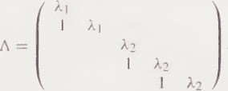

在这个例子中，$\lambda_1$ 和 $\lambda_2$ 是 $S$ 的特征值。（矩阵中的零元素未示出。）示例中的矩阵 $\Lambda$ 包含两个块（Jordan 块）：第一个块（2 阶）对应于特征值 $\lambda_1$，第二个块（3 阶）对应于特征值 $\lambda_2$。

利用 Jordan 标准型，$tS$ 的指数可以用 $t\Lambda$ 的指数表示：

$$
\exp(tS) = \sum_{n=0}^{\infty} \frac{t^n S^n}{n!}
= \sum_{n=0}^{\infty} \frac{t^n (J^{-1} \Lambda J)^n}{n!}
= J^{-1} \left( \sum_{n=0}^{\infty} \frac{t^n \Lambda^n}{n!} \right) J
= J^{-1} \exp(t \Lambda) J.
$$

当然，$S$ 的 Jordan 标准型并没有显式给出，因此上述公式并非作为原系统实用求解方法提出。然而，它可能有助于阐明稳定性问题。确实，在上述例子中，我们有

$$
\exp(t \Lambda) = \begin{pmatrix} \exp(t\lambda_1) & & \\ \frac{t}{1!} \exp(t\lambda_1) & \exp(t\lambda_1) & \\ & & \exp(t\lambda_2) \\ & & \frac{t}{1!} \exp(t\lambda_2) & \exp(t\lambda_2) \\ & & \frac{t^2}{2!} \exp(t\lambda_2) & \frac{t}{1!} \exp(t\lambda_2) & \exp(t\lambda_2) \end{pmatrix}
$$

（更大的 Jordan 块会产生类似的结构。）因此，稳定性取决于 $S$ 的特征值的实部：负实部不会产生不稳定性，而正实部会产生不稳定性。零实部当且仅当对应的 Jordan 块阶数大于 1 时会产生不稳定性。

因此，当且仅当 $S$ 没有具有正实部的特征值，也没有实部为零且非平凡 Jordan 块的特征值时，该系统是稳定的（即没有不稳定解）。这一性质可以在不显式求解系统的情况下进行检查。

#### 6.5 稳定不变子空间

在本节中，我们使用上述稳定性条件来定义稳定不变子空间。不变子空间具有以下特性：如果初始条件向量 $u_0$ 位于其中，那么解 $u(t)$ 在任何时间 $t$ 都不会离开该子空间。稳定不变子空间是指仅产生稳定解的不变子空间。

设 $e$ 表示 $k$ 维向量，其除最后一个分量为 1 外，其余分量均为 0。（换言之，$e$ 是 $k$ 阶单位矩阵的最后一列。）设 $q$ 表示 $J^{-1}$ 的最后一列。由 $S$ 的 Jordan 标准型，我们有

$$
S q = J^{-1} \Lambda J q = J^{-1} \Lambda e = J^{-1} e \lambda_2 = q \lambda_2.
$$

因此，$q$ 是 $S$ 的特征向量，其特征值为 $\lambda_2$。类似地，如果 $e$ 表示 $k$ 阶单位矩阵的最后三列，$q$ 表示 $J^{-1}$ 的最后三列，且 $\Lambda_2$ 是 $\Lambda$ 的右下角块，则我们有

$$
S q = J^{-1} \Lambda J q = J^{-1} \Lambda e = J^{-1} e \Lambda_2 = q \Lambda_2,
$$

这又是 $J^{-1}$ 最后三列的线性组合。因此，$J^{-1}$ 的最后三列张成了一个 $S$ 的不变子空间，其意义在于 $S$ 作用于子空间中的一个向量会产生该子空间中的一个向量。

由 $\exp(tS)$ 的 Jordan 标准型可知，上述子空间对于 $\exp(tS)$ 也是不变的。换句话说，如果初始条件向量 $u_0$ 位于该子空间中，那么在每一个时间 $t$，所有向量 $u(t)$ 也都在该子空间中。因此，该子空间被称为常微分方程组的不变子空间。

如果 $\lambda_2$ 的实部为负，则该子空间也被称为稳定的，因为其中的任何初始条件向量 $u_0$ 都会产生一个稳定解 $u(t)$。所有稳定不变子空间的并集构成了常微分方程组的稳定不变子空间。

#### 6.6 非齐次情形

到目前为止，我们只考虑了齐次常微分方程，其中等式右侧仅出现项 $Su(t)$。这里，我们也考虑更一般的非齐次情形，即添加一个自由项 $f(t)$：

$$u'(t) = Su(t) + f(t),$$

其中 $f$ 是一个给定的函数，在 $[0, \infty)$ 上是（绝对）可积的：

$$\int_0^\infty |f(\tau)| \, d\tau < \infty.$$

（在常微分方程组中，$f$ 被解释为向量函数，上述条件应对它的每个分量成立。）

初值问题（初始条件如前所述）的解为

$$u(t) = \exp(tS)u_0 + \exp(tS) \int_0^t \exp(-\tau S) f(\tau) \, d\tau
= \exp(tS)u_0 + \int_0^t \exp((t - \tau)S) f(\tau) \, d\tau.$$

不幸的是，上述积分并不总是能用闭式表示。在下一节中，我们将看到如何在离散网格上对其进行数值近似。

#### 6.7 数值解

常微分方程的数值解是原方程解 $u(t)$ 在离散时间网格 $t_1, t_2, \ldots$ 上的数值近似。这里，我们描述了一些获取数值解的基本数值方法。这些方法也被称为数值格式或离散化方法。

上述非齐次常微分方程解的公式给出了解析解。然而，只有当公式中的积分易于计算时，它才具有实用性。不幸的是，该积分很少有闭式解。此外，常微分方程右侧的函数 $f$ 可能仅以机器函数的形式给出，该函数根据输入 $t$ 返回输出 $f(t)$。在这种情况下，应使用上述网格大小为 $h$ 的离散网格对积分进行数值近似。为此，最有帮助的是计算一次 $\exp(hS)$ 并将其存储以供将来使用。对于固定时间 $t = jh$，积分可以近似为

$$
\int_0^t \exp((t - \tau)S) f(\tau) \, d\tau
\doteq h \sum_{i=1}^{j} \bigl(\exp(hS)\bigr)^{j-i} f(ih)
= h \sum_{i=0}^{j-1} \bigl(\exp(hS)\bigr)^{i} f((j - i)h).
$$

这里最昂贵的任务是计算 $\exp(hS)$ 的各个幂。幸运的是，通过观察到一个事实可以避免这一任务：这实际上是一个关于 $\exp(hS)$ 的 $j - 1$ 次多项式，可以通过第 5 章第 8 节的 Horner 算法高效计算。在该算法中，完全避免了矩阵-矩阵运算，因为矩阵 $\exp(hS)$ 仅应用于向量以产生新向量，使用的是矩阵-向量乘积而非矩阵-矩阵乘积。

这种方法适用于计算特定时间 $t = jh$ 的数值解。在下一节中，我们将看到如何利用之前计算的数据，在整个网格上高效地计算数值解。

#### 6.8 差分格式

通常，不仅需要在上述特定的时间 $t = jh$ 获得数值解，还需要在整个离散时间网格 $t = h, 2h, \ldots$ 上获得。上述关注孤立时间点 $t = jh$ 的方法不适合此任务。利用其在先前时间点 $h, 2h, \ldots, (j - 1)h$ 的值来计算 $jh$ 处的数值解更有意义。毕竟，已经使用了宝贵的计算机资源来获取这些信息，为什么不进一步利用呢？

为了更好地利用并避免重新计算求解过程中已计算过的信息，可以将原始初值问题分解为定义在形式为 $[jh, (j + 1)h]$ 的单元中的更小问题，其中 $jh$ 处的初始条件取自前一个单元 $[(j - 1)h, jh]$。更具体地说，原始初值问题在每个单元中重写为

$$u'(t) = S u(t) + f(t), \qquad jh < t \le (j + 1)h, \quad j = 0, 1, 2, \ldots,$$

$u(jh)$ 的初始条件取自 $u_0$（当 $j = 0$ 时）或前一个单元 $[(j - 1)h, jh]$（当 $j > 0$ 时）。因此，$(j + 1)h$ 处的解为

$$u((j + 1)h) = \exp(hS) u(jh) + \int_{jh}^{(j+1)h} \exp(((j + 1)h - \tau)S) f(\tau) \, d\tau.$$

由于该积分通常没有闭式解，因此通过在 $\tau = (j + 1)h$ 处评估被积函数来对其进行近似。这给出了数值解 $\tilde u((j + 1)h)$，它满足初始条件

$$\tilde u(0) = u_0.$$


以及差分方程

$\tilde{u}((j+1)h)=\exp(hS)\tilde{u}(jh)+h f((j+1)h).$

该方案在数学上等同于第 6.7 节中的方案，但由于有效利用了前一时间点的数据并避免了不必要的重新计算，因此效率要高得多。此外，它仅使用矩阵-向量运算，而非昂贵的矩阵-矩阵运算。（实际上，它只是霍纳算法，循环中计算的中间值被用作前一个网格点的数值解。）

上述方法称为有限差分离散化或差分方案。其精度通过（离散化）误差来评估，即数值解与原始常微分方程在网格上的解之间的差值：

$|\tilde{u}(jh)-u(jh)|,\quad j=1,2,3,\ldots$

可以通过在 midpoint $\tau=(j+1/2)h$ 处而非 $\tau=(j+1)h$ 处计算上述被积函数来获得更精确的方案：

$\tilde{u}((j+1)h)=\exp(hS)\tilde{u}(jh)+h\exp(hS/2)f((j+1/2)h).$

这种差分方案更精确，因为离散化误差比之前更小。显然，更精确的数值积分会导致更精确的差分方案。在下一节中，我们将看到一个不仅精确而且能提供显式误差估计的方案。

#### 6.9 泰勒差分方案

泰勒方案基于泰勒展开

$u((j+1)h)=\sum_{i=0}^{n}\frac{h^i u^{(i)}(jh)}{i!}+\frac{h^{n+1}u^{(n+1)}(\xi)}{(n+1)!},$

其中 $\xi$ 是 $jh$ 和 $(j+1)h$ 之间的某个中间点。由于上述公式中的最后一项（误差项）通常非常小，因此在数值方案中可以将忽略不计。

有人可能会问我们如何知道 $u$ 在 $jh$ 处的导数。答案是，只要 $f$ 的导数可用，就可以从常微分方程本身获得。事实上，$u$ 的导数可以通过以下递归公式计算：

$u'(jh)=Su(jh)+f(jh),$
$u''(jh)=Su'(jh)+f'(jh),$
$u^{(i+1)}(jh)=Su^{(i)}(jh)+f^{(i)}(jh).$

因此，数值解 $\tilde{u}$ 应满足初始条件

$\tilde{u}(0)=u_0$

以及差分方程

$\tilde{u}((j+1)h)=\sum_{i=0}^{n} h^{i}\frac{\tilde{u}^{(i)}(jh)}{i!}\,,$

其中 $\tilde{u}^{(i)}(jh)$ 是通过以下递归公式计算的：

$\tilde{u}^{(0)}(jh)=\tilde{u}(jh),$
$\tilde{u}^{(i+1)}(jh)=S\tilde{u}^{(i)}(jh)+f^{(i)}(jh).$

这种递归是一个短记忆过程：$\tilde{u}^{(i+1)}(jh)$ 仅是 $\tilde{u}^{(i)}(jh)$ 的函数，并且独立于 $\tilde{u}^{(0)}(jh)$，$\tilde{u}^{(1)}(jh)$，...，$\tilde{u}^{(i-1)}(jh)$。这就是为什么下面的代码基于第 5 章第 11 节中的标准算法，而不是霍纳算法：它避免了存储上述递归中计算的所有数字列表。相反，它们中的每一个都贡献给总和，然后被下一个替换。

面向对象编程的优势在此处显而易见。事实上，第 2 章第 18 节和第 20 节中低级代码中实现的矩阵和向量对象，用于当前的高级代码，它保留了原始数学公式的精神：

```cpp
template<class T, int N>
const vector<T,N>
TaylorScheme(const vector<T,N>&u0,
    const matrix<T,N,N>&S,
    const list<vector<T,N> >&f,
    const T&h){
    T powerOfHoverIfactorial = 1;
    vector<T,N> sum=0;
    vector<T,N> uDerivative = u0;
    for(int i=0; i<f.size(); i++){
        sum += powerOfHoverIfactorial * uDerivative;
        uDerivative = S * uDerivative + f[i];
        powerOfHoverIfactorial *= h/(i+1);
    }
    return sum;
} // 泰勒方案
```

这就完成了泰勒方案的定义和实现。接下来，我们研究该方案中的离散化误差。（另见下文第 25 章。）

#### 6.10 计算误差估计

在这里我们看到了泰勒方案及其 C++ 实现的主要优势：计算误差估计的机会。

泰勒近似中的误差项由以下公式给出：

$\frac{h^{n+1}u^{(n+1)}(\xi)}{(n+1)!}\,,$

其中 $\xi$ 位于区间 $[jh, (j+1)h]$ 中的某处。为了估计这个误差，我们必须估计 $u$ 在 $\xi$ 处的 $(n+1)$ 阶导数。然而，由于 $\xi$ 的确切位置不可用，我们必须在整个区间 $[jh, (j+1)h]$ 上估计 $u^{(n+1)}$。这可能怎么做？甚至在该区间中解 $u$ 都不可用，更不用说其导数了！

对象导向的方法再次为我们提供帮助。假设我们知道向量 $u$ 中的每个单个分量在区间 $[jh, (j+1)h]$ 中都有常数 $L$ 作为大小界限。然后我们可以重复上述递归，但这次向量 $\tilde{u}^{(0)}(jh)$ 被区间向量替换

$[-L, L]^k \equiv ([-L, L], [-L, L], \ldots, [-L, L]),$

该区间包含 $u$ 在 $[jh, (j+1)h]$ 中的各个分量。在此递归中，我们使用区间算术：添加两个区间意味着添加它们对应的端点以产生求和区间，而将区间乘以标量意味着将每个端点相乘。然后使用这些定义将矩阵 $S$ 应用于区间向量以产生区间向量。由于 $f$ 及其导数在整个区间 $[jh, (j+1)h]$ 中可用，它们对应的区间向量也是可用的，并且可以相加。结果，递归给出区间向量，其中 $u$ 的导数在 $[jh, (j+1)h]$ 中的任何点都必须位于其中。

因此，使用区间向量的递归为我们提供了在整个区间 $[jh, (j+1)h]$ 中向量 $u, u', u'', \ldots, u^{(n+1)}$ 中分量的界限。因此，对于足够小的 $h$ 和大的 $n$，泰勒近似中的误差可以计算估计，并证明确实可以忽略不计。

“区间”对象应与所需的算术运算（加法、减法、乘法和除法）一起在低级代码中定义。输出区间应稍微扩展，以考虑有限精度算术造成的误差。

一旦该对象准备就绪，它可以用于诸如“向量”之类的模板类中，以生成区间向量。以下代码可用于在将 'T' 解释为区间时计算误差估计：

```cpp
template<class T, int N>
const vector<T,N>
error(const vector<T,N>&boundForU,
      const matrix<T,N,N>&S,
      const list<vector<T,N> >&f,
      const T&h){
    T powerOfHoverIfactorial = 1;
    vector<T,N> uDerivative = boundForU;
    for(int i=0; i<f.size(); i++){
        uDerivative = S * uDerivative + f[i];
        powerOfHoverIfactorial *= h/(i+1);
    }
    return powerOfHoverIfactorial * uDerivative;
} // 泰勒方案中的误差
```

最后，我们需要验证我们最初关于 $u$ 在 $[jh, (j+1)h]$ 中的每一点都位于 $[-L, L]^k$ 的猜想确实为真。为此，我们再次使用区间算术。更具体地说，我们将上述“TaylorScheme()”函数应用于区间向量，其中初始条件向量是包含 $u(jh)$ 的区间向量，并且 $h$ 被区间 $[0, h]$ 替换。这产生了包含 $[jh, (j+1)h]$ 中每一点的泰勒近似的区间向量。接下来，我们再次应用上述“error()”函数，$h$ 被 $[0, h]$ 替换。这给出了包含 $[jh, (j+1)h]$ 中每一点误差的区间向量。这两个函数输出的和给出了 $u(t)$ 在 $jh \le t \le (j+1)h$ 中包含的区间向量。现在，如果这些区间包含在 $[-L, L]$ 中，那么我们的原始猜想被证明是正确的；否则，我们必须用更大的 $L$ 重新开始误差估计。

#### 6.11 非线性常微分方程

到目前为止，我们只处理了线性常微分方程，其中方程的右端是 $u$ 的线性函数。在非线性常微分方程中，右端是 $u$ 的非线性函数，情况要复杂得多。第 6.4 节中的稳定性分析不再成立，且直线不变子空间被弯曲不变流形所取代。某些初始条件可能产生渐近解，当 $t \to \infty$ 时收敛到 $k$ 维笛卡尔空间中的固定（稳态）点，而其他条件可能产生孤子，它们围绕某个固定点螺旋并似乎收敛到它，但随后突然离开它并开始围绕另一个固定点螺旋，如此往复，在固定点之间游荡，没有任何明显的秩序，且从不收敛到任何一个。因此，求解非线性常微分方程是一项特别具有挑战性的任务。

研究非线性问题最重要的工具是线性化。一旦常微分方程在固定点附近被线性化，线性化的常微分方程可能产生一个切于原始常微分方程在固定点处的稳定流形的稳定子空间。事实上，如果某些初始条件产生的解在不稳定方向上足够接近稳定流形，那么存在产生收敛到其中固定点的解的初始条件 [39]。后一种解被称为渐近解。

因此，计算误差估计在这里可能非常重要。它们可能表明特定解确实非常接近稳定流形（就固定点周围线性化方程的不稳定维度而言），因此必须存在产生渐近解的初始条件 [50]。

使用区间算术，可以将误差区间加到数值解上，以得到常微分方程解在特定时间 $t$ 必须所在的区间。如果整个区间足够接近稳定流形，则可以推断出渐近解的存在。

#### 6.12 面向对象分析

在下面，我们展示了如何使用面向对象方法分析非线性常微分方程。在此分析中，实现泰勒方案的模板函数被调用，模板 'T' 不仅是标量，也是区间。用于此目的的“区间”对象假设在代码的低级部分可用。该对象最适合复杂非线性常微分方程的计算误差估计。

一旦将误差区间加到上面，泰勒方案输出的区间就包含了所考虑的最终时间的常微分方程解。该输出区间


考虑由有限精度算术、离散化误差以及其他数值近似可能引入的误差所带来的不确定性。如果输出区间足够小，那么所研究最终时刻常微分方程解的精度将相当高，并且可以使用数学估计来检查该解是否足够接近稳定流形，从而推断出渐近解的存在性。

#### 6.13 应用

让我们将上述方案应用于一个由 Kuramoto–Sivashinsky 方程产生的特定非线性常微分方程。该方程描述了燃烧现象。在某些对称性假设下，该方程可以简化为如下非线性常微分方程：

$$u''+u/r)'=c^2-u^2/2-(u''+u/r)'/r-(u''+u/r),$$

其中 $c$ 是给定的正实常数。这里，我们使用独立变量 $r$ $(0<r<\infty)$ 而不是 $t$ 来表示火焰的半径。

未知解 $u=u(r)$ 还满足初始条件

$$u(0)=u''(0)=0\quad\text{和}\quad u'(0)=a_0,$$

其中 $a_0$ 是问题的一个参数。

为了使方程更易于研究，我们引入新的未知函数

$$v=u'+u/r,$$
$$w=v'.$$

利用这些未知量，方程可以写成如下非线性常微分方程组：

$$u'=v-u/r,$$
$$v'=w,$$
$$w'=c^2-u^2/2-w/r-v.$$

我们希望向此方程组应用带有计算误差估计的泰勒法。不幸的是，该方案在 $r=0$ 时无法使用，因为 $1/r$ 在那里未定义。我们必须找到一种方法推进到 $r>0$，之后才能应用泰勒法。

具体做法如下。根据初始条件

$$u(0)=u''(0)=0,$$

可以合理假设 $u(r)$ 是围绕 $r=0$ 的奇函数；也就是说，它可以展开为只包含 $r$ 的奇数次幂的幂级数：

$$u(r)=\sum_{i=0}^{\infty}a_i r^{2i+1}\quad(0\le r\le r_0),$$

其中 $r_0$ 是该级数的收敛半径。当然，$a_0$ 可以通过初始条件得知。通过将该 $u$ 的幂级数代入原始常微分方程并比较 $r^0$ 的系数，可以得到

$$a_1=(c^2-2a_0)/16.$$

```cpp
for(int i=0; i<u.size()-1; i++){
    u(i+1)=v[i]-deriveProduct(u,Rinverse,i);
    v(i+1) = w[i];
    w(i+1) = (-0.5)*deriveProduct(u,u,i)
              - deriveProduct(w,Rinverse,i)
              - v[i] + (i ? 0. : (c*c) );
}
} // KS 方程中的导数
```

由于涉及函数的乘积，递归过程是一个长记忆过程：计算第 $i$ 阶导数时需要用到直到 $i$ 阶的所有导数。这就是为什么必须将导数存储在列表中。

下面的 "TaylorKS" 函数调用 "deriveKS" 函数来生成 $u, v$ 和 $w$ 在 $r$ 处的导数列表。为了启动递归，它使用参数 "u0"，这是一个包含 $u(r), v(r)$ 和 $w(r)$ 的区间向量（由截断幂级数及其尾部估计得出）。然后，这些列表用于霍纳算法（Horner’s algorithm）以产生 $r + h$ 处的数值解。接着，再次调用 "deriveKS" 函数，这次是为了递归地计算包含 $u, v$ 和 $w$ 在整个区间 $[r, r + h]$ 内的导数的区间。为此，我们假设包含 $u, v$ 和 $w$ 的区间被放置在名为 "bound" 的区间向量中。一旦这些区间用于启动 "deriveKS" 中的递归，该函数将产生包含 $u, v$ 和 $w$ 在整个区间 $[r, r + h]$ 内导数的区间。这就产生了误差区间，该区间随后被加到数值解上，以得出解在 $r + h$ 处必须所在的区间：

```cpp
template<class T>
const vector<T,3>
TaylorKS(const T&c, const T&r, const T&h, int n,
    const vector<T,3>&u0,
    const vector<T,3>&bound) {
list<T> u(n,0.);
list<T> v(n,0.);
list<T> w(n,0.);
u(0) = u0[0];
v(0) = u0[1];
w(0) = u0[2];
deriveKS(c,r,u,v,w);
vector<T,3> result(HornerTaylor(u,h),
    HornerTaylor(v,h), HornerTaylor(w,h));
u(0) = bound[0];
v(0) = bound[1];
w(0) = bound[2];
deriveKS(c,r,u,v,w);
vector<T,3> highDerivative(u[n-1],v[n-1],w[n-1]);
vector<T,3> error =
    (power(h,n-1)/factorial(n-1)) * highDerivative;
return result + error;
} // KS 方程的泰勒法 + 误差估计
```

为了验证 "bound" 中的区间确实包含 $[r, r + h]$ 中每一点的 $u, v$ 和 $w$，应再次调用 "TaylorKS"，但这次用区间 $[0, h]$ 替换 $h$。输出结果是包含 $[r, r + h]$ 中任意可能点的 $u, v$ 和 $w$ 的区间。如果这些区间确实包含在 "bound" 中对应的区间内，则我们的假设被证明为真；否则，我们必须在 "bound" 中使用更大的区间或在使用泰勒法时使用更小的 $h$ 和更大的 $n$ 来重新启动误差估计。

现在可以重复上述算法，以得到 $u(r + 2h), v(r + 2h)$ 和 $w(r + 2h)$ 必须所在的区间，依此类推。

#### 6.15 渐近解

在文献 [50] 中，引入了上述算法并使用它来证明，对于参数 $a_0$ 的特定选择，解 $(u(r), v(r), w(r))$（对于某些 $r$）确实足够接近包含不动点的稳定不变流形。为此，首先通过设置 $r = \infty$ 来求得不动点，此时常微分方程中所有的 $r$ 导数均消失。这给出了不动点

$$
\begin{pmatrix} u_\infty \\ v_\infty \\ w_\infty \end{pmatrix} = \begin{pmatrix} -\sqrt{2}c \\ 0 \\ 0 \end{pmatrix}.
$$

由于 $1/r$ 消失且 $d(u^2)/du = 2u$，围绕上述不动点的线性化常微分方程具有以下形式

$$
\begin{pmatrix} u \\ v \\ w \end{pmatrix}' = \begin{pmatrix} 0 & 1 & 0 \\ 0 & 0 & 1 \\ \sqrt{2}c & -1 & 0 \end{pmatrix} \begin{pmatrix} u \\ v \\ w \end{pmatrix} + \begin{pmatrix} 0 \\ 0 \\ c^2 \end{pmatrix}.
$$

上述矩阵的稳定性分析如第 6.4 节所述。特别是，稳定性取决于特征值的实部。即使不显式计算它们，也可以利用线性代数的结果来了解它们的一些性质。
- 首先，由于矩阵是 3 阶的，因此有三个特征值。
- 其次，它们的和等于矩阵的迹（主对角线元素之和），在此情况下为零。
- 第三，它们的积等于矩阵的行列式，在我们的情况下等于 $\sqrt{2}c$。
- 第四，由于矩阵是实矩阵，特征值的复共轭也是特征值。

所有这些都是我们得出以下结论的基础：上述矩阵有两个具有负实部且互为复共轭的特征值，以及一个正的实特征值。因此，不稳定方向对应于该第三个特征值的特征向量的方向。（该特征向量是第 6.4 节中 $J^{-1}$ 的第三列，即最后一列。）现在，牛顿迭代法（第 9.12 节）可用于将该第三特征值作为矩阵特征多项式的正根找到。一旦找到该特征值，由于两个复特征值的和与积都是已知的，它们也可以很容易地被找到。利用特征值，还可以将特征向量计算为相应线性方程组的解。因此，第 6.4 节中的整个矩阵 $J^{-1}$ 都可得，其逆矩阵 $J$ 亦然。

显然，对三维向量应用 $J$ 可给出其相对于上述特征向量的表示。特别是，第三个分量对应于不稳定方向。因此，如果对于足够大的 $r$，

$$
\left( J \left( \begin{matrix} u(r)-u_{\infty} \\ v(r)-v_{\infty} \\ w(r)-w_{\infty} \end{matrix} \right) \right)_3
$$

的幅度足够小，则解在不稳定方向上足够接近稳定流形，从而证明了渐近解（对于某些初始条件）的存在性。

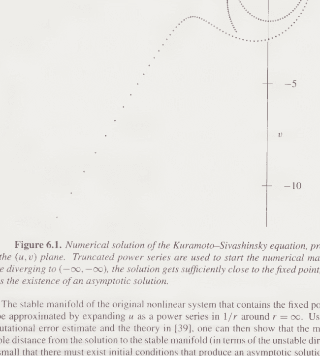

**图 6.1.** Kuramoto–Sivashinsky 方程的数值解，投影到 $(u,v)$ 平面上。使用截断幂级数来启动数值推进。在发散到 $(-\infty, -\infty)$ 之前，解足够接近不动点，这证明了渐近解的存在性。

包含该不动点的原非线性系统的稳定流形也可以通过在 $r = \infty$ 附近将 $u$ 作为 $1/r$ 的幂级数展开来近似。利用计算误差估计和文献 [39] 中的理论，可以证明解到稳定流形的最大可能距离（在不稳定方向上）非常小，因此必定存在产生渐近解的初始条件。

因此，计算误差估计可用于证明复杂非线性常微分方程组中渐近解的存在性。渐近解源于某些初始条件，这些初始条件与用于产生的初始条件并不完全相同

数值解。在我们的数值解中，有两个零初始条件，即 $u(0) = u''(0) = 0$，但第三个初始条件 $u'(0) = a_0$ 尚未指定。事实上，$a_0$ 应当被选定，使得数值解在尽可能大的 $r$ 范围内保持有界。更具体地说，如果 $f(a_0)$ 是返回最大 $\rho$ 的函数，使得在网格中对于所有 $0 < r \le \rho$ 都有 $|u(r)| \le 10$，那么最优的 $a_0$ 应该是 $f$ 的局部最大值，其计算方法见第 1 章第 20 节。例如，当 $c = 0.85$ 时，最优的 $a_0$ 结果为 $a_0 = -1.725517$。（实际上，这是以小数点后 20 位的精度计算得出的。）

利用这个最优的 $a_0$，文献 [65] 中进行了计算误差估计，并用于在文献 [50] 中证明渐近解的存在性。采用此特定 $a_0$ 的数值解显示在图 6.1 中。在该图中，横轴表示 $u(r)$，纵轴表示 $v(r)$，而 $w(r)$ 未予标示。自变量 $r$ 在从 $r = 1$ 延伸到 $r = 61$ 的拉伸网格上取离散值，网格步长 $h = 1/16$。使用截断幂级数来近似 $r=1$ 处的 $u, v, w$，以启动数值推进。在 $r$ 变得太大从而数值解发散至 $(-\infty, -\infty)$ 之前，在 $r = 15$ 处的数值解以 $10^{-3}$ 的精度接近不动点 $(-\sqrt{2} c, 0)$（在 $u-v-w$ 空间中的每个方向上，包括不稳定方向，整个计算误差估计区间均包含在内）。这意味着存在能产生渐近解的初始条件。

##### 6.16 练习

- 1. 求解微分方程
  $$u'(t) = S u(t)$$
  在单位区间 $0 < t < 1$ 内，参数分别为 $S = -1$，$S = 2$ 和 $S = 10$。它是稳定的吗？

- 2. 对上述微分方程应用泰勒格式。提供合理精度的最大网格步长 $h$ 是多少？比较稳定和不稳定的情形。

- 3. 求解微分方程
  $$u'(t) = S u(t)$$
  在单位区间 $0 < t < 1$ 内，其中 $u$ 是二维向量，$S$ 是 2 × 2 矩阵
  
  $$S = \begin{pmatrix} -1 & 0 \\ 1 & 1 \end{pmatrix}$$
  
  $$S = \begin{pmatrix} 1 & 1 \\ -1 & 1 \end{pmatrix}$$
  
  或
  
  $$S = -\begin{pmatrix} 1 & 1 \\ -1 & 1 \end{pmatrix}$$
  
  使用第 2 章第 22 节中的矩阵指数函数。找出稳定和不稳定方向。将你的解与通过泰勒格式获得的数值解进行比较。对于多大的 $h$，误差仍然是可接受的？它是否在预期的误差估计范围内？

# 第三部分
## 偏微分方程及其离散化

我们现在对 C++ 的概念和特性已经相当熟悉，并准备好在数值应用中使用它们。如下文所示，利用面向对象编程，数值方法在 C++ 中可以得到特别良好的实现。

下文描述的问题及其求解方法在应用科学与工程领域最为重要。因此，知道如何开发和编程所需的数值算法是一个巨大的优势。

应用科学与工程中的许多重要问题可以表述为微分方程。在标量微分方程中，只有一个未知函数（通常记为 $u$）需要求解。在向量（或方程组）微分方程中，有几个未知函数（通常记为 $u, v, w$ 等）需要求解。

我们用来发现这些未知函数已知数据是以微分方程以及初始和边界条件的形式给出的。未知函数在初始时刻通过初始条件获得，在空间域边界处通过边界条件获得。这些值通过微分方程中蕴含的传播规律，随时间传播到整个时空域。求解问题实际上就是显式地找出由此过程产生的未知函数。

我们首先考虑线性微分方程，其中微分方程中的传播规律独立于解。之后，我们还将考虑更复杂的情况，即非线性微分方程，其中微分方程中的传播规律可能根据用作解的特定函数而变化。

在常微分方程（ODE）中，未知函数 $u$ 是单个变量的函数，例如 $u \equiv u(x)$。假设 $u$ 定义在某个区域，例如单位区间 $0 \le x \le 1$。ODE 提供了关于 $u$ 在区域内部的导数（或导数）的信息。例如，

$$u''(x) + C(x)u'(x) + K(x)u(x) = F(x), \quad 0 < x < 1.$$

该方程组合了 $u$、其一阶导数 $u'$ 和二阶导数 $u''$（乘以已知系数 $C(x)$ 和 $K(x)$），产生已知的右端函数 $F(x)$。这确定了 $u$ 从 $x = 0$ 开始的传播规律。施加在 $x = 0$ 和 $x = 1$ 处的边界条件固定了 $u$ 在端点的值，而微分方程则塑造了其在区域内部的形状。两者共同唯一地确定了解 $u$。

系数以及右端项都是预先已知的：唯一需要发现的是未知函数 $u$。换句话说，$u$ 是该微分方程的解。

上述 ODE 具有变系数，因为 $C(x)$ 和 $K(x)$ 依赖于 $x$，并且在区域内的不同 $x$ 值处可能取不同值。微分方程的阶数是其最高阶导数的阶数。在上面的例子中，阶数为 2，因为其中最高阶导数是二阶导数 $u''(x)$。

问题的表述尚未完整。还需要规定在域的端点处 $u$（或其一阶导数）取值的边界条件。例如，

$$u'(0) = u(1) = 0.$$

规定解 $u$ 本身的值的边界条件称为第一类边界条件或狄利克雷（Dirichlet）边界条件。规定 $u$ 的导数值的边界条件称为第二类边界条件或诺伊曼（Neumann）边界条件。规定 $u$ 和 $u'$ 的线性组合的边界条件称为第三类边界条件或混合边界条件。在上述例子中，在 $x$ 区间的右端点给出了狄利克雷边界条件，在左端点给出了诺伊曼边界条件。

边界条件的数量应与 ODE 的阶数相同。这保证了 ODE 适定，即它存在唯一的解 $u(x)$。适定的微分方程连同其边界条件也被称为边界值问题。

在偏微分方程（PDE）中，未知函数 $u$（以及系数和右端项）是多个变量的函数。域也具有一维以上，例如单位正方形 $0 \le x, y \le 1$。$u$ 的导数现在是偏导数：$u_x(x, y)$ 是 $y$ 固定时 $u$ 关于 $x$ 的导数（在点 $(x, y)$ 处求值），$u_y(x, y)$ 是 $x$ 固定时 $u$ 关于 $y$ 的导数，$u_{xx}(x, y)$ 是 $y$ 固定时 $u$ 关于 $x$ 的二阶导数，$u_{yy}(x, y)$ 是 $x$ 固定时 $u$ 关于 $y$ 的二阶导数，等等。

PDE 通过偏导数提供了关于未知函数 $u$ 在域内部行为的信息。例如，单位正方形中的泊松方程由以下方程给出

$$-u_{xx}(x, y) - u_{yy}(x, y) = F(x, y), \quad 0 < x, y < 1.$$

对于这个方程，我们还需要添加边界条件，以用较低阶的导数规定 $u$ 在单位正方形边界上的行为。例如，

$$\alpha u + \beta u_n = G(x, y),$$

其中 $\alpha, \beta$ 和 $G$ 是定义在单位正方形边界上的函数（$\alpha \ge 0, \beta \ge 0, \alpha^2 + \beta^2 > 0$，且 $\alpha$ 具有非零支集），$u_n$ 是 $u$ 在边界处沿外法线方向单位向量的方向导数。换句话说，在 $x = 0$ 边上 $u_n = -u_x$，在 $x = 1$ 边上 $u_n = u_x$，在 $y = 0$ 边上 $u_n = -u_y$，在 $y = 1$ 边上 $u_n = u_y$。PDE 和边界条件合称为边界值问题。众所周知，泊松方程是一个适定的边界值问题，即它存在唯一的解 $u$（第 11 章）。

泊松方程是椭圆型方程的典型例子。椭圆型方程的特征在于，如果从 PDE 中去掉低阶导数，只保留最高阶导数，那么边界值问题可以表述为一个最小化问题（第 11 章，第 3 节）。例如，泊松方程的解也是以下最小化问题的解：

寻找使泛函最小化的函数 $u(x, y)$

$$\frac{1}{2} \int_0^1 \int_0^1 (u_x(x, y)^2 + u_y(x, y)^2) \, dx \, dy - \int_0^1 \int_0^1 F(x, y) u(x, y) \, dx \, dy.$$

此外，$u$ 还满足上述（狄利克雷）边界条件。因此，$u$ 也是稳定平衡问题中的稳态；也就是说，存在一个时间依赖的过程 $u(t, x, y)$，它在平衡点 $u(x, y)$ 周围徘徊并最终收敛于它。时间依赖过程 $u(t, x, y)$ 是对应时间依赖 PDE

$$u_t(t, x, y) - u_{xx}(t, x, y) - u_{yy}(t, x, y) = F(t, x, y),$$

的解，这被称为热方程。


为了启动这个时变过程，还必须具有指定 $u(0,x,y)$ 值的初始条件。更精确地说，为了使得问题适定，偏微分方程不仅需要在空间域的边界上指定解（或其法向导数）的边界条件（在每一个特定时间 $t$），还需要初始条件，形式为 $u(0,x,y)=u^{(0)}(x,y)$（其中 $u^{(0)}$ 是定义在空间域上的给定函数），以指定过程开始时 $t=0$ 时的解。具备了所需的初始和边界条件后，该问题就是一个适定的初始-边界值问题。

这种偏微分方程不仅控制 $t = \infty$ 时的最终稳态，还控制通向该稳态的整个时变过程，被称为**抛物型偏微分方程**。在上面的例子中，抛物型偏微分方程就是热方程，随着 $t \to \infty$，其解趋近于泊松方程的解。

还有另一类偏微分方程，它模拟完全没有任何稳态的时变过程。这些被称为**双曲型偏微分方程**。例如，单位区间上的对流方程表述为：

```
u_t(t,x) + C(t,x) u_x(t,x) = F(t,x),    0 < t < T, 0 < x < 1.
```

这里，$C$ 和 $F$ 是独立变量 $t$ 和 $x$ 的给定函数，仅求解未知函数 $u$。由于偏微分方程是一阶的，只需要一个边界条件，例如指定 $u$ 在 $x = 0$（若 $C > 0$）或 $x = 1$（若 $C < 0$）的值作为边界条件，针对每个时间 $t$。此外，还需要初始条件来指定 $t = 0$ 时刻每个 $x$ 处的 $u$。具备这些数据后，初始-边界值问题是适定的。

上述对流方程的性质与热方程不同，因为初始（及边界）条件中的数据不再趋近于稳态，而是沿着定义在特征线上的时间路径传播：

```
dx(t)/dt = C(t,x).
```

事实上，施加在 $x-t$（时空）域下边界和左边界（假设 $C > 0$）上的初始和边界条件沿着这些特征线（或曲线）传播，从而确定 $u$ 在整个 $x-t$ 域内的值。这种方式下，初始（或边界）条件中的不连续性不会被平滑掉（不像在热方程中那样），而是沿着特征线被保留下来。

当系数 $C$ 不仅依赖于 $t$ 和 $x$，还依赖于 $u$ 本身时，方程不再是线性的，而是**拟线性的**。在这种情况下，数据传播到整个时空域的特征线的形状取决于（尚未求出的）解 $u$。对于某些类型的初始（及边界）条件，两条特征线可能会碰撞，这可能导致它们携带的数据之间发生冲突。结果就是**激波**。

抛物型方程和双曲型方程之间的中间情况是奇异摄动对流-扩散方程：

```
u_t(t,x) - ε u_xx(t,x) + C(t,x) u_x(t,x) = F(t,x),    0 < t < T, 0 < x < 1,
```

其中 $\varepsilon$ 是一个小的正参数。形式上，该方程是抛物型的，因为最高阶导数是 $u_{xx}$，正如热方程中一样。因此，在 $x = 0$ 和 $x = 1$ 处需要两个边界条件。然而，由于 $u_{xx}$ 的系数（扩散系数）非常小，解的行为很像对流方程的解。事实上，初始条件中包含的数据以及在 $x = 0$ 处施加的边界条件，沿着特征线传播的方式与对流方程中的方式非常相似，只是因为小扩散项而产生少量的耗散。当这些数据到达右边界 $x = 1$ 附近时，它们必须急剧变化以符合在 $x = 1$ 处施加的边界条件。这种发生急剧变化的 $x = 1$ 附近区域被称为**边界层**。

边界值问题和初始-边界值问题对于在应用科学与工程中模拟实际现象最为重要。不幸的是，其中只有少数可以用闭合形式解析求解。大多数偏微分方程必须使用数字计算机进行数值求解。

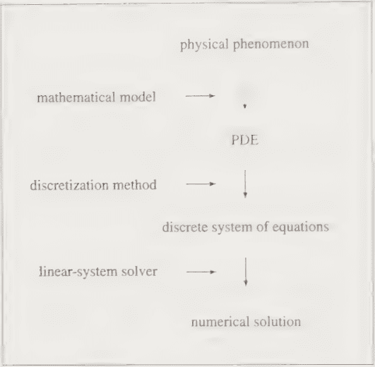

**图 III.1。** *生成原始物理现象数值近似的整个过程。*

20世纪50年代数字计算机的发明彻底改变了应用数学科学。在此之前，只有少数简单示例可以被求解。用于此目的的解析方法虽然有趣且富有启发性，但仅限于这些示例，无法用于更现实的情况。

一旦数字计算机变得可用，偏微分方程不再需要解析求解。相反，它们可以在近似原始区域的有限离散网格上进行数值求解。数值分析领域提供了可靠且精确的离散化方法，以在离散网格上逼近偏微分方程；而科学计算领域则提供了高效的算法来解决离散化所产生的差分方程。图 III.1 描述了生成原始物理现象数值近似的整个过程。

本书的这一部分描述了一些线性和非线性的时变偏微分方程及其有限差分离散化方法，以及它们的 C++ 实现。在第一章（第 7 章）中，描述了时变对流-扩散方程，并使用迎风方案和时间步进方案进行离散化。在第二章（第 8 章）中，分析了这些方案。在第三章（第 9 章）中，研究并离散化了非线性双曲型偏微分方程。在第四章（第 10 章）中，非线性偏微分方程被应用于图像处理领域。

## 第 7 章

### 对流-扩散方程

在本章中，我们描述了一维和二维空间中对流-扩散方程的有限差分离散化方法。特别地，我们使用显式、隐式和半隐式方案从当前时间步进行到下一步，并使用迎风方案对空间导数进行离散化。整个算法使用 C++ 实现，采用对象层次结构：从高层的时空网格到低层的单条网格线，以及作用于它们之上的差分算子。

#### 7.1 初始-边界值问题

我们现在可以使用上面开发的编程工具来数值求解初始-边界值问题。在这里，我们考虑最重要的抛物型偏微分方程之一，它常用于模拟物理过程：对流-扩散方程 [54]、[60]。在一维空间情况下，该方程的形式为：

$$u_t(t,x)-\varepsilon u_{xx}(t,x)+C(t,x)u_x(t,x)=F(t,x), \qquad 0<t<T,\ 0<x<L.$$

这里，$T$ 是最大时间，$L$ 是 $x$ 区间的长度，$F(t,x)$ 是给定的右端项，$\varepsilon$ 是小的扩散系数，$C(t,x)$ 是给定的对流系数，$u(t,x)$ 是未知解。

我们进一步假设初始条件以如下形式给出：

$$u(0,x)=u^{(0)}(x), \qquad 0<x<L,$$

其中 $u^{(0)}(x)$ 是给定函数。我们还假设在右边界施加狄利克雷边界条件：

$$u(t,L)=G(t,L), \qquad 0<t<T,$$

以及在左边界施加混合边界条件：

$$\alpha(t,0)u(t,0)+u_n(t,0)=G(t,0), \qquad 0<t<T,$$

其中 $\alpha(t)$ 和 $G(t)$ 是给定的函数，$n=-x$ 是指在区间 $[0,L]$ 左边界 0 处指向区间外侧的方向（外法线方向）。

上述初始和边界条件必须相互兼容；也就是说，它们在角点 $(0,0)$ 和 $(0,L)$ 处必须一致，以便 $u$ 在那里可以连续定义。在这些条件下，该问题在确实拥有唯一解 $u(t,x)$ 的意义上是适定的。

#### 7.2 有限差分

偏微分方程仅在极少数模型情况下可以解析求解。一般来说，偏微分方程在离散网格上数值求解，该网格只是 $x$ 区间 $[0,L]$ 中的一个有限点集。例如，如果 $N$ 是均匀网格中网格尺寸为 $h=L/N$ 的点数，那么该网格就是点集：

$$(0,h,2h,\ldots,(N-1)h).$$

为了数值求解，偏微分方程必须在网格上被近似（离散化）。一种常见的方法是有限差分。在这种方法中，导数由相应的差分近似，整个微分方程由相应的差分方程组近似，然后可以在计算机上数值求解。

现在让我们更详细地描述有限差分离散化方法。设时间 $t$ 固定，设 $u_j$ 为第 $j$ 个网格点上解的近似值：

$$u_j \doteq u(t,jh),\qquad 0\le j\le N$$

（其中符号 $\doteq$ 代表“近似等于”）。$u$ 在第 $j$ 个和第 $(j+1)$ 个网格点中点处的导数由分段有限差分近似：

$$u_x(t,(j+1/2)h) \doteq h^{-1}(u_{j+1}-u_j).$$

类似地，$u$ 在 $(j-1/2)h$ 处的导数由下式近似：

$$u_x(t,(j-1/2)h) \doteq h^{-1}(u_j-u_{j-1}).$$

用前者的近似减去后者的近似并除以 $h$，我们得到 $u$ 在 $x=jh$ 处二阶导数的近似：

$$u_{xx}(t,jh) \doteq h^{-1}\bigl(u_x(t,(j+1/2)h)-u_x(t,(j-1/2)h)\bigr) \doteq h^{-2}(u_{j+1}-2u_j+u_{j-1}).$$

通过这种方式，扩散项 $u_{xx}$ 可以通过上述离散网格上的有限差分进行近似。

上述离散化使用了对称差分；也就是说，两个网格点之间的分段差分近似它们中点处的导数。该方案具有二阶精度；也就是说，当 $h\to0$ 时，离散化误差 $u_j-u(t,jh)$ 小到与 $h^2$ 相当。然而，在下面我们将看到，精度并不总是数值方案最重要的性质。在某些情况下，在使用数值方案之前，还应验证诸如适宜性等更重要的性质。


#### 7.3 迎风格式

现在让我们对对流项 $C(t,x)u_x$ 进行离散化。最 naive 的做法是像之前一样使用对称有限差分：

$$C(t,jh)u_x(t,jh)=(2h)^{-1}C(t,jh)(u_{j+1}-u_{j-1}).$$

然而，这种方法是不合适的，因为它排除了第 $j$ 个网格点。事实上，它只使用了两个偶数编号网格点或两个奇数编号网格点之间的差分，因此对诸如

$$(1,-1,1,-1,\ldots),$$

的频繁振荡完全没有察觉，而该格式却忽略了它。确实，由于该格式仅使用第 $(j-1)$ 个和第 $(j+1)$ 个网格点，无论离散解是否包含上述振荡的分量，它都会产生相同的离散对流。因为这种振荡只依赖于 $h$，它与原 PDE 的解 $u(t,x)$ 无关，而后者必须与 $h$ 无关。因此它被称为非物理振荡。

从理论上讲，上述对称差分在 $h\to0$ 时是二阶精度的。然而在实践中，$h$ 必须取一个很小的正值。当扩散系数 $\varepsilon$ 非常小时（特别是小于 $h$ 时），所得到的格式在产生与原 PDE 所需解无关的数值解的意义上变得不充分。需要一种更稳定、更合适的格式来正确离散化对流项。

这种格式就是“迎风”格式。该格式也在 $u_x(t,jh)$ 的近似中使用了 $u_j$，从而避免了非物理振荡。更具体地说，对于 $C(t,jh)>0$ 的网格点 $j$，该格式使用向后差分：

$$C(t,jh)u_x(t,jh)=h^{-1}C(t,jh)(u_j-u_{j-1}),$$

而对于 $C(t,jh)<0$ 的网格点 $j$，使用向前差分：

$$C(t,jh)u_x(t,jh)=h^{-1}C(t,jh)(u_{j+1}-u_j).$$

这样，对流项 $Cu_x$ 的离散近似中 $u_j$ 的系数始终为正，就像第 7.2 节中对扩散项 $-\varepsilon u_{xx}$ 的离散近似一样。这些系数相加会在差分方程中产生 $u_j$ 的相当大的正系数，从而保证稳定且无非物理振荡。

总之，对整个对流-扩散项的差分近似形式为

$$D_{j,j-1}u_{j-1}+D_{j,j}u_j+D_{j,j+1}u_{j+1}=-\varepsilon u_{xx}(t,jh)+C(t,jh)u_x(t,jh),$$

其中

$$D_{j,j-1}=-\varepsilon h^{-2}-\frac{|C(t,jh)|+C(t,jh)}{2h},$$

$$D_{j,j}=2\varepsilon h^{-2}+|C(t,jh)|h^{-1},$$

$$D_{j,j+1}=-\varepsilon h^{-2}-\frac{|C(t,jh)|-C(t,jh)}{2h}.$$

对流-扩散方程在时空网格上进行数值求解。这是一个矩形 $M \times N$ 网格，包含 $M$ 行，每行 $N$ 个点。行具有运行索引 $i = 1,2,3,...,M$ 以从底部行到顶部行对其排序。（底部行编号为 1，顶部行编号为 $M$。）第 $i$ 行对应于时间推进方案中的第 $i$ 个时间步长（时间层）。

上述包含离散对流-扩散项的矩阵 $D$ 可能根据对应时间的特定对流系数 $C(t)$ 而随时间步长变化。因此，我们也使用上标 $i$ 来表示相关的时间步长。这样，$D^{(i)}$ 表示时空网格中第 $i$ 个时间步长（或时间层，或行）对应的矩阵（$1 \le i \le M$）。

#### 7.4 离散边界条件

在网格端点，上述离散化无法进行，因为第 $(j + 1)$ 个或第 $(j - 1)$ 个网格点缺失。例如，对于 $j = N - 1$，第 $(j + 1)$ 个点位于网格之外，因此最后一个方程

$$D_{N-1,N-2} u_{N-2} + D_{N-1,N-1} u_{N-1} + D_{N-1,N} u_N = \dots$$

是未定义的，因为它使用了虚拟未知数 $u_N$。为此修正，应使用域右边缘处的 Dirichlet 边界条件：

$$u_N = G(t, L).$$

一旦该方程乘以 $D_{N-1,N}$ 并从前一个方程中减去，虚拟的 $u_N$ 未知数将被消除，方程变得 well defined。

类似地，第一个方程中使用了虚拟未知数 $u_{-1}$：

$$D_{0,-1} u_{-1} + D_{0,0} u_0 + D_{0,1} u_1 = \dots.$$

幸运的是，仍然可以使用离散混合边界条件来消除该未知数。事实上，左边界上的离散边界条件可以写成

$$\alpha(t,0) u_0 + h^{-1} (u_{-1} - u_0) = G(t,0).$$

一旦该方程乘以 $h D_{0,-1}$ 并从前一个方程中减去，虚拟的 $u_{-1}$ 未知数将被消除，第一个方程也变得 well defined。顺便说一下，上述减法还会使 $D_{0,0}$ 系数增加

$$-h D_{0,-1} \alpha(t,0) + D_{0,-1}.$$

上述对流-扩散项的离散化实际上产生了矩阵（即差分算子）$D$。该算子将任意 $N$ 维向量 $v \equiv (v_0, v_1, \dots, v_{N-1})$ 映射到另一个 $N$ 维向量 $Dv$，定义为

$$(Dv)_0 = D_{0,0} v_0 + D_{0,1} v_1,$$
$$(Dv)_j = D_{j,j-1} v_{j-1} + D_{j,j} v_j + D_{j,j+1} v_{j+1} \quad (0 < j < N - 1),$$
$$(Dv)_{N-1} = D_{N-1,N-2} v_{N-2} + D_{N-1,N-1} v_{N-1}.$$

注意矩阵或差分算子 $D$ 依赖于时间 $t$，因为函数 $C(t)$ 和 $\alpha(t)$ 依赖于 $t$。因此，它实际上应表示为 $D(t)$ 或 $D^{(i)}$，其中 $i$ 是时间步长的索引。然而在上面，为简单起见，我们省略了时间指示。

#### 7.5 显式格式

对流-扩散方程中的时间导数 $u_t$ 也由有限差分离散化。为此，整个 $x$-$t$ 域首先应离散化或近似为一个二维均匀网格，具有 $M$ 行，每行 $N$ 个点（图 7.1）。第 $i$ 行（$1 \le i \le M$），也称为第 $i$ 个时间层或时间步长，近似原 PDE 在特定时间下的解。更具体地说，第 $i$ 个时间步长的数值解，记为 $u_j^{(i)}$，近似离散网格上的 $u(t,x)$：

$$u_j^{(i)} = u(i\,\Delta t, jh),$$

其中 $\Delta t = T/M$ 是时间方向上的单元尺寸。显然，对于 $i = 0$，近似解可从初始条件获得

$$u_j^{(0)} = u^{(0)}(jh),$$

其中左边的 $u^{(0)}$ 是零时间层上网格上的值向量，而右边的 $u^{(0)}$ 是指定 $t = 0$ 时初始条件的给定函数。

对于 $i > 0$，第 $i$ 个时间层的数值解通过跨时间层推进（时间推进）计算。换句话说，当前时间层的数值解是从先前在前一时间层计算的数值解和边界条件得到的。

时间推进可以以（至少）三种不同的方式进行，这取决于时间导数 $u_t$ 的离散化：向前差分导致显式时间推进（或显式格式），向后差分导致隐式时间推进（隐式格式），中点差分导致半隐式时间推进（半隐式格式）。

在显式格式中，使用向前差分来离散化 $u_t$。这样，当前时间层的数值解可从离散近似计算得到

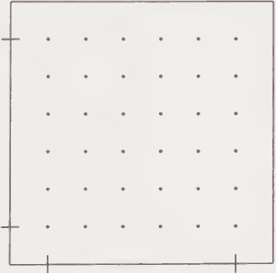

**图 7.1.** *用于在时空域 $0 < x < L$, $0 < t < T$ 中离散化对流-扩散方程的均匀 $M \times N$ 时空网格。*

#### 7.6 隐式格式

在当前（或第 $i$ 个）时间层而非前一个（或第 $(i-1)$ 个）时间层上求值：

$$u_t(t,x) - \varepsilon u_{xx}(t,x) + C(t,x) u_x(t,x) \doteq (\Delta t)^{-1} ( u_j^{(i)} - u_j^{(i-1)} ) + ( D^{(i)} u^{(i)} )_j = F(i \Delta t, j h)$$

其中 $t = i \Delta t$。使用该公式，隐式格式可以用 $N$ 维向量紧凑地写成：

$$( I + (\Delta t) D^{(i)} ) u^{(i)} = u^{(i-1)} + (\Delta t) f^{(i)},$$

其中 $I$ 是阶数为 $N$ 的单位矩阵。

计算 $u^{(i)}$ 需要“求逆”三对角矩阵 $I + (\Delta t) D^{(i)}$。当然，这个矩阵的逆永远不会显式计算，因为这代价太高。所说的“求逆”是指求解上述线性系统以得到未知向量 $u^{(i)}$。执行此操作的算法将在下面讨论。这完成了隐式时间推进的定义。详细的实现将在后面讨论。

尽管计算每个单独的 $u^{(i)}$ 比显式格式更昂贵，但整个时空网格上的整个循环通常要便宜得多，因为 $M$ 可以小得多。事实上，由于隐式格式是无条件稳定的（第 8 章第 8.3 节），它可以使用 $\Delta t$ 大到 $h$。这大大减少了时间层数 $M$ 和总计算成本。

隐式格式实际上可以被视为第 6 章第 8 节中格式的类比，其中使用了一阶泰勒近似

$$\exp(-(\Delta t) D^{(i)}) = \exp((\Delta t) D^{(i)})^{-1} \doteq ( I + (\Delta t) D^{(i)} )^{-1}.$$

#### 7.7 半隐式格式

半隐式格式，也称为 Crank–Nicolson 或“中点”格式，可以被视为显式格式和隐式格式之间的折中。在该格式中，离散对流-扩散项是显式格式中在前一时间层的求值和隐式格式中在当前时间层的求值的平均值：

$$u_t(t,x) - \varepsilon u_{xx}(t,x) + C(t,x) u_x(t,x) \doteq (\Delta t)^{-1} ( u_j^{(i)} - u_j^{(i-1)} ) + \frac{1}{2} ( D^{(i)} u^{(i)} + D^{(i-1)} u^{(i-1)} )_j$$
$$= F((i - \frac{1}{2}) \Delta t, j h)$$

在“半”时间层 $t = (i - \frac{1}{2}) \Delta t$ 处。因为时间导数 $u_t$ 在该半时间层周围对称离散，所以只要原 PDE 的解在时间上确实光滑，该格式在时间上就是二阶精度的。

半隐式格式可以紧凑地写成向量方程

$$( I + \frac{\Delta t}{2} D^{(i)} ) u^{(i)} = ( I - \frac{\Delta t}{2} D^{(i-1)} ) u^{(i-1)} + (\Delta t) f^{(i-1/2)}.$$


求解该系统中未知向量 $u^{(i)}$ 的算法将在后文给出。至此，半隐式格式的定义就完成了。完整的实现将在后文给出。

与隐式格式一样，半隐式格式是无条件稳定的（第8章，8.3节）。因此，$\Delta t$ 可以相对较大，而不会产生不稳定的非物理振荡。这样，$M$ 和计算成本都保持在较低水平。

实际上，半隐式格式可以看作第6章第8节中格式的类似物，其中使用了一阶对角Padé逼近（第1章，第22节）

$\exp\big(-(\Delta t)D^{(i-1/2)}\big) \doteq \big(I + (\Delta t/2)D^{(i)}\big)^{-1}\big(I - (\Delta t/2)D^{(i-1)}\big).$

在接下来的几节中，我们使用当前的C++框架来实现半隐式格式。显式格式和隐式格式可以用类似的方式实现。

#### 7.8 实现

在本章的剩余部分，我们将介绍用于数值求解对流扩散方程的半隐式格式的C++实现。与标准Fortran代码相比，该实现的主要优势在于可以在运行时而非编译时指定网格大小。这种灵活性在自适应离散化中尤为重要，因为网格大小只有在程序实际执行时才可知。

自适应网格细化方法在第14章第2节中完整实现。这里我们不使用自适应性，因为时空网格是均匀的。因此，当前问题实际上可以用Fortran或C语言求解。然而，这里用C++实现的对象不仅可用于这一特定应用，还可用于更复杂的应用。此外，可用于求解每个时间步中线性方程组的多重网格线性系统求解器在C++中实现得特别好，正如我们将在第10章第5节和第17章第10节中看到的那样。事实上，在C++中，人们可以开发对象库，这些库不仅可用于当前应用，还可用于更高级的数值应用和算法。

让我们说明一下，一般而言的面向对象语言，特别是C++，如何在实际中用于开发数值应用所需的对象库或对象层次结构。假设用户想要求解对流扩散方程。该用户只对物理模型的解感兴趣，而不关心为此使用的具体数值方法。事实上，用户可能对数值算法经验不多，更愿意将这部分工作留给团队中的另一位成员。

因此，用户编写如下代码：

```
int main(){
    domain D(10.,1.,1.);
    D.solveConvDif();
    return 0;
}
```

就这样，问题解决了！所有细节将由数值分析师来处理。然而，要做到这一点，分析师必须确切知道要实现哪些对象，以及它们的属性或函数应该是什么。

为了能够运行，上述代码必须有一个“domain”类，其构造函数接受三个“double”参数，分别指定T（时间区间的大小）、L（x区间的大小）和所需精度。例如，在上述代码中，‘D’是时空域0 ≤ t ≤ 10、0 ≤ x ≤ 1，并且离散误差$|u^{(i)} - u(i\Delta t, jh)|$应至多为0.1。

“domain”类还必须有一个成员函数“solveConvDif”，它求解对流扩散方程（达到上述精度），并将最终时刻t = 10的数值解打印到屏幕上。

反过来，数值分析师也希望让自己的工作轻松一些，因此他/她假设存在一个名为“xtGrid”的模板类，用于实现时空离散网格。该类必须至少有三个成员函数：构造函数“xtGrid(M,N)”用于构造M × N网格，“timeSteps()”返回时间层数，“width()”返回x方向上的点数。然后，他/她如下实现“domain”类：

```
class domain{
    xtGrid<double> g;
    double Time;
    double Width;
}
```

在此实现中，“domain”类包含三个数据字段：“Time”表示时间区间的大小，“Width”表示空间区间的大小，‘g’包含离散时空网格。

“domain”类的构造函数接受三个“double”参数，分别指定时间区间的大小、空间区间的大小和所需精度。第三个参数用于计算所需的时间层数和x方向上的网格点数。构造函数体为空，所有工作都在初始化列表中完成。特别是，第一个字段，即网格‘g’，通过计算所需的时间层数和x方向上的网格点数，并使用它们来调用“xtGrid”类的构造函数（假设其存在）来构造：

```
public:
    domain(double T, double L, double accuracy)
        : g((int)(T/accuracy)+1,(int)(L/accuracy)+1),
          Time(T), Width(L){
    } // constructor
```

数值分析师还假设存在一个名为“march(g,h,Δt)”的普通函数，它接受“xtGrid”、“double”和“double”参数，并在该网格中执行实际的时间推进。然后，他/她使用该函数来定义“domain”类中求解对流扩散方程的函数：

```
void solveConvDif(){
    march(g,Width/g.width(),Time/g.timeSteps());
} // solve the convection-diffusion equation
};
```

这样就完成了“domain”类的代码块。

通过编写上述代码，数值分析师实际上完成了自己那部分工作，并可以将剩余部分交给初级数值分析师去处理细节。求解对流扩散方程的问题现在已转化为在时空网格中进行时间推进的数值问题。初级数值分析师被要求编写普通函数“march(g,h,Δt)”，该函数在时空网格中执行实际的时间推进。

初级数值分析师也做出一些假设以简化自己的工作。特别是，他/她假设“xtGrid”类已经实现了一些有用的成员函数。首先，他/她假设网格‘g’中的第i行可以读取为“g[i]”，并（通过读写）访问为“g(i)”。其次，他/她假设其中第j个点的值可以读取为“g(i,j,"read")”，并（通过读写）访问为“g(i,j)”。最后，他/她假设成员函数“timeSteps()”和“width()”分别返回时间层数和单个时间层中的点数。

初级数值分析师还假设存在一个模板类“difference”，它实现诸如上述$D^{(i)}$之类的差分算子，以及一些基本算术运算，例如“difference”加“difference”、“difference”乘以“dynamicVector”等。事实上，“difference”对象‘D’也被解释为三对角矩阵，其第(i,j)个元素可以读取为“D(i,j,"read")”，并通过读写访问为“D(i,j)”。最后，还假设“D.width()”返回矩阵‘D’的阶数。

有了这些工具，初级数值分析师就可以在时空网格中实现半隐式时间推进了。为此，他/她必须首先定义一个名为“convDif()”的函数，用于设置包含所考虑特定时刻的离散对流扩散项的“difference”对象，以及相应的右端向量‘f’。为此，假设原始偏微分方程和初边值条件中使用的函数（F、G、α等）作为全局外部函数可用。（在当前示例中，为简单起见，其中大多数设置为零：只有函数“Initial()”中的初始条件非零。）

```
double F(double, double){return 0.;}
double C(double, double){return 0.;}
double Alpha(double, double){return 0.;}
double G(double, double){return 0.;}
double Initial(double x){return 1.-x*x;}
const double Epsilon=1.;
```

假设这些函数是全局的，因此可以从接下来定义的“convDif()”函数中访问它们。该函数中的第一个参数是“difference”对象‘d’，其中放置时刻‘t’的离散对流扩散项，以及“dynamicVector”对象‘f’，其中放置相应的右端项。假设‘d’和‘f’最初都为零；在“convDif()”函数中，它们被设置为正确的值：

```
template<class T>
void convDif(difference<T>&d,dynamicVector<T>&f,
    double h,double deltaT,double t){
    for(int j=0; j<d.width(); j++){
        if(t>deltaT/2) f(j)=F(j*h,t-deltaT/2);
        double c=C(j*h,t);
```


局部变量 ‘c’ 包含了时刻 ‘t’ 下 ‘j’ 号网格点的对流系数。迎风格式根据 ‘c’ 的符号决定在 x 方向上使用前向差分还是后向差分：

```
if(c>0.){
    d(j,j)=c/h;
    d(j,j-1)=-c/h;
    d(j,j+1)=0.;
}
else{
    d(j,j)=-c/h;
    d(j,j+1)=c/h;
    d(j,j-1)=0.;
}
```

到目前为止，我们将离散对流项引入到了差分算子 ‘d’ 中。这是在针对当前考虑的时间层级的网格点进行循环时完成的。现在，我们将离散扩散项添加到 ‘d’ 中。这一步仅需一条命令即可完成，该命令使用了稍后将在 "difference" 类中定义的构造函数和 "operator+="：

```
d += Epsilon/h/h * difference<T>(d.width(),-1.,2.,-1.);
```

最后，我们将离散边界条件引入到差分算子 ‘d’ 和右端项向量 ‘f’ 中：

```
d(0,0) += d(0,-1);
d(0,0) -= d(0,-1) * h * Alpha(0,t);
if(t>deltaT/2){
    f(0) -= d(0,-1) * h * G(0,t-deltaT/2);
    f(d.width()-1) -= d(d.width()-1,d.width())
        * G(d.width()*h,t-deltaT/2);
}
} // 设置对流-扩散矩阵和右端项
```

现在，"convDif()" 函数在实现半隐式时间推进的 "march()" 函数中被使用。为此，我们使用了一个对时间层级的循环，其中包含一个名为 "time" 的局部整数索引，该索引从时空网格底部的第一个时间层级一直延伸到底部之上的最后一个时间层级。在这个循环中，我们使用两个名为 "current" 和 "previous" 的局部 "difference" 对象，分别用于存储当前和上一个时间层级的离散对流-扩散项（即差分算子 D^(time) 和 D^(time-1)）：

```
template<class T>
void march(xtGrid<T>&g, double h, double deltaT){
    difference<T> I(g.width(),0.,1.,0.); // 单位矩阵
    for(int j=0; j<g.width(); j++)
        g(0,j) = Initial(j*h);
    dynamicVector<T> f(g.width());
    difference<T> previous(g.width());
    convDif(previous,f,h,deltaT,0);
    for(int time=1; time < g.timeSteps(); time++){
        difference<T> current(g.width());
        convDif(current,f,h,deltaT,time*deltaT);
```

我们现在处于执行实际时间推进的循环中。我们正从上一个时间步长推进到当前时间步长。我们刚刚把在对流-扩散空间导数（在当前时刻评估）放入了差分算子 "current" 中。我们也已经把上一个时间步长的离散对流-扩散空间导数保存在差分算子 "previous" 中。这些差分算子现在被用于以下命令中，这是半隐式格式的核心。在这个命令中，下方的 '/' 符号调用了稍后定义的 "operator/"，它解决了在半隐式格式中获得的线性方程组，这可以符号化地看作是向量除以三对角矩阵或差分算子：

```
g(time) =
    ((I-.5*deltaT*previous)*g[time-1]+deltaT*f)
    / (I + 0.5 * deltaT * current);
    previous = current;
}
print(g[g.timeSteps()-1]);
} // 半隐式时间推进
```

"xtGrid" 和 "difference" 类及其所需函数的实际实现将在后面讨论。

#### 7.9 对象层级结构

整个工作计划中使用的对象层级结构在图 7.2 中描述。在最高层级，放置了 "domain" 对象以及作用于它的函数 "solveConvDif()"。在较低层级，放置了 "xtGrid" 对象以及作用于它的函数 "march()"。事实上，"solveConvDif()" 仅调用 "march()" 来作用于包含在 "domain" 对象中的 "xtGrid" 对象。在最低层级，放置了 "dynamicVector" 和 "difference" 对象。这些对象对应于整个 "xtGrid" 对象中的特定时间层级；它们之间也通过算术运算相互连接，而函数 "convDif()" 则根据相关的时间层级或时间步长设置这些对象的离散对流-扩散项。

#### 7.10 向量列表

剩下要做的就是定义 "xtGrid" 和 "difference" 模板类及其所需的函数。这些任务实际上可以由团队中的另外两名成员独立完成，他们是 C++ 程序员，但不一定具有数值方法方面的背景。

"xtGrid" 和 "difference" 对象可以被视为向量列表。在 "xtGrid" 中，每个向量对应一个时间层级，因此向量的数量与时间层级的数量相同。而在 "difference" 对象中，只有三个向量：第一个包含三对角矩阵中的 (j, j - 1) 元素，第二个包含 (j, j) 元素（主对角线），第三个包含 (j, j + 1) 元素。因此，从动态向量列表派生 "xtGrid" 和 "difference" 类是自然的。

由于第 3 章第 4 节中 "list" 模板类中的数据字段被声明为 "protected" 而不是 "private"，它们可以从派生类访问。这就是为什么可以在派生的 "xtGrid" 和 "difference" 类中定义具有整数参数的构造函数，以指定列表中向量的维度。事实上，当调用 "xtGrid" 和 "difference" 类的构造函数时，基类 "list" 的数据字段首先由该类的默认构造函数构造，结果是一个不包含任何项目的平凡列表。然后，由于对基类数据字段的访问权限，这些列表在派生类构造函数中被重建。

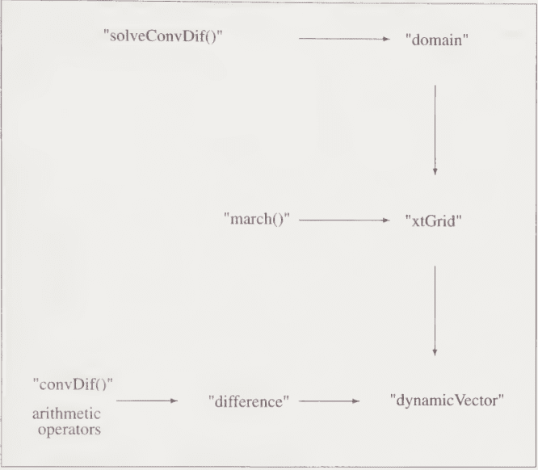

**图 7.2.** *对流-扩散方程的对象层级结构："domain" 对象使用 "xtGrid" 对象，后者使用 "dynamicVector" 和 "difference" 对象。*

#### 7.11 时空网格

在这里，我们介绍了实现时空网格的 "xtGrid" 模板类，该网格实现为时间层级列表，每个时间层级实现为动态向量。

以下是从动态向量列表派生的 "xtGrid" 类的详细实现：

```
```cpp
template<class T>
class xtGrid : public list<dynamicVector<T> > {
    public:
        xtGrid(int,int,const T&);
```
```

构造函数在此仅进行声明；其完整定义将在后面提供。以下是返回时间层级数和每个时间层级网格点数的所需函数：

```
int timeSteps() const{
    return size();
} // 时间层级的数量

int width() const{
    return item[0]->dim();
} // 网格宽度
```

各个时间层级可以通过 "operator()" 的三个不同版本进行访问。具体来说，"xtGrid" 对象 'g' 中第 'i' 个时间层级可以通过仅用于读取的 "g[i]" 或用于读取或写入的 "g(i)" 进行访问，而其第 'j' 个网格点的值可以通过用于读取或写入的 "g(i,j)" 进行访问。编译器会调用最适合调用中参数数量和类型的版本。

"operator[]" 继承自第 3 章第 4 节中的基类 "list"。另一方面，"operator()" 虽然在 "list" 类中可用，但必须显式重写，以防止与其他版本混淆：

```
dynamicVector<T>& operator()(int i){
    if(item[i])return *item[i];
} // 第 i 个时间层级（读/写）

T& operator()(int i, int j){
    return (*item[i])(j);
} // (i,j) 网格点（读/写）
};
```

这结束了 "xtGrid" 类的代码块。剩下要做的就是定义构造函数，该构造函数在上述类块中仅进行了声明。此构造函数接受两个整数参数：第一个指定底层向量列表中的项目数量（或时间层级的数量），第二个指定这些向量的维度（或每个单独时间层级中的点数）。当调用构造函数时，底层动态向量列表由基类 "list" 的默认构造函数自动初始化为一个不包含任何项目的空列表。然后，当前构造函数将该列表重置为所需的非平凡列表。这种重建之所以可能，是因为基类 "list" 中的 "number" 和 "item" 数据字段被声明为 "protected" 而不是 private。

```
template<class T>
xtGrid<T>::xtGrid(int m=0,int n=0,const T&a=0){
    number = m;
    item = m ? new dynamicVector<T>*[m] : 0;
    for(int i=0; i<m; i++)
        item[i] = new dynamicVector<T>(n,a);
} // 构造函数
```


请注意，上述代码的顺序实际上应该反过来：由于“xtGrid”类在“domain”类以及“convDif”和“march”函数中使用，它必须在程序中出现在它们之前。上面讨论中顺序被反过来只是为了清晰地呈现。

#### 7.12 差分算子

这里我们定义实现了差分算子或三对角矩阵的“difference”类。“difference”类派生自“list<dynamicVector<T> >”模板类（图 7.3）。（注意两个‘>’符号之间的空白，它与“iostream.h”库中含义完全不同的“>>”字符串相区别。）

“difference”对象实际上是一个由三个向量组成的列表：第一个向量包含三对角矩阵 D 中的 D_{j,j-1} 元素，第二个向量包含 D_{j,j} 元素（主对角线），第三个向量包含 D_{j,j+1} 元素。因为“list”对象中的项目在第 3 章第 4 节中被声明为“protected”，它们可以从派生的“difference”类的成员访问：

```
template<class T>
class difference : public list<dynamicVector<T> >{
    public:
    difference(int,const T&,const T&,const T&);
    const difference<T>& operator+=(const difference<T>&);
    const difference<T>& operator-=(const difference<T>&);
    const difference& operator*=(const T&);
```

构造函数和算术运算符仅在上面声明；它们稍后会显式定义。

派生的“difference”类中特别重要的运算符是下面定义的“operator()”成员函数。这些运算符允许人们简单地将元素 D_{j,j-1}、D_{j,j} 和 D_{j,j+1} 引用为“D(j,j-1)”、“D(j,j)”和“D(j,j+1)”。因为此


图 7.3. 从基类“list”（动态向量的列表）继承到派生类“xtGrid”和“difference”的示意图。

运算符返回所指示元素的非常量引用，以上调用可用于实际更改其值。因此，必须谨慎使用，以免无意中更改值：

```
T& operator()(int i,int j){
    return (*item[j-i+1])(i);
} // (i,j)th element (read/write)
```

要读取“difference”对象 D 的元素，还可以使用“operator()”的只读版本。此版本在像“D[i,j].read”这样的调用中被调用，该调用还使用一个类型为“char*”（字符数组）的额外参数。因为此版本返回常量引用，所指示的元素只能读取而不能更改：

```
const T& operator()(int i,int j,char*) const{
    return (*item[j-i+1])[i];
} // (i,j)th element (read only)
```

另一个必需的函数是返回三对角矩阵阶数的函数：

```
int width() const{
    return item[0]->dim();
} // width of grid
};
```

这完成了“difference”类的代码块。拷贝构造函数和赋值运算符无需重新定义，因为当它们被调用时，基类“list<dynamicVector<T> >”中的对应函数会被隐式调用以将所需值设置为数据字段。同样，无需定义析构函数，因为基类“list”类的隐式调用的析构函数会销毁对象中的每个数据字段。

另一方面，接受整数和 T 参数的构造函数必须在派生的“difference”类中显式重新定义。这是因为它隐式调用基类“list<dynamicVector<T> >”的默认构造函数，完全没有参数。此隐式调用构造了一个没有任何项目的平凡列表，该列表必须在下面的构造函数体中重置：

```
template<class T>
difference<T>::difference(int n=0,
    const T&a=0,const T&b=0,const T&c=0){
    number = 3;
    item = new dynamicVector<T>*[3];
    item[0] = new dynamicVector<T>(n,a);
    item[1] = new dynamicVector<T>(n,b);
    item[2] = new dynamicVector<T>(n,c);
} // constructor
```

接下来，我们定义“difference”对象的所需算术运算。这些函数在此定义，而不是在第 3 章第 4 节的基类“list”中定义。这是因为，如果它们在那里定义，那么它们就需要返回一个“list<dynamicVector<T> >”对象，该对象随后需要转换为“difference”对象。当前实现避免了这种额外的转换：

```
template<class T>
const difference<T>&
difference<T>::operator+=(const difference<T>&d) {
    for(int i=0; i<number; i++)
        *item[i] += d[i];
    return *this;
} // adding another "difference" to the current one
```

```
template<class T>
const difference<T>&
difference<T>::operator-=(const difference<T>&d) {
    for(int i=0; i<number; i++)
        *item[i] -= d[i];
    return *this;
} // subtracting a "difference" from the current one
```

到目前为止，我们已经实现了向当前差分算子添加或从中减去另一个差分算子。接下来，我们定义按标量乘法：

```
template<class T>
const difference<T>&
difference<T>::operator*=(const T&t) {
    for(int i=0; i<size(); i++)
        *item[i] *= t;
    return *this;
} // multiplying the current "difference" by a scalar T
```

接下来，我们将上述算术运算实现为（非成员）二元运算符：

```
template<class T>
const difference<T>
operator+(const difference<T>&d1,
    const difference<T>&d2) {
    return difference<T>(d1) += d2;
} // adding two "difference" objects
```

```
template<class T>
const difference<T>
operator-(const difference<T>&d1,
    const difference<T>&d2) {
    return difference<T>(d1) -= d2;
} // subtracting two "difference" objects
```

```
template<class T>
const difference<T>
operator*(const T&t, const difference<T>&d) {
    return difference<T>(d) *= t;
} // scalar times "difference"
```

```
template<class T>
const difference<T>
operator*(const difference<T>&d, const T&t) {
    return difference<T>(d) *= t;
}  // "difference" times scalar
```

接下来，我们引入返回差分算子与向量的乘积的运算符，或差分算子作用于向量。这里，在计算中使用了“difference”类的只读版本“operator()”和“dynamicVector”类的只读“operator[]”，然后使用“dynamicVector”类的读写“operator()”将这些计算值赋给输出向量中的适当分量。我们还在此处使用了第 1 章第 9 节中的“min()”和“max()”函数：

```
template<class T>
const dynamicVector<T>
operator*(const difference<T>&d,
        const dynamicVector<T>&v) {
dynamicVector<T> dv(v.dim(),0.);
for(int i=0; i<v.dim(); i++)
    for(int j=max(0,i-1); j<=min(v.dim()-1,i+1); j++)
        dv(i) += d(i,j,"read")*v[j];
return dv;
}  // "difference" times vector
```

接下来，我们实现“除以”差分算子的运算符，或更精确地说，求解形如 Dx = f 的三对角线性系统形式。因为解向量 x 可以表示为 D⁻¹f 或 f/D，二元“operator/”似乎最适合表示此操作。

为简单起见，解向量 x 使用第 17 章第 3 节的 Gauss-Seidel 迭代法近似计算。当然，这并不是一个非常高效的线性系统求解器：第 10 章第 5 节和第 17 章第 8 节中使用的多重网格算法是一个更好的求解器，并且在 C++ 中实现得特别好。尽管如此，Gauss-Seidel 迭代对于我们的主要目的已经足够：编写和调试对流-扩散方程数值解的整体算法和代码：

```
template<class T>
const dynamicVector<T>
operator/(const dynamicVector<T>&f,
        const difference<T>&d) {
dynamicVector<T> x(f);
for(int iteration=0; iteration < 100; iteration++)
    for(int i=0; i<f.dim(); i++){
        double residual = f[i];
        for(int j=max(0,i-1); j<=min(f.dim()-1,i+1); j++)
            residual -= d(i,j,"read")*x[j];
```


```
x(i) += residual/d(i,i,"read");
}
return x;
}  // solving d*x=f approximately by 100 GS iterations
```

##### 7.13 两个空间维度

我们现在转向更复杂的情况，即两个空间维度（笛卡尔坐标 $x$ 和 $y$）中的对流-扩散方程。该方程的形式为

$$u_t(t,x,y)-\varepsilon\left(u_{xx}(t,x,y)+u_{yy}(t,x,y)\right)+C_1(t,x,y)u_x(t,x,y)+C_2(t,x,y)u_y(t,x,y)=F(t,x,y),\quad 0<t<T,\ 0<x<L_x,\ 0<y<L_y,$$

其中 $T$、$L_x$ 和 $L_y$ 是正数，分别表示时间区间的长度以及二维空间域的宽度和长度，而 $C_1$ 和 $C_2$ 是给定的对流系数。为了使问题适定，还必须施加初始条件和边界条件：

$$u(0,x,y)=u^{(0)}(x,y),\quad 0\le x\le L_x,\ 0\le y\le L_y,$$
$$u(t,x,L_y)=G(t,x,L_y),\quad 0\le t\le T,\ 0\le x\le L_x,$$
$$u(t,L_x,y)=G(t,L_x,y),\quad 0\le t\le T,\ 0\le y\le L_y,$$
$$\alpha(t,x,0)u(t,x,0)+u_n(t,x,0)=G(t,x,0),\quad 0\le t\le T,\ 0\le x\le L_x,$$
$$\alpha(t,0,y)u(t,0,y)+u_n(t,0,y)=G(t,0,y),\quad 0\le t\le T,\ 0\le y\le L_y.$$

其中 $F$、$G$ 和 $\alpha$ 是给定的函数，$n$ 是外法向量；即在 $y=0$ 处 $n=-y$，在 $x=0$ 处 $n=-x$。因此，在矩形空间域的右侧和上侧施加了狄利克雷边界条件，而在另外两个边上施加了混合边界条件。

有限差分离散化与第 7.3 节中的方法相同，只是这里 $x$ 和 $y$ 导数都应进行离散化。还要注意，这里空间网格是如图 7.4 所示的矩形，而不是第 7.3 节中的一维。

让我们更详细地描述有限差分格式。设 $N_x$ 和 $N_y$ 分别表示 $x$ 和 $y$ 空间方向上的网格点数。设 $h_x=L_x/N_x$ 和 $h_y=L_y/N_y$ 为相应的网格尺寸。则近似空间域的矩形 $N_x\times N_y$ 网格是成对集合

$$(0,h_x,2h_x,\ldots,(N_x-1)h_x)\times(0,h_y,2h_y,\ldots,(N_y-1)h_y)$$

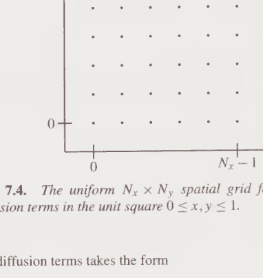

**图 7.4.** 用于在单位正方形 $0 \le x, y \le 1$ 中对流-扩散项离散化的均匀 $N_x \times N_y$ 空间网格。

对流-扩散项的形式为

$$
D_{i,j,i,j-1} u_{i,j-1} + D_{i,j,i,j+1} u_{i,j+1}
+ D_{i,j,i-1,j} u_{i-1,j} + D_{i,j,i+1,j} u_{i+1,j}
+ D_{i,j,i,j} u_{i,j}
\equiv -\varepsilon(u_{xx} + u_{yy}) + C_1 u_x + C_2 u_y,
$$

其中

$$
\begin{aligned}
D_{i,j,i,j-1} &= -\varepsilon h_x^{-2} - |C_1(t, j h_x, i h_y)| + C_1(t, j h_x, i h_y)/(2 h_x),\\
D_{i,j,i,j+1} &= -\varepsilon h_x^{-2} - |C_1(t, j h_x, i h_y)| - C_1(t, j h_x, i h_y)/(2 h_x),\\
D_{i,j,i-1,j} &= -\varepsilon h_y^{-2} - |C_2(t, j h_x, i h_y)| + C_2(t, j h_x, i h_y)/(2 h_y),\\
D_{i,j,i+1,j} &= -\varepsilon h_y^{-2} - |C_2(t, j h_x, i h_y)| - C_2(t, j h_x, i h_y)/(2 h_y),\\
D_{i,j,i,j} &= -(D_{i,j,i,j-1} + D_{i,j,i,j+1} + D_{i,j,i-1,j} + D_{i,j,i+1,j}).
\end{aligned}
$$

当然，位于网格外部的点必须使用第 7.4 节中与离散边界条件相同的方式消除。例如，当 $i = 0$ 时，$u_{-1,j}$ 使用 $y = 0$ 和 $x = j h_x$ 处的离散混合边界条件消除，依此类推。

其余细节原则上与一维空间情况相同。这就完成了二维空间中有限差分格式的定义。实际实现留作练习；完整解可在附录第 A.10 节中找到。

##### 7.14 练习

1. 修改第 7.12 节中的代码，以求解在 $x$-区间 $x = 0$ 和 $x = L$ 两侧均具有混合边界条件的问题。此情况下使用的向量必须为维度 $N + 1$ 而非 $N$，因为在点 $Nh = L$ 处的额外未知数也必须求解。虚拟 $u_{N+1}$ 未知数应使用离散边界条件消除（如虚拟 $u_{-1}$ 未知数）。

2. 本章中的代码使用长内存方法，其中整个时空网格中的数值解被存储。重写它，使用短内存方法，其中每个时间步的数值解在用于计算下一个时间步的数值解后立即丢弃，并且代码的输出是最终时间步的数值解。注意，使用这种方法时，可以避免 `xtGrid` 对象。

3. 修改代码中的时间推进方法，使其使用显式或隐式格式而非半隐式格式。

4. 使用第 3.14 节的 `dynamicMatrix` 类实现矩形网格。该对象对于实现第 7.13 节中对流-扩散方程二维数值解的各个时间步非常有用。

5. 定义实现第 7.13 节中 $x$ 和 $y$ 两个方向离散空间导数的 `difference2` 对象。答案可在附录第 A.10 节中找到。

6. 定义 `difference2` 与 `dynamicMatrix` 对象之间的所需算术运算。原则上，它们与 `difference` 与 `dynamicVector` 对象之间的算术运算符相同。解可在附录第 A.10 节中找到。

7. 附录第 A.10 节中的 `difference2` 对象每个网格点包含九个数，这在这里并不真正必要。改进它，使其每个网格点仅包含五个数。

8. 使用上述对象实现对流-扩散方程二维的半隐式格式。解可在附录第 A.10 节中找到。

9. 修改你的代码，使用隐式格式而非半隐式格式。

10. 修改你的代码，使用显式格式而非半隐式格式。用较小的 $\Delta t$ 运行你的代码。再用较大的 $\Delta t$ 运行。当 $\Delta t$ 过大时会发生什么？这在隐式或半隐式格式中也会发生吗？

11. 修改你的代码，使其仅使用混合边界条件。

## 第 8 章：稳定性分析

在本章中，我们证明上述有限差分离散化方法是稳定的，意味着初始条件的可能数值误差最多随所用时间步数线性增长。参见例如 [1]、[71] 以获得更完整的介绍。稳定性意味着离散化方法不仅在离散化误差（数值解与精确解之差）随网格尺寸趋于零时是准确的，而且在网格尺寸和扩散系数同时趋于零时离散化误差也趋于零时是充分的。

#### 8.1 预备知识

本章包含有限差分格式的理论分析，对于只对实际方面感兴趣的读者可以跳过。另一方面，更高级的读者可能会发现它对于更好地理解有限差分方法的本质特别有用。

这里，我们研究第 7 章中使用的有限差分离散化方法稳定性。离散化方法的稳定性不应与微分方程的稳定性混淆。前者是数值格式的属性，保证数值近似引起的误差得到良好控制，因此数值解是有意义的并且很好地近似原始微分方程的解。

为此研究，我们需要一些来自矩阵理论的初步定义和初等结果，特别是关于方阵。这些预备知识在将格式写成矩阵形式时特别有用，由此稳定性很快得出。

方阵 $A = (a_{i,j})$ 的特征值是复数 $\lambda$，使得

$$A v = \lambda v$$

对某个非零向量 $v$ 成立。

Gershgorin 定理为我们提供了关于 $\lambda$ 在复平面上位置的一些概念。根据该定理，$\lambda$ 必须不远于 $A$ 中主对角线的一个元素，例如 $a_{i,i}$。更精确地说，$\lambda$ 与 $a_{i,i}$ 之间的距离不能超过


第 $i$ 行的非对角元的绝对值之和：

$$|\lambda - a_{i,i}| \le \sum_{j \ne i} |a_{i,j}|.$$

（证明见，例如，第 2 章第 1 节，[68]。）

我们说矩阵 $A$ 是对角占优的，如果对其中的每一行 $i$，非对角元绝对值之和不超过相应的主对角元：

$$a_{i,i} \ge \sum_{j \ne i} |a_{i,j}|.$$

由 Gersgorin 定理可知，对角占优矩阵的特征值位于复平面的右侧；也就是说，它们具有非负实部。

类似地，我们说 $A$ 是严格对角占优的，如果上述不等式也可以写成尖锐形式：

$$a_{i,i} > \sum_{j \ne i} |a_{i,j}|.$$

在这种情况下，Gersgorin 定理意味着 $A$ 的特征值严格位于复平面的右侧；也就是说，它们具有正实部。

$A$ 的 Jordan 形式是表示

$$A = J^{-1} \Lambda J,$$

其中 $J$ 是非奇异矩阵，$\Lambda$ 是“几乎”对角矩阵，其主对角线上为 $A$ 的特征值，其正下方对角线上为任意小的值，其余位置为零。

向量 $v = (v_1, v_2, v_3, \dots)$ 的范数是其分量绝对值平方和的平方根：

$$\|v\| = \left( \sum_i |v_i|^2 \right)^{1/2}.$$

矩阵 $A$ 的范数是将其应用于向量时可能的最大放大倍数：

$$\|A\| = \max_{v \ne 0} \frac{\|Av\|}{\|v\|}.$$

上述定义意味着，对每个非零向量 $v$，

$$\frac{\|Av\|}{\|v\|} \le \|A\|$$

或

$$\|Av\| \le \|A\| \cdot \|v\|.$$

矩阵也满足三角不等式。事实上，如果 $A$ 和 $B$ 是同阶矩阵，则

$$
\begin{aligned}
\|A + B\| &= \max_{v \ne 0} \frac{\|(A + B)v\|}{\|v\|} \\
&\le \max_{v \ne 0} \frac{\|Av\| + \|Bv\|}{\|v\|} \\
&\le \max_{v \ne 0} \frac{\|Av\|}{\|v\|} + \max_{v \ne 0} \frac{\|Bv\|}{\|v\|} \\
&= \|A\| + \|B\|.
\end{aligned}
$$

此外，乘积的范数小于或等于范数之积：

$$
\begin{aligned}
\|AB\| &= \max_{v \ne 0} \frac{\|ABv\|}{\|v\|} \\
&\le \|A\| \max_{v \ne 0} \frac{\|Bv\|}{\|v\|} \\
&= \|A\| \cdot \|B\|.
\end{aligned}
$$

#### 8.2 代数表示

我们现在准备将第 7 章中的有限差分格式以代数形式重写。在这种形式下，整个时间推进过程被获得为线性方程组

$$Au = \mathcal{F},$$

的数值解，其中 $\mathcal{F}$ 是从原 PDE 中的右端函数 $F(t, x)$ 获得的向量，通过将其限制在离散时空网格上并结合离散边界和初始数据。$u$ 是时空网格各点未知值的向量，$A$ 是支配时间推进过程的方阵。事实上，$A$ 可以写成块形式，具有块的行而不是数字的行。每个块本身都是阶为 $N$ 的方阵（在第 7 章第 13 节的二维情况下为阶为 $N^2$），块的第 $i$ 行对应于时空网格中的第 $i$ 个时间层或时间步。因为在每个时间步的数值解仅依赖于前一个时间步，$A$ 中的大多数块为零。唯一的非零块位于主块对角线和其正下方的下一块对角线上。

更明确地，$A$ 可以写成

$$
A = 
\begin{pmatrix} 
B_1 & & & \\ 
-Q_1 & B_2 & & \\ 
& -Q_2 & B_3 & \\ 
& & \ddots & \ddots 
\end{pmatrix}
= 
\begin{pmatrix} 
I & & & \\ 
-Q_1 B_1^{-1} & I & & \\ 
& -Q_2 B_2^{-1} & I & \\ 
& & \ddots & \ddots 
\end{pmatrix}
\begin{pmatrix} 
B_1 & & & \\ 
& B_2 & & \\ 
& & B_3 & \\ 
& & & \ddots 
\end{pmatrix}
$$

这里，仅指示了非零块。未指示的块为零块。$B_i$ 和 $Q_i$ 形式的块对应于时空网格中的第 $i$ 个时间步，并取决于时间推进的具体策略。

更具体地说，设 $A_i$ 为第 $i$ 个时间步的离散对流-扩散空间导数的 $N \times N$ 矩阵。$A_i$ 与第 7 章第 3 节中的 $D^{(1)}$ 相同。如果使用第 7 章第 5 节中的显式格式，则

$$B_i = (\Delta t)^{-1} I \quad \text{and} \quad Q_i = (\Delta t)^{-1} I - A_i.$$

如果另一方面使用第 7 章第 6 节中的隐式格式，则

$$B_i = (\Delta t)^{-1} I + A_i \quad \text{and} \quad Q_i = (\Delta t)^{-1} I.$$

最后，如果使用第 7 章第 7 节中的半隐式格式，则

$$B_i = (\Delta t)^{-1} I + \frac{A_i}{2} \quad \text{and} \quad Q_i = (\Delta t)^{-1} I - \frac{A_i}{2}.$$

用块对角矩阵 $B$ 定义为

$$B = \begin{pmatrix} B_1 & & \\ & B_2 & \\ & & B_3 \\ & & & \ddots \end{pmatrix}$$

还定义矩阵 $Q$，其唯一非零块位于主块对角线下方：

$$Q = \begin{pmatrix} 0 & Q_1 B_1^{-1} & 0 & Q_2 B_2^{-1} & 0 & \cdots \end{pmatrix}$$

有了这些定义，支配时间推进的系数矩阵 $A$ 可以分解为乘积

$$A = (I - Q) B.$$

该分解将在下面的稳定性分析中很有用。

在下文中，我们考虑半隐式格式，它是最复杂的格式。显式和隐式格式可以用类似的方式分析。为了使显式格式稳定，$\Delta t$ 必须相对于网格尺寸 $h$ 不太大。这表明显式格式可能需要比隐式和半隐式格式更多的时间层，而后者可以使用更大的 $\Delta t$。

#### 8.3 时间推进的稳定性

在时空网格中进行时间推进等价于求逆块双对角矩阵 $A = (I - Q) B$。当然，在实践中 $A$ 从不显式求逆：通过“求逆”我们指的是求解线性系统 $Au = \mathcal{F}$ 求未知向量 $u$。尽管 $A^{-1}$ 从未显式计算，其数学性质在稳定性分析中很重要。

不稳定意味着初始数据的微小误差累积得如此之快，以至于数值解变得无用，因为它不再很好地逼近原 PDE 的解。在我们的情况下，不稳定性可能源于对向量应用 $B^{-1}$ 或 $(I - Q)^{-1}$。让我们分别检查这两个过程，并确保它们都不会产生不稳定性。

让我们首先研究对向量应用 $B^{-1}$。正如我们所见，$B$ 中主块对角线上的块 $B_i$ 只是 $(\Delta t)^{-1} I$ 与 $A_i$ 的一部分之和（第 $i$ 个时间步的离散对流-扩散空间导数）。因为 $A_i$ 是对角占优的，其特征值位于复平面的右半平面。此外，由 [78] 可知 $A_i$ 也是不可约的，因此是非奇异的。因此，其特征值严格位于复平面的右半平面：也就是说，它们具有正实部。事实上，当扩散系数 $\varepsilon$ 很小时，可以证明 $A_i$ 的特征值远离原点 [67]。

因此，$A_i$ 的一部分的贡献只能按幅度增加 $B_i$ 的特征值，从而在对向量应用 $B^{-1}$ 时产生更大的稳定性。

让我们更精确地阐述这一推理。设

$$A_i = J_i^{-1} \Lambda_i J_i$$

为 $A_i$ 的 Jordan 形式。设 $J$ 为主块对角线上为 $J_i$ 的块对角矩阵。设 $\Lambda$ 为主块对角线上为 $\Lambda_i$ 的块对角矩阵。则我们有

$$\|J B^{-1} J^{-1}\| = \|(J B J^{-1})^{-1}\| \le \Delta t.$$

这保证了对向量应用 $B^{-1}$ 不会产生不稳定性。

让我们现在验证对向量应用 $(I - Q)^{-1}$ 也不会产生不稳定性。为此，我们假设

$$\|J_{i+1} J_i^{-1}\| \le 1$$

对每个 $i$ 成立。该假设在某些重要模型情况下确实成立。例如，当 $A_i$ 为正规时（$A_i A_i^* = A_i^* A_i$），$J_i$ 为正交的（$\|J_i\| = \|J_i^{-1}\| = 1$），因此

$$\|J_{i+1} J_i^{-1}\| \le \|J_{i+1}\| \cdot \|J_i^{-1}\| = 1.$$

当所有 $J_i$ 相同，即对流系数 $C(t,x)$ 实际上与 $t$ 无关（常数激波）时，该假设也成立。在第 9 章第 8 节中，我们将看到该假设在其他主要感兴趣的模型情况下也成立。

即使上述假设不成立，只要

$$\|J_i Q_i B_i^{-1} J_i^{-1}\| \le \|J_{i+1} J_i^{-1}\|^{-1}$$

对每个 $i$ 成立，仍然可以进行下面的稳定性分析。这可能发生在 $\Delta t A_i$ 的特征值远离原点时，正如 $\varepsilon$ 很小时所发生的那样 [67]。

（当上述任一假设都不成立时，应该最好用另一种形式代替上述 Jordan 形式，该形式基于所谓的 $A_i$ 的伪谱。在这种形式中，$\Lambda_i$ 中的主对角元不是 $A_i$ 的特征值，但 $J_i$ 几乎正交，因此 $\|J_{i+1} J_i^{-1}\|$ 不会比 1 大很多。这留给未来的研究；在这里我们坚持我们的原始假设 $\|J_{i+1} J_i^{-1}\| \le 1$。）


利用我们的原始假设，我们在以下意义下对 $Q$ 中的块进行界：
$$
\begin{aligned}
\|J_{i+1} Q_i B_i^{-1} J_i^{-1}\| &= \|J_{i+1} J_i^{-1} (I - \frac{\Delta t \Lambda_i}{2})(I + \frac{\Delta t \Lambda_i}{2})^{-1}\| \\
&\le \|J_{i+1} J_i^{-1}\| \cdot \|(I - \frac{\Delta t \Lambda_i}{2})(I + \frac{\Delta t \Lambda_i}{2})^{-1}\| \\
&\le 1.
\end{aligned}
$$

（当 $\Delta t A_i$ 的特征值远离原点时，这个界实际上可以改进为小于 1 的常数。）

因此，我们有
$$
\|J Q J^{-1}\| \le 1.
$$

设 $M$ 为时间步数。利用上述结果以及公式
$$
(I - Q)^{-1} = \sum_{k=0}^{M-1} Q^k,
$$
我们有
$$
\begin{aligned}
\|J(I - Q)^{-1} J^{-1}\| &= \| \sum_{k=0}^{M-1} (J Q J^{-1})^k \| \\
&\le \sum_{k=0}^{M-1} \|J Q J^{-1}\|^k \\
&\le M.
\end{aligned}
$$

（当 $\Delta t A_i$ 的特征值远离原点时，这个上界实际上可以改进为独立于 $M$ 的常数。）

因此，将 $(I - Q)^{-1}$ 应用于向量也不会产生不稳定性。这保证了时间推进过程的稳定性。事实上，我们有
$$
\begin{aligned}
\|J A^{-1} J^{-1}\| &= \|J B^{-1} J^{-1} J(I - Q)^{-1} J^{-1}\| \\
&\le \|J B^{-1} J^{-1}\| \cdot \|J(I - Q)^{-1} J^{-1}\| \\
&\le \Delta t \cdot M = T
\end{aligned}
$$

（其中 $T$ 是最大时间）。这保证了 $\mathcal{F}$ 中的小误差确实仅在数值解 $u$ 中产生小误差。

#### 8.4 精度与充分性

在此，我们利用上述稳定性结果来证明数值格式在以下描述的意义下是精确且充分的。

设 $\tilde{u}$ 为数值解，$u$ 为从原始 PDE 的解 $u(t,x)$ 限制在离散时空网格上得到的向量。离散化误差
$$
\tilde{u} - u
$$
是数值解 $\tilde{u} = A^{-1} \mathcal{F}$ 与 $u$ 中真实值之间的差。

如果离散化误差足够小，我们就称数值格式是精确的（且收敛于解析解）。更准确地说，离散化误差必须在 $h$ 和 $\Delta t$ 同时趋近于零时趋近于零。

当然，离散化误差永远不会显式可用，因为原始 PDE 的解是未知的。幸运的是，它可以通过下文定义的截断误差来估计。

截断误差是向量
$$
\mathcal{T}=A u.
$$

当截断误差随 $h$ 和 $\Delta t$ 逐点趋近于零时，我们称该格式是一致的。虽然 $u$ 是未知的，但当原始 PDE 的解是平滑的且具有泰勒展开时，截断误差仍然可以被估计。事实上，可以证明，在内点网格点 $(t,x)$ 处，若 $u(t,x)$ 是平滑的，则截断误差在显式和隐式格式中小到如下程度：
$$
\Delta t\,u_{tt}(t,x)+h\,u_{xx}(t,x)
$$
而对于半隐式格式，则为：
$$
(\Delta t)^2u_{tt}(t,x)+h\,u_{xx}(t,x)
$$
因此，只要 $h$ 和 $\Delta t$ 同时趋近于零，截断误差就趋近于零，这正是所要求的。

假设 PDE 的解是平滑的，这是合理的。事实上，即使初始或边界条件存在不连续性，它们也会被扩散项 $-\varepsilon u_{xx}(t,x)$（或在二维情况下为 $-\varepsilon(u_{xx}(t,x,y)+u_{yy}(t,x,y))$）抹平。因此，可以假设截断误差确实很小。

为了估计离散化误差 $\tilde{u}-u$，注意
$$
\tilde{u}-u=A^{-1}(\mathcal{T}-Au).
$$

换句话说，离散化误差向量就是 $A^{-1}$ 乘以截断误差向量。因此，为了精确，数值格式必须在以下意义上稳定：将 $A^{-1}$ 应用于向量只能适度地放大其范数。利用第 8.3 节中的结果，我们确实有
$$
\begin{aligned}
\|J(\tilde{u}-u)\| &= \|JA^{-1}(\mathcal{T}-Au)\| \\
&= \|JA^{-1}J^{-1}J(\mathcal{T}-Au)\| \\
&\leq \|JA^{-1}J^{-1}\|\,\|J(\mathcal{T}-Au)\| \\
&\leq T\|J(\mathcal{T}-Au)\|.
\end{aligned}
$$

这保证了离散化误差确实很小，且格式确实精确。

然而，精度属性并不总是足够的。在一些重要应用中，扩散系数 $\varepsilon$ 非常小，实际上可能甚至小于 $h$ 和 $\Delta t$。假设在 $h$ 和 $\Delta t$ 趋近于零时 $\varepsilon$ 保持不变已不再现实；这仅适用于具有显著扩散且解平滑的问题，而不适用于扩散很小且解实际上不连续的问题。我们需要一种属性来适应这些情况：充分性（adequacy）。

如果离散化误差在三个参数 $h$、$\Delta t$ 和 $\varepsilon$ 同时趋近于零时趋近于零，我们就称数值格式是充分的。（参见 [67] 以及 [68] 第 3 章第 8–9 节。）

上述离散化误差估计仍然可以用来展示不仅精确性，还包括充分性。然而，对于充分性，应当牢记 $u$、$\tilde{u}$ 和 $A$ 也依赖于 $\varepsilon$。因此，泰勒展开中使用的导数可能会随着 $\varepsilon$ 趋近于零而无界增长。结果，在解的急剧变化线附近，可能会出现大至 $h^{-1}$ 或 $(\Delta t)^{-1}$ 的截断误差。

幸运的是，在这些估计中使用的若尔当矩阵 $J$ 会将此类网格点上的值乘以非常小的数，而将远离解急剧变化的网格点上的值乘以相对非常大的数。我们将在第 9 章第 9 节中回到这个话题。

#### 8.5 迈向双曲型方程

在双曲型方程中，例如下文第 22.1 节中的波动方程，上述设定仍然可以使用。唯一的区别是 $A$ 中的每个块子矩阵应对应于两个连续的时间层，而不仅仅是一个时间层。从上一组时间层（包含前一个时间层及其前一个时间层）推进到当前组（包含当前和前一个时间层）是由 $A$ 中对应的块行控制的。（代数结构如 [66] 中的 2.2 节所示。）完整的分析可以在例如 [1]、[71] 中找到。

#### 8.6 练习

- 1. 通过对对流-扩散方程设对流系数 $C(t,x)$ 为 0 且扩散系数 $\varepsilon$ 为 1，可以得到热传导方程：
  $$
  u_t(t,x) - u_{xx}(t,x) = F(t,x).
  $$
  设 $A_i$ 为表示在第 $i$ 个时间步关于空间变量 $x$ 的离散二阶导数的三对角矩阵。证明 $A_i$ 是对称的且对角占优的。

- 2. 利用上述结果证明第 8.3 节中的稳定性条件成立，从而隐式和半隐式格式相对于通常范数是稳定的（因此也是精确的）。

- 3. 找出 $\Delta t / h^2$ 的一个界，使得显式格式也是稳定的，因此也是精确的。解答可在附录 A.11 节中找到。

- 4. 变系数时变扩散方程定义为
  $$
  u_t(t,x) - (P(t,x)u_x(t,x))_x = F(t,x),
  $$
  其中 $P(t,x)$ 是给定的正且可微函数。中点处的 $x$-导数离散化为
  $$
  P u_x(i\Delta t,(j+1/2)h) \simeq h^{-1} P(i\Delta t,(j+1/2)h)[u(i\Delta t,(j+1)h) - u(i\Delta t,jh)].
  $$
  PDE 中的空间项通过 $x = (j + 1/2)h$ 和 $x = (j - 1/2)h$ 处上述形式近似的差分来离散化 [78]。证明这种离散化产生一个三对角矩阵 $A$，且该矩阵是对称且对角占优的。

- 5. 利用上述结果证明隐式和半隐式格式相对于通常范数是稳定的（因此也是精确的）。

- 6. 找出 $\Delta t / h^2$ 的一个界，使得显式格式也是稳定的（因此也是精确的）。解答可在附录 A.11 节中找到。

- 7. 利用上述准则，证明上述时间推进格式相对于通常范数，对于两个空间维度的热传导方程是稳定且精确的：
  $$
  u_t(t,x,y) - u_{xx}(t,x,y) - u_{yy}(t,x,y) = F(t,x,y).
  $$

- 8. 类似地，证明上述时间推进格式相对于通常范数，对于两个空间维度的时变扩散方程是稳定且精确的：
  $$
  u_t(t,x,y) - (P(t,x,y)u_x(t,x,y))_x - (Q(t,x,y)u_y(t,x,y))_y = F(t,x,y),
  $$
  其中 $P(t,x,y)$ 和 $Q(t,x,y)$ 是给定的正且可微函数，且空间离散化如上述一维情况所示进行。

- 9. 假设对流-扩散方程中的对流系数 $C()$ 独立于 $t$。（例如，在 $x$ 区间的左半部分 $C = 1$，右半部分 $C = -1$。）证明第 8.3 节中的稳定性条件成立，因此隐式和半隐式格式相对于该节使用的范数是稳定的、精确的且充分的。

- 10. 对于一般的对流-扩散方程，假设第 8.3 节中的稳定性条件成立，因此隐式和半隐式格式相对于该节使用的范数是稳定的（因此也是精确且充分的）。找出使显式格式相对于该范数也是稳定的（因此也是精确且充分的）$\Delta t$ 的界。解答可在附录 A.11 节中找到。


## 第9章
#### 关于非线性守恒律

在本章中，我们考虑非线性偏微分方程（PDE），例如黎曼问题——一种具有间断初始条件的标量守恒律，可能产生激波。我们描述了 Godunov 格式和随机选择格式，以在更一般的初始条件下数值求解该问题。此外，我们将 Godunov 格式推广到求解受到少量扩散扰动的黎曼问题。我们还描述了牛顿迭代，其中原始非线性 PDE 在初始近似附近线性化，该初始近似由相应未扰动问题的数值解获得，随后再在越来越好的近似解附近重新线性化。最后，我们证明这些线性化问题的时间推进格式是稳定、精确且适用的。

#### 9.1 非线性偏微分方程

到目前为止，我们只处理了线性偏微分方程，其中系数是给定的函数，不依赖于解。这个问题可以看作一个固定的给定框架，应当将合适的解放入其中。

在本章中，我们研究拟线性偏微分方程，其中系数很可能依赖于未知解。这个问题可以看作一个可变框架，需要将某个解放入其中。额外的困难在于，这个框架可能意外改变，并拒绝一个似乎合适的解。因此，寻找解的任务更具挑战性。

#### 9.2 黎曼问题

一个典型的拟线性偏微分方程是黎曼问题（也称为标量守恒律）：求满足以下 PDE 的函数 u(t,x)

```
u_t(t,x) + u(t,x) u_x(t,x) = 0,    -∞ < x < ∞, 0 < t < ∞,
```

以及初始条件

```
u(0,x) = { a   if x ≤ 0,
            b   if x > 0, }
```

其中 a 和 b 是给定的实数。

当 a 与 b 不同时，u 不可微，因此不能在通常（强）意义下满足该 PDE。相反，它在弱意义下满足该方程，这意味着 PDE 左端在原始时空域的每个子域上的积分为零。在这个积分中，可以利用格林散度公式来避免求导。我们将在第 9.4 节和第 11 章第 2 节回到这个主题。

注意，黎曼问题与第 7 章中的对流-扩散方程类似。主要区别在于，这里没有扩散（ε = 0），并且对流系数 C(t,x) 被未知解 u(t,x) 本身所取代。这种非线性是各种有趣现象的根源。

#### 9.3 相互冲突的特征线

让我们寻找时空域中的线 x(t)，使得解 u(t,x(t)) 沿这些线为常数，即

```
d/dt u(t,x(t)) = 0.
```

这些线称为特征线，它们特别重要，因为初始数据正是沿这些线传播的。

让我们用 PDE 来确定特征线。根据链式法则（第 10.11、12.5、28.5 和 30.10 节），我们有

```
u_t(t,x(t)) + dx(t)/dt · u_x(t,x(t)) = d/dt u(t,x(t)) = 0.
```

由 PDE 可知，只要

```
dx(t)/dt = u(t,x(t)).
```

上述方程就成立。

因此，从满足 x(0) ≤ 0 的点发出的特征线的斜率为 dx(t)/dt = a，而从满足 x(0) > 0 的点发出的特征线的斜率为 dx(t)/dt = b。换言之，0 左侧的状态 u(0,x) = a 以速度 a 向右传播，0 右侧的状态 u(0,x) = b 以速度 b 向右传播。

只要 a ≤ b，这一切就都成立。左侧状态向右传播的速度比右侧状态慢，因此它们不会相互碰撞。在这两个状态之间，会出现第三个非常数状态，将它们线性地连接起来。这个解称为稀疏波。

图 9.1 展示了 a < b < 0 的情形。由于 a 和 b 都为负，稀疏波实际上向左传播。图 9.2 展示了 a < 0 < b ≤ −a 的情形。在这种情况下，位于原点左侧的状态 u = a 向左传播，位于原点右侧的状态 u = b 向右传播，这两个状态由一条斜率随时间逐渐减小的线性段连接起来。（0 < a < b 和 a < 0 < −a < b 这两种情形可分别通过变换 x → −x 和 u → −u 化为上述情形。）

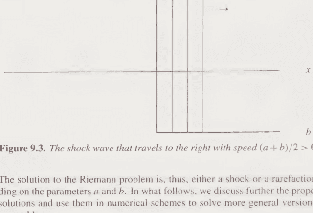

因此，黎曼问题的解要么是激波，要么是稀疏波，具体取决于参数 \(a\) 和 \(b\)。接下来，我们将进一步讨论这些解的性质，并将它们用于数值格式，以求解更一般形式的黎曼问题。

#### 9.4 Godunov 格式

如上所见，黎曼问题具有解析解，因此不需要数值格式。这里，我们考虑黎曼问题的一个更一般形式，其一般初始条件 \(u(0,x)\) 不仅可以取两个常数值 \(a\) 和 \(b\)，还可以取一整个实数范围内的值。

求解该问题的数值时间推进格式利用激波和稀疏波，在时间 \(t=(i+1/2)\Delta t\) 处形成所谓的半时间步，由此很快得到第 \((i+1)\) 个时间步的数值解。

让我们以稍微更一般的方式重写黎曼问题：

```
$$u_t(t,x)+f(u(t,x))_x=u_t(t,x)+f'(u(t,x))u_x(t,x)=0,\qquad -1\le x\le 1,\ 0<t<\infty.$$
```

其中 \(f\) 是给定的一元凸函数。（例如在我们的情形中，\(f(q)=q^2/2\)，因此对于每个实数 \(q\)，都有 \(f'(q)=q\)。）

我们还假设初始条件由下式给出：

```
$$u(0,x)=u_0(x),\qquad -1\le x\le 1.$$
```

类似地，我们还考虑半时间步 $(i + 1/2)\Delta t$ 处的数值解：

$$u_{i+1/2,j+1/2} \doteq u((i + 1/2)\Delta t, (j + 1/2)h).$$

半时间步处的数值解有助于计算下一个时间步 $(i + 1)\Delta t$ 处的数值解。为此，考虑图 9.4 中的小方域 $s$。在 $s$ 中，底边中点为 $(i, j)$，顶边中点为 $(i + 1, j)$。方域 $s$ 的边界 $\partial s$ 由四条边组成：顶边 $\partial s_1$、右边 $\partial s_2$、底边 $\partial s_3$ 和左边 $\partial s_4$。设 $\vec n$ 为 $\partial s$ 上的外法向量：

$$\vec n = \begin{cases} (0,1) & \text{在 } \partial s_1, \\ (1,0) & \text{在 } \partial s_2, \\ (0,-1) & \text{在 } \partial s_3, \\ (-1,0) & \text{在 } \partial s_4. \end{cases}$$

设 $ds$ 为沿 $\partial s$ 的长度微元。在 PDE 中使用格林散度公式，并用每条边中点处的值近似 $u$ 在该边上的值，可得

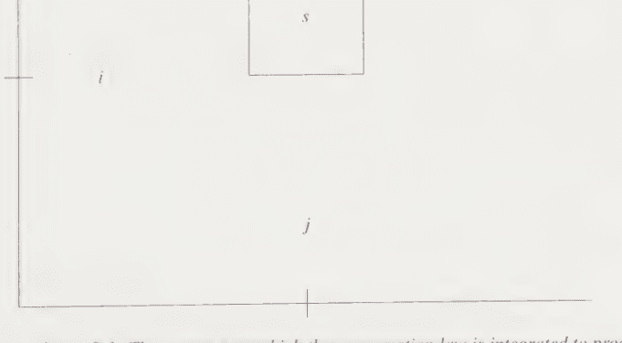

**图 9.4.** *方域 $s$，守恒律在其上积分以导出 Godunov 格式。*

```
0 = ∫_S (u_t(t,x) + f(u(t,x))_x) dt dx
= ∫_{∂S} (u(t,x), f(u(t,x))) · n ds
= ∫_{∂S1} u(t,x) dx - ∫_{∂S3} u(t,x) dx
+ ∫_{∂S2} f(u(t,x)) dt - ∫_{∂S4} f(u(t,x)) dt
≡ h (u_{i+1,j} - u_{i,j})
+ Δt (f(u_{i+1/2,j+1/2}) - f(u_{i+1/2,j-1/2})).
```

因此，Godunov 格式由下式定义：

```
u_{i+1,j} ≡ u_{i,j} - (Δt / h) ( f(u_{i+1/2,j+1/2}) - f(u_{i+1/2,j-1/2}) ),
```

其中，半时间步处的值 u_{i-1/2,j+1/2} 通过在每一对相邻单元上求解小的局部黎曼问题来计算，如图 9.5 所示。

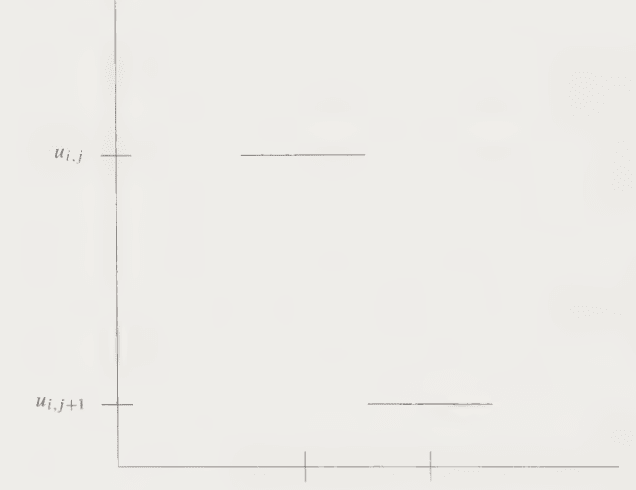

图 9.5. 第 i 个时间步中，包含点 j 和 j + 1 的两个相邻单元上的局部黎曼问题。该局部问题产生 Godunov 格式中使用的半时间步。

为了说明半时间步处的值 $u_{i+1/2,j+1/2}$ 是如何计算的，让我们回到我们的情形，其中

$f(u(t,x)) = \frac{1}{2}u^2(t,x).$

在这种情况下，我们有

$u_{i+1/2,j+1/2} \equiv \begin{cases} u_{i,j} & \text{若 } u_{i,j} > u_{i,j+1} \text{且 } (u_{i,j}+u_{i,j+1})/2 \ge 0 \\ \text{（向右传播的局部激波），} \\ u_{i,j+1} & \text{若 } u_{i,j} > u_{i,j+1} \text{且 } (u_{i,j}+u_{i,j+1})/2 < 0 \\ \text{（向左传播的局部激波），} \\ u_{i,j} & \text{若 } 0 \le u_{i,j} \le u_{i,j+1} \\ \text{（向右传播的局部稀疏波），} \\ u_{i,j+1} & \text{若 } u_{i,j} \le u_{i,j+1} \le 0 \\ \text{（向左传播的局部稀疏波），} \\ 0 & \text{若 } u_{i,j} < 0 < u_{i,j+1} \\ \text{（局部稀疏波）。} \end{cases}$

为了使用半时间步，我们还需要定义端点处的值 $u_{i+1/2,1/2}$ 和 $u_{i+1/2,N+1/2}$。利用周期边界条件，这可以像之前那样完成，也可以通过以下方式完成：

$u_{i+1/2,1/2} \equiv u_{i+1/2,N-1/2} \quad \text{且} \quad u_{i+1/2,N+1/2} \equiv u_{i+1/2,3/2}.$

这就完成了 Godunov 格式的定义。

#### 9.5 随机选择格式

这里，我们描述用于求解黎曼问题的随机选择格式 [72]：

$u_t(t,x) + u(t,x)u_x(t,x) = 0, \quad -1 \le x \le 1, \ 0 < t < \infty,$

其一般初始条件为

$u(0,x) = u_0(x)$

以及周期边界条件。在该格式中，半时间步同样通过求解如图 9.5 所示的小局部黎曼问题来计算。然而，具体做法略有不同：在每个半时间步选取一个随机数 $-1 < \theta < 1$，并令 $u_{i+1/2,j+1/2}$ 取图 9.5 中局部黎曼问题的解在点 $(j+1/2+\theta/2)h$ 处的值。更精确地说，随机选择格式由下式定义：

$u_{i+1/2,j+1/2} \equiv \begin{cases} u_{i,j} & \text{若 } u_{i,j} > u_{i,j+1} \text{且 } \theta h/\Delta t \le (u_{i,j}+u_{i,j+1})/2 \\ \text{（局部激波），} \\ u_{i,j+1} & \text{若 } u_{i,j} > u_{i,j+1} \text{且 } \theta h/\Delta t \ge (u_{i,j}+u_{i,j+1})/2 \\ \text{（局部激波），} \\ u_{i,j} & \text{若 } \theta h/\Delta t \le u_{i,j} \le u_{i,j+1} \\ \text{（局部稀疏波），} \\ u_{i,j+1} & \text{若 } u_{i,j} \le u_{i,j+1} \le \theta h/\Delta t \\ \text{（局部稀疏波），} \\ \theta h/\Delta t & \text{若 } u_{i,j} < \theta h/\Delta t < u_{i,j+1} \\ \text{（局部稀疏波）。} \end{cases}$


第 (i + 1) 个时间步通过以下方式从第 (i + 1/2) 个时间步产生，这与第 (i + 1/2) 个时间步从第 i 个时间步产生的方式相同。请注意，随机数 $\theta$ 在不同时间步可能取不同的值。至此，随机选择方案的定义完成。

#### 9.6 N 波

N 波是以下黎曼问题的解 $u(T, x)$（在足够大的时间 $T$）：

$$
u_t(t,x) + u(t,x) u_x(t,x) = 0, \quad -1 \le x \le 1, \ 0 < t < \infty
$$

其正弦初始条件形式为

$$
u(0,x) = - \sin(\pi x)
$$

以及周期边界条件形式为

$$
u(t, -1) = u(t, 1), \quad 0 \le t < \infty
$$

之所以如此命名，是因为解的形状类似于英文字母 N。在这里，我们数值求解 N 波，并确实观察到了这种形状。

我们在 $200 \times 200$ 的时间-空间网格上使用 $\Delta t = h/2$ 的 Godunov 格式，得到了图 9.6 中的结果。在第 200 个时间步，解确实呈现出对称且笔直的 N 形，符合要求。

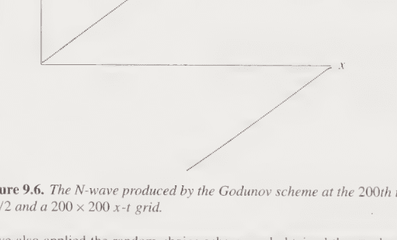

**图 9.6.** Godunov 格式在第 200 个时间步产生的 N 波，其中 $\Delta t = h/2$，且 $x$-$t$ 网格为 $200 \times 200$。

我们还应用了随机选择方案，并得到了图 9.7 中的结果。在此，解比之前稍显不够笔直和对称。因此，在下方的扰动问题中使用了更精确的 Godunov 格式。

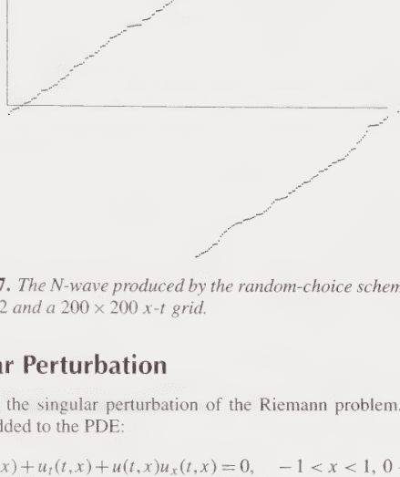

**图 9.7.** *随机选择方案在第 200 个时间步产生的 N 波，其中 $\Delta t = h/2$，且 $x$-$t$ 网格为 $200 \times 200$。*

#### 9.7 奇异摄动

这里，我们考虑黎曼问题的奇异摄动，即在偏微分方程中加入了一个小扩散项：

$$
-\varepsilon u_{xx}(t,x)+u_t(t,x)+u(t,x)u_x(t,x)=0,\qquad -1<x<1,\ 0<t<\infty.
$$

初始条件和边界条件与之前相同。

原始的 Godunov 格式需要稍作修改才能应用于此问题。实际上，这里在图 9.4 中方形 $s$ 的垂直边缘 $\partial s_2$ 和 $\partial s_4$ 上的积分也是对项 $-\varepsilon u_{xx}(t,x)$ 进行的，因此在第 9.4 节中计算第 $(i + 1)$ 个时间步时必须添加更多的项。这些项可以通过显式、隐式或半隐式的方式添加。为简单起见，这里只考虑显式方式，在此方式下，Godunov 格式采取修改后的形式

$$
\begin{aligned}
u_{i+1,j} &= u_{i,j}-\frac{(\Delta t)\varepsilon}{h^2}\left(2u_{i,j}-u_{i,j-1}-u_{i,j+1}\right) \\
&\quad-\frac{\Delta t}{h}\left(f(u_{i+1/2,j+1/2})-f(u_{i+1/2,j-1/2})\right).
\end{aligned}
$$

（半时间步的计算如前所述。）我们将此方案称为显式 Godunov 格式。

我们将此方案应用于上述定义的 N 波问题的奇异摄动。为了保持稳定性，我们使用了 $\varepsilon = h/4$。（对于更大的 $\varepsilon$ 值，必须使用更小的 $\Delta t$ 值或隐式/半隐式方案。）结果展示在图 9.8 中。

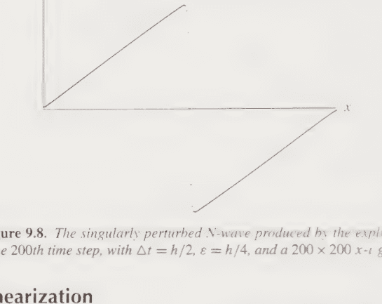

**图 9.8.** 显式 Godunov 格式在第 200 个时间步产生的奇异摄动 N 波，其中 $\Delta t = h/2$，$\varepsilon = h/4$，且 $x$-$t$ 网格为 $200 \times 200$。

可以看出，解具有与之前相同的对称且笔直的 N 形。由于额外的扩散项，中间点 $x = 0$ 处略有平滑，但 N 形仍然像之前一样清晰。

#### 9.8 线性化

第 7 章中的对流扩散方程与第 9.7 节中奇异摄动黎曼问题之间的唯一区别在于，在对流扩散方程中，对流系数是预先已知的给定函数 $C(t,x)$，而在奇异摄动黎曼问题中，对流系数是一个预先未知的函数，实际上它与未知解 $u(t,x)$ 本身相同。因此，在对流扩散方程中，特征线（或曲线）可作为常微分方程的解而获得：

$$
\frac{dx(t)}{dt} = C(t,x(t))
$$

初始条件为

$$
x(0) = x_0
$$

（其中 $-1 < x_0 < 1$ 是特征曲线的固定起点）。在这条特征曲线上，解几乎保持常数：

$$
u(t,x(t)) \equiv u(0,x(0)).
$$

换句话说，初始条件中的数据沿特征曲线流动，从而在那里形成解。

相反，在奇异摄动黎曼问题中，特征曲线解决的是一个依赖于未知解 $u(t,x)$ 本身的常微分方程：

$$
\frac{dx(t)}{dt} = u(t,x(t)).
$$

初始条件为

$$
x(0) = x_0
$$

（其中 $-1 < x_0 < 1$ 是特征曲线的起点）。由于 $u(t,x)$ 尚未获得，特征曲线也不可得。因此，解 $u(t,x)$ 决定了控制数据传播以解决原始偏微分方程的特征曲线的形状。这种循环性是非线性的直接结果。

线性偏微分方程能否作为对应非线性问题的良好近似？可能不能，因为它永远无法预测原始非线性问题中的非线性现象（激波和稀波）。它可能形成公平近似的唯一方式是，对流系数 $C(t,x)$ 已经包含了非线性波，例如，它是未摄动黎曼问题的解。然后我们说奇异摄动黎曼问题已在 $C(t,x)$ 周围进行了线性化。由于 $C(t,x)$ 已包含所需的激波和稀波，它足够接近解，线性化问题确实很好地近似了原始非线性问题。

上述讨论得出了以下求解奇异摄动黎曼问题的算法：设 $u = (u_{i,j})$ 为未摄动黎曼问题的数值解，由第 9.4 节中的 Godunov 格式或第 9.5 节中的随机选择方案获得。设 $C(t,x)$ 为一个在时间-空间网格上与 $u_{i,j}$ 一致的函数。该算法要求求解以 $C(t,x)$ 为对流系数的对流扩散方程。该解通过数值方法获得，使用第 7 章第 5 至 7 节中的显式、隐式或半隐式方案。由于该解是对原始非线性问题所需解的公平近似，它可以替代 $C(t,x)$ 以产生更优的线性化。此过程可以迭代进行，从而产生更好的线性化，以及原始非线性问题更好的数值解。这就是牛顿（或牛顿-拉夫逊）迭代。

在几个主要感兴趣的模型情况中，我们知道用于求解第一个线性化问题的显式、隐式和半隐式方案确实是稳定的，因此也是准确且充分的。这些模型情况是 $C(t,x)$ 为激波或稀波的情况，如图 9.1 至 9.3 所示。事实上，在这些情况下，可以证明第 8 章第 3 节中的稳定性条件，

$$
\|J_{i+1} J_{i-1}\| \le 1,
$$

成立，其中 $i$ 是当前时间步的索引，$J_i$ 是矩阵 $A_i$ 的约旦矩阵，$A_i$ 包含在时间 $i \Delta t$ 处的离散对流-扩散项（在第 7 章第 3 节中也记为 $D^{(i)}$）。此不等式的证明在附录第 A.12 节中。

对于更一般的初始条件，最初替代 $C(t,x)$ 的未摄动黎曼问题的解可能比图 9.1 至 9.3 中的模型波复杂得多。例如，对于正弦初始条件，它随时间收敛到图 9.6 和 9.7 中的 N 波。尽管现有的稳定性分析在这些一般情况下不再适用，但仍可以将其解释为表明线性化问题中的时间推进应该是稳定的，因此也是准确且充分的。

#### 9.9 线性化问题中的充分性

本节与第 8 章的理论相关，仅对实际方面感兴趣的读者可以跳过。这里，我们研究时间推进的充分性


第 7 章第 5 至 7 节中关于围绕激波或稀疏波线性化后的奇异摄动 Riemann 问题所采用的格式。这一线性化的结果实际上是一个对流-扩散方程，对流系数 C(t, x) 如图 9.1–9.3 所示。该问题可作为上述 Newton 迭代中第一个线性化问题的有趣模型。

如第 8 章第 4 节末尾所讨论的那样，当解 u(t, x) 表现出较大变化时，在网格点上会出现较大的截断误差。该问题在考虑充分性时尤其相关，因为在这种情况下扩散系数 ε 随网格尺寸 h 和 Δt 一同趋于零，因此没有足够的扩散来平滑尖锐变化。因此，这些地方的截断误差可能大到 (Δt)⁻¹ + h⁻¹。

幸运的是，当使用 Dirichlet、Neumann 或混合边界条件时，第 8 章第 3 节中使用的 Jordan 矩阵 J 实际上是对角的，因此将其应用于向量等价于将其分量乘以相应的主对角元素。此外，这些主对角元素在 u(t, x) 表现出较大变化的网格点处特别小，例如激波前沿。因此，可以证明离散化误差至少在 u(t, x) 相对光滑的网格点处很小。

事实上，可以在附录第 A.12 节看到 J 可分解为乘积

J = R E

其中 R 为正交（保范）矩阵，E 为对角矩阵。假设首先对流系数 C(t, x) 为如图 9.3 所示的激波。此时，E 中的主对角元素在激波前沿的网格点处具有很小的值 e_min，并随远离激波前沿而呈指数增长。此外，随着远离激波前沿，解 u(t, x) 甚至更快地趋近于常数值，因此 u_t(t, x) 和 u_x(t, x)（从而截断误差）比 E 中相应主对角元素的增长更快地趋于零（参见 [67]）。

设 E_i 为对应于第 i 个时间层的 E 中的块。这样，J_i = R_i E_i 是 A_i 的 Jordan 矩阵，A_i 包含第 i 个时间层的离散空间导数。还假设

ε = O(h) = O(Δt)

（即 ε 至少与 h 一样快地趋于零，且 h 至少与 Δt 一样快地趋于零）。如附录第 A.12 节末尾所讨论的那样，在这种情况下 Δt E_i A_i E_i⁻¹ 是严格对角占优的，因此其特征值远离原点，第 8 章第 3 节中的稳定性估计改进为

‖ J A⁻¹ J⁻¹ ‖ = O(Δt)

（即 ‖ J A⁻¹ J⁻¹ ‖ 至少与 Δt 一样快地趋于零）。用 ũ 表示数值解，用 u 表示线性化问题（在网格上）的解（见第 8 章第 4 节），我们于是有

J(ũ − u) = J A⁻¹ J⁻¹ J(F − A u) = J B⁻¹ (I − Q)⁻¹ J⁻¹ J(F − A u)
= (J B J⁻¹)⁻¹ (∑_{n=0}^{M−1} (J Q J⁻¹)^n) J(F − A u).

特别考虑第 $(i+1)$ 个时间层。来自前一个时间层的贡献在上述和中通过 $n=1$ 时由矩阵 $JQJ^{-1}$ 中的块 $J_{i+1}Q_iB_i^{-1}J_i^{-1}$ 完成。事实上，第 i 个时间层的截断误差（乘以 $J_i$）首先乘以 $J_iQ_iB_i^{-1}J_i^{-1}$（由此只能减小），然后乘以 $J_{i+1}J_i^{-1}$ 以正确缩放（即按 $J_{i+1}$ 缩放）。来自更早时间层的贡献（通过 $(JQJ^{-1})^n$）随 n 指数衰减。因此，第 $(i+1)$ 个时间层（乘以 $J_{i+1}$）的误差由第 $(i+1)$ 个时间层的截断误差（集中在激波前沿）决定，乘以 $J_{i+1}$ 并乘以 $(J_{i+1}B_{i+1}^{-1}J_{i+1}^{-1})=O(\min(\Delta t,h))$。结论是，离散化误差在激波前沿附近有限个网格点处至多为 1 阶。在远离激波前沿的网格点处，离散化误差必须呈指数衰减。

不幸的是，上述分析仅在对流系数 $C(t,x)$ 如图 9.3 所示时证明了充分性，而当它为处处为正的激波波 ($i>0$) 时则不成立。在后一种情况下，E 中的主对角元素沿每条 x 线单调指数递减，因此在上述分析中并未排除激波前沿前方（其右侧）的较大离散化误差。尽管如此，假设在激波前沿前方发生不稳定性是没有意义的，且本分析仍排除了其后方的离散化误差。

类似地，当对流系数 $C(t,x)$ 为如图 9.1 所示的稀疏波时，E 中的主对角元素沿每条 x 线单调指数递增，因此上述分析仅在稀疏波中中间线性段之后（其右侧）的网格点处排除了离散化误差。

最后，当对流系数 $C(t,x)$ 为如图 9.2 所示的稀疏波时，情况更为复杂。E 中的主对角元素在每条 x 线中随远离 $x=0$ 而呈指数递减。因此，上述分析排除了中间线性段中的离散化误差，但未排除其左右两侧的常态。尽管如此，由于这些常态位于波前前方，因此不太可能在那里发生任何不稳定性。

#### 9.10 非齐次情形

现在我们考虑具有非零右端函数 $F(t,x)$ 的 Riemann 问题：

$$u_t(t,x)+u(t,x)u_x(t,x)=F(t,x).$$

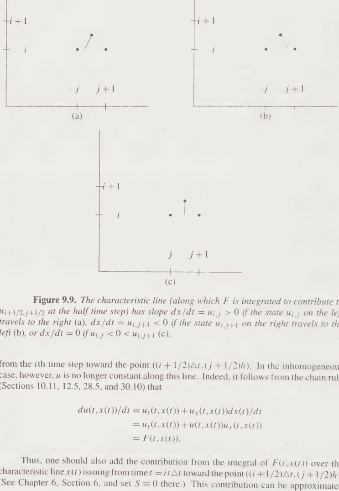

**Figure 9.9.** *特征线（沿其积分 $F$ 以在半时间步长处对 $u_{i+1/2,j+1/2}$ 做出贡献）的斜率为 $dx/dt=u_{i,j}>0$，如果左边的状态 $u_{i,j}$ 向右传播（a），$dx/dt=u_{i,j+1}<0$，如果右边的状态 $u_{i,j+1}$ 向左传播（b），或 $dx/dt=0$ 如果 $u_{i,j}<0<u_{i,j+1}$（c）。*

从第 i 个时间步向点 $((i+1/2)\Delta t,(j+1/2)h)$。在非齐次情形下，$u$ 不再沿该线恒定。事实上，由链式法则（第 10.11、12.5、28.5 和 30.10 节）可得

$$\frac{du(t,x(t))}{dt}=u_t(t,x(t))+u_x(t,x(t))\frac{dx(t)}{dt}$$
$$\qquad =u_t(t,x(t))+u_x(t,x(t))u_x(t,x(t))$$
$$\qquad =F(t,x(t)).$$

因此，还应加上 $F(t,x(t))$ 在从时间 $t=i\Delta t$ 发出并指向点 $((i+1/2)\Delta t,(j+1/2)h)$ 的特征线 $x(t)$ 上的积分的贡献。（参见第 6 章第 6 节，并令 $S=0$。）该贡献可由项

$$\frac{\Delta t}{2}\sqrt{1+u^2_{i,j}} F(i\Delta t, jh)$$

近似，如果第 9.4 节中 $u_{i+1/2,j+1/2}$ 的值与 $u_{i,j}$ 相同，或

$$\frac{\Delta t}{2}\sqrt{1+u^2_{i,j+1}} F(i\Delta t, (j+1)h)$$

如果第 9.4 节中 $u_{i+1/2,j+1/2}$ 的值与 $u_{i,j+1}$ 相同。沿导致 $((i+1/2)\Delta t,(j+1/2)h)$ 的特征线 $x(t)$ 对 $F(t,x(t))$ 的积分的上述近似（见图 9.9）应随后加到第 9.4 节中 $u_{i+1/2,j+1/2}$ 的值上，以在非齐次情形下得到正确值。这完成了非齐次情形下修正 Godunov 格式的定义。

在下一节中，我们利用上述修正将 Godunov 格式推广到向量守恒律。

#### 9.11 非线性 PDE 系统

这里，我们考虑将第 9.7 节中的奇异摄动 Riemann 问题推广到两个空间维度 $x$ 和 $y$ 以及两个未知函数 $u(t,x,y)$ 和 $v(t,x,y)$ 的情形，它们在以下非线性 PDE 系统中耦合：

$$
\begin{aligned}
-&\varepsilon(u_{xx}(t,x,y)+u_{yy}(t,x,y))+u_t(t,x,y) \\
&+u(t,x,y)u_x(t,x,y)+v(t,x,y)u_y(t,x,y) \\
&=F_1(t,x,y), \\
-&\varepsilon(v_{xx}(t,x,y)+v_{yy}(t,x,y))+v_t(t,x,y) \\
&+u(t,x,y)v_x(t,x,y)+v(t,x,y)v_y(t,x,y) \\
&=F_2(t,x,y).
\end{aligned}
$$

其中 $F_1(t,x,y)$ 和 $F_2(t,x,y)$ 为给定函数，$x$ 和 $y$ 为二维区域中的独立变量，并具有合适的初值和边界条件。上述 PDE 系统也称为奇异摄动守恒律系统。

该系统的特征线在三维 $(t,x,y)$ 空间中定义。事实上，它们由满足

$$dx(t)/dt = u(t,x(t),y(t)) \quad \text{and} \quad dy(t)/dt = v(t,x(t),y(t)).$$

的向量 $(t,x(t),y(t))$ 定义。利用此定义，我们由链式法则得到，当 $\varepsilon = 0$ 时，

$$
\begin{aligned}
\frac{du(t,x(t),y(t))}{dt} &= u_t(t,x(t),y(t))+u(t,x(t),y(t))u_x(t,x(t),y(t)) \\
&+ v(t,x(t),y(t))u_y(t,x(t),y(t)) \\
&= F_1(t,x(t),y(t)), \\
\frac{dv(t,x(t),y(t))}{dt} &= v_t(t,x(t),y(t))+u(t,x(t),y(t))v_x(t,x(t),y(t)) \\
&+ v(t,x(t),y(t))v_y(t,x(t),y(t)) \\
&= F_2(t,x(t),y(t)).
\end{aligned}
$$

因此，关于 $u$ 和 $v$ 的初值和边界条件沿特征线（或曲线）传播以形成整个时空域中的解。


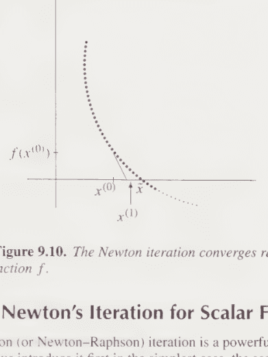

图 9.10。牛顿迭代迅速收敛到凸函数 f 的期望根 x。

#### 9.12 标量函数的牛顿迭代

牛顿迭代（或牛顿-拉夫森迭代）是求解非线性方程的有力工具。让我们首先在最简单的情况——标量情形下引入它。

设 $f(x)$ 是标量变量 $x$ 的标量函数。假设 $f$ 至少有一个根 $\tilde{x}$，使得其为零：

$$f(\tilde{x}) = 0.$$

问题是找到根 $\tilde{x}$。要应用牛顿迭代，还必须假设 $f$ 在 $\tilde{x}$ 的邻域内具有均匀非零的导数 $f'$，即

$$|f'(x)| \ge C_1, \quad x \in (\tilde{x} - \zeta, \tilde{x} + \zeta),$$

其中 $C_1$ 和 $\zeta$ 是某些正常数。为了逼近所需的根 $\tilde{x}$，让我们首先选取一个初始猜测 $x^{(0)}$。不幸的是，$x^{(0)}$ 可能是一个相当差的猜测。为了改进它，让我们定义一个更好的 $\tilde{x}$ 的近似值，记为 $x^{(1)}$。这是通过在点 $(x^{(0)}, f(x^{(0)}))$ 处作函数 $f$ 图形的切线来完成的（见图 9.10）。该切线的斜率只是 $f$ 在 $x^{(0)}$ 处的导数：

$$f'(x^{(0)}) = - \frac{f(x^{(0)})}{x^{(1)} - x^{(0)}}.$$

由于 $x^{(1)}$ 尚未定义，最好将其放在左边：

$$x^{(1)} - x^{(0)} = - \frac{f(x^{(0)})}{f'(x^{(0)})}$$

或

$$x^{(1)} = x^{(0)} - \frac{f(x^{(0)})}{f'(x^{(0)})}.$$

从图 9.10 可以清楚地看出，$x^{(1)}$ 确实比 $x^{(0)}$ 更接近 $\tilde{x}$。通过重复这一过程，牛顿迭代现在可以对每个 $i = 0,1,2,\ldots$ 定义为

$$x^{(i+1)} = x^{(i)} - \frac{f(x^{(i)})}{f'(x^{(i)})}.$$

在下面讨论的某些条件下，牛顿迭代迅速收敛到 $\tilde{x}$。因此，对于足够大的 $i$，第 $(i+1)$ 次迭代的误差 $|x^{(i+1)} - \tilde{x}|$ 足够小，使得 $x^{(i+1)}$ 可以被接受为 $\tilde{x}$ 的足够精确的近似值。

#### 9.13 超线性收敛

为了证明牛顿迭代确实迅速收敛到 $f$ 的根，让我们还假设所有近似值 $x^{(i)}$ 都位于 $(\tilde{x} - \zeta, \tilde{x} + \zeta)$ 内，并且 $f$ 还具有二阶导数 $f''$，其在 $(\tilde{x} - \zeta, \tilde{x} + \zeta)$ 内的绝对值被某个常数 $C_2$ 所限制（例如，$f$ 在闭区间 $[\tilde{x} - \zeta, \tilde{x} + \zeta]$ 上是凸的）。利用围绕 $x^{(i)}$ 的泰勒展开（第 5.11 节），我们可以将 $f(\tilde{x})$ 表示为 $f$ 和 $f'$ 在 $x^{(i)}$ 处以及 $f''$ 在介于 $\tilde{x}$ 和 $x^{(i)}$ 之间的中间点 $\xi$ 处的值：

$$0 = f(\tilde{x}) = f(x^{(i)}) + f'(x^{(i)})(\tilde{x} - x^{(i)}) + \frac{1}{2} f''(\xi)(\tilde{x} - x^{(i)})^2$$

或

$$f(x^{(i)}) = -f'(x^{(i)})(\tilde{x} - x^{(i)}) - \frac{1}{2} f''(\xi)(\tilde{x} - x^{(i)})^2.$$

将此公式代入原始牛顿迭代中，我们得到第 $(i+1)$ 次迭代的误差用第 $i$ 次迭代的误差表示：

$$x^{(i+1)} - \tilde{x} = x^{(i)} - \frac{f(x^{(i)})}{f'(x^{(i)})} - \tilde{x}$$

$$= x^{(i)} - \tilde{x} + \frac{f'(x^{(i)})(\tilde{x} - x^{(i)}) + \frac{1}{2} f''(\xi)(\tilde{x} - x^{(i)})^2}{f'(x^{(i)})}$$

$$= \frac{f''(\xi)(\tilde{x} - x^{(i)})^2}{2 f'(x^{(i)})}.$$

#### 9.14 向量情形

与第 9.12 节中相同，牛顿迭代以相同的方式定义，只是现在 $f'(x^{(i)})$ 的除法被解释为从左边乘以雅可比矩阵的逆，$(f'(x^{(i)}))^{-1}$：

$$x^{(i+1)} = x^{(i)} - (f'(x^{(i)}))^{-1} f(x^{(i)})$$

显然，由于 $f$ 的雅可比矩阵依赖于 $x^{(i)}$，因此在每次迭代之前必须重新计算它。此外，它必须具有逆矩阵；换句话说，它必须是 nonsingular（可逆的）。幸运的是，这个逆矩阵不需要显式计算。相反，只需要求解一个线性系统，其中雅可比矩阵作为系数矩阵。这可以在内部迭代中完成，使用第 17 章中的迭代方法之一。

此外，在当前解释下，第 9.13 节中的误差估计仍然有效，前提是 $f'^{-1}$ 和 $f''$ 中的各个 Hessian 分量在 $\tilde{x}$ 的邻域内是有界的。事实上，第 9.13 节中使用的围绕 $x^{(i)}$ 的泰勒展开可以适应于当前向量函数，写为

$$f(\tilde{x}) = f(x^{(i)}) + f'(x^{(i)})(\tilde{x} - x^{(i)}) + \frac{1}{2} (\tilde{x} - x^{(i)})^t f''(\xi) (\tilde{x} - x^{(i)})$$

其中 $\xi$ 是 $\tilde{x}$ 邻域内的 $n$ 维向量，上式最后一项中的三重乘积对 $f''(\xi)$ 中的每个 Hessian 分量分别解释。事实上，上式只是标量函数 $f_1, f_2, \dots, f_n$ 的 $n$ 个单独泰勒展开的紧凑形式。因此，误差估计可以像第 9.13 节中一样进行，从而在向量情形下也成立。

不幸的是，牛顿迭代仅在 $x^{(i)}$ 进入 $\tilde{x}$ 的足够小的邻域时才超线性收敛。如果初始猜测 $x^{(0)}$ 太差，则牛顿迭代可能收敛得相当缓慢。因此，选择合适的初始猜测至关重要。几种方法在第 21.9 节和第 28.16 节中讨论。

#### 9.15 弛豫牛顿迭代

此外，对于某些不稳定问题（例如鞍点问题），牛顿迭代甚至可能发散。事实上，如果 $f'(x^{(0)})$ 在其具有过小幅度的特征值的意义上接近奇异，则迭代可能像图 9.11 中那样发散。为了避免这种情况，牛顿迭代可以修改为

$$x^{(i+1)} = x^{(i)} - \alpha (f'(x^{(i)}))^{-1} f(x^{(i)})$$

其中 $0 < \alpha < 1$ 是弛豫参数。

显然，通过这种弛豫迭代，收敛速度不再是超线性的而只是线性的。事实上，利用第 9.13 节中围绕 $\tilde{x}$ 的 $f$ 的泰勒展开，我们有

$$x^{(i+1)} - \tilde{x} = x^{(i)} - \alpha (f'(x^{(i)}))^{-1} f(x^{(i)}) - \tilde{x}$$

$$= x^{(i)} - \tilde{x} - \alpha (f'(x^{(i)}))^{-1} \big( f'(x^{(i)})(x^{(i)} - \tilde{x}) + O(\|x^{(i)} - \tilde{x}\|^2) \big)$$

$$= (1 - \alpha)(x^{(i)} - \tilde{x}) + O(\|x^{(i)} - \tilde{x}\|^2)$$

当 $x^{(i)}$ 接近 $\tilde{x}$ 时。换句话说，误差在每次迭代中乘以常数因子 $1 - \alpha < 1$。因此，为了增强收敛，选择 $\alpha$ 不宜过小。另一方面，$\alpha$ 也应不过大，以免出现图 9.11 中的发散。

本书大多数应用中无需弛豫牛顿迭代。第 9.14 节中的原始版本可以安全使用，这相当于在此处取 $\alpha = 1$。只有在本书末尾最复杂的系统——非线性麦克斯韦系统——中才需要使用 $\alpha = 0.5$ 以保证收敛。

#### 9.16 微分算子的牛顿迭代

牛顿迭代基于在 $x^{(i)}$ 处对原始（标量或向量）函数 $f$ 的线性化。事实上，对于固定的 $x^{(i)}$，函数

$$g(x) \equiv f(x^{(i)}) + f'(x^{(i)})(x - x^{(i)})$$

是唯一的线性函数，它在 $x^{(i)}$ 上与 $f$ 相同，

$$g(x^{(i)}) = f(x^{(i)}),$$

并且在 $x^{(i)}$ 处具有与 $f$ 相同的导数（或雅可比矩阵）：

$$g'(x^{(i)}) = f'(x^{(i)}).$$

这就是为什么 $g$ 可以被称为 $f$ 在 $x^{(i)}$ 处的线性化（见第 5.11 节）。

到目前为止，我们假设 $f$ 是标量或向量函数。现在假设 $f$ 是一个算子，它将给定的函数 $u$ 映射到唯一的函数 $f(u)$。在这种情况下，$u$ 和 $f(u)$ 都是（至少）一个变量的函数。

我们特别感兴趣的是 $f$ 为非线性（偏）微分算子的情形。在这种情况下，算子 $f$ 使用 $u$ 的（偏）导数。此外，$f$ 可能包含 $u$ 的（偏）导数的乘积，这会产生非线性。

例如，考虑 $f$ 为拟线性（偏）微分算子的情形，它不包含 $u$ 导数的乘积，而只包含形如

$$C(u)Du,$$

的项，其中 $C$ 是一个普通映射（系数），它完全不使用微分，而 $D$ 是一个线性微分算子。显然，该项在线性化于给定函数 $u^{(i)}$ 时由线性微分算子

$$C(u^{(i)})D,$$

线性化，该算子在 $u^{(i)}$ 上与原始项一致。对原始拟线性算子 $f$ 中的所有项执行此操作会产生线性（偏）微分算子 $f'(u^{(i)})$，它在线性化 $f$ 于 $u^{(i)}$。寻找满足

$$f(\tilde{u}) \equiv 0$$

的未知根函数 $\tilde{u}$ 的牛顿迭代可以像第 9.14 节中那样定义：

$$u^{(i+1)} = u^{(i)} - (f'(u^{(i)}))^{-1} f(u^{(i)}).$$


显然，线性（偏微分）算子 $f'(u^{(i)})$ 必须在每次迭代中重新计算（并重新离散化）。幸运的是，它不需要显式求逆，只需隐式处理即可。然而，为此必须假设它是非奇异的（可逆的）。换句话说，使用它的偏微分方程在左边必须是适定的，即其解是唯一的。幸运的是，在大多数相关问题上确实如此，如第 11.3–11.6、20.5、21.4 和 29.1 节中所讨论的那样。

#### 9.17 习题

- 1. 使用第 7 章第 11 节中的 "xtGrid" 对象实现 Godunov 格式。
- 2. 使用第 7 章第 11 节中的 "xtGrid" 对象实现随机选择法（random-choice scheme）。
- 3. 使用你的代码求解具有正弦初始条件和周期边界条件的黎曼问题。你是否得到了 N 波？哪种格式给出的结果更好？将你的结果与图 9.6 和图 9.7 中的结果进行比较。
- 4. 使用短记忆方法（short-memory approach）重写你的代码，该方法会在计算下一个时间步的数值解使用当前时间步的数值解后立即将其丢弃。将最终时间步的数值解与前一个习题中的结果进行比较。它们相同吗？短记忆代码有哪些优点和缺点？
- 5. 将显式 Godunov 格式应用于上述第 9.7 节中的奇异摄动黎曼问题。你的结果是否接近图 9.8 中的 N 波？
- 6. 为上述第 9.7 节中的奇异摄动黎曼问题开发 Godunov 格式的隐式和半隐式版本。在这些版本中，扩散项 $\varepsilon u_{xx}$ 的（一半）被移到第 9.7 节差分方程的左边并隐式求解。你能用这些版本求解 $\varepsilon$ 大于图 9.8 中使用的值的奇异摄动黎曼问题吗？
- 7. 证明第 8 章第 3 节中的稳定性条件 $$\|J_{i+1}J_i^{-1}\| \le 1$$（其中 $i$ 是当前时间步的索引，$J_i$ 是包含第 $i$ 个时间步离散空间导数的矩阵 $A_i$ 的若尔当矩阵），确实在对流系数 $C(t,x)$ 是如图 9.3 所示的激波，或如图 9.1 或 9.2 所示的稀波时成立。解答可在附录 A.12 节中找到。
- 8. 使用你之前的答案，证明第 7 章第 6 节和第 7 节中的隐式和半隐式格式对于第 8 章第 3 节中使用的范数而言是稳定、精确且充分的，因此可能适用于第 9.8 节中的线性化问题。
- 9. 表明只要 $\Delta t$ 足够小，上述结论对于显式时间推进也成立。解答可由附录 A.11 节得出。
- 10. 使用第 3.14 节中的 "dynamicMatrix" 对象和短记忆方法，实现第 9.11 节中的交替方向 Godunov 格式，以求解非线性偏微分方程组。
- 11. 证明第 9.8 节中求解如下形式方程的牛顿迭代

$$\mathcal{D}(u)=F$$

（其中 $F$ 是给定的函数，$u$ 是未知函数，$\mathcal{D}$ 是非线性微分算子）可以看作是第 9.16 节中求函数根的牛顿迭代的推广。事实上，$u$ 可以看作是关于

$$\mathcal{D}(u)-F=0.$$

的“根”。此外，对于每个函数 $v$，设 $\mathcal{L}_v$ 为 $\mathcal{D}$ 在 $v$ 处的线性化。那么，沿着第 9.16 节的指南，牛顿迭代的形式为

$$u^{(i+1)}=u^{(i)}-\mathcal{L}_{u^{(i)}}^{-1}\left(\mathcal{D}(u^{(i)})-F\right)=u^{(i)}-\left(u^{(i)}-\mathcal{L}_{u^{(i)}}^{-1}F\right)=\mathcal{L}_{u^{(i)}}^{-1}F,$$

这正是第 9.8 节中描述的牛顿迭代。

## 第 10 章 图像处理中的应用

在本章中，我们介绍了一个用于去除数字图像中随机噪声的非线性偏微分方程。初边值问题的初始条件取自原始的含噪图像。偏微分方程在最终时间步的解产生所需的去噪图像。还介绍了有限差分离散化方法，并使用牛顿迭代法对非线性项进行线性化。然后，使用单次多重网格迭代来近似求解每个单独的线性系统。该算法也被扩展到彩色图像。

#### 10.1 数字图像

在本章中，我们使用前面介绍的对象来实现图像处理中的有用算法。为此，我们需要定义一些常见的术语。

数字图像实际上是一个 $N_x \times N_y$ 的数字数组（其中 $N_x$ 和 $N_y$ 是正整数）。该数组通过以下方式表示真实的二维图像。数组中的每个条目 $(j,i)$ 称为像素；像素中包含的数字代表图像中对应点的光强。通常，像素中的数字在 0（零光强，即黑色）和 255（全光强，即白色）之间。数字越大，图像中对应点的光量就越大，且越接近纯白色。另一方面，数字越小，图像中对应的点就越暗，且越接近纯黑色。这就是为什么像素中的数字被称为灰度级或灰度值的原因。

#### 10.2 去噪问题

图像处理领域处理的是数字图像及其存储、传输和其他有用的操作。图像处理中的一个重要问题是如何使数字图像更清晰。原始图像可能存在两种缺陷：模糊（可能在拍照时引入）和随机噪声（可能在数字图像传输或广播时引入）。因此，图像处理中的两个主要问题是去模糊（去除模糊）和去噪（去除噪声）。

在以下内容中，我们考虑去噪问题，即从给定的含噪图像中去除随机噪声，同时不破坏其特征。事实证明，这个问题

#### 10.3 非线性扩散问题

可以被表述为一个初边值问题。在这种形式下，该问题可以通过数值方法求解。

让我们将去噪问题表述为一个初边值问题。定义域是包含原始图像的矩形 $[0, L_x] \times [0, L_y]$。在初始时间 $t = 0$ 时，初始条件取自原始的含噪图像。随着时间推移，引入少量的扩散以平滑图像中的随机噪声。在时间 $t = T$ 时，生成最终的、去噪后的图像。

偏微分方程中引入的扩散旨在平滑随机噪声。然而，至关重要的是不要平滑掉灰度不连续性，因为它是原始图像的组成部分。因此，在不连续线处或在数字图像中灰度发生显著变化的方向上，扩散必须很小。如果认为图像中像素的灰度是两个空间变量 $x$ 和 $y$ 的函数，那么在该函数梯度模很大的方向上，扩散必须很小，因为函数的急剧变化表明是必须保留的图像真实特征。

因此，扩散系数必须与解的梯度成反比。由于该解尚未知，扩散系数也不可用。这意味着该问题是拟线性的：它是非线性的，但可以通过使用解的某种近似值来设定扩散系数从而进行线性化。

该偏微分方程是时间相关的扩散问题 [57]

$$u_t(t,x,y) - (P u_x(t,x,y))_x - (P u_y(t,x,y))_y = 0$$

在时空域

$$0 < t < T, \quad 0 \le x \le L_x, \quad 0 \le y \le L_y,$$

其中 $P$ 是由下式给出的函数

$$P \equiv P(u_x(t,x,y), u_y(t,x,y)) = \frac{1}{1 + \eta^{-1}(u_x^2(t,x,y) + u_y^2(t,x,y))}$$

其中 $\eta$ 是稍后指定的参数。（通常，$\eta$ 是 $u_x^2 + u_y^2$ 在整个图像像素上的离散近似的平均值。）

为了使问题适定，还必须施加初始和边界条件。在矩形空间域边界的所有位置，边界条件均为齐次诺依曼类型。初始条件 $u(0,x,y)$ 是一个函数，其在定义图像所基于的矩形网格上与原含噪图像一致。换句话说，$u(0, j h_x, i h_y)$ 是原始含噪数字图像中第 $(j,i)$ 个像素的灰度，其中 $h_x = L_x / N_x$ 是 $x$ 空间方向上的网格尺寸，$h_y = L_y / N_y$ 是 $y$ 空间方向上的网格尺寸。因此，网格

$$\{(j h_x, i h_y) \mid 0 \le j < N_x, \quad 0 \le i < N_y\}$$

（图 7.4）与数字图像重合，并且在初始时间 $t = 0$ 时，解 $u$ 在该网格上的值与原始含噪图像中的值相同，而在最终时间 $t = T$ 时，则与所需的去噪图像中的值相同。


#### 10.4 离散化

上述偏微分方程（PDE）中含空间导数的项，在第11章第2节将要描述的意义下是对称的。因此，离散方法的定义必须保证包含离散空间导数的矩阵也是对称的。此外，在第12章第4节中我们将看到，还希望该矩阵是对角占优的。因此，对于离散方法的定义，我们已经有了相当清晰的指导原则。

事实上，我们已经拥有一种具备上述性质的离散方法。该离散方法在第8章末尾的习题中针对线性扩散问题给出。它基于如下观察：如果扩散系数 $P$ 在网格中形如 $(j+1/2,i)$ 和 $(j,i+1/2)$ 的中点处取值，那么在特定时间步包含离散空间导数所得的矩阵是对称且对角占优的 [78]。第8章末尾的习题表明，这些性质很有吸引力，因为它们保证了隐式和半隐式格式在通常范数意义下是稳定且精确的。

有限差分离散基于以下近似

$$(P u_x)_{(j+1/2)h_x,ih_y}=P_{j+1/2,i}h_x^{-1}\bigl(u((j+1)h_x,ih_y)-u(jh_x,ih_y)\bigr),$$

其中 $P_{j+1/2,i}$ 是 $P$ 在相应中点处的近似：

$$P_{j+1/2,i}=\frac{1}{1+\eta^{-1}(u_{x,j+1/2,i}^{2}+u_{y,j+1/2,i}^{2})}.$$

其中 $u_x{}_{j+1/2,i}$ 和 $u_y{}_{j+1/2,i}$ 分别是 $u_x$ 和 $u_y$ 在相应中点处的近似：

$$u_{x,j+1/2,i}=h_x^{-1}\bigl(u((j+1)h_x,ih_y)-u(jh_x,ih_y)\bigr),$$

$$u_{y,j+1/2,i}=(4h_y)^{-1}\bigl(u((j+1)h_x,(i+1)h_y)+u(jh_x,(i+1)h_y)$$
$$\qquad-u((j+1)h_x,(i-1)h_y)-u(jh_x,(i-1)h_y)\bigr).$$

实际上，在非彩色（灰度）图像中，后一项可以省略，或用更简单的项代替

$$u_{y,j+1/2,i}=h_y^{-1}\bigl(u(jh_x,(i+1)h_y)-u(jh_x,ih_y)\bigr)$$

以提高效率。

注意，上述定义可能会用到位于网格之外的点，因此这些点没有定义。例如，当 $i$ 表示网格中最上面一行时，$i+1$ 没有定义。幸运的是，利用齐次诺伊曼边界条件，在这种情况下可以用 $i$ 替换 $i+1$。类似地，当 $i$ 表示网格中最下面一行时，在上述公式中应将 $i-1$ 替换为 $i$。当 $j=N_x$（$j+1\leftarrow j$）和 $j=0$（$j-1\leftarrow j$）时，也采用类似方法。

现在，将上述在中点处对 $P$ 的定义用于在网格点本身上对项 $(P u_x)_x$ 进行离散，如第7章第13节所述。这就完成了PDE中第一个空间项的离散。

第二个空间项 $(P u_y)_y$ 的离散以类似方式完成，只需在上述公式中交换 $x$ 与 $y$（以及 $i$ 与 $j$）的角色即可。时间导数按第7章第6节的方式隐式离散。（第7章第7节的半隐式格式可能更精确，尽管此处未使用。）这就完成了离散方法的定义。

#### 10.5 线性化

上述隐式格式需要在每个时间步求解一个非线性方程组。非线性体现在上面定义的系数 $P_{j+1/2,i}$ 和 $P_{i,i+1/2}$ 中，这些系数依赖于未知的离散解 $u$。因此，需要一种线性化方法来迭代求解该方程组。

牛顿迭代（9.16节）中确实使用了这样的线性化。当前时间步离散解 $u$ 的初始近似由上一个时间步得到。如上所述，该近似用于在中点处定义 $P_{j+1/2,i}$ 和 $P_{i,j+1/2}$。这些系数用于离散化，从而形成离散线性方程组。该方程组的解是当前时间步解的一个改进近似。这一过程反复迭代，在当前时间步产生越来越好的近似解。当达到足够好的近似时，就将其作为当前时间步的数值解，然后时间推进可以进入下一个时间步。

牛顿法在每次迭代中都需要求解一个线性方程组以获得改进近似。事实证明，这些线性系统不必精确求解。实际上，使用第17章第8节的多重网格线性方程组求解器进行一次迭代来近似求解即可。事实上，由于多重网格方法能显著减小残差，因此它提供了所需的改进近似。

同样地，在采用上述隐式时间推进的情况下，只使用一个时间步就足够了。在时间 $t = \Delta t$ 处的数值解已被正确去噪，因此可以直接作为去噪算法的输出。这就完成了灰度图像去噪算法的定义。接下来，该算法还将扩展到彩色图像。

#### 10.6 彩色图像

到目前为止，我们处理的是灰度图像，其中每个像素包含一个数，用于表示实际图像中对应点的光量。现在，我们考虑彩色数字图像，其中每个像素包含三个数，用于表示彩色图像中对应点的三种基本颜色——红、绿、蓝——的强度。按像素中指定的强度组合这三种颜色，能唯一地产生图像中对应点的实际颜色。这种数字表示称为RGB编码：R代表红，G代表绿，B代表蓝。

因此，彩色数字图像在数学上可以定义为三个 $N_1 N_2$ 维向量的集合：$r$ 包含图像各像素中红色的强度，$g$ 包含图像各像素中绿色的强度，$b$ 包含整个图像中各像素中蓝色的强度。我们将向量 $r$、$g$ 和 $b$ 称为颜色向量。

在上述形式下，彩色图像已可进行数学处理以使其更清晰。特别地，当向量 $r$、$g$ 和 $b$ 受到随机噪声污染时，需要去噪算法来去除噪声。幸运的是，上述去噪算法可以

#### 10.7 彩色图像去噪

彩色图像的去噪算法是上述算法的自然扩展。不过，这里我们有一个由三个相互耦合的非线性PDE组成的方程组，每个方程求解一种不同的颜色。这些PDE在最终时刻 $t = T$ 的解限制在离散网格上时，生成去噪后的颜色向量；将这些颜色向量组合起来，就得到所需的去噪彩色图像。

耦合PDE方程组包含三个非线性方程，每种颜色一个：

r_t(t,x,y) - (P r_x(t,x,y))_x - (P r_y(t,x,y))_y = 0,
 g_t(t,x,y) - (P g_x(t,x,y))_x - (P g_y(t,x,y))_y = 0,
 b_t(t,x,y) - (P b_x(t,x,y))_x - (P b_y(t,x,y))_y = 0,

其中 $0 < t < T$ 是时间变量，$0 \le x \le L_x$ 和 $0 \le y \le L_y$ 是空间变量；$r(t,x,y)$、$g(t,x,y)$ 和 $b(t,x,y)$ 是未知函数；扩散系数 $P$（非线性地依赖于 $r_x(t,x,y)$、$r_y(t,x,y)$、$g_x(t,x,y)$、$g_y(t,x,y)$、$b_x(t,x,y)$ 和 $b_y(t,x,y)$）定义为

P = det(E)^{-1},

其中 E 是 2 × 2 矩阵

E = ( 1 + (r_x^2 + g_x^2 + b_x^2)/η   (r_x r_y + g_x g_y + b_x b_y)/η ; (r_x r_y + g_x g_y + b_x b_y)/η   1 + (r_y^2 + g_y^2 + b_y^2)/η ).

（将该系统与文献[63]、[73]中的系统进行比较，后者使用的是 $E^{-1}$ 而不是 $\det(E)^{-1}$。）

为了将这个PDE方程组补成一个适定问题，还必须为函数 $r$、$g$ 和 $b$ 施加初始条件和边界条件。边界条件是齐次诺伊曼型的：

r_n = g_n = b_n = 0,

其中 $n$ 是矩形空间区域边界上的外法向量。在 $t = 0$ 处的初始条件必须与网格中原始带噪图像一致：$r(0,x,y)$ 与网格中带噪的红色颜色向量一致，$g(0,x,y)$ 与网格中带噪的绿色颜色向量一致，$b(0,x,y)$ 与网格中带噪的蓝色颜色向量一致。这些PDE在最终时刻 $t = T$ 的解限制在网格上时，生成去噪后的颜色向量：$r(T,x,y)$ 生成去噪后的红色颜色向量，$g(T,x,y)$ 生成去噪后的绿色颜色向量，$b(T,x,y)$ 生成去噪后的蓝色颜色向量。这些颜色向量组合起来，产生所需的去噪彩色图像。

离散化与之前相同。首先，在 $(j + 1/2,i)$ 和 $(j,i + 1/2)$ 中点处计算 $E$。然后，也在这些中点处计算 $P$，并用其构造离散空间导数。时间导数采用第7章第6节的隐式格式进行离散。该格式需要在每个时间步求解一个大型非线性差分方程组。


该系统通过牛顿迭代求解（见第9.16节）。初始猜测由上一步得到，并用于计算\(E\)和对方程线性化。这为当前时间步的颜色向量\(\mathbf r\)、\(\mathbf g\)和\(\mathbf b\)产生三个独立的线性系统。每个线性系统通过一次多重网格迭代（见第17章第8节）近似求解。一旦牛顿迭代终止，其结果被接受为当前时间步的数值解，然后过程进入下一步。

实际上，结果表明一个时间步就足够了；即\(T = \Delta t\)提供了所需的去噪颜色向量，它们组合成所需的去噪彩色图像。

参数\(\eta\)可能在每次牛顿迭代中改变。由于它估计图像中的总变差（随图像去噪而减小），它也应减小。定义\(\eta\)的一种方法是
\[
\eta = h_x h_y\left(\|\mathbf r_x\|^2 + \|\mathbf r_y\|^2 + \|\mathbf g_x\|^2 + \|\mathbf g_y\|^2 + \|\mathbf b_x\|^2 + \|\mathbf b_y\|^2\right).
\]
其中向量\(\mathbf r\)、\(\mathbf g\)和\(\mathbf b\)取自上一次牛顿迭代，它们的偏导数用前向差分近似，\(\|\cdot\|^2\)函数表示整个网格上平方和。这就完成了RGB彩色图像去噪算法的定义。

#### 10.8 数值示例

本节将去噪算法应用于实际示例。为此，我们首先使用一幅 \(512 \times 512\) 的 Lena 原始灰度图像，这是图像处理测试中常用的图像。我们对原始图像中的每个像素添加均匀分布的随机噪声，噪声幅度至多为原始图像最大强度的 25%。带噪图像如图 10.1 所示。对该图像，我们应用灰度图像去噪算法，其中 \(L_x = L_y = 1\)（单位正方形），\(N_x = N_y = 512\)，\(h_x = h_y = 1/512\)，\(\Delta t = 0.000025\)。我们使用 10 次牛顿迭代，前两次迭代中 \(\eta = 10000\)（此时由于初始噪声，变差特别大），接下来三次迭代中 \(\eta = 1000\)，最后五次迭代中 \(\eta = 100\)（此时噪声已降低，变差相当小）。去噪后的图像如图 10.2 所示。

对 Lena 的 RGB 彩色图像也进行了类似测试。在这种情况下，随机噪声被添加到每个像素的每个颜色分量中。带噪图像如图 10.3 所示。我们对该图像应用彩色图像去噪算法。同样使用 10 次牛顿迭代，\(\eta\) 取值与第 10.7 节末尾相同。去噪后的图像如图 10.4 所示。

去噪算法提供了良好的去噪效果，几乎没有模糊。通过使用更小的 \(\Delta t\) 或进行更多次牛顿迭代并巧妙选择 \(\eta\)，或改用更精确的半隐式格式，算法还可以进一步改进。

作为比较，我们还测试了 MATLAB 库中提供的维纳滤波器，分别应用于带噪图像中的每个颜色向量。该滤波器基于输入图像的统计特性。在每个像素处，新值计算为其周围 \(10 \times 10\) 像素子方形内值的加权平均。（该子方形大小是本示例中去除部分噪声所需的最小尺寸。）该滤波器的结果显示在图 10.5 中。很容易看出，该结果比当前去噪算法的结果模糊得多。

#### 10.9 目标分割

图像处理中另一个有趣的问题是目标分割，即在数字图像中检测目标。该问题与去噪问题密切相关，在医学及其他领域也有重要应用。

与去噪问题不同，这里原始的好图像是可用的。为简单起见，假设这是一幅非彩色（灰度）图像。设 \(\bar I(x, y)\) 是一个与像素网格处的原始图像一致的函数。事实上，\(\bar I(x, y)\) 的定义与第 10.3 节中 \(u_0(x, y)\) 的定义类似，只是它使用的是好图像而非带噪图像。

求解目标分割问题的线性 PDE 为
\[
u_t(t,x,y) - \left(P(x,y)u_x(t,x,y)\right)_x - \left(P(x,y)u_y(t,x,y)\right)_y = g(t,x,y)
\]
在时空域
\[
0 < t < T,\qquad 0 \le x \le L_x,\qquad 0 \le y \le L_y,
\]
其中 \(g\) 是稍后指定的右端函数，扩散系数 \(P\) 是由下式定义的函数：
\[
P(x,y) \equiv \frac{1}{1 + \eta^{-1}\left(\bar I_x^2(x,y) + \bar I_y^2(x,y)\right)}.
\]

由于 \(P\) 与解 \(u\) 无关，该 PDE 实际上是线性的。因此，在隐式时间推进中，每个时间步只需一次牛顿迭代即可收敛。事实上，即使这一次迭代也不必是精确的：使用至多三次多重网格迭代（见第17章第8节）将残差的 \(\ell_2\) 范数降低一个数量级就足够了。

在我们的数值示例中，我们使用了 \(L_x = L_y = 1\)，\(N_x = N_y = 512\)，\(\Delta t = 0.000025\)，\(\eta = 100\)。初始条件函数看起来像一个倒金字塔：
\[
u(0,x,y) = -\min\bigl(\min(x, 1-x), \min(y, 1-y)\bigr).
\]
显然，在单位正方形 \((0,1)^2\) 内部这是一个负函数，在其边界处为零。\(u\) 为零的点集构成轮廓，该轮廓最终将分割出图像中的目标物体。

在初始时刻 \(t=0\)，\(u(0,x,y)\) 为零的点集是单位正方形的边界。这是对图像中目标物体的相当差的近似。幸运的是，随着 \(t\) 增大，由 \(u(t,x,y)\) 为零的点形成的轮廓对图像中目标物体的近似越来越好。

为了使轮廓逼近图像中的目标物体，我们必须（至少在 \(t\) 较小时）使用正的右端函数 \(g\)（即所谓的“气球”力 [18]）。事实上，正的外部力 \(g\) 会随着 \(t\) 增大而增大 \(u\) 的值，使轮廓在图像中目标物体周围越来越小。

在我们的示例中，我们使用
\[
g(t,x,y) = \begin{cases} 1000\,P(x,y), & t \le 20\Delta t, \\ 0, & t > 20\Delta t. \end{cases}
\]
换句话说，在前 20 个时间步中，\(g\) 与扩散系数 \(P\) 成正比，以使轮廓收缩并逼近图像中的目标物体。另一方面，在进一步的时间步中，假定轮廓已经充分收缩：为了使其以更高精度逼近图像中的目标物体，\(g\) 必须为零。在本示例中，我们使用 30 个额外的时间步，其中 \(g\) 为零。

隐式时间推进中每个时间步得到的线性系统通过三次多重网格迭代（前 20 个时间步）或一次多重网格迭代（接下来 30 个时间步）近似求解。然后将最终时间步的解平滑插值到更精细的像素网格上（见 [69] 中第 27 章），最终轮廓就是该解为零的点集。例如，图 10.6 所示的最终轮廓对著名模特 Lena 的脸部、头发和帽子给出了相当好的分割。

#### 10.10 曲面上的去噪

去噪不仅与数字图像相关，还与例如通过激光扫描获得的带噪曲面相关。在这种情况下，任务是从关于曲面的带噪数据中找出准确的曲面。更精确地说，必须仅利用粗略估计，在离散网格中找到能很好地逼近曲面的节点的精确位置。具体来说，对于三维笛卡尔空间中位于未知曲面上的每个节点 \(j\)，只有形式为 \(\bar{\mathbf x}_j\) 的带噪数据。因此，节点 \(j\) 的准确位置是未知的；所能期望的只是通过对带噪数据 \(\bar{\mathbf x}_j\) 去噪而获得更好的近似。

因此，在这种情况下，\(\mathbf x_j\) 可以被视为需要从原始带噪数据 \(\bar{\mathbf x}_j\) 中发现的未知向量函数。为了与上文第 10.7 节的记号一致，我们记
\[
\mathbf x_j \equiv (r_j, g_j, b_j),
\]
其中 \(r_j\) 是 \(\mathbf x_j\) 的 \(x\) 坐标，\(g_j\) 是 \(\mathbf x_j\) 的 \(y\) 坐标，\(b_j\) 是 \(\mathbf x_j\) 的 \(z\) 坐标。为了求解 \(\mathbf x_j\) 并获得能很好地逼近曲面的网格，必须像第 10.7 节那样求解一个非线性扩散系统。然而，这里不是在固定的矩形像素网格上求解，而是在非结构三角形网格（或三角剖分）上求解，该网格可以在每次迭代中移动，直到收敛到所需曲面。


在网格中，因此可以很容易地计算出在每次牛顿迭代中所需的系数矩阵。

然而，与标准去噪问题之间还有一个更微妙的区别：噪声被假设为垂直于表面 [41]。因此，在每次牛顿迭代中的修正项必须在加到先前的近似值之前投影到垂直于表面的向量上。如果例如 $j^{(i)}$ 表示在第 $i$ 次牛顿迭代中在第 $i$ 个网格中对节点 $j$ 的近似值，则表面在 $j^{(i)}$ 处的法向量可以近似为

$\vec{n}_j^{(i)} \equiv \sum_{k^{(i)} \text{ and } l^{(i)} \text{ are connected to } j^{(i)} \text{ in the } i\text{th mesh}} \left(k^{(i)} - j^{(i)}\right) \times \left(l^{(i)} - j^{(i)}\right)$

或

$\vec{n}_j^{(i)} \equiv \sum_{k^{(i)} \text{ and } l^{(i)} \text{ are connected to } j^{(i)} \text{ in the } i\text{th mesh}} \frac{\left(k^{(i)} - j^{(i)}\right) \times \left(l^{(i)} - j^{(i)}\right)}{\left\|\left(k^{(i)} - j^{(i)}\right) \times \left(l^{(i)} - j^{(i)}\right)\right\|_2}$

其中 ‘×’ 表示三维空间中的向量积（参见 [69] 中的第 9.25 节和 28.10 节）。此外，$\vec{n}_j^{(i)}$ 可以归一化为单位向量：

$\vec{n}_j^{(i)} \leftarrow \vec{n}_j^{(i)} / \|\vec{n}_j^{(i)}\|_2.$

现在，一旦根据第 10.7 节计算出第 $(i+1)$ 次牛顿迭代，它将被修改为

$j^{(i+1)} \leftarrow j^{(i)} + \left(\left(j^{(i+1)} - j^{(i)}\right)^T \vec{n}_j^{(i)}\right) \vec{n}_j^{(i)}$,

因此修正项没有切于表面的分量。一旦对第 $i$ 个网格中的每个节点 $j^{(i)}$ 完成此操作，第 $(i+1)$ 个网格就完成了，并且过程准备好进行下一次迭代。此过程重复进行，直到对每个节点 $j$ 乃至整个位于所需表面上的网格获得足够好的近似值。

由于只对法向分量感兴趣去噪，因此可以使用更高效的算法。该算法避免对向量函数 $j$ 进行去噪，而仅对其法向分量进行去噪。为此，它将牛顿迭代应用于如第 10.3 节中所述的标量非线性扩散方程。更精确地说，在第 $i$ 次牛顿迭代中，求解标量未知函数

$u \equiv u(j^{(i)}) \equiv \left(j^{(i+1)} - j^{(i)}\right)^T \vec{n}_j^{(i)}$

在第 $i$ 个网格中。如前所述，第 10.3 节中标量扩散方程中的 $x$- 和 $y$-偏导数被解释为沿第 $i$ 个网格中相关三角形切向方向的方向导数。在第 $i$ 次迭代结束时，对节点 $j$ 的改进近似定义为

$j^{(i+1)} \equiv j^{(i)} + u(j^{(i)}) \vec{n}_j^{(i)}$,

以形成整个第 $(i+1)$ 个网格并进行到第 $(i+1)$ 次迭代。该算法更符合 [41] 中引入的算法的精神。

在这两种算法中，扩散算子必须在每次迭代中在与其关联的非结构化网格上重新离散化。正如我们在本书的下一部分将看到的那样，面向对象的 C++ 编程特别适合这种离散化。

#### 10.11 多维尺度

在上一节中，我们假设精确表面未知，因此我们必须找到包含该表面上第 $j$ 个节点几何位置的未知三维向量 $\vec{j}$。在这里，另一方面，未知 $\vec{j}$ 是一个 $n$ 维列向量（对于某个整数 $n \ge 2$），它仅形式地表示第 $j$ 个节点相对于其他节点的距离。寻找此类最优向量 $\vec{j}$ 的问题被称为多维尺度。

由于第 $j$ 个节点的几何位置可用，第 $j$ 个和第 $k$ 个节点之间的距离也是已知的，并记为 $\delta_{j,k}$。例如，$\delta_{j,k}$ 可以代表表面上的测地距离或表面所嵌入的三维空间中的笛卡尔距离。

此外，设 $\Phi$ 是从 $n$ 维笛卡尔空间到 $l$ 维笛卡尔空间（对于某个整数 $l \ge 2$）的某个可微映射。($\Phi$ 可用于变形 $n$ 维空间并增强其某些部分，以便在必要时使其中计算的距离更加明显。）此外，设 $\Phi'$ 表示 $\Phi$ 的雅可比矩阵，即其行是 $\Phi$ 的各个分量的梯度的 $l \times n$ 矩阵（如第 9.14 节所述）。例如，在 $l=n$ 且 $\Phi$ 只是不改变任何东西的恒等映射的平凡情况下，$\Phi'=I$ 只是阶为 $l=n$ 的单位矩阵。

最后，设 $\Phi''$ 是 $l$ 维列向量，其分量不是标量而是 $n \times n$ 矩阵（如第 9.14 节所述）。更精确地说，$\Phi''$ 中的每个单独分量是 $\Phi$ 的相应分量的海森矩阵（二阶偏导数矩阵；参见第 28.7 节）。

现在，设 $m$ 为未知 $n$ 维向量 $\vec{j}$ 的集合，形式为 $\vec{j}$。问题是找到使函数最小化的 $m$

$$g(m) \equiv \sum_{\substack{j,k\in m,\ j\ne k}} \left(\left\|\Phi(\vec{j})-\Phi(\vec{k})\right\|_2^2-\delta_{j,k}^2\right)^2.$$

显然，$g$ 在使 $g$ 的梯度（$g$ 关于每个 $\vec{j}\in m$ 的每个坐标的偏导数向量）消失的此类 $m$ 处最小化：

$$f(m)\equiv\nabla g(m)=0.$$

为了解决关于 $m$ 的该方程组，让我们首先使用链式法则更明确地写出 $f$。 （参见第 12.5、28.5 和 30.10 节；另见 [69] 中的第 12.33 节。）

设 $f_j(m)$ 表示 $f(m)$ 的 $n$ 维子向量，包含对应于 $\vec{j}\in m$ 的 $f(m)$ 的 $n$ 个分量。注意，在上面 $g(m)$ 定义中的双重求和中，$\vec{j}$ 可能出现在内层平方 $l_2$-范数中的前一项或后一项中，这为 $g(m)$ 关于 $\vec{j}$ 的偏导数贡献了一个额外的因子 2：

向量 $\vec{j},\vec{k} \in m$。让我们用 $A(m)$ 表示该海森矩阵。耦合 $\vec{j} \in m$ 与 $\vec{k} \in m$（$\vec{k} \neq \vec{j}$）的 $n \times n$ 块子矩阵由链式法则计算（参见下面的第 28.7 节和 [69] 中的第 12.35 节）：

```
$A_{j,k}(m) = -8\left(\|\Phi(\vec{j}) - \Phi(\vec{k})\|_2^2 - \delta_{j,k}^2\right)\Phi''(\vec{j})\Phi'(\vec{k})$  
$- 16\Phi''(\vec{j})\left(\Phi(\vec{j}) - \Phi(\vec{k})\right)\left(\Phi(\vec{j}) - \Phi(\vec{k})\right)^t \Phi'(\vec{k}).$
```

此外，$A(m)$ 中的 $n \times n$ 主对角块由下式给出

```
$A_{j,j}(m) = 8\Phi''(\vec{j})\Phi'(\vec{j}) \sum_{\vec{k}\in m,\,\vec{k}\neq\vec{j}} \left(\|\Phi(\vec{j}) - \Phi(\vec{k})\|_2^2 - \delta_{j,k}^2\right)$  
$+ 8\Phi''(\vec{j}) \sum_{\vec{k}\in m,\,\vec{k}\neq\vec{j}} \left(\|\Phi(\vec{j}) - \Phi(\vec{k})\|_2^2 - \delta_{j,k}^2\right)\left(\Phi(\vec{j}) - \Phi(\vec{k})\right)$  
$+ 16\Phi''(\vec{j})\left(\sum_{\vec{k}\in m,\,\vec{k}\neq\vec{j}} \left(\Phi(\vec{j}) - \Phi(\vec{k})\right)\left(\Phi(\vec{j}) - \Phi(\vec{k})\right)^t\right)\Phi'(\vec{j}).$
```

牛顿迭代（第 9.14 节）现在定义如下。选取某个 $m$ 作为初始猜测。在每次迭代中，通过替换改进 $m$

```
$m \leftarrow m - x,$
```

其中 $x$ 是线性系统解

```
$A(m)x = f(m).$
```

更具体地说，每个 $\vec{j} \in m$ 通过替换改进

```
$\vec{j} \leftarrow \vec{j} - x_j.$
```

其中 $x_j$ 是 $x$ 中的第 $j$ 个 $n$ 维子向量。由于 $f$ 可能是非凸的，使用如第 9.15 节中的松弛可能是明智的，以确保如图 9.11 中所示的发散永远不会发生。

#### 10.12 练习

- 1. 修改附录第 A.10 节中的代码以实现灰度图像的去噪算法。解决方案可在附录第 A.13 节中找到。
- 2. 修改你的代码以实现 RGB 彩色图像的去噪算法。解决方案可在附录第 A.13 节中找到。
- 3. 修改你的代码，使系数矩阵存储在如第 16.4 节所述的稀疏矩阵对象中。解决方案可在第 23.13 节以下找到。


图 10.1. 带有噪声的灰度（非彩色）图像 [68]。


图 10.2. 通过本去噪算法获得去噪后的灰度图像 [68]。


图 10.3. 带有噪声的 RGB 彩色图像。（这是彩色图像的黑白打印版 [68]。）


图 10.4. 通过本去噪算法获得去噪后的 RGB 彩色图像。（这是彩色图像的黑白打印版 [68]。）


图 10.5. 使用 10 乘 10 卷积窗的维纳滤波结果，分别应用于噪声图像中的每种颜色。（这是彩色图像的黑白打印版 [68]。）

图 10.6. 物体分割：轮廓段分割了莱娜的脸、头发和帽子。

# 第四部分

## 有限元离散方法

在上述使用的隐式和半隐式方案的每个时间步中，实际上都需要求解一个时间无关的子问题。因此，原始的时变问题实际上被简化为一系列时间无关的子问题。

同样，用于求解非线性问题的牛顿迭代法也使用了一系列线性子问题。因此，有效求解单个椭圆型问题是成功解决复杂非线性时变问题的关键。

因此，在本部分中，我们将重点讨论椭圆型偏微分方程（PDE），其中完全没有时间变量 $t$。相反，我们假设有两个独立的空间变量 $x$ 和 $y$。（三维情况，其中还使用了空间变量 $z$，原则上是相同的。）

我们的模型问题是纯扩散方程，其中根本不含对流项。该方程在某种意义上是对称的（该定义将在后面给出），并且可以重新表述为一个最小化问题。这是有限元离散方法的基础。

虽然上面使用的有限差分方案适用于可以用均匀网格近似的矩形区域，但它们不再适用于具有弯曲边界的复杂区域。使用可变尺寸和形状的三角形更为灵活的有限元方法更适合此目的。此外，该方法还适用于具有可变甚至不连续系数的问题。因此，它值得并且确实受到了这里的充分关注。

虽然有限元方法最初是为对称偏微分方程（PDE）定义的，但它并不局限于此。事实上，它也适用于非对称 PDE，如上述讨论的对流-扩散方程。

如前所述，有限元离散方法的最重要优势在于，不仅可以使用均匀（结构化）网格，还可以使用非结构化三角形网格来近似复杂区域。不幸的是，非结构化网格在实现起来特别棘手，因为它们无法自然地嵌入到数组等标准数据结构中。此外，网格中包含的拓扑信息必须使用复杂的数据访问模式才能有效利用（第 4 章，第 31 节）。

幸运的是，C++ 中可用的高层抽象对于此目的特别有用。确实，下面实现的有限元和网格对象特别透明、高效且用户友好。面向对象的证明特别适合于实现通用的非结构化网格并将其用于有限元离散方法。

本部分包含五个章节。第一章（第 11 章）包含数学背景。第二章（第 12 章）介绍线性有限元。第三章（第 13 章）介绍非结构化网格及其面向对象实现。第四章（第 14 章）描述自适应网格细化算法及其实现。最后一章（第 15 章）描述高精度有限元方案。

## 第 11 章

### 关于弱形式表述

在本章中，我们考虑具有可变（且可能不连续且各向异性）系数的复杂区域中的扩散问题。对于这类问题，弱形式表述特别合适。确实，它是适定的，即它具有唯一解。这就是为什么应该使用它来模拟物理现象并推导离散方法的原因。

#### 11.1 扩散问题

本章包含一些与有限元离散方法相关的理论背景。只对实际方面感兴趣的读者建议至少阅读前两节。更高级的读者可能会发现整章都有助于更好地理解有限元方案的本质。

在第 7 章第 13 节中，我们考虑了一维和二维空间中的对流-扩散方程。该方程包含两个空间导数项：扩散项 $-\epsilon(u_{xx} + u_{yy})$ 和对流项 $C_1 u_x + C_2 u_y$。扩散项是决定方程类型的主要项，即二阶抛物型方程。因此，应在空间域边界的每一点施加边界条件。

然而，对于非常小的扩散系数 $\epsilon$，对流项在塑造解的行为中起着主要作用。事实上，初始条件的信息沿着特征线传播，就像在一阶双曲型方程中一样。此外，边界数据沿着这些特征线从边界的一侧流向另一侧，在那里引入了边界层，解必须在那里急剧变化以满足另一个边界条件。

在本章中，我们考虑完全没有对流（$C_1 = C_2 = 0$）的扩散问题。这使得方程更容易，因为不能形成边界层。此外，该方程在以下讨论的意义上是对称的。另一方面，当前问题存在一个额外的难度来源，而这是在对流-扩散方程中缺失的。在这里，扩散系数可能在 $(x, y)$ 平面上的点与点之间变化，甚至可能在平面中的某些线上不连续。其一般形式，扩散方程表示为

$$ u_t - (P u_x)_x - (Q u_y)_y + K u = F, $$

其中 $P$、$Q$、$K$ 和 $F$ 是给定的 $t$、$x$ 和 $y$ 的函数，$u \equiv u(t, x, y)$ 是未知解。假设该方程在给定的时间区间 $[0, T]$ 和笛卡尔 $(x, y)$ 平面中的给定域 $\Omega$ 内成立。还假设给定初始条件指定初始时间 $t = 0$ 时的 $u$，以及给定边界条件指定 $u$ 或 $u_n$（$u$ 在垂直于边界并指向域外部方向上的方向导数）在边界 $\partial\Omega$ 上的值。

在许多实际应用中，由 $u(t, x, y)$ 表示的时变过程随着 $t \to \infty$ 收敛到稳定的平衡状态或停滞状态或稳态。显然，在稳态下，$u_t \equiv 0$，因为 $u$ 不再随时间变化。因此，$u$ 实际上仅是空间变量 $x$ 和 $y$ 的函数：$u \equiv u(x, y)$。在这种情况下，给定函数 $P$、$Q$、$K$ 和 $F$ 随着 $t \to \infty$ 取极限值（如果这些极限确实存在），因此它们也只是 $x$ 和 $y$ 的函数。因此，扩散方程采取形式

$$ -(P u_x)_x - (Q u_y)_y + K u = F, \quad (x, y) \in \Omega. $$

其中 $P$、$Q$、$K$、$F$ 和未知数 $u$ 是 $\Omega$ 中的函数。此 PDE 伴随着以下边界条件

$$
\begin{aligned}
u &= G, & (x, y) \in \Gamma_0, \\
\alpha u + P u_x n_1 + Q u_y n_2 &= G, & (x, y) \in \Gamma.
\end{aligned}
$$

这里，

- $\Gamma_0$ 是边界 $\partial\Omega$ 的子集，在此施加狄利克雷边界条件；
- $\Gamma = \partial\Omega \setminus \Gamma_0$ 是边界 $\partial\Omega$ 的其余部分，在此施加混合边界条件；
- $G$ 是 $\partial\Omega$ 上的给定函数；
- $\alpha$ 是 $\Gamma$ 上的给定函数；以及
- $(n_1, n_2)$ 是 $\Omega$ 的外法向量；即，它是一个单位向量（$n_1^2 + n_2^2 = 1$），垂直于 $\Gamma$（与 $\Gamma$ 的切线成直角），并指向 $\Omega$ 的外部。

我们将此问题称为 $\Omega$ 中的扩散问题。事实上，该问题不仅出现在时变问题的稳态中，还出现在用于数值求解时变问题的隐式和半隐式时间推进方案中。

#### 11.2 弱形式表述

在第 7 章第 13 节的对流-扩散方程中，扩散系数是常数 $\epsilon$，因此有限差分方案是合适的。然而，对于具有可变系数的问题，该方案可能不再准确。特别是当系数不连续时，解 $u(x, y)$ 可能没有连续导数。


除泰勒展开外。在这种情况下，上文（强）形式的边值问题可能根本没有解。正确的（适定）形式应使用积分而不是微分。这种形式称为“弱” formulation，因为它比原始的“强” formulation 需要更弱的假设。特别是，它不再要求 u(x, y) 具有连续的导数，但只要求通量向量 $(P u_x, Q u_y)$ 连续。弱 formulation 是最有用的有限元离散方法的理论基础。

在扩散问题的原始强 formulation 中，作为 PDE 伴随边界条件，$P u_x$ 和 $Q u_y$ 必须是可微的。这些假设可能太强了。例如，当 P 和 Q 不连续时，$P u_x$ 和 $Q u_y$ 可能连续但不可微。在这种情况下，强 formulation 可能根本没有数学解。

尽管如此，物理现象确实存在并且需要数学表述。数学模型必须在适定的意义上具有唯一解，就像原始物理现象一样。该模型由下面描述的弱 formulation 提供。

弱 formulation 基于积分而不是微分。因此，它只要求通量 $(P u_x, Q u_y)$，以及 K 和 F，在面积元 $dxdy$ 关于 $\Omega$ 是平方可积的。（我们说函数 w 在 $\Omega$ 上是平方可积的，如果其平方 $w^2$ 在 $\Omega$ 上可积：即 $\int_{\Omega} w^2 \, dxdy < \infty$。）我们还假设 $\alpha$ 和 G 在长度元 $ds$ 关于 $\Gamma$ 是平方可积的。

现在让我们详细定义弱 formulation。对于每一个在面积元 $dxdy$ 关于 $\Omega$ 是平方可积的函数 v（并且也在长度元 $ds$ 关于 $\Gamma$ 是平方可积的），定义线性泛函 $f(v)$ 为

$$
f(v) = \int_{\Omega} F v \, dxdy + \int_{\Gamma} G v \, ds.
$$

对于每一个在 $\Omega$ 中具有平方可积导数的两个函数 v 和 w，定义对称双线性形式 $a(v, w)$ 为

$$
a(v, w) = \int_{\Omega} (P v_x w_x + Q v_y w_y) \, dxdy + \int_{\Omega} K v w \, dxdy + \int_{\Gamma} \alpha v w \, ds.
$$

弱 formulation 是通过在 PDE 和边界条件中使用 Green 的散度公式从强 formulation 得到如下。设 v 是在 $\Omega$ 中的函数，在 $\Gamma_0$ 上消失并且在 $\Omega$ 中具有平方可积导数。那么，根据 Green 公式和边界条件，我们有

$$
\begin{aligned}
\int_{\Gamma} (G v - \alpha u v) \, ds &= \int_{\Gamma} (P u_x v n_1 + Q u_y v n_2) \, ds \\
&= \int_{\partial \Omega} (P u_x v n_1 + Q u_y v n_2) \, ds \\
&= \int_{\Omega} ((P u_x)_x + (Q u_y)_y) v \, dxdy \\
&= \int_{\Omega} ((P u_x)_x v + (Q u_y)_y) v \, dxdy \\
&\quad + \int_{\Omega} (P u_x v_x + Q u_y v_y) \, dxdy.
\end{aligned}
$$

利用 PDE 本身，我们有

$$
\begin{aligned}
f(v) &= \int_{\Omega} Fv\,dx\,dy + \int_{\Gamma} Gv\,ds \\
&= -\int_{\Omega}\big((Pu_x)_x+(Qu_y)_y\big)v\,dx\,dy \\
&\quad + \int_{\Omega} Kuv\,dx\,dy + \int_{\Gamma} Gv\,ds \\
&= \int_{\Omega}(Pu_xv_x+Qu_yv_y)\,dx\,dy \\
&\quad + \int_{\Omega} Kuv\,dx\,dy + \int_{\Gamma} \alpha uv\,ds \\
&= a(u,v).
\end{aligned}
$$

因此，其弱 formulation 中的问题如下：寻找一个函数 $u$，它在 $\Gamma_0$ 上与 $G$ 相同并且在 $\Omega$ 中具有平方可积导数，使得对于每一个在 $\Gamma_0$ 上消失并且在 $\Omega$ 中具有平方可积导数的函数 $v$，

$$
a(u,v)=f(v).
$$

从上面的讨论可以清楚地看出，强 formulation 的解（如果存在的话）也必须是弱 formulation 的解。在下面的第 11.3 节到第 11.6 节中，证明了弱 formulation 比强 formulation 更合适，因为它在适定的意义上具有唯一解，就像原始物理现象一样。事实上，现实的物理现象必须有解，否则它就不存在。此外，解必须是唯一的，否则现象在意义上是不稳定的，即初始或边界数据的每一个微小扰动都可能在整个物理状态中产生巨大的变化，这在现实过程中极不可能。

近似原始物理现象的数学模型也必须稳定且适定。否则，模型中的每一个微小不准确都可能导致解中巨大的误差。在下面，我们证明弱 formulation 确实是适定的，因此适合于建模真实的物理情况。

#### 11.3 最小化问题

在本节中，我们证明上面的弱 formulation 等价于以下最小化问题：考虑泛函

$$
g(v)=\frac{1}{2}a(v,v)-f(v).
$$

从与 $G$ 在 $\Gamma_0$ 上一致并且在 $\Omega$ 中具有平方可积导数的函数族中，选取使 $g(u)$ 最小的函数 $u$。该函数被称为最小化问题的解。

稍后我们将证明该最小化问题具有唯一解；这意味着与其等价的弱 formulation 确实是适定的。

假设函数 P、Q、K 和 $\alpha$ 有界且非负，因此 $a(u, v) \ge 0$ 对每个函数 v 成立。为了证明弱 formulation 与最小化问题之间的等价性，我们必须证明对其中一个的每个解也解另一个。假设首先 u 解最小化问题，并证明它也解弱 formulation。事实上，如果 u 不是弱 formulation 的解，则存在一个在 $\Gamma_0$ 上消失并且在 $\Omega$ 中具有平方可积导数的函数 v，使得 $a(u, v) \ne f(v)$。

$a(u, v) \ne f(v)$。

在不失一般性的情况下，我们可以假设 $a(u, v) < f(v)$。（否则，只需将 v 替换为 $-v$。）设 $\epsilon$ 为正参数。对于足够小的 $\epsilon$，我们有

$$
\begin{aligned}
g(u + \epsilon v) &= \frac{1}{2} a(u + \epsilon v, u + \epsilon v) - f(u + \epsilon v) \\
&= \frac{1}{2} a(u, u) + \epsilon a(u, v) + \frac{1}{2} \epsilon^2 a(v, v) - f(u) - \epsilon f(v) \\
&= g(u) + \epsilon (a(u, v) - f(v)) + \frac{1}{2} \epsilon^2 a(v, v) < g(u),
\end{aligned}
$$

这与 u 使 g 最小的假设矛盾。因此，u 也必须解弱 formulation。

反之，假设现在 u 解弱 formulation，并证明它也必须解最小化问题。事实上，设 w 是与 $G$ 在 $\Gamma_0$ 上一致并且在 $\Omega$ 中具有平方可积导数的某个函数，并定义 $v = w - u$。由于 v 在 $\Gamma_0$ 上消失，我们有

$$
\begin{aligned}
g(w) &= \frac{1}{2} a(w, w) - f(w) \\
&= \frac{1}{2} a(u + v, u + v) - f(u + v) \\
&= \frac{1}{2} a(u, u) + a(u, v) + \frac{1}{2} a(v, v) - f(u) - f(v) \\
&= g(u) + \frac{1}{2} a(v, v) \ge g(u),
\end{aligned}
$$

这意味着 u 也解最小化问题。这完成了弱 formulation 与最小化问题确实等价于彼此的证明。

#### 11.4 强制性性质

在本节中，我们讨论二次形式 $a(w, w)$ 的强制性性质。该性质对于证明上面定义的最小化问题的解的存在性和唯一性非常有用。

为此，我们需要一些额外的假设：

1. 区域 $\Omega$ 是连通的（其中任意两点都可以通过位于其中的曲线连接）。
2. 存在常数 $\eta > 0$ 使得 $P \ge \eta$ 且 $Q \ge \eta$ 在 $\Omega$ 中成立。
3. 要么 $\Gamma_0$ 非空，要么 $\int_{\Gamma} \alpha \, ds > 0$，要么 $\int_{\Omega} K \, dx \, dy > 0$。

这些假设结合第 11.3 节中做出的假设保证了二次形式 $a(w, w)$ 是强制的，意义在于如果 w 是在 $\Omega$ 中具有平方可积导数的函数使得 $a(w, w) = 0$ 且 $w(r) = 0$ 在某个参考点 $r \in \Omega$，则 w 必须是零函数 $w \equiv 0$。事实上，对于每个点 $q \in \Omega$，$w(q)$ 采用形式

$$
w(q) = w(r) + \int_{r}^{q} (w_x s_1 + w_y s_2) \, ds,
$$

其中积分沿着 $\Omega$ 中连接 r 到 q 的某条曲线取，$(s_1, s_2)$ 是该曲线的单位切向量。但根据假设，很明显 $w_x$ 和 $w_y$ 必须在曲线上消失，因此沿其的积分也消失，这意味着 $w(q) = 0$。

到目前为止，我们假设了参考点 r 的存在，使得 $w(r) = 0$。然而，在某些情况下，这一假设可以放宽。例如，考虑 $\Gamma_0$ 为空的情况。根据本节开始时的假设，我们必须此时有 $\int_{\Gamma} \alpha \, ds > 0$ 或 $\int_{\Omega} K \, dx \, dy > 0$。在任一情况下，所需要的参考点 r 必须存在：在第一种情况下它位于 $\alpha$ 在 $\Gamma$ 中的支集，而在第二种情况下它位于 K 在 $\Omega$ 中的支集。（函数的支集是函数非零的点的集合。）

当 $\Gamma_0$ 非空时，我们必须显式假设参考点 r 的存在。然而，正如我们下面将看到的，我们主要对在 $\Gamma_0$ 上消失的函数 w 感兴趣。对于这样的函数，r 可以是 $\Gamma_0$ 中的任意点。

#### 11.5 存在性定理

这里，我们证明最小化问题确实有解。在下一节中，我们将证明该解也是唯一的。合在一起，这些部分表明最小化问题（因此弱 formulation）确实是适定的。

为了证明最小化问题的解的存在性，让我们以稍微不同的方式重新表述它。通过与上一节相同的推理，也可以证明 $\int_{\Omega} (u^2 + u_x^2 + u_y^2) \, dx \, dy$ 不能太大（其中 u 是最小化问题的某个解，如果存在的话）。事实上，如果它很大，则 $a(u, u)$ 也会很大。结果，g(u) 也会很大，因为 $a(w, w)$ 随 w 呈二次增长，而 $f(w)$ 仅呈线性增长。这与 u 使 g 最小的事实矛盾。因此，必须存在一个足够大的常数 $L_0$ 使得

$$
\int_{\Omega} (u^2 + u_x^2 + u_y^2) \, dx \, dy \le L_0
$$

对最小化问题的任何解 u 成立，如果存在的话。


##### 11.6 唯一性定理

因此，最小化问题可以重新表述如下：在函数族 $v$ 中，这些函数在 $\Gamma_0$ 上与 $G$ 一致，并满足 $\int_{\Omega} (v^2 + v_x^2 + v_y^2) \, dx \, dy \le 2L_0$，寻找一个函数 $u$ 以最小化 $g$。由于该函数族是紧致的，连续泛函 $g$ 必然在其内部存在最小值。这证明了最小化问题解的存在性。

现在让我们证明最小化问题解的唯一性。为此，请注意二次型 $a(w,w)$ 的强制性保证了泛函 $g$ 在那些在 $\Gamma_0$ 上与 $G$ 一致且在 $\Omega$ 内具有平方可积导数的函数族中是凸的。为了看出这一点，设 $v$ 和 $w$ 是两个不同的函数，它们在 $\Gamma_0$ 上与 $G$ 一致，且在 $\Omega$ 内具有平方可积的导数。我们首先证明 $a(v-w, v-w) > 0$。

确实，如果 $a(v-w, v-w)$ 为零，由于 $v-w$ 在 $\Gamma_0$ 上消失，强制性性质意味着 $v-w$ 在 $\Omega$ 内处处消失，这与假设 $v$ 和 $w$ 不同的前提相矛盾。因此，结论是 $a(v-w, v-w)$ 必须确实为正。

现在我们准备好证明泛函 $g$ 在那些在 $\Gamma_0$ 上与 $G$ 一致且在 $\Omega$ 内具有平方可积导数的函数族中确实是凸的。为此，设 $0 < \beta < 1$ 为某个常数。那么我们有

g(\beta v + (1-\beta)w) = \frac{1}{2} a(\beta v + (1-\beta)w, \beta v + (1-\beta)w) - f(\beta v + (1-\beta)w) = \frac{1}{2} (\beta^2 a(v,v) + 2\beta(1-\beta)a(v,w) + (1-\beta)^2 a(w,w)) - \beta f(v) - (1-\beta) f(w) = \frac{1}{2} (\beta a(v,v) + (1-\beta) a(w,w) - \beta(1-\beta) a(v-w, v-w)) - \beta f(v) - (1-\beta) f(w) < \frac{1}{2} (\beta a(v,v) + (1-\beta) a(w,w)) - \beta f(v) - (1-\beta) f(w) = \beta (\frac{1}{2} a(v,v) - f(v)) + (1-\beta) (\frac{1}{2} a(w,w) - f(w)) = \beta g(v) + (1-\beta) g(w).

这完成了对泛函 $g$ 在那些在 $\Gamma_0$ 上与 $G$ 一致且在 $\Omega$ 内具有平方可积导数的函数族中确实为凸的函数的证明。

结果是，凸泛函 $g$ 在上述函数族中必须有一个唯一的最小值。确实，如果存在两个不同的函数 $v$ 和 $w$ 使得 $g$ 取得最小值，那么我们有 $g((v + w)/2) < \frac{1}{2} (g(v) + g(w)) = g(v)$，这与假设 $v$ 使 $g$ 最小相矛盾。这完成了对最小化问题解确实唯一的证明。

让我们用 $u$ 表示最小化问题的唯一解。根据第 11.3 节，可知 $u$ 也是边界值问题弱形式化的唯一解。

如第 11.2 节所讨论，强形式化的解也必须解决弱形式化的问题。因此，强形式化至多有一个解。如果强形式化能很好地模拟物理现象，那么它肯定有解。这也是弱形式化的解，因此弱形式化和强形式化都可以作为良好的模型。

不幸的是，这并不总是成立，强形式化可能根本没有解。例如，当 $P$ 或 $Q$ 不连续时，通量可能不可微，且强形式化将完全没有解。弱形式化拥有唯一解，因此更有可能很好地模拟原始物理现象。因此，它更适合数值建模。

由于弱形式化的解仅具有平方可积的（而非可微的）导数，因此可以用分段线性连续函数很好地近似。这一方法在下面的有限元离散化方法中得到了使用。

##### 11.7 习题

- 1. 证明第 11.2 节中的双线性型 $a(\cdot,\cdot)$ 是对称的，即在

  a(v,w) = a(w,v)
  
  对任意两个具有平方可积导数的函数 $v$ 和 $w$ 成立。

- 2. 为方程
  
  $-u_{xx}(x,y) - u_{yy}(x,y) + u(x,y) = F(x,y)$
  
  定义双线性型 $a(\cdot,\cdot)$。假设在部分边界上施加 Dirichlet 边界条件，在另一部分边界上施加混合边界条件，如上所述第 11.1 节。

- 3. 证明上述双线性型是对称的，且对应的二次型是强制的。由此得出弱形式化确实适定。

- 4. 为方程
  
  $-u_{xx}(x,y) - u_{yy}(x,y) + u_x(x,y) + u_y(x,y) = F(x,y)$
  
  定义双线性型 $a(\cdot,\cdot)$。

- 5. 证明上述双线性型是非对称的。

- 6. 为三维空间扩散方程
  
  $-(P u_x)_x - (Q u_y)_y - (W u_z)_z = F$，
  
  其中 $P, Q, W, F, u$ 是三个空间变量 $x, y, z$ 的标量函数，定义双线性型 $a(\cdot,\cdot)$。证明在上述假设下，对应的二次型是强制的。由此得出弱形式化确实适定。

## 第 12 章 线性有限元的一些背景知识

本章描述了扩散方程弱形式化的线性有限元离散化方法。特别是，我们展示了如何组装刚度矩阵。我们还展示了在特定条件下，刚度矩阵是对角占优的 M-矩阵。在章节末尾的习题中，我们还展示了如何在线性有限元离散化中使用时相关问题，以产生稳定且精确的时间推进方案。

#### 12.1 有限元三角剖分

第 7 章第 13 节中的有限差分离散化方法特别适用于矩形空间区域，例如单位正方形 $0 \le x, y \le 1$。然而，大多数实际应用程序使用更复杂的区域，这些区域无法再用均匀网格来近似。此外，它们通常使用可变甚至不连续的系数，在这种情况下强形式化不再适定。有限元离散化方法 [76] 在这些情况下特别有吸引力，因为它不仅使用适定的弱形式化，还使用非均匀、非结构化网格，这些网格可以很好地近似不规则区域。特别适合此目的是三角形网格或三角剖分。

三角剖分在第 4 章第 29 节中定义为三角形的共形网格。在这里，共形意味着共享同一条边的相邻三角形也共享其端点作为它们的公共顶点。

三角剖分中三角形的顶点称为节点。笛卡尔平面上区域 $\Omega$ 的三角剖分是指节点在 $\Omega$ 内，且边要么由两个三角形共享，要么两个端点都在边界 $\partial \Omega$ 上的三角剖分。靠近边界的边越小，对 $\partial \Omega$ 中弯曲部分的近似就越好。

因此，与第 7 章第 13 节中的结构化均匀网格相比，三角剖分灵活得多，因此不仅可以近似矩形区域，还可以近似复杂区域。特别是，可以在边界的不规则处使用小三角形以提供高分辨率，而在其他地方使用较大的三角形。

#### 12.2 离散弱形式化

区域 $\Omega$ 的三角剖分，记为 $T$，诱导了一个分段线性连续函数的子空间，原始的弱形式化在该子空间上进行近似。记为 $V$ 的这个子空间包含在 $T$ 中连续且在每个特定三角形中为线性的函数。

使用第 11 章第 2 节的记号，弱形式化的离散形式如下：寻找函数 $\tilde{u}$ 在 $V$ 中，使得它在 $\Gamma_0$ 上的每个节点处与 $G$ 一致，并且满足

$$a(\tilde{u},v)=f(v)$$

对 $V$ 中在 $\Gamma_0$ 的每个节点处消失的每个函数 $v$ 成立。我们将上述问题称为离散弱形式化或离散问题。

事实上，离散问题可以被视为原始弱形式化在 $V$ 上的限制。正如我们下面将看到的，离散问题中自由度数（或未知数）的数量与 $T$ 中节点的数量相同。因此，它可以在数字计算机上进行数值求解。

#### 12.3 刚度系统

让我们现在将离散弱形式化重写为可以在计算机上实现的代数形式。对于三角剖分 $T$ 中的每个节点 $j$，设 $\phi_j$ 为 $V$ 中的函数，其在 $j$ 处的值为 1，在 $T$ 中所有其他节点处的值为 0。换言之，$\phi_j$ 在 $T$ 中除了使用 $j$ 作为顶点的那些三角形外，在所有三角形上消失；在这些三角形中，$\phi_j$ 从 $j$ 向其对边线性减小，在对边处消失。函数 $\phi_j$ 也被称为对应于 $j$ 的节点基函数。

在接下来的内容中，$\tilde{u}$ 表示离散弱形式化的解。事实上，$\tilde{u}$ 可以写为对 $T$ 中所有节点的求和：

$$\tilde{u}=\sum_{j\in T}x_j\phi_j,$$

其中未知标量 $x_j$ 与 $\tilde{u}(j)$（$\tilde{u}$ 在节点 $j$ 处的值）相同。显然，由于 $\tilde{u}$ 在 $\Gamma_0$ 的节点处与 $G$ 一致，我们有 $x_j = \tilde{u}(j) = G(j)$ 对于 $j \in \Gamma_0$，因此这些 $x_j$ 已经已知；其余的 $x_j$，对应于不在 $\Gamma_0$ 上的 $j$，尚待求解。

为了找到未知的 $x_j$，应在离散弱形式化中分别用 $\sum_j x_j\phi_j$ 和 $\phi_i$ 替换 $\tilde{u}$ 和 $v$：

$$\sum_{j\in T}x_j a(\phi_j,\phi_i)=a\left(\sum_{j\in T}x_j\phi_j,\phi_i\right)=a(\tilde{u},\phi_i)=f(\phi_i).$$

这对于每个不在 $\Gamma_0$ 上的 $i \in T$ 都可以执行。现在，让 $T$ 中不在 $\Gamma_0$ 上的节点编号为 $0$ 到 $N - 1$。定义未知向量


#### 12.4 刚度矩阵的性质

这里，我们讨论刚度矩阵的一些性质。结果表明，它具有某些显著的优点，这表明有限元离散化确实是合适的。

刚度矩阵 $A$ 的性质源自第 11 章第 2 节中定义的双线性形式 $a(\cdot,\cdot)$ 的相应性质。首先，$a(\cdot,\cdot)$ 的对称性意味着 $A$ 也是对称的。事实上，

\[
A_{i,j}=a(\phi_j,\phi_i)=a(\phi_i,\phi_j)=A_{j,i}.
\]

此外，$A$ 还是半正定的，即对于任意 $N$ 维向量 $v$，

\[
v^tAv\ge 0.
\]

事实上，

\[
\begin{aligned}
v^tAv&=\sum_{0\le i,j<N}v_iA_{i,j}v_j\\
&=\sum_{0\le i,j<N}v_i a(\phi_j,\phi_i)v_j\\
&=a\left(\sum_{j=0}^{N-1}v_j\phi_j,\sum_{i=0}^{N-1}v_i\phi_i\right)\\
&\ge 0.
\end{aligned}
\]

此外，二次型 $a(u,u)$ 的强制性（coercivity）意味着 $A$ 也是正定的，即对于任意非零 $N$ 维向量 $v$，

\[
v^tAv>0.
\]

事实上，由于 $v$ 非零，函数

\[
\sum_{j=0}^{N-1}v_j\phi_j
\]

不恒为零。不过，它在位于 $\Gamma_0$ 的节点处为零，因此它有一个消失的参考点。得益于强制性性质，我们必须有

\[
a\left(\sum_{j=0}^{N-1} v_j \phi_j, \sum_{j=0}^{N-1} v_j \phi_j\right) > 0,
\]

这意味着 $v^T A v > 0$，符合要求。

综上所述，刚度矩阵 $A$ 是对称正定矩阵，简称 SPD。

在某些特殊情况下，刚度矩阵 $A$ 可能具有更显著的优点。例如，考虑那些角度从不超过 $\pi/2$（$90^\circ$）的剖分。假设扩散问题是各向同性的（$P \equiv Q$）。在这种情况下，下文第 12.7 节表明 $A$ 是一个 L-矩阵，这意味着其所有非对角元素都是负数或 0：

\[
A_{i,j} \le 0, \quad 0 \le i, j < N, \, i \neq j.
\]

此外，在这种情况下，$A$ 还是对角占优的，如第 8 章第 1 节所述。

这两个性质的结合（L-矩阵和对角占优）意味着 $A$ 还是一个 M-矩阵，即它具有非负逆矩阵 [78]：

\[
(A^{-1})_{i,j} \ge 0, \quad 0 \le i, j < N.
\]

这一性质特别显著，因为它表明数值解是由边界条件和右端函数 $F$ 的某种加权平均得到的。特别是，对于拉普拉斯方程，其中 $P \equiv Q \equiv 1$ 且 $F \equiv 0$，这意味着最大值原理不仅在原始边值问题中成立，在离散系统中也成立。这表明离散系统确实很好地逼近了原始偏微分方程。

在更一般的情况下，$P$ 和 $Q$ 可以是变量，且 $F$ 不一定为零，M-矩阵性质仍然表明离散化做得很好。事实上，微分算子的逆可以写成一个具有非负核的积分算子，该核被称为格林函数。M-矩阵性质正是这一性质的离散类比。

如下文第 12.7 节所讨论，上述性质在扩散问题是各向同性的（$P \equiv Q$）且剖分中的角度为锐角或直角时存在。一般来说，保持剖分中的角度适中并避免具有过小或过大角度的退化三角形是个好主意。具有非常小角度的拉伸三角形应仅在必要时使用，例如在曲线边界处。

具有适中角度的网格被称为规则的。具有高度规则性的网格更有可能产生良好的数值近似。因此，提高网格的规则性是网格构建中的重要准则，也用于第 14 章第 2 节中的自适应网格细化。

#### 12.5 计算刚度矩阵

为了计算刚度矩阵 $A$，我们使用一个标准参考三角形，并在其上执行积分。网格中三角形的积分通过将三角形映射到参考三角形来计算。参考三角形，记为 $r$，如图 12.2 所示。$r$ 中的三个典型（标准）节点函数为

\[
\begin{aligned}
\phi_{1,0} &= x, \\
\phi_{0,1} &= y, \\
\phi_{0,0} &= 1 - x - y.
\end{aligned}
\]

这些线性函数中每一个在 $r$ 的一个顶点处的值为 1，在另外两个顶点处的值为 0。（这就是为什么它们被称为“节点函数”。）典型的节点函数在刚度矩阵的计算中至关重要。

现在我们展示如何使用 $r$ 来计算刚度矩阵。设 $e$ 表示网格中的一个三角形，如图 12.1 所示，其顶点分别记为 $i$、$j$ 和 $k$。设 $M_e : r \to e$ 为将 $r$ 映射到 $e$ 的仿射映射，即由线性变换后接常数向量平移组成的映射：

\[
M_e(x, y) = S_e \begin{pmatrix} x \\ y \end{pmatrix} + s_e,
\]

其中 $(x, y)$ 是笛卡尔平面中的任意点，$S_e$ 是一个 $2 \times 2$ 矩阵，$s_e$ 是一个二维常向量。假设 $r$ 的顶点映射到 $e$ 的顶点。


图 12.1. 网格中的原始有限元 $e$。

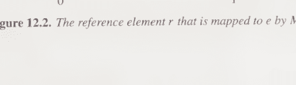

图 12.2. 通过 $M_e$ 映射到 $e$ 的参考单元 $r$。

$\phi_i$ 的梯度（其分量为 $\phi_i$ 对 $x$ 和 $y$ 的导数的二维向量）由下式给出：

\[
\nabla\phi_i = \nabla(\phi_{1,0} \circ M_e^{-1}) = \nabla(\phi_{1,0}) S_e^{-1},
\]

其中 $\phi_i$ 的梯度 $\nabla(\phi_i)$ 在点 $(x, y) \in e$ 处评估，而 $\phi_{1,0}$ 的梯度在其逆像 $M_e^{-1}((x, y)) \in r$ 处评估。

通过回顾 $\phi_{1,0} = x$，从而其梯度实际上是常向量 $(1, 0)$，可以进一步简化。基于这一观察，$\phi_i$ 的梯度就是 $S_e^{-1}$ 中的第一行：

\[
\nabla\phi_i = \left( (S_e^{-1})_{1,1}, (S_e^{-1})_{1,2} \right).
\]

类似地，对于 $\phi_j$，我们有

\[
\nabla\phi_j = \nabla(\phi_{0,1}) S_e^{-1},
\]

其中 $\phi_j$ 的梯度在点 $(x, y) \in e$ 处评估，而 $\phi_{0,1}$ 的梯度在其逆像 $M_e^{-1}((x, y)) \in r$ 处评估。

同样，通过回顾 $\phi_{0,1} = y$，从而其梯度就是常向量 $(0, 1)$，可以简化上述表达式。基于这一观察，$\phi_j$ 的梯度就是 $S_e^{-1}$ 中的第二行：

\[
\nabla\phi_j = \left( (S_e^{-1})_{2,1}, (S_e^{-1})_{2,2} \right).
\]

现在我们可以准备计算刚度矩阵 $A$ 中的元素了。为简化起见，假设偏微分方程中 $K \equiv 0$，因此只保留二阶导数项。让我们使用如下记号：

\[
\text{diag}(P, Q) = \begin{pmatrix} P & 0 \\ 0 & Q \end{pmatrix}.
\]

现在，刚度矩阵中的 $A_{i,j}$ 可以写成来自各个三角形的贡献之和：

\[
A_{i,j} = \sum_e \int_e \nabla\phi_j \, \text{diag}(P, Q) \, \nabla\phi_i \, dx \, dy.
\]

这里，求和遍历网格中的所有三角形。然而，只有同时使用 $i$ 和 $j$ 作为顶点的三角形（如图 12.1 中的三角形）才对 $A_{i,j}$ 有贡献。因此，通常说 $A_{i,j}$（实际上也是 $A$）是由来自各个有限元的非零贡献“组装”而成的。

利用映射域上的积分规则，我们有 $e$ 对 $A_{i,j}$ 的贡献为：

\[
\begin{aligned}
\int_e \nabla\phi_j \, \text{diag}(P, Q) \, \nabla\phi_i \, dx \, dy
&= \int_r \nabla\phi_{0,1} S_e^{-1} \, \text{diag}(P M_e, Q M_e) S_e^{-t} \, \nabla\phi_{1,0} \, dM_e(x, y) \\
&= \int_r (0,1) S_e^{-1} \, \text{diag}(P M_e, Q M_e) S_e^{-t} \begin{pmatrix} 1 \\ 0 \end{pmatrix} \left| \det\left(\frac{\partial M_e(x,y)}{\partial (x,y)}\right) \right| \, dx \, dy \\
&= \int_r (0,1) S_e^{-1} \, \text{diag}(P M_e, Q M_e) S_e^{-t} \begin{pmatrix} 1 \\ 0 \end{pmatrix} |\det(S_e)| \, dx \, dy.
\end{aligned}
\]


在接下来的内容中，我们将看到这些贡献在常见示例中是如何被显式计算的。

#### 12.6 示例：矩形域和均匀网格

如前所述，有限元特别适合近似复杂的域。然而在这里，我们考虑一个简单示例，其中域是矩形的，如第 7 章第 13 节所述。此示例中的扩散系数可以是变化的，甚至是不连续的。因此，基于适定弱形式（well-posed weak formulation）的有限元离散化方法是最合适的。

在本示例中，域 $\Omega$ 是矩形 $[0, L_x] \times [0, L_y]$，$K \equiv 0$，$\Gamma_0$ 包含矩形的上边和右边，$\Gamma$ 包含矩形的下边和左边。

对于有限元网格，我们使用如图 12.3 所示的均匀三角形网格。我们还假设 $\alpha$ 在网格中的每个三角形内是常数，但可以在三角形之间不连续。

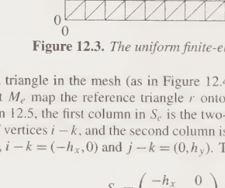

设 $e$ 为网格中的一个三角形（如图 12.4 所示），其顶点为 $i, j$ 和 $k$。如同第 12.5 节所述，设 $M_e$ 将参考三角形 $r$ 映射到 $e$，并设 $S_e$ 为其雅可比矩阵。如第 12.5 节所示，$S_e$ 的第一列是表示顶点差 $i - k$ 的二维向量，第二列是 $j - k$。对于图 12.4 中的直角三角形 $e$，$i - k = (-h_x, 0)$ 且 $j - k = (0, h_y)$。因此，我们有

$$
S_e = \begin{pmatrix} -h_x & 0 \\ 0 & h_y \end{pmatrix}
$$

结果是，我们有

$$
\det(S_e) = -h_x h_y
$$

并且

$$
S_e^{-1} = \begin{pmatrix} -h_x^{-1} & 0 \\ 0 & h_y^{-1} \end{pmatrix}
$$

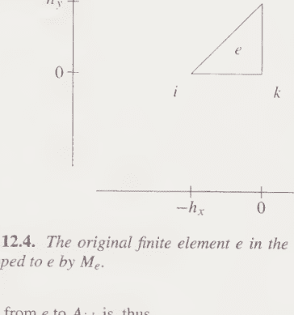

##### 图 12.4. 均匀网格中的原始有限元 $e$。参考单元 $r$ 通过 $M_e$ 映射到 $e$。

因此，$e$ 对 $A_{i,k}$ 的贡献是

$$
\begin{align*}
\int_e \nabla \phi_k \text{diag}(P, Q) \nabla \phi_i \, dx \, dy \\
= \int_r \nabla \phi_{0,0} S_e^{-1} \text{diag}(P M_e, Q M_e) S_e^{-1} \nabla \phi_{1,0} |\det(S_e)| \, dx \, dy \\
= \int_r (-1, -1) S_e^{-1} \text{diag}(P M_e, Q M_e) S_e^{-1} (1 \setminus 0) h_x h_y \, dx \, dy \\
= -h_x^{-2} h_x h_y \int_r P M_e \, dx \, dy.
\end{align*}
$$

对 $A_{i,k}$ 有贡献的另一个三角形是位于连接 $i$ 和 $k$ 的边下方的三角形 $t$（图 12.5）。$t$ 的贡献以类似的方式计算。其余的三角形对 $A_{i,k}$ 元素没有贡献，因为 $\phi_i$ 或 $\phi_k$ 在这些三角形上消失。因此，最终结果是

$$
A_{i,k} = -h_x^{-1} h_y \left( \int_r P M_e \, dx \, dy + \int_r P M_t \, dx \, dy \right).
$$

使用类似的方法来计算每两个节点 $i$ 和 $k$ 的 $A_{i,k}$。当然，当 $i$ 和 $k$ 不在同一个三角形中时，$A_{i,k}$ 消失。因此，$A$ 在大多数元素消失的意义上是稀疏的。在稀疏矩阵的有效实现中，只存储非零矩阵元素（参见第 4 章和第 16 章）。

$A$ 中的主对角线元素（上述讨论中的 $k = i$）可以使用相同的方法计算。然而在这种情况下，围绕节点 $i$ 的六个三角形对 $A_{i,i}$ 有贡献。

让我们现在计算边界条件对 $A_{i,k}$ 的贡献。假设连接 $i$ 和 $k$ 的边位于矩形域的底边上，因此在它下方没有三角形 $t$。在这种情况下，施加在底边上的混合边界条件也对 $A_{i,k}$ 有贡献。在下面，我们计算这个贡献。

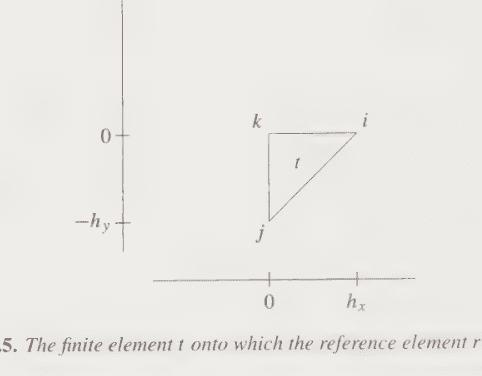

##### 图 12.5. 参考单元 $r$ 通过 $M_t$ 映射到其上的有限元 $t$。

设 $M_{i,k}$ 表示 $M_e$ 在区间 $[0,1]$ 上的限制，使得 $M_{i,k}$ 将区间 $[0,1]$ 映射到区间 $[k,i]$，其雅可比矩阵（或导数）为 $-h_x$。为简单起见，还假设 $\alpha$ 在连接 $i$ 和 $k$ 的直线上是常数，并在那里其值表示为 $\alpha_{i,k}$。因此，混合边界条件对 $A_{i,k}$ 的贡献是

$$
\begin{align*}
\int_{[i,k]} \alpha \phi_k \phi_i \, dx \\
= \alpha_{i,k} \int_{M_{i,k}^{-1}([i,k])} \phi_{0,0} \phi_{1,0} \left| \frac{dM_{i,k}}{dx} \right| \, dx \\
= \alpha_{i,k} \int_0^1 (1 - x - 0) x |-h_x| \, dx \\
= \frac{\alpha_{i,k} h_x}{6}.
\end{align*}
$$

本示例的刚度矩阵具有与第 7 章第 13 节中差分算子相同的格式（结构）。事实上，网格中的每个节点在 $A$ 中仅与其最近的（直接的）邻居相连，即其右侧、左侧、上方和下方的节点。因此，刚度矩阵实际上可以最有效地实现为一个 "difference2" 对象（附录中的 A.10 节）。

在第 13 章中，我们引入一种更通用的实现，它不仅适用于本例中的均匀网格，也适用于经常在实际应用中使用的通用非结构化网格。使用这种实现时，刚度矩阵具有更复杂的结构，并且必须实现为一个更高级的稀疏矩阵对象（第 16 章）。

本书的其余部分涉及通用非结构化网格上刚度系统的构建和数值求解。在现实应用中，如果域很复杂且弱形式的解可能有剧烈变化，则有限元剖分必须高度非结构化。例如，在解预期较为平滑的区域，有限元网格可以相当粗糙（低分辨率），而在解预期剧烈变化的区域，则相当精细（高分辨率）。在这种情况下，C++ 的优势最为明显。

#### 12.7 各向同性情形下的 M-矩阵性质

本节提供了为什么有限元网格应该是正则的动机，即三角形应具有适中的角度。主要对实际方面感兴趣的读者可以跳过此节并继续到第 12.8 节。

如第 12.4 节所述，M-矩阵性质最具吸引力。虽然刚度矩阵并不总是 M-矩阵，但有可能指定保证它是 M-矩阵的充分条件。这表明有限元离散化方法确实是有意义的。

假设扩散方程是各向同性的；即，扩散系数在 $x$ 和 $y$ 空间方向上是相同的：

$$
P(x, y) = Q(x, y), \quad (x, y) \in \Omega.
$$

在此假设下，第 12.5 节末尾 $e$ 对 $A_{i,j}$ 的贡献取以下形式

$$
(0, 1) S_e^{-1} S_e^{-t} (1 \setminus 0) |\det(S_e)| \int_r P M_e \, dx \, dy.
$$

注意，如果 $S_e$ 在左侧乘以一个正交矩阵，上述积分不会受到影响。确实，如果用某个正交矩阵 $O$（正交性意味着 $O^t = O^{-1}$）替换 $S_e$ 为 $O S_e$，那么我们仍有

$$
(O S_e)^{-1} (O S_e)^{-t} = S_e^{-1} O^{-1} O^{-t} S_e^{-t} = S_e^{-1} S_e^{-t}
$$

并且

$$
\det(O S_e) = \det(O) \det(S_e) = \det(S_e).
$$

因此，我们可以不失一般性地假设 $e$ 中连接 $i$ 和 $k$ 的边平行于 $x$ 轴，如图 12.6 所示，使得 $i - k$ 的 $y$ 坐标消失。

对于如图 12.6 所示的有限元 $e$，$S_e$ 取上三角形式

$$
S_e = \begin{pmatrix} (S_e)_{1,1} & (S_e)_{1,2} \\ 0 & (S_e)_{2,2} \end{pmatrix},
$$

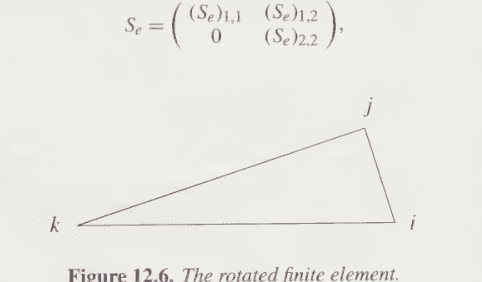

##### 图 12.6. 旋转后的有限元。

其中 $(S_e)_{1,1} > 0$ 且 $(S_e)_{2,2} > 0$。因此，我们有

$$
\det(S_e) = (S_e)_{1,1}(S_e)_{2,2}.
$$

此外，$S_e^{-1}$ 取上三角形式

$$
S_e^{-1} = \begin{pmatrix} (S_e^{-1})_{1,1} & (S_e^{-1})_{1,2} \\ 0 & (S_e^{-1})_{2,2} \end{pmatrix} = \begin{pmatrix} (S_e)_{1,1}^{-1} & -(S_e)_{1,1}^{-1}(S_e)_{1,2}(S_e)_{2,2}^{-1} \\ 0 & (S_e)_{2,2}^{-1} \end{pmatrix}.
$$

结果是，代表 $e$ 对 $A_{i,j}$ 贡献的上述积分取以下形式

$$
(S_e^{-1})_{2,2} (S_e^{-1})_{1,2} |\det(S_e)| \int_r P M_e \, dx \, dy = -(S_e)_{1,2}(S_e)_{2,2}^{-1} \int_r P M_e \, dx \, dy = -\cot(\theta) \int_r P M_e \, dx \, dy,
$$

其中 $\theta$ 是图 12.1 和 12.6 中 $i - k$ 和 $j - k$ 之间（正的）夹角，cot 代表余切函数（余弦除以正弦）。

我们从上述计算中得出结论，$e$ 对 $A_{i,j}$ 的贡献不取决于 $e$ 的面积，而仅取决于位于 $i - k$ 和 $j - k$ 之间的角 $\theta$ 的余切。如果 $\theta$ 大于 $\pi/2$，则这个余切是负数，因此 $e$ 对 $A_{i,j}$ 的贡献是正的。在这种情况下，除非其他三角形对 $A_{i,j}$ 有负贡献来平衡这个正贡献，否则 $A$ 可能不是 L-矩阵。另一方面，如果网格中的三角形只有锐角或直角，那么 $A$ 中所有非对角矩阵元素的贡献都是非正的，且 $A$ 是 L-矩阵。

让我们证明，对于仅具有锐角或直角的剖分，$A$ 也是对角占优的。由于我们已经看到 $A$ 是 L-矩阵，证明其行和非负就足够了。为了看到这一点，考虑网格中的一个节点 $i$。$A$ 中第 $i$ 行的和等于 $a(v,\phi_i)$，其中 $v$ 是节点 $i$ 及其周围节点的节点基函数之和。但由于这些节点基函数是线性的，$v$ 必须在围绕 $i$ 的三角形上是常数，因此其梯度在那里消失。容易看出，边界条件通常会增加行和。这表明 $A$ 确实是对角占优的。

对角占优和 L-矩阵性质的结合意味着 $A$ 确实也是 M-矩阵 [78]。这个性质表明有限元离散化确实为原始问题提供了良好的近似（第 12.4 节）。

对于具有大于 $\pi/2$ 角度的不太规则的网格，刚度矩阵可能不再是 M-矩阵。不过，只要不规则性局限于较小的区域（例如不规则边界附近的邻域），有限元离散化在这些网格上很可能仍能提供良好的近似。

在下一节中，我们将看到 M-矩阵性质也可能适用于高度各向异性方程的更困难情形。


#### 12.8 高度各向异性方程

在上文中，我们研究了各向同性情形，其中 x 空间方向上的扩散系数与 y 空间方向上的扩散系数相同。我们证明，对于仅包含锐角和直角的剖分，刚度矩阵是一个 M-矩阵，这表明有限元离散化确实是合适的。这引导我们得出准则：网格应尽可能保持规则。

在这里，我们考虑高度各向异性的情形，其中 x 和 y 空间方向上的扩散系数彼此完全不同。这类方程在严重拉伸的域和网格上的扩散问题中经常出现。在这种情况下，对于某些网格，仅通过对方程进行简单变换使其变为各向同性形式，仍然可以证明刚度矩阵是一个 M-矩阵。

考虑以下扩散方程：

$$-(P u_x)_x - (Q u_y)_y = F$$

（在矩形域中，具有合适的边界条件），其中 $u \equiv u(x, y)$ 是未知解，扩散系数 $P$ 和 $Q$ 彼此差异很大。首先，考虑 $P$ 和 $Q$ 为常数的情况：

$$P = 1 \text{ 且 } Q = \varepsilon,$$

其中 $\varepsilon$ 是一个小的正参数。

让我们首先考虑如上文图 7.4 所示的均匀网格上的基本有限差分格式。将离散近似表示为

$$u_{i,j} \doteq u(j h_x, i h_y),$$

其中 $h_x$ 和 $h_y$ 分别是 x 方向和 y 方向的网格尺寸。那么，正如第 7 章第 13 节所述，二阶空间导数由以下公式近似：

$$u_{xx}(j h_x, i h_y) \doteq h_x^{-2}(u_{i,j+1} + u_{i,j-1} - 2 u_{i,j}),$$

$$u_{yy}(j h_x, i h_y) \doteq h_y^{-2}(u_{i+1,j} + u_{i-1,j} - 2 u_{i,j}).$$

让我们研究该格式的适当性。为此，我们需要估计当网格尺寸和 $\varepsilon$ 同时趋近于零时的离散化误差。

如第 8 章第 4 节所解释的，离散化误差等于系数矩阵的逆乘以截断误差。让我们首先估计应用 $A^{-1}$ 对向量进行放大时的最大可能倍数（即 $A^{-1}$ 的范数）。幸运的是，这里的 $A$（因此 $A^{-1}$ 也是）是对称正定的；因此，$A^{-1}$ 的范数等于其最大特征值。为了估计该特征值可能有多大，只需估计 $A$ 的特征值可能有多小即可。$A$ 仅仅是离散 xx 导数和 yy 导数之和。由于这些离散导数以分裂形式存在（它们包含因子 $h_x^{-2}$ 或 $h_y^{-2}$），即使最平滑的离散傅里叶模态 $\sin(j \pi h_x) \sin(i \pi h_y)$（其中 $j$ 和 $i$ 分别是 x 和 y 方向上的网格点索引）在应用 $A$ 时也不会衰减。事实上，它只是被乘以一个与 $h_x, h_y$ 或 $\varepsilon$ 无关的正常数。这意味着 $\|A^{-1}\|$ 确实独立于 $h_x, h_y$ 或 $\varepsilon$ 而有界。

因此，剩下的工作只是估计截断误差。对于有限差分格式，截断误差仅为

$$h_x^2 u_{xxxx} + \varepsilon h_y^2 u_{yyyy},$$

其中 $u \equiv u(x, y)$ 是原始偏微分方程的解。让我们做出合理的假设：右端项 $F$ 独立于 $\varepsilon$。这意味着 $u$ 在 x 方向上必须是光滑的，但在 y 方向上可以快速振荡（频率高达 $\varepsilon^{-1/2}$）。因此，对 $u$ 取 y 导数等同于将其乘以 $\varepsilon^{-1/2}$，截断误差的形式为

$$h_x^2 + \frac{h_y^2}{\varepsilon}.$$

因此，只要 $\varepsilon$ 不过小，有限差分格式就是适当的；即当 $h_x, h_y$ 和 $\varepsilon$ 同时趋近于零时：

$$\varepsilon \gg h_y^2$$

我们可以拥有这种适当性，因为网格使用了与原始偏微分方程相同的 x 和 y 坐标。换句话说，网格与偏微分方程中的强扩散方向和弱扩散方向对齐。确实，如果网格旋转某个角度，那么 $u$ 快速振荡的 y 方向相对于网格将是倾斜的，$u$ 将在网格点的两个方向上都快速振荡，导致截断误差高达 $h_x^2/\varepsilon^2$。为了获得适当性，网格必须与原始偏微分方程中的方向对齐，即笛卡尔 x 和 y 方向。

正如上文所见，原始偏微分方程的解在 x 方向上相当光滑。这引发了一个想法：也许 $h_x$ 可以相当大，从而在 x 空间方向上只需要较少数量的网格点。确实，上述误差估计表明，$h_x$ 可以大至

$$h_x = \varepsilon^{-1/2} h_y,$$

而截断误差实际上与之前相同：

$$h_x^2 u_{xxxx} + \varepsilon h_y^2 u_{yyyy} \doteq \frac{h_y^2}{\varepsilon} + \frac{h_y^2}{\varepsilon}.$$

在以下内容中，我们将这一观察应用于有限元离散化。

现在让我们考虑扩散系数 $P$ 和 $Q$ 非常数的各向异性扩散方程，其定义如图中 12.7 所示。在这里，方程在左下子正方形中呈现高度各向异性，其中 y 方向的扩散远强于 x 方向；而在右上子正方形中，x 方向的扩散远强于 y 方向。

为了利用上述观察——强扩散方向的网格尺寸可以大于弱扩散方向——我们必须使用有限元方法而不是有限差分方法。确实，文献 [24] 中提出的离散化方法（这也得到近似理论结果的支持）使用了在强扩散方向上拉伸的有限元。不幸的是，正如其中讨论的，为了在扩散系数的不连续线处保持协调性，可能需要牺牲规则性，即使用具有非常小角度的三角形。

为了克服这个问题，我们在图 12.8 中提出了一种既协调又相对规则的网格。该网格使用了拉伸的 $8h \times h$ 和 $h \times 8h$ 有限元，其中 $h$ 是典型的网格尺寸。为了在扩散系数的不连续线处从拉伸有限元平滑过渡到未拉伸有限元，我们使用了 $\log_2 8 = 3$ 层规则且协调的有限元（见图 12.8）。

当映射到左下和右上子正方形中的各向同性坐标时（在左下子正方形使用新坐标 $(x, \tilde{y})$，在右上子正方形使用 $(\tilde{x}, y)$，其中 $\tilde{x}=x/8$ 且 $\tilde{y}=y/8$），第 12.7 节中的条件成立，这意味着系数矩阵 $A$ 确实是一个对角占优的 M-矩阵。这表明该离散化确实是合适的。

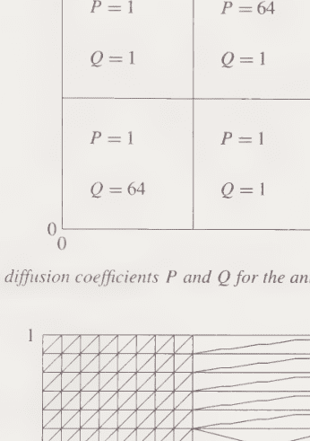

图 12.7. 各向异性扩散方程的扩散系数 P 和 Q。

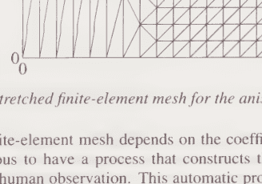

图 12.8. 各向异性扩散方程的拉伸有限元网格。

当前的有限元网格依赖于原始偏微分方程中的系数。拥有一个能更自动地构建网格的过程将是有优势的，从而避免任何特殊的人工观察。该自动过程随后可以作为黑箱应用于任何问题，生成所需的局部拉伸网格，而无需考虑特定偏微分方程的特殊性质。

自适应细化过程是这一目的的良好候选。在该过程中，首先在一个粗网格上计算数值解。然后，在数值解表现出较大变化的地方对该网格进行逐步细化。对于上述示例，该过程在数值解相当平滑的强扩散方向上产生低分辨率，在数值解变化迅速的弱扩散方向上产生高分辨率。这应该会自动生成类似于图 12.8 中网格的结构。我们将在第 14 章中回顾该算法及其详细的 C++ 实现。

#### 12.9 示例：圆形域

上文中使用的矩形域可以通过均匀网格来近似。具有弯曲边界的域，如圆形，更难以近似。三角形的直边永远无法与弯曲边界重合；它们充其量只能以可接受的精度对其进行近似，前提是使用了足够小的三角形。

例如，考虑单位圆内的泊松方程：

$$-u_{xx} - u_{yy} = \mathcal{F},\quad x^2 + y^2 < 1,$$

具有合适的边界条件。

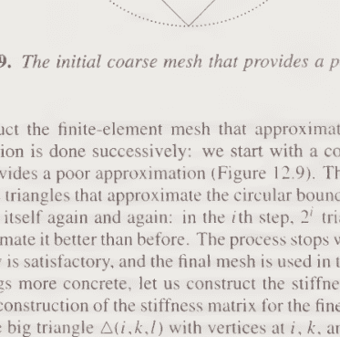

图 12.9. 提供较差圆形边界近似度的初始粗网格。

让我们构建一个能良好近似圆形边界的有限元网格。构建是逐步进行的：我们从仅有两个三角形的粗网格开始，它提供较差的近似（图 12.9）。然后通过添加四个能更好近似圆形边界的三角形来改进该网格（图 12.10）。该过程不断重复：在第 $i$ 步，在边界附近添加 $2^i$ 个三角形，以比之前更好地近似它。当对弯曲边界的近似令人满意时，过程停止，最终网格用于有限元格式中。

为了使事情更具体，让我们构建图 12.10 中网格的刚度矩阵。（构建最细网格的刚度矩阵在原理上是相同的。）考虑图 12.10 中顶点为 $i$、$k$ 和 $l$ 的大三角形 $\Delta(i,k,l)$ 以及顶点为 $i$、$j$ 和 $k$ 的小三角形 $\Delta(i,j,k)$。两个三角形都对刚度矩阵 $A$ 中的矩阵元素 $A_{i,k}$ 有贡献。然而，事实证明这些贡献相互抵消


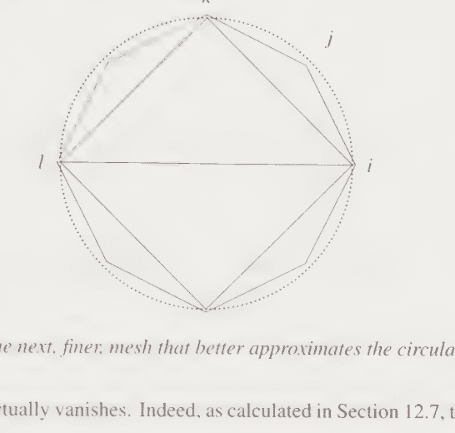

#### 图 12.10
更精细、更好地逼近圆形边界的网格。

彼此相邻，因此 $A_{i,k}$ 实际上为零。事实上，如第 12.7 节中所计算，$\triangle(i,k,l)$ 的贡献为

$$
\frac{\cot(\angle(k,l,i))}{2}
$$

其中 $\angle(k,l,i)$ 是 $\triangle(i,k,l)$ 中顶点 $l$ 处的角度。类似地，$\triangle(i,j,k)$ 的贡献为

$$
\frac{\cot(\angle(i,j,k))}{2}
$$

由于这两个角度位于同一圆上，根据欧几里得几何可得

$$
\angle(k,l,i) + \angle(i,j,k) = \pi
$$

因此，

$$
\cot(\angle(k,l,i)) + \cot(\angle(i,j,k)) = \cot(\angle(k,l,i)) + \cot(\pi - \angle(k,l,i)) = \cot(\angle(k,l,i)) - \cot(\angle(k,l,i)) = 0
$$

意味着

$$
A_{i,k} = 0
$$

另一方面，耦合相邻节点 $i$ 和 $j$ 的矩阵元素 $A_{i,j}$ 不为零。事实上，由于对它的贡献仅来自 $\triangle(i,j,k)$，根据第 12.7 节可得

$$
A_{i,j} = -\frac{\cot(\angle(j,k,i))}{2} = -\frac{\cot(\pi/N)}{2}
$$

其中 $N$ 为节点数。 （在图 12.10 的情况下，$N = 8$；一般而言，$N = 2^{k+1}$，其中 $k$ 为细化步数。）总之，$A$ 具有三对角形式

$$
A = \text{tridiag}\left(-\frac{\cot(\pi/N)}{2}, \cot(\pi/N), -\frac{\cot(\pi/N)}{2}\right)
$$

更精确地说，这里 $A$ 并不是通常意义上的严格三对角矩阵，因为它还包含非零元素

$$
A_{0,N-1} = A_{N-1,0} = - \cot(\pi / N) / 2
$$

位于其右上和左下角。更准确地说，$A$ 是一个具有三个非零对角线的循环 Toeplitz 矩阵。

上面构造的刚度矩阵也可以解释为沿圆形边界的一维泊松方程（具有周期性边界条件）的离散化。显然，这不是整个圆内二维泊松方程的一个良好格式。

这种失败的原因是我们过于集中于很好地逼近边界，而忽略了区域内部。在实践中，还必须细化大三角形（例如 $\Delta(i,k,l)$），以在区域内部获得良好的近似。这可以像第 14 章第 2 节那样自适应地完成。那里给出的算法也正确地细化了区域内部。

上面的网格在边界附近使用了特别小且狭窄的三角形。这些三角形高度退化：它们包含非常小的角度。这可能导致较大的离散误差。在第 14 章第 7 节中，我们提出了一种更平衡的方法，其中网格同时在区域内部及其边界上进行细化。该网格更规则且不包含退化三角形。

#### 12.10 练习

1. 计算 PDE 的刚度矩阵
   $$-u_{xx}(x,y) - u_{yy}(x,y) + u(x,y) = F(x,y)$$
   在如图 12.3 所示的直角三角形网格上。

2. 计算上述 PDE 在一般三角形网格上的刚度矩阵。特别地，用从参考三角形到该三角形的映射来表示某个三角形对某个矩阵元素 $A_{i,j}$（其中 $i$ 和 $j$ 是该三角形中顶点的指标）的贡献。

3. 证明所得刚度矩阵为 SPD。

4. 计算 PDE 的刚度矩阵
   $$-u_{xx}(x,y) - u_{yy}(x,y) + u_x(x,y) + u_y(x,y) = F(x,y)$$
   在如图 12.3 所示的均匀直角三角形网格上。

5. 证明上述矩阵是非对称的。

6. 计算上述 PDE 在一般三角形网格上的刚度矩阵。特别地，用从参考三角形到该三角形的映射来表示某个三角形对某个矩阵元素 $A_{i,j}$（其中 $i$ 和 $j$ 是该三角形中顶点的指标）的贡献。

7. 证明上述矩阵是非对称的。

#### 12.11 高级练习

1. 考虑方程
   $$-(Pu_x)_x-(Qu_y)_y=F$$
   在笛卡尔平面上的区域 $\Omega$ 中，其中 $P$ 和 $Q$ 是给定的均匀正函数，$F$ 是给定的函数。写出在给定有限元网格上产生刚度矩阵 $A$ 的算法。考虑形如的 Dirichlet、Neumann 和混合边界条件
   $$Pu_xn_1+Qu_yn_2+\alpha u=g,$$
   其中 $\vec n=(n_1,n_2)$ 是外法向量，$\alpha$ 是给定的非负函数，$g$ 是 $\partial\Omega$ 上的给定函数。

2. 证明上述方程的双线性形式是对称的。由此得出 $A$ 也是对称的。

3. 利用相应二次形式的强制性证明 $A$ 实际上是 SPD。

4. 现在考虑方程
   $$-(Pu_x)_x-(Qu_y)_y+u=F.$$
   写出产生刚度矩阵 $A+K$ 的算法，其中 $A$ 如前所述，$K$ 来自 PDE 中自由项 $u$。

5. 证明 $K$ 是 SPD。

6. 考虑时变扩散方程
   $$u_t-(Pu_x)_x-(Qu_y)_y=F.$$
   写出使用上述有限元离散化在显式、隐式和半隐式时间离散化中使用的算法。解见第 19 章第 4 节。

7. 通过用第 8 章第 2 节中使用的单位矩阵 $I$ 替换为 $K$，写出算法的代数表示。

8. 定义
   $$B\equiv(\Delta t)^{-1}K$$
   对于显式格式，
   $$B\equiv(\Delta t)^{-1}K+A$$
   对于隐式格式，以及
   $$B\equiv(\Delta t)^{-1}K+A/2$$
   对于半隐式格式。证明在时间推进中每次时间步都对 $B$ 进行求逆。

9. 证明上面的 $B$ 是 SPD。

10. 定义能量内积为
    $$(u, v)_B \equiv (u, Bv) = u^T B v$$
    （其中 $u$ 和 $v$ 是任意两个向量）。矩阵 $M$ 关于能量内积是对称的，如果
    $$(Mu, v)_B = (u, Mv)_B$$
    对每个两个向量 $u$ 和 $v$ 成立。证明 $B^{-1} A$ 和 $B^{-1} K$ 关于能量内积是对称的。

11. 定义矩阵 $M$ 的能量范数为
    $$\|M\|_B \equiv \max_{v \neq 0} \left( \frac{(M^T v, M^T v)_B}{(v, v)_B} \right)^{1/2}.$$
   众所周知，如果 $M^T$ 关于能量内积是对称的，则上述量也等于 $M^T$ 的最大特征值的模。换句话说，
    $$\|M\|_B = \max_{v \neq 0} \left| \frac{(v, M^T v)_B}{(v, v)_B} \right|.$$

12. 利用 $A$ 和 $K$ 的 SPD 性证明，对于每个非零向量 $v$，
    $$\frac{(v, (\Delta t)^{-1} K v)}{(v, ((\Delta t)^{-1} K + A) v)} \text{ 和 } \frac{(v, ((\Delta t)^{-1} K - A/2) v)}{(v, ((\Delta t)^{-1} K + A/2) v)}$$
    的模都小于 1，并且对于足够小的 $\Delta t$，
    $$\frac{(v, ((\Delta t)^{-1} K - A) v)}{(v, (\Delta t)^{-1} K v)}$$
    的模也小于 1。

13. 利用上述结果证明第 8 章第 3 节中的块子矩阵 $Q_i B_i^{-1}$ 在由 $B_i$ 诱导的能量范数下小于 1。进一步利用该结果证明时间推进中的稳定性和精度。

14. 将你的证明与 [68] 中第 18 章的证明进行比较。

15. 假设混合边界条件中函数 $\alpha$ 在每个特定边界边上是常数，例如从节点 $i$ 到节点 $j$ 的一条边，这两个节点都位于施加混合边界条件的边界段上。证明对 $A_{i,i}$ 的贡献为正且是 $A_{i,j}$ 贡献的两倍。

16. 考虑网格中某个特定三角形，其顶点位于节点 $i$、$j$ 和 $k$。证明对 $K_{i,i}$ 的贡献为正且与对 $K_{i,j}$ 和 $K_{i,k}$ 的贡献之和相同（它们也是正的）。（你可以使用参考三角形来计算这些贡献。）由此得出 $K$ 是对角占优的。

17. 如第 12.7 节所述，假设扩散是各向同性的（$P=Q$）且网格中三角形的角度从不超过 $\pi/2$。证明即使施加混合边界条件，$A$ 和 $A+K$ 也是对角占优的。

18. 将你的证明与 [68] 中第 4 章的证明进行比较。

19. 利用第 11 章末尾的练习的答案和本章的指南，计算三维空间中扩散问题的刚度矩阵：
    $$-(P u_x)_x-(Q u_y)_y-(W u_z)_z=F,$$
    其中 $P$、$Q$、$W$、$F$ 和 $u$ 是三个空间变量 $x$、$y$ 和 $z$ 的标量函数。对于有限元，使用四面体。一个四面体是一个具有四个顶点或角（通过四条直线或边相互连接）和四个平面三角形侧面或面的三维形状。一个四面体由三维笛卡尔空间中的四个点集表示，作为其顶点。例如，单位立方体 $[0,1]^3$ 可以写成六个不相交四面体的并集（附录第 A.27 节）。注意，在这种情况下，矩阵 $S_e$ 的阶为 3 而不是 2。参考单元现在有四个顶点，$(1,0,0)$、$(0,1,0)$、$(0,0,1)$ 和 $(0,0,0)$，对应的标准节点函数分别为 $x$、$y$、$z$ 和 $1-x-y-z$。（一般而言，有限元网格不一定是结构化的，因此其中的四面体的角度可以取任意值。在本练习中，我们仅处理均匀的三维网格，其中每个立方单元都可以如上所述划分为六个四面体。）解见第 27.2 节。

20. 假设上述三维扩散方程是各向同性的（$P=Q=W$）且每个四面体每个侧面的角度从不超过 $\pi/2$。推广第 12.7 节的结果，并证明刚度矩阵是对角占优的。


尽管如此，W 数组每个节点最多只能存储一条边，而在一般情况下，一个节点可能与其他许多节点相连。因此，不仅需要使用一个，还需要使用许多 W 数组来存储所有这些其他边。事实上，W 数组的数量必须与特定节点可能使用的最大边数一样多。在计算机内存方面，这涉及相当大的开销，因为大多数节点可能只与少数几个节点相连，且几乎不会使用大部分 W 数组。

上述对网格的实现尝试还存在另一个缺点。每个节点的最大节点数和边数必须预先确定，并且无法动态改变。因此，这种实现不仅昂贵，而且受到限制。我们需要一种更自然、更灵活的方法。

一个更好的主意是使用链表。每个节点应该有一个整数的链表，指示它在网格中连接的节点。整个网格随后被实现为整数链表的列表。

不幸的是，由于列表实际上是地址的数组，因此在添加或删除项目方面灵活性不足。换句话说，上述实现不允许添加新节点或删除旧节点。一种更加灵活的方法是使用链表而不是列表。整个网格随后被实现为节点的链表，其中每个节点本身又是一个整数的链表。显然可以看到，实现变得越来越复杂、晦涩，且难以编写或使用。

此外，我们的主要工作是构建刚度矩阵。采用上述实现，这项任务实际上是不可能的，因为缺少有限元对象。

从数学意义上讲，网格实际上是一个嵌入平面中且没有交叉边的非定向图。该图实际上仅由节点和边定义。然而，在此处，我们处理的是有限元网格，例如第 4 章第 29 节中的三角形网格。我们尚未利用这一重要属性。事实上，我们拒绝实现有限元对象，即“节点”对象与“网格”对象之间缺失的环节。

面向对象的方法告诉我们要思考在数学框架中实际使用的对象。在这里，这些对象就是有限元。到目前为止，我们一直在忙于更基本的对象，如节点和边。这些不是我们应该关注的对象。相反，我们应该专注于实现高层次中的有限元对象。这种方法在第 4 章第 31 节中被称为“向下实现”。

人们有理由质疑为什么在实际实现中需要有限元的概念。毕竟，网格仅通过节点和边就能被良好地定义，根本没有提及有限元。此外，虽然我们在第 4 章第 29 节的网格中可以看到三角形，但计算机如何被期望“看到”它们？当然，计算机永远无法理解“三角形”意味着什么。充其量，它可以存储其顶点，但这回到了我们之前（天真）的实现，其中节点被存储而三角形被忽略。此外，将三角形实现为三个节点的三元组对于单个孤立三角形可能可行，但对于参与网格的三角形则不适用，在网格中相邻的三角形共享相同的节点。但如果每个三角形都由三个节点定义，计算机如何知道一个三角形中的一个节点可能与另一个三角形中的一个节点重合，并且对该节点的任何更改也应影响另一个节点？

这些问题的答案是同一个。第 4 章第 29 节中对网格施加的条件实际上暗示了必须实现的抽象三角形的存在。三角形仅存在于我们人类的脑海中，帮助我们想象通过这些条件获得的数学结构。它们永远不会在计算机内存中物理存储。网格确实仅通过节点来定义和存储，但三角形仍然是一个非常有用的概念工具，用于将三元节点组作为一个整体来引用。三角形从不物理地包含其顶点，而只是引用它们。在这个意义上，三角形对象比存储在计算机内存中的具体节点抽象得多。因此，三角形对象应包含的不是实际节点，而是三个节点的地址。共享相同节点的三角形应都包含该节点的地址。

因此，我们在这里使用两个抽象级别。在更具体（低）级别，网格中的节点以数对的形式存储在计算机内存中，以指示其在笛卡尔平面中的 x 和 y 坐标。在更抽象（高）级别，三角形存储为指向其顶点的三元指针（参见图 13.1）。

因此，我们实现有限元网格的完整计划如下。网格是三角形的链表，因此在意义上是灵活的，因为它很容易从中删除不必要的三角形或插入新三角形。三角形对象具有指向其三个顶点的三个指针。该对象在计算刚度矩阵时特别有用。这些顶点在实现的低层级中作为节点对象实现。


**图 13.1。** *用于实现非结构网格的对象层次结构：“mesh”（网格）对象是一个“finiteElement”（有限元）对象的链表，其中每个对象都是一个指向“node”（节点）对象的指针列表，而每个节点包含一个“point”（点）对象以指示其在笛卡尔平面中的位置。*

请注意，由于不使用数组，无法对节点进行自然索引。因此，节点对象不仅应包含关于其几何位置的数据，还应包含其在网格中节点之间的索引。该索引最终用于访问该特定节点的刚度系统的数值解。例如，索引为 i 的节点处的数值解为 x_i，其中 x 是刚度方程 Ax = f 的解。

### 13.2 节点对象

我们从实现中最基本的对象开始：节点。这个基本对象稍后将用于构建有限元和网格本身。

正如上面 13.1 节中所述，节点可能被两个或更多有限元共享。因此，“node”（节点）对象必须不仅包含其在笛卡尔平面中位置的信息，还包含共享该节点的有限元数量信息。因此，“node”（节点）对象包含三个字段：第一个指定其所在的笛卡尔平面中的点，第二个指定其在网格中节点中的索引，第三个指定有多少有限元共享它。

“location”（位置）字段的类型是模板 'T'，需在编译时指定。在我们的情况下，'T' 被选择为第 2 章第 18 节中的二维“point”（点）对象。不过，使用 'T' 模板也给了我们机会，在遇到三维问题时，用第 2 章第 18 节中的三维“point3”（点3）对象替换 'T'。

节点在笛卡尔平面中的位置可以通过公共的 "operator()" 函数读取。因此，如果定义了节点 'n'，则 "n()" 是其在笛卡尔平面中的位置。这里使用的 "operator()" 不接收任何参数。这也是它不能被 "operator[]" 替代的原因，因为后者必须恰好接收一个参数。

最初，整型数据字段填充的是平凡值。特别是，包含节点索引的 "index"（索引）字段被设置为无意义的负值。一旦网格准备好，就会给它赋予一个有意义的非负值。

指示有多少有限元共享该节点的整型数据字段 "sharingElements"（共享元素）最初设置为零，表示这是一个悬空节点，尚未属于任何有限元。稍后，当定义有限元时，此信息将证明非常有用。每当创建一个共享该节点的新有限元时，该值增加 1；每当销毁这样一个有限元时，该值减少 1。因此，我们需要定义增加、减少和读取 "sharingElements"（共享元素）字段值的函数：

```cpp
template<class T> class node{
    T location;
    int index;
    int sharingElements;
public:
    node(const T&loc=0., int ind=-1, int sharing=0)
    : location(loc),index(ind),sharingElements(sharing){
    } // constructor

    node(const node&n):location(n.location),index(n.index),
    sharingElements(n.sharingElements){
    } // copy constructor
```


## 第13章 非结构化有限元网格

在此拷贝构造函数中，初始化列表将源节点 "n" 中的三个字段全部复制到被构造的节点中。具体来说，被构造节点中的 "index" 字段取值为 "n.index"，"sharingElements" 字段取值为 "n.sharingElements"。这看起来似乎是多余的，因为被构造的节点目前尚未属于任何有限元。因此，将其初始化为平凡值可能更有意义，即在初始化列表中写为 "index(-1)" 和 "sharingElements(0)"。这样，以值方式传递给函数的节点参数会被复制到一个悬空的局部节点对象中，该对象不属于任何有限元，这在逻辑上更合理。此版本的验证留给读者自行完成。不过，在当前应用中，节点参数仅以引用方式传递，因此使用哪种版本的拷贝构造函数并无区别。

在某些应用中，要求节点对象能够访问将其用作顶点的有限元（参见第4.31节）。在这种情况下，"node" 类还应包含一个指向有限元的引用链表。然而，此处我们避免了这种额外的复杂性。

接下来，我们声明赋值运算符，其定义将在后文给出：

```cpp
const node& operator=(const node&);
~node(){}  // 析构函数
```

接下来，我们定义更多的成员函数，以便读取和访问单个 "node" 对象中的私有数据：

```cpp
const T& operator()() const{
    return location;
} // 读取位置

int getIndex() const{
    return index;
} // 读取索引

void setIndex(int i){
    index=i;
} // 设置索引
```

以下成员函数用于读取和操作共享当前节点的有限元数量：

```cpp
int getSharingElements() const{
    return sharingElements;
} // 读取共享此节点的单元数量

void moreSharingElements(){
    sharingElements++;
} // 增加共享此节点的单元数量

int lessSharingElements(){
    return
        sharingElements ?
        !(--sharingElements)
        :
        0;
} // 减少共享此节点的单元数量

int noSharingElement() const{
    return !sharingElements;
} // 指示悬空节点
};
```

至此，"node" 类的代码块结束。接下来，我们实现上述声明的赋值运算符：

```cpp
template<class T>
const node<T>&
node<T>::operator=(const node<T>&n){
    if(this != &n){
        location = n.location;
        index = n.index;
        sharingElements = n.sharingElements;
    }
    return *this;
} // 赋值运算符
```

最后，我们定义一个函数，将 "node" 对象中的数据打印到屏幕上：

```cpp
template<class T>
void print(const node<T>&n){
    print(n());
    printf("index=%d; %d sharing elements\n",
        n.getIndex(),n.getSharingElements());
} // 打印节点
```

#### 13.3 有限元对象

在此，我们定义有限元对象。如第13.1节所述，该对象包含的不是节点本身，而是指向节点的指针。这样，两个共享同一节点的相邻有限元各自都保存了该节点地址的一份副本。因此，可以通过任意一个共享该节点的有限元来修改该节点。

实际上，有限元对象包含 N 个指向节点的指针，其中模板参数 N 在编译时指定。在我们使用的二维情形中，由于使用三角形，N 被设为 3。在实现高阶有限元（参见第15章）或三维应用中的四面体（N = 4）时，模板 N 可以取大于 3 的值。

有限元对象所指向的节点类型为 "node<T>"，其中模板 T 将在编译后期填充。在我们的应用中，T 为 "point"，因此顶点类型为 "node<point>"，用于实现二维有限元网格中的节点。模板 T 也可以取更复杂的类型，例如 "point3"，以实现三维网格。

如上文第13.1节所述，有限元中包含的指向节点的指针可能指向另一个有限元也指向的同一节点。因此，构造函数、析构函数和赋值运算符并不总是创建或销毁节点；大多数情况下，它们只是改变共享节点的有限元数量。不过，需要牢记的是，这种实现打破了程序员的一项重要经验法则。

如第2章第10节所述，建议 C++ 程序员编写自己的构造函数、析构函数和赋值运算符，而不要依赖编译器提供的默认函数，因为默认函数可能执行错误的操作。例如，考虑以下虚设类：

```cpp
template<class T> class container{
    T* pointer;
    public:
        container(const container&c) :
            pointer(c.pointer ? new T(*c.pointer) : 0) {
        } // 拷贝构造函数

        ~container() {
            delete pointer;
        } // 析构函数
};
```

这被认为是良好的编程实践。"container" 对象包含一个名为 "pointer" 的指向 "T" 的指针字段。拷贝构造函数的定义如下：如果被拷贝对象的 "pointer" 字段内容具有有意义的值，则被构造对象的 "pointer" 字段内容也应具有相同的值。这是通过 "new" 命令完成的，该命令为新的 "T" 对象分配内存并返回其地址。

析构函数也定义得当。"pointer" 字段由 "delete" 命令销毁，该命令会自动调用 "T" 类的析构函数以销毁其内容并释放其占用的内存。

如果上述函数未被编写，会发生什么？C++ 编译器的默认函数将被使用。情况相当于编写了以下函数：

```cpp
container(container&c):pointer(c.pointer) {
} // 什么都没被拷贝
~container(){} // *pointer 未被销毁
```

这显然不是我们想要的。构造函数除了创建另一个指向相同 "T" 对象的指针外什么也没做。这就是为什么在拷贝构造函数中参数不能再像之前那样声明为 "constant" 的原因：其中包含的 "T" 对象现在可以通过新构造的 "container" 对象（该对象也持有其地址）而发生变化。

默认的析构函数同样不合适。当一个 "container" 对象被销毁时，其 "pointer" 字段会被编译器自动销毁。这意味着包含 "T" 对象地址的变量确实被销毁了。然而，"T" 对象本身虽然不再能通过该指针访问，但仍占用宝贵的内存。

这个例子清楚地说明了为什么应该编写显式的构造函数和析构函数，确保它们执行正确的操作。赋值运算符也是如此。

在清楚理解规则之后，现在是打破它们的时候了。事实上，我们希望构造函数除了创建更多指向现有节点的引用外什么也不做。类似地，我们希望析构函数除了减少这些引用的数量外什么也不做。因此，当前的构造函数、析构函数和赋值运算符必须以违背经验法则的非常规方式编写。构造函数和赋值运算符不应创建新的节点，而只是创建包含现有节点地址的新变量，从而提供更多访问它们的方式。类似地，析构函数不应销毁仍可能被其他有限元使用的节点；它只应销毁包含其地址的变量，使其不再能通过被销毁的有限元访问。有限元对象的析构函数并不是真正移除顶点，而是仅仅减少其 "sharingElements" 字段以表明它们现在被更少的有限元共享。只有那些 "sharingElements" 字段减少到 0 的节点才会被物理销毁，因为它们不再属于任何有限元。

从上述讨论可以清楚地看出，从节点列表派生有限元是没有意义的。实际上，在这种情况下，第3章第4节中 "list" 类的大多数成员函数（包括构造函数、析构函数和赋值运算符）无论如何都必须按照上述准则进行重写。此外，在列表中，项目数量仅在运行时确定。这对有限元来说是不必要的，因为有限元始终具有固定数量的顶点，且该数量在运行期间从不改变。更合理的做法是显式地定义有限元，不采用继承，并设定在编译时固定的顶点数量 'N'：

```cpp
template<class T, int N> class finiteElement{
    node<T>* vertex[N];
public:
    finiteElement(){
        for(int i=0; i<N; i++)
            vertex[i] = new node<T>(0.,-1,1);
    } // 默认构造函数
    finiteElement(node<T>&,node<T>&,node<T>&);
    finiteElement(finiteElement<T,N>&);
    const finiteElement<T,N>& operator=(finiteElement<T,N>&);
    ~finiteElement();
    node<T>& operator()(int i){
        return *(vertex[i]);
    } // 读取/写入第 i 个顶点
    const node<T>& operator[](int i)const{
        return *(vertex[i]);
    } // 仅读取第 i 个顶点
};
```

将有限元实现为指向节点的引用数组而非指向节点的指针数组也是可行的。不过，我们更倾向于当前的实现方式，以便更好地理解计算机中的实际存储机制。


到目前为止，我们已经声明了构造函数、析构函数和赋值运算符，并定义了一个读取有限元中特定顶点的函数。接下来，我们定义操作有限元中各个顶点“index”字段的函数：

```cpp
void resetIndices(){
    for(int i=0; i<N; i++)
        vertex[i]->setIndex(-1);
} // reset indices to -1
```

上述代码中的 "resetIndices" 函数将所有有限元顶点的索引重置为其初始值 -1。然而，由于顶点属于 "node" 类，且其 "index" 字段是私有的，因此必须通过 "setIndex" 函数来完成此更改，该函数在 "node" 类中声明为公有。对于按递增顺序重新编号顶点索引的 "indexing" 函数，情况也是相同的：

```cpp
void indexing(int&count){
    for(int i=0; i<N; i++)
        if(vertex[i]->getIndex()<0)
            vertex[i]->setIndex(count++);
} // indexing the vertices
```

至此，"finiteElement" 类的代码块结束。接下来，我们定义上面声明的构造函数：

```cpp
template<class T, int N>
finiteElement<T,N>::finiteElement(
    node<T>&a, node<T>&b, node<T>&c){
    vertex[0]=a.noSharingElement() ? new node<T>(a) : &a;
    vertex[1]=b.noSharingElement() ? new node<T>(b) : &b;
    vertex[2]=c.noSharingElement() ? new node<T>(c) : &c;
    for(int i=0; i<N; i++)
        vertex[i]->moreSharingElements();
} // constructor

template<class T, int N>
finiteElement<T,N>::finiteElement(finiteElement<T,N>&e){
    for(int i=0; i<N; i++){
        vertex[i] = e.vertex[i];
        vertex[i]->moreSharingElements();
    }
} // copy constructor
```

接下来，我们定义上面声明的赋值运算符：

```cpp
template<class T, int N>
const finiteElement<T,N>&
finiteElement<T,N>::operator=(finiteElement<T,N>&e){
    if(this != &e){
        for(int i=0; i<N; i++)
            if(vertex[i]->lessSharingElements())
                delete vertex[i];
        for(int i=0; i<N; i++){
            vertex[i] = e.vertex[i];
            vertex[i]->moreSharingElements();
        }
    }
    return *this;
} // assignment operator
```

请注意，构造函数和赋值运算符中的参数不能声明为常量（const），因为它们内部节点的地址会被赋给非常量指针。回想一下，指向常量的指针不能赋给指向非常量的指针，因为这样可以通过后者改变其常量内容。

接下来，我们定义上面声明的析构函数：

```cpp
template<class T, int N>
finiteElement<T,N>::~finiteElement(){
    for(int i=0; i<N; i++)
        if(vertex[i]->lessSharingElements())delete vertex[i];
} // destructor
```

接下来，我们定义二元运算符 "operator<"，用于检查给定的节点是否为给定有限元的顶点。如果节点 'n' 是有限元 'e' 中的一个顶点，则 "n<e" 返回 'n' 在 'e' 的 "vertex" 字段中的索引加 1。否则，返回 0。

"operator<" 通过比较 'n' 的地址与 'e' 中顶点的地址来实现。只有当地址相同，即 'n' 实际上与 'e' 中的某个顶点重合时，"n<e" 才会返回非零值：

```cpp
template<class T, int N>
int
operator<(const node<T>&n, const finiteElement<T,N>&e){
    for(int i=0; i<N; i++)
        if(&n == &(e[i]))return i+1;
    return 0;
} // check whether a node n is in a finite element e
```

请注意，这里的 '<' 符号具有与其通常含义完全不同的意义。

最后，我们定义打印有限元中顶点的函数：

```cpp
template<class T, int N>
void print(const finiteElement<T,N>&e){
    for(int i=0; i<N; i++)
        print(e[i]);
} // printing a finiteElement
```

下面的代码使用 "typedef" 命令来实现简短且方便的表示法。该命令使两个不同的术语等同，因此它们在每一段代码中含义完全相同：

```cpp
typedef finiteElement<point,3> triangle;
typedef finiteElement<point3,4> tetrahedron;
```

这里，"triangle" 是笛卡尔平面中具有三个顶点的 "finiteElement" 对象的简称，而 "tetrahedron" 是三维笛卡尔空间中具有四个顶点的 "finiteElement" 对象的简称。这些表示法将在下文中有用。

#### 13.4 网格对象 (The Mesh Object)

如第 4 章第 33 节所述，非结构化网格必须以灵活的方式实现，以便能够轻松且高效地插入或删除三角形。合适的数据结构是第 3 章第 5 节中的链表。

将网格视为有限元的集合，而不是包含有限元的容器，这种思维方式更为自然。因此，第 2 章第 19 节中的“是”（is a）方法似乎比“有”（has a）方法更合适。

基于上述观点，"mesh" 模板类继承自对象类型为 T 的链表（T 将在编译时指定为某种有限元）。在大多数当前应用中，由于有限元是三角形，因此 "mesh" 对象实际上是三角形的链表。

用于实现网格的对象层级如图 13.1 所示。最上层是 "mesh" 对象，它是 "finiteElement" 对象的链表。中间层的 "finiteElement" 对象是（指向）"node" 对象的列表。最后，最底层的 "node" 对象包含一个 "point" 对象，用于存储其在笛卡尔平面中几何位置的技术信息。


图 13.2. 从基类 "linkedList" 到派生类 "mesh" 的继承关系的示意图。

在图 13.2 中，我们示意性地展示了 "mesh" 类如何从基类 "linkedList" 派生而来。如上所述，这种方法允许我们通过简单地使用基类 "linkedList" 中可用的 "append"、"dropNextItem"、"dropFirstItem"、"insertNextItem" 或 "insertFirstItem" 函数，向网格添加更多的有限元或从中删除现有的有限元。

下面是 "mesh" 模板类的代码块：

```cpp
template<class T>
class mesh : public linkedList<T>{
public:
  mesh(){
    }  // default constructor
  mesh(T&e){
    item = e;
  }  // constructor
```

如上所述，某些编译器（如 3.2 版本之后的 GNU 版本）可能需要前缀 "this->" 来访问从基类 "linkedList" 继承的字段 "item"：

```cpp
this->item = e;
```

（参见附录 A.34 节中的代码以及书籍网页 http://www.siam.org/books/cs09 上的代码，这些代码也能在新的 GNU 版本中编译。）然而，在后文中，我们不会麻烦去添加这个前缀。

以下的成员函数仅在此处声明，稍后定义。为节点分配索引的函数 "indexing()" 将很快定义。"refine" 和 "refineNeighbor" 函数将在第 14 章第 5 节和第 6 节中定义：

```cpp
int indexing();
void refineNeighbor(node<point>&,node<point>&,node<point>&);
void refine(const dynamicVector<double>&,double);
};
```

至此，"mesh" 类的代码块结束。接下来，我们定义上面仅声明但未定义的成员函数。我们从 "indexing()" 函数开始。

"indexing" 函数按照递增的整数顺序为网格中的节点分配索引。为此，它使用 "finiteElement" 类的 "indexing" 成员函数，该函数为单个有限元的顶点按递增顺序分配索引：

```cpp
template<class T>
int mesh<T>::indexing(){
  for(mesh<T>* runner = this;
      runner = (mesh<T>*)runner->next)
    runner->item.resetIndices();
```

在这个简短的循环中，指针 "runner" 扫描网格中的三角形，并使用 "finiteElement" 类的 "resetIndices()" 成员函数将它们的顶点索引设置为 −1。在这个循环中，"runner" 推进到基础链表中下一个项目的地址。该地址存储在从基类 "linkedList" 继承的字段 "next" 中。然而，该字段的类型是指向 linkedList 的指针，因此在将其赋给 "runner" 之前，必须将其转换为指向 mesh 的指针类型。这是通过添加前缀 "(mesh*)" 来实现的。

或者，这个问题也可以通过使用如下形式的成员函数来解决


```
template<class T>
mesh<T>* mesh<T>::nextMesh() {
    return (mesh<T>*) this->next;
} // 隐式转换继承来的指针 "next"
```

其中，从基类 `linkedList` 继承而来的字段 `"next"` 在 `return` 命令中被隐式转换为指向 mesh 的指针。不过，这里我们更倾向于显式转换，以使用户意识到潜在的风险。

类似地，循环也用于对网格中三角形的顶点进行编号。这是由 `finiteElement` 类的 `indexing()` 成员函数完成的，该函数对其 `"index"` 字段尚未设置且仍为 −1 的顶点进行编号：

```
int count=0;
for (mesh<T>* runner = this;
    runner; runner=(mesh<T>*)runner->next)
    runner->item.indexing(count);
return count;
} // 对网格中的节点进行编号
```

上述函数还有一个输出：它返回网格中的节点数。这一信息相当有用。此外，上述函数中分配给节点的索引用于在刚度系统中引用相应的未知量。

下面是一个简单的应用程序，它构造并打印一个由三个三角形组成的网格。注意，当调用 `print` 函数时，网格被解释为一个链表，调用的是第 3 章第 3.6 节的 `print` 函数：

```
int main() {
    node<point> a(point(1,1));
    node<point> b(point(2,2));
    node<point> c(point(2,0));
    node<point> d(point(3,1));
    node<point> e(point(3,3));
    triangle t1(a,b,c);
    triangle t2(t1(1),t1(2),d);
    triangle t3(t2(0),t2(2),e);
```

现在，我们构造了所需的三个三角形。注意，一旦某个节点被放入一个三角形中，它就被称为该三角形的顶点，而不是使用其原始名称。这样，当某个已有三角形的顶点也被用作新三角形的顶点时，其 `"sharingElements"` 字段会增加，以反映它现在被更多三角形共享的事实。

接下来，我们使用上述三角形构成所需的网格：

```
mesh<triangle> m(t1);
m.append(t2);
m.append(t3);
t1.~triangle();
t2.~triangle();
t3.~triangle();
```

```
m.indexing();
print(m);
return 0;
}
```

#### 13.5 组装刚度矩阵

现在我们可以像第 12 章第 5 节那样构造刚度矩阵了。得益于上述类，实现既直接又透明。构造刚度矩阵也称为组装，因为网格中不同三角形的贡献被组装起来以形成所需的矩阵元素。

组装是通过扫描网格中的三角形来完成的。当遇到一个顶点为 i、j、k 的三角形 e（如图 12.1 所示）时，刚度矩阵中对应的元素 A_i,j、A_j,k 和 A_i,k 会按 e 上积分的相应贡献递增，其计算方式如第 12 章第 5 节所述。

扫描网格中三角形的循环使用了一个名为 `"runner"` 的指向 mesh 的指针变量。由于 `mesh` 类派生自 `linkedList` 类，似乎只需写 `"runner = runner->next"` 就能让 `runner` 在其中逐项跳转。然而，由于基类 `linkedList` 中的 `"next"` 字段类型是指向 linkedList 的指针，而不是指向 mesh 的指针，因此必须将其转换为指向 mesh 的指针后才能赋值给 `runner`。这个转换是通过在 `"next"` 变量前加上前缀 `"(mesh *)"` 来显式完成的。此转换返回 `"next"` 中的地址，并将其解释为 `mesh` 对象的地址，而不仅仅是 `linkedList` 对象的地址。

通常，这种转换被认为是有风险的，因为理论上 `"next"` 可以指向 `linkedList` 类的对象或任何由其派生的其他类对象，这些对象可能具有完全不同的成员函数，从而产生错误结果。幸运的是，这里的 `"next"` 字段属于一个 `mesh` 对象，因此它也必定指向一个 `mesh` 对象，所以不存在风险。

在上述循环扫描到的每个三角形中，刚度矩阵中耦合其顶点的那些元素都会递增。为了递增正确的矩阵元素，必须使用这些顶点中的 `"index"` 字段。该字段包含顶点在刚度系统未知量向量 x 中的索引。

尽管 `"index"` 字段在第 13.2 节的 `node` 类中是私有的，但仍然可以按如下方式读取。假设我们正处于循环中间，此时 `runner` 指向由尚未扫描的其余三角形组成的部分网格。这个部分网格只需写 `"*runner"` 即可访问。然后，调用基类 `linkedList` 的 `"operator()"` 来访问其第一项，只需写 `"(*runner)()"`。接着，调用 `finiteElement` 类的 `"operator[]"` 来读取三角形中的第 i 个顶点，写为 `"(*runner())[i]"`。最后，调用 `node` 类的 `"getIndex"` 函数来获取第 i 个顶点的所需索引。在下面的代码中，该索引用大写字母 `'I'` 表示。

组装代码处于相当高的层次，因为它实现了刚度矩阵的数学定义。因此，我们可以假设有一些有用的底层对象可用，尽管它们实际上尚未实现。特别地，我们假设有一个 `stiffnessMatrix` 类可用，其 `"operator()"` 返回对指定矩阵元素的非const引用。换句话说，如果 `'A'` 是一个 `stiffnessMatrix` 对象，那么 `"A(I,J)"` 引用其中的第 `"(I,J)"` 个元素。这些假设目前足够了；稍后，虚构的 `stiffnessMatrix` 对象将被一个更合适的对象所取代，以存储刚度矩阵（第 16 章第 5 节）。

为简单起见，我们只考虑常数扩散系数 P ≡ Q ≡ 1（泊松方程）的情况。正如第 12 章第 5 节所讨论的，三角形 e 对刚度矩阵的贡献基于图 12.2 中参考三角形 r 上的积分。被积函数是 r 中节点函数的梯度乘以 Sₑ⁻¹ 再乘以 Sₑ⁻ᵗ，再乘以 r 中节点函数的梯度。这些节点函数（φ₀,₀、φ₁,₀ 和 φ₀,₁）的梯度分别存储在三个 `"point"` 对象 `"gradient[0]"`、`"gradient[1]"` 和 `"gradient[2]"` 中：

```
point gradient[3];
gradient[0] = point(-1,-1);
gradient[1] = point(1,0);
gradient[2] = point(0,1);
```

第 12 章第 5 节中的 2 × 2 矩阵 Sₑ 存储在一个名为 `'S'` 的 `matrix2` 对象中。`'S'` 的第一列应为图 12.1 中的 i − k，第二列应为 j − k。为了正确定义这些列，必须能够访问顶点在笛卡尔平面中的几何位置。该信息按如下方式获得：`runner` 最初指向整个网格，然后逐步前进以指向包含越来越少三角形的后续子网格。换句话说，`*runner` 是一个链表，其第一项是当前正在考虑的三角形。使用基类 `linkedList` 的 `"operator()"`，该三角形可获取为 `"(*runner)()"`。现在，通过应用 `finiteElement` 类中的 `"operator[]"`，该三角形的第 i 个顶点可获取为 `"(*runner)()[i]"`。最后，通过应用 `node` 类的 `"operator()"`，该顶点在笛卡尔平面中的所需位置可获取为 `"(*runner)()[i]()"`。矩阵 `'S'` 因此定义如下：

```
for(const mesh<triangle>* runner = &m; runner;
    runner=(const mesh<triangle>*)runner->readNext()){
  matrix2 S(((*runner)()[1]() - (*runner)()[0](),
             (*runner)()[2]() - (*runner)()[0]()));
```

我们现在准备计算被积函数，即 r 中节点函数的梯度乘以 Sₑ⁻¹ 再乘以 Sₑ⁻ᵗ，再乘以 r 中节点函数的梯度。为此，我们使用附录 A.5 节末尾实现的 `det()`、`inverse()` 和 `transpose()` 函数：

```
matrix2 Sinverse = inverse(S);
matrix2 weight =
    abs(det(S)/2) * Sinverse * transpose(Sinverse);
```


int J = (*runner)()[j].getIndex();
A(I,J) += gradient[j]*weight*gradient[i];
}
} // assembling the stiffness matrix

实际上，在对三角形的顶点进行嵌套循环时，只有当 'i' 小于等于 'j' 时才使用 'i' 和 'j' 的配对；对于 'i' 大于 'j' 的配对的贡献将在稍后通过代入

A ← A + Aᵗ − diag(A).

添加到刚度矩阵 A 中。

事实上，由于原始双线性形式 a(·,·) 中的对称性，元 e 对矩阵元素 Aᵢ,ⱼ 的贡献与对 Aⱼ,ᵢ 的贡献相同。因此没有必要将其计算两次；更有效的做法是现在仅将其加到 Aᵢ,ⱼ 上，并推迟将其加到 Aⱼ,ᵢ 的操作到代码的下一部分，在那里如上所述将转置 Aᵗ 加上。

#### 13.6 练习

- 1. 假设数值解包含在动态向量 v 中，其维度等于网格中的节点数。（“node”对象中的“index”字段与 v 中包含该节点处值的分量的索引相同。）还假设解在原点处存在奇点，因此人们有兴趣研究远离原点的最大解。编写一个函数“maxNorm”，计算 v 中对应于距离原点 0.1 或更远的节点的分量的最大模。（你可以假设该函数是“mesh”类的成员。）解可在附录第 A.14 节中找到。

- 2. 编写一个函数“refineBoundary”，它像图 12.9 中那样对粗网格进行逐步细化，直到它很好地逼近圆形边界（图 12.10）。你可以假设该函数是“mesh”类的成员。解可在附录第 A.14 节中找到。

- 3. 假设 PDE 的右端项为 F(x,y) ≡ 1。编写一个函数，以“mesh”对象作为参数并返回刚度系统中的右端向量。（你可以使用第 5 章第 13 和 14 节中的二元多项式。）

- 4. 修改第 13.5 节中的代码，使其还计算并组装混合边界条件对刚度矩阵的贡献（参见第 12 章第 6 节）。

- 5. 将你的代码应用于图 12.3 中的均匀网格，并验证刚度矩阵确实是对称且对角占优的。

- 6. 将你的代码应用于像图 12.10 那样逼近圆形的网格。验证刚度矩阵确实如第 12 章第 9 节所述是三对角的。

- 7. 修改上述代码以组装 PDE
$-u_{xx}(x,y) - u_{yy}(x,y) + u(x,y) = F(x,y).$
的刚度矩阵。（你可以使用第 5 章第 13 和 14 节中的二元多项式来组装 PDE 中自由项的贡献。）验证刚度矩阵确实是对称的。

- 8. 修改上述代码以组装 PDE
$-u_{xx}(x,y)-u_{yy}(x,y)+u_{x}(x,y)+u_{y}(x,y)=F(x,y).$
的刚度矩阵。验证刚度矩阵确实是非对称的。

- 9. 编写类似的代码来组装三维有限元网格的刚度矩阵。使用“matrix3”和“mesh<tetrahedron>”对象以及第 12 章末尾练习的答案。解可在下面的第 26–27 章中找到。

## Chapter 14
### 自适应网格细化

在本章中，我们介绍了一种构造有限元网格的自适应方法。该方法使用初始粗网格并对其进行细化，直到在需要的地方获得足够的分辨率。在每个细化步骤（或层级）中，网格中的某些三角形被分割（细化），从而在那里获得额外的精度。细化的位置决策是自适应地进行的，使用刚刚在当前网格上计算得到的数值解。该算法使用上述对象用 C++ 很好地实现。

#### 14.1 局部细化

构造有限元网格可能特别困难。区域通常复杂且不规则，并且网格必须高度非均匀以捕捉其中的不同现象。通过为每个节点编写特殊的代码行来手动构造它完全不切实际。显然需要一个能够迭代或递归地完成工作的自动过程。

自动过程使用一系列细化步骤或层级。过程从粗网格开始，三角形较大。在特定的细化步骤中，每个粗三角形被分成两个较小的三角形。这产生了下一个（更精细的）细化层级。该过程迭代继续，产生越来越精细的网格。在最终（最精细的）细化层级，三角形小到足以很好地捕捉解中的每一个细微变化。因此，最精细的网格用于计算原始边值问题的所需数值解。

上述过程实际上使用的是全局细化。在特定细化层级的网格中每个大三角形都被分割，而不管其在区域中的位置。不幸的是，采用这种方法，节点和三角形的数量可能随细化层级数呈指数增长，从而在存储和计算时间方面产生难以承受的大网格。显然需要一种更经济的方法。

在局部细化中，特定细化层级中的每个三角形都不会被分割。事实上，只有满足某些细化标准的三角形才会被分割。该标准可能指定它们在区域中的位置；在这种情况下，只有某些子域中的三角形随后被细化，而所有其他三角形保持粗糙。该子域例如可能包含不规则边界的邻域，以及解预期具有尖锐变化的其他位置。在其他地方，解可能平滑，相对粗糙的三角形可以使用，这可以节省大量存储和计算时间。


Figure 14.1. The initial coarse mesh that approximates the square poorly.


Figure 14.2. The second, finer, mesh resulting from one step of local refinement. It is assumed here that extra accuracy is needed only at the origin.

因此，在局部细化中，只有那些绝对需要额外精度的三角形才会被细化，而其他三角形保持粗糙。更具体地说，只有当三角形位于边界或解的不规则性附近时才应被细化。例如在图 14.1–14.3 中，假设解仅在原点处不规则（具有异常尖锐的变化），因此只有在那里才需要额外细化。通过局部细化，节点（和三角形）的数量随细化层级数仅适度增长，同时在需要的地方产生足够的精度。

上述局部细化标准仍然是手动的：它取决于我们人类对原始边值问题性质的解释。不幸的是，这些性质甚至它们的解释通常都不清楚，这可能导致在定义适当的细化标准时出现判断错误。还需要更自动的细化标准，如下所述。


Figure 14.3. The third, yet finer, mesh resulting from the second local-refinement step. It is assumed here that extra accuracy is needed only at the origin.

#### 14.2 自适应细化

局部细化需要一个标准来告诉我们在哪里需要额外细化。如果我们事先知道 PDE 解在哪里具有特别大的变化和可能的不规则性，那么我们只在那里进行细化。不幸的是，这种信息通常不可用。因此应使用最好的近似解：粗数值解。

为了巧妙地决定在哪里细化，应在粗（未细化）网格上形成并求解刚度系统。由此得到的（粗）数值解可用于帮助我们决定在哪里细化。更具体地说，只有在粗解的变化较大之处才需要进一步细化。在该区域，需要更多节点来捕捉原始 PDE 解的行为。在域的其余部分，在粗解中仅观察到很小变化的地方，PDE 的解可能平滑，因此不需要额外节点，三角形可以保持粗糙。

使用粗解来决定在哪里细化称为自适应细化。事实上，在每个细化层级中，网格根据在其上计算的数值解的性质自适应地调整并根据其特殊性质进行局部细化。以下我们给出详细的算法，包括细化的精确标准。

#### 14.3 自适应细化算法

自适应细化算法在图 14.4 中示意性地显示。该算法的精确定义如下。（算法使用一些预先确定的小阈值，例如 0.01。）


图 14.4. 自适应细化算法：使用多重网格预处理器在特定网格上获得的数值解，用于进一步细化该网格并生成下一级细化结果。

##### 算法 14.1.

- 1. 设 T 为初始粗有限元三角剖分（网格中的三角形集合）。
- 2. 构造与 T 对应的刚度矩阵 A 和右端项 f。
- 3. 解刚度系统
  Ax = f
  以求得未知向量 x。
- 4. 设 E 为 T 中边的集合。
- 5. 按某种顺序逐一扫描 E 中的边。对于扫描到的每一条边 e，执行以下操作：

  - 记 e 的端点为 i 和 j（见图 14.5）。
  - 如果 e 位于区域内部，则有两个三角形共享该边。如果 e 位于边界附近，则只有一个三角形使用该边。设
    t = Δ(i, j, k)
    为使用边 e 且顶点为 i、j 和 k 的三角形（见图 14.5）。
  - 如果
    |x_i - x_j| > threshold，
    则将 t 细分为两个三角形
    t1 = Δ(i, (i + j)/2, k),
    t2 = Δ(j, (i + j)/2, k),

其中 (i + j)/2 是边 e 上的中点（见图 14.6）。换言之，用 t1 和 t2 替换 T 中的 t。如果存在共享 e 的另一侧三角形，也对其进行相同的细分操作。

- 6. 如果网格分辨率尚未达到足够高的要求，则返回步骤 2。

- 7. 使用 x 作为边界值问题的数值解。


图 14.5. 原始的粗有限元网格。


图 14.6. 自适应细化后的有限元网格。

#### 14.4 保持协调性

本书中考虑的有限元网格具有协调性，其含义是：如果某个节点位于某三角形的边上，那么它必须是该三角形的顶点。换句话说，除非是边的端点，否则节点不能位于边上。在此，我们将展示如何在网格细化过程中保持这一重要属性。

第 14.3 节中的算法具有保持协调性的重要特性：如果初始（粗）网格是协调的，那么随后的所有更细网格也是协调的，包括最终用于实际数值建模的最细网格。因此，一旦在细化步骤中将图 14.6 中的节点 (i + j)/2 添加到网格中，共享从 i 到 j 的边的两个三角形都必须被细分，正如在图 14.6 中实际执行的那样。事实上，如果其中一个三角形（例如 Δ(i, j, l)）未被细分，那么它将包含一个不是其顶点的节点 (i + j)/2，从而违反协调性规则。通过坚持如图 14.6 所示那样也对该三角形进行细分，我们确保了协调性确实得以保持。

让我们解释一下为什么协调性如此重要。第 12 章第 2 节中定义的有限元空间包含所有在整个网格上连续且在每个特定三角形上线性的函数。例如，如果在细化步骤中 △(i, j, l) 未被细分，那么节点基函数 φ_{(i+j)/2} 将会在不连续（跨越从 i 到 j 的边）或者在该三角形内不是线性的。通过如图 14.6 所示也细分 △(i, j, l) 来保持协调性，确保了 φ_{(i+j)/2} 确实是一个连续的分段线性函数，正如合适的节点基函数所应有的那样。这样，粗网格上的函数空间包含在细网格上的函数空间中，这意味着细网格确实提供了对原始偏微分方程更好的数值近似。

#### 14.5 实践中保持协调性

在此，我们将展示如何在实际中保持协调性。回顾一下，有限元网格被实现为三角形的链表（第 13 章第 4 节）。为了像第 14.3 节中的算法那样扫描网格中的边，必须扫描三角形本身（或链表中的项），并考虑每个三角形中的每条边（顶点对）以进行细化。当在某个三角形中找到一条适合作为细化候选的边时，其中点被视为一个新节点，并作为顶点用于两个新的三角形，这两个新三角形将添加到网格中以替代原三角形。这个中点（图 14.6 中的 (i + j)/2）还必须用于细分共享刚才被细分的边的相邻三角形，否则生成的网格将不具协调性。该过程在图 14.7 中展示。

细分相邻三角形的任务不能等待；必须在 (i + j)/2 变得不可用之前立即完成。事实上，由于三角形是由指向节点的指针三元组而不是节点本身组成的，代表 (i + j)/2 的那个对象本身也必须用于细分相邻三角形。推迟对相邻三角形的细分直到循环中扫描到它才是错误的，因为那样将必须构建一个新的“节点”对象来表示中点，导致两个不同的“节点”对象表示同一个节点 (i + j)/2。

这是下面实现的 "refineNeighbor" 函数的动机。该函数接受三个“节点”参数，分别代表图 14.6 中的 i、j 和 (i + j)/2，并使用它们搜索、找到并细分相邻三角形。

由于代表中点 (i + j)/2 的“节点”对象已经存在，因此在 "refineNeighbor" 函数中找到的相邻三角形的细分过程中也必须使用该对象。因此，它与节点 i 和 j 一起必须通过引用传递。事实上，这三个节点必须通过“非常量节点引用”传递，因为在细分相邻三角形时它们会发生变化。确实，当粗相邻三角形被两个细三角形替换时，它们的 "sharingElements" 字段会发生变化。

相邻三角形通过使用第 13 章第 3 节中的 "operator<" 来找到，该操作符检查某个节点是否是三角形的顶点。如果该节点确实是三角形的顶点，则 "operator<" 返回该顶点在该三角形顶点列表中的索引加一。否则，返回零。

对每个三角形调用两次 "operator<" 函数：如果节点 i 和 j 都是某个三角形的顶点，那么该三角形就是所需的相邻三角形。第三个顶点通过简单的排除法找到，因为它既不是 i 也不是 j。然后，该相邻三角形被两个较小的三角形替代，分别标记为 "t1" 和 "t2"。

寻找相邻三角形的过程利用了网格的递归结构（实际上是一个三角形链表）。事实上，如果证明链表中的第一项不是相邻三角形，则递归调用 "refineNeighbor" 函数以检查网格中剩余的三角形。为此，该函数应用于 "mesh" 对象中 "next" 字段的内容。

然而，"next" 字段是从基类 "linkedList" 继承而来的，类型是指向 linkedList 的指针，而不是指向 mesh 的指针。因此，在递归地将 "refineNeighbor" 函数应用于它之前，必须显式地将其转换为指向 mesh 的指针。通常，这是一种有风险的做法，因为理论上 "next" 可以指向 "linkedList" 对象或任何其他从中派生的对象，其 "refineNeighbor" 函数可能完全不同，做完全不同的事情。幸运的是，在这里 "next" 必须指向一个 "mesh" 对象，所以递归调用是安全的。

以下是 "refineNeighbor" 函数的完整实现。注意，某些新的编译器，包括 GNU 3.2 版本以上的版本，可能要求我们在以下定义的开头之前写入

```
template<>
```

以表明该函数属于一个模板类，尽管它不使用任何模板参数：


#### 图 14.7. 具有顶点 A、nI 和 nJ 的粗三角形 (a) 由从 A 到 nIJ 的新线细分为两个较小的三角形 (b)。为了保持协调性，在 "refineNeighbor()" 函数中，其右上方的邻居也被从 nIJ 到 B 的新线细分 (c)。


```
void mesh<triangle>::refineNeighbor(node<point>&nI,
    node<point>&nJ, node<point>&nIJ) {
    int ni = nI < item;
    int nj = nJ < item;
```

在此，参数 "nI" 和 "nJ" 分别代表图 14.6 中的节点 i 和 j。如果它们都是网格中第一个三角形 "item" 的顶点，那么整数 "ni" 和 "nj" 则取该三角形顶点列表中的索引加 1。现在利用这些整数来标识该三角形中的第三个顶点：

```
if (ni&nj) {
```

在此，我们进入 "if" 代码块，检查 "item" 是否确实是使用 "nI" 和 "nJ" 作为其自身顶点的相邻三角形。剩下要做的只是识别出该三角形中的第三个顶点并将其分割为两个较小的三角形。具体操作如下。首先，我们识别整数 "nk"，即 "item" 顶点列表中第三个顶点的索引：

```
ni--;
nj--;
int nk = 0;
while( (nk==ni) || (nk==nj) )
    nk++;
```

接下来，整数 "nk" 被用于构建两个小三角形 "t1" 和 "t2" 以替代相邻三角形 "item"：

```
triangle t1(nI,nIJ,item(nk));
triangle t2(nJ,nIJ,item(nk));
insertNextItem(t2);
insertNextItem(t1);
dropFirstItem();
}
```

```
else
```

最后，我们考虑 "item" 不是相邻三角形这种可能性。在这种情况下，我们对网格中的下一个三角形递归应用 "refineNeighbor" 函数，以检查它是否就是所需的相邻三角形。但是，在进行递归调用之前，必须将 "next" 字段从指向 LinkedList 的指针转换为指向 mesh 的指针：

```
if(next)
    ((mesh<triangle>*)next)->refineNeighbor(nI,nJ,nIJ);
} // 细化三角形的邻居
```

#### 14.6 实践中的网格细化

在本节中，我们使用第 13 章第 4 节的 "mesh" 类来实现自适应细化算法中的细化步骤。由于 "mesh" 对象实际上是一个三角形的链表，使用递归来完成这项任务是很自然的。

"mesh" 类的 "refine" 成员函数在当前 "mesh" 对象上完成单步细化。该函数的轮廓如下。首先，考虑对网格中的第一个三角形（底层链表中的第一个元素）进行细化；即检查其顶点处数值解是否存在显著跳跃。如果确实发现从顶点 i 到顶点 j 存在这样的跳跃，则该三角形被分割为两个较小的三角形："t1"，其顶点为 i、(i + j)/2 和 k；以及 "t2"，其顶点为 j、(i + j)/2 和 k（参见图 14.6）。然后使用 "refineNeighbor" 函数搜索网格的其余部分，找到并分割相邻三角形（如果存在）。随后，第一个三角形 "item" 被两个“精细”三角形 "t1" 和 "t2" 所取代。接着递归调用 "refine" 函数以考虑网格中其余三角形的细化。特别是，它还检查 "t1" 中从 i 到 k 的边或 "t2" 中从 j 到 k 的边是否也应被分割。从 (i + j)/2 产生的新边在本次细化步骤中不再被分割，因为该新节点的 "index" 字段仍为 −1，因此在本步骤中排除任何进一步的细化。

该函数中的关键因素是构建代表中点 (i + j)/2 的节点 "itemij"。这是通过编写以下内容来实现的

```
node<point> itemij = (item[i]() + item[j]()) / 2.;
```

在此，"item[i]" 和 "item[j]" 是第一个三角形 "item" 中的两个顶点。利用第 13 章第 2 节中 "node" 类的 "operator()"，可知 "item[i]()" 和 "item[j]()" 分别代表图 14.6 中点 i 和 j 的 "point" 对象。代表 i 和 j 之间中点的 "point" 对象随后被隐式转换为所需的节点对象 "itemij"。

网格中的每个三角形 't' 包含三个顶点，可以通过 "t(0)"、"t(1)" 和 "t(2)" 访问。这种访问由第 13 章第 3 节中 "finiteElement" 类的 "operator()" 实现，它返回一个非 const 的 node 引用，因为节点中的 "sharingElements" 字段可能在细化步骤中发生变化。假设三角形中最大的边是从 "t(0)" 指向 "t(2)" 的边。为了具有高正则性，应在其他边之前考虑这条边，以便由这种分割产生的细三角形具有适中的角度。本实现中确实使用了这种方法。细三角形 "t1" 和 "t2" 中的顶点再次以相同的方式排序，以便下一次细化步骤也保持正则性。换句话说，上述假设对 "refine" 函数的递归调用成立归纳法，从而保证了高正则性。

以下是 "refine" 函数的详细实现：

```
void mesh<triangle>::refine(const dynamicVector<double>&v,
    double threshold){
    for(int i=0; i<3; i++)
        for(int j=2; j>i; j--)
            if((item[i].getIndex() >= 0)&&
               (item[j].getIndex() >= 0)&&
               (abs(v[item[i].getIndex()] -
               v[item[j].getIndex()])>threshold)) {
```

现在我们处于对网格中第一个三角形 "item" 的顶点进行嵌套循环的中间。至此，我们已找到一对 'i' 和 'j'，代表一条根据细化准则应被分割但尚未在本次细化步骤中被分割的边。我们继续定义此边上的中点：

```
node<point> itemij = (item[i]() + item[j]()) / 2.;
```

以及三角形中的第三个顶点，编号为 'k'：

```
int k=0;
while((k==i) || (k==j))
    k++;
```

然后利用这些点构建三角形 "item" 的两个半部分：

```
triangle t1(item(i), itemij, item(k));
triangle t2(item(j), t1(1), item(k));
```

较小的三角形 "t1" 和 "t2" 首先被用于找到 "item" 的相邻三角形并对其进行分割：

```
if(next)
    ((mesh<triangle>*)next)->
        refineNeighbor(item(i), item(j), t1(1));
```

然后，它们被放置在网格中替代原始三角形 "item"：

```
insertNextItem(t2);
insertNextItem(t1);
dropFirstItem();
```

至此，如果细化准则成立，我们已经分割了网格中的第一个三角形及其邻居。因此网格已发生改变，并引入了新的三角形，这些新三角形也需要被考虑进行细化。因此，我们必须在这里递归调用 "refine()" 函数。此调用只能分割那些不使用新节点 "itemij" 的边，其 "index" 字段为 -1：

```
refine(v, threshold);
return;
}
```

最后，如果网格中的第一个三角形不满足细化准则并保持未细化状态，则在将 "next" 变量显式地从指向 LinkedList 的指针转换为指向 mesh 的指针之后，对包含在 "next" 变量中的网格剩余部分递归应用 "refine()" 函数：

```
if(next)
    ((mesh<triangle>*)next)->refine(v, threshold);
} // 细化步骤
```


图 14.8. 作为自适应细化算法输入（具有自动边界细化）的粗网格。


图 14.9. 更细的网格，其中右上角的三角形被细化，并额外添加了两个三角形以更好地逼近圆形边界的右上部分。

#### 14.7 自动边界细化

在上述讨论中，假设初始粗网格能足够好地逼近边界，因此仅在域内部需要额外的细化。不幸的是，这是一个非常不切实际的假设。在大多数实际情况下，边界是弯曲且不规则的，而粗网格对它的逼近效果较差（参见例如，图 12.9）。因此，希望细化过程不仅细化域的边界，也细化其弯曲边界附近。

在这里，我们修改自适应细化算法来实现这一点。让我们首先说明它如何在圆中工作。在图 14.8 中，我们显示了作为自适应细化算法输入的粗网格。该网格仅包含四个三角形，对域的内部和边界的逼近都非常粗糙。


因此，必须对其进行细化，不仅体现在对现有三角形的分割上，还体现在圆形边界附近添加更多三角形。

图14.9中的更细网格确实做到了这一点。为简便起见，该网格的生成基于如下假设：在图14.8中，粗网格数值解仅在点 nI 和 nJ 之间发生显著变化，因此必须在二者之间添加一个中点 nIJ。这意味着图14.8中的右上角三角形应被分割为两个更小的三角形，图14.9中正是如此。然而，事情并未到此为止：在从 nI 到 nJ 的边与圆形边界之间，还额外添加了两个三角形。这样一来，不仅区域内部的逼近得到改进，边界处的逼近也得到了改进。

#### 14.8 自动边界细化的实现

让我们看看在当前框架下实现自动边界细化是多么容易。事实上，只需修改14.5节中的“refineNeighbor()”函数。该函数对已细化三角形的相邻（共享边）三角形进行细化。但如果不存在相邻三角形呢？这意味着所考虑的边必然是边界边，即紧邻边界的边。自动边界细化要求在这样的边与曲线边界之间再添加两个三角形。

因此，只需检测出边界边，并在它们与曲线边界之间添加两个小三角形。幸运的是，这并不难。回想一下，14.5节中的“refineNeighbor()”函数在最后的“else”分支中包含一个递归调用。只有当尚未找到相邻三角形时，才会使用这个递归调用，因此必须继续在网格中的其余三角形中搜索。如果整个三角形链表都已扫描完毕，仍未找到相邻三角形，那么该边必然是边界边。

当“next”字段等于0时，就到达了三角形链表的末尾。这表明从 nI 到 nJ 的边确实是一条边界边，因此应在它和边界之间添加两个额外的三角形。

因此，自动边界细化的实现非常简单：只需将“refineNeighbor()”函数中最后的“else”分支修改为如下代码：

```
else{
    if(next)
        ((mesh<triangle>*)next)->refineNeighbor(nI,nJ,nIJ);
    else{
        node<point>
            newNode((1./sqrt(squaredNorm(nIJ()))) * nIJ());
        triangle t1(nI,nIJ,newNode);
        triangle t2(nJ,nIJ,t1(2));
        insertNextItem(t2);
        insertNextItem(t1);
    }
}
```

此代码中的内部“else”块处理整个网格中不存在相邻三角形的情况，这意味着从 nI 到 nJ 的边确实是一条边界边。在这种情况下，会在该边与圆形边界之间添加两个额外的三角形，分别命名为“t1”和“t2”。

在上面的讨论中，我们假设区域是圆形的，因此上述过程应在每一条边界边上进行。将其推广到其他凸区域是很直接的。在更一般的区域中，边界边不一定邻接凸的边界段。因此，在应用上述过程之前，应检查 nI 和 nJ 之间的中点是否确实位于区域内。这一点将在下面讨论并举例说明。

#### 14.9 非凸区域

正如我们上面所看到的，细化层级不仅有助于在区域内部进一步细化，也有助于在曲线边界（如第12章第9节中的情形）附近进一步细化。这是通过向圆内部添加越来越小的三角形来实现的。

这一过程不仅可以用于圆形区域，也可以用于具有曲线边界的更复杂区域，只要这些区域是凸的。对于非凸区域，则必须从外向内逼近曲线边界。


图14.10　定义PDE的非凸区域。

例如，考虑图14.10中的区域。该区域中的左侧边界是凹的，因此不能像之前那样由内向外逼近。相反，它由外向内逼近，具体如下。

假设初始（粗）网格如图14.11所示。该网格只包含三个三角形，左侧的曲线边界逼近得相当差。为了改进逼近，我们采用与自适应细化相同的精神来处理。

在自适应细化中，图14.11中节点1和节点2之间的中点与节点4相连，将上方的三角形分成两个较小的三角形。然而在这里，该中点位于区域之外；因此，它被替换为曲线边界上离它最近的相对点。然后将这个点分别与节点1、2和4相连，形成所需的两个较小三角形，取代原来上方的三角形。对图14.11中下方粗网格三角形也做同样的处理。最终得到的细网格如图14.12所示。


图14.11　对非凸区域逼近效果较差的原始粗网格。


图14.12　对非凸区域逼近效果更好的细化网格。

上述过程可以重复进行，从而得到对左侧曲线边界越来越好的逼近。更进一步，它还可以与自适应细化相结合，产生一种同时细化区域内部和边界的改进算法：

##### 算法14.2

- 1. 设 T 为初始的粗有限元三角剖分，即网格中所有三角形的集合。
- 2. 构造与 T 对应的刚度矩阵 A 和右端项 f。
- 3. 求解刚度方程组

\[
Ax=f
\]

得到未知量向量 $x$。
- 4. 设 $E$ 为 $T$ 中所有边的集合。
- 5. 按某种顺序逐一扫描 $E$ 中的边。对于扫描中遇到的每条边 $e$，执行以下操作：
  - (a) 用 $i$ 和 $j$ 表示 $e$ 的端点（见图14.5）。
  - (b) 如果 $e$ 位于区域内部，那么有两个三角形共享它。如果 $e$ 位于边界附近（$e$ 是“边界边”），那么只有一个三角形使用它。设

  \[
  t=\Delta(i,j,k)
  \]

  为以 $i$、$j$、$k$ 为顶点且使用 $e$ 的三角形（图14.5）。
  - (c) 设 $m=(i+j)/2$ 为 $i$ 和 $j$ 之间的中点。
  - (d) 如果 $e$ 是边界边，那么 $m$ 可能位于区域之外，必须替换为某种意义下离它最近的边界点。具体做法如下：设 $l$ 为从 $k$ 到 $m$ 的直线上同时位于边界上的点，并进行替换

  \[
  m\leftarrow l.
  \]

  这样可以保证 $m$ 位于边界上或区域内部。
  - (e) 如果

  \[
  |x_i-x_j|>\text{阈值},
  \]

  那么将 $t$ 分为两个三角形

  \[
  t_1=\Delta(i,m,k),
  \qquad
  t_2=\Delta(j,m,k).
  \]

  （图14.6）。换句话说，用 $t_1$ 和 $t_2$ 取代 $T$ 中的 $t$。
  - (f) 如果存在共享 $e$ 的另一个三角形，则对它也进行同样的操作。如果 $e$ 是边界边，则不存在这样的三角形。不过，如果 $m$ 位于区域内部，我们仍然需要在边界旁再添加两个三角形。具体做法如下：将从 $k$ 到 $m$ 的直线延长，直到它在某一点 $l$ 处与边界相交。将三角形

  \[
  t_3=\Delta(i,m,l),
  \qquad t_4=\Delta(j,m,l).
  \]

  添加到 $T$ 中。
- 6. 如果网格还不够细，则返回第2步。
- 7. 将 $x$ 作为最终网格 $T$ 上边值问题的数值解。

#### 14.10 习题

- 1. 使用“refine”函数实现14.3节中的自适应细化算法。（你可以假设存在一个“solve”函数，用于求解当前网格上的刚度方程组。）答案可在附录A.21节中找到。
- 2. 修改“refine”函数，使得无论数值解如何，每条边都被细化（全局细化）。这实际上可以通过在自适应细化算法中选取零阈值来实现。
- 3. 假设区域是圆形的。修改“refine”函数，使得边界边总是被细化。
- 4. 使用图形软件（或LaTeX）输出自适应细化算法得到的网格。验证这些网格确实是协调的。
- 5. 目前，“refine”函数使用一个内部循环，其索引 'j' 从 2 递减到 'i'+1，其中 'i' = 0,1,2 扫描当前三角形的顶点列表。请修改这个循环，使 'j' 从 'i'+1 递增到 2。这一改动对细化有什么影响？


## 第15章：向高阶有限元迈进

在本章中，我们描述了二次和三次有限元，它们可用于提高有限元离散化的精度。我们证明了现有的面向对象框架确实提供了实现这些方法所需的工具。特别是，“polynomial”对象及其乘法和积分函数，在组装所需的刚度矩阵时非常有帮助。

#### 15.1 高阶与线性有限元

到目前为止，我们仅使用了线性有限元。这不仅意味着单元是具有直线边的三角形，而且意味着用于逼近原 PDE 解的函数在整个网格中连续且在每个特定三角形内是线性的。事实上，该函数可以写成节点基函数的线性组合，这些基函数在整个网格中连续且在每个三角形内线性。更具体地说，节点基函数 φi 仅在第 i 个节点处取值为 1，并在所有其他节点处消失。因此，φi 在所有不以节点 i 为顶点的三角形中消失。另一方面，在使用它作为顶点的三角形中，φi 远离节点 i 线性减小，直到它到达与其相对的边，在那里它消失。因此，φi 确实在整个网格中连续且分段线性，如要求的那样。从离散刚度系统得到的数值解是关于最小化与原边界值问题相关的二次泛函（第11章，第3节）的最佳连续分段线性函数。

然而，在许多应用中，这种近似是不够的。事实上，原 PDE 的解在单个三角形内部也可能有尖锐的变化。这种行为不能很好地用线性函数来近似。尽管可以在这些区域使用大量小的三角形来更好地近似解，但这可能导致节点数、从而离散刚度系统中的未知数数量大幅增加。改进每个特定三角形内的近似质量可能是更好的选择。

为此，可以切换到更高阶的有限元。单元仍然具有与之前相同的三角形形状。然而，形成近似解的函数现在不仅可以是线性的，而且在每个特定三角形内也可以是二次的甚至是三次的（或一般而言，x 和 y 中次数 k > 1 的多项式）。近似解现在是关于最小化与原边界值问题相关的二次泛函的最佳连续分段二次（三次）函数。

显然，分段二次或三次函数在逼近具有较大变化的解时有更好的机会。这种额外的精度是以增加每个特定三角形中自由度数量为代价的。事实上，x 和 y 中的二次多项式由六个系数表征，而三次多项式由十个系数表征，而线性函数仅由三个系数表征。由于自由度数量比以前更大，刚度矩阵的阶数也更大，系统更难求解。尽管如此，为获得更好的精度而涉及的额外求解刚度系统的成本可能是值得的。

下面，我们更详细地描述离散化方法。

#### 15.2 二次有限元

这里考虑的二次有限元与之前具有相同的三角形形状。它们之所以称为二次，是因为用于逼近原 PDE 解的函数在每个有限元中是二次的，并在整个网格中连续。事实上，该函数是下面描述的二次节点基函数的线性组合。

在线性有限元中，节点基函数 φi 在节点 i 处取值为 1，在所有其他节点处取值为 0。此外，它远离节点 i 线性减小，并在使用它作为顶点的三角形中与其相对的边处消失。实际上，特定有限元处的节点基函数可以用三个典型（标准）节点函数来定义，这些函数定义在图12.2的参考三角形中，并映射到所考虑的有限元。每个典型节点函数在线性参考三角形中是线性的，并在一个顶点处取值为1，在另外两个顶点处取值为0。典型节点函数在组装刚度系统时很有用。

为了获得更好的近似，二次有限元方法使用在每个特定有限元中不仅是线性而且是二次的连续函数。换句话说，原 PDE 的解现在由不仅是线性而且是二次的节点基函数的线性组合来近似。为了定义二次节点基函数，只需在图15.1的参考三角形中定义典型节点函数，并使用该三角形到所考虑有限元的映射即可。

在参考三角形中，二次函数（空间变量 x 和 y 中次数为2的多项式）由其项 1、x、y、x²、xy 和 y² 的六个系数决定。这意味着该函数在其定义中有六个自由度，因此也可以由其在三角形中六个不同点处的值唯一确定，例如图15.1中编号为1,2,3的三个顶点和编号为4,5,6的三个边中点。事实上，参考三角形中的典型节点函数在这些点中的一个处取值为1，并在另外五个点处消失。

其中包含图15.1中所需的六个节点。整个网格然后实现为一个 `mesh<quadraticTriangles>` 对象。

组装刚度矩阵的方式与第13章第5节中的方式类似。唯一的区别是这里典型二次节点函数的梯度不再是常数，而是空间变量 x 和 y 中次数为1的多项式。这种多项式的实现，包括它们的乘法和积分，可在第5章第13和14节中找到。

#### 15.3 三次有限元

这里考虑的三次有限元与之前具有相同的三角形形状。它们之所以称为三次，是因为逼近原 PDE 解的函数不仅可以在每个特定有限元内是二次的，而且可以是三次的。换句话说，它可以在每个有限元中写成空间变量 x 和 y 中次数为3的多项式。因此，它有10个自由度：项 1、x、y、x²、xy、y²、x³、x²y、xy² 和 y³ 的系数。因此，它在每个特定有限元中由其在其中的10个不同点处的值唯一确定。

这也适用于定义在映射到所考虑有限元的图15.2参考三角形中的典型三次节点函数。每个典型节点函数在图15.2中的十个节点之一处取值为1，在另外九个节点处取值为0。更明确地，典型三次节点函数定义如下：


图15.2. 三次有限元方法中的参考三角形。节点编号为1,2,3,4,5,6,7,8,9,10。典型三次节点函数在这些节点之一处取值为1，在其他节点处取值为0。

φ^(1) ≡ (9/2) y (y − 1/3)(y − 2/3),
φ^(2) ≡ (9/2)(1 − x − y)(2/3 − x − y)(1/3 − x − y),
φ^(3) ≡ (9/2) x (x − 1/3)(x − 2/3),
φ^(4) ≡ (27/2) y (y − 1/3)(1 − x − y),
φ^(5) ≡ (27/2) x (1 − x − y)(2/3 − x − y),
φ^(6) ≡ (27/2) x y (x − 1/3),
φ^(7) ≡ (27/2) y (1 − x − y)(2/3 − x − y),
φ^(8) ≡ (27/2) x (x − 1/3)(1 − x − y),
φ^(9) ≡ (27/2) x y (y − 1/3),
φ^(10) ≡ 27 x y (1 − x − y).

注意典型三次节点函数确实满足
φ^(i)(j) = { 1 if j = i, 0 if j ≠ i. }

其中 i 和 j 是1到10之间的整数。典型三次节点函数在组装刚度矩阵时很有用，如第12章第5节所述。求解得到的刚度系统产生对原 PDE 的所需近似解。这完成了三次有限元离散化方法的定义。

三次有限元的实现与第13章中的线性有限元类似。唯一的区别是那里使用的 "triangle" 对象被由以下定义定义的 "cubicTriangle" 对象所取代

```
typedef finiteElement<point,10> cubicTriangle;
```

其中包含图15.2中所需的10个节点。整个网格然后实现为一个 `mesh<cubicTriangle>` 对象。

组装刚度矩阵的方式与第13章第5节中的方式类似。唯一的区别是这里典型三次节点函数的梯度不再是常数，而是空间变量 x 和 y 中次数为2的多项式。这种多项式的实现，包括它们的乘法和积分，可在第5章第13和14节中找到。

#### 15.4 优缺点

在表15.1中，我们简要总结了线性和高阶有限元的优缺点。比较假设两种方法使用相同数量的自由度（未知数）。

高阶有限元提供了额外的精度，特别是在单个有限元内部和边界附近。然而，这以更复杂的组装程序为代价，该程序必须使用第5章第13节中的 "polynomial" 对象。此外，得到的刚度矩阵比线性有限元得到的更稠密。因此，在额外精度和额外计算成本之间存在权衡。

实际上，也可以通过仅增加网格中的节点数和三角形数量来使线性有限元具有更高的精度。尽管这种方法也会增加


**表 15.1.** 线性有限元与高阶有限元的优缺点。假设两种方法使用相同数量的自由度（未知数）。

| | 高阶有限元 | 线性有限元 |
| --- | --- | --- |
| 优点 | 更高精度 | 直接组装 |
| | | 更稀疏的刚度矩阵 |
| 缺点 | 组装更复杂 | 精度较低 |
| | 更稠密的刚度矩阵 | |

无论刚度矩阵的阶数如何，其稀疏性保持不变，因此仍可使用高效的线性系统求解器。此外，增加网格中的三角形数量可以很好地数值逼近跨边的可能不连续性。因此，它更有可能很好地逼近具有较大变化和可能激波的解。

本书中的应用主要使用线性有限元。当前的代码可以很容易地修改为使用二次或三次有限元，使用第 5 章第 13 节中的“polynomial”对象。这留作练习。

#### 15.5 五次多项式

这里我们考虑使用更高阶的多项式：五次的有限元。在这些有限元中，基函数在每个有限元（或三角形）中定义为五次多项式。因此，原 PDE 的近似解在每个有限元中也是五次多项式。

在五次多项式中，有 21 个不同的单项式。 （参见第 28 章末尾的练习。）因此，在每个有限元（或三角形）中，有 21 个不同的多项式，每个多项式在三角形的某个顶点（或某个边中点）的某个偏导数处取值为 1，而对所有其他偏导数取值为 0。 （参见下文第 28 章。）

在每个顶点，考虑最高到 2 阶的偏导数：零阶导数（原始多项式本身）、一阶偏导数（x- 和 y-偏导数）以及二阶偏导数（xx-、xy- 和 yy-偏导数）。这使得每个顶点有六个不同的偏导数，共计 18 个不同的多项式（见图 15.3）。


**图 15.3.** 三角形中的 21 个自由度：每个顶点有六个偏导数（零阶导数用圆点表示，一阶偏导数用内圆表示，二阶偏导数用外圆表示）以及边中点的法向导数（用小线段表示）。

此外，对于每个边中点，法向导数也被视为额外的自由度。这使得五次多项式共有 21 个不同的多项式，每个多项式对某个特定的偏导数（或自由度）取值为 1，而对所有其他自由度取值为 0。得益于每个这样的多项式恰好有 21 个单项式，确实可以计算出这些多项式。 （参见下文第 28 章。）

网格中的基函数是分片多项式：在每个三角形中，它被定义为仅对一个特定自由度取值为 1 的特定多项式。例如，仅对某个特定节点的 xy-偏导数取值为 1 的基函数，在使用该节点作为顶点的每个三角形中被定义为该三角形中合适的多项式，该多项式确实仅对该节点的 xy-偏导数取值为 1。 （参见下文第 28.14 节。）特别地，组合的基函数在不使用该节点作为顶点的所有三角形中处处为零。

在边中点也可以这样做：基函数可以由共享该边的两个相邻三角形中定义的两个不同多项式的组合定义。结果，基函数对该边中点的法向导数取值为 1，而对整个网格中的所有其他自由度取值为 0。 （参见下文第 28.14 节。）同样，组合的基函数在不共享该边的所有三角形中处处为零。

上面描述的基函数具有一个重要优点：它们不仅在整个网格中连续，如线性、二次和三次有限元（[69] 第 12.41 节）中那样，而且在整个网格中梯度也连续（[69] 第 12.42 节）。这使它们成为逼近原 PDE 解的更好候选者。尽管如此，在扩散系数 P 和 Q 不连续的问题中，连续的不是梯度 ∇u 而是通量 P u_x + Q u_y，因此以前的有限元可能更可取。

#### 15.6 练习

- 1. 验证图 15.1 中参考三角形中的典型二次节点函数确实满足

  φ^(i)(j) = { 1 if j = i, 0 if j ≠ i. }

  其中 i 和 j 是 1 到 6 之间的整数。

- 2. 证明二次节点基函数 φ_i 确实在整个网格中连续。利用图 15.1 中一条边上的二次多项式由其在该边上三个不同点处的值唯一确定的事实。

- 3. 修改第 13 章第 5 节中的代码，以组装二次有限元离散化方法的刚度矩阵。使用第 5 章第 13 和 14 节中的二元多项式来实现所需的梯度。

- 4. 验证图 15.2 中参考三角形中的典型三次节点函数确实满足

  φ^(i)(j) = { 1 if j = i, 0 if j ≠ i. }

  其中 i 和 j 是 1 到 10 之间的整数。

- 5. 证明三次节点基函数 φ_i 确实在整个网格中连续。利用图 15.2 中一条边上的三次多项式由其在该边上四个不同点处的值唯一确定的事实。

- 6. 修改第 13 章第 5 节中的代码，以组装三次有限元离散化方法的刚度矩阵。使用第 5 章第 13 和 14 节中的二元多项式来实现所需的梯度。

# 第五部分：大型稀疏线性代数方程组的数值解

有限元离散化方法产生一个称为刚度系统的庞大代数方程组。该系统中的方程数 N 与网格中的节点数一样大。实际上，该系统可以代数地写成

Ax = f，其中 A 是阶数为 N 的系数（刚度）矩阵，f 是给定的 N 维右端向量，x 是 N 维未知向量。矩阵 A 是稀疏的，因为其中大部分元素为零。一旦该系统被数值求解，x 中的第 i 个分量 x_i 就是偏微分方程（PDE）数值解在网格节点列表中索引为 i 的节点处的值。非网格点的近似解也可以通过某种插值获得。

因此，线性系统 Ax = f 的数值求解是 PDE 数值求解的一个重要部分。在过去，在计算机出现之前，这项任务必须使用高斯消去法（第 2 章第 21 节）手工完成。当然，除非系统的阶数非常小，否则这种方法是不切实际的。

幸运的是，数字计算机使人类大脑摆脱了这种计算的枯燥工作。我们人类所需要做的只是编写一个正确且高效的计算机程序（代码）并将其输入计算机。

由于机器在内存和计算能力方面远比人类大脑强大，因此它可以求解阶数更高的系统。未知数（或网格点）的数量可以比以前大得多，数值模型也更准确、更真实。因此，数字计算机在实验和应用科学和工程领域开启了一个新时代。

解决现实数值模型的机会增加了科学家和工程师渴望取得进一步进展并解决更先进、更复杂的应用程序的欲望。不幸的是，事实证明数字计算机的威力并非无限。当系统的阶数过大时，传统的高斯消去法变得不切实际，因为它需要禁止性大的时间和内存资源。事实上，在某些情况下，计算机可能需要数小时、数天甚至数周才能完成计算。

因此，必须明智地利用计算机提供的计算能力，并开发更高效的算法来求解大型稀疏线性方程组。这些算法必须在时间和存储方面比传统高斯消去法高效得多。它们必须保持系数矩阵 A 的稀疏性并避免大量的填充。实现必须利用这种稀疏性，仅存储非零矩阵元素，而忽略零元素。这是本部分的内容。

本部分包含三章。在第一章（第 16 章）中，当前的面向对象方法被用来高效地实现稀疏矩阵以及算术运算等有用函数。在第二章（第 17 章）中，提出了求解大型稀疏线性系统的有效迭代方法并进行了实现。在第三章（第 18 章）中，讨论了并行实现。


## 第16章

### 稀疏矩阵及其面向对象实现

在本章中，我们将稀疏矩阵实现为行列表。每一单独的行都由非零矩阵元素构成的链表实现。这些对象允许高效地实现诸如矩阵乘以向量和矩阵乘以矩阵等算术运算。

#### 16.1 稀疏矩阵与稠密矩阵

正如我们在第12章第5节中已经看到的，刚度矩阵 A 中的大多数元素都是 0。事实上，仅当 $i$ 和 $j$ 是同一三角形中的顶点时，$A_{ij}$ 才不为零。换句话说，刚度矩阵 A 是稀疏的。

第2章第20节中矩阵的朴素实现适用于稠密矩阵，其中大多数元素非零。而对于稀疏矩阵，则相反，一种高效得多的方法是只存储非零元素，忽略所有零元素。这种方法使算术运算变得更加高效，并节省了大量的时间和存储空间（参见第4章第27节）。

例如，考虑第7章第12节中的“difference”对象，它通过仅存储主对角线及其上下对角线来实现一个 $N$ 阶三对角矩阵。该对象所需的总内存仅为 3N 个数字。当然，这比存储完整矩阵中所有的 $N^2$ 个数字（其中大部分本来就是 0）要高效得多。

因此，稀疏矩阵是实际实现中最有用的工具之一。然而，用于其实现的数据结构不再是第2章第20节中那样简单的数组，而是更复杂的结构，例如链表（第4章第28节）。链表中的项应该是包含两个字段的对象：一个用于存储元素的实际值，另一个用于存储元素所在的列索引。因此，稀疏矩阵应实现为这些链表的列表。

综上所述，我们需要三个新对象：包含特定元素数据的 "rowElement" 对象；作为 "rowElement" 对象链表的 "row" 对象；以及作为 "row" 对象列表的 "sparseMatrix" 对象。这些对象将在下面实现。

#### 16.2 矩阵-元素对象

我们首先实现稀疏矩阵中某一行中的元素。"rowElement" 类包含两个数据字段。第一个字段的类型为 `'T'`，将在编译时稍后指定。该字段包含元素的值。第二个字段的类型为 "integer"，包含元素在矩阵中所在的列索引。

以下是 "rowElement" 类的代码块：

```cpp
template<class T> class rowElement{
    T value;
    int column;
public:
rowElement(const T& val=0, int col=-1)
    : value(val),column(col){
} // constructor

rowElement(const rowElement&e)
    : value(e.value),column(e.column){
} // copy constructor

const rowElement& operator=(const rowElement&e){
    if(this != &e){
        value = e.value;
        column = e.column;
    }
    return *this;
} // assignment operator

~rowElement(){} // destructor
```

虽然数据字段是私有的，但仍可通过公共的 "getValue" 和 "getColumn" 成员函数读取：

```cpp
const T& getValue() const{
    return value;
} // read the value

int getColumn() const{
    return column;
} // return the column
```

接下来，我们定义一些有用的算术运算。例如，"+=" 运算符可以接受 `'T'` 或 "rowElement" 参数。在两种情况下，当前对象的值都会由参数的相应值增加：

```cpp
const rowElement&
operator+=(const T&t){
    value += t;
    return *this;
} // adding a T
```

```cpp
const rowElement&
operator+=(const rowElement<T>&e){
	value += e.value;
	return *this;
} // adding a rowElement

const rowElement& operator-=(const T&t){
	value -= t;
	return *this;
} // subtracting a T

const rowElement&
operator-=(const rowElement<T>&e){
	value -= e.value;
	return *this;
} // subtracting a rowElement

const rowElement&
operator*=(const T&t){
	value *= t;
	return *this;
} // multiplying by a T

const rowElement& operator/=(const T&t){
	value /= t;
	return *this;
} // dividing by a T
};
```

至此，"rowElement" 类的代码块结束。

接下来，我们定义二元 '<'、'>' 和 "==" 非成员运算符。这些运算符接受两个 "rowElement" 参数并比较它们的 "column" 字段。例如，如果第一个参数的列索引小于第二个参数，则 "operator<" 返回 1，否则返回 0。这种优先级顺序将稍后用于保持矩阵行中列索引的递增顺序：

```cpp
template<class T>
int
operator<(const rowElement<T>&e, const rowElement<T>&f){
	return e.getColumn() < f.getColumn();
} // smaller column index

template<class T>
int
operator>(const rowElement<T>&e, const rowElement<T>&f){
	return e.getColumn() > f.getColumn();
} // greater column index
```

我们还定义了一些涉及 "rowElement" 对象和标量的有用非成员二元算术运算符：

```cpp
template<class T>
int
operator==(const rowElement<T>&e, const rowElement<T>&f){
    return e.getColumn() == f.getColumn();
}  //  same column
```

```cpp
template<class T>
const rowElement<T>
operator+(const rowElement<T>&e, const T&t){
    return rowElement<T>(e) += t;
}  //  rowElement plus a T
```

```cpp
template<class T>
const rowElement<T>
operator+(const T&t, const rowElement<T>&e){
    return rowElement<T>(e) += t;
}  //  T plus rowElement
```

```cpp
template<class T>
const rowElement<T>
operator-(const rowElement<T>&e, const T&t){
    return rowElement<T>(e) -= t;
}  //  rowElement minus T
```

```cpp
template<class T>
const rowElement<T>
operator*(const rowElement<T>&e, const T&t){
    return rowElement<T>(e) *= t;
}  //  rowElement times a T
```

```cpp
template<class T>
const rowElement<T>
operator*(const T&t, const rowElement<T>&e){
    return rowElement<T>(e) *= t;
}  //  T times rowElement
```

```cpp
template<class T>
const rowElement<T>
operator/(const rowElement<T>&e, const T&t){
    return rowElement<T>(e) /= t;
}  //  rowElement divided by a T
```

最后，我们定义一个将 "rowElement" 打印到屏幕上的函数：

```cpp
template<class T>
void print(const rowElement<T>&e){
    print(e.getValue());
    printf("column=%d\n",e.getColumn());
} // print a rowElement object
```

#### 16.3 行对象

在本节中，我们介绍实现稀疏矩阵中某行的 "row" 类。"row" 对象实际上是行元素的链表。这种继承关系在图 16.1 中进行了示意展示。


图 16.1. 从基类 "linkedList<rowElement>" 到派生类 "row" 的继承关系示意图。

"row" 类也是一个模板类。指示元素值类型的模板 `'T'` 将在编译时稍后指定。

假设 "row" 对象中的元素按递增顺序排列。用于此目的的 "rowElement" 对象的优先级顺序源自其对应列的优先级顺序。

以下是 "row" 类及其所需成员函数的实际实现：

```cpp
template<class T>
class row : public linkedList<rowElement<T> >{
public:
    row(const T&val=0,int col=-1){
        item=rowElement<T>(val,col);
    } // constructor
```

然而，在某些编译器中，包括 GNU 编译器的较新版本，即使模板基类的公共成员也不能仅通过其名称从派生类访问。在使用这些编译器时，上述代码中的 "item" 必须替换为 "linkedList::item" 或 "this->item"。幸运的是，这里我们使用的是 GNU 的早期版本，如 3.2 版，因此这种额外的编程是不必要的。

到目前为止，我们只实现了构造函数。接下来，我们定义读取行中第一个元素数据的函数：

```cpp
const rowElement<T>& operator()() const{
    return item;
} // read only first item
```


```cpp
const T& getValue() const{
    return item.getValue();
} // 仅读取首个元素的值

int getColumn() const{
    return item.getColumn();
} // 仅读取首个元素的列索引
```

由于“row”类派生自“linkedList”类，它可以使用该类的公有和受保护成员。特别地，它可以调用插入或移除元素的功能。不过，“row”类包含其本地版本的“insertNextItem”、“insertFirstItem”和“append”函数。这些版本与第3章第5节中的原始版本不同，因为它们的插入参数包含两个，分别指定插入元素的值和列。当前版本的定义调用了相应的原始版本。在这些调用中，函数名称前缀“linkedList::”用于表明调用的是原始版本：

```cpp
void insertNextItem(const T&val, int col){
    rowElement<T> e(val,col);
    linkedList<rowElement<T> >::insertNextItem(e);
} // 将 rowElement 插入为第二个元素

void insertFirstItem(const T&val, int col){
    rowElement<T> e(val,col);
    linkedList<rowElement<T> >::insertFirstItem(e);
} // 将 rowElement 插入到开头

void append(const T&val, int col){
    rowElement<T> e(val,col);
    linkedList<rowElement<T> >::append(e);
} // 将 rowElement 追加到行的末尾
```

基础“linkedList”类的递归结构特别有用。许多成员函数的定义都使用针对指向行其余部分的“next”字段的递归调用。然而，从基类“linkedList”继承的“next”字段的类型是指向“linkedList”的指针，而不是指向“row”的指针。因此，在执行递归调用之前，必须将其显式转换为指向“row”的指针。这是通过添加前缀“(row*)”来实现的。

通常，这种转换被认为具有风险，因为在理论上“next”可以指向“linkedList”对象或任何由其派生的对象，且递归调用的函数对这种类型有着完全不同的解释。幸运的是，在此处“next”必须指向“row”对象，因此该转换是安全的。

事实上，通过引入另一种形式的成员函数，可以避免这种显式转换：

```cpp
row* nextElements(){
    return (row*) this->next;
} // 隐式转换继承的指针 "next"
```

在该函数中，从基类“linkedList”继承的字段“next”在“return”命令中被隐式转换为指向“row”的指针。不过，在此我们倾向于使用显式转换，以提醒用户注意潜在的风险。

以下函数使用递归计算行中元素的总和：

```cpp
const T rowSum() const{
    return next ? getValue()
        + (*(row<T>*)next).rowSum() : getValue();
} //  行总和
```

在下面的“operator[]”函数中也使用了递归。该函数接受一个整数参数'i'，如果存在位于第'i'列的元素，则返回该元素值的副本；如果当前行中不存在这样的元素，则返回 0。

这是通过“row”对象的递归模式来实现的。首先检查第一个元素的“column”字段。如果它等于'i'，则说明已找到所需元素，其值作为输出返回。另一方面，如果它大于'i'，则由于元素按列号递增顺序排列，因此不可能找到所需元素，故返回 0。最后，如果它小于'i'，则将“operator[]”递归地应用于行的剩余部分。

与之前一样，在将递归应用于“next”字段之前，必须显式将其从指向“linkedList”的指针转换为指向“row”的指针。这是通过添加前缀“(row*)”来实现的。

“operator[]”函数返回值的类型是常量的 T 类型（constant-T），而不是指向常量的引用（reference-to-constant-T）。事实上，代码中函数名称前面的词是“const T”而不是“const T&”。这是因为如上所述，该函数也可能返回零值。这个本地常量无法被引用，必须存储在函数返回的临时未命名变量中：

```cpp
const T operator[](int i) const{
    return (getColumn() == i) ? getValue() :
        next&&(getColumn() < i) ? (*(row*)next)[i] : 0.;
} //  仅读取第 i 列的值
```

在其余的成员函数中也使用了递归，例如以下涉及行和标量的算术运算符：

```cpp
const row& operator*=(const T&t){
    item *= t;
    if(next) *(row*)next *= t;
    return *this;
} //  乘以 T
```

```cpp
const row& operator/=(const T&t){
    item /= t;
    if(next) *(row*)next /= t;
    return *this;
} //  除以 T
```

幸运的是，用于将一行加到当前行（同时保持列号递增顺序）的“+=”运算符已经可以从基类“linkedList”中获得，因此无需重写它。

以下二元运算符计算行和向量的实内积。稍后将使用该操作计算稀疏矩阵与向量的乘积：

```cpp
const T
operator*(const dynamicVector<T>&v) const{
    return
        next ? getValue() * v[getColumn()]
          + *(row*)next * v
        : getValue() * v[getColumn()];
} // 行乘以向量（实内积）
```

稍后，我们也将在非递归的普通运算符中实现此实内积。结果表明，这些实现的效率大致相同。

以下函数使用名为"renumber"的整型向量中的新数字对列重新编号。为了提高效率，该向量通过引用传递给函数。与之前一样，在其类型从指向“linkedList”的指针转换为指向“row”的指针后，递归应用于“next”字段：

```cpp
void
renumberColumns(const dynamicVector<int>&renumber){
    item =
        rowElement<T>(getValue(),renumber[getColumn()]-1);
    if(next)
        (*(row<T>*)next).renumberColumns(renumber);
} // 重新命名列
};
```

至此，“row”类的代码块结束。

行和动态向量的实内积，如上文所示，可以在递归成员运算符中实现，也可以在非递归的普通运算符中实现，后者的计算时间相同：

```cpp
template<class T>
const T
operator*(const row<T>&r, const dynamicVector<T>&v){
    T sum = 0;
    for(const row<T>* runner = &r; runner;
        runner = (const row<T>*)runner->readNext())
        sum += v[runner->getColumn()] * runner->getValue();
    return sum;
} // 非递归的行乘以向量
```

使用其中任何一种实现，都可以编写 "r*v" 来计算行 ‘r’ 与动态向量 ‘v’ 的实内积。

最后，我们定义一些涉及行和标量的非成员二元算术运算符：

```cpp
template<class T>
const row<T>
operator*(const row<T>&r, const T&t){
    return row<T>(r) *= t;
}  //  行乘以 T
```

```cpp
template<class T>
const row<T>
operator*(const T&t, const row<T>&r){
    return row<T>(r) *= t;
}  //  T 乘以行
```

```cpp
template<class T>
const row<T>
operator/(const row<T>&r, const T&t){
    return row<T>(r) /= t;
}  //  行除以 T
```

#### 16.4 稀疏矩阵对象

如第4章第33节所述，实现稀疏矩阵最有效的方式是作为链表列表或“row”对象列表。这样，只有非零矩阵元素被存储并参与计算，而零矩阵元素被忽略。虽然链表在效率方面有其自身的缺点，因为它们使用间接索引，由于数据访问成本更高，可能会降低性能，但这一缺点远远被避免琐碎计算的优势所超越。此外，在某些情况下，可以将链表映射到更连续的数据结构中，并在其中进行所需的计算。

用于实现稀疏矩阵的对象层级如图 16.2 所示。最高层级的“sparseMatrix”对象被实现为“row”对象列表，其中“row”对象本身被实现为“rowElement”对象的链表。最低层级的“rowElement”对象包含一个模板参数“T”来存储元素的值。

我们现在将稀疏矩阵实现为行列表。“sparseMatrix”类派生自“row”对象列表（见图 16.3）。因此，它可以访问第3章第4节中“list”类的公有和受保护成员。在“sparseMatrix”类中定义的额外成员函数通常遍历底层行列表中的所有项目。在这个循环中，通常使用第16.3节中“row”类的成员函数。

例如，矩阵与向量的乘积实现如下。设 A 是一个有 N 列的稀疏矩阵，v 是一个 N 维向量。设 $a^{(i)}$ 为 A 中的第 i 行。则 $Av$ 中的第 i 个分量通过以下方式计算：

$$(Av)_i = (a^{(i)}, v)$$

（行和向量的实内积，在“row”类中可用）。因此，实现过程使用对行的循环，对每一行 $a^{(i)}$ 重复上述计算。


图 16.2。用于实现稀疏矩阵的对象层次结构：“sparseMatrix”对象是一个由“row”对象组成的列表，其中每个“row”对象又是一个由“rowElement”对象组成的链表，这些对象使用模板 'T' 来引用矩阵元素值的类型。


图 16.3。从基类 "list<row>" 到派生类 "sparseMatrix" 的继承示意图。

另一个有趣的例子是矩阵与矩阵的乘积。第 2 章第 20 节中描述的算法在此处并不实用，因为它主要使用列操作。一种更合适的算法如下，它仅使用行操作。设 A 是一个具有 N 行的矩阵，B 是一个具有 N 列的矩阵。设 b^(i) 为 B 中的第 i 行。则 BA 中的第 i 行可以写为 (BA)^(i) = b^(i) A。

因此，计算 BA 中的每一行需要 A 中行的线性组合，其系数取自 b^(i)。这种线性组合可以仅使用“row”对象的操作来计算：即“row”类的 '*' 运算符和基类 "linkedList" 的 "+=" 运算符：

```cpp
template<class T>
class sparseMatrix : public list<row<T> >{
public:
    sparseMatrix(int n=0){
        number = n;
        item = n ? new row<T>*[n] : 0;
        for(int i=0; i<n; i++)
            item[i] = 0;
    } // constructor

    sparseMatrix(int n, const T&a){
        number = n;
        item = n ? new row<T>*[n] : 0;
        for(int i=0; i<n; i++)
            item[i] = new row<T>(a,i);
    } // constructor with T argument

    sparseMatrix(mesh<triangle>&);
    ~sparseMatrix(){} // destructor
```

到目前为止，我们已经定义了构造函数和析构函数，并声明了一个带有 "mesh" 参数的构造函数，稍后定义。现在我们定义一个接受两个整数参数的函数，比如 'i' 和 'j'，并读取第 "(i,j)" 个矩阵元素：

```cpp
const T operator()(int i,int j) const{
    return (*item[i])[j];
} // (i,j)th element (read only)
```

接下来，我们定义一些函数，用于返回矩阵中的行数、列数以及方阵的阶数：

```cpp
int rowNumber() const{
    return number;
} // number of rows

int columnNumber() const;
int order() const{
    return max(rowNumber(), columnNumber());
} // matrix order
```

最后，我们声明一些成员函数和友元函数。其中一些函数在附录 A.15 节中定义，而其他一些函数在第 17 章的迭代方法中定义和使用：（注意，在某些编译器中，下面声明的友元函数必须在类块开始之前也作为普通函数进行声明。）

##### 16.5 组装稀疏刚度矩阵

在本节中，我们提供刚度矩阵计算的完整实现，遵循第 12 章第 5 节的指导原则。该代码在第 13 章第 5 节中已经部分给出。然而，那里的代码是不完整的，因为所需的 "sparseMatrix" 对象在那里还不可用。在这里，我们拥有了所有所需的对象，因此准备好编写完整的代码。

组装刚度矩阵的函数实际上是一个构造函数，用于构造一个新的稀疏矩阵。这种方法特别方便，因为可以以正确的行数初始化所需的稀疏矩阵，并且其中的行也以正确的行元素进行初始化。

稀疏刚度矩阵是在第 16.4 节中 "sparseMatrix" 类的块中声明的构造函数函数中构建的。根据 C++ 的规则，构造函数必须是成员函数。该构造函数接受一个 "mesh" 类型的参数，并对其应用第 13 章第 4 节中的 "indexing" 函数，该函数为节点分配索引，并返回节点的数量，该数量也是构建的 "sparseMatrix" 对象中的行数：

```cpp
template<class T>
sparseMatrix<T>::sparseMatrix(mesh<triangle>&m) {
    item = new row<T>*[number = m.indexing()];
    for(int i=0; i<number; i++)
        item[i] = 0;
}
```

组装过程如第 13 章第 5 节所述。扫描网格中的三角形，并使用每个三角形中顶点的索引（记为 'I' 和 'J'）来计算该三角形对刚度矩阵中第 "(I,J)" 个元素的贡献：

```cpp
point gradient[3];
gradient[0] = point(-1,-1);
gradient[1] = point(1,0);
gradient[2] = point(0,1);
for(const mesh<triangle>* runner = &m;
    runner;
    runner=(const mesh<triangle>*)runner->readNext()){
matrix2 S(((*runner)()[1]() - (*runner)()[0](),
           (*runner)()[2]() - (*runner)()[0]()));
matrix2 Sinverse = inverse(S);
matrix2 weight =
    abs(det(S)/2) * Sinverse * transpose(Sinverse);
for(int i=0; i<3; i++)
    for(int j=i; j<3; j++){
        int I = (*runner)()[i].getIndex();
        int J = (*runner)()[j].getIndex();
```

到目前为止，代码与第 13 章第 5 节相同。在这里，它开始不同于之前的代码，并直接组装到构建的 "sparseMatrix" 对象中。更具体地说，对第 "(I,J)" 个元素的贡献应添加到第 'I' 行中列索引为 'J' 的元素中。为此，构建一个名为 'r' 的新 "row" 对象特别方便，该对象仅包含此贡献。然后，使用基类 "linkedList" 的 "+=" 运算符将行 'r' 添加到第 'I' 行（如果存在），或者初始化它（如果尚不存在）：

```cpp
if(item[I]){
    row<T> r(gradient[j]*weight*gradient[i],J);
    *item[I] += r;
}
else
    item[I] =
        new row<T>(gradient[j]*weight*gradient[i],J);
}
} // assembling into the sparse stiffness matrix
```

正如第 13 章第 5 节末尾所讨论的，上述矩阵在其转置加到自身之前还不是所需的刚度矩阵。因此，对于网格 'm' 所需的刚度矩阵构建如下：

```cpp
sparseMatrix<double> A(m);
A += transpose(A) - diagonal(A);
```

稀疏矩阵 'A' 现在就是所需的刚度矩阵。

##### 16.6 练习题

- 1. 实现稀疏矩阵的算术运算，如加法、减法、标量乘法、矩阵与动态向量的乘法以及矩阵与矩阵的乘法。解答可以在附录 A.15 节中找到。

- 2. 实现 "columnNumber" 成员函数，返回列数（行中元素的最大列索引）。解答可以在附录 A.15 节中找到。

- 3. 实现 "diagonal" 函数，返回稀疏矩阵的主对角线。解答可以在附录 A.15 节中找到。该函数必须是 "sparseMatrix" 类的成员吗？为什么？

- 6. 编写 "truncate()" 成员函数，丢弃幅值过小的非对角线元素。例如，调用 "A.truncate(η)" 会丢弃满足以下条件的元素 A_{i,j}：
  |A_{i,j}| < η|A_{i,i}|
  （其中 η 是一个小参数）。你可以使用第 3 章第 3.7 节中的 "truncateItems" 函数来丢弃各行中的元素。

- 7. 编写第 10 章第 10.4 节中降噪算法中稀疏系数矩阵的构造函数。解答可以在下面第 23 章第 23.13 节中找到。

- 8. 重写第 13 章末尾练习中的代码，但这次将刚度矩阵作为稀疏矩阵进行组装。

## 第 17 章 大型稀疏线性代数方程组数值解的迭代方法

#### 17.1 迭代法与直接法

正如我们在第 7 章和第 12 章中看到的，偏微分方程（PDE）的数值离散化通常导致大型稀疏线性方程组，形式为

A x = f

其中 A 是 N 阶系数矩阵，f 是给定的 N 维向量，x 是包含未知量的 N 维向量。在这里，x 中的第 i 个分量 x_i 是 PDE 解在网格或网格节点（按预定顺序）第 i 个点的数值近似值。

最常见的情况是，系数矩阵 A 是稀疏的；也就是说，其中大多数元素为 0。例如，当 A 是来自扩散方程有限元离散化的刚度矩阵时，只有当 i 和 j 对应于网格中同一三角形内的节点时，A_{i,j} 才不等于 0。

第 2 章第 20 节中矩阵对象的朴素实现在这里显然是非常低效的，因为它存储了矩阵中的所有元素，包括零。避免存储零的更好实现是第 16 章中的实现。为了从这种实现中受益，应确保系数矩阵在求解过程中也保持稀疏。

最常见且通用的线性方程组求解器——高斯消去法（第 3.20 节）无法保持稀疏性。事实上，在消去过程中，这种方法可能会导致 A 中大量的零元素被非零元素替换（填充满，fill-in）


process. 填充现象在时间和存储方面都特别昂贵，因为每个新的非零元素都需要使用昂贵的“new”命令进行内存分配。

由于上述问题，虽然高斯消元法稳健可靠，但对于大多数实际应用来说，其速度过慢且成本过高。在本章中，我们考虑迭代线性系统求解器，它们避免了填充并保持了矩阵的稀疏性。

#### 17.2 迭代方法

在迭代方法中，我们选取某个初始 N 维向量 $x^{(0)}$（初始猜测）来逼近数值解 $x$。当然，初始误差 $x^{(0)} - x$ 可能相当大；尽管如此，仍可按下面所述迭代地改进逼近并减小误差。

由于数值解 $x$ 未知，误差 $x^{(0)} - x$ 也是未知的。事实上，如果已知它，则可以从 $x^{(0)}$ 中减去它，从而立即得到所需的数值解：

$$x^{(0)} - (x^{(0)} - x) = x.$$

在实践中，尽管误差不可用，但仍可对其进行近似，从而对初始逼近 $x^{(0)}$ 进行后续改进。

唯一可用于近似误差的量是残差：

$$f - Ax^{(0)} = -A(x^{(0)} - x).$$

因此，残差通过矩阵 $A$ 与误差相关。换句话说，误差可通过求逆 $A$ 从残差得到。由于我们不知道如何做到这一点，我们必须近似地进行。

如果 $A^{-1}$ 可用，则我们可以将上述方程乘以它，得到误差，并立即得到解 $x$。当然，$A^{-1}$ 不可用，因此我们必须尽力近似它。我们希望残差乘以 $A$ 的近似逆能够提供误差的足够好的近似。近似误差随后将从 $x^{(0)}$ 中减去，给出 $x$ 的更好逼近。该过程迭代重复，得到对 $x$ 越来越好的逼近。当达到对 $x$ 的足够好的逼近时，迭代终止。这就是迭代方法的思想。

现在让我们详细定义迭代方法。设 $P$ 为阶数为 $N$ 的易于求逆的矩阵，它在某种意义上近似 $A$（将在后面讨论）。“易于求逆”是指 $P$ 是以这样的方式构造的，使得线性系统

$$Pe = r$$

（其中 $r$ 是给定的 $N$ 维向量，$e$ 是未知数的 $N$ 维向量）易于求解。当然，$P$ 从未显式求逆，因为这可能需要过多的计算。

迭代方法定义如下。对于 $i = 0, 1, 2, \dots$，定义

$$x^{(i+1)} = x^{(i)} + P^{-1} ( f - Ax^{(i)} ).$$

换句话说，在每次迭代中，逼近 $x^{(i)}$ 通过加上残差 $f-Ax^{(i)}$ 左乘 $\mathcal{P}$ 的逆而得到改进。如上所述，该逆从未显式计算。

在实践中，迭代包括两个步骤。首先求解方程

$$\mathcal{P}e=f-Ax^{(i)}$$

如上所述，假定这是容易的任务。然后，在第二步中计算改进的逼近：

$$x^{(i+1)}=x^{(i)}+e.$$

让我们看看迭代过程中误差发生了什么。$(i+1)$ 次迭代中的新误差可以写成

$$x^{(i+1)}-x=x^{(i)}-x+\mathcal{P}^{-1}\left(f-Ax^{(i)}\right)=\left(I-\mathcal{P}^{-1}A\right)\left(x^{(i)}-x\right).$$

因此，如果 $I-\mathcal{P}^{-1}A$ 在某种范数下很小，则误差在迭代过程中会变得越来越小，直到达到足够小的误差并终止迭代。因此，$\mathcal{P}$ 应在谱意义上近似 $A$；也就是说，它应尽可能具有与 $A$ 相同的特征值和特征向量。特别重要的是，$\mathcal{P}$ 必须模仿 $A$ 对应于小特征值（按大小）的特征向量，因为这些特征向量在误差中占主导地位，最难消除。

将残差左乘 $\mathcal{P}^{-1}$ 的效果实际上与将原始系统左乘 $\mathcal{P}^{-1}$ 的效果相同。

$$\mathcal{P}^{-1}Ax=\mathcal{P}^{-1}f.$$

这就是矩阵 $\mathcal{P}$ 也称为预条件子的原因：它通过实际上用 $\mathcal{P}^{-1}A$ 替换原始系数矩阵 $A$ 来改善原始系统的条件，其特征值远离 0 得更好。

当然，不可能同时拥有既是 $A$ 的良好谱近似又是易于求逆的预条件子 $\mathcal{P}$。挑战在于在这两个理想特性之间找到一个良好的折中，提出一个预条件子，其构造成本不高，同时又能足够好地近似 $A$ 以保证快速收敛到数值解 $x$。

将原始系统隐式左乘 $\mathcal{P}^{-1}$ 在误差估计方面也很有吸引力。事实上，在迭代过程中唯一可用的被减小的量是预条件残差

$$r=\mathcal{P}^{-1}Ax^{(i)}-\mathcal{P}^{-1}f.$$

现在，误差与 $r$ 的关系为

$$x^{(i)}-x=(\mathcal{P}^{-1}A)^{-1}r.$$

如果 $\mathcal{P}$ 确实是 $A$ 的良好谱近似，则 $\mathcal{P}^{-1}A$ 的特征值远离 0，因此 $\mathcal{P}^{-1}A$ 具有有界的逆。因此，较小的 $r$ 也意味着相当小的误差，正如所要求的。

#### 17.3 高斯-塞德尔松弛

最基本的迭代方法族是松弛方法族。在松弛中，第 $k$ 次迭代中近似解 $x^{(k)}$ 的分量被逐一扫描并改进（更新，松弛）。一旦所有分量 $x_i^{(k)}$（$0 \leq i < N$）都被松弛，则松弛扫描结束，第 $(k + 1)$ 次迭代完成，形成改进的逼近 $x^{(k+1)}$。

现在让我们具体说明分量如何更新。在高斯-塞德尔松弛方法中，第 $i$ 个分量 $x_i^{(k)}$ 被更新，使得线性系统中的第 $i$ 个方程得到满足。当然，该方程仅暂时得到满足，一旦下一个分量 $x_{i+1}^{(k)}$ 改变时就会再次被破坏。尽管如此，整个松弛扫描仍可能提供改进的逼近 $x^{(k+1)}$。

整个松弛扫描可写成如下形式。首先用 $x^{(k)}$ 初始化 $x^{(k+1)}$。

$$x^{(k+1)} \equiv x^{(k)}$$

然后，按如下方式逐一更新 $x^{(k+1)}$ 的分量：对于 $i = 0, 1, 2, \dots, N - 1$，执行

$$x_i^{(k+1)} \leftarrow x_i^{(k+1)} + (A_{i,i})^{-1}\left(f-Ax^{(k+1)}\right)_i$$

（其中 ‘$\leftarrow$’ 表示替换）。一旦松弛扫描完成，就形成改进的新逼近 $x^{(k+1)}$。

利用第 16 章第 3 节中定义的 行与向量的乘积，我们可以最优雅地实现高斯-塞德尔迭代。 该实现在存储方面也很高效，因为 $x^{(k+1)}$ 占用与 $x^{(k)}$ 相同的存储。

```cpp
template<class T>
void GaussSeidel(const sparseMatrix<T>&A,
                const dynamicVector<T>&f, dynamicVector<T>&x){
    for(int i=0; i<f.dim(); i++)
        x(i) += (f[i] - *A.item[i] * x) / A(i,i);
}   // Gauss-Seidel relaxation
```

请注意，为了访问稀疏矩阵 $A$ 的“item”字段，“Gauss-Seidel”函数必须是第 16 章第 4 节中“sparseMatrix”类的友元，正如在那里声明的那样。

类似地，我们还定义了按未知数反向顺序执行高斯-塞德尔松弛的函数：

```cpp
template<class T>
void reversedGaussSeidel(
        const sparseMatrix<T>&A,
        const dynamicVector<T>&f,
        dynamicVector<T>&x){
    for(int i=f.dim()-1; i>=0; i--)
        x(i) += (f[i] - *A.item[i] * x) / A(i,i);
}   // Gauss-Seidel relaxation in reversed order
```

由于高斯-塞德尔迭代需要频繁访问 $A$ 的主对角线元素，将它们存储在辅助数组中是有意义的。此细节留作练习。


#### 17.4 雅可比松弛法

在高斯–赛德尔松弛法中，各个分量被逐个松弛。对第 \(i\) 个分量 \(x_i^{(k)}\) 的松弛会使用已更新的分量 \(x_0^{(k+1)}, x_1^{(k+1)}, \ldots, x_{i-1}^{(k+1)}\)。因此，松弛进行的顺序非常重要。另一方面，在雅可比松弛法中，所有分量都独立地松弛，仅使用 \(x^{(k)}\) 中的分量，而非 \(x^{(k+1)}\) 中的分量。这种方法虽然在收敛速度上不及前者，但更适合并行实现（参见第 18 章第 15 节）。

雅可比松弛法可以写成如下形式：对每一个 \(0 \le i < N\)，

\[
x_i^{(k+1)} \equiv x_i^{(k)} + (A_{i,i})^{-1} \left( f - A x^{(k)} \right)_i
\]

事实上，雅可比迭代也可以写成如下的向量形式：

\[
x^{(k+1)} \equiv x^{(k)} + \operatorname{diag}(A)^{-1} \left( f - A x^{(k)} \right)
\]

实际上，这里的 \(\operatorname{diag}(A)\)（即 \(A\) 的主对角线）充当预条件子。

如果我们使用 `dynamicVector` 和 `sparseMatrix` 类中的算术运算，雅可比迭代的实现就特别直接。不过，我们首先需要定义一个 `operator/` 函数，它以向量 \(v\) 和矩阵 \(A\) 为参数，并返回向量 \(\operatorname{diag}(A)^{-1} v\)：

```cpp
template<class T>
const dynamicVector<T>
operator/(const dynamicVector<T>&v,
        const sparseMatrix<T>&A) {
    dynamicVector<T> result(v);
    for(int i=0; i<v.dim(); i++)
        result(i) /= A(i,i);
    return result;
} // vector divided by the main diagonal of matrix
```

现在，该算子被用于雅可比迭代中，计算 \(x^{(k+1)}\) 并将其存放在原 \(x^{(k)}\) 所占用的同一存储空间中：

```cpp
template<class T>
void Jacobi(const sparseMatrix<T>&A,
        const dynamicVector<T>&f, dynamicVector<T>&x) {
    x += (f - A * x) / A;
} // Jacobi relaxation
```

注意，由于用户自定义运算符的优先级规则与 C++ 内建的算术运算符优先级规则相同，必须先使用括号构造残差，再将其除以 \(A\) 的主对角线。利用上述函数，现在可以使用一个包含 100 次雅可比迭代的循环，如下所示：

```cpp
for(int i=0; i<100; i++)
    Jacobi(A,f,x);
print(x);
```

一般来说，建议避免在长循环中构造大型对象（如动态向量），因为这种构造可能特别耗时。然而，这里循环中调用的 `Jacobi()` 函数不会构造额外对象，因为参数是通过引用传递的，且该函数不返回任何值。

雅可比迭代使用旧近似 \(x^{(k)}\) 来构造残差并计算新迭代值 \(x^{(k+1)}\)。在这方面，它类似于第 7 章第 5 节的显式格式，后者使用某一特定时间步的解来推进到下一个时间步。

只要 \(A\) 是对角占优的，雅可比迭代就会收敛到数值解 \(x\) [78]。然而，收敛可能非常缓慢。例如，对于在均匀网格上用有限差分离散的狄利克雷边界条件的泊松方程，需要超过 \(N^2\) 次雅可比迭代才能以合理的精度收敛。

#### 17.5 对称高斯–赛德尔法

高斯–赛德尔迭代不仅在 \(A\) 对角占优时收敛，而且在 \(A\) 对称正定（SPD）时也收敛 [78]。虽然其收敛速度快于雅可比迭代，但对许多问题而言仍然慢得不可接受。例如，对于在均匀网格上用有限差分离散的狄利克雷边界条件的泊松方程，高斯–赛德尔迭代的收敛速度仅为雅可比迭代的两倍。因此，寻找更高效的迭代方法的工作仍在继续。

与 17.2 节一样，高斯–赛德尔迭代也可以写成预条件方法的形式，其中 \(P\) 是 \(A\) 的下三角部分。然而，即使 \(A\) 是 SPD，该预条件子也是非对称的，这是一个相当大的缺点（见 17.11 节）。为了得到对称的预条件子，需要按相反的顺序再执行一次松弛扫描。这两次完整的扫描构成所谓的对称高斯–赛德尔松弛，其实现如下：

```cpp
template<class T>
void symmetricGaussSeidel(const sparseMatrix<T>&A,
    const dynamicVector<T>&f, dynamicVector<T>&x) {
  for(int i=0; i<f.dim(); i++)
    x(i) += (f[i] - *A.item[i] * x) / A(i,i);
  for(int i=f.dim()-2; i>=0; i--)
    x(i) += (f[i] - *A.item[i] * x) / A(i,i);
} // symmetric Gauss-Seidel relaxation
```

按照 17.2 节的方式用预条件来表示时，只要 \(A\) 是 SPD，对称高斯–赛德尔迭代就有一个 SPD 预条件子 \(P\)（第 18 章第 16 节）。

高斯–赛德尔松弛取决于未知量的特定顺序。不同的顺序可能产生略有不同的收敛速度。

#### 17.6 正规方程

当 \(A\) 非对称或不定时，高斯–赛德尔迭代不一定收敛。不过，如果先将原方程两边同时乘以 \(A\) 的转置，则可以保证收敛：

\[
A^T A x = A^T f.
\]

该方程组被称为正规方程。由于 \(A^T A\) 始终是 SPD，对正规方程应用高斯–赛德尔迭代总会收敛到 \(x\)。

对正规方程应用的高斯–赛德尔迭代被称为 Kaczmarz 迭代 [77]。虽然该迭代总是收敛到数值解 \(x\)，但收敛速度可能极慢。Kaczmarz 迭代可能只在其他迭代方法都不收敛时才有用，例如对于高度不定的系统。对于适定性更好的系统，例如由扩散方程产生的系统，应使用更高效的迭代方法。

#### 17.7 不完全分解

本节中，我们描述稀疏矩阵 \(A\) 的不完全 LU（ILU）分解。该分解随后被用于线性系统 \(Ax = f\) 数值求解的 ILU 迭代方法。就收敛速度而言，ILU 迭代通常被认为远比上述松弛方法高效（也就是说，它通常需要更少的迭代次数就能收敛到 \(x\)），尤其是在使用下面 17.11 节中的某种加速技术加速时。然而，我们将会看到，情况并非总是如此；对于 SPD 示例，ILU 可能远不如对称高斯–赛德尔方法。

如第 2 章第 21 节所讨论的，矩阵 \(A\) 分解（或因式分解）为乘积

\[
A = LU,
\]

其中 \(L\) 是主对角线元素全为 1 的下三角矩阵，\(U\) 是上三角矩阵，这一分解在高斯消元中计算得到。然后利用该分解给出线性系统的解：

\[
x = A^{-1} f = U^{-1} L^{-1} f.
\]

当然，\(U^{-1}\) 或 \(L^{-1}\) 永远不会被显式计算。相反，\(x\) 可以通过两步计算得出。首先，求解下三角方程组

\[
L y = f
\]

得到未知向量 \(y\)（在 \(L\) 中进行前向消元）。然后，求解上三角方程组

\[
U x = y
\]

得到未知向量 \(x\)（在 \(U\) 中进行回代）。这种直接方法给出了所期望的数值解 \(x\)。

如 17.1 节所述，对于大型稀疏线性系统，直接求解 \(x\) 的方法是不实用的，因为高斯消元会产生大量填充。换句话说，\(L\) 和 \(U\) 因子不再稀疏，必须作为代价高昂的稠密矩阵来存储。ILU 分解试图通过生成近似的 \(L\) 和 \(U\) 矩阵（不完全因子）来避免这一问题，其中在某种意义下过小的元素会被丢弃 [49], [30]。这些不精确的因子随后被用于构造预条件子

\[
\mathcal{P} = LU.
\]

使用该预条件子的迭代被称为 ILU 迭代。

如果不完全分解产生的近似因子 \(L\) 和 \(U\) 与高斯消元得到的原始 \(L\) 和 \(U\) 足够接近，那么 ILU 迭代应当能快速收敛到数值解 \(x\)。

下面是构造近似 \(L\) 和 \(U\) 因子的众多可行算法之一。该算法使用某个小的预定阈值（例如 \(0.1\)）来检测应当丢弃的矩阵小元素。同时还假设主元 \(U_{i,i}\) 的幅度不会太小，从而使算法不会因为除以（几乎）0 而失败。（例如，当原始矩阵 \(A\) 是 M-矩阵时，这一点是有保证的 [49]。）

##### 算法 17.1.

1. 将 \(L=(L_{i,j})_{0\le i,j<N}\) 初始化为单位矩阵 \(I\)。
2. 将 \(U=(U_{i,j})_{0\le i,j<N}\) 初始化为与 \(\hat{A}\) 相同的矩阵。
3. 对 \(i=0,1,2,\ldots,N-1\)，执行以下操作：
   - 对 \(j=0,1,2,\ldots,i-1\)，执行以下操作：
     (a) 定义 \(\mathit{factor} = U_{i,j}/U_{j,j}\)。
     (b) 置 \(U_{i,j} \leftarrow 0\)。
     (c) 如果 \(|\mathit{factor}| \ge \text{threshold}\)，则执行以下操作：
        - 对 \(k=j+1,j+2,\ldots,N-1\)，置
          \[
          U_{i,k} \leftarrow U_{i,k} - \mathit{factor}\cdot U_{j,k}.
          \]
        - 置
          \[
          L_{i,j} \leftarrow \mathit{factor}.
          \]
   - 对 \(j=i+1,i+2,\ldots,N-1\)，如果
     \[
     |U_{i,j}| \le \text{threshold}\cdot |U_{i,i}|,
     \]
     则置
     \[
     U_{i,j} \leftarrow 0.
     \]

接下来，我们给出 ILU 分解的详细实现。函数 `factorize` 是 `sparseMatrix` 类的一个成员，因此它可以访问其 `item` 字段，该字段包含各行的地址。凭借这一访问权限，`factorize` 函数会修改当前的 `sparseMatrix` 对象，并将其从原始矩阵 \(A\) 转换为上三角因子 \(U\)。在此过程中，它还会创建下三角因子 \(L\) 并将其作为输出返回。当然，在调用该函数之前，还必须在其他地方保留一份原始矩阵 \(A\) 的副本，因为当前的 `sparseMatrix` 对象会被改变。


以下是实际的代码：

```
template<class T>
const sparseMatrix<T>
sparseMatrix<T>::factorize(double threshold){
    sparseMatrix<T> L(rowNumber());
```

在这里，我们定义了“sparseMatrix”对象 'L'，它最终将由该函数返回。该对象与不完全分解因子 L 略有不同，因为它缺少主对角线元素。由于这些元素都等于 1，因此无需显式存储它们。只有 'L' 的第一行包含一个零主对角线元素，作为其唯一元素：

```
L.item[0] = new row<T>(0.,0);
```

与上述不完全分解算法类似，“factorize”函数使用了三层嵌套循环。外层的 "for" 循环扫描原始矩阵中的行：

```
for(int i=0; i<rowNumber(); i++) {
```

内层的 "while" 循环创建 'L' 中第 'i' 行的元素，并消除当前 "sparseMatrix" 对象中对应的元素。在该循环结束时，当前 "sparseMatrix" 对象中的第 'i' 行将从第 'i' 列开始，因此它将是 U 所需的第 'i' 行，并且 'L' 中的第 'i' 行也将是完整的：

```
while(item[i] && (item[i]->getColumn() < i)) {
```

最内层嵌套循环在 "+=" 运算符中执行，其中从当前行减去前一个 U 行的一部分，前提是该部分不过小：

```
T factor = item[i]->getValue() /
    item[item[i]->getColumn()]->getValue();
if(abs(factor) >= threshold) {
    row<T> r =
        (-factor) * *item[item[i]->getColumn()];
    *item[i] += r;
```

在当前 "sparseMatrix" 对象第 'i' 行的 "while" 循环中遇到的元素会被追加到 'L' 第 'i' 行的末尾（前提是它们不过小）。为此，必须确保 'L' 中第 'i' 行已经存在。否则，应使用 "new" 命令创建它：

```
if(L.item[i])
    L.item[i]->append(factor, item[i]->getColumn());
else
    L.item[i]=new row<T>(factor,item[i]->getColumn());
}
```

被追加到 'L' 第 'i' 行末尾的元素必须从 U 第 'i' 行的开头删除：

```
item[i]->dropFirstItem();
}
```

这就完成了 "while" 循环。然而，如果该循环已经结束，并且原始矩阵第 'i' 行中没有足够大的元素可以放入 'L'，那么 'L' 中的第 'i' 行尚未构建。在这种情况下，它在此处作为零行构建：

```
if(!L.item[i])L.item[i] = new row<T>(0.,0);
```

到目前为止，我们已经确保了 'L' 中第 'i' 行的元素幅度不过小，这保证了稀疏性。但当前 "sparseMatrix" 对象中包含的 U 呢？毕竟，其中的第 'i' 行可能已经被减去的前几行部分填充了！

这里我们也从 U 的第 'i' 行中删除小元素。这里的“小”指的是幅度小于阈值乘以相应的主对角线元素。（通常，阈值为 0.1 或 0.05。零阈值导致完全分解，实际上是高斯消去法。）

```
item[i]->
    truncateItems(threshold, item[i]->getValue());
}
```

这就完成了针对行的 "for" 循环。不完全下三角因子 'L' 现在被返回：

```
return L;
} // incomplete LU factorization
```

这就完成了 “factorize” 函数。请注意，不完全因子 'L' 不能通过引用返回，因为局部变量 'L' 在函数块结束时消失，因此对它的引用是一个对无对象的引用。必须按值返回，即复制到临时无名 "sparseMatrix" 对象中，将其存储直到被放置或使用。这表明在函数块开头函数名称前出现的单词是 "sparseMatrix" 而不是 "sparseMatrix&"。

函数 "forwardElimination"（在 L 中前向消去）和 "backSubstitution"（在 U 中后向代入）的实现见附录 A.17 节。为了能够访问单独的行，这些函数必须声明为 "sparseMatrix" 类的成员，正如第 16 章第 4 节中确实所做的那样。假设这些函数可用，ILU 迭代

$$
x^{(k+1)} = x^{(k)} + U^{-1} L^{-1} (f - A x^{(k)})
$$

实现如下：

```
template<class T>
void ILU(const sparseMatrix<T>&A,
```

然后从 $P$ 中删除 $P_{i,j}$ 并将其替换为 0：

$$P_{i,j} \leftarrow 0.$$

- 3. 对于每个索引 $i \in c$，将 $P$ 中的第 $i$ 行

$$
(P_{i,0}, P_{i,1}, \ldots, P_{i,N-1})
$$

替换为标准单位行 $e^{(i)}$，该行的所有分量除了第 $i$ 个分量为 1 外均消失。

- 4. 对于每个 $j \in f$，从 $P$ 中删除相应的列。（在此步骤中，$P$ 变为矩形矩阵。）

- 5. 对于每个 $i \in f$，将 $P$ 中的第 $i$ 行除以其行和。（在此步骤之后，$P$ 中的行和都等于 1。）

这就完成了展长矩阵 $P$ 的定义。然后，定义

$$R \equiv P^t.$$

最后，近似 $A$ 在粗网格上的矩阵 $Q$（阶数为 $|c|$）定义为

$$Q \equiv RAP.$$

第 17.2 节中预条件子 $\mathcal{P}$ 的逆现在可以定义为

$$\mathcal{P}^{-1} \equiv PQ^{-1}R.$$

使用此预条件子的迭代称为两级校正。注意，第 17.2 节中的迭代方法只需要应用 $\mathcal{P}^{-1}$，而不需要 $\mathcal{P}$；因此，两级校正定义良好。

当两级校正之前和之后分别跟随若干次某种松弛方法（例如，ILU 或对称 Gauss–Seidel）的迭代时，整个过程称为两级迭代。

当然，$Q^{-1}$ 永远不会显式计算。相反，只求解形式为

$$Qe = r$$

的低阶线性方程组，其中 $r$ 是给定的 $|c|$ 维向量，$e$ 是 $|c|$ 维未知量向量。事实上，这个低阶方程组可以通过同一方法的单次迭代近似求解，该方法称为递归调用。这种方法产生了多重网格迭代或 V-循环（图 17.1）。

多重网格迭代中的主要计算工作是在粗网格校正之前和之后在每个级别进行的松弛中完成的。因此，在多重网格中选择适当的松弛方法是最重要的。对于非对称系统（第 17.12 节），无填充的 ILU 似乎是最优选择。对于对称系统，对称 Gauss–Seidel 松弛可能更好。然而，这两种方法只在通常的顺序计算机上高效。在并行计算机上，所谓的阻尼 Jacobi 松弛方法似乎更具吸引力（见第 18 章第 15 节）。该方法与第 17.4 节中的 Jacobi 方法不同，在于它只添加残差的一部分：

```
x += 0.5 * (f - A * x) / A;
```

然而，在当前的应用中，为了简单起见，我们在多重网格中坚持使用对称 Gauss–Seidel 松弛。


图 17.1. 多重网格迭代具有字母 V 的形状：首先，在细网格上使用松弛；然后，残差被传递到下一个更粗的网格，在那里递归地使用较小的 V-循环产生校正项，该校正项被传回细网格；最后，再次在细网格上使用松弛。

#### 17.9 代数多重网格 (AMG)

第 17.8 节中的展长矩阵 P 特别适合对角占优矩阵，对于这些矩阵，[68] 中第 12 章和第 15 章的理论适用。对于更一般的系统，尽管没有理论适用，多重网格迭代可能仍然收敛良好。

其他多重网格版本可能在与上述方法定义展长算子 P 的方式上有所不同。[20]、[61] 中的 AMG 方法仅在以下细节上与上述版本不同：在从 P 中删除列之前，如第 17.8 节算法 17.3 所述，其中的元素被分配到同一行中的剩余元素中。（这是基于 [36] 的精神。）

构建 P 的算法如下。（该算法使用某个预先确定的小阈值，例如 0.05。）

##### 算法 17.4.

- 1. 初始化 P 为 P = A。

- 2. 对于每个 $i \in f$ 且 $0 \le j < N$，如果 $i \ne j$ 且

P_{i,j} / P_{i,i} > -threshold，

则从 P 中删除 P_{i,j} 并将其替换为 0：

P_{i,j} ← 0.

- 3. 定义矩阵 B 为 B = P。

- 4. 对于每个索引 $i \in c$，将第 $i$ 行

(P_{i,0}, P_{i,1}, ..., P_{i,N-1})


在 $P$ 中由标准单位行 $e^{(i)}$ 表示，其所有分量均为零，除了第 $i$ 个分量，它等于 1。

5. 对于所有既属于 $f$ 且满足 $i \neq j$ 以及 $P_{i,j} \neq 0$ 的 $i$ 和 $j$，定义：

$$ W_{i,j} \equiv \sum_{k \in c, P_{i,k} \neq 0} B_{j,k}. $$

6. 对于所有既属于 $f$ 且满足 $i \neq j$ 以及 $P_{i,j} \neq 0$ 的 $i$ 和 $j$，按照以下方式将 $P_{i,j}$ 的一部分加到同一行中且位于列 $k \in c$ 的每一个非零元素 $P_{i,k}$ 上：

$$ P_{i,k} \leftarrow P_{i,k} + \left( \frac{B_{j,k}}{W_{i,j}} \right) P_{i,j}. $$

7. 对于每个 $j \in f$，从 $P$ 中删除对应的列。（在此步骤中，$P$ 变为矩形矩阵。）

8. 对于每个 $i \in f$，将 $P$ 中的第 $i$ 行除以该行的和。（在此步骤后，$P$ 中的行和都等于 1。）

延拓矩阵 $P$ 的定义到此完成。定义的其余细节如 17.8 节所述：即 $R = P^T$ 且 $Q = R A P$。粗网格方程 $Q \mathbf{e} = \mathbf{r}$ 通过一次 AMG 迭代近似求解，该迭代称为递归调用。

由于 AMG 没有理论背景，尚不清楚它是否适用于特殊的对角占优实例，例如上述图 12.8 中的实例。尽管如此，当前的数值算例表明，多重网格版本之间实际上没有差异。

#### 17.10 多重网格的实现

正如我们在 17.8 节中看到的，多重网格迭代严重依赖于递归。形式为 $Q \mathbf{e} = \mathbf{r}$ 的粗网格系统通过一次多重网格迭代（V-cycle）近似求解，该迭代递归地应用于该粗网格系统。这种递归调用需要更粗的网格，递归过程持续进行，直到到达最粗的网格，在那里求解一个小系统（见图 17.1）。自然地，这些矩阵因此应该在递归定义的对象中存储。

"multigrid" 类确实是以递归方式定义的。它不仅包含存储细网格系数矩阵以及到粗网格和从粗网格的转移算子所需的 "sparseMatrix" 对象，还包含一个指向 multigrid 的指针字段，该字段包含下一个（更粗的）"multigrid" 对象的地址。

这种递归结构不仅对多重网格 V-cycle 有用，对 "multigrid" 类的基本成员函数（如构造函数和赋值运算符）也有用。

"multigrid" 对象的结构在图 17.2 中示意性地展示出来。"multigrid" 对象包含五个 "sparseMatrix" 对象：'A'、'U'、'L'、'P' 和 'R'。函数 "createTransfer" 构造矩形矩阵 'P' 和 'R'，它们在细网格和粗网格之间传递信息。（该函数的完整定义推迟到附录的 A.18 节。）更具体地说，'R' 将细网格向量


**图 17.2.** "multigrid" 对象包含方阵 A、U 和 L 以及用于在粗网格之间传递信息的矩形矩阵 R 和 P。

变换为粗网格向量，而 'P' 将粗网格向量变换为细网格向量。关于粗网格的信息，即多重网格层次结构中的下一个 "multigrid" 对象，由指向 multigrid 的指针 "next" 指向。这种递归模式稍后在 V-cycle 的实现中使用。

以下代码使用一些预定义的参数。"useILU" 是一个整数参数，决定在 V-cycle 中是使用 ILU 还是 Gauss-Seidel 作为松弛方法。（在大多数当前应用中，"useILU" 为零。）在 Gauss-Seidel 松弛中，预松弛使用未知量的标准顺序，后松弛使用相反的顺序。（这保证了多重网格预条件器对于对称系数矩阵确实是_symmetric_的。）

参数 "gridRatio" 决定下一个网格矩阵是否足够小，值得构建，或者网格层次结构应该终止。在大多数当前应用中，"gridRatio" 为 0.95。当我们想要使用仅包含原始网格的平凡网格层次结构时，我们也使用负的 "gridRatio"。这是为了运行标准的对称 Gauss-Seidel 或 ILU 迭代，以将其收敛率与多重网格迭代进行比较。

以下是 "multigrid" 类的代码块：

```cpp
const double gridRatio=0.95;
template<class T> class multigrid{
    sparseMatrix<T> A;
    sparseMatrix<T> U;
    sparseMatrix<T> L;
    sparseMatrix<T> P;
    sparseMatrix<T> R;
    multigrid* next;
public:
    multigrid():next(0){
    } // default constructor
```

拷贝构造函数复制 "multigrid" 参数中的稀疏矩阵，然后递归调用自身以复制粗网格矩阵：

```cpp
multigrid(const multigrid&mg)
    : A(mg.A),U(mg.U),L(mg.L),P(mg.P),R(mg.R),
      next(mg.next ? new multigrid(*mg.next) : 0){
} // copy constructor
```

"multigrid" 类中最重要的函数是构造函数，它使用 "sparseMatrix" 参数在整个网格层次结构中构建所有必需的稀疏矩阵。这在初始化列表中以最优雅的方式完成。请记住，对象中的字段不一定是按照它们在初始化列表中的顺序构造的，而是按照它们在类块中声明的顺序构造的。这里，"multigrid" 类中的字段是 'A'、'U'、'L'、'P'、'R' 和 "next"（按此顺序）。首先，'A' 初始化为与作为参数传递的矩阵相同。现在，'U' 初始化为与 'A' 相同，然后发生变化，并在 'L' 使用 17.7 节的 "factorize" 函数初始化时取其最终形式，该函数修改 'U' 并返回 'L'。类似地，'P' 初始化为与 'A' 相同，然后发生变化，并在 'R' 使用 "createTransfer" 函数构建时取其最终形式，该函数修改 'P' 并返回 'R'。最后，"next" 字段填充为新 "multigrid" 对象的地址，该对象通过使用低阶矩阵 Q（'R' 乘以 'A' 乘以 'P'）作为参数对同一构造函数进行递归调用来创建。然而，构建这个新 "multigrid" 对象的必要条件是它确实包含小得多的矩阵。事实上，其中矩阵的阶数必须小于 'A' 的阶数的 "gridRatio" 倍。否则，网格层次结构终止，"next" 取零值：

```cpp
multigrid(const sparseMatrix<T>&m)
    : A(m), U(useILU ? A : 0),
      L(useILU ? U.factorize(0.05) : 0),P(A),
      R(P.createTransfer()),
      next(R.rowNumber()<=gridRatio*A.rowNumber() ?
      new multigrid(R*A*P) : 0){
} // constructor with matrix argument
```

赋值运算符仅在此处声明，稍后定义。以下是析构函数的定义：

```cpp
const multigrid<T>& operator=(const multigrid<T>&);
~multigrid(){
    delete next;
    next = 0;
}    // destructor
```

"Vcycle" 和 "print" 函数仅在此处声明，稍后定义。

```cpp
const dynamicVector<T>&
    Vcycle(const dynamicVector<T>&, dynamicVector<T>&);
friend void print<T>(const multigrid<T>&);
};
```

这完成了 "multigrid" 类的代码块。
V-cycle 使用一些额外的预定义整数参数：

1. "Nu1" 是在粗网格校正之前使用的预松弛次数。（此处使用 "Nu1" == 1。）
2. "Nu2" 是在粗网格校正之后使用的后松弛次数。（此处使用 "Nu2" == 1。）
3. "cycleIndex" 是粗网格校正的次数。（此处使用 "cycleIndex" == 1。）
4. "NuCoarse" 是在最粗网格中的松弛次数。（此处使用 "NuCoarse" == 1。）

以下是多重网格 V-cycle 的实际实现：

```cpp
const int Nu1=1,Nu2=1,cycleIndex=1,NuCoarse=1,useILU=0;
template<class T>
const dynamicVector<T>&
multigrid<T>::Vcycle(
        const dynamicVector<T>&f, dynamicVector<T>&x){
    if(next){
        for(int i=0; i<Nu1; i++){
            if(useILU)
                ILU(A,L,U,f,x);
            else
                GaussSeidel(A,f,x);
        }
```

到目前为止，我们已经完成了前 "Nu1" 次松弛，无论使用哪种松弛方法。
现在我们准备好进行粗网格校正：

```cpp
dynamicVector<T> residual = f - A * x;
dynamicVector<T> correction(R.rowNumber(), 0.);
for(int i=0; i<cycleIndex; i++)
    next->Vcycle(R * residual, correction);
x += P * correction;
```


现在，我们准备继续进行 “Nu2” 的更多松弛：

```
for(int i=0; i<Nu2; i++) {
    if(useILU)
        ILU(A,L,U,f,x);
    else
        reversedGaussSeidel(A,f,x);
}
```

如果我们已经到达最粗的层级，则不需要粗网格校正，只使用松弛：

```
else
    for(int i=0; i<NuCoarse; i++) {
        if(useILU)
            ILU(A,L,U,f,x);
        else
            symmetricGaussSeidel(A,f,x);
    }
    return x;
} // multigrid V-cycle
```

至此，多重网格 V 循环的实现完成。

#### 17.11 预条件共轭梯度法（PCGs）

迄今为止讨论的迭代方法在内存方面没有记忆，即，一旦第 i 次迭代 x^(i) 计算出来，所有之前的迭代 x^(0), x^(1), ..., x^(i-1) 都会被丢弃且不再使用。这种特性在计算机存储方面很有吸引力，因为 x^(i) 可以占用与前一次迭代 x^(i-1) 相同的存储空间。然而，在计算机时间方面效率低下，因为之前的迭代包含可用于加速收敛到数值解 x 的宝贵信息。

PCG 方法将之前的迭代与当前迭代结合起来，以在 x^(0) 加上之前迭代残差张成的子空间中，以误差能量范数 (e, P^{-1} A e) 的意义上创建 x 的最优近似。该子空间称为 Krylov 子空间，可定义如下。令

```
tilde r = P^{-1} (f - A x^{(0)}) = x^{(1)} - x^{(0)}
```

为初始迭代 x^{(0)} 处的预条件残差。维数为 i 的 Krylov 子空间为

```
K_i(tilde r) = span { tilde r, P^{-1} A tilde r, (P^{-1} A)^2 tilde r, ..., (P^{-1} A)^{i-1} tilde r }.
```

为了构造 Krylov 子空间，必须知道如何将矩阵 P^{-1} A 应用于向量。该任务可能很棘手，因为 P^{-1} 并非总是显式可用。

不过，P⁻¹ A 对向量的应用可以很容易地从迭代方法中获得，如下所示。

设 x̃ 为应应用 P⁻¹ A 的向量，设 x̂ 为将迭代方法应用于 x̃ 时得到的向量，右端向量为零 0̃。则我们有

```
x̃ - x̂ = x̃ - (x̃ + P⁻¹(0̃ - A x̃)) = P⁻¹ A x̃.
```

PCG 算法在 x⁽ⁱ⁾ + Kᵢ(r̃) 中产生向量的最优线性组合，其意义在于以 P⁻¹ A 诱导的能量范数最小化代数误差。随着 i 的增大，PCG 产生的结果收敛于 x。当然，当 i = N 时，Krylov 子空间实际上就是整个 N 维向量空间，因此 PCG 产生的结果在数学上与 x 完全相同。然而，PCG 的收敛通常非常快，以至于即使 i 远小于 N 时，PCG 产生的结果也已足够接近 x，可作为合适的数值解。

为了具有上述最小性质，需要 A 和 P 均为 SPD。当 A 为 SPD 时，可以证明，对于 Jacobi、symmetric Gauss–Seidel、ILU 和多重网格等迭代方法，P 也是 SPD 的（参见本书第 18 章第 16 节和 [68] 第 12 章）。因此，PCG 方法可以应用于这些迭代方法以加速其收敛到数值解 x。此外，PCG 方法提供了一个停止准则来确定 x 的近似是否足够精确以及迭代可以终止。

现在让我们详细描述 PCG 算法。在下面的算法中，两个向量 v 和 w 的内积定义为

```
(v, w) ≡ vᵗ w.
```

如果向量是复数，则定义为

```
(v, w) ≡ vᵗ w̄.
```

迭代在初始预条件残差按能量范数减少六个数量级（就预条件系统而言）时终止。

##### 算法 17.5.

- 1. 令 x̃ 为初始猜测向量。
- 2. 令 x̂ 为将迭代方法应用于 x̃ 的结果：
  
  x̂ = x̃ + P⁻¹(f - A x̃).
- 3. 定义残差向量
  
  r = f - A x̃.
- 4. 定义预条件残差向量
  
  r̃ = x̂ - x̃ = P⁻¹(f - A x̃).
- 5. 初始化向量 p 和 p̃ 为 p = r 且 p̃ = r̃。 （p̃ 将作为方向向量来改进近似解 x̃。）
- 6. 定义标量 \(\gamma_0 = \gamma = (r, \tilde{r})\)。
- 7. 将迭代方法应用于零右端项的 \(\tilde{p}\)：
  
  \[
  \tilde{p} \leftarrow \tilde{p} - \mathcal{P}^{-1}A\tilde{p}.
  \]
- 8. 计算向量
  
  \[
  \tilde{u} = \tilde{p} - \tilde{r} = \mathcal{P}^{-1}A\tilde{p}.
  \]
- 9. 计算向量
  
  \[
  w = A\tilde{p}.
  \]
- 10. 计算标量
  
  \[
  \alpha = \gamma /(\tilde{p}, w).
  \]
- 11. 通过以下方式更新近似解 \(\tilde{x}\)：
  
  \[
  \tilde{x} \leftarrow \tilde{x} + \alpha\tilde{p}.
  \]
- 12. 通过以下方式更新残差：
  
  \[
  r \leftarrow r - \alpha w.
  \]
- 13. 通过以下方式更新预条件残差：
  
  \[
  \tilde{r} \leftarrow \tilde{r} - \alpha\tilde{w}.
  \]
- 14. 计算标量
  
  \[
  \beta = (r, \tilde{r})/\gamma.
  \]
- 15. 通过以下方式更新 \(\gamma\)：
  
  \[
  \gamma \leftarrow \beta\gamma.
  \]
- 16. 通过以下方式更新方向向量 \(\tilde{p}\)：
  
  \[
  \tilde{p} \leftarrow \tilde{r} + \beta\tilde{p}.
  \]
- 17. 如果 \(\gamma/\gamma_0 > 10^{-12}\)，则转到步骤 7。

上述算法在 A 和 \(\mathcal{P}\) 为 SPD 时收敛于 \(x\)。当基本迭代方法良好（例如多重网格）时，收敛尤其迅速，因此预条件子 \(\mathcal{P}\) 是 A 的良好谱近似。然而，当 A 或 \(\mathcal{P}\) 不是 SPD 时，PCG 方法不一定收敛于 \(x\)。需要其他不局限于 SPD 情况的 Krylov 空间方法。

其中一种加速方法是 [74] 中的共轭梯度平方（CGS）方法。当 CGS 方法应用于预条件系统

\[
\mathcal{P}^{-1}Ax = \mathcal{P}^{-1}f,
\]

时，可得到一系列向量，其收敛到 x 的速度远快于原始序列 x^(i)，无论 A 或 P 是否为 SPD。

其他可应用于预条件系统的通用 Krylov 空间加速方法有 [34] 中的无转置拟极小残量（TFQMR）方法，它实际上是 CGS 的稳定版本，以及 [62] 中的广义极小残量（GMRES）方法。这些方法的实现仅使用 "sparseMatrix" 和 "dynamicVector" 对象。详细实现可参见附录第 A.19 节。

#### 17.12 非对称线性系统的多重网格

到目前为止，我们考虑的是系数矩阵 A = A^T 的对称系统。但如果系数矩阵 A 是非对称的：即 A ≠ A^T 呢？在这种情况下， prolongation 矩阵 P 应与第 17.8 节多重网格算法中定义的略有不同。构造 R 和 P 的算法应如下所示。首先，P 通过将算法 17.3 应用于 A^T 而不是 A 来定义。然后，R 定义为 R = P^T。然后，仅通过将算法 17.3 应用于 (A + A^T)/2（A 的对称部分）而不是 A 来重新定义 P。最后，Q 按通常方式定义为 Q = R A P。总结来说，R 从 A^T 定义，然后 P 从 (A + A^T)/2 重新定义，然后 Q 由 Q = R A P 定义。（该方法在 [26] 中引入，并在 [68] 第 16 章中扩展到非结构化问题。）

网格层次结构的构造然后在更粗的层级上递归进行，同时以相同的方式重新定义 prolongation 矩阵。

此外，对于非对称系统，ILU 不仅作为预条件子，而且作为多重网格 V 循环内的松弛方法，比 Gauss-Seidel 版本更好，前提是它完全不使用填充（参见 [68] 第 16 章）。

对于非对称系统，PCG 加速方法不再适用。需要更通用的加速方法，这些方法不局限于 SPD 矩阵和预条件子。这些加速技术（例如 CGS、TFQMR 和 GMRES）使用预条件系统

P^{-1} A x = P^{-1} f

（其中 P 为预条件子）而不是原始系统 A x = f。在该系统中，系数矩阵 P^{-1} A 对向量的应用如第 17.11 节所述。

#### 17.13 区域分解与多重网格

多重网格算法中的关键因素是从细网格到粗网格以及从粗网格到细网格的信息传递。特别是， prolongation 算子 P 应将向量 v（定义在粗网格 c 上）变换为扩展向量 P v（定义在原始网格上），其能量范数尽可能小。换句话说，P v 必须接近刚度矩阵 A 的近奇异特征向量。

到目前为止，我们仅使用 A 中的元素以纯代数方式定义 P。这里我们考虑另一种方法，该方法还使用域的几何形状来构造粗网格 c 和 prolongation 算子 P。这种方法也可以用来更好地理解原始方法并开发进一步的改进。


**图 17.3.** 区域分解。圆点表示粗网格 $c$ 中的节点。


**图 17.4.** 第一次延拓步骤，其中圆点处的已知值通过在包含该线的条带中求解一个齐次子问题而延拓到连接它们的线上。

在区域分解方法中，原区域被视为不相交子域的并集。这些子域的顶点构成粗网格 $c$（图 17.3）。延拓算子 $P$ 包含两个步骤：第一步将定义在 $c$ 上的向量扩展到位于子域边上的节点，第二步再将其进一步扩展到子域内部。

对于给定的粗网格向量 $v$，第一次延拓步骤产生扩展向量 $Pv$ 在位于子域边上（粗网格节点之间）的节点处的值。第二次延拓步骤将这些值作为狄利克雷数据，用于在每个单独的子域中求解一个齐次 PDE（图 17.5）。这些子问题的数值解也在子域内部产生 $Pv$。由于这些子问题彼此独立，因此可以并行同时求解。

第一次延拓步骤，即将图 17.3 中的 $v$ 扩展到边，比第二步更棘手。显然，它应使用每条边端点处 $v$ 的原始值作为该边上一维方程的狄利克雷数据。然而，如何定义这个一维方程尚不明确。


**图 17.6.** 通过在共享 $i$ 作为共同顶点的有限元“分子”中求解一个齐次狄利克雷-诺伊曼子问题来延拓到节点 $i$。

在 AMGe 方法 [19] 中，它以更一般的方式表述。不使用子域或边。粗网格 $c$ 仅使用系数矩阵 $A$ 在代数上构造。延拓算子 $P$ 定义如下。对于每个节点 $i \in f$，$(Pv)_i$ 通过在共享 $i$ 作为共同顶点的有限元“分子”中数值求解齐次 PDE 得到（图 17.6）。该子问题的边界条件在 $c$ 中的节点处为狄利克雷型（此处 $v$ 可用），在其他地方为齐次诺伊曼型。该子问题在 $i$ 处的数值解随后被接受为延拓值 $(Pv)_i$。这定义了每个 $i \in f$ 处的 $(Pv)_i$，因此不需要第二次延拓步骤。

在 AMGM 方法 [43] 中，以上方法以纯代数形式重新表述。分子在代数上定义，也可用于多重网格 V 循环中的递归调用。

我们通过证明区域分解方法也导致第 17.8 节中 $P$ 的当前定义来结束本节。与其在分子上求解子问题，我们假设延拓向量 $Pv$ 应满足齐次线性系统中的第 $i$ 个方程

$$ \sum_{j \in c} A_{i,j} v_j + \sum_{j \in f} A_{i,j} (Pv)_j = 0. $$

我们的代数分子因此是满足 $A_{i,j} \neq 0$ 的未知数 $j$ 的集合。对于这些未知数，每个 $j \in c$ 的 $v_j$ 都是可用的，这相当于狄利克雷条件的代数类比。此外，我们使用离散齐次诺伊曼条件的代数类比来假设 $(Pv)_j$ 在分子中对每个 $j \in f$ 相同，这导致定义

$$ (Pv)_i \equiv -\frac{\sum_{j \in c} A_{i,j} v_j}{\sum_{j \in f} A_{i,j}}, $$

这在实践上与第 17.8 节中使用的定义相同。

上述定义适用于每个 $i \in f$，因此它实际上完成了 $P$ 的定义。尽管如此，人们仍可使用由此得到的值 $Pv$ 通过第二步来改进延拓。在此步骤中，在未知数 $j \neq i$ 处使用代数狄利克雷条件，使用来自第一次延拓步骤的值 $(Pv)_j$：

$$ (Pv)_i \equiv -\frac{\sum_{j \in c} A_{i,j} v_j + \sum_{j \in f, j \neq i} A_{i,j} (Pv)_j}{A_{i,i}}. $$

这相当于对每个 $i \in f$ 处的值 $(Pv)_i$ 进行一次额外的 Jacobi 松弛。因此，第二次延拓步骤可以更紧凑地表述如下。定义对角矩阵 $D$ 为

$$ D_{i,i} \equiv \begin{cases} 1 & \text{if } i \in f, \\ 0 & \text{if } i \in c. \end{cases} $$

通过替换修改第 17.8 节中的延拓矩阵 $P$

$$ P \leftarrow (I - \operatorname{diag}(A)^{-1} D A) P $$

（其中 $I$ 是与 $A$ 阶数相同的单位矩阵）。

其余的多重网格算法与之前相同（$R = P^t$，$Q = R A P$，并递归）。当该修改后的预条件子在第六部分以下的应用中使用 PCG 时，PCG 迭代次数可减少多达 50%。不幸的是，构造“多重网格”对象的设置时间由于额外的矩阵-矩阵运算而大幅增加。这就是我们坚持使用 $P$ 的原始定义并且在此不使用上述修改的原因。当有强大的并行计算机可高效执行矩阵-矩阵运算时，该修改可能是值得的。这是下一章的主题。

##### 17.14 系统 PDE 的多重网格

现在考虑一个具有例如两个未知函数的 PDE 系统。在该问题的多重网格算法中，定义在粗网格上的离散向量函数 $(u, v)$（图 17.6 中的圆点）应延拓为定义在整个细网格上的向量函数 $(P_1 u, P_2 v)$。为此，我们需要在图 17.6 中位于圆点之间的节点 $i$ 处定义 $(P_1 u)_i$ 和 $(P_2 v)_i$。

prolong $u$ $\leftarrow$ assume $v \equiv 0$

prolong $v$ $\leftarrow$ assume $u \equiv 0$

**图 17.7.** 具有两个未知函数的 PDE 系统的延拓。为了延拓 $u$，假设 $v$ 消失。为了延拓 $v$，假设 $u$ 消失。

一种合理的方法是完全分别延拓 $u$ 和 $v$（图 17.7）。更精确地说，在定义 $(P_1 u)_i$ 时，假设 $v \equiv 0$。这样，在分子中求解的子问题完全不包含 $v$ 项，因此 $u$ 值仅以 $u$ 值延拓。类似地，在定义 $(P_2 v)_i$ 时，假设 $u \equiv 0$，因此 $v$ 值仅以 $v$ 值延拓。这种方法确实在第 20.9 节以下的弹性系统中被使用。

##### 17.15 高阶有限元的多重网格

在以上内容中，使用区域分解方法为线性有限元定义了一个原型多重网格算法。该算法的思想随后被用来定义一个代数多重网格版本，它是完全自动的，可应用于许多不同的应用。

尽管代数多重网格可应用于由线性或高阶有限元产生的线性系统，我们在此设计一个特别适用于高阶有限元的多重网格版本，因此有更好的机会快速收敛到期望解。

考虑图 15.3 中的高阶有限元网格。为了定义合适的多重网格算法，首先必须定义粗网格（或层）。在这种情况下，粗网格是基函数集合，其值在某个节点（圆点）处为 1，在整个网格中的所有其他自由度处为 0（图 17.8）。


**图 17.8.** 包含圆点的粗网格：每个圆点代表一个基函数，其值仅在该圆点处为 1，对于整个网格中的所有其他自由度为 0。


**图 17.9.** 从中心圆点处给定的值延拓到中心处的额外九个自由度，对应于中心处的偏导数和其周围四个边中点处的法向导数。

剩下的就是定义延拓算子 $P$，它将仅定义在粗网格上的粗网格函数 $u$ 变换为定义在整个高阶有限元网格上的细网格函数 $Pu$。为此，假设 $u$ 的值在图 17.9 中的中心节点处给出。为了将该值延拓到


在图17.9中，必须在由以该节点为公共顶点的所有有限单元组成的并集上求解一个Dirichlet子问题。

该子问题的Dirichlet边界条件取为$u$在中心节点处以及与之相对的边上的其他圆点处的原始值。这样，$u$在中心节点处的原始值也就隐式地延拓到了图17.9中的其余自由度上。

一旦上述子问题求解完毕，图17.9中中心节点处所有自由度的延拓值$Pu$就都有了良好的定义。另一方面，图17.9中边中点处自由度的延拓值$Pu$的定义尚未完成：除了来自中心节点的贡献之外，还必须加上来自其他粗网格节点（图17.8中的角点）处原始$u$值的更多贡献，才能形成图17.9中每个边中点处的最终延拓值$Pu$。

事实上，这些边中点处的延拓过程与之前在线性有限元情形中所采用的方法是同一思路。具体而言，假设某个边中点的索引为$i$，并假设它是唯一需要被延拓到的细点（这只是一个为了讨论而作的非现实假设），再假设该边两端点的索引分别为$j$和$k$，则新的延拓值将是加权平均

$$(Pu)_i=\frac{A_{i,j}u_j+A_{i,k}u_k}{A_{i,j}+A_{i,k}}.$$

这与代数多重网格中的做法一致。

此外，同样的做法也适用于图17.9中心处的“细”自由度。事实上，如果这样的一个自由度的索引为$i$，并假设它是唯一需要被延拓到的自由度，而中心处原始$u$值的索引为$k$，那么新的延拓值将由公式

$$(Pu)_i=\frac{A_{i,k}u_k}{A_{i,k}}=u_k,$$

得到，这与原型代数多重网格中的做法一致。

因此，我们看到，当前针对高阶有限元的多重网格版本可以被看作代数多重网格的一个由几何启发的版本。换言之，代数多重网格不仅可以被看作线性有限元中原型多重网格版本的简化自动版本，也可以被看作高阶有限元中原型多重网格版本的简化自动版本。

#### 17.16 自适应网格的多重网格

第17.10节中实现的多重网格方法对代数方程组线性系统的来源不作任何假设。事实上，它可以同样好地应用于由各种离散化方法（包括有限差分、有限体积和有限元）所产生的线性系统。实际上，它提供了一个“黑箱”线性系统求解器：以系数矩阵和右端项为输入，并产生所需解作为输出。

由此产生的多重网格版本不再是一个纯粹的“黑箱”求解器，它在收敛速度方面可能会高效得多。毕竟，求解器在利用现有特定数据方面越“聪明”，它就可能越适合所考虑的具体问题。此外，借助当前的面向对象方法，为调整原有实现所需的额外编程工作量不会太大（见下文第26.1节）。

例如，在第17.13节中，定义PDE的原始区域被分解成若干子域，以便设计一个与原PDE一致的延拓算子。尽管由此产生的多重网格版本不再仅仅基于代数方程组线性系统，但它可能收敛得更快，也更适合面向并行和缓存的实现。显然，一个巧妙地利用了所考虑具体问题的特定信息的特定版本，必然比一个必须适用于多种应用的“愚蠢的”“黑箱”算法更高效。

第17.13节中引入的域分解-多重网格组合求解器被进一步推广到两个更高级的情形。在第17.14节中，它被推广到PDE方程组，利用了原PDE中关于不同未知函数的额外信息。另一方面，在第17.15节中，它被推广到高阶有限元。

第17.10节中的原始多重网格算法非常基本且纯粹，它不仅独立于原始PDE，而且独立于其所离散化的离散网格。特别是，它从不使用网格的历史或最初生成网格的算法。然而，利用这些信息不一定是个坏主意——相反，在许多情况下可能是值得的。事实上，它很可能提高收敛速度，代价是需要额外的编程来读取、存储和使用可用的额外信息。

例如，如果网格是由自适应加密过程生成的，那么改进的多重网格版本必须存储用于形成最终细网格的所有粗网格，并将它们也用作多重网格线性系统求解器中的粗网格。

因此，将原始多重网格线性系统求解器修改为适用于自适应加密生成的网格的特定版本所需的额外代码相当短：它只需要存储自适应加密中使用的粗网格，并将它们传递给多重网格代码以供同样使用。这样，多重网格版本中使用的粗网格不再像第17.8节那样根据系数矩阵中的信息代数地形成，而是与自适应加密过程中用来形成最细网格（该最细网格用于组装最终系数矩阵）的那些粗网格相同。

在文献[68]的第12章和第13章中，这一版本的优势得到了清楚的阐述。然而，在本书的应用中，我们更倾向于坚持第17.8节和第17.9节中的原始多重网格算法，其中粗网格（或层）仅根据系数矩阵纯代数地定义，因此不使用任何与应用相关的数据。

#### 17.17 高效地添加行

多重网格算法的构造阶段需要计算三重乘积RAP。幸运的是，R、A和P都是稀疏的，因此这一计算不会太昂贵。

为了说明这一点，我们考虑$RA$的计算。计算$RA$的第$i$行需要将$A$中的若干行分别乘以$R$第$i$行中对应的元素，然后再求和。幸运的是，$R$的第$i$行只包含少量非零元素，因此这一任务不会太耗时。

不过，当$R$的第$i$行中非零元素的个数不像预期那样少时，可以考虑另一种方法，以避免昂贵的行操作。在这种方法中，使用一个动态向量来存储所需的$RA$第$i$行。初始时，该动态向量只包含零分量。然后，将$A$中的相关行乘以$R$第$i$行中的相关元素，并逐一累加到该动态向量中。只有当这个动态向量达到其最终形式时，才将其转换为所需的“行”对象并放入$RA$的第$i$行。

类似地，在ILU分解中，$L$的第$i$行中的大多数元素小于规定的阈值，因此立即被丢弃。结果，生成$U$的第$i$行只需要少量的行操作。尽管如此，如果使用了相对较大的阈值，使得$L$的第$i$行可能包含过多的非零元素，那么就应该考虑使用上述方法，在动态向量中生成$U$的第$i$行，然后才将其转换为所需的“行”对象。

在下面近似逆预条件子的高效实现中，这种方法确实是必要的。

#### 17.18 近似逆

近似逆预条件子源自对第2.23节中的对角化算法（算法2.2）的一个微小修改：一旦$W^{t}$的第$i$列和$Z^{(i)}$的第$i$列在第2.23节算法的第2步中达到最终形式，并且一旦它们被用于计算该算法第3步中的非零标量$D_{ii}$，就通过丢弃绝对值小于某个规定阈值$0<\delta<1$[15]的分量使其变得稀疏。然后，用这个修改后的算法所产生的对角矩阵$D$和稀疏上三角矩阵$W$与$Z$来隐式定义预条件子：

$$\mathcal{P}^{-1}\equiv ZD^{-1}W^t.$$

幸运的是，迭代方法只需要将$\mathcal{P}^{-1}$应用于一个向量。这可以高效地分三步完成：先应用$W^t$，再应用$D^{-1}$，最后应用$Z$。

由于近似逆迭代方法不需要任何三角矩阵中的前向消去或回代，因此很容易在并行计算机上实现。此外，它还可以用作多重网格V循环中的松弛方法。

第2.23节中的算法2.2是以列而不是行来描述的。为了受益于当前以行而非列存储的稀疏矩阵实现，应该存储$W^t$和$Z^t$，而不是$W$和$Z$。

第17.17节中讨论的高效行求和的方法在这里特别有价值。事实上，利用这种方法，$W^{(i)}$（或$Z^{(i)}$）被嵌入到一个动态向量中并进行计算，从而避免了与“行”对象相关的昂贵操作。只有在最终形式下，$W^{(i)}$（或$Z^{(i)}$）才会被转换为所需的“行”对象。


#### 17.19 近似逆的朴素实现

我们从近似逆的朴素实现开始，该实现使用了过多的行操作。稍后，此实现将通过用更高效的向量操作替换这些昂贵的行操作而得到改进。为此，我们必须首先实现一些初步的运算符和函数。

```cpp
row<T>& operator()(int i) {
return list<row<T> >::operator()(i);
} // read/write ith row
```

此版本仅调用基类 "list" 的 "operator()" 来访问矩阵中的第 "i" 行。通过此版本，不仅可以用 A[i][j] 读取稀疏矩阵 'A' 中的第 "i" 行，还可以用 "A(i)" 读取或更改此行。

```cpp
const T operator*(const row<T>& r) const {
return getColumn() > r.getColumn() ?
r * *this :
r * *this;
}
```

现在，如果当前的 "row" 对象仅包含一个行元素，则所需的实数内积只是该元素与 'r' 中对应元素的乘积：

```cpp
!next ?
getColumn() == r.getColumn() ?
getValue() * r.getValue()
0
```

如果另一方面，当前的 "row" 对象中有多个行元素，则必须使用递归调用来计算并加上当前 "row" 对象的 "尾部" 的贡献：

```cpp
getColumn() == r.getColumn() ?
getValue() * r.getValue()
+ r * *(row<T>*)readNext()
:
r * *(row<T>*)readNext();
} // row times row (real inner product)
```

我们现在使用上述函数来实现形式为 $A(r^t)$ 的乘积，其中 $A$ 是稀疏矩阵，$r$ 是行：

```cpp
template<class T>
const dynamicVector<T>
operator*(const sparseMatrix<T>&M,const row<T>&r){
  dynamicVector<T> result(M.rowNumber(),0.);
  for(int i=0; i<M.rowNumber(); i++)
    result(i) = M[i] * r;
  return result;
}  // matrix times row
```

最后，我们向 "sparseMatrix" 类的块中添加一个成员运算符，该运算符将当前 "sparseMatrix" 对象中的每一行除以动态向量中的对应分量：

```cpp
const sparseMatrix&
operator/=(const dynamicVector<T>&D){
  for(int i=0; i<rowNumber(); i++)
    *item[i] /= D[i];
  return *this;
}  // divide each rows by the components of a vector
```

我们现在准备实现近似逆。这是在 ILU 的上下文中使用的原始版本的 "factorize" 函数的以下版本中完成的。

```cpp
template<class T>
const sparseMatrix<T>
sparseMatrix<T>::factorize(double threshold){
```

首先，我们计算并存储 $A^t$，即当前 "sparseMatrix" 对象的转置：

```cpp
sparseMatrix<T> At = transpose(*this);
```

我们还存储 $W^t$ 和 $Z^t$，并将它们初始化为单位矩阵：

```cpp
sparseMatrix<T> Wt(rowNumber(),1.);
sparseMatrix<T> Zt(rowNumber(),1.);
```

我们还将 $D$ 的主对角线存储在动态向量中：

```cpp
dynamicVector<T> D(rowNumber(),0.);
```

我们现在准备开始算法中的嵌套双循环：

```cpp
for(int i=0; i<rowNumber(); i++){
  row<T> r = *item[i];
```

#### 17.20 近似逆的更高效实现

以下实现通过避免昂贵的行操作并用更高效的向量操作替换它们来改进原始实现。为此，我们必须首先定义一些初步的运算符和函数。

以下（普通）运算符使用对行中元素的循环将一行添加到动态向量中：

```cpp
template<class T>
void operator+=(dynamicVector<T>&v, const row<T>&r) {
    for(const row<T>* runner = &r; runner;
        runner = (const row<T>*)runner->readNext())
        v(runner->getColumn()) += runner->getValue();
} // adding a row to a dynamic vector
```

以下构造函数应添加到 "row" 类的块中。它从给定的动态向量构造一行：

```cpp
row(const dynamicVector<T>&v, double threshold=0.) {
    row<T>* runner = this;
    int first = 1;
```

在构造函数开始时，基类 "linkedList" 的默认构造函数被隐式调用，以构造一个仅包含一个（平凡）"rowElement" 对象的平凡链表。局部指针 "runner" 指向底层链表中的最后一个项目，或指向行中的最后一个行元素。局部整数 "first" 指示是否即将定义第一个行元素。以下循环扫描给定动态向量的分量并检测幅度不太小的分量：

```cpp
for(int i=0; i<v.dim(); i++)
    if(fabs(v[i])>threshold) {
```

为了向行添加新的行元素，我们首先需要检查 "first" 是否等于 1，或者这是否是构造的 "row" 对象中的第一个行元素。如果是，则 "runner" 已经指向它，可以用来定义它。如果另一方面，第一个行元素已经定义并且这是一个即将定义的另一个行元素，则必须首先为其分配新的内存，并且 "runner" 必须向前推进以指向此新项目：

```cpp
if(!first) {
    runner->next = new row<T>;
    runner = (row<T>*)runner->next;
}
```

最后，我们定义一个普通运算符来计算两个动态向量的实数内积：

```cpp
template<class T>
const T operator&&(const dynamicVector<T>&u,
    const dynamicVector<T>&v){
    T sum = 0;
    for(int i = 0; i < u.dim(); i++)
        sum += u[i] * v[i];
    return sum;
} // real inner product
```

我们现在准备引入近似逆的改进实现。

```cpp
template<class T>
const sparseMatrix<T>
sparseMatrix<T>::factorize(double threshold){
    sparseMatrix<T> At = transpose(*this);
    sparseMatrix<T> Wt(rowNumber());
    sparseMatrix<T> Zt(rowNumber());
```

与原始实现不同，这里稀疏矩阵 "Wt" 和 "Zt"（将存储 $W^t$ 和 $Z^t$）是由仅带一个参数的构造函数构造的：一个整数，表示矩阵中的行数。然而，行本身仍然未构造且未分配内存。这将在行以其最终形式可用时稍后完成。

```cpp
dynamicVector<T> D(rowNumber(),0.);
for(int i=0; i<rowNumber(); i++){
    row<T> r = *item[i];
```

与原始实现不同，这里 W 中的第 i 列存储在动态向量 "wi" 中，Z 中的第 i 列存储在动态向量 "zi" 中：

```cpp
dynamicVector<T> wi(rowNumber(),0.);
wi(i) = 1.;
dynamicVector<T> zi(rowNumber(),0.);
zi(i) = 1.;
for(int j=0; j<i; j++){
    row<T> wj = -1. * (Zt[j] * r) / D[j] * Wt[j];
    wi += wj;
}
row<T> c = At[i];
for(int j=0; j<i; j++){
    row<T> zj = -1. * (Wt[j] * c) / D[j] * Zt[j];
    zi += zj;
}
```

这样，使用廉价的矩阵-向量乘积来计算 $D_{i,i}$，而不是昂贵的矩阵-行乘积：

```cpp
D(i) = wi && (*this * zi);
```

最后，所需的 W（或 Z）中的第 i 列是从 "wi"（或 "zi"）的那些幅度不太小的分量构造的：

```cpp
Wt.item[i] = new row<T>(wi,threshold);
Zt.item[i] = new row<T>(zi,threshold);
}
*this = transpose(Zt);
return Wt /= D;
} // efficient approximate inverse
```

对于本书中的应用，近似逆（即使使用此高效实现）作为预条件子本身以及作为多网格 V 循环中的松弛方法，都远不如 Gauss–Seidel。 这就是为什么我们在下面的应用中不使用它。 尽管如此，近似逆对于其他类型的应用可能仍有其自身的优势，特别是当考虑并行实现时。 比较近似逆与 [66] 中的并行 ILU 版本的性能将是有趣的。

#### 17.21 练习

- 1. "GaussSeidel" 函数必须是 "sparseMatrix" 类的朋友吗？为什么？

- 2. 实现 Kaczmarz 迭代以求解实数或复数稀疏线性系统。 Kaczmarz 迭代等价于应用于正规方程的 Gauss–Seidel 迭代
  A* A x = A* f.
  其中 A* ≡ Āᵀ 是 A 的厄米伴随。 使用第 16 章第 4 节的 "sparseMatrix<complex>" 类。 解可在附录 A.16 节中找到。

- 3. 以这样的方式重写第 17.7 节中 "factorize()" 函数，使得永远不使用填充；也就是说，L 或 U 中的一个元素只有在原始矩阵 A 的对应元素非零时才可以非零。 解可在附录 A.17 节中找到。

- 4. 实现第 16 章第 4 节中声明的 "forwardElimination" 和 "backSubstitution" 函数。 解可在附录 A.17 节中找到。


因此，当前矩阵可以被安全地修改。）在前一道练习中，对于 $v_j = 0$ 的列（索引为 $j$），应当使用第 3 章 3.7 节的 "maskItems(v)" 函数将其丢弃（应用于每一行）。然后，应根据其在 $c$ 中的编号，使用第 16 章 3 节中的 "renumberColumns(v)" 函数对列索引进行重新编号。"createTransfer" 函数还将矩阵 $R = P^t$ 作为输出返回。解答可在附录 A.18 节中找到。

7. 修改上一道练习中的 "createTransfer" 函数，使其构造第 17.9 节中 AMG 算法的矩阵 $P$，并返回其转置 $R = P^t$。解答可在附录 A.18 节中找到。

8. 实现 PCG 算法以加速基本多重网格迭代。使用 "sparseMatrix" 和 "dynamicVector" 类。解答可在附录 A.19 节中找到。

9. 证明对于任意实矩阵 $A$，$A^t A$ 是 SPD（对称正定）的。由此得出结论：只要使用 SPD 预条件子，PCG 就适用于法方程。

10. 修改你的 PCG 代码，使其也适用于复数系统，确保在 "dynamicVector" 类的 '*' 运算符中，两个复数向量 $v$ 和 $w$ 的内积定义为

$(v, w) \equiv v^t \bar{w}$

11. 将你的 PCG 代码重写为一个模板函数，使其也适用于系数矩阵类型为 "sparseMatrix<complex>" 的复数系统。解答可在附录 A.19 节中找到。

12. 证明对于复矩阵 $A$，$A^* A$ 是其自身的 Hermitian 伴随，并且也是正定的。由此得出结论：只要预条件子也是其自身的 Hermitian 伴随且为正定的，PCG 就适用于法方程

$A^* A x = A^* f$。

## 第 18 章

### 迈向并行化

在本章中，我们将描述并行计算机和可并行化的算法。特别是，我们将考虑具有分布式内存和超立方体通信网络的并行架构。我们还引入了一种公平的方法，用于针对特定计算问题比较并行计算机和顺序计算机。我们展示了这种比较方法在 SPD 大型稀疏线性系统的数值解中是如何工作的。最后，我们解释了在低级 C++ 代码中应如何实现并行化。

#### 18.1 并行计算机与顺序计算机

当数字计算机在 20 世纪 50 年代首次发明时，似乎没有它是无法完成的计算任务：从数据管理，到算术计算，再到对真实物理现象的数值建模。然而，当时的计算问题无论对人类思维多么复杂，对机器来说都足够简单。问题的规模（自由度或未知数的数量）通常最多只有几千个。即使对于早期的计算机来说，这种小规模问题也不成挑战，因为早期的计算机每秒可以执行数千次算术运算。

随着时间推移，数字计算机的计算能力有所提高。现代计算机每秒可以执行数百万次算术运算，而超级计算机甚至每秒可以执行数十亿次算术运算。然而，计算问题的规模也在增加。现代数值建模问题，从天气预报到核模拟，可能包含数百万个自由度。无论解决这些问题的算法多么高效，其复杂性（运算次数）仍然随着问题规模的增加而超线性增长。这意味着即使是现代计算机，也可能不足以在可接受的时间内解决这些问题。

传统计算机是顺序的，因为它一次只能执行一个操作。这就是为什么它的计算能力无论多大，对于解决大规模问题可能仍然不够。这一缺陷促成了并行计算机的引入，并行计算机可以一次执行多个操作。

顺序计算机和并行计算机之间的主要区别在于用于执行计算的处理器数量。顺序计算机包含

三个基本元素：用于存储数据的内存、用于执行计算的单个处理器，以及用于与其他数据源通信的输入/输出设备。一个处理器一次只能做一件事，无论是获取数据、算术运算还是更新数据。另一方面，并行计算机包含多个处理器，因此它可以一次执行多个操作。每个处理器都必须能够访问内存和输入/输出（I/O）设备。因此，并行计算机有更大的机会在可接受的时间内解决原始问题。

#### 18.2 可并行化算法

计算问题通过算法来解决：即一系列应按顺序完成的指令。这个指令列表通常非常长，人类永远无法完成；必须使用数字计算机。

因此，算法必须用上下文无关的形式语言编写，以便计算机能够毫无歧义地理解。为此，它必须用高级编程语言编写。这被称为实现。然而，在并行计算机上，为了充分利用其提供的额外计算能力，实现方式可能与顺序计算机上使用的不同。

为了获得良好的并行实现，必须首先研究并充分理解算法的性质。特别是，算法中的某些指令彼此独立，可以并发执行。然后我们说该算法是可并行化的：它可以受益于并行实现，在这种实现中，不同的处理器同时处理不同的指令 [56]。如果算法中最耗时的指令确实彼此独立并且可以并行完成，我们就说该算法具有良好的可并行性。

#### 18.3 本质上顺序的算法

然而，有些算法在本质上是顺序的，即最耗时的指令不能同时执行。例如，如果每个指令都使用前一个指令计算的数据，则必须保持指令的原始顺序顺序。这类算法无法从并行计算机中受益。事实上，传统的顺序计算机可能比并行计算机更快速地完成这些任务，这得益于其直接且高效的架构。

#### 18.4 架构

计算机的架构是指其基本元素的组织方式和相互连接方式。显然，计算机中的三个基本元素必须相互连接：处理器必须连接到内存以获取和更新数据，并且最重要的是，从包含可执行程序的获取指令。此外，处理器还必须连接到 I/O 设备以与用户交换数据。然而，内存不需要直接连接到 I/O 设备，因为所有需要的通信都可以通过处理器进行。

实际上，内存分为两部分：主内存和副内存。主内存较小但易于访问，因此经常使用的数据最好存储在其中。另一方面，副内存较大但不易访问，因此应包含不经常使用的文件和其他数据。当进程执行时，数据临时存储在主内存中，以便进一步使用。一旦进程终止，其输出将被放置在副内存中的永久地址。

因此，建议在必要时才访问副内存。已经放置在主内存中的数据，在返回副内存之前应尽可能充分利用。

主内存有时被称为高速缓存（cache），因为数据像存储在易于访问的高速缓存中一样存储在其中。实际上，高速缓存可以分成多个级别，从最易于访问的最高级别高速缓存到最不易于访问的最低级别高速缓存。建议根据数据预计使用的次数将数据存储在高速缓存中：经常使用的数据应存储在最高级别，而不常使用的数据应存储在最低级别。

#### 18.5 面向高速缓存的松弛法

以下算法的设计考虑了高速缓存；也就是说，它们充分利用高速缓存并尽可能避免访问副内存。

面向高速缓存的算法是一种专门设计以充分利用高速缓存并最小化副内存访问的算法。其原则是在将数据返回到其在副内存中的永久位置之前，利用已在高速缓存中可用的数据执行尽可能多的有用计算。在接下来的内容中，我们将描述 [28] 中 Gauss–Seidel 松弛法的面向高速缓存版本。

标准的 Gauss–Seidel 松弛法在某种意义上不是面向高速缓存的，因为它无法在高速缓存使用方面高效实现。实际上，未知数按照它们在未知数向量中存储的顺序逐个进行松弛。每个特定未知数的松弛使用了之前松弛先前未知数时计算的值。在特定未知数的松弛中计算的值不能在主内存中存储太久：它必须传输到副内存，以为接下来要松弛的未知数腾出空间。结果导致对副内存的访问次数过多，而没有充分利用在当前松弛扫描中计算且在高速缓存中可用的值。

充分利用高速缓存中已有数据的面向高速缓存的 Gauss–Seidel 松弛版本如下。首先，将未知数向量划分为适合高速缓存的块。例如，如果未知数的数量是 1000，且高速缓存可以包含松弛 256 个未知数所需的数据，则将未知数向量划分为四个块，每块 250 个未知数。然后，将松弛第一个块中的未知数所需的数据从副内存传输到高速缓存。然后，在这个块中的未知数上执行尽可能多的松弛（或者至少大部分），以充分利用它们已经更新且已在高速缓存中的值。在这些松弛中的每一个中，使用该块中前一个松弛可用的最新值。然后，将在这个块中计算的未知数的最新值放回到副内存中，并在下一个块（包含接下来的 250 个未知数）中重复相同的程序。然后，由于在块之间的界面上很可能存在尚未进行足够多次松弛的未知数，在包含从第 126 个未知数到第 375 个未知数的中间块中重复相同的程序。该程序在


Figure 18.1. The cache-oriented relaxation for a tridiagonal system: first part, in which the unknowns in each chunk are relaxed over and over again using data from the previous relaxation.


Figure 18.2. The cache-oriented relaxation for a tridiagonal system: second part, in which the unknowns in each intermediate (interface) chunk are relaxed over and over again using data from the previous relaxation and the first part described above.

the other chunks and intermediate chunks between them, until the final intermediate chunk (containing the 626th to 875th unknowns) has also been relaxed enough times.

The data required to relax a particular chunk may be transferred to the cache in one delivery as a whole. Thus, for the price of only 14 accesses to the secondary memory (to fetch and store the values in the four chunks and three intermediate chunks), we have all the unknowns relaxed many times.

In Figures 18.1 and 18.2, this procedure is illustrated for a tridiagonal system in which each unknown is coupled only with the unknowns immediately before and after it. In this case, the above algorithm is equivalent to 125 consecutive Gauss–Seidel iterations. Indeed, the arrows in Figure 18.2 complete the arrows in Figure 18.1 into 125 full arrows, which stand for 125 full (slightly reordered) relaxation sweeps.

#### 18.6 Schwarz Block Relaxation

The main principle in cache-oriented algorithms is to make as many useful calculations as possible with data that are already available in the cache. This principle leads to the following improvement of the above algorithm. Since the data required to relax the unknowns in a particular chunk are already in the cache. why not keep relaxing there until convergence? In other words, why not relax all the unknowns in the chunk together, or solve the subsystem of equations corresponding to them, with all other unknowns kept fixed? Actually, this subsystem can be solved not by standard relaxation but rather by a more effective method such as multigrid or PCG. Once this is done, the residual in the chunk becomes 0, which is analogous to the zero residual at a particular unknown after being relaxed in standard Gauss–Seidel relaxation. This procedure is then repeated in the other chunks as well. This completes the block Gauss–Seidel or alternating Schwarz relaxation.

Actually, one could repeat the above procedure in the intermediate chunks used above. This would yield an alternating Schwarz relaxation with overlapping subdomains. The basic iteration may also be accelerated by PCG or CGS.

The principle of cache-oriented algorithms tells us to carry out only useful calculations in each individual chunk. It may therefore be more efficient not to solve each subproblem exactly but rather to apply to it only one multigrid iteration, to reduce the residual in the chunk substantially.

Although the number of calculations in each chunk is much larger than in standard relaxation, no extra access to the secondary memory is needed, so the cost of block relaxation should be comparable to that of standard relaxation. Block relaxation, though, is usually much more economic in terms of the number of iterations required to converge to the numerical solution of the original system.

The above algorithms are designed to suit the architecture of traditional sequential computers. In what follows, we also describe parallel architectures and algorithms that are suitable for them.

#### 18.7 Parallel Architectures

So far, we have considered sequential computers and algorithms that are suitable for sequential architecture. Here, we move on to the subject of parallel architectures.

In a parallel computer, several processors are available to carry out operations concurrently. Each processor may have its own cache to help in the calculations. It must also be connected to the secondary memory to access data. This connection may be either direct or indirect, as discussed below.

#### 18.8 Shared Memory

In shared-memory architecture, the memory is shared by all the processors, so each processor has access to every piece of data in it (Figure 18.3). This architecture is convenient to use, because there is no need to worry about the availability of data. However, the hardware might be rather expensive, because it must contain extensive wiring or a general mechanism to transfer data from everywhere in the memory to every processor. Because it must be capable of delivering data from everywhere to everywhere, this mechanism might also be rather slow. Furthermore, delivery of data could be delayed due to traffic jams or conflicts when several processors attempt to access the same area in the memory. Thus, the capability to deliver data from everywhere to everywhere requires greater cost but is rarely used in practical algorithms, where each processor uses data only from very few specific places in the memory.


Figure 18.3. Shared-memory architecture: each processor has direct access to the entire memory.

#### 18.9 Distributed Memory

In common architectures, the memory is distributed among the processors. Each processor has access only to the portion of memory assigned to it: other processors can obtain data from this portion only by requesting them explicitly from this processor (Figure 18.4). This request must be sent through the communication network that connects the processors to each other.

Unlike in shared-memory architecture, here the burden to transfer data lies mostly on the software rather than the hardware. Indeed, the programmer is responsible for writing explicit commands to request and deliver data. Fortunately, this is done only when necessary: it is a price worth paying for the sake of avoiding the slow and expensive hardware required to share memory.


Figure 18.4. Distributed-memory architecture: each processor has access only to its own local memory but not to the memories of other processors. If a processor needs data from the memory of another processor, then it must send a request through the communication wires, indicated by straight lines.

Code designed for distributed-memory architecture is often of type multiple instruction and multiple data or MIMD (as opposed to SIMD in Chapter 1, Section 10). In this pattern, each individual processor uses not only different data from its private memory but also different instructions from a private file of commands.

The main advantage in distributed memory is that extra communication is used only for specific tasks to deliver specific data to the processors that require them. This strategy seems more efficient than sharing the entire memory by overburdening the hardware with a slow and expensive general-transfer mechanism. Still, a distributed-memory architecture must also contain a communication network through which messages are sent from processor to processor. This network must support efficient communication without imposing too much on the hardware.

#### 18.10 Communication Network

The distributed-memory architecture may be thought of as a network of independent computers. Each processor may actually be viewed as an individual computer, with its own private memory. The communication network between the processors is, thus, the key feature in the parallel architecture.

Usually, there is one processor (the main processor) that is responsible for reading the executable program and assigning particular tasks from it to individual processors. This processor may be connected directly by a special wire to each individual processor to allow a continuous flow of instructions. This wire must be used for this purpose alone; the other processors can’t use it to send messages to the main processor. Furthermore, the processors can’t communicate with each other through the main processor, due to possible traffic jams. An efficient communication network between the processors that actually execute the program is thus necessary.


Figure 18.5. A connection machine with four processors: every processor is connected to every other processor by a wire.

In networks, there is usually a trade-off between hardware and software efficiency. Networks with many connections support straightforward communication at the price of heavy, expensive, and inefficient hardware. In fact, in a particular application, many connection lines may never be used and yet overburden the hardware of the system. In the extreme example of the so-called connection machine, every two processors are connected to each other by a wire, so they can communicate directly with each other (Figure 18.5).


在这种架构中，连接线的数量实际上是处理器数量 K 的二次函数：

\[
\binom{K}{2} = K(K-1)/2.
\]

这个数量实在太多了：应用程序中实际使用的连接线数量通常只是 K 的线性函数。

另一方面，连接线数量少的简单网络硬件效率可能高，但在软件和通信时间方面需要额外的精力和资源。以线型架构的极端例子（图 18.6）为例，处理器按直线排列。每个处理器仅与其直接相邻的前后处理器直接相连。对于 K 个处理器，该网络只包含 K − 1 条连接线。然而，其中经常需要的间接数据传输效率并不高：将消息从线的一端发送到另一端，需要让消息穿过整条处理器线，浪费它们的时间并无谓地阻塞网络。此外，传输的数据可能对算法的继续推进至关重要，因此所有处理器必须空闲等待，直到消息送达。


**图 18.6.** 四个处理器以直线连接：每个处理器在物理上只与其直接相邻的处理器相连。

在这两种极端架构之间必须有一个折中方案，既要有合理高效的数据传输方案，又要使用数量适中的连接线。下面就来描述这种架构。

##### 18.11 超立方体

上述极端架构之间理想的折中方案就是超立方体（图 18.7）。在超立方体中，每个处理器都被分配一个二进制索引，并且只与那些二进制索引与其自身索引仅有一位不同的处理器直接相连 [33], [35]。实际上，如果处理器编号为 0 到 K − 1，那么第 i 个处理器的二进制索引就是 i 的二进制表示（第 1 章，第 1.8 节）。

让我们更详细地描述这一结构。为简单起见，假设 K 是 2 的幂，即 \(K = 2^n\)。设一个处理器的二进制索引是其编号的二进制表示，包含 n 个二进制位（0 或 1），包括前导零。例如，当 n = 4 时，第 0 个处理器的索引为 0000，第 7 个处理器的索引为 0111，依此类推。然后，通信网络通过将每个处理器连接到那些索引与其自身索引仅一位不同的处理器来定义。在上面的例子中，第 7 个处理器仅连接到二进制索引为 1111、0011、0101 和 0110 的处理器。因此，一个处理器所连接的处理器数量为 n（上例中 n = 4）。由于网络是对称的（处理器 i 通过同一条线路连接到处理器 j，处理器 j 也通过该线路连接到处理器 i），连接总数为

\[
K(\log_2 K)/2.
\]


**图 18.7.** 一个三维超立方体（立方体），其节点上有八个处理器，用二进制整数 000 到 111 编号。每个节点仅连接到与其相差一个二进制位的三个节点。

这个数量相当小，但它能在至多 \(\log_2 K\) 步内支持从任意处理器到任意其他处理器的数据传输。实际上，任意两个处理器的二进制索引最多可能有 n = \(\log_2 K\) 位不同，因此消息可以通过那些索引逐步改变发送方处理器二进制索引的一位、直到形成接收方处理器二进制索引而得到的处理器，在两者之间间接交换。例如，上例中的第 0 个处理器可以通过以下路径向第 7 个处理器发送消息：

```
0000 → 0001 → 0011 → 0111.
```

实际上，根据第 1 章第 1.8 节，从一个处理器到另一个处理器存在六条不同路径。

特定程序的实现可以进行优化，使得需要频繁相互通信的处理器在超立方体中通过较短路径相互连接。不同类型的架构总结于图 18.8。接下来，我们将展示并行计算机总体上，尤其是超立方体架构，在数值算法中的优势。


**图 18.8.** 不同类型的数字计算机和架构。

##### 18.12 示例：稀疏矩阵乘法

这里，我们考虑两个稀疏矩阵相乘问题的并行实现。如后文所述，该问题在大型稀疏线性系统的数值求解中尤为重要。

一些稳健的迭代线性系统求解器使用正规方程而不是原始方程。该方程通过将原始线性系统

\[
Ax = f
\]

两边乘以 \(A^t\) 得到：

\[
A^t A x = A^t f.
\]

例如，第 17 章第 6 节的 Kaczmarz 迭代就是应用于正规方程的高斯–赛德尔迭代。该方法稳健，因为它总是收敛到代数解 x。然而，收敛可能非常缓慢。因此建议使用对称 Kaczmarz 迭代，即应用于正规方程的对称高斯–赛德尔迭代。如第 18.16 节所示，该迭代随后可通过 PCG 进一步加速。

计算 \(A^t A\) 可能特别耗时，因为它可能需要对矩阵行进行大量操作，而每次操作都会调用 “row” 类的构造函数。该构造函数尤其昂贵，因为它需要通过 “new” 命令分配内存。显然有必要实现高效的并行化。

幸运的是，两个稀疏矩阵相乘的算法天然可以并行化。实际上，如果 A 和 B 是两个稀疏矩阵，那么 AB 中的一行可以按 B 中若干行的线性组合来计算，系数来自 A 中对应的行。更具体地说，如果 \(A^{(i)}\)、\(B^{(i)}\) 和 \((AB)^{(i)}\) 分别表示 A、B 和 AB 的第 i 行，那么 \((AB)^{(i)} = \sum_{j} A_{i,j} B^{(j)}\)，其中求和遍历 A 的第 i 行中非零元素 \(A_{i,j}\) 所在的列 j。因此，\((AB)^{(i)}\) 是 \(A^{(i)}\) 和 B 中若干行的函数，并且可以独立于 AB 中的任何其他行进行计算。在极端情况下，当处理器数量 K 与 A 的行数一样大时，计算 AB 中每一行的任务可以分配给不同的处理器，因此所有行都可以并行地同时计算。

实现这一点的算法在超立方体上尤其适合。实际上，假设第 i 个处理器（0 ≤ i < K）在其内存中持有 A 和 B 的第 i 行。为了计算 AB 的第 i 行，该处理器还必须拥有满足 \(A_{i,j} \neq 0\) 的那些行 \(B^{(j)}\)。由于 A 是稀疏的，这些行的数量相当少。接着，第 i 个处理器向持有这些行的处理器请求这些行，并且这些行会在至多 \(\log_2 K\) 步内被送达。这样就完成了在超立方体上并行计算 AB 的算法。

一般来说，A 中的某些行可能包含相对较多的非零元素。持有这样一行的处理器要做更多的工作，这可能会延迟算法的完成。在这种情况下，需要事先在单个处理器之间进行更均衡的总工作量分配。长行应由主处理器拆分成若干片段，并分配给不同的处理器。然而，在实践中，K 远小于 A 的行数，因此每个处理器负责一批行，而不是单独一行。这样，无需拆分单个行就能实现良好的负载均衡。

##### 18.13 底层 C++ 实现

在并行化背景下，C++ 的优势在于可以只对底层代码进行并行化，而高层代码保持不变。由于底层实现完全对高层程序员隐藏，并且永远不会被他们访问（图 18.9），因此可以修改它而无需通知他们，只要接口函数仍然接收和返回与之前相同的参数即可。


**图 18.9.** 底层代码中 “sparseMatrix” 和 “dynamicVector” 对象的实现完全对使用它们的算法隐藏，因此可以并行化而无需更改高层代码，只要底层接口函数仍然接收和返回与之前相同类型的参数即可。


特别是，矩阵乘矩阵和矩阵乘向量的运算可以在第 16 章第 4 节的 "sparseMatrix" 类内部像第 18.12 节那样并行化，而使用该类的用户完全不需要知道这一点。

类似地，向量之间的算术运算可以在第 3 章第 3 节的 "dynamicVector" 类内部并行化，而使用它的任何代码都不需要更改。高层程序员可以继续像以前一样使用这些运算，特别是在实现易于并行化的算法时。

因此，低层程序员可以独立地致力于向量和矩阵基本运算的最优并行实现。为此，程序员可以假设通信网络中存在高效的数据传输方案。在此假设下，程序员可以自由使用诸如 "send()" 和 "receive()" 之类的函数在处理器之间发送消息并接收它们。这些函数应接受什么参数以及应返回什么值的要求，然后应传递给另一位低层程序员，该程序员在通信网络和硬件方面具有特别丰富的经验。

[48] 中的 "P++" 库并行实现了向量。每个向量被分成块，并分配给各个处理器。每个处理器负责在其分配的块中执行算术运算。对于还涉及矩阵的操作，例如矩阵乘向量，则应采用第 18.12 节中所述的算法，而无需拆分单个向量。

然而，低层代码在从一台并行计算机切换到另一台时必须被修改。每台并行计算机可能都有自己的为处理器分配内存并在它们之间通信的方案。这些方案应在低层代码中予以考虑，以得出最优的负载平衡和通信策略。再次强调，高层代码不应受此更改的影响。

在下一节中，我们介绍一种比较不同架构的方法。

显然，一个好的算法应有效地解决计算问题。然而，对效率概念的解释有几种可能。传统方法，即复杂性理论中使用的方法，是计算算法中使用的基本运算和数据元素的数量，并将其表示为原始问题自由度数量的函数。这种方法为比较特定问题的不同算法提供了一种标准方法。

就标准运算计数而言看似有前景的算法，如果实现不当仍可能令人失望。例如，过多的访问二级内存可能会显著降低性能。另一方面，就复杂性理论而言看似不吸引人的算法，如果实现得当仍可能具有实用性。因此，合适的实现在实际复杂性估计中是最重要的。

实际上，复杂性理论忽略了实现问题，并忽略了某些算法可能在缓存访问或并行性方面没有高效实现这一可能性。事实上，标准复杂性估计并不能说明算法在多大程度上面向缓存或易于并行化。

更实用的复杂性估计考虑了缓存访问和并行性等实现问题。它们假设使用特定的架构，并在该特定架构上尽可能高效地实现时，根据时间和存储需求比较算法。这种方法对该架构的所有者特别相关。

因此，这种实用方法提供了一种比较不同算法的方式，不是在一般的理论术语中，而是在与特定架构相关的更具体、更实际的术语中。通过这种方法，架构的所有者可以选择针对所考虑问题的最有效算法。

除了比较不同算法之外，人们可能还想比较不同的计算机和架构。这个问题对计划购买新计算机并希望有一种比较不同计算机的方法的人特别相关。为此，应考虑一个相关的计算问题和一个用于求解它的通用算法，并估计其在每台计算机上尽可能高效实现时的时间和存储需求。算法在其中表现最好的计算机就是应该购买的计算机。

通常，上述方法无法真正区分属于同一家族的计算机，即使用相同架构的计算机。尽管如此，实用的复杂性估计足以区分不同的架构，并建议客户购买何种架构。

然而，上述比较不同架构的方法并不完全公平。毕竟，测试算法可能在一台机器上具有特别好的实现，而在其他机器上则没有。更公平的做法是让每个架构使用在其上实现效果最好的自己的算法。因此，改进的方法在不同架构上使用不同的算法。更具体地说，首先就相关的计算问题达成一致。然后，对于每个架构，设计最适合它的算法。 （此任务使用上述比较同一架构上不同算法的方法。）然后估计每个算法在相应架构上实现时的实际复杂性。时间和存储需求最少的算法所在的架构就是最终应购买的架构。


图 18.10. 针对特定问题的并行计算机与顺序计算机之间的公平比较：每台计算机的性能均以对其而言在高效实现方面最合适的算法来估计。

#### 18.15 Jacobi 迭代

下面，我们考虑求解大型稀疏线性系统的难题。为了像图 18.10 中那样比较顺序和并行架构，我们为每种架构设计合适的算法并估计其性能。

如第 18.5 节所述，Gauss-Seidel 迭代法本质上是顺序的。事实上，每个未知量都使用先前已松弛的未知量的新值进行松弛，因此必须耐心等待这些新值可用。特定未知量的松弛不能与其他未知量的松弛并发进行：因为松弛相互依赖，所以必须一次进行一次。结果是只有一个处理器在工作，而所有其他处理器都处于空闲状态。这不是对计算资源的有效利用。

这是否意味着并行计算机无法帮助求解大型稀疏线性系统？绝对不是。只需切换到更易于并行化的算法并考虑其在所考虑的并行计算机上的实现即可。这样的算法是第 17 章第 4 节中的 Jacobi 迭代。

与 Gauss-Seidel 迭代不同，Jacobi 迭代本质上是可并行化的。事实上，特定未知量的松弛使用的是其他未知量的旧值，即松弛开始前的数值。因此，特定未知量的松弛可以独立于其他未知量的松弛进行。因此，所有未知量都可以使用松弛开始前的旧值数据并发并行松弛。

并行实现如下。未知向量被分成 K 个块，其中 K 为处理器数量。每个处理器被分配一个块，并负责其中的 Jacobi 松弛。在松弛开始之前，处理器交换有关分配给它们未知量的当前值的信息。 （实际上，只有在原始系统中耦合的块的处理器才应交换此信息。）这些传输可以在超立方体上最多进行 log₂ K 次通信步骤。然后，所有处理器同时进行 Jacobi 松弛。这完成了一次 Jacobi 松弛扫描。

采用上述方法，Jacobi 迭代实际上仍可像以前一样实现（第 17 章第 4 节）。唯一的变化在于矩阵和向量基本算术运算的低层实现，现在像第 18.13 节中那样并行完成。这种方法的优点是并行实现完全隐藏在实现所需矩阵和向量对象的低层代码中。

PCG 中使用的内积也可以在分配给不同处理器的各个块中独立计算。最后，这些块的贡献应汇集起来形成所需的内积。这在超立方体上需要另一次 log₂ K 次通信步骤。幸运的是，所有这些细节再次隐藏在实现向量乘向量运算符的低层代码中。这完成了带 Jacobi 预条件子的 PCG 的并行实现的定义。

我们现在准备对求解大型稀疏 SPD 线性系统的并行和顺序架构进行公平比较。一方面是使用带对称 Gauss-Seidel 预条件子的 PCG 的标准顺序数字计算机。另一方面是具有超立方体通信的分布式内存并行架构。


对于对称 Gauss–Seidel 松弛，情况确实如此，其中 $L$ 恰好是 $A$ 的下三角部分（包括主对角线），而 $U$ 是 $A$ 的上三角部分（包括主对角线）。（这些定义在图 18.11 中以示意图形式展示。）在这种情况下，我们有

```
L + U − A = diag(A)
```

（即 $A$ 的主对角线）。由于 $A$ 是正定的，其主对角线元素均为正值，因此 PCG 应用于对称 Gauss–Seidel 松弛时收敛。

现在让我们考虑双重 Jacobi 松弛方法，它由两次连续的 Jacobi 松弛组成：

```
L = U = diag(A).
```

在这种情况下，

```
L + U − A = 2diag(A) − A.
```

当 $A$ 对角占优时，该矩阵也是对角占优的，因此是正定的。因此，$A$ 的对角占优性是 PCG 应用于双重 Jacobi 松弛时收敛的充分条件。


图 18.11. 对称 Gauss–Seidel 松弛：作为观察 $A$ 中元素的窗口，示性描述三角形预条件子 $L$ 和 $U$。

请注意，虽然 PCG 应用于 Jacobi 松弛时收敛，但应用于双重 Jacobi 松弛时可能会发散。确实，当 $2diag(A) − A$ 为不定矩阵时，PCG 应用于双重 Jacobi 松弛时可能会发散。尽管如此，如上所示，它应用于 Jacobi 松弛时仍然收敛。这就是为什么在下文的数值实验中，使用的是 Jacobi 而不是双重 Jacobi 松弛。

上述分析也适用于块松弛（第 18.6 节）。唯一的区别是矩阵元素应替换为方块块。在这种情况下，$L + U − A$ 是 $A$ 的块对角部分，只要 $A$ 是 SPD（对称正定）矩阵，该部分确实也是 SPD 的。因此，具有对称块 Gauss–Seidel 预条件子的 PCG 保证收敛。事实上，与标准对称 Gauss–Seidel 预条件子相比，收敛速度通常更快，因为将更多的工作投入于同时松弛块中的所有未知数。

在比较串行和并行架构时，我们坚持使用标准的（而非块的）对称 Gauss–Seidel 松弛（用于串行计算机）和 Jacobi 松弛（用于并行计算机）。每种方法需要不同数量的迭代次数（在 PCG 中）才能收敛到所需的解。这一差异也必须纳入比较之中。在下一节中，我们将这两种方法应用于多个测试问题，并比较收敛所需的迭代次数。

#### 18.17 Harwell–Boeing 中的示例

互联网上可获取的 Harwell–Boeing 稀疏矩阵集合¹包含源自数值建模实际应用的稀疏刚度矩阵，这些矩阵特别适合作为我们目的（比较串行和并行架构）的测试问题。在这里，我们关注源自结构力学问题的 SPD 矩阵。这些示例存储在 Harwell–Boeing 集合中的文件 "bcsstruc2.data" 中。

在第 4 章第 27 节中，我们已经简要描述了矩阵在文件中是如何存储的。这里，我们将更详细地描述这种高效的存储方案，并介绍一段简短代码，将其放入 "sparseMatrix" 对象中，以便随时用于迭代方法。

矩阵存储在三个数字序列中。从最后一个序列到第一个序列描述这些序列更容易。第三个序列包含矩阵中的非零元素，按列排序。第二个序列包含这些元素的行索引，顺序相同。因此，第二个序列的长度与第三个序列相同，即与矩阵中非零元素的数量相同。（与第 4 章第 27 节中使用的边数组进行比较。）

这些序列并不包含关于矩阵的所有信息。确实，它们没有告诉我们每一列从哪里开始，到哪里结束。因此，我们无法将它们重新拆分为原始列并获得原始矩阵。为此，我们需要指定序列确切应在哪里断开。在第三个序列中，某一列开始的位置仅仅是属于该列的第一个非零元素在其中的索引。在第 4 章第 27 节的术语中，列始于其第一个非零元素的虚拟地址。这个索引（或虚拟地址）在这里被称为列指针，因为它指示了该列在第三个序列中的起始位置。

列指针列在文件中的第一个序列中。这个序列以一个额外的 0 结尾以标记其结束，因此其中的数字数量与列数加 1 相同。

有了这些附加信息，现在可以重建原始矩阵。确实，为了获取某一特定列，只需在列指针指示的索引处访问第三个序列，并沿该序列前进，直到（不包括）下一列的列指针所指示的索引。（如果需要最后一列，则应前进至序列末尾。）这样，就拥有了该列中的每个非零元素。在第二个序列中执行相同的操作后，也拥有了这些非零元素的行索引。这给出了与原始矩阵中完全一致的列。对每一列执行相同操作后，即可恢复原始矩阵。这表明该存储方案确实恰当。

下面的 "readSparseMatrix" 函数读取上述序列中的矩阵元素。假设这些序列存储在一个名为 "boeingMatrix" 的文件中，该文件位于程序运行的目录中。

原始矩阵中的列数和非零元素数量可在 Harwell–Boeing 集合的文件头中找到。为简单起见，这里假设 "boeingMatrix" 文件中的文件头已被删除。

"readSparseMatrix" 函数是 "sparseMatrix" 类的成员，因此它可以访问类中的各个行。确实，由于 "list" 类中的项目被声明为 "protected" 而非 "private"，由它派生出的 "sparseMatrix" 类可以访问这些项目。

假设当前 "readSparseMatrix" 函数操作的 "sparseMatrix" 对象拥有与原始稀疏矩阵列数相同数量的 "row" 对象。还假设这些 "row" 对象尚未构建，因此应在 "readSparseMatrix" 函数的主体中进行构建。

该函数使用一个整数参数来指示原始稀疏矩阵中非零元素的数量。文件中的三个序列首先被放入三个动态向量中以便更容易访问。第一个是整数动态向量，其长度与矩阵阶数加 1 相同。该向量包含上述列指针。第二个是包含第二个序列中各行索引的整数动态向量。该向量的长度与矩阵中非零元素的数量相同。第三个是包含矩阵中非零元素实际数值的 "float" 动态向量。该向量的长度也与矩阵中非零元素的数量相同：

```
template<class T>
void sparseMatrix<T>::readSparseMatrix(int nonZeroes){
    dynamicVector<int> columnPtr(rowNumber()+1);
    dynamicVector<int> rowIndex(nonZeroes);
    dynamicVector<float> values(nonZeroes);
    FILE* fp = fopen("boeingMatrix","r");
    for(int i=0;i<=rowNumber();i++)
        fscanf(fp,"%d",&columnPtr(i));
    for(int i=0;i<nonZeroes;i++)
        fscanf(fp,"%d",&rowIndex(i));
    for(int i=0;i<nonZeroes;i++)
        fscanf(fp,"%f",&values(i));
```

现在，这三个动态向量被用于构建所需的稀疏矩阵。实际上，构建的是所需矩阵的转置，因为原始矩阵中的列被读入当前 "sparseMatrix" 对象中的 "row" 对象中。这个缺陷将在调用 "readSparseMatrix" 之后很快通过调用 "transpose" 函数来修复。

下面的外部循环扫描第一个动态向量中的列指针。每个列指针指示列开始的索引。然后使用内部循环将该列中的非零元素复制到当前 "sparseMatrix" 对象中相应的 "row" 对象中：

```
for(int i=0;i<rowNumber();i++)
    for(int j=columnPtr[i];j<columnPtr[i+1];j++){
        if(item[i])
            item[i]->append((T)values[j-1],rowIndex[j-1]-1);
        else
            item[i] =
                new row<T>((T)values[j-1],rowIndex[j-1]-1);
    }
} // read sparse matrix from Harwell-Boeing collection
```

非对称矩阵确实完整地存储在文件中。相反，在对称矩阵中，文件中只存储了下三角部分。要获得完整矩阵，需

应加上转置减去对角部分。例如，“bcsstruc2.data”文件中的第五个稀疏矩阵读取如下：

```
sparseMatrix<double> A(11948);
A.readSparseMatrix(80519);
A += transpose(A) - diagonal(A);
```

在表 18.1 中，我们报告了 PCG 内部使用的对称 Gauss–Seidel（或 Jacobi）松弛次数，以使预条件残差的能量范数减小六个数量级。矩阵的阶数以及整个矩阵中非零元素的数量也在表中报告。注意，这个非零数与“readSparseMatrix”函数中用作参数的数值不同，后者仅指下三角部分。

#### 表 18.1. 应用于四个 SPD 刚度矩阵（Harwell–Boeing 集合中文件 “bcsstruc2.data” 中的示例 2 至 5）的 PCG 中使用的对称 Gauss–Seidel（或 Jacobi）松弛次数，其中“order”为矩阵阶数，“nonzeroes”为整个矩阵中非零元素的数量。

| example | order | nonzeroes | PCG-SGS | PCG-Jacobi |
|---|---|---|---|---|
| (2) | 3948 | 117816 | 162 | 464 |
| (3) | 4884 | 290378 | 51 | 150 |
| (4) | 10974 | 428650 | 743 | 2220 |
| (5) | 11948 | 149090 | 220 | 558 |

从表中可以看出，Jacobi 方法所需的迭代次数约为对称 Gauss–Seidel 方法的三倍。尽管如此，仍应记住 Jacobi 方法便宜两倍，因为它仅使用一次松弛扫描，而对称 Gauss–Seidel 方法则同时使用向前和向后扫描。因此，使用 Jacobi 的 PCG 使用约 50% 更多的松弛扫描和 200% 更多的内积，而使用对称 Gauss–Seidel 预条件子的 PCG 则较少。

第 17 章第 7 节中的 ILU 预条件子是另一种固有的顺序预条件子，也可用于测试顺序计算机的性能。虽然 ILU 在求解非对称问题所需的 CGS 迭代次数方面优于 Gauss–Seidel 和 Jacobi 预条件子，但在当前 SPD 情况下似乎不如对称 Gauss–Seidel。因此，在本次测试中未使用它。

多网格预条件子需要更少的迭代次数才能收敛。然而，由于其额外成本，对于本例而言，似乎并不比对称 Gauss–Seidel 更有效。

#### 18.18 块 Jacobi 松弛

由于数据传输是最耗时的任务，避免它是最重要的。这一原则促使了第 18.6 节中的块 Gauss–Seidel 松弛。在该松弛方法中，未知量的向量被分成若干块，然后逐块进行松弛。

对一块的松弛意味着其中的所有未知量一起进行松弛，因此其中的残差消失。这是通过求解相应的子系统来实现的，同时保持所有其他未知量固定。该子系统本身可以用 PCG 迭代求解，使用处理器已有的可用数据。

尽管如此，块 Gauss-Seidel 松弛本质上是顺序的。对一块的松弛需要从松弛前一块获得的新值，因此必须等待其计算完成。因此，块不能同时松弛，只能按顺序一个接一个地松弛。

而在块 Jacobi 松弛中，一块中的松弛仅使用来自前一次迭代的旧值。因此，特定块中的松弛不必等待任何其他块的松弛结果。因此，所有块可以同时并行松弛。

每个单独的处理器被分配一块并负责对其进行松弛。在松弛开始之前，处理器交换关于来自前一次迭代的旧值的数据。一旦松弛开始，每个处理器独立地在其自己的块上工作，不需要额外的数据传输。

与标准 Jacobi 松弛不同，这里单个处理器会密集使用其数据进行大量计算，并实际求解对应于其块的子系统。这种额外的工作值得吗？虽然它不需要额外的数据传输，但仍需要额外的计算时间。只有当它有助于减少使用块 Jacobi 松弛作为预条件子求解原系统的外部 PCG 迭代总次数时才值得。与使用标准 Jacobi 预条件子的 PCG 一样，该迭代保证收敛到代数解（第 18.16 节）。但它是否需要更少的迭代次数才能收敛？

好吧，通常是这样。事实上，由于一块作为一个整体被松弛，它可以被视为一个自由度。因此，块 Jacobi 松弛可以被视为对一个更小系统的标准 Jacobi 松弛应用，其中未知数的数量与块的数量相同。由于 PCG 中的迭代次数随未知数数量超线性增长，使用块 Jacobi 预条件子的迭代次数应远小于使用标准 Jacobi 预条件子的迭代次数。

尽管如此，我们通常不需要精确求解各个子系统。毕竟，我们的原则说，可用数据应被利用来做有用的计算。这里，“有用”意味着有助于减少外部 PCG 迭代次数。使用各个块中子问题的非精确求解器在计算时间方面可能更有效，同时仍不会使用太多外部 PCG 迭代来求解整个系统。

#### 18.19 并行多网格版本

块 Jacobi 方法可以用作多网格迭代中的松弛方法，以提供更大的并行性。特别是，第 17.13 节中的域分解框架可用于设计不仅是 prolongation 运算符而且是块 Jacobi 松弛方法。这样，子域（或块）可以并行并发地松弛。

然而，在本书的当前应用中，多网格迭代使用标准 Gauss-Seidel 松弛方法，该方法本质上是顺序的：一个未知数不能在前一个未知数被松弛之前被松弛。尽管如此，未知数可以重新排序以形成也可以并行化的 Gauss-Seidel 版本。这是通过着色实现的：将未知数集合写成不相交子集的并集，称为颜色。

颜色是系数矩阵 A 中彼此解耦的最大未知数子集。换句话说，未知数 i 和 j 只能属于同一颜色，如果 A_{i,j} = A_{j,i} = 0。此外，颜色是最大化的，意味着在不违反上述条件的情况下无法再添加额外的未知数。换句话说，未知数 k 不属于该颜色，仅当存在至少一个已属于该颜色的未知数 l 使得 A_{k,l} ≠ 0 或 A_{l,k} ≠ 0。

寻找颜色数最少的着色是一个太困难的任务：事实上，它是一个 NP-完全问题。尽管如此，第 20.15 节中 [69] 实现了一个相当好的着色算法，其颜色数相当少。

在每个颜色中，未知数可以同时并行松弛。因此，按颜色逐个进行的松弛的重新排序 Gauss–Seidel 松弛是相当可并行化的。

尽管如此，图 17.1 中的多网格 V 循环在层级方面本质上是顺序的：一个层级不能在前一个层级被松弛之前被松弛。这在左侧的第一条腿中为真，其中一个层级不能在更精细的层级被松弛之前被松弛，也在右侧的第二条腿中为真，其中一个层级不能在更粗糙的层级被松弛之前被松弛。在 V(0,1) 循环中情况稍好，其中第一条腿缺失。尽管如此，右腿仍需要从最粗层级到最精细层级的固有顺序循环。

为解决此问题，[48] 中建议用所谓的 AFACx 循环代替标准 V 循环。在该循环中，所有层级同时松弛，而非在从下一个更粗层级向每个层级添加校正项之前。 这些校正项彼此独立，因此也可以同时并行计算。事实上，在每个这样的粗层级上，从下一个更精细层级限制的残差方程并非求解，而是仅进行松弛，不需要任何来自更粗层级的数据。

事实证明，虽然该校正项未能逼近原问题的解，但它仍然很好地逼近其精细特征，从而为前一个更精细层级提供了足够好的校正项。一旦该校正项延拓回该更精细层级，精细层级的松弛就可以独立于任何其他层级进行。详细的 AFACx 循环在 [68] 的第 13.3 节中描述。

AFACx 循环比标准 V 循环需要稍多的计算工作，因为粗层级松弛仅用于为前一个更精细层级提供校正项，并在不久后被丢弃。此外，它需要大约两倍的迭代次数才能收敛（至少在未使用外部加速时）。尽管如此，当考虑并行实现时，这可能是值得的。事实上，由于所有层级彼此独立地松弛，可以使用高效的负载平衡算法 [48] 来提供高效的并行 C++ 实现。

#### 18.20 全局和局部部分

椭圆边值问题的求解需要将数据从边界传输到整个域。这是不可避免的：毕竟，原始数据仅在边界上给出，而解也需要在域内部。

不幸的是，松弛仅解释了解的精细尺度（局部）特征。事实上，松弛仅使用原始系数矩阵中相邻网格点之间的耦合。这就是为什么单独的松弛是一种如此缓慢的迭代方法：它


未能考虑到解的粗尺度（全局）特性。因此，可能需要非常大量的迭代才能解决这个全局部分。

另一方面，多重网格迭代方法将局部特征与全局特征分离开来。实际上，每一层都处理特定尺度或分辨率的特征，这些特征在特定的粗网格上可见。

解的局部部分通常相对容易在并行环境中求解。例如，在第 17.13 节的区域分解算法中，可以使用高度可并行的块 Jacobi 方法，并行地同时对各个子域进行松弛。

另一方面，全局部分更难解决，特别是在并行环境中。事实上，解决第 17.13 节多重网格算法中的粗网格问题需要并行计算机中可用处理器之间的全局通信。确实，这种通信可能非常昂贵，以至于值得将整个粗网格问题转移到一个强大的处理器上顺序求解。这样，只需两步通信即可解决粗网格问题并将结果广播回所有处理器。

总之，通信和计算之间总是存在权衡。解的过程中的局部部分通常计算量大，因此值得努力进行并行化。然而，仍需解决全局部分。这个任务本质上不可并行化，可能会成为并行实现的瓶颈。

#### 18.21 组装刚度矩阵

在三維（非线性）问题的高阶有限元离散化中，需要对单个有限元进行积分的离散化任务可能往往比求解由此产生的离散线性系统更为耗时。幸运的是，这种积分是完全局部的过程：对特定有限元进行积分不需要来自任何其他有限元的数据。这就是为什么组装刚度矩阵可以极大地受益于并行实现，只需要很少量的昂贵通信。

还有许多包含完全独立任务的问题，这些任务可以并行同时执行。例如，第 30.12 和 30.13 节中的独立线性系统可以并行同时求解。此外，可以并行同时检查几个大的自然数，以确定它们是否为素数（第 5 章）。

#### 18.22 练习

- 1. 你如何在拥有 $K$ 个处理器的超立方体上实现 PCG 所需的内积？需要多少通信步骤？为了做到这一点，应该改变哪个算术运算符？调用它的函数也需要改变吗？为什么？

3. 假设超立方体中两个直接相连的处理器之间的一个通信步骤需要 $\beta + \gamma B$ 秒，其中 $\beta$ 和 $\gamma$ 是取决于体系结构的小正参数，$B$ 是消息中包含的字节数。在上述内积的并行实现中，所需的通信时间（或通信开销）是多少？

4. 加速比是在顺序计算机上解决问题所需的时间除以在所考虑的并行计算机上解决问题所需的时间。将表 18.1 中示例 (4) 的超立方体求解的估计加速比写为 $\alpha, \beta, \gamma$ 和 $K$ 的函数。（请记住，超立方体上使用的 Jacobi 预处理器比顺序计算机上使用的对称 Gauss–Seidel 预处理器需要更多的迭代。）

5. 在上述加速比估计中，使用典型值 $\alpha = 10^{-6}, \beta = 10^{-4},$ 和 $\gamma = 10^{-7}$。证明在上述示例中，当 $K = 10$ 时计算时间占主导地位，当 $K = 1000$ 时通信时间占主导地位，当 $K = 100$ 时两者相当。

6. 使用你对上一练习的回答证明，当处理器数量从 10 增加到 100 时加速比增加，但当它进一步从 100 增加到 1000 时加速比减小。

7. 使用第 3 章第 3.7 节中的 "maskItems" 函数来构建系数矩阵主对角线上的块子矩阵，并使用它们来定义实现块-Jacobi 和块 Gauss–Seidel 松弛方法的函数。

8. 将上述块松弛方法作为预处理器用于 PCG，并求解表 18.1 中的示例 (4)。

9. 重复上述加速比估计，但这次使用你在并行和顺序架构上分别使用块 Jacobi 和对称块 Gauss–Seidel 预处理器时的迭代次数。与你之前的加速比估计相比，有任何变化吗？你认为块松弛方法是否提供了比较并行和顺序架构的公平方式？

10. 重写 "dynamicVector" 类中的函数，使其准备好在 $K$ 个处理器上并行实现。在此实现中，每个循环被拆分为 $K$ 个独立的子循环。（为了提高效率，每个子循环应该扫描存储在计算机内存中连续的向量组件子集。）答案可以在附录的 A.20 节中找到。

11. 重写 "sparseMatrix" 类中的函数，使其准备好在 $K$ 个处理器上并行实现。在此实现中，矩阵行的每个循环被拆分为 $K$ 个独立的子循环。答案可以在附录的 A.20 节中找到。

12. 编写在超立方体中处理器之间通信所需的底层代码。答案来自第 1 章第 18 节。

13. 在上一练习中，选择处理器之间通信路径的最佳方法是什么，以最小化交通堵塞的概率？第 1 章第 18 节中的 "path()" 函数在这方面是否最优？运行你的（块）Jacobi 代码，从通信开销的角度比较不同的路径构建方案。

# 第六部分

## 二维空间中的应用

## 第 19 章

### 扩散方程

在本章中，我们将自适应细化算法应用于在复杂的非矩形域中具有不连续且各向异性系数的扩散方程。我们表明，该算法用中等数量的节点就能提供良好的精度。我们还表明，在求解单个刚度系统时，多重网格预处理器比其他预处理器更有效。

#### 19.1 边值问题

这里，我们引入用于当前数值测试的扩散方程。偏微分方程为

```
−(P u_x)_x − (Q u_y)_y = 0
```

在图 19.1 的域中，扩散系数 P 和 Q 在域的大部分等于 1，除了其左下角四分之一，在那里它们非常大：

```
P(x, y) = { 100   如果 x < 0 且 y < 0,
               1     其他情况; }
```

```
Q(x, y) = { 1000  如果 x < 0 且 y < 0,
               1     其他情况. }
```

边界条件也在图 19.1 中指示。在边界的圆形部分，给定形式为

```
P u_x n_1 + Q u_y n_2 + u = 0
```

的混合边界条件，其中 $\bar n = (n_1, n_2)$ 是外法向量。图中的字母 D 指示给定形式为

```
u(x, y) = sin(x + y)
```

的 Dirichlet 边界条件的边界部分。最后，在边界的其余部分给定形式为

```
u_n = 0
```

的齐次 Neumann 边界条件。这完成了边值问题的介绍。在下一节中，我们将讨论有限元离散化。


图 19.1. 当前扩散示例的域、扩散系数和边界条件。

#### 19.2 有限元网格

有限元网格由具有自动边界细化的自适应细化算法构建（第 14 章，第 8 节）。初始网格仅包含 11 个节点和 9 个三角形，提供对域及其边界的较差近似（图 19.2）。不过，该网格将在细化过程中逐渐改善，最终在域内部和边界上都有足够的分辨率。显然，可以在边界的圆形部分使用一些额外的三角形，以从更好的初始网格开始。

可以通过将第 14 章第 3 节中的阈值设置为 0 来使用全局细化。然而，这种方法不太实用。确实，节点数量增长如此之快，以至于在第 9 级时就已经达到 427,000。显然需要自适应局部细化。

在图 19.3 中，可以看到网格在前 14 级细化中如何细化。得益于自适应细化和自动边界细化，网格不仅在域内部细化，也在圆形边界附近细化。节点特别聚集在边界的不规则部分（给定 Dirichlet 边界条件的地方）。

自适应细化中使用的阈值可能会从一级动态变化到另一级，如下面的第 26.8 节所示。这种方法似乎在测试的模型问题中提供了相当好的精度，并允许使用相当大量的级别。当然，可以使用更小的阈值在每个细化级别中添加更多节点。

在下一节中，我们将讨论用于生成每个级别数值解的线性系统求解器。

#### 19.3 线性系统求解器

在每个特定的细化级别，刚度系统通过第 17 章第 11 节中的 PCG 迭代求解。我们测试四种不同类型的预处理器：对称


Gauss–Seidel（第17章，第5节），ILU（第17章，第7节），多重网格（第17章，第10节）以及近似逆预条件子（第17.20节）。

ILU 实现了两种可能的阈值：ILU(0.01) 使用尽可能小的 0.01 作为阈值，这虽然能带来快速收敛，但由于稀疏性的丧失，导致设置时间和存储需求过大，因此无法用于大多数实际应用。另一方面，使用较大阈值 0.05 的 ILU(0.05) 会产生更稀疏的不完全分解因子 $L$ 和 $U$，导致收敛速度变慢，如表 19.1 所示。

近似逆预条件子按照第17.20节中的方法实现，阈值高达 $\delta = 0.5$，旨在减少设置时间。不幸的是，事实证明，即使使用如此大的阈值，设置时间仍然非常大，使得该预条件子在此应用中相当不切实际。

多重网格预条件子通过 V 循环实现，包括一次预松弛、一次后松弛，以及对最粗网格系统的一次近似求解的松弛（第17章，第10节中的 "Nu1"、"Nu2" 和 "NuCoarse" 均设置为 1）。该 V 循环中使用的松弛方法是 Gauss–Seidel（第17章，第10节中的 "useILU" 设置为 0）。


图 19.3. 扩散算例中前 14 级细化中节点的分布。自适应细化使用了自动边界细化和动态阈值，这些阈值在每一级都可能变化。

##### 表 19.1. 在扩散算例的每个细化级别中，将预处理残差的能量范数降低六个数量级所需的 PCG 迭代次数。一次多重网格迭代的计算时间与 2.5 次对称 Gauss–Seidel 迭代的计算时间相同。

| 级别 | 节点数 | MG | AMG | ILU(0.01) | ILU(0.05) | AI(0.5) | SGS |
|---|---|---|---|---|---|---|---|
| 31 | 4859 | 45 | 43 | 46 | 273 | 511 | 305 |
| 32 | 5315 | 47 | 45 | 38 | 251 | 629 | 327 |
| 33 | 5521 | 52 | 48 | 60 | 295 | 632 | 352 |
| 34 | 5551 | 49 | 48 | 57 | 461 | 597 | 344 |
| 35 | 6694 | 58 | 57 | 45 | 573 | 683 | 412 |
| 36 | 6741 | 55 | 53 | 54 | 590 | 649 | 419 |
| 37 | 6774 | 55 | 60 | 51 | 364 | 665 | 430 |
| 38 | 6913 | 59 | 57 | 45 | 459 | 699 | 430 |
| 39 | 10901 | 66 | 59 | 89 | 518 | 814 | 473 |
| 40 | 11022 | 65 | 65 | 114 | 624 | 854 | 492 |

更具体地说，预松弛使用标准 Gauss–Seidel 方法，后松弛使用反向 Gauss–Seidel 方法，而在最粗网格上使用对称 Gauss–Seidel 方法。（除非不使用填充项，否则 ILU 通常不适合此用途。）我们还使用第17章第10节中的参数 "gridRatio" = 0.95，以便在多重网格层级中使用尽可能多的粗网格。在这些选择下，多重网格 V 循环的总计算时间大约是一次对称 Gauss–Seidel 迭代的 2.5 倍。

所有这些预条件子都是对称正定（SPD）的，因此 PCG 保证收敛。尽管如此，从表 19.1 可以看出，它们在收敛率上存在差异。第17章第8节和第9节中的多重网格预条件子的性能实际上没有区别；它们都效率很高，与 ILU(0.01) 相当，并且比使用对称 Gauss–Seidel 预条件子所需的总计算时间节省了大约 65%。

#### 19.4 隐式时间推进

在时变扩散方程中，解可能还依赖于时间变量 $t$，并且项 $u_t$ 也被添加到 PDE 中（参见第11章，第1节）。该项贡献了

$$ \int_\Omega u_t v \, dx \, dy $$

到第11章第2节中弱形式双线性形式 $a(u, v)$ 的使用中，其中 $\Omega$ 是空间 ($x, y$)-域。当使用时间推进来离散该项时，它采取以下形式

$$ (\Delta t)^{-1} \left( \int_\Omega u^{(i)} v \, dx \, dy - \int_\Omega u^{(i-1)} v \, dx \, dy \right) $$

其中 $(i)$ 代表当前时间层，$(i - 1)$ 代表前一时间层。当时间推进是（半）隐式的，扩散项也在当前（第 $i$ 个）时间层进行评估。因此，隐式时间推进在每个时间层都需要解决一个 PDE，如上文第19.1节所述，并带有额外的自由项 $(\Delta t)^{-1}u$：

$$ -(P u_x)_x - (Q u_y)_y + (\Delta t)^{-1} u = F, $$

其中右端 $F$ 包含了来自前一时间层的 $u^{(i-1)}$ 所需的数据。此 PDE 的数值解随后作为当前时间层的解 $u^{(i)}$，并且过程可以继续推进到下一个时间层。

时间推进方案稳定性和精度分析见第12章末尾的习题。

因此，时变问题已被简化为一系列带有额外项的时不变问题。在有限元方法中，该项为刚度矩阵中的单元 $A_{i,j}$ 贡献额外形式的积分

$$ (\Delta t)^{-1} \int_e \phi_j \phi_i \, dx \, dy $$

其中 $e$ 是任何节点基函数 $\phi_i$ 和 $\phi_j$ 均非零的有限单元。由于 $\phi_i$ 和 $\phi_j$ 是 $x$ 和 $y$ 的多项式，此积分可按第5章第14节中的方法计算。

这是上述自适应细化算法中唯一需要的改变。此问题中预条件子的性能与此前本章讨论的时不变情况大致相同。

#### 19.5 习题

- 1. 构建图 19.2 中的初始粗网格。解法可在附录 A.22 节找到。
- 2. 编写实现扩散问题自适应细化算法的代码。记得修改第14章第8节中的代码，仅当边界段为圆形边界段时，才在边界边及其相邻边界段之间添加两个小三角形。解法可在附录 A.22 节找到。
- 3. 重复上述习题，并引入第19.4节中的额外自由项。

## 第20章

### 线弹性方程

在本章中，我们将自适应细化算法应用于圆形域中的线弹性 PDE 系统。我们展示了该算法的效率，特别是当它与多重网格预条件子结合使用时，用于解决各个细化层级中的单个线性系统。为此，必须修改多重网格算法，使得细网格和粗网格之间的数据传输针对每个未知函数分别进行。

#### 20.1 PDE 系统

到目前为止，我们考虑的标量 PDE，其未知函数为 $u \equiv u(x, y)$。在本章中，我们将考虑更复杂的情况，即 PDE 系统，其中需要求解两个或多个未知函数，例如 $u \equiv u(x, y)$ 和 $v \equiv v(x, y)$。未知函数 $u$ 和 $v$ 在 PDE 系统中是耦合的，这意味着它们相互依赖，不能单独求解。

PDE 耦合系统也被称为“矢量 PDE”，因为它可以重写为未知（二维）矢量 $\bar{u} \equiv (u, v)$ 及其对应导数 $\bar{u}_x = (u_x, v_x)$ 和 $\bar{u}_y = (u_y, v_y)$ 的单个方程。在这种风格下，PDE 中的系数被放置在一个 $2 \times 2$ 矩阵中。

#### 20.2 强形式

这里，我们考虑二维域 $\Omega$ 中的线弹性方程系统。该系统的特征由泊松比 $\nu$ 决定，$0 \le \nu < 1$，这是一种取决于所考虑特定材料的典型常数。对于大多数材料，$0.25 \le \nu \le 0.35$；一个显著的例外是橡胶，其 $\nu = 0.5$。

线弹性方程系统在强形式下给出为

$$ u_{xx} + \frac{1-\nu}{2} u_{yy} + \nu v_{yx} + \frac{1-\nu}{2} v_{xy} = \mathcal{F}, $$

$$ \frac{1-\nu}{2} u_{yx} + \nu u_{xy} + \frac{1-\nu}{2} v_{xx} + v_{yy} = \mathcal{G} $$

在点 $(x, y) \in \Omega$ 处。这里，$\mathcal{F}$ 和 $\mathcal{G}$ 是 $\Omega$ 中给定的右端函数。


由于该系统由两个方程组成，因此我们在每个边界点 $(x, y) \in \partial\Omega$ 处也有两个边界条件。在 $\partial\Omega$ 的不同点上，边界条件可以是不同类型的。事实上，边界可以表示为并集

$$\partial\Omega = \Gamma_D \cup \Gamma_N.$$

其中 $\Gamma_D$ 和 $\Gamma_N$ 是 $\partial\Omega$ 的两个不相交子集。在 $\Gamma_D$ 上施加狄利克雷（Dirichlet）边界条件，在 $\Gamma_N$ 上施加诺伊曼（Neumann）边界条件。更具体地说，$\Gamma_D$ 上的边界条件由下式给出

$$u = \gamma_1 \quad \text{and} \quad v = \gamma_2$$

（其中 $\gamma_1$ 和 $\gamma_2$ 是 $\Gamma_D$ 上的已知函数），而 $\Gamma_N$ 上的边界条件由下式给出

$$u_x n_1 + \frac{1-\nu}{2} u_y n_2 + \nu v_y n_1 + \frac{1-\nu}{2} v_x n_2 = 0,$$

$$\frac{1-\nu}{2} u_y n_1 + \nu u_x n_2 + \frac{1-\nu}{2} v_x n_1 + v_y n_2 = 0$$

（其中 $(n_1, n_2)$ 是 $\Gamma_N$ 上相关点的外单位法向量）。

在下一节中，我们将重写该系统的弱形式。在此形式中，该体系在具有唯一解的意义下是适定的。弱形式也是用于离散化的有限元方法的基础。

#### 20.3 弱形式

通过对 $\Omega$ 积分方程并使用格林散度公式和边界条件，可以从强形式中得到弱形式。作为结果，强形式的每个解也必须是弱形式的解。然而，弱形式的解不一定能解强形式。事实上，它可能具有不可微的导数，使得强形式完全没有定义。因此，弱形式比强形式更适定。

弱形式定义如下。寻找函数 $u \equiv u(x, y)$ 和 $v \equiv v(x, y)$，它们分别在 $\Gamma_D$ 上与 $\gamma_1$ 和 $\gamma_2$ 一致，且在 $\Omega$ 中具有平方可积的导数，使得对于任意一对在 $\Gamma_D$ 上为零且在 $\Omega$ 中具有平方可积导数的函数 $s \equiv s(x, y)$ 和 $t \equiv t(x, y)$，有：

$$\int_\Omega \left( u_x s_x + \frac{1-\nu}{2} u_y s_y + \nu v_y s_x + \frac{1-\nu}{2} v_x s_y \right) dxdy = -\int_\Omega \mathcal{F} s dxdy,$$

$$\int_\Omega \left( \frac{1-\nu}{2} u_y t_x + \nu u_x t_y + \frac{1-\nu}{2} v_x t_x + v_y t_y \right) dxdy = -\int_\Omega \mathcal{G} t dxdy.$$

通过取上述两个方程之和 [42]，可以得到弱形式的一个等价形式。确实，由于 $s$ 或 $t$ 也可以只是零函数，因此可以从它们的和中重新得到上述两个方程。和方程可以写为

$$\int_\Omega \left( (1-\nu)(u_x s_x + v_y t_y) + \nu (u_x + v_y)(s_x + t_y) + \frac{1-\nu}{2} (u_y + v_x)(s_y + t_x) \right) dxdy$$

$$= -\int_\Omega (\mathcal{F} s + \mathcal{G} t) dxdy.$$

事实上，如果将该方程的左边记为 $a((u,v),(s,t))$，右边记为 $f((s,t))$，则该方程取形式

$a((u,v),(s,t)) = f((s,t)).$

此形式在下文用于定义一个等价的、适定的最小化问题。

#### 20.4 最小化问题

本节和下一节与第 11 章中的理论相关。主要关注实际应用的读者可以跳过它们，直接阅读第 20.6 节。更高级的读者可能会发现这些内容有趣且有助于更好地理解有限元格式。

让我们定义一个与弱形式等价的最小化问题。定义泛函

$g((s,t)) \equiv \frac{1}{2} a((s,t),(s,t)) - f((s,t)).$

最小化问题定义如下：从那些在 $\Gamma_D$ 上与 $\gamma_1$ 和 $\gamma_2$ 一致且在 $\Omega$ 中具有平方可积导数的函数对族中，选取最小化 $g$ 的函数对 $(u,v)$。

通过遵循第 11 章第 3 节的证明，可以表明这里的最小化问题也与弱形式等价。因此，为了表明弱形式是适定的，只需表明最小化问题是适定的（即具有唯一解）。如第 11 章第 5 和第 6 节所示，一个充分条件是关于二次型 $a((s,t),(s,t))$ 的强制性。该性质将在下文证明。

#### 20.5 二次型的强制性

为了证明二次型 $a((s,t),(s,t))$ 的强制性，我们假设域 $\Omega$ 是连通的，且 $\Gamma_D$ 是（或包含）$\partial\Omega$ 中的一条曲线。设 $s$ 和 $t$ 为在 $\Gamma_D$ 上为零且在 $\Omega$ 中具有平方可积导数的某些函数。同时假设

$a((s,t),(s,t)) = 0$。


现在，考虑楼梯中的下一个垂直条带。由于在 $\Omega$ 中 $t_y = 0$，$t$（因此也包括 $t_x$）在此条带中为零。根据最后一个假设，$s_y$ 在此条带中也为零，这意味着 $s$ 在该处也为零。通过重复这一过程，可以“爬上”楼梯并到达 $(x, y)$，从而得出 $s$ 和 $t$ 确实都在该处为零的结论。这就完成了强制性性质的证明。

如第 11 章第 5 和第 6 节所示，强制性性质可用于证明最小化问题具有唯一解。因此，弱形式也是适定的这一结论随之得出。

#### 20.6 有限元离散

上述弱形式的有限元离散方法使用了与第 12 章第 1 节相同的三角剖分。可以通过将弱形式限制在函数的一个有限维子空间上来得到可数值求解的离散问题，即整个网格上连续且在每个三角形上线性的函数子空间。除了函数 $u$、$v$、$s$ 和 $t$ 还必须在该网格的每个三角形上线性之外，此离散问题或离散弱形式与第 20.3 节相同。

假设网格中有 $N/2$ 个节点不位于 $\Gamma_D$ 上。那么数值解 $(u, v)$ 可以写为

$$u = \sum_{j=0}^{N/2-1} x_j\phi_j \quad\text{and}\quad v = \sum_{j=N/2}^{N-1} x_j\phi_j,$$

其中 $\phi_j = \phi_{j+N/2}$ ($0 \le j < N/2$) 是节点基函数，它在第 $j$ 个节点处的值为 1，在其他所有节点处为零，而 $x_j$ ($0 \le j < N$) 是展开式中 $\phi_j$ 的未知系数。

为了获得离散系统中的第 $i$ 个方程（$0 \le i < N/2$），我们取 $s = \phi_i$ 且 $t \equiv 0$。类似地，通过取 $s \equiv 0$ 且 $t = \phi_{i-N/2}$，可以得到第 $i$ 个方程（$N/2 \le i < N$）。因此，离散刚度系统为

$A x = f,$

其中 $A$ 是下面定义的阶数为 $N$ 的刚度矩阵，$x$ 是包含未知量的 $N$ 维向量，而 $f$ 是由以下公式定义的给定 $N$ 维向量

$$f_i = \begin{cases} -\int_\Omega \mathcal{F} \phi_i \, dx dy & \text{if } 0 \le i < N/2, \\ -\int_\Omega \mathcal{G} \phi_{i-N/2} \, dx dy & \text{if } N/2 \le i < N, \end{cases}$$

加上来自边界条件的贡献。

#### 20.7 刚度矩阵

上述离散系统中的刚度矩阵 $A$ 可以分成四个阶数为 $N/2$ 的块：

$$A = \begin{pmatrix} A^{(0,0)} & A^{(0,1)} \\ A^{(1,0)} & A^{(1,1)} \end{pmatrix}.$$

这四个块可以像第 12 章第 5 节那样计算。唯一的区别是，那里使用的对角矩阵 $\text{diag}(P, Q)$ 在这里应该替换为

$\begin{pmatrix} 1 & 0 \\ 0 & (1-\nu)/2 \end{pmatrix}$

用于计算 $A^{(0,0)}$，

$\begin{pmatrix} (1-\nu)/2 & 0 \\ 0 & 1 \end{pmatrix}$

用于计算 $A^{(1,1)}$，

$\begin{pmatrix} 0 & (1-\nu)/2 \\ \nu & 0 \end{pmatrix}$

用于计算 $A^{(0,1)}$，或者

$\begin{pmatrix} 0 & \nu \\ (1-\nu)/2 & 0 \end{pmatrix}$

用于计算 $A^{(1,0)}$。这完成了刚度矩阵的定义。

如第 13 章第 5 节所述，可以利用对称性来避免重新计算三角形对刚度矩阵的贡献。这适用于块 $A^{(0,0)}$ 和 $A^{(1,1)}$，它们可以被视为离散扩散问题。然而，在计算 $A^{(0,1)}$ 块时，这一技巧不再适用，必须显式计算每个三角形对刚度矩阵的任意贡献。幸运的是，对称性性质可用于避免计算 $A^{(1,0)}$ 块。因为它就是 $A^{(0,1)}$ 的转置，所以可以通过在调用组装函数后执行以下替换立即得到：

```
A <- A + A^T - diag(A),
```

#### 20.8 自适应细化准则

自适应细化算法如第 14 章第 3 节所述，除了细化准则略有变化外。在第 14 章第 3 节中，将中点 $(i + j)/2$ 包含在下一个更细网格中的准则是

```
|x_i - x_j| > threshold,
```

其中 $x$ 是当前细化水平的刚度系统的数值解，而 $i$ 和 $j$ 对应于当前网格中的某些节点。此准则表明，解在 $i$ 和 $j$ 之间可能确实存在较大变化，因此也需要它们的中点来提供更高的精度。

在本文的情况下，必须对两个解函数 $u$ 和 $v$ 都以良好的精度求解。因此，如果其中任何一个在 $i$ 和 $j$ 之间存在较大变化，则必须在下一个细化水平添加中点 $(i + j)/2$。因此，细化准则应写为

```
max(|x_i - x_j|, |x_{i+N/2} - x_{j+N/2}|) > threshold,
```

其中 $0 \le i, j < N/2$ 是对应于当前网格中节点的索引。此准则表明，当前网格中节点 $i$ 和 $j$ 之间的 $u$ 或 $v$ 中可能有一个存在较大变化，因此中点 $(i + j)/2$ 应包含在下一个更细的网格中。

#### 20.9 修改后的多重网格算法

自适应细化算法需要在每个细化水平求解刚度系统。然后使用该数值解来检查上述准则，并决定在下一个细化水平中在哪里进行细化。因此，需要一种高效的迭代方法来求解刚度系统。

如第 12 章第 4 节所讨论，强制性性质意味着刚度矩阵是 SPD（对称正定）的。因此，人们自然希望使用带有良好预条件子（如多重网格）的 PCG 迭代方法。不幸的是，第 17 章第 8 和第 9 节中描述的多重网格算法对弹性方程效果不佳。这是因为那里定义的多重网格延拓算子使用了存储在矩阵 $A$ 元素中的信息。由于某些矩阵元素将 $u$ 的数值近似与 $v$ 的数值近似耦合在一起，多重网格延拓算子可能会混合 $u$ 值和 $v$ 值。

解决方法如上文第 17.14 节所述：在算法 17.2 和 17.3 中，不使用原始矩阵 $A$，而是使用其块对角部分

$$\begin{pmatrix} A^{(0,0)} & 0 \\ 0 & A^{(1,1)} \end{pmatrix}.$$


由于该部分不会将与 \(u\) 对应的未知数与将 \(v\) 对应的未知数耦合起来，因此由它产生的延期算子会分别对 \(u\)-值和 \(v\)-值进行延期，从而在 \(u\) 和 \(v\) 中保持连续性。（文献 [27] 针对矩形网格引入了类似的方法。）

多重网格算法的其余部分与之前相同（\(R = P^T\) 且 \(Q = R A P\)）。这完成了自适应细化算法中单个刚度系统的迭代求解器的定义。整个自适应细化算法在图 20.2 中进行了示意图展示。

##### 20.10 数值实例

在此，我们将自适应细化算法应用于上述线性弹性方程，泊松比为 \(\nu = 1/3\)。

区域 \(\Omega\) 是单位圆：

\[
\Omega = \{(x, y) \mid x^2 + y^2 < 1\}.
\]

施加狄利克雷边界条件的边界部分为

\[
\Gamma_D = \{(x, y) \mid x^2 + y^2 = 1,\ x \le -0.5\}.
\]

施加诺伊曼边界条件的边界部分为其余边界：

\[
\Gamma_N = \{(x, y) \mid x^2 + y^2 = 1,\ x > -0.5\}
\]

（图 20.3）。


**图 20.3.** 线性弹性示例中的边界段 \(\Gamma_D\)（给定狄利克雷边界条件）和 \(\Gamma_N\)（给定诺伊曼边界条件）。

在 \(\Gamma_D\) 上的狄利克雷边界条件是齐次的：

\[
u_1 = u_2 \equiv 0.
\]

右端项函数为

\[
F_1 = F_2 = -0.1\,\delta_{(1,0)},
\]

其中 \(\delta\)-函数（以 \((1,0)\) 为中心）由弱式定义

\[
\int_{\Omega} \delta_{(1,0)}(x,y)\,w(x,y)\,dx\,dy = w(1,0)
\]

对于在区域 \(\Omega\) 中定义的每个光滑函数 \(w(x,y)\) 均成立。对于这个示例，刚度系统中的右端向量 \(\mathbf f\) 因此为：

\[
f_i = \begin{cases}
-0.1 & \text{if } i = 0 \text{ or } i = N/2,\\
0 & \text{otherwise.}
\end{cases}
\]

使用自适应细化算法，准则如上第 20.8 节所述（阈值 = 0.01）。同时使用了如第 14 章第 8 节所述的自动边界细化。在每个细化级别，数值解通过第 17 章第 11 节中的 PCG 迭代计算。使用第 17 章第 8 节和第 9 节中的多重网格算法作为预处理器。多重网格 V 循环使用 Gauss–Seidel 作为松弛方法（第 17 章第 10 节中 "useILU" = 0 且 "gridRatio" = 0.95）。同时使用了第 20.9 节中的修改。多重网格 V 循环的总成本与 2.5 次对称 Gauss–Seidel 迭代相同。


**图 20.4.** *前五个细化层级的节点分布（含自动边界细化）。泊松比为 \(\nu = 1/3$。*

我们不报告使用 ILU 预处理器的结果，因为它比其他预处理器表现差得多，并且可能在合理的时间内无法收敛。一般来说，ILU 是求解非对称问题的良好预处理器，但对于对称问题（如当前问题）来说不够可靠。（无填充的 ILU 可以作为多重网格内部的良好松弛方法，但这里未使用。）

生成的网格如图 20.4 所示。初始网格仅包含四个节点，如图 12.9 所示。在较细的网格中，圆的右半部分，靠近诺伊曼边界处，节点数量略多。这可能是因为诺伊曼边界条件允许解有更大的变化，因为它不像狄利克雷边界条件那样固定解。

求解刚度系统所需的迭代次数报告在表 20.1 中。

**表 20.1.** 自适应细化算法（含自动边界细化）应用于圆内的线性弹性方程（泊松比 \(\nu = 1/3\)）。修改后的多重网格预处理器成本与 2.5 次对称 Gauss–Seidel 迭代相同。（设置时间可忽略不计。）

| 层级 | 节点数 | PCG-MG | PCG-AMG | PCG-SGS |
| --- | --- | --- | --- | --- |
| 1 | 4 | 36 | 36 | 54 |
| 2 | 13 | 12 | 11 | 13 |
| 3 | 45 | 14 | 16 | 32 |
| 4 | 173 | 21 | 21 | 73 |
| 5 | 679 | 39 | 38 | 177 |
| 6 | 2690 | 64 | 58 | 398 |
| 7 | 10329 | 104 | 96 | 895 |

事实证明，多重网格预处理器比对称 Gauss–Seidel 预处理器更高效。随着网格越来越细，这种优势变得更加明显。

##### 20.11 练习

- 1. 编写代码以组装线性弹性方程的刚度矩阵。答案可在附录的 A.23 节中找到。
- 2. 修改第 14 章第 6 节中的 "refine" 函数，以实现第 20.8 节中的细化准则。答案可在附录的 A.23 节中找到。
- 3. 修改附录 A.18 节中的 "createTransfer" 函数，以实现第 20.9 节中的修改多重网格算法。答案可在附录的 A.23 节中找到。
- 4. 使用你对前几道练习的答案来实现用于线性弹性方程的自适应细化算法。使用如第 14 章第 8 节所述的自动边界细化。打印生成的网格并验证它们确实是匹配的。节点数量在各级别之间是如何变化的？

## 第 21 章 斯托克斯方程

在本章中，我们介绍斯托克斯方程及其与一般线性弹性方程的关系。当前的自适应细化算法使用修改的多重网格来求解近似原始斯托克斯方程的线性弹性问题。在最精细的网格上，使用 Schur 补预处理器来求解原始的斯托克斯方程。还描述了求解斯托克斯方程和 Navier–Stokes 方程的其他算法。

#### 21.1 Nabla 算子

为了介绍建模流体动力学的斯托克斯方程和 Navier–Stokes 方程，我们需要 Nabla 算子，记为 \(\nabla\)。该算子作用于标量函数和向量函数的方式不同。此外，其解释取决于其后的算术符号。

Nabla 算子作用于三个空间变量 \(x\)、\(y\) 和 \(z\) 的标量和向量函数。例如，让我们考虑标量函数

\[
s \equiv s(x, y, z)
\]

和向量函数

\[
\mathbf v \equiv (v_1(x, y, z), v_2(x, y, z), v_3(x, y, z)).
\]

在接下来的讨论中，我们假设标量函数 \(s\)、\(v_1\)、\(v_2\) 和 \(v_3\) 可以求到二阶导数；也就是说，它们具有定义良好的二阶导数，包括混合导数。

Nabla 算子可以用三种不同的方式解释。解释取决于 \(\nabla\) 符号后面的符号以及后续函数的类型。

当 \(\nabla\) 符号后面跟着一个函数名，且中间没有算术符号时，它被解释为梯度算子：

\[
\nabla =
\begin{pmatrix}
\partial/\partial x \\
\partial/\partial y \\
\partial/\partial z
\end{pmatrix}.
\]

当作用于标量函数时，该算子产生导数向量

\[
\nabla s = \left(\frac{\partial s}{\partial x}, \frac{\partial s}{\partial y}, \frac{\partial s}{\partial z}\right)
= (s_x(x,y,z), s_y(x,y,z), s_z(x,y,z)).
\]

在上述表达式中，Nabla 算子作用于标量函数，中间没有数学符号。实际上，它也可以以这种方式作用于向量函数 \(\mathbf v$。结果是一个 \(3 \times 3\) 矩阵，其列是各个分量 \(v_1\)、\(v_2\) 和 \(v_3\) 的梯度：

\[
\nabla \mathbf v = (\nabla v_1 \mid \nabla v_2 \mid \nabla v_3).
\]

当 \(\nabla\) 算子后面跟着点乘符号 \(\cdot\) 时，它被解释为散度算子。在这种情况下，它可以写为行向量

\[
\nabla \cdot = \left(\frac{\partial}{\partial x}, \frac{\partial}{\partial y}, \frac{\partial}{\partial z}\right).
\]

该算子作用于向量函数以产生其散度（偏导数之和）：

\[
\nabla \cdot \mathbf v
= \left(\frac{\partial}{\partial x}, \frac{\partial}{\partial y}, \frac{\partial}{\partial z}\right) \mathbf v
= v_{1,x}(x,y,z) + v_{2,y}(x,y,z) + v_{3,z}(x,y,z).
\]

上述符号形式也允许轻松相乘算子。例如，拉普拉斯算子 \(\Delta\)（梯度的散度）可以写为

\[
\Delta = \nabla \cdot \nabla
= \frac{\partial^2}{\partial x^2} + \frac{\partial^2}{\partial y^2} + \frac{\partial^2}{\partial z^2}.
\]

该算子作用于标量函数并产生其（非混合）二阶导数之和：

\[
\Delta s = \nabla \cdot (s_x(x,y,z), s_y(x,y,z), s_z(x,y,z))
= s_{xx}(x,y,z) + s_{yy}(x,y,z) + s_{zz}(x,y,z).
\]

此定义也可以扩展为产生向量函数 \(\mathbf v = (v_1, v_2, v_3)\) 的向量拉普拉斯算子：

\[
\Delta \mathbf v = (\Delta v_1, \Delta v_2, \Delta v_3).
\]

此向量拉普拉斯算子也可以符号化地写为对角 \(3 \times 3\) 矩阵

\[
\Delta =
\begin{pmatrix}
\Delta & 0 & 0 \\
0 & \Delta & 0 \\
0 & 0 & \Delta
\end{pmatrix},
\]

其中左边的 \(\Delta\) 解释为向量拉普拉斯，而右边矩阵对角线上的 \(\Delta\) 解释为标量拉普拉斯。


当上面的 Nabla 算子以相反的顺序相乘（散度的梯度）时，我们得到如下的二阶导数的 3 × 3 矩阵：

```
∇∇· = (∂/∂x \ ∂/∂y \ ∂/∂z) (∂/∂x, ∂/∂y, ∂/∂z)
= ⎛ ∂²/∂x²   ∂²/∂x∂y   ∂²/∂x∂z ⎞
  ⎜ ∂²/∂y∂x   ∂²/∂y²   ∂²/∂y∂z ⎟
  ⎝ ∂²/∂z∂x   ∂²/∂z∂y   ∂²/∂z² ⎠
```

当 ∇ 算子后面跟随 × 符号时，它就表示旋度或旋度算子。该算子可以用 3 × 3 矩阵表示

```
∇× = ⎛ 0      -∂/∂z   ∂/∂y ⎞
     ⎜ ∂/∂z   0      -∂/∂x ⎟
     ⎝ -∂/∂y  ∂/∂x   0    ⎠
```

该算子作用于向量函数以产生其旋度（旋度）向量函数：

```
∇×v = ⎛ 0      -∂/∂z   ∂/∂y ⎞ v
      ⎜ ∂/∂z   0      -∂/∂x ⎟
      ⎝ -∂/∂y  ∂/∂x   0    ⎠
= ⎛ v₃(x,y,z)ᵧ - v₂(x,y,z)ᶻ ⎞
  ⎜ v₁(x,y,z)ᶻ - v₃(x,y,z)ₓ ⎟
  ⎝ v₂(x,y,z)ₓ - v₁(x,y,z)ᵧ ⎠
```

如果向量函数 v 满足

```
∇×v = 0
```

在每个空间点 (x, y, z) 处，则 v 被称为保守向量场。在这种情况下，v 具有标量势函数 Φ(x, y, z)，v 是其梯度的负值，即

```
v = -∇Φ,
```

在每个空间点 (x, y, z) 处。

反之，如果向量函数 v 具有标量势函数 φ，则其旋度为零：

```
∇×∇φ = 0,
```

其中右边的 0 表示零三维向量。结果我们也有

```
∇×∇v = 0,
```

其中旋度算子被解释为分别作用于 3 × 3 矩阵 ∇v 中的每一列，右边的 0 表示零 3 × 3 矩阵。总结起来，可以写成算子形式

∇ × ∇ = 0.

如果向量函数 v 的散度为零，即

∇ · v = 0,

在每个空间点 (x, y, z) 处，则它可以写成另一个向量函数 w(x, y, z) 的旋度，即

v = ∇ × w

在每个空间点 (x, y, z) 处。

反之，如果向量场 v 可以写成另一个向量场 w 的旋度，则它是无散度的：

∇ · ∇ × w = 0.

算子形式中，可以等价地写成

∇ · ∇ × = 0.

最后，从上面的符号形式，可以很容易地验证公式

∇ × ∇ × = −Δ + (∇ · )^T .

这里，Δ 被解释为向量拉普拉斯算子，因此右边是两个 3 × 3 矩阵之和：向量拉普拉斯算子的负值和散度梯度的转置。注意，虽然在作用于二阶可微的向量函数时，散度的梯度是一个对称矩阵，但在作用于二阶导数不连续的向量函数时，它可能以非对称的方式作用。这就是为什么我们在上面的公式中要取其转置的原因。这在下面的线性弹性方程的弱形式中尤其重要，其中导数被假定为平方可积但不一定连续。

#### 21.2 一般线性弹性

这里，我们使用上面的记号以更一般和紧凑的形式写出线性弹性方程。这种形式使用三维设定，其中四个未知函数 v1、v2、v3 和 p 在 (x, y, z) 笛卡尔坐标系中的三维区域 Ω 中定义。 （二维情形可以作为该一般形式的特例得到，通过假设 v3 ≡ 0 并且函数与 z 无关。第二节中的偏微分方程组，然后可以通过消除 p 得到，如下所述。）

偏微分方程组中的未知函数可以称为标量函数 p(x, y, z) 和向量函数 v(x, y, z)，它包含分量 v1(x, y, z)、v2(x, y, z) 和 v3(x, y, z)。类似地，右端函数由标量函数 g(x, y, z) 和向量函数 f(x, y, z) 给出。

设 μ₀ 为给定的正常数。设 0 < λ ≤ ∞ 且 0 ≤ μ ≤ μ₀ 为给定的参数。一般线性弹性方程如下：

```
\begin{pmatrix} -\lambda^{-1} & -\nabla\cdot \\ \nabla & -\mu\left(\Delta + (\nabla\nabla\cdot)'\right) \end{pmatrix} \begin{pmatrix} p \\ v \end{pmatrix} = \begin{pmatrix} g \\ f \end{pmatrix}.
```

现在让我们对上述系统施加合适的边界条件。假设 Ω 的边界可以写成两个不相交子集的并集：

```
\partial\Omega = \Gamma_D \cup \Gamma_N,
```

其中在 Γ_D 上施加形式为的狄利克雷边界条件

```
v(x,y,z) = \gamma(x,y,z), \quad (x,y,z) \in \Gamma_D,
```

其中 γ 是在 Γ_D 上给定的向量函数，并且在 Γ_N 上施加形式为的混合边界条件

```
-p\tilde{n} + \mu\left((\nabla v)' + \nabla v\right)\tilde{n} + \alpha v = \beta
```

其中非负函数 α 和向量函数 β 在 Γ_N 上给定，\tilde{n} ≡ \tilde{n}(x,y,z) 是在 (x,y,z) 处垂直于 Γ_N 的外单位法向量。

有了这些边界条件，系统可以简化为仅由三个偏微分方程组成的系统，这等价于一个适定的最小化问题。这在下面完成。

#### 21.3 化为线性弹性方程

上面一般线性弹性方程中使用的 2 × 2 微分算子矩阵具有 LU 分解

```
\begin{pmatrix} -\lambda^{-1} & -\nabla\cdot \\ \nabla & -\mu\left(\Delta + (\nabla\nabla\cdot)'\right) \end{pmatrix} = \begin{pmatrix} 1 & 0 \\ -\lambda\nabla & 1 \end{pmatrix} \begin{pmatrix} -\lambda^{-1} & 0 \\ 0 & -\mu\left(\Delta + (\nabla\nabla\cdot)' - \lambda\nabla\nabla\cdot\right) \end{pmatrix} \begin{pmatrix} 1 & \lambda\nabla\cdot \\ 0 & 1 \end{pmatrix}.
```

在这个三重乘积中，最左边的矩阵是下三角矩阵，因此其逆可以通过在下左元素前插入负号立即得到。类似地，最右边的矩阵是上三角矩阵，因此其逆也可以通过在上右元素前插入负号得到。由于求逆最左边和最右边的矩阵是微不足道的，逆一般线性弹性方程中原始 2 × 2 矩阵的问题实际上被简化为求逆上述三重乘积中中间矩阵的问题。幸运的是，该矩阵是对角的，其左上元素只是一个标量。因此，原问题被转化为求逆上述三重乘积中间对角矩阵中右下元素的问题。该元素被称为原矩阵的 Schur 补。

上述 Schur 补中的微分算子就是线性弹性方程中实际使用的算子。为了说明这一点，让我们回到二维情形，通过假设 v₃ ≡ 0 且与第三个空间变量 z 无关而得到。为了将第 20 章第 2 节中的线性弹性方程作为本公式的特例，我们首先定义

$$\nu = \frac{\lambda}{2\mu+\lambda}.$$

所以

$$\frac{1-\nu}{2}=\frac{\mu}{2\mu+\lambda}.$$

现在，我们将一般线性弹性系统中的第一个偏微分方程乘以 $\lambda\nabla\cdot$ 并加到第二个方程上。这样，一般线性弹性系统中的左下块就消失了，右下块取 Schur 补的形式：

$$-\mu\left(\Delta +(\nabla\nabla\cdot)^t\right)-\lambda\nabla\nabla\cdot.$$

通过将所得偏微分方程整体乘以 $-(2\mu+\lambda)^{-1}$，微分算子取第 20 章第 2 节中使用的形式

$$\frac{1-\nu}{2}\left(\Delta +(\nabla\nabla\cdot)^t\right)+\nu\nabla\nabla\cdot$$

那里使用的边界条件也可以从这里得到：狄利克雷边界条件只是相同的，并且鉴于方程

$$-p=\lambda(\nabla\cdot v+g).$$

混合边界条件也是相同的。

在下一节中，我们将斯托克斯方程作为一般线性弹性方程的特例（极限情形）给出，其中参数 $\lambda$ 设为 $\infty$。

#### 21.4 斯托克斯方程

斯托克斯方程是通过将第 21.2 节中一般线性弹性方程的 $\lambda$ 设为 $\infty$ 从而左上块消失而得到的（图 21.1）：

$$\begin{pmatrix}0 & -\nabla\cdot \\ \nabla & -\mu\left(\Delta +(\nabla\nabla\cdot)^t\right)\end{pmatrix}\begin{pmatrix}p\\v\end{pmatrix}=\begin{pmatrix}g\\f\end{pmatrix}.$$

在这种情况下，第一个方程不能被消除。幸运的是，我们仍然可以消除第二个方程。上述系统中的系数矩阵也可以写成块形式

$$D\equiv\begin{pmatrix}D_{00}&D_{01}\\D_{10}&D_{11}\end{pmatrix},$$

其中 $D_{00}=0$ 且 $D_{01}$、$D_{10}$ 和 $D_{11}$ 是相应的微分算子。这里下标 0 用于索引第一行和列，对应于标量未知数 $p$，下标 1 用于索引第二行和列，对应于向量未知数 $v$。

事实上，该矩阵也可以写成三重乘积

$$D=\begin{pmatrix}I&D_{01}D_{11}^{-1}\\0&I\end{pmatrix}\begin{pmatrix}S_{00}(D)&0\\0&D_{11}\end{pmatrix}\begin{pmatrix}D_{11}^{-1}&0\\D_{11}^{-1}D_{10}&I\end{pmatrix}.$$


图 21.1。Stokes 方程和线性弹性方程都可以被视为一般线性弹性的特例。

其中 $I$ 是恒等算子，$D_{11}^{-1}$ 是带有适当边界条件的线性弹性算子 $D_{11}$ 的逆，并且

$$S_{00}(D) = D_{00} - D_{01} D_{11}^{-1} D_{10}$$

是 Stokes 系统的 Schur 补。

在弱形式的背景下，可以利用分部积分法处理上述系统中第二个方程的第一项，以表明 $D_{10}$ 是 $D_{01}$ 的转置（就通过 $\Omega$ 上的积分得到的内积而言，如下文中 29.11 节所述）。此外，也可以利用分部积分法处理该方程的第二项，以表明 $D_{11}$ 是对称的（相对于此内积，如下文中 29.11 节所述）。因此，上述三重积中的左侧项是右侧项的转置。而且，上述三重积中中间项的对角元素具有不同的符号：$D_{11}$ 是正定的，而 $S_{00}(D)$ 是负定的。这意味着 Stokes 系统是一个不定问题或鞍点问题，它在具有唯一解的意义上是良定的。

上述三重积也可以作为离散系统数值求解器的基础，该离散系统由有限元格式获得。（见本章末尾的练习。）在下面的 21.7 节中，采用类似的方法，只是将索引 0 和 1 的角色互换。

让我们还考虑第 20 章第 2 节背景下的上述系统。在该 formulation 中，$\lambda \to \infty$ 意味着

$$\nu = \frac{\lambda}{2\mu + \lambda} \to 1.$$

因此，尝试求解 $\nu$ 接近 1 的线性弹性方程是有趣的。我们应用了第 20 章第 10 节中使用的自适应细化算法，$\nu$ 最大可达 0.9，性能良好。不幸的是，当 $\nu$ 高达 0.99 时，修改后多重网格预条件子的收敛率会恶化（这可能是由于各向异性较大造成的）。需要一种特殊的技巧来绕过这个问题。

#### 21.5 延拓过程

解决上述问题的可能方法是在细化算法中使用延拓过程。这意味着在最粗网格上组装刚度矩阵时使用 $\nu = 0.9$，而在更细的网格上组装随后的刚度矩阵时使用逐渐增大的 $\nu$，直到在最细网格上使用 $\nu = 0.99$。还使用了自动边界细化，如第 14 章第 8 节所述。在此过程中，修改后多重网格预条件子的收敛因子的平均值是 0.95；也就是说，在 PCG 迭代中每次调用修改后的多重网格算法时，预条件子残差能量范数平均减少 5%。虽然这不算是快速收敛，但对于如此困难的问题来说仍然是可以接受的。（请参见图 21.2，了解此数值实验中节点的分布。）


网格）对应于单元基函数，第二个块包含未知量 $x_t, x_{t+1}, \ldots, x_{t+2n-1}$（其中 $n$ 是最细网格中的节点数），它们是 $u$ 和 $v$ 的数值近似中节点基函数的系数。这种划分导致 Stokes 方程的刚度矩阵具有以下分块形式：

$$A=\begin{pmatrix}A_{00}&A_{01}\\A_{10}&A_{11}\end{pmatrix},$$

其中索引 0 指第一个块，索引 1 指第二个块。同样，一般线性弹性方程（$\lambda<\infty$）的刚度矩阵也具有分块形式

$$A^{(\lambda)}=\begin{pmatrix}A_{00}^{(\lambda)}&A_{01}^{(\lambda)}\\A_{10}^{(\lambda)}&A_{11}^{(\lambda)}\end{pmatrix}.$$

因为 $A_{00}^{(\lambda)}$ 是对角矩阵，所以其逆矩阵可以立即获得。$A^{(\lambda)}$ 相对于上述划分的 Schur 补定义为

$$S^{(\lambda)}\equiv A_{11}^{(\lambda)}-A_{10}^{(\lambda)}\left(A_{00}^{(\lambda)}\right)^{-1}A_{01}^{(\lambda)}.$$

利用 Schur 补，$A^{(\lambda)}$ 的分块 LU 分解由下式给出：

$$A^{(\lambda)}=\begin{pmatrix}I&0\\A_{10}^{(\lambda)}\left(A_{00}^{(\lambda)}\right)^{-1}&I\end{pmatrix}\begin{pmatrix}A_{00}^{(\lambda)}&0\\0&S^{(\lambda)}\end{pmatrix}\begin{pmatrix}I&\left(A_{00}^{(\lambda)}\right)^{-1}A_{01}^{(\lambda)}\\0&I\end{pmatrix}.$$

（其中 $I$ 表示适当阶数的单位矩阵。）

请注意，尽管 $A$ 和 $A^{(\lambda)}$ 都是对称的，但它们不再是正定的。事实上，它们是不定的：Schur 补是正定的，而 $A_{00}^{(\lambda)}$ 是（对角且）负定的。

现在通过广义最小残差（GMRES）迭代求解 Stokes 刚度系统 $Ax=f$，以 $A^{(\lambda)}$（针对某个固定的大 $\lambda$）作为预条件子。每次 GMRES 迭代都需要求 $A^{(\lambda)}$ 的逆，即求解形如 $A^{(\lambda)}e=r$ 的方程组。这是使用上述分块 LU 分解完成的；Schur 补子系统由带有修改后多重网格预条件子的内部 PCG 迭代近似求解。

#### 21.8 一阶系统最小二乘法

在偏微分方程组（如 Stokes 方程和线性弹性方程）中，未知函数的数量与方程的数量相同。例如，21.2 节中的系统包含两个方程，一个标量方程和一个向量方程，对应两个未知函数，即标量和向量。由于向量由三个标量分量组成，该系统也可以被视为四个未知标量函数组成的四个方程的系统。方程数量与未知数量相同这一性质，当然是良定性的必要条件。

在某些情况下，引入新的未知函数以及新方程是有价值的。在此过程中，新方程的数量可能超过新未知函数的数量，因此系统变得超定，可能根本没有解。尽管如此，扩展系统仍然具有唯一的最小二乘解，即残差范数最小化的向量函数。该解从正规方程中获得。

例如，考虑 21.2 节中的广义线性弹性方程。该系统具有解 $(p, v)$，其中 $p$ 是标量函数，$v$ 是三维向量函数。回顾 21.1 节，$\nabla v$ 是一个 $3 \times 3$ 矩阵，且 $\nabla \times \nabla v$ 是零矩阵。定义另外九个未知函数为

U $\equiv \nabla v$，

以及另外九个方程：

$\nabla \times U = 0$。

一阶系统最小二乘法（FOSLS）算法 [17] 由两个步骤组成。首先，以最小二乘意义求解由 4 个原始方程和 9 个新方程组成的 13 个方程的系统，以求出 10 个未知函数 $(p, U)$。然后，在找到并固定 $p$ 和 $U$ 后，以最小二乘意义求解原始未知向量函数 $v$ 的 9 个方程系统：

$\nabla v = U$，

（与此最小二乘问题相关的正规方程只是 $v$ 的标量分量的三个独立泊松方程。）可以选择将后者系统添加第 10 个方程，即原始系统中的第一个方程。所得的配对 $(p, v)$ 被称为广义线性弹性方程的 FOSLS 解。

上述算法假设 21.2 节中的混合边界条件中 $\alpha \equiv 0$。否则，弱形式中最小化的二次型（见第 20 章第 3 节和第 4 节）还必须包含 $\alpha \|v\|^2$ 在 $\Gamma_N$ 上的积分，这使得无法单独求解 $U$，而这是上述第一步所必需的。在 $\alpha \neq 0$ 的更一般情况下，第一步还必须求解 $v$ 在 $\Gamma_N$ 上的限制。

上述两个步骤中的 FOSLS 系统看起来比原始系统更稳定且各向异性更小。因此，它们更有可能获得稳定且精确的有限差分和有限元离散化。自适应细化算法也可以用于生成更细的网格，用于上述两个步骤。


#### 21.9 纳维-斯托克斯方程

在此，我们介绍支配流体动力学的纳维-斯托克斯（Navier–Stokes）方程。我们假设这些方程是定常的：即过程已经收敛到稳态，因此不存在时间导数或时间变量。这些函数仅依赖于空间变量 x、y 和 z。

未知函数和右侧函数的形式与上述斯okes方程中的形式相同。事实上，Stokes 系统和 Navier–Stokes 系统之间的唯一区别在于系数矩阵中包含微分运算符的右下角块。在下文中，我们将详细描述这一区别。

设 Re 为描述该问题（雷诺数）的一个（较大）正参数。定义

ε ≡ 1/Re。

定常 Navier–Stokes 方程由以下公式给出

⎛ 0   −∇· ⎞ ⎛ p ⎞   ⎛ g ⎞
⎜ ∇  −εΔ+(∇v)ᵀ⎟ ⎜ v ⎟ = ⎜ f ⎟

其中 Δ 代表向量拉普拉斯算子（主对角线上为标量拉普拉斯算子的 3 × 3 对角矩阵）。

请注意，包含微分运算符的系数矩阵右下角块依赖于尚未知的向量 v。因此，与 Stokes 方程不同，这些方程不再是线性的，而是如第 9 章所述，属于拟线性的。事实上，右下角块是第 9 章第 11 节中奇异摄动守恒律的三维类比。因此，解可能表现出各种不规则行为，例如激波和稀疏波。

由于问题是非线性的，使用牛顿迭代法（第 9.16 节）是自然的，其中原始系统围绕越来越好的近似解依次线性化。迭代必须从一个已经包含上述非线性波的初始猜测值开始。一个可能的初始猜测值是由第 9 章第 11 节中的交替方向 Godunov 格式产生的数值解。

另一个可能的初始猜测值可以从自适应细分算法中获得。在这种方法中，特定网格上的数值解 v 不仅用于细分网格，还用作下一次（更精细）网格上新顿迭代的初始猜测值。换句话说，v 用于围绕它线性化偏微分方程组，细分当前网格，并为下一次更精细网格上对应的刚度系统初始化牛顿迭代 [44]。

刚度系统在每一层级重新计算，p 的分片常数近似如上述第 21.7 节所示。在用于定义弱形式的分部积分中，应注意非线性项对双线性形式贡献了两项：

∫Ω v·(∇v)·w dΩ = −∫Ω v·(∇w)·v dΩ −∫Ω (∇·v)v·w dΩ +∫ΓN (v·w)(v·n̄) dΓN
= −∫Ω v·(∇w)·v dΩ +∫Ω g v·w dΩ +∫ΓN (v·w)(v·n̄) dΓN.

[通常，仅对这一项的一半进行分部积分，以考虑混合边界条件中可能使用的形式为 (· · n)u/2 的非线性边界项。幸运的是，上述右侧的两项在未知向量函数 u 中仅是代数的（而非微分的），因此可以按照下方第 27.5–27.7 节的方式进行离散化和线性化。] 详细表述见 [44]。

原始的 Navier–Stokes 系统可以通过将微分算子矩阵左上角的零元素替换为 −λ⁻¹ 来引入摄动，其中 λ 为某个固定的（较大）参数。随后，由线性化摄动系统产生的刚度矩阵 A^(λ) 可以用作每次牛顿迭代中对应线性问题的预条件子（方式与上述第 21.7 节非常相似）。

#### 21.10 迈向域分解和多重网格

在 Stokes 方程的边界条件中，压力函数 p 仅用于 Γ_N 中的混合条件，而未用于 Γ_D 中的 Dirichlet 条件。因此，如果未使用混合边界条件，即 Γ_N=∅，那么 p 仅由一个加性常数确定。为了正确定义 p，还必须使用形如下面的积分条件：

$$\int_{\Omega} p\,dx\,dy = \text{给定常数}.$$

在以下内容中，该条件被用于设计针对 Stokes 方程的域分解/多重网格算法。

为了定义多重网格算法，只需设计一个延拓算子 P 将粗网格函数延拓到整个细网格即可。在图 21.3 中引入了这样一个粗网格函数：其 u 值在子域的角点处指定 [其中


**图 21.3.** *需要延拓的粗网格函数。* u=(u^{(1)},u^{(2)}) 的值在角点处可用。p 的值在每个子域中为常数 [上子域为 p^{(t)}，下子域为 p^{(b)}.]


**图 21.4.** *第一次延拓步骤，通过在包含该边界的薄条带中求解 Dirichlet–Neumann 子问题来确定延拓后的 u 值，使用角点处可用的 u 值作为 Dirichlet 数据，以及上、下子域处常数 p 值作为 Neumann 数据。*

u = (u^{(1)}, u^{(2)}) 是向量函数，且其 p 值指定在每个子域中为常数。

延拓算子由两个步骤组成。在第一步（图 21.4）中，定义了每个子域每条边上的延拓 u 值。这是通过在包含该边的薄条带中求解齐次 Dirichlet–Neumann Stokes 子问题来实现的，其中条带左右边界的 Dirichlet 数据取自原始可用的 u 值，条带上下边界的 Neumann 数据取自原始可用的 p 值（分别为 p^{(t)} 和 p^{(b)}）。例如，在条带下边界，边界条件为

-p\vec{n}+\mu((\nabla u)^t+\nabla u)\vec{n}=-p^{(b)}\vec{n}.

注意，假设 u 满足条带上下边界处形如 ∇u = 0 的齐次 Neumann 边界条件。这就是为什么上述公式右侧没有出现 ∇u 项的原因。

一旦 u 被延拓到每个子域的每条边界，我们就为将 u 和 p 都延拓到子域内部的第二步延拓（图 21.5）做好了准备。为此，我们在每个子域中求解一个齐次 Dirichlet Stokes 子问题。每个子问题的 Dirichlet 数据取自第一步延拓中可用的 u 值。此外，确定 p 在子域中唯一所需的加性常数是以与粗网格函数在该子域中可用的原始常数 p 值一致的方式确定的。例如，在图 21.5 中，我们使用额外的条件

\[\int p\,dx\,dy=\int p^{(b)}\,dx\,dy\]

来唯一确定 p，如要求所示。

这完成了延拓算子 P 的定义，因为现在 u 和 p 在整个细网格中都有良好定义。限制算子随后按通常方式定义为 R = P^t。最后，粗网格矩阵定义为 Q = RAP。这完成了针对 Stokes 方程的多重网格算法的定义。

上述算法也可以扩展到其他偏微分方程系统，例如下面考虑的 Maxwell 方程，前提是粗网格足够精细以捕捉偏微分方程解中的重要振荡和变化。不幸的是，


由于该算法依赖于具体应用，对于每个新的系统或区域都必须重新实现。这就是我们在此拒绝使用它，而坚持在本书的应用中使用代数多重网格的原因。

- 1. 修改您在第 20 章末尾练习中的代码，以实现二维线性弹性方程解的延拓过程，其中 ν = 1。实际上，您只需在附录第 A.21 节的循环中逐渐增加 ν，直到在最细网格上达到足够接近 1 的值。
- 2. 打印您的代码产生的网格，并验证它们确实是协调的（conformal）。
- 3. 通过添加额外的未知函数 p（在有限元网格中为分片常数：它在网格中的每个单独三角形中取常数值）来组装二维一般线性弹性的刚度矩阵。解在附录第 A.34 节中给出，也可以在该书的网页 http://www.siam.org/books/cs09 上找到。
- 4. 验证由上述构造器产生的刚度矩阵确实是对称的。
- 5. 将上述矩阵用作 Stokes 方程的预条件子。解可以在该书的网页 http://www.siam.org/books/cs09 上找到。
- 6. 将 Stokes 方程的刚度矩阵写成以下形式：
A = ( A01 A10 A11 ) = ( I A01 A11^{-1} ) ( -A01 A11^{-1} A10 A11 ) ( I A11^{-1} A10 I ).
其中 A11 对应于 λ = 0 的线性弹性方程。
- 7. 利用上述形式以及 A11 是 SPD（对称正定）的事实，再次证明 A 确实是不定的。


8. 用上述形式证明

$A^{-1}=\begin{pmatrix} I & \\ -A_{11}^{-1}A_{10} & I \end{pmatrix} \cdot \begin{pmatrix} -(A_{01}A_{11}^{-1}A_{10})^{-1} & \\ & A_{11}^{-1} \end{pmatrix} \begin{pmatrix} I & -A_{01}A_{11}^{-1} \\ & I \end{pmatrix}.$

9. 用上述形式求解 Stokes 方程。用 PCG 结合修正的多重网格预条件子来对向量应用 $A_{11}^{-1}$。用共轭梯度算法求解形如

$A_{01}A_{11}^{-1}A_{10}e = r,$

的子系统，其中 $r$ 是给定的右端项，$e$ 是未知量的向量。当然，该子系统中的系数矩阵从未显式计算：它仅在共轭梯度算法中被应用于向量，使用内部 PCG（带修正的多重网格预条件子）近似求逆 $A_{11}$。

10. 上述求解 Stokes 方程的算法中哪一个更有效？

## 第 22 章

### 电磁波中的应用

在本章中，我们考虑模拟电磁波的 Maxwell 方程。在某些情况下，这些方程可以化简为标量 Helmholtz 方程。我们讨论有限差分和有限元离散化方法对此问题的适用性。最后，我们讨论测量问题的模型，该模型也可以表述为 Maxwell 或 Helmholtz 方程。

我们从二阶线性波动方程开始讨论，该方程支配着均匀介质中波的传播。区域为单位正方形 0 < x, y < 1，时间变量为 −∞ < t < ∞。常数 c 为波速。函数 f(t,x,y) 和 g(t,y) 提前给出，函数 u(t,x,y) 为未知解。

> u(t,x,y)_{tt} - c^{2}(u(t,x,y)_{xx} + u(t,x,y)_{yy}) = f(t,x,y).

我们考虑如下边界条件：在正方形的左边缘，边界条件为 Dirichlet 型：

> u(0,y) = g(t,y).

在顶部和底部边缘，边界条件为齐次 Neumann 型：

> u(t,x,0) = u(t,x,1) = 0.

最后，在右边缘，边界条件为混合型：

> u(1,y)_{x} + \frac{1}{c}u(1,y)_{t} = 0.

这些边界条件意味着波从左边缘发出，并且仅通过右边缘（以速度 c）离开正方形，而不通过顶部或底部边缘。

假设给定的函数 $f(t,x,y)$ 和 $g(t,y)$ 是平方可积的，并且关于时间变量 $t$ 也是绝对值可积的：
$$\int_{-\infty}^{\infty} |f(t,x,y)|^2 dt < \infty,$$
$$\int_{-\infty}^{\infty} |f(t,x,y)| dt < \infty,$$
$$\int_{-\infty}^{\infty} |g(t,y)|^2 dt < \infty,$$
$$\int_{-\infty}^{\infty} |g(t,y)| dt < \infty.$$

那么，这些函数以及解 $u(t,x,y)$ 可以写成傅里叶形式
$$f(t,x,y) = \int_{-\infty}^{\infty} \exp(i\omega t) f_{\omega}(x,y) d\omega,$$
$$g(t,y) = \int_{-\infty}^{\infty} \exp(i\omega t) g_{\omega}(y) d\omega,$$
$$u(t,x,y) = \int_{-\infty}^{\infty} \exp(i\omega t) u_{\omega}(x,y) d\omega,$$

其中 $f_{\omega}(x,y)$ 和 $g_{\omega}(y)$ 是关于时间变量 $t$ 的傅里叶展开中 $\omega$ 频率的给定傅里叶系数，而 $u_{\omega}(x,y)$ 是未知解 $u(t,x,y)$ 的未知傅里叶系数。更具体地，
$$f_{\omega}(x,y) = \int_{-\infty}^{\infty} \exp(-i\omega t) f(t,x,y) dt,$$
$$g_{\omega}(y) = \int_{-\infty}^{\infty} \exp(-i\omega t) g(t,y) dt,$$
$$u_{\omega}(x,y) = \int_{-\infty}^{\infty} \exp(-i\omega t) u(t,x,y) dt.$$

为了求 $u_{\omega}(x,y)$，我们将波动方程和相关的边界条件限制到 $\omega$ 频率。更精确地，我们将原方程乘以 $\exp(-i\omega t)$ 并对 $-\infty < t < \infty$ 积分。通过分部积分可知，$u$ 的 $t$ 导数转化为 $u_{\omega}$ 乘以 $i\omega$，从而得到
$$-\omega^2 u_{\omega}(x,y) - c^2 \left( u_{\omega}(x,y)_{xx} + u_{\omega}(x,y)_{yy} \right) = f_{\omega}(x,y),$$
边界条件为
$$u_{\omega}(0,y) = g_{\omega}(y)$$
在正方形的左边缘；
$$u_{\omega}(x,0)_y = u_{\omega}(x,1)_y = 0$$
在顶部和底部边缘；以及
$$u_{\omega}(1,y)_x + i \frac{\omega}{c} u_{\omega}(1,y) = 0$$
在右边缘，波从此处离开正方形。

因此，我们将原波动方程化简为关于 u₀(x, y) 的与时间无关的方程，称为 Helmholtz 方程。以下我们考虑求解该方程的数值算法。

#### 22.2 Helmholtz 方程

单位正方形中的 Helmholtz 方程定义如下：

```
-uₓₓ(x, y) - uᵧᵧ(x, y) - 4π² K² u(x, y) = F(x, y),    0 < x, y < 1,
```

其中 F(x, y) 为给定函数，K 为给定的正常数。PDE 还伴随单位正方形边缘上的边界条件。这里，我们考虑上、下边缘上齐次 Neumann 边界条件

```
uᵧ(x, 0) = uᵧ(x, 1) = 0
```

的特定情形。左边缘（其中 x = 0）上给出 Dirichlet 边界条件，单位正方形的右边缘上给出形如

```
uₓ(1, y) + 2π i K u(1, y) = 0
```

的混合复边界条件（其中 i = √−1 为虚数）。

以下我们考虑一些有限差分和有限元离散化方法用于 Helmholtz 方程的数值求解，并讨论其适用性。

#### 22.3 有限差分离散化

有限差分格式使用均匀二维网格来逼近单位正方形（见图 7.4）。设 i 为该网格中的行索引，j 为列索引。设

```
uᵢ,ⱼ ≜ u(jh, ih)
```

为 PDE 在对应网格点处的数值近似（其中 h 为 x 和 y 空间方向上的网格尺寸）。使用第 12 章第 8 节中与空间导数类似的有限差分近似，我们得到 Helmholtz 方程的有限差分离散近似：

```
h⁻² (4uᵢ,ⱼ - uᵢ,ⱼ-1 - uᵢ,ⱼ+1 - uᵢ-1,ⱼ - uᵢ+1,ⱼ) - 4π² K² uᵢ,ⱼ = F(jh, ih).
```

边界条件也以第 7 章第 4 节的方式纳入有限差分算子中。

在下一节中，我们讨论该格式对 Helmholtz 方程的适用性。

#### 22.4 有限差分中的适用性

有限差分格式的精度意味着当 h → 0 时离散误差趋于 0。然而，精度并不能说明全部问题。事实上，由于我们特别感兴趣的是非常大的 Helmholtz 参数 K，更相关的极限情形是 h → 0 且 K → ∞ 同时发生的情况。当离散

#### 22.6. 双线性有限元中的适用性


每个双线性函数在正方形的其中一个角点取值为 1，在其他三个角点取值为 0。这就是为什么这些典型节点函数在使用第 12 章第 5 节中的准则计算刚度矩阵时非常有帮助。

由于图 22.1 中的有限元网格为矩形且均匀，因此无需使用第 13 章中实现非结构化网格的复杂数据结构。使用第 7 章中实现矩形网格的对象更容易也更高效。

#### 22.6 双线性有限元中的适用性

为了检验双线性有限元格式对 Helmholtz 方程的适用性，我们考虑一个解 u(x,y) 已知的模型情形，因此离散误差也可用。特别地，我们考虑第 22.2 节中的 Helmholtz 方程和边界条件。左边缘上的 Dirichlet 边界条件由

```
u(0, y) = 1.
```

给出。

因此，边值问题的解为

```
u(x, y) = exp(−2πi Kx).
```


有了解可得，我们也得到了当前数值格式的离散化误差。为此，我们将双线性有限元格式应用于上述问题。原 PDE 的解与数值格式的数值解之差即为网格点上的离散化误差。

事实证明，当亥姆霍兹参数 K = 5 时，需要 100 × 100 的网格才能使离散化误差足够小。事实上，在该网格上的最大离散化误差为 0.02。然而，当 K 增加到 K = 10 时，解变得更加振荡，上述网格就太粗了。事实上，其上的最大离散化误差高达 0.2。使离散化误差足够小的最小网格是 400 × 400 网格。事实上，在该网格上，离散化误差最多为 0.06。

因此，得出的结论是，双线性有限元格式在适用性方面原则上与有限差分格式相同。事实上，当 K 加倍时，为保持适用性，网格尺寸 h 必须减小四倍。换句话说，

$h \sim K^{-2}$

是使离散化误差足够小所必需的。

在 [45] 中提出了一种更合适的 FOSLS 离散化格式。然而，它仅针对 K 尽可能小的情况进行了测试，即 K ≤ 8/(2π)，并且仅使用第三类边界条件。

#### 22.7 测量问题


在这里，我们考虑测量物体中狭缝深度的问题。这是通过向物体发送波并通过求解亥姆霍兹方程来测量从其反射的波来实现的。有关更多细节，请参见第 30 章。

该过程如图 22.3 所示。左侧的物体在其右侧中间有一个狭缝。原始波从远右侧的源向物体发送。因此，亥姆霍兹方程支配反射波的行为，并且

应为其求解。如果解与关于反射波的观测数据相匹配，则可以得出结论，狭缝的深度确实如图所示 22.3。否则，深度应被改变。当选择一个深度，使得关于反射波的观测数据与亥姆霍兹方程预期的数据相匹配时，我们得出结论，这就是正确的深度，测量问题确实得到了解决。

求解反射波的亥姆霍兹方程的区域是物体右侧的区域。然而，该区域只有左侧边界一个边界，即物体的右侧；顶部、底部和右侧边界段缺失，需要人为补全。实现此目的的两种可能方法如下所述。

#### 22.8 近似矩形模型

似乎很自然地在近似矩形区域内求解反射波的亥姆霍兹方程，如图 22.4 所示。该区域的左侧边界是物体的右侧，狭缝位于其中。顶部和底部边界段只是直线水平线。右侧边界段只是直线垂直线。

边界条件与第 22.2 节相同。在左侧施加狄利克雷边界条件，反射波由此发出。这些边界条件可从从远右侧源发送到物体的原始波获得。由于该原始波的所有信息都是已知的，反射波在物体的右侧具有相同的数据，包括狭缝。由于反射波平行于顶部和底部边缘，因此在上面施加齐次诺伊曼边界条件。最后，在右侧边缘施加混合复边界条件，反射波由此离开区域。剩下的就是数值求解亥姆霍兹方程。

图 22.4 所示的网格可用于有限差分和双线性有限元离散化方法。我们已在 400 × 400 网格上使用双线性有限元格式，并在左侧添加了 10 × 40 子网格，如图 22.4 所示，以离散化狭缝内部的区域。


图 22.4. 测量问题的双线性有限元网格。

为了使用第 7 章中基于数组的高效数据结构，网格被补全为 400 × 440 计算网格，通过在狭缝中的子网格上方和下方添加虚点。对于每个虚点 $i,j$，我们使用了形式为 $u_{i,j}=0$ 的平凡方程。

在我们的数值实验中，我们考虑了 K=10 时的上述问题。对离散线性系统，我们应用了第 10 章中 [68] [V1,1] 的多重网格方法，在最粗的第四层上最多进行 50 次 Kaczmarz 松弛，并由外部共轭梯度平方 CGS 迭代加速。迭代以 0.95 的收敛率收敛；即，多重网格在 CGS 中的每次调用中，预条件残差的范数平均减少 5%。尽管该速率不被认为非常好，但对于这种高度不定且规模庞大的系统来说仍然可以接受。相比之下，第 22.6 节中对应模型问题在 400 × 400 网格中的收敛率为 0.9，仅好两倍。

我们在此不使用更昂贵的多重网格算法，例如 [10] 中的斜投影方法，该方法在每次迭代中需要精确的粗网格求解，或 [29] 中的 V(2,4,0)-循环，该循环需要多达 40 次内部 GMRES 延拓。

#### 22.9 近似圆形模型

上面使用的近似矩形模型虽然易于实现，但存在两个主要缺点。第一个缺点与数学模型对物理现象的适用性有关。事实上，PDE 定义的近似矩形区域可能不适合从物体反射的波。确实，狭缝入口处的角落不仅将波反射到右侧，还反射到斜方向。因此，从这些角落反射的波不仅可能通过右侧边缘离开区域，还可能通过顶部和底部边缘离开区域。这种可能性在上述模型中被忽略，其中顶部和底部边缘上的齐次诺伊曼边界条件假设没有出口。此外，从这些角落反射的波可能以各种角度穿过区域的右侧边缘。再次，这种可能性在上述模型中被忽略，其中右侧的混合边界条件仅允许沿法向方向出口。

近似矩形模型的第二个缺点与数值格式有关。为了能够使用第 7 章中高效的计算机数组，最好使用如图 22.4 所示的矩形网格。然而，这种均匀网格无法保证在解预期有较大变化的地方有足够的精度。例如，在狭缝内部和周围，希望有额外的分辨率。这对于图 22.4 中的标准均匀网格是不可能的；需要第 13 章中的非结构化网格。

因此，我们在此转向测量问题的近似圆形模型。在该模型中，物体被一个大的几乎完整的圆包围，以补全域上部、下部和右侧的缺失边界，见图 22.5。在该圆形边界上，施加形式为

$$u_n(x,y)+2\pi i K u(x,y)=0$$

的混合复边界条件，其中 $\vec n=\vec n(x,y)$ 是对应点 $(x,y)$ 处的外部法向单位向量。这些边界条件允许反射波仅沿圆形边界的法向方向退出，如所需。


边界的左侧部分由位于域左侧的物体塑造，见图 22.5。在物体的顶部和底部施加齐次诺伊曼边界条件，使波从物体反射。在物体的右侧施加狄利克雷边界条件，其中有狭缝。另选地，也可以在那里施加齐次诺伊曼边界条件，以迫使波在那里反射。这完成了边值问题的定义。

请注意，从狭缝入口处角落反射的波以约 π/2 的角度遇到圆形边界。圆越大，角度越接近 π/2。因此，为了使圆形边界上的混合复边界条件有意义，希望使用一个相当大的圆；混合复边界条件仅允许波沿法向方向退出，然后将适合反射波。

圆形边界因此应通过高分辨率有限元网格很好地近似，如第 12 章第 9 节所述。远离圆形边界或狭缝的地方，较低分辨率可能已足够。自适应细化算法可以从初始网格开始，该网格在圆形边界处已经相当精细，如第 12 章第 9 节所述。然后在数值解变化较大的地方进一步细化网格，例如狭缝的角落。该过程重复进行，直到达到所需的精度。由于在每次细化步骤中只添加绝对必要的节点，最终最细网格中的总节点数保持适中。

#### 22.10 非线性有限元

在这里，我们将图 22.5 中的圆形域修改为半圆形域。该域可通过非线性有限元更准确地离散化。网格如图 22.6 所示。混合复边界条件不仅施加在右侧的圆形边界上以允许反射波退出，还施加在左侧物体上方和下方的垂直边缘上以允许原始波退出。

在网格中，只有狭缝中的有限元是线性的；事实上，它们是小正方形。其余有限元是非线性的：它们有两个圆形边和两个线性边。尽管如此，它们仍可使用标准极


坐标。因此，图 22.2 中方形参考元素到这些非线性有限元的映射可用于组装刚度矩阵。然而，这里的直接程度不如第 12 章第 5 节：因为映射不再是常数。因此，在某些情况下可能需要数值积分。

在这种方法中，右侧的圆形边界比之前得到了更好的近似。如上所述，圆形形状对于正确建模物理现象至关重要。因此，非线性有限元网格可能更精确且更充分。（当然，合适的非线性有限元网格必须使用比图 22.6 中小得多的网格尺寸以保证充分性。这可以通过在网格中添加更多的内部半圆和径向线来实现。）

在本章的剩余部分，我们将展示亥姆霍兹方程也可以从支配电场和磁场之间联系的麦克斯韦方程组中推导出来。

电磁波现象是用支配电场和磁场之间联系的麦克斯韦方程组描述的。在这个系统中，未知量是电场矢量 $E$ 和磁场矢量 $B$。这些矢量函数依赖于三个空间变量 $x, y, z$ 以及时间变量 $t$。系统右端给出的已知数据是表示电荷密度的标量函数 $\rho(t,x,y,z)$ 和表示矢量电流密度（即单位时间内垂直于该面积方向通过单位面积的电流）的矢量函数 $J(t,x,y,z)$。

我们在此处使用 cgs 单位制（厘米、克、秒）。在此系统中，表示光速的常数 $c$ 为 $3 \times 10^{10}$ cm/s。

请注意，下文使用的纳布拉算子仅包含空间导数，如第 21 章第 1 节所示，而时间导数由下标 $t$ 表示。

麦克斯韦方程组给出了关于电荷和电流密度已知数据下的未知电场和磁场：

#### 22.11. 麦克斯韦方程组

```
∇ · E(t,x,y,z) = 4π ρ(t,x,y,z),
∇ × E(t,x,y,z) = -1/c B(t,x,y,z)_t,
∇ · B(t,x,y,z) = 0,
∇ × B(t,x,y,z) = 4π/c J(t,x,y,z) + 1/c E(t,x,y,z)_t .
```

这种设置的缺点是它包含的方程数量多于未知数。实际上，它有两个矢量未知量 $E$ 和 $B$，可以看作是六个标量未知量。然而，方程的数量大于六：有两个矢量方程（第二个和第四个）和两个标量方程（第一个和第三个），总共相当于八个标量方程。在下面的推导中，我们将该系统简化为一个等效系统，其中方程数量与未知数数量相同。

让我们利用第 21 章第 1 节末尾提到的事实，为电场和磁场引入标量势和矢量势函数。从麦克斯韦方程组的第三个方程中，我们知道磁场 $B$ 在任意给定时刻和任意空间点处都具有零散度。因此，存在一个矢量势函数 $V(t,x,y,z)$，使得在任意固定时间 $t$ 和任意空间点处都有 $B = \nabla \times V$。

```
B = ∇ × V
```

```
∇ × (E + 1/c V_t) = 0.
```

因此，在任意给定时刻，矢量场 $E + V_t/c$ 是保守的，并且因此存在一个标量势函数 $\Phi(t,x,y,z)$，使得在任意固定时间 $t$ 和任意空间点处都有 $E + 1/c V_t = -\nabla\Phi$。

```
-ΔΦ - 1/c ∇·V_t = 4πρ(t,x,y,z).
```

现在让我们对上一个方程取时间导数：$E_t + 1/c V_{tt} = -\nabla\Phi_t$。

```
E_t + 1/c V_tt = -∇Φ_t .
```

将此结果代入麦克斯韦方程组中的第四个方程，我们得到 $\nabla \times \nabla \times V = 4\pi/c J(t,x,y,z) - 1/c (1/c V_{tt} + \nabla \Phi_t)$。

```
∇ × ∇ × V = 4π/c J(t,x,y,z) - 1/c (1/c V_tt + ∇ Φ_t ).
```

```
( -Δ + (∇∇· + 1/c² ∂²/∂t²) ) V + 1/c ∇Φ_t = 4π/c J(t,x,y,z).
```

因此，原始的麦克斯韦方程组已被简化为一个包含两个方程的等效系统：

$-\Delta\Phi - \frac{1}{c} \nabla \cdot V_t = 4\pi\rho(t,x,y,z)$,

$(-\Delta + (\nabla\nabla \cdot)^t + \frac{1}{c^2} \frac{\partial^2}{\partial t^2}) V + \frac{1}{c} \nabla\Phi_t = \frac{4\pi}{c} J(t,x,y,z)$.

这个系统也可以更紧凑地写为

$\begin{pmatrix} -\Delta & -\frac{1}{c} \nabla \cdot \frac{\partial}{\partial t} \\ \frac{1}{c} \nabla \frac{\partial}{\partial t} & -\Delta + (\nabla\nabla \cdot)^t + \frac{1}{c^2} \frac{\partial^2}{\partial t^2} \end{pmatrix} \begin{pmatrix} \Phi \\ V \end{pmatrix} = \begin{pmatrix} 4\pi\rho \\ \frac{4\pi}{c} J \end{pmatrix}$.

我们将此系统称为简化后的麦克斯韦系统。在这个系统中，方程的数量与未知数的数量相同。确实，它包含两个方程（一个标量方程和一个矢量方程），并且需要两个未知量（一个标量函数和一个矢量函数）。

让我们现在对时间变量 $t$ 应用傅里叶变换，如 22.1 节所示。设下标 $\omega$ 表示相应函数在傅里叶展开中频率为 $\omega$ 的傅里叶系数。由于在变换后的系统中时间导数被乘以 $i\omega$ 取代，我们有

$\begin{pmatrix} -\Delta & -\frac{i\omega}{c} \nabla \cdot \\ \frac{i\omega}{c} \nabla & -\Delta + (\nabla\nabla \cdot)^t - \frac{\omega^2}{c^2} \end{pmatrix} \begin{pmatrix} \Phi_\omega \\ V_\omega \end{pmatrix} = \begin{pmatrix} 4\pi\rho_\omega \\ \frac{4\pi}{c} J_\omega \end{pmatrix}$.

在下一节中，我们使用一个额外的假设将简化后的麦克斯韦系统进一步简化为四个独立的标量亥姆霍兹方程组。

#### 22.12 简化为三维亥姆霍兹方程

在这里，我们将上述简化后的麦克斯韦系统进一步简化为一个由四个解耦的标量亥姆霍兹方程组成的系统，这些方程实际上可以相互独立地求解。为此，我们需要假设

$\nabla \cdot V = -\frac{1}{c} \Phi_t$

并且该函数在空间上具有连续导数。简化过程在图 22.7 中进行了示意性展示。

利用简化后的麦克斯韦系统中的这一假设，可以立即看出某些项被抵消，我们得到

$\begin{pmatrix} -\Delta + \frac{1}{c^2} \frac{\partial^2}{\partial t^2} & 0 \\ 0 & -\Delta + \frac{1}{c^2} \frac{\partial^2}{\partial t^2} \end{pmatrix} \begin{pmatrix} \Phi \\ V \end{pmatrix} = \begin{pmatrix} 4\pi\rho \\ \frac{4\pi}{c} J \end{pmatrix}$.


图 22.7. 通过时间变量 $t$ 的傅里叶变换，以及分别假设 $\nabla \cdot V = -\frac{1}{c} \Phi_t$，波动方程和麦克斯韦方程可以简化为亥姆霍兹方程。

利用 22.11 节末尾提到的傅里叶变换，我们有

```
\begin{pmatrix} -\Delta - \frac{\omega^2}{c^2} & 0 \\ 0 & -\Delta - \frac{\omega^2}{c^2} \end{pmatrix} \begin{pmatrix} \Phi_\omega \\ V_\omega \end{pmatrix} = \begin{pmatrix} 4\pi \rho_\omega \\ \frac{4\pi}{c} J_\omega \end{pmatrix}.
```

注意，第二个方程是一个矢量方程，其中包含三个独立的标量亥姆霍兹方程。因此，原始的麦克斯韦方程组已简化为三个空间维度 $x, y, z$ 中的亥姆霍兹方程。

三维亥姆霍兹方程及其数值解将在下面的第 25 章和第 27 章中进一步讨论。

#### 22.13 习题

- 1. 使用附录中 3.14 节和 A.10 节中的 "dynamicMatrix" 和 "difference2" 对象来实现亥姆霍兹方程（22.3 节）的有限差分离散化。离散边界条件按照第 7 章第 4 节的方式纳入系数矩阵中。由于右边界上的边界条件很复杂，你实际上需要 "dynamicMatrix<complex>" 和 "difference2<complex>" 对象。

- 2. 使用上述对象实现亥姆霍兹方程（22.5 节）的双线性有限元离散化。根据第 12 章第 5 节的指南计算刚度矩阵，并进行必要的修改。特别是要记住，这里使用的是方形单元而不是三角形单元。

- 3. 将你的有限差分代码和双线性有限元代码应用于 22.6 节中的模型问题。比较两种方法的离散化误差和充分性水平。

- 4. 将你的有限差分代码和双线性有限元代码应用于 22.8 节中的测量问题。在狭缝上方和下方使用虚拟网格点，将网格补全为矩形计算网格。

- 5. 构造初始的粗化三角剖分，该剖分对图 22.5 中的区域进行了较差的近似。可以在附录 A.22 节中找到解决方案。

- 6. 在上面的网格上为亥姆霍兹方程组装刚度矩阵。使用第 16 章第 5 节的代码，并进行必要的修改。特别是要使用第 5 章第 13 节和第 14 节中的 "polynomial" 对象来计算来自亥姆霍兹项的贡献。

- 7. 重复上述练习，但这次修改第 16 章第 5 节的代码，以组装来自混合边界条件的贡献。注意，由于这些边界条件是复数的，你必须使用 "sparseMatrix<complex>" 对象来存储刚度矩阵。

- 8. 使用你对上一个练习的答案来实现自适应细化算法，以细化上述粗化网格。记得仅在紧邻圆形边界段的边界边上使用自动边界细化。为了遍历细化级别，使用 A.21 节中的代码，并进行必要的修改。由于边界条件是复数的，你需要 "dynamicVector<complex>"、"sparseMatrix<complex>" 和 "multigrid<complex>" 对象。（三角形和网格的实现可以保持与之前相同。）


## 第23章

### 多重网格：非线性方程与图像处理中的融合问题

在第17章17.8节至17.16节中，多重网格被介绍为一种求解由偏微分方程离散产生的大型稀疏代数线性方程组的迭代方法。而在这里，多重网格不仅被用作线性系统求解器，还被用作融合数字图像的算法。

为此，原始多重网格算法也首先被推广到非线性系统。为此引入的缺陷校正在多重网格融合算法中同样特别有用。

借助当前的面向对象框架，多重网格融合算法的实现尤为简短直接。事实上，整个算法在融合函数中用一条命令即可完整实现。这再次表明，面向对象编程在实现各种高级数学算法方面可以多么有价值。

#### 23.1 非线性系统

到目前为止，我们主要考虑如下形式的线性系统

Ax = f，

其中 f 是给定的 N 维向量，x 是未知量的 N 维向量，A 是给定的非奇异 N × N 系数矩阵。这里我们将此问题推广到非线性系统

A(x) = f，

其中 A 是从 N 维空间到其自身的可逆映射。为了讨论该系统的求解器，我们将其改写为略有不同的形式：

A(x) − A(x̃) = f − A(x̃)。

这种形式有什么优势？假设我们已经有了原系统的一个近似解 x̃。那么，我们要做的只是求出误差

e ≡ x − x̃。

幸运的是，上述多重网格迭代为这个问题提供了答案。的确，它能够高效地求解未知向量 x，至少在原始微分算子没有间断系数时如此。事实上，只要原始微分算子具有相当光滑的系数，就可以通过在粗网格上直接重新离散原始微分算子来得到粗网格算子 Q。这样，Q 确实如所要求的那样很好地逼近 A，因此多重网格迭代确实应快速收敛到所需的解 x。

另一方面，在融合问题[82]中，情况完全不同。这里假设 A⁻¹ 确实是可用的，即存在一个高效算法（例如上述多重网格迭代）来求解 A(x) = f。然而，这里的问题在于 f 不精确：它只是近似真实右端项。

例如，假设有多幅同一物体、人物或风景的数字图像

u⁽¹⁾, u⁽²⁾, ..., u⁽ᵐ⁾

其中一些图像可能比其他图像对焦更好。问题在于开发一种自动算法，将这些图像融合成一幅聚焦良好的图像。

为此，注意到每幅数字图像 u⁽ʲ⁾（1 ≤ j ≤ m）都会引入右端项

f⁽ʲ⁾ = A(u⁽ʲ⁾)。

因此，思路是将这些多个右端项融合成单一向量 f，然后在精密的多重网格融合算法中使用 f，以生成所需的聚焦良好的图像。

#### 23.7 拉普拉斯算子

在融合问题中，原始微分算子可以只是线性拉普拉斯算子：

−Δ = −∇·∇ = −∂²/∂x² − ∂²/∂y²。

原始矩阵 A 可以随后在原始细网格上通过有限差分、有限体积或有限元对拉普拉斯算子进行离散。（在当前实现中，我们像第10章那样使用有限差分。）类似地，粗网格矩阵 Q 可以直接在粗网格上用相同的数值方法重新离散拉普拉斯算子。

与第10章一样，边界条件为 Neumann 型。这些边界条件也应纳入 A 和 Q 中。这样，A 和 Q 的行和都为零。换言之，A 和 Q 都把每个常向量映射为零向量。

一方面，这是一个好迹象。的确，它表明 Q 至少在最小可能特征值对应的特征向量上与 A 一致。这确实是最重要的特征向量：它代表解 x 的傅里叶分解中的最低频分量，或 x 中的最长波，或 x 的全局性质。

换句话说，Q 在谱的意义上确实很好地逼近 A。因此，粗网格问题确实很可能产生与原细网格问题性质相同的解。

然而，另一方面，上述情况也意味着 A 和 Q 都是奇异矩阵，因此原系统 Ax = f 可能根本没有解。为避免奇异性，我们像第10章那样在主对角线上加一个小正数。

到目前为止，我们一直假设 Q 是通过在粗网格上重新离散拉普拉斯算子而从几何上定义的。另外，Q 也可以通过三重积

Q ≡ RAP，

从代数上定义，如第17章17.8节所述。这样，如文献[68]第10章所示，Q 不仅对半正定或SPD问题，而且对不定问题都能很好地逼近 A。当前实现中确实采用了这种方法。

#### 23.8 多个右端项

生成清晰图像的一种方法是区分不同像素。在每个特定像素处，使用一幅在该像素处模糊较小、或在该像素处有相当大的源或汇的图像 u^(i) 是合理的。为此，我们需要选出在该像素处具有相当大的绝对值的正确右端项 f^(i)。这个 f^(i) 是唯一应该在该像素处对 f 作出贡献的右端项。

回顾一下，在融合问题中，A 已被应用于原始图像

u^(1), u^(2), ..., u^(m)

产生了多个右端项

f^(1) = A u^(1), f^(2) = A u^(2), ..., f^(m) = A u^(m)。

每个右端项都对相应图像梯度的散度进行离散，因此它包含该图像中的源和汇。

#### 23.9 右端项

因此，多个右端项

f^(1), f^(2), ..., f^(j), ..., f^(m)

应被合并到新的右端项 f 中，使其源和汇具有最大的绝对值。为此，我们先定义“max()”函数：它接受两个 N 维向量 u 和 v，在每个分量（或像素）处选取绝对值较大的值，生成新的 N 维向量 max(u, v)：

(max(u, v))_i ≡ { u_i if |u_i| ≥ |v_i|, v_i if |u_i| < |v_i| }

（1 ≤ i ≤ N）。随后，该函数用于 f 的归纳定义：

f ≡ max(f^(1), f^(2), ..., f^(m)) ≡ max(max(f^(1), f^(2), ..., f^(m-1)), f^(m))。

这样，f 中的每个分量（或像素）确实都是 f^(i) 中绝对值最大的分量。这就是为什么下面的多重网格融合算法确实使用 f 的原因。

#### 23.10 另一种右端项

另外，右端项 $f$ 也可以如下定义。对于 $1 \le i \le N$，令 $e^{(i)}$ 为第 $i$ 个标准单位向量，即 $N$ 阶单位矩阵的第 $i$ 列。进一步，令 $j(i)$ 为 $1$ 到 $m$ 之间的整数，使得 $f^{(j(i))}$ 在分量（或像素）$i$ 处（按绝对值）最大：

$|f_i^{(j(i))}| \ge |f_i^{(1)}|$  
$|f_i^{(j(i))}| \ge |f_i^{(2)}|$  
$\vdots$  
$|f_i^{(j(i))}| \ge |f_i^{(m)}|.$

初始时，令 $f$ 为 $N$ 维零向量。然后，对 $i = 1,2,\ldots,N$，按如下替换更新 $f$：

$f \leftarrow f + u_i^{(j(i))} A e^{(i)}$，

其中

$u^{(1)} = A^{-1} f^{(1)}$  
$u^{(2)} = A^{-1} f^{(2)}$  
$\vdots$  
$u^{(m)} = A^{-1} f^{(m)}.$

幸运的是，$u^{(j)}$ 在原始细层上已经可用，因此无需对 $A$ 求逆。此外，在粗层上，假设 $Q$ 是容易求逆的。

此外，上述循环不包含代价高昂的向量运算。实际上，$A e^{(i)}$ 已经作为稀疏矩阵 $A$ 的第 $i$ 列，或对称稀疏矩阵 $A$ 的第 $i$ 行可用。因此，上述循环中每次更新 $f$ 只需少量标量运算。

不过，在下面第23.14节的例子中，结果表明上面第23.9节中 $f$ 的原始定义给出了更好的结果。

#### 23.11 全局特征

遗憾的是，上面计算出的组合右端项 $f$ 仍然不够好。确实，它可能只包含在细网格上能很好观测到的局部源和汇，而不一定包含更全局的粗网格特征。为了同样获得这些特征，仅计算与 $f$ 对应的代数解 $x$ 是不够的。事实上，朴素的代数解

$x = A^{-1} f$

可能缺乏粗网格上的清晰度。需要一种更精密的多重网格融合算法，它不仅要在代数上求解带有不精确右端项 $f$ 的原始系统，还要把粗网格对真实图像的贡献也考虑进来。


#### 23.12 多重网格融合算法

为了定义多重网格融合算法，让我们回到缺陷校正公式的基础公式：

$$A_1(\tilde{x}+\tilde{e}) - A_1(\tilde{x}) = f - A(\tilde{x}).$$

然而在这里，$f$ 是不精确的，因此我们更感兴趣的是近似式

$$A_1(\tilde{x}+\tilde{e}) - A_1(\tilde{x}) \doteq f - A(\tilde{x}),$$

其中 '$\doteq$' 表示近似。

幸运的是，这里假设 $A$ 易于求逆。因此，选择

$$\tilde{x} \equiv A^{-1}(f).$$

是有意义的。

此外，粗网格算子 $A_1$ 定义为

$$A_1 \equiv A P Q^{-1} R A.$$

并且，粗网格校正项 $\tilde{e}$ 以隐式方式定义，使得

$$A_1(\tilde{x}+\tilde{e}) = A(P U),$$

其中 $U$ 是通过将多重网格融合算法递归应用于粗网格而非细网格获得的。在这种递归应用中使用粗网格右端项向量 $F$ 被假设比朴素选择 $R f$ 更精确。例如，可以通过对 $R f^{(1)}, R f^{(2)}, \dots, R f^{(m)}$ 应用上述 max() 函数来生成 $F$：

$$F \equiv \max(R f^{(1)}, R f^{(2)}, \dots, R f^{(m)}).$$

这样，$F$ 确实包含了与粗网格相关的源汇项。然而，$F$ 可能未能包含与多重网格层次中更粗网格相关的源汇项。这就是为什么粗网格问题仍然只是一个使用 '$\doteq$' 而非 '=' 的近似方程。

因此，归纳地假设 $U$ 不仅是粗网格（如朴素解 $Q^{-1}(F)$）在源汇项方面最优融合的图像，而且在更粗的网格上也是最优融合的。只有在没有更粗网格的情况下（两级情况，其中粗网格也是最粗网格），$U$ 才简单地定义为

$$U \equiv Q^{-1} F.$$

另一方面，在三级（或多级）情况下，$U$ 只是隐式地定义为将多重网格融合算法递归应用于粗网格（而非细网格）的结果。

结果是，我们有公式

$$A(P U) - A(P Q^{-1}(R f)) + A(A^{-1}(f)) \doteq f.$$

如果 $A$ 确实如离散拉普拉斯算子那样是线性的，那么这简化为

$$A\left(P U - P Q^{-1} R f + A^{-1} f\right) \doteq f.$$

因此，多重网格融合算法建议我们接受细网格图像

$$P U - P Q^{-1} R f + A^{-1} f,$$

其中 $U$ 通过将相同的多重网格融合算法递归应用于粗网格获得 [82]。

上述公式中的项

$$A^{-1}f - P Q^{-1} R f = (A^{-1} - P Q^{-1} R)f$$

可以被视为一种缺陷校正，它被加到由最佳可用粗网格近似 $U$ 的朴素延拓得到的朴素细网格近似 $PU$ 上。

#### 23.13 实现

当前的面向对象框架对于上述多重网格融合算法的实现特别有用。从下面的代码中可以清楚地看出这一点。（为了能够在新版本的 GNU 环境中编译，当前代码在继承成员之前使用了额外的关键字 "this->"。）

首先，我们在第 16 章第 16.4 节的 "sparseMatrix" 类块中定义一个新的构造函数。该构造函数接受稀疏矩阵 `m` 作为参数，并生成包含 `m` 行和的对角矩阵：

```cpp
sparseMatrix(const sparseMatrix&m, char*){
    this->number = m.rowNumber();
    this->item =
        m.rowNumber() ? new row<T>*[m.rowNumber()] : 0;
    for(int i=0; i<m.rowNumber(); i++)
        this->item[i] = new row<T>(m[i].rowSum(),i);
} // 构造对角行和矩阵
```

请注意，为了将上述构造函数与复制构造函数区分开来，它还接受一个虚拟字符串参数。上述行和构造函数稍后将在另一个构造函数中使用，该构造函数仅在 "sparseMatrix" 类块中声明：

```cpp
sparseMatrix(const dynamicMatrix<T>&);
```

现在可以将这个构造函数的详细定义放在该块外部。具体来说，该构造函数接受包含数字图像的动态矩阵 `u`，并使用它来构造第 10 章第 10.4 节中的稀疏系数矩阵。在多重网格融合算法中，特别是，我们将稍后使用平凡均匀图像 `u ≡ 1` 来获得所需的离散拉普拉斯算子。

```cpp
template<class T>
sparseMatrix<T>::sparseMatrix(const dynamicMatrix<T>&u){
    const int N = u.width();
    const int M = u.height();
    const double hx = 1./(N - 1);
```

如果该列已经存在，则调用 "append()" 函数。否则，如果该列尚不存在，则首先使用 "new" 命令为其分配内存。

```cpp
for(int i = 0; i < M; i++)
    for(int j = 0; j < N; j++) {
        if(j<N-1)
            if(this->item[i*N+j])
                this->item[i*N+j]->append(
                    -gradushiftx(i,j,"read"), i*N+j+1);
            else
                this->item[i*N+j] = new row<double>(
                    -gradushiftx(i,j,"read"), i*N+j+1);
        if(i<M-1)
            if(this->item[i*N+j])
                this->item[i*N+j]->append(
                    -gradushifty(i,j,"read"), i*N+j+N);
            else
                this->item[i*N+j] = new row<double>(
                    -gradushifty(i,j,"read"), i*N+j+N);
    }
```

我们现在准备好添加严格下三角部分：

```cpp
*this += transpose(*this);
```

我们现在准备好添加主对角线。为此，我们使用生成对角行和矩阵的构造函数：

```cpp
*this -= sparseMatrix<T>(*this,"rowsum");
```

最后，我们还在主对角线上加一个小正数以避免奇异性：

```cpp
*this += sparseMatrix<T>(rowNumber(), .1);
} // 构造融合矩阵
```

这完成了第 10 章第 10.4 节中稀疏矩阵的构造。特别是，当参数 'u' 是平凡均匀图像 'u ≡ 1' 时，该构造函数生成多重网格融合算法所需的离散拉普拉斯算子。

为了实现该算法，我们还需要在第 17 章第 17.10 节的 "multigrid" 类块中添加更多成员函数。这些函数用于访问多重网格层次中最细层级的私有矩阵，以及访问下一较粗层级的地址：

```cpp
const sparseMatrix<T>& getP() const{
    return P;
} // 读取 P
```

```cpp
const sparseMatrix<T>& getA() const{
    return A;
} // 读取 A
```

```cpp
const sparseMatrix<T>& getR() const{
    return R;
} // 读取 R

const multigrid<T>* getNext() const{
    return next;
} // 获取指向下一层级的指针
```

有了这些函数，我们现在可以定义（在 "multigrid" 类块外部）一个新的二元运算符，它接受向量 f 并返回 A⁻¹ f，使用第 17 章第 17.10 节中的多重网格迭代，并如第 17 章第 17.11 节和附录 A.19 节所示，通过 PCG 加速：

```cpp
template<class T>
const dynamicVector<T>
operator/(const dynamicVector<T>&f,const multigrid<T>&mg){
    dynamicVector<T> x(f.dim(), 0.);
    PCG(mg,mg.getA(),f,x);
    return x;
} // 通过多重网格和 PCG 计算 A^{-1}f
```

使用此运算符，可以简单地写 "f/MG" 来获取 A⁻¹f，其中 'f' 是给定向量，A 是给定 "multigrid" 对象 "MG" 中的系数矩阵。

以下二元运算符将列表中的所有项乘以任意类型的常数值对象：

```cpp
template<class S, class T>
const list<T>
operator*(const S&R, const list<T>&l){
    list<T> R1(l.size(), R * l[0]);
    for(int i=1; i<l.size(); i++)
        R1(i) = R * l[i];
    return R1;
} // 矩阵乘以列表
```

在上面的循环中，局部列表 "R1" 中的项通过第 3 章第 3.4 节中的非常量 "operator()" 访问，并定义为 'R' 乘以原始列表 'l' 中对应的项。上述运算符确实可以在多重网格融合算法中使用，通过将右端项向量列表（从左侧）乘以限制矩阵 R 来将其限制到粗网格。

以下函数实现了上文第 23.9 节中带有两个向量参数的 "max(u,v)" 函数：

```cpp
template<class T>
const dynamicVector<T>
max(const dynamicVector<T>&u, const dynamicVector<T>&v){
    dynamicVector<T> maxuv(u);
    for(int i=0; i<u.dim(); i++)
```


```
if(fabs(u[i]) < fabs(v[i]))
    maxuv(i) = v[i];
return maxuv;
} // maximum absolute value
```

现在，这个函数还用于实现包含 m 个向量的列表的 max() 函数，如上文第 23.9 节所示：

```
template<class T>
const T
max(const list<T>&l){
    T maxl = l[0];
    for(int i=1; i<l.size(); i++)
        maxl = max(maxl,l[i]);
    return maxl;
} // maximum modulus of list of vectors
```

现在，我们准备实现多重网格融合算法。这实际上是在下面的“fuse()”函数中完成的。该函数接受两个参数：向量列表“f1m”，它包含多个右端项向量 f^(1), f^(2), ..., f^(m)；以及多重网格对象“mg”，它包含对具有 Neumann 边界条件的拉普拉斯算子进行离散化的稀疏系数矩阵。

```
template<class T>
const dynamicVector<T>
fuse(const list<dynamicVector<T> >&f1m,
    const multigrid<T>&mg){
    dynamicVector<T> f = max(f1m);
    return mg.getNext() ?
        mg.getP() * (fuse(mg.getR() * f1m,
            *mg.getNext()))
        - mg.getR() * f / *mg.getNext()
    + f / mg
    :
    f / mg;
} // multigrid fusion algorithm
```

#### 23.14 示例

在本示例中，使用了两幅 Lena 的模糊图像。每幅图像被划分为四个子方块。一幅图像在右上和左下子方块中存在模糊，包括 Lena 的眼睛和鼻子（图 23.1）。另一幅图像在左上和右下子方块中存在模糊，包括 Lena 的眉毛（图 23.2）。上文第 23.13 节实现的多重网格融合算法将这两幅图像融合成一幅没有任何模糊的清晰图像（图 23.3）。


图 23.1：第一幅模糊图像，其中右上和左下子方块（包括 Lena 的眼睛和鼻子）是模糊的。


图 23.2：第二幅模糊图像，其中右下和左上子方块（包括 Lena 的眉毛）是模糊的。


图 23.3：多重网格融合算法将上述 Lena 的模糊图像融合成一幅清晰图像的结果。

# 第七部分

三维空间中的应用

## 第七部分：三维空间中的应用

在本部分中，我们同样使用当前的面向对象框架来实现三维有限元。所得到的四面体网格特别适合自适应细化。我们还实现了在网格边处具有连续梯度的高阶有限元。

然后，这些高级对象被用于求解复杂的非线性偏微分方程系统，包括三维空间中的 Navier–Stokes 方程、Maxwell 方程和 Helmholtz 方程。

当前的面向对象框架对于 Newton 迭代所需的线性化特别有用。实际上，在每次 Newton 迭代中组装并（隐式）求逆的刚度矩阵，其元素本身就是复杂的对象，而不是简单的标量。

当前的 Maxwell 求解器是当前 Stokes 求解器和 Helmholtz 求解器的组合。与这些问题相关的反问题也进行了讨论。最后，Maxwell 求解器还被修改为用作 Navier–Stokes 求解器。

## 第24章

### 三个独立变量中的
### 多项式

在本章中，我们以比第 5 章略为直接的方式重新实现一元和二元多项式。此外，我们还利用这一实现来实现三元多项式。而且，我们还实现了一些有用的运算符和函数，包括在图 27.1 中的单位四面体上的积分。这些函数对于本书后续线性和非线性偏微分方程的有限元离散化特别有用。

#### 24.1 多项式对象

模板类“polynomial”派生自上文第 3.4 节中的“list”类：

```
template<class T> class polynomial:public list<T>{
```

由于基类“list”中的字段“number”和“item”仅被声明为 protected（而非 private），因此可以在下面的构造函数中访问和设置它们：

```
public:
    polynomial(int n=0){
        number = n;
        item = n ? new T*[n] : 0;
        for(int i=0; i<n; i++)
            item[i] = new T(0);
    }  // constructor
```

事实上，该构造函数首先隐式调用基类“list”的默认构造函数，将“number”和“item”字段初始化为零，然后修改这些字段，构造一个具有 n 个零系数的平凡多项式。

类似地，下面的构造函数构造一个具有 n 个系数且所有系数都等于 a 的多项式。

```
polynomial(int n, const T&a){
    number = n;
    item = n ? new T*[n] : 0;
    for(int i=0; i<n; i++)
        item[i] = new T(a);
}   // constructor with 'T' argument
```

如前所述，某些编译器（如 GNU 3.2 及更高版本）可能需要使用前缀 'this->' 来访问从基类“list”继承的字段 'number' 和 'item'：

```
this->number = n;
```

（另请参阅附录中 A.34 节的代码，以及本书网页 http://www.siam.org/books/cs09 上的代码，这些代码同样可以用新的 GNU 版本编译。）不过在后续内容中，我们不再费心添加这一前缀。

下一个构造函数构造一个具有两个系数 'a' 和 'b' 的多项式：

```
polynomial(const T&a, const T&b){
    number = 2;
    item = new T*[2];
    item[0] = new T(a);
    item[1] = new T(b);
}   // constructor with 2 'T' arguments
```

下面的析构函数仅隐式调用基类“list”的默认析构函数：

```
~polynomial(){
}   // destructor
```

下一个函数返回多项式的次数：

```
int degree() const{
    return number-1;
}   // degree of polynomial
```

下一个函数允许用户访问多项式中的第 i 个系数：

```
T& operator()(int i){
    return list<T>::operator()(i);
}   // read/write ith coefficient
```

实际上，利用这个函数，用户只需写 'p(i)' 即可访问已定义好的多项式 'p' 中的第 i 个系数。

以下成员函数在此仅作声明；其详细定义将在后面给出。请注意，传递给这些函数的参数类型为 'S'，它可能与 'T' 不同：

```
template<class S>
    const T
    HornerArray(T* const&, int, const S&) const;
template<class S>
    const T operator()(const S&) const;
template<class S>
    const S operator()(const S&, const S&) const;
template<class S>
    const S operator()(const S&,
        const S&, const S&) const;
};
```

至此，“polynomial”类的代码块就完成了。接下来，我们定义一些有用的多项式算术运算符。

#### 24.2 多项式的加法

下面定义的“+=”运算符是一个普通的（非成员）函数，它接受两个多项式参数，并将第二个多项式加到第一个多项式上。这就是为什么只有第二个参数被声明为常量，而第一个参数不是常量。

```
template<class T>
const polynomial<T>&
operator+=(polynomial<T>& p, const polynomial<T>& q){
```

如果 'p' 的次数大于 'q' 的次数，则将 'q' 中的系数逐一加到 'p' 中相应的系数上：

```
if(p.degree() >= q.degree())
    for(int i=0; i<=q.degree(); i++)
        p(i) += q[i];
```

另一方面，如果 'q' 的次数大于 'p' 的次数，则不能像上面那样直接地将 'q' 加到 'p' 上。此时，必须递归调用“+=”运算符，并交换 'p' 和 'q' 的角色。然而，由于 'q' 是常量，必须先将其赋值给局部的非常量多项式“keepQ”，然后才能把 'p' 加进去：

```
else{
    polynomial<T> keepQ = q;
    p = keepQ += p;
}
return p;
}   // add a polynomial
```

利用这个运算符，用户可以写出类似“p += q”的命令，将已定义好的多项式‘q’加到已定义好的多项式‘p’上。此外，这个运算符还被用来定义‘+’运算符：


```cpp
template<class T>
const polynomial<T>
operator+(const polynomial<T>& p,
    const polynomial<T>&q) {
    polynomial<T> keep = p;
    return keep += q;
} // 两个多项式相加
```

#### 24.3 标量乘法

下一个运算符将多项式与类型 ‘S’ 的对象相乘，该类型稍后由用户指定。（通常，‘S’ 只是一个普通的标量，不过，下面我们还会看到它也可以是一个更复杂的对象。）更准确地说，第一个参数（非常数多项式 ‘p’）与第二个参数（‘a’，它是类型 ‘S’ 的对象）相乘：

```cpp
template<class T, class S>
const polynomial<T>&
operator*=(polynomial<T>& p, const S&a){
    for(int i=0; i<=p.degree(); i++)
        p(i) *= a;
    return p;
} // 标量乘法
```

在上述循环中，使用 “operator()” 访问 ‘p’ 的系数，并利用与 ‘T’ 类相关的 "*=" 运算符将它们与 ‘a’ 相乘。借助上述函数，用户可以编写 "p *= d" 来将定义明确的多项式 ‘p’ 与任意类型的标量 ‘d’ 相乘。

现在使用上述函数来定义“标量乘多项式”和“多项式乘标量”乘法：

```cpp
template<class T, class S>
const polynomial<T>
operator*(const S&a, const polynomial<T>&p){
    polynomial<T> keep = p;
    return keep *= a;
} // 标量乘多项式
```

```cpp
template<class T, class S>
const polynomial<T>
operator*(const polynomial<T>&p, const S&a){
    polynomial<T> keep = p;
    return keep *= a;
} // 多项式乘标量
```

借助这些函数，用户可以编写 "p * d" 或 "d * p" 来获得定义明确的多项式 ‘p’ 与任意类型的标量 ‘d’ 的乘积。

#### 24.5 多项式复合

在这里，我们计算给定多项式 p 和 q 的复合 p ∘ q，其定义为：

(p ∘ q)(x) ≡ p(q(x)).

为此，我们使用一种类霍纳（Horner）算法，其中 p 作用于多项式，而不仅仅是一个普通的标量：

```cpp
template<class T>
const polynomial<T>
operator&(const polynomial<T>&p,
    const polynomial<T>&q) {
```

局部多项式 "result" 初始化为一个常数多项式，其常数值与 'p' 中最高次 x 项的系数相同：

```cpp
polynomial<T> result(1,p[p.degree()]);
```

然后，在循环中反复更新 "result"，正如霍纳算法（第 5.8 节）那样：

```cpp
for(int i=p.degree(); i>0; i--){ 
    result *= q; 
    result += polynomial<T>(1,p[i-1]); 
} 
return result; 
} // 复合 p 和 q 的霍纳算法
```

#### 24.6 递归霍纳代码

接下来，我们计算给定多项式 p（度数为 n）在给定自变量 x 处的值 p(x)。为此，我们使用递归公式：

p(x) = a₀ + x p₁(x),

其中 p₁ 是度数为 n − 1 的多项式。实际上，这个公式无非是递归情形下的霍纳算法。为了高效地实现它，诀窍在于避免显式地构造或存储 p₁。

实现上述想法的函数 "HornerArray" 已经被声明为 "polynomial" 类的成员函数，以允许其他成员函数调用它，这将在下面证明是有用的。此外，第三个参数 'x' 的类型已声明为模板类 'S'，由用户稍后指定。这提供了额外的灵活性，因为 'S' 可能与 'T' 不同：

```cpp
template<class T>
template<class S>
const T
polynomial<T>::HornerArray(T** const&p,
    int n, const S&x) const{
```

函数中的第一个参数 ‘p’ 代表度数为 ‘n’ 的多项式 p 中系数指针的数组。因此，"p+1" 只是度数为 "n−1" 的多项式 p₁ 中系数指针的数组，用于递归：

```cpp
return n ==0 ?
    *p[0]
    :
    *p[0] + x * HornerArray(p+1,n-1,x);
} // 递归霍纳代码
```

由于 "item" 字段在基类 "list" 中被声明为受保护的（而不是私有的），因此也可以从派生类 "polynomial" 访问它。下面定义的 "operator()" 函数利用此特性，将上述 "HornerArray" 函数应用于数组 "item"，以生成当前多项式在自变量 ‘x’ 处所需的值：

```cpp
template<class T>
template<class S>
const T
polynomial<T>::operator()(const S&x) const{
    return HornerArray(item,degree(),x);
} // 计算多项式的霍纳算法
```

使用此运算符，用户可以编写 "p(x)" 来获得定义明确的多项式 ‘p’ 在给定自变量 ‘x’ 处的值。

#### 24.7 双变量多项式

要实现双变量多项式，只需指定 ‘T’ 本身为一个多项式即可。这里我们使用此实现来计算双变量多项式在给定自变量 x 和 y 处的值：

p(x,y) ≡ Σᵢ aᵢ(x) yⁱ

```cpp
template<class T>
template<class S>
const S
polynomial<T>::operator()(const S&x,
    const S&y) const{
    return (*this)(y)(x);
} // 计算 p(x,y)
```

此函数调用了第 24.6 节中原始的 "operator()" 两次。在第一次调用中，自变量 y 被用来获得单变量多项式 p(·,y)，其中 y 是一个固定数值。在第二次调用中，自变量 x 被用来计算所需的数值 p(x,y)。

#### 24.10 单位区间上的积分

现在使用上述函数对单变量多项式在单位区间 [0,1] 上进行积分，使用公式：

$$\int_{0}^{1} p(x)dx = P(1) - P(0) = P(1),$$

其中 P 是在前一节中定义的定积分：

```cpp
template<class T>
const T
integral(const polynomial<T>&p) {
  return indefiniteIntegral(p)(1.);
} // 单位区间上的积分
```

实际上，在调用 "indefiniteIntegral" 计算 P 之后，调用 "operator()" 来计算所需的数值 P(1)。

#### 24.11 单位三角形上的积分

现在考虑双变量多项式 p(x,y)。假设 x 是一个固定数值，因此 p(x,·) 实际上只是一个单变量多项式。设 P 为这个多项式的定积分（第 24.9 节）。因此，P ≡ P(x,y)，其中 x 是固定参数，y 是唯一变量。

现在我们使用 P 来计算 p 在图 5.5 中的单位三角形上的积分：

$$\int_{0}^{1}\int_{0}^{1-x} p(x,y)dy dx = \int_{0}^{1} P(x,1-x)dx.$$

下面的代码确实实现了该公式：

```cpp
template<class T>
const T
integral(const polynomial<polynomial<T> >&p) {
```

首先，我们使用接受两个 "double" 参数的构造函数来形成多项式 1−x：该多项式随后存储在一个名为 "oneMinusx" 的局部多项式对象中：

```cpp
polynomial<T> oneMinusx(1., -1.);
```

接下来，"indefiniteIntegral" 函数应用于原始多项式 `p` 以形成关于 y 的定积分（在上式中记为 P）。然后，第 24.6 节中的 "operator()" 应用于 P(x,y)（带有多项式参数 1−x），以用 1−x 替换 y 并生成 P(x,1−x)。实际上，"operator()" 的参数不仅可以是一个普通的标量，还可以是一个单变量多项式，因此第 24.6 节中的模板类 `S` 也被解释为一个单变量多项式。最后，原始的 "integral()" 版本应用于 P(x,1−x) 以在单位区间上进行积分：

```cpp
return
  integral(indefiniteIntegral(p)(oneMinusx));
} // 单位三角形上的积分
```

#### 24.12 单位四面体上的积分

现在考虑三变量多项式 $p(x,y,z)$。假设 $x$ 和 $y$ 都是固定数值，因此 $p(x,y,z)$ 实际上只是一个单变量多项式。设 $P$ 为这个多项式的定积分（第 24.9 节）。因此，$P \equiv P(x,y,z)$，其中 $x$ 和 $y$ 是固定参数，$z$ 是唯一变量。

现在我们使用 $P$ 来计算 $p$ 在图 27.1 中的单位四面体上的积分：

$$\int_0^1\int_0^{1-x}\int_0^{1-x-y} p(x,y,z)\,dz\,dy\,dx = \int_0^1\int_0^{1-x} P(x,y,1-x-y)\,dy\,dx.$$

下面的代码确实实现了该公式：

```cpp
template<class T>
const T
integral(const
    polynomial<polynomial<polynomial<T> > >&p){
```

为了形成双变量多项式 $1-x-y$，我们将其写为：

$$1-x-y=(1-x)y^0+(-1)y^1.$$

因此，为了形成 $1-x-y$，我们必须使用接受两个多项式参数的构造函数：单变量多项式 $1-x$ 和常数多项式 $-1$。为了形成常数多项式 $-1$，我们调用接受整数参数 $1$（表示这是一个 0 次多项式）和“double”参数 $-1$（指定系数）的构造函数：

```cpp
polynomial<T> minus1(1,-1.);
```

另一方面，为了形成多项式 $1-x$，我们调用接受两个“double”参数的构造函数以指定两个系数：

```cpp
polynomial<T> oneMinusx(1.,-1.);
```

最后，为了形成所需的双变量多项式 $1-x-y$，我们调用接受两个单变量多项式 $1-x$ 和 $-1$ 的构造函数：

```cpp
polynomial<polynomial<T> >
oneMinusxMinusy(oneMinusx,minus1);
```

现在，将“indefiniteIntegral”函数应用于原始多项式 $p(x,y,z)$，以生成其关于 $z$ 的定积分（在上式中记为 $P(x,y,z)$）。然后，应用第 24.6 节中原始的“operator()”（其中 ‘S’ 和 ‘T’ 均为双变量多项式），在固定自变量 $z=1-x-y$ 处计算它，并生成双变量多项式 $P(x,y,1-x-y)$。最后，使用前一节的“integral()”版本，将此多项式在单位三角形上进行积分：

```cpp
return
    integral(indefiniteIntegral(p)(oneMinusxMinusy));
}   // 单位四面体上的积分
```


#### 24.13 练习

1. 使用第 24.11 节中上面的 "integral()" 函数，通过在单位三角形 t 上对常数多项式 p(x, y) ≡ 1 积分来计算图 5.5 中单位三角形 t 的面积：

∬ₜ dx dy = 1/2.

2. 单位三角形中的节点基函数是具有在某一个顶点取值为 1 且在另外两个顶点取值为 0 的两个变量的多项式：

p₀(x, y) = 1 − x − y,
p₁(x, y) = x,
p₂(x, y) = y.

使用上面的 "integral()" 函数计算这些函数在单位三角形上的积分，并证明其相同：

∬ₜ p₀ dx dy = ∬ₜ p₁ dx dy
= ∬ₜ p₂ dx dy
= 1/6.

3. 此外，证明这些函数平方的积分也相同：

∬ₜ p₀² dx dy = ∬ₜ p₁² dx dy
= ∬ₜ p₂² dx dy
= 1/12.

4. 此外，证明任意两个不同节点基函数乘积的积分也相同：

∬ₜ p₀ p₁ dx dy = ∬ₜ p₁ p₂ dx dy
= ∬ₜ p₂ p₀ dx dy
= 1/24.

5. 使用第 24.12 节中上面的 "integral" 函数，通过在单位四面体 T 上对常数多项式 p(x, y, z) ≡ 1 积分来计算图 27.1 中单位四面体 T 的体积：

∭ₜ dx dy dz = 1/6.

6. 单位四面体中的节点基函数是具有在某一个角取值为 1 且在另外三个角取值为 0 的三个变量的多项式：

$$p_0(x,y,z)=1-x-y-z,$$
$$p_1(x,y,z)=x,$$
$$p_2(x,y,z)=y,$$
$$p_3(x,y,z)=z.$$

使用上面的 "integral()" 函数计算这些函数在单位四面体上的积分，并证明其相同：

$$\iiint_T p_0\,dx\,dy\,dz=\iiint_T p_1\,dx\,dy\,dz$$
$$=\iiint_T p_2\,dx\,dy\,dz$$
$$=\iiint_T p_3\,dx\,dy\,dz$$
$$=1/24.$$

7. 使用上面的 "integral()" 函数证明这些函数平方的积分也相同：

$$\iiint_T p_0^2\,dx\,dy\,dz=\iiint_T p_1^2\,dx\,dy\,dz$$
$$=\iiint_T p_2^2\,dx\,dy\,dz$$
$$=\iiint_T p_3^2\,dx\,dy\,dz$$
$$=1/60.$$

8. 使用上面的 "integral()" 函数证明任意两个不同节点基函数乘积的积分相同：

$$\iiint_T p_0p_1\,dx\,dy\,dz=\iiint_T p_1p_2\,dx\,dy\,dz$$
$$=\iiint_T p_2p_3\,dx\,dy\,dz$$
$$=\iiint_T p_3p_0\,dx\,dy\,dz$$
$$=\iiint_T p_0p_2\,dx\,dy\,dz$$
$$=\iiint_T p_1p_3\,dx\,dy\,dz$$
$$=1/120.$$

并且任意三个不同节点基函数的三重乘积也相同：

$$\iiint_T p_0p_1p_2\,dx\,dy\,dz=\iiint_T p_1p_2p_3\,dx\,dy\,dz$$
$$=\iiint_T p_2p_3p_0\,dx\,dy\,dz$$
$$=\iiint_T p_3p_0p_1\,dx\,dy\,dz$$
$$=1/720.$$

解可在附录第 A.25 节中找到。

+ 9. 编写一个函数 “d()”，它接受一个一元多项式 $p(x)$ 和一个整数 $k$，生成 $p$ 的 $k$ 阶导数。解可在附录第 A.26 节中找到。

+ 10. 编写一个函数 “d()”，它接受一个二元多项式 $p(x,y)$ 和两个整数 $j$ 和 $k$，生成 $p$ 的 $(j,k)$ 阶偏导数。解可在附录第 A.26 节中找到。

+ 11. 编写一个函数 “d()”，它接受一个三元多项式 $p(x,y,z)$ 和三个整数 $i$、$j$ 和 $k$，生成 $p$ 的 $(i,j,k)$ 阶偏导数。解可在附录第 A.26 节中找到。

## 第 25 章

### 亥姆霍兹方程：误差估计

对亥姆霍兹方程在简单模型情形下的误差估计表明，标准有限差分格式在时间和存储方面可能过于昂贵，尤其是在三维情形下。这一结果可被解释为表明有限差分格式确实劣于自适应有限元算法。

非线性亥姆霍兹方程特别有用以模拟波传播中的后向散射现象。这在激光技术中有各种应用，例如激光手术、向大气和外太空发射的激光脉冲等。

```
|u|^2u = (ℜ²u + ℑ²u)u.
```

其中 ℜu 是未知函数 u 的实部，而 ℑ 是虚部。此外，通过将原 PDE 重写为关于实未知函数 ℜu 和 ℑu 的 PDE 系统，可以继续离散化以得到一个可微分的代数方程组，其雅可比矩阵可以计算并用于牛顿迭代（第 9.14 节）。该方法在 [4] 中在一维情形下用有限差分离散化引入，并在本章第 27.5 节中在三维情形下用有限元离散化详细阐述。

事实上，三维情形本质上比一维情形更困难。确实，如 [31] 中所讨论的，一维情形是亚临界的，因此方程实际上可以很好地用类时薛定谔方程近似。另一方面，多维情形本质上不同：二维情形是临界的，而三维情形甚至是超临界的，导致问题更加具有挑战性。尽管如此，一维情形仍值得研究以发展在三维情形下也相关的误差估计。

#### 25.2 一维情形

在一维情况下，非线性亥姆霍兹方程实际上是一个常微分方程：

−u′′(x)+Ku(x)+K1|u(x)|2u(x)=0

在单位区间

x∈(0,1),

其中 K 和 K1 是具有非负实部的给定复参数。 （注意，这里使用的参数 K 扮演了第 22 章第 22.2 节中使用的系数 −4π2K2 的角色。）为了使问题适定，在端点 x=0 和 x=1 处施加混合复边界条件：

−u′(0)+√Ku(0)=2√K 和 u′(1)+√Ku(1)=0.

注意，当 K 为实数且为负时，√K=i√|K|.

上述有限区间 [0,1] 中的边值问题在 [4] 中通过在半无限区间 [0,∞) 上定义的问题截断至 1 并在 1 处施加人工边界条件以允许周期解而得到。在 [0,∞) 中的原问题中，∞ 处的边界条件是 u 保持有界。然而，该问题也可以被视为类时变量 x≥0 上的初值问题。这样，可以使用上面第 6.15 节的方法找到关于初始导数 u′(0) 的合适的第二个初始条件，使得 u 保持有界尽可能长，因此要么在 x→∞ 时渐近地收敛（至 0），要么至少在 x→∞ 时周期性。

尽管如此，这里我们仍坚持 [4] 中有限区间内的边值问题，该问题可扩展为 [3] 中以及本书后续章节中的有限二维（事实上三维）域中的 PDE。

线性情形 K1=0 下上述区间 [0,1] 中的边值问题具有唯一解

u(x)=exp(−√Kx).

在非线性情形 K1≠0 下，以及具有非齐次边界条件或右端项的问题中，并没有闭式解可得。在这种情况下，必须使用离散化格式在数值上而非解析地求解方程。原常微分方程随后以代数系统的形式近似

A(v)=b,

其中 N 是离散网格中的点数，b 是给定的 N 维（可能为复值）向量，v 是未知数的 N 维（可能为复值）向量，A 是给定的算子。例如，在线性情形 K1=0 中，A 是一个 N×N（可能为复值）矩阵。

#### 25.3 误差与截断误差

设 w 为通过在网格点上采样 u(x) 得到 N 维向量。误差随后定义为 w 与 v 之间差值的 N 维向量：

error=w−v.

截断误差另一方面是通过在 w 处计算残差得到的 N 维向量：

truncation error = A(w) − b,

或在线性情形 K₁ = 0 中，

truncation error = A w − b = A(w − v) = A · error.

#### 25.4 有限差分

通常使用均匀网格，网格尺寸 h = 1/(N − 1)：

{0, h, 2h, 3h, …, (N − 1)h = 1}.

例如，在对称二阶差分格式中，u(x) 的二阶导数由三个连续网格点 j − i、j 和 j + 1 上的有限差分近似：

−u''(j h) ≐ h⁻²(2uⱼ − uⱼ₋₁ − uⱼ₊₁).

在端点 j = 0 和 j = N − 1 处，虚拟网格点 j − 1 = −1 和 j + 1 = N 仅暂时使用；事实上，它们通过同时使用边界条件的对称二阶离散近似而立即被消除：

(u_N − u_{N−2})/(2h) + √K u_{N−1} = 0

和

−(u₁ − u₋₁)/(2h) + √K u₀ = 2√K.

因此，系数矩阵 A 取三对角形式

h⁻² ⎛ 2 + K h² + 2h√K   −2
      −1               2 + K h²   −1
                         −1      2 + K h²   −1
                                      ⋱   ⋱   ⋱
                                               −1  2 + K h²   −1
                                                      −2  2 + K h² + 2h√K ⎞

此外，在将上述线性系统中的第一个和最后一个方程除以 2 后，A 取以下复对称矩阵的形式：

h⁻² ⎛ 1 + K h²/2 + h√K   −1
      −1                2 + K h²   −1
                         −1      2 + K h²   −1
                                      ⋱   ⋱   ⋱
                                               −1  2 + K h²   −1
                                                      −1  1 + K h²/2 + h√K ⎞

在 [3]、[4]、[31] 和 [32] 中引入了四阶紧致差分格式。然而，如何将其扩展到后来的三维情形并不明显。这就是为什么我们继续研究二阶差分格式并评估其精度。


#### 25.5 误差估计

利用标准的泰勒展开，截断误差可以估计为

$$\|\text{截断误差}\| = \frac{1}{12}\left(\max_{0<x<1} |u''''(x)|\right)h^2 + \left(\max_{0<x<1} |u''''''(x)|\right) O(h^4)$$

当 $h \to 0^+$（保持 $K$ 不变）时，其中 $\|\cdot\|$ 表示平方和的平方根，再除以 $\sqrt{N}$。因此，误差可以估计为

$$\|\text{误差}\| \le \frac{1}{12}\|A^{-1}\|\left(\max_{0<x<1} |u''''(x)|\right)h^2 + O\left(\|A^{-1}\|\max_{0<x<1} (|u''''''(x)|)h^4\right),$$

其中 $\|A^{-1}\|$ 是对于任意非零 $N$ 维向量 $p$，$\|A^{-1}p\|$ 与 $\|p\|$ 之间的最大比值：

$$\|A^{-1}\| \equiv \max_{p} \frac{\|A^{-1}p\|}{\|p\|}.$$

特别地，当 $u(x)$ 如上述模型案例中那样具有闭合形式时，我们有

$$|u''''(x)| = |K|^2 \text{ 且 } |u''''''(x)| = |K|^3,$$

因此，上述估计形式为

$$\|\text{误差}\| \le \frac{1}{12}\|A^{-1}\||K|^2 h^2 + O\left(\|A^{-1}\||K|^3 h^4\right).$$

#### 25.6 $A$ 的逆的上界

为了进一步简化上述估计，让我们证明

$$\|A^{-1}\| \le \left(\left(\pi^2/\sqrt{3}\right)\max\left(\pi^{-1}\sqrt{-\Im K/2.5/2}\right)\right)^{-1}.$$

实际上，回顾一下

$$\|A^{-1}\| \equiv \max_{p} \frac{\|A^{-1}p\|}{\|p\|} = \max_{p} \frac{\|A^{-1}Ap\|}{\|Ap\|} = \max_{p} \frac{\|p\|}{\|Ap\|} = \left(\min_{p} \frac{\|Ap\|}{\|p\|}\right)^{-1}.$$

因此，我们必须找到一个非零向量 $p$，使得 $\|Ap\|$ 尽可能小。为此，我们必须将 $p$ 按傅里叶模式展开。

对于 $0 \le k < N$，定义第 $k$ 个傅里叶余弦向量（或模式）为

$$c^{(k)} \equiv (\cos(k\pi/(2N)), \cos(3k\pi/(2N)), \cos(5k\pi/(2N)), \dots, \cos((2N-1)k\pi/(2N))).$$

换句话说，向量 $c^{(k)}$ 中的第 $j$ 个分量由下式给出

$$c^{(k)}_j = \cos((j+1/2)k\pi/N), \quad 0 \le j < N.$$

显然，$c^{(k)}$ 是所谓 $A$ 的“诺伊曼部分”（Neumann part）的特征向量，定义如下：

$$\tilde{A} \equiv h^{-2} \begin{pmatrix} 1+Kh^{2} & -1 & & & \\ -1 & 2+Kh^{2} & -1 & & \\ & -1 & 2+Kh^{2} & -1 & \\ & & \ddots & \ddots & \ddots \\ & & & -1 & 2+Kh^{2} & -1 \\ & & & & -1 & 1+Kh^{2} \end{pmatrix}$$

对应的特征值为

$$\lambda_k = 4h^{-2}\sin^{2}(k\pi/(2N)) + K.$$

特别地，当 $k \ll N$ 时，我们可以使用公式

$$\displaystyle \lim_{x\to 0} \frac{\sin(x)}{x}=1$$

得到

$$\lambda_k \sim k^{2}\pi^{2}+K.$$

注意，由于 $\tilde{A}$ 是对称的，$c^{(k)}$ 之间彼此正交。此外，它们的范数也是已知的：

$$\|c^{(0)}\| = 1,$$

而对于 $0 < k < N$，

$$\|c^{(k)}\| = 1/\sqrt{2}$$

（参见本章末尾的练习题）。

设 $l$ 为使 $|\lambda_l|$ 最小的整数。那么，我们称 $c^{(l)}$ 为近乎奇异的。

现在，让我们将向量 $p$ 写成 $c^{(k)}$ 的线性组合：

$$p = \sum_{k=0}^{N-1} \alpha_k c^{(k)}.$$

不失一般性，假设

$$\|p\| = 1.$$

由于我们要寻找使 $\|Ap\|/\|p\|$ 最小的 $p$，上述求和式必须只包含 $k \ll N$ 的“光滑”模式。此外，求和式还必须包含至少两个不同的模式。事实上，如果它只包含一个模式，那么 $Ap$ 中的第一个和最后一个分量会太大：

$$(Ap)_0 \ge O(h^{-1}) \le (Ap)_{N-1}$$

（由于 $A$ 的第一行和最后一行中的项 $h^{-2}h\sqrt{K}$），导致

$$\|Ap\| \ge |(Ap)_0|/\sqrt{N} \ge O\left(h^{-1/2}\right).$$

##### 图 25.1

向量 p 包含两个傅里叶模式的情况：近乎奇异的模式 $c^{(l)}$（$l \ge 2$），其特征值 $\lambda_l$ 的幅值最小；以及模式 $c^{(l-2)}$，其特征值 $\lambda_{l-2}$ 的幅值由图中的水平线大小提供下界。


##### 图 25.2

向量 p 包含两个傅里叶模式的情况：近乎奇异的模式 $c^{(l)}$，其特征值 $\lambda_l$ 的幅值最小；以及模式 $c^{(l+2)}$，其特征值 $\lambda_{l+2}$ 的幅值由图中的水平线大小提供下界。


因此，上述求和式必须包含至少两个不同的模式以抵消 Ap 中的第一个和最后一个分量。事实上，为了使 $\|Ap\|$ 最小，$p$ 必须具有如下形式：

$$p = \alpha_l c^{(l)} - \alpha_l c^{(l\pm2)}.$$

这里，表达式 $l \pm 2$ 解释为：如果 $l < 2$ 或 $|\lambda_{l+2}| \le |\lambda_{l-2}|$，则为 $l + 2$；否则为 $l - 2$。（注意，$(Ap)_{N-1}$ 也必须很小，因此不能用 $l \pm 1$ 代替 $l \pm 2$。）在两种情况下，我们都有（见图 25.1 和 25.2）

$$|\lambda_{l\pm2}| \ge \pi^2 |(l \pm 2)^2 - [(l \pm 1)^2 + l^2]/2|.$$

现在，右边等于 $\pi^2|7/2 \pm 3l|$（其中减号仅适用于 $l \ge 2$），其在 $l = 2$ 时取最小值，因此我们有

$$|\lambda_{l\pm2}| \ge \pi^2 |(l \pm 2)^2 - [(l \pm 1)^2 + l^2]/2| \ge \pi^2 5/2.$$

此外，当 $l \ge 2$ 时，可以使用不等式

$$\pi^2 l^2 \ge -\Re K / 2$$

得到更强的下界估计：

$$|\lambda_{l\pm2}| \ge \pi^2 |(l \pm 2)^2 - ((l \pm 1)^2 + l^2)/2| \ge \pi^2 (3l - 7/2) \ge \pi^2 l \ge \pi^2 \pi^{-1} \sqrt{-\Re K / 2}.$$

显然，即使对于 $\|c^{(l)}\|$ 取最大值的 $l = 0$ 的情况，我们仍有

$$\frac{\|p\|}{\|\alpha_l c^{(l\pm2)}\|} = \frac{|\alpha_l| \|c^{(l)} - c^{(l\pm2)}\|}{\|\alpha_l c^{(l\pm2)}\|} = \frac{\|c^{(l)} - c^{(l\pm2)}\|}{\|c^{(l\pm2)}\|} = \frac{\sqrt{\|c^{(l)}\|^2 + \|c^{(l\pm2)}\|^2}}{\|c^{(l\pm2)}\|} \le \sqrt{3}.$$

因此，

$$\|A p\| \ge |\lambda_{l\pm2}| \cdot |\alpha_l| \|c^{(l\pm2)}\| \ge |\lambda_{l\pm2}| \|p\| / \sqrt{3},$$

即

$$\|A p\| / \|p\| \ge |\lambda_{l\pm2}| / \sqrt{3}.$$

结合这个不等式和之前推导出的 $|\lambda_{l\pm2}|$ 的下界，我们就得到了 $\|A p\| / \|p\|$ 所需的下界。这个下界的倒数提供了 $\|A^{-1}\|$ 所需的上界。

因此，上述误差估计简化为

$$\|\text{误差}\| \le \frac{\sqrt{3}}{30\pi^2} |K|^2 h^2 + O(|K|^3 h^4).$$

此外，如果

$$-\Re K > (5\pi)^2 / 2,$$

则误差估计可以改进为

$$\|\text{误差}\| \le \frac{\sqrt{6}}{12\pi} |\Re K|^{-1/2} |K|^2 h^2 + O(|\Re K|^{-1/2} |K|^3 h^4).$$

#### 25.7 适用性

上述分析即使在更实际的情况中 $|K| \to \infty$ 当 $h \to 0$ 时仍然成立，只要满足

$$K \ll h^{-2}.$$

因此，上述误差估计仍然有效，这意味着有限差分法在[67]的意义上是适用的。

网格尺寸 $h$ 导致网格点数量过多。自适应细化似乎是避免这种情况的正确方法。

上述示例的解与笛卡尔方向对齐，并且确实与有限差分法中使用的立方体网格对齐。这就是为什么有限差分法似乎适合这个示例并不令人惊讶，甚至可能比使用不一定与笛卡尔方向对齐的网格的标准有限元法更合适。然而，当使用自适应细化时，有限元法不仅在这个特殊示例中，而且在解不一定与立方体网格对齐的更一般情况下，也可以优于有限差分法。这在下面的数值结果中确实得到了展示。

对于这个问题的最佳网格细化策略是什么？在解与笛卡尔坐标对齐的上述模型案例中，答案可以提前给出。事实上，由于解仅依赖于 $x$，人们希望仅在 $x$ 方向上进行细化，使其他空间方向保持未定义。这种方法会显著减少网格点的总数，从而产生一个非常高效的方案。

然而，这种方案仅对这种特定示例是准确的。在更一般的情况下，具有更复杂的边界条件或右端项，或非平凡的线性项，需要更自动化的网格细化过程。下面将介绍这样一种过程。

#### 25.9 练习

- 1. 证明矩阵 $\tilde{A}$（所谓 $A$ 的“诺伊曼部分”）是对称的。
- 2. 证明傅里叶余弦模式 $c^{(k)}$（$0 \le k < N$）是 $\tilde{A}$ 的特征向量，对应的特征值为上述定义的 $\lambda_k$。
- 3. 证明 $\lambda_k$ 彼此不同。
- 4. 得出结论：$c^{(k)}$ 构成 $\tilde{A}$ 的一组正交特征向量基。
- 5. 证明 $\|c^{(0)}\| = 1$。
- 6. 证明
  $$(1 - q) \sum_{j=0}^{N-1} q^j = \sum_{j=0}^{N-1} q^j - q \sum_{j=0}^{N-1} q^j$$
  $$= \sum_{j=0}^{N-1} q^j - \sum_{j=0}^{N-1} q^{j+1}$$
  $$= \sum_{j=0}^{N-1} q^j - \sum_{j=1}^{N} q^j$$
  $$= \sum_{j=0}^{N-1} q^j - \sum_{j=1}^{N-1} q^j$$
  $$= 1 - q^N .$$


7. 得出结论：对于 $q \ne 1$，

$$\sum_{j=0}^{N-1} q^j = \frac{1-q^N}{1-q}.$$

8. 设 $0<k<N$，将 $q=\exp(2\pi i k/N)$ 代入上式，可得出

$$\sum_{j=0}^{N-1}\exp(2\pi i j k/N)=\frac{1-\exp(2\pi i k)}{1-\exp(2\pi i k/N)}=0$$

（其中 $i=\sqrt{-1}$ 是虚数单位）。

9. 将上式两边同时乘以 $\exp(\pi i k/N)$，得到

$$\sum_{j=0}^{N-1}\exp(2\pi i(j+1/2)k/N)=0$$

同样成立。

10. 考虑上式的实部，可得

$$\sum_{j=0}^{N-1}\cos(2\pi(j+1/2)k/N)=0.$$

11. 利用公式

$$\cos^2(\theta)=\frac{1+\cos(2\theta)}{2}$$

并令 $\theta=\pi(j+1/2)k/N$，可得出

$$\sum_{j=0}^{N-1}\cos^2(\pi(j+1/2)k/N)=\sum_{j=0}^{N-1}\frac{1+\cos(2\pi(j+1/2)k/N)}{2}=\sum_{j=0}^{N-1}\frac{1}{2}=\frac{N}{2}.$$

12. 由此得出结论：对于 $0<k<N$，

$$\|c^{(k)}\|=2^{1/2}.$$

13. 说明如何将 $c^{(k)}$ 归一化，以构成 $\tilde A$ 的一组标准正交特征向量基。

## 第 26 章

### 三维空间中的自适应有限元

本章利用现有的面向对象框架来实现三维有限元网格。此外，该框架还被用于以简短而优雅的代码实现自适应细化算法。

#### 26.1 为什么需要面向对象编程？

面向对象编程（OOP）特别有助于减少高级应用所需的代码量。粗略地说，如果没有 OOP，随着问题变得越来越复杂，代码规模可能会呈指数级增长；而有了 OOP，代码规模只会线性增长。

事实上，假设我们已经拥有一个在某种简单情形下运行良好的代码（例如，一个求解二维应用程序的代码），并且希望将其推广到更复杂的情形（例如，三维应用程序）。如果我们最初的代码不是面向对象的代码，那么为了适用于更高级的情形，我们必须修改其中的每一个函数（图 26.1）。这无疑会使每个函数需要更多的代码（以及更多的编程工作），从而使总代码量（以及总编程时间）增加一个大于 1 的常数因子。

幸运的是，我们的代码是面向对象的。因此，只需在高级应用中很好地实现所需的新对象（例如三维网格中的四面体对象）及其相关函数即可。毕竟，原始代码中实现的原始算法在这些对象上也应该能很好地工作，最多只需做一些小的调整。

因此，使用 OOP 时，只需在原始代码中添加有限数量的新代码，即可实现在更一般（也更复杂）情形下所需的新对象。因此，随着问题以越来越一般的术语表述以适用于越来越困难的情形，总代码量（以及总编程工作量）仅呈线性增长（图 26.2）。

图 26.1. 将代码推广到高级应用所需的额外工作量，在有 OOP 和没有 OOP 的情况下是不同的。

图 26.2. 没有 OOP 时，随着应用变得越来越一般和复杂，代码规模呈指数增长；而有 OOP 时，它仅线性增长。

#### 26.2 面向对象的实现

下面介绍三维网格的详细面向对象实现。更准确地说，所需的四面体网格是从一个“四面体”对象的链表中派生出来的。

第 13.3 节中定义的“四面体”对象是一个位于三维笛卡尔空间中的几何对象。具体而言，它有四个角，构成四个三角形侧面或面。一旦将第 13.4 节中“mesh”类的模板符号“T”指定为“四面体”对象，就可以得到所需的三维网格，其实现形式为四面体的链表。

#### 26.3 自适应网格细化

通常，初始网格过于粗糙，无法很好地逼近原始偏微分方程所在的三维弯曲区域 Ω。因此，至少需要一步细化来改进初始的粗糙网格，并生成更精细、更精确的网格。

在细化步骤中，粗糙网格中的某些四面体被分成两个子四面体。实际上，只有那些离散解在其上变化剧烈的粗网格边会被分割，而其他边在细网格中仍保持不分割。这个过程称为自适应网格细化。

#### 26.4 保持细网格的相容性

我们假设初始粗网格是相容的，即两个相邻的较细网格必须在每一边上彼此共享一条完整的边。为了确保细网格也是相容的，必须注意不仅要分割离散解的跳跃，还要分割所有共享该跳跃的粗四面体。这样，这条边的中点就充当了所有由分割该共享粗四面体而得到的子四面体的公共角点。采用这种方法，细化步骤得到的细网格也是相容的，正如所要求的那样。下面使用现有的面向对象方法来实现这一过程。

#### 26.5 分割相邻四面体

假设我们已经决定通过分割某个粗四面体的一条边、并将其连接中点与对该边相对的各角点来形成两个所需的子四面体，从而分割（或细化）该粗四面体。我们将这条边的两个原始端点记为“nI”和“nJ”，将位于它们之间的中点记为“nIJ”。现在将这些节点作为参数传递给下面的“refineNeighbors”函数，以搜索每个共享此边的相邻四面体并同样对其进行细化。

显然，作为“mesh”类的成员，该函数必须在第 13.4 节的类块中声明。以下是其完整定义：

```
void mesh<tetrahedron>::
refineNeighbors (node<point3>&nI,
node<point3>&nJ, node<point3>&nIJ) {
```

在第 14.5 节实现的三角剖分情形中，最多可能有一个需要细化的相邻三角形。而在这里，可能有多个相邻四面体共享从“nI”到“nJ”的粗网格边。所有这些四面体都必须被找到并同样进行细化。为此，更合理的做法是逆序扫描四面体，从底层链表中的最后一个四面体开始向前扫描到第一个。这样，一旦找到这样的四面体并按需将其分成两个子四面体，扫描就继续向前推进，从而避免了扫描刚刚添加到链表中的这两个新子四面体的需要。这就是为什么递归调用放在函数开头，以便从底层链表的远端开始分割相邻四面体：

```
if(next)
    ((mesh<tetrahedron>*)next)->
        refineNeighbors(nI,nJ,nIJ);
```

（因为“next”字段仅仅是指向四面体链表的指针，所以必须先将其显式转换为指向 mesh 的指针，才能进行递归调用。）该递归调用在底层链表的“尾部”（包含除第一个四面体外的所有四面体）中搜索可能共享从“nI”到“nJ”边的相邻四面体。这个递归调用又使用更内层的递归调用来搜索更短的尾部（包含除第一个和第二个四面体外的所有四面体），依此类推。结果是，递归调用栈顶部的最终递归调用首先执行，只检查底层链表中的最后一个四面体是否是相邻四面体。如果是，则按要求也对其进行细化。然后，执行前一个递归调用，检查前一个四面体并在必要时细化它，依此类推，直到检查完第一个四面体并在必要时细化它：

```
int ni = nI < item;
int nj = nJ < item;
```

这就是检查第一个四面体“item”是否是共享从“nI”到“nJ”边的相邻四面体的方法：首先，调用第 13.3 节的“<”运算符来检查“nI”和“nJ”是否确实是“item”中的节点。如果是，该运算符还会返回它们在“item”节点列表中的索引加 1。现在可以减去这个额外的 1，从而得到“nI”和“nJ”在“item”节点列表中的索引“ni”和“nj”：

```
if(ni&&nj){
    ni--;
    nj--;
```

此外，“item”中的另外两个节点在“item”的节点列表中也有某些索引“nk”和“nl”（它们与“ni”和“nj”不同）。这些索引可以通过简单的循环找到：

```
int nk = 0;
while((nk==ni) || (nk==nj))
    nk++;
int nl = 0;
while((nl==ni) || (nl==nj) || (nl==nk))
    nl++;
```


```
insertNextItem(t2);
insertNextItem(t1);
dropFirstItem();
} 
} // refine also the neighbor tetrahedra
```

这完成了同时细化与从“nI”到“nJ”引出的边共享的邻近四面体的函数。该函数在下面的细化步骤中使用。

#### 26.6 细化步骤

下面的函数实现了整个细化步骤：它扫描粗网格中的四面体，并通过分割其一条边来细化它们。实际上，只有在离散解在上面变化剧烈的那些边才应该被分割。在这里，为简单起见，我们假设所有粗边都被分割。

作为“mesh”类的成员，这个函数当然应该在第 13.4 节的类块中声明。以下是其详细定义：

```
void mesh<tetrahedron>::refine() {
    for(int i=0; i<4; i++)
        for(int j=3; j>i; j--)
```

在这个嵌套循环中，整数 'i' 和 'j' 表示第一个四面体“item”中节点的不同索引。连接这些节点的边只有在它确实是原始粗边并且在本次细化步骤中从未被分割过，或者这些节点在粗网格的节点列表中仍具有非负索引时才会被分割：

```
if((item[i].getIndex() >= 0)&&
    (item[j].getIndex() >= 0)) {
```

在这种情况下，位于这些节点之间的中点，用“itemij”表示，用于形成两个所需的子四面体。为此，我们首先需要找到“item”中的另外两个角。更准确地说，我们必须找到一种方法通过找到它们在“item”角列表中的索引 'k' 和 'l' 来引用这些角：

```
node<point3> itemij =
    (item[i]() + item[j]())/2.;
int k=0;
while((k==i) || (k==j))
    k++;
int l=0;
while((l==i) || (l==j) || (l==k))
    l++;
```

位于两个第一个角“item[i]”和“item[j]”之间的中点“itemij”，以及“item”中另外两个角的索引 'k' 和 'l'，现在被用来形成所需的两个子四面体“t1”和“t2”：

### 第 26 章 三维空间中的自适应有限元

```
tetrahedron t1(item[i],
itemij,item[k],item[l]);
tetrahedron t2(item[i],
t2(item[j],
t1[1],item[k],item[l]);
```

请注意，一旦“itemij”被用作“t1”中的一个角，它就被引用为“t1(1)”（“t1”中的一个合法节点），而不是用其原始名称“itemij”，后者代表一个悬空节点，不属于任何四面体。

现在，调用“refineNeighbors”函数，不仅细化“item”，还细化与从“item[i]”到“item[j]”引出的边共享的邻近四面体。显然，这样的邻居只能在链接列表的“尾部”中找到，因为所有之前的邻居都已经完全细化：

```
if (next)
( (mesh<tetrahedron*>*)next ) ->
refineNeighbors(item[i],item[j],t1[1]);
```

请注意，“next”字段仅仅是指向四面体链接列表的指针，所以在调用“refineNeighbors”函数之前，必须显式地将其转换为指向实际网格的指针。

两个新的子四面体“t1”和“t2”现在可以代替原始四面体“item”放入链接列表中：

```
insertNextItem(t2);
insertNextItem(t1);
dropFirstItem();
```

一旦“item”被成功分割并被其两个子四面体“t1”和“t2”取代，链接列表中剩余的四面体（新旧皆有）也通过对“refine”函数的递归调用进行细化：

```
refine();
return;
}
```

这个递归调用实际上取代了原始调用。事实上，随后的“return”命令关闭了原始调用，只留下递归调用处于活动状态。这个递归调用继续细化四面体的最新链接列表，从“t1”、“t2”等开始。

尽管“t1”和“t2”有一条不能被分割的边（因为它刚刚作为原始粗边的一半产生，所以其一个端点的“getIndex”函数返回平凡值 -1），它们仍可能具有仍可在本次细化步骤中分割的原始粗边。这就是为什么必须将递归调用应用于从“t1”和“t2”开始的那个尾部。得益于函数开头处的“if”问题，只有端点的“getIndex”函数返回非平凡的非负值以表明它们确实属于原始粗网格的原始粗边才会被分割。

如果另一方面，在“item”中找不到更多的原始边，那么“item”就不能再被分割了，因此递归调用被应用于从链接列表中的下一个四面体开始的尾部：

这完成了细化步骤，它改进了原始粗网格并产生了更精细的四面体网格。

#### 26.7 复杂区域中的非递归细化

递归函数可能非常昂贵，尤其是在存储方面。毕竟，每个递归调用中使用的参数必须存储在相当大的栈中。这就是为什么我们也以非递归版本实现细化步骤的原因。此外，这个版本也适用于具有复杂边界 ∂Ω 的一般区域 Ω。（这里假设 Ω 是凸的；否则，还应考虑图 14.12 中的方法。）

首先，让我们引入“refineNeighbors”成员函数的非递归版本，它在中点“nIJ”处分割从节点“nI”到节点“nJ”引出的边。在此过程中，与该边共享的所有四面体也将被分割。请注意，下面的代码在函数前包含前缀“template<>”。这样，代码不仅能与旧编译器编译良好，也能与 GNU 版本 3.2 及更高版本兼容。

```
template<>
void mesh<tetrahedron>::refineNeighbors(
    node<point3>&nI,
    node<point3>&nJ, node<point3>&nIJ) {
for(mesh<tetrahedron>* runner = this; runner;
    runner=(mesh<tetrahedron>*)runner->next) {
```

为此，我们使用指向网格的指针“runner”逐一扫描网格中的四面体。循环中遇到的每个四面体都会被检查是否包含节点“nI”和“nJ”。这是通过调用 '<' 运算符来完成的：

```
int ni = nI < runner->item;
int nj = nJ < runner->item;
if(ni&&nj) {
    ni--;
    nj--;
```

这样，如果循环中的当前四面体确实使用“nI”和“nJ”作为角，则“ni”和“nj”是它们在这个四面体角列表中的索引。两个其他角的索引“nk”和“nl”也可以很容易地找到：

```
int nk = 0;
while((nk==ni) || (nk==nj))
    nk++;
int nl = 0;
while((nl==ni) || (nl==nj) || (nl==nk))
    nl++;
```

### 第 26 章 三维空间中的自适应有限元

这些角现在可以用来形成子四面体“t1”和“t2”并将其放置在网格中以代替原始四面体：

```
tetrahedron t1(nI,nIJ,
runner->item(nk),
runner->item(nl));
tetrahedron t2(nJ,nIJ,
runner->item(nk),
runner->item(nl));
runner->insertNextItem(t2);
runner->insertNextItem(t1);
runner->dropFirstItem();
```

此时，“runner”指向“t1”而不是原始四面体。尽管如此，“t1”和“t2”都不需要被检查，所以在循环继续之前，“runner”可以提前到“t2”：

```
runner=(mesh<tetrahedron>* ) runner->next;
}
} // refine neighbors nonrecursively
```

这完成了“refineNeighbors”函数的非递归版本。

原始 PDE 定义所在的区域 Ω 可能具有相当复杂且弯曲的边界 ∂Ω。事实上，∂Ω 可能仅以某个给定函数 F 的零水平集形式隐式给出：

∂Ω ≡ {(x,y,z) | F(x,y,z) = 0}.

例如，如果 ∂Ω 要是限制单位立方体 [0,1]³ 的球面，则 F 应由

F(x,y,z) ≡ 3/4 − (x−1/2)² − (y−1/2)² − (z−1/2)² .

在实践中，F 通常作为计算函数给出，而不是作为解析函数给出。这意味着，虽然它没有封闭形式，但 F 仍可针对每个给定的自变量 x、y 和 z 计算。

寻找 ∂Ω 上的边界点意味着寻找满足

F(x,y,z) = 0.

的三元组 x、y 和 z。当 F 的导数可用时，可以为此目的使用牛顿迭代。在更一般的情况下，如果 F 仅作为计算函数可用，则第 1.20 节中实现的黄金分割算法仍可用于最大化函数 −F² 以找到边界点。

在每次细化步骤中，不仅细化内部四面体，而且在边界附近添加更多四面体以改进对弯曲边界的近似是有意义的。这里将这种方法称为自动边界细化。考虑一条紧邻边界的边界边，其两个端点都在边界上。该边必须由两个也紧邻边界的边界三角形共享


#### 自动边界细化与网格更新

the boundary, with their vertices on the boundary. Each of these boundary triangles serves as the face of one tetrahedron only.

一旦在细化步骤中对边界边进行分割，就有意义从其中点向边界发出一个法向量。事实上，该法向量指向两个边界三角形之间，并在新的边界点处与边界相交。通过将该新点连接到原始边界边的端点和中点以及边界三角形的额外顶点，我们得到四个新的四面体，它们位于边界旁边，可以添加到原始网格中以更好地逼近边界。

这样，细化步骤不仅用于分割内部四面体以细化原始网格，还用于改进边界处的原始网格。以下实现了这种自动边界细化。

首先，让我们实现一个成员函数，它接收网格中某个四面体的四个角 “nI”、“nJ”、“nK” 和 “nL”，并找到另一个也共享以 “nI”、“nJ” 和 “nK” 为顶点的三角形作为公共面的邻居四面体。如果确实存在这样的邻居四面体，则函数返回该角的引用。另一方面，如果不存在这样的邻居四面体，则上述三角形必须是边界三角形。在这种情况下，函数返回第三个参数 “nK” 的引用。（这就是为什么 “nK” 通过非常量引用传递和返回。）

```cpp
template<>
node<point3>&
mesh<tetrahedron>::findNeighbor(
        const node<point3>&nI,
        const node<point3>&nJ,
        const node<point3>&nK, const node<point3>&nL){
    for(mesh<tetrahedron>* runner = this; runner;
        runner=(mesh<tetrahedron>*)runner->next){
```

这是在网格中的四面体上进行循环。`<` 运算符用于检查循环中遇到的每个四面体是否确实使用 “nI”、“nJ” 和 “nK” 作为其自身的角。如果是，则返回其第四个角作为输出：

```cpp
int nI = nI < (*runner)();
int nJ = nJ < (*runner)();
int nK = nK < (*runner)();
if(nI&&nJ&&nK&&!(nL<(*runner)())){
    nI--;
    nJ--;
    nK--;
    int nL = 0;
    while((nL==nI)||(nL==nJ)||(nL==nK))
        nL++;
    return runner->item(nL);
}
}
```

如果另一方面，没有找到这样的四面体，则返回 “nK” 作为输出：

```cpp
return nK;
}   //   find side-sharing tetrahedron
```

现在使用此函数来检查从 “nI” 引导到 “nJ” 的边是否为边界边。为此，足以检查该边是否被使用它作为其公共边的四面体包围。如果是，则它不能是边界边，因为它在每个方向上都被某个四面体与边界隔开。另一方面，如果不是，则它必须由两个边界三角形共享，因此它确实是位于边界旁边的边界边。

下面的 “findBoundaryTriangle” 函数考虑一个确实使用从 “nI” 引导到 “nJ” 的边的特定四面体，并且还有两个其他角，分别表示为 “nK” 和 “nL”。通过调用上面的 “findNeighbor” 函数，找到一个也使用角 “nI”、“nJ” 和 “nK” 的邻居四面体。该四面体的第四个角由 “findNeighbor” 函数返回，然后用于重复相同过程并找到另一个与第一个邻居四面体共享一个面并且也共享原始从 “nI” 引导到 “nJ” 的边的邻居四面体。

该过程在循环中一次又一次地重复，找到更多和更多共享原始边作为其公共边的后续四面体。事实上，该过程只能以两种可能的方式终止。如果原始边不是边界边，则该过程会继续贯穿包围该边的四面体，直到从另一侧到达原始节点 “nL”。然后返回 “nL” 作为输出以指示原始边不是边界边。另一方面，如果原始边确实是边界边，则该过程会继续直到到达边界三角形。此时过程终止，因为没有更多邻居四面体。因此，函数返回该边界三角形的第三个顶点，以指示原始边确实是边界边。

```cpp
template<>
node<point3>&
mesh<tetrahedron>::findBoundaryTriangle(
    const node<point3>&nI,
    const node<point3>&nJ,
    node<point3>&nK, node<point3>&nL) {
node<point3>* nKrunner = &nK;
node<point3>* nLrunner = &nL;
```

这里 “nKrunner” 指向所谓的向前节点（初始为 “nK”），而 “nLrunner” 指向所谓的向后节点（初始为 “nL”）。在下面的循环中，“nKrunner” 和 “nLrunner” 都前进：“nKrunner” 前进以指向下一个邻居四面体的第四个角，而 “nLrunner” 取 “nKrunner” 的旧值：

```cpp
while( (nKrunner != &nL) &&
    (nKrunner != nLrunner) ) {
    node<point3>* nKkeep = nKrunner;
    nKrunner =
    &findNeighbor(nI,nJ,
        *nKrunner,*nLrunner);
    nLrunner = nKkeep;
}
```

循环可以以两种可能的方式终止。如果 “nKrunner” 指向 “nL”，则从 “nI” 引导到 “nJ” 的原始边必须被共享它作为其公共边的四面体包围。在这种情况下，该边不能是边界边。另一方面，如果 “nKrunner” 与 “nLrunner” 重合，则内部对 “findNeighbor” 函数的调用必须没有找到邻居四面体。在这种情况下，从 “nI” 引导到 “nJ” 的边确实是边界边，并且 “nKrunner” 确实指向完成它成为边界三角形所需的边界点。

```cpp
return *nKrunner;
}  //  find a boundary triangle
```

在任何一种情况下，由 “nKrunner” 指向的节点都通过非常量引用返回。用户然后可以检查：如果返回的节点与 “nL” 相同，则原始边不是边界边。否则，它确实是边界边，如所需。

现在使用上述函数在自动边界细化中检测边界边。这是在以下非递归版本的 “refine()” 成员函数中完成的，该函数执行细化步骤。（同样，我们为了简单起见假设当前粗网格中的所有边都被分割：在实践中，当然只有其中一些被分割。）

```cpp
template<>
void mesh<tetrahedron>::refine() {
    int divide = 0;
    for (mesh<tetrahedron>* runner = this; runner;
         runner = divide ? runner :
         (mesh<tetrahedron>*)runner->next) {
        divide = 0;
```

局部整数变量 “divide” 指示循环中遇到的当前四面体是否已在此循环中被分割。如果已分割，则它已被其两个子四面体替换，应检查它们是否也应被分割。在这种情况下，指针 “runner” 应在循环继续时指向它们，因此不应推进它。另一方面，如果当前四面体未被分割，则 “runner” 应推进到网格中的下一个四面体。

```cpp
for(int i=0; !divide&&(i<4); i++)
    for(int j=3; !divide&&(j>i); j--){
```

只要当前四面体尚未被分割，这个内部嵌套循环就考虑连接列表中索引为 'i' 和 'j' 的两个角的边。如果该边在此细化步骤中尚未被分割，则在其中点定义新的节点 “itemij”：

```cpp
if((runner->item[i].getIndex() >= 0) &&
    (runner->item[j].getIndex() >= 0)){
    node<point3> itemij =
        (runner->item[i]()
        + runner->item[j]())/2.;
```

然后，当前四面体中另外两个角的索引 'k' 和 'l' 也被指定：

```cpp
int k=0;
while((k==i) || (k==j))
    k++;
int l=0;
while((l==i) || (l==j) || (l==k))
    l++;
```

这样，我们可以定义稍后将用于替换当前四面体的子四面体 “t1” 和 “t2”：

```cpp
tetrahedron t1(runner->item(i),itemij,
    runner->item(k),runner->item(l));
tetrahedron t2(runner->item(j),t1(l),
    runner->item(k),runner->item(l));
```

此外，边中点 “itemij” 也用于自动边界细化。为此，我们必须首先检查连接索引为 'i' 和 'j' 的角的边是否确实是边界边。这由从下面的 “findBoundaryTriangle” 函数的内部调用返回的局部节点 “itemkb” 和 “itemlb” 验证。事实上，如果这些节点确实将原始边完成为边界三角形，则该边必须确实是边界边：

```cpp
node<point3>& itemkb =
    findBoundaryTriangle(
    runner->item[i],
    runner->item[j],runner->item(k),
    runner->item(l));
node<point3>& itemlb =
    findBoundaryTriangle(
    runner->item[i],
    runner->item[j],runner->item(l),
    runner->item(k));
if((&itemkb != &runner->item[l]) &&
    (&itemlb != &runner->item[k])) {
```

在这种情况下，使用一些直接的几何方法定义从中点 “itemij” 发出并指向两个边界三角形之间以在由 “boundaryCorner” 表示的新边界点处与边界相遇的法向量 “dirb”：

```cpp
point3 edgeij =
    runner->item[i]() -
    runner->item[j]();
edgeij /= l2norm(edgeij);
point3 kMinusij =
    runner->item[k]() - itemij();
kMinusij -=
    kMinusij * edgeij * edgeij;
kMinusij /= l2norm(kMinusij);
point3 lMinusij =
```


#### 26.7. 复杂域中的非递归细化

```cpp
runner->item[1]() - itemij();
lMinusij -= 
lMinusij * edgeij * edgeij;
lMinusij /= norm2(lMinusij);
point3 kbMinusij = 
itemkb() - itemij();
kbMinusij -= 
kbMinusij * edgeij * edgeij;
kbMinusij /= norm2(kbMinusij);
point3 lbMinusij = 
itemlb() - itemij();
lbMinusij -= 
lbMinusij * edgeij * edgeij;
lbMinusij /= norm2(lbMinusij);
point3 dir = kbMinusij + lMinusij;
point3 dirb = kbMinusij + lbMinusij;
if((dir * dirb > 0)&&
(norm2(dirb)<norm2(dir)+1.e-6))
dirb = -dirb;
if(norm2(dirb) < 1.e-6)
dirb = -dir;
dirb /= norm2(dirb);
node<point3> boundaryCorner = 
goldenRatio(0.,...,itemij(),dirb);
```

该新的边界点由第 1.20 节中所述的“goldenRatio”函数求得，并修改为沿上述法向量最大化 −F²。该新的边界点现被连接到边的端点和中点以及边界三角形的顶点，以形成四个新的四面体，这些四面体也被添加到网格中：

```cpp
tetrahedron
 t3(runner->item(i),itemkb,
 t1(1),boundaryCorner);
 tetrahedron t4(runner->item(j),
 t3(1),t1(3));
 tetrahedron t5(runner->item(i),
 itemlb,t1(1),t3(3));
 tetrahedron t6(runner->item(j),
 t5(1),t1(1),t3(3)));
 append(t3);
 append(t4);
 append(t5);
 append(t6);
```

这完成了对上述边处边界的自动边界细化以更好地逼近边界。为了保持一致性，我们现在必须调用（非递归的）“refineNeighbors”函数来划分与该边共享的每个四面体：

```cpp
if(runner->next)
((mesh<tetrahedron*> )runner->next)->
refineNeighbors(
runner->item(i),
runner->item(j),t1(1));
```

最后，由“runner”指向的当前四面体被其两个子四面体“t1”和“t2”所取代：

```cpp
runner->insertNextItem(t2);
runner->insertNextItem(t1);
runner->dropFirstItem();
divide = 1;
}
}
} // nonrecursive boundary refinement
```

这完成了带自动边界细化的细化步骤的非递归实现。

#### 26.8 自适应算法

如上所述，使用四面体网格的有限元格式比标准有限差分更适合自适应细化。在初始（粗）网格中，域由仅有的几个不相交四面体的并集来逼近。在每次细化步骤中，前一个较粗网格中的某些边被划分以形成下一个更精细网格中的下一个更精细水平（见第 26.6 节）。更精确地说，只有在当前离散解上“跳跃”相对较大的那些边会被划分。更具体地说，如果 $e = (e^{(1)}, e^{(2)})$ 是网格中的一条边，其端点为 $e^{(1)}$ 和 $e^{(2)}$，则该边上的跳跃定义为

$$j(e, v) \equiv ||v(e^{(1)}) - v(e^{(2)})||,$$

其中 $v$ 是当前（粗）网格中的离散解。现在，网格 $m$ 中的最大跳跃定义为

$$j_0(m, v) \equiv \max_{e \in t, t \in m} j(e, v).$$

此外，平均跳跃定义为

$$j_1(m, v) \equiv \frac{\sum_{t \in m} \sum_{e \in t} j(e, v)}{6 \sum_{t \in m} 1}.$$

在细化步骤中，只有那些满足

$$j(e, v) \ge \max(j_0(m, v)/2, j_1(m, v))$$

的边 $e$ 被划分（其中 $m$ 是当前水平中的四面体网格，$v$ 是其上的离散解）。（与这些边共享的四面体也被划分以保持一致性。）

其余的边在下一个更精细的网格中仍然保持未划分。这完成了下一个更精细水平中下一个更精细网格的定义。也可以用更标准的平均值替换 $j_1(m, v)$：

$$j_2(m, v) \equiv \frac{\sum_{e \in m} j(e, v)}{\sum_{e \in m} 1}$$

然而，这需要我们对整个网格中的边进行索引。（参见附录第 A.30 节。）一旦边被索引，就有可能形成整个网格中边的列表并按递增跳跃顺序排序：跳跃小的边在列表开头，跳跃较大的边在列表末尾。有了这个列表，就可以在当前网格中仅划分具有最大跳跃的那些边（例如，仅划分列表最后五分之一的边），而其余边（具有较小跳跃）在下一个更精细的网格中也保持未划分。

然而，在本应用中，我们更倾向于避免这种额外的编程，并坚持使用原始的 $j_0$ 和 $j_1$ 来决定自适应算法中划分哪些边。

#### 26.9 练习

1. 将单位立方体 $[0,1] \times [0,1] \times [0,1] = \{(x,y,z) \mid 0 \le x,y,z \le 1\}$ 表示为六个不相交四面体的并集。将这些四面体组合形成粗网格。解可在附录第 A.27 节找到。
2. 对上述粗网格应用“refine”函数并打印 resulting finer mesh。

## 第 27 章

### 非线性光学中的应用：三维空间中的非线性亥姆霍兹方程

在本章中，我们介绍三维非线性亥姆霍兹方程的有限元离散化方法。上面实现的对象随后被用来在自适应有限元网格上实现牛顿迭代以求解该方程。

然而，牛顿迭代需要将每个复数中的实部和虚部分离，以保证原 PDE 中非线性系数可微。为此，面向对象编程（OOP）证明是最有用的。事实上，稀疏矩阵中的每个元素不再实现为简单的标量，而是实现为“matrix2”对象以存储 2 × 2 块子矩阵。该子矩阵表示一个复数，其实部和虚部确实彼此分离，如要求的那样。

#### 27.1 参考四面体

系数矩阵中的元素定义了网格中相邻节点之间的连接，或属于同一四面体的节点。事实上，每个矩阵元素都可以写成包含这两个节点的那些四面体的贡献之和。该贡献是通过该四面体上的积分获得的。计算该积分最简单的方法是将四面体映射到参考四面体 $T$（图 27.1）。


考虑三维笛卡尔空间中的一个一般四面体 $t$，其顶点（或角）用 $\vec{k}$、$\vec{l}$、$\vec{m}$ 和 $\vec{n}$ 表示：

$$t = (\vec{k}, \vec{l}, \vec{m}, \vec{n}).$$

其中该记号中顶点的顺序事先任意确定。用此记号，参考四面体表示为

$$T = ((0,0,0),(1,0,0),(0,1,0),(0,0,1)).$$

设 $S_t$ 为 $3 \times 3$ 矩阵，其列是从 $\vec{k}$ 指向 $t$ 的另外三个角的三维向量：

$$S_t \equiv (\vec{l} - \vec{k} \mid \vec{m} - \vec{k} \mid \vec{n} - \vec{k}).$$

用此记号，

$$S_T = I$$

是 $3 \times 3$ 单位矩阵。

让我们用矩阵 $S_t$ 定义从 $T$ 到 $t$ 的映射：

$$D_t \left( \begin{pmatrix} x \\ y \\ z \end{pmatrix} \right) \equiv \vec{k} + S_t \left( \begin{pmatrix} x \\ y \\ z \end{pmatrix} \right).$$

事实上，参考四面体 $T$ 的角被映射到 $t$ 的对应角：

$$D_t \left( \begin{pmatrix} 0 \\ 0 \\ 0 \end{pmatrix} \right) = \vec{k}$$

$$D_t \left( \begin{pmatrix} 1 \\ 0 \\ 0 \end{pmatrix} \right) = \vec{l}$$

$$D_t \left( \begin{pmatrix} 0 \\ 1 \\ 0 \end{pmatrix} \right) = \vec{m}$$

$$D_t \left( \begin{pmatrix} 0 \\ 0 \\ 1 \end{pmatrix} \right) = \vec{n}.$$

显然，逆映射将 $t$ 映射回 $T$：

$$D_t^{-1} \left( \begin{pmatrix} x \\ y \\ z \end{pmatrix} \right) = S_t^{-1} \left( \begin{pmatrix} x \\ y \\ z \end{pmatrix} - \vec{k} \right).$$

下面我们用此映射来定义有限元格式的系数矩阵。

#### 27.2 刚度矩阵

设 $M$ 为逼近原域 $\Omega$ 的四面体网格。这里我们定义由 $M$ 上的线性有限元离散得到的刚度矩阵 $A^{(s)}$。

很容易看出参考四面体 $T$ 的体积为 $1/6$。（参见第 24 章末的练习。）定义以下三个变量的多项式：

$$P_{k,t}(x,y,z) = 1 - x - y - z$$
$$P_{l,t}(x,y,z) = x$$
$$P_{m,t}(x,y,z) = y$$
$$P_{n,t}(x,y,z) = z.$$

此外，定义常数三维向量（这些多项式的梯度）为

$$g_{k,t} = \nabla P_{k,t} = \begin{pmatrix} -1 \\ -1 \\ -1 \end{pmatrix}, \quad g_{l,t} = \nabla P_{l,t} = \begin{pmatrix} 1 \\ 0 \\ 0 \end{pmatrix}, \quad g_{m,t} = \nabla P_{m,t} = \begin{pmatrix} 0 \\ 1 \\ 0 \end{pmatrix}, \quad g_{n,t} = \nabla P_{n,t} = \begin{pmatrix} 0 \\ 0 \\ 1 \end{pmatrix}.$$

$A^{(s)}$ 中耦合节点 $\vec{i}$ 和 $\vec{j}$ 的 $(\vec{i}, \vec{j})$ 矩阵元素定义为

$$A_{\vec{i},\vec{j}}^{(s)} \equiv \sum_{t \in M, \vec{i},\vec{j} \in t} |\det(S_t)| g_{j,t}^T S_t^{-1} S_t^{-T} g_{i,t} \int\int\int_T dx dy dz$$
$$= \frac{1}{6} \sum_{t \in M, \vec{i},\vec{j} \in t} |\det(S_t)| g_{j,t}^T S_t^{-1} S_t^{-T} g_{i,t},$$

其中 $g_{j,t}^T$ 是列向量 $g_{j,t}$ 的转置行向量，且 $S_t^{-T}$ 是 $3 \times 3$ 矩阵 $S_t$ 的逆的转置。为了完成刚度矩阵的定义，我们仍需加上边界条件的贡献。

#### 27.3 边界项

设 $\partial M$ 表示网格 $M$ 的边界，它仅包含将 $M$ 与其周围外部三维空间分隔开的三角形。因此，$\partial M$ 中的三角形 $s$ 仅作为 $M$ 中的一个四面体的侧面。


设 $b \subset \partial M$ 为施加混合边界条件的边界部分。令 $s \in b$ 表示三角形

$s \equiv \Delta(\vec{k}, \vec{l}, \vec{m}),$

其中 $\vec{k}, \vec{l},$ 和 $\vec{m}$ 是 $M$ 中作为 $s$ 顶点的节点，按预先确定的某种任意顺序排列。

此外，定义双变量多项式

$q_{\vec{k},s}(x,y) = 1 - x - y,$

$q_{\vec{l},s}(x,y) = x,$

$q_{\vec{m},s}(x,y) = y.$

现在我们可以定义 $A^{(b)}$，即包含混合边界条件贡献的矩阵。该矩阵的阶数与 $A^{(s)}$ 相同。除了下面指定的元素外，其大多数元素为零。

对于 $b$ 中任意两个不同的节点 $\vec{i}$ 和 $\vec{j}$，$A^{(b)}$ 中对应的非对角元素定义为

$$A^{(b)}_{i,j} \equiv \sum_{s=\Delta(\vec{i},\vec{j},\vec{k})\in b} \|\vec{j} - \vec{i} \times (\vec{k} - \vec{i})\|_2 \int_T q_{\vec{i},s} q_{\vec{j},s} dx dy$$

$$= \frac{1}{24} \sum_{s=\Delta(\vec{i},\vec{j},\vec{k})\in b} \|\vec{j} - \vec{i} \times (\vec{k} - \vec{i})\|_2,$$

其中 '$\times$' 表示三维空间中的向量积（参见 [69] 中的第 9.25 节和第 28.10 节）。

利用这些非零矩阵元素，现在还可以定义 $A^{(b)}$ 中非零的主对角元素。确实，对于 $b$ 中的每个节点 $\vec{i}$，定义对应的主对角元素为

$$A^{(b)}_{i,i} \equiv \sum_{j \neq i} A^{(b)}_{i,j}.$$

这就完成了边界矩阵 $A^{(b)}$ 的定义，该矩阵稍后将用于向原始刚度矩阵 $A^{(s)}$ 添加边界项。

下面我们还定义了离散化原方程中 Helmholtz 项的 $A^{(s)}$ 的质量矩阵。

在这里，我们定义由原方程中 Helmholtz 项的有限元离散化得到的质量矩阵 $A^{(m)}$。对于网格 $M$ 中的任意两个节点 $\vec{i}$ 和 $\vec{j}$，$(\vec{i},\vec{j})$ 位置的矩阵元素定义为

$$A^{(m)}_{i,j} = \sum_{t \in M, \vec{i},\vec{j} \in t} |\det(S_t)| \iint_T P_{i,t} P_{j,t} dx dy dz .$$

$$= \begin{cases} \frac{1}{120} \sum_{t \in M, \vec{i},\vec{j} \in t} |\det(S_t)| & \text{如果 } \vec{i} \neq \vec{j}, \\ \frac{1}{60} \sum_{t \in M, \vec{i},\vec{j} \in t} |\det(S_t)| & \text{如果 } \vec{i} = \vec{j}. \end{cases}$$

（参见第 24 章末尾的练习。）

#### 27.5 非线性项

Helmholtz 方程中非线性项 $K_1|u|^2u$ 的系数 $|u|^2$，只要将其视为标准的复值函数，它就是不可微的。为了使其可微（从而准备好用于第 9.14 节的牛顿迭代法），必须将其实部与虚部分离。

考虑定义在网格 $M$ 节点上的复值网格函数 $v$。注意，$v$ 可以被视为一个向量，其第 $i$ 个分量 $v_i$ 与返回值 $v(i)$ 相同。此外，$v$ 可以写为其实部和虚部的形式：

```
v_i = Re v_i + sqrt(-1) Im v_i.
```

（这种分离方法在 [4] 中用于将有限差分格式应用于一维非线性 Helmholtz 方程。）此外，复数 $v_i$ 可以被解释为二维笛卡尔平面中的一个点：

```
v_i = ( Re v_i \ Im v_i ) .
```

在这种解释下，$v$ 可以被视为从 $M$ 中的节点到笛卡尔平面的函数。这就是为什么函数 $v$ 在下面也被称为向量网格函数的原因。

现在考虑一个算子 $f$，它将复值网格函数 $v$ 变换为另一个复值网格函数 $f(v)$。实际上，$f(v)$ 也可以写为其实部和虚部的形式：

```
f(v)_i = Re f(v)_i + sqrt(-1) Im f(v)_i,   i ∈ M.
```

此外，$f(v)_i$ 也可以被解释为二维笛卡尔平面中的一个点：

```
f(v)_i = ( Re f(v)_i \ Im f(v)_i ) .
```

这样，$f(v)$ 也被解释为向量网格函数，而 $f$ 实际上被解释为向量网格函数集合上的一个算子。

为了更具体地定义算子 $f$，我们首先引入一个有用的符号。对于每个四面体

```
t = (k, l, m, n) ∈ M,
```

我们记三变量多项式

```
P_t(v) ≡ v_k P_{k,t} + v_l P_{l,t} + v_m P_{m,t} + v_n P_{n,t}.
```

如上所述，这个多项式也可以写为其实部和虚部的形式：

```
P_t(v) = Re P_t(v) + sqrt(-1) Im P_t(v)
= Re v_k P_{k,t} + Re v_l P_{l,t} + Re v_m P_{m,t} + Re v_n P_{n,t}
+ sqrt(-1) ( Im v_k P_{k,t} + Im v_l P_{l,t} + Im v_m P_{m,t} + Im v_n P_{n,t} ).
```

### 第 27 章 在非线性光学中的应用

让我们使用这个符号来更具体地定义算子 $f$，背景是非线性 Helmholtz 方程的有限元格式：对于每个节点 $i ∈ M$。

$f(v)_i$
≡ ∑_{i∈M, ĩ∈I} |det(S_i)| ∬_T |P_i(v)|^2 P_i(v) P_{ĩ,d} dx dy dz
= ∑_{i∈M, ĩ∈I} |det(S_i)| ∬_T (ℜ² P_i(v) + ℑ² P_i(v)) ℜ P_i(v) P_{ĩ,d} dx dy dz
+ √-1 ∑_{i∈M, ĩ∈I} |det(S_i)| ∬_T (ℜ² P_i(v) + ℑ² P_i(v)) ℑ P_i(v) P_{ĩ,d} dx dy dz.

这样，$f$ 就像以前一样，被写为其实部和虚部的形式。

在求解非线性 Helmholtz 方程的牛顿迭代法中，我们还需要另一个质量矩阵。$A^{(n)}(v)$，它由非线性项的线性化得到。更准确地说，$A^{(n)}(v)$ 是 $f$（解释为向量网格函数上的算子）在向量网格函数 $v$ 处的雅可比矩阵。因此，该矩阵的元素不再是标量，而是 $2 \times 2$ 块子矩阵。更具体地说，$A^{(n)}(v)$ 中第 $(ĩ, j̃)$ 个 $2 \times 2$ 块子矩阵定义如下。其左上角元素通过对 ℜ $f(v)_{ĩ}$ 关于 ℜ $v_{j̃}$ 的偏导数（如第 31.4 节所示，在积分号下）来定义：

$(A^{(n)}(v)_{ĩ,j̃})_{1,1}$
≡ ∑_{i∈M, j̃∈I} |det(S_i)| ∬_T (3ℜ² P_i(v) + ℑ² P_i(v)) P_{ĩ,j̃} dx dy dz .

此外，其右上角元素通过对 $f(v)_{ĩ}$ 关于 ℑ $v_{j̃}$ 的偏导数（在积分号下）来定义：

$(A^{(n)}(v)_{ĩ,j̃})_{1,2} ≡ ∑_{i∈M, j̃∈I} |det(S_i)| ∬_T 2ℜ P_i(v) ℑ P_i(v) P_{ĩ,j̃} dx dy dz .$

类似地，其左下角元素通过对 ℑ $f(v)_{ĩ}$ 关于 ℜ $v_{j̃}$ 的偏导数（在积分号下）来定义：

$(A^{(n)}(v)_{ĩ,j̃})_{2,1} ≡ ∑_{i∈M, j̃∈I} |det(S_i)| ∬_T 2ℜ P_i(v) ℑ P_i(v) P_{ĩ,j̃} dx dy dz$
= $(A^{(n)}(v)_{ĩ,j̃})_{1,2}$ .

最后，其右下角元素通过对 ℑ $f(v)_{ĩ}$ 关于 ℑ $v_{j̃}$ 的偏导数（在积分号下）来定义：

$(A^{(n)}(v)_{ĩ,j̃})_{2,2}$
≡ ∑_{i∈M, j̃∈I} |det(S_i)| ∬_T (ℜ² P_i(v) + 3ℑ² P_i(v)) P_{ĩ,j̃} dx dy dz .

这就完成了在给定向量网格函数 $v$ 处 $A^{(n)}(v)$ 的定义。

#### 27.6 面向对象框架的优势

面向对象编程（OOP）的威力在矩阵 $A^{(n)}(v)$ 的实现中显而易见。确实，它可以在稀疏矩阵对象中实现，其中 “T” 是一个 "matrix2" 对象，而不仅仅是一个标量。为了保持一致性，刚度矩阵 $A^{(s)}$ 中的元素也作为 "matrix2" 对象实现，使用等价式

$$c \sim \begin{pmatrix} \Re c & -\Im c \\ \Im c & \Re c \end{pmatrix}$$

对于任意复数 $c$。这使得可以执行此类矩阵的算术运算，包括与复数（实现为 "matrix2" 对象）的乘法以及加法。此外，向量也被实现为由 "point" 对象组成的分量，而不仅仅是标量，使用等价式

$$c \sim \begin{pmatrix} \Re c \\ \Im c \end{pmatrix}$$

对于任意复数 $c$。这使得可以执行此类向量的算术运算，包括与复数（实现为 "matrix2" 对象）的左侧乘法以及加法。此外，它还允许矩阵乘以向量的运算。通过这些运算，第 9.14 节的牛顿迭代法可以轻松实现。

#### 27.7 牛顿迭代法

考虑定义在向量网格函数集合上的非线性算子 $F$：

$$F(v)=\left(A^{(s)}+\sqrt{K}\,A^{(b)}+K\,A^{(m)}\right)v+K_1f(v)$$

（其中 $v$ 是任意向量网格函数，非线性算子 $f$ 如第 27.5 节所述）。显然，非线性算子 $F$ 在 $v$ 处的雅可比矩阵是

$$A(v)=A^{(s)}+\sqrt{K}\,A^{(b)}+K\,A^{(m)}+K_1A^{(n)}(v).$$

这个雅可比矩阵将在下面的牛顿迭代法中派上用场。（参见第 9.14 节。）

现在考虑以下问题：寻找一个向量网格函数 $u$，使得

$$F(u)=\vec{0}$$

（其中 $\vec{0}$ 是零向量网格函数）。收敛到所需解 $u$ 的牛顿迭代法定义如下：

- 1. 令向量网格函数 $u^{(0)}$ 为合适的初始猜测值。
- 2. 对于 $i=0,1,2,\ldots$，
  - (a) 求解线性方程组
    $$A(u^{(i)})x=F(u^{(i)})$$
    以求得未知向量网格函数 $x$。
  - (b) 定义
    $$u^{(i+1)}\equiv u^{(i)}-x.$$


**表27.1.** *三维线性亥姆霍兹方程（K = −40，K₁ = 0）在诺伊曼/混合边界条件下的自适应线性有限元网格。*

| level | nodes | ‖error‖ |
|:---:|:---:|:---:|
| 3 | 125 | 0.85 |
| 4 | 168 | 0.68 |
| 5 | 394 | 0.50 |
| 6 | 518 | 0.40 |
| 7 | 1131 | 0.28 |
| 8 | 2162 | 0.15 |
| 9 | 2352 | 0.08 |

##### 27.8 数值结果

事实证明，第26.8节中的自适应细化算法特别高效。实际上，每一层只使用几千个自由度（节点），即使在最细的网格中也是如此。

在每一层中，使用线性有限元来组装刚度矩阵和质量矩阵，并形成第27.7节中牛顿迭代所用的系数矩阵。此外，在每一层中，使用100次GMRES迭代（以多重网格预条件子为预条件）来提供当前网格上的离散解$u$。结果表明，多重网格预条件子的收敛因子平均约为0.85；也就是说，在每次GMRES迭代中，预条件残差的$l_2$范数平均乘以的因子约为0.85。

我们从几层自适应细化开始，形成一个对线性问题（$K = -40, K_1 = 0$）具有良好近似效果的细网格。事实上，由于解具有闭式形式，误差也是可获得的。该误差（在每一层中）如表27.1所示。

在接下来的几层中，我们转向非线性情形。实际上，$|K_1|$逐层增大（见表27.2）。此外，在这种非线性情形下，我们还将$y = 0、y = 1、z = 0$和$z = 1$处的齐次诺伊曼边界条件替换为混合复边界条件，如文献[32]所建议：

$$
\begin{aligned}
u_y + \sqrt{K}\,u &= 0 &&\text{if } y=1,\\
-u_y + \sqrt{K}\,u &= 0 &&\text{if } y=0,\\
u_z + \sqrt{K}\,u &= 0 &&\text{if } z=1,\\
-u_z + \sqrt{K}\,u &= 0 &&\text{if } z=0.
\end{aligned}
$$

在每一层中，执行几次外层牛顿迭代（第27.7节）。在每次牛顿迭代中，使用100次内层GMRES迭代（以多重网格预条件子为预条件），将预条件残差的$l_2$范数至少降低六个数量级。

从表27.2可以看出，几次外层牛顿迭代就足以显著减小（外层）残差。在更困难的情形$K = -80$中，也获得了类似的结果，见表27.3和表27.4。

**表27.2.** 三维非线性亥姆霍兹方程的三个进一步细化步骤，其中$K = -40$，$-K_1$逐渐增大，并采用混合边界条件。

| level | nodes | K | K₁ | Newton | ‖residual‖ |
|:---:|:---:|:---:|:---:|:---:|:---:|
| 10 | 2647 | -40 | -10 | 1 | 0.054 |
| 10 | 2647 | -40 | -10 | 2 | 0.003 |
| 11 | 2815 | -40 | -20 | 1 | 0.048 |
| 11 | 2815 | -40 | -20 | 2 | 0.006 |
| 12 | 3485 | -40 | -30 | 1 | 0.041 |
| 12 | 3485 | -40 | -30 | 2 | 0.007 |

**表27.3.** 三维线性亥姆霍兹方程（$K = -80, K_1 = 0$）在诺伊曼/混合边界条件下的自适应线性有限元网格。

| level | nodes | ‖error‖ |
|:---:|:---:|:---:|
| 3 | 125 | 1.18 |
| 4 | 222 | 0.96 |
| 5 | 341 | 0.82 |
| 6 | 559 | 0.77 |
| 7 | 1007 | 0.69 |
| 8 | 2065 | 0.59 |
| 9 | 2983 | 0.49 |
| 10 | 3076 | 0.44 |
| 11 | 3401 | 0.35 |
| 12 | 3966 | 0.27 |
| 13 | 4271 | 0.20 |
| 14 | 4741 | 0.15 |

**表27.4.** 三维非线性亥姆霍兹方程的几个细化步骤，其中$K = -80$，$-K_1$逐层逐渐增大，并采用混合边界条件。

| level | nodes | K | K₁ | Newton | ‖residual‖ |
|:---:|:---:|:---:|:---:|:---:|:---:|
| 9 | 2983 | -80 | -20 | 1 | 0.067 |
| 9 | 2983 | -80 | -20 | 2 | 0.007 |
| 9 | 2983 | -80 | -20 | 3 | 0.001 |
| 10 | 4400 | -80 | -40 | 1 | 0.054 |
| 10 | 4400 | -80 | -40 | 2 | 0.009 |
| 10 | 4400 | -80 | -40 | 3 | 0.005 |

#### 27.9 习题

- 1. 证明第27.2节中定义的刚度矩阵$A^{(s)}$是对称的，即
  $$
  A^{(s)}_{i,j}=A^{(s)}_{j,i}.
  $$

- 2. 证明$A^{(s)}$中的行和为零：
  $$
  \sum_i A^{(s)}_{i,j}=0.
  $$

- 3. 由此推出$A^{(s)}$中的列和也为零：
  $$
  \sum_j A^{(s)}_{i,j}=0.
  $$

- 4. 设$w$为常值网格函数：
  $$
  w_i \equiv C,\quad i\in N,
  $$
  其中$C$为某个常数。证明
  $$
  A^{(s)}w=0.
  $$

- 5. 由此推出$A^{(s)}$是奇异的。

- 6. 由此推出
  $$
  \det(A^{(s)})=0.
  $$

- 7. 证明边界矩阵$A^{(b)}$中的所有元素都是非负的。

- 8. 证明边界矩阵$A^{(b)}$也是对称的。

- 9. 证明质量矩阵$A^{(m)}$也是对称的。

- 10. 证明$A^{(m)}$中的所有元素都是非负的。

- 11. 证明矩阵$A^{(n)}(v)$（即$f$在$v$处的雅可比矩阵）也是对称的。

- 12. 编写一个构造函数，以三维网格$M$为参数，生成刚度矩阵、边界矩阵和质量矩阵之和
  $$
  A^{(s)}+A^{(b)}+A^{(m)}.
  $$
  解可在附录A.28节中找到。

## 第28章
### 三维空间中的高阶有限元

到目前为止，我们只实现了线性有限元。该方案中使用的基函数在每个单独的有限元上是线性的。事实上，它们在网格中每个四面体的角点处至多取值为1，而在所有其他角点处取值为0。这就是它们也被称为节点基函数的原因：它们在网格中仅在一个节点处取值为1，而在所有其他节点处取值为0。

另一方面，在本章中，PDE的解通过分段非线性函数来近似。实际上，这些函数在每个单独的四面体上是次数至多为5的多项式，从而产生一个精确得多的数值方案。然而，该方案的公式表述和实现也复杂得多。幸运的是，当前的面向对象框架再次证明对简化编程和生成优雅实用的代码非常有帮助。

#### 28.1 五次多项式

三个变量的五次多项式可以写成

$$
p(x, y, z) = \sum_{0 \le i, j, k, i + j + k \le 5} a_{i, j, k} x^k y^j z^i
$$

其中$a_{i, j, k}$是一些给定的标量。为了唯一确定该多项式，只需要指定56个自由度，例如$p$在参考四面体的四个角点处的值及其一阶和二阶偏导数（$10 \cdot 4 = 40$个自由度），$p$在六条边中点处的两个法向导数的值（$2 \cdot 6 = 12$个额外自由度），以及$p$在侧面中点处的法向导数的值（4个额外自由度）。

参考四面体$T$（图27.1）中的一个基函数是一个五次多项式$p_i(x, y, z)$（$0 \le i < 56$），其第$i$个自由度等于1，而所有其他自由度均为零。每个五次多项式$p(x, y, z)$都可以唯一地写成基函数的线性组合：

$$
p(x, y, z) = \sum_{i=0}^{55} p^{(i)} p_i(x, y, z)
$$

或

$$
p \equiv \sum_{i=0}^{55} p^{(i)} p_i
$$

其中标量$p^{(i)}$是$p$的第$i$个自由度。特别地，第$i$个基函数$p_i$只有一个非零自由度，即$p_i^{(i)} = 1$：

$$
p_i^{(j)} = \begin{cases} 1 & \text{if } j = i, \\ 0 & \text{if } j \neq i \end{cases}
$$

（$0 \le j < 56$）。

#### 28.2 参考四面体中的基函数

用于索引五次多项式$p(x, y, z)$的系数$a_{i, j, k}$的三元组$(i, j, k)$构成离散四面体

$$
T^{(5)} \equiv \{(i, j, k) \mid 0 \le i, j, k, i + j + k \le 5\}.
$$

让我们按字典序对这些三元组进行排序；也就是说，$(i, j, k)$在$(l, m, n)$之前，如果 (a) $i < l$ 或 (b) $i = l$ 且 $j < m$ 或 (c) $i = l$ 且 $j = m$ 且 $k < n$。让我们使用索引$0 \le \hat{i}_{i, j, k} < 56$来按此顺序索引这些三元组。利用该索引，我们可以构造56维系数向量$\bar{x}$：

$$
\bar{x}_{\hat{i}_{i, j, k}} \equiv a_{i, j, k}, \quad (i, j, k) \in T^{(5)}.
$$

同样的方法可用于对较小的离散四面体中的三元组进行排序

$$
T^{(2)} \equiv \{(l, m, n) \mid 0 \le l, m, n, l + m + n \le 2\}.
$$

在这种情况下，一旦形如$(l, m, n)$的三元组按字典序排好，就使用索引$0 \le \hat{i}_{l, m, n} < 10$来按此顺序索引它们。

为了表示某个整数$0 \le q < 56$的基函数$p_q$，我们需要指定其系数$a_{i, j, k}$，即$\bar{x}$的分量。不幸的是，这些系数很少能显式获得。为了找到它们，我们必须利用关于$p_q$可能拥有的每一条信息，包括其可用的自由度。更精确地说，我们必须求解一个线性代数方程组，其中$\bar{x}$是未知向量：

$$
B \bar{x} = I^{(q)}
$$

其中$I^{(q)}$是56阶单位矩阵的第$q$列，$B$是由以下关系定义的$56 \times 56$矩阵

$$
p_q^{(i)} = \sum_{j=0}^{55} B_{i, j} \bar{x}_j = \begin{cases} 1 & \text{if } i = q, \\ 0 & \text{if } i \neq q \end{cases}
$$

$0 \le i, q < 56$。


上述公式告诉我们应当如何定义矩阵 $B$ 中的元素 $B_{i,j}$。实际上，$p_q$ 的第 $i$ 个自由度 $p_q^{(i)}$ 是通过对 $p_q$ 在参考四面体 $T$ 的某个角点（或边中点、面中点）处求偏导数得到的。由于偏导数是线性算子，它实际上是分别作用于 $p_q$ 中的每一个单项式，并在 $T$ 的相应角点（或边中点、面中点）处求值。然后，来自不同单项式的贡献再乘以 $\tilde{x}$ 中相应的（未知）系数并求和。因此，$B$ 中的一个元素必须是某个特定单项式的某个特定偏导数在 $T$ 的某个特定角点、边中点或面中点处的取值。

更精确地说，对于 $0 \le j < 56$，我们代入
$j \leftarrow \hat{j}_{i,j,k}$，
其中 $(i, j, k) \in T^{(5)}$。此外，对于上述线性方程组中的前 10 个方程（$0 \le i < 10$），我们代入
$i \leftarrow \hat{l}_{l,m,n}$，
其中 $(l, m, n) \in T^{(2)}$。这样一来，自由度 $p_q^{(\hat{l}_{l,m,n})}$ 就是 $p_q$ 在原点 $(0,0,0)$ 处的 $(n, m, l)$ 阶偏导数。因此，$B_{\hat{l}_{l,m,n}, \hat{j}_{i,j,k}}$ 必须是单项式 $x^k y^j z^i$ 在原点处的 $(n, m, l)$ 阶偏导数的值：

$$
B_{\hat{l}_{l,m,n}, \hat{j}_{i,j,k}} \equiv \begin{cases} i! j! k! & \text{如果 } i = l \text{ 且 } j = m \text{ 且 } k = n, \\ 0 & \text{否则.} \end{cases}
$$

此外，在上述线性方程组接下来的 10 个方程中，偏导数是在角点 $(1,0,0)$ 处而不是在原点处求值的。因此，自由度 $p_q^{(10+\hat{l}_{l,m,n})}$ 是 $p_q$ 在 $(1,0,0)$ 处的 $(n, m, l)$ 阶偏导数，所以 $B_{10+\hat{l}_{l,m,n}, \hat{j}_{i,j,k}}$ 必须定义为单项式 $x^k y^j z^i$ 在 $(1,0,0)$ 处的 $(n, m, l)$ 阶偏导数：

$$
B_{10+\hat{l}_{l,m,n}, \hat{j}_{i,j,k}} \equiv \begin{cases} i! j! \cdot \frac{k!}{(k-n)!} & \text{如果 } i = l \text{ 且 } j = m \text{ 且 } k \ge n, \\ 0 & \text{否则.} \end{cases}
$$

类似地，接下来的 10 个方程中，偏导数在 $(0,1,0)$ 处求值，得到如下定义

$$
B_{20+\hat{l}_{l,m,n}, \hat{j}_{i,j,k}} \equiv \begin{cases} i! k! \cdot \frac{j!}{(j-m)!} & \text{如果 } i = l \text{ 且 } j \ge m \text{ 且 } k = n, \\ 0 & \text{否则.} \end{cases}
$$

类似地，接下来的 10 个方程中，偏导数在 $(0,0,1)$ 处求值，得到如下定义

$$
B_{30+\hat{l}_{l,m,n}, \hat{j}_{i,j,k}} \equiv \begin{cases} j! k! \cdot \frac{i!}{(i-l)!} & \text{如果 } i \ge l \text{ 且 } j = m \text{ 且 } k = n, \\ 0 & \text{否则.} \end{cases}
$$

至此，$B$ 中前 40 行的定义完成，其索引为 0 到 39。

接下来的两个方程来自边中点 $(1/2,0,0)$ 处的两个法向导数（即关于 $y$ 和 $z$ 的偏导数）：

$$
B_{40,\hat{i},j,k} \equiv \begin{cases} 2^{-k} & \text{如果 } j = 1 \text{ 且 } i = 0, \\ 0 & \text{否则.} \end{cases}
$$

$$
B_{41,\hat{i},j,k} \equiv \begin{cases} 2^{-k} & \text{如果 } j = 0 \text{ 且 } i = 1, \\ 0 & \text{否则.} \end{cases}
$$

类似地，接下来的两个方程来自边中点 $(0,1/2,0)$ 处的两个法向导数（即关于 $x$ 和 $z$ 的偏导数）：

$$
B_{42,\hat{i},j,k} \equiv \begin{cases} 2^{-j} & \text{如果 } k = 1 \text{ 且 } i = 0, \\ 0 & \text{否则.} \end{cases}
$$

$$
B_{43,\hat{i},j,k} \equiv \begin{cases} 2^{-j} & \text{如果 } k = 0 \text{ 且 } i = 1, \\ 0 & \text{否则.} \end{cases}
$$

类似地，接下来的两个方程来自边中点 $(0,0,1/2)$ 处的两个法向导数（即关于 $x$ 和 $y$ 的偏导数）：

$$
B_{44,\hat{i},j,k} \equiv \begin{cases} 2^{-i} & \text{如果 } k = 1 \text{ 且 } j = 0, \\ 0 & \text{否则.} \end{cases}
$$

$$
B_{45,\hat{i},j,k} \equiv \begin{cases} 2^{-i} & \text{如果 } k = 0 \text{ 且 } j = 1, \\ 0 & \text{否则.} \end{cases}
$$

此外，接下来的两个方程来自边中点 $(1/2,1/2,0)$ 处的两个法向导数（即关于 $z$ 的偏导数，以及关于 $x$ 和 $y$ 的偏导数之和除以 $\sqrt{2}$）：

$$
B_{46,\hat{i},j,k} \equiv \begin{cases} 2^{-j-k} & \text{如果 } i = 1, \\ 0 & \text{否则.} \end{cases}
$$

$$
B_{47,\hat{i},j,k} \equiv \begin{cases} \frac{(j + k)2^{-j-k+1}}{\sqrt{2}} & \text{如果 } i = 0, \\ 0 & \text{否则.} \end{cases}
$$

类似地，接下来的两个方程来自边中点 $(1/2,0,1/2)$ 处的两个法向导数（即关于 $y$ 的偏导数，以及关于 $x$ 和 $z$ 的偏导数之和除以 $\sqrt{2}$）：

$$
B_{48,\hat{i},j,k} \equiv \begin{cases} 2^{-i-k} & \text{如果 } j = 1, \\ 0 & \text{否则.} \end{cases}
$$

$$
B_{49,\hat{i},j,k} \equiv \begin{cases} \frac{(i + k)2^{-i-k+1}}{\sqrt{2}} & \text{如果 } j = 0, \\ 0 & \text{否则.} \end{cases}
$$

类似地，接下来的两个方程来自边中点 $(0,1/2,1/2)$ 处的两个法向导数（即关于 $x$ 的偏导数，以及关于 $y$ 和 $z$ 的偏导数之和除以 $\sqrt{2}$）：

$$
B_{50,\hat{i},j,k} \equiv \begin{cases} 2^{-i-j} & \text{如果 } k = 1, \\ 0 & \text{否则.} \end{cases}
$$

$$
B_{51,\hat{i},j,k} \equiv \begin{cases} \frac{(i + j)2^{-i-j+1}}{\sqrt{2}} & \text{如果 } k = 0, \\ 0 & \text{否则.} \end{cases}
$$

最后的四个方程来自在面中点处求法向导数。接下来的方程来自面中点 $(1/3,1/3,0)$ 处的法向导数（即关于 $z$ 的偏导数）：

$$
B_{52,\hat{j},i,j,k} \equiv \begin{cases} 3^{j-k} & \text{如果 } i=1, \\ 0 & \text{否则.} \end{cases}
$$

类似地，接下来的方程来自面中点 $(1/3,0,1/3)$ 处的法向导数（即关于 $y$ 的偏导数）：

$$
B_{53,\hat{j},i,j,k} \equiv \begin{cases} 3^{i-k} & \text{如果 } j=1, \\ 0 & \text{否则.} \end{cases}
$$

类似地，接下来的方程来自面中点 $(0,1/3,1/3)$ 处的法向导数（即关于 $x$ 的偏导数）：

$$
B_{54,\hat{j},i,j,k} \equiv \begin{cases} 3^{i-j} & \text{如果 } k=1, \\ 0 & \text{否则.} \end{cases}
$$

最后一个方程来自面中点 $(1/3,1/3,1/3)$ 处的法向导数（即关于 $x$、$y$ 和 $z$ 的偏导数之和除以 $\sqrt{3}$）：

$$
B_{55,\hat{j},i,j,k} \equiv \frac{(i + j + k) 3^{-i-j-k+1}}{\sqrt{3}}.
$$

至此，矩阵 $B$ 的定义完成。

为了求解上述关于未知向量 $\tilde{x}$ 的线性方程组，可以使用三种可能的方法。直接的方法是显式计算逆矩阵 $B^{-1}$（如第 3.20 节所述），从而得到 $\tilde{x}$ 作为 $B^{-1}$ 中的第 $q$ 列。一种更间接的方法是使用 Krylov 子空间方法（如 GMRES [62]）迭代求解原始线性方程组。最后，也可以将原始线性方程组两边同时乘以转置矩阵 $B^t$，得到所谓的正规方程

$$
B^t B \tilde{x} = B^t I^{(q)},
$$

该方程可以用预条件共轭梯度法 [56] 求解。

#### 28.3 网格中的函数

现在考虑三维网格 $\mathcal{M}$ 中的一个四面体 $t$，其顶点（或角点）在三维笛卡尔空间中分别记为 $\vec{k}$、$\vec{l}$、$\vec{m}$ 和 $\vec{n}$。在这种情况下，我们写

$$
t = (\vec{k}, \vec{l}, \vec{m}, \vec{n}),
$$

其中此记号中顶点的顺序是预先任意确定的。

$t$ 中的一个函数有 56 个自由度：它在四个角点处的值及其一阶和二阶偏导数的值，它在六个边中点处的两个法向导数，以及它在四个面中点处的法向导数。这些自由度的值唯一地确定了该函数。例如，在 $t$ 中的一个基函数中，这些自由度中只有一个具有非零值：即数值 1。

这些自由度的索引方式与上述参考四面体 $T$ 中的相同。更准确地说，它与第 28.2 节中矩阵 $B$ 的行索引方式相同。特别地，对应于 $t$ 的一个角点处函数值的自由度的索引被称为该角点的“模”：

| 角点 | 模 |
| :--- | :--- |
| $|\vec{k}|$ | 0 |
| $|\vec{l}|$ | 10 |
| $|\vec{m}|$ | 20 |
| $|\vec{n}|$ | 30 |

设 $D_t$ 为将 $T$ 映射到 $t$ 上的仿射变换，并设 $S_t$ 为其雅可比矩阵（如第 27.1 节所述）。现在可以将第 28.2 节中在参考四面体 $T$ 上定义的基函数 $p_i$ 与 $D_t^{-1}$ 复合，以形成 $t$ 中的以下函数：

$$
r_{i,t} \equiv p_i \circ D_t^{-1}, \quad (0 \le i < 56).
$$

遗憾的是，这些函数并不是基函数，因为它们在 $t$ 的某个角点处可能具有不止一个非零偏导数，或者在 $t$ 的某个边中点处可能具有不止一个非零法向导数。尽管如此，它们仍可用于构造 $t$ 中所需要的基函数。

#### 28.4 角点函数

根据上述定义和链式法则，可以得出：如果 $p_i$ 的梯度在 $T$ 中的某个点 $(x, y, z)$ 处为零，那么 $r_{i,t}$ 的梯度在 $D_t(x, y, z) \in t$ 处也为零。特别地，如果 $p_i$ 的梯度在 $T$ 的某个角点处为零，那么 $r_{i,t}$ 的梯度在 $t$ 的相应角点处也为零。此外，对于海森矩阵（即二阶偏导数组成的 $3 \times 3$ 对称矩阵）也有同样的结论。因此，我们可以定义 $t$ 中所谓的“角点”函数：

$$
R_{i,t} \equiv r_{i,t}, \quad i = 0, 10, 20, 30.
$$

注意，这些函数在一个角点处的值为 1，而在另外三个角点处的值为 0。此外，它们的梯度和海森矩阵在四个角点处均为零。尽管如此，它们仍然不是基函数，因为它们的法向导数在那些紧邻其非零角点的边中点和面中点处不一定为零。稍后，它们将被修改为合适的基函数。

#### 28.5 与梯度相关的角点函数

此外，让我们定义与 $t$ 中一阶偏导数相关的角点函数。为此，设 $\bar{i}$ 为 $t$ 的某个角点，并定义所谓的与梯度相关的角点函数：

$$
\begin{pmatrix} R_{\bar{i}+\hat{i}_{0,0,1},t} \\ R_{\bar{i}+\hat{i}_{0,1,0},t} \\ R_{\bar{i}+\hat{i}_{1,0,0},t} \end{pmatrix} \equiv S_t \begin{pmatrix} r_{\bar{i}+\hat{i}_{0,0,1},t} \\ r_{\bar{i}+\hat{i}_{0,1,0},t} \\ r_{\bar{i}+\hat{i}_{1,0,0},t} \end{pmatrix}
$$


如前所述，这些函数（连同其梯度与 Hessian）在不同于 $\tilde{i}$ 的角点处消失。在 $\tilde{i}$ 处，另一方面，它们只有一个非零偏导数。事实上，通过对该方程两边应用 $\nabla^t$ 并使用链式法则（第 10.11、12.5 和 30.10 节），我们得到 3 × 3 矩阵方程

$$
\nabla^t \begin{pmatrix} R_{|\tilde{i}|+\hat{i}_{0,0,1},t} \\ R_{|\tilde{i}|+\hat{i}_{1,0,0},t} \\ R_{|\tilde{i}|+\hat{i}_{1,0,0},t} \end{pmatrix} = S_t \nabla^t \begin{pmatrix} r_{|\tilde{i}|+\hat{i}_{0,0,1},t} \\ r_{|\tilde{i}|+\hat{i}_{0,1,0},t} \\ r_{|\tilde{i}|+\hat{i}_{1,0,0},t} \end{pmatrix} = S_t \left( \begin{pmatrix} \nabla^t p_{|\tilde{i}|+\hat{i}_{0,0,1}} \\ \nabla^t p_{|\tilde{i}|+\hat{i}_{1,0,0}} \\ \nabla^t p_{|\tilde{i}|+\hat{i}_{1,0,0}} \end{pmatrix} \circ D_t^{-1} \right) S_t^{-1}.
$$

显然，在 $t$ 的每个不同于 $\tilde{i}$ 的角点处，上式三重乘积中的中间项只是 3 × 3 零矩阵，这意味着梯度消失，如所要求的那样。在 $\tilde{i}$ 处，另一方面，上式三重乘积中的中间项是 3 × 3 单位矩阵 $I$，从而得到

$$
\nabla^t \begin{pmatrix} R_{|\tilde{i}|+\hat{i}_{0,0,1},t} \\ R_{|\tilde{i}|+\hat{i}_{0,1,0},t} \\ R_{|\tilde{i}|+\hat{i}_{1,0,0},t} \end{pmatrix} = S_t S_t^{-1} = I,
$$

如所要求的那样。

不幸的是，以上定义的梯度相关角函数尚未是基函数，因为它们在位于 $\tilde{i}$ 旁的边和侧面中点处的法向导数不一定为零。稍后，它们将被修改为适当的基函数。

#### 28.6 张量

为了定义所谓的 Hessian 相关角函数，对应于 $t$ 的角点 $\tilde{i}$ 处的二阶偏导数，我们必须首先引入张量的概念。设 $A$ 为 3 × 3 对称矩阵。得益于对称性，$A$ 仅由六个元素唯一确定，因此可以唯一地表示为六维列向量

$$
A \equiv \begin{pmatrix} a_{1,1} \\ a_{2,1} \\ a_{2,2} \\ a_{3,1} \\ a_{3,2} \\ a_{3,3} \end{pmatrix}.
$$

设 $S$ 为某个 3 × 3 矩阵。考虑线性映射

$$
A \to S A S^t,
$$

它将 $A$ 映射为 3 × 3 对称矩阵 $S A S^t$。更具体地，对于每一个 $1 \le l,m \le 3$ 的两个指标，我们有

$$
(S A S^t)_{l,m} = \sum_{j=1}^{3} \sum_{k=1}^{3} S_{l,j} a_{j,k} (S^t)_{k,m} = \sum_{j,k=1}^{3} S_{l,j} S_{m,k} a_{j,k}.
$$

在此表述中，$A$ 可视为九维向量，其指标为二维向量指标 $(j,k)$ 而非通常的标量指标。此外，$S_{l,j} S_{m,k}$ 可视为 9 × 9 矩阵，其指标为二维向量指标 $(l,m)$（行指标）和 $(j,k)$（列指标）而非通常的标量指标。

具有这种指标的矩阵也称为张量。这里张量 $S \otimes S$ 定义为

$$
(S \otimes S)_{(l,m),(j,k)} \equiv S_{l,j} S_{m,k}.
$$

显然，转置张量是通过交换行指标 $(l,m)$ 与列指标 $(j,k)$ 的角色得到的。因此，转置张量中 $(l,m),(j,k)$ 项为

$$
S_{j,l} S_{k,m} = (S^t)_{l,j} (S^t)_{m,k}.
$$

作为结果，转置张量与转置映射相关联

$$
A \to S^t A S.
$$

得益于将对称矩阵 $A$ 映射到对称矩阵 $S A S^t$ 的原始映射的线性性，它也可以更经济地表示为六维列向量的映射：

$$
\begin{pmatrix} a_{1,1} \\ a_{2,1} \\ a_{2,2} \\ a_{3,1} \\ a_{3,2} \\ a_{3,3} \end{pmatrix} \to Z \begin{pmatrix} a_{1,1} \\ a_{2,1} \\ a_{2,2} \\ a_{3,1} \\ a_{3,2} \\ a_{3,3} \end{pmatrix}.
$$

其中 $Z \equiv Z(S)$ 为合适的 6 × 6 矩阵。事实上，$Z$ 可以定义如下：其第一列的六个分量与

$$
S \begin{pmatrix} 1 & 0 & 0 \\ 0 & 0 & 0 \\ 0 & 0 & 0 \end{pmatrix} S^t.
$$

的下三角部分的六个元素相同。

其第二列的六个分量与

$$
S \begin{pmatrix} 0 & 1 & 0 \\ 1 & 0 & 0 \\ 0 & 0 & 0 \end{pmatrix} S^t.
$$

的下三角部分的六个元素相同。

依此类推。

事实上，由 $Z$ 定义的映射也可以视为六维行向量的映射：

$$
(a_{1,1},a_{2,1},a_{2,2},a_{3,1},a_{3,2},a_{3,3}) \to (a_{1,1},a_{2,1},a_{2,2},a_{3,1},a_{3,2},a_{3,3}) Z^t.
$$

#### 28.7 Hessian 相关角函数

在定义所谓的 Hessian 相关角函数时，对应于 $T$ 的角点 $i$ 处的二阶偏导数，上文张量中使用的矩阵 $S$ 设为 $S_i$ 的逆的转置：

$$
S \leftarrow S_i^{-T}.
$$

因此 6 × 6 矩阵 $Z$ 取具体值为

$$
Z = Z(S_i^{-T}).
$$

此特例与 $t$ 中复合函数二阶偏导数特别相关。事实上，对于任意具有连续二阶偏导数的函数 $v(x, y, z)$，$\nabla\nabla^T v$ 是 3 × 3 对称矩阵。因此，$\nabla\nabla^T v$ 也可以唯一地表示为六维行向量

$$
(v_{xx}, v_{xy}, v_{yy}, v_{xz}, v_{yz}, v_{zz}).
$$

我们因此准备好在 $t$ 中定义 Hessian 相关角函数，其偏导数在全部四个角点处消失，除了在角点 $\tilde{i} \in t$ 处只有一个二阶偏导数，其值为 1。六个函数由下式紧凑定义

$$
\begin{pmatrix}
R_{|\tilde{i}|+\hat{i}_{0,0,2},t}^i \\
R_{|\tilde{i}|+\hat{i}_{0,1,1},t}^i \\
R_{|\tilde{i}|+\hat{i}_{0,2,0},t}^i \\
R_{|\tilde{i}|+\hat{i}_{1,0,1},t}^i \\
R_{|\tilde{i}|+\hat{i}_{1,1,0},t}^i \\
R_{|\tilde{i}|+\hat{i}_{2,0,0},t}^i
\end{pmatrix} \equiv Z^{-T}
\begin{pmatrix}
r_{|\tilde{i}|+\hat{i}_{0,0,2},t}^i \\
r_{|\tilde{i}|+\hat{i}_{0,1,1},t}^i \\
r_{|\tilde{i}|+\hat{i}_{0,2,0},t}^i \\
r_{|\tilde{i}|+\hat{i}_{1,0,1},t}^i \\
r_{|\tilde{i}|+\hat{i}_{1,1,0},t}^i \\
r_{|\tilde{i}|+\hat{i}_{2,0,0},t}^i
\end{pmatrix}.
$$

事实上，Hessian 算子可以分别应用于这六个函数中的每一个，将其映射为其二阶偏导数的六维行向量并形成以下 6 × 6 矩阵：

$$
\begin{pmatrix}
\nabla\nabla^T R_{|\tilde{i}|+\hat{i}_{0,0,2},t}^i \\
R_{|\tilde{i}|+\hat{i}_{0,1,1},t}^i \\
R_{|\tilde{i}|+\hat{i}_{0,2,0},t}^i \\
R_{|\tilde{i}|+\hat{i}_{1,0,1},t}^i \\
R_{|\tilde{i}|+\hat{i}_{1,1,0},t}^i \\
R_{|\tilde{i}|+\hat{i}_{2,0,0},t}^i
\end{pmatrix} = Z^{-T}
\begin{pmatrix}
\nabla\nabla^T r_{|\tilde{i}|+\hat{i}_{0,0,2},t}^i \\
\nabla\nabla^T r_{|\tilde{i}|+\hat{i}_{0,1,1},t}^i \\
\nabla\nabla^T r_{|\tilde{i}|+\hat{i}_{0,2,0},t}^i \\
\nabla\nabla^T r_{|\tilde{i}|+\hat{i}_{1,0,1},t}^i \\
\nabla\nabla^T r_{|\tilde{i}|+\hat{i}_{1,1,0},t}^i \\
\nabla\nabla^T r_{|\tilde{i}|+\hat{i}_{2,0,0},t}^i
\end{pmatrix} = Z^{-T}
\begin{pmatrix}
\nabla\nabla^T p_{|\tilde{i}|+\hat{i}_{0,0,2}} \odot D_t^{-1} \\
\nabla\nabla^T p_{|\tilde{i}|+\hat{i}_{0,1,1}} \odot D_t^{-1} \\
\nabla\nabla^T p_{|\tilde{i}|+\hat{i}_{0,2,0}} \odot D_t^{-1} \\
\nabla\nabla^T p_{|\tilde{i}|+\hat{i}_{1,0,1}} \odot D_t^{-1} \\
\nabla\nabla^T p_{|\tilde{i}|+\hat{i}_{1,1,0}} \odot D_t^{-1} \\
\nabla\nabla^T p_{|\tilde{i}|+\hat{i}_{2,0,0}} \odot D_t^{-1}
\end{pmatrix} Z^t.
$$

（此处已两次使用链式法则。）显然，在不同于 $\tilde{i}$ 的角点处，上式三重乘积中的中间项消失，如所要求的那样。在 $\tilde{i}$ 处，另一方面，它只是 6 × 6 单位矩阵 $I$，从而得到

$$
\nabla\nabla^t \begin{pmatrix} R_{|\tilde{i}|+\hat{i}_{0,0,2},t}^i \\ R_{|\tilde{i}|+\hat{i}_{0,1,1},t}^i \\ R_{|\tilde{i}|+\hat{i}_{0,2,0},t}^i \\ R_{|\tilde{i}|+\hat{i}_{1,0,1},t}^i \\ R_{|\tilde{i}|+\hat{i}_{1,1,0},t}^i \\ R_{|\tilde{i}|+\hat{i}_{2,0,0},t}^i \end{pmatrix} = Z^{-T} I Z^t = I,
$$

如所要求的那样。

不幸的是，这些函数尚未是基函数，因为它们在位于 $\tilde{i}$ 旁的边和侧面中点处的法向导数不一定为零。它们稍后将被修改为适当的基函数。

#### 28.8 边中点函数

在此我们定义所谓的边中点函数 $R_{i,f}$（$40 \le i < 52$）在 $t$ 中。考虑两个自由度 $40 \le i, i + 1 < 52$（对于某个偶数 $i$）对应于参考四面体 $T$ 中某条边 $e$ 的边中点 $w$ 处的法向导数。（对应于这些自由度的基函数 $p_i$ 和 $p_{i+1}$ 在第 28.2 节中于 $T$ 中定义。）让我们用三维单位向量 $\vec{n}^{(1)}$ 和 $\vec{n}^{(2)}$ 表示这些法向方向。设 $\vec{n}^{(3)}$ 为切于 $e$ 的单位向量。

让我们证明 $p_i$ 和 $p_{i+1}$ 在 $T$ 中的边 $e$ 上均消失。事实上，在此边上，它们只是关于一个变量的五次多项式，因此仅由六个自由度唯一确定。现在，两个函数在 $e$ 中均有六个消失的自由度：函数及其在端点处的一阶和二阶导数。因此，它们必须在整个边 $e$ 上消失，如所断言的那样。

作为结果，它们沿 $e$ 的切向导数（尤其是在其中点 $w$ 处）也必须消失：

$$
\nabla p_i(w) \vec{n}^{(3)} = \nabla p_{i+1}(w) \vec{n}^{(3)} = 0.
$$

定义由这三个单位列向量构成的 3 × 3 矩阵：

$$
\vec{N}_e \equiv ( \vec{n}^{(1)} | \vec{n}^{(2)} | \vec{n}^{(3)} ).
$$


Furthermore, thanks to the fact that \(\widetilde{N}_e\) is orthogonal, we also have
\[
(S_t\widetilde{N}_e)^{-1}=\widetilde{N}_e^{-1}S_t^{-1}=\widetilde{N}_e S_t^{-1}.
\]

Using also our default choice, we have the matrix equation
\[
(S_t\widetilde{N}_e)^{-1}
\begin{pmatrix}
D_t(e^{(2)})-D_t(e^{(1)}) & 1 & 0\\
0 & 0 & 1\\
0 & 0 & 0
\end{pmatrix}
=
\begin{pmatrix}
0\\
0\\
\alpha
\end{pmatrix}
Y_{t,e}
=
\begin{pmatrix}
0 & \widehat{Y}_{t,e}\\
0 & \beta\\
\alpha & \gamma
\end{pmatrix}.
\]

Using also our default assumption that \(D_t(e)\) is not parallel to the \(xy\)-plane, or that
\[
\left(D_t(e^{(2)})-D_t(e^{(1)})\right)_3\neq 0,
\]
we have that the left-hand side in the above matrix equation is a triple product of three nonsingular matrices. As a consequence, the matrix on the right-hand side is nonsingular as well, which implies that \(\widehat{Y}_{t,e}\) is nonsingular as well, as asserted.

Using the above result, we can now define the edge-midpoint functions in \(t\) by
\[
\begin{pmatrix}R_{i,t}\\R_{i+1,t}\end{pmatrix}
=
\widehat{Y}_{t,e}^{-1}
\begin{pmatrix}r_{i,t}\\r_{i+1,t}\end{pmatrix}.
\]

For any polynomial of three variables \(p(x,y,z)\) defined in \(t\), let \(p^{(i,t)}\) and \(p^{(i+1,t)}\) denote its degrees of freedom at \(D_t(w)\), or its directional derivatives (in the directions specified by the columns of the \(3\times 2\) matrix \(S_t\widetilde{N}_eY_{t,e}\)) at \(D_t(w)\). With our default choice, in particular, we have
\[
p^{(i,t)}=p_x(D_t(w)),\qquad p^{(i+1,t)}=p_y(D_t(w)).
\]

Let us verify that for the edge-midpoint functions defined above, these degrees of freedom are indeed as required:
\[
R_{i,t}^{(i,t)}=R_{i+1,t}^{(i+1,t)}=1
\]
and
\[
R_{i,t}^{(i+1,t)}=R_{i+1,t}^{(i,t)}=0.
\]

Indeed,
\[
\begin{pmatrix}\nabla^tR_{i,t}\\\nabla^tR_{i+1,t}\end{pmatrix}
S_t\widetilde{N}_eY_{t,e}
=
\widehat{Y}_{t,e}^{-1}
\begin{pmatrix}\nabla^t r_{i,t}\\\nabla^t r_{i+1,t}\end{pmatrix}
S_t\widetilde{N}_eY_{t,e}
\]
\[
=
\widehat{Y}_{t,e}^{-1}
\begin{pmatrix}
(\nabla^t p_i)\circ D_t^{-1}\\
(\nabla^t p_{i+1})\circ D_t^{-1}
\end{pmatrix}
S_t^{-1}S_t\widetilde{N}_eY_{t,e}
\]
\[
=
\widehat{Y}_{t,e}^{-1}
\left(
\begin{pmatrix}
(\nabla^t p_i)\circ D_t^{-1}\\
(\nabla^t p_{i+1})\circ D_t^{-1}
\end{pmatrix}
\widetilde{N}_e
\right)Y_{t,e}.
\]

At the edge midpoint \(D_t(w)\in D_t(e)\subset t\), the middle term in this triple product takes the value
\[
\begin{pmatrix}
(\nabla^t p_i)\circ D_t^{-1}(D_t w)\\
(\nabla^t p_{i+1})\circ D_t^{-1}(D_t w)
\end{pmatrix}
\widetilde{N}_e
=
\begin{pmatrix}
\nabla^t p_i(w)\\
\nabla^t p_{i+1}(w)
\end{pmatrix}
\widetilde{N}_e
=
\begin{pmatrix}
1&0&0\\
0&1&0
\end{pmatrix},
\]
so the entire triple product is just the \(2\times 2\) identity matrix, as required.

Still, these edge-midpoint functions are not yet basis functions, because their normal derivatives at the midpoints of the sides of \(t\) that share \(D_t(e)\) as their joint edge may be nonzero. To fix this, we must first define basis functions at these side midpoints.

##### 28.9 Side-Midpoint Basis Functions

Let \(s\) be a side of the reference tetrahedron \(T\). The basis function \(p_i\) associated with the midpoint of \(s\) (\(52\le i<56\) in Section 28.2) has only one nonvanishing degree of freedom in \(T\): the value of its normal derivative at the midpoint of \(s\). Let us show that \(p_i\) vanishes in the entire side \(s\). Indeed, the restriction of \(p_i\) to \(s\) is a polynomial of degree five in two variables only, which is defined uniquely in terms of 21 degrees of freedom only. However, the restriction of \(p_i\) to \(s\) already has 21 vanishing degrees of freedom in \(s\): the function itself and its first and second partial derivatives (in directions that are tangent to \(s\)) at each of the three vertices of \(s\) (which makes a total of 18 degrees of freedom), and the normal derivative (in the direction that is tangent to \(s\)) at the midpoints of the three edges of \(s\). For this reason, the restriction of \(p_i\) to \(s\) must be the zero polynomial of two variables. In other words, \(p_i\) must indeed vanish in \(s\) as asserted. As a result, the directional derivatives of \(p_i\) in directions that are tangent to \(s\) vanish as well.

These results are useful in the definition of the basis function associated with the midpoint of the side \(D_t(s)\) of the tetrahedron \(t\) in the mesh. Indeed, this so-called side-midpoint basis function is defined in \(t\) in much the same way as the edge-midpoint functions in the previous section, except that here \(\widetilde{n}^{(1)}\) is normal to \(s\), \(\widetilde{n}^{(2)}\) and \(\widetilde{n}^{(3)}\) are orthonormal vectors that are tangent (parallel) to \(s\), \(\widetilde{N}_s\) is the orthogonal \(3\times 3\) matrix whose columns are \(\widetilde{n}^{(1)}\), \(\widetilde{n}^{(2)}\), and \(\widetilde{n}^{(3)}\), \(Y_{t,s}\) is a \(3\times1\) matrix (a mere three-dimensional column vector) rather than a \(3\times2\) matrix, and \(\widehat{Y}_{t,s}\) is a \(1\times1\) matrix (a mere scalar) rather than a \(2\times2\) matrix. More precisely, \(\widehat{Y}_{t,s}\) is the top component in the three-dimensional column vector \(Y_{t,s}\).

Here, the three-dimensional column vector \(Y_{t,s}\) must be chosen in such a way that the three-dimensional column vector \(S_t\widetilde{N}_sY_{t,s}\) is not parallel to \(D_t(s)\). For example, if \(D_t(s)\) is not parallel to the \(x\)-axis, then \(Y_{t,s}\) can be the first column in \((S_t\widetilde{N}_s)^{-1}\).

This is indeed our default choice. However, as pointed out above, this choice is possible only provided that the \(x\)-axis indeed crosses the plane that contains \(D_t(s)\). In other words,
\[
\left(S_t\widetilde{n}^{(2)}\times S_t\widetilde{n}^{(3)}\right)_1
=
\det\begin{pmatrix}
(S_t\widetilde{n}^{(2)})_2 & (S_t\widetilde{n}^{(3)})_2\\
(S_t\widetilde{n}^{(2)})_3 & (S_t\widetilde{n}^{(3)})_3
\end{pmatrix}
\ne 0.
\]

As in the previous section, this condition guarantees that \(\widehat{Y}_{t,s}\ne0\). The side-midpoint basis function can now be defined in \(t\) by
\[
R_{i,t} \equiv \widehat{Y}_{t,s}^{-1} r_{i,t}.
\]

For any polynomial of three variables \(p(x,y,z)\) defined in \(t\), let \(p^{(i,t)}\) denote its degree of freedom at the midpoint of \(D_t(s)\), or its directional derivative (in the direction specified by the three-dimensional column vector \(S_t\widetilde{N}_sY_{t,s}\)) at the midpoint of \(D_t(s)\). With our default choice, in particular, we have
\[
p^{(i,t)} = p_x(D_t(\text{midpoint of }s)).
\]

Let us verify that, for the side-midpoint basis function defined above, this degree of freedom is indeed as required:
\[
R_{i,t}^{(i,t)}=1.
\]

Indeed,
\[
\nabla^t R_{i,t}\,S_t\widetilde{N}_sY_{t,s}
=
\widehat{Y}_{t,s}^{-1}\nabla^t r_{i,t}\,S_t\widetilde{N}_sY_{t,s}
\]
\[
=
\widehat{Y}_{t,s}^{-1}
\big((\nabla^t p_i)\circ D_t^{-1}\big)
S_t^{-1}S_t\widetilde{N}_sY_{t,s}
\]
\[
=
\widehat{Y}_{t,s}^{-1}
\Big(\big((\nabla^t p_i)\circ D_t^{-1}\big)\widetilde{N}_s\Big)Y_{t,s}.
\]

From the discussion at the beginning of this section, it follows that, when evaluated at the midpoint of \(D_t(s)\), the middle term in this triple product reduces to the three-dimensional row vector \((1,0,0)\), so the entire triple product takes the value \(1\), as required.

This completes the definition of the side-midpoint basis functions in \(t\). Below we use these functions to define edge-midpoint basis functions as well.

##### 28.10 Edge-Midpoint Basis Functions

As discussed above, the edge-midpoint functions \(R_{i,t}\) (\(40\le i<52\)) are not really basis functions, because they may still have nonzero degrees of freedom. More precisely, they may have a nonzero directional derivative at the midpoints of the adjacent sides. Fortunately, this problem can now be fixed by subtracting suitable multiples of the corresponding side-midpoint basis functions. This is done by the substitution
\[
R_{i,t} \leftarrow R_{i,t} - \sum_{j=52}^{55} R_{i,t}^{(j,t)} R_{j,t}
\qquad (40\le i<52).
\]
Indeed, after this substitution, the directional derivative of the edge-midpoint function \(R_{i,t}\) vanishes at all the side midpoints in \(t\), as required. Furthermore, this substitution makes no change to the other degrees of freedom, which remain correct. As a result, the functions \(R_{i,t}\) (\(40\le i<52\)) can now be rightly called edge-midpoint basis functions.

##### 28.11 Corner Basis Functions

Similarly, both the edge-midpoint and side-midpoint basis functions can now be used to fix the corner functions \(R_{i,t}\) (\(0\le i<40\)) and modify them to be proper basis functions:
\[
R_{i,t} \leftarrow R_{i,t} - \sum_{j=40}^{55} R_{i,t}^{(j,t)} R_{j,t}.
\]


(0 ≤ i < 40)。事实上，经过此代换后，函数 R_{i,t} (0 ≤ i < 40) 在 t 的所有边中点与面中点处的自由度为零，符合要求。此外，此代换并不改变角点处的原始自由度，这些自由度仍然适用。因此，函数 R_{i,t} (0 ≤ i < 40) 现在可以恰当地被称为**角点基函数**。

#### 28.12 网格中的自由度

目前，我们仅对网格中特定四面体 $t$ 的 56 个自由度进行了索引。在此，我们将对整个网格 $M$ 中的自由度进行索引。此索引方案将在后续构造刚度矩阵时使用。

设 $n_n$ 为网格 $M$ 中节点的总数，$n_e$ 为边的总数，$n_s$ 为面的总数。我们在此关注 $M$ 中的分段多项式函数，即在 $M$ 中定义的函数，且其限制在 $M$ 中每个独立四面体 $t$ 上均为五次多项式。这些多项式未必相同：在每个独立四面体中，多项式的定义可能不同，取决于该特定四面体中的 56 个自由度。尽管如此，不同四面体中的定义必须在相邻四面体的公共节点、边和面上相互匹配。因此，我们无法将一个特定四面体中的多项式定义得与其他四面体中的定义完全独立：该定义确实依赖于相邻四面体中的定义。因此，定义整个网格中分段多项式函数的总自由度数 $N$ 为：

$N \equiv 10n_n + 2n_e + n_s$.

$N$，即整个网格中自由度的总数，后续将作为刚度矩阵的阶数。然而，为了组装此矩阵，我们还需要以某种明确的顺序对整个网格中的自由度进行排序。换句话说，我们必须对整个网格中的所有自由度拥有一个索引方案。自然地，此索引方案由网格中节点、边和面的索引方案诱导而来，这些索引方案假设是预先任意定义好的。

#### 28.13 索引方案

对于 $M$ 中的每个节点 $\bar{i}$，设 $0 \le |\bar{i}| < n_n$ 表示其在网格节点列表中的索引。网格中的前 $10n_n$ 个自由度按照节点列表的顺序每十个一组排列，每组十个关联于一个特定节点。

此外，设 $0 \le |(\bar{i}, \bar{j})| < n_e$ 表示在整个网格边列表中，从 $\bar{i}$ 指向 $\bar{j}$ 的边的索引。网格中的接下来的 $2n_e$ 个自由度按照边列表的顺序每两个一组排列，每组两个关联于一个特定的边中点。

再者，设 $0 \le |(\bar{i}, \bar{j}, \bar{k})| < n_s$ 为在整个网格面列表中，以 $\bar{i}$、$\bar{j}$ 和 $\bar{k}$ 为顶点的面的索引。网格中的最后 $n_s$ 个自由度按照与其关联的面列表的顺序排列。至此，网格中 $N$ 个自由度的索引工作完成。

#### 28.14 网格中的基函数

对于每个四面体 $t \in M$，令

$t = (\vec{k}, \vec{l}, \vec{m}, \vec{n}),$

其中 $\vec{k}, \vec{l}, \vec{m}$ 和 $\vec{n}$ 是 $t$ 的角点，其顺序是预先确定的任意顺序。

现在，让我们重新定义在 $t$ 中定义的角点基函数 $R_{i,t}$ ($0 \le i < 40$) 的索引，使其与上述整个网格中的索引方案一致。更准确地说，让我们引入形式为 $h_{n,t}$ 的新角点基函数，它们与原始的 $R_{i,t}$ 仅索引不同：

$h_{10|\vec{k}| + q , t} = R_{q,t}$

$h_{10|\vec{l}| + q , t} = R_{10+q ,t}$

$h_{10|\vec{m}| + q , t} = R_{20+q ,t}$

$h_{10|\vec{n}| + q , t} = R_{30+q ,t}$

其中 $q$ 是 0 到 9 之间的任意整数。

类似地，让我们重新定义边中点基函数 $R_{i,t}$ ($40 \le i < 52$) 的索引。更准确地说，让我们引入形式为 $h_{n,t}$ 的新边中点基函数，它们与原始的 $R_{i,t}$ 仅索引不同：

$h_{10n_n +2 +2(\vec{k},\vec{l}) +q ,t} = R_{40+q ,t}$

$h_{10n_n +2 +2(\vec{k},\vec{m}) +q ,t} = R_{42+q ,t}$

$h_{10n_n +2 +2(\vec{k},\vec{n}) +q ,t} = R_{44+q ,t}$

$h_{10n_n +2 +2(\vec{l},\vec{m}) +q ,t} = R_{46+q ,t}$

$h_{10n_n +2 +2(\vec{l},\vec{n}) +q ,t} = R_{48+q ,t}$

$h_{10n_n +2 +2(\vec{m},\vec{n}) +q ,t} = R_{50+q ,t}$

其中 $q$ 为 0 或 1。

最后，让我们重新定义面中点基函数 $R_{i,t}$ ($52 \le i < 56$) 的索引。更准确地说，让我们引入形式为 $h_{n,t}$ 的新面中点基函数，它们与原始的 $R_{i,t}$ 仅索引不同：

$h_{10n_n +2n_e + |(\vec{k},\vec{l},\vec{m})| ,t} = R_{52,t}$

$h_{10n_n +2n_e + |(\vec{k},\vec{l},\vec{n})| ,t} = R_{53,t}$

$h_{10n_n +2n_e + |(\vec{k},\vec{m},\vec{n})| ,t} = R_{54,t}$

$h_{10n_n +2n_e + |(\vec{l},\vec{m},\vec{n})| ,t} = R_{55,t}$

我们称上述左侧使用的索引与 $t$ 相关联，因为它们索引的是与 $t$ 中的角点、边中点或面中点相关的自由度。此性质表示为

$10|\vec{k}| + q \sim t$

$10|\vec{l}| + q \sim t$

$10|\vec{m}| + q \sim t$

$10|\vec{n}| + q \sim t$

($0 \le q < 10$)。

- $10n_n + 2|(k,l)| + q \sim t$
- $10n_n + 2|(k,m)| + q \sim t$
- $10n_n + 2|(k,n)| + q \sim t$
- $10n_n + 2|(l,m)| + q \sim t$
- $10n_n + 2|(l,n)| + q \sim t$
- $10n_n + 2|(m,n)| + q \sim t$

($0 \le q < 2$)，以及

- $10n_n + 2n_e + |(k,l,m)| \sim t$
- $10n_n + 2n_e + |(k,l,n)| \sim t$
- $10n_n + 2n_e + |(k,m,n)| \sim t$
- $10n_n + 2n_e + |(l,m,n)| \sim t$

现在，我们可以定义网格中所需的基函数，即分段多项式函数，其中网格中的自由度除了仅一个值为 1 的自由度外，其余均消失。事实上，对于每个固定的 $0 \le i \le N$，基函数 $\phi_i$ 在 $M$ 中的定义使得其在网格中唯一的非零自由度是第 $i$ 个：

$\phi_i \equiv \begin{cases} h_{i,t} & \text{如果 } i \sim t \\ 0 & \text{如果 } i \not\sim t \end{cases}$ (对于所有 $t \in M$)。

因此，任何满足以下条件 (a) 在 $M$ 中连续，(b) 在 $M$ 中每个独立四面体 $t$ 中为五次多项式，(c) 在 $M$ 的边和面中点处梯度连续，且 (d) 在 $M$ 的节点处 Hessian 矩阵连续 的函数 $f$，都可以唯一地表示为网格中基函数的线性组合：

$f = \sum_{i=0}^{N-1} f^{(i)} \phi_i ,$

其中 $f^{(i)}$ 是 $f$ 在网格中的第 $i$ 个自由度（即 $f$ 在相应节点、边中点或面中点对应的偏导数值）。事实上，在每个特定的四面体 $t \in M$ 中，上述方程左侧和右侧具有相同的 56 个自由度，因此它们在 $t$ 中必须彼此相同。由于这对所有 $t \in M$ 都成立，因此它们在整个网格 $M$ 中也都必须相同。

下面，我们将使用基函数 $\phi_i$ ($0 \le i < N$) 来组装 $N \times N$ 的刚度矩阵。

#### 28.15 刚度矩阵

对于 $0 \le i, j < N$，刚度矩阵 $A^{(s)}$ 中的第 $(i, j)$ 个元素现定义为

$A_{i,j}^{(s)} \equiv \iiint_M \nabla^t \phi_j \nabla \phi_i \, dx \, dy \, dz = \sum_{t\in M} \iiint_t \nabla^t \phi_j \nabla \phi_i \, dx \, dy \, dz = \sum_{t\in M, i,j\sim t} \iiint_t \nabla^t h_{j,t} \nabla h_{i,t} \, dx \, dy \, dz = \sum_{t\in M, i,j\sim t} |\det(S_t)| \iiint_T \nabla^t (h_{j,t} \circ D_t) S_t^{-1} S_t^{-T} \nabla (h_{i,t} \circ D_t) \, dx \, dy \, dz$.

请注意，上述积分中使用的形如 $h_{i,t} \circ D_t$ 的函数很容易获得。事实上，由于 $h_{i,t}$ 等于某个 $R_{n,t}$（其中 $0 \le n < 56$），$h_{i,t} \circ D_t$ 与 $R_{n,t} \circ D_t$ 相同。此外，正如 $R_{n,t}$ 是由 $r'_{k,t}$ ($0 \le k < 56$) 产生的一样，$R_{n,t} \circ D_t$ 可以直接从 $r'_{k,t} \circ D_t$ 计算得出，而后者仅仅是第 28.2 节中参考四面体 $T$ 中定义的原始基函数 $p_k$。因此，所有计算都仅在 $T$ 中完成：作为 $r'_{k,t} \circ D_t$ 的线性组合来计算 $R_{n,t} \circ D_t$ 的原始计算，使用链式法则仅在 $T$ 中计算形如 $R^{(m,t)}_{n,t}$ 的所需自由度以使其成为适当的基函数，形成 $h_{i,t} \circ D_t$ 的重索引，以及对后者求导和积分以计算 $t$ 对刚度矩阵的贡献。

这完成了刚度矩阵 $A^{(s)}$ 的定义。边界项 $A^{(b)}$，质量矩阵 $A^{(m)}$，以及用于求解非线性 Helmholtz 方程的牛顿迭代中的 $2N \times 2N$ 矩阵 $A^{(n)}(f)$（其中 $f$ 是一个 $2N$ 维向量网格函数）可以以类似的方式定义。此留作练习。

#### 28.16 非线性方程中的细化步骤

为了生成可以更高精度逼近 PDE 的更细网格，必须首先在当前的（粗）网格上求解 PDE，以指示离散（粗）解在哪条边上具有较大的变化（跳跃）。然后细化或分割这些边，以生成下一个更细的网格。这就是细化步骤。

为了在粗网格上求解离散问题，应使用内部牛顿迭代。然而，要开始此迭代，必须拥有一个合适的初始猜测。自然地，此初始猜测可以由之前在更粗网格上计算得到的离散解延拓而来。

然而，此延拓并非显而易见。如果使用第 17.15 或 17.16 节中的多重网格版本，则可以使用多重网格 V-cycle 中可用的延拓算子。尽管如此，这仍然是一种“局部”延拓，仅根据其邻居粗网格点给出特定细网格点处的延拓值。因此，当前网格上得到的初始猜测可能不足以接近所需的解，因此内部牛顿迭代可能无法收敛到该解。

一种更高级的延拓算子在文献 [69] 的第 27 章中引入。在此算子中，之前计算的更粗网格上离散解的自由度


网格被用作“狄利克雷”数据，以在当前网格上求解（非线性或线性化）问题，从而提供所需的初始猜测值。得益于这些广泛的“狄利克雷”数据，这个相对简单的问题可以被快速求解，为当前网格上的牛顿迭代提供所需的初始猜测值。

一旦当前网格上的牛顿迭代完成，所得到的离散解将用于细化当前网格并生成下一个更细的网格。至此，细化步骤完成。

在更细的网格上，非线性项中系数 $K_1$ 的值可能会在幅度上略有增加（遵循第 21.5 节的思路）。这样，就可以在越来越细的网格上求解更多非线性和困难的问题。此外，在最细的网格上，$K_1$ 的幅度可能在每次牛顿迭代中进一步增加，遵循文献 [4] 的思路。

在依赖于时间的问题中，若采用（半）隐式时间推进法，此程序应仅在第一个时间步使用。在后续的时间步中，牛顿迭代的初始猜测值可以取自前一个时间步。

#### 28.17 习题

- 1. 证明一个 $m$ 变量、次数为 $n$ 的多项式中不同单式项的数量为
  $$\binom{n+m}{n}.$$
  解决方案可在文献 [69] 的第 10.15 节找到。

- 2. 得出一个二元五次多项式确定其所需的自由度数量为 21 的结论。

- 3. 得出一个三元五次多项式确定其所需的自由度数量为 56 的结论。

- 4. 得出一个 $m$ 变量函数在特定点处阶数不超过且包含 $n$ 阶的不同偏导数的数量为
  $$\binom{n+m}{n}$$
  的结论。

- 5. 得出一个三元函数在四面体顶点处阶数不超过且包含二阶的不同偏导数的数量为 10 的结论。

- 6. 证明在第 28.9 节中，
  $$\hat{Y}_{t,s} \ne 0.$$

10. 对网格 M 中的侧面进行索引。解决方案可在附录第 A.31 节找到。

11. 证明刚度矩阵 A^(s) 是对称的。

12. 编写一个构造函数，生成第 28.2 节中的稀疏矩阵 B。解决方案可在附录第 A.29 节找到。

13. 修改上述构造函数，使 B 中的前 10 行重新排序，使得第一行对应于零阶偏导数（即函数本身），接下来三行对应于一阶偏导数（即梯度），再接下来六行对应于二阶偏导数（即海森矩阵）。对 B 中的接下来 30 行应用相同的重新排序。（在这种顺序下，参考四面体 T 中的基函数已准备好进行所需变换，以生成网格中四面体 t 的基函数。）解决方案可在附录第 A.29 节找到。

14. 编写一个函数，根据第 28.2 节中的 56 维向量 x̄ 生成三元多项式 p_q。解决方案可在附录第 A.29 节末尾找到。

15. 使用第 24 章末尾上一道习题中的函数 "d()" 来验证上述计算的多项式 p_q 确实是基函数，即它在参考四面体 T 中只有一个非零的自由度。

16. 编写使用当前高阶有限元生成刚度矩阵 A^(s) 的构造函数。解决方案可在本书的网页 http://www.siam.org/books/cs09 找到。

17. 设 v 是一个 N 维复向量，其中每个分量 v_i 对应于上述索引方案中的第 i 个自由度。对于每个 t ∈ M，按照第 27.5 节重新定义 P_t(v) 为：

P_t(v) ≡ Σ_{i~t} v_i h_{i,t} ∘ D_t.

使用这个新定义重新定义并重构 2N × 2N 矩阵 A^(n)(v)，使用当前的高阶有限元。解决方案可在本书的网页 http://www.siam.org/books/cs09 找到。

18. 使用上一道习题以及前一章末尾的习题，编写 C++ 代码，利用当前的高阶有限元求解单位立方体中的非线性亥姆霍兹方程。解决方案可在本书的网页 http://www.siam.org/books/cs09 找到。


图 29.1. 最小化问题：每个圆包含使 g(v) 为常数的点 v ~ (x, y)。这些常数随着圆的半径增大而增大。这就是为什么最小化 g 的解 u 必须位于中心的原因。


图 29.2. 带约束的最小化问题：垂直约束线包含使 L(v) ≡ v(a) ≡ x = −2.5 的点 v ~ (x, y)。这就是为什么解是点 u，此时该线与圆相切，因此 g 在 u 处的梯度与 L 的梯度平行。

#### 29.2 作为约束的狄利克雷边界条件

施加在原始偏微分方程上的狄利克雷边界条件可以看作是对图 29.1 中最小化问题施加的外部约束。例如，如果在定义函数 v 的域中的点 a 处施加狄利克雷边界条件，则其形式为线性约束方程：

```
L(v) ≡ v(a) = 指定值。
```

得益于泛函 L 的线性性，每个形如

```
{v | L(v) = 常数}
```

L(v) ≡ v(a) ≡ x = −2.5

的水平集都被图示。

带约束最小化问题的解 u 在满足约束（或位于约束线上）的函数 v ∼ (x, y) 中最小化 g。这就是为什么 u 不再像图 29.1 中那样位于中心：它必须位于偏离中心的约束线上。

从一位“居住”在约束线内部、且其世界仅限于约束线的观察者角度来看，带约束问题具有与在约束线内定义的无约束问题相同的形式。这就是为什么带约束问题的解 u 必须位于约束线的“中心”。更准确地说，它必须位于约束线与图 29.2 中某个圆相切的唯一点上。在该点，g 的梯度（图 29.2 中圆的外法向量）必须与约束泛函 L 的梯度方向相同，而后者垂直于约束线。换言之，必须存在一个标量 λ，使得

∇g(u) = −λ∇L。

#### 29.3 梯度作为线性化

当定义 u 的域有限时，∇g(u) 具有几何意义：它是 g 在 u 处水平集的外法向量，该水平集定义为

{v | g(v) = g(u)}

（图 29.2 中的圆）。类似地，∇L 是垂直于 L 的水平集的向量：

{v | L(v) = L(u)}

（图 29.2 中的垂直线）。实际上，L 的值可以通过与梯度的内积获得：

L(v) = (∇L, v)。

因此，线性泛函 L 实际上可以与其梯度 ∇L 等同起来。

在更一般的情况下，定义 v 的域可能是无限的，此时 ∇g(u) 是在 u 的邻域内最佳近似 g 的线性泛函：

g(u + v) = g(u) + ∇g(u)(v) + O(|v|²)。

特别是对于像 L 这样的线性泛函，我们有

L(u + v) = L(u) + L(v)，

因此梯度与 u 无关：

∇L = L。

因此，上述第 29.2 节末尾的方程简化为

∇g(u) = −λL。

#### 29.4 拉格朗日乘子

如上所述，上述方程的两边都可以解释为可以应用于任意函数 v 的线性泛函：

a(u,v) - f(v) = -λL(v)。

这种形式在寻找解 u 时很有用。这种设定不仅在我们的简单情况下有用，在更一般的情况下也有用。事实上，根据 Hahn–Banach 定理，带约束的最小化问题确实有唯一解 u。要找到它，现在可以求解扩展方程
a(u,·) - f = -λL，
其中额外的未知量 λ 被称为拉格朗日乘子 [22]。

#### 29.5 代数方程组：一个例子

回到我们的简单情况，其中

L(v) ≡ v(a) ≡ x,

我们有

∇L = \left( \begin{array}{c} 1 \\ 0 \end{array} \right).

因此，在这种情况下，上述方程采取更简单的形式

a(u,v)-f(v)=-λ \left( \begin{array}{c} 1 \\ 0 \end{array}, \begin{array}{c} x \\ y \end{array} \right) = -λx = 2.5λ

对于任意 v ~ (x,y)。这给出了两个独立的方程：一个使用 v ~ (1,0)，另一个使用 v ~ (0,1)。结合原始约束

L(u) ≡ u(a) = -2.5，

我们得到了关于三个未知数 u(a), u(b) 和 λ 的三元方程组。求解这个 3×3 线性方程组，就得到了在图 29.2 中几何图示的唯一解 u。拉格朗日乘子 λ（在求解此方程组时也会被计算出来）随后被丢弃，且不再使用。

#### 29.6 齐次约束

如上所述，从居住在约束线内的观察者角度来看，带约束问题看起来像无约束问题。确实，对于这样的观察者，约束方程几乎被所有相关函数满足，包括所需的解 u。

g 在 u 处的线性化，

∇g(u) = a(u,·) - f，


#### 29.7 边界条件作为线性算子

假设第 11 章中的 Γ₀ 只包含一个点：

Γ₀ = {a}。

在这种情况下，第 11.2 节中的弱形式可以写成如下形式：要么求一个标量 λ 和一个函数 u（在 Ω 中具有平方可积偏导数）满足

a(u, v) + λ v(a) = f(v),
    u(a) = G(a)

（其中 G 是 Γ₀ 上的给定函数）对所有在 Ω 中具有平方可积偏导数的函数 v 成立，要么求一个函数 u 满足

a(u, v) = f(v),
    u(a) = G(a)

对所有满足齐次边界条件 v(a) = 0 的函数 v 成立。显然，后一种形式更简单，因此在有限元格式中采用。

现在假设 Γ₀ 包含两个点：

Γ₀ = {a₁, a₂}。

根据前一节的讨论，第 11.2 节中的弱形式可以写成如下形式：要么求标量 λ₁ 和 λ₂ 以及一个函数 u 满足

a(u, v) + λ₁ v(a₁) + λ₂ v(a₂) = f(v),
    u(a₁) = G(a₁),
    u(a₂) = G(a₂)

对所有函数 v 成立，要么求一个函数 u 满足

a(u, v) = f(v),
    u(a₁) = G(a₁),
    u(a₂) = G(a₂)

对所有在 Ω 中具有平方可积偏导数的函数 v 以及所有在 Γ₀ 中平方可积的函数 p 成立，要么求一个函数 u 满足

a(u, v) = f(v),
    u = G  弱地在 Γ₀

对所有在 Γ₀ 中弱地消失的函数 v 成立。这里所说的“弱地”是指该方程不一定逐点成立，而只是在积分意义下成立：方程的两边在对 Γ₀ 中的函数 p 积分后产生相同的结果。（这与前一系统中的第二个方程相同。）

上述系统中的第二个方程，即约束方程，可以用限制一个定义在 Ω 上的函数到仅其在 Γ₀ 上的取值 的线性算子 L 来表示。在此背景下，约束方程可以写成

L(u) = G

（弱地）。在下文中，我们考虑的不仅是如上所述与狄利克雷边界条件相关的 L，而且还有其他类型的线性算子。在此背景下，使得 L(v) = 0（弱地）成立的函数 v 的子集并不总是可用的，因此使用拉格朗日乘子的原始形式可能更有用。

#### 29.8 约束的散度方程

第 22.11 节中引入的原始麦克斯韦方程组对于未知电场

E ≡ (E₁, E₂, E₃)

和未知磁场

B ≡ (B₁, B₂, B₃)

可以更紧凑地写成

1/c Eₜ − ∇ × B = − 4π/c J,
∇ × E + 1/c Bₜ = 0,
∇ · B = 0,
∇ · E = 4π ρ.

在第 22.11 节中指出，这里方程的数量多于未知函数。 为此，上述系统中的齐次方程（第二和第三个方程）被强烈地用于引入矢量和标量势函数。

对第二和第三个方程的这种强解释意味着它们必须在整个区域 Ω 中逐点成立。 这种强假设相当不理想：可以避免吗？

幸运的是，确实可以。 这是通过将系统中的前两个方程（旋度方程）作为系统中的主要方程，而将后两个方程

（散度方程）作为单纯的约束来处理的。 这样，就有关于两个（矢量）未知数 E 和 B 的两个主要（矢量）方程，如所要求的那样。 此外，主要方程和约束方程都可以在 Ω 中仅弱地解释，如所要求的那样。 而且，正如我们接下来将看到的那样，边界条件也可以在 ∂Ω 中弱地解释。

设 Ω 是三维笛卡尔空间中的一个区域。 假设边界 ∂Ω 可以写成三个不相交子集的并集：

∂Ω = Γ₁ ∪ Γ₂ ∪ Γ₃。

Γ₁ 称为电壁，Γ₂ 称为磁壁，Γ₃ 称为无通量无电流壁 [8]。 此外，还定义

Γ₄ ≡ Γ₃

和

Γ₅ = Γ₆ ≡ Ω。

对于每个边界点 (x, y, z) ∈ ∂Ω，令 n⃗ = n⃗(x, y, z) 为外法向量（垂直于在 (x, y, z) 处与 ∂Ω 相切的平面且指向 Ω 外部的单位向量）。 还定义以下线性算子 Lₖ，它们以定义在 Ω 上的两个矢量函数 Ẽ 和 B̃ 作为自变量，并产生定义在 Γₖ（1 ≤ k ≤ 6）上的矢量或标量函数：

L₁(Ẽ, B̃) = n⃗ × Ẽ
L₂(Ẽ, B̃) = n⃗ × B̃
L₃(Ẽ, B̃) = n⃗ · (∇ × Ẽ)
L₄(Ẽ, B̃) = n⃗ · (∇ × B̃)
L₅(Ẽ, B̃) = ∇ · B̃
L₆(Ẽ, B̃) = ∇ · Ẽ.

现在我们对原始麦克斯韦系统施加以下（自然）边界条件：

Lₖ(E, B) = 0 弱地在 Γₖ，1 ≤ k ≤ 4。

下面我们以类似的方式使用线性算子 L₅ 和 L₆。 在这种方法中，原始散度方程被解释为单纯的约束而不是标准方程。 这样，方程的数量不会超过未知函数数，如所要求的那样。

#### 29.9 弱形式

在下文中，我们使用以下记号表示两个场的内积：

E · B ≡ E₁ B̄₁ + E₂ B̄₂ + E₃ B̄₃.

在上述自然边界条件下，并将散度方程解释为约束，原始（强）麦克斯韦系统取以下弱形式：求

矢量函数 E 和 B（在 Ω 中具有平方可积旋度和散度）使得

1/c ∫_Ω E_t · Ē dΩ − ∫_Ω (∇ × B) · Ē dΩ = −4π/c ∫_Ω J · Ē dΩ
∫_Ω (∇ × E) · B̄ dΩ + 1/c ∫_Ω B_t · B̄ dΩ = 0
∫_{Γ_k} L_k(E,B) p_k dΓ_k = 0   (1 ≤ k ≤ 5)
∫_Ω (∇ · E) p_6 dΩ = 4π ∫_Ω ρ p_6 dΩ

对所有满足齐次约束 L_k(Ē, B̃) = 0 弱地在 Γ_k（1 ≤ k ≤ 6）的矢量函数 Ē 和 B̃ 以及所有在 Γ_k（1 ≤ k ≤ 6）中平方可积的标量函数 p_k 成立。（在 [21] 的设定中，p_5 和 p_6 不再是任意的，而是依赖于 B̃ 和 Ē：p_5 被选为 ∇ · B̃ 的复共轭，p_6 被选为 ∇ · Ē 的复共轭。）

注意该系统中的前两个方程（时变旋度方程）可以相加，得到一个等价系统，该系统对所有形式为 (Ē, B̃) 的对成立，而不仅仅是对所有单独的场 Ē 和 B̃。 确实，可以通过考虑形式为 (Ē,0) 和 (0, B̃) 的对来从它们的和中得到原始旋度方程。 然而，和的形式特别有用，因为其左端定义了双线性形式 a((E,B),(Ē,B̃))，用于下面的有限元离散化。（在上面提到的 [21] 的设定中，其中 p_5 ≡ ∇ · B̃ 且 p_6 ≡ ∇ · Ē，这两个最终约束方程也加到该和中，因此双线性形式 a 还包含 ∇ · B ∇ · B̃ 和 ∇ · E ∇ · Ē 的积分。）

由于设计满足齐次约束的场 Ē 和 B̃ 相当困难，因此求助于第 29.2–29.4 节中引入的原始拉格朗日乘子形式是有意义的，其中不使用齐次约束。 这种方法确实在下面的离散化中使用。

#### 29.10 有限元离散化

现在假设三维区域 Ω 由第 26 章中所述的四面体网格 M 近似。 那么未知电场 E 可以用三个在网格中连续且在每个特定四面体中线性的标量函数来近似。 每个这样的函数中的自由度数与网格中的节点数相同。 事实上，每个自由度都与一个分段线性节点基函数相关联，该基函数在特定节点处的值为 1，在所有其他节点处的值为 0。 因此，E 中的每个未知函数都由这些节点基函数的线性组合来近似，其标量系数作为离散代数方程组中的未知数。

场 B、Ē 和 B̃ 可以以相同的方式近似。 标量函数 p_5 和 p_6 另一方面，可以用在网格中每个单独四面体中为常数的函数来近似。 因此，p_5 和 p_6 中的自由度数与整个网格中的四面体数相同。 事实上，每个自由度是


与一个分段常数基函数相关联，该基函数在一个四面体中取值为 1，在所有其他四面体中取值为 0。

最后，定义在 $\Gamma_k$ ($1 \le k \le 4$) 中的标量函数 $p_k$ 可以由在每个单独的 $\Gamma_k$ 三角形上为常数的函数来近似。这样，$p_k$ 的自由度数目就与 $\Gamma_k$ 中的三角形数目相同 ($1 \le k \le 4$)。事实上，每个自由度都与定义在 $\Gamma_k$ 中的一个分段常数基函数相关联，该基函数在一个三角形中取值为 1，在所有其他三角形中取值为 0。

一旦限制在这些基函数上，第 29.9 节中引入的麦克斯韦方程组原始弱形式就变成了离散代数方程组的形式，其矩形系数矩阵的形式为

```
( A \n Z )
```

其中，方阵 $A$ 近似于第 29.9 节弱形式中第一个和第二个方程（旋度方程）所对应的双线性形式 $a((E, B),(\tilde{E}, \tilde{B}))$，而矩形矩阵 $Z$ 则离散化（弱）约束方程。

如前一节所述，我们只需要考虑那些约束（弱）消失的矢量函数 $\tilde{E}$ 和 $\tilde{B}$。然而，仅挑选这样的函数并不容易。为了避免这一困难，我们求助于上述第 29.2–29.4 节中引入的原始拉格朗日乘子设定。

请注意，矩形矩阵 $Z$ 中的每一行 $\hat{z}$ 代表通过取 $\hat{z}$ 与矢量内积而得到的线性泛函 $(\hat{z}, \cdot)$。该泛函的梯度正是由该行转置得到的列向量 $\hat{z}^t$。如第 29.7 节所述，因此我们可以将上述代数系统扩展回其原始的拉格朗日乘子形式，其方阵系数为

```
( A  Z^t \n Z  0 )
```

以及额外的未知函数 $\lambda_k$，它们具有与相应函数 $p_k$ 相同数量的自由度 ($1 \le k \le 6$)。在此设定下，$\tilde{E}$ 和 $\tilde{B}$ 不再需要满足任何齐次约束，因此实现起来要容易得多。

#### 29.11 埃尔米特化

现在让我们回到第 29.9 节中麦克斯韦方程组的原始弱形式。在接下来的推导中，我们假设

```
Γ_3 = Γ_4 = ∅
```

因此

```
∂Ω = Γ_1 ∪ Γ_2
```

利用格林旋度公式

```
∫_Ω (∇ × B)·Ẽ dΩ − ∫_Ω B·(∇ × Ẽ) dΩ = ∫_{∂Ω} (ñ × B)·Ẽ ds = − ∫_{∂Ω} B·(ñ × Ẽ) ds
```

[21]，根据 $B$ 在 $\Gamma_2$ 上的自然边界条件和 $\tilde{E}$ 在 $\Gamma_1$ 上的齐次边界条件，可得

```
∫_Ω (∇ × B) · Ē dΩ
= ∫_Ω B · (∇ × Ē) dΩ + ∫_{Γ₁∪Γ₂} (n̂ × B) · Ē ds
= ∫_Ω B · (∇ × Ē) dΩ + ∫_{Γ₂} (n̂ × B) · Ē dΓ₂ − ∫_{Γ₁} B · (n̂ × Ē) dΓ₁
= ∫_Ω B · (∇ × Ē) dΩ.
```

现在让我们使用这一结果来替换第 29.9 节弱形式中第一个方程的第二个项（旋度项）。同时利用 $\tilde{E}$ 和 $\tilde{B}$ 均不依赖于时间变量 $t$ 这一事实，我们有

```
1/c ∂/∂t ∫_Ω E · Ē dΩ − ∫_Ω B · (∇ × Ē) dΩ = −4π/c ∫_Ω J · Ē dΩ,
∫_Ω (∇ × E) · B̃ dΩ + 1/c ∂/∂t ∫_Ω B · B̃ dΩ = 0.
```

对这些方程应用傅里叶变换后，关于 $t$ 的偏导数被替换为乘以 $i\omega$。此外，将这些方程乘以常数因子 $-i$ 并相加，由此和式左侧定义的双线性形式 $a$ 在如下意义上是埃尔米特的：

```
a((E, B), (Ē, B̃)) = a((Ē, B̃), (E, B)).
```

因此，矩阵 $A$（第 29.10 节）也是埃尔米特的，其意义为

```
A_{i,j} = Ā_{j,i}.
```

请注意，在当前假设下，线性算子 $L_3$ 和 $L_4$ 是不必要的。此外，由于 $\Gamma_1$ 和 $\Gamma_2$ 上的自然边界条件已经在上述格林公式中使用过，它们无需再次作为约束条件使用，因此 $L_1$ 和 $L_2$ 也是不必要的。因此，第 29.10 节中的矩形矩阵 $Z$ 应仅包含与 $L_5$ 和 $L_6$（即散度算子）相关联的那些行。

#### 29.12 简化电磁方程

第 29.11 节中修改后的弱形式中的第一个方程可以写成如下形式

```
∫_Ω B · (∇ × Ē) dΩ = 1/c ∂/∂t ∫_Ω E · Ē dΩ + 4π/c ∫_Ω J · Ē dΩ.
```

另一方面，第二个方程可以通过用 $\nabla \times \tilde{E}$ 替换 $\tilde{B}$ 来简化：

```
∫_Ω (∇ × E) · (∇ × Ē) dΩ + 1/c ∂/∂t ∫_Ω B · (∇ × Ē) dΩ = 0,
```

或者，使用上述方程，

$$\int_{\Omega}(\nabla\times E)\cdot(\nabla\times\widetilde{E})\,d\Omega+\frac{1}{c^2}\frac{\partial^2}{\partial t^2}\int_{\Omega}E\cdot\widetilde{E}\,d\Omega=-\frac{4\pi}{c^2}\frac{\partial}{\partial t}\int_{\Omega}J\cdot\widetilde{E}\,d\Omega.$$

幸运的是，在这个方程中，$B$ 和 $\widetilde{B}$ 都不存在。因此，原始的 $E$ 和 $B$ 系统已被简化为仅关于 $E$ 的方程。此外，由方程中第一项（旋度项）定义的双线性形式 $a(E,\widetilde{E})$ 是埃尔米特的，与其相关的二次形式是非负的，如果边界条件设计得当，甚至可以是强制的 [21]。因此，该方程具有与第 22.1 节中波动方程相同的性质。

结果，由通过用分段线性基函数表示 $E$ 和 $\tilde{E}$ 中的标量函数从而从这个双线性形式得到的方形有限元矩阵 $A$ 也是埃尔米特且正定的。需要与之一起使用的矩形矩阵 $Z$（参见第 29.10 节）应仅包含与线性算子 $L_6$（即 $E$ 的散度）相关联的那些行。

上述方程可以通过显式或（半）隐式时间推进法在时间变量 $t$ 上进行离散化。或者，可以使用傅里叶变换将每个关于 $t$ 的偏导数替换为乘以 $i\omega$。

一旦求解出 $E$，就可以将其用于原始麦克斯韦系统以同样求解磁场 $B$。或者，可以使用与上述相同的方法来仅获得关于 $B$ 的方程，并独立于 $E$ 求解它。

#### 29.13 非线性麦克斯韦方程

在非线性麦克斯韦方程中，第 29.9 节和第 29.11 节系统中的项 $E_1$ 被替换为

$$(E+Q+|E|^2E)_t,$$

其中未知场 $Q$ 满足

$$\frac{1}{t^2}Q_{tt}+\frac{1}{t}Q_t+Q=E.$$

那么第 29.12 节中的简化电磁方程则取如下形式

$$\int_{\Omega}(\nabla\times E)\cdot(\nabla\times\widetilde{E})\,d\Omega+\frac{1}{c^2}\frac{\partial^2}{\partial t^2}\int_{\Omega}(E+Q+|E|^2E)\cdot\widetilde{E}\,d\Omega=-\frac{4\pi}{c^2}\frac{\partial}{\partial t}\int_{\Omega}J\cdot\widetilde{E}\,d\Omega.$$

#### 29.14 习题

引入于第 21.7 节。非线性项 $|E|^2 E$ 通过类似第 9.14 节和第 27.7 节中的牛顿迭代法来处理。在此背景下，前一时间级的解作为当前时间级牛顿迭代的初始猜测。

- 1. 假设电场 $E$ 已通过求解第 29.12 节中的简化电磁方程而找到。将已知场 $E$ 包含的项移到右侧，将原始麦克斯韦系统重写为仅关于磁场 $B$ 的系统。
- 2. 或者，使用获得简化电磁方程所用的相同技术，将原始麦克斯韦系统简化为仅关于 $B$ 的简化磁方程，使其独立于 $E$。
- 3. 证明简化电磁方程可以写成一个由三个方程组成的系统，每个方程使用仅有一个非零分量的场 $\tilde{E}$：第一个方程中 $\tilde{E}_1 \neq 0$ 且 $\tilde{E}_2 \equiv \tilde{E}_3 \equiv 0$，第二个方程中 $\tilde{E}_2 \neq 0$ 且 $\tilde{E}_1 \equiv \tilde{E}_3 \equiv 0$，第三个方程中 $\tilde{E}_3 \neq 0$ 且 $\tilde{E}_1 \equiv \tilde{E}_2 \equiv 0$。（事实上，这三个方程之和产生了原始方程。）这样，该系统可以被视为一个 $3 \times 3$ 系统，其第 $(i, j)$ 个元素 ($1 \le i, j \le 3$) 使用 $\tilde{E}_i$ 和 $E_j$。
- 4. 证明对于任意两个矢量场 $B$ 和 $E$，它们旋度的内积为
  $(\nabla \times B) \cdot (\nabla \times E) = \sum_{i=1}^{3} \sum_{k=1}^{3} (\nabla\times)_{i,k} B_k \sum_{j=1}^{3} (\nabla\times)_{i,j} \tilde{E}_j$
  $= \sum_{j,k=1}^{3} \sum_{i=1}^{3} (\nabla\times)_{i,k} B_k (\nabla\times)_{i,j} \tilde{E}_j$
  $= \sum_{j,k=1}^{3} (B_j)_{x_k} (\tilde{E}_j)_{x_k} - \sum_{j,k=1}^{3} (B_k)_{x_j} (\tilde{E}_j)_{x_k}$
  $= \text{trace}((\nabla B)^t (\nabla \tilde{E})) - \text{trace}((\nabla B) (\nabla \tilde{E}))$
  其中 $(\nabla\times)$ 是第 21.1 节中的旋度矩阵，矩阵的迹是其主对角线元素之和。注意，由于双线性性质，只需证明对于仅有一个非零分量的 $B$ 和 $E$ 成立即可，例如 $B_1 \neq 0$ 且 $E_1 \neq 0$ 但 $B_2 = B_3 = E_2 = E_3 \equiv 0$，或者 $B_1 \neq 0$ 且 $E_2 \neq 0$ 但 $B_2 = B_3 = E_1 = E_3 \equiv 0$。
- 5. 证明对于任意矢量场 $B$，以下 $3 \times 3$ 矩阵（或线性算子）是相同的：
  $(\nabla B)^t - \nabla B = (\nabla \times B) \times$.
  使用此公式、上一道习题、第 21.1 节末尾的公式以及格林散度公式，证明无散矢量场 $\nabla \times B$ 和矢量场 $E$ 的格林旋度公式。


reduced 电力方程的设定。（与第 21.4 节和 21.7 节中 Stokes 系统的系数矩阵相比，该矩阵在第 21 章末尾的第三个练习中组装。）解可在附录第 A.34 节中找到。

15. 使用上一练习中的代码结合牛顿迭代来形成约束非线性电力系统的求解器。（在内部 GMRES 迭代中，完全不使用预条件子；即在 GMRES 中仅使用 x − = Ax − f。事实上，由于系数矩阵在其右下块中包含零主对角线元素，因此不能使用点 Gauss–Seidel 或 Jacobi 预条件子。）解可在本书网页 http://www.siam.org/books/cs09 上找到。

16. 修改上述内部 GMRES 迭代以使用 Kaczmarz 迭代（第 17.6 节和 A.16 节）作为预条件子。在第 17.6 节的法方程中，确保使用 Hermitian 伴随 A* = A̅ᵀ 而不是单纯的转置 Aᵀ。为此，稀疏矩阵的 "transpose()" 函数必须调用 "transpose()" 函数来计算其元素的复共轭，这些元素被实现为 2 × 2 矩阵。为了使 Kaczmarz 预条件子高效，确保 A*、A*A 和 A*f 仅计算一次。解可在本书网页 http://www.siam.org/books/cs09 上找到。

17. 运行上述代码并得出结论，不幸的是，Kaczmarz 预条件子对收敛速率没有任何贡献，因此完全不使用预条件子更为可取。

18. 用第 21.4 节中的 Schur-complement 预条件子替换上述 Kaczmarz 预条件子。（参见第 21 章末尾的练习。）在 Schur-complement 分解中，避免显式求逆块 D₁,₁；相反，仅通过对其应用几次多重网格迭代来近似求逆它。此外，使用一个更内部的 GMRES 迭代（无预条件子）来隐式求逆 Schur-complement 矩阵 S₀,₀。

19. 使用 Schur-complement 预条件子的上述求解器是否与完全不使用预条件子的原始求解器一样高效？

## 第 30 章
### 朝向反问题

迄今为止本书中讨论的 PDE，其定义域是预先已知的。另一方面，在反问题中，定义域可能并不完全已知。事实上，可能有无限多个潜在的定义域可供选择。所需的定义域是使 PDE 的解最好地满足预先可用的某些观测数据的那个定义域。

为了找到对正确定义域的足够精确的近似，使用迭代方法。在初始迭代中，使用某个初始猜测来近似未知定义域。然后按如下方式迭代改进该近似定义域。在每次迭代中，在当前近似定义域上数值求解 PDE，并将数值解与原始观测数据进行比较并用于进一步改进近似定义域。然后将改进后的近似定义域用于下一次迭代，再次数值求解 PDE，依此类推。

显然，上述方法需要在每次迭代中对该迭代可用的近似定义域上的 PDE 进行数值求解。幸运的是，当前的自适应细化和多重网格算法可用于此目的，适用于许多种类的 PDE，包括（非线性）Helmholtz 和 Maxwell 方程。

#### 30.1 缺失数据

良态 PDE 在给定定义域中定义，其边界上给定边界条件。所需的解是一个不仅在定义域内部满足 PDE，而且也在其边界上满足给定条件的函数。对于椭圆问题，存在唯一解。换句话说，边界条件确实可以插值以形成确实在整个定义域内满足 PDE 的函数。

另一方面，在时相关的抛物和双曲问题中，初始条件也必须预先在初始时刻的整个定义域中指定。然后解是一个时相关的函数，它不仅在任何时刻的定义域内部满足 PDE，而且也在任何时刻满足边界条件，并在初始时刻满足初始条件。

另一方面，在反问题中，某些数据缺失。例如，PDE 的原始设定中可能缺少边界或初始条件。然后问题不仅是求解 PDE，而且首先要将此缺失参数设为其最优值。

#### 30.2 未指定的定义域

假设一个椭圆 PDE 在定义域 Ω 中给出，其边界 ∂Ω 上例如具有混合边界条件。然而，Ω 并不是唯一指定的：它取决于尚未知的参数，例如图 22.3 中狭缝的深度。然后问题不仅是求解 Ω 中的原始边值问题，而且首先要以最优方式指定此参数。

#### 30.3 额外观测数据

为了补偿缺失参数，我们假设预先有额外信息可用。例如，我们假设解在某个边界点 z_0 ∈ ∂Ω 处的取值 u^(o)(z_0) 已通过例如某些初步观测预先已知。在图 22.4 的模型中，例如，z_0 位于近似矩形定义域的右侧边缘上。另一方面，在图 22.5 的模型中，z_0 可能位于边界的圆形部分上。

#### 30.4 最小化误差

对于缺失参数的每一种特定选择，定义域 Ω 具有略微不同的形状。对于每个这样的定义域，可以数值求解良态 PDE 并得出解在 z_0 ∈ ∂Ω 处的数值近似 u^(n)(z_0)。

显然，参数的最优值是使误差

|u^(n)(z_0)-u^(o)(z_0)|

最小的那个。事实上，该误差是参数的标量函数。因此，第 1.20 节中实现的黄金分割算法可用于找到使该误差函数局部最小的最优参数。

此外，如果观测数据不仅在 z_0 可用，而且也在边界点 z_1,z_2,…,z_k ∈ ∂Ω 可用（对于某个 k ≥ 1），则上述误差可以替换为平方平均误差

∑_{i=0}^{k}|u^(n)(z_i)-u^(o)(z_i)|^2.

然后黄金分割算法可用于找到使该误差函数局部最小的参数最优值。该值有更好的机会满足未知参数的真实值，因为它在 z_0 以及边界点 z_1,z_2,…,z_k 处都投影出一个相当精确的解。

#### 30.5 污染云

在上述内容中，反问题是发现定义定义域至关重要的未知参数。例如，在第 22.7 节的测量问题中，目标是发现狭缝的正确深度。如上所述，可以迭代地获得对狭缝真实深度的足够精确近似。事实上，可以使用黄金分割迭代来最小化误差函数，该误差函数定义为在远离狭缝的某个边界点处数值解与观测解之差的绝对值。使该误差最小化的狭缝深度然后被接受为狭缝的真实深度。

同样的方法也可以用于发现其他在实际应用中重要的参数的真实值。例如，在第 6.15 节中，解决了与第 30.1 节类似的反问题以找到参数 a0，它只是那里所考虑的 ODE 的初始条件之一。在此应用中不需要观测数据：最优 a0 是在初始时间 r = 0 处的导数，使得解尽可能长时间保持有界。

另一个可通过求解反问题找到的实际感兴趣的参数是大气中云中的污染浓度。与上面第 30.2 节不同，此反问题旨在不是发现定义域——此时定义域完全预先可用，表现为云的形状——而是仅测量污染。事实上，由于污染影响（非线性 Helmholtz）PDE，找到它也可以表述为反问题。

因此，第 1.20 节中的黄金分割迭代也可以在此情况下使用。在第一次迭代中，使用初始猜测来较差地近似污染浓度。该较差的猜测仅用于在初始迭代中在云中建立非线性 Helmholtz 方程。假设一束激光从位于云正上方的卫星向云发送。该束被返回到卫星以进行测量并提供所需的观测数据。

误差函数然后定义为此真实返回束的测量值与从使用当前（相当差的）污染浓度近似的非线性 Helmholtz 方程的数值解得到的数值返回束的数值之间的差的绝对值。在每次迭代中，该近似得到改进，从而在下一次迭代中得到更精确的非线性 Helmholtz 方程需要求解，依此类推。由此产生的黄金分割迭代收敛到足够精确的污染浓度，对于该浓度，从 PDE 的数值解计算出的数值返回束与真实返回束以足够小的误差一致。然后将此对污染浓度的最终近似接受为污染的真实浓度。

显然，在每次迭代中，都应在云中求解非线性 Helmholtz 方程。幸运的是，这可以使用当前的自适应细化和多重网格算法相当有效地完成，这些算法已在当前面向对象的框架中实现。

#### 30.6 数值显微镜

如上所述，第 22.7 节中测量狭缝深度的难题可以表述为反问题。求解此问题的迭代方法实际上可被视为数值显微镜。事实上，由于狭缝比任何可见光的波长窄，包括任何激光束的波长，狭缝的深度不能直接测量，只能数值地作为反问题的解来测量。

这种方法可以进一步扩展以形成数值显微镜，不仅可以“看到”微小物体中狭缝的深度，还可以“看到”纳米物体的完整结构。


例如，考虑一个复杂的有机分子，它可能在有机化学或微生物学中特别感兴趣 [80]。该分子的完整结构可以用唯一定义它的参数来表示，例如其中原子的笛卡尔位置或其中每两个原子之间的距离。

发现这些参数再次可以表述为一个逆问题。事实上，参数值的任意选择以不同的方式确定域。对于每个这样的域，非线性 Helmholtz 或 Maxwell 方程可以数值求解，并且数值数据可以与事先可用的某些观测数据进行比较。参数的正确选择，或分子的正确结构，是数值数据与观测数据以最小误差一致的那一个。

[37] 中用于求解此类逆问题的 Gauss–Newton 迭代方法在每次迭代中再次需要偏微分方程的数值解。然而，在 [37] 中，多重网格仅用于扩散问题，而不用于更复杂的问题，例如 Maxwell 系统。幸运的是，这里可以使用当前的自适应细化和多重网格算法，不仅用于扩散问题，也用于（非线性）Helmholtz 和 Maxwell 方程，以实现数值显微镜的高效（面向对象）实现。

#### 30.7 油气和矿产勘探

本方法不仅可用于发现大气云中污染等潜在有害物质，还可用于发现油、天然气以及深层土壤或海底其他矿产等潜在有价值物质。不同于上面优化的唯一一个参数，这里可以使用几个不同的参数来表示在若干特定感兴趣位置处的物质浓度。发现这些浓度确实可以表述为一个逆问题。

[37] 中的 Gauss–Newton 迭代方法可用于求解此逆问题。在每次迭代中，当前近似参数用于形成 Maxwell 系统，然后对其进行数值求解。通过将数值结果与一些初步观测数据进行比较，然后决定如何改进当前近似参数并在下一次迭代中使用它们形成更逼真的 Maxwell 系统，依此类推。在最后一次迭代中获得的参数值随后被接受为真实值，并用于估计地下或海洋中有价值物质的量。

#### 30.8 数学表述

让我们考虑逆问题的更一般数学表述。假设刚度矩阵

```
A ≡ (a_{i,j})_{1 ≤ i,j ≤ N}
```

是未知标量 e 的光滑函数，使得一阶导数

```
A' ≡ A'_e(e) ≡ (a'_{i,j})_{1 ≤ i,j ≤ N}
```

和二阶导数

```
A'' ≡ A''_e(e) ≡ (a''_{i,j})_{1 ≤ i,j ≤ N}
```

例如，N × N 矩阵 A 和 A′ 的张量积产生张量

(A ⊗ A′)i,j,k,l ≡ ai,j a′k,l.

此外，张量-矩阵积是矩阵-向量积的类比。更精确地说，就像矩阵-向量积产生一个向量一样，张量-矩阵积产生一个矩阵。例如，

(SA′)i,j ≡ Σk,l=1N Si,j,k,l a′k,l.

如果原始张量具有六个指标，则张量-矩阵积产生一个四指标张量。例如，

(RA′)i,j,k,l ≡ Σm,n=1N Ri,j,k,l,m,n a′m,n.

张量的转置有几种可能的定义方式。在此讨论中我们使用以下非标准定义：

Ri,j,k,l,m,n^t ≡ Ri,j,m,n,k,l

和

Si,j,k,l^t ≡ Sj,i,k,l.

注意，使用上述定义，我们有

S^t A′ = (SA′)^t.

我们现在准备在具体的数学设定中重新表述逆问题。

#### 30.10 最小化问题

因此逆问题就是最小化 b，或找到使

b′(e) = 0.

成立的标量 e。为了使该公式更明确，让我们使用链式法则（第 10.11、12.5 和 28.5 节）。事实上，链式法则被使用了两次：第一次用于推导 b：

b′ = ∇c w′ = w′ w′;

第二次用于推导 w：

w′ = ((∂A⁻¹/∂A) A′)(∂w(A⁻¹)/∂A⁻¹) = ((∂A⁻¹/∂A) A′) f.

其中

(∂A⁻¹/∂A)i,j,k,l ≡ ∂Ai,j⁻¹/∂ak,l

是线性化逆算子 A⁻¹(A) 的雅可比张量。

为了对该雅可比有更明确的表述，让我们使用克莱姆法则和第 3.15 节中次式的定义。回想一下，次式 A^{[i,j]} 是通过从原始矩阵 A 中去掉第 j 行和第 i 列得到的。此外，令

|A| = det(A)

表示矩阵 A 的行列式。根据克莱姆法则，|A| 关于 a_{k,l} 的偏导数（或 |A| 的梯度中第 (k,l) 个分量）为

(∂|A|/∂A)_{k,l} ≡ ∂|A|/∂a_{k,l} = (-1)^{k+l} |A^{[k,l]}| = |A| A^{-1}_{l,k}.

这可以更紧凑地写成

∂|A|/∂A = |A| A^{-T}.

再次使用链式法则，我们有

∂|A|^{-1}/∂A = d|A|^{-1}/d|A| · ∂|A|/∂A = -|A|^{-2}|A| A^{-T} = -|A|^{-1} A^{-T}.

该公式在下面将特别有帮助。

为了形成所需的雅可比，我们还需要按如下方式定义张量 S。如果 k = j 或 l = i，则

S_{i,j,k,l} = 0.

如果 k ≠ j 且 l ≠ i，则 S_{i,j,k,l} 由 A 的次式的次式定义，通过从原始矩阵 A 中去掉第 j 行和第 k 行以及第 i 列和第 l 列得到。更精确地说，假设 S 在指标置换 j ↔ k 或 i ↔ l 下反对称：

S_{i,j,k,l} = -S_{i,k,j,l} = -S_{l,j,k,i} = S_{l,k,j,i}.

因此，在不失一般性的情况下，我们可以假设

j > k 且 i > l.

在这种情况下，S_{i,j,k,l} 定义为

S_{i,j,k,l} ≡ |A|^{-1} (-1)^{i+j+k+l} |(A^{[j,i]})^{[k,l]}| = (-1)^{i+j}|A|^{-1}|A^{[j,i]}| (-1)^{k+l}|A^{[j,i]}|^{-1}|(A^{[j,i]})^{[k,l]}| = A^{-1}_{i,j} (A^{[j,i]})^{-1}_{l,k}.

如果 k > j，则仍可修改上述定义并通过用 k-1 替换 k 来修正其右端，以考虑 A^{[i,j]} 中行索引与原始矩阵 A 中行索引不同，这是由于缺少第 j 行。或者，也可使用上面讨论的反对称性来定义

S_{i,k,j,l} ≡ −S_{i,j,k,l}.

类似地，如果 l > i，则仍可修改上述定义并通过用 l-1 替换 l 来修正其右端，以考虑原始矩阵 A 中缺少的第 i 列在 A^{[j,i]} 中。或者，也可使用反对称性来定义

S_{i,j,k,i} ≡ −S_{i,j,k,l}.

我们现在准备计算逆算子 A^{−1}(A) 所需雅可比中的特定元素：

∂A_{i,j}^{−1}/∂a_{k,l} = (−1)^{i+j} ∂(|A^{[j,i]}|/|A|)/∂a_{k,l}
= (−1)^{i+j}|A|^{−1} ∂|A^{[j,i]}|/∂a_{k,l} + (−1)^{i+j}|A^{[j,i]}| ∂|A|^{−1}/∂a_{k,l}
= S_{i,j,k,l} − A_{i,j}^{−1} A_{k,l}^{−1}.

这可以更紧凑地写成

∂A^{−1}/∂A = S − A^{−1} ⊗ A^{−t}.

#### 30.11 牛顿迭代

为了使用牛顿迭代（第 9.12 节）求解非线性方程 b′(e)=0 对 e 的解，我们还需要二阶导数 b″(e)。为了计算该导数，我们首先按如下方式定义六指标张量 R。如果 k = j 或 m = j 或 m = k 或 l = i 或 n = i 或 n = l，则

R_{i,j,k,l,m,n}=0.

否则，R 中的相应元素定义如下。假设 R 在指标置换 j ↔ k、k ↔ m、i ↔ l 或 l ↔ n 下反对称：

R_{i,j,k,l,m,n}=−R_{i,k,j,l,m,n}=−R_{i,j,m,l,k,n}=−R_{l,j,k,i,m,n}=−R_{i,j,k,n,m,l}.

显然，这意味着 R 也在指标置换 j ↔ m 或 i ↔ n 下反对称：

R_{i,j,k,l,m,n}=−R_{i,m,k,l,j,n}=−R_{n,j,k,l,m,i}=R_{n,m,k,l,j,i}.

因此，在不失一般性的情况下，我们可以假设

j > k > m 且 i > l > n.

在这种情况下，R_{i,j,k,l,m,n} 由 A 的次式的次式的次式定义，通过从原始矩阵 A 中去掉第 j、k 和 m 行以及第 i、l 和 n 列得到：


R_{i,j,k,l,m,n} \equiv |A|^{-1} (-1)^{i+j+k+l+m+n} \left| \left( \left( A^{[j,i]} \right)^{[k,l]} \right)^{[m,n]} \right| 
= (-1)^{i+j} |A|^{-1} |A^{[j,i]}| (-1)^{k+l} |A^{[j,i]}|^{-1} \left| \left( A^{[j,i]} \right)^{[k,l]} \right| 
\cdot (-1)^{m+n} \left| \left( A^{[j,i]} \right)^{[k,l]} \right|^{-1} \left| \left( \left( A^{[j,i]} \right)^{[k,l]} \right)^{[m,n]} \right| 
= A_{i,j}^{-1} \left( A^{[j,i]} \right)_{l,k}^{-1} \left( \left( A^{[j,i]} \right)^{[k,l]} \right)_{n,m}^{-1} 
= S_{i,j,k,l} \left( \left( \left( A^{[j,i]} \right)^{[k,l]} \right)^{-1} \right)_{n,m}

另一方面，如果 k > j > m，那么仍然可以修改上述定义并通过将 k 替换为 k − 1 来修正其右侧，以考虑 A^{[j,i]} 中的行索引与原始 A 中行索引的不同（由于缺少第 j 行）。或者，也可以利用上面讨论的反对称性来定义

R_{i,k,j,l,m,n} \equiv - R_{i,j,k,l,m,n}.

三重序号 j、k、m 以及 i、l、n 的其他可能顺序也按同样的方式处理。

该张量给出 S 关于 A 的雅可比矩阵：

\frac{\partial S}{\partial A} = \frac{\partial (|A| S / |A|)}{\partial A} 
= |A|^{-1} \frac{\partial (|A| S)}{\partial A} + |A| S \otimes \frac{\partial |A|^{-1}}{\partial A} 
= |A|^{-1} |A| R - |A| S \otimes |A|^{-1} A \,' 
= R - S \otimes A^t .

因此，我们得到如下六指标张量：

\frac{\partial^2 A^{-1}}{\partial A^2} = \frac{\partial (S - A^{-1} \otimes A^{-t})}{\partial A} 
= R - S \otimes A^{-t} - \left( \left( \frac{\partial A^{-1}}{\partial A} \otimes A^{-t} \right)^t - A^{-1} \otimes \left( \frac{\partial A^{-1}}{\partial A} \right)^t \right).

我们现在准备计算 b''(e)：

b'' = (w' w')' 
= w'' w' + w' w'' 
= ||w'||^2 + w' w'' 
= \left\| \left( \left( \frac{\partial A^{-1}}{\partial A} \right) A' \right)^t f \right\|^2 + w'^t \left( \left( \left( \frac{\partial^2 A^{-1}}{\partial A^2} \right) A' \right) A' \right) f + w'^t \left( \left( \frac{\partial A^{-1}}{\partial A} \right) A'' \right) f .

#### 30.12 直接计算

幸运的是，四指标张量 S 在上面的 30.10 和 30.11 节中仅用于计算张量-矩阵乘积 SA′ 和 SA′′。这让我们有机会避免显式计算 S。

让我们展示如何在不显式计算 S 本身的情况下计算 SA′。设 A(k) 为这样一个矩阵，其各行与原矩阵 A 相同，但第 k 行除外，该行与 A′ 中的第 k 行相同：

```
A^{(k)}_{p,q} ≡ { a'_{p,q} if p = k, a_{p,q} if p ≠ k. }
```

于是 A(k) 的行列式可以写成

```
|A^{(k)}| = Σ_{l=1}^{N} (-1)^{k+l} a'_{k,l} |A^{[k,l]}|.
```

类似地，当从 A(k) 中去掉第 j 行和第 i 列后，我们得到

```
|(A^{(k)})^{[j,i]}| = Σ_{1≤l≤N, l≠i} (-1)^{k+l} a'_{k,l} |(A^{[j,i]})^{[k,l]}|.
```

注意，当 j > k 时该式成立。另一方面，如果 k > j，则上述右侧的 k 应替换为 k − 1：

```
|(A^{(k)})^{[j,i]}| = Σ_{1≤l≤N, l≠i} (-1)^{k-1+l} a'_{k,l} |(A^{[j,i]})^{[k-1,l]}| = - Σ_{1≤l≤N, l≠i} (-1)^{k+l} a'_{k,l} |(A^{[k,l]})^{[j,i]}|.
```

不过，这对下面的讨论没有影响。因此，我们不失一般性地继续假设 j > k。

利用克莱默法则以及 30.10 节中 S 的原始定义，我们因此有

```
|A^{(k)}| (A^{(k)})^{-1}_{i,j} = (-1)^{i-j} |(A^{(k)})^{[j,i]}| = Σ_{1≤l≤N, l≠i} (-1)^{i+j+k+l} a'_{k,l} |(A^{[j,i]})^{[k,l]}| = |A| Σ_{l=1}^{N} S_{i,j,k,l} a'_{k,l}.
```

这提供了一种高效的方法来计算所需的张量-矩阵乘积中的内层求和

```
(SA')_{i,j} = Σ_{k=1}^{N} Σ_{l=1}^{N} S_{i,j,k,l} a'_{k,l}.
```

这提供了一种高效的方法来计算所需的三重乘积 $(RA')A'$ 中的内层求和，前提是 $A^{(k,m)}$ 确实可如上文 3.18 和 3.19 节所述进行 LUP 分解。

形如 $A^{(k,m)}$（$1 \le m < k \le N$）的不同矩阵总数为

$$\binom{N}{2} = \frac{N(N-1)}{2}.$$

幸运的是，这些矩阵可以并行地同时进行分解。此外，如果如上文所讨论的，$A'$ 中只有少数非零行，那么需要分解的此类矩阵也只有少数几个。

为了减少 LUP 分解中的填充量，必须事先巧妙地对 $A$ 的行进行排序，以最小化 $A$ 的带宽。例如，如果 $A$ 是某有限元网格中麦克斯韦方程组的刚度矩阵，那么应按照三元组逐组排序，每个三元组包含网格中某个特定节点处三个未知函数对应的三行。

遗憾的是，就时间或存储而言，填充量可能仍然大得令人望而却步。为了完全避免填充，我们在下面考虑一种更显式的方法，它不需要任何 LUP 分解。

#### 30.13 迭代计算

当 $A$ 是大型稀疏矩阵时，其 LUP 分解可能因时间或存储限制而代价高昂。在这种情况下，可以考虑使用迭代而非直接线性系统求解器来显式计算张量 $S$ 和 $R$。

我们从 30.10 节中定义的四指标张量 $S$ 的计算开始。为此，让我们回顾最初的假设：$j > k$ 且 $i > l$。在这些假设下，30.10 节中的原始定义可以用略有不同的方式改写：

$S_{i,j,k,l} \equiv |A|^{-1}(-1)^{i+j+k+l} \left|\left(A^{[j,i]}\right)^{[k,l]}\right|$

$= |A|^{-1}(-1)^{i+j+k+l} \left|\left(A^{[k,l]}\right)^{[j-1,i-1]}\right|$

$= (-1)^{k+l}|A|^{-1}|A^{[k,l]}|(-1)^{i+j}|A^{[k,l]}|^{-1}\left|\left(A^{[k,l]}\right)^{[i-1,j-1]}\right|$

$= A_{l,k}^{-1}\left(A^{[k,l]}\right)_{i-1,j-1}^{-1}.$

因此，要计算 $S$ 中的元素，必须求解如下形式的线性方程组

$$A^{[k,l]}x = I^{(j-1)},$$

其中 $1 \le l \le N$，$1 \le k < j \le N$，$I^{(j-1)}$ 是 $N-1$ 阶单位矩阵的第 $(j-1)$ 列，$x$ 是 $(N-1)$ 维未知向量。实际上，解 $x$ 使我们能够计算出 $S$ 中足够多的元素，而其余元素则由 30.10 节中讨论的反对称性确定。

线性方程组的总数为

```
N \left( \binom{N}{2} \right) = \frac{N^{2}(N-1)}{2} = O(N^{3}).
```

幸运的是，这些线性方程组彼此完全独立，因此可以并行地同时求解。此外，每个线性方程组都可以迭代求解，以利用其稀疏性。

而且，实际需要求解的线性方程组数量可能远少于上述估计。事实上，只有当以下条件成立时才需要求解上述线性方程组

```
a'_{k,l} \neq 0 \ or \ a''_{j,l} \neq 0.
```

确实，四指标张量 S 在 30.10 和 30.11 节中仅用于计算张量-矩阵乘积 SA'，其定义为

```
(SA')_{i,j} = \sum_{k,l=1}^{N} S_{i,j,k,l} a'_{k,l},
```

或 SA''，其定义为

```
(SA'')_{i,j} = \sum_{k,l=1}^{N} S_{i,j,k,l} a''_{k,l}.
```

现在，由于 A 是稀疏的，A' 也是稀疏的。此外，如果 a'_{k,l} = a''_{j,l} = 0，那么 a''_{k,l} = a''_{j,l} = 0 也成立。因此 x 对上述求和没有贡献，也就不需要了。结果是，需要求解的线性方程组总数减少到仅为 O(N²)。

现在让我们考虑 30.11 节中定义的六指标张量 R。回顾我们最初的假设：j > k > m 且 i > l > n。鉴于这些假设，该张量元素的原始定义可以用略有不同的方式改写：

```
R_{i,j,k,l,m,n} \equiv |A|^{-1}(-1)^{i+j+k+l+m+n} \left| \left( (A^{[k,l]})^{[m,n]} \right) \right|_{[j-2,i-2]} = (-1)^{k+l}|A|^{-1}|A^{[k,l]}|^{-1}|A^{[m+n]}| \left| (A^{[k,l]})^{[m,n]} \right|_{[j-2,i-2]} = A_{l,k}^{-1}(A^{[k,l]})^{-1}_{n,m} \left( (A^{[k,l]})^{[m,n]} \right)^{-1}_{i-2,j-2} = S_{n+1,m+1,k,l} \left( (A^{[k,l]})^{[m,n]} \right)^{-1}_{i-2,j-2}.
```


幸运的是，在 30.11 节中，R 仅用于计算四重积 \(((RA')A')f\)。为此，只需解如下形式的线性方程组

\(\left(A^{[k,l]}\right)^{[m,n]} x = f^{(k,m)}\)

其中 \(1 \le m < k \le N\)，\(1 \le n < l \le N\)，\(f^{(k,m)}\) 是从 \(f\) 中去掉第 \(k\) 个和第 \(m\) 个分量后得到的 \((N-2)\) 维向量，而 \(x\) 是 \((N-2)\) 维未知向量。随后，通过转置算子将数值解 \(x\) 转换回 \(N\) 维向量：引入零分量作为新的第 \(l\) 个和第 \(n\) 个分量，同时将原有的各个分量向前平移。

线性方程组的总数为

\(\binom{N}{2}^2 = \frac{N^2(N-1)^2}{4} = O(N^4).\)

幸运的是，这些线性方程组彼此完全独立，因此可以并行地同时求解。此外，每个线性方程组都可以用某种合适的迭代方法求解，并用 GMRES 或其他合适的加速技术进行加速。这样，就可以利用系数矩阵和预处理器的稀疏性来高效地实现数值求解过程。

在实际中，上述许多线性方程组并不需要求解。事实上，由于 \(A\) 是稀疏的，\(A'\) 也是稀疏的。因此，如果

\(a'_{k,l}=0 \text{ or } a'_{m,n}=0\)

且

\(a'_{k,n}=0 \text{ or } a'_{m,l}=0,\)

则数值解 \(x\) 对所需的四重积 \(((RA')A')f\) 没有贡献。因此，需要求解的线性方程组总数降至仅为 \(O(N^2)\)。

#### 30.14 牛顿–高斯–赛德尔迭代

现在考虑更一般的情形：\(A\) 不仅依赖于 \(e\)，而是依赖于 \(K\) 个未知量 \(e_1, e_2, \ldots, e_K\)：

\(A \equiv A(e_1,e_2,\dots,e_K).\)

显然，在这种情况下，\(A'\) 和 \(A''\) 也依赖于这 \(K\) 个未知量。因此，误差能量函数 \(b\) 也依赖于这 \(K\) 个未知量。为此，前面使用的导数 \(b'\) 应替换为 \(b\) 的梯度，于是最优的 \(e_1, e_2, \ldots, e_K\) 是方程组

\(\nabla b \equiv \nabla_{e_1,e_2,\dots,e_K} b(e_1,e_2,\dots,e_K)=0\)

的解。

事实上，这是上文详细讨论的标量情形 \(K = 1\) 的自然推广。

求解该方程组的牛顿迭代需要（见 9.14 节）\(b\) 的 Hessian 矩阵

\(\left(b_{e_i e_j}\right)_{1\le i,j\le K} \equiv \left(\frac{\partial^2 b}{\partial e_i \partial e_j}\right)_{1\le i,j\le K}.\)

#### 30.15 一种更实用的迭代

每个形如 \(b_{e_i e_j}\) 的特定偏导数都可以用与上文计算 \(b''\) 相同的方式计算。唯一需要做的就是把第一次求导替换为 \(\partial/\partial e_j\)，把第二次求导替换为 \(\partial/\partial e_i\)（\(1 \le i, j \le K\)）。

遗憾的是，9.14 节中的牛顿迭代在每次迭代中都需要对整个 Hessian 矩阵进行昂贵的计算（并隐式求逆）。幸运的是，可以使用牛顿–高斯–赛德尔迭代，它只需要该 Hessian 矩阵的主对角部分。事实上，牛顿–高斯–赛德尔迭代可以视为上文 17.3 节中原始高斯–赛德尔松弛方法到非线性方程组的自然推广。

单个牛顿–高斯–赛德尔迭代的定义如下。对于 \(i = 1,2,\ldots,K\)，固定 \(e_1,\ldots,e_{i-1}\) 和 \(e_{i+1},\ldots,e_K\) 不变，对第 \(i\) 个方程

\(b_{e_i} = 0\)

应用一次 9.12 节中的标量牛顿迭代，以更新（或改进）\(e_i\)。这个循环（或称扫描）逐一更新所有 \(e_i\)，从而完成一次牛顿–高斯–赛德尔迭代。然后重复该迭代，一次又一次地更新 \(e_i\)，直到它们接近最优。

显然，牛顿–高斯–赛德尔迭代不具备原始向量牛顿迭代（9.13 和 9.14 节）的超线性收敛性质。不过，它的优点在于避免了计算 Hessian 矩阵非对角部分的混合偏导数。此外，牛顿–高斯–赛德尔迭代还可用作上文 23.4 节中多重网格 V 循环中的松弛方法。下面我们给出一种更高效的迭代方法，它完全避免了计算 \(b\) 的任何偏导数。

如上所述，计算误差能量函数 \(b\) 的任何（偏）导数都可能相当昂贵。即使在上面引入的牛顿–高斯–赛德尔迭代中，每次迭代仍然需要计算形如 \(b_{e_i e_i}\) 的偏导数，除非有非常强大的并行计算机可用，否则这可能相当耗时。为了避免这一点，可以用差商来近似 \(b\) 的（偏）导数，具体如下：

\([b(e_i + \Delta_n) - b(e_i - \Delta_n)] / [2\Delta_n] \rightarrow b_{e_i}\)

\([b(e_i + \Delta_n) - 2b(e_i) + b(e_i - \Delta_n)] / \Delta_n^2 \rightarrow b_{e_i e_i},\)

其中 \(\Delta_n \rightarrow 0\) 是一个单调递减的正参数序列。此外，还可以通过 Richardson 外推或任何其他加速技术进一步加速收敛。随后，即使映射 \(A^{-1}(f)\) 是非线性的，也可以将 \(b\) 的近似（偏）导数用于牛顿迭代或牛顿–高斯–赛德尔迭代。

或者，也可以更倾向于使用上文 30.4 和 30.5 节中的黄金比例算法而非标量牛顿法来更新 \(e_i\)。更准确地说，改进后的 \(e_i\) 可以通过在 \(e_i \pm \delta\)（其中 \(\delta\) 是某个小参数）处计算 \(b\)，然后从集合 \(\{e_i - \delta, e_i, e_i + \delta\}\) 中选出使 \(b\) 最小的元素来确定。换句话说，一次扫描或一次迭代的定义如下。对于 $i = 1, 2, \ldots, K$，按下式更新 $e_i$：

$$e_i \leftarrow \arg\min_{q\in\{e_i-\delta,e_i,e_i+\delta\}} b(e_1,\ldots,e_{i-1},q,e_{i+1},\ldots,e_K).$$

因此，在一次扫描或迭代中，所有 $e_i$ 都以这种方式逐一更新。然后重复该迭代，直到这些 $e_i$ 使 $b$ 的值充分小。

当前迭代还有一个优点。由于不需要对 $b$ 求导，因此不再需要假设 $A$ 关于任何 $e_i$ 可微，甚至不再需要假设它连续。因此，当前迭代甚至适用于相当非标准类型的应用；在这些应用中，$A$ 的阶数可能随 $e_i$ 的变化而改变。

#### 30.16 习题

- 1. 假设通过实验观测得到了边界点 $z_0=(1,0)$ 处的 $u^{(n)}(z_0)$，该点位于图 22.4 中区域的右边缘。将 1.20 节的代码与该近矩形区域中的 Helmholtz 求解器结合使用，求一个（局部）最优的狭缝深度，使得误差

   $$
   |u^{(n)}(z_0)-u^{(o)}(z_0)|
   $$

   最小。

- 2. 假设通过实验观测得到了边界点 $z_0=(1,0)$ 处的 $u^{(o)}(z_0)$，该点位于图 22.5 中区域边界的圆弧部分。将 1.20 节的代码与该近圆形区域中的 Helmholtz 求解器结合使用，求一个（局部）最优的狭缝深度，使得误差

   $$
   |u^{(n)}(z_0)-u^{(o)}(z_0)|
   $$

   最小。

- 3. 证明：若 30.8 节中的 $A'$ 是稀疏的，且仅含 $O(N)$ 个非零元素，则 30.13 节中需要求解的线性方程组总数降至 $O(N^2)$。

- 4. 实现具有四个指标的张量对象（30.9 节）。同时实现张量–矩阵乘积。

- 5. 实现具有六个指标的张量对象（30.9 节）。同时实现张量–矩阵乘积。

- 6. 使用你在上述练习中的代码，实现 30.11 节中的牛顿迭代，以最小化误差能量函数 $b=b(e)$。

- 7. 使用你在上述练习中的代码，实现牛顿迭代，以在向量情形 $K>1$（30.14 节）下最小化误差能量函数 $b\equiv b(e_1,e_2,\ldots,e_K)$。

- 8. 同时实现 30.14 节中的牛顿–高斯–赛德尔迭代。

- 9. 同时实现上述 30.15 节中向量情形 $K>1$ 下的直接迭代。


## 第31章
### 在纳维–斯托克斯方程中的应用

本章中，我们利用现有的面向对象框架，在四面体自适应网格中为纳维–斯托克斯非线性偏微分方程组构建数值求解器。速度函数采用线性有限元离散，压力函数采用常值有限元离散。随后使用牛顿迭代对非线性项进行线性化。在每个牛顿迭代步中，使用内层 GMRES 迭代求解线性系统。遗憾的是，由于系数矩阵右下角块的主对角元素为零，无法在 GMRES 中使用点高斯–赛德尔或雅可比预处理器。因此，我们改用卡奇马兹预处理器，或采用以卡奇马兹松弛为平滑器的多重网格预处理器。

#### 31.1 强形式

纳维–斯托克斯非线性偏微分方程组已在上述第21.9节中针对二维问题简要讨论过。在如下形式的三维区域中

Ω ⊂ (−∞,∞)³

该方程组仍具有相同的强形式：

⎛ −εΔ + (∇v)ᵗ   ∇ ⎞ ⎛ v ⎞ = ⎛ f ⎞
⎝   −∇·        0 ⎠ ⎝ p ⎠   ⎝ g ⎠

其中 ε 是一个小参数，且对于 (x, y, z) ∈ Ω，

v ≡ (v₁(x, y, z), v₂(x, y, z), v₃(x, y, z))ᵗ

是未知的速度（实）向量函数，

p ≡ p(x, y, z)

是未知的（实）标量压力函数，而

f ≡ (f₁(x, y, z), f₂(x, y, z), f₃(x, y, z))ᵗ

以及

g ≡ g(x, y, z)

是给定的实函数。更明确地，该方程组也可以写成

−εΔv + (∇v)ᵗv + ∇p = f
−∇·v = g。

进一步假设 Ω 的边界 ∂Ω 可以写成两个不相交子集的并：

∂Ω = Γ_D ∪ Γ_N。

其中在 Γ_D 上施加狄利克雷边界条件以显式指定 v，而在 Γ_N 上施加如下形式的混合边界条件

−p n̂ + εv_n + v = −p n̂ + ε(∇v)ᵗ n̂ + v = γ

其中 γ 是 Γ_N 上给定的实向量函数，且

n̂ ≡ (n̂₁(x,y,z), n̂₂(x,y,z), n̂₃(x,y,z))ᵗ

是 (x, y, z) ∈ Γ_N 处的外法向向量。在这些边界条件下，该方程组确实具有适定的弱形式，并且解唯一。

#### 31.2 弱形式

回顾对于 3 × 3 矩阵 M̃，迹

trace(M̃) ≡ M̃₁,₁ + M̃₂,₂ + M̃₃,₃

是 M̃ 中对角线元素之和。此外，令

w ≡ (w₁(x,y,z), w₂(x,y,z), w₃(x,y,z))ᵗ

是 Ω 中在 Γ_D 上为零的某个实向量函数。现在取三维向量 w 与上述强形式中第一个方程左端的内积，并在 Ω 上积分。同时利用格林散度公式、w 在 Γ_D 上为零的事实以及 Γ_N 上的混合边界条件，我们有

−ε ∭_Ω (Δv)·w dxdydz + ∭_Ω ((∇v)ᵗv)·w dxdydz + ∭_Ω (∇p)·w dxdydz

= ε ( ∭_Ω trace((∇v)ᵗ(∇w)) dxdydz − ∭_Ω ∇·((∇v)w) dxdydz )

+ ∭_Ω vᵗ(∇v)ᵗ w dxdydz − ∭_Ω p(∇·w) dxdydz + ∭_Ω ∇·(p w) dxdydz

= ε ( ∭_Ω trace((∇v)ᵗ(∇w)) dxdydz − ∬_{Γ_N} n̂ᵗ(∇v)w dΓ_N )

+ ∭_Ω vᵗ(∇v)w dxdydz − ∭_Ω p(∇·w) dxdydz + ∬_{Γ_N} p w·n̂ dΓ_N

= ε ∭_Ω trace((∇v)ᵗ(∇w)) dxdydz + ∭_Ω vᵗ(∇v)w dxdydz

− ∭_Ω p(∇·w) dxdydz + ∬_{Γ_N} v·w dΓ_N − ∬_{Γ_N} γ·w dΓ_N。

现在利用上述结果，将第31.1节中强形式的整个第一个方程在 Ω 上积分：

ε ∬_Ω trace((∇v)ᵗ (∇w)) dx dy dz + ∬_Ω vᵗ (∇v) w dx dy dz
- ∭_Ω p (∇·w) dx dy dz + ∫_Γ_N v·w dΓ_N
- ∫_Γ_N γ·w dΓ_N
= -ε ∬_Ω (Δv)·w dx dy dz + ∬_Ω ((∇v)ᵗ · w) dx dy dz
+ ∭_Ω (∇p)·w dx dy dz
= ∭_Ω f·w dx dy dz

或者

ε ∬_Ω trace((∇v)ᵗ (∇w)) dx dy dz + ∬_Ω vᵗ (∇v) w dx dy dz
- ∭_Ω p (∇·w) dx dy dz + ∫_Γ_N v·w dΓ_N
= ∭_Ω f·w dx dy dz + ∫_Γ_N γ·w dΓ_N

注意，该方程可以等价地写成三个此类方程组成的方程组，其中第一个使用

- w = (w₁(x,y,z),0,0)ᵗ
- w = (0, w₂(x,y,z),0)ᵗ
- w = (0,0, w₃(x,y,z))ᵗ

事实上，这三个方程之和就是原始方程。

最后，令 q ≡ q(x,y,z) 是 Ω 中的某个实标量函数。将第31.1节中强形式的第二个方程乘以 q 并在 Ω 上积分：

- ∬_Ω q ∇·v dx dy dz = ∬_Ω q g dx dy dz

这四个方程对应于四个未知函数 v₁、v₂、v₃ 和 p，代表了原始纳维–斯托克斯方程组的适定弱形式。该形式是下面有限元离散的基础。

#### 31.3 有限元离散

离散的有限元代数系统由上述弱形式得到，方法是用四面体网格 M 逼近原始区域 Ω，并假设 v₁、v₂、v₃、w₁、w₂ 和 w₃ 在 M 上连续且分片线性（在每个特定四面体 t ⊂ M 内线性），而 p 和 q 分片常数（在每个特定四面体 t ⊂ M 内为常数）。更具体地说，v₁、v₂ 和 v₃ 可以写成如下形式的节点基函数之和：ψⱼ（对应于节点 j ∈ M \ Γ_D），每个基函数乘以某个未知标量系数 cⱼ^(k)（1 ≤ k ≤ 3）：

v₁ ≡ Σ_{j ∈ M \ Γ_D} cⱼ^(1) ψⱼ，

v₂ ≡ Σ_{j ∈ M \ Γ_D} cⱼ^(2) ψⱼ，

v₃ ≡ Σ_{j ∈ M \ Γ_D} cⱼ^(3) ψⱼ。

此外，p 可以写成如下形式的单元基函数之和：βₜ 在某个特定四面体 t ⊂ M 内取值为 1，在其他地方取值为 0：

βₜ(x, y, z) ≡ { 1 if (x, y, z) ∈ t, 0 if (x, y, z) ∈ M \ t }

每个基函数乘以某个未知标量系数 dₜ：

p ≡ Σ_{t ⊂ M} dₜ βₜ。

因此，离散有限元系统是关于未知系数 cⱼ^(k)（j ∈ M \ Γ_D，1 ≤ k ≤ 3）和 dₜ（t ⊂ M）的代数方程组。该系统中的每个方程通过选取 w₁、w₂ 或 w₃ 为某个节点 l ∈ M \ Γ_D 的节点基函数 ψₗ，或选取 q 为某个四面体 s ⊂ M 的单元基函数 βₛ 而得到，同时未被选取的其他函数取为零。为了更精确地说明，我们定义如下三维向量函数，其中一个分量为节点基函数，另外两个分量为零：

ψⱼ^(1) ≡ (ψⱼ, 0, 0)ᵗ，
ψⱼ^(2) ≡ (0, ψⱼ, 0)ᵗ，
ψⱼ^(3) ≡ (0, 0, ψⱼ)ᵗ

（j ∈ M \ Γ_D）。利用这一记号，离散（刚度）系统中前三个块行的代数方程通过选取

w ≡ ψₗ^(m)

得到，其中 l ∈ M \ Γ_D 为某个节点，1 ≤ m ≤ 3 为某个整数。此外，系统中第四个（下方）块行的代数方程通过选取

q ≡ βₛ

得到，其中 s ⊂ M 为某个四面体。这样，方程的数量确实与未知系数的数量相同，即远离 Γ_D 的节点总数的三倍加上网格中四面体的总数。

#### 31.4 线性化

在每个牛顿迭代步中，非线性项

∭_Ω v' (∇v) w dx dy dz

必须在当前近似解 v 处线性化。为此，上述 v 的表示特别有用。实际上，为了得到所需的雅可比矩阵，我们必须对某个未知系数 c_j^(k)（j ∈ M \ Γ_D，1 ≤ k ≤ 3）求偏导数。幸运的是，如上述第27.5节所述，这可以在积分号下进行。此外，这也可以在梯度号下进行：

∂/∂c_j^(k) ∭_Ω v' (∇v) w dx dy dz = ∭_Ω ∂/∂c_j^(k) (v' (∇v)) w dx dy dz = ∭_Ω (∂/∂c_j^(k) v') (∇v) w dx dy dz + ∭_Ω v' (∂/∂c_j^(k) (∇v)) w dx dy dz = ∭_Ω (ψ_j^(k))' (∇v) w dx dy dz + ∭_Ω v' (∇ψ_j^(k)) w dx dy dz。

例如，通过选取

w ≡ ψ_l^(m)

（其中 l ∈ M \ Γ_D 为某个节点，1 ≤ m ≤ 3 为某个整数），如上述第31.3节末尾那样，上述线性化项对刚度矩阵中第 ((l,m),(j,k)) 个元素的贡献为

∭_Ω (ψ_j^(k))' (∇v) ψ_l^(m) dx dy dz + ∭_Ω v' (∇ψ_j^(k)) ψ_l^(m) dx dy dz = ∭_Ω (∇v)_{k,m} ψ_j ψ_l dx dy dz + ∭_Ω (k == m) v' ∇ψ_j ψ_l dx dy dz = Σ_{t∈M} (∇v)_{k,m} ∭_t ψ_j ψ_l dx dy dz + (k == m) ∇' ψ_j ∭_t v ψ_l dx dy dz。

其中

(k == m) ≡ { 1 if k = m, 0 if k ≠ m. }

#### 31.5 修正的多重网格版本

在每个牛顿迭代步中，通过在当前近似解 u 处计算上述雅可比矩阵得到的线性系统由内层 GMRES 迭代求解。遗憾的是，除非使用良好的预处理器，否则该内层迭代可能收敛得相当慢。

由于刚度矩阵的右下角块为零，点高斯–赛德尔或雅可比预处理器因禁止除以零而无法使用。此时可以使用更稳定的卡奇马兹预处理器（第17.6节）。

遗憾的是，即使使用卡奇马兹预处理器，内层 GMRES 迭代仍可能收敛得相当慢。这就是为什么应考虑合适的多重网格预处理器，并采用卡奇马兹前后松弛。

一种有吸引力的方法可能是修正的多重网格算法，该算法在第20.9节中专门为偏微分方程组设计。为了在该多重网格版本中定义延拓算子 P，必须将系数矩阵 A 写成块形式，其中的块对应于原始偏微分方程组中的不同未知函数。这样，算法17.3中的延拓算子 P 可以不从原始矩阵 A 定义，而是从其块对角部分定义，其中零右下角块已被 A' A 的非零右下角块替换（且非对角元素符号反转）：

其中 A₁,₁ 对应于第一个未知速度函数 u₁（以其离散分片线性形式），A₂,₂ 对应于 u₂，A₃,₃ 对应于 u₃，而 (A' A)₄,₄ 对应于未知压力函数 p（以其离散分片常数形式）。

注意，在上述内容中，A₁,₁、A₂,₂ 和 A₃,₃ 的阶数与网格中节点的数量相同，而 (A' A)₄,₄ 的阶数与网格中四面体的数量相同。另一方面，在基于粗层矩阵 Q ≡ R A P 设计下一个延拓算子的递归调用中，四个块的阶数分别与四个原始块中粗未知量的数量相同。

遗憾的是，上述多重网格算法可能仅对 ε 大到 100 的近对称正定系统效果较好，而对于高度非对称或不定系统，例如 ε 小到 0.01 的系统（这类系统在实际应用中更为常见），则效果不佳。因此，有必要不仅从代数角度基于当前细网格中组装的刚度矩阵 A 来设计多重网格算法，还要从几何角度利用原始偏微分方程及其定义所在的原始区域来设计。

#### 31.6 迈向几何多重网格版本

如上所述，第17.8、17.9和20.9节中的代数多重网格版本对于高度非对称或不定问题（例如 ε ≤ 1 的问题）效果不佳。事实上，即使第17.12节中的技巧也无济于事。毫无疑问，应当利用关于原始偏微分方程和原始区域的更多可用信息，不仅从代数角度而且从几何角度来设计多重网格算法。

更确切地说，代数多重网格版本中的粗网格只是从原始未知量集合中利用 A 的元素挑选出的一个未知量子集。这


**图 31.1.** 粗网格中以节点 \(\vec{j}\)、\(\vec{k}\)、\(\vec{l}\) 和 \(\vec{m}\) 为顶点的粗四面体 \(t\)。


**图 31.2.** 通过在 \(\vec{k}\) 和 \(\vec{l}\) 之间引入新节点 \(\vec{n}\) 获得的细网格。原来的粗四面体 \(t\) 被两个新的细四面体替代：左侧四面体 \(t_1\)，顶点为 \(\vec{j}\)、\(\vec{k}\)、\(\vec{n}\) 和 \(\vec{m}\)；右侧四面体 \(t_2\)，顶点为 \(\vec{j}\)、\(\vec{l}\)、\(\vec{n}\) 和 \(\vec{m}\)。

这种方法拒绝使用网格的历史，也就是说，拒绝使用最初设计它的自适应过程。这种通用网格的方法（即由某些未知过程生成的网格）可能是有意义的，但在当前语境下并非如此，因为该过程是众所周知的。人们可能希望利用原始的自适应细分过程，使多重网格层次结构中的粗网格与当前细网格最初形成的那个原始粗网格相同。（参见 [68] 中的第 12 章。）

此时，可以将将定义在粗网格节点上的函数 \(w\) 转换为定义在细节点上的细网格函数 \(Pw\) 的延长算子，按照第 17.13 或 21.10 节的区域分解方法进行设计，其中子域例如仅仅是粗网格中的粗有限元。这种方法不仅可能适用于斯托克斯方程组，还可能适用于纳维-斯托克斯方程组和麦克斯韦方程组。然而在这里，我们引入了一个更直接的延长算子，它也适用于这三个偏微分方程组。

这个原型延长算子 \(P\) 确实利用了多重网格层次结构中粗网格与原始自适应细分过程中使用的原始粗网格相同的特性。考虑一个由细分过程分裂成两个细四面体的粗四面体 \(t\)：

\(t_1 \equiv (\vec{j}, \vec{k}, \vec{n}, \vec{m}),\)
\(t_2 \equiv (\vec{j}, \vec{l}, \vec{n}, \vec{m})\)

通过在 \(\vec{k}\) 和 \(\vec{l}\) 之间引入一个新的细节点 \(\vec{n}\)（图 31.2）。

为了定义延长算子 \(P\)，设 \(w\) 是定义在 \(t\) 角上的三维矢量函数。那么细网格函数 \(P w\) 自然由下式定义：

\((P w)(\vec{j}) \equiv w(\vec{j})\)
\((P w)(\vec{k}) \equiv w(\vec{k})\)
\((P w)(\vec{l}) \equiv w(\vec{l})\)
\((P w)(\vec{m}) \equiv w(\vec{m})\)
\((P w)(\vec{n}) \equiv \frac{w(\vec{k}) + w(\vec{l})}{2}.\)

此外，设 \(q\) 是一个常值标量函数，在整个粗四面体 \(t\) 中具有常数值 \(q(t)\)。将 \(P q\) 定义为在 \(t_1\) 中为常值且在 \(t_2\) 中也为常值的标量函数：

\((P q)(t_1) \equiv q(t),\)
\((P q)(t_2) \equiv q(t).\)

这就完成了细速度型矢量函数 \(P w\) 和细压力型标量函数 \(P q\) 的定义。因此，延长算子 \(P\) 是良定义的。

与第 17.13 节类似，限制算子定义为 \(R \equiv P^t\)，而在多重网格 V 循环递归中使用的粗网格矩阵定义为 \(Q \equiv R A P\)。或者，由于刚度矩阵 \(A\) 可能具有高度非对称性，\(R\)、\(P\) 和 \(Q\) 可以像第 17.12 节中那样定义。幸运的是，在这两种情况下，\(Q\) 都具有与原始刚度矩阵相同的模板（stencil），该原始刚度矩阵是在原始自适应细分过程中的粗网格中组装而成的，因此多重网格层次结构的其余部分也可以递归定义。

显然，这只是一个原子的多重网格版本。第 21.10 节中设计的延长算子（每个子域例如是一个粗四面体）利用了更多关于原始偏微分方程的洞察，因此产生良好的多重网格预条件器的几率要大得多。

一旦牛顿迭代完成，并且在当前网格上找到了足够好的近似解，下一个更细的延长算子也可用于将其延长到下一个更细的网格，以作为即将在那开始牛顿迭代的初始猜测。（另见上文第 21.9 节。）

#### 31.7 练习题

- 1. 修改第 29 章末尾最终练习中的构造函数，以组装纳维-斯托克斯方程组（在某一次特定牛顿迭代处线性化），而不是麦克斯韦方程组。解决方案可在附录的 A.35 节中找到。
- 2. 结合牛顿迭代法使用上一题的代码，形成一个用于纳维-斯托克斯方程组的求解器。（在内层 GMRES 迭代中，完全不使用预条件器；也就是说，在 GMRES 中仅使用 x− = Ax − f。确实，由于系数矩阵在其右下块中包含零主对角线元素，因此不能使用点式高斯-塞德尔或雅可碧预条件器。）解决方案可在本书的网页 http://www.siam.org/books/cs09 上找到。
- 3. 修改上述内层 GMRES 迭代以使用 Kaczmarz 迭代（第 17.6 节和 A.16 节）作为预条件器。为了拥有高效的 Kaczmarz 预条件器，请确保 \(A^t\)、\(A^t A\) 和 \(A^t f\) 仅计算一次。解决方案可在本书的网页 http://www.siam.org/books/cs09 上找到。
- 4. 运行上述代码并得出结论：Kaczmarz 预条件器确实提高了收敛速度。
- 5. 将上述 Kaczmarz 预条件器替换为第 21.4 节中的 Schur 补预条件器。（参见第 21 章末尾的练习题。）在 Schur 补分解中，避免显式求逆块 \(D_{1,1}\)：相反，仅通过应用几次多重网格迭代来近似求逆它。此外，使用另一层内层 GMRES 迭代（无预条件器）来隐式求逆 Schur 补矩阵 \(S_{0,0}\)。
- 6. 使用 Schur 补预条件器的求解器与使用 Kaczmarz 预条件器的求解器效率相当吗？
- 7. 将上述 Schur 补预条件器替换为第 31.5 节中的改进多重网格预条件器，并带有 Kaczmarz 前和后松弛。解决方案可在附录的 A.36 节中找到。
- 8. 修改你的多重网格代码以使用上文第 17.12 节中的方法。解决方案可在附录的 A.36 节中找到。
- 9. 将上述多重网格版本替换为第 31.6 节中的原型几何多重网格版本。收敛速度有提高吗？
- 10. 将上述原型多重网格版本替换为第 21.10 节中更高级的版本，子域仅为粗四面体。收敛速度有提高吗？

## 附录：部分练习解答

#### A.1 任意进制的整数表示

以下代码是第 1 章第 1.12 节中代码的更优雅和通用版本。事实上，它可以用于表示任意进制的整数。特别地，当选择的进制为 2 时，该代码与第 1 章第 1.12 节中的代码等效。

```
int reverse(int n, int base){
    int reversed = n%base;
    while(n /= base)
        reversed = reversed * 10 + n%base;
    return reversed;
} /* 反转一个整数 */

int changeBase(int n, int base){
    int even = n%base ? 0 : 1;
    return reverse(reverse(n+even,base),10)-even;
} /* 将进制从 10 转换为 "base" */
```

#### A.2 素因子

为了获得一个整数的素因子，我们首先编写一个简单的函数来检查一个数是否为素数：

```
#include<stdio.h>
int prime(int j){
    for (int i=2; i<j; i++)
        if(j%i==0)return 0;
    return 1;
} /* 是否为素数 */
```

该函数现在用于递归打印整数的素因子。确实，给定任意大的整数 n，使用循环来找到其最小因子 i（整除 n 的最小数字）。（显然，i 是素数。）然后，i 和 n / i 都递归分解因子，循环终止。（显然，第一个递归调用仅打印素因子 i。）

```
void primeFactors(int n) {
    if(prime(n)) printf("%d ",n);
    else
        for(int i=2; i<n; i++)
            if(n%i==0){
                primeFactors(i);
                primeFactors(n/i);
                return;
            }
}  /* 素因子 */
```

这就是上述函数在程序中实际被调用的方式：

```
int main(){
    int n;
    scanf("%d",&n);
    printf("%d is the product of ",n);

    primeFactors(n);
    return 0;
}
```

#### A.3 最大公约数

这里是使用递归实现欧几里得算法以找到两个正整数 m 和 n 的最大公约数的代码。（不失一般性，假设 m > n。）

```
int GCD(int m, int n){
    return m%n ? GCD(n,m%n) : n;
}  /* 最大公约数 */
```

以下是该函数的使用方式：

```
int main(){
    int m,n;
    scanf("%d %d", &m,&n);
    printf("the GCD of %d and %d is %d\n",m,n,GCD(m,n));
    return 0;
}
```

#### A.4 矢量运算

以下是第 2 章第 18 节留作练习的“vector”类的一些算术运算符的详细实现：


#### A.5 矩阵运算

以下是矩阵所需算术运算的实际实现，例如加法、减法、以及与标量、向量或矩阵相乘。成员运算符已在第 2 章第 20 节中声明。

```cpp
template<class T, int N, int M>
const matrix<T,N,M>&
matrix<T,N,M>::operator+=(const matrix<T,N,M>&m){
    vector<vector<T,N>,M>::operator+=(m);
    return *this;
}  // adding a matrix
```

```cpp
template<class T, int N, int M>
const matrix<T,N,M>&
matrix<T,N,M>::operator-=(const matrix<T,N,M>&m){
    vector<vector<T,N>,M>::operator-=(m);
    return *this;
}  // subtracting a matrix
```

```cpp
template<class T, int N, int M>
const matrix<T,N,M>&
matrix<T,N,M>::operator*=(const T&a){
    for(int i=0; i<M; i++)
        set(i, (*this)[i] * a);
    return *this;
}  // multiplication by scalar
```

```cpp
template<class T, int N, int M>
const matrix<T,N,M>&
matrix<T,N,M>::operator/=(const T&a){
    for(int i=0; i<M; i++)
        set(i, (*this)[i] / a);
    return *this;
}  // division by scalar
```

```cpp
template<class T, int N, int M>
const matrix<T,N,M>
operator*(const T&a,const matrix<T,N,M>&m){
    return matrix<T,N,M>(m) *= a;
}  // scalar times matrix
```

```cpp
template<class T, int N, int M>
const matrix<T,N,M>
operator*(const matrix<T,N,M>&m, const T&a){
    return matrix<T,N,M>(m) *= a;
}  // matrix times scalar
```

```cpp
template<class T, int N, int M>
const matrix<T,N,M>
operator/(const matrix<T,N,M>&m, const T&a){
    return matrix<T,N,M>(m) /= a;
} // matrix divided by scalar
```

```cpp
template<class T, int N, int M>
const vector<T,M>
operator*(const vector<T,N>&v,const matrix<T,N,M>&m){
    vector<T,M> result;
    for(int i=0; i<M; i++)
        result.set(i, v * m[i]);
    return result;
} // vector times matrix
```

```cpp
template<class T, int N, int M>
const vector<T,N>
operator*(const matrix<T,N,M>&m,const vector<T,M>&v){
    vector<T,N> result;
    for(int i=0; i<M; i++)
        result += v[i] * m[i];
    return result;
} // matrix times vector
```

```cpp
template<class T, int N, int M, int K>
const matrix<T,N,K>
operator*(const matrix<T,N,M>&m1,const matrix<T,M,K>&m2){
    matrix<T,N,K> result;
    for(int i=0; i<K; i++)
        result.set(i,m1 * m2[i]);
    return result;
} // matrix times matrix
```

```cpp
template<class T, int N, int M, int K>
const matrix<T,N,K>&
operator*=(matrix<T,N,M>&m1,const matrix<T,M,K>&m2){
    return m1 = m1 * m2;
} // multiplying a matrix by a matrix
```

```cpp
template<class T, int N, int M>
const matrix<T,N,M>
operator+(const matrix<T,N,M>&m1,
    const matrix<T,N,M>&m2){
    return matrix<T,N,M>(m1) += m2;
} // matrix plus matrix
```

```cpp
template<class T, int N, int M>
const matrix<T,N,M>
operator-(const matrix<T,N,M>&m1,
    const matrix<T,N,M>&m2) {
    return matrix<T,N,M>(m1) -= m2;
} // matrix minus matrix
```

请注意，对于复矩阵，上述向量-矩阵乘积应调用“vector”类的真实内积而不是标准内积。以下是一些计算第 2 章第 20 节中类“matrix2”的 2 × 2 矩阵的行列式、逆和转置的更多函数：

```cpp
typedef matrix<double,2,2> matrix2;
double det(const matrix2&A) {
    return A(0,0)*A(1,1) - A(0,1)*A(1,0);
} // determinant of 2 by 2 matrix
```

上述“det()”函数现在用于通过克莱姆公式计算 A⁻¹：

$$
\begin{pmatrix} A_{0,0} & A_{0,1} \\ A_{1,0} & A_{1,1} \end{pmatrix}^{-1} = \frac{1}{\text{det}(A)} \begin{pmatrix} A_{1,1} & -A_{0,1} \\ -A_{1,0} & A_{0,0} \end{pmatrix}
$$

这是这样完成的：

```cpp
const matrix2 inverse(const matrix2&A) {
    point column0(A(1,1),-A(1,0));
    point column1(-A(0,1),A(0,0));
    return matrix2(column0,column1)/det(A);
} // inverse of 2 by 2 matrix
```

最后，2 × 2 矩阵的转置计算如下：

```cpp
const matrix2 transpose(const matrix2&A) {
    return
        matrix2(point(A(0,0),A(0,1)),point(A(1,0),A(1,1)));
} // transpose of 2 by 2 matrix
```

#### A.6 动态向量的运算

以下是第 3 章第 3 节中留作练习的“dynamicVector”类的一些算术运算符的详细实现（减法、与标量相乘和相除、内积等）：

```cpp
template<class T>
const dynamicVector<T>&
dynamicVector<T>::operator-=(const dynamicVector<T>&v) {
    for(int i = 0; i < dimension; i++)
        component[i] -= v[i];
    return *this;
} // subtract a dynamicVector from the current one
```

#### A.7 动态矩阵的运算

以下是上面声明的成员算术运算符的实际定义：

```cpp
template<class T>
const dynamicMatrix<T>&
dynamicMatrix<T>::operator+=(const dynamicMatrix<T>&v){
    for(int i = 0; i < dimension; i++)
        component[i] += v[i];
    return *this;
} // add a dynamicMatrix to the current dynamicMatrix
```

```cpp
template<class T>
const dynamicMatrix<T>&
dynamicMatrix<T>::operator-=(const dynamicMatrix<T>&v){
    for(int i = 0; i < dimension; i++)
        component[i] -= v[i];
    return *this;
} // subtract a dynamicMatrix from the current one
```

```cpp
template<class T>
const dynamicMatrix<T>&
dynamicMatrix<T>::operator*=(const T& a){
    for(int i = 0; i < dimension; i++)
        component[i] *= a;
    return *this;
} // multiply the current dynamicMatrix by a scalar
```

```cpp
template<class T>
const dynamicMatrix<T>&
dynamicMatrix<T>::operator/=(const T& a){
    for(int i = 0; i < dimension; i++)
        component[i] /= a;
    return *this;
} // divide the current dynamicMatrix by a scalar
```

以下是一些非成员二元算术运算符：

```cpp
template<class T>
const dynamicMatrix<T>
operator+(const dynamicMatrix<T>&u,
    const dynamicMatrix<T>&v){
    return dynamicMatrix<T>(u) += v;
} // dynamicMatrix plus dynamicMatrix
```

```cpp
template<class T>
const dynamicMatrix<T>
operator-(const dynamicMatrix<T>&u,
    const dynamicMatrix<T>&v){
    return dynamicMatrix<T>(u) -= v;
} // dynamicMatrix minus dynamicMatrix
```

```cpp
template<class T>
const dynamicMatrix<T>
operator*(const dynamicMatrix<T>&u, const T& a){
    return dynamicMatrix<T>(u) *= a;
} // dynamicMatrix times scalar
```

```cpp
template<class T>
const dynamicMatrix<T>
operator*(const T& a, const dynamicMatrix<T>&u){
    return dynamicMatrix<T>(u) *= a;
} // T times dynamicMatrix
```

```cpp
template<class T>
const dynamicMatrix<T>
operator/(const dynamicMatrix<T>&u, const T& a){
    return dynamicMatrix<T>(u) /= a;
} // dynamicMatrix divided by scalar
```

以下是 unary 负运算符：

```cpp
template<class T>
const dynamicMatrix<T>
operator-(const dynamicMatrix<T>&u){
    return dynamicMatrix<T>(u) *= -1.;
} // negative of a dynamicMatrix
```

以下是将“dynamicMatrix”对象打印到屏幕上的函数：

```cpp
template<class T>
void print(const dynamicMatrix<T>&v){
    for(int i = 0;i < v.length(); i++){
        for(int j = 0;j < v.width(); j++)
            printf("v[%d,%d]=%f; ",i,j,v(i,j,"read"));
        printf("\n");
    }
} // printing a dynamicMatrix
```

#### A.8 双变量多项式

这里我们实现双变量多项式

$$
p(x,y)=\sum_{i,j}a_{i,j}x^{i}y^{j}
$$


关于 x 的多项式

∑ᵢ aᵢ xⁱ

其系数不再是标量，而是 y 的多项式：

aᵢ = ∑ⱼ aᵢⱼ yʲ

这种实现方式比第 5 章 5.13 节中的稍微透明一些。此外，多项式 p(x, y) 仍然可以实现为多项式的多项式，并且可以使用 “operator*” 来获取多项式 p(x, y) 和 q(x, y) 的乘积 “p*q”。而且，当前的实现对于在图 5.5 的单位三角形上积分特别有用。为此，我们首先定义一个函数，该函数返回多项式 ∫ˣ p(x)dx，即 p(x) 的不定积分：

```
template<class T>
const polynomial<T>
indefiniteIntegral(const polynomial<T>&p) {
    polynomial<T> result(p.size()+1,0);
    for(int i=0; i<p.size(); i++)
        result(i+1) = (1./(i+1)) * p[i];
    return result;
} // indefinite integral
```

此函数现在与上面定义的函数 "operator&" 和 "operator&&" 结合使用，以在图 5.5 的单位三角形上积分：

```
template<class T>
const T
integral(const polynomial<polynomial<T> >&p) {
    polynomial<T> x(2,0);
    x(1) = 1;
    polynomial<T> oneMinusX(2,1);
    oneMinusX(1) = -1;
    polynomial<polynomial<T> >
        integralYp(p.size(),polynomial<T>(1,0));
    for(int i=0; i<p.size(); i++)
        integralYp(i) =
            indefiniteIntegral(p[i]&&oneMinusX);
    return integral(integralYp&x);
} // integral on the triangle
```

#### A.9 稀疏多项式

只有少数非零系数的多项式称为稀疏多项式。在系数列表中实现这样的多项式没有意义，因为存储零系数没有用处。使用链表更有意义，在链表中只存储非零系数。更准确地说，稀疏多项式实现为项 a_i x^i 的链表，其中项实际上是一对数字：一个标量数字用于存储非零系数 a_i，以及一个整数用于存储指数 i。

稍后，我们将说明在一般情况下如何实现此对象。然而，首先我们在单变量实多项式的简单情况下实现它。在这种情况下，“monomial”对象已经在第 16 章 16.2 节中可用：

```
typedef rowElement<double> monomial;
```

这样，“monomial”对象确实包含两个字段：一个 "double" 字段用于存储系数 a_i，以及一个整数字段用于存储指数 i。为了更透明，我们还定义成员函数 "power()" 来读取此整数字段。该函数首先在 "rowElement" 类的主体中通过编写以下代码声明为 "monomial" 类的成员

```
int power() const;
```

然后，通过编写以下内容定义它

```
int monomial::power() const{
    return getColumn();
} // power of the monomial
```

使用第 16 章 16.3 节中的代码，现在将稀疏多项式实现为项的链表：

```
typedef row<double> sparsePolynomial;
```

我们现在准备定义将当前稀疏多项式乘以项的运算符。该运算符首先在 "row" 类的主体中通过编写以下代码声明为 "sparsePolynomial" 类的成员

```
const row& operator*=(const rowElement<T>&);
```

然后，通过编写以下内容定义它

```
const sparsePolynomial&
sparsePolynomial::operator*=(const monomial&a){
    item = monomial(item.getValue() * a.getValue(),
        item.power() + a.power());
    if(next) *(sparsePolynomial*)next *= a;
    return *this;
} // current sparse polynomial times monomial
```

现在使用此成员运算符定义将 "monomial" 和 "sparsePolynomial" 对象相乘的普通运算符：

```
const sparsePolynomial
operator*(const monomial&a,const sparsePolynomial&p){
return sparsePolynomial(p) *= a;
} // monomial times sparse polynomial
```

此外，可以从第 3 章 3.5 节中的基类 "linkedList" 继承的 "+ =" 运算符可用于将稀疏多项式加到当前稀疏多项式上。当这些多项式中的项按照指数递增的顺序良好排序时，多项式的和也良好排序。现在进一步使用此 "+ =" 运算符来乘以两个稀疏多项式：

```
const sparsePolynomial
operator*(const sparsePolynomial&p,
const sparsePolynomial&q){
sparsePolynomial result = q * p;
if(q.readNext()){
sparsePolynomial rest = 
*(const sparsePolynomial*)q.readNext() * p;
result += rest;
}
return result;
} // sparse polynomial times sparse polynomial
```

将上述扩展到 N 个独立变量的多项式是很直观的，其中 N 是固定的整数，可能大于 1（参见第 69 章第 25 节）。首先，N 个变量的项实现为一对，其第一个字段类型为 'T'，第二个字段类型为 "vector<int,N>"。这样，“monomial”类是一个具有两个未指定参数的模板类：'T'，系数的类型，以及 'N'，独立变量的数量。

上述元组中的第二个字段包含项中使用的索引。例如，当 N = 2 时，项 a_i x^i y^j 在元组 (a_i, (i, j)) 中实现。然后，稀疏多项式实现为项的链表，按字典序排序：(i1, j1) < (i2, j2) 当且仅当 i1 < i2 或 i1 == i2 且 j1 < j2。一旦在类 "vector<int,N>" 中实现了对应的 "operator<"，就可以使用从第 3 章 3.5 节中基类 "linkedList" 继承的 "+ =" 运算符在保持顺序的同时添加两个稀疏多项式。然后可以使用上述 "operator*" 来乘以两个具有 N 个独立变量的稀疏多项式。

#### A.10 二维对流扩散方程

在此，我们给出了两个空间维度的对流扩散方程半隐式有限差分方案的详细实现（第 7 章，第 13 节）。所需的对象与类似的一维情况中使用的对象类似。


**图 A.1.** *两个空间维度的对流扩散方程的对象层次结构："domain2"对象使用"xytGrid"对象，后者使用"dynamicMatrix"和"difference2"对象。*

工作计划中使用的对象层次结构在图 A.1 中描述。"domain2"对象处于最高层，作用于它的函数是 "solveConvDif()"。"xytGrid"对象处于较低层，作用于它的函数是 "march()"。事实上，"solveConvDif()" 调用 "march()" 作用于包含在 "domain2" 对象中的 "xytGrid" 对象。最后，"dynamicMatrix" 和 "difference2" 对象位于最低层。这些对象对应于时空网格中的特定时间级别，并且也通过它们之间的算术运算以及使用离散对流扩散项初始化考虑时间级别的函数 "convDif()" 相互连接。


**图 A.2.** *从基类 "dynamicVector" 到派生类 "dynamicMatrix" 的继承示意图。*

在此，我们按自上而下的顺序引入对象，从最低层的最基本对象到最高层的最复杂对象。首先，我们使用 "dynamicMatrix" 类来实现矩形网格，如图 7.4 所示。如图 A.2 所示的示意图，“dynamicMatrix”类是从第 3 章 3. 节中的基类 “dynamicVector” 派生的。（详情参见 3.14 节。）

我们现在实现作用于 "dynamicMatrix" 对象的差分算子。该对象在下面的 "difference2" 类中实现。

"difference2" 类是从 "list<dynamicMatrix<T> >" 派生的。更准确地说，"difference2" 对象实际上是九个 "dynamicMatrix" 对象的列表。在这个列表中，每个网格点可以存储九个数字。这些数字唯一地定义了两个空间维度中的离散对流扩散项：

```
template<class T>
class difference2 : public list<dynamicMatrix<T> >{
    public:
        difference2(int,int,const T&,const T&,const T&,const T&,
            const T&,const T&,const T&,const T&,const T&);
```

上述构造函数接受两个整型参数以指定网格的大小，并包含九个 "T" 参数以指定所构造的 "difference2" 对象中的常数系数。该构造函数仅在上方声明。这里有一些更多的声明，稍后将被明确实现：

```
const difference2<T>&
    operator+=(const difference2<T>&);
const difference2<T>&
    operator-=(const difference2<T>&);
const difference2& operator*=(const T&);
```

差分算子 D 中形式为 D_{i,j,k,l} 的单个元素通过带有四个整型参数的 "operator()"（调用为 "D(i,j,k,l)"）访问（用于读取或写入）：
```
T& operator()(int i,int j,int k,int l){
    return (*item[(k-i+1)*3+1-j+1])(i,j);
} // access (i,j,k,l)th element
```

上述单个元素也可以通过只读版本读取，该版本由 "D(i,j,k,l,"read")" 调用：
```
const T&
operator()(int i,int j,int k,int l, char*) const{
    return (*item[(k-i+1)*3+1-j+1])(i,j,"read");
} // (i,j,k,l)th element (read only)
```

以下成员函数返回空间网格的宽度和长度：
```
int width() const{ return item[0]->width(); }
int length() const{ return item[0]->length(); }
};
```

这就结束了 "difference2" 类的代码块。


现在我们来定义上面声明的构造函数。当该构造函数被调用时，它首先隐式调用基类“list”的默认构造函数，该构造函数构造一个不含任何项的空列表。得益于“list”类中的数据字段被声明为“protected”而不是“private”，它们可以在当前构造函数中被重新构造，以实现实际的空间差分算子：

```
template<class T>
difference2<T>::difference2(
    int m=0,int n=0,const T&a=0,const T&b=0,
    const T&c=0,const T&d=0,const T&e=0,
    const T&f=0,const T&g=0,const T&h=0,const T&i=0){
number = 9;
item = new dynamicMatrix<T>*[9];
item[0] = new dynamicMatrix<T>(m,n,a);
item[1] = new dynamicMatrix<T>(m,n,b);
item[2] = new dynamicMatrix<T>(m,n,c);
item[3] = new dynamicMatrix<T>(m,n,d);
item[4] = new dynamicMatrix<T>(m,n,e);
item[5] = new dynamicMatrix<T>(m,n,f);
item[6] = new dynamicMatrix<T>(m,n,g);
item[7] = new dynamicMatrix<T>(m,n,h);
item[8] = new dynamicMatrix<T>(m,n,i);
} // constructor
```

无需定义拷贝构造函数，因为基类“list”的默认拷贝构造函数（在拷贝“difference2”对象时被隐式调用）就能正常工作。赋值运算符也是如此。

下面我们继续定义上面声明的成员算术运算符：

```
template<class T>
const difference2<T>&
difference2<T>::operator+=(const difference2<T>&d){
    for(int i=0; i<number; i++)
        *item[i] += d[i];
    return *this;
} // add a difference2 to the current one
```

```
template<class T>
const difference2<T>&
difference2<T>::operator-=(const difference2<T>&d){
    for(int i=0; i<number; i++)
        *item[i] -= d[i];
    return *this;
} // subtract a difference2 from the current one
```

```
template<class T>
const difference2<T>&
difference2<T>::operator*=(const T&t){
    for(int i=0; i<number; i++)
        *item[i] *= t;
    return *this;
} // multiply the difference2 by a scalar T
```

下面是一些非成员二元算术运算符：

```
template<class T>
const difference2<T>
operator+(const difference2<T>&d1,
    const difference2<T>&d2){
    return difference2<T>(d1) += d2;
} // addition of two difference2s
```

```
template<class T>
const difference2<T>
operator-(const difference2<T>&d1,
    const difference2<T>&d2){
    return difference2<T>(d1) -= d2;
} // subtraction of two difference2s
```

```
template<class T>
const difference2<T>
operator*(const T&t, const difference2<T>&d){
    return difference2<T>(d) *= t;
} // scalar times difference2
```

```
template<class T>
const difference2<T>
operator*(const difference2<T>&d, const T&t){
    return difference2<T>(d) *= t;
} // difference2 times scalar
```

```
template<class T>
const dynamicMatrix<T>
operator*(const difference2<T>&d,
    const dynamicMatrix<T>&v){
    dynamicMatrix<T> dv(v.length(),v.width(),0);
    for(int i=0; i<v.length(); i++)
        for(int j=0; j<v.width(); j++)
            for(int k=max(0,i-1);
                k<=min(v.length()-1,i+1); k++)
                for(int l=max(0,j-1);
                    l<=min(v.width()-1,j+1); l++)
                    dv(i,j) += d(i,j,k,l,"read")*v(k,l,"read");
    return dv;
} // difference2 times dynamicMatrix
```

下面的“operator/”使用 100 次连续 Gauss-Seidel 迭代来近似求解线性系统“D*x=f”。当然，多重网格线性方程组求解器（第 17 章第 8 节）要高效得多。不过，Gauss-Seidel 迭代已足以满足我们的主要目的：编写和调试整个对流-扩散求解器：

```
template<class T>
const dynamicMatrix<T>
operator/(const dynamicMatrix<T>&f,
    const difference2<T>&d){
    dynamicMatrix<T> x(f);
    for(int iteration=0; iteration < 100; iteration++)
        for(int i=0; i<f.length(); i++)
            for(int j=0; j<f.width(); j++){
                double residual = f(i,j,"read");
                for(int k=max(0,i-1);
                    k<=min(f.length()-1,i+1); k++)
                    for(int l=max(0,j-1);
                        l<=min(f.width()-1,j+1); l++)
                        residual -= d(i,j,k,l,"read")*x(k,l,"read");
                x(i,j) += residual/d(i,j,i,j,"read");
            }
    return x;
} // solving d*x=f approximately by 100 GS iterations
```

接下来，我们定义“xytGrid”类，它实现了时间-空间网格。该类类似于第 7 章第 11 节中的“xtGrid”类。它实现为一个“dynamicMatrix”对象的列表，这些对象包含各个时间层（图 A.3）。


图 A.3. 从基类“list”（“dynamicMatrix”对象的列表）到派生类“xytGrid”和“difference2”的继承关系示意图。

同样，无需定义拷贝构造函数或赋值运算符，因为基类“list”的相应默认运算符（在拷贝或赋值“xytGrid”对象时被隐式调用）就能正常工作：

```
```cpp
template<class T>
class xytGrid : public list<dynamicMatrix<T> > {
public:
    xytGrid(int,int,int,const T&);
    int timeSteps() const{
        return size();
    } // number of time levels

    int width() const{
        return item[0]->width();
    } // width of grid

    int length() const{
        return item[0]->length();
    } // length of grid
```
```

时间-空间网格中的网格点可以通过带三个整数参数的“operator()”来访问（读或写），这三个参数分别指示其时间层和空间位置。例如，“g(i,j,k)”引用“xytGrid”对象“g”中第“i”个时间层的第“(j,k)”个网格点：

```
```cpp
T& operator()(int i,int j,int k){
    return (*item[i])(j,k);
}  // (i,j,k)th grid point
```
```

另一个版本的“operator()”只接受一个表示时间层索引的参数，用于返回整个时间层。例如，“g(i)”返回“xytGrid”对象“g”中的整个第 i 个时间层。虽然该运算符已在基类“list”中实现，但这里必须显式重写，以免与上面定义的另一个版本的“operator()”混淆：

```
```cpp
dynamicMatrix<T>& operator()(int i){
    if(item[i]) return *item[i];
}  // ith time level
};
```
```

至此，“xytGrid”类的代码块结束。上面只声明了接受整数参数以指定网格大小的构造函数。下面我们显式定义它。当该构造函数实际被调用时，基类“list”的默认构造函数会被隐式调用，以构造一个不含任何项的空列表。由于基类“list”中的项被声明为“protected”而不是“private”，因此可以在当前构造函数中访问它们，并将其设置为包含时间-空间网格中的各个时间层：

```
```cpp
template<class T>
xytGrid<T>::xytGrid(int m=0,
    int n=0,int l=0,const T&a=0){
    number = m;
    item = m ? new dynamicMatrix<T>*[m] : 0;
```
```

```
for(int i=0; i<m; i++)
    item[i] = new dynamicMatrix<T>(n,1,a);
} // constructor
```

接下来，我们以与第 7 章第 8 节类似的方式实现半隐式时间推进格式。为简单起见，考虑一个齐次问题；也就是说，定义初边值问题的外部函数都等于 0，但初始条件除外，它是一个非零函数：

```
double F(double, double, double){return 0.;}
double C1(double, double, double){return 0.;}
double C2(double, double, double){return 0.;}
double Alpha(double, double, double){return 0.;}
double G(double, double, double){return 0.;}
double Initial(double x, double y){
    return (1.-x*x)*(1.-y*y);
}
const double Epsilon=1.;
```

下面是一个“convDif()”函数，它将离散的对流-扩散空间导数放入“difference2”对象中，并将相应的右端项向量放入“dynamicMatrix”对象中：

```
template<class T>
void convDif(difference2<T>&d,dynamicMatrix<T>&f,
    double hx,double hy,double deltaT,double t){
    for(int k=0; k<d.length(); k++)
        for(int j=0; j<d.width(); j++){
            if(t>deltaT/2)f(k,j)=F(j*hx,k*hy,t-deltaT/2);
            double c1=C1(j*hx,k*hy,t)/hx;
            if(c1>0.){
                d(k,j,k,j)=c1;
                d(k,j,k,j-1)=-c1;
            }
            else{
                d(k,j,k,j)=-c1;
                d(k,j,k,j+1)=c1;
            }
            double c2=C2(j*hx,k*hy,t)/hy;
            if(c2>0.){
                d(k,j,k,j)+=c2;
                d(k,j,k-1,j)=-c2;
            }
            else{
                d(k,j,k,j)-=c2;
                d(k,j,k+1,j)=c2;
            }
        }
    }
```


```cpp
 d += Epsilon * difference2<T>(d.length(),
               d.width(),0,-1/hy/hy,0,-1/hx/hx,
               2/hx/hx+2/hy/hy,-1/hx/hx,0,-1/hy/hy,0);
 for(int k=0; k<d.length(); k++){
   d(k,0,k,0) += d(k,0,k,-1);
   d(k,0,k,0) -= d(k,0,k,-1) * hx * Alpha(0.,k*hy,t);
   if(t>deltaT/2){
     f(k,0) -= d(k,0,k,-1) * hx * G(0,k*hy,t-deltaT/2);
     f(k,d.width()-1) -= d(k,d.width()-1,k,d.width())
          * G(d.width()*hx,k*hy,t-deltaT/2);
   }
 }
 for(int j=0; j<d.width(); j++){
   d(0,j,0,j) += d(0,j,-1,j);
   d(0,j,0,j) -= d(0,j,-1,j) * hy * Alpha(j*hx,0.,t);
   if(t>deltaT/2){
     f(0,j) -=
          d(0,j,-1,j) * hy * G(j*hx,0.,t-deltaT/2);
     f(d.length()-1,j) -=
          d(d.length()-1,j,d.length(),j)
          * G(j*hx,d.length()*hy,t-deltaT/2);
   }
 }
} // discrete convection-diffusion term right-hand side
```

上述函数将其第一个参数（`difference2`对象`d`）设置为相关时间层上的离散对流扩散空间导数，并将其第二个参数（`dynamicMatrix`对象`f`）设置为相应的右端项。此函数现已用于实际的半隐式时间推进格式：

```cpp
template<class T>
void march(xytGrid<T>& g, double hx,
           double hy, double deltaT){
  difference2<T> I(g.length(),g.width(),0,0,0,0,1,0,0,0,0);
  for(int k=0; k<g.length(); k++)
    for(int j=0; j<g.width(); j++)
      g(0,k,j) = Initial(j*hx,k*hy);
  dynamicMatrix<T> f(g.length(),g.width());
  difference2<T> previous(g.length(),g.width());
  convDif(previous,f,hx,hy,deltaT,0);
  for(int time=1; time<g.timeSteps(); time++){
    difference2<T> current(g.length(),g.width());
    convDif(current,f,hx,hy,deltaT,time*deltaT);
    g(time)
      = ((I-.5 * deltaT * previous) * g[time-1]+deltaT * f)
        / (I + 0.5 * deltaT * current);
    previous = current;
  }
  print(g[g.timeSteps()-1]);
} // semi-implicit time marching
```

下面的`domain2`类与第7章第8节中的`domain`类类似：

```cpp
class domain2{
    xytGrid<double> g;
    double Time;
    double Width;
    double Length;
public:
    domain2(double T, double Lx,
            double Ly, double accuracy)
    : g((int)(T/accuracy)+1, (int)(Ly/accuracy)+1,
      (int)(Lx/accuracy)+1),
      Time(T),Width(Lx),Length(Ly){
    } // constructor

    void solveConvDif(){
        march(g,Width/g.width(),Length/g.length(),
              Time/g.timeSteps());
    } // solve convection-diffusion equation
};
```

至此，`domain2`类的定义就结束了。使用该类在二维空间中数值求解对流扩散方程的`main()`程序如下所示：

```cpp
int main(){
    domain2 D2(10.,1.,1.,.1);
    D2.solveConvDif();
    return 0;
}
```

这便完成了二维空间中瞬态对流扩散方程的数值求解。

#### A.11 显式格式的稳定性

保证第7章第5节中的显式时间推进格式同样稳定的条件是，$\Delta t$足够小，使得$\Delta t A_i$的所有主对角元素都小于1。事实上，由于假设$A_i$是对角占优的，根据Gershgorin定理可知，$\Delta t A_i$的所有特征值都严格位于复平面中以1为圆心、半径为1的圆内。现在，对于显式格式，在第8章第3节中，我们有

$$Q_i B_i^{-1} = I - \Delta t A_i.$$

根据上述讨论，这些矩阵的所有特征值的模都小于1。其余稳定性分析与第8章第3节相同。

#### A.12 三对角矩阵的Jordan标准形

设


为一个三对角矩阵，其主对角线上的元素为$p_1,p_2,\ldots$，主对角线上方对角线上的元素为$o_2,o_3,\ldots$，下方对角线上的元素为$q_2,q_3,\ldots$，其余元素为零。我们定义一个对角矩阵$E$，使得$E T E^{-1}$是对称的：


其中

$$e_1=1,$$
$$e_j=e_{j-1}\sqrt{o_j/q_j}.$$

（假设上述平方根是实的且为正。）容易看出$E T E^{-1}$确实是对称的，因此它有一个正交Jordan矩阵$R$，使得$\|R\|=\|R^{-1}\|=1$且$R E T E^{-1} R^{-1}$是对角矩阵。于是，$T$的Jordan矩阵为

$$J=RE.$$

现在，我们加上下标$i$来表示第$i$个时间层。对每个时间层重复上述过程，我们得到第8章第2节中三对角矩阵$A_i$（在第7章第3节中也记为$D^{(i)}$）的Jordan矩阵，形式为

$$J_i=R_iE_i,$$

其中$E_i$是对角矩阵，$R_i$是正交矩阵。

现在假设对流扩散方程中的对流系数$C(t,x)$是如图9.1至9.3所示的稀疏波或激波。考虑$E_i$中的某个主对角元素（比如第$j$个）。容易看出，随着波的推进和$i$的增大，该元素只能减小。事实上，如果对流系数$C(t,x)$是如图9.1或9.3所示的稀疏波或激波，那么对每个$x$都有

$$C((i+1)\Delta t,x)\ge C(i\Delta t,x).$$

因此，对于固定的$j$，$o_j/q_j$随着$i$的增大只能减小。从而，$e_j$（对于固定的$j$）随着$i$的增大也只能减小。

下面证明，当$C(t,x)$是图9.2中的稀疏波时，$e_j$（对于固定的$j$）同样是$i$的单调递减函数。在这种情况下，上述不等式仅对$x\le 0$成立，而对$x>0$不成立。不过，对于$x$区间上的固定网格点$j$，$e_j$仅由其左侧点的数据计算得到。因此，当$j$位于原点左侧时，情况与之前相同，$e_j$确实随$i$的增大而减小。即使当$j$位于原点右侧时，其左侧满足上述不等式的点也比违反它的点多。此外，由于图9.2中关于原点的对称性，$j$左侧那些违反上述不等式的网格点对$e_j$的影响，会被原点左侧与之对称的、满足不等式的点的影响所抵消。因此，在这里$e_j$（对于固定的$j$）同样只能随$i$的增大而减小。

因此，我们有

$$\|J_{i+1}J_i^{-1}\|=\|R_{i+1}E_{i+1}E_i^{-1}R_i^{-1}\|$$
$$\leq \|R_{i+1}\|\cdot\|E_{i+1}E_i^{-1}\|\cdot\|R_i^{-1}\|$$
$$=\|E_{i+1}E_i^{-1}\|$$
$$\leq 1.$$

这就完成了第8章第3节中对流系数$C(t,x)$为如图9.1至9.3所示的稀疏波或激波时对流扩散方程稳定性条件的证明。

还要注意，当对流系数$C(t,x)$是如图9.3所示的激波时，其中$a\ne 0$、$b\ne 0$，并且

$$\Delta t\sim h\sim\epsilon$$

三者趋近于零时具有同阶量级，$\Delta t\,E_i\,A_i\,E_i^{-1}$是严格对角占优的，其特征值远离原点。因此，在这种情况下，$Q_iB_i^{-1}$的特征值的模远小于1，我们便得到了第8章第3节中改进的上界。

#### A.13 数字图像去噪

上文A.10节中的`convDif()`函数将差分算子设置为包含对流扩散方程中的离散空间导数。这里，我们引入`nonlinearDif()`函数，它生成的差分算子包含第10章去噪算法中使用的离散非线性扩散项。

为了在同一段代码中同时处理灰度图像和RGB彩色图像，我们使用全局整数`Colors`。如果`Colors`设置为3，则处理的是RGB彩色图像；如果`Colors`设置为1，则处理的是灰度图像。

数字图像中的颜色向量存储在一个维度为`Colors`的数组中。更准确地说，该数组包含实际存储颜色向量的`dynamicMatrix`对象的地址。例如，

```cpp
const int Colors = 3;
dynamicMatrix<double>* u[Colors];
```


```cpp
result=max(result,abs(v[item[i].getIndex()]));
if(next)
    result =
        max(result,((mesh<triangle>*)next)->maxNorm(v));
return result;
} // maximum modulus at nodes away from singularity
```

`refineBoundary` 函数是第13章第4节中 `mesh` 类的成员函数，因此它可以访问基类 `linkedList` 中的受保护字段。利用这一权限，定义了一个指向网格的局部指针变量 `runner`，用于扫描网格中的三角形。对于遇到的每个三角形，会在该三角形与其相邻的圆形边界之间（如图12.10所示）添加两个更小的三角形。实际上，这个过程在圆形边界旁边又增加了一层三角形。这一层中的三角形按逆时针方向排列。一旦这一层完成，`runner` 指针就指向它的起点，并准备构造更精细的三角形层，以更精确地逼近边界。在本例中，`runner` 指针扫描了10层这样的三角形，产生了10层越来越细、越来越靠近圆形边界的三角形。当最后一层（最精细的一层）创建完成后，沿着圆形边界放置了2048个节点，以相当精确地逼近该边界。

下面是 `refineBoundary` 函数的详细实现。在代码的第一行，包含了 `math.h` 库，该库提供了数学函数 `sqrt()`（平方根）、`sin()`（正弦）、`cos()`（余弦）和 `acos()`（cos⁻¹，余弦函数的反函数）。这些函数在计算每一层三角形中创建的新节点位置时非常有用：

```cpp
#include <math.h>
void mesh<triangle>::refineBoundary(int levels){
    mesh<triangle>* runner = this;
    for(int i=1; i<levels; i++)
        for(int j=0; j<power(2,i); j++){
            point vertex0 = (*runner)()[0]();
            point vertex1 = (*runner)()[1]();
            point midpoint = (vertex0 + vertex1)/2.;
            double angle1 = acos(vertex1[0]);
            if(j >= power(2,i-1))angle1 = -angle1;
            double angleIncrement =
                acos(sqrt(squaredNorm(midpoint)));
            double angleMidpoint = angle1 - angleIncrement;
            point newPoint(cos(angleMidpoint),sin(angleMidpoint));
            node<point> newVertex(newPoint);
            triangle t1(runner->item(0),newVertex,runner->item(1));
            append(t1);
            angleMidpoint = angle1 + angleIncrement;
            newVertex =
                node<point>(point(cos(angleMidpoint),
                    sin(angleMidpoint)));
            triangle t2(runner->item(1),newVertex,runner->item(2));
            append(t2);
            runner = (mesh<triangle>*)runner->next;
        }
} // refine at the boundary of a circular domain
```

#### A.15 稀疏矩阵的运算

以下是在第16章第4节中留作练习的 `sparseMatrix` 类的成员算术运算符和函数的详细实现。

```cpp
template<class T>
int sparseMatrix<T>::columnNumber() const{
    int maxColumn = -1;
    for(int i=0; i<rowNumber(); i++)
        if(item[i])maxColumn =
            max(maxColumn, item[i]->last().getColumn());
    return maxColumn + 1;
} // number of columns
```

请注意，上面定义的 `columnNumber()` 函数返回矩阵中任何行使用的最大列索引。假设矩阵的最后一列非零（通常如此），这个数字也就是矩阵的列数。

矩阵的列数在构造其转置时特别有用。这在本节稍后定义的 `transpose()` 函数中实现。但是，必须注意不要对最后一列为零的矩阵使用该函数，否则该列将从转置矩阵中丢失。

以下是一些在稀疏矩阵上定义的成员函数。`+=` 运算符将一个稀疏矩阵加到当前稀疏矩阵上。（注意，这里在继承成员前插入了 `this->`，这是新编译器所要求的。）

```cpp
template<class T>
const sparseMatrix<T>&
sparseMatrix<T>::operator+=(const sparseMatrix<T>&M) {
    for(int i=0; i<rowNumber(); i++)
        if(this->item[i] && M.item[i])
            *this->item[i] += *M.item[i];
        else
            if(M.item[i])
                this->item[i] = new row<T>(*M.item[i]);
    return *this;
} // add a sparse matrix
```

如果当前稀疏矩阵中已存在第 i 行，则通过 `row` 类的 `+=` 运算符将 `M` 中的第 i 行加到该行上。另一方面，如果当前稀疏矩阵中第 i 行尚未定义，则使用 `new` 命令定义它。

`-=` 运算符以类似的方式定义：

```cpp
template<class T>
const sparseMatrix<T>&
sparseMatrix<T>::operator-=(const sparseMatrix<T>&M) {
    for(int i=0; i<rowNumber(); i++)
        if(this->item[i]&&M.item[i]) {
            row<T> minus = -1. * *M.item[i];
            *this->item[i] += minus;
        }
        else
            if(M.item[i]) {
                row<T> minus = -1. * *M.item[i];
                this->item[i] = new row<T>(minus);
            }
    return *this;
} // subtract a sparse matrix
```

```cpp
template<class T>
const sparseMatrix<T>&
sparseMatrix<T>::operator*=(const T&t){
    for(int i=0; i<rowNumber(); i++)
        if(this->item[i])
            *this->item[i] *= t;
    return *this;
} // multiply by T
```

不过，在本书的大部分内容中，我们不会在类块之前声明友元函数，也不会在继承成员前使用 `this->`。这留给读者自行处理。

下面是一些非成员算术运算符：

```cpp
template<class T>
const sparseMatrix<T>
operator+(const sparseMatrix<T>&M1,
        const sparseMatrix<T>&M2) {
    return sparseMatrix<T>(M1) += M2;
} // matrix plus matrix
```

```cpp
template<class T>
const sparseMatrix<T>
operator-(const sparseMatrix<T>&M1,
        const sparseMatrix<T>&M2) {
    return sparseMatrix<T>(M1) -= M2;
} // matrix minus matrix
```

```cpp
template<class T>
const sparseMatrix<T>
operator*(const T&t, const sparseMatrix<T>&M) {
    return sparseMatrix<T>(M) *= t;
} // scalar times sparse matrix
```

```cpp
template<class T>
const sparseMatrix<T>
operator*(const sparseMatrix<T>&M, const T&t){
    return sparseMatrix<T>(M) *= t;
} // sparse matrix times scalar
```

以下是 `sparseMatrix` 类的一些友元函数的实现。`operator*` 函数返回两个稀疏矩阵的乘积。计算使用第16章第4节描述的算法。`diag` 函数返回稀疏矩阵的主对角线。`transpose` 函数返回稀疏矩阵的转置。

```cpp
template<class T>
const dynamicVector<T>
operator*(const sparseMatrix<T>&M,
        const dynamicVector<T>&v) {
    dynamicVector<T> result(M.rowNumber(),0.);
    for(int i=0; i<M.rowNumber(); i++)
        result(i) = M[i] * v;
    return result;
} // matrix times vector
```

```cpp
template<class T>
const sparseMatrix<T>
operator*(const sparseMatrix<T>&M1,
        const sparseMatrix<T>&M2) {
    sparseMatrix<T> result(M1.rowNumber());
    for(int i = 0; i < M1.rowNumber(); i++) {
        result.item[i] =
            new row<T>(M1.item[i]->getValue() *
                       *M2.item[M1.item[i]->getColumn()]);
        for(const row<T>* runner =
                (const row<T>*)M1.item[i]->readNext();
            runner;
            runner = (const row<T>*)runner->readNext()) {
            row<T> r =
                runner->getValue() *
                *M2.item[runner->getColumn()];
            *result.item[i] += r;
        }
    }
    return result;
} // matrix times matrix
```

```cpp
template<class T>
const sparseMatrix<T>
diag(const sparseMatrix<T>&M) {
    sparseMatrix<T> diag(M.rowNumber());
    for(int i = 0; i < M.rowNumber(); i++)
        diag.item[i] = new row<T>(M(i,i),i);
    return diag;
} // return the main diagonal part
```

```cpp
template<class T>
const sparseMatrix<T>
transpose(const sparseMatrix<T>&M) {
    sparseMatrix<T> Mt(M.columnNumber());
    for(int i=0; i<M.rowNumber(); i++)
        for(const row<T>* runner = M.item[i]; runner;
            runner = (const row<T>*)runner->readNext()) {
            if(Mt.item[runner->getColumn()])
                Mt.item[runner->getColumn()]->
                    append(runner->getValue(),i);
            else
                Mt.item[runner->getColumn()] =
                    new row<T>(runner->getValue(),i);
        }
    return Mt;
} // transpose of matrix
```

请注意，作为参数（按引用）传递给上述 `transpose()` 函数的矩阵 `M` 被假定为具有非零的最后一列，因此 `columnNumber()` 函数确实返回了正确的列数，该列数用作其转置矩阵的行数。

#### A.16 Kaczmarz 迭代

在这里，我们实现了第17章第6节中定义的 Kaczmarz 迭代。朴素的实现如下：

```cpp
for(int i=0; i<100; i++)
    GaussSeidel(transpose(A) * A, transpose(A) * f, x);
print(x);
```

在每次迭代中，都会重新计算 `A` 的转置，并将其用于乘以 `A` 和 `f`。显然，这种方法效率极低。更有意义的是在迭代开始前一次性形成正规方程：

```cpp
sparseMatrix<double> At = transpose(A);
sparseMatrix<double> AtA = At * A;
dynamicVector<double> Atf = At * f;
for(int i=0; i<100; i++)
    GaussSeidel(AtA, Atf, x);
print(x);
```


#### A.17 ILU 迭代

在这里，我们考虑第 17 章第 7 节中的 ILU 迭代。首先，我们展示如何修改 `factorize()` 函数，使其完全不使用填充（fill-in）。（这个版本作为多重网格 V 循环中的松弛方法特别有用。）为此，只需对第 17 章第 7 节中原始的 `factorize()` 函数进行三处修改。首先，应删除检查 `factor` 的幅度是否足够大的“if”条件判断，并始终执行其后的代码块。其次，该代码块中使用的 `+=` 运算符应替换为 `&=` 运算符。此运算符应在 `row` 类的主体中定义。它将传递给它的“row”参数（按引用传递）中的某些元素添加到当前的 `row` 对象中。更具体地说，只有当“row”参数中的那些元素在当前 `row` 对象中已经存在对应元素时，才会被添加。通过这种方式，当前 `row` 对象中永远不会引入额外的填充，并且原始的稀疏模式得以保留。这也是为什么 `factorize()` 函数末尾对 `truncateItems()` 函数的调用不再必要并且也应被删除的原因：因为不存在填充，所以不需要截断矩阵元素。这就完成了完全不使用填充的 `factorize()` 版本的定义。

接下来，我们实现下三角矩阵 'L' 中的前向消元（其主对角线元素全为 1，即求解 Lx = f）以及上三角矩阵 'U' 中的回代（即求解 Ux = f）。执行这些任务的函数是 `sparseMatrix` 类的成员，因此它们可以访问 `sparseMatrix` 对象的 `item` 数据字段，该字段包含其行的地址。利用第 16 章第 3 节中 `row` 类提供的行与向量乘积，前向消元和回代可以轻松地实现。

请注意，包含解的局部向量 `result` 不能按引用返回，因为它在函数结束时就会消失。它必须按值返回，如函数名称前面的单词 `dynamicVector<T>`（而非 `dynamicVector<T>&`）所示。这样，局部向量 `result` 会被复制到一个临时的、未命名的向量中，该向量在函数终止后仍存储输出。一个更好的想法是通过在函数名称前添加保留字 `const` 来将输出声明为常量。这保证了返回的向量可以用作后续其他函数调用的参数：

```
template<class T>
const dynamicVector<T>
sparseMatrix<T>::forwardElimination(
    const dynamicVector<T>& f) const{
    dynamicVector<T> result(f.dim(),0.);
    result(0) = f[0];
    for(int i=1; i<f.dim(); i++)
        result(i) =
            item[i] ? f[i] - *item[i] * result : f[i];
    return result;
} // 在 L 中进行前向消元
```

```
template<class T>
const dynamicVector<T>
sparseMatrix<T>::backSubstitution(
    const dynamicVector<T>& f) const{
    dynamicVector<T> result(f.dim(),0.);
    for(int i = f.dim() - 1; i>=0; i--){
        result(i) = item[i]->readNext() ?
            f[i]-(row<T>*)item[i]->readNext() * result : f[i];
        result(i) /= (*item[i]()).getValue();
    }
    return result;
} // 在 U 中进行回代
```

#### A.18 多重网格迭代

在这里，我们实现 `sparseMatrix` 类的 `coarsen` 成员函数，该函数构造了第 17 章第 8 节中的粗网格 c。这个粗网格存储在一个名为 `coarse` 的整数向量中，遵循以下规则：`coarse` 中的第 i 个分量非零当且仅当 i ∈ c。更具体地说，对于每个 i ∈ c，`coarse[i]` 是 i 在粗级未知量序列 1, 2, 3, ..., |c| 中的索引（其中 |c| 是粗网格点的数量）。这是在 `coarsen` 函数末尾的最终循环中完成的。

整数向量 `coarse` 是局部的，当函数终止时它会消失。它必须按值而非引用返回，正如函数名称前的单词 `dynamicVector<int>`（而非 `dynamicVector<int>&`）所示。实际上，返回的向量还通过在函数名称前写保留字 `const` 被声明为常量。这样，它可以作为具体参数传递给后续的函数：

```
template<class T>
const dynamicVector<int>
sparseMatrix<T>::coarsen(double threshold=.05) const{
    dynamicVector<int> coarse(rowNumber(), 1);
    for(int i=0; i<rowNumber(); i++)
        if(coarse[i])
            for(const row<T>* runner = item[i]; runner;
                runner=(const row<T>*)runner->readNext())
                if((runner->getColumn() != i)&&(abs(runner->getValue()) > threshold * abs((*this)(i,i))))
                    coarse(runner->getColumn()) = 0;
    for(int i=0; i<rowNumber(); i++)
        if(!coarse[i]){
            int drop=1;
            for(const row<T>* runner = item[i]; runner;
                runner=(const row<T>*)runner->readNext())
                if((coarse[runner->getColumn()])&&
                    (runner->getValue() / (*this)(i,i) <= -threshold))
drop=0;
if(drop) coarse(i) = 1;
}
int count = 1;
for(int i=0; i<rowNumber(); i++)
    if(coarse[i]) coarse(i) = count++;
return coarse;
} // 定义粗网格
```

现在我们准备好定义 `sparseMatrix` 类的 `createTransfer` 成员函数了。首先，该函数调用上述 `coarsen` 函数来定义粗网格 c，它存储在一个名为 `coarse` 的整数向量中（`coarse` 中的第 i 个分量非零当且仅当 i ∈ c）。然后，使用此向量来定义 prolongation（延拓）矩阵 P，如第 17 章第 8 节所述。实际上，P 是从原始系数矩阵 A（当前的 `sparseMatrix` 对象）中删除满足 j ∉ c 的索引 j 的列得到的。这是通过调用第 3 章第 3.7 节中的 `maskItems` 函数完成的。换言之，当前 `sparseMatrix` 对象中的行被整数向量 `coarse` “掩蔽”，所有列索引为 j 且 `coarse` 中第 j 个分量为零的矩阵元素都被删除。此外，`coarse` 还用于使用第 16 章第 3 节中的 `renumberColumns` 函数将当前 `sparseMatrix` 对象中剩余的列重新编号为 1, 2, 3, ..., |c|。完成这些步骤后，当前的 `sparseMatrix` 对象就是所需的延拓矩阵 P。该函数还输出限制矩阵 R = P'，以便在多重网格算法中进一步使用：

```
template<class T>
const sparseMatrix<T>
sparseMatrix<T>::createTransfer() {
```

> [在本书末尾讨论的一些高级应用中，在此插入以下循环是有意义的：

```
for(int i=0; i<rowNumber(); i++)
    item[i]->dropPositiveItems(i, (*item[i])[i], 0.05);
```

以确保下面的粗级定义仅使用负的反对角元素。]

以下命令使用原始系数矩阵定义粗级，并将其存储在动态向量 `coarse` 中，其非零分量代表同样属于粗级的未知量。

```
const dynamicVector<int> coarse = coarsen();
```

此外，以下循环区分了粗网格和细网格未知量。属于粗级的未知量的值在此处构建的延拓算子 P 下保持不变。因此，P 中对应的行应仅包含在对应该未知量在粗级中相同索引的列位置上的唯一非零元素 1：

```
for (int i=0; i<rowNumber(); i++){
    if(coarse[i]){
        delete item[i];
        item[i] = new row<T>(1., coarse[i] - 1);
    }
```

另一方面，*P* 中对应于不属于粗级的未知量的行包含来自原始系数矩阵的负的反对角元素：

```
else{
    item[i]->dropPositiveItems(i, (*item[i])[i], 0.05);
    item[i]->maskItems(coarse, (double)0.);
}
```

此外，这些行中的列也根据粗级的索引进行了重新编号：

```
item[i]->renumberColumns(coarse);
```

此外，这些行也被归一化为行和为 1：

```
*item[i] /= item[i]->rowSum();
}
```

```
return transpose(*this);
}  // 创建传输算子
```

通过用以下循环替换上述 `else` 代码块开头对 `dropPositiveItems` 函数的调用，可以轻松修改此代码以实现第 17 章第 9 节中的代数多重网格（AMG）方法：

```
for(const row<T>* runner = item[i]; runner;
     runner=(const row<T>*)runner->readNext()){
    int j = runner->getColumn();
    if((j != i)&&(!coarse[j])){
        T Pij = runner->getValue();
        T AjSum =
            item[i]->rowSumCoarse(*A.item[j],coarse);
        if(fabs(AjSum) > 1.e-10)
            item[i]->addCoarse(
                (Pij / AjSum) * *A.item[j],coarse);
    }
}
```

其中 ‘A’ 是原始的当前 `sparseMatrix` 对象，去除了其正的反对角元素，在函数开头通过以下方式定义：

```
for (int i=0; i<rowNumber(); i++)
    if(!coarse[i])
        item[i]->dropPositiveItems(i,
            (*item[i])[i], .025);
sparseMatrix<T> A = *this;
```


“rowSumCoarse”和“addCoarse”是“row”类的成员函数。“rowSumCoarse”仅对“row”参数中位于列 $j \in c$ 的那些元素求和，这些列在当前“row”对象中的对应元素也为非零：

```
const T rowSumCoarse(const row<T>&r,
    const dynamicVector<int>&coarse) const{
    T contribution =
        coarse[getColumn()] ? r[getColumn()] : 0.;
    return next ? contribution +
        ((row<T>*)next)->rowSumCoarse(r,coarse)
        : contribution;
} // row sum at coarse points
```

“addCoarse”向当前“row”对象中位于列 $j$（满足 $j \in c$）的非零元素添加值：

```
void addCoarse(const row<T>&r,
    const dynamicVector<int>&coarse){
    if(coarse[getColumn()])
        item += r[getColumn()];
    if(next) ((row<T>*)next)->addCoarse(r,coarse);
} // add values at coarse points
```

请注意，指示粗网格的整数向量“coarse”通过引用而不是按名称传递给上述函数，以避免极其昂贵且不必要的重建，尤其是在内部递归调用中。

接下来，我们在第 17 章第 10 节中实现“multigrid”类的赋值运算符。该运算符利用了“multigrid”类的递归特性：它首先赋值与最细网格对应的矩阵，然后递归应用于“next”字段中的较粗网格：

```
template<class T>
const multigrid<T>&
multigrid<T>::operator=(const multigrid<T>&mg){
    if(this != &mg){
        A = mg.A;
        U = mg.U;
        L = mg.L;
        P = mg.P;
        R = mg.R;
        if(next){
            if(mg.next)
                *next = *mg.next;
            else{
                delete next;
                next = 0;
            }
        }
        else
            if (mg.next) next = new multigrid(*mg.next);
    }
    return *this;
} // assignment operator
```

类似地，“print”友元函数首先打印“multigrid”对象中的矩阵，然后递归应用于“next”字段中的较粗网格：

```
template<class T>
void print(const multigrid<T>&mg) {
    print(mg.A);
    print(mg.P);
    print(mg.R);
    if (mg.next) print(*mg.next);
} // print the multigrid object
```

#### A.19 加速技术

这里，我们实现了若干 Krylov 子空间方法，以加速基本多重网格迭代或任何其他迭代的收敛。预条件共轭梯度（PCG）加速方法仅限于对称正定（SPD）问题和 SPD 预条件子。因此，我们还实现了共轭梯度平方（CGS）、无转置拟最小残差（TFQMR）和广义最小残差（GMRES）加速方法，它们同样可用于更一般的情况。

第 17 章第 11 节中的 PCG 算法适用于 SPD 系数矩阵 $A$ 的线性系统以及 SPD 预条件子 $P$ 的迭代方法。这里，我们假设预条件子是第 17 章第 8 节中多重网格迭代的预条件子。（ILU 和对称 Gauss–Seidel 迭代也可以通过在第 17 章第 10 节的实现中设置“gridRatio” = -1 来获得，这意味着实际上不使用粗网格。）对于该迭代方法，只要 $A$ 是 SPD，预条件子就是 SPD（参见 [68] 第 12 章第 7 节），因此 PCG 确实适用。

以下是 PCG 迭代的详细实现。当初始误差（按能量范数衡量）缩小六个数量级时，迭代终止：

```
template<class T>
void
PCG(const multigrid<T>& MG, const sparseMatrix<T>&A,
    const dynamicVector<T>&f, dynamicVector<T>&x) {
    const double eps=1.e-15, threshold=1.e-12;
    const int iterationnumber = 1000;
    dynamicVector<T> zero(x.dim(),0.);
    dynamicVector<T> keep(x);
    dynamicVector<T> rr(MG.Vcycle(f,keep) - x);
    dynamicVector<T> r = f - A * x;
    dynamicVector<T> pp(rr);
    dynamicVector<T> p = r;
    double gamma = r * rr;
    double gammainit = gamma;
    int count = 0;
    while((abs(gamma/gammainit) >= 
        threshold * threshold &&
        (count <= iterationnumber))){
        keep = pp;
        dynamicVector<T> ww = pp - MG.Vcycle(zero,keep);
        dynamicVector<T> w = A * pp;
        double alpha = gamma / (pp * w);
        x += alpha * pp;
        rr -= alpha * ww;
        r -= alpha * w;
        double gammaold = gamma;
        gamma = r * rr;
        double beta = gamma/gammaold;
        pp = rr + beta * pp;
        count++;
        printf("at MG it. %d in PCG, (r,Pr)=%f\n",count,gamma);
    }
} // PCG acceleration
```

“PCG()”函数调用如下：

```
PCG(MG,A,f,x);
print(x);
```

接下来，我们实现文献 [74] 中的 CGS 算法，用于预条件系统

$P^{-1}Ax = P^{-1}f$

其中 $P$ 是第 17 章第 8 节中多重网格迭代的预条件子。在该系统中，系数矩阵 $P^{-1} A$ 对向量的作用按第 17 章第 11 节的方式进行。

如果要将 CGS 应用于 ILU 或对称 Gauss–Seidel 迭代，则只需使用“next”字段为零的“multigrid”对象。

初始方向向量是初始预条件残差。代码还使用了所包含的“math.h”库中的“fabs”和“sqrt”函数。“fabs()”函数（绝对值）实际上等价于第 1 章第 9 节中的“abs()”函数。“sqrt()”函数返回实数的平方根。

“CGS()”函数的参数之一是整数“TFQMR”。如果该参数为零，则使用的是 CGS。否则，使用 TFQMR [34]：

```
#include<stdio.h>
#include<math.h>
template<class T>
void CGS(const multigrid<T>& MG,
    const sparseMatrix<T>&A, int TFQMR,
    const dynamicVector<T>&f, dynamicVector<T>&x) {
    // ... [Continuation of CGS/TFQMR implementation across pages] ...
    T scala=vv*vv+eta/alpha;
    d = keep + scala * d;
    vv=omega/tau;
    T c=1./sqrt(1.+vv*vv);
    tau *= vv*c;
    eta=c*c*alpha;
    x += eta * d;
    printf("res=%f,it.=%d\n", sqrt((A*x-f)*(A*x-f)),2 * count+1);
}
omega0=omega1;
if (fabs(rho1=rbar*rcgs)<eps)
    printf("rho1=%f,mg it.=%d\n", fabs(rho1),2*count+1);
beta=rho1/rho0;
rho0=rho1;
u = rcgs + beta * q;
pp = u + beta * (q + beta * pp);
} while((fabs(omega1/omegainit) >= thresholdCG)&&
    (++count <= iterationnumber));
printf("total MG it. in CGS=%d\n",2 * count + 1);
} // CGS or TFQMR acceleration
```

最后，我们还实现了 GMRES 加速方法 [62]。这里，我们使用两个额外的整数参数。参数“preIterations”表示在 GMRES 开始之前执行的多重网格迭代次数（如 [70] 所述）。参数“K”表示 GMRES 中使用的 Krylov 子空间的维数：

```
template<class T>
const dynamicVector<T>&
GMRES(const multigrid<T>&MG, const sparseMatrix<T>&A,
      int preIterations, int K,
      const dynamicVector<T>&f, dynamicVector<T>&x){
for(int i=0;i<preIterations;i++)
    MG.Vcycle(f,x);
dynamicVector<T> s = x;
dynamicVector<T> r = x;
T R[K+1][K+1];
for(int i=0;i<=K;i++)
    for(int j=0;j<=K;j++)
        R[i][j]=0.0;
T Givens[2][K];
T xi[K];
for(int i=0;i<K;i++){
    Givens[0][i] = 0.0;
    Givens[1][i] = 0.0;
    xi[i] = 0.0;
}
dynamicVector<T>* Q[K+1];
dynamicVector<T> zero(x.dim(),0.0);
dynamicVector<T> keep(x);
double res=sqrt((A*x-f)*(A*x-f));
for(int k=0;k<=K;k++){ 
    if(k)keep = *Q[k-1];
    Q[k] = k ?
        new dynamicVector<T>(*Q[k-1]-MG.Vcycle(zero,keep))
        : new dynamicVector<T>(MG.Vcycle(f,keep)-x);
    for(int j=0;j<k;j++)
        *Q[k] -= (R[j][k] = *Q[j] * *Q[k]) * *Q[j];
    *Q[k] *= 1.0/(R[k][k] = sqrt(*Q[k] * *Q[k]));
    T givensa;
    T givensb;
    if(k){
        for(int j=1;j<k;j++){
            givensa=R[j-1][k];
            givensb=R[j][k];
            R[j-1][k] =
                givensa*Givens[0][j-1]+givensb*Givens[1][j-1];
            R[j][k] =
                -givensa*Givens[1][j-1]+givensb*Givens[0][j-1];
        }
        T ab=sqrt(R[k-1][k]*R[k-1][k]+R[k][k]*R[k][k]);
        Givens[0][k-1]=R[k-1][k]/ab;
        Givens[1][k-1]=R[k][k]/ab;
        givensa=R[k-1][k];
        givensb=R[k][k];
        R[k-1][k] =
            givensa*Givens[0][k-1]+givensb*Givens[1][k-1];
        R[k][k]=0.0;
        R[k][0]=-R[k-1][0]*Givens[1][k-1];
        R[k-1][0]=R[k-1][0]*Givens[0][k-1];
    }
    for(int i=k-1;i>=0;i--){
        xi[i]=R[i][0];
        for(int j=i+2;j<=k;j++)
            xi[i] -= R[i][j] * xi[j-1];
        xi[i] /= R[i][i+1];
    }
    s = x;
    for(int j=0;j<k;j++)
        s += xi[j] * *Q[j];
    printf("res. at step k=%d is %f\n",
        k,res=sqrt((r=A*s-f)*r));
}
return x = s;
} // GMRES with initial iterations
```


#### A.20 并行实现

这里，我们展示如何将 "dynamicVector" 类中的函数改写为适合并行实现的形式。在当前版本中，对 dynamic vector 中的分量进行的每个循环都被分解为 `K` 个子循环，其中 `K` 是一个全局整数，表示可用处理器的数量。然后，这 `K` 个子循环中的每一个都可以分配给不同的处理器并独立执行。此外，每个子循环都使用计算机内存中连续存储的数据，这特别高效。

在 C++ 中这样做的重要优势是，所有这些实现细节对 "dynamicVector" 类的用户来说都是完全隐藏的。事实上，这些用户不需要更改自己的代码，甚至不需要了解新的实现。

例如，从 "dynamicVector" 类派生的 "dynamicMatrix" 类也从这种并行实现中受益，而无需在其中进行任何更改。事实上，尽管它实际上实现了二维网格，"dynamicMatrix" 类也受益于上面讨论的高效数据分布和连续子循环。

以下是原始的对 "dynamicVector" 对象中分量的循环如何被分解为 `K` 个子循环：

```cpp
for(int k = 0; k < K; k++){
    int size = dim() / K;
    int res = dim() % K;
    int init = min(k,res) * (size + 1) + max(k-res,0) * size;
    int end = min(k+1,res) * (size+1) + max(k+1-res,0) * size;
    for(int i=init; i<end; i++){

        ...

    }
}
```

在上面的代码中，`k` 是处理器外层循环的索引。对于每个固定的 `k`，指定了一个连续的向量分量子集。该子集从整数 "init" 索引的分量开始，到整数 "end" 索引的分量之前结束。关于该子集的子循环已准备好在实际并行实现中由第 `k` 个处理器执行。

相同的方法也可以用于稀疏矩阵的并行实现。"sparseMatrix" 类中的 "broken" 循环基本上与上面的代码相同，只是函数 "dim()" 被 "rowNumber()" 替换，并且子循环对矩阵行执行一些操作而不是对向量分量执行操作。

#### A.21 自适应细化代码

这里，我们实现了第 14 章第 3 节中算法 14.1 的自适应细化算法，用于单位圆中的泊松方程。为简单起见，我们假设施加了齐次 Neumann 边界条件，因此第 16 章第 5 节中的代码正确地组装了刚度矩阵。还假设右端项是 δ-函数（以 (1,0) 为中心），如第 20 章第 10 节所述，因此刚度系统中的右端向量 f 在其第一个分量处的值为 1，在所有其他分量处为 0：

```
f_i = { 1 if i = 0, 0 otherwise. }
```

首先，构造图 12.9 中的初始网格。该网格仅包含两个三角形，"t1" 和 "t2"：

```
"t1" = Δ((1,0),(0,1),(-1,0)),
"t2" = Δ((-1,0),(0,-1),(1,0)).
```

用作这些三角形顶点的节点被定义：

```cpp
node<point> a(point(1,0));
node<point> b(point(0,1));
node<point> c(point(-1,0));
node<point> d(point(0,-1));
```

然后，从这些节点定义上三角形 "t1"：

```cpp
triangle t1(a,b,c);
```

请注意，一旦节点 (1,0) 和 (-1,0) 被定义并用作 "t1" 的顶点，它们必须分别称为 "t1(0)" 和 "t1(2)" 而不是 'a' 和 'c'，以确保它们的 "sharingElements" 字段在定义像 "t2" 这样的新三角形时能够正确增加：

```cpp
triangle t2(t1(2),d,t1(0));
```

这些三角形现在被放置在一个 "mesh" 对象中：

```cpp
mesh<triangle> m(t1);
m.append(t2);
```

一旦网格构造完成，原始三角形可以被删除：

```cpp
t1.~triangle();
t2.~triangle();
```

图 12.9 中的初始粗网格现在已完成，准备进行自适应细化算法。假设还使用了自动边界细化，如第 14 章第 8 节所述，因此网格不仅在圆的内部细化，也在边界处细化。

代码使用一个对 10 个细化级别的循环：

```cpp
for(int i=0; i<10; i++){
```

在循环开始时，定义右端向量 $f$。该向量的维度（网格中的节点数）由 “indexing()” 函数返回，该函数还以连续顺序为节点分配索引：

```cpp
dynamicVector<double> f(m.indexing(),0.);
f(0) = 1.;
```

这些索引随后用于在组装刚度矩阵 $A$ 时引用节点：

```cpp
sparseMatrix<double> A(m);
A += transpose(A) - diagonal(A);
```

PCG 迭代现在被用来求解刚度系统：

```cpp
dynamicVector<double> x(A.order(),0.);
multigrid<double> MG(A);
PCG(MG,A,f,x);
printf("value at (1,0)=%f\n",x[0]);
printf("at level %d number of nodes=%d\n",i,x.dim());
if(i<9)m.refine(x, 0.01);
}
```

循环中的最后一条命令使用数值解 $x$ 细化网格。这完成了自适应细化代码。

#### A.22 扩散求解器

这里，我们展示如何实现自适应细化算法来求解第 19 章中的扩散问题。首先，我们构造图 19.2 中的初始粗网格。为此，我们需要一些常数参数。

请注意，图 19.1 中施加 Dirichlet 边界条件的边界部分有一个小缝隙。为简单起见，我们在这里假设缝隙的宽度是包含它的整个矩形的四分之一（其上施加了齐次 Neumann 边界条件）。下面的代码使用两个正参数，“SlitWidth” 和 “SlitLength”，使得缝隙的尺寸为 “SlitWidth”/4 by “SlitLength”。

粗网格包含 9 个三角形和 11 个节点（图 A.4）。在下面的代码中，节点被定义，然后用于定义三角形。请注意，一旦定义了三角形，用作其顶点的节点不再通过其原始名称引用，而是作为该三角形的顶点引用。这样，它们的 “sharingElements” 字段每次用作新三角形的顶点时都会正确增加。事实上，一旦节点被放置在所需的三角形中，原来的 “node” 对象就会被删除：

```cpp
const double SlitWidth=.2;
const double SlitLength=.5;
double angle = asin(SlitWidth);
double sinAngle=sin(angle);
double sinAngle2=sin(angle/2);
double cosAngle=cos(angle);
```


```cpp
double cosAngle2=cos(angle/2);
node<point> a1(point(1, 0));
node<point> a2(point(sinAngle2,cosAngle2));
node<point> a3(point(-cosAngle,sinAngle));
node<point> a4(point(-cosAngle, -sinAngle));
node<point> a5(point(sinAngle2, -cosAngle2));
node<point> a7(point(0, SlitWidth));
node<point> a8(point(0, SlitLength));
node<point> a9(point(-SlitLength, SlitWidth/4));
node<point> a10(point(-SlitLength, -SlitWidth/4.));
node<point> a11(point(0, -SlitWidth/4));
node<point> a12(point(0, -SlitWidth));
```

这完成了图 A.4 中 11 个节点的定义。现在，我们使用这些节点来定义所需的三角形：

```cpp
triangle t1a(a1,a7,a2);
triangle t1b(t1a(2),t1a(1),a3);
triangle t2a(a4,a12,a5);
triangle t2b(t2a(2),t2a(1),t1a(0));
triangle t3a(t1a(0),a8,t1a(1));
triangle t3b(t2b(1),a11,t2b(2));
triangle t4(t3a(1),t3b(1),t2b(2));
triangle t5a(a9,t3a(1),t3b(1));
triangle t5b(t5a(0),a10,t3b(1));
```

这九个三角形现在被用来形成粗网格：

```cpp
mesh<triangle> m(t1a);
m.append(t1b);
m.append(t2a);
m.append(t2b);
m.append(t3a);
m.append(t3b);
m.append(t4);
m.append(t5a);
m.append(t5b);
```

一旦它们被放置在 "mesh" 对象中，原来的三角形就可以被移除：

```cpp
t1a.~triangle();
t1b.~triangle();
t2a.~triangle();
t2b.~triangle();
t3a.~triangle();
t3b.~triangle();
t4.~triangle();
t5a.~triangle();
t5b.~triangle();
```

这完成了图 A.4 中粗网格的构造。

自适应细化算法使用与第 A.21 节中相同的细化级别循环。在每个细化级别中，必须组装刚度矩阵。为此，我们需要在 "finiteElement" 类中添加一些额外的成员函数。这些函数返回网格中当前有限元中的扩散系数 P 和 Q：

```cpp
double p() const{
    for(int i=0; i<N; i++)
        if(((*vertex[i])(0)>0.) || ((*vertex[i])(1)>0.))
            return 1.;
    return 100.;
} // coefficient of x-derivative

double q() const{
    for(int i=0; i<N; i++)
```


if(((*vertex[i])()[0]>0.)||((*vertex[i])()[1]>0.))
    return 1.;
return 1000.;
} // y-导数的系数

这些函数应根据第12章第5节中的指南用于刚度矩阵的计算。实际上，唯一的变化是第16章第5节中组装刚度矩阵的构造函数中的2 × 2矩阵“weight”，其中间也应包含因子 diag(P, Q)：

```
point diffX((*runner()).p(),0.);
point diffY(0.,(*runner()).q());
matrix2 diffCoef(diffX,diffY);
matrix2 S((*runner())[1]() - (*runner())[0](),
    (*runner())[2]() - (*runner())[0]());
matrix2 Sinverse = inverse(S);
matrix2 weight = abs(det(S)/2) *
    Sinverse * diffCoef * transpose(Sinverse);
```

我们将混合边界条件的纳入细节以及消除狄利克雷边界 Γ_D 上节点对应的方程留给读者（参见第 A.23 节和第 A.33 节）。至此刚度矩阵的定义完成。

为了不仅在区域内部而且在边界的圆形部分进行细化，我们还使用自动边界细化（第14章第7节）。为此，我们在第14章第8节的代码中引入一个额外的“if”问题，以确保自动边界细化仅在紧邻圆形边界段的边界边上使用。

自适应细化循环与上文第 A.21 节中的相同。至此扩散求解器的定义完成。

#### A.23 线性弹性求解器

这里，我们展示如何实现第20章第8节中的自适应细化算法来求解线性弹性方程。首先，我们给出第20章第7节中描述的组装刚度矩阵的构造函数。代码与第16章第5节中的代码相似，只是第20章第7节中的三个块 A^(0,0)、A^(1,1) 和 A^(0,1) 需要构造。因此，第16章第5节代码中内层循环的主体在这里实际上重复了三次，使用三个不同的2 × 2矩阵：“diffCoef”构造 A^(0,0)，“diffCoef2”构造 A^(1,1)，以及“mixed”构造 A^(0,1)。

为了在 Γ_D 中的点处施加狄利克雷边界条件，我们定义一个名为“DirichletBoundary”的整数向量。对于 Γ_D 中的每个节点 i，“DirichletBoundary”中的第 i 个分量为零。“DirichletBoundary”中其余分量的值为1。现在，矩阵 A 由“DirichletBoundary”向量“掩蔽”，其含义是对于每个 i ∈ Γ_D，第 i 行和第 i 列被丢弃并替换为标准单位向量 e^(i)，其第 i 个分量值为1，其余分量为0。这导致对于每个 i ∈ Γ_D，刚度系统中的未知数 x_i 的方程是平凡的。

因此，用于弹性方程的刚度矩阵的组装构造函数如下：

```
template<class T>
sparseMatrix<T>::sparseMatrix(mesh<triangle>&m) {
item = new row<T>*[number = 2 * m.indexing()];
for(int i=0; i<number; i++)
item[i] = 0;
point gradient[3];
gradient[0] = point(-1,-1);
gradient[1] = point(1,0);
gradient[2] = point(0,1);
dynamicVector<int> DirichletBoundary(number,1);
for(const mesh<triangle>* runner = &m; runner; runner = (const mesh<triangle>*)runner->readNext()){
point diffX(1.,0.);
point diffY(0.,(1.-NU)/2.);
point diffX2((1.-NU)/2.,0.);
point diffY2(0.,1.);
matrix2 diffCoef(diffX,diffY);
matrix2 diffCoef2(diffX2,diffY2);
point mixedX(0.,NU);
point mixedY((1.-NU)/2.,0.);
matrix2 mixed(mixedX,mixedY);
matrix2 S((*runner())[1]() - (*runner())[0](),
    (*runner())[2]() - (*runner())[0]());
matrix2 Sinverse = inverse(S);
matrix2 weight = abs(det(S)/2) * Sinverse * diffCoef * transpose(Sinverse);
matrix2 weight2 = abs(det(S)/2) * Sinverse * diffCoef2 * transpose(Sinverse);
matrix2 weightMixed = abs(det(S)/2) * Sinverse * mixed * transpose(Sinverse);
for(int i=0; i<3; i++) {
int I = (*runner())[i].getIndex();
if((abs(squaredNorm((*runner())[i]()))-1.)<1.e-7 &&
((*runner())[i][0] <= -0.5)){
DirichletBoundary[I] = 0;
DirichletBoundary[I+number/2] = 0;
}
for(int j=0; j<3; j++) {
int J = (*runner())[j].getIndex();
if(j>=i){
if(item[I]){
row<T> r(gradient[j]*weight*gradient[i],J);
*item[I] += r;
}
else
item[I] = new row<T>(gradient[j]*weight*gradient[i],J);
}
}
}
}
}
```

```
if(item[I+number/2]){
    row<T> r(gradient[j]*weight2*gradient[i],
        J+number/2);
    *item[I+number/2] += r;
}
else
    item[I+number/2] =
        new row<T>(gradient[j]*weight2*gradient[i],
            J+number/2);
}
if(item[I]){
    row<T> r(gradient[j]*weightMixed*gradient[i],
        J+number/2);
    *item[I] += r;
}
else
    item[I] = new
        row<T>(gradient[j]*weightMixed*gradient[i],
            J+number/2);
}
}
for(int i=0; i<number; i++){
    if(DirichletBoundary[i])
        item[i]->maskItems(DirichletBoundary, (double)0.);
    else
        *item[i] = row<T>(1.,i);
}
// assemble stiffness matrix for linear elasticity
```

如第20章第7节所述，在使用上述构造函数构造矩阵 A 之后，应进一步通过以下方式修改它：

```
A += transpose(A) - diagonal(A);
```

至此刚度矩阵的定义完成。

接下来，我们实现第20章第8节中的自适应细化算法。为此，第14章第6节中“refine”函数中的“if”问题应修改为

```
if((item[i].getIndex() >= 0)&&
    (item[j].getIndex() >= 0)&&
    ((abs(v[item[i].getIndex()]) -
    v[item[j].getIndex()])>threshold)||
    (abs(v[item[i].getIndex()+v.dim()/2] -
    v[item[j].getIndex()+v.dim()/2])>threshold))){
    ...
```

这样就实现了第20章第8节中的准则。

接下来，我们实现第20章第9节中修改的多重网格算法。该算法原则上与第17章第8节中的相同，只是 A 的块对角部分

blockdiag(A^(0,0),A^(1,1))

用于构造粗网格以及 prolongation 矩阵 P 和 restriction 矩阵 R。为了得到这个块对角矩阵，我们在第 A.18 节的“createTransfer”函数开头插入几行代码。这些代码行从刚度矩阵 A 的当前副本中删除 A^(0,1) 和 A^(1,0) 块。 （当然，假设原始矩阵 A 也在其他地方保存，因此这些更改不会影响它。）结果是 A 所需的块对角部分，然后在“createTransfer”函数的其余部分中使用它来创建粗网格以及 prolongation 和 restriction 矩阵。

应插入到“createTransfer”函数开头的代码行如下：

```
dynamicVector<int> one(rowNumber(),1);
dynamicVector<int> two(rowNumber(),1);
for(int i=0; i<rowNumber()/2; i++)
    two(i) = 0;
for(int i=rowNumber()/2; i<rowNumber(); i++)
    one(i) = 0;
for(int i=0; i<rowNumber()/2; i++)
    item[i]->maskItems(one, (double)0.);
for(int i=rowNumber()/2; i<rowNumber(); i++)
    item[i]->maskItems(two, (double)0.);
```

至此线性弹性求解器所需的更改完成。实现自适应细化算法的循环基本上与第 A.21 节相同。

#### A.24 与替代右端项的融合

这里我们修改原始的多重网格融合算法，使其使用第23章第23.10节中引入的替代右端项。为此，我们必须首先定义一个新的二进制算术运算符，该运算符将稀疏行加到动态向量上：

```
template<class T>&
const dynamicVector<T>&
operator+=(dynamicVector<T>&v, const row<T>&r){
    for(const row<T>* runner = &r; runner;
        runner = (const row<T>*)runner->readNext())
        v(runner->getColumn()) += runner->getValue();
    return v;
} // adding a row to a dynamic vector
```

有了这个运算符，用户可以写“v += r”来将 well-defined 的行 'r' 加到 well-defined 的动态向量 'v' 上。这样的命令在下面确实被使用。


下面是第23章23.10节中生成备选右端项的重载“max()”函数。该函数接受两个额外参数：（对称）稀疏矩阵“A”和原始（模糊）图像列表“u”：

```cpp
template<class T>
const dynamicVector<T>
max(const sparseMatrix<T>&A,
    const list<dynamicVector<T> >&u,
    const list<dynamicVector<T> >&f){
    dynamicVector<T> maxu(u[0].dim(),0.);
    for(int j=0; j<u[0].dim(); j++){
```

对于每个分量（或像素）j，我们首先在该像素处找出右端项（按模）最大的图像的索引“maxi”：

```cpp
    int maxi = 0;
    for(int i=1; i<u.size(); i++)
        if(fabs(f[i][j])>fabs(f[maxi][j]))
            maxi = i;
```

现在，索引“maxi”用于乘以“A”中的相关行（或列），并将其加到“maxu”：

```cpp
    maxu += A[j] * u[maxi][j];
}
return maxu;
}  // alternative right-hand side
```

为了修改原始的多重网格融合算法，我们还需要另一个二元算术运算符，它将给定列表中的各项除以任意类型的常量对象：

```cpp
template<class S, class T>
const list<T>
operator/(const list<T>&l, const S&R){
    list<T> Rl(l.size(), 1.0);
    for(int i=1; i<l.size(); i++)
        Rl(i) = l[i] / R;
    return Rl;
}  // list divided by an object ‘R’
```

借助该运算符，用户可以编写“f/R”将定义良好的列表f中的各项除以定义良好的对象R。特别地，如果f是向量列表，R是“multigrid”对象，那么结果就是将细层系数矩阵的逆应用于f中的原始向量而得到的向量列表。（参见第23章23.13节中“operator/()”的定义。）

使用备选右端项重新实现多重网格融合算法的重载函数“fuse()”还必须接受额外参数“um”，该参数包含原始（模糊）图像u^(1), u^(2), ..., u^(m)。

```cpp
template<class T>
const dynamicVector<T>
fuse(const list<dynamicVector<T> >&u1m,
    const list<dynamicVector<T> >&f1m,
    const multigrid<T>&mg) {
```

该列表正是用于在细层生成备选右端项'f'：

```cpp
dynamicVector<T> f = max(mg.getA(), u1m, f1m);
```

此外，在粗层对“fuse()”函数的递归调用中，第一个参数被设置为Q⁻¹ R与原细层向量f⁽¹⁾, f⁽²⁾, ..., f⁽ᵐ⁾相乘的结果。

```cpp
return mg.getNext() ?
    mg.getP() *
    (fuse(mg.getR() * f1m / *mg.getNext(),
    mg.getR() * f1m, *mg.getNext())
    - mg.getR() * f / *mg.getNext())
    + f / mg
    :
    f / mg;
} // fuse the images in f1m
```

至此，第23章23.10节中使用备选右端项重新实现多重网格融合算法的工作就完成了。

#### A.25 单位四面体上的积分

下面的代码实现了如24.8节所述的三元多项式，并如24.12节所述在单位四面体上对它们进行积分。具体来说，该代码定义了单位四面体中的节点基函数，即在四面体的一个角上取值为1、在另外三个角上取值为0的三元多项式：

- p0(x,y,z) = 1 - x - y - z
- p1(x,y,z) = x
- p2(x,y,z) = y
- p3(x,y,z) = z

首先，我们通过调用构造函数来定义常数多项式“zero”，该构造函数接受整数参数1（表示多项式的次数为零）和“double”参数0：

```cpp
int main() {
    polynomial<double> zero(1,0.);
```

接下来，我们使用相同的构造函数定义二元常数多项式“Zero”：

```cpp
polynomial<polynomial<double> > Zero(1,zero);
```

常数多项式1和−1以类似的方式定义：

```cpp
polynomial<double> one(1,1.);
polynomial<polynomial<double> > One(1,one);
polynomial<double> minus1(1,-1.);
polynomial<polynomial<double> > Minus1(1,minus1);
```

接下来，使用接受两个“double”参数的构造函数来定义多项式1 − x：

```cpp
polynomial<double> oneMinusx(1.,-1.);
```

接下来，使用接受两个多项式参数的构造函数来定义二元多项式1 − x − y：

```cpp
polynomial<polynomial<double> >
    oneMinusxMinusy(oneMinusx,minus1);
```

二元多项式y和x以类似的方式定义：

```cpp
polynomial<polynomial<double> > yy(zero,one);
polynomial<double> x1(0.,1.);
polynomial<polynomial<double> > xx(1,x1);
```

请注意，“x1”和“xx”是不同类型的多项式：“x1”是一元多项式p(x) = x，而“xx”是二元多项式p(x,y) = x，它完全不依赖于y。类似地，下面的“xxx”是三元多项式p(x,y,z) = x，它既不依赖于y也不依赖于z：

```cpp
polynomial<polynomial<polynomial<double> > >
    xxx(1,xx);
```

我们现在可以定义节点基函数p0、p1、p2和p3，并将它们存储在三元多项式列表中：

```cpp
list<polynomial<polynomial<polynomial<double> > > >
    P(4,xxx);
P(0) = polynomial<polynomial<
    polynomial<double> > >(oneMinusxMinusy,Minus1);
P(2) = polynomial<polynomial<
    polynomial<double> > >(1,yy);
P(3) = polynomial<polynomial<
    polynomial<double> > >(Zero, One);
```

至此，节点基函数p0、p1、p2和p3的定义就完成了。现在可以使用这些定义来计算三个不同节点基函数的三重积在单位四面体上的积分：

```cpp
print(integral(P[0]*P[1]*P[2]));
printf("\n");
print(integral(P[1]*P[2]*P[3]));
printf("\n");
print(integral(P[2]*P[3]*P[0]));
printf("\n");
print(integral(P[3]*P[0]*P[1]));
printf("\n");
return 0;
}
```

#### A.26 计算偏导数

下面的代码构造了第24章中实现的一元、二元或三元多项式的（偏）导数。首先，我们定义计算并返回一元多项式的k阶导数的函数。为此，我们使用1.17节末尾定义的函数“C()”。

```cpp
template<class T>
const polynomial<T>
d(const polynomial<T>&p, int k){
    if(k>p.degree())
        return polynomial<T>(1,0.);
```

如果k大于多项式的次数，则其k阶导数就是零多项式。另一方面，如果k小于或等于多项式的次数，则k阶导数在下面定义的局部多项式对象“dp”中返回：

```cpp
polynomial<T> dp(p.degree()+1-k,0.);
for(int n=0; n<=dp.degree(); n++)
    dp(n) = C(n+k,k) * p[n+k];
return dp;
} // kth derivative
```

现在使用上述函数计算二元多项式的(j,k)阶偏导数：

```cpp
template<class T>
const polynomial<polynomial<T> >
d(const polynomial<polynomial<T> >&p, int j, int k){
    polynomial<T> zero(1,0.);
    if(k>p.degree())
        return polynomial<polynomial<T> >(1,zero);
```

请注意，这里的“p.degree()”是'p'中最大的y幂。因此，如果'k'大于“p.degree()”，则返回零多项式，函数终止。否则，函数使用先前版本的“d()”来计算'p'中系数的'j'阶导数，这些系数是一元多项式：

```cpp
polynomial<polynomial<T> > dp(p.degree()+1-k,zero);
for(int n=0; n<=dp.degree(); n++)
    dp(n) = C(n+k,k) * d(p[n+k],j);
return dp;
} //  (j,k)th partial derivative
```

最后，下面的函数使用前述函数计算三元多项式的(i,j,k)阶偏导数：

```cpp
template<class T>
const polynomial<polynomial<polynomial<T> > >
d(const polynomial<polynomial<polynomial<T> > >&p,
    int i, int j, int k) {
polynomial<T> zero(1,0.);
polynomial<polynomial<T> > Zero(1,zero);
if(k>p.degree())
    return polynomial<polynomial<polynomial<T> > >(1,Zero);
```

这里的“p.degree()”是'p'中最大的z幂。因此，如果'k'大于“p.degree()”，则返回零多项式，函数终止。否则，函数使用先前版本的“d()”来计算'p'中系数的(i,j)阶偏导数，这些系数是二元多项式：

```cpp
polynomial<polynomial<polynomial<T> > >
    dp(p.degree()+1-k,Zero);
for(int n=0; n<=dp.degree(); n++)
    dp(n) = C(n+k,k) * d(p[n+k],i,j);
return dp;
} //  (i,j,k)th partial derivative
```

#### A.27 三维有限元网格

下面展示单位立方体

[0,1] × [0,1] × [0,1]

如何被一个由六个互不相交的四面体组成的粗网格覆盖。首先，立方体的八个角被定义为节点对象：

```cpp
main() {
    node<point3> a000(point3(0,0,0));
    node<point3> a100(point3(1,0,0));
    node<point3> a010(point3(0,1,0));
    node<point3> a001(point3(0,0,1));
    node<point3> a011(point3(0,1,1));
    node<point3> a111(point3(1,1,1));
    node<point3> a101(point3(1,0,1));
    node<point3> a110(point3(1,1,0));
```


#### A.28 三维中的刚度矩阵和质量矩阵

这里我们实现了一个构造函数，它以三维网格作为参数，并生成第 27.2 节至 27.4 节中定义的刚度、边界和质量矩阵之和。假设网格 M 覆盖单位立方体（如上文第 A.27 节所述），并且 b（施加混合边界条件的边界子集）仅包含该立方体的两个侧面：

b = {(x,y,z) | x(1 − x) = 0}.

```
template<class T>
sparseMatrix<T>::sparseMatrix(
    mesh<tetrahedron>&m) {
    item = new row<T>*[number = m.indexing()];
```

由于“sparseMatrix”类派生自行列表，因此它继承了字段“item”，该字段是指向“row”对象的指针数组。在上面的代码行中，该数组被设置为包含与网格中节点数量一样多的指向行的指针，该数量由应用于“mesh”参数 'm' 的“indexing”函数返回。

接下来，我们定义一个整数向量，以指示网格中特定节点是否为 b 中的边界节点：

```
dynamicVector<int> xBoundary(number,0);
```

该向量（或网格函数）初始化为零。稍后，它将在对应于边界节点 i ∈ b 的索引 i 处取值为 1。

```
for(int i=0; i<number; i++)
    item[i] = 0;
point3 gradient[4];
gradient[0] = point3(-1,-1,-1);
gradient[1] = point3(1,0,0);
gradient[2] = point3(0,1,0);
gradient[3] = point3(0,0,1);
for(const mesh<tetrahedron>* runner = &m;
    runner;
    runner =
        (const mesh<tetrahedron>*)runner->readNext()) {
```

我们刚刚进入了对形式为 t ∈ M 的四面体的循环。指针“runner”，它指向四面体底层链表的“尾部”，被显式地从指向四面体链表的指针转换为指向具体四面体网格的指针。这样，不仅可以通过编写“(*runner)()”[调用底层链表对象的“operator()”]来引用链表“尾部”中的第一个四面体，还可以引用派生“mesh”类的成员函数。

接下来，3 × 3 矩阵 S_t 被定义：

```
matrix3
    S(((*runner)()[1]() - (*runner)()[0](),
       (*runner)()[2]() - (*runner)()[0](),
(*runner)()[3]() - (*runner)()[0]());
 matrix3 Sinverse = inverse(S);
 matrix3 weight =
 fabs(det(S)/6.) *
 Sinverse * transpose(Sinverse);
```

我们现在准备进入内部循环，该循环扫描由“runner”指向的四面体 t 的角点。对于在此内部循环中遇到的每个角点，整数 'I' 表示其在整个网格节点列表中的索引。然后检查 i 是否为 b 中的边界节点。如果是，则构造矩阵中第 'I' 个分量在向量“xBoundary”中的值从 0 增加到 1 或 2，以存储 i 确实是 b 中边界节点的有价值信息：

```
for(int i=0; i<4; i++){
 int I = (*runner())[i].getIndex();
 if(((*runner())[i]()[0] <= 1.e-6)
 xBoundary(I) = 1;
 if(((*runner())[i]()[0] >= 1. - 1.e-6)
 xBoundary(I) = 2;
 }
```

我们现在准备计算 t 对构造矩阵中矩阵元素 a_{i,j} 的贡献，其中 i 和 j 只是 t 的任意两个角点。这是通过对 t 的角点进行一次更内部的循环来完成的，角点在整个网格节点列表中的索引由 'J' 表示：

```
for(int i=0; i<4; i++){
 int I = (*runner())[i].getIndex();
 for(int j=0; j<4; j++){
 int J = (*runner())[j].getIndex();
 }
 }
```

要将 t 的贡献添加到 a_{i,j}，我们区分两种情况：如果构造矩阵中第 'I' 行已经存在，则该贡献通过行操作添加到其中：

```
T mass = fabs(det(S))/120.;
 if(i==j)mass *= 2.;
 if(item[I]){
 row<T> r(mass*gradient[j]*weight*gradient[i],J);
 *item[I] += r;
 }
```

如果另一方面第 'I' 行尚不存在，则必须使用“new”命令构造它：

```
else
 item[I] = new row<T>(mass*gradient[j]*weight*gradient[i],J);
```

接下来，我们还将 t 与 b 上的混合边界条件相关的贡献添加到矩阵元素 a_{i,j}。这是通过对 t 的角点 k~ 进行一次更内部的循环来完成的，该角点与外层循环中扫描的原始角点 i~ 和 j~ 共同构成 b 中的三角形 Δ(i~,j~,k~)：

```
for(int k=0; k<4; k++){
    int K = (*runner())[k].getIndex();
    if((i!=j)&&(j!=k)&&(k!=i)
    &&((xBoundary[I] * xBoundary[J]
    * xBoundary[K]==1) ||
    (xBoundary[I] * xBoundary[J]
    * xBoundary[K]==8)) {
```

这个“if”问题确保 Δ(i~,j~,k~) 确实是 b 中的边界三角形。该三角形对 a_{i,j} 的贡献现在使用三角形面积的事实进行计算

1/2 || (j~ - i~) × (k~ - i~) ||_2 .

其中 ‘×’ 表示三维中的向量积：

```
point3 jMinusi =
    (*runner())[j]() - (*runner())[i]();
point3 kMinusi =
    (*runner())[k]() - (*runner())[i]();
T boundaryTerm =
    l2norm(jMinusi&kMinusi) / 24.;
row<T> boundaryTermJ(boundaryTerm,J);
*item[I] += boundaryTermJ;
```

（参见第 24 章末尾的练习。）此外，相同的贡献也必须进入主对角线元素 a_{i,i}：

```
row<T> boundaryTermI(boundaryTerm,I);
*item[I] += boundaryTermI;
}
}
}
}
} // sum of stiffness, boundary, and mass matrices
```

这完成了刚度、边界和质量矩阵之和的构造

A^{(s)} + A^{(b)} + A^{(m)}.

#### A.29 三维中的高阶基函数

这里我们定义了构造第 28.2 节中 56 × 56 矩阵 B 的构造函数。为此，我们使用第 1.17 节末尾定义的函数“C()”。

如果 B 要通过第 3.20 节中的直接方法求逆，则将其存储为第 3.14 节中的稠密动态矩阵是有意义的。这里，我们更倾向于将其实现为稀疏矩阵，以便利用当前的迭代方法。

由于构造函数必须是成员函数，它应首先在“sparseMatrix”类的代码块中声明如下：

```
sparseMatrix(char*);
```

请注意，构造函数采用一个虚拟字符串参数以区别于默认构造函数。以下是完整的定义：

```
template<class T>
sparseMatrix<T>::sparseMatrix(char*){
    item = new row<T>*[number = 56];
    for(int i=0; i<number; i++)
        item[i] = 0;
}
```

一旦 56 行都初始化为零（空）指针，矩阵元素就可以在嵌套循环中设置。外层循环遍历矩阵中的 56 列。事实上，该循环本身是一个三重循环，扫描 T^(5) 中的所有三元组（参见第 28.2 节）。按字典顺序对三元组 (i,j,k) ∈ T^(5) 进行排序的索引 ĵ_{i,j,k} 存储在整数变量 'J' 中：

```
int J = -1;
for(int i=0; i<=5; i++)
    for(int j=0; j<=5-i; j++)
        for(int k=0; k<=5-i-j; k++) {
            J++;
```

现在，为了遍历矩阵中的行，前 40 行被分为四个各十行的子集，与参考四面体 T 的四个角点处求值的偏导数相关联。扫描 10 行子集的每个内部循环本身被实现为一个三重循环，以扫描三元组 (l,m,n) ∈ T^(2)：

```
if((i==l)&&(j==m)&&(k==n)){
    T coef = factorial(i) * factorial(j) *
        factorial(k);
    if(item[I])
        item[I]->append(coef,J);
    else
        item[I] = new row<T>(coef,J);
}
```

此外，接下来的 10 行与在角点 (1,0,0) 处求值的偏导数相关。显然，在该角点处，(n,m,l) 次偏导数仅对 y 次幂恰好为 m、z 次幂恰好为 l 且 x 次幂至少为 n 的单项式非零：

```
if((i==l)&&(j==m)&&(k>=n)){
    T coef = factorial(i) *
        factorial(j) * C(k,n);
    if(item[10+I])
        item[10+I]->append(coef,J);
    else
        item[10+I] = new row<T>(coef,J);
}
```

类似地，接下来的 10 行与在角点 (0,1,0) 处求值的偏导数相关。显然，在该角点处，(n,m,l) 次偏导数仅对 x 次幂恰好为 n、z 次幂恰好为 l 且 y 次幂至少为 m 的单项式非零：

```
if((i>=l)&&(j>=m)&&(k==n)){
    T coef = factorial(i) *
        C(j,m) * factorial(k);
    if(item[20+I])
        item[20+I]->append(coef,J);
    else
        item[20+I] = new row<T>(coef,J);
}
```

类似地，接下来的 10 行与在角点 (0,0,1) 处求值的偏导数相关。显然，在该角点处，(n,m,l) 次偏导数仅对 x 次幂恰好为 n、y 次幂恰好为 m 且 z 次幂至少为 l 的单项式非零：

```
if((i>=l)&&(j==m)&&(k==n)){
    T coef = C(i,l) * factorial(j) *
        factorial(k);
    if(item[30+I])
        item[30+I]->append(coef,J);
    else
        item[30+I] = new row<T>(coef,J);
}
```

这完成了矩阵中的前 40 行。


# 附录。部分习题解答

```cpp
if ((i==1)&&(k==0)) {
    T coef = 1. / power(2,j);
    if(item[43])
        item[43]->append(coef,J);
    else
        item[43] = new row<T>(coef,J);
}
```

类似地，接下来的两行对应于在 (0,0,1/2) 处求值的 x- 和 y-偏导数：

```cpp
if ((j==0)&&(k==1)) {
    T coef = 1. / power(2,i);
    if(item[44])
        item[44]->append(coef,J);
    else
        item[44] = new row<T>(coef,J);
}
if ((j==1)&&(k==0)) {
    T coef = 1. / power(2,i);
    if(item[45])
        item[45]->append(coef,J);
    else
        item[45] = new row<T>(coef,J);
}
```

此外，接下来的两行对应于边中点 (1/2,1/2,0)。该点处的法向导数是 z-偏导数与 x- 和 y-偏导数之和除以 $\sqrt{2}$：

```cpp
if(i==1) {
    T coef = 1. / power(2,j+k);
    if(item[46])
        item[46]->append(coef,J);
    else
        item[46] = new row<T>(coef,J);
}
if(!i&&(j||k)) {
    T coef = (j+k) / sqrt(2.) / power(2,j+k-1);
    if(item[47])
        item[47]->append(coef,J);
    else
        item[47] = new row<T>(coef,J);
}
```

类似地，接下来的两行对应于边中点 (1/2,0,1/2)。该点处的法向导数是 y-偏导数与 x- 和 z-偏导数之和除以 $\sqrt{2}$：

```cpp
if (j==1) {
    T coef = 1. / power(2,i+k);
    if(item[48])
        item[48]->append(coef,J);
    else
        item[48] = new row<T>(coef,J);
}
if(!j&&!(i||k)){
    T coef = (i+k) / sqrt(2.) / power(2,i+k-1);
    if(item[49])
        item[49]->append(coef,J);
    else
        item[49] = new row<T>(coef,J);
}
```

类似地，接下来的两行对应于边中点 (0,1/2,1/2)。该点处的法向导数是 x-偏导数与 y- 和 z-偏导数之和除以 $\sqrt{2}$：

```cpp
if (k==1) {
    T coef = 1. / power(2,i+j);
    if(item[50])
        item[50]->append(coef,J);
    else
        item[50] = new row<T>(coef,J);
}
if(!k&&!(i||j)){
    T coef = (i+j) / sqrt(2.) / power(2,i+j-1);
    if(item[51])
        item[51]->append(coef,J);
    else
        item[51] = new row<T>(coef,J);
}
```

最后四行对应于 T 的侧面中点。特别是，下一行对应于 (1/3,1/3,0) 处的法向导数（或 z-偏导数）：

```cpp
if (i==1) {
    T coef = 1. / power(3,j+k);
    if(item[52])
        item[52]->append(coef,J);
    else
        item[52] = new row<T>(coef,J);
}
```

此外，下一行对应于 (1/3,0,1/3) 处的法向导数（或 y-偏导数）：

```cpp
if(j==1){
    T coef = 1. / power(3,i+k);
    if(item[53])
        item[53]->append(coef,J);
    else
        item[53] = new row<T>(coef,J);
}
```

类似地，下一行对应于 (0,1/3,1/3) 处的法向导数（或 x-偏导数）：

```cpp
if(k==1){
    T coef = 1. / power(3,i+j);
    if(item[54])
        item[54]->append(coef,J);
    else
        item[54] = new row<T>(coef,J);
}
```

最后，最后一行对应于 T 最长边的中点 (1/3,1/3,1/3)。该点处的法向导数是 x-、y- 和 z-偏导数之和除以 $\sqrt{3}$：

```cpp
if(i||j||k){
    T coef = (i+j+k) / sqrt(3.) / power(3,i+j+k-1);
    if(item[55])
        item[55]->append(coef,J);
    else
        item[55] = new row<T>(coef,J);
}
```

这就完成了第 28.2 节中 $56 \times 56$ 矩阵 B 的构造函数。一旦线性系统 $B\mathbf{x} = \mathbf{I}^{(q)}$ 求解出未知向量 $\mathbf{x}$，就可以通过以下函数从 $\mathbf{x}$ 生成基函数 $p_q$（其中 $p_q$ 是三个变量的多项式，如第 24.8 节所述）：

```cpp
template<class T>
const polynomial<polynomial<polynomial<T> > > producePolynomial(const dynamicVector<T>&x) {
    polynomial<T> zero(1,0.);
    polynomial<polynomial<T> > Zero(1,zero);
    polynomial<polynomial<polynomial<T> > > p(6,Zero);
    int J = -1;
    for(int i=0; i<=5; i++){
        polynomial<polynomial<T> > A(6-i,zero);
        for(int j=0; j<=5-i; j++){
            polynomial<T> a(6-i-j,0.);
            for(int k=0; k<=5-i-j; k++){
                J++;
                a(k) = x[J];
            }
            A(j) = a;
        }
        p(i) = A;
    }
    return p;
} // 从 x 生成一个 5 次多项式
```

确实，在此函数中，按字典顺序列在 $\mathbf{x}$ 中的系数 $a_{i,j,k}$ 被放置到函数返回的三变量多项式的适当位置。

### A.30 三维网格中的边索引

这里我们为网格中每个四面体的六条边分配一个索引，以指示其在整个网格边列表中的位置。更准确地说，网格中的每条边被赋予两个连续的索引，用于索引与其中点处两个法向导数相关的两个自由度。

为此，每个四面体必须包含一个 56 个整数的数组，以存储其自由度在整个网格自由度列表中的索引。为此，必须如以下修改第 13.3 节中 "finiteElement" 类的代码块：

```cpp
template<class T, int N> class finiteElement{
    node<T>* vertex[N];
    int index[56];
public:
    int readMeshIndex(int i) const{
        return index[i];
    } // 只读索引

    int& meshIndex(int i){
        return index[i];
    } // 读/写索引
    ...
```

通过这种方式，在每个 "finiteElement" 对象中添加了包含 56 个整数的私有数组 "index"，以及公共函数 "readMeshIndex"（用于读取其中的条目）和 "meshIndex"（用于读/写其中的条目）。数组 "index" 将包含分配给当前四面体自由度的索引，以指示它们在整个网格自由度列表中的位置。

将上述数组 "index" 中的条目初始化为默认值 −1 也是一个好主意，可以通过在 "finiteElement" 类构造函数的末尾添加以下循环来实现：

```cpp
for(int i=0; i<56; i++)
    index[i] = -1;
```

类似地，最好在 "finiteElement" 类的拷贝构造函数和赋值运算符的末尾添加一个形式如下的循环：

```cpp
for(int i=0; i<56; i++)
    index[i] = e.index[i];
```

只有当有限元被嵌入到完整的网格中时，才应赋予 "finiteElement" 对象中数组 "index" 的条目更有意义的索引。这就是为什么下面的 "edgeIndexing" 函数（用于分配这些索引）必须是 "mesh" 类的成员，以便它可以应用于当前的 "mesh" 对象，从而为其中的边赋予有意义的索引。这也是为什么必须首先在 "mesh" 类的代码块中声明此函数：

```cpp
int edgeIndexing(int);
```

以下是该函数的实际定义。首先，它接受一个存储网格中节点总数的整数参数 "nodes"：

```cpp
template<class T>
int mesh<T>::edgeIndexing(int nodes) {
    int edges = 0;
```

局部整型变量 "edges" 统计网格中的边。现在，网格中的四面体在外层循环中被扫描：

```cpp
for(mesh<T>* runner = this; runner;
    runner=(mesh<T>*)runner->next) {
```

首先，在此循环中遇到的每个四面体中的每个顶点必须在数组 "index" 中分配 10 个条目，以存储与其相关的 10 个自由度的索引。幸运的是，这些顶点已经在全局节点列表中被索引。实际上，每个顶点在整个网格节点列表中的索引可以通过 "node" 类的公共 "getIndex" 函数读取：

此外，在上面的外层循环中遇到的每个四面体中，六条边在嵌套的内层循环中如下扫描。设四面体的四个顶点由数字 0, 1, 2 和 3 表示。然后，四面体的边按以下顺序扫描：

(0,1), (0,2), (0,3), (1,2), (1,3) 和 (2,3)。

换句话说，四面体中从顶点 $i$ 到顶点 $j$ 的边表示为 $(i,j)$，其中 $0 \le i < j \le 3$：

```cpp
int I = -1;
for(int i=0; i<3; i++)
    for(int j=i+1; j<=3; j++) {
        I++;
    }
```

在此嵌套循环中，整型变量 $I=0,1,2,3,4,5$ 统计当前四面体中的边。此外，现在使用一个更深层的内层循环来扫描网格中所有之前的四面体，以检查当前边 $(i,j)$ 是否已经在其中任何一个中被索引：

```cpp
for(mesh<T>* previous = this;
    previous&& (previous != runner)
    && (runner->item.readMeshIndex(40+2*I) < 0);
    previous=(mesh<T>*)previous->next) {
```

为了检查这一点，我们使用 "finiteElement" 类的 "operator<"，该运算符检查给定的节点是否确实作为给定有限元的顶点：

```cpp
int ni = runner->item[i] < previous->item;
int nj = runner->item[j] < previous->item;
if(ni&&nj) {
    ni--;
    nj--;
}
```

如果节点 $i$ 和 $j$ 确实被网格中的一个先前四面体共享，那么当前边 $(i,j)$ 也可以表示为 $(ni,nj)$，其中 "ni" 和 "nj" 是这些节点在此先前四面体四个顶点列表中的索引。此外，我们可以找到 $(ni,nj)$ 在此先前四面体六条边列表中的索引 $0 \le J < 6$：


```cpp
runner->item.meshIndex(40+2*I)
    = previous->item.readMeshIndex(40+2*J);
runner->item.meshIndex(40+2*I+1)
    = previous->item.readMeshIndex(40+2*J+1);
}
```

如果尚未找到与边 $(i,j)$ 共享的先前四面体，则该边必须在网格的边列表中分配一个新索引，并且边计数器 "edges" 必须递增 1：

```cpp
if(runner->item.readMeshIndex(40+2*I) < 0){
    runner->item.meshIndex(40+2*I) =
        10 * nodes + 2 * edges;
    runner->item.meshIndex(40+2*I+1) =
        10 * nodes + 2 * edges++ + 1;
}
}
```

最后，该函数还返回网格中边的总数：

```cpp
return edges;
} // indexing the edges in the mesh
```

这完成了整个网格中边的索引。

#### A.31 在 3-D 网格中索引边面

一个类似的函数，名为 "sideIndexing"，用于在整个网格中对边面进行索引。首先，该函数在 "mesh" 类的块中声明：

```cpp
int sideIndexing(int, int);
```

在此循环中遇到的每个四面体，其中的四个顶点仍可分别用 0、1、2 和 3 表示。采用此记号，四面体中的四个边面随后按以下顺序扫描：

$(0,1,2),\ (0,1,3),\ (0,2,3),\ (1,2,3).$

这确实在以下三重循环中完成，其中边面用 $(i,j,k)$ 表示（其中 $0 \leq i < j < k \leq 3$），整数变量 'I' 对其计数：

```cpp
int I = -1;
for(int i=0; i<=1; i++)
    for(int j=i+1; j<=2; j++)
        for(int k=j+1; k<=3; k++){
            I++;
        }
```

与之前一样，使用一个更内层的循环来检查 $(i,j,k)$ 是否也作为形式为 $(n_i,n_j,n_k)$ 的边面出现在网格中更早的某个四面体中：

```cpp
for(mesh<T>* previous = this;
    previous&&(previous != runner)
    &&(runner->item.readMeshIndex(40+2*6+I) < 0);
    previous=(mesh<T>*)previous->next){
    int ni = runner->item[i] < previous->item;
    int nj = runner->item[j] < previous->item;
    int nk = runner->item[k] < previous->item;
```

如果确实如此，则在该先前四面体的四个顶点列表中，跨越 $(n_i,n_j,n_k)$ 的额外顶点的（局部）索引被识别并置于变量 "nl" 中：

```cpp
if(ni&&nj&&nk){
    ni--;
    nj--;
    nk--;
    int nl = 0;
    while((nl==ni) || (nl==nj) || (nl==nk))
        nl++;
```

此第四个顶点 "nl" 现在用于定义 $(n_i,n_j,n_k)$ 在该先前四面体的四个边面列表中的（局部）索引 'J'：

```cpp
int J = 3 - nl;
```

（局部）索引 'J' 现在用于将 $(n_i,n_j,n_k)$ 在整个网格的边面列表中的（全局）索引分配给 $(i,j,k)$：

```cpp
runner->item.meshIndex(40+2*6+I)
    = previous->item.readMeshIndex(40+2*6+J);
}
}
```

如果尚未找到与边面 $(i, j, k)$ 共享的先前四面体，则 $(i, j, k)$ 必须在整个网格的边面列表中分配一个新索引，并且边面计数器 "sides" 必须递增 1：

```cpp
if (runner->item.readMeshIndex(40+2*6+I) < 0)
    runner->item.meshIndex(40+2*6+I) =
        10 * nodes + 2 * edges + sides++;
}
}
```

最后，该函数还返回网格中边面的总数：

```cpp
return sides;
} // indexing the sides in the mesh
```

这完成了整个网格中边面的索引。

#### A.32 组装 (非线性) 电力方程

下面的构造函数组装了第 29.12 节中从原始麦克斯韦方程约化而来的电力方程的系数矩阵。假设有两个外部参数可用："HELM" 是线性质量项的系数（第 25 章中的 $K$），而 "HELMNonlin" 是非线性质量项的系数（第 25 章中的 $K_1$）。

该代码可以被视为对上面第 A.28 节代码的扩展。事实上，这里矩阵元素不再是简单的标量，而是 'T' 对象，将由用户稍后指定为 "matrix2" 对象（$2 \times 2$ 矩阵）。如第 27.5 节和 27.6 节所讨论的那样，这使我们有机会在求解形式为

$A(\dot{x}) = \tilde{f}$ 的非线性问题的牛顿迭代中构造系数矩阵。

这也是为什么向量参数 'x'（当前牛顿迭代中 $\dot{x}$ 的当前近似）和 'f'（当前牛顿迭代中 $A('x') - \tilde{f}$ 的当前右端项）在当前牛顿迭代中具有 "point" 类型分量（二维子向量）而不是简单标量的原因。

第 A.28 节的代码组装一个标量 PDE。这就是为什么其中构造的矩阵的阶为 "nodes"，即网格中节点的数量。相比之下，本代码组装的是三个 PDE 的系统，因此系数矩阵必须包含 $3 \times 3$ 块子矩阵，每个子矩阵的阶为 2 倍于 "nodes"。

```cpp
template<class T>
sparseMatrix<T>::sparseMatrix(mesh<tetrahedron>&m,
    const dynamicVector<point>&x,
    dynamicVector<point>&f){
    int nodes = m.indexing();
```

首先，定义零 $3 \times 3$ 矩阵和单位 $3 \times 3$ 矩阵。这些矩阵将在代码后面使用。

```cpp
matrix3 Z3(point3(0.,0.,0.),
    point3(0.,0.,0.),point3(0.,0.,0.));
matrix3 I3(point3(1.,0.,0.),
    point3(0.,1.,0.),point3(0.,0.,1.));
```

边界条件为 Neumann-混合型，如上面第 A.28 节所述。下面的向量 "xBoundary" 仅在对应于位于单位盒子侧面 $x = 0$ 或 $x = 1$ 上的网格点的分量上取非零值，在这些位置应施加混合边界条件。

```cpp
dynamicVector<int> xBoundary(nodes,0);
item = new row<T>*[number = 3 * nodes];
for(int i=0; i<number; i++)
    item[i] = 0;
```

右端项 'f' = $A('x') - \tilde{f}$ 在当前牛顿迭代中也在构造函数中设置。（这就是为什么 'f' 被声明为非常量向量并按引用传递给当前函数。）为此，'f' 被初始化为所有分量等于零：

```cpp
f = 0.;
```

节点基函数 $p_0, p_1, p_2$ 和 $p_3$ 现在在单位四面体中定义并存储为三个变量的多项式列表，如第 A.25 节所述：

```cpp
polynomial<double> zero(1,0.);
polynomial<polynomial<double> > Zero(1,zero);
polynomial<double> one(1,1.);
polynomial<polynomial<double> > One(1,one);
polynomial<double> minus1(1,-1.);
polynomial<polynomial<double> > Minus1(1,minus1);
polynomial<double> oneMinusx(1,-1.);
polynomial<polynomial<double> >
    oneMinusxMinusY(oneMinusx,minus1);
polynomial<polynomial<double> >
    yy(zero,one);
polynomial<double> x1(0.,1.);
polynomial<polynomial<double> > xx(1,x1);
polynomial<polynomial<polynomial<double> > >
    xxx(1,xx);
list<polynomial<polynomial<polynomial<double> > > >
    P(4,xxx);
P(0) =
    polynomial<polynomial<polynomial<double> > >
    (oneMinusxMinusY,Minus1);
P(2) =
    polynomial<polynomial<polynomial<double> > >
    (1,yy);
P(3) =
    polynomial<polynomial<polynomial<double> > >
    (Zero, One);
```

这些函数的梯度现在如第 A.28 节所述定义：

```cpp
point3 gradient[4];
gradient[0] = point3(-1,-1,-1);
gradient[1] = point3(1,0,0);
gradient[2] = point3(0,1,0);
gradient[3] = point3(0,0,1);
```

代码如第 A.28 节所述继续遍历网格中的四面体：

```cpp
for(const mesh<tetrahedron>* runner = &m;
     runner; runner =
     (const mesh<tetrahedron>*) runner->readNext()){
    matrix3 S((*runner)()[1]() - (*runner)()[0](),
              (*runner)()[2]() - (*runner)()[0](),
              (*runner)()[3]() - (*runner)()[0]());
    matrix3 Sinverse = inverse(S);
```

现在，代码遍历矩阵中的三个块行：

```cpp
for(int iblock=0; iblock<3; iblock++){
```

在此循环中，我们定义并初始化为零将用于稍后离散化非线性项的有用的三变量多项式：

```cpp
polynomial<polynomial<polynomial<double> > >
    X(1,Zero);
polynomial<polynomial<polynomial<double> > >
    Y(1,Zero);
polynomial<polynomial<polynomial<double> > >
    X2pY2(1,Zero);
polynomial<polynomial<polynomial<double> > >
    threetX2pY2(1,Zero);
polynomial<polynomial<polynomial<double> > >
    X2pYthreeY2(1,Zero);
polynomial<polynomial<polynomial<double> > >
    twoXY(1,Zero);
```

我们现在遍历当前四面体的四个角：

```cpp
for(int i=0; i<4; i++){
    int I = (*runner)()[i].getIndex();
    if((*runner)()[i]()[0] <= 1.e-6)
        XBoundary(I) = 1;
    if((*runner)()[i]()[0] >= 1. - 1.e-6)
        XBoundary(I) = 2;
    X += x[I+iblock*nodes][0] * P[i];
    Y += x[I+iblock*nodes][1] * P[i];
}
```


这样，‘X’ 包含对当前四面体（映射到单位四面体）上电场 "iblock" 分量的当前数值近似的实部，而 ‘Y’ 包含虚部。更精确地说，使用第 27.5 节中的记号。

```
`X' + sqrt(-1) Y' = P_t('x'),`
```

其中 t 是循环中的当前四面体。多项式 ‘X’ 和 ‘Y’ 稍后将用于离散化非线性项。此外，我们还需要这些多项式平方的线性组合：

```
polynomial<polynomial<polynomial<double> > >
    X2 = X * X;
polynomial<polynomial<polynomial<double> > >
    Y2 = Y * Y;
X2pY2 = X2 + Y2;
threeX2pY2 = 3. * X2 + Y2;
X2pThreeY2 = X2 + 3. * Y2;
twoXY = 2. * X * Y;
```

局部标量变量 "helmNonlin" 是非线性质量项的（外部）系数与将当前四面体映射到单位四面体的 3 × 3 矩阵 ‘S’ 的行列式之积：

```
double helmNonlin=HELMNonlin*fabs(det(S));
```

在对当前四面体的四个角进行以下嵌套循环中，非线性质量项首先对当前牛顿迭代中的右端项 ‘f’ 做出贡献（在对应于电场 "iblock" 分量的分量上）：

```
for(int i=0; i<4; i++){
    int I = (*runner())[i].getIndex();
    f(I+iblock*nodes) += helmNonlin *
        pointIntegral(X2pY2 * X * P[i]),
        integral(X2pY2 * Y * P[i]);
    for(int j=0; j<4; j++){
        int J = (*runner())[j].getIndex();
        polynomial<polynomial<polynomial<double> > >
            Pij = P[i] * P[j];
```

此外，在对角的内部循环中，使用第 24 章末尾的练习来计算对相应矩阵元素的贡献：

```
for(int jblock=0;jblock<3;jblock++) {
    double helmBlock =
        (iblock == jblock) ? helm : 0.;
    matrix3 derive =
        (iblock == jblock) ? I3 : Z3;
    derive(iblock,jblock,"write") -= 1.;
```

这里，3 × 3 矩阵 "derive" 的元素使用第 2.23 节中所述的适当 "operator()" 进行设置。这样，"derive" 能正确地区分矩阵中的不同块，并可用于计算对相关矩阵元素的相关贡献 "addIJ"：

```
matrix3 weight=
    fabs(det(S)/6.) * Sinverse *
    derive * transpose(Sinverse);
T addIJ = helmBlock +
    gradient[j]*weight*gradient[i];
if(item[I+iblock*nodes]){
    row<T> r(addIJ,J+jblock*nodes);
    *item[I+iblock*nodes] += r;
}
else
    item[I+iblock*nodes] =
        new row<T>(addIJ,J+jblock*nodes);
```

此外，‘f’ 中的相应分量也被更新：

```
f(I+iblock*nodes) +=
    addIJ * x[J+jblock*nodes];
}
```

这完成了对矩阵中块列的循环。仍然，如第 A.28 节所述，我们还需要组装来自边界项的贡献：

```
for(int k=0; k<4; k++){
    int K = (*runner)()[k].getIndex();
    if((i!=j)&&(j!=k)&&(k!=i)
        &&((xBoundary[I] * xBoundary[J] *
        xBoundary[K]==1)||(xBoundary[I] *
        xBoundary[J] * xBoundary[K]==8))){
        point3 jMinusi = (*runner)()[j]()
            - (*runner)()[i]();
        point3 kMinusi = (*runner)()[k]()
            - (*runner)()[i]();
        double radiation = sqrt(fabs(HELM))
            * l2norm(jMinusi&kMinusi) / 24.;
        T radiationMatrix(
            point(0.,radiation),
            point(-radiation,0.));
```

```
row<T> radiationI(
    radiationMatrix,I+iblock*nodes);
row<T> radiationJ(
    radiationMatrix,J+iblock*nodes);
*item[I+iblock*nodes] += radiationI;
*item[I+iblock*nodes] += radiationJ;
```

此外，上述边界项也对右端项 ‘f’ 中的相关分量做出贡献：

```
f(I+iblock*nodes) +=
    radiationMatrix
  * x[I+iblock*nodes];
f(I+iblock*nodes) +=
    radiationMatrix
  * x[J+iblock*nodes];
```

此外，在位于单位盒左侧的网格点处（x = 0 的侧面），假设原始系统中的右端项 f̂ 也包含非齐次边界项。由于当前牛顿迭代中的右端项为 f̂ = A(x') − f̂，该项必须从 ‘f’ 的相应分量中减去：

```
if (xBoundary[I]
  * xBoundary[J]
  * xBoundary[K]==1)
  f(I+iblock*nodes) -=
      point(0.,4. * radiation);
}
```

最后，非线性项的雅可比矩阵也对相关矩阵元素做出贡献（第 27.5 节和 27.6 节）：

```
point J1(integral(threeX2pY2 * Pij),
    integral(twoXY * Pij));
point J2(J1[1],
    integral(X2pThreeY2 * Pij));
matrix2 Jacobian(J1,J2);
row<T> JacobianJ(
    helmholtzNonlin * Jacobian,J+iblock*nodes);
*item[I+iblock*nodes] += JacobianJ;
}
```

#### A.33 设置狄利克雷边界条件

这里我们展示如何在狄利克雷边界 Γ_D ⊂ ∂Ω 上施加狄利克雷边界条件。为此，我们假设存在一个向量 "DirichletBoundary"，其在对应于 Γ_D 中网格点的分量上的值为 0，而在所有其他分量上的值为 1。为了从未知量列表中消除值为 0 的分量，原系数矩阵中对应的行应由 "DirichletBoundary" 向量进行掩码。

要通过名为 "mask" 的给定向量掩码给定行，我们需要在第 16.3 节中 "row" 类的块中声明另外两个成员函数：

```
template<class S>
const S maskTail(const dynamicVector<int>&,
    const dynamicVector<S>&);
template<class S>
const S maskAll(const dynamicVector<int>&,
    const dynamicVector<S>&);
```

"maskTail" 函数的工作方式与第 3.6 节中递归的 "truncateTail" 函数相同：

```
template<class T>
template<class S>
const S row<T>::maskTail(
    const dynamicVector<int>& mask,
    const dynamicVector<S>& f) {
S sum=0.;
```

只有两处变化：首先，丢弃行元素的判据不再是其小幅值，而是向量参数 "mask" 中对应分量的消失：

```
if(next){
    if(!mask[(*next)().getColumn()] ) {
```

第二个变化是，该函数不仅丢弃由 "mask" 掩码的元素，还递归地计算被丢弃元素的和，每个元素乘以向量参数 'f' 中的对应分量：

```
sum = (*next)().getValue() *
    f[(*next)().getColumn()];
    dropNextItem();
    sum += maskTail(mask, f);
}
else
    sum = (*(row<T>*)next).maskTail(mask, f);
}
return sum;
} // mask the tail of a row
```

类似地，正如第 3.6 节末尾的函数 "truncateItems" 调用 "truncateTail" 函数一样，下面的函数 "maskAll" 调用上述 "maskTail" 函数：

```
template<class T>
template<class S>
const S row<T>::maskAll(
    const dynamicVector<int>& mask,
    const dynamicVector<S>&f) {
  S sum = maskTail(mask,f);
```

这里，还有一个返回值：被丢弃元素的和，每个元素乘以向量参数 ‘f’ 中的对应分量：

```
if(next&&!mask[getColumn()]){
    sum += getValue() * f[getColumn()];
    dropFirstItem();
}
return sum;
}  // mask a row
```

上述函数现在在 "sparseMatrix" 类的以下成员函数中用于设置狄利克雷边界条件：

```
template<class T>
template<class S>
void sparseMatrix<T>::setDirichlet(
    dynamicVector<S>&tildeF,
    dynamicVector<int>&DirichletBoundary) {
```

首先，原始系统中的方程

A(\tilde{x}) = \tilde{f}

对应于 Γ_D 中的网格点，被替换为形式为

\tilde{x}_i = \tilde{f}_i :

```
for(int i=0; i<number; i++){
    if(!DirichletBoundary[i])
    *item[i] = row<T>(1.,i);
```

鉴于此，必须提前确保 "tildeF" 的这些分量对应于 Γ_D 中的网格点，确实与狄利克雷边界数据一致。此外，当前牛顿迭代中右端向量 ‘f’ 的对应分量必须为零：

f_i = \tilde{x}_i - \tilde{f}_i = 0.

这必须在上一节中的构造函数中实现。

另一方面，对应于不在 Γ_D 中的网格点的每一行，必须由 "DirichletBoundary" 向量进行掩码，并且被丢弃的元素也必须从右端向量 "tildeF" 中减去，但不能在它们乘以对应于 Γ_D 中网格点的 "tildeF" 中的分量之前：


```
else
    tildeF(i) -=
        item[i]->maskAll(DirichletBoundary, tildeF);
```

通过这种方式，从原始系统 $A(\tilde{x}) = f$ 的两侧减去相同的量，从而得到一个等价的系统。该函数以以下内容结尾：

```
}
}  // 设置 Dirichlet 边界条件
```

#### A.34 在电力系统中组装散度方程

为了解决第 29 章末尾的三个最终练习，我们在此处将上述 A.32 节中组装的矩阵进行扩展，将其下方的矩形矩阵 $Z$ 和其右侧的转置 $Z^t$ 放置起来，其中 $Z$ 的每一行是通过将散度方程与某个仅在单个四面体中为 1、在其他地方为 0 的函数进行积分而得到的（或者换句话说，通过对网格中某个四面体 $t$ 中的散度方程进行积分得到）。为此，请回忆单位（或参考）四面体 $T$ 通过仿射映射 $D_t$ 映射到 $t$，其雅可比矩阵为 $S_t$（第 27.1 节）。因此，$t$ 中的节点基函数（在 $t$ 的一个角上值为 1，在其他三个角上值为 0 的线性函数）可以写成复合函数，即先应用 $D_t^{-1}$，然后应用 $T$ 中对应的节点基函数。根据链式法则（第 10.11、12.5、28.5 和 30.10 节），我们知道 $t$ 中原始节点基函数的梯度等于 $S_t^{-1}$ 乘以 $T$ 中对应节点基函数的梯度。幸运的是，后者的梯度具有非常简单的形式：它是 $(-1,-1,-1)^t$、$(1,0,0)^t$、$(0,1,0)^t$ 或 $(0,0,1)^t$，这些值已分别存储在 "point3" 对象的 "gradient[0]"、"gradient[1]"、"gradient[2]" 和 "gradient[3]" 中（第 A.32 节）。

此外，上述复合形式对于积分 $t$ 中的节点基函数也很有用。实际上，人们可以只对参考四面体 $T$ 进行积分，并将结果乘以 $S_t$ 行列式的绝对值。由于单位四面体的体积为 $1/6$，常值函数 1 在 $t$ 上的积分为 $|\det(S_t)|/6$。

系数矩阵的阶数（或离散系统中的未知量数）等于 A.32 节中组装的矩阵的阶数加上矩形矩阵 $Z$ 的行数。幸运的是，$Z$ 的行数也是可用的：它与网格中四面体的数量相同，可以从基类 "linkedList" 继承的函数 "length()" 中获取。

尽管如此，网格中的四面体必须被索引，以便能够在离散系统中引用与每个四面体相关的未知量（或矩阵行）。为此，必须在第 13.3 节中的原始 "finiteElement" 类中添加一个额外的整数字段：

```
int index;
public
    ...
```

在构造函数中的初始化列表中，通过添加 "index(-1)" 将该字段初始化为平凡负值 -1。此外，拷贝构造函数中的初始化列表

还应包含初始化语句 "index(e.index)"。此外，赋值运算符也应在第 13.3 节中 "if" 块的开头包含以下代码行：

```
index = e.index;
```

最后，"finiteElement" 类的代码块还应包含两个额外的成员函数，用于访问有限元在网格中的索引：

```
void setIndex(int i){
index = i;
} // 设置索引

int getIndex() const{
return index;
} // 获取索引
```

最初，网格中的所有四面体都具有平凡索引 -1。随后，在第 13.4 节的 "mesh" 类的成员函数 "indexing()" 中，通过插入代码行

```
int countElements=0;
```

置于函数开头，并在函数中的 "for" 循环内插入代码行

```
runner->item.setIndex(countElements++);
```

来分配非平凡索引。

我们现在可以修改 A.32 节中的构造函数，以组装包含 $Z$ 和 $Z'$ 的扩展矩阵。矩阵的阶数在构造函数开头设置如下：

```
this->item = new row<T>*[
this->number = 3 * nodes + m.length();]
```

（注意，这里我们小心地在继承的成员前添加了 "this →"，因为这是 GNU 编译器新版本的要求。）在构造函数的其他部分，计算并存储 $3 \times 3$ 矩阵 $|\det(S_i)/6|S_i^{-1}$ 以供后续使用：

```
matrix3 SinverseT = transpose(Sinverse);
matrix3 SinverseTdet = fabs(det(S)) * SinverseT;
matrix3 div = (1./6.) * SinverseTdetS;
```

在构造函数的其他部分，在对网格中四面体的 "for" 循环中，在使用索引 "iblock" 的内层 "for" 循环中，定义索引 "I0" 以指代 $Z$ 中对应的行：

```
int I0 = 3 * nodes + (*runner()).getIndex();
```

使用索引 'i' 的更内层 "for" 循环开始方式与 A.32 节中的原始构造函数相同：

```
for(int i=0; i<4; i++){
    int I = (*runner)() [i].getIndex();
```

然而，在这个循环的开头，应插入以下代码行，以构建 $Z$ 中每个块的第 $(I0,I)$ 个元素 [这与 $Z'$ 中对应块的第 $(I,I0)$ 个元素相同]。实际上，该元素是通过对当前外层循环中的四面体 $t$ 中第 'i' 个节点基函数的 x-（如果 "iblock"= 0，表示这是 $Z$ 中的第一个块）、y-（如果 "iblock"= 1，表示这是 $Z$ 中的第二个块）或 z-（如果 "iblock"= 2，表示这是 $Z$ 中的第三个块）偏导数进行积分得到的：

```
T addI0I = (div*gradient[i])[iblock];
if(this->item[I0]){
    row<T> r(addI0I,I+iblock*nodes);
    *this->item[I0] += r;
}
else
    this->item[I0] =
        new row<T>(addI0I,I+iblock*nodes);
if(this->item[I+iblock*nodes]){
    row<T> r(addI0I,I0);
    *this->item[I+iblock*nodes] += r;
}
else
    this->item[I+iblock*nodes] =
        new row<T>(addI0I,I0);
f(I+iblock*nodes) += addI0I * x[I0];
f(I0) += addI0I * x[I+iblock*nodes];
```

其余部分与上述 A.32 节相同。

#### A.35 组装 Navier–Stokes 矩阵

在此处，我们组装应在每个牛顿迭代中求解的 Navier–Stokes 刚度系统（第 31.3 和 31.4 节）。幸运的是，这里的刚度矩阵与上述 A.32 和 A.34 节中组装的电力刚度矩阵几乎相同。需要在 A.32 节的代码中做如下三处修改。

首先，使用索引 "jblock" 的内层循环仅当该索引与外层循环中使用的索引 "iblock" 相同时才应执行。（注意，"jblock" 和 "iblock" 分别代表第 31.4 节中的 k − 1 和 m − 1。）通过这种方式，该内层循环的贡献仅作用于刚度矩阵的对角块部分，符合要求。此外，局部 Helmholtz 参数 "helmBlock" 和局部 $3 \times 3$ 矩阵 "derive" 永远不应定义或使用，因为它们在 Navier–Stokes 系统中无关紧要：

```
for(int jblock=0;jblock<3;jblock++){
    if(iblock==jblock){
        matrix3 weight=
            (Epsilon * fabs(det(S)/6.))
        * Sinverse * transpose(Sinverse);
        T addIJ =
            gradient[j]*weight*gradient[i];
        ...
    }
}
```

其中 "Epsilon" 是小的全局参数 ε。通过这种方式，该循环对刚度矩阵的贡献确实是 Laplace 算子弱形式的有限元离散化，并乘以 ε。

其次，在使用索引 'k' 的下一个循环中，应修改局部变量 "radiation" 和 "radiationMatrix" 的定义，以表明混合边界条件不再涉及复数：

```
double radiation =
    l2norm(jMinusi&kMinusi) / 24.;
T radiationMatrix = radiation;
```

通过这种方式，局部 $2 \times 2$ 矩阵 "radiationMatrix" 只是 $2 \times 2$ 单位矩阵的常数倍，因此它仅表示一个没有虚部的实数。（虽然 Navier–Stokes 系统是实数的，这意味着 'T' 实际上可以是 "double" 而不是 "matrix2"，但我们为了简单起见，此处坚持使用 A.32 节中的原始代码，其中刚度矩阵中的元素是 $2 \times 2$ 块矩阵而不是标量。）

第三，让我们组装第 31.4 节中的线性化项。为此，我们需要存储向量函数 $v$（当前牛顿迭代中的近似解）和梯度 $\nabla v_{iblock+1}$。幸运的是，该梯度在当前四面体中是常数，因此与角点 'i' 或 'j' 无关。这就是为什么它可以被定义得更早，即在使用索引 "iblock" 的更外层循环的开头：

```
for(int iblock=0;iblock<3;iblock++){
    point3 gradX3(0.,0.,0.);
    for(int i=0; i<4; i++){
        int I = (*runner)()[i].getIndex();
        gradX3 +=
            x[I+iblock*nodes][0] * gradient[i];
    }
}
```

[这个三维向量稍后将与 $S_j^{-1}$ 相乘，以根据链式法则得到当前四面体 $T$ 中的 $\nabla v_{iblock+1}$。这段代码本应放置在 A.32 节构造函数的更早位置；我们现在回到当前的代码。]

另一方面，函数 $v$ 确实取决于正在考虑的特定节点（在当前四面体中由 'i' 索引，或在整个网格的节点列表中由 'I' 索引）。


这就是为什么它存储在这里，一个名为 "X3J" 的局部变量中，该变量用一个平凡的零值初始化，然后在第 A.32 节中对 'i' = 0,1,2,3 的第二个循环中赋予更有意义的值。更精确地说，"X3J" 在第 31.4 节结束时存储三维向量 ∫∫∫_T vψ_i：

```
for(int i=0; i<4; i++){
    int I = (*runner)()[i].getIndex();
    point3 X3J(0.,0.,0.);
    for(int j=0; j<4; j++){
        int J = (*runner)()[j].getIndex();
        double integralPij =
            i == j ?
            1/60.
            :
            1/120.;
        for(int jblock=0;jblock<3;jblock++)
            X3J(jblock) += integralPij *
                x[J+jblock*nodes][0];
    }
}
```

请注意，在上面的右手边，'x' 是在第 A.32 节中按引用传递给当前构造函数的 "dynamicVector<point>" 参数。这就是为什么对 "operator[]" 的第一次调用（在第 3.3 节中定义）返回其对应的 "point" 分量，该分量对应于块 "jblock" 和当前四面体中的节点 'j'（或整个网格节点列表中的节点 'J'）。另一方面，对 "operator[]" 的第二次调用在第 2.18 节中定义，因此返回由该 "point" 对象表示的复数的实部。（尽管 Navier–Stokes 系统是实数，因此 'x' 实际上可以是类型为 "dynamicVector<double>" 而不是 "dynamicVector<point>"，但我们更愿意坚持第 A.32 节中的原始代码，其中刚度矩阵中的元素是 2 × 2 块矩阵而不是标量。）

我们现在准备组装第 31.4 节末尾的最后一个项：

```
for(int j=0; j<4; j++){
    int J = (*runner)()[j].getIndex();
    double integralPij =
        i == j ?
        1/60.
        :
        1/120.;
    T addIJ = X3J *
        (SinverseTdetS * gradient[j]);
    if(this->item[I+iblock*nodes]){
        row<T> r(addIJ,J+iblock*nodes);
        *this->item[I+iblock*nodes] += r;
    }
    else
        this->item[I+iblock*nodes] =
            new row<T>(addIJ,J+iblock*nodes);
}
```

此外，我们还在第 31.4 节末尾组装右手边的第一项：

```
for(int jblock=0;jblock<3;jblock++) {
    T addIJ = integralPij *
        (SinverseTdetS * gradX3)[jblock];

    if(this->item[I+iblock*nodes]) {
        row<T> r(addIJ,J+jblock*nodes);
        *this->item[I+iblock*nodes] += r;
    }
    else
        this->item[I+iblock*nodes] =
            new row<T>(addIJ,J+jblock*nodes);
}
```

最后，原始的非线性项也在右手边 'f' 中组装，该 'f' 也在构造函数中计算并通过引用返回：

```
f(I+iblock*nodes) +=
    point(X3J * SinverseTdetS * gradX3,0.);
```

第 A.32 节中使用索引 'j' 的原始内部循环从这里开始，其余代码与那里相同。

#### A.36 用于 (Navier–)Stokes 系统的修改多重网格

为了实现第 31.5 节中适用于 Stokes、Navier–Stokes 和 Maxwell 等不定系统的修改多重网格版本，应按如下方式修改第 A.18 节中的代码。首先，定义粗网格的函数 "coarsen()" 应如下所示：

```
template<class T>
const dynamicVector<int>
sparseMatrix<T>::coarsen(int&nodes1,
    int&nodes2,int&nodes3, double threshold) const{
```

此版本的 "coarsen()" 函数包含三个整数参数 "nodes1"、"nodes2" 和 "nodes3"，用于表示 A 中第一、第二和第三块行中最后一行的索引。

该函数与第 A.18 节中的过程相同。然而，在函数结束时，有一些额外的代码来定义三个新的局部变量 "coarseNodes1"、"coarseNodes2"、"coarseNodes3"，用于计算对应于仅粗糙未知数且分别不位于 A 中第 "nodes1" 行、第 "nodes2" 行或第 "nodes3" 行以下的 A 中行的数量。为此，请回忆局部动态向量 "coarse" 中的非零分量表示属于粗网格的未知数：

```
int coarseNodes1 = 0;
int coarseNodes2 = 0;
int coarseNodes3 = 0;
for(int i=0; i<rowNumber(); i++){
    if(coarse[i]){
        if(i<nodes1)
            coarseNodes1++;
        if(i<nodes2)
            coarseNodes2++;
        if(i<nodes3)
            coarseNodes3++;
    }
}
```

由于 "nodes1"、"nodes2" 和 "nodes3" 是按非常量引用传递给函数的，因此它们现在可以分别设置为 "coarseNodes1"、"coarseNodes2" 和 "coarseNodes3" 的值，以便在构造多重网格层次结构的递归中使用：

```
nodes1 = coarseNodes1;
nodes2 = coarseNodes2;
nodes3 = coarseNodes3;
```

该函数与第 A.18 节中的结束方式相同：

```
int count = 1;
for(int i=0; i<rowNumber(); i++)
    if(coarse[i])
        coarse(i) = count++;
return coarse;
} // create coarse grid
```

该函数现在在第 A.18 节中的 "createTransfer" 函数中使用，该函数也修改为如下所示：

```
template<class T>
const sparseMatrix<T>
sparseMatrix<T>::createTransfer(int& nodes1,
    int&nodes2, int&nodes3, const sparseMatrix<T>&AtA) {
```

这里，整数参数 "nodes1"、"nodes2" 和 "nodes3" 也按非常量引用传递。此外，假设指针 "this" 中的当前矩阵包含原始系数矩阵 A 的转置 A'，以便使用第 17.12 节中的技巧。事实上，"createTransfer" 函数稍后将与 A' 而不是 A 结合调用。此外，按常量引用传递的矩阵 "AtA" 假设包含矩阵 A' A，以便稍后在第 31.5 节中块对角矩阵的右下块中使用。然后使用以下动态向量来丢弃非对角块，使用第 A.33 节中的 "maskAll()" 函数：

```
dynamicVector<point> dummy(rowNumber(),0.);
dynamicVector<int> one(rowNumber(),0);
dynamicVector<int> two(rowNumber(),0);
dynamicVector<int> three(rowNumber(),0);
dynamicVector<int> four(rowNumber(),0);
for(int i=0; i<nodes1; i++)
    one(i) = 1;
for(int i=nodes1; i<nodes2; i++)
    two(i) = 1;
for(int i=nodes2; i<nodes3; i++)
    three(i) = 1;
for(int i=nodes3; i<rowNumber(); i++)
    four(i) = 1;
for(int i=0; i<nodes1; i++)
    this->item[i]->maskAll(one,dummy);
for(int i=nodes1; i<nodes2; i++)
    this->item[i]->maskAll(two,dummy);
for(int i=nodes2; i<nodes3; i++)
    this->item[i]->maskAll(three,dummy);
for(int i=nodes3; i<rowNumber(); i++){
    *this->item[i] = *AtA.item[i];
    this->item[i]->maskAll(four,dummy);
}
```

这样，存储在 "this" 中的当前矩阵就减少为第 31.5 节中的块对角矩阵。上面的 "coarsen()" 函数现在使用该块对角矩阵中的负非对角元素在局部动态向量 "coarse" 中构造粗网格：

```
for(int i=0; i<rowNumber(); i++)
    this->item[i]->dropPositiveItems(
        i, (*this->item[i])[i], 0.0);
const dynamicVector<int> coarse =
    coarsen(nodes1,nodes2,nodes3, .05);
sparseMatrix<T> Asymm =
    T(0.5) * (*this + transpose(*this));
```

这样，"this" 中的当前矩阵包含第 31.5 节中的块对角矩阵，而局部矩阵 "Asymm" 包含其对称部分，以便稍后使用。

该函数现在与第 A.18 节中的过程相同，直到到达那里使用的 "return" 命令。该命令然后被以下代码替换：

```
...

sparseMatrix<T> R = transpose(*this);
```

这完成了从 A' 的限制矩阵 R 的定义（假设该函数确实与 A' 结合调用），正如第 17.12 节所建议的那样。接下来。

"this" 中的当前矩阵被重置为第 31.5 节中块对角矩阵的对称部分，这也在第 17.12 节的精神中：

```
*this = Asymm;
```

现在，来自第 A.18 节的同一段代码由上面的代码段中的 "..." 表示，再次重复以从 "Asymm" 而不是从 A' 构造延拓算子，正如第 17.12 节所建议的那样：

...

```
return R;
} // create transfer operators
```

该函数现在在第 17.10 节中的 "multigrid" 类中使用。首先，在该类中引入两个额外的字段来存储 A' 和 A'A'：

```
template<class T> class multigrid{
    sparseMatrix<T> A;
    sparseMatrix<T> At;
    sparseMatrix<T> AtA;
```

...

此外，第 17.10 节中的递归构造函数被修改为读取

```
multigrid(int grids,const sparseMatrix<T>&m,
    int nodes1,int nodes2, int nodes3)
```

这里参数 "grids" 表示多重网格层次结构中的最大网格数，参数 'm' 表示原始系数矩阵 A，而参数 "nodes1"、"nodes2" 和 "nodes3" 如上所述。初始化列表完成了所有工作：首先，它设置 A、A' 和 A'A'：

```
:A(m), At(transpose(A)), AtA(At * A),
```

然后，它设置 ILU 或近似逆预条件子，除非全局参数 "useILU" 为零（这里就是这种情况，因为这些预条件子在这里效率不高）：

```
U(useILU ?
    A
    :
    0),
L(useILU ?
    U.factorize(0.05)
    :
    0),
```

然后，构造函数还按第 17.12 节和第 31.5 节的建议设置限制矩阵 R 和延拓矩阵 P：


```text
P(At), R(grids ?
    P.createTransfer(nodes1, nodes2,
        nodes3, T(2.) * diagonal(AtA) - AtA)
    :
    0),
```

在此过程中，传递给“createTransfer”函数的局部变量“nodes1”、“nodes2”和“nodes3”通过非常量引用，其新值与粗网格矩阵 RAP 相关：

```text
next(grids&&(R.rowNumber() < .95*A.rowNumber()) ?
    new multigrid(grids - 1,
        R*A*P, nodes1,nodes2,nodes3)
    :
    0){
} // constructor with matrix argument
```

这完成了多重网格类的定义，用于实现第 17.12 节和 31.5 节中 Stokes、Navier–Stokes 或 Maxwell 系统的多重网格版本。

## 参考文献

- [1] Ames, W.F.: Numerical Methods for Partial Differential Equations. Academic Press, London, 1977.
- [2] Bank, R.E., Dupont, T.F., and Yserentant, H.: The Hierarchical Basis Multigrid Method. Numer. Math. 52 (1988), pp. 427–458.
- [3] Baruch, G., Fibich, G., and Tsynkov, S.: High-Order Numerical Solution of the Nonlinear Helmholtz Equation with Axial Symmetry. J. Comput. Appl. Math. 204 (2007), pp. 477–492.
- [4] Baruch, G., Fibich, G., and Tsynkov, S.: High-Order Numerical Method for the Nonlinear Helmholtz Equation with Material Discontinuities in One Space Dimension. J. Comput. Phys. 227 (2007), pp. 820–850.
- [5] Ben-Artzi, M., and Falcovitz, J.: A Second-Order Godunov-Type Scheme for Compressible Fluid Dynamics. J. Comput. Phys. 55 (1984), pp. 1–32.
- [6] Ben-Artzi, M., and Falcovitz, J.: Generalized Riemann Problems in Computational Fluid Dynamics. Cambridge University Press, New York, 2003.
- [7] Bondeson, A., Rylander, T., and Ingelstrom, P.: Computational Electromagnetics. Springer, New York, 2005.
- [8] Bossavit, A.: Most General “Non-Local” Boundary Conditions for the Maxwell Equation in a Bounded Region. In ISEF’99, Proceedings of the 9th International Symposium on Electromagnetic Fields in Electrical Engineering. COMPEL 19 (2000), pp. 239–245.
- [12] Brandt, A., and Yavneh, I.: Inadequacy of First-Order Upwind Difference Schemes for Some Recirculating Flows. J. Comput. Phys. 93 (1991), pp. 128–143.
- [13] Brenner, S.C., and Scott, L.R.: The Mathematical Theory of Finite Element Methods (Third Edition). Springer, New York, 2008.
- [14] Brezis, H.: Functional Analysis, Sobolev Spaces and Partial Differential Equations. Springer, New York, 2011.
- [15] Bridson, R., and Tang, W.: Refining an Approximate Inverse. J. Comput. Appl. Math. 123 (2000), pp. 293–306.
- [16] Bronstein, M.M., Bronstein, A.M., Kimmel, R., and Yavneh, I.: Multigrid Multidimensional Scaling. Numer. Linear Algebra Appl. (2006), pp. 149–171.
- [17] Cai, Z., Lee, C.-O., Manteuffel, T.A., and McCormick, S.F.: First-Order System Least Squares for the Stokes and Linear Elasticity Equations: Further Results. SIAM J. Sci. Comput. 21 (2000), pp. 1728–1739.
- [18] Caselles, V., Kimmel, R., and Sapiro, G.: Geometric Active Contours for Image Segmentation. In Handbook of Image and Video Processing (Second Edition). Elsevier Academic Press, Boston, 2005, pp. 613–627.
- [19] Chan, T.F., and Vanek, P.: Detection of Strong Coupling in Algebraic Multigrid Solvers. In Multigrid Methods VI, Vol. 14. Springer-Verlag, Berlin, 2000, pp. 11–23.
- [20] Chang, Q., and Huang, Z.: Efficient Algebraic Multigrid Algorithms and Their Convergence. SIAM J. Sci. Comput. 24 (2002), pp. 597–618.
- [21] Costabel, M.: A Coercive Bilinear Form for Maxwell’s Equations. J. Math. Anal. Appl. 157 (1991), pp. 527–541.
- [22] Courant, R., and John, F.: Introduction to Calculus and Analysis (Vols. 1 and 2). Springer, New York, 1998–1999.
- [23] Dahlquist, G.: Numerical Methods. Dover Publications, Mineola, NY, 2003.
- [24] D’Azevedo, E.F., Romine, C.H., and Donato, J.H.: Coefficient Adaptive Triangulation for Strongly Anisotropic Problems. In Preproceedings of the 5th Copper Mountain Conference on Iterative Methods, Manteuffel, T.A. and McCormick, S.F. (eds.). 1998. Available online at www.mgnet.org
- [25] Dench, D., and Prior, B.: Introduction to C++. Chapman & Hall, London, 1994.
- [26] Dendy, J.E.: Black Box Multigrid for Nonsymmetric Problems. Appl. Math. Comput. 13 (1983), pp. 261–283.
- [27] Dendy, J.E.: Semicoarsening Multigrid for Systems. Electron. Trans. Numer. Anal. 6 (1997), pp. 97–105.
- [28] Douglas, C.C.: Cache Based Multigrid Algorithms. In MGnet Virtual Proceedings of the 7th Copper Mountain Conference on Multigrid Methods, 1997. Available online at www.mgnet.org.
- [29] Elman, H.C., Ernst, O.G., and O'Leary, D.P.: A Multigrid Method Enhanced by Krylov Subspace Iteration for Discrete Helmholtz Equations. SIAM J. Sci. Comput. 23 (2001), pp. 1291–1315.
- [30] Evans, D.J.: Preconditioning Methods. Gordon and Breach, New York, 1983.
- [31] Fibich, G., Ilan, B., and Tsynkov, S.: Computation of Nonlinear Backscattering Using a High-Order Numerical Method. J. Sci. Comput. 17 (2002), pp. 351–364.
- [32] Fibich, G., and Tsynkov, S.: High Order Two-Way Artificial Boundary Conditions for Nonlinear Wave Propagation with Backscattering. J. Comput. Phys. 171 (2001), pp. 632–677.
- [33] Fox, G.C.: Solving Problems on Concurrent Processors. Prentice-Hall, Englewood Cliffs, NJ, 1988.
- [34] Freund, R.W.: A Transpose-Free Quasi-Minimal Residual Algorithm for Non-Hermitian Linear Systems. SIAM J. Sci. Comput. 14 (1993), pp. 470–482.
- [35] Gottlieb, A., and Almasi, G.S.: Highly Parallel Computing. Benjamin Cummings, Redwood City, CA, 1989.
- [36] Gustafsson, I.: On Modified Incomplete Factorization Methods. In Numerical Integration of Differential Equations and Large Linear Systems, Lecture Notes in Mathematics, 968, Springer, Berlin, 1982, pp. 334–351.
- [37] Haber, E., Ascher, U., and Oldenburg, D.W.: Inversion of 3D Electromagnetic Data in Frequency and Time Domain Using an Inexact All-at-Once Approach. Geophys. 69 (2004), pp. 1216–1228.
- [38] Hansbo, P., and Rylander, T.: A Linear Nonconforming Finite Element Method for Maxwell's Equations in Two Dimensions. Chalmers University of Technology, University of Gothenburg, Sweden, 2008.
- [39] Hartman, P.: Ordinary Differential Equations (Second Edition). Birkhäuser, New York, 1982.
- [40] Hesthaven, J., and Warburton, T.: Nodal Discontinuous Galerkin Methods: Algorithms, Analysis and Applications. Springer, New York, 2008.
- [41] Huang, H., and Ascher, U.: Fast Denoising of Surface Meshes with Intrinsic Texture (preprint). Available online at www.cs.ubc.ca/nascher/papers/huas.pdf.
- [42] Klawonn, A., and Widlund, O.B.: A Domain Decomposition Method with Lagrange Multipliers and Inexact Solvers for Linear Elasticity. SIAM J. Sci. Comput. 22 (2000), pp. 1199–1219.
- [43] Kraus, J.K., and Schicho, J.: Algebraic Multigrid Based on Computational Molecules, I: Scalar Elliptic Problems. RICAM report, Austrian Academy of Sciences, Linz, Austria, March 2005.
- [44] Layton, W., Lee, H.K., and Peterson, J.: Numerical Solution of the Stationary Navier–Stokes Equations Using a Multilevel Finite Element Method. SIAM J. Sci. Comput. 20 (1998), pp. 1–12.
- [45] Lee, B., Manteuffel, T.A., McCormick, S.F., and Ruge, J.: First-Order System Least-Squares for the Helmholtz Equation. SIAM J. Sci. Comput. 21 (2000), pp. 1927–1949.
- [46] Li, J.C., and Chen, Y.T.: Computational Partial Differential Equations Using MATLAB. Chapman & Hall/CRC, Boca Raton, FL, 2009.
- [47] Mavriplis, D.J.: Directional Coarsening and Smoothing for Anisotropic Navier–Stokes Problems. In MGnet Virtual Proceedings of the 7th Copper Mountain Conference on Multigrid Methods, 1997. Available online at www.mgnet.org.
- [48] McCormick, S. F., and Quinlan, D.: Asynchronous Multilevel Adaptive Methods for Solving Partial Differential Equations: Performance Results. Parallel Comput. 12 (1990), pp. 145–156.
- [49] Meijerink, J.A., and Van der Vorst, H.A.: An Iterative Solution Method for Linear Systems of which the Coefficient Matrix is a Symmetric M-matrix. Math. Comp. 31 (1977), pp. 148–162.
- [50] Michelson, D.: Bunsen Flames as Steady Solutions of the Kuramoto–Sivashinsky Equation. SIAM J. Math. Anal. 23 (1992), pp. 364–386.
- [51] Miller, G. L.: Riemann's Hypothesis and Tests for Primality. J. Comput. System Sci. 13 (1976), pp. 300–317.
- [52] Mitchell, W.F.: Optimal Multilevel Iterative Methods for Adaptive Grids. SIAM J. Sci. Stat. Comput. 13 (1992), pp. 146–167.
- [53] Monk, P.: Finite Element Methods for Maxwell's Equations. Oxford University Press, New York, 2003.
- [54] Morton, K.W.: Numerical Solution of Convection-Diffusion Problems. Applied Mathematics and Mathematical Computation, 12. Chapman & Hall, London, 1996.
- [55] Munson, D.C.: A Note on Lena. IEEE Trans. Image Process. 5 (1996).
- [56] Ortega, J.M.: Introduction to Parallel and Vector Solution of Linear Systems. Plenum Press, New York, 1988.
- [57] Perona, P., and Malik, J.: Scale-Space and Edge Detection Using Anisotropic Diffusion. IEEE Trans. Pattern Anal. 12 (1990), pp. 629–639.
- [58] Rabin, M.O.: Probabilistic Algorithm for Testing Primality. J. Number Theory 12 (1980), pp. 128–138.
- [59] Rivest, R., Shamir, A., and Adleman, L.: A Method for Obtaining Digital Signatures and Public-Key Cryptosystems. Comm. ACM 21 (1978), pp. 120–126.


## 参考文献

- [60] Roos, H.G.、Stynes, M. 和 Tobiska, L.：《奇异摄动微分方程数值方法：对流扩散与流动问题》。Springer，柏林，纽约，1996年。
- [61] Ruge, J.W. 和 Stüben, K.：代数多重网格。载于《多重网格方法》，McCormick, S.F.（编），Frontiers Appl. Math. 3，SIAM，费城，1987年，第73–130页。
- [62] Saad, Y. 和 Schultz, M.H.：GMRES：求解非对称线性系统的一种广义最小残差算法。《SIAM 科学与统计计算杂志》7（1986年），第856–869页。
- [63] Sapiro, G. 和 Ringach, D.L.：多值图像的各向异性扩散及其在彩色滤波中的应用。《IEEE 图像处理汇刊》5（1996年），第1582–1586页。
- [64] Shahinyan, M.：《图论算法及其在计算机设计中的应用》。硕士学位论文，应用数学系，埃里温国立大学，埃里温，亚美尼亚（1986年）。（指导教师：S. Markossian 博士。）
- [65] Shapira, Y.：《Kuramoto-Sivashinsky 方程的渐近解》。硕士学位论文，数学系，希伯来大学，耶路撒冷，以色列（1988年）。（指导教师：D. Michelson 博士。）
- [66] Shapira, Y.：预处理中递归的可并行近似求解器。《线性代数及其应用》274（1998年），第211–237页。
- [67] Shapira, Y.：对流扩散方程有限差分格式的适用性。《偏微分方程数值方法》18（2002年），第280–295页。
- [68] Shapira, Y.：《基于矩阵的多重网格：理论与应用》（第二版）。Springer，纽约，2008年。
- [69] Shapira, Y.：《C++ 中的数学对象：统一面向对象方法下的计算工具》。CRC Press，博卡拉顿，佛罗里达州，2009年。
- [70] Sidi, A. 和 Shapira, Y.：带初始迭代的加速方法收敛速率上界。《数值算法》18（1998年），第113–132页。
- [71] Smith, G.D.：《偏微分方程数值解：有限差分方法》。牛津大学出版社，牛津，1986年。
- [72] Smoller, J.：《激波与反应扩散方程》（第二版）。Springer-Verlag，纽约，1994年。
- [73] Sochen, N.、Kimmel, R. 和 Malladi, R.：低层视觉的通用框架。《IEEE 图像处理汇刊》7（1998年），第310–318页。
- [74] Sonneveld, P.：CGS——求解非对称线性系统的一种快速 Lanczos 型求解器。《SIAM 科学与统计计算杂志》10（1989年），第36–52页。
- [75] Strang, G.：《应用数学导论》。Wellesley-Cambridge Press，韦尔斯利，马萨诸塞州，1986年。
- [76] Strang, G. 和 Fix, G.：《有限元方法分析》。Prentice-Hall，恩格尔伍德克利夫斯，新泽西州，1973年。
- [77] Tanabe, K.：求解奇异线性方程组的投影方法及其应用。《数值数学》17（1971年），第203–214页。
- [78] Varga, R.：《矩阵迭代分析》。Prentice-Hall，恩格尔伍德克利夫斯，新泽西州，1962年。
- [79] Ward, R.C.：带精度估计的矩阵指数数值计算。《SIAM 数值分析杂志》14（1977年），第600–610页。
- [80] Yonath, A.：大型设施与不断演化的核糖体——遗传密码翻译的细胞机器。《英国皇家学会界面杂志》6（2009年），第575–585页。
- [81] Young, D.：《大型线性系统的迭代解法》。Academic Press，纽约，1971年。
- [82] de Zeeuw, P.M.：一种用于图像处理的多重网格方法。载于《计算机视觉中的尺度、空间与 PDE 方法》，计算机科学讲义，3459，Springer，纽约，2005年，第396–407页。

## 索引

- `<`：14
- `<=`：8, 14
- `>`：14
- `>>`：55
- `|`：14
- `:`：49
- `::`：6
- `<<`：9, 37, 176
- `&`：58, 150
- `::`：52, 79
- `*`：8, 22, 150
- `++`：10
- `--`：10
  - 在复数中，68
  - 在动态向量中，672
  - 在矩阵中，670
  - 在点中，63
  - 在稀疏矩阵中，692
- `__`：10
- `——`：10
  - 在动态向量中，670
  - 在稀疏矩阵中，692
  - 在向量中，666
- `->`：56
- `//`：8
- `/= `：10
  - 在复数中，82
- `<=`：14
- `==`：14
- `>=`：14
- `&&`：14
- `||`：14
- `!=`：14
- `()`：11, 12
- `[]`：23
- `%c`：20, 37
- `%d`：13
- `%f`：13
- `::`：50
- `?`：14
- `*=`：10
  - 在复数中，82
  - 在稀疏矩阵中，692
- 加速技术，421, 441, 479, 512
  - 代码，700
- 精度，278
- 自适应
  - 算法，590
  - 离散化，258
  - 网格（另见细化），258, 448
  - 细化（另见细化），379
- 地址，22
  - 节点的，361
  - 传递，24, 25, 54, 57
  - 指向临时对象，54
  - 虚拟的，150
    - 在 Harwell–Boeing 中，475
  - 节点的，153, 158
  - 非零元的，475
- 适用性，278, 349
  - 在亥姆霍兹中，521, 523, 573
  - 在黎曼中，293
  - 在斯托克斯中，511
- ADI（交替方向隐式），298
- 代数多重网格（另见多重网格），660
- 代数对象，146
- 代数系统，626
- 算法，3, 166, 173
  - 自适应的，590
  - 固有串行的，460
  - 无记忆的，190, 191
  - 可并行化的，460
  - 实现，710, 720, 722, 735, 738, 740
  - 在弹性力学中，710
  - 在麦克斯韦中，740
  - 混合型（第三类），246, 251, 519, 521, 568, 656, 720, 722, 735, 738
  - 诺伊曼型（第二类），245, 487, 494, 501, 516, 519, 521, 525, 536, 574
- 条件，602
- 曲的，161, 389
- 不规则的，161, 377, 488
- 层，248
- 矩阵，596, 602
- 细化，387, 388, 490
  - 在弹性力学中，501
  - 在斯托克斯中，510
- 项，595
- 边值问题，331
- 缓存，461
  - 面向缓存的，461, 462
- 链式法则
  - 在高阶有限元中，609
  - 在图像处理中，316
  - 在反问题中，643, 644
  - 在线性有限元中，342
  - 在麦克斯韦方程中，742
  - 在纳维–斯托克斯方程中，742, 745
  - 在黎曼中，284, 296
- `"char"`，7, 39
- 字符（另见 `"char"`），7
- 特征，284, 292, 295, 297
- 乔姆斯基，146
- 类，48, 147
- 代码，3
  - 面向对象的，577
- 编码，193, 209, 223
- 强制转换，333
  - 在弹性力学中，495
- 彩色图像（另见数字），310
- 列指针，475
- 注释，8
- 公约数，44, 191, 666
- 通信，465
- 交换律，148
- 编译
  - 错误，22
  - 歧义，84
  - 常量，50
  - 临时量，54, 60
  - 时间，4, 5
  - 在递归中，25
  - 在模板中，72
- 编译器，9
  - GNU 3.2 版本，5, 87, 169, 370, 383, 409, 416, 554
  - 在赋值中，60
  - 在构造函数中，51, 52, 54
  - 在转换中，63
  - 在函数中，12, 17
  - 在继承中，81
  - 在运算符中，64, 66, 67
  - 在指针中，22
  - 在模板中，72
- 复数，67
  - 的实现，68
  - （有一个），78
  - （是一个），79
- 复杂度，459, 470
  - 在图中的，152
  - 在三角剖分中的，158, 159
- 素数，187, 189, 190
- 复合函数，607
- 复合
  - 函数的，607
  - 多项式的，558
- 可计算问题，3
  - 在多项式时间内，4
- 计算问题，3, 165, 459, 470
- 计算任务，3, 459
- 计算机，460
  - 数字的，3
  - 并行的，459
  - 串行的，459
- 具体对象（另见参数），359
- 具体变量（另见参数），16
- 共形的，157, 337
- 共形性，337, 350, 381, 382
  - 在三维中，579
- 共轭梯度，439
  - 预条件的，439, 700
  - 平方的，441, 701
- 连接机，465
- 守恒律，283, 297
  - 方程组，297
- 相容格式，279
- `"const"`，9
  - 参数，60
  - 当前对象，50, 56, 62
    - 在模板中，73
  - 返回变量，54, 56, 695, 696
- 常量（另见 `"const"`），9
- 约束，624, 625
  - 齐次的，626
- 构造函数，51, 365
  - 默认的，51
    - 在动态向量中，122
  - 在继承中，80, 266
  - 在列表中，263, 264, 679
  - 在模板中，74
  - 在组装中，417
  - 在弹性力学中，710
  - 在动态向量中，97, 122
- 上下文无关的，143
- 上下文相关语言，143
- 对流扩散，251, 676
- 转换，9
  - 显式的，53
    - 指针的，372, 383, 384, 386, 410-412
  - 隐式的，53
    - 在继承中，84
  - 逆转换，62
- 卷积，199, 216
- 库利，209
- 互素的，191


- 析构函数, 55, 365
  - 在动态向量中, 98
  - 在继承中, 81
  - 在向量中, 75
  - 在向量中, 75
- 行列式（另见矩阵）, 88, 123, 125
- 对角占优, 274, 340, 348
- 差分算子, 265
  - 在二维中, 678
- 差分格式（另见有限）, 230
- 微分算子, 507, 514
  - 非线性, 303
  - 拟线性, 303
- 扩散
  - 系数, 349, 487
  - 对流-, 251, 676
  - 方程, 487
  - 非线性, 308
  - 问题, 329
  - 求解器, 707
  - 强, 350
  - 时变, 308, 330, 491
  - 弱, 350
- 数字图像, 307, 687
  - 彩色, 310, 687
  - 灰度, 307
- 直接法, 421
  - 在反问题中, 648
- 迪利克雷（另见边界, 条件）, 245
- 离散化（另见有限差分）, 252, 309
- 离散化误差, 278, 568
  - 在亥姆霍兹中, 522, 523, 570
  - 在黎曼中, 294
- 分布式内存, 464
- 分配律, 148
- 散度, 504
  - 方程, 742
  - 自由, 506
  - 在麦克斯韦方程中, 529, 629
  - 零, 506, 529
- 除数, 44, 191, 666
- "do", 18
- do, 18
- 域
  - 圆形, 352
  - 复杂, 377, 487
  - 分解, 442
  - 在斯托克斯中, 515
  - 不规则, 337, 377
  - 非凸, 389
  - 矩形, 269, 308, 344
  - 时空, 245, 255
  - 在黎曼中, 284
  - 在二维中, 297, 685
  - 的实现, 259
- 域分解（另见域）, 515
- "(double)", 9
- "double", 7
- 双精度（另见 "double"）, 7
- 动态矩阵, 121
  - 代码, 672
  - 在对流中, 677
  - 在去噪中, 687
  - 并行, 705
- 动态向量（另见向量）, 96
- 边
  - 边数组, 153
  - 在图论中, 119, 150
  - 在网格中, 617, 729
  - 在三角剖分中, 156
- 弹性
  - 线性, 493, 507
  - 一般, 506, 511
  - 求解器, 710
- 电场, 528
- 电学方程, 633, 734, 742
- 电磁, 519, 528
- "else", 14
- else, 14
- 编码, 193
- 能量内积, 356
- 能量范数, 440, 477, 510, 512
  - 矩阵的, 356
- 恩岑斯贝格, 139
- 方程（另见 PDE）
  - 在三维中, 551
  - 在二维中, 485
- 误差, 568
  - 在亥姆霍兹中, 570
  - 最小化, 640
- 误差估计, 350, 423
  - 计算, 232
  - 离散化, 280
  - 泰勒格式, 236
- 欧几里得算法, 44, 191, 666
- 欧拉, 204
- 执行, 3
- 执行, 12
- 存在性
  - 在 ODE 中, 225, 234, 239
  - 在 PDE 中, 334
- 显式格式, 255, 276, 685
- 指数函数, 39
  - 矩阵的, 89
- 指数时间, 3
- 分解
  - ILU（另见 ILU）, 427
  - LU（另见 LU 分解）, 124
  - 素数, 44, 665
- FEM（有限元方法）, 327
- 费马, 203
- FFT, 165, 199, 209, 212
  - 实现, 213
  - 在密码学中, 217
- "FILE", 25, 476
- 文件
  - 指令, 465
  - 打开, 25
  - 输出, 6
  - 指针, 25, 476
  - 打印到, 25
  - 从...读取, 25
  - 静态, 39
  - 变量, 25, 476
- 填充, 403, 421, 650
  - 在 ILU 中, 427, 433, 442, 456, 491
  - 实现, 695
- 滤波器, 312
- 有限差分, 252, 676
  - 在亥姆霍兹中, 521, 569
  - 在 ODE 中, 230
- 有限元（FE）, 327, 359
  - 自适应, 577, 579, 590
  - 双线性, 522
  - 常数, 511, 658
  - 三次, 396
  - 高阶, 393, 398, 446, 603
    - 代码, 723
  - 实现, 729
  - 在弹性中, 496
  - 在麦克斯韦方程中, 631
  - 在纳维-斯托克斯中, 658, 744
  - 在三维中, 718
  - 线性, 337, 658
  - 网格（另见细化）, 488
  - 非线性, 527
  - 5阶, 398, 603
  - 二次, 394
  - 的实现, 364
- 固定点迭代, 45
- 固定点问题, 45
- "(float)", 42
- "float", 7
- 浮点数（另见 "float"）, 7
- "fopen", 25, 476
- "for", 18
- for, 18
- 形式
  - 双线性（另见双线性形式）, 90
  - 弱（另见弱形式）, 630
- 形式语言, 145, 146
- 前向消元, 89, 427, 695
- FOSLS（第一阶系统最小二乘）, 513
- 傅里叶, 520
  - 系数, 530
  - 余弦, 570, 575
  - 分解, 536
  - 矩阵, 210
  - 正弦, 349
  - 变换, 199, 209, 530
    - 离散, 209
    - 快速（另见 FFT）, 212
    - 实现, 213
    - 逆, 210
- "fprintf", 25
- friend, 57
- "has a", 47, 78, 369
- 堆内存, 127
- 热方程, 246, 280
- 亥姆霍兹方程, 444, 521, 530, 567, 597
  - 误差估计, 567, 570
  - 在反问题中, 642, 654
  - 在一维中, 568
  - 在三维中, 530, 567, 574, 593
  - 非线性, 567, 574, 593, 597, 641
- 厄米特, 633
  - 伴随, 418, 456
  - 在麦克斯韦方程中, 633
- 黑塞矩阵
  - 在高阶有限元中, 608, 610, 619, 622
  - 在图像处理中, 316
  - 在反问题中, 652
  - 在牛顿迭代中, 301
- 隐藏
  - 在继承中, 78
  - 在并行中, 472, 705
  - 在多项式中, 171
  - 在递归中, 35
- 隐藏存储, 96, 173
- 高级代码
  - 在 ODE 中, 232, 236
  - 在并行中, 469
- 高级语言, 4, 460
- 高级对象, 160
- 高级编程, 166
  - 在继承中, 81
- 霍纳算法, 174, 558
  - 在复合中, 558
  - 在指数中, 40
  - 在傅里叶变换中, 211
  - 在 ODE 中, 230, 232, 237
  - 在幂中, 176
  - 在泰勒级数中, 179
- 人类语言, 136, 142, 145, 146
- 超立方体, 466, 472
- I/O（另见输入/输出）, 4
- "if", 13, 14
- if（另见 "if"）, 13
- ILU（不完全 LU）
  - 分解, 427
  - 分解, 427
  - 迭代, 695
  - 无填充
    - 在多重网格中, 433, 442, 491
    - 的实现, 695
- 图像处理（另见数字）, 307, 533
- 实现, 3, 155, 165, 173, 258
  - 向下, 152, 158
  - 在融合中, 540
  - 矩阵的, 599
  - 并行, 459, 460, 705
    - 低级, 469, 472
  - 向上, 152
- 隐式格式, 256, 276, 491
  - 在去噪中, 309
- 印象派, 139
- 包含, 13, 20
- "include", 13, 20
- 不完全分解（另见 ILU）, 427
- 不定积分, 560
- 不定矩阵, 512
- 不定问题, 509, 537
- 索引
  - 直接, 104, 117
  - 间接, 104, 117
  - 网格中边的, 617, 729
  - 有限元的
    - 在斯托克斯中, 511
  - 节点的, 362
    - 在有限元中, 367
    - 在网格中, 370
  - 网格中边的, 617, 732
- 归纳, 137
  - 假设, 145
  - 数学, 145
- 信息, 160, 167
- 继承, 78
- 初边值问题, 251
- 初始化列表, 52, 68, 259, 437
  - 在动态向量中, 98
  - 在继承中, 80
- 初始化, 8, 48, 51
- 内积, 77
  - 实, 91, 412
- 输入/输出, 3, 13, 24, 460
- "(int)", 9
- "int", 7, 11
  - long, 187
- 整数
  - long, 195
- 整数（另见 "int"）, 7
- 积分
  - 不定, 560
  - 在区间上, 184, 561
  - 在单位四面体上, 562, 715
  - 在单位三角形上, 184, 561
- 区间
  - 在...上的积分, 184, 561
- 逆
  - 近似-, 450, 451, 454
  - 转换（另见转换）, 62
  - 矩阵的, 88, 124, 126, 570
  - 问题, 551, 639
- "is a", 47, 78, 369
- 各向同性, 347
- 迭代, 534
  - 固定点, 45
  - 高斯-牛顿, 642
  - ILU, 695
  - 在反问题中, 653
  - 卡茨马兹, 427, 468, 694
  - 多重网格（另见多重网格）, 696
  - 牛顿（另见牛顿）, 599
  - 皮卡, 45
  - 施瓦茨, 462
- 迭代法（另见迭代）, 421
  - 在反问题中, 650
- 雅可比松弛, 425, 472, 474, 477
  - 块-, 474, 477
- 雅可比矩阵, 534
  - 在弹性中, 742
  - 在有限元中, 342
  - 在高阶有限元中, 608
  - 在图像处理中, 316
  - 在反问题中, 644
  - 在麦克斯韦方程中, 637
  - 在纳维-斯托克斯中, 655, 663
  - 在牛顿迭代中, 301
  - 在非线性亥姆霍兹中, 567, 599, 602
  - 张量, 644
- 约旦, 227
  - 形式, 229, 274, 686
  - 矩阵, 280, 304
- 卡茨马兹迭代, 427, 468, 694
- 康德, 144
- 克雷洛夫, 439, 440, 700, 703
- 库拉莫托-西瓦辛斯基, 235
- L-矩阵, 340
- 拉康理论, 148
- 拉格朗日乘子, 626
- 语言, 148
  - 形式, 145, 146, 148
  - 人类, 136, 142, 145, 146
  - 自然, 142, 145, 146, 148
- 拉普拉斯方程, 340
- 拉普拉斯算子, 504
  - 离散, 745
  - 在融合中, 536
  - 向量, 504, 506, 514
  - 弱形式, 745
- 列维纳斯, 138
- 线性算术, 148
- 线性收敛, 302
- 线性弹性（另见弹性）, 710
- 线性运算, 148
- 线性系统（另见矩阵）, 403
  - 在隐式格式中, 257
  - 求解器, 421, 488
- 线性化, 534, 625
  - 在去噪中, 310
  - 在反问题中, 644
  - 在纳维-斯托克斯中, 514, 659
  - 在黎曼中, 292, 293
- 链表, 104, 117
  - 灵活性, 117, 161
  - 在行中, 409
  - 在稀疏矩阵中, 155, 405
  - 在三角剖分中, 159, 161, 369
  - 边, 154
  - 整数, 156, 360
  - 节点, 360
  - 三角形, 161, 361, 369
  - 双向, 118
- 链表（另见连接）, 104
- Lisp 向量, 137
- 列表, 101, 117, 262
  - 指令, 3
  - 链表, 159
  - 节点, 366
  - 运算, 165
  - 行, 405, 413
  - 变长对象, 117
- 局部
  - 参数（另见变量）, 11
  - 在并行中, 479
  - 最大值, 30
  - 对象（另见变量）, 167
  - 细化（另见细化）, 377
  - 变量（另见变量）, 12
- 逻辑
  - 与, 14, 62
  - 如果, 7
  - 非, 69
  - 运算符, 14, 62
    - 优先级顺序, 14, 62
  - 或, 14
- "long int", 187
- 长整数, 187, 195
- 长数, 195
- 循环, 17, 19
  - 嵌套, 20, 429
  - 在数组中, 23, 28
  - 边上, 154
  - 三角形上, 159, 162
  - 顶点上, 373
  - 子循环, 481, 705
- 低级
  - 在并行中, 459, 469, 472
  - 语言, 4
  - 对象, 233, 372
  - 编程, 166
    - 在多项式中, 171
- 低级对象, 160
- LU 分解, 88, 124, 427
  - 块, 512
  - 在反问题中, 650
  - 在 PDE 中, 507
- LU 分解（另见 LU 分解）, 124
- M-矩阵, 340, 347
- 磁场, 528
- "main", 12
- 流形
  - 不变, 234, 238
  - 稳定, 234, 238, 239
- 质量矩阵（另见矩阵）, 596
  - 代码, 720
- "math.h", 17
- math.h, 17
- 数学
  - 形式化, 642
  - 归纳, 145
- 数学, 145, 148
- MATLAB, 312
- 矩阵, 85
  - 带宽, 650
  - 边界, 596, 602
  - 代码, 668
  - 密集, 405
  - 行列式, 88, 123, 125, 670
  - 动态-, 121
    - 代码, 672
    - 在对流中, 677
    - 在去噪中, 687
    - 并行, 705
  - 元素, 406
  - 指数, 89
  - 不定, 512
  - 逆, 88, 124, 126, 670
  - L-, 340
  - M-, 340, 347
  - 质量, 596
    - 代码, 720
  - 非线性, 597
  - 余子式, 122
  - 负定, 512
  - 正定, 340
  - 矩形, 432
  - 稀疏, 405
    - 染色, 152, 155
    - 乘法, 468
  - 运算符, 691

的求逆矩阵, 413
转置, 693
SPD, 340
刚度矩阵, 337, 339, 596, 722
  代码, 720
  高阶, 620
  在弹性力学中, 497, 710
  在纳维-斯托克斯方程中, 659, 744
  在并行计算中, 480
  在三维中, 595
  对称的, 339
  组装, 343, 372, 417
对称的, 151, 339, 340
对称部分, 442
转置, 670
三对角矩阵, 257, 265, 353, 405, 462
  在赫尔姆霍兹方程中, 569
若尔当形, 686
最大值, 30
麦克斯韦方程组, 528, 623, 650
  实现, 734
  在逆问题中, 642
  非线性, 623, 634
麦克斯韦系统（另见麦克斯韦方程组）, 642
成员, 55
  私有, 56, 62, 68, 72, 80
    在树中, 119
  保护, 80, 410
  公共, 66, 72
    在继承中, 80, 81
    在链表中, 105
内存, 3, 460
  分配, 5, 33, 68
    在动态向量中, 97
  分布式, 464
  堆, 127
  在数组中, 23
  在构造函数中, 51, 53
  在析构函数中, 55
  在递归中, 25
  在模板中, 74
  长整型, 180, 237, 271
  主存储, 3, 127, 135, 460
  辅存储, 3, 127, 135, 460
  共享, 463
短整型, 180, 232, 271
栈, 127
合并链表, 113
网格, 161
  自适应（另见细化）, 448
  类, 369, 689
  网格中的函数, 607
  在常微分方程中, 227, 230
  非均匀的, 337, 359, 377
  细化, 384
    高阶, 620
    在三维中, 581, 620
  的实现, 369
  三维, 718
  二维, 706
  均匀的, 344
  非结构化的, 337, 359
网格尺寸
  在常微分方程中, 227, 230
  在偏微分方程中, 252
    在二维中, 269
中点格式（另见半隐式格式）, 257
米勒, 206
MIMD（多指令多数据）, 465
极小化问题, 332, 623
  带约束的, 624
  在弹性力学中, 495
  在逆问题中, 644
  误差的, 640
矩阵的余子式, 122
混合的（另见边界, 条件）, 656
模型
  圆形, 526
  物理, 258
  矩形, 525
模块化的, 5
模, 192
分子, 445
多维尺度分析, 316
多重网格法, 431, 435, 442, 489, 696
  代数的, 434, 442, 489, 660, 698
  黑盒, 444
  用于自适应网格, 448
  用于有限元, 446, 448
  用于融合, 533, 539, 713

当前, 49, 54
"const", 62
"this", 56, 58, 64
在继承中, 80, 169
在模板中, 74
非const, 65, 70
引用, 61
临时对象, 67
实现, 147
局部（另见变量）, 167
返回的, 54, 65, 174
构造的, 167
非引用的, 69, 71
临时的, 54
类型, 60
分段, 313
临时的, 67, 170
非const的, 65
指向, 54
返回的, 67
用于修改, 60, 64, 170
面向对象的, 360
分析, 234
代码, 577
实现, 165, 578
在非线性赫尔姆霍兹方程中, 599
语言, 5, 47, 149
编程, 65, 67, 136, 577, 599
ODE（常微分方程）, 225
赫尔姆霍兹方程, 568
非线性的, 234
准线性的, 247
稳定的, 226
方程组, 226
稳定的, 227
一维（另见常微分方程）, 568
一维的, 269
OOP（另见面向对象）, 577
打开文件, 25
操作系统, 127
UNIX, 5
Windows, 6, 127
运算（另见运算符）, 9
运算符, 62
算术的（另见算术）, 67
赋值, 60
复数的, 68
动态向量的, 99
链表的, 107
列表的, 103
二元的, 65
旋度, 505
微分, 507, 514
非线性的, 303
准线性的, 303
散度（另见散度）, 504
梯度（另见梯度）, 503
拉普拉斯算子, 504
逻辑的（另见逻辑）, 14
倒三角算子（Nabla）, 503
旋子, 505
单元的, 63
排序链表, 116
输出, 12
重载, 17, 713
帕德逼近, 41, 90
并行的, 651
架构, 463
计算机, 459
实现, 459, 472, 705
线与面, 615
多重网格法, 478
并行性, 459, 470
全局部分, 479
局部部分, 479
可并行化的, 460, 470
偏导数, 605
代码, 717
Pascal
  计算, 3
  三角形, 28, 182
PCG（预条件共轭梯度法；另见共轭）, 439
PDE（偏微分方程）, 161, 245
椭圆型的, 246
赫尔姆霍兹方程, 567
双曲型的, 247
在三维中, 551, 574
在二维中, 485

非线性的, 283, 567
  在去噪中, 308
  系统, 514
  方程组, 297, 311
抛物型的, 247
准线性的, 283, 514
  方程组, 297, 446, 493, 506, 528, 567
三维的, 530
时间相关的, 492
二维的, 269, 507, 676
皮卡迭代, 45
柏拉图, 136
诗歌, 139
指针, 22
  作为参数, 24
  在人类语言中, 138
  在链表中, 104
  指向字符, 22
  指向常量, 22, 56, 368
  指向常量点, 56
  指向双精度浮点数, 22, 23, 97
  指向文件, 25, 476
  指向整数, 22, 24
  指向链表
    转换自, 383, 384, 386, 410, 412
  指向网格, 383
    转换为, 372, 383, 384, 386
  局部的, 690
  指向多重网格, 435
  指向节点
    在三角形中, 361, 365
  指向非常量, 22, 368
  指向点, 56
  指向 "point" 对象
    被返回, 56
  指向指针, 23
  指向行
    转换为, 410-412
  指向静态文件, 39
  指向T, 101
  指向临时对象, 54
泊松
  方程, 246
    在圆内, 352, 706
    在FOSLS中, 513
用于求解的雅可比迭代, 426
一维的, 354
其中的刚度矩阵, 373
比值, 493, 499, 501
  在斯托克斯方程中, 510
多项式, 168, 553
  加法, 555
  计算, 172, 174, 558
复合
  霍纳算法, 558
  复合, 558
  霍纳算法, 558
  在复合中, 558
实现, 168, 553
积分, 184, 560-562, 715
乘法, 171, 557
标量乘法, 171, 556
5次, 398, 603
三变量, 222, 560
  积分, 562, 715
二变量, 182, 492, 559, 673, 676
立方的, 396
  积分, 184, 561
二次的, 394
偏导数, 717
稀疏的, 674
时间, 3, 4
正定, 340, 509
半正定, 339, 537
预条件子, 423, 441, 473, 487
  在弹性力学中, 493
  在斯托克斯方程中, 511
压力函数, 515, 655, 660, 662
主存储（另见内存）, 3, 460
质因数, 44, 665
质数, 186, 190
打印（另见 "printf", "fprintf"）, 13
"printf", 13
"private:", 50
"private", 49
私有的（另见 "private"）, 49
私有成员（另见成员）, 56
问题
  边界值, 331
  计算, 3, 165, 459, 470

扩散（另见扩散）, 308
在三维中, 551, 574
在二维中, 485
不定的, 509
初边值, 251
逆, 639
极小化, 332, 623
带约束的, 624
在弹性力学中, 495
在逆问题中, 644
误差的, 640
准线性的, 308
鞍点, 509
测量, 524
过程, 149
处理器, 3, 460
主, 465
处理器, 459, 463
程序（另见 "main"）, 3, 12
可执行的, 465
编程, 3
面向对象的, 577, 599
延拓, 432, 434, 442, 697
在斯托克斯方程中, 516
"protected:", 80
"protected"
在动态向量中, 97, 122
在链表中, 104
在列表中, 262, 265, 475, 682
在多项式中, 169
保护的（另见 "protected"）, 80
保护成员（另见成员）, 80
":public", 79
"public:", 49, 68, 72
公共的（另见 ":public"）, 49
公共成员（另见成员）, 66
二次的（另见函数）, 394
二次型, 333, 335, 339
在弹性力学中, 495
在FOSLS中, 513
准线性的
微分算子, 303
在斯托克斯方程中, 514
常微分方程, 247
偏微分方程, 283
问题, 308
拉宾, 206
随机选择格式, 289
稀疏波, 284, 295
读取（另见 "fscanf"）, 24
实时, 127
矩形的
区域, 269, 308, 344
网格, 254
矩阵, 432
递归, 25, 146
霍纳算法, 558
在算术表达式中, 36
在二进制表示中, 27
在快速傅里叶变换中, 209, 213
在链表中, 109
在局部最大值中, 35
在网格细化中, 384
在多重网格法中, 435
在行中, 411
引用, 57
四面体, 593
传递
给有限元, 369
给节点, 382
给行, 695
给向量, 412, 426, 699
返回, 59, 65, 69, 430
参考单元, 522
参考三角形
立方的, 396
线性的, 340, 394
二次的, 394
引用, 150
细化, 384
自适应的, 379, 706
在弹性力学中, 498
在赫尔姆霍兹方程中, 577, 579, 590
在三维中, 577, 579, 590
边界的, 377, 387, 388
全局的, 377, 392, 488
高阶, 620
在三维中, 581, 620
局部的, 377
步长, 581, 620

正则性, 385
松弛法（另见雅可比, 高斯-赛德尔）, 302, 461
保留字, 4
"return", 12
返回, 11, 12, 32
  按引用, 59, 65, 69, 430, 696
  按值, 59, 65, 69, 430, 695, 696
返回的（另见对象, "const"）, 54
返回的对象（另见对象）, 54
雷诺数, 514
RGB图像, 310, 320
理查森外推法, 653
黎曼问题, 283
  线性化的, 293
  N型波, 290
  奇异摄动的, 291, 292, 294, 297
里尔克, 140
旋子, 505
卢梭, 149
行对象, 409
RSA算法, 193, 202
运行, 3
  时间, 4, 25, 127
    在动态向量中, 96
    在链表中, 107
    在列表中, 101
鞍点问题, 509
扫描（另见 "fscanf"）, 24
"scanf", 24
格式（另见有限差分, 隐式格式, 半隐式格式）, 161
舒尔补, 509, 512
  在偏微分方程中, 507
  预条件子, 637
施瓦茨迭代, 462
作用域, 15
辅存储, 3, 460
分段, 313
半隐式格式, 257, 276, 491
半定的, 339, 537
顺序的
  算法, 460
  计算机, 459
形状, 156
共享内存, 463
希姆博尔斯卡, 135
激波, 285, 295
边
  在网格中, 617, 732
SIMD（单指令多数据）, 17
奇异摄动, 291
"sizeof", 42
sizeof, 42
反对称的, 645, 646
解
  渐近的, 238
  不规则的, 514
  数值的（另见数值）, 229
  唯一的, 335
灵魂, 138
稀疏矩阵（另见矩阵）, 152
稀疏多项式, 674
稀疏性, 398
SPD（对称正定）, 340, 440, 473, 537, 660, 700
斯宾诺莎, 138
稳定性, 273, 276, 685
稳定的常微分方程（另见常微分方程）, 226
栈内存, 127
标准输入输出（另见 "stdio.h"）, 13
状态机, 12, 51, 149
"static", 39
静态文件, 39
"stdio.h", 13
刚度矩阵（另见矩阵）, 337, 596, 722
  代码, 720
刚度方程组（另见矩阵）, 338
斯托克斯方程, 508, 511
存储, 51, 167
  在继承中, 81
字符串, 36
  作为输入, 36
  复制, 36
  打印, 13, 24
强形式, 331
  在弹性力学中, 493
  在纳维-斯托克斯方程中, 655


subshape, 156
子空间
不变, 228
稳定, 228
Krylov, 439, 440, 700, 703
超线性收敛, 300, 302
对称
双线性形式, 331, 336
差分, 252, 257
矩阵, 151
矩阵的部分, 442
偏微分方程, 327
斜-, 645, 646
刚度矩阵, 339, 340, 512
系统 (另见偏微分方程, 线性, 矩阵),
257, 533
代数, 626, 658
离散, 658
刚度, 658
切线
到平面, 615
任务
分配, 465
计算, 3, 459
模块化, 4
递归, 36
泰勒
近似, 90
误差, 178, 233
展开, 40, 178
多项式, 40
格式, 231, 234, 236, 240
模板, 71, 96
在动态向量中, 97
参数, 214
张量, 609, 610
在逆问题中, 643
雅可比, 644
四面体, 357, 364, 369, 590
相邻, 579
一般, 607, 608
上的积分, 562, 715
参考, 593, 603
TFQMR (transpose-free quasi-minimal residual), 442, 701

定理
Gersgorin, 273, 685
Hahn–Banach, 626
"this", 56, 58
this (另见 "this"), 56
三维 (另见问题, 偏微分方程), 551
三维的 (另见问题, 偏微分方程), 551
时间
编译 (另见编译), 4
指数, 3
多项式, 3, 4
实时-, 127
运行 (另见运行), 4
时间层, 254, 275, 491, 677
时间推进 (另见隐式格式, 半隐式格式), 254, 276, 491
时间步长, 254, 275
时空 (另见域), 245
时空网格 (另见网格), 263
Toeplitz 矩阵, 354
矩阵迹, 238, 635, 656
树, 118
三角形
上的积分, 184, 561
三角剖分, 156, 337
三对角矩阵, 257, 265, 353, 405, 462
在 Helmholtz, 569
Jordan 形式, 686
截断误差 (另见离散化误差), 568
Tukey, 209
Turing, 3
机器, 3, 166
二维 (另见问题, 偏微分方程), 485
二维的 (另见问题, 偏微分方程), 485
类型 (另见变量), 7
"typedef"
立方三角形, 397
矩阵, 87, 670

点, 78
二次三角形, 395
三角形, 368
typedef (另见 "typedef"), 78

Wiener filter, 312
Windows, 6, 127
Wittgenstein, 136
词, 136, 138
写 (另见 "printf", "fprintf"), 13

不可计算问题
实际上, 3
唯一性, 335
UNIX, 5
不可解问题
实际上, 3
非结构网格 (另见网格), 359
上风格式, 253

变量 (另见对象, 当前, "const"), 7, 15, 54
具体 (另见参数), 16
局部, 12, 15, 58
在构造函数中, 54
在函数中, 39
在循环中, 19
返回, 59, 65, 430
返回的, 69
按地址传递, 57
向量, 75, 117
代码, 666
动态, 96, 117
代码, 670
速度函数, 655, 660, 662
Verlaine, 139
虚拟地址 (另见地址), 150
"void", 11, 12
void, 11, 12
Von Neumann, 3

波动方程, 519
弱形式, 330
离散, 338
在弹性中, 494
在 Maxwell 方程中, 630
在 Navier–Stokes 方程中, 656
弱意义, 284
良态, 331, 332, 337
在弹性中, 494, 495
在 Navier–Stokes 方程中, 657
"while", 18
while (另见 "while"), 18
Whitman, 140

在本大幅扩充的第二版中，作者 Yair Shapira 提出了新的应用并对原始面向对象框架进行了实质性扩展，使这本深受喜爱的综合性书籍更易于理解和使用。它不仅介绍了 C 和 C++ 编程语言，还展示了如何将它们用于偏微分方程 (PDEs) 的数值求解。

本版新增内容包括

- 新的 3-D 非线性应用和图像处理应用章节；
- 密码学应用的新章节；以及
- 甚至更多的新章节，其中许多包含额外的算法。

本书引导读者完成整个求解过程，从原始偏微分方程，到离散化阶段，再到所得代数系统的数值求解。C++ 中可用的高抽象级别特别有利于复杂数学对象的实现，例如数值建模中常用的非结构网格、稀疏矩阵和多重网格层次结构。经过充分调试和测试的代码段以统一的面向对象方法高效、透明地实现了数值方法。

本书面向希望提高对数值方法熟悉度并使用现代编程工具实现它们的科研人员、工程师和高级学生。《用 C++ 求解偏微分方程，第二版》可作为 C++ 应用课程、C++ 在工程中的应用、数值分析以及高级本科和研究生阶段的数值偏微分方程课程的教材。由于其自成体系，本书也适合计算科学与工程领域的研究人员和学生自学。


Yair Shapira 在以色列海法以色列理工学院计算机科学系从事研究。他的主要研究兴趣是多重网格、前处理和数值方法。他是《Matrix-Based Multigrid: Theory and Applications, Second Edition》(Springer, 2008) 和《Mathematical Objects in C++: Computational Tools in a Unified Object-Oriented Approach》(CRC, 2009) 的作者。

有关 SIAM 书籍、期刊、会议、会员资格或活动的更多信息，请联系：


Society for Industrial and Applied Mathematics
3600 Market Street, 6th Floor
Philadelphia, PA 19104-2688 USA
+1-215-382-9800 • Fax: +1-215-386-7999
siam@siam.org • www.siam.org
