# SQL：初学者简单的 SQL 编程与数据库管理，SQL 数据库学习分步指南（SQL 系列）

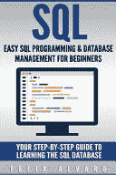

# 致谢

首先，我要感谢上帝赋予我知识和灵感，让我完成了这本信息丰富的书籍。我还要感谢我的父母、兄弟以及伴侣 Silvia 的支持。

# 目录

# 第一章：SQL 概览

- 数据定义
- 数据类型
- 用户定义数据类型

### [第五章：数据定义语言语句](#

- `CREATE` 语句
- `ALTER` 语句
- `DROP` 语句

### [第六章：数据操作语言语句](#

- `INSERT` 语句
- `UPDATE` 语句
- `DELETE` 语句

### [第七章：数据查询语言语句](#

- `SELECT` 语句
- `WHERE` 语句
- `ORDER BY` 和 `GROUP BY` 语句

### [第八章：事务控制命令](#

- `COMMIT` 命令
- `ROLLBACK` 命令
- `SAVEPOINT` 命令

### [第九章：数据库视图](#

- 定义视图
- 创建视图
- 删除视图

### [第十章：增强数据库设计](#

- 分配主键和外键
- 理解索引
- 数据库规范化

### [第十一章：数据库进阶主题](#

- 游标
- 触发器
- 错误

### [总结 + 结语](#

- 总结与结语
- 查看我的其他书籍

# 引言

你好！非常感谢下载这本《初学者 SQL 编程与数据库管理》电子书。我向你保证，投资你的数据库专业人士的技能是一个明智的决定。本电子书将教你如何使用强大的软件工具之一——`SQL` 语言来学习数据库编程和管理的关键信息。我是 Felix，我曾从一名简单的分析师开始，现在正向数据库科学家方向发展。通过本电子书的指导，你将更好地理解 `SQL` 语言能带来的无数机会。我将循序渐进地介绍学习这种可靠数据库软件的基本技能方法。

起初，我并没有意识到，如果有像 Microsoft Excel 这样的程序应用程序可以处理和展示信息，那么理解 `SQL` 是有多么重要。当我开始研究 `SQL` 的价值时，我告诉自己，如果继续从事这个领域，我将不仅是在展示信息，还在分析数据。在下载并安装软件后，我发现学习 `SQL` 编程并没有那么挑战性！迈出理解基础数据库概念的第一步，将使你扩展知识，成为最受青睐的 IT 专业人员之一。

目前信息技术的趋势是更加数字化，这涉及到操作数据库。这正是 `SQL` 发挥用场的地方——这是一种既强大又简单、灵活、便携，而且最集成到许多数据库应用程序中的软件语言。决定成为一名数据库专业人士将向你承诺一份稳定的工作和潜在的高额报酬。平均而言，美国的一名简单数据库分析师年薪约为 92,000 美元。

要开启你在数据库编程和管理领域的旅程，请让本电子书作为你的初始指南，帮助你学习 `SQL` 的基础知识。我将为你提供关于该语言起源、软件及其环境的各种特性、不同的命令和函数、可用的错误处理工具、一些进阶主题以及更多内容！我的最终目标是让你欣赏 `SQL` 的潜力并以一种酷的方式掌握编程概念。那么你还在等什么？让我们开始吧！

# 第一章：SQL 概览

在本章中，你将学习关于 `SQL` 如何以及为何产生的简要背景知识。获取这种计算机语言的历史知识将帮助你理解它对于大多数专注于数据处理领域的 IT 专业人士的重要性。你还将了解如何在不断变化的信息技术世界中最大化利用 `SQL` 的潜力。

## SQL 的历史

`SQL` 的读音为 ees-que-ell 或 see’qwl，这种计算机语言最初由一家名为美国跨国技术和咨询公司 `IBM`（国际商业机器公司）在 20 世纪 70 年代利用 E. F. Codd 博士关于“大型共享数据库的数据的关系模型”的论文作为原型设计发明的。它最初被称为 `SEQUEL`（结构化英语查询语言），用于对数据的收集和组织查询——或简单称为数据库。当 `IBM` 的研究人员发现另一家公司拥有相同的“Sequel”商标时，他们将其重命名为 `S-Q-L`（现扩展为结构化查询语言）。

自首次向公众发布以来，SQL 已经有了许多版本。1979 年，Relational Software, Incorporated（后更名为 Oracle 公司）发布了 ORACLE，这是第一个 SQL 产品。现在，随着对管理数据的计算机需求增加，SQL 越发成为信息技术领域的行业标准。这种正式标准由国际标准组织（简称为 ISO）制定并维护。1986 年，基于 IBM 的实现，SQL 被认可为数据库通信的标准语言。次年，ISO 接受 ANSI SQL 作为国际标准。ANSI 代表美国国家标准协会，这是一个批准美国各行业某些特定标准的组织。此后，该标准又经过了多次修订，例如 1992 年（SQL-92）和 1999 年（SQL-99）。最新版本现在被称为 SQL-2011，它于 2011 年 12 月正式发布。

## SQL 的用途

如今，企业界正从仅仅生产产品和提供服务，转向对数字技术的投资，以处理海量数据，并将其转化为有意义的信息，从而为公司创造更丰厚的收入。这是 SQL 的主要目标——访问并操作数据，从而进一步带来业务洞察。这种灵活的计算机语言一直是处理数据库（特别是本书第 3 章将进一步讨论的关系型数据库）最广泛使用的通信工具。

试着想象你正要去一个外国国家度假。你可能需要学习那个国家的语言，以便在探索新地方时找到路。当你尝试向一位当地居民且只说该国语言的人问路时，你显然会发现很难理解他。在这种情况下，异国土地将是你的数据库，你需要在其中寻找信息，而 SQL 就是你用来从数据库中获取所需内容的语言。

你时时会遇到“查询”（query）这个词，它也是 SQL 缩写的一部分。查询本质上是使用 SQL 语句编写的、向数据库提出的问题。当数据库中的任何数据满足给定的查询语句的条件要求时，SQL 就会检索出所需的信息。因此，在现实应用中（例如在线商店），当你通过输入搜索标准来执行对特定商品的查询时，SQL 程序通常在后台运行以管理数据库连接。你实际上是在通过 SQL 的帮助，告诉数据库你想看哪些信息以及你希望它如何将这些信息呈现给你。

## 使用 SQL 的人员

SQL 不仅适用于 IT 专业人士或具备卓越编程技能的极客。随着当今不断发展的商业世界，商人和经理等非 IT 人员也可以从学习 SQL 语义中获益。这是因为计算机语言使他们能够利用驱动每家公司的数据来理解业务的细节。此外，对于那些想要从当前职位晋升的人来说，它在分析、管理、战略或研究领域开启了多个职业机会。在 IT 领域，SQL 知识可以带来更具挑战性的角色，如数据库设计师、管理员或科学家、系统工程师、项目经理和软件开发人员等。

在本章，你学习了 SQL 的概览——它的历史、创建它的首要目的以及哪些人将从学习这种强大的数据库软件中获益。在下一章中，你将学习数据库的基础知识，这是 SQL 最初被设计的首要原因。

# 第二章：数据库基础

在开始学习 SQL 这种计算机语言的技术细节之前，本章将首先讨论什么是数据库及其基本特征。你还将了解到为什么商业世界现在被驱动着收集和操作数据，以带来更丰厚的收入。

## 数据库基础

定义或描述什么是数据库有很多方法。简单来说，它可以被定义为一组可以长期存在的项目集合。把名片盒想象成一个数据库，其中包含了你认识的人的带有不同信息的名片（例如人的姓名、职位、公司名称、联系电话）。另一个例子是印刷的电话簿（更广为人知的“黄页”），它包含了居住特定区域注册居民的姓名、电话号码和地址。

有些人从更专业的角度定义数据库，而不只是数据的集合。它被描述为一种有组织的工具，能够在需要时以有效且高效的方式保留你可以检索的数据或信息。它也可以被更严格地定义为一组相互集成的、自描述的对象的集合。当你创建这些物理或概念对象的表示时，它们将被称为“记录”（records）。回到上一个名片盒的例子，如果你想跟踪你的业务联系人，你就必须给每张名片分配一条特定的记录。每条记录包含多个信息或数据，如个人姓名、职位、公司名称和地址、电话等，我们现在称这些为记录的“属性”。

数据库不仅包含你需要的数据，还包含你所谓的“元数据”（metadata）。这些是定义或描述给定数据库内数据结构的信息（这就是为什么之前将其定义为自描述实体的原因），它们存储在一个名为“数据字典”的区域中。因此，如果你知道信息是如何排列和存储的，数据检索将更快。此外，由于数据项之间是相互关联的，它们之间存在关系。请查看下图，关于数据库的示例说明。

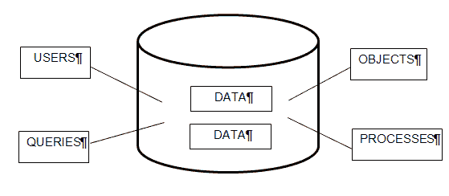

无论数据库是包含少数记录的简单集合，还是由数百万记录组成的庞大系统，都可以分为三类：个人、工作组/部门以及企业级。每个类别的特征在于数据库的大小、运行数据库的机器规模以及管理它的组织规模。

- **个人数据库**：由单个人在独立计算机上构思并设计。其数据库结构相当简单，规模相对较小。例如，你的个人电子通讯录。
- **工作组/部门数据库**：由特定组织内单个工作组或部门的个人设计和创建。与个人级相比，其数据库结构更大、更复杂，并且被多个用户同时访问。
- **企业数据库**：在三类中，这种类型的构思和创建是为了处理非常大型组织的整个信息流。因此，数据库设计涉及复杂得多的结构。

表由存储数据的行和列组成。在关系型数据库中，这些表之间相互关联，当用户提交查询时，这可以改进数据检索过程。为了让你清晰地理解这一概念，请将名片夹上的信息转换为类似 Microsoft Excel 文件的电子表格。假设这些是你那些向你的业务订购过产品和服务的公司联系人。你至少有一个类似于下表的 `CUSTOMER TABLE`（包含关于联系人的所有重要信息）：

| CUSTOMER ID | NAME | POSITION | COMPANY | STATE | CONTACT NO |
| :--- | :--- | :--- | :--- | :--- | :--- |
| 1 | Kathy Ale | President | Tile Industrial | TX | 3461234567 |
| 2 | Kevin Lord | VP | Best Tooling | NY | 5181234567 |
| 3 | Kim Ash | Director | Car World | CA | 5101234567 |
| 4 | Abby Karr | Manager | West Mart | NV | 7751234567 |

你还会有一个 `ORDER TABLE`，用于存储订单 ID、日期、数量等信息。请查看下表：

| ORDER ID | ORDER DATE | CUSTOMER ID | PRODUCT ID | ORDER QTY |
| :--- | :--- | :--- | :--- | :--- |
| 1 | 2016-05-23 | 1 | 4 | 300 |
| 2 | 2016-09-09 | 1 | 5 | 100 |
| 3 | 2016-02-17 | 3 | 2 | 150 |
| 4 | 2016-05-12 | 2 | 2 | 500 |

如你所见，一个`table`由`rows`和`columns`组成。参考 `CUSTOMER TABLE`，每一行 `row`都是一个 `tuple`，每一列 `column`都是一个 `attribute`。例如，一个 `row` 代表一条 `record`，而一个 `column` 代表特定的 `property`。在关系型数据库中，`tables` 相互关联，当用户提交 `query` 时，这可以改进数据检索过程。

为了清晰地理解这一概念，请将名片夹上的信息转换为类似 Microsoft Excel 文件的电子表格。假设这些是你那些向你的业务订购过产品和服务的公司联系人。你还会有一个 `ORDER TABLE`，用于存储 `order ID`、`date`、`quantity` 等信息。

数据库管理系统（DBMS）是用于管理、存储和检索数据的软件。它充当用户与数据库之间的接口。DBMS 允许用户创建、读取、更新和删除数据，而无需了解数据存储的技术细节。常见的 DBMS 示例包括 MySQL、PostgreSQL、Oracle 和 SQL Server。它们都有自己的特性和语法，但它们共同拥有高效、安全地管理数据的目标。

学习 `SQL` 语法就像理解英语语言结构。它的命令语言由有限数量的语句组成，执行三个主要的数据功能：定义、操纵和控制。`SQL` 语言还包含了仅用于特定用途的保留字。因此，你不能将这些词作为变量、表和列的名称，或者以预期用途之外的任何方式使用它们。以下是 `SQL:2011` 中一些常见的保留字。

| ABS | ALL | ALLOCATE | ALTER | AND | ANY |
| ARE | ARRAY | AS | AT | AVG | BEGIN |
| BETWEEN | BINARY | BOOLEAN | BOTH | BY | CALL |
| CASCADED | CASE | CEILING | CHAR | CHARACTER | CHECK |
| CLOSE | COLLATE | COLLECT | COLUMN | COMMIT | CONDITION |
| CONNECT | CONSTRAINT | CONVERT | COUNT | CREATE | CURSOR |
| CYCLE | DATE | DAY | DEALLOCATE | DEC | DECIMAL |
| DECLARE | DEFAULT | DELETE | DESCRIBE | DISCONNECT | DISTINCT |
| DOUBLE | DROP | DYNAMIC | EACH | ELEMENT | ELSE |
| END | ESCAPE | EVERY | EXCEPT | EXECUTE | EXISTS |
| EXTERNAL | EXTRACT | FALSE | FETCH | FILTER | FLOAT |
| FLOOR | FOR | FOREVER | FREE | FROM | FULL |
| FUNCTION | FUSION | GET | GLOBAL | GRANT | GROUP |
| GROUPING | HAVING | HOLD | HOUR | HOURS | IDENTITY |
| IN | INNER | INOUT | INSERT | INT | INTEGER |
| INTERSECT | INTERVAL | INTO | IS | JOIN | KEEP |
| LANGUAGE | LARGE | LEAD | LEFT | LIKE | LOCAL |
| LOWER | MATCH | MAX | MEMBER | MERGE | METHOD |
| MINUTE | MOD | MODULE | MONTH | MULTISET | NATIONAL |
| NATURAL | NEW | NIL | NO | NONE | NORMALIZE |
| NOT | NULL | NUMERIC | OF | OFFSET | OLD |
| ON | ONLY | OPEN | OR | ORDER | OUT |
| OVER | OVERLAY | PARAMETER | PARTITION | POSITION | POWER |
| PRECISION | PREPARE | PRIMARY | PROCEDURE | RANGE | RANK |
| REAL | RECURSIVE | REF | REFERENCES | REFERENCING | RELEASE |
| RESULT | RETURN | REVOKE | RIGHT | ROLLBACK | ROLLUP |
| ROW | ROWS | SCOPE | SCROLL | SEARCH | SECOND |
| SELECT | SET | SIMILAR | SOME | SPECIFIC | SQL |
| START | STATIC | SUM | SYMMETRIC | SYSTEM | TABLE |
| THEN | TIME | TIMESTAMP | TO | TRANSLATE | TREAT |
| TRIGGER | TRUNCATE | TRIM | TRUE | UNION | UNIQUE |
| UNKNOWN | UPDATE | UPPER | USER | USING | VALUE |
| VALUES | VARCHAR | VARYING | VERSION | WHEN | WHENEVER |
| WHERE | WINDOW | WITH | WITHIN | WITHOUT | YEAR |

如果你认为 `SQL` 数据库只是集合的集合，那么你就错了。还需要指定额外的结构来维护你数据的完整性，例如模式（schemas）、域（domains）和约束（constraints）。

- **Schema（模式）** – 这也称为概念视图或完整的逻辑视图，定义了整个数据库的结构并提供了整体的表组织。这种模式被视为元数据——存储在表中，并是数据库的一部分（就像包含普通数据的表一样）。
- **Domain（域）** – 它规定了可以在特定表列或属性中存储的所有有限数据值的集合。例如，在我们之前的 `CUSTOMER TABLE` 中，如果你只提供德克萨斯州、纽约州、加利福尼亚州和内华达州的产品和服务，那么 `STATE` 列只能包含“TX”、“NY”、“CA”和“NV”。所以这四个州缩写就是 `STATE` 属性的域。
- **Constraint（约束）** – 经常被忽略但是数据库的重要组件之一，它设定了规则，识别特定表属性可以包含哪些数据值。结合严格的约束可以确保数据库用户只向特定列输入有效数据。与定义的表特征一起，列约束决定了它的域。使用相同的 `STATE` 列作为示例，给定仅限这四个值的约束，如果数据库用户为新泽西输入“NJ”，则该条目将不被接受。除非由于业务突然变化需要更新数据库结构，否则系统将不会在为 `STATE` 属性输入有效值。

## SQL 命令类型


在开始使用`SQL`编程之前，你需要了解它在执行各种功能时的基本命令分类——包括数据库创建、对象操纵、数据填充和更新、数据删除、查询提交、访问控制和数据库管理等。以下是主要类别：

### 数据定义语言 (DDL)

数据定义语言（或简单称为`DDL`）允许你创建、更改或重构甚至破坏关系型数据库中包含的基本元素。`DDL`仅关注结构，而不关注元素中包含的数据。这些基本元素或数据对象包括表、模式、视图等。视图由于没有独立的物理存在，被视为虚拟表，其定义只存在于元数据中。然而，视图的数据来自你派生视图的表（或多个表）。下面列了一些最常见的`DDL`命令：

* **CREATE** – 该命令语句负责构建数据库结构。其语法为：

```
CREATE TABLE
CREATE VIEW
```

* **ALTER** – 该命令语句负责在数据库创建后更改其结构。其语法为：

```
ALTER TABLE
ALTER VIEW
```

* **DROP** – 该命令是`CREATE`语句的相反操作，用于破坏数据库结构。其语法为：

```
DROP TABLE
DROP VIEW
```

### 数据操纵语言 (DML)

数据操纵语言（或简单称为`DML`）由处理维护的 SQL 命令组成。这意味着你可以操纵关系型数据库内部的数据。这些语句读起来像普通的句子，允许你输入、更改或删除数据。以下是：

* **INSERT** – 该命令语句用于向表插入新数据。向具有两列的表添加值使用以下语法：

```
INSERT INTO TABLE_NAME
VALUES ('value1', 'value2');
```

`TABLE_NAME`是你要添加值的表名。`VALUES`括号内的项数量代表列的数量。如果值是字符或日期/时间类型，需要用单引号括起来。数值或空值则不需要（空值应写为`NULL`）。

* **UPDATE** – 该命令语句用于修改或更改表中已存在的数据，而不是添加或删除记录。更新是针对一个表或数据库中一个表的多个行/列进行的。更改单个列使用以下语法：

```
UPDATE TABLE_NAME
SET COLUMN_NAME = 'value'
[WHERE CONDITION];
```

只要满足给定的`WHERE`子句，`COLUMN_NAME`的值将被更新。这可以在给定`TABLE_NAME`的一个或多个记录中进行。

* **DELETE** – 该命令删除某些记录甚至整个表，而不是从特定列删除数据值。从表中删除一行或多条记录使用以下语法：

```
DELETE FROM TABLE_NAME
[WHERE CONDITION];
```

如果你想从`TABLE_NAME`中删除选定的行，`WHERE`子句是该命令的重要部分。

### 数据查询语言 (DQL)

数据查询语言（或简单称为`DQL`）由执行数据选择的命令组成，这是关系型数据库用户的主要关注点。使用的语句是`SELECT`，它可以带有其他子句或选项，以便你的提取结果以组织良好且易读的格式呈现。你可以使用单独的应用程序或命令行向数据库提交查询。以下是简单`SELECT`语句的语法：

```
SELECT [* | ALL | DISTINCT COLUMN1, COLUMN2]
FROM TABLE1 [, TABLE2];
```

使用星号`*`给定表中的所有列都包含在输出中并显示。`ALL`提取并显示列的所有值，即使是重复值。相反，使用关键字`DISTINCT`则防止重复行包含并显示在输出中。紧跟在`FROM`关键字之后的是一个或多个列表，您希望从中获取数据。语法中指定的列和表之间都用逗号分隔。

### 数据控制语言 (DCL)

数据控制语言（简称为`DCL`）由允许您管理数据库内数据访问的命令组成。此外，通过控制用户权限可以保护数据库免受无意或故意的误用。`DCL`关注事务，事务会捕获所有执行数据库操作的 SQL 语句并将其保存到日志文件中。以下是常用的`DCL`命令语句：

* `GRANT` – 该语句为您提供某些权限，例如授予您访问数据库的权限。其语法为：

```
GRANT PRIVILEGE1, PRIVILEGE2, … TO USER_NAME
```

* `REVOKE` – 该语句撤销您的权限，例如移除您访问数据库的权限。其语法为：

```
REVOKE PRIVILEGE1, PRIVILEGE2, … TO USER_NAME
```

### 事务控制命令

事务控制命令允许用户在维护数据库完整性方面操作各种事务。在`SQL`中，事务在应用程序执行时开始。第一个事务在 SQL 应用程序启动时开始，最后一个事务在应用程序终止时结束。以下是常用的事务控制命令：

* `COMMIT` – 该语句通过使您对数据库的更改持久化或简单保存事务来完成事务。其语法为：

```
COMMIT [WORK];
```

在上述命令行中，关键字`WORK`是可选的。

* `ROLLBACK` – 该语句的主要功能是将数据库系统恢复到之前的状态，或撤销事务日志中发生的所有操作。其语法为：

```
ROLLBACK [WORK];
```

在上述命令行中，关键字`WORK`是可选的。

* `SAVEPOINT` – 该语句与`ROLLBACK`命令配合使用，它在事务组内创建区域或点，您可以在这些区域中执行`ROLLBACK`命令。其语法为：

```
SAVEPOINT SAVEPOINT_NAME;
```

# SQLite 安装说明与数据库特性

在开始让自己陷于各种数据库解决方案和 SQL 命令行之前，您需要首先确定创建数据库的目的。这将进一步决定其他数据库设计考虑，如大小、复杂性、运行应用程序的机器类型、存储介质等。当您开始考虑数据库需求时，您需要知道在设计中应该考虑到多大详细程度。细节过多会导致设计非常复杂，从而进一步浪费时间和精力，甚至是您计算机的存储空间。细节过少则会导致数据库性能差、损坏且毫无价值。一旦您完成了设计阶段，就可以决定下载哪种数据库软件来开始您的 SQL 体验。

为了本电子书的讨论，`SQLite`（一个简单的软件库）将作为入门数据库引擎，用于设计、构建和部署应用程序。`SQLite`是一种免费且独立的数据库软件，下载快速且易于管理，由 Richard Hipp 和他的程序员团队开发。它的设计易于配置和实现，完全不需要任何客户端-服务器设置。因此，`SQLite`被认为是最广泛使用的软件之一。以下列了一些主要特性：

* 事务具有原子性、一致性、隔离性和持久性

* 编译简单易用

* 支持系统崩溃和断电

* 无外部依赖的全 SQL 实现

* 代码占用极小

* 可适应并调整到更大的项目

* 自包含且可移植

在使用`SQLite`时，您需要下载`SQLiteStudio`作为您的数据库管理器和编辑器。凭借其直观的界面，该软件轻量而强大。您甚至不需要安装它，只需下载、解压并运行程序。按照以下简单步骤在 Windows 计算机上下载 SQLiteStudio：

1. 检查计算机系统的版本，然后点击相应的链接开始下载软件。

2. 下载软件后，进入保存文件夹（通常是下载文件夹）。点击顶部的“提取”选项卡，然后选择“提取所有”。

3. 您将看到“提取压缩（zip）文件夹”对话框。将目标文件夹更改为`C:\SQL`然后点击“提取”按钮。这将是所有 SQLite 文件所在的文件夹。

4. 一旦解压所有文件，您将获得 SQLiteStudio 子文件夹。

5. 在子文件夹中找到名为`SQLiteStudio`的程序。若要在桌面上创建快捷方式（以便能够快速启动程序），请右键点击文件名，选择“发送到”选项，然后选择“桌面（创建快捷方式）”。

6. 当您双击桌面上的`SQLiteStudio`图标时，您应该看到以下屏幕：

数据库导航器（左侧面板）显示数据库的所有逻辑单元，如表和视图。右侧的灰色面板是 SQL 工作区，您可以在其中编写查询语句。在随后的章节中，您将对该程序的图形用户界面有更好的理解。

由于数据库是信息的集合，它可以存储名称、数字、图像、计算结果、财务金额、字符等。这些存储的信息就是你所说的“数据”，你可以根据需要随时对其进行更改或操作。当你开始提供关于如何编写和存储数据的规则时，你就是在处理数据类型。数据类型考虑了数据库为表中的每一列分配的长度以及它可能包含的值——无论它是字母数字组合、纯数字、图形、日期或时间。通过定义每个数据库字段中存储什么数据，你可以防止数据输入错误的发生。这种控制错误数据输入数据库的验证形式也称为字段定义。

如果每个数据库字段包含数据项，则它将有一个特定的值。然而，在某些某个字段完全不包含任何数据项。在这种情况下，字段的值被视为`null`——意味着该值未知。这种空值不同于数字零值或空白字符值，因为零和空白是确定的值。以下是你可能遇到空值的情景：

* 即使该值可能存在，你现在还不知道它的具体是什么。

* 该值尚不存在。

* 该值超出了范围。

* 该字段不适用于特定的行数据。

### 数据类型

以下是`SQL`语言中预定义的通用数据类型（进一步划分为子类型）：

* 数值 – 由数值数据类型定义的值是某种数字，可以用精确值或近似值来表示。

    * 精确数值

        * `INTEGER` – 这仅由正整数和负整数组成的整数组成。它不包含小数或分数部分。值的范围从 -2,147,483,648 到 2,147,483,647，分配了 4 字节的存储大小。

        * `SMALLINT` – 用于替换整数以节省存储空间，但其精度不能大于整数。计算机编程中的精度是一个数字可以拥有的有效数字最大总和。值的范围从 -32,768 到 +32,767，分配了 2 字节的存储大小。

        * `BIGINT` – 它是`SMALLINT`的相反，其最小精度与`INTEGER`数据类型相同或更高。值的范围从 -9,223,372,036,854,775,808 到 9,223,372,036,854,775,807，分配了 8 字节的存储大小。

        * `NUMERIC(p, s)` – 除了整数部分，此数据类型还包含一个分数组件，用于指示值的精度和标度（Scale）。标度是数据中分数部分保留的位数或位置，位于小数点的右侧。在`NUMERIC(p, s)`中，`p`指定精度，而`s`用于标度。例如，`NUMERIC(6, 3)`意味着数字的绝对值最多为 999.999（总共 6 位有效数字，小数点后有 3 位数字）。

        * `DECIMAL(p, s)` – 与`NUMERIC`数据类型类似，它包含一个分数部分，你可以同时指定值的精度和标度。然而，这种数据类型允许更高的精度。例如，`DECIMAL(6, 3)`可以包含高达 999.999 的值，但数据库仍然接受大于 999.999 的值。假设你输入了数字 123.4564，它将被舍入为 123.456。该数据类型的分配存储大小基于给定的精度。

    * 近似数值

        * `REAL(s)` – 它由单精度浮点数组成，其中小数点可以在该数字中“浮动”到不同的位置。这意味着该数据类型的数值具有无限的精度和变长度的标度。例如，`π`（派周）的值可以包括 3.14159、3.14 和 3.1（每个值都有自己的精度）。对于单精度浮点数，它们的精度在 1 到 21 之间（包含）。它也为其值分配了 4 字节的存储大小。

        * `DOUBLE PRECISION(p, s)` – 它由双精度浮点数组成，容量是`REAL`数据类型的两倍。当你需要更精确的数字时（例如在大多数科学领域），这种数据类型就非常有用。对于双精度浮点数，它们的精度在 22 到 53 之间（包含）。它也为其值分配了 8 字节的存储大小。

        * `FLOAT(p, s)` – 这种数据类型允许你指定精度，并让计算机决定你是选择单精度还是双精度。它实际上涉及`REAL`和`DOUBLE PRECISION`，取决于你所指定的精度。由于这种特性，更容易将数据库从一个计算机平台移动到另一个。

* 字符串 – 字符串数据类型存储字母数字信息，也被认为是最常用的数据类型之一。

    * `CHARACTER(n)`或`CHAR(n)` – 这种数据类型也称为固定长度。例如，最大长度为 255。如果字符串小于`n`，则 SQL 将填充剩余空间。

    * `CHARACTER VARYING(n)`或`VARCHAR(n)` – 当数据条目长度不同，但你不希望 SQL 填充剩余空间时使用。此数据类型没有默认值，其最大长度为 32672。

    * `CHARACTER LARGE OBJECT (CLOB)` – 引入于`SQL:1999`，这种变长数据类型用于包含大到无法作为`CHARACTER`存储的字符信息，例如大型文档。`CLOB`的最大值为 2147483647。

* 日期和时间 – 此数据类型管理任何关于日期和时间的信息。

    * `DATE` – 此数据类型提供日期的年、月、日值的存储，按特定顺序。年份值使用四个数字表示，可以表示从 0001 到 9999 的任何值。日期类型的格式为 yyyy-mm-dd。

    * `TIME` – 此数据类型存储并显示小时-分-秒格式的时间（`HH:MM:SS`）。

    * `DATETIME` – 当值同时包含日期和时间信息时，使用`DATETIME`数据类型，它使用“YYYY-MM-DD HH:MM:SS”格式显示。该类型的有效范围是从“1000-01-01 00:00:00”到“9999-12-31 23:59:59”。

    * `TIMESTAMP` – 这与`DATETIME`数据类型相似，但值的范围从 UTC 时间“1970-01-01 00:00:01”到“2038-01-19 03:14:07”。

* 布尔 – 此数据类型由用于数据比较的值组成：`TRUE`、`FALSE`或`NULL`。为了返回数据，必须满足给定查询的指定标准的所有条件——意味着布值为`TRUE`。如果未返回数据，则该值为`FALSE`或`NULL`。

自定义数据类型

在学习了通用的预定义数据类型后，你现在将转向用户定义数据类型，简称为`UDTs`。从名称本身来看，这些是用户根据现有数据类型定义或指定的数据值。因此，允许自定义以最大限度地利用存储空间并满足其他用户需求。此外，数据库应用程序开发对程序员来说变得更加灵活。这意味着当需要在多个表中定义的列中输入相同类型的数据时，你可以使用`UDTs`。要定义`UDTs`，你可以使用`CREATE TYPE`语句。

例如，如果你想为你的数据库将`USDollar`和`UKPound`定义并区分为两种货币，则可以创建以下`UDTs`：

```sql
CREATE TYPE USDollar AS DECIMAL (9, 2) ;
CREATE TYPE UKPound AS DECIMAL (9, 2) ;
```

即使这两个数据类型都是使用预定义的`DECIMAL`类型创建的，但它们在数据库中都有各自的功能和特性。回到之前章节中客户和订单信息的示例代码中，你现在可以创建以下包含这两个`UDTs`的发票表：

```sql
CREATE TABLE AmericaInvoice (
    InvoiceID INTEGER PRIMARY KEY,
    CustomerID INTEGER,
    OrderID INTEGER,
    TotalSaleAmt USDollar,
    ShippingFee USDollar
);

CREATE TABLE UnitedKingdomInvoice (
    InvoiceID INTEGER PRIMARY KEY,
    CustomerID INTEGER,
    OrderID INTEGER,
    TotalSaleAmt USDollar,
    ShippingFee USDollar
);
```

在本章中，你学习了 SQL 语言中提供的各种数据类型的特性。你还理解了创建用户定义数据类型的必要性，使你的数据库不再复杂且更具移植性。在下一章中，你将学习如何在创建数据库对象时使用不同的数据定义语句。

# 第五：数据定义语言

在本章中，你将对三个数据语言语句——`CREATE`、`ALTER`和`DROP`有更深入的理解。通过 SQLiteStudio，你还将学习如何编码数据库结构。再次，数据库对象是任何存储或引用数据的定义逻辑单元。当你有一组数据库对象时，你会创建一个与特定数据库关联的模式（schema）。本章的重点是数据存储的基本形式，即关系表。一个简单的表由行（对应数据记录）和列（也称为字段）组成。数据库表始终至少包含一列和一个由一个或多个字段组成的行。

## CREATE 语句

SQL`CREATE`语句的多种形式负责构建关键的数据库结构——表、视图、域等。创建表的操作可能很容易，但你需要考虑许多因素。在实际实施之前规划表结构可以节省你的精力和精力，因为在表创建后，你不需要再重新配置。

以下是创建表时需要考虑的一些因素：

* 表将包含的数据类型

* 表名和列名

* 主键（使数据每行数据都是唯一的列，以避免表中出现重复记录）

* 列长度

* 包含空值的列

语法格式：

```sql
CREATE TABLE TABLE_NAME (
    field1 DATA_TYPE [not null],
    field2 DATA_TYPE [not null],
    field3 DATA_TYPE [not null],
    field4 DATA_TYPE [not null],
    field5 DATA_TYPE [not null]
);
```

列名（`field1`、`field2`、`field3`、`field4`和`field5`）和字段数据类型写在括号内，用逗号分隔。括号内指示的任何内容都是可选的，语法最后以分号结束。使用第 2 章中的`CREATE TABLE`，你将使用 SQLiteStudio 创建一个新的数据库表。

### 创建新数据库


1. 双击桌面上的应用程序图标打开`SQLiteStudio`。

2. 点击`DATABASE`菜单然后选择`ADD DATABASE`。

3. 在`FILE`输入框内输入`Sample_DB`（这是新数据库的名称），然后点击`OK`。

4. 现在你在数据库导航器（`Database Navigator`）面板中拥有`Sample_DB`对象。

### 创建新表

1. 点击`TOOLS`菜单然后选择`OPEN SQL EDITOR`。你将在右侧面板中获得`SQL`编辑器区域。如果你双击`Sample_DB`，你将在数据库对象下看到`TABLES`和`VIEWS`。目前还没有表或视图，因此你将使用`SQL`编辑器面板创建一个创建一个。

2. 在`QUERY`标签页下，输入以下代码行：

```sql
CREATE TABLE Customer_TBL (
    CustomerID INTEGER NOT NULL PRIMARY KEY,
    CustomerName VARCHAR NOT NULL,
    JobPosition VARCHAR,
    CompanyName VARCHAR NOT NULL,
    USState VARCHAR NOT NULL,
    ContactNo BIGINTEGER NOT NULL
);
```

3. 点击`QUERY`标签页上方的`EXECUTE QUERY`按钮或在键盘上按`F9`。你现在拥有了一个包含6列的`Customer_TBL`表。

## ALTER 语句

SQL`ALTER`语句用于修改数据库对象，特别是表。修改表元素可以包括添加和删除列、更改列定义、添加和删除约束、修改表存储值等。

语法格式：

```sql
ALTER TABLE TABLE_NAME [modify] [column COLUMN_NAME] [DATA TYPE | null not null] [restrict | cascade] [drop] [constraint CONSTRAINT_NAME] [add] [column] COLUMN DEFINITION;
```

### 通过添加新列修改表

1. 为`Customer_TBL`表添加一个包含客户地址的新列。在`QUERY`标签页下输入以下代码行：

```sql
ALTER TABLE Customer_TBL ADD CompanyAdd VARCHAR;
```

2. 点击`EXECUTE QUERY`按钮后，`CompanyAdd`列添加到`ContactNo`列之后。此字段包含字符串数据类型的值。

## DROP 语句

如果你想删除数据库对象，则使用SQL`DROP`语句。因此，`DROP TABLE`语句用于删除不再需要的表。一旦执行此行，表中包含的所有数据和元数据也将被删除。`DROP TABLE`被是最容易执行的命令。然而，如果要删除的表被数据库中的另一个表引用，将发生错误。这就是为什么在执行`DROP`语句时需要小心，避免误删对象（特别是当多个用户访问数据库时）。

语法格式：

```sql
DROP TABLE TABLE_NAME [restrict | cascade];
```

`RESTRICT`选项用于在删除其他数据库对象引用的表时返回错误。相反，`CASCADE`允许删除表以及所有其他引用对象。某些SQL应用程序不允许`CASCADE`选项，以确保不会产生无效的数据库对象。

* 删除现有表

1. 由于数据库中只有一个表（`Customer_TBL`），你不需要担心要使用`RESTRICT`还是`CASCADE`选项。只需在`QUERY`标签页中输入以下行代码即可。

```sql
DROP TABLE Customer_TBL;
```

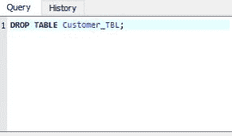

2. 点击`EXECUTE QUERY`，`Customer_TBL`表会被立即删除。

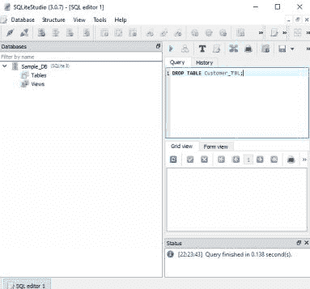

在本章中，你已经学习了如何使用通用的DDL命令语句来编码编程行，以便在SQL中创建、修改和删除数据库表。在下一章中，你将学习不同的DML命令，这些命令将允许你操作数据库表中所包含的信息。

# 第六章：数据操纵语言语句

在本章中，你将学习如何通过数据插入、删除和更新来操作数据库表并使其变得有用。为了实现这一目标，你将在`SQLiteStudio`中使用三种数据操纵语句——`INSERT`、`DELETE`和`DROP`进行编程。

通常情况下，这些表在创建后是空的。你可以存储在数据库对象中的数据可以是多种格式——非数字化、半数字化和全数字化的。非数字化格式意味着数据需要从非电子源提取，例如从业务名片获取客户信息。在这种情况下，你需要手动将数据存储到你的数据库中。至于半数字数据，数据可能已经是某种数字形式，但格式与你的数据库表不相同。例如，你可能将客户业务名片的记录存储在Microsoft Excel文件中，你可能需要将其转换为适合你数据库的适当格式。最后，全数字化意味着你所有的客户信息都已经是电子格式，并且与你数据库的布局相匹配。

当前的数据格式将进一步决定你将如何操作你的数据库。这就是DML命令在输入新数据、更新现有数据和从表中删除数据时变得有用之处。

## INSERT 语句

输入新数据的过程可以通过单个命令手动完成，也可以通过批处理程序自动完成。还有一些因素会决定你可以在数据库表中插入什么以及插入多少数据——字段长度、列数据类型、表大小等。在为表填充数据时，你将使用`INSERT`语句。

### 每次插入一行

当你想要将所有数据输入到数据库表的单行中时，可以创建一个基于表单的数据输入应用程序。在此功能中，设计了一个屏幕，其中包含你可以在其中输入所请求信息的字段——对应表中的每一列。使用以下语法一次添加一行数据：

```sql
INSERT INTO TABLE_NAME [(column_1, column_2, … , column_n)]
VALUES (value_1, value_2, …, value_n) ;
```

方括号内的任何内容都被视为可选的，这意味着你不需要列出列名。顺便说，“n”是表列的最大数量。列列表的默认顺序与你的列顺序相同。因此，如果你在`VALUES`部分列出的项目顺序与你的列顺序相同，那么值将输入到正确的列中。只有当你需要以不同的顺序指定值时，才需要指示列名。

现在，让我们使用第2章提供的客户信息向我们的`Customer_TBL`表插入记录。

1. 在SQL编辑器中输入以下编程行：

```sql
INSERT INTO Customer_TBL (CustomerID, CustomerName, JobPosition, CompanyName, USState, ContactNo)
VALUES (1, ‘Kathy Ale’, ‘President’, ‘Tile Industrial’, ‘TX’, 3461234567)
```

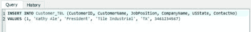

2. 点击`EXECUTE QUERY`，你将得到下面的屏幕（状态区域不应有错误）：

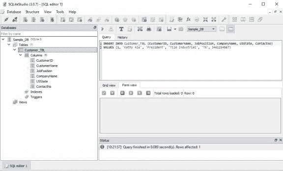

3. 要检查数据记录是否已插入表中，双击左窗格中的`Customer_TBL`。点击右窗格中的`DATA`标签，它位于`STRUCTURE`和`CONSTRAINTS`标签之间。你的表应该类似于下面屏幕所示所示：

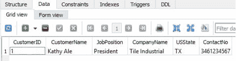

4. 点击屏幕左下角的选项。要在不指定列名的情况下添加另一个记录，请删除`QUERY`标签页内的编程代码并输入以下行：

```sql
INSERT INTO Customer_TBL
VALUES (2, ‘Kevin Lord’, ‘VP’, ‘Best Tooling’, ‘NY’, 5181234567)
```

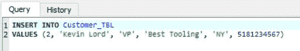

5. 点击`EXECUTE QUERY`，只要值的顺序与`Customer_TBL`表列的顺序完全对应，那么状态区域就不应有错误。

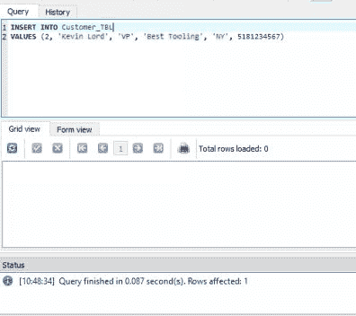

6. 点击屏幕左下角的`CUSTOMER_TBL (SAMPLE_DB)`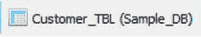选项。在`GRID VIEW`标签下，点击`REFRESH TABLE DATA`或在键盘上按`F5`。你应该能看到新记录已添加到表中。

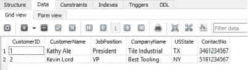

### 每次插入多行

如果你需要向表中插入若干记录，那么多次插入是很有益的。这种过程也比一次插入一次有效得多。你只需要重复`VALUES`子句，并确保用逗号将它们隔开。要向我们的`Customer_TBL`插入剩余记录（见第2章）：

1. 回到SQL编辑器，输入以下行（不指定列名）：

```sql
INSERT INTO Customer_TBL
VALUES (3, ‘Kim Ash’, ‘Director’, ‘Car World’, ‘CA’, 5101234567),
(4, ‘Abby Karr’, ‘Manager’, ‘West Mart’, ‘NV’, 7751234567)
```

2. 点击`EXECUTE QUERY`。

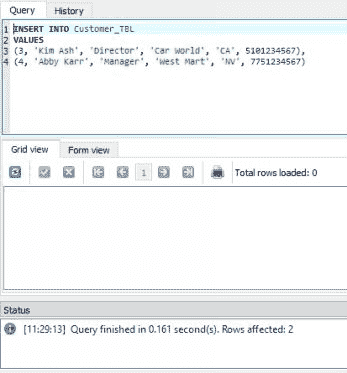

3. 转到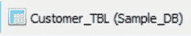选项。确保点击`REFRESH TABLE DATA`或在键盘上按`F5`。你现在应该可以看到又有两个记录插入到数据库。

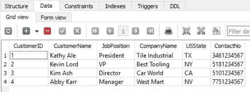

### 仅选择特定列

在第5章中，`Customer_TBL`表的`JobPosition`字段被定义允许空值。如果你有一个新客户但尚不知道他在公司的职位，你可以留空`JobPosition`字段，同时为其他字段提供必要信息。

要在不为`JobPosition`字段提供数据的情况下添加新记录：

1. 输入以下SQL行（确保你指示了列名）：

```sql
INSERT INTO Customer_TBL (CustomerID, CustomerName, CompanyName, USState, ContactNo)
VALUES (5, ‘Mike Armhs’, ‘1 Driving School’, ‘NJ’, 2011234567)
```

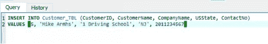

2. 点击`QUERY`标签上方的`EXECUTE QUERY`。

3. 转到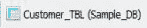选项，然后点击`REFRESH TABLE DATA`按钮或在键盘上按`F5`。注意，由于你没有为`JobPosition`字段提供任何信息，它包含一个NULL值。

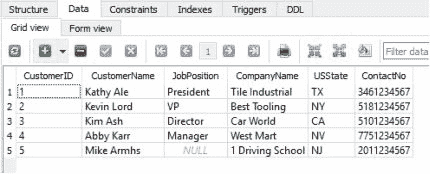

## UPDATE 语句

由于变化不可避免，SQL提供了一种更新数据库存储的现有数据的方法。根据你的需要，你可以使用`UPDATE`命令一次修改单条或多条记录。然而，通常数据库中一次只更新一个表。该DML语句的标准语法如下：

```sql
UPDATE TABLE_NAME
SET column_1 = EXPRESSION_1,
column_2 = EXPRESSION_2,
…
column_n = EXPRESSION_N
[WHERE predicates];
```

再次，`WHERE`子句语句中括号内的任何内容都是可选的，最大列数由“n”表示。该子句用于标识哪些行需要被更新——这意味着如果不存在`WHERE`子句，则表中的所有记录都将被自动修改。

### 一次更新一条记录

根据之前的讨论，你添加了一条客户信息记录，但没有为`JobPosition`字段提供数据。如果你后来了解到联系人是公司的副总裁，那么你可以修改这条现有的记录。

1. 点击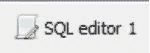选项返回`SQL EDITOR`。输入以下代码：

```sql
UPDATE Customer_TBL
SET JobPosition = ‘VP’
WHERE CustomerName = ‘Mike Armhs’;
```

2. 点击`QUERY`标签页上方的`EXECUTE QUERY`按钮。

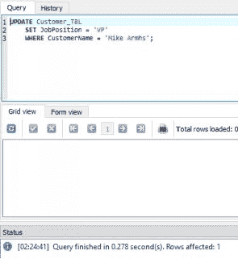

3. 点击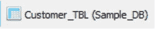选项，然后点击`REFRESH TABLE DATA`按钮或在键盘上按`F5`。现在你将看到名为Mike Armhs的客户在`JobPosition`字段下显示“VP”。

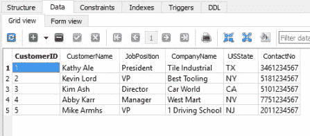

### 一次更新多条记录

现在，如果你想将`JobPosition`字段的“VP”值改为“Vice-President”，以便数据库用户更容易理解，那么你就一次性更新多条记录。

1. 点击屏幕左下角的选项，将编程行更改为：

```sql
UPDATE Customer_TBL
SET JobPosition = ‘Vice-President’
WHERE JobPosition = ‘VP’;
```

2. 点击`QUERY`标签页上方的`EXECUTE QUERY`按钮。

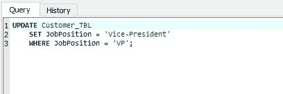

3. 点击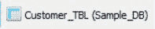选项，然后点击`REFRESH TABLE DATA`按钮或在键盘上按`F5`。你应该能看到之前的“VP”值已更改为“Vice-President”。

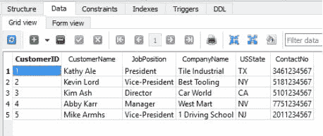

### 一次更新所有记录

如果你想通过将客户名改为大写字母来强调客户名，你可以一次性修改数据库表中的所有记录。在这种情况下，你不再需要`WHERE`子句。

1. 点击屏幕左下角的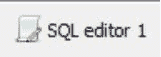选项，输入以下编程行：

```sql
UPDATE Customer_TBL
SET CustomerName = UPPER(CustomerName)
```

2. 点击`QUERY`标签页上方的`EXECUTE QUERY`按钮。

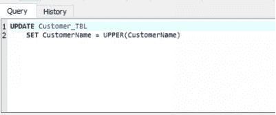

3. 点击选项，然后点击`REFRESH TABLE DATA`按钮或在键盘上按`F5`。注意，表中所有记录的客户名格式已更改为大写字母。

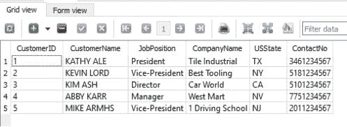

## DELETE 语句

`DELETE`语句是一种DML命令，它可以从表中删除记录，但仍保留其在数据库中的存在。当你不不需要数据库中的特定信息时（无论是因为它们过时还是不再有用），就会发生这种情况。这样，你可以释放一些存储空间。你可以执行`DELETE`命令来删除单个记录、多条记录甚至一次删除表中的所有记录。提醒一下，此命令不会删除特定列中的值，而是删除整行或整条记录。这就是为什么在执行此命令时必须非常小心。`DELETE`命令的效果可能是永久的，你可能无法恢复被删除的数据。该DML语句的标准语法为：

```sql
DELETE FROM TABLE_NAME
[WHERE CONDITION];
```

即使`WHERE`子句是可选部分，但当你想要从某个特定表中删除选定的数据行时，你仍然需要包含它。如果没有`WHERE`子句，你将删除所有行。

为了演示`DELETE`语句的功能，请先为`TBL`创建一个副本。

1. 转到`NAVIGATOR`，然后右键点击`TBL`。选择`CREATE SIMILAR TABLE`。

2. 系统会要求你输入一个名称。输入`Customer_2`。

3. 点击`STRUCTURE CHANGES`。

此时`Customer_2`是空的，你必须从`TBL`复制记录。请按照以下步骤操作：

1. 点击选项，然后点击`REFRESH TABLE DATA`按钮或在键盘上按`F5`以更新值。

2. 选中`CustomerID`列中的第一行。

3. 右键点击`CustomerID`列。

4. 点击`COPY`。

5. 点击`DATA`标签页。

6. 点击`INSERT`旁边的箭头。选择`MULTIPLE ROWS`。

7. 在`NUMBER OF ROWS TO INSERT`框内输入`5`。


8. 右键点击单元格然后选择 `PASTE` 。

9. `TBL` 中的所有数据将插入 `Customer_2` 。

10. 点击 `STRUCTURE CHANGES`  保存数据。

### 删除单个记录

要从 `Customer_2` 表中删除客户名匹配“KATHY ALE”的单条记录：

1. 点击  选项，在 `QUERY` 标签页中输入以下代码，然后点击 `EXECUTE QUERY` 按钮 。

```sql
DELETE FROM Customer_2
WHERE CustomerName = 'KATHY ALE';
```

2. 要检查记录是否已删除，点击  进入 `Customer_2` 表。然后点击 `REFRESH TABLE DATA` 按钮  或在键盘上按 `F5` 更新值。你会发现记录已经被删除。

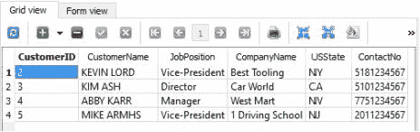

### 删除多条记录

要从 `Customer_2` 表中删除位置匹配“Vice-President”的 2 条记录：

1. 点击  选项，输入以下代码，然后点击 `EXECUTE QUERY` 按钮 。

```sql
DELETE FROM Customer_2
WHERE JobPosition = 'Vice-President';
```

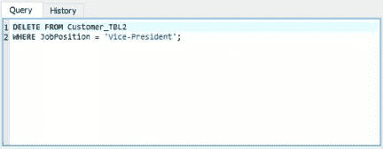

2. 要检查记录是否已删除，请点击  进入 `Customer_TBL2` 表。然后点击 `REFRESH TABLE DATA` 按钮  或按下键盘上的 `F5` 键来更新数值。你会发现这两条记录已经被删除了。

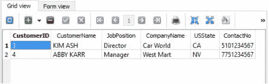

### 全表

要一次性删除 `Customer_TBL2` 表中的所有剩余记录：

1. 点击  选项，在 `QUERY` 标签页中输入以下代码，然后点击 `EXECUTE QUERY` 按钮 。

```sql
DELETE FROM Customer_TBL2
```

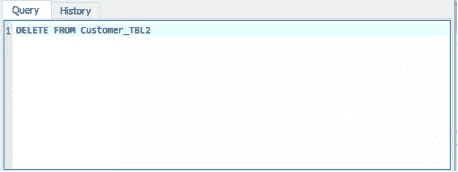

2. 要检查记录是否已删除，请点击 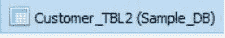 进入 `Customer_TBL2` 表。然后点击 `REFRESH TABLE DATA` 按钮  或按下键盘上的 `F5` 键来更新数值。你会发现执行单条 `DELETE` 命令已经删除了表中的所有记录。

在本章中，你学习了如何使用最常用的 DML 命令语句来编码编程行，以便在 SQL 中从数据库表中插入、更新和删除记录。在下一章中，你将学习不同的 DQL 命令，这些命令将允许你检索数据库表中包含的有价值信息。

# 第七章：查询查询语句

在本章中，你将学习如何使用可用的数据查询语言语句从数据库表中检索数据。通过 `SQLiteStudio`，你将能够使用 `SELECT`、`WHERE`、`ORDER BY` 和 `GROUP BY` 语句请求并显示重要的数据库信息。

一旦你创建了表并填充了数据值，将会有需要你执行数据库查询来检索相关信息。查询是对数据库的有效提问，根据用户的请求，以可读或易理解的格式提取并显示数据。SQL 的主要挑战在于如何通过行选择操作数据库，从而正确地指示计算机搜索什么。一旦你选定了所需的值，就可以进一步执行各种操作，如数据添加、删除、修改等。

## SELECT 语句

检索数据值是数据库用户执行的最频繁的操作任务。执行此类操作时，你需要使用名为 `SELECT` 的 DML 命令语句。你可以选择只检索一行、多行或数据库表中的所有行。

使用 `SELECT` 语句检索特定表的所有记录是该 DML 命令语句的基本形式。即使 `SELECT` 命令被认为是最强大的语句，它也需要其他子句在执行查询时才能正常工作。其最简单形式的语法为：

```sql
SELECT * FROM TABLE_NAME;
```

在上面的编程行中，星号 `*` 代表所有内容。这意味着通配符是列出特定表所有列列的快捷方式。

要从 `Customer_TBL` 表中选择所有数据行：

1. 点击 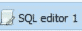 选项，然后输入以下代码：

```sql
SELECT * FROM Customer_TBL;
```

2. 点击 `EXECUTE QUERY` 按钮 。此 `SELECT` 命令的结果显示在 `GRID VIEW` 标签页中。

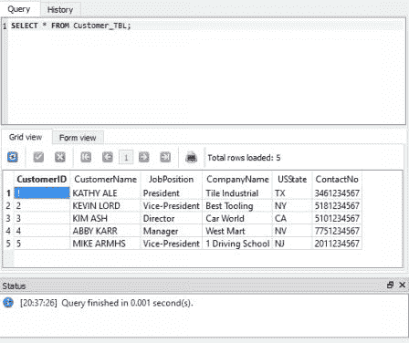

结果基本上显示了 `Customer_TBL` 表的所有数据，因为代码指示数据库选择该表的所有行和列。

### WHERE 语句

当你想要更具体地从数据库表中选择数据行时，你需要为你的编程行增加一些复杂性。此时，你需要 `WHERE` 子句的功能，这意味着只有当子句内指定的条件为真时，才会执行 `SELECT` 操作。带有 `WHERE` 子句的 `SELECT` 语句语法如下：

```sql
SELECT COLUMN_LIST
FROM TABLE_NAME
WHERE CONDITION;
```

仅选择客户职位为“副总裁”（Vice-President）的数据行：

1. 点击  选项，然后输入以下代码：

```sql
SELECT *
FROM Customer_TBL
WHERE JobPosition = 'Vice-President';
```

2. 点击 `EXECUTE QUERY` 按钮 。此 `SELECT` 命令的结果显示在 `GRID VIEW` 标签页中。

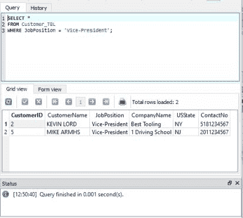

结果显示了两个名为 Kevin Lord 和 Mike Armhs 的客户记录，他们都是各自公司的副总裁。

如果你只想选择表中的某些列，可能只需要客户的全名和公司呢？你现在可以将你的代码行修改为以下内容：

1. 在 `QUERY` 标签页中，通过输入以下内容将通配符 `*`（星号）改为 `CustomerName` 和 `CompanyName`：

```sql
SELECT CustomerName, CompanyName
FROM Customer_TBL
WHERE JobPosition = 'Vice-President';
```

2. 点击 `EXECUTE QUERY` 按钮 。此 `SELECT` 命令的结果显示在 `GRID VIEW` 标签页中。

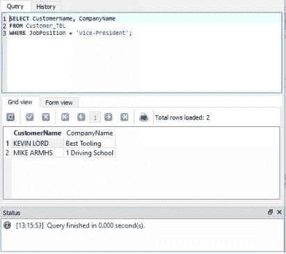

通过指定你想选择的列，你在尝试检索数据以及如何检索。

### ORDER BY 和 GROUP BY 语句

当你希望检索的数据以某种方式显示并排序时，你需要在句尾包含 `ORDER BY` 或 `GROUP BY` 操作符。`ORDER BY` 语句的主要功能是特定排列数据，无论是升序还是降序。另一方面，`GROUP BY` 语句用于将相同的数据聚集在一起并安排查询输出。

```sql
SELECT COLUMN_LIST
FROM TABLE_NAME
ORDER BY COLUMN_LIST [ASC | DESC];
```

默认情况下，`ORDER BY` 按升序排列单独行。如果你想按降序排列记录，则必须在 `ORDER BY` 子句末尾指示 `DESC`。

从 `Customer_TBL` 表中检索所有客户记录并按州升序排列：

1. 点击  选项，然后输入以下代码：

```sql
SELECT *
FROM Customer_TBL
ORDER BY USState;
```

2. 点击 `EXECUTE QUERY` 按钮 。此 `SELECT` 命令的结果显示在 `GRID VIEW` 标签页中。

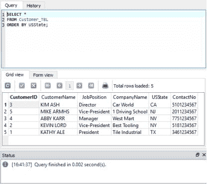

由于你没有指定排序方式，数据行使用 `USState` 列按字母顺序排列。如果你想按降序排列记录：

1. 在 `QUERY` 标签页中，在 `ORDER BY` 子句的 `USState` 之后添加 `DESC`。

```sql
SELECT *
FROM Customer_TBL
ORDER BY USState DESC;
```

2. 点击 `EXECUTE QUERY` 按钮 。此 `SELECT` 命令的结果显示在 `GRID VIEW` 标签页中。

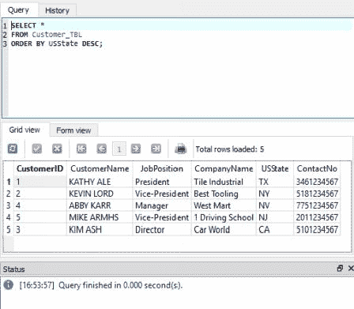

如果你想确定一组记录某些情况，或者需要以逻辑方式合并具有重复值的列，那么是时候使用 `GROUP BY` 子句了。与分组类似的术语还有聚合、汇总和汇总。为了说明这一点，如果你想知道 `Customer_TBL` 表中每个职位有多少位客户，我们需要统计记录数并显示每个职位的客户总数。

1. 点击  选项，然后输入以下代码：

```sql
SELECT JobPosition, COUNT(*) AS number_of_record
FROM Customer_TBL
GROUP BY JobPosition;
```

2. 点击 `EXECUTE QUERY` 按钮 。此 `SELECT` 命令的结果显示在 `GRID VIEW` 标签页中。

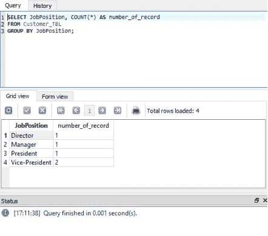

在上面的示例中，引入了 `COUNT` 函数来对数据进行分组。以下是与 `GROUP BY` 语句一起使用的常用聚合函数总结（`x` 表示你想要执行函数操作的列名）：

*   `AVG(x)` – 计算所有列值的平均值（剔除空值）
*   `COUNT(x)` – 统计列中非空值的数量
*   `COUNT(*)` – 统计记录数
*   `MAX(x)` – 计算列中的最大值（剔除空值）
*   `MIN(x)` - 计算列中的最小值（剔除空值）
*   `SUM(x)` – 计算列中数值之和或总计（忽略空值）

回到 `GROUP BY` 示例，检索了 `JobPosition` 列中的数据，并对该值的每个实例使用 `COUNT` 函数进行计数。`number_of_record` 是新创建的列，显示每个工作职位的记录总数。总监（Director）、经理（Manager）和总裁（President）职位各有 1 条记录，而副总裁（Vice-President）有 2 条。这是因为有两个客户是副总裁——Kevin Lord 和 Mike Armhs。如果你能注意到，显示的记录默认是按升序排列的。

要修改你的 SQL 语句以降序显示工作职位，你需要在 `GROUP BY` 子句之后添加 `ORDER BY` 语句（`ORDER BY` 始终位于 `GROUP BY` 语句之后）。将你的代码行更改为以下内容，然后点击 QUERY 标签页上方的 `EXECUTE QUERY` ：

```sql
SELECT JobPosition, COUNT(*) AS number_of_record
FROM Customer_TBL
GROUP BY JobPosition
ORDER BY JobPosition DESC;
```

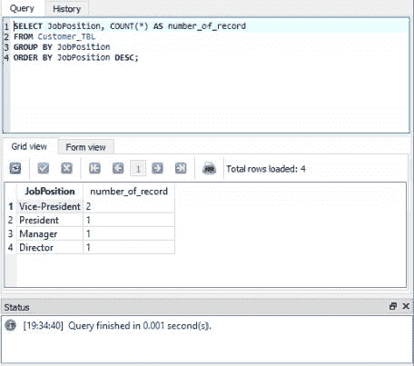

在本章中，你学习了如何使用 SQL 中最常用的 DQL 命令语句，通过从数据库表中选择、排序和分组记录来编码编程行。在下一章中，你将学习不同的事务控制命令，这些命令将允许你管理多个关系型数据库事务。

# 第八章：事务控制命令

在本章中，你将学习如何使用 SQLiteStudio 在关系型数据库管理系统 (RDBMS) 中使用的三个可用事务控制命令——`COMMIT`、`ROLLBACK` 和 `SAVEPOINT`。控制事务需要你能够管理通常由 `insert`、`update` 和 `delete` 命令引起的某些数据库更改。

当你注意到表的数据或结构已经发生变化时，执行数据库事务似乎已成功完成。在事务执行期间实际发生的情况是信息被存储在数据库的临时空间中（或你可以称之为回滚区域）。当你想要完成这些事务并永久存储这些信息时，你将通过发布适当的事务控制命令，对对数据库表所所的更改进行保存或丢弃。只有这样，回滚区域才会被清空。

## COMMIT 命令

使用 `COMMIT` 命令可以将所有事务保存到你的数据库中。通常，在 SQLiteStudio 中，当你在 SQL 编辑器中编写编程行执行 `CREATE`、`INSERT` 或 `DELETE` 事务时，更改会自动保存。你之前在第 6 章通过 `COMMIT CHANGES STRUCTURE` 按钮首次遇到过 `COMMIT` 命令，当时你重创建了 `Customer_TBL` 表的副本。现在，为了在 SQLiteStudio 中再次演示此命令，你将通过在 GRID VIEW 模式下向 `Customer_TBL` 表添加新记录来操作表结构。

1. 点击  选项。为了确保数据库当前没有正在运行的事务，在 QUERY 标签页中输入以下编程行，然后点击 `EXECUTE QUERY` ：

```sql
END TRANSACTION;
```

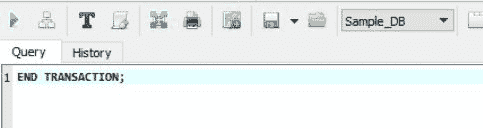

2. 在 `DATABASE NAVIGATOR` 格下的 `TABLES` 列表中双击 `Customer_TBL`。点击右侧的 `DATA` 标签并确保显示的是 `Grid View`。你将看到 `Customer_TBL` 表的所有记录。

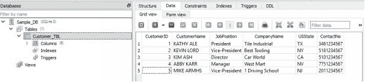

3. 点击表格最后行的第一列，即 `CustomerID` 5。

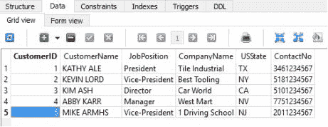

4. 点击 `INSERT ROW (INS)` 按钮旁边的箭头，选择 `PLACE NEW ROWS BELOW SELECTED ROW` 选项。

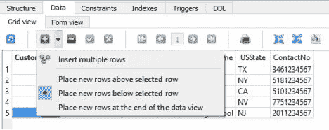

5. 这次点击 `INSERT ROW (INS)` 按钮，你将看到表中添加了一个新空行。

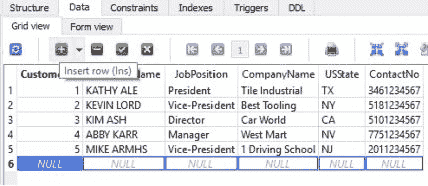

6. 在新记录中添加以下数据值：

    *   `CustomerID`: 6
    *   `CustomerName`: JOHN DEPP
    *   `JobPosition`: President
    *   `CompanyName`: Rockers Mine Company
    *   `USState`: TX
    *   `ContactNo`: 3467654321

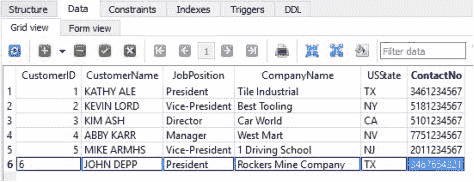

7. 点击 `COMMIT` 按钮  以永久保存添加到表中的新数据值。

## ROLLBACK 命令

如果说 `COMMIT` 命令是将所有更改保存到数据库，那么 `ROLLBACK` 命令就是反过来，所有未保存的更改都将被丢弃。然而，你只能撤销自上次 `COMMIT` 或 `ROLLBACK` 语句执行以来的更改。该事务命令的标准语法为：

```sql
ROLLBACK;
```

此外，在执行 `ROLLBACK` 命令之前，请确保事务已经开始。这意味着你需要在开头执行以下语句：

```sql
BEGIN TRANSACTION;
```

为了演示 `ROLLBACK` 如何工作，你将修改 SQLiteStudio 中的 `DROP TABLE` 命令：

1. 点击  选项。在 QUERY 标签页中输入以下编程语句，然后点击 `EXECUTE QUERY` ：

```sql
BEGIN TRANSACTION;
```

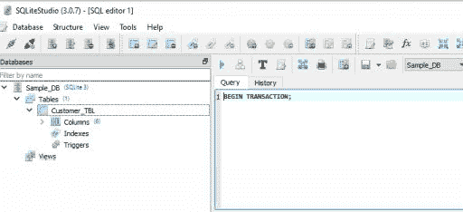

2. 点击 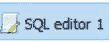 选项并清除 QUERY 标签页。输入以下内容然后点击 `EXECUTE QUERY` ：你会注意到 `Customer_TBL` 表已从列表中移除。

```sql
DROP TABLE Customer_TBL;
```

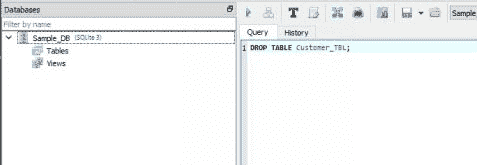

3. 再次点击  选项并清除 QUERY 标签页。输入以下内容然后点击 `EXECUTE QUERY` ：

```sql
ROLLBACK;
```

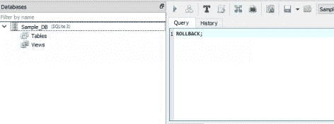

4. 为了检查 `ROLLBACK` 命令是否撤销了 `Customer_TBL` 表的删除，右键点击 `DATABASE NAVIGATOR` 格内的任意位置。选择 `REFRESH ALL DATABASE SCHEMAS` 选项。


5. 点击左侧的 `TABLE` 列表。你现在可以看到 `Customer_TBL` 表回来了。


## SAVEPOINT 命令


当你只想回滚到某个点而不是整个事务时，需要在执行`ROLLBACK`操作之前执行`SAVEPOINT`命令。这就是将多个事务管理为更小 SQL 命令组的方法。该事务控制命令的标准语法为：

```sql
SAVEPOINT SAVEPOINT_NAME;
```

结合使用`SAVEPOINT`和`ROLLBACK`命令时，语法为：

```sql
ROLLBACK TO SAVEPOINT_NAME;
```

保存点的名称可以与执行事务的数据库对象名称相同。但是，你应该记住使其唯一，以便与想要拆分为几个点或段的事务组区分开。

为了演示带有`ROLLBACK`命令的`SAVEPOINT`如何工作，你将从`Customer_TBL`表中删除某些记录并撤销此事务。

1. 点击  选项。在 `QUERY` 标签页中，输入以下编程语句并点击`EXECUTE QUERY` ：

   ```sql
   BEGIN TRANSACTION;
   ```

   

2. 再次点击 选项并清空`QUERY`标签页。然后输入以下内容：

   ```sql
   SAVEPOINT Customer_SP1;
   ```

   点击`EXECUTE QUERY`按钮 。在删除`Customer_TBL`表的最后一条记录之前，创建了一个保存点。

   

3. 要删除`Customer_TBL`表的最后一条记录，点击 选项并清空`QUERY`标签页。输入以下内容，然后点击`EXECUTE QUERY`按钮 ：

   ```sql
   DELETE FROM Customer_TBL WHERE CustomerID = 6;
   ```

   

4. 要检查记录是否已删除，请在`DATABASE NAVIGATOR`格下的`TABLES`列表双击`Customer_TBL`，然后点击右侧的`DATA`标签页。在`GRID VIEW`标签页下，点击`REFRESH TABLE DATA`按钮 ，或在键盘上按`F5`。你的表应该与如下所示：

   

5. 要创建第二个保存点，再次点击 选项。清空`QUERY`标签页并输入以下内容：

   ```sql
   SAVEPOINT Customer_SP2;
   ```

   点击`EXECUTE QUERY`按钮 。这次在删除`CustomerID`等于 5 的记录之前，创建了一个保存点。

   

6. 要删除`CustomerID`等于 5 的记录，再次点击 选项并清空`QUERY`标签页。输入以下内容并点击`EXECUTE QUERY`按钮 ：

   ```sql
   DELETE FROM Customer_TBL WHERE CustomerID = 5;
   ```

   

7. 要检查记录是否已删除，点击屏幕左下角的 选项，然后点击右侧的`DATA`标签页。在`GRID VIEW`标签页下，点击`REFRESH TABLE DATA`按钮 ，或按`F5`。你的表应该与如下所示：

   

8. 要撤销上次完成的操作，再次点击 选项并清空`QUERY`标签页。输入以下内容，然后点击`EXECUTE QUERY`按钮 ：

   ```sql
   ROLLBACK TO Customer_SP2;
   ```

   

9. 要检查记录删除是否已撤销，点击 选项，然后点击右侧的`DATA`标签页。在`GRID VIEW`标签页下，点击`REFRESH TABLE DATA`按钮 ，或按`F5`。你的表应该与下方的表一致：

   

10. 要撤销删除的第一条记录，再次点击 选项并清空`QUERY`标签页。输入以下内容，然后点击`EXECUTE QUERY`按钮 ：

    ```sql
    ROLLBACK TO Customer_SP1;
    ```

    

11. 要检查记录删除是否已撤销，点击 选项，然后点击右侧的`DATA`标签页。在`GRID VIEW`标签页下，点击`REFRESH TABLE DATA`按钮 ，或按`F5`。你的表应该与下方的表一致：

    

在本章中，你学习了三个事务控制命令在 SQL 数据库中保存或丢弃更改的主要功能。在下一章中，你将学习视图（views）的重要性，以及如何使用`CREATE`、`UPDATE`和`DROP`命令来操作它们。

# 第九章：数据库视图

在本章中，你将学习什么是数据库视图及其在 SQL 编程中的重要性。此外，你将能够执行用于创建、更新和删除视图的现有 SQL 命令。

## 定义视图

视图是当你的`SELECT`查询被保存到数据库中以备将来使用时形成的数据库对象。这意味着视图的存在是因为其数据值源自某些表。因此，一个或多个表可以创建一个数据库视图。此外，它具有与实际表相似的特征，不同之处是你不需要物理空间来存储它（它被临时保存在计算机的内存中）。此外，由于它是虚拟表，你无法修改它的数据值。

在执行创建视图的`SELECT`语句时，你可以从特定表中获取列名，也可以执行某些对给定数据值处理的函数和计算。一旦创建，这些视图可以执行以下任何任务：

- **简化数据检索**：一些终端用户可能不具备执行数据库操作以获取所需查询结果的知识。因此，为了方便起见，你可以从所需的表中创建不同的视图。
- **实现数据库安全**：有时你必须限制某些用户对数据库的访问权限，无论他们是被允许修改数据还是仅查看信息。为了确保表的安全，你可以生成只显示允许用户访问的数据值的视图。
- **支持数据汇总和报告生成**：通过视图，你能够将复杂的`SELECT`查询转换为从多个表生成的简单汇总数据。这种摘要或报告可以定期生成和更新。这就是为什么你不需要编写复杂的程序行代码，而只需要使用包含在视图创建过程中的聚合函数了。

## 创建视图

SQL 语句`CREATE VIEW`用于从一个或多个表、甚至从另一个视图生成视图。以下是从单个表创建视图时的最基本语法：

```sql
CREATE VIEW VIEW_NAME AS
SELECT COLUMN_LIST
FROM TABLE_NAME;
```

### 从单表的全部内容创建视图

对于此练习，你将使用`Sample_DB`数据库的`Customer_TBL`表在 SQLiteStudio 中创建一个`Customer_VW`视图。

1. 点击 选项并清空`QUERY`标签页。输入以下代码：

   ```sql
   CREATE VIEW Customer_VW AS
   SELECT *
   FROM Customer_TBL;
   ```

2. 点击`QUERY`标签页顶部的`EXECUTE QUERY`按钮 。你现在会注意到`DATABASE NAVIGATOR`格下的`VIEWS`区域有一个`Customer_VW`视图。

   

3. 要检查视图的内容，在左格中双击`Customer_VW`，然后在 SQL 工作区域点击`DATA`标签页。`Customer_VW`视图应包含`Customer_TBL`表的所有记录。

   

### 从单表的特定列创建视图

如果你想创建一个包含客户联系详情（`CustomerName`、`CompanyName`和`ContactNo`）的视图，你将从`Customer_TBL`表选择某些列。

1. 点击 选项并清空`QUERY`标签页。输入以下代码：

   ```sql
   CREATE VIEW CustDeatails_VW AS
   SELECT CustomerName, CompanyName, ContactNo
   FROM Customer_TBL;
   ```

   你需要为此新视图提供不同的名称。SQLiteStudio 不允许创建与现有视图同名的新视图。

2. 点击`QUERY`标签页顶部的`EXECUTE QUERY`按钮 。你现在会注意到`VIEWS`区域有一个`CustContactDetails_VW`视图，就在`Customer_VW`视图上方。`VIEWS`列表按字母顺序升序排列。

   

3. 要检查此新创建视图的内容，在左格中双击`CustContactDetails_VW`，再次点击`DATA`标签页。此视图应仅包含来自`Customer_TBL`表的三列，即`CustomerName`、`CompanyName`和`ContactNo`。

   

### 从多表创建视图

当你需要通过多个数据库表来创建所需的视图时，请确保涉及的表将通过它们共有的列进行连接。例如，你可能还有另一个包含客户订单信息的表，例如订购日期、购买的产品、数量等。此新表将称为`ORDER TABLE`，它与第一个`CUSTOMER TABLE`相关联，因为每笔订单都与特定的客户相关。

现在，你将从两个表创建一个视图，向数据库用户显示每个订单运送或交付到了哪个公司和哪个州。使用多个表创建视图的基本语法为：

```sql
CREATE VIEW VIEW_NAME AS
SELECT COLUMN_LIST
FROM TABLE_LIST
WHERE CONDITION;
```

### 要创建`ORDER TABLE`

1. 使用第 2 章中`ORDER`表的数据值，使用`SQL Editor`创建另一个表。点击 选项并删除`QUERY`标签页中的所有内容。为新的`ORDER`表输入以下代码行：

   ```sql
   CREATE TABLE Order_TBL
   (
   OrderID INTEGER NOT NULL PRIMARY KEY,
   OrderDate DATE NOT NULL,
   CustomerID INTEGER NOT NULL,
   ProductID INTEGER NOT NULL,
   OrderQty BIGINTEGER NOT NULL);
   ```

2. 点击`QUERY`标签页顶部的`EXECUTE QUERY` 。你现在会在左窗格的`TABLES`列表中看到`Order_TBL`表。

   

3. 双击左窗格中的`Order_TBL`，然后点击左侧的`DATA`标签页。你将在`GRID VIEW`模式下为此表填充数据值。

   

4. 点击`INSERT ROW`按钮 ，然后选择第一个选项——`INSERT MULTIPLE ROWS`。

   

5. 在`NUMBER OF ROWS TO INSERT`输入框中输入“4”（因为第 2 章的`ORDER TABLE`中有 4 条记录），然后点击 OK。

   

6. `Order_TBL`表现在将有 4 行 5 列。你将直接向表中输入值，而不是使用 SQL 语句填充此表（检查第 2 章中的数据值）。

   

7. 点击`COMMIT` 以保存`Order_TBL`表的所有数据值。

### 要创建一个显示每个订单运送或交付到哪个公司和州的视图

1. 点击 选项，清空`QUERY`标签页并输入以下代码行：

   ```sql
   CREATE VIEW OrderDelivery_VW AS
   SELECT Order_TBL.OrderID, Customer_TBL.CompanyName AS CompanyDeliveredTo, Customer_TBL.USState AS StateDestination, Order_TBL.OrderQty
   FROM Customer_TBL, Order_TBL
   WHERE Order_TBL.CustomerID = Customer_TBL.CustomerID;
   ```

2. 点击`QUERY`标签页顶部的`EXECUTE QUERY` 。你现在将有一个名为`OrderDelivery_VW`的新视图。

   

3. 要检查此视图的内容，双击左窗格中的`OrderDelivery_VW`，然后点击右侧的`DATA`标签页。

   

在此视图中，从`Customer_TBL`表选择了两个列并进行了重命名——`CompanyName`变为`CompanyDeliveredTo`，`USState`变为`StateDestination`。另外两个来自`Order_TBL`表——`OrderID`和`OrderQty`（保留了原始列名）。从两个表中检索出的行是`Customer_TBL`表的`CustomerID`与`ORDER_TBL`表的`CustomerID`匹配的记录。

## 删除视图（Dropping Views）

`DROP VIEW`命令是用于从数据库删除现有视图的语句。基本语法为：

```sql
DROP VIEW VIEW_NAME;
```

### 要删除整个`Customer_VW`视图

1. 点击 选项，清空`QUERY`标签页并输入以下代码行：

   ```sql
   DROP VIEW Customer_VW;
   ```

2. 点击`QUERY`标签页顶部的`EXECUTE QUERY` 。你会注意到`Customer_VW`视图已从`Views`列表中删除。

   

在本章中，你学习了 SQL 数据库视图的定义和重要性。你还执行了操作视图的常用操作，例如创建和删除。在下一章中，你将学习 SQL 数据库设计更深入的概念——主键和外键、索引以及规范化数据库。

# 第十章：增强数据库设计

在本章中，你将获得关于使用主键、外键和索引设计数据库的深入知识。

## 分配主键和外键

在定义表时分配主键是最佳实践之一。在关系数据库中，主键是一个特殊字段或字段组合，使每个记录都是唯一的。此外，指定为主键的字段不能空值。定义主键（无论是显式的还是隐式的）都发生在创建表期间。

在之前的章节中，你一直在处理`CUSTOMER`表和`ORDER`表。如果你还有另一个名为`PRODUCT`的表，其中包含以下字段：产品 ID、产品名称和单价，会怎样？你这三个表将拥有以下关系：


从上面的图中可以看出，`CUSTOMER_TBL`和`PRODUCT_TBL`是子表`ORDER_TBL`的父表。所示，名为`CustomerID`和`ProductID`的字段是父表的主键。这两个字段也出现在子表中。它们现在变成了`ORDER_TBL`表的外键。

## 理解索引（Understanding Indexes）

当数据库开始变慢（特别是其 SQL 查询时），你可以创建并实现索引来提高其性能。此类索引是重要的对象，作为与特定表数据关联的指针。索引的主要功能是在执行查询时确定数据的精确物理位置，以改进其检索过程。

索引与其创建的表的存储空间是分开的。这种分配的物理空间可能会大幅增加，甚至比它所引用的表还要大。这就是为什么在设计数据库时需要考虑存储需求。就像表和视图一样，索引也可以创建或删除。如果设计得当，它们实际上会加速`SELECT`查询，但可能会减慢`DELETE`、`UPDATE`和`INSERT`语句。对于巨大的数据库，数据检索肯定会消耗大量时间。然而，此类索引事务对表的数据没有影响。

## 创建索引


索引在创建时与特定的列相关联。然后，它持有包含该特定索引列的表中数据值的位置。每当向表中添加新数据时，数据也会被添加到索引中。假设你执行一个在`WHERE`子句中指定了特定条件的`SELECT`语句，该条件检查了索引列。首先发生的情况是先搜索索引，只有在找到数据值时才会返回确切的位置。

例如，你想从`ORDER`表中选择所有`Customer ID`等于`1`的记录。你将执行以下查询：

```sql
SELECT *
FROM Order_TBL
WHERE CustomerID = 1;
```

如果`ORDER_TBL`表在`CustomerID`列上建立了索引，那么记录将根据该列进行升序排列。因此，`CustomerID`索引使得搜索过程更容易进行，并最终确定所有具有匹配`Customer ID`的数据的位置。一旦确定了位置，将从`ORDER_TBL`表中检索相应的数据行。如果没有索引，将执行全表扫描，如果表包含成百甚至数千条记录，这将是低效的。


创建索引的基本语法是：

```sql
CREATE INDEX INDEX_NAME ON TABLE_NAME [(COLUMN_NAME)];
```

此语句可以通过添加规格发生变化，例如要建立索引的列名、排序（升序或降序）等等。现在，在 SQLiteStudio 中为`ORDER_TBL`表创建`ColumnID`索引：

1. 点击  选项并确保`QUERY`标签页是空的。然后输入以下：

   ```sql
   CREATE INDEX CustomerID_IDX ON Order_TBL (CustomerID);
   ```

   

2. 点击`QUERY`标签页上方的`EXECUTE QUERY`按钮 。你现在可以在`ORDER_TBL`表的`INDEXES`看到`CustomerID_IDX`。

   

## 删除索引

就像删除表或视图，你将使用以下基本语法：

```sql
DROP INDEX INDEX_NAME;
```

记住，你可以在删除索引后重新创建它，但在执行此类事务时务必格外小心。此外，当你删除一个表时，也会同时删除所有相关的索引。有时你可能只需要删除索引而保留表。这种实现发生在你只想修复索引问题以优化数据库性能并减少碎片时。

要删除之前创建的索引：

1. 点击  选项并确保`QUERY`标签页是空的。然后输入以下：

   ```sql
   DROP INDEX CustomerID_IDX;
   ```

   

2. 点击`QUERY`标签页上方的`EXECUTE QUERY`按钮 。你现在会注意到`CustomerID_IDX`索引已从`Indexes`列表中删除。

   

### 数据库规范化

为什么你需要对数据库规范化？因为在设计数据库时，你需要确保信息组织良好、易于管理、始终准确且没有不重复。基本上，规范化是通过将一个大表拆分为两个较小的表来设计和重新设计数据库的过程，其中相同类型的数据被在一起。例如，如果你只通过合并`CUSTOMER_TBL`表和`ORDER_TBL`表的客户信息来创建一个表，那么你将得到一个未规范化的表：

| ORDER ID | ORDER DATE | CUSTOMER ID | NAME | POSITION | COMPANY | STATE | CONTACT NO | PRODUCT ID | ORDER QTY |
| :--- | :--- | :--- | :--- | :--- | :--- | :--- | :--- | :--- | :--- |
| 1 | 2016-05-23 | 1 | Kathy Ale | President | Tile Industrial | TX | 3461234567 | 4 | 300 |
| 2 | 2016-09-09 | 1 | Kathy Ale | President | Tile Industrial | TX | 3461234567 | 5 | 100 |
| 3 | 2016-02-17 | 3 | Kim Ash | Director | Car World | CA | 5101234567 | 2 | 150 |
| 4 | 2016-05-12 | 2 | Kevin Lord | VP | Best Tooling | NY | 5181234567 | 2 | 500 |

如你所示，客户信息部分存在数据冗余。

上图显示，那些部分依赖于主键`EmployeeID`的属性已从`EMPLOYEE_TBL`中移除，并存储在一个名为`EMPLOYEE_SALARY_TBL`的新表中。保留在原表中的属性完全依赖于主键——这意味着对于每一条姓氏、名、地址和合同编号记录，都有一个特定的员工 ID。与`EMPLOYEE_SALARY_TBL`不同，特定的员工 ID 并不引用唯一的员工职位或薪资率。可能有多个员工的职位（`EmpPosition`）、薪率（`Payrate`）和奖金（`Bonus`）相同。


对于`CUSTOMER_TBL`表，客户的订单信息并不直接取决于原表中的通用客户信息。这就是为什么四个属性（`OrderID`、`OrderDate`、`ProductID`和`OrderQty`）被移动到名为`ORDER_TBL`的独立表中。

### 三阶范式（`3NF`）

通过第三阶范式（`3NF`），你必须从表中分离完全不依赖于主键的信息。回到`CUSTOMER_TBL`，职位（`JobPosition`）及其描述（`JobDescription`）完全独立于主键`CustomerID`。这是因为在通常情况下，无论客户是谁，任何职位都具有相同的职责和责任。因此，我们将`JobPosition`和`JobDescription`属性分离到另一个名为`POSITION_TBL`的表中。


在本节章中，你学习了可以应用来提高数据库性能的设计实践。通过在表分配分配主键和外键，避免了重复的数据值。通过实现表索引，提高了搜索查询的效率。由于归一化过程，数据一致性和安全性得到了提高。因此，整体数据库组织结构得到了增强。在下一章中，你将学习 SQL 设计中的一些高级主题，包括光标、触发器和错误。

# 第十一章：数据库高级主题

在本章中，你将介绍一些超出基础数据库事务的 SQL 高级主题。即使该部分只包含对光标、触发器和错误的概述，这些知识也可能帮助你扩展 SQL 实现的功能。

## 光标（Cursors）

通常情况下，SQL 命令使用基于集合的操作来处理数据库对象。这意味着事务是在一组或一个数据块上执行的。而光标则是逐行处理来自表中的数据。它使用复合语句进行创建，并在退出时销毁。声明光标的标准语法如下（对于每个实现可能有所不同）：

```sql
DECLARE CURSOR CURSOR_NAME
IS {SELECT_STATEMENT}
```

只有在光标被声明或定义后，你才能对其执行操作。

### 打开光标

一旦声明光标，你就可以执行`OPEN`操作来访问光标，然后执行指定的`SELECT`语句。`SELECT`查询的结果将保存在内存中的某个区域。打开光标的标准语法为：

```sql
OPEN CURSOR_NAME;
```

### 从光标获取数据

如果你想从光标中检索查询结果或数据，则执行`FETCH`语句。获取数据的标准语法为：

```sql
FETCH NEXT FROM CURSOR_NAME [INTO FETCH_LIST]
```

在 SQL 编程中，方括号内的可选语句允许你将检索的数据赋值给特定的变量。

### 关闭光标

在打开特定光标时，有一个相应的`CLOSE`语句要执行。一旦光标关闭，所有使用的名称和资源将被释放。因此，程序将无法再使用该光标。关闭光标的标准语法为：

```sql
CLOSE CURSOR_NAME
```

## 触发器（Triggers）

在某些情况下，你希望在执行某些特定操作后发生特定的 SQL 操作或事务。这种情况描述了一个触发另一个 SQL 语句发生的 SQL 语句。本质上，触发器是在数据库中编译的 SQL 过程，它根据之前发生的其他事务执行某些事务。此类触发器可以在 DML 语句（`INSERT`、`DELETE`和`UPDATE`）执行之前或之后执行。此外，触发器可以验证数据完整性、维护数据一致性、回滚事务、记录操作、修改和读取数据库数据值。

### 创建触发器

创建触发器的标准语法为：

```sql
CREATE TRIGGER TRIGGER_NAME
TRIGGER_ACTION_TIMETRIGGER_EVENT
ON TABLE_NAME
[REFERENCING OLD_OR_NEW_VALUE_ALIAS_LIST]
TRIGGERED_ACTION
```

- `TRIGGER_NAME` - 此对象的唯一标识名称
- `TRIGGER_ACTION_TIMETRIGGER_EVENT` - 触发动作发生的指定时间（无论是在触发事件之前还是之后）。
- `TABLE_NAME` – 执行 DML 语句的表
- `TRIGGERED_ACTION` - 触发事件后要执行的动作

在打开特定光标后，有一个相应的触发器语句要执行。一旦触发器被创建，就无法再更改。触发器的工作方式取决于你指定的条件——是在 DML 语句执行时触发一次，还是对于受影响的每一行 DML 语句触发多次。

### 删除触发器

删除触发器的基本语法与删除表或视图相同：

```sql
DROP TRIGGER_NAME;
```

## 错误（Errors）

无错误的设计或实现是任何编程语言的最终目标之一。你可能会由于不遵守命名规范、错误地编写代码（例如缺少单引号或括号）或当输入数据与定义类型不匹配时产生错误。

为了方便起见，SQL 设计了一种返回错误信息的方法，以便程序员了解发生的情况并能够采取适当措施。此类错误处理机制包括状态参数`SQLSTATE`和`WHENEVER`子句。

### SQLSTATE

状态参数或主机变量`SQLSTATE`是一种包含多种异常条件的错误处理工具。它是由五个字符组成的字符串（大写字母 A-Z 和数字 0-9），其中前两个字符表示类代码，后三个字符是子类代码。类代码标识 SQL 语句完成后的状态——无论其是否成功（如果没有成功，则会返回主要的错误类型之一）。

`SQLSTATE`在每次操作后都会更新。如果值为`00000`（五个零），则意味着执行成功，你可以继续后续操作。如果它包含`00000`以外的五位字符串，则必须检查你的代码行以修复提交的错误。

### WHENEVER 子句

`WHENEVER`子句错误处理机制关注执行异常。通过这种方式，错误会被识别，并为程序员提供纠正的选择。如果你无法纠正或撤销已提交的错误，就可以优雅地终止应用程序。

`WHENEVER`子句写在可执行的 SQL 代码之前，具体位于 SQL 声明部分。基本语法为：

`WHENEVER CONDITION ACTION;`

- `CONDITION` – 值可以为`SQLERROR`（如果`SQLSTATE`类代码不是`00`、`01`或`02`则返回 TRUE）或`NOT FOUND`（如果`SQLSTATE`为`02000`则返回 TRUE）
- `ACTION` – 值可以为`CONTINUE`（程序继续正常执行）或`GOTO address`（跳转到指定的程序地址执行）

在本章中，你已经学习了游标的主要作用、触发器的工作原理以及在 SQL 编程中处理错误的重要性。学习这些高级主题使你在最大化 SQL 实现潜力方面更近了一步。

# 第十二章：练习

## 练习 #1

在 SQLiteStudio 中创建一个名为`OrderInvoice_TBL`的发票表，包含以下字段：

- `InvoiceID` – 主键，整数数据类型
- `CustomerID` – 整数类型
- `OrderID` – 整数类型
- `TaxAmt` – 小数数据类型，精度为 9，小数位 2
- `TotalSaleAmt` – 小数数据类型，精度为 9，小数位 2
- `ShippingFee` – 小数数据类型，精度为 9，小数位 2

## 练习 #2

创建`OrderInvoice`表后，使用`INSERT`语句使用以下数据值填充字段：

| 发票 ID | 客户 ID | 订单 ID | 税额 | 总销售额 | 运费 |
| :--- | :--- | :--- | :--- | :--- | :--- |
| 2016001 | 1 | 1005 | $523.80 | $198023.05 | $1981.78 |
| 2016002 | 3 | 1006 | $302.83 | $198302.03 | $2005.10 |
| 2016003 | 3 | 1007 | $217.02 | $20021.70 | $1983.12 |
| 2016004 | 2 | 1008 | $909.00 | $200009.09 | $19827.22 |

## 练习 #3

从`OrderInvoice`表创建一个名为`OrderLargeSales_VW`的视图，其中总销售额大于 $150,000.00 且税额小于 $600。该视图仅包含以下字段：客户 ID、订单 ID、税额和总销售额。

## 练习 #4

使用 DML 命令`DROP`删除`OrderInvoice_TBL`表和`OrderInv_VW`视图。

# 练习答案

## 练习 #1 答案

1. 启动 SQLiteStudio。点击`TOOLS`菜单并选择`OPEN SQL EDITOR`选项。
2. 点击右侧的`QUERY`标签并输入以下代码行：

   ```sql
   CREATE TABLE OrderInvoice_TBL (
       InvoiceID INTEGER PRIMARY KEY,
       CustomerID INTEGER, 
       OrderID INTEGER,  
       TaxAmt DECIMAL(9, 2),
       TotalSaleAmt DECIMAL(9, 2),
       ShippingFee DECIMAL(9, 2)
   );
   ```

## 练习 #2 答案

1. 启动 SQLiteStudio。点击`TOOLS`菜单并选择`OPEN SQL EDITOR`选项。
2. 点击右侧的`QUERY`标签并输入以下代码行：

   ```sql
   INSERT INTO OrderInvoice VALUES
   (2016001, 1, 1005, 523.80, 198023.05, 1981.78),
   (2016002, 3, 1006, 302.83, 198302.03, 2005.10),
   (2016003, 3, 1007, 217.02, 20021.70, 1983.12),
   (2016004, 2, 1008, 909.00, 200009.09, 19827.22);
   ```

## 练习 #3 答案

1. 启动 SQLiteStudio。点击`TOOLS`菜单并选择`OPEN SQL EDITOR`选项。
2. 点击右侧的`QUERY`标签并输入以下代码行：

   ```sql
   CREATE VIEW OrderLargeSales_VW AS
   SELECT CustomerID, OrderID, TaxAmt, TotalSaleAmt
   FROM OrderInvoice
   WHERE TotalSaleAmt > 150000.00 AND TaxAmt < 600;
   ```

## 练习 #4 答案

1. 启动 SQLiteStudio。点击`TOOLS`菜单并选择`OPEN SQL EDITOR`选项。
2. 要删除表，输入以下代码行：

   ```sql
   DROP TABLE OrderInvoice_TBL;
   ```

3. 要删除视图，输入以下代码行：

   ```sql
   DROP VIEW OrderInv_VW;
   ```

# 这里是一个需要你复习的快速回顾案例：

1. 你现在已经了 SQL 语言的历史和用途。
2. 你学习了如何描述关系型数据库和数据库管理系统。
3. 你学习了如何使用不同的命令类型并安装 SQLiteStudio。
4. 你学习了如何定义和使用各种数据类型。
5. 你学习了如何使用`CREATE`、`ALTER`和`DROP`语句。
6. 你学习了如何使用`INSERT`、`UPDATE`和`DELETE`语句。
7. 你学习了如何使用`SELECT`、`WHERE`、`ORDER BY`和`GROUP BY`语句。
8. 你学习了如何使用`COMMIT`、`ROLLBACK`和`SAVEPOINT`命令。
9. 你还学习了如何定义、创建和删除视图。
10. 你学习了如何分配主键和外键、创建索引以及数据库规范化。
11. 你学习了如何使用游标、触发器和错误处理。

# 结语

我希望你真正喜欢了学习使用 SQLiteStudio 进行 SQL 编程和数据库管理的本质。我相信通过阅读这本书，你以实惠的价格实现了理解 SQL 数据库的目标并受益匪浅。我相信通过本书的指南获得的知识，你现在可以在 SQLiteStudio 中规划、设计并创建你自己的数据库。

你可能也可以考虑学习其他编程语言，你的 SQL 编程知识将为你学习其他语言时提供巨大的优势。你可以在[这里](https://www.amazon.com/Felix-Alvaro/e/B015JCBZN4/ref=dp_byline_cont_ebooks_1)找到其他热门编程书籍。


顺便说一下，如果你有任何建设性的反馈或评论，我将不胜感激，这将进一步提高我的写作水平。请随时给我发送电子邮件，特别是当你有任何需要澄清或提问时（即使只是想打个招呼）。我的邮箱地址是 `Felix_Alvaro@mail.com](mailto:Felix_Alvaro@mail.com)`。

再次感谢，愿上帝保佑你！

Felix Alvaro
