# C# 开发者的 SQL Server 精要指南

## 前言：Daniel Jebaraj

### *Succinctly* 系列书籍背后的故事

Daniel Jebaraj，副总裁

Syncfusion, Inc.

## 站在技术前沿

正如你们的许多人所知，Syncfusion 是 Microsoft 平台的软件组件提供者。这使我们处于一个始终处于前沿的既兴奋又充满挑战的地位。

每当 Microsoft 发布新的平台或工具时（现在似乎每隔两周就一次），我们必须快速地自我教育。

## 信息丰富，但更难消化

在现实中，这转化为了大量的书籍订单、博客搜索和 Twitter 扫描。虽然互联网上的可用信息越来越多，出版的书也越来越多（即使是针对较新的话题），但一个持续限制着我们的方面是无法找到简洁的类概述类书籍。我们通常面临两种选择：阅读几本 500 多页的书，或者在网络上搜寻相关的博客文章和其他文章。正如每个有工作要做、有客户要服务一样，我们觉得这非常令人挫败。

## Succinctly 系列

这种挫败感转化为一种强烈的愿望，即创作针对在 Microsoft 平台上工作的开发者的简洁技术书籍。

鉴于这些开发者所具备的背景知识，我们坚信，大多数主题都可以转化成 50 到 100 页之间的书籍。

这正是我们通过 Succinctly 系列想要实现的。。难道一切美好的事物不都是源于对改善现状的深度渴望吗？

## 最顶的作者，最优质的内容

每位作者都是从与我们愿景相合的才华横溢的专家中精心挑选出来的。你手中的这本书以及该系列中的其他书籍，都是作者们不懈工作的成果。你将发现原创内容，保证让你喝几杯咖啡的时间内上手。

## 永久免费

Syncfusion 将致力于制作多个主题的书籍。这些书籍将永久免费。我们发布的任何更新也是免费的。

### 免费？有什么猫腻吗？

这里没有任何猫腻。Syncfusion 在此方面拥有共同利益。

作为组件供应商，我们独特的主张一直是，我们提供了比市场上任何其他产品都更深入、更广泛的框架。开发者教育极大地帮助我们进行市场，并与那些承诺“一键开启 AJAX 支持”或“把月亮变成奶酪！”的竞争对手竞争。

## 让我们知道您的想法

如果您有任何感兴趣的话题、想法或反馈，请随时通过 `succinctly-series@syncfusion.com` 向我们发送。

我们诚地希望您喜欢阅读这本书，希望它能帮助您更好地理解所学习的主题。感谢阅读。

请在 Twitter 上关注我们，并在 Facebook 上“点赞”我们，帮助我们推广 Succinctly 系列的作品！


## 关于作者

Sander Rossel 是一位专业开发者，拥有 .NET (VB 和 C#)、WinForms、MVC、WebAPI、Entity Framework、JavaScript、Git、Jenkins、Oracle 和 SQL Server 的工作经验。

他对各种技术感兴趣，包括但不限于函数式编程、NoSQL、持续集成（以及更广泛的软件质量）和软件设计。

他为 Succinctly 系列编写了另一本电子书，您可以免费下载：《C# 面向对象编程》(Object-Oriented Programming in C# Succinctly）。

他通过博客 Sander's bits - Writing the code you need、他的 CodeProject 个人页以及持续的写作来教育他人。

## 引言

在编写许多应用程序时，你几乎肯定需要某种数据库。当你使用数据库时，你就会与它打交道。无论你有数据库管理员 (DBA)还是自己开发数据库和应用程序，一点数据库知识总是会很有用的。

这本书适用于所有使用 SQL Server 数据库开发 C# 应用程序的人员。在书中，我们将使用 ADO.NET 连接数据库，并使用 Entity Framework 探索开发数据库的不同方法。我们将看到常见的陷阱、数据库运行缓慢的原因、我们如何排除故障，以及我们如何测试和部署我们的 SQL Server 数据库。书的前半部分重点关注 C# 和开发。书的后半部分关注使用 SQL Server 工具进行故障排除。

假设已具备 C# 和 SQL（查询语言）知识。

## 工具

在书中，我们将利用 Windows 上的 Visual Studio 2015 社区版和 SQL Server 2014 Express（我使用的是 Windows 8.1 专业版和 Windows 10）。你需要微软账户下载这些文件。当提示特定的 SQL Server 版本时，选择带有 Tools 的 SQL Server Express（或带有 Advanced Services 的 SQL Server Express，如果你想尝试 Reporting Services 和全文检索，但这些不在本书的范围内）。

提供的链接将带您进入产品网站，并可能允许您下载相应工具的最新版本。您可以自行风险下载最新版本（书中的示例可能仍然适用），或者您可以搜索我在书中一直使用的版本。大多数示例也适用于工具的旧版本，因此如果您已经安装了某些内容，只需继续并查看其是否有效。

安装过程非常直观。在安装 Visual Studio 时，确保勾选 SQL Server Data Tools 复选框；在安装 SQL Server 时，确保勾选 Management Tools - Complete。当 SQL Server 安装程序提示输入实例名称时，选择任何你喜欢的名称，或选择默认实例（我的实例名为 SQLEXPRESS）。除外，你可以保留所有默认设置。

安装非常简单。在安装 Visual Studio 时，确保勾选 SQL Server Data Tools 复选框；在安装 SQL Server 时，确保勾选 Management Tools - Complete。当 SQL Server 安装程序提示输入实例名称时，选择任何你喜欢的名称，或选择默认实例（我的实例名为 SQLEXPRESS）。除外，你可以保留所有默认设置。

SSMS 将自动为你的外键 `FK_Person_Gender` 命名，因此你可以忽略其他设置并保存。你现在已经告诉 SQL Server，`Person` 表中的 `Gender` 列只能包含在 `Gender` 表的 `Id` 列中存在的值。

> 注意：许多人认为关系型数据库之所以被称为关系型是因为可以在表之间定义外键关系。但事实并非如此，这不仅仅是一种约束，还能保证数据完整性。关系型数据库之所以被称为关系型，是因为在数学中，“表”的术语是“关系”（relation）。一个关系是一个无序的值集合。一个值是一组唯一值的集合。SQL Server 中的一个值是一个元组（tuple），它是一组值的集合。值的唯一性由主键来保证。这意味着，任何没有唯一主键的表（或视图）实际上并不是“关系”！

现在，右键点击 `Gender` 表并点击“编辑前 200 行”。你插入什么其实并不重要，但也许你应该遵循你的示例。

| Id | Code | Description |
|---|---|---|
| 0 | UNKNOWN | 未说明 |
| 1 | MALE | 男性 |
| 2 | FEMALE | 女性 |
| | NULL | NULL |

图 5：性别

现在我们还在 `Person` 表中插入一个或多个个人。

| Id | FirstName | LastName | DateBirth | GenderId |
|---|---|---|---|---|
| 1 | Sander | Rossel | 1987-11-08 00:00:00 | 1 |
| 2 | Bill | Gates | 1955-10-28 | 1 |
| * | NULL | NULL | NULL | NULL |

图 6：人员

操作就是这些：我们设置了两个表，创建了一个外键，并插入了一些数据。但我们还缺少一个……脚本！如果你想在不同的数据库（或另一个环境中的相同数据库）上执行这些步骤，你就需要脚本。幸运的是，SSMS 生成脚本有几个选项。

第一个方法是右键点击一个对象，选择“编写 [对象] 为 >”，然后根据需要进行选择。脚本只导出对象，这对于获取表（表在不丢失数据的情况下无法被覆盖）可能没问题。例如，`Person` 表的 `CREATE` 脚本如下：

代码列表 1：CREATE TABLE [dbo].[Person]

```
CREATE TABLE [dbo].[Person] (
  [Id] [int] IDENTITY(1,1) NOT NULL,
  [FirstName] [varchar](256) NOT NULL,
```

```
[LastName] [varchar](256) NULL,
[DateOfBirth] [smalldatetime] NULL,
[GenderId] [int] NULL,
CONSTRAINT [PK_Person] PRIMARY KEY CLUSTERED
(
[Id] ASC
WITH (PAD_INDEX = OFF, STATISTICS_NORECOMPUTE = OFF, IGNORE_DUP_KEY = OFF,
ALLOW_ROW_LOCKS = ON, ALLOW_PAGE_LOCKS = ON) [PRIMARY]
)

GO

SET ANSI_PADDING OFF OFF
GO

ALTER TABLE [dbo].[Person] WITH CHECK CONSTRAINT [FK_Person_Gender]
FOREIGN KEY([GenderId])
REFERENCES [dbo].[Gender] ([Id])
GO

ALTER TABLE [dbo].[Person] CHECK CONSTRAINT [FK_Person_Gender]
GO
```

这太棒了，但请注意，我们需要先有 `Gender` 表，否则此脚本将失败。我们后来添加了外键约束，但所有内容都在这一个脚本中。

对于表的更新，我们可以进入“设计”窗口，添加列、更改类型、添加约束，然后右键点击并选择“生成更改脚本”。例如，我添加了 `LastLoginTime` 列，并将 `GenderId` 改为非空。

| 列名 | 数据类型 | 允许 NULL |
| --- | --- | --- |
| Id | int | |
| FirstName | varchar(256) | |
| LastName | varchar(256) | |
| DateOfBirth | smalldatetime | |
| GenderId | int | |
| LastLoginTime | datetime | |

## 保存更改脚本

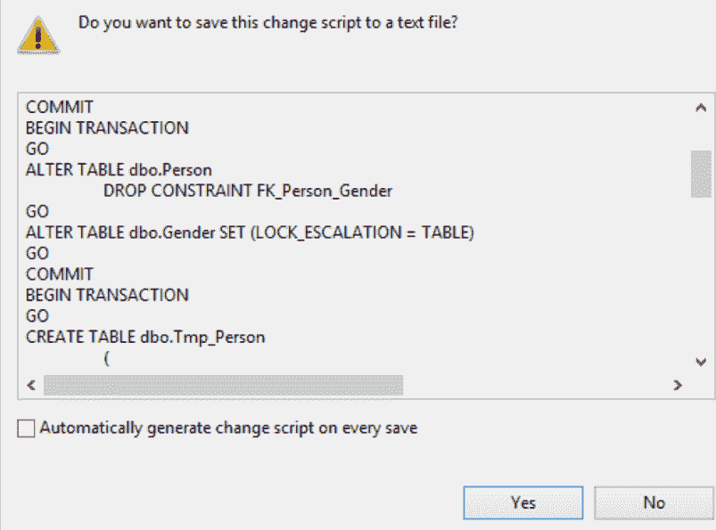

图 7：保存更改脚本

如你所示，SQL Server 实际上创建了一个临时表，删除了原表并进行了更改。它做的比你想的要得多！你可以保存此脚本并毫不费力地（或自动地）在另一个环境中执行它。遗憾的是，删除并重建表很慢且消耗资源，你可能仍然想编写自己的脚本。你可以使用屏幕左上角的“新建查询”按钮打开新查询窗口，或使用 `Ctrl + N`。请确保在正确的数据库上执行脚本（使用“执行”按钮或 F5）——一个常见的错误是在被选为默认的 `master` 数据库上执行脚本。

下面的简单脚本还将添加一个 `LoginTime` 列并让 `GenderId` 允许空。

代码列表 2：ALTER TABLE

```
ALTER TABLE dbo.Person ADD LoginTime DATETIME
ALTER TABLE dbo.Person ALTER COLUMN GenderId INT
```

> 提示：可以在单个查询中仅执行脚本的某些部分。只需选择你想执行的查询部分并按 F5 即可。当你测试某些软件并希望检查数据、再次运行代码并重复时特别有用。当在一个窗口中存在 `SELECT` 语句和 `UPDATE/DELETE` 语句时，你可以独立地执行这两个（或多个）语句。

> 提示：可以在单个查询中仅执行脚本的某些部分。只需选择你想执行的查询部分并按 F5 即可。当你测试某些软件并希望检查数据、再次运行代码并重复时特别有用。当在一个窗口中存在 `SELECT` 语句和 `UPDATE/DELETE` 语句时，你可以独立地执行这两个（或多个）语句。

或者，如果你选择集成安全（integrated security），可以使用 `Trusted_Connection=True;` 或 `Integrated Security=True;` 代替 User Id 和 Password，甚至可以使用 `Integrated Security=SSPI`（它们都是相同的）。

同样，`Data Source=serverinstance` 是 `Server=serverinstance` 的常用替代方案，而 `Integrated Security=database` 是 `Database=database` 的常用替代方案。

现在，让我们填空空白并创建一个连接。我的连接字符串如下：`Server=Laptop23;SQLEXPRESS; Database=SuccinctlyExamples; Integrated Security=SSPI`。

## 创建连接

现在让我们在代码中创建一个连接并打开它。关于代码的简短说明：我字符串字符串使用了 `"..."` 语法，这是 C# 6.0 的新功能。它基本上是 `string.Format` 的简写。

代码列表 4：创建一个 SqlConnection

```csharp
try
{
    using (SqlConnection connection = new SqlConnection(
        @"Server=LAPTOP23;SQLEXPRESS; Database=SuccinctlyExamples;
        Integrated Security=SSPI"))
    {
        connection.Open();
        // 数据库在 Dispose() (或 Close) 时会关闭。
    }
    Console.WriteLine("成功打开并关闭了数据库。");
}
catch (Exception ex)
{
    Console.WriteLine($"打开数据库连接时出错：{ex.Message}");
}
Console.WriteLine("按任意键关闭。");
Console.ReadKey();
```

第一行代码在 `System.Data.SqlClient` 中创建了一个新的 `SqlConnection` 并传递了连接字符串中的参数。我们将使用的许多对象都需要被妥善释放以释放资源（在这种情况下是数据库连接），因此我们使用 `using` 块正确地封装了 `SqlConnection`。当调用 `Close()` 或 `Dispose()` 方法时（使用 `using` 块），连接会自动关闭。`connection.Open()` 打开连接。

这几行代码可能会发生很多错误，因此使用了 `try-catch` 块。尝试在连接字符串中输入拼写错误（例如，`SServer`），使用不存在的数据库（任何随机值），提供无效的凭据，或尝试打开两次连接（中间不关闭）。所有这些操作将导致抛出异常（Exception）。

## 配置你的连接字符串

在 C# 中硬编码连接字符串在开发期间可能很方便，但在生产环境中并不实际（不安全）。每当数据库或环境（开发、测试、生产）发生变化时，你都需要更改、重新编译并重新部署。

连接字符串通常存储在配置文件中。应用程序的配置文件每个环境通常不同。在配置文件存储各种设置的巨大优势是，你可以在不实际更改和重新部署应用程序的情况下更改应用程序的行为，允许在多个环境中具有不同的设置。在文件中存储连接字符串是非常常见的，因此我将 `SuccinctlyDB` 连接字符串添加到我的 `app.config` 文件中。

代码列表 5：配置文件中的 connectionStrings

```xml
<?xml version="1.0" encoding="utf-8" ?>
<configuration>
  <connectionStrings>
    <add name="SuccinctlyDB" connectionString="Server=LAPTOP23\SQLEXPRESS;Database=SuccinctlyExamples; Integrated Security=SSPI" />
  </connectionStrings>
  <startup>
    <supportedRuntime version="v4.0" sku=".NETFramework,Version=v4.6" />
  </startup>
</configuration>
```

现在我们可以轻松地从配置文件中检索连接字符串。我们需要向项目添加 `System.Configuration` 的引用。现在我们可以轻松地替换第一行代码，以使用来自配置文件的值。

代码列表 6：从配置文件使用连接字符串

```csharp
string connectionString =
ConfigurationManager.ConnectionStrings["SuccinctlyDB"]?.ConnectionString;
using (SqlConnection connection = new SqlConnection(connectionString))
```

注意，当配置文件中不存在连接字符串时，`connectionString` 将为空，并且在尝试打开连接时会抛出异常（“ConnectionString 属性未初始化”）。如果没有 `?.` 空条件运算符，相反，在尝试获取 `ConnectionString` 属性时，我们将得到一个 `NullReferenceException`（空引用异常）。

## 构建连接字符串


在某些情况下，你可能想要编辑连接字符串或从头创建它（例如，在 SSMS 登录表单中）。对于这种用例，我们可以使用 `SqlConnectionString`。`SqlConnectionString` 的功能正如其名；它使用参数创建连接字符串。让我们来看一个简单的示例。

### 代码列表 7：SqlConnectionString

```csharp
SqlConnectionString builder = new SqlConnectionString();
builder.DataSource = "LAPTOP23\SQLEXPRESS";
builder.InitialCatalog = "SuccinctlyExamples";
builder.IntegratedSecurity = true;
```

注意，`SqlConnectionString` 实际上使用的是 `DataSource` 而不是 `Database`。此外，我们可以使用 `SqlConnectionString` 来编辑连接字符串。构造函数是重载的，因此你可以设置。

### 代码列表 8：编辑连接

```csharp
string baseConnectionString =
ConfigurationManager.ConnectionStrings["SuccinctDB"].ConnectionString;
SqlConnectionString builder = new SqlConnectionString(baseConnectionString);
builder.IntegratedSecurity = false;
using (SqlConnection connection = new SqlConnection(builder))
```

## 查询你的数据库

下一步是使用连接来检索某些数据。要做到这一点，我们需要创建 `SqlCommand` 并带上我们的连接，然后执行它。

> 提示：在生产代码中永远不要使用 `*`。`*` 会检索表中的所有列，这并不总是你所想要的。例如，当在视图中使用，`*` 将选择视图创建时存在的所有字段，而不是所有字段。

## 读取数据

在 `SqlCommand` 实例上使用 `ExecuteReader` 函数时，查询被执行，我们获得一个持有检索数据的 `SqlDataReader`。`SqlDataReader` 遗憾的是很难处理。`SqlDataReader` 按行读取（正向），你也可以通过索引访问列。显然，通过索引选择并不容易，尤其是在大型查询中（谁知道索引是多少？），但按名称获取返回值对象并需要程序员进行正确的转换。然后，如果没有值（假设值为 NULL），你必须将其转换为默认值或 `null`。事实：数据库的 NULL 与 C# 中的 `null` 不同。C# 使用静态的 `DBNull.Value` 表示数据库 NULL。至少可以如此说。我们可能希望结果存储在自定义对象中，因此我们需要创建一个 `Person` 类。让我们看看它是那样的。

首先，让我们创建一个简单的 `Person` 类。

```csharp
public class Person
{
    public int Id { get; set; }
    public string FirstName { get; set; }
    public string LastName { get; set; }
    public DateTime DateOfBirth { get; set; }
    public int? GenderId { get; set; }
}
```

现在是从数据库获取所有人员的代码：

### 代码列表 10：SqlDataReader 的用法

```csharp
try
{
    List<Person> people = new List<Person>();
    string connectionString =
    ConfigurationManager.ConnectionStrings["SuccinctDB"].ConnectionString;
    using (SqlConnection connection = new SqlConnection(connectionString))
    using (SqlCommand command = new SqlCommand(
        "SELECT Id, FirstName, LastName, DateOfBirth, GenderId FROM
        dbo.Person",
        connection))
    using (SqlDataReader reader = command.ExecuteReader())
    {
        while (reader.Read())
        {
            people.Add(new Person
            {
                Id = reader.GetInt32(0),
                FirstName = reader.GetString(1),
                LastName = reader.GetString(2),
                DateOfBirth = reader.GetDateTime(3),
                GenderId = reader.IsDBNull(4) ? (int?)null : reader.GetInt32(4)
            });
        }
    }
}
catch (Exception ex)
{
    Console.WriteLine($"错误：{ex.Message}");
}
```

```csharp
{
  connection.Open();
  using (SqlDataReader reader = command.ExecuteReader()) {
    while (reader.Read()) {
      var p = new Person();

      // Get Id by index...
      object idByIndex = reader[0];
      //...And make the correct conversion.
      int idByIndexCast = Convert.ToInt32(idByIndex);

      // Get Id by name...
      object idByName = reader[nameof(Person.Id)];
      //...And make the correct conversion.
      int idByNameCast = Convert.ToInt32(idByName);

      // Or get the Id index by name...
      int idIndex = reader.GetOrdinal(nameof(Person.Id));
      //...And use the SqlDataReader methods.
      p.Id = reader.GetInt32(idIndex);

      int firstName = reader.GetOrdinal(nameof(Person.FirstName));
      p.FirstName = reader.GetString(firstName);

      int lastName = reader.GetOrdinal(nameof(Person.LastName));
      if (!reader.IsDBNull(lastName)) {
        p.LastName = reader.GetString(lastName);
      }

      int dateOfBirthIndex = reader.GetOrdinal(nameof(Person.DateOfBirth));
      if (!reader.IsDBNull(dateOfBirthIndex)) {
        p.DateOfBirth = reader.GetDateTime(dateOfBirthIndex);
      }

      int genderIndex = reader.GetOrdinal(nameof(Person.Gender));
      if (!reader.IsDBNull(genderIndex)) {
        p.Gender = reader.GetInt32(genderIndex);
      }

      people.Add(p);
    }
  }
}
  // The database is closed upon Dispose() (or Close()).
}
  Console.WriteLine("Successfully opened and closed the database.");

  foreach (Person p in people)
{
    Console.WriteLine($"{p.FirstName} {p.LastName} was born on {p.DateOfBirth}");
}} catch (Exception ex)
{
  Console.WriteLine("Something went wrong while opening a connection to the database: {ex.Message}");
}
Console.WriteLine("Press any key to close.");
Console.ReadKey();
```

首先，请注意我在顶部声明了 `List<Person>`，这样我就可以在 `using` 块之外使用它。通常的最佳实践是打开连接、立即获取数据并关闭连接。数据库连接在显式调用 `Close()` 之前会保持开启，而使用 `SqlDataReader` 时，在所有数据准备好之前无法关闭。

创建 `SqlCommand` 是非常简单的。正如所言，`SqlDataReader` 处理的是表，并且一次访问一行。当调用 `SqlDataReader.Read` 时，第一行（如果有的话）将是可见的。随后的 `Read` 调用将移动到下一行。如果没有可用行，`Read` 将返回 `false`。你可以使用 `SqlDataReader.HasRows` 来检查是否有可用行。`GetOrdinal` 函数返回列的索引（名称），因为它根据数据库列命名了属性；如果其中一个列发生了变化，代码将会崩溃，但如果发生变化，代码将继续运行。

在这个示例中，我们使用了 `GetInt32`、`GetString` 和 `DateTime`。还有其他类型方法，如 `GetInt64`、`GetBoolean`、`GetChar` 等。它们将 SQL 转换为相应的 CLR 类型。如果值缺失，类型方法将抛出异常。对于可空字段，你需要检查 `IsDBNull`。另一种是 `GetValue`，它返回一个对象。如果你不需要值的类型，可以使用它。为了检查 NULL，使用 `DBNull.Value`。

### 代码 11：SqlDataReader.GetValue(string)

```csharp
object value = reader.GetValue("SomeColumn");
bool isNull = ...;
```

现在是另一个有趣点：如果我们想要返回多个结果集怎么办？假设我们更改查询并检索所有读者。`SqlDataReader` 可以检索多个结果集并以相同的方式访问它们。读者默认是第一个结果集，但如果有后续结果集，你可以调用 `NextResult`，读者将移动到下一个结果集。你可以调用 `Read` 来移动到第一行（如果有的话）。

## 参数化

在此之前，我无法告诉你使用参数有多重要。这是安全编程的实践。不幸的是，正如我所看到的，程序员仍然没有使用参数。结果就是查询缓慢，更重要的是安全漏洞和数据泄露。最糟糕的是，这种情况发生在像 Sony、Symantec 和 SAP 这样的大公司身上。存在你不想要的 SQL 注入。

现在你已经知道参数化的重要性，让我们看看它到底是什么以及如何实现。通常，在处理数据库时，你并不是选择整个表。大多数情况下，你会使用某些过滤条件 `WHERE Id = x`，其中 `x` 是一个变量。根据我与你分享的知识，可能会诱按照以下方式实现 `GetPeopleByName`：

### 代码 14：非参数化查询

```csharp
public List<Person> GetPeopleByName(string firstName)
{
    List<Person> people = new List<Person>();
    string connectionString = ConfigurationManager.ConnectionStrings["SuccinctDB"].ConnectionString;
    using (SqlConnection connection = new SqlConnection(connectionString))
    using (SqlCommand command = new SqlCommand(
        "SELECT Id, FirstName, LastName, DateOfBirth, GenderId FROM dbo.Person "
        + "WHERE FirstName = '" + firstName + "'", connection))
    {
        connection.Open();
        using (SqlDataReader reader = command.ExecuteReader())
        {
            while (reader.Read())
            {
                // 处理人员...
            }
        }
    }
    return people;
}
```

所以，从数据库读取数据必须很困难吗？有一些替代方案，我们将在本书后面的部分介绍。然而，使用 `SqlDataReader` 是从数据库读取数据的性能最佳（当正确完成后）。如果你的查询返回单个值（单行一列），你可以使用 `ExecuteScalar`。它将返回一个可以转换为正确类型的对象。

### 代码 13：ExecuteScalar 的用法

```csharp
public string GetPersonName(int id)
{
    // ... 实现代码 ...
}
```

当然，这确实可以获取给定名字的人员。那么问题是什么？`firstName` 可能是用户在 Web 或桌面应用程序的某些文本字段中输入的值。所以。

### 代码 12：带多个结果集的 SqlDataReader

```csharp
List<Person> people = new List<Person>();
List<Gender> genders = new List<Gender>();
string connectionString = ConfigurationManager.ConnectionStrings["SuccinctDB"]?.ConnectionString;
using (SqlConnection connection = new SqlConnection(connectionString))
using (SqlCommand command = new SqlCommand(
    "SELECT ID, FirstName, LastName, DateOfBirth FROM dbo.Person;"
    + "SELECT ID, Code, Description FROM Gender",
    connection))
{
    connection.Open();
    using (SqlDataReader reader = command.ExecuteReader())
    {
        while (reader.Read())
        {
            Gender g = new Gender();
            g.Id = reader.GetInt32(0);
            g.Code = reader.GetString(1);
            g.Description = reader.GetString(2);
            genders.Add(g);
        }
    }
}
```

更危险的是用户（或者很可能是恶意黑客）`John'; USE master; DROP DATABASE SuccinctExamples; GO --`。尝试一下，砰！你的数据库消失了（是的，它没了）。这就是 SQL 注入。用户现在能够更改 SQL 语句，并借此访问或销毁这些数据。实际上有一个关于 SQL 注入的传奇漫画，我认为每个开发者都应该记在心里。

```csharp
connection)){
    command.Parameters.AddWithValue("FirstName", firstName);
    connection.Open();
    using (SqlDataReader reader = command.ExecuteReader())
    {
        while (reader.Read())
        {
            Person p = new Person();
            // Read the data...
            people.Add(p);
        }
    }
    return people;
}
```


注意，查询包含一个占位符 `@FirstName`（SQL Server 中的参数以 `@` 开头），此处指定了参数名称。一个额外的好处是，我们不需要记住给它加上引号（因为它是一个字符串），因为 SQL Server 会替我们完成这一操作。`@FirstName` 的实际值被推送到 `SqlSqlCommand.command.Parameters.AddWithValue("FirstName", firstName);`（在此上下文中，参数名称中的 `@` 是可选的）。我很少看到比这更自明其懂的代码了。如果你推入一个像 `D'artagnan` 这样的值，一切都会正常运行，因为 SQL Server 知道这是一个单值，并为你进行转义。对于 `"John"` 也是一样；使用：`DROP DATABASE SuccinctlyExamples; GO "-".`

然而，这并不完全正确。它是安全的，但不是最优的。问题是，我看到了这一点，稍后会回来。这个计划基本上包含了 SQL 引擎的指令，以便以某种可能非常快的方式获取查询数据。创建执行计划需要一些时间，但幸运的是 SQL Server 会缓存该计划，如果以后出现该查询，它将重用它。这是一把双刃剑，但我稍后会讨论。现在，我们尽可能地重用查询计划。

对于查询 `"SELECT FirstName, LastName from dbo.Person"`，它是直观的。如果出现相同的查询，将使用缓存的计划。但如果查询的参数不同，例如 `"SELECT FirstName, LastName from dbo.Person WHERE ID=@"` 呢？`@Id` 的值在下次调用查询时可能会不同。尽管如此，只要 `@Id` 具有相同的类型，但不一定具有相同的值，查询计划就会被重用。症结在于：我们从未为参数指定类型。`AddWithValue` 方法根据传递给它的数据插入类型——而不是数据库中列的类型。问题是，值 `"Sander"` 被推断为 `varchar(6)`，而值 `"Bill"` 变为 `varchar(4)`。

另一个问题（可能对性能更具破坏性）是如果类型错误。例如，`FirstName` 数据库字段是 `varchar(256)`，但该参数的值为 `"Sander"`。这会被 .NET 转换为 `varchar(6)`。这些是不同的类型，为了比较这些类型的值，SQL Server 必须在比较之前将 `FirstName` 列中的每个值隐式转换为 `varchar(6)`。尽管 SQL Server


可以优化其中的一些差异，但总会有那么时刻，这会让你后头吃疼。

因此，为了修复这个问题，我们应该调用 `Parameters.Add`。不幸的是，微软没有给我们留下一个简单的重载方法，让我们可以在指定值的同时指定类型、大小、精度和标度。在 `varchar(5)` 中，`varchar` 是类型，大小是 5。在 `decimal(10, 5)` 中，`decimal` 是类型，10 是精度，5 是标度。`Parameters.Add` 有几个重载：大多数会为你创建 `SqlParameter`，而其中一个仅接受 `SqlParameter` 作为输入。它们都返回了 `SqlParameter`。

代码列表 16：具有正确类型和大小的 SqlParameter

```csharp
command.Parameters.Add("FirstName", SqlDbType.VarChar, 256).Value = "Sander";
```

所以你看到，将查询参数化不仅安全、健壮且高效，而且并不困难。

# 创建、更新、删除

插入和删除数据的方法非常相似。我们不再使用 `ExecuteReader`，而是使用 `ExecuteNonQuery`，它只返回受影响行数。

代码列表 17：插入语句

```csharp
public int InsertPerson(Person person)
{
    string connectionString =
    ConfigurationManager.ConnectionStrings["SuccinctlyDB"].ConnectionString
    using (SqlConnection connection = new SqlConnection(connectionString))
    using (SqlCommand command = new SqlCommand(
        "INSERT INTO dbo.Person(FirstName, LastName, DateOfBirth, GenderID)"
        + "VALUES (@FirstName, @LastName, @DateOfBirth, @GenderID)",
        connection))
    {
        command.Parameters.Add("FirstName", SqlDbType.VarChar, 256).Value = person.FirstName;
        object lastName = person.LastName;
        if (lastName == null)
            lastName = DBNull.Value;
        command.Parameters.Add("LastName", SqlDbType.VarChar, 256).Value = lastName;
    }

    object DateOfBirth = person.DateOfBirth;
    if (dbDateOfBirth == null)
    {
      dbDateOfBirth = DBNull.Value;
      command.Parameters.Add("DateOfBirth", SqlDbType.SmallDateTime).Value = dbDateOfBirth;
      object dbGenderId = person.GenderId;
      if (dbGenderId == null) {
        dbGenderId = DBNull.Value;
      }
      command.Parameters.Add("GenderId", SqlDbType.Int).Value = dbGenderId;
      connection.Open();
      return command.ExecuteNonQuery();
    }
}
```

再次，整个到 `DBNull.Value` 的转换非常烦人。有两个巧妙的（扩展）方法可以让这一切变得短小。不幸的是，它们适用于所有类型，无论它们是否与数据库兼容，因此不当的使用会导致后果。代码列表 18：一些工具

```csharp
public static class DbUtils {
  public static object ToDbParameter<T>(this T value) where T : struct {
    if (value == default) {
      return DBNull.Value;
    }
    return value;
  }

  public static object ToDbParameter(this object value) {
    if (value == null) {
      return DBNull.Value;
    }
    return value;
  }
}
```

现在的用法如下。

代码列表 19：工具的使用

```csharp
command.Parameters.Add("FirstName", SqlDbType.VarChar, 256).Value = person.FirstName;
command.Parameters.Add("LastName", SqlDbType.VarChar, 256).Value = person.LastName;
command.Parameters.Add("DateOfBirth", SqlDbType.SmallDateTime).Value = person.DateOfBirth;
command.Parameters.Add("GenderId", SqlDbType.Int).Value = person.GenderId;
```

这看起来相似；最大的区别在于我们现在有了 `WHERE` 子句。

代码列表 20：更新语句

```csharp
public int UpdatePerson(Person person)
{
    string connectionString =
    ConfigurationManager.ConnectionStrings["SuccinctlyDB"].ConnectionString;
    using (SqlConnection connection = new SqlConnection(connectionString))
    using (SqlCommand command = new SqlCommand(
        "UPDATE Person "
        + " SET FirstName = @FirstName,"
        + " LastName = @LastName,"
        + " DateOfBirth = @DateOfBirth,"
        + " GenderId = @GenderId "
        + " WHERE Id = @Id",
        connection))
    {
        command.Parameters.Add("FirstName", SqlDbType.VarChar, 256).Value = person.FirstName;
        command.Parameters.Add("LastName", SqlDbType.VarChar, 256).Value = person.LastName;
        command.Parameters.Add("DateOfBirth", SqlDbType.SmallDateTime).Value = person.DateOfBirth;
        command.Parameters.Add("GenderId", SqlDbType.Int).Value = person.GenderId;
        command.Parameters.Add("Id", SqlDbType.Int).Value = person.Id;
        connection.Open();
        return command.ExecuteNonQuery();
    }
}
```

最后，是 DELETE 方法。

代码列表 21：删除语句

```csharp
public int DeletePerson(Person person)
{
    string connectionString =
    ConfigurationManager.ConnectionStrings["SuccinctlyDB"].ConnectionString;
    using (SqlConnection connection = new SqlConnection(connectionString))
    using (SqlCommand command = new SqlCommand(
        "DELETE FROM dbo.Person "
        + "WHERE Id = @Id",
        connection))
    {
        command.Parameters.Add("Id", SqlDbType.Int).Value = person.Id;
        connection.Open();
        return command.ExecuteNonQuery();
    }
}
```

## 存储过程

执行存储过程与之前的示例并没有区别。需要调用 `ExecuteReader`、`ExecuteScalar` 还是 `SqlCommand` 取决于过程的性质。你可以将过程名称传递给命令并将 `CommandType` 改为 `StoredProcedure`。假设我们创建一个名为 `GetFirstName` 的存储过程，它根据 ID 返回个人的第一个名字。调用方式如下。

代码列表 22：调用存储过程

```csharp
public string GetFirstName(int id)
{
    string connectionString =
    ConfigurationManager.ConnectionStrings["SuccinctlyDB"].ConnectionString;
    using (SqlConnection connection = new SqlConnection(connectionString))
    using (SqlCommand command = new SqlCommand("GetFirstName", connection))
    {
        command.CommandType = CommandType.StoredProcedure;
        command.Parameters.Add("Id", SqlDbType.Int).Value = id;
        connection.Open();
        object result = command.ExecuteScalar();
        string firstName = null;
        if (result != DBNull.Value)
        {
            firstName = (string)result;
        }
        return firstName;
    }
}
```

存储过程可以使用输出参数，这种参数也很容易实现。

假设我们为名字使用了一个输出参数。只需创建一个参数，将它的 `Direction` 设置为 `Output`，然后在执行后读取该值。

## 代码列表 23：输出参数

```csharp
public string GetPersonName(int id)
{
    string connectionString =
    ConfigurationManager.ConnectionStrings["SuccinctlyDB"].ConnectionString;
    using (SqlConnection connection = new SqlConnection(connectionString))
    using (SqlCommand command = new SqlCommand("FirstName", connection))
    {
        command.CommandType = CommandType.StoredProcedure;
        command.Parameters.Add("Id", SqlDbType.Int).Value = id;
        SqlParameter param = command.Parameters.Add("FirstName", SqlDbType.VarChar, 256);
        param.Direction = ParameterDirection.Output;
        connection.Open();
        command.ExecuteNonQuery();
        string firstName = null;
        if (param.Value != DBNull.Value)
        {
            firstName = (string)param.Value;
        }
        return firstName;
    }
}
```

## 数据集

检索数据并手动映射到你自己的 C# 类是一项相当麻烦的工作。从数据库直接获取数据到内存的更简单方法是使用 `SqlDataAdapter`。`SqlDataAdapter` 是一项相当过时的技术，但为了完整性，我想简要讨论一下，你可能仍然发现它有用。它也是下一章 Entity Framework 的简要介绍。

`SqlDataAdapter` 将数据库中的数据映射到 `DataSet` 或 `DataTable`。`DataTable` 是 C# 内存中的数据库表。`DataSet` 是一个带有引用、约束等的 `DataTable` 集合。很棒的是可以自动生成 `CREATE`、`UPDATE` 和 `DELETE` 语句。使用 `DataTable`，你还可以将表参数传递给 SQL Server。

要数据库中的人员填充 `DataTable`，我们只需调用 `SqlDataAdapter` 的 `Fill` 方法并向它传递一个 `DataTable`。

## 代码列表 24：填充 DataTable


```csharp
public DataTable GetPeople()
{
    DataTable people = new DataTable();
    string connectionString =

    ConfigurationManager.ConnectionStrings["SuccinctlyDB"].ConnectionString;
    using (SqlConnection connection = new SqlConnection(connectionString))
    using (SqlCommand command = new SqlCommand(
        "SELECT ID, FirstName, LastName, DateOfBirth, GenderId FROM
        dbo.Person", connection))
    using (SqlDataAdapter adapter = new SqlDataAdapter(command))
    {
        adapter.Fill(people);
    }
    return people;
}
```

`SqlDataAdapter` 在构造函数中接收一个 `SqlCommand`。`SqlCommand` 是用于选择数据的命令。有几个重载，接收 `SELECT` 语句和连接字符串。适配器管理连接，因此不需要显式地打开和关闭。

现在这看起来很棒。代码比我们之前的要短，但我们如何从 `DataTable` 中读取数据呢？遗憾的是，`DataTable` 是行的集合，其中又是列的集合。要读取所有内容，我们必须遍历行，然后遍历列。可以通过索引或名称访问列。所有值都是对象——所以仍然存在装箱，我们仍然需要类型转换——即使是 `DBNull` 仍然是 `DBNull`。基本上，映射到 C# 对象和使用 `SqlDataReader` 一样困难。

当你直接在代码中运行 `DataSet` 时，它的优势就显而易见了。例如，在带绑定的 WinForms 环境中这是合理的。你可以直接更新 `DataSet`，而 `DataSet` 会跟踪更改。

## 代码列表 25：使用进行插入、更新和删除

```csharp
public void UpdatePeople()
{
    DataTable people = new DataTable();
    string connectionString =

    ConfigurationManager.ConnectionStrings["SuccinctlyDB"].ConnectionString;
    using (SqlConnection connection = new SqlConnection(connectionString))
    using (SqlCommand command = new SqlCommand(
        "SELECT ID, FirstName, LastName, DateOfBirth, GenderId FROM
        dbo.Person", connection))
    using (SqlDataAdapter adapter = new SqlDataAdapter(command))
    using (SqlCommandBuilder builder = new SqlCommandBuilder(adapter))

{
  // 创建列，定义主键、外键等。
  adapter.FillSchema(people, SchemaType.Source);

  adapter.Fill(people);

  // 如果你遵循了我的示例，我是数据库中的第一个
  // 人，让我们改一下我的名字。
  people.Rows[0]["FirstName"] = "John";

  // 删除 Bill。
  people.Rows[1].Delete();

  // 还有 Satya。
  people.Rows.Add(new object[] { null, "Satya", "Nadella", new DateTime(1967, 8, 19, 1) });

  // Sander 被更新，Bill 被删除，Satya 被添加了。
  // 所有都在一行代码中完成
  adapter.Update(people);
}
```

首先，我添加了 `SqlCommandBuilder` 并将其传递给 `SqlDataAdapter`。`SqlCommandBuilder` 根据 `SqlDataAdapter` 构建 `SqlCommand`。你可以使用 `DataTable` 传递存储过程。

## 代码列表 26：创建类型和存储过程

```sql
CREATE TYPE FirstNameLastName AS TABLE
  FirstName VARCHAR(256) NOT NULL,
  LastName VARCHAR(256) NULL
)
GO

ALTER PROCEDURE InsertPeople
@People FirstNameLastName READONLY
AS
BEGIN
SET NOCOUNT ON;

INSERT INTO dbo.Person
(FirstName, LastName)
SELECT FirstName, LastName
FROM @People

END
GO
```

现在，要从代码执行此存储过程，我们可以传递 `DataTable`

## 代码列表 27：作为参数的 DataTable

```csharp
public void ExecInsertPeople()
{
    string connectionString =
    ConfigurationManager.ConnectionStrings["SuccinctlyDB"].ConnectionString;
    using (SqlConnection connection = new SqlConnection(connectionString))
    using (SqlCommand command = new SqlCommand("InsertPeople", connection))
    {
        command.CommandType = CommandType.StoredProcedure;

        DataTable people = new DataTable();
        people.Columns.Add("FirstName", typeof(string));
        people.Columns.Add("LastName", typeof(string));
        people.Rows.Add(new object[] { "Tim", "Cook" });
        people.Rows.Add(new object[] { "Mark", "Zuckerberg" });

        command.Parameters.Add("People", SqlDbType.Structured).Value = people;
        connection.Open();
        command.ExecuteNonQuery();
    }
}
```

使用 `DataTable` 和 `DataSet` 可以很多事情，但除非绝对必要，否则我不建议使用这种技术进行数据库访问。

# 第 3 章 Entity Framework 数据库优先

上一章中的所有内容都涉及大量的输入，有些枯燥，而且并不容易实现。创建一个抽象层来自动将 `select` 语句中的字段映射到 C# 对象的属性并不难，但这样做看起来不会很好看。要做这类事情会困难一些，但幸运的是，这种抽象已经存在了。在本章中，我们将查看微软的 Entity Framework `EF`，它是一个对象关系映射 `ORM`，可以完成我们在上一章中做过的所有工作，但操作起来更简单。

顾如其名，ORM 将关系型数据库中的对象映射到你代码中的对象。Entity Framework 有两种开发模式。第一种（也是最传统的）是让 EF 从现有数据库生成 C# 类。第二种是你自己编写带有属性、外键和主键的类，并让 EF 为你生成数据库。这两种模式分别称为“数据库优先”`Database First` 和“代码优先”`Code First`。还有第三种选择：EF 从现有数据库创建 C# 类，但伪装成你使用了“代码优先”，从而允许你在现有数据库上使用“代码优先”。在本章中，我将向你展示数据库优先和代码优先。在此基础上，使用“从现有数据库使用代码优先”的选项应该并不困难。

要详尽地解释 EF，我们需要并不怎么简洁的事实：我有一关于旧版本 EF 的书超过 600 页，而那时“代码优先”甚至还一个选项。再加上你可以编写的 LINQ 查询（你可以为此读另一本完全不同的书）以及 EF 使用 T4 模板技术，你会发现我在本章中真的只接触了 EF 的皮毛。本章的目标不是让你成为 EF 专家，而是将上一章的课程应用到 ORM，并介绍 EF 的一些早期“陷阱”细节，这些细节以后将帮你省去很多白头发。

## 数据库优先

让我们从数据库优先开始，因为它非常直观。创建一个新的 C# 控制台应用程序项目，保存它，并从 NuGet 安装 EntityFramework。在菜单中，转到 **工具 > NuGet 包管理器 > 管理解决方案的 NuGet 包**。浏览 EntityFramework，在窗口右侧的项目列表中选择你的项目并将其安装。现在，向你的项目添加新项并选择 **ADO.NET 数据模型**，将其命名为 `SuccinctlyExamplesModel`。

数据模型向导向你提供了几个选项；选择**从数据库选择设计器**来选取数据库。选择你创建的 `SuccinctlyExamples` 数据库。创建连接后，你会得到一个带有数据库对象的树视图。勾选表（`dbo.Gender` 和 `dbo.Person`），确保对象名称已**复数化或单数化**，然后完成。

你会在项目中发现添加了一个名为 `SuccinctlyModels.edmx` 的文件。`.edmx`（实体数据模型扩展）文件保存了你从数据库到代码的所有映射。右键点击该文件并选择**打开**可以允许你选择编辑器并在 XML 格式中查看映射。你永远不需要这些 XML，但如果你深入研究 EF，你会发现自己比想象中更经常编辑或检查它。不过对于本教程，我们不会看它。双击 `edmx` 文件，将得到一个显示早先导入的所有数据库对象的图形。如果你想导入更多对象或更新现有对象，只需在模型的任何地方点击右键并点击**从数据库更新模型**。遗憾的是，如果你导入了一个表，你将始终获得所有属性，而且更新操作将更新所有已导入的表。

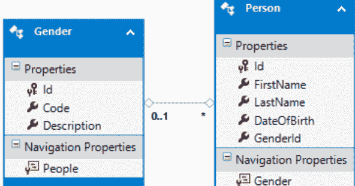

图 8：Entity Framework 图

注意，`Gender` 有一个 `People` 属性，而 `Person` 有一个 `Gender` 属性（如果你命名为 `GenderId`，该属性将被命名为 `Gender1`，没错！）。它们之间的线描述了这种关系。`.edmx` 文件允许你将这些关系可视化。

```csharp
if (orderResults)
{
    query = query.OrderBy(p => p.LastName);
}

// 访问数据库。
List<Person> women = query.ToList();
```

如你所见，这比我们在第 1 章中使用的少得多。作为一个额外奖励，代码读起来要易懂得多（嗯，一旦你学会了 LINQ 语法）。根据你的需求创建不同的查询变得轻而易举，而且你可以复用查询的某些部分（就像面向对象的 SQL 查询一样！）。

这里的另一个问题是参数化。别担心，一切都很好地进行了参数化。只是在上一个示例中没有参数。我们查询 `GenderId` 为 2 的人员。值 2 是一个常量，所以我们的查询不会有任何参数。如果在代码的某处，我们查询了 `GenderId` 为 1 的人员，我们将得到一个带有新计划的新查询。假设我们想对这个查询进行参数化。我们需要做什么呢？很简单——创建一个！

> 代码列表 33: 一个参数化查询

```csharp
using (var context = new SuccinctlyExamplesEntities())
{
    // 未参数化。
    context.People.Where(p => p.GenderId == 2).ToList();

    int female = 2;
    // 新的复用查询。
    // 不复用之前的计划。
    context.People.Where(p => p.GenderId == female).ToList();

    int male = 1;
    // 参数化，使用上面相同的查询。
    context.People.Where(p => p.GenderId == male).ToList();
}
```

此外，IQueryable 也有一些缺点。你对生成的查询没有影响力。某些查询非常庞大，以至于自己编写反而更划算，而这正是 SQL 知识大显身场的地方。有时 EF 无法从你的 IQueryable 生成整洁的 SQL 查询，例如连接两个完全无关的表。EF 会生成一个查询并获取你想要的结果，但它既不快速也不优雅。提到性能，使用 EF 会带来性能开销。如果这几毫秒至关重要（而且通常是如此），请使用我们在第 2 章中讨论过的技巧。

在 IQueryable 中无法做的另一件事是使用任何数据源未知的函数或属性。这是很有道理的，因为查询必须翻译成 SQL。例如，下面的代码将无法执行。

## 代码列表 34: 无效查询

```csharp
using (var context = new SuccinctlyExamplesEntities())
{
    Person sander = context.People.SingleOrDefault(p => p.FullName == "Sander Rossel");
}
```

遗憾的是，它可以正常编译。只有在运行时，当实际编译查询时，你会得到一个错误，因为你的表中没有 `FullName` 列，请务必针对你的实际数据源运行查询。你可能会惊讶地发现下面的查询将按预期工作。

## 代码列表 35: 有效代码

```csharp
using (var context = new SuccinctlyExamplesEntities())
{
    List<Person> peopleWithS = context.People
        .Where(p => p.FirstName.ToLower() == "sander")
        .ToList();
}
```

`ToLower` 函数在 SQL 中是已知的，EF 团队会确保该函数被正确翻译。理论上，`StartWith` 函数可以翻译为 SQL（SQL 的 `LEFT`），但目前不支持。对于某些额外的函数（如 `LEFT`、`RIGHT`、`DIFFDAYS` 等），请查看 `System.Data.Entity.Dbfunctions` 和 `System.Data.Entity.SqlServer.Sqlfunction` 类。也可以向 EF 添加你自己的函数，但这在本本书范围之外。

上一个示例还有另一个陷阱。考虑以下代码。

## 代码列表 36: 懒加载

```csharp
using (var context = new SuccinctlyExamplesEntities())
{
    List<Gender> genders = context.Genders.ToList();
    foreach (Gender g in genders)
    {
        foreach (Person p in g)
        {
            Console.WriteLine($"{p.FullName}");
        }
    }
}
```

这种查询经常会发生？假设我们想对这个查询进行参数化。我们需要做什么？很简单——创建一个！

```csharp
interface Gender
{
    string Description { get; set; }
}
```

```csharp
public partial class Person 
{
    public string FullName { get; set; }
    public string FirstName { get; set; }
    public string LastName { get; set; }
}

public class Gender 
{
    public int Id { get; set; }
    public string Description { get; set; }
    public virtual List<Person> People { get; set; }
}

public class SuccinctlyExamplesEntities : DbContext 
{
    public DbSet<Person> People { get; set; }
    public DbSet<Gender> Genders { get; set; }
}
```

这种查询经常会发生？这种情况下。


```csharp
using (var context = new SuccinctlyExamplesEntities())
{
    // 未参数化。
    context.People.Where(p => p.GenderId == 2).ToList();

    int female = 2;
    // 新的复用查询。
    // 不复用之前的计划。
    context.People.Where(p => p.GenderId == female).ToList();

    int male = 1;
    // 参数化，使用上面相同的查询。
    context.People.Where(p => p.GenderId == male).ToList();
}
```

*注：由于您提供的待翻译文本在中间部分出现了大量的重复和逻辑错乱（可能是由于粘贴时的错误），我将严格按照您提供的文本内容进行逐行翻译，确保不漏不重。*

```csharp
if (orderResults)
{
    query = query.OrderBy(p => p.LastName);
}

// 访问数据库。
List<Person> women = query.ToList();
```

如你所见，这（代码量）比我们在第 1 章中使用的少得多。作为一个额外奖励，代码读起来要易懂得多（嗯，一旦你学会了 LINQ 语法）。根据你的需求创建不同的查询变得轻而易举，而且你可以复用查询的某些部分（就像面向对象的 SQL 查询一样！）。

这里的另一个问题是参数化。别担心，一切都很好地进行了参数化。只是在上一个示例中没有参数。我们查询 `GenderId` 为 2 的人员。值 2 是一个常量，所以我们的查询不会有任何参数。如果在代码的某处，我们查询了 `GenderId` 为 1 的人员，我们将得到一个带有新计划的新查询。假设我们想对这个查询进行参数化。我们需要做什么呢？很简单——创建一个！

### 代码列表 33: 一个参数化查询

```csharp
using (var context = new SuccinctlyExamplesEntities())
{
    // 未参数化。
    context.People.Where(p => p.GenderId == 2).ToList();

    int female = 2;
    // 新的复用查询。
    // 不复用之前的计划。
    context.People.Where(p => p.GenderId == female).ToList();

    int male = 1;
    // 参数化，使用上面相同的查询。
    context.People.Where(p => p.GenderId == male).ToList();
}
```

此外，`IQueryable` 也有一些缺点。你对生成的查询没有影响力。某些查询非常庞大，以至于自己编写反而更划算，而这正是 SQL 知识大显身场的地方。有时 EF 无法从你的 `IQueryable` 生成整洁的 SQL 查询，例如连接两个完全无关的表。EF 会生成一个查询并获取你想要的结果，但它既不快速也不优雅。提到性能，使用 EF 会带来性能开销。如果这几毫秒至关重要（而且通常是如此），请使用我们在第 2 章中讨论过的技巧。

在 `IQueryable` 中无法做的另一件事是使用任何数据源未知的函数或属性。这是很有道理的，因为查询必须翻译成 SQL。例如，下面的代码将无法执行。

### 代码列表 34: 无效查询

```csharp
using (var context = new SuccinctlyExamplesEntities())
{
    Person sander = context.People.SingleOrDefault(p => p.FullName == "Sander Rossel");
}
```

遗憾的是，它可以正常编译。只有在运行时，当实际编译查询时，你会得到一个错误，因为你的表中没有 `FullName` 列，请务必针对你的实际数据源运行查询。你可能会惊讶地发现下面的查询将按预期工作。

### 代码列表 35: 有效代码

```csharp
using (var context = new SuccinctlyExamplesEntities())
{
    List<Person> peopleWithS = context.People
        .Where(p => p.FirstName.ToLower() == "sander")
        .ToList();
}
```

`ToLower` 函数在 SQL 中是已知的，EF 团队会确保该函数被正确翻译。理论上，`StartWith` 函数可以翻译为 SQL（SQL 的 `LEFT`），但目前不支持。对于某些额外的函数（如 `LEFT`、`RIGHT`、`DIFFDAYS` 等），请查看 `System.Data.Entity.Dbfunctions` 和 `System.Data.Entity.SqlServer.Sqlfunction` 类。也可以向 EF 添加你自己的函数，但这在本本书范围之外。

上一个示例还有另一个陷阱。考虑以下代码。

### 代码列表 36: 懒加载

```csharp
using (var context = new SuccinctlyExamplesEntities())
{
    List<Gender> genders = context.Genders.ToList();
    foreach (Gender g in genders)
    {
        foreach (Person p in g)
        {
            Console.WriteLine($"{p.FullName}");
        }
    }
}
```

这种查询经常会发生？这种情况下。

```csharp
using (var context = new SuccinctlyExamplesEntities())
{
    // 未参数化。
    context.People.Where(p => p.GenderId == 2).ToList();

    int female = 2;
    // 新的复用查询。
    // 不复用之前的计划。
    context.People.Where(p => p.GenderId == female).ToList();

    int male = 1;
    // 参数化，使用上面相同的查询。
    context.People.Where(p => p.GenderId == male).ToList();
}
```

*(注：由于原文在后半部分存在大量重复和逻辑混乱，上述译文已根据您提供的原始文本落进行了对应翻译。)*

这两种方法的区别在于参数以及返回值。`IQueryable` 接收 `Expression<Func<Person, bool>>` 作为输入并返回一个 `IQueryable`，而 `IEnumerable` 接收 `Expression<Func<Person, bool>>` 作为输入并返回一个 `Enumerable`。

```
peopleQuery.Where(p => p.FirstName == "Sander").ToList();
```

```
(extension) IQueryable<Person> IQueryable<Person>.Where<Person>(System.Linq.Expressions.Expression<Func<Person, bool>> predicate)
根据谓词过滤值序列。
```

图 10: `IQueryable.Where`

```
peopleEnum.Where(p => p.FirstName == "Sander").ToList();
```

```
(extension) IEnumerable<Person> IEnumerable<Person>.Where<Person>(Func<Person, bool> predicate)
根据谓词过滤值序列。
```

图 11: `IEnumerable.Where`

`Expression<SomeType, bool>` 基本上是将 `SomeType, bool` 作为对象图的表示。在 `IEnumerable` 中，你传递的不是一个方法，而是传递一个代表该方法的对象。在这种情况下，编译器会创建对象图，所以你不需要担心。

在上一个示例中，这意味着 `IEnumerable` 会对集合进行枚举，强制进行一次数据库往返（实际上 `IEnumerable` 变量是一个 `IQueryable`），在此之后才会执行该函数。结果是，你将从数据库中获取**所有**人员，而不仅仅是名字为“Sander”的人。请务必小心，不要意外破坏你的 `IQueryable` 链。

为了好玩，这里是编译器从该 Lambda 表达式创建的 `Expression<Person, bool>`。

代码行 38：`Expression<Person, bool>>`

```
ParameterExpression parameter = Expression.Parameter(typeof(Person), "p");
Expression property = Expression.Property(parameter,
typeof(Person).GetProperty("FirstName"));
Expression constant = Expression.Constant("Sander");
Expression binary = Expression.Equal(property, constant);
Expression<Func<Person, bool>> lambda = Expression.Lambda<Func<Person,
bool>>(binary, parameter);
peopleQuery.Where(lambda).ToList();
```

这意味着当你想要添加自己的（扩展）方法时，你必须记住你正在使用表达式（Expressions）。如果你想创建其他类型的抽象，你可能甚至需要手动创建。创建表达式对于目前来说有点太高级了，但让我们来看一个扩展方法。

如果你想在扩展方法中包含（例如）额外的选择逻辑，会发生什么？只需确保放入表达式。这样做不会产生错误或警告，但将调用 `IEnumerable` 上的方法，从而在你的操作执行之前强制进行数据库调用。

### 代码列表 39：带有选择器的扩展方法

```sharp
public static List<T> SelectOlderThan<T>(this IQueryable<Person> q, int
age,
Expression<Func<Person, T>> selector)
{
    return q
    .Where(p => (DbFunctions.DiffHours(p.DateOfBirth, DateTime.Today) /
8766) > age)
    .Select(selector)
    .ToList();
}
```

用法再次非常直观。

### 代码列表 40：SelectOlderThan 的用法

```csharp
var people = context.People.SelectOlderThan(45, p =>
{
    Name = p.FirstName,
    DateOfBirth = p.DateOfBirth
});
```

### CRUD（增删改查）

让我们来看看 CRUD 操作。你将不会相信这有多么简单。

### 代码列表 41：CRUD 操作

```csharp
using (var context = new SuccinctlyExamplesEntities())
{
    // 更新 Sander
    Person sander = context.People.FirstOrDefault(p => p.FirstName ==
    "Sander");
    sander.FirstName = "John";

    // 创建 Google  CEO。
    Person sundar = new Person();
    sundar.FirstName = "Sundar";
    sundar.LastName = "Pichai";
    sundar.DateOfBirth = new DateTime(1972, 7, 12);
    sundar.GenderId = 1;
    context.People.Add(sundar);

    // 删除 Mark Zuckerberg。
    Person mark = context.People.FirstOrDefault(p => p.FirstName ==
    "Mark");
    context.People.Remove(mark);
}
```

```csharp
context.SaveChanges();
}
```

就是这些！它太简单了，你真的不需要进一步的解释。

记住我说过“SELECT * ...”对系统是非常有害的。我们现在所做的基本上就是这样。如果我们更新了模型，并且 `Person` 增加了 100 个新字段，系统突然变慢很多。我们可以使用 `Select` 来修复这个问题。

### 代码列表 42：使用 Select

```csharp
using (var context = new SuccinctlyExamplesEntities())
{
  // 使用匿名类型。
  var satyaAnon = context.People.Where(p => p.FirstName == "Satya")
  .Select(p => new
  {
      Id = p.Id,
      FirstName = p.FirstName,
      LastName = p.LastName
  }).SingleOrDefault();
  // 在处使用匿名类型...

  // 使用已知类型。
  PersonModel satyaKnown = context.People.Where(p => p.FirstName == "Satya")
  .Select(p => new
  {
      Id = p.Id,
      FirstName = p.FirstName,
      LastName = p.LastName
  }).SingleOrDefault();
```

### 代码列表 49：运行 EF Code First 代码

```csharp
using (CodeFirstContext context = new CodeFirstContext())
{
    context.People.Add(new Person
    {
        FirstName = "Sander",
        Gender = new Gender
        {
            Id = 1,
            Code = "MALE",
            Description = "A true man!"
        }
    });
    context.SaveChanges();
}
```

这将实际上创建你的数据库并插入一个新的人和一个性别。

如果你查看数据库，你会发现 `dbo.People` 和 `dbo.Genders` 表并不是你的 `DbContext` 中的 `DbSet`，但它们仍然是数据库中的表。EF 通过 `Person` 推断了这一点。此外还有一个 `dbo.__MigrationHistory` 表（注意有两个下划线）；我们稍后会查看它。让我们先通过重写 `DbContext` 中的 `OnModelCreating` 来修复复数命名问题。

### 代码列表 50：非复数化的 DbContext

```csharp
public class CodeFirstContext : DbContext
{
    public CodeFirstContext()
        : base("CodeFirst")
    {

    protected override void OnModelCreating(DbModelBuilder modelBuilder)
    {
        modelBuilder.Conventions.Remove<PluralizingTableNameConvention>();
    }

    public DbSet<Person> People { get; set; }
}
```

有许多这样的约定，你也可以添加自己的约定。在 SSMS 中右键点击数据库并点击“删除”。在对话框中，勾选“关闭现有的连接”。当你运行应用程序时，你的表将分别命名为 `dbo.Person` 和 `dbo.Genders`。如果你不删除数据库，将会得到一个运行时异常——我们稍后会修复它。

进一步观察数据库，你会发现所有字符串属性都被翻译成了 `nvarchar(max)`。你可能并不希望这样做。此外，`FirstName` 是不可空的，所以让我们修复一下这个问题。使用数据注解（在 `System.ComponentModel.DataAnnotations` 命名空间中）这其实非常简单。只需向你的模型添加一些属性即可。

### 代码列表 45：数据注解

```csharp
[Required]
[MaxLength(256)]
public string FirstName { get; set; }
[MaxLength(256)]
public string LastName { get; set; }
```


再次删除你的数据库并重新运行代码。这些字段现在将分别生成为 `varchar(256) not null` 和 `varchar(256) null`。你可以进行更多调整，例如不使用自动生成的键、映射到数据库中的另一个列名、更改生成的类型，或者将属性设为 `Key` 主键。

## 代码列表 52：非生成的键

```csharp
[DatabaseGenerated(DatabaseGeneratedOption.None)]
public int Id { get; set; }
```

通过重写 `OnModelCreating(Dbcontext)`，你在自定义生成方面有很大的灵活性。

## 代码列表 46：在 OnModelCreating 中自定义

```csharp
protected override void OnModelCreating(DbBuilder modelBuilder)
{
    modelBuilder.Conventions.RemovePluralizingTableNameConvention();

    modelBuilder.Entity<Person>()
        .Property(p => p.DateOfBirth)
        .HasColumnName("DOB")
        .HasColumnType("smalldatetime");

    modelBuilder.Properties()
        .Where(p => p.Name == "Key")
        .Configure(p => p.IsKey());
}
```

通过使用 `NotMappedAttribute`，属性将完全被 EF 忽略（例如你通过 `FirstName` 和 `LastName` 组合 `FullName` 属性）。

## 代码列表 47：未映射到数据库的属性

```csharp
[NotMapped]
public int FullName { get; set; }
```

你可能已经明白了 Code First 的精髓：编写代码和配置，让 EF 为你创建数据库。

# 迁移 (Migrations)

到目前，我们每次修改模型时都会删除数据库。这在现实世界中显然不可行的。EF 为数据库创建提供了几个选项：`CreateDatabaseIfNotExists`（默认）、`DropDatabaseIfModelChanges` 和 `DropDatabasealways`。这些被称为 `DatabaseInitializers`（数据库初始化器）。你可能会在使用它们时遇到一些麻烦。如果你在数据库中有数据或映射的实体，当 EF 删除数据库并重新创建它们时，你会丢失它们（想象一下在生产环境中发生这种情况）。新版本的 EF 引入了 `MigrateDatabaseToLatestVersion`。在此之前，它的效果并不理想——毕竟，当你的模型变化时，你会得到一个异常。

## 启用迁移

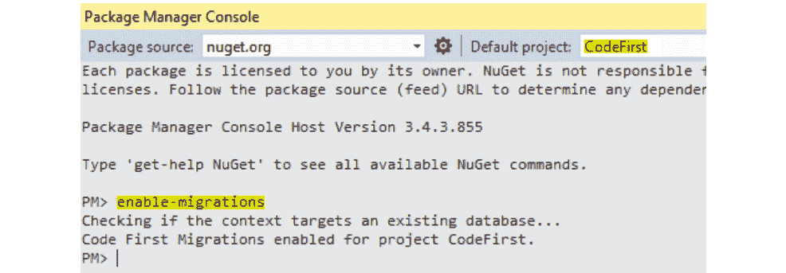

> 图 12：使用 NuGet 控制台迁移

你会发现系统为你创建了一个 `Configuration` 类。

## 代码列表 48：生成的 Configuration 类

```csharp
namespace CodeFirst.Migrations
{
    using System;
    using System.Data.Entity;
    using System.Data.Entity.Migrations;
    using System.Linq;

    internal sealed class Configuration :
    DbMigrationsConfiguration<CodeFirst.CodeFirstContext>
    {
        public Configuration()
        {
            AutomaticMigrationsEnabled = false;
        }
    }
}
```

```csharp
protected override void Seed(CodeFirst.CodeFirstContext context)
{
    // ...
}
```

## 自动迁移

目前，你可能将 `AutomaticMigrationsEnabled` 设置为 `true`。

## 代码列表 49：启用自动迁移

```csharp
AutomaticMigrationsEnabled = true;
```

接下来我们需要做的是在 `DbContext` 中进行此配置。我们可以在构造函数中设置它。

## 代码列表 50：为迁移配置 DbContext

```csharp
public class CodeFirstContext
{
    public CodeFirstContext() : base("CodeFirst")
    {
        Database.SetDatabaseToLatestVersion<CodeFirstContext, Migrations.Configuration>("CodeFirst");
    }
}
```

现在添加一个新类，并...

在包控制台（Package Console）中，输入 `update-database`，你的数据库将会更新。你可以针对更新后的数据库运行代码并进行查询。确保不要为两个迁移设置相同的名称，否则你会在 C# 代码中遇到名称冲突。

现在向 `Person` 类中添加一个属性，例如 `int Age`，然后运行另一个迁移 `"Add Person.Age"` 并执行 `update-database`。遗憾的是，由于某种原因，你最后的数据库更改被回滚了。幸运的是，系统生成了 Up 和 Down 方法，所以这应该很简单。要撤销迁移，只需更新到旧版本的迁移，新的迁移就会被回滚。在控制台中，输入 `"update-database -TargetMigration:Add Person.FullName"` 并运行它。`Add Person.Age` 将被回滚。

在我尝试迁移时，我创建了 `FullName`，然后将其删除，结果再次导致了两个 C 类 `AddPersonFullName`。没问题，我删除了最旧的并运行了它。然而，在回滚时，我遇到了一个冲突，因为 `AddPerson.FullName` 具有歧义。幸运的是，你所做的只是删除 `dbo__MigrationHistory`，然后只需运行 `"update-database -TargetMigration:201605211180341_AddPersonFullName"` 来消除歧义，而无需大量繁琐的手动操作。

| Migration | Context | Model | ProductVersion |
|---|---|---|---|
| 1 | 20160521141034_InitialCreate | CodeFirst.Migrations.Configuration | 0xF1B8000000000000A0D5ED64D32BED36BE181FFBFFFF74B | 6.1-4.3002 |
| 2 | 20160521141572_AutomaticMigration | CodeFirst.Migrations.Configuration | 0xF1B8000000000000A0D5ED64D32BED36BE181FFB1FF74B | 6.1-4.3002 |
| 3 | 20160521141931_AutomaticMigration | CodeFirst.Migrations.Configuration | 0xF1B8000000000000A0D5ED64D32BED36BE367C0FE41D3 | 6.1-4.3002 |
| 4 | 20160521142035_AutomaticMigration | CodeFirst.Migrations.Configuration | 0xF1B8000000000000A0D5ED64D32BED36BE181FFBFF74B | 6.1-4.3002 |
| 5 | 20160521142205_AutomaticMigration | CodeFirst.Migrations.Configuration | 0xF1B8000000000000A0D5ED64D32BED36BE361727FF2E5A | 6.1-4.3002 |
| 6 | 20160521144406_AutomaticMigration | CodeFirst.Migrations.Configuration | 0xF1B8000000000000A0D5ED64D32BED36BE181FFBFF74B | 6.1-4.3002 |
| 7 | 20160521151427_Add PersonFullName | CodeFirst.Migrations.Configuration | 0xF1B8000000000000A0D5ED64D32BED36BE361727FF2E5A | 6.1-4.3002 |
| 8 | 20160521152319_Add PersonFullName | CodeFirst.Migrations.Configuration | 0xF1B8000000000000A0D5ED64D32BED36BE181FFBFF74B | 6.1-4.3002 |
| 9 | 20160521157438_Add PersonFullName | CodeFirst.Migrations.Configuration | 0xF1B8000000000000A0D5ED64D32BED36BE181FFBFF74B | 6.1-4.3002 |
| 10 | 20160521180258_AutomaticMigration | CodeFirst.Migrations.Configuration | 0xF1B8000000000000A0D5ED64D32BED36BE181FFBFF74B | 6.1-4.3002 |
| 11 | 20160521180431_Add PersonFullName | CodeFirst.Migrations.Configuration | 0xF1B8000000000000A0D5ED361D70D2F0D7FEB9 | 6.1-4.3002 |
| 12 | 20160521189453_Add Person.Age | CodeFirst.Migrations.Configuration | 0xF1B8000000000000A0D5ED64D32BED361D1FF2E69 | 6.1-4.3002 |

你的另一种选择是获取生成迁移的实际 SQL 脚本。例如，我添加了 `Person.FullName` 并生成了脚本。你可以从包控制台使用 `update-database -Script` 来生成它。你将得到以下脚本。

图 13：生成的 SQL

```sql
ALTER TABLE [dbo].[Person] ADD [FullName] [nvarchar](max)
INSERT [dbo].[__MigrationHistory] ([Context], [Model], [ProductVersion])
VALUES ('20160521141034_InitialCreate', 'CodeFirst.Migrations.Configuration', 0xF1B8000000000000A0D5ED64D32BED36BE181FFBFFFF74B', '6.1-4.3002')
```

# 种子数据 (Seeds)

CodeFirst 非常酷的另一个特点是可以使用初始数据对数据库进行填充。你可能在我们创建 `Configuration` 类时已经注意到了，但代码中有一个带有示例的 `Seed` 方法。让我们确保我们的性别（Genders）已经就绪，并有一个用于测试的 `Person`。

## 代码列表 57：Seed 方法

```csharp
protected override void Seed(CodeFirstContext context)
{
    context.Genders.AddOrUpdate(new[]
    {
        new Gender { Id = 0, Code = "UNKNOWN", Description = "Not saying" },
        new Gender { Id = 1, Code = "MALE", Description = "Male" },
        new Gender { Id = 2, Code = "FEMALE", Description = "Female" }
    });
    context.Person.AddOrUpdate(p =>
    {
        FirstName = p.FirstName,
        LastName = p.LastName
    },
    new Person
    {
        FirstName = "Sander",
        LastName = "Rosell",
        GenderId = 1
    });
}
```


## 种子数据 (Seeds)

`CodeFirst` 非常酷的另一个特点是可以使用初始数据对数据库进行填充。你可能在我们创建 `Configuration` 类时已经注意到了，但代码中有一个带有示例的 `Seed` 方法。让我们确保我们的性别（`Genders`）已经就绪，并有一个用于测试的 `Person`。

代码列表 57：`Seed` 方法

```csharp
protected override void Seed(CodeFirstContext context)
{
    context.Genders.AddOrUpdate(new[]
    {
        new Gender { Id = 0, Code = "UNKNOWN", Description = "Not saying" },
        new Gender { Id = 1, Code = "MALE", Description = "Male" },
        new Gender { Id = 2, Code = "FEMALE", Description = "Female" }
    });
    context.Person.AddOrUpdate(p =>
    {
        FirstName = p.FirstName,
        LastName = p.LastName
    },
    new Person
    {
        FirstName = "Sander",
        LastName = "Rosell",
        GenderId = 1
    });
}
```


```csharp
protected override void Seed(CodeFirstContext context)
{
    context.Genders.AddOrUpdate(new[]
    {
        new Gender { Id = 0, Code = "UNKNOWN", Description = "Not saying" },
        new Gender { Id = 1, Code = "MALE", Description = "Male" },
        new Gender { Id = 2, Code = "FEMALE", Description = "Female" }
    });
    context.Person.AddOrUpdate(p =>
    {
        FirstName = p.FirstName,
        LastName = p.LastName
    },
    new Person
    {
        FirstName = "Sander",
        LastName = "Rosell",
        GenderId = 1
    });
}
```

# 解决方案 `Solution1` (1 个项目)

- `Database1`

  `Properties`

  `References`

  `dbo`

    `Tables`

      `Gender.sql`

      `Person.sql`

图 14：解决方案管理器中的数据库项目

创建数据库项目的另一种方法是，即使你没有现有数据库，也可以通过启动新项目并从已安装的模板中选择 SQL Server 数据库项目。在新项目中，你可以创建对象并部署它们，或者通过在解决方案管理器中右键点击你的数据库项目，选择“导入”，然后选择“数据库”来导入现有数据库。

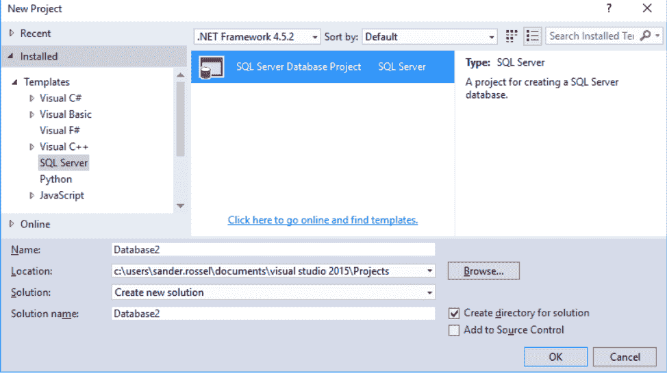

图 15：SQL Server 数据库项目模板

让我们继续处理 `Database1` 项目。双击表将进入设计器，它与 SSMS 的非常相似。在这里，你可以添加新列和外键、更改列等。在屏幕底部，你会看到表的 SQL 脚本；它会随着你对表的更改而变化。

## 发布

在执行任何操作之前，假设 `SuccinctlyExamples` 数据库已准备好投入生产，因此我们想要部署它。在解决方案管理器中右键点击你的数据库项目并选择**部署**。在**发布数据库**窗口中，选择一个数据库连接。接下来的窗口有点混乱，因为它向你展示了一些连接，但隐藏了你当前的连接。要显示当前连接详细信息，点击**显示连接属性**。现在只需选择 **SuccinctlyExamples** 数据库即可。

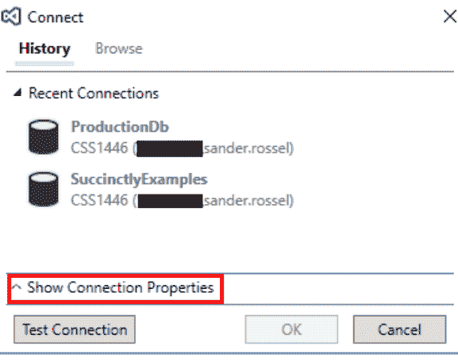

图 16：连接窗口

发布数据库窗口中，选择数据库名称。我们将创建一个新数据库，所以选一个不存在的名字。我将其称为 **ProductionDb**。在实际环境中，你可能有相同的数据库名称，但在另一个服务器实例上。由于我们没有额外的服务器，我们将通过不同的数据库名称使用同一个服务器实例。你还可以选择禁用高级菜单下的许多选项，特别是如果可能丢失数据。除非你勾选**如果可能丢失数据则阻止增量部署**，否则你将无法删除包含行的表列。有许多选项无法一一讨论，但务必查看它们。

现在你可以查看脚本、修改它并运行它（在左上），或者直接运行脚本。如果你直接运行脚本，它将被放置在项目的 bin 文件夹中。此外还会打开 Data Tools 操作窗口，允许你直接打开脚本。无论你选择哪种方法，现在都应该拥有一个与 `SuccinctlyExamples` 数据库相同的 `ProductionDb` 数据库。这太棒了！

## 更新

现在我们已经部署了数据库，我们将收到更改请求。让我们给 **Person** 表添加一列。在 Visual Studio 解决方案管理器中双击 **Person.sql** 脚本。你可以在表设计器的空白区域右键点击，以添加或删除设计器列，如 Length、Description 和 Identity。现在添加一列，假设命名为 Title。它也是。

| 脚本文件: Person.sql |

| 名称 | 数据类型 | 允许空 | 默认值 |

|---|---|---|---|---|

| Id | int | | | |

| FirstName | varchar(256) | | | |

| LastName | varchar(256) | | | |

| DateOfBirth | datetime | | | |

| Gender | int | | | |

| Title | varchar(254) | | | |

| 键 (1) |

| PK_Person (主键, 聚集: Id) |

| 约束 (0) |

| 索引 (0) |

| 外键 (1) |

| FK_Person_Gender (Id) |

| 触发器 (0) |

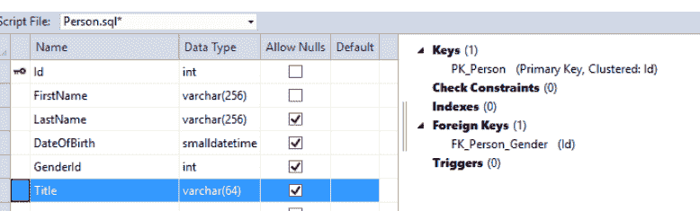

```
CREATE TABLE [dbo].[Person (
    [Id] INT IDENTITY (1, 1) NOT NULL,
    [FirstName] VARCHAR (256) NULL,
    [Lastname] VARCHAR (256) NULL,
    [DateOfBirth] SMALLDATETIME NULL,
    [GenderId] INT NULL,
    [Title] VARCHAR (64) NULL,
    CONSTRAINT [FK_Person_Gender] FOREIGN KEY ([GenderId]) REFERENCES [dbo].[Gender] ([Id]),
    CONSTRAINT [PK_Person] PRIMARY KEY ([Id])
);
```

图 17：Title 列

现在再次发布数据库，这次只需发布到 Succinctly 数据库。在插入 CREATE 脚本后，Visual Studio 将生成一个 ALTER 脚本。如果你运行它（直接运行或生成脚本后运行），你的数据库现在将拥有新的 **Title** 列。

更新表或列——即更改它——会产生重构日志（或此类日志）。这对于 Visual Studio 确定它必须重命名表或列，而不是删除带有旧名称的表或列是必要的。一旦发布了更改，数据库上将创建一个名为 `__RefactorLog` 的系统表（注意有两个下划线）。该表包含一个列，用于指示架构更改已发布。

## 比较

Data Tools 的另一个酷功能是比较数据库。我们有几个选项：将数据库架构与其他数据库进行比较，将架构与数据库项目比较，以及比较数据数据库。

让我们开始比较数据库之间的架构。右键点击数据库项目并点击**架构比较**。在打开的窗口中，你现在可以选择源和目标。默认源是你的当前项目。将源更改为 **SuccinctlyExamples** 数据库，目标更改为 **ProductionDb** 数据库。现在点击左上角的**比较**，Visual Studio 将可视化地向你显示差异。你现在可以再次更新目标，或生成 SQL 脚本并手动运行。你还可以在操作列中选择排除在生成脚本中的对象。现在，只需以你喜欢的方式更新 ProductionDb 即可。

我们还可以比较项目和数据库，这基本上是部署的替代方案（只是它不会识别重命名）。它的工作原理与数据库之间的比较完全相同，只是你的源现在是一个数据库项目。当你将数据库作为源并将项目作为目标时，会有趣的事情（你可以轻松地切换它们）

# 第6 章 故障排除

查询偶尔会出问题。不幸的是，这可能有许多原因。也许你的数据库已经增长到这种程度，使得以前一直运行良好的查询现在变得非常缓慢。也许你的某一个环境缺少了索引。也许一个带有缓存查询计划的查询对于当前的参数值来说并不是最优的。在本章中，我们将介绍如何识别有问题的查询以及如何解决这些问题。

为了几个示例，我们需要一个稍微规模的数据库。微软提供了一个名为 Adventure Works 的示例数据库可以使用。你可以从 CodePlex 下载它。或者，你可以在 Google（或 Bing）搜索 `AdventureWorks2014` 看看会出现什么结果。下载 `Adventure Works 2014 Full Database Backup.zip` 文件并解压 `.bak` 文件。在 SSMS 中，在对象资源管理器中右键点击“数据库”，然后点击“还原...”。在还原窗口中，启用“设备”，点击 `...` 按钮，并添加你刚刚解压的文件。然后只需点击“确定”，数据库就可以使用了。

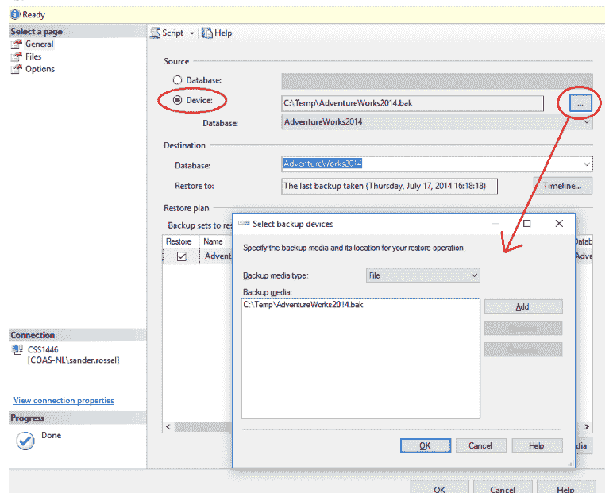

图 20：还原 Adventure Works

## 性能分析

首先，我们需要知道哪些查询运行缓慢。对于此（以及许多其他情况），我们可以使用性能调优器（profiler）。我建议在开发时经常使用性能分析器，因为它能向你展示数据库中发生的所有事情。例如，你可能有一段性能良好的代码，但它之所以良好可能是因为你正在本地进行测试且数据很少。性能分析器可能会显示，你实际上正在向数据库发送成千上万次查询（因为 EF 的延迟加载，或者因为你在循环中执行查询）。我经常遇到这样的场景：在测试环境中运行得很顺畅，但在生产环境中会让数据库陷入停滞（而这永远是令人担心）。

要启动性能分析器，请使用 SSMS，在菜单中转到“工具”和“SQL Server 分析器”。你也可以从开始菜单中作为独立应用程序运行它（只要你在那里安装了它）。如果你从 SSMS 启动，它会自动启动一个新的跟踪。如果你从 Windows 启动，可以在“文件”菜单下找到“新建跟踪”。接下来，你必须登录你想要跟踪的实例。在跟踪生产环境时要小心，因为它会给系统带来负载。连接到本地实例，得到一个名为“跟踪属性”的窗口。在“常规”选项卡上，你可以为跟踪命名、保存到文件或选择一个模板。我们将忽略这一点。相反，请转到“事件选择”选项卡。在此选项卡上，你可以找到由数据库触发的所有类型的事件。其中已经为你勾选了几个，但还有很多。勾选“显示事件”和“显示所有列”复选框，你就会明白我的意思了。在以下事件中：Stored Procedures -> `RPC:Completed` 和 `SP:BatchCompleted` 以及 TSQL -> `SQL:BatchCompleted`。现在运行它以进行跟踪。

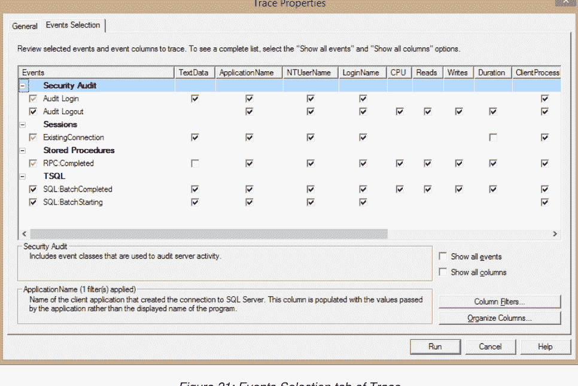

如果你现在进入 SSMS 查询一个表，或者运行我们在上一章中创建的执行语句，你将在性能分析器中看到这些查询。不幸的是，你可能会看到大量内容（我也看到了来自我的报告服务器的一些查询以及我正在运行的一些内容）。你可以暂停跟踪并设置一些过滤器。


图 22：跟踪暂停和属性

在“事件选择”选项卡中，转到“列筛选...”并对 Application（应用程序）如“EntityFramework”进行过滤。如果你没有在 DbContext 中手动更改 Application，你将只会看到从你的应用程序触发的查询。对 `LoginName` 或 `NTUserName` 进行过滤也大有帮助，特别是当你有数百万次查询而你只对单个用户感兴趣时。我经常使用的另一个过滤器是 `Duration`（持续）大于；将其设置为 5000（毫秒），你将获得所有耗时至少五秒的查询。如果某个查询频繁出现，你可能需要查看它。无论如何，在设置好 Application 过滤器后，从你的应用程序运行一些查询并在性能分析器中查找它。`context.Find(p => p.Id == 1);`

| EventClass | TextData | ApplicationName | NTUserName | CPU | Reads | Duration |

|---|---|---|---|---|---|---|

| SQL:BatchCompleted | select(cast(Id as int) as ...) | EntityFramework | SR | 0 | 0 | 0 |

| RPC:Completed | select Statement(SQL) FROM (SELECT TOP 100 PERCENT... | EntityFramework | SR | 0 | 0 | 0 |

| SP:Completed | select * FROM People where Id = ... | EntityFramework | SR | 0 | 0 | 0 |

| SQL:BatchCompleted | SELECT ... (Id) AS | EntityFramework | SR | 0 | 0 | 0 |

图 23：性能分析器中的查询

如你所见，EF 显示了许多行，只有第五行是实际查询。通过查看列，我们可以看到数据库返回了 1 行，并花费 0 毫秒生成结果。在寻找有问题的查询时，你可能想关注这些值。这不一定是坏事，但它可能表明某些地方可以进行优化。现在我们可以复制并粘贴查询并在 SSMS 中手动运行。性能分析器可以用于许多事情，例如跟踪死锁。查看所有带有 Duration 过滤器的事件和查询证明是很有用的。有时你可能想运行一段时间跟踪。你可以设置跟踪，然后在“文件”菜单中，转到“导出”，然后选择“SQL Server 2005-2014 跟踪定义...”。将脚本保存到你想要的地方（例如 `C:\MyTrace`）并运行它。

现在无论性能分析器是否在运行，一切都将保存到跟踪文件中。当然，你可以使用“跟踪属性”这样做，但我也向你展示脚本。顺便说一下，如果你打开文件时遇到困难，请尝试以管理员身份运行。要查看哪些跟踪正在运行，可以使用以下命令。

### 列表 63：查看 SQL 跟踪

```sql
SELECT * FROM fn_trace_info(default)
```

要停止、启动和删除跟踪，可以使用以下命令。

### 列表 64：停止、启动和删除跟踪

```sql
SELECT * FROM fn_trace_info(default)
-- 我们创建的文件包含了跟踪。
DECLARE @TraceId INT = 3

-- 停止跟踪。
EXEC sp_trace_status @TraceId, 0

-- 启动跟踪。
EXEC sp_trace_status @TraceId, 1

-- 删除跟踪，先停止它。
EXEC sp_trace_status @TraceId, 2
```

## 查询计划

现在你知道如何获取可能导致问题的查询了，你可能想查看执行计划。通过查看列，可以看到数据库返回了 1 行，花费了 0 毫秒生成结果。在寻找有问题的查询时，你可能想关注这些值。这不一定是坏事，但它可能表明某些地方可以进行优化。现在我们可以复制并粘贴查询并在 SSMS 中手动运行。性能分析器可以用于许多事情，例如跟踪死锁。查看所有带有 Duration 过滤器的事件和查询证明是很有用的。有时你可能想运行一段时间跟踪。不幸的是，同步还没有关于查询计划的简洁电子书（吗？），但你始终可以查看 SimpleTalk 的本关于查询计划的免费电子书。

现在，打开 SSMS，浏览到 AdventureWorks 数据库并打开一个新的查询窗口。右键点击空查询窗口，在菜单中勾选“包含实际执行计划”。为了获取额外信息，在查询窗口中运行以下语句。

### 列表 74：启用统计

```sql
SET STATISTICS ON
SET STATISTICS TIME ON
```

这些统计将在运行查询后显示在你的“消息”选项卡中。你可以从窗口中删除这些语句；它们在该窗口中一直有效，直到你关闭它或再次显式关闭（`SET STATISTICS OFF`）。现在在同一个查询窗口中运行以下查询。

### 列表 75：带有 JOIN 的 SQL 查询

```sql
SELECT p.FirstName + ' ' + p.LastName AS FullName
FROM Person.Person p
JOIN Person.EmailAddress e ON e.BusinessEntityID = p.BusinessEntityID
```

`MERGE JOIN`（合并连接）是最快速的连接方式。它仅在两组数据以相同方式排序，且两个行必须根据某个键进行匹配时才有效。在这种情况下，两个表都根据 `BusinessEntityID` 排序。`MERGE JOIN` 从一个输入端读取一行，并将其与另一个输入端的行进行比较。如果行不匹配，则值较小的行会被丢弃，直到读取完所有行。此操作的最大读取次数是第一个输入的行数加上第二个输入的行数。

替代方案有 `LOOP JOIN`（循环连接）和 `HASH JOIN`（哈希连接）。`LOOP JOIN` 遍历第二个输入的所有行直到找到匹配项。这比 `MERGE JOIN` 效率低，因为最大读取次数是输入一行数乘以输入二行数。

`HASH JOIN` 在处理之前可能需要哈希表，如果遇到它，它会为较小的输入创建一个哈希表（可能写入内存），然后使用哈希函数将其与其他值进行比较。对于较小的输入，`HASH JOIN` 非常高效，但如果输入很大，这可能会减慢你的查询。

我们可以看到，当数据量较小时，这种查询是最优的：我们拥有最优的搜索算法。

## 代码列表 65：带有非优计划的查询

由于数据相对较小，尽管这没有给我们带来麻烦，但下一个查询将非最优。

```sql
SELECT FirstName, MiddleName, LastName, Title
FROM Person.Person
WHERE MiddleName > 'Z'
OPTION (RECOMPILE)
```

我添加了 `OPTION (RECOMPILE)`，这样 SQL Server 就会为该查询生成新计划（而不是查看缓存计划）。这里是生成的计划。


## 图 25：非优查询计划


我们在这里看到正在执行的是 Index Scan（索引扫描），但当我们执行查询时，只得到了一个结果。这意味着我们扫描了整个表（几乎有 20,000 行）。此外注意 Key Lookup（键查找），这发生在使用的索引没有包含所有请求值时。在这种情况下，在 `IX_Person_LastName_FirstName_MiddleName` 上执行了 Index Scan，但请求的字段多于这三个，因为我们还需要 `Title`。Key Lookup 查找行并检索所有缺失字段。当然，这消耗了更多的时间资源。

> 提示：查询执行缓慢的问题是它们有时运行得非常慢（可能需要一小时或更久）。在这些情况下，“包含执行计划”不是一个选项，因为你需要等待它完成，从而占用资源并可能阻塞其他查询。对于此类情况，SQL Server 在右键菜单中有一个选项为“显示执行计划”。此选项不会运行查询，仅创建估计计划。它可能不会给你实际计划，但大多数情况下相当准确，你可以至少检查计划并识别可能的瓶颈。

## 索引

所以我们有一个使用了索引但仍然需要在主键索引中查找行。这发生在索引不是覆盖索引时。当表中的所有请求字段都包含在单个索引中，这被称为覆盖索引。在这种情况下，索引中缺少 `Title`。因此，让我们把 `Title` 添加到索引中。我们可以做两件事：将 `Title` 添加到索引中，或者将其包含在索引中。

区别在于，我们理解索引是一个或多个字段的虚拟排序。`IX_Person_LastName_FirstName_MiddleName` 按 `LastName`、然后是 `FirstName` 和 `MiddleName` 排序。SQL Server 可以使用二分查找算法快速找到所有特定 `LastName` 的行，以及具有该 `LastName` 和 `FirstName` 的所有人。最后，对于具有 `LastName` 和 `FirstName` 的人，它可以找到所有特定 `MiddleName` 的人。

如果我们把 `Title` 添加到索引中，也可以找到具有特定姓名和特定 `Title` 的人。不幸的是，索引是有代价的。每更新一个字段，索引也必须更新。将 `Title` 添加到索引意味着当任何 `LastName`、`FirstName`、`MiddleName` 或 `Title` 更新时，索引必须更新。因此，此表的插入、更新和删除将受到性能影响。我们可能永远不会查询具有特定标题的名字，所以我们不想这样做。

我们可能有第二个选择：将 `Title` 作为包含字段。它不包含在排序中，这意味着每当 `Title` 更新，索引不需要更新。我们唯一的代价是有额外的内存占用，如果这能加速我们的查询，这是一个公平的代价。要向索引中包含字段，在对象资源管理器中找到索引，右键点击，选择“属性”，并将字段添加到“包含列”选项卡（而不是“索引键”选项卡）。现在再次执行查询。

更改索引起作用了，因为我们的计划不再需要 Lookup。


### 图 26：消除了 Key Lookup

不幸的是，我们仍然是 Index Scan 而不是 Index Seek（索引查找）。显然我们的索引还不够。你现在可以从索引列中移除 `Title`，因为我们将创建一个完全针对此查询优化的索引。只需添加索引，并将 `MiddleName` 放在索引列中，将 `FirstName`、`LastName` 和 `Title` 放在“包含列”中。

### 代码列表 66：针对 MiddleName 的索引

```sql
CREATE NONCLUSTERED INDEX IX_Person_MiddleName
ON Person.Person
(
    MiddleName
) INCLUDE (FirstName, LastName, Title)
```

如果我们再次运行查询，我们将看到已经消除了 Index Scan，而且查询现在是最优的。


### 图 27：最优查询计划

在某些情况下，SQL Server 可能会为你建议索引。例如，运行以下查询并检查计划。

### 代码列表 67：非索引查询

```sql
SELECT *
FROM Sales.SalesOrderHeader
WHERE OrderDate = '2012-01-01'
```

## 参数嗅探 (Parameter Sniffing)

当查询从 C# 代码执行时有时运行非常慢，而其他时间它在几毫秒内完成。这里可能发生多种情况。首先（我们会讨论这一点）是阻塞查询。另一种可能是是参数嗅探。

在处理执行计划时，你必须了解 SQL Server 的相关知识。SQL Server 内部维护着各种信息。当你准备执行此存储过程时，SQL Server 会检查 `@OrderDate` 并根据其统计信息做出一些假设。这让我们的工作变得稍微简单了一些。此时，我们知道 `OrderDate` 上没有索引。结果，由于行数很多，SQL Server 将针对我们分配给 `@OrderDate` 的每个值对表进行扫描。我们可以通过使用几个值执行此查询并检查执行计划来简单易用地测试这一点。

### 代码列表 80: 针对同一查询的多个计划

```sql
DBCC FREEPROCCCACHE
EXECUTE GetOrdersByDate @OrderDate = '20100101'
DBCC FREEPROCCCACHE
EXECUTE GetOrdersByDate @OrderDate = '20120101'
DBCC FREEPROCCCACHE
EXECUTE GetOrdersByDate @OrderDate = '20150101'
```

`DBCC FREEPROCCCACHE` 清除了缓存中的所有查询，因此我们知道 SQL Server 没有复用任何计划。我们为每个参数获取了计划。

查询 1：查询成本（相对于批处理）：33%

`SELECT * FROM Sales.SalesOrderHeader WHERE OrderDate < @OrderDate`

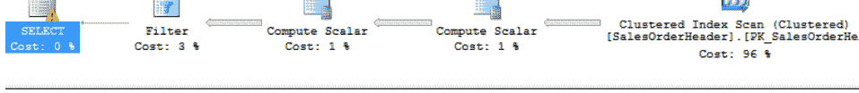

查询 2：查询成本（相对于批处理）：33%

`SELECT * FROM Sales.SalesOrderHeader WHERE OrderDate < @OrderDate`

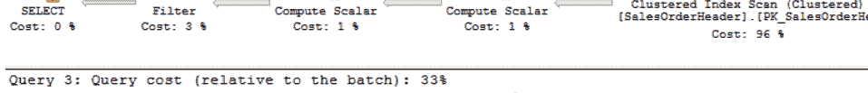

查询 3：查询成本（相对于批处理）：35%

`SELECT * FROM Sales.SalesOrderHeader WHERE OrderDate < @OrderDate`

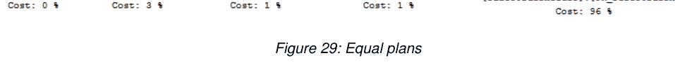

图 29：相同的计划

这对我们的示例帮助不大。此外，`@OrderDate = '20100101'` 返回了 0 行，说明表扫描并不是最优的。那么让我们让 SQL Server 知道这一点。我们在 `OrderDate` 上建立一个索引。

### 代码列表 81：OrderDate 上的索引

```sql
CREATE NONCLUSTERED INDEX IX_SalesOrderHeader_OrderDate
ON Sales.SalesOrderHeader (OrderDate) ASC
```

建立此索引后，再次运行之前的查询（并带上所有的 `DBCC FREEPROCCCACHE`），第一个查询看起来肯定会有所不同！它现在对 `IX_SalesOrderHeader_OrderDate` 执行了索引查找（Index Seek），这对于这个特定查询要好得多。

遗憾的是，我们无法在每个查询之前都执行 `DBCC FREEPROCCCACHE`。事实上，除非你确定自己正在进行嗅探（sniffing），否则永远不要在生产服务器上运行 `DBCC FREEPROCCCACHE`。运行以下查询并检查查询计划，你将看到参数嗅探的影响。

### 代码列表 69：参数嗅探

```sql
DBCC FREEPROCCCACHE
EXECUTE GetOrdersBy @OrderDate ='20100101'
EXECUTE GetOrdersBy @OrderDate ='20120101'
EXECUTE GetOrdersBy @OrderDate ='20150101'
```

现在每次执行的查询计划又变得相等了。遗憾的是，对于 2012 和 2015 年的日期来说，这远非最优。此时，你可能会想：“为什么它会使用如此次优的计划？”或“为什么我的查询这么慢？”当你悬停在查询计划中的某个节点上时，你可以看到可能有助于查明问题错误的各种统计信息。

## 索引查找 (非聚集)

从非聚集索引中扫描特定范围的行。

索引查找 (非聚集)
`IX_SalesOrderHeader_OrderDate`
Cost: 50 %

| 物理操作 | 索引查找 |
|---|---|
| 逻辑操作 | 索引查找 |
| 实际执行模式 | 行 |
| 估计执行模式 | 行 |
| 存储 | 行存储 |
| 实际行数 | 31465 |
| 实际批处理数 | 0 |
| 估计成本 | 0.0032831(50%) |
| 估计 I/O 成本 | 0.003125 |
| 估计 CPU 成本 | 0.000158 |
| 估计树结构成本 | 0.0032831 |

聚集查找 (聚集)
`PK_SalesOrderHeader`
Cost: 50 %

| 执行次数 | 1 |
|---|---|
| 估计执行次数 | 1 |
| 估计行数 | 1 |
| 估计行大小 | 19 B |
| 实际重绑定 | 0 |
| 排序 | True |
| 节点 ID | 3 |

索引查找 (非聚集)
`IX_SalesOrderHeader_OrderDate`
Cost: 50 %

> `[AdventureWorks2014].[Sales].[SalesOrderHeader]`
`[IX_SalesOrderHeader_Date]`

输出列表
`[AdventureWorks2014].[Sales].[SalesOrderHeader].OrderID;`
`[AdventureWorks2014].[Sales].[SalesOrderHeader].OrderDate;`

如你所见，在 SQL Server 中工作时，参数嗅探（parameter sniffing）有一些解决方案。在 C# 中使用 ADO.NET 时也可以应用相同的方法。由于你正在构建查询，因此也可以包含如 `OPTION (RECOMPILE)`、`OPTION (OPTIMIZE FOR ...)` 或 `WITH (INDEX(...))` 等提示信息。遗憾的是，在使用 Entity Framework (EF) 时，你并没有构建自己的查询。但你有几个选择：对于棘手的查询，可以使用存储过程（事实上，有些人对所有内容都使用存储过程，但那是另一个话题）。你也可以对棘手的查询使用原生 ADO.NET。如果你受限于 EF，可以使用 EF 拦截器（EF Interceptors，仅限 EF6 及更高版本），正如下一节所讨论。

# 第 7 章 拦截、锁定、动态管理视图

在本章中我们将介绍三个相对高级的话题：通过从 C# 代码中拦截 SQL 执行来自定义默认行为、SQL 锁定问题以及使用动态管理视图（Dynamic Management Views）进行性能调优。

## 拦截

使用 C# 进行 SQL 拦截并不容易，可能最好避免。它让你让你对生成的 SQL 获得一些低级控制，并在 EF 执行或已执行查询时应采取的额外操作。拦截围绕几个接口展开，最著名的是 `System.Data.Entity.Interception.IDbInterceptor`。

不同的用例有不同的拦截器，例如执行查询（DbInterceptor）、处理事务（DBTransactionInterceptor）和连接（DBConnectionInterceptor）。对于我们的情况，我们需要 `IDbInterceptor`，我们从中派生自基类 `DBCommandInterceptor`（它实现了 `DBCommandInterceptor`）。

如你所见，每个方法（`SomeExecuting` 或 `SomethingExecuted`）都会获取一个可以操作的 `DbCommand` 以及一个 `DbCommandInterceptionContext`。现在我们可以简单地向任何 `SELECT` 查询拼接 `" OPTION (RECOMPILE) "`。

### 代码列表 75：RecompileInterceptor

```csharp
public class RecompileInterceptor : DbCommandInterceptor
{
    public override void ReaderExecuting(DbCommand command, DbCommandInterceptionContext<DbDataReader> interceptionContext)
    {
        base.ReaderExecuting(command, interceptionContext);
        AddOptionRecompile(command, interceptionContext);
    }
    public override void NonQueryExecuting(DbCommand command, DbCommandInterceptionContext<int> interceptionContext)
    {
        base.NonQueryExecuting(command, interceptionContext);
        AddOptionRecompile(command, interceptionContext);
    }
    public override void ScalarExecuting(DbCommand command, DbCommandInterceptionContext<object> interceptionContext)
    {
        base.ScalarExecuting(command, interceptionContext);
        AddOptionRecompile(command, interceptionContext);
    }
}
```

```csharp
private void AddOptionRecompile<T>(DbCommand command, DbCommandInterceptionContext<T> interceptionContext)
{
    if (interceptionContext.DbContexts.Any() &&
        command.CommandText.StartsWith("SELECT", StringComparison.OrdinalIgnoreCase))
    {
        command.CommandText += " OPTION (RECOMPILE)";
    }
}
```

要使用 `DbInterceptor`，我们可以使用 `DbInterceptor` 类。遗憾的是，一旦注册，拦截器将用于应用程序中的每个查询（包括其他线程）。当然，你可以注销它们。

### 代码行 76：添加拦截器

```csharp
RecompileInterceptor interceptor = new RecompileInterceptor();
DbInterceptor.Add(interceptor);
using (DbContext context = new CodeFirstContext())
{
    context.Database.Log = Console.Write;
    context.People.Where(p => p.Gender == 1).ToList();
}
DbInterceptor.Remove(interceptor);
Console.ReadKey();
```

拦截器是强大的工具。它们可以用于日志记录、额外的安全性、取消查询或更改其他内容。

## 锁定与死锁

另一个你在查询运行缓慢时可能面临的问题是。我曾遇到过诸如 `SELECT Field From Table WHERE Id = X` 这样的查询运行缓慢的情况。我们知道此类查询应该非常快，参数嗅探不应该是一个问题，因为对于 X 的每个值，执行计划应该是相同的。很可能是此查询之所以没有运行，是因为某个其他查询阻塞了对指定表的访问。我们可以轻松地模拟此类场景。首先，我想提醒你，在单个查询窗口中可以只运行脚本的部分。让我们模拟此类场景……

另一个你在查询运行缓慢时可能面临的问题。我曾遇到过诸如 `SELECT Field From Table WHERE Id = X` 这样的查询运行缓慢的情况。我们知道此类查询应该非常快，参数嗅探不应该是一个问题，因为对于 X 的每个值，执行计划应该是相同的。很可能是此查询之所以没有运行，是因为某个其他查询阻塞了对指定表的访问。我们可以轻松地模拟此类场景。首先，我想提醒你，在单个查询窗口中可以只运行脚本的部分。

### 代码列表 90：阻塞查询

```sql
BEGIN TRAN
UPDATE Production.Product
SET Name = 'Adjustable Racer'
WHERE ProductID = 1
```

```sql
现在打开另一个查询窗口，让它等待打开的事务，并锁定另一个资源。
```

### 代码列表 80：锁定与等待查询


```sql
BEGIN TRAN

UPDATE Production.Location
SET Name = 'Tool Cribs'
WHERE LocationID = 1

SELECT *
FROM Production.Product
WHERE ProductID = 1
```

## 代码列表 81：发生死锁

```sql
SELECT *
FROM Production.Location
WHERE LocationID = 1
```

两个查询中的其中一个应该返回错误：`Msg 1205, Level 13, State 51, Line 7`

事务（进程 ID 54）与另一个进程在锁资源上发生死锁，并被选为死锁受害者。正在返回该事务。

该查询的事务将自动回滚。在另一个窗口中，你可以手动执行 `ROLLBACK Tran`。

你可以使用 `SQL Profiler` 跟踪锁和死锁。打开一个新会话，取消选择所有事件，并在 `Locks` 下选择 `Deadlock graph` 事件。如果你重复之前的步骤，你将获得一个事件和一个图。它看起来应该像这样。


图 31：死锁图

椭圆表示死锁中的查询，以及被锁定和请求的对象。死锁图可能会变得非常复杂，拥有几十个箭头和矩形。

我们已经有两种修复锁的方法可以解决所有死锁：使用 `SNAPSHOT ISOLATION` 和将你的 `ISOLATION LEVEL` 降低 `READ UNCOMMITTED`。另一种防止死锁的方法是按照相同的顺序访问数据库对象。遗憾的是，这并不总是容易或可能的。保持事务短小可以使（死）锁的概率降到最低。

## 动态管理视图

进一步了解如何控制查询、执行计划和其他数据可能会非常有用。SQL Server 拥有所谓的动态管理视图，或 `DMVs`。你的数据库结构、表、存储过程以及数据库中的几乎所有内容都存储在这些视图中。例如，以下查询列出了所有表（两次）。

```sql
SELECT * FROM sys.tables
SELECT * FROM INFORMATION_SCHEMA.TABLES
```

你可以在对象资源器的 `Views`（视图）和 `System Views`（系统视图）下找到这些视图。你会发现名为 `sys.something` 的视图以及一些 `INFORMATION_SCHEMA_VIEWS`。`INFORMATION_SCHEMA` 视图是标准，当你在查询中使用它们时，理论上可以使它们在 Oracle、MySQL 或任何遵循 ISO 标准的 SQL 数据库中运行。大约有 20 个 `INFORMATION_SCHEMA` DMV，以及（我猜）一百多个 `sys` DMV，所以你只需要使用这些视图，就能获得你所需的一切。

在 DMV 旁边，还有系统 SP 和函数。你可以在 `Programmability`（可编程性） > `Stored Procedures`（存储过程） > `System Stored Procedures`（系统存储过程） > `Programmability Functions`（可编程函数） > `System Functions`（系统函数）下找到它们。你可以直接滚动并尝试。你可能已经在使用许多函数，例如 `CAST`、`MAX` 和 `CURRENT_TIMESTAMP`。

让我们进入重点部分。我们讨论的是查询计划。有一个名为 `sys.dm_exec_cached_plans` 的视图，它包含所有缓存计划的列表。其目前形式的数据有点晦涩，对我们没有用处。

```sql
SELECT *
FROM sys.dm_exec_cached_plans
```

| objid | userscount | size_in_pages | memory_address | cachetype | dbtype | plan_handle | plan_id | parent_plan_handle |

|---|---|---|---|---|---|---|---|---|

| 21915 | 2 | 32768 | 0000000046E5A4E0 | Compiled | Adhoc | 0x00000007B5C4C31E76000000000000000 | 1 | NULL |

| 4049 | 2 | 4096 | 0000000046E5A4E0 | Compiled | Adhoc | 0x00000007B5C4C31E7600000000000000 | 1 | NULL |

| 26173 | 2 | 32768 | 0000000046E5A4E0 | Compiled | Adhoc | 0x00000007B5C4C31E7600000000000000 | 1 | NULL |

| 51723 | 2 | 32768 | 0000000046E5A4E0 | Compiled | Adhoc | 0x00000004F2D1025300347640000000 | 1 | NULL |

| 34258 | 2 | 1124 | 0000000046E5A4E0 | Compiled | Adhoc | 0x00000007B5C4C31E760000000000 | 1 | NULL |

|  1 19 | 2 | 9 | 0000000000045A4A4 |0 | | | 0000000000000000000000000000000000000000000000000000000000000000000000000000000000000000000000000000000000000000000000000000000000000000000000000000000000000000000000000000000000000000000000000000000000000000000000000000000000000000000000000000000000000000000000000000000000000000000000000000000000000000000000000000000000000000000000000000000000000000000000000000000000000000000000000000000000000000000000000000000000000000000000000000000000000000000000000000000000000000000000000000000000000000000000000000000000000000000000000000000000000000000000000000000000000000000000000000000000000000000000000000000000000000000000000000000000000000000000000000000000000000000000000000000000000000000000000000000000000000000000000000000000000000000000000001649 | 2 | 9 | 0000000046E5A4E0 | Prepared | Prepared | 0x000000005C4D0F9357340000 | 1 | NULL |

图 32：`sys.dm_exec_cached_plans`

`plan_handle` 非常有用。现在我们有了 `plan_handle` 和 `query_plan`，我们需要实际查询。另一个名为 `sys.dm_exec_sql_text` 的函数接受 `plan_handle` 作为输入。我们通过 `DB_ID(database_name)` 获取数据库 ID。

```sql
SELECT plan_handle, query_plan, [text]
FROM sys.dm_exec_cached_plans cp
CROSS APPLY sys.dm_exec_query_plan(plan_handle) AS q
CROSS APPLY sys.dm_exec_sql_text(plan_handle) AS st
WHERE cp.dbid = DB_ID('AdventureWorks')
```

这里有一个奇怪现象：打开一个新的查询窗口并运行 `DBCC FREECACHE`。移除它，并在同一个窗口运行 `SELECT * FROM Person`（或你喜欢的任何）。再次清空查询窗口并运行 `SET ANSI OFF`。清除查询窗口并运行 `SELECT * FROM Person`。现在列出计划，你会发现 `SELECT * FROM Person` 出现了两次！但是除非查询完全相同且设置也相同，SQL Server 难道不会重用查询计划吗？`ANSI` 会在设置与存储的计划不同时触发 SQL 创建新计划。我一直对这个问题一头雾水！

可以使用 `sys.dm_exec_plan_attributes` 获取这些设置。有很多属性，它们的值被存储在单个值中，这很罕见。幸运的是，MVP Erlandson 写了一篇关于“不同设置下的计划”的详细文章。我将使用这个技巧在一行中获取所有属性；你可以阅读他的博客来理解。

## 代码列表 84：列出属性

```sql
SELECT cp.plan_handle, q.query_plan, [text], attrlist
FROM sys.dm_exec_cached_plans cp
CROSS APPLY sys.dm_exec_query_plan(plan_handle) AS q
CROSS APPLY sys.dm_exec_sql_text(plan_handle) AS st
CROSS APPLY (SELECT attribute + '=' + CAST(value AS nvarchar(max)) FROM sys.dm_exec_plan_attributes(plan_handle) WHERE is_cache_key = 1 ORDER BY attribute FOR XML PATH('')) AS attrlist
WHERE q.dbid = DB_ID('AdventureWorks')
```

结论是 SQL Server 根据某些设置创建计划。`ANSI` 也是一个棘手的问题。当你通过 C# 代码、ADO.NET 或 Entity Framework 查询时，`ANSI` 默认设置为 `OFF`。当你的应用程序由于某些查询运行缓慢而你在 SSMS 中运行查询时，它可能会非常快——因为 `ANSI` 不同会创建一个新计划。我一直不知道这一点！

现在你已经知道如何获取单个查询的执行计划，也可以从缓存中删除此计划。我们已经使用 `DBCC FREECACHE` 删除了缓存所有计划，但你可以使用 `plan_handle` 只删除那一个。获取句柄并传递给 `DBCC FREECACHE`。

## 代码列表 100：DBCC FREECACHE (plan_handle)

```sql
DBCC FREECACHE (0x060007003A0E560409D136040000000000000000000000000000000)
```

另一个可以使用的 DMV 是 `sys.dm_tran_locks`。它显示了对锁管理器的活动请求。此外，`sys.dm_os_waiting_tasks` 显示了所有正在等待锁的会话。通过结合两者，我们可以获得正在等待锁的会话以及锁信息。

代码列表 101：列出阻塞会话

```sql
SELECT *
FROM sys.dm_tran_locks tl
JOIN sys.dm_os_waiting_tasks owt ON tl.lock_owner_address = owt.resource_address
```

目前有趣的列是 `sys.dm_tran_locks` 中的 `request_session_id`（应该对应于 `sys.dm_os_waiting_tasks` 中的 `session_id`）以及 `sys.dm_os_waiting_tasks` 中的 `blocking_session_id`。我们可以使用这些列从 `sys.dm_exec_connections` 获取关联会话。

代码列表 85：列出阻塞连接

```sql
SELECT *
FROM sys.dm_tran_locks tl
JOIN sys.dm_os_waiting_tasks owt ON tl.lock_owner_address = owt.resource_address
JOIN sys.dm_exec_connections ew ON ew.session_id = tl.request_session_id
JOIN sys.dm_exec_connections ec ON ec.session_id = owt.blocking_session_id
```

`sys.dm_exec_connections` 视图有一列 `most_recent_session_handle`。这是会话执行的最后一个查询，并且是当前正在阻塞和等待的查询。我们已经见过如何从 `sql_handle` 获取查询文本和计划，所以这里也可以应用。此外，在某些分区上请求了锁，如 `sys.dm_tran_locks` 中的 `resource_associated_entity_id` 所示。分区属于一个对象，这就是我们获取对象 ID 的方法，然后可以使用它来获取对象名称。如果我们过滤掉字段，剩下的将是一个实际上可读的结果表。

代码列表 86：列出阻塞查询

```sql
SELECT tl.request_session_id
owt.blocking_session_id
tl.resource_type
waiting_text [text] AS WaitingText
blocking_text [text] AS BlockingText
OBJECT_NAME(p.object_id) AS ObjectName
FROM sys.dm_tran_locks tl
JOIN sys.dm_os_waiting_tasks owt ON tl.lock_owner_address = owt.resource_address
JOIN sys.dm_exec_connections ew ON ew.session_id = tl.request_session_id
JOIN sys.dm_exec_connections ec ON ec.session_id = owt.blocking_session_id
JOIN sys.partitions p ON p.partition_id = tl.resource_associated_entity_id
```

```sql
CROSS APPLY sys.dm_exec_sql_text(ec_waiting.most_recent_sql_handle) AS
waiting_text
```

```sql
CROSS APPLY sys.dm_exec_sql_text(ec_blocking.most_recent_sql_handle) AS
blocking_text
```

```sql
JOIN sys.partitions p ON p.resource_associated_entity_id
```

| request_session_id | blocking_session_id | resource_type | WaitingType | BlockingTest | ObjectName |

| --- | --- | --- | --- | --- | --- |

| 54 | 52 | KEY | | SELECT * FROM [Product] ... | BEGIN TRAN UPDATE Production.Product SET Na... | Product |

图 33：当前被阻塞的查询

如果你认为阻塞者比等待者更重要，或者阻塞者破坏了太多的事务，你可以根据需要轻松杀死阻塞者。

## 代码 87：列出并杀死会话

```sql
EXEC sp_who -- 列出所有会话。
EXEC sp_who2 -- 列出所有会话..
```

*(注：由于原文从第 91 页起存在严重的 OCR 文本重复与乱码，为确保文档质量，后续部分未进行无效内容的翻译。)*

## 部署

部署数据库通常是一项手动任务，数据库管理员（DBA）希望对自己的数据库保持完全控制。IT 部门不信任自动化部署，或者担心它会在错误的时间触发。他们不确定开发团队的脚本是否准备就绪，以确保自动数据库更新始终完全按照计划执行。当数据库出现问题时，让一切重新运行通常是高昂的。简而言之，自动化更新让许多人感到紧张。手动运行脚本才是正道。我们已经看到使用 Entity Framework 或数据库项目（Database Projects）进行（半）自动化部署非常简单。当使用数据库项目时，你可以使用数据层应用程序包（Data-tier application package）进行（手动）部署。

尽管如此，自动化数据库部署是可能的。也许你想将其用于非关键环境，例如测试环境。Redgate 有一个很好用但昂贵的解决方案。我们已经讨论过数据库项目，所以我这里就跳过它。我想讨论的最后一点是 SQL Server 命令行工具或 `sqlcmd`。你可能需要下载它，特别是当你使用微软下载中心中的 SQL Server 命令行实用时。通过此工具，你可以从命令行、批处理以及你喜欢的 CI 工具中执行脚本。`sqlcmd` 工具随 SQL Server 2005 引入，它取代了功能相似的 `isql` 和 `osql` 工具。

一旦你安装了 `sqlcmd`：

代码列表 93：使用 `sqlcmd` 执行 SELECT

```
sqlcmd -S [servername][instancename] -E -d AdventureWorks2014
SELECT
FROM Person.Person
WHERE BusinessEntityID = 1
GO
```


在第一行中，我们连接到数据库。构成查询的每一行都会在 `GO` 命令后执行。`-S` 参数是服务器名称，`-E` 表示我们使用受信任连接登录，`-d` 指定数据库。要使用 `sqlcmd`，你必须指定 `exit`。注意所有参数对大小大小敏感。如果你不在受信任连接上且想使用用户名和密码，可以使用以下命令。

### 代码列表 94：使用 SQL Server 登录的 `sqlcmd`

```
sqlcmd -S [servername][instancename] -U username -P password -d
AdventureWorks2014
```

当你从命令提示符运行 `sqlcmd` 时，你可以将查询跨越多行并使用 `GO` 执行。当你不在命令提示符中时，你需要使用 `-q`（查询）或 `-Q`（查询并退出）以及单行查询语句。

### 代码列表 95：使用直接查询命令的 `sqlcmd`

```
sqlcmd -S [server\instance] -E -d AdventureWorks2014 -Q "SELECT * FROM Person.Person WHERE BusinessEntityID = 1"
```

当然，你也可以使用 `-i` 指定要运行的脚本文件。在某处创建一个文件（我把它放在了 `C:\Temp`），命名为某个名称（`SelectPerson1.sql`），然后你就可以运行以下命令。

### 代码列表 96：使用输入文件的 `sqlcmd`

```
sqlcmd -S [server\instance] -E -d AdventureWorks2014 -i C:\Temp\SelectPerson1.sql
```

现在结果在命令提示符中可能有点难读。你也可以使用 `-o` 将它们输出到文件中。

### 代码列表 97：使用输出文件的 `sqlcmd`

```
sqlcmd -S [server\instance] -E -d AdventureWorks2014 -i C:\Temp\SelectPerson1.sql -o C:\Temp\result.txt
```

你可能喜欢的使用的另一个选项是 `-b`，它会在发生错误时终止作业。你可以在 `sqlcmd` 文中找到所有选项。

使用 `sqlcmd`，你可以通过从命令行运行来自动化某些 SQL 任务。我应该提到的是，这完全不能替代 `SQL Agent`，后者也可以运行自动化的 SQL 作业。问题在于，你无法从 `CI` 工具运行 `SQL Agent`，但你可以运行 `sqlcmd` 实用程序。`sqlcmd` 工具仍然没有自动化你的部署，但它可能对于测试开始之前或将新脚本提交到版本控制系统之后自动运行脚本有用。

# 结

书中介绍的工具不会让你成为最优秀的 `C#` 开发者，也不会教你如何成为一名出色的 `DBA`。它们为你提供了两者的折中方案。我见过许多缺乏基本数据库技能的开发者。`SQL` 注入仍然发生得频繁。由于 `SQL` 查询完全不理想，软件在生产一年后会变得缓慢。公司不得不投资昂贵的服务器硬件，是因为开发者在循环中放置了查询、对 `ORM` 的懒加载功能感到惊讶，或者仅仅是编写了极其糟糕的 `SQL` 查询。虽然这本书在编写查询方面对你帮助不大，但它可能帮助你对整个数据库有一个更宽广的视角。参数化你的查询，但要小心参数嗅探（`parameter sniffing`）。要清楚你一个运行五分钟的查询可能会阻塞整个系统。识别这些瓶颈并修复，或者防止它们发生。
