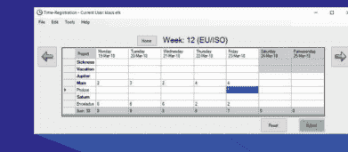
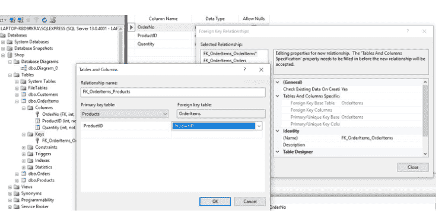
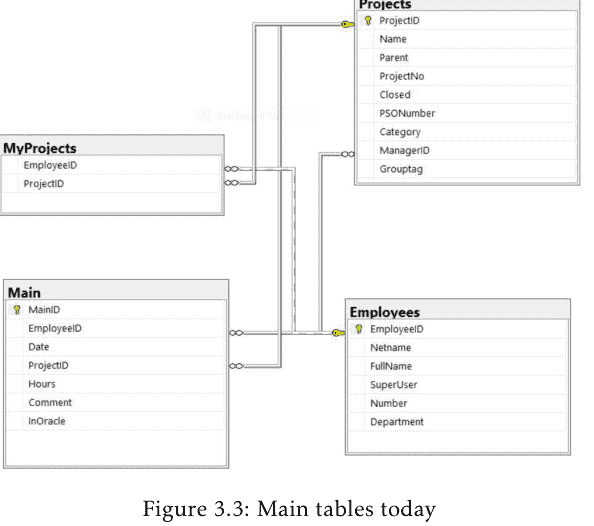
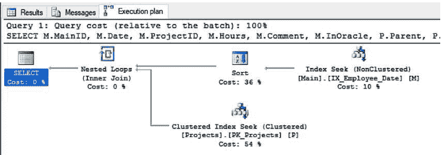
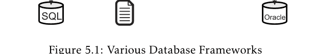
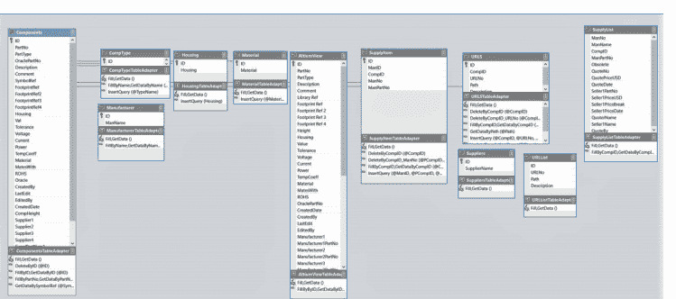
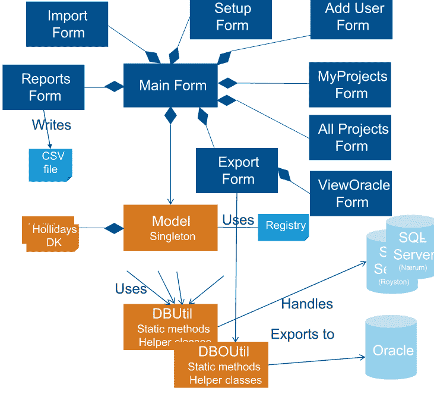
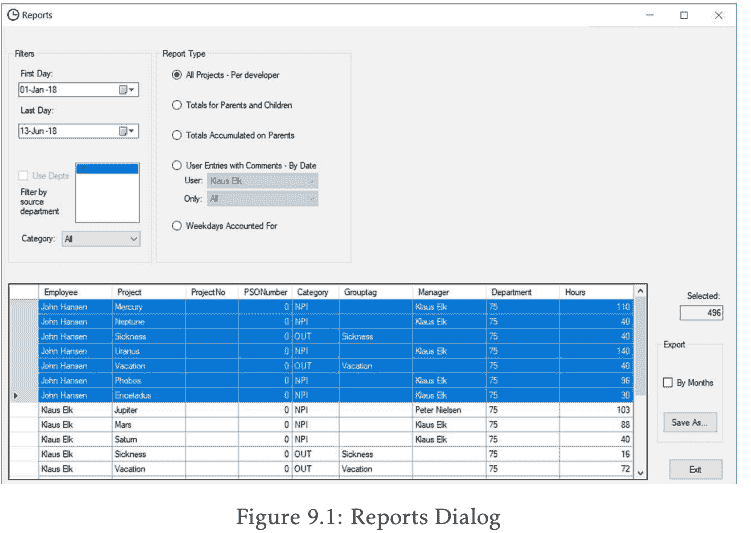
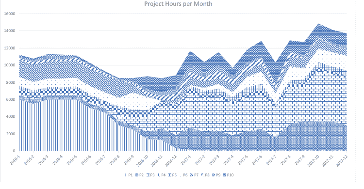

# C# SQL Server





```sql
SELECT M.MainID, M.Date, M.ProjectID, M.Hours, P.Name
FROM MainID AS M, Projects AS P
WHERE M.EmployeeID = 1
AND P.ProjectID = M.ProjectID
AND Date >= '3/19/2018' AND Date <= '3/25/2018'
ORDER BY M.ProjectID, M.Date
```

Klaus Elk


Klaus Elk


# 前言

在从事嵌入式系统工作之余，我也从事过 PC 软件开发。有时应用程序是“真实的”——有时是内部工具。许多应用程序内部都带有数据库，我在过程中学习了它们。

我尝试过各种框架和工具、“奇特”语言（如 Modular-2）以及面向对象的数据库，但直到最近的一个项目让我感到感觉非常好。那么，是哪里做得好呢？

我决定写这本书——重新回顾理论和代码，进行学习，并希望传递一些经验。我写了与该项目相关的的所有主题——涵盖设计、实现或维护期间的内容。

> 爱因斯坦说：“一切都应该尽可能简单，但不能过于简单。”你会发现，我通常倾向于寻求简单的解决方案和简单的工具。不将书中的每一个工具和每一个模式都丢进解决方案中，这本身一种美。

书的第一部分介绍了通用的数据库理论和 SQL——以 SQL Server 为特定示例。第二部分关于相关的 C# 编程。ADO.net 被“原样”使用，其上方没有任何框架——因为它本身就是一个经过时间考验的框架。书的两部分通过一个共同示例（即上述项目）连接起来。

完整的源代码可以下载——参见 https://klauselk.com 上的链接。

# 关于作者

Klaus Elk 于 1984 年毕业于哥本哈根丹麦技术大学，获得电子学硕士学位，论文关于数字信号处理。他还有营销学学士学位。在 30 多年的里，他在私营行业从事电信、医疗电子以及声振领域的工作。他主要从事嵌入式系统，但也从事 PC 软件。

在 10 年的时间里，Klaus Elk 在研发工作之余，还在丹麦技术大学任教。教授科目是面向对象编程（C++ 和 Java）以及互联网协议栈。如今，他是 Bruel & Kjær Sound & Vibration 仪器部门的研发经理。Klaus 还是《IoT 嵌入式软件》第 1 和第 2 版的作者。

# 致谢

非常感谢我的同事们。他们是书中示例项目的首批测试对象：一个考勤系统。这样的系统在开发者中从未受欢迎，但他们坦然接受了。在书中我描述了如何创建这个系统，尽可能少给开发者带来困扰，同时为管理层提供尽可能的数据。这甚至让项目经理能够解释为什么他们的项目有时会滞后。

我感谢我的经理 Lars Ager 允许我发布示例代码。


2.5 范式化 . . . . . . . . . . . . . . . . . . . . . . . . . . . . 19

3.1 引言 . . . . . . . . . . . . . . . . . . . . . . . . 37
3.2 需求 . . . . . . . . . . . . . . . . . . . . . . . . . . 37
3.3 逻辑设计 . . . . . . . . . . . . . . . . . . . . . . . . 38
3.4 物理设计 . . . . . . . . . . . . . . . . . . . . . . . 44
3.5 数据库示例 . . . . . . . . . . . . . . . . . . . . . . 46

+ 4 SQL . . . . . . . . . . . . . . . . . . . . . . . . 47
4.1 SQL 引言 . . . . . . . . . . . . . . . . . 47
4.1.1 SELECT . . . . . . . . . . . . . . . . . . . . . . . 48
4.1.2 SELECT . . . . . . . . . . . . . . . . . . . . . . . 48
4.1.3 INSERT, UPDATE 和 DELETE . . . . . . . . . . 50
4.2 进阶 SQL . . . . . . . . . . . . . . . . . . . . . . 51
4.2.1 标识 . . . . . . . . . . . . . . . . . . . . . . . 51
4.2.2 Group By . . . . . . . . . . . . . . . . . . . . . . 52
4.3 CRUD 学习 . . . . . . . . . . . . . . . . . . . . 55
4.4 索引 . . . . . . . . . . . . . . . . . . . . . . . 55
4.5 视图 . . . . . . . . . . . . . . . . . . . . . . . 60
4.6 公用表表达式 (CTE) . . . . . . . . . . . . . . 62
4.7 存储过程 . . . . . . . . . . . . . . . . . . . . 65
4.8 连接字符串 . . . . . . . . . . . . . . 65

# II C# 编程

+ 5 总体设计 ................................................................................ 73
5.1 框架 . . . . . . . . . . . . . . . . . . . . . 73
5.2 层级 . . . . . . . . . . . . . . . . . . . . . 76
5.3 类 . . . . . . . . . . . . . . . . . . . . . 79

+ 6 模型层 ................................................................................ 81
6.1 初始化 . . . . . . . . . . . . . . . . . . . . . 81
6.2 主表 . . . . . . . . . . . . . . . . . . 85

+ 7 数据库功能 ........................................................................ 89
7.1 设计 . . . . . . . . . . . . . . . . . . . . . . . 89
7.2 ExecuteNonQuery . . . . . . . . . . . . . . 90
7.3 ExecuteScalar . . . . . . . . . . . . . . 93
7.4 ExecuteReader . . . . . . . . . . . . . . 93
7.5 SqlDataAdapter . . . . . . . . . . . 97
7.6 Oracle 数据访问 . . . . 99

+ 8 数据传输对象 (DTO) ...................................................... 101
8.1 Cell 类 . . . . . . . . . . . . . . 101
8.2 Week 类 . . . . . . . . . . . . . . . . . . . . . . . . . 103
8.3 经典类概念 . . . . . . . . . . . . . . . . . . . . 105
8.4 Dapper 替代方案 . . . . . . . . . . . . . . . . . . 105

+ 9 UI 设计 ................................................................................ 107
9.1 ListBox . . . . . . . . . . . . . . . . . . . . . . . 107
9.2 DataGridView . . . . . . . . . . . . . . . . . . . . 109
9.2.1 初始化网格 . . . . . . . . . . . . . 109
9.2.2 更新网格 . . . . . . . . . . . . . 111
9.2.3 在网格中编辑 . . . . . . . . . . . . . 115
9.2.4 提交到数据库 . . . . . . . . . . 117
9.2.5 双缓冲 . . . . . . . . . . . . 118
9.2.6 单个 DataGridView 的多重用 . . . . 119

+ 10 使用 Excel . . . . . . . . . . . . . . . . . . . . 123
10.1 导出数据 . . . . . . . . . . . . . 123
10.2 导入数据 . . . . . . . . . . 126
10.3 与 Excel 之间的复制粘贴 . . . . . . 128


## 第一章
## 引言

## 1.1 本书将带你了解什么

如果你计划编写一个数据库应用程序，但在此之前几乎或没有经验，那么会有很多问题：

- 什么是 RDBMS - 它与数据库有何区别？
- 如何选择合适的数据库 - SQL Server 处于什么位置？
- 他们说 SQL Server 是 OLTP 类型的。这意味着什么 - 替代方案又是什么？
- 我如何创建数据库及其数据表 - 特别是关系？
- 在理解上述内容后 - 我如何在“良好”的设计中实现它？
- 应用程序呢？它是如何分层的？
- ADO.net 在这一切中处于什么位置？
- 那些让一切最终能够正常运行的小技巧又是怎么处理的？
- 我如何将数据导入 Excel - 最好是不使用额外的程序库？
- 给我看看代码！

## 第 1 章 引言

希望你会发现这些问题以及许多其他问题都得到了解答。有很多工具可以带你达到某个程度，但如果没有更深层次的理解，你就会开始绕圈子，基于存的假设进行修改。本书的目标就是提供这种理解。尽管书中没有练习，但你可以使用微软官方工具进行“跟随编码”——参见第 1.2 节。

为了便于阅读，排版格式如下：

- 项目列表如所示，而顺序列表从 ① 开始编号。
- 数据库中的表、列等使用 PascalCase（大驼峰命名法）。
- C# 变量和函数使用 camelCase（小驼峰命名法）。
- 粗体用于本地首次出现的关键词。
- 小型大写字母（SMALL CAPS）用于强调性语句。
- 普通表格用于数据库表和其他计算输出。普通表格在各处都有垂直和水平的单线分隔线。与此相反，作者编写的表格没有垂直线，而是使用了加粗表头和其他格式。
- 标准标题。这意味着标题位于图片下方，但在代码列表和表格上方。
- 章节、小节和子节均有编号。
- 框中的代码和内联代码如：
`SELECT ProjectID FROM Projects Name = ‘Vacation’`
SQL 代码采用“紧凑型”格式以节省空间。你可以查看许多免费的在线格式化工具。

## 1.2 工具

示例中的所有代码以及书中描述的所有代码段和概念都可以借助两个微软工具来创建：

- **Microsoft Visual Studio Community Edition（社区版）**：Visual Studio 是现今发现的最先进的 IDE（集成开发环境）。微软在企业界拥有良好的地位，但也旨在变得对“草根”和开源社区更具相关性。几年前，微软将 C# 语言交给了一个独立机构，现在我们有了 Visual Studio 社区版 - 任何个人开发者以及某些小型组织都可以免费。社区版强大得惊人，对于这本书来说我们真的不需要更多。它可以在 Mac OSX 上运行。书中使用的唯一编程语言是 C# - 如果不 SQL 编程语言的话。Visual Studio 不仅带有 C# 编译器和调试器，还有所需的类库。与数据库最相关的有 ADO.Net 和 linq。

- **带有 SQL Express 的 Microsoft SQL Management Studio（SSMS）**：如上所述，微软拥有企业影响力，但在某种程度上也接触开源开发者。SQL Server 现在运行在某些 Linux 发行版上。它甚至（可选地）运行在 Docker 上。这是 Linux 上的一个“容器”——类似于没有客/主机操作系统的轻量级虚拟机。SQL Server 有许多版本 - 从企业版、标准版到 LocalDB。还有一个开发者版，它本质上与企业版相同。标准版和企业版 SQL Server 不是免费的，但你可以使用免费的 Express 版取得很大进展。我没有在大型 SQL 服务器中发现任何我真的在 Express 版中感到短缺的功能。主要区别在于规模：Express 版“仅”支持高达 10 GB 的数据库，且仅利用单个 CPU¹。这使其成为开发的极佳选择：它是

> ¹在撰写本文时：最大 4 核心，最大 1410 MB 池缓冲区大小和最大 352 MB 列存储段缓存。

准备好迁移到 SQL Server 了。这实际上使其在小规模的实际部署中也成为一个很有趣的候选者。

LocalDB 与其他版本不同之处在于，它不作为单独的服务运行。相反，它可以作为应用程序的一部分直接运行。许多用户可能在同一台 PC 上运行他们各自的实例。这使得它的行为更像是 **MS Access** 的强力版本。

最后，**Azure SQL** 的模型与 SQL Server 非常相似，甚至你在书中学到的知识也可以应用于 Azure SQL。

通过安装，我们得到的不仅是服务器，还有用于 SQL 开发的 IDE，其方便的名称是 **Microsoft SQL Server Management Studio**。即使缩写为 MSSMS，这个名字也很难。好处是，一旦安装，你只需按下 Windows 主页并输入“SQL”即可找到它。在书中我们使用较短的形式“Management Studio”。

第三工具 - 不是微软的，但强烈推荐 - **是 git**。本书不是关于源码控制的。然而，你不应该在没有源码控制的情况下编写代码。这就是 C# 和版本控制系统存储的地方。好处是它是这样的。

## 1.3 Timereg 示例

在书中，我们将使用一个现有的应用程序作为示例 - 这是一个名为 Timereg 的注册系统。该示例用于 C# 部分。通常只有经理才喜欢用它来控制管理质量。经理可能某天说 A 项目优先级最高，而第二天又说 B 项目优先级最高。有了时间注册系统，真相将大大白。在这里你可以看到哪个任务或项目目标优先级最高。它对于项目经理或开发者来说可能也是一个很好的工具，因为他们可以说：“我们没有把计划的投入到这个项目中，因为我们必须在任务 X 上花费大量时间”。如果你在项目中计算速率（Velocity），时间注册也是一种帮助。因此，在某些方面，例如未达到目标的负担现在由管理层共同承担 - 正如该是这样。

![aee98b7809f9e4bf364ac352df7_13)

| 项目 | 3月19日周一 | 3月20日周二 | 3月21日周三 | 3月22日周四 | 3月23日周五 | 3月24日周六 | 3月25日周日 |
|---|---|---|---|---|---|---|---|
| Vacation (假期) | | | | | | | |
| Earth (地球) | | | | | 1 | | |
| Jupiter (木星) | | | | | | | |
| Enceladus (恩土卫二) | 2 | 3 | 2 | 4 | 4 | | |
| Mars (火星) | | | | | | | |
| Saturn (土星) | | | | | | | |
| Enclosure (围栏) | 6 | 6 | 6 | | 2 | | | |
| Sum (总计) | 8 | 9 | 8 | | 7 | 0 | | |

图 1.1：生成的主界面

1.1 显示了实现示例程序的主界面。它看起来非常简单，而且确实如此 - 特别是你只需要输入小时。图中显示的屏幕是所有用户在需要输入小时时所看到的界面。这个主工作流是我们密切关注的，但实际上还有许多其他屏幕和工作流。我们将检查其中一些，但并非全部。


## 第一部分
## SQL Server

## 第二章
## 数据库基础

## 2.1 数据库术语

数据库有几种截然不同的类型。二十年前，我曾实验过一种名为“POET”的对象型数据库。这个概念似乎是个好主意 —— 毕竟，当我们与对象一起工作，直接将它们存储或从数据库中检索它们，而无需任何繁琐的映射，是非常切实用的。然而，映射仍然是必要的，因为数据库只支持它自己的基本数据类型以及它自己的集合。此外，无法使用第三方工具对数据进行分析。也许这些就是我们现在很少听到对象型数据库的原因。

在本书中，我们处理的是关系型数据库 —— 这意味着基于表的数据库。构建关系型数据库有许多方法。供应商为他们的实现提供了或多或少标准化的外部接口 —— 这允许我们使用 SQL 结构化查询语言。整个系统（带有 SQL 接口的表低级实现）被称为 RDBMS 关系型数据库管理系统。具体到在书中，我们几乎只处理 Microsoft SQL Server。

正如常见的情况一样，接口（SQL）并没有完全标准化 —— 供应商需要一些空间来营销自己的特定版本。尽管如此，本书中编写几乎所有内容对于 Oracle 和 MySQL/MariaDB 等其他 RDBMS 也是正确的，尽管有时语法会有细微偏差。在书中，我遵循通常术语 —— 使用“RDBMS”指代你从例如 Microsoft 获得的产品，使用“database”（数据库）指代你在其中创建的东西。

你可能已经对数据库中主要术语的含义有了些了解。然而，存在许多误解和多义词。在不使用其他术语的情况下，很难描述某些术语。出于这个原因，我将在表 2.1 中简要介绍 SQL Server 层级结构中最重要的部分。表 2.2 将继续介绍最重要的数据库概念。我们将再次遇到它们所有内容。

关于记录（records）与字段（fields）对比行（rows）与列（columns）的讨论可能会让人头疼。早期的 PC 数据库混合使用这些术语。“记录”和“字段”经常用于 UI 软件，而“记录”在数据库的文件层级中也被使用。在 Excel 中，我们使用“行”和“列”。难怪我们大多数人用“行”和“记录”来指代同一件事，“列”和“字段”也是如此。然而，标准甚至微软公司都是说：

# 数据库表由行和列组成。

因此，我们在本书中使用“行”（row）和“列”（column）。术语“字段”（Field）有时也用于特定的行和列交叉点。自然地，这被称为“单元格”（Cell）。

## 2.1 数据库术语

表 2.1：SQL Server 层级结构

| 名称 | 含义 |
| --- | --- |
| RDBMS | 关系型数据库管理系统 —— 一种带有 SQL 接口的基于表的系统。 |
| Server (服务器) | 这可以指硬件或运行在其上的 SQL Server。在书中是指后者。 |
| Database (数据库) | 在日常用语中，数据库通常等于服务器。更准确地说，单个服务器托管一个或多个数据库。在连接字符串（Connection Strings）中，你引用的是目录（Catalog）。 |
| Schema (模式) | 用于分组数据库内的表 —— 类似于 C# 中的命名空间。它提供了在同一个数据库内拥有不同安全方案的额外能力。通常使用默认的 "dbo" 就能做得很好。 |
| Table (表) | 这是关系型数据库的基本实体。它始终是二维的。在给定服务器上的表全名是 `<database>.<schema>.<table>`。 |
| View (视图) | 数据库中的一种构造结构，在许多方面对客户端来说像一个表。 |
| Row (行) | 这是表中的行。在 Employees 表中，一行代表一个员工。有时被称为“记录”（Record）。 |
| Column (列) | 这是表中的列。在 Employees 表中，它可能是工资数字（Salary Number）。 |
| Cell (单元格) | 表中特定的行列交叉点。自然地，这被称为单元格。 |

（注：此处重复了下方术语表内容）

| 名称 | 含义 |
| --- | --- |
| RDBMS | 关系型数据库管理系统 —— 一种带有 SQL 接口的基于表的系统。 |
| Server (服务器) | 这可以指硬件或运行在其上的 SQL Server。在书中是指后者。 |
| Database (数据库) | 在日常用语中，数据库通常等于服务器。更准确地说，单个服务器托管一个或多个数据库。在连接字符串中，你引用的是目录（Catalog）。 |
| Schema (模式) | 用于分组数据库内的表 —— 类似于 C# 中的命名空间。它提供了在同一个数据库内拥有不同安全方案的额外能力。通常使用默认的 "dbo" 模式就能做得很好。 |
| Table (表) | 这是关系型数据库的基本实体。它始终是二维的。在给定服务器上的表全名是 `<database>.<schema>.<table>`。 |
| View (视图) | 数据库中的一种构造结构，在许多方面对客户端来说像一个表。 |
| Row (行) | 这是表中的行。在 Employees 表中，一行代表一个员工。有时被称为“记录”（Record）。 |
| Column (列) | 这是表中的列。在 Employees 表中，它可能是工资数字（Salary Number）。 |
| Cell (单元格) | 表中特定的行列交叉点。自然地，这被称为单元格。 |

表 2.2：重要的数据库概念

| 名称 | 含义 |
| --- | --- |
| OLTP | 联机事务处理。 |
| OLAP | 联机分析处理。 |
| CRUD | 创建、检索、更新、删除。 |
| ACID | 原子性、一致性、隔离性、持久性。 |
| Primary Key (主键) | 标识行的唯一列。 |
| Foreign Key (外键) | 指向另一个表的唯一列。 |
| Normal Form (范式) | 数据库结构的分类。 |
| Index (索引) | 加速数据库查询的内部表。 |
| Connection String (连接字符串) | 用于访问数据库的字符串。 |
| SQL | 结构化查询语言。 |
| T-SQL | 对 SQL 的扩展。 |
| Constraints (约束) | 强制数据完整性的规则。 |
| Join (连接) | 基于相关列连接两个多个表的操作。 |
| Transaction (事务) | 逻辑工作单元，要么完全执行要么回滚。 |
| Anomaly (异常) | 由于设计不当导致的不一致。 |

## 2.2 CRUD 和 ACID

为了理解一些基本概念，我们需要查看 CRUD 和 ACID。CRUD 指创建-检索-更新-删除。ACID 指数据库事务的属性。

表 2.3：CRUD

| CRUD | SQL | 含义 |
| --- | --- | --- |
| Create (创建) | INSERT | 向数据库插入新行。 |
| Retrieve (检索) | SELECT | 从数据库中获取行。 |
| Update (更新) | UPDATE | 更新现有行。 |
| Delete (删除) | DELETE | 从数据库删除行。 |

表 2.4：ACID

| ACID | 含义 |
| --- | --- |
| Atomic (原子性) | 希腊语“原子”意味着不可分割。这通过事务实现，事务要么全部完成要么回滚。 |
| Consistent (一致性) | 作为程序员或数据库管理员，我们承担了保持数据一致的一部分责任。这通过约束、触发器和级联实现。 |
| Isolated (隔离性) | 这真的是底层的。RDBMS 可能会将 SQL 命令拆分成部分并行运行。它们的顺序不应影响结果。 |
| Durable (持久性) | 一旦数据存储在数据库中，必须存在 ——即使发生断电。 |

## 2.3 OLTP 对比 OLAP

SQL Server 通常被描述为先进的 OLTP 系统。OLTP 意味着联机事务处理，通常被视为 OLAP —— 联机分析处理的对立面。在两种情况下，“联机”都是一个表示响应快速的营销术。区别在于系统是事务性的还是分析性的。这不仅关系你数据库的设计，还关系整个 RDBMS 的设计。OLTP 系统用于例如网商店和其他 POS —— 销售点应用程序，而数据挖掘和数据仓库系统通常是 OLAP 类型。

你可以说，OLTP 是为许多用户进行大量小写入而设计的。当你向数据库写入数据时，保护数据完整性非常重要，而 ACID 属性正提供了这种保护。


## 2.4. 键

防止系统在“半途中”发生故障，这可能导致数据不一致 - 因此 OLTP 重点关注事务。这在 OLAP 中并不那么相关，因为 OLAP 的重点是对更具静态的数据进行快速高效的读取。可能根本不会发生写入操作。

你也可以说，OLTP 用于日常业务 - 执行当前的策略，而 OLAP 则用于分析历史数据，并借帮助制定明天的策略。公司可能在销售和生产中使用传统的 OLTP。随后，数据被复制到 OLAP 系统中，在其中它不进行归式化（我们稍后会回到这一点）。在这里，为了更具战略性的目的对其进行分析。

传统的 RDBMS（如 SQL Server、Oracle 和 MySQL）都属于 OLTP 类型。

## 2.4 键

当数据库处于第一范式 (1NF) 或更高范式时，每行都是唯一的，正如我们在讨论归式化时将看到的那样。表中的**主键**（Private Key）是定义和查找唯一行所需的单一项。当表 A 中的主键被用于表 B 时，它们被称为表 B 中的**外键**（Foreign Keys）。这是因为它们引用了表 A。主键/外键关系是连接（Joins）的主要机制。

### 2.4.1 Management Studio 与键

图 2.1 是借助 Management Studio 的图表功能生成的，针对一个名为“Shop”的网商店数据库。这被称为实体关系 (ER) 图，简单来说，表是实体，而键提供了关系。在这里，列名是水平书写的 - 这样对文本来说更实用。我通过将所有主键/外键关系的端点移动到相关的列名上，对自动生成的图表提供了一点帮助。每种关系在主键端都有一个（黄色的）键，在键键端有一个“无限符号”（∞）。这表示**一对多 (1:n) 关系** - 换句话说，一个特定的键值作为主键只能出现一次，但作为外键可以出现多次。

## 第 2 章节 数据库基础知识

| 订单 (Orders) | 产品 (Products) |
| :--- | :--- |
| 订单单号 (OrderNo) | 产品 ID (ProductID) |
| 客户 ID (CustomerID) | 名称 (Name) |
| 订单日期 (OrderDate) | 价格 (Price) |
| 出货日期 (ShippingDate) | |

| 客户 (Customers) | 订单项 (OrderItems) |
| :--- | :--- |
| 客户 ID (CustomerID) | 订单单号 (OrderNo) |
| 名 (FirstName) | 产品 ID (ProductID) |
| 姓 (LastName) | 数量 (Quantity) |
| 电子邮件 (Email) | |
| 地址 (Address) | |
| 国家代码 (Countrycode) | |

图 2.1：Shop 中的键和关系

在 Shop 系统中，一个 ProductID 属于 Products 中的一个 Product，但可能出现在 OrderItems 的许多行中，因为许多人可能会购买相同的产品。

告诉 Management Studio 某列为主键相对容易。在“表设计”(Table-Design) 中，右键点击相关的列名并点击“主键”(Primary Key)。这也可以在脚本中编写。

通过 IDE 指定外键有多种方法。一种方法是在“对象管理器”(Object Explorer) 中展开表，然后右键点击“键”(Keys) 并选择“新建外键”(New Foreign Key)。图 2.2 显示了在 OrderItems 中添加外键时如何出现“外键关系”(Foreign Key Relationships) 对话框。对话框开始有一个名为 FK_OrderItems_Order 的新关系 - 一个自引用关系。现在展开“特定表列”(Tables and Columns Specific)，点击省略号 (...) 框，显示顶部的对话框。最后出现了一些合理的建议：可以选择用于主键和外键的表和列。呼！

> 3 注意星号 - 这是一个“将要存在”的关系。你无法取消此对话框！相反，请删除此关系并点击“关闭”。

## 2.4 键



图 2.2：添加外键

图 2.1 以及图 2.2 显示，我选择在主键和外键 - 在关系的两端使用。这是一种良好的习惯，尽管并非必须。正如我们稍后会看到的，在员工 表中的 EmployeeID。

### 2.4.2 复合键

有时键定义为几列的复合。想象一个 TV 表。我们不能简单地使用 TV 的序列号作为键，因为序列号对于给定的类型或名称是唯一的。在这种情况下，键定义为类型/名称和序列号。如果工厂为多个供应商制造 TV，键还需要包含 VendorID。

### 2.4.3 自然键与代理键

TV 工厂的示例是使用自然键的例子。我尽量避免使用自然键。例如电话号码，

## 第 2 章节 数据库基础知识

网络名称、车牌、工资号码等。这些是唯一的 - 但它们仍然会。显然人们改变电话号码，也会改变姓名（例如结婚时），并可能会改变工资号码。

### 2.4.4 标识 (Identity)

大多数 RDBMS（包括 SQL Server）都支持标识列。这对于作为代理键非常实用。根据定义，这些可以独立存在 - 它们不是复合键的一部分。在 SQL Server 中，标识值使用种子（Seed - 初始值）以及增量值进行初始化。默认情况下，标识列中的行编号为 1,2,3,4 等。每当删除一行时，就会留下一个空隙。出于此原因，应用程序软件无法假设例如最新的 ID 可以作为行数的指示。书中使用了基于标识的键，正如我们在各种 T-SQL 脚本中清楚看到的样。

如果通过恢复另一个数据库的备份来创建新数据库，并删除内容，标识将从它“中断的地方”继续。以下行将重置键 - 在这种情况下是对稍后看到的 TimeReg 中的 Main 表。不要在非空数据库上执行此操作。

```
DBCC CHECKIDENT ('TimeReg].[dbo].[Main], RESEED, 0);
```

## 2.5 归式化

关系数据库的发明者 Codd 描述了归式化的过程。他描述了多个范式 - 从第一范式 (1NF) 开始，一直到第五范式 (5NF) - 每一步都包含一步的规则以及更多。“鲍义斯-科德”范式在 3NF 和 4NF 之间被引入。通常 3NF 就足够避免问题了，进一步增加可能会导致性能问题。关于前三个范式的流行总结如下：

> 4 感谢披头士提供的这个术语

> 5 这被称为读取-修改-写入

在没有官方项目编号的情况下，因为这可能稍后从来源获得。如果 - 当它可用时，它被写入相关的非键列中。


# 第 2 章 数据库基础

表中的每一个非键列都应该依赖于键、整个键，并且仅此键，愿 CODD 佑佑我。

在表 2.5 中，上述句子被拆分为几个短语。每个短语描述了相关的规范化规则。

### 表 2.5：规范化

| NF | 短语 | 描述 |
| --- | --- | --- |
| 1NF | 键 | 有一个唯一的主键，基于最少数量的列。每个单元格都是“原子的”，意味着它只包含单个值 - 例如，不是一个值的列表。最后，不允许出现重复的列，例如 Student1, Student3...。 |
| 2NF | 整个键 | 符合 1NF，且所有非键列都完全依赖于整个键。 |
| 3NF | 仅依赖于键 | 符合 2NF，且所有非键都依赖于键。 |

### 2.5.1 案例：学生数据库

让我们尝试一个简单且经典的案例。我们将讨论规范化并尝试在 Management Studio 中编写一些 T-SQL。表 2.6 是一个学生的单表数据库。单表数据库通常被称为扁平数据库。如果你将数据保存在 Excel 中，这就是一个扁平“数据库”。当将其移动到真实数据库时，存在结构保持不变的风险。

学生数据库和表可以通过 Management Studio 中的 GUI 创建，但一旦创建数据库⁶，你可能想通过“新建查询”窗口中输入列表 2.1 中的 T-SQL 来添加表，然后按 F5 执行。

注意，GO 关键字用作“批”结束。如果使用了变量，它们在 GO 之后将超出范围。如果 GO 后面跟着一个整数，则批处理将重复该次数。这在这里没有意义，但可以配合 INSERT 使用来快速生成大量虚拟数据。

> ⁶数据库的创建也可以通过脚本完成

## 2.5. 规范化

### 列表 2.1：创建表

```sql
CREATE TABLE dbo.Students (
    StudentNo int NOT NULL,
    FirstName varchar(50) NOT NULL,
    LastName varchar(50) NOT NULL,
    Class varchar(50) NOT NULL
)
GO
```

### 列表 2.2：删除表

```sql
DROP TABLE dbo.Students
GO
```

如果你不喜欢“CREATE TABLE”的结果，可以很容易删除它。如果你在另一个查询窗口中输入或执行列表 2.2 中的脚本，就可以很容易在窗口之间来回并进行实验。

表 2.6 甚至不符合 1NF，因为“Classes”显然可能包含值列表，就像学生 401 Peter 那样。

### 表 2.6：学生数据库 - 非规范化

| StudentNo | FirstName | LastName | Classes |
|---|---|---|---|
| 401 | Peter | Anderson | Basic Math, Adv. Physics |
| 402 | John | Grey | History |
| 403 | Joan | Cooper | Basic Math |
| 404 | Annie | Dawson | Adv. Physics |

我们可以通过引入更多列来解决这个问题 - 比如“Class 1”、“Class 2”等。然而，这是对 1NF 的另一种违反。相反，我们可以为每个学生的每个课程设置一行数据 - 如表 2.7 所示。现在我们在任何列中都没有列表，也没有重复的列。这是一个经典的 Excel 解决方案。它也符合 1NF。

### 表 2.7：学生数据库 - 1NF

| StudentNo | FirstName | LastName | Class |
|---|---|---|--|
| 401 | Peter | Anderson | Basic Math |
| 401 | Peter | Anderson | Adv. Physics |
| 402 | John | Grey | History |
| 403 | Joan | Cooper | Basic Math |
| 404 | Annie | Dawson | Adv. Physics |

现在我们认为在现有数据基础上，在 Management Studio 中将 Student 设为主键是一个好主意，当我们尝试按 F5 保存设计更改时，得到了以下错误：

'Students' 表 - 无法创建索引 'PK_Students'。CREATE UNIQUE INDEX 语句终止，因为在对象名称 'dbo.Students' 和索引名称 'PK_Students' 上发现重复键。重复键值为 (401)。无法创建约束或索引。请查看之前的错误。语句已终止。

这就是我所说的极好的错误信息。我们没有为 StudentNo 设置主键，因为它是唯一的。然而，如果你尝试在 Students 表中定义一个基于 StudentNo 和 Class 的复合键，你实际上是可以成功的。这支持了 Students 表可以认为是 1NF - 尽管它看起来很丑。它不符合 2NF，因为没有遵守“所有非键列都依赖于整个键”的规则。学生的名字依赖于 StudentNo，但不依赖于 Class。可以在 GUI 中通过对两者使用“设置主键”(F5) 来创建复合键。或者，可以在 T-SQL 中创建复合键 - 像列表 2.3 那样修改现有表。

### 列表 2.3：修改表

```sql
ALTER TABLE Students
ADD CONSTRAINT PK_Students PRIMARY KEY CLUSTERED
(
    StudentNo, Class)
```

当主键基于单列时，“PRIMARY KEY”是相关列所在行的修饰符。Management Studio 允许在相关列所在行进行修改。在 GUI 中通过设置主键（按 F5）来创建复合键，如列表 2.4 所示。

### 列表 2.4：脚本结果

```sql
USE Students
GO
SET ANSI_NULLS ON
GO
CREATE TABLE [Students](
    utcnow int NOT NULL,
    FirstName varchar(50) NOT NULL,
    LastName varchar(50) NOT NULL,
    Class varchar(50) NOT NULL,
    CONSTRAINT [PK_Students] PRIMARY KEY CLUSTERED
(
    utcnow, Class)
)
WITH (PAD_INDEX = OFF, IGNORE_DUP_KEY = OFF, ROW_LOCKS = ON, PAGE_LOCKS = ON)
GO
```

这里是脚本的输出：
- 第一行是“USE Students”。它定义了数据库。
- 后面是“GO”。它是可选。
- 接着是“CREATE TABLE [Students]”。这允许我们创建表。
- 后面是“[]”。这些是分隔符。
- 后面是“WITH”部分，包含了默认设置。
- 结尾是“GO”。这允许我们进行处理的。

### 2.5.2 异常

如果我们为了避免缩写而将“Adv. Physics”改为“Advanced Physics”，我们需要在多处更新。这就是更新异常。此外，如果 John Grey 决定离开，我们就不再有 History 课程的痕迹了。这就是删除异常。最后，如果我们想引入“Religion”课程，必须有学生修读该课程才能引入它。这就是插入异常。

根据我的经验，程序员对更新异常非常熟悉。程序员讨厌重复的字符串。我们渴望以某种方式将它们定义为“常量”。这种直觉也有助于其他异常。

### 2.5.3 关联表

在某些情况下，程序员的常规思维没有任何帮助。我们倾向于处理集合，以及集合的集合。这就是设计的方式。考虑图 2.1 中的商店。没有数据库经验的程序员会认为一个 Order 有多个 OrderItems。1NF 告诉我们不能在 Orders 表中拥有 OrderItem、Order2 等列。程序员的直觉是有一个 OrderList 的引用 - 另一个表。不幸的是，这意味着 Orders 中的每一行都应该有自己的 OrderItems 表 - 随着订单的创建而动态创建。这就是程序处理集合的方式，但不是数据库组织的方式。

相反，关系被颠倒了，我们有一个巨大的 OrderItems 表引用 Orders 表和 Products 表。这种处理多:n 关系的方法被称为关联表。关联表只有外键行 - 没有主键。可能会出现非键列如我们的 Quantity。注意有时关联表被称为中间表。

### 2.5.4 学生数据库 3NF

使用关联表也是我们学生案例的解决方案。我们现在不是一个单表，而是三个表 - 参见表 2.8、2.9 和 2.10。StudentNo 和 ClassID 分别是这些表中的第一个和第二个表的主键，而它们在第三个表中都是外键。


# 第2章 数据库基础

表 2.10：学生数据库 - 3NF - 关联

| 学生号 StudentNo | 班级 ClassID |
|---|---|
| 401 | 1 |
| 401 | 4 |
| 402 | 5 |
| 403 | 1 |
| 404 | 4 |

### 2.5.6 订单系统 3NF

回到图 2.1 中的订单系统，我们看到它满足了 1NF - 也许除了地址（Address）。地址列是由多个字符串组成的，如街道名、门号等。地址是否可以拆分？这值得吗？我们已经将邮政编码（ZIP）和国家（Country）作为单独列。街道号（street-no）和楼层号（floor-no）应该是独立的列吗？这真的值得吗？如果我们接受地址（Address）是**原子性**的，那么 1NF 就满足了。

订单系统也满足 2NF，因为所有非键列都依赖于主键（whole key）。3NF 也满足吗？在所有表中，所有非键列都依赖于“没有任何”。

使用数据库接口来“Altium”，它提供了组件列表。这个表可以包含数千行。对于每一行，都有预期的组件类型（Component Type）、值（Value）以及其他列，但这些违反了 1NF。最麻烦的后果是，Altium 选择了这种布局，为了方便那些人使用 - 或者继续使用 Excel。这样做是以牺牲灵活性为代价。

## 2.6 连接 (Joins)

数据库最重要的概念之一是连接（Join）。在这里，我们将一个表的主键与另一个表的特定外键“对齐”（align），生成一个新的更宽的临时表。有多种方法可以实现：


图 2.3：最重要的连接

连接（Join）。在 SQL 中，简单的 JOIN 等同于 INNER JOIN。这就是我们在图 2.3 左侧看到的。连接生成的临时表仅包含两个表中键匹配的元素。由于同一个主键可能有多个外键实例，新表可能会有多个行，对应每一个这些实例。另一方面，如果键仅作为主键或仅作为外键，后者的情况听起来不对 - 怎么会有没有对应主键的情况？可能没有声明约束（我们将得到这个）。直到我们决定编写 SQL JOIN 语句。

左连接 (Left Join)
这有时被称为 LEFT OUTER JOIN。SQL LEFT JOIN 见图 2.3 右侧。在这种情况下，表 A 中的所有行都会出现在结果临时表中。当在表 B 中找到匹配的键时，行会从此处扩展数据。而那些“缺失的列”将填充为 NULL。

右连接 (Right Join)
它的工作方式与左连接相同 - 但现在是完整的 B 表和来自 A 的匹配。我个人从不用右连接 - 我只需引用表并使用左连接。

全连接 (Full Join)
这也被称为 FULL Outer JOIN，图中未显示。它包含了两个表的所有行 - 如果通过公共键可以匹配，其余列则为 NULL。

为了演示连接，我们将重用商店系统 - 现在有了数据。这些数据被简单写入表 2.11 到 2.14 中，使用了 Management Studio 的“编辑前 200 行”。在现实生活中，它们是用应用程序写入的。

表 2.11：订单 Orders

| 订单号 OrderNo | 客户 ID CustomerID | 订单日期 OrderDate | 出货日期 ShippingDate |
| --- | --- | --- | --- |
| 1 | 1 | 2018-01-03 | 2018-01-06 |
| 2 | 1 | 2018-02-02 | 2018-02-04 |
| 3 | 2 | 2018-03-03 | 2018-03-06 |
| 4 | 4 | 2018-04-03 | 2018-04-05 |

表 2.12：产品 Products

| 产品 ID ProductID | 名称 Name | 价格 Price |
|---|---|---|
| 1 | 橡木圆桌 Round Table oak | 199 |
| 2 | 红木圆桌 Round Table mahogany | 229 |
| 3 | 白色方桌 Square Table white | 1699 |
| 4 | 黑色椅子 Chair black | 599 |
| 5 | 白色椅子 Chair white | 599 |
| 6 | 红色椅子 Chair red | 599 |
| 7 | 壁灯 Wall-Lamp | 350 |
| 8 | 吊灯 Ceiling-Lamp | 299 |

表 2.13：订单项目 Order-Items

| 订单号 OrderNo | 产品 ID ProductID | 数量 Quantity |
|---|---|---|
| 1 | 2 | 2 |
| 1 | 3 | 1 |
| 2 | 4 | 4 |
| 3 | 5 | 2 |

表 2.14：客户 Customers

| 客户 ID CustomerID | 姓名 FirstName | 邮箱 Email | 邮政编码 ZIP |
|---|---|---|---|
| 1 | John | john@gmail.com | 2230 |
| 2 | Niels | niels@outlook.com | 2700 |
| 3 | Pia | pia@outlook.dk | 3400 |
| 4 | Linda | ljones@gmail.com | 3790 |
| 5 | Carl | carl@gmail.com | 3600 |

为了演示连接，我们将重用商店系统 - 现在有了数据。这些数据被简单写入表 2.11 到 2.14 中，使用了 Management Studio 的“编辑前 200 行”。在现实生活中，它们是用应用程序写入的。

注意连接的输出结果看起来非常像 Excel 解决方案在扁平表中的初始状态。换言之，我们从扁平表开始，将其规范一化为多个表。

```sql
USE Shop
```

连接（Join）的方式获取了表中的所有数据。这在 SQL 2.5 之后是可见的。为了适应页面，这些表被收缩了以适应显示。最后，“AS”在某种情况下重命名了表头。

表 2.5：连接 (Joins)

```sql
SELECT Orders.OrderNo, OrderDate, ShippingDate, Quantity AS Qty, FirstName AS First, LastName AS Last, Email, CountryCode AS Ctry, Name, Price
FROM Orders
JOIN OrderItems ON OrderNo = Orders.OrderNo
JOIN Customers ON Orders.CustomerID = Customers.CustomerID
JOIN Products ON Products.ProductID = Items.ProductID
```

连接（Join）生成的临时表。在 SQL 中，简单的 JOIN 等同于 INNER JOIN。这就是我们在图 2.3 左侧看到的。

表 2.5：连接后的表 (Joined Tables)

| No | OrderDate | ShippingDate | Qty | First | Last | Email | ZIP | State | Name | Price |
|---|---|---|---|---|---|---|---|---|---|
| 1 | 2018-01-03 | 2018-01-06 | 2 | John | Doe | john@gmail.com | 2230 | DK | Round Table | 229 |
| 2 | 2018-01-03 | 2018-01-06 | 1 | Niels | Petersen | niels@outlook.com | 2700 | DK | Square table | 199 |
| 3 | 2018-02-02 | 2018-02-04 | 4 | Pia | Hansen | pia@outlook.dk | 3400 | DK | Black board | 599 |
| 4 | 2018-02-02 | 2018-02-04 | 4 | Linda | Jones | ljones@gmail.com | 3790 | SE | Round Table white | 1999 |
| 5 | 2018-04-03 | 2018-04-06 | 3 | Carl | Nielsen | carl@gmail.com | 3600 | DK | Round Table oak | 750 |
| 6 | 2018-04-03 | 2018-04-05 | 4 | Linda | Jones | ljones@gmail.com | 2230 | DK | Round Table mahogany | 229 |

为了演示 (INNER) JOIN 和 LEFT JOIN 的区别，我们需要从一个没有被完全使用的表开始。相同的查询再次执行，但这次使用了 LEFT JOIN。


如前所述——当执行 `INNER JOIN` 时，我们得到的是交集，即在所有连接表中键值匹配的行。在原始表中，（内）连接表中没有 `NULL` 值。通过 `LEFT JOIN`，我们获得了来自 `Products`（左表）的所有行，以及来自 `OrderItems`（右表）中匹配的行。由于存在未售出的 `Products`，相应的行现在在 `OrderItem` 列中包含 `NULL` 值。

我们还发现，两个输出中的共同行顺序并不相同。SQL 不保证行顺序——除非你显式指定了它。我们将在第 4 章介绍这一点。

## 2.7 数据类型与 NULL

2.18 显示了 T-SQL 中常用的数据类型。字符串有四种类型——包含和不包含 Unicode，以及具有固定或动态长度的间隔。例如 "nchar" 中奇怪的 'n' 原因是它最初意为“National”（国家级）字符。实际类型对应于 C 类语言中的经典 `float`，而 T-SQL 的 "float"（不带长度指定符）对应于 C 类型的 `double`。

稍后我们看到 `TimeReg` 示例大量使用了 `datetime` 格式。这可能并不意外，因为 `datetime` 每个时间戳占用 8 字节，而 3 字节就足够存储一个不带时间的有效日期。当我设计物理层时（我们将在第 3.4 节回到这一点），尚不清楚是否会产生比较同一日期内时间戳的需求，因此我选择了稳妥的解决方案。这影响了我们将编写的 C# 代码，而且可能不会进行清理。

我们知道某些零值，如空字符串和整数的数值 0。这些是特定类型的合法值。这与 `NULL` 不同，`NULL` 是“缺失”或“未知”值——非常类似于面向对象编程（OOP）中的空指针。在以下场景中 `NULL` 是必要的：

- 外连接（`outer JOIN`），正如我们之前在表 2.17 中看到的那样。在这种情况下，我们用另一个表的列来扩展现有的行。例如在 `LEFT JOIN` 中，左表中会有某些行在右表中没有匹配的值——但我们希望显示出某些内容，此时 `NULL` 是合理的。不过，可以在 SQL 连接语句中指定要使用的默认值。

- `INSERT` SQL 语句可能只对某些列提供值。其余部分怎么办？如果在创建表时为相关列设置了默认值，则使用这些默认值；否则使用 `NULL`。

表 2.18：T-SQL 选数据类型

| T-SQL | .Net | 含义 |
| :--- | :--- | :--- |
| bigint | Int64 | 8 字节有符号整数。 |
| int | Int32 | 4 字节有符号整数。 |
| bit | Boolean | 真/假。 |
| real | Single | 4 字节经典 "float"。 |
| float | Double | 8 字节经典 "double"。 |
| date | - | 3 字节。年份 1-9999。 |
| datetime | DateTime | 8 字节。年份 1753-9999 及秒级分数。 |
| datetime2 | DateTime | 6-8 字节。年份 1-9999 及秒级分数。 |
| char(n) | Byte Array | n 字节固定存储。注意：默认情况下字符串会用空格填充。使用字节（最大 n）+ 2 动态存储。 |
| varchar(n) | Byte Array | 可能比 `char` 节省空间，但访问较慢。2*n 固定存储 - 用空格填充。 |
| nchar(n) | String | 2*(使用字节) + 2 动态存储。可能比 `nchar` 节省空间，但访问较慢。 |
| nvarchar(n) | String | |

处理 `NULL` 值可能会带来问题。如果为所有列定义了默认值，情况会变得简单一些。这些值用于 `INSERT`，但在外连接场景中不适用。有时，C# 的空合并运算符 `??` 非常有用。它可以测试变量是否为 `null`。它可以与带有后缀 `?` 的可空类型一起使用。

Listing 2.8：可空数据类型

```
1 int? x = null; // x 可以 NULL 或 int
2 // 如果 x 不是 NULL，则将 y 设置为 x
```

（注：原文后部分存在大量重复的段落，译文已根据要求去重处理，避免重复输出。）


## 第 3 章
## TimeReg 数据库
## 3.1 引言

我一直尝试让 TimeReg 不仅适用于高层管理。项目经理可以分析子项目的耗时情况，而开发者可以管理自己的休假等。您可以下载示例文件（其中包含一个小型示例数据库），并在阅读本书时使用它。或者，您也可以直接阅读文本并继续。

## 3.2 TimeReg 需求

基本上，TimeReg 应用程序的需求如下：

> 项目工时的每日报告必须足够简单，因为这是最常见的操作。例如，可以以周为单位的形式——非常类似于学生使用的时间表。如果不仅能记录小时数，还能记录自由文本注释，那就就更好了。用户应该只能看到他们之前选择为相关的项目——“我的项目”，而不是其他人的项目。所有用户都必须能够直接在程序中创建简单的报告。它必须易于以 Excel 兼容的格式保存这些报告。只有经理应该能够轻松查看其他员工的病假和休假。项目经理应该能够轻松查看项目子部分的累计数字。我们希望能够将项目中的工作分解开来。

## 3.3 逻辑设计

数据库设计是自自而上的。首先是高层设计，在其中定义主要的实体（表）以及基于业务模型的关系。然后是低层设计，其中包含数据类型、索引、约束等。这些内容我们将在第 4 章重新讨论。这两个层次通常被称为逻辑设计和物理设计。来自硬件和嵌入式软件领域，我发现“物理设计”这个术语令人困惑，但它是常用的。因此，让我们开始 TimeReg 的逻辑设计：

## 3.3 逻辑设计

查看需求。尝试将所有名词作为实体（表）的候选。然后将它们的所有属性作为表列。具体的项目将成为行。

在示例需求中发现了以下名词：时间注册、员工、项目、子项目、部门、注释、工时、周、用户、休假、病假、报告、经理、操作、数字、个人、工作。让我们逐一分析：

- 时间注册
这是整体目标，因此它不是一个表，而是整个系统。

- 员工
这是一个很好的表候选者。此表必须包含与特定员工相关的所有信息——例如“姓名”、工资编号（员工工号）和部门（见下文）。我决定使用标识符，并且我们需要处理这些情况。

- 部门
这是一个有趣的案例。正如所说，员工属于一个部门。这是一个 1:n 关系。

- 项目
这是另一个表的候选者。

- 子项目
这是我们存储工作分解的地方。

- 我的项目
这是一个关联表（中间表）。由于一个员工可能参与多个项目，这是一个 m:n 关系。


## 第 3 章 TIMEREG 数据库

- 累计数字 (Accumulated Numbers)
如上所述，这是在报告生成时动态生成的。

- 注释 (Comment)
注释作为单独的一列紧随小时数进入主表（Main table）。

- 周 (Week)
这是一个很好的需求示例，它关于数据在用户界面上的显示方式，而不是数据库本身。然而，小时是记录在特定日期的。我们确实需要在主（小时）表中一个日期（Date）列。

- 表单 (Form)
与用户界面相关。

图 3.2 显示了如何在 Power-Point 中绘制初始表格布局。这仅说明通过简单的手段也可以取得远大的进展。

图 3.3 显示了由 Management Studio 最近创建的图表中相同的表。注意添加了从项目（Projects）到员工（Employees）的关联。这是通过后添加的 ManagerID 创建的，它是一个外键，匹配 Employees 表中的主键 EmployeeID。Projects 表中的其他新列是 **GroupTag**（组标签）和 **Category**（类别）。这两者都用于以各种方式组织项目，以便统计数据更具可用性。Category 列由项目经理使用，而 GroupTag 由高层管理使用。最后，我们有 **InOracle**，它包含导出到官方 Oracle 系统的日期——如果未导出则为 NULL。

## 3.3. 逻辑设计 SQL-Server

## MS SQL-Server 后端数据库 - 表

| 熟练度 Mastery* | EmployeeID** | 日期 Date | ProjectID** | 小时 Hours | 注释 Comment | 已进入 Oracle InOracle | 员工 Employee | ProjectID** |
| :--- | :--- | :--- | :--- | :--- | :--- | :--- | :--- | :--- |
| 1 | 2 | 2014-11-10 | 1 | 3.5 | SC会议准备 | 2015-1-1 | | |
| 2 | 2 | 2014-11-10 | 2 | 2.0 | 轮班值 | 2015-1-1 | | |
| 3 | 2 | 2014-11-11 | 1 | 1.5 | OOP 会议 | 2015-10-1 | Employee | 1 |
| 4 | 2 | 2014-11-13 | 2 | 2.0 | 设计评审 | Null | | 2 |
| 5 | 2 | 2014-11-12 | 3 | 8.2 | 编码 TDD-迭代 | Null | | MyProjects |

| 项目 ID Project ID | 名称 Name | 父级 Parent | 已关闭 Closed | PSNumber | 类别 Category | 员工 ID Employee ID | 网络名称 Net name | 员工姓名 Employee Name | 部门 Department |
| :--- | :--- | :--- | :--- | :--- | :--- | :--- | :--- | :--- | :--- |
| 1 | Bilbo | 0 | | NPI | | 1 | TSC | | 25419 | 7533 |
| 2 | Gandalf | 0 | | NPI | | 3 | LEGO | Leo Gustafson | 25687 | 7534 |
| 3 | Boromir | D | | 75498 | PSO | 4 | DANSSI | Dan Issson | 24985 | 7538 |
| 4 | Pippin | | | | | | Employees | | |
| 5 | Vacation | -1 | D | | CUT | | | | | |

* 主键 (Autumn)
** = 外键




| ProjectID | 名称 Name | 父级 Parent | 项目编号 ProjectNo | 已关闭 Closed | PSNumber | 类别 Category | ManagerID | 组 Group |
| :--- | :--- | :--- | :--- | :--- | :--- | :--- | :--- | :--- |

| EmployeeID | 日期 Date | 项目ID ProjectID | 小时 Hours | 注释 Comment | 已进入 Oracle InOracle |
| :--- | :--- | :--- | :--- | :--- | :--- |

| EmployeeID | | | 全名 FullName | 超级用户 SuperUser | 数量 Number | 部门 Department |
| :--- | :--- | :--- | :--- | :--- | :--- | :--- |

## 3.4 物理设计

设计的细节仅由由 SQL Server 生成的脚本描述。微软使用 "/*...*/" 注释，而我使用 "-"。为了节省空间，删除了许多 "GO" 语句等。

许多构造将在下一章中解释。你可能想先跳过脚本，在描述各种概念时再回来查看它。

### 列表 3.1: 脚本数据库结果

```sql
****** Object: Table [dbo].[Employees] /* /
CREATE TABLE [dbo].[Employees](
  -- 标识主键不是 1,2,3,4...
  -- 注意 SQL Server 没有在此处写 'PRIMARY'，
  -- 而是使用下面的 CONSTRAINT
  [EmployeeID] [int IDENTITY(1,1)] NOT NULL,
  [Name] [nvarchar](25) NOT NULL,
  [FullName] [nvarchar](50) NOT NULL,
  [SuperUser] [bit] NOT NULL,
Salary Number 如果存在则为 0
  [Number] [int] NOT NULL,
  Department 必须是数字
  [Department] [int] NOT NULL,
  CONSTRAINT [PK_Employees] PRIMARY KEY CLUSTERED
  (
    [EmployeeID]
  )
)
GO


****** Object: Table [dbo].[Main] /* /
CREATE TABLE [dbo].[Main](
  -- 标识主键
  [MainID] [int] IDENTITY(1,1) NOT NULL,
  [EmployeeID] [int] NOT NULL,
  [Date] [datetime] NOT NULL,
  [ProjectID] [int] NOT NULL,
  [Hours] [real] NOT NULL,
  [Comment] [nvarchar](200) NOT NULL,
  [InOracle] [datetime] NULL,
  CONSTRAINT [PK_Main] PRIMARY KEY CLUSTERED
  (
    [MainID]
  )
)
GO

ALTER CONSTRAINT [FK_Main_Employees] FOREIGN KEY (
  [EmployeeID]
)
REFERENCES [dbo].[Employees] (
  [EmployeeID]
)
GO

ALTER CONSTRAINT [FK_Main_Projects] FOREIGN KEY (
  [ProjectID]
)
REFERENCES [dbo].[Projects] (
  [ProjectID]
)
GO

 ****** Object: Table [dbo].[MyProjects] /* /
CREATE TABLE [dbo].[MyProjects](
  [EmployeeID] [int] NOT NULL,
  [ProjectID] [int] NOT NULL
)
GO

ALTER CONSTRAINT [FK_MyProjects_Employees] FOREIGN KEY (
  [EmployeeID]
)
REFERENCES [dbo].[Employees] (
  [EmployeeID]
)
GO

ALTER CONSTRAINT [FK_MyProjects_Projects] FOREIGN KEY (
  [ProjectID]
)
REFERENCES [dbo].[Projects] (
  [ProjectID]
)
GO

 ****** Object: Table [dbo].[Projects] /* /
CREATE TABLE [dbo].[Projects](
  [ProjectID] [int] IDENTITY(1,1) NOT NULL,
  [Name] [varchar](50) NOT NULL,
  [Parent] [int] NOT NULL,
  [ProjectNo] [varchar](50) NOT NULL,
  [Closed] [bit] NOT NULL,
  [PSNumber] [int] NOT NULL,
  [Category] [varchar](10) NOT NULL,
  [ManagerID] [int] NOT NULL,
  [GroupTag] [varchar](50) NOT NULL,
  CONSTRAINT [PK_Projects] PRIMARY KEY CLUSTERED
  (
    [ProjectID]
  )
)
GO
```


# 第4 章

## SQL

## 4.1 SQL 简介

通常当人们谈论 SQL 语句时，指的是我们在讨论 JOIN 时已经在示例中看到的像 SELECT 这样的查询。SELECT 一同 UPDATE、DELETE 和 INSERT 构成了“数据操作语言”（DML）。我们在第 2 章中已经见过它们被组合成 CRUD。我们还看到过一些用于创建和删除表以及数据库的命令 - 例如 CREATE、ALTER 和 DROP。这被称为“数据定义语言”（DDL）。这两组命令是本书中最重要的，但总共有四组 - 如表 4.1 所示。

表 4.1：T-SQL 语言组

| 术语 | 含义 | 示例 |
|---|---|---|
| DML | 数据操作语言 | SELECT, UPDATE, DELETE, INSERT |
| DDL | 数据定义语言 | ALTER, CREATE, DROP |
| DCL | 数据控制语言 | GRANT, REVOKE |
| TCL | 事务控制语言 | COMMIT, ROLLBACK |

你可以在网上找到大量关于 SQL 和 T-SQL 的详细信息。最好的地方之一是“w3schools.com”。它展示了所有的通用 SQL 命令以及针对 SQL Server 的特定 T-SQL。在本文，我们将通过一些示例来获得通用的理解。

### 4.1.1 参数

示例取自数据库接口层，我们将在第 7 章深入研究那里。在这里，所有的 SQL 语句都是以 C# 字符串的形式构建的。我在接下来的列表中删除了 C# 字符串的相关内容，以便关注 T-SQL。我保留了“参数”。这些是以“@”开头的变量名。我们稍后会看到，这些参数在传递给 SQL 服务器之前并没有在 C# 字符串中被替换。相反，参数是通过 Command 对象被单独传递的。这提高了安全性 - 特别当字符串来自用户时。在这种情况下，坏蛋可能会提供一个完整的恶性 SQL 注入。使用参数时这是不可能的。作为一个额外的好处，在使用参数时使用这种语法非常重要。此外，它还能更清楚地说明 SQL 的哪些部分是从应用程序输入的。请注意，使用与相关列名相同的参数名称是完全合法的。

使用参数的另一种说法是绑定（Binding）。每当 SQL Server 接收到一个 SQL 语句时，它会被“编译”成执行计划。该计划会被缓存，如果 SQL Server 之后遇到相同的 SQL 语句，它将重用该执行计划。然而，文本 SQL 语句必须完全相同，而参数可以不同而不触发新的执行计划。自然地，参数通常是可能变化的地方，因此绑定或使用参数可以极大提高性能。当我们讨论索引时会回到执行计划。

### 4.1.2 SELECT

列表 4.1 是一个简单的 SELECT，它应该从“Projects”中恰好返回一行，且仅返回其中的“Name”列。限制因素是 WHERE 子句，它过滤答案并只给我们提供匹配表达式的结果。WHERE 也可以 - 通常也应该 - 用于 UPDATE 和 DELETE。

列表 4.1：简单 Select

```sql
SELECT Name
FROM Projects
WHERE ProjectID = @ProjectID
```

此查询结果中不应多于一行，因为我们正在使用主键进行过滤。由于我们使用了之前结果中的键，所以我们预期行数大于零。但如果项目被删除了呢？难道不意味着返回 0 行吗？是的，但在本中，项目通常不会删除 - 只是关闭不再进一步录入。否则，小时数就会“丢失”。

正如所述，项目并没有被删除，尽管如此它们的数量也不多。所以，与其在列表 4.1 中查询单个项目的单独信息，不如在应用程序初始化时填充一个 C# 字典以便通用查找。此操作的 T-SQL 如列表 4.2 所示。这次我们需要所有项目 - 所以没有 WHERE 子句。

列表 4.2：带连接的 Select

```sql
SELECT P1.ProjectID, P1.Name, P1.Parent,
P2.Name As ParentName, E.FullName
FROM Projects AS P1
LEFT JOIN Projects AS P2
  ON P1.Parent = P2.ProjectID
LEFT JOIN Employees AS E
  ON P1.ManagerID = E.EmployeeID
```

现在有两个左连接（left joins），“扩展”了 Projects 表的行。首先它与自身连接，因为 Projects 可以“父级”（Parent）。为了找到这些父级，我们在 ProjectID（主键）和 Parent（技术上是“外键”）上进行连接。最后它与 Employees 表连接。Projects 表仅包含 EmployeeID 的外键，为了连接经理的名字，我们需要与 Employees 表连接。表 4.2 显示了运行列表 4.2 SQL 的示例输出。

表 4.2：带有父级的 Projects

| ProjectID | Name | Parent | ParentName |
|---|---|---|---|
| 1 | Vacation | -1 | NULL |
| 2 | Sickness | -1 | NULL |
| 3 | Venus | 0 | NULL |
| 4 | Mercury | 0 | NULL |
| 5 | Earth | 0 | NULL |
| 6 | Mars | 0 | NULL |
| 7 | Jupiter | 0 | NULL |
| 8 | Saturn | 0 | NULL |
| 9 | Uranus | 0 | NULL |
| 10 | Neptune | 0 | NULL |
| 11 | Phobos | 6 | Mars |
| 12 | Deimos | 6 | Mars |
| 13 | Moon | 5 | Earth |
| 14 | Titan | 8 | Saturn |
| 15 | Enceladus | 8 | Saturn |
| 16 | Io | 7 | Jupiter |
| 17 | Europe | 7 | Jupiter |

### 4.1.3 INSERT, UPDATE AND DELETE

列表 4.3 显示了一个典型的 INSERT。在 SQL 中，每个命令只插入一行。可以一次性插入多行。然而，当插入单行时（可能在循环内部）代码更整洁。缺点是这会导致更多的数据库交互。优点是我们将重用执行计划。相关表中没有主键 - MyProjects 是一对外键。正如之前所述，它是通过约束创建的 - 确保最多 1 行。列表 4.4 显示了对应的 DELETE。注意我们再次看到了 WHERE 子句。在这种情况下非常重要。如果没有 WHERE，语句将删除所有行。

列表 4.3：简单 Insert

```sql
INSERT INTO MyProjects (ProjectID, EmployeeID)
VALUES (@ProjectID, @EmployeeID)
```

列表 4.4：简单 Delete

```sql
DELETE FROM MyProjects
WHERE ProjectID = @ProjectID AND EmployeeID = @EmployeeID
```

列表 4.5 显示了现有行的更新。再次看到重要的 WHERE 子句。

列表 4.5：简单 Update

```sql
UPDATE Projects
SET Name = @Name, ProjectID = @ProjectID, Category = @Category, GroupID = @GroupID
WHERE ProjectID = @ProjectID
```

在执行 DELETE 和 UPDATE 时，一个技巧是先创建一个类似的 SELECT 来测试 WHERE 部分。当它返回所有相关行 - 仅这些行时，你可以将 SELECT 替换为命令。你可能仍然想在非生产版本上进行测试。

## 4.2 下一个 SQL

接下来我们将查看一些更高级的 T-SQL。

### 4.2.1 Identity

在第 2 章讨论键时，我建议使用代理键（surrogate keys） - 特别是 SQL Server 生成的 Identity 序列。通常，当插入一行并创建了这样的键时，你想在代码中知道它。原因之一是它可能立即作为另一个表的外键。你可以查询它，但这意味着又要访问一次数据库，而且在没有键的情况下你需要它，变成了一个“陷入困境”（Catch-22）。立即获取键要高效得多。这在列表 4.6 中得到了演示。

列表 4.6：带新 Identity 的插入

```sql
INSERT Main (EmployeeID, Date, ProjectID, Hours, Comment)
OUTPUT INSERTED.MainID
VALUES (@EmployeeID, @Date, @ProjectID, @Hours, @Comment)
```

### 4.2.2 Group By

需要按员工生成报告，列出该人员工作过的项目以及每月总和。解决方案在列表 4.7 中。通过使用 T-SQL 的 "SUM" 命令，创建了一个新的虚拟列 - 这里命名为 "Total"。ROUND 函数将数字舍入整数。YEAR 和 MONTH - 配合 GROUP BY 将总和组织为每年每月的“摊销”值。无法保证所有内容都按正确的顺序出现。这就是为什么没有 ORDER BY。

这一切看起来可能有点复杂，但实际上编写并不困难。然而，通过这几行代码你获得了巨大的价值。SQL Server 处理所有数据并返回聚合数字的速度惊人。

列表 4.7：摊销总和

```sql
SELECT Employees.FullName, Employees.Department,projects.ProjectID
YEAR(main.Date) AS Year, MONTH(main.Date) AS Month
ROUND(SUM(main.Hours),0) as Total
FROM projects
INNER JOIN main ON main.ProjectID = projects.ProjectID
INNER JOIN Employees ON main.EmployeeID = Employees.EmployeeID
WHERE main.Date >= @FromDate AND main.Date <= @ToDate
GROUP BY Employees.FullName,Employees.Department,projects.ProjectID, Year(main.Date), Month(main.Date)
```

注意列表 4.7 仅与 Employees 表连接 - 没有与 Projects 表连接。因此结果包含姓名，但项目的 ID。当应用程序需要项目信息时，请查看表 4.3 中的生成输出，它汇总了两个员工的数据。注意输出是如何分组和排序的。


## 4.2. 进阶 SQL 53

员工按全名排序，而项目按其“ProjectID”排序。

查看输出结果可以清楚地看到，对部门（Department）进行分组实际上确实没有意义，因为它是跟随员工排序的。然而，如果将其从 `GROUP BY` 中删除，我们将会得到以下错误消息：“选择列表中的 'Employees.Department' 是无效的，因为它未包含在聚合函数或 GROUP BY 子句中。”基于此，一个简单的解决方案如图所示，将 `Department` 包含在 `GROUP BY` 中。

此外请注意，“月份（Month）”列跳过了总计（Total）为 0 的月份。这可能会在循环遍历数据的程序中引起问题。

### 表 4.3: 订单

| FullName | Department | ProjectID | Year | Month | Total |
|---|---|---|---|---|---|
| John Hansen | 75 | 1 | 2018 | 2 | 24 |
| John Hansen | 75 | 1 | 2018 | 3 | 16 |
| John Hansen | 75 | 2 | 2018 | 3 | 40 |
| John Hansen | 75 | 4 | 2018 | 1 | 16 |
| John Hansen | 75 | 4 | 2018 | 2 | 40 |
| John Hansen | 75 | 9 | 2018 | 3 | 54 |
| John Hansen | 75 | 9 | 2018 | 2 | 52 |
| John Hansen | 75 | 9 | 2018 | 3 | 40 |
| John Hansen | 75 | 10 | 2018 | 1 | 40 |
| John Hansen | 75 | 11 | 2018 | 1 | 56 |
| John Hansen | 75 | 11 | 2018 | 2 | 40 |
| John Hansen | 75 | 15 | 2018 | 1 | 12 |
| John Hansen | 75 | 15 | 2018 | 2 | 8 |
| John Hansen | 75 | 15 | 2018 | 3 | 10 |
| Klaus Elk | 75 | 1 | 2018 | 2 | 40 |
| Klaus Elk | 75 | 2 | 2018 | 3 | 16 |
| Klaus Elk | 75 | 6 | 2018 | 1 | 48 |
| Klaus Elk | 75 | 6 | 2018 | 2 | 5 |
| Klaus Elk | 75 | 6 | 2018 | 3 | 35 |
| Klaus Elk | 75 | 7 | 2018 | 1 | 44 |
| Klaus Elk | 75 | 7 | 2018 | 2 | 35 |
| Klaus Elk | 75 | 7 | 2018 | 3 | 24 |
| Klaus Elk | 75 | 8 | 2018 | 1 | 6 |
| Klaus Elk | 75 | 8 | 2018 | 2 | 16 |
| Klaus Elk | 75 | 8 | 2018 | 3 | 18 |
| Klaus Elk | 75 | 11 | 2018 | 1 | 30 |
| Klaus Elk | 75 | 11 | 2018 | 2 | 26 |
| Klaus Elk | 75 | 11 | 2018 | 3 | 32 |
| Klaus Elk | 75 | 15 | 2018 | 1 | 40 |
| Klaus Elk | 75 | 15 | 2018 | 2 | 37 |
| Klaus Elk | 75 | 15 | 2018 | 3 | 22 |

## 4.3. 关于 CRUD 的收获

从这几个示例中我们可以推断出一些经验法则：

- `SELECT` 语句可能会变得非常复杂，特别是当需要带有聚合数字的报表时。这与 OLTP 与 OLAP 的讨论是一致的。该数据库并不是专门为分析设计的，因此当需要这种功能时，情况就会变得复杂。
- `DELETE`、`UPDATE` 和 `INSERT` 通常相当简单。这是 OLTP 擅长的领域。
- 在 `SELECT` 可能返回数千行数据的情况下，`DELETE`、`UPDATE` 和 `INSERT` 通常对单行进行操作。偶尔你可能需要进行维护——在我们的示例中，它从一个状态移动到另一个。在这种情况下，`UPDATE` 通常用于多行。
- 在 `DELETE` 和 `UPDATE` 中千万不要忘记 `WHERE` 子句——否则所有现有行都会受到影响。
- 使用索引（Index）获取更新后的值。

## 4.4. 索引

索引通常是为了更快的搜索而创建的。正如提到的：SQL Server 开箱即用。基本上它只是为键创建索引。这是合理的，因为这些键被用于连接（joins）。一个表可以有多个索引，但只能有一个是聚集的（clustered）。聚集索引根据为索引所选的列来组织表。其逻辑结果是所有其他索引都是非聚集的（non-clustered）。

索引过度是有可能的。小表在没有索引的情况下运行更快。表中的任何更改（`UPDATE`、`INSERT` 或 `DELETE`）都需要更新相关的索引。当同一个语句处理许多行时，SQL Server 会充分利用其索引和查找（lookups）。因此，索引在处理大表（主要用于 `SELECT`）时大放异彩。在决定包含哪些列时，首先要查看查询中的 `WHERE` 语句。这里的列是很好的候选对象。对于时间应用，我希望开发者的速度快，以免打击他们的积极性。管理层的查询可以等待。这些查询很少见，且回报价值更高。结论似乎是：不需要额外的索引。

然而，所有的更新都从对本周的 `SELECT` 开始。这是一个特定范围的数据¹，那么对这些创建索引有意义吗？

让我们测试一下 Management Studio 出色的执行计划（Execution Plan）显示。正如之前描述，当 SQL Server 接收到新查询时，它会编译成执行计划。当查询可见时，你可以按 CTRL-M 或在主菜单中选择“Query”，然后选择“包含实际计划（Include Actual Plan）”。然后按 F5 运行查询。

当“结果（Results）”和“消息（Messages）”之后会出现第三个名为“执行计划”的输出。如图 4.1 所示。让我们看看顶部窗口中的查询。查询以 `CHECKPOINT DROPCLEBUFFERS` 开始。这些命令共同确保了查询从一个空白页开始，内存中没有上一次运行的内容——例如“已编译”语句。在这些命令之后我们看到：

```
SET STATISTICS TIME ON
SET STATISTICS IO ON.
```

¹`BETWEEN` 命令是用于范围还是两次比较是没有区别的。

## 4.4. 索引

在查询之后，这些被设置为 `OFF`，以减少下一轮开始时消息窗口中的输出：

DBCC 执行完成。如果打印了错误消息，请联系系统管理员。

SQL Server 执行时间：

```
(1 row affected)
CPU time = 0 ms, elapsed time = 0 ms.

Table 'Projects', scan count: 0, seek count: 0
  page count: 0
  logical reads: 0
  physical reads: 0
CPU time = 0 ms, elapsed time = 0 ms.

Table 'Worktable', scan count: 0, seek count: 0
  page count: 0
  logical reads: 0
  physical reads: 0
CPU time = 0 ms, elapsed time = 0 ms.

Table 'Main', scan count: 1, seek count: 0
  page count: 85
  logical reads: 855
  physical reads: 3
CPU time = 0 ms, elapsed time = 31 ms.
```

(1 row affected)

SQL Server 执行时间：

```
CPU time = 31 ms, elapsed time = 210 ms.
```


图 4.1：无索引的执行计划


## 4.4. 索引



图 4.2：带索引的执行计划

“消息”窗口现在显示：

DBCC 执行完成。如果 DBCC 打印了错误消息，请联系您的系统管理员。

SQL Server 执行时间：
CPU 时间 = 0 ms，用用时间 = 0 ms。

(影响 7 行)
表 ‘Projects’。扫描计数 0，逻辑读取 3，物理读取 2，
预读 0，逻辑读取 0，物理读取 0，
LOB 预读 0。
表 ‘Workable’。扫描计数 0，逻辑读取 0，物理读取 0，
预读 0，逻辑读取 0，物理读取 0，
LOB 预读 0。
表 ‘Main’。扫描计数 1，逻辑读取 3，物理读取 3，
预读 0，逻辑读取 0，物理读取 0，
LOB 预读 0。

SQL Server 执行时间：
CPU 时间 = 0 ms，用用时间 = 338 ms。

CPU 时间现在是 0 ms（四舍五入）。I/O 解释了原因。

相对来说，这个索引是一个巨大的成功。是否追求 32 ms 有意义是另一回事。网络延迟可能要长得多。

## 4.5 视图

数据库管理器可以通过创建一个仅包含所选列的表视图，允许（某些）用户访问表的某些列——甚至可以重命名部分或全部列。程序员通过视图对表进行操作，并可能将其视为另一个表。这是使用视图的一种方法，其目的是在不破坏向后兼容性的情况下实现限制访问或更好的命名。

创建视图的另一个原因是简化客户端程序。复杂的连接可以写成嵌入在程序中的 SQL 代码的一部分。或者，可以在数据库环境中创建视图。这使得所有客户端程序都变得更简单，因为它们只需要像引用表一样引用视图即可。实际上，视图是在请求数据时动态生成的。

如果视图是基于单个表，则可以像表一样插入、更新和删除行，底层的真实表将得到正确更新。然而，如果视图是基于连接动态创建的，你不能简单地写入视图并让底层表更新。这需要使用所谓的“替代”触发器（Instead of Triggers），这超出了本书的涉及范围。

在运行 TimeReg 一段时间后，随着用户群的增长和少量新需求出现，我们面临了一个完全全新的需求：预测。除了记录小时数，经理还将估计每个人人每月每个项目的工人月。

在 Management Studio 中使用设计器创建了预测表（Forecast table）。使用“将表编写脚本为...”现在我们得到了列表 4.9。

### 列表 4.9：预测表

```sql
CREATE TABLE [dbo].[Forecasts] (
    [TaskID]        [int] IDENTITY(1,1) NOT NULL,
    [ProjectID]     [int] NOT NULL,
    [EmployeeID]    [int] NOT NULL,
    [TaskDesc]      [varchar](200) NOT NULL,
    [CalMonth]      [int] NOT NULL,
    [Effort]        [real] NOT NULL,
    PRIMARY KEY CLUSTERED (
    [TaskID] ASC
);
```

## 4.5. 视图

我们识别出整数代理键的使用——在这里命名为“TaskID”。EmployeeID 和 ProjectID 现在已经广为人知了，而“TaskDesc”是对要执行工作的文本描述。“Effort”是估计开发人员在给定月份投入某项任务的月份。因此，它应该是 0 到 1 之间的数字，但如果我们开始考虑能力池——例如“DSP 开发人员”，那么它可能会更多。

使用整数来代替高分辨率的时间戳。这被称为“CalMonth”，其创建方式为：Year*100+Month，因此到 2018 年 2 月将变为 20182。表 4.4 显示了该系统中前 10 行预测数据。

表 4.4：预测 - 前 10 行

| TaskID | ProjID | EmplID | TaskDesc | CalMonth | Effort |
|---|---|---|---|---|---|
| 6 | 275 | 18 | Basic Linux | 201612 | 1 |
| 19 | 275 | 215 | Basic Linux | 201612 | 1 |
| 32 | 275 | 5 | Basic Linux | 201612 | 1 |
| 63 | 73 | 121 | FPGA Design | 201610 | 1 |
| 64 | 73 | 121 | FPGA Design | 201611 | 0.7 |
| 65 | 73 | 121 | FPGA Impl | 201612 | 0.7 |
| 66 | 73 | 121 | FPGA Impl | 201701 | 0.7 |
| 67 | 73 | 121 | FPGA Impl | 201702 | 1 |
| 68 | 73 | 121 | FPGA Test | 201703 | 1 |
| 69 | 73 | 121 | FPGA Test | 201704 | 1 |

创建预测后，我们想在 Power BI 中显示它们。自定义格式与该工具不兼容。为了让 Power BI “正常”读取时间戳，创建了一个视图。这在 Management Studio 中通过右键点击“视图”完成。你会得到一个对话框，可以在其中选择表和列。这让你直接编写脚本变得并不困难。最终的脚本见列表 4.10。最后，表 4.5 显示了该视图的 SELECT * 前 10 行。请注意，无法向此视图写入数据以进入 Forecast 表。

列表 4.10：预测视图

```sql
CREATE VIEW [dbo].[ForecastDates] AS
SELECT TaskID, ProjectID, EmployeeID, TaskDesc, Effort,
(CalMonth/100), (CalMonth%100) AS TheDate
FROM dbo.Forecasts
GO
```

表 4.5：预测 - 前 10 行

| TaskID | ProID | EmpID | TaskDesc | Effort | TheDate |
|---|---|---|---|---|---|
| 6 | 275 | 18 | Basic Linux | 1 | 2016-12-01 |
| 19 | 275 | 215 | Basic Linux | 1 | 2016-12-01 |
| 32 | 275 | 5 | Basic Linux | 1 | 2016-12-01 |
| 63 | 73 | 121 | FPGA Design | 1 | 2016-10-01 |
| 64 | 73 | 121 | FPGA Design | 0.7 | 2016-11-01 |
| 65 | 73 | 121 | FPGA Impl | 0.7 | 2016-12-01 |
| 66 | 73 | 121 | FPGA Impl | 0.7 | 2017-01-01 |
| 67 | 73 | 121 | FPGA Impl | 1 | 2017-02-01 |
| 68 | 73 | 121 | FPGA Test | 1 | 2017-03-01 |
| 69 | 73 | 121 | FPGA Test | 1 | 2017-04-01 |

## 4.6 公用表表达式

可以在查询中嵌套查询。这被称为子查询（Subqueries）。你还可以进一步——使用公用表表达式（Common Table Expressions）。该名称通常缩写为 CTE。CTE 可以完成子查询能做的任何事情，此外它是递归的。许多人认为 CTE 比子查询更具可读性。在这里跳过子查询。

在 CTE 的第一部分，创建一个命名的临时表——类似于视图。这部分以“WITH”开头，以及临时表的名称——通常使用“CTE”。在 CTE 的第二部分，临时表可以使用多次——就像任何其他表一样。如前，TimeReg 项目可以是其他项目的子项目。在 TimeReg 的“报告”部分，需要来自子项目的汇总小时数——以及父项目上的小时数。列表 4.11 显示了此处的 CTE（固定日期）。

### 列表 4.11：公用表表达式

```sql
WITH CTE AS (
  SELECT Year(main.Date) AS Year, Month(main.Date)
  AS Month, projects.ProjectID, projects.Parent, main.Hours,
  CASE WHEN projects.Parent > 0 THEN projects.Parent
  ELSE projects.ProjectID
  END SuperProj
FROM projects
  INNER JOIN Main main
  ON main.ProjectID = projects.ProjectID
  WHERE main.Date < '2018-04-1' AND main.Date >= '2018-01-1'
)
SELECT SuperProj, Year, Month, ROUND(SUM(Hours),0) AS Total
FROM CTE
GROUP BY SuperProj, Year, Month
ORDER BY SuperProj, Year, Month
```

在第一部分，临时表中创建了一个“SuperProj”列。如果存在，它是父项目的 ProjectID。如果不存在，该项目本身就是父项目。

第一部分现在连接连接项目与 Main 表以获取 Hours。因此，我们得到了每个项目的所有小时数，并与 SuperProj 一起传递给第二部分。

CTE 的第二部分从第12 行开始。它负责根据 SuperProj、Year 和 Month 进行聚合和分组/排序。将此方案与 4.2.2 节中的方案比较时，我们发现 CTE 在分组时也减少了我们需要关注的列。

执行列表 4.11 中的代码时的输出见表 4.6。请注意存在缺失条目。例如，SuperProj 5 没有月份 3 的行。SQL Server 可能会写入一个为 0 的 Total——但它并没有这样做。对于使用这些数据填充数组或写入按月列的程序员来说，这可能是一个讨厌的意外。


表 4.6: 使用 SuperProj 聚合小时的 CTE

| SuperProj | 年份 | 月份 | 总计 |
|---|---|---|---|
| 1 | 2018 | 1 | 24 |
| 1 | 2018 | 2 | 104 |
| 1 | 2018 | 3 | 104 |
| 2 | 2018 | 1 | 16 |
| 2 | 2018 | 2 | 40 |
| 2 | 2018 | 3 | 40 |
| 4 | 2018 | 1 | 16 |
| 4 | 2018 | 2 | 40 |
| 4 | 2018 | 3 | 54 |
| 5 | 2018 | 1 | 32 |
| 5 | 2018 | 2 | 60 |
| 6 | 2018 | 1 | 134 |
| 6 | 2018 | 2 | 71 |
| 6 | 2018 | 3 | 67 |
| 7 | 2018 | 1 | 124 |
| 7 | 2018 | 2 | 55 |
| 7 | 2018 | 3 | 98 |
| 8 | 2018 | 1 | 106 |
| 8 | 2018 | 2 | 61 |
| 8 | 2018 | 3 | 80 |
| 9 | 2018 | 1 | 52 |
| 9 | 2018 | 2 | 48 |
| 9 | 2018 | 3 | 40 |
| 10 | 2018 | 1 | 40 |

## 4.7. 存储过程

存储过程本质上是一种查询，其 SQL 文本不是客户端程序的一部分，而是存储在 SQL Server 中，与数据库和视图等存储在一起。我们稍后会看到 ADO.Net 如何将 SQL 文本和参数作为独立对象附加到 `SqlCommand` 中。当使用存储过程时，我们仍然会附加参数，但不是附加 SQL 文本，而是指定要使用的存储过程名称。

从性能角度来说，这种方式快一点，因为查询已经“编译”成了执行计划。如果多个客户端要使用同一个数据库，我们可以将 SQL 放入存储过程中，从而不需要多次编写相同的代码。这也可以是团队分工协作的好方法。

然而，语法上存在差异，这仍然是一个需要学习的内容。本书关于 SQL Server 和 C#，我们不会深入讨论存储过程。

## 4.8. 安全与连接字符串

多年来，建立数据库连接的方法一直涉及连接字符串。可能是因为这比结构（structure）更具语言无关性。这是一个示例：

```csharp
private static string TestLocalConnectionStr = "Data_Source=localhost\sqlexpress;Initial_Catalog=TimeReg;Integrated Security=True";
```

- **Data Source = XXX**
Data Source 是要连接的服务器。在示例中，使用了位于 "localhost"（此电脑）上名为 "sqlexpress" 的服务器。这是 SQL Express 安装的默认名称。

- **Initial Catalog = YYY**
Catalog 是所选服务器上的数据库名称。在示例中，它被称为“TimeReg”。

- **Integrated Security = ZZZ**
当“Integrated Security”参数设置为“True”时，连接将使用 Windows 身份验证。因此，如果用户对给定的服务器+数据库具有读取和写入权限，他们就可以使用任何 CRUD 命令。如果 Integrated Security 设置为 False，则字符串必须包含另一种身份验证方式。通常情况下，Integrated Security 被认为是最安全的选择。

上述三个参数是一个“最小集合”——还有许多其他参数。

如前所述，使用连接字符串是传统方法，但实际上可以使用 `ConnectionStringBuilder` 使用结构来完成工作。通过它，我们可以在列表 4.12 的第 3 和 4 行中通过经典的“成员”语法来获取/设置键值对。或者，我们可以使用索引器——如第 6 和 7 行。

### 列表 4.12: ConnectionStringBuilder

```csharp
1 SqlConnectionStringBuilder builder =
2     new SqlConnectionStringBuilder(GetConnectionString());
3 builder.Password = "CrispyChip"
4 builder.AsynchronousProcessing = true;
5
6 builder["Connect_Timeout"] = 2000;
7 builder["Trusted_Connection"] = true;
```

在连接字符串中我们集成安全。或者，我们可能会写 `User ID=TimeRegUser; Password=myPassword`。这例如用于 SQL Server 身份验证。

图 4.3 和 4.4 显示了如何使用 Management Studio 创建用户。

- 在对象资源管理器（Object Explorer）中有一个与数据库（Catalogs）同级的“Security”（安全）节点。如图所示，数据库下也有“Security”节点。点击展开下方的树结构。

- 右键点击“Logins”并选择“New Login ...”。


## 第 5 章 总体设计

## C# 应用程序

| 数据集 TableAdapter | LINQ To SQL | Entity Framework | 自定义 | 自定义 |
| :--- | :--- | :--- | :--- | :--- |
| ADO.net | | | | |
| SQL-Server | OLE DB | ODBC | | |
| Oracle Managed Data Access | | | | |
| Oracle Database | | | | |



该图还包含了 Oracle Managed Data Access，因为它的创建方式使得它看起来非常地和 ADO.net 相似。通过这种方式，你可以通过这些框架之一或 ADO.net 来使用 Oracle，也可以通过 ADO.net - Oracle Managed Data Access 更直接地使用它。我们将在第 7.6 节中详细讨论这一内容。

正如第 2.5.6 节中提到的，我曾开发过一个用于维护 Altium CAD 系统组件的数据库。该数据库在 Management Studio 中创建并导入到 Visual Studio，这为数据集生成了许多 TableAdapters - 即图 5.1 中左侧的框架。结果如图 5.2 所示（低质量）。

这确实是一个快速上手的方法，但有时也非常令人沮丧。有句俗话说：“过河拆金石”。那种感觉就是如此。每一个微小的变化都深埋在对话框中 - 甚至必须写进代码里。当我之前发现一个问题的解决方案后，每当我想重用它时，都很难找到它。这并不好玩，我决定再次深入研究这个领域。正如我们稍在第 7.5 节中看到的，ADO.net 实际上有一个名为 `SqlDataAdapter` 的自己的“适配器”，与 DataSet 配合工作。由于相似性，这在所有关于框架的喧嚣中被忽视了。

## 5.1 数据库框架



图 5.2：组件 TableAdapters

尽管微软现在推荐使用“Entity Framework”，它可能比 TableAdapters 更好，但它并不是以速度和易于定制而闻名的。由于“LINQ to SQL”在过去几年中非常流行，它很快就会变成过时事物。每当这种情况发生时，你可能使用基于标准的代码比使用某些遗弃的代码要好。我使用 LINQ，但仅用于让工作变得更方便的扩展类。

事实上，ADO.net 本身就是一个非常优秀的框架。与在 ADO.net 之上的许多框架相反，ADO.net 本身已经足够强大。由于相似性，这在所有关于框架的喧嚣中被忽视了。

（注：由于提供的原文后部分存在大量重复和无意义的句子片段，此处为基于核心逻辑的翻译翻译处理。）


## 5.3 类图

图 5.3 是整个 TimeReg 应用程序早期用 PowerPoint 绘制的 UML 图。后来添加了一个“预测”（Forecast）表单。这是我们在后续章节中将工作的。第 6 章完全关于模型（Model）。接下来的两个专门介绍 DBUtil 层——反映了本书的主题。最后，第 9 章涵盖了表单——重点关注数据库接口。



图 5.3: UML 图 - 来自 PowerPoint

## 第 6 章

## 模型层

## 6.1 初始化

为了让用户的生活变得非常简单，系统不需要登录。当应用程序启动时，会读取“netname”，如果在数据库中找到了该用户，则他已“登录”。如果没有找到，则为他提供切换到正确数据库的机会。

TimeReg 起于 Brü & Kjær 的丹麦总部。其他部门也加入了。将所有内容放在同一个数据库（目录）中并没有真正的优势——因此每个部门都有自己的基础。然而，拥有不同版本的应用程序是不实际的。

每个国家都有自己的假期并叠加在周表上。由于某些部门跨越多个国家，相关的数据库和假期并不总是对应。

如前所述，模型层是存储状态的地方，但用户的选择存放在哪里呢？因此，数据库和假期方案存储在注册表中。代码 6.1 显示了如何从数据库读取和写入用户选择的假期方案。注意 `GetValue` 方法带有“DK”。

### 代码 6.1：注册表访问

```csharp
private string regKeyName = "Software\Bruel_and_Kjaer\TimeReg\Settings\";
private string regHays = "Holidays";
public string Holidays
{
    get {
        Registry regkey = Registry.CurrentUser;
        CreateSubkey(regKeyName);
        string holidays = regkey.GetValue(regHays, "DK").ToString();
        return holidays;
    }
    set {
        Registry regkey = Registry.CurrentUser;
        CreateSubkey(regKeyName);
        regkey.SetValue(regHays, value);
    }
}
```

代码 6.2 显示了当用户决定更改时，重新初始化数据库（目录）和假期有多简单——这通常只在初始化时完成。

### 代码 6.2：切换基础和假期

```csharp
me = System.Environment.UserName.ToLower();
//...
public void connect()
{
    string db = (DebugB) ? "MyDB" : Catalog;
    if (!DBUtil.connect(db))
        myID = 0;
    else
        DBUtil.EmployeeInfo(me, out superUser, out myFullName);
    if (Holidays.Equals("DK"))
        setupDKHolidays();
    else if (Holidays.Equals("UK"))
        setupUKHolidays();
    else if (Holidays.Equals("US"))
        setupUSHolidays();
    else if (Holidays.Equals("DE"))
        setupDEHolidays();
    setAccessRights(DBUtil.getAccessRights());
}
Dirty = false;
```

## 6.1 初始化

数据库可能会被 `DebugDB` 标志覆盖，允许使用本地测试数据库。代码显示：我本可以使用 `switch` 代替 `if` 阶梯。此外这里没有默认选择——如果发生错误，日历中将没有任何假期。

根据“netname”（“me”）读取用户的 ID、名称和超级用户状态。

代码 6.3 显示了英国假期列表 2018 年的部分。在编写代码时，将此放在应用程序代码中作为 `Dictionary` 是合理的。然而，结果是更新假期列表需要更新应用程序。将假期列表保留在数据库中可能更容易维护，因为在那里可以轻松更改。反方观点是，由于假期方案和数据库并不总是对应，假期列表需要在所有数据库中维护。为什么不在通用应用程序中呢？

### 代码 6.3：切换基础和假期

```csharp
private void setupUKHolidays() {
    holidayDict.Add(new DateTime(2018, 1, 1), "New_Years_Day");
    holidayDict.Add(new DateTime(2018, 3, 30), "Good_Friday");
    holidayDict.Add(new DateTime(2018, 4, 2), "Easter_Monday");
    holidayDict.Add(new DateTime(2018, 5, 7), "Early_May_BH");
    holidayDict.Add(new DateTime(2018, 5, 28), "Spring_BH");
    holidayDict.Add(new DateTime(2018, 8, 27), "Summer_BH");
    holidayDict.Add(new DateTime(2018, 12, 25), "Christmas_Day");
    holidayDict.Add(new DateTime(2018, 12, 26), "Boxing_Day");
}
```

### 代码 6.4：ISO 格式数字

```csharp
private int getWeekNo() {
    System.Globalization.Calendar cal = System.Globalization.InvariantCulture;
    return cal.GetWeekOfYear(DateTime.Now, DayOfWeek.Monday);
}
```

## 第 6 章. 模型层

代码 6.5 是一个非常的东西。性能可能会成为问题。UI 列表几乎按原样使用 DBUtil，它们不需要在模型层中的管道。这最初是硬编码的，但显然需要维护。

### 代码 6.5：简单访问控制

```csharp
public bool iDoThis(string role)
{
    string myRoles;
    if (m_rolesDict != null && m_rolesDict.TryGetValue(me, out myRoles))
    {
        myRoles = myRoles.ToLower();
        if (myRoles.Contains(role.ToLower()))
            return true;
    }
    return false;
}
```

### 表 6.1：非规范化访问权限

| 角色 | 角色 |
|---|---|
| jielen | Export |
| kelk | GroupTagImportUsersSuperDBProjectsExport |
| ajomes | GroupTagAliasProjects Export |
| ajansen | Export |
| plarsen | Projects Export |

## 6.2 主表单的数据

## 6.2 主表单的数据

模型的名称来源于为了向用户展示而对数据库数据建模的方式。大多数情况下，UI 列表和数据网格几乎按原样使用 DBUtil 的函数——它们不需要模型层中的管道。然而，也有例外。正如图 6.1 所示。为了为主表单服务，创建了一个本地列表（localist）。这是一个影子结构，包含了为表单提供输入的所有内容——以及将更新回数据库的内容。

在图 6.1 中，“**Hours**”被加粗，以表示它是所使用的


可见 UI 表格的单元格，而“Comment* 使用了斜体，是因为用户会将其视为数据提示，并可能通过右键点击进行编辑。“Changed”是唯一并非来自数据库的属性。它是单个单元格的脏标记（dirty flag），告诉我们用户是否更改了任何内容。

处理 `localList` 是基础应用程序中最复杂的过程¹。它分为以下步骤：

- 找到要使用的该周一。这来自 UserView - 主 UI 类。
- 从数据库的 Main 表中检索指定用户和周的数据 - 并与相关的项目信息进行连接。参见列表 6.6。更具体的细节在 DBUtil 中处理，我们在第 7 章中处理它。
- 此连接中的每一行现在变成 UI 表格“影子”中的一个单元格。这就是上面描述的“localList”。如图 6.1 所示。
- 以上内容仅包含在所选周内至少有一条记录的项目。现在添加用户选择为“MyProjects”但不在列表中的项目。这些项目将拥有所有的“空”单元格。这发生在 `addMyProjectsList()` - 参见列表 6.7。注意函数末尾对“Sort”的无害调用。这之所以可行是因为在 DBUtil 转换类中使用了 Interfaceable。
- 用户更新 UI 表格和 `localList`。这在第 9 章中描述。
- 如果用户决定提交数据，所有的更新、插入和删除都将被处理。在列表 6.8 中可见。¹与预测一起，我们简要提到。

## 6.2. 表单中的数据

### 列表 6.6：获取指定周的数据

```sharp
public List<DBUtil.Week> select(DateTime monday, out int weekno)
{
    m_monday = monday;
    weekno = curWeekno();
    localList = DBUtil.createListFromDB(m_monday, myID);
    addMyProjects();
    Dirty = false;
    return localList;
}
```

### 列表 6.7：AddingMyProjects()

```sharp
public void addMyProjectsList()
{
    DateTime day;
    DBUtil.Week projectWeek = null;
    // 现在对应于
    // 用户现有项目的 localList
    // 现在需要合并
    // 收藏项目
    // 如果此还没有数据
    List<DBUtil.ProjTuple> projects = DBUtil.myProjects(myID);
    foreach (DBUtil.ProjTuple myproject in projects)
    {
        day = m_monday;
        // 创建只读和“空”数据
        // 如果不存在则添加
        projectWeek = new DBUtil.Week(myproject.Name);
        // 指向 CellData 的 7 天
        for (int weekday = 0; weekday < 7; weekday++)
        {
            projectWeek[weekday] = new DBUtil.CellData(
                day.AddDays(weekday),
                myID, myproject.ProjectID
            );
        }
        if (localList.IndexOf(projectWeek) == -1)
            localList.Add(projectWeek);
    }
    // 现在列表里有了所有内容
    // 我们只需要最后一步：
    localList.Sort();
}
```

### 列表 6.8：更新数据库

```csharp
public void updateDatabase() {
    // 遍历行 - 每一个都是一个项目
    foreach (DBUtil.week projectWeek in localList) {
        // 遍历给定项目的周几
        for (int weekday = 0; weekday < 7; weekday++) {
            if (projectWeek[weekday].Changed) {
                if (projectWeek[weekday].MainID == -1) {
                    // 这是一个没有数据库行的单元格
                    // 如果小时数不为 0
                    if (projectWeek[weekday].Hours != 0.0F) {
                        // 我们需要更新/设置 MainID；
                        projectWeek[weekday].MainID =
                        DBUtil.insertNewRow(
                            projectWeek[weekday].EmployeeID,
                            projectWeek[weekday].Date,
                            projectWeek[weekday].ProjectID,
                            projectWeek[weekday].Hours,
                            projectWeek[weekday].Comment
                        );
                    }
                } else {
                    // 这是一个已有的数据库行
                    if (projectWeek[weekday].Hours != 0.0F) {
                        DBUtil.updateMainRow(
                            projectWeek[weekday].MainID,
                            projectWeek[weekday].Hours,
                            projectWeek[weekday].Comment
                        );
                    } else {
                        // 插入“0”小时现在会导致
                        // 一个被删除的记录
                        DBUtil.deleteMainRow(
                            projectWeek[weekday].MainID
                        );
                    }
                }
            }
        }
    }
    Dirty = false;
```

## 第 7 章

## 数据库函数

## 7.1 设计

数据库层实现在名为 DBUtil 的类中。它是一个单一的 C# 源文件。有两个主要部分。第一部分是 UI 层使用的嵌套数据密集型类。“嵌套”意味着它们是类中的类——我用“数据密集型”一词来描述它们本质上是 DTO - 数据传输对象。

第二部分是对数据库的实际查询 - 使用上述类。这些是静态的（static） - 这可能不是你预期的。静态函数调用非常容易，但静态意味着你不能进行多线程操作。每个实例没有局部变量。然而，它们直接从表单中调用，因此它们是串行执行的。这是一种非常简单的方法。

然而，我同意爱因斯坦：“尽可能简单，但不要过于简单”。

这种方法有效的原因有两个：

- 根据应用程序中的工作流方式，用户实际上并没有什么可以做，只能等待数据库的回答。同步等待还是异步等待更快？异步方法在设置和销毁上花费大量精力，而同步方法只需等待。无论如何，简单的查询都非常快。只有当我们处理报告时，用户才会经历短暂的等待 - 再次，还能做什么呢？在报告中，查询前开启沙漏图标，查询后关闭，并通知用户。

- 函数是静态的，但它们作用于之前的数据密集型类，这些类不是静态的，而是被实例化为对象的。这些对象的生命周期是没有问题的。

## 7.2 ExecuteNonQuery

有时，查询可以是任何 CRUD 函数：INSERT, SELECT, UPDATE, DELETE - 有时这个词被理解得更字面——意思是“问题”，而不是“命令”——那么它只指 SELECT。在 ADO.net 函数的命名上，微软选择了后者的观点。ExecuteNonQuery 用于没有返回数据的 INSERT、UPDATE 和 DELETE。


## 7.2. EXECUTENQUERY

### 列表 7.1: 插入 MyProjects

```csharp
public static void insertIntoMyProjects(int ProjectID, int EmployeeID)
{
    string sql = "INSERT INTO MyProjects(@ProjectID,@EmployeeID)" +
                 "VALUES(@ProjectID,@EmployeeID)";

    using (conn = new SqlConnection(LocalConnectionString))
    {
        try {
            conn.Open();
            if (conn.State == ConnectionState.Closed)
            {
                return;
            }
        } catch (SqlException) {
            System.Windows.Forms.MessageBox.Show(
                "Exception,Opening_SQL_Server_using:\r\n" +
                LocalPublicConnectionString);
            return;
        }

        using (SqlCommand cmd = new SqlCommand(sql, conn))
        {
            cmd.Parameters.AddWithValue("@ProjectID", ProjectID);
            cmd.Parameters.AddWithValue("@EmployeeID", EmployeeID);

            try {
                cmd.ExecuteNonQuery();
            } catch (SqlException e) {
                System.Windows.Forms.MessageBox.Show(
                    e.ToString() + "\r\nStackTrace:\r\n" + e.StackTrace,
                    "Could_not_INSERT_data_into_MyProjects");
            }
        }
    }
}
```

在第 6 行创建了一个 `SqlConnection` 对象。这里的复杂之处在于实际的连接字符串，我们在第 4.8 节中讨论过它。

`using` 关键字是一个巧妙的 C# 标准结构，它确保所创建的对象在离开作用域时释放，从而使我们无需担心垃圾回收。对于 `SqlConnection` 来说，情况更为复杂，ADO.net 在底层为我们提供了连接池（Connection Pooling）。

换句话说——看起来似乎是为每个到数据库的（新查询）连接都又将其关闭。但实际上，ADO.net 为我们管理着一个打开的连接池。很棒。

在第 22 行创建了一个 `SqlCommand` 对象——在这里命名为 "cmd"。它使用了上述 `sql` 字符串和连接对象。我们再次看到了 `using` 的使用。这样我们就不需要担心在使用 `SqlCommand` 对象后进行清理工作。

在第 24 行和第 25 行，两个函数输入参数——`ProjectID` 和 `EmployeeID` 被用于创建 `SqlParameters`，它们被插入到新创建的 `SqlCommand` 对象的 `SqlParameterCollection` 中。这段代码非常紧凑。

在第 29 行对 `SqlCommand` 对象调用了函数 `ExecuteNonQuery`。

所有的 Sql 对象/类都是 ADO.net 的一部分。

最后要说的是我们使用 `try-catch` 将错误反馈给用户。

正如所述，涉及 `DELETE` 和 `UPDATE` 时，`ExecuteNonQuery` 与此 `INSERT` 几乎相同。唯一的区别在于初始的 SQL 字符串。

## 7.3. EXECUTESCALAR

## 7.3 ExecuteScalar

你可能记得在第 4.2.1 节中，我们有一个 `INSERT` 操作，其中我们需要由 SQL Server 递增的“Identity”主键。我们确实需要像上面的 "ExecuteNonQuery" 这样的工具——但只需要单个输出值。由于单个值也被称为标量（scalar），因此我们需要 `ExecuteScalar` 并不令人意外。处理这种情况的模式与 `ExecuteNonQuery` 几乎相同。列表 7.2 显示了细微的区别（事实上我们现在有五个参数而不是两个）。

列表 7.2: 插入 Main

```csharp
public static int insertMainRow(int employeeID
```

## 7.4. ExecuteReader

现在来处理 `SELECT`。这可能会返回大量数据，因此我们需要某种内部循环，可以在其中卸载结果的每一行。

列表 7.3 比我们目前看到的 DBUtil 代码要复杂得多。它也比这一层中的大多数函数更具复杂性。原因是分层结构在这里并没有被完全遵守。某些明显属于模型层（Model layer）的业务领域逻辑“溜入”了数据库接口中。

基本上，原因是这是代码在内部循环中第一次与每一行数据接触。在这里做一些额外工作以便从一开始让数据更有组织是非常具有吸引力的。将这些部分放在模型层会更整洁，但实际上并不简单。创建自定义的数据库层赋予了你这种自由。这也是在这里展示它的主要原因——它是关于从数据库适配数据到业务模型的故事。它被用于模型层中的函数“selectWeekOf”——参见列表 6.6。

回到数据库事务，我们一眼就能看出整体结构：首先是 SQL，然后是带有 `SqlConnection` 和 `SqlCommand` 的 `using` 语句。

注意 SQL 中的 “ORDER BY ProjectID”。这确保了我们在收到其他项目的数据之前先收到特定项目的所有数据——这对第 62 行至关重要。

模式中的新部分——与 `SELECT` 相关的是新的内部循环，每个内部循环为我们提供来自来自 `SELECT` 的新行。

# 7.4. EXECUTEREADER

列表 7.3: 从数据库创建列表

```csharp
// (根据上下文的列表 7.3 代码内容逻辑)
// ...
SqlDataReader rdr = cmd.ExecuteReader();
while (rdr.Read())
{
    // ... 处理行
}
```


## 第 7 章 数据库函数

```csharp
57 comment = (rdr.IsDBNull(4)) ? "" : rdr.GetString(4);
58 inOracle = (!rdr.IsDBNull(5));
59 parentID = rdr.GetInt2(6);
60 name = rdr.GetString(7);
61 if (oldProjectID != projectID)
62 {
63 // 在此点，我们开始
64 // 新的一周（但不一定是从周一
65 // 数据开始）
66 oldProjectID = projectID;
67 projectWeek = new Week(name);
68 // 指向 CellData 的几天引用
69 // 为给定的数据创建一个整周的项目行
70 //
71 DateTime time = firstday;
72 // 现在创建一个一周的只读
73 // 和“空”数据
74 for (int weekday = 0; weekday < 7; weekday++)
75 {
76 projectWeek[weekday] = new CellData(
77 day.AddDays(weekday),
78 employeeID,
79 projectID,
80 parentID);
81 }
82 // 添加条目
83 mainList.Add(projectWeek);
84
85 int dayIdx = date.DayOfWeek - firstday.DayOfWeek;
86 if (dayIdx == -1) // 注意周日！
87 dayIdx = 6;
88 projectWeek[dayIdx].MainID = mainID;
89 projectWeek[dayIdx].Hours = hours;
90 projectWeek[dayIdx].Comment = comment;
91 projectWeek[dayIdx].InOracle = inOracle;
92 }
93 rdr.Close();

94
95 catch (Exception e)
96 {
97 System.Windows.Forms.MessageBox.Show(e.ToString() + "\n\nStackTrace:\n\r\n" + e.StackTrace,
98 "Could_not_read_from_Main");
99 }
100
101 // 根据项目及其父级进行排序
102 mainList.Sort();
103 return mainList;
```

## 7.5 SqlDataAdapter

正如早些提到的，我在另一个项目中使用过 TableAdapter 框架。我拒绝了它，因为周围所有的“魔法操作”都掩盖了发生的情况，而且变化难以追踪。然而，可以使用更经典的编码风格与适配器配合。ADO.NET 可以使用我们在上一节中看到的相同“引入”模式，但不是使用读取器的内部循环，而是让 ADO.net 填充一个未类型的 DataSet 或其子组件——`DataTable`。实现这一点需要 `SqlDataAdapter`。通过 `Fill` 命令，执行 `SELECT` 并向 `DataTable` 填充结果。

此 `DataTable` 可以绑定到 UI 元素，并且更改可以反馈到适当的 DELETE、UPDATE 和 INSERT 组合。这在代码效率上非常高——尤其是当你处理单个扁平表时。如果 `DataTable` 是通过 `JOIN` 从多个表中填充的，更新将变得复杂，并需要你的协助。

对于 TimeReg，我没有走这条路。我在简单的场景下尝试了 `SqlDataAdapter`。列表 7.4 显示了一个简单的查询，用于根据给定的 `ProjectID`（Projects 表中的主键）查找项目名称。在这种情况下，我们恰好找到了一行，但这并没有改变原理。

在第 43 行返回了 `name`。注意，时间、列名是如何用作索引的。这一行也需要一个“ToString()”，因为 `DataTable` 对类型一无所知。

最后，列表 7.4 中的代码并没有被真正使用。使用适配器获取项目名称需要大量工作——如果需要父级名称等，也必须编写类似的代码。这意味着需要频繁访问数据库。相反，我决定在 DBUtil 工具层中维护一个 `Projects` 字典，以进行所有这些简单的查找。将其保持在 Model 层中会更正确。Linq 在此类搜索方面非常强大。

`SqlDataAdapter` 及其朋友（`DataSet` 和 `DataTable`）比 `SqlDataReader` 更“贪婪”。这并不意外。读取器只允许从一个地方读取到另一个地方，而适配器组件支持更新回数据库和其他高级功能。

### 列表 7.4：受限地使用 SqlDataAdapter

```csharp
public static string projectName(int projectID)
{
    string sql = "SELECT Name, FROM_Projects " +
                 "WHERE ProjectID=@ProjectID";

    using (conn = new SqlConnection(LocalConnectionString))
    {
        try {
            conn.Open();
            if (conn.State == ConnectionState.Closed)
                return "";
        }
        catch (SqlException) {
            System.Windows.Forms.MessageBox.Show(
                "Exception,opening_SQL_Server_using:\n\r" +
                + PublicConnectionString);
            return "";
        }

        using (SqlCommand cmd = new SqlCommand(sql, conn))
        {
            cmd.Parameters.AddWithValue("ProjectID", projectID);
            SqlDataAdapter adapter = new SqlDataAdapter();
            adapter.SelectCommand = cmd;

            DataTable projtable = new DataTable();
            try {
                adapter.Fill(projtable);
            }
            catch (Exception e) {
                System.Windows.Forms.MessageBox.Show(
                    e.ToString() + "\n\nStackTrace:\n\r\n" + e.StackTrace, "Could_not_fill_from_Projects");
                return "";
            }

            if (projtable.Rows.Count == 1) {
                return projtable.Rows[0]["Name"].ToString();
            }
            else if (projtable.Rows.Count > 1) {
                System.Windows.Forms.MessageBox.Show(
                    "Database_Integration_Problem_" +
                    " -more_projects_with_same_ProjectID");
                return "";
            }
            else
                return "";
        }
    }
}
```

## 7.6 Oracle Managed Data Access

我多次提到过 Oracle Managed Data Access 是模仿 ADO.Net 的。这意味着针对 Oracle 的编码与针对 SQL Server 没有太大区别——至少在使用之前显示的模式时。

列表 7.5 是这一陈述的证明。它是一个简单的查询，选择所有项目中感兴趣的列。这个事实（实际上是一个视图）是第 3 行和第 4 行的 SQL 语句与 SQL Server 完全相同。这是一个 `using` 语句。

### 列表 7.5：Oracle Data Access

```csharp
public static List<ProjInfo> getOracleProjects()
{
    string SQL = "SELECT PROJECT_NAME, PROJECT_NUMBER, START_DATE, END_DATE FROM apps.projects";
    List<ProjInfo> result = new List<ProjInfo>();

    using (conn = Oracle.ManagedDataAccess.Client.OracleConnection)
    {
        try {
            conn.Open();
            if (conn.State == System.Data.ConnectionState.Closed)
                return result;
        }
        catch (Oracle.ManagedDataAccess.Client.OracleException exc) {
            System.Windows.Forms.MessageBox.Show(
                "Exception,opening_oracle-server:" +
                exc.Message + " \r\ninner-Exc:" +
                exc.InnerException + "Stack:\r\n" +
                exc.StackTrace);
            return result;
        }
    }

    using (cmd = new Oracle.ManagedDataAccess.Client.OracleCommand(SQL,conn))
    {
        try {
            Oracle.ManagedDataAccess.Client.OracleDataReader rdr = cmd.ExecuteReader();
            while (rdr.Read())
            {
                result.Add(new ProjInfo(
                        rdr.GetString(0).ToString(), // name
                        rdr.GetString(1).ToString(), // number
                        rdr.IsDBNull(2) ? DateTime(1990,1,1) :
                        rdr.GetValue(2).Value, // Start_date
                        rdr.IsDBNull(3) ? DateTime(2200,1,1) :
                        rdr.GetValue(3).Value)); // End_date
                    ));
            }
        }
        catch (Oracle.ManagedDataAccess.Client.OracleException exc)
        {
            System.Windows.Forms.MessageBox.Show(exc.ToString() +
                "\r\nstacktrace:\r\n" + exc.StackTrace);
            return result;
        }
        return result;
    }
}
```


## 第 8 章

## 数据传输对象

## 8.1 CellData 类

现在是时候查看数据类或数据传输对象（Data Transfer Objects）了。我们从 **CellData** 开始，它代表了进入数据库的所有数据，并最终位于 TimeReg 主视图中的单个单元格中。这之后会被 **Week** 类使用，该类代表来自特定项目的一周数据。

列表 8.1 所示了 CellData。我们首先注意到的是第 3-9 行的成员变量，以及它们具有不同的访问修饰符。有些甚至是**只读的**（readonly）。这听起来效率并不高。重点在于它们是只读的——一旦创建便无法更改。这意味着它们在构造函数中初始化，并且无法修改。那些**保护的**（protected）变量可以由类本身修改。这是在**属性**（properties）中实现的。注意，可以直接创建属性而不创建底层的成员变量。“Changed”（已更改）和“InOracle”就是这种情况。

你可能会认为，与其上述所有操作，我们只需要简单的公共成员变量即可。毕竟——这个类是用于在数据库进出之间移动数据的。这里没有封装。然而，我们希望将 CellData 与 UI 类进行数据绑定使用——而 UI 类寻找的是属性，而不是成员变量。当你允许 UI 对象干涉你的数据时，只允许它在需要的地方进行写入是有意义的。

## 第 8 章，数据传输对象

创建构造函数的目的是为了方便在虚构数据上使用——即准备好接收用户数据的单元格。因此，它始终将 MainID（该行的主键）设置为 -1。如果构造函数用于从数据库中获取的数据，则必须在之后显式地设置 MainID。“Changed”和“InOracle”的情况也是如此。

### 列表 8.1: CellData - 单日内的单个项目

```c
public class CellData
{
    protected int m_mainID;
    readonly int m_employeeID;
    readonly int m_parentID;
    readonly DateTime m_date;
    readonly int m_projectID;
    protected float m_hours;
    protected string m_comment;

    public CellData(DateTime date, int employeeID,
        int projectID, int parentID)
    {
        m_date = date;
        m_employeeID = employeeID;
        m_projectID = projectID;
        m_parentID = parentID;
        m_mainID = -1;
        m_hours = 0;
        m_comment = "";
    }

    bool Changed = false;
    bool InOracle = false;

    public int MainID {
        get { return m_mainID; }
        set { m_mainID = value; }
    }
    public int EmployeeID {
        get { return m_employeeID; }
        set { m_employeeID = value; }
    }
    public DateTime Date {
        get { return m_date; }
        set { m_date = value; }
    }
    public int ProjectID {
        get { return m_projectID; }
        set { m_projectID = value; }
    }
    public int ParentID {
        get { return m_parentID; }
        set { m_parentID = value; }
    }
    public float Hours {
        get { return m_hours; }
        set { m_hours = value; }
    }
    public string Comment {
        get { return m_comment; }
        set { m_comment = value; }
    }
    public bool Changed {
        get { return Changed; }
        set { Changed = value; }
    }
    public bool InOracle {
        get { return InOracle; }
        set { InOracle = value; }
    }
}
```

## 8.2 Week 类

Week 类是一个简单的数据类。它在列表 8.2 所示。它包含了每周每一天的 CellData 对象，以及一个项目名称字符串——该字符串对所有单元格通用。然而，让它能够在排序列表中显示是关重要的——如第 7.4 节所示。如果你定义了 IComparable 接口的唯一函数：CompareTo，C# 就会进行排序。该函数接收一个名为“other”的同类对象作为输入。在这种情况下，它调用了一个分层比较项目的函数——首先比较它们的父级，然后比较它们本身。这是常用的用法。

如果你想在 Dictionary 中使用对象，仅有 CompareTo 是不够的。你还需要一个名为 GetHashCode 的函数。它应该返回尽可能唯一的值。由于 ProjectID 是主键，它已经是尽可能唯一的了。因此重写了 GetHashCode。这意味着该方法将取代可以信赖的默认实现。

该领域中最后一个实用的函数是 Equals。它也被重写了。这三个函数共同允许应用程序程序员编写一些整洁的代码。实现它们是一个良好的习惯——至少当你计划使用集合（Collections）时是这样。你不能总是预见到 C# 何时会调用这些方法。

```csharp
float hours = week[0];
```

### 列表 8.2: 带 IComparable 接口的 Week
public class Week : IComparable<Week>
{
    private CellData[] Days = new CellData[7];
    private string projectName;

    public string ProjectName { get { return projectName; } set { projectName = value; }

    public Week(string projectName)
    {
        this.projectName = projectName;
    }

    private Week()
    {
    }

    public override int CompareTo(Week other)
    {
        if (other == null) return 1;
        return DBUtil.CompareTwo(this[0].ProjectID, other[0].ProjectID, this[0].ParentID, other[0].ParentID);
    }

    public override bool Equals(object obj)
    {
        if (obj == null || obj.GetType() != GetType())
            return false;
        Week otherWeek = obj as Week;
        return (otherWeek[0].ProjectID == this[0].ProjectID &&
                otherWeek[0].Date == this[0].Date);
    }

    public override int GetHashCode()
    {
        return this[0].ProjectID;
    }
    public CellData this[int index]
    {
        get
        {
            return Days[index];
        }
        set
        {
            Days[index] = value;
        }
    }
}
```

## 8.3 经典类概念

目前为止介绍的 DBUtil 层由执行实际 SQL 命令的静态“工作”函数以及持有并传输数据的嵌套类组成。这种概念的优点是，给定的嵌套类可以被多个工作函数复用。

正如第 4.5 节所述，预测（Forecasts）在 TimeReg 应用中大约一年后被引入。为了好玩，我决定这次使用一种更经典的面向对象的方法：现在 SQL 命令将从实例化的类内部（而不是静态类）执行，而且这些类还将负责所有的数据映射。

列出所有代码会占用大量空间，但欢迎下载代码进行查看。

自然，这种方法也可行。现在的趋势是变得更加“模型密集型”。这可能是因为它们本身就是自己的“数据传输对象”。这种数据部分位于类内部而不是外部（可能与其他类共享）的做法，允许了进行更具针对性的处理。这是面向对象编程的核心思想，而且完全没有问题。

## 8.4 Dapper 的替代方案

正如前面提到的，很容易陷入微软的“遗留之地”。维护是选择如今框架的原因之一。另一个原因是框架往往过于热心，导致它们变得庞大且复杂，因此难以自定义。

这为轻量级 ORM（对象关系映射）工具留下了开放空间。一种显示出前景的工具是 Dapper。


### 列表 8.3: Dapper 查询

```csharp
// 像我们之前看到的那样打开连接
var queryRes = conn.Query<Project>("SELECT ProjectID,Name,ProjectNo FROM dbo.Projects WHERE ProjectID=@ProjectID",
new {ProjectID = 1012});
```

Dapper 的基本概念是编写数据类 —— 与本章中的类非常相似。Dapper 通过扩展 `IDbConnection` 接口（例如添加一个 `Query` 方法）来充当 ADO `SqlConnection`的角色。这个新方法将你的数据类作为模板。因此，不需要像我之前展示的那样编写特定的函数，而是可以编写如列表 8.3 这样更简洁的代码 —— 其中“conn”是一个 `SqlConnection`：

甚至可以跳出模板类，转而使用“dynamic”对象。这对于简单的“随手写”测试脚本非常方便，但大多数人可能更倾向于使用类型方法。

Dapper 基本上只支持 SELECT，但有第三方扩展支持 DELETE、UPDATE 和 INSERT。显然，这让我们接近了上述的维护噩梦，但“Dapper”方法中存在某种美感。

## 第 9 章

## UI 设计

## 9.1 ListBox

**数据绑定**是将**数据**（如数据库）与 UI 元素（例如 List 或 DataGrid）链接的概念。它可以是单向的 —— 将数据读取到 UI 元素 —— 也可以是双向的，这意味着可以将内容写回基础。你总是能找到双向工作的示例应用程序，但在现实生活中很少见 —— 并不理想。通常会读取大量数据，而只有少数项目被写回 —— 且这些项目通常需要先进行某种翻译或验证。

> 列表 9.1: 非常简单的数据绑定

```csharp
namespace TimeReg
{
    internal partial class MyProjects : Form
    {
        private Model model;
        private List<DBUtil.ProjTuple> myProjects = null;

        public void updateMyProjects()
        {
            myProjects=DBUtil.myProjects(model.ID);
            lstMyProjects.DataSource = myProjects;
            lstMyProjects.DisplayMember = "Name";
            lstMyProjects.Refresh();
        }
    }
}
```

有时数据绑定可以像列表 9.1 所示的那样简单。在对应行中，静态函数 `DBUtil.myProjects` 查询数据库并用本地列表填充用户注册的所有项目。此列表中的每个项都是一个 `ProjectTuple`，包含了关于项目的所有相关信息。在第 11 行，该列表由 UI ListBox - lstMyProjs - 作为 `DataSource` 处理。这有效地向 ListBox 填充了 `ProjectTuple`。在第 12 行，将 ListBox 的 `DisplayMember` 设置为“Name”。这就是我们告诉 ListBox 在 UI 中显示 `ProjectTuple` 中名为“Name”的字段的方式。

这种简单的数据绑定非常强大。我们不仅在列表中填充了想要显示给用户的内容，而且在列表中拥有了所有相关信息。当用户在列表中选择若干项目时，如果用户选择，删除这些项目同样简单。所以，回到前面，删除操作并没有直接通过 TimeReg 中的数据发生。如列表 9.2 所示，事件处理器遍历所有所选项目，要求 `DBUtil.deleteFromProjects` 根据每个项目内 `ProjectTuple` 携带的额外信息从表中删除相关的 `projectID`。

### 列表 9.2: 使用隐藏数据

```csharp
private void bntFromMyProjects_Click(object sender, EventArgs e)
{
    foreach (DBUtil.ProjectTuple item in lstMyProjs.SelectedItems)
        DBUtil.deleteFromProjects(item.ProjectID, model.MyID);
    updateMyProjects();
}
```

来自 ReportsDlg.cs 的列表 9.3 更进了一步。

### 列表 9.3: 扩展列表

```csharp
// 创建包含所有项目的列表，并在前面加上虚假的 ALL
allProjects = DBUtil.getAllProjects();
allProjects.Insert(0;
```

## 9.2 DataGridView

在这里我们将样式更改为 `DropDownList` 并挂载鼠标滚轮事件。在这种情况下，是为了确保我们不会在列表中获得默认的鼠标滚动，这可能非常恼人。然而，我们还使用了间接数据绑定，在将其附加到 `DataSource` 之前，在本地列表顶部插入“虚假”项目。

与数据库配合使用的主类是 `DataGridView`。这是一个非常聪明但也巨大的类。它拥有大量的成员、函数和事件。在本节中，我们将继续上章节的示例。你可能记得，我们构建了一个“本地列表”（locallist），它是包含我们需要在主视图中显示的数据本地影子。此对话的类是 `UserView.cs`，`DataGridView` 实例简单称为“grid”。因此，Visual Studio 默认将事件处理器命名为“grid_<事件>”。

在下面的子节中，我们将检查与此网格最重要的函数。

### 9.2.1 初始化网格

网格在 Visual Studio 设计器中声明。列表 9.4 显示了设计器生成的与位置、锚定等无关的行。主要任务是让窗口体面地绘制网格，而不是允许用户重新排列。在设计器生成的代码之后，初始化是位于列表 9.5 中的 `setupGrid`。在这里，表头被命名了，我们将看到假期也被置灰了。

### 列表 9.4: 设计器

```csharp
this.AllowToAdd = false;
this.AllowToDelete = false;
this.AllowResizeRows = false;
grid.AutoSizeColumnsMode = DataGridViewColumnMode.Fill;
grid.AutoSizeRowsMode = DataGridViewRowMode.All;
this.MultiSelect = false;
grid.EnableHeaders = false;
grid.TabIndex = 0;
```

### 列表 9.5: 代码设置

```csharp
private void setUp()
{
    grid.ColumnsCount = 8;
    foreach (DataGridViewColumn col in grid.Columns)
        col.SortMode = DataGridViewSortMode.NotSortable;
    grid.ShowCellTips = true;
}
```

### 9.2.2 更新网格

核心函数是 `updateFromTable` —— 参见列表 9.6。当我们从数据库需要新数据时，就会调用此函数。因此，当页面首次显示（初始化之后），以及用户移动到另一周或取消现有输入时都会调用。如果用户更新了列表或切换了数据库，也会调用。如果用户是超级用户，他们可能会模拟另一个用户填充缺失的数据。该函数以获取的周一作为输入，并在第 12 行调用 Model 中的相关函数 - select。这从数据库填充“本地列表”。

`updateFromTable` 的基本功能并不难理解，注释也有帮助。然而，有一些技巧可能需要一些解释：

在第 8 行，类标记 `suspendChanged` 被设置为 true。每当用户更新一次时，网格就会连接并调用 `grid_Changed` 事件处理器。当通过程序更改单元格值时，也会调用它。正如我们在 9.2.3 节中看到的，此事件处理器可能会导致相同单元格或其他单元格（总和）的内容变化 —— 这会触发同一个事件处理器。代码不是重入的，因此这很容易导致一些糟糕的副作用 —— 除了浪费大量 CPU 周期之外。当运行 `updateTable` 时，也可能触发事件，这可能也会产生问题。引入了标记 `suspendChanged`。在进入这两个函数之一时，将其设置为 true，在离开时将其置回 false。如果在进入时标记已经设置，则事件处理器不做任何操作。另一种方法是移除事件处理器而不是设置标记，并在清除标记时重新安装它。

在第 58 行到 64 行，在禁用之前存储了网格的自动调整参数，并在第 130 和 131 行将它们设置回原始值。这加快了网格的更新。

注意用于各种星期索引和基于这些的计数器的“魔数”。硬编码数字通常被认为


## 第 9 章 UI 设计

在处理如一周有多少天这类基础元素时，糟糕的设计没有考虑到这些数字是不改变的。在这种情况下，我发现数字比具名常量更易读。

使用了模型中的节假日字典（holiday-dictionary）。如果给定日期匹配到节假日，表头将变为灰色背景，并使用节假日名称代替星期几。

### 列表 9.6: updateGridFromTable(DateTime monday)

```csharp
private void updateGridFromTable(DateTime monday)
{
    // 用户必须经过验证
    if (model.MyID == 0)
        return;

    // 避免重入问题 - 设置标志位以“挂起”事件
    suspendCellValueChanged = true;

    // 通过模型填充本地“影子”数据
    int weekNo;
    localList = model.selectWeekOf(monday, out weekNo);
    lblWeekNo.Text = "Week," + weekNo.ToString() + " (ISO)";

    // 开始新的一周
    grid.Rows.Clear();

    int gridRowCount;

    // 设置表头 - 如果没有数据，
    // 我们需要看到日期 - 但如果有节假日则显示它
    grid.Columns[0].HeaderText = "Project";

    DateTime day = monday;
    for (int i = 0; i < 7; i++) {
        string name;
        if (model.holidayDict.TryGetValue(day, out name))
        {
            // 使用节假日名称并涂灰
            grid.Columns[i + 1].HeaderCell.Style.BackColor = holiday;
        }
        else {
            // 使用星期几名称并正常颜色 - 记得周末
            if (i < 5)
                grid.Columns[i + 1].HeaderCell.Style.BackColor = workday;
            name = day.DayOfWeek.ToString();
        }
        grid.Columns[i + 1].HeaderText = name + "\n" + day.ToShortDateString();
        day = day.AddDays(1);
    }
}
```

## 9.2. DATAGRIDVIEW

```csharp
if (localList.Count == 0)
{
    grid.Columns[0].HeaderText = "No_Data";
    suspendCellValueChanged = false;
    return;
}

Font bold = new Font(grid.DefaultCellStyle.Font.Name, grid.DefaultCellStyle.Font.Size, FontBold);

// 在更新网格时不要自动调整大小
DataGridViewAutoSizeColumnMode AutoSizeColMode = grid.AutoSizeColumnMode;
DataGridViewAutoSizeRowsMode AutoSizeRowsMode = grid.AutoSizeRowsMode;
DataGridViewAutoSizeRowsMode = DataGridViewAutoSizeRowsMode.None;
grid.AutoSizeRowsMode = DataGridViewAutoSizeRowsMode.None;
grid.AutoSizeColumnMode = DataGridViewAutoSizeColumnsMode.None;

// 遍历行 - 每行都是一个项目
foreach (DBUtil.Week projectWeek in localList)
{
    if (projectWeek == null)
        break;

    string[] row = new string[8];
    // 第一列是 ProjectID
    // 所有单元格都应相同 - 选取其中一个
    int parentID = projectWeek[0].ParentID;

    // 第一列是项目名称
    projectWeek[dayIdx-1].Comment;
    if (projectWeek[dayIdx-1].InOracle || (projectWeek[dayIdx-1].ParentID < 0 && grid.Columns[dayIdx].HeaderCell.Style.BackColor = holiday))
    {
        grid.Rows[gridRowCount-1].Cells[dayIdx].ReadOnly = true;
        grid.Rows[gridRowCount-1].Cells[dayIdx].Style.BackColor = readOnly;
    }
    // 计算并创建 sum_row
    grid.Add(calcSumRow(false));
    grid.Rows[rowCount-1].ReadOnly = true;
    grid.Rows[rowCount-1].DefaultCellStyle.BackColor = LightGray;
    grid.Rows[rowCount-1].DefaultCellStyle.SelectionBackColor = LightGray;
    grid.Rows[rowCount-1].DefaultCellStyle.ForegroundColor = Black;
    // 根据内容中的文本调整第一列大小
    grid.Columns["Project"].AutoSizeMode = DataGridViewAutoSizeMode.DisplayedCells;
    // 最后重新启用自动调整大小
    grid.AutoSizeRows = AutoSizeMode;
    grid.AutoSizeColumns = AutoSizeColMode;
    // 选择第一个项目、第一天
    grid.Rows[0].Cells["Monday"].Selected = true;
    grid.Columns["Project"].ReadOnly = true;
    // 再次允许事件
    suspendCellValueChanged = false;
```

### 9.2.3. 在网格中编辑

网格有几个事件处理程序。其中一个处理程序用于查找右键点击，并在发生此类操作时允许用户键入注释。另一个是用于在实际编辑时过滤掉输入中不需要的字符。为了节省空间，这些和其他处理程序未在此处显示 - 可以随其他内容下载。


## 9.2. DATAGRIDVIEW

```cs
57    if (!float.TryParse(invStr,NumberStyles.Any,
58        CultureInfo.InvariantCulture, out val))
59    {
60        MessageBox.Show("Cannot-parse:" +
61            grid.CurrentCell.Value.ToString(),
62            "Illegal_Number-format");
63            grid.CurrentCell.Value =
64            localList[row][col - 1].Hours.ToString();
65            suspendCellValueChanged = false;

66
67
68        return;
69    } // If the user has fiddled around
70    // and no change in the end - bail out
71    if (Math.Abs(localList[row][col - 1].Hours - val) < 0.01)
72    {
73        suspendCellValueChanged = false;
74        return;
75    }

76    localList[row][col - 1].Hours = val;
78    localList[row][col - 1].Changed = true;
79    grid.CurrentCell.Style.BackColor = dirty;

81    string ssum = calcSumRow(true);

83    for (int colIdx = 0; colIdx < grid.ColumnCount; colIdx++)
84        grid.Rows[row].Row.Count - 1].Cells[colIdx].Value =
85        ssum[colIdx];
86
87
88    model.Dirty = true;
89    updateButtons();
90    suspendCellValueChanged = false;
91}
```

### 9.2.4 提交到数据库

在完成网格的大量工作后，提交按钮的事件处理程序变得非常简单——参见列表 9.8。

模型承担了遍历网格并生成相应的 DELETE、UPDATE 或 INSERT 语句的实际工作。它还清理了脏标记，以便使“updateButtons”按照预期方式工作（即让按钮变为活动状态）。

### 列表 9.8：提交

```cs
private void btnSubmit_Click(object sender, EventArgs args)
{
    // localTable 已经更新 - 将其发送到数据库
    model.updateDatabase();
    // 给单元格恢复“未更改背景”
    // - 只读单元除外，即总和以及数据库中的那些
    foreach (DataRow row in grid.Rows)
        if (!row.ReadOnly)
            foreach (DataGridView cell in row.Cells)
                if (!cell.ReadOnly)
                    cell.Style.BackColor = Color.White;

    updateButtons();
}
```

### 9.2.5 双缓冲

我们花费了大量精力的主视图并不包含大量数据，运行速度很快。但报告视图则不同，员工和经理可以获取各种报告，例如每个开发人员在项目上花费的小时。这里也使用了 DataView，但它可能包含数千行。在填充这些行时，开启双缓冲可以节省时间。

这部分代码偏底层，显示在列表 9.9 中。

### 列表 9.9：双缓冲

```cs
if (!System.Windows.Forms.SystemInformation.TerminalServerSession)
{
    Type dgvType = grid.GetType();
    PropertyInfo pi = dgvType.GetProperty("DoubleBuffered",
        BindingFlags.Instance | BindingFlags.NonPublic);
    pi.SetValue(grid, true, null);
}
```

### 9.2.6 单 DataGrid 的多重用途

让我们仔细观察报告对话框。这在图 9.1 中所示。



报告对话框通过以多种方式使用单个 DataGridView 将其与其他对话框区分开来。这本身并不困难，但在处理根据各种单选按钮、下拉框更新此网格的众多“if-then-else”逻辑时，很容易迷失方向。这个问题通过使用以下模式来解决：

### 列表 9.10：单选按钮处理程序

```cs
private void rdBtnTotalPerEmp_CheckedChanged(object sender, EventArgs e)
{
    if (((RadioButton) sender).Checked)
    {
        lblCategories.Enabled = cmbCategories.Enabled = true;
        reCalculate();
    }
}
```

## 第 9 章. UI 设计

每个单选按钮都有一个处理程序，只有当按钮被选中时才会执行操作。因此，我们不需要关心所有变为取消状态的按钮。处理程序负责开启与特定场景相关的其他 UI 元素，同时也关闭那些不相关的元素。当用户要求查看每个项目、每个员工的总工小时数报告时，会调用列表 9.10。在我们需要启用一个带有“类别（Categories）”的下拉列表时，可以用于过滤特定类型的小时。任何处理程序在结束时都会调用 reCalculate。

单一的 reCalculate 函数收集了所有处理程序的操作并再次重新分发它们。在列表 9.11 中可以看到 reCalculate。它再次检查哪个单选按钮处于激活状态，并调用相应的“数据网格填充器”。这个额外的检查似乎是多的，但它简化了代码。

### 列表 9.11：重新计算

```cs
private void reCalculate()
{
    if (rdBtnTotalPerEmp.Checked)
    {
        lblCategories.Enabled = cmbCategories.Enabled = true;
        filterByCategory("All");
    }
    else if (rdBtnTotalPerDept.Checked)
    {
        lblCategories.Enabled = cmbCategories.Enabled = true;
        filterByCategory("Department");
    }
    else if (rdBtnTotalPerProj.Checked)
    {
        lblCategories.Enabled = cmbCategories.Enabled = true;
        filterByCategory("Project");
    }
    else
    {
        lblCategories.Enabled = cmbCategories.Enabled = false;
        filterByCategory("None");
    }
}

private void filterByCategory(string category)
{
    // 为了简洁，省略了实现部分
}
```

### 列表 9.12：数据网格填充器

```cs
private void updateTotalPerReport()
{
    if (cmbCategories.Text == "All")
    {
        reportData = model.GetAllReports();
    }
    else
    {
        reportData = model.GetByCategory(cmbCategories.Text);
    }

    grid.Rows.Clear();
    foreach (ReportItem item in reportData)
    {
        var row = grid.Rows.Add(item.Name, item.Category, item.Hours, item.Total);
        // ... 设置其他单元格
    }
}
```


# 124

# 第 10 章：使用 Excel

另一个问题是如何让 Excel 将 Unicode 字符显示为丹麦语字母中的额外字符。解决办法在第 16 行，那里要求 `Stream Writer` 使用 Unicode 编码。

## 列表 101：导出为 Excel 使用的 CSV

```csharp
private void btnFileSave_Click(object sender
```

## 10.1. 导出数据

最后一个小挑战是将将被解释为文本的数字。在我们的案例中，项目名称有时是数字，有时是文本。当这些内容进入 Excel 时，默认文本是左对齐的，而数字是右对齐的。这看起来非常糟糕。解决办法是在这些易出错的列中在所有字符串周围加上几个字符。例如，如果项目名称是 123456，我们写：

```csharp
= "123456"
```



图 10.1：项目花费时间 - 随时间变化

回到列表 10.1，请注意频繁使用 `–projectsDict`，这是存储在 DBUtil 层中的项目字典。这是必要的，因为项目报告背后的 SQL 只返回 `ProjectID`，而不是项目的所有属性。这是一个灵活的解决方案。随着管理员的加入，对 Project 表额外列的需求日益增加。在项目数量较少的情况下，在给报告中查找所需的任何属性是有意义的，而不是不断修改底层 SQL 和存储数据的数据传输对象（DTO）。

## 10.2 导入数据

另一个常见任务是从 Excel 导入。在 TimeReg 项目中创建了一个导入对话框 - 允许选定的用户将逗号分隔的文件馈入 `DataGridView`。如果视图看起来正常，数据将提交到数据库。

在这种情况下，文件是一个用户列表，每行看起来例如：

njensen; Niels Jensen; 123456; 6012

文件中的字段是给定的用户网、全名、工资数字和部门。

这是获取部门或划分的简单方法。部门的某人生成一个上述描述列的 Excel 表格，我将其导出为 CSV 并导入到 TimeReg 中。

代码位于列表 10.2。大部分代码是输入验证 - 为了节省空间未包含在此处，但可以下载。在第 3 行中，我们定义了 `,` 为分隔符。

在第 14 行使用了 'iso-8859-1' 编码。这似乎是 Excel 使用的首选编码。它被称为 'Latin-1'（拉丁-1），在西方世界非常流行。

注意，代码允许两种模式：一种用于插入新员工，另一种用于更新现有员工。后者主要用于组织架构变动，即许多用户在部门之间变动的情况。

### 列表 10.2：从 CSV 文件导入用户

```csharp
private void btnFileOpen_Click(object sender, EventArgs e)
{
    char sep = ';';
    char[] skip = {',', '\t'};
    int skipcount = 0;
    int syntaxOKCount = 0;
    ofdlg.AddExtension=true;
    ofdlg.Filter = "CSV,*.csv|*.csv|Text_Files,*.*txt|*.txt|*.*"
    if (ofdlg.ShowDialog() == DialogResult.OK)
    {
        using (StreamReader sr = new StreamReader(ofdlg.Filename,
            System.Text.Encoding.GetEncoding("iso-8859-1")))
        {
            string line;
            employees = new List<DBUtil.Employee>();
            while (sr.Peek() >= 0)
            {
                line = sr.ReadLine();
                string[] tokens = line.Split(' ');
                if (tokens.Count == 4)
                {
                    // 输入和文本代码跳过
                    string netname = tokens[0].ToLower();
                    // 所有四个 token 都已解析并检查
                    if ((chkUpdate.Checked && currID == 0) ||
                        (chkUpdate.Checked && currID != 0))
                    {
                        employees.Add(new DBUtil.Employee(netname,
                            fullname, number, dept, false, -1));
                        return;
                    }
                    else
                    {
                        skipcount++;
                    }
                }
                else
                {
                    MessageBox.Show("Using_separator='" + sep +
                        "_find='" + tokens.Count + "_in:" + line,
                            "Wrong_no_of_tokens:Expecting 4");
                    return;
                }
            }
        }
        grid.DataSource = employees;
        grid.Refresh();
        chkUpdate.Enabled = false; // 现在不允许用户用户更改！
        MessageBox.Show(skipcount.ToString() + "_out_of_" +
            syntaxOKCount.ToString() + "_ignored", "Status");
    }
```

### 列表 10.3：提交用户

```csharp
private void btnSubmit_Click(object sender, EventArgs e)
{
    if (!chkUpdate.Checked)
        foreach (DBUTil.Employee employee in employees)
            DBUTil.insertNewEmployee(employee);
    else
        foreach (DBUTil.Employee employee in employees)
            DBUTil.updateEmployee(employee);
    // 不要尝试
    btnSubmit.Enabled = false;
}
```

列表 10.3 显示了提交的简单方法。字符串在 `DataGridView` 和 Excel 之间进行处理。

## 10.3 从 Excel 复制粘贴

有趣的是，复制和粘贴这两个操作采取不同的路径。如果用户按下 CTRL-C，我们的代码中没有该操作的处理程序。因此，是 `DataGridView` 内置的 CTRL-C 程序执行了相关操作。如果用户激活了相同的菜单项，该菜单操作只是模拟了 CTRL-C。

### 列表 10.4：设置事件

```csharp
deleteMenuItem.Click += deleteMenuItem.Click;
pasteVToolMenuItem.Click += pasteVToolMenuItem.Click;
pasteVToolMenuItem.ShortcutKey = "Ctrl+V";
copyToolStripMenuItem.Click += copyToolStripMenuItem.Click;
copyToolStripMenuItem.ShortcutKey = "Ctrl+C";
```

### 列表 10.5：事件处理程序

```csharp
private void grid_KeyDown(object sender, EventArgs e)
{
    if (e.Control && e.KeyCode == Keys.V)
    {
        if (Clipboard.ContainsText())
        {
            string oneStr = Clipboard.GetText();
            pasteText(oneStr);
        }
        e.Handled = true;
    }
}
void copyToolStripMenuItem_Click(object sender, EventArgs e)
{
    Keys.Send("^c");
}
void pasteVToolMenuItem_Click(object sender, EventArgs e)
{
    if (Clipboard.ContainsText())
    {
        string oneStr = Clipboard.GetText();
        pasteText(oneStr);
    }
}
```

最后，列表 10.6 显示了粘贴处理程序的选。来自 Excel 的文本字符串与 CSV 文件的内容非常相似。它不使用逗号分隔，而是使用制表符分隔行。

有几个原因可以导致 CTRL-C 由 Data-


GridView，虽然粘贴操作所需的代码比此处能容纳的更多：

- 你无法标记不存在的单元格进行复制。换句话说，复制始终在一个现有单元格的正方形区域内进行。对于 DataGridView 的标准代码来说，这很容易处理。然而，粘贴操作可能会在最后一行执行，并可能产生添加新行以便有内容供粘贴的需求。

- 当我们从应用程序复制内容时，DataGridView 会提供单元格的可见内容。如果这些内容包含项目名称和员工名称（最左侧列正是如此），则文本将原样复制回 Excel。这是用户预期的。但是，当我们将其粘贴回 DataGridView 时，我们可能需要将文本改回项目 ID（ProjectID）和员工 ID（EmployeeID）。这是因为这些字段不是普通的文本字段，而是下拉框，允许经理按行选择项目和员工。进一步讨论这一问题将使我们偏离本节的复制-粘贴主题太远。

```c
private void pasteText(string inputStr)
// 我们该从哪里开始？
int row = grid.CurrentCell.RowIndex;
int firstCol = grid.CurrentCell.ColumnIndex;
// 列用 \t 分隔，行用 \r\n 分隔
string[] rowDelim = new string[] { "\r\n" };
string[] colDelim = new string[] { "\t" };
try {
// 分成分行
string[] lines = input.Split(rowDelim, StringSplitOptions.RemoveEntries);
foreach (string line in lines) {
// 每行都从相同的列开始，因为这是“正方形粘贴”
int col = firstCol;
// 分成分列
string[] fields = line.Split(colDelim, StringSplitOptions.None);
// !!!此处省略了向超出右侧或底部进行扩展的代码！
// 现在进行实际粘贴
foreach (string field in fields) {
// !!!此处省略了为每个 Excel 单元格使用字符串的代码
col++;
row++;
}
btnSubmit.BackColor = dirty;
}
catch (InvalidOperationException e) {
MessageBox.Show("Sorry,\cannot_interpret_data_from_clipboard\r\n"+e.Message, "Illegal_Format");
}
```

# 索引

?? 运算符, 33
]-括号, 24
1NF, 21, 40
2NF, 26, 39
3NF, 26

类别, 42
单元格, 11
CellData, 85, 94, 101
CellValueChanged, 111
char(n) (T-SQL), 33
CHECK, 36
CHECKIDENT, 19
CheckPoint, 56
类库, 3
Clone, 19
聚集索引, 55
Codd, 19
集合, 103
Collections, 24
列, 10, 11
逗号分隔值值, 123
命令对象, 48
注释, 42
COMMIT, 47
通用公表表达式, 62
Visual Studio 社区版, 33
CompareTo, 103
复合键, 17, 22
连接池, 77, 92
连接状态, 77
连接字符串, 12, 65, 92
一致性, 34
一致, 12–14
约束, 12, 14, 23, 34, 50
构造函数, 94
包含性, 73
Excel 复制-粘贴, 128
CPU 时间, 58
创建, 12, 13
CREATE TABLE, 20, 23, 24, 44
CREATE UNIQUE INDEX, 22
CreateSubKey(Registry), 81
CRUD, 12, 13, 47, 90
CSV, 123
CurrentUser(Registry), 81

访问权限, 84
ACID, 12, 13, 18, 24, 34
活动目录, 67
ActiveX 对象, 75
AddNewList, 86
ADO.net, 3, 78, 92
聚合, 52
ALTER TABLE, 22, 24
Altium, 26, 74
摊销, 52
分析数据库, 41
Analytic, 14
异常, 12
应用状态, 77
数组索引, 103
AS, 30
ASP, 76
关联表, 24, 25, 41, 50, 90
原子, 14
Atomic, 12, 13, 24, 26
自动化测试, 76
Autowise, 111
Await, 89
Azure SQL, 2
备份, 19
bit (T-SQL), 33
Binding (SQL), 48
bit (T-SQL), 33
业务逻辑, 93
业务模型, 77

级联, 14, 34
目录, 11, 66, 81

# 索引

Dapper, 105
数据挖掘, 14
数据源, 65
数据传输对象, 89
Data Transfer Objects, 101
数据仓库, 108
数据密集型类, 89
数据库, 11
数据库概念, 10
DataBinding, 107
DataGrid, 85
DataGridView, 89, 108
DataSet, 74, 97
DataSource, 107
DataTable, 97
Date, 42
date (T-SQL), 33
datetime (T-SQL), 33
dbo Schema, 11
DBUtil, 89
DCL, 47
DDL, 47
DELETE, 12, 13, 47, 50, 55, 90
删除, 13
删除异常, 24
部门, 39
Designer 设计, 35
Designer, 35
Designer (Visual Studio), 109
Dictionary, 49, 52, 83, 84, 97, 112, 126
脏标记, 86
DisplayMember, 108
DISTINCT, 40
ML, 47
域完整性, 36
双缓冲, 118
DropBuffers, 56
重复键, 22
Durable, 12-14

Equals, 103
ER 图, 15
Event-Handler, 128
Excel, 20, 21, 26, 31, 37, 73
Excel 导出, 123
Excel , 126
ExecuteQuery, 90, 92
ExecuteReader, 94
ExecuteReader (Oracle), 99
ExecuteScalar, 93
Execute Plan, 48, 50, 56
暴露数据, 73

字段, 10
Fill Adapter, 97
扁坦数据库, 20
float (T-SQL), 33
预测, 60, 105
外键, 12, 15, 16, 18, 25, 27, 30, 34, 35, 41, 42, 49, 51
外键对话框, 16
框架, 73
FULL JOIN, 28

垃圾回收, 77
普通页面, 67
GetHashCode, 103
GetOrdinal, 94
GetValue (Registry), 81
git, 4
GO, 20
GRANT, 47
GROUP BY, 52
GroupTag, 42

历史数据, 15
命中测试, 115
假期, 81, 109
小时, 41

comparable, 86, 94, 103
IDConnection, 106
Identity, 19, 40, 51, 93
ladder, 83
ILDASM, 67
IMDoThis, 84
递增数字, 91
索引, 12, 48, 55
Index Scan, 58
Index Seek, 58

编辑前 200 行, 28
Edward Cook, 19
EmployeeID, 17, 41, 42
员工, 39, 85
封装, 73
Entity Framework, 75
实体完整性, 34

# 索引

索引/键, 35
无限符号, 15
信息隐藏, 73
初始目录, 65
INNER JOIN, 27, 32, 52
INSERT, 13, 33, 47, 50, 55, 90
插入异常, 24
bit (T-SQL), 33
Binding (SQL), 48
bit (T-SQL), 33
集成环境, 73
集成安全, 66
交集, 31, 32
ISO 编码, 126
ISO 数字, 83
隔离, 12-14
模型层, 77
视图, 76
模型, 52
鼠标事件, 109
MS Access, 4
My Server, 5
Namespace, 11
自然键, 17
char(n) (T-SQL), 33
嵌套类, 89
Name, 81
非聚集索引, 55
非规范化, 84
规范化, 12, 19
规范化形式, 34
Null, 32
Null 值, 32
Null 合并运算符, 33
varchar (T-SQL), 33

JOIN, 12, 15, 18, 25, 27, 30, 34, 35, 41, 42, 49, 51, 52, 55
LEFT JOIN, 28, 31, 49
Legacy, 15
Linq, 12, 13
List, 85
Locking, 54
Local DB, 37
Login, 39
Month, 52
Model-XXX, 51, 61, 90
Name, 10
Order, 20, 34, 45, 56, 78, 90
主键, 12, 19, 24, 36, 40, 47, 50, 51, 53, 55
Oracle, 99
ORM, 74
OS, 5
Order BY, 52
Outer JOIN, 34, 49
Patterns, 75
Persistent State, 77
Power BI, 61
Private Key, 17
ProductID, 40
Projects, 34, 85
Property, 73
Query, 90, 92
Race, 14
Relational Database, 20
Referential完整性, 34
Registry, 81
REST, 14
Restore, 19
Retrieve, 12, 13
REVOKE, 47
RIGHT JOIN, 34
ROLLBACK, 47
Row, 10
Row Order, 58
Running Number, 91
Schema, 11
Script Table, 24
Security, 67
selectItem, 111
selectWeekOf, 14
Server, 11
Set Statistics, 56
SetValue(Registry), 81
Sharepoint, 73
Shop, 15
Singleton, 77
Solar System, 46
Sort, 86, 94
Source, 14
SQL, 9, 12
SQL Server, 76
SQL Server Authentication, 66
SQL Server Enterprise, 3
SQL Server Express, 3
SQL Server Standard, 3
Sql-Injection, 48
SqlCommand, 92
SqlConnection, 92
SqlConnectionStringBuilder, 66
SqlDataAdapter, 74, 97
Parameter, 92
ParameterCollection, 92
StackOverflow, 105
Stored Procedures, 65
Strategy, 15
Subquery, 62
SUM, 52
SuperUser, 41
Surrogate Key, 18, 40, 51, 61, 90
System.Environment.UserName, 83
System.Globalization, 83
T-SQL, 12, 20, 22, 48
Table, 11
Table Design, 16
TableAdapter, 74, 97
TCL, 47
TCP/IP, 78
TimeReg, 37, 56
ToString, 97
Transaction, 12, 14
Transactional, 14
Transactional Database, 41
Transient State, 77
Trigger, 14, 41, 60


# 索引

- 用户映射 (User Mapping), 67
- 用户 (Users), 41
- UserView, 86
- 使用 (Using), 92
- varchar(n) (T-SQL), 33
- Velocity, 5
-  (View), 11, 60
- 视图 (Views), 105
- Visual Studio, 76
- w3schools.com, 48
- 周 (Week), 42, 85, 94, 101
- WHERE, 49, 50, 52, 55, 56
- Windows 身份验证 (Windows Authentication), 66
- Windows Forms, 76
- Windows Presentation Foundation (WPF), 76
- WireShark, 67
- WITH CHECK, 36
- 向导 (Wizard), 12
- 工作表 (Worktable), 58
- WPF, 76
- XML, 73
- YEAR, 52

# 物联网嵌入式软件

Klaus Elk


Klaus Elk 于 2017 年出版了《物联网嵌入式软件》（Embedded Software for the IoT）。本书概述了创建嵌入式产品所需的所有主要领域，涵盖了从 CPU、操作系统到数字信号处理、网络技术，以及加密和工业 4.0。该书在 Amazon 上纸质版和 Kindle 版可选。

