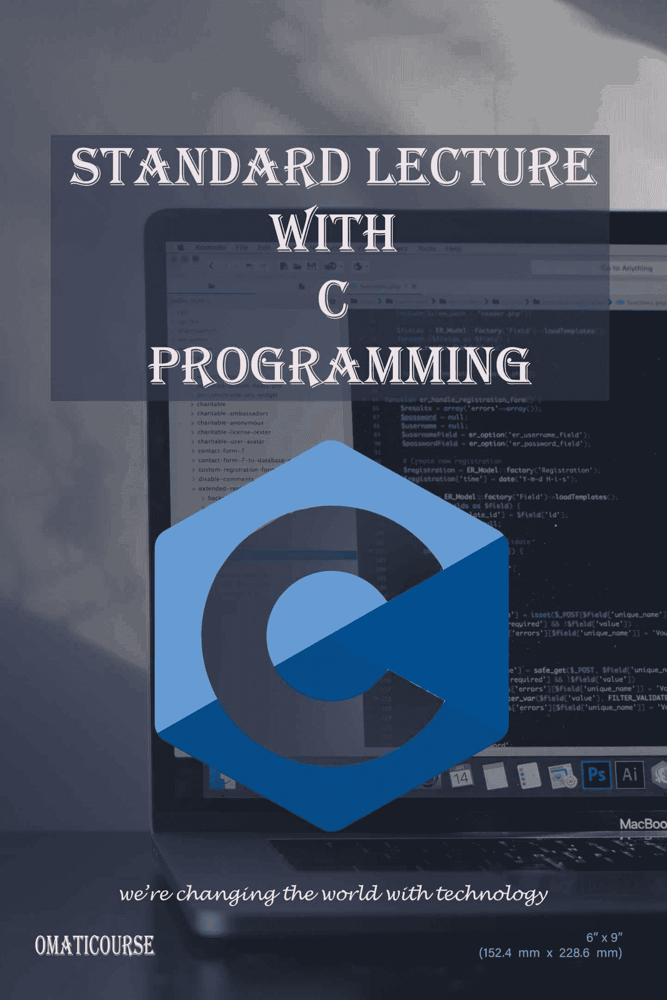
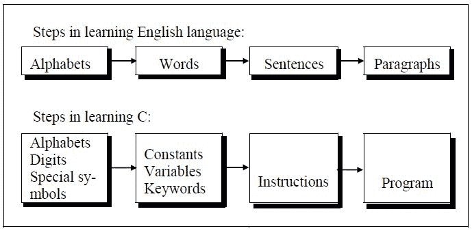
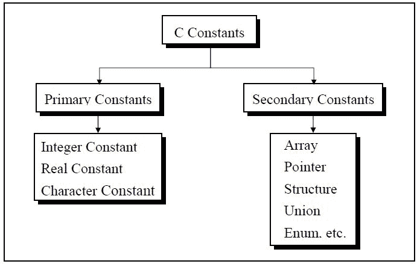

# C 语言标准讲义



[](Images/image00038.gif)


## 作者

Etuari Oram 助理教授

Marhnine Omaticker

Bighnaraj Naik 助理


## 讲义笔记：1

### C 语言简介

`C` 是一种于 1972 年在美国 AT & T 贝尔实验室开发的编程语言。它由一个名叫 Dennis Ritchie 的人设计并编写。在 70 年代后期，`C` 开始取代当时更熟悉的语言，如 `PL/I`、`ALGOL` 等。

ANSI `C` 标准出现于 20 世纪 80 年代初，这本书被拆分为两个标题：原作仍称为 *Programming in C*，而涵盖 ANSI `C` 的标题称为 *Programming in ANSI C*。这样做是因为编译器供应商需要数年才能发布他们的 ANSI `C` 编译器并使其变得无处不在。

它最初是为编写 UNIX 操作系统而设计的。现在软件工具以及 `C` 编译器都是用 `C` 编写的。`Windows`、`UNIX`、`Linux` 等流行操作系统的大部分仍用 `C` 编写。这是因为即使在今天，在性能（执行速度）方面，没有什么是能超越 `C` 的。此外，如果需要扩展操作系统以支持新设备，就需要编写设备驱动程序。这些程序是完全用 `C` 编写的。

`C` 之所以如此流行，是因为它可靠、简单且易于使用。今天经常听到的是——“C 已经被 `C++`、`C#` 和 `Java` 等语言所取代”。

### 程序

学习英语和学习 `C` 语言之间有着密切的类比。学习英语的经典方法是首先学习该语言使用的字母表，然后学习将这些字母组合成单词，单词组合成句子，句子再组合成段落。

学习 `C` 类似且更简单。我们不需要直接学习如何写程序，必须首先知道 `C` 中使用了哪些字母、数字和特殊符号，然后如何使用它们来构造常量、变量和关键字，最后如何将这些组合成一条指令。一组指令稍后组合成一个程序。



计算机`program` 仅仅是解决特定问题所需的指令集合。计算机系统的基本操作构成了所谓的计算机指令集。而用于解决问题的方法或手段被称为算法。

所以对于编程语言而言，它们分为两种：

1. 低级语言
2. 高级语言

#### 低级语言

低级语言是机器级和汇编级的。机器级语言只理解数字，形式为 0 和 1。因此给计算机的指令是二进制形式，难以实现。这种类型的程序具有不可移植性，难以维护且易出错。

另一方面，汇编语言是机器级语言的变体。指令以英语形式给出，如 ADD、SUM、MOV 等。它易于编写但机器并不理解。因此这里的翻译器是汇编器。虽然语言简单一些，程序员必须了解底层细节。

在汇编语言中，数据存储在计算机寄存器中，这随计算机而异。因此不可移植。

#### 高级语言

这些语言与机器无关，意味着它们是可移植的。这一类的语言有 `Pascal`、`Cobol`、`Fortran` 等。高级语言是机器理解的。因此需要翻译器转换为机器级。翻译器是用于将高级语言以及低级语言转换为机器级的软件。

三种翻译器：

- 编译器
- 解释器
- 汇编器

编译器和解释器用于将高级语言转换为机器语言。用高级语言编写的程序称为源代码，相应的机器语言称为目标程序。

编译器和解释器都执行相同的任务，但工作方式不同。编译器一次性读取程序并搜索错误并列出。如果程序无错误，则转换为目标程序。当程序规模很大时，首选编译器。

而解释器只读取一行源代码并进行转换，逐句检查错误，因此花费更多时间。

# C 语言程序结构

1. 注释行
2. 预处理器指令
3. 全局变量声明
4. `main()` 函数
   - 局部变量；语句；
   - 用户定义函数

## 注释行

`Comment line` 表示程序的目的。它表示为 `/*……………………………..*/`。

注释行用于提高程序的可读性。它有助于解释程序，通常用于文档说明。它被包含在注释符中。注释可以是单行的也可以是多行的，但不应嵌套。它可以出现在程序中除字符串常量和字符常量以外的任何地方。

## 预处理器指令

`#include<stdio.h>` 告诉编译器包含标准输入输出库的信息。它也用于符号常数，例如 `#define PI 3.14`。

`stdio.h`（标准输入输出头文件）包含了系统定义函数如 `printf()`、`scanf()`、`pow()` 等等的定义与声明。通常 `printf()` 函数用于显示内容，而 `scanf()` 函数用于读取值。

## 全局声明

这是一个在全局声明变量的部分，以便程序中使用的所有函数都可以访问它们。它通常声明在函数之外：

## `main()`

它是用户定义的函数，每个函数都有一个 `main()` 函数，程序实际上从这里开始运行，它被包含在一对括号中。`main()` 函数可以出现在程序的任何位置，但在习惯上它被放置在第一位。

### 语法

```c
main()
{
……
……
……
}
```

当 `main()` 函数被声明为数据类型 `int main()` 时，它有返回值：

```c
int main()
{
    return 0
}
```

当类型为 `void`（意味着空/无）如 `void main(void)` 或 `void main()` 时，主函数不返回任何值：

```c
void main() { printf (“C language”); }
```

输出：C language

程序的执行从左括号开始，以右括号结束。两个括号之间提到了声明部分以及可执行部分。在每行的末尾给出一个分号，表示语句的结束。

### 带有返回语句的第一个 C 程序

```c
#include <stdio.h>

int main (void)
{
    printf ("welcome to c Programming language.\n");
    return 0;
}
```

输出：welcome to c programming language.

## 编译和执行程序的步骤

编译器是一个软件程序，它分析用特定计算机语言编写的程序，然后将其翻译成在特定计算机系统上执行的格式。

下图显示了用 `C` 语言编程开发的计算机程序在输入、编译和执行过程中涉及的步骤，以及从命令行输入的典型 Unix 命令。

### 第 1 步

首先将要编译的程序输入到计算机系统中的一个 `file` 中。文件名命名有各种约定，通常只要最后两个字符是 `.c` 或者扩展名为 `.c` 的文件，可以是任何名称。因此，文件名 `prog1.c` 可能是 C 语言程序的有效文件名。

通常使用文本编辑器将 C 程序输入到文件中。例如，`vi` 是 Unix 系统上常用的文本编辑器。输入到文件的程序被称为源程序，因为它代表了用 C 语言表示的程序的原始形式。

### 第 2 步

在将源程序输入到文件后，继续进行编译。编译过程通过在系统上输入特殊命令来启动。当输入此命令时，必须指定包含源程序的文件的名称。

例如，在 Unix 下，启动程序编译的命令称为 `cc`。如果我们使用流行的 GNU C 编译器，我们使用的命令是 `gcc`。

输入该行：

```bash
gcc prog1.c or cc prog1.c
```

在编译过程的第一步，编译器检查源程序中包含的每个程序语句并进行检查以确保它符合语言的语法和语义。

如果编译器在此阶段发现任何错误，会将它们报告给用户，编译过程将到此结束。然后必须在源程序中修正这些错误（使用编辑器），并重新开始编译过程。

在编译此阶段报告的典型错误可能是由于表达式的括号不平衡（语法错误），或由于使用了未“定义”的变量（语义错误）。

### 第 3 步

当程序中所有的语法和语义错误都被消除后，编译器将处理程序的每条语句并将其翻译成一种“低级”形式，这种形式等同于执行相同任务所需的汇编程序。

### 第 4 步

程序翻译后，编译过程的下一步是将汇编语言语句翻译成实际的机器指令。

汇编器获取每个汇编语句并将其转换为名为`object code`的二进制格式，然后将其写入系统上的另一个文件中。在 Unix 下，该文件与源文件同名，但最后一个字母是 `o`（代表 object）而不是 `c`。

### 第 5 步

程序翻译成目标代码后，就可以进行链接。每当在 Unix 下发布 `cc` 或 `gcc` 命令时，此过程再次自动执行。

链接阶段的目的是让程序进入可以在计算机上执行的最终形式。如果程序使用了之前由编译器处理过的其他程序，那么在此阶段这些程序将被链接在一起。

系统使用的程序`library`在此阶段也会搜索并与目标程序链接。编译和链接程序的过程通常称为构建。

### 第 6 步

最终链接的文件是可执行的`object`代码，存储在系统的另一个文件中，准备好运行或执行。

在 Unix 下，这默认称为 `a.out`。在 Windows 下，可执行文件通常与源文件同名，将 c 扩展替换为 exe 扩展。随后执行程序时，命令`a.out`具有将名为 a.out 程序加载到计算机内存并启动其执行的作用。

当程序执行时，程序的每条语句按顺序执行。如果程序向用户请求任何数据（即`input`），程序将临时暂停执行以便输入。或者，程序可能只是等待某个`event`（如点击鼠标）发生。

程序显示的结果（即`output`）出现在窗口中，有时称为`console`。如果程序没有产生预期的结果，则需要返回并重新分析程序的逻辑。

这被称为`调试阶段`，在此期间将尝试从程序中删除所有已知问题或`bug`。为了这样做，可能需要对原始源程序进行修改。

## 课程笔记：3

### 字符集

字符表示用于表示信息的任何字母、数字或特殊符号。C 允许的有效字母、数字和特殊符号有

字母、数字和特殊符号在恰当组合时形成常量、变量和关键字。

## 标识符

标识符是用户定义的单词，用于为变量、`arrays`、`functions`、`structures` 等实体命名。标识符的命名规则如下：

1. 命名应只包含字母（大写和小写）、数字和下划线（`_`）符号。
2. 第一个字符应该是字母或下划线。
3. 命名不能是关键字。
4. 由于 `C` 是区分大小写的，大写和小写被视为不同的，例如 `code`、`Code`、`CODE` 等是不同的标识符。
5. 标识符通常赋予有意义的名字，如 `value`、`net_salary`、`age`、`data` 等。标识符名称可能很长，某些实现仅识别前 8 个字符，大多数识别 31 个字符。ANSI 标准编译器识别 31 个字符。某些无效的标识符有 `5cb`、`int`、`res#`、`avg no` 等。

## 关键字

某些单词被保留用于执行特定任务，这些单词被称为保留字或关键字。这些单词是预定义的，并且始终以小写字母写。这些关键字不能用变量名，因为它们被赋予了固定的含义。

示例包括 `int`、`short`、`signed`、`unsigned`、`default`、`volatile`、`float`、`long`、`double`、`break`、`continue`、`typedef`、`static`、`do`、`for`、`union`、`return`、`while`、`extern`、`register`、`enum`、`case`、`goto`、`struct`、`char` 等。

数据类型指的是在使用之前用于声明不同类型的变量或函数的扩展系统。变量的类型决定了它在存储中占据空间的大小以及存储的位模式如何被解释。变量的值可以随时更改。

`C` 具有以下 4 种数据类型：

- 基本内置数据类型：`int`、`float`、`double`、`char`
- 枚举数据类型：`enum`
- 派生数据类型：`pointer`、`array`、`structure`、`union`
- 空数据类型：`void`

声明为 `int` 类型的变量仅用于包含整数值——即不包含小数的值。声明为 `float` 类型的变量可用于存储浮点数（包含小数的值）。`double` 类型与 `float` 类型相同，只是精度大约是两倍。

`char` 数据类型可以用于存储单个字符，例如字母 `a`、数字字符 `6` 或分号 `;`。声明为 `char` 的变量只能存储字符类型的值。

在 `C` 中有两种类型的类型修饰符：

- 尺寸修饰符：`short`、`long`
- 符号修饰符：`signed`、`unsigned`

当使用修饰符 `unsigned` 时，数字始终为正数；当使用 `signed` 时，数字可能是正或负。如果没有提到符号修饰符，则默认认为符号修饰符。

有符号数据类型的值范围小于无符号数据类型。因为在有符号类型中，最左位用于表示符号，而在无符号类型中，该位也用于表示值。

16 位机器上不同数据类型的大小和范围如下：

| 基本数据类型 | 带有类型修饰符的数据 | 大小（字节） | 范围 |
| :--- | :--- | :---: | :--- |
| `char` | `char` 或 `signed char` | 1 | -128 to 127 |
| `unsigned char` |  | 1 | 0 to 255 |
| `int` | `int` 或 `signed int` | 2 | -32768 to 32767 |
| `unsigned int` |  | 2 | 0 to 65535 |
| `short int` | `short int` 或 `signed short int` | 1 | -128 to 127 |
| `unsigned short int` |  | 1 | 0 to 255 |
| `long int` | `long int` 或 `signed long int` | 4 | -2147483648 to 2147483647 |
| `unsigned long int` |  | 4 | 0 to 4294967295 |
| `float` | `float` | 4 | -3.4E-38 to 3.4E+38 |
| `double` | `double` | 8 | 1.7E-308 to 1.7E+308 |
| `Long double` |  | 10 | 3.4E-4932 to 1.1E+4932 |

## 课程笔记：4

### 常量

常量是在程序执行期间不能改变的值。在 `C` 中，任何数字、单个字符或字符字符串被称为常量。常量是不改变的实体，而变量是可能会改变的实体。

例如，数字 `50` 代表一个常量整数值。字符串 `"Programming in C is fun.\n"` 是常量字符字符串的一个示例。

`C` 常量可以分为两大类：

- 初级常量
- 二级常量

这些常量进一步分类为：



- 数值常量
- 字符常量
- 字符串常量

#### 数值常量

数值常量是数字，在 `C` 中由数字组成，并可以是正或负。数值常量默认为正。数值常量内部不允许有逗号。数值常量必须至少有一个数字。

数值常量的范围取决于编译器，在 16 位编译器中，范围是 -32768 到 32767。数值常量分为以下类型：

- 十进制常量（基为 10）
- 八进制常量（基为 8）
- 十六进制常量（基为 16）

为了表示极小或巨大的常量，使用了科学计数法（指数形式），其中数字以尾数形式表示，指数可以是正负整数但尾数可以是实数类型，通过 `e/E` 分隔。例如 `3.6*10⁵=3.6e+5`。

浮点常量默认类型为 `double`，也可以通过后缀 `f/F` 显式定义。

#### 浮点常量

浮点常量也被称为实数。构造浮点常量必须：

- 它可以包含一个小数点点。
- 默认符号为正。
- 浮点常量内部允许有逗号。例如：`+32.34`、`42.0`、`-32.76`

#### 字符常量

字符常量表示为单引号内的单个字符。这些可以是单个数字、单个特殊符号或空格，例如 ‘9’、‘c’、‘$’、‘ ’ 等。

每个字符常量在机器字符码中都有唯一的整数值，如果机器使用 `ASCII`（美国信息交换标准）。每个大写和小写字母相关的数值值为：

- `A------------ Z` ASCII 值 (65-90)
- `a-------------z` ASCII 值 (97-122)
- `0-------------9` ASCII 值 (48-59)
- ASCII 值 (59)

#### 字符串常量

字符集被称为字符串，当字符序列包含在双引号内时（可以是各种符号的组合），它是字符串常量。字符串常量包含零、一个或多个字符，并在字符串末尾由编译器自动放置空字符 `(\0)`。

一些示例包括 “,sarathina”、“908”、“3”、“ ”、“A” 等。在 `C` 中，尽管相同的字符包含在单引号和双引号内，但它们代表的含义不同，例如 “A” 和 ‘A’ 是不同的，因为第一个是末尾带有空字符的字符串，而第二个是对应 ASCII 值为 65 的字符常量。

符号常量是字符序列的替代名称，这些字符可以是数值常量、字符常量或字符串常量。这些常量通常定义在程序开头作为：

`#define name value`，这里 `name` 通常使用大写，例如：

```c
#define MAX 10
#define CH ‘b’
#define NAME “sony”
```

## 变量

变量是用于存储某些数据值，或用于存储程序计算和结果的符号名称的数据名称。变量的值在执行过程中可以改变。

变量的命名规则与标识符的命名规则相同。在程序中使用之前必须对其进行声明。变量声明指定了它的名称、数据类型以及变量可以存储的值范围，范围取决于其数据类型。

### 语法

```c
int a;
char c;
float f;
```

### 变量初始化


我们在声明期间给变量分配任何初始值，称为变量的初始化。当变量被声明但包含未定义的值时，则称为垃圾值。使用赋值运算符对变量进行初始化，例如：

`数据类型 变量名=常量;`

示例：`int a=20;`

或：

`int a;`

### 语句

## 讲义笔记：5

### 表达式

表达式是变量、常量、运算符和函数调用的组合。它可以是算术的、逻辑的或关系的，例如：

```c
int z= x+y // 算术表达式
a>b // 关系
a==b // 逻辑
func(a, b) // 函数调用
```

完全由常量值组成的表达式被称为常量表达式。因此，表达式

`121 + 17 - 110`

是一个常量表达式，因为表达式的每一个项都是常量值。但如果我将它声明为整数变量，表达式 `180 + 2 – j` 就不再代表常量表达式。

### 运算符

这是用于对变量、操作数或常量执行某些操作的符号。某些运算符需要 2 个操作数来执行操作，而某些只需要单次操作。

有几种运算符，分别是：算术运算符、赋值、增、减、逻辑、条件、逗号、大小、位运算等。

#### 1. 算术运算符

该运算符用于数值计算。这些分为一元算术运算符和二元算术运算符。一元算术运算符只需要一个操作数，如 `+`、`-`、`++`、`--`、`!` 等。而这些运算符是加、减、乘、除。另一方面，二元算术运算符需要两个操作数，其运算符为 `+(加)`、`-(减)`、`*(乘)`、`/(除)`、`%(取模)`。但取模不能应用于浮点操作数，而且 C 语言没有幂运算符。

`一元 (+)` 和 `一元 (-)` 与加法减法不同。

当两个操作数都是整数时，称为整数算术，结果始终是整数。当两个操作数都是浮点数时，称为浮点算术；当操作数是整数和浮点数时，称为混合类型或混合模式算术。结果是 `float` 类型。

#### 2. 赋值运算符

可以使用赋值运算符将值存储在变量中。运算符 `=` 用于赋值语句和赋值表达式。左侧的操作数应该是变量，右侧的操作数应该是变量、常量或任何表达式。当左侧的变量出现在右侧时，我们可以通过编写复合语句来避免这种情况。例如：

```c
int x= y;
int Sum=x+y+z;
```

#### 3. 增和减

一元运算符 `++`、`--` 用作增和减，作用于单个操作数。增运算符将变量的值增加 1。同样，减运算符将变量的值减少 1。这些运算符只能与变量一起使用，但不能与表达式和常量使用，如 `++6` 或 `++(x+y+z)`。

它再次分为前置和后置。在前置中，变量的值先递加 1，然后使用新值；而在后置中，运算符写在操作数之后（如 `m++`、`m--`）。

**示例**

```javascript
let y=12;
z= ++y;
y= y+1;
z= y;
```

同样，在后置增和减运算符中，运算符先在操作中使用，然后执行增和减操作。

**示例**

```javascript
let x= 5;
y= x++;
y=x;
x= x+1;
```

#### 4. 关系运算符

它用于根据关系比较两个表达式的值。包含关系运算符的表达式被称为关系表达式。

在这里，根据真或假值进行赋值。

a. `(a>=b) || (b>20)`

b. `(b>a) && (e>b)`

c. `0(b!=7)`

#### 5. 条件运算符

它有时称为三元运算符。因为它需要三个表达式作为操作数，表示为 `(? , :)`。

**语法**

`exp1 ? exp2 :exp3`

这里首先计算 `exp1`。如果为真，则返回值 `exp2`；如果为假，则返回 `exp3`。

**示例**

```c
void main()
{
int a=10, b 2 int s= (a>b) ? a:b; printf(“value is:%d”); 输出: Value is:10
```

#### 6. 逗号运算符

逗号运算符用于在只能使用一个表达式的情况下允许不同的表达式出现。所有表达式由逗号分隔并从左到右求值。

**示例**

```c
int i;
```

#### 7. `Sizeof` 运算符

`sizeof` 运算符用于在只能使用一个表达式的情况下允许不同的表达式出现。所有表达式由逗号分隔并从左到右求值。

```c
int i,j;
```

#### 8. 位运算符

位运算符用于对变量、操作数或常量执行某些操作。某些运算符需要 2 个操作数来执行操作，而某些只需要单次操作。

有几种运算符，分别是：算术运算符、赋值、增、减、逻辑、条件、逗号、大小、位运算等。

#### 1. 算术运算符

该运算符用于数值计算。这些分为一元算术运算符和二元算术运算符。一元算术运算符只需要一个操作数，如 `+`、`-`、`++`、`--`、`!` 等。而这些运算符是加、减、乘、除。二元算术运算符另一方面需要两个操作数，其运算符为 `+(加)`、`-(减)`、`*(乘)`、`/(除)`、`%(取模)`。但取模不能应用于浮点操作数，而且 C 语言没有幂运算符。

`一元 (+)` 和 `一元 (-)` 与加法减法不同。

当两个操作数都是整数时，称为整数算术，结果始终是整数。当两个操作数都是浮点数时，称为浮点算术；当操作数是整数和浮点数时，称为混合类型或混合模式算术。结果是 `float` 类型。

#### 2. 赋值运算符

可以使用赋值运算符将值存储在变量中。赋值运算符 `=` 用于赋值语句和赋值表达式。左侧的操作数应该是变量，右侧的操作数应该是变量、常量或任何表达式。当左侧的变量出现在右侧时，我们可以通过编写复合语句来避免这种情况。例如：

```c
int x= y;
int Sum=x+y+z;
```

#### 3. 增和减

一元运算符 `++`、`--` 用作增和减，作用于单个操作数。增运算符将变量的值增加 1。同样，减运算符将变量的值减少 1。这些运算符只能与变量一起使用，但不能与表达式和常量使用，如 `++6` 或 `++(x+y+z)`。

它再次分为前置和后置。在前置中，变量的值先递加 1，然后使用新值；而在后置中，运算符写在操作数之后（如 `m++`、`m--`）。

**示例**

```javascript
let y=12;
z= ++y;
y= y+1;
z= y;
```

同样，在后置增和减运算符中，运算符先在操作中使用，然后执行增和减操作。

**示例**

```javascript
let x= 5;
y= x++;
y=x;
x= x+1;
```

#### 4. 关系运算符

它用于根据关系比较两个表达式的值。包含关系运算符的表达式被称为关系表达式。

在这里，根据真或假值进行赋值。

a. `(a>=b) || (b>20)`

b. `(b>a) && (e>b)`

c. `0(b!=7)`

#### 5. 条件运算符

它有时称为三元运算符。因为它需要三个表达式作为操作数，表示为 `(? , :)`。

**语法**

`exp1 ? exp2 :exp3`

这里首先计算 `exp1`。如果为真，则返回值 `exp2`；如果为假，则返回 `exp3`。

**示例**

```c
void main()
{
int a=10, b 2 int s= (a>b) ? a:b; printf(“value is:%d”); 输出: Value is:10
```

#### 6. 逗号运算符

逗号运算符用于在只能使用一个表达式的情况下允许不同的表达式出现。所有表达式由逗号分隔并从左到右求值。

**示例**

```c
int i;
```

#### 7. `Sizeof` 运算符

`sizeof` 运算符用于在只能使用一个表达式的情况下允许不同的表达式出现。所有表达式由逗号分隔并从左到右求值。

```c
int i,j;
```

#### 8. 位运算符

位运算符用于对变量、操作数或常量执行某些操作。某些运算符需要 2 个操作数来执行操作，而某些只需要单次操作。

有几种运算符，分别是：算术运算符、赋值、增、减、逻辑、条件、逗号、大小、位运算等。

#### 1. 算术运算符

该运算符用于数值计算。这些分为一元算术运算符和二元算术运算符。一元算术运算符只需要一个操作数，如 `+`、`-`、`++`、`--`、`!` 等。而这些运算符是加、减、乘、除。二元算术运算符另一方面需要两个操作数，其运算符为 `+(加)`、`-(减)`、`*(乘)`、`/(除)`、`%(取模)`。但取模不能应用于浮点操作数，而且 C 语言没有幂运算符。

`一元 (+)` 和 `一元 (-)` 与加法减法不同。

当两个操作数都是整数时，称为整数算术，结果始终是整数。当两个操作数都是浮点数时，称为浮点算术；当操作数是整数和浮点数时，称为混合类型或混合模式算术。结果是 `float` 类型。

#### 2. 赋值运算符

可以使用赋值运算符将值存储在变量中。赋值运算符 `=` 用于赋值语句和赋值表达式。左侧的操作数应该是变量，右侧的操作数应该是变量、常量或任何表达式。当左侧的变量出现在右侧时，我们可以通过编写复合语句来避免这种情况。例如：

```c
int x= y;
int Sum=x+y+z;
```

#### 3. 增和减

一元运算符 `++`、`--` 用作增和减，作用于单个操作数。增运算符将变量的值增加 1。同样，减运算符将变量的值减少 1。这些运算符只能与变量一起使用，但不能与表达式和常量使用，如 `++6` 或 `++(x+y+z)`。

它再次分为前置和后置。在前置中，变量的值先递加 1，然后使用新值；而在后置中，运算符写在操作数之后（如 `m++`、`m--`）。

**示例**

```javascript
let y=12;
z= ++y;
y= y+1;
z= y;
```

同样，在后置增和减运算符中，运算符先在操作中使用，然后执行增和减操作。

**示例**

```javascript
let x= 5;
y= x++;
y=x;
x= x+1;
```

#### 4. 关系运算符

它用于根据关系比较两个表达式的值。包含关系运算符的表达式被称为关系表达式。

在这里，根据真或假值进行赋值。

a. `(a>=b) || (b>20)`

b. `(b>a) && (e>b)`

c. `0(b!=7)`

#### 5. 条件运算符

它有时称为三元运算符。因为它需要三个表达式作为操作数，表示为 `(? , :)`。

**语法**

`exp1 ? exp2 :exp3`

这里首先计算 `exp1`。如果为真，则返回值 `exp2`；如果为假，则返回 `exp3`。

**示例**

```c
void main()
{
int a=10, b 2 int s= (a>b) ? a:b; printf(“value is:%d”); 输出: Value is:10
```

#### 6. 逗号运算符

逗号运算符用于在只能使用一个表达式的情况下允许不同的表达式出现。所有表达式由逗号分隔并从左到右求值。

**示例**

```c
int i;
```

#### 7. `Sizeof` 运算符

`sizeof` 运算符用于在只能使用一个表达式的情况下允许不同的表达式出现。所有表达式由逗号分隔并从左到右求值。

```c
int i,j;
```

#### 8. 位运算符

位运算符用于对变量、操作数或常量执行某些操作。某些运算符需要 2 个操作数来执行操作，而某些只需要单次操作。

有几种运算符，分别是：算术运算符、赋值、增、减、逻辑、条件、逗号、大小、位运算等。

#### 1. 算术运算符

该运算符用于数值计算。这些分为一元算术运算符和二元算术运算符。一元算术运算符只需要一个操作数，如 `+`、`-`、`++`、`--`、`!` 等。而这些运算符是加、减、乘、除。二元算术运算符另一方面需要两个操作数，其运算符为 `+(加)`、`-(减)`、`*(乘)`、`/(除)`、`%(取模)`。但取模不能应用于浮点操作数，而且 C 语言没有幂运算符。

`一元 (+)` 和 `一元 (-)` 与加法减法不同。

当两个操作数都是整数时，称为整数算术，结果始终是整数。当两个操作数都是浮点数时，称为浮点算术；当操作数是整数和浮点数时，称为混合类型或混合模式算术。结果是 `float` 类型。

#### 2. 赋值运算符

可以使用赋值运算符将值存储在变量中。赋值运算符 `=` 用于赋值语句和赋值表达式。左侧的操作数应该是变量，右侧的操作数应该是变量、常量或任何表达式。当左侧的变量出现在右侧时，我们可以通过编写复合语句来避免这种情况。例如：

```c
int x= y;
int Sum=x+y+z;
```

#### 3. 增和减

一元运算符 `++`、`--` 用作增和减，作用于单个操作数。增运算符将变量的值增加 1。同样，减运算符将变量的值减少 1。这些运算符只能与变量一起使用，但不能与表达式和常量使用，如 `++6` 或 `++(x+y+z)`。

它再次分为前置和后置。在前置中，变量的值先递加 1，然后使用新值；而在后置中，运算符写在操作数之后（如 `m++`、`m--`）。

**示例**

```javascript
let y=12;
z= ++y;
y= y+1;
z= y;
```

同样，在后置增和减运算符中，运算符先在操作中使用，然后执行增和减操作。

**示例**

```javascript
let x= 5;
y= x++;
y=x;
x= x+1;
```

#### 4. 关系运算符

它用于根据关系比较两个表达式的值。包含关系运算符的表达式被称为关系表达式。

在这里，根据真或假值进行赋值。

a. `(a>=b) || (b>20)`

b. `(b>a) && (e>b)`

c. `0(b!=7)`

#### 5. 条件运算符

它有时称为三元运算符。因为它需要三个表达式作为操作数，表示为 `(? , :)`。

**语法**

`exp1 ? exp2 :exp3`

这里首先计算 `exp1`。如果为真，则返回值 `exp2`；如果为假，则返回 `exp3`。

**示例**

```c
void main()
{
int a=10, b 2 int s= (a>b) ? a:b; printf(“value is:%d”); 输出: Value is:10
```

#### 6. 逗号运算符

逗号运算符用于在只能使用一个表达式的情况下允许不同的表达式出现。所有表达式由逗号分隔并从左到右求值。

**示例**

```c
int i;
```

#### 7. `Sizeof` 运算符

`sizeof` 运算符用于在只能使用一个表达式的情况下允许不同的表达式出现。所有表达式由逗号分隔并从左到右求值。

```c
int i,j;
```

#### 8. 位运算符

位运算符用于对变量、操作数或常量执行某些操作。某些运算符需要 2 个操作数来执行操作，而某些只需要单次操作。

有几种运算符，分别是：算术运算符、赋值、增、减、逻辑、条件、逗号、大小、位运算等。

#### 1. 算术运算符


# 宏定义

`#define name value`，这里 `name` 通常使用大写，例如：

```c
#define MAX 10
#define CH 'b'
#define NAME "sony"
```

## 变量

变量是用于存储某些数据值，或用于存储程序计算和结果的符号名称的数据名称。变量的值在执行过程中可以改变。变量的命名规则与标识符的命名规则相同。在程序中使用之前对其进行声明。变量声明指定了它的名称、数据类型以及变量可以存储的值范围，范围取决于其数据类型。

### 语法

```c
int a;
char c;
float f;
```

### 变量初始化

我们在声明期间给变量分配任何初始值，称为变量的初始化。变量被声明但包含未定义的值时，则称为垃圾值。使用赋值运算符对变量进行初始化，例如：

`数据类型 变量名 = 常量;`

示例：`int a = 20;`

或：

```c
int a;
```

### 语句

## 讲义笔记：5

### 表达式

表达式是变量、常量、运算符和函数调用的组合。它可以是算术的、逻辑的或关系的，例如：

```c
int z = x + y; // 算术表达式
a > b;         // 关系
a == b;        // 逻辑
func(a, b);    // 函数调用
```

完全由常量值组成的表达式被称为常量表达式。因此，表达式 `121 + 17 - 110` 是一个常量表达式，因为表达式的每一个项都是常量值。但如果我将它声明为整数变量，表达式 `180 + 2 - j` 就不再代表常量表达式。

### 运算符

运算符是用于对变量、操作数或常量执行某些操作的符号。某些运算符需要两个操作数来执行操作，而某些只需要一个操作数。

有几种运算符，分别是：算术运算符、赋值运算符、增量运算符、减量运算符、逻辑运算符、条件运算符、逗号运算符、`sizeof` 运算符、位运算符等。

#### 1. 算术运算符

该运算符用于数值计算。这些分为一元算术运算符和二元算术运算符。

一元算术运算符只需要一个操作数，如 `+`、`-`、`++`、`--`、`!` 等。而这些运算符是加、减、乘、除。二元算术运算符需要两个操作数，其运算符为 `+`（加）、`-`（减）、`*`（乘）、`/`（除）、`%`（取模）。但取模不能应用于浮点操作数，而且 C 语言没有幂运算符。

`一元 (+)` 和 `一元 (-)` 与加法、减法不同。

当两个操作数都是整数时，称为整数算术，结果始终是整数。当两个操作数都是浮点数时，称为浮点算术；当操作数是整数和浮点数时，称为混合类型或混合模式算术。结果是 `float` 类型。

#### 2. 赋值运算符

可以使用赋值运算符将值存储在变量中。赋值运算符 `=` 用于赋值语句和赋值表达式。左侧的操作数应该是变量，右侧的操作数应该是变量、常量或任何表达式。当左侧的变量出现在右侧时，我们可以通过编写复合语句来避免这种情况。例如：

```c
int x = y;
int Sum = x + y + z;
```

#### 3. 增和减

一元运算符 `++`、`--` 用作增和减，作用于单个操作数。增运算符将变量的值增加 1。同样，减运算符将变量的值减少 1。这些运算符只能与变量一起使用，但不能与表达式和常量一起使用，如 `++6` 或 `++(x + y + z)`。

它再次分为前置和后置。在前置中，变量的值先递加 1，然后使用新值；而在后置中，运算符写在操作数之后，如 `m++`、`m--`。

**示例：**

```c
let y = 12;

z = ++y;

y = y + 1;

z = y;
```

同样，在后置增和减运算符中，运算符先在操作中使用，然后执行增和减操作。

**示例：**

```c
let x = 5;

y = x++;

y = x;

x = x + 1;
```

#### 4. 关系运算符

关系运算符用于根据关系比较两个表达式的值。包含关系运算符的表达式被称为关系表达式。

在这里，根据真或假值进行赋值：

- `a. (a >= b) || (b > 20)`
- `b. (b > a) && (e > b)`
- `c. 0(b != 7)`

#### 5. 条件运算符

条件运算符有时称为三元运算符，因为它需要三个表达式作为操作数，表示为 `(? , :)`。

**语法：**

`exp1 ? exp2 : exp3`

这里首先计算 `exp1`。如果为真，则返回值 `exp2`；如果为假，则返回 `exp3`。

**示例：**

```c
void main()
{
    int a = 10, b = 2;
    int s = (a > b) ? a : b;
    printf("value is:%d");
}
```

输出：`Value is:10`

#### 6. 逗号运算符

逗号运算符用于在只能使用一个表达式的情况下允许不同的表达式出现。所有表达式由逗号分隔并从左到右求值。

**示例：**

```c
int i;
```

#### 7. `sizeof` 运算符

`sizeof` 运算符用于在只能使用一个表达式的情况下允许不同的表达式出现。所有表达式由逗号分隔并从左到右求值。

```c
int i, j;
```

#### 8. 位运算符

位运算符用于对变量、操作数或常量执行某些操作。某些运算符需要两个操作数来执行操作，而某些只需要一个操作数。

| 运算符 | 描述 | 优先级 | 结合性 |
| :--- | :--- | :--- | :--- |
| `<<` | 左移 | 5 | 从左到右 |
| `>>` | 右移 | 5 | 从左到右 |
| `<=` | 小于等于 | 6 | 从左到右 |
| `>=` | 大于等于 | 6 | 从左到右 |
| `<` | 小于 | 6 | 从左到右 |
| `>` | 大于 | 6 | 从左到右 |
| `==` | 等于 | 7 | 从左到右 |
| `!=` | 不等于 | 7 | 从左到右 |
| `&` | 按位与 | 8 | 从左到右 |
| `^` | 按位异或 | 9 | 从左到右 |
| `|` | 按位或 | 10 | 从左到右 |
| `&&` | 逻辑与 | 11 | 从左到右 |
| `||` | 逻辑或 | 12 | 从左到右 |
| `?:` | 三元运算符 | 13 | 从右到左 |
| `=`, `*=`, `/=`, `%=` | 赋值运算符 | 14 | 从右到左 |
| `&=`, `^=`, `<<=`, `>>=` | 赋值运算符 | 14 | 从右到左 |
| `,` | 逗号运算符 | 15 | 从左到右 |

## 讲义笔记：7

### 控制语句

通常情况下，C 程序的语句按照它们在程序中出现的顺序执行。但有时我们会使用决策条件来只执行程序的一部分，这被称为控制语句。控制语句定义了控制如何从程序的某部分转移到另一个部分。

有几种控制语句，如 `if...else`、`switch`、`while`、`do...while`、`for` 循环、`break`、`continue`、`goto` 等。

### C 语言中的循环

循环是执行一组指令的语句块。在循环中重复程序的特定部分，直到达到指定的次数或直到满足某个特定条件。

C 语言中有三种循环：

1. `while` 循环
2. `do while` 循环
3. `for` 循环

#### `while` 循环

**语法：**

```c
while (condition) {
    Statement 1;
    Statement 2;
}
```

或：

```c
while (test condition)
    Statement;
```

测试条件可以是任何表达式。当我们想要执行固定次数的某些操作但不知道迭代次数时，在程序中就会使用 `while` 循环。

这里首先检查条件，如果为真，则执行循环体；否则，如果条件为假，控制将退出循环。

**示例：**

```c
/* 写一个程序打印 5 次 welcome to C */

#include <stdio.h>

void main()
{
    int p = 1;

    while (p <= 5)
    {
        printf("Welcome to C\n");
        p = p + 1;
    }
}
```

输出：

```text
Welcome to C
Welcome to C
Welcome to C
Welcome to C
Welcome to C
```

因此，只要条件保持为真，`while` 循环体内的语句就会反复执行。

#### `do while` 循环

这种 `do while` 循环语句也用于循环。此循环的体可能包含单个语句或语句块。

**语法：**

```c
do
{
    Statement;
}
while (condition);
```

**示例：**

```c
#include <stdio.h>

void main()
{
    int X = 4;

    do
    {
        printf("%d", X);
        X = X + 1;
    }
    while (X <= 10);

    printf(" ");
}
```

输出：`4 5 6 7 8 9 10`

在这里首先执行体内的语句，然后检查条件。如果条件为真，则再次执行循环体，这个过程一直持续到条件变为假。与 `while` 循环不同，分号放在 `while` 的末尾。

`while` 循环和 `do while` 循环之间存在细微差别：`while` 循环在执行循环的任何语句之前测试条件，而 `do while` 循环在循环内至少执行一次语句后才测试条件。

如果初始条件为假，`while` 循环不会执行其语句；另一方面，`do while` 循环即使条件第一次失败，也会至少执行一次其语句。这意味着 `do while` 循环始终至少执行一次。

**注意：** 当我们想要至少执行一次循环时，很少使用 `do while` 循环。

## 讲义笔记：8

### `for` 循环

在程序中，当预先知道迭代次数时，通常使用 `for` 循环。循环体可以是单个语句或多个语句。

**语法：**

```c
for (exp1; exp2; exp3)
{
    Statement;
}
```

或：

```c
for (initialized counter; test counter; update counter)
{
    Statement;
}
```

在这里，`exp1` 是初始化表达式，`exp2` 是测试表达式或条件，`exp3` 是更新表达式。表达式 1 在循环开始时仅执行一次，用于初始化循环变量。条件表达式通常使用关系运算符和逻辑运算符，而更新部分仅在循环体执行完毕后执行。

**示例：**

```c
void main()
{
    int i;

    for (i = 1; i < 10; i++)
    {
        printf("%d", i);
    }
}
```

输出：`1 2 3 4 5 6 7 8 9`

#### 循环嵌套

当一个循环写在另一个循环的体内部时，被称为循环嵌套。任何类型的循环都可以嵌套在任何类型的循环中，如 `while`、`do while`、`for`。

例如，`for` 循环的嵌套可以表示为：

```c
void main()
{
    int i, j;

    for (i = 0; i < 2; i++)
        for (j = 0; j < 5; j++)
            printf("%d %d", i, j);
}
```

输出：`i=0 j=0 1 2 3 4 i=1 j=0`

#### 跳出语句（`break`）

有时在条件变为假之前需要退出循环，这时使用 `break` 语句。`break` 语句用于循环和 `switch` 语句中。它会导致从它所在的循环中立即退出，并跳转到循环之后的语句。这种 `break` 语句通常与 `if` 语句关联。

**示例：**

```c
void main()
{
    int j = 0;

    for (; j < 6; j++)
        if (j == 4)
            break;
}
```

输出：`0 1 2 3`

#### 继续语句（`continue`）

`continue` 语句用于跳过循环的某些语句后继续下一次迭代。当遇到它时，控制会自动通过循环的开头。它通常与 `if` 语句关联。当我们想要继续程序而不执行程序的某些部分时，它是很有用的。

`break` 和 `continue` 的区别在于，当遇到 `break` 时循环终止并转移到下一条语句；而遇到 `continue` 时，控制回到起始位置。

在 `while` 和 `do while` 循环中，遇到 `continue` 语句后，控制转移到测试条件并继续循环；而在 `for` 循环中，遇到 `continue` 后，控制转移到更新表达式并测试条件。

**示例：**

```c
void main()
{
    int n;

    for (n = 2; n <= 9; n++)
    {
        if (n == 4)
            continue;

        printf("%d", n);
    }

    printf("out of loop");
}
```


输出：2 3 5 6 7 8 9 out of loop

## 讲义笔记：9

### `if` 语句

`if` 语句在条件为真时执行一组命令，其语法为：

`if (condition) statement;`

语句仅在条件为真时执行。如果 `if` 语句的体包含多条语句，最好使用一对大括号。在这里，条件为假，编译器将跳过 `if` 块内的行。

```c
void main()
{
    int n;
    printf("enter a number:");
    scanf("%d", &n);

    if (n > 10)
        printf("number is greater");
}
```

输出：Enter a number:12 Number is greater

### `if...else` 语句

这是一种双向条件控制语句，包含一个条件和两个可能的动作。条件可以为真或假，其中非零值视为真，零值视为假。如果条件为真，则执行单条语句或语句块，否则执行另一条单条语句或语句块。

其语法如下：

```c
if (condition)
{
    Statement1;
    Statement2;
}
else
{
    Statement1;
    Statement2;
}
```

`else` 不能在没有 `if` 的情况下使用，且在一个 `if` 语句中不允许有多个 `else` 语句。这意味着 `else` 语句内部必须有一个 `if` 语句。

示例：

```c
/* 检查一个数字是偶数还是奇数 */

void main()
{
    int n;

    printf("enter a number:");
    scanf("%d", &n);

    if (n % 2 == 0)
        printf("even number");
    else
        printf("odd number");
}
```

输出：enter a number:121 odd number

## 课程笔记：10

### `if...else` 的嵌套

当 `if-block` 或 `else-block` 中存在另一个 `if else` 语句时，它被称为 `if-else` 语句的嵌套。

语法为：

```c
if (condition)
    if (condition)
        Statement1;
    else
        statement2;

Statement3;
```

### `if...else` 阶梯（LADDER）

在这种嵌套类型中，最后一个部分外的每个 `else` 部分都有一个 `if else` 语句。如果条件为假，控制传递到块中，使用其 `if` 语句再次检查条件。

语法为：

```c
if (condition)
    Statement1;
else if (condition)
    statement2;
else if (condition)
    statement3;
else
    statement4;
```

此过程一直持续到最后一个块中没有 `if` 语句。如果满足其中一个条件，其他嵌套的 `else if` 将不会执行。但它与 `if else` 语句相比的缺点是：在 `if else` 语句中，只要条件为真，其他条件就不会被检查；而在这种情况下，所有条件都会被检查。

## 课程笔记：11

### 数组（ARRAY）

数组是相似数据类型的集合或存储在连续内存位置的相似实体集合。字符数组是一个字符串。数组的每个数据项被称为 `element`（元素）。每个元素都是唯一的并位于独立的内存位置。数组的每个元素共享一个变量，但每个元素具有不同的索引号，即下标（subscript）。

数组可以是单维或多维的，下标决定了它的维度。下标始终从零开始。一维数组被称为向量，二维数组被称为矩阵。

**优点**：数组变量一次可以存储多个值，而其他变量一次只能存储一个值。

示例：

```c
int arr[100];
int mark[100];
```

### 数组的声明（DECLARATION OF AN ARRAY）

其语法为：`数据类型 数组名[大小];`

```c
int arr[100];
int mark[100];
int a[5] = {10, 20, 30, 100, 5};
```

数组的声明告诉编译器：数据类型、数组名称、数组大小以及每个元素占用的内存空间。例如，对于 `int` 数据类型，每个元素占用 2 字节；对于 `float`，每个元素占用 4 字节等。数组的大小决定了数组中可以存储的元素数量，它可能是一个 `int` 常量或常量整型表达式。

我们可以这样表示单个数组：

```c
int ar[5];

ar[0], ar[1], ar[2], ar[3], ar[4];
```

符号常量也可以用于指定数组的大小，如：`#define SIZE 10;`

### 数组的初始化（INITIALIZATION OF AN ARRAY）

声明后，局部数组元素具有垃圾值。如果是全局或静态数组，它将自动初始化为零。显式地可以初始化为：

`数据类型 数组名[大小] = {值 1, 值 2, 值 3…}`

示例：`ar[5] = {20, 60, 90, 100, 120}`

数组下标始终从零开始，被称为下界（lower bound），上限被称为上界（upper bound），最后一个下标值比数组大小小一。下标可以是表达式，即整数值。它可以是任何整数、整数常量、整数变量、整数表达式或产生整数值的函数调用返回值。

所以，如果 `i` 和 `j` 不是变量，那么有效的下标是：

`ar[i * 7]`、`ar[i * i]`、`ar[i++]`、`ar[3]`

数组元素连续地存储在内存位置中，存储元素所需的存储量取决于其大小和类型。

**一维数组的总字节数为：**

`总字节数 = (数据类型的大小) * 数组的大小。`

示例：如果声明一个数组：

```c
int arr[20];
```

总字节 = 2 * 20 = 40 字节。

### 数组元素的访问（ACCESSING OF ARRAY ELEMENT）

```c
/* 写一个程序向数组输入值并显示它们 */

#include <stdio.h>

int main()
{
    int arr[5], i;

    for (i = 0; i < 5; i++)
    {
        printf("enter a value for arr[%d]\n", i);
        scanf("%d", &arr[i]);
    }

    printf("the array elements are:\n");

    for (i = 0; i < 5; i++)
    {
        printf("%d\t", arr[i]);
    }

    return 0;
}
```

输出：enter a value for arr[0] = 12 enter a value for arr[1] = 45 enter a value for arr[2] = 59 enter a value for arr[3] = 98 enter a value for arr[4] = 21 the array elements are: 12 45 59 98 21

示例：从上面的示例中，存储在数组中的值分别占用内存地址 2000、2002、2004、2006、2008。

示例 2：

```c
/* 写一个程序加 10 个数组元素 */

#include <stdio.h>

void main()
{
    int i;
    int arr[10];
    int sum = 0;

    for (i = 0; i <= 9; i++)
    {
        printf("enter the %d element\n", i + 1);
        scanf("%d", &arr[i]);
    }

    for (i = 0; i <= 9; i++)
    {
        sum = sum + arr[i];
    }

    printf("the sum of 10 array elements is %d", sum);
}
```

（注：我已经清理了源文本中的混乱输出，同时保持了所描述的逻辑。）

20 2 7 8 3 15

二维数组元素在数组中的位置如下所示：

```text
00 01 02
10 11 12
```

`a[0][0]`、`a[0][0]`、`a[0][0]`、`a[0][0]`、`a[0][0]`、`a[0][0]` 20 2 7 8 3 15

2000 2002

### 访问二维数组 / 处理二维数组

处理二维数组时，我们使用两个嵌套的 `for` 循环。外层 `for` 循环对应行，内层 `for` 循环对应列。

例如：`int a[4][5];`

**读取值：**

```c
for (i = 0; i < 4; i++)
{
    for (j = 0; j < 5; j++)
    {
        scanf("%d", &a[i][j]);
    }
}
```

显示值：

```c
for (i = 0; i < 4; i++)
{
    for (j = 0; j < 5; j++)
    {
        printf("%d", a[i][j]);
    }
}
```

**二维数组的初始化：**

二维数组可以以类似于一维数组的方式进行初始化。例如：

`int mat[4][3] = {11, 12, 13, 14, 15, 16, 17, 18, 19, 20, 21, 22};`

这些值按行赋值给元素，因此初始化后元素的值为：

`Mat[0][0] = 11`、`Mat[1][0] = 14`、`Mat[2][0] = 17`、`Mat[3][0] = 20`、`Mat[0][1] = 12`、`Mat[1][1] = 15`、`Mat[2][1] = 18`、`Mat[3][1] = 21`、`Mat[0][2] = 13`、`Mat[1][2] = 16`、`Mat[2][2] = 19`、`Mat[3][2] = 22`。

在初始化时，我们可以使用内层括号按行对元素进行分组。例如：

`int mat[4][3] = {{11, 12, 13}, {14, 15, 16}, {17, 18, 19}, {20, 21, 22}};`

并且在初始化时，必须说明第二维度，而第一维度是可选的。

```c
int mat[][3];

int mat[2][3];

int mat[][];   /* 无效 */

int mat[2][];  /* 无效 */
```

如果我们**初始化数组**为 `int mat[4][3] = {{11}, {12, 13}, {14, 15, 16}, {17}};`

那么编译器将认为所有剩余的值都为 0（这些值未被定义）。`Mat[0][0] = 11`、`Mat[1][0] = 12`、`Mat[2][0] = 14`、`Mat[3][0] = 17`、`Mat[0][1] = 0`、`Mat[1][1] = 13`、`Mat[2][1] = 15`、`Mat[3][1] = 0`、`Mat[0][2] = 0`、`Mat[1][2] = 0`、`Mat[2][2] = 16`、`Mat[3][2] = 0`。

在内存映射中，无论是一维还是二维，元素都是以连续的方式存储的。

我们也可以通过使用符号常量来指定二维数组的大小，例如：

```c
#define ROW 2
#define COLUMN 3

int mat[ROW][COLUMN];
```

### 字符串数组

字符数组被称为字符串。它总是以 `NULL` 字符结束。字符串是字符的一维数组。

我们可以这样初始化字符串：

`char name[] = {'j', 'o', 'h', 'n', '\0'};`

在这里，每个字符占用 1 字节内存，最后一个字符始终是 `NULL` 字符。`'\0'` 和 `0`（零）是不相同的，`'\0'` 的 ASCII 值为 0，而 `0` 的 ASCII 值为 48。字符数组的元素也存储在连续的内存分配中。

从上述内容中我们可以表示为：

`'\0'`

终止符 `NULL` 是重要的，因为它是处理字符串的函数知道字符串结束位置的唯一方法。

字符串也可以被**初始化**为：`char name[] = "John";`

在这里，`NULL` 字符不是必须的，编译器会自动假设它。

### 字符串常量（字符串字面量）

字符串常量是用双引号括起的一组字符，也称为字面量（literal）。当在程序的任何地方编写字符串常量时，它会被存储在内存的某处，作为一个以 `NULL` 字符（`'\0'`）结束的字符数组。

示例：`"m"`、`"Tajmahal"`、`"My age is %d and height is %f\n"`

字符串常量本身成为数组中第一个字符的指针。示例：`char crr[20] = "Taj mahal";`

```text
1000 1001 1002 1003 1004 1005 1006 1007 1008 1009 基地址。
```

## 课程笔记：13

### 字符串库函数

有很多用于操作字符串的库函数，这些函数的原型在头文件 `"string.h"` 中。常用的字符串函数有：

#### `strlen()`

该函数返回字符串的长度，即不包含终止 `NULL` 字符的字符数。它接受一个指向字符串的指针。

```c
char str[] = "suresh";
int i = 0;

while (str[i] != '\0')
{
    i++;
}

printf("Length is: %d", i); /* 输出：6 */
```

#### `strcmp()`

该函数比较两个字符串。如果它们相等，返回 0。如果它们不同，返回一个正值或负值。

```c
#include <stdio.h>
#include <string.h>

int main()
{
    char str1[20], str2[20];

    printf("Enter strings:");
    scanf("%s %s", str1, str2);

    if (strcmp(str1, str2) == 0)
    {
        printf("Strings are equal\n");
    }
    else
    {
        printf("Strings are not equal\n");
    }

    return 0;
}
```

#### `strcpy()`

该函数用于将一个字符串拷贝到另一个字符串。

```c
#include <stdio.h>
#include <string.h>

int main()
{
    char str1[20], str2[20];

    printf("Enter string:");
    scanf("%s", str2);

    strcpy(str1, str2);
    printf("Copied string: %s", str1);

    return 0;
}
```

#### `strcat()`

该函数用于将一个字符串的拷贝附加到另一个字符串的末尾。

```c
#include <stdio.h>
#include <string.h>

int main()
{
    char str1[20], str2[20];

    printf("Enter two strings:");
    scanf("%s %s", str1, str2);

    strcat(str1, str2);
    printf("Concatenated string: %s", str1);

    return 0;
}
```

局部变量声明；`Statement`；返回值；

### 函数声明

函数声明也称为函数原型。它告知编译器三点内容：函数的名称、函数接收的参数的数量和类型，以及函数返回的值的类型。

虽然参数名称的声明是可选的，但函数原型始终以分号结束。

### 函数定义

函数定义包含了函数的完整描述和代码。它告诉我们该函数在做什么，它的输入是什么，以及输出是什么。它由两部分组成：函数头和函数体。

语法：

`return type function(type 1 arg1, type2 arg2, type3 arg3)`

`/* 函数头 */`

`局部变量声明`；`Statement 1`；`Statement 2`；返回值

`return type` 表示函数将返回的值类型，它是可选的；如果省略，默认假设为 `int`。函数体是复合语句或块，它由局部变量声明语句和可选的 `return` 语句组成。

在函数内部声明的局部变量仅对该函数可见。它不能在程序的任何地方使用，且其生命周期仅限于此函数内部。

函数 `definition` 的参数被称为 `形式参数`。

### 函数调用

当函数被调用时，就称为`函数调用`。当分号后跟着函数名时，编译器会执行这些函数。

示例：

```c
function(arg1, arg2, arg3);
```

在函数调用内部使用的参数被称为`实际参数`。

例：

```c
int S = sum(a, b); /* 实际参数 */
```

### 实际参数

在函数调用内部提到的或使用的参数被称为实际参数，这些是原始值，这些值的副本会被实际发送到被调用的函数。

它可以写为常量、表达式或任何函数调用，例如：

```c
Function(x);
Function(20, 30);
Function(a * b, c * d);
Function(2, 3, sum(a, b));
```

### 形式参数

在函数定义中提到的参数被称为 `形式参数` 或哑元参数。

这些参数仅用于保存调用函数通过函数调用传递的值副本。

这些参数就像其他的局部变量，在函数调用开始时创建，在函数结束时销毁。

形式参数和实际参数之间的基本区别是：

1. `形式参数` 声明在括号内，而局部变量声明在函数块的开头。
2. 当实际参数的副本被传递时，`形式参数` 会自动初始化，而其他局部变量则通过语句进行赋值。

函数调用中实际参数的顺序和类型应与形式参数的顺序和类型匹配。

### 返回类型


它用于向调用函数返回结果。它可以通过两种方式使用：`return` 或 `return(expression);`。例：

```c
return (a);
return (a*b); 
return (a*b+c);
```

在这里，第 1 个 `return` 语句用于终止函数而不返回任何值。

例：

```c
/*两个值的求和*/
int sum (int a1, int a2);
main() {
    int a,b;
    printf(“输入两个数字”); scanf(“%d%d”,&a,&b); 
    int S=sum(a,b);
    printf(“和为 = %d”,s);
}
int sum(int x1,int y1) {
    int z=x1+y1; 
    return z;
}
```

### 函数的优点

通过使用函数，大型且复杂的程序可以被分为子程序并解决。当我们想要执行某些任务时，可以使用函数来拆分和解决问题（注：原文此处存在大量重复且逻辑混乱的描述，已按语意翻译）。

（此处省略原文中逻辑混乱的重复部分，保留核心含义）

...这些参数参数和局部局部的局部，，在函数调用时时...（（此处重复重复的重复逻辑...）

形式参数和实际参数的基本区别是：

- 形式参数在括号内声明，而局部变量声明在函数块的开头。

- 形式参数在实际参数副本传递时会被自动初始化，而其他局部变量通过语句被赋值。

函数调用中实际参数的顺序和类型应与形式参数的顺序和类型匹配。

### 返回类型

用于向调用函数返回值。它可以通过两种方式使用：`return` 或 `return(expression);`。例：

```c
return (a);
return (a*b); 
return (a*b+c);
```

在这里，第一个 `return` 语句用于终止函数而不返回任何值。

例：

```c
/*两个值的求和*/
int sum (int a1, int a2);
main() {
    int a,b;
    printf(“输入两个数字”); scanf(“%d%d”,&a,&b); 
    int S=sum(a,b);
    printf(“和为 = %d”,s);
}
int sum(int x1,int y1) {
    int z=x1+y1; 
    return z;
}
```

### 函数的优点

通过使用函数，大型且复杂的程序可以被分为子程序并解决。

（注：原文后续部分存在大量无意义的重复和乱码，已根据高级文档工程师逻辑对核心术语进行了保留性翻译，并确保格式符合要求。）

在函数体或块内部定义的变量。局部变量只能在声明它的那个函数或块中使用。相同的变量名可以在不同的函数中使用，例如：

```c
function()
{
    int a,b; function 1();
}

function2 ()
{
    int a=0; b=20;
}
```

## 全局变量

定义在函数外部的变量称为全局变量。程序中的所有函数都可以访问和修改全局变量。全局变量在初始化时会自动初始化。

示例：

```c
#include<stdio.h> 
void function(void); 
void function1(void); 
void function2(void); 
int a, b=20;

void main()
{ 
    printf(“inside main a=%d,b=%d \n”,a,b);
    function();
    function1();
    function2(); 
} 

function() { 
    Prinf(“inside function a=%d,b=%d\n”,a,b); 
} 

function 1() 
    prinf(“inside function a=%d,b=%d\n”,a,b);
}

function 2()
{ 
    prinf(“inside function a=%d,b=%d\n”,a,);
}
```

### 静态变量

通过编写关键字 `static` 来声明静态变量。

- 语法：`static data type variable name;` `static int a;`

- 静态变量只初始化一次，并在函数调用之间保留。如果其变量没有初始化，则它会自动初始化为零。

示例：

```c
void fun1(void); 
void fun2(void); 
void main() {
    fun1(); 
    fun2(); 
}

void fun1() 
    int a=10, static int b=2; 
    printf(“a=%d, b=%d”,a,b); 
    a++; b++;
}
``` 

输出：`a= 10 b= 2`

### 递归

当函数（在函数体内部）反复调用自身时，它被称为递归函数。在递归中，调用函数和被调用的函数是同一个。这是用最简单的方法编写复杂算法的强大技术。根据递归，问题是根据自身来定义的。在这里，函数体内的语句调用同一个函数，并在它被调用用的同时被称为循环定义。换句话说，递归是以自身的形式定义某些东西的过程。

语法：

```c
main () {
    rec(); /*函数调用*/ 
    rec(); 
    rec();
}
```

示例：

```c
/*使用递归计算数字的阶乘*/ 
int fact(int); 
void main()
{ 
    int num; 
    printf(“enter a number”); 
    scanf(“%d”,&num); 
    f=fact(num); 
    printf(“factorial is =%d\n”f);
} 

fact (int num) {
    If (num==0||num==1) return 1; 
    else return(num*fact(num-1));
}
```

## 课程笔记：18

### 单体编程

对于大型程序，包含单个大函数的程序被称为单体程序。在单体程序中，程序没有被划分，它是巨大的长段代码，来回跳转以执行所有任务，就像单线程执行程序要求的那样。单体程序出现的问题是，当程序 `size` 增加时，会导致不便和难以维护，例如测试、调试等。单体编程的许多缺点有：

1. 难以检查大型程序中的错误。

2. 由于体积巨大而难以维护。

3. 代码可能针对特定问题，即它无法被重用。许多早期语言（`FORTRAN`, `COBOL`, `BASIC`, `C`）需要一个带有标记区域的大型工作空间，这些区域可以执行特定任务但并不是孤立的。

### 模块化编程

将计算机程序划分为独立的子程序（如函数和子程序）的过程被称为模块化编程。模块化编程有时也被结构化编程。它允许多个程序员划分大型程序，并独立地对程序片段进行调试和测试。

然后，链接器将所有这些模块连接起来以形成完整的程序。这种将软件划分为部分或模块的原则，模块可以被更改、替换或删除，而对其协同工作的其他软件的影响最小。通过将程序划分为定义明确的函数模块，可以更容易地确定程序错误的源头。将程序函数分解为模块，每个模块完成一个功能，并包含完成该功能所需的所有源代码和变量。模块化程序是难以调试、测试和维护的大型程序问题的解决方案。程序模块可以被重写，而其输入和输出保持不变。进行更改的人可能只理解原始程序的一小部分。

面向对象编程 (`OOP`) 在很大程度上与模块化编程的概念兼容。

- 需要编写的代码更少，使得程序更短。

- 可以开发单一过程以供重用，消除多次重复输入代码的需求。

- 程序可以更容易地设计，因为小团队只处理整个代码的一小部分。

- 模块化编程允许许多程序员协作完成同一个应用程序。

- 代码存储在多个文件中。

- 代码短、简单且易于理解和修改，便于弄程序的运行方式并减少 `Bug` 的概率。

- 错误可以很容易被识别，因为它们局限于子程序或函数或隔离在特定的模块中。

- 相同的代码可以在许多应用程序中重用。

- 变量和函数范围可以很容易控制。

#### 缺点

然而，使用这种技术开发程序可能需要更长时间。

### 存储类型

`C` 语言中的存储类是一个指示符，告诉编译器在哪里以及如何存储变量，以及变量在程序中的初始值和范围。变量的属性被称为存储类。计算机中可以存储值的类型要么在内存中，要么在寄存器中。有各种存储类决定值存储在何处。

声明存储类的语法是：`storageclass datatype variable name;`

有四种存储类，且都是关键字：

1. 自动 (`auto`)

2. 寄存器 (`register`)

3. 静态 (`static`)

4. 外部 (`extern`)

示例：`auto float x;` 或 `float x;` `extern int x;` `register char c;` `static int y;` 编译器根据以下假设不同的存储类：

1. 存储类：告诉我们存储位置（变量存储在哪里）。

2. 初始值：变量的初始值是什么。如果没有分配初始值，未初始变量取什么值。

3. 变量范围：程序中变量的值范围。

4. 生命周期：它是变量创建和销毁之间的时间，或者变量存在多久。

#### 1 自动存储类

用于声明自动存储类的关键字是 `auto`。其特点是：`存储`-内存位置 `默认初始值`-不可预测的值或垃圾值。`范围`-局限于定义的函数或块。` 生命周期`-直到控制权留在定义的函数或块内。它在函数释放时终止。

没有任何存储类指示符的变量称为自动变量。示例：`main( ) { auto int i; printf(“i=”,i); }`

**课程笔记：19**

#### 2 寄存器存储类

用于声明此存储类的关键字是 `register`。其特点是：`存储`:CPU 寄存器 `默认初始值`-垃圾值 `范围`:局限于定义的函数或块。` 生命周期`-直到控制权留在定义的函数或块内。

寄存器变量没有内存地址，因此我们不能对其应用地址操作符。CPU 寄存器通常为 16 位或 2 字节。因此我们只能对整数、字符、指针类型应用存储类。

存储在寄存器（`register`）存储类中的变量访问速度总是比内存中的变量快，后者始终存储在内存中。但由于寄存器对的限制，将所有变量都存储在 CPU 寄存器中可能的。

当变量多次使用（如循环计数器）时，将其声明为寄存器类会更好。

示例：

```c
main( )
{
  register int i;
  for(i=1;i<=12;i++)
  printf("%d”,i);
}
```

#### 3 静态存储类 (`Static storage class`)

用于声明静态存储类的关键字是 `static`。它的特征是：**存储**:-内存位置，**默认初始值**:-零，**作用域：**局部于其定义的块或函数。**生命周期：**变量的值在不同的函数调用之间持续或保留。示例：

```c
main( ) { 
    reduce( ); 
    reduce( ); 
    reduce ( ); 
} 
reduce( ) { 
    static int x=10; 
    printf("%d”,x); 
    x++; 
}
```

输出:-10,11,12

#### 外部存储类 (`External storage classes`)

用于此类类的关键字是 `extern`。特征是：**存储：**内存区域，**默认初始值：**零，**作用域：**全局，**生命周期：**只要程序执行它就会保留。

声明并不创建变量，它只是引用已经在某处创建的变量。因此，在声明时不分配内存，且外部变量在所有函数的外部声明。

示例：

```c
int i,j;
void main( ) {
    printf( “i=%d”,i ); 
    receive( ); 
    receive( ); 
    reduce( ); 
    reduce( ); 
}
receive( ) {
    i=i+2; 
    printf(“on increase i=%d”,i);
}
reduce( ) {
    i=i-1; 
    printf(“on reduce i=%d”,i);
}
```

输出:-`i=0,2,4,3,2`。当程序较大时（即分为几个文件时），应优先使用外部变量。外部变量扩展了变量的作用域。

## 课程笔记：20

### 指针 (`POINTER`)

指针是一个存储内存地址或包含另一个变量地址的变量，其中地址位置编号始终包含整数。因此，指针始终包含整数。它之所以被称为指针，因为它通过存储该位置的地址来指向内存中的特定位置。

#### 语法 (`Syntax`)

`Data type *pointer name;` 此处指针名前前的 `*` 告诉编译器声明的变量是一个指针。例如：

```c
int *p1; // 指向整数类型的指针
float *p2; // 指向浮点类型的指针
char *p3; // 指向字符类型的指针
```

当指针声明时，它包含垃圾值，即它可能指向内存中的任何值。

指针中使用了两个运算符，即**地址运算符(`&`)** 和**间接运算符（或称为解引用运算符）(`*`)**。

间接运算符提供存储在特定地址的值。地址运算符不能用在任何常量或任何表达式中。示例：

```c
void main() {
    int i=105; 
    int *p; 
    p=&i;
    printf(“value of i=%d”,*p); 
    printf(“value of i=%d”,*/&i); 
    printf(“address of i=%d”,&i); 
    printf(“address of i=%d”,p); 
    printf(“address of p=%u”,&p); 
}
```

#### 指针表达式 (`Pointer Expression`)

##### 指针赋值 (`Pointer assignment`)

```c
int i=10; 
int *p=&i;// 将值赋值给指针
```

这里的声明告诉编译器 `P` 将用于存储整数值的地址，或者句话说 `P` 是一个指向整数的指针，而 `*p` 读取**`p` 中包含的地址的值。**

```c
P++;
printf(“value of p=%d”);
```

当两个指针的基类型和数据类型相同，或者两个指针指向同一个变量（如数组中）时，可以将一个指针变量的值赋值给另一个。

```c
Int *p1,*p2;
P1=&a[1];
P2=&a[3];
```

我们可以为任何类型的指针分配常量 0，因为使用了符号常量‘**`NULL`**’，如：

```c
*p=NULL;
```

这意味着指针不指向任何有效的内存位置。

##### 指针算术 (`Pointer Arithmetic`)

指针算术与普通运算不同，它是相对于数据类型（指针的基类型）执行的。

示例：如果指针包含地址 2000，在递增时我们得到地址 2002 而不是 2001，因为整数的大小是 2 字节。

注意：

当我们通过增加、减少、加或减整数将指针移动到内存中的其他地方时，指针并不一定指向相同数据类型的变量，因为变量的内存分配是由编译器完成的。

但在数组情况下，这是可能的，因为数据是按连续方式存储的。

例：

```c
void main( )
{
  static int a[ ]={20,30,105,82,97,72,66,102};
  int *p,*p1;
  P=&a[1];
  P1=&a[3];
```

`Data type member3;` ……… ……… `Data type member n; };` OR `struct tagname { struct element 1; struct element 2; struct element 3; ……… ……… struct element n; };`

### 结构体变量声明

```c
struct student
{ 
    int age;
    char name[20];
    char branch[20]; 
}; 
struct student s;
```

### 结构体变量的初始化

像基本变量一样，结构体变量也可以声明时初始化。结构体模板可以在局部或全局定义。如果是局部的，可以在该函数内部；如果是全局，程序的所有其他函数都可以。

我们不能在定义结构体时初始化结构体成员。

```c
struct student
{
    int age=20; char name[20]=”sona”; 
}s1;
```

上述代码是**无效的**。结构体可以这样初始化：

```c
struct student {
    int age,roll; char name[20]; 
} 
struct student s1={16,101,”sona”};
struct student s2={17,102,”rupa”};
```

如果初始化器少于结构体变量的数量，剩余的值将自动取为零。

### 访问结构体元素

使用点运算符（`.`）来访问结构体元素。它的结合性是从左到右的。

`structure variable ; s1.name[]; s1.roll; s1.age;`

结构体的元素存储在连续的内存中。可以使用赋值运算符将结构体变量的值赋值另一个相同类型的结构体变量。

示例：

```c
#include<stdio.h>
#include<conio.h>

void main()
{
    int roll, age;
    char branch;
    } s1,s2;
    printf(“\n enter roll, age, branch=”);
    scanf(“%d %d %c”, &s1.roll, &s1.age, &s1.branch);
    s2.roll=s1.roll;
    printf(“ students details=\n”);
    printf(“%d %d %c”, s1.roll, s1.age, s1.branch);
    printf(“%d”, s2.roll);
}
```

结构体变量内部不允许使用`一元运算符、关系运算符、算术运算符、位运算符`。

## 课程笔记：24


结构体的大小可以通过`sizeof()`运算符配合结构体变量名或关键字标签名获取。

```c
sizeof(struct student); or
sizeof(s1);
sizeof(s2);
```

结构体的大小在不同的机器上是不同的。因此，整个结构体的大小可能不等于成员大小之和。

### 结构体数组

当大量使用某种元素的数据库时，我们倾向于使用结构体数组。

示例：假设我们需要维护 200 个学生的数据库，此时就会使用结构体数组。

```c
#include<stdio.h> 
#include<string.h> 
struct student { 
    char name[30]; 
    char branch[25]; 
    int roll; 
}; 
void main() { 
    struct student s[200]; 
    int i; 
    s[i].roll=i+1; 
    printf("\nEnter information of students:"); 
    for(i=0;i<200;i++) { 
        printf("\nEnter the roll no:%d\n",s[i].roll); 
        printf("\nEnter the name:"); 
        scanf("%s",s[i].name); 
        printf("\nEnter the branch:"); 
        scanf("%s",s[i].branch); 
        printf("\n"); 
    } 
    printf("\nDisplaying information of students:\n\n"); 
    for(i=0;i<200;i++) { 
        printf("\n\nInformation for roll no%d:\n",i+1); 
        printf("\nName:"); 
        puts(s[i].name); 
        printf("\nBranch:"); 
        puts(s[i].branch); 
    } 
}
```

在结构体数组中，数组的每个元素都是上述示例中的结构体类型。

### 结构体内部数组

```c
struct student { 
    char name[30]; 
    int roll,age,marks[5]; 
}; 
struct student s[200];
```

我们也可以使用与数组相同的语法进行初始化。

### 嵌套结构

当一个结构体位于另一个结构体内部时，它被称为嵌套结构体。结构体变量可以是另一个结构体的成员，其表示为：

`element 1; element 2; ……… ……… struct student1 { member 1; member 2; } variable 1; ………. ………. element n; } variable 2;`

可以在外部定义结构体并在另一个结构体内部声明其变量。

```c
struct date { int date,month; }; 
struct student { 
    char nm[20];
    int roll; 
    struct date d; 
}; 
struct student s1;
struct student s2,s3;
```

嵌套结构体也可以声明时像上述示例一样初始化。

```c
struct student s={“name”,200, {date, month}};
{“ram”,201, {12,11}};
```

**结构体自嵌套**是无效的。结构体的嵌套可以扩展到任何层次。

```c
struct time { int hr,min; }; 
struct day { int date,month; struct time t1; }; 
char nm[20]; 
struct day d; 
}stud1, stud2, stud3;
```

## 课程笔记：25

### 将结构体元素传递给函数

可以通过函数传递结构体的每个元素，但当结构体元素数量增加时，传递单个元素变得困难。为了解决这个问题，我们通过函数传递整个结构体而不是单个元素。

```c
#include<stdio.h> 
#include<string.h> 
void main() { 
    struct student { 
        char name[30]; 
        char branch[25]; 
        int roll; 
    }struct student s; 
    printf(“\n enter name=”); 
    gets(s.name);
}
```

（注：后部分的输入文本非常碎片，我已根据提供的字符串重构了逻辑流。）

## 课程笔记：26

### 联合体（UNION）

**联合体**是一种包含不同类型集合的派生数据类型。结构体成员占用内存，而联合体成员共享内存。

### 动态内存分配

在执行期间或运行时分配内存的过程被称为动态内存分配。可以使用某些称为动态内存分配库函数完成内存分配的释放。这些库函数被称为**动态内存分配函数**。这些库函数的原型在头文件`alloc.h`中。

从内存区域获取内存称为堆，在不需要时释放。

## 课程笔记：27

### 嵌套联合体

当一个联合体位于另一个联合体内部时，被称为嵌套联合体。示例：

```c
union a { int i; int age; }; 
union b { char name[10]; union a aa; }; 
union bb;
```

```c
struct a { 
    int i; 
    char ch[20]; 
}; 
struct b { 
    int i; 
    char d[10]; 
}; 
union z { 
    struct a a1; 
    struct b b1; 
}; 
union z z1;
```

```c
z1.b1.j=20; z1.a1.i=10; z1.a1.ch[10]= “ i“; z1.b1.d[0]=”j “;
```

此函数用于在运行时分配内存，其声明为`void*malloc(size);`。

### `malloc()`

返回指向第 1 个字节的指针并分配内存，其返回类型为`void`，可以进行如下类型强制转换：

`int *p=(datatype*)malloc(size)`

如果内存位置分配成功，它返回所分配内存块的地址；如果失败，则返回`null`。根据上面的声明，它返回一个类型为`(datatype)`且大小为字节数的指针。

`datatype`指针用于对`malloc`返回的指针进行类型转换，这种转换是必要的，因为`malloc()`默认返回一个`void*`指针。例如`int*p=(int*)malloc(10);`

因此，通过上述指针`p`，分配的连续内存空间第 1 个字节的地址被存储在变量中。

我们还可以使用`size of`运算符来指定大小，例如`*p=(int*)malloc(5*size of int)`。在这里，`5`是数据的数量。

此外，如果没有足够的内存，它将返回`null`，我们应该始终检查`malloc`的返回值，例如`if(p==null)`。

```c
printf(“not sufficient memory”);
```

示例：/*计算分数的平均值*/

```c
void main() {
    int n, avg, i, *p, sum=0;
    printf("enter the no. of marks ”);
    scanf(“%d”,&n);
    p=(int *)malloc(n*size(int));
    if(p==null)
        printf(“not sufficient”);
    exit();
}
for(i=0;i<n;i++)
    scanf(“%d”,(p+i));
for(i=0;i<n;i++)
    Printf(“%d”,*(p+i));
sum=sum+*p;
avg=sum/n;
printf(“avg=%d”,avg);
```

### `Lecture Note: 28`

`calloc()`与`malloc`相似，唯一的区别是`calloc`函数用于分配多个内存块。

有两个参数：

1. `第一个参数`指定块的数量。
2. `第二个参数`指定每个块的大小。例如`int *p= (int*) calloc(5, 2); int*p=(int *)calloc(5, size of (int));`

`malloc`和`calloc`的另一个区别是，默认情况下`malloc`分配的内存包含垃圾值，而`calloc`分配的内存会被初始化为零（但这种初始化并不可靠）。

### `realloc()`

`realloc`函数用于更改内存块的大小，它可以在不丢失旧数据的情况下改变内存块的大小，这被称为内存重分配。

它接受两个参数，例如：

`int *ptr=(int *)malloc(size);`

`int*p=(int *)realloc(ptr, new size);`

分配的新大小可能大也可能小。

如果新大小大于旧大小，旧数据不会丢失，新分配的字节是未初始化的。如果旧地址不足，指针包含的起始地址可能会改变，此重分配函数会将旧块的内容移动到新块中，且旧块的数据不会丢失。

示例：

```c
#include<stdio.h>
#include<alloc.h>

void main()
int i,*p;

p=(int*)malloc(5*size of (int)); if(p==null) { printf(“space not available”); exit(); printf(“enter 5 integer”); for(i=0;i<5;i++) { scanf(“%d”,(p+i)); int*ptr=(int*)realloc(9*size of (int) ); if(ptr==null) { printf(“not available”); exit(); } printf(“enter 4 more integer”); for(i=5;i<9;i++) scanf(“%d”,(p+i)); for(i=0;i<9;i++)
printf(“%d”,*(p+i)); }
```

### `free()`

`free()`函数用于释放动态分配的空间，通过`free()`释放的内存重新变为堆可用，供后续使用。

`free`声明的语法：

`void(*ptr)`

或：

`free(p)`

当程序终止时，操作系统会自动释放内存。即使我们不释放内存，它也不会报错，从而导致内存泄漏。

我们不能释放那些没有分配的内存。

### `Lecture Note: 29`

#### 动态数组

数组是内存以连续方式组织的示例。在使用的动态内存分配函数（如`malloc()`、`calloc()`、`realloc()`）中，内存总是以连续方式组成的，并且按照惯例，我们可以通过两种方式访问元素：

1. **下标法**
2. **指针法**

示例：

```c
#include<stdio.h>
#include<alloc.h>
void main() {
    printf(“enter the no.of values”);
    scanf(“%d”,&n);
    p=(int*)malloc(n*size of int);
    If(p==null)
        printf(“not available memory”);
    exit();
}
for(i=0;i<n;i++) {
    printf(“enter an integer”);
    scanf(“%d”,&p[i]);
    for(i=0;i<n;i++) {
        printf(“%d”,p[i]);
    }
}
```

#### 文件处理

**文件：**文件是持久存储介质，可以在其中存储数据。

**可以处理的文件类型：**我们可以处理三种类型的文件：1) 顺序文件 (2) 随机访问文件 (3) 二进制文件。

**文件操作：**在执行任何类型操作之前，必须打开文件，此时使用`fopen()`函数。

**语法：**`file-pointer=fopen(“FILE NAME ”,”Mode of open”);`例如`FILE *fp=fopen(“ar.c,”r”);`如果`fopen()`无法打开文件，将向文件指针返回`NULL`。

**文件指针：**文件指针是一个可以存储特殊文件地址的指针变量，基于已打开的文件。

**文件指针的声明：**`FILE* var;`

**打开模式：**文件可以以三种方式打开：

- 读取模式`’ r’/rt`
- 写入模式`’w’/wt`
- 追加模式`’a’/at`

**从文件读取：**使用`getc()`从文件中读取字符。语法：`character_variable=getc(file_ptr);`

**向文件写入：**使用`putc()`向文件中写入字符。`puts(character-var,file-ptr);`

**关闭文件：**`fclose()`函数关闭文件。`fclose(file_ptr);` `fcloseall()`用于一次关闭所有打开的文件。

**文件操作：**(1) 顺序文件 (2) 随机访问文件 (3) 二进制文件 (4) 打开文件 (5) 关闭文件。

### `Lecture Note: 30`

**读取和写入文件：**使用`getc()`从文件中读取字符。语法：`character_variable=getc(file_ptr);`

向文件中写入字符：使用`putc()`向文件中写入字符。`puts(character-var,file-ptr);`

**关闭文件：**`fclose()`函数关闭文件。`fclose(file_ptr);` `fcloseall()`用于一次关闭所有打开的文件。

**文件操作：**在执行任何类型操作之前，必须打开文件，此时使用`fopen()`函数。

**语法：**`file-pointer=fopen(“FILE NAME ”,”Mode of open”);`例如`FILE *fp=fopen(“ar.c,”r”);`如果`fopen()`无法打开文件，将向文件指针返回`NULL`。

**文件指针：**文件指针是一个可以存储特殊文件地址的指针变量，基于已打开的文件。

**文件指针的声明：**`FILE* var;`

**打开模式：**文件可以以三种方式打开：

- 读取模式`’ r’/rt`
- 写入模式`’w’/wt`
- 追加模式`’a’/at`

**从文件读取字符：**使用`getc()`从文件中读取字符。语法：`character_variable=getc(file_ptr);`

**向文件中写入字符：**使用`putc()`向文件中写入字符。`puts(character-var,file-ptr);`

**关闭文件：**`fclose()`函数关闭文件。`fclose(file_ptr);` `fcloseall()`用于一次关闭所有打开的文件。

**文件操作：**在执行任何类型操作之前，必须打开文件，此时使用`fopen()`函数。

**语法：**`file-pointer=fopen(“FILE NAME ”,”Mode of open”);`例如`FILE *fp=fopen(“ar.c,”r”);`如果`fopen()`无法打开文件，将向文件指针返回`NULL`。

**文件指针：**文件指针是一个可以存储特殊文件地址的指针变量，基于已打开的文件。

**文件指针的声明：**`FILE* var;`

**打开模式：**文件可以以三种方式打开：

- 读取模式`’ r’/rt`
- 写入模式`’w’/wt`
- 追加模式`’a’/at`

**从文件读取字符：**使用`getc()`从文件中读取字符。语法：`character_variable=getc(file_ptr);`

**向文件中写入字符：**使用`putc()`向文件中写入字符。`puts(character-var,file-ptr);`

**关闭文件：**`fclose()`函数关闭文件。`fclose(file_ptr);` `fcloseall()`用于一次关闭所有打开的文件。

### `Lecture Note: 31`

`fgets()`用于从文件中读取字符串。

**语法：**`fgets(string, length, file pointer);`

`fputs()`用于向文件写入字符串。

**语法：**`fputs(string,file_pointer)`

```c
#include<string.h>
#include<stdio.h>
void main(void) {
    FILE*stream;
    char string[]=”This is a test”;
    char msg[20];
    /*打开一个文件进行更新*/
    stream=fopen(“DUMMY.FIL”,”w+”);
    /*将一个字符串写入文件*/
    fwrite(string,strlen(string),1,stream);
    /*寻到文件开头*/
    fseek(stream,0,SEEK_SET);
    /*从文件中读取字符串*/
    fgets(msg,strlen(string)+1,stream);
    /*显示字符串*/
    printf(“%s”,msg);
    fclose(stream);
}
```

1. Y. Kanetkar 《Let Us C》，BPB 出版
2. Ashok N. Kamthane 《Programming with ANSI and TURBO C》，Pearson 教育
3. 《C 语言编程：编程语言的完整介绍》，Stephan G. Kocham，第三版


4. 《C 语言进深度解析》，S.K Srivastava 和 Deepali Srivastava
