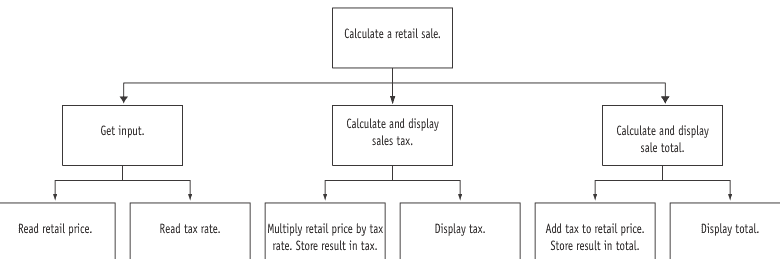
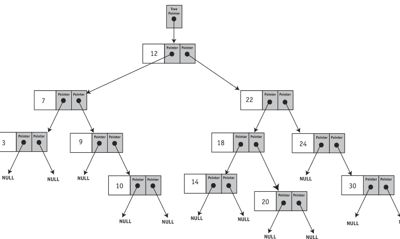

# C++ 入门指南：从控制结构到对象，附录 O：奇数复习题答案


# 附录 O：奇数复习题答案

# 第 1 章


## 31. 层级结构图：



33. 7

35. 365

# 第 2 章


{
  cout << "Two mandolins likes creatures in the\n\n\n";
  cout << "dark\n\n\n";
  cout << "Creating the agony of ecstasy.\n\n\n";
  cout << " George Barker\n\n\n";
  return 0;
}


B) 4
C) 2
D) 6
E) 1


ReadCredit;
显示“输入客户已使用的信誉额度：”
ReadUsed.

# 附录 O：奇数复习题答案

availableCredit = maxCredit - creditUsed;
显示“客户的可用信誉额度为 $”
显示 availableCredit.

```cpp
#include <iostream>
using namespace std;

int main() {
  double maxCredit, creditUsed, availableCredit;

  cout << "Enter the customer's maximum amount of credit: ";
  cin >> maxCredit;
  cout << "Enter the amount of credit used by the customer: ";
  cin >> creditUsed;
  availableCredit = maxCredit - creditUsed;
  cout << "The customer's available credit is $";
  cout << endl;
  return 0;
}
```

```cpp
#include <iostream>
using namespace std;

int main() {
  int score1, score2, score3, averageScore;

  cout << "Enter the score for the 1st game: $";
  cin >> score1;
  cout << "Enter the score for the 2nd game: $";
  cin >> score2;
  cout << "Enter the score for the 3rd game: $";
  cin >> score3;
  averageScore = (score1 + score2 + score3) / 3;
  cout << "The average score is: $";
  cout << averageScore << endl;
  return 0;
}
```

cin >> number1 >> number2;
赋值语句应该读取：
quotient = static_cast<float>(number1) / number2;
最后一条语句缺少分号。

# 附录 O：奇数复习题答案

main 函数头头应该是：

```cpp
int main()
```

复合赋值运算符使用不当。
语句应该是：

```cpp
number1 *= 50;
number2 *= 50;
```

以下语句：

```cpp
getline >> name;
getline(cin, name);
```

35. 6 12

37. 分钟：612000.0000
小时：10200.0332
天：425.0014
月份：13.9726
年：1.1644

# 第 4 章


# 附录 O：奇数复习题答案


```cpp
31. if (y == 0)
    x = 100;
```

```cpp
    commission = .10;
    else if (sales <= 15000)
    commission = .15;
    else
        commission = .20;
```

```cpp
    if (amount2 < 100)
        cout << (amount1 > amount2 ? amount1 : amount2);
```

```cpp
37. if (temperature >= -50 && temperature <= 150)
    cout << "The number is valid.";
```

```cpp
39. if (str1 > str2)
    cout << str2;
else
    cout << str1;
```


59. if/else 结构应该用大括号括起来。62 switch 语句不能测试关系表达式。应该使用 if-else 语句。

# 第 5 章


# 附录 O：奇数复习题


```cpp
35. int product = 0, num;
while (product < 100)
{
    cin >> num;
    product = num * 10;
}
```

```cpp
37. for (int row = 0; row < 1000; row++)
    for (int col = 0; col < 15; col++)
        cout << '#';
    cout << endl;
}
```

```cpp
39. for (int row = 0; row < 1000; row++)
{
    for (int col = 0; col < 15; col++)
        cout << '#';
    cout << endl;
}
```

```cpp
41. char sure = 'X';
while (sure != 'Y' && sure != 'N')
{
    cout << "Are you sure you want to ";
    cin >> sure;
}
```

```cpp
43. int x = 50;
while (x > 0)
{
    cout << x << " seconds to go.\n";
    x--;
}
```

```cpp
45. ifstream inputFile("Numbers.txt");
int number;
while (inputFile >> number)
cout << number << endl;
inputFile.close();
```

47. false

49. false

51. false

53. false

55. false

57. true

59. true

61. false

63. true

67. while 语句末尾不应该有分号。可以认为 bigNum 应该定义为 long 类型。
count 应该初始化为 1。

69. do-while 循环测试的表达式应该是 choice == 1 而不是 choice = 1。


# 附录 O：奇数复习题答案

- 15. value
- 17. local
- 19. global
- 21. local
- 23. return
- 25. last
- 27. reference
- 29. reference
- 31. parameter lists

```cpp
33. double half(double num)
{
    return num / 2;
}
```

```cpp
35. void timesTen(int num)
{
    cout << (num * 10) << endl;
}
37. void getNumber(int &num)
{
    cout << "Enter a number in the range 1 - 100 : ";
    cin >> num;
    while (num < 1 || num > 100)
    {
        cout << "That number is out of range.\n";
        cout << "Enter a number in the range 1 - 100 : ";
        cin >> num;
    }
}
```

- 39. False
- 41. True
- 43. True
- 45. False
- 47. True
- 49. True
- 51. True
- 53. False
- 55. True

57. 赋值语句应该是：

```cpp
average = (value1 + value2 + value3) / 3.0;
```

该函数定义为 double 但没有返回任何值。

59. 参数应该定义为：

```cpp
int &value
cin >> value;
```

# 第 7 章

- 35. 序列 (sequence)
- 37. push_back
- 41. for (int i = 0; i < 20; i++)
    cout << names[i] << endl;

```cpp
43. const int SIZE = 10;
int id[SIZE]; // 用于存储 ID 号
double weeklyPay[SIZE]; // 用于存储周薪
// 显示每个员工的周总薪。
{
    cout << "The pay for employee "
    << id[i] << " is $" 
    << showpoint << setprecision(2)
    << weeklyPay[i] << endl;
}
```

```cpp
47. numberArray[0][0] = 15;
numberArray[8][10] = 18;
const int NUM_COLS = 5;
const int row, col; // 循环计数器
total; // 累加器
// 显示每行的和。
for (row = 0; row < NUM_ROWS; row++)
{
    // 设置累加器。
    total = 0;
    // 求行和。
    for (col = 0; col < NUM_COLS; col++)
        total += days[row][col];
    // 显示行的总数。
    cout << "The total for row " << row
    << " is " << total << endl;
}
```

```cpp
// 显示每列的和。
for (col = 0; col < NUM_COLS; col++)
{
    // 设置累加器。
    total = 0;
    // 求列和。
    for (row = 0; row < NUM_ROWS; row++)
        total += days[row][col];
    // 显示列的总数。
    cout << "The total for column " << col
    << " is " << total << endl;
}
```

- 61. False

# 第 8 章


# 第 9 章


- 17. 拼接 (concatenate)
    strcpy(str, name);

```cpp
31. int wCount(char *str)
{
    int num = 0;
    while (*str != '\0')
    {
        if (*str == 'W')
            num++;
    }
    return num;
}
```

- 43. isupper 函数只能用于测试字符，而不是字符串。
- 45. 编译器不会分配足够的空间来容纳两个字符串。

# 第 11 章

   info.lastName = "Smith"
   info.middleName = "Bart"
   info.firstName = "William"

- C) cout << info.lastName << endl;
cout << info.middleName << endl;
cout << info.firstName << endl;
- 7. A) "Canton"
B) "Haywood"
C) 978
D) 未初始化 (uninitialized)
- 11. 0 1 2

```cpp
23. struct TempScale {
    double fahrenheit;
    double centigrade;
};
struct Reading {
    int windSpeed;
    double humidity;
    TempScale temperature;
};
```

```cpp
{
    cout << "Wind speed: " << values.windSpeed << endl;
    cout << "Humidity: " << values.humidity << endl;
    cout << "Fahrenheit temperature: " << values.temperature.fahrenheit << endl;
    cout << "Centigrade temperature: " << values.temperature.centigrade << endl;
}
```

```cpp
27. getReading() {
    Reading local;
    cout << "Enter the following values:\n";
    cout << "Wind speed: ";
    cin >> local.windSpeed;
    cout << "Humidity: ";
    cin >> local.humidity;
    cout << "Fahrenheit temperature: ";
    cin >> local.temperature.fahrenheit;
}
```

```cpp
cout << "Centigrade temperature: ";
cin >> local.temperature.centigrade;
return local;
}
```


```cpp
31. union Items
{
    char alpha;
    int num;
    long bigNum;
    float real;
};
Items x;
```

- 33. num = 452;
- 35. enum Pets(DOGS, CATS, BIRDS, HAMSTERS);
- 37. True
- 39. False
- 41. False
- 43. True
- 45. True
- 47. True
- 49. False
- 51. False
- 53. True
- 55. True
- 57. 结构声明没有标签。
- 67. x 和 y 不能同时有效使用。

# 第 12 章

- 3. 内容会被擦除。（换句话说，文件被截断）。


# 附录 O：奇数复习题答案


- 23. put
- 31. sequential

```cpp
41. fstream places("places.dat", ios::in | ios::out);
```

```cpp
43. pets.open("pets.dat", ios::in)
fstream open("pets.dat", ios::in);
```

- 51. True

65. 文件应该这样打开：

```cpp
fstream file("info.dat", ios::in | ios::out);
or
fstream file:
file.open("info.dat", ios::in | ios::out);
```

67. 文件访问日志必须用 `fstream` 对象指定。

69. 文件类标志应该是 `ios::in`。此外，`get` 成员函数不能用于读取字符串。

71. 文件类标志应该是 `ios::out`。此外，最后一行应该是：
`dataFile.write(reinterpret_cast<char *>(&dt), sizeof(dt));`

## 第13 章

- 15. 类的职责是类负责知道的事情以及类负责执行的动作。
- 23. 访问修符
- 35. default
- 37. ~
- 39. default
- 41. constructor, destructor

```cpp
43. class Circle
{
    private:
        double radius;
    public:
        void setRadius(double r)
        { radius = r; }
        double getRadius()
        { return radius; }
        double getArea()
        { return 3.14159 * radius * radius; }
}
```

```cpp
45. class Circle
{
    private:
        double radius;
    public:
        Circle()
        { radius = 0.0; }
        Circle(double r)
        { radius = r; }
        void setRadius(double r)
        { radius = r; }
        double getRadius()
        { return radius; }
        double getArea()
        { return 3.14159 * radius * radius; }
}
```

- 47. Circle[5] = { 12, 7, 14, 8 };

| Animal | Medication | Nurse |
| :--- | :--- | :--- |
| Doctor | Invoice | Customer |
| Patient | Client |


```cpp
void DumbBell::setWeight(int w)
```

DumbBell(200); 应该是：

```cpp
bar.setWeight(200);
```

bar.weight 不能在类外部访问，因为类之前出现了访问修符，使其默认为私。该语句将无法工作。

## 第14 章


# 附录 O：奇数复习题答案
- 29. before
- 37. 聚合
- 49. True
- 57. True
- 59. 拷贝构造函数的参数应该是引用变量。
- 61. 重载的 + 函数头应该是：

```cpp
void operator+(const Point &right)
```

- 63. float 转换函数头应该是：

```cpp
```

## 第15 章

- 1. 当一个对象是另一个对象的特殊版本时，它们之间存在“是”的关系。这意味着一个类是另一个类的特殊版本。
- 3. 基类访问规范规定了派生类如何继承基类的成员。成员访问规范规定了类外部代码如何访问成员。
- 5. 不。
- 7. 当派生类有一个与基类函数同名的函数，且基类函数不是虚拟的时，称该函数在派生类中被重定义。然而，如果基类函数是虚拟的，则称该函数被重写（覆盖）。
- 9. 抽象基类不被实例化，而是作为类的基类。抽象基类代表了所有派自它的类的通用、抽象形式。当它拥有一个或多个虚拟函数时，它是抽象的。

- 15. private
- 23. 基类版本。
- 35. class SoundSystem : public CDplayer, public Tuner, public CasettePlayer
- 37. class B
{
    private:
        int m;
    protected:
        int n;
    public:
        void setM(int);
        int getM();
        void setN(int);
        int getN();
        virtual int calc()
        { return m * n; }
}
class D : public B
{
protected:
        float q;
        float r;
    public:
        void setQ(float);
        float getQ();
        void setR(float);
        float getR();
        virtual float calc()
        { return q * r; }
};


## 附录 O：奇数复题解答


# 第 16 章

- 1. 抛出点是程序中包含 `throw` 语句的行，从而抛出异常。
- 3. `try` 块包含代码块，执行任何可能直接或间接导致抛出异常的语句。`catch` 块捕获特定的异常并包含返回它的代码。
- 5. 一旦抛出异常，程序就无法跳回抛出点。执行 `throw` 语句的函数将立即终止。如果该函数是由另一个函数调用的，那么调用函数也将终止。这一过程被称为栈回溯（unwinding the stack），它会沿着整个嵌套函数调用链持续，从抛出点一直回到 `catch` 块。
- 7. 通过捕获 `bad_alloc` 异常。
- 9. 因为传递给函数模板的类对象必须支持函数使用该对象的所有运算符。
- 11. 序列（Sequence）和关联（associative）。
- 13. 抛出点 (throw point)
- 15. 捕获 (catch)
- 17. 模板前缀 (template prefix)
- 19. 特化的 (specialized)
- 21. 关联的 (associative)
- 23. bad_alloc
char * allocBlock(int size)
{
  char *ptr;
  try {
```
    cout << arr[i] << endl;
}
```

```cpp
// 查找值 7。
binary_search(vect.begin(), vect.end(), 7);
```

- 31. 错误
- 33. 正确
- 35. 正确
- 39. 错误
- 41. 正确
- 43. 错误
- 45. 正确
- 47. `try` 块必须出现在 `catch` 块之前。
- 49. 返回语句应为 `return * number;` 
- 51. 类型参数 `T2` 未被使用。
- 53. 语句应为 `count << valueSet[2] << endl;`

# 第 17 章

- 1. 链表可以很容易地增长或缩小。事实上，程序员不需要知道链中有多少个节点。它们在需要时在内存中创建。此外，当从链表中插入或删除节点时，其他节点都不需要移动。
- 3. 指向链表中第一个节点的指针。
- 5. 链表的最后一个节点通常指向地址 0，即空地址（null address）。
- 7. 追加节点意味着将新节点添加到链的末尾。插入节点意味着将新节点插入到链的中间某个位置。
- 从列表中删除节点而不破坏由 `next` 指针创建的链接。
- 从内存中删除节点。
- 11. 在单链表中，每个节点只连接到另一个节点。在双向链表中，每个节点不仅指向下一个节点，还指向上一个节点。在循环链表中，最后一个节点指向第一个。

## 附录 O：奇数复题解答

23.

| | 栈顶 |
|---|---|
| 8 | |
| | 栈底 |

25.

| 9 | 12 | 10 |
|---|---|---|
| 队头 | | 尾 |

27. 使用 if/else 的代码段：

```cpp
if (rear == queueSize - 1)
  rear = 0;
else
  rear++;
```

使用取模运算的代码段：

```cpp
rear = (rear + 1) % queueSize;
```

- 29. 错误
- 31. 正确

# 第 19 章

- 1. 对于问题 12：num <= 0
   对于问题 13：num > 0
   对于问题 14：pos < size - 1
- 3. 递归函数的效率较低，因为与每次函数调用相关的开销。
- 5. 程序最终将耗尽栈内存并终止。
- 7. 边界情况 (base case)
- 9. 间接 (indirect)

```cpp
int findLargest(const int arr[], int start, int end)
{
  int largest;
  if(start == end)
    return arr[start];
  else
  {
    largest = findLargest(arr, start + 1, end);
    if(arr[start] >= largest)
        return arr[start];
    else
        return largest;
  }
}
```

# 第 20 章

- 1. 另外两个。
- 3. 没有子节点的节点。
- 5. 插入值的顺序。
- 7. 根节点 (root node)
- 9. 叶子节点 (leaf node)
- 11. 中序 (inorder)、前序 (preorder) 和后序 (posteriori)
- 13. (递归函数)
    显示中序 (节点指针)
    如果指针不为空
        显示中序 (节点指针 -> 左侧)。
        显示节点的值。
        显示中序 (节点指针 -> 右侧)。
    结束如果
    显示 InOrder
- 15. (递归函数)
    显示后序 (节点指针)
    如果指针不为空
        显示后序 (节点指针 -> 左侧)。
        显示后序 (节点指针 -> 右侧)。
        显示节点的值。
    结束如果
    显示 Post Order

## 附录 O：奇数复题解答

17.



19. 12 7 3 9 10 22 18 14 20 24 30

- 21. 正确
- 23. 正确
- 25. 错误

