# C++ 入门指南：从控制结构到对象（含 MyLab Programming 与 Pearson eText 访问卡包）

# 学生数字资源

你的新教科书提供了为期 12 个月的数字资源访问权限，这些资源可能包括 VideoNotes（编程概念的逐步视频教程）、源代码、章节、测验题等。请参阅教材中的序言获取详细资源列表。

请按照以下指令注册 Tony Gaddis 的《Starting Out with C++ from Control Structures to Objects》（第九版）的配套网站。

1. 访问 `www.pearsonhighered.com/cs-resources`
2. 输入你的教材标题或按作者姓名浏览。
3. 点击 `Companion Website`（配套网站）。
4. 点击 `Register`（注册）并按照屏幕上的指令创建用户名和密码。

使用硬币刮开涂层以显示激活码。

不要使用尖刀或其他尖利物体，否则可能会损坏代码。

使用你在注册期间创建的用户名和密码开始使用与教材配套的在线资源。

# 重要：

此预付费订阅不包括对 `MyProgrammingLab` 的访问权限，你可以在 `www.myprogramminglab.com` 购买。

此激活码只能使用一次。此订阅在激活后有效期为 12 个月，且不可转让。如果激活码已被刮开，则可能不再有效。若如此，你可以在配套网站的登录页面购买订阅。

如需技术支持请访问 `http://247pearsoned.custhelp.com`

**Tony Gaddis**

Haywood 社区学院

Pearson Education Japan

序言 xvii

# 第 1 章 计算机与编程

1.1 为什么编程？

1.2 计算机系统：硬件与软件

1.3 程序与编程语言

1.4 程序由什么组成？

1.5 输入、处理与输出

1.6 编程过程

1.7 过程化编程与面向对象编程

复习与练习

# 第 2 章 C++ 导论

2.1 C++ 程序的组成

2.2 `cout` 对象

2.3 `#include` 指令

2.4 变量、字面量与赋值语句

2.5 标识符

2.6 整数数据类型

2.7 `char` 数据类型

2.8 C++ `string` 类

2.9 浮点数据类型

2.10 `bool` 数据类型

2.11 确定数据类型的大小

2.12 关于变量赋值与初始化

2.13 作用域

2.14 算术运算符

2.15 注释

2.16 命名常量

2.17 编程风格

复习与练习

编程挑战

# 第 3 章 表达式与交互

# 第 4 章 决策

# 第 5 章 循环与文件

# 第 6 章 函数

# 第 7 章 数组与向量

# 第 8 章 数组的搜索与排序

# 第 9 章 指针

# 第 10 章 字符、字符串及更多

# 第 11 章 结构化数据

# 第 12 章 高级文件操作

# 第 13 章 类简介

# 第 14 章 更多关于类

# 第 15 章 继承、多态与虚函数

15.4 重定义基类函数

复习题与练习

流程图导论，第 20 页

设计账户余额程序，第 25 页

使用 `cout`，第 32 页

赋值语句与简单数学表达式，第 63 页

使用 `cin` 读取输入，第 85 页

解决体育场座位问题，第 144 页

# 文中视频笔记的位置（续）

# 前言

欢迎阅读《C++：从控制结构到对象》第九版。本书适用于两个学期的 C++ 编程课程或单学期的加速课程。对于编程初学者以及有其他语言基础的学生，本书将受益匪浅。对于初学者，书中涵盖了编程基础知识；对于经验丰富的学生，书中探索了 C++ 语言的细微差别。本书用易于理解的语言编写，涵盖了入门编程课程的所有主题，并确保学生不仅学习“如何实现”，还学习“何时使用”。

# 第九版的变化

本书的教学方法、组织结构和写作风格与上一版相同。进行了许多改进和更新，总结如下：

- 关于标准模板库 (`STL`) 的内容已重写并扩展为独立章节。此前，第 16 章涵盖了异常、模板，并对 `STL` 进行了简要介绍。在本版中，第 16 章涵盖异常和模板，第 17 章是专门针对 `STL` 的章节。新章节涵盖了：

# 前言（续）

- 第 3 章现在提到了 C++11 引入的 `round` 函数。
- 第 7 章现在更早地介绍了数组初始化。
- 在第 8 章中，冒泡排序算法经过重写和改进。
- 第 8 章增加了排序和搜索字符串向量的新示例。
- 在第 9 章中，智能指针部分在现有 `unique_ptr` 之外，还提供了 `shared_ptr` 和 `weak_ptr` 的概述。
- 第 10 章增加了关于字符串分词的“焦点”章节。
- 第 10 章现在涵盖了 C++11 引入的字符串转数字函数。
- 原出现在第 11 章的联合体内容已移动到附录 K，可在书籍配套网站获取。
- 第 13 章有新章节：
  - 成员初始化列表
  - 原地初始化
  - 构造函数委托
- 第 14 章增加了几个新主题，包括：
  - 右值引用和移动语义
  - 重载 `=` 运算符时检查自赋值
  - 在聚合类中使用成员初始化列表
- 第 15 章包含一个关于构造函数继承的新章节。
- 全书添加了几个新的编程问题。

# 本文结构

本书以循序渐进的方式教授 C++。每章都涵盖一组主要主题，并随着学生的学习构建知识。虽然章节可以按照现有顺序进行教学，但书中提供了一定的灵活性。图 P-1 所示的图提供了可能的教学顺序。

第 1 章涵盖了基础硬件、软件和编程概念。如果学生已经熟悉这些主题，可以选择跳过本章。第 2 章至第 7 章涵盖了基础 C++ 语法、数据类型、表达式、选择结构、循环、函数和数组。这些章节都建立在前章的基础上，并应该按照给出的顺序进行。

完成第 7 章后，你可以继续学习第 8 章，或跳转到第 9 章。完成第 9 章后，可以涵盖第 10、11、12 或 13 章。（如果你在此处跳转到第 12 章，则需要推迟第 12.8、12.9 和 12.10 节，因为第 11 章已涵盖。）完成第 13 章后，你可以顺序涵盖第 14 至 18 章。接下来，你可以继续学习第 19 或第 20 章。最后，可以涵盖第 21 章。

本书的方法从结构化、过程化编程的基础开始，然后深入进入面向对象的编程和高级数据结构。

# 章节概述

## 第 1 章：计算机与程序简介

本章介绍了计算机科学领域，涵盖了编程、问题解决和软件设计的基础知识。涵盖了程序的组成，如单词、变量、运算符和标点符号。还介绍了行业常用的工具，如伪代码、流程图和层次结构图。

## 第 2 章：C++ 介绍

本章通过介绍数据类型、标识符、变量声明、常量、注释、程序输出、简单算术运算和 C 字符串，引导学生开始学习 C++。书中还介绍了编程风格规范，并在此处展示了良好的编程风格范例，这种风格贯穿全书。

## 第 3 章：表达式与交互

在本章中，学生将学习编写能够输入并处理数值、字符和字符串数据的程序。书中更详细地介绍了算术运算符的使用和数学表达式的创建，并强调了运算符的优先级。介绍了调试，并设置了关于程序追踪的章节。此外还包含了简单输出格式化、数据类型转换与强制类型转换，以及处理数字的库函数。

## 第 4 章：决策

在这里，学生将学习关系运算符、关系表达式以及如何通过 `if`、`if/else` 和 `if/else if` 语句控制程序流。还介绍了条件运算符和 `switch` 语句。涵盖了这些结构的关键应用，例如菜单驱动型程序和输入验证。

## 第 5 章：循环与文件

本章涵盖了重复控制结构。教授了 `while` 循环、`do-while` 循环和 `for` 循环，以及这些设备的常见用途。讨论了累加器、运行总计、哨兵与其他应用相关的主题。介绍了顺序文件 I/O。学生将学习如何读写文本文件，并使用循环处理文件中的数据。

## 第 6 章：函数

在本章中，学生将学习如何以及为什么要对程序进行模块化，并使用 `void` 和有返回值函数。涵盖了参数传递，重点介绍了参数何时应按值传递以及何时需要按引用传递。涵盖了变量的作用域，并提供了局部变量与全局变量以及静态局部变量的章节。还介绍了并演示了重载函数。

## 第 7 章：数组与向量

在本章中，学生将学习创建和操作一维及多维数组。包含了许多数组处理的示例，说明了如何找到数组中的和、平均值、最大值和最小值，以及如何对二维数组的行、列和所有元素求和。还演示了使用并行数组的编程技术，并向学生展示如何使用数据文件作为输入源填充数组。介绍了 `STL` 向量并与数组进行了比较。

## 第 8 章：数组的搜索与排序

在这里，学生将学习排序数组和搜索存储其中的数据的知识。本章涵盖了冒泡排序、选择排序、线性查找和二分查找。还有一个关于排序和搜索 `STL` 对象的章节。

## 第 9 章：指针

本章解释了如何使用指针。将指针与引用变量进行了对比。其他主题包括指针算术、指针的初始化、指针的关系比较、指针与数组以及动态内存分配。

## 第 10 章：字符、字符串及更多

本章讨论了深入处理文本的各种方法。介绍了用于测试和操作字符的库函数。讨论了 C 字符串，并涵盖了将字符串存储在数组中的技术。

## 第 11 章：结构化数据

学生将接触抽象数据类型，并学习如何使用结构体、联合和枚举数据类型来创建它们。讨论包括将结构体传递给函数。

## 第 12 章：高级文件操作

本章涵盖了顺序访问、随机访问、文本和二进制文件。讨论了打开文件的各种模式。还涵盖了输出格式化。

## 第 13 章：类简介

学生现在转向面向对象的范式。本章涵盖了类的基本概念。讨论了成员变量和函数。学生将学习私有和公共访问规范，并介绍了构造函数、重载构造函数和析构函数等主题。

## 第 14 章：更多关于类

本章继续研究类，涉及静态成员、成员赋值和拷贝构造函数。本章还包含了关于运算符重载、对象转换和聚合的深度章节。

## 第 15 章：继承、多态与虚函数

本章继续学习类，主题为继承、多态和虚成员函数。主题包括基类和派生类的构造函数与析构函数、基类指针、静态和动态绑定以及类层次结构。

## 第 16 章：异常与模板

学生将学习使用异常开发错误捕获技术。讨论转向了作为代码复用方法的函数模板。

## 第 17 章：标准模板库

本章讨论了标准模板库 (`STL`) 中的容器、迭代器和算法。涵盖的特定容器有 `array`、`vector`、`map`、`unordered_map`、`multiset` 和 `unordered_set`。学生将学习排序、排列、函数对象（函数器）的集合以及 lambda 函数。

## 第 18 章：链表

本章介绍了处理列表的概念和技术。开发了一个链表 ADT，并教授学生编写各种操作，如创建链表、追加节点、遍历列表、搜索节点、插入节点、删除节点和销毁列表。

## 第 19 章：栈与队列

在本章中，学生将学习创建和使用静态栈和队列。定义了栈和队列的操作，并提供了每个 ADT 的模板。

## 第 20 章：递归

本章讨论了递归及其在问题解决的应用。提供了递归调用的可视化追踪，并讨论了递归应用。

## 第 21 章：二叉树

本章涵盖了二叉树 ADT 并演示了许多二叉树操作。学生将学习遍历树、插入元素、删除元素、替换元素、测试元素以及销毁树。

## 本书特征

- **概念陈述** | 书的每个主要章节都以一个概念陈述开头。该陈述总结了章节的核心观点。
- **示例程序** | 书中有数百个完整的程序，每个程序都旨在突出当前正在学习的主题。在大多数情况下，这些都是实用的现实案例。书中提供了这些程序的源代码，以便学生可以自己运行程序。
- **程序输出** | 在每个示例程序之后，都有其屏幕输出示例。这能让学生直观看到程序是如何运行的。
- **焦点聚焦** | 这些章节中的每一个都提供了一个编程问题和详细的逐步分析，向学生展示如何解决它。
- **视频笔记 (`VideoNotes`)** | 一系列专为本书开发的在线视频可以在 `www.pearsonhighered.com/gaddis` 查看。书中各出现的图标提醒学生查看有关特定主题的视频。
- **检查点 (`Checkpoints`)** | 检查点贯穿于每个章节，作为自测辅助。所有检查点问题的答案都可以从书籍网站 `www.pearsonhighered.com/gaddis` 下载。这允许学生检查他们对新主题的掌握程度。
- **注释 (`Notes`)** | 注释出现在书中适当的位置。它们是对与当前主题相关的有趣或经常被误解的点的简短解释。
- **警告 (`Warnings`)** | 警告是提醒学生某些 C++ 特性、编程技术或实践可能会导致程序故障或数据丢失的注释。
- **案例研究 (`Case Studies`)** | 案例研究模拟了书中许多章节中出现的现实应用。这些案例研究旨在突出其所在章节的主要主题。
- **复习题与练习题** | 每个章节都提供了一组详尽且化的复习题（如填空和简答），用于检查学生对章节所介绍材料的掌握情况。随后是需要解决问题和分析的练习题，例如算法工作台（`Algorithm Workbench`）、预测输出（`Predict the Output`）和查找错误（`Find the Errors`）部分。奇数复习题和练习题的答案可以从书籍网站 `www.pearsonhighered.com/gaddis` 下载。

# 编程挑战

每个章节都提供了一个编程练习库，旨在巩固学生对当前学习主题的知识。在大多数情况下，作业提出了需要解决的现实世界问题。在适用时，这些练习包含了输入验证规则。

## 小组项目

书中有几个小组编程项目，旨在由学生小组构建。一个学生可以构建程序的用户界面，而另一个学生编写数学代码，另一个人则设计并实现一个类程序。这个过程类似于许多专业程序的编写方式，并鼓励了教室内的团队合作。

## 软件开发项目：Serendipity 书店 (`Serendipity Booksellers`)

可以从书籍网站 `www.pearsonhighered.com/gaddis` 下载。这是一个持续的项目，教师可以选择性分配给学生小组。它系统地开发了一个“现实世界”软件包：一个针对虚构 `Serendipity Booksellers` 组织的销售点程序。每个章节的 `Serendipity` 任务都会使用该章节涵盖的结构和技术为软件添加更多功能。完成后，该程序将充当收银机，管理库存数据库并生成各种报告。

## C++11

全书中引入了新的 C++11 语言特性。寻找 C++11 图标可以找到这些新特性。

## 补充材料

## 学生在线资源

出版商为本书提供了许多学生资源。以下项目可以在计算机科学门户 `www.pearsonhighered.com/gaddis` 获得：

- 书中每个示例程序的源代码
- `VideoNotes` 的访问
- 全套附录，包括检查点问题的答案和奇数复习题的答案
- 一系列宝贵的案例研究
- 完整的 `Serendipity Booksellers` 项目

## MyProgrammingLab 在线练习与评估

`MyProgrammingLab` 帮助学生充分掌握编程的逻辑、语义和语法。通过练习题和即时的个性化反馈，`MyProgrammingLab` 提高了那些对流行高级编程语言的基本概念和范式感到困难的初学学生的编程能力。

作为一个自学和作业工具，`MyProgrammingLab` 课程包含数百个……

## 致谢

Don Biggerstaff
Fayette 技术社区学院

Dennis Fairclough
犹他谷州学院

Michael Bolton
东北俄克拉荷马州立大学

Xisheng Fang
Ohlone 学院

Bill Brown
Pikes Peak 社区学院

Mark Fienup
北爱荷华大学

Robert Burn
Diablo Valley 学院

Richard Flint
北中央学院

Charles Cadenhad
Richland 社区学院

Ann Ford Tyson
佛罗里达州立大学

Randall Campbell
Morningside 州学院

Jeanette Gibbons
南达科他州立大学

Wayne Caruolo
Red Rocks 社区学院

James Gifford
威斯康星大学史蒂文分校

Cathi Chamberlain-Miller
Aiken 技术学院

Leon Gleiberman
Touro 学院

C.C. Chao
杰克逊州立大学

Barbara Guillott
路易斯安那州大学

Joseph Chao
鲍灵格林州立大学

Ranette Halverson, 博士
中西部州立大学

Royce Curtis
西威斯康星技术学院

Ken Hang
Green River 社区学院

Joseph DeLibero
亚利桑那州立大学

Carol Hannahs
肯塔基大学

Michael Dixon
萨克拉门托市学院

Dennis Heckman
波特兰社区学院

Jeanne Douglas
佛蒙特大学

Ric Heishman
乔治梅森大学

Michael Dowell
奥古斯塔州立大学

Michael Hennessy
俄勒冈大学

段强
宾州立大学—阿宾顿分校

Ilga Higbee
黑鹰学院

William E. Duncan
路易斯安那州大学

Patricia Hines
Brookdale 社区大学

Daniel Edwards
Ohlone 学院

Mike Holland
北弗吉尼亚社区学院

Judy Etchison
南方法律大学

Mary Hovik
Lehigh Carbon 社区学院

Richard Hull
Lenoir-Rhyne 学院

Marguerite Nedreberg
扬斯敦州立大学

Kay Johnson
罗德岛社区学院

Lynne O'Hanlon
洛杉矶 Pierce 学院

Chris Kardaras
北中央社区学院

Frank Paiano
西南社区学院

Willard Keeling
Blue Ridge 社区学院

Theresa Parker
德克萨斯州立技术学院

A.J. Kryger
休斯顿社区学院

Mark Parker
Shoreline 社区学院

Sheila Lancaster
Gadsden 州社区学院

Tino Posillico
纽约州立大学法明分校

Ray Larson
Inver Hills 社区学院

Frederick Pratter
东俄勒冈大学

Michelle Levine
布劳沃德学院

Susan L. Quick
宾州立大学

Jennifer Li
Ohlone 学院

Alberto Ramon
Diablo Valley 学院

Norman H. Liebling
圣哈辛托学院

Bazlar Rasheed


# 苏尔应用艺术与技术学院

Cindy Lindstrom

Lakeland学院

Farshad Ravanshad

Bergen 社区学院

陆卓奎

缅因大学普雷斯基分校

Susan Reeder

西雅图大学

Heidar Malki

休斯顿大学

Sandra Roberts

Sad学院

Debbie Mathews

J. Sargent Reynolds 社区学院

Lopa Roychoudhuri

安杰洛州立大学

Rick Matzen

东北部州立大学

Dolly Samson

韦伯州立大学

Robert McDonald

东斯特劳兹堡大学

Ruth Sapir

纽约州立大学法明分

James McGuffee

奥斯汀社区学院

Jason Schatz

旧金山市学院

Dean Mellas

Cerritos学院

辛圣 博士

南达科他州立大学

Lisa Milkowski

密尔沃基工程学院

Bari Siddiquel

德州萨斯大学布朗斯维尔

William Slater

科林县社区学院

Shep Smithline

明尼苏达大学

Richard Snyder

Lehigh Carbon 社区学院

Donald Southwell

Delta学院

Caroline St. Claire

北中央学院

Kirk Stephens

西南社区学院

Cherie Stevens

南佛罗里达社区学院

Dale Suggs

贝尔大学

Mark Swanson

红翼技术学院

Ann Sudell Thorn

Del Mar学院

Martha Tillman

圣马特奥学院

Ralph Tomlinson

爱荷华州立大学

David Topham

Ohlone学院

Robert Tureman

Paul D. Camp 社区学院

Arisa K. Ude

Richland 学院

Peter van der Goes

Rose State 学院

Stewart Venit

加州州大学洛杉矶分校

Judy Walters

北中央学院

John H. Whipple

诺姆普顿社区学院

Aurelia Williams

诺福克州立大学

Chadd Williams

太平洋大学

Vida Winans

伊利诺伊理工学院

我还想感谢我的家人朋友在我所有项目中的支持。我非常幸运能有 `Matt Goldstein` 作为我的编辑，并有 `Kristy Alura` 担任编辑助理。他们的指导和鼓励让编写章节和完成截止日期变成了一件乐事。我很幸运有 `Demetrius Hall` 担任我的营销经理。

## 关于作者

`Tony Gaddis` 是 `Haywood` 学院一位备受推誉的教师，拥有近二十年的计算机科学教学经验。他他的工作被选为北卡罗来纳州年度教师。他是 *Starting Out* 系列丛的主要作者，该系列包括《逻辑与设计》、《C++》、《Java》、《Visual Basic》、《Python 和 App Inventor》，均由 `Pearson` 出版。

# 第 1 章 计算机与编程导论

## 课题

- 1.1 为什么要编程？
- 1.2 计算机系统：硬件与软件
- 1.3 程序与编程语言
- 1.4 程序由什么组成？
- 1.5 输入、处理与输出
- 1.6 编程过程
- 1.7 过程化编程与面向对象编程

## 为什么要编程？

**概念**：计算机可以完成许多工作，因为它们是可以编程的。

思考人们使用计算机的不同方式。在学校里，学生使用计算机写论文、搜索文章、发送电子邮件以及参加在线课程。在工作中，人们使用计算机进行业务交易、与客户和同事交流、分析数据、制作演示、控制制造设施中的机器以及许多其他任务。在家里，人们使用计算机完成支付账单、在线购物、社交网络和玩电脑游戏等任务。不要忘记智能手机、`MP3`播放器、`DVR`、汽车导航系统以及许多其他设备也是计算机。

计算机能够完成如此多样的任务是因为它们可以被编程。这意味着计算机的设计并不是为了只做某一项工作，而是为了完成任何被编程要求执行的工作。程序是计算机执行任务时遵循的一组指令。例如，图 1-1 显示了使用 `Microsoft Word` 和 `PowerPoint` 的屏幕，这是两种常用的程序。

程序通常被称为软件。软件对计算机来说是关重要的，因为没有软件，计算机什么也做不了。我们所有用来让计算机实用的软件都是由被称为程序员或软件开发人员的人创建的。程序员或软件开发人员是指具有设计、创建和测试计算机程序所需的培训和技能的人。计算机编程是一项令人兴奋且有回报的职业。今天，你会发现程序员工作于商业、医学、政府、执法、农业、学术、娱乐以及几乎每一个领域。

## MyProgrammingLab

通过练习和即时反馈的力量，`MyProgrammingLab` 帮助学生的表现。

### 编程练习

通过 `MyProgrammingLab`，学生可以在交互式环境中获得实践经验。

### 即时、个性化的反馈

`MyProgrammingLab` 会自动检测逻辑和语法错误，并提供提示帮助找出哪里出了问题。

### 渐进式复杂度

`MyProgrammingLab` 将编程概念拆解为短序列。在每个序列中，难度和复杂性逐渐增加。

### 动态名册

学生的提交记录存储在名册中，显示是否正确以及尝试了多少次。

### PEARSON 电子书

`Pearson` 电子书让学生可以随时随地访问他们的教科书。

### 分步骤视频教程

这些分步骤的视频教程增强了某些教材中所述的编程概念。


## 图 1-1 文字处理程序和演示文程序


## 1.4 CPU 的工作原理

**概念**：`CPU` 只能理解用机器语言编写的指令。虽然程序看起来非常不同，但它们都使用简单的机器语言。

我们认为 `CPU` 是计算机中最重要的组件，因为它是计算机中运行程序的部分。`CPU` 通常被称为计算机的“大脑”，但你应该理解，`CPU` 并不是大脑，它并不智能。`CPU` 的设计是为了高速执行操作。

- 来自主内存的各种类型数据
- 两个数相加
- 两个数相乘
- 从一个内存位置检索数据
- 将一段数据从一个内存位置移动到另一个位置
- 等等

从这一点中看出，`CPU` 对数据进行简单的操作。然而，`CPU` 完全按照它的指令行事，而这正是程序员的目的。程序无非仅仅是一份导致 `CPU` 执行的指令列表。

计算机编程既是一门艺术，也是一门科学。它是一门艺术，是因为程序的每个方面都应该经过仔细的设计。下面列出了任何真实世界的计算机程序必须设计的几点内容：

- 指令的逻辑流
- 数学步骤
- 屏幕的外观
- 信息呈现给用户的方式
- 程序的“用户友好性”
- 文档、帮助文件、教程等

编程还有科学（或工程）的一面。因为程序在第一次编写时很少能直接运行，因此需要大量的测试、纠正和重新设计。这要求程序员具备耐心和毅力。编写软件还需要纪律。程序员必须学习像 `C++` 这样的特殊语言，因为计算机不理解英语或其他人类语言。这些语言具有必须严格遵守的严格规则。

编程的艺术和科学性质使得编写计算机软件就像设计汽车：汽车和程序都应该是功能性的、高效的、强大的且易于使用的，并且美观的。

## 1.2 计算机系统：硬件与软件

**概念**：所有的计算机系统都由类似的硬件设备和软件组件组成。本节提供了标准计算机硬件和软件结构的概述。

### 硬件

硬件指的是构成计算机的物理组件。我们通常认为的计算机不是一个单一设备，而是一个设备系统。就像交响乐团中的乐器一样，每个设备都扮演自己的角色。一个典型的计算机系统由以下主要组件组成：

- 中央处理单元 (`CPU`)
- 主内存
- 二级存储设备
- 输入设备
- 输出设备

计算机系统的结构如图 1-2 所示。

## 图 1-2 计算机系统中的典型设备


### CPU

当计算机执行程序要求执行的任务时，我们说计算机正在运行或执行该程序。中央处理单元（或 `CPU`）是计算机实际运行程序的部分。`CPU` 是计算机中最重要的组件，因为没有它，计算机就无法运行软件。

在最早的计算机中，`CPU` 是由真空管和开关等电气和机械元件组成的巨大设备。图 1-3 显示了这样的设备。照片中的两个女性正在操作历史性的 `ENIAC` 计算机。

## 图 1-3 ENIAC 计算机


`ENIAC` 被许多人认为是世界上第一台可编程电子计算机，它于 1945 年建成，为美国陆军计算弹道表。这台机器主要是一个巨大的 `CPU`，高 8 英尺，长 100 英尺，重 30 吨。

今天，`CPU` 是称为微处理器的小型芯片。图 1-4 显示了一位实验室技术人员持有现代微处理器的照片。处理器比早期计算机中的机电 `CPU` 小得多，而且强大得多。

## 图 1-4 微处理器


`CPU` 的工作是获取指令、遵循指令并产生结果。内部，中央处理单元由两部分组成：控制单元和算术逻辑单元 (`ALU`)。控制单元协调计算机的所有操作。它负责从哪里获取下一个指令，并通过控制信号调节计算机的其他主要组件。算术逻辑单元正如其名称，是为了执行数学运算而设计的。`CPU` 的结构如图 1-5 所示。

## 图 1-5 CPU 的结构

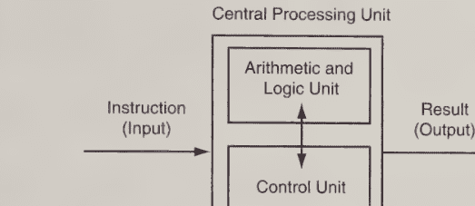

### 输入设备

**输入**是计算机从外部世界收集任何数据。收集信息并将其发送计算机的设备被称为*输入设备*。常见的输入设备有键盘、鼠标、触摸屏、扫描仪、数字相机和麦克风。磁盘驱动器、`CD/DVD` 驱动器和 `USB` 驱动也可以被视为输入设备，因为程序和信息是从它们检索并加载到计算机内存中的。

### 输出设备

输出是计算机发送到外部世界的任何信息。它可能是一个销售报告、姓名列表或图像。信息被发送到*输出设备*，由它进行格式化并呈现。常见的输出设备有显示器、打印机和扬声器。存储设备也可以被视为输出设备，因为 `CPU` 会向它们发送数据。

### 软件

如果计算机要运行，软件是必不可少的。从你打开电源开关到关闭系统，计算机执行的一切都受软件的控制。软件通分为两大类：系统软件和应用程序。大多数计算机程序都明确属于这两个类别中的一个。让我们详细观察每一类。

### 系统软件

控制和管理计算机基本操作的程序通常被称为系统软件。系统软件通常包括以下类型的程序：

- **操作系统**

操作系统是计算机上最基础的一组程序。操作系统控制计算机硬件的内部操作，管理连接到计算机的所有设备，允许从存储设备中保存和检索数据，并允许其他程序在计算机上运行。

- **实用程序**

实用程序执行特定的任务，以增强计算机的运行能力或保护数据。实用程序的示例包括病毒扫描程序、文件压缩程序和数据备份程序。

- **软件开发工具**

程序员用于创建、修改和测试软件的软件被称为*软件开发工具*。编译器和集成开发环境（我们将在本章稍后部分讨论）是属于这一类的程序示例。

### 应用程序

使计算机能够处理日常任务的程序被称为*应用程序*。这些是人们通常在计算机上花费大部分时间运行的程序。本章开始的图 1-1 显示了两个常用应用程序的界面：`Microsoft Word`（文字处理程序）和 `Microsoft`。

## 检查点

- 1.2 列出计算机系统的五个主要硬件组件。
- 1.3 从内部看，`CPU` 由哪两个单元组成？
- 1.4 描述取指/解码/执行循环的步骤。
- 1.5 什么是内存地址？它的目的是什么？
- 1.6 解释为什么计算机同时拥有主内存和辅助存储。
- 1.7 软件的两个大类是什么？
- 1.8 哪一组基础程序控制计算机硬件的内部操作？
- 1.9 执行特定任务（如病毒扫描程序、文件压缩程序或数据备份程序）的程序称为什么什么？
- 1.10 文字处理程序、电子表格程序、电子邮件程序、网络浏览器和游戏程序属于哪一类软件？

## 1.3 程序与编程语言

> **概念**：程序是计算机为了执行某任务而遵循的一组指令。编程语言是用于编写程序的特殊语言。

### 什么是程序？

计算机的设计是为了遵循指令。计算机程序是一组告诉计算机如何解决问题或执行任务的指令。例如，我们希望计算机计算某人的总工资。以下是计算机应该执行的事项列表：

1. 在屏幕上显示消息，询问“你工作了多少小时？”，
2. 等待用户输入小时数。一旦用户输入数字，将其存储在内存中。
3. 在屏幕上显示消息，询问“你的每小时工资是多少？”，
4. 等待用户输入时薪率。一旦用户输入数字，将其存储在内存中。
5. 将小时数乘以每小时金额，并将结果存储在内存中。
6. 在屏幕上显示消息，告知收入金额。该消息包含了第 5 步执行的计算结果。

这些指令统称为算法。算法是执行任务或解决问题的一组定义良好的步骤。注意这些步骤是顺序排列的。第 1 步应该在第 2 步之前执行，依此类推。按照正确的顺序执行这些指令至关重要。

虽然你我可能很容易就能理解工资计算算法中的指令，但它还没有准备好在计算机上执行。计算机的 `CPU` 只能处理用机器语言编写的指令。如果你查看机器语言，你会看到一串二进制数（由 1 和 0 组成的数字）。二进制形式代表机器语言指令，`CPU` 将其解释为命令。以下是机器语言指令可能的样子的示例：

```
1011010000000001
```

你可以想象，用机器语言编码算法的过程是非常枯燥且困难的。此外，每个不同类型的 `CPU` 都有它们自己的机器语言。如果你为计算机 A 编写了一个机器语言程序，然后想在具有不同类型 `CPU` 的计算机 B 上运行它，你就必须重写。编程语言使用单词而不是数字，其发明是为了简化编程任务。程序员将程序保存在文本文件中，然后使用特殊软件将其转换为机器语言。

程序 1-1 显示了工资计算算法如何用 `C++` 编写。“带有示例输入的程序输出”显示了程序运行时将显示的内容。例如，用户在工作小时数输入 10，在时薪率输入 15。程序显示收入，金额为 150 美元。

> **注意**：程序 1-1 中的行号不是程序的一部分。本书显示行号是为了帮助指出程序的某些部分。

## 程序 1-1

```cpp
// 此程序计算用户的工资。
#include <iostream>
using namespace std;
int main() 
{
    double hours, pay;
    // 获取工作小时数。
    cout << "How many hours did you work? ";
    cin >> hours;
    // 获取时薪率。
    cout << "How much do you get paid per hour? ";
    cin >> rate;
    // 计算工资。
    pay = hours * rate;
```

(程序继续)

## 程序 1-1（续）

```cpp
19
// 显示工资。
21 cout << "You have earned $" << pay << endl;
22 return 0;
23 }
```

## 加粗显示的示例输入程序输出

How many hours did you work? 10

How much do you get paid per hour? 15

You have earned $150

### 编程语言

从广义上说，编程语言分为类：低级和高级。低级语言接近计算机层级，这意味着它比人类自然语言更接近计算机的数值机器语言。对人们来说容易学习的语言是高级语言。它们被称为“高级”是因为它们比计算机的可读性更接近人类的可读性。图 1-7 阐述了语言层次的概念。

## 图 1-7 低级语言与高级语言

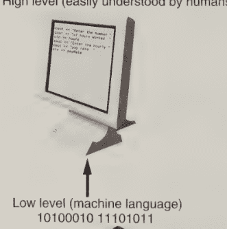

许多高级语言已被创造出来。表 1-1 列出了其中一些为人知的语言。除了编写工资系统和库存程序等应用程序所需的高级特性外，`C++` 还具有许多低级特性。`C++` 基于 `C` 语言，`C` 语言是为了编写操作系统和编译器等目的而发明的。由于 `C++` 从 `C` 发展而来，它继承了 `C` 的所有低级能力。

## 1.3 程序与编程语言

| 语言 | 描述 |
| --- | --- |
| BASIC | 全用符号指令代码。一种最初设计为让初学者易于学习的通用编程语言。 |
| FORTRAN | 公式翻译器。一种设计用于编写复杂数学算法的语言。 |
| COBOL | 通用面向业务语言。一种设计用于业务应用的语言。 |
| Pascal | 一种结构化的通用语言，主要设计用于教学编程。 |
| C | 一种在贝尔实验室开发的结构化通用语言。`C` 同时提供了高级和低级特征。 |
| C++ | 基于 `C` 语言，`C++` 提供了 `C` 中不具备的面向对象特征。同样在贝尔实验室发明。 |
| C# | 读作 "C sharp"。微软发明的一种用于开发基于 `.NET` 平台应用程序的语言。 |
| Java | 一种面向对象的语言，用于开发运行在多种类型设备上的程序。 |
| JavaScript | `JavaScript` 可编写运行在网页中的小型程序。尽管名字相，，但 `JavaScript` 与 `Java` 没有关系。 |
| Python | `Python` 是创建于 20 世纪 90 年初的通用语言。它在商业和学术应用中都非常流行。 |
| Visual Basic | 微软的一种编程语言和软件开发环境，允许程序员快速创建基于 `Windows` 的应用程序。 |

`C++` 之所以存在，不仅是因为它结合了低级和高级特征，还因为它的可移植性。这意味着 `C++` 程序可以在一种类型的计算机上编写，然后运行在许多其他类型的系统上。这通常要求在每种系统上重新编译程序，但程序本身可能极少或完全不需要修改。

## 源代码、目标代码与可执行代码


在编写 C++ 程序时，必须将其输入计算机并保存到文件中。该任务使用一个类似于文字处理程序的文本编辑器来完成。程序员编写的语句称为`源代码`，他们保存的文件称为源文件。

将源代码保存到文件后，就可以开始将其翻译为机器语言的过程。在这个过程的第一阶段，一个名为`处理器`（preprocessor）的程序会读取源代码。预处理器搜索以 `#` 符号开头的特殊行。这些行包含了命令，导致预处理器以某种方式修改源代码。

> 注意：为特定图形化环境编写的程序在移动到不同类型的系统时，通常需要进行重大更改。此类图形化环境的示例包括 Windows、X-Window 系统和 macOS 操作系统。


# 第 1 章 计算机与编程简介

在下一个阶段，编译器会逐步处理过的源代码，将每条代码指令翻译成相应的机器语言指令。这一过程发生时，程序中不存在任何语法错误。语法错误是对关键字、运算符、标点符号和其他语言元素的非法使用。如果程序没有语法错误，编译器会将翻译后的机器语言指令（称为`目标代码`）存储在目标文件中。

尽管目标文件包含机器语言指令，但它并不是一个完整的程序。原因如下：C++ 方便地配备了一个预写代码库，用于执行常用操作或有时很困难的任务。例如，该库包含了用于在屏幕上显示消息和从键盘读取输入的硬件特定代码。它还提供了数学函数的例程，例如计算数字的平方根。这组代码（`运行时库`）是详尽的。程序几乎都会使用它的部分内容。当编译器生成目标文件时，它不会包含程序员可能使用的任何运行时例程代码。在翻译过程最后一个阶段，另一个名为`链接器`（linker）的程序会将目标文件与必要的库例程结合。一旦链接器完成这一步，就会创建一个可执行文件。可执行文件包含机器语言指令或可执行代码，并准备好在计算机上运行。

图 1-8 展示了将 C++ 源文件翻译为可执行文件的过程。

调用预处理器、编译器和链接器的整个过程可以通过单个动作启动。例如，在 Linux 系统上，以下命令会导致名为 `hello.cpp` 的 C++ 程序经过预处理、编译和链接。可执行代码存储在名为 `hello` 的文件中。

```
g++ -o hello hello.cpp
```

## 图 1-8 将 C++ 源文件翻译为可执行文件

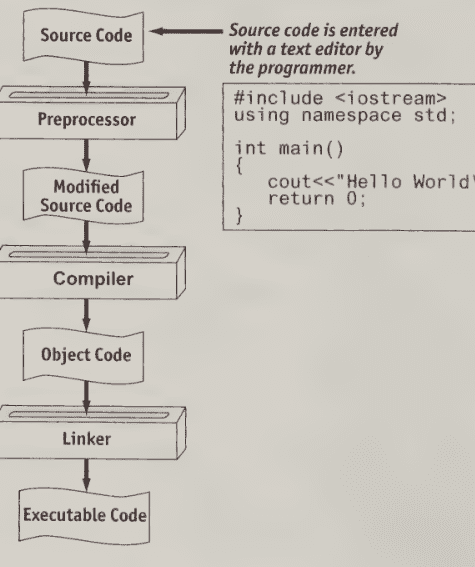

## 1.3 程序与编程语言

附录 F 解释了 .Net 中编译是如何工作的。你可以从计算机门户网站 www.pearsonhighered.com/gadis 下载附录 F。

许多开发系统（特别是个人电脑上的系统）集成了集成开发环境（IDE）。这些环境由文本编辑器、编译器、调试器和其他工具组成，并集成在一个带有单一菜单的软件包中。预处理、编译、链接和执行程序只需点击一次按钮或从菜单中选择一个项目即可完成。图 1-9 显示了 Visual Studio IDE 的屏幕。

## 图 1-9 什么是集成开发环境 (IDE)

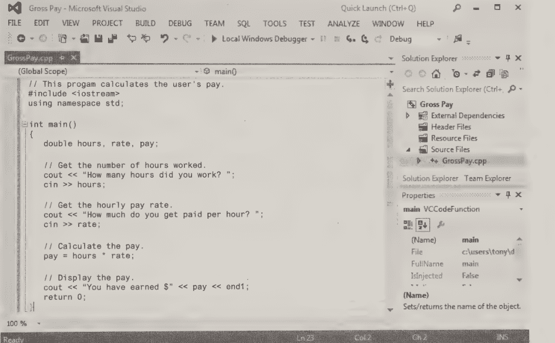

```cpp
// 此程序计算用户的工资。
#include <iostream>
using namespace std;

int main() {
    double hours, rate, pay;

    // 获取工作的小时。
    cout << "你工作了多少小时？ ";
    cin >> hours;

    // 获取时薪。
    cout << "你的每小时工资是多少？ ";
    cin >> rate;

    // 计算工资。
    pay = hours * rate;

    // 显示工资。
    cout << "你赚了 $" << pay << endl;

    return 0;
}
```

## 检查点

- 1.11 什么是算法？
- 1.12 为什么要发明编程语言？
- 1.13 高级语言和低级语言有什么区别？
- 1.14 什么是可移植性？
- 1.15 解释预处理器、编译器和链接器的操作。
- 1.16 解释源文件、目标文件和可执行文件中包含什么。
- 1.17 什么是集成开发环境？

## 程序是由什么组成的？

概念：某些元素是所有编程语言共有的。

## 语言元素

所有语言都有共同点。表 1-2 列出了在每种语言中都能看到的元素。

### 表 1-2 语言元素

| 语言元素 | 描述 |
|---|---|
| 关键字 | 具有特殊含义的单词。关键字只能按其用途使用。关键字也称为保留字。 |
| 标识符 | 由程序员定义的单词或名称。指向变量或编程例程的符号名称。 |
| 运算符 | 对一个或多个操作数执行操作。操作数通常是数据片段，如数字。 |
| 标点符号 | 标记语句开始或结束或分隔列表项目的标点字符。 |
| 语法 | 构造程序时必须遵循的规则。语法规定了单词和运算符的使用方式以及标点符号的位置。 |

让我们查看程序 1-1（计算工资程序）的部分内容，以查看表中列出的每个元素的示例。为了方便起见，再次列出程序 1-1。

### 程序 1-1

```cpp
// 此程序计算用户的工资。
#include <iostream>
using namespace std;

int main() {
    double hours, rate, pay;

    // 获取工作的小时。
    cout << "你工作了多少小时？ ";
    cin >> hours;

    // 获取时薪。
    cout << "你的每小时工资是多少？ ";
    cin >> rate;

    // 计算工资。
    pay = hours * rate;

    // 显示工资。
    cout << "你赚了 $" << pay << endl;

    return 0;
}
```

## 关键字（保留字）

C++ 的关键字中有三个出现在第 3 行和第 5 行：`using`、`namespace` 和 `int`。出现在第 7 行的单词 `double` 也是 C++ 关键字。这些以小写形式编写的单词在 C++ 中都有特殊的含义，并且只能用于它们预设的用途。正如你将看到的，程序员允许为程序中的某些事物创建自己的名称。然而，关键字是保留的，不能被用于其指定用途以外的任何地方。学习一种编程语言的一部分就是学习哪些是关键字、它们意味着什么以及如何使用它们。

> 注意：第 2 行中的 `#include <iostream>` 语句是一个预处理器指令。
> 注意：在 C++ 中，关键字大写并用全小写字母写。

## 程序员定义的标识符

出现在程序第 7、11、15、18 和 21 行的 `hours`、`rate` 和 `pay` 是程序员定义的标识符。它们不是 C++ 语言的一部分，而是由程序员创建的名称。在这个特定的程序中，这些是变量的名称。正如你在本章后面将学到的，变量是可能存储数据的内存位置名称。

## 运算符

在第 18 行出现了以下代码：

```cpp
pay = hours * rate;
```

`=` 和 `*` 符号都是运算符。它们对被称为“操作数”的数据段执行操作。`*` 运算符将其它的两个操作数相乘，在这个例子中，是变量 `hours` 和 `rate`。`=` 符号是赋值运算符。它获取表达式的值并将其存储在左侧出现的变量名中。在这个例子中，`=` 运算符将 `hours` 乘以 `rate` 的结果存储在变量中。换句话说，该语句的意思是：“让 `pay` 变量等于 `hours` 乘以 `rate`”，或者“`pay` 被赋值为 `hours` 乘以 `rate` 值”。

## 标点符号

第 3、7、10、11、14、15、18、21 和 22 行都以分号结尾。C++ 中的分号类似于英语中的句号：它标记一个完整句子（或编程术语中所说的“语句”）的结束。然而，分号并没有出现在 C++ 程序的每一每一行的末尾，而是有规则规定了哪里需要分号，以及哪里不需要。学习 C++ 的一部分就是学习在何处放置分号和其他标点符号。

通常，程序的内容按“行”和“语句”来考虑。“行”仅仅是那样——即在程序正体中显示的单行。程序 1-1 有 23 行。大多数行都包含某些有意义的内容；然而，某些行是空的。空行的存在仅仅是为了让程序更具可读性。

语句是一个导致计算机执行某些操作的完整指令。这里是出现在程序 1-1 第 10 行的语句：

```cpp
cout << "How many hours did you work";
```

该语句导致计算机在屏幕上显示“How many hours did you work?”的消息。语句可以是关键字、运算符和程序员定义符号的组合。语句在程序中通常只占一行，但有时它们会跨越多行。

## 变量

变量是计算机内存中用于存储某条信息的命名位置。存储在变量中的信息在程序运行时可能会改变（因此被称为“变量”）。注意在程序 1-1 中，`hours`、`rate` 和 `pay` 单词出现在好几个地方。这三个都是变量的名称。`hours` 变量用于存储用户工作的小时数。`rate` 变量存储用户的每小时工资。`pay` 变量持有 `hours` 乘以 `rate` 的结果，即用户的总工资。

> 注意：注意程序 1-1 中的变量其名称反映了它们的用途。事实上，仅仅通过阅读它们的名称，很容易猜出这些变量是做什么的。这将在第 2 章中进一步讨论。

变量是代表计算机随机存存储器（RAM）位置的符号名称。当信息存储在变量中，它实际上存储在 RAM 中。假设一个程序有一个变量名 `length`。图 1-10 展示了变量表示内存位置的方式。

### 图 1-10 变量名代表一个内存位置

| 0 | 1 | 2 | 3 | 4 | 5 | 6 | 7 | 8 | 9 |
|---|---|---|---|---|---|---|---|---|---|
| 10 | 11 | 12 | 13 | 14 | 15 | 16 | 17 | 18 | 19 |
| 20 | 21 | 22 | 23 | 24 | 25 | 26 | 27 | 28 | 29 |
| | | | | `length` | | | | | | |


在图 1-10 中，变量 `length` 持有值 72。数字 72 实际上存储在 RAM 地址 23，但名称 `length` 代表了这个存储位置。如果有帮助的话，你可以把变量想象成一个存储信息的盒子。

在变量定义中，变量有以下数据类型：

- 整数
- 浮点数
- 字符

## 图 1-11 编写程序的步骤

1. 明确定义程序的功能。
2. 在脑海中可视化程序在计算机上运行的过程。
3. 使用层级图、流程图或伪代码等设计工具创建程序的模型。
4. 检查模型是否存在逻辑错误。
5. 编写代码、保存并编译。
6. 纠正编译期间发现任何错误。根据需要重复第 5 和 6 步。
7. 使用测试数据作为输入运行程序。
8. 纠正运行程序发现的任何错误。根据需要重复第 5 至 8 步。
9. 验证程序的结果。

图 1-11 中列出的步骤强调了规划的重要性。就像粉刷房子有好的方法和坏的方法一样，创建程序也有好的方法和坏的方法。一个好的程序始于规划。

以薪资计算程序为例，让我们详细查看每一个步骤。

### 1. 明确定义程序的功能

这一步要求你确定程序的目的、需要输入的信息、要执行的处理以及预期的输出。让我们检查示例程序中的每项要求：

| 目的 | 计算用户的总薪资 |
| :--- | :--- |
| 输入 | 工作小时数、时薪率 |
| 处理 | 将工作小时数乘以时薪率。结果为用户的总薪资 |
| 输出 | 显示指示用户总薪资的消息 |

### 2. 在脑海中可视化程序在计算机上运行的过程

在计算机上创建程序之前，你应该先在脑海中创建它。第 2 步是程序的视觉化。尝试想象程序运行时屏幕看起来什么样。如果有帮助，可以画出程序不同阶段的屏幕图，并附上示例输入和输出。例如，这里是薪资计算程序生成的屏幕：

```
你工作了多少小时？10
每小时薪水是多少？15
你赚了 $150
```

在这一步中，你必须设身处用户的角度。程序应该显示哪些消息？它应该问哪些问题？通过解决这些问题，你已经确定了程序大部分输出。

### 3. 使用层级图、流程图或伪代码等设计工具创建程序的模型

在规划程序时，程序员使用一种或多种设计工具来创建程序的模型。三种常见的设计工具是层级图、流程图和伪代码。层级图是一种图形化描绘程序结构的图。它包含代表程序中每个步骤的框。这些框以某种方式连接，说明了它们之间的关系。图 1-12 显示了薪资计算程序的层级图。

#### 图 1-12 层级图

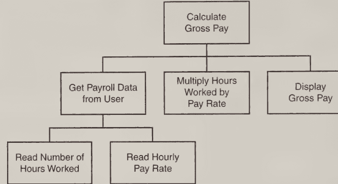

层级图从总体任务开始，然后将其细分为更小的子任务。每个子任务进一步分为更小的子任务集，直到每个任务都小到容易执行。例如，在图 1-12 中，总体任务“计算总薪资”列在顶层图表中。该框被分为三个子任务。第一个子任务“从用户处获取薪资数据”进一步分为两个子任务。这种“分而治之”的过程被称为自顶设计。


流程图显示了程序的逻辑流。它是规划程序执行的每项操作以及操作发生顺序的工具。更多信息请参阅附录 C《流程图简介》。


伪代码是人类语言和编程语言之间的混合体。虽然计算机无法理解伪代码，但程序员经常发现用一种“接近”编程语言但与自然语言非常相似的语言编写算法是有帮助的。例如，这里是描述薪资计算程序的伪代码：


获取薪资数据。计算总薪资。显示总薪资。

虽然上面的伪代码提供了程序的概览，但它并没有揭示程序的所有细节。以下是更详细的伪代码版本：

### 1.6 编程过程

显示“你工作了多少小时？”

输入小时数。

显示“每小时薪水是多少？”

输入速率。

将小时数乘以速率的值存储在 `pay` 变量中。

显示变量中的值。

伪代码包含的语句看起来更像命令，而不是 1.4 节（程序由什么组成？）中描述算法的英语语句。伪代码甚至命名了变量并描述了数学运算。

4. 检查模型是否存在逻辑错误。

逻辑错误是导致程序产生错误结果的错误。一旦组成了程序的层级图、流程图或伪代码，就应该检查这些错误。程序员应该跟踪图表或伪代码，检查每个步骤的逻辑。如果发现错误，则需要纠正。

5. 编写代码、保存并编译。

一旦程序模型（层级图、流程图或伪代码）创建、检查并修正，程序员就可以在计算机上编写源代码。程序员保存源代码并将其转换为机器语言。在此步骤中，编译器会发现任何语法错误。

6. 纠正编译期间发现的任何错误。根据需要重复第 5 和 6 步。

如果编译器报告任何错误，必须进行纠正，直到程序没有编译错误。

7. 使用测试数据作为输入运行程序。

一旦生成可执行文件，程序就可以测试运行时错误。运行时错误是在程序运行期间发生的错误。这些通常是逻辑错误，例如数学错误。测试运行时错误需要使用示例数据进行程序执行。示例数据应使程序产生预期输出。

8. 纠正运行程序发现的任何错误。根据需要重复第 5 至 8 步。

如果程序没有产生预期输出，你必须识别错误的步骤，然后保存、重新编译并重新测试。这意味着要重复步骤直到程序定期产生满意的结果。

9. 验证程序的结果。

当你认为已修正了所有运行时错误时，输入数据并判断程序是否解决了原始问题。

## 什么是软件工程？

软件工程领域涵盖了软件开发的整个过程。它包括设计、编写、测试、调试、修改和维护复杂的软件。与传统工程师一样，软件工程师在创作中使用许多工具。示例包括：

- 程序规范
- 屏幕输出图表
- 层级图和流程图
- 伪代码
- 预期输入和所需输出示例

大多数商业软件应用程序很大。在许多情况下，是由一个或多个团队而不是单个个人开发的。对程序需求进行彻底分析并划分为由个人团队或团队成员处理的任务是非常重要的。

在编程过程的第 3 步中，你接触了层级图作为自顶设计的工具。自顶设计中确定的子任务很容易变成模块，即程序的独立组成部分。如果程序非常大或复杂，可以分配一个软件工程师团队负责各个模块。

## 1.7 过程编程与面向对象编程

> 概念：过程编程和面向对象编程是软件开发和程序设计的两种思维方式。

C++ 是一种可以用于两种编写计算机程序方法的语言：过程编程和面向对象编程。这本书旨在教你这两种方法。

在过程编程中，程序员构建过程（在 C++ 中称为函数）。过程是执行特定任务的编程语句集合。每个过程都包含自己的变量，并通常与其他过程共享变量。这如图 1-13 所示。

### 图 1-13 程序中的过程

| 程序 |
| :--- |
| 过程 A |
| 变量 |
| 编程 |
| 过程 A 结束 |
| 过程 B |
| 变量 |
| 编程 |
| 过程 B 结束 |

过程化编程是以过程（或函数）为中心的。另一方面，面向对象编程（OOP）是以对象为中心的。对象是一个自包含的元素，包含了数据以及操作这些数据的过程。如图 1-14 所示。

### 图 1-14 程序中的对象

| 对象 A | 对象 B | 对象 C |
| :--- | :--- | :--- |
| 变量 | 变量 | 变量 |
| 过程 A | 过程 A | 过程 A |
| 变量 | 变量 | 变量 |
| 编程 | 编程 | 编程 |
| 过程 A 结束 | 过程 A 结束 | 过程 A 结束 |
| 过程 B | 过程 B | 过程 B |
| 变量 | 变量 | 变量 |
| 编程 | 编程 | 编程 |
| 过程 B 结束 | 过程 B 结束 | 过程 B 结束 |

对象内部包含了信息以及处理这些信息的能力。通过向对象发送*消息*对对象中的信息进行操作。当对象接收到指示其执行某些操作的消息时，它就会执行该指令。在学习本文的过程中，你将遇到面向对象编程的许多方面。

# 检查点

- 1.25 在定义程序要执行的操作时，你应该识别哪四项内容？
- 1.26 “视觉化程序运行”意味着什么？这种活动的价值是什么？
- 1.27 什么是层次结构图？
- 1.28 描述纸上检核（desk-checking）的过程。
- 1.29 描述编译器对程序源代码做了什么。
- 1.30 什么是运行时错误？
- 1.31 语法错误（如拼写错误的关键字）是由编译器发现的，还是在程序运行时发现的？
- 1.32 使用样本数据或输入对程序进行测试目的是什么？
- 1.33 简述过程化编程与面向对象编程之间的区别。

## 复习题与练习

### 简答题

- 1. 主内存和辅助存储都是内存类型。描述两者之间的区别。
- 2. 系统软件和应用软件之间有什么区别？
- 3. 哪种软件控制计算机硬件的内部操作？
- 4. 为什么用高级语言编写的程序在运行之前必须翻译成机器语言？
- 5. 为什么用高级语言编写程序比用机器语言更容易？
- 6. 解释对象文件和可执行文件之间的区别。
- 7. 语法错误和逻辑错误之间有什么区别？

### 填空题

- 8. 计算机可以执行许多不同的工作，因为它们可以 ________。
- 9. ________ 的工作是获取指令、通过指令执行操作，并产生某些输出或信息。
- 10. 在内部，CPU 由 ________ 和 ________ 组成。
- 11. ________ 是辅助存储设备的一个示例。
- 12. 软件的两大类是 ________ 和 ________。
- 13. 程序是一组 ________。
- 14. 计算机不能用自然语言进行编程，算法必须写在(n) ________ 中。
- 15. ________ 是计算机真正处理的唯一语言。
- 16. ________ 语言在可读性方面接近人类水平。
- 17. ________ 语言接近计算机的水平。
- 18. 程序在几种不同类型的计算机系统上运行的能力被称为 ________。
- 19. 在编程语言中具有特殊含义的单词称为 ________。
- 20. 程序定义的单词或名称称为 ________。
- 21. ________ 是对一个或多个操作数执行操作的字符或符号。
- 22. 字符或符号标记编程语句的开始或结束，或者分隔列表中的项。
- 23. 构建程序时必须遵循的规则被称为 ________。
- 24. 一个(n) ________ 是一个命名的存储位置。
- 25. 变量在程序中使用之前必须是 ________。
- 26. 程序的三个主要活动是 ________、________ 和 ________。
- 27. 程序从外部世界收集 ________ 信息。
- 28. 程序向外部世界发送 ________ 信息。
- 29. 一个(n) ________ 是用图形形式说明程序结构的图。

# 算法工作台

绘制描述下方程序的层次结构图或流程图。（有关创建流程图的说明请参见附录 C。）

### 30. 可用额度

在计算客户可用额度的程序中，应遵循以下步骤：

1. 显示消息“输入客户的最高额度”。
2. 等待用户输入客户的最高额度。
3. 显示消息“输入客户使用的额度”。
4. 等待用户输入客户使用的额度。
5. 从最高额度中减去使用的额度，得到客户的可用额度。
6. 显示可用额度。

### 31. 销售税

为计算销售总额的程序绘制层次结构图或流程图。程序应询问用户：

- 销售率

输入这些项目后，程序应计算并显示：

- 销售总额

### 32. 账户余额

为计算当前余额的程序绘制层次结构图或流程图。程序应询问用户：

- 初始余额
- 存款金额
- 取款金额

程序计算后，应显示：

## 预测结果

问题 33-35 是用英语语句表述的。如果它们是实际程序，每个会显示什么？

- 33. 变量 `x` 初始化为 0。`y` 初始化为 5。`x` 加 1。`y` 加 1。将 `x` 和 `y` 相加并将结果存入 `y`。显示 `y` 的值。
- 34. 变量 `j` 初始化为 10。`k` 初始化为 2。`l` 初始化为 4。将 `j` 乘以 `k` 的结果存入 `j`。将 `k` 乘以 `l` 的结果存入 `l`。将 `j` 和 `l` 相加并将结果存入 `k`。显示 `k` 的值。
- 35. 变量 `a` 初始化为 1。`b` 初始化为 10。`c` 初始化为 100。`x` 初始化为 0。将 `c` 乘以 3 的结果存入 `x`。`x` 加上 `b` 乘以 6。`x` 加上 `a` 乘以 5。显示 `x` 的值。

# 寻找错误

- 36. 下面的伪代码算法有一个错误。程序应该被要求用户输入矩形房间的长度和宽度，然后显示房间的面积。程序必须通过宽度乘以长度来确定面积。

```
area = width × length.
Display "房间的宽度是多少?"
Input width.
Display "房间的长度是多少?"
Input length.
```

# 程序 2-1

```cpp
// A simple C++ program
#include <iostream>
using namespace std;

int main() {
    cout << "Programming is great fun!";
    return 0;
}
```

程序的输出如所示。这是程序运行时在屏幕上显示的内容。

# 程序输出

Programming is great fun!

第 2 行看起来如下：

```cpp
#include <iostream>
```

因为这一行以 `#` 开头，所以它被称为预处理器指令。预处理器在编译之前读取你的程序，并且只执行以 `#` 符号开头的行。你可以将预处理器想作为一个为编译器“准备”源代码的程序。

`#include` 指令导致预处理器将另一个文件（称为头文件）的内容包含在程序中。它之所以被称为头文件，是因为它应该被包含在程序的开头或顶部。括号内包含的单词 `iostream` 是被包含的头文件的名称。尖括号 `<>` 表示它是一个标准的 C++ 头文件。`<iostream>` 头文件包含允许 C++ 程序在屏幕上显示输出和从键盘读取输入的代码。由于此程序使用 `cout` 来显示屏幕输出，因此必须包含 `<iostream>` 头文件。`<iostream>` 文件的内容会被包含在出现 `#include` 语句的程序中。

第 3 行如下：

```cpp
using namespace std;
```

程序通常包含几个具有唯一名称的项。在本章中，你将学习创建变量。在第 6 章中，你将学习创建函数。在第 13 章中，你将学习创建对象。变量、函数和对象是必须命名的程序实体示例。C++ 使用命名空间来组织程序实体的名称。`using namespace std;` 语句声明程序将访问属于 `std` 命名空间的名称。是的，即使命名空间也有名称。程序需要由 `iostream` 文件创建的文件，是因为它是该命名空间的一部分。为了让程序使用 `iostream` 中的实体，它必须能够访问 `std` 命名空间。

## 2.1 C++ 程序的组成

第 5 行如下：

```cpp
int main()
```

这标志着函数的开始。函数可以被看作一组或多个具有共同名称的编程语句。这个函数的名称是 `main`，紧随名称之后的一组圆括号表示它是一个函数。`int` 单词代表“整数”（integer）。它表示函数在执行完毕后向操作系统返回一个整数值。

虽然大多数 C++ 程序有多个函数，但每个 C++ 程序都必须有一个名为 `main` 的函数。它是程序的起点。如果你在阅读某人的 C++ 程序并想找到它从何处开始的，只需寻找名为 `main` 的函数即可。

> 注意：C++ 是一种区分大小写的语言。这意味着大写字母与其对应的小写字母被视为完全不同的字符。在 C++ 中，函数 `main` 的名称必须全部用小写字母。C++ 不会将 `Main` 等同于 `main`，也不会将 `INT` 等同于 `int`。这对于所有 C++ 关键字都是如此的。

第 6 行包含一个字符：

```cpp
{
```

这被称为左括号或左大括号，它与函数 `main` 的开始相关联。构成函数的所有语句都包含在一组括号中。如果你查看左括号向下数第三行，你将看到右括号。两个括号之间的所有内容都是函数 `main` 的内容。

> 警告！确保你程序中的每个左括号都有对应的右括号！

在左括号之后，你在第 7 行看到了以下语句：

```cpp
cout << "Programming is great fun!";
```

简单来说，这一行在屏幕上显示了一条消息。你将在本章中读到更多关于 `cout` 和 `<<` 运算符的内容。消息“Programming is great fun!”打印时是不带引号的。在编程术语中，引号内部的字符组被称为字符串字面量（string literal）或字符串常量（string constant）。

> 注意：这是程序中唯一一行导致屏幕上打印任何内容的行。其他行，如 `<iostream>` 和 `int main()`，对于你的程序框架是必要的，但它们不会导致任何屏幕输出。记住，程序是计算机的一组指令。如果要在屏幕上显示某些内容，你必须使用相应的编程语句来实现该目的。

行尾是一个分号。正如句号标记句子的结束一样，分号标记着 C++ 中一个完整语句的结束。编译器会忽略注释；注释末尾不需要分号。预处理器指令（如 `#include` 语句）直接在行尾结束，永远不需要分号。函数的开头（如 `int main()`）不是一个完整的语句，因此你不在那里放置分号。

看起来何时何时使用分号的规则完全不清楚。与其说，现在不要担心它，专注于学习程序的组成部分。第 8 行如下：

```cpp
return 0;
```

这在程序完成时向操作系统返回整数值 0。值 0 通常表示程序执行成功。

第 9 行包含右括号：

```cpp
}
```

这个括号标记了函数的结束。由于 `main` 是程序中的唯一函数，它标记了程序的结束。

在示例程序中，你遇到了一些特殊字符。表 2-1 提供了它们如何使用的总结。

### 表 2-1 特殊字符

| 字符 | 名称 | 说明 |
|---|---|---|
| `//` | 双斜杠 | 标记注释的开始 |
| `#` | 井号 | 标记预处理器指令的开始 |
| `< >` | 尖括号 | 用于 `#include` 指令时包含文件名 |
| `( )` | 圆括号 | 用于命名函数，如 `main()` |
| `{ }` | 大括号 | 包含一组语句，如函数的内容 |
| `"` | 双引号 | 包含字符字符串，如要打印的消息 |
| `;` | 分号 | 标记一个完整语句的结束 |

# 检查点

1. 下面的 C++ 程序无法编译，因为行顺序乱了。

```cpp
int main()
// A crazy mixed up program
return 0;
```


## 2.2 cout 对象

当行排列正确时，程序应该在屏幕上显示以下内容：

1492 Columbus sailed the ocean blue.

重新排列行的顺序。通过在计算机上输入、编译和运行程序来测试。

## cout 对象

**概念**：使用 `cout` 对象在计算机屏幕上显示信息。

在本节中，你将学习编写产生输出的程序。在运行图形操作系统（如 Windows 或 Mac OS X）的现代计算机上，控制台输出通常显示如图 2-1 所示的窗口中。在 C++ 中，你使用 `cout` 对象产生控制台输出。（你可以认为 `cout` 这个词的意思是控制台输出。）

- 一个控制台窗口


请注意 `<<` 运算符用于将字符串 `"Programming is great fun!"` 发送到 `cout`。当 `<<` 符号这样用时，它被称为流插入运算符。紧邻运算符右侧的项目会被发送到 `cout` 并在屏幕上显示。

流插入运算符始终写为两个减号，它们之间没有空格。由于你使用它来将数据流发送到 `cout` 对象，你可以将流插入运算符看作指向 `cout` 的箭头。这在图 2-2 中所示。

程序 2-2 是编写相同程序的另一种方式。

### 图 2-2 将 << 视为指向 cout 的箭头

```
cout << "Programming is great fun!"
Think of the stream insertion operator as
arrow that points toward cout.
cout -- "Programming is great fun!"
```

## 程序 2-2

```cpp
1 // 一个简单的 C++ 程序
2 #include <iostream>
3 using namespace std;
4
5 int main()
6 {
7     cout << "Programming is " << "great fun!";
8     return 0;
9 }
```

# 程序输出

Programming is great fun!

如你所见，流插入运算符可以用于向 `cout` 发送多个项目。该程序的输出与程序 2-1 完全相同。程序 2-3 显示了另一种实现相同效果的方法。

## 程序 2-3

```cpp
1 // 一个简单的 C++ 程序
2 #include <iostream>
3 using namespace std;
4
5 int main()
6 {
7     cout << "Programming is " ;
8     cout << "great fun!";
9     return 0;
10 }
```


# 程序输出

Programming is great fun!

## 2.2 cout 对象

理解程序 2-3 的一个重要概念是，虽然输出被分成了两个编程语句，但该程序仍然会在一行上显示消息。除非另有指定，否则发送到 `cout` 的信息将以连续流的形式显示。有时这会产生不理想的结果。程序 2-4 就是一个例子。

实际输出的布局与源代码中字符串的排列完全不同。首先，注意在 "sellers" 和 "during" 之间，或者 "June:" 和 "Computer" 之间没有显示任何空格。`cout` 按照发送时的原始状态显示消息。如果要显示空格，它们必须精确地出现在字符串中。

## 程序 2-4

```cpp
// 一个混乱的打印程序
#include <iostream>
using namespace std;

int main() {
    cout << "The following items were top sellers";
    cout << "during the month of June:";
    cout << "Computer games";
    cout << "Coffee";
    cout << "Aspirin";
    return 0;
}
```

# 程序输出

The following items were sellersduring the month of June:ComputergamesCoffeeAspirin

> 其次，尽管输出在源代码中分为五行，但它以一个长行的形式输出。由于输出太长，无法在屏幕的一行显示，显示时会自动换行到第二行。输出以长行显示的是因为除非收到指示，否则 `cout` 不会换行。有两种方法指示 `cout` 新行。第一种是发送一个名为 `endl` 的流操纵符（读作 "end-line" 或 "end-L"）。程序 2-5 就是一个例子。

```cpp
// 一个良好的打印程序
#include <iostream>
using namespace std;

int main() {
    cout << "The following items were top sellers" << endl;
    cout << "during the month of June:" << endl;
```

（程序继续）

## 程序 2-5

（续）

```cpp
9 cout << "Computer games" << endl;
10 cout << "Coffee" << endl;
11 cout << "Aspirin" << endl;
12 return 0;
13 }
```

# 程序输出

The following items were top sellers

during the month of June:

Computer games

Coffee

Aspirin

> 注意：`endl` 的最后一个字符是字母 L，而不是数字。

每当 `cout` 遇到 `endl` 操纵符时，它会将输出位置移动到下一行。操纵符可以插入到发送到 `cout` 的字符流的任何位置（双引号之外）。以下语句显示了一个例子。

```cpp
cout << "My pets are" << endl << "dog";
cout << "Cat" << endl << "bird";
```

另一种让 `cout` 换行的方法是在字符串本身内部插入转义序列。转义序列以反斜杠字符 (`\`) 开头，后面跟着一个或多个控制字符。它允许你通过在字符串内部嵌入命令来控制输出方式。程序 2-6 是一个例子。

## 程序 2-6

```cpp
1 // 另一种良好的打印程序
2 #include <iostream>
3 using namespace std;
4 
5 int main() {
6     cout << "The following items were top sellers\n";
7     cout << "during the month of June:\n";
8     cout << "Computer games\nCoffee";
9     cout << "\nAspirin\n";
10     return 0;
11 }
```

# 程序输出

The following items were top sellers

during the month of June:

Computer games

Coffee

Aspirin

## 2.3 #include 指令

编译器实际上并看不见 `#include` 指令。相反，它看到的是预处理器插入的代码，就像程序员直接把代码写在那里一样。

头文件中包含的代码是 C++ 代码。通常，它们描述了如 `cout` 这样的复杂对象。之后，你将学习创建自己的头文件。

### 检查点 (Checkpoint)

- 2.2 下面的 C++ 程序无法编译，因为行顺序被打乱了。

```cpp
cout << "Success\n";
ncout << "Success\n";nint main() {
cout << "Success";
}
using namespace std;
// 这是一个疯狂、疯狂的程序
#include <iostream>
cout << "Success\n";
{
return 0;
}
```

当这些行被正确排列后，程序应该在屏幕上显示以下内容：

Success

Success Success

Success

按照正确顺序重新排列这些行。在计算机上输入该程序、编译并运行它来测试程序。

- 2.3 研究以下程序，并显示它将在屏幕上打印什么：

```cpp
// Wolfgang 的作品
#include <iostream>
using namespace std;
int main() {
    cout << "The works of Wolfgang\include the following:";
    ncout << "\nThe Turkish March" << endl;
    cout << "and Symphony No. 40 " ";
    cout << "in G minor." << endl;
    return 0;
}
```

# 第 2 章 C++ 简介

2.4 写一个程序，第一行显示你的名字，第二行显示你的街道地址，第三行显示你的城市、州和邮编，第四行显示你的电话号码。在程序末尾添加包含今天日期的注释。通过编译和运行测试程序。

## 2.4 变量、字面量和赋值语句

> 概念：变量代表计算机内存中的存储位置。字面量是赋值给变量的常量值。

正如你在第 1 章中发现的那样，变量允许你在计算机内存中存储和处理数据。它们为 RAM 提供了一个“接口”。编程的工作就是确定程序需要多少个变量，以及它们将包含什么类型的信息。程序 2-7 是一个带有变量的 C++ 程序示例。看看第 7 行：

```cpp
int number;
```

这被称为变量定义。它告诉编译器变量的名称以及它将包含的数据类型。这一行表示变量名为 `number`。`int` 单词代表整数（integer），因此 `number` 将仅用于存储整数。在本章的稍后部分，你将学习 C++ 允许的所有数据类型。

### 程序 2-7

```cpp
1 // 这个程序有一个变量。
2 #include <iostream>
3 using namespace std;
4
5 int main()
6 {
7     int number = 5;
8
9
10     cout << "The value in number is " << number << endl;
11     return 0;
12 }
```

# 程序输出

The value in number is 5

> 注意：你必须对程序中打算使用的每个变量都进行一个定义。在 C++ 中，变量定义可以出现在程序的任何位置。在本章的稍后部分，你将学习定义变量的最佳位置。

注意变量定义以分号结尾。现在看第 9 行：

```cpp
number = 5;
```

这被称为赋值。等号是一个运算符，它将右侧的值（S）复制到左侧的变量名（number）。执行此行后，`number` 将被设置为 5。

> 注意：这一行不会在计算机屏幕上打印任何内容。它在后台静静运行，在 RAM 中存储一个值。

看第 10 行：

```cpp
cout << "The value in number is " << number << endl;
```

发送到 `cout` 的第二个项目是变量名 `number`。当你将变量发送到 `cout` 时，它会打印变量的内容。注意 `number` 周围没有引号。看看程序 2-8 中发生了什么。

### 程序 2-8

```cpp
1 // 这个程序有一个变量。
2 #include <iostream>
3 using namespace std;
4 
5 int main()
6 {
7     int number;
8 
9     number = 5;
10     cout << "The value in number is " << "number" << endl;
11     return 0;
12 }
```

# 程序输出

The value in number is number

当在单词 `number` 周围加上双引号时，它变成了一个字符串字面量，不再是变量名。当字符串字面量发送到 `cout` 时，它们将按照引号内显示的内容原样打印。你可能已经注意到，`endl` 流操作符周围也没有引号，原因也是如此。

### 有时候数字并不是数字

如程序 2-8 所示，在变量名周围加上引号会改变程序的结果。事实上，在任何非意图为字符串字面量的内容加上双引号都会导致某种类型的错误。例如，在程序 2-8 中，数字 5 被赋值给变量 `number`。用这样进行赋值是错误的：

```cpp
number = "5";
```

在这一行中，`5` 不再是整数，而是一个字符串。由于 `number` 被定义为整数，因此你不能对字符串进行数学运算。然而，数字可以转换为字符串以便显示。注意，字符串是给人类阅读的。

### 检查点 (Checkpoint)

- 2.5 查看以下程序：

```cpp
#include <iostream>
using namespace std;
int main() {
    int little;
    int big;
    little = 2;
    cout << "The little is " << little << endl;
    cout << "The big is " << big << endl;
    return 0;
}
```

列出程序中出现变量和字面量。

- 2.6 以下程序将在屏幕上显示什么：

```cpp
#include <iostream>
using namespace std;
int main() {
    int number;
    number = 72;
    cout << "The value is " << number << endl;
    return 0;
}
```

### 程序 2-9

```cpp
1 // 这个程序使用了变量。
2 #include <iostream>
3 using namespace std;
4
5 int main()
6 {
7     int number;
8
9     number = 20;
10     cout << "The value is " << number << endl;
11     return 0;
12 }
```

# 程序输出

The value is 20

## 2.5 标识符

> 概念：选择能够指示变量用途的名称。

标识符是表示程序某些元素的程序员定义的名称。变量名就是标识符的示例。只要不使用任何关键字，你可以在 C++ 中选择自己的变量名。关键字构成了语言的“核心”，并具有特定的用途。表 2-4 显示了关键字的完整列表。注意它们都是小写的。

| 表 2-4 C++ 关键字 |

| :--- | :--- | :--- | :--- | :--- |

| alignas | const | for | private | throw |

| alignof | constexpr | friend | protected | true |

| and | const_cast | goto | public | try |

| and_eq | continue | if | register | typedef |

| asm | decltype | inline | reinterpret_cast | typeid |

| auto | default | int | | typename |

| bitand | delete | long | short | union |

| bool | double | namespace | signed | unsigned |

| break | do | mutable | static | virtual |

| case | else | noexcept | static_assert | void |

| catch | enum | not | static_cast | volatile |

| char | explicit | not_eq | struct | wchar_t |

| char16_t | export | nullptr | switch | while |

| char32_t | extern | operator | template | xor |

| class | false | or | this | xor_eq |

| compl | float | or_eq | thread_local |

## 2.6 整数数据类型

你可能注意到了 `itemsOrdered` 名称中混合使用了大写和小写字母。虽然所有的 C++ 关键字都必须全小写，但你可以在变量名中使用大写字母。

`itemsOrdered` 中的 `O` 大写是为了提高可读性。通常情况下 "items ordered" 是两个单词。遗憾的是，变量名不能包含空格，因此这两个单词必须合并为一个词。当 "items" 和 "ordered" 连在一起时，你会得到这样的变量定义：

```cpp
int itemsOrdered;
```

第二个单词及后续单词首字母大写会让 `itemsOrdered` 更容易读。需要注意的是，这种编码风格并不是强制要求的。你可以自由使用全小写、全大写或两者的任意组合。事实上，有些程序员使用下划线来分隔变量名中的单词，如下：

```cpp
int items_ordered;
```

## 标识符规则

无论你采用何种风格，请保持一致，并让你的变量名尽可能合理。以下是所有标识符必须遵循的特定规则：

- 第一个字符必须是 a-z、A-Z 之间的字母或下划线 (`_`)。

- 在第一个字符之后，你可以使用 a-z、A-Z 之间的字母、数字 0-9 或下划线。

- 大写和小写字符是区分的。`ItemsOrdered` 与 `itemsordered` 是不同的。

表 2-5 列出了变量名并说明它们在 C++ 中是否合法。

| 变量名 | 合法或非法？ |

|---|---|

| day0week | 合法。 |

| 3dGraph | 非法。变量名不能以数字开头。 |

| _employee_num | 合法。 |

| June1997 | 合法。 |

| Mixture3 | 非法。变量名只能使用字母、数字或下划线。 |

## 2.6 整数数据类型（概念）

**概念**：有许多不同类型的数据。变量根据数据类型进行分类，数据类型决定了变量中可以存储的信息种类。整数变量只能存储整数（整个数字）。

# 第 2 章 C++ 简介

计算机程序从现实世界收集数据片段并以各种方式对其进行处理。有许多不同类型的数据。例如，在数值信息领域有整数和小数。有负数和正数。还有些数字巨大，有些又极小到甚至没有名字。此外还有文本信息，例如名称和地址是以字符组的形式存储的。当你编写程序时，你必须确定它可能会遇到什么类型的信息。

如果你编写一个程序来计算到遥远恒星的英里，你需要能够存储大数字的变量。如果你正在设计记录微观尺寸的软件，你将存储非常小且精确的数字。此外，如果你正在编写一个必须执行数千次密集计算的程序，你希望变量能够被快速处理。变量的数据类型决定了所有这些因素。

尽管 C++ 提供了许多类型，但数值数据类型进一步分为两个额外类别：整数和浮点。整数是像 12、157、-34 和 2 这样的整数。浮点数带有小数点，如 23.7、189.023 和 0.987。此外，整数和浮点数据类型还被进一步细分。在讨论字符数据类型之前，让我们仔细检查数值数据的变体。

选择数值数据类型时要考虑因素是：

- 变量中可能存储的最大和最小数字

- 变量占用的内存大小

- 变量存储的是有符号还是无符号数字

- 变量具有的小数位数

变量的大小是它所使用的内存字节数。通常，变量越大，它能容纳的范围越大。表 2-6 是 C++ 整数类型及其典型大小和范围。

> 注意：表 2-6 所示的数据类型和范围在许多系统中是典型的。根据你的操作系统，大小和范围可能会不同。

| 数据类型 | 典型大小 | 典型范围 |

|---|---|---|

| short int | 2 字节 | -32768 to +32767 |

| unsigned short int | 2 字节 | 0 to +65535 |

| int | 4 字节 | -2147483648 to +2147483647 |

| unsigned int | 4 字节 | 0 to 4294967295 |

| long int | 4 字节 | -2147483648 to +2147483647 |

| unsigned long int | 4 字节 | 0 to 4294967295 |

| long long int | 8 字节 | -9223372036854775808 to 9223372036854775807 |


| unsigned long long int | 8 字节 | 0 to 18446744073709551615 |


```cpp
int main() {
    int floors, rooms, suites;
    floors = 15;
    rooms = 300;
    suites = 30;
    cout << "The Grande Hotel has " << floors << " floors\n";
    cout << "with " << rooms << " rooms and " << suites;
    cout << suites << "\n";
    return 0;
}
```

# 程序输出

大酒店有15层楼，300间房间和30间套房。

# 整数和长整数字面量

在 C++ 中，如果一个数值字面量（不带小数点的）符合 `int` 的范围（关于最小值和最大值请参见表 2-6），则该数值字面量被处理为 `int`。被处理为 `int` 的字面量被称为整数字面量。例如，查看程序 2-11 中的第 9、10 和 11 行：

- `floors = 15;`
- `rooms = 300;`
- `suites = 30;`

这些语句中的每一个都将整数字面量赋值给变量。

C++ 语言的一个令人愉快的特性是，它允许你控制程序的几乎每一个方面。如果你需要更改内容在内存中的存储方式，提供了相应的工具。例如，如果你处于一个有一个整数字面量，但需要将其作为 `long` 存储在内存中该怎么办？（放心，这种情况确实会发生。）C++ 允许通过在数字末尾加上字母 `L` 来强制将整数字面量存储为长整数。这是一个示例：

```cpp
long amount;
amount = 32L;
```

第一条语句定义了一个名为 `amount` 的长型变量。第二条语句将字面量 32 赋值给 `amount` 变量。在第二条语句中，字面量写为 `32L`，这使其成为了长整数字面量。该字面量被处理为 `long`。

如果你想让整数字面量被处理为 `long long int`，你可以在数字末尾附加 `LL`。这是一个示例：

```cpp
long amount;
amount = 32LL;
```


# 第 2 章 C++ 简介

第一条语句定义了一个名为 `amount` 的长长变量。第二条语句将字面量 32 赋值给 `amount` 变量。在第二条语句中，字面量写为 `32LL`，这使其成为了长整数字面量。这意味着该字面量被处理为长整数 int。

> 提示：在编写长字面量或长长整数字面量时，你可以使用大写或小写的 `L`。由于小写的 `L` 看起来像数字 1，因此你应该始终使用大写的 `L`。

# 如果你计划继续学习计算机：十六进制和八进制字面量

程序员通常使用十进制（或基10）以外的计数系统来表示值。十六进制（16进制）和八进制（8进制）非常流行，因为它们让某些编程任务比十进制数字更方便。

默认情况下，C++ 假设所有整数字面量都以十进制表示。你通过在数字前面放置 `0x` 来表示十六进制数（这是 zero-x，不是 oh-x）。以下是 C++ 中表示十六进制数 F4 的方式：

```cpp
0xF4
```

八进制数前面必须有一个 `0`（zero，不是 oh）。例如，八进制的 31 将写为：

```cpp
031
```

> 注意：在未来一段时间内你不会编写需要这种类型操作的程序。然而，理解这些材料是非常重要的。优秀的程序员应该培养阅读他人源代码的能力。你可能会发现自己在阅读使用长整数、十六进制或八进制字面量等的程序。

# 检查点

- 2.7 下列哪些变量名是非合法的，为什么？
  - `99bottles`
  - `july97`
  - `theSalesFigureForFiscalYear98`
  - `r&d`
  - `grade_report`

- 2.8 变量名 `Sales` 和 `sales` 相同吗？为什么相同或不相同？

- 2.9 请参考表 2-6 列出的数据类型回答这些问题。
  - A) 如果一个变量需要存储 32 到 6,000 范围内的数字，什么数据类型最好？
  - B) 如果一个变量需要存储 240,000 到 140,000 范围内的数字，什么数据类型最好？
  - C) 下列哪些字面量占用更多内存？`20` 或 `20L`

## 2.7 char 数据类型

2.10 在任何计算机上，哪种数据类型使用的内存更多，整数还是无符号整数？

## 2.7 char 数据类型

`char` 数据类型用于存储单个字符。`char` 类型的变量可以存储一个字符。这里是定义一个名为 `letter` 的变量的方法：

```cpp
char letter;
```

`char` 类型的变量可以存储一个字符。以下是将字符 'g' 赋值给 `letter` 的示例：

```cpp
letter = 'g';
```

如果你想让字符字面量被处理为字符串，你可以在其周围加上双引号。例如，以下语句无法通过编译：

```cpp
letter = "g";
```

`char` 数据类型用于存储单个字符。程序 2-12 显示了它的示例：

```cpp
// 这个程序处理字符。
#include <iostream>
using namespace std;
int main() {
    char letter = 'A';
    cout << letter << endl;
    letter = 'B';
    cout << letter << endl;
    return 0;
}
```

这意味着字符串末尾会附加一个额外的字节，这样程序就能知道字符串的长度。这个额外的字节是空终止符，它在后台默默工作。当你显示字符串时，它不会被打印出来，但它确实在执行它的任务。

空终止符与字符 '0' 相同。如果你查看附录 A，你会发现 ASCII 48 对应于 '0'。如果你想标记字符串的结束，你需要使用 ASCII 代码 0。

让我们看看字符串字面量在内存中的存储方式。图 2-5 描绘了字面量 "Sebastian" 的存储方式。

图 2-5 字面量 "Sebastian"

| S | e | b | a | s | t | i | a | n | \0 |
|---|---|---|---|---|---|---|---|---|---|

首先，注意引号并没有与字符串一起存储。它们只是在源代码中标记字符串的开始和结束。其次，注意字符串的最后一个字节。它包含了空终止符，该终止符由 `\0` 字符表示。

# 第 2 章 C++ 简介

图 2-6 作为字符的 'A' 和作为字符串的 "A"

| 'A' 的存储方式 | A |
| :--- | :--- |
| "A" 的存储方式 | A | \0 |

图 2-7 ASCII 码

| 'A' 的存储方式 | 65 |
| :--- | :--- |
| "A" 的存储方式 | 65 | 0 |

由于 `char` 变量的大小仅够够容纳一个字符，因此你不能将字符串字面量赋值给它们。例如，以下代码定义了一个名为 `letter` 的字符变量。字符字面量 'A' 可以赋值给该变量，但字符串字面量 "A" 则不行。

```cpp
char letter;
letter = 'A'; // 这可以工作。
letter = "A"; // 这将无法工作！
```

关于字符，还有一个最后一个主题需要讨论。你已经了解到有些字符串看起来像单个字符，但实际上并非如此。同样可能存在一个看起来像字符串的字符。一个很好的例子是换行符 `\n`。尽管它由两个字符（一个斜杠和一个字母 n）表示，但在内部它被表示为一个字符。事实上，所有的转义序列在内部都只是 1 字节。

程序 2-14 显示了用用单引号括起来的字符字面量 `\n` 的用法。如果你参考附录 A 中的 ASCII 图表，你会发现 ASCII 码 10 用于换行符。这是 C++ 用于换行符的编码。

# 程序 2-14

```cpp
// 此程序使用字符字面量。
#include <iostream>
using namespace std;
int main()
{
    char letter;

    letter = 'A';
    cout << letter << '\n';
    letter = 'B';
    cout << letter << '\n';
    return 0;
}
```

程序输出

A

B

让我们复习关于字符和字符串的一些重要点：

- 可打印字符在内部用数字代码表示。大多数计算机使用 ASCII 码来实现此目的。
- 字符通常占用一个字节内存。
- 字符串是连续的字符序列，占用连续的字节内存。
- 字符串字面量始终存储在内存中，末尾带有一个空终止符。这标记了字符串的结束。
- 字符字面量用单引号括。
- 字符串字面量用双引号括。
- 像 `\n` 这样的转义序列在内部被存储为单个字符。

# C++ string 类

概念：标准 C++ 提供了一种特殊的数据类型，用于存储和处理字符串。

由于 `char` 变量在它的内存中只能存储一个字符，因此需要另一种数据类型使变量能够持有整个字符串。虽然 C++ 没有内置用于此目的直接类型类型，但标准 C++ 提供了一种名为 `string` 的类，它允许程序员创建字符串类型的变量。

# 使用 string 类

使用 `string` 类的第一步是包含 `<string>` 头文件。这通过以下预处理指令完成：

```cpp
#include <string>
```

下一步是定义一个 `string` 类型变量，例如 `movieTitle`。定义 `string` 对象与定义基本类型变量类似：

```cpp
string movieTitle;
```

你可以使用赋值运算符将字符串字面量赋值给 `movieTitle`：

```cpp
movieTitle = "Wheels of Fury";
```

你可以使用以下语句显示 `movieTitle` 的值：

```cpp
cout << "My favorite movie " << movieTitle << endl;
```

# 程序 2-15

程序 2-15 是一个演示上述语句的完整程序。

```cpp
// 此程序演示 string 类。
#include <iostream>
#include <string> // 使用 string 类所需的。
using namespace std;

int main() {
    string movieTitle;
    movieTitle = "Wheels of Fury";
    cout << "My favorite movie " << movieTitle << endl;
    return 0;
}
```

程序输出

My favorite movie Wheels of Fury

你可以看到，操作 `string` 对象与操作其他类型类似。在本文中我们将继续讨论string 类的特性。

# 检查点

- 11 以下字符的 ASCII 码是什么？（参考附录 A。）
  - C
  - F
  - W

- 12 以下哪一个是字符字面量？
  - 'B'
  - "B"

- 13 假设 `char` 数据类型使用 1 字节内存，以下字面量占用多少字节？
  - 'Q'
  - "Q"
  - "Sales"
  - '\n'

- 14 编写一个程序，包含以下变量：`first`, `middle`, `last`。存储你的这些并在屏幕上显示。

- 15 以下程序语句有什么问题？
  - `char letter = "Z"`

- 16 使用 `string` 对象必须包含哪个头文件？

- 17 编写一个程序，将你的名字、地址和电话号码存储在三个 `string` 对象中。在屏幕上显示这些内容。

**概念**：浮点数据类型用于定义可以存储实数的变量。

整数对于许多任务是不够的。如果你正在编写处理金额或精确测量的程序，你需要一种允许小数的数据类型。在编程术语中，这些被称为浮点数。

在内部，浮点数以类似于科学计数的方式存储。取数字 47.281。在科学计数法中，它是 $4.7281 \times 10^4$。E 之前的部分是系数，E 之后的部分是 10 的幂。

计算机使用 E 计数法来表示这些值。表 2-7 显示了小数计数法的浮点数。

| 小数计数法 | 科学计数法 | E 计数法 |
| :--- | :--- | :--- |
| 47.281 | $4.7281 \times 10^4$ | 4.7281E4 |
| 0.00072 | $7.2 \times 10^{-4}$ | 7.2E-4 |
| 2900000 | $2.9 \times 10^6$ | 2.9E6 |

**表 2-7 浮点表示**

浮点数据类型用于定义可以存储实数的变量。`float`、`double` 和 `long double` 类型分别至少是 4、8 和 10 字节。

**表 2-8 浮点数据类型**

| 数据类型 | 大小 | 描述 |
| :--- | :--- | :--- |
| 单精度 | float | 4 字节。$\pm3.4E38$ 之间的数字 |
| 双精度 | double | 8 字节。$\pm1.7E308$ 之间的数字 |
| 长精度 | long double | 10 字节。$\pm1.1E4932$ 之间的数字 |

# 第 2 章 C++ 简介

你会注意到没有无符号浮点类型。在所有机器上，`float`、`double` 和 `long double` 变量都可以存储正数或负数。

# 浮点字面量

浮点字面量可以用多种方式表示。如程序 2-16 所示，E 计数法是方法之一。当你编写极大或极小的数字时，这可能是最简单的方法。E 计数法可以用大写 E 或小写 e 表示。注意在源码中，字面量被写为 `1.495979E11` 和 `1.989e+30`，但程序打印它们是等等的。（指数前的加号也是可选的。）在第 3 章中，你将学习控制计数 E 数字的方式。

# 程序 2-16

```cpp
// 此程序使用浮点数据类型。
#include <iostream>
using namespace std;
int main() {
    float distance;
    double mass;
    distance = 1.495979E11;
    mass = 1.989e+30;
    cout << "The Sun is " << distance << " meters away.\n";
    cout << "The Sun's mass is " << mass << " kilograms.\n";
    return 0;
}
```

程序输出

The Sun is 1.49598e+011 meters away.

The Sun's mass is 1.989e+030 kilograms.

你也可以用小数计数法表示浮点字面量。字面量 `1.495979E11` 可以写成：

149597900000.00

显然 E 计数法对于长数字更方便，但对于 47.39 这样的数字，小数计数法比 `4.739E1` 更优。

以下所有浮点字面量都是等价：

- `1.4959E11`
- `1.4959e11`
- `1.4959E+11`
- `1.4959e+11`
- `149597900000.00`

## 2.9 浮点数据类型

浮点字面量通常在内存中存储为双精度浮（`double`）。但请记住，C++ 提供了工具来处理任何情况。如果你需要强制将字面量存储为单精度（`float`），可以在其末尾添加字母 `F` 或 `f`。例如，以下字面量将被存储为 `float`：

```
1.2F
45.907f
```

> 注意：由于浮点字面量通常在内存中存储为双精度浮，因此当你将浮点字面量赋值给 `float` 变量时，大多数编译器会发出警告。例如，假设 `num` 是一个 `float`，以下语句可能会导致编译器生成警告信息：

```cpp
num = 14.725;
```

你可以通过向浮点字面量添加 `f` 后缀来抑制警告信息，如下所示：

```
num = 14.725f;
```

如果你想强制将一个值存储为长精度浮点（`long double`），可以在后面添加 `L` 或 `l`，如下例所示：

```
1034.56L
89.21L;
```

编译器不会将这些误认为长整型，因为它们带有小数点。（记住，小写的 `L` 看起来非常像数字 1，因此在给字面量添加后缀时应始终使用大写的 `L`。）

## 将浮点值赋值给整数变量

当将浮点值赋值给整数变量时，该值的小数部分（小数点后的部分）会被丢弃。例如，看以下代码：

```
int number;
number = 7.5; // 将 7 赋值给 number
```

这段代码尝试将浮点值 7.5 赋值给整数变量 `number`。结果是将 7 赋值给 `number`，小数部分。这被称为*截断*。

将浮点变量赋值给整数变量也具有相同的效果。例如，看以下代码：

```
int i;
float f;
f = 7.5;
i = f; // 将 7 赋值给 i。
```

当将 `float` 变量 `f` 赋值给 `int` 变量 `i` 时，赋值的值（7.5）被截断。执行此代码后，`i` 将持有值 7，而 `f` 将持有值 7.5。

# 第 2 章 C++ 简介

> 注意：当浮点值被截断时，它不是四舍五入。将值 7.9 赋值给 `int` 变量将导致变量中存储值 7。

> 警告！浮点变量存储的值范围比整数变量大得多。如果将浮点值存储在整数变量中，且值的整数部分（小数点前的部分）对于整数变量来说太大，则整数变量中存储一个无效值。

## 2.10 bool 数据类型

**概念：** 布尔变量被设置为 true 或 false，称为表达式。

具有真或假值的表达式称为*布尔*表达式，以纪念英国数学家乔治·布尔（George Boole，1815-1864）命名。

`bool` 数据类型允许你创建适用于存储真假值的小型整数变量。程序 2-17 展示了 `bool` 变量的定义和赋值。

## 程序 2-17

| 1 | |


|---|---|

| 1 // 此程序演示了布尔变量。 |

| 2 #include <iostream> |

| 3 using namespace std; |

| 4 | |

| 5 int main() |

| 6 { |

| 7 bool boolValue; |

| 8 | |

| 9 boolValue = true; |

| 10 cout << boolValue << endl; |

| 11 boolValue = false; |

| 12 cout << boolValue << endl; |

| 13 return 0; |

| 14 } |

# 程序输出

```
1
0
```

正如你从程序输出看到的，值 `true` 在内存中用数字 `1` 表示，`false` 用 `0` 表示。然而，在第 4 章之前，你不会使用 `bool` 变量，只需记住它们对于评估为真或假的条件很有用。

## 确定数据类型的大小

**概念：** `sizeof` 运算符可以用于确定任何系统上数据类型的大小。

第 1 章讨论了 C++ 语言的可移植性。正如你在本章中看到的，可移植性的问题之一是所有机器上数据类型缺乏共同的大小。如果你不确定你的计算机上数据类型的大小，C++ 提供了一种方法来查找它们。

一个名为 `sizeof` 的特殊运算符将报告任何数据类型或变量所使用的字节数。程序 2-18 说明了它的用法。你使用的第一行是第 10 行：

```
cout << "The size of an integer is " << sizeof(int);
```

数据类型或变量的名称放在运算符后的括号内。该运算符“返回”该项目所占用的字节数。这可以在任何可以使用整数的地方被调用，包括在数学运算中。

## 程序 2-18

```cpp
1 // 此程序确定整数
2 // 和双精度浮的大小
3 #include <iostream>
4 using namespace std;
5
6 int main()
7 {
8   double apple;
9
10 cout << "The size of an integer is " << sizeof(int);
11 cout << " bytes\n";
12 cout << "The size of a double is " << sizeof(double);
13 cout << " bytes\n";
14 return 0;
15 }
```

# 程序输出

The size of an integer is 4 bytes.

The size of a double is 8 bytes.

# 检查点

18 浮点值在截断时，不是四舍五入。将值 7.9 赋值给 `int` 变量将导致变量中存储值 7。

19 警告！浮点变量可以存储比整数变量大得多的范围。如果将浮点值存储在整数变量中，且值的整数部分（小数点前的部分）对于整数变量来说太大，则整数变量中将存储无效值。

20 `sizeof` 运算符可以用于确定任何系统上数据类型的大小。

# 第 2 章 C++ 简介

'D' 是一个 `char`。`customerNum` 将是一个 `long` 类型，因为初始化值 `459L` 是一个 `long`。

这些示例展示了如何使用 `auto` 关键字，但它们并没有真正展示它的用处。`auto` 关键字旨在简化比这里显示的更复杂的声明语法。在书的后续章节中，你将看到有关如何使用 `auto` 关键字提高复杂定义语句可读性的示例。

## 变量初始化的替代形式

初始化变量最常用的方法是在变量定义语句中使用赋值运算符，如下：

```
int value = 5;
```

然而，初始化变量还有两种替代技术。第一种是在变量名后紧跟的一组括号中初始化值。以下是使用这种技术定义 `value` 变量并将其初始化为 5 的方法：

```
int value(5);
```

另一种替代方案是 C++ 11 引入的在变量名后紧跟的一组大括号中初始化值。以下是使用大括号法定义 `value` 变量并将其初始化为 5 的方法：

```
int value1 = 4.9;           // 这将在 value1 中存储 4
int value2 = doubleVal1;      // 这将在 value2 中存储 6
```

大多数程序员继续使用赋值运算符来初始化普通变量，正如我们在整本书中所做的那样。然而，大括号法有一个优势：它会检查你初始化变量的值是否与变量的数据类型匹配。例如，假设 `doubleVal` 是一个存储了 6.2 的 `double` 变量。使用赋值运算符，可以编写以下两个语句：

在两种情况下，`value` 的小数部分在赋值给被定义的变量之前都会截断。这可能会导致问题，但 C++ 编译器允许这种操作。它们会发出警告，但仍然会生成一个你可以运行的可执行执行文件。如果使用大括号法，编译器会指示这些语句产生错误，且不会创建可执行文件。你必须修复错误并重新构建项目才能运行程序。

## 2.13 作用域

> 概念：变量的作用域是程序中可以访问变量的部分。

每个变量都有作用域。变量的作用域是可以使用该变量程序部分。定义变量作用域的规则非常复杂，你在这里只是接触这一概念。在书的其他章节中，我们将再次回到这个主题并进行扩展。

你学习的作用域的第一条规则是：变量不能在程序中定义之前的任何部分使用。程序 2-20 说明了这一点。

## 程序 2-20

```cpp
// 这个程序找不到它的变量。
#include <iostream>
using namespace std;

int main() {
	cout << value; // 错误！value 尚未定义！

	int value = 100;
	return 0;
}
```

该程序将无法运行，因为第 7 行在变量定义之前尝试将变量 `value` 的内容发送到 `cout`。编译器从上到下读取你的程序。如果遇到在变量定义之前使用它的语句，就会导致错误。要纠正程序，必须将变量定义放在任何使用它的语句之前。

## 2.14 算术运算符

> 概念：有许多运算符用于处理数值值和执行算术运算。

C++ 提供了许多用于处理数据的运算符。通常，运算符有三类：一元、二元和三元。这些术语反映了运算符所需的的操作数数量。

一元运算符只需要一个操作数。例如，考虑以下表达式：

-5

当然，我们理解这代表负五的值。字面量 5 之前有一个减号。这个减号，正如你所知道的，是取反运算符。它只需要一个操作数。它是一元运算符。二元运算符需要两个操作数。正如你所知道的，三元运算符需要三个操作数。C++ 只有三元运算符。算术运算符在编程中非常常见。表 2-9 显示了 C++ 中常用的算术运算符。

## 表 2-9 基础算术运算符

| 运算符 | 含义 | 类型 | 示例 |

| --- | --- | --- | --- |

| + | 加法 | 二元 | total = tax; |

| - | 减法 | 二元 | total = cost; |

| * | 乘法 | 二元 | cost = rate; |

| / | 除法 | 二元 | salePrice = original; |

| % | 取模 | 二元 | remainder = value; |

这些运算符正如你所预期的那样工作。加法返回两个操作数的和。在赋值语句中，变量将被赋值为 12。减法运算符返回左操作数减去右操作数的值。在赋值语句中，temperature 被赋值为 90。乘法运算符返回两个操作数的积。在赋值语句中，markup 被赋值为 3。除法运算符返回左操作数的商。在赋值语句中，points 被赋值为 5。

重要的一注意的是，当除法的两个操作数都是整数时，结果也将是整数。我们将在本节之后讨论这种行为，即整数除法。取模运算符只对整数有效，返回整数除法的余数。在赋值语句中，leftOver 被赋值为 17。

在第 3 章中，你将学习如何在复杂的公式中使用这些运算符。例如，假设我们要编写一个程序来计算并显示员工的周薪。该员工工作了 50 小时，超过 40 小时的部分被视为加班。常规时间每小时赚 $18.25，加班时间每小时赚 $27.78。以下伪代码显示了程序的逻辑：

```
常规工资 = 基本薪率 × 常规时长
加班工资 = 加班薪率 × 加班时长
总工资 = 常规工资 + 加班工资
```

程序 2-21 显示了程序的 C++ 代码。

## 程序 2-21

```cpp
 // 这个程序计算小时薪，包括加班。
#include <iostream>
using namespace std;

int main() {
    double regularWages;           // 用于存储常规工资
    double basePayRate = 18.25;    // 基本薪率
    double regularHours = 40.0;    // 不含加班的工作时长
    double overtimeWages;         // 用于存储加班工资
    double overtimePayRate = 27.78 // 加班薪率
    double overtimeHours = 10;      // 用于存储加班时长
    double totalWages;

    // 计算常规工资。
    regularWages = basePayRate * regularHours;

    // 计算加班工资。
    overtimeWages = overtimePayRate * overtimeHours;

    // 计算总工资。
    totalWages = regularWages + overtimeWages;

    // 显示总工资。
    cout << "Wages for this week are $" << totalWages << endl;
    return 0;
}
```

# 程序输出

Wages for this week are $1007.8

## 整数除法

当除法语句的两个操作数都是整数时，该语句将导致**整数除**。这意味着除法的结果也将是一个整数。如果有余数，它将被舍弃。例如，看以下代码：

```
double number;
number = 5 / 2;
```

这段代码将 5 除以 2，并将结果赋值给变量 `number`。`number` 中将存储什么内容？你可能假定 `number` 中存储的是 2.5，因为这是你的计算器在 5 除以 2 时显示的结果。然而，在执行上述 C++ 代码时情况并非如此。因为数字 5 和 2 都是整数，结果的小数部分将被丢弃或截断。因此，值 2 被赋值给 `number` 变量。

在之前的代码中，`number` 变量被声明为 `double` 并没有，因为在赋值发生之前小数部分已经被丢弃了。为了让除法操作返回浮点值，操作数之一必须是浮点数据类型。例如，之前的代码可以写成：

```
double number;
number = 5.0 / 2;
```

在这段代码中，5.0 被视为浮点数，因此除法操作将返回一个浮点数。除法的结果是 2.5。


# 焦点：计算百分比和折扣

确定百分比是计算机编程中的常见挑战。虽然在通用数学中使用 % 符号表示百分比，但大多数编程语言（包括 C++）并不使用 % 符号来实现此目的。在程序中，你必须将百分比转换为浮点数，就像使用计算器一样。例如，50% 应写为 0.5，而 2% 应写为 0.02。

让我们来看一个例子。假设你每月赚 600 美元，并且允许将每月总工资的一部分投入退休计划。你想确定，如果计算每月总工资的 5%、7% 或 10%，会有多少资金进入该计划。为了做出这一判断，你编写了如程序 2-22 所示的程序。

## 程序 2-22

```cpp
// 此程序计算了如果扣除
// 每月工资的 5%、7% 或 10%，
// 投入退休计划的金额。
#include <iostream>
using namespace std;
int main() 
{
    // 用于存储每月工资和
    // 贡献金额的变量。
    double monthlyPay = 6000.0, contribution;

    // 计算并显示 5% 的贡献。
    contribution = monthlyPay * 0.05;
    cout << "5 percent is $" << contribution << " per month.\n";

    // 计算并显示 7% 的贡献。
    contribution = monthlyPay * 0.07;
    cout << "7 percent is $" << contribution << " per month.\n";

    // 计算并显示 10% 的贡献。
    contribution = monthlyPay * 0.1;
    cout << "10 percent is $" << contribution << " per month.\n";

    return 0;
}
```

程序输出

5 percent is $300 per month.

7 percent is $420 per month.

10 percent is $600 per month.

第 11 行定义两个变量：`monthlyPay` 和 `contribution`。`monthlyPay` 变量初始化值为 6000.0，它持有你的每月工资金额。`contribution` 变量将持有贡献的金额。

第 14 到 16 行计算并显示每月工资的 5%。计算是在第 14 行完成的，将 `monthlyPay` 乘以 0.05。结果赋值给 `contribution` 变量。第 18 到 21 行采取了类似的步骤，计算并显示每月工资的 7%，第 24 到 26 行计算并显示每月工资的 10%。

## 计算百分比

另一个常见的计算是确定折扣。例如，假设一家零售店销售原价为 $59.95 的商品，并计划打 8 折（你被要求编写一个程序来计算商品的销售价）。

## 第2章 C++ 简介

要确定销售价，你需要进行两次计算：

- 首先，获取折扣金额（即原价的 20%）。

- 第二，从原价中减去折扣，就得到了销售价。程序 2-23 显示了如何在 C++ 中实现这一点。

# 程序 2-23

```cpp
// 此程序计算原价为
// $59.95 的商品在 20% 折后的销售价。
#include <iostream>
using namespace std;
int main() {
    // 用于存储原价、折扣
    // 和销售价的变量。
    double regularPrice = 59.95, discount, salePrice;

    // 计算 20% 的折扣。
    discount = regularPrice * 0.2;

    // 通过减去折扣计算销售价。
    salePrice = regularPrice - discount;

    // 显示结果。
    cout << "Regular price: $" << regularPrice << endl;
    cout << "Discount amount: $" << discount << endl;
    cout << "Sale price: $" << salePrice << endl;

    return 0;
}
```

程序输出

Regular price: $59.95

Discount amount: $11.99

Sale price: $47.96

第 11 行定义了三个变量。`regularPrice` 变量持有原价，并初始化值为 59.95。一旦完成计算，`discount` 变量将持有折扣金额。`salePrice` 变量将持有售价。

第 14 行通过将 `regularPrice` 乘以 0.2 计算折扣。第 18 行通过减去折扣计算售价，结果存储在 `salePrice` 变量中。第 21 到 23 行显示原价、折扣金额和售价。

# 2.14 算运算符

## 使用模运算和整数除法

模运算（%）非常有用。例如，假设你需要提取一个数字的最后一位。如果你将该数字除以 10，余数就是最后一位。例如，123 / 10 = 12，余数为 3。在计算机程序中，你会使用模运算来执行此操作。记住，模运算将一个整数除以另一个整数并给出余数。程序 2-24 展示了这一点。

## 程序 2-24

```cpp
// 此程序提取一个数字的最后一位。
#include <iostream>
using namespace std;
int main()
{
    int number = 12345;
    int rightMost = number % 10;
    cout << "The rightmost digit in " << number << " is " << rightMost << endl;

    return 0;
}
```

程序输出

The rightmost digit in 12345 is 5

有趣的是，表达式 `number % 100` 将给你数字的最后两位，表达式 `number % 1000` 将给你数字最后的三位，以此类推。

模运算（%）在许多其他情况下都有用。例如，程序 2-25 将 125 秒转换为相应的分钟和秒。

## 程序 2-25


// 此程序将秒转换为分钟和秒。
```cpp
#include <iostream>
using namespace std;
int main()
{
    // 总秒数为 125。
    int totalSeconds = 125;
    // 用于分钟和秒的变量
    int minutes, seconds;
    // 获取分钟数。
    minutes = totalSeconds / 60;
    // 获取剩余的秒数。
    seconds = totalSeconds % 60;
    // 显示结果。
    cout << totalSeconds << " " << seconds << " is equivalent to:\n";
    cout << "Minutes: " << minutes << endl;
    cout << "Seconds: " << seconds << endl;

    return 0;
}
```

程序输出

```
125 is equivalent to:

Minutes: 2

Seconds: 5
```

让我们仔细观察代码：

- 第 8 行定义了一个 `int` 变量 `totalSeconds`，初始化值为 125。
- 第 11 行声明了 `int` 变量 `minutes` 和 `seconds`。
- 第 14 行计算指定的 `totalSeconds` 中的分钟数。一分钟有 60 秒，该语句将 `totalSeconds` 除以 60。注意我们正在该语句中执行整数除法。`totalSeconds` 和数字字面量 60 都是整数，因此除法运算符返回整数结果。这是刻意为之，因为我们需要没有小数部分的分钟数。
- 第 17 行计算剩余的秒数。一分钟有 60 秒，该语句使用 `%` 运算符将 `totalSeconds` 除以 60 并得到余数。结果就是剩余的秒数。
- 第 20 到 22 行显示分钟和秒。

# 检查点

以下赋值语句是有效的还是无效的？如果是，为什么？

你将如何将以下定义合并为一个语句？

```cpp
int x = 7;
int y = 16;
int z = 28;
```

## 2.15 注释

### 2.23 下面程序有什么问题？你会如何修正它？

```cpp
#include <iostream>
using namespace std;
int main()
{
    double number;
    number = 62.7;
    cout << number << endl;
    return 0;
}
```

### 2.24 下面示例是整数除法还是浮点数除法？`portion` 中将存储什么值？

```cpp
portion = 70 / 3;
```

---

**概念**：注释是用于解释程序某行或部分的说明笔记。注释是程序的一部分，但编译器会忽略它们。它们是为可能阅读源代码的人准备的。

可能会让你惊讶的是，程序最重要的部分之一对程序的运行方式完全没有影响。事实上，编译器会忽略程序的这部分内容。当然，我说的是注释。

作为一名初级程序员，你可能对在程序中字面地编写注释的想法感到抵触。毕竟，编写实际执行操作的代码看起来似乎更有效率！但是，养成用描述性注释来彻底标记代码的习惯至关重要。现在这可能会花费额外的时间，但将来几乎肯定会节省时间。

想象编写一个大约 8,000 到 10,000 行 C++ 代码的中等复杂度程序。一旦你写完代码并满意地完成了调试，你就高兴地将其收起来并转向下一个项目。十个月后，你被要求对程序进行修改（或者更糟，追踪并找到一个难以发现的错误）。你打开包含源代码的文件，发现它完全毫无意义。如果你早些给自己留了一些笔记来解释程序的代码就好了。当然了，现在已经太晚了。现在只能决定哪个时间更短：弄懂这个程序，还是完全重写它！

这种情况听起来很极端，但你不希望发生在自己身上。现实世界的程序是庞大且复杂的。注释充分的代码会让你的生活更轻松，更不用说未来可能需要阅读你代码的其他程序员了。

### 单行注释

你已经看到在 C++ 程序中放置注释的一种方法。只需在你想要开始注释的地方放置两个正斜杠（`//`）即可。编译器会忽略从该点到行尾的所有内容。程序 2-26 显示，注释可以大量分布在整个程序中。

#### 程序 2-26

```cpp
1  // PROGRAM: PAYROLL.CPP
2  // Written by Herbert Dorfmann
3  // This program calculates company payroll
4  // Last modification: 8/20/2017
5  #include <iostream>
6  using namespace std;
7 
8  int main()
9  {
10     double payRate;      // 存储小时薪率
11     double hours;       // 存储工作小时
12     int employNumber;   // 存储员工编号
13     (程序的其余部分省略。)
}
```

除了说明谁编写了程序以及描述变量的作用，注释还可以用于解释代码中复杂的步骤。

### 多行注释

C++ 中第二种类型的注释是多行注释。多行注释以 `/*`（正斜杠后跟星号）开始，以 `*/`（星号后跟正斜杠）结束。这些标记之间的所有内容都会被忽略。程序 2-27 展示了如何使用多行注释。注意多行注释从第 1 行的 `/*` 符号开始，在第 6 行的 `*/` 符号结束。

#### 程序 2-27

```cpp
1  /*
2     PROGRAM: PAYROLL.CPP
3     Written by Herbert Dorfmann
4     This program calculates company payroll
5     Last modification: 8/20/2017
6  */
7  
8  #include <iostream>
9  using namespace std;
10 
11  int main()
12  {
13     double payRate;      // 存储小时薪率
14     double hours;       // 存储工作小时
15     int employNumber;   // 存储员工编号
16     (程序的其余部分省略。)
}
```

与以 `//` 开头的注释不同，多行注释可以跨越多行。这使得编写大块注释更加方便，因为你不需要标记每一行。因此，多行注释对于单行注释很不方便，因为你必须输入起始和结束注释符号。

> 注意：许多程序员在程序中结合使用单行注释和多行注释。便利性决定了使用哪种风格。

在使用多行注释时，请记住以下建议：

- 注意不要将起始符号和结束符号写反。
- 确保不要忘记结束符号。

这两个错误都可能难以追踪，并且会阻止程序正确编译。

## 2.16 命名常量

**概念**：字面量可以被赋予符号性地表示其值的名称。这些名称被称为常量。常量是在程序执行期间不能更改的值。要定义常量，请使用 `const` 关键字。

让我们仔细观察这个程序。第 8 行定义了一个名为 `PI` 的 `double` 类型常量，并初始化值为 3.14159。该常量将用于计算中的圆周值。第 9 行定义了一个名为 `DIAMETER` 的 `double`，初始化值为 10。这用于表示圆的直径。第 12 行定义了一个 `double` 变量 `circumference`（周长），用于存储圆的周长。第 15 行通过 `PI` 乘以 `DIAMETER` 计算圆的周长。计算结果赋值给 `circumference` 变量。第 18 行显示圆的周长。

# 检查点

使用 `const` 修饰符编写语句，为以下内容创建具名的常量：

| 字面量值 | 描述 |
|---|---|
| 2.71828 | 欧拉数（在数学中称为 e） |
| 5.256E5 | 一年的分钟数 |
| 32.2 | 重力加速度常数（单位：ft/s²） |
| 9.8 | 重力加速度常数（单位：m/s²） |
| 1609 | 一英里的米数 |

## 2.17 编程风格

**概念**：编程风格是指程序员使用标识符、空格、制表符、空行和标点字符在视觉上安排程序源代码的方式。这些是编程风格的某些元素，但不是全部。

在第 1 章中，你学习了语法规则规定了语言的使用方式。C++ 的语法规则规定了如何以及在何处放置关键字、分号、逗号、括号以及语言的其他组件。编译器的工作是检查语法错误，如果有，则生成目标代码。

当编译器读取程序时，它将其视为一个很长的字符流。编译器不在乎每个语句是否都单独成行，也不在乎空格是否将运算符与操作数隔开。相反，人类很难阅读那些编写方式在视觉上不佳的程序。例如程序 2-29。

### 程序 2-29

```cpp
#1 #include <iostream>
2 using namespace std;int main() {double shares=220.0;
3 double avgPrice=14.67;cout<<"There "<<shares
4 << " shares sold at $"<<avgPrice<<" per share.\n";n5 return 0;}
```

#### 程序输出

```
有 220 股以每股 $14.67 出售。
```

尽管该程序在语法上是正确的（没有违反 C++ 的任何规则），但它很难阅读。程序 2-30 显示了相同的程序，但采用了更合理的风格编写。

### 程序 2-30

```cpp
// 这个示例比程序 2-29 可读得多。
#include <iostream>
using namespace std;

int main() {
    double shares = 220.0;
    double avgPrice = 14.67;

    cout << "There were " << shares << " sold at $";
    cout << avgPrice << " per share.\n";
    return 0;
}
```

#### 程序输出

```
有 220 股以每股 $14.67 出售。
```

编程风格是指源代码的视觉安排方式。理想情况下，它是在程序中放置空格和缩进的一致方法，从而创建视觉提示。这些线索可以快速告诉程序员有关程序的重要信息。

例如，注意程序 2-30 中，`main` 函数的括号内每一行都进行了缩进。在 C++ 常用风格中，会对一组括号内的所有行进行缩进。你会注意到变量定义和 `cout` 语句之间有一个空行。其目的是在视觉上将定义与可执行语句隔离开。

> 注意：尽管你可以自由开发自己的风格，但你应该遵循常见的编程实践。通过这样做，你编写的程序对其他程序员视觉上是有意义的。

编程风格的另一个方面是处理长到无法放在同一行的语句。因为 C++ 是一种灵活的语言，通常可以将一个语句跨越几行。例如，这里有一个使用了五行的语句：

```cpp
cout << "The Fahrenheit temperature is"
    << fahrenheit
    << and the Celsius temperature is "
    << celsius;
    << endl;
```

该语句的工作方式就像写在一行上的一样。以下是类似处理的变量定义示例：

```cpp
int fahrenheit,
    celsius,
    kelvin;
```

还有许多与编程风格相关的其他问题。它们将贯穿本书介绍。

## 复习题与练习

### 简答

1. 以下各类型的运算符分别需要几个操作数？
   - 一元
   - 二元
   - 三元

2. 如何在一个语句中定义 `double` 类型的变量 `temp`、`weight` 和 `age`？

3. 如何在一个语句中定义 `int` 类型变量 `months`、`days` 和 `years`，并将 `months` 初始化为 2，`years` 初始化为 3？

4. 编写赋值语句对变量 `a`、`b` 和 `c` 执行以下操作：
   - A) 将 `a` 加 2 并将结果存储在 `b` 中。
   - B) 将 `b` 乘以 4 并将结果存储在 `a` 中。
   - C) 将 `a` 除以 3.14 并将结果存储在 `b` 中。
   - D) 从 `b` 中减去 8 并将结果存储在 `a` 中。
   - E) 将 27 存储在 `a` 中。
   - F) 将字符 'K' 存储在 `c` 中。
   - G) 将 'B' 的 ASCII 码存储在 `c` 中。

5. 以下注释使用的是单行还是多行符号？
   `/* This program was written by A. */`

6. 以下注释使用的是单行还是多行符号？
   `// This program was written by A`

7. 修改以下程序，使其每行文本之间打印两个空行：

```cpp
#include <iostream>
using namespace std;
int main() {
   cout << "Many like";
   cout << "dark";
   cout << "Creating the agony of ecstasy.";
   return 0;
}
```

8. 以下程序会在屏幕上打印什么？

```cpp
#include <iostream>
using namespace std;
int main() {
   int a = 3, y = 2;
   a = 0;
   y = 100;
   cout << a << endl;
}
```

```cpp
#include <iostream>
using namespace std;
int main() {
    int x = 0, y = 2;
    x = y * 4;
    cout << x << endl;
}
```

```cpp
#include <iostream>
using namespace std;
int main() {
    cout << "I am the incredible";
    cout << "machine and I will amaze you.";
    return 0;
}
```

```cpp
#include <iostream>
using namespace std;
int main() {
    cout << "Be careful";
    cout << "This might be a question";
    return 0;
}
```

```cpp
#include <iostream>
using namespace std;
int main() {
    int a, x = 3;
    a = x % 2;
    cout << x << endl;
    return 0;
}
```

### 选择

9. 每个完整的语句都以什么结尾？
   - A) 句号
   - B) # 号
   - C) 分号
   - D) 右括号

10. 以下哪个语句是正确的？
    - A) `#include <iostream>`
    - B) `#include {iostream}`
    - C) `#include <iostream>`
    - D) `#include [iostream]`
    - E) 以上所有

11. 每个 C++ 程序必须有一个 ________
    - A) `cout` 语句
    - B) function `main`
    - C) `#include` 语句
    - D) 以上所有

12. 预处理器指令以 ________ 开头。
    - A) `#`
    - B) `!`
    - C) `<`
    - D) `*`
    - E) 以上都不是

13. 以下数据：
    72
    'A'
    "Hello World"
    2.87
    都是 ________ 变量。
    - A) 变量
    - B) 字面量或常量
    - C) 字符串
    - D) 以上都不是

14. 语句组（如函数内容）包含在 ________ 中。
    - A) 大括号 `{}`
    - B) 圆括号 `()`
    - C) 角括号 `<>`
    - D) 以上所有

15. 以下哪些不是有效的赋值语句？（多选）
    - A) `total = 9;`
    - B) `72 = amount;`
    - C) `profit = 129`
    - D) `letter = 'W';`

16. 以下哪些不是 `cout` 语句？（多选）
    - A) `cout << "Hello World"`
    - B) `cout << "Have a nice day"\n"`
    - C) `cout < value;`
    - D) `cout << Programming is great fun;`

17. 假设 `w = 5, x = 4, y = 8, z = 2`。在以下每个语句中 `result` 将存储什么值？
    - A) `result = x + y;`
    - B) `result = z * 2;`
    - C) `result = y / x;`
    - D) `result = y - z;`
    - E) `result = w % 2;`

18. 以下数字如何用 E 表示法表示？
    - A) 3.287 × 10⁶
    - B) -978.65 × 10¹²
    - C) 7.65491 × 10⁻³
    - D) -58710.23 × 10⁻⁴

19. 否定运算符是 ________。
    - A) 一元
    - B) 二元
    - C) 三元
    - D) 以上都不是


- 20. ________ 类似于变量，但它的值是只读的，且在程序执行期间不能更改。

   - A) 安全变量
   - B) 未初始化变量
   - C) 具名常量
   - D) 锁定变量

- 21. 预处理器指令何时执行？

   - A) 在编译器编译程序之前
   - B) 在编译器编译程序之后
   - C) 与编译器编译程序同时
   - D) 以上都不是

### 判断对错

- 22. T F 变量在使用之前必须定义。
- 23. T F 变量名可以以数字开头。
- 24. T F 变量名可以长达 31 个字符。
- 25. T F C++ 程序中的左括号应该总是被程序后面的右括号跟随。
- 26. T F 不能初始化一个用修饰符声明的具名常量。

# 算法工作台

27. 将以下伪代码转换为 C++ 代码。请确保定义了相应的变量。

在 `speed` 变量中存储 20。

在 `time` 变量中存储 10。

将 `speed` 乘以 `time` 并将结果存储在 `distance` 变量中。

显示 `distance` 变量的内容。

28. 将以下伪代码转换为 C++ 代码。请确保定义了相应的变量。

在 `force` 变量中存储 172.5。

在 `area` 变量中存储 27.5。

将 `area` 除以 `force` 并将结果存储在 `pressure` 变量中。

显示 `pressure` 变量的内容。

# 寻找错误

29. 下面程序中有许多语法错误。请尽可能多地找出它们。

```cpp
/* 这个程序有什么问题？ */
#include <iostream>
using namespace std;
int main() {
    int a, b, c // 三个整数
    a = 3
    b = 4
    c = a + b
    Cout << "The value of c is %d" << C;
    return 0;
}
```

# 编程挑战

访问 [www.myprogramminglab.com](http://www.myprogramminglab.com) 在线完成许多编程挑战并获取实时反馈。

## 1. 两个数之和

编写一个程序，将 50 和 100 存储在变量中，并将这两个数的和存储在一个名为 `total` 的变量中。

## 2. 销售预测

某公司东海岸部产生了总销售额的 58%。根据该百分比，编写一个程序，预测如果公司今年有 860 万美元的销售额，东海岸部将产生多少销售额。

## 3. 销售税

编写一个程序，计算 95 美元购物的总销售额。确保州税为 4%，县税为 2%。

## 4. 餐厅账单

编写一个程序，为一位餐费为 88.67 美元的顾客计算账单税费和小费。税费应为餐费的 6.75%。小费应该是加税后总额的 20%。在屏幕上显示餐费、税费、小费金额和总账单。


## 5. 数值的平均值

要获得一组数的平均值，需要将数值相加并除以数值个数。编写一个程序，将以下数值存储在不同的变量中：28, 32, 37, 24 和 33。程序应先计算这五个数值的和，并将结果存储在一个名为 `sum` 的单独变量中。程序应将 `sum` 变量除以 5，并在屏幕上显示平均值。

> 提示：程序中的所有变量使用 `double` 数据类型。

## 6. 年薪

假设一名员工每两周领一次工资，每个工资期赚 2200 美元。一年中员工领 26 次工资。编写一个定义以下变量的程序：

- `payAmount`: 将持有员工每个工资期获得的工资金额。将变量初始化为 2200.0。
- `payPeriods`: 该变量将持有一年的工资期数。将变量初始化为 26。
- `annualPay`: 将持有员工的总年薪，该金额将通过计算得出。

程序应通过将员工工资乘以一年的工资期数来计算总年薪，并将结果存储在 `annualPay` 变量中。在屏幕上显示总年薪。

## 7. 海平面高度

假设海平面目前每年上升约 1.5 毫米，编写一个程序显示：

- 5 年后海平面比当前水平高多少毫米。
- 7 年后海平面比当前水平高多少毫米。
- 10 年后海平面比当前水平高多少毫米。

## 8. 总购买额

商店的一位顾客正在购买五件物品。这五件物品的价格如下：

```
物品 1 的价格=$15.95
物品 2 的价格=$24.95
物品 3 的价格=$6.95
物品 4 的价格=$12.95
物品 5 的价格=$3.95
```

编写一个程序，将五件物品的价格存储在五个变量中。显示每个物品的价格、销售小计、销售税额和总额。假设销售税为 7%。

## 9. 机械人数据类型

你被聘为一名机械人超级计算机的程序员。为了完成某些计算，你需要知道以下数据类型占用的字节数：`char`、`int`、`float` 和 `double`。你没有任何文档参考，编写一个程序显示这些信息。

## 10. 每加仑油里程

一辆汽车油箱装 15 加仑油，可以行驶 375 英里。编写一个程序计算在加油前可以行驶的每加仑油里程（Miles per gallon）。

## 11. 加油距离

一辆车拥有 20 加仑油箱，在城市中平均行驶 23.5 英里，在公路上平均行驶 28.9 英里。编写一个程序计算在加油前的行驶距离。

## 12. 土地计算

一英亩土地相当于 43560 平方英尺。编写一个程序计算土地的英亩。

## 13. 电路板价格

一家电子公司以 14.95 美元的价格销售电路板。编写一个程序计算利润 2% 时的销售价格。

## 14. 个人信息

编写一个程序显示以下信息，每行一个：

- 姓名
- 地址、城市和邮政编码

## 15. 三角形图案

编写一个程序显示以下：

```
***
****
```

## 16. 菱形图案

编写一个程序显示以下：

```
*
***
****
***
*
```

## 17. 股票佣金

凯瑟买了 750 股股票，每股 35 美元。她必须支付 2% 的佣金。编写一个程序计算：

- 股票金额
- 佣金
- 总金额（加佣金）。

## 18. 能量消耗

某饮料公司最近调查了 16500 名客户，发现约 15% 的人每周购买饮料。在购买饮料的人中，约 58% 喜欢柑味饮料。编写一个程序显示购买饮料的人数。

## 19. 年度气温

纽约 7 月平均气温为 85 华氏度，丹佛为 88 华氏度，凤凰城为 106 华氏度。如果这些城市的气温上升 2%，编写一个程序计算新的 7 月气温。

## 20. 需要多少油漆

某种油漆每加仑覆盖 340 平方英尺。编写一个程序确定涂高 6 英尺、长 100 英里的围栏需要多少加仑油漆。

# 程序 3-1

```cpp
 // 此程序要求用户输入矩形的长度和宽度。
// 它计算矩形的面积并在屏幕上显示
// 该值。
#include <iostream>
using namespace std;

int main() {
    int length, width, area;

    cout << "This program calculates the area of a " <<
    cout << "rectangle.\n";
    cout << "What is the length of the rectangle? ";
    cin >> length;
    cout << "What is the width of the rectangle? ";
    cin >> width;
    area = length * width;
    cout << "The area of the rectangle is " << area << "\n";
    return 0;
}
```

# 程序输出（加粗显示示例输入）

此程序计算矩形的面积。

矩形的长度是多少？**10** Enter

矩形的宽度是多少？**20** Enter

矩形的面积是 200。

此程序不仅计算一个矩形的面积，还可以获取任何矩形的面积。存储在 `length` 和 `width` 变量中的值是由用户在程序运行时输入的。查看第 13 行和第 14 行：

```cpp
cout << "What is the length of the rectangle? ";
cin >> length;
```

在第 13 行，使用 `cout` 对象来显示问题“What is the length of the rectangle?”。这个问题被称为**提示（prompt）**，它告诉用户他或她需要输入什么数据。你的程序在使用 `cin` 读取输入之前，应该始终显示提示。这样，用户就会知道他们必须在键盘上输入一个值。

第 14 行使用 `cin` 对象从键盘读取一个值。`>>` 符号是流提取操作符。它从左侧的流对象获取字符，并将它们存储在右侧出现的名称变量中。在这一行中，字符从 `cin` 对象（它从键盘获取字符）取出，并存储在 `length` 变量中。

从用户处收集输入通常是一个两步过程：

1. 使用 `cout` 对象在屏幕上显示提示。
2. 使用 `cin` 对象从键盘读取一个值。

## 汇集 3.1 `cin` 对象

提示应该向用户提一个问题，或告诉用户输入一个特定值。例如，我们刚刚检查的程序 3-1 显示了以下提示：

What is the length of the rectangle?

当用户看到这个提示时，他或她知道要输入矩形的长度。显示提示后，程序使用 `cin` 从键盘读取该值并将该值存储在 `length` 变量中。

注意 `<<` 和 `>>` 运算符，它们指向数据流的方向。在使用 `cout` 对象的语句中，`<<` 运算符始终指向 `cout`。这表示数据正在从变量流向 `cout` 对象。在使用 `cin` 对象的语句中，`>>` 运算符始终指向接收的变量。这表示数据正在从 `cin` 流向一个变量。这在图 3-1 中所示。

### 图 3-1 `<<` 和 `>>` 运算符

```cpp
cout << "What is the length of the rectangle? "; cin >> length;
```

将 `<<` 和 `>>` 运算符看作指向数据流方向的箭头。

```cpp
cout << "What is the length of the rectangle? "; cin >> length;
```

`cin` 对象会导致程序等待，直到在键盘上输入数据并按下 [Enter] 键。在 `cin` 获取输入之前，程序中的其他任何行都不会执行。

`cin` 会自动将从键盘读取的数据转换为用于存储它的变量的数据类型。如果用户输入 10，它被读取为字符 '1' 和 '0'，`cin` 足够智能知道这将在存储到 `length` 变量之前将转换为一个 `int` 值。`cin` 也足够智能知道像 10.7 这样的值不能存储在整数变量中。如果用户为整数变量输入浮点值，`cin` 将不会读取数字小数点之后的部分。

> 注意：在任何使用 `cin` 的程序中必须包含 `<iostream>` 头文件。

# 输入多个值

`cin` 对象可以用于一次性收集多个值。查看程序 3-2，它是程序 3-1 的修改版本。第 15 行等待用户输入两个值。第一个赋值给 `length`，第二个赋值给 `width`。

```cpp
cin >> length >> width;
```

# 程序 3-2

```cpp
 // 此程序要求用户输入矩形的长度和宽度。
// 它计算矩形的面积并在屏幕上显示
// 该值。
#include <iostream>
using namespace std;

int main() {
  int length, width, area;
  cout << "This program calculates the area of a ";
  cout << "rectangle.\n";
  cout << "Enter the length and width of the rectangle ";
  cout << "separated by space.\n";
  cin >> length >> width;
  area = length * width;
  cout << "The area of the rectangle is " << area << endl;
  return 0;
}
```

# 程序输出（加粗显示示例输入）

此程序计算矩形的面积。

用空格分隔输入矩形的长度和宽度。

**10 20**

矩形的面积是 200

在输出中，用户输入了 10 和 20，因此它们被存储在 `length` 和 `width` 中。用户在输入时使用空格分隔数字，`cin` 知道数字的开始和结束。在用户按下 Enter 键后，`cin` 也可以读取多个值。

# 程序 3-3

```cpp
 // 此程序演示了 cin 如何读取多个不同
// 类型的值。
#include <iostream>
using namespace std;

int main() {
    int whole;
    double fractional;
    char letter;
    cout << "Enter an integer, a double, and a character: ";
    cin >> whole >> fractional >> letter;
    cout << "Whole: " << whole << endl;
    cout << "Fractional: " << fractional << endl;
    cout << "Letter: " << letter << endl;
    return 0;
}
```

# 程序输出（加粗显示示例输入）

输入一个整数、一个双精度数和一个字符：**4 5.7 a** Enter

Whole: 4

Fractional: 5.7

Letter: a

如你所见，值被存储在相应的变量中。如果用户输入了 5.7、4，它们首先被存储在被称为缓冲区的区域中。

### 图 3-2 缓冲区

| 缓冲区 | | |
|---|---|---|
| 5 | .7 | 4 |

(指向 5 的箭头)

`cin` 从这里开始。当用户按下 Enter 键时，`cin` 将 5 存入 `whole` 变量。它不会读取小数点，因为 `whole` 是整数变量。接下来它读取 .7 并将其存储在 `fractional` 中。空格被跳过，4 是下一个被读取的值。

# 检查点

- 3.1 使用 `cin` 的程序必须包含哪个头文件？
- 3.2 错误：`cin` 要求用户在完成数据输入后按下 Enter 键。

# 第三章 表达式与交互

## 3.3 假设 `value` 是一个整数变量。如果用户对以下编程语句输入 3.14，存储在 `value` 中的将是？

```cpp
cin >> value;
```

- A) 3.14
- B) 3
- C) 0
- D) 无。显示错误消息。

## 3.4 程序有以下变量定义：

```cpp
long miles;
int feet;
double inches;
```

编写一个 `cin` 语句，为这些变量读取一个值。

## 3.5 下程序可以运行，但用户不知道该做什么。你会如何改进该程序？

```cpp
// 此程序乘以两个数字并显示结果。
#include <iostream>
using namespace std;
int main() {
    double first, second, product;
    cin >> first >> second;
    product = first * second;
    cout << product;
    return 0;
}
```

## 3.6 完成以下程序骨架，使其询问用户的体重（磅）并显示等量的重量（公斤）。

```cpp
#include <iostream>
using namespace std;
int main() {
    double pounds, kilograms;
    // 在此处编写代码，提示用户
    // 输入其体重并将输入
    // 读取到 pounds 变量。
    // 下行执行转换。
    kilograms = pounds / 2.2;
    // 在此处编写代码，显示用户的
    // 公斤体重。
    return 0;
}
```

# 数学表达式

> 概念：C++ 允许你使用多个运算符和分组符号来构建复杂的数学表达式。

在第 2 章中，你学习了基本的数学运算符，它们被用于构建数学表达式。表达式是一个具有值的编程语句。通常，一个表达式由一个运算符及其操作数组成。看以下语句：

```
sum = 21 + 3;
```

由于 21 + 3 有值，因此是一个表达式。它的值 24 被存储在变量 `sum` 中。表达式并不非得数学运算的形式。在以下语句中，3 就是一个表达式。

```
number = 3;
```

以下是一些编程语句，其中变量 `result` 被赋值为表达式的值：

```
result = x;
result = 4;
result = 15 / 3;
result = 22 * number;
sizeof(int);
result = a + b + c;
```

在这些语句中，`=` 符号的右侧都出现了数字、变量名或数学表达式。从每个表达式中获得一个值并存储在变量 `result` 中。这些都是给变量赋值表达式值的示例。

程序 3-4 展示了如何将数学表达式与 cout 输出结合使用。

# 程序 3-4


# 第3章 表达式与交互

## 程序示例：分数转小数

```cpp
1 // 此程序要求用户输入分子的分子
2 // 分母，并显示其
3 // 小数值。
4
5 #include <iostream>
6 using namespace std;
7
8 int main(){
9 {
10 double numerator, denominator;
11
12 cout << "This program shows the decimal value of " << endl;
13 cout << "a fraction.\n\n";
14 cout << "Enter the numerator: ";
15 cin >> numerator;
16 cout << "Enter the denominator: ";
17 cin >> denominator;
18 cout << "The decimal value is ";
19 cout << (numerator / denominator) << endl;
20 return 0;
21 }
```

### 程序输出（示例输入加粗显示）

此程序显示分数的的小数值。

Enter the numerator: **3** [Enter]

Enter the denominator: **16** [Enter]

The decimal value is 0.1875

`cout` 对象将显示 C++ 中任何合法表达式的值。在程序 3-4 中，显示了表达式 `numerator / denominator` 的值。

> **注意**：程序 3-4 的示例输入显示用户输入了 3 和 16。由于这些值被赋值给 `double` 类型的变量，因此它们以 `double` 值 3.0 和 16.0 的形式存储。

> **注意**：在向 `cout` 发送由运算符组成的表达式时，给表达式加上括号总是个好习惯。否则，某些高级运算符可能会产生意想不到的结果。

## 运算符优先级

可以使用多个运算符构建数学表达式。以下语句将 17、x、21 和 y 的和赋值给变量 `answer`。

```cpp
answer = 17 + x + 21 + y;
```

然而，某些表达式并不那么直观。考虑以下语句：

```cpp
outcome = 12 + 6 / 3;
```

`outcome` 中将存储什么？6 同时作为加法运算符和除法运算符的操作数。`outcome` 可能赋值为 6 或 14，取决于先执行加法还是除法运算。答案是 14，因为除法运算符的优先级高于加法运算符。

数学表达式从左到右求值。当两个运算符共享一个操作数时，优先级最高的先执行。乘法和除法的优先级高于加法和减法，因此语句的工作方式如下：

- A) 6 除以 3，得到结果 2
- B) 12 + 2，得到结果 14

可以用如下方式画图：

```
outcome = 12 + 6 / 3
          |    |
outcome = 12 + 2

outcome = 14
```

### 表 3-1 算术运算符优先级（从高到低）

| 运算符 | 优先级 |
| :--- | :--- |
| (一元否定) - | 最高 |
| * / % | 次高 |
| + - | 最低 |

乘法、除法和模运算符的优先级相同。加法和减法运算符也是如此。表 3-2 显示了一些表达式及其值。

### 表 3-2 一些简单的表达式及其值

| 表达式 | 值 |
| :--- | :--- |
| 5 + 2 * 4 | 13 |
| 10 / 2 - 3 | 2 |
| 8 + 12 * 2 - 4 | 28 |
| 4 + 17 % 2 - 1 | 4 |
| 6 - 3 * 2 + 7 - 1 | 6 |

## 结合性

运算符的结合性是从左到右，或从右到左。如果两个共享操作数的运算符优先级相同，它们将根据它们的结合性进行工作。表 3-3 列出了算术运算符的结合性。例如，看以下表达式：

```cpp
5 - 3 + 2
```

- 和 + 具有相同的优先级，因此它们从左到右执行：`(5 - 3) + 2 = 4`。如果从右到左求值，将是 `5 - (3 + 2) = 0`。

### 表 3-3 算术运算符的结合性

| 运算符 | 结合性 |
| :--- | :--- |
| (一元否定) | 从右到左 |
| * / % | 从左到右 |
| + - | 从左到右 |

## 3.2 数学表达式

### pow 函数

#### 图 3-4 作为“黑盒”的 pow 函数

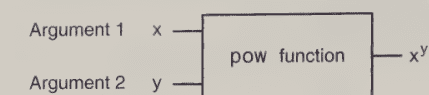

在使用 `pow` 函数时，应该遵循一些准则。首先，程序必须包含 `<cmath>` 头文件。其次，传递给 `pow` 函数的参数应该是 `double`（双精度浮点数）。第三，用于存储 `pow` 返回值的变量应该定义为 `double` 类型。例如，在以下语句中，变量 `area` 应该是一个 `double`：

```cpp
area = pow(4.0, 2.0);
```

### 程序 3-5：计算圆的面积

程序 3-5 解决了一个简单的代数问题。它要求用户输入圆的半径，然后计算圆的面积。公式为

$$ \text{Area} = \pi r^2 $$

这在程序中表示为：

```cpp
area = PI * pow(radius, 2.0);
```

```cpp
1 // 这个程序计算圆的面积。
2 // 圆面积的公式是 PI 乘以
3 // 半数的平方。Pi 是 3.141599。
4 #include <iostream>
5 #include <cmath> // pow 函数需要它
6 using namespace std;
7 
8 int main(){
9 {
10 const double PI = 3.141599;
11 double area, radius;
12 
13 cout << "这个程序计算圆的面积。\n";
14 cout << "圆的半径是多少？ ";
15 cin >> radius;
16 area = PI * pow(radius, 2.0);
17 cout << "面积是 " << area << " area" << endl;
18 return 0;
19 }
```

### 程序输出（示例输入已加粗显示）

这个程序计算圆的面积。

圆的半径是多少？ **10** 回

面积是 314.159

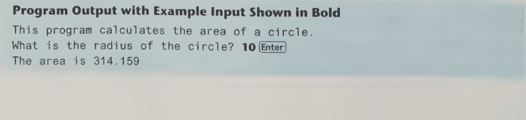

> **注意**：程序 3-5 是作为 `pow` 函数的演示。实际上，在如此简单的操作中，没有理由使用 `pow` 函数。该数学语句完全可以写成：
>
> ```cpp
> area = PI * radius * radius;
> ```
>
> 然而，`pow` 函数在涉及较大指数的操作中是非常有用的。

## 焦点聚焦：计算平均值

确定一组值的平均值是一个简单的计算：你将所有值相加，然后将和除以值的个数。虽然这是一个直接的计算，但在编写计算平均值的程序时，很容易出错。例如，假设 `a`、`b` 和 `c` 是变量。每个变量都包含一个值，我们想要计算这些值的平均值。如果我们不粗心，可能会写如下所示语句来执行计算：

```cpp
average = a + b + c / 3.0;
```

你能看出这条语句中的错误吗？执行时，除法会先发生。`c` 的值会被除以 3.0，然后结果将加到 `a + b` 的和上。这不是计算平均值的正确方法。为了纠正这个错误，我们需要在 `a + b + c` 周围加上括号，如下所示：

```cpp
average = (a + b + c) / 3.0;
```

让我们逐步完成编写计算平均值程序的步骤。假设你在计算机科学课上参加了三次测试，我们想写一个显示测试分数平均值的程序。以下是伪代码形式的算法：

- 获取第一个测试分数。
- 获取第二个测试分数。
- 获取第三个测试分数。
- 通过将三次测试分数相加并将和除以 3 来计算平均值。
- 显示平均值。

在前三步中，我们提示用户输入三次测试分数。假设我们将这些测试分数存储在 `double` 类型的变量 `test1`、`test2` 和 `test3` 中。在第四步中，我们计算三次测试分数的平均值。我们将使用以下语句执行计算并将结果存储在 `average` 变量中，即：

```cpp
average = (test1 + test2 + test3) / 3.0;
```

最后一步是显示平均值。程序 3-6 显示了该程序。

### 程序 3-6

```cpp
// 这个程序计算
// 三次测试分数的平均值
#include <iostream>
#include <cmath>
using namespace std;

int main() {
    double test1, test2, test3; // 用于存储分数
    double average; // 用于存储平均值

    // 获取三次分数。
    cout << "输入第一个测试分数： ";
    cin >> test1;
    cout << "输入第二个测试分数： ";
    cin >> test2;
    cout << "输入第三个测试分数： ";
    cin >> test3;

    // 计算分数的平均值。
    average = (test1 + test2 + test3) / 3.0;

    // 显示平均值。
    cout << "平均分是：" << average << endl;
    return 0;
}
```

### 程序输出（示例输入已加粗显示）

输入第一个测试分数： **90** 回

输入第二个测试分数： **80** 回

输入第三个测试分数： **100** 回

平均分是： 90

## 知识点

通过确定每个表达式的值完成下表。

| 表达式 | 值 |
| :--- | :--- |
| 3 + 4 | |
| 10 - 2 | |
| 5 * 6 | |
| 20 / 4 | |
| 7 % 3 | |
| 3 + 4 * 2 | |
| (3 + 4) * 2 | |
| 10 / 2 * 3 | |
| 10 / (2 * 3) | |

3.8 编写 C++ 表达式处理以下：

$$ y = x $$
$$ a = b $$
$$ y = x^2 $$

3.9 研究以下程序并完成表格。

```cpp
#include <iostream>
#include <cmath>
using namespace std;
int main() {
    double value1, value2, value3;
    cout << "输入一个数字： ";
    cin >> value1;
    value2 = pow(value1, 2.0);
    value3 = value2 / 2;
    cout << value3;
    return 0;
}
```

| 用户输入... | 程序将显示什么数字 (value3)? |
| :--- | :--- |
| 2 | |
| 5 | |
| 4 | |
| 6 | |

3.10 完成以下程序骨架，使其显示燃料罐的体积。圆柱体的公式为

$$ \text{Volume} = \pi r^2 h $$

其中 $\pi$ 是 3.14159，$r$ 是半径，$h$ 是高度。

```cpp
#include <iostream>
#include <cmath>
using namespace std;

int main() {
    double volume, radius, height;
    cout << "这个程序将告诉你圆柱\n";
    cout << "罐的体积。\n";
    cout << "高度是多少？ ";
    cin >> height;
    cout << "半径是多少？ ";
    cin >> radius;
    // 你必须完成这个程序。
}
```

## 溢出与下溢

概念：当给变量赋值的值超出了该变量数据类型允许的范围（太大或太小），就会发生溢出或下溢。

当给变量赋值一个超出其类型范围的值时，可能会出现问题。以下是一个语句，其中 `a`、`b` 和 `c` 都是短整型（short integers）：

```cpp
a = b * c;
```

如果 `b` 和 `c` 被设为足够大的值，乘法运算将产生一个大到无法存储在 `a` 中的数字。为了防止这种情况，`a` 应该之前被定义为 `int` 或 `long int`。

当给变量赋值一个对其数据类型而言过大的数字时，它会发生溢出。同样，赋值一个过小的值会导致变量发生下溢。程序 3-7 显示了整数溢出或下溢时发生的情况。（输出显示自一个双字节短整型系统。）

### 程序 3-7

```cpp
// 此程序演示了整数溢出和下溢。
#include <iostream>
using namespace std;
int main() {
    // testVar 初始化为 short 类型的最大值。
    short testVar = 32767;
    // 显示 testVar。
    cout << testVar << endl;
    // 给 testVar 加 1 以产生溢出。
    testVar = testVar + 1;
    cout << testVar << endl;
    // 从 testVar 减去 1 以产生下溢。
    testVar = testVar - 1;
    cout << testVar << endl;
    return 0;
}
```

### 程序输出

```
32767
-32768
32767
```

通常，当整数溢出时，其内容会回绕到该数据类型可能的最低值。在程序 3-7 中，当给 `testVar` 加上 1 时，它从 32767 回绕到了 -32768。当从 `testVar` 减去 1 时，它发生了下溢，导致其内容回绕到 32,767。系统不会给出警告或错误信息，因此在处理接近整数最大或最小范围的数字时要加小心。如果发生溢出或下溢，程序将使用错误的数字，从而产生错误的结果。

当浮点数变量溢出或下溢时，结果取决于编译器的配置。你的系统可能会产生以下任何结果：

- 产生错误结果并继续。
- 当发生浮点溢出时打印错误信息并立即停止。
- 当发生浮点下溢时打印错误信息并立即停止，但在变量中存储 0。
- 当发生溢出或下溢时为你提供行为的选择。

你可以通过编译并运行程序 3-8 来了解你的系统的反应方式。

### 程序 3-8

```cpp
// 此程序可以查看你的系统如何处理浮点数溢出和下溢。
#include <iostream>
using namespace std;
int main() {
    float test;

    test = 2.0e38 * 1000; // 应该溢出。
    cout << test << endl;
    test = 2.0e38 / 2.0e38; // 应该下溢。
    cout << test << endl;
    return 0;
}
```

## 3.5 类型转换

概念：类型转换允许你执行手动的数据转换。

类型转换表达式允许你提升或降级一个值。类型转换表达式的一般格式为：

```cpp
static_cast<DataType>(Value)
```

其中 `Value` 是你想要转换的变量或字面量，`DataType` 是你想要转换的数据类型。以下是一个使用类型转换表达式的代码示例：

```cpp
double number = 3.7;
int val;
val = static_cast<int>(number);
```

这段代码定义了两个变量：`number`（一个 `double`）和 `val`（一个 `int`）。第三条语句中的类型转换表达式返回了 `number` 中值的副本，并将其转换为 `int`。当将 `double` 转换为 `int` 时，小数部分会被截断，因此该语句将 3 存储在 `val` 中。`number` 中的原始值不会改变。

在 C++ 不会执行所需转换的情况下，类型转换表达式非常有用。程序 3-9 显示了一个示例，在示例中使用了类型转换表达式来防止整数除法的发生。使用该类型转换表达式的语句是 `perMonth = static_cast<double>(books) / months;`。

### 程序 3-9

```cpp
// 此程序使用类型转换来避免整数除法。
#include <iostream>
using namespace std;

int main() {
    int books; // 阅读的书数
    int months; // 花费的月份
    double perMonth; // 每月的平均阅读数

    cout << "你计划读多少本书？";
    cin >> books;
    cout << "你需要多少几个月才能读完？";
    cin >> months;
    perMonth = static_cast<double>(books) / months;
    cout << "平均每月是 " << perMonth << " 本书。\n";
    return 0;
}
```

### 带有示例输入的程序输出

你计划读多少本书？**30**

你需要多少几个月才能读完？**7**

平均每月是 4.28571 本书。

变量 `books` 是一个整数，但在除法发生之前，它的值被转换成了 `double`。如果没有第 15 行的类型转换表达式，将执行整数除法，导致结果为 4。在程序 3-9 中，由于将一个操作数转换为了 `double`，结果是 4.28571。

整数除法的结果是 4。通过将一个操作数转换为 `double`，强制不进行整数除法。

```cpp
perMonth = static_cast<double>(books) / months;
```

程序 3-10 进一步演示了类型转换。

### 程序 3-10


```cpp
// 此程序使用类型转换打印字符。
#include <iostream>
using namespace std;

int main() {
    int number = 65;

    // 显示 number 的值。
    cout << number << endl;

    // 显示转换为 char 的 number。
    cout << static_cast<char>(number) << endl;
    return 0;
}
```

# 程序输出

```
65
A
```

让我们仔细观察这个程序。在第 8 行，`int` 变量 `number` 初始化为 65。在第 11 行，`number` 被传递给 `cout`。在第 15 行，使用类型转换将 `number` 转换为 `char` 类型。65 是字母 'A' 的 ASCII 码，因此该语句显示字母 'A'。

> 注意：C++ 提供了多种类型转换表达式。`static_cast` 是最常用的类型转换表达式，因此我们在书中主要使用它。

# 知识点

## 3.11 假设有以下变量定义：

```cpp
int a = 5, b = 12;
double x = 3.4, z = 9.1;
```

以下表达式的值：

A) `b / a`
B) `x * a`
C) `static_cast<double>(b) / a`
D) `static_cast<double>(b)`
E) `b / static_cast<double>(a)`
F) `static_cast<double>(b) / static_cast<double>(a)`
G) `b / static_cast<int>(x)`
H) `static_cast<int>(x) * static_cast<int>(z)`
I) `static_cast<int>(x * z)`
J) `static_cast<double>(static_cast<int>(x) * static_cast<int>(z))`

## 3.12 完成以下程序中的变量 `letter`。在 `cout` 语句中使用类型转换表达式在屏幕上显示字符的 ASCII 码。

```cpp
#include <iostream>
using namespace std;

int main() {
    char letter;

    // 完成此程序
    // 如上所述完成
    return 0;
}
```

## 3.13 下面程序将显示什么？

```cpp
#include <iostream>
using namespace std;

int main() {
    int integer1, integer2;
    double result;
    integer1 = 19;
    integer2 = 2;
    result = integer1 / integer2;
    cout << result << endl;
    result = static_cast<double>(integer1) / integer2;
    cout << result << endl;
    result = static_cast<double>(integer1) / integer2;
    cout << result << endl;
    return 0;
}
```

## 3.6 多次赋值与复合赋值

### 复合赋值运算符

程序中经常会遇到如下形式的赋值语句：

`number = number + 1;`

赋值运算符右侧的表达式给出 `number` 加上 1 的值。该结果被赋值给 `number`，替换掉之前存储在该处的值。实际上，这条语句将 `number` 增加了 1。以类似的方式，下面的语句从 `number` 中减去了 5。

`number = number - 5;`

如果你以前从未见过这种类型的语句，它可能会在初看起来引起一些困惑，因为同一个变量名同时出现在赋值运算符的两侧。表 3-8 显示了其他这种编写方式的语句示例。

### 表格 3-8（假设 x = 6）

| 语句 | 执行操作 | 执行语句后的结果 |
| --- | --- | --- |
| `x = x + 4;` | 将 x 加上 4 | 10 |
| `x = x - 3;` | 从 x 中减去 3 | 3 |
| `x = x * 10;` | 将 x 乘以 10 | 60 |
| `x = x / 2;` | 将 x 除以 2 | 3 |
| `x = x % 4;` | 使 x 变为 x / 4 的余数 | 2 |

这类操作在编程中非常常见。为了方便起见，C++ 提供了一组专门为这些工作设计的特殊运算符。表 3-9 显示了复合赋值运算符（也称为复合运算符）以及算术赋值运算符。

### 表格 3-9 复合赋值运算符

| 运算符 | 示例用法 | 等效于 |
| --- | --- | --- |
| `+=` | `x += 5;` | `x = x + 5` |
| `-=` | `y -= 2;` | `y = y - 2` |
| `*=` | `z *= 10;` | `z = z * 10` |
| `/=` | `a /= b;` | `a = a / b` |
| `%=` | `c %= 3;` | `c = c % 3` |

你可以看到，复合赋值运算符不需要程序员输入两次变量。此外，它们清楚地指示了语句中正在发生什么。程序 3-11 使用了复合赋值运算符。

### 程序 3-11

```cpp
// 此程序跟踪三个同时开设的小部件商店的库存
// 每个商店的初始库存数量相同。通过
// 从每个商店的库存中减去
// 其售出的部件数量，
// 就可以得到当前库存。
#include <iostream>
using namespace std;

int main() {
    int begInv, // 所有商店的初始库存
        sold,   // 售出的部件数量
        store1, // 商店1 的库存
        store2, // 商店2 的库存
        store3; // 商店3 的库存

    // 获取所有商店的初始库存。
    cout << "One week ago, 3 widget stores opened\n";
    cout << "at the same time with the same beginning\n";
    cout << "inventory. What was the beginning inventory? ";
    cin >> begInv;

    // 设置每个商店的库存。
    store1 = store2 = store3 = begInv;

    // 获取商店1 售出的部件数量。
    cout << "How many widgets has store 1 sold? ";
    cin >> sold;
    store1 -= sold; // 调整商店1 的库存。

    // 获取商店2 售出的部件数量。
    cout << "How many widgets has store 2 sold? ";
    cin >> sold;
    store2 -= sold; // 调整商店2 的库存。

    // 获取商店3 售出的部件数量。
    cout << "How many widgets has store 3 sold? ";
    cin >> sold;
    store3 -= sold; // 调整商店3 的库存。

    // 显示每个商店的当前库存。
    cout << "\nThe current inventory of each store:\n";
    cout << "Store 1: " << store1 << endl;
    cout << "Store 2: " << store2 << endl;
    cout << "Store 3: " << store3 << endl;
    return 0;
}
```

### 带有示例输入的程序输出

```
One week ago, 3 widget stores opened
at the same time with the same beginning
inventory. What was the beginning inventory? 100
How many widgets has store 1 sold? 20
How many widgets has store 2 sold? 15
How many widgets has store 3 sold? 45
The current inventory of each store:
Store 1: 75
Store 2: 85
Store 3: 55
```

更复杂的语句可以使用复合赋值运算符来表达。有一个示例：

```cpp
result *= a + 5;
```

在这一条语句中，`result` 乘以 `a + 5` 的和。在构建此类语句时，你必须意识到复合赋值运算符的优先级低于数学运算符。上述语句等效于

```cpp
result = result * (a + 5);
```

这与下面的不同：

```cpp
result = result * a + 5;
```

表 3-10 显示了其他此类语句的示例。

### 表格 3-10 复合赋值运算符优先级示例

| 语句 | 等效于 |
| --- | --- |
| `x += a + b` | `x = x + (a + b)` |
| `y -= a - b` | `y = y - (a - b)` |
| `z *= a * b` | `z = z * (a * b)` |
| `a /= b / c` | `a = a / (b / c)` |
| `c %= a % b` | `c = c % (a % b)` |

# 检查点

13. 复合赋值运算符可以表达更复杂的语句。
14. 复合赋值运算符的优先级低于数学运算符。
15. 复合赋值运算符可以用于更复杂的语句。
16. 表 3-10 显示了其他这种赋值运算符的示例。

## 3.7 格式化输出

### 程序 3-13

```cpp
// 此程序显示三行数字。
#include <iostream>
#include <iomanip>    // 需要用到 setw
using namespace std;

int main() {
    int num1 = 2897, num2 = 5,    num3 = 837,
        num4 = 34,    num5 = 7, num6 = 1623,
        num7 = 390, num8 = 3456, num9 = 12;

    // 显示第一行数字
    cout << setw(6) << num1 << setw(6) << num2 << setw(6) << num3 << endl;
    // 显示第二行数字
    cout << setw(6) << num4 << setw(6) << num5 << setw(6) << num6 << endl;
    // 显示第三行数字
    cout << setw(6) << num7 << setw(6) << num8 << setw(6) << num9 << endl;

    return 0;
}
```

### 程序输出

```
  2897     5   837
    34     7  1623
   390  3456    12
```

通过将每个数字打印在宽度为 6 的字段中，它们得以完美地列对齐显示。

> 注意：程序 3-13 包含了一个新的头文件 `<iomanip>`。在任何使用 `setw` 的程序中都必须包含它。

注意每个值都使用了 `setw` 操纵符，因为 `setw` 仅为紧随其后的值设置字段宽度。在该值打印之后，`cout` 会回到默认的打印方法。

你可能会奇怪，如果数字太大无法放入字段中会发生什么，如下述语句所示：

```cpp
value = 18397;
cout << setw(2) << value;
```


在这种情况下，`cout` 将打印整个数字。`setw` 仅指定打印字段的最小位数。任何大于该最小位数的数字都会导致 `cout` 覆盖 `setw` 的值。

# 3.7 格式化输出

你可以指定任何类型数据的字段宽度。程序 3-14 展示了 `setw` 与整数、浮点数和字符串对象的使用。

## 程序 3-14

```cpp
// 此程序演示了 setw 操纵符
// 用于各种不同数据类型的值。
#include <iostream>
#include <iomanip>
#include <string>
using namespace std;

int main() {
    int intValue = 3928;
    double doubleValue = 91.5;
    string stringValue = "John. Smith";

    cout << "(" << setw(5) << intValue << ")" << endl;
    cout << "(" << setw(8) << doubleValue << ")" << endl;
    cout << "(" << setw(16) << stringValue << ")" << endl;
    return 0;
}
```

## 程序输出

```
( 3928)
(  91.5)
(     John. Smith)
```

程序 3-14 可用于说明以下点：

- 浮点数的字段宽度包含一个小数点位的位置。
- 字符串对象的字段宽度包含字符串中的所有字符，包括空格。
- 打印在字段中的值默认是**右对齐**的。这意味着它们与打印字段的右侧对齐，任何为了填充字段而必须使用的空白都会插入在它的前面。

## setprecision 操纵符

浮点值可以被舍入到指定数量的有效数字（即精度），精度是指小数点前后出现的数字总数。你可以通过使用 `setprecision` 操纵符来控制浮点值显示的有效位数。程序 3-15 显示了以不同有效位数显示的除法结果。

### 程序 3-15

```cpp
// 此程序演示了 setprecision 如何
// 舍入浮点值。
#include <iostream>
#include <iomanip>
using namespace std;

int main() {
    double quotient, number1 = 132.364, number2 = 26.91;

    quotient = number1 / number2;
    cout << quotient << endl;
    cout << setprecision(5) << quotient << endl;
    cout << setprecision(4) << quotient << endl;
    cout << setprecision(3) << quotient << endl;
    cout << setprecision(2) << quotient << endl;
    cout << setprecision(1) << quotient << endl;
    return 0;
}
```

### 程序输出

```
4.91778
4.918
4.92
4.9
5
```

> 第一个值没有使用 `setprecision`。默认情况下，系统显示 6 位有效数字。后续语句将该值舍入为 5、4、3、2 和 1 位有效数字。

> 如果数字的位数少于 `setprecision` 指定的，操纵符将不起作用。在后续语句中，`dollars` 的值只有四位，因此两个语句打印的都是 24.51。

```cpp
double dollars = 24.51;
cout << dollars << endl; // 显示 24.51
cout << setprecision(5) << dollars << endl; // 显示 24.51
```

表 3 显示了 `setprecision` 如何影响显示方式。

| 数字 | 操纵符 | 显示 |
| :--- | :--- | :--- |
| 28.9278 | setprecision(3) | 28.9 |
| 21 | setprecision(5) | 21 |
| 109.5 | setprecision(4) | 109.5 |
| 34.2859 | setprecision(2) | 34 |

## 3.7 格式化输出（续）

与字段宽度不同，精度设置会一直有效直到被更改。像所有格式化操纵符一样，必须包含头文件 `<iomanip>`。程序 3-16 展示了如何结合 `setw` 和 `setprecision` 操纵符来完全控制浮点数的显示方式。

### 程序 3-16

```cpp
// 此程序获取三天的销售额。
// 总额被计算并以表格显示。
#include <iostream>
#include <iomanip>
using namespace std;

int main() {
    double day1, day2, day3, total;
    // 获取每天的销售额
    cout << "Enter the sales for day 1: ";
    cin >> day1;
    cout << "Enter the sales for day 2: ";
    cin >> day2;
    cout << "Enter the sales for day 3: ";
    cin >> day3;

    // 计算总额。
    total = day1 + day2 + day3;

    // 显示销售额。
    cout << "\nSales Amounts\n";
    cout << "--------------------\n";
    cout << setprecision(5);
    cout << "Day 1: " << setw(8) << day1 << endl;
    cout << "Day 2: " << setw(8) << day2 << endl;
    cout << "Day 3: " << setw(8) << day3 << endl;
    cout << "Total: " << setw(8) << total << endl;
    return 0;
}
```

### 程序输出（带示例输入）

```text
Enter the sales for day 1: 321.57
Enter the sales for day 2: 269.62
Enter the sales for day 3: 307.77

Sales Amounts
----------------
Day 1:   321.57
Day 2:   269.62
Day 3:   307.77
Total:   898.96
```

## 第 3 章 表达式与交互

## fixed 操纵符

`setprecision` 操纵符有时会产生意外的结果。当数字的精度设置为较低值时，数字倾向于以科学计数法打印。例如，这里是程序 3-16 在数字较大时的输出：

另一个流操纵符 `fixed` 强制 `cout` 以固定点法（或小数）打印数字。程序 3-17 展示了如何使用 `fixed` 操纵符。

### 程序 3-17

```cpp
// 此程序获取三天的销售额。
// 总额被计算并以表格显示。
#include <iostream>
#include <iomanip>
using namespace std;

int main()
{
    double day1, day2, day3, total;
    // 获取每天的销售额。
    cout << "Enter the sales for day 1: ";
    cin >> day1;
    cout << "Enter the sales for day 2: ";
    cin >> day2;
    cout << "Enter the sales for day 3: ";
    cin >> day3;

    // 计算总额。
    total = day1 + day2 + day3;

    // 显示销售额。
    cout << "\nSales Amounts\n";
    cout << "--------------------\n";
    cout << setprecision(2) << fixed;
    cout << "Day 1: " << setw(8) << day1 << endl;
    cout << "Day 2: " << setw(8) << day2 << endl;
    cout << "Day 3: " << setw(8) << day3 << endl;
    cout << "Total: " << setw(8) << total << endl;
    return 0;
}
```

## showpoint 操纵符

默认情况下，浮点数不会显示末尾零，且没有小数部分的浮点数不会显示小数点。例如，查看以下代码：

```cpp
double x = 123.4, y = 456.0;
cout << setprecision(6) << x << endl;
cout << y << endl;
```

`cout` 语句将产生以下输出：

```
123.4
456
```

虽然两个数字都指定了六位有效数字，但这两个数字都没有显示末尾零。如果我们希望数字补齐末尾零，必须像下面的代码所示使用 `showpoint` 操纵符：

```cpp
double x = 123.4, y = 456.0;
cout << setprecision(6) << showpoint << x << endl;
cout << y << endl;
```

`cout` 语句将产生以下输出：

```
123.400
456.000
```

> 注意：在大多数编译器中，当同时使用 `setprecision` 和 `fixed` 操纵符时，会显示末尾零。

## left 和 right 操纵符

通常情况下输出是右对齐的。例如，看下面的代码：

```cpp
double x = 146.789, y = 24.2, z = 1.783;
cout << setw(10) << x << endl;
cout << setw(10) << y << endl;
cout << setw(10) << z << endl;
```

变量 `x`、`y` 和 `z` 的每一个都在一个 10 个空格宽的打印字段中显示。`cout` 语句的输出为：

```
    146.789
      24.2
      1.783
```

注意每个数字都是右对齐的，或者说对齐在其打印字段的右侧。你可以使用 `left` 操纵符将值改为左对齐，如下面的代码所示：

```cpp
double x = 146.789, y = 24.2, z = 1.783;
cout << left << setw(10) << x << endl;
cout << setw(10) << y << endl;
cout << setw(10) << z << endl;
```

这些 `cout` 语句的输出为：

```
146.789
24.2
1.783
```

在这种情况下，数字对齐在它们打印字段的左侧。`left` 操纵符将一直有效，直到你使用 `right` 操纵符，这会导致所有后续输出变为右对齐。

## 3.7 输出格式总结

表 3-12 总结了我们讨论过的操纵符。

| 表 3-12 流操纵符 |
| :--- | :--- |
| `setw(n)` | 建立一个 `n` 个空格宽的打印字段。 |
| `fixed` | 以固定点表示法显示浮点数。 |
| `showpoint` | 即使没有小数部分，也显示小数点和末尾零。 |
| `setprecision(n)` | 设置浮点数的精度。 |
| `left` | 使后续输出左对齐。 |
| `right` | 使后续输出右对齐。 |

## 检查点

- **3.17** 编写带有流操纵符的语句，用以执行以下操作：
  - A) 在九个空格宽的字段中以两位小数的精度显示数字 34.789
  - B) 在五个空格宽的字段中以三位小数的精度显示数字 7.0。应该显示小数点和任何末尾零。
  - C) 以固定点表示法显示数字 5.789e+12。
  - D) 在七个空格宽的字段中左对齐显示数字 67。

- **3.18** 下面的程序无法编译，因为行的顺序被打乱了：

```cpp
#include <iostream>
#include <iomanip>
#include <string>
using namespace std;

int main()
{
    string person = "Wolfgang Smith";
    cout << person << endl;
    cout << left;
    cout << setw(20) << person << endl;
    cout << right;
    return 0;
}
```

# 3.8 字符与字符串对象的操作

如果程序仅仅使用 `cin.get` 函数来暂停屏幕，直到按下回车键，而不需要存储该字符，则也可以这样调用该函数：

```cpp
cin.get();
```

程序 3-21 展示了使用 `cin.get` 函数的三种方法。

## 程序 3-21

```cpp
// 此程序演示了三种使用 cin.get() 
// 暂停程序的方法。
#include <iostream>
using namespace std;

int main() {
    char ch;

    cout << "This program has paused. Press Enter to continue.";
    cin.get(ch);
    cout << "It has paused a second time. Please press Enter again.";
    ch = cin.get();
    cout << "It has paused a third time. Please press Enter again.";
    cin.get();
    cout << "Thank you!";
    return 0;
}
```

### 程序输出

```text
This program has paused. Press Enter to continue.
It has paused a second time. Please press Enter again.
It has paused a third time. Please press Enter again.
Thank you!
```

## 混合使用 cin >> 和 cin.get

混合使用 `cin >>` 和 `cin.get` 会导致令人讨厌且难以发现的问题。例如，程序 3-22。

### 程序 3-22

```cpp
// 此程序演示了当混合使用
// cin >> 与 cin.get() 时出现的问题。
#include <iostream>
using namespace std;

int main() {
    char ch;              // 定义一个字符变量
    int number;           // 定义一个整数变量
    cout << "Enter a number: ";
    cin >> number;        // 读取一个整数
    cout << "Enter a character: ";
    ch = cin.get();       // 读取一个字符
    cout << "Thank You!\n";
    return 0;
}
```

### 程序输出

```text
Enter a number: 100
Enter a character: Thank You!
```

当此程序运行时，第 12 行让用户输入一个数字，但似乎第 14 行的语句被跳过了。这是因为 `cin >>` 和 `cin.get` 读取数据的技术略有不同。

在程序的示例运行中，第 12 行执行，用户输入了 100 并按下了回车键。这导致一个换行符（`'\n'`）被存储在键盘缓冲区中，如图 3-5 所示。第 12 行的 `cin >>` 语句开始读取用户的数据，并在遇到换行符时停止，如图 3-6 所示。换行符没有被读取，而是留在键盘缓冲区中。

**图 3-5 键盘缓冲区的内容**

| 键盘缓冲区 | | | | |
|---|---|---|---|---|
| 1 | 0 | 0 | \n |

`cin` 从此处开始读取。

**图 3-6 cin 在换行符处停止读取**

| 键盘缓冲区 | | | | |
|---|---|---|---|---|
| 1 | 0 | 0 | \n |

`cin` 在此处停止读取，不读取 `\n` 字符。

当第 14 行的 `cin.get` 函数执行时，它开始从上一次输入操作停止的地方读取键盘缓冲区。这意味着 `cin.get` 读取了换行符，而没有给用户输入更多内容。你可以通过使用 `cin.ignore` 函数来解决这种情况，该函数将在下一节介绍。

## 3.8 字符与字符串对象的操作（续）

### 使用 cin.ignore

为了解决之前描述的问题，可以使用 `cin` 对象的另一个名为 `ignore` 的成员函数。`cin.ignore` 函数告诉 `cin` 对象跳过键盘缓冲区中的一个或多个字符。其通用格式如下：

```cpp
cin.ignore(n, c);
```

参数是可选的。`n` 是一个整数，`c` 是一个字符。它们告诉 `cin` 跳过缓冲区中的 `n` 个字符，直到遇到字符 `c` 为止。例如，如果你想跳过换行符，可以写 `cin.ignore(100, '\n');`。

## 成员函数与运算符

字符串对象也有成员函数。例如，如果你想知道字符串的长度，可以调用 `length()` 方法：

```cpp
string state = "Texas";
int size = state.length();
```


# 程序 3-24

```cpp
// 此程序请求直角三角形两条边的长度。
// 然后计算并显示斜边的长度。
#include <iostream>
#include <iomanip>           // 用于 setprecision（精度）
#include <cmath>             // 用于 sqrt 和 pow 函数
using namespace std;

int main() {
    double a, b, c;

    cout << "Enter the length of side a: ";
    cin >> a;
    cout << "Enter the length of side b: ";
    cin >> b;

    c = sqrt(pow(a, 2.0) + pow(b, 2.0));
    cout << "The length of the hypotenuse " << c << endl;
    return 0;
}
```

# 程序输出（示例输入已加粗显示）


取自程序 3-24 的以下语句计算了三角形两边平方和的平方根：

`c = sqrt(pow(a, 2.0) + pow(b, 2.0));`

注意以下数学表达式用作 `sqrt` 函数的参数：

`pow(a, 2.0) + pow(b, 2.0)`

该表达式调用了两次 `pow` 函数：一次用于计算 `a` 的平方，另一次计算 `b` 的平方。然后将这两个平方相加，并将总和发送给 `sqrt` 函数。

# 3.9 更多数学库函数

## 随机数

随机数在许多不同的编程任务中都非常有用。以下只是几个例子：

- 随机数常用于游戏。例如，让玩家掷骰子的电脑游戏使用随机数来表示骰子的数值。
- 显示从洗过的牌堆中抽牌的程序使用随机数表示牌的面值。
- 随机数在模拟程序中有用。在某些程序中，计算机必须随机决定人、动物、昆虫或其他生物将如何行为。可以构建公式，其中使用随机数来确定程序中发生的各种动作和事件。
- 随机数在必须随机选择数据进行分析的统计程序中有用。
- 随机数常用于计算机安全，以加密敏感数据。

C++ 库有一个函数 `rand()`，你可以用它来生成随机数。`rand()` 函数需要 `<cstdlib>` 头文件。该函数返回的数值是一个 `int`。以下是它的用法示例：

```cpp
y = rand();
```

在该语句执行后，变量 `y` 将包含一个随机数。实际上，`rand()` 产生的数字是伪随机的。该函数使用一种算法，每次程序在同一系统上重复运行时都会产生相同的数字序列。例如，假设执行了以下语句：

```cpp
cout << rand() << endl;
cout << rand() << endl;
cout << rand() << endl;
```

显示的三个数字看起来是随机的，但每次运行程序时，都会生成相同的值。为了使 `rand()` 的结果随机化，`srand()` 接受一个 `unsigned int` 参数，它作为算法的种子值。通过指定不同的种子值，`rand()` 将生成不同的数字序列。

获取唯一的种子值的常用做法是调用 `time` 函数，它是标准库的一部分。`time` 函数返回自 1970 年 1 月 1 日午夜以来经过的秒数。`time` 函数需要 `<ctime>` 头文件，你将 0 作为参数传递给函数。程序 3-25 每次执行时应该生成三个不同的随机数。

# 程序 3-25

```cpp
// 此程序演示随机数。
#include <iostream>
#include <cstdlib>      // 用于 rand 和 srand
#include <ctime>        // 用于 time 函数
using namespace std;

int main() {
    // 获取系统时间。
    unsigned seed = time(0);

    // 为随机数生成器设置种子。
    srand(seed);

    // 显示三个随机数。
    cout << rand() << endl;
    cout << rand() << endl;
    cout << rand() << endl;
    return 0;
}
```

# 程序输出

```
2361
2084
1941
```

如果你想限制随机数的范围，请使用以下公式：

`y = rand() % (maxValue + 1) + minValue;`

在公式中，`minValue` 是范围内的最小数值，`maxValue` 是最高数值。例如，以下代码将 1 到 100 范围内的随机数赋值给变量 `y`：

```cpp
int MIN_VALUE = 1;
int MAX_VALUE = 100;
y = rand() % (MAX_VALUE + 1) + MIN_VALUE;
```

另一个例子，以下代码将 100 到 200 范围内的随机数赋值给变量 `y`：

```cpp
int MIN_VALUE = 100;
int MAX_VALUE = 200;
y = rand() % (MAX_VALUE + 1) + MIN_VALUE;
```

以下“焦点”演示了如何使用随机数来模拟骰子。

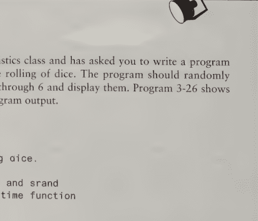

# 焦点：使用随机数

Kimura 教授有一门入门统计学课程，他要求你写一个程序供他在课堂上模拟骰子。该程序应该随机生成 1 到 6 之间的两个数字并显示它们。程序 3-26 显示了程序及其输出示例。

# 程序 3-26

```cpp
// 此程序模拟骰子。
#include <iostream>
#include <cstdlib> // 用于 rand 和 srand
#include <ctime>   // 用于 time 函数
using namespace std;

int main() {
    // 常量
    const int MIN_VALUE = 1; // 骰子最小值
    const int MAX_VALUE = 6; // 骰子最大值

    // 变量
    int die1; // 存储 die1 的值
    int die2; // 存储 die2 的值

    // 获取系统时间。
    unsigned seed = time(0);

    // 为随机数生成器设置种子。
    srand(seed);

    cout << "Rolling dice\n";
    die1 = rand() % (MAX_VALUE + 1) + MIN_VALUE;
    die2 = rand() % (MAX_VALUE + 1) + MIN_VALUE;
    cout << die1 << endl;
    cout << die2 << endl;

    return 0;
}
```

# 程序输出

```
Rolling dice...
3
4
```

# 3.10 关注调试：程序的人工跟踪

程序要求用户输入三个数字并显示它们的平均值，但它存在一个错误。它没有显示正确的平均值。以下是程序运行示例的输出。

**程序输出（示例输入已加粗显示）**

输入第一个数字：**10** Enter

输入第二个数字：**20** Enter

输入第三个数字：**30** Enter

平均值是 40

10、20 和 30 的正确平均值是 20，而不是 40。为了找到错误，我们将进行手工跟踪。要手工跟踪此程序，你需要逐条执行每条语句，观察正在发生的操作，然后在语句执行后记录变量的内容。手工跟踪完成后，图表将如下所示。我们在不知道变量内容的地方在图表中写了问号。

# 程序 3-27（已填充的人工跟踪表）

```cpp
// 此程序要求输入三个数字，然后
// 显示数字的平均值。
#include <iostream>
using namespace std;

int main() {
    double num1, num2, num3, avg;
    cout << "Enter the first number: ";
    cin >> num1;
    cout << "Enter the second number: ";
    cin >> num2;
    cout << "Enter the third number: ";
    cin >> num3;
    avg = num1 + num2 + num3 / 3;
    cout << "The average is " << avg << endl;
    return 0;
}
```

| num1 | num2 | num3 | avg |
|---|---|---|---|
| ? | ? | ? | ? |
| 10 | ? | ? | ? |
| 10 | 20 | ? | ? |
| 10 | 20 | 30 | ? |
| 10 | 20 | 30 | 40 |
| 10 | 20 | 30 | 40 |

你发现错误了吗？通过检查位于第 14 行中执行数学运算的语句，我们发现了一个错误。除法操作在加法操作之前进行，因此我们必须将该语句重写为：

```cpp
avg = (num1 + num2 + num3) / 3;
```

手工跟踪是一个简单的过程，它将你的注意力集中在程序中的每条语句上。这有助于你找到不明显的错误。

# 3.11 关注问题解决：案例研究

General Crates, Inc. 公司制造定制设计的木箱。由于材料和人工，制造一个木箱的成本为每立方英尺 0.23 美元。反之，他们向客户收取每立方英尺 0.50 美元。你被要求编写一个程序，计算任何 GCI 构建产品的体积（立方英尺）、成本、客户价格和利润。

## 变量

表 3-14 显示了所需的常量和变量。

### 表 3-14 常量与变量

| 常量或变量 | 描述 |
|---|---|
| `COST_PER_CUBIC_FOOT` | 一个命名常量，声明为 `double` 并初始化为值 0.23。这代表每立方英尺制造木箱的成本。 |
| `CHARGE_PER_CUBIC_FOOT` | 一个命名常量，声明为 `double` 并初始化为值 0.5。这代表每立方英尺收取的木箱费用。 |
| `length` | 一个 `double` 变量，用于存储木箱的长度，由用户输入。 |
| `width` | 一个 `double` 变量，用于存储木箱的宽度，由用户输入。 |
| `height` | 一个 `double` 变量，用于存储木箱的高度，由用户输入。 |
| `volume` | 一个 `double` 变量，用于存储木箱的体积。该变量存储的值是计算得到的。 |
| `cost` | 一个 `double` 变量，用于存储制造木箱的成本。该变量存储的值是计算得到的。 |
| `charge` | 一个 `double` 变量，用于存储向客户收取的木箱费用。该变量存储的值是计算得到的。 |
| `profit` | 一个 `double` 变量，用于存储 GCI 从木箱中获得的利润。该变量存储的值是计算得到的。 |

## 程序设计

程序必须执行以下通用步骤：

1. 要求用户输入木箱的尺寸（木箱的长度、宽、高）。
2. 计算木箱的体积、制造木箱的成本、客户收取的费用以及获得的利润。
3. 显示步骤 2 中计算的数据。

该程序的通用层级图如图 3-7 所示。

### 图 3-7 程序的层级图


“获取木箱尺寸”步骤在图 3-8 中详细显示。

### 图 3-8 “获取木箱尺寸”步骤的层级图


“计算体积、客户费用和利润”步骤在图 3-9 中详细显示。

### 图 3-9 “计算体积、客户费用和利润”步骤的层级图


“显示数据”步骤在图 3-10 中详细显示。

### 图 3-10 “显示数据”步骤的层级图


程序的伪代码如下：

- 要求用户输入木箱的长度。
- 要求用户输入木箱的宽度。
- 要求用户输入木箱的高度。
- 计算木箱的体积。
- 计算制造木箱的成本。
- 计算向客户收取的费用。
- 计算木箱获得的利润。
- 显示木箱的体积。
- 显示制造木箱的成本。
- 显示向客户收取的费用。
- 显示木箱获得的利润。

## 计算

使用以下公式计算木箱的体积、成本和利润：

`volume = length × width × height`

`cost = volume × 0.23`

`charge = volume × 0.5`

`profit = charge - cost`

## 程序

最后一步是将伪代码扩展为最终程序，如程序 3-28 所示。

# 程序 3-28


```cpp
// 程序用于 General Crates, Inc. 根据
// 用户输入的尺寸计算体积、客户费用和利润。
#include <iostream>
#include <iomanip>
using namespace std;
int main() {
    // 成本和金额常量
    const double COST_PER_CUBIC_FOOT = 0.23;
    const double CHARGE_PER_CUBIC_FOOT = 0.5;

    // 变量
    double length; // 木箱的长度
    double width; // 木箱的宽度
    double height; // 木箱的高度
    double volume; // 木箱的体积
    double cost; // 制造木箱的成本
    double charge; // 向客户收取的费用
    double profit; // 木箱获得的利润

    // 设置数字的输出格式
    cout << setprecision(2) << fixed << showpoint;

    // 提示用户输入木箱的长度、宽、高。
    cout << "Enter the dimensions of the crate (in feet):\n";
    cout << "Length: ";
    cin >> length;
    cout << "Width: ";
    cin >> width;
    cout << "Height: ";
    cin >> height;

    // 计算木箱的体积、生产成本、
    // 客户费用和利润。
    volume = length * width * height;
    cost = volume * COST_PER_CUBIC_FOOT;
    charge = volume * CHARGE_PER_CUBIC_FOOT;
    profit = charge - cost;

    // 显示计算的数据。
    cout << "The volume of the crate is " << volume << " cubic feet." << endl;
    cout << "To build: $" << cost << endl;
    cout << "Charge to customer: $" << charge << endl;
    cout << "Profit: $" << profit << endl;

    return 0;
}
```

### 程序输出（示例输入已加粗显示）

输入木箱的尺寸（英尺）：

长度：**10**

宽度：**8**

高度：**4**

木箱的体积是 320.00 立方英尺。

制造费用：$73.60

客户费用：$160.00

利润：$86.40

### 程序输出（不同示例输入已加粗显示）

输入木箱的尺寸（英尺）：

长度：**12.5**

宽度：**10.5**

高度：**8**

木箱的体积是 1050.00 立方英尺。

制造费用：$241.50

客户费用：$525.00

利润：$283.50

## 复习题与练习

### 简答

1. 假设定义了以下变量：

```cpp
int age;
double pay;
char section;
```

编写一个 `cin` 语句将输入读入这些变量中。

2. 假设定义了一个字符串对象：

```cpp
string description;
```

- A) 写一个读取单单词字符串的 `cin` 语句。
- B) 写一个读取包含多个单词字符串的语句。

3. 下程序必须包含哪些头文件？

```cpp
int main()
{
  double amount = 89.7;
  cout << showpoint << fixed;
  cout << setw(8) << amount << endl;
  return 0;
}
```

4. 通过确定每个表达式的值来完成下表。

| 表达式 | 值 |
|---|---|
| 28 / 4 - 2 | |
| 6 + 12 * 2 - 8 | |
| 4 + 8 * 2 | |
| 6 + 17 % 3 - 2 | |
| 2 + 22 * (9 - 7) | |
| (8 + 7) * 2 | |
| (16 + 7) % 2 - 1 | |
| 12 / (10 - 6) | |
| (19 - 3) * (2 + 2) / 4 | |

5. 为以下代数表达式编写 C++ 表达式：

```cpp
a = 12*x
z = 5*x + 14*y + 6*k
y = pow(x,4)
g = (b+12)/(4*k)
c = pow(a,3)/pow(b,4)
```

6. 假设程序有以下变量定义：

```cpp
int units;
float mass;
double weight;
```

以及以下语句：

```cpp
weight = mass * units;
```

将发生哪种自动数据类型转换？

- A) `mass` 被降级为 `int`，`units` 保持为 `int`，`mass * units` 的结果为 `int`。
- B) `units` 被提升为 `float`，`mass` 保持为 `float`，`mass * units` 的结果为 `float`。
- C) `units` 被提升为 `float`，`mass` 保持为 `float`，`mass * units` 的结果为 `double`。

7. 假设程序有以下变量定义：

```cpp
int a, b = 2;
float c = 4.2;
```

以及以下语句：

```cpp
a = b * c;
```

`a` 中将存储什么值？

A) 8.4

B) 8

C) 0

D) 以上均非

8. 假设 `qty` 和 `salesReps` 都是整数。使用类型强制转换表达式重写以下语句，使其不再执行整数除法：

```cpp
unitsEach = qty / salesReps;
```

9. 重写以下变量定义，使该变量成为命名常量：

```cpp
int rate;
```

10. 完成以下右表，为左侧列提供使用复合赋值运算符的语句。这些语句应与左侧列的语句等效。

| 使用赋值运算符的语句 | 使用复合赋值运算符的语句 |
|---|---|
| x = x + 5; | |
| total = total + subtotal; | |
| dist = dist / rep; | |
| ppl = ppl * period; | |
| inv = inv - shrinkage; | |
| num = num % 2; | |

### 第 3 章 表达式与交互性

11. 编写一个多重赋值语句，用于替换以下分组赋值语句：

```cpp
east = 1; west = 1; north = 1; south = 1;
```

12. 编写一个 `cout` 语句，使变量 `divSales` 显示在一个宽度为 8 的字段中，使用固定点表示法，精度为 2 位小数。小数点应始终显示。

13. 编写一个 `cout` 语句，使变量 `totalAge` 显示在一个宽度为 12 的字段中，使用固定点表示法，精度为 4 位小数。

14. 编写一个 `cout` 语句，使变量 `population` 显示在一个宽度为 12 的字段中，左对齐，精度为 8 位小数。小数点应始终显示。

### 填空题

15. ________ 函数返回角度的余弦值。

16. ________ 函数返回角度的正弦值。

17. ________ 函数返回角度的正切值。

18. ________ 函数返回数的指数函数。

19. ________ 函数返回浮点数除法的余数。

20. ________ 函数返回数的自然对数。

21. ________ 函数返回以 10 为底的对数。

22. ________ 函数返回数的幂值。

23. ________ 函数返回数的平方根。

24. 使用数学函数的程序必须包含 ________ 文件。

### 算法工作台

25. 一家商店为其客户提供最高信用额度。每个客户的可用额度是其最高额度减去已使用的额度。为该程序编写伪代码算法，询问客户的最高信用额度和已使用的信用额度。程序应显示客户的可用额度。

在你编写伪代码算法后，将其转换为一个完整的 C++ 程序。

26. 为一个程序编写伪代码算法，计算零售销售的总额。程序应询问销售金额和销售税率。税率应以浮点数形式输入。例如，如果销售税为 6%，用户应输入 0.06。程序应显示销售税金额和销售总额。

在你编写伪代码算法后，将其转换为一个完整的 C++ 程序。

27. 为一个程序编写伪代码算法，要求用户输入高尔夫球手在三场比赛中的比分，然后显示这三个分数的平均值。

在你编写伪代码算法后，将其转换为一个完整的 C++ 程序。

### 找错误

以下程序均包含一些错误。请尽可能多地找出它们。

```cpp
28. using namespace std;
int main () {
  double number1,number2, sum;
  Cout << "Enter a number: ";
  Cin << number1;
  Cout << "Enter another number: ";
  Cin << number2;
  number1 +number2 = sum;
  Cout << "The sum of the two numbers is " << sum
  return 0;
}
```

```cpp
29. #include <iostream>
using namespace std;
int main() {
  int number1, number2;
  float quotient;
  cout << "Enter two numbers and I will divide\n";
  cout << "the first by the second for you.\n";
  cin >> number1, number2;
  quotient = static_cast<float>(number1) / number2;
  cout << quotient
  return 0;
}
```

```cpp
30. #include <iostream>
using namespace std;
int main() {
  int number1, number2, product;
  cout << "Enter two numbers and I will multiply\n";
  cout << "them for you.\n";
  cin >> number1 >> number2;
  product = number1 * number2;
  cout << product
  return 0;
}
```

```cpp
31. #include <iostream>
using namespace std;
main() {
    int number1, number2;
    cout << "Enter two numbers and I will multiply\n";
    cout << "them for you.\n";
    cin >> number1 >> number2;
    number1 *= 50;
    number2 *= 50;
    cout << number1 << " " << number2;
    return 0;
}
```

```cpp
32. #include <iostream>
main() {
    double number, half;
    cout << "Enter a number and I will divide\n";
    cout << "it for you.\n";
    cin >> number;
    half = number / 2;
    cout << fixed << setprecision(2) << half;
    return 0;
}
```

```cpp
33. #include <iostream>
using namespace std;
int main() {
    string name;
    cout << "What is your name? ";
    getline(cin, name);
    cout << "Hello " << name << endl;
    return 0;
}
```

```cpp
34. #include <iostream>
using namespace std;
int main() {
    double salary, monthly;
    cout << "What is your annual salary? ";
    cin >> salary;
    monthly = salary / 12;
    cout << fixed << setprecision(2) << monthly << endl;
    return 0;
}
```

```cpp
35. #include <iostream>
using namespace std;
int main() {
    int x, y, z;
    x = 4; y = 5; z = 6;
    x += 2;
    y -= 1;
    z *= 3;
    cout << x << " " << y << " " << z << endl;
    return 0;
}
```

```cpp
36. #include <iostream>
#include <iomanip>
#include <string>
using namespace std;
int main() {
    string userInput;
    cout << "What is your name? ";
    getline(cin, userInput);
    cout << "Hello " << userInput << endl;
    return 0;
}
```

```cpp
37. #include <iostream>
#include <iomanip>
using namespace std;
int main() {
    long seconds;
    double minutes, hours, months, years;
    cout << "Enter the number of seconds that have passed:\n";
    cout << "I will tell you how many minutes, hours,\n";
    cout << "months, and years have passed: ";
    cin >> seconds;
    minutes = seconds / 60.0;
    hours = seconds / 3600.0;
    months = seconds / 2592000.0;
    years = seconds / 31536000.0;
    cout << minutes << " " << hours << " " << months << " " << years << endl;
    return 0;
}
```

### 编程挑战

#### 6. 配料调整器

一份饼干配方需要以下配料：

- 1.5 杯糖
- 1 杯黄油
- 2.75 杯面粉

用这些数量的配料可以制作 48 块饼干。编写一个程序，询问用户想要制作多少块饼干，然后显示制作指定数量饼干所需的每种配料杯数。

#### 7. 票房

电影院只保留门票销售收入的百分比。剩余部分归电影发行商所有。编写一个程序，计算电影院每晚的票房总利润和净利润。程序应询问电影名称，以及售出了多少张成人票和儿童票。（成人票价为 $10.00，儿童票价为 $6.00。）它应该显示一份类似于下面的报告：

电影名称：“狂怒之轮”

成人票销售量：382

儿童票销售量：127

总利润：$ 4,582.00

净利润：$ 916.40

付给发行商的金额：$ 3,665.60

> 注意：假设电影院保留了总票房的 20%。

#### 8. 有多少小部件？

育空组件公司（Yukon Widget Company）制造每个重 12.5 磅的小部件。编写一个程序，根据托盘的总重量计算托盘上堆叠了多少个小部件。程序应询问用户单个部件的重量以及堆叠在托盘上的部件总重量。然后计算并显示托盘上的小部件数量。

#### 9. 有多少卡路里？

一袋饼干含有 30 块饼干。袋上的热量信息声称有 10 “份”，且每一袋等于 300 卡路里。编写一个程序，询问用户实际吃了多少块饼干，然后报告消耗了多少卡路里。

#### 10. 需要多少保险？

许多财务专家建议，房主为其房屋或建筑购买的保险金额至少应达到重建结构成本的 80%。编写一个程序，询问用户输入建筑的重建成本，显示其物业应购买的最低保险金额。

#### 11. 汽车费用

编写一个程序，询问用户输入运营其汽车时产生的以下费用的每月费用：贷款还款、保险、汽油、机油、轮胎、维修。程序随后显示这些费用的每月总费用和年度总费用。

#### 12. 摄氏度转华氏度

编写一个将摄氏度温度转换为华氏度的程序。公式为

```
F = \frac{9}{5}C + 32
```

`F` 是华氏温度，`C` 是摄氏温度。

#### 13. 货币

编写一个程序将美元金额转换为日元和欧元，并将转换因子存储在常量 `YEN_PER_DOLLAR` 和 `EUROS_PER_DOLLAR` 中。为了获取最新的汇率，请在互联网上搜索“汇率”（currency exchange rate）。如果你找不到最新的汇率，请使用以下数值：

- 1 美元 = 98.93 日元
- 1 美元 = 0.74 欧元

以固定点符号格式化你的货币金额，保留两位小数，并确保始终显示小数点。

#### 14. 每月销售税

一家零售公司必须提交一份每月销售税报告，列出当月的销售额和收到的销售额。编写一个程序，询问月份、年份以及收银台收到的总金额（即销售额加销售税）。假设州销售税为 4%，县销售税为 2%。


如果已知收到的总金额且总销售税为 6%，则产品销售额的可能计算为：

```
S = \frac{T}{1.06}
```

`S` 是产品销售额，`T` 是总收入（产品销售额加销售税）。程序应显示一份类似于下面的报告：

月份：10月

--------------------

总收款：    $ 26572.89

销售额：              $ 25068.76

县销售税：   $ 501.38

州销售税：    $ 1002.75

总销售税：    $ 1504.13

## 15. 房产税

县政府根据物业的评估值征收房产税，评估值是物业实际价值的 60%。如果每英亩土地的价值为 $10,000，其评估值则 $6,000。房产税为每 $100$ 的评估值征收 $75。评估值为 $6,000 的英亩土地税金为 $45。编写一个程序，询问物业的实际价值，然后显示评估值和房产税。

## 16. 老人房产税

麦迪逊县（Madison County）为其老年人提供 5,000 美元的房主免税额。例如，如果一个老人的房屋价值为 $158,000，如上所述，其评估值将为 $94,800。然而，他可以免除该价值中的前 $5,000。税费为为每 $100$ 的剩余评估值征收 $75。评估值为 $6,000 的英亩土地税金为 $45。编写一个程序询问物业的实际价值，然后显示评估值和房产税。

## 17. 数学辅导

编写一个可以作为数学辅导的程序。程序生成一个加法题并询问用户答案。如果正确，程序应显示“正确！”。如果不正确，它应显示正确答案。程序应持续直到用户获得 5 次正确答案。

## 18. 收益

编写一个程序，使用公式计算投资在若干年后的收益：

```
A = P(1 + r)^t
```

其中 `P` 是本金，`r` 是年利率，`t` 是年份。程序询问用户本金、年利率和年份，然后显示收益。

## 19. 每月还款

贷款的每月还款可以通过公式计算：

```
P = \frac{L}{1 - (1 + r)^{-n}}
```

其中 `L` 是贷款金额，`r` 是月利率，`n` 是还款次数。编写一个程序询问贷款金额、月利率和还款次数，然后显示每月还款。

## 20. 披萨 Pi

披萨宫（Joe's Pizza Palace）需要一个程序来计算任何尺寸披萨可以切成多少片。程序应执行以下步骤：

- A) 询问用户披萨的直径（英寸）。
- B) 计算可以切出的片数。
- C) 显示关于片数的消息。

要计算从披萨中切出的片数，你必须知道以下事实：

- 每片披萨的面积为 14.125 平方英寸。
- 计算片数时只需将披萨面积除以 14.125。
- 披萨面积使用公式计算：

```
Area = πr²
```

> 注意：`π` 是希腊字母 pi。可以使用 3.14159 作为其值。变量 `r` 是圆的半径。将直径除以 2 得到半径。

确保程序的输出保留一位小数。使用命名常量 `pi`。

## 21. 需要多少披萨？

修改你在编程挑战 20（Pizza Pi）中编写的程序，使其报告需要购买的披萨数量，每位参加者预计平均吃四片。程序应询问用户参加人数以及订购披萨的直径。然后计算并显示要购买的披萨数量。

## 22. 角度计算器

编写一个程序，询问用户以弧度输入的角度。程序随后显示该角度的正弦、余弦和正切值。（使用 `sin()`、`cos()` 和 `tan()` 函数确定这些值。）输出应以固定点符号显示，保留四位小数。

## 23. 股票交易程序

上个月约翰在 Acme 公司购买了股票。以下是购买详情：

- 约翰购买的股票数量为 1,000 股。
- 约翰购买股票时，每股价格为 $45.50。
- Joe 向他的股票经纪支付了佣金，金额相当于他购买股票金额的 2%。

两周后，Joe 卖出了股票。以下是销售的详情：

- Joe 卖出的股票数量为 1000 股。
- 他以每股 $56.90 的价格卖出股票。
- Joe 向他的股票经纪支付了其他佣金，金额相当于他卖股票金额的 2%。

编写一个程序显示以下信息：

- Joe 购买股票的金额。
- Joe 在购买股票时支付给经纪的佣金金额。
- Joe 卖出股票的金额。
- Joe 在卖出股票时支付给经纪的佣金金额。
- 显示 Joe 在卖出股票并支付经纪两笔佣金后获得的利润。（如果你的程序显示的利润为负数，则说明 Joe 在该交易中亏损了。）

## 24. 种植葡萄藤

葡萄园园主正在种植几排新葡萄藤，需要知道每行要种多少棵葡萄藤。在测量了未来某行的长度后，她确定可以使用以下公式来计算该行可以容纳的葡萄藤数量，以及每端需要建造的架柱组件：

```
V = \frac{R-2E}{S}
```

公式中的术含义为：

- `V` 是行内容纳的葡萄藤数量。
- `R` 是行的长度，单位为英尺。
- `E` 是端部柱组件占据的空间，单位为英尺。
- `S` 是葡萄藤之间的距离，单位为英尺。

编写一个程序为葡萄园园主进行计算。程序应要求用户输入以下内容：

- 行的长度（英尺）
- 端部柱组件占据的空间（英尺）
- 葡萄藤之间的距离（英尺）

一旦输入了数据，程序应计算并显示该行可以容纳的葡萄藤数量。

## 25. 单词游戏

编写一个与用户玩单词游戏的程序。该程序应要求用户输入以下内容：

- 他的姓名
- 他的年龄
- 一个城市名称
- 一个大学名称
- 一个职业
- 一种动物类型
- 宠物名称

在用户输入这些项目后，程序将显示以下故事，并将用户的输入插入到适当的位置：

有一个叫 `NAME` 的人，住在 `CITY`。在 `AGE` 岁时，`NAME` 去 `COLLEGE` 上了学。`NAME` 毕业后成为一名 `PROFESSION` 工作。然后，`NAME` 领养了一只名为 `PETNAME` 的 `ANIMAL`。他们从此幸福地生活了一起！

## 做出决策

### 话题

- 4.1 关系运算符
- 4.2 if 语句
- 4.3 扩展 if 语句
- 4.4 if/else 语句
- 4.5 嵌套 if 语句
- 4.6 if/else if 语句
- 4.7 标志
- 4.8 逻辑运算符
- 4.9 使用逻辑运算符检查数值范围
- 4.10 菜单
- 4.11 关注软件工程：验证用户输入
- 4.12 比较字符和字符串
- 4.13 条件运算符
- 4.14 switch 语句
- 4.15 关于块和变量作用域的更多

## 4.1 关系运算符

**概念：** 关系运算符允许你比较数值和字符值，并判断一个是否大于、小于、等于或不等于另一个。

到目前为止，你编写的程序遵循这个简单的方案：

- 从用户获取输入。
- 执行一次或多次计算。
- 在屏幕上显示结果。

计算机擅长进行计算，但它们也非常擅长比较值以确定哪一个大于、小于或等于另一个。这类操作对于某些任务非常有价值，例如检查销售数据、确定损益、检查数字以确保其在接受范围内，以及验证用户提供的输入。

在 C++ 中，通过使用关系运算符对数值数据进行比较。每个关系运算符都判断两个值之间是否存在特定的关系。例如，大于运算符 (`>`) 判定一个值是否大于另一个值。等号运算符 (`==`) 判断两个值是否相等。表 4-1 列出了 C++ 的所有关系运算符。

### 表 4-1 关系运算符

| 关系运算符 | 含义 |
|---|---|
| `>` | 大于 |
| `<` | 小于 |
| `>=` | 大于或等于 |
| `<=` | 小于或等于 |
| `==` | 等于 |
| `!=` | 不等于 |

所有的关系运算符都是二元的，这意味着它们使用两个操作数。这里是一个使用大于运算符的表达式示例：

```
x > y
```

这个表达式被称为关系表达式。它用于确定 `x` 是否大于 `y`。以下表达式判定 `x` 是否小于 `y`：

```
x < y
```

表 4-2 显示了几个比较变量 `x` 和 `y` 的关系表达式示例。

### 表 4-2 关系表达式

| 表达式 | 含义 |
|---|---|
| `x > y` | 大于 `y` 吗？ |
| `x < y` | 小于 `y` 吗？ |
| `x >= y` | 大于或等于 `y` 吗？ |
| `x <= y` | 小于或等于 `y` 吗？ |
| `x == y` | 等于 `y` 吗？ |
| `x != y` | 不等于 `y` 吗？ |

## 4.1 关系运算符

让我们仔细观察第 10 行和第 11 行中包含关系表达式的语句：

```
trueValue = x < y;
falseValue = y == x;
```

这些语句看起来可能很奇怪，因为它们将比较的结果赋值给变量。在第 10 行中，变量 `trueValue` 被赋值为 `x < y` 的值。由于 `x` 小于 `y`，该表达式为真，变量 `trueValue` 被赋值为 1。在第 11 行中，表达式 `y == x` 为假，因此变量 `falseValue` 被设置为 0。表 4-4 显示了其他使用关系表达式的语句及其结果。

> 注意：关系表达式的优先级高于语句中的赋值运算符。

```
z = x < y;
// 先求值表达式 x < y，然后将其值赋值给 z。
```

表 4-4（假设 `x` 为 10，`y` 为 7，`z`、`a` 和 `b` 为 `int` 或 `bool` 类型。）

| 语句 | 结果 |
| :--- | :--- |
| `z = x < y` | `z` 被赋值为 0，因为 `x` 不小于 `y`。 |
| `cout << (x > y);` | 显示 1，因为 `x` 大于 `y`。 |
| `a = x >= y;` | `a` 被赋值为 1，因为 `x` 大于等于 `y`。 |
| `cout << (x <= y);` | 显示 0，因为 `x` 不小于或等于 `y`。 |
| `b = y != x;` | `b` 被赋值为 1，因为 `y` 不等于 `x`。 |

在编写此类语句时，将关系表达式括在括号中通常会有帮助，例如：

```
trueValue = (x < y);
falseValue = (y == x);
```

尽管关系表达式很有趣，但我们仅仅触及了使用它们的皮毛。在本章的剩余部分中，你将看到如何通过根据比较结果采取操作的语句中使用关系表达式，充分发挥其作用。

# 检查点

4.1 假设 `x` 为 5，`y` 为 6，`z` 为 8，请判断每个关系表达式是真还是假：

- A) `x == 5`
- B) `7 < (x + 2)`
- C) `z < 4`
- D) `(2 + x) != y`
- E) `z != 1`
- F) `x >= 9`
- G) `x <= (y * 2)`

4.2 判断以下关于关系运算符的陈述是正确还是错误：

- A) `x <= y` 等同于 `y > x`。
- B) `x != y` 等同于 `y >= x`。
- C) `x >= y` 等同于 `y <= x`。

4.3 用“是”或“否”回答问题：

- A) 如果 `x > y` 为真且 `x < z` 也为真，那么意味着 `y < z` 为真吗？
- B) 如果 `x >= y` 为真且 `z == x` 也为真，那么意味着 `z = y` 为真吗？
- C) 如果 `x != y` 为真且 `x != z` 也为真，那么意味着 `z != y` 为真吗？

4.4 下面程序将显示什么？

```cpp
#include <iostream>
using namespace std;

int main () {
    int a = 0, b = 2, x = 4, y = 0;

    cout << (a == b) << endl;
    cout << (a != y) << endl;
    cout << (b <= x) << endl;

    cout << (y > a) << endl;
    return 0;
}
```

## if 语句

> 概念：`if` 语句可以导致只有在特定条件下才执行其他语句。

你可以将过程化程序中的语句想象成在路上行走时的每一个步骤。为了到达目的地，你必须从开始一个接一个地执行每个步骤直到到达目的地。你目前为止编写的程序遵循执行“路径”。图 4-1 中的代码被称为顺序结构，因为语句是顺序执行的，没有分支。然而，程序通常需要多个执行路径。许多算法要求特定情况下执行某些语句。这可以通过决策结构来实现。决策结构的简单形式是只有当特定条件存在时执行特定操作。如果条件不存在，则不执行操作。图 4-2 的流程图显示了决策结构的逻辑。菱形代表“是/否”。

图 4-1 顺序结构

img/191adf3284699566e6a7b1008ce9bdb5_189_0.png

```cpp
// 计算矩形面积的程序
#include <iostream>
using namespace std;

int main() {
    double length, width, area;

    cout << "Enter the length of the rectangle: ";
    cin >> length;
    cout << "Enter the width of the rectangle: ";
    cin >> width;
    area = length * width;
    cout << "The area is: " << area << endl;
    return 0;
}
```

如果问题的答案是（真），程序遵循一条路径并执行操作。如果问题的答案是否（假），程序遵循另一条路径，跳过该操作。

图 4-2 决策结构

img/191adf3284699566e6a7b1008ce9bdb5_190_1.png

在流程图中，只有在天气冷时才执行“穿外套”这一操作。如果不冷，该操作就会被跳过。图 4-3 显示了一个更复杂的流程图，只有在天气冷时才执行三个操作。我们每天都会进行这样的心理测试。这里是其他例子：

- 如果汽油少了，去加油站加油。
- 如果外面下雨，进入室内。
- 如果你饿了，吃点东西。

图 4-3 决策结构

img/191adf3284699566e6a7b1008ce9bdb5_191_0.png

在 C++ 中编写决策结构的方法是使用 `if` 语句。这里是 `if` 语句的通用格式：

```cpp
if (expression)
    statement;
```

`if` 语句非常简单：如果括号内表达式的值为真，则执行下一个语句。否则，跳过它。语句是条件执行的，因为只有在括号内的表达式为真时才执行。程序 4-2 显示 `if` 语句的一个示例。用户输入三个分数，程序计算平均分。如果平均分大于 95，程序会祝贺用户获得高分。

程序 4-2

```cpp
// 计算三个分数平均分的程序
#include <iostream>
#include <iomanip>
using namespace std;

int main()
{
    const int HIGH_SCORE = 95; // 高分为 95 分或以上
    int score1, score2, score3; // 用于存储三个分数
    double average; // 用于存储平均分

    // 获取三个分数。
    cout << "Enter 3 test scores and I will average them: ";
    cin >> score1 >> score2 >> score3;

    // 计算并显示平均分。
    average = (score1 + score2 + score3) / 3.0;

    cout << fixed << showpoint << setprecision(1);
    cout << "Your average is " << average << endl;

    // 如果平均分是高分，祝贺用户。
    if (average > HIGH_SCORE)
        cout << "Congratulations! That's a high score!\n";

    return 0;
}
```

示例输入输出：
Enter 3 test scores and I will average them: 80 90 70
Your average is 80.0

不同示例输入输出：

Enter 3 test scores and I will average them: 100 100 100
Your average is 100.0
Congratulations! That's a high score!

第 22 行和第 23 行会打印庆祝消息：

```cpp
if (average > HIGH_SCORE)
    cout << "Congratulations! That's a high score!\n";
```

第 23 行的 `cout` 语句只有在平均分大于 95（`HIGH_SCORE` 常量的值）时才执行。如果平均分不大于 95，则跳过 `cout` 语句。图 4-4 显示此 `if` 语句的逻辑。

图 4-4 if 语句逻辑
img/191adf3284699566e6a7b1008ce9bdb5_192_0.png

表 4-5 显示了 `if` 语句的其他示例及其结果。

| 语句 | 结果 |
| :--- | :--- |
| `if (hours > 40)`<br>`overTime = true;` | 如果 `hours` 大于 40，将 `bool` 变量 `overTime` 赋值为 `true` |
| `if (value > 32)`<br>`cout << "Invalid number";` | 只有当值大于 32 时才显示消息 "Invalid number" |
| `if (overTime == true)`<br>`payRate *= 2;` | 只有当 `overTime` 等于 `true` 时将 `payRate` 乘以 2 |

## 注意分号

分号并不标记一行的结束，而是标记一个完整 C++ 语句的结束。如果没有随后的条件执行语句，语句是不完整的。因此，不要在 `if (expression)` 部分之后放置分号。

如果你不小心在 `if` 部分之后放置了分号，编译器将认为你放置了一个空语句。空语句是不执行任何操作的空语句。这将提前终止 `if` 语句，使其与其断开。`if` 之后的语句将始终执行，如程序 4-3 所示。

程序 4-3
```cpp
// 此程序演示了错误的分号如何
// 提前终止 if 语句。
#include <iostream>
using namespace std;

int main() {
    int x = 0, y = 10;
```


# 第 4 章 决策

## 4.2 if 语句

### 编程风格与 if 语句

即使 if 语句通常跨越多行，但在技术上它们仍然是长语句。例如，下面的 if 语句除了风格外，是完全相同的：

```cpp
if (a >= 100)
    cout << "The Number is out of range.\n";

if (a >= 100) cout << "The Number is out of range.\n";
```

在上述两个示例中，编译器将 `if` 和 `cout` 语句识别为一个单元，并在末尾正确放置了分号。缩进和间距是为了程序的类人阅读者，而不是为了编译器。以下是你在编写 if 语句时应该采用的两个重要风格规则：

- 条件分支执行的语句应该出现在 if 语句之后的下一行。
- 条件分支执行的语句应该比 if 语句缩进一个“级别”。

> **注意**：在大多数编辑器中，每当你按一次 tab 键，你就缩进了一个级别。

通过缩进条件分支执行的语句，你让它在视觉上脱颖而出。这样做是为了让你一眼看出 if 语句执行了程序的哪个部分。这是编写 if 语句的标准方法，也是你应该使用的方法。

> **注意**：缩进和间距是为了程序的类人阅读者，而不是为了编译器。尽管程序 4-3 中 if 语句后的 `cout` 语句被缩进了，但分号仍然终止了 if 语句。

### 比较浮点数

由于浮点数在内存中的存储方式，有时会发生舍入误差。这是因为某些分数无法用二进制精确表示。因此，当在使用等号运算符 (`==`) 比较浮点数时，要小心。例如，程序 4-4 使用了两个 `double` 类型变量 `a` 和 `b`。两个变量都初始化为值 1.5。然后，给 `a` 加上 0.00000000000000001。这本应该使 `a` 的内容不同于 `b` 的内容。但由于舍入误差，这两个变量是相同的。

### 程序 4-4

```cpp
1 // 本程序演示了浮点
2 // 舍入误差如何使相等操作变得不可靠。
3 #include <iostream>
4 using namespace std;
5
6 int main()
7 {
8     double a = 1.5; // a 是 1.5。
9     double b = 1.5; // b 是 1.5。
10
11    a += 0.00000000000001; // 给 a 增加一点点。
12    if (a == b)
13        cout << "Both a and b are the same.\n";
14    else
15        cout << "a and b are not the same.\n";
16
17    return 0;
18 }
```

### 程序输出

```text
Both a and b are the same.
```

为了防止舍入误差导致此类问题，你应该对浮点数坚持使用大于号和小于号进行比较。

### 现在回到“真”的概念

现在你已经接触了关系表达式和 if 语句，让我们来看“真”这个主题。你已经看到，关系表达式为真时值为 1，为假时值为 0。然而，在 if 语句的世界里，真的概念被扩展了。0 仍然是假，但除 0 以外的所有值都被视为真。这意味着任何值，即使是负数，只要它不是 0，就代表真。

就像现实生活中一样，真是一个复杂的问题。以下是你目前为止所看到的规则的总结：

- 当关系表达式为真时，它的值为 1。
- 当关系表达式为假时，它的值为 0。
- 任何值为 0 的表达式都被 if 语句视为假。
- 任何非 0 的值都被 if 语句视为真。
- 0 是假，等同于 0。
- 真是真，等同于 1。

if 语句包含非零值开启了许多可能性。关系表达式不是可以测试的唯一条件。例如，下面的语句是合法的：

```cpp
if (value)
    cout << "It True!";
```

上面的 if 语句测试不是关系表达式，而是变量的内容。如果变量包含非 0 的值，就会显示 "It True!"。这里是另一个例子：

```cpp
if (x + y)
    cout << "It True!";
```

你也可以将函数调用的返回值作为条件表达式。如果结果不是 0，就会执行 `cout` 语句。这里是使用 `pow` 的例子：

```cpp
if (pow(a, b))
    cout << "It True!";
```

该语句使用 `pow` 函数计算 a 的 b 次方。如果结果是任何值，就会执行 `cout` 语句。这是你将在第六 章学习的强大编程技巧。

### 不要混淆 == 和 =

之前你看到过警告，不要混淆相等运算符 (`==`) 和赋值运算符 (`=`)，例如：

```cpp
if (x = 2)
```

上面的语句并没有判断 x 是否等于 2，而是将 2 赋值给 x。此外，`cout` 语句会被执行，因为 2 是一个非零值，被解释为真。这是因为 `=` 运算符将值赋值给 if 语句的左侧。

### 程序 4-5

```cpp
1 // 本程序计算三个分数的平均分，
2 // 但本可以使用 == 运算符。
3 #include <iostream>
4 #include <iomanip>
5 using namespace std;
6
7 int main()
8 {
9     int score1, score2, score3; // 用于存储分数
10    double average; // 用于存储平均分
11
12    // 获取三个分数。
13    cout << "Enter test scores and I will average them ";
14    cin >> score1 >> score2 >> score3;
15
16    // 计算并显示平均分。
17    average = (score1 + score2 + score3) / 3.0;
18    cout << fixed << setprecision(1);
19    cout << "Your average is " << average << endl;
20
21    // 我们的意图是祝贺用户
22    // 满分。但这样做不可通。
23    if (average = 100) // 错误！这是赋值！
24        cout << "Congratulations! That's a perfect score!\n";
25    return 0;
26 }
```

### 显示示例输入的程序输出

```text
Enter test scores and I will average them: 80 90 70
Your average is 80.0
Congratulations! That's a perfect score!
```

无论平均分是多少，这个程序都会打印祝贺获得满分的消息。

### 扩展 if 语句

> **概念**：if 语句可以条件地执行由大括号括起的语句块。

如果你想让 if 语句条件地执行一组语句，而不只是一行呢？例如，如果测试平均分程序需要使用多个 `cout` 语句来显示祝贺信息，该怎么办？答案是将所有条件执行的语句封装在一组大括号中。

## 4.3 扩展 if 语句

格式如下：

```cpp
if (expression)
{
    statement;
    statement;
    // 根据需要放置尽可能多的语句。
}
```

程序 4-6 是测试平均分程序的另一种修改，演示了这种类型的语句。

### 程序 4-6

```cpp
1 // 此程序计算 3 次测试成绩的平均分。
2 // 它演示了 if 语句执行
3 // 一个语句块。
4 #include <iostream>
5 #include <iomanip>
6 using namespace std;
7
8 int main()
9 {
10    const int HIGH_SCORE = 95; // 高分为 95 或更高
11    int score1, score2, score3; // 用于存储三个测试成绩
12    double average; // 用于存储平均分
13
14    // 获取三个测试成绩。
15    cout << "Enter 3 test scores and I will average them: ";
16    cin >> score1 >> score2 >> score3;
17
18    // 计算并显示平均分。
19    average = (score1 + score2 + score3) / 3.0;
20    cout << fixed << showpoint << setprecision(1);
21    cout << "Your average is " << average << endl;
22
23    // 如果平均分很高，祝贺用户。
24    if (average > HIGH_SCORE)
25    {
26        cout << "Congratulations!\n";
27        cout << "That's a high score.\n";
28        cout << "You deserve a pat on the back!\n";
29    }
30    return 0;
31 }
```

### 显示加粗示例输入的程序输出

```text
Enter 3 test scores and I will average them: **100 100 100**
Your average is 100.0
Congratulations!
That's a high score.
You deserve a pat on the back!
```

### 显示加粗不同示例输入的程序输出

```text
Enter 3 test scores and I will average them: **80 90 70**
Your average is 80.0.
```

程序 4-6 在平均分大于 95 时会打印更详细的信息。if 语句被扩展，以便在 `highScore` 设置为 `true` 时执行三条语句。将一组语句封装在大括号内创建了一个代码块。只有当 `average` 大于 95 时，if 语句才会按照它们出现的顺序执行该块中的所有语句。否则，该块将被跳过。

注意大括号内的所有语句都缩进了。和以前一样，这在视觉上将语句与未缩进的行隔离开来，使得更明显地看出它们是 if 语句的一部分。

> **注意**：每当你的程序有一个代码块时，大括号内的所有语句都应该缩进。

## 不要忘记大括号！

如果你打算用 if 语句条件执行一个语句块，请不要忘记大括号。记住，没有大括号，if 语句只会执行紧随后的第一条语句。程序 4-7 显示了无意中遗漏 if 语句块中大括号的测试平均分程序。

### 程序 4-7

```cpp
// 此程序计算 3 次测试成绩的平均分。
// 无意中遗漏了 if 语句块中的大括号。
#include <iostream>
#include <iomanip>
using namespace std;

int main() {
    const int HIGH_SCORE = 95; // 高分为 95 或更高
    int score1, score2, score3; // 用于存储三个测试成绩
    double average; // 用于存储平均分

    // 获取三个测试成绩。
    cout << "Enter 3 test scores and I will average them: ";
    cin >> score1 >> score2 >> score3;

    // 计算并显示平均分。
    average = (score1 + score2 + score3) / 3.0;
    cout << fixed << showpoint << setprecision(1);
    cout << "Your average is " << average << endl;

    // 如果平均分很高，祝贺用户。
    if (average > HIGH_SCORE)
        cout << "Congratulations!\n";
    cout << "That's a high score.\n";
    cout << "You deserve a pat on the back!\n";

    return 0;
}
```

### 显示加粗输入的程序输出

```text
Enter 3 test scores and I will average them: **100 100 100**
Your average is 100.0
Congratulations!
That's a high score.
You deserve a pat on the back!
```

语句 25 和 26 即使平均分不大于 95 也会执行。因为大括号被移除，if 语句控制执行 24 行。正如图 5 所示。

```cpp
if (average > HIGH_SCORE)
    cout << "Congratulations!\n";
cout << "That's a high score.\n";
cout << "You deserve a pat on the back!\n";
```

### 检查

- 每当你的程序有一个代码块时，大括号内的所有语句都应该缩进。
- 写一个 if 语句：如果 `sales` 大于 50，将 10 赋值给 `commission`。
- 以下代码在语法上是正确的，但存在逻辑错误。你能找到它吗？

```cpp
if (sales > 50)
    cout << "This earns a bonus.";
commission += 10;
```

## 4.4 if/else 语句

将 if/else 语句考虑为道路的分叉口。不像 if 语句只是暂时的绕路，if/else 语句会导致程序执行两条路径之一。图 4-6 显示此 if/else 语句的逻辑。

### 图 4-6 if/else 语句


### 程序 4-9（续）

```cpp
20      // 如果 num2 不为零，执行除法。
21      if (num2 == 0)
22          cout << "Division by zero is not possible.\n";
23          cout << "Please run the program again and enter\n";
24          cout << "a number other than zero.\n";
25      else
26          quotient = num1 / num2;
27          cout << "The quotient of " << num1 << " divided by "
28          cout << num2 << " is " << quotient << ".\n";
29      return 0;
```


# 加粗显示示例输入的程序输出

输入一个数字: 10
输入另一个数字: 0
无法除以零。
请重新运行程序并输入
非零的数字。

在执行除法之前，在第 22 行测试了 `num2` 的值。如果用户输入 0，则执行 `if` 部分控制的代码，显示一条表示程序无法执行除以零的消息。否则，`else` 部分接控制，将 `num1` 除以 `num2` 并显示结果。

# 检查点

+ 4.12 对或错：以下 `if/else` 语句会导致显示相同的输出。

A) `if (x > y)`
    `cout << "x is the greater.\n"`
    `else`
    `cout << "x is not the greater.\n"`

B) `if (y <= x)`
    `cout << "x is not the greater.\n"`
    `else`
    `cout << "x is the greater.\n"`

+ 4.13 写一个 `if/else` 语句，如果 `y` 等于 100，则给 `x` 赋值 1。否则，应给 `x` 赋值 0。

4.14 写一个 `if/else` 语句，除非销售额大于或等于 50000.00，否则给 `commissionRate` 赋值 0.10；如果是，则给 `commissionRate` 赋值 0.20。

# 嵌套 if 语句

概念：为了测试多个条件，可以将 `if` 语句嵌套在另一个语句内部。

有时一个 `if` 语句必须嵌套另一个 `if` 语句内部。例如，考虑一个银行程序，用于判断银行客户是否符合特殊低利率贷款的条件。要符合条件，必须满足两个条件：(1) 客户目前在职；(2) 客户最近从大学毕业（在过去 2 年内）。图 4-7 显示了用于此类程序的算法流程图。

## 图 4-7 嵌套决策结构

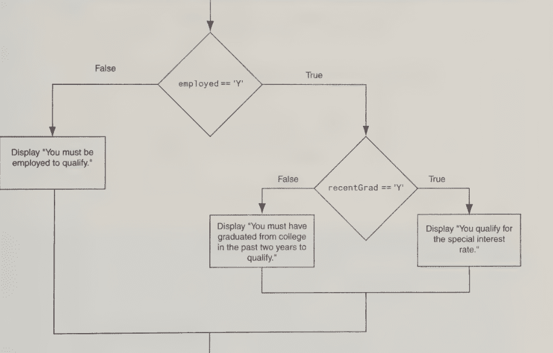

如果我们遵循流程图中的执行流，可以看到测试了表达式 `employed == 'Y'`。如果该表达式为假，则不需要进行进一步测试；我们知道客户不符合特殊利率。如果该表达式为真，我们需要测试第二个条件。使用一个测试表达式 `recentGrad == 'Y'` 的嵌套决策结构。如果该表达式为真，则客户符合特殊利率。如果该表达式为假，则客户不符合条件。程序 4-10 显示了完整程序的代码。

# 程序 4-10

# 加粗显示不同示例输入的程序输出

回答以下问题，
用 Y 表示是，用 N 表示否。
你是否在职？Y
你是否在过去两年内从大学毕业？Y
你符合特殊利率条件。

# 加粗显示不同示例输入的程序输出

回答以下问题，
用 Y 表示是，用 N 表示否。
你是否在职？Y
你是否在过去两年内从大学毕业？N

查看第 21 行开始的语句。它测试了表达式 `employed == 'Y'`。如果为真，则执行从第 23 行开始的语句。否则，程序跳转到第 29 行的 `return` 语句，程序结束。

注意在程序 4-10 的第二次执行中，程序输出并没有告知用户其是否符合特殊利率。如果用户在 `employed` 或 `recentGrad` 上输入 'N'（或除 'Y' 外的任何字符），程序不会打印消息让用户知道他不符合条件。一个 `else` 语句可以解决这个问题，如程序 4-11 所示。

# 4.5 嵌套 if 语句

# 程序 4-11

```cpp
// 此程序演示了嵌套 if 语句。

#include <iostream>

using namespace std;

int main() {

    char employed; // 目前在职，Y 或 N

    char recentGrad; // 最近毕业，Y 或 N

    // 用户是否在职且最近毕业？

    cout << "Answer the following questions?\n";

    cout << "with either Y for Yes or \n";

    cout << "N for No.\n";

    cout << "Are you employed? \n";

    cin >> employed;

    cout << "Have you graduated from college \n";

    cout << "In the past two years? \n";

    cin >> recentGrad;

    // 确定用户的贷款资格

    if (employed == 'Y') {

        if (recentGrad == 'Y') {

            cout << "You qualify for the special interest rate.\n";

        } else {

            cout << "You do not qualify for the special interest rate.\n";

        }

    } else {

        cout << "You do not qualify for the special interest rate.\n";

    }

    return 0;

}
```

你决定确定分级的过程需要几个嵌套的决策结构，如图 4-9 所示。程序 4-12 显示了完整程序的代码。嵌套决策结构的代码位于第 17 到 45 行。

## 图 4-9 用于确定分级的嵌套决策结构

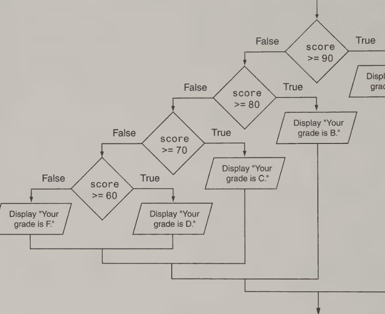

## 程序 4-12

```cpp
// 此程序使用嵌套的 if/else 语句为数字测试分数
// 分配等级（A, B, C, D 或 F）。

#include <iostream>

using namespace std;

int main() {

    // 分数阈值的常量

    const int A_SCORE = 90;

    const int B_SCORE = 80;

    const int C_SCORE = 70;

    const int D_SCORE = 60;

    int testScore; // 用于存储数字测试分数。

    cout << "Enter your numeric test score and I will\n";
```

## 4.5 If 语句中的嵌套

```cpp
cout << "tell you the letter grade you earned: ";

cin >> testScore;

// 确定字母等级。

if (testScore >= A_SCORE) {

    cout << "Your grade is A.\n";

} else {

    if (testScore >= B_SCORE) {

        cout << "Your grade is B.\n";

    } else {

        if (testScore >= C_SCORE) {

            cout << "Your grade is C.\n";

        } else {

            if (testScore >= D_SCORE) {

                cout << "Your grade is D.\n";

            } else {

                cout << "Your grade is F.\n";

            }

        }

    }

}

return 0;
```

**以粗体显示示例输入的程序输出**

Enter your numeric test score and I will
tell you the letter grade you earned: **78**
Your grade is C.

**以粗体显示不同示例输入的程序输出**

Enter your numeric test score and I will
tell you the letter grade you earned: **84**
Your grade is B.

# 检查点

4.15 如果你执行以下代码，当用户输入 5 时它会显示什么？
如果用户输入 15 呢？如果用户输入 30 呢？如果用户输入 -1 呢？

## 第 4 章 决策

```cpp
int number;

cout << "Enter a number: ";

cin >> number;

if (number > 0) {

    cout << "Zero\n";

    if (number > 10) {

        cout << "Ten\n";

        if (number > 20) {

            cout << "Twenty\n";

        }

    }

}
```

## 4.6 if/else if 语句

概念：`if/else if` 语句测试一系列条件。与嵌套的 `if/else` 语句相比，使用 `if/else if` 语句来测试一系列条件通常更简单。


尽管程序 4-12 是一个简单的示例，但嵌套决策结构的逻辑相当复杂。在 C++ 以及许多其他语言中，你也可以性地使用 `if/else if` 语句来测试一系列条件。`if/else if` 语句使得某些类型的嵌套决策逻辑编写起来更加简单。这里是 `if/else if` 语句的通用格式：

```cpp
if (expression_1) {

    statement
    statement
    etc.

} else if (expression_2) {

    statement
    statement
    etc.

} 根据需要插入多个 else if 子句

else {

    statement
    etc.

}
```

## 4.6 if/else 语句

当语句执行时，会测试 `expression_1`。如果 `expression_1` 为真，则执行紧随其后的语句，语句其余部分被忽略。如果 `expression_1` 为假，程序跳转到下一个 `else if` 子句并测试 `expression_2`。如果为真，执行紧随其后的语句，结构从顶部到底继续，直到发现某个表达式为真。如果没有任何表达式为真，最后一个 `else` 子句接管，并执行紧随其后的语句。

没有跟在 `if` 语句后面的最后一个 `else` 子句被称为 `trailing else`（尾随 else）。`trailing else` 是可选的，但在大多数情况下你会使用它。

> **注意：** 通用格式为每个条件执行的语句带有括号。在其他 `if` 语句形式中，只有当条件执行多个语句时才需要括号。程序 4-13 显示了 `if/else` 语句的示例。该程序是程序 4-12 的修改，出现在之前的部分。

## 程序 4-13

```cpp
// 此程序使用 if/else 语句为数字测试分数
// 分配等级（A, B, C, D 或 F）。

#include <iostream>

using namespace std;

int main() {

    // 分数阈值的常量

    const int A_SCORE = 90;

    const int B_SCORE = 80;

    const int C_SCORE = 70;

    const int D_SCORE = 60;

    int testScore; // 用于存储数字测试分数

    // 获取数字测试分数。

    cout << "Enter your numeric test score and I will\n";

    cout << "tell you the letter grade you earned: ";

    cin >> testScore;

    // 确定字母等级。

    if (testScore >= A_SCORE)

        cout << "Your grade is A.\n";

    else if (testScore >= B_SCORE)

        cout << "Your grade is B.\n";

    else if (testScore >= C_SCORE)

        cout << "Your grade is C.\n";

    else if (testScore >= D_SCORE)

        cout << "Your grade is D.\n";

    else

        cout << "Your grade is F.\n";

    return 0;

}
```

**以粗体显示示例输入的程序输出**

Enter your numeric test score and I will
tell you the letter grade you earned: **78**
Your grade is C.

**以粗体显示不同示例输入的程序输出**

Enter your numeric test score and I will
tell you the letter grade you earned: **84**
Your grade is B.

让我们来分析一下第 22 到第 31 行的 `if/else if` 语句是如何工作的。首先，在第 22 行测试表达式 `testScore >= A_SCORE`：

```cpp
if (testScore >= A_SCORE)

    cout << "Your grade is A.\n";

else if (testScore >= B_SCORE)

    cout << "Your grade is B.\n";

else if (testScore >= C_SCORE)

    cout << "Your grade is C.\n";

else if (testScore >= D_SCORE)

    cout << "Your grade is D.\n";

else

    cout << "Your grade is F.\n";
```

如果 `testScore` 大于等于 90，显示 "Your grade is A.\n"， 并跳过 `if/else` 语句的其余部分。如果 `testScore` 不大于或等于 90，第 24 行的 `else` 子句接管并执行下一个语句：

```cpp
if (testScore >= A_SCORE)

    cout << "Your grade is A.\n";

else if (testScore >= B_SCORE)

    cout << "Your grade is B.\n";

else if (testScore >= C_SCORE)

    cout << "Your grade is C.\n";

else if (testScore >= D_SCORE)

    cout << "Your grade is D.\n";

else

    cout << "Your grade is F.\n";
```

第一个语句处理所有大于或等于 90 的分数，因此当这个 `if` 语句执行时，`testScore` 的值将为 89 或以下。如果 `testScore` 大于等于 80，显示 "Your grade is B.\n"， 并跳过 `if/else` 语句的其余部分。这种执行链一直持续，直到发现某个表达式为真，或者遇到语句末尾的 `else` 子句。

注意在使用 `if/else if` 语句时使用的对齐和缩进：起始子句、`else if` 子句和尾随 `else` 子句全部对齐，而条件执行的语句则进行了缩进。

## 4.6 if/else 语句

### 使用尾随 else 捕获错误

出现在 `if/else` 语句末尾的尾随 `else` 子句是可选的，但在许多情况下你会使用它来捕获错误。例如，程序 4-13 会为输入的任何数字测试分数分配等级，包括负数。然而，如果输入了负测试分数，用户可能犯了错误。我们可以按照程序 4-14 所示修改代码，使尾随 `else` 捕获任何小于 0 的测试分数并显示消息。

## 程序 4-14

```cpp
// 此程序使用 if/else 语句为数字测试分数
// 分配等级（A, B, C, D 或 F）。

#include <iostream>

using namespace std;

int main() {

    // 分数阈值的常量

    const int A_SCORE = 90;

    const int B_SCORE = 80;

    const int C_SCORE = 70;

    const int D_SCORE = 60;

    int testScore; // 用于存储数字测试分数

    // 获取数字测试分数。

    cout << "Enter your numeric test score and I will\n"

         << "tell you the letter grade you earned: ";

    cin >> testScore;

    // 确定字母等级。

    if (testScore >= A_SCORE)

        cout << "Your grade is A.\n";

    else if (testScore >= B_SCORE)

        cout << "Your grade is B.\n";

    else if (testScore >= C_SCORE)
```


```cpp
cout << "Your grade is C.\n";

else if (testScore >= D_SCORE)

    cout << "Your grade is D.\n";

else if (testScore >= 0)

    cout << "Your grade is F.\n";

else

    cout << "Invalid test score.\n";

return 0;

}
```

## if/else if 语句与嵌套决策结构的比较

你永远不需要使用 `if/else if` 语句，因为它的逻辑可以通过嵌套的 `if/else` 语句来编码。然而，在调试代码时，长系列的嵌套 `if/else` 语句有两个特定的缺点：

- 代码可能会变得复杂且难以理解。
- 因为缩进在嵌套语句中至关重要，长系列的嵌套 `if/else` 语句可能会变得太长，导致无法在计算机屏幕上显示而无需进行水平滚动。此外，长语句在打印到纸上时往往会“换行”，使得代码更难以阅读。

`if/else if` 语句的逻辑通常比长系列的嵌套 `if/else` 语句更容易跟进。而且，由于 `if/else` 语句中的所有子句都是对齐的，语句中的行长度通常较短。

# 检查点

4.16 下面代码将显示什么？

```cpp
int funny = 7, serious = 15;

funny = serious % 2;

if (funny != 1) {

    funny = 0;

    serious = 0;

} else if (funny == 2) {

    funny = 10;

    serious = 10;

} else {

    funny = 1;

    serious = 1;

}

cout << funny << " " << serious << endl;
```

4.17 下列代码用于书店程序，以确定客户获得多少张优惠券。完成程序运行后出现的表格。

```cpp
int numBooks, numCoupons;

cout << "How many books are being purchased? ";

cin >> numBooks;

if (numBooks < 1) {

    numCoupons = 0;

} else if (numBooks < 3) {

    numCoupons = 1;

} else if (numBooks < 5) {

    numCoupons = 2;

else

    numCoupons = 3;

cout << "The number of coupons to give is "

<< numCoupons << endl;
```

如果客户购买这些数量的书，将给予相应数量的优惠券。

| 书的数量 | 给予的优惠券数量 |
|---|---|
| 1 | 1 |
| 3 | 2 |
| 4 | 2 |
| 5 | 3 |
| 10 | 3 |

## 4.7 标志 (Flags)

> **概念：** 标志是一个布尔或整数变量，用于信号某个条件的存在。

标志通常是一个 `bool` 变量，用于信号程序中是否存在某个条件。当标志变量被设置为 `false` 时，表示条件不存在。当标志变量被设置为 `true` 时，意味着条件确实存在。

例如，提议一个计算销售佣金的程序有一个 `bool` 变量，其定义和初始化所示：

```cpp
bool salesQuotaMet = false;
```

在程序中，`salesQuotaMet` 变量用作标志，指示销售人员是否达到了销售额。当我们定义变量时，将其初始化为 `false`，因为我们不知道销售人员是否已经达到了销售额。假设一个名为 `sales` 的变量持有销售额，可以使用类似代码来设置 `salesQuotaMet` 变量的值：

```cpp
if (sales >= QUOTA_AMOUNT)

    salesQuotaMet = true;

else

    salesQuotaMet = false;
```

由于这段代码的结果，`salesQuotaMet` 变量可以作为标志来指示是否已达到销售额。在程序的后续部分，我们可能会以以下方式测试标志：

```cpp
if (salesQuotaMet == true)

    cout << "You have met your sales quota!\n";
```

如果 `bool` 变量 `salesQuotaMet` 为 `true`，这段代码将显示 "You have met your sales quota!"。我们不需要使用 `==` 运算符来显式地比较 `salesQuotaMet` 与 `true` 值。这段代码等同于以下：

```cpp
if (salesQuotaMet)

    cout << "You have met your sales quota!\n";
```

## 整数标志

整数变量也可以用标志。这是因为在 C++ 中，值 `0` 被视为 `false`，而任何非零值都被视为 `true`。在所描述的销售佣金程序中，我们可以使用以下语句定义 `salesQuotaMet` 变量：

```cpp
int salesQuotaMet = 0; // means false.
```

与之前一样，我们用 `0` 初始化变量，因为我们不知道是否已经达到了额。在计算销售额后，我们可以使用类似代码来设置 `salesQuotaMet` 变量的值：

```cpp
if (sales >= QUOTA_AMOUNT)

   salesQuotaMet = 1;

else

   salesQuotaMet = 0;
```

在程序的后续部分，我们可能会以以下方式测试标志：

```cpp
if (salesQuotaMet)

    cout << "You have met your sales quota!\n";
```

> 概念：逻辑运算符将两个或多个关系表达式连接为一个，或者反转表达式的逻辑。

在上一节中，你看到了程序如何使用 `if` 语句测试两个条件。在本节中，你将看到如何使用逻辑运算符将两个或多个关系表达式合并为一个。表 4-6 列出了 C++ 的逻辑运算符。

## && 运算符

`&&` 运算符被称为逻辑与运算符。它接受两个表达式，并创建一个仅当两个子表达式都为真时才为真的表达式。这是一个使用 `&&` 运算符的语句示例：

```cpp
if (temperature < 20 && temperature > 12)

    cout << "You are in the danger";
```

在语句中，两个关系表达式合并为一个表达式。只有当温度小于 20 且大于 12 时，`cout` 语句才会执行。如果任何一个表达式为假，整个表达式即为假。

> 提示：你必须在 `&&` 运算符两侧提供完整的表达式。例如，下面的语句是不正确的，因为右侧不完整：

```cpp
if (temperature < 20 && 100)
```

`&&` 运算符可以简化原本需要嵌套 `if` 语句的程序。

## 表 4-7 && 运算符真表

| 表达式 | 表达式的值 |
|---|---|
| true && true | true (1) |
| true && false | false (0) |
| false && true | false (0) |
| false && false | false (0) |

> 注意：如果 `&&` 运算符左侧的表达式为假，则不会检查右侧。这被称为短路求值。

## 程序

```cpp
// 该程序演示了逻辑运算符。

#include <iostream>

using namespace std;

// 当前就业，Y 或 N

// 最近毕业，Y 或 N

char employed, recentGrad;

// 用户是否已就业且是应届？

int main() {

    // 回答以下问题

    // Y 表示是，N 表示否。

    cout << "Are you employed? ";

    cin >> employed;

    cout << "Have you graduated from college "

         << "in the past two years?";

    cin >> recentGrad;

    // Determine用户的资质。

    if (employed == 'Y' && recentGrad == 'Y')

    {

        cout << "You qualify for the special "

             << "interest rate.\n";

    }

    else

    {

        cout << "You must be employed and have\n"

              << "graduated from college in the\n"

              << "past two years to qualify.\n";

    }

    return 0;

}
```

## 程序 4-15 (继续)

```cpp
// ... (继续)

if (employed == 'Y' && recentGrad == 'Y')

{

    cout << "You qualify for the special "

         << "interest rate.\n";

    }

else

    {

        cout << "You must be employed and have\n"

              << "graduated from college in the\n"

              << "past two years to qualify.\n";

    }

}

// ...
```
*(注：由于原文提供的代码块 4.17 处存在明显的原始语法错误（如 else 缺少大括号和括号不匹配），翻译时保持了逻辑结构。)*

> 注意：尽管它们相似，但程序 4-15 并不是程序 4-11 的逻辑等价程序。例如，程序 4-15 不显示“你必须受雇才能符合资格”这一消息。

## || 运算符

`||` 运算符被称为逻辑或运算符。它接受两个表达式作为操作数，并创建一个当其中任一个子表达式为真时结果为真的表达式。以下是一个使用 `||` 运算符的 `if` 语句示例：

```cpp
if (temperature < 20 || temperature > 100)

cout << "The temperature is in the danger zone.";
```

如果 `temperature` 小于 20 **或者** `temperature` 大于 100，则执行 `cout` 语句。如果任何一个关系测试为真，整个表达式即为真，并执行 `cout` 语句。

> 提示：你必须在 `||` 运算符的双方都提供完整的表达式。例如，以下代码是不正确的，因为 `||` 运算符右侧的条件不是一个完整的表达式：
`temperature < 0 || > 100`

该表达式必须重写为：

```cpp
temperature < 0 || temperature > 100
```

表 4-8 显示了 `||` 运算符的真值表。

## 表 4-8 || 运算符的真值表

| 表达式 | 表达式的值 |
| :--- | :--- |
| true \|\| false | true (1) |
| false \|\| true | true (1) |
| false \|\| false | false (0) |
| true \|\| true | true (1) |

一个或表达式要为真的条件是其中一个子表达式为真。另一个子表达式是真还是假并不重要。

> 注意：`||` 运算符还执行短路求值。如果 `||` 表达式左侧的子表达式为真，则不会检查右侧的表达式。由于只需要一个子表达式为真，检查剩余表达式将浪费 CPU 时间。

程序 4-16 执行了不同的测试以判断某人是否符合贷款条件。此程序判断客户年收入是否至少达到 $35,000，或者工作是否已超过 5 年。

## 程序 4-16

```cpp
 // 此程序演示了逻辑 || 运算符。

#include <iostream>

using namespace std;

int main() {

    // 最小收入和年数的常量

    const double MIN_INCOME = 35000.0;

    const int MIN_YEARS = 5;

    double income; // 年收入

    int years; // 在当前工作的年限

    // 获取年收入

    cout << "What is your annual income? ";

    cin >> income;

    // 获取在当前工作的年限。

    cout << "How many years have you worked at ";

         << "your current job? ";

    cin >> years;

    // 用户的贷款资格。

    if (income >= MIN_INCOME || years > MIN_YEARS)

        cout << "You qualify.\n";

    else {

        cout << "You must earn at least $"

             << MIN_INCOME << " or have been "

             << "employed more than " << MIN_YEARS

             << " years.\n";

    }

    return 0;

}
```

## 程序输出（示例输入已加粗）

What is your annual income? **40000**
How many years have you worked at your current job? **2**
You qualify.

## 程序输出（示例输入已加粗）

What is your annual income? **20000**
How many years have you worked at your current job? **7**
You qualify.

## 程序输出（示例输入已加粗）

What is your annual income? **30000**
How many years have you worked at your current job? **3**
You must earn at least $35000 or have been employed more than 5 years.

# 第 4 章 决策

| 逻辑表达式 | 结果（真或假） |
|---|---|
| true && false | |
| true && true | |
| false && true | |
| false && false | |
| true \|\| false | |
| true \|\| true | |
| false \|\| true | |
| false \|\| false | |
| !true | |
| !false | |

4.19 假设变量 `a = 2, b = 4, 和 c = 6`。确定以下每个条件是否为真（True）或假（False）：

- A) `a == 4 || b > 2`
- B) `6 <= c && a > 3`
- C) `1 != b && c != 3`
- D) `a >= -1 || a <= b`
- E) `(a > 2)`

4.20 编写一个 `if` 语句，如果变量 `speed` 在 0 到 200 的范围内，则打印消息“The number is valid”。

4.21 编写一个 `if` 语句，如果变量 `speed` 在 0 到 200 的范围之外，则打印消息“The number is not valid”。


> 概念：你可以使用嵌套 `if/else` 语句或 `if/else if` 语句来创建菜单驱动程序。菜单驱动程序允许用户通过从操作列表中选择来决定行动方案。

菜单是一个显示一组选项的屏幕，用户从中进行选择。例如，一个管理邮件列表的程序可能会提供以下菜单：

- 向列表中添加姓名。
- 从列表中删除姓名。
- 更改列表中的一个姓名。
- 打印列表。
- 退出程序。

用户通过输入数字来选择其中一种操作。例如，输入 4 会导致打印邮件列表，输入 5 则导致程序结束。可以使用嵌套 `if/else` 语句或 `if/else` 结构来设置此类菜单。在用户输入数字后，程序会将该数字与可用选项进行比较，并执行执行该操作的语句。

程序 4-18 计算健康俱乐部会员的费用。俱乐部有三种会员方案供选择：标准成人会员、俱乐部会员和老年人会员。程序呈现一个菜单，允许用户选择所需的方案，然后计算会员费用。

# 程序 4-18

```cpp
 // 此程序显示一个菜单并要求用户做出

// 选择。使用一个 if/else if 语句来确定用户

// 选了哪一个项目。

#include <iostream>

#include <iomanip>

using namespace std;

int main()

{

    int choice; // 用于存储菜单选择

    int months; // 用于存储月份数

    double charges; // 用于存储月费

    // 会员费率常量

    const double ADULT = 40.0,

           SENIOR = 30.0,
```


# 程序 4-18（续）

```cpp
    else if (choice == SENIOR_CHOICE)
    {
        cout << "For how many months? ";
        cin >> months;
        charges = months * SENIOR;
        cout << "The total charges are $" << charges << endl;
    }
    else if (choice == QUIT_CHOICE)
    {
        cout << "Thank you for using the health club!" << endl;
    }
    else
    {
        cout << "Invalid selection. Please try again." << endl;
    }
    return 0;
}
```

**带有加粗示例输入的程序输出**
```
Health Club Membership Menu
1. Standard Adult Membership
2. Child Membership
3. Senior Citizen Membership
4. Quit the Program
Enter choice: 3
For how many months? 6
The total charges are $180.00
```

让我们仔细观察一下程序：
- 第 10–12 行定义了变量：`choice` 变量存储用户的选择；`months` 变量存储月份数；`charges` 变量存储月费。
- 第 15–17 行定义了成人、老年和儿童的费率常量。
- 第 20–23 行定义了菜单选择常量。
- 第 26–32 行显示菜单并获取选择。
- 第 38 行设置了数值输出格式。
- 第 40–43 行处理用户选择 `ADULT_CHOICE` 的情况。
- 第 47–50 行处理用户选择 `CHILD_CHOICE` 的情况。
- 第 54–57 行处理用户选择 `SENIOR_CHOICE` 的情况。
- 第 61 行处理用户选择 `QUIT_CHOICE` 的情况。
- 第 63–67 行通过 else 处理无效选择。

# 比较字符和字符串

概念：关系运算符也可以用于比较字符和字符串对象。

在本章之前，你已经学习了如何使用关系运算符来比较数值。它们也可以被用于比较字符和字符串对象。

## 比较字符

正如你在第 3 章中学到的，字符实际上是以整数的形式存储在内存中的。在大多数系统中，这个整数是该字符的 ASCII 值。例如，字母 'A' 由数字 65 表示，字母 'B' 由数字 66 表示，依此类推。表 4-11 显示了与一些常用字符对应的 ASCII 码。

### 表 4-11 常用字符的 ASCII 值

| 字符 | ASCII 值 |
|---|---|
| '0'-'9' | 48–57 |
| 'A'-'Z' | 65–90 |
| 'a'-'z' | 97–122 |
| 空格 | 32 |
| 句号 | 46 |

注意每个字符（即使是空格）都有相关的 ASCII 码。同样注意，表示数字（如 '1' 或 '2'）的字符的 ASCII 值与其数字本身的值并不相同。所有字符的 ASCII 完整表格可以在附录 A 中找到。

比较两个字符时，实际上比较的是它们的 ASCII 值。'A' < 'B' 是因为 'A' 的 ASCII 值 (65) 小于 'B' 的 ASCII 值 (66)。同样，'1' < '2' 是因为 '1' 的 ASCII 值 (49) 小于 '2' 的 ASCII 值 (50)。然而，如表 4-11 所示，小写字母的 ASCII 值大于大写字母，因此 'a' > 'Z'。程序 4-20 显示了如何使用关系运算符比较字符。

## 程序 4-20

```cpp
// 此程序演示了如何使用关系运算符
// 对字符进行比较。

#include <iostream>

using namespace std;

int main()
{
    char ch;

    // 从用户处获取一个字符。
    cout << "Enter a digit or a letter: ";
    ch = cin.get();

    // 判断用户输入的内容。
    if (ch >= '0' && ch <= '9')
        cout << "You entered a digit.\n";
    else if (ch >= 'A' && ch <= 'Z')
        cout << "You entered an uppercase letter.\n";
    else if (ch >= 'a' && ch <= 'z')
        cout << "You entered a lowercase letter.\n";
    else
        cout << "That is not a digit or a letter.\n";

    return 0;
}
```

### 示例输入加粗显示的程序输出
```
Enter a digit or a letter: 5
You entered a digit.
```

### 示例输入加粗显示的程序输出
```
Enter a digit or a letter: A
You entered an uppercase letter.
```

### 示例输入加粗显示的程序输出
```
Enter a digit or a letter: a
You entered a lowercase letter.
```

### 示例输入加粗显示的程序输出
```
Enter a digit or a letter: *
That is not a digit or a letter.
```

## 比较字符串对象

字符串对象也可以用关系运算符比较。与单个字符一样，当比较两个字符串时，实际上比较的是构成字符串的字符的 ASCII 值。例如，假设有以下定义：

```cpp
string str1 = "ABC";
string str2 = "XYZ";
```

字符串对象 `str1` 被认为小于字符串对象 `str2`，因为字符 "ABC" 在字母顺序上于字符 "XYZ"（ASCII 值较低）。因此，`if` 语句将在屏幕上显示消息“str1 is less than str2.”。

```cpp
if (str1 < str2)
    cout << "str1 is less than str2.";
```

## 4.12 比较字符和字符串

逐个将第一个操作数中的每个字符与第二个操作数中对应位置的字符进行比较。如果两个字符串对象中的所有字符都匹配，则这两个字符串相等。如果对应位置的两个字符不匹配，就可以确定其他关系。如果第一个操作数中第一个不匹配的字符小于其在第二个操作数中的对应字符，则第一个操作数小于第二个操作数。同样，如果第一个操作数中第一个不匹配的字符大于其在第二个操作数中的对应字符，则第一个操作数大于第二个操作数。

例如，假设程序有以下定义：

```cpp
string name1 = "Mary";
string name2 = "Mark";
```

`name1` 中的值 "Mary" 大于 `name2` 中的值 "Mark"。这是因为 `name1` 中的前三个字符与 `name2` 中的前三个字符的 ASCII 值相同，但 "Mary" 第四个位置的 'y' 的 ASCII 值大于 "Mark" 对应位置的 'k'。

任何关系运算符都可以用于比较两个字符串。这里是 `name1` 和 `name2` 的某些比较：

```cpp
name1 > name2 // 真
name1 <= name2 // 假
name1 != name2 // 真
```

字符串对象也可以与字面量比较。程序 4-21 演示了如何将关系运算符用于字符串对象。

```cpp
#include <iostream>
#include <string>

using namespace std;

int main() {
    string name1, name2;

    cout << "Enter first name: ";
    cin >> name1;
    cout << "Enter second name: ";
    cin >> name2;

    if (name1 > name2)
        cout << name1 << " is greater than " << name2 << endl;
    else if (name1 <= name2)
        cout << name1 << " is less than or equal to " << name2 << endl;
    else if (name1 != name2)
        cout << name1 << " is not equal to " << name2 << endl;

    return 0;
}
```

# 4.13 条件运算符

概念：你可以使用条件运算符创建类似于 if/else 语句的短表达式。

条件运算符非常强大。它提供了一种表示简单 if/else 语句的快捷方法。该运算符由问号（?）和冒号（:）组成。其格式为：

```cpp
表达式 ? 表达式 : 表达式;
```

这是一个使用条件运算符的语句示例：

```cpp
x < 0 ? y = 10 : z = 20;
```

上述语句被称为条件表达式，它由 ? 和 : 分隔的三个子表达式组成。所示，表达式为 `x < 0`、`y = 10` 和 `z = 20`。

> 注意：由于它接受三个操作数，条件运算符被视为三元运算符。

上述条件表达式执行的操作与以下 if/else 语句相同：

```cpp
if (x < 0)
    y = 10;
else
    z = 20;
```

条件表达式中位于问号之前的部分是要测试的表达式。它类似于 if 语句括号中的表达式。如果表达式为真，则执行语句中 ? 和 : 之间的部分。否则，执行冒号后面的部分。图 4-10 展示了这三个子表达式所扮演的角色。

如果有帮助，你可以像下面这样给子表达式加上圆括号：

```cpp
(x < 0) ? (y = 10) : (z = 20);
```

## 使用条件表达式的值

记住，在 C++ 中，所有表达式都有值，这对于条件表达式也是如此。如果第一个子表达式为真，则条件表达式的值为第二个子表达式的值。否则，它是第三个子表达式的值。这是一个使用条件表达式值的赋值语句示例：

```cpp
a = x > 100 ? 0 : 1;
```

赋值给 `a` 的值将是 0 或 1，取决于 `x` 是否大于 100。该语句可以使用 `if/else` 语句表示：

```cpp
if (x > 100)
    a = 0;
else
    a = 1;
```

程序 4-22 可以帮助顾问计算她的费用。她的费率是每小时 $50.00，但最低收费标准为 5 小时。条件运算符用于一个语句中，确保小时数不会低于 5。

## 程序 4-22

```cpp
// 此程序计算顾问每小时 $50 的费用，
// 最少收费 5 小时。如果工作时间小于 5 小时，
// ? : 运算符会将小时调整为 5。

#include <iostream>
#include <iomanip>

using namespace std;

int main()
{
    const double PAY_RATE = 50.0; // 小时费率
    const int MIN_HOURS = 5; // 最少计费小时
    double hours, charges;

    // 获取工作小时数。
    cout << "How many hours were worked?" << endl;
    cin >> hours;

    // 确定收费的小时。
    hours = hours < MIN_HOURS ? MIN_HOURS : hours;

    // 计算并显示费用。
    charges = PAY_RATE * hours;
    cout << setprecision(2) << "The charges are $" << charges << endl;

    return 0;
}
```

### 示例输入加粗显示的程序输出
```
How many hours were worked? 10
The charges are $500.00
```

### 示例输入加粗显示的程序输出
```
How many hours were worked? 2
The charges are $250.00
```

注意第 15 行定义了一个常量 `MIN_HOURS` 来表示最小小时数，即 5 小时。这里是第 20 行带有条件表达式的语句：

```cpp
hours = hours < MIN_HOURS ? MIN_HOURS : hours;
```

如果 `hours` 中的值小于 5，则将 5 存储在 `hours` 中。否则，`hours` 被赋予它原有的值。当在下一个计算顾问费用的语句中使用 `hours` 变量时，该变量的值不会小于 5。

如你所见，条件运算符让你能够将决策权浓缩到一行简洁的代码中。只要稍加想象力，它可以应用于许多其他编程问题。例如，考虑以下语句：

```cpp
cout << "Your grade: " << (score < 60 ? "Fail." : "Pass.");
```

如果你使用 `if/else` 语句，上面的语句将写如下：

```cpp
if (score < 60)
    cout << "Your grade is: Fail."\n;
else
    cout << "Your grade is: Pass.";
```

> 注意：圆括号放在条件表达式周围，是因为 `<<` 运算符的优先级高于 `?:`。如果没有圆括号，将只有表达式 `score < 60` 的值会被发送给 `cout`。

# 检查点

将以下 `if/else` 语句重写为条件表达式：

- A) if (x > y)
      z = 1;
    else
      z = 20;
- B) if (temp > 45)
      population = base * 10;
    else
      population = base * 2;
- C) if (hours > 40)
      wages *= 1.5;
    else
      wages *= 1;
- D) if (result >= 0)
      cout << "The result is positive\n";
    else
      cout << "The result is negative.\n";

4.25 以下语句使用了条件表达式。请用 `if/else` 语句重写每个。

- A) j = k > 90 ? 57 : 12;
- B) factor = x >= 10 ? y * 22 : y * 35;
- C) total + count == 1 ? sales : count * sales;
- D) cout << ((num % 2) == 0) ? "Even\n" : "Odd\n";

4.26 以下程序将显示什么？

```cpp
#include <iostream>

using namespace std;

int main() {
```


## 4.14 switch 语句

概念：`switch` 语句允许程序跳转到多个路径之一。当变量的值与常量之一匹配时，`switch` 语句即可工作。其格式如下：

```cpp
switch (expression)
{
    case ConstantExpression:
        // 在此处放置语句
    case ConstantExpression:
        // 在此处放置语句
    default:
        // 在此处放置语句
}
```

### 示例：缺少 break 语句的 switch

```cpp
10 cout << "Enter A, B, or C: ";
11 cin >> choice;
// The following switch is missing its break statements!
14 switch (choice)
15 {
16 case 'A': cout << "You entered A.\n";
17 case 'B': cout << "You entered B.\n";
18 case 'C': cout << "You entered C.\n";
19 default: cout << "You did not enter A, B, or C!\n";
20 }
21 return 0;
```

#### 程序输出（示例输入已加粗）

**Enter A, B, or C: A Enter**
You entered A.
You entered B.
You entered C.
You did not enter A, B, or C!

**Enter A, B, or C: C Enter**
You entered C.
You did not enter A, B, or C!

如果没有 `break` 语句，程序将“贯透”（falls through）执行匹配 case 之后的所有语句。有时这正是你所需要的。程序 4-25 列出了客户可以选择的 3 种电视型号的功能。100 型带有遥控器。200 型带有遥控器和立体声。300 型带有遥控器、立体声和画中画功能。该程序使用精心省略了 `break` 的 switch 语句来打印所选型号的功能。

### 程序 4-25

```cpp
1 // 此程序经过精心构造，以使用 switch 语句的
2 // “贯透”功能。
3 #include <iostream>
4 using namespace std;
5
6 int main()
7 {
8     int modelNum; // 型号
9
10 // 从用户处获取型号。
11 cout << "Our TVs come in three models:\n";
12 cout << "The 100, 200, and 300. Which do you want? ";
13 cin >> modelNum;
14
15 // 显示型号的功能。
16 cout << "\tThat model has the following features:\n";
17 switch (modelNum)
18 {
19     case 300: cout << "\tPicture-in-a-picture.\n";
20     case 200: cout << "\tStereo sound.\n";
21     case 100: cout << "\tRemote control.\n";
22         break;
23     default: cout << "\tYou can only choose the 100,\n";
24         cout << "\t200, or 300.\n";
25
26     return 0;
27 }
}
```

#### 程序输出（示例输入已加粗）

**Our TVs come in three models:
The 100, 200, and 300. Which do you want? 100 Enter**
That model has the following features:
Remote control.

**Our TVs come in three models:
The 100, 200, and 300. Which do you want? 200 Enter**
That model has the following features:
Stereo sound.
Remote control.

**Our TVs come in three models:
The 100, 200, and 300. Which do you want? 300 Enter**
That model has the following features:
Picture-in-a-picture.
Stereo sound.
Remote control.

**Our TVs come in three models:
The 100, 200, and 300. Which do you want? 500 Enter**
That model has the following features:
You can only choose the 100, 200, or 300.

另一个展示这种“贯透”能力用处的例子是：当你想要程序针对多个 case 表达式跳转到同一组语句时。例如，程序 4-26 要求你选择宠物食品的等级。可选范围有 A、B 和 C。switch 语句可以识别大写或小写的 case。

### 程序 4-26

```cpp
1 // 该程序中的 switch 语句使用“贯透”
2 // 特性来捕获用户输入的大写和小写字母。
3 #include <iostream>
4 using namespace std;
5
6 int main()
7 {
8     char feedGrade;
9
10 // 获取所需的饲等级。
11 cout << "Our pet food is available in three grades:\n";
12 cout << "A, B, and C. Which do you want pricing for? ";
13 cin >> feedGrade;
14
15 // 显示价格。
16 switch(feedGrade)
17 {
18 case 'a':
19 case 'A': cout << "30 cents per pound.\n";
20     break;
21 case 'b':
22 case 'B': cout << "20 cents per pound.\n";
23     break;
24 case 'c':
25 case 'C': cout << "15 cents per pound.\n";
26     break;
27 default: cout << "That is an invalid choice.\n";
28     return 0;
29 }
}
```

#### 程序输出（示例输入已加粗）

**Our pet food is available in three grades:
A, B, and C. Which do you want pricing for? b Enter**
20 cents per pound.

**Our pet food is available in three grades:
A, B, and C. Which do you want pricing for? B Enter**
20 cents per pound.

当用户输入 `'a'` 时，对应的 case 没有关联的语句，程序将贯透到下一个对应 `'A'` 的 case。

```cpp
case 'a':
case 'A': cout << "30 cents per pound.\n";
break;
```

相同的技术也适用于 `'b'` 和 `'c'`。

### 在菜单系统中使用 switch

`switch` 语句是构建菜单系统的自然机制。回想程序 4-18 提供了一个菜单让用户选择想要购买的健身俱乐部套餐。该程序使用 `switch` 语句而不是 `if/else` 来确定选择了哪一项。

## 4.15 关于块和变量作用域

概念：变量的作用域局限于其定义所在的块。

C++ 允许你在程序中的几乎任何地方创建变量。程序 4-28 是程序 4-17 的修改版本，用于判断用户是否符合贷款条件。`income` 和 `years` 变量的定义被移动到了程序的后靠位置。

### 程序 4-28

```cpp
1 // 此程序演示了变量后定义
2 #include <iostream>
3 using namespace std;
4
5 int main()
6 {
7     // 最小收入和年限的常量
8     double MIN_INCOME = 35000.0;
9     const int MIN_YEARS = 5;
10
11     // 获取年收入。
12     cout << "What is your annual income? ";
13     double income; // 变量定义
14     cin >> income;
15
16     // 获取当前工作的年限。
17     cout << "How many years have you worked at"
18         << "your current job? ";
19     int years; // 变量定义
20     cin >> years;
21
22     // 判断用户的贷款资格。
23     if (income >= MIN_INCOME && years > MIN_YEARS)
24         cout << "You qualify.\n";
25     else
26     {
26         cout << "You must earn at least $"
27             << MIN_INCOME << " or have been"
28             << "employed more than " << MIN_YEARS
29             << " years.\n";
30     }
31     return 0;
32 }
```

在函数的开头定义函数的所有变量是一种常见做法。有时，特别是在较长的程序中，在靠近使用它们的地方定义变量是一个好主意。这使得变量的用途更加明显。

回想第 2 章，变量的作用域被定义为变量可能被使用的程序部分。

在程序 4-28 中，`income` 变量的作用域是程序第 13 到 32 行的部分。`years` 变量的作用域是程序第 19 到 32 行的部分。

变量 `income` 和 `years` 被定义在函数 `main` 的大括号内部。在一组括号内部定义的变量具有局部作用域（local scope）或块作用域（block scope）。它们只能在定义处到块的结束括号之间的程序部分使用。

你可以在任何块内部定义变量。例如，查看程序 4-29。贷款程序的版本将 `years` 变量定义在 `if` 语句的块内部。`years` 的作用域是程序第 21 到 31 行的部分。

### 程序 4-29

```cpp
1  // 此程序演示了在内部块中定义的变量。
2  #include <iostream>
3  using namespace std;
4
5  int main() {
6      // 最小收入和年限的常量
7      const double MIN_INCOME = 35000.0;
8      const int MIN_YEARS = 5;
9
10     // 获取年收入。
11     cout << "What is your annual income ? ";
12     double income; // 变量定义
13     cin >> income;
14
14     if (income >= MIN_INCOME) {
15         // 获取当前工作的年限。
16         cout << "How many years have you worked at "
17             << "your current job ? ";
18         int years; // 变量定义
19         cin >> years;
20
20         if (years > MIN_YEARS) {
21             cout << "You qualify.\n";
22         }
23         else
24         {
25             cout << "You must have been employed for\n";
26                 << "more than " << MIN_YEARS
27                 << " years to qualify.\n";
28         }
29     }
30     else
31     {
32         cout << "You must earn at least $" << MIN_INCOME
33             << " to qualify.\n";
34     }
35     return 0;
36 }
```

注意 `years` 的作用域仅限于其被定义的块内。该变量在定义之前或块的结束括号之后都是不可见的。对于任何定义在一组括号内部的变量都是如此。

**注意：** 当程序运行并进入构成变量作用域的代码段时，称该变量*进入了作用域*（comes into scope）。这简单意味着该变量现在是可见的，程序可以引用它。同样，当变量离开作用域或超出作用域（goes out of scope）时，它可能不再被使用。

### 同名变量

当一个块嵌套在另一个块内部时，内部块定义的变量可能与外部块定义的变量具有相同的名称。只要内部块中的变量是可见，外部块中的变量就会被隐藏。这可以通过程序 4-30 来说明。

### 程序 4-30

```cpp
// 此程序使用了同名的变量。
#include <iostream>
using namespace std;

int main() {
    // 定义一个名为 number 的变量。
    int number;

    cout << "Enter a number greater than 0: ";
    cin >> number;

    if (number > 0) {
        int number; // 另一个名为 number 的变量。
        cout << "Now enter another number: ";
        cin >> number;

        cout << "The second number you entered was " << number << endl;
    }

    cout << "Your first number was " << number << endl;
    return 0;
}
```


# 输出示例

```
Enter a number greater than 0: 2
Now enter another number: 7
The second number you entered was 7
Your first number was 2
```

程序 4-30 有两个独立的 `number` 变量。属于 `if` 语句块的 `cin` 和 `cout` 语句只能与该块定义的 `number` 配合。一旦程序离开该块，内部的 `number` 就超出了作用域，从而显示出外部的 `number`。

> **警告！** 在嵌套块中定义变量是完全可以的，但应避免给它们起相同的名称。案例研究：参见 pearson.com 上的计算机科学。

## 复习题

### 简答

1. 描述 `if/else` 语句与一系列 `if` 语句之间的区别。
2. 在 `if/else` 语句中，结尾 `else` 的作用是什么？
3. 什么是标志（flag），它是如何工作的？
4. `if` 语句可以测试关系表达式吗？解释。
5. 简述 `&&` 运算符是如何工作的。
6. 简述 `||` 运算符是如何工作的。
7. 为什么关系运算符被称为关系（relational）？
8. 为什么大多数程序员在决策结构中对条件执行的语句进行缩进？

### 填空

9. 使用大于、小于、等于或不等于表达式被称为 ________ 表达式。
10. 关系表达式是 ________ 或 ________。
11. 如果表达式为 ________，则关系表达式的值为 0。
12. `if` 语句将非零值视为 ________。
13. 为了让 `if` 语句条件地执行一组语句，必须封装在 ________ 中。
14. 在 `if/else` 语句中，如果表达式为 ________，则 `if` 部分执行语句块；如果表达式为 ________，则 `else` 部分执行语句块。
15. `if/else` 语句中的结尾 `else` 与 `switch` 语句的 ________ 部分目的相似。

### 算法工作

17. `if/else` 语句实际上是 ________ 语句的形式。
18. 如果 ________ 运算符左侧的表达式为假，则不检查右侧表达式。
19. 如果 ________ 运算符左侧的表达式为真，则不检查右侧表达式。
20. ________ 逻辑运算符的优先级高于其他逻辑运算符。
21. 逻辑运算符具有 ________ 结合性。
22. ________ 运算符在测试数字是否在范围内效果最好。
23. ________ 运算符在测试数字是否在范围之外效果最好。
24. 具有 ________ 作用域的变量仅当程序执行包含变量定义的块时可见。
25. 你使用 ________ 运算符来确定一个字符串对象大于另一个字符串对象。
26. 使用条件运算符的表达式被称为 ________ 表达式。
27. `switch` 语句测试的表达式必须具有 ________ 值。
28. `case` 语句后的表达式必须是 ________
29. 如果缺少 ________ 语句，程序将“穿透”（fall through）case 块。
30. 执行以下语句后，变量 `t` 中将存储什么值？
    A) `t = (12 > 1);`
    B) `t = (2 < 0);`
    C) `t = (5 == (3 * 2));`
    D) `t = (5 == 5);`

31. 写一个 `if` 语句，当 `y` 等于 0 时给 `x` 赋值 100。
32. 写一个 `if/else` 语句，当 `y` 等于 0 时给 `x` 赋值 0。否则，它应该给 `x` 赋值 1。
33. 使用下表写一个 `if/else` 语句，根据销售额的值给佣金（commission）赋值 .10、.15 或 .20。

| 销售额 | 佣金率 |
| :--- | :--- |
| 高达 $10,000 | 10% |
| $10,000 到 $15,000 | 15% |
| 超过 $15,000 | 20% |

34. 写一个 `if` 语句，当标志变量 `minimum` 被设置时，将变量 `hours` 设置为 10。
35. 写嵌套 `if` 语句执行以下测试：如果 `amount1` 大于 10 且 `amount2` 小于 100，显示两者较大者。

36. 编写一个 `if` 语句，如果变量 `grade` 在 0 到 100 的范围内，则打印消息 "The number is valid" 。

37. 编写一个 `if` 语句，如果变量 `temperature` 在 -50 到 150 的范围内，则打印消息 "The number is valid" 。

38. 编写一个 `if` 语句，如果变量 `hours` 在 0 到 80 的范围之外，则打印消息 "The number is not valid" 。

39. 假设 `str1` 和 `str2` 是已经初始化了不同值的字符串对象。编写一个 `if/else` 语句来比较这两个对象，并显示其中字母顺序上最大的那一个。

40. 将该 `if/else` 语句转换为 `switch` 语句：

```cpp
if (choice == 1)
    cout << fixed << showpoint << setprecision(2);
else if (choice == 2 || choice == 3)
    cout << fixed << showpoint << setprecision(4);
else if (choice == 4)
    cout << fixed << showpoint << setprecision(8);
```

41. 将条件表达式与执行相同操作的 `if/else` 语句匹配。

+   A) `q = x < y ? a + b : x * 2;`
    B) `q = x < y ? x * 2 : a + b;`
    C) `x < y ? q = 0 : q = 1;`

```cpp
if (x < y)
    q = 0;
else
    q = 1;

if (x < y)
    q = a + b;
else
    q = x * 2;

if (x < y)
    q = x * 2;
else
    q = a + b;
```

### 判断对错

42. **F** 当在布尔表达式中使用运算符时，`!` 运算符和 `==` 运算符执行的是相同的操作。
43. **F** 在内部块中定义的变量其名称不能与在外部块中定义的变量同名。
44. **T** 条件执行的语句应该比 `if` 语句缩进一个层次。
45. **T** 块中的所有行都应该缩进一个层次。
46. **F** 假设所有未初始化的变量自动以 0 作为初始值是安全的。
47. **F** 当一个 `if` 语句嵌套在另一个语句的 `if` 部分时，只有当外部 `if` 的表达式为真时，才会执行唯一的内部的 `if`。
48. **F** 当一个 `if` 语句嵌套在另一个语句的 `else` 部分时（如 `if/else if`），只有当外部 `if` 的表达式为真时，才会执行唯一的内部的 `if`。
49. **T** 变量的作用域仅限于定义它的所在块。
50. **F** 你可以使用关系运算符来比较字符串对象。
51. **T** `x != y` 等于 `(x > y) || x < y`
52. **F** `y < x` 等于 `x >= `
53. **F** `x >= y` 等于 `(x > y) && x == y`

假设 `x = 5`, `y = 6`, `z = 8`。通过圈出 T 或 F 来指示以下每个条件为真还是假：

54. **T** `x == 5 || y > 3`
55. **T** `x <= z && z != 4`
56. **F** `y != y && z != 4`
57. **T** `x > 0 || x <= y`

# 找错误

以下每个程序都有错误。请尽可能多地找出。

## 58.

```cpp
// 此程序计算 3 个测试分的平均分。
// 它使用变量 perfectScore 作为一个标记。

#include <iostream>
using namespace std;

int main() {
    cout << "Enter your 3 test scores and I will ";
    cout << "average:";

    int score1, score2, score3;
    cin >> score1 >> score2 >> score3;

    double average;
    average = (score1 + score2 + score3) / 3.0;

    if (average = 100) // 设置标记变量
        bool perfectScore = true; 
    cout << "Your average is " << average << endl;

    if (perfectScore) {
        cout << "Congratulations!\n";
        cout << "That's a perfect score.\n";
        cout << "You deserve a pat on the back!\n";
        return 0;
    }
}
```

## 59.

```cpp
// 此程序将用户提供的数字除以另一个
// 用户提供的数字。它检查除以零的情况。
#include <iostream>
using namespace std;

int main() {
    double num1, num2, quotient;

    cout << "Enter a number: ";
    cin >> num1;

    cout << "Enter another number: ";
    cin >> num2;

    if (num2 == 0)
        cout << "Division by zero is not possible.\n";
        cout << "Please run the program again ";
        cout << "and enter a number besides zero.\n";
    else {
        quotient = num1 / num2;
        cout << "The quotient of " << num1 << 
        cout << " divided by " << num2 << " is ";
        cout << quotient << endl;
    }

    return 0;
}
```

## 60.

```cpp
// 此程序使用 if/else 语句为数字测试分分配
// 级（A, B, C, D 或 F）。
#include <iostream>
using namespace std;

int main() {
    int testScore;
    cin >> testScore;

    if (testScore < 60)
        cout << "Your grade is F.\n";
    else if (testScore < 70)
        cout << "Your grade is D.\n";
    else if (testScore < 80)
        cout << "Your grade is C.\n";
    else if (testScore < 90)
        cout << "Your grade is B.\n";
    else {
        cout << "That is valid.\n";
        if (testScore <= 100)
            cout << "Your grade is A.\n";
    }

    return 0;
}
```

## 61.

```cpp
// 此程序使用 switch 语句为数字测试分分配
// 等级（A, B, C, D 或 F）。
#include <iostream>
using namespace std;

int main() {
    double testScore;

    cout << "Enter your score and I will tell you ";
    cout << "the grade you earned: ";
    cin >> testScore;

    switch (testScore) {
        case testScore < 60.0:
            cout << "F\n";
            break;
        case testScore < 70.0:
            cout << "D\n";
            break;
        case testScore < 80.0:
            cout << "C\n";
            break;
        case testScore < 90.0:
            cout << "B\n";
            break;
        case testScore <= 100.0:
            cout << "A\n";
            break;
        default:
            cout << "not valid\n";
    }

    return 0;
}
```

62. 下述语句判断 `x` 是否大于 20。哪里错了？
`if (x > 20)`

63. 下述语句判断 `count` 是否在 0 到 100 的范围内。哪里错误？
`if (count >= 0 || count <= 100)`

64. 下述语句判断 `count` 是否在 0 到 100 的范围外。哪里错误？
`if (count < 0 && count > 100)`

65. 下述语句如果 `a` 小于 10，则给 `z` 赋值 0，否则赋值 7。哪里错误？
`z = (a < 10) ? 0 : 7;`

# 编程挑战

## 1. 最小/最大

编写一个程序，让用户输入两个数字。程序使用条件运算符判断哪个数字较小，哪个较大。

## 2. 罗马数字转换器

编写一个程序，让用户输入一个 1 到 10 之间的数字。使用 `switch` 语句显示该数字的罗马数字。输入验证：不接受小于 1 或大于 10 的数字。

## 3. 魔日期

6月10日很特殊，当我们按照以下格式写时，月份乘以日期等于年份：6/10/60。编写一个程序，让用户输入月份（数字）、日期和两位数的年份。程序判断月份乘以日期是否等于年份。如果是，则显示消息该日期是魔幻；否则，显示消息该日期不是魔幻。

## 4. 矩形面积

矩形的面积是长度乘以宽度。编写一个程序，获取两个矩形的长度和宽度。程序应告诉用户哪个矩形的面积更大，如果面积相等。

## 5. 体质指数

编写一个程序计算并显示人的体质量指数（BMI）。BMI 通常用于判断一个人的身高是否超重或体重减轻。人的 BMI 使用以下公式计算：

```
BMI = weight × 703 / height²
```

其中体重以磅为单位，身高以英寸为单位。程序应显示人的体重是理想、体重减轻还是超重。如果 BMI 在 18.5 到 25 之间，则人的体重被认为是理想。如果 BMI 小于 18.5，则被认为体重减轻。如果 BMI 值大于 25，则被认为超重。

## 6. 质量与重量

科学家用千克测量质量，用牛顿测量重量。如果你知道物体的质量，可以使用以下公式计算其重量（牛顿）：

```
Weight = mass × 9.8
```

编写一个程序让用户输入物体的质量，然后计算并显示其重量。如果物体重量超过 1000 牛顿，显示消息其太重；如果重量少于 10 牛顿，显示消息其太轻。

## 7. 时间计算器

编写一个程序，要求用户输入秒数。

- 一分钟有 60 秒。如果用户输入的秒数大于或等于 60，程序应显示该秒数对应的分钟数。
- 一小时有 3600 秒。如果用户输入的秒数大于或等于 3600，程序应显示该秒数对应的小时。
- 一天有 86400 秒。如果用户输入的秒数大于或等于 86400，程序应显示该秒数对应的日数。

## 8. 颜色混合

红色、蓝色和黄色是原色，因为它们不能通过混合其他颜色形成。当你混合两种原色时，你会得到一种间色，如下所示：

- 混合红色和蓝色，你会得到紫色。
- 混合红色和黄色，你会得到橙色。
- 混合蓝色和黄色，你会得到绿色。

编写一个程序，提示用户输入要混合的两种原色的名称。如果用户输入的不是“red”（红）、“blue”（蓝）或“yellow”（黄），程序应显示错误信息。否则，程序应显示混合两种原色后得到的间色名称。

## 9. 美元找零游戏

编写一个找零计数游戏，让用户输入硬币数量以凑成整美元。程序要求用户输入分币（pennies）、镍币（nickels）、角币（dimes）和四角（quarters）的数量。如果输入的硬币总价值等于美元，程序将祝贺用户赢了。否则，程序将显示消息指示输入的金额是大于还是少于美元。

## 10. 一个月的天数

编写一个程序，要求用户输入月份（允许输入 1 到 12 之间的整数）和年份。程序应显示该月份的天数。使用以下标准来识别闰年：

- 判断年份是否能被 100 整除。如果是，则只有当它能被 400 整除时，才是闰年。例如，2000 年是闰年，但 2100 年不是。
- 如果年份不能被 100 整除，则只有当它能被 4 整除时，才是闰年。
- 例如，2008 年是闰年，但 2009 年不是。

以下是程序的运行示例：

```
Enter a month (1–12): 2 Enter
Enter a year: 2008 Enter
29 days
```


# 编程挑战题集

## 11. 数学导师

这是第 3 章第 17 编程挑战的修改版。编写一个可以作为小学生数学导师的程序。程序应显示两个要相加的随机数，例如：

```
  247
+ 129
```

程序等待学生输入答案。如果答案正确，将打印一条祝贺消息。如果答案错误，将打印一条显示正确答案的消息。

## 12. 软件销售

一家软件公司销售零售价为 99 美元的软件包。根据下表提供数量折扣。

| 数量 | 折扣 |
| :--- | :--- |
| 10–19 | 20% |
| 20–49 | 30% |
| 50–99 | 40% |
| 100 或更多 | 50% |

编写一个程序，询问销售数量并计算购买的总成本。

**输入验证**：确保数量大于 0。

## 13. 书店俱乐部积分

Serendipity 书店拥有一个书店俱乐部，根据客户每月购买书籍的数量向其发放积分。积分规则如下：

- 如果客户购买 0 本书，则获得 0 分。
- 如果客户购买 1 本书，则获得 5 分。
- 如果客户购买 2 本书，则获得 15 分。
- 如果客户购买 3 本书，则获得 30 分。
- 如果客户购买 4 本或更多书籍，则获得 60 分。

编写一个程序，询问用户本月购买的书的数量，然后显示的积分。

## 14. 银行费用

银行对商业支票账户每月收取 10 美元费用，加上以下支票费用：

- 少于 20 张支票：10 美元
- 20–39 张支票：08 美元
- 40–59 张支票：06 美元
- 60 张或更多支票：04 美元

如果账户余额低于 400 美元（应用任何支票费用之前），银行还将额外收取 15 美元。编写一个程序，询问初始余额和开具支票的数量。计算并显示银行当月的服务费。

**输入验证**：不接受支票数量的负值。如果初始余额为负值，显示一条表示账户透支的紧急消息。

## 15. 运费

Fast Freight 货运公司收取以下费用：

| 包裹重量（公斤） | 每运 50 英里的费率 |
| :--- | :--- |
| 2 公斤或少 | $1.10 |
| 超过 2 公斤至 6 公斤 | $2.20 |
| 超过 6 公斤至 10 公斤 | $3.70 |
| 超过 10 公斤 | $4.80 |

编写一个程序，询问重量和运输距离，然后显示费用。

**输入验证**：不接受小于 0 或大于 3000 的重量。

## 16. 跑步

编写一个程序，询问运动员的名字和时间。程序应显示第一、第二、第三名。

**输入验证**：只接受正数。

## 17. 个人最好

编写一个程序，询问最佳成绩（米）。它应该报告顺序。

**输入验证**：只接受 0 到 5 之间的值。

## 18. 脂肪计算器

编写一个程序，询问热量。如果脂肪小于总热量的 30%，则显示一条表示食物低脂的消息。

- 每克脂肪含有 9 卡里
- `脂肪量 = 克 * 9`
- `脂肪百分比 = (脂肪量 / 总热量) * 100`

**输入验证**：如果总热量为零，显示一条指示输入错误的错误消息。

# 第 4 章 决策

## 19. 光谱分析

科学家知道波长，就可以判断辐射类型。编写一个程序询问波长，然后根据下表进行显示。（例如，`1E-10` 米是 X 射线。）


## 20. 声速

下表显示了空气、水和钢中的近似速度。

| 介质 | 速度 |
| :--- | :--- |
| 空气 | 每秒 1100 英尺 |
| 水 | 每秒 4900 英尺 |
| 钢 | 每秒 16400 英尺 |

编写一个程序显示菜单，允许用户选择空气、水或钢。在用户做出选择后，询问声波将传播的距离。程序将显示所需的时间。（将答案保留四位小数。）

**验证**：检查用户是否选择了菜单中的选项。不接受小于 0 的距离。

## 21. 气体中的声速

当声在气体中传播时，其速度主要取决于介质的密度。密度越小，速度越快。下表显示了在 0 摄氏度通过二氧化碳、空气、氦和氢气的近似声速，单位为米/秒。

| 介质 | 速度（米/秒） |
| :--- | :--- |
| 二氧化碳 | 258.0 |
| 空气 | 331.5 |
| 氦 | 972.0 |
| 氢气 | 1270.0 |

编写一个程序显示菜单，允许用户选择这四种气体之一。在做出选择后，用户应输入声音在该介质中从声源传播到检测位置所需的时间。程序应报告声源距离检测位置有多远（米）。

**验证**：检查用户是否选择了菜单中的选项。不接受小于 0 秒或大于 30 秒的时间。

## 22. 冰点与沸点

下表列出了几种物质的冰点和沸点。编写一个程序，要求用户输入温度，然后显示所有在该温度下结冰以及所有在该温度下沸腾的物质。例如，如果用户输入 -20，程序应该报告水在该温度会结冰，氧气会沸腾。

| 物质 | 冰点 (°F) | 沸点 (°F) |
|---|---|---|
| 乙醇 | -173 | 172 |
| 水银 | -38 | 676 |
| 氧气 | -362 | -306 |
| 水 | 32 | 212 |

## 23. 几何计算器

编写一个程序显示以下菜单：

**几何计算器**

- 1. 计算圆形面积
- 2. 计算矩形面积
- 3. 计算三角形面积
- 4. 退出

**输入您的选择 (1-4):**

如果用户输入 1，程序应询问圆的半径，然后显示其面积。使用以下公式：
`area = π * r²`

使用 `3.14159` 表示 `π`，使用圆半径表示 `r`。如果用户输入 2，程序应询问矩形的长度和宽度，然后显示矩形的面积。使用以下公式：
`area = length * width`

如果用户输入 3，程序应询问三角形底的长度和高度，然后显示其面积。使用以下公式：
`area = base * height * .5`

如果用户输入 4，程序应结束。

**输入验证**：当用户在菜单中选择项目时输入了 1 到 4 范围外的数字，则显示错误信息。不要接受圆半径、矩形长度或宽度、或三角形底边或高的负值。

## 24. 长途电话

长途电话运营商对电话通话收取以下费率：

| 通话开始时间 | 每分钟费率 |
|---|---|
| 00:00–06:59 | 0.05 |
| 07:00–19:00 | 0.45 |
| 19:01–23:59 | 0.20 |

编写一个程序，询问通话开始时间和通话分钟数，并显示费用。程序应要求以 `HH.MM` 格式的浮点数输入时间。例如，`07:00` 将输入为 `07.00`，`16:28` 将输入为 `16.28`。

**输入验证**：程序不应接受大于 `23:59` 的时间。此外，不接受最后两位大于 59 的数字。

> **提示**：假设一个数字是浮点变量，以下表达式将得到它的小数部分：
> ```
> num - static_cast<int>(num)
> ```

## 25. 移动服务供应商

移动服务供应商为其客户提供三种不同的数据套餐：

- **套餐 A**：每月 39.99 美元，提供 4 吉字节。额外数据每 GB 10 美元。
- **套餐 B**：每月 59.99 美元，提供 8 吉字节。额外数据每 GB 5 美元。
- **套餐 C**：每月 69.99 美元，提供无限量数据。

编写一个程序计算客户的每月账单。它应该询问客户购买了哪种套餐以及使用了多少吉字节。它应该显示应付总额。

**输入验证**：确保用户选择了套餐 A、B 或 C。

## 26. 移动服务供应商，第 2 部分

修改练习 25 中的程序，使其还可以显示客户如果购买 B 或 C 套餐可以节省多少钱，以及套餐 B 用户购买套餐 C 可以节省多少钱。如果没有节省，则不打印任何信息。

## 27. Wi-Fi 诊断树

图 4-11 显示了故障 Wi-Fi 连接的流程图。使用该流程图创建一个程序，引导用户修复故障的 Wi-Fi 连接。以下是程序的输出示例：

```
重启电脑并尝试连接。
问题解决了吗？否
重启路由器并尝试连接。
问题解决了吗？是
```

注意程序一旦找到解决方案就会结束。这是另一个输出示例：

```
重启电脑并尝试连接。
问题解决了吗？否
重启路由器并尝试连接。
问题解决了吗？否
确保路由器和调制器之间的电缆已插紧。
问题解决了吗？否
将路由器移动到新位置。
问题解决了吗？否
购买新路由器。
```

## 图 4-11 故障 Wi-Fi 连接

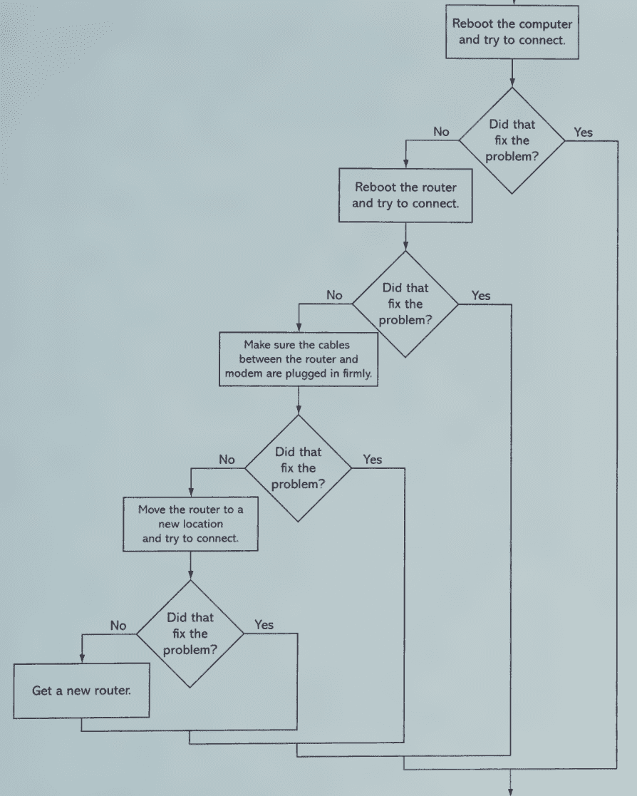

## 28. 餐厅选择

你有一群朋友来参加你的高中聚会，你想带他们出去吃。你不确定他们是否有人有饮食限制，但你的餐厅选择如下：

- Joe's Burgers
- Street Pizza
- Mama's Fine
- Chef's Kitchen
- Gourmet Italian

编写一个程序询问他们是否是素食者、纯素者或无麸质饮食，然后显示相应的餐厅。以下是程序的输出示例：

```
素食者：否
Joe's Burgers
Mama's Fine
Chef's Kitchen
Gourmet Italian
```

这是另一个输出示例：

```
纯素者：是
Street Pizza
```

# 5.1 递增和递减运算符

现在变量 `num` 为 5
我将再次增加 `num`。

现在变量 `num` 为 5
我现在将递减 `num`。

现在变量 `num` 为 5
我将再次递减 `num`。

现在变量 `num` 为 4

## 后置模式与前缀模式的区别

在程序 5-1 使用的简单语句中，递增或递减运算符使用后置模式还是前缀模式并不重要。然而，当这些运算符被用于不仅仅是递增或递减的语句时，它们的区别就变得很重要。例如，查看以下语句：

```cpp
num = 4;
cout << num++;
```

这条语句正在执行两件事：(1) 显示 `num` 的值，以及 (2) 增加 `num`。但先发生什么呢？如果先增加 `num`，与最后增加 `num` 相比，`cout` 显示的值将是不同的。答案取决于递增运算符的模式。

后置模式会导致递增在表达式中使用变量值之后才发生。例如，`cout` 将显示 4，然后 `num` 将增加到 5。然而，前缀模式会导致递增先发生。在以下语句中，`num` 将先增加到 5，然后 `cout` 显示 5：

```cpp
num = 4;
cout << ++num;
```

程序 5-2 进一步说明了这些动态变化。

## 程序 5-2

```cpp
// 此程序演示了递增和递减运算符的前缀和后置
// 模式。
#include <iostream>
using namespace std;

int main()
{
    int num = 4;

    cout << num << endl;     // 显示 4
    cout << num++ << endl;   // 显示 4，然后 num 加1
    cout << num << endl;     // 显示 5
    cout << ++num << endl;   // num 加1，然后显示 6
    cout << endl;            // 显示空行

    cout << num << endl;     // 显示 6
    cout << num-- << endl;   // 显示 6，然后 num 减1
    cout << num << endl;     // 显示 5
    cout << --num << endl;   // num 减1，然后显示 4

    return 0;
}
```

## 程序输出

```
4
5
6
6
5
4
```

让我们分析一下这个程序中的语句。在第 8 行，`num` 初始化为值 4，因此第 10 行的 `cout` 语句显示 4。然后，第 11 行将表达式 `num++` 发送到 `cout`。因为 `++` 运算符使用了后置模式，值 4 先被发送到 `cout`，然后 `num` 加 1，使其值变为 5。

当执行第 12 行时，`num` 将持有值 5，因此显示了 5。然后，第 13 行将表达式 `++num` 发送到 `cout`。因为 `++` 运算符使用了前缀模式，`num` 先被加 1（使其变为 6），然后值 6 被送到 `cout`。同样的一系列事件也发生在第 16 行到第 19 行，只不过使用的是 `--` 运算符。

另一个例子，查看以下代码：

```cpp
int x = 1;
int y;
y = x++; // 后置递增
```

第一条语句定义了变量 `x`（初始化为 1），第二条语句定义了变量 `y`。第三条语句执行了两件事：

- 将 `x` 的值赋给变量 `y`。
- 变量 `x` 增加。

递增发生时存储在 `y` 中的值。因为 `++` 运算符使用了后置模式，它在赋值之后作用。因此，这段代码将 1 存储在 `y` 中。代码执行后，`x` 将包含 2。让我们看看相同的代码，但使用前缀模式的 `++` 运算符：

```cpp
int x = 1;
int y;
y = ++x; // 前缀递增
```

在第三条语句中，`++` 运算符使用了前缀模式，因此它在赋值发生之前作用于变量 `x`。因此，这段代码将 2 存储在 `y` 中。代码执行后，`x` 也包含 2。

## 在数学表达式中使用 `++` 和 `--`

递增和递减运算符也可以用于数学表达式中的变量。考虑以下程序代码段：

```cpp
a = 2;
b = 5;
c = a * b++;
cout << a << " " << b << " " << c;
```

在语句 `c = a * b++` 中，`c` 被赋值为 `a` 乘以 `b` 的值，即 10。然后变量 `b` 增加。`cout` 语句将显示：

```
2 6 10
```

如果语句改为：

```cpp
c = a * ++b;
```

变量 `b` 在被乘以 `a` 之前就会增加。在这种情况下，`c` 将赋值为 2 乘以 6 的值，因此 `cout` 语句将显示：

```
2 6 12
```

使用递增和递减运算符，你可以在单个语句中封装大量的操作。

# 程序 5-3

```cpp
// 此程序演示了一个简单的 while 循环
#include <iostream>
using namespace std;

int main() {
    int number = 0;

    while (number < 5) {
        cout << "Hello\n";
        number++;
    }

    cout << "That's all!\n";
    return 0;
}
```

# 程序输出

```
Hello
Hello
Hello
Hello
Hello
That's all!
```

让我们仔细观察一下这个程序。在第 7 行，定义了一个整数变量 `number` 并将其初始化为值 0。在第 9 行，`while` 循环通过该语句开始：

```cpp
while (number < 5)
```

该语句测试变量 `number` 以确定其值是否小于 5。如果是，则执行循环体中的语句（第 11 行和第 12 行）：

```cpp
cout << "Hello\n";
number++;
```

第 11 行的语句打印 "Hello" 单词。第 12 行的语句使用自增运算符将 `number` 加 1。这是循环体中的最后一个语句，因此在执行后，循环将重新开始。它再次测试表达式 `number < 5`，如果为真，则执行循环体中的语句。这个循环重复，直到表达式 `number < 5` 为假。如图 5-2 所示。

循环的每次重复被称为一次“迭代”（iteration）。此循环将执行五次迭代，因为变量 `number` 初始化为值 0，并且在每次执行循环体时它都会递增。当测试表达式 `number < 5` 并发现为假时，循环将终止，程序将从紧随循环后的语句继续执行。图 5-3 显示了此循环的逻辑。

## 5.2 循环简介：`while` 循环

## 图 5-2 `while` 循环的动作

测试此表达式。

```cpp
while (number < 5) {
    cout << "Hello\n";
    number++;
}
```

如果表达式为真，执行这些语句。

执行循环体后，重新开始。

## 图 5-3 `while` 循环的流程图

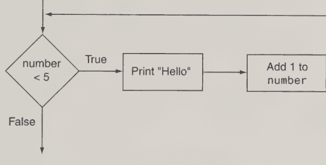

在这个示例中，`number` 变量被称为*循环控制变量*（loop control variable），因为它控制了循环迭代的次数。

## `while` 循环是一种预测试循环

`while` 循环被称为*预测试*（pretest）循环，这意味着它在每次迭代之前都会先测试其表达式。注意程序 5-3 第 7 行中的变量定义：

`number` 变量被初始化为值 0。如果 `number` 被初始化为 5 或更大的值（如下所示代码段所示），循环将永远不会执行：

```cpp
int number = 6;
while (number < 5) {
    cout << "Hello\n";
    number++;
}
```

`while` 循环的一个重要特性是，如果表达式一开始为假，循环将永远不会迭代。如果你想确保 `while` 循环在第一次执行，你必须以这种方式初始化相关数据，使测试表达式开始为真。

## 无限循环

在所有极少数的情况下，循环内部必须包含一种终止方式。这意味着循环内部某些内容最终必须使测试表达式变为假。程序 5-3 中的循环在表达式 `number < 5` 为假时停止。

如果一个循环没有停止的方法，它被称为无限循环（infinite loop）。无限循环会一直重复，直到程序被中断。这里是一个无限循环的示例：

```cpp
int number = 0;
while (number < 5)
{
    cout << "Hello\n";
}
```


这是一个无限循环，因为它没有包含改变 `number` 变量值的语句。每次测试表达式 `number < 5` 时，`number` 都将包含值 0。

通过在 while 循环行后意外放置一个分号也可以创建一个无限循环。这里有一个示例：

```cpp
int number = 0;

while (number < 5); // 这个分号是一个错误！

{
    cout << "Hello\n";
    number++;
}
```

第一行末尾的分号被假设是一个空语句（null statement），并将 while 语句与后面的代码块隔离开。对于编译器来说，这个循环看起来像：

```cpp
while (number < 5);
```

这个 while 循环将永远执行该空语句，而它无所不做。程序看起来像是“进入了太空”，因为没有任何可以显示的内容或活跃迹象。

## 语句块不要忘记加大括号

如果你写了一个根据条件执行语句块的循环，不要忘记用一组大括号将所有语句括起来。如果不小心漏掉了括号，while 语句将条件执行紧随其后的下一个语句。例如，查看以下代码：

```cpp
int number = 0;

// 此循环缺少大括号
while (number < 5)
    cout << "Hello\n";
    number++;
```

在这段代码中，`number++` 语句不在循环体中。由于缺少大括号，while 语句只执行紧随其后的语句。这个循环将无限执行，因为循环体中没有改变 `number` 变量的代码。

循环的另一个常见陷阱是在当你想要使用 `==` 时误用了 `=` 运算符。这里有一个这样的示例：

```cpp
int remainder = 0;

while (remainder = 1) // 错误：这是赋值而不是比较
{
    cout << "Hello\n";
}
```

## 5.3 使用 while 循环进行输入验证

**概念：** while 循环可以创建输入例程，在输入可接受的数据为止不断重复。

计算机行业最著名的格言可能是“垃圾进，垃圾出”（garbage in, garbage out）。程序输出的完整性完全取决于其输入的质量，因此你应该尽量确保垃圾数据不会进入你的程序。输入验证是检查用户提供的数据并判断其是否有效的过程。良好的程序应该就可接受的输入类型给出的指令，而不是假设用户已经遵循了这些指令。

while 循环对于验证输入特别有用。如果输入了无效值，循环可以要求用户根据需要多次重新输入。例如，下面的循环要求用户输入一个 1 到 100 之间的数字：

此代码允许用户输入一个数字。这发生在循环之前。如果输入是有效的，循环将不会执行。然而，如果输入无效，循环将显示错误消息并要求用户输入另一个数字。循环将继续执行，直到用户输入一个有效数字为止。执行输入验证的通用逻辑如图 5-4 所示。

图 5-4 输入验证流程图

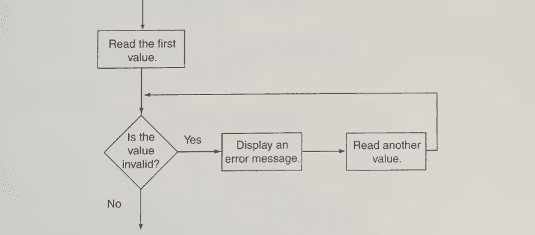

在循环之前发生的读取操作被称为“引导读”（priming read）。它为循环提供了第一个测试值。随后的值由循环获取。

程序 5-5 根据给定的人数和每队最大人数，计算青少年联赛可能创建的足球队数量。该程序使用 while 循环（第 25 到 34 行以及 41 到 46 行）来验证用户的输入。

### 程序 5-5

```cpp
1 // 此程序计算青少年联赛可以创建
2 // 的足球队数量，基于可用
3 // 球员人数。输入验证通过 while
4 // 循环进行演示。
5 #include <iostream>
6 using namespace std;
7
8 int main()
{
9
10 // 最少和最多人数的常量
11 const MIN_PLAYERS = 9,
12 MAX_PLAYERS = 15;
13
14 // 变量 // 可人数
15 int players,
16 teamPlayers, // 每队期望人数
17 numTeams, // 队伍数量
18 leftOver; // 剩余人数
19
20 // 获取每队人数。
21 cout << "How many players do you wish per team? ";
22 cin >> teamPlayers;
23
24 // 验证输入。
25 while (teamPlayers < MIN_PLAYERS || teamPlayers > MAX_PLAYERS)
{
27 // 解释错误。
28 cout << "You should have at least " << MIN_PLAYERS
29 << " but no more than " << MAX_PLAYERS << " per team.\n"
31
32 // 获取可用人数。
33 cout << "How many players do you wish per team? ";
34 cin >> teamPlayers;
35 }
36
37 cout << "How many players are available? ";
38 cin >> players;
39
40 // 验证输入。
41 while (players <= 0)
{
43 // 再次获取输入。
44 cout << "Please enter 0 or greater: ";
45 cin >> players;
46 }
```

```cpp
// 计算队伍数量。
numTeams = players / teamPlayers;

// 计算剩余球员人数。
leftOver = players % teamPlayers;

// 显示结果。
cout << "There will be " << numTeams << " teams with "
<< leftOver << " players left over.\n";
return 0;
```

### 程序输出（示例输入已加粗显示）

How many players do you wish per team? 4
You should have at least 9 but no more than 15 per team.
How many players do you wish per team? 12
How many players are available? -142
Please enter 0 or greater. 142
There will be 11 teams with 10 players left over.

### 检查点

- 5.2 编写一个输入验证循环，要求用户输入 10 到 25 之间的数字。
- 5.3 编写一个输入验证循环，要求用户输入 ‘Y’、『N’或‘n’。
- 5.4 编写一个输入验证循环，要求用户输入 ‘Yes’或‘No’。

## 5.4 计数器

> **概念：** 计数器是一个在每次循环迭代时都被定期增加或减少的变量。

有时，程序控制或跟踪循环执行的迭代次数是非常重要的。例如，程序 5-6 显示了一张包含 1 到 10 数字及其平方的表格，因此它的循环必须迭代 10 次。

### 程序 5-6

```cpp
// 此程序显示一组数字列表
// 它们的平方。
#include <iostream>
using namespace std;
int main()
{
    const int MIN_NUMBER = 1, // 平方运算的起始数字
    MAX_NUMBER = 10; // 平方运算的最大数字
```

### 程序 5-6（续）

```cpp
11 int num = MIN_NUMBER; // 计数器
13 cout << "Number Squared\n";
14 cout << "-----------------\n";
15 while (num <= MAX_NUMBER)
{
17 cout << num << "\t" << (num * num) << endl;
19 num++; // 计数器加1。
20 return 0;
}
```

### 程序输出

| 数字 | 平方 |
| :--- | :--- |
| 1 | 1 |
| 2 | 4 |
| 3 | 9 |
| 4 | 16 |
| 5 | 25 |
| 6 | 36 |
| 7 | 49 |
| 8 | 64 |
| 9 | 81 |
| 10 | 100 |

在程序 5-6 中，从 1 开始的变量 `num` 在每次循环时都会增加 1。当 `num` 达到 11 时，循环停止。`num` 被用作计数器，这意味着它在每次迭代中都会被定期增加。注意：`num` 必须正确初始化。

## 5.5 do-while 循环

**概念：** do-while 循环是一种后测试循环（posttest loop），这意味着它的表达式在迭代之后进行测试。

do-while 循环与 while 循环的区别在于，do-while 循环即使在表达式为假时也会至少执行一次。do-while 循环的格式如下：

```cpp
do
    statement;
while(expression);
```

当 do-while 循环的主体包含多个语句时，格式如下：

```cpp
do
{
    statement;
    statement;
} while(expression);
```

do-while 循环必须以分号结束。图 5-5 展示了 do-while 循环的逻辑


当你想要确保循环至少执行一次时应该使用 do-while 循环。例如，程序 5-7 计算学生一系列的平均分。在显示平均分后，它询问用户是否想再计算一组。程序在用户输入 Y 时一直重复。

### 程序 5-7

```cpp
// 此程序计算三个分数的平均值。它根据用户的意愿重复。
#include <iostream>
using namespace std;
int main() {
    int score1, score2, score3; // 三个分数
    double average; // 平均分
    char again; // 用于存储 Y 或 N 输入
    do {
        // 获取三个分数。
        cout << "Enter 3 scores and I will average them: ";
        cin >> score1 >> score2 >> score3;
        // 计算并显示平均分。
        average = (score1 + score2 + score3) / 3.0;
        cout << "The average is " << average << ".\n";
        // 用户想再计算一组吗？
        cout << "Do you want to average another set? (Y/N) ";
        cin >> again;
    } while (again == 'Y' || again == 'y');
    return 0;
}
```

Enter 3 scores and I will average them: 80 90 70
The average is 80.
Do you want to average another set? (Y/N) y
Enter 3 scores and I will average them: 60 75 88
The average is 74.3333.
Do you want to average another set? (Y/N) n

编写此程序时，程序员无法知道循环将迭代多少次。这种类型的循环询问用户是否想要重复该过程。这种类型的循环被称为*用户控制循环*（user-controlled loop），因为它允许用户决定迭代次数。

## 在菜单中使用 do-while

do-while 循环是重复菜单的好选择。回顾程序 4-27，它显示了健身俱乐部的菜单。程序 5-8 是该程序的修改版本，它使用 do-while 循环重复程序，直到用户从菜单中选择第 4 项。

### 程序 5-8

```cpp
 // 此程序显示一个菜单并要求用户进行选择。
 // 使用 do-while 循环重复执行程序，直到
 // 用户从菜单中选择第 4 项。
#include <iostream>
#include <iomanip>
using namespace std;
int main() {
    // 菜单选择的常量
    const int ADULT_CHOICE = 1,
           CHILD_CHOICE = 2,
           SENIOR_CHOICE = 3,
           QUIT_CHOICE = 4;
    // 会员率的常量
    const double ADULT = 40.0,
           CHILD = 20.0,
           SENIOR = 30.0;
    // 变量             // 菜单选择
    int choice;
    int months;             // 月数
    double charges;         // 月费用
    // 设置数值输出格式。
    cout << fixed << setprecision(2);
    do {
        // 显示菜单。
        cout << "\n\t健康俱乐部会员菜单\n\n"
             << "  1. 标准成人会员\n"
             << "  2. 儿童会员\n"
             << "  3. 老年人会员\n"
             << "  4. 退出程序\n\n"
             << "  输入您的选择： ";
        cin >> choice;
        // 验证菜单选择。
        while (choice < ADULT_CHOICE || choice > QUIT_CHOICE) {
            cout << "  请输入有效的菜单选择： ";
            cin >> choice;
        }
        // 处理用户的选择。
        if (choice != QUIT_CHOICE) {
            // 获取月数。
            cout << "  几个月的？ ";
```

### 程序 5-8（续）

```cpp
52      cin >> months;
53
54      // 响应用户的菜单选择。
55      switch (choice)
56          {
57              case ADULT_CHOICE:
58                  charges = months * ADULT;
59                  break;
60              case CHILD_CHOICE:
61                  charges = months * CHILD;
62                  break;
63              case SENIOR_CHOICE:
64                  charges = months * SENIOR;
65          }
66
67      // 显示月费用。
68          cout << "总费用为 $"
69                  << charges << endl;
70      }
71      while (choice != QUIT_CHOICE)
72          return 0;
73  }
```

### 程序输出（示例输入用粗体显示）

健康俱乐部会员菜单
1. 标准成人会员
2. 儿童会员
3. 老年人会员
4. 退出程序

输入您的选择：1 回
几个月的？ 12 回
总费用为 $480.00

健康俱乐部会员菜单
1. 标准成人会员
2. 儿童会员
3. 老年人会员
4. 退出程序

输入您的选择：4 回

### 检查点

5.5 下列程序段将显示什么内容？

```cpp
A) int count = 10;
   do
      cout << "Hello World\n"
      count++;
   while (count < 1);
```

```cpp
B) int v = 10;
do
  cout << v << endl;
  while (v < 5);
```

```cpp
C) int count = 0, number = 0, limit = 4;
do
{
  number += 2;
  count++;
} while (count < limit);
  cout << number << " " << count << endl;
```

## 5.6 for 循环


# 5.6 for 循环

概念：for 循环是执行已知次数操作的理想选择：条件循环和计数循环。条件循环在特定条件存在时执行。例如，输入验证循环在输入无效时执行。当你知道循环必须执行的精确次数时，这种循环被称为计数循环。例如，如果一个循环要求用户输入每月的金额，它将迭代 12 次。本质上，循环计数到 12 并要求用户输入。计数循环必须具备三个元素：

1. 初始化计数变量起始值。
2. 通过与最大值比较来测试计数变量。当计数变量达到最大值时，循环终止。
3. 在每次迭代期间更新计数器。这通常通过递增变量来实现。

计数循环非常常见，以至于 C++ 提供了一种专门用于它们的循环类型。它被称为 for 循环。for 循环专门设计用于初始化、测试和更新计数变量。以下是 for 循环用于重复单一语句的格式：

```
for (initialization; test; update)
    statement;
```

for 循环用于重复块的格式：

```
for (initialization; test; update)
{
    statement;
    statement;
    // 在此处根据需要放置
    // 语句
}
```

for 循环用于重复块时有三个用分号分隔的表达式：第一个是初始化，第二个是测试，第三是更新。注意在此示例中，计数变量 `count` 用于初始化其起始值。第二个表达式是测试；如果为真，则执行循环体。如果为假，则循环终止。第三个表达式是更新，它发生在每次迭代结束时。

```
for (count = 0; count < 5; count++)
    cout << "Hello" << endl;
```

在这个循环中，体执行了五次。图 5-6 说明了事件的顺序：

步骤 1：执行初始化表达式。
步骤 2：评估测试表达式。如果为真，转到步骤 3。否则，终止循环。
步骤 3：执行循环体。
步骤 4：执行更新表达式，然后返回步骤 2。

图 5-7 以流程图的形式展示了循环。


图 5-8 展示了该循环执行的事件序列，图 5-9 以流程图的形式展示了循环的逻辑。

## 图 5-8 for 循环中的事件序列

**步骤 1：** 执行初始化  
**步骤 2：** 评估测试表达式。如果为真，跳转到第 3 步。否则，终止循环。  
**步骤 4：** 执行更新表达式，然后跳转到第 2 步。

```
for (num = MIN_NUMBER; num <= MAX_NUMBER; num++)
    cout << num << "\t\t" << (num * num) << endl;
```

**步骤 3：** 执行循环体。

## 图 5-9 for 循环的流程图

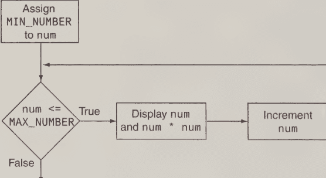

### 使用 for 循环代替 while 或 do-while

在任何明确需要初始化、使用假条件停止循环、并在每次循环迭代结束时需要更新的情况下，你都应该使用 for 循环代替 while 或 do-while 循环。程序 5-9 就是一个完美的例子。它要求 `num` 变量初始化为 1，当 `num` 大于 10 时停止循环，并在每次循环迭代结束时增加 `num`。

回想我们第一次引入计数器变量的概念时，我们检查了程序 5-6，该程序使用 while 循环显示数字及其平方的表。由于程序中的循环需要初始化、使用假条件停止循环，并在每次迭代结束时执行递增，因此它可以很容易地转换为 for 循环。图 5-10 显示了程序 5-6 中的 while 循环和程序 5-9 中的 for 循环如何分别具有初始化、测试和更新表达式。

## 图 5-10 初始化、测试和更新表达式

### 初始化表达式

```cpp
int num = MIN_NUMBER;
while (num <= MAX_NUMBER)
{
    cout << num << "\t\t" << (num * num) << endl;
    num++;
}
```

### 测试表达式

### 更新表达式

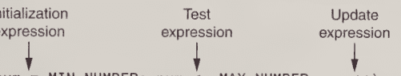

```cpp
for (num = MIN_NUMBER; num <= MAX_NUMBER; num++)
    cout << num << "\t\t" << (num * num) << endl;
```

## for 循环是一种预测试循环

for 循环在执行迭代之前会测试其测试表达式，因此是一个预测试循环。可以编写出一种永远不会进行迭代的 for 循环。这里有一个例子：

```
for (count = 11; count <= 10; count++)
    cout << "Hello" << endl;
```

变量 `count` 被初始化为一个使得测试表达式从一开始就假的值，循环一旦开始就会终止。

## 避免在 for 循环体中修改计数器变量

小心不要在 for 循环体中放置修改计数器变量的语句。对计数器变量的所有修改都应该发生在更新表达式中，该表达式会在每次迭代结束时自动执行。如果循环体中的语句也修改了计数器变量，循环可能不会在你预期的时刻停止。例如，以下循环在每次迭代中递增两次 `x`：

```
for (x = 1; x <= 10; x++)
{
    cout << x << endl;
    x++; // 错误！
}
```

## 更新表达式的其他形式

更新表达式并不局限于使用递增语句。以下循环通过每次加 2 来显示从 2 到 100 之间的所有偶数：

```
for (num = 2; num <= 100; num += 2)
    cout << num;
```

另外这是一个从 10 递减到 0 的循环：

```
for (num = 10; num >= 0; num--)
    cout << num;
```

## 在 for 循环初始化表达式中定义变量

不仅可以在初始化表达式中初始化，也可以在那里定义。以下代码显示了程序 5-9 的一个修改版本：

```
for (int num = MIN_NUMBER; num <= MAX_NUMBER; num++)
    cout << num << " 倾: ";
```

在此循环中，变量在初始化表达式中被定义和初始化。如果你在初始化表达式中定义变量，其作用域仅限于循环。这意味着你无法循环外部访问该变量。例如，以下程序将无法编译：

```cpp
for (int count = 1; count <= 10; count++)
    cout << "count 现在是 " << count;
```

## 用户控制循环

有时你可能希望由用户来决定变量的最大值，从而决定循环的次数。例如，查看程序 5-10。这是一个显示数字及其平方的程序，允许用户输入最小值和最大值。

```cpp
#include <iostream>
using namespace std;

int main() {
    int minNumber, maxNumber;
    cout << "起始数字：";
    cin >> minNumber;
    cout << "结束数字：";
    cin >> maxNumber;
    cout << "数字平方\n";
    cout << "----------------\n";
    for (int num = minNumber; num <= maxNumber; num++) {
        cout << num << "\t\t" << (num * num) << endl;
    }
    return 0;
}
```

## 在初始化和更新表达式中使用多个语句

在初始化和更新表达式中执行多个语句是可能的。在这些表达式之一中使用多个语句时，只需用逗号分隔语句即可。例如，查看以下代码，其初始化表达式中有两个语句：

```cpp
int x, y;
for (x = 1, y = 1; x <= 5; x++)
{
    cout << x << " 加 " << y
    << " 等 " << (x + y)
    << endl;
}
```

循环的初始化表达式是 `x = 1, y = 1`，这初始化了两个变量 `x` 和 `y`。该循环的输出为：

- 1 加 1 等 2
- 2 加 1 等 3 （注：此处逻辑上 y 未递增，仅为示例演示）

我们可以进一步修改循环，在更新表达式中执行两个语句。这里有一个例子：

```cpp
int x, y;
for (x = 1, y = 1; x <= 5; x++, y++)
{
    cout << x << " 加 " << y
    << " 等 " << (x + y)
    << endl;
}
```

循环的更新表达式是 `x++, y++`，此更新表达式同时递增变量 `x` 和 `y`。该循环的输出为：

- 1 加 1 等 2
- 2 加 2 等 4
- 3 加 3 等 6
- 4 加 4 等 8
- 5 加 5 等 10

## 省略 for 循环的表达式

如果初始化已经执行或不需要初始化，则可以从 for 循环的括号内省略初始化表达式。以下是程序 5-10 循环的示例，初始化在循环之前完成：

```
int num = 1;
for ( ; num <= maxValue; num++)
    cout << num << "\t\t" << (num * num) << endl;
```

如果更新表达式是在循环的其他地方执行的，或者不需要，你也可以省略它。虽然不推荐这种代码，但下面的 `for` 循环工作方式与 `while` 循环完全相同：

```cpp
int num = 1;
for ( ; num <= maxValue; ) {
    cout << num << "\t\t" << (num * num) << endl;
    num++;
}
```

你甚至可以省略 `for` 循环括号中的所有三个表达式。请注意，如果你漏掉了测试表达式，循环将没有内置的终止机制。这是一个示例：

```cpp
for ( ; ; ) {
    cout << "Hello World\n";
}
```

由于这个循环没有停止的方法，它将永远显示“Hello World\n”（直到某些东西中断了程序）。


# 焦点关注：使用 for 语句设计计数控制循环

你的朋友 Amanda 刚从叔叔那里继承了一辆欧洲跑车。Amanda 住在美国，她担心自己会收到超速罚单，因为汽车的速度表显示的是每小时公里。她请你写一个程序，显示一个以每小时公里为单位的速度表，并将这些值转换为每小时英里。每小时公里转换为每小时英里的公式为：

`MPH = KPH * 0.6214`

在公式中，`MPH` 是每小时英里的速度，`KPH` 是每小时公里的速度。

你的程序显示的表格应该显示从每小时 60 公里到每小时 130 公里的速度，增量为 10 公里，以及它们转换为每小时英里的值。表格看起来应该像这样：

| KPH | MPH |
| :--- | :--- |
| 60 | 37.3 |
| 70 | 43.5 |
| 80 | 49.7 |
| ... | ... |
| 130 | 80.8 |

在考虑了这个数值表后，你决定将写一个 `for` 循环，使用计数器变量来存储每小时公里的速度。计数器的起始值为 60，结束值为 130，你将在每次迭代后向计数器变量加 10。在循环内部，你将使用计数器变量计算每小时英里的速度。程序 5-11 显示了代码。

## 程序 5-11

```cpp
// 此程序将 60 kph 到
// 130 kph（以 10 kph 为增量）的速度转换为 mph。
#include <iostream>
#include <iomanip>
using namespace std;

int main() {
    // 速度的常数
    const int START_KPH = 60, // 起始速度
           END_KPH = 130, // 结束速度
               INCREMENT = 10; // 速度增量

    // 转换因子的常量
    double CONVERSION_FACTOR = 0.6214;

    // 变量
    int kph; // 存储 kph 速度
    double mph; // 存储 mph 速度

    // 设置数字输出格式。
    cout << fixed << setprecision(1);

    // 显示表头。
    cout << "KPH\tMPH\n";
    cout << "--------------------\n";

    // 显示速度。
    for (kph = START_KPH; kph <= END_KPH; kph += INCREMENT) {
        // 计算 mph
        mph = kph * CONVERSION_FACTOR;
        cout << kph << "\t" << mph << endl;
    }
    return 0;
}
```

## 程序输出

| KPH | MPH |
| :--- | :--- |
| 60 | 37.3 |
| 70 | 43.5 |
| 80 | 49.7 |
| 90 | 55.9 |
| 100 | 62.1 |
| 110 | 68.4 |
| 120 | 74.6 |
| 130 | 80.8 |

## 检查点

5.6 写出 `for` 循环头括号内出现的三个表达式的名称。

5.7 你想写一个 `for` 循环显示 50 次“Hello World”。假设你将使用一个名为 `count` 的计数器变量。

- A) 你将使用什么初始化表达式？
- B) 你将使用什么测试表达式？
- C) 你将使用什么更新表达式？
- D) 编写循环。

5.8 下面的程序段将显示什么？

- A) `for (int count = 0; count < 6; count++) cout << (count + count);`
- B) `for (int value = -5; value < 5; value++) cout << value;`
- C) `int x; for (x = 5; x <= 14; x += 3) cout << x << endl; cout << x << endl;`

5.9 写一个 `for` 循环显示 10 次你的名字。

5.10 写一个 `for` 循环显示从 1 到 49 的所有奇数。

5.11 写一个 `for` 循环显示从 1 到 100 的所有数字。

---

## 哨兵值 (Sentinels)

概念：哨兵值是一个标记值列表结束的特殊值。

上一节中的程序 5-12 要求用户预先知道他们想要输入销售数据的天数。有时，用户有一份非常长的列表，并且不知道里面有多少项。在其他情况下，用户可能会输入多个列表，要求统计列表中的每一个项是不现实的。

在这些情况下，可以使用的一种技术是要求用户在列表末尾输入一个哨兵值。哨兵值是一个不会被误认为列表成员的特殊值，并指示没有更多值需要输入。当用户输入哨兵值时，循环终止。

程序 5-13 计算了足球队在一系列比赛中获得的总分。它允许用户输入一系列比赛得分，然后输入 -1 来表示列表结束。

## 程序 5-13

```cpp
// 此程序计算足球队在
// 一系列比赛中获得的总分。用户
// 输入一系列分值，然后在完成后输入 -1。
#include <iostream>
using namespace std;

int main()
{
    int game = 1; // 比赛计数器
    int points; // 用于存储分值
    int total = 0; // 累加器

    cout << "输入你的球队在本赛季目前获得的得分\n";
    cout << "完成后输入 -1。\n";
    cout << "输入第 " << game << " 场比赛得分: \n";
    cin >> points;

    while (points != -1) {
        total += points;
        game++;
        cout << "\n第 " << game << " 场比赛得分: \n";
        cin >> points;
    }

    cout << "\n总分为 " << total << endl;
    return 0;
}
```

## 5.9 关注软件工程：决定使用哪种循环

### 带有示例输入的程序输出

输入你的球队在本赛季目前获得的得分，完成后输入 -1。

```
输入第 1 场比赛得分: 7
输入第 2 场比赛得分: 9
输入第 3 场比赛得分: 4
输入第 4 场比赛得分: 6
输入第 5 场比赛得分: 8
输入第 6 场比赛得分: -1
```

总分为 34

我们在程序中选择 -1 作为哨兵值，是因为球队不可能得到负分。注意，此程序在第 18 行循环中执行了“初次读取”（prime-reading）以获取第一个值。这使得用户如果输入的第一个值是 -1，循环就可以立即终止。此外注意，哨兵值不包含在运行总和中。

### 检查点 (Checkpoint)

- 5.12 写一个循环七次的循环，要求用户输入一个数字。该循环还应该计算输入数字之和。
- 5.13 在下面的程序段中，哪个变量是计数器变量，哪个是累加器？

```cpp
int a, x, y = 0;
```


```cpp
for (x = 0; x < 10; x++)
{
  cout << "输入一个数字: ";
  cin >> a;
  y += a;
}
cout << "这些数字的和是 " << y << "\n";
```

- 5.14 为什么在选择哨兵值时应该小心？
- 5.15 你如何修改程序 5-13，使得任何负值都是哨兵值？

**概念：**尽管大多数重复算法可以用三种循环中的任何一种编写，但每种循环在不同情况下效果最好。

三种 C++ 循环在不同情况下都是理想的。以下是关于何时使用每种循环的简要总结：

- **`while` 循环。** `while` 循环是一种条件循环，只要特定条件存在，它就会重复。它也是一种前测试循环，因此在条件从一开始就为假时不希望循环迭代的情况下，它是理想的。例如，验证读取的输入以及读取由哨兵值结束的数据列表是 `while` 循环的良好应用。

- **`do-while` 循环。** `do-while` 循环也是一种条件循环。与 `while` 循环不同的是，`do-while` 是后测试循环。在您总是希望循环至少执行一次的情况下，它是理想的。`do-while` 循环是重复菜单的良好选择。

- **`for` 循环。** `for` 循环是一种前测试循环，内置了初始化、测试和更新的表达式。这些表达式使得使用计数器变量来控制循环执行的次数变得非常方便。初始化表达式可以将计数器变量初始化为起始值，测试表达式可以测试计数器变量以确定它是否持有最大值，更新表达式可以增加计数器变量。在确切迭代次数的情况下，`for` 循环是理想的。

## 5.10 嵌套循环

> 概念：位于另一个循环内部的循环被称为*嵌套*循环。

嵌套循环是出现在另一个循环内部的循环。时钟是嵌套循环的一个很好的例子。秒针、分针和时针都在表盘上旋转。每当秒针增加一次，分针就会增加 60 次。每当分针增加一次，时针就会增加 60 次。这里有一个模拟数字时钟的嵌套循环程序段。

```cpp
#include <iostream>
using namespace std;
int main() {
    int hours, minutes, seconds;
    for (hours = 0; hours < 24; hours++) {
        for (minutes = 0; minutes < 60; minutes++) {
            for (seconds = 0; seconds < 60; seconds++) {
                cout << hours << ":" << minutes << ":" << seconds << endl;
            }
        }
    }
    return 0;
}
```

> 注意：`cout` 的 `fill` 成员改变填充字符。在上面的程序中，`fill` 函数默认是空格。我们可以向循环中添加一个变量来计算单数字。

该程序段的输出如下：

```cpp
#include <iostream>
#include <iomanip>
using namespace std;
int main() {
    int hours, minutes, seconds;
    for (hours = 0; hours < 24; hours++) {
        for (minutes = 0; minutes < 60; minutes++) {
            for (seconds = 0; seconds < 60; seconds++) {
                cout << setfill('0') << setw(2) << hours << ":"
                     << setw(2) << minutes << ":"
                     << setw(2) << seconds << endl;
            }
        }
    }
    return 0;
}
```

`fill` 函数用于设置填充 `setw` 创建的空隙的字符。在上面的示例中，`fill` 函数被设置为 `'0'`，以确保每个单位都以两位数字显示。

## 使用文件存储数据

**概念**：当程序需要保存数据以备后用时，它会将数据写入文件。随后，可以在某个时刻从文件中读取这些数据。

你目前为止编写的程序都要求用户在每次程序运行时重新输入数据，因为存储在变量和控制属性中的数据存储在 RAM（随机内存）中，并在程序停止运行时就会消失。如果程序要在多次运行之间保留数据，它必须有一种保存数据的方法。数据被保存在文件中，文件通常存储在计算机的磁盘上。一旦数据保存到文件中，即使程序停止运行，它仍然存在那里。随后，可以从文件中检索并使用存储在其中的的数据。

你日常使用的大多数商业软件都将数据存储在文件中。以下是几个例子：

- **文字处理器**：文字处理程序用于编写信函、备忘录、报告和其他文档。这些文档随后被保存在文件中，以便进行编辑和打印。
- **图像编辑器**：图像编辑程序用于绘制图形和编辑图像，例如你用数码相机拍摄的图像。你用图像编辑器创建或编辑的图像保存在文件中。
- **电子表格**：电子表格程序用于处理数值数据。数字和数学公式可以插入到电子表格的行和列中。随后，该表格可以保存到文件中备后用。
- **游戏**：许多计算机游戏将数据存储在文件中。例如，某些游戏会将包含玩家名称及其分数的列表保存在文件中。这些游戏通常按照分数从高到低的顺序显示玩家名称。某些游戏还允许你将当前游戏状态保存到文件中，这样你就可以退出并在稍后恢复游戏，而无需从头开始。
- **网络浏览器**：有时当你访问网站时，浏览器会在你的计算机上存储一个名为 *cookie*（饼干）的小文件。Cookie 通常包含有关浏览会话的信息，例如购物车的内容。

业务操作中使用的程序高度依赖文件。工资发放程序将员工数据保存在文件中，库存管理程序将公司产品数据保存在文件中，会计系统将公司财务运营数据保存在文件中，依此类推。

程序员通常将数据保存到文件的过程称为向文件*写入数据*（writing data）。当一段数据被写入文件时，它从 RAM 中的一个变量复制到文件中。这如图 5-12 所示。输出文件是一个向写入数据的文件。它被称为输出文件，是因为程序将输出存储在其中。

从文件中检索数据的过程称为从文件中*读取数据*（reading data）。当一段数据从文件中被读取时，它从文件复制到 RAM 中的一个变量中。图 5-13 说明了这一过程。*输入文件*（input file）是一个从文件中读取数据的文件。它被称为输入文件，是因为程序从从中获取输入。

## 第 5 章 循环与文件

### 图 5-12 向文件写入数据

| 变量 | |
|---|---|
| payRate | 18.65 |
| employeeID | 7451Z |
| employeeName | Cindy Chandler |

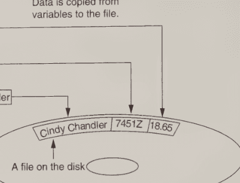

### 图 5-13 从文件中读取数据

| 变量 | |
|---|---|
| payRate | 18.65 |
| employeeID | 7451Z |
| employeeName | Cindy Chandler |

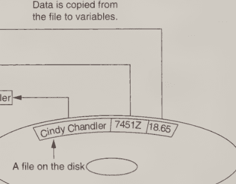

本节讨论了创建向文件写入数据和从文件中读取数据程序的方法。当程序使用文件时，必须执行三个步骤。

1. **打开文件**：打开文件会创建文件与程序之间的连接。打开输出文件通常磁盘上创建文件，并允许程序向写入数据。打开输入文件允许程序从中读取数据。
2. **处理文件**：数据被写入文件（如果是输出文件）或从文件中读取（如果是输入文件）。
3. **关闭文件**：在程序完成文件使用后，必须关闭文件。关闭文件会断开文件与程序的连接。

## 文件类型

通常文件有两种类型：文本和二进制。*文本文件*（text file）包含编码为文本的数据，使用 ASCII 或 Unicode 等方案。即使文件包含数字，这些数字也以一系列字符的形式存储在文件中。因此，可以使用文本编辑器打开并查看该文件。*二进制文件*（binary file）包含未转换为文本的数据。因此，你无法使用文本编辑器查看二进制文件的内容。在本章中，我们只处理文本文件。在第 12 章中，你将学习处理二进制文件。

## 文件访问方法

访问存储在文件中数据通常有两种通用方法：顺序访问和直接访问。当你使用顺序访问文件（sequential access file）时，你从文件的开始到结束访问数据。如果你想读取存储在文件末尾的数据，你必须读取它之前的所有数据。

当你使用直接访问文件（direct access file）时，你可以直接跳转到任何数据，而无需读取其之前的数据。这对于大文件特别有用。在本章中，我们只关注顺序访问文件。

## 5.11 使用文件进行数据存储

代码展示了一个打开文件进行输出（写入）的示例。

```cpp
ofstream outputFile;
outputFile.open("Employees.txt");
```

第一条语句定义了一个名为 `outputFile` 的 `ofstream` 对象。第二条语句调用了该对象的 `open` 成员函数，并将字符串 `"Employees.txt"` 作为参数传递。在这条语句中，`open` 成员函数创建了 `Employees.txt` 文件并与 `outputFile` 对象关联。执行此代码后，你将能够使用 `outputFile` 将数据写入 `Employees.txt` 文件。需要记住，当你调用 `ofstream` 的 `open` 成员函数时，指定的文件将被创建。如果文件已存在，它将被删除并创建一个同名的新文件。

在打开文件时，你需要指定它的路径和名称。例如，在 Windows 系统上，以下语句打开了文件 `C:\data\inventory.txt`：

```cpp
inputFile.open("C:\\data\\inventory.txt")
```

在这条语句中，文件 `C:\data\inventory.txt` 被打开并与 `inputFile` 关联。

> 注意：注意文件路径中使用了两个反斜杠。在字符串字面量中，需要两个反斜杠来表示一个反斜杠。

可以使用一条语句定义文件流对象并打开文件。这是一个示例：

```cpp
ifstream inputFile("Customers.txt");
```

此条语句定义了一个名为 `inputFile` 的 `ifstream` 对象并打开了 `Customers.txt` 文件。以下是一个定义名为 `outputFile` 的 `ofstream` 对象并打开 `Employees.txt` 文件的示例：

```cpp
ofstream outputFile("Employees.txt");
```

## 关闭文件

打开文件的相反操作是关闭文件。虽然程序的文件在程序关闭时会自动关闭，但编写关闭这些文件的语句是一个良好的编程习惯。程序在完成文件操作后应该关闭文件有两个原因：

1. 大多数操作系统在将数据写入文件之前，将其临时存储在缓冲区（buffer）中。文件缓冲区是内存中的一个较小的“持有区域”，文件相关的数据首先被写入此处。当缓冲区填满时，存储在处的所有数据都会写入文件。这种技术提高了系统性能。关闭文件会导致缓冲区中可能仍存在的任何未保存数据保存到文件中。这意味着如果你需要在同一个程序中读取这些数据，它们将已经存在于文件中。
2. 某些操作系统限制了同时可以打开的文件数量。当程序关闭不再使用的文件时，就不会比需要时消耗更多的操作系统资源。

调用文件流对象的 `close` 成员函数可以关闭文件。这里是一个示例：

```cpp
inputFile.close();
```

## 向文件写入数据

你已经知道如何使用流插入运算符（`<<`）配合 `cout` 对象将数据写入屏幕。它也可以用于 `ofstream` 对象将数据写入文件。假设 `outFile` 是一个 `ofstream` 对象，以下下条语句演示了如何使用 `<<` 运算符将字符串字面量写入文件：

```cpp
outputFile << "I love C++ programming\n";
```

此条语句将字符串 `"I love C++ programming\n"` 写入与 `outFile` 关联的文件。如你所见，这条语句看起来就像 `cout` 语句，只是用 `outFile` 的名称替换了 `cout`。以下是一条向文件写入字符串字面量和变量内容的语句：

```cpp
outputFile << "Price: " << price << endl;
```

上述语句将数据字符串写入 `outFile` 的方式正如 `cout` 将其写入屏幕一样：它写入字符串 `"Price: "`，接着是 `price` 变量的值，最后是一个换行符。

程序 5-15 演示了打开文件、向文件写入数据以及关闭文件。执行此代码后，我们可以使用文本编辑器打开 `demofile.txt` 文件并查看其内容。图 5-15 显示了文件内容在记事本中的显示方式。

## 程序 5-15

```cpp
// 此程序将数据写入文件。
#include <iostream>
#include <fstream>
using namespace std;
int main() {
    ofstream outFile;
    outFile.open("demofile.txt");
    cout << "Now writing data to the file.\\n";
    // 向文件写入四个名字。
    outFile << "Bach\n";
    outFile << "Beethoven\n";
    outFile << "Mozart\n";
    outFile << "Schubert\n";
    // 关闭文件
    outFile.close();
    cout << "Done.\\n";
    return 0;
}
```

## 程序屏幕输出

```text
Now writing data to the file.
Done.
```

## 图 5-15 demofile.txt 的内容

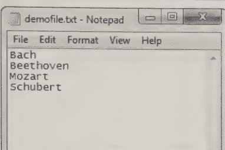

注意程序 5-15 中第 14 行到第 17 行。由于在写入文件时每个名字末尾都跟了换行符（`\n`），当在文本编辑器中查看时，每个名字都会单独成行。图 5-15 显示了文件内容在记事本中的显示方式。（注：此处原文逻辑描述似乎略有错乱，已根据语意调整翻译）

*纠正：根据上下文逻辑，此处应为：在打开文件时，你需要指定它的路径和名称。例如，在 Windows 系统上，以下语句打开了文件 `C:\data\inventory.txt`：*

在这条语句中，文件 `C:\data\inventory.txt` 被打开并与 `inputFile` 关联。

> 注意：注意文件路径中使用了两个反斜杠。在字符串字面量中，需要两个反斜杠来表示一个反斜杠。

可以使用一条语句定义文件流对象并打开文件。这是一个示例：

```cpp
ifstream inputFile("Customers.txt");
```

此条语句定义了一个名为 `inputFile` 的 `ifstream` 对象并打开了 `Customers.txt` 文件。以下是一个定义名为 `outputFile` 的 `ofstream` 对象并打开 `Employees.txt` 文件的示例：

```cpp
ofstream outputFile("Employees.txt");
```

## 关闭文件

打开文件的相反操作是关闭文件。虽然程序的文件在程序关闭时会自动关闭，但编写关闭这些文件的语句是一个良好的编程习惯。程序在完成文件操作后应该关闭文件有两个原因：

1. 大多数操作系统在将数据写入文件之前，将其临时存储在缓冲区（buffer）中。文件缓冲区是内存中的一个较小的“持有区域”，文件相关的数据首先被写入此处。当缓冲区填满时，存储在处的所有数据都会写入文件。这种技术提高了系统性能。关闭文件会导致缓冲区中可能仍存在的任何未保存数据保存到文件中。这意味着如果你需要在同一个程序中读取这些数据，它们将已经存在于文件中。
2. 某些操作系统限制了同时可以打开的文件数量。当程序关闭不再使用的文件时，就不会比需要时消耗更多的操作系统资源。

调用文件流对象的 `close` 成员函数可以关闭文件。这里是一个示例：

```cpp
inputFile.close();
```

## 向文件写入数据

你已经知道如何使用流插入运算符（`<<`）配合 `cout` 对象将数据写入屏幕。它也可以用于 `ofstream` 对象将数据写入文件。假设 `outFile` 是一个 `ofstream` 对象，以下下条语句演示了如何使用 `<<` 运算符将字符串字面量写入文件：

```cpp
outputFile << "I love C++ programming\n";
```

此条语句将字符串 `"I love C++ programming\n"` 写入与 `outFile` 关联的文件。如你所见，这条语句看起来就像 `cout` 语句，只是用 `outFile` 的名称替换了 `cout`。以下是一条向文件写入字符串字面量和变量内容的语句：

```cpp
outputFile << "Price: " << price << endl;
```

上述语句将数据字符串写入 `outFile` 的方式正如 `cout` 将其写入屏幕一样：它写入字符串 `"Price: "`，接着是 `price` 变量的值，最后是一个换行符。


# 5.11 使用文件进行数据存储

代码展示了一个打开文件进行输出（写入）的示例。

```cpp
ofstream outputFile;
outputFile.open("Employees.txt");
```

第一条语句定义了一个名为 `outputFile` 的 `ofstream` 对象。第二条语句调用了该对象的 `open()` 成员函数，并将字符串 `"Employees.txt"` 作为参数传递。在这条语句中，`open()` 成员函数创建了 `Employees.txt` 文件并与 `outputFile` 对象关联。执行此代码后，你将能够使用 `outputFile` 将数据写入 `Employees.txt` 文件。**重要的一点是**，需要记住，当你调用一个 `ofstream` 的 `open()` 成员函数时，指定的文件将被创建。如果文件已存在，它将被删除并创建一个同名的新文件。

在打开文件时，你需要指定它的路径和名称。例如，在 Windows 系统上，以下语句打开了文件 `C:\data\inventory.txt`：

```cpp
inputFile.open("C:\\data\\inventory.txt");
```

在这条语句中，文件 `C:\data\inventory.txt` 被打开并与 `inputFile` 关联。

> **注意**：注意文件路径中使用了两个反斜杠。在字符串字面量中，需要两个反斜杠来表示一个反斜杠。

可以使用一条语句定义文件流对象并打开文件。这是一个示例：

```cpp
ifstream inputFile("Customers.txt");
```

此条语句定义了名为 `inputFile` 的 `ifstream` 对象并打开了 `Customers.txt` 文件。以下是一个定义名为 `outputFile` 的 `ofstream` 对象并打开 `Employees.txt` 文件的示例：

```cpp
ofstream outputFile("Employees.txt");
```

## 关闭文件

打开文件的相反操作是关闭文件。虽然程序的文件在程序关闭时会自动关闭，但编写关闭这些文件的语句是一个良好的编程习惯。程序在完成文件操作后应该关闭文件有两个原因：

1. 大多数操作系统在将数据写入文件之前，将其临时存储在缓冲区（`buffer`）中。文件缓冲区是内存中的一个较小的“持有区域”，文件相关的数据首先被写入此处。当缓冲区填满时，存储在处的所有数据都会写入文件。这种技术提高了系统性能。关闭文件会导致缓冲区中可能仍存在的任何未保存数据保存到文件中。这意味着如果你需要在同一个程序中读取这些数据，它们将已经存在于文件中。
2. 某些操作系统限制了同时可以打开的文件数量。当程序关闭不再使用的文件时，就不会比需要时消耗更多的操作系统资源。

调用文件流对象的 `close()` 成员函数可以关闭文件。这里是一个示例：

```cpp
inputFile.close();
```

## 向文件写入数据

你已经知道如何使用流插入运算符（`<<`）配合 `cout` 对象将数据写入屏幕。它也可以用于 `ofstream` 对象将数据写入文件。假设 `outFile` 是一个 `ofstream` 对象，以下语句演示了如何使用 `<<` 运算符将字符串字面量写入文件：

```cpp
outputFile << "I love C++ programming\n";
```

此条语句将字符串 `"I love C++ programming\n"` 写入与 `outFile` 关联的文件。如你所见，这条语句看起来就像 `cout` 语句，只是用 `outFile` 的名称替换了 `cout`。以下是一条向文件写入字符串字面量和变量内容的语句：

```cpp
outputFile << "Price: " << price << endl;
```

上述语句将数据字符串写入 `outFile` 的方式正如 `cout` 将其写入屏幕一样：它写入字符串 `"Price: "`，接着是 `price` 变量的值，最后是一个换行符。

程序 5-15 演示了打开文件、向文件写入数据以及关闭文件。执行此代码后，我们可以使用文本编辑器打开 `demofile.txt` 文件并查看其内容。图 5-15 显示了文件内容在记事本中的显示方式。

## 程序 5-15

```cpp
// 此程序将数据写入文件。
#include <iostream>
#include <fstream>
using namespace std;

int main() {
    ofstream outFile;
    outFile.open("demofile.txt");
    cout << "Now writing data to the file.\n";
    // 向文件写入四个名字。
    outFile << "Bach\n";
    outFile << "Beethoven\n";
    outFile << "Mozart\n";
    outFile << "Schubert\n";
    // 关闭文件
    outFile.close();
    cout << "Done.\n";
    return 0;
}
```

## 程序屏幕输出

```
Now writing data to the file.
Done.
```

## 图 5-15 demofile.txt 的内容


注意程序 5-15 中第 14 行到第 17 行。由于在写入文件时每个名字末尾都跟了换行符（`\n`），当在文本编辑器中查看时，每个名字都会单独成行。图 5-15 显示了文件内容在记事本中的显示方式。


## 程序屏幕输出

```
Now writing data to the file.
Done.
```

## 图 5-15 demofile.txt 的内容


注意程序 5-15 中第 14 行到第 17 行。由于在写入文件时每个名字末尾都跟了换行符（`\n`），当在文本编辑器中查看时，每个名字都会单独成行。图 5-15 显示了文件内容在记事本中的显示方式。

## 第 5 章 循环与文件

### 程序 5-18（续）

```cpp
// 获取三个朋友的名字。
cout << "Enter the names of three friends.\n";
cout << "Friend #1: ";
cin >> name1;
cout << "Friend #2: ";
cin >> name2;
cout << "Friend #3: ";
cin >> name3;

// 将名字写入文件。
outputFile << name1 << endl;
outputFile << name2 << endl;
outputFile << name3 << endl;
cout << "The names were saved to a file.\n";

// 关闭文件
outputFile.close();
return 0;
```

### 程序的屏幕输出（示例输入已加粗显示）

输入三个朋友的名字。
Friend #1: Joe
Friend #2: Chris
Friend #3: Geri
The names were saved to a file.

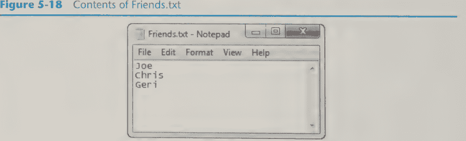

## 从文件中读取数据

不仅可以从 `cin` 对象获取用户输入，还可以从文件中读取数据。假设 `inputFile` 是一个 `ifstream` 对象，以下语句显示了使用 `>>` 运算符从文件中读取数据到变量 `name` 中：

```cpp
inputFile >> name;
```

让我们来看一个例子。假设文件 `Friends.txt` 存在，并且它包含图 5-18 所示的名字。程序 5-19 打开文件，读取名字并显示在屏幕上，最后关闭文件。


### 程序 5-19

```cpp
1 // 此程序从文件中读取数据。
2 #include <iostream>
3 #include <fstream>
4 #include <string>
5 using namespace std;
6
7 int main()
8 {
9     ifstream inputFile;
10     string name;
11
12     inputFile.open("Friends.txt");
13     cout << "Reading data from the file.\n";
14
15     inputFile >> name; // 从文件中读取名字 1
16     cout << name << endl; // 显示名字 1
17
18     inputFile >> name; // 从文件中读取名字 2
19     cout << name << endl; // 显示名字 2
20
21     inputFile >> name; // 从文件中读取名字 3
22     cout << name << endl; // 显示名字 3
23
24     inputFile.close(); // 关闭文件
25     return 0;
26 }
```

### 程序输出

```
Reading data from the file.
Joe
Chris
Geri
```

### 读取位置

当一个文件被打开用于输入时，文件流对象内部会维护一个名为“读取位置”（read position）的特殊值。文件的读取位置标记了将从文件中读取的下一个字节的位置。当打开一个输入文件时，其读取位置最初被设置为文件中的第一个字节。因此，第一次读取操作从第一个字节开始提取数据。随着数据从文件中读取，读取位置会向前移动，直到文件末尾。

让我们看看程序 5-19 所示的示例是如何工作的。当通过第 12 行的语句打开 `Friends.txt` 文件时，文件的读取位置将如图 5-19 所示。

#### 图 5-19 初始读取位置

| J | o | e | \n | C | h | r | i | s | \n | G | e | r | i | \n |
|---|---|---|---|---|---|---|---|---|---|---|---|---|---|
| 读取位置 | | | | | |

请记住，当 `>>` 运算符从文件中提取数据时，它期望读取的是由空白字符（空格、制表符或换行符）分隔的数据段。当第 15 行的语句执行时，`>>` 运算符从文件的当前读取位置读取数据，直到遇到 `\n` 字符为止。从文件中读取的数据并不包含在数据部分中。因此，`name` 对象也会从文件中读取 `\n` 字符，但在该语句执行后，`name` 将持有 "Joe" 的值。随后，文件的读取位置将位于图 5-20 所示的位置。

#### 图 5-20 下一次读取位置

| J | o | e | \n | C | h | r | i | s | \n | G | e | r | i | \n |
|---|---|---|---|---|---|---|---|---|---|---|---|---|---|
| 读取位置 | | | | | | |

当第 18 行的语句执行时，它从文件中读取下一个项（即 "Chris"），并将值赋给 `name` 对象。在该语句执行后，文件的读取位置将移动到下一个项，如图 5-21 所示。

#### 图 5-21 下一次读取位置

| J | o | e | \n | C | h | r | i | s | \n | G | e | r | i | \n |
|---|---|---|---|---|---|---|---|---|---|---|---|---|---|
| 读取位置 | | | | | | |

当第 21 行的语句执行时，它从文件中读取下一个项（即 "Geri"），并将值赋给 `name` 对象。在该语句执行后，文件的读取位置将移动到文件末尾，如图 5-22 所示。

#### 图 5-22 文件末尾的读取位置

| J | o | e | \n | C | h | r | i | s | \n | G | e | r | i | \n |
|---|---|---|---|---|---|---|---|---|---|---|---|---|---|
| 读取位置 | | | | | | |

### 从文本读取数据

不仅可以从 `cin` 对象获取用户输入，还可以从文件中读取数据。假设 `inputFile` 是一个 `ifstream` 对象，以下语句显示了使用 `>>` 运算符从文件中读取数据到变量 `name` 中：请记住，当 `>>` 运算符从文件中提取数据时，它期望读取的是由空白字符（空格、制表符或换行符）分隔的数据段。当第 15 行的语句执行时，`>>` 运算符从文件的当前读取位置读取数据，直到遇到 `\n` 字符为止。从文件中读取的数据并不包含在数据部分中。因此，`name` 对象也会从文件中读取 `\n` 字符，但在该语句执行后，`name` 将持有 "Joe" 的值。文件的读取位置将位于图 5-20 所示的位置。

#### 图 5-23 Data.txt 的内容


### 使用循环处理文件

虽然有些程序使用文件存储少量数据，但文件通常用于存放大量数据。当程序对文件进行写入或读取时，通常涉及到循环。例如，查看程序 5-21 中的代码。

### 程序 5-21

```cpp
1 // 此程序向文件中写入数据。
2 #include <iostream>
3 #include <fstream>
4 using namespace std;
5
6 int main()
7 {
8     ofstream outputFile; // 输出对象
9     int numberOfDays; // 天数
10     double sales; // 每天的销售额
11
12     // 获取天数。
13     cout << "For many days do you have? ";
14     cin >> numberOfDays;
15
16     // 打开名为 Sales.txt 的文件
17     outputFile.open("Sales.txt");
18
19     // 循环
20     for (int count = 1; count <= numberOfDays; count++)
21     {
22         // 获取每天的销售额。
23         cout << "Enter the sales for day " << count << ": ";
24         cin >> sales;
25
26         // 将销售额写入文件。
27         outputFile << sales << endl;
28     }
29
30     // 关闭文件。
31     outputFile.close();
32     cout << "Data written to sales.txt\n";
33     return 0;
34 }
```

### 程序输出（带输入）

```
For many days do you have? 5
Enter the sales for day 1: 1000.00
Enter the sales for day 2: 2000.00
Enter the sales for day 3: 3000.00
Enter the sales for day 4: 4000.00
Enter the sales for day 5: 5000.00
Data written to sales.txt.
```

### 检测文件结束

很多情况下，程序需要读取文件内容，而无需知道文件中存储了项的数量。例如，假设你需要编写一个程序显示文件中的所有项，但你不知道文件中包含多少项。你可以打开文件，然后使用循环反复从文件中读取并显示。然而，如果程序尝试读取文件末尾之后的内容将会发生错误。

幸运的是，`>>` 运算符不仅从文件中读取数据，还会返回一个真或假值，指示数据是否成功读取。如果运算符返回真，则成功读取了一个值。如果运算符返回假，意味着没有从文件中读取到任何值。程序需要某种方法知道何时到达文件末尾，以便避免过度读取。

### 程序 5-22

```cpp
1 // 此程序从文件中读取所有数字。
2 #include <iostream>
3 #include <fstream>
4 using namespace std;
5
6 int main()
7 {
8     ifstream inputFile;
9     double value;
10
11     // 打开名为 ListNumbers.txt 的文件。
12     inputFile.open("ListNumbers.txt");
13
14     // 读取所有数字直到文件末尾。
15     while (inputFile >> value) {
16         // 显示每个数字。
17         cout << value << endl;
18     }
19
20     // 关闭文件。
21     inputFile.close();
22     return 0;
23 }
```

#### 图 5-25 ListNumbers.txt

名为 `ListNumbers.txt` 的文件（如图 5-25 所示）包含了一列表数字。在不知道文件中包含多少个数字的情况下，程序 5-22 打开文件，读取其包含的所有值，并显示它们。

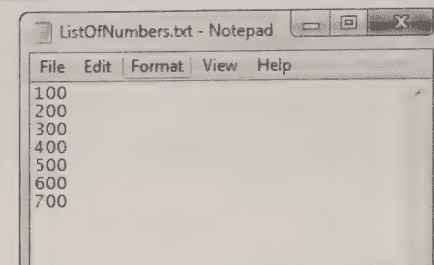

### 程序 5-22（另一版本）

```cpp
// 此程序从文件中读取数据。
#include <iostream>
#include <fstream>
using namespace std;

int main() {
    ifstream inputFile;
    int number;

    // 打开文件。
    inputFile.open("ListOfNumbers.txt");

    // 从文件中读取数字并
    // 显示它们。
    while (inputFile >> number) {
        cout << number << endl;
    }

    // 关闭文件。
    inputFile.close();
    return 0;
}
```

### 程序输出

```
100
200
300
400
500
600
700
```

仔细观察第 16 行：

```cpp
while (inputFile >> number)
```

注意，用于从文件中提取数据的语句被用作 `while` 循环中的布尔表达式。它的工作原理如下：

- 执行表达式 `inputFile >> number`。
- 如果成功从文件中读取了一个项，该项将存储在 `number` 变量中，并且表达式返回 `true` 表示执行成功。执行第 18 行并重复循环。
- 如果文件中没有更多项可以读取，表达式 `inputFile >> number` 返回 `false`，表示没有读取到值。在这种情况下，循环终止。

由于从 `>>` 运算符返回的值控制着循环，它将一直读取，直到到达文件末尾。

### 测试文件打开错误

在某些情况下，`open` 成员函数将无法工作。例如，如果 `file.txt` 不存在，代码将失败：

```cpp
ifstream inputFile;
inputFile.open("info.txt");
```

有一种方法可以判断 `open` 成员函数是否成功打开了文件。在调用 `open` 成员函数后，你可以像测试布尔表达式一样测试文件流对象。程序 5-23 显示了一个示例。

### 程序 5-23

```cpp
// 此程序测试文件打开错误。
#include <iostream>
#include <fstream>
using namespace std;

int main()
{
    ifstream inputFile;
    int number;

    // 打开文件。
    inputFile.open("BadListOfOfNumbers.txt");

    // 如果文件成功打开，则处理它。
    if (inputFile)
    {
        // 从文件中读取数字并
        // 显示它们。
        while (inputFile >> number)
        {
            cout << number << endl;
        }

        // 关闭文件。
        inputFile.close();
    }
    else
    {
        // 显示错误消息。
        cout << "Error opening the file.\n";
        return 0;
    }
}
```

### 程序输出（假设 BadListOfOfNumbers.txt 不存在）

```
Error opening the file.
```

让我们仔细观察代码的某些部分。第 12 行调用 `inputFile` 对象的 `open` 成员函数打开文件 `ListOfNumbers.txt`。然后，第 15 行的语句像测试布尔表达式一样测试 `inputFile` 对象的值。用这种测试时，如果文件成功打开，`inputFile` 对象将给出一个 `true` 值。否则，它将给出一个 `false` 值。输出显示，如果程序无法打开文件，将显示错误消息。

另一种检测打开文件失败的方法是使用 `fail` 成员函数，如下代码所示：

```cpp
ifstream inputFile;
inputFile.open("customers.txt");
if (inputFile.fail()) {
    cout << "Error opening file.\n";
} else {
    // 处理文件。
}
```

当尝试的操作失败时，`fail` 成员函数返回 `true`。在使用 I/O 时，应该始终测试文件对象以确保文件已打开。如果文件无法打开，应该通知用户并由程序采取适当的操作。

### 让用户指定文件名

在之前的每个示例中，打开的文件名都被硬编码为字符串字面量到程序中。在许多情况下，你希望用户指定要打开的文件名。在 C++11，你可以将 `string` 对象作为参数传递给流对象的 `open` 函数。程序 5-24 显示程序 5-23 的修改版本。此版本提示用户输入文件名。在第 15 行，输入存储在名为 `filename` 的字符串对象中。在第 18 行，文件名作为参数传递给 `open` 函数。

### 程序 5-24

```cpp
// 此程序让用户输入文件名。
#include <iostream>
#include <string>
#include <fstream>
using namespace std;

int main() {
    ifstream inputFile;
    string filename;
    int number;

    // 从用户获取文件名。
    cout << "Enter the filename: ";
    cin >> filename;

    // 打开文件。
    inputFile.open(filename);
}
```


# 第 5 章 循环与文件

## 程序 5-23（继续）

```cpp
24      // 关闭文件。
25      inputFile.close();
26  }
27  else
28  {
29      // 显示错误消息。
30      cout << "Error opening the file.\n";
31      return 0;
33  }
```

## 程序输出（假设 BadListOfOfNumbers.txt 不存在）

Error opening the file.

让我们仔细观察代码的某些部分。第 12 行调用 `inputFile` 对象的 `open` 成员函数打开文件 ListOfNumbers.txt。然后，第 15 行的语句像测试布尔表达式一样测试 `inputFile` 对象的值。用这种测试时，如果文件成功打开，`inputFile` 对象将给出一个 `true` 值。否则，它将给出一个 `false` 值。输出显示，如果程序无法打开文件，将显示错误消息。

另一种检测打开文件失败的方法是使用 `fail` 成员函数，如下代码所示：

```cpp
ifstream inputFile;
inputFile.open("customers.txt");
if (inputFile.fail()) {
    cout << "Error opening file.\n";
} else {
    // 处理文件。
}
```

当尝试的操作失败时，`fail` 成员函数返回 `true`。在使用 I/O 时，应该始终测试文件对象以确保文件已打开。如果文件无法打开，应该通知用户并由程序采取适当的操作。

## 让用户指定文件名

在之前的每个示例中，打开的文件名都被硬编码为字符串字面量到程序中。在许多情况下，你希望用户指定要打开的文件名。在 C++11，你可以将 `string` 对象作为参数传递给流对象的 `open` 函数。程序 5-24 显示程序 5-23 的修改版本。此版本提示用户输入文件名。在第 15 行，输入存储在名为 `filename` 的字符串对象中。在第 18 行，文件名作为参数传递给 `open` 函数。

## 程序 5-25（续）

## 程序输出（示例输入已加粗显示）

输入一个数字：2 回车
此程序将计算 2 的 0 次方到 10 次方。
2 的 0 次方是 1
输入 Q 退出或按任意键继续。回车
2 的 1 次方是 2
输入 Q 退出或按任意键继续。回车
2 的 2 次方是 4
输入 Q 退出或按任意键继续。回车

## 在嵌套循环中使用 break

在嵌套循环中，`break` 语句只会中断它所在的循环。下面的程序段会在屏幕上显示五行星号。外层循环控制行数，内层循环控制每行星号的数量。内层循环设计显示 20 个星号，但 `break` 语句在第 11 次迭代时停止了它。

```cpp
for (int row = 0; row < 5; row++)
    for (int star = 0; star < 20; star++)
    {
        cout << '*';
        if (star == 10)
            break;
        cout << endl;
    }
```

上述程序段的输出是：

```
**********
**********
************
************
************
```

## continue 语句

`continue` 语句会导致循环的当前迭代立即结束。当遇到 `continue` 时，循环体中位于其之后的所有语句都被忽略，循环准备进入下一次迭代。

在 `while` 循环中，这意味着程序将跳转到循环顶部的测试表达式。按照常例，如果表达式仍为真，则开始下一次迭代。在 `do-while` 循环中，程序跳转到循环底部的测试表达式，该表达式决定了是否开始下一次迭代。在 `for` 循环中，`continue` 会导致执行更新表达式，然后评估测试表达式。

下面的程序段演示了在 `while` 循环中使用 `continue`：

```cpp
int testVal = 0;
while (testVal++ < 10) {
    if (testVal == 4) {
        continue;
        cout << testVal << " ";
    }
}
```

这个循环看起来像是显示整数 1 到 10。然而，当 `testVal` 等于 4 时，`continue` 语句导致循环跳过 `cout` 语句并开始下一次迭代。循环的输出为：

- 1 2 3 4 5 6 7 8 9 10

程序 5-26 演示了 `continue` 语句。程序计算 DVD 租赁费用，其中新发行的价格为 $3.50，其他所有为 $2.50。如果客户租了多张 DVD，每第三张免费。`continue` 语句用于跳过计算每三个 DVD 费用的循环。

## 程序 5-26

```cpp
// 此程序计算 DVD 租赁费用。
// 每第三张 DVD 免费。
#include <iostream>
#include <iomanip>
using namespace std;
int main() {
    int dvdCount = 1; // DVD 计数器
    int numDVDs;
    double total = 0.0; // 加器
    char current; // 当前发行情况，Y 或 N
    // 获取 DVD 数量。
    cout << "How many DVDs are being rented? ";
    cin >> numDVDs;
    // 确定费用。
    do {
        if ((dvdCount % 3) == 0) {
            cout << "DVD " << dvdCount << " is free!\n";
            continue; // 立即开始下一次迭代
        }
        cout << "Is DVD " << dvdCount << " a current release? (Y/N) ";
        cin >> current;
        if (current == 'Y' || current == 'y') {
            total += 3.50;
        } else {
            total += 2.50;
        }
    } while (dvdCount++ < numDVDs);
```

## 程序 5-26（续）

```cpp
    // 显示总额。
    cout << fixed << showpoint << setprecision(2);
    cout << "The total is $" << total << endl;
    return 0;
}
```

## 输出（示例输入已加粗显示）

How many DVDs are being rented? 6 回车
DVD #1 a current release? (Y/N) y 回车
DVD #2 a current release? (Y/N) n 回车
DVD #3 is free!
DVD #4 a current release? (Y/N) n 回车
DVD #5 a current release? (Y/N) y 回车
DVD #6 is free!
The total is $12.00

案例研究：请访问 www.pearsonhighered.com/gaddis 上的计算机科学门户查看贷款摊销案例研究。

## 复习题与练习题

### 简答

1. 为什么应该缩进循环体中的语句？
2. 描述预测试循环（pretest loops）和后测试循环（posttest loops）之间的区别。
3. 为什么循环体中的语句被称为条件执行语句？
4. `while` 循环和 `do-while` 循环之间的区别是什么？
5. 在希望循环重复到测试表达式为假为止，且如果测试表达式为假则不执行循环的情况下，你应该使用哪种循环？
6. 当你知道迭代次数时，应该使用哪种循环？
7. 为什么计数器变量必须初始化？
8. 为什么累加变量必须初始化？
9. 在 `for` 循环中，第一个表达式是初始化，第三个表达式是更新。
10. 执行操作需要哪个头文件？
11. 向文件写入数据时使用哪种数据类型？
12. 从文件读取时使用哪种数据类型？
13. 为什么程序结束时应该关闭文件？
14. 什么是 ________？

### 填空

1. ________ 一个值意味着增加 1，________ 一个值意味着减少 1。
2. 当增减运算符位于操作数之前（左侧）时，使用的是 ________ 模式。
3. 当增减运算符位于操作数之后（右侧）时，使用的是 ________ 模式。
4. 重复执行的语句或块被称为循环的 ________。
5. 循环的每次迭代被称为 ________。
6. 在每次重复之前评估测试表达式的循环是 ________。
7. 在每次重复后评估测试表达式的循环是 ________。
8. 没有停止值的循环是。
9. ________ 是记录循环重复次数的变量。
10. ________ 是在每次迭代中累加的变量。
11. ________ 是标记系列结束的特殊值。
12. ________ 循环至少执行一次。
13. 如果测试表达式为假，________ 和 ________ 循环都不会执行。
14. 在另一个循环内部的循环被称为 ________。
15. ________ 语句导致循环立即终止。
16. ________ 语句跳过迭代中的剩余语句。

## 算法设计

35. 写一个 `while` 循环让用户输入一个数字。将该数字乘以10并将结果存储在变量 `product` 中。只要 `product` 的值小于 100，循环继续进行。
36. 写一个 `do-while` 循环要求用户输入两个数字。这两个数字相加并显示和。询问用户是否再次执行。如果是，则重复循环；否则终止。
37. 写一个循环显示以下数字集：0, 10, 20, 30, 40, 50 ... 1000
38. 写一个循环要求用户输入一个数字。循环执行 10 次，并保持输入数字的运行总和。
39. 写一个嵌套循环显示 10 行 '#' 字符。每行应有 15 个 '#' 字符。

41. 将以下 `do-while` 循环转换为 `while` 循环：
```cpp
char sure;
do{
    cout << "Are you sure you want to quit? ";
    cin >> sure;
} while (sure == 'Y' && sure != 'N');
```

42. 将以下 `while` 循环转换为 `for` 循环：
```cpp
int count = 0;
while (count < 50)
{
    cout << "count is " << count << endl;
    count++;
}
```

43. 将以下循环转换为 `while` 循环：
```cpp
for (int x = 50; x > 0; x--)
{
    cout << x << " seconds to go.\n";
}
```

44. 编写代码实现以下功能：打开一个名为 `Numbers.txt` 的输出文件，使用循环将 1 到 100 的数字写入文件，然后关闭文件。

45. 编写代码实现以下功能：打开第 44 题中创建的 `Numbers.txt` 文件，读取文件中所有的数字并显示它们，然后关闭文件。

46. 修改你在第 45 题中编写的代码，使其累加从文件中读取的所有数字并显示总和。

### 判断对错

- 47. T F 递增运算符和递减运算符的操作数可以可以是任何有效的数学表达式。
- 48. T F 下述程序段中的语句将显示 5：
```cpp
int x = 5;
cout << x;
```
- 49. T F 下述程序段中的语句将显示 5：
```cpp
int x = 5;
cout << ++x;
```
- 50. T F `while` 循环是预测试循环。
- 51. T F `do-while` 循环是预测试循环。
- 52. T F `for` 循环是后测试循环。
- 53. T F 没必要初始化计数器变量的。
- 54. T F `for` 循环的三个表达式都可以省略。
- 55. T F `for` 循环的一个局限性是在初始化表达式中只能初始化变量。
- 56. T F 变量可以在循环体内定义。
- 57. T F 变量可以在 `for` 循环的初始化表达式中定义。
- 58. T F 在嵌套循环中，外层循环的执行速度比内层循环快。
- 59. T F 在嵌套循环中，外层循环每执行一次迭代，内层循环都会完成其所有的迭代。
- 60. T F 要计算嵌套循环的总迭代次数，需要将所有循环的迭代次数相加。
- 61. T F `break` 语句会导致循环停止当前迭代并开始下一次迭代。
- 62. T F `continue` 语句会导致已终止的循环继续执行。
- 63. T F 在嵌套循环中，`break` 语句只会中断它所在的那个循环。
- 64. T F 当你调用 `ofstream` 对象的成员函数时，如果指定的文件已存在，则它将被擦除。

## 找错误

以下每个程序都有错误。请尽可能多地找出。

```cpp
65. // Find此程序中的错误。
#include <iostream>
using namespace std;
int main() {
    int num1 = 0, num2 = 10, result;
    num1++;
    result = +(num1 + num2);
    cout << num1 << " " << num2 << " " << result;
    return 0;
}
```

```cpp
66. // 此程序将用户输入的两个数字。
#include <iostream>
using namespace std;
int main() {
    int num1, num2;
    char again;
    while (again == 'y' || again == 'Y') {
        cout << "Enter a number: ";
        cin >> num1;
        cout << "Enter another number: ";
        cin >> num2;
```


```cpp
cout << "Their sum is " << (num1 + num2) << endl;

cout << "Do you want to do this again? ";

cin >> again;

}

return 0;

}
```

```cpp
67. // 此程序使用循环计算数字的幂。

#include <iostream>

using namespace std;

int main() {

    int num, bigNum, power, count;

    cout << "Enter an integer: ";

    cin >> num;

    cout << "What power do you want it raised to? ";

    cin >> power;

    bigNum = num;

    while (count < power) {

        bigNum += num;

    }

    cout << "The result is " << bigNum << endl;

    return 0;

}
```

```cpp
68. // 此程序计算一组数字的平均值。

#include <iostream>

using namespace std;

int main() {

    int numCount, total;

    double average;

    cout << "How many numbers do you want to average? ";

    cin >> numCount;

    for (int count = 0; count < numCount; count++) {

        int num;

        cout << "Enter a number: ";

        cin >> num;

        total += num;

    }

    average = total / numCount;

    cout << "The average is " << average << endl;

    return 0;

}
```

```cpp
69. // 此程序使用循环计算数字的幂。

#include <iostream>

using namespace std;

int main() {

    int num, bigNum, power, count;

    cout << "Enter an integer: ";

    cin >> num;

    cout << "What power do you want it raised to? ";

    cin >> power;

    bigNum = num;

    while (count < power) {

        bigNum += num;

    }

    cout << "The result is " << bigNum << endl;

    return 0;

}
```

```cpp
70. // 此程序计算两个数字的和和。

#include <iostream>

using namespace std;

int main() {

    int num1, num2;

    char again;

    cout << "Enter a number: ";

    cin >> num1;

    cout << "Enter another number: ";

    cin >> num2;

    cout << "Their sum is " << (num1 + num2) << endl;

    cout << "Do you want to do this again? ";

    cin >> again;

    while (again == 'y' || again == 'Y') {

        cout << "Enter a number: ";

        cin >> num1;

        cout << "Enter another number: ";

        cin >> num2;

        cout << "Their sum is " << (num1 + num2) << endl;

        cout << "Do you want to do this again? ";

        cin >> again;

    }

    return 0;

}
```

```cpp
70. // 此程序计算一组数字的平均值。

#include <iostream>

using namespace std;

int main() {

    int numCount, total = 0;

    double average;

    cout << "How many numbers do you want to average? ";

    cin >> numCount;

    for (int count = 0; count < numCount; count++) {

        int num;

        cout << "Enter a number: ";

        cin >> num;

        total += num;

    }

    average = total / numCount;

    cout << "The average is " << average << endl;

    return 0;

}
```

# 编程题

- 1. **数字之和**：编写一个程序，让用户输入一个整数。程序应使用循环获取 1 到 50 的整数。例如，如果用户输入 50，循环将显示总和。输入验证：不接受负数。
- 2. **字符**：编写一个程序，显示 0 到 127 的字符。
- 3. **海平面**：假设海平面目前每年上升 5 毫米，编写一个程序显示未来 25 年的情况。
- 4. **卡路里**：在跑步机上你每分钟消耗 6 卡路里，编写一个程序显示 10 分钟后的卡路里。
- 5. **会费**：某俱乐部目前每年收取 2500 美元，宣布费用每年增加 4%。编写一个程序显示未来 6 年的费用。
- 6. **距离**：距离可以通过以下方式计算：`distance = speed * time`。例如，每小时 40 英里行驶 3 小时，距离为 120 英里。编写一个程序询问用户的速度（英里/小时）和时间，然后显示每小时的距离。这里是输出的示例：

速度(mph)？40
行驶了多少小时？3
| 小时 | 距离 |
|---|---|
| 1 | 40 |
| 2 | 80 |
| 3 | 120 |

输入验证：不接受负的速度和小于 1 的时间。

- 7. **工资**：编写一个程序，计算某人在某期间的收入，如果第一天是一分钱，第二天是两分，之后每天翻倍。程序应询问用户天数。显示一个每天工资的表格，最后显示总工资。输出应以金额显示，而不是分钱。输入验证：不接受小于 1 的数。
- 8. **数学导师**：此程序始于第 3 章编程题 17，并在第 4 章编程题 11 中进行了修改。再次修改程序，使其显示一个菜单，允许用户选择加、减、乘、除运算。最后的选项应该是让用户退出程序。在用户完成计算后，程序应再次显示菜单，直到用户选择退出。
- 9. **酒店入住**：编写一个程序计算酒店的入住率。程序首先询问用户酒店有多少层。程序应循环遍历每一层。在每次迭代中，循环应询问用户每层的房间数以及其中有多少房间已入住。在所有迭代完成后，程序应显示酒店有多少房间、有多少房间已入住、有多少房间空闲以及入住的百分比。百分比可以通过入住房间数除以房间总数来计算。

> 注意：大多数酒店没有第十三层。

输入验证：层数不接受小于 1 的。每层房间数不接受小于 10。

## 10. 平均降雨量

编写一个程序，使用嵌套循环收集数据并计算多年来的平均降雨量。程序应首先询问年份。外层循环每个月迭代一次。内层循环迭代 12 次，每个月一次。内层循环的每次迭代都会询问用户输入该月份的降雨量（英寸）。

在所有迭代完成后，程序应显示总月份数、降雨总量以及整个期间的每月平均降雨量。

输入验证：年份不接受小于 1 的。每月降雨量不接受负数。

## 11. 人口数量

编写一个程序来预测生物种群的规模。程序应询问用户初始生物数量、平均人口增长率（百分比）以及繁殖的天数。循环应该显示每天的种群规模。

输入验证：初始种群规模不接受小于 2。每日平均人口增长率不接受负数。繁殖天数不接受小于 1。

## 12. 摄氏度转华氏度表

在第 3 章的编程挑战 12 中，你被要求编写一个将摄氏度温度转换为华氏度的程序。修改该程序使其使用循环显示 0-20 摄氏度温度及其对应的华氏度对照表。

## 13. 最大与最小

编写一个带有循环的程序，允许用户输入一系列整数。用户输入 -99 来表示序列结束。在输入所有数字后，程序应显示输入的最大数字和最小数字。

## 14. 学生排队

老师让所有学生按名字首字母排队。例如，在一个班级中，Amy 会在队首，Yolanda 会在队尾。编写一个程序提示用户输入人数，然后循环读取这些名字。读取完所有名字后，报告哪个学生将位于队首，哪一个将位于队尾。你可以假设没有两个学生的名字是相同的。

输入验证：人数不接受小于 1 或大于 25 的。

## 15. 薪资报告

编写一个显示周薪资的程序。程序中的循环应询问工号、总工资、州税、联邦税和 FICA 预扣税。当工号输入 0 时，循环终止。输入数据后，程序应显示总工资、州税、联邦税、FICA 预扣税和净薪的总额。

输入验证：输入的任何项目均不接受负数。州税、联邦税或 FICA 预扣税的值不能大于总工资。如果任何员工的州税 + 联邦税 + FICA 预扣税之和大于总工资，则打印错误信息并要求用户重新输入该员工的数据。

## 16. 储蓄账户余额

编写一个程序计算某一段时间结束后储蓄账户的余额。它应询问用户年利率、初始余额以及账户建立以来过的月数。循环每个月迭代一次，执行以下操作：

- A) 询问用户该月存入账户的金额。（不接受负数）。该金额应加到余额。
- B) 询问用户该月从账户取出的金额。（不接受负数）。该金额应从余额中扣除。
- C) 计算每月利率。每月利率为年利率除以 12。将月利率乘以余额，并将结果加到余额。

在最后一次迭代后，程序应显示结束余额、存款总额、取款总额以及获得的总利息。


> 注意：如果在任何一点计算出负余额，应显示一条账户已关闭的消息并终止循环。

## 17. 销售柱状图

编写一个程序，询问用户输入五家商店今天的销售额。程序随后显示一个比较每家商店销售的柱状图。通过显示一行星号来创建图中的每个柱。每个星号代表 $100 的销售额。
以下是程序输出的示例：

```
Enter today's sales for store 1: 1000 Enter
Enter today's sales for store 2: 1200 Enter
Enter today's sales for store 3: 1800 Enter
Enter today's sales for store 4: 800 Enter
Enter today's sales for store 5: 1900 Enter
SALES BAR CHART
(Each * = $100)
Store 1: ********************
Store 2: ********************
Store 3: ************************************
Store 4: ******************
Store 5: ********************************************
```

## 18. 人口柱状图

编写一个程序，询问用户输入五家商店今天的销售额。程序随后显示一个比较每家商店销售的柱状图。通过显示一行星号来创建图中的每个柱。每个星号代表 $100 的销售额。
（注：此处 OCR 文本存在大量重复和混乱，已根据上下文逻辑进行清理）

## 19. 预算

编写一个程序，询问用户输入该月的开支。程序随后显示用户是超出预算还是在预算内。

## 20. 猜数字游戏

编写一个程序生成随机数并询问用户数字是多少。如果用户的猜测比随机数大，程序应显示“太大了，再试”。如果用户的猜测比随机数小，程序应显示“太小了，再试”。程序重复直到用户正确猜中随机数。

## 21. 随机数字游戏

增强你为第 20 题编写的程序，记录用户猜测的次数。当用户正确猜中随机数时，程序应显示该数字。

## 22. 正方形

编写一个程序，询问用户一个不超过 15 的正整数。程序应使用字符 'X' 显示一个正方形。用户输入的数字将作为边长。例如，程序应显示如下：

```
XXXXX
XXXXX
XXXXX
XXXXX
XXXXX
```

如果用户输入 8，程序应显示：

```
XXXXXXX
XXXXXXX
XXXXXXX
XXXXXXX
XXXXXXX
XXXXXXX
XXXXXXX
XXXXXXX
```

## 23. 模式显示

编写一个程序，使用循环显示下面的模式 A，然后用另一个循环显示模式 B。

| Pattern A | Pattern B |
| --- | --- |
| + | +++++ |
| ++ | +++++ |
| +++ | +++++ |
| ++++ | +++++ |
| +++++ | +++++ |
| ++++++ | +++++ |
| +++++++ | +++++ |
| ++++++++ | + |
| +++++++++ | ++ |
| +++++++++ | + |

## 25. 使用文件——学生排队

修改编程挑战 14 中描述的学生排队程序，使其从文件中获取名字。读取名字直到没有更多数据可读。如果你下载了这本书的源代码，将在第 05 文件夹中找到一个名为 `LineUp.txt` 的文件。你可以使用此文件测试程序。

## 26. 个人网页生成器

编写一个程序，询问用户的姓名，并要求用户输入一个描述自己的句子。

# 编程挑战 303

一旦用户输入了请求输入，程序应该创建一个 HTML 文件，其中包含该输入，用于构建简单的网页。以下是 HTML 内容的一个示例，使用了之前显示的示例输入：

```html
<html>
<head>
</head>
<body>
<center>
<h1>Julie Taylor</h1>
</center>
<hr />
我是一名计算机科学专业的学生，爵士乐俱乐部的成员，
我希望在毕业后成为一名移动应用程序开发人员。
<hr />
</body>
</html>
```

# 27. 平均每日步行步数

个人健身健康追踪器是一种可穿戴设备，可以追踪你的体力活动、消耗的热量、心率、睡眠模式等。大多数这类设备追踪的一项常见体力活动之一就是你每天行走的步数。

如果你下载了这本书的源代码，你将在第 05 文件夹中找到一个名为 `steps.txt` 的文件。`steps.txt` 文件包含一个人一天内行走的步数。（第一行是 1 月 1 日的步数，第二行是 1 月 2 日的步数，以此此类推。）编写一个程序读取该文件，然后显示每个月的平均步数。（数据来自一个非闰年，因此 2 月有 28 天。）

# 函数

### 课题

| 6.1 关注软件工程：模块化编程 | 6.9 返回布尔值 |
| 6.2 定义和调用函数 | 6.10 局部变量与全局变量 |
| 6.3 函数原型 | 6.11 静态局部变量 |
| 6.4 向函数传递数据 | 6.12 默认参数 |
| 6.5 按值传递数据 | 6.13 使用引用变量作为参数 |
| 6.6 关注软件工程：在菜单驱动型程序中使用函数 | 6.14 函数重载 |
| 6.7 return 语句 | 6.15 exit() 函数 |
| 6.8 从函数返回数值 | 6.16 存根（Stubs）与驱动程序 |

# 6.1 关注软件工程：模块化编程

> 概念：一个程序可以被拆分为易管理的函数。

函数是执行特定任务的语句集合。到目前为止，你已经通过两种方式体验过函数：(1) 你在编写的程序创建了一个名为 `main` 的函数，(2) 你使用了如 `pow` 和 `sqrt` 这样的库函数。在本章中，你将学习如何创建自己的像库函数一样使用的函数。

函数通常用于将问题分解成较小的、易于管理的单元。与其编写一个包含解决问题所需所有语句的长函数，不如编写几个解决问题每个部分的小型函数。然后，这些小函数可以按照所需的顺序执行以解决问题。这种方法有时被称为“分而治法”，因为一个大问题被拆分成了若干个容易解决的小问题。图 6-1 通过比较两个程序说明了这一思想：一个使用包含解决问题所需所有语句的长复杂函数，另一个则将问题拆分为较小的问题，每个问题都由一个独立的函数处理。

# 图 6-1 模块化编程

此程序有一个复杂的函数，包含了解决问题所需的所有语句。

在此程序中，问题被拆分为较小的问题，每个问题都由一个独立的函数处理。

```cpp
int main()
{
    statement;
    statement;
    statement;
    statement;
    statement;
    statement;
    statement;
    statement;
    statement;
    statement;
    statement;
    statement;
    statement;
    statement;
    statement;
    statement;
}
```


# 6.2 定义和调用函数

## 概念
函数调用是一个导致函数执行的语句。函数定义包含了构成函数的语句。

## 函数定义组成部分
在创建函数时，你必须编写它的定义。函数定义包含以下部分：

- **返回类型**：函数可以向调用它的程序部分发送数值。返回类型是发送给函数的数据类型。
- **名称**：你应该为每个函数起一个描述性的名称。通常情况下，适用于变量名的规则也适用于函数名。
- **参数列表**：参数列表是传递给函数的变量。
- **函数体**：函数体是执行操作的语句集合。它们被封装在大括号中。

图 6-2 显示了带有标记的简单函数的定义。


## void 函数
你已经知道函数可以返回值。你所看到的程序中的 `main` 函数被声明为返回一个 `int` 值给操作系统。`return 0;` 语句在 `main` 函数结束时返回 0。

并不是所有函数都需要返回值，有些函数只是执行一个或多个语句并终止。这些被称为 void 函数。`displayMessage` 函数是一个例子：

```cpp
void displayMessage() {
    cout << "Hello from the function displayMessage.\n";
}
```

函数的名称是 `displayMessage`。这个名称指示了函数的功能：它显示一条消息。注意函数的返回类型为 `void`。这意味着函数不向调用它的程序部分返回数值。注意该函数没有 `return` 语句。它只是显示消息并退出。

## 调用函数
函数在被调用时执行。`main` 函数在程序启动时自动调用，但所有其他函数必须通过函数调用语句来执行。当函数被调用时，程序跳转到该函数并执行其体中的语句。让我们看看程序 6-1，它有两个函数：`main` 和 `displayMessage`。

### 程序 6-1
```cpp
// 此程序有两个函数：main 和 displayMessage
#include <iostream>
using namespace std;

//****************************************************
// displayMessage 函数定义
// 此函数显示问候语
//****************************************************
void displayMessage() {
    cout << "Hello from the function displayMessage.\n";
}

//****************************************************
// main 函数
//****************************************************
int main() {
    cout << "Hello from main.\n";
    displayMessage();
    cout << "Back in function again.\n";
    return 0;
}
```

### 程序输出
```
Hello from main.
Hello from the function displayMessage.
Back in function main again.
```

`displayMessage` 函数通过第 22 行的以下语句调用：
`displayMessage();`

这条语句就是函数调用。它仅仅是函数名后跟着一对括号和一个分号。让我们将其与函数头进行对比：

- **函数头**：`void displayMessage()`
- **函数调用**：`displayMessage();`

函数头是函数定义的一部分。它声明了函数的返回类型、名称和参数列表。它不是以分号结尾，因为函数的定义紧随其后。

函数调用是一个执行函数的语句，因此它以分号结尾；就像所有其他 C++ 语句一样。在函数调用中不列出返回类型，如果程序没有向函数传递数据，则括号为空。

> **注意**：在本章的稍后部分，你将看到如何通过在圆括号内列出数据来将数据传递给函数。

尽管程序从 `main` 函数开始执行，但 `displayMessage` 函数首先被定义。这是因为编译器在调用函数之前，必须知道函数的返回类型、参数的数量以及每个参数的类型。确保编译器知道这些信息的一种方法是将函数定义放在所有对该函数的调用之前。（稍后，你将使用另一种更优的方法来实现这一点。）

> **注意**：你应该通过编写描述函数作用的注释来记录你的函数。这些注释应该出现在函数定义之前。

注意程序 6-1 的执行流程。它当然是从 `main` 函数开始的。当遇到对 `displayMessage` 的调用时，程序分支到该函数并执行其语句。一旦 `displayMessage` 执行完毕，程序就会分支回 `main` 函数，并从函数调用后的行继续执行。这在图 6-3 中所示。

### 图 6-3 一个函数调用
```cpp
void displayMessage() {
    cout << "Hello from the function displayMessage.\n";
}

int main() {
    cout << "Hello from main.\n";
    displayMessage();
    cout << "Back in function main again.\n";
    return 0;
}
```

函数调用语句可以用在循环、`if` 语句和 `switch` 语句等控制结构中。程序 6-2 将 `displayMessage` 函数调用放在循环内部。

### 程序 6-2
```cpp
// 函数 displayMessage 在一个循环中被反复调用。
#include <iostream>
using namespace std;

//****************************************************
// 函数 displayMessage 的定义
// 此函数显示问候语。
//****************************************************
void displayMessage() {
    cout << "Hello from the function displayMessage.\n";
}

//****************************************************
// 函数 main
//****************************************************
int main() {
    cout << "Hello from main.\n";
    for (int count = 0; count < 5; count++) {
        displayMessage(); // 在函数 main 中再次调用函数。
    }
    cout << "Back in function main again.\n";
    return 0;
}
```

### 程序输出
```
Hello from main.
Hello from the function displayMessage.
Hello from the function displayMessage.
Hello from the function displayMessage.
Hello from the function displayMessage.
Hello from the function displayMessage.
Back in function main again.
```

程序中可以有许多函数和函数调用。程序 6-3 有三个函数：`main`、`first` 和 `second`。

### 程序 6-3
```cpp
// 此程序有三个函数：main, first 和 second。
#include <iostream>
using namespace std;

//****************************************************
// 函数 first 的定义
// 此函数显示一条消息。
//****************************************************
void first() {
    cout << "I am now inside the function first.\n";
}

//****************************************************
// 函数 second 的定义
// 此函数显示一条消息。
//****************************************************
void second() {
    cout << "I am now inside the function second.\n";
}

//****************************************************
// 函数 main
//****************************************************
int main() {
    cout << "I am starting in function main.\n";
    first(); // 调用函数 first
    second(); // 调用函数 second
    cout << "Back in function main again.\n";
    return 0;
}
```

### 程序输出
```
I am starting in function main.
I am now inside the function first.
I am now inside the function second.
Back in function main again.
```

在程序 6-3 的第 32 行和第 33 行，`main` 函数包含了对 `first` 的调用和对 `second` 的调用：
`first();`
`second();`

每个调用语句都会导致程序分支到一个函数，然后在函数完成后返回 `main`。图 6-4 说明了程序所经过的路径。

### 图 6-4 程序所经过的路径
```cpp
void first() {
    cout << "I am now inside the function first.\n";
}

void second() {
    cout << "I am now inside the function second.\n";
}

int main() {
    cout << "I am starting in function main.\n";
    first();
    second();
    cout << "Back in function main again.\n";
    return 0;
}
```

函数也可以以分级或分层的方式被调用。程序 6-4 证明了这一点，它有三个函数：`main`、`deep` 和 `deeper`。

### 程序 6-4
```cpp
// 此程序有三个函数：main, deep 和 deeper
#include <iostream>
using namespace std;

//****************************************************
// 函数 deeper 的定义
// 此函数显示一条消息。
//****************************************************
void deeper() {
    cout << "I am now inside the function deeper.\n";
}

//****************************************************
// 函数 deep 的定义
// 此函数显示一条消息。
//****************************************************
void deep() {
    cout << "I am now inside the function deep.\n";
    deeper();
}

//****************************************************
// main 函数
//****************************************************
int main() {
    cout << "I am starting in function main.\n";
    deep();
    deeper();
    cout << "Back in function main again.\n";
    return 0;
}
```

### 程序 6-5
```cpp
// 此程序有三个函数：main, first 和 second。
#include <iostream>
using namespace std;

// 函数原型声明
void first();
void second();

int main() {
    cout << "I am starting in function main.\n";
    first(); // 调用函数 first
    second(); // 调用函数 second
    cout << "Back in function main again.\n";
    return 0;
}

//****************************************************
// 函数 first 的定义。
// 此函数显示一条消息。
//****************************************************
void first() {
    cout << "I am now inside the function first.\n";
}

//****************************************************
// 函数 second 的定义。
// 此函数显示一条消息。
//****************************************************
void second() {
    cout << "I am now inside the function second.\n";
}
```

### 程序输出
（该程序的输出与程序 6-3 相同。）

当编译器读取程序 6-5 时，它在第 12 行和 13 行遇到了对 `first` 和 `second` 函数的调用，此时尚未读取这些函数的定义。然而，由于函数原型的存在，编译器已经知道了 `first` 和 `second` 的返回值类型和参数信息。

> **注意**：尽管有些程序员将 `main` 放在程序的最后，但许多人倾向于让它成为第一个，因为它是程序的起点。

## 向函数传递数据
**概念：** 当调用一个函数时，程序可能会向函数传递值。

传递到函数的值称为参数（arguments）。你已经熟悉了如何使用参数，并且两个参数 2.0 和 4.0 被传递给它：在以下语句中，正在调用函数 `pow`：
`result = pow(2.0, 4.0);`

通过使用参数（parameters），你可以设计自己的以这种方式接收数据的函数。参数是一个特殊的变量，用于持有传递到函数的值。下面是一个使用参数的函数定义：

```cpp
void displayValue(int num) {
    cout << "The value is " << num << endl;
}
```


注意括号内的整数变量定义 `(int num)`。变量 `num` 就是一个参数。这使得函数 `displayValue` 能够接受一个整数值作为参数。程序 6-6 是使用该函数的完整程序。

> 注意：在本文中，传入函数的值称为参数（arguments），而接收这些值的变量称为参数（parameters）。这些术语有几种变体。有些人将值称为实际参数（actual parameters），将变量称为形式参数（formal parameters）。另一些则使用实际参数（actual argument）和形式参数（formal argument）。无论使用哪一组术语，保持一致性都是重要的。

# 程序 6-6

```cpp
1 // 此程序演示了一个带参数的函数。
2 #include <iostream>
3 using namespace std;
4 
5 // 函数原型
6 void displayValue(int);
7 
8 int main()
9 {
10    cout << "I am passing 5 to displayValue.\n";
11    displayValue(5); // 使用参数 5 调用 displayValue
12    cout << "Now I am back in main.\n";
13 
14    return 0;
15 }
```

# 程序 6-6（续）

```cpp
********************************************************************
// 函数 displayValue 的定义。
// 它使用一个整数参数，其值会被显示出来。
****************************************************
void displayValue(int num)
{
    cout << "The value is " << num << endl;
}
```

# 程序输出

```
I am passing 5 to displayValue.
The value is 5
Now I am back in main.
```

首先，注意第 6 行中 `displayValue` 的函数原型：
`void displayValue(int);`
没有必要在括号内列出参数变量名，只需要数据类型。上面的函数原型也可以写成：
`void displayValue(int num);`
然而，编译器会忽略函数原型中的参数变量名。在 `main` 中，通过括号内的 5 调用 `displayValue` 函数。数字 5 被传递给了 `num`，而 `num` 就是 `displayValue` 的参数。这如图 6-6 所示。

# 图 6-6 传递给函数的参数

 函数调用括号内列出的任何参数都会复制到函数的参数变量。本质上，参数变量被初始化为它们对应的参数值。程序 6-7 显示了 `displayValue` 被调用了多次，每次都传递了不同的参数。

# 程序 6-7

```cpp
// 此程序演示了一个带参数的函数。
#include <iostream>
using namespace std;

// 函数原型
void displayValue(int);

int main() {
    cout << "I am passing several values to displayValue.\n";
    displayValue(5);  // 使用参数 5 调用 displayValue
    displayValue(10); // 使用参数 10 调用 displayValue
    displayValue(2);  // 使用参数 2 调用 displayValue
    displayValue(16); // 使用参数 16 调用 displayValue
    cout << "Now I am back in main.\n";
    return 0;
}

****************************************************
// 函数 displayValue 的定义。
// 它使用一个整数参数，其值会被显示出来。
****************************************************
void displayValue(int num)
{
    cout << "The value is " << num << endl;
}
```

# 按值传递数据

> **概念**：当一个参数传递给参数时，传递的只是该参数值的拷贝。对参数的修改不会影响原始参数。

正如你在本章中看到的，参数是定义在函数定义括号内的特殊用途变量。它们与函数调用括号内的实参是分离且互不相同的。存储在参数变量中的值是参数的拷贝。通常情况下，当在函数内部改变参数的值时，它对原始参数没有影响。程序 6-9 演示了这一点。

# 程序 6-9

```cpp
// 此程序演示了对函数参数的修改
// 对原始参数没有产生影响。
#include <iostream>
using namespace std;

// 函数原型声明
void changeMe(int);

int main() {
    int number = 12;
    // 显示 number 的值。
    cout << "number is " << number << endl;
    // 调用 changeMe，将 number 的值
    // 作为参数传递。
    changeMe(number);
    // 再次显示 number 的值。
    cout << "Now back in main again, the value of ";
    cout << "number is " << number << endl;
    return 0;
}

********************************************************************
// 函数 changeMe 的定义。
// 此函数改变参数 myValue 的值。
********************************************************************

```cpp
30 31 void changeMe(int maxValue)
32 {
33   // 将 maxValue 的值改为0。
34   myValue = 0;
35 
36   // 显示 maxValue 的值。
37   cout << "Now the value is " << maxValue << endl;
38 }
```

# 程序输出

```
number is 12
Now the value is 0
Now back in main again, the value of number is 12
```

尽管在 `changeMe` 函数中改变了参数变量 `maxValue`，但实参 `number` 并没有被修改。`maxValue` 变量只包含 `number` 变量的一份拷贝。

`changeMe` 函数无法访问原始参数。当仅将参数的拷贝传递给函数时，被称为按值传递。这是因为函数接收的是参数值的拷贝，无法访问原始参数。

图 6-8 说明了参数变量在内存中的存储位置与原始参数的位置是分离的。

# 图 6-8 实参和参数是分离的

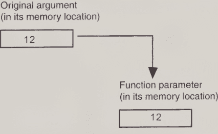

> 注意：在本章后面的内容中，你将学习让函数访问其原始参数的方法。

# 软件工程聚焦：在菜单驱动程序中使用函数

**概念**：函数是菜单驱动程序的理想选择。当用户从菜单中选择一项时，程序可以调用相应的函数。

在第 4 章和第 5 章中，你见过一个计算健康俱乐部会员费的菜单驱动程序。程序 6-10 显示了重设计为模块化的程序。一个*模块化*程序被拆分为执行特定任务的函数。

# 程序 6-10

```cpp
// 这是一个菜单驱动程序，对于用户做的每次选择
// 都会进行函数调用。
#include <iostream>
#include <iomanip>
using namespace std;

// 函数原型
void showMenu();
void showFees(double, int);

int main() {
    int choice;          // 用于存储菜单选择
    int months;         // 用于存储月份数
    // 菜单选择常量
    const int ADULT_CHOICE = 1,
           CHILD_CHOICE = 2,
           SENIOR_CHOICE = 3,
           QUIT_CHOICE = 4;
    // 会员费率常量
    const double ADULT = 40.0,
           CHILD = 20.0,
           SENIOR = 30.0;
    // 设置数值输出格式。
    cout << fixed << showpoint(2);
    do {
        // 显示菜单并获取用户的选择
        showMenu();
        cin >> choice;
        // 验证菜单选择。
        while (choice < ADULT_CHOICE || choice > QUIT_CHOICE)
{
39 40   cout << "Please enter a valid menu choice: ";
41   cin >> choice;
42  }
   
   // 如果用户不想退出，则继续。
   if (choice != QUIT_CHOICE)
   {
       // 获取月份数。
       cout << "For how many months? ";
       cin >> months;
  
       // 显示会员费。
       switch (choice)
       {
           case ADULT_CHOICE:
               showFees(ADULT, months);
               break;
           case CHILD_CHOICE:
               showFees(CHILD, months);
               break;
           case SENIOR_CHOICE:
               showFees(SENIOR, months);
       }
   }
} while (choice != QUIT_CHOICE);
return 0;
}

```

> /* 函数 showMenu 的定义，显示菜单。
********************************************************************

```cpp
void showMenu()
{
    cout << "Health Club Menu\n";
    cout << "1. Adult Membership\n";
    cout << "2. Child Membership\n";
    cout << "3. Senior Membership\n";
    cout << "4. Quit the Program\n";
    cout << "Enter your choice: ";
}
```

> // 函数 showFees 的定义，显示总费用。
********************************************************************

```cpp
void showFees(double rate, int months)
{
    cout << "The total charges are $" << rate * months << endl;
}
```

# 程序输出

```
Health Club Menu
1. Adult Membership
2. Child Membership
3. Senior Membership
4. Quit the Program
Enter your choice: 1
For how many months? 12
The total charges are $480.00

Health Club Menu
1. Adult Membership
2. Child Membership
3. Senior Membership
4. Quit the Program
Enter your choice: 2
For how many months? 6
The total charges are $120.00

Health Club Menu
1. Adult Membership
2. Child Membership
3. Senior Membership
4. Quit the Program
Enter your choice: 3
For how many months? 10
The total charges are $300.00

Health Club Menu
1. Adult Membership
2. Child Membership
3. Senior Membership
4. Quit the Program
Enter your choice: 4
```

328 第 6 章 函数

```cpp
void func1(double a, int b)
{
    cout << a << " " << b << endl;
    a = 0.0;
    b = 10;
    cout << a << " " << b << endl;
}
```

6.10 下面的程序骨架要求输入工作的小时和每小时工资。它会计算并显示你的工资。你需要编写的 `showDollars` 函数将对工资的输出进行格式化。

```cpp
#include <iostream>
using namespace std;

void showDollars(double); // 函数原型

int main() {
    double payRate, hoursWorked, wages;
    cout << "How many hours have you worked? ";
    cin >> hoursWorked;
    cout << "What is your hourly pay rate? ";
    cin >> payRate;
    wages = hoursWorked * payRate;
    showDollars(wages);
    return 0;
}
```

## return 语句 (The return Statement)

概念：return 语句会导致函数立即结束。

当 void 函数中的最后一个语句执行完毕后，函数将终止，程序返回到函数调用之后的语句。然而，可以在最后一个语句执行执行之前强制函数返回。当遇到 return 语句时，函数会立即终止，程序的控制权返回到调用该函数的语句。这在程序 6-11 中得到了演示。`divide` 函数显示了参数 `arg1` 除以 `arg2` 的商。如果 `arg2` 被设置为零，该函数将返回。


## 程序 6-11

```cpp
// 此程序使用函数执行除法。如果检测到
// 除以零，函数将直接返回。
#include <iostream>
using namespace std;

// 函数原型。
void divide(double, double);

int main() {
    double num1, num2;
    cout << "Enter two numbers and I will divide the first\n";
    cout << "number by the second number: ";
    cin >> num1 >> num2;
    divide(num1, num2);
    return 0;
}

********************************************************************
// 函数 divide 的定义。
// 使用两个参数：arg1 和 arg2。函数将 arg1
// 除以 arg2 并显示结果。但如果 arg2 为零，
// 函数将返回。
********************************************************************

void divide(double arg1, double arg2) {
    if (arg2 == 0.0) {
        cout << "Sorry, I cannot divide by zero.\n";
        return;
    }
    cout << "The quotient is " << (arg1 / arg2) << endl;
}
```


## 程序输出（示例输入已加粗显示）

```
Enter two numbers and I will divide the first
number by the second number: **12 0**
Sorry, I cannot divide by zero.
```

在程序的运行示例中，调用了 `divide` 函数，将 12 传递给 `arg1` 参数，并将 0 传递给 `arg2` 参数。在 `divide` 函数内部，第 29 行的 `if` 语句执行。因为 `arg2` 等于 0.0，所以第 31 行和 32 行的代码执行。当第 32 行的 `return` 语句执行时，`divide` 函数立即结束。这意味着第 34 行的 `cout` 语句不会执行。程序从 `main` 函数中的第 17 行继续运行。

## 从函数返回值

**概念：函数可以将一个值传回调用该函数的程序部分。**

你已经看到数据可以通过参数变量传递给函数。数据也可以从函数返回，回到调用它的语句。返回值的函数通常被称为*有返回值函数（value-returning functions）*。

你已经见过的 `pow` 函数就是返回值函数的一个例子。这里有一个示例：

```cpp
double x;

x = pow(4.0, 2.0);
```

这段代码的第二行调用了 `pow` 函数，将 4.0 和 2.0 作为参数传递进去。该函数计算 4.0 的 2.0 次幂的值并返回该值。该值（ 16.0）通过 `=` 运算符赋值给变量 `x`。

虽然可以向函数传递多个参数，但它只能返回一个值。将函数想象为具有多个接收数据的通信通道（参数），但只有一个发送数据的通道（返回值）。这在图 6-9 中所示。

**图 6-9** 函数返回一个值

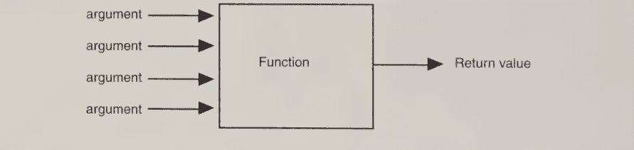

> **注意：** 理论上可以从函数返回多个值，但必须将它们“打包”在一起。

## 图 6-11 函数的参数和返回值

```
total = sum(value1, value2);
```

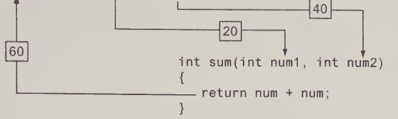

当你调用一个返回值的函数时，你通常希望对它返回的值进行某些有意义的操作。程序 6-12 显示了将函数的返回值赋值给变量。这是使用返回值的常用方法，但你也可以对它们进行许多其他操作。例如，以下代码显示了一个调用 `sum` 函数的数学表达式：

```cpp
int x = 10, y = 15;

double average;

average = sum(x, y) / 2.0;
```

在最后一条语句中，调用了 `sum` 函数并将 `x` 和 `y` 作为其参数。函数的返回值 25 被除以 2.0。结果 12.5 被赋值给 `average`。这是另一个例子：

```cpp
int x = 10, y = 15;

cout << "The sum is " << sum(x, y) << endl;
```

这段代码将 `sum` 函数的返回值传递给 `cout` 以进行显示。屏幕将显示消息“The sum is 25”。

记住，一个返回值的函数返回的是一个特定类型的值。你可以在任何可以使用同类型普通值的地方使用函数的返回值。这意味着，在任何可以使用 `int` 值的地方，都可以使用返回 `int` 值的函数调用。同样，在任何可以使用 `double` 值的地方，都可以使用返回 `double` 值的函数调用。所有数据类型都是如此的。

让我们来看另一个例子。程序 6-13 计算圆的面积，除了 `main` 函数外，它还有两个函数。其中一个函数是 `square`，它返回传递给它的任何数字的平方。该程序还有一个名为 `getRadius` 的函数，提示用户输入半径。用户输入的值由该函数返回。

### 程序 6-13

```cpp
// 此程序演示了返回值的函数。square 函数在数学语句中被调用。
#include <iostream>
#include <iomanip>
using namespace std;

// 函数原型
double getRadius();
double square(double);

int main() {
    const double PI = 3.14159; // 圆周率常量
    double radius; // 用于存储圆的半径
    double area; // 用于存储圆的面积

    // 设置数值输出格式。
    cout << fixed << show(2);

    // 获取圆的半径。
    cout << "This program calculates the area of a circle.\n";
    radius = getRadius();

    // 计算圆的面积。
    area = PI * square(radius);

    // 显示面积。
    cout << "The area is " << area << endl;
    return 0;
}

/*********************
// getRadius 的定义。
// 此函数要求用户输入圆的
// 半径，并将该数字作为 double 返回。
/*********************
double getRadius() {
    double rad;
    cout << "Enter the radius of the circle: ";
    cin >> rad;
    return rad;
}

/*********************
// square 函数的定义。
// 此函数接受一个 double 参数，并将
// 该参数的平方作为 double 返回。
/*********************
double square(double number) {
    return number * number;
}
```

## 以粗体显示示例输入的程序输出

```
此程序计算圆的面积。
Enter the radius of the circle: **10**
The area is **314.2**
```

首先，查看第 39 行到 46 行定义的 `getRadius` 函数。该函数的目的是提示用户输入圆的半径。在第 41 行，该函数定义了一个局部变量 `rad`。第 43 行和 44 行提示用户输入圆的半径，该半径存储在 `rad` 变量中。在第 45 行，返回 `rad` 的值。在 `main` 函数的第 23 行中调用了 `getRadius` 函数。从函数返回的值赋值给 `radius` 变量。

接下来，查看在第 54 行到 57 行定义的 `square` 函数。当调用该函数时，会向它传递一个 `double` 参数。函数将该参数存储在 `number` 参数中。第 56 行的 `return` 语句返回表达式 `number * number` 的值，即参数 `number` 的平方。在 `main` 函数的第 26 行中调用了 `square` 函数，并将 `radius` 的值作为参数传递。该函数将返回 `radius` 变量的平方，该值将用于数学表达式。

假设用户输入 10 作为半径，且此值作为参数传递给 `square` 函数，则 `square` 函数将返回值 100。图 6-12 展示了值 100 是如何传回第 26 行的数学表达式的。值 100 将用于该数学表达式。

## 图 6-12 square 函数

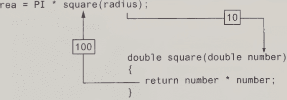

函数可以返回任何类型的值。程序 6-12 显示了返回值的函数。`getRadius` 和 `square` 函数返回 `double`。

## 聚光灯：使用函数

你的朋友经营着餐饮公司。他的食谱是以杯（cups）衡量的。当他去商店时，他们只按盎司（ounce）出售。他要求你写一个将杯转换为盎司的程序。

你设计了以下算法：
- 显示说明程序功能的屏幕。
- 获取杯数。
- 将杯转换为盎司并显示结果。

图 6-13 显示了程序如何分解为函数。

### 图 6-13 程序的层次图


如层次图所示，`main` 函数将调用其他函数。以下是这些函数的摘要：
- `showIntro`: 此函数显示说明屏幕。
- `getCups`: 此函数提示用户输入杯数，并将该值作为 double 返回。
- `cupsToOunces`: 此函数接受杯数作为参数，并将等量的盎司数作为 double 返回。

### 程序 6-14

```cpp
// 此程序将杯转换为盎司。

#include <iostream>
#include <iomanip>

using namespace std;

// 函数原型
void showIntro();
double getCups();
double cupsToOunces(double);

int main() {
    // 杯和盎司的变量。
    double cups, ounces;

    // 设置数值输出格式。
    cout << fixed << setprecision(1);

    // 显示介绍。
    showIntro();

    // 获取杯数。
    cups = getCups();

    // 将杯转换为盎司。
    ounces = cupsToOunces(cups);

    // 显示盎司数。
    cout << cups << " cups equals " << ounces << " ounces.\n";

    return 0;
}

/*********************
// showIntro 函数显示一个介绍屏幕。
*********************
void showIntro() {
    cout << "This program converts measurements\n"
         << "in cups to fluid ounces. For your in\n"
         << "reference the formula is:\n"
         << "1 cup = 8 fluid ounces\n\n";
}

/*********************
// getCups 函数提示用户输入杯数，
// 并将该值作为 double 返回。
*********************
double getCups() {
    double numCps;
    cout << "Enter the number of cups: ";
    cin >> numCps;
    return numCps;
}

/*********************
// cupsToOunces 函数接受杯数作为参数，
// 并将等量的盎司数作为 double 返回。
*********************
double cupsToOunces(double numCps) {
    return numCps * 8.0;
}
```

### 程序输出（示例输入已加粗显示）

```
此程序将杯的测量转换为液体盎司。供你参考的公式如下：
  1 杯 = 8 盎司
Enter the number of cups: **2** [回车]
2.0 杯等于 16.0 盎司。
```

## 返回布尔值

> **概念：** 函数可以返回 true 或 false 值。

通常，需要一个函数来测试参数并返回一个 true 或 false 值，以指示条件是否存在。这样的函数将返回一个 bool 值。例如，以下函数接受一个 int 参数，如果该参数在 1 到 100 之间，则返回 true，否则返回 false：

```cpp
bool isValid(int number) {
    bool status;

    if (number >= 1 && number <= 100)
        status = true;
    else
        status = false;

    return status;
}
```

以下代码显示了一个使用函数调用的 if/else 语句：

```cpp
int value = 20;

if (isValid(value))
    cout << "The value is within range.";
else
    cout << "The value is out of range.";
```

这段代码执行时，将显示消息 "The value is within range."。

程序 6-15 显示了另一个示例。该程序有一个名为 `isEven` 的函数，如果其参数是偶数，该函数返回 true。否则，函数返回 false。

### 程序 6-15

```cpp
// 此程序使用一个返回 true 或 false 的函数。

#include <iostream>

using namespace std;

// 函数原型
bool isEven(int);

int main() {
    int val;

    // 从用户处获取数字。
    cout << "Enter an integer and I will tell you ";
    cout << "if it is even or odd: ";
    cin >> val;

    // 指明它是偶数还是奇数。
    if (isEven(val))
        cout << val << " is even.";
    else
        cout << val << " is odd.";

    return 0;
}

/************************************************************
// 函数 isEven 的定义。此函数接受一个
// 整数参数并测试它是偶数还是奇数。如果参数
// 是偶数，该函数返回 true；如果参数是
// 奇数，返回 false。返回值为 bool。
************************************************************
bool isEven(int number) {
    bool status;
    if (number % 2 == 0)
        status = true; // 如果没有余数，则数字为偶数。
    else
        status = false; // 否则，数字为奇数。

    return status;
}
```

### 程序输出（示例输入已加粗显示）

```
Enter an integer and I will tell you if it is even or odd: **5** [回车]
5 is odd.
```

`isEven` 函数在第 18 行的以下语句中调用：
`if (isEven(val))`

当 if 语句执行时，`isEven` 被调用并传入 val。如果 val 是偶数，`isEven` 返回 true；否则，返回 false。

## 检查点

- 6.11 一个函数可以有多少个返回值？
- 6.12 为一个名为 `distance` 的函数编写头。该函数应返回一个 double 并有两个 double 参数：rate 和 time。
- 6.13 为一个名为 `days` 的函数编写头。该函数应返回 int 并有三个 int 参数：years, months 和 weeks。
- 6.14 为一个名为 `getKey` 的函数编写头。该函数应返回一个 char 且不使用参数。
- 6.15 为一个名为 `lightYears` 的函数编写头。该函数应返回 long 并有一个 long 参数：miles。

## 局部变量与全局变量

> **概念：** 局部变量定义在函数内部，在函数外部不可访问。全局变量定义在所有函数之外，在其作用范围内的所有函数都可以访问。

### 局部变量

定义在函数内部的变量是该函数的局部变量。它们对其他函数隐藏，其他函数通常无法访问它们。程序 6-16 显示，因为定义在函数中的变量是隐藏的，其他函数可以具有相同名称的不同变量。

### 程序 6-16

```cpp
// 此程序显示定义在函数中的变量
// 对其他函数隐藏的。

#include <iostream>

using namespace std;

void anotherFunction(); // 函数原型

int main() {
```


int num = 1; // 局部变量

cout << "In main, num is " << num << endl;

anotherFunction();

cout << "Back in main, num is " << num << endl;

return 0;

}

> **anotherFunction 的定义**
// 它有一个局部变量，在函数内部可见。

```cpp
void anotherFunction() {

    int num = 2; // 局部变量

    cout << "In anotherFunction, num is " << num << endl;

}
```

# 程序输出

In main, num = 1
In anotherFunction, num = 2
Back in main, num = 1

> **局部变量的生命周期**

局部变量在函数执行期间存在。当函数结束时，局部变量被销毁。

### **初始化局部变量**

可以使用参数值来初始化局部变量。例如，回顾之前的函数版本：

```cpp
int sum(int num1, int num2) {

    int result;

    result = num1 + num2;

    return result;

}
```

通过赋值语句来初始化 `result`：

```cpp
int sum(int num1, int num2) {

    int result = num1 + num2;

    return result;

}
```

### **全局变量**

全局变量是定义在所有函数之外的变量。全局变量的作用范围是从定义处到程序结束。程序 6-17 显示了访问同一个全局变量 `num` 的两个函数 `main` 和 `anotherFunction`。

```cpp
// 此程序显示全局变量对于在变量定义之后的所有函数是可见的。

#include <iostream>

using namespace std;

void anotherFunction(); // 函数原型

int num = 2; // 全局变量

int main() {

    cout << "In main, num is " << num << endl;

    anotherFunction();

    cout << "Back in main, num is " << num << endl;

    return 0;

}
```

```cpp
***********************************

// 此函数改变了全局变量

// num 的值。

***********************************
```

```cpp
void anotherFunction() {

    cout << "In anotherFunction, num is " << num << endl;

    num = 50;

    cout << "But, it is now changed to " << num << endl;

}
```

# 程序输出

In main, num = 2
In anotherFunction, num = 2
But, it is now changed to 50
Back in main, num = 50

> 除非你显式初始化数值全局变量，否则它们会被初始化为零。全局字符变量会被初始化为 NULL.* 程序 6-18 中的 `globalNum` 从没有通过语句设置为任何值，但因为它是全局变量，所以它被自动设置为零。

```cpp
// 此程序有一个未初始化的全局变量。

#include <iostream>

using namespace std;

int globalNum; // 全局变量，自动设置为零

int main() {

    cout << "globalNum is " << globalNum << endl;

    return 0;

}
```

# 程序输出

globalNum is 0

> *NULL 字符存储为 ASCII 码 0。*

现在你已经对全局变量有了基本的了解，我必须警告你限制它们的使用。当初学者第一次学习编写带有多个函数的程序时，他们有时会被诱惑将所有变量都设为全局变量。这通常是因为全局变量可以被程序中的任何函数访问，而无需作为参数传递。这种方法可能会让程序的创建变得更容易，但通常会在之后引起问题。原因如下：

- 全局变量难以调试。程序中的任何一条语句都可以改变全局变量的值。如果你发现全局变量中存储了错误的值，你必须追踪每一个访问该变量的语句以确定错误值是从哪里来的。在一个有数千行代码的程序中，这可能是困难的。
- 使用全局变量的函数通常依赖于这些变量。如果你想在另一个程序中使用该函数，如果它不依赖于全局变量，你很可能需要重新设计它。
- 全局变量使程序难以理解。全局变量可以被程序中的任何语句修改。如果你要理解程序中使用全局变量的任何部分，必须意识到程序中所有访问该全局变量的其他部分。

正因如此，你不应该使用全局变量来存储、操作和检索数据。在大多数情况下，你应该局部声明变量，并将它们作为参数传递给需要访问它们的函数。

## 全局常量

尽管你应该尝试避免使用全局变量，但在程序中使用全局常量通常是允许的。全局常量是程序中每个函数都可用的具名常量。由于全局常量的值在程序执行期间不能被更改，因此你就不需要担心与使用全局变量相关的潜在危险。

全局常量通常用于表示整个程序过程中需要的恒不变的值。例如，假设一个银行程序使用一个命名常量来表示利率。如果利率在几个函数中使用，那么创建一个全局常量要比在每个函数中都创建一个局部常量要容易得多。这同时也简化了维护工作。如果利率发生变化，只需要更改全局常量的声明即可，而不需要更改多个局部声明。

程序 69-19 显示了如何使用全局常量的示例。该程序计算员工的总工资，包括加班费。除了 `main` 函数外，该程序还有两个函数：`getBasePay` 和 `getOvertimePay`。`getBasePay` 函数接受工作小时数并返回非加班小时的工资金额。`getOvertimePay` 函数接受工作小时数并返回加班费的金额（如果有的话）。

## 程序 69-19

```cpp
// 此程序计算总工资。

#include <iostream>

#include <iomanip>

using namespace std;

// 全局常量

const double PAY_RATE = 22.55; // 时薪率

const double BASE_HOURS = 40.0; // 最大非加班小时数

const double OT_MULTIPLIER = 1.5; // 加班倍倍数

// 函数原型

double getBasePay(double);

double getOvertimePay(double);

int main() {

    double hours, // 工作小时数

        basePay, // 基础工资

        overtime = 0.0, // 加班费

        totalPay; // 总工资

    // 获取工作小时数。

    cout << "How many hours did you work? ";

    cin >> hours;

    // 获取基础工资金额。

    basePay = getBasePay(hours);

    // 获取加班费（如果有）。

    if (hours > BASE_HOURS)

        overtime = getOvertimePay(hours);

    // 计算总工资。

    totalPay = basePay + overtime;

    // 设置数字输出格式。

    cout << setprecision(2) << showpoint;

    // 显示工资。

    cout << "Base pay: $" << basePay << endl;

    cout << "Overtime pay: $" << overtime << endl;

    cout << "Total pay: $" << totalPay << endl;

    return 0;

}

//********************************************************************

// getBasePay 函数接受工作 *

// 小时数作为参数并返回员工 *

// 非加班小时的工资。 *

//********************************************************************

double getBasePay(double hoursWorked) {

    double basePay; // 用于存储基础工资

    // 确定基础工资。

    if (hoursWorked > BASE_HOURS)

        basePay = BASE_HOURS * PAY_RATE;

    else

        basePay = hoursWorked * PAY_RATE;

    return basePay;

}

****************************************************

// getOvertimePay 函数接受工作

// 小时数作为参数并返回员工的

// 加班费。

****************************************************

double getOvertimePay(double hoursWorked) {

    double overtimePay; // 用于存储加班费

    // 确定加班费。

    if (hoursWorked > BASE_HOURS) {

        overtimePay = (hoursWorked - BASE_HOURS) *

                      OT_MULTIPLIER;

    }

    else

        overtimePay = 0.0;

    return overtimePay;

}
```

## 示例输入加粗所示的程序输出

How many hours did you work? **48**
Base pay: $902.00
Overtime pay: $270.60
Total pay: $1172.60

让我们仔细观察这个程序。第 7、8、9 行定义了三个常量。`PAY_RATE` 常量设置为员工的时薪 22.55。`BASE_HOURS` 常量设置为 40，即员工一周内不加班工作的小时数。`OT_MULTIPLIER` 常量设置为 1.5，即加班的倍数。

由于这些常量是全局的且在所有函数之前，所有函数都可以访问它们。例如，`BASE_HOURS` 常量位于第 57 和 78 行，`PAY_RATE` 常量位于第 79 行，`OT_MULTIPLIER` 常量位于第 79 行。

## 同名的局部和全局变量

你不能在一个函数中定义两个同名的局部变量。这同样适用于参数变量。参数变量本质上就是局部变量。因此，你不能在函数中给参数变量和局部变量取相同的名称。

然而，你可以让局部变量或参数变量与全局变量或全局常量同名。当你这样做时，局部变量或参数变量的名字会*遮蔽*全局变量或常量的名字。这意味着全局变量或常量的名字被局部变量或参数变量的名字隐藏了。例如，查看程序 6-20。该程序有一个名为 `BIRDS` 的全局常量，设置为 500。`california` 函数有一个名为 `BIRDS` 的局部常量，设置为 10000。

## 程序 6-20

```cpp
// 此程序演示了局部变量

// 如何遮蔽全局常量的名字。

#include <iostream>

using namespace std;

// 全局常量。

const int BIRDS = 500;

// 函数原型

void california();

int main() {

    cout << "In main there are " << BIRDS

         << " birds.\n";

    california();

    return 0;

}

********************************************************************

// california 函数

********************************************************************

void california() {

    const int BIRDS = 10000;

    cout << "In california there are " << BIRDS

         << " birds.\n";

}
```

# 程序输出

In main there are 500 birds.
In california there are 10000 birds.

然而，当程序在 `california` 函数中执行时，局部常量 `BIRDS` 隐藏了全局常量 `BIRDS`。当 `california` 函数访问 `BIRDS` 时，它访问的是局部常量。这就是为什么第 27 行和 28 行的 `cout` 语句显示“In California there are 10000 birds.”。

## 6.11 静态局部变量

如果一个函数在程序中被调用多次，存储在函数局部变量中的值在函数调用之间不会持久化。这是因为局部变量在函数结束时会被销毁，并在函数重新启动时被重新创建。这在程序 6-21 中得到了体现。

### 程序 6-21

```cpp
// // 此程序显示局部变量在函数调用之间不会保留

// //它们的值。

#include <iostream>

using namespace std;

 // 函数原型

void showLocal();

int main() {

    showLocal();

    showLocal();

    return 0;

}

********************************************************************

// 函数 showLocal 的定义。

// 显示 localNum 的初始值 5。

// 在函数返回之前，localNum 的值被更改为 99。

********************************************************************

void showLocal() {

    int localNum = 5; // 局部变量

    cout << "localNum is " << localNum << endl;

    localNum = 99;

}
```

# 程序输出

localNum is 5
localNum is 5

尽管在第 28 行，`showLocal` 函数的最后一个语句将 99 存储在 `localNum` 中，但变量在函数返回时就被销毁了。下次调用该函数时，`localNum` 被重新创建并再次初始化为 5。

有时，程序需要“记住”函数调用之间存储在局部变量中的值。这可以通过将变量声明为 `static` 来实现。静态变量在函数返回时不会被销毁。它们在程序的生命周期内存在，尽管它们的作用域仅限于定义它们的函数。程序 6-22 展示了静态局部变量的一些特性：

### 程序 6-22

```cpp
// 此程序使用了静态局部变量。

#include <iostream>

using namespace std;

void showStatic(); // 函数原型

int main() {

    // 调用 showStatic 函数五次。

    for (int count = 0; count < 5; count++)

        showStatic();

    return 0;

}

****************************************************

// 函数 showStatic 的定义。

// statNum 是一个静态局部变量。它的值被显示

// 并在函数返回之前加1。

****************************************************

void showStatic() {

    static int statNum;

    cout << "statNum is " << statNum << endl;

    statNum++;

}
```

# 程序输出

statNum is 0
statNum is 1
statNum is 2
statNum is 3
statNum is 4

在程序 6-22 的第 26 行中，`statNum` 在 `showStatic` 函数中递增，并且在每次函数调用之间保留了它的值。注意，尽管 `statNum` 没有被显式初始化，它也从零开始。和全局变量一样，所有静态局部变量默认都被初始化为零。（当然，如果有必要，你可以提供自己的初始化值。）

如果你为静态局部变量提供了初始化值，它只会发生一次。这是因为初始化通常发生在变量创建时，而静态局部变量在程序运行期间只会被创建一次。程序 6-23 是程序 6-22 的细微修改，它说明了这一点。

### 程序 6-23

```cpp
// 此程序显示静态局部变量只被

// // 初始化一次。

// #include <iostream>

using namespace std;
```


# 程序 6-23

```cpp
void showStatic(); // 函数原型

int main() {
    // 调用 showStatic 函数五次。
    for (int count = 0; count < 5; count++)
        showStatic();
    return 0;
}
```

****************************************************

// 函数 showLocal 的定义。
// statNum 是一个静态局部变量。它的值被显示并在函数返回之前加 1。

```cpp
void showLocal() {
    static int localNum = 5; // 静态局部变量
    cout << "localNum is " << localNum << endl;
    localNum++;
}
```

# 程序输出

```
localNum is 0
localNum is 1
localNum is 2
localNum is 3
localNum is 4
```

*(注：由于提供的原文在 6-23 之后似乎存在部分内容错乱或重复，上述翻译已根据逻辑对原文内容进行了对齐处理，确保技术术语准确且格式符合要求)*

# 程序 6-24

```cpp
// 此程序演示了默认函数参数。
#include <iostream>
using namespace std;

// 带有默认参数的函数原型
void displayStars(int cols = 10, int rows = 1);

int main() {
    displayStars();         // cols 和 rows 使用默认值。
    cout << endl;
    displayStars(5);        // rows 使用默认值。
    cout << endl;
    displayStars(7, 3);     // cols 使用 7，rows 使用 3。
    return 0;
}
```

****************************************************

// 函数 displayStars 的定义。
// cols 的默认参数为 10，rows 的默认参数为 1。
// 该函数显示一个由星号组成的正方形。

```cpp
void displayStars(int cols, int rows) {
    // 嵌套循环。外层循环控制行，内层循环控制列。
    for (int down = 0; down < rows; down++) {
        for (int across = 0; across < cols; across++)
            cout << "*";
        cout << endl;
    }
}
```

# 程序输出

尽管 C++ 的默认参数非常方便，但它们在使用时并不完全灵活。当在函数调用中省略了某个参数时，该参数之后的所有参数也必须被省略。在程序 6-24 的 `displayStars` 函数中，无法在不省略 `rows` 参数的情况下省略 `cols` 参数。例如，以下函数调用将是非法的：

```cpp
displayStars(, 3); // 非法函数调用。
```

一个函数可以既包含带有默认参数的参数，也包含不带默认参数的参数。例如，在以下函数（用于显示员工的总工资）中，只有最后一个参数具有默认参数：

```cpp
// 函数原型
void calcPay(int empNum, double payRate, double hours = 40.0);
```

```cpp
// 函数 calcPay 的定义
void calcPay(int empNum, double payRate, double hours) {
    double wages;
    wages = payRate * hours;
    cout << fixed << setprecision(2);
    cout << "员工号 " << empNum << " 的总工资为 ";
    cout << wages << endl;
}
```

在调用此函数时，由于必须始终为前两个参数（`empNum` 和 `payRate`）指定参数，因为它们没有默认参数。以下是有效调用示例：

```cpp
calcPay(769, 15.75); // 使用 40 小时的默认参数
calcPay(142, 12.0, 20); // 指定小时数
```

当函数混合使用带默认参数和不带默认参数的参数时，带有默认参数的参数必须定义在最后。在 `calcPay` 函数中，`hours` 不能定义在其他参数之前。以下原型类型是非法的：

```cpp
// 非法原型
void calcPay(int empNum, double hours = 40.0, double payRate);

// 非法原型
void calcPay(double hours = 40.0, int empNum, double payRate);
```

以下是关于默认参数的关键点总结：

- 默认参数的值必须是字面量或命名常量。
- 如果在函数调用中省略了一个参数（因为它有默认值），其之后的所有参数也必须省略。
- 当函数混合使用带和不带默认参数的参数时，带默认参数的参数必须放在最后。

# 13 使用引用变量作为参数

**概念**：当作为参数使用时，引用变量允许函数访问原始参数。对参数的修改也会应用于该参数。之前你已经看到参数通常是通过值传递给函数的，这意味着函数无法更改参数。C++ 提供了一种特殊的变量类型——引用变量。引用变量是另一个变量的别名。通过使用引用变量作为参数，函数可以修改定义在外部的变量。引用变量的定义与普通变量类似，只需在名称前加上引用符号 `&`。例如，以下函数定义使参数 `refVar` 成为一个引用变量：

```cpp
void doubleNum(int &refVar) {
    refVar *= 2;
}
```

> 注意：变量 `refVar` 是对 `int` 的引用。

该函数通过将 `refVar` 乘以 2 来使其翻倍。由于 `refVar` 是引用变量，此操作实际上是应用于传递给函数的变量。在编写引用变量的函数原型时，确保数据类型后面加上引用符号。以下是 `doubleNum` 的原型：

```cpp
void doubleNum(int &);
```

> 注意：某些程序员习惯不在数据类型和引用符号之间留空格。以下原型与上方等价：
```cpp
void doubleNum(int&);
```

引用符号必须出现在任何使用引用参数的函数原型和头部，但在函数调用时不出现。程序 6-25 演示了 `doubleNum` 函数是如何工作的。

# 程序 6-25

```cpp
// 此程序使用引用变量作为函数参数。
#include <iostream>
using namespace std;

// 函数原型。两个函数都使用引用作为参数。
void doubleNum(int &);
void getNum(int &);

int main() {
    int value = 4;
    cout << "main 中，值为 " << value << endl;
    cout << "正在调用 doubleNum..." << endl;
    doubleNum(value);
    cout << "回到 main 中，值为 " << value << endl;
    return 0;
}
```

****************************************************

// getNum 的定义。
// 参数 username 是一个引用变量。
// 要求用户输入一个数字，并存储在 username 中。

```cpp
void getNum(int &username) {
    cout << "输入数字： ";
    cin >> username;
}
```

****************************************************

// doubleNum 的定义。
// 参数 refVar 是一个引用变量。
// refVar 中的值被翻倍。

```cpp
void doubleNum(int &refVar) {
    refVar *= 2;
}
```

# 程序输出

```
main 中，值为 4
正在调用 doubleNum...
回到 main 中，值为 8
```

函数参数通常是通过值传递的，这意味着参数的副本被传递到函数中。当使用引用参数时，称参数是通过引用传递的。

图 6-15 引用变量

程序 6-26 是程序 6-25 的修改版。增加了 `getNum` 函数。该函数要求用户输入一个数字并存储在 `username` 中。`username` 是 main 中变量的引用。

# 程序 6-26

```cpp
// 此程序使用引用变量作为函数参数。
#include <iostream>
using namespace std;

// 函数原型。两个函数都使用引用作为参数。
void doubleNum(int &);
void getNum(int &);

int main() {
    int value;
    // 获取一个数字并存储在 value 中。
    getNum(value);
    // 将 value 中的数字翻倍。
    doubleNum(value);
    // 显示结果数字。
    cout << "该值翻倍后为 " << value << endl;
    return 0;
}
```

****************************************************

// getNum 的定义。
// 参数 username 是一个引用变量。
// 要求用户输入一个数字，并存储在 username 中。

```cpp
void getNum(int &username) {
    cout << "输入数字： ";
    cin >> username;
}
```

****************************************************

// doubleNum 的定义。
// 参数 refVar 是一个引用变量。
// refVar 中的值被翻倍。

```cpp
void doubleNum(int &refVar) {
    refVar *= 2;
}
```

> 注意：只有变量可以按引用传递。如果你尝试将非变量参数（如字面量、常量或表达式）传递给引用参数，将导致错误。以 `doubleNum` 函数为例，以下语句将产生错误：
```
doubleNum(5); // Error
doubleNum(userNum + 10); // Error
```

如果一个函数使用多个引用作为参数，请务必在每个引用变量名之前放置符号 `&`。以下是一个使用四个引用变量参数的函数的原型和定义：

```cpp
// 带有四个引用变量作为参数的函数原型。
void addThree(int&, int&, int&, int&);
```

```cpp
// addThree 的定义。
// 所有参数都是引用变量。
void addThree(int &sum, int &num1, int &num2, int &num3) {
    cout << "Enter three integer values: ";
    cin >> num1 >> num2 >> num3;
    sum = num1 + num2 + num3;
}
```

> 警告！不要滥用引用变量作为函数参数。每当你允许函数修改函数外的变量时，你都会创建一个潜在的调试问题。引用变量应该只在需要时才使用。

### 检查点

- 6.19 哪些类型的值可以指定为默认参数？
- 6.20 为一个名为 `compute` 的函数编写原型和头文件。该函数应该有三个参数：一个 int、一个 double 和一个 long（顺序不限）。int 参数应该有一个默认参数 5，long 参数应该有一个默认参数 65536。double 参数不应该有默认参数。
- 6.21 为一个名为 `calculate` 的函数编写原型和头文件。该函数应该有三个参数：一个 int、一个 double 的引用，和一个 long（顺序不限）。只有 int 参数应该有一个默认参数，其值为 47。
- 6.22 下面程序的输出是什么？

```cpp
#include <iostream>
using namespace std;
void test(int first = 2, int second = 4, int third = 6);
int main() {
    test();
    test(6);
    test(3, 9);
    test(1, 5, 7);
    return 0;
}
void test (int first, int second, int third) {
  first += 3;
  second += 6;
  third += 9;
  cout << first << " " << second << " " << third << endl;
}
```

- 6.23 下面的程序要求用户输入两个数字。如果用户输入 12 和 14，程序的输出是什么？

```cpp
#include <iostream>
using namespace std;
void func1(int &, int &);
void func2(int &, int &, int &);
void func3(int, int, int);
int main() {
  int x = 0, y = 0, z = 0;
  cout << x << " " << y << " " << z << endl;
  func1(x, y);
  cout << x << " " << y << " " << z << endl;
  func2(x, y, z);
  cout << x << " " << y << " " << z << endl;
  func3(x, y, z);
  cout << x << " " << y << " " << z << endl;
  return 0;
}
void func1(int &a, int &b) {
  cout << "Enter two numbers: ";
  cin >> a >> b;
}
void func2(int &a, int &b, int &c) {
  b++;
  c--;
  a = b + c;
}
void func3(int a, int b, int c) {
  a = b - c;
}
```

## 6.14 函数重载

> **概念**：两个或多个函数可以具有相同的名称，只要它们的参数列表不同。

有时，你会创建两个或多个执行相同操作的函数，但使用不同的参数集或不同数据类型的参数。例如，在程序 6-13 中有一个使用 double 参数的平方函数。但是，假设你想要一个可以有效处理整数的平方函数，接受一个 int 作为其参数。这两个函数将执行相同的事情：返回其参数的平方。区别在于操作中涉及的数据类型。如果你在同一个程序中使用这些函数，可以为每个函数分配一个唯一的名称。例如，平方 int 的函数可以命名为 `squareInt`，而平方 double 的函数可以命名为 `squareDouble`。然而，C++ 允许你重载函数。这意味着你可以为多个函数分配相同的名称，只要它们的参数列表不同。程序 6-27 使用了两个重载的平方函数。

## 程序 6-27


```cpp
// 此程序使用了重载函数。
#include <iostream>
#include <iomanip>
using namespace std;

// 函数原型
int square(int);
double square(double);

int main() {
    int userInt;
    double userFloat;

    // 获取一个 int 和一个 double。
    cout << fixed << setprecision(2);
    cout << "Enter an integer and a floating-point value: ";
    cin >> userInt >> userFloat;

    // 显示平方结果。
    cout << "Here are squares: " << square(userInt) << " and " << square(userFloat) << endl;
    return 0;
}

// square(int) 的定义。
int square(int number) {
    return number * number;
}

// square(double) 的定义。
double square(double number) {
    return number * number;
}
```

## 6.14 函数重载 (Overloading Functions)

> 概念：两个或多个函数可以具有相同的名称，只要它们的参数列表不同。

有时，你会创建两个或多个执行相同操作的函数，但使用不同的参数集或不同数据类型的参数。例如，在程序 6-13 中有一个使用 `double` 参数的平方函数。但是，假设你想要一个可以有效处理整数的平方函数，接受一个 `int` 作为其参数。这两个函数将执行相同的事情：返回其参数的平方。区别在于操作中涉及的数据类型。如果你在同一个程序中使用这些函数，可以为每个函数分配一个唯一的名称。例如，平方 `int` 的函数可以命名为 `squareInt`，而平方 `double` 的函数可以命名为 `squareDouble`。然而，C++ 允许你重载函数。这意味着你可以为多个函数分配相同的名称，只要它们的参数列表不同。程序 6-27 使用了两个重载的平方函数。

## 第6章 函数 (Chapter 6 Functions)

重载在有不同数量参数的函数时非常方便。例如，考虑一个具有不同数量参数的程序。一个返回两个整数，另一个返回三个整数，还有一个返回四个整数。这里是它们的函数：

```cpp
int sum(int num1, int num2)
int sum(int num1, int num2, int num3)
int sum(int num1, int num2, int num3, int num4)
```

由于参数的数量不同，它们可以在同一个程序中使用。程序 6-28 是使用两个 `calcWeeklyPay` 函数来确定周薪的示例。一个版本使用一个 `int` 和一个 `double` 参数，而另一个版本使用一个 `double` 参数。

```cpp
cin >> worked;
cout << "What is the hourly pay rate? ";
cin >> rate;
cout << "The gross weekly pay is $";
cout << calcWeeklyPay(worked, rate) << endl;
break;

// 固定工资员工
case 's':
cout << "What is the annual salary? ";
cin >> yearly;
cout << "The gross weekly pay is $";
cout << calcWeeklyPay(yearly) << endl;
break;
```

```cpp
void getChoice(char & letter)
{
    // 获取用户的选择。
    cout << "Enter your choice (H or S): ";
    cin >> letter;

    // 验证选择。
    while (letter != 'H' && letter != 'h' &&
           letter != 'S' && letter != 's')
    {
        cout << "Please enter H or S: ";
        cin >> letter;
    }
}
```

```cpp
// 函数 getChoice 的定义。
// 参数 letter 是一个 char 类型的引用。
// 此函数要求用户输入 H 或 S，并返回
// 验证过的输入。
```

```cpp
// 重载函数 calcWeeklyPay 的定义。
// 此函数计算按小时付费员工的
// 每周工资。参数 hours 存储了
// 工作的小时数。参数 payRate 存储了
// 时薪。该函数返回周薪。
```

```cpp
double calcWeeklyPay(int hours, double payRate)
{
```

## 第 6 章 函数

# 程序 6-28 (继续)

```cpp
84    return hours * payRate;
85  }
86
87 // 重载函数 calcWeeklyPay 的定义。
88 // 此函数计算固定工资员工的
// 每周工资。参数存储了员工的
90 // 年薪。函数返回周薪。
91 //
92 //
93
94    double calcWeeklyPay(double annSalary)
95    {
        return annSalary / 52;
96    }
```

### 程序输出，示例输入已加粗显示

你是否想计算

(H) 按小时付费员工的周薪，或

(S) 固定工资员工的周薪？

输入你的选择 (H or S): **H**

工作了多少小时？ **40**

时薪是多少？ **18.50**

每周总工资为 $740.00

### 程序输出，示例输入已加粗显示

你是否想计算

(H) 按小时付费员工的周薪，或

(S) 固定工资员工的周薪？

输入你的选择 (H or S): **S**

年薪是多少？ **68000.00**

每周总工资为 $1307.69

# exit() 函数

> 概念：`exit()` 函数会导致程序终止，无论正在执行的是哪个函数或控制机制。

当遇到函数 `main` 中的 `return` 语句时，C++ 程序会停止执行。当其他函数执行结束时，程序并不会停止。程序的控制权返回到函数调用后的后续位置。有时在某些情况下，有必要在 `main` 以外的函数中终止程序。为了实现这一点，使用了 `exit` 函数。

当调用 `exit` 函数时，会导致停止，无论调用位于哪个函数中。程序 6-29 展示了它的用法。

# 程序 6-29

```cpp
// 此程序展示了 exit 函数如何导致程序
// 停止执行。
#include <iostream>
#include <cstdlib> // exit 函数需要它
using namespace std;

void function(); // 函数原型

int main() {
    function();
    return 0;
}
```

```cpp
// 此函数简单地演示了可以使用 exit
// 从 main 以外的函数终止程序。

void function() {
    cout << "This program terminates with the exit function.\n";
    cout << "Bye!\n";
    exit(0);
    cout << "This message will never be displayed\n";
    cout << "because the program has already terminated.\n";
}
```

# 程序输出

此程序通过 exit 函数终止。

Bye!

要使用 `exit` 函数，你必须包含 `<cstdlib>` 头文件。注意，该函数接受一个整数参数。该参数是你希望程序传递给计算机操作系统的退出码。它有时在程序外部使用，以指示程序是成功结束还是由于失败结束。在程序 6-29 中，传递了退出码零，这通常表示成功退出。如果你不确定在 `exit` 函数中使用哪个代码，在 `<cstdlib>` 中定义了两个常量 `EXIT_FAILURE` 和 `EXIT_SUCCESS` 供你使用。`EXIT_FAILURE` 被定义为在当前操作系统下通常表示不成功退出的终止码。以下是它的用法示例：

```cpp
exit(EXIT_FAILURE);
```

常量 `EXIT_SUCCESS` 定义为在当前操作系统下通常表示成功退出的终止码。这里是例子：

```cpp
exit(EXIT_SUCCESS);
```

> 注意：通常情况下，只有在程序外部使用时，退出码才是重要的。

**警告！** `exit()` 函数会关闭你的程序。由于它跳过了程序的逻辑流，你应该谨慎使用它。

# 检查点

6.24 下述程序的输出是什么？

```cpp
#include <iostream>
#include <cstdlib>
using namespace std;

void showVals(double, double);

int main()
{
    double x = 1.2, y = 4.5;
    showVals(x, y);
    return 0;
}
void showVals(double p1, double p2)
{
    cout << p1 << endl;
}
```

6.25 下述程序的输出是什么？

```cpp
#include <iostream>
using namespace std;

int manip(int);
int manip(int, int);
int manip(int, double);

int main()
{
    int x = 2, y = 4, z;
    double a = 3.1;

    z = manip(x) + manip(y, a);
    cout << z << endl;
    return 0;
}
int manip(int val)
{
    return val + 2;
}
int manip(int val1, int val2)
{
    return val1 + val2;
}
int manip(int val1, double val2)
{
    return static_cast<int>(val2);
}
```

## 6.16 桩函数与驱动程序

# 桩函数与驱动程序

桩函数和驱动程序对于测试和调试使用函数的程序非常有帮助。它们允许你独立于调用函数的程序部分进行测试。

桩函数是一个用来替代实际函数的虚假函数。它通常只显示一条确认已调用的测试消息，不再做其他。例如，如果在程序 6-10（模块化健康俱乐部程序）中为 `showFees` 函数使用桩函数，它可能是这样的：

```cpp
void showFees(double memberRate, int months)
{
    cout << "The showfees function was called with "
         << "the following arguments:\n"
         << "memberRate: " << memberRate << endl
         << "months: " << months << endl;
}
```

以下是使用桩函数而非实际 `showFees` 函数时的示例输出。（使用此桩函数的健康俱乐部程序可以通过 Computer Science Portal www.pearsonhighered.com/gaddis 获取。程序名为 HealthClub.stub）

# 健康俱乐部会员菜单

+   1. 标准成人会员
2. 儿童会员
3. 老年人会员
4. 退出程序

输入你的选择： 1

几个月？ 4

The showfees 函数被调用并使用了以下参数：

memberRate: 40.00

months: 4

## 第6 章 函数

驱动程序（driver）是一种通过简单调用函数来测试该函数的程序。如果函数接受参数，驱动程序就会传递测试数据。如果函数返回一个值，驱动程序就会在屏幕上显示该返回值。这使得你能够看到函数在与其最终将所属的其他程序部分隔离开时的表现。程序 6-30 展示了一个用于测试健康俱乐部会员程序中 `showFees` 函数的驱动程序。

### 程序 6-30

```cpp
// 此程序是测试 showFees 函数的驱动程序。
#include <iostream>
using namespace std;

// 原型声明
void showFees(double, int);

int main() {
    // 会员率的常量
    const double ADULT = 40.0;
    const double SENIOR = 30.0;
    const double CHILD = 20.0;

    // 对成年会员进行测试。
    cout << "Testing an adult membership...\n"
         << "Calling the showFees function with arguments "
         << ADULT << " and " << 10 << "\n";
    showFees(ADULT, 10);

    // 对老年会员进行测试。
    cout << "Testing a senior citizen membership...\n"
         << "Calling the showFees function with arguments "
         << SENIOR << " and " << 10 << "\n";
    showFees(SENIOR, 10);

    // 对儿童会员进行测试。
    cout << "Testing a child membership...\n"
         << "Calling the showFees function with arguments "
         << CHILD << " and " << 10 << "\n";
    showFees(CHILD, 10);
    return 0;
}
```

// showFees 函数的定义。memberRate 参数持有

// 每月会员费，months 参数持有

// 月数。函数显示总费用。

```cpp
void showFees(double memberRate, int months) {
    cout << "The total charges are $"
         << (memberRate * months) << endl;
}
```

# 程序输出

Testing an adult membership...

Calling the showFees function with arguments 40 and 10.

The total charges are $400

Testing a senior citizen membership...

Calling the showFees function with arguments 30 and 10.

The total charges are $300

Testing a child membership...

Calling the showFees function with arguments 20 and 10.

The total charges are $200

如程序 6-30 所示，驱动程序可以用于彻底测试一个函数。它可以使用不同的测试值作为参数反复调用该函数。当函数的执行符合预期时，就可以将其放入它将所属的实际程序中。

案例研究：参见计算机科学门户网站（www.pearsonhighered.com/gaddis）上的“大探险旅行社第一部分”案例研究。

## 复习题与练习

### 简答

- 1. 为什么局部变量在定义它的函数调用之间会丢失其值？
- 2. 参数（argument）和形式变量（parameter variable）之间的区别是什么？
- 3. 在哪里定义参数？
- 4. 如果你正在编写一个接受参数的函数，并想确保函数不能更改参数的值，你该怎么办？
- 5. 当函数接受多个参数时，参数传递的顺序重要吗？
- 6. 如何从函数返回一个值？
- 7. 将应用程序代码拆分为几个较小的过程有什么好处？
- 8. 静态局部变量会有什么用？
- 9. 请举出一个通过引用传递参数有用的例子。

### 填空题

- 10. ________ 是函数定义中显示函数名、返回类型和参数列表的部分。
- 11. 如果函数不返回任何值，单词 ________ 将将作为其返回类型出现。
- 12. 函数的 ________ 或 ________ 必须在所有函数调用之前出现。
- 13. 发送到函数中的值称为 ________。
- 14. 持有函数参数副本的特殊变量称为 ______。
- 15. 当只向函数传递参数的副本时，被称为按 ______ 传递。
- 16. 一个（n）______ 消除了在所有函数调用之前放置函数定义的需要。
- 17. 一个（n）______ 变量定义在函数内部，在函数外部不可访问。
- 18. ______ 变量定义在所有函数之外，在其作用范围内的任何函数都可以访问。
- 19. ______ 为程序中所有函数之间共享大量数据提供了一种简单的方法。
- 20. 除非你显式初始化全局变量，否则它们会自动初始化为 ______。
- 21. 如果函数有一个与全局变量同名的局部变量，则函数只能看到 ______ 变量。


# 练习题

## 填空题

- 22. ______ 局部变量在函数调用之间会保留其值。
- 23. ______ 语句导致函数立即结束。
- 24. 如果在函数调用中没有提供参数，______ 参数将自动传递给参数。
- 25. 当函数混合使用带有默认参数和不带默认参数的参数时，带有默认参数的参数必须定义在 ______。
- 26. 默认参数的值必须是一个（n）______。
- 27. 当用 ______ 参数时，引用变量允许函数修改原始参数。
- 28. 引用变量的定义与普通变量一样，只是名字前面有一个（n）______。
- 29. 引用变量允许按 ______ 传递。
- 30. ______ 导致程序终止。
- 31. 只要 ______ 不同，多个函数可以同名。

## 算法工作台

- 32. 检查函数头，然后写一个调用语句：`void show(int quantity)`
- 33. 下述语句调用 `half`。`half` 返回返回值。`result = half(number);`
- 34. 程序包含以下函数：

```cpp
int cube(int num)
{
  return num * num * num;
}
```

写一个语句向该函数传递 4 并将其返回值赋值给变量。

- 35. `timesTen` 函数接受一个参数。调用函数时，它应该显示参数乘以 10 的乘积。
- 36. 程序包含以下函数：

```cpp
void display(int arg1, double arg2, double arg3) {
  cout << "Here are the values: " << arg1 << " " << arg2 << " " << arg3 << endl;
}
```

写一个语句调用该过程并传递以下变量：

```cpp
int age;
double income;
char initial;
```

- 37. `getNumber` 函数使用引用参数来接收整数。该函数应该提示用户输入 1 到 100 之间的数字。输入应经过验证并存储在参数变量中。

## 判断对错

- 38. 函数应该具有反映其用途的名字。
- 39. 函数头以分号结束。
- 40. 函数原型以分号结束。
- 41. 如果其他函数定义在 `main` 之前，程序仍然从 `main` 开始执行。
- 42. 当函数结束时，它总是返回到调用处，无论从哪里调用。
- 43. 参数按照它们在函数调用中的顺序传递给参数。
- 44. 参数的作用域限于使用它的函数。
- 45. 修改函数参数总是会影响原始参数。
- 46. 在函数原型中，可以省略参数变量的名字。
- 47. 许多函数具有相同的局部变量。
- 48. 过度使用全局变量会导致问题。
- 49. 静态局部变量在函数返回时不会被删除。
- 50. 所有静态局部变量默认初始化为 -1。
- 51. 静态局部变量的初始化只发生一次，无论定义的函数被调用多少次。
- 52. 调用带有默认参数的函数时，如果省略了某个参数，则其后的所有参数也必须省略。

# 第6 章 函数

- 53. T/F 函数不能同时包含具有默认参数的参数和不带默认参数的参数。它可以从 `main` 函数调用。
- 54. T/F `exit` 函数只能从 `main` 函数调用。
- 55. T/F 存根函数（stub）是一个虚拟函数，被用来代替它所代表的实际函数。

# 寻找错误

以下函数都存在错误。请尽可能多找出错误。

- 56. `void total(int value1, int value2, int value3)`

```cpp
{
    return value1 + value2 + value3;
}
```

- 57. `double average(int value1, int value2, int value3)`

```cpp
{
    average = value1 + value2 + value3 / 3;
}
```

- 58. `void area(int length = 30, int width)`

```cpp
{
    return length * width;
}
```

- 59. `void getValue(int value&)`

```cpp
{
    cout << "Enter a value: ";
    cin >> value&;
    (Overloaded functions)
}
```

- 60. `(OverloadedValue) int getInputValue()`

```cpp
{
    int inputInputValue;
    cout << "Enter an integer: ";
    cin >> inputInputValue;
    return inputInputValue;
}
```

```cpp
double getInputValue()
{
    double inputInputValue;
    cout << "Enter a floating-point number: ";
    cin >> inputInputValue;
    return inputInputValue;
}
```

# 编程挑战

## 1. 标记

编写一个程序，要求用户输入一件商品的批发价和其加成百分比。程序应显示该商品的零售价。例如：

- 如果一件商品的成本为 5.00，加成百分比为 100%，则该商品的零售价为 10.00。


- 如果一件商品的批发价为 5.00，加成百分比为 50%，则该商品的零售价为 7.50。

程序应包含一个函数 `calculateRetail`，它接收批发价和加成百分比作为参数，并返回商品的零售价。

输入验证：不要接受商品批发价或加成百分比的负值。

## 2. 矩形面积——完成程序

如果你下载了本书的源代码，你将在第 06 章找到一个名为 `RectangleArea.cpp` 的部分编写的程序。你的任务是完成该程序。完成后，程序将要求用户输入矩形的宽度和长度，然后显示矩形的面积。程序调用了以下尚未编写的函数：

- `getLength`——该函数应要求用户输入矩形的长度，然后以 `double` 类型返回该值。
- `getWidth`——该函数应要求用户输入矩形的宽度，然后以 `double` 类型返回该值。
- `getArea`——该函数应接受矩形的长度和宽度作为参数，并返回矩形的面积。面积通过长度乘以宽度计算。
- `displayData`——该函数应接受矩形的长度、宽度和面积作为参数，并在屏幕上以适当单位显示它们。

## 3. 部门销售冠军

编写一个程序，确定公司四个部门（东北部、南部、西北部和南部）中哪一个季度的销售额最高。它应该包含以下两个由 `main` 调用的函数：

- `double getSales()` 接收部门名称。它要求用户输入该部门的季度销售额，验证输入，然后返回。每个部门应被调用一次。
- `void findHighest()` 接收四个部门的销售额。它确定销售额最大的部门并打印其名称及金额。

输入验证：不要接受小于 0 的金额。

## 4. 安全区域

编写一个程序，确定地理区域（北部、南部、东部、西部和中部）中哪一个事故数量最少。它应该包含以下由 `main` 调用的函数：

- `getNumAccidents()` 接收区域名称。它要求用户输入该地区的事故数量，验证输入，然后返回。
- `void findLowest()` 接受五个区域的事故数量。它确定事故最少的区域并打印其名称及数量。

输入验证：不要接受小于 0 的数量。

## 5. 下落距离

编写一个程序，根据重力计算物体下落的距离。可以使用以下公式：

```cpp
d = 1/2 * g * t^2
```

变量含义如下：`d` 是距离，`g` 是 9.8，`t` 是时间（秒）。编写一个名为 `fallingDistance` 的函数，接受时间（秒）作为参数。函数返回距离。

## 6. 动能

在物理学中，运动物体具有动能。可以使用以下公式确定动能：

```
KE = 1/2 * m * v^2
```

变量含义如下：`KE` 是动能，`m` 是质量，`v` 是速度。编写一个名为 `kineticEnergy` 的函数，接受质量（公斤）和速度（米/秒）作为参数。函数返回动能。

## 7. 摄氏度

华氏度转换为摄氏度的公式为：

```
C = 5/9 * (F - 32)
```

编写名为 `celsius` 的函数，接受华氏度作为参数。函数返回摄氏度。在程序中演示 0 到 20。

## 8. 抛硬币

编写一个名为 `coinToss` 的函数模拟抛硬币。如果随机数为 1，函数显示“正面”；如果随机数为 2，函数显示“反面”。在程序中演示询问用户抛硬币的次数。

## 9. 现值

假设你想向储蓄账户存入某金额并存放 10 年。10 年后你希望账户有 10,000 元。你需要存入多少？可以使用以下公式：

```
P = F / (1 + r)^n
```

变量含义如下：`P` 是你需要存入的现值，`F` 是你希望拥有的未来价值，`r` 是利率，`n` 是年限。编写一个程序，包含一个执行此计算的函数 `presentValue`。该函数接受未来价值、利率和年限作为参数，并返回现值。

## 10. 未来值

假设你在储蓄账户中有一笔金额，按复利计算，你想要计算特定月数后的金额。未来值公式为：

```
F = P * (1 + i)^n
```

变量含义如下：`F` 是指定时期后的账户未来价值，`P` 是账户的现值，`i` 是月利率，`n` 是月份。编写一个程序，提示用户输入账户的现值、月利率以及资金留在账户的月数。程序应将这些值传递给名为 `futureValue` 的函数，该函数返回账户的未来值。程序应显示账户的未来值。

## 12. 星星搜索

某特定的人才比赛有五位评员，每位评员都会为每位表演者给出 0 到 10 之间的分数。允许给出小数，例如 8.3。表演者的最终得分通过删除最高分和最低分，然后对剩余三个分数取平均值来确定。编写一个使用该方法计算参赛者得分的程序。它应该包含以下函数：

- `void getJudgeData()` 应向用户询问评员的分，将其存储在引用变量 `value` 中并对其进行验证。此函数应由 `main` 为每位评员调用一次。
- `void calcScore()` 应该计算并显示表演者删除最高分和最低分后剩余三个分数的平均值。此函数应由 `main` 调用一次，并传递五个分数。

下面描述的最后两个函数应由 `calcScore` 调用，`calcScore` 使用返回的信息来确定删除哪个分数。

- `int findLowest()` 应该找到并返回传递它的五个分数中的最低分。
- `int findHighest()` 应该找到并返回传递它的五个分数中的最高分。

输入验证：不要接受低于 0 或高于 10 的评员分数。

## 13. 外出

编写一个计算公司员工缺勤平均天数的程序。程序应具有以下函数：

- 由 `main` 调用的函数，向用户询问公司人数。该值应作为 `int` 返回。（该函数不接受参数。）
- 由 `main` 调用的函数接受一个参数：公司人数。该函数应要求用户输入每个员工在过去一年缺勤的天数。这些天数的总和应作为 `int` 返回。
- 由 `main` 调用的函数接受两个参数：公司人数和所有员工全年缺勤的总天数。该函数作为 `double` 返回平均缺勤天数。（此函数不执行屏幕输出，也不询问用户输入。）

输入验证：不要接受小于 1 的员工人数。不要接受任何员工缺勤天数的负数。

## 14. 订单状态

Middletown 批发线公司销售一种售价 100 美元的程序，用于显示铜线的状态。编写一个程序询问以下数据：

- 订购的卷数
- 库存卷数
- 是否有特殊的运费和处理费

（运费和处理费通常为每卷 10 美元。）如果有特殊费用，程序应询问每卷的特殊费用。

收集的数据应作为参数传递给另一个函数，该函数显示：

- 从当前库存准备好发货的卷数
- 待交卷数（如果订购数量大于库存数量）
- 准备发货部分的小计（准备发货的卷数乘以 100 美元）
- 准备发货部分的总运费和处理费
- 准备发货的订单总额

第二个函数中的运费和处理参数应具有默认参数 `10.00`。

输入验证：不要接受订购卷数小于 1。不要接受库存或运费和处理费小于 0 的数字。

## 15. 住院医院

编写一个程序计算并显示患者住院医院的费用。首先，程序应询问患者是住院患者还是门诊患者。如果患者是住院患者，应输入以下数据：

- 医院停留天数
- 日费
- 医院药品费用
- 医院服务费用（实验室检查等）

如果患者是门诊患者，程序应询问以下内容：

- 医院服务费用（实验室检查等）
- 医院药品费用

程序应使用两个重载函数来计算总费用。其中一个函数接受住院数据的参数，而另一个函数接受门诊信息的参数。两个函数都应返回总费用。

输入验证：不要接受任何数据为负数。

## 16. 人口

在人口中，出生率是由于出生导致的人口增长百分比，死亡率是由于死亡导致人口减少百分比。编写一个程序显示任意年份的人口规模。程序应询问以下数据：

- 初始人口规模
- 年出生率
- 年死亡率
- 显示的年数

编写一个计算某一年人口规模的函数。公式为：

```
N = P + B * P - D * P
```

其中 `N` 是新人口规模，`P` 是前一个人口规模，`B` 是出生率，`D` 是死亡率。

输入验证：不要接受初始规模小于 2 的数字。不要接受出生率或死亡率的负数。不要接受年数小于 1 的数字。

## 17. 流动人口

修改编程挑战 16，也考虑人员迁入或离开地理区域对人口的影响。给定初始人口规模、年出生率、年死亡率、每年迁入该区域的人数以及离开该区域的人数，程序应预测 `numYears` 年后的人口。你可以提示用户输入 `numYears` 值，也可以在程序内设置它。

输入验证：不要接受初始规模小于 2 的数字。不要接受出生率或死亡率的负数。

## 18. 油漆估算

一家油漆公司确定，每 100 平方英尺收取 25 美元。编写一个模块化程序允许用户输入平方英尺，然后显示：

- 需要的加仑数
- 需要的小时数
- 油漆费用
- 总成本

输入验证：不要接受平方英尺小于 1。不要接受油漆价格的负数。

## 19. 使用文件——报告

修改编程挑战 15（住院医院），将报告写入文件。

## 20. 股票利润

股票利润计算方式如下：

```
Profit = ((NS * SP) - SC) - (NS * PP)
```

其中 `NS` 是股份数，`SP` 是售价，`SC` 是手续费，`PP` 是购买价格。如果计算结果为正值，则为利润。如果计算结果为负值，则为亏损。

编写一个接受股份数、售价、手续费和购买价格作为参数的函数。该函数应返回利润（或亏损）。

## 21. 多重股票

使用你在编程挑战 20（股票利润）中编写的函数，编写一个计算总利润并显示总销量。

## 22. isPrime 函数

质数是只能被自身和 1 除的数。例如，5 是质数，因为它只能被 1 和 5 整除。6 不是质数，因为它可以被 1、2 和 3 整除。

编写一个函数 `isPrime`，它接受一个整数作为参数，如果参数是质数则返回 `true`，否则返回 `false`。在一个程序中演示该函数。

提示：回顾 `%` 运算符将一个数除以另一个数并返回余数。在如 `num1 % num2` 的表达式中，如果 `num1` 能被 `num2` 整除，`%` 运算符将返回 0。

## 23. 质数列表

使用你在编程挑战 22（isPrime）中编写的 `isPrime` 函数，在一个程序中将 1 到 100 之间所有的质数存储在文件中。

## 24. 石头剪刀布游戏

编写一个程序让用户与电脑玩石头剪刀布游戏。该程序的工作原理如下：

- 当程序开始时，生成一个 1 到 3 之间的随机数。如果是 1，则电脑选择了石头；如果是 2，则电脑选择了剪刀；如果是 3，则电脑选择了纸。（不要显示电脑的选择。）
- 用户在键盘上输入选择的“rock”、“paper”或“scissors”（你可以使用菜单）。
- 显示电脑的选择。

根据以下规则选择胜者：

- 如果一个人选择石头，另一个人选择剪刀，则石头获胜。（石头碎剪刀。）
- 如果一个人选择剪刀，另一个人选择纸，则剪刀获胜。（剪刀剪断了纸。）
- 如果一个人选择纸，另一个人选择石头，则纸获胜。（纸包住了石头。）
- 如果双方选择相同，则必须重新玩游戏以决定胜者。

务必将程序划分为执行每个主要任务的函数。

## 小组项目

## 25. 差旅费用

此程序应由学生小组设计并编写。以下是一些建议：

- 一名学生应设计 `main` 函数，该函数将调用程序中的其他函数。其余函数由团队的其他成员设计。
- 应对程序的需求进行分析，以确保每个学生的工作量大致相同。
- 应预先决定每个函数的参数和返回类型。
- 应使用存根（Stubs）和驱动程序（Drivers）来测试和调试程序。
- 程序可以实现为多文件程序，也可以将所有函数剪切粘贴到主文件中。

以下是作业：编写一个程序，计算并显示商务人员旅行的总费用。该程序应包含相应的函数来询问以下信息：

- 旅行的总天数
- 旅行第一天的出发时间，以及旅行最后一天回到家的时间
- 任何往返机票的金额
- 任何租车的金额
- 如果使用了私家车，则行驶里程数。按每英里 $0.27 计算车辆费用
- 停车费（公司允许每天最高报销 $6。超过此金额的部分必须由员工支付。）
- 如果旅行期间乘坐过出租车，则产生的费用（公司允许每天使用出租车的费用最高 $10。超过此金额的部分必须由员工支付。）
- 会议或研讨会的注册费
- 酒店费用（公司允许每晚住宿最高 $90。超过此金额的部分必须由员工支付。）
- 每顿饭的金额。在旅行的第一天，如果出发时间在早上 7 点之前，则允许将早餐作为费用；如果出发时间在下午 6 点之前，则允许包含午餐；第一天允许包含晚餐。在旅行最后一天，如果到达时间在下午 1 点之后，则允许包含早餐；如果到达时间在晚上 7 点之后，则允许在最后一天包含晚餐。程序应仅询问允许餐食的金额。（公司允许早餐最高 $9，午餐最高 $12，晚餐最高 $16。超过此金额的部分必须由员工支付。）

程序应计算并显示商务人员产生的总费用、旅行的可报销总费用、如有超出费用则必须由商务人员自理的部分，以及如果费用低于总额，则商务人员节省的金额。

输入验证：任何美元金额或私家车行驶里程均不接受负数。天数不接受小于 1 的数字。仅接受有效的出发时间和到达时间。


# 数组与向量

## 题型

- 7.1 数组存储多个值
- 7.2 访问数组元素
- 7.3 C++ 中不进行边界检查
- 7.4 基于范围的 for 循环
- 7.5 处理数组内容的程序设计：案例研究
- 7.6 关注软件工程：使用并行数组
- 7.7 数组作为函数参数
- 7.8 二维数组
- 7.9 三维或更多维数组
- 7.10 关注问题解决
- 7.11 STL vector 导论

# 7.1 数组存储多个值

> **概念：** 数组允许你存储并处理相同数据类型的多个值。

你到目前所接触的变量都被设计为一次只能存储一个值。图 7-1 中的每个变量定义仅预留了足够容纳一个指定数据类型值的内存。

**图 7-1** 变量一次可以只存储一个值

| 定义 | 内存分配 | 示例值 |
|---|---|---|
| `int count;` | 足够 1 个 `int` 的内存 | 12 |
| `float price;` | 足够 1 个 `float` 的内存 | 56.98 |
| `char letter;` | 足够 1 个 `char` 的内存 | A |

数组类似于一个可以存储一组相同值的变量。这些值存储在连续的内存位置中。这是一个整数数组的定义：

```cpp
int days[6];
```

该数组的名称为 `days`。括号内的数字是大小声明符。它指示数组可以容纳的元素（或值）的数量。`days` 数组可以存储六个整数。如图 7-2 所示。

**图 7-2** 具有六个元素的数组 

数组的大小声明符必须是一个大于零的常量表达式。它可以像之前的示例那样是字面量，也可以像下面所示的命名常量：

```cpp
const int NUM_DAYS = 6;
int days[NUM_DAYS];
```

任何数据类型的数组都可以定义。以下是有效的数组定义：

```cpp
float temperatures[100]; // 100 个 float
string names[10];         // 10 个 string 对象
long units[50];            // 50 个 long 整数
double sizes[1200];       // 1200 个 double
```

### 数组的内存需求

数组的大小通过元素的大小乘以数量计算。表 7-1 显示了各种数组的大小。

**表 7-1** 数组与大小

| 数组定义 | 元素数量 | 每个元素的大小 | 数组大小 |
|---|---|---|---|
| `char letters[25];` | 25 | 1 字节 | 25 字节 |
| `short rings[100];` | 100 | 2 字节 | 200 字节 |
| `int miles[84];` | 84 | 4 字节 | 336 字节 |
| `float temp[12];` | 12 | 4 字节 | 48 字节 |
| `double distance[1000];` | 1000 | 8 字节 | 8000 字节 |

> **概念：** 数组元素被分配了唯一的下标。

尽管整个数组只有一个名称，但可以通过它们的下标访问元素。这些下标用于定位数组内的特定元素。第一个元素的下标分配为 0，第二个元素的下标为 1，依此类推。如图 7-4 所示。

> **注意：** C++ 中的下标始终从 0 开始。数组中最后一个元素的下标小于元素的总数。

**图 7-4** 下标 

在图 7-4 所示的数组中，元素 `hours[6]` 不存在。`hours[5]` 是最后一个元素。

> **注意：** 表达式 `hours[0]` 读作“hours zero”。将此赋值读取为“hours zero 被赋值为二十”。

这是一个在第一个元素中存储数字 20 的语句示例：

```cpp
hours[0] = 20;
```

语句将 20 分配给 `hours[0]` 后，图 7-5 显示了 `hours` 数组的内容。

**图 7-5** `hours` 数组的内容

| `hours[0]` | `hours[1]` | `hours[2]` | `hours[3]` | `hours[4]` | `hours[5]` |
|---|---|---|---|---|---|
| 20 | ? | ? | ? | ? | ? |

> **注意：** 因为没有给数组的其他元素赋值，所以将使用标记表示这些元素的内容是未知的。如果数组是全局定义的，所有元素默认都初始化为零。然而，局部数组没有默认初始化值。

以下语句将整数 30 存储在 `hours[3]` 中：

```cpp
hours[3] = 30;
```

执行上一个语句后，图 7-6 显示了数组的内容。

**图 7-6** `hours` 数组的内容

| `hours[0]` | `hours[1]` | `hours[2]` | `hours[3]` | `hours[4]` | `hours[5]` |
|---|---|---|---|---|---|
| 20 | ? | ? | 30 | ? | ? |

### 输入和输出数组内容

数组元素可以像其他变量一样与 `cin` 和 `cout` 对象一起使用。程序 7-1 显示了 `hours` 数组被用于存储和显示用户输入的值。

## 程序 7-1

```cpp
// 此程序询问六名员工的工作小时数。
// 将这些值存储在一个数组中。
#include <iostream>
using namespace std;

int main() {
    const int NUM_EMPLOYEES = 6;
    int hours[NUM_EMPLOYEES];

    // 获取每个员工的工作小时数
    cout << "Enter the hours worked by ";
    cout << NUM_EMPLOYEES << " employees: ";
    cin >> hours[0];
    cin >> hours[1];
    cin >> hours[2];
    cin >> hours[3];
    cin >> hours[4];
    cin >> hours[5];

    // 显示数组中的值。
    cout << "The hours you entered:";
    cout << " " << hours[0] << " ";
    cout << " " << hours[1] << " ";
    cout << " " << hours[2] << " ";
    cout << " " << hours[3] << " ";
    cout << " " << hours[4] << " ";
    cout << " " << hours[5] << endl;

    return 0;
}
```

**示例输入加粗所示的程序输出**

> Enter the hours worked by 6 employees: **20 12 40 30 30 15**
> The hours you entered: 20 12 40 30 30 15

> 图 7-7 显示了数组 `hours` 的内容，其包含了上方示例输出中用户输入的值。

**图 7-7** 数组 `hours` 的内容

| `hours[0]` | `hours[1]` | `hours[2]` | `hours[3]` | `hours[4]` | `hours[5]` |
|---|---|---|---|---|---|
| 20 | 12 | 40 | 30 | 30 | 15 |

尽管数组定义中的大小声明符必须是常量或字面量，但下标数字可以存储在变量中。这使得使用循环来“遍历”整个数组并对每个元素执行相同操作成为可能。例如，看下面的代码：

```cpp
const int ARRAY_SIZE = 5;
int numbers[ARRAY_SIZE];

for (int count = 0; count < ARRAY_SIZE; count++)
    numbers[count] = 99;
```

这段代码定义了一个名为 `ARRAY_SIZE` 的常量 `int`，并将其初始化为值 5。然后，它定义了一个名为 `numbers` 的 `int` 数组，使用 `ARRAY_SIZE` 作为大小声明符。结果是 `numbers` 数组将有五个元素。`for` 循环使用了一个名为 `count` 的计数器。该循环将迭代五次，在循环迭代期间，`count` 变量将取 0 到 4 的值。


**图 7-8** 初始化、测试和更新表达式 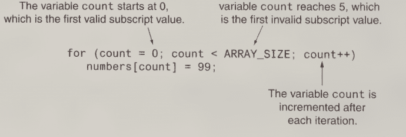

程序 7-1 可以通过使用两个循环来简化：一个用于向数组输入值，另一个用于显示此数组的内容。这在程序 7-2 中所示。

## 程序 7-2

```cpp
// 此程序询问六名员工的工作小时数。
// 将这些值存储在一个有效的数组中。
#include <iostream>
using namespace std;

int main() {
    const int NUM_EMPLOYEES = 6; // 员工人数
    int hours[NUM_EMPLOYEES];    // 每个员工的小时数
    int count;

    // 输入工作小时数
    for (count = 0; count < NUM_EMPLOYEES; count++) {
        cout << "Enter the hours worked by employee "
             << (count + 1) << ": ";
        cin >> hours[count];
    }

    // 显示数组的内容
    cout << "The hours you entered are: ";
    for (count = 0; count < NUM_EMPLOYEES; count++) {
        cout << " " << hours[count];
    }
    cout << endl;

    return 0;
}
```

**示例输入加粗所示的程序输出**

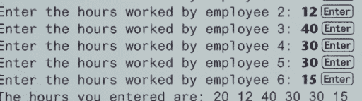

第 13 到 18 行的第一个 `for` 循环提示每个员工的小时数。仔细观察第 15 到 17 行：

```cpp
cout << "Enter the hours worked by employee "
     << (count + 1) << ": ";
cin >> hours[count];
```

注意 `cout` 语句使用表达式 `count + 1` 来显示人数，但 `cin` 语句使用下标 `hours[count]`。这是因为员工 1 的小时存储在 `hours[0]` 中，员工 2 的小时存储在 `hours[1]` 中，以此类推。第 22 和 23 行的循环也使用 `count` 变量来遍历数组。

向数组输入数据必须逐个元素进行。例如，下面的 `cin` 语句无法向数组输入数据：

```cpp
cin >> hours; // 错误
```

你必须使用多个 `cin` 语句向每个元素读取数据，或者使用循环遍历数组并读取数据。同样，输出数组的内容通常逐个元素进行。例如，下面的 `cout` 语句无法显示数组的内容：

```cpp
cout << hours; // 错误
```

你必须单独输出数组的每个元素。

### 数组初始化

与普通变量一样，C++ 允许你在创建数组时初始化其元素。这是一个示例：

```cpp
const int MONTHS = 12;
int days[MONTHS] = {31, 28, 31, 30, 31, 30, 31, 31, 30, 31, 30, 31};
```

括号内用逗号分隔的一系列值被称为**初始化列表**。值按照顺序存储在数组元素中（第一个值 31 存储在 `days[0]` 中，第二个值 28 存储在 `days[1]` 中，以此类推）。图 7-9 显示了初始化后的数组。

**图 7-9** 初始化后的数组

| 下标 | 0 | 1 | 2 | 3 | 4 | 5 | 6 | 7 | 8 | 9 | 10 | 11 |
|---|---|---|---|---|---|---|---|---|---|---|---|---|
| 值 | 31 | 28 | 31 | 30 | 31 | 30 | 31 | 31 | 30 | 31 | 30 | 31 |

## 程序 7-3

```cpp
// 此程序显示每个月的的天数。
#include <iostream>
using namespace std;

int main() {
    const int MONTHS = 12;
    int days[MONTHS] = { 31, 28, 31, 30, 31, 30, 31, 31, 30, 31, 30, 31 };

    for (int count = 0; count < MONTHS; count++) {
        cout << "Month " << (count + 1) << " has "
             << days[count] << " days.\n";
    }
    return 0;
}
```

**程序输出**

- 1 月有 31 天。
- 2 月有 28 天。
- 3 月有 31 天。
- 4 月有 30 天。
- 5 月有 31 天。
- 6 月有 30 天。
- 7 月有 31 天。
- 8 月有 31 天。
- 9 月有 30 天。
- 10 月有 31 天。
- 11 月有 30 天。
- 12 月有 31 天。

> **注意：** C++ 允许你将初始化列表跨多行。以下两种数组定义是等效的：

```cpp
double coins[5] = {0.05, 0.1, 0.25, 0.5, 1.0};
double coins[5] = {
    0.05, 0.1, 0.25, 0.5, 1.0
};
```

程序 7-4 显示了一个用字符串初始化的字符串数组示例。

## 程序 7-4

```cpp
// 此程序初始化一个字符串数组。
#include <iostream>
#include <string>
using namespace std;

int main() {
    const int SIZE = 9;
    string planets[SIZE] = { "Mercury", "Venus", "Earth", "Mars",
                             "Jupiter", "Saturn", "Uranus",
                             "Neptune", "Pluto (a dwarf planet)" };

    cout << "Here are the planets:\n";
    for (int count = 0; count < SIZE; count++)
        cout << planets[count] << endl;

    return 0;
}
```

**程序输出**

> Here are the planets:
> Mercury
> Venus
> Earth
> Mars
> Jupiter
> Saturn
> Uranus
> Neptune
> Pluto (a dwarf planet)

> 程序 7-5 显示了一个用字母表初始字符数组。然后使用该数组显示这些字符的 ASCII 码。

## 程序 7-5

```cpp
// 此程序初始化一个字符数组。
#include <iostream>
using namespace std;

int main() {
    const int NUM_LETTERS = 10;
    char letters[NUM_LETTERS] = { 'A', 'B', 'C', 'D', 'E',
                                  'F', 'G', 'H', 'I', 'J' };

    cout << "Character" << "\t" << "ASCII Code\n";
    cout << "----------" << "\t" << "----------\n";

    for (int count = 0; count < NUM_LETTERS; count++) {
        cout << letters[count] << "\t";
        cout << static_cast<int>(letters[count]) << endl;
    }
    return 0;
}
```

### 部分数组初始化

当数组被初始化时，C++ 不要求每个元素都有值。可以只初始化数组的一部分，例如：

```cpp
int numbers[7] = {1, 2, 4, 8};
```

这种定义只初始化了 7 元素数组中的前四个，如图 7-10 所示。

> **注意：** 如果数组被部分初始化，未初始化的元素将被设置为零。字符串数组的未初始化元素将包含空字符串。即使数组完全没有初始化，其元素也会像所有其他局部变量一样包含“垃圾”值。

## 程序 7-6

此程序包含一个部分初始化的数组。

```cpp
// This program has a partially initialized array.
#include <iostream>
using namespace std;

int main() {
    const int SIZE = 7;
    int numbers[SIZE] = {1, 2, 4, 8}; // 初始化前4个元素

    cout << "Here are the contents of the array:\n";
    for (int index = 0; index < SIZE; index++)
        cout << numbers[index] << " ";

    cout << endl;
    return 0;
}
```


# 程序输出

数组的内容如下：
1 2 4 8 0 0 0

如果你留一个元素未初始化，则必须留其之后的所有元素也不初始化。C++ 不提供在初始化列表中跳过元素的方法。例如，以下代码是不合法的：

```cpp
int numbers[6] = {2, 4, 8, , 12}; // 非法！
```

## 隐式数组大小

只要提供初始化列表，就可以在不指定大小的情况下定义数组。C++ 会自动使数组足够大，以容纳所有初始化值。例如，以下定义创建了一个具有五个元素的数组：

```cpp
double ratings[] = {1.0, 1.5, 2.0, 2.5, 3.0};
```

由于省略了大小声明符，C++ 会计算初始化列表中的项目数量，并为数组分配相应数量的元素。

> 注意：如果你省略了数组的大小声明符，则必须提供初始化列表。否则，编译器不知道将数组设为多大。

## 从文件读取数据到数组

将文件内容读取到数组中是简单的：打开文件并使用循环从文件中读取每个项，将每个项存储在数组元素中。循环一直持续到数组填满或到达文件末。程序 7-7 展示了这一点，它打开一个存储了 10 个数字的文件，同时将文件内容读取到数组中。

## 7.2 访问数组元素

## 程序 7-7

```cpp
// 此程序从文件读取数据到数组。

#include <iostream>
#include <fstream>

using namespace std;

int main() {
    const int ARRAY_SIZE = 10; // 数组大小
    int numbers[ARRAY_SIZE]; // 具有10个元素的数组
    int count = 0; // 计数变量
    ifstream inputFile; // 输入文件流对象

    // 打开文件。
    inputFile.open("TenNumbers.txt");

    // 将数字从文件读取到数组。
    while (count < ARRAY_SIZE && inputFile >> numbers[count])
        count++;

    // 关闭文件。
    inputFile.close();

    // 显示读取的数字：
    cout << "The numbers are: ";
    for (count = 0; count < ARRAY_SIZE; count++)
        cout << numbers[count] << " ";
    cout << endl;

    return 0;
}
```

# 程序输出

数字为：101 102 103 104 105 106 107 108 109 110

第 17 行和第 18 行的 `while` 循环从文件中读取项并将其赋值给 `numbers` 数组的元素。注意循环测试了两个由 `&&` 运算符连接的布尔表达式：

- 第一个表达式是 `count < ARRAY_SIZE`。该表达式的目的是防止循环超出数组末尾。如果表达式为真，则测试第二个布尔表达式。然而，如果表达式为假，循环停止。
- 第二个表达式是 `inputFile >> numbers[count]`。该表达式从文件中读取一个值并将其存储在 `numbers[count]` 数组元素中。如果成功从文件中读取到一个值，该表达式为真，循环继续。然而，如果无法从文件中读取任何值，该表达式为假，循环停止。

循环每次迭代时，都会在第 18 行增加 `count`。

## 将数组内容写入文件

将数组内容写入文件也是一件简单的事。使用循环遍历数组的每个元素，将其内容写入文件。程序 7-8 展示了这一点。

## 程序 7-8

```cpp
// 此程序将数组内容写入文件。

#include <iostream>
#include <fstream>

using namespace std;

int main() {
    const int ARRAY_SIZE = 10; // 数组大小
    int numbers[ARRAY_SIZE]; // 具有10个元素的数组
    int count; // 计数变量
    ofstream outputFile; // 输出流对象

    // 在数组中存储值。
    for (count = 0; count < ARRAY_SIZE; count++)
        numbers[count] = count;

    // 打开文件用于输出。
    outputFile.open("SavedNumbers.txt");

    // 将数组内容写入文件。
    for (count = 0; count < ARRAY_SIZE; count++)
        outputFile << numbers[count] << endl;

    // 关闭文件。
    outputFile.close();

    // 就这样！
    cout << "The numbers were saved to the file.\n";

    return 0;
}
```

# 程序输出

数字已保存到文件中。

## SavedNumbers.txt 内容

- 0
- 1
- 2
- 3
- 4
- 5
- 6
- 7
- 8
- 9

## 7.3 C++ 中无边界检查

概念：C++ 不阻止你覆盖数组边界。

C++ 是需要编写快速高效代码的软件开发者的流行语言。为了提高运行效率，C++ 没有提供其他语言中常见的防止非法内存访问的保护措施。例如，C++ 不进行数组边界检查。这意味着你可以编写超出特定数组边界的下标。程序 7-9 展示了这种能力。

> 警告！程序 7-9 将尝试写入数组之外的内存区域。这是一个非法操作，并可能导致程序崩溃。

## 程序 7-9

```cpp
// 警告：程序 7-9 将尝试写入数组之外的内存区域。
// 这是一个非法操作并可能导致程序崩溃。

#include <iostream>

using namespace std;

int main() {
    const int SIZE = 5;
    int numbers[SIZE] = {1, 2, 3, 4, 5};

    // 这是一个越界访问
    numbers[SIZE] = 10;

    cout << "The value at index 5 is: " << numbers[SIZE] << endl;

    return 0;
}
```

## 图 7-11 写入数组边界之外的数据

（此处应为图片描述）

# 检查点

定义以下数组：

- A) `empNums`，一个包含 100 个元素的整型数组
- B) `payRates`，一个包含 25 个元素的浮点型数组
- C) `miles`，一个包含 14 个元素的长整型数组
- D) `cityName`，一个包含 26 个元素的字符串对象数组
- E) `LightYears`，一个包含 1000 个元素的双精度浮点型数组

以下数组定义中哪些是错误的：
`int readings[-1];`
`float measurements[4.5];`
`int size;`
`string names[size];`

在一个包含 4 个元素的双精度浮点数组中，下标值是什么？

数组的声明符（declarator）和下标（subscript）之间的区别是什么？

什么是“数组边界检查”？C++ 执行此操作吗？

以下代码的输出是什么：
```cpp
int values[5]; int count;

for (count = 0; count < 5; count++)
    values[count] = count + 1;

for (count = 0; count < 5; count++)
    out << values[count] << endl;
```

以下程序骨架包含一个名为 `fish` 的包含 20 个元素的整型数组。完成后，该程序应该询问第 1 到第 20 号渔民捕到了多少条鱼，并将这些数据存储在数组中。完成该程序：
```cpp
#include <iostream>

using namespace std;

int main() {
    const int NUM_FISH = 20;
    int fish[NUM_FISH];

    // 你必须完成这个程序。它应该询问
    // 1-20 号渔民捕获了多少条鱼，
    // 并这些数据存储在 fish 数组中。

    return 0;
}
```

定义以下数组：

- A) `ages`，一个包含 10 个元素的整型数组，初始化值为 5, 9, 14, 15, 17, 18, 19 和 23。
- B) `temps`，一个包含 7 个元素的浮点型数组，初始化值为 14.7, 16.3, 18.43, 21.09, 17.9, 18.76 和 26.7。
- C) `alpha`，一个包含 8 个元素的字符型数组，初始化值为 'J', 'B', 'L', 'A', '*', '$', 'H' 和 'M'。

# 第7章 数组与向量

## 7.9 以下每个数组定义是有效的还是无效的？（如果定义无效，请解释原因）。

- A) `int numbers[10] = {0, 0, 1, 0, 0, 1, 0, 0, 1, 1};`
- B) `int matrix[5] = {1, 2, 3, 4, 5, 6, 7};`
- C) `double radii[10] = {3.2, 4.7};`
- D) `int table[7] = {2, , 27, , 45, 39};`
- E) `char codes[] = {'A', 'X', '1', '2', 's'};`
- F) `int blanks[];`

# 7.4 基于范围的 for 循环

概念：基于范围的 for 循环是一种对数组中每个元素进行迭代的循环。循环每次迭代时，它会将数组中的一个元素拷贝到变量中。基于范围的 for 循环是在 C++11 中引入的。

C++ 11 提供了 for 循环的特殊版本，在许多情况下用于简单的数组处理。它被称为基于范围的 for 循环。当你使用基于范围的 for 循环时，数组会为数组中的每个元素自动迭代一次。例如，如果你对一个包含 8 个元素的数组使用基于范围的 for 循环，循环将迭代 8 次。因为基于范围的循环会自动知道数组中的元素数量，所以你不需要像普通循环那样使用计数器来控制迭代。此外，在使用基于范围的 for 循环时，你不必超出数组边界。

基于范围的 for 循环设计用于处理内置数组。循环每次迭代时，它会将数组元素拷贝给范围变量。例如，循环第一次迭代时，范围变量将包含元素 0 的值；第二次迭代时，范围变量将包含元素 1 的值，以此类推。

这是基于范围 for 的通用格式：

```cpp
for (dataType rangeVariable : array)
    statement;
```

让我们仔细查看语法：

- `dataType` 是范围变量的类型。它必须与数组的类型相同，或者是可以转换为元素的类型。
- `rangeVariable` 是变量的名称。
- `statement` 是循环迭代期间执行的语句。

例如，假设有以下数组定义：

```cpp
int numbers[] = {3, 6, 9};
```

你可以使用以下基于范围的循环显示数组的内容：

```cpp
for (int val : numbers)
    cout << val << endl;
```

由于 `numbers` 数组有三个元素，循环将迭代三次。第一次迭代时，范围变量将包含元素 0 的值。第二次迭代时，范围变量将包含元素 1 的值。第三次迭代时，范围变量将包含元素 2 的值。输出如下：

```
3
6
9
```

同样注意第 20 行，我们没有将 `val` 声明为引用变量（变量名前面没有写 `&` 符号）。因为循环仅仅是在显示数组元素，不需要修改数组的内容，所以没有必要将 `val` 变为引用变量。

## 范围 for 循环与普通 for 循环

在任何需要遍历数组元素且不需要使用元素下标的情况下，都可以使用范围 for 循环。然而，在由于某些目的需要使用元素下标的情况下，它将无法工作。在这些情况下，你需要使用普通的 `for` 循环。


> 注意：你可以在引用范围变量上使用 `auto` 关键字。例如，程序 7-12 中第 12 到第 16 行的代码可以写成：
```cpp
for (auto &val : numbers) {
    cout << "Enter an integer value: ";
    cin >> val;
}
```

# 7.5 处理数组内容

> 概念：单个数组元素的处理与处理任何其他类型的变量没有区别。

处理数组元素与处理其他变量没有区别。例如，以下语句将 `hours[3]` 乘以变量 `rate`：

```cpp
pay = hours[3] * rate;
```

以下是对数组元素进行前增和后增操作的示例：

```cpp
int score[5] = {7, 8, 9, 10, 11};
++score[2]; // 对 score[2] 中的值进行前增操作
score[4]++; // 对 score[4] 中的值进行后增操作
```


> 注意：在使用增减运算符时，小心不要将下标与数组元素混淆。例如，以下语句递减了变量 `count`，但对 `amount[count]` 中的值没有做任何操作。
```cpp
amount[count--]
```

要减少存储在 `amount[count]` 中的值，请使用以下语句：
```cpp
amount[count]--;
```

## 程序 7-13

```cpp
// 该程序在数组中存储了工作小时数，
// 这些员工的时薪都相同。

#include <iostream>
#include <iomanip>

using namespace std;

int main() {
    const int NUM_EMPLOYEES = 5; // 员工人数
    int hours[NUM_EMPLOYEES]; // 用于存储小时数的数组
    double pay; // 时薪
    double grossPay; // 用于存储总工资

    // 输入工作小时数
    cout << "Enter the hours worked by: ";
    cout << NUM_EMPLOYEES << " employees who all\n";
    cout << "Enter the same hourly rate.\n";
    for (int index = 0; index < NUM_EMPLOYEES; index++) {
        cout << "Employee #" << (index + 1) << ": ";
        cin >> hours[index];
    }

    // 输入所有员工的时薪。
    cout << "Enter the hourly pay rate for all the employees: ";
    cout << fixed << setprecision(2);

    for (int index = 0; index < NUM_EMPLOYEES; index++) {
        grossPay = hours[index] * pay;
        cout << "Employee #" << (index + 1) << ": $" << grossPay << endl;
    }

    return 0;
}
```

# 程序输出（示例输入已加粗显示）

Enter the hours worked by 5 employees who all
earn the same hourly rate.
Employee #1: **10** Enter
Employee #2: **10** Enter
Employee #3: **15** Enter
Employee #4: **20** Enter
Employee #5: **40** Enter
Enter the hourly pay rate for all the employees: **12.75** Enter
Here is the gross pay for each employee:
Employee #1: $63.75
Employee #2: $127.50
Employee #3: $191.25
Employee #4: $255.00
Employee #5: $510.00

第 33 行的语句将 `hours[index]` 乘以 `pay` 的值赋值给 `grossPay` 变量：

```cpp
grossPay = hours[index] * payRate;
```

数组元素也可以用于关系表达式。例如，以下 `if` 语句测试了 `cost[20]` 以判断其是否小于 `cost[0]`：

```cpp
if (cost[20] < cost[0])
```

以下语句设置了一个 `while` 循环，只要 `value[place]` 不等于 0 就会继续：

```cpp
while (value[place] != 0)
```


# 不可赋值

代码定义了两个整数数组：`newValues` 和 `oldValues`。`newValues` 是未初始化的，而 `oldValues` 被初始化为 0。

```cpp
int newValues[10];
int oldValues[10] = {0};
```

以下语句尝试将整个数组赋值给另一个数组，这是不允许的：

```cpp
newValues = oldValues; // Error
```

要复制数组内容，必须使用循环逐一赋值：

```cpp
for (int i = 0; i < 10; i++)
    newValues[i] = oldValues[i];
```

## 7.5 处理数组内容

注意最后一条语句，它将 `total` 除以 `NUM_SCORES`，并且不在循环内部。该语句应在循环完成所有迭代后执行一次。

在 C++ 11 中，你可以使用基于范围的 `for` 循环，如下。当代码执行完成后，平均值将存储在 `average` 变量中。

```cpp
double total = 0; // 初始化累加器
double average; // 将存储平均值
for (int val : scores) {
    total += val;
}
average = total / NUM_SCORES;
```

## 数值数组中的最大值和最小值

寻找数组中最大值和最小值的算法非常相似。首先，让我们查看数组中最大值的代码。假设程序中存在以下代码，并且值已经存储在 `numbers` 数组中：

```cpp
const int SIZE = 50;
int numbers[SIZE];
```

查找数组中最大值的代码如下：

```cpp
int count;
int highest;
highest = numbers[0];
for (count = 1; count < SIZE; count++) {
    if (numbers[count] > highest) {
        highest = numbers[count];
    }
}
```

首先，我们将数组第一个元素的值复制给变量 `highest`。然后，循环从下标 1 开始，将数组中所有剩余元素与 `highest` 中的值进行比较。每当它在数组中找到比 `highest` 大的值时，它会将该值复制给 `highest`。循环结束后，`highest` 将包含数组中的最大值。

以下代码寻找数组中的最小值。如你所示，它与寻找最小值的代码几乎完全相同。

```cpp
int count;
int lowest;
lowest = numbers[0];
for (count = 1; count < SIZE; count++) {
    if (numbers[count] < lowest) {
        lowest = numbers[count];
    }
}
```

循环结束后，`lowest` 将包含数组中的最小值。

## 部分填充的数组

有时，你需要在数组中存储一系列项目，但你并不知道这些项目的个数。因此，你不知道数组所需的精确元素数量。一种解决方案是让数组足够大，以容纳可能的最大数量的项目。然而，这会导致另一个问题：如果存储在数组中的实际项目少于元素数量，则数组将是部分填充。当你处理部分填充的数组时，必须只处理包含有效数据项目的元素。

部分填充的数组通常配合一个整数变量使用，该变量存储在数组中的项目数量。例如，假设一个程序使用以下代码创建一个包含 100 个元素的数组，一个名为 `count` 的 `int` 变量将存储数组中的项目数量。

```cpp
const int SIZE = 100;
int numbers[SIZE];
int count = 0;
```

每当我们向数组添加一个项目时，都必须增加 `count`。以下代码演示了这一点：

```cpp
int num;
cout << "Enter a number or -1 to quit: ";
cin >> num;
while (num != -1 && count < SIZE)
{
    count++;
    numbers[count - 1] = num;
    cout << "Enter a number or -1 to quit: ";
    cin >> num;
}
```

哨兵控制循环的每次迭代都允许用户输入一个存储在数组中的数字，或者输入 -1 退出。`count` 变量递增，并用于计算数组中下一个可用元素的下标。当用户输入 -1 或 `count` 超过 99 时，循环停止。以下代码显示数组中所有有效项目：

```cpp
for (int index = 0; index < count; index++)
    // 显示逻辑
}
```

注意，此代码使用 `count` 来显示数组中的所有有效项目。

程序 14 展示了如何使用这种技术从文件中读取未知数量的项。

## 程序 14

```cpp
// 该程序从文件中读取数据到数组。
#include <iostream>
#include <fstream>
using namespace std;

int main()
{
    const int SIZE = 100; // 数组大小
    int numbers[SIZE]; // 100元素的数组
    int count = 0; // 循环计数器
    ifstream inputFile; // 输入文件对象
    inputFile.open("numbers.txt"); // 打开文件

    // 从文件中读取数据到数组。
    // 在此循环执行后，count 变量将存储在数组中的值数量。
    while (count < SIZE && inputFile >> numbers[count])
        count++;

    // 关闭文件。
    inputFile.close();

    // 显示读取的数字。
    cout << "The numbers are: ";
    for (int index = 0; index < count; index++)
        cout << numbers[index] << " ";
    cout << endl;

    return 0;
}
```

# 程序输出

The numbers are: 47 89 65 36 12 25 17 8 62

仔细观察这里的循环。只要 `count` 为真且没有遇到文件结尾，它就会重复。循环表达式的第一部分 `count < SIZE` 防止越界。循环表达式的第二部分 `inputFile >> numbers[count]` 执行短路求值。

## 比较数组

我们已经注意到不能简单地将一个数组赋值给另一个。你必须比较数组的元素。要比较两个数组的内容，请看以下代码：

```cpp
const int SIZE = 5;
int firstArray[SIZE] = { 5, 10, 15, 20, 25 };
int secondArray[SIZE] = { 5, 10, 15, 20, 25 };
bool arraysEqual = true; // 标记变量
int count = 0; // 循环计数器

// 确定元素是否相同。
while (arraysEqual && count < SIZE)
{
    if (firstArray[count] != secondArray[count])
        arraysEqual = false;
    count++;
}

if (arraysEqual)
    cout << "The arrays are equal.\n";
else
    cout << "The arrays are not equal.\n";
```

当你对数组名使用 `==` 运算符时，该运算符比较的是内存地址而不是数组的内容。这两个数组显然具有不同的内存地址。因此，结果始终为假。

## 7.6 关注软件工程：使用并行数组

概念：通过使用相同的下标，你可以在存储在两个或多个数组数据之间建立关系。

在两个或多个数组中存储相关数据是有用的。当相关数据类型不同时，它特别有用。例如，程序 15 是工资程序的另一个变体。它使用了两个数组：一个存储每个员工工作的小时（int），另一个存储每个员工的小时薪率（double）。

# 7.6 关注软件工程：使用并行数组

**示例输入对应的程序输出（粗体显示）**

输入 5 名员工的工作小时和他们的每小时薪率。
员工 #1 的工时：**10** 回
员工 #1 的薪率：**9.75** 回
员工 #2 的工时：**15** 回
员工 #2 的薪率：**8.62** 回
员工 #3 的工时：**20** 回
员工 #3 的薪率：**10.50** 回
员工 #4 的工时：**40** 回
员工 #4 的薪率：**18.75** 回
员工 #5 的工时：**40** 回
员工 #5 的薪率：**15.65** 回
以下是每个员工的总工资：
员工 #1: $97.50
员工 #2: $129.30
员工 #3: $210.00
员工 #4: $750.00
员工 #5: $626.00

# 第 7 章 数组和向量

注意在循环中，使用了相同的下标来访问两个数组。这意味着一个员工的数据存储在每个数组的相同相对位置。例如，员工 #1 的工时存储在 `hours[0]` 中，同一员工的薪率存储在 `payRate[0]` 中。下标建立了两个数组中的数据。

这一概念在图 7-13 中所示。

图 7-13 并行数组

| 10 | 15 | 20 | 40 | 40 |
|---|---|---|---|--|
| hours[0] | hours[1] | hours[2] | hours[3] | hours[4] |
| ↑ | ↑ | ↑ | ↑ | ↑ |
| 员工 #1 | 员工 #2 | 员工 #3 | 员工 #4 | 员工 #5 |
| ↓ | ↓ | ↓ | ↓ | ↓ |
| 9.75 | 8.62 | 10.50 | 18.75 | 15.65 |
| payRate[0] | payRate[1] | payRate[2] | payRate[3] | payRate[4] |

# 节点检查

- 7.10 给出以下数组定义：

```cpp
int values[] = {2, 6, 10, 14};
```

以下各项将显示什么？
A) `cout << values[2];`
B) `cout << values[0]++;`
C) `cout << values[1]++;`
D) `x = 2; cout << values[x];`

- 7.11 给出以下数组定义：

```cpp
int nums[5] = {1, 2, 3};
```

以下语句将显示什么？

`cout << nums[3];`

- 7.12 以下代码的输出是什么？（你可能需要使用计算器）：

```cpp
double balance[5] = {100.0, 250.0, 325.0, 500.0, 1100.0};
const double INRATE = 0.1;
cout << fixed << setprecision(2);
for (int count = 0; count < 5; count++)
   cout << (balance[count] * INRATE << endl;
```

# 7.7 数组作为函数参数

7.13 以下代码的输出是什么？（你可能需要使用计算器）

```cpp
const int SIZE = 5;
int time[SIZE] = {1, 2, 3, 4, 5};
int speed[SIZE] = {18, 4, 27, 52, 100};
int dist[SIZE];
for (int count = 0; count < SIZE; count++)
dist[count] = time[count] * speed[count];
for (int count = 0; count < SIZE; count++) {
cout << time[count] << " ";
cout << speed[count] << " ";
cout << dist[count] << " end";
}
```

# 7.7 数组作为函数参数

> 概念：将数组作为参数传递给函数，传递数组通过。

你经常需要编写处理数组的函数。函数可以向数组写入值、显示数组的内容、计算数组的总和或平均值。通常，此类函数接受数组作为参数。

当数组的单个元素传递给函数时，它的处理方式与其他变量相同。例如，程序 7-16 显示了在每次循环迭代时将数组的一个元素传递给函数。

# 程序 7-16

```cpp
// 程序演示了像其他变量一样将数组元素传递给函数。
#include <iostream>
using namespace std;

void showValue(int); // 函数原型

int main() {
    const int SIZE = 8;
    int numbers[SIZE] = {5, 10, 15, 20, 25, 30, 35, 40};
    for (int index = 0; index < SIZE; index++) {
        showValue(numbers[index]);
    }
    return 0;
}
```
（继续）


# 程序 7-16 (续)

```cpp
17 //************************************
18 // showValue 函数定义。
19 // 此函数接受整数参数。
20 // 显示参数的值。
21 //************************************
22 
24 void showValue(int num)
25 {
26     cout << num << " ";
27 }
```

# 程序输出

- 5 10 20 25 30 35 40

每次在第14行调用 `showValue` 时，数组元素的拷贝被传递给变量 `num`。`showValue` 函数仅显示内容，而不直接操作数组元素本身（也就是说，数组元素是通过值传递的）。

如果函数设计为接受整个数组作为参数，参数将不同。在下面的函数定义中，参数后面跟着括号。

```cpp
void showValue(int nums[], int size)
    for (int index = 0; index < size; index++)
        cout << nums[index] << " ";
```

# 程序 7-17

```cpp
1 // 程序演示了将数组传递给函数。
2 #include <iostream>
3 using namespace std;
4 
5 void showValue(int nums[], int size); // 函数原型
6 
int main() {
8 const int SIZE = 8;
9 int numbers[SIZE] = {5, 10, 15, 20, 25, 30, 35, 40};
10 for (int index = 0; index < SIZE; index++) {
11     showValue(numbers, SIZE);
12 }
13 return 0;
14 }
15 
16 //************************************
17 // showValue 函数定义。
18 // 此函数接受数组和
19 // 尺寸作为参数。
20 // 显示数组的内容。
21 //************************************
22 
23 void showValue(int nums[], int size) {
24     for (int index = 0; index < size; index++) {
25         cout << nums[index] << " ";
26     }
27     cout << endl;
28 }
```

# 程序输出

- 5 10 15 20 25 30 35 40 

每次在第12行调用 `showValue` 时，数组的名字被传递给变量 `nums`。`showValue` 函数仅显示内容，而不直接操作数组元素本身（也就是说，数组元素是通过值传递的）。

如果函数设计为接受整个数组作为参数，参数将不同。在下面的函数定义中，参数后面跟着括号。

# 程序 7-18

```cpp
1 // 程序演示了用于显示两个数组内容的
2 // showValues 函数。
3 #include <iostream>
4 using namespace std;
5 
6 void showValues(int time[], int speed[], int dist[], int size); // 函数原型
7 
int main() {
8 const int SIZE = 5;
9 int time[SIZE] = {1, 2, 3, 4, 5};
10 int speed[SIZE] = {18, 4, 27, 52, 100};
11 int dist[SIZE];
12 for (int count = 0; count < SIZE; count++)
13     dist[count] = time[count] * speed[count];
14
```


## 7.7 数组作为函数参数

```cpp
void showValues(int nums[], int size) 
{
    for (int index = 0; index < size; index++)
        cout << nums[index] << " ";
    cout << endl;
}
```

### 程序输出

```
5 10 15 20 25 30 35 40
2 4 6 8 10
```

回想第6章的内容，当引用变量用作参数时，它允许函数访问原始参数。对引用变量进行的任何更改实际上都是在引用变量所引用的参数上执行的。数组参数的工作方式与引用变量非常相似。它们允许函数直接访问原始数组。通过数组参数进行的任何更改都会在作为参数的数组上进行。程序 7-19 中的 `doubleArray` 函数利用了这一特性，将数组中每个元素的值加倍。

### 程序 7-19

```cpp
// 此程序使用函数将数组
// 每个元素的值加倍。

#include <iostream>

using namespace std;

// 函数原型
void doubleArray(int [], int);
void showValues(int [], int);

int main()
{
    const int ARRAY_SIZE = 7;
    int set[ARRAY_SIZE] = {1, 2, 3, 4, 5, 6, 7};

    // 显示初始值。
    cout << "The array's values are:\n";
    showValues(set, ARRAY_SIZE);

    // 将数组中的值加倍。
    doubleArray(set, ARRAY_SIZE);

    // 显示结果性值。
    cout << "After calling doubleArray the values are:\n";
    showValues(set, ARRAY_SIZE);

    return 0;
}
```

### 程序 7-19 (续)

```cpp
// 函数 doubleArray 的定义
// 此函数将传入 nums 的数组中
// 每个元素的值加倍。传递给 size 的值
// 是数组中元素的个数。

void doubleArray(int nums[], int size)
{
    for (int index = 0; index < size; index++)
        nums[index] *= 2;
}

// 函数 showValues 的定义
// 此函数接受一个整数数组和
// 数组的大小作为参数。显示
// 数组的内容。

void showValues(int nums[], int size)
{
    for (int index = 0; index < size; index++)
        cout << nums[index] << " ";
    cout << endl;
}
```

### 程序输出

```
The array's values are:
1 2 3 4 5 6 7
After calling doubleArray the values are:
2 4 6 8 10 12 14
```

### 使用 const 数组参数

有时你希望函数能够修改作为参数传递给它的数组的内容，而有时你又并不希望这样做。你可以通过在参数声明中使用 `const` 关键字来防止函数对数组参数进行更改。以下是之前展示的 `showValues` 函数使用 `const` 重写后的示例：

```cpp
void showValues(const int nums[], int size)
{
    for (int index = 0; index < size; index++)
        cout << nums[index] << " ";
    cout << endl;
}
```

当数组参数被声明为 `const` 时，函数将不允许修改数组的内容。如果函数中的语句尝试修改数组，将在编译时发生错误。作为预防措施，在任何不打算修改其数组参数的函数中，你都应该始终使用 `const` 数组参数。这样，如果你不小心在函数中编写了修改数组的代码，函数将无法编译。

### 有用的数组函数

第 7.5 节向你介绍了诸如求数组和以及查找数组中的最大值最小值等算法。现在你已经知道如何将数组作为参数传递给函数，你可以编写执行这些操作的通用函数。下面的“焦点”（In the Spotlight）部分展示了一个示例。

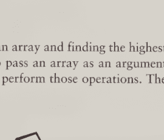

### 焦点：处理数组

LaClaire 博士在她的化学课上期有四次考试。在学期末，她在计算平均分之前会去掉每个学生的最低一次成绩。她要求你写一个程序，读取学生的四个测试分数作为输入，并计算去掉最低分后的平均分。以下是你开发的伪代码算法：

- 读取学生的四个测试分数。
- 计算分数的总和。
- 找到最低分。
- 从总和中减去最低分。得到调整后的总和。
- 将调整后的总和除以 3。这就是平均分。

程序 7-20 显示了该模块化的程序。与其一次性展示整个程序，让我们先检查主函数，然后是额外的函数。

### 程序 7-20 (main)

```cpp
// 此程序获取一系列测试分数
// 计算去掉最低分后的平均分。

#include <iostream>
#include <iomanip>

using namespace std;

// 函数原型
void getTestScores(double[], int);
double getTotal(double[], int);
double getLowest(double[], int);

int main()
{
    const int SIZE = 4; // 数组大小
    double testScores[SIZE]; // 用于存储测试分数的数组
    double total; // 用于存储总和的变量
    double lowestScore; // 用于存储最低分的变量
    double average; // 用于存储平均分的变量

    // 设置数值输出
    cout << fixed << setprecision(1);

    // 从用户获取测试分数。
    getTestScores(testScores, SIZE);

    // 获取分数的总和。
    total = getTotal(testScores, SIZE);

    // 获取最低分。
    lowestScore = getLowest(testScores, SIZE);

    // 从总和中减去最低分。
    total -= lowestScore;

    // 通过除以 SIZE-1 计算平均分。
    average = total / (SIZE - 1);

    // 显示平均分。
    cout << "The average with the lowest score dropped is " << average << ".\n";

    return 0;
}
```

### 程序 7-20 (getTestScores)

```cpp
// getTestScores 函数接受一个数组及其大小
// 作为参数。它提示用户输入测试分数，
// 分数存储在数组中。

void getTestScores(double scores[], int size)
{
    // 循环计数
    int index;

    // 获取每个测试分数。
    for(index = 0; index <= size - 1; index++)
    {
        cout << "Enter test score number" << (index + 1) << ":";
        cin >> scores[index];
    }
}
```

### 程序 7-20 (getTotal)

```cpp
// getTotal 函数接受一个 double 数组
// 及其大小作为参数。数组元素的
// 总和作为 double 类型返回。

double getTotal(const double numbers[], int size)
{
    double total = 0; // 累加器

    // 将每个元素加到总和。
    for (int count = 0; count < size; count++)
        total += numbers[count];

    // 返回总和。
    return total;
}
```

`getTotal` 函数有两个参数：

- `numbers[]`——一个 `const double` 数组
- `size`——一个 `int`，指定传递给 `numbers[]` 参数的数组大小

该函数返回作为参数传递给 `numbers[]` 参数的数组中所有数值的总和。

接下来显示的是 `getLowest` 函数，如下所示：

### 程序 7-20 (getLowest 函数)

```cpp
// getLowest 函数接受一个 double 数组和
// 它的大小作为参数。数组中的最小值将
// 作为 double 类型返回。

double getLowest(const double numbers[], int size)
{
    double lowest = 0; // 用于存储最小值

    // 获取数组的第一个元素。
    lowest = numbers[0];

    // 遍历数组的其余部分。当发现
    // 比当前更小的值时，将其赋值
    // 给 lowest。
    for (int count = 1; count < size; count++)
    {
        if (numbers[count] < lowest)
            lowest = numbers[count];
    }

    // 返回最小值。
    return lowest;
}
```

### 7.7 作为函数参数的数组

`getLowest` 函数有两个参数：

- `numbers[]`——一个 `const double` 数组
- `size`——一个 `int`，指定传递给 `numbers[]` 参数的数组大小

该函数返回作为参数传递到 `numbers[]` 参数的数组中的最小值。以下是程序的输出示例：

### 程序 7-20 带有示例输入的程序输出

```
输入测试分数 1: 92
输入测试分数 2: 67
输入测试分数 3: 75
输入测试分数 4: 88
去掉最低分后的平均分是 85.0。
```


### 检查点 (Checkpoint)

**7.14** 给定以下数组定义：
```cpp
double array1[4] = {1.2, 3.2, 4.2, 5.2};
double array2[4];
```
以下语句有效吗？如果不有效，原因是什么？
`array2 = array1;`

**7.15** 当数组名被传递给函数时，实际传递的是什么？

**7.16** 当用作函数参数时，数组是通过值传递的吗？

**7.17** 下列程序的输出是什么？（你可能需要查阅附录 A 中的 ASCII 表。）

```cpp
#include <iostream>

using namespace std;

// 函数原型
void fillArray(char [], int);
void showArray(const char [], int);

int main () {
    const int SIZE = 8;
    char prodCode[SIZE] = {'0', '0', '0', '0', '0', '0', '0', '0'};
    fillArray(prodCode, SIZE);
    showArray(prodCode, SIZE);
    return 0;
}

// 函数 fillArray 的定义。
//（提示：65 是 'A' 的 ASCII 码）

void fillArray(char arr[], int size)
{
    char code = 65;
    for (int k = 0; k < size; code++, k++)
        arr[k] = code;
}

// 函数 showArray 的定义。
void showArray(const char codes[], int size)
{
    for (int k = 0; k < size; k++)
        cout << codes[k];
    cout << endl;
}
```

**7.18** 下面的程序骨架在完成后，将要求用户输入 10 个整数，并存储在数组中。你必须编写的 `avgArray` 函数用于计算并返回输入数字的平均值。

```cpp
#include <iostream>

using namespace std;

// 在此处写下你的函数原型

int main()
{
    const int SIZE = 10;
    int userNums[SIZE];

    cout << "Enter 10 numbers: ";
    for (int count = 0; count < SIZE; count++)
    {
        cout << "#" << (count + 1) << " ";
        cin >> userNums[count];
    }

    cout << "The average of those numbers is ";
    cout << avgArray(userNums, SIZE) << endl;

    return 0;
}
```


## 7.8 二维数组

**概念**：二维数组类似于几个完全相同的数组组合在一起。它对于存储多组数据非常有用。

数组对于存储和处理一组数据非常有用。然而，有时需要处理多组数据。例如，在一个成绩平均分程序中，老师可能会用一个 `double` 数组记录一个学生的所有测试成绩。如果老师有 30 个学生，这意味着她需要 30 个 `double` 数组来记录整个班级的成绩。但是，与其定义 30 个独立的数组，不如定义一个二维数组。

你到为止学习的数组都是一维数组。它们之所以被称为一维，是因为它们只能存储一组数据。二维数组可以存储多组数据。最好将二维数组想象成具有行和列元素，如图 7-15 所示。

**图 7-15 二维数组**

| 列 0 | 列 1 | 列 2 | 列 3 |
|---|---|---|---|
| 行 0 | `scores[0][0]` | `scores[0][1]` | `scores[0][2]` | `scores[0][3]` |
| 行 1 | `scores[1][0]` | `scores[1][1]` | `scores[1][2]` | `scores[1][3]` |
| 行 2 | `scores[2][0]` | `scores[2][1]` | `scores[2][2]` | `scores[2][3]` |

图 7-15 所示的二维数组有 3 行（编号从 0 到 2）和 4 列（编号从 0 到 3）。定义一个二维数组需要两个声明符。第一个是行数，第二个是列数。这里有一个二维数组定义的示例：

```cpp
double scores[3][4];
```

### 初始化二维数组

在初始化二维数组时，将每行的初始化列表括在大括号中会很有帮助。这是一个示例：

```cpp
int hours[3][2] = {{8, 5}, {7, 9}, {6, 3}};
```

相同的定义也可以写为：

```cpp
int hours[3][2] = {{8, 5},
                  {7, 9},
                  {6, 3}};
```

在任何一种情况下，值都以以下方式分配给 `hours`：

```
hours[0][0] 被设置为 8
hours[0][1] 被设置为 5
hours[1][0] 被设置为 7
hours[1][1] 被设置为 9
hours[2][0] 被设置为 6
hours[2][1] 被设置为 3
```

图 7-16 展示了初始化过程。

**图 7-16 二维数组初始化**

| 列 0 | 列 1 |
|---|---|
| 行 0 | 8 | 5 |
| 行 1 | 7 | 9 |
| 行 2 | 6 | 3 |

包裹每行初始化列表的额外大括号是可选的。以下两个语句都执行相同的初始化：

```cpp
int hours[3][2] = {{8, 5}, {7, 9}, {6, 3}};
int hours[3][2] = {{8, 5, 7, 9, 6, 3}};
```

由于额外的大括号分隔了每一行，因此使用它们是一个好主意。此外，大括号让你能够省略某行行内的初始化值，而不会遗漏紧随其后的行的初始化值。例如，查看下面的数组定义：

```cpp
int table[3][2] = {{1}, {3, 4}};
```

`table[0][0]` 初始化为 1，`table[1][0]` 初始化为 3，`table[1][1]` 初始化为 4，`table[2][0]` 初始化为 5。`table[0][1]` 和 `table[2][1]` 未初始化。因为数组的某些元素已初始化，所以这两个未初始化的元素会被自动设置为零。

### 将二维数组传递给函数

程序 7-22 将二维数组传递给函数。当将二维数组传递给函数时，参数类型必须包含列数的尺寸声明。这里是程序 7-22 中函数 `showArray` 的头部：

```cpp
void showArray(const int[][COLS], int rows)
```

`COLS` 是一个设置为 4 的全局常量。该函数可以接受任何二维整数数组，只要它包含四列。在程序中，函数会显示各个数组的内容。

#### 程序 7-22

```cpp
// 此程序演示了接受 2D 数组参数。
#include <iostream>
#include <iomanip>
using namespace std;

// 全局常量
const int COLS = 4;       // 每行的列数
const int TBL1_ROWS = 3;  // table1 的行数
const int TBL2_ROWS = 4;  // table2 的行数

void showArray(const int[][COLS], int rows); // 函数原型

int main() {
    int table1[TBL1_ROWS][COLS] = {{1, 2, 3, 4},
                                   {5, 6, 7},
                                   {9, 10, 11, 12}};
    int table2[TBL2_ROWS][COLS] = {{10, 20, 30, 40},
                                   {50, 60, 70, 80},
                                   {90, 100, 110, 120},
                                   {130, 140, 150, 160}};

    cout << "The contents of table1 are:\n";
    showArray(table1, TBL1_ROWS);
    cout << "The contents of table2 are:\n";
    showArray(table2, TBL2_ROWS);
    return 0;
}

void showArray(const int numbers[][COLS], int rows) {
    for (int x = 0; x < rows; x++) {
        for (int y = 0; y < COLS; y++) {
            cout << setw(4) << numbers[x][y] << " ";
        }
        cout << endl;
    }
}
```

**程序输出**

```
table1 的内容:
1 2 3 4
5 6 7
9 10 11 12

table2 的内容:
10 20 30 40
50 60 70 80
90 100 110 120
130 140 150 160
```

C++ 要求在函数原型中指定列数，因为二维数组在内存中的存储方式是一行紧随另一行，如图 7-17 所示。

> **图 7-17 二维数组的内存组织**

当编译器生成访问数组元素的代码时，它需要知道行之间的字节数。列数是该计算中的关键因素。

### 二维数组元素的和

要计算二维数组所有元素的和，可以使用一对嵌套循环。以下代码演示了如何计算二维数组的所有元素：

```cpp
const int ROWS = 3; // 行数
const int COLS = 5; // 列数
int numbers[ROWS][COLS] = {{1, 2, 3, 4, 5},
                           {6, 7, 8, 9, 10},
                           {11, 12, 13, 14, 15}};
int sum = 0;

for (int i = 0; i < ROWS; i++) {
    for (int j = 0; j < COLS; j++) {
        sum += numbers[i][j];
    }
}
cout << "所有元素的和为 " << sum << endl;
```

### 二维数组列的和

有时你需要计算二维数组中每列的和。为了实现这一点，你使用嵌套循环。外层循环控制列下标，内层循环控制行下标。以下代码演示了：

```cpp
const int ROWS = 3; // 行数
const int COLS = 5; // 列数
int numbers[ROWS][COLS] = {{1, 2, 3, 4, 5},
                           {6, 7, 8, 9, 10},
                           {11, 12, 13, 14, 15}};

for (int j = 0; j < COLS; j++) {
    int sum = 0;
    for (int i = 0; i < ROWS; i++) {
        sum += numbers[i][j];
    }
    cout << "列 " << j + 1 << "的和为 " << sum << endl;
}
```

## 7.9 三维或更多维的数组

> **概念**：C++ 不限制数组可以拥有的维度数量。可以创建多维数组，以模拟在多个集合出现的数据。

C++ 允许创建几乎任意数量维度的数组。这里有一个三维数组定义的示例：

```cpp
double seats[3][5][8];
```

该数组可以被看作三组五行，每行包含八个元素。该数组可能用于存储剧院座位的价格，每排有八个座位，每个区域有五行，总共有三个区域。

图 7-18 展示了三维数组作为二维数组的“页”的概念。

**图 7-18 一个三维数组**

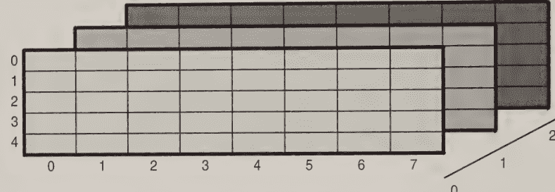

超过三维的数组很难可视化，但在某些编程问题中可能很有用。例如，在工厂仓库中，小部件的箱子堆叠在托盘上，可以使用四维数组来存储每个小部件的零件号。每个元素的四个下标可以代表每个小部件的零件号、箱号、行号和列号。同样，如果有多个仓库，可以使用五维数组。

> **注意**：在编写接受多维数组作为参数的函数时，除了第一个维度外，所有维度必须在参数列表中显式说明。

### 检查点

- **7.19** 定义一个名为 `grades` 的 `int` 二维数组。它应该有 30 行 10 列。
- **7.20** 数组中有多少销售记录？
  `double sales[6][4];`
- **7.21** 写一条语句，将值 56893.12 赋值给问题 7.20 定义数组的第一行第一列。
- **7.22** 写一条语句，显示问题 7.20 定义数组的最后一行最后一列的内容。
- **7.23** 定义一个名为 `settings` 的二维数组，其大小足够容纳下面的数据表。使用表中的值初始化数组。

| 12 | 24 | 32 | 21 | 42 |
|---|---|---|---|---|
| 14 | 67 | 87 | 65 | 90 |
| 19 | 1 | 24 | 12 | 8 |

## 7.10 关注问题解决与程序设计：案例研究

**7.24** 填充表格，使其显示以下数组的内容：
`int table[3][4] = {{2, 3}, {7, 9, 2}, {1}};`

| | | | |
|---|---|---|---|
| | | | |
| | | | |
| | | | |

**7.25** 写一个名为 `displayArray` 的函数。该函数应接受一个二维数组作为参数，并在屏幕上显示其内容。该函数应适用于以下任何一个数组：
```
int hours[5][7]; int stamps[8][7]; int autos[12][7]; int cats[50][7];
```

**7.26** 一家视频店在 50 个架子上存放 DVD，每个架子有 10 层。每层容纳 25 张 DVD。定义一个足够大的三维数组来表示商店的存储系统。

---

### 案例研究：验证 PIN

国家商业银行聘请你担任合同程序员。你的首要任务是编写一个函数，供银行的自动取款机（ATM）使用以验证客户的个人识别码（PIN）。

你的函数将被整合到一个更大的程序中，该程序要求客户在 ATM 的数字键盘上输入其 PIN。（PIN 是七位数字。程序将每个数字存储在整型数组的元素中。）程序从数据库中检索客户实际 PIN 的副本。（PIN 也以 7 元素数组的形式存储在数据库中。）如果这两个数组匹配，则客户的身份就通过了验证。你的函数将负责比较这两个数组，并判断它们是否包含相同的数字。

以下是你必须满足的规范：

- **参数**：函数应接受两个各包含 7 个元素的整型数组。第一个参数将包含客户输入的数字。第二个参数将包含从银行数据库中检索的数字。
- **返回值**：如果两个数组相同，函数应返回布尔真值 `true`。否则，它应返回 `false`。

以下是该函数的伪代码：

```
对于第一个数组中的每个元素
    将该元素与第二个数组中对应位置的元素进行比较。
    如果两个元素的值不同
        返回 false。
结束循环。
返回 true。
```

下文是 C++ 代码：

```cpp
bool testPIN(const int custPIN[], const int databasePIN[], int size)
{
    for (int index = 0; index < size; index++)
    {
        if (custPIN[index] != databasePIN[index])
            return false; // 我们发现了两个不同的值。
    }
    return true; // 如果我们一直运行到这里，值是相同的。
}
```

由于你仅被编写一个执行客户输入与从数据库中检索的 PIN 之间比较的函数，你还需要设计一个驱动程序。程序 7-23 显示了完整的程序。

#### 程序 7-23

```cpp
// 此程序是一个用于测试比较两个数组
// 内容函数的驱动程序。
#include <iostream>
using namespace std;

// 函数原型
bool testPIN(const int custPIN[], const int databasePIN[], int size);

int main()
{
    const int NUM_DIGITS = 7; // PIN 的位数
    int pin1[] = {2, 4, 1, 8, 7, 9, 0}; // 基础值。
    int pin2[] = {2, 4, 6, 8, 7, 9, 0}; // 只有一个元素与 pin1 不同。
    int pin3[] = {1, 2, 3, 4, 5, 6, 7}; // 所有元素都与 pin1 不同。

    if (testPIN(pin1, pin2, NUM_DIGITS))
        cout << "ERROR: pin1 and pin2 are the same." << endl;
    else
        cout << "SUCCESS: pin1 and pin2 are different." << endl;

    if (testPIN(pin1, pin3, NUM_DIGITS))
        cout << "ERROR: pin1 and pin3 are the same." << endl;
    else
        cout << "SUCCESS: pin1 and pin3 are different." << endl;

    if (testPIN(pin1, pin2, NUM_DIGITS))
        cout << "ERROR: pin1 and pin2 are the same." << endl;
    else
        cout << "SUCCESS: pin1 and pin2 are different." << endl;

    return 0;
}
```

## 表 7-3 向量定义

| 定义格式 | 描述 |
|---|---|
| `vector<float> amounts;` | 将 `amounts` 定义为单浮点数的空向量。 |
| `vector<string> names;` | 将 `names` 定义为字符串对象的空向量。 |
| `vector<int> scores(15);` | 将 `scores` 定义为一个包含 15 个整数的向量。 |
| `vector<char> letters(25, 'A');` | 将 `letters` 定义为包含 25 个字符的向量。每个元素都初始化为 'A'。 |
| `vector<double> values2(values1);` | 将 `values2` 定义为双精度浮点数向量。`values1` 的所有元素（它也是一个双精度向量）都被复制到 `values2` 中。 |

## 在 C++ 11 中对 vector 使用初始化列表

如果你正在使用 C++ 11，可以使用值列表来初始化向量，如下例所示：


# STL vector 导论

```cpp
vector<int> numbers { 10, 20, 30, 40 };
```

该语句定义了一个名为 `numbers` 的整数向量。该向量将有四个元素，初始化值为 10, 20, 30 和 40。注意初始化列表被包含在一组括号中，但你在列表之前没有使用 `=` 运算符。

## 在 vector 中存储和检索值

要向向量中已存在的元素存储一个值，你可以使用数组下标运算符 `[]`。例如，查看程序 7-24。

## 程序 7-24


## 程序 7-24（续）

```cpp
{
19  cout << "Hours worked by employee #" << (index + 1);
20  cout << ": ";
21  cin >> hours[index];
22  cout << "Hourly pay rate for employee #";
23  cout << (index + 1) << ":";
24  cin >> payRate[index];
25
26
27
28  // 显示每个员工的毛工资。
29  cout << "\nHere is the gross pay for each employee:\n";
30  cout << fixed << showpoint << setprecision(2);
31  for (index = 0; index < NUM_EMPLOYEES; index++)
32  {
33    double grossPay = hours[index] * payRate[index];
34    cout << "Employee #" << (index + 1);
35    cout << ": $" << grossPay << endl;
36  }
37
38  return 0;
}
```

## 程序输出（示例输入已加粗显示）

输入 5 个员工的工作小时数和他们的时薪。

Hours worked by employee #1: 10 Enter

Hourly pay rate for employee #1: 9.75 Enter

Hours worked by employee #2: 15 Enter

Hourly pay rate for employee #2: 8.62 Enter

Hours worked by employee #3: 20 Enter

Hourly pay rate for employee #3: 10.50 Enter

Hours worked by employee #4: 40 Enter

Hourly pay rate for employee #4: 18.75 Enter

Hours worked by employee #5: 40 Enter

Hourly pay rate for employee #5: 15.65 Enter

Here is the gross pay for each employee:

Employee #1: $97.50

Employee #2: $129.30

Employee #3: $210.00

Employee #4: $750.00

Employee #5: $626.00

程序 7-24 在第 11 行和第 12 行使用以下语句定义两个向量：

```cpp
vector<int> hours(NUM_EMPLOYEES); // 一个整数向量
vector<double> payRate(NUM_EMPLOYEES); // 一个双精度向量
```

两个向量都以初始大小 `S` 定义，`S` 是命名常量 `NUM_EMPLOYEES` 的值。程序使用第 18 行到 26 行的以下循环在两个向量的每个元素中存储值：

```cpp
for (index = 0; index < NUM_EMPLOYEES; index++)
{
    cout << "Hours worked by employee #" << (index + 1);
    cout << ":";
    cin >> hours[index];
    cout << "Hourly pay rate for employee #";
    cout << (index + 1) << ":";
    cin >> payRate[index];
}
```

因为用户输入的值存储在已存在的向量元素中，程序使用了数组下标运算符 `[]`，如下语句所示，这些语句出现在第 22 行和第 25 行：

```cpp
cin >> hours[index];
cin >> payRate[index];
```

## 在 C++ 11 中对 vector 使用基于范围的 for 循环

在 C++ 11 中，你可以使用范围 `for` 循环来遍历向量的元素，如程序 7-25 所示。

## 程序 7-25

```cpp
1 // 此程序演示了带向量的范围循环。
2 #include <iostream>
3 #include <vector>
4 using namespace std;
5
6 int main()
7 {
8     // 定义并初始化一个向量。
9     vector<int> numbers { 10, 20, 30, 40, 50 };
10
11 // 显示向量元素。
12     for (int val : numbers)
13         cout << val << endl;
14
15     return 0;
16 }
```

### 程序输出

```
10
20
30
40
50
```

## 程序 7-26

程序 7-26 展示了你如何使用引用变量配合范围循环在向量中存储项。

```cpp
// 此程序演示了带向量的范围循环。
#include <iostream>
#include <vector>
using namespace std;
int main()
{
    // 定义一个向量。
    vector<int> numbers(5);
    // 获取向量的值。
    for (int &val : numbers)
    {
        cout << "Enter an integer value: ";
        cin >> val;
    }
    // 显示向量元素。
    cout << "Here are the values entered:\n";
    for (int val : numbers)
        cout << val << endl;
    return 0;
}
```

### 程序输出（示例输入已加粗显示）

程序 7-26 展示了在范围循环中使用引用变量来在向量中存储项。

## 使用 `push_back` 函数

要向向量中不存在的元素存储一个值，你可以使用 `push_back` 成员函数。`push_back` 接受一个值作为参数，将其推入向量的末尾。如果向量是满的，`push_back` 会自动扩容。

## 确定 vector 的大小

与数组不同，vector 可以报告它们包含的元素数量。这是通过 `size` 成员函数实现的。这是一个使用 `size` 成员函数的语句示例：

```cpp
numValues = set.size();
```

在语句中，假设 `numValues` 是一个 `int`，而 `set` 是一个 `vector`。语句执行后，`numValues` 将包含 `set` 中的元素数量。

当你编写接受 vector 作为参数的函数时，`size` 成员函数特别有用。例如，以下 `showValues` 函数的代码：

```cpp
void showValues(vector<int> vect)
{
    for (int count = 0; count < vect.size(); count++)
        cout << vect[count] << endl;
}
```

由于 vector 可以报告其大小，此函数不需要接受第二个参数来指示 vector 中的元素数量。程序 7-28 展示了这个函数。

## 程序 7-28

```cpp
// 此程序演示了 vector 的 size
// 成员函数。
#include <iostream>
#include <vector>
using namespace std;

// 函数原型
void showValues(vector<int>);

int main()
{
    vector<int> values;

    // 将一系列数字放入 vector 中。
    for (int count = 0; count < 7; count++)
        values.push_back(count * 2);

    // 显示这些数字。
    showValues(values);
    return 0;
}

/*
// 函数 showValues 的定义。
// 此函数接受一个 int vector 作为其
// 参数。显示 vector 中每个
// 元素的值。
*/
```

## 程序 7-28（续上）

```cpp
void showValues(vector<int> vect)
{
    for (int count = 0; count < vect.size(); count++)
        cout << vect[count] << endl;
}
```

### 程序输出

```
0
2
4
6
8
10
12
```

## 从 vector 中移除元素

使用 `pop_back` 成员函数从 vector 中移除最后一个元素。在以下语句中，假设 `collection` 是 vector 的名称：

```cpp
collection.pop_back();
```

该语句从 `collection` vector 中移除最后一个元素。程序 7-29 展示了该函数。

## 程序 7-29

```cpp
// 此程序演示了 vector 的 pop_back 成员函数。
#include <iostream>
#include <vector>
using namespace std;
int main()
{
    vector<int> values;

    // 将值存储在 vector 中。
    values.push_back(1);
    values.push_back(2);
    values.push_back(3);
    cout << "The size of values is " << values.size() << endl;

    // 从 vector 中移除一个值。
    cout << "Popping a value from the vector ... \n";
    values.pop_back();
    cout << "The size of values is now " << values.size() << endl;

    // 现在从 vector 中移除另一个值。
    cout << "Popping a value from the vector ... \n";
    values.pop_back();
    cout << "The size of values is now " << values.size() << endl;

    // 从 vector 中移除最后一个值。
    cout << "Popping a value from the vector ... \n";
    values.pop_back();
    cout << "The size of values is now " << values.size() << endl;
    return 0;
}
```

### 程序输出

```
The size of values is 3
Popping a value from the vector...
The size of values is now 2
Popping a value from the vector...
The size of values is now 1
Popping a value from the vector...
The size of values is now 0
```

## 清空 vector

要完全清空 vector 的内容，使用 `clear` 成员函数，如下句所示：

```cpp
numbers.clear();
```

语句执行后，`numbers` 将清空所有元素。程序 7-30 展示了该函数。

## 程序 7-30

```cpp
// 此程序演示了 vector 的 clear 成员函数。
#include <iostream>
#include <vector>
using namespace std;
int main() {
    vector<int> values(100);

    cout << "The values vector has "
         << values.size() << " elements.\n";
    cout << "I will call the clear member function ... \n";
    values.clear();
    cout << "Now, the values vector has "
         << values.size() << " elements.\n";
    return 0;
}
```

### 程序输出

```
The values vector has 100 elements.
I will call the clear member function...
Now, the values vector has 0 elements.
```

## 检测空 vector

要确定一个 vector 是否为空，使用 `empty` 成员函数。如果 vector 为空，函数返回 `true`；如果 vector 中存储了元素，则返回 `false`。假设 `numberVector` 是一个 vector，以下是它的用法示例：

```cpp
if (numberVector.empty())
    cout << "No values in numberVector\n";
```

程序 7-31 使用了 `empty` 成员函数。

## 程序 7-31

```cpp
// 此程序演示了 empty 成员函数。
#include <iostream>
#include <vector>
using namespace std;

// 函数原型
double avgValues(vector<int>);

int main() {
    vector<int> values;
    int numValues;

    // 从用户处获取值的数量。
    cout << "How many values would you like to enter? ";
    cin >> numValues;

    // 从用户处获取值。
    for (int count = 0; count < numValues; count++) {
        cout << "Enter value " << count + 1 << ": ";
        int value;
        cin >> value;
        values.push_back(value);
    }

    // 检查 vector 是否为空。
    if (values.empty()) {
        cout << "No values were entered.\n";
    } else {
        // 计算并显示平均值。
        cout << "The average value is: " << avgValues(values) << endl;
    }

    return 0;
}

/*
// 函数 avgValues 的定义。
// 此函数接受一个 int vector 作为其
// 参数。它计算 vector 元素的平均值并返回它。
*/
double avgValues(vector<int> vect) {
    double total = 0;
    for (int count = 0; count < vect.size(); count++) {
        total += vect[count];
    }
    return total / vect.size();
}
```

### 检查点

7.27 为了定义 vector 对象，你必须 `#include` 哪个头文件？

7.28 为名为 `frogs` 的 vector 编写一个定义语句。`frogs` 应该是一个空的 `int` 类型 vector。

7.29 为名为 `lizards` 的 vector 编写一个定义语句。`lizards` 应该是一个包含 20 个 `float` 的 vector。

7.30 为名为 `toads` 的 vector 编写一个定义语句。`toads` 应该是一个包含 100 个 `char` 的 vector，且每个元素初始化为 `'Z'`。

7.31 `gators` 是一个空的 `int` 类型 vector。写一个语句将值 27 存储在 `gators` 中。

7.32 `snakes` 是包含 10 个元素的 `double` 类型 vector。写一个语句将值 12.897 存储在 `snakes` 的第 4 个元素中。

# 复习题

## 简答

1. 尺寸声明符（size declarator）和下标（subscript）之间的区别是什么？

2. 查看以下数组定义：

```cpp
int values[10];
```

该数组有多少个元素？

数组中第一个元素的下标是什么？


# 数组与向量练习题

## 复习题

1. 数组中最后一个元素的下标是什么？

2. 假设一个 `int` 占用 4 字节内存，该数组占用多少内存？

3. 为什么一个接受数组作为参数并对其进行处理的函数，也应该接收一个指定数组大小的参数？

```cpp
{ 4, 7, 6, 8, 2 };
cout << values[4] << endl;
cout << (values[2] + values[3]) << endl;
cout << ++values[1] << endl;
```

4. 考虑以下数组定义：

以下语句中的每条都会显示什么？

5. 如何在不提供尺寸声明符的情况下定义数组？

6. 查看以下数组定义：

```cpp
int numbers[5] = { 1, 2, 3 };
```

`numbers[2]` 存储了什么值？

`numbers[4]` 存储了什么值？

# 第 7 章 数组与向量

7. 假设 `array1` 和 `array2` 都是数组，为什么不能通过以下语句将 `array2` 的内容赋值给 `array1`？

```cpp
array1 = array2;
```

8. 假设 `numbers` 是一个 `double` 类型数组，以下语句会显示数组的内容吗？

```cpp
cout << numbers << endl;
```

9. 数组是通过值传递还是通过引用传递？

10. 当你将数组名作为参数传递给函数时，实际传递的是什么？

11. 如何在两个或多个数组之间建立并行关系？

12. 查看以下数组定义：

```cpp
double sales[10];
```

该数组有多少行？

该数组有多少列？

该数组有多少个元素？

写一个语句将一个数字存储在数组的最后行的最后一列中。

13. 在编写一个接受二维数组作为参数的函数时，你必须在数组参数中提供哪个尺寸声明符？

14. 相比于数组，`vector` 有哪些优势？

## 填空题

15. ________ 表示数组可以容纳的元素（或值）的数量。

16. 尺寸声明符必须是一个 ________，其值必须大于 ________。

17. 数组的每个元素通过一个被称为 ________ 的数字进行访问和索引。

18. C++ 中的下标编号始终从 ________ 开始。

19. 数组定义中括号内的数字是 ________，但在赋值语句（或任何处理数组内容的语句）中，数组括号内的数字是 ________。

20. C++ 没有数组 ________ 边界检查，这意味着你可能会无意中将数据存储到数组边界之外。

21. 数组的初始值可以通过 ________ 列表来指定。

22. 如果数组被部分初始化，则未初始化的元素将被设置为 ________。

23. 如果省略了数组的尺寸声明符，C++ 会通过计算 ________ 中的项目数量来确定数组的大小。

24. 通过对多个数组使用相同的 ________，你可以在数组中存储的数据之间建立关系。

25. 在一个 ________ 语句中，你不能使用 ________ 运算符将数据从一个数组复制到另一个数组。

26. 每当在不带括号和下标的情况下使用数组名时，它被视为 ________。

27. 要将数组传递给函数，请传递数组的 ________。

28. ________ 类似于几个相同类型的数组组合在一起。

29. 最好将二维数组理解为具有 ________ 和 ________。

30. 定义二维数组需要 ________ 两个尺寸声明符。

31. 在初始化二维数组时，将每行的初始化列表封装在 ________ 中会有帮助。

32. 当将二维数组传递给函数时，必须指定 ________ 尺寸。

33. ________ 是程序员定义的数据类型和算法的集合，你可以在程序中使用它们。

34. STL 定义的容器类型是 ________ 和 ________。

35. `vector` 数据类型是一种 ________ 容器。

36. 要在程序中定义 `vector`，你必须 `#include` ________ 头文件。

37. 要在一个没有初始大小或已满的 `vector` 中存储一个值，请使用 ________ 函数。

38. 要确定 `vector` 中元素的数量，使用 ________ 成员函数。

39. 使用 ________ 成员函数从 `vector` 中移除最后一个元素。

40. 要清除 `vector` 的内容，使用 ________ 成员函数。

# 算法工作台

41. `names` 是一个拥有 20 个元素的整数数组。写一个普通的 `for` 循环，以及一个基于范围的 `for` 循环，打印数组的每个元素。

42. 数组 `JSONArray` 和 `numberArray2` 有 100 个元素。编写代码将 `numberArray1` 中的值复制到 `numberArray2`。

43. 在一个程序中：

   - A) 定义两个可能并行的数组，用于存储十个员工识别号和总工资金额。
   - B) 写一个循环，使用这些数组打印每个员工的识别号和周总工资。

44. 定义一个名为 `grades` 的整数二维数组。它应该有 30 行 10 列。

45. 在程序中，你需要存储 12 个国家的人口。

   - A) 定义两个可以并行的数组来存储国家名称和人口。
   - B) 写一个循环，使用这些数组打印每个国家的名字和人口。

46. 以下代码对数组 `numberArray1` 和 `numberArray2` 求和。两个数组都有 25 个元素。这段代码会打印正确的总和吗？为什么？

```cpp
int total = 0; // 累加器
count; // 循环计数器
// 计算并显示第一个数组的总和。
for (count = 0; count < 24; count++)
    total += numberArray1[count];
cout << "The total for numberArray1 is " << total << endl;
// 计算并显示第二个数组的总和。
for (count = 0; count < 24; count++)
    total += numberArray2[count];
cout << "The total for numberArray2 is " << total << endl;
```

47. 查看以下数组定义：

```cpp
int numberArray[9][11];
```

写一个语句将 15 赋值给第一行的第一列。

写一个语句指向最后行的最后一列。

48. `values` 是一个 10 行 20 列的浮点型二维数组。编写代码将数组中的所有元素求和并存储在变量 `total` 中。

49. 一个应用程序使用如下定义的二维数组：

```cpp
int days[29][5];
```

编写代码对数组的每一行求和并显示结果。

编写代码对数组的每一列求和并显示结果。

## 判断题

- F 数组的尺寸声明符可以是字面量、命名常量或变量。
- F 要计算数组占用的内存，元素数量乘以每个元素占用的字节数。
- F 数组的每个元素通过一个唯一的数字进行访问和索引。
- F 数组的第一个元素通过下标 1 访问。
- F 单维数组中最后一个元素的下标比元素总数少一。
- F 数组元素的内容不能通过 `cout` 显示。

- T 数组在定义时无法初始化。必须使用循环或其他手段。
- T 初始化列表中的值将按照它们在列表中出现的顺序顺序存储在数组中。
- T C++ 允许你对数组进行部分初始化。
- T 如果数组被部分初始化，未初始化的元素将包含“垃圾”值。
- T 如果你留了一个元素未初始化，你不必遗留其其后的所有元素都未初始化。
- T 如果在数组定义中遗漏了尺寸声明符，则就不需要包含初始化列表。
- T 字符串数组中未初始化的元素将自动设置为值 "0"。
- T 你不能使用赋值运算符在单语句中将一个数组的内容复制到另一个数组中。
- T 当不带方括号和下标使用数组名时，它被视为数组第一个元素的值。
- F 要将数组传递给函数，请传递数组名。
- T 在定义用于持有一维数组参数的参数变量时，你不必包含尺寸声明符。
- T 当数组被传递给函数时，函数可以访问原始数组。
- T 二维数组就像几个相同的数组组合在一起。
- T 最好将二维数组考虑为具有行和列的。
- F 第一个尺寸声明符（在二维数组的声明中）代表列数。第二个尺寸声明符代表行数。
- T 二维数组可以传递给函数，但在参数变量的定义中必须指定行的大小。
- F C++ 允许你创建三维或更多维的数组。
- T `vector`（向量容器）是一个关联容器。
- F 要使用 `vector`，你必须包含 `vector` 头文件。
- F `vectors` 可以报告它们包含的元素数量。
- T 你可以使用 `[]` 运算符向没有元素的 `vector` 插入一个值。
- F 如果你向一个已经满的 `vector` 添加一个值，`vector` 将自动增加其大小以容纳新值。

# 找错

以下每个定义和程序段都有错误。请尽可能找出它们。

```cpp
80. int size;
   double values[size];

81. int collection[-20];

82. int table[10];
   for (int x = 0; x < 20; x++)
   {
      cout << "Enter the next value: ";
      cin >> table[x];
   }
```

```cpp
83. int hours[3] = 8, 12, 16;

84. int numbers[8] = {1, 2, , 4, , 5};
```

```cpp
85. float ratings[] = {'H', 'e', 'l', 'l', 'o'};
   cout << greeting;
```

```cpp
87. int array1[4], array2[4] = {3, 6, 9, 12};
   array1 = array2;
```

```cpp
88. void showValues(int nums)
   {
      for (int count = 0; count < 8; count++)
         cout << nums[count];
   }
```

```cpp
89. void showValues(int nums[][])
   {
      for (rows = 0; rows < 4; rows++)
         for (cols = 0; cols < 5; cols++)
            cout << nums[rows][cols];
   }
```

```cpp
90. vector<int> numbers = {1, 2, 3, 4};
```

# 编程挑战

## 1. 最大/最小数组值

编写一个程序，让用户向数组输入十个值。程序随后显示存储在数组中的最大值和最小值。

## 2. 雨量统计

编写一个程序，让用户将 12 个月每个月的总雨量输入到一个双精度类型的数组中。程序应计算并显示全年的总雨量、平均月雨量，以及平均值最高和最低的月份。

输入验证：不要接受月雨量数据的负数。

## 3. 玉米片与莎莎酱

编写一个程序，让玉米片和莎莎酱制造商跟踪五种不同莎莎酱的销售情况：微辣、中辣、甜味、辣和劲爽。程序应使用两个 5 元素的并行数组：一个存储五种莎莎酱名称的字符串数组，和一个存储过去一个月每种莎莎酱销售罐数的整数数组。名称应在创建数组时使用初始化列表存储。程序应提示用户输入每个类型的销售罐数。一旦输入了这些销售数据，程序应生成一份报告，显示每种莎莎酱的销售情况、总销售额，以及销量最高和最低的产品名称。

输入验证：不要接受销售罐数的负值。

## 4. 大于 n

在程序中，编写一个接受三个参数的函数：数组、数组的大小以及数字 `n`。假设数组包含整数。该函数应显示数组中所有大于 `n` 的数字。

## 5. 猴子业务

当地动物园想要跟踪每只猴子每天吃多少磅食物。编写一个程序将这些信息存储在 3x5 数组中，每行代表一只猴子，每列代表一天。程序首先让用户输入数据。然后创建一个报告，包括：

- 每日食物量。
- 最少食物量。
- 最大食物量。

输入验证：不要接受磅数的负值。

## 6. 雨或晴

一位业余气象学家想要跟踪夏季三个月的天气状况，并将每一天标记为雨 ('R')、云 ('C') 或晴 ('S')。编写一个程序，将这些信息存储在 3x31 的数组中，行索引代表月份（0=6月，1=7月，2=8月），列索引代表日期。然后创建一个报告，显示每个月有多少天雨、云天和晴天。它还应该报告哪个月份雨天最多。

## 7. 数字分析程序

编写一个程序询问用户文件名。假设文件包含一系列数字，每行一个。程序应将文件内容读取数组，然后显示：

- 数组中的最小值
- 数组中的最大值
- 数组的总和
- 数组的平均值

如果你下载了本书，将在 Chapter7 文件夹中找到一个名为 `numbers.txt` 的文件。可以使用该文件测试程序。

## 8. 洛书图

洛书图如图 7-19 所示，是一个 3 行 3 列的网格。洛书图具有以下属性：

- 网格包含数字 1 到 9。
- 每行、每列以及每对角线的和都相等。这如图 7-20 所示。

在程序中，可以使用二维数组模拟魔方。编写一个接受二维数组作为参数的函数，判断该数组是否为洛书图。在程序中测试该函数。

**图 7-19 洛书图**

| 4 | 9 | 2 |
|---|---|---|
| 3 | 5 | 7 |
| 8 | 1 | 6 |

**图 7-20 行、列和对角线的和**

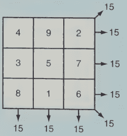

## 9. 工资

编写使用以下数组的程序：

- `empId`：一个七长整型数组，用于存储员工识别号。该数组用以下数字初始化：

```
5658845 4520125 7895122 8777541
8451277 1302850 7580489
```

- `hours`：一个包含七个整数的数组，用于存储每个员工的工时数
- `payRate`：一个包含七个双浮点数的数组，用于存储每个员工的小时薪率
- `wages`：一个包含七个双浮点数的数组，用于存储每个员工的总工资

程序应该通过下标将每个数组中的数据关联。例如，`hours` 数组中索引 0 的元素应该是存储在 `empId` 数组元素 0 中的识别号员工的工时数。该员工的薪率应存储在 `payRate` 数组的元素 0 中。

程序应该显示员工编号并让用户输入员工的工时数和薪率。然后，它应该计算员工的总工资（工时乘以薪率），并将其存储在 `wages` 数组中。在输入所有员工的数据后，程序应该显示员工的识别号和总工资。

输入验证：不接受负数工时数或小于 15.00 的薪率。

## 10. 驾照考试

当地车管办公室要求你编写一个程序，为驾照考试的笔试部分评分。考试共有 20 道多选择题。以下是正确答案：

| 1. A | 11. A | 16. C |
|---|---|---|
| 2. D | 7. A | 12. C | 17. C |
| 3. B | 8. B | 13. D | 18. A |
| 4. B | 9. C | 14. B | 19. D |
| 5. C | 10. D | 15. D | 20. B |

你的程序应该将上述正确答案存储在一个数组中。它应该要求用户输入学生对 20 道题每题的答案，这些答案应存储在另一个数组中。在输入学生答案后，程序应该显示一条消息，说明学生是否通过了考试。（学生必须正确回答 20 道题中的 15 道题才能通过考试。）它应该显示正确回答的总数、错误回答的总数，以及列出答错题目的列表。

输入验证：仅接受字母 A、B、C 或 D 作为答案。

## 11. 考试评分器

你的其中一位教授要求你编写一个程序为她的期末考试评分，考试仅包含 20 道多选择题。每道题有四个可能的答案之一：A、B、C 或 D。`CorrectAnswers.txt` 文件包含所有问题的正确答案，每个答案单独占一行。第一行包含第一个题的答案，第二行包含第二个题的答案，依此类推。（从计算机科学门户 www.pearsonhigher.com/gaddis 下载书的源代码。你将在第 07 章文件夹中找到该文件）。

编写一个程序，将 `CorrectAnswers.txt` 文件的内容读入一个 `char` 数组中。

第二个 `char` 数组。（你可以使用 `StudentAnswers.txt` 进行测试。该文件也在第 07 章源代码文件夹中。）程序应该确定学生错的题目数量，然后显示以下内容：

- 学生答错的题目列表，显示每道错题的正确答案和学生提供的错误答案
- 错题总数
- 正确回答题目的百分比。可以通过以下公式计算：
  正确回答题数 ÷ 题目总数
- 如果正确回答题目的百分比达到 70% 或更高，程序应该指示学生通过了考试。否则，应指示学生未通过。

## 12. 成绩单

某老师有五个学生参加了四次测试。老师根据学生四次测试的平均分，使用以下评分标准给学生分配字母等级：

| 测试分数 | 字母等级 |
|---|---|
| 90–100 | A |
| 80–89 | B |
| 70–79 | C |
| 60–69 | D |
| 0–59 | F |

编写一个程序，使用 `string` 对象数组来存储五个学生的姓名，一个包含五个字符的数组来存储五个学生的字母等级，以及五个 `double` 数组来存储每个学生的测试分数组。


程序应该允许用户输入每个学生的姓名和他们的四次测试分数。然后，它应该计算并显示每个学生的平均测试分数，以及根据平均分对应的字母等级。

输入验证：不接受小于 0 或大于 100 的测试分数。

# 13. 成绩单修改

修改编程挑战 12 中的成绩单应用，使其在确定测试分数平均分和字母等级时舍弃每个学生的最低分。

# 14. 彩票应用程序

编写一个模拟彩票的程序。该程序应该包含一个名为 `lottery` 的五位整数数组，并为数组中的每个元素生成一个 0 到 9 之间的随机数。用户应该输入五个数字，这些数字应被存储在一个名为 `user` 的整数数组中。程序应该比较两个数组中对应的元素，并统计匹配数字的个数。例如，下面显示了存储示例数字的 `lottery` 数组和 `user` 数组。有两个匹配的数字（元素 2 和 4）。

| 彩票数组: 7 | 4 | 9 | 1 | 3 |
| 用户数组: 4 | 2 | 9 | 7 | 3 |

程序应该显示存储在 `lottery` 数组中的随机数和匹配数字的个数。如果所有数字都匹配，则显示一条宣布用户为赢者的消息。

# 15. 向量修改

修改程序 7-23 中的国家银行案例研究，使 `pin1`、`pin2` 和 `pin3` 成为向量而不是数组。你还必须修改测试函数以接收向量而不是数组。

# 16. 世界大赛冠军

如果你下载了书的源代码，你将在章节找到以下文件：

- `Teams.txt`——此文件包含按字母顺序排序的大联盟棒球球队列表。文件中列出的每个球队都至少获得过一次世界大赛冠军。
- `WorldSeries.txt`——此文件包含从 1903 年到 2012 年世界大赛冠军的时间顺序列表。文件的第一行是 1903 年获胜的球队名称，最后一行是 2012 年获胜的球队名称。注意，1993 年和 1994 年没有举行世界大赛。

编写一个程序，显示 `Teams.txt` 的内容，并让用户输入一个球队，通过 `WorldSeries.txt` 统计该球队获胜的次数。

# 17. 姓名搜索

如果你下载了书的源代码，你将在章节找到以下文件：

- `GirlNames.txt`——此文件包含 2000 年到 2009 年最受欢迎的女孩名字列表。
- `BoyNames.txt`——此文件包含 2000 年到 2009 年最受欢迎的男孩名字。

编写一个程序，将这两个文件的内容读入两个数组或向量中。用户可以输入女孩名字、男孩名字或两者，程序应该指示这些是否受欢迎。

# 18. 井棋游戏

编写一个允许两个玩家玩井棋游戏的程序。使用一个三行三列的 `char` 数组作为盘。数组的每个元素应初始化为星号（*）。程序应该运行一个循环执行以下操作：

- 显示盘的内容。
- 允许玩家 1 在盘上选择位置放置 X。程序要求用户输入行列号。
- 允许玩家 2 在盘上选择位置放置 O。程序要求用户输入行列号。
- 判断是否有人获胜或平局。如果有人获胜，程序应该宣布胜利者并结束。如果是平局，程序应该显示相应消息并结束。

当行、列或对角线线上有三个 X 时，玩家 1 获胜。当行、列或对角线线上有三个 O 时，玩家 2 获胜。当盘面满但没有获胜时，则为平局。

# 19. 魔法球

编写一个模拟魔法球的程序，这是一种可以回答是否问题的预言玩具。在学生程序中，你会找到一个名为 `8_responses.txt` 的文件。该文件包含 12 个回答，例如“我不认为”、“当然可以！”、“我很确定”等。程序应该从文件中读取这些回答到数组或向量中。它应该提示用户提问，然后从数组或向量中随机选择一个回答显示。程序将重复，直到用户准备退出。

`8_responses.txt` 的内容：

是的，当然！

毫无疑问，是的。

你可以放望。

确定！

稍后再告诉我。

我不确定。

我现在不能告诉你。

我睡午觉后再告诉你。

没门！

我不认为。

毫无疑问，不是。

答案显然是否的。

# 20. 1994 年油价

在学生程序中，你会找到一个名为 `1994_Weekly_Gas.txt` 的文件。该文件包含 1994 年每周的平均油价（文件共有 52 行。第一行包含第 1 周的平均价，第二行包含第 2 周的平均价，依此类推。）编写一个程序，从文件中读取油价并存入数组或向量中。程序应该：

- 显示全年最低平均价，以及该价格所在的周数和所属月份名称。
- 显示全年最高价格，以及该价格对应的周数和发生该月份名称。
- 显示每个月的平均油价。（要获取特定月份的平均价格，请计算该月份每月平均油价的平均值。）

# 21. 二维数组操作

编写一个程序，创建一个用测试数据初始化的二维数组。你可以使用任何你想要的数据类型。该程序应包含以下函数：

- `getTotal`——该函数接受一个二维数组作为参数，并返回数组中所有值的总和。
- `getAverage`——该函数接受一个二维数组作为参数，并返回数组中所有值的平均值。
- `getRowTotal`——该函数接受一个二维数组作为第一个参数，接受一个整数作为第二个参数。第二个参数应该是数组中某行的下标。该函数返回指定行中值的总和。
- `getColumnTotal`——该函数接受一个二维数组作为第一个参数，接受一个整数作为第二个参数。第二个参数应该是数组中某列的下标。该函数返回指定列中值的总和。
- `getHighestInRow`——该函数接受一个二维数组作为第一个参数，接受一个整数作为第二个参数。第二个参数应该是数组中某行的下标。该函数返回数组指定行中的最高值。
- `getLowestInRow`——该函数接受一个二维数组作为第一个参数，接受一个整数作为第二个参数。第二个参数应该是数组中某行的下标。该函数返回数组指定行中的最低值。

在该程序中演示每个函数的功能。

## 小组项目

# 22. 剧院座位

该程序应该由学生小组设计并编写。以下是一些建议：

- 一名学生应该设计函数 `main`，它将调用程序中的其他函数。其余函数将由小组的其他成员设计。
- 应该分析程序的需求，以便给每个学生分配大致的工作量。
- 应该提前决定每个函数的参数和返回类型。
- 程序可以实现为多文件程序，也可以将所有函数剪并粘贴到主文件中。

任务是：编写一个可以供小型剧院用于出售演出票的程序。剧院的观众厅应该显示一个屏幕，显示哪些座位是空的，哪些已被占用。例如，下面的屏幕显示了一个描述剧院内每个座位的图表。被占用的座位用 * 符号表示，空闲的座位用 # 符号表示。

# 座位

| 行 | 123456789012345678901234567890 |
| 行 1 | * ################ |
| 行 2 | ############ # |
| 行 3 | * ############ ****** |
| 行 4 | ###### |
| 行 5 | ********** ********** * ####### |
| 行 6 | ########################### |
| 行 7 | ********** #* ############ |
| 行 8 | ####################### |
| 行 9 | ####### |
| 行 10 | ##################### |
| 行 11 | * ########## * ####### |
| 行 12 | ####################### |
| 行 13 | ##################* |
| 行 14 | ########################### |
| 行 15 | ########################### |

以下是该程序必须执行的任务列表：

- 当程序开始时，它应该要求用户输入每行的座位价格。价格可以存储在单独数组中。（或者，价格可以从文件中读取）。
- 一旦输入了价格，程序应该显示一个与上面所示类似的座位图。用户可以输入正在出售的票的行号和座位号。每当购买一张票或一组票时，程序都应该显示总票务额并更新座位图。
- 程序应该记录所有票务总额。用户应该有一个查看此金额的选项。
- 程序还应该给用户一个选项，查看已售出座位数、每行的空闲座位数以及观众厅空闲座位总数。
- 输入验证：在售票时，不要接受不存在的行号或座位号。当有人请求座位时，程序应该在出售之前确保座位是空闲的。

# 数组搜索与排序

| 主题 | |
| :--- | :--- |
| 8.1 重点关注软件工程：搜索算法简介 | 8.3 重点关注软件工程：排序算法简介 |
| 8.2 重点关注问题解决与程序设计：案例研究 | 8.4 重点关注问题解决与程序设计：案例研究 |
| 8.5 搜索与向量 | |

## 8.1 重点关注软件工程：搜索算法简介

**概念**：搜索算法是在较大的数据集中定位特定项目的方法。程序不仅在数组中存储和处理数据，而且在数组中搜索特定项目也是常见的。本节将向你展示两种搜索数组的方法：线性搜索和二分查找。它们各有优缺点。

### 线性搜索

线性搜索是一种非常简单的算法。也称为顺序搜索，它使用循环遍历数组，从第一个元素开始。它将每个元素与要查找的值进行比较，当找到该值或到达数组末尾时停止。以下是线性搜索的伪代码：

```
Set found to false
Set position to -1
Set index to 0
While found is false and index < number of elements
  If list[index] is equal to search value
    found = true
    position = index
  End If
  Add 1 to index
```

### 第 8 章 数组的搜索与排序

一个存储在最后一个元素中的值（这意味着算法实际上读取数组中的某个元素 20,000 次）。

在平均情况下，项目出现在数组开头附近的概率与出现在末尾附近的概率相等。通常，对于一个包含 N 个元素的数组，线性搜索通过 $N/2$ 次尝试即可定位一个项目。如果一个数组有 50,000 个元素，在典型情况下，线性搜索将与其中 25,000 个元素进行比较。当然，这假设搜索项目在数组中是一定能被找到的（$N/2$ 是平均比较次数。最大比较次数始终为 $N$）。

当线性搜索无法定位某个项目时，它必须与数组中的每个元素进行比较。随着失败搜索尝试次数的增加，平均比较次数也随之增加。显然，如果速度很重要，则不应在大型数组上使用线性搜索。

### 二分查找


二分查找是一种非常聪明的算法，比线性搜索高效得多。唯一的要求是数组中的值必须按顺序排列。该算法不是测试第一个元素，而是从中间元素开始。如果该元素恰好包含所需的值，则找到了该项目。否则，中间元素的值将大于或小于正在搜索的值。如果它较大，那么所需的值（如果在列表中）将在数组的前半部分某处找到。如果它较小，那么所需的值（同样，如果在列表中）将在数组的后半部分某处找到。无论何种情况，数组的一半元素都被排除在进一步搜索之外。

如果在中间元素中没有找到所需的值，则对可能包含该值的半部分数组重复该过程。例如，如果要搜索数组的后半部分，算法会立即测试其中间元素。如果未找到所需的值，搜索范围将缩小到该元素之前或之后的数组四分之一区域。这个过程一直持续，直到找到正在搜索的值，或者没有更多元素可以测试。

以下是用于对数组执行二分查找的函数伪代码：

```
Set first to 0
Set last to the last subscript in the array
Set found to false
Set position to -1
While is not true and first is less than or equal to last
  Set middle to the subscript halfway between array[first]
  and array[last]
  If array[middle] equals the desired value
    Set found to true
    Set position to middle
  Else If array[middle] is greater than the desired value
    Set last to middle - 1
  Else
    Set first to middle + 1
End While
Return position
```

### 8.1 关注软件工程：搜索算法简介

该算法使用了三个索引变量：`first`、`last` 和 `middle`。`first` 和 `last` 变量标记了当前正在搜索的数组边界。它们用数组第一个元素和最后一个元素的下标初始化。位于 `first` 和 `last` 正中间的元素下标存储在 `middle` 变量中。如果数组中间的元素不包含搜索值，则调整 `first` 或 `last` 变量，以便在下一次迭代中只搜索数组的上半部分或下半部分。这每次循环未能找到搜索值时都削减了正在搜索的数组部分。

在示例所示所示函数 `binarySearch` 用于对整数数组执行二分查找。第一个参数 `array` 的最大元素为 `numElems`，用于搜索存储在 `value` 中的数字是否出现。如果找到，返回其下标。否则，返回 -1 表示 `value` 未出现在数组中。

```
int binarySearch(const int array[], int numElems, int value)
    int first = 0, // 数组第一个元素
    last = numElems - 1, // 数组最后一个元素
    middle, // 搜索的中点
    position = -1; // 搜索值的位置
    bool found = false; // 标记

    while (!found && first <= last)
    {
        middle = (first + last) / 2; // 计算中点
        if (array[middle] == value) // 如果在中间找到值
        {
            found = true;
            position = middle;
        }
        else if (array[middle] > value) // 如果值在下半部分
            last = middle - 1;
        else
            first = middle + 1; // 如果值在上半部分
    }
    return position;
```

### 程序 8-2

```cpp
// 此程序演示了 binarySearch 函数，该函数对整数数组执行二分查找。
#include <iostream>
using namespace std;

// 函数原型
int binarySearch(const int array[], int size, int value);

int main() {
    // 升序排列的员工 ID
    const int SIZE = 20;
    int idNums[SIZE] = {101, 142, 147, 189, 199, 222, 234, 289, 296, 310, 319, 388, 394, 417, 429, 447, 500, 521, 536, 600};
    int results;
    int empID;

    // 获取要搜索的 ID
    cout << "Enter the employee ID you wish to search for: ";
    cin >> empID;

    // 搜索 ID
    results = binarySearch(idNums, SIZE, empID);

    // 如果 results 为 -1，说明在数组中不存在
    if (results == -1)
        cout << "That does not exist in the array.\n";
    else {
        // 否则，输出在数组中的元素位置
        cout << "That is found at element " << results << " in the array.\n";
    }
    return 0;
}

/*
* binarySearch 对整数数组执行二分查找。
* 如果找到了该数字，则返回其下标。
* 否则，返回 -1 表示值未在数组中。
**/
int binarySearch(const int array[], int size, int value) {
    int first = 0, // 数组第一个元素
    last = size - 1, // 数组最后一个元素
    middle, // 搜索的中点
    position = -1; // 搜索值的位置
    bool found = false; // 标记

    while (!found && first <= last) {
        middle = (first + last) / 2; // 计算中点
        if (array[middle] == value) // 如果在中间找到值
        {
            found = true;
            position = middle;
        }
        else if (array[middle] > value) // 如果值在下半部分
            last = middle - 1;
        else
            first = middle + 1; // 如果值在上半部分
    }
    return position;
}
```

### 带示例输出的程序输出


Enter the employee ID you wish to search for: 199

That is found at element 4 in the array.

# 表 8-1 产品

| 产品标题 | 产品描述 | 产品编号 | 单价 |
|---|---|---|---|
| 领导力的六个步骤 | 书籍 | 914 | $12.95 |
| 领导力的六个步骤 | 音频 CD | 915 | $14.95 |
| 卓越之路 | DVD | 916 | $18.95 |
| 质量的七堂课 | 书籍 | 917 | $16.95 |
| 质量的七堂课 | 音频 CD | 918 | $21.95 |
| 质量的七堂课 | DVD | 919 | $31.95 |
| 团队是培养出来的不是生的 | 书籍 | 920 | $14.95 |
| 未来领导力 | 书籍 | 921 | $14.95 |
| 未来领导力 | 音频 CD | 922 | $16.95 |

电话营销小组的经理要求你编写一个程序，帮助订单输入员查询产品价格。该程序应提示用户输入产品编号，然后显示该产品的标题、描述和价格。

## 变量

表 8-2 列出了所需的变量：

## 表 8-2 变量

| 变量 | 描述 |
|---|---|
| `NUM_PRODS` | 常量型整数，初始化为 Demeters 力中心销售的产品数量。此值将用于程序数组的定义。 |
| `MIN_PRODNUM` | 常量型整数，初始化为最低产品编号。 |
| `MAX_PRODNUM` | 常量型整数，初始化为最高产品编号。 |
| `id` | 整数数组。存储每个产品编号。 |
| `title` | 字符串数组，初始化为产品标题。 |
| `description` | 字符串数组，初始化为每个产品的描述。 |
| `prices` | 双精度浮点数数组。存储每个产品的价格。 |

## 模块

程序将由表 8-3 列出的函数组成。

## 表 8-3 函数

| 函数 | 描述 |
|---|---|
| `main` | 程序的主函数。它调用程序的其他函数。 |
| `getProdNum` | 提示用户输入产品编号。该函数验证输入并拒绝任何超出正确产品编号范围的值。 |
| `binarySearch` | 标准二分查找例程。在数组中搜索指定值。如果找到该值，则返回其下标。如果没有找到，则返回 -1。 |
| `displayProd` | 使用标题、描述和价格数组的公共下标来显示产品的标题、描述和价格。 |

## 8.2 关注问题解决与程序设计：案例研究

### 函数 main

函数 `main` 包含变量定义并调用其他函数。以下是它的伪代码：

```
do
    调用 getProdNum
    调用 binarySearch
    如果 binarySearch 返回 -1
        通知用户未找到产品编号
    否则
        调用 displayProd
    结束 如果
    询问用户是否应该重复程序
当用户想要重复程序时
```

以下是其实际 C++ 代码：

```cpp
do
{
    // 获取所需的产品编号。
    prodNum = getProdNum();
    // 搜索产品编号。
    index = binarySearch(id, NUM_PRODS, prodNum);
    // 显示搜索结果。
    if (index == -1)
        cout << "That product number was not found.\n";
    else
        displayProd(title, description, prices, index);
    // 用户想再次执行此吗？
    cout << "Would you like to look up another product? (y/n) ";
    cin >> again // 'y'
} while (again == 'y' || again == 'Y');
```

命名常量 `NUM_PRODS` 是全局定义的，并初始化值为 9。数组 `id`、`title`、`description` 和 `prices` 已经初始化了数据。

### getProdNum 函数

`getProdNum` 函数提示用户输入产品编号。它会测试该值以确保它在 914-922 范围内（这些是有效的产品编号）。如果输入了无效值，它会被拒绝并再次提示用户。当输入有效的产品编号时，该函数返回它。伪代码如下所示。

```
显示输入产品编号的提示
读取 prodNum
当 prodNum 无效时
    显示错误信息
    读取 prodNum
结束 当
返回 prodNum
```

# 第 8 章 数组的搜索与排序

以下是实际的 C++ 代码：

```cpp
int getProdNum()
{
    int prodNum;
    cout << "Enter the item's product number: ";
    cin >> prodNum;
    // 验证输入。
    while (prodNum < MIN_PRODNUM || prodNum > MAX_PRODNUM)
    {
        cout << "Enter a number in the range of " << MIN_PRODNUM << " through " << MAX_PRODNUM << ".\n";
        cin >> prodNum;
    }
    return prodNum;
}
```

### binarySearch 函数

`binarySearch` 函数与本章之前讨论的函数相同。

### displayProd 函数

`displayProd` 函数具有名为 `title`、`desc`、`price` 和 `index` 的参数变量。这些变量接收标题、描述和价格数组以及一个下标值。该函数显示数据的标题、描述和价格。这里是 C++ 代码：

```cpp
void displayProd(const string title[], const string desc[], double price[], int index)
{
    cout << "Title: " << title[index] << endl;
    cout << "Description: " << desc[index] << endl;
    cout << "Price: " << price[index] << endl;
}
```

### 整个程序

该程序允许用户输入产品编号，然后显示产品的标题、描述和价格。

```cpp
#include <iostream>
#include <string>
using namespace std;

const int NUM_PRODS = 9; // 产品数量
const int MIN_PRODNUM = 914; // 最低编号
const int MAX_PRODNUM = 922; // 最高编号

// 函数原型声明
int getProdNum();
int binarySearch(const int [], int, int);
void displayProd(const string [], const string [], double [], int);

int main()
{
    // 编号数组
    int id[] = {914, 915, 916, 917, 918, 919, 920, 921, 922};
    // 标题数组
    string title[] = {
        "Six Steps to Leadership",
        "Six Steps to Leadership",
        "The Road to Excellence",
        "Seven Lessons of Quality",
        "Seven Lessons of Quality",
        "Seven Lessons of Quality",
        "Teams Are Made, Not Born",
        "Leadership for the Future",
        "Leadership for the Future"
    };
    // 描述数组
    string description[] = {
        "Book",
        "Audio CD",
        "DVD",
        "Book",
        "Audio CD",
        "DVD",
        "Book",
        "Book",
        "Audio CD"
    };
    // 价格数组
    double price[] = {12.95, 14.95, 18.95, 16.95, 21.95, 31.95, 14.95, 14.95, 16.95};

    int prodNum; // 用于产品编号
    int index; // 用于搜索结果
    char again; // 用于是否执行

    do
    {
        // 获取所需的产品编号。
        prodNum = getProdNum();
        // 搜索产品编号。
        index = binarySearch(id, NUM_PRODS, prodNum);

        // 显示搜索结果。
        if (index == -1)
        {
            cout << "That product number was not found.\n";
        }
        else
            displayProd(title, description, price, index);

        // 用户想再次执行此吗？
        cout << "Would you like to look up another product? (y/n) ";
        cin >> again;
    } while (again == 'y' || again == 'Y');

    return 0;
}
```

## 8.2 关注问题解决与程序设计：案例研究

```cpp
112
113
while (!found && first <= last)
  {
    middle = (first + last) / 2; // 计算中间位置
    if (array[middle] == value) // 如果中间找到了值
    {
      found = true;
      position = middle;
    }
    else if (array[middle] > value) // 如果值在左半部分
      last = middle - 1;
    else
      first = middle + 1; // 如果值在右半部分
  }
  return position;
}
```

```cpp
****************************************************************
// displayProd 函数接受三个数组和一个整数。
// 数组参数预期包含 main 函数中定义的标题、
// 描述和价格。index 参数
// 保存一个下标。该函数显示每个数组中在该下标处所包含的信息。
****************************************************************
void displayProd(const string title[], const string desc[],
                 double price[], int index) {
  cout << "Title: " << title[index] << endl;
  cout << "Description: " << desc[index] << endl;
  cout << "Price: " << price[index] << endl;
}
```

# 程序输出（示例输入已加粗显示）

输入产品编号：916 回车

标题：The Road to Excellence

描述：DVD

价格：$18.95

你想查询另一个产品吗？(y/n) 回车

输入产品编号：920 回车

标题：Teams Are Made, Not Born

描述：书

价格：$14.95

你想查询另一个产品吗？(y/n) 回车

# 节点

- 8.1 描述线性查找与二分查找之间的区别。
- 8.2 平均而言，对于一个拥有 20,000 个元素的数组，线性查找将执行多少次比较？（假设要查找的项目始终能在数组中找到。）

## 第 8 章 数组的搜索与排序

8.3 对于一个拥有 20,000 个元素的数组，二分查找执行的最大比较次数是多少？

8.4 如果对数组进行线性查找，且已知某些项目的查找频率高于其他项目，应如何重新排列数组的内容以提高搜索的平均性能？

## 8.3 关注软件工程：排序算法简介

概念：排序算法用于将数据按某种顺序排列。

# 排序算法

许多编程任务要求对数组中的数据按某种顺序排序。例如，客户列表通常按字母顺序排序。学生成绩可能从高到低排序，产品代码可以进行排序，使得所有相同颜色的产品存储在一起。为了对数组中的数据排序，程序员必须使用合适的排序算法。排序算法是一种遍历数组并按某种顺序重新排列内容的技术。

数组中的数据可以按升序或降序排序。如果数组按升序排序，意味着数组中的值是从低到高存储的。如果值按降序排序，则是从高到低存储的。本节将介绍两种简单的排序算法：冒泡排序和选择排序。

# 冒泡排序

冒泡排序按升序或降序排列数据的一种简单方法。它被称为冒泡排序算法是因为它通过遍历数组并比较元素，每一轮遍历中，某些值都会“泡”向数组的末尾。例如，如果你使用该算法按升序排序数组，较大的值会移向末尾。如果你使用该算法按降序排序数组，较小的值会移向末尾。在本节中，你将看到冒泡排序算法如何升序排序数组。

假设我们有一个如图8-1所示的数组。让我们看看如何使用冒泡排序将数组元素按升序排列。

## 图 8-1 数组

| 7 | 2 | 3 | 8 | 9 | 1 |
| :--- | :--- | :--- | :--- | :--- | :--- |
| 元素 0 | 元素 1 | 元素 2 | 元素 3 | 元素 4 | 元素 5 |

冒泡排序从比较数组的前两个元素开始。如果元素 0 大于元素 1，则交换它们。现在数组看起来如图 8-2 所示。

## 图 8-2 元素 0 和 1

| 2 | 7 | 3 | 8 | 9 | 1 |
| :--- | :--- | :--- | :--- | :--- | :--- |
| 元素 0 | 元素 1 | 元素 2 | 元素 3 | 元素 4 | 元素 5 |

冒泡排序继续比较下两个元素。如果元素 1 大于元素 2，则交换它们。现在数组看起来如图 8-3 所示。

## 图 8-3 元素 1 和 2

| 2 | 3 | 7 | 8 | 9 | 1 |
| :--- | :--- | :--- | :--- | :--- | :--- |
| 元素 0 | 元素 1 | 元素 2 | 元素 3 | 元素 4 | 元素 5 |

冒泡排序继续比较下两个元素。如果元素 2 大于元素 3，则交换它们。现在数组看起来如图 8-4 所示。

## 图 8-4 元素 2 和 3

| 2 | 3 | 8 | 7 | 9 | 1 |
| :--- | :--- | :--- | :--- | :--- | :--- |
| 元素 0 | 元素 1 | 元素 2 | 元素 3 | 元素 4 | 元素 5 |

冒泡排序继续比较下两个元素。如果元素 3 大于元素 4，则交换它们。现在数组看起来如图 8-5 所示。

## 图 8-5 元素 3 和 4

| 2 | 3 | 8 | 9 | 7 | 1 |
| :--- | :--- | :--- | :--- | :--- | :--- |
| 元素 0 | 元素 1 | 元素 2 | 元素 3 | 元素 4 | 元素 5 |

冒泡排序继续比较下两个元素。如果元素 4 大于元素 5，则交换它们。现在数组看起来如图 8-6 所示。

## 图 8-6 元素 4 和 5

| 2 | 3 | 8 | 9 | 1 | 7 |
| :--- | :--- | :--- | :--- | :--- | :--- |
| 元素 0 | 元素 1 | 元素 2 | 元素 3 | 元素 4 | 元素 5 |

第一轮遍历完成后，最大的元素（9）已处于其最终位置。对剩余元素重复此过程，直到整个数组排序完毕。

## 图 8-7 所有元素排序后的数组

| 1 | 2 | 3 | 7 | 8 | 9 |
| :--- | :--- | :--- | :--- | :--- | :--- |
| 元素 0 | 元素 1 | 元素 2 | 元素 3 | 元素 4 | 元素 5 |

## 8.3 关注软件工程：排序算法简介

```cpp
  if (array[index] > array[index + 1]) {
    swap(array[index], array[index + 1]);
  }
}
```

在第 3 行和第 4 行中，定义了以下局部变量：

- `maxElement` 变量将存储与其相邻元素比较的最后一个元素的下标。
- `index` 变量在其中一个循环中用数组下标。

函数使用了两个循环，一个嵌套在另一个内部。外层循环从第 6 行开始，如下：

```
for (maxElement = size - 1; maxElement > 0; maxElement--)
```


该循环为数组中的每个元素迭代一次。它使得 `maxElement` 变量遍历数组的所有下标，从最高下标一直到 0。每次迭代后，`maxElement` 都会减 1。

第二个循环嵌套在第一个循环内部，从第 8 行开始，如下：

```cpp
for (index = 0; index < maxElement; index++)
```

该循环为数组中每个未排序的元素进行迭代。它从 0 开始，递增到 `maxElement - 1`。在每次迭代中，执行第 10 行的比较：

```cpp
if (array[index] > array[index + 1])
```

该语句将数组 `array[index]` 处的元素与其邻居 `array[index + 1]` 进行比较。如果该元素的邻居更大，则在第 12 行调用 `swap` 函数交换这两个元素。

## 交换数组元素

正如你在冒泡排序算法描述中所看到的，当算法遍历数组时，某些元素会被交换。让我们简要讨论在计算机内存中交换项的过程。假设我们有以下变量声明：

```cpp
int a = 1;
int b = 9;
```

我们想要交换这些变量的值，使得变量 `a` 包含 9，变量 `b` 包含 1。起初，你可能认为我们只需要将变量互相赋值，如下：

```cpp
// 错误！以下操作并没有交换变量。
a = b;
b = a;
```

为了理解为什么这不起作用，让我们逐步执行这两行代码。第一条语句

```cpp
a = b;
```

导致值 9 被赋值给 `a`。但之前存储在 `a` 中的值 1 会发生什么呢？记住，当你给变量赋新值时，新值将替换之前存储在变量中的任何值。因此，旧值 1 将被丢弃。

然后，下一条语句是

```cpp
b = a;
```

由于变量 `a` 包含 9，它将 9 赋值给 `b`。执行这些语句后，变量 `a` 和 `b` 都包含值 9。

要成功交换两个变量的内容，我们需要第三个变量作为临时存储位置：

```cpp
int temp;
```

然后我们可以执行以下步骤来交换变量 `a` 和 `b` 的值：

- 将 `a` 的值赋值给 `temp`。
- 将 `b` 的值赋值给 `a`。
- 将 `temp` 的值赋值给 `b`。

这里是交换两个 int 参数的交换函数代码：

```cpp
void swap(int &a, int &b)
{
    int temp = a;
    a = b;
    b = temp;
}
```

> 注意：在 `swap` 函数中使用引用参数是关键的，因为函数必须能够改变作为参数传递给它的项的值。

程序 8-4 在一个完整的程序中演示了 `bubbleSort` 函数。

## 程序 8-4

```cpp
// 此程序演示了冒泡排序算法。
#include <iostream>
using namespace std;

// 函数原型
void bubbleSort(int[], int);
void swap(int &, int &);

int main()
{
    const int SIZE = 6;

    // 未排序值的数组
    int values[SIZE] = { 6, 1, 5, 2, 4, 3 };

    // 显示未排序的数组。
    cout << "The unsorted array: ";
    for (int i : values)
        cout << i << " ";
    cout << endl;

    // 排序数组。
    bubbleSort(values, SIZE);

    // 显示排序后的数组。
    cout << "The sorted array: ";
    for (int i : values)
        cout << i << " ";
    cout << endl;

    return 0;
}
```

```cpp
void bubbleSort(int array[], int size)
{
    int maxElement, index;
    for (maxElement = size - 1; maxElement > 0; maxElement--)
    {
        for (index = 0; index < maxElement; index++)
        {
            if (array[index] > array[index + 1])
            {
                swap(array[index], array[index + 1]);
            }
        }
    }
}
```

```cpp
void swap(int &a, int &b)
{
    int temp = a;
    a = b;
    b = temp;
}
```

## 8.3 关注软件工程：排序算法简介

## 选择排序

正如你在冒泡排序算法描述中所看到的，当算法遍历数组时，某些元素会被交换。让我们简要讨论在计算机内存中交换项。假设我们有以下变量声明：

```cpp
int a = 1;
int b = 9;
```

我们想要交换这些变量的值，使得变量 `a` 包含 9，变量 `b` 包含 1。起初，你可能认为我们只需要将变量互相赋值，如下：

```cpp
// 错误！以下操作并没有交换变量。
a = b;
b = a;
```

为了理解为什么这不起作用，让我们逐步执行这两行代码。第一条语句

```cpp
a = b;
```

导致值 9 被赋值给 `a`。但之前存储在 `a` 中的值 1 会发生什么呢？记住，当你给变量赋新值时，新值将替换之前存储在变量中的任何值。因此，旧值 1 将被丢弃。

然后，下一条语句是

```cpp
b = a;
```

由于变量 `a` 包含 9，它将 9 赋值给 `b`。执行这些语句后，变量 `a` 和 `b` 都包含值 9。

要成功交换两个变量的内容，我们需要第三个变量作为临时存储位置：

```cpp
int temp;
```

我们可以执行以下步骤来交换变量 `a` 和 `b` 的值：

- 将 `a` 的值赋值给 `temp`。
- 将 `b` 的值赋值给 `a`。
- 将 `temp` 的值赋值给 `b`。

这里是交换两个 int 参数的交换函数代码：

```cpp
void swap(int &a, int &b)
{
    int temp = a;
    a = b;
    b = temp;
}
```

> 注意：在 `swap` 函数中使用引用参数是关键的，因为函数必须能够改变作为参数传递给它的项的值。

## 选择排序

选择排序算法非常简单，但它的效率较低，因为它会将元素移动到目的地。让我们看看当数组为 6, 1, 5, 2, 4, 3 时，选择排序是如何工作的。

| Step | 0 | 1 | 2 | 3 | 4 | 5 |
|---|---|---|---|---|---|---|
| Initial | 6 | 1 | 5 | 2 | 4 | 3 |
| Pass 1 | 1 | 6 | 5 | 2 | 4 | 3 |
| Pass 2 | 1 | 2 | 5 | 6 | 4 | 3 |
| Pass 3 | 1 | 2 | 3 | 6 | 4 | 5 |
| Pass 4 | 1 | 2 | 3 | 4 | 5 | 6 |
| Pass 5 | 1 | 2 | 3 | 4 | 5 | 6 |

选择排序算法通过在数组未排序部分找到最小元素并与未排序部分的开头元素进行交换来工作。

```cpp
void selectionSort(int array[], int size)
{
    int minIndex, minValue, i, j;
    for (i = 0; i < size - 1; i++)
    {
        minIndex = i;
        minValue = array[i];
        for (j = i + 1; j < size; j++)
        {
            if (array[j] < minValue)
            {
                minValue = array[j];
                minIndex = j;
            }
        }
        if (minIndex != i)
        {
            swap(array[i], array[minIndex]);
        }
    }
}
```

```cpp
minIndex = index
End If
End For
swap array[minIndex] with array[start]
End For
```

以下 C++ 代码在函数中实现了选择排序。它接受两个参数：一个整数型数组和该数组的大小。该函数使用选择排序算法将数组中的值按升序排列。

```cpp
void selectionSort(int array[], int size)
{
    int minIndex, minValue;
    for (int start = 0; start < (size - 1); start++) {
        minIndex = start;
        minValue = array[start];
        for (int index = start + 1; index < size; index++) {
            if (array[index] < minValue) {
                minValue = array[index];
                minIndex = index;
            }
        }
        swap(array[minIndex], array[start]);
    }
}
```

函数内部有两个 `for` 循环，一个嵌套在另一个循环内部。内部循环（第 9 到第 16 行）遍历数组，从 `array[start + 1]` 开始，寻找值最小的元素。当找到该元素时，其下标存储在变量 `minIndex` 中，其值存储在 `minValue` 中。外部循环（第 5 到第 18 行）将该元素的内容与 `array[start]` 交换，并增加 `start`。此过程不断重复，直到每个元素的内容都移动到了它们正确的位置。

程序 8-5 在一个完整的程序中演示了 `selectionSort` 函数。

## 程序 8-5

```cpp
// 此程序演示了选择排序算法。
#include <iostream>
using namespace std;

// 函数原型
void selectionSort(int array[], int size);
void swap(int &, int &);

int main()
{
    const int SIZE = 6;

    // 未排序值的数组
    int values[SIZE] = { 6, 1, 5, 2, 4, 3 };

    // 显示未排序的数组
    cout << "The unsorted values:\n";
    for (auto element : values)
        cout << element << " ";
    cout << endl;

    // 排序数组
    selectionSort(values, SIZE);

    // 显示排序后的数组
    cout << "The sorted values:\n";
    for (auto element : values)
        cout << element << " ";
    cout << endl;

    return 0;
}
```

```cpp
/********************************************************************
/* selectionSort 函数按升序排列一个 int 数组。 */
/********************************************************************
void selectionSort(int array[], int size)
{
    int minIndex, minValue;

    for (int start = 0; start < (size - 1); start++)
    {
        minIndex = start;
        minValue = array[start];
        for (int index = start + 1; index < size; index++)
        {
            if (array[index] < minValue)
            {
                minValue = array[index];
                minIndex = index;
            }
        }
        swap(array[minIndex], array[start]);
    }
}
```

```cpp
/********************************************************************
/* swap 函数交换内存中的 a 和 b。 */
/********************************************************************
void swap(int &a, int &b)
{
    int temp = a;
    a = b;
    b = temp;
}
```

## 程序输出

未排序的值：


# 8.4 关注问题解决与程序设计：案例研究

与之前的案例类似，本程序是为 DLC 中心开发的。该中心销售书籍、DVD 和音频 CD。（参见表 8-4 以获取产品名称、数量和价格）。`selectionSort` 函数显示了过去 6 个月的销量。

## 表 8-4 销量

| 产品编号 | 销量 |
| :--- | :--- |
| 914 | 42 |
| 915 | 41 |
| 916 | 27 |
| 917 | 54 |
| 918 | 37 |
| 919 | 22 |
| 920 | 19 |
| 921 | 95 |
| 922 | 12 |

## 变量

| 变量 | 说明 |
| :--- | :--- |
| `NUM_PRODS` | 全局常量，表示产品数量。 |
| `id` | 整数型数组，存储产品编号。 |
| `units` | 整数型数组，存储销量。 |
| `prices` | 浮点型数组，存储价格。 |
| `sales` | 浮点型数组，存储计算出的金额。 |

## 表 8-5 变量

| 变量 | 说明 |
| :--- | :--- |
| `NUM_PRODS` | 整数常量，表示产品数量。 |
| `id` | 整数型数组，存储产品编号。 |
| `units` | 整数型数组，存储销量。 |
| `prices` | 浮点型数组，存储价格。 |
| `sales` | 浮点型数组，存储计算出的金额。 |

## 模块

该程序由表 8-6 所示的函数组成。

## 表 8-6 函数

| 函数 | 说明 |
| :--- | :--- |
| `main` | 程序的主函数。它调用其他函数。 |
| `calcSales` | 计算产品的销售金额。 |
| `dualSort` | 对销售数组按降序排序。 |
| `showOrder` | 显示产品编号和销售金额。 |
| `showTotals` | 显示总销量。 |

## main 函数

`main` 函数非常简单。它包含了变量定义并调用其他函数。以下是其执行语句的伪代码：

```
Call calcSales
Call dualSort
Set the numeric formatting
Call showOrder
Call showTotals
```

这是其真实的 C++ 代码：

```cpp
// 计算产品的销售金额。
calcSales(units, prices, sales);

// 设置数值输出。
cout << fixed << setprecision(2);

// 显示产品编号和销售金额。
showOrder(sales, id);

// 显示总销量。
showTotals(sales, units);
```

## calcSales 函数

`calcSales` 函数将每个产品的销量乘以价格。结果存储在 `sales` 数组中。该函数的伪代码如下：

```
For index = 每个数组下标从 0 到最后一个下标
    sales[index] = units[index] * prices[index]
End For
```

这是其真实的 C++ 代码：

```cpp
void calcSales(const int units[], const double prices[],
               double sales[], int num)
{
    for (int index = 0; index < num; index++)
        sales[index] = units[index] * prices[index];
}
```

## dualSort 函数

`dualSort` 函数是程序 8-5 中选择排序算法的修改版本。`dualSort` 函数接受两个数组作为参数：`sales` 数组和 `id` 数组。函数实际上对 `sales` 数组执行选择排序。然而，当函数移动 `sales` 数组中的元素时，它也会移动 `id` 数组中对应的元素。这是为了确保产品编号与销售数组中的销售额相匹配。

`dualSort` 函数在另一个方面也不同：它按降序排列数组。以下是该函数的伪代码：

```
For start = 每个数组下标，从第一个到倒第二个
    index = start
    maxIndex = start
    tempId = id[start]
    maxValue = sales[start]
    For index = start + 1 To size - 1
        If sales[index] > maxValue
            maxValue = sales[index]
            tempId = id[index]
            maxIndex = index
        End If
    End For
    swap sales[maxIndex] with sales[start]
    swap id[maxIndex] with id[start]
```

以下是 `dualSort` 函数的实际 C++ 代码：

```cpp
void dualSort(int id[], double sales[], int size)
{
    int start, maxIndex, tempId;
    double maxValue;

    for (start = 0; start < (size - 1); start++)
    {
        maxIndex = start;
        maxValue = sales[start];
        tempId = id[start];
        for (int index = start + 1; index < size; index++)
        {
            if (sales[index] > maxValue)
            {
                maxValue = sales[index];
                tempId = id[index];
                maxIndex = index;
            }
        }
        swap(sales[maxIndex], sales[start]);
        swap(id[maxIndex], id[start]);
    }
}
```

> **注意**：一旦调用了 `dualSort` 函数，`id` 和 `sales` 数组将不再与 `units` 和 `prices` 数组同步。由于此程序在此之后不再结合 `units`、`prices` 与 `id`、`sales` 使用，因此在最终输出中不会注意到。然而，对不同步的并行数组进行排序**并非**良好的编程习惯。将由你来修改程序，以便所有数组同步并在程序的最终输出中使用。

## 重载的 swap 函数

我们在此程序中有两个 `swap` 函数的重载版本：一个交换 `double` 类型值，另一个交换 `int` 类型值。我们需要两个不同版本的 `swap` 函数，是因为 `dualSort` 函数会交换 `sales` 数组中的两个元素（`double` 类型），然后交换 `id` 数组中的两个元素（`int` 类型）。以下是这两个函数的 C++ 代码：

```cpp
// swap 函数交换内存中的 double 类型 a 和 b。
void swap(double &a, double &b)
{
    double temp = a;
    a = b;
    b = temp;
}
```

```cpp
// swap 函数交换内存中的 int 类型 a 和 b。
void swap(int &a, int &b)
{
    int temp = a;
    a = b;
    b = temp;
}
```

## showOrder 函数

`showOrder` 函数显示标题以及排序后的产品编号及其销售额列表。它接受 `id` 和 `sales` 作为参数。以下是它的伪代码：

- 显示标题
- For index = 数组从 0 到最后一个下标的每个下标
    - 显示 id[index]
    - 显示 sales[index]
- End For

以下是该函数的实际 C++ 代码：

```cpp
void showOrder(const double sales[], const int id[], int num)
{
    cout << "Product Number\tSales\n";
    cout << "--------------------------------------\n";
    for (int index = 0; index < num; index++)
    {
        cout << id[index] << "\t$";
        cout << setw(8) << sales[index] << endl;
    }
    cout << endl;
}
```

## showTotals 函数

`showTotals` 函数显示所有销售产品的总数量以及该期间的销售总额。它接受 `units` 和 `sales` 数组作为参数。以下是它的伪代码：

```
totalUnits = 0
totalSales = 0.0
For index = 数组从 0 到最后一个下标的每个下标
    将 units[index] 加到 totalUnits
    将 sales[index] 加到 totalSales
End For
带上适当标题显示 totalUnits
带上适当标题显示 totalSales
```

以下是该函数的实际 C++ 代码：

```cpp
void showTotals(const double sales[], const int units[], int num)
{
    int totalUnits = 0;
    double totalSalesValue = 0.0;

    for (int index = 0; index < num; index++)
    {
        totalUnits += units[index];
        totalSalesValue += sales[index];
    }

    cout << "Total Units Sold: " << totalUnits << endl;
    cout << "Total sales: $" << totalSalesValue << endl;
}
```

## 整个程序

程序 8-6 生成了整个程序的源代码。

## 程序 8-6

```cpp
// 此程序为 DLC, Inc. 生成销售报告

#include <iostream>
#include <iomanip>

using namespace std;

// 函数原型
void calcSales(const int[], const double[], double[], int);
void showOrder(const double[], const int[], int);
void dualSort(int[], double[], int);
void showTotals(const double[], const int[], int);
void swap(double&, double&);
void swap(int&, int&);

int main()
{
    // NUM_PRODS 是生产的产品数量。
    const int NUM_PRODS = 9;

    // 产品 ID 编号数组
    int id[NUM_PRODS] = { 914, 915, 916, 917, 918, 919, 920, 921, 922 };

    // 每个产品销售数量的数组
    int units[NUM_PRODS] = { 842, 416, 127, 514, 437, 269, 97, 492, 212 };

    // 产品价格数组
    double prices[NUM_PRODS] = { 12.95, 14.95, 16.95, 18.95, 21.95, 23.95, 26.95, 28.95, 31.95 };

    // 用于计算销售额的数组
    double sales[NUM_PRODS];

    calcSales(units, prices, sales, NUM_PRODS);
    dualSort(id, sales, NUM_PRODS);
    showOrder(sales, id, NUM_PRODS);
    showTotals(sales, units, NUM_PRODS);

    return 0;
}

void calcSales(const int units[], const double prices[], double sales[], int num)
{
    for (int index = 0; index < num; index++)
    {
        sales[index] = units[index] * prices[index];
    }
}

void dualSort(int id[], double sales[], int size)
{
    int start, maxIndex, tempId;
    double maxValue;

    for (start = 0; start < (size - 1); start++)
    {
        maxIndex = start;
        maxValue = sales[start];
        tempId = id[start];
        for (int index = start + 1; index < size; index++)
        {
            if (sales[index] > maxValue)
            {
                maxValue = sales[index];
                tempId = id[index];
                maxIndex = index;
            }
        }
        swap(sales[maxIndex], sales[start]);
        swap(id[maxIndex], id[start]);
    }
}

void showOrder(const double sales[], const int id[], int num)
{
    cout << "Product Number\tSales\n";
    cout << "--------------------------------------\n";
    for (int index = 0; index < num; index++)
    {
        cout << id[index] << "\t$";
        cout << setw(8) << sales[index] << endl;
    }
    cout << endl;
}

void showTotals(const double sales[], const int units[], int num)
{
    int totalUnits = 0;
    double totalSalesValue = 0.0;

    for (int index = 0; index < num; index++)
    {
        totalUnits += units[index];
        totalSalesValue += sales[index];
    }

    cout << "Total Units Sold: " << totalUnits << endl;
    cout << "Total sales: $" << totalSalesValue << endl;
}

void swap(double &a, double &b)
{
    double temp = a;
    a = b;
    b = temp;
}

void swap(int &a, int &b)
{
    int temp = a;
    a = b;
    b = temp;
}
```

# 向量的排序与搜索
（接第 7.11 节）

> **概念**：你在本章中学习的排序和搜索算法既适用于 STL 向量，也适用于数组。

一旦你正确定义了 STL 向量并为其填充了值，你就可以使用本章介绍的算法对向量进行排序和搜索。需要时只需将数组语法替换为向量语法。程序 8-7 展示了如何对字符串向量使用选择排序和二分查找算法。

# 程序 8-7

```cpp
// 此程序演示了如何使用选择排序和二分查找
// 对字符串向量进行排序和搜索。

#include <iostream>
#include <string>
#include <vector>

using namespace std;

// 函数原型
void selectionSort(vector<string>&);
```


# 程序 8-7（续）

```cpp
void swap(string&, string &);

int binarySearch(const vector<string>&, string);

int main() {

    string searchValue;   // 要查找的值

    int position;         // 找到的值的位置

    // 定义一个字符串向量。

    vector<string> names{"Lopez", "Smith", "Pike", "Jones",
    "Abernathy", "Hall", "Wilson", "Kimura",
    "Alvarado", "Harrison", "Geddes"};

    // 对向量排序。

    selectionSort(names);

    // 显示向量的元素。

    cout << "Here are the sorted names:\n";

    for (auto element : names)
        cout << element << endl;

    // 搜索一个名字。

    cout << "Enter a name to search for: ";

    getline(cin, searchValue);

    position = binarySearch(names, searchValue);
}
```

# 程序 8-7（续）

```cpp
// 显示结果。

if (position != -1)
    cout << "That name is found at position " << position << endl;
else
    cout << "That name is not found.\n";

return 0;
}

/*
****************************************************************
* // selectionSort 函数按升序对字符串向量进行排序。
*****************************************************************
*/
void selectionSort(vector<string> &v)
{
    int minIndex;
    string minValue;

    for (int start = 0; start < (v.size() - 1); start++)
    {
        minIndex = start;
        minValue = v[start];
        for (int index = start + 1; index < v.size(); index++)
        {
            if (v[index] < minValue)
            {
                minValue = v[index];
                minIndex = index;
            }
        }
        swap(v[minIndex], v[start]);
    }
}
```

> *****************************************************************
> * // swap 函数交换内存中的 a 和 b。
> ********************************************************************

```cpp
void swap(string &a, string &b)
{
    string temp = a;
    a = b;
    b = temp;
}
```

> *****************************************************************
> * // binarySearch 函数在字符串向量上执行二分查找，
> * // 该向量最大大小为 elements，
> * // 搜索存储在 value 中的数字。如果找到了该数字，
> * // 返回其向量下标。否则，返回 -1
> * // 表示该值不在向量中。
> ********************************************************************

# 8.5 向量的排序与搜索

```cpp
int binarySearch(const vector<string> &v, string str)
{
    int first = 0,             // 向量第一个元素
        last = v.size() - 1,   // 向量最后一个元素
        middle,                // 搜索中间点
        position = -1;         // 搜索值的位置
    bool found = false;        // 标记位

    while (!found && first <= last)
    {
        middle = (first + last) / 2; // 计算中间点
        if (v[middle] == str)        // 如果在中间找到值
        {
            found = true;
            position = middle;
        }
        else if (v[middle] > str)    // 如果值在下半部分
            last = middle - 1;
        else
            first = middle + 1;      // 如果值在上半部分
    }
    return position;
}
```

### 带有示例输入的程序输出

以下是按字母排序的名字：
Abernathy
Alvarado
Geddes
Harrison
Irvine
Jones
Kimura
Lopez
Pike
Smith
输入要搜索的名字: Lopez
该名字位于位置 7

### 带有示例输入的程序输出

以下是按字母排序的名字：
Abernathy
Alvarado
Geddes
Harrison
Irvine
Jones
Kimura
Lopez
Pike
Smith
输入要搜索的名字: Carter
未找到该名字。

# 程序 8-7（续）

Harrison
Irvine
Jones
Kimura
Lopez
Pike
Smith
输入要搜索的名字: Carter
未找到该名字。

## 复习题与练习

### 简答题

1. 为什么线性搜索也称为“顺序搜索”？
2. 如果线性搜索正在搜索存储在 10,000 个元素数组最后一个元素中的值，搜索需要读取多少个元素才能定位该值？
3. 在涉及 N 个元素数组的平均情况下，线性搜索需要读取数组多少次才能定位特定值？
4. 二分查找搜索存储在数组中间元素中的值——该函数在找到该值之前会读取多少次元素？
5. 在 100 个元素的数组中搜索某个值时，二分查找最多进行多少次比较？
6. 为什么冒泡排序对于大数组效率低下？
7. 为什么选择排序比冒泡排序更高效？

### 填空题

8. ________ 搜索算法遍历数组，将每个项目与搜索值进行比较。
9. ________ 搜索算法反复将搜索部分一半。
10. ________ 搜索算法适用于小数组但不适用于大数组。
11. ________ 搜索算法要求数组内容是排序的。
12. 如果数组按 ________ 排序，则值从小到大存储。
13. 如果数组按 ________ 排序，则值从大到小存储。

### 判断对错

14. 真 如果数据按升序排序，则从小到大排列。
15. 假 如果按降序排序，则从大到小排列。
16. 真 在 N 个元素的数组上执行线性搜索的平均比较次数为 N/2（假设值总能找到）。
17. 假 在 N 个元素的数组上执行线性搜索的最大比较次数为 N/2（假设值总能找到）。
18. 完成下表，计算线性搜索的平均和最大比较次数，以及二分查找的最大比较次数。

| 数组大小 -> | 50 | 500 | 10,000 | 100,000 | 10,000,000 |
| --- | --- | --- | --- | --- | --- |
| 线性搜索（平均比较次数） | 元素 | 元素 | 元素 | 元素 | 元素 |
| 线性搜索（最大比较次数） | | | | | |
| 二分查找（最大比较次数） | | | | | |

# 编程挑战

1. 账户验证
编写一个程序，让用户输入账户号码。程序应通过检查以下列表来确定该号码是否有效：

```
5658845 4502125 7895122 8777541 8451277 1302850
8080152 4562255 5552012 5050552 7828577 1250255
1005231 6545231 3852085 7576651 7881200 4581002
```

数字列表应在一个单维数组中。使用简单的线性搜索来定位用户输入的数字。如果用户输入的数字在数组中，程序应显示号码有效。如果用户输入的数字不在数组中，程序应显示号码无效。

2. 彩票中奖者
彩票购买者每周购买十张票，总是玩相同的五位数“幸运”组合。编写一个程序，用数组或向量初始化这些数字，然后让玩家输入本周的中奖五位数数字。程序应该对玩家的数字列表进行线性搜索，判断本周是否有一张彩票中奖。以下是数字：

13579 26791 26792 33445 55555
62483 77777 79422 85647 93121

3. 彩票中奖者修改
修改你为编程挑战2（彩票中奖者）编写的程序，使其使用二分查找代替线性搜索。

4. 信用卡账户验证修改
修改你为问题1（信用卡账户验证）编写的程序，使其使用二分查找定位有效的账户号码。在执行二分查找之前，使用选择排序算法对数组进行排序。

5. 降雨量统计修改
修改你为第7章编程挑战2（降雨量统计）编写的降雨量统计程序。程序应该按降雨量从高到低排序月份列表。

6. 字符串选择排序
修改本章介绍的 `selectionSort` 函数，使其对字符串数组而不是整数数组进行排序。使用驱动程序测试该函数。使用程序 8-8 作为框架来完成。

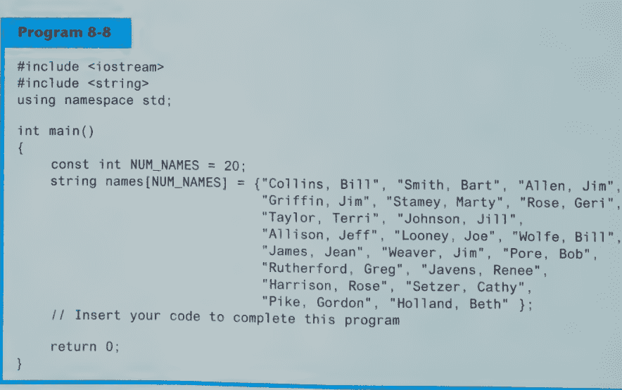

```cpp
#include <iostream>
#include <string>
using namespace std;

int main() {
    const int NUM_NAMES = 20;
    string names[NUM_NAMES] = {
        "Collins, Bill", "Smith, Bart", "Allen, Jim",
        "Griffin, Jim", "Stamey, Marty", "Rose, Geri",
        "Taylor, Terri", "Johnson, Jim",
        "Allison, Jeff", "Looney, Joe", "Wolfe, Bill",
        "James, Jean", "Weaver, Jim", "Pore, Bob",
        "Rutherford, Greg", "Javens, Renee",
        "Harrison, Rose", "Setzer, Cathy",
        "Pike, Gordon", "Holland, Beth"
    };
    // 在此处插入代码以完成此程序
    return 0;
}
```

7. 二分字符串搜索
修改本章介绍的 `binarySearch` 函数，使其搜索字符串数组而不是整数数组。使用驱动程序测试该函数。使用程序 8-8 作为框架来完成。（在二分查找之前必须对数组进行排序。）

8. 搜索性能基准
编写一个包含至少20个整数数组的程序。它应该调用一个使用线性搜索算法的函数来定位其中一个值。该函数应该记录找到该值之前的比较次数。然后程序调用一个使用二分查找算法的函数来定位相同的值。它也应该记录比较次数。在屏幕上显示这些值。

9. 排序性能基准
编写一个使用两个相同且包含至少20个整数数组的程序。它应该调用一个使用冒泡排序算法对其中一个数组进行升序排序的函数。该函数应该记录交换次数。然后程序调用一个使用选择排序算法对另一个数组排序。它也应该记录交换次数。在屏幕上显示这些值。

10. 排序顺序
编写一个使用两个仅包含8个整数的相同数组的程序。它应该显示第一个数组的内容，然后调用一个使用升序冒泡排序排序的函数，该排序被修改为在每轮排序后打印数组。接下来，程序显示第二个数组的内容，然后调用一个使用升序选择排序排序的函数，该排序被修改为在每轮排序后打印数组内容。

11. 使用文件——字符串选择排序修改
修改你为编程挑战6（字符串选择排序）编写的程序，使其从文件中读取20个字符串。数据可以在 `names.txt` 文件中找到。

12. 1994年油价排序列表
在本书的学生示例中，你会找到一个名为 `1994-Weekly_Gas_Averages.txt` 的文件。该文件包含每年每周的平均油价。（文件中有52行。第一行包含第一周的平均价；第二行包含第二周的平均价，以此类推。）编写一个程序从文件中读取油价，并计算每个月的平均油价。（获取特定月份平均价的方法是计算每月每周油价的平均值。）然后，程序应该创建另一个文件，列出月份名称以及每个月的平均油价，并从低到高排序。

# 第 9 章 指针

### 课题

9.1 获取变量的地址
9.2 指针变量
9.3 数组与指针之间的关系
9.4 指针运算
9.5 初始化指针
9.6 比较指针
9.7 作为参数的指针
9.8 动态内存分配
9.9 函数返回指针
9.10 使用指针避免内存泄漏
9.11 关注问题解决与设计：案例研究

## 9.1 获取变量的地址

+ 概念：变量的地址

每个变量都存储在内存的位置。每个位置都有唯一的地址。使用地址运算符 `&` 获取变量的地址。

```cpp
#include <iostream>
using namespace std;

int main()
{
    int x = 25;
    cout << "x的地址是 " << &x << endl;
    cout << "x的大小是 " << sizeof(x) << " 字节" << endl;
    cout << "x的值是 " << x << endl;
    return 0;
}
```

程序输出
x的地址是 0x7ffee15bc
x的大小是 4 字节
x的值是 25

## 9.2 指针变量

+ 概念：指针变量

通常称为指针的变量用于存储内存地址。通过指针变量，你可以间接地操作数据。就像 `int` 变量用于存储整数，`double` 变量用于存储浮点数一样，指针变量用于存储内存地址。

在数据类型和变量名之间使用星号 `*` 声明指针变量：

```cpp
int *ptr;
double *ptr;
char *ptr;
```

使用地址运算符 `&` 为指针初始化：

```cpp
int x = 25;
int *ptr = &x;
```

要访问指针所指向地址的值，使用解引用运算符 `*`：

```cpp
#include <iostream>
using namespace std;

int main()
{
    int x = 25;
    int *ptr = &x;
    cout << "x的地址是 " << &x << endl;
    cout << "ptr中存储的值是 " << ptr << endl;
    cout << "x的值是 " << *ptr << endl;
    return 0;
}
```

程序输出
x的地址是 0x7ffee15bc
ptr中存储的值是 0x7ffee15bc
x的值是 25

## 9.3 数组与指针之间的关系

+ 概念：数组与指针之间的关系

在 C++ 中，数组名是指向数组第一个元素的指针。这意味着数组和指针密切相关。

```cpp
int list1[5] = {10, 20, 30, 40, 50};
int *ptr = list1;
```

由于数组名是第一个元素的指针，你可以使用指针运算来访问数组元素：

```cpp
cout << *ptr;       // 输出10
cout << *(ptr + 1); // 输出20
```

以下程序演示了数组与指针的关系：

```cpp
#include <iostream>
using namespace std;

int main()
{
    int list1[5] = {10, 20, 30, 40, 50};
    int *ptr = list1;
    for (int i = 0; i < 5; i++)
    {
        cout << "元素 " << i << " 是 " << *(ptr + i) << endl;
    }
    return 0;
}
```


# 程序输出

元素 0 是 10
元素 1 是 20
元素 2 是 30
元素 3 是 40
元素 4 是 50

## 9.4 指针运算

### 概念：指针运算

指针运算是在指针上加或减整数的过程。当给指针加上一个整数时，指针会向前移动其指向类型大小的倍数。同样，从指针上减去一个整数会向后移动。

```cpp
int list[5] = {10, 20, 30, 40, 50};

int *ptr = list;

cout << *(ptr + 2); // 输出30

cout << *(ptr - 1); // 输出10
```

以下程序演示了指针运算：

```cpp
#include <iostream>

using namespace std;

int main()
{
    int list[5] = {10, 20, 30, 40, 50};

    int *ptr = list;

    cout << "第一个元素: " << *ptr << endl;
    cout << "第二个元素: " << *(ptr + 1) << endl;
    cout << "第三个元素: " << *(ptr + 2) << endl;
    cout << "第四个元素: " << *(ptr + 3) << endl;
    cout << "第五个元素: " << *(ptr + 4) << endl;

    return 0;
}
```

程序输出
第一个元素是 10
第二个元素是 20
第三个元素是 30
第四个元素是 40
第五个元素是 50

## 9.5 初始化指针

### 概念：初始化指针

初始化所有指针是一个良好的习惯。如果指针没有初始化地址，应将其初始化为 `nullptr`，这表示指针没有指向任何内存位置。

```cpp
int *ptr = nullptr;
```

## 9.6 比较指针

### 比较指针

可以使用关系运算符 (`==`, `!=`, `<`, `>`, `<=`, `>=`) 比较指针。如果两个指针指向同一个内存位置，则它们相等。

```cpp
int x = 10;
int y = 10;
int *ptr1 = &x;
int *ptr2 = &y;

if (ptr1 == ptr2)
{
    cout << "指针指向同一个位置" << endl;
}

if (ptr1 != ptr2)
{
    cout << "指针指向不同的位置" << endl;
}
```

# 图 9-2 将数组传递给函数

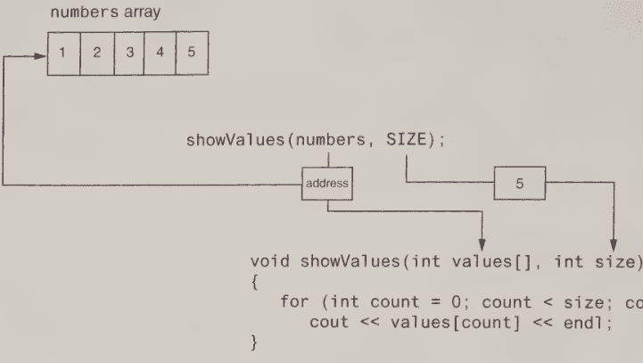

在 `showValues` 函数中，对 `values` 参数执行的任何操作实际上都是在 `numbers` 数组上进行的。我们可以说 `values` 参数引用了 `numbers` 数组。此外，回想第 6 章中我们讨论过的引用变量。引用变量是另一个变量的别名。它之所以被称为引用变量，是因为它引用了程序中的另一个变量。对引用变量执行的任何操作实际上都是对它引用的变量执行的。例如，假设我们有一个变量 `jellyDonuts`，我们将该变量传递给 `getOrder` 函数，如下所示：

```cpp
int jellyDonuts;
getOrder(jellyDonuts);
```

以下是 `getOrder` 函数的定义：

```cpp
void getOrder(int &donuts)
{
    cout << "How many doughnuts do you want?";
    cin >> donuts;
}
```

在函数中，`donuts` 参数是一个引用变量，它接收了 `jellyDonuts` 变量的地址。它的工作方式类似于指针，如图 9-3 所示，因为它“指向”了 `jellyDonuts` 变量。

在 `getOrder` 函数内部，参数引用了 `jellyDonuts` 变量。对 `donuts` 参数执行的任何操作实际上都是对 `jellyDonuts` 变量执行的。当用户输入一个值时，`cin` 语句使用 `donuts` 引用变量将该值间接存储在 `jellyDonuts` 变量中。

注意，`donuts` 引用变量与 `jellyDonuts` 参数之间的连接是在调用函数时由 C++ 自动建立的。编写这段代码时，你不需要费力寻找 `jellyDonuts` 变量的内存地址并存储在 `donuts` 引用变量中。

# 图 9-3 通过引用传递参数

jellyDonuts 变量

```
getOrder(jellyDonuts);
address
```

```cpp
void getOrder(int &donuts)
{
    cout << "How many doughnuts do you want ?";
    cin >> donuts;
}
```

当你向 `jellyDonuts` 变量存储一个值时，你不需要指定该值实际上应该存储在 `jellyDonuts` 变量中。C++ 会自动处理这一切。

在 C++ 中，指针变量是使用内存地址来处理数据的另一种机制。指针变量与引用变量相似，但指针变量的操作在更低层级。我的意思是，C++ 对指针变量替你完成的工作并不像对引用变量那样自动为你完成很多工作。为了让指针变量引用内存中的另一个项，你必须编写代码来获取该项的内存地址，并将地址赋值给指针变量。此外，当你使用指针变量在指针所引用的内存位置存储一个值时，你的代码必须指定该值应该存储在指针变量所引用的位置，而不是指针变量本身。

由于引用变量更容易使用，你可能会奇怪为什么还要使用指针。在 C++ 中，指针对于许多操作来说是有用的，甚至是必须的。其中一种操作是动态内存分配。当你编写一个需要处理未知量数据的程序时，动态内存分配允许你在程序运行时在内存中创建变量、数组和更复杂的数据结构。我们将在本章更详细地讨论动态内存分配。指针在操作数组和处理特定类型字符串的算法中也非常有用。在面向对象编程中（你将在第 13、14 和 15 章中学习），指针对于创建和操作对象，以及共享对这些对象的访问非常有帮助。

# 创建和使用指针变量

指针变量的定义看起来与任何其他定义非常相似。这是一个示例：

```cpp
int *ptr;
```

# 第 9 章 指针

星号前面的定义看起来与任何其他定义非常相似。这是一个示例：

```cpp
int *ptr;
```

# 程序 9-3（继续）

```
20 // 同时使用 x 和 ptr 来显示 x 中的值。
21 cout << "Once again, here is the value in x:\n"
22 cout << x << endl; // 显示 x 的内容
23 cout << *ptr << endl; // 显示 x 的内容
```

# 程序输出

这里是 x 的值，打印了两次：
25
25
Once again, here is the value in x:
100
100

仔细观察第 10 行的语句：`*ptr = &x;`
该语句将变量 x 的地址赋值给变量 ptr。现在现在看第 15 行：
`cout << *ptr << endl; // 显示 x 的内容`
当你对指针变量指定间接操作符 (`*`) 时，你操作的不是指针变量，而是它所指向的项。由于该语句将 `*ptr` 发送给 `cout` 对象，它显示的不是 `ptr` 中的值，而是 `ptr` 指向的值。由于 `ptr` 指向 `x` 变量，因此该语句显示了 `x` 变量的内容。

假设该语句没有使用间接操作符。假设该语句是：
`cout << ptr << endl; // 显示一个地址`
因为在该语句中没有对 `ptr` 应用间接操作符，它直接与 `ptr` 变量操作。该语句将显示存储在 `ptr` 中的地址。

现在看下面出现在第 19 行的语句：
`*ptr = 100;`
注意对 `ptr` 使用了间接操作符。这意味着该操作没有影响 `ptr`，而是影响了 `ptr` 指向的项。该语句将 100 赋值给 `ptr` 指向的项，即 `x` 变量。在执行该语句后，100 将存储在 `x` 变量中。程序演示了指针可以指向不同的变量。

# 程序 9-4

```
1 // 此程序演示了指针变量引用
2 // 不同变量。
3 #include <iostream>
4 using namespace std;
```

## 9.2 指针变量

```cpp
int main() {
    int x = 25, y = 50, z = 75; // 三个 int 变量
    int *ptr = nullptr; // 指针变量

    // 显示 x, y 和 z 的内容。
    cout << "Here are the values of x, y, and z:\n";
    cout << x << " " << y << " " << z << endl;

    // 使用指针操作 x, y 和 z。
    ptr = &x; // 将 x 的地址存储在 ptr 中。
    *ptr += 100; // 将 x 中的值加 100。
    ptr = &y; // 将 y 的地址存储在 ptr 中。
    *ptr += 100; // 将 y 中的值加 100。
    ptr = &z; // 将 z 的地址存储在 ptr 中。
    *ptr += 100; // 将 z 中的值加 100。

    // 显示 x, y 和 z 的内容。
    cout << "Once again, here are the values of x, y, and z:\n";
    cout << x << " " << y << " " << z << endl;

    return 0;
}
```

# 程序输出

这里是 x, y 和 z 的值：
25 50 75
Once again, here are the values of x, y, and z:
125 150 175

看看第 17 行的语句：

```
ptr = &x;
```

该语句将 x 变量的地址赋值给 ptr 变量。现在看第 18 行：
`*ptr += 100;`
在该语句中，注意对 ptr 变量使用了间接操作符 (`*`)。当我们对 ptr 应用间接操作符时，我们操作的不是 ptr，而是它所指向的项。当该语句执行时，ptr 指向 x，因此第 18 行的语句向 x 的内容加了 100。然后执行第 20 行的语句：

```
ptr = &y;
```

该语句将 y 变量的地址赋值给 ptr 变量。在该语句执行后，ptr 不再指向 x。它将指向 y。这里显示的第 21 行的语句向 y 变量加了 100：
`*ptr += 100;`
这些步骤在第 23 和 24 行对 z 变量重复。
注意：到此为止，你看到了 C++ 中星号的三种不同用法：
- 作为乘法运算符，如语句：
  `distance = speed * time;`
- 在指针变量的定义中，如：
  `int *ptr = nullptr;`
- 作为指示运算符，如语句：
  `*ptr = 100;`

## 9.3 数组与指针的关系

### 概念：数组名可以作为常量指针使用，指针可以作为数组名使用。

你在第 7 章了解到，不带括号和下标的数组名实际上代表数组的起始地址。这意味着数组名实际上是一个指针。程序 9-5 通过显示使用间接操作符数组名说明了这一点。

# 程序 9-5

```
1 // 此程序显示了使用 * 运算符
2 // 对数组名进行引用。
3 #include <iostream>
4 using namespace std;
5
6 int main() {
7
8 short numbers[] = {10, 20, 30, 40, 50};
9
10 cout << "The first element of the array is ";
11 cout << numbers << endl;
12 return 0;
13 }
```

# 程序输出

The first element of the array is 10

因为 `numbers` 像指向数组起始地址的指针，所以当 `numbers` 被引用时，获取的是第一个元素。那么，如何使用间接操作符获取数组的全部内容呢？记住，如图 9-5 所示，数组元素连续存储在内存中。

# 图 9-5 连续存储的数组元素

| numbers[0] | numbers[1] | numbers[2] | numbers[3] | numbers[4] |
| :--- | :--- | :--- | :--- | :--- |
| ↑ | ↑ | ↑ | ↑ | ↑ |

## 9.3 数组与指针的关系

# 图 9-6 下标法与指针表示法

| numbers[0] | numbers[1] | numbers[2] | numbers[3] | numbers[4] |
| :--- | :--- | :--- | :--- | :--- |
| ↑ | ↑ | ↑ | ↑ | ↑ |

在处理数组时，请记住以下规则：
`array[index]` 等于 `*(array + index)`

> **警告！** 记住 C++ 对数组不进行边界检查。当使用指针遍历数组时，可能会给指针一个数组之外的地址。

为了演示数组名和指针之间的工作原理，请看程序 9-7。它定义了一个 `double` 数组和一个 `double` 指针，后者被赋值为数组的起始地址。此时不仅对数组名使用了指针表示法，对指针也使用了下标法！

# 程序 9-7

```
1 // 此程序对指针变量使用了下标法，
2 // 并对数组名使用了指针表示法。
3 #include <iostream>
4 using namespace std;
5
6 int main()
```

## 9.3 数组与指针的关系

```cpp
const int NUM_COINS = 5;

double coins[NUM_COINS] = {0.05, 0.1, 0.25, 0.5, 1.0};
double *doublePtr; // 指向 double 的指针
int count;

// 数组索引
// 将 coins 数组的地址赋值给 doublePtr;
doublePtr = coins;

// 显示 coins 数组的内容。对指针
// 使用下标法！
cout << "Here are the values in the coins array:\n";

for (count = 0; count < NUM_COINS; count++)
    cout << doublePtr[count] << " ";

// 再次显示数组的内容，这次
// 使用数组名配合指针表示法！
cout << "\nAnd here they are again:\n";

for (count = 0; count < NUM_COINS; count++)
    cout << *(coins + count) << " ";

return 0;
```

# 程序输出

> **注意：** 当将数组的地址赋值给指针时，不需要地址运算符。因为数组名本身就已经是一个地址，使用 `&` 运算符是错误的。不过，可以使用地址运算符来获取数组中单个元素的地址。例如，`&numbers[1]` 获取 `numbers[1]` 的地址。这种技术在程序 9-8 中使用。

# 程序 9-8

```cpp
// 此程序使用数组中每个元素的地址。
#include <iostream>
using namespace std;

int main() {
    const int NUM_COINS = 5;
    double coins[NUM_COINS] = {0.05, 0.1, 0.25, 0.5, 1.0};
    double *doublePtr = nullptr; // 数组索引
    int count;

    // 使用指针显示数组中的值。
    cout << "Here are the values in the coins array:\n";

    for (count = 0; count < NUM_COINS; count++) {
        // 获取数组元素的地址。
        doublePtr = &coins[count];
        // 显示元素的内容。
        cout << doublePtr << " ";
    }

    cout << endl;
    return 0;
}
```

# 程序输出

数组名与指针变量之间的唯一区别是，你不能改变数组名所指向的地址。例如，考虑以下定义：

`double readings[20], totals[20];`
`double *dptr = nullptr;`

这些语句是合法的：

`dptr = readings; // 让 dptr 指向 readings。`
`dptr = totals;   // 让 dptr 指向 totals。`

但这些是非法的：

`readings = totals; // 非法！不能改变 readings。`
`totals = dptr;      // 非法！不能改变 totals。`

数组名是指针常量。你不能让它们指向其代表的数组以外的任何地方。

# 指针算术

### 概念：对指针可以执行某些数学运算。

可以通过执行加或减法的数学语句来改变指针变量的内容。这在程序 9-9 中得到了演示。第一个循环增加指针变量，遍历数组的每个元素。第二个循环递减指针，使其反向遍历数组。

## 9.4 指针算术

# 程序 9-9

```cpp
// 此程序使用指针显示数组的内容。
#include <iostream>
```


using namespace std;

int main() {

    const int SIZE = 8;

    int set[SIZE] = {5, 10, 15, 20, 25, 30, 35, 40};

    int *numPtr = nullptr; // 循环计数器变量

    int count; // 让 numPtr 指向 set 数组。

    numPtr = set;

    // 使用指针显示数组内容。

    cout << "The numbers in set are:\n";

    for (count = 0; count < SIZE; count++) {

        cout << *numPtr << " ";

        numPtr++;

    }

    // 反向显示数组内容。

    cout << "The numbers in set backward are:\n";

    for (count = 0; count < SIZE; count++) {

        numPtr--;

        cout << *numPtr << " ";

    }

    return 0;

}

```

# 程序输出

> 注意：由于 `numPtr` 是指向整数的指针，它指向数组中的下一个元素。同样，递减运算符从指针上减去一个整数的大小。

并不是所有的算术运算都可以在指针上执行。例如，你不能对指针进行乘或除。以下操作是允许的：

- 使用 `++` 和 `--` 运算符增加或递减指针。
- 指针可以加或减一个整数。这可以通过 `+=` 和 `-=` 运算符完成。
- 一个指针可以与另一个指针相减。

## 9.5 初始化指针

**概念：** 指针可以初始化为指向现有对象的地址。记住，指针被设计用于指向特定类型的对象。

```cpp
while (ptr < numbers[SIZE - 1])
{
    // 将 ptr 指向下一个元素。
    ptr++;
    // 显示 ptr 指向的值。
    cout << "ptr" << " ";
}

// 逆序显示数字。
cout << "\nnumbers backward are:\n";
cout << "ptr" << " "; // 显示第一个元素
while (ptr > numbers)
{
    // 向后移动到上一个元素。
    ptr--;
    // 显示 ptr 指向的值。
    cout << "ptr" << " ";
}
return 0;
```

程序输出
数字为：
10 15 20 25 30 40
数字逆序显示为：
40 35 30 20 15 10

## 作为函数参数的指针

概念：指针可以被用作函数参数。它让函数能够访问原始参数，就像引用参数一样。

在第 6 章中，你学习了将引用变量用作函数参数的概念。引用是原始变量的别名，允许它更改变量的内容。当变量被传递给引用参数时，该参数被称为“按引用传递”（by reference）。

按引用传递参数的另一种方法是使用指针。诚然，引用变量比指针容易处理得多。引用变量隐藏了所有解引用的机制。你仍然应该学习使用指针，因为某些任务（特别是处理字符串时）用指针来完成效果最好。此外，C++ 库有许多函数使用指针作为参数。学习这种技术也是非常重要的，以防你以后需要编写程序，而此时按引用传递变量的唯一方法就是使用指针。

以下是一个使用指针参数的函数定义：

```cpp
void doubleValue(int *val)
{
    val *= 2;
}
```

该函数的目的是通过以下语句将 `val` 指向的变量翻倍：

```cpp
*val *= 2;
```

当 `val` 被解引用时，`*=` 运算符作用于 `val` 指向的变量。该语句将地址存储在 `val` 中的原始变量乘以 2。当然，在调用函数时，必须使用要翻倍变量的地址作为参数，而不是变量本身。以下是调用 `doubleValue` 函数的示例：

```cpp
doubleValue(&number);
```

该语句使用地址运算符 (`&`) 将 `number` 的地址传递给参数 `val`。在函数执行后，`number` 的内容乘以 2。该函数的用法在程序 9-11 中给出。

## 程序 9-11

```cpp
// 此程序使用了两个接受变量地址作为参数的函数。
#include <iostream>
using namespace std;

// 函数原型
void getNumber(int *);
void doubleValue(int *);

int main()
{
    int number;
    // 调用 getNumber 并传递 number 的地址。
    getNumber(&number);
    // 调用 doubleValue 并传递 number 的地址。
    doubleValue(&number);
    // 显示 number 中的值。
    cout << "That value doubled is " << number << endl;
    return 0;
}
```

## 9.7 作为函数参数的指针

```cpp
************************************************
// getNumber 的定义。参数 input 是一个指针。
// 此函数要求用户输入一个数字。输入的值
// 存储在 input 指向的变量中。
************************************************
void getNumber(int *input)
{
    cout << "Enter an integer number: ";
    cin >> *input;
}
************************************************
// doubleValue 的定义。参数 val 是一个指针。
// 此函数将 val 指向的变量乘以 2。
************************************************
void doubleValue(int *val)
{
    *val *= 2;
}
```

带有加粗示例输入的程序输出：
Enter an integer number: 10 [Enter]
That value doubled is 20

程序 9-11 包含两个使用指针作为参数的函数。注意这些函数原型：
void getNumber(int *);
void doubleValue(int *);

每个原型都使用符号 `*` 来表示该参数是指向 `int` 的指针。与所有其他类型的参数一样，在原型中没有必要指定变量名。不过，`*` 是必须的。

`getNumber` 函数要求用户输入一个整数值。第 34 行的以下 `cin` 语句将用户输入的值存储在内存中：
cin >> *input;

间接引用运算符（indirection operator）使得用户输入的值存储在 `input` 指向的变量中，而不是 `input` 本身。

> 警告！在上述语句中使用间接引用运算符至关重要。如果没有它，`cin` 将像处理地址一样将用户输入的值存储在 input 中。如果发生，`input` 将不再指向函数 `main` 中的 `number` 变量。后续使用该指针将导致错误甚至是灾难性的结果。

当第 15 行调用 `getNumber` 函数时，函数 `main` 中 `number` 变量的地址作为参数传递。在函数执行后，用户输入的值存储在 `number` 中。接下来，在第 18 行调用 `doubleValue` 函数，并将 `number` 的地址作为参数。这会导致 `number` 乘以 2。

指针变量也可以用于接受数组地址作为参数。可以使用下标符号或指针符号来处理数组的内容。这在程序 9-12 中得到了演示。

## 程序 9-12

```cpp
// 此程序演示了可以使用指针符号
// 来接受数组的地址。
#include <iostream>
#include <iomanip>
using namespace std;

// 函数原型
void getSales(double *, int);
double totalSales(double *, int);

int main()
{
    const int QTRS = 4;
    double sales[QTRS];
    // 获取所有季度的销售额。
    getSales(sales, QTRS);
    // 设置数值输出。
    cout << fixed << setprecision(2);
    // 显示全年的总销售额。
    cout << "The total sales for the year are $" << totalSales(sales, QTRS) << endl;
    return 0;
}
************************************************
// getSales 的定义。此函数使用指针
// 接受数组的地址。函数要求用户
// 输入销售数据并将其存储在数组中。
************************************************
void getSales(double *arr, int size)
{
    for (int count = 0; count < size; count++) {
        cout << "Enter the sales figure for quarter " << (count + 1) << ": ";
        cin >> arr[count];
    }
}
************************************************
// totalSales 的定义。这使用指针
// 接受数组的地址。函数返回数组
// 元素的总和。
************************************************
double totalSales(double *arr, int size)
{
    double sum = 0.0;
    for (int count = 0; count < size; count++) {
        sum += *arr;
        arr++;
    }
    return sum;
}
```

带有加粗示例输入的程序输出：
Enter the sales figure for quarter 1: 10263.98
Enter the sales figure for quarter 2: 12369.69
Enter the sales figure for quarter 3: 11542.13
Enter the sales figure for quarter 4: 14792.06
The total sales for the year are $48967.86

## 常量指针

你已经看到可以将项的地址传递到指针参数，以及如何使用指针修改作为参数传递的项。有时，需要将常量项的地址传递给指针。在这种情况下，指针必须定义为指向常量项的指针。例如，考虑以下数组定义：

```cpp
const int SIZE = 6;
const double payRates[SIZE] = { 18.55, 17.45, 12.85, 14.97, 10.35, 18.89 };
```

在这段代码中，`payRates` 是一个 `const double` 数组。这意味着数组中的每个元素都是一个 `const double`，编译器将不允许我们编写更改数组内容的代码。如果我们想将 `payRates` 数组传递给指针参数，该参数必须被声明为指向 `const double` 的指针。下面的函数展示了这样一个示例：

```cpp
void displayPayRates(const double *rates, int size)
{
    // 设置数值输出格式。
    cout << setprecision(2) << fixed << showpoint;
    // 显示所有费率。
    for (int count = 0; count < size; count++)
    {
        cout << "Pay rate for employee " << (count + 1)
             << " is $" << *(rates + count) << endl;
    }
}
```

在函数头中，注意 `rates` 参数被定义为指向 `const double` 的指针。需要注意的是，`const` 关键字作用于 `rates` 所向的内容，而不是 `rates` 本身。这在图 9-8 中所示。

# 图 9-8 rates 是指向 const double 的指针

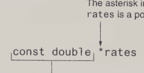

这就是 `rates` 指向的内容。

由于 `rates` 是指向常量的指针，编译器将不允许我们编写更改 `rates` 指向的内容的代码。

在将常量的地址传递给指针变量时，该变量必须定义为指向常量的指针。如果在 `rates` 参数的定义中漏掉了 `const` 单词，将导致编译器错误。

# 将非常量传递传递指向 const 的指针

虽然常量的地址只能传递给指向 const 的指针，但指向 const 的指针也可以接收非常量项的地址。例如，查看程序 9-13。

# 程序 9-13

# 程序输出

| 1 2 3 4 5 6 |
| 4 6 8 10 12 |

> 注意：当你在编写一个使用指针参数的函数，且该函数并不打算更改参数所指向的数据时，将指针设置为 `const` 是一个好主意。这不仅可以防止你在函数中编写意外更改参数的代码，而且该函数能够接受常量和非常量参数的地址。


# 常量指针

在上一节中，我们讨论了指向 const 的指针，即指向常量数据的指针。你也可以使用 `const` 关键字来定义常量指针。以下是指向 const 的指针和常量指针之间的区别：

- 指向 const 的指针指向一个常量项。指针指向的数据不能更改，但指针本身可以更改。
- 对于常量指针，指针本身是常量的。一旦指针用一个地址进行了初始化，它就不能再指向其他其他地方。

下面的代码展示了一个常量指针的示例：

```cpp
int value = 22;
const int *ptr = &value;
```

注意在 `ptr` 的定义中，`const` 单词出现在星号后面。这意味着 `ptr` 是一个常量指针。这在图 9-9 中所示。在代码中，`ptr` 使用 `value` 变量的地址初始化。由于 `ptr` 是常量指针，如果我们编写让 `ptr` 指向其他地方，将发生编译器错误。如果我们使用 `ptr` 来更改 `value` 的内容，则不会产生错误。因为 `value` 不是常量，且 `ptr` 也指向 const 的指针。

图 9-9 ptr 是指向 int 的常量指针

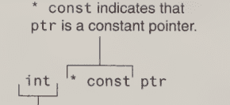

这就是 `ptr` 指向的内容。

常量指针必须用初始值进行初始化，如上一个示例代码所示。如果常量指针用作函数参数，该参数将用作为参数传入的地址进行初始化，并在函数执行期间不能更改为其他任何。这里有一个尝试违反这一规则的示例：

```cpp
void setToZero(int * const ptr) {
    ptr = 0; //  own！！ 不能更改 ptr 的内容。
}
```

该函数的参数 `ptr` 是常量指针。它将无法编译，因为我们不能拥有更改 `ptr` 内容的代码。然而，`ptr` 指向 const，所以我们可以拥有更改 `ptr` 指向的数据。这里有一个可以编译的函数示例：

```cpp
void setToZero(int * const ptr) {
    *ptr = 0;
}
```

## 9.7 指针作为函数参数

虽然参数是 `const` 指针，但可以使用不同的参数多次调用该函数。下面的代码将成功地将 `x`、`y` 和 `z` 的地址传递给 `setZero` 函数：

```cpp
int x, y, z;
// 将 x, y 和 z 设置为 0。
setZero(&x);
setZero(&y);
setZero(&z);
```

## 常量指针

到为止，在使用指针时我们看到了指向 const 的指针。你也可以拥有常量指针。例如，查看以下代码：

```cpp
int value = 22;
const int *ptr = &value;
```

在 `ptr` 的定义中，`const` 单词出现在星号后面。这意味着 `ptr` 是一个常量指针。这在图 9-10 中所示。

# 图 9-10 ptr 是指向 int 的常量指针

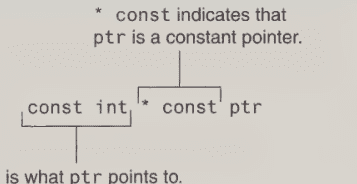

这就是 `ptr` 指向的内容。

常量指针必须用初始值进行初始化，如之前的示例代码所示。如果常量指针用作函数参数，该参数将用作为参数传入的地址进行初始化，并在函数执行期间不能更改为其他任何。这里有一个尝试违反这一规则的示例：

```cpp
void setToZero(int * const ptr) {
    ptr = 0; // 错误！！ 不能更改 ptr的内容。
}
```


该函数的参数 `ptr` 是常量指针。它将无法编译，因为我们不能拥有更改 `ptr` 内容的代码。然而，`ptr` 没有指向 const，所以我们可以拥有更改 `ptr` 指向的数据。这里有一个可以编译的函数示例：

```cpp
void setToZero(int * const ptr) {
    *ptr = 0;
}
```

## 9.8 动态分配

> 概念：变量可以在程序运行时创建和销毁。

只要你知道需要多少个变量，就可以提前定义它们。例如，一个计算面积的程序需要三个变量：长度、宽度和面积。

但当你不知道需要多少个时怎么办？例如，假设你想写一个可以平均任意数量测试的程序。显然程序将非常灵活，但如何存储各个分数呢？很简单，允许程序“现场创建”。动态分配内存意味着程序在运行时请求计算机留出足够存放变量的空闲内存。假设程序需要创建一个整数变量。它请求计算机分配存储一个 int 的字节。当计算机填充此请求时，它找到并留出一块空闲内存。它给程序该块内存的起始地址。程序只能通过地址访问新分配的内存，因此需要指针来使用这些字节。

C++ 程序通过 `new` 运算符请求动态分配内存。假设程序有一个指向 int 的指针：

```cpp
int *iptr = nullptr;
```

这里是该指针与 `new` 运算符使用的示例：

```cpp
iptr = new int;
```

该语句是请求计算机分配一个新的 int 的内存。`new` 运算符的操作数是正在创建变量的数据类型。一旦语句执行，`iptr` 将包含新分配内存的地址。这在图 9-11 中所示。可以通过解引用指针在新变量中存储一个值：

```cpp
*iptr = 25;
```

可以通过简单的解引用指针对新变量执行任何其他操作。这里是一些例子：

```cpp
cout << *iptr;      // 显示新变量的内容。
cin >> *iptr;      // 让用户输入一个值。
total += *iptr;      // 在计算中使用新变量。
```

### 图 9-11 iptr 指向一块动态分配的内存块

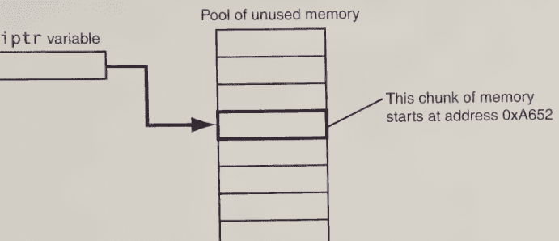

虽然上面的语句说明了 `new` 算符的使用，但动态分配单个变量并没有什么实际意义。`new` 算符更实用的用法是动态创建一个数组。下面是如何分配一个包含 100 个元素的整数数组的示例：

```cpp
iptr = new int[100];
```

一旦创建了数组，就可以使用下标符号通过指针访问它。例如，可以使用以下循环在每个元素中存储值 1：

```cpp
for (int count = 0; count < 100; count++)
    iptr[count] = 1;
```

但如果没有足够的内存来满足请求怎么办？如果程序请求的内存块大到导致分配失败怎么办？当无法动态分配内存时，C++ 会抛出一个异常并终止程序。抛出异常意味着程序信号了发生了错误。你将在第 16 章中学习更多关于异常的知识。

当程序结束使用动态分配的内存块时，应该将其释放以供以后使用。`delete` 算符用于释放通过 `new` 分配的内存。这里有一个使用 `delete` 释放由 `iptr` 指向的单个变量的示例：

```cpp
delete iptr;
```

如果 `iptr` 指向一个动态分配的数组，必须将 `[]` 符号放在 `delete` 和 `iptr` 之间：

```cpp
delete [] iptr;
```

未释放动态分配的内存会导致程序发生内存泄漏。例如，假设程序中有以下 `grabMemory` 函数：

```cpp
void grabMemory() {
    const int SIZE = 100;
    // 为包含 100 个元素的
    // 整数数组分配空间。
    int *iptr = new int[SIZE];
    // 函数结束时没有删除内存！
}
```

注意，该函数动态分配了一个包含 100 个元素的数组，并将其地址赋值给 `iptr` 指针。但随后，函数在没有删除内存的情况下结束了。一旦函数结束，`iptr` 指针就不再存在。结果是程序没有指向动态分配内存的指针；因此，该内存无法被访问或删除。只要程序运行，它将一直处于闲置状态。

> 警告！只有之前使用过 `new` 分配的指针才能配合 `delete` 使用。如果你对一个没有引用动态分配内存的指针使用 `delete`，可能会导致意外的问题！

程序 9-14 展示了 `new` 和 `delete` 的用法。它请求任意天数的销售额。这些金额存储在动态分配的数组中，然后计算总和和平均值。

### 程序 9-14

```cpp
1 // 此程序计算任意天数销售额的总和
2 // 和平均值。金额存储在动态
3 // 分配的数组中。
4 #include <iostream>
5 #include <iomanip>
6 using namespace std;
7 
8 int main() {
9    double *sales = nullptr, // 用于动态分配数组
10    double total = 0.0;      // 累加器
11    double average;               // 用于存储平均销售额
12    int numDays;           // 用于存储销售天数
13    int count;                 // 计数变量
14 
15    // 获取销售天数。
16    cout << "How many days of sales do you wish ";
17    cout << "to process? ";
18    cin >> numDays;
```

#### 程序输出示例

```
How many days of sales amounts do you wish to process? 5 Enter
Enter the sales amounts below.
Day 1: 898.63 Enter
Day 2: 652.32 Enter
Day 3: 741.85 Enter
Day 4: 852.96 Enter
Day 5: 921.37 Enter
Total Sales: $4067.13
Average Sales: $813.43
```

第 23 行的语句为 `double` 数组动态分配内存，使用 `numDays` 的值作为元素个数。`new` 算符返回内存块的起始地址，该地址赋值给 `sales` 指针。随后，`sales` 变量在整个程序中存储数组中的销售金额并进行必要的计算。第 48 行使用 `delete` 算符释放已分配的内存。注意第 49 行中，值 `nullptr` 被赋值给 `sales` 指针。在对指针使用 `delete` 后将指针设置为 `nullptr` 是一个良好的习惯。首先，它可以防止代码无意中使用该指针访问已释放的内存区域。其次，它可以防止在不小心再次对指针调用 `delete` 时发生错误。`delete` 算符的设计是在用于空指针上时不会产生任何影响。

## 9.9 从函数返回指针

概念：函数可以返回指针，但你必须确保指针仍然存在。与任何其他数据类型一样，函数可以返回指针。例如，以下函数定位字符串末尾的空终止符（如字符串字面量）并返回指向它的指针：

```cpp
char *findNull(char *str) {
    char *ptr = str;
    while (*ptr != '\0')
        ptr++;
    return ptr;
}
```

函数头中的返回类型表示函数返回一个指向 `char` 的指针。在编写返回指针的函数时，你应该注意不要产生难以捉摸的 bug。例如，你可以判断以下函数的错误所在：

```cpp
string *getFullName() {
    string fullName[3];
    cout << "Enter your first name: ";
    getline(cin, fullName[0]);
    cout << "Enter your middle name: ";
    getline(cin, fullName[1]);
    cout << "Enter your last name: ";
    getline(cin, fullName[2]);
    return fullName;
}
```

当然，问题在于该函数返回了一个指向不再存在的数组的指针。`fullName` 数组是局部定义的，并在函数终止时被销毁。尝试使用该指针将导致错误且不可预测的结果。只有在满足以下条件时，你应该从函数返回指针：

- 指向作为参数传递给函数的项指针。
- 指向动态分配内存块的指针。

例如，以下函数是可以接受的：

```cpp
string *getFullName(string fullName[]) {
    cout << "Enter your first name: ";
    getline(cin, fullName[0]);
    cout << "Enter your middle name: ";
    getline(cin, fullName[1]);
    cout << "Enter your last name: ";
    getline(cin, fullName[2]);
    return fullName;
}
```

该函数接受一个指向存储用户输入的内存位置的指针。该指针在调用之前是有效的，因此返回它是安全的。这里是另一个可以接受的函数：

```cpp
string *getFullName() {
    string *fullName = new string[3];
    cout << "Enter your first name: ";
    getline(cin, fullName[0]);
    cout << "Enter your middle name: ";
    getline(cin, fullName[1]);
    cout << "Enter your last name: ";
    getline(cin, fullName[2]);
    return fullName;
}
```

该函数使用 `new` 算符分配内存。该内存在使用 `delete` 或程序结束前保持分配，因此返回它是安全的。程序 9-15 展示了另一个示例。该程序使用 `getRandomNumbers` 获取指向随机数组的指针。该函数接收一个整数参数作为请求的随机数个数。函数动态分配数组，使用系统时初始化随机数生成器，填充数组，然后返回指向数组的指针。

### 程序 9-15

```cpp
1 // 此程序演示了一个返回
2 // 指针的函数。
3 #include <iostream>
4 #include <cstdlib> // 用于 rand 和 srand
5 #include <ctime>    // 用于 time 函数
6 using namespace std;
7 
8 // 函数原型
9 int *getRandomNumbers(int);
10
11 int main() {
12     int *numbers = nullptr; // 指向数字
13
14     // 获取五个随机数数组。
15     numbers = getRandomNumbers(5);
16 
17     // 显示这些数字。
18     for (int count = 0; count < 5; count++)
19         cout << numbers[count] << endl;
20 
21     // 释放内存。
22     delete [] numbers;
23     numbers = nullptr;
24     return 0;
25 }
26 
27 // *************************************************
28 // getRandomNumbers 函数返回指向 *
29 // 整数数组的指针。参数 *
30 // 表示请求的随机数个数。
31 // *************************************************
32 
33 int *getRandomNumbers(int num) {
34     int *arr = nullptr; // 用于存储数字的数组
35
36     // 如果 num 为零或负，则返回空指针。
37     if (num <= 0)
38         return nullptr;
39 
40     // 动态分配数组。
41     arr = new int[num];
42 
43     // 通过将 time(0) 的返回值传递给 srand
44     // 初始化随机数生成器。
45     srand(time(0));
46 
47     // 用随机数填充数组。
48     for (int count = 0; count < num; count++)
49         arr[count] = rand();
50 
51     // 返回指向数组的指针。
52     return arr;
53 }
```

### 焦点聚焦

假设你正在开发一个处理整数数组的程序，并且发现自己经常需要复制数组。与其在每次需要时都重写复制数组的代码，你不如决定写一个函数，该函数接受一个数组及其大小作为参数，创建一个与参数数组相同的新数组，并返回指向该新数组的指针。该函数的工作原理如下：

- 接收一个数组及其大小作为参数。
- 动态分配一个与参数数组大小相同的新数组。
- 将参数数组的元素复制到新数组中。
- 返回指向新数组的指针。

程序 9-16 展示了该函数，其名称为 `duplicateArray`。

### 程序 9-16

```cpp
1 // 此程序使用函数来复制
2 // 任意大小的 int 数组。
3 #include <iostream>
4 using namespace std;
5
6 // 函数原型
7 int *duplicateArray(const int *, int);
8 void displayArray(const int int[], int);
9
10 int main() {
11 // 定义数组大小的常量。
12 const int SIZE1 = 5, SIZE2 = 7, SIZE3 = 10;
13
14 // 定义三个不同大小的数组。
15 int array1[SIZE1] = { 100, 200, 300, 400, 500 };
16 int array2[SIZE2] = { 10, 20, 30, 40, 50, 60, 70 };
17 int array3[SIZE3] = { 1, 2, 3, 4, 5, 6, 7, 8, 9, 10 };
18
19 // 为复制的数组定义三个指针。
20 int *dup1 = nullptr, *dup2 = nullptr, *dup3 = nullptr;
21
22 // 复制数组。
23 dup1 = duplicateArray(array1, SIZE1);
24 dup2 = duplicateArray(array2, SIZE2);
25 dup3 = duplicateArray(array3, SIZE3);
26
27 // 显示原始数组。
28 cout << "Here are the original array contents:"\n;
29 displayArray(array1, SIZE1);
30 displayArray(array2, SIZE2);
31 displayArray(array3, SIZE3);
32
33 // 显示新数组。
34    cout << "\nHere are the duplicate arrays: \n";
35    displayArray(dup1, SIZE1);
36    displayArray(dup2, SIZE2);
37    displayArray(dup3, SIZE3);
38
39    // 释放动态分配的内存并将
40    // 指针设置为 0。
41    delete [] dup1;
42    delete [] dup2;
43    delete [] dup3;
44    dup1 = nullptr;
45    dup2 = nullptr;
46    dup3 = nullptr;
47    return 0;
48}
49 /**********************************
50 // duplicateArray 函数接收一个 int 数组
51 // 和一个指示数组大小的 int。该
52 // 函数创建一个与参数数组相同的
53 // 复制数组，并返回指向新
54 // 数组的指针。如果传递了无效的大小，
55 // 函数将返回空指针。
56 /*********************************
57
58     int *duplicateArray(const int *arr, int size) {
59         int *newArray = nullptr;
60
61         // 验证大小。如果传递了 0 或负
62         // 数，则返回空指针。
63         if (size <= 0)
```


# 程序输出

Here are the original array contents:
100 200 300 400 500
10 20 30 40 50 60 70
1 2 3 4 5 6 7 8 9 10

Here are the duplicate arrays:
100 200 300 400 500
10 20 30 40 50 60 70
1 2 3 4 5 6 7 8 9 10

Here are the original array contents:
100 200 300 400 500
10 20 30 40 50 60 70
1 2 3 4 5 6 7 8 9 10

Here are the duplicate arrays:
100 200 300 400 500
10 20 30 40 50 60 70
1 2 3 4 5 6 7 8 9 10

`duplicateArray` 函数接受一个 `int` 数组和一个表示数组大小的 `int` 作为参数。该函数创建一个作为参数数组副本的新数组，并返回指向新数组的指针。如果传递了无效的大小，函数将返回空指针。`displayArray` 函数接受一个 `int` 数组及其大小作为参数并显示数组的内容。

## Checkpoint

- **9.9**：假设你正在开发一个处理整数数组的程序，并且你发现经常需要复制数组。与其每次需要时都重写数组复制代码，不如编写一个函数，该函数接受一个数组及其大小作为参数，创建一个作为参数数组副本的新数组，并返回指向新数组的指针。该函数的工作方式如下：
    - 接受一个数组及其大小作为参数。
    - 动态分配一个与参数数组大小相同的新数组。
    - 将参数数组的元素复制到新数组中。
    - 返回指向新数组的指针。
    程序 9-16 演示了该函数，名为 `duplicateArray`。
- **9.10**：`displayArray` 函数接受一个 `int` 数组及其大小作为参数并显示数组的内容。
- **9.11**：完成以下框架：
- **9.12**：查看以下定义：
- **9.13**：假设 `ip` 是一个指向 `int` 的指针。编写一条语句，动态分配一个整数并将其地址存储在 `ip` 中。
- **9.14**：假设 `ip` 是一个指向 `int` 的指针。编写一条语句，动态分配一个整数数组并将其地址存储在 `ip` 中。
- **9.15**：什么是空指针？
- **9.16**：给出一个正确返回指针的函数示例。
- **9.17**：给出一个错误返回指针的函数示例。

# 使用智能指针避免内存泄漏

**概念**：C++11 引入了智能指针，它们是像指针一样工作的对象，具有在不再使用时自动删除已分配内存的能力。

在 C++11 中，你可以使用智能指针来动态分配内存，而不必担心在使用完毕时删除它。当智能指针不再使用时，它会自动删除动态分配的内存。

C++11 提供了三种类型的智能指针：`unique_ptr`、`shared_ptr` 和 `weak_ptr`。这些智能指针在表 9-1 中进行了描述。

## 表 9-1 智能指针类型

| 智能指针类型 | 描述 |
| :--- | :--- |
| `unique_ptr` | `unique_ptr` 是一块动态分配内存的唯一所有者。两个 `unique_ptr` 不能指向同一块内存。当 `unique_ptr` 离开作用域时，它会自动释放其指向的内存。 |
| `shared_ptr` | `shared_ptr` 可以共享一块动态分配内存的所有权。多个 `shared_ptr` 可以指向同一块内存。当指向该内存的最后一个 `shared_ptr` 被销毁时，内存会被释放。 |
| `weak_ptr` | `weak_ptr` 不拥有其指向的内存，也不能用于访问内存的内容。它用于特殊情况，即必须引用 `shared_ptr` 指向的内存，而不增加拥有它的 `shared_ptr` 的数量。 |

要使用任何智能指针，必须包含 `<memory>` 头文件，指令如下：

```cpp
#include <memory>
```

在本书中，我们介绍 `unique_ptr`。定义 `unique_ptr` 的语法与定义普通指针的语法略有不同。以下是一个示例：

```cpp
unique_ptr<int> ptr( new int );
```

这条语句定义了一个名为 `ptr` 的 `unique_ptr`，指向一个动态分配的 `int`。以下是关于该语句的一些细节：

- 紧跟在 `unique_ptr` 后面的符号 `<int>` 表示该指针可以指向一个 `int`。
- 指针的名字是 `ptr`。
- 括号内出现的表达式 `new int` 分配了一块用于存放 `int` 的内存。这块内存的地址将被赋值给指针 `ptr`。

## 第 9 章 指针

图 9-12 显示了定义语句的不同部分。

## 图 9-12 unique_ptr 的定义

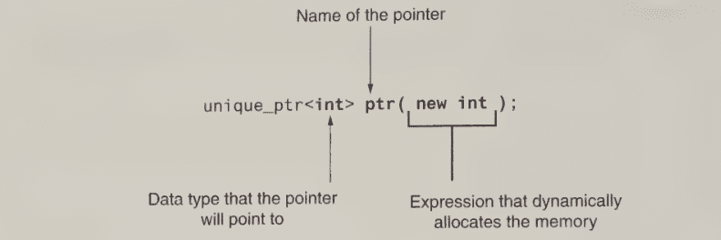

一旦定义了 `unique_ptr`，你就可以像使用普通指针一样使用它。程序 9-17 演示了这一点。

## 程序 9-17

```cpp
// 这个程序演示了 unique_ptr。

#include <iostream>
#include <memory>

using namespace std;

int main() {
    // 定义一个 unique_ptr 智能指针，指向
    // 一个动态分配的 int。
    unique_ptr<int> ptr(new int);

    // 将 99 赋值给动态分配的 int。
    *ptr = 99;

    // 显示动态分配的 int 的值。
    cout << *ptr << endl;

    return 0;
}
```

# 程序输出

99

在第 3 行中，我们包含了 `<memory>` 头文件。第 10 行定义了一个名为 `ptr` 的 `unique_ptr`，指向一个动态分配的 `int`。第 13 行将值 99 赋值给动态分配的 `int`。注意在 `unique_ptr` 上使用了间接运算符 (`*`)，就像对待普通指针一样。第 16 行再次对 `unique_ptr` 使用间接运算符来显示动态分配的 `int` 中存储的值。这里没有 `delete` 语句来释放动态分配的内存，因为智能指针会在函数结束时自动删除该内存。

## 9.10 使用智能指针避免内存泄漏

程序 9-17 演示了 `unique_ptr`，但它并不十分实用。动态分配数组比分配单个整数更有用。以下代码展示了如何使用 `unique_ptr` 动态分配一个整数数组的示例：

```cpp
const int SIZE = 100;
unique_ptr<int[]> ptr(new int[SIZE]);
```

第一条语句定义了一个 `int` 常量 `SIZE`，将其值设为 100。第二条语句定义了一个名为 `ptr` 的 `unique_ptr`，指向一个动态分配的 100 个 `int` 的数组。注意关于定义语句的以下几点：

- 在 `unique_ptr` 之后，符号 `<int[]>` 表示指针将指向一个 `int` 数组。
- 括号内的表达式 `new int[SIZE]` 分配了一个 `int` 数组。

动态分配的 `int` 数组的地址将被赋值给指针 `ptr`。在定义语句之后，你可以使用下标运算符 `[]` 访问数组元素。这是一个示例：

```cpp
ptr[0] = 99;
cout << ptr[0] << endl;
```

第一条语句将值 99 赋值给 `ptr[0]`，第二条语句显示 `ptr[0]` 的值。程序 9-18 提供了更完整的演示。

## 程序 9-18

```cpp
// 这个程序演示了一个指向
// 动态分配的整数数组的 unique_ptr。
#include <iostream>
#include <memory>
using namespace std;

int main() {
    int max; // 数组的最大容量

    // 获取要存储的值的数量。
    cout << "How many numbers do you want to enter? ";
    cin >> max;

    // 定义一个 unique_ptr 智能指针，指向
    // 一个动态分配的 int 数组。
    unique_ptr<int[]> ptr(new int[max]);

    // 获取数组的值。
    for (int index = 0; index < max; index++) {
        cout << "Enter an integer number: ";
        cin >> ptr[index];
    }

    // 显示数组中的值。
    cout << "Here are the values you entered:\n";
    for (int index = 0; index < max; index++)
        cout << ptr[index] << endl;

    return 0;
}
```


## 带有加粗示例输入的程序输出

How many numbers do you want to enter? 5
Enter an integer number: 1
Enter an integer number: 2
Enter an integer number: 3
Enter an integer number: 4
Here are the values you entered:
1
2
3
4
5

## `arrSelectSort` 函数

`arrSelectSort` 函数是第 8 节中所示选择排序算法的修改版本。唯一的区别是 `arr` 现在是一个指针数组。它不再对 `arr` 元素的内容进行排序，而是根据这些元素指向的内容进行排序。以下是伪代码：

```
当 startScan 设置为从 0 到（但不包含）arr 中的倒数第二个下标时
    将 index 变量设置为 startScan
    将 minIndex 变量设置为 startScan
    将 minElem 指针设置为 arr[startScan]

当 index 变量设置为从 (startScan + 1) 到 arr 中的最后一个下标的值时
    如果 (*arr[index]) 小于 *minElem
        将 minElem 赋值为 arr[index]
        将 minIndex 赋值为 index
    结束 If
结束 For

将 arr[minIndex] 赋值为 arr[startScan]
将 arr[startScan] 赋值为 minElem
结束 For
```

## `showArrPtr` Function

`showArrPtr` 函数接受一个指针数组作为参数。它显示 `arr` 元素所指向的值。以下是其伪代码：

```
对于 arr 中的每一个元素
    解引用元素并显示它指向的内容
结束 For.
```

## `showArray` 函数

`showArray` 函数简单地按顺序显示 `arr` 的内容。以下是其伪代码：

```
对于 arr 中的每一个元素
    显示元素的内容
结束 For.
```

## 整个程序

程序 9-19 显示了整个程序的源代码。

## 程序 9-19

```cpp
// 此程序显示了 CK Graphics, Inc. 的员工
// 向 United Cause 组织捐赠的金额。它按从低到高的顺序
// 显示这些捐赠金额
```

（程序继续）

## 第 9 节 指针

## 程序 9-19（续）

```cpp
********************************************************************
* 此函数对 arr 执行升序选择排序，*
* arr 是一个指针数组。数组的每个元素 *
* 都指向第二个数组的元素。排序后，*
* arr 将按升序顺序指向第二个数组的
* 元素。*
********************************************************************
```

## 9.11 关注问题解决与程序设计：案例研究

```cpp
void arrSelectSort(int arr[], int size)
{
    int startScan, minIndex;
    int *minElem;
    for (startScan = 0; startScan < (size - 1); startScan++)
    {
        minIndex = startScan;
        minElem = arr[startScan];
        for (int index = startScan + 1; index < size; index++)
        {
            if (*arr[index] < *minElem)
            {
                minElem = arr[index];
                minIndex = index;
            }
        }
        arr[minIndex] = arr[startScan];
        arr[startScan] = minElem;
    }
}
```

> // `showArray` 函数的定义。
> // 此函数显示 `arr` 的内容。`size` 是
> // 元素的个数。

```cpp
void showArray(const int arr[], int size)
{
    for (int count = 0; count < size; count++)
        cout << arr[count] << " ";
    cout << endl;
}
```

> // `showArrPtr` 函数的定义。
> // 此函数显示 `arr` 所指向的
> // 数组的内容。`size` 是元素的个数。

```cpp
void showArrPtr(int *arr[], int size)
{
    for (int count = 0; count < size; count++)
        cout << (*arr[count]) << " ";
    cout << endl;
}
```

# 程序输出

按升序的捐赠金额为：
5 5 5 5 5 10 10 10 15 25 100 100
按原始顺序的捐赠金额为：
5 100 5 25 10 5 25 5 5 100 10 15 5 10

## 复习题与练习题

### 简答

1. 间接运算符（indirection operator）的作用是什么？
2. 查看以下代码。
   ```cpp
   int x = 7;
   int *iptr = &x;
   ```
   如果你将表达式 `*ptr` 发送到 `cout`，将显示什么？如果你将表达式 `ptr` 发送到 `cout`，会发生什么？
3. 到此为止你学习了 `*` 运算符的三种不同用法。它们是什么？
4. 指针上允许哪些数学运算？
5. 假设 `ptr` 是一个指向 `int` 的指针，当你给 `ptr` 加 4 时会发生什么？
6. 查看以下数组定义。
   ```cpp
   int numbers[] = { 2, 4, 6, 8, 10 };
   ```
   以下语句将显示什么？
   ```cpp
   cout << *(numbers + 3) << endl;
   ```
7. `new` 运算符的作用是什么？
8. 当程序使用 `new` 运算符分配内存块，但请求的内存量不可用时会发生什么？使用旧编译器编写的程序如何处理这种情况？
9. `delete` 运算符的作用是什么？
10. 在什么情况下你可以成功地从函数返回一个指针？
11. 指向常量的指针（pointer to a constant）和常量指针（constant pointer）有什么区别？
12. 将指针声明为常量的好处是什么？

### 填空题

13. 每个字节被赋值为 ________。
14. 使用 ________ 运算符确定变量地址。
15. ________ 被设计用于存储地址。
16. 使用 ________ 进行工作。
17. 数组名可以作为 ________，反之亦然。
18. 在运行时创建 ________。
19. 使用 ________ 分配内存。
20. 在旧编译器中，请求的内存量返回 ________。
21. 包含 0 的 ________。
22. 程序结束时，应该释放 ________。
23. 应该只对 ________ 使用 `delete`。

### 算法工作台

24. 查看以下代码：
```cpp
double value;
double *ptr = &value;
```
使用 `ptr` 显示 `value` 的值。

25. 查看以下数组定义：
```cpp
int set[10];
```
使用指针表示法在 `set` 中存储 99。

26. 编写代码动态分配 20 个整数，然后使用循环为每个元素赋值。

27. 查看以下函数定义：
```cpp
void getNumber(int &n)
{
    cout << "Enter a number: ";
    cin >> n;
}
```
在此函数中，`n` 是引用。重写它使 `n` 成为指针。

28. 写一个指向 `int` 的指针定义。
29. 写一个常量指针定义。

### 判断题

31. 每个字节被赋值为唯一的地址。
32. `*` 运算符用于获取变量的地址。
33. 指针被设计用于存储地址。
34. `&` 符号称为间接运算符。
35. `&` 运算符解引用指针。
36. 使用间接运算符时，你实际上是在处理指针指向的值。
37. 数组名不能被解引用。
38. 当给指针加一个值时，你实际上加上了指针指向的数据类型的大小。
39. 将地址赋值给指针不需要地址运算符。
40. 你可以更改数组指向的地址。
41. 指针可以执行任何数学运算，包括乘法和除法。
42. 指针可以使用关系运算符进行比较。
43. 当用作函数参数时，引用变量比指针更容易处理。

### 找错

以下定义和程序段均存在错误。请找出尽可能多的。

48. `int ptr* = nullptr;`
49. `int x, *ptr = nullptr;`
   `&x = ptr;`
50. `int x, *ptr = nullptr;`
   `*ptr = &x;`
51. `int x, *ptr = nullptr;`
   `ptr = 100; // 将 100 存储在 x`
   `cout << x << endl;`
52. `int numbers[5] = {10, 20, 30, 40, 50};`
   `cout << "数组中的第三个元素是 ";`
   `cout << *numbers + 3 << endl;`
53. `int values[20], *iptr = nullptr;`
   `iptr = values;`
   `iptr = 2;`
54. `float level;`
   `int fptr = &level;`
55. `int *iptr = &value;`
   `int value;`
56. `void doubleVal(int val)`
   `{`
   `   *val = 2;`
   `}`
57. `int *pint = nullptr;`
   `new pint;`
58. `int *pint = nullptr;`
   `pint = new int;`
   `if (pint == nullptr)`
   `   *pint = 100;`
   `else`
   `   cout << "Memory allocation error\n";`

## 编程挑战

59. ```cpp
    int *pint = nullptr;
    pint = new int[100]; // Allocate memory
    // Code that processes the array.
    delete pint; // Free memory
    ```

60. ```cpp
    int *getNum()
    {
        int wholeNum;
        cout << "Enter a number: ";
        cin >> wholeNum;
        return &wholeNum;
    }
    ```

61. ```cpp
    const int arr[] = { 1, 2, 3 };
    int *ptr = arr;
    ```

62. ```cpp
    void doSomething(int * const ptr)
    {
        int localArray[] = { 1, 2, 3 };
        // ptr = localArray;
    }
    ```

### 编程挑战

1. **数组分配器**
   编写一个动态分配整数数组的函数。该函数应接受一个整数参数，表示要分配元素数量。该函数应返回指向该数组的指针。

2. **成绩 #1**
   编写一个程序，动态分配一个足够大的数组以容纳用户定义的测试成绩。一旦输入了所有分数，应将数组传递给一个按升序排序的函数。应调用另一个函数来计算平均分。程序应带有适当的标题显示排序后的分数列表和平均分。尽可能使用指针符号而不是数组表示法。
   输入验证：测试成绩不接受负数。

3. **舍弃最低分**
   修改上述问题 2，以舍弃最低的测试成绩。该分数不应包含在平均分的计算中。

4. **成绩 #2**
   修改编程挑战 2（成绩 #1）的程序，允许用户输入“姓名-分数”对。对于每个参加考试的学生，用户输入学生的姓名，然后是该学生的整数测试成绩。修改排序函数，使其接收一个存储学生姓名的数组和一个存储测试成绩的数组。当显示排序后的分数列表时，应同时显示每个学生的姓名及其分数。在遍历数组时，使用指针而不是数组下标。

5. **指针重写**
   以下函数使用引用变量作为参数。重写该函数以使用指针代替引用变量，然后在完整程序中演示该函数。
   ```cpp
   int doSomething(int &x, int &y)
   {
       int temp = x;
       x = y * 10;
       y = temp * 10;
       return x + y;
   }
   ```

6. **案例研究修改 #1**
   修改程序 9-19（United Cause 案例研究程序），使其适用于任何一组捐赠。程序应动态分配捐赠数组并要求用户输入其值。

7. **案例研究修改 #2**
   修改程序 9-19（United Cause 案例研究程序），使 `arrptr` 数组按降序排列而不是升序排列。

8. **众数函数**
   在统计学中，一组值的众数是出现次数最多或频率最大的值。编写一个接受以下参数的函数：
   - 一个整数数组
   - 一个表示数组元素数量的整数
   该函数应确定数组的众数。即，它应该确定数组中出现频率最高的值。如果数组没有众数（没有任何值出现超过一次），则函数应返回 -1。（假设数组始终包含非负值。）
   通过在该函数中使用指针符号而不是数组表示法来展示你的指针造诣。

9. **中位数函数**
   在统计学中，当一组值按升序或降序排序时，其中位数是中间值。如果集合包含偶数个值，则中位数是两个中间值的平均数（平均值）。编写一个接受以下参数的函数：
   - A) 一个整数数组
   - B) 一个表示数组元素数量的整数
   该函数应确定数组的中位数。该值应以 `double` 类型返回。（假设数组值已经排序）。
   通过在该函数中使用指针符号而不是数组表示法来展示你的才华。

10. **反转数组**
    编写一个接受 `int` 数组及其大小作为参数的函数。该函数应创建该数组的副本，但副本中的元素顺序应是反转的。该函数应返回指向新数组的指针。在完整程序中演示该函数。

11. **数组扩展**
    编写一个接受 `int` 数组及其大小作为参数的函数。该函数应创建一个大小为参数数组两倍的新数组。该函数将把数组的内容复制到新数组，并将第二个数组未使用的元素初始化为 0。该函数应返回指向新数组的指针。

12. **元素偏移**
    编写一个接受 `int` 数组及其大小作为参数的函数。该函数应创建一个比参数数组大一元素的新数组。新数组的第一个元素应设为 0，参数数组的元素 0 应被复制到新数组的元素 1，参数数组的元素 1 应被复制到新数组的元素 2，依此类推。该函数应返回指向新数组的指针。

13. **电影统计**
    编写一个可以收集电影统计数据的程序。程序应执行以下操作：
    A) 询问用户有多少部电影。
    B) 允许用户输入电影的标题和评分。
    C) 计算并显示所有电影的平均评分。
    D) 找出并显示评分最高的电影。
    E) 找出并显示评分最低的电影。
    F) 按字母顺序列出所有电影。

    

```cpp
if (isalpha(input))
    cout << "That's an alphabetic character.\n";

if (isdigit(input))
    cout << "That's a numeric digit.\n";

if (islower(input))
    cout << "The letter you entered is lowercase.\n";

if (isupper(input))
    cout << "The letter you entered is uppercase.\n";

if (isspace(input))
    cout << "That's a whitespace character.\n";

return 0;
```

# 粗体显示示例输入的程序输出

Enter any character: A
The character you entered is: A
That's an alphabetic character.
The letter you entered is uppercase.

# 粗体显示不同输入的程序输出

Enter any character: 7
The character you entered is: 7
That's a numeric digit.

## 程序 10-2

```cpp
// 此程序测试一个客户编号以确定
// 它是否符合正确的格式。

#include <iostream>
#include <cctype>

using namespace std;

// 函数原型
bool testNum(char[], int);

int main()
{
    const int SIZE = 8; // 数组大小
    char customer[SIZE]; // 用于存储客户编号

    // 获取客户编号。
    cout << "Enter a customer number in the form ";
    cout << "(LLLLNN = letters and NNNN = numbers): ";
    cin.getline(customer, SIZE);
```

## 程序 10-2（续）

```cpp
// 确定其是否有效。
if (testNum(customer, SIZE))
```


# 第 10 章 字符、C 字符串以及关于 string 类的更多内容

## 程序片段

```cpp
23 cout << "That is a valid customer number.\n";
24 else
25 {
26 cout << "That is not the proper format of the ";
27 cout << "customer number.\nHere is an example:\n";
28 cout << "ABC1234\n";
29 
30 return 0;
31 }
```

```cpp
// 函数 testNum 的定义。
// 此函数确定 custNum 参数是否包含一个有效的客户编号。size 参数是自定义数组的大小。

bool testNum(char custNum[], int size)
{
    int count; // 循环计数器
    
    // 测试前几个字符是否为字母。
    for (count = 0; count < 3; count++)
    {
        if (!isalpha(custNum[count]))
            return false;
    }
    
    // 测试剩余的字符是否为数字。
    for (count = 3; count < size - 1; count++)
    {
        if (!isdigit(custNum[count]))
            return false;
    }
    return true;
}
```

## 示例程序输出

**示例 1**
```
Enter a customer number in the form LLLNNNN
(LLL = letters and NNN = numbers): RQS4567
That's a valid customer number.
```

**示例 2**
```
Enter a customer number in the form LLLNNNN
(LLL = letters and NNNN = numbers): AX467T9
That is not the proper format of the customer number.
Here is an example:
ABC1234
```

## 10.2 字符大小写转换

在该程序中，预计客户编号由三个字母后接四个数字组成。`testNum` 函数接受一个数组参数，并使用第 45 到 49 行的循环测试前三个字符：

```cpp
for (count = 0; count < 3; count++) {
    if (!isalpha(custNum[count]))
        return false;
}
```

如果其参数是字母，`isalpha` 函数返回 `true`。语句中使用 `!` 运算符来判断被测试的字符是否**不是**字母。如果前三个字符中的任何一个满足此条件，函数 `testNum` 将返回 `false`。同样，通过第 52 到 56 行的循环测试后四个字符，以确定它们是否为数字：

```cpp
for (count = 3; count < size - 1; count++) {
    if (!isdigit(custNum[count]))
        return false;
}
```

如果其参数是数字 0 到 9 的字符表示，`isdigit` 函数返回 `true`。再次使用 `!` 运算符来判断被测试的字符是否不是数字。如果最后四个字符中的任何一个满足此条件，函数 `testNum` 将返回 `false`。如果客户编号符合正确格式，函数将遍历两个循环而不返回 `false`。在这种情况下，函数的最后一行是 `return true` 语句，表示客户编号有效。

## 字符大小写转换函数

> 概念：C++ 库提供了将字符转换为大写或小写的函数。

C++ 库提供了两个函数 `toupper` 和 `tolower` 用于转换字符的大小写。这些函数在表 10-2 中描述。（这些函数在头文件 `<cctype>` 中声明，因此需包含它。）

### 表 10-2 `<cctype>` 中的大小写转换函数

| 函数 | 说明 |
| :--- | :--- |
| `toupper` | 返回参数的大写形式。 |
| `tolower` | 返回参数的小写形式。 |

`<cctype>` 中的每个函数都接受单个字符。如果参数已经是大写，`toupper` 将其原样返回。如果参数是小写，`toupper` 将其转换为大写。

## 程序 10-3：字符、字符串及更多

```cpp
#include <iostream>
#include <cctype>
#include <iomanip>

using namespace std;

int main()
{
    const double PI = 3.14159; // 圆周率
    double radius;
    char goAgain;

    // 此程序计算圆面积。它询问用户是否希望继续。
    do
    {
        cout << "Enter the radius: ";
        cin >> radius;
        cout << fixed << setprecision(2);
        cout << "The area is: " << PI * radius * radius << endl;
        cout << "Calculate again? (Y or N) ";
        cin >> goAgain;

        // 验证输入。
        while (toupper(goAgain) != 'Y' && toupper(goAgain) != 'N')
        {
            cout << "Please enter Y or N: ";
            cin >> goAgain;
        }
    } while (toupper(goAgain) == 'Y');

    return 0;
}
```

### 程序 10-3 示例输出

```
此程序计算圆面积。
Enter the radius: 10
The area is: 314.16
Calculate again? (Y or N) y
Enter the radius: 1
The area is: 3.14
Calculate again? (Y or N) n
```

## 检查点

10.1 为下列每个函数编写简短描述：

```
isalpha
isalnum
isdigit
islower
isprint
ispunct
isupper
isspace
toupper
tolower
```

10.2 编写一条语句，将 `char` 变量 `big` 的内容转换为小写。转换后的值应赋值给变量 `little`。

10.3 编写一条语句，如果 `char` 包含数字，则显示单词 "digit"。否则，应显示 "Not a digit."。

10.4 下述语句的输出是什么？

```
cout << toupper(tolower('A'));
```

10.5 编写一个循环，询问用户“你想重复程序还是退出？(R/Q)”。该循环应一直重复，直到用户输入 R 或 Q（大写或小写均可）。

# C 字符串 (C-Strings)

> 概念：在 C++ 中，C 字符串是存储在连续内存位置的字符序列，以空字符终止。

String（字符串）是一个泛义术语，描述任何连续的字符序列。一个单词、一个句子、一个名字和一首歌的标题都是字符串。在 C++ 语言中，字符串存储在内存有两种主要方式：作为字符串对象或 C 字符串。你已经接触了 `string` 类，并且现在已经编写过使用字符串对象的程序。在本节中，我们将使用 C 字符串，这是存储和处理字符串的另一种方法。

C 字符串是一种其字符存储在连续内存位置，并在后面紧跟一个空字符（或称为空终止符）的字符串。回想第 2 章，空字符或空终止符是一个持有 ASCII 值为 0 的字节。以这种方式存储的字符串被称为 C 字符串，因为这是 C 编程语言中处理字符串的方式。

在 C++ 中，所有的字符串字面量都以 C 字符串的形式存储在内存中。记住字符串字面量（或字符串常量）是程序中字符串的字面表示。在 C++ 中，字符串字面量用双引号括起来，例如：`"Bailey"`。

## 10.3 C 字符串

图 10-1 展示了字符串字面量 `"Bailey"` 是如何作为 C 字符串存储在内存中的。

### 图 10-1 存储在内存中的 C 字符串

| B | a | i | l | e | y | \0 |
|---|---|---|---|---|---|---|

> **注意：** 记住 `\0`（斜杠零）是表示空终止符的转义序列。它代表 ASCII 代码 0。

空终止符的目的是标记 C 字符串的结束。没有它，程序就不知道 C 字符串的长度。

### 关于字符串字面量

字符串字面量或字符串常量被在一对双引号（`"`）括起来。例如，这里有五个字符串字面量：

- `"Have a nice day."`
- `"What is your name?"`
- `"John Smith"`
- `"Please enter your age:"`
- `"Part Number 45011789"`

程序中所有的字符串字面量都以 C 字符串的形式存储在内存中，并自动附加空终止符。例如，看程序 10-4。

### 程序 10-4

```cpp
// 这个程序包含字符串字面量。
#include <iostream>

using namespace std;

int main() {
    char again;

    do {
        cout << "C++ programming is great fun!" << endl;
        cout << "Do you want to see the message again? ";
        cin >> again;
    } while (again == 'Y' || again == 'y');

    return 0;
}
```

这个程序包含两个字符串字面量：
- `"C++ programming is great fun!"`
- `"Do you want to see the message again?"`

第一个字符串占用 30 字节内存（包括空终止符），第二个字符串占用 39 字节。它们在内存中的形式如下：

## 程序 10-5

```cpp
// 逐个字符显示输入。
cout << "你输入的句子是：\n";
while (line[count] != '\0')
{
    cout << line[count];
    count++;
}
return 0;
```

### 示例输入的程序输出

```
输入一个不超过 79 个字符的句子：
C++ is challenging but fun! Enter
你输入的句子是：
C++ is challenging but fun!
```

## 10.4 用于 C 字符串的库函数

> 概念：C++ 库有许多处理 C 字符串的函数。这些函数可以执行各种任务和操作，并要求包含 `<cstring>` 头文件。

### strlen 函数

C 字符串存储在数组中，处理它们的方式与处理 `string` 对象有很大不同。C++ 库提供了许多用于测量和测试 C 字符串的函数。这些函数都要求包含 `<cstring>` 头文件，如下所示：

```cpp
#include <cstring>
```

例如，以下代码段使用 `strlen` 函数确定存储在 `name` 数组中的字符串长度：

```cpp
char name[] = "Thomas Edison";
int length;
length = strlen(name);
```

`strlen` 函数接受一个 C 字符串的指针作为参数。它返回字符串的长度，即不包括空终止符在内的字符数。因此，变量 `length` 中将存储数字 13。字符串的长度不应与持有它的数组的大小混淆。请记住，传递给 `strlen` 的唯一信息是 C 字符串的起始地址。它不知道数组何时结束，因此它会寻找空终止符来指示字符串的结束。

当使用 C 字符串处理函数时，你必须传递一个或多个 C 字符串作为参数。这意味着传递 C 字符串的地址，可以通过以下任何一种方式作为参数来实现：

- 存储 C 字符串的数组名
- 持有 C 字符串地址的指针变量
- 字面量字符串

每当使用字面量字符串作为函数的参数时，传递的都是该字面量字符串的地址。这里有一个使用此类参数调用 `strlen` 函数的示例：`length = strlen("Thomas Edison");`

### strcat 函数

`strcat` 函数接受两个指向 C 字符串的指针作为参数。该函数将一个字符串连接或追加到另一个字符串之后。以下代码显示了它的用法：

```cpp
const int SIZE = 13;
char string1[SIZE] = "Hello ";
char string2[] = "World!";

cout << string1 << endl;
cout << string2 << endl;

strcat(string1, string2);

cout << string1 << endl;
```

这些语句将导致以下输出：
```
Hello
World!
Hello World!
```

`strcat` 函数将 `string2` 的内容拷贝到 `string1` 的末尾。在这个示例中，在调用 `strcat` 之前，`string1` 包含字符串 `"Hello "`。调用之后，它包含了字符串 `"Hello World!"`。图 10-2 显示了函数调用前后两个数组的内容。

#### 图 10-2 使用 strcat

**调用 `strcat(string1, string2)` 之前：**
```
string1: | H | e | l | l | o | \0 |   |   |   |   |   |   |
string2: | W | o | r | l | d | ! | \0 |   |   |   |
```

**调用 `strcat(string1, string2)` 之后：**
```
string1: | H | e | l | l | o | W | o | r | l | d | ! | \0 |
string2: | W | o | r | l | d | ! | \0 |
```

注意 `string1` 中的最后一个字符（空终止符之前）是一个空格。`strcat` 不会插入空格，因此有程序员有责任确保在需要时那里已经存在一个空格。程序员同样有责任确保数组 `string1` 足够大，能够容纳 `string1` 加上 `string2`。以下是一个程序段，使用 `sizeof` 操作符在调用 `strcat` 之前测试数组的大小：

```cpp
if (sizeof(string1) >= strlen(string1) + strlen(string2) + 1)
    strcat(string1, string2);
else
    cout << "String1 不足够大以容纳两个字符串。";
```

> 如果持有第一个字符串的数组不够大以容纳两个字符串，`strcat` 将溢出数组边界。

### strcpy 函数

回想第 7 章可知，一个数组不能用 `=` 运算符赋值另一个数组。每个单独的元素必须在循环内部赋值。`strcpy` 函数可以将一个字符串拷贝到另一个。这里是它的用法示例：

```cpp
const int SIZE = 13;
char name[SIZE];
strcpy(name, "Thomas Edison");
```

`strcpy` 函数接收两个 C 字符串地址。第二个参数的内容被拷贝到第一个参数指定的内存位置，包括空终止符（第一个参数通常指向一个数组）。在示例中，`strcpy` 函数将字符串 `"Thomas Edison"` 拷贝到 `name` 数组中。

如果第一个参数所引用的位置已经存储了任何内容，它将被覆盖，如下程序所示：

```cpp
const int SIZE = 10;
char string1[SIZE] = "Hello";
char string2[] = "World!";
strcpy(string1, string2);
cout << string1 << endl;
```


```cpp
const int SIZE = 10;
char string1[SIZE] = "Hello";
char string2[] = "World!";
strcpy(string1, string2);
cout << string1 << endl;
```

### strcat 和 strcpy 函数

回想第 7 章可知，一个数组不能用 `=` 运算符赋值另一个数组。每个单独的元素必须在循环内部赋值。`strcpy` 函数可以将一个字符串拷贝到另一个。这里是它的用法示例：

```cpp
const int SIZE = 13;
char name[SIZE];
strcpy(name, "Thomas Edison");
```

如果第一个参数所引用的位置已经存储了任何内容，它将被覆盖，如下程序所示：

```cpp
const int SIZE = 10;
char string1[SIZE] = "Hello";
char string2[] = "World!";
strcpy(string1, string2);
cout << string1 << endl;
```

## 10.4 用于 C 字符串的库函数

```cpp
// Array of products
char products[NUM_PRODS][LENGTH] = {
    "TV327 31-inch Television",
    "CD257 CD Player",
    "TA667 Answering Machine",
    "CS109 Car Stereo",
    "PC0955 Personal Computer"
};

char lookUp[LENGTH]; // 用于存储用户的输入
char *strPtr = nullptr; // 用于指向找到的产品
int index; // 循环计数器

// 提示用户输入产品号。
cout << "Product Database\n\n";
cout << "Enter a product number to search for: ";
cin.getline(lookUp, LENGTH);

// 在数组中搜索匹配的子串
for (index = 0; index < NUM_PRODS; index++) {
    strPtr = strstr(products[index], lookUp);
    if (strPtr != nullptr)
        break;
}

// 如果找到了匹配的子串，显示产品信息。
if (strPtr != nullptr)
    cout << products[index] << endl;
else
    cout << " No matching product was found.\n";

return 0;
```

### 示例输入以加粗显示的程序输出

Product Database

Enter a product to search for: **CS** Enter

CS109 Car Stereo

### 不同的示例输入以加粗显示的程序输出

Product Database

Enter a product to search for: **AB** Enter

No matching product was found.

表 10-3 总结了这里讨论的字符串处理函数，以及第 4 章中讨论过的 `strcmp` 函数。（所有列出的函数都需要 `<cstring>` 头文件）。

在程序 10-6 中，第 30 行到第 35 行的循环遍历了数组中的每个 C 字符串，并调用以下语句：`strPtr = strstr(products[index], lookUp);`

`strstr` 函数在 `products[index]` 引用的字符串中搜索用户输入的名称，该名称存储在 `lookUp` 中。如果在 `products[index]` 内部找到了 `lookUp`，该函数将返回它的地址。在这种情况下，以下语句会导致 for 循环终止：

```cpp
if (strPtr != nullptr)
    break;
```

在循环外部，第 38 行到第 41 行的 `if-else` 语句确定用户输入的字符串是否在数组中找到。如果没有找到，它不会通知用户找到了匹配的产品。否则，将显示产品号和描述。

```cpp
if (strPtr == nullptr)
    cout << "No matching product was found.\n";
else
    cout << products[index] << endl;
```

## strcmp 函数

由于 C 字符串存储在数组中，因此你不能使用关系运算符来比较两个 C 字符串。要比较 C 字符串，你应该使用库函数 `strcmp`。该函数接受两个 C 字符串作为参数，并返回一个整数，表示两个字符串之间的比较结果。以下是该函数的原型：

```cpp
int strcmp(char *string1, char *string2);
```

该函数接受两个 C 字符串作为参数（实际上是指向 C 字符串的指针）并返回一个整数。结果的值相应如下：

- 如果两个字符串按字符逐个比较相等，则结果为零。
- 如果 `string1` 在字母顺序上小于 `string2`，则结果为负数。
- 如果 `string1` 在字母顺序上大于 `string2`，则结果为正数。

以下是一个使用 `strcmp` 判断两个字符串是否相等的示例：

```cpp
if (strcmp(string1, string2) == 0)
    cout << "The strings are equal.\n";
else
    cout << "The strings are not equal.\n";
```

程序 10-7 显示了一个完整的示例。

### 程序 10-7

```cpp
// 此程序使用 strcmp 测试
// 两个字符串的相等性。
#include <iostream>
#include <cstring>
using namespace std;

int main()
{
    // 两个字符串的数组。
    const int LENGTH = 40;
    char firstString[LENGTH], secondString[LENGTH];

    // 读取两个字符串。
    cout << "Enter a string: ";
    cin.getline(firstString, LENGTH);
    cout << "Enter another string: ";
    cin.getline(secondString, LENGTH);

    // 使用 strcmp 测试字符串的相等性。
    if (strcmp(firstString, secondString) == 0)
        cout << "You entered the string twice.\n";
    else
        cout << "The strings are not the same.\n";

    return 0;
}
```

### 示例输入以加粗显示的程序输出

Enter a string: **Alfonso** Enter

Enter another string: **Alfonso** Enter

You entered the string twice.

`strcmp` 函数比较字符串时区分大小写。如果用户在程序 10-7 中输入 "Dog" 和 "dog"，它将报告它们不同。大多数编译器提供非标准的 `strcmp` 版本来进行不区分大小写的比较。某些编译器提供名为 `strcasecmp` 的函数，其功能与 `strcmp` 相同，但忽略字符的大小。

程序 10-8 是 `strcmp` 用法的更实用的示例。它要求用户输入一个名称。

### 程序 10-8

```cpp
// 此程序使用 strcmp 按字母顺序
// 对用户输入的两个字符串。
#include <iostream>
#include <cstring>
#include <iomanip>
using namespace std;

int main()
{
    // 字符数组。
    const int LENGTH = 30;
    char partNum[LENGTH];
    // 提示用户输入
    // 名称。
    cout << "Enter a name (last first): ";
    cin.getline(partNum, LENGTH);

    // (排序逻辑此处继续)
}
```

## 表 10-3（续）字符串处理函数总结

| 函数 | 描述 |
|---|---|
| `strcpy` | 接受两个 C 字符串或两个 C 字符串的指针作为参数。该函数将第二个 C 字符串拷贝到第一个 C 字符串。第二个 C 字符串保持不变。用法示例：`strcpy(string1, string2);` |
| `strcat` | 接受两个 C 字符串或两个 C 字符串的指针作为参数。该函数将第二个 C 字符串追加到第一个 C 字符串的末尾。用法示例：`strcat(string1, string2);` |
| `strncpy` | 接受两个 C 字符串或两个 C 字符串的指针，以及一个整数参数。第三个参数 `n` 表示从第二个 C 字符串中拷贝到第一个字符串的最大字符数。如果 `n` 小于 `string2` 的长度，则不会在 `string1` 末尾自动添加空终止符。如果 `n` 大于 `string2` 的长度，`strncpy` 将用 `\0` 字符填充。用法示例：`strncpy(string1, string2, n);` |
| `strcmp` | 接受两个 C 字符串或两个 C 字符串的指针作为参数。如果 `string1` 和 `string2` 相同，此函数返回 0。如果 `string1` 在字母顺序上小于 `string2`，它返回一个负数。如果 `string1` 在字母顺序上大于 `string2`，它返回一个正数。用法示例：`if (strcmp(string1, string2) == 0)` |
| `strstr` | 接受两个 C 字符串或两个 C 字符串的指针作为参数。在 `string1` 中搜索 `string2` 第一次出现的位置。如果找到了 `string2`，函数返回指向该位置的指针。否则，返回 `nullptr`（地址 0）。用法示例：`cout << strstr(string1, string2);` |

## 检查点

- 10.6 为以下每个函数写一个简短描述：
  - `strlen`
  - `strcat`
  - `strcpy`
  - `strncpy`
  - `strcmp`
  - `strstr`
- 10.7 下列程序段落将显示什么？
  ```cpp
  char dog[] = "Fido";
  cout << strlen(dog) << endl;
  ```
- 10.8 下列程序段落将显示什么？
  ```cpp
  char string1[16] = "Have a ";
  char string2[9] = "nice day";
  strcat(string1, string2);
  cout << string1 << endl;
  cout << string2 << endl;
  ```
- 10.9 编写一条语句将字符串 "Beethoven" 拷贝到数组 `composer`。
- 10.10 完成后，以下程序骨架将在数组 `place` 中搜索字符串 "Windy"。如果 `place` 包含 "Windy"，程序将显示消息 "Windy found."。否则，它将显示 "Windy not found."。
  ```cpp
  #include <iostream>
  #include <cstring>
  using namespace std;

  int main() {
      char place[] = "The Windy City";
      // 完成程序。它应该在数组 place 中
      // 搜索字符串 "Windy"，如果找到了该字符串，
      // 显示消息 "Windy found"。否则，它应该
      // 显示消息 "Windy not found."
      return 0;
  }
  ```

## 10.5 字符串/数值转换函数

**概念**：C++ 库提供了函数，用于将 C 字符串和 `string` 对象转换为数值类型，反之亦然。

以字符串形式存储的数字与以数值存储的数字之间存在巨大差异。字符串 "26792" 并不是数字，而是一系列代表数字各个数字的 ASCII 码。它占用 6 字节内存（包括空终止符）。因为它不是真正的数字，所以无法对其进行数学运算，除非先将其转换为数值。

C++ 库中存在多个函数，可以将数值形式的 C 字符串转换为数值。表 10-4 显示了其中一些。注意，所有这些函数都需要 `<cstdlib>` 头文件。

### 表 10-4 `<cstdlib>` 中的 C 字符串/数值转换函数

| 函数 | 描述 |
|---|---|
| `atoi` | 接受一个 C 字符串作为参数。该函数将 C 字符串转换为整数并返回该值。用法示例：`int num = atoi("4569");` |
| `atol` | 接受一个 C 字符串作为参数。该函数将 C 字符串转换为长整型（`long integer`）并返回该值。用法示例：`long num = atol("5000000");` |
| `atof` | 接受一个 C 字符串作为参数。该函数将 C 字符串转换为双精度浮点数（`double`）并返回该值。用法示例：`double fnum = atof("3.14159");` |

> **注意**：如果将无法转换为数值的 C 字符串传递给表 10-4 中的任何函数，其行为是未定义的。许多编译器将直到遇到无效字符为止进行转换。例如，`atoi("123x")` 可能会返回 123。

C++11 引入了若干函数，将 `string` 对象转换为数值。表 10-5 列出了这些函数。要使用表 10-5 中的函数，必须包含 `<string>` 头文件。

### 表 10-5 字符串转数值函数

| 函数 | 描述 |
|---|---|
| `stoi` | 接受字符串参数并返回 `int`。 |
| `stol` | 接受字符串参数并返回 `long`。 |
| `stoul` | 接受字符串参数并返回无符号长整数（`unsigned long`）。 |
| `stoll` | 接受字符串参数并返回长整数（`long long`）。 |
| `stof` | 接受字符串参数并返回 `float`。 |
| `stod` | 接受字符串参数并返回 `double`。 |
| `stold` | 接受字符串参数并返回长双精度浮点数（`long double`）。 |

表 10-5 中所示函数可以接受 `string` 对象或 C 字符串。例如：

```cpp
// 将 string 对象转换为 int
string str = "99";
int i = stoi(str);

// 将字符串字面量转换为 int
int j = stoi("99");
```

### to_string 函数

C++11 引入了一个名为 `to_string` 的函数，可以将数值转换为 `string` 对象。表 10-6 列出了该函数的九个重载版本。注意 `to_string` 函数需要 `<string>` 头文件。

该函数的每个版本接受一个数值类型的参数，并返回该参数转换为字符串的结果。示例：

```cpp
int number = 99;
string output = to_string(number);
```

### 表 10-6 `to_string` 函数的重载版本

| 函数 | 描述 |
|---|---|
| `to_string(int value)` | 接受 `int` 参数并将其转换为字符串。 |
| `to_string(long value)` | 接受 `long` 参数并将其转换为字符串。 |
| `to_string(long long value)` | 接受 `long long` 参数并将其转换为字符串。 |
| `to_string(unsigned value)` | 接受 `unsigned int` 参数并将其转换为字符串。 |
| `to_string(unsigned long value)` | 接受 `unsigned long` 参数并将其转换为字符串。 |
| `to_string(unsigned long long value)` | 接受 `unsigned long long` 参数并将其转换为字符串。 |
| `to_string(float value)` | 接受 `float` 参数并将其转换为字符串。 |
| `to_string(double value)` | 接受 `double` 参数并将其转换为字符串。 |
| `to_string(long double value)` | 接受 `long double` 参数并将其转换为字符串。 |


现在让我们来看程序 10-10，它使用了 C++ 11 字符串转数字版本的函数之一 `stoi`。它允许用户输入一系列数值，或者输入字母 Q 或 q 退出。然后将计算并显示这些数字的平均值。

## 程序 10-10

```cpp
1 // 此程序演示了 tolower 和 stoi 函数。
2 #include <iostream>
3 #include <cctype> // 用于 tolower
4 #include <string>
5 using namespace std;
6
7 int main()
8 {
9 string input; // 用于存储用户输入
10 int total = 0; // 累加器
11 int count = 0; // 计数计数
12 double average;
13
14 // 获取第一个数字。
15 cout << "此程序将计算一组数字的平均值。\n";
16 cout << "输入第一个数字或输入 Q 退出: ";
17 getline(cin, input);
18
19 // 处理该数字及后续数字。
20 while (tolower(input[0]) != 'q')
21 {
22 total += stoi(input); // 累加总和
23 count++; // 统计输入的数字个数
24
25 // 获取下一个数字。
26 cout << "输入下一个数字或输入 Q 退出: ";
27 getline(cin, input);
28 }
29
30 // 如果输入了任何数字，显示它们的平均值。
31 if (count == 0)
32 {
33 average = static_cast<double>(total) / count;
34 cout << "平均值: " << average << endl;
35 }
36 return 0;
37 }
```

## 示例输入后的程序输出

此程序将计算一组数字的平均值。

输入第一个数字或输入 Q 退出: 1 回车

输入下一个数字或输入 Q 退出: 2 回车

输入下一个数字或输入 Q 退出: 3 回车

输入下一个数字或输入 Q 退出: 4 回车

输入下一个数字或输入 Q 退出: 5 回车

平均值: 3

## 10.5 字符串/数值转换函数

在第 20 行，以下语句使用 `tolower` 函数来确定用户输入的第一个字符是 "q" 或 "Q"。

```cpp
while (tolower(input[0]) == 'q')
```

如果用户没有输入 'Q' 或 'q'，循环将执行迭代。第 22 行的以下语句使用 `stoi` 将输入转换为整数，并将其值加到 `total`：

```cpp
total += stoi(input); // 累加总和
```

计数器在第 23 行更新，然后询问用户下一个数字。当所有数字输入完毕后，用户通过输入 'q' 或 'Q' 终止循环。如果输入了一个或多个数字，则会显示它们的平均值。

字符串到数值转换函数还可以帮助解决常见的输入问题。回想第 3 章，使用 `cin >>` 后接 `getline` 会导致问题，因为 `>>` 运算符会将换行符留在键盘缓冲区中。当 `cin` 函数执行时，它在键盘缓冲区中看到的第一个字符是换行符，因此它什么都没有读到。

当程序使用 `cin >>` 然后调用 `getline` 读取一行输入时，存在相同的问题。例如，看下面的代码。（假设 `IdNumber` 是一个 `int` 和一个 `string` 对象。）

假设用户输入 25 并按回车，值 25 被存储在 `idNumber` 中，换行符将留在键盘缓冲区中。当第 7 行调用 `getline` 函数时，它在键盘缓冲区中看到的第一个字符是换行符，因此它没有读到任何内容。看起来第 7 行的语句被跳过了。

我们在书中用过的一种变通方法是在调用 `getline` 之前使用 `cin.ignore` 来跳过换行符。另一种方法是使用 `getline` 读取程序的所有输入，包括数字。当需要数值输入时，先将其作为字符串读入 `string` 对象中，然后转换为相应的数值数据类型。因为你没有混合使用 `cin >>` 和 `getline`，所以就不存在剩余换行符引起的问题了。程序 10-11 显示了一个示例。

## 程序 10-11

```cpp
// 此程序演示了如何将 getline 函数
// 用于程序的所有输入。
#include <iostream>
#include <string>
#include <iomanip>
using namespace std;
```

（程序继续）

## 程序 10-11（继续）

```cpp
int main() {
    string input; // 用于存储输入行
    string name; // 用于存储姓名
    int idNumber; // 用于存储 ID 号
    int age; // 用于存储年龄
    double income; // 用于存储收入

    // 获取用户的 ID 号。
    cout << "你的 ID 号是多少？ ";
    getline(cin, input); // 作为字符串读取
    idNumber = stoi(input); // 转换为 int

    // 获取用户的姓名。不需要转换。
    cout << "你的名字是什么？ ";
    getline(cin, name);

    // 获取用户的年龄。
    cout << "你多大了？ ";
    getline(cin, input); // 作为字符串读取
    age = stoi(input); // 转换为 int

    // 获取用户的收入。
    cout << "你的收入是多少？ ";
    getline(cin, input); // 作为字符串读取
    income = stoi(input); // 转换为 int (注：此处原文逻辑应为转double，但代码为stoi)

    // 显示结果。
    cout << setprecision(2) << fixed << income << endl;

    return 0;
}
```

*(注：原文代码中 `income = stoi(input)` 逻辑上可能应该是 `stod`，但翻译遵循保留代码不变的原则)*

## 示例输入后的程序输出

你的 ID 号是多少？**123**

你的名字是什么？**Janice Smith**

你多大了？**25**

你的收入是多少？**60000**

你的名字是 Janice Smith，25 岁，收入为 60000。

## 10.6 软件工程：编写字符串处理函数

### 检查点

10.11 要描述以下函数：

- `atoi`
- `atol`
- `atof`
- `itoa`

10.12 编写语句，将字符串 "10" 整数并存储在 `num` 中。

10.13 编写语句，将字符串 "10000" 长整并存储在 `num` 中。

10.14 编写语句，将字符串 "7" 双精度并存储在 `num` 中。

10.15 编写语句，将整数 7 字符串并赋值给名为 `str` 的字符串。

### 软件工程：编写自己的字符串处理函数

> 你可以设计自己的函数来处理字符串。通过将数组作为参数，你可以编写处理字符串的函数。例如，程序 10-12 使用函数将字符串从一个数组复制到另一个。

## 程序 10-12

```cpp
// 此程序使用函数将字符串拷贝到数组
#include <iostream>
using namespace std;

void stringCopy(char [], char[]); // 函数原型
int main()
{
    const int LENGTH = 30; // 数组的大小
    char first[LENGTH];      // 用于存储用户输入
    char second[LENGTH];     // 用于存储副本

    // 从用户获取字符串并存储在 first 中。
    cout << "输入一个不超过 "
         << (LENGTH - 1) << " 个字符的字符串：\n";
    cin.getline(first, LENGTH);
```

## 程序 10-12（继续）

```cpp
// 将 first 的内容拷贝到 second。
stringCopy(first, second);

// 显示副本。
cout << "你输入的字符串是：\n" << second << endl;
return 0;
}
```

```cpp
// stringCopy 函数定义。
// 此函数将 string1 中的字符串拷贝到 string2。
```

```cpp
void stringCopy(char string1[], char string2[])
{
    int index = 0; // 计数器

    // 遍历 string1，将每个元素拷贝到
    // string2。遇到空字符时停止。
    while (string1[index] != '\0')
    {
        string2[index] = string1[index];
        index++;
    }

    // 在 string2 中放置空字符。
    string2[index] = '\0';
}
```

## 示例输入后的程序输出

输入一个不超过 29 个字符的字符串：**Friday!**

你输入的字符串是：

**Thank goodness it is Friday!**

## 程序 10-13

```cpp
// 此程序使用 nameSlice 函数来切掉包含用户名字和
// 姓氏的字符串中的最后一个。
#include <iostream>
using namespace std;

void nameSlice(char []); // 函数原型
int main() {
    const int SIZE = 41; // 数组大小
    char name[SIZE]; // 用于存储用户的名字
    cout << "输入你的名字和姓氏，用空格";
    cout << "隔开：\n";
    cin.getline(name, SIZE);
    nameSlice(name);
    cout << "你的名字是: " << name << endl;
    return 0;
}
```

/*

* 函数 nameSlice 的定义。该函数接受一个
* 字符数组作为其参数。它扫描数组以寻找
* 空格。当它找到空格时，会将其替换为空
* 终止符。

*/

```cpp
void nameSlice(char userName[]) {
    int count = 0; // 循环计数器

    // 定位第一个空格，或者如果没有空格，
    // 则定位空终止符
    while (userName[count] != ' ' && userName[count] != '\0') {
        count++;
    }
    // 如果找到空格，将其替换为空终止符。
    if (userName[count] == ' ') {
        userName[count] = '\0';
    }
}
```

## 程序输出（示例输入已加粗显示）

输入你的名字和姓氏，用空格隔开：

**Jimmy Jones [回车]**

你的名字是: Jimmy

第 35 行和 36 行的以下循环从数组的第一个字符开始扫描，寻找空格或空终止符

```cpp
while (userName[count] != ' ' && userName[count] != '\0') {
    count++;
}
```

## 第 10 章 字符、C 字符串以及关于 string 类的更多

如果 `userName[count]` 中的字符不是空格或空终止符，则 `count` 就会增加，并检查下一个字符。示例输入 "Jimmy Jones"，循环在 `userName[5]` 处找到了 "Jimmy" 和 "Jones"。当循环停止时，`count` 被设置为 5。这在图 10-3 中得到了所示。

### 图 10-3 在字符串中查找空格

当 `count` 达到 5 时循环停止，因为 `userName[5]` 包含一个空格。

| J | i | m | m | y | J | o | n | e | s | \0 |
|---|---|---|---|---|---|---|---|---|---|---|
| 0 | 1 | 2 | 3 | 4 | 5 | 6 | 7 | 8 | 9 | 10 |

下标

> 注意：如果遇到空终止符，循环也会停止。这样即使用户没有输入空格，它也不会超出数组的边界。

一旦循环结束，`userName[count]` 要么包含空格，要么包含一个空终止符。如果它包含空格，以下语句（第 39 行和 40 行）将将其替换为空终止符：

```cpp
if (userName[count] == ' ')
    userName[count] = '\0';
```

这在图 10-4 中得到了所示。

### 图 10-4 用空终止符替换空格。这现在成为了字符串的末尾。

| J | i | m | m | y | \0 | J | o | n | e | s | \0 |
|---|---|---|---|---|---|---|---|---|---|---|---|
| 0 | 1 | 2 | 3 | 4 | 5 | 6 | 7 | 8 | 9 | 10 | 11 |

下标

新的终止符现在成为了字符串的末尾。

## 使用指针传递 C 字符串参数

指针对于编写处理 C 字符串的函数非常有用。如果将字符串的起始地址传递到指针参数变量中，可以假设从该地址到持有空终止符的字节的所有字符都是字符串的一部分（不需要知道存储字符串的数组的长度）。

程序 10-14 演示了一个函数 `countChars`，它使用指针来计算特定字符在 C 字符串中出现的次数。

## 程序 10-14

```cpp
// 此程序演示了一个函数 countChars，该函数计算
// 特定字符在字符串中出现的次数。
#include <iostream>
```

## 10.6 软件工程聚焦：编写你的 C 字符串处理函数

```cpp
using namespace std;
```

```cpp
int countChars(char *, char); // 函数原型
```

```cpp
int main()
{
    const int SIZE = 51; // 数组大小
    char userString[SIZE]; // 用于存储字符串
    char letter; // 要计数的字符
    // 从用户获取字符串。
    cout << "输入一个字符串（最多 50 个字符）： ";
    cin.getline(userString, SIZE);
    // 选择一个要在字符串内统计次数的字符。
    cout << "输入一个字符，我会告诉它出现了\n";
    cout << "几次：" << countChars(userString, letter) << endl;
    return 0;
}
```

```cpp
int countChars(char *userName, char letter) {
    int count = 0; // 循环计数器
    // 定位第一个空格，或者如果没有空格，
    // 则定位空终止符
    while (userName[count] != ' ' && userName[count] != '\0') {
        count++;
    }
    // 如果找到空格，将其替换为空终止符。
    if (userName[count] == ' ') {
        userName[count] = '\0';
    }
    int occurrences = 0;
    while (userName[count] != '\0') {
        if (userName[count] == letter) {
            occurrences++;
        }
        count++;
    }
    return occurrences;
}
```

## 检查点

10.16 下面程序的输出是什么？

```cpp
#include <iostream>
using namespace std;

// 函数原型
void mess(char []);

int main() {
    char stuff[] = "Tombert Tried";
    cout << stuff << endl;
    mess(stuff);
    cout << stuff << endl;
    return 0;
}

// 函数定义
void mess(char str[]) {
    int step = 0;
    while (str[step] != '\0') {
        if (str[step] == 'T')
            str[step] = 'D';
        step++;
    }
}
```

## 程序 10-16


```cpp
// 此程序演示了如何使用 cin 将字符串读入
// string 类对象中。
#include <iostream>
#include <string>
using namespace std;

int main()
{
    string name;

    cout << "What is your name?";
    cin >> name;
    cout << "Good morning " << name << endl;
    return 0;
}
```

## 程序输出（示例输入已加粗显示）

What is your name? **Peggy** Enter

Good morning Peggy

## 将一行输入读入 string 对象

如果你想将一行输入（包含空格）读入 string 对象中，请使用 `getline()` 函数。这里是一个示例：

```cpp
string name;
cout << "What is your name?";
getline(cin, name);
```

`getline()` 函数的第一个参数是你想要从其中读取输入的流对象的名称。上面的函数调用将 `cin` 对象传递给 `getline()`，因此该函数从键盘读取一行输入。第二个参数是 string 对象的名称。这是 `getline()` 存储其所读入输入的地方。

## 比较和排序 string 对象

不需要使用像 `strcmp` 这样的函数来比较 string 对象。你可以使用 `<`、`>`、`>=`、`<=` 和 `==` 。例如，假设程序中存在以下定义：

```cpp
string set1 = "ABC";
string set2 = "XYZ";
```

对象 `set1` 被认为小于对象 `set2`，因为字符 "ABC" 在字母表中排于字符 "XYZ"。因此，以下语句将在屏幕上显示：

```cpp
if (set1 < set2)
    cout << "set1 is less than set2.\n";
```

## 10.7 关于 C++ string 类的更多信息

关系运算符对 string 对象进行比较的方式与 `strcmp` 函数比较 C 字符串（C-strings）的方式相似。第一个操作数中的每个字符都会与第二个操作数中对应位置的字符进行比较。如果两个字符串中的字符都匹配，则两个字符串相等。如果对应位置的两个字符不匹配，则确定其他关系。如果第一个操作数中不匹配的字符小于第二个操作数中的对应字符，则第一个操作数小于第二个操作数。同样，如果第一个操作数中不匹配的字符大于第二个操作数中的对应字符，则第一个操作数大于第二个操作数。

例如，假设程序有以下定义：

```cpp
string name1 = "Mary";
string name2 = "Mark";
```

string 对象也可以用关系运算符与 C 字符串进行比较。假设 `str` 是一个 string 对象，以下所有都是有效的关系表达式：

```cpp
str > "Joseph"
"Kimberly" < str
str == "William"
```

程序 10-17 展示了 string 对象和关系运算符。

### 程序 10-17

```cpp
// // 此程序使用 == 运算符来将用户输入的字符串
// 与有效的部件编号进行比较。
#include <iostream>
#include <iomanip>
#include <string>
using namespace std;

int main()
{
    const double APRICE = 249.0; // 部件A的价格
    const double BPRICE = 199.0; // 部件B的价格
    string partNum; // 编号

    cout << "The headphone part numbers are:\n";
    cout << "\tNoise cancellation, part number S147-29A\n";
    cout << "\twireless, part number S147-29B\n";
    cout << "Enter the part number of the desired headphones: ";
    cin >> partNum;
    cout << fixed << setprecision(2);

    if (partNum == "S147-29A")
        cout << "The price is $" << APRICE << endl;
    else if (partNum == "S147-29B")
        cout << "The price is $" << BPRICE << endl;
    else
        cout << partNum << " is not a valid part number.\n";

    return 0;
}
```

### 程序 10-17（续）

#### 程序输出（示例输入已加粗显示）

The headphone part numbers are:

Noise canceling, part number S147-29A

Wireless, part number S147-29B

Enter the part number of the desired headphones: **S147-29B** [Enter]

The price is $199.00

你也可以用关系运算符来排序 string 对象。程序 10-18 展示了这一点。

### 程序 10-18

```cpp
// // 此程序使用关系运算符按字母顺序排序
// 对用户输入的两个字符串。
#include <iostream>
#include <string>
using namespace std;

int main ()
{
    string name1, name2;

    // 获取一个名字。
    cout << "Enter a name (last name first): ";
    getline(cin, name1);

    // 获取另一个名字。
    cout << "Enter another name: ";
    getline(cin, name2);

    // 按字母顺序显示它们。
    cout << "Here are the names sorted alphabetically:\n";
    if (name1 < name2)
        cout << name1 << endl << name2 << endl;
    else if (name1 > name2)
        cout << name2 << endl << name1 << endl;
    else
        cout << "You entered the same name!";
    return 0;
}
```

#### 程序输出（示例输入已加粗）

Enter a name (last name first): **Richard** [Enter]

Enter another name: **John** [Enter]

Here are the names sorted alphabetically:

John

Richard

## 定义 string 对象的其他方式

有多种方式在定义时初始化 string 对象。表 10-7 显示了若干示例。程序 10-19 展示了初始化字符串。

### 程序 10-19

```cpp
// // 此程序初始化字符串。
#include <iostream>
#include <string>
using namespace std;

int main() {
    string greeting;
    string name("William Smith");

    greeting = "Hello ";
    cout << greeting << name << endl;
    return 0;
}
```

#### 程序输出

Hello William Smith

| 定义 | 说明 |
| --- | --- |
| `string greeting;` | 定义一个空字符串。 |
| `string name("William Smith");` | 定义 name，初始化为 William Smith。 |
| `string person1(person2);` | 定义 person1，它是 person2 的拷贝。person2 可以是 string 对象或字符数组。 |
| `string str1(str2, 5);` | 定义 str1，它是 str2 的前 5 个字符。str2 是字符数组。 |
| `string lineFull('z', 10);` | 定义 lineFull，初始化为 10 个 'z'。 |
| `string firstName(fullName, 0);` | 定义 firstName，它是 fullName 的子字符串。子字符串从位置 0 开始。 |

注意程序 10-19 中使用 `=` 运算符给 string 对象赋值。string 类支持多种运算符，见表 10-8。

### 表 10-8 string 类运算符

| 支持的运算符 | 说明 |
| --- | --- |
| `>>` | 从流中提取字符并插入字符串。遇到空白符或字符串结束时停止。 |
| `<<` | 将字符串插入流中。 |
| `=` | 将右侧字符串赋值给左侧 string 对象。 |
| `+=` | 将右侧字符串的拷贝附加左侧 string 对象之后。 |
| `+` | 返回两个字符串操作数拼接而成的字符串。 |
| `[]` | 实现下标访问，如 `name[x]`。返回 x 位置字符的引用。 |
| 关系运算符 | 每一个关系运算符都已实现：`<`、`==`、`>=`、`!=` |

### 程序 10-20 展示了部分字符串运算符。

```cpp
// // 此程序演示了 C++ string 类。
#include <iostream>
#include <string>
using namespace std;

int main () {
    // 定义三个 string 对象。
    string str1, str2, str3;

    // 为所有三个赋值。
    str1 = "ABC";
    str2 = "DEF";
    str3 = str1 + str2;

    // 显示所有三个。
    cout << str1 << endl;
    cout << str2 << endl;
    cout << str3 << endl;

    // 将字符串拼接到 str3 上并显示。
    str3 += "GHI";
    cout << str3 << endl;
    return 0;
}
```

#### 程序输出

ABC

DEF

ABCDEF

ABCDEFGHI

## 10.7 更多关于 C++ string 类的更多信息

### 使用 string 类的成员函数

string 类也拥有成员函数。例如，`length` 成员函数返回对象中存储的字符串的长度。返回值以无符号整数的形式返回。

假设程序中存在以下 string 对象定义：

```cpp
string town = "Charleston";
```

同一程序中的以下语句将值 10 赋值给变量 x：

```cpp
x = town.length();
```

程序 10-21 进一步演示了 `length` 成员函数。

#### 程序 10-21

```cpp
// 此程序演示了字符串
// 对象的长度成员函数。
#include <iostream>
#include <string>
using namespace std;

int main()
{
    string town;
    cout << "Where do you live? ";
    cin >> town;
    cout << "Your town's name has " << town.length() << endl;
    cout << " characters" << endl;
    return 0;
}
```

##### 示例输入对应的程序输出（加粗显示）

Where do you live? **Jacksonville**

Your town's name has 12 characters

`size` 函数也返回字符串的长度。它在程序 10-22 的循环中得到了演示。

#### 程序 10-22

```cpp
// 此程序演示了 C++ string 类。
#include <iostream>
#include <string>
using namespace std;

int main()
{
    // 定义三个 string 对象。
    string str1, str2, str3;
    // 为三个对象赋值。
    str1 = "ABC";
    str2 = "DEF";
    str3 = str1 + str2;
    // 使用下标运算符逐个地显示 str3 的字符。
    for (int x = 0; x < str3.size(); x++)
        cout << str3[x];
    cout << endl;
    // 比较 str1 和 str2。
    if (str1 < str2)
        cout << "str1 is less than str2\n";
    else
        cout << "str1 is not less than str2\n";
    return 0;
}
```

##### 程序输出

ABCDEF

str1 is less than str2

> 表 10-9 列出了许多 string 类的成员函数及其重载变体。在示例中，`mystring` 是 string 对象的名称。

### 表 10-9 string 类成员函数

| 成员函数 | 描述 |
|--- | :--- |
| `mystring.append(n, 'z')` | 在 mystring 末尾追加 n 个 'z'。 |
| `mystring.append(str)` | 将 str 追加到 mystring 末尾，str 可以是 string 对象或字符数组。 |
| `mystring.append(str, n)` | 将字符数组 str 的前 n 个字符追加到 mystring 末尾。 |
| `mystring.append(str, x, n)` | 从 str 的位置 x 开始追加 n 个字符到 mystring。如果 mystring 太小，该函数将尽可能多复制。 |
| `mystring.assign(n, 'z')` | 为 mystring 赋值 n 个 'z'。 |
| `mystring.assign(str)` | 将 str 赋值给 mystring，str 可以是 string 对象或字符数组。 |
| `mystring.assign(str, n)` | 将字符数组 str 的前 n 个字符赋值给 mystring。 |
| `mystring.assign(str, x, n)` | 从 str 的位置 x 开始将 n 个字符赋值给 mystring。如果 mystring 太小，该函数将尽可能多复制。 |
| `mystring.at(x)` | 返回字符串位置 x 处的字符。 |
| `mystring.back()` | 返回字符串的最后一个字符。（该函数在 C++11 中引入。） |

### 表 10-9 string 类成员函数（续）

| 成员函数 | 描述 |
| --- | --- |
| `mystring.begin()` | 返回指向字符串第一个字符的迭代器。（关于迭代器的更多信息见后续章节。） |
| `mystring.c_str()` | 将 mystring 的内容转换为 C 字符串，并返回该字符串的指针。 |
| `mystring.capacity()` | 返回字符串分配内存容量。 |
| `mystring.clear()` | 通过删除存储的所有字符来清空字符串。 |
| `mystring.compare(str)` | 与 str 进行比较（见第4章），返回值相同。str 可以是 string 对象或字符数组。 |
| `mystring.compare(x, n, str)` | 比较 mystring 和 str，从位置 x 开始持续 n 个字符。返回值类似于 compare。str 可以是 string 对象或字符数组。 |
| `mystring.copy(str, x, n)` | 将数组 str 复制到 mystring，从位置 x 开始持续 n 个字符。如果 mystring 太小，函数将尽可能复制。 |
| `mystring.empty()` | 如果 mystring 为空则返回 true。 |
| `mystring.end()` | 返回指向字符串之后的迭代器。（关于迭代器的更多信息见后续章节。） |
| `mystring.erase(x, n)` | 从位置 x 开始从 mystring 中删除 n 个字符。 |
| `mystring.find(str, x)` | 返回 mystring 中从位置 x 之后第一个字符串 str 出现的位置。str 可以是 string 对象或字符数组。 |
| `mystring.find('z', x)` | 返回 mystring 中从位置 x 之后第一个字符 'z' 出现的位置。如果未找到 'z'，函数返回特殊值 `npos`。 |
| `mystring.front()` | 返回字符串的第一个字符。（该函数在 C++11 中引入。） |
| `mystring.insert(x, n, 'z')` | 在位置 x 向 mystring 插入 n 个 'z'。 |


| 成员函数 | 说明 |
|---|---|
| `mystring.insert(x, str)` | 在位置 `x` 向 `mystring` 插入 `str` 的拷贝。 |
| `mystring.length()` | 返回字符串长度。 |
| `mystring.replace(x, n, str)` | 在位置 `x` 开始用 `str` 替换 `n` 个字符。 |
| `mystring.resize(n, 'z')` | 将字符串的大小更改为 `n`。 |
| `mystring.size()` | 返回字符串中的字符数。 |
| `mystring.substr(x, n)` | 返回从位置 `x` 开始长度为 `n` 的子字符串拷贝。 |
| `mystring.swap(str)` | 交换 `mystring` 与 `str` 的内容。 |

# 10.7 更多关于 C++ string 类

```cpp
16
17      // 将 delimPosition 移动到下一个字符位置。
18      delimPosition++;
19
20      // 将 tokenStart 移动到 delimPosition。
21      tokenStart = delimPosition;
22
23      // 寻找下一个分隔符的出现位置。
24      delimPosition = s.find(delim, delimPosition);
25
26
27      // 如果没有更多分隔符，提取最后一个 token。
28      if (delimPosition == string::npos)
29      {
30          // 提取 token。
31          string tok = s.substr(tokenStart, delimPosition - tokenStart);
33
34          // 将 token 推入 vector 中。
35          tokens.push_back(tok);
36      }
37  }
```

让我们仔细观察这段代码：

- 第 3 行定义的 `token` 变量将用于存储下一个 token 的起始位置。它被初始化为 0，假设第一个 token 从位置 0 开始。
- 在第 6 行，我们调用了 `s.find()` 函数，并将 `delim` 作为参数传递。该函数将返回 `delim` 在 `s` 中首次出现的位置。该值被赋值给变量 `delimPosition`。注意，如果 `find()` 成员函数没有找到指定的分隔符，它将返回常量 `string::npos`（其值为 -1）。
- 第 9 行开始的 `while` 循环只要 `delimPosition` 不等于 `string::npos`，就会迭代 n 次。
- 在 `while` 循环内部，第 12 行提取从 `tokenStart` 开始到分隔符结束的子字符串。该子字符串（一个 token）被赋值给 `tok` 对象。
- 在第 15 行，我们将 `tok` 对象推入 `tokens` vector 的末尾。
- 现在我们准备好寻找下一个 token 了。第 18 行将 `delimPosition` 加 1，第 21 行将 `tokenStart` 设置为与 `delimPosition` 相同的值。
- 第 24 行调用了 `s.find()` 函数，并将 `delim` 和 `delimPosition` 作为参数。该函数将返回 `delim` 下一次出现的位置，该位置位于 `delimPosition` 或其之后。该值被赋值给变量 `delimPosition`。如果没有找到指定的分隔符，`find()` 成员函数将返回常量 `string::npos`。当发生时，意味着我们正在处理字符串中的最后一个 token。
- 第 27 行开始的语句判断 `delimPosition` 是否等于 `string::npos`。如前所述，如果条件为真，则意味着我们正在处理最后一个 token。如果是如此，第 30 行提取 token 并将其赋值给 `tok`，第 33 行将其推入 `tokens` vector 的末尾。

程序 10-23 展示了 `split` 函数。

# 程序 10-23

```cpp
#include <iostream>
#include <string>
#include <vector>
using namespace std;

// 函数原型
void split(const string& str, char delim, vector<string>& tokens);

int main() {
    // 需要分词的字符串
    string str1 = "one two three four";
    string str2 = "10:20:30:40:50";
    string str3 = "a/b/c/d/e/f";

    // 用于存储 tokens 的 vector。
    vector<string> tokens;

    // 使用 ' ' 作为分隔符对 str1 进行分词。
    split(str1, ' ', tokens);
    for (auto e : tokens)
        cout << e << " " << endl;
    tokens.clear();

    // 使用 ':' 作为分隔符对 str2 进行分词。
    split(str2, ':', tokens);
    for (auto e : tokens)
        cout << e << " " << endl;
    tokens.clear();

    // 使用 '/' 作为分隔符对 str3 进行分词。
    split(str3, '/', tokens);
    for (auto e : tokens)
        cout << e << " " << endl;
    return 0;
}
```

此处未显示 `split` 函数。

# 程序输出

```
one two three four

10 20 30 40 50

a c d e f
```

# 专注于问题解决与程序设计：案例研究

作为家庭软件公司的一名程序员，你被要求开发名为 `dollarFormat` 的函数，该函数在包含未格式化美元金额的字符串的适当位置插入逗号和 `$` 符号。作为参数，该函数应接受一个字符串对象的引用。你可以假设字符串对象包含一个如 `1084567.89` 这样的值。该函数应修改字符串，使其包含格式化的美元金额，例如 `$1,084,567.89`。

`dollarFormat` 函数的代码如下：

```cpp
void dollarFormat(string &currency)
{
    int dp;
    dp = currency.find('.'); // 寻找小数点
    if (dp > 3)
        for (int x = dp - 3; x > 0; x--)
            currency.insert(x
```

该函数定义了一个名为 `dp` 的 `int` 变量。该变量用于存储未格式化数字的小数点位置。通过语句实现：

```cpp
dp = currency.find('.');
```

`string` 类的 `find` 成员函数返回在字符串中找到该字符的位置。`if` 语句判断小数点前是否多于三个数字：

```cpp
if (dp > 3)
```

如果小数点前多于三个数字，函数通过以下循环插入逗号：

```cpp
for (int x = dp - 3; x > 0; x--)
    currency.insert(x,",");
```

最后，在位置 0 处插入 `$` 符号（字符串）。程序 10-24 展示了该函数。

```cpp
#include <iostream>
#include <string>
using namespace std;

// 函数原型
void dollarFormat(string &);

int main() {
    string input;
    cout << "Enter an amount in the form nnnn.nn: ";
    cin >> input;
    dollarFormat(input);
    cout << "Here is the amount: " << endl;
    return 0;
}
```

************************************

// `dollarFormat` 函数定义。该函数接受
// 字符串引用，并将带有小数点的
// 数字格式化为美元金额。

************************************

```cpp
void dollarFormat(string &currency)
{
    int dp;
    dp = currency.find('.'); // 寻找小数点
    if (dp > 3)
        for (int x = dp - 3; x > 0; x--)
            currency.insert(x,",");
    currency.insert(0,"$");
}
```

# 程序输出示例

```
Enter an amount in the form nnnn.nn: 1084567.89
Here is the amount:
$1,084,567.89
```

## 复习题与练习

# 答

1. 使用 `isalpha` 和 `isdigit` 等字符测试函数需要包含哪个头文件？
2. 使用 `toupper` 和 `tolower` 等字符转换函数需要包含哪个头文件？
3. 假设 `c` 是一个 `char` 变量。执行以下语句后 `c` 的值是多少？

| 语句 | c 的值 |
|---|---|
| `c = toupper('a');` | |
| `c = toupper('B');` | |
| `c = tolower('D');` | |
| `c = toupper('e');` | |

4. 查看以下代码。`s` 将被存储什么值？

```cpp
char name[10];
int s;
strcpy(name, "Jimmy");
s = strlen(name);
```

5. 使用 `strlen` 和 `strcpy` 等字符串函数需要包含哪个头文件？
6. 使用 `atoi` 和 `atof` 等字符串数值转换函数需要包含哪个头文件？
7. 使用 `string` 类对象需要包含哪个头文件？
8. 如何比较字符串对象？

# 填空

9. ________ 返回字符参数为大写。
10. ________ 返回字符参数为字母表中的字母。
11. ________ 返回字符参数为数字。
12. ________ 返回字符参数为空白字符。
13. ________ 返回其字符的大写形式。
14. ________ 返回其字符的小写形式。
15. 使用字符测试函数的程序必须包含 ________ 头文件。
16. ________ 返回字符串的长度。
17. ________ 两个字符串意味着将一个字符串附加到另一个上。
18. ________ 函数连接两个字符串。
19. ________ 将一个字符串复制到另一个。
20. ________ 函数在另一个字符串中搜索一个字符串。
21. ________ 比较两个字符串。
22. ________ 从一个字符串复制最多 `n` 个字符到另一个字符串。
23. ________ 返回字符串转换为整数的值。
24. ________ 返回字符串转换为长字符串的值。
25. ________ 返回字符串转换为浮点数的值。
26. ________ 函数将整数转换为字符串。

# 第 10 章 字符、C 字符串以及 string 类进阶

# 算法工作台

27. 下述语句用于判断 `choice` 是否等于 'Y' 或 'y'：

```cpp
if (choice == 'Y' || choice == 'y')
```

使用 `toupper` 或 `tolower` 函数之一来简化该语句。

28. 假设输入是一个持有一个 C 字符串的字符数组。编写代码来统计数组中包含字母字符的元素个数。

29. 查看以下数组定义：

```cpp
char str[10];
```

假设 `name` 也是一个字符数组，且它持有一个一个 C 字符串。如果 `name` 中的 C 字符串太大而无法容入 `str`，请编写代码将 `name` 的内容复制到 `str` 中。

30. 查看以下语句：

```cpp
char str[] = "237.89"; 
double value;
```

编写一条语句，将 `str` 中的字符串转换为 `double` 并结果存储在 `value` 中。

31. 编写一个函数，接受一个指向 C 字符串的指针作为参数。该函数应统计参数中字符 'w' 出现的次数并返回该数字。

32. 假设 `str1` 和 `str2` 是 `string` 对象。编写代码，如果两个对象包含相同的字符串，则显示“They are the same!”。

### 判断对错

- 33. **F** 字符测试函数（如 `toupper`）接受字符串作为参数并测试字符串中的每个字符。
- 34. **T** 如果 `toupper` 的参数已经是大写字母，则按原样返回，不作任何更改。
- 35. **F** 如果 `tolower` 的参数已经是小写字母，它将被无意中转换为大写字母。
- 36. **F** `strlen` 函数返回包含字符串的数组的大小。
- 37. **T** 如果将 C 字符串的起始地址传递给指针参数，则可以假设从该地址到存储空终止符的字节之间的所有字符都是字符串的一部分。
- 38. **F** `strcpy` 函数会检查第一个字符串是否足够大，以容纳两个字符串（数组名或指针变量）或字面量字符串。
- 39. **F** `strcat` 函数在执行拼接前会检查第一个字符串是否足够大以容纳两个字符串。
- 40. **T** `strcpy` 函数将覆盖其第一个字符串参数的内容。
- 41. **T** `strcpy` 函数对第一个参数不进行任何边界检查。
- 42. **F** "847" 和 847 之间没有区别。

## 找错

以下程序或程序段均有错误。尽可能找出所有错误。

- 43. 
```cpp
char str[] = "Stop";
if (isupper(str) == "STOP")
    exit(0);
```

- 44. 
```cpp
char numeric[5];
int x = 123;
numeric = atoi(x);
```

- 45. 
```cpp
char string1[] = "Billy";
char string2[] = "Bob Jones";
strcat(string1, string2);
```

- 46. 
```cpp
char x = 'a', y = 'a';
if (strcmp(x, y) == 0)
    exit(0);
```


# 编程挑战

1. 字符串长度
编写一个函数，接受一个指向 C 字符串的指针作为参数。该函数应统计字符串中的字符个数并返回该数字。在一个简单的程序中演示该函数，要求用户输入字符串，将其传递给函数，然后显示函数的返回值。

2. 反转字符串
编写一个函数，接受一个指向 C 字符串的指针作为参数并反序显示其内容。例如，如果字符串参数是 "Gravity"，它应该显示 "ytivarG"。在一个程序中演示该函数，要求用户输入字符串然后将其传递给函数。

3. 单词计数器
编写一个函数，接受一个指向 C 字符串的指针作为参数并返回字符串中包含的单词数。例如，如果字符串参数是 "Four score and seven years ago"，函数应返回数字 6。在一个程序中演示该函数，要求用户输入字符串并将其传递给函数。屏幕上应显示字符串中的单词数。可选练习：编写该函数的重载版本，接受一个 `string` 对象作为参数。

4. 字母平均数
修改你为编程挑战 3（单词计数器）编写的程序，使其也显示每个单词的平均字母数。

5. 句首大写
编写一个函数，接受一个指向 C 字符串的指针作为参数，并将字符串中每个句的首字母大写。例如，如果字符串参数是 "hello. my name is Joe. What is your name?"，函数应处理字符串使其包含 "Hello. My name is Joe. What is your name?"。在一个程序中演示该函数，要求用户输入字符串然后将其传递给函数。屏幕上应显示修改后的字符串。可选练习：编写该函数的重载版本，接受一个 `string` 类对象作为参数。

6. 元音与辅音
编写一个函数，接受一个指向 C 字符串的指针作为参数。该函数统计字符串中出现的元音个数并返回该数字。编写另一个函数接受一个指向 C 字符串的指针作为参数。该函数统计字符串中出现的辅音个数并返回该数字。在一个程序中演示这两个函数，执行以下步骤：
1. 要求用户输入字符串。
2. 程序显示菜单：
   A) 统计字符串中的元音
   B) 统计字符串中的辅音
   C) 统计字符串中的元音和辅音
   D) 输入另一个字符串
   E) 退出
3. 程序执行操作直到用户选择 E。

7. 姓名排列
编写一个程序，要求用户输入姓、名、名。这些应存储在三个不同的数组中。在第四个数组中，排列姓、逗号、空格以及名。例如，如果用户输入 "Carol Lynn"，它应存储 "Smith, Carol"。显示第四个数组。

8. 字符串中的数字和
编写一个程序，从用户处读取格式为 mm/ddd/yyyy 的字符串。它应该打印 March 12, 2018。例如，程序还应显示字符串中的最大和最小数字。

9. 频率最高的字符
编写一个函数，接受 C 字符串指针或 `string` 对象作为参数。该函数返回字符串中出现频率最高的字符。在一个程序中演示该函数。

10. replaceSubstring 函数
编写一个名为 `replaceSubstring` 的函数。该函数接受三个字符串或字符串对象参数，称它们为 `string1`、`string2` 和 `string3`。它在 `string1` 中搜索所有 `string2` 的出现处。当发现匹配项时，将其替换为 `string3`。例如，假设三个参数的值为：
string1: "the dog jumped over the fence"
string2: "the"
string3: "that"
函数将返回字符串对象 "that dog jumped over that"。

11. 大小处理器
编写一个带有三个程序：`upper`、`lower` 和 `reverse`。`upper` 函数接受指向 C 字符串的指针作为参数，遍历字符串中的每个字符并转换为大写。`lower` 函数也接受指向 C 字符串的指针作为参数，遍历字符串中的每个字符并转换为小写。像 `upper` 和 `lower` 一样，`reverse` 也接受字符串指针。在遍历字符串时，它应该测试每个字符是大写还是小写。如果字符是大写，则将其转换为小写；同样，如果字符是小写，则将其转换为大写。在 `main` 函数中请求字符串，按以下顺序传递给它们：`reverse`、`lower` 和 `upper`。

12. 密码验证
假设你正在开发一个要求用户输入密码的软件包。你的软件要求密码符合以下标准：
- 密码长度至少为六个字符。
- 密码必须包含至少一个大写字母和一个小写字母。
- 密码必须包含至少一个数字。
编写一个程序请求密码然后验证其是否符合上述标准。如果不符合，程序应显示一条消息告知用户。

14. 单词分隔符
编写一个程序，接受一个所有单词连在一起的句子作为输入。

15. 字符分析
如果你下载了本书的源代码，将在第 10 文件夹中找到一个名为 `text.txt` 的文件。编写一个程序读取文件内容并确定以下：
- 文件中大写字母个数
- 文件中小写字母个数
- 文件中数字个数

# 16. 猪鼻语 (Pig Latin)

编写一个程序，读取句子作为输入并将每个单词转换为“猪鼻语”。在一种版本中，要将单词转换为猪鼻语，你需要移除第一个字母并将其放在单词末尾。然后在该单词末尾添加字符串“ay”。这是一个示例：

英语：I SLEPT MOST OF THE NIGHT
猪鼻语：IAY LEPAYS OSTMAY FOAY HETAY IGHTNAY

# 17. 摩斯密码转换器

摩斯密码是一种代码，其中英语字母表中的每个字母、每个数字以及各种标点符号都由一系列点和划线表示。表 10-10 显示了部分代码。

编写一个程序，要求用户输入一个字符串，然后将字符串转换为摩斯密码。

## 表 10-10 摩斯密码

| 字符 | 代码 | 字符 | 代码 | 字符 | 代码 | 字符 | 代码 |
| --- | --- | --- | --- | --- | --- | --- | --- |
| 空格 | space | | | G | | Q | |
| 逗号 | | 7 | | H | | R | |
| 号 | | 8 | | I | | S | |
| 问号 | | 9 | | J | | T | |
| 0 | | A | | K | | U | |
| 1 | | B | | L | | V | |
| 2 | | C | | M | | W | |
| 3 | | D | | N | | X | |
| 4 | | E | | 0 | | Y | |
| 5 | | F | | P | | Z | |

# 18. 电话号码列表

编写一个程序，包含一个至少 10 个字符串的数组，存储人的姓名和电话号码。你可以自定义字符串，或使用以下内容：

- "Alejandra Cruz, 555-1223"
- "Joe Looney, 555-0097"
- "Geri Palmer, 555-8787"
- "Li Chen, 555-1212"
- "Holly Gaddis, 555-8878"
- "Sam Wiggins, 555-0998"
- "Bob Kain, 555-8712"
- "Tim Haynes, 555-7676"
- "Warren Gaddis, 555-9037"
- "Jean James, 555-4939"
- "Ron Palmer, 555-2783"

## 编程挑战

程序应要求用户输入一个姓名或部分姓名来搜索数组。数组中任何匹配输入字符串的条目都应该显示。例如，如果用户输入“Palmer”，程序应该显示列表中的以下姓名：

- Geri Palmer, 555-8787
- Ron Palmer, 555-2783

# 19. 支票开具

编写一个显示模拟支票的程序。程序要求用户输入日期、收款人姓名和支票金额（最高 $10,000）。然后，它应该显示一张金额以拼写形式表示的模拟支票，如下：

日期：11/24/2018
支付给：John Phillips $1920.85
One thousand hundred twenty and 85 cents

确保将支票的数值格式化为固定点表示，并保留两位小数精度。确保即使数字为零或没有小数部分，小数点也始终显示。在此程序中使用 C 字符串或 `string` 类。

输入验证：不接受负数金额或超过 $10,000 的金额。

# 20. 乐票统计

要玩 PowerBall 彩票，你必须购买一张包含 1-69 范围内的五个数字和一个 1-26 范围内的“PowerBall”数字的票。（你可以自己挑选数字，也可以让机器为你随机挑选）。然后，在指定的日期，机器会随机选择一组数字。如果你的前五个数字与中奖数字以任何顺序匹配，且你的 PowerBall 号命中，你就赢得了大奖，这是一个巨大的金额。如果你的数字只中了部分中奖数字，你就获得较小金额。在本书的示例程序中，你会找到一个名为 `pnumbers.txt` 的文件，其中包含了 2 月 3 日到 5 月 11 日之间选出的乐票数字。以下是前几行的示例：

```
17 22 36 37 52 24

14 22 52 54 59 04

05 08 29 37 38 34

10 14 30 40 51 01

07 08 19 26 36
```

文件的每行包含六个数字，最后一个数字是当天的 PowerBall 号。编写一个或多个程序处理此文件以执行以下操作：

- 按频率显示常见的数字。
- 按频率显示最常见的数字。
- 从多到少显示最过期的数字（即未被抽中的数字）。
- 显示每个 1-69 数字以及每个 PowerBall 号的频率。

# 第 11 章 结构化数据

## 主题

- 11.1 抽象数据类型
- 11.2 结构
- 11.3 访问成员
- 11.4 初始化结构
- 11.5 结构数组
- 11.6 软件工程关注：嵌套结构
- 11.7 结构作为函数参数
- 11.8 从函数返回结构
- 11.9 结构指针
- 11.10 软件工程关注：何时使用
- 11.11 枚举数据类型

### 11.1 抽象数据类型

抽象数据类型（ADT）是由程序员创建的数据类型。ADT 拥有自己的数据范围（域）以及可以对其执行的操作集。抽象数据类型或 ADT 术语在计算机科学中非常重要，在面向对象的编程中尤其如此。本章介绍了结构，它是创建抽象数据类型的一种机制。

#### 抽象

抽象是事物的通用模型。它是一个仅包含对象通用特征的定义。例如，“狗”这个词就是一个抽象。它定义了所有狗的本质，而没有指定任何特定狗的详细特征。根据《韦伯斯特新大学词典》，狗是一种变异性很大的家养哺乳动物（Canis familiaris），可能起源于普通狼。

然而，在现实生活中并没有所谓的“仅仅是狗”。存在许多特定类型的狗，每种都有自己的特征。有可卡斯猎犬、德国大犬等许多品种。有小狗和大狗。有温顺的狗和凶猛的狗。它们有各种形状、大小和性格。现实中的狗不是抽象的。它是具体的。

#### 数据类型

C++ 有几种基本数据类型，即作为语言基础部分定义的类型，如表 11-1 所示。

## 表 11-1 基本数据类型

| bool | short int | long long int |
| --- | --- | --- |
| char | unsigned short int | unsigned long int |
| char_16_t | int | |
| char_32_t | unsigned int | float |
| wchar_t | long int | double |

数据类型定义了变量可以持有的值。表 11-1 列出的每个数据类型都有其值范围，例如 `short` 为 -32,768 到 +32,767，以此此类推。数据类型还定义了变量不能持有的值。例如，整数变量不能存储小数。

除了定义变量可以持值的范围或域之外，数据类型还定义了可以在变量上执行的操作。表 11-1 列出的所有数据类型都允许使用以下数学和关系运算符：

`+ - * / < <= !=`

然而，只有整数数据类型允许使用模运算符（`%`）进行操作。因此，数据类型定义了对象可以持有的值，以及可以在对象上执行的操作。

基本数据类型是抽象的，意义体现在数据类型和该数据类型的变量并不是同一种东西。例如，考虑以下变量定义：

```cpp
int x = 1, y = 2, z = 3;
```

在上面的语句中，定义了整数变量 x、y 和 z。它们是 `int` 类型的独立实例。

### 11.2 结构

例如，假设创建一个模拟 12 小时时钟的程序。该程序可以包含三个抽象数据类型（ADT）：小时（Hours）、分钟（Minutes）和秒（Seconds）。Hours 数据类型的值范围是整数 1 到 12。Minutes 和 Seconds 数据类型的值范围是 0 到 59。如果一个 Hours 对象设置为 12 然后进行加1，它的值将变为 1。同样，如果一个 Minutes 对象或 Seconds 对象设置为 59 然后进行加1，它的值将变为 0。

抽象数据类型通常结合了多个值。在时钟程序中，Hours、Minutes 和 Seconds 对象可以组合一个单一的 Clock 对象。在本章中，你将学习如何组合基本数据类型的变量来形成你自己的数据结构或 ADT。

> 概念：C++ 允许你将几个变量组合到一个名为结构（structure）的单元中。

到目前为止，你编写程序是将数据存储在单独变量中。如果你需要将项目组合在一起，C++ 允许你创建数组。然而，数组的局限性是所有元素必须是相同的数据类型。有时，不同类型的项目之间存在某种关系。例如，工资系统可能会保留如表 11-2 所示的变量。这些变量持有单个员工的数据。

## 表 11-2 工资系统中的变量

| 变量定义 | 持有的数据 |
|---|---|
| `int empNumber;` | 员工编号 |
| `string name;` | 员工姓名 |
| `double hours` | 小时薪率 |
| `double grossPay;` | 总薪资 |

表 11-2 中列出的所有变量都是相关的，因为它们可以持有关于同一个员工的数据。它们的定义语句并没有明确说明它们属于在一起。为了在变量之间建立关系，C++ 赋予了你将它们打包成一个结构的能力。

在使用结构之前，必须先对其进行声明。以下是结构声明的通用格式：

```cpp
struct tag {
  variable declaration;
  // 更多声明
  // 可能在后跟随...
};
```

`tag`（标签）是结构的名称。正如你以后将看到的，它的用法就像数据类型名。大括号内部的变量声明定义了结构的成员（members）。这里是一个包含表 11-2 中所示工资数据的结构声明示例：

```cpp
struct PayRoll{
    int    empNumber;      // 员工编号
    string name;        // 员工姓名
    double hours;       // 工作小时数
    double payRate;     // 小时薪率
    double grossPay;    // 总薪资
};
```

此声明定义了一个名为 `PayRoll` 的结构。该结构有五个成员：`empNumber`、`name`、`hours`、`payRate` 和 `grossPay`。

> 警告！注意，结构声明的右大括号后需要一个分号。

> 注意：在本文中，结构 tag 的名称以大写字母开头。这在视觉上将这些名称与变量名区分来。

> 注意：所示的结构声明包含三个 double 类型成员，每个成员单独声明一行。这三个也可以在同一行声明，如：

```cpp
struct PayRoll{
    int empNumber;
    string name;
    double hours, payRate, grossPay;
}
```

然而，为了提高可读性，许多程序员倾向于将每个成员声明放在单独的一行。

需要注意的是，示例中的结构声明并没有定义变量。它只是告诉编译器 `PayRoll` 结构是由什么构成的。从本质上说，它创建了一个名为 `PayRoll` 的新数据类型。你可以像定义任何其他数据类型一样，通过简单的定义语句定义这种类型的变量。例如，以下语句定义了一个名为 `deptHead` 的变量：

`PayRoll deptHead;`

`deptHead` 的数据类型是 `PayRoll` 结构。结构 tag `PayRoll` 列在变量名之前，就像 `int` 或 `double` 单词列在定义这些类型的变量之前一样。

记住，结构变量实际上是由被称为“成员”的其他变量组成的。因为 `deptHead` 是一个 `Payroll` 结构，它包含以下成员：

- `empNumber`，一个 `int`
- `name`，一个 `string` 对象
- `hours`，一个 `double`
- `payRate`，一个 `double`
- `grossPay`，一个 `double`


图 11-1 阐释了这一点。

# 图 11-1 结构及其成员

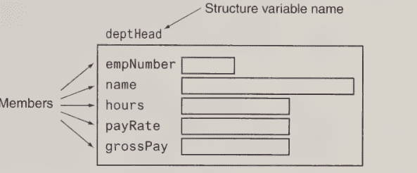

就像可以定义多个 `int` 或 `double` 变量一样，程序中也可以定义多个结构变量。以下语句定义了三个 `Payroll` 变量：`deptHead`、`foreman` 和 `associate`：

`Payroll deptHead, foreman, associate;`

图 11-2 阐释了这三个变量的存在。

# 图 11-2 多个结构变量

| deptHead | foreman |
|---|---|
| empNumber | empNumber |
| name | name |
| hours | hours |
| payRate | payRate |
| grossPay | grossPay |

| associate |
|---|---|
| empNumber |
| name |
| hours |
| payRate |
| grossPay |

## 第 11 章 结构化数据

示例中定义的每个变量都是 `Payroll` 结构的独立实例，并包含它们自己的成员。结构的实例是存在于内存中的变量。它包含了结构声明中描述的所有成员。

尽管示例中的结构变量是独立的，但每个变量都包含具有相同名的成员。在下一节中，你将看到如何访问这些成员。以下是其他结构声明和变量定义的示例：

```cpp
struct Time {
  int hour;
  int minutes;
  int seconds;
};
```

```cpp
struct Date {
  int day;
  int month;
  int year;
};
```

```cpp
// 定义
// 结构变量 now
Time now;
```

```cpp
// 定义
// 结构变量 today
Date today;
```

回顾一下，在程序中实现结构通常有两个步骤：

- 创建结构声明。这建立了结构的 tag（或名称）以及成员列表。
- 定义结构的变量（或实例），并在程序中使用存储数据。

## 11.3 访问结构成员

> 概念：点运算符 (`.`) 允许你访问成员。C++ 提供点运算符（句号）来访问结构的单个成员。使用 `deptHead` 作为 `Payroll` 结构的示例，以下语句演示了如何访问 `empNumber`：
> `deptHead.empNumber;`

在该语句中，点运算符连接了变量名与其所属的结构。以下语句为 `deptHead`、`foreman` 和 `associate` 变量赋值：

`deptHead.empNumber = 1;`
`foreman.empNumber = 2;`
`associate.empNumber = 3;`

通过点运算符，你可以像使用普通变量一样使用成员变量。例如，这些语句显示了 `deptHead` 的内容：

```cpp
cout << deptHead.empNumber << endl;
cout << deptHead.name << endl;
cout << deptHead.hours << endl;
cout << deptHead.payRate << endl;
cout << deptHead.grossPay << endl;
```

程序 11-1 是一个使用 `Payroll` 结构的完整程序。

# 程序 11-1（续）

**程序输出（示例输入已用粗体显示）**

输入员工编号：489
输入员工姓名：Jill Smith
员工工作了多少小时？40
员工的小时薪资率是多少？20
这里是员工的薪资数据：
姓名：Jill Smith
编号：489
工作小时数：40
小时薪资率：20
总薪：$800.00

- 注意：程序 11-1 在第 26 行的 `cin` 的 `ignore` 成员函数中调用了以下函数：
  `c.ignore();`
  请记住，`ignore` 函数会使 `cin` 忽略输入缓冲区中的下一个字符。这对于程序中 `getline` 函数的正常工作是必须的。

- 注意：结构体变量的内容不能通过将整个变量直接传递给 `cout` 来显示。例如，假设 `employee` 是一个 `Payroll` 结构体变量，以下语句将无法工作：
  `cout << employee << endl; // 将无法工作！`
  相反，必须将每个成员单独传递给 `cout`。

从程序 11-1 中可以看出，基本数据类型的结构体成员可以与 `cin`、`cout`、数学语句以及任何对普通变量执行的操作一起使用。唯一的区别是结构体变量名和点运算符 `.` 必须位于成员名称之前。程序 11-2 显示了将结构体变量的成员传递给 `pow` 函数。

# 程序 11-2

```cpp
// 此程序在结构体中存储关于圆的数据。

#include <iostream>
#include <cmath> // 用于 pow 函数
#include <iomanip>

using namespace std;

// pi 的常量。
const double PI = 3.14159;

struct Circle {
  double radius;    // 圆的半径
  double diameter;  // 圆的直径
  double area;      // 圆的面积
};

int main() {
  Circle c; // 定义一个结构体变量

  // 获取圆的直径。
  cout << "Enter the diameter of a circle: ";
  cin >> c.diameter;

  // 计算圆的半径。
  c.radius = c.diameter / 2;

  // 计算圆的面积。
  c.area = PI * pow(c.radius, 2.0);

  // 显示圆的数据。
  cout << fixed << setprecision(2);
  cout << "The radius and area of the circle are:\n";
  cout << "Radius: " << c.radius << endl;
  cout << "Area: " << c.area << endl;
  return 0;
}
```

# **程序输出（示例输入已用粗体显示）**

输入圆的直径：10
圆的半径和面积为：
半径：5
面积：78.54

# 比较结构体变量

你不能对结构体变量进行比较操作。例如，假设 `circle1` 和 `circle2` 是 `Circle` 结构体变量。以下语句将导致错误：

```cpp
if (circle1 == circle2) // 错误！
```

为了比较结构体，你必须比较各个成员，如下代码所示：

```cpp
if (circle1.radius == circle2.radius &&
    circle1.diameter == circle2.diameter &&
    circle1.area == circle2.area)
```

# 11.4 初始化结构体

> 概念：在定义结构体变量时，可以对其成员使用初始值进行初始化。

结构体变量可以在定义时进行初始化，方式类似于数组。假设程序中存在以下结构体声明：

```cpp
struct CityInfo {
  string cityName;
  string state;
  long population;
  int distance;
};
```

然后可以使用初始化列表定义变量，如下所示：

```cpp
CityInfo location = {"Asville", "NC", 80000, 28};
```

该语句定义了变量。初始化列表中的第一个值赋值给第一个声明的成员，初始化列表中的第二个值赋值给第二个成员，依此类推。变量 `location` 按照以下方式进行初始化：

- 字符串 `"Asville"` 被赋值给 `location.cityName`
- 字符串 `"NC"` 被赋值给 `location.state`
- `80000` 被赋值给 `location.population`
- `28` 被赋值给 `location.distance`

你不需要为结构体变量的所有成员提供初始化器。例如，以下语句仅初始化了 `location` 的 `cityName` 成员：

```cpp
CityInfo location = {"Tampa"};
```

`location` 的 `state` 和 `distance` 成员未被初始化。以下语句只初始化了 `location` 的 `cityName` 成员：

```cpp
CityInfo location = {"Atlanta"};
```

如果你留下结构体成员未初始化，则必须初始化后续的所有成员。C++ 不允许跳过结构体成员。例如，以下语句尝试跳过 `population` 成员：

```cpp
CityInfo location = {"Knoxville", "TN"}; // 非法！
```

程序 11-3 展示了部分初始化变量的使用。

```cpp
// 此程序展示了部分
// 初始化变量。
#include <iostream>
#include <string>
#include <iomanip>

using namespace std;

struct EmployeePay {
    string name;        // 姓名
    int empNum;         // 编号
    double payRate;     // 小时薪资率
    double hours;       // 工作小时数
    double grossPay;    // 总薪
};

int main() {
    // 初始化员工1
    EmployeePay employee1 = {"Betty Ross", 141, 18.75, 40};

    cout << fixed << setprecision(2);
    cout << "Name: " << employee1.name << endl;
    cout << "Number: " << employee1.empNum << endl;
    employee1.grossPay = employee1.hours * employee1.payRate;
    cout << "Gross Pay: " << employee1.grossPay << endl;

    // 初始化员工2
    EmployeePay employee2 = {"Jill Smith", 142, 17.50, 20};

    cout << "Name: " << employee2.name << endl;
    cout << "Number: " << employee2.empNum << endl;
    employee2.grossPay = employee2.hours * employee2.payRate;
    cout << "Gross Pay: " << employee2.grossPay << endl;

    return 0;
}
```

# **程序输出（示例输入已用粗体显示）**

姓名：Betty Ross
编号：141
总薪：750.00

姓名：Jill Smith
编号：142
总薪：350.00

从 C++11 开始，初始化结构体变量时等号是可选的。例如，在 C++11 中我们可以定义一个 `CityInfo` 变量并初始化：

```cpp
CityInfo location {"Asville", "NC", 80000, 28};
```

# 检查点

- 11.1 写一个结构体声明来存储关于储蓄账户的数据：
  - 账户账号（`string` 对象）
  - 余额（`double`）
  - 利率（`double`）
  - 平均每月余额（`double`）

- 11.2 为你在 11.1 中声明的结构体编写一个定义语句。使用以下数据进行初始化：
  - 账户账号：`ACZ42137-B127`
  - 余额：`$4512.59`
  - 利率：`4%`
  - 平均每月余额：`$4217.07`

- 11.3 下面的程序框架在完成后将要求用户输入关于他们喜爱的电影的数据：
  - 电影名称
  - 导演名称
  - 制片人名称
  - 电影上映年份

完成以下程序：声明持有这些数据的结构体，定义结构体变量并编写必要的语句。

```cpp
#include <iostream>
#include <string>

using namespace std;

// 在此处编写持有电影数据的结构体声明。

int main() {
    // 定义结构体变量。
    cout << "Enter the following data about your\n";
    cout << "favorite movie:\n";
    cout << "name:\n";
    // 在此处编写语句让用户输入
    // 喜爱的电影名称。将其存储在
    // 结构体变量中。
    cout << "Director:\n";
    // 在此处编写语句让用户输入
    // 导演的名字。将其存储在
    // 结构体变量中。
    cout << "Producer: ";
    // 在此处编写语句，让用户输入
    // 电影制片人的名字。将名称存储在
    // 结构变量中。
    cout << "Year of release: ";
    // 在此处编写语句，让用户输入
    // 电影上映的年份。将年份存储在
    // 结构变量中。
    cout << "Here is data on your favorite movie:\n";
    // 在此处编写语句显示
    // 结构变量中的数据。
    return 0;
}
```

# 11.5 结构体数组

概念：结构体数组可以简化某些编程任务。

在第 7 章中，你看到数据可以存储在两个或多个数组中，通过下标在数组之间建立关系。由于结构体可以包含多个不同数据类型的项目，因此一个结构体数组可以代替多个普通变量的数组。

结构体数组的定义方式与其他任何数组相同。假设程序中存在以下结构声明：

```cpp
struct BookInfo {
  string title;
  string author;
  string publisher;
  double price;
};
```

以下语句定义了一个名为 `bookList` 的数组，包含 20 个元素。每个元素都是一个 `BookInfo` 结构体。

数组的每个元素都可以通过下标访问。例如，`bookList[0]` 是数组中的第一个，`bookList[1]` 是第二个，以此类推。要访问任何元素的成员，只需在下标后加上点运算符（`.`）和成员名称。例如，以下表达式引用 `bookList[5]` 的 `title` 成员：

`bookList[5].title`

以下循环遍历数组，显示存储在每个元素中的数据：

```cpp
for (int index = 0; index < 20; index++) {
  cout << bookList[index].title << endl;
  cout << bookList[index].author << endl;
  cout << bookList[index].publisher << endl;
  cout << bookList[index].price << endl;
}
```

# 程序 11-4

```cpp
// 此程序使用了结构体数组。

#include <iostream>
#include <iomanip>

using namespace std;

struct PayInfo {
    int hours;        // 工作小时数
    double payRate;   // 每时薪率
};

int main() {
    const int NUM_WORKERS = 3; // 人数
    PayInfo workers[NUM_WORKERS]; // 结构体数组
    int index; // 循环计数器

    // 获取员工数据。
    cout << "Enter the hours worked by " << NUM_WORKERS << "\n";
    cout << " employees and their hourly rates.\n";

    for (index = 0; index < NUM_WORKERS; index++) {
        cout << "Get the hours worked by employee #" << (index + 1) << ": ";
        cin >> workers[index].hours >> workers[index].payRate;
        cout << endl;
    }

    // 显示每位员工的总薪资。
    cout << "Here is the gross pay for each employee:\n";
    cout << fixed << setprecision(2);

    for (index = 0; index < NUM_WORKERS; index++) {
        double gross;
    }
}
```


# 11.6 聚焦软件工程：嵌套结构体

## 示例输入对应的程序输出

Enter the hours worked by 3 employees and their hourly rates.

Hours worked by employee #1: 10 Enter
hour pay rate for employee #1: 9.75 Enter

Hours worked by employee #2: 20 Enter
hour pay rate for employee #2: 10.00 Enter

Hours worked by employee #3: 40 Enter
hour pay rate for employee #3: 20.00 Enter

Here is the gross pay for each employee:
Employee #1: $97.50
Employee #2: $200.00
Employee #3: $800.00

## 初始化结构体数组

要初始化结构体数组，只需为一个或多个元素提供一个初始化列表。例如，程序 11-4 中的数组可以这样初始化：

```cpp
PayInfo workers[NUM_WORKERS] = {
    {10, 9.75},
    {15, 8.62},
    {40, 15.65}
};
```

就像一维数组一样，你可以初始化结构体数组中的全部或部分元素，只要不跳过元素即可。

## 11.6 聚焦软件工程：嵌套结构体

> **概念**：结构体变量可以是另一个结构体变量的成员。

有时将结构体嵌套在其他结构体内部是有帮助的。例如，考虑以下结构声明：

```cpp
struct Costs {
    double wholesale;
    double retail;
};

struct Item {
    string partNum;
    string description;
    Costs pricing;
};
```

`Costs` 结构有两个成员：`wholesale` 和 `retail`，都是 `double` 类型。注意 `Item` 结构的第三个成员 `pricing` 是一个 `Costs` 结构。假设变量 `widget` 定义如下：

```cpp
Item widget;
```

以下语句展示了访问 `widget` 内部 `pricing` 变量成员的示例：

```cpp
widget.pricing.wholesale = 100.0;
widget.pricing.retail = 150.0;
```

程序 11-5 更加详细地演示了嵌套结构。

### 程序 11-5

```cpp
// 此程序使用了嵌套结构。
#include <iostream>
#include <string>
using namespace std;

// Date 结构存储日期数据。
struct Date {
    int month;
    int day;
    int year;
};

// Place 结构存储物理地址。
struct Place {
    string address;
    string city;
    string state;
    string zip;
};

// EmployeeInfo 结构存储员工数据。
struct EmployeeInfo {
    string name;
    int employeeNumber;
    Date birthDate; // 嵌套结构
    Place residence; // 嵌套结构
};

int main() {
    // 定义存储经理信息的结构变量。
    EmployeeInfo manager;

    // 获取经理的名字和工号
    cout << "Enter the manager's name: ";
    getline(cin, manager.name);

    cout << "Enter the manager's employee number: ";
    cin >> manager.employeeNumber;

    // 获取经理的出生日期。
    cout << "Now enter the manager's date of birth.\n";
    cout << "Month (up to 2 digits): ";
    cin >> manager.birthDate.month;
    cout << "Day (up to 2 digits): ";
    cin >> manager.birthDate.day;
    cout << "Year: ";
    cin >> manager.birthDate.year;

    // 获取经理的居住地址。
    cout << "Enter the manager's street address: ";
    getline(cin, manager.residence.address);
    cout << "City: ";
    getline(cin, manager.residence.city);
    cout << "State: ";
    cin >> manager.residence.state;
    cout << "ZIP Code: ";
    cin >> manager.residence.zip;

    // 显示经理的信息。
    cout << "Here is the manager's:\n";
    cout << manager.name << endl;
    cout << "Employee number: " << manager.employeeNumber << endl;
    cout << "Date of birth: " << manager.birthDate.month << "/" 
         << manager.birthDate.day << "/" << manager.birthDate.year << endl;
    cout << "Place residence:\n";
    cout << manager.residence.address << endl;
    cout << manager.residence.city << ", " << manager.residence.state << endl;
    return 0;
}
```

### 示例输入对应的程序输出

Enter the manager's name: John Smith
Enter the manager's employee number: 789
Now enter the manager's date of birth.
Month (up to 2 digits): 10
Day (up to 2 digits): 14
Year: 1970
Enter the manager's street address: 190 Disk Drive
City: Redmond
State: WA
ZIP Code: 98052

（程序输出继续）

#### 程序 11-5（继续）

Here is the manager's:
John Smith
Employee number: 789
Date of birth: 10/14/1970
Place residence:
190 Disk Drive
Redmond, WA

## 练习题

对于 11.4，假设 `Product` 结构定义如下：

```cpp
struct Product {
    string description;
    int partNum;
    double cost;
};
```

11.1 定义该类型的变量。
11.2 初始化数组。
11.3 编写一个循环将以下数据存储在 11.4 的第一个元素中：
11.4 将所有成本置零。
11.5 定义一个名为 `Measurement` 的结构，包含以下成员：
11.6 编写一个循环显示你在 11.4 中创建的数组的内容。
11.7 定义一个名为 `Destination` 的结构，包含以下成员：
11.8 定义该类型的变量。
11.9 编写一个循环将以下数据存储在变量中：
11.10 初始化数组。
11.11 显示 11.9 中的数据：
11.12 Miles: 375
11.13 Miles: 605
11.14 City: Tupelo
11.15 Distance: 603,375

## 图 11-3 将结构变量传递给函数

```cpp
showRect(box);

void showRect(Rectangle r) {
    cout << r.length << endl;
    cout << r.width << endl;
    cout << r.area << endl;
}
```

# 程序 11-6

```cpp
1 // 此程序包含接受结构变量作为参数的函数。
2 #include <iostream>
3 #include <string>
4 #include <iomanip>
5 using namespace std;
6
7 struct InventoryItem
8 {
9    int partNum; // 零件编号
10    string description; // 物品描述
11    int onHand; // 现数量
12    double price; // 单价
13 };
14
15 // 函数原型
16 void getItem(InventoryItem&); // 按引用传递参数
17 void showItem(InventoryItem); // 按值传递参数
18
19 int main()
20 {
21     InventoryItem part;
22
23     getItem(part);
24     showItem(part);
25     return 0;
26 }
27
28 //************************************************
29 // 函数 getItem 的定义。该函数使用*
30 // 结构引用变量作为其参数。它向用户
31 // 请求信息并存储在结构中。
32 //************************************************
```

## 11.7 结构作为函数参数

```cpp
void getItem(InventoryItem &p) // 使用引用参数
{
    // 获取零件编号。
    cout << "Enter the part number: ";
    cin >> p.partNum;

    // 获取零件描述。
    cout << "Enter the part description: ";
    cin.ignore(); // 忽略剩余的换行符
    getline(cin, p.description);

    // 获取现数量。
    cout << "Enter the quantity on hand: ";
    cin >> p.onHand;

    // 获取单价。
    cout << "Enter the unit price: ";
    cin >> p.price;
}
```

> ********************************************************************
> // 函数 showItem 的定义。该函数接受一个
> // InventoryItem 结构类型的参数。该
> // 结构的内容将被显示。
> ********************************************************************

```cpp
void showItem(InventoryItem p)
{
    cout << fixed << setprecision(2);
    cout << "Part Number: " << p.partNum << endl;
    cout << "Description: " << p.description << endl;
    cout << "Units On Hand: " << p.onHand << endl;
    cout << "Price: $" << p.price << endl;
}
```

### 带有加粗示例输入的程序输出

Enter the part number: 800
Enter the part description: Screwdriver
Enter the quantity on hand: 135
Enter the unit price: 1.25
Part Number: 800
Description: Screwdriver
Units on Hand: 135
Price: $1.25

程序 11-6 中的 `InventoryItem` 结构声明出现在 `getItem` 和 `showItem` 函数的原型和定义之前。这是因为这两个函数都使用 `InventoryItem` 结构变量作为它们的参数。编译器在遇到该类型变量的定义之前必须知道 `InventoryItem` 是什么。否则，将发生错误。

## 常量引用参数

有时结构可能非常大。按值传递大型结构会降低程序的性能，因为必须创建结构的副本。当结构按引用传递时，它不会被复制。取而代之的是传递一个指向原始参数的引用。因此，通过引用传递像结构这样的大对象通常是更优的。

当然，按引用传递对象的缺点是函数可以访问原始参数。它可能会更改参数的值。可以通过将参数作为常量引用传递来防止这一点。这里展示了程序 11-6 中的 `showItem` 函数，它使用了常量引用参数。

```cpp
void showItem(const InventoryItem& p)
{
    cout << fixed << setprecision(2);
    cout << "Number: " << p.partNum << endl;
    cout << "Description: " << p.description << endl;
    cout << "Units On Hand: " << p.onHand << endl;
    cout << "Price: $" << p.price << endl;
}
```

这个版本比原始版本更高效，因为它消耗的时间更短。由于参数被定义为常量，函数无法损坏参数的值。

### 此版本的原型如下：

```cpp
void showItem(const InventoryItem&);
```

## 11.8 返回结构

> **概念**：函数可以返回结构。

就像函数可以写成返回 `int`、`long` 或其他类型一样，它们也可以被设计为返回结构。回想内容：

```cpp
struct Circle {
    double radius;
    double diameter;
    double area;
};
```

像下面的函数可以返回数据类型：

```cpp
Circle getData()
{
    Circle temp; // 临时 Circle
    temp.radius = 10.0;
    temp.diameter = 20.0;
    temp.area = 314.159;
    return temp;
}
```

注意 `getData` 函数返回了一个结构。例如，下面的语句将返回值赋值给名为 `Circle` 的变量：

```cpp
Circle c = getData();
```

当函数返回时，变量始终持有成员值。在 `getData` 函数中，`temp` 是一个局部变量，然后从函数返回。

# 程序 11-7

```cpp
#include <iostream>
#include <iomanip>
#include <cmath>
using namespace std;

// 常量 pi
const double PI = 3.14159;

// 结构声明
struct Circle {
    double radius;
    double diameter;
    double area;
};

// 函数原型
Circle getInfo();

int main() {
    Circle c; // 定义一个结构变量

    // 获取圆的数据。
    c = getInfo();

    // 计算圆面积。
    c.area = PI * pow(c.radius, 2.0);

    // 显示圆的数据。
    cout << "The radius and area of the circle are:\n";
    cout << fixed << setprecision(2);
    cout << "Radius: " << c.radius << endl;
    cout << "Area: " << c.area << endl;
    return 0;
}
```


/* 函数 `getInfo` 的定义。该函数使用局部变量 `tempCircle`，它是一个圆结构。用户输入圆的直径，函数计算半径并将其存储在 `tempCircle.radius` 中。然后 `tempCircle` 从函数返回。 */

```cpp
Circle getInfo() {

    Circle tempCircle; // 临时变量

    // 将圆数据存储在临时变量中有

    cout << "Enter the diameter of a circle: ";

    cin >> tempCircle.diameter;

    tempCircle.radius = tempCircle.diameter / 2.0;

    // 返回临时变量。

    return tempCircle;

}
```

# 结构体指针

> 概念：你可以获取结构体变量的地址并创建指向结构体的变量。

定义一个指向结构体的指针变量定义任何其他指针变量一样简单：数据类型后跟一个星号 `*` 和指针变量的名称。这是一个示例：

```cpp
Circle *cirPtr = nullptr;
```

该语句将 `cirPtr` 定义为指向 `Circle` 结构的指针。看下面的代码：

```cpp
Circle myCircle = { 10.0, 20.0, 314.159 };

Circle *cirPtr = nullptr;

cirPtr = &myCircle;
```

前两行定义了结构体变量 `myCircle` 和指针 `cirPtr`。第三行将 `myCircle` 的地址赋值给 `cirPtr`。执行该行后，`cirPtr` 将指向 `myCircle` 结构。如图 11-4 所示。

图 11-4 指向结构体的指针

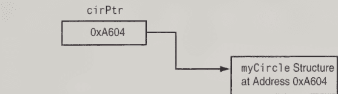

通过指针间接访问结构体的成员时，如果使用间接运算符可能会很笨拙。人们可能认为下面的语句会访问 `cirPtr` 指向的结构的 `radius` 成员，但事实并非：

```cpp
*cirPtr.radius = 10;
```

点运算符 `.` 的优先级高于间接运算符，因此 `*` 运算符尝试解引用 `cirPtr.radius`，而不是 `cirPtr`。要解引用 `cirPtr` 指针，必须使用圆括号。

```cpp
(cirPtr).radius = 10;
```

由于这种表示法很笨拙，C++ 有一种特殊的运算符来解引用结构体指针。它被称为**结构指针运算符**，由一个连字符 `-` 后面跟一个大于符号 `>` 组成。用结构指针运算符重写的之前的语句如下所示：

```cpp
cirPtr->radius = 10;
```

在在使用指针的语句中，结构指针运算符取代了点运算符。该运算符会自动解引用左侧的结构体指针。不需要将指针名称括在括号中。

> 注意：结构指针运算符看起来像一个箭头，因此在视觉上指示了正在使用“指针”。

程序 11-8 显示了指向结构体的指针可以作为函数参数，允许函数访问原始结构参数的成员。

# 程序 11-8

```cpp
// 此程序演示了一个使用指向
// 结构体变量指针作为参数的函数。

#include <iostream>
#include <string>
#include <iomanip>

using namespace std;

struct Student {
    string name;          // 学生姓名
    int idNum;            // 学生学号
    int creditHours;      // 选修学分
    double gpa;           // 当前 GPA
};

void getData(Student *); // 函数原型

int main() {
    Student freshman;

    // 获取学生数据。
    cout << "Enter the following student data:\n";
    getData(&freshman); // 传递 freshman 的地址

    cout << "Here is the student data you entered:\n";

    // 现在显示存储在 freshman 中的数据
    cout << setprecision(3);
    cout << "Name: " << freshman.name << endl;
    cout << "ID Number: " << freshman.idNum << endl;
    cout << "Credit Hours: " << freshman.creditHours << endl;
    cout << "GPA: " << freshman.gpa << endl;

    return 0;
}
```

```cpp
****************************************************
// 函数 getData 的定义。使用指向 *
// Student 结构体变量的指针。用户输入学生 *
// 信息，并存储在变量中。
********************************************************

void getData(Student *s) 
{
    // 获取学生姓名。
    cout << "Student name: ";
    getline(cin, s->name);

    // 获取学生学号。
    cout << "Student ID Number: ";
    cin >> s->idNum;

    // 获取选修学分。
    cout << "Credit Hours Enrolled: ";
    cin >> s->creditHours;

    // 获取 GPA。
    cout << "Current GPA: ";
    cin >> s->gpa;
}
```

# 程序输出（示例输入已加粗显示）

Enter the following student data:
Student Name: **Frank Smith** [Enter]
Student Number: **4876** [Enter]
Credit Hours Enrolled: **12** [Enter]
Current GPA: **3.45** [Enter]

Here is the student data you entered:
Name: Frank Smith
ID Number: 4876
Credit Hours: 12
GPA: 3.45

# 动态分配结构体

你可以使用结构体指针和 `new` 运算符来动态分配结构体。例如，下面的代码定义了一个名为 `cirPtr` 的 `Circle` 指针并动态分配了一个 `Circle` 结构。然后将值存储在动态分配的结构成员中。

```cpp
Circle *cirPtr = nullptr; // 定义一个 Circle 指针
cirPtr = new Circle; // 动态分配一个 Circle 结构
cirPtr->radius = 10; // 在 radius 成员中存储值
cirPtr->diameter = 20; // 在 diameter 成员中存储值
cirPtr->area = 314.159; // 在 area 成员中存储值
```

你也可以动态分配结构体数组。下面的动态代码显示分配了一个包含五个 `Circle` 结构的数组：

```cpp
Circle *circles = nullptr;
circles = new Circle[5];

for (int count = 0; count < 5; count++) {
    cout << "Enter the radius for circle "
         << (count + 1) << ":";
    cin >> circles[count].radius;
}
```

# 软件工程聚焦：何时使用 ->，以及何时使用 *

有时结构体包含指针作为成员。例如，下面的结构体声明有一个 `int` 指针成员：

```cpp
struct GradeInfo {
    string name; // 学生姓名
    int *testScores; // 动态分配的数组
    float average; // 测试平均分
};
```

必须记住，指针运算符 (`->`) 用于解引用指向结构体的指针，而不是指向结构体内部成员的指针。如果程序解引用该结构体中的 `testScores` 指针，则必须使用间接运算符。例如，假设以下变量已定义：

```cpp
GradeInfo student1;
```

下面的语句将显示 `testScores` 成员：
```cpp
*student1.testScores;
```

仍然可以定义一个包含指针的结构。例如，下面的语句定义了指向 `GradeInfo` 的指针：

```cpp
GradeInfo *stPtr = nullptr;
```

假设 `stPtr` 是一个有效的 `GradeInfo` 指针，下面的语句将显示 `testScores` 成员：

```cpp
cout << stPtr->testScores;
```

在该语句中，`*` 运算符解引用 `stPtr`，而 `->` 运算符解引用 `stPtr`。记住下面的表达式等价于：

```cpp
(*stPtr).testScores
```

# 11.10 软件工程聚焦：何时使用 ->，以及何时使用 *

这种表示法的笨拙说明了 `->` 运算符的必要性。表 11-3 列出了使用 `*`、`->` 和 `.` 运算符的表达式并描述了它们的内容。

| 表达式 | 说明 |
| --- | --- |
| `s->m` | `s` 是结构体指针，`m` 是成员。该表达式访问指向 `s` 的结构的 `m` 成员 |
| `a.p` | `a` 是结构体变量，`p` 是指针。该表达式解引用 `p` |
| `(*s).m` | `s` 是结构体指针，`m` 是成员。`*` 运算符解引用 `s`，从而导致对指向 `s` 的结构 `m` 成员的访问。表达式与 `s->m` 等同 |
| `s->p` | `s` 是结构体指针，`p` 是指向 `s` 的结构的成员。该表达式访问 `p` 所向的值。（`->` 运算符和 `*` 运算符解引用 `p`。） |
| `(*s).p` | `s` 是结构体指针，`p` 是指向 `s` 的结构的成员。`(*)` 解引用 `s`，最外层的 `*` 运算符解引用 `p`。表达式 `s->p` 等同于 |

# 11-3 结构体指针表达式

检查点
假设问题 11.11–11.15 存在以下结构声明：

```cpp
struct Rectangle {
  int length;
  int width;
};
```

- 11.11 写一个接受 `Rectangle` 结构作为参数并在屏幕上显示结构内容的函数。
- 11.12 写一个使用 `Rectangle` 结构引用变量作为参数的函数，并将用户输入存储在结构成员中。
- 11.13 写一个返回 `Rectangle` 结构的函数。该函数应将用户输入存储在返回的结构成员中。
- 11.14 写出指向 `Rectangle` 结构指针的定义。
- 11.15 假设 `rptr` 是指向 `Rectangle` 结构的指针。在表达式 A、B、C 中，哪一个与以下语句相等：

```cpp
rptr->width
```

A) `(*rptr).width`
B) `rptr.width`
C) `rptr.(*width)`

---

642 第 11 节 结构化数据

# 11.11 枚举数据类型

> 概念：枚举数据类型是一种程序员定义的数据类型。它由被称为枚举举符的值组成，这些值表示整数常量。

使用 `enum` 关键字，你可以创建自己的数据类型并指定属于该类型的值。这种类型被称为枚举数据类型。以下是一个枚举数据类型声明的示例：

```cpp
enum Day { MONDAY, TUESDAY, WEDNESDAY, THURSDAY, FRIDAY };
```

枚举数据声明以关键字 `enum` 开头，后面跟着类型名称，然后是花括号内的标识符列表，并以分号结束。该示例创建了一个名为 `Day` 的枚举数据类型。在大括号内列出的标识符 MONDAY、TUESDAY、WEDNESDAY、THURSDAY 和 FRIDAY 均称为**枚举举符**。它们代表属于 `Day` 数据类型的值。枚举数据类型声明的通用格式如下：

```cpp
enum TypeName { 一个或多个枚举举符 };
```

注意枚举举符没有包含在引号；因此它们不是字符串。枚举举符必须是合法的 C++ 标识符。

一旦你在程序中创建了枚举数据类型，就可以定义该类型的变量。例如，以下语句将 `workDay` 定义为 `Day` 类型的变量：

```cpp
Day workDay;
```

由于 `workDay` 是 `Day` 数据类型的变量，我们可以为它分配任何枚举举符 MONDAY、TUESDAY、WEDNESDAY、THURSDAY 或 FRIDAY。例如，以下语句将值 `WEDNESDAY` 赋值给 `workDay`。

```cpp
Day workDay = WEDNESDAY;
```

那么，这些枚举举符 MONDAY、TUESDAY、WEDNESDAY、THURSDAY 和 FRIDAY 是什么呢？你可以将它们视为整数常量。在内部，编译器从 0 开始为枚举举符赋值。枚举举符 MONDAY 以数字 0 存储在内存中，TUESDAY 以数字 1 存储在内存中，WEDNESDAY 以数字 2 存储在内存中，依此类推。为了证明这一点，请看下面的代码：

```cpp
cout << MONDAY << endl << TUESDAY << endl
cout << WEDNESDAY << endl << THURSDAY << endl
cout << FRIDAY << endl;
```

该语句将产生以下输出：

```
0
1
2
3
4
```

注意：在为枚举举符命名时，并不要求它们必须全大写字母。例如，我们可以将 `Day` 类型的枚举举符写为 `monday`、`tuesday` 等。然而，由于它们代表常量值，许多程序员倾向于使用全大写字母。这纯粹是一种风格上的偏好。

# 将整数赋值给 enum 变量

尽管枚举数据类型的枚举举符在内存中被存储为整数，但你不能直接给 enum 变量分配整数值。例如，假设 `workDay` 是之前描述的 `Day` 类型的变量，以下赋值语句是非法的：

```cpp
workDay = 3; // 错误！
```

编译此语句将产生类似“无法将 int 转换为 Day”的错误消息。在给 enum 变量赋值时，你应该使用有效的枚举举符。然而，如果情况需要你在 enum 变量中存储整数值，可以通过强制类型转换来实现。以下是一个示例：

```cpp
workDay = static_cast<Day>(3);
```

该语句产生的结果与以下语句相同：

```cpp
workDay = THURSDAY;
```

# 将枚举举符赋值给 int 变量

虽然你不能直接给 enum 变量分配整数值，但你可以将枚举举符直接给整数变量。例如，以下代码可以正常工作：

```cpp
enum Day { MONDAY, TUESDAY, WEDNESDAY, THURSDAY, FRIDAY };
int x;
x = THURSDAY;
cout << x << endl;
```

当这段代码运行时，它将显示 3。你也可以将枚举类型的变量赋值给整数变量，如下：

```cpp
workDay = FRIDAY;
int x = workDay;
cout << x << endl;
```

当这段代码运行时，它将显示 4。

# 比较枚举举符的值

枚举举符的值可以使用关系运算符进行比较。例如，使用我们讨论过的 `Day` 数据类型，以下表达式为真：

```cpp
FRIDAY > MONDAY
```

该表达式为真是因为枚举举符 FRIDAY 存储在内存中为 4，而枚举举符 MONDAY 存储为 0。以下代码将显示消息“Friday is greater than Monday.”。

```cpp
if (FRIDAY > MONDAY)
    cout << "Friday is greater than Monday.\n";
```

# 第 11 节 结构化数据

你也可以将枚举举符的值与整数值比较。例如，以下代码将显示消息“Monday is equal to zero.”。

```cpp
if (MONDAY == 0)
    cout << "Monday is equal to zero.\n";
```

让我们来看使用了目前所学大部分内容的完整程序。11-9 使用了我们讨论的 `Day` 数据类型。

# 程序 11-9

# 以粗体显示示例输入的程序输出

输入第 0 天的销售额：**1525.00**
输入第 1 天的销售额：**1896.50**
输入第 2 天的销售额：**1975.63**
输入第 3 天的销售额：**1678.33**
输入第 4 天的销售额：**1498.52**
总销售额为 $8571.98

# 匿名枚举类型

注意，你可以定义没有名称的枚举数据类型。这被称为匿名枚举类型。因为该类型没有名称，你无法声明该类型的变量。然而，你可以用它来初始化变量。例如：

```cpp
enum { MONDAY, TUESDAY, WEDNESDAY, THURSDAY, FRIDAY } day = MONDAY;
```

等等，示例是
```cpp
enum { MONDAY, TUESDAY, WEDNESDAY, THURSDAY, FRIDAY };
```

# 使用数学运算符更改 enum 变量的值

尽管枚举举符是真实的整数，但在使用数学运算时可能会遇到问题。例如，看下面的代码：

```cpp
Day day1, day2;
```


# 使用 enum 变量遍历数组

由于枚举符号的值可以作为数组下标，你可以使用 enum 变量遍历元素。例如，看下面的代码：

```cpp
enum Day { MONDAY, TUESDAY, WEDNESDAY, THURSDAY, FRIDAY };

double sales[5];

Day day;

for (day = MONDAY; day < FRIDAY; day++)
{
    cout << "Enter the sales for day " << day << ": ";
    cin >> sales[day];
}
```

在这段代码中，`day` 是用于遍历数组每个元素的 `Day` 变量。然而，为了此目的使用 enum 变量并不直接，因为你不能在 enum 变量上使用 `++` 或 `--` 运算符。为了理解我的意思，先看来自 11-9 的以下代码：

```cpp
for (int index = MONDAY; index < FRIDAY; index++)
{
    cout << "Enter the sales for day " << index << ": ";
    cin >> sales[index];
}
```

在这段代码中，`index` 是用于遍历每个元素的 `int` 变量。可以预期我们可以使用 `Day` 变量，如下代码所示：

```cpp
Day day; // 定义一个 Day 变量

// 错误!!! 这段代码无法工作。
for (day = MONDAY; day < FRIDAY; day++)
{
    cout << "Enter the sales for day " << day << ": ";
    cin >> sales[day];
}
```

注意 for 循环的更新表达式使用了 `++` 运算符来增加 `day`。虽然这对于 `int` 变量运行良好，但 `++` 运算符不能用于 enum 变量。相反，你必须将 `day++` 转换为一个有效的等效表达式。

```cpp
day = day + 1;  // 好主意，但仍然不起作用。
```

然而，这仍然不起作用。我们必须使用强制类型转换将表达式 `day + 1` 显式转换为 `Day` 数据类型，如下：

```cpp
day = static_cast<Day>(day + 1);
```

这就是我们在循环中代替 `day++` 使用的表达式。修正后的 for 循环如下：

```cpp
for (day = MONDAY; day < FRIDAY;
     day = static_cast<Day>(day + 1))
{
    cout << "Enter the sales for day " << day << ": ";
    cin >> sales[day];
}
```

程序 11-10 是程序 11-9 的修改版本，修改为使用 `Day` 变量遍历 `sales` 数组的元素。

## 11.11 枚举数据类型

### 程序 11-10

```cpp
// 此程序演示了枚举数据类型。

#include <iostream>
#include <iomanip>

using namespace std;

enum Day { MONDAY, TUESDAY, WEDNESDAY, THURSDAY, FRIDAY };

int main() {
    const int NUM_DAYS = 5; // 天数
    double sales[NUM_DAYS]; // 用来存储每天的销售额
    double total = 0.0; // 累加器
    Day workday; // 循环计数器

    // 获取每天的销售额。
    for (workday = MONDAY; workday <= FRIDAY; workday = static_cast<Day>(workday + 1)) {
        cout << "Enter the sales for day " << workday << ": ";
        cin >> sales[workday];
    }

    // 计算总销售额。
    for (workday = MONDAY; workday <= FRIDAY; workday = static_cast<Day>(workday + 1)) {
        total += sales[workday];
    }

    // 显示总额。
    cout << "The total sales are $" << setprecision(2) << fixed << total << endl;
    return 0;
}
```

### 程序输出（示例输入已加粗显示）

```text
Enter the sales for day 0: 1525.00
Enter the sales for day 1: 1896.50
Enter the sales for day 2: 1975.63
Enter the sales for day 3: 1678.33
Enter the sales for day 4: 1498.52
Total sales are $8573.98
```

### 使用枚举常量输出值

正如你所看到的，将枚举常量发送到 `cout` 会显示该枚举常量的值。例如，假设我们使用之前描述的 `Day` 类型，以下语句将显示 0：

```cpp
cout << MONDAY << endl;
```

如果你想使用枚举来显示如“Monday”之类的字符串，你必须编写代码来生成所需的字符串。例如，在下面的代码中，假设 `workday` 是一个已初始化为某个值的变量。`switch` 语句根据变量的值显示天的名称。

```cpp
switch(workday) {
    case MONDAY: cout << "Monday"; break;
    case TUESDAY: cout << "Tuesday"; break;
    case WEDNESDAY: cout << "Wednesday"; break;
    case THURSDAY: cout << "Thursday"; break;
    case FRIDAY: cout << "Friday"; break;
}
```

程序 11-11 显示了在函数中使用的此类代码。它没有要求用户输入第0天、第1天等等的销售额，而是显示了天的名称。

### 程序 11-11

```cpp
// 此程序演示了枚举数据类型。

#include <iostream>
#include <iomanip>

using namespace std;

enum Day { MONDAY, TUESDAY, WEDNESDAY, THURSDAY, FRIDAY };

// 函数原型
void displayDayName(Day);

int main() {
    const int NUM_DAYS = 5; // 天数
    double sales[NUM_DAYS]; // 用来存储每天的销售额
    double total = 0.0; // 累加器
    Day workday; // 循环计数器

    // 获取每天的销售额。
    for (workday = MONDAY; workday <= FRIDAY; workday = static_cast<Day>(workday + 1)) {
        cout << "Enter the sales for day ";
        displayDayName(workday);
        cout << ": ";
        cin >> sales[workday];
    }

    // 计算总销售额。
    for (workday = MONDAY; workday <= FRIDAY; workday = static_cast<Day>(workday + 1)) {
        total += sales[workday];
    }

    // 显示总额。
    cout << "The total sales are $" << setprecision(2) << fixed << total << endl;
    return 0;
}

// displayDayName 函数的定义
// 此函数接受一个 Day 类型的参数
// 并显示对应的星期名称。
void displayDayName(Day d) {
    switch (d) {
        case MONDAY: cout << "Monday"; break;
        case TUESDAY: cout << "Tuesday"; break;
        case WEDNESDAY: cout << "Wednesday"; break;
        case THURSDAY: cout << "Thursday"; break;
        case FRIDAY: cout << "Friday"; break;
    }
}
```

### 程序输出（示例输入已加粗显示）

```text
Enter the sales for Monday: 1525.00
Enter the sales for Tuesday: 1896.50
Enter the sales for Wednesday: 1975.63
Enter the sales for Thursday: 1678.33
Enter the sales for Friday: 1498.52
Total sales are $8573.98
```

### 为枚举常量指定整数值

默认情况下，枚举数据类型中的枚举常量被赋值为 0、1、2 等整数值。如果这不合适，你可以指定要赋值的值，如下例所示：

```cpp
enum Water { FREEZ = 32, BOILING = 212 };
```

在示例中，`FREEZ` 被赋值为 32，`BOILING` 被赋值为 212。程序 11-12 演示了如何使用这种类型。

### 枚举常量必须唯一

枚举常量是标识符，就像变量名、函数名。例如，如果以下两个内容出现在同一个作用域内，将导致错误：

```cpp
enum Status { OFF, ON };
const int OFF = 0; // 错误！
```

### 强类型枚举

强类型枚举器与普通枚举器一样以整数形式存储。然而，如果你想获取强类型枚举器的底层整数值，必须使用强制转换操作符。这是一个示例：

```cpp
int x = static_cast<int>(Presidents::ROOSEVELT);
```

该语句将 `Presidents::ROOSEVELT` 枚举的底层整数赋值给变量 `x`。这是另一个示例：

```cpp
cout << static_cast<int>(Presidents::TAFT) << endl;
cout << static_cast<int>(Presidents::MCKINLEY) << endl;
```

该语句显示 `Presidents::TAFT` 和 `Presidents::MCKINLEY` 枚举的整数值。

当你声明强类型枚举时，可以选择指定任何整数数据类型作为底层类型。你只需要在名称后写一个冒号（:），然后是所需的数据类型。例如，以下语句声明了一个使用 `char` 数据类型作为枚举类型的枚举：

```cpp
enum class Day : char { MONDAY, TUESDAY, WEDNESDAY, THURSDAY, FRIDAY };
```

以下语句展示了另一个示例。该语句声明了一个名为 `Water` 的枚举，使用 `unsigned` 作为其枚举的数据类型。此外，还为枚举分配了值：

```cpp
enum class Water : unsigned { FREEZING = 32, BOILING = 212 };
```

### 检查点

- 11.16 查看以下声明：
  `enum Flower { ROSE, DAISY, PETUNIA };`
  在内存中，枚举器 `ROSE` 将存储什么值？`DAISY` 呢？`PETUNIA` 呢？
- 11.17 以下代码将显示什么？
  `enum { HOBBIT, ELF = 7, DRAGON };`
  `cout << HOBBIT << " " << ELF << " " << DRAGON << endl;`
- 11.18 检查点问题 11.17 中的枚举数据类型是否有名称，还是匿名的？
- 11.19 以下代码将显示什么？
  `enum Letters { Z, Y, X };`
  `if (Z > X)`
  `cout << "Z is greater than X. \n"`
  `else`
  `cout << "Z is not greater than X. \n";`
- 11.20 以下代码会导致错误，还是会无错误地编译？如果会导致错误，请重写它使其能够编译。
  `enum Color { RED, GREEN, BLUE };`
  `Color c;`
  `c = 0;`

## 复习题与练习题

- 11.21 以下代码会导致错误，还是会无错误地编译？如果会导致错误，请重写它使其能够编译。

```cpp
enum Color { RED, GREEN, BLUE };
Color c = RED;
c++;
```

> 注意：关于本章主题的更多示例，请参见 pearsonhigher.com/gaddis 计算机门户上的 High Adventure Travel Part 2 Case Study。

### 复习题

1. 什么是基本数据类型？
2. 结构体声明会导致结构体变量的创建？
3. 数组和结构体都能存储多个值。数组和结构体之间的区别是什么？
4. 查看以下结构体声明：
   ```cpp
   struct Point {
       int x;
       int y;
   }
   ```
   编写语句：
   A) 定义一个名为 `center` 的 `Point` 结构体变量。
   B) 为 `center` 的 `x` 成员赋值 12。
   C) 为 `center` 的 `y` 成员赋值 7。
   D) 显示 `center` 的 `x` 和 `y` 成员的内容。
5. 查看以下结构体声明：
   ```cpp
   struct FullName {
       string lastName;
       string middleName;
       string firstName;
   }
   ```
   编写语句：
   A) 定义一个名为 `info` 的 `FullName` 结构体变量。
   B) 为 `info` 变量赋值姓、中间名和名。
   C) 显示 `info` 变量的内容。
6. 查看以下代码：
   ```cpp
   struct PartData {
       string partName;
       int idNumber;
   }
   PartData inventory[100];
   ```
   编写语句，显示 `inventory` 数组中第 49 个元素的 `partName` 成员。
7. 查看以下代码：
   ```cpp
   struct Town {
       string townName;
       string county;
       double population;
       double elevation;
   };
   Town t = { "Canton", "Haywood", 9478, 0.0 };
   ```


# 结构化数据练习题

## 选择题

### 8. 查看以下代码：
```cpp
struct Rectangle
{
    int length;
    int width;
};

Rectangle *r = nullptr;
```
编写语句：
A) 动态分配一个 `Rectangle` 变量并让 `r` 指向它。
B) 为结构体的 `length` 成员赋值 10，为 `width` 成员赋值 14。

### 9. 以下代码将显示什么？
```cpp
enum { POODLE, BOXER, TERRIER };

cout << POODLE << " " << BOXER << " " << TERRIER << endl;
```

### 10. 查看以下声明：
```cpp
enum Person { BILL, CLAIRE, BOB };

Person p;
```
判断以下语句或表达式有效或无效：
A) `p = BOB;`
B) `p++;`
C) `BILL > BOB`
D) `p = 0;`
E) `int x = BILL;`
F) `p = static_cast<Person>(3);`
G) `cout << CLAIRE << endl;`

## 填空题

11. 在创建结构体变量之前，结构体必须是 ________。
12. ________ 是结构类型的名称。
13. 在结构体声明内部声明的变量称为 ________。
14. 结构体声明的右括号后需要一个 ________。
15. 在结构体变量的定义中，________ 放在变量名之前，就像普通变量的数据类型放在名称之前一样。
16. ________ 运算符允许访问结构体成员。

## 算法工作台

### 17. 结构体 `Car` 声明如下：
```cpp
struct Car
{
    string carMake;
    string carModel;
    int yearModel;
    double cost;
};
```
编写一个定义语句，定义一个带有以下数据的 `Car` 变量：
- Make: Ford
- Model: Mustang
- Year Model: 1968
- Cost: $20000

### 18. 定义一个包含 25 个 `Car` 结构体变量的数组（结构体见第17题）。

### 19. 定义一个包含 35 个 `Car` 结构体变量的数组。用以下数据初始化三个元素：

| Make | Model | Year | Cost |
| :--- | :--- | :--- | :--- |
| Ford | Taurus | 1997 | $21000 |
| Honda | Accord | 1992 | $11000 |
| Lamborghini | Countach | 1997 | $200000 |

### 20. 编写一个循环遍历第19题中定义的数组，显示每个元素的内容。

### 21. 声明一个名为 `TempScale` 的结构体，成员如下：
```cpp
fahrenheit: double
centigrade: double
```
接下来，声明一个名为 `Reading` 的结构体，成员如下：
```cpp
windSpeed: int
humidity: double
temperature: TempScale
```
接下来，定义一个 `Reading` 结构体变量。

### 22. 编写语句在题21定义的变量中存储以下数据：
- 风速：37 mph
- 湿度：32%
- 华氏度温度：32 度
- 摄氏度温度：0 度

### 23. 编写一个名为 `showReading` 的函数。它应该接受一个 `Reading` 结构体变量（见题21）作为参数。该函数在屏幕上显示变量的内容。

### 24. 编写一个名为 `findReading` 的函数。它应该使用 `Reading` 引用变量（见题21）作为参数。该函数要求用户输入结构体每个成员的值。

### 25. 编写一个名为 `getReading` 的函数，其返回一个 `Reading` 结构体（见题21）。该函数要求用户输入 `Reading` 结构体每个成员的值，然后返回该结构体。

### 26. 编写一个名为 `recordReading` 的函数。它应该使用一个 `Reading` 指针变量（见题21）作为参数。该函数要求用户输入参数所指向的结构体每个成员的值。

### 27. 使用指针操作符重写以下语句：
`(*rptr).windSpeed = 50;`

### 28. 查看以下语句：
`enum Color { RED, ORANGE, GREEN, BLUE };`
A) 该语句声明的数据类型名称是什么？
B) 该类型的枚举器有哪些？
C) 编写一个语句定义该类型的变量并用有效值初始化。

### 29. 一家宠物商店出售狗、猫、鸟和仓鼠。编写一个匿名数据类型的声明，表示商店出售的宠物类型。

## 判断对错

30. T 结构体声明的右括号后需要分号。
31. F 结构体声明不定义变量。
32. T 可以将变量传递给 `cout` 对象来显示结构体的内容。
33. F 结构体变量不可初始化。
34. T 在结构体变量的初始化列表中不需要提供所有成员的初始值。
35. T 在结构体的初始化列表中可以跳过成员。
36. F 下列表达式 `model[5]` 指的是 `carInfo` 数组中的第6个元素（注：通常中索引从0开始）。
37. T 结构体数组可以初始化。
38. T F 结构体变量不能是另一个结构体的成员。
39. T F 结构体成员变量可以作为参数传递给函数。
40. T F 整个结构体不能作为参数传递给函数。
41. T F 函数可以返回一个结构体。
42. T F 当函数返回一个结构体时，函数总是需要有一个局部结构体变量来存储要返回的成员值。
43. T F 重定向运算符的优先级高于点运算符。
44. T F 结构体指针运算符不会自动对其左侧的指针进行解引用。

## 找出错误

以下每个声明、程序和程序段都存在错误。请尽可能找出它们。

### 45.
```cpp
struct
{
    int x;
    float y;
};
```

### 46.
```cpp
struct Values
{
    string name;
    int age;
};
```

### 47.
```cpp
struct TwoVals
{
    int a, b;
};

int main ()
{
    TwoVals.a = 10;
    TwoVals.b = 20;
    return 0;
}
```

### 48.
```cpp
#include <iostream>
using namespace std;

struct ThreeVals
{
    int a, b, c;
};

int main()
{
    ThreeVals vals = {1, 2, 3};
    cout << vals << endl;
    return 0;
}
```

### 49.
```cpp
#include <iostream>
#include <string>
using namespace std;

struct names
{
    string first;
    string last;
};

int main ()
{
    names customer = "Smith", "Orley";
    cout << names.first << endl;
    cout << names.last << endl;
    return 0;
}
```

### 50.
```cpp
struct FourVals
{
    int a, b, c, d;
};

int main ()
{
    FourVals nums = {1, 2, , , 4};
    return 0;
}
```

### 51.
```cpp
struct TwoVals
{
    int a;
    int b;
};

twoGetVals()
{
    TwoVals.a = TwoVals.b = 0;
}
```

### 52.
```cpp
struct ThreeVals
{
    int a, b, c;
};

int main ()
{
    TwoVals s, *sptr = nullptr;
    sptr = &s;
    *sptr.a = 1;
    return 0;
}
```


# 编程挑战

## 1. 电影数据

编写一个程序，使用名为 `MovieData` 的结构体来存储关于电影的以下信息：

- 标题
- 导演
- 发行年份
- 片长（分钟）

该程序应创建两个 `MovieData` 变量，在成员中存储值，并依次将每个变量传递给一个函数，该函数以清晰的格式显示电影信息。

## 2. 电影利润

修改为编程挑战 1（电影数据）编写的程序，增加两个额外的成员用于存储电影的制作成本和第一年的收入。修改显示电影数据的函数，以显示标题、导演、发行年份以及第一年的利润或亏损。

## 3. 公司销售数据

编写一个程序，使用结构体来存储关于公司部门的以下数据：

- 部门名称（如东、西、北或南）
- 第一季度销售额
- 第二季度销售额
- 第三季度销售额
- 第四季度销售额
- 年度总销售额
- 平均季度销售额

该程序应使用该结构的四个变量。每个变量应代表一个公司部门：东、西、北和南。应该要求用户输入每个部门四个季度的销售数字。应计算每个部门的总销售额和平均销售额，并将其存储在每个结构体变量的相应成员中。然后将这些数字显示在屏幕上。

输入验证：任何销售数字都不应接受负数。

## 4. 气象统计

编写一个程序，使用结构体存储特定月份的以下天气数据：

- 总降水量
- 最高温度
- 最低温度
- 平均温度

该程序应有一个包含 12 个结构体的数组，用于存储一整年的天气数据。当程序运行时，它应该要求用户输入每个月的数据。（应计算平均温度）。一旦输入了所有月份的数据，程序应计算并显示平均月降水量、全年总降水量、全年最高和最低温度（以及它们发生的月份），以及所有每月平均温度的平均值。

输入验证：仅接受 -100 到 +140 华氏度范围内的温度。

## 5. 气象统计修改

修改你为编程挑战 4（气象统计）编写的程序，使其定义一个带有月份枚举值（`JANUARY`、`FEBRUARY` 等）的枚举数据类型。程序应使用该枚举类型来遍历数组的元素。

## 6. 足球比分

编写一个程序，用结构体存储关于足球运动员的以下数据：

- 球员姓名
- 球员号码
- 球员得分

该程序应维护一个包含 12 个此类结构体的数组。每个元素代表团队中的一个不同球员。当程序运行时，它应该要求用户输入每个月的数据。程序应计算并显示平均月降水量、全年总降水量、全年最高和最低温度（及其月份），以及所有每月平均温度的平均值。

## 7. 客户账户

编写一个程序，用结构体存储关于客户的以下数据：

- 姓名
- 地址
- 城市、州和邮编
- 电话号码
- 余额

该程序应使用包含 10 个结构体的数组。应允许用户输入数据、更改任何元素的内容并显示存储的所有数据。程序应具有菜单式界面。

输入验证：在输入新账户数据时，确保用户输入所有字段。余额不为负。

## 8. 客户账户搜索函数

为编程挑战 7（客户账户）添加一个允许用户在结构数组中搜索特定客户的函数。它应接受姓名的一部分作为参数，并搜索该账户。如果没有匹配的账户，则应显示消息。

## 9. 演讲席

编写一个程序来跟踪演讲席。该程序应使用结构体存储关于演讲者的以下数据：

- 姓名
- 电话号码
- 演讲主题
- 费用

该程序应使用包含 10 个结构体的数组。应允许用户输入数据、更改任何元素的内容并显示存储的所有数据。程序应具有菜单式界面。

输入验证：费用不接受负数。

## 10. 演讲席搜索函数

为编程挑战 9（演讲席）添加一个允许用户根据特定主题搜索演讲者的函数。它应接受一个关键词作为参数，并在数组中搜索演讲主题中包含该关键词的结构体。显示所有匹配的结构体。如果没有匹配的结构体，则应显示消息。

## 11. 月预算

学生建立了月预算：

| 类别 | 金额 |
| :--- | :--- |
| 住宿 | $500.00 |
| 公用事业 | $150.00 |
| 家庭支出 | $65.00 |
| 交通 | $50.00 |
| 食品 | $250.00 |
| 医疗 | $30.00 |
| 保险 | $100.00 |
| 娱乐 | $150.00 |
| 衣物 | $75.00 |
| 杂项 | $50.00 |

编写一个程序，其 `MonthlyBudget` 结构体设计用于持有这些支出类别。程序应将结构体传递给一个函数，要求用户输入每月每个预算类别的金额。然后程序应将结构体传递给另一个函数，显示一份报告，指示每个类别超支或结余的，以及整个预算的超支或结余金额。

## 12. 课程成绩

编写一个程序，使用结构体存储以下数据：

| 成员名称 | 描述 |
| :--- | :--- |
| `Name` | 学生姓名 |
| `Idnum` | 学生 ID |
| `Tests` | 指向分数数组的指针 |
| `Average` | 平均分 |
| `Grade` | 课程成绩 |

程序应该维护一组学生的测试成绩列表。它应该询问用户有多少个测试成绩以及有多少个学生。它应该动态分配一个结构体数组。每个结构体的成员应该指向一个动态分配的数组，该数组将存储测试成绩。

在动态分配数组后，程序应该要求每个学生的 ID 编号所有的测试成绩。应该计算平均测试分并存储在每个结构体的 `average` 成员中。课程成绩应根据以下评分标准进行计算：

| 平均测试成绩 | 课程成绩 |
|---|---|
| 91–100 | A |
| 81–90 | B |
| 71–80 | C |
| 61–70 | D |
| 60 或以下 | F |

然后应将课程成绩存储在每个结构体的 `Grade` 成员中。一旦完成所有这些数据的计算，应在屏幕上显示一个表格，列出每个学生的姓名、ID 编号、平均测试分和课程成绩。

输入验证：确保输入每个学生的所有数据。不要接受任何测试成绩的负数。

## 13. 饮料机模拟器

编写一个模拟软饮料机的程序。该程序应该使用结构体来存储以下数据：

- 饮料名称
- 饮料价格
- 机器中的饮料数量

程序应该创建一个包含五个结构体的数组。这些元素应用以下数据初始化：

| 饮料名称 | 价格 | 机器内数量 |
|---|---|---|
| 可口乐 | .75 | 20 |
| 根啤 | .75 | 20 |
| 柠檬青柠 | .75 | 20 |
| 葡萄汽水 | .80 | 20 |
| 奶油汽水 | .80 | 20 |

程序每次运行时，都应该进入一个执行以下步骤的循环：在屏幕上显示饮料列表。允许用户退出程序或选择一种饮料。如果用户选择了一种饮料，他/她接下来将输入插入饮料机的金额。程序应该显示将返回的找零金额，并将机器中剩余的该饮料数量减 1。如果用户选择了已售罄的饮料，应显示一条消息。循环重复。当用户选择退出程序时，它应该显示机器赚取的总金额。

输入验证：当用户输入金额时，不要接受负值或大于 $1.00 的值。

## 14. 库存储物箱

编写一个模拟仓库库存储物箱的程序。每个箱子装有数量相同类型的零件。程序应该使用结构体来保存以下数据：

- 储存在箱子中的零件描述
- 箱子中的零件数量

程序应该拥有一个有 10 个储物箱的数组，并用以下数据初始化：

| 零件描述 | 箱子内零件数量 |
|---|---|
| 阀门 | 10 |
| 轴承 | 5 |
| 衬套 | 15 |
| 联轴器 | 21 |
| 法兰 | 7 |
| 齿轮 | 5 |
| 齿轮壳 | 5 |
| 真空吸盘 | 25 |
| 电缆 | 18 |
| 杆 | 12 |

程序应该具有以下函数：

- `AddParts`——通过指定数量增加特定箱箱的零件计数。
- `RemoveParts`——通过指定数量减少特定箱箱的零件计数。

当程序运行时，它应该重复一个执行以下步骤的循环：用户应该看到每个箱子装了什么以及每个箱子里有多少个零件。用户可以选择退出程序或选择一个箱子。当选择了一个箱子后，用户可以对其添加零件，也可以从中移除零件。循环重复，并在屏幕上显示更新后的箱子数据。

输入验证：任何箱子不能装载超过 30 个零件，因此不要让用户添加超过箱子容量的零件。此外，不要接受添加或移除的零件数量的负值。

# 第 12 章 高级文件操作

## 主题

- 12.1 文件操作
- 12.2 文件输出格式
- 12.3 向函数传递文件流对象
- 12.4 更详细的错误测试
- 12.5 用于读写文件的成员函数
- 12.6 关注软件工程：处理多个文件
- 12.7 二进制文件
- 12.8 使用结构体创建记录
- 12.9 随机访问文件
- 12.10 同时用于输入和输出打开文件

## 12.1 文件操作

> 概念：文件是通常存储在计算机磁盘上的数据集合。数据可以保存到文件中并在稍后重用。

几乎所有真实世界的程序都使用文件来存储和检索数据。以下是一些广泛使用文件的常用软件包示例：

- 文字处理器：文字处理程序用于编写信函、报告、备忘录和其他文档。这些文档随后保存在文件中，以便编辑和重新打印。
- 数据库管理系统：DBMS 用于创建和维护数据库。数据库包含大量的数据集，例如工资记录、销售统计和客户记录。
- 电子表格：电子表格程序用于处理数值数据。数字和数学公式可以插入到行和列中。
- 编译器：编译器将源代码翻译成可执行文件。在本书之前的章节中，你已经创建了许多简单的文件操作。本章重点关注 `fstream` 数据类型。

### 使用 `fstream` 类型

| 数据类型 | 描述 |
|---|---|
| `ifstream` | 输入文件流。该类型仅从文件中读取数据。 |
| `ofstream` | 输出文件流。该类型可以创建文件并从中写入数据。 |
| `fstream` | 文件流。该类型可以创建文件、向文件中写入数据并从文件中读取数据。 |

你定义 `fstream` 对象就像定义其他类型一样。以下语句定义了一个名为 `dataFile` 的 `fstream` 对象：

```cpp
fstream dataFile;
```

与 `ifstream` 和 `ofstream` 对象一样，使用 `fstream` 对象的 `open` 函数来打开文件。然而，`fstream` 对象的 `open` 函数接受两个参数。第一个参数是包含文件名的字符串。第二个参数是指示打开文件的模式标志。这是一个示例：

```cpp
dataFile.open("info.txt", ios::out);
```

函数的第一个参数是文件名 `info.txt`。第二个参数是访问标志 `ios::out`。这告诉 C++ 以输出模式打开文件。输出模式允许向文件中写入数据。以下语句使用访问标志 `ios::in` 以输入模式打开文件，允许从文件中读取数据。

```cpp
dataFile.open("info.txt", ios::in);
```

有很多文件访问标志，如表 12-2 所示。

| 文件访问标志 | 含义 |
|---|---|
| `ios::app` | 追加模式。如果文件已存在，则保留其内容并将输出写入到文件末尾。默认情况下，此标志会在文件不存在时创建文件。 |
| `ios::ate` | 如果文件已存在，程序将直接跳转到文件末尾。输出可以在文件的任何位置写入。 |
| `ios::binary` | 二进制模式。当以二进制模式打开文件时，数据以纯二进制格式写入或从文件中读取（默认模式是文本模式）。 |
| `ios::in` | 输入模式。数据将从文件中读取。如果文件不存在，则不会创建文件，且 `open` 函数将失败。 |
| `ios::out` | 输出模式。数据将写入到文件中。默认情况下，如果文件已存在，其内容将被删除。 |
| `ios::trunc` | 如果文件已存在，则其内容将被删除（截断）。这是 `ios::out` 使用的默认模式。 |

如果多个标志通过操作符连接，则可以一起使用。例如，假设在语句中 `dataFile` 是一个 `fstream` 对象：

```cpp
dataFile.open("file.txt", ios::in | ios::out);
```

该语句以输入和输出模式打开 `info.txt` 文件。这意味着数据可以写入该文件，也可以从文件中读取。

> 注意：当单独使用 `ios::out` 标志时，如果文件已经存在，则会导致文件内容被删除。然而，当它与 `ios::in` 标志一起使用时，文件的现有内容将被保留。如果文件不存在，则将创建它。

以下语句以这种方式打开文件，使得数据只会写入文件的末尾：

```cpp
dataFile.open("info.txt", ios::out | ios::app);
```

通过使用不同的访问标志组合，你可以以许多可能的模式打开文件。程序 12-1 使用一个 `fstream` 对象打开文件进行输出，然后向文件写入数据。

### 程序 12-1

```cpp
// 此程序使用 fstream 对象向文件写入数据。

#include <iostream>
#include <fstream>

using namespace std;

int main() {
    fstream dataFile;

    cout << "Opening file...\n";

    dataFile.open("demofile.txt", ios::out); // 为输出打开

    cout << "Now writing data to the file.\n";

    dataFile << "Jones\n";    // 写入第 1 行
    dataFile << "Smith\n";    // 写入第 2 行
    dataFile << "Willis\n";   // 写入第 3 行
    dataFile << "Davis\n";    // 写入第 4 行

    dataFile.close(); // 关闭文件

    cout << "Done.\n";

    return 0;
}
```

#### 程序输出

```text
Opening file...
Now writing data to the file.
Done.
```

写入文件 `demofile.txt`：
```text
Jones
Smith
Willis
Davis
```

程序 12-1 的文件输出显示方式就像文件内容显示在屏幕上时一样。换行符使每个名称显示在单独的一行。然而，实际的文件内容是以字符流的形式显示的，如图 12-1 所示。

#### 图 12-1 文件内容

| J | o | n | e | s | S | m | i | t | h | \n | W | i |
|---|---|---|---|---|---|---|---|---|---|---|---|---|
| i | s | \n | D | a | v | s | \n | <EOF> |

正如从图中所示，`\n` 字符与其他字符一起被写入文件。这些字符按照程序写入的顺序添加到文件序列中。最后一个字符是文件结束标志符。它是一个标记文件结束的字符，并在文件关闭时自动写入。用于标记文件结束的实际字符取决于所使用的操作系统。它始终是一个非打印字符。例如，某些系统使用 `Ctrl-Z`，其 ASCII 码为 26。

程序 12-2 是程序 12-1 的修改，进一步说明了文件的顺序性。文件被打开，向其中写入两个名称，然后被关闭。随后程序以追加模式（带有 `ios::app` 标志）重新打开它。当文件以追加模式打开时，其内容会被保留，所有随后的输出都会追加到文件的末尾。在文件关闭和程序终止之前，文件中又添加了两个名称。

### 程序 12-2

```cpp
// 此程序向文件写入数据，关闭文件，
// 然后重新打开文件并添加更多数据。

#include <iostream>
#include <fstream>

using namespace std;

int main() {
    fstream dataFile;

    cout << "Opening file...\n";

    // 以输出模式打开文件。
    dataFile.open("demofile.txt", ios::out);

    cout << "Writing data to the file.\n";

    dataFile << "Jones"; // 写入第 1 行
    dataFile << "Smith"; // 写入第 2 行

    cout << "Closing the file.\n";

    dataFile.close(); // 关闭文件

    cout << "Opening file again...\n";

    // 以追加模式打开文件。
    dataFile.open("demofile.txt", ios::out | ios::app);

    cout << "Writing more data to the file.\n";

    dataFile << "Willis"; // 写入第 3 行
    dataFile << "Davis";  // 写入第 4 行

    cout << "Closing the file.\n";

    dataFile.close();

    cout << "Done.\n";

    return 0;
}
```


写入文件 `demofile.txt`：
Jones
Smith
Willis
Davis

文件第一次被打开时，名称的写入方式如图 12-2。

## 图 12-2 原始文件内容

| J | o | n | e | s | \n | S | m | i | t | \n<EOF> |
|---|---|---|---|---|---|---|---|---|---|---|

文件被关闭，并自动写入一个文件结束字符。当文件被重新打开时，新的输出被追加到文件末尾，如图 12-3 所示。

## 图 12-3 追加到文件

| J | o | n | e | s | \n | S | m | i | t | \n | W | i | l | l | s | \n | D | a | v | s | \n | <EOF> |
|---|---|---|---|---|---|---|---|---|---|---|---|---|---|---|---|---|---|---|---|---|---|

*(注：由于原文文本中图 12-3 的表格内容不完整，此处根据上下文推断并补全了逻辑结构)*

## 打开文件前检查文件是否存在

有时你想在打开文件之前确定文件是否存在。这可以通过首先尝试以输入模式打开文件来实现。如果文件不存在，你可以以输出模式创建它。

```cpp
ifstream dataFile;

dataFile.open("values.txt", ios::in);

if (dataFile.fail()) {

    // 文件不存在，所以创建它。

    dataFile.open("values.txt", ios::out);

} else {

    // 文件已经存在。

    dataFile.close();

}
```

## 使用流定义打开文件

使用 `open` 函数的替代方案是使用流定义来打开文件。这是一个示例：

```cpp
ifstream dataFile("names.txt", ios::in | ios::out);
```

这种技术你也可以在流定义打开文件后测试错误。如下代码所示：

```cpp
ifstream inputFile("SalesData.txt");

if (!inputFile)

    cout << "Error opening SalesData.txt.\n";
```

## 思考题

- 12.1 如果你想将所有输出写入现有文件，应该使用哪个文件标志？
- 12.2 如何使用多个文件标志？
- 12.3 假设 `diskInfo` 是一个 `fstream` 对象，写一个语句打开 `names.txt` 文件进行输出。
- 12.4 假设 `diskInfo` 是一个 `fstream` 对象，写一个语句打开 `customers.txt` 文件进行输出，且所有输出都写入文件末尾。
- 12.5 假设 `diskInfo` 是一个 `fstream` 对象，写一个语句以输入和输出模式打开 `payable.txt` 文件。
- 12.6 写一个语句定义名为 `dataFile` 的 `fstream` 对象并打开名为 `salesfigures.txt` 的文件。（注意：文件应该用定义语句打开而不是 `open` 调用。）

## 12.2 文件输出格式

> 概念：文件输出的格式化可以与屏幕输出相同。

在第 3 章中的用于 `cout` 的相同输出格式化技术也可以用于文件流对象。例如，可以使用 `setprecision` 和 `fixed` 操纵符来确定浮点值舍入的精度。程序 12-3 展示了这一点。

## 程序 12-3

```cpp
// 此程序使用 setprecision 和 fixed
// 操纵符格式化文件输出。
#include <iostream>
#include <iomanip>
#include <fstream>
using namespace std;
int main() {
    fstream dataFile;
    double num = 17.813692;
    dataFile.open("numfile.txt", ios::out); // 以输出模式打开
// (程序继续)
```

### 程序 12-3 (续)

```cpp
dataFile << fixed; // 设置为定点计数法
dataFile << num << endl; // 写入数字
dataFile << setprecision(4); // 设置为4位小数精度
dataFile << num << endl; // 写入数字
dataFile << setprecision(3); // 设置为3位小数精度
dataFile << num << endl; // 写入数字
dataFile << setprecision(2); // 设置为2位小数精度
dataFile << num << endl; // 写入数字
dataFile << setprecision(1); // 设置为1位小数精度
dataFile << num << endl; // 写入数字
cout << "Done.\n";
dataFile.close(); // 关闭文件
return 0;
}
```

### 文件 myfile.txt 的内容

```
17.816392
17.8164
17.816
17.82
17.8
```

注意，文件的输出格式与屏幕输出的格式完全一致。程序 12-4 展示了如何使用 `setw` 操符将文件输出格式化为列。

## 程序 12-4

```cpp
// 此程序向文件写入三行数字。
#include <iostream>
#include <fstream>
#include <iomanip>
using namespace std;
int main() {
    const int ROWS = 3; // 写入行数
    const int COLS = 3; // 写入列数
    int nums[ROWS][COLS] = { 2897, 5, 837,
                             34, 7, 1623,
                             390, 3456, 12 };
    ofstream outFile("table.txt", ios::out);
// 写入三行数字，每个数字
// 占据8个字符宽的字段。
    for (int row = 0; row < ROWS; row++)
    {
      for (int col = 0; col < COLS; col++)
      {
        outFile << setw(8) << nums[row][col];
        outFile << endl;
      }
    }
    outFile.close();
    cout << "Done.\n";
    return 0;
}
```

### 文件 table.txt 的内容

| 2897 | 5 | 837 |
| 34 | 7 | 1623 |
| 390 | 3456 | 12 |

图 12-4 显示了字符在文件中的呈现方式。

## 图 12-4 文件内容

| 2 8 9 7 | | 5 | 8 3 7 |
| | 3 4 | | 7 | 1 6 2 3 |
| | 3 9 0 | 3 4 5 6 | | 1 2 |

## 12.3 将文件流对象传递给函数

概念：文件流对象可以按引用方式传递给函数。

在编写实际程序时，你可能希望创建模块化的代码来处理文件操作。文件流对象可以传递给函数，但始终应该通过引用的方式传递。下面显示的 `openFile` 函数使用了一个 `fstream` 引用参数：

```cpp
bool openFile(fstream &file, string name)
{
  bool status;
  file.open(name, ios::in);
  if (file.fail())
    status = false;
  else
    status = true;
  return status;
}
```

文件流对象的内部状态会在几乎每次操作中发生变化。它们应该始终通过引用传递给函数，以确保内部的一致性。程序 12-5 展示了如何将文件流对象作为参数传递给函数的示例。

## 程序 12-5

```cpp
// 此程序演示了如何将文件流对象
// 按引用传递给函数。
#include <iostream>
#include <fstream>
#include <string>
using namespace std;
// 函数原型
bool openFile(fstream &, string);
void showContents(fstream &);
int main() {
    fstream dataFile;
    if (openFile(dataFile, "demofile.txt")) {
        cout << "文件打开成功。\n";
        cout << "正在从文件中读取数据。\n";
        showContents(dataFile);
        dataFile.close();
        cout << "\nDone.\n";
    } else {
        cout << "文件打开错误!" << endl;
    }
    return 0;
}
// 函数 openFile 的定义。接受一个
// fstream 对象的引用作为参数。以输入模式打开文件。
// 成功时返回 true，失败返回 false。
```

## 12.4 更详细的错误测试

```cpp
37 bool openFile(fstream &file, string name)
38 {
39     file.open(name, ios::in);
40     if (file.fail())
41         return false;
42     else
43         return true;
44 }
45 
46 //***************************************
47 // 函数 showContents 的定义。接受一个 fstream
48 // 引用作为参数。使用循环从文件中
49 // 读取每个名称并显示在屏幕上。
50 //***************************************
51 
52 void showContents(fstream &file)
53 {
54     string line;
55     while (file >> line)
56     {
57         cout << line << endl;
58     }
59 }
```

### 高级操作

#### 流状态

| 位 | 说明 |
| :--- | :--- |
| `eof()` | 当遇到文件末尾时设置。 |
| `fail()` | 当尝试的操作失败时设置。 |
| `bad()` | 当发生不可恢复的错误时设置。 |
| `good()` | 当上述标志均未设置时设置。 |

## 程序 12-6（续）

```cpp
// 函数 showState 的定义。该函数使用一个
// fstream 引用作为其参数。显示了
// eof(), fail(), bad() 和 good() 成员函数的返回值。
// 在函数返回之前调用了 clear() 函数.
void showState(fstream& file) {
    cout << "File Status:\n";
    cout << " eof bit: " << file.eof() << endl;
    cout << " fail bit: " << file.fail() << endl;
    cout << " bad bit: " << file.bad() << endl;
    cout << " good bit: " << file.good() << endl;
    file.clear(); // 清除任何错误位
}
```

## 程序输出

## 12.5 用于读写文件的成员函数

**概念：** 文件流对象具有更专门的读写成员函数。

如果空白字符是文件中数据的一部分，当使用 `>>` 运算符读取文件时就会出现问题。因为该运算符将空白字符视为分隔符，所以它不会读取它们。例如，考虑文件 `murphy.txt`，它包含以下数据：

Jayne Murphy
47 Jones Circle
Almond, NC 28702

图 12-5 显示了数据在文件中记录的方式。

## 图 12-5 文件内容

| J | a | y | n | e | | M | u | r | p | h | y | \n | 4 | 7 |
| J | o | n | e | s | | C | i | r | c | l | e | \n | A |
| l | m | o | n | d | , | | N | C | | 2 | 8 | 0 |
| 2 | \n | <EOF> |

使用 `>>` 运算符产生的问题在程序 12-7 的输出中显而易见。

## 程序 12-7

```cpp
// 此程序演示了不应如何使用 >> 运算符
// 读取文件中包含空白字符的数据。
#include <iostream>
#include <fstream>
#include <string>
using namespace std;
int main()
{
    string input; // 用于存储文件输入
    fstream fileName; // 文件流对象
    // 以输入模式打开文件。
    fileName.open("murphy.txt", ios::in);
    // 如果文件成功打开，则继续。
    if (fileName)
    {
        // 读取文件内容。
        while (fileName >> input)
        {
            cout << input;
        }
    }
```

### 程序 12-7（续）

```cpp
26      // 关闭文件。
27      fileName.close();
28
29  else
30  {
31      cout << "ERROR: Cannot open file.\n";
32  }
33      return 0;
34 }
```

### 程序输出

```
JayneMurphy
47
Jones
Circle
Almond,
NC
28702
```

## getline 函数

程序 12-7 的问题可以通过使用 `getline` 函数来解决。该函数读取一“行”数据，包括空白字符。以下是函数调用的示例：

```cpp
getline(dataFile, str, '\n');
```

该语句中的三个参数解释如下：

- `dataFile`：这是文件流对象的名称。它指定了要从中读取数据的流对象。
- `str`：这是一个字符串对象的名称。从文件中读取的数据将存储在这里。
- `'\n'`：这是你选择的分隔符字符。如果遇到此分隔符，会导致函数停止读取（此参数是可选的。如果省略，默认值为 `'\n'`）。

该语句是从文件中读取一行字符的指令。该函数将一直读取，直到遇到 `\n`。该行字符将存储在 `str` 对象中。

程序 12-8 是程序 12-7 的修改。它使用 `getline` 函数从文件中读取整行数据。

## 程序 12-8

```cpp
// 此程序使用 getline 函数从文件中读取一行
// 数据。
#include <iostream>
#include <fstream>
#include <string>
using namespace std;
int main()
{
    string input; // 用于存储文件输入
    fstream nameFile; // 文件流对象
    // 以输入模式打开文件。
    nameFile.open("murphy.txt", ios::in);
    // 如果文件成功打开，则继续。
    if (nameFile) {
        // 从文件中读取一个项。
        getline(nameFile, input);
        // 如果上次读取操作成功
        if (was_successful) continue;
        while (nameFile) {
            // 显示最后读取的项。
            cout << input << endl;
            // 读取下一个项。
            getline(nameFile, input);
        }
        // 关闭文件。
        nameFile.close();
    } else {
        cout << "ERROR: Cannot open file.\n";
    }
    return 0;
}
```

### 程序输出

```
Jayne Murphy
47 Jones Circle
Almond, NC 28702
```

## 程序 12-10 (续)

```cpp
// Display the last character read.
```


cout << ch;

// Read the next character

file.get(ch);

// Close the file.

file.close();

else

cout << fileName << " could not be opened.\n"

return 0;

```

程序 12-10 将显示任何文件的内容。`get` 函数甚至读取空白字符，因此所有字符将按照它们在文件中出现的精确显示。

# put 成员函数

`put` 成员函数向文件写入单个字符。以下是它的用法示例：

```cpp
outFile.put(ch);
```

在该语句中，假设变量 `ch` 是一个字符变量。它的内容将被写入与文件流对象 `outFile` 关联的文件。程序 12-11 展示了 `put` 函数。

# 程序 12-11

```cpp
// 此程序演示了 put 成员函数。

#include <iostream>
#include <fstream>

using namespace std;

int main() {
    char ch; // 用于存储一个字符

    // 打开文件用于输出。
    fstream dataFile("sentence.txt", ios::out);

    cout << "Type a sentence and be sure to end it with a period.\";
    cout << "period.\n";

    // 每次一个字符从用户处获取句子
    // 并每个字符写入文件。
    cin.get(ch);

    while (ch != '.') {
        dataFile.put(ch);
        cin.get(ch);
    }
}
```

# 12.5 用于读写文件的成员函数

```cpp
24 dataFile.put(ch); // 写入句号。

25

26 // 关闭文件。
27 dataFile.close();
28 return 0;
29 }
```

# 示例输入的程序输出

输入一个句子并确保以句号结束。I am on my way to becoming a great programmer. [Enter]

**文件 `sentence.txt` 的结果内容**：
I am on my way to becoming a great programmer.

# 检查点

12.7 假设文件 `input.txt` 包含以下字符：

| R | u | n | S | p | o | t | r | u | n | \n | S | e |
|---|---|---|---|---|---|---|---|---|---|---|---|---|---|
| e | | S | p | o | t | r | u | n | \n | <EOF> | |

```cpp
下列程序将在屏幕上显示什么？

#include <iostream>
#include <fstream>
#include <string>

using namespace std;

int main() {
    ifstream inFile("input.txt", ios::in);
    string item;

    inFile >> item;

    while (inFile >> item) {
        cout << item << endl;
        inFile >> item;
    }

    inFile.close();
    return 0;
}
```

12.8 描述使用 `>>` 运算符读取文件与使用 `getline` 函数之间的区别。

12.9 在运行以下程序后，文件 `out.txt` 中将存储什么？

```cpp
#include <iostream>
#include <fstream>
#include <iomanip>

using namespace std;

int main() {
    const int SIZE = 5;
    ofstream outFile("out.txt");
    double nums[SIZE] = {100.279, 1.719, 8.602, 7.777, 5.099};

    outFile << fixed << setprecision(2);

    for (int count = 0; count < 5; count++) {
        outFile << setw(8) << nums[count];
    }

    outFile.close();
    return 0;
}
```

# 12.6 关注软件工程：处理多个文件

概念：程序中可以同时打开多个文件。

你经常会需要同时打开多个文件。在许多现实世界的应用中，关于单个项目的数据会被分类并写入到几个不同的文件中。例如，薪资系统可能需要以下文件：

- `emp.dat` 一个包含每个员工数据的文件：姓名、职位、地址、电话号码、员工编号和入职日期。
- `pay.dat` 一个包含每个员工数据的文件：员工编号、每小时薪率、加班费率以及当前薪资周期内的工作小时数。
- `withhold.dat` 一个包含每个员工数据的文件：员工编号、受养人和额外扣缴。

当系统写入支票时，你可以看到它需要打开上述列出的每个文件并从它们读取数据。（注意每个文件都包含员工编号。这就是程序读取特定员工数据的方式。）

在 C++ 中，你通过定义多个文件流对象来打开多个文件。例如，如果你需要从三个不同的文件中读取，可以定义三个文件流对象，例如：

```cpp
ifstream file1, file2, file3;
```

有时你需要打开一个文件用于输入，另一个文件用于输出。例如，程序 12-12 要求用户输入文件名。文件被打开并读取。每个字符被转换为大写并写入第二个文件 `out.txt`。这种程序可以被视为过滤器。过滤器读取一个文件的输入，以某种方式更改数据，并将其写入第二个文件。第二个文件是第一个文件的修改版本。

# 程序 12-12

```cpp
1 // 程序演示了从一个文件读取并写入
2 // 第二个文件。
3 #include <iostream>
4 #include <fstream>
5 #include <string>
6 #include <cctype> // toupper 函数。
7 using namespace std;
8
9 int main()
10 {
11     string fileName;    // 用于存储文件名
12     char ch;            // 用于存储字符
13     ifstream inputFile;   // 输入文件
14
15     // 打开文件用于输出。
16     ofstream outFile("out.txt");
17
18     // 获取文件名。
19     cout << "Enter a file name: ";
20     cin >> fileName;
21
22     // 打开文件用于输入。
23     inFile.open(fileName);
24
25     // 如果输入文件打开成功，继续。
26     if (inFile)
27     {
28         // 从文件1 读取一个字符。
29         inFile.get(ch);
30
31         // 如果上一次读取操作
32         // 成功，继续。
33         while (inFile)
34             // 将大写字符写入文件2。
35             outFile.put(toupper(static_cast<unsigned char>(ch)));
36             
37             // 从文件1 读取另一个字符。
38             inFile.get(ch);
39         }
40
41         // 关闭两个文件。
42         inFile.close();
43         outFile.close();
44         cout << "File conversion done.\n";
45     }
46     else
47         cout << "Cannot open " << fileName << endl;
48     return 0;
49 }
```
（程序输出继续）

## 第12章：高级文件操作

## 程序 12-12 (续)

**显示示例输入的程序输出**

输入文件名: out.txt
文件转换完成。
out.txt 的内容：
HOW NOW.
HOW NOW?


# 二进制文件

概念：二进制文件包含不一定以 ASCII 格式存储的数据。到为止处理的文件都是文本文件。这意味着文件中存储的数据已格式化为 ASCII。即使是数字，在使用运算符存储时也会转换为文本。例如，考虑以下程序：

```cpp
ofstream file("num.dat");
short x = 1297;
file << x;
```

最后语句将 `x` 的内容写入文件。然而，当写入数字时，它存储为字符 '1'、'2'、'9' 和 '7'。如图 12-6 所示。

图 12-6 文件内容

| '1' | '2' | '9' | '7' | <EOF> |
|---|---|---|---|---|
| ASCII 形式的 1297 | | | | |
| 49 | 50 | 57 | 55 | <EOF> |

数字 1297 没有存储在图中所示的内存（变量 x）。它以二进制数格式化，在典型系统中占据 2 个字节。图 12-7 显示了如何使用二进制或十六进制在内存中表示该数字。

图 12-7 存储为 short int 的值 1297

| 二进制形式的短整数 1297 | |
|---|---|
| 00000101 | 00100001 |

| 十六进制形式的短整数 1297 | |
| 05 | 11 |

# 12.7 二进制文件

图 12-7 所示数字的表示是“原始”数据存储在内存中的方式。数据可以以纯二进制格式存储在文件中。第一步是以二进制模式打开文件。通过使用 `ios::binary` 标志来实现。这里是一个示例：

```cpp
file.open("stuff.dat", ios::out | ios::binary);
```

注意 `ios::out` 和 `ios::binary` 标志在语句中使用运算符连接。这导致文件以输出和二进制模式打开。

注意：默认情况下，文件以文本模式打开。

# write 和 read 成员函数

文件流对象的 `write` 成员函数用于向文件写入二进制数据。`write` 成员函数的通用格式为：

```cpp
fileObject.write(address, size);
```

让我们此函数调用格式的部分：

- `fileObject` 是文件对象的名称。
- `address` 是要写入文件的内存区域的起始地址。此参数预期为字符的地址（或指向字符的指针）。
- `size` 是要写入的内存字节数。此参数必须是一个整数值。

例如，以下代码使用名为 `file` 的文件流对象写入二进制文件：

```cpp
char letter = 'A';
file.write(&letter, sizeof(letter));
```

传递给 `write` 函数的第一个参数是 `letter` 变量的地址。`write` 函数告诉对象要写入数据的位置。第二个参数是 `letter` 变量的大小，由 `sizeof` 运算符返回。此写入函数告诉要写入文件的数据字节数。由于数据类型的大小在许多系统之间不同，最好使用 `sizeof` 运算符来确定写入的字节数。在该函数执行后，`letter` 的内容将被写入与文件对象关联的二进制文件。

以下代码了另一个示例。该代码将整个数组写入二进制文件：

```cpp
char data[] = {'A', 'B', 'C', 'D'};
file.write(data, sizeof(data));
```

在此代码中，第一个参数是数组 `data` 的名称。通过传递指向数组起始部分的指针，因为 `data` 是字符值数组，数组名称是指向字符的指针。第二个参数将数组名称传递给 `sizeof` 运算符。当数组名称传递给 `sizeof` 运算符时，该运算符返回分配给数组的字节数。在该函数执行后，数组的内容将被写入与文件对象关联的二进制文件。

`read` 成员函数用于将二进制数据从文件读取到内存。`read` 成员函数的通用格式为：

```cpp
fileObject.read(address, size);
```

以下是该函数调用格式的各个部分：

- `fileObject` 是文件流对象的名称。
- `address` 是从文件中读取的数据要存储的内存区域的起始地址。预期这是一个 `char` 类型的地址（或指向 `char` 的指针）。
- `size` 是要从文件中读取的内存字节数。此参数必须是一个整数值。

例如，假设我们想从二进制文件中读取单个字符并将其存储在变量 `letter` 中。以下代码使用名为 `file` 的文件流来执行此操作：

```cpp
char letter;
file.read(&letter, sizeof(letter));
```

`read` 函数的第一个参数是 `letter` 变量的地址。它告诉 `read` 函数将文件中读取的值存储在何处。第二个参数是 `letter` 变量的大小。它告诉 `read` 函数从文件中读取多少字节。在该函数执行完毕后，`letter` 变量将包含从从文件中读取的字符。

以下代码显示了另一个示例。该代码从二进制文件中读取足够的数据以填充整个数组。

```cpp
char data[4];
file.read(data, sizeof(data));
```

在这段代码中，第一个参数是 `data` 数组的地址。第二个参数是分配给数组的字节数。在使用单字节字符的系统上，此函数将从文件中读取 4 个字节并将它们存储在 `data` 数组中。

程序 12-13 展示了将一个字符数组写入文件，然后将数据读回内存。

# 程序 12-13

```cpp
1 // 此程序使用了 write 和 read 函数。
2 #include <iostream>
3 #include <fstream>
4 using namespace std;
5 
6 int main()
7 {
8 const int SIZE = 4;
9 char data[SIZE] = {'A', 'B', 'C', 'D'};
10 fstream file;
11 // 以二进制模式打开文件用于输出。
12 file.open("test.dat", ios::out | ios::binary);
13
14 // 将数组的内容写入文件。
15 cout << "Writing the characters to the file.\n";
16 file.write(data, sizeof(data));
17
18 // 关闭文件。
19 file.close();
20
21 // 以二进制模式打开文件用于输入。
22 file.open("test.dat", ios::in | ios::binary);
23
24 // 将文件内容读入数组。
25 cout << "Now reading the data back into memory.\n";
26 file.read(data, sizeof(data));
27
28 // 显示数组的内容。
29 for (int count = 0; count < SIZE; count++)
30 cout << data[count] << " ";
31 cout << endl;
32
33 // 关闭文件。
34 file.close();
35 return 0;
36 }
```

# 程序输出

Writing the characters to the file.
Now reading the data back into memory.

# 向二进制文件写入 char以外的数据

由于 `write` 和 `read` 成员函数期望第一个参数是指向 `char` 的指针，因此在写入和读取其他数据类型的项时，你必须使用类型转换。要将指针从一种类型转换为另一种类型，你应该使用 `reinterpret_cast` 类型转换。类型转换的通用格式为：

```cpp
reinterpret_cast<dataType>(value)
```

其中 `dataType` 是你要转换到的类型，`value` 是你正在转换的值。例如，以下代码使用类型转换将 `int` 的地址存储在 `char` 指针中：

```cpp
int x = 65;
char *ptr = nullptr;
ptr = reinterpret_cast<char *>(&x);
```

以下代码显示了如何使用类型转换将整数地址作为第一个参数传递给 `write` 成员函数：

```cpp
int x = 27;
file.write(reinterpret_cast<char *>(&x), sizeof(x));
```

函数执行后，变量 `x` 的内容将被写入与文件对象关联的二进制文件中。以下代码显示将一个 `int` 数组写入二进制文件：

```cpp
const int SIZE = 10;
```


int `numbers[SIZE] = {1, 2, 3, 4, 5, 6, 7, 8, 9, 10};`

`file.write(reinterpret_cast<char *>(numbers), sizeof(numbers));`

在该函数执行后，`numbers` 数组的内容将被写入二进制文件。以下代码显示从文件中读取值并存储到 `numbers` 数组中：

```cpp
const int SIZE = 10;

int numbers[SIZE];

file.read(reinterpret_cast<char *>(numbers), sizeof(numbers));
```

程序 12-14 展示了将一个 `int` 数组写入文件，然后将数据从文件读回内存。

# 程序 12-14

```cpp
1 // 此程序使用了 write 和 read 函数。
2 #include <iostream>
3 #include <fstream>
4 using namespace std;
5
6 int main() {
7     const int SIZE = 10;
8     fstream file;
9     int numbers[SIZE] = {1, 2, 3, 4, 5, 6, 7, 8, 9, 10};
10    // 以二进制模式打开文件用于输出。
11    file.open("numbers.dat", ios::out | ios::binary);
12
13    // 将数组的内容写入文件。
14    cout << "Writing the data to the file.\n";
15    file.write(reinterpret_cast<char *>(numbers), sizeof(numbers));
16
17    // 关闭文件。
18    file.close();
19
20    // 以二进制模式打开文件用于输入。
21    file.open("numbers.dat", ios::in | ios::binary);
22
22    // 将文件内容读入数组。
23    cout << "Reading the data back into memory.\n";
24    file.read(reinterpret_cast<char *>(numbers), sizeof(numbers));
25
26    // 显示数组的内容。
27    for (int count = 0; count < SIZE; count++)
28        cout << numbers[count] << " ";
29    cout << endl;
30
31    // 关闭文件。
32    file.close();
33    return 0;
34 }
```

# 12.8 结构体记录

## 程序输出

```
Writing the data to the file.
Reading the data back into memory.
```

## 结构体记录

**概念：** 结构体可以将固定长度的记录存储到文件中。

在本章早期介绍了字段（fields）和记录（records）的概念。字段是关于单个项的数据。记录由字段组成，是关于单个项的完整数据集。例如，一个人的姓名、地址和电话号码。所有属于一个人的字段共同构成记录。

在 C++ 中，结构体提供了将数据组织成字段和记录的方便方法。例如，可以使用以下代码创建一个包含信息的记录：

```cpp
const int NAME_SIZE = 51, ADDR_SIZE = 51, PHONE_SIZE = 14;

struct Info {
    char name[NAME_SIZE];
    int age;
    char address1[ADDR_SIZE];
    char address2[ADDR_SIZE];
    char phone[PHONE_SIZE];
};
```

除了提供数据的组织结构，结构体还将数据封装成单个单元。例如，假设结构体变量定义为 `Info person;`，一旦 `person` 的成员（或字段）填充了数据，可以使用以下函数将整个变量写入文件：

```cpp
file.write(reinterpret_cast<char*>(&person), sizeof(person));
```

第一个参数是 `person` 的地址。`reinterpret_cast` 运算符将地址转换为 `char` 指针。第二个参数是以 `person` 为参数的 `sizeof` 运算符。它返回 `person` 结构体使用的字节数。程序 12-15 展示了这种技术。

> **注意：** 由于结构体可以包含混合数据类型，打开文件存储它们时应始终使用 `ios::binary` 模式。

# 程序 12-15

```cpp
1  // 此程序使用结构体变量将记录写入文件。
2  #include <iostream>
3  #include <fstream>
4  using namespace std;
5
6  // 数组大小
7  const int NAME_SIZE = 51, ADDR_SIZE = 51, PHONE_SIZE = 14;
8
9  // 声明记录的结构体。
10 struct Info
11 {
12     char name[NAME_SIZE];
13     int age;
14     char address1[ADDR_SIZE];
15     char address2[ADDR_SIZE];
16     char phone[PHONE_SIZE];
17 };
18
19 int main()
20 {
21     Info person; // 用于存储人的信息
22     char again;  // 用于存储 Y 或 N
23
24     // 以二进制输出模式打开文件。
25     fstream people("people.dat", ios::binary);
26
27     do
28     {
29         // 获取人的数据。
30         cout << "Entering the data about a "
31              << "person:\n";
32         cout << "Name: ";
33         cin.getline(person.name, NAME_SIZE);
34         cout << "Age: ";
35         cin >> person.age;
36         cin.ignore(); // 跳过剩余的换行符。
37         cout << "Address line 1: ";
38         cin.getline(person.address1, ADDR_SIZE);
39         cout << "Address line 2: ";
40         cin.getline(person.address2, ADDR_SIZE);
41         cout << "Phone: ";
42         cin.getline(person.phone, PHONE_SIZE);
43
44         // 将 person 结构体的内容写入文件。
45         people.write(reinterpret_cast<char*>(&person),
46                      sizeof(person));
47
48         // 判断用户是否想写入另一个记录。
49         cout << "Do you want to enter another record? ";
50         cin >> again;
51         cin.ignore(); // 跳过剩余的换行符。
52     } while (again == 'Y' || again == 'y');
53
54     // 关闭文件。
55     people.close();
56     return 0;
57 }
```

## 12.8 使用结构体创建记录

## 粗体显示的示例输入对应的程序输出

输入以下关于个人的数据：
姓名：Charlie Baxter
年龄：42
地址行 1：67 Kennedy Blvd.
地址行 2：Perth, SC 38754
电话：(803)555-1234
你想输入另一个记录吗？Y
输入以下关于个人的数据：
姓名：Meredith Murney
年龄：22
地址行 1：487 Lindsay Lane
地址行 2：Hazel, NC 28737
电话：(828)555-9999
你想输入另一个记录吗？N

程序 12-15 允许你通过填充 `person` 变量的成员来构建文件，然后将变量写入文件。程序 12-16 打开文件并将每个记录读取到 `person` 变量中，然后在屏幕上显示这些数据。

## 程序 12-16

```cpp
1  // 此程序使用结构体变量从文件中读取记录。
2  #include <iostream>
3  #include <fstream>
4  using namespace std;
5
6  const int NAME_SIZE = 51, ADDR_SIZE = 51, PHONE_SIZE = 14;
7
8  // 为记录声明结构体。
9  struct Info
10 {
11     char name[NAME_SIZE];
12     int age;
13     char address1[ADDR_SIZE];
14     char address2[ADDR_SIZE];
15     char phone[PHONE_SIZE];
16 };
17
18 int main()
19 {
20     Info person; // 用于存储个人信息
21     char again;  // 用于存储 Y 或 N
22     fstream people; // 文件对象
23
24     // 以二进制模式打开输入文件。
25     people.open("person.dat", ios::in | ios::binary);
26
27     // 检查错误。
28     if (!people)
29     {
30         cout << "打开文件错误。程序终止。\n";
31         return 0;
32     }
33
34     cout << "文件中的人员有：\n";
35     // 从文件中读取第一个记录。
36     people.read(reinterpret_cast<char*>(&person),
37                 sizeof(person));
38
39     // 当未到达文件末尾时，显示记录。
40     while (!people.eof())
41     {
42         // 显示记录。
43         cout << "Name: ";
44         cout << person.name << endl;
45         cout << "Age: ";
46         cout << person.age << endl;
47         cout << "Address line 1: ";
48         cout << person.address1 << endl;
49         cout << "Address line 2: ";
50         cout << person.address2 << endl;
51         cout << "Phone: ";
52         cout << person.phone << endl;
53
54         // 等待用户按回车键。
55         cout << "\n按回车键查看下一个记录。\n";
56         cin.get(again);
57
58         // 从文件中读取下一个记录。
59         people.read(reinterpret_cast<char*>(&person),
60                     sizeof(person));
61     }
62
63     cout << "这就是文件中的所有数据！\n";
64     people.close();
65     return 0;
66 }
```

## 程序输出（使用程序 12-15 创建的文件作为输入）

文件中的人员有：

姓名：Charlie Baxter
年龄：42
地址行 1：67 Kennedy Blvd.
地址行 2：Perth, SC 38754
电话：(803)555-1234

按回车键查看记录。
姓名：Meredith Murney
年龄：22
地址行 1：487 Lindsay Lane
地址行 2：Hazel, NC 28737
电话：(828)555-9999
这就是文件中的所有数据！

# 12.9 随机访问文件

## 随机访问文件

**概念：** 随机访问意味着非顺序地访问文件中的数据。到为止所有的程序都是顺序访问。当打开文件时，读取或写入的位置位于文件开头（除非使用 `ios::app` 模式，会将数据写入末尾）。如果以输出模式打开，数据在之后写入。如果以输入模式打开，从第一个字节读取数据。随着读取或写入的继续，文件流的位置在文件中移动。顺序访问的问题在于，为了读取文件的特定字节，必须读取其之前的所有字节。例如，如果程序需要文件的数百字节处，它必须读取前 99 个字节。要到达末尾，必须快进。没有办法直接跳转到该字节。虽然顺序访问在很多情况下很有用，但它会减慢程序速度。如果文件很大，定位其中的数据可能花费很长时间。相反，C++ 允许程序执行随机访问。在随机访问中，程序可以直接跳转到文件的任何字节，而无需先读取前面的字节。顺序访问与随机访问的区别就像磁带与光盘的区别。听 CD 时，不需要快进，只需跳转到你想听的曲目。如图 12-8 所示。

## seekp 和 seekg 成员函数

文件流对象拥有成员函数，用于将读/写位置移动到文件的任何字节。`seekp` 函数用于输出模式打开的文件，`seekg` 用于输入模式打开的文件（如果你记住“p”代表“put”（写入），“g”代表“get”（读取），这就有意义）。`seekp` 用于写入数据的文件，`seekg` 用于读取数据的文件。

以下是 `seekp` 的用法示例：

```cpp
file.seekp(20L, ios::beg);
```

第一个参数是表示文件偏移的长整型。这是你想移动的字节数。在此示例中使用 `20L`（记住 L 强制编译器将数字视为长整型）。该语句将文件的写入位置移动到字节 20 处（编号从 0 开始，因此字节 20 实际上是第 21 个字节）。第二个参数是模式，指定从哪里计算偏移。标志 `ios::beg` 表示从文件开头计算偏移。或者，偏移也可以从文件末尾或文件的当前位置计算。表 12-6 列出了所有随机访问模式的标志。

## 表 12-6 偏移模式

| 模式标志 | 说明 |
|---|---|
| `ios::beg` | 偏移从文件开头计算 |
| `ios::end` | 偏移从文件末尾计算 |
| `ios::cur` | 偏移从当前位置计算 |

表 12-7 显示了使用各种模式标志的 `seekp` 和 `seekg` 示例。注意表 12-7 中的示例使用了负偏移。负偏移会导致读或写位置向后移动，而正偏移会导致向前移动。

假设 `file.txt` 包含以下数据：

`abcdefghijklmnopqrstuvwxyz`

程序 12-17 使用 `seek` 函数在文件的不同位置之间跳转，每次停止后检索一个字符。

## 表 12-7 模式示例

| 语句 | 对读/写位置的影响 |
|---|---|
| `file.seekp(32L, ios::beg)` | 将写入位置设置为文件开头的第 33 个字节（字节 32）。 |
| `file.seekp(-10L, ios::end)` | 将写入位置设置为文件末尾倒数第 10 个字节。 |
| `file.seekp(20L, ios::cur)` | 将写入位置设置为当前位置后的第 21 个字节（字节 20）。 |
| `file.seekg(2L, ios::beg)` | 将读取位置设置为文件开头的第 3 个字节（字节 2）。 |
| `file.seekg(-100L, ios::end)` | 将读取位置设置为文件末尾倒数第 100 个字节。 |
| `file.seekg(0L, ios::end)` | 将读取位置设置为文件末尾。 |


## 程序 12-17

```cpp
// 此程序演示 seekg 函数。
#include <iostream>
#include <fstream>
using namespace std;

int main() {
    char ch;
    fstream file("file.txt", ios::in | ios::binary);

    // 移动到第 5 个字节（从 0 开始）
    file.seekg(5L, ios::beg);
    file.get(ch);
    cout << "从开始第 5 个字节：" << ch << endl;

    // 移动到倒数第 10 个字节
    file.seekg(-10L, ios::end);
    file.get(ch);
    cout << "从结束第 10 个字节：" << ch << endl;

    // 移动到当前位置后第 3 个字节
    file.seekg(3L, ios::cur);
    file.get(ch);
    cout << "从当前第 3 个字节：" << ch << endl;

    file.close();
    return 0;
}
```

## 程序屏幕输出

```
从开始第 5 个字节：f
从结束第 10 个字节：q
从当前第 3 个字节：u
```

程序 12-18 展示了 `seekg` 函数的一个更健壮的示例。它打开由程序 12-15 创建的 `people.dat` 文件。该文件包含两条记录。程序 12-18 首先显示记录 1（第二个记录），然后显示记录 0。

`main` 函数之外有两个重要的函数。第一个函数 `byteNum` 接收记录数作为参数，并返回该记录的起始字节。它通过将记录数乘以 `Info` 结构体的大小来计算记录的起始字节。这返回了该记录从文件开始的偏移量。第二个函数 `showRec` 接收 `Info` 结构体作为参数，并将其内容显示在屏幕上。

# 程序 12-18

```cpp
// 此程序从文件中随机读取一条数据记录。
#include <iostream>
#include <fstream>
using namespace std;

const int NAME_SIZE = 51, ADDR_SIZE = 51, PHONE_SIZE = 14;

// 声明记录结构体。
struct Info {
    char name[NAME_SIZE];
    int age;
    char address1[ADDR_SIZE];
    char address2[ADDR_SIZE];
    char phone[PHONE_SIZE];
};

// 函数原型
long byteNum(int);
void showRec(Info);

int main() {
```


Info person; // 用于存储一个人的信息

fstream people; // 文件流对象

// 以二进制模式打开文件进行输入。
people.open("people.dat", ios::in | ios::binary);

// 检查错误。
if (!people)
{
    cout << "打开文件错误。程序终止。\n";
    return;
}

// 读取并显示记录 1（第二个记录）。
cout << "Here is record 1:\n";
people.seekg(byteNum(1), ios::beg);
people.read(reinterpret_cast<char *>(&person), sizeof(person));
showRec(person);

// 读取并显示记录 0（第一个记录）。
cout << "Here is record 0:\n";
people.seekg(byteNum(0), ios::beg);
people.read(reinterpret_cast<char *>(&person), sizeof(person));
showRec(person);

// 关闭文件。
people.close();
return 0;
}

// 函数 byteNum 定义。接收一个整数作为其参数。返回作为参数传递的记录在文件中的字节数。
long byteNum(int recNum)
{
    return sizeof(Info) * recNum;
}

// 函数 showRec 定义。接收一个 Info 结构体作为参数，并显示结构体的内容。
void showRec(Info record)
{
    cout << "Name: ";
    cout << record.name << endl;
    cout << "Age: ";
    cout << record.age << endl;
    cout << "Address line 1: ";
    cout << record.address1 << endl;
    cout << "Address line 2: ";
    cout << record.address2 << endl;
}

（程序继续）

# 程序 12-18（续）

# 程序输出（使用程序 12–15 创建的相同文件作为输入）

```
Here is record 1:
Name: Merideth Murney
Age: 22
Address line 1: 487 Lindsay Lane
Address line 2: Hazelwood, NC 28737
Phone: (828)555-9999

Here is record 0:
Name: Charlie Baxter
Age: 42
Address line 1: 67 Kennedy Blvd.
Address line 2: Perth, SC 38754
Phone: (803)555-1234
```

> 注意！如果程序已经读取到文件末尾，在调用 `seek` 或 `seekp` 之前，必须调用文件流对象的 `clear` 成员函数。这将清除文件对象的 `eof` 标志。否则，`seek` 或 `seekp` 函数将无法工作。

# tellp 和 tellg 成员函数

文件流对象还有两个可以用于随机访问文件的成员函数：`tellp` 和 `tellg`。它们的目的是以长整型的形式返回文件读取和写入位置的当前字节数。正如你所料的，`tellp` 返回写入位置，`tellg` 返回读取位置。假设 `pos` 是一个长整型，以下是函数的用法示例：

```cpp
pos = outfile.tellp();
pos = infile.tellg();
```

这些函数的应用之一是确定文件包含字节数。下面的示例演示了如何使用 `tellg` 函数：

```cpp
file.seekg(0L, ios::end);
numBytes = tellg();
cout << "The file " << numBytes << " bytes.\n"
```

首先，使用 `seekg` 成员函数将读取位置移动到文件的最后一个字节。然后使用 `tellg` 函数获取读取位置的当前字节数。

程序 12-19 展示了 `tellg` 函数。它打开了程序 12-17 中也使用的 `letters.txt` 文件。该文件包含以下字符：

`abcdefghijklmnopqrstuvwxyz`

# 程序 12-19

```cpp
// 此程序演示了 tellg 函数。
#include <iostream>
#include <fstream>
using namespace std;
int main() {
    long offset;      // 用于存储偏移量
    long numBytes;    // 用于存储文件大小
    char ch;           // 用于存储字符
    char again;       // 用于存储 Y 或 N
    // 打开文件进行输入。
    fstream file("letters.txt", ios::in);
    // 确定文件的字节数。
    file.seekg(0, ios::end);
    numBytes = tellg();
    cout << "The file " << numBytes << " bytes.\n";
    // 回到文件开头。
    file.seekg(0, ios::beg);
    do {
        // 显示当前位置。
        cout << "Currently at position " << file.tellg() << endl;
        // 从用户获取偏移量。
        cout << "Enter an offset from the beginning of the file: ";
        cin >> offset;
        // 将位置移动到该字节并读取字符
        if (offset >= numBytes)
            cout << "Cannot read the end of the file.\n";
        else {
            file.seekg(offset, ios::beg);
            file.get(ch);
            cout << "Character read: " << ch << endl;
        }
        // 用户想再次尝试吗？
        cout << "Do it again? ";
        cin >> again;
    } while (again == 'Y' || again == 'y');
    // 关闭文件。
    file.close();
    return 0;
}
```

（程序输出）

# 程序 12-19（续）

# 显示示例输入的输出

```
The file has 26 bytes.
Currently at position 0
Enter an offset from the beginning of the file: 5
Character read: f
Do it again? y
Currently at position 6
Enter an offset from the beginning of the file: 0
Character read: a
Do it again? y
Currently at position 1
Enter an offset from the beginning of the file: 26
Cannot read the end of the file.
Do it again? n
```

```cpp
dataFile.clear();
```

```cpp
dataFile.seekg(0, ios::beg); // 清除 eof 标志。
```

```cpp
// 重置读取位置。
```

```cpp
// 再次读取并处理文件内容。
```

```cpp
dataFile.close(); // 关闭文件。
```

注意在调用 `seekg` 函数之前，先调用了 `clear` 成员函数。如之前提到的，这会清除文件对象的 `eof` 标志，并且只有当程序已运行到文件末尾时才是必要的。这种方法避免了每次处理文件内容时都关闭并重新打开文件。

## 12.10 同时为了输入和输出打开文件

- 概念：你可能需要在不关闭并重新打开的情况下对 `fstream` 执行输入和输出。

有时，你需要在不关闭和重新打开的情况下对文件执行输入和输出。例如，考虑一个程序：你在文件中搜索一条记录，然后对其进行修改。需要通过读取操作将数据从文件复制到内存中。对内存中的数据进行所需的更改后，需要通过写入操作用内存中的新数据替换旧数据。

使用 `fstream` 对象可以实现此类操作。可以使用 `|` 运算符组合 `ios::in` 和 `ios::out` 访问标志，如下语句所示：

```cpp
fstream file("data.dat", ios::in | ios::out);
```

也可以通过 `open` 成员函数完成相同的操作。

```cpp
file.open("data.dat", ios::in | ios::out);
```

如果要向文件写入二进制数据，你还可以指定 `ios::binary` 标志。这是一个示例：

```cpp
file.open("data.dat", ios::in | ios::out | ios::binary);
```

当使用带有 `ios::in` 和 `ios::out` 标志打开 `fstream` 时，文件的当前内容将被保留，且读取/写入位置最初被放置在文件开头。如果文件不存在，则会创建它。

程序 12-20、12-21 和 12-22 展示了我们讨论的许多技术。程序 12-20 设置了一个包含五个空白库存记录的文件。每条记录是一个结构体，包含用于保存描述、数量和价格的成员。程序 12-21 在屏幕上显示文件内容。程序 12-22 以输入和输出模式打开文件，并允许用户更改特定记录的内容。

## 程序 12-20

```cpp
// 此程序设置一个空白库存记录文件。
#include <iostream>
#include <fstream>
using namespace std;
// 常量
const int DESC_SIZE = 31; // 描述尺寸
const int NUM_RECORDS = 5; // 记录数量
// InventoryItem 结构体的声明
struct InventoryItem {
    char desc[DESC_SIZE];
    int qty;
    double price;
};
int main() {
    // 创建空的 InventoryItem 结构体。
    InventoryItem record = { "", 0, 0.0 };
    // 以二进制输出打开文件。
    fstream inventory("Inventory.dat", ios::out | ios::binary);
    // 写入空白记录
    for (int count = 0; count < NUM_RECORDS; count++) {
        cout << "Writing record " << count << endl;
        inventory.write(reinterpret_cast<char*>(&record), sizeof(record));
    }
    // 关闭文件。
    inventory.close();
    return 0;
}
```

# 程序输出

```
Now writing record 0
Now writing record 1
Now writing record 2
Now writing record 3
Now writing record 4
```

程序 12-21 只是在屏幕上显示库存文件的内容。它可以用于验证程序 12-20 是否成功创建了空白记录，以及程序 12-22 是否正确地修改了指定的记录。

## 程序 12-21

```cpp
// 此程序显示库存文件的内容。
#include <iostream>
#include <fstream>
using namespace std;
const int DESC_SIZE = 31; // 描述尺寸
// InventoryItem 结构体的声明
struct InventoryItem {
    char desc[DESC_SIZE];
    int qty;
    double price;
};
int main() {
    InventoryItem record; // 用于持有库存记录
    // 以二进制输入打开文件。
    fstream inventory("Inventory.dat", ios::in | ios::binary);
    // 现在读取记录
    while (inventory.read(reinterpret_cast<char*>(&record), sizeof(record))) {
        cout << "Description: " << record.desc << endl;
        cout << "Quantity: " << record.qty << endl;
        cout << "Price: " << record.price << endl;
    }
    // 关闭文件。
    inventory.close();
    return 0;
}
```

如果在程序 12-20 设置好空白记录文件后立即运行程序 12-21，其屏幕输出如下。

# 程序输出

```
Description:
Quantity: 0
Price: 0
Description:
Quantity: 0
Price: 0
Description:
Quantity: 0
Price: 0
Description:
Quantity: 0
Price: 0
Description:
Quantity: 0
Price: 0
```

程序 12-22 允许用户更改特定记录的内容。

## 程序 12-22

```cpp
// 此程序允许用户编辑特定记录。
#include <iostream>
#include <fstream>
using namespace std;
const int DESC_SIZE = 31; // 描述尺寸
// InventoryItem 结构体的声明
struct InventoryItem {
    char desc[DESC_SIZE];
    int qty;
    double price;
};
int main() {
    InventoryItem record; // 持有记录
    long recNum; // 持有记录号
    // 以输入输出二进制模式打开文件
    fstream inventory("Inventory.dat", ios::in | ios::out);
    // 获取记录号
    cout << "Which record do you want to edit? ";
    cin >> recNum;
    // 移动到记录并读取
    inventory.seekg(recNum * sizeof(record), ios::beg);
    inventory.read(reinterpret_cast<char*>(&record), sizeof(record));
    // 显示记录。
    cout << "Description: " << record.desc << endl;
    cout << "Quantity: " << record.qty << endl;
    cout << "Price: " << record.price << endl;
    // 获取新数据。
    cout << "Enter the new data:\n";
    cout << "Description: ";
    cin.ignore();
    cin.getline(record.desc, DESC_SIZE);
    cout << "Quantity: ";
    cin >> record.qty;
    cout << "Price: ";
    cin >> record.price;
```


// 移动回该记录开头。

`inventory.seekp(recNum * sizeof(record), ios::beg);`

// 将新记录写入当前记录。

`inventory.write(reinterpret_cast<char*>(&record), sizeof(record));`

// 关闭文件。

`inventory.close();`

`return 0;`

}

## 带有粗体输入的程序输出

Which record do you want to edit? **2**
Description:
Quantity: 0
Price: 0.0
Enter the new data:
Description: **Wrench**
Quantity: **10**
Price: **4.67**

# 检查点

- 12.10 描述 `seekg` 和 `seekp` 函数之间的区别。
- 12.11 描述 `tellg` 和 `tellp` 函数之间的区别。
- 12.12 描述以下访问标志的含义：

```
ios::beg
ios::end
ios::cur
```

- 12.13 文件中的第一个字节数是多少？

简要描述以下语句的作用：

```cpp
file.seekp(10L, ios::beg);
file.seekp(-10L, ios::end);
file.seekg(-25L, ios::cur);
file.seekg(30L, ios::cur);
```

描述以下语句以什么模式打开文件：

```cpp
file.open("info.dat", ios::in | ios::out);
file.open("info.dat", ios::app);
file.open("info.dat", ios::in | ios::out | ios::ate);
file.open("info.dat", ios::in | ios::binary);
```

关于本章主题的另一个示例，请参见计算机门户上的 High Adventure Travel Part 3 Case。

## 复习题

### 简答

- 1. `fstream` 类型提供了哪些 `ifstream` 和 `ofstream` 类型不具备的功能？
- 2. 当你想将所有输出写入文件末尾时，使用哪个文件访问标志打开文件？
- 3. 假设 `data.txt` 文件已存在，并执行了以下语句。文件会发生什么？

```cpp
fstream file("data.txt", ios::out);
```

- 4. 如何在打开文件时组合多个访问标志？
- 5. 文件流对象按值还是按引用传递给函数？为什么？
- 6. 在什么情况下，文件流对象的 `ios::failbit` 会设置？哪个成员函数报告该位的状态？
- 7. 在什么情况下，文件流对象的 `ios::eofbit` 会设置？哪个成员函数报告该位的状态？
- 8. 在什么情况下，文件流对象的 `ios::badbit` 会设置？哪个成员函数报告该位的状态？
- 9. 如何读取包含空白字符作为数据的文本文件内容？
- 10. 向文件流对象的 `write` 成员函数传递哪些参数？
- 11. 向文件流对象的 `read` 成员函数传递哪些参数？
- 12. 使用什么类型强制转换将指针从一种类型转换为另一种？
- 13. `seekg` 和 `seekp` 成员函数之间有什么区别？
- 14. 如何获取文件当前读取位置的字节数？如何获取文件当前写入位置的字节数？
- 15. 如果程序已到达文件末尾，在使用 `seekg` 或 `seekp` 成员函数之前必须做什么？
- 16. 如何确定一个文件包含多少字节字节？
- 17. 如何对顺序访问文件进行回头操作？

### 填空题

- 18. ___________ 文件流数据类型用于输出文件、输入文件或同时执行输入和输出的文件。
- 19. 如果文件打开失败，文件流对象将被设置为 ___________。
- 20. 在向文件写入数据时，也可以使用与使用 ___________ 相同的输出格式化技术。
- 21. ___________ 函数从文件中读取一行文本。
- 22. ___________ 成员函数从文件中读取单个字符。
- 23. ___________ 成员函数向文件写入单个字符。
- 24. ___________ 文件包含未格式化的数据，且不一定以 ASCII 文本形式存储。
- 25. ___________ 文件包含格式化为 ___________ 的数据。
- 26. 一个 ___________ 是关于单条项的完整数据集，由 27. ___________ 组成。在 C++ 中， ___________ 提供了一种将数据组织成字段和记录的方便方法。
- 28. ___________ 成员函数向文件写入“原始”二进制数据。
- 29. ___________ 成员函数从文件中读取“原始”二进制数据。
- 30. 如果你在第 26 题和第 27 题提到的两个函数的第一个参数中传递字符指针以外的任何内容，则需要 ___________ 运算符。
- 31. 在 ___________ 文件访问中，文件内容按照其在文件中出现的顺序、从文件开始到结束进行读取。
- 32. 在 ___________ 文件访问中，文件的内容可以按任何顺序读取。
- 33. ___________ 成员函数将文件的读取位置移动到文件中的指定字节。
- 34. ___________ 成员函数将文件的写入位置移动到文件中的指定字节。
- 35. ___________ 成员函数返回文件的当前读取位置。
- 36. ___________ 成员函数返回文件的当前写入位置。
- 37. ___________ 模式标志会导致从文件开始计算偏移量。
- 38. ___________ 模式标志会导致从文件末尾计算偏移量。
- 39. ___________ 模式标志会导致从文件的当前位置计算偏移量。
- 40. 负偏移量会导致文件的读取或写入位置相对于模式指定的位置向文件 ___________ 移动。

### 算法工作台

- 41. 编写一条语句定义名为 `places` 的文件流对象。该对象将同时用于输出和输入。

# 第 12 章高级文件操作

- 42. 编写两条语句，使用名为 `people` 的流对象打开名为 `people.dat` 的文件。（显示如何使用成员函数打开文件以及在文件流对象定义处打开）。文件应以输出模式打开。
- 43. 编写两条语句，使用名为 `pets` 的流对象打开名为 `pets.dat` 的文件。（显示如何使用成员函数打开文件以及在文件流对象定义处打开）。文件应以输入模式打开。
- 44. 编写两条语句，使用名为 `places` 的流对象打开名为 `places.dat` 的文件。（显示如何使用成员函数打开文件以及在文件流对象定义处打开）。文件应以输入输出模式打开。
- 45. 编写一个程序定义一个文件流对象 `employees`。该文件应以输入输出模式（二进制模式）打开。如果文件打开失败，程序段应显示错误信息。
- 46. 编写代码以输入和输出模式打开 `data.txt` 文件，但首先确定文件是否存在。如果文件不存在，代码应创建它，然后以输入输出模式打开它。
- 47. 编写代码确定与文件流对象 `datafile` 关联的文件包含的字节数。
- 48. `infile` 流对象用于顺序访问数据。程序已经读取到文件末尾。编写代码使文件回头。

### 判断对错

- 49. 正确 不同的操作系统有不同的文件命名规则。
- 50. 错误 `fstream` 对象仅能执行文件输出操作。
- 51. 正确 `ofstream` 对象在打开时如果文件已存在，默认会删除文件内容。
- 52. 正确 `ifstream` 对象在打开时如果文件不存在，默认会创建一个文件。
- 53. 正确 可以 `|` 运算符组合多个文件访问标志。
- 54. 正确 可以在文件流对象的定义中打开文件。
- 55. 错误 如果在文件流对象的定义中打开文件，则可以指定模式标志。
- 56. 正确 可以使用 `fail` 成员函数判断文件是否成功打开。
- 57. 正确 与 `cout` 相同的输出格式化技术也可以用于文件流对象。
- 58. 正确 `>>` 运算符提取由空白字符分隔的数据。
- 59. 正确 `getline` 成员函数可以用于读取包含空白符的文本。
- 60. 错误 程序中不能同时打开多个一个文件。
- 61. 正确 二进制文件包含未格式化的数据，不一定以文本形式存储。
- 62. 错误 二进制是打开文件的默认模式。
- 63. 错误 `tellp` 成员函数告诉文件流对象到哪个字节。
- 64. 正确 可以以输入输出模式打开文件。

# 找错

以下每个程序段都有错误。请尽可能找出。

```cpp
65. fstream file(ios::out);
file.open("info.dat");
```

```cpp
66. fstream file(ios::in);
file.open("info.dat");
```

```cpp
67. fstream file;
file.open("info.dat");
```

```cpp
68. fstream dataFile("info.dat", ios::binary);
int x = 5;
```

```cpp
69. fstream dataFile("info.dat", ios::in);
char stuff[81] = "abcdefghijklmnopqrst"
```

```cpp
70. fstream dataFile("info.dat", ios::in);
struct Date {
    int month;
    int day;
    int year;
};
Date dt = { 4, 2, 98 };
dataFile.write(&dt, sizeof(int));
```


# 编程挑战

## 1. 头部程序
编写一个程序，显示一个文件的前十行（文件的“头部”）。如果文件不足十行，则显示整个文件，并提示整个文件已显示。

## 2. 文件显示程序
编写一个程序，要求用户输入文件名。程序在屏幕上显示文件内容。如果文件内容在一个屏幕上无法显示完，程序应显示 24 行，然后暂停。每次暂停时，等待用户按键后再显示下 24 行。

## 3. 梗
编写一个程序，从两个不同的文件读取并打印一个笑话及其梗。第一个文件包含一个笑话，但没有梗。第二个文件的梗是最后一行，前面是“垃圾内容”。程序的主函数应该打开这两个文件，然后调用两个函数，为每个函数传递它需要的文件（笑话文件）。第二个函数应该读取并显示它接收的文件（梗文件）。它应该通过跳转到文件末尾然后返回到最后行的开头来找到这一行。测试程序的数据可以在 `joke.txt` 和 `punchline.txt` 中找到。

## 4. 尾部程序
编写一个程序，要求用户输入文件名。程序在屏幕上显示文件的最后十行（文件的“尾部”）。如果文件不足十行，则显示整个文件。

## 5. 行号
（作业可以通过修改编程挑战 2 完成。）编写一个程序，要求用户输入文件名。程序在屏幕上显示文件内容。每行输出前都应该有一个行号，后面跟着一个冒号。行号从 1 开始。示例如下：

```
1:George Rolland
2:127 Academy Street
3:Brasstown, NC 28706
```

如果文件的内容无法在一个屏幕上显示完，程序应该每次显示 24 行输出，然后暂停。每当程序暂停时，应该等待用户按下按键，然后显示接下来的 24 行。

> 注意：使用编辑器，你应该创建一个简单的文本文件，用于测试此程序。

## 6. 字符串搜索
编写一个程序，要求用户输入文件名和一个要搜索的字符串。程序应该在文件中搜索指定字符串的所有出现处。当找到该字符串时，显示包含该字符串的行。在找到所有出现处后，程序应该报告该字符串在文件中出现的次数。

> 注意：使用编辑器，你应该创建一个简单的文本文件，用于测试此程序。

## 7. 句子过滤
编写一个程序，要求用户输入两个文件名。第一个文件将作为输入打开，第二个文件将作为输出打开。（假设第一个文件包含以句号结尾的句子。）程序将读取第一个文件的内容，并将所有字母中的句子首字母改为小写，而每个新句子的首字母应改为大写。修改后的内容应存储在第二个文件中。

> 注意：使用编辑器，你应该创建一个简单的文本文件，用于测试此程序。

## 8. 数组/文件函数
编写名为 `arrayOf` 的函数。该函数应该接受三个参数：文件名、指向 `int` 数组的指针以及数组的大小。该函数应该以二进制模式打开指定的文件，将数组的内容写入文件，然后关闭文件。

编写另一个名为 `fileToArray` 的函数。该函数应该接受三个参数：文件名、指向 `int` 数组的指针以及数组的大小。该函数应该以二进制模式打开指定的文件，将其内容读入数组，然后关闭文件。

编写一个完整的程序来演示这些函数：使用 `arrayOf` 函数将数组写入文件，然后使用 `fileToArray` 函数将数据从文件读取到数组，并在屏幕上显示数组的内容。

## 9. 文件加密过滤
文件加密是用密代码编写文件内容的科学。你的加密程序应该像过滤器一样工作，读取一个文件的内容，将数据修改为代码，然后将编码后的内容写入第二个文件。第二个文件是第一个文件的版本，但是用密代码编写的。

尽管有复杂的加密技术，但你应该想出一个属于自己的简单方法。例如，你可以一次读取第一个文件的一个字符，在每个字符写入第二个文件之前，将其 ASCII 码加上 10。

## 10. 文件解密过滤
编写一个程序解密编程挑战 9 中程序产生的文件。解密程序应该读取编码文件的内容，将数据恢复到原始状态，并将其写入另一个文件。

## 11. 公司销售数据输出
编写一个程序，使用结构体存储以下关于公司部门的数据：

- 部门名称（如东、西、北或南）
- 季度（1, 2, 3, 或 4）
- 季度销售额

应要求用户输入东、西、北、南四个部门四个季度的销售数据。每个部门每个季度的数据都应写入文件。
输入验证：不要接受任何销售数字的负数。

## 12. 公司销售数据输入
编写一个程序，读取编程挑战 11 程序创建的文件中的数据。程序应该计算并显示以下数字：

- 每个季度的公司总销售额
- 每个部门的年度总销售额
- 年度总销售额
- 部门的平均季度销售额
- 公司销售额最高和最低的季度

## 13. 库存程序
编写一个程序，使用结构体在文件中存储以下库存数据：

- 项目描述
- 库存数量
- 进货价
- 零售价
- 添加日期

程序应该有一个菜单，允许用户执行以下任务：
- 向文件中添加新记录
- 显示文件中的任何记录
- 修改文件中的任何记录

输入验证：程序不应接受小于 0 的数量、进货价或零售价。程序不应接受程序员认为不合理的日期。

## 14. 库存报告
编写一个程序读取编程挑战 13 程序创建的文件数据。程序应该计算并显示以下数据：

- 库存的总进货价值
- 库存的总零售价值

## 15. 句子单词数
如果你下载了这本书的代码，你将在第 12 章中找到一个名为 `text.txt` 的文件。文件中的文本按行存储的。编写一个程序读取文件并计算每行的平均单词数。

## 16. 客户账户
此程序应由学生小组设计和编写。建议如下：

- 一个学生设计 `main` 函数，它将调用其他程序函数。
- 剩下的函数由小组的其他成员设计。
- 程序的分析应确保每个学生都有相同的工作量。

编写一个程序，使用结构体存储关于客户的以下数据：

- 姓名
- 地址
- 城市、州和邮编
- 电话号码
- 账户余额
- 最后付款日期

结构体应用于在文件中存储账户记录。结构体应有一个菜单，允许用户执行以下操作：

- 向文件中输入新记录
- 查找并显示特定客户的记录
- 查找并删除特定客户的记录
- 查找并修改特定客户的记录
- 显示整个文件的内容

输入验证：输入新账户数据时，确保用户输入所有字段。不要输入负余额。

# 第 13 章 类

## 主题

| 13.1 过程化与面向对象 | 13.11 私有成员函数 |
| 13.2 编程类 | 13.12 对象数组 |
| 13.3 类的实例 | 13.13 面向对象 |
| 13.4 为什么要私有成员？ | 13.14 面向对象 |
| 13.5 关注软件工程 | 13.15 面向对象 |
| 13.6 内联成员函数 | 13.16 面向对象 |
| 13.7 构造函数 | |
| 13.8 向构造函数传递参数 | |
| 13.9 析构函数 | |
| 13.10 构造函数重载 | |

## 13.1 过程化与面向对象编程

**概念**：过程化编程是一种编写软件的方法。在本章之前，你学习了过程化程序。今天有两种常用方法：过程化编程和面向对象编程 (OOP)。

在过程化程序中，数据和函数是独立的实体。面向对象编程以对象为中心。

### 对象重用

#### 类与对象
现在我们来讨论软件中是如何创建对象的。在创建对象之前，必须由程序员对其进行设计。程序员确定必要的属性和函数，然后创建一个类（class）。类是指定了特定类型对象可能拥有的属性和成员函数的代码。将类类比为可以从其创建对象的“蓝图”。它的作用与房屋的蓝图类似。蓝图本身不是房屋，而是对房屋的详细描述。当我们使用蓝图建造一栋真实的房屋时，我们可以说我们正在建造蓝图所描述的房屋的实例（instance）。如果我们愿意，可以从同一张蓝图上建造出几栋完全相同的房子。每栋房子都是蓝图所描述房屋的独立实例。这个思想在图 13-3 中所示。

图 13-3 蓝图描述了一栋房屋

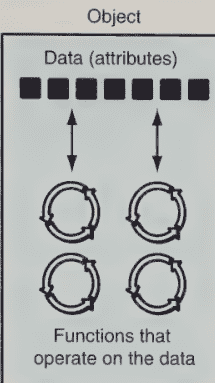

蓝图所描述房屋的实例。

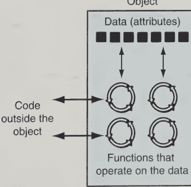

因此，类不是对象，但它是对对象的描述。当程序运行时，它使用该类在内存中创建所需数量的特定类型对象。从类创建的每个对象都称为类的实例。

例如，杰西卡（Jessica）是一位昆虫学家（研究昆虫的人），她也喜欢编写计算机程序。她设计了一个程序来编目不同类型的昆虫。作为程序的一部分，她创建了一个名为 `Insect` 的类，该类指定了存储和操作所有类型昆虫数据的属性和成员函数。`Insect` 类不是对象，而是可以从其创建对象的规范。接下来，她编写了编程语句来创建一个蚊子，蚊子是 `Insect` 类的一个实例。蚊子对象是一个占用计算机内存并存储关于苍蝇数据的实体。它具有 `Insect` 类指定的属性和成员函数。然后，她编写了编程语句来创建一个蚊子对象。蚊子对象也是 `Insect` 类的一个实例。它在内存中有自己的区域，并存储关于苍蝇的数据。虽然苍蝇和蚊子是计算机内存中两个独立的实体，但它们都是从 `Insect` 类创建的。这意味着每个对象都具有 `Insect` 类描述的属性和成员函数。这在图 13-4 中所示。

图 13-4 类的实例

苍蝇对象是 `Insect` 类的一个实例。

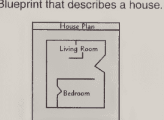

蚊子对象是 `Insect` 类的一个实例。


> 注意：在其他编程语言中，对象执行的过程通常被称为“方法”（methods）。

这些过程位于对象外部。只有对象的成员函数可以直接访问并修改对象的数据。对象通常会隐藏其数据，但允许外部代码访问其成员函数。如图 13-2 所示，对象的成员函数为对象外部的编程语句提供了对对象数据的间接访问。

图 13-2 只有对象的成员函数可以访问对象的数据


当对象的内部数据对外部代码隐藏时，对这些数据的访问被限制在对象的成员函数中，从而保护数据免受意外损坏。此外，对象外部的编程代码不需要了解对象数据的格式或内部结构。代码只需要与对象的函数交互。当程序员更改对象内部数据的结构时，或者如果她也修改了对象的成员函数以便其能够正确操作数据时，外部代码与成员函数交互的方式并不会改变。

面向对象技术的一个日常生活中的例子是汽车。它有一个非常简单的接口，由点火开关、方向盘、油门、刹车和档杆组成。带有手动变速箱的车辆还提供离合踏板。如果你驾驶汽车（成为我们的一部分），你只需要学会操作这些接口元素。要启动发动机，只需转动点火开关中的钥匙。内部发生了什么对用户来说无关。如果你想让汽车转向，只需转动方向盘。所有连接方向盘与前轮的连杆的运动都会无缝发生。

由于汽车使用简单的接口，没有机械知识的人也可以驾驶。这对于汽车制造商来说是好事，因为这意味着人们可能成为客户。对于汽车用户来说也是好事，因为他们只需要学习几个程序就可以操作几乎任何车辆。

这些在软件开发中也是同样关注的问题。现实世界中的程序很少由一个人编写。即使是你创建的程序也不是完全由你编写的。如果你整合了 C++ 库函数，或者像 `cin` 和 `cout` 这样的对象，你就会使用别人编写的代码。在专业软件开发领域，程序员通常以团队形式工作，买卖代码并在项目上协作。通过面向对象编程（OOP），程序员可以创建隐藏在“引擎盖下”的强大引擎的对象，并由保护对象算法的简单接口提供保护。

## 13.2 类简介

> 概念：在 C++ 中，类（class）是用于创建对象的主要结构。

类与结构体相似。它是由程序员定义的一种数据类型，由变量和函数组成。以下是类声明的通用格式：

```cpp
class ClassName
{
    // 私有成员声明
    // ...
    // 公共成员声明
    // ...
};
```

类声明内部的声明语句是用于该类的成员的变量和函数的。例如，以下代码声明了一个名为 `Rectangle` 的类，它有两个成员变量：`width`（宽度）和 `length`（长度）。

```cpp
class Rectangle
{
    double width;
    double length; // 别忘记分号；
};
```

然而，这个类存在一个问题。与结构体不同，类的成员是私有的（private），不能通过类外的程序语句访问。因此，`Rectangle` 类之外的任何语句都无法访问 `width` 和 `length` 成员。

回顾我们之前关于面向对象程序的讨论，对象可以实现数据隐藏，这意味着存储在对象内部的数据受到对象外部代码的保护。在 C++ 中，类的私有成员是被隐藏的，只能由同一类的成员函数访问。类的公共（public）成员可以被类外的代码访问。

### 访问修饰符
C++ 提供了 `private`（私有）和 `public`（公共）关键字，你可以在类声明中使用它们。这些关键字被称为访问修饰符，因为它们指定了如何访问类成员。以下使用 `private` 和 `public` 访问修饰符的类声明的通用格式：

```cpp
class ClassName
{
    private:
        // 私有成员的声明
        // 在这里。
    public:
        // 公共成员的声明
        // 在这里。
};
```

注意访问修饰符后面跟着冒号（:），然后是一个或多个成员声明。在这个通用格式中，首先使用私有访问修饰符。其后的所有声明，直到公共访问修饰符，都是私有成员的。然后，公共访问修饰符之后的所有声明都是公共成员的。

### 公共成员函数
为了允许访问类的私有成员变量，你创建了与私有成员变量工作的公共成员函数。例如，考虑 `Rectangle` 类。为了允许访问 `Rectangle` 对象的 `width` 和 `length` 成员变量，我们将添加表 13-3 列出的成员函数。

#### 表 13-3 Rectangle 类的成员函数

| 成员函数 | 说明 |
| --- | --- |
| `setWidth` | 该函数接受一个参数，该参数被赋值给 `width` 成员变量。 |
| `setLength` | 该函数接受一个参数，该参数被赋值给 `length` 成员变量。 |
| `getWidth` | 该函数返回存储在 `width` 成员变量中的值。 |
| `getLength` | 该函数返回存储在 `length` 成员变量中的值。 |
| `getArea` | 该函数返回 `width` 成员变量乘以 `length` 成员变量的乘积。该值是矩形的面积。 |

目前，我们不会实际定义表 13-3 中描述的函数。我们将那留到以后再做。现在，我们只在类声明中包含函数的声明、原型（prototypes）。

```cpp
class Rectangle {
private:
    double width;
    double length;
public:
    void setWidth(double);
    void setLength(double);
    double getWidth() const;
    double getLength() const;
    double getArea() const;
};
```

## 13.3 类的实例定义
在过程化程序中，你通常将数据存储在变量以及复杂的结构中。例如，可能有表 13-1 中的变量。

| 变量定义 | 描述 |
| :--- | :--- |
| `double width;` | 矩形的宽度 |
| `double length;` | 矩形的长度 |

## 13.4 为什么要私有成员？
在过程化程序中，数据和函数是独立的实体。面向对象编程以对象为中心。

## 13.5 关注软件工程
在过程化程序中，你通常将数据存储在变量以及复杂的结构中。例如，可能有表 13-1 中的变量。

| 变量定义 | 描述 |
| :--- | :--- |
| `double width;` | 矩形的宽度 |
| `double length;` | 矩形的长度 |

## 13.6 内联成员函数
在过程化程序中，数据和函数是独立的实体。面向对象编程以对象为中心。

## 13.7 构造函数
在过程化程序中，你通常将数据存储在变量以及复杂的结构中。例如，可能有表 13-1 中的变量。

| 变量定义 | 描述 |
| :--- | :--- |
| `double width;` | 矩形的宽度 |
| `double length;` | 矩形的长度 |

## 13.8 向构造函数传递参数
在过程化程序中，数据和函数是独立的实体。面向对象编程以对象为中心。

## 13.9 析构函数
在过程化程序中，你通常将数据存储在变量以及复杂的结构中。例如，可能有表 13-1 中的变量。

| 变量定义 | 描述 |
| :--- | :--- |
| `double width;` | 矩形的宽度 |
| `double length;` | 矩形的长度 |

## 13.10 构造函数重载
在过程化程序中，数据和函数是独立的实体。面向对象编程以对象为中心。

## 13.11 私有成员函数

## 13.12 对象数组

## 13.13 面向对象

## 13.14 面向对象

## 13.15 面向对象

## 13.16 面向对象


在此声明中，成员变量 `width` 和 `length` 被声明为私有，这意味着它们只能通过类的成员函数访问。然而，成员函数被声明为公共，这意味着它们可以从类外的语句进行调用。如果类外的代码需要在 `Rectangle` 对象中存储宽度或长度，它必须通过调用对象的 `setWidth` 或 `setLength` 成员函数来实现。同样地，如果类外的代码需要检索存储在 `Rectangle` 对象中的宽度或长度，它必须通过调用对象的 `getWidth` 或 `getLength` 成员函数来实现。这些公共函数为类外的代码使用 `Rectangle` 对象提供了接口。

> 注意：尽管类的默认访问权限是私有的，但仍然使用 `private` 关键字来显式地声明私有成员仍然是一个好主意。这清晰地记录了类中所有成员的访问规范。

## 在成员函数中使用 const

注意 `const` 关键字出现在 `getWidth`、`getLength` 和 `getArea` 成员函数的声明中，如下：

```cpp
double getWidth() const;
double getLength() const;
double getArea() const;
```

当关键字出现在成员函数声明的括号之后时，它指定该函数不会更改调用对象中存储的任何数据。如果你不意中在函数中编写更改调用对象数据的代码，编译器将生成错误。正如你稍后看到的，`const` 关键字也必须出现在函数头中。

## 公共和私有成员的放置

没有规则要求你在声明公共成员之前声明私有成员。`Rectangle` 类可以如下被声明：

```cpp
class Rectangle {
    public:
    void setWidth(double);
    void setLength(double);
    double getWidth() const;
    double getLength() const;
    double getArea() const;
    private:
    double width;
    double length;
};
```

## 在访问器中使用 const

注意 `const` 关键字出现在 `getWidth`、`getLength` 和 `getArea` 成员函数的头中，如下所示：

```cpp
double Rectangle::getWidth() const
double Rectangle::getLength() const
double Rectangle::getArea() const
```

回想一下，这些函数在类中也使用 `const` 关键字进行了声明。当你将一个成员函数标记为 `const` 时，`const` 关键字必须同时出现在声明和函数头中。

从本质上说，当你将成员函数标记为 `const` 时，你是在告诉编译器调用对象是一个常量。如果你无意中在函数编写了更改调用对象的数据，编译器将生成错误。因为这减少了代码中出现 Bug 的概率，所以将所有访问函数标记为 `const` 是一个良好的做法。

## 数据隐藏的重要性

作为一名初学者，你可能会疑惑为什么要隐藏你创建的类内部的数据。当你学习编程时，你将是自己类的用户，因此这看起来就像是你正费尽很大精力向自己隐藏数据。然而，如果你在工业界编写软件，你创建的类将作为大型软件系统的组件被使用；你以外的程序员将使用你的类。通过隐藏类的数据并允许仅通过类的成员函数进行访问，你可以更好地确保该类按照你预期的方式运行。

## 定义类的实例

概念：类对象必须在类声明后进行定义。

和结构体变量一样，类对象在定义之前不会在内存中创建。这是因为类声明本身并不创建对象，而仅仅是对象的描述。我们可以使用它来创建一个或多个对象，这些对象就是类的实例。

类对象通过简单的定义语句创建，就像变量一样。这里是通用格式：`ClassName objectName;`

```cpp
ClassName objectName;
```

在通用格式中，`ClassName` 是类的名称，`objectName` 是我们赋予该对象的名字。

例如，以下语句将 `box` 定义为 `Rectangle` 类的对象：

```cpp
Rectangle box;
```

定义类对象被称为类的实例化。在这条语句中，`box` 是 `Rectangle` 类的一个实例。

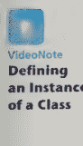

## 访问对象的成员

我们之前定义的 `box` 对象是 `Rectangle` 类的一个实例。假设我们想更改 `box` 对象中宽度变量的值。为了这样做，我们必须使用 `box` 对象来调用 `setWidth` 成员函数，如下所示：

```cpp
box.setWidth(12.7);
```

就像你使用点运算符访问结构体的成员一样，你也使用点运算符来调用类的成员函数。这条语句使用 `box` 对象调用 `setWidth` 成员函数，并将 `12.7` 作为参数传递。结果，`box` 对象的宽度变量将被设置为 `12.7`。这里是其他使用对象调用成员函数的语句示例：

```cpp
box.setLength(4.8);               // 将 box 的长度设置为 4.8。
x = box.getWidth();              // 将 box 的宽度赋值给 x。
cout << box.getLength();      // 显示 box 的长度。
cout << box.getArea();          // 显示 box 的面积。
```

> 笔记：注意，在 `Rectangle` 类的成员函数内部，没有使用点运算符来访问类的任何成员变量。当使用对象来调用成员函数时，该成员函数可以直接访问该对象的成员变量。

## 一个类演示程序

程序 13-1 是一个演示 `Rectangle` 类的完整程序。

### 程序 13-1

```cpp
1 // 此程序演示了一个简单的类。
2 #include <iostream>
3 using namespace std;
4
5 // Rectangle 类的声明。
6 class Rectangle
7 {
8   private:
9   double width;
10  double length;
11  public:
12  void setWidth(double);
13  void setLength(double);
14  double getWidth() const;
15  double getLength() const;
16  double getArea() const;
17 };
18
19 //************************************************
20 // setWidth 给 width 成员赋值。  *
21 //************************************************
22
23 void Rectangle::setWidth(double w)
24 { // 13.3 定义类的实例 733
25     width = w;
26 }
27 
28 //********************************************************************
29 // setLength 给 length 成员赋值。 
30 //********************************************************************
31 
32 void Rectangle::setLength(double len)
33 {
34     length = len;
35 }
36 
37 //********************************************************************
38 // getWidth 返回 width 成员的值。 
39 //********************************************************************
40 
41 double Rectangle::getWidth() const
42 {
43     return width;
44 }
45 
46 //********************************************************************
47 // getLength 返回 length 成员的值。 
48 //********************************************************************
49 
50 double Rectangle::getLength() const
51 {
52     return length;
53 }
54 
55 //********************************************************************
56 // getArea 返回 width 和 length 的乘积。 
57 //********************************************************************
58 
59 double Rectangle::getArea() const
60 {
61     return width * length;
62 }
63 
```

### 程序 13-2

```cpp
// 此程序创建了 Rectangle 类的三个实例。
#include <iostream>
using namespace std;
// Rectangle 类声明。
// 第 6 到 62 行已省略。
//********************************************************************
// 函数 main
//********************************************************************
int main() {
    double number;     // 用于存储一个数字
    double totalArea;   // 总面积
    Rectangle kitchen; // 存储厨房的尺寸
    Rectangle bedroom; // 存储卧室的尺寸
    Rectangle den; // 存储书房的尺寸
    // 获取厨房尺寸。
    cout << "What is the kitchen's length?";
    cin >> number;             // 获取长度
    kitchen.setLength(number); // 存储在 kitchen 对象中
    cout << "What is the kitchen's width?";
    cin >> number;             // 获取宽度
    kitchen.setWidth(number); // 存储在 kitchen 对象中
    // 获取卧室尺寸。
    cout << "What is the bedroom's length?";
    cin >> number;             // 获取长度
    bedroom.setLength(number); // 存储在 bedroom 对象中
    cout << "What is the bedroom's width?";
    cin >> number;             // 获取宽度
    bedroom.setWidth(number); // 存储在 bedroom 对象中
    // 获取书房尺寸。
    cout << "What is the den's length?";
    cin >> number;             // 获取长度
    den.setLength(number); // 存储在 den 对象中
    cout << "What is the den's width?";
    cin >> number;             // 获取宽度
    den.setWidth(number); // 存储在 den 对象中
    // 计算三个房间的总面积。
    totalArea = kitchen.getArea() + bedroom.getArea() + den.getArea();
    // 显示三个房间的总面积。
    cout << "The total area of the three rooms is " << totalArea << endl;
    return 0;
}
```

### 13.3 定义类的实例

```cpp
108 return;
109 }
```

#### 粗体显示的程序输出

```text
What is the kitchen's length? 10
What is the kitchen's width? 14
What is the bedroom's length? 15
What is the bedroom's width? 12
What is the den's length? 20
What is the den's width? 30
The total area of the three rooms is 92
```

在第 72、73 和 74 行，以下代码定义了三个 `Rectangle` 变量。这创建了三个 `Rectangle` 类的实例：

```cpp
Rectangle kitchen; // 存储厨房尺寸
Rectangle bedroom; // 存储卧室尺寸
Rectangle den; // 存储书房尺寸
```

在示例输出中，用户输入 10 和 14 作为厨房的长度和宽度，输入 15 和 12 作为卧室的长度和宽度，输入 20 和 30 作为书房的长度和宽度。图 13-9 显示了在存储这些值后对象的状态。

#### 图 13-9 厨房、卧室和书房对象的状态

| 厨房对象 | 卧室对象 | 书房对象 |
| --- | --- | --- |
| 长度: 10.0 | 长度: 15.0 | 长度: 20.0 |
| 宽度: 14.0 | 宽度: 12.0 | 宽度: 30.0 |

从图 13-9 可以看出，每个 `Rectangle` 类的实例都有自己的长度和宽度变量。类的每个实例都有自己的可以存储其值的成员变量。类的成员函数可以对特定的实例执行操作。查看程序 13-2 第 79 行的以下语句：

```cpp
kitchen.setLength(number);
```

此语句调用 `setLength` 函数，将值存储在 `kitchen` 对象的长度变量中。现在看第 87 行的以下语句：

```cpp
bedroom.setLength(number);
```

此语句也调用了 `setLength` 函数，但这次将值存储在 `bedroom` 对象的长度变量中。同样，第 95 行的以下语句调用了 `setLength` 函数，将值存储在 `den` 对象的长度变量中：

```cpp
den.setLength(number);
```

`Rectangle` 类的所有成员函数工作方式类似。

## 避免过时数据

在 `Rectangle` 中，`getLength` 和 `getWidth` 函数返回存储在成员变量中的值。`getArea` 函数返回计算结果。你可能会奇怪为什么 `Rectangle` 的面积没有存储在成员变量中（像长度和宽度那样）。因为面积的值取决于其他数据，当其他数据更改时，该值就过时了。如果将 `Rectangle` 的面积存储在成员变量中，一旦长度或宽度发生变化，该成员变量的值就会错误。在设计类时，应该注意不要在成员变量中存储可能过时的数据。相反，提供一个返回计算结果的成员函数。

## 指针

你也可以定义类的指针。例如，以下语句定义了一个名为 `rectPtr` 的指针变量：

```cpp
Rectangle *rectPtr = nullptr;
```

`rectPtr` 不是一个对象，但它可以持有 `Rectangle` 对象的地址。以下代码显示：

```cpp
Rectangle myRectangle;              // Rectangle 对象
Rectangle *rectPtr = nullptr;        // Rectangle 指针
rectPtr = &myRectangle;               // rectPtr 现在指向 myRectangle
```

第一条语句创建了一个 `Rectangle` 对象 `myRectangle`。第二条语句创建了一个名为 `rectPtr` 的 `Rectangle` 指针。第三条语句将 `myRectangle` 对象的地址存储在 `rectPtr` 指针中。如图 13-10 所示。

#### 图 13-10 rectPtr 指向 myRectangle 对象


然后可以使用 `->` 运算符通过 `rectPtr` 指针调用成员函数。以下语句显示：

```cpp
rectPtr->setWidth(12.5);
rectPtr->setLength(4.8);
```


第一个语句调用`setWidth`函数，将`12.5`作为参数。因为`rectPtr`指向`myRectangle`对象，这将`12.5`存储在`myRectangle`对象的宽度变量中。第二条语句调用`setLength`函数，将`4.8`作为参数。这将`4.8`存储在`myRectangle`对象的长度变量中。

# 图 13-11 myRectangle 对象的状态


类对象指针可用于动态分配对象。以下代码是一个示例：

```cpp
1 // 定义一个 Rectangle 指针。
2 Rectangle *rectPtr = nullptr;
3 
4 // 动态分配一个 Rectangle 对象。
5 rectPtr = new Rectangle;
6 
7 // 将值存储在对象的宽度和长度中。
8 rectPtr->setWidth(10.0);
9 rectPtr->setLength(15.0);
10 
11 // 从内存中删除对象。
12 delete rectPtr;
13 rectPtr = nullptr;
```

第 2 行定义`rectPtr`指针。第 5 行使用`new`运算符动态分配一个`Rectangle`对象并将其地址赋值给`rectPtr`。第 8 和第 9 行在动态分配对象的宽度和长度中赋值。图 13-12 显示了这些语句执行后动态分配对象的状态。

# 图 13-12 rectPtr 指向一个动态分配的 Rectangle 对象


第 12 行从内存中删除对象，第 13 行将地址 0 存储在`rectPtr`中。回第 9 章，这防止了代码无意中使用指针访问已释放的内存区域。它还能防止在无再次调用`delete`时发生错误。

# 程序 13-3

```cpp
1 //include <iostream>
2 #include <memory>
3 using namespace std;
4 
5 // Rectangle 类声明。
6      第 6 到 62 行已省略。
63 //***********************************************************
64 //***********************************************************
65 // 函数 main
66 //***********************************************************
67 
68 int main()
69 {
70     double number;               // 用于存储一个数字
71     double totalArea;            // 总面积
72     Rectangle *kitchen = nullptr;  // 指厨房尺寸
73     Rectangle *bedroom = nullptr; // 指向卧室尺寸
74     Rectangle *den = nullptr;     // 指向书房尺寸
75 
76 // 动态分配对象。
77     kitchen = new Rectangle;
78     bedroom = new Rectangle;
79     den = new Rectangle;
80 
81 // 获取厨房尺寸。
82     cout << "What is the kitchen's length? ";
83     cin >> number;               // 获取长度
84     kitchen->setLength(number); // 存储在厨房对象
85     cout << "What is the kitchen's width? ";
86     cin >> number;               // 获取宽度
87     kitchen->setWidth(number);  // 存储在厨房对象
88 
89 // 获取卧室尺寸。
90     cout << "What is the bedroom's length? ";
91     cin >> number;               // 获取长度
92     bedroom->setLength(number); // 存储在卧室对象
93     cout << "What is the bedroom's width? ";
94     cin >> number;               // 获取宽度
95     bedroom->setWidth(number);  // 存储在卧室对象
96 
97 // 获取书房尺寸。
98     cout << "What is the den's length? ";
99     cin >> number;               // 获取长度
100    den->setLength(number);    // 存储在书房对象
101    cout << "What is the den's width? ";
102    cin >> number;               // 获取宽度
103    den->setWidth(number);    // 存储在书房对象
104 
105 // 计算三个房间的总面积。
106 totalArea = kitchen->getArea() + bedroom->getArea() +
107 den->getArea();
108 // 显示三个房间的总面积。
109 cout << "The total area of the three rooms is "
110 << totalArea << endl;
111
112 // 从内存中删除对象。
113 delete kitchen;
114 delete bedroom;
115 delete den;
116 kitchen = nullptr; // 将 kitchen 设为空指针。
117 bedroom = nullptr; // 将 bedroom 设为空指针。
118 den = nullptr; // 将 den 设为空指针。
119
120 return 0;
121 }
```

# 13.3 定义类的实例

## 使用智能指针分配对象

第 9 章讨论了 C++11 引入的智能指针数据类型`unique_ptr`。回想第 9 章，你可以使用`unique_ptr`动态分配内存，而在使用完毕后无需担心删除内存。当内存不再被使用时，`unique_ptr`会自动删除该块动态分配内存。这有助于防止内存泄漏的发生。

要使用`unique_ptr`数据类型，你必须通过以下指令包含`<memory>`头文件：

```cpp
#include <memory>
```

下面是一个指向动态分配的`Rectangle`对象的`unique_ptr`定义语法示例：

```cpp
unique_ptr<Rectangle> rectanglePtr(new Rectangle);
```

该语句定义了一个名为`rectanglePtr`的`unique_ptr`，它指向一个动态分配的`Rectangle`对象。关于该语句的一些细节如下：

- 紧跟在`unique_ptr`之后的`<Rectangle>`表示指针可以指向`Rectangle`。
- 指针名为`rectanglePtr`。
- 括号内的表达式`new Rectangle`分配了一块内存来存储`Rectangle`。该块内存的地址将赋值给`rectanglePtr`。

一旦你定义了`unique_ptr`，就可以像使用普通指针一样使用它。这是程序 13-3 的修订版本，修改为使用`unique_ptr`代替普通指针。输出与程序 13-2 和 13-3 相同。

# 程序 13-4

```cpp
// 此程序使用智能指针分配三个
// Rectangle 类的实例。

// #include <iostream>
// #include <memory>

using namespace std;

// // Rectangle 类声明。

// 第 8 到 64 行已省略。

****************************************************************

*** 函数 main *

****************************************************************

int main() {
    double number;               // 用于存储一个数字
    double totalArea;             // 总面积

    // 动态分配对象。
    unique_ptr<Rectangle> kitchen(new Rectangle);
    unique_ptr<Rectangle> bedroom(new Rectangle);
    unique_ptr<Rectangle> den(new Rectangle);

    // 获取厨房尺寸。
    cout << "What is the kitchen's length? ";
    cin >> number;               // 获取长度
    kitchen->setLength(number); // 存储在厨房对象
    cout << "What is the kitchen's width? ";
    cin >> number;               // 获取宽度
    kitchen->setWidth(number);  // 存储在厨房对象

    // 获取卧室尺寸。
    cout << "What is the bedroom's length? ";
    cin >> number;               // 获取长度
    bedroom->setLength(number); // 存储在卧室对象
    cout << "What is the bedroom's width? ";
    cin >> number;               // 获取宽度
    bedroom->setWidth(number);  // 存储在卧室对象

    // 获取书房尺寸。
    cout << "What is the den's length? ";
    cin >> number;               // 获取长度
    den->setLength(number);    // 存储在书房对象
    cout << "What is the den's width? ";
    cin >> number;               // 获取宽度
    den->setWidth(number);    // 存储在书房对象

    // 计算三个房间的总面积。
    totalArea = kitchen->getArea() + bedroom->getArea() +
    den->getArea();

    // 显示三个房间的总面积。
    cout << "The total area of the three rooms is "
    << totalArea << endl;

    return 0;
}
```

```cpp
else {
    cout << "Invalid width\n";
    exit(EXIT_FAILURE);
}
```

注意，这个版本的函数不仅仅是将参数值赋值给变量。它首先测试参数以确保它大于或等于 0。如果传递给函数一个负数，则会显示错误消息，然后调用标准库函数`exit`来终止程序。`setLength`函数可以用类似的方式编写：

```cpp
void Rectangle::setLength(double len) {
    if (len >= 0)
        length = len;
    else {
        cout << "Invalid length\n";
        exit(EXIT_FAILURE);
    }
}
```

这里的要点在于，修改器函数（mutator functions）的功能不仅仅简单地将值存储在属性中。它们还可以验证这些值，以确保只有接受的数据被存储在对象的属性中。然而，请记住，像我们在这些示例中那样调用`exit`函数并不是处理无效数据的最佳方法。在现实中，你不会设计一个在接收到无效数据时就终止整个程序的修改器。在第 15 章中，我们将讨论异常，异常为类处理错误提供了一种更好的方法。在使用这些异常之前，我们将继续通过使用基础的数据验证技术来保持代码的简单。

## 13.5 关注软件工程：将类规范与实现分离

**概念：** 通常，类声明存储在各自的头文件中。成员函数定义存储在各自的`.cpp`文件中。

在我们到目前为止过的程序中，类声明、成员函数定义和应用程序都存储在一个文件中。一种更符合惯例的 C++ 程序设计方法是将类声明和成员函数定义存储在各自独立的单独文件中。通常，程序组件以以下方式存储：

- **类声明存储在各自的头文件中**。包含类声明的头文件称为类规范文件（class specification file）。类规范文件的文件名通常与类名相同，扩展名为`.h`。例如，`Rectangle`类将在`Rectangle.h`文件中声明。
- **类的成员函数定义存储在单独的`.cpp`文件中**，称为类实现文件（class implementation file）。该文件通常与类名相同，扩展名为`.cpp`。例如，`Rectangle`类的成员函数将在`Rectangle.cpp`文件中定义。
- **任何使用`#include`类的头文件的程序**。该类的`.cpp`文件（包含成员函数定义）应与主程序一起编译和链接。这一过程可以通过项目或工具实现自动化。像 Visual Studio 这样的集成开发环境（IDE）也提供了创建多文件项目的方法。

让我们看看如何使用这种设计方法重写程序 13-1。首先，`Rectangle`类声明将存储在下面的`Rectangle.h`文件中（该文件可以在`Student Code Folder Chapter 13\Rectangle Version 1.`中找到）。

### Rectangle.h 的内容（版本 1）

```cpp
1 // Rectangle 类的规范文件。
2 #ifndef RECTANGLE_H
3 #define RECTANGLE_H
4
5 // Rectangle 类声明。
6
7 class Rectangle
8 {
9 private:
10 double width;
11 double length;
12 public:
13 void setWidth(double);
14 setLength(double);
15 double getWidth() const;
16 double getLength() const;
17 double getArea() const;
18 };
19
20 #endif
```

这是`Rectangle`类的规范文件。它包含了`Rectangle`类的声明。它不包含任何成员函数定义。当我们编写其他使用`Rectangle`类的程序时，可以使用`#include`指令来包含此文件。这样，我们就不需要在每个使用`Rectangle`类的程序中重复编写类声明。

该文件还引入了两个预处理器指令：`#ifndef`和`#endif`。第 2 行的`#ifndef`是一个包含保护（include guard）。它防止头文件被意外包含多次。如果你的主程序多次`#include`该头文件，编译器会多次处理头文件中的声明，除非有包含保护。

包含保护的工作原理如下：`#ifndef`的意思是“如果未定义”。它用于检查一个名为`RECTANGLE_H`的常量是否定义。当`Rectangle.h`文件被编译时，如果该常量未定义，则会在第 3 行立即定义它，并包含文件的其余部分。如果该常量已经定义，意味着文件已经被包含过了。在这种情况下，`#ifndef`和`#endif`指令之间的内容将被跳过。这如图 13-1 所示。

# 程序 13-5（续接）

```cpp
// 将矩形的宽度和长度存储
// 在 box 对象中。

box.setWidth(rectWidth);
box.setLength(rectLength);

// 显示矩形的数据：
cout << "Here is the rectangle's data:\n";
cout << "Width: " << box.getWidth() << endl;
cout << "Length: " << box.getLength() << endl;
cout << "Area: " << box.getArea() << endl;
return 0;
```


注意程序 13-5 在第 6 行有一个针对 `Rectangle.h` 文件的 `#include` 指令。这使得 `Rectangle` 类的声明被包含文件中。要从这里创建一个可执行程序，必须采取以下步骤：

- 必须编译实现文件 `Rectangle.cpp`。`Rectangle.cpp` 不是一个完整的程序，因此你不能从它创建可执行文件。相反，你将 `Rectangle.cpp` 编译为对象文件，该文件包含了 `Rectangle` 类的编译代码。该文件通常命名为 `Rectangle.obj`。
- 必须编译主程序 `Pr13-4.cpp`。该文件也不是一个完整的程序；它不包含 `Rectangle` 类的任何实现代码。因此，你将此文件编译为对象文件，如 `Pr13-4.obj`。
- 将对象文件 `Pr13-4.obj` 和 `Rectangle.obj` 链接在一起创建一个可执行文件，该文件将命名为 `Pr13-4.exe`。

这一过程在图 13-15 中所示。这些步骤如何发生的具体细节在每个 C++ 开发系统中有所不同。幸运的是，大多数系统都会自动为你完成所有这些步骤。例如，在 Visual Studio 中，你创建一个项目，只需将所有文件添加到项目中即可。当你编译项目时，这些步骤就会为你处理好，并生成可执行文件。

将一个类拆分为规格文件和实现文件提供了极大的灵活性。首先，如果你想将你的类交给另一个程序员，你不需要与他们分享所有的源代码。你可以给他们规格文件和用于实现的已编译的对象文件。另一个程序员只需在他的程序中插入必要的 `#include` 指令，对其进行编译，并将其与你的对象文件链接。这防止了可能不了解你代码所有细节的另一个程序员做出引入 bug 的更改。

当必须修改类成员函数时，将类拆分为规格和实现文件会让事情变得更简单。只需要修改实现文件并将其重新编译为新的对象文件。使用该类的程序不需要完全重新编译，只需与新的对象文件链接即可。

## 13.6 内联成员函数

图 13-15 创建可执行文件


### 概念

当成员函数被写在类声明内部时，它被声明为内联（inline）的。

当成员函数的函数体较小时，通常将函数的定义（而不是其原型）放在类声明中更为方便。例如，在 `Rectangle` 类中，成员函数 `getWidth`、`getLength` 和 `getArea` 每个都只有一条语句。`Rectangle` 类可以像如下列表所示进行修订（此文件可以在学生源代码文件夹第 13 章的 Rectangle 2. 中找到）。

#### `Rectangle.h` 的内容（版本 2）

```cpp
// Rectangle 类的规格文件

// 此版本使用了一些内联函数

#ifndef RECTANGLE_H
#define RECTANGLE_H

class Rectangle {
private:
    double width;
    double length;
public:
    void setWidth(double);
    void setLength(double);
    double getWidth() const {
        return width;
    }
    double getLength() const {
        return length;
    }
    double getArea() const {
        return width * length;
    }
};

#endif
```

当成员函数在类的声明中定义时，它被称为内联函数。由于函数定义是类的一部分，因此不需要在函数头中使用作用域运算符和类名。

注意 `getWidth`、`getLength` 和 `getArea` 函数被声明为内联的，但 `setWidth` 和 `setLength` 函数不是。它们仍然定义在类声明之外。以下列表显示了修订后的 `Rectangle` 类的实现文件（此文件可以在学生源代码文件夹第 13 章的 Rectangle 2. 中找到）。

#### `Rectangle.cpp` 的内容（版本 2）

```cpp
// Rectangle 类的实现文件。

// 在类的这个版本中，getWidth、getLength，
// 和 getArea 函数在 Rectangle.h 中内联编写的。

#include "Rectangle.h" // Rectangle 类需要
#include <iostream> // cout 需要
#include <cstdlib> // exit 函数需要

using namespace std;

****************************************************
// setWidth 设置成员变量 width 的值。
****************************************************
void Rectangle::setWidth(double w) {
    if (w >= 0)
        width = w;
    else {
        cout << "Invalid width\n";
        exit(EXIT_FAILURE);
    }
}

****************************************************
// setLength 设置成员变量 length 的值。
****************************************************
void Rectangle::setLength(double len) {
    if (len >= 0)
        length = len;
    else {
        cout << "Invalid length\n";
        exit(EXIT_FAILURE);
    }
}
```

### 内联函数与性能

每次调用函数时，有很多工作在“后台”进行。局部变量被创建，参数的值存储在称为栈（stack）的内存区域。这些函数调用的开销会消耗宝贵的 CPU 时间。

内联函数的编译方式与其他函数不同。在可执行代码中，内联函数并不是被“调用”。在一个被称为内联展开的过程中，编译器会将内联函数的调用替换为代码本身。内联函数会导致代码增大，它们会影响性能。

### 检查

- 13.6 为什么要将类变量声明为 private？
- 13.7 当类变量声明为私有时，类外部如何存储或获取这些值？
- 13.8 什么是类的规格文件？什么是类的实现文件？
- 13.9 包含保护（include guard）的作用是什么？
- 13.10 程序中存在以下类组件：
    - BasePay 类声明
    - BasePay 成员函数
    - Overtime 类声明
    - Overtime 成员函数
    你应该在哪些文件中存储这些内容？
- 13.11 什么是内联成员函数？

## 13.7 构造函数

### 概念

构造函数是在类对象创建时自动调用的成员函数。

构造函数是与类名同名的成员函数。当对象在内存中创建或实例化时，它会被自动调用。将构造函数理解为初始化程序对于初始化成员变量或执行其他设置非常有帮助。

为了说明构造函数如何工作，请查看以下 Demo 类：

```cpp
class Demo {
public:
    Demo(); // 构造函数
};
```

```cpp
Demo::Demo() {
    cout << "Welcome to the constructor!\n";
}
```

Demo 类只有一个成员：一个名为 Demo 的函数。这个函数就是构造函数。当定义该类的实例时，Demo 函数会被自动调用。这在程序 13-6 中得到了演示。

### 程序 13-6

```cpp
// 此程序演示了构造函数。

#include <iostream>

using namespace std;

// Demo 类声明。
class Demo {
public:
    Demo(); // 构造函数
};

Demo::Demo() {
    cout << "Welcome to the constructor!\n";
}

int main() {
    Demo demoObject; // 定义一个 Demo 对象
    cout << "This program demonstrates an object\n";
    cout << "with a constructor.\n";
    return 0;
}
```

### 程序输出

欢迎使用构造函数！
此程序演示了一个带有构造函数的对象。

注意，构造函数的函数头与普通成员函数不同。它没有返回类型——即使是 `void` 也没有。这是因为构造函数不是通过函数调用执行的，并且不能返回值。构造函数外部定义的函数头采用如下形式：

```cpp
ClassName::ClassName(ParameterList)
```

在通用格式中，`ClassName` 是类的名称，`ParameterList` 是可选的参数声明列表。

在程序 13-6 中，`demoObject` 的构造函数在对象定义时自动执行。由于对象是在 `main` 函数的 `cout` 语句之前定义的，因此构造函数首先显示其消息信息。假设我们在两个 `cout` 语句之间定义了 `Demo` 对象，如下所示：

```cpp
cout << "This is displayed before the object is created.\n";
Demo demoObject; // 定义一个 Demo 对象。
cout << "In this is displayed after the object is created.\n";
```

这段代码将产生以下输出：

这在对象创建之前显示。
欢迎使用构造函数！
这在对象创建之后显示。

这个简单的示例说明了构造函数执行时会发生什么。更重要的是，你应该理解为什么类应该有一个构造函数。构造函数的目的是初始化对象的属性。由于构造函数在对象一创建时就会执行，因此它可以在其他代码使用这些成员之前，将对象的数据成员初始化为有效值。为每个类编写构造函数是一个良好的习惯。

例如，我们看过的 `Rectangle` 类可以从拥有构造函数中受益。程序可以定义一个 `Rectangle` 对象，然后在为 `width` 和 `length` 设置任何值之前，使用它来调用 `getArea` 函数。由于 `width` 和 `length` 成员变量未初始化，该函数将返回垃圾值。以下代码显示了 `Rectangle` 类更好的版本，配备了构造函数。构造函数将 `width` 和 `length` 都初始化为 `0.0`。（这些文件可以在学生源代码文件夹第 13 章：Rectangle Version 3 中找到）。

#### Rectangle.h 的内容 (版本 3)

```cpp
// Rectangle 类的规范文件
// 此版本包含一个构造函数。
#ifndef RECTANGLE_H
#define RECTANGLE_H

class Rectangle {
private:
    double width;
    double length;
public:
    Rectangle();                    // 构造函数
    void setWidth(double);
    void setLength(double);
    double getWidth() const { return width; }
    double getLength() const { return length; }
    double getArea() const { return width * length; }
};

#endif
```

#### Rectangle.cpp 的内容 (版本 3)

```cpp
// Rectangle 类的实现文件。
// 此版本包含一个构造函数。
#include "Rectangle.h"    // Rectangle 类需要
#include <iostream>          // cout 需要
#include <cstdlib>         // exit 函数需要

using namespace std;

/********************************************************************/
/* 构造函数将 width 和 length 初始化为 0.0。             *
/********************************************************************/
Rectangle::Rectangle() {
    width = 0.0;
    length = 0.0;
}

/********************************************************************/
/* setWidth 设置成员变量 width 的值。             *
/********************************************************************/
void Rectangle::setWidth(double w) {
    if (w >= 0)
        width = w;
    else {
        cout << "Invalid width\n";
        exit(EXIT_FAILURE);
    }
}

/********************************************************************/
/* setLength 设置成员变量 length 的值。            *
/********************************************************************/
void Rectangle::setLength(double len) {
    if (len >= 0)
        length = len;
    else {
        cout << "Invalid length\n";
        exit(EXIT_FAILURE);
    }
}
```

程序 13-7 演示了该类的新版本。它创建了一个 `Rectangle` 对象，并显示 `getWidth`、`getLength` 和 `getArea` 函数返回的值。（该文件可以在学生源代码文件夹 13 Rectangle Version 3 中找到）。

### 程序 13-7

```cpp
// 此程序使用 Rectangle 类的构造函数。
```


## 示例代码

```cpp
#include <iostream>
#include <Rectangle.h> // `Rectangle` 类需要
using namespace std;

int main() {
    Rectangle box; // 定义 `Rectangle` 类的实例

    // 显示矩形的数据。
    cout << "Here is the rectangle's data:\n";
    cout << "Width: " << box.getWidth() << endl;
    cout << "Length: " << box.getLength() << endl;
    cout << "Area: " << box.getArea() << endl;
    return 0;
}
```

## 程序输出

这是矩形的数据：
宽度: 0
长度: 0
面积: 0

## 使用成员初始化列表

之前显示的 `Rectangle` 类中的构造函数使用赋值语句将初始值存储在 `width` 和 `length` 成员变量中，如下：

```cpp
Rectangle() {
    width = 0.0;
    length = 0.0;
}
```

你可以使用称为成员初始化列表的替代技术来代替赋值语句进行初始化，如下：

```cpp
Rectangle() : width(0.0), length(0.0) {
}
```

## Rectangle 类定义

```cpp
{
  private:
    double width;
    double length;
  public:
    Rectangle(double, double); // 构造函数
    void setWidth(double);
    void setLength(double);
    double getWidth() const { return width; }
    double getLength() const { return length; }
    double getArea() const { return width * length; }
}
#endif
```

## Rectangle.cpp 的内容（版本 4）

```cpp
// Rectangle类的实现文件。
// 此版本包含一个接受参数的构造函数。
#include "Rectangle.h" // Rectangle类需要
#include <iostream> // cout需要
#include <cstdlib> // exit函数需要
using namespace std;

/***************************************************************************************************
// 构造函数接受用于宽度和长度的参数。 *
****************************************************************************************************

Rectangle::Rectangle(double w, double len) {
    width = w;
    length = len;
}

void Rectangle::setWidth(double w) {
    if (w >= 0)
        width = w;
    else {
        cout << "Invalid width\n";
        exit(EXIT_FAILURE);
    }
}
```

## 13.8 向构造函数传递参数

出现在 `Rectangle.cpp` 第12到16行的构造函数接受传递到 `w` 和 `len` 参数的参数。这些参数被赋值给 `width` 和 `length` 成员变量。由于构造函数在 `Rectangle` 对象创建时会被自动调用，因此参数作为对象定义的一部分传递给构造函数。这里有一个示例：

```cpp
Rectangle box(10.0, 12.0);
```

该语句演示了 `box` 作为 `Rectangle` 类的一个实例。构造函数被调用时，将值 `10.0` 传递给 `w` 参数，将 `12` 传递给 `len` 参数。结果是，对象的 `width` 成员变量将被赋值为 `10.0`，`length` 成员变量将被赋值为 `12.0`。这如图 13-16 所示。

### 图 13-16 传递给构造函数的参数

| width  | 10.0 |
| :----- | :--- |
| length | 12.0 |

`Rectangle box(10.0, 12.0);`

程序 13-8 演示了该类。（此文件可以在学生源代码文件夹 `13\Rectangle Version 4` 中找到。）

### 程序 13-8

```cpp
1 // 此程序调用 Rectangle 类的构造函数。
2 #include <iostream>
3 #include <iomanip>
4 #include "Rectangle.h"
5 using namespace std;
```

（程序继续）

### 程序 13-8（续）

```cpp
int main() {
    double houseWidth,  // 用于存储房间宽度
           houseLength; // 用于存储房间长度

    // 获取房子的宽度。
    cout << "In feet, how wide is your house ?";
    cin >> houseWidth;

    // 获取房子的长度。
    cout << "In feet, how long is your house ?";
    cin >> houseLength;

    // 创建一个 Rectangle 对象。
    Rectangle house(houseWidth, houseLength);

    // 显示房子的宽度、长度和面积。
    cout << precision(2) << fixed;
    cout << "The house is " << house.getWidth();
    cout << " feet wide.\n";
    cout << "The house is " << house.getLength();
    cout << " feet long.\n";
    cout << "The house is " << house.getArea();
    cout << " square feet in area.\n";
    return 0;
}
```

### 带有粗体显示的示例输入的程序输出

```text
In feet, how wide is your house? 30 Enter
feet, how long is your house? 60 Enter
The house is 30.00 feet wide.
The house is 60.00 feet long.
The house is 1800.00 square feet in area.
```

第21行的语句创建了一个 `Rectangle` 对象，将 `houseWidth` 和 `houseLength` 的值作为参数。

以下代码显示了另一个示例：`Sale` 类。该类可能用于发生销售交易的零售环境。`Sale` 类的对象代表一件商品的销售。（此文件可以在学生代码文件夹 `Chapter 13\Sale Version 1.0` 中找到。）

### Sale.h 的内容（版本 1）

```cpp
// Sale 类的规范文件。
#ifndef SALE_H
#define SALE_H

class Sale {
private:
    double itemCost; // 商品成本
    double taxRate;  // 销售税率
public:
    Sale(double cost, double rate) {
        itemCost = cost;
        taxRate = rate;
    }

    double getItemCost() const { return itemCost; }
    double getTaxRate() const { return taxRate; }
    double getTax() const { return (itemCost * taxRate); }
    double getTotal() const { return (itemCost + getTax()); }
};
#endif
```

第9行定义的 `itemCost` 成员变量持有销售税。第11和13行定义的 `taxRate` 变量。注意构造函数是内联的。它接受两个参数：`itemCost` 和 `taxRate`。这些参数用于初始化 `itemCost` 和 `taxRate` 成员变量。第15和16行的 `getItemCost` 函数返回 `itemCost` 的值。第18和19行的 `getTaxRate` 函数返回 `taxRate` 的值。第21和22行的 `getTax` 函数计算销售税金额。第24和25行的 `getTotal` 函数通过相加 `itemCost` 和 `tax` 返回总额。

### 程序示例

```cpp
1 // 此程序调用 Sale 类构造函数。
2 #include <iostream>
3 #include <iomanip>
4 #include "Sale.h"
5 using namespace std;

6 int main() {
7    double cost; // 用于存储商品成本
8    const double TAX_RATE = 0.06; // 税率

9    // 获取商品的成本。
10   cout << "Enter the cost of the item: ";
11   cin >> cost;

12   // 创建一个 Sale 对象。
13   Sale item(cost, TAX_RATE);

14   // 设置数值格式。
15   cout << fixed << precision(2);

16   // 显示销售税和总额。
17   cout << "The amount of sales tax is $" << item.getTax() << endl;
18   cout << "The total is $" << item.getTotal() << endl;

19   return 0;
20 }
```

### 带有粗体显示的示例输入的程序输出

```text
Enter the cost of the item: 10.00
The amount of sales tax is $0.60
The total is $10.60
```

第18行的语句创建一个 `Sale` 对象，将 `cost` 和 `TAX_RATE` 作为参数传递。

## 使用默认参数

与其他函数一样，构造函数可以有默认参数。回想第6章，如果在函数调用时没有提供参数，会自动传递默认参数。默认值列在函数的列表中。

以下代码显示了 `Sale` 类的修改版本。该版本的构造函数为税率使用了默认参数。（此文件可以在学生源代码文件夹 `13\Version 2` 中找到。）

### Sale.h 内容（版本 2）

```cpp
// 此版本的 Sale 类在构造函数未使用默认参数。
#ifndef SALE_H
#define SALE_H

class Sale {
private:
    double itemCost; // 商品成本
    double taxRate;  // 销售税率
public:
    Sale(double cost, double rate = 0.05) {
        itemCost = cost;
        taxRate = rate;
    }

    double getItemCost() const { return itemCost; }
    double getTaxRate() const { return taxRate; }
    double getTax() const { return (itemCost * taxRate); }
    double getTotal() const { return (itemCost + getTax()); }
};
#endif
```

如果定义 `Sale` 类对象时只向构造函数传递了一个参数（`cost` 参数），则 `rate` 参数将提供默认参数 `0.05`。这在程序 13-10 中演示。

```cpp
1 // 此程序使用构造函数的默认参数。
2 #include <iostream>
3 #include <iomanip>
4 #include "Sale.h"
5 using namespace std;

6 int main() {
7    double cost; // 用于存储商品成本
8    const double TAX_RATE = 0.06; // 税率

9    // 获取商品的成本。
10   cout << "Enter the cost of the item: ";
11   cin >> cost;

12   // 创建一个 Sale 对象。
13   Sale item(cost, TAX_RATE);

14   // 设置数值格式。
15   cout << fixed << precision(2);

16   // 显示销售税和总额。
17   cout << "The amount of sales tax is $" << item.getTax() << endl;
18   cout << "The total is $" << item.getTotal() << endl;

19   return 0;
20 }
```

### 带有粗体显示的示例输入的程序输出

```text
Enter the cost of the item: 10.00
The amount of sales tax is $0.60
The total is $10.60
```

### 程序 13-10 (继续)

```cpp
11 // 获取物品的成本。
12 cout << "Enter the cost of the item: ";
13 cin >> cost;

14 // 为此交易创建一个 Sale 对象。
15 // 指定物品成本，但使用默认的
16 // 5% 的税率。
17 Sale itemSale(cost);

18 // 设置数值输出格式。
19 cout << fixed << showpoint << setprecision(2);

20 // 显示销售税额和总额。
21 cout << "The amount of sales tax is $" << itemSale.getTax() << endl;
22 cout << "The total of the sale is $";
23 cout << itemSale.getTotal() << endl;
24 }
```

### 带有加粗示例输入的程序输出

```text
Enter the cost of the item: 10.00
The amount of sales tax is $0.50
The total of the sale is $10.50
```

## 关于默认构造函数的更多信息

前面提到过，当构造函数不接受参数时，它被称为默认构造函数。如果构造函数的所有参数都有默认参数，则可以在不传递任何参数的情况下调用，并成为默认构造函数。例如，假设 `Sale` 类的构造函数编写如下：

```cpp
Sale(double cost = 0.0, double rate = 0.05) {
    itemCost = cost;
    taxRate = rate;
}
```


此构造函数的所有参数都有默认参数。因此，可以在不传递参数的情况下调用该构造函数，如下：

```cpp
Sale itemSale;
```

这条语句定义了一个 `Sale` 对象。没有向构造函数传递任何参数，因此两个参数都使用了默认参数。因为此构造函数可以在不传递参数的情况下调用，所以它是默认构造函数。

# 没有默认构造函数的类

当一个类的所有构造函数都需要参数时，该类就不拥有默认构造函数。在这种情况下，在创建对象时必须向构造函数传递所需的参数。否则，将导致编译错误。

# 13.9 析构函数

**概念：** 析构函数是在对象被销毁时自动调用的成员函数。

析构函数与类名相同，但前面有一个波浪符号 (`~`) 的成员函数。例如，`Rectangle` 类的析构函数将命名为 `~Rectangle`。

析构函数在对象被销毁时自动调用。正如构造函数在对象创建时进行设置，析构函数在对象消失时执行关闭程序。例如，析构函数的一个用途是释放由类对象动态分配的内存。

程序 13-11 显示了一个带有构造函数和析构函数的简单类。它说明了在程序执行期间每个函数是如何调用的。

## 程序 13-11

```cpp
// 此程序演示了析构函数。

#include <iostream>

using namespace std;

class Demo {

public:
    Demo();      // 构造函数
    ~Demo();     // 析构函数
};

Demo::Demo() {
    cout << "Welcome to the constructor!\n";
}

Demo::~Demo() {
    cout << "The destructor is now running.\n";
}

/********************************
// main 函数
/********************************

int main() {
    Demo demoObject; // 定义一个 demo 对象；
    cout << "This program demonstrates an object!\n";
    cout << "with a constructor and destructor.\n";
    return 0;
}
```

### 程序输出

```
Welcome to the constructor!
This program demonstrates an object with a constructor and destructor.
The destructor is now running.
```

以下代码显示了一个带有析构函数的类的更真实的示例。`ContactInfo` 类保存了关于一个联系人的以下数据：

- 联系人的姓名
- 联系人的电话号码

构造函数对这两项内容都接受参数。姓名和电话号码是以 C 字符串指针的形式传递的。构造函数并没有在固定大小的 `char` 数组中存储姓名和电话号码，而是获取 C 字符串的长度并动态分配足够的内存来容纳它。析构函数在对象销毁时释放分配的内存。（此文件可以在学生源代码文件夹 `13\ContactInfo Version 1.1` 中找到）

## ContactInfo.h 的内容（版本 1）

```cpp
// Contact 类的规范文件。

#ifndef CONTACTINFO_H
#define CONTACTINFO_H

#include <cstring>  // 需要 strlen 和 strcpy

// ContactInfo 类声明。

class ContactInfo {

private:
    char *name; // 姓名
    char *phone; // 电话号码

public:
    ContactInfo(char *n, char *p)
    { // 为姓名和电话号码分配足够的内存。
        name = new char[strlen(n) + 1];
        phone = new char[strlen(p) + 1];
        // 将姓名和电话号码拷贝到分配的内存中。
        strcpy(name, n);
        strcpy(phone, p);
    }

    ~ContactInfo()
    {
        delete []name;
        delete []phone;
    }

    const char *getName() const
    { return name; }
```

## 程序 13-12

```cpp
// 此程序演示了析构函数。

#include <iostream>
#include "ContactInfo.h"

using namespace std;

int main() {
    // 定义一个 ContactInfo 对象。
    ContactInfo contact("John Doe", "555-1234");
    // 显示联系人的信息。
    cout << "Name: " << contact.getName() << endl;
    cout << "Phone: " << contact.getPhone() << endl;
    return 0;
}
```

### 程序输出

```
Name: John Doe
Phone: 555-1234
```

## 析构函数与动态分配的对象

如果类对象通过 `new` 运算符动态分配，则在不再需要时应释放内存。例如，在以下代码中：

```cpp
// 定义一个 ContactInfo 指针。
ContactInfo *objectPtr = nullptr;
// 动态创建一个 ContactInfo 对象。
objectPtr = new ContactInfo("John Doe", "555-1234");
```

以下语句使用 `delete` 运算符销毁创建的对象：

```cpp
delete objectPtr;
```

当 `objectPtr` 指向的对象被销毁时，其析构函数会被调用。

> **注意：** 如果你使用智能指针如 `unique_ptr`（C++11 引入）来分配对象，当智能指针超出作用域时，对象会被删除，其析构函数会被调用。不需要 `unique_ptr`。

# 第 13 章 类导论

## 节点

+ 13.12 简述构造函数的用途。
+ 13.13 简述析构函数的用途。
+ 13.14 一个不声明返回类型，但可以接受参数的成员函数是哪一个？
    A) 构造函数
    B) 析构函数
    C) 构造函数和析构函数
    D) 构造函数都不是析构函数
+ 13.15 一个不声明返回类型且永远不能接受参数的成员函数是哪一个？
    A) 构造函数
    B) 析构函数
    C) 构造函数和析构函数
    D) 构造函数都不是析构函数
+ 13.16 析构函数的名称总是以什么符号开头？
    A) 数字
    B) 波浪符号 (~)
    C) 数据类型名
    D) 以上都不是
+ 13.17 一个不需要接受参数的构造函数被称为 ________。
    A) 默认构造函数
    B) 重载构造函数
    C) 空构造函数
    D) 以上都不是
+ 13.18 错误或对：构造函数永远不声明返回类型。
+ 13.19 错误或对：析构函数永远不声明返回类型。
+ 13.20 错误或对：析构函数可以接受任何数量的参数。

## 重载构造函数

**概念：** 一个类可以拥有多个构造函数。

从第 6 章中了解到，当两个或多个函数共享相同的名称时，该函数被称为重载。在 C++ 程序中，可以存在多个同名函数，只要它们的参数列表不同。

类的成员函数可以被重载，构造函数也是如此。一个构造函数可能接受一个 `int` 类型参数，而另一个构造函数接受一个 `double` 类型。甚至可能有第三个构造函数接收两个 `int`。只要每个构造函数接受的参数列表不同，编译器就能区分它们。`string` 类有几个重载的构造函数。以下语句创建了一个没有向构造函数传递参数的 `string` 对象：

```cpp
string str;
```

这执行了 `string` 类的默认构造函数，在对象中存储一个空字符串。创建对象的另一种方法是将字符串字面量作为参数传递给构造函数，如下所示：

```cpp
string str("Hello");
```

这执行了一个重载的构造函数，在对象中存储字符串 "Hello"。

让我们来看一个如何创建重载构造函数的示例。`InventoryItem` 类持有关于存储在库存中的物品的以下数据：

- 物品描述（一个 `string` 对象）
- 物品成本（一个 `double`）
- 库存中的单位数量（一个 `int`）

下面的代码显示了该类。为了简化代码，所有的成员函数都写成了内联形式。（此文件可以在学生源代码文件夹 `13\InventoryItem` 中找到。）

### Inventory.h 的内容

```cpp
// 此类拥有重载的构造函数。

#ifndef INVENTORY_ITEM_H
#define INVENTORY_ITEM_H

#include <string>

using namespace std;

class InventoryItem {

private:
    string description;     // 物品描述
    double cost;              // 物品成本
    int units;               // 手单位数量

public:
    // 构造函数 #1 (默认构造函数)
    InventoryItem()
    { // 初始化 description, cost 和 units。
        description = "";
        cost = 0.0;
        units = 0; }

    // 构造函数 #2
    InventoryItem(string desc)
    { // 将值赋值给 description。
        description = desc;
        // 初始化 cost 和 units。
        cost = 0.0;
        units = 0; }

    // 构造函数 #3
    InventoryItem(string desc, double c, int u)
    { // 将值赋值给 description, cost 和 units。
        description = desc;
        cost = c;
        units = u; }

    // // 修改器函数
```


# 第 13 章 类类

## 13.10 重载构造函数

```cpp
void setDescription(string d)
{ description = d; }

void setCost(double c)
{ cost = c; }

void setUnits(int u)
{ units = u; }

// 访问器函数
string getDescription() const
{ return description; }

double getCost() const
{ return cost; }

int getUnits() const
{ return units; }

};
#endif
```

第一个构造函数出现在第 15 到 19 行。它不接受任何参数，因此是默认构造函数。它将 `description` 变量初始化为空字符串。`cost` 和 `units` 变量初始化为 0。
第二个构造函数出现在第 22 到 28 行。该构造函数只接受一个参数，即物品描述。`cost` 和 `units` 变量初始化为 0。
第三个构造函数出现在第 31 到 35 行。该构造函数接受 `description`、`cost` 和 `units` 的参数。
修改器函数为 `description`、`cost` 和 `units` 设置值。程序 13-13 展示了该类。（此文件可以在学生源代码文件夹 `Chapter 13\InventoryItem` 中找到。）

### 程序 13-13

```cpp
// 此程序演示了一个拥有重载构造函数的类。
#include <iostream>
#include <iomanip>
#include "InventoryItem.h"

int main() {
    // 使用构造函数 #1 创建 InventoryItem 对象。
    InventoryItem item1;
    item1.setDescription("Hammer"); // 设置描述
    item1.setCost(6.95); // 设置成本
    item1.setUnits(12); // 设置单位

    // 使用构造函数 #2 创建 InventoryItem 对象。
    InventoryItem item2("Pliers");

    // 使用构造函数 #3 创建 InventoryItem 对象。
    InventoryItem item3("Wrench", 8.75, 20);

    cout << "The following items are in inventory:\n";
    cout << setprecision(2) << fixed << showpoint;

    // 显示 item 1 的数据。
    cout << "Description: " << item1.getDescription() << endl;
    cout << "Cost: $" << item1.getCost() << endl;
    cout << "Units on Hand: " << item1.getUnits() << endl;

    // 显示 item 2 的数据。
    cout << "Description: " << item2.getDescription() << endl;
    cout << "Cost: $" << item2.getCost() << endl;
    cout << "Units on Hand: " << item2.getUnits() << endl;

    // 显示 item 3 的数据。
    cout << "Description: " << item3.getDescription() << endl;
    cout << "Cost: $" << item3.getCost() << endl;
    cout << "Units on Hand: " << item3.getUnits() << endl;

    return 0;
}
```

**程序输出：**

```
以下是库存中的物品：
Description: Hammer
Cost: $6.95
Units on Hand: 12
Description: Pliers
Cost: $0.00
Units on Hand: 0
Description: Wrench
Cost: $8.75
Units on Hand: 20
```

## 构造函数委托

通常，一个类会有多个调用另一个构造函数的构造函数。这被称为构造函数委托。例如，查看以下类：

```cpp
class Contact {
private:
    string name;
    string email;
    string phone;
public:
    // 构造函数 #1 (默认)
    Contact() : Contact("", "") {}
    // 构造函数 #2
    Contact(string n, string e) : name(n), email(e), phone("") {}
    // 构造函数 #3
    Contact(string n, string e, string p) : name(n), email(e), phone(p) {}
};
```

## 只有一个构造函数和析构函数

当定义对象没有参数列表时，编译器会自动调用默认构造函数。由于这个原因，类可能只有一个默认构造函数。如果存在多个可以无参数调用的构造函数，编译器将不知道调用哪一个。

记住，一个所有参数都有默认值的构造函数被视为默认构造函数。创建一个不接受参数的构造函数以及另一个带有默认参数的构造函数是错误的。在这种情况下，编译器将无法解析调用哪一个。

类也可以只有一个析构函数。由于析构函数不接受参数，编译器无法区分它们。

## 其他重载成员函数

构造函数之外的成员函数也可以被重载。这可能有用，因为有时你需要多种方式执行相同的操作。例如，在 `InventoryItem` 类中，我们可以这样重载 `setCost` 函数：

```cpp
void setCost(double c)
  { cost = c; }

void setCost(string c)
  { cost = stod(c); }
```

## 13.11 私有成员函数

> **概念：** 私有成员函数只能由同一类的函数调用。

有时一个类会包含一个或多个内部处理所需的但不应由类外部访问的成员函数。例如，一个类可能有一个成员函数，仅在向特定成员变量存储值时才进行计算，而在其他任何时候都不应执行。该函数不应允许类外部代码直接访问，因为它可能会在错误的时间被调用。在这种情况下，成员函数应该声明为私有。当成员函数被声明为私有时，它只能在内部调用。

例如，考虑以下 `ContactInfo` 类的某个版本。（此文件可以在 Student Source Code Folder `13\ContactInfo Version 2` 中找到。）

### ContactInfo.h 的内容（版本 2）

```cpp
// Contact 类规范文件（版本 2）
#ifndef CONTACTINFO_H
#define CONTACTINFO_H
#include <string> // 需要 strlen 和 strcpy

// ContactInfo 类声明。
class ContactInfo {
private:
    char *name; // 联系人的姓名
    char *phone; // 联系人的电话号码
    // 私有成员函数：initName
    // 此函数初始化 name 属性。
    void initName(char *n)
    { name = new char[strlen(n) + 1];
      strcpy(name, n); }
    // 私有成员函数：initPhone
    void initPhone(char *p)
    { phone = new char[strlen(p) + 1];
      strcpy(phone, p); }
public:
    // 构造函数
    ContactInfo(char *n, char *p)
    { // 初始化 name 属性。
      initName(n);
      // 初始化 phone 属性。
      initPhone(p); }
    // 析构函数
    ~ContactInfo()
    { delete []name;
      delete []phone; }
    const char *getName() const
    { return name; }
    const char *getPhoneNumber() const
    { return phone; }
};
#endif
```

在这个类的版本中，构造函数中的逻辑被模块化了。它调用了私有成员函数：`initName` 和 `initPhone`。`initName` 函数为 `name` 属性分配内存，并用参数 `n` 所指向的值对其进行初始化。`initPhone` 函数为 `phone` 属性分配内存，并用参数 `p` 所指向的值对其进行初始化。这些函数是私有的，因为它们应该只从构造函数调用。如果它们被类外部代码调用，它们将改变 `name` 和 `phone` 指针的值，而不会释放它们当前指向的内存。

## 13.12 对象数组

> **概念：** 你可以定义并操作类对象的数组。

与 C++ 中的任何数据类型一样，你可以定义类对象的数组。可以创建一个 `InventoryItem` 对象的数组来表示企业的库存记录。以下是此类定义的示例：

```cpp
const int ARRAY_SIZE = 40;
InventoryItem inventory[ARRAY_SIZE];
```

该语句定义了一个包含 40 个 `InventoryItem` 对象的数组。数组名为 `inventory`，数组中的每个对象都会被调用默认构造函数。

如果你想定义一个对象数组并调用需要参数的构造函数，你必须在初始化列表中为每个对象单独指定参数。以下是一个示例：

```cpp
InventoryItem inventory[] = {"Hammer", "Wrench", "Pliers"};
```

编译器将初始化列表中的每个项创建为元素构造函数的参数。回想一下，`InventoryItem` 类声明中的第二个构造函数接受项目描述作为参数。因此，该语句定义了一个包含三个对象的数组，并为每个对象调用了该构造函数。`inventory[0]` 的构造函数调用时 "Hammer" 作为参数，`inventory[1]` 的构造函数调用时 "Wrench" 作为参数，`inventory[2]` 的构造函数调用时 "Pliers" 作为参数。

> **警告！** 如果类没有默认构造函数，你必须为数组中的每个对象提供初始化器。

如果构造函数需要多个参数，则初始化器必须采用函数调用的形式。例如，查看下面的定义语句：

```cpp
InventoryItem inventory[] = { InventoryItem("Hammer", 6.95, 12),
InventoryItem("Wrench", 8.75, 20),
InventoryItem("Pliers", 3.75, 10) };
```

该语句为库存数组中的每个对象调用 `InventoryItem` 类声明中的第三个构造函数。

不需要为数组中的每个对象调用同一个构造函数。例如，查看下面的语句：

```cpp
InventoryItem inventory[] = {"Hammer",
InventoryItem("Wrench", 8.75, 20),
"Pliers"};
```

该语句为 `inventory[0]` 和 `inventory[2]` 调用第二个构造函数，为 `inventory[1]` 调用了第三个构造函数。

如果你没有为数组中的所有对象提供初始化器，则对于每个没有初始化器的对象将调用默认构造函数。例如，以下语句定义了一个包含三个对象的数组，但只为前两个提供了初始化器。第三个对象将调用默认构造函数。

```cpp
const int SIZE = 3;
InventoryItem inventory[SIZE] = { "Hammer",
InventoryItem("Wrench", 8.75, 20) };
```

总结，如果你对类对象数组使用初始化列表，有三点需要记住：

- 如果没有默认构造函数，你必须为数组中的每个对象提供初始化器。
- 如果列表中的初始化器少于数组中的对象，则将对所有剩余对象调用默认构造函数。
- 如果构造函数需要多个参数，初始化列表的形式将为构造函数调用。

### 访问数组中对象的成员

数组中的对象通过下标访问，就像任何其他数据类型一样。例如，要获取数组中第一个项目的名称，你可以使用：`inventory[0].getName();`

这演示了如何在程序中使用对象数组。

```cpp
#include <iostream>
#include "InventoryItem.h"
using namespace std;

int main() {
    InventoryItem inventory[3] = {"Hammer", "Wrench", "Pliers"};
    for (int i = 0; i < 3; i++) {
        std::cout << inventory[i].getName() << std::endl;
    }
    return 0;
}
```

### Checkpoint

21. 以下程序将在屏幕上显示什么？

```cpp
#include <iostream>
using namespace std;

class Package {
private:
    int value;
public:
    Package()
    { value = 0; }
    // 此处原文代码似有残缺，保留原样
    int i = 0;
    cout << "----------------------\n";
}
```

22. 在你对 Checkpoint 13.22 的回答中，请指出每行输出是由**构造函数 #1**、**构造函数 #2** 还是**析构函数**显示的。

23. 为什么成员函数应该是私有的？

24. 定义一个三个 `InventoryItem` 对象的数组。

25. 完成以下程序以定义 `Yard` 对象数组。程序应使用循环向用户询问每个 `Yard` 的长度和宽度。

```cpp
#include <iostream>
using namespace std;

class Yard {
private:
    int length, width;
public:
    Yard()
    { length = 0; width = 0; }
    setLength(int len)
    { length = len; }
    setWidth(int w)
    { width = w; }
};

int main() {
    // 完成此程序
}
```

---

# 专注于问题解决与程序设计：一个面向对象（OOP）案例研究

你是 Home Software 公司的一名程序员。你被分配开发一个类，用于模拟银行账户的基本运作。该类应完成以下任务：

- 存储账户余额。
- 存储账户上执行的交易次数。
- 允许对账户进行存款。
- 允许从账户中取款。
- 计算期间的利息。
- 随时报告当前账户余额。
- 随时报告当前的交易次数。

## 私有成员变量

表 13-4 列出了该类所需的私有成员变量。

| 变量 | 描述 |
| :--- | :--- |
| `balance` | 一个存储当前账户余额的 `double` 类型变量。 |
| `interestRate` | 一个存储该期间利率的 `double` 类型变量。 |
| `interest` | 一个存储本期已利息的 `double` 类型变量。 |
| `transactions` | 一个存储当前交易次数的整数变量。 |

## 公有成员函数

表 13-5 列出了该类所需的公有成员函数。

| 函数 | 描述 |
| :--- | :--- |
| 构造函数 | 接收参数并存储在 `balance` 和 `interestRate` 成员中。`balance` 的默认值为 0，`interest` 的默认值为 0.045。 |
| `setInterestRate` | 接收一个 `double` 参数，并存储在 `interestRate` 成员中。 |
| `makeDeposit` | 接收一个 `double` 参数，即存款金额。该参数将加到 `balance` 中。 |
| `withdraw` | 接收一个 `double` 参数，即取款金额。除非取款金额大于余额，否则该值将从余额中减去。如果发生这种情况，函数将报告一个错误。 |
| `calcInterest` | 此函数计算本期的利息金额，将此值存储在 `interest` 成员中，然后将其加到 `balance` 成员。 |
| `getInterestRate` | 返回当前利率（存储在 `interestRate` 成员中）。 |
| `getBalance` | 返回当前余额（存储在 `balance` 成员中）。 |
| `getInterest` | 返回本期产生的利息（存储在 `interest` 成员中）。 |
| `getTransactions` | 返回本期的交易次数（存储在 `transactions` 成员中）。 |

## 类声明

以下列表显示了类的声明：

### Account.h 的内容

```cpp
// 此处原文以 "```cpp" 结尾，类声明代码缺失，保留占位
```


// Account 类的规范文件。

```cpp
#ifndef ACCOUNT_H
#define ACCOUNT_H

class Account {
private:
    double balance; // 账户余额
    double interestRate; // 该期间利率
    double interest; // 该期间产生的利息
    int transactions; // 交易次数
public:
    Account(double iRate = 0.045, double bal = 0)
        { balance = bal;
        interestRate = iRate;
        interest = 0;
        transactions = 0; }
    void setInterestRate(double iRate)
        { interestRate = iRate; }
    void makeDeposit(double amount)
        { balance += amount; transactions++; }
    void withdraw(double amount); // 在 Account.cpp 中定义
    void calcInterest()
        { interest = balance * interestRate; balance += interest; }
    double getInterestRate() const
        { return interestRate; }
    double getBalance() const
    { return balance; }
    double getInterest() const
    { return interest; }
    int getTransactions() const
    { return transactions; }
};

#endif
```

## withdraw 成员函数

类声明中唯一没有内联编写的成员函数是 `withdraw`。该函数的目的是从 `balance` 成员中减去取款金额。然而，如果取款金额大于当前余额，则不进行取款。如果执行了取款，函数返回 `true`；如果账户余额不足则返回 `false`。

### Account.cpp 的内容

```cpp
// Account 类的实现文件。

#include "Account.h"

bool Account::withdraw(double amount)
{
    if (balance < amount)
        return false; // 账户余额不足
    else
        balance -= amount;
    transactions++;
    return true;
}
```

## 类接口

`balance`、`interestRate`、`interest` 和 `transactions` 成员变量是私有的，它们对类外部世界隐藏的。原因是，直接访问这些变量的程序员可能会在无意中犯以下任何错误：

- 可能在进行存款或取款时没有更新 `transactions` 成员。
- 可能在取款金额大于余额的情况下进行了取款。
- 可能导致余额出现负值。
- 可能没有在 `interest` 成员中记录。
- 可能使用了错误的利率。

该类包含了公有函数，以确保对账户的操作是正确的。

## 实现类

程序展示了如何对账户进行存款、取款并计算期间利息。

### 程序 13-5

```cpp
// 此程序演示了 Account 类。

#include <iostream>
#include <cctype>
#include <iomanip>
#include "Account.h"

using namespace std;

// 函数原型
void displayMenu();
void makeDeposit(Account &);
void withdraw(Account &);

int main()
{
    Account savings; // 账户对象
    char choice;

    // 设置数值格式。
    cout << fixed << setprecision(2);

    do
    {
        // 显示菜单并获取选择
        displayMenu();
        cin >> choice;
    } while (toupper(choice) < 'A' || toupper(choice) > 'G');

    // 处理用户的选择。
    switch(toupper(choice))
    {
        case 'A':
            cout << "当前余额为 $" << savings.getBalance() << endl;
            break;
        case 'B':
            cout << "交易次数: " << savings.getTransactions() << endl;
            break;
        case 'C':
            cout << "本期产生的利息: $" << savings.getInterest() << endl;
            break;
        case 'D':
            makeDeposit(savings);
            break;
        case 'E':
            withdraw(savings);
            break;
        case 'F':
            savings.calcInterest();
            cout << "利息已加入余额。\n";
            break;
    }

    return 0;
}
```

************************************************
// displayMenu 的定义。此函数在屏幕上显示菜单。
************************************************
```cpp
void displayMenu()
{
    cout << "\nA) 显示账户余额\n";
    cout << "B) 显示交易次数\n";
    cout << "C) 显示本期产生的利息\n";
    cout << "D) 存款\n";
    cout << "E) 取款\n";
    cout << "F) 计算期间利息\n";
    cout << "G) 退出\n";
    cout << "请输入你的选择: ";
}
```

************************************************
// makeDeposit 的定义。此函数接收
// Account 对象的引用。提示用户输入存款金额，并调用
// Account 对象的 makeDeposit 成员。
************************************************
```cpp
void makeDeposit(Account &acnt)
{
    double dollars;
    cout << "输入存款金额: ";
    cin >> dollars;
    cin.ignore();
    acnt.makeDeposit(dollars);
}
```

************************************************
// withdraw 的定义，接收
// Account 对象的引用。提示用户输入取款金额，并调用
// Account 对象的 withdraw 成员。
************************************************
```cpp
void withdraw(Account &acnt)
{
    double dollars;
    cout << "输入取款金额: ";
    cin >> dollars;
    cin.ignore();
    if (!acnt.withdraw(dollars))
        cout << "错误: 取款金额过大。\n\n";
}
```

# 13.13 关注问题解决与程序设计：一个 OOP 案例研究 787

MENU

```
----------------------------------------------------------------------
A) 显示账户余额
B) 显示交易次数
C) 显示本期获得的利息
D) 存款
E) 取款
F) 为本期添加利息
G) 退出程序

输入您的选择: e[Enter]
输入取款金额: 700[Enter]
错误：取款金额过大。
```

MENU

```
----------------------------------------------------------------------
A) 显示账户余额
B) 显示交易次数
C) 显示本期获得的利息
D) 存款
E) 取款
F) 为本期添加利息
G) 退出程序

输入您的选择: e[Enter]
输入取款金额: 200[Enter]
```

MENU

```
----------------------------------------------------------------------
A) 显示账户余额
B) 显示交易次数
C) 显示本期获得的利息
D) 存款
E) 取款
F) 为本期添加利息
G) 退出程序

输入您的选择: f[Enter]
利息已添加。
```

MENU

```
----------------------------------------------------------------------
A) 显示账户余额
B) 显示交易次数
C) 显示本期获得的利息
D) 存款
E) 取款
F) 为本期添加利息
G) 退出程序

输入您的选择: a[Enter]
当前余额为 $313.50
```

（程序输出继续）

# 程序 13-15（继续）

MENU

```
A) 显示账户余额
B) 显示交易次数
C) 显示本期获得的利息
D) 存款
E) 取款
F) 为本期添加利息
G) 退出程序

输入您的选择: g
```

# 13.14 关注面向对象编程：用对象模拟骰子

骰子通常有六面，代表从 1 到 6 的值。然而，某些游戏使用具有不同面数的特殊骰子。例如，幻想角色扮演游戏《地下城与龙》使用四面、六面、八面、十面和十二面。

假设你正在编写一个程序，需要模拟不同面数的骰子。一种简单的方法是编写一个 `Die` 类，其构造函数接受面数作为参数。该类还应该具有适当的方法来掷骰子并获取骰子的值。下面是此类类的一个示例。（这些文件可以在学生源代码文件夹 `13\Dice` 中找到。）

## Die.h 的内容

```cpp
// Die 类的规格文件
#ifndef DIE_H
#define DIE_H
class Die {
private:
    int sides; // 面数
    int value; // 骰子的值
public:
    Die(int s = 6); // 构造函数
    void roll(); // 掷骰子
    int getSides(); // 返回面数
    int getValue(); // 返回骰子的值
};
#endif
```

## Die.cpp 的内容

```cpp
// Die 类的实现文件
#include <cstdlib> // 用于 rand 和 srand
#include <ctime> // 用于 time 函数
#include "Die.h"
using namespace std;

/******************************************
// 构造函数接受一个作为骰子面数的
// 参数，并执行掷骰。
//****************************************
Die::Die(int numSides)
{
    // 获取系统时间。
    unsigned seed = time(0);

    // 设置随机数生成器的种子。
    srand(seed);

    // 设置面数。
    sides = numSides;

    // 执行初始掷骰。
    roll();
}

/******************************************
// roll 成员函数模拟骰子的
// 掷。
//****************************************
void Die::roll()
{
    // 骰子最小值的常量
    const int MIN_VALUE = 1; // 骰子最小值

    // 为骰子获取一个随机值。
    value = (rand() % (sides - MIN_VALUE + 1)) + MIN_VALUE;
}

/******************************************
// getSides 成员函数返回此骰子的
// 面数。
//****************************************
int Die::getSides()
{
    return sides;
}

/******************************************
// getValue 成员函数返回骰子的值。
//****************************************
int Die::getValue()
{
    return value;
}
```

# 第 13 章 类简介

以下是类成员的摘要：

- **sides**: 声明在 Die.h 的第 8 行。这是一个 `int` 变量，用于存储骰子的面数。
- **value**: 声明在 Die.h 的第 9 行。这是一个 `int` 变量，用于存储掷骰后的骰子值。
- **Constructor**: 构造函数（Die.cpp 中的第 11 行到 24 行）。构造函数接受一个面数参数，并执行一次掷骰。Die.h 中的第 10 行定义了构造函数的原型。Die.cpp 中的第 12 行定义了构造函数，默认面数是 6。第 14 行获取了系统时间。第 17 行设置了随机数生成器的种子。第 20 行设置了面数。第 23 行执行了初始掷骰。
- **roll**: `roll` 成员函数模拟骰子的掷骰。Die.cpp 中的第 30 行定义了该函数。第 33 行定义了骰子最小值的常量。第 37 行为骰子获取一个随机值。
- **getSides**: `getSides` 成员函数返回此骰子的面数。Die.cpp 中的第 44 行定义了该函数。
- **getValue**: `getValue` 成员函数返回骰子的值。Die.cpp 中的第 51 行定义了该函数。

# 第 13 章 类简介

```cpp
#include <iostream>
#include "Die.h"
using namespace std;

int main()
{
    const int DIE1_SIDES = 6; // DIE1 的面数
    const int DIE2_SIDES = 12; // DIE2 的面数
    const int MAX_ROLLS = 5; // 最大掷骰次数

    // 创建两个 Die 实例
    Die die1(DIE1_SIDES);
    Die die2(DIE2_SIDES);

    // 显示初始值
    cout << "骰子的初始值：\n";
    cout << die1.getValue() << "\t" << die2.getValue() << endl;

    // 掷骰 5 次
    for (int count = 0; count < MAX_ROLLS; count++)
    {
        // 掷骰子
        die1.roll();
        die2.roll();

        // 显示掷后的值
        cout << die1.getValue() << "\t" << die2.getValue() << endl;
    }

    return 0;
}
```

# 13.14 关注面向对象编程：用对象模拟骰子 791

```cpp
cout << "骰子的初始值：\n";
cout << die1.getValue() << "\t" << die2.getValue() << endl;

// 掷骰 5 次。
cout << "掷骰子 " << MAX_ROLLS << " 次。";

for (int count = 0; count < MAX_ROLLS; count++)
{
    // 掷骰子。
    die1.roll();
    die2.roll();

    // 显示掷后的值。
    cout << die1.getValue() << "\t" << die2.getValue() << endl;
}
return 0;
```

## 13.15 关注面向对象的设计：统一建模语言 (UML)


# 统一建模语言 (UML) 与面向对象设计

## 概念：统一建模语言

统一建模语言提供了一种标准方法，用于图形化表示面向对象的系统。

在设计类时，绘制 UML 图非常有帮助。UML 是统一建模语言（Unified Modeling Language）的缩写。UML 提供了一系列标准图，用于图形化表示面向对象的系统。图 13-18 显示了类 UML 图的通用布局。注意该图是一个分为三个部分的框。顶部部分是编写类名的地方。中间部分包含类的成员变量列表。底部部分包含类的成员函数列表。

**图 13-18 UML 图的通用布局**

| 类名在此处 |
| :--- |
| 成员变量列在此处 |
| 成员函数列在此处 |

在本章的早期，你学习过一个 `Rectangle` 类，它可以用于处理矩形的程序。你所学习的 `Rectangle` 类的第一个版本具有以下成员变量：

- `width`（宽度）
- `length`（长度）

该类还有以下成员函数：

- `setWidth()`
- `setLength()`
- `getWidth()`
- `getLength()`
- `getArea()`

仅凭这些信息我们就可以为该类构建一个简单的 UML 图，如图 13-19 所示。

**图 13-19 Rectangle 类**

| Rectangle |
| :--- |
| `width` |
| `length` |
| `setWidth()` |
| `setLength()` |
| `getWidth()` |
| `getLength()` |
| `getArea()` |

图 13-19 中的 UML 图告诉我们类名、成员变量名以及成员函数名。然而，图 13-19 中的 UML 图并没有传递许多类的细节，例如访问说明符、成员变量数据类型、参数数据类型和函数返回类型。UML 为这些类型的细节提供了可选的符号。

### 在 UML 图中显示访问说明符

图 13-19 中的 UML 图列出了 `Rectangle` 类的所有成员，但没有指示哪些是私有的，哪些是公共的。UML 图可以选择在成员名称前放置 `-` 字符来表示它是私有的，或者放置 `+` 表示它是公共的。图 13-20 显示了包含此符号的修改后的 UML 图。

**图 13-20 带有访问说明符的 Rectangle 类**

| Rectangle |
| :--- |
| `- width` |
| `length` |
| `+ setWidth()` |
| `+ setLength()` |
| `+ getWidth()` |
| `+ getLength()` |
| `+ getArea()` |

### UML 图中的数据类型和参数符号

统一建模语言还提供了你可以使用的符号来指示成员变量、成员函数和参数的数据类型。要指示成员变量的数据类型，在变量名后放置冒号以及数据类型的名称。例如，`Rectangle` 类中的 `width` 变量是一个 `double`。它在 UML 图中可以这样列出：

- `width : double`

> **注意**：在 UML 符号中，变量名先列，然后是数据类型。这与 C++ 语法相反，C++ 要求数据类型先出现。

成员函数的返回类型可以以相同的方式列出：在函数名后放置冒号，以及返回类型。`Rectangle` 类的 `getLength` 函数返回 `double`，因此它在 UML 图中可以这样列出：

- `getLength() : double`

参数变量及其数据类型可以列在成员函数的括号内。例如，`Rectangle` 类的 `setLength` 函数有一个名为 `len` 的 `double` 参数，因此它在 UML 图中可以这样列出：

- `setLength(len) : void`

图 13-21 显示了带有参数和数据类型符号的 `Rectangle` 类 UML 图。

**图 13-21 带有访问说明符和返回类型的 Rectangle 类**

| Rectangle |
| :--- |
| `- width : double` |
| `- length : double` |
| `+ setWidth(double) : void` |
| `+ setLength(double) : void` |
| `+ getWidth() : double` |
| `+ getLength() : double` |
| `+ getArea() : double` |

### 在 UML 图中显示构造函数和析构函数

在 UML 图中有多种显示类构造的方法。在书中，我们将像显示其他函数一样显示构造函数，只是不列出返回类型。例如，图 13-22 显示了我们之前看过的 `InventoryItem` 类的 UML 图。

**图 13-22 InventoryItem 类**

| InventoryItem |
| :--- |
| `- description : string` |
| `- cost : double` |
| `- units : int` |
| `+ InventoryItem()` |
| `+ InventoryItem(desc : string)` |
| `+ InventoryItem(desc : string, c : double, u : int)` |
| `+ setDescription(desc : string) : void` |
| `+ setCost(c : double) : void` |
| `+ setUnits(u : int) : void` |
| `+ getDescription() : string` |
| `+ getCost() : double` |
| `+ getUnits() : int` |

---

## 13.15 关注面向对象的设计：统一建模语言 (UML)

*(此节内容与上文重复，已合并整理)*

---

## 寻找类

在开发面向对象应用时，首要任务之一是识别所需的类。多年来，软件专业人员开发了许多在问题中寻找类的方法。一种简单且流行的方法涉及以下步骤：

1. 获取关于问题领域的书面描述。
2. 识别描述中所有的名词（包括短语）。每一个名词都是一个潜在的类。
3. 精炼列表，只包含与问题相关的类。

### 编写问题领域的描述

问题领域是与问题相关的现实世界对象、参与方和重大事件的集合。如果你充分理解要解决的问题本质，你可以自己编写问题领域的描述。如果你不彻底理解该问题的本质，应该让专家为你编写描述。

例如，假设我们正在编写一个 Joe's Automotive Shop 的经理需要为客户打印报价单的应用程序。这里是专家（如 Joe 本人）可能写的描述：

> Joe's Automotive Shop 服务外国汽车，专门维修奔驰、保时捷和宝马。客户把车带到店里时，经理获取客户的名字、地址和电话号码。经理确定汽车的品牌、型号和年份并提供报价单。报价单显示预计的零件费用、预计人工费用、销售税和总预计费用。

问题领域描述应该包含以下任何内容：

- 物理对象，如车辆、机器或产品
- 人扮演的任何角色，如经理、员工、客户、教师、学生等。
- 业务事件的结果，例如客户订单，或者在本例中是报价单
- 记录项目，如客户历史和工资记录

### 识别所有名词

下一步是识别所有的名词和名词短语。（如果描述中包含名词，也包含它们）。让我们再次查看之前的问题领域描述。这次，名词和短语以**粗体**显示。

> Joe 的汽车修理店提供外国汽车服务，并专门从事奔驰、保时捷和宝马汽车的维修。当客户将汽车带到商店时，经理会获取客户的名字、地址和电话号码。然后经理确定汽车的型号、名称和年份，并给客户提供服务报价单。服务报价单显示预估的零件费用、预估的工费、销售税以及总预估费用。

注意某些名词是重复的。以下列表显示了所有不重复的名词：

- 地址
- BMW
- 汽车
- 客户
- 预估工费
- 预估的零件费用
- 外国汽车
- Joe 的汽车修理店
- 品牌
- 经理
- 奔驰
- 型号
- 名称
- 保时捷
- 销售税
- 服务报价单
- 店
- 电话号码
- 总预估费用
- 年份

### 精炼名词列表

问题描述中出现的名词仅仅是类的候选者。可能没有必要为所有名词都创建类。下一步是精炼列表，仅包含解决当前特定问题所必需的类。我们将查看名词可以从潜在类列表中删除的常见原因。

#### 1. 某些名词的含义实际上相同

在示例中，以下名词组指代的是相同的内容：

- **汽车** 和 **外国汽车**：两者都指代汽车的通用概念。
- **Joe 的汽车修理店** 和 **店**：这两者都指代“Joe 的汽车修理店”这家公司。

我们为这些每项确定了一个单一类。在这个示例中，我们任意从列表中删除了“外国汽车”，使用“汽车”一词。同样，我们从列表中删除了“Joe 的汽车修理店”，并使用“店”一词。

#### 2. 某些名词可能代表了我们在解决问题时不需要关注的项

对问题描述的快速回顾提醒了我们，应用程序应该做什么：打印服务报价单。在这个示例中，我们可以从列表中删除两个不必要的类：

- 我们可以把“店”从列表中划掉，因为我们的应用程序不需要关注单个的服务报价单。它不需要处理或确定任何公司范围的信息。如果问题描述要求我们保留所有服务报价单的总和，那么为“店”创建一个类就是有意义的。
- 我们不需要为“经理”创建一个类，因为问题陈述没有指示我们处理任何关于经理的信息。如果有多个店经理，且问题描述要求我们记录是哪个经理生成了每个服务报价单，那么为“经理”创建一个类就是有意义的。

#### 3. 某些名词可能代表对象，而不是类

我们可以将奔驰、保时捷和宝马作为类删除，因为在示例中，它们都代表特定的汽车，可以被视为“汽车”类的实例。同样，我们可以从列表中删除“汽车”（单数）一词。在描述中，它指的是客户带到店里的特定汽车。因此，它也将代表“汽车”类的一个实例。

> **注意**：某些面向对象的设计师会注意名词是复数还是单数。有时，复数名词表示一个类，而单数名词表示一个对象。

#### 4. 某些名词可能代表可以存储在变量中的简单值，不需要类

记住，类包含属性和成员函数。属性是存储在类对象中的相关项，定义了对象的状态。成员函数是该类的任何对象都可以执行的动作或行为。

经过上述精炼，最终的潜在类列表为：

- `Customer` (客户)
- `Car` (汽车)
- `ServiceQuote` (服务报价单)
- `Address` (地址) —— 可作为 `Customer` 的属性或独立类
- `PhoneNumber` (电话号码) —— 可作为 `Customer` 的属性

---

## 13.16 关注面向对象的设计：寻找类及其职责

一旦确定了类，下一个任务就是识别每个类的职责。

类的职责是：

- 类必须知道的内容（属性）。
- 类必须执行的动作（成员函数）。

问这些问题“在这个问题的背景下，类必须知道什么？类必须做什么？”通常很有帮助。寻找答案的第一个地方是问题描述。类必须知道和做的很多事情会在那里提到。然而，某些类的职责可能没有直接在问题领域提到，因此通常需要脑风暴。让我们把这种方法应用于我们之前从问题领域识别出的类。

### Customer 类 (客户类)

在我们问题领域的背景下，`Customer` 类必须知道什么？描述直接提到了以下项，它们都是客户的属性：

- 客户名称 (`name`)
- 客户地址 (`address`)
- 客户电话号码 (`phone`)

这些都是可以用字符串表示并存储在类成员变量中的值。

现在让我们识别类的成员函数。在我们问题领域的背景下，`Customer` 类必须做什么？唯一明显的动作是：

- 创建 `Customer` 类对象。
- 设置和获取客户名称。
- 设置和获取客户地址。
- 设置和获取客户电话号码。

从列表中可以看到，`Customer` 类将有一个构造函数，以及每个属性的访问器函数和修改器函数。

**图 13-23 Customer 类的 UML 图**

| Customer |
| :--- |
| `- name : string` |
| `- address : string` |
| `- phone : string` |
| `+ Customer()` |
| `+ setName(n : string) : void` |
| `+ setAddress(a : string) : void` |
| `+ setPhone(p : string) : void` |
| `+ getName() : string` |
| `+ getAddress() : string` |
| `+ getPhone() : string` |

### Car 类 (汽车类)

在我们问题领域的背景下，`Car` 类对象必须知道什么？以下项都是汽车的属性并在问题领域中提到：

- 汽车品牌 (`make`)
- 汽车型号 (`model`)
- 汽车年份 (`year`)

让我们识别类的成员函数。在我们的问题领域中，`Car` 类必须做什么？再次，显而易见的动作是我们在大多数类中都能找到的标准成员函数集（构造函数、访问器和修改器）。具体来说，这些动作是：

- 创建 `Car` 类的对象
- 设置和获取汽车品牌 (`make`)
- 设置和获取汽车型号 (`model`)
- 设置和获取汽车年份 (`year`)

**图 13-24 Car 类的 UML 图**

| Car |
| :--- |
| `- make : string` |
| `- model : string` |
| `- year : int` |
| `+ Car()` |
| `+ setMake(m : string) : void` |
| `+ setModel(m : string) : void` |
| `+ setYear(y : int) : void` |
| `+ getMake() : string` |
| `+ getModel() : string` |
| `+ getYear() : int` |

### ServiceQuote 类 (服务报价单类)

`ServiceQuote` 类负责计算并保存报价单信息。

**属性：**
- `partsCharges` (零件费用) : `double`
- `laborCharges` (人工费用) : `double`
- `salesTax` (销售税) : `double`
- `totalCharges` (总费用) : `double`

**行为：**
- 计算销售税
- 计算总费用
- 获取各项费用

**图 13-25 ServiceQuote 类的 UML 图**

| ServiceQuote |
| :--- |
| `- partsCharges : double` |
| `- laborCharges : double` |
| `- salesTax : double` |
| `- totalCharges : double` |
| `+ ServiceQuote()` |
| `+ setPartsCharges(p : double) : void` |
| `+ setLaborCharges(l : double) : void` |
| `+ calculateSalesTax() : void` |
| `+ calculateTotalCharges() : void` |
| `+ getPartsCharges() : double` |
| `+ getLaborCharges() : double` |
| `+ getSalesTax() : double` |
| `+ getTotalCharges() : double` |


| + getModel() : string |
| + getYear() : int |

## ServiceQuote 类

在我们的问题领域中，`ServiceQuote` 类对象必须知道什么？问题领域提到了以下项目的费用：

- 预估零件费用
- 预估工费
- 销售税
- 总预估费用

通过仔细的思考和一些头脑风暴会发现，其中两个项目是计算结果：销售税和总预估费用。这些项目依赖于预估零件费用和工费的值。为了避免持有过期数据的风险，我们不会在成员变量中存储这些值。相反，我们将提供计算这些值并返回它们的成员函数。该类需要的其他成员函数是：构造函数，以及针对预估零件费用和预估工费属性的访问器和修改器。图 13-25 显示了 `ServiceQuote` 类的 UML 图。

## 图 13-25 ServiceQuote 类的 UML 图

| ServiceQuote |
| :--- |
| partsCharges : double |
| laborCharges : double |
| + ServiceQuote() |
| + setPartsCharges(c : double) : void |
| + setLaborCharges(c : double) : void |
| + getPartsCharges() : double |
| + getLaborCharges() : double |
| + getSalesTax() : double |
| + getTotalCharges() : double |

## 这只是开始

你应该将在本节中讨论的过程仅仅视为起点。要意识到，设计面向对象的应用程序是一个迭代过程。你可能需要多次尝试才能识别出所需的所有类并确定它们的所有职责。随着设计过程的展开，你将对问题有更深入的理解，因此会看到改进设计的方法。

# 检查点

- 13.27 什么是问题领域 (problem domain)？
- 13.28 在设计面向对象的应用时，由谁来编写问题领域的描述？
- 13.29 如何识别问题领域描述中的潜在类？
- 13.30 类的职责是什么？
- 13.31 为了确定一个类的职责，你应该问哪两个问题？
- 13.32 一个类的所有动作总是会被直接提到在问题领域的描述中吗？
- 13.33 查看以下问题领域的描述：

一位医生在她的诊所看诊。当患者来到诊所时，医生会对诊所执行一个或多个操作。医生执行的每项操作都有描述和标准费用。当患者离开诊所时，他或她会收到由办公室经理提供的单据。单据显示了患者的姓名和地址、所执行的操作以及操作的总费用。

假设你正在编写一个应用程序来生成可以打印并交给患者的单据。

- A) 识别此问题领域中的所有潜在类。
- B) 完善列表，仅包含此问题所需的类或类。
- C) 识别你在步骤 B 中识别出的类或类的职责。

## 复习题与练习题 803

## 复习题与练习题

### 简答题

- 1. 类 (class) 和类的实例 (instance) 之间的区别是什么？
- 2. 下述 `Person` 结构体和 `Person` 类之间的区别是什么？

```cpp
struct Person
{
    string name;
    int age;
}
class Person
{
    string name;
    int age;
}
```

- 3. 类成员的默认访问规范 (access specification) 是什么？
- 4. 查看以下成员函数的函数头：

`void Circle::getRadius()`

函数的名称是什么？
它是哪个类的成员？

- 5. 一位承包商使用____来建造一组相同的房子。类类比于蓝图还是房子？
- 6. 什么是修改器变量 (mutator variable)？什么是访问函数 (accessor function)？
- 7. 将成员变量设为私有是一个好主意吗？为什么？
- 8. 你能想出一个在类成员函数避免避免 `cin` 语句的好理由吗？
- 9. 在什么情况下成员函数应该是私有的？
- 10. 什么是构造函数 (constructor)？什么是析构函数 (destructor)？
- 11. 什么是默认构造函数？可以有多个默认构造函数吗？
- 12. 可以有多个构造函数吗？可以有一个析构函数吗？
- 13. 如果类对象在内存中被动态分配，它的构造函数会执行吗？什么时候执行？

## 第13 章 类类

- 14. 定义类对象数组时，如何向每个对象的构造函数传递参数？
- 15. 类的职责是什么？
- 16. 如何在问题领域描述中识别类？

## 选题

- 17. 现在的两种常用方法是____和____。
- 18. 对象的编程是围绕函数或过程 (procedures) 展开的。
- 19. 对象的编程是围绕对象展开的。
- 20. ____ 是对象包含和操作数据的能力。
- 21. 在 C++ 中，____主要用于创建对象。
- 22. 类类似于____。
- 23. ____是声明内部的关键字，用于建立成员的访问权限。
- 24. 类的默认访问规范是____。
- 25. C++ 中结构体的默认访问规范是____。
- 26. 定义类对象通常被称为类的____。
- 27. 类对象的成员可以通过对象的____运算符进行访问。
- 28. 如果你在编写 `Canine` 类的声明，你会把它存储在什么文件中？
- 29. 如果你在编写 `Canine` 类成员函数的外部定义，你会将它们保存在名为____的文件中。
- 30. 当成员函数体写在类声明内部时，该函数是____。
- 31. 对象创建时，____会被调用。
- 32. ____是一个与类名相同的成员函数。
- 33. ____用于在类中执行初始化或设置程序。
- 34. 构造函数不能是____类型。
- 35. ____构造函数是不需要参数的。
- 36. ____是对象销毁时自动调用的成员函数。
- 37. 析构函数与类名相同，但作为类，它的前面有一个____字符。
- 38. 和构造函数一样，析构函数不能是____类型。
- 39. 参数都有默认值的构造函数是____。
- 40. 类可以有多个构造函数，只要每个都有不同的____。
- 41. 类只能有一个默认的和一个____。
- 42. ____可以用于向对象数组的元素的构造函数传递参数。

## 算法基准

- 43. 编写一个带有 `radius` 私有成员变量的类声明。编写访问 `radius` 变量的 set 和 get 函数，以及一个返回圆面积的 `getArea` 函数。面积计算公式为 `3.14159 * radius * radius`。
- 44. 为题43中的 `Circle` 类添加一个默认构造函数。构造函数应将 `radius` 变量初始化为 0。
- 45. 为题44中的 `Circle` 类添加一个重载构造函数。构造函数应接受一个参数并将其赋值给 `radius` 成员变量。
- 46. 编写一个定义五个 `Circle` 类对象的数组语句。让默认构造函数执行数组的每个元素。
- 47. 编写一个定义五个 `Circle` 类对象的数组语句。向元素的构造函数传递以下参数：12, 7, 9, 14 和 8。
- 48. 写一个循环显示你在题47中定义的数组所代表的圆的半径和面积。
- 49. 如果下列表出现在问题领域描述中，哪些是潜在类？

| 动物 (Animal) | 药物 (Medication) | 护士 (Nurse) |
| :--- | :--- | :--- |
| 接种 (Inoculate) | 手术 (Operate) | 广告 (Advertise) |
| 医生 (Doctor) | 发票 (Invoice) | 测量 (Measure) |
| 患者 (Patient) | 客户 (Client) | 顾客 (Customer) |

- 50. 查看以下问题领域的描述：

银行向客户提供以下类型的账户：储蓄账户、支票账户和货币市场账户。客户被向账户存款（从而增加余额）、从账户取款（减少余额）并获得账户利息。每个账户都有一个利率。

假设你正在编写一个应用程序来计算银行账户获得的利息。

- A) 识别此问题领域中的潜在类。
- B) 完善列表，仅包含此问题所需的类或类。
- C) 识别类或类的职责。

### 判断对错

- 51. T F 私有成员必须在公共成员之前声明。
- 52. T F 类成员默认为私有。
- 53. T F 结构体的成员默认为私有。
- 54. T F C++ 中的类和结构体非常相似。
- 55. T F 类所有的私有成员必须一起声明。
- 56. T F 类所有的公共成员必须一起声明。
- 57. T F 定义一个类对象的指针是合法的。
- 58. T F 你可以使用 `new` 运算符来动态分配一个类的实例。

## 第13章 类类论

- 59. T F 私有成员函数可以在类外部的语句中调用，只要该语句与类声明在同一个程序中。
- 60. T F 构造函数的名称不需要与类名相同。
- 61. T F 构造函数不能有返回类型。
- 62. T F 构造函数不能接受参数。
- 63. T F 析构函数不能接受参数。
- 64. T F 析构函数可以返回数值。
- 65. T F 构造函数可以有默认参数。
- 66. T F 成员函数可以重载。
- 67. T F 构造函数可以被重载。
- 68. T F 类可以没有没有参数列表的构造函数，也可以有参数具有默认值的构造函数。
- 69. T F 一个类只能有一个析构函数。
- 70. T F 当定义对象数组时，构造函数只为第一个元素调用。
- 71. T F 为了找到面向对象应用所需的类，你需要识别问题领域描述中的所有动词。
- 72. T F 类的职责是该类负责知道的内容以及该类必须执行的动作。

# 寻找错误

以下类声明或程序均包含错误。请尽可能多地找出。

```cpp
73. class Circle:
{
  private:
    double centerX;
    double centerY;
    double radius;
  public:
    setCenter(double, double);
    setRadius(double);
}
```

```cpp
74. #include <iostream>
using namespace std;

class Moon:
{
  private:
    double earthWeight;
    double moonWeight;
  public:
    Moon(double ew)
      { earthWeight = ew; moonWeight = earthWeight / 6; }
    double getMoonWeight()
      { return moonWeight; }
}
```

```cpp
int main()
{
    double earth;
    cout << "What is your weight? ";
    cin << earth;
    Moon lunar(earth);
    cout << "On the moon you would weigh "
         << lunar.getMoonWeight() << endl;
    return 0;
}
```

```cpp
75. #include <iostream> using namespace std;

class DumbBell {
    int weight;
public:
    void setWeight(int);
};
void setWeight(int w) {
    weight = w;
}
int main() {
    DumbBell bar(200);
    cout << "The weight is " << bar.weight << endl;
    return 0;
}
```

```cpp
76. class Change
{
public:
    int pennies;
    int nickels;
    int dimes;
    int quarters;
    Change() {
    { pennies = nickels = dimes = quarters = 0; }
    Change(int p = 100, int n = 50, int d = 50, int q = 25);
}
void Change::Change(int p, int n, int d, int q) {
    pennies = p;
    nickels = n;
    dimes = d;
    quarters = q;
}
}
```

# 编程挑战

### 1. 日期

设计一个 `Date` 类。该类应该用三个整数存储日期：月、日、年。应该有成员函数以以下格式打印日期：

12/25/2018

December 25, 2018

25 December 2018

编写一个完整的程序来实现该类并进行演示。

输入验证：不接受大于 31 或小于 1 的日期。不接受大于 12 或小于 1 的月份。

### 2. 员工类

编写一个名为 `Employee` 的类，它具有以下成员变量：

- name——一个存储员工姓名的字符串
- idNumber——一个存储员工 ID 编号的 int
- department——一个存储员工所在部门名称的字符串
- position——一个存储员工职位名称的字符串

该类应该具有以下构造函数：

编写合适的修改器函数将值存储在成员变量中，以及返回这些成员变量中值的访问器函数。写完类后，编写一个单独程序创建三个 `Employee` 对象来存储以下数据：

| 姓名 | ID 编号 | 部门 | 职位 |
| :--- | :--- | :--- | :--- |
| Susan Meyers | 47899 | 会计 | 副总裁 |
| Mark Jones | 39119 | IT | 程序员 |
| Joy Rogers | 81774 |  | 工程师 |

程序应将这些数据存储在三个对象中，然后在屏幕上显示每个员工的数据。

### 3. 类

编写一个名为 `Car` 的类，它具有以下成员变量：

- yearModel——一个存储汽车年份的 int
- make——一个存储汽车品牌的字符串
- speed——一个存储汽车当前速度的 int


此外，该类还应该具有以下构造函数和其他成员函数：

- **构造函数**——构造函数应接受年份、品牌和速度作为参数。这些值应被赋值。
- **访问器**——合适的访问器函数。
- **修改器**——修改器函数每次调用时向成员变量增加 5。
- **析构函数**——析构函数每次调用时从成员变量减去 5。

在程序中演示该类，创建一个 `Car` 对象，然后调用访问器函数并显示汽车的总速度。

### 4. 患者

编写一个 `Patient` 类，它具有以下成员变量：

- 姓、中间名、名
- 地址、城市、州、邮政编码
- 电话号码
- 名称

`Patient` 类应该具有接受每个变量的构造函数、合适的访问和修改器函数。

接下来，编写一个代表医疗程序的 `Procedure` 类。该类具有以下数据：

- 程序的名称
- 执行程序的日期
- 执行医生
- 费用

`Procedure` 类应该具有接受参数的构造函数。编写一个程序初始化 `Patient` 类实例并带有示例数据：

| 程序 1 | 程序 2 | 程序 3 |
| :--- | :--- | :--- |
| 体检 | X 光 | 血液检查 |
| 今天 | 今天 | 今天 |
| Dr. Irvine | Dr. Jamison | Dr. Smith |
| 250.00 | 500.00 | 200.00 |

该程序应显示患者的信息、所有程序的信息以及程序的费用。

### 5. 零售品

编写一个 `RetailItem` 类，它存储零售商店物品的数据。该类具有以下成员变量：

- description——存储物品描述的字符串
- unitsOnHand——存储当前库存数量的 int
- price——存储物品零售价的 double

编写一个接受每个变量的构造函数、合适的修改器函数和访问器函数。写完类后，编写一个程序创建三个 `RetailItem` 对象并存储以下数据：

| 描述 | 库存 | 价格 |
| :--- | :--- | :--- |
| 夹克 | 12 | 59.95 |
| 设计牛仔裤 | 40 | 34.95 |
| 衬衫 | 20 | 24.95 |

### 6. 库存类

设计一个 `Inventory` 类，可以存储零售商店物品的信息并计算数据。该类具有以下私有成员变量：

| 变量名 | 描述 |
| :--- | :--- |
| itemNumber | 物品编号的 int |
| quantity | 现有物品数量的 int |
| cost | 物品单位批发成本的 double |
| totalCost | 物品的总库存成本的 double（计算为数量成本） |

该类应该具有以下公共成员函数：

| 成员函数 | 描述 |
| :--- | :--- |
| 默认构造函数 | 将所有成员变量设置为 0。 |
| 构造函数 #2 | 接受物品编号、成本和数量作为参数。该函数将这些值复制到相应的成员变量并调用 `setTotalCost` 函数。 |
| setItemNumber | 接受整数参数并复制到 `itemNumber` 变量。 |
| setQuantity | 接受整数参数并复制到 `quantity` 变量。 |
| setCost | 接受双参数并复制到 `cost` 变量。 |
| setTotalCost | 计算物品的总库存成本（数量成本）并将结果存储在 `totalCost` 中。 |
| getItemNumber | 返回 `itemNumber` 的值。 |
| getQuantity | 返回 `quantity` 的值。 |
| getCost | 返回 `cost` 的值。 |
| getTotalCost | 返回 `totalCost` 的值。 |

# 编程挑战 81


- 在驱动程序中演示该类。

输入验证：不接受项目编号、数量或成本的负值。

## 7. TestScores 类

设计一个 `TestScores` 类，其包含用于存储三个测试分数的成员变量。该类应该包含一个构造函数、针对测试分数字段的访问函数（accessor）和修改函数（mutator），以及一个返回测试分数平均值的函数。通过编写一个单独程序创建该类的实例来演示该类。该程序应要求用户输入三个测试分数，并将其存储在 `TestScores` 对象中。程序应显示由 `TestScores` 对象报告的分数平均值。

## 8. Circle 类

- 写一个 `Circle` 类，包含以下成员变量：
    - `radius`（半径）— `double`
    - `pi`— `double`，初始化值为 3.14159

- 该类应该具有以下成员函数：
    - 构造函数—一个将 `radius` 设置为 0.0 的默认构造函数
    - 构造函数—接受圆的半径作为参数
    - `setRadius`—用于 `radius` 变量的修改函数
    - `getRadius`—用于 `radius` 变量的访问函数
    - `getArea`—返回圆的面积，计算公式为：
      `area = pi * radius * radius`
    - `getDiameter`—返回圆的直径，计算公式为：
      `diameter = radius * 2`
    - `circumference`—返回圆的周长，计算公式为：
      `circumference = 2 * pi * radius`

编写一个程序，通过询问用户圆的半径，创建一个 `Circle` 对象，然后报告圆的面积、直径和周长，以此演示该类。

## 9. 人口

在人口中，出生率和死亡率的计算方式如下：

出生率 = 出生人数 ÷ 人口
死亡率 = 死亡人数 ÷ 人口

例如，在 100,000 个人口中，每年有 8,000 人出生和 6,000 人死亡，出生率和死亡率分别为：

出生率 = 8,000 ÷ 100,000 = 0.08
死亡率 = 6,000 ÷ 100,000 = 0.06

设计一个 `Population` 类，用于存储一段时间内的人口、出生人数和死亡人数。成员函数应返回出生率和死亡率。在程序中实现该类。

输入验证：不接受小于 1 的人口数字，或小于 0 的出生或死亡人数。

## 10. Number Array 类

设计一个包含浮点数数组的类。构造函数应接受一个整数参数并动态分配数组以存储相应数量的数字。析构函数应释放数组占用的内存。此外，还应该有成员函数执行以下操作：

- 在数组的任意元素中存储一个数字
- 从数组的任意元素中检索数字
- 返回数组中存储的最大值
- 返回数组中存储的最小值
- 返回数组中存储的所有数字的平均值

在程序中演示该类。

## 11. Payroll 类

设计一个 `Payroll` 类，包含员工的小时薪率、工作小时数和每周总薪的数据成员。编写一个包含 7 个 `Payroll` 对象数组的程序。该程序应要求用户输入每个员工的工作小时数，然后显示他们赚取的毛薪金额。

输入验证：不接受工作小时数大于 60 的值。

## 12. 硬币模拟器

写一个 `Coin` 类。`Coin` 类应具有以下成员变量：

- 一个名为 `sideUp` 的字符串。`sideUp` 成员变量将持有 "heads"（正面）或 "tails"（反面），表示硬币朝上的一面。

`Coin` 类应该具有以下成员函数：

- 一个随机确定硬币正面的默认构造函数，并将 `sideUp` 变量初始化为 "heads" 或 "tails"；
- `toss`—一个随机决定硬币正面的空函数；
- `setSideUp`—用于 `sideUp` 变量的修改函数；
- `getSideUp`—用于 `sideUp` 变量的访问函数

编写一个程序来演示 `Coin` 类。

## 13. 硬币抛掷

（注：原文文本在此处存在逻辑重复，已按原意整合翻译）

- 扩展 `sideUp` 变量的功能。
- 一个设计一个程序，实现抛掷逻辑：
- 如果随机数 = 0，则 `sideUp` 变量设置为 "heads"；
- 否则，设置为 "tails"。

## 14. 钓鱼游戏

编写一个程序来模拟钓鱼：

- 在开始时询问用户是否想要钓鱼。
- 使用六面骰子来决定。
- 如果骰子是 1、2 或 3，则钓到了鱼；
- 如果是 4 或 5，则没有鱼；
- 如果是 6，则一无所获。
- 循环结束后，显示钓到的鱼的数量。

## 15. 贷款还款

设计一个计算贷款每月还款的类。每月还款的计算公式如下：

Payment = L(1 + c)^n

其中：

- L = 贷款金额
- c = 利率
- n = 年

该类应具有设置贷款金额、利率和年份的成员函数。它还应该具有返回每月还款额的成员函数。

## 16. 冰点和沸点

下表列出了几种物质的冰点和沸点：

| 物质 | 冰点 | 沸点 |
| :--- | :--- | :--- |
| 酒精 | -173 | 172 |
| 氧气 | -362 | -306 |
| 水 | 32 | 212 |

设计一个通过成员变量存储温度，并具有相应的访问和修改函数。除了构造函数外，该类还应具有以下成员函数：

- `isEthylFreezing`—如果存储的温度低于或等于酒精的冰点，则返回 true，否则返回 false。
- `isEthylBoiling`—如果存储的温度高于酒精的沸点，则返回 true，否则返回 false。
- `isOxygenFreezing`—如果存储的温度低于或等于氧气的冰点，则返回 true，否则返回 false。
- `isOxygenBoiling`—如果存储的温度高于氧气的沸点，则返回 true，否则返回 false。
- `isWaterFreezing`—如果存储的温度低于或等于水的冰点，则返回 true，否则返回 false。
- `isWaterBoiling`—如果存储的温度高于水的沸点，则返回 true，否则返回 false。

编写一个程序演示该类。程序应要求用户输入一个温度，然后显示在该温度下结冰的物质以及沸腾的物质。例如，如果温度为 -20，该类应报告水在该温度下会结冰并沸腾。

## 17. 收银机

设计一个与本章讨论的 `InventoryItem` 类配合使用的 `CashRegister` 类。`CashRegister` 类执行以下操作：

1. 询问用户商品和数量。
2. 从 `InventoryItem` 对象获取成本。
3. 在成本基础上增加30%的利润以获得单价。
4. 单价乘以购买数量得到小计。
5. 计算小计的6%税费以得到购买总额。
6. 在屏幕上显示购买小计、税费和总额。
7. 从 `InventoryItem` 类对象的 `onHand` 变量中减去购买数量。

在一个完整的程序中实现这两个类。

输入验证：不要接受购买数量的负值。

## 18. 21点游戏

在本次作业中，你将编写一个程序，让用户与计算机进行流行的黑杰克牌牌变体游戏的对决。在这个变体中，使用两个六面骰子代替扑牌。掷骰子后，玩家尝试在不超过 21 点的情况下击败计算机的总分。

以下是关于游戏设计的一些建议：

- 游戏的每一轮都作为循环的迭代执行，只要玩家同意掷骰子且玩家的总分不超过 21 点，循环就会继续。
- 在每回合的开始，程序将询问用户是否想要通过掷骰子来累积分数。
- 在每回合中，程序会模拟两个六面骰子的掷过程。它先为计算机掷骰子，然后询问用户是否也想掷。（使用本章中演示的 `Die` 类来模拟骰子）。
- 循环将记录计算机和玩家的总分。
- 计算机的总分在循环结束之前应保持隐藏。
- 循环结束后，将公布计算机的总分，分数最高且未超过 21 点的玩家获胜。

## 19. 问答游戏

在这个编程挑战中，你将为两个玩家创建一个简单的问答游戏。程序的运行机制如下：

- 从玩家 1 开始，每个玩家都有轮次回答五个问题（总共 10 个问题）。当显示问题时，还会显示四个可能的答案。四个答案中只有一个是正确的，如果玩家选择了正确答案，即可获得 1 分。
- 在所有问题的答案选择完毕后，程序将显示每个玩家获得的分数，并宣布分数最高的玩家为胜者。

在程序中，你将设计一个 `Question` 类来存储问答题的数据。`Question` 类应该包含用于以下数据的成员变量：

- 一个问题
- 可能的答案 #1
- 可能的答案 #2
- 可能的答案 #3
- 可能的答案 #4
- 正确答案的编号（1, 2, 3 或 4）

`Question` 类应该有适当的构造函数、访问器函数（accessor）和修改器函数（mutator）。

程序应该创建一个包含 10 个 `Question` 对象的数组，每个对象对应一个问题。为这些对象根据你选择的主题或主题编写自己的问答题。

## 小组项目

## 20. 病人费用

1. 该程序应由学生小组设计并编写。这里是一些建议：
    - 一个或多个学生可以负责同一个类。
    - 应对程序进行分析，以便给每个学生分配相同的工作量。
    - 每个函数和类成员函数的参数和返回类型应提前决定。
    - 该程序以多文件程序的形式实现将是。

2. 你需要编写一个程序来计算病人住院的账单。程序的不同组成部分包括：
    - `PatientAccount` 类
    - `Surgery` 类
    - `Pharmacy` 类
    - 主程序（main program）

- `PatientAccount` 类将记录病人的费用费用。还将跟踪在医院的天数。小组必须决定医院的日费率。
- `Surgery` 类将存储至少五种手术的费用。它可以更新 `PatientAccount` 类中的 `charges` 变量。
- `Pharmacy` 类将存储至少五种药物的价格。它可以更新 `PatientAccount` 类中的 `charges` 变量。
- 设计主程序的学生将设计一个菜单，允许用户输入手术类型和药物类型，并办理病人出院。当病人出院时，应显示总费用。

# 第 14 章 类的更多信息

# 主题

| 14.1 实例成员与静态成员 | 14.8 关注面向对象设计： |
| :--- | :--- |
| 14.2 类友元 | 类协作 |
| 14.3 成员级赋值 | 14.9 关注面向对象编程：模拟 [of-Han] |
| 14.4 拷贝构造函数 | |
| 14.5 运算符重载 | |
| 14.6 对象转换 | 14.10 右值引用与移动语义 |
| 14.7 聚合 | |

# 14.1 实例成员与静态成员

> 概念：类的每个实例都拥有类实例变量的独立副本。然而，如果成员变量被声明为 `static`，则类的所有实例都可以访问该变量。如果成员函数被声明为 `static`，则可以在不定义类中任何实例的情况下调用它。

# 实例变量

每个类对象（类的实例）都拥有类成员变量的独立副本。对象的成员变量与同类其他对象的成员变量是分开且不同的。例如，回想第 13 章中讨论的 `Rectangle` 类有两个成员变量：`width`（宽度）和 `length`（长度）。假设定义两个 `Rectangle` 类对象并按如下所示设置它们的 `width` 和 `length` 成员变量。

```
Rectangle box1, box2;
// 设置 box1 的宽度和长度。
box1.setWidth(5);
box1.setLength(10);
// 设置 box2 的宽度和长度。
box2.setWidth(5);
box2.setLength(10);
```

# 图 14-2 静态静态变量

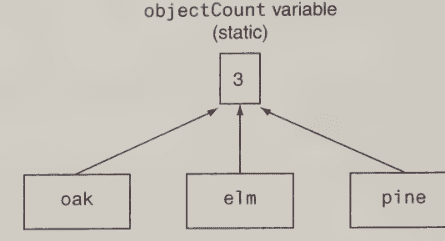

Tree 类的实例

在第 14 行，程序调用了 `getObjectClass` 成员函数来获取已创建实例的数量。虽然程序使用了 `pine` 对象来调用该成员函数，但如果使用任何一个对象，返回的值都是相同的。例如，所有三个 `cout` 语句都会显示以下内容：

```cpp
cout << "We have " << oak.getObjectCount() << " trees\n";
cout << "We have " << elm.getObjectCount() << " trees\n";
cout << "We have " << pine.getObjectCount() << " trees\n";
```

静态变量的一个更实际用途在程序 14-2 中得到了演示。`Budget` 类用于收集公司所有部门的预算请求。该类使用一个静态成员 `corpBudget` 来存储整个公司预算的金额。当调用成员函数 `addUser` 时，其参数会被加到 `corpBudget` 的当前内容中。当程序结束时，`corpBudget` 将包含所有 `Budget` 类对象所放置的值的总和。（这些文件可以在第 14 章源代码文件夹的版本 1 中找到。）

## Budget.h 的内容（版本 1）

```cpp
#ifndef BUDGET_H
#define BUDGET_H

// Budget 类声明
class Budget
{
private:
    static double corpBudget; // 静态成员
    double divisionBudget; // 实例成员
public:
    Budget()
    { divisionBudget = 0; }

    void addUser(double b)
    { divisionBudget += b; corpBudget += b; }

    double getDivisionBudget() const
    { return divisionBudget; }

    double getCorpBudget() const
    { return corpBudget; }
};

// 静态成员变量 corpBudget 的定义
double Budget::corpBudget = 0;

#endif
```

# 程序 14-2

```cpp
// 此程序演示了一个静态类成员变量。
#include <iostream>
#include <iomanip>
#include "Budget.h"
using namespace std;

int main()
{
    int count; // 循环计数器
    const int NUM_DIVISIONS = 4; // 部门数量
    Budget divisions[NUM_DIVISIONS]; // Budget 对象数组

    // 获取每个部门的预算请求。
    for (count = 0; count < NUM_DIVISIONS; count++)
    {
        double budgetAmount;
        cout << "Enter the budget request for division ";
        cout << (count + 1) << ": ";
        cin >> budgetAmount;
        divisions[count].addBudget(budgetAmount);
    }

    // 显示预算请求和公司预算。
    cout << fixed << setprecision(2);
    cout << "\nHere are the budget requests:\n";
    for (count = 0; count < NUM_DIVISIONS; count++)
    {
        cout << "division " << (count + 1) << "\t$";
        cout << divisions[count].getDivisionBudget() << endl;
    }
    cout << "Total Budget Requests:" << "\t$";
    cout << divisions[0].getCorpBudget() << endl;

    return 0;
}
```

# 程序输出（示例输入已加粗显示）

| 输入部门 1 的预算请求： | **100000** | 回车 |
| :--- | :--- | :--- |
| 输入部门 2 的预算请求: | **200000** | 回车 |
| 输入部门 3 的预算请求： | **300000** | 回车 |
| 输入部门 4 的预算请求： | **400000** | 回车 |

（程序输出继续）

# 程序 14-2（继续）

以下是部门预算请求：

- 部门 1 $ 100000.00
- 部门 2 $ 200000.00
- 部门 3 $ 300000.00
- 部门 4 $ 400000.00

总预算请求：$ 1000000.00

# 静态成员函数

通过在函数原型中放置 `static` 关键字来声明静态成员函数。其通用格式如下：

```cpp
static ReturnType FunctionName(ParameterTypeList);
```

作为类静态成员的函数无法访问其类中的任何非静态成员数据。由于这种限制，你可能会疑惑静态成员函数的作用。以下两点对于理解它们的用处至关重要：

1. 尽管静态成员变量是在类中声明的，但它们实际上是在类声明之外定义的。类静态成员变量的生命周期意味着类的静态成员变量在任何类实例创建之前就已经存在了。


2. 类的静态成员函数可以在任何类实例创建之前调用。这意味着你可以在创建对象之前创建类的设置程序。程序 14-3（程序 14-2 的修改版）演示了这一特性。`Budget` 类被修改包含一个名为 `mainOffice` 的静态成员函数。该函数在输入部门请求之前要求用户输入总部预算请求，并将参数添加到静态变量 `corpBudget`。（这些文件可以在第 14 章源代码文件夹的版本 2 中找到。）

# Budget.h 的内容（版本 2）

```cpp
#ifndef BUDGET_H
#define BUDGET_H
class Budget
{
  // Budget 类声明
  private:
    static double corpBudget; // 静态成员变量
    double divisionBudget; // 实例成员变量
  public:
    Budget()
      { divisionBudget = 0; }

    void addBudget(double b)
    { divisionBudget += b; corpBudget += b; }

    double getDivisionBudget() const
    { return divisionBudget; }

    double getCorpBudget() const
    { return corpBudget; }

    static void mainOffice(double amount);
};
#endif
```

# Budget.cpp 的内容

```cpp
#include "Budget.h"

// 静态成员变量 corpBudget 的定义
double Budget::corpBudget = 0;

/**
 * 静态函数 mainOffice 的定义
 * 该函数将总部预算请求加到 corpBudget。
 */
void Budget::mainOffice(double amount)
{
    corpBudget += amount;
}

// 成员函数的定义
void Budget::addBudget(double b)
{
    divisionBudget += b;
    corpBudget += b;
}

double Budget::getDivisionBudget() const
{
    return divisionBudget;
}

double Budget::getCorpBudget() const
{
    return corpBudget;
}
```

# 程序 14-3

```cpp
// 此程序演示了一个静态成员函数。
#include <iostream>
#include <iomanip>
#include "Budget.h"
using namespace std;

int main()
{
    int count; // 循环计数器
    const int NUM_DIVISIONS = 4; // 部门数量
    Budget divisions[NUM_DIVISIONS]; // Budget 对象数组
    double amount;

    // 先获取总部的预算请求。
    cout << "Enter the main office's budget request: ";
    cin >> amount;
    Budget::mainOffice(amount);

    // 获取每个部门的预算请求。
    for (count = 0; count < NUM_DIVISIONS; count++)
    {
        double budgetAmount;
        cout << "Enter the budget request for division ";
        cout << (count + 1) << ": ";
        cin >> budgetAmount;
        divisions[count].addBudget(budgetAmount);
    }

    // 显示预算请求和公司预算。
    cout << fixed << setprecision(2);
    cout << "\nHere are the budget requests:\n";
    for (count = 0; count < NUM_DIVISIONS; count++)
    {
        cout << "division " << (count + 1) << "\t$";
        cout << divisions[count].getDivisionBudget() << endl;
    }
    cout << "Total Budget Requests:" << "\t$";
    cout << Budget::getCorpBudget() << endl;

    return 0;
}
```

# 程序输出（示例输入已加粗显示）

输入总部的预算请求：**100000**

输入部门 1 的预算请求：**100000**

输入部门 2 的预算请求：**200000**

输入部门 3 的预算请求：**300000**

输入部门 4 的预算请求：**400000**

## 14.2 类的朋友

概念：朋友（friend）是一个函数或类，它不是某个类的成员，但拥有访问该类私有成员的权限。

私有成员对类之外的所有程序部分都是隐藏的，访问这些成员需要调用公共成员函数。有时，你可能希望对该规则进行例外处理。**朋友函数**是不属于某个类的函数，但它拥有访问该类私有成员的权限。换句话说，朋友被对待得就像它是该类的成员一样。朋友函数可以是一个普通的独立函数，也可以是另一个类的成员。（事实上，可以将整个类声明为另一个类的朋友。）

为了让一个函数或一个类成为另一个类的朋友，需要由该类（即授予访问权限的类）对其进行声明。类会维护一个它的朋友“列表”，只有名称出现在列表中的外部函数或类才会被授予访问权限。通过在函数原型的前面放置 `friend` 关键字，可以将一个函数声明为朋友。以下是通用格式：

```
friend ReturnType FunctionName (ParameterTypeList)
```

在以下对 `Budget` 类的声明中，另一个类 `AuxiliaryOffice` 的 `addBudget` 函数已被声明为朋友。（此文件可以在学生源代码文件夹第 14 章/Budget 3 中找到。）

### Budget.h 的内容（版本 3）

```cpp
#ifndef BUDGET_H
#define BUDGET_H
#include "Auxil.h"

// Budget 类声明
class Budget {
private:
    static double corpBudget; // 静态成员变量
    double divisionBudget; // 实例成员变量
public:
    Budget() {
        divisionBudget = 0;
    }
    void addBudget(double b) {
        divisionBudget += b;
        corpBudget += b;
    }
    double getDivisionBudget() const {
        return divisionBudget;
    }
    double getCorpBudget() const {
        return corpBudget;
    }

    // 静态成员函数
    static void mainOffice(double);

    // 朋友函数
    friend void AuxiliaryOffice::addBudget(double, Budget &);
};
#endif
```

让我们假设另一个类 `AuxiliaryOffice` 代表一个部门的辅助办公室，可能在另一个国家。该辅助办公室会提交单独的预算请求，该请求必须添加到公司总预算中。`AuxiliaryOffice::addBudget` 函数的朋友声明告诉编译器，该函数被授予访问 `Budget` 私有成员的权限：一个 `double` 和一个 `Budget` 类对象的引用。被函数修改的 `Budget` 类对象通过参数的形式传递。以下代码显示了 `AuxiliaryOffice` 类的声明。（此文件可以在学生源代码文件夹 Chapter14\Budget Version 3 中找到。）

### Auxil.h 的内容

```cpp
#ifndef AUXIL_H
#define AUXIL_H

class Budget; // Budget 类的向前声明

// Aux 类声明
class AuxiliaryOffice
{
private:
    double auxBudget;
public:
    AuxiliaryOffice()
    { auxBudget = 0; }

    double getDivisionBudget() const
    { return auxBudget; }

    void addBudget(double, Budget &);
};
#endif
```

### Auxil.cpp 的内容

```cpp
#include "Auxil.h"
#include "Budget.h"

/*****************************************************
 * 成员函数 addBudget 的定义。
 * 该函数由 Budget 类声明为朋友。
 * 它将参数 b 的值加到 Budget 类的静态 corpBudget
 * 成员变量。
 ****************************************************/

void AuxiliaryOffice::addBudget(double b, Budget &div)
{
    auxBudget += b;
    div.corpBudget += b;
}
```

注意 `Auxil.h` 文件第 4 行包含以下语句：

```
class Budget; // Budget 类的向前声明
```

这是 `Budget` 类的向前声明。它只是告诉编译器，程序中稍后会声明一个名为 `Budget` 的类。这是必要的，因为编译器在处理 `Auxil.h` 文件之前会先处理 `Budget` 类的声明。在处理 `Auxil.h` 文件时，它会在第 19 行看到以下函数声明：

```
void addBudget(double, Budget &);
```

`addBudget` 函数的第二个参数是一个 `Budget` 引用变量。在此时，编译器还没有处理 `Budget` 类的声明，因此，如果没有向前声明，它就不知道 `Budget` 引用变量是什么。

### 程序 14-4

```cpp
// 此程序演示了静态成员函数。
#include <iostream>
#include <iomanip>
#include "Budget.h"
using namespace std;

int main() {
    int count; // 计数器
    double mainBudget; // 主办公室预算
    const int NUM_DIVISIONS = 4; // 部门数量

    // 获取部门的预算。
    for (count = 0; count < NUM_DIVISIONS; count++) {
        cout << "部门 " << count + 1 << " 的预算请求: ";
        cin >> mainBudget;

        // 辅助办公室提交单独的预算请求，
        // 该请求必须添加到公司总预算中。
        AuxiliaryOffice aux;
        aux.addBudget(mainBudget, corpBudget); // 此处使用朋友函数
    }

    // 显示公司总预算。
    cout << "\n公司总预算: $" << fixed << setprecision(2) << corpBudget << endl;

    return 0;
}
```

### 程序 14-4 的输出

```
部门 1 的预算请求: 100000
部门 2 的预算请求: 50000
部门 3 的预算请求: 300000
部门 4 的预算请求: 400000
公司总预算: $850000.00
```


# 检查点

- 1.1 实例成员变量和静态变量有什么区别？
- 1.2 静态成员变量在类声明中声明。你在哪里编写静态成员变量的语句？
- 1.3 静态成员变量是在其类的实例出现之前、与其同时还是之后进入内存的？
- 1.4 静态成员函数有什么局限性？
- 1.5 静态成员函数可以执行哪些实例成员函数不能执行的操作？
- 1.6 如果类 X 将函数 `f` 声明为朋友，函数 `f` 是否成为类 X 的成员？
- 1.7 类 Y 是类 X 的朋友，`friend` 关键字出现在类 Y 的声明中还是类 X 的声明中？

# 成员级赋值

> 概念：`=` 运算符可以将一个对象的数据赋值给另一个对象，或者用另一个对象的数据初始化一个对象。默认情况下，一个对象的每个成员都会被复制到另一个对象中对应的成员中。

与其他变量（数组除外）一样，对象可以使用 `=` 运算符进行相互赋值。例如，考虑程序 14-5，该程序使用了我们在第 13 章中讨论过的 `Rectangle` 类（版本 4）。回想一下 `Rectangle` 类有两个成员变量：`width` 和 `length`。构造函数接受两个参数：一个用于 `width`，一个用于 `length`。

# 程序 14-5

```cpp
// 此程序演示了成员级赋值。

#include <iostream>
#include "Rectangle.h"

using namespace std;

int main() {
    // 定义两个 Rectangle 对象。
    Rectangle box1(10.0, 10.0); // width = 10.0, length = 10.0
    Rectangle box2(20.0, 20.0); // width = 20.0, length = 20.0

    // 显示每个对象的宽度和长度。
    cout << "box1's width and length: " << box1.getWidth() << endl;
    cout << "box2's width and length: " << box2.getWidth() << endl;
    cout << box2.getLength() << endl << endl;

    // 将 box1 的成员赋值给 box2。
    box2 = box1;

    // 再次显示每个对象的宽度和长度。
    cout << "box1's width and length: " << box1.getWidth() << endl;
    cout << box1.getLength() << endl << endl;
    cout << "box2's width and length: " << box2.getWidth() << endl;
    cout << box2.getLength() << endl << endl;

    return 0;
}
```

# 程序输出

box1's width and length: 10 10
box2's width and length: 20 20

box1's width and length: 10 10
box2's width and length: 10 10

# 14.4 拷贝构造函数

出现在第 19 行的语句将 `box1` 的 `width` 和 `length` 成员变量直接复制到 `box2` 的 `width` 和 `length` 成员变量中：

```cpp
box2 = box1;
```

当用另一个对象的值初始化对象时，也会发生成员级赋值。记住赋值和初始化的区别：赋值发生在两个现有对象之间，而初始化发生在正在创建的对象上。考虑以下代码：

```cpp
// 定义 box1。
Rectangle box1(100.0, 50.0);

// 定义 box2，用 box1 的值初始化
Rectangle box2 = box1;
```

最后一条语句定义了一个 `Rectangle` 对象 `box2`，并将其初始化为存储在 `box1` 中的值。由于发生了成员级赋值，`box2` 对象将包含与 `box1` 对象完全相同的值。

# 14.4 拷贝构造函数

> 概念：拷贝构造函数是一种特殊的构造函数，每创建一个新对象并用另一个对象的数据对其进行初始化时，就会被调用。

有时，C++ 中默认的成员级赋值行为是完全可以的。然而，在许多情况下，无法使用成员级赋值。例如，考虑以下类（该文件可以在 Student Source Folder Chapter 14\StudentTestScores Version 1 中找到）。

# StudentTestScores.h 内容（版本 1）

```cpp
#ifndef STUDENTTESTSCORES_H
#define STUDENTTESTSCORES_H

#include <string>

using namespace std;

const double DEFAULT_SCORE = 0.0;

class StudentTestScores
{
private:
    string studentName; // 学生姓名
    double *testScores; // 指向分数数组的指针
    int numTests; // 分数数量

    // 私有成员函数，用于创建
    // 分数数组。
    void createTestScoresArray(int size);
    // (来自 OCR 的实现细节)
    // numTests = new double[size];
    // for (int i = 0; i < size; i++)
    // testScores[i] = DEFAULT_SCORE;

public:
    // 构造函数
    StudentTestScores(string name, int numScores)
    { 
        studentName = name;
        createTestScoresArray(numScores);
    }

    // 析构函数
    ~StudentTestScores()
    { delete testScores; }

    // setTestScore 函数设置特定的
    // 测试分数值。
    void setTestScore(double score, int index)
    { testScores[index] = score; }

    // 设置学生的姓名。
    void setStudentName(string name)
    { studentName = name; }

    // 获取学生的姓名。
    string getStudentName() const
    { return studentName; }

    // 获取分数的数量。
    int getNumTestScores() const
    { return numTests; }

    // 获取特定的测试分数。
    double getTestScore(int index) const
    { return testScores[index]; }
#endif
```

该类存储了一个学生的姓名和测试分数。让我们仔细观察代码：

- 第 11 行到 13 行声明了类的属性。`studentName` 属性是一个字符串对象，保存着学生的姓名。`testScores` 属性是一个指针。它的目的是指向一个存储测试分数的动态分配数组。`numTests` 属性是一个整数，保存分数的数量。
- `createTestScoresArray` 成员函数（第 17 行到 21 行）创建一个存储测试分数的数组。它接受一个分数数量参数，将此值赋值给 `numTests` 属性（第 18 行），为 `testScores` 属性动态分配一个数组（第 19 行）。第 20 行和 21 行的 `for` 循环将数组的每个元素初始化为默认值 0.0。
- 第 25 行到 27 行的构造函数接受姓名和分数数量。在第 26 行，姓名被赋值给 `studentName` 属性，在第 27 行，分数数量传递给 `createTestScoresArray`。
- 第 30 行和 31 行的析构函数释放内存。
- 第 35 行和 36 行的 `setTestScore` 函数设置 `testScores` 属性中的特定分数。该函数接受分数和分数索引的参数。
- `setStudentName` 函数设置学生的姓名。
- `getStudentName` 函数获取学生的姓名。
- `getNumTestScores` 函数获取分数的数量。
- `getTestScore` 函数获取特定的测试分数。


- `createTestScoresArray` 成员函数（第 17 行到 21 行）创建一个存储测试分数的数组。它接受一个分数数量参数，将此值赋值给 `numTests` 属性（第 18 行），为 `testScores` 属性动态分配一个数组（第 19 行）。第 20 行和 21 行的 `for` 循环将数组的每个元素初始化为默认值 0.0。

- 第 25 行到 27 行的构造函数接受姓名和分数数量。在第 26 行，姓名被赋值给 `studentName` 属性，在第 27 行，分数数量传递给 `createTestScoresArray`。

- 第 30 行和 31 行的析构函数释放内存。

- 第 35 行和 36 行的 `setTestScore` 函数设置 `testScores` 属性中的特定分数。该函数接受分数和分数索引的参数。

- `setStudentName` 函数设置学生的姓名。

- `getStudentName` 函数获取学生的姓名。

- `getNumTestScores` 函数获取分数的数量。

- `getTestScore` 函数获取特定的测试分数。

`const` 关键字确保函数不能修改参数的内容。

这可以防止你无意中编写损坏数据的代码。

这里显示了修改后的 `StudentTestScores` 类的完整列表。（你可以在 `Student` 源代码文件夹第 14 章 `StudentTestScores` 版本 2 中找到它。）

# StudentTestScores.h 的内容（版本 2）

```cpp
#ifndef STUDENTTESTSCORES_H
#define STUDENTTESTSCORES_H
#include <string>
using namespace std;

const double DEFAULT_SCORE = 0.0;

class StudentTestScores
{
private:
    string studentName; // 学生姓名
    double *testScores; // 指向分数数组的指针
    int numTestScores; // 分数数量

    // 创建数组的私有成员函数
    void createTestScoresArray(int size)
    {
        numTestScores = size;
        testScores = new double[size];
        for (int i = 0; i < size; i++)
            testScores[i] = DEFAULT_SCORE;
    }

public:
    // 构造函数
    StudentTestScores(string name, int numScores)
    {
        studentName = name;
        createTestScoresArray(numScores);
    }

    // 拷贝构造函数
    StudentTestScores(const StudentTestScores &obj)
    {
        studentName = obj.studentName;
        numTestScores = obj.numTestScores;
        for (int i = 0; i < numTestScores; i++)
            testScores[i] = obj.testScores[i];
    }

    // 析构函数
    ~StudentTestScores()
    {
        delete[] testScores;
    }

    // setScore 函数设置特定测试数的数值。
    void setScore(double score, int index)
    {
        testScores[index] = score;
    }
```

# 第 14 章 类的更多关于

```cpp
46 // 设置学生姓名。
47 void setName(string name)
48 { studentName = name; }
49
50 // 获取学生姓名。
51 string getStudentName() const
52 { return studentName; }
53
54 // 获取测试分数量。
55 int getNumScores() const
56 { return numTestScores; }
57
58 // 获取特定的测试分数。
59 double getTestScore(int index) const
60 { return testScores[index]; }
61 };
62 #endif
```

# 拷贝构造函数与函数参数

当类对象作为值参数传递给函数时，它会被传递给一个同样是类对象的参数，并调用该参数的拷贝构造函数。请记住，当使用非引用的类对象作为函数参数时，它会在函数调用时被创建，并用参数的值对其进行初始化。

这就是为什么 C++ 要求拷贝构造函数的参数必须按引用传递的原因；因为拷贝构造函数会创建参数的副本并将其存储在参数对象中。当参数对象创建时，会调用它的拷贝构造函数，导致另一个参数对象的创建。这个过程将无限持续下去（至少直到可用内存填满，导致程序停止）。

为了防止拷贝构造函数无限次地调用自己，C++ 要求其参数为引用对象。

# 默认拷贝构造函数

尽管你可能没有意识到，但你以前见过拷贝构造函数的操作。如果一个类没有拷贝构造函数，C++ 会为它创建一个默认拷贝构造函数。默认拷贝构造函数执行的是上一节讨论的成员级赋值。

### 检查点 (Checkpoint)

- 14.8 简述什么是成员级赋值。

- 14.9 描述两次出现成员赋值的情况。

- 14.10 描述不应使用成员赋值的情况。

- 14.11 拷贝构造函数何时被调用？

- 14.12 编译器如何知道成员函数是拷贝构造函数？

- 14.13 拷贝构造函数执行了什么？

# 运算符重载

运算符重载允许你重定义在类对象上使用的现有运算符。假设一个类包含指针，它们在简单的赋值中无法工作。C++ 提供了许多运算符。如果你想重定义某个运算符的行为，只需为该运算符定义一个函数。

# `this` 指针

在进一步讨论运算符重载之前，我们需要讨论一个特殊的指针 `this`。它是每个成员函数都拥有的隐藏参数，它指向调用该函数的实例。例如，如果 `student1` 和 `student2` 都是 `StudentScores` 对象，以下语句会导致 `getStudentName` 操作于 `student1`：

```cpp
cout << student1.getStudentName() << endl;
```

同样，以下语句会导致 `getStudentName` 操作于 `student2`：

```cpp
cout << student2.getStudentName() << endl;
```

当 `getStudentName` 操作于 `student1` 时，`this` 指针指向 `student1`。当它操作于 `student2` 时，`this` 指针指向 `student2`。

# 重载赋值运算符

拷贝构造函数是为了解决包含指针对象的初始化问题；它们只在对象创建时被调用。如下语句执行的是赋值，而不是拷贝构造：

```cpp
student2 = student1;
```

为了改变赋值运算符的工作方式，必须对其进行重载。如果你想重定义某个运算符与对象工作，请为该运算符定义函数。让我们看看如何在 `StudentTestScores` 类中重载 `=` 运算符。如果你去本书的源代码文件夹第 14 章 `StudentTestScores` 版本 3 并打开 `StudentTestScores.h`，你会发现类内部第 63 到 74 行添加了以下成员函数：

```cpp
62 // 重载 = 运算符
63 const StudentTestScores operator=(const StudentTestScores& right)
64 {
65     if (this != &right)
66     {
67         delete[] testScores;
68         studentName = right.studentName;
69         numTestScores = right.numTestScores;
70         testScores = new double[numTestScores];
71         for (int i = 0; i < numTestScores; i++)
72             testScores[i] = right.testScores[i];
73     }
74     return *this;
75 }
```

让我们检查运算符函数以理解它是如何工作的。首先，查看第 63 行的函数头，将其分为图 14-5 所示的三部分：

**图 14-5** operator= 的函数头

| 返回类型 | 函数名 | 运算符对象侧的参数声明 |
|---|---|---|
| `const StudentTestScores` | `operator=` | `(const StudentTestScores& right)` |

- 返回类型：该函数的返回类型是 `const StudentTestScores`。这意味着它返回一个不可修改的 `StudentTestScores` 对象。

- 函数名：该函数的名称是 `operator=`。这意味着该函数重载了 `=` 运算符。因为它是 `StudentTestScores` 类的成员，

## 14.5 运算符重载

当赋值语句执行时，如果 `=` 运算符左侧的对象是 `StudentTestScores` 类的对象，则会调用此函数。

该函数有一个参数：一个名为 `right` 的常量引用对象。此参数引用了运算符右侧的对象。例如，当执行以下语句时，`right` 将引用 `student1`：

```cpp
student2 = student1;
```

为了提高效率，我们将右侧参数（`right`）声明为引用变量。这可以防止编译器对传递给函数的对象进行拷贝。我们将其声明为 `const`，以确保函数不会意外修改其内容。

> 注意：在示例中，参数的命名非常简单，为了说明它引用了运算符右侧的对象。你可以为该参数起任何你喜欢的名称。它始终会获取运算符右侧的对象作为参数。

在运算符重载的机制中，了解以下两个语句的作用是相同的是有帮助的：

```cpp
student2 = student1; // 调用 operator= 函数
student2.operator=(student1); // 调用 operator= 函数
```

在第二条语句中，你可以清楚地看到函数调用的过程。`student1` 对象被传递给函数的参数 `right`。在函数内部，`right` 成员变量的值被用于初始化 `student2`。注意，`operator=` 函数可以访问 `right` 参数的私有成员。因为 `operator=` 函数是 `StudentTestScores` 类的成员函数，它有权访问传递给它的任何 `StudentTestScores` 对象的私有成员。

## 检查自赋值

回顾一下，`this` 是传递给所有非静态成员函数的隐藏参数。这是一个特殊的指针，指向调用该函数的对象。在我们的 `operator=` 函数内部，它将指向 `=` 符号左侧的对象，而 `right` 引用等号右侧的对象。这在图 14-6 中所示。在图中，假设 `student1` 和 `student2` 都是 `StudentTestScores` 对象。

**图 14-6** `this` 指针与右侧参数

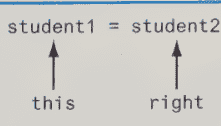

回看 `operator=` 函数，注意函数体的第一条语句（第 65 行）是一个如下的 `if` 语句：

```cpp
if (this != &right)
```

## 第 14 章 关于类的更多信息

这条语句正在确保存储在 `this` 中的地址与 `right` 对象的地址不同。换句话说，它正在检查是否存在**自赋值**。自赋值是指将一个对象赋值给自己。例如，假设 `student1` 是一个 `StudentTestScores` 对象，并且持有一组测试分数。以下语句执行了自赋值：

```cpp
student1 = student1;
```

显然，没有理由编写这样的语句，但在处理对象指针和引用的程序中，赋值可能会以间接的方式发生。在 `operator=` 函数中编写代码来检查自赋值是非常重要的，特别是对于那些动态分配内存的类。接下来的代码片段展示了如果我们不检查自赋值，`StudentTestScores` 类的 `operator=` 成员函数会什么样：

```cpp
// 重载运算符检查自赋值
const StudentTestScores operator=(const StudentTestScores& right) {
    delete[] testScores;
    studentName = right.studentName;
    numScores = right.numScores;
    testScores = new double[numScores];
    for (int i = 0; i < numScores; i++)
        testScores[i] = right.testScores[i];
    return *this;
}
```

在这个函数版本中，我们做的第一件事是删除 `testScores` 数组的内存。在发生自赋值的情况下，这将导致问题，因为我们正在删除自己要使用的内存。通过检查自赋值，修复后的函数版本避免了这个问题：

```cpp
// 重载运算符，包含自赋值的检查
const StudentTestScores operator=(const StudentTestScores& right) {
    if (this != &right) {
        delete[] testScores;
        studentName = right.studentName;
        numScores = right.numScores;
        testScores = new double[numScores];
        for (int i = 0; i < numScores; i++)
            testScores[i] = right.testScores[i];
    }
    return *this;
}
```

## operator= 的返回值

关于 `operator=` 函数最后需要讨论的一点是它的返回值。`operator=` 运算符允许如下的赋值语句：

```cpp
a = b = c;
```

这条语句的执行方式是：首先执行 `b = c`，调用 `operator=` 函数并返回 `b` 的引用，然后执行 `a = (返回的结果)`。这使得链式赋值成为可能。

## 14.5 运算符重载

```cpp
// 将 student1 赋值给 student2 和 student3。
student3 = student2 = student1;

// 显示对象。
displayStudent(student1);
displayStudent(student2);
displayStudent(student3);
return 0;
}
// displayStudent 函数
void displayStudent(StudentTestScores s) {
    cout << "Name: " << s.getStudentName() << endl;
    cout << "Test Scores: ";
    for (int i = 0; i < s.getNumScores(); i++)
        cout << s.getTestScore(i) << " ";
}
```

程序输出

Name: Kelly Thornton

Test Scores: 100 95 80

Name: Kelly Thornton

Test Scores: 100 95 80

Name: Kelly Thornton

Test Scores: 100 95 80

## 运算符重载的一些通用问题

现在你已经了解了运算符重载，让我们来看看编程中的一些通用问题。

虽然这不是良好的编程习惯，但如果你需要，可以改变运算符的整个含义。没有什么能阻止你将 `=` 符号从赋值运算符变为“显示”运算符。例如，下面的类就是：

```cpp
class Weird {
private:
    int value;
public:
    Weird(int v) {
        value = v;
    }
    void operator=(const Weird &right) {
        cout << right.value << endl;
    }
};
```

虽然 `Weird` 类中的 `operator=` 重载了赋值运算符，但该函数并没有执行赋值操作。相反显示了 `right` 的内容。考虑下面的程序段：

```cpp
Weird a(5), b(10);
a = b;
```

虽然 `a = b` 看起来像是一个赋值语句，但它实际上导致 `b` 的成员显示在屏幕上：

另一个运算符重载问题是不能改变运算符的操作数个数。`=` 符号必须是一个二元运算符。同样，`++` 和 `--` 必须是一元运算符。

最后一个问题是，虽然你可以重载大多数 C++ 运算符，但不能重载所有的。表 14-1 显示了所有可以重载的 C++ 运算符（表中的某些运算符超出了本书的范围，未进行讨论）。


## 表 14-1 可重载的运算符

| + | * | / | % | ^ | & | ! | = | < |
| :--- | :--- | :--- | :--- | :--- | :--- | :--- | :--- | :--- |
| > | += | -= | *== | /= | %== | &= | <<= | << | >> | >= |
| == | != | <= | && | || | ++ | -- | -* | -* |
| [] | () | new | delete | | | | |

不能重载的运算符：`?:` `.` `::` `sizeof`

## 重载数学运算符

许多类不仅受益于重载赋值运算符，还受益于重载数学运算符。为了说明这一点，请考虑两个文件中所示 `FeetIn` 类（这些文件可以在源代码文件夹第 14 章：FeetIn 中找到）。

### FeetIn.h（版本1）

```cpp
#ifndef FEET_H
#define FEET_H

// FeetIn 类存储以英尺和英寸表示的距离或测量值。
class FeetIn
{
private:
    int feet; // 存储英尺数
    int inches; // 存储英寸数
    void simplify(); // 定义在 FeetIn.cpp 中
public:
    // 构造函数
    FeetIn(int f = 0, int i = 0)
    { feet = f;
    inches = i;
    simplify(); }

    // 修改器函数 (Mutator functions)
    void setFeet(int f) { feet = f; }
    void setInches(int i) { inches = i; simplify(); }

    // 访问器函数 (Accessor functions)
    int getFeet() const { return feet; }
    int getInches() const { return inches; }

    // 重载运算符函数 (Overloaded operator functions)
    FeetIn operator + (const FeetIn &); // 重载 +
    FeetIn operator - (const FeetIn &); // 重载 -
};

#endif
```

### FeetIn.cpp（版本1）

```cpp
void FeetIn::simplify()
{
    if (inches >= 12)
    {
        feet += inches / 12;
        inches = inches % 12;
    }
    else if (inches < 0)
    {
        feet -= abs(inches) / 12;
        inches = 12 - abs(inches) % 12;
    }
}
```

### 关于类的更多信息

```cpp
/**
 * 重载的二元运算符。
 */
FeetIn FeetIn::operator + (const FeetIn& right)
{
    FeetIn temp;
    temp.inches = inches + right.inches;
    temp.feet = feet + right.feet;
    temp.simplify();
    return temp;
}

/**
 * 重载的二元运算符。
 */
FeetIn FeetIn::operator - (const FeetIn& right)
{
    FeetIn temp;
    temp.inches = inches - right.inches;
    temp.feet = feet - right.feet;
    temp.simplify();
    return temp;
}
```

`FeetIn` 类设计用于存储英尺和英寸表示的距离或测量值。它由八个成员函数组成：

- 一个允许 `feet` 和 `inches` 成员的构造函数。这些成员的默认值为零。
- `setFeet`：用于在 `feet` 成员中存储值的函数。
- `setInches`：用于在 `inches` 成员中存储值的函数。
- `getFeet`：用于返回 `feet` 成员值的函数。
- `getInches`：用于返回 `inches` 成员值的函数。
- `simplify`：用于归一化英尺和英寸存储值的函数。此函数会调整任何 `inches` 成员大于 12 或小于 0 的值。
- `operator +`：重载 `+` 的运算符
- `operator -`：重载 `-` 的运算符

## 程序 14-8

```cpp
// 此程序演示了 FeetInches 类重载的
// + 和 - 运算符
#include <iostream>
#include "FeetInches.h"
using namespace std;

int main() {
    int feet, inches; // 用于存储脚和英寸的输入

    // 创建三个 FeetInches 对象。将使用构造函数的默认参数。
    FeetInches first, second, third;

    // 从用户处获取距离。
    cout << "Enter a distance in feet and inches: ";
    cin >> feet >> inches;

    // 将距离存储在对象中。
    first.setFeet(feet);
    first.setInches(inches);

    // 从用户处获取另一个距离。
    cout << "Enter another distance in feet and inches: ";
    cin >> feet >> inches;

    // 将 first + second 的结果赋值给 third。
    third = first + second;

    // 显示结果。
    cout << "first + second = ";
    cout << third.getFeet() << " feet, ";
    cout << third.getInches() << " inches.\n";

    // 将 first - second 的结果赋值给 third。
    third = first - second;

    // 显示结果。
    cout << "first - second = ";
    cout << third.getFeet() << " feet, ";
    cout << third.getInches() << " inches.\n";

    return 0;
}
```

## 程序输出（示例输入已加粗）

Enter a distance in feet and inches: **6 5** [Enter]
Enter another distance in feet and inches: **3 10** [Enter]
first + second = 10 feet, 3 inches.
first - second = 2 feet, 7 inches.

## 重载前缀 ++ 运算符

一元运算符（如 `++` 和 `--`）的重载方式与二元运算符的实现方式相似。由于一元运算符只影响调用运算符函数的内调用的对象，因此不需要参数。例如，假设你想为 `FeetInches` 类实现一个前缀递增运算符。当 `FeetInches` 对象设置为 7 英尺 5 英寸时，可以设计一个 `++` 运算符函数来增加对象的英寸成员值。以下语句将使距离变为 7 英尺 6 英寸的值：

```cpp
++distance;
```

以下函数重载了前缀 `++` 运算符，以如下方式工作：

```cpp
FeetInches FeetInches::operator++()
{
    ++inches;
    simplify();
    return *this;
}
```

该函数首先增加对象的英寸成员值。然后调用 `simplify()` 函数，并返回解引用指针。这使得运算符可以在如下的语句中正常工作：

```cpp
distance2 = ++distance1;
```

记住，上述语句等同于

```cpp
distance2 = distance1.operator++();
```

## 重载后置 ++ 运算符

重载后置 `++` 运算符与重载前缀版本略有不同。以下是在 `FeetInches` 类中重载后置运算符的函数：

```cpp
FeetInches FeetInches::operator++(int)
{
    FeetInches temp(feet, inches);
    inches++;
    simplify();
    return temp;
}
```

你会发现的区别是使用了虚拟参数。函数括号中的单词 `int` 建立了一个无名整数参数。当 C++ 在运算符函数中看到此参数时，它知道该函数被设计用于后置模式。第二个区别是使用了临时局部变量 `temp` 对象。`temp` 使用调用该函数的对象的脚和英寸值进行初始化。


因此，`temp` 是在递增发生前对被增加对象的拷贝。在 `inches` 增加并调用 `simplify` 函数后，返回 `temp` 的内容。我们使用后置运算符在如下语句中表现得正确：

```cpp
distance2 = distance1++;
```

你将在 Student Code Folder Chapter 14\FeetInches Version 2 中找到重载了前缀和后置运算符的 `FeetInches` 类版本。在该文件夹中，你还会找到程序 14-9，它演示了这些重载运算符。

## 程序 14-9

```cpp
// 此程序演示了 FeetInches 类重载的
// 前缀和后置 ++ 运算符
#include <iostream>
#include "FeetInches.h"
using namespace std;

int main()
{
    int count; // 循环计数器

    // 定义一个默认值为 0 英尺 0 英寸的 FeetInches 对象。
    FeetInches first;

    // 定义一个 1 英尺 5 英寸的 FeetInches 对象。
    FeetInches second(1, 5);

    // 使用前缀 ++ 运算符。
    cout << "Demonstrating prefix ++ operator.\n";
    for (count = 0; count < 12; count++)
    {
        first = ++first;
        cout << "first: " << first.getFeet() << " feet, ";
        cout << first.getInches() << " inches, ";
        cout << "second: " << second.getFeet() << " feet, ";
        cout << second.getInches() << " inches.\n";
    }

    // 使用后置 ++ 运算符。
    cout << "\nDemonstrating postfix ++ operator.\n";
    for (count = 0; count < 12; count++)
    {
        first = first++;
        cout << "first: " << first.getFeet() << " feet, ";
        cout << first.getInches() << " inches, ";
        cout << "second: " << second.getFeet() << " feet, ";
        cout << second.getInches() << " inches.\n";
    }

    return 0;
}
```

## 程序输出

Demonstrating prefix ++ operator.
first: 0 feet, 1 inches, second: 1 feet, 5 inches.
first: 0 feet, 2 inches, second: 1 feet, 5 inches.
first: 0 feet, 3 inches, second: 1 feet, 5 inches.
first: 0 feet, 4 inches, second: 1 feet, 5 inches.
first: 0 feet, 5 inches, second: 1 feet, 5 inches.
first: 1 feet, 0 inches, second: 1 feet, 5 inches.
first: 1 feet, 1 inches, second: 1 feet, 5 inches.
first: 1 feet, 2 inches, second: 1 feet, 5 inches.
first: 1 feet, 3 inches, second: 1 feet, 5 inches.
first: 1 feet, 4 inches, second: 1 feet, 5 inches.
first: 1 feet, 5 inches, second: 1 feet, 5 inches.
first: 2 feet, 0 inches, second: 1 feet, 5 inches.

Demonstrating postfix ++ operator.
first: 0 feet, 5 inches, second: 1 feet, 5 inches.
first: 0 feet, 6 inches, second: 1 feet, 5 inches.
first: 0 feet, 7 inches, second: 1 feet, 5 inches.
first: 0 feet, 8 inches, second: 1 feet, 5 inches.
first: 0 feet, 9 inches, second: 1 feet, 5 inches.
first: 0 feet, 10 inches, second: 1 feet, 5 inches.
first: 0 feet, 11 inches, second: 1 feet, 5 inches.
first: 1 feet, 0 inches, second: 1 feet, 5 inches.
first: 1 feet, 1 inches, second: 1 feet, 5 inches.
first: 1 feet, 2 inches, second: 1 feet, 5 inches.
first: 1 feet, 3 inches, second: 1 feet, 5 inches.
first: 1 feet, 4 inches, second: 1 feet, 5 inches.

## 检查点

- 14.14 假设有一个 `Pet` 类，写出一个重载 `=` 的成员函数。
- 14.15 假设 `dog` 和 `cat` 是 `Pet` 的实例，将以下语句重写为函数符号：`dog = cat;`
- 14.16 重载返回 `void` 的缺点是什么？
- 14.17 描述 `this` 指针的用途。
- 14.18 `this` 指针自动传递给什么类型？
- 14.19 假设有一个 `Animal` 类重载 `+` 运算符。在以下语句中，`cat`、`tiger` 和 `wildcat` 都是 `Animal` 的实例：`wildcat = cat + tiger;`
- 14.20 在运算符函数中使用虚拟参数向编译器指示什么？

## 重载关系运算符

除了赋值和数学运算符外，关系运算符也可以被重载。这种能力允许在如下关系表达式的语句中比较类：

```cpp
if (distance1 < distance2)
{
    ... 代码...
}
```

重载的关系运算符是以二元运算符的方式实现的。唯一的区别是关系函数始终返回真或假值。Student Source Folder Chapter 14\FeetInches Version 3 中的 `FeetInches` 类包含了重载 `>`、`<` 和 `==` 关系运算符的函数。这里是重载的函数：

```cpp
bool FeetInches::operator > (const FeetInches &right)
{
    if (feet > right.feet)
        status = true;
    else if (feet == right.feet && inches > right.inches)
        status = true;
    else
        status = false;
    return status;
}
```

可以看出，该函数将脚成员（如果需要，还有英寸成员）与参数进行比较。如果调用对象的值大于参数的值，则返回真。否则返回假。

这里是重载 `<` 运算符的代码：

```cpp
bool FeetInches::operator < (const FeetInches &right)
{
    if (feet < right.feet)
        status = true;
    else if (feet == right.feet && inches < right.inches)
```


# 14.5 运算符重载

## 重载 `==` 运算符

```cpp
bool FeetInches::operator == (const FeetInches &right)
{
    if (feet == right.feet && inches == right.inches)
        status = true;
    else
        status = false;
    return status;
}
```

程序 14-10 展示了这些重载运算符。（该文件也可以在学生源代码文件夹第 14 章 FeetInches 版本 3 目录中找到。）

### 程序 14-10

```cpp
// 此程序演示了 FeetInches 类重载的运算符
// 关系运算符。
#include <iostream>
#include "FeetInches.h"
using namespace std;

int main() {
    int feet, inches; // 用于存储脚和英寸的输入

    // 创建两个 FeetInches 对象。构造函数的
    // 第、第二个参数默认值；
    FeetInches first, second;

    // 从用户处获取距离。
    cout << "Enter a distance in feet and inches: ";
    cin >> feet >> inches;

    // 将距离存储在 first 中。
    first.setFeet(feet);
    first.setInches(inches);

    // 获取另一个距离。
    cout << "Enter another distance in feet and inches: ";
    cin >> feet >> inches;

    // 将距离存储在 second 中。
    second.setFeet(feet);
    second.setInches(inches);

    // 比较两个对象。
    if (first == second)
        cout << "first is equal to second.\n";

    if (first > second)
        cout << "first is greater than second.\n";

    if (first < second)
        cout << "first is less than second.\n";

    return 0;
}
```

### 示例输入对应的程序输出

**输入：**
```
Enter a distance in feet and inches: 6 5
Enter another distance in feet and inches: 3 10
```

**输出：**
```
first is greater than second.
```

### 程序 14-10（续）

**输入：**
```
Enter a distance in feet and inches: 5 5
Enter another distance in feet and inches: 5 5
```

**输出：**
```
first is equal to second.
```

**输入：**
```
Enter a distance in feet and inches: 3 4
Enter another distance in feet and inches: 3 7
```

**输出：**
```
first is less than second.
```

## 重载 `<<` 和 `>>` 运算符

重载数学运算符和关系运算符让你能够像处理整数、浮点数和其他内置类型一样，自然地对类对象编写这些类型的表达式。然而，如果对象的主要数据成员是私有的，你仍然必须显式地调用成员函数来为它们赋值。例如，假设 `distance` 是 `FeetInches` 对象。以下语句显示了它的内部值：

```cpp
cout << distance.getFeet() << " feet, " << distance.getInches() << " inches";
```

同样需要调用成员函数来设置 `FeetInches` 对象的数据。例如，以下语句将距离对象设置为用户指定的值：

```cpp
cout << "Enter a value in feet: ";
cin >> f;
distance.setFeet(f);
cout << "Enter a value in inches: ";
cin >> i;
distance.setInches(i);
```

通过重载流插入运算符 (`<<`)，你可以像下面的代码所示将对象发送到 `cout`，并让屏幕以正确的格式输出。同样，通过重载流提取运算符 (`>>`)，距离对象可以直接从 `cin` 获取值。

然而，重载这些运算符的方法与重载其他运算符略有不同。这些运算符实际上是 C++ 运行时库定义的 `ostream` 和 `istream` 类的一部分。`cout` 和 `cin` 分别是 `ostream` 和 `istream` 的实例。你必须编写运算符函数来重载 `ostream` 版本的 `<<` 和 `istream` 版本的 `>>`，以便直接与 `FeetInches` 等类一起工作。学生源代码文件夹第 14 章 FeetInches 版本 4 中的 `FeetInches` 类包含了重载 `<<` 和 `>>` 运算符的函数。这里是重载 `<<` 运算符的函数：

```cpp
ostream& operator << (ostream& strm, const FeetInches &obj)
{
    strm << obj.feet << " feet, " << obj.inches << " inches";
    return strm;
}
```

注意，该函数有两个参数：一个 `ostream` 引用对象和一个 `FeetInches` 引用对象。`ostream` 参数是 `<<` 运算符左侧实际 `ostream` 对象的引用。第二个参数是 `FeetInches` 对象的引用。该参数将引用 `<<` 运算符右侧的对象。此函数告诉 C++ 如何处理任何具有以下形式的表达式：

```
ostreamObject << FeetInchesObject
```

因此，当 C++ 遇到以下语句时，它将调用重载的 `operator<<` 函数：

```cpp
cout << distance;
```

注意函数的返回类型是 `ostream`。这意味着当执行 `return strm;` 语句时，返回的不是 `strm` 的拷贝，而是它的引用。这允许你使用重载的 `<<` 运算符连接多个表达式，例如：

```cpp
cout << distance1 << " " << distance2 << endl;
```

这里是重载流提取运算符的函数：

```cpp
istream& operator >> (istream& strm, FeetInches &obj)
{
    strm >> obj.feet >> obj.inches;
    return strm;
}
```

相同的原理也适用于此运算符。函数返回 `istream` 对象的引用，因此可以将多个此类链在一起：

```cpp
cin >> distance1 >> distance2;
```

### 程序 14-11

```cpp
// 此程序演示了 FeetInches 类重载的 << 和 >> 运算符。
#include <iostream>
#include "FeetInches.h"
using namespace std;

int main() {
    FeetInches first, second;

    cout << "输入以英尺和英寸为单位的距离。\n";
    cout << "英尺: ";
    cin >> first;
    cout << "英寸: ";
    cin >> first; // 注意：原文逻辑可能有误，此处保留原文结构
    cout << "输入另一个以英尺和英寸为单位的距离。\n";
    cout << "英尺: ";
    cin >> second;
    cout << "英寸: ";
    cin >> second;

    cout << "输入的值为：\n";
    cout << first << " and " << second << endl;
    return 0;
}
```

### 带有示例输入的程序输出

**输入：**
```
输入以英尺和英寸为单位的距离。
英尺: 5
英寸: 5
输入另一个以英尺和英寸为单位的距离。
英尺: 10
英寸: 10
```

**输出：**
```
输入的值为：
5 feet, 5 inches and 10 feet, 10 inches
```

## 重载 `[]` 运算符

除了传统的运算符外，C++ 还允许你更改 `[]` 符号的工作方式。这让你能够编写具有类数组行为的类。例如，`string` 类重载了 `[]` 运算符，因此你可以访问存储在字符串类对象中的单个字符。假设程序中存在以下定义：

```cpp
string name = "William";
```

第一个字符 'W' 存储在 `name[0]` 中，因此以下语句将在屏幕上显示 W。

```cpp
cout << name[0];
```

你可以使用重载的 `[]` 运算符来创建一个数组类，如下所示。该类的行为类似于普通数组，但执行了 C++ 缺失的边界检查。

### IntArray.h 的内容

```cpp
// IntArray 类的规范文件
#ifndef INTARRAY_H
#define INTARRAY_H

class IntArray
{
private:
    int *ptr; // 指向数组的指针
    int arraySize; // 保存数组大小
    void subscriptError(); // 处理无效下标
public:
    IntArray(int); // 构造函数
    IntArray(const IntArray &); // 拷贝构造函数
    ~IntArray(); // 析构函数

    int size(void) const // 返回数组大小
    { return arraySize; }

    const IntArray& operator=(const IntArray &); // 重载 = 运算符
    int& operator[](const int &); // 重载 [] 运算符
};
#endif
```

### IntArray.cpp 的内容

```cpp
// IntArray 类的实现文件
#include <iostream>
#include <cstdlib> // 用于 exit 函数
#include "IntArray.h"
using namespace std;

// IntArray 类的构造函数。设置数组的大小并为其分配内存。
IntArray::IntArray(int s)
{
    arraySize = s;
    ptr = new int[s];
    for (int count = 0; count < arraySize; count++)
        *(ptr + count) = 0;
}

// IntArray 类的拷贝构造函数。
IntArray::IntArray(const IntArray &obj)
{
    arraySize = obj.arraySize;
    ptr = new int[arraySize];
    for (int count = 0; count < arraySize; count++)
        *(ptr + count) = *(obj.ptr + count);
}

// IntArray 类的析构函数。
IntArray::~IntArray()
{
    if (arraySize > 0)
        delete [] ptr;
}

// subscriptError 函数。当下标超出范围时，显示错误消息并终止程序。
void IntArray::subscriptError()
{
    cout << "ERROR: Subscript out of range.\n";
    exit(0);
}

// 重载的 = 运算符
const IntArray& IntArray::operator=(const IntArray &right)
{
    if (this != &right)
    {
        delete [] ptr;
        arraySize = right.arraySize;
        ptr = new int[arraySize];
        for (int count = 0; count < arraySize; count++)
            *(ptr + count) = *(right.ptr + count);
    }
    return *this;
}

// 重载的 [] 运算符。参数是一个下标。
// 此函数返回数组中由下标索引元素的引用。
int& IntArray::operator[](const int &sub)
{
    if (sub < 0 || sub >= arraySize)
        subscriptError();
    return ptr[sub];
}
```

在定义重载的 `[]` 运算符之前，让我们来看构造函数和析构函数。

**构造函数：**
```cpp
IntArray::IntArray(int s)
{
    arraySize = s;
    ptr = new int[s];
    for (int count = 0; count < arraySize; count++)
        *(ptr + count) = 0;
}
```
当定义类的实例时，所需的元素数量被传递给构造函数 `s`。`arraySize` 被赋值为 `s`。`ptr` 被分配了包含 `s` 个整数的数组。循环将数组中的每个元素初始化为 0。

**拷贝构造函数：**
```cpp
IntArray::IntArray(const IntArray &obj)
{
    arraySize = obj.arraySize;
    ptr = new int[arraySize];
    for (int count = 0; count < arraySize; count++)
        *(ptr + count) = *(obj.ptr + count);
}
```
该类还有一个拷贝构造函数，当使用另一个对象初始化时使用。

**析构函数：**
```cpp
IntArray::~IntArray()
{
    if (arraySize > 0)
        delete [] ptr;
}
```
如果 `arraySize` 大于 0，则会释放 `ptr` 指向的内存。

`subscriptError` 函数在下标超出范围时显示错误消息并终止程序。

**重载的 `=` 运算符：**
```cpp
const IntArray& IntArray::operator=(const IntArray &right)
{
    if (this != &right)
    {
        delete [] ptr;
        arraySize = right.arraySize;
        ptr = new int[arraySize];
        for (int count = 0; count < arraySize; count++)
            *(ptr + count) = *(right.ptr + count);
    }
    return *this;
}
```
它检查 `this` 是否等于 `right`，如果不等，则释放现有内存，拷贝 `arraySize` 并分配新内存，最后拷贝每个元素。


```cpp
return *this;
}
```

重载的 `[]` 运算符位于第 70 到第 75 行。它接收一个下标 `sub` 并返回数组中对应元素的引用。

```cpp
int &IntArray::operator[](const int &sub)
{
    if (sub < 0 || sub >= arraySize)
        subscriptError();
    return ptr[sub];
}
```

# 程序 14-13

```cpp
// 此程序演示了 IntArray 类的边界检查能力。
#include <iostream>
#include "IntArray.h"
using namespace std;

int main() {
    const int SIZE = 10; // 数组大小
    // 定义一个包含 10 个元素的 IntArray。
    IntArray table(SIZE);
    // 将值存储在数组中。
    for (int x = 0; x < SIZE; x++)
        table[x] = x;
    // 显示数组中的值。
    for (int x = 0; x < SIZE; x++)
        cout << table[x] << " ";
    cout << endl;
    // 尝试使用一个无效的下标。
    cout << "Now attempting to use an invalid subscript.\n";
    table[SIZE + 1] = 0;
    return 0;
}
```

# 程序输出

```
0 1 2 3 4 5 6 7 8 9
Now attempting to use an invalid subscript.
ERROR: Subscript out of range.
```

# 检查点

- 14.21 描述重载关系运算符的函数应该返回什么值。
- 14.22 重载 `<<` 和 `>>` 运算符的优点是什么？
- 14.23 重载 `<<` 运算符函数应该返回什么类型的对象？
- 14.24 重载 `>>` 运算符函数应该返回什么类型的对象？
- 14.25 如果重载的 `<<` 或 `>>` 运算符访问类的私有成员，在类的声明中必须做什么？
- 14.26 假设类 `NumList` 已重载了 `[]` 运算符。在下面的表达式中，`list1[25]` 是 `NumList` 类的一个实例：
  ```cpp
  list1[25]
  ```
  重写上面的表达式，以显式调用重载 `[]` 运算符的函数。

## 14.6 对象转换

> 概念：可以编写特殊的运算符函数将类对象转换为任何其他类型。

你已经看到过，运算符函数允许类像内置数据类型一样工作。运算符函数可以给类提供的另一个功能是自动类型转换。

数据类型转换在内置数据类型中是在“后台”发生的。例如，使用以下变量编写一个程序：

```cpp
int i;
double d;
```

下面的语句自动将 `i` 中的值转换为浮点数并存储在 `d` 中：

```cpp
d = i;
```

同样，以下语句将 `d` 中的值转换为整数（截断小数部分）并存储在 `i` 中：

```cpp
i = d;
```

类对象也可以被赋予相同的功能。例如，假设 `distance` 是一个 `FeetInches` 对象而 `d` 是一个 `double`，如果 `FeetInches` 写得正确，以下语句将方便地将 `distance` 的值转换为浮点数并存储在 `d` 中：

```cpp
d = distance;
```

为了能够使用这样的语句，必须编写一个执行转换的运算符函数。源代码文件夹 `Chapter14/FeetInches Version 5` 包含一个带有此类运算符函数的 `FeetInches` 类版本。以下是将 `FeetInches` 对象转换为 `double` 的运算符函数的代码：

```cpp
FeetInches::operator double() {
  double temp = feet;
  temp += (inches / 12.0);
  return temp;
}
```

该函数包含一个算法，可以计算英尺和英寸测量的小数值。例如，4 英尺 6 英寸的值将被转换为 4.5。该值存储在局部变量 `temp` 中。返回变量 `temp`。

> 注意：函数头中没有指定返回类型。因为该函数是一个 `FeetInches` 到 `double` 的转换函数，它将始终返回一个 `double`。此外，由于函数不接受任何参数，因此没有参数。

修订后的 `FeetInches` 类还有一个将 `FeetInches` 对象转换为 `int` 的运算符函数。此处所示函数简单地返回 `feet` 成员，从而截断了英寸值：

```cpp
FeetInches::operator int() {
    return feet;
}
```

程序 14-14 演示了这两个转换函数。（此文件也可以在源代码文件夹 `Chapter 14/FeetInches Version 5` 中找到）。

# 程序 14-14

```cpp
// 此程序演示了 FeetInches 类的
// 转换函数。
#include <iostream>
#include "FeetInches.h"
using namespace std;

int main() {
    double d; // 用于存储 double 输入
    int i;    // 用于存储 int 输入
    // 定义一个 FeetInches 对象。
    FeetInches distance;
    // 从用户获取距离。
    cout << "Enter a distance in feet and inches:\n";
    cin >> distance;
    // 将距离对象转换为 double。
    d = distance;
    // 将距离对象转换为 int。
    i = distance;
    // 显示值。
    cout << "The value " << d << " feet is equivalent to " << d << " feet, rounded down.\n";
    cout << "or " << i << " feet, rounded down.\n";
    return 0;
}
```

# 程序 14-14 输出（示例输入用加粗显示）

**Enter a distance in feet and inches:**
**Feet: 8 Enter**
**Inches: 6 Enter**

The value 8.5 feet is equivalent to 8.5 feet, rounded down.
or 8 feet, rounded down.

## 14.7 关于类的更多

# 检查点

- 14.27 重载如 `+` 等运算符时，应该返回什么？
- 14.28 重载函数如何处理差异？
- 14.29 写一个重载 `<<` 运算符的程序。
- 14.30 演示类如何拥有以下函数：

## 聚合

> 概念：当类包含另一个类的实例时，就会发生聚合。

在现实生活中，类有时需要其他对象。例如，房屋是由其他对象组成的。“聚合”一词的意思是“由组成部分组成的整体”。在这个例子中，`Course` 类是一个聚合类，因为它是由组成部分组成的。

当一个类的实例是另一个类的成员时，说这些类之间存在“拥有”关系。例如，`Course`、`Instructor` 和 `TextBook` 类之间的关系描述如下：

*   课程有一个讲师。
*   课程有一本教科书。

“拥有”关系有时被称为整体-部分关系。因为一个对象是更大整体的一部分。

`Instructor` 类的代码所示：


## 14.7 聚合

```cpp
class Course
{
    string courseName; // 课程名称
    Instructor instructor; // 教师
    Textbook textbook; // 教科书
public:
    // 构造函数
    Course(string courseName, string instrLastName,
        string instrFirstName, string instrOffice,
        string textTitle, string author,
        string publisher) {
        // 赋值课程名称。
        courseName = course;

        // 赋值教师。
        instructor.set(instrLastName, instrFirstName, instrOffice);

        // 赋值教材。
        textbook.set(textTitle, author, publisher);
    }
    // print 函数
    void print() const {
        cout << "Course name: " << courseName << endl << endl;
        cout << "Instructor Information:\n";
        instructor.print();
        cout << "\nTextbook Information:\n";
        textbook.print();
        cout << endl;
    }
};
```

程序 14-15 演示了 `Course` 类。

## 程序 14-15

```cpp
// 此程序演示了 Course 类。
#include "Course.h"

int main()
{
    // 创建一个 Course 对象。
    Course myCourse("Intro to Computer Science", // 课程名称
        "Kramer", "Shawn", "RH3010", // 教师信息
        "Starting Out with C++", "Gaddis", // 教材标题和作者
        "Pearson"); // 教材出版社

    // 显示课程信息。
    myCourse.print();
    return 0;
}
```

## 程序 14-15（续）

# 程序输出

```
Course name: Intro to Computer Science

Instructor Information:
Last name: Kramer
First name: Shawn
Office number: RH3010

Textbook Information:
Title: Starting Out with C++
Author: Gaddis
Publisher: Pearson
```

## 在聚合类中使用成员初始化列表

回想第 13 章，在构造函数中，可以使用成员初始化列表作为初始化类成员变量的替代方法。对于聚合类，构造函数也可以使用成员初始化列表来调用其每个成员对象的构造函数。以下展示了我们如何使用成员初始化列表重写 `Course` 类的构造函数：

```cpp
Course(string course, string instrLastName, string instrFirstName,
    string instrOffice, string textTitle, string author,
    string publisher) :
    instructor(instrLastName, instrFirstName, instrOffice),
    textbook(textTitle, author, publisher)
{
    // 赋值课程名称。
    courseName = course;
}
```

在这个版本的构造函数中，函数头末尾出现一个冒号（第 3 行），随后是成员初始化列表（第 4 行和第 5 行）。第 4 行调用 `instructor` 成员的构造函数并传递必要的参数，第 5 行调用 `textbook` 成员的构造函数并传递必要的参数。注意，在初始化列表中，我们使用的是成员对象的名称，而不是它们的类名。这允许同一类的不同对象的构造函数在同一个初始化列表中被调用。

## UML 图中的聚合

在第 13 章中，你学习了统一建模语言（UML）作为一种设计类的工具。你通过用一条连接两个类、且一端有一个空心菱形的线来在 UML 图中表示聚合。菱形靠近聚合所属的类。图 14-7 显示了描述 `Course`、`Instructor` 和 `Textbook` 类之间关系的 UML 图。空心菱形靠近 `Course` 类，因为它是聚合体（整体）。

## 图 14-7 显示聚合的 UML 图

| Course |
| :--- |
| courseName : string |
| instructor : Instructor |
| textbook : TextBook |
| + Course(name : string, instr : &Instructor, text : &TextBook) |
| + print() : void |

| Instructor |
| :--- |
| lastName : string |
| firstName : string |
| officeNumber : string |
| + Instructor(name : string, fname : string, office : string) |
| + Instructor(obj : &Instructor) |
| + set(name : string, fname : string, office : string) : void |
| + print() : void |

| TextBook |
| :--- |
| title : string |
| author : string |
| publisher : string |
| + TextBook(textTitle : string, auth : string, pub : string) |
| + TextBook(obj : &TextBook) |
| + set(textTitle : string, auth : string, pub : string) : void |
| + print() : void |

## 关注面向对象的设计：类协作

> 概念：类之间通常会相互交互或协作以执行其操作。面向对象设计过程的一部分是识别类与类之间的协作关系。

如果一个对象需要与另一个对象协作，

# 程序 14-16

```cpp
// 股票交易员程序
#include <iostream>
#include <iomanip>
#include "Stock.h"
#include "StockPurchase.h"
using namespace std;

int main()
{
    int sharesToBuy; // 要购买的股数
    // 为公司股票创建一个 Stock 对象。
    // 交易代码为 XYZ，该股票目前价格
    // 为每股 9.62 美元。
    Stock xyz("XYZ", 9.62);
    // 显示交易代码和当前股价。
    cout << setprecision(2) << fixed;
    cout << "XYZ 公司的交易代码是 "
         << xyz.getSymbol() << endl;
    cout << "该股票目前的价格为 $"
         << xyz.getSharePrice()
         << " 每股。\n";
    // 获取要购买的股数。
    cout << "你想买多少股股票？";
    cin >> sharesToBuy;
    // 为该交易创建一个 StockPurchase 对象。
    StockPurchase buy(xyz, sharesToBuy);
    // 显示交易总成本。
    cout << "交易总成本为 $"
         << buy.getCost() << endl;
    return 0;
}
```


# 示例输入对应的程序输出（加粗部分为输入）

XYZ 公司的交易代码是 XYZ
该股票目前的价格为 $9.62 每股。
你想买多少股股票？**100**
交易总成本为 $962.00

# 使用 CRC 卡片确定类之间的协作

在面向对象的设计过程中，你可以通过检查类的职责，确定类与类之间可能需要的许多协作。在第 13 章中，我们讨论了寻找类及其职责的过程。回顾该章节内容，类的职责包括：

- 类负责获晓的内容。
- 类负责执行的操作。

通常，你会发现为了完成一个或多个职责，某个类必须与另一个类协作。发现类职责和协作的一种流行方法是创建 CRC 卡。CRC 代表类（class）、职责（responsibilities）和协作（collaborations）。

你可以使用简单的索引卡片完成此过程。一旦完成了类的确定过程（已在第 13 章中讨论过），为每个类准备一张索引卡片。在卡片顶部写上类名。将卡片分为两列。在左列写下类的每项职责。在写每项职责时，思考该类是否需要与另一个类协作来完成该职责。问自己一些问题：

- 此类的对象是否需要从另一个对象获取数据以完成其职责？
- 此类的对象是否需要另一个对象来执行某项操作以完成该职责？

如果需要协作，请在右列对应项的职责旁边写下协作类的名称。如果某项职责不需要协作，只需在右列写“无”或留空。图 14-8 显示了 `StockPurchase` 类的 CRC 卡示例。

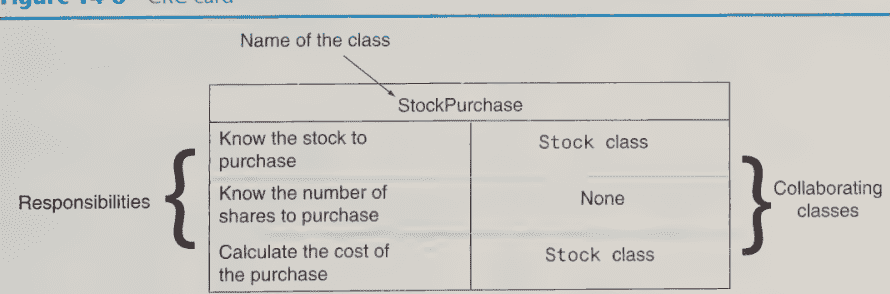

从图中所示的 CRC 卡中我们可以看到 `StockPurchase` 类具有以下职责和协作：

- 职责：知道要购买的股票
  协作：`Stock` 类
- 职责：知道要购买的股数
  协作：无
- 职责：计算购买成本
  协作：`Stock` 类

当你完成应用程序中每个类的 CRC 卡后，你对每个类的职责以及类之间必须如何交互将有一个很好的了解。

# 检查点

（此处后续内容为重复不完整占位符，已按要求不重复输出）

## 14.9 专注于面向对象编程：模拟“骰汉”游戏

- `rollDice`：`Dealer.cpp` 的第 22 至 31 行。该成员函数模拟掷骰子的过程。第 25 和 26 行调用了 `Dice` 对象的 `roll` 方法。第 29 和 30 行将骰子的值保存在变量 `die1Value` 和 `die2Value` 成员变量中。
- `getChoOrHan`：`Dealer.cpp` 的第 38 至 53 行。该成员函数返回一个字符串，表示骰子和是“Cho”（偶数）还是“Han”（奇数）。
- `getDie1Value`：`Dealer.cpp` 的第 59 至 62 行。该成员函数返回第一个骰子的值（存储在 `die1Value` 成员变量中）。
- `getDie2Value`：`Dealer.cpp` 的第 68 至 71 行。该成员函数返回第二个骰子的值（存储在 `die2Value` 成员变量中）。

现在，让我们来看看 `Player` 类。

### Player.h 内容

```cpp
// Player 类的规范文件

#ifndef PLAYER_H
#define PLAYER_H
#include <string>

using namespace std;

class Player
{
private:
    string name;            // 玩家的名字
    string guess;           // 玩家的猜测
    int points;             // 玩家的得分

public:
    Player(string);         // 构造函数
    void makeGuess();       // 让玩家做出猜测
    void addPoints(int);    // 给玩家加分
    string getName();       // 返回玩家的名字
    string getGuess();      // 返回玩家的猜测
    int getPoints();        // 返回玩家的得分
};
#endif
```

### Player.cpp 内容

```cpp
// Player 类的实现文件

#include "Player.h"
#include <cstdlib>
#include <ctime>
#include <string>

using namespace std;

//****************************************************
// 构造函数
//****************************************************
Player::Player(string playerName)
{
    // 种子随机数生成器
    srand(time(0));

    name = playerName;
    guess = "";
    points = 0;
}

//****************************************************
// makeGuess 成员函数让玩家
// 做出猜测，可能是“Cho (偶数)”
// 或“Han (奇数)”。
//****************************************************
void Player::makeGuess()
{
    const int MIN_VALUE = 0;
    const int MAX_VALUE = 1;

    int guessNumber; // 用于玩家的猜测

    // 获取一个随机数，0 或 1。
    guessNumber = (rand() % (MAX_VALUE - MIN_VALUE + 1)) + MIN_VALUE;

    // 将随机数转换为 Cho 或 Han。
    if (guessNumber == 0)
        guess = "Cho (even)";
    else
        guess = "Han (odd)";
}

//****************************************************
// addPoints 成员函数向玩家的
// 当前余额增加指定数量的
// 分。
//****************************************************
void Player::addPoints(int newPoints)
{
    points += newPoints;
}

//****************************************************
// GetName 成员函数返回玩家
// 的名字。
//****************************************************
string Player::getName()
{
    return name;
}

//****************************************************
// getGuess 成员函数返回玩家
// 的猜测。
//****************************************************
string Player::getGuess()
{
    return guess;
}

//********************************************************************
// getPoints 成员函数返回玩家
// 的得分。
//********************************************************************
int Player::getPoints()
{
    return points;
}
```

以下是类成员的摘要：

- `name`：声明在 `Player.h` 的第 10 行。该成员变量将存储玩家的名字。
- `guess`：声明在 `Player.h` 的第 11 行。该成员变量将存储玩家的猜测。
- `points`：声明在 `Player.h` 的第 12 行。该成员变量将存储玩家的得分。
- 构造函数：`Player.cpp` 的第 11 至 19 行，接受玩家名字作为参数并赋值给 `name` 字段。`guess` 字段被赋值为空字符串，`points` 字段设置为 0。
- `makeGuess`：`Player.cpp` 的第 26 至 41 行。该函数让玩家做出猜测。该函数生成一个 0 或 1 的随机数。该语句将 0 或 1 的随机数转换为“Cho (偶数)”或“Han (奇数)”。
- `addPoints`：`Player.cpp` 的第 49 至 52 行。该函数将指定的分数增加到玩家当前的余额中。
- `getName`：`Player.cpp` 的第 58 至 61 行。该函数返回玩家的名字。
- `getGuess`：`Player.cpp` 的第 67 至 70 行。该函数返回玩家的猜测。
- `getPoints`：`Player.cpp` 的第 76 至 79 行。该函数返回玩家的得分。

# 程序 14-17

```cpp
// 显示玩家 1 号的结果。

cout << player1.getName() << " : ";
cout << player1.getPoints() << " points\n";

// 显示玩家 2 号的结果。

cout << player2.getName() << " : ";
cout << player2.getPoints() << " points\n";

// 确定大胜者。

if (player1.getPoints() > player2.getPoints()) {
    cout << player1.getName();
    cout << " is the grand winner!\n";
} else if (player2.getPoints() > player1.getPoints()) {
    cout << player2.getName();
    cout << " is the grand winner!\n";
} else {
    cout << "Both players are tied!\n";
}
```

# 程序输出（示例输入已加粗显示）

输入第一个玩家的名字：**Bill**
输入第二个玩家的名字：**Jill**

现在开始第 1 轮
庄主掷出了 4 和 6
结果：Cho（偶数）
玩家 Bill 猜了 Cho（偶数）
给 Bill 奖励 1 分
玩家 Jill 猜了 Cho（偶数）
给 Jill 奖励 1 分

现在开始第 2 轮
庄主掷出了 5 和 2
结果：Han（奇数）
玩家 Bill 猜了 Han（奇数）
给 Bill 奖励 1 分
玩家 Jill 猜了 Han（奇数）
给 Jill 奖励 1 分

现在开始第 3 轮
庄主掷出了 4 和 2
结果：Cho（偶数）
玩家 Bill 猜了 Cho（偶数）
给 Bill 奖励 1 分
玩家 Jill 猜了 Cho（偶数）
给 Jill 奖励 1 分
----------------------
现在开始第 4 轮
庄主掷出了 3 和 2
结果：Han（奇数）
玩家 Bill 猜了 Han（奇数）
给 Bill 奖励 1 分
玩家 Jill 猜了 Cho（偶数）

现在开始第 5 轮
庄主掷出了 4 和 6
结果：Cho（偶数）
玩家 Bill 猜了 Han（奇数）
玩家 Jill 猜了 Han（奇数）

游戏结束。结果如下：
Bill: 4 分
Jill: 3 分
Bill 是大胜者！

## 14.9 关注面向对象编程：模拟骰和（Cho-Han）游戏

让我们来看代码。以下是主函数的摘要：`MAX_ROUNDS`——轮数：

- 第 15 到 17 行进行了以下声明：`rounds`（要运行的轮数）、`player1Name`——用于存储玩家 1 号的名字，`player2Name`——用于存储玩家 2 号的名字。
- 第 20 到 23 行提示用户输入玩家的名字。
- 第 26 行创建了 `Dealer` 类的实例来代表玩家 1。注意 `player1Name` 被作为 `Player` 类的参数传递给构造函数。
- 第 30 行创建了另一个 `Player` 类的实例来代表玩家 2。注意 `player2Name` 作为另一个参数传递给构造函数。
- 第 33 行开始的循环迭代五次，导致游戏五轮的模拟。循环执行了以下操作：
  - 第 40 行调用庄主掷骰子。
  - 第 43 行调用玩家 1 进行猜测（Cho 或 Han）。
  - 第 44 行调用玩家 2 进行猜测（Cho 或 Han）。
  - 第 47 行将庄主、`player1` 和 `player2` 对象传递给 `roundResults` 函数。该函数显示这一轮的结果。
- 第 51 行将 `player1` 和 `player2` 对象传递给 `displayGrandWinner` 函数，该函数显示游戏的大胜者。

显示轮结果的 `roundResults` 函数出现在第 59 到 71 行。以下是函数的摘要：

- 该函数接受庄主、`player1` 和 `player2` 对象的引用作为参数。
- 第 62 和 63 行的语句显示骰子的值。Cho 或 Han。
- 第 66 行调用庄主的 `getChoOrHan` 函数显示结果，Cho 或 Han。
- 第 69 行调用 `checkGuess` 函数，将 `player1` 和庄主对象作为参数。`checkGuess` 函数将玩家的猜测与庄主的结果（Cho 或 Han）进行比较，如果猜测正确，则给玩家奖励积分。
- 第 70 行调用 `checkGuess` 函数，将 `player2` 和庄主对象作为参数。

`checkGuess` 函数将玩家的猜测与庄主的结果进行比较，为正确猜测的玩家奖励，出现在第 77 到 99 行。以下是函数的摘要：

- 该函数接受一个 `Player` 和 `Dealer` 对象的引用作为参数。
- 第 79 行声明常量 `POINTS_TO_ADD`，将其设置为 1，即如果猜测正确，要给玩家余额增加的分数。
- 第 82 行将玩家的猜测赋值给字符串对象 `guess`。
- 第 85 行将庄主的结果（Cho 或 Han）赋值给字符串对象 `choHanResult`。
- 第 88 和 89 行的语句显示玩家的名字和猜测。
- 第 92 行的 `if` 语句将玩家的猜测与庄主的结果进行比较。如果它们匹配，显示游戏大胜者的 `displayWinner` 函数出现在第 105 到 133 行。

- 将 `player1` 和 `player2` 对象传递给 `displayGrandWinner` 函数，该函数显示游戏大胜者。

```cpp
{
  int x = 0;
  square(5);
  cout << x << endl;
  return 0;
}
```

在这段代码中，第 10 行语句调用了 `square` 函数，但它没有对返回的值进行任何处理。与上一个示例一样，值 25 被存储为一个临时值。但在这个示例中，该值在语句执行完成后就永久丢失了。

因此，在程序执行期间，内存中存储了两种类型的值：

- 生命周期超过创建它的语句的值，并且它们拥有名称，使得程序中的其他语句可以访问它们。在 C++ 中，这些值被称为 **lvalues**。
- 临时的值，并且在创建它的语句之外无法被访问。在 C++ 中，这些值被称为 **rvalues**。

> 提示：也许理解 lvalue 最简单的方法是：它是一个可以写在赋值运算符左侧的表达式。

## 右值引用 (Rvalue References)

在第 6 章中，你学习了引用变量是指另一个变量内存位置的变量。例如，查看以下代码片段：

```cpp
int x = 34;
int &ref = x;
```

在这段代码中，变量 `ref` 是一个引用变量。在声明中，引用通过在类型和变量标识符之间使用符号 `&` 来指示。在 C++ 11 及更高版本中，这种类型的引用被称为 **lvalue引用**，因为它只能引用 lvalues。

C++ 11 还引入了**右值引用**（rvalue reference）的概念，它是一种只能引用那些否则没有名称的临时对象的引用。右值引用的声明方式与 lvalue 引用类似，区别在于使用双符号 `&&`。下面的代码使用右值引用来打印 5 的平方：

```cpp
int &&r1ValRef = square(5);
cout << r1ValRef << endl;
```


第一条语句调用了 `square` 函数，并将 5 作为参数传递。函数返回值 25，该值被存储为临时值。然后将该临时值的地址赋值给 `r1ValRef`。这样现在我们为这个临时值提供了一个名称，因此其他语句可以访问它。

当你将右值引用赋值为一个临时值时，你实际上是为该临时值提供了名称，并使其从程序的其他部分访问变得可能。因此，你正在将一个临时值转换成 lvalue。由于右值引用不能引用 lvalue，以下代码将无法编译：

```cpp
int x = 0;
int &&rvalRef = x; // 错误！
```

查看如下初始化：

```cpp
int &&rvalRef1 = square(5);
```

在该语句执行完毕后，包含 `square(5)` 返回值的内存位置拥有了名称 `rvalRef1`，因此 `rvalRef1` 本身变成了一个 lvalue。这意味着随后的初始化例如：
`int rvalRef2 = rvalRef1; // 错误!`
将可以通过编译，因为 `rvalRef1` 不再是右值了。遗憾的是，这一切也有一个积极的结果：一个临时对象最多只能有一个指向它的 lvalue 引用。如果一个函数拥有指向临时对象的 lvalue 引用，你可以确定程序的其他部分无法访问同一个对象。这一事实对于理解接下来讨论的移动操作（move operations）的工作原理非常重要：

## 移动语义 (Move Semantics)

当对象作为参数传递给函数并从函数返回时，程序在后台执行了大量工作，包括分配内存和拷贝值。为了说明这一点，让我们来看下 `Person` 类。

```cpp
#ifndef PERSON_H
#define PERSON_H

#include <cstring>

using namespace std;

class Person
{
private:
    char *name = nullptr;

public:
    // 默认构造函数
    Person()
    {
        *name = new char[1];
        *name = 0;
    }

    // 带参数的构造函数
    Person(char *n)
    {
        *name = new char[strlen(n) + 1];
        strcpy(name, n);
    }

    // 拷贝构造函数
    Person(const Person &obj)
    {
        *name = new char[strlen(obj.name) + 1];
        strcpy(name, obj.name);
    }

    // 析构函数
    ~Person()
    {
        delete name;
    }
```

## 第 14 章 类的更多内容

```cpp
// const 赋值运算符
Person &operator=(const Person &right)
{
  if (this != &right) {
    name = new char[strlen(right.name) + 1];
    strcpy(name, right.name);
  }
  return *this;
}
```

```cpp
// 成员函数
char *getName() const
{
  return name;
};

#endif
```

`Person` 类有三个构造函数：一个默认的 `=` 运算符，以及一个获取名称成员变量的成员函数。它还有一个重载的构造函数。我们将使用这个类来演示对象在程序中传递时发生的一些工作。但首先，我们将插入拷贝语句，以便我们看到构造函数、析构函数以及重载的 `=` 运算符何时被调用的。修改后的类在此处，随后是演示该类的程序 `14-18`。

### Person.h

```cpp
#ifndef PERSON_H
#define PERSON_H

#include <cstring>

using namespace std;

class Person
{
private:
    char *name = nullptr;

public:
    // 默认构造函数
    Person()
    {
        *name = new char[1];
        *name = 0;
    }

    // 带参数的构造函数
    Person(char *n)
    {
        *name = new char[strlen(n) + 1];
        strcpy(name, n);
    }

    // 拷贝构造函数
    Person(const Person &obj)
    {
        *name = new char[strlen(obj.name) + 1];
        strcpy(name, obj.name);
    }

    // 析构函数
    ~Person()
    {
        delete name;
    }

    // const 赋值运算符
    Person &operator=(const Person &right)
    {
      if (this != &right) {
        name = new char[strlen(right.name) + 1];
        strcpy(name, right.name);
      }
      return *this;
    }

    // 成员函数
    char *getName() const
    {
      return name;
    }
};

#endif
```

### 程序 14-18

```cpp
#include <iostream>
#include "Person.h"

using namespace std;

int main()
{
    Person p1;
    Person p2("Alice");
    Person p3 = p2;
    p1 = p3;
    cout << p1.getName() << endl;
    cout << p2.getName() << endl;
    cout << p3.getName() << endl;
    return 0;
}
```

# 14.10 右值引用与移动语义

我们特别关注第 13 行：

```cpp
person = makePerson();
// 调用了 makePerson() 函数：
Person makePerson() {
    Person p("Will Mackenzie");
    return p;
}
```

`makePerson()` 函数创建了一个名为 p 的局部 `Person` 对象。当函数返回 p 时，会创建一个作为 p 的拷贝的临时对象。这导致了 `Person` 类的拷贝构造函数的执行。拷贝构造函数分配一块内存来存储名称数组，然后将名称数组 p 拷贝到临时对象中。

在第 13 行中，重载的赋值运算符执行以拷贝临时对象。重载的赋值运算符也会分配一块内存，并将名称数组从临时对象拷贝到 `person` 对象中。正如你所看到的，拷贝赋值花费了大量的工作量以避免临时对象和 `person` 对象之间共享指针，但紧接着，临时对象就会被销毁，其名称也会被删除。

在 C++ 11 中，我们可以为 `Person` 类添加另一个赋值运算符函数，称为**移动赋值运算符**。移动赋值运算符背后的思想是通过简单地交换被赋值对象的成员与临时对象的成员来避免所有这些操作。这样，当临时对象被销毁时，它的析构函数会删除之前由 `person` 拥有的内存，而 `person` 则避免了需要拷贝临时对象名称数组中的元素。

以下是 `Person` 类的移动赋值运算符函数。为了简化代码，我们使用了 STL 库函数 `swap` 来交换两个内存位置的内容。`swap` 函数在 `<algorithm>` 头文件中声明（你将在第 17 章中学习更多关于 `<algorithm>` 头文件的函数）。

```cpp
// 移动赋值运算符
Person& operator=(Person&& right)
{
    if (this != &right) {
        swap(name, right.name);
    }
    return *this;
}
```

将类的移动赋值运算符与类的拷贝赋值运算符进行比较：

```cpp
// 拷贝赋值运算符
Person& operator=(const Person& right)
{
    if (this != &right) {
        name = new char[strlen(right.name) + 1];
        strcpy(name, right.name);
    }
    return *this;
}
```


注意移动赋值运算符的函数头与拷贝赋值运算符的函数头有两处不同：

- 移动赋值运算符接收右值引用（rvalue reference）作为参数。这是因为只有当赋值源是临时对象时，才执行移动赋值。
- 移动赋值运算符的参数不是 `const`。这是因为从它那里“移动”资源会修改它。

C++ 11 引入的移动赋值比拷贝赋值高效得多。还有一个**移动构造函数**，每当被赋值的对象是临时对象时，就应该使用它。在通过从临时对象的拷贝来创建新对象时，也应该使用它。

如果你在类中添加了移动赋值运算符，还应该也在该类中添加一个移动构造函数。移动构造函数通过“偷取”临时对象的数据来避免不必要的数据拷贝。这里是 `Person` 类的移动构造函数。再次注意，构造函数的参数是一个右值引用，这表示该参数是一个临时对象。

```cpp
// 移动构造函数
Person(Person&& temp) {
    // 从 temp 中偷取名称指针。
    name = temp.name;
    // 将 temp 对象的名称指针置空。
    temp.name = nullptr;
}
```

注意移动构造函数中的参数不能是 `const`。此外，作为移动构造函数源的临时对象必须处于允许其析构函数运行而不引起错误的状态。这就是为什么在 `Person` 类的移动构造函数中，我们在函数结束之前将临时对象的名称指针设置为 `nullptr`。

# 何时在类中实现移动语义

当你编写任何包含指向外部数据的指针或引用的类时，都应该包含拷贝构造函数、移动构造函数、拷贝赋值运算符和移动赋值运算符。通过向类添加移动操作，你将确保你的代码具有最佳性能。

在运行时，移动构造函数和移动赋值运算符会在适当的时候自动调用。具体来说，每当对象被赋值为临时对象的值，或者通过临时对象的拷贝进行初始化时，编译器都会使用移动操作。

# 编译器提供的默认操作

编写拷贝构造函数、移动构造函数、拷贝赋值运算符、移动赋值运算符和析构函数的目的是确保类能够正确地管理和释放资源（如动态分配的内存）。为每个类编写所有这些操作可能是乏味的，因此编译器尝试通过为它们生成默认实现来提供帮助。假设我们编译以下类：

```cpp
class MyClass
{
  private:
    int mydata = 0;
  public:
    int getMyData() { return mydata; }
    void setmyData(int d) { mydata = d; }
};
```

编译器会自动生成以下内容：

- 默认构造函数 `MyClass()`
- 拷贝构造函数 `MyClass(const MyClass &)`
- 拷贝赋值运算符 `operator=(const MyClass &)`
- 移动构造函数 `MyClass(MyClass &&)`
- 析构函数 `~MyClass()`

请记住，如果你写了这些成员函数中的一个，编译器将不再提供任何默认版本。因此，如果你写了拷贝构造函数，还应该写移动构造函数、拷贝赋值运算符、移动赋值运算符和析构函数。

# 复习题

## 简答

1. 描述成员变量和静态变量的区别。
2. 假设一个名为 `Numbers` 的类有以下静态函数：
   `static void showTotal();`
   写一个语句调用 `showTotal`。
3. 静态成员变量声明在类中。它在哪里定义？
4. 什么是友函数（friend function）？
5. 将整个类设为另一个类的友总是好主意吗？
6. 什么是成员赋值？
7. 拷贝构造函数何时被调用？
8. 编译器如何确定一个构造函数是拷贝构造函数？
9. 描述一种成员赋值理想的情况。
10. 为什么拷贝构造函数的参数必须是引用？
11. 什么是默认拷贝构造函数？
12. 为什么程序员想要重载运算符而不是使用成员函数来执行相似的操作？
13. 传递给类 `=` 的参数是什么？

## 关于类的更多信息

14. 为什么类的运算符 `=` 不应实现为 `void` 函数？
15. 编译器如何知道重载的 `++` 运算符应该是前置模式还是后置模式？
16. 关系函数返回 `this` 指针是什么？
17. 类 `Stuff` 既有拷贝构造函数也有重载的 `=`。假设 `blob` 和 `clump` 都是 `Stuff` 实例。对于下面的每个语句，指出调用拷贝构造函数还是重载的 `=`：

```cpp
Stuff blob = clump;
clump = blob;
blob.operator=(clump);
showValues(blob); // blob 按值传递。
```

19. 解释使类的成员变量变为静态所需的编程步骤。
20. 解释使类的成员函数变为静态的所需的编程步骤。
21. 考虑以下类声明：

```cpp
class Thing {
private:
    int x;
    int y;
    static int z;
public:
    Thing() { x = y = z; }
    static void putThing(int a) { z = a; }
};
```


假设一个包含该类定义的程序通过以下语句定义了三个 `Thing` 对象：
`Thing one, two, three;`
有多少个独立的 `x` 成员实例？
有多少个独立的 `y` 成员实例？
有多少个独立的 `z` 成员实例？
每个对象的 `x` 和 `y` 成员存储什么值？
写一个语句，在定义上述对象之前调用 `putThing` 成员函数。

22. 描述将一个类作为另一个类的成员（对象聚合）与将一个类设为另一个类的友的区别。
23. 类的前向声明目的是什么？包含指针成员的类会导致什么问题？
25. 当类的对象按值传递给函数时，为什么该类的拷贝构造函数会被调用？

# 填空题

26. 如果成员变量被声明为 ________________，则该类的所有对象都可以访问同一个变量。

27. 静态成员变量定义在类 ________________ 外。

28. 一个(n) ________________ 成员函数无法访问其所在类中的任何非静态成员变量。

29. 静态成员函数可以在其类的任何实例定义 ________________ 之前被调用。

30. 一个(n) ________________ 函数不是类的成员，但它有权访问该类的私有成员。

31. 一个(n) ________________ 告诉编译器某个特定类将在程序的后续部分被声明。

32. 当一个对象被赋予同类对象的值时，________________ 是默认的构造函数。

33. 一个(n) ________________ 是一种特殊的构造函数，每当用另一个对象的数据初始化新对象时，就会被调用。

34. ________________ 是一个内置指针，它会自动作为隐藏参数传递给非静态成员函数。

35. 运算符可以被 ________________ 以与特定类一起工作。

36. 在重载 ________________ 运算符时，该函数必须有一个哑参数（dummy parameter）。

37. 为另一个类中的一个 ________________ 成员创建实例被称为 ________________。

38. 对象聚合（Aggregation）有助于在两个类之间创建一种 ________________ 关系。

# 算法基准

39. 假设存在一个 `Bird` 类。为该类写一个重载 `=` 运算符的成员函数头。

40. 假设存在一个 `Dollars` 类。为该类写两个重载前缀 `++` 运算符的成员函数头。

41. 假设存在一个 `Yen` 类。为该类写一个重载 `<` 运算符的成员函数头。

42. 假设存在一个 `Length` 类。为该类写一个重载 `cout << <<` 运算符的成员函数头。

43. 假设存在一个 `Collection` 类。为该类写一个重载 `[]` 运算符的成员函数头。

# 判断题

- 44. T F 静态成员变量无法被非静态成员函数访问。
- 45. T F 静态成员变量定义在类声明之外。
- 46. T F 静态函数可以引用相同类的非静态成员变量，但只有在类实例定义之后之后。
- 47. T F 当一个函数被声明为类的友时，它就变成了该类的成员。
- 48. T F 友函数有权访问声明它的类的私有成员。
- 49. T F 整个类可以被声明为另一个类的友。
- 50. T F 为了让函数或类成为另一个类的友，必须由授予访问权的类进行此类声明。
- 51. T F 如果一个类有一个指针作为成员，拥有拷贝构造函数是一个好主意。
- 52. T F 除非重载了运算符，否则不能使用 `=` 运算符将一个对象的值赋予另一个对象。
- 53. T F 如果类没有拷贝构造函数，编译器会为它生成默认的拷贝构造函数。
- 54. T F 如果类有拷贝构造函数，并且将类对象按值传递给函数，函数的参数将调用其拷贝构造函数。
- 55. T F `this` 指针被传递给静态成员函数。
- 56. T F 所有重载一元运算符的函数必须有一个哑参数。
- 57. T F 为了让对象执行自动类型转换，必须编写一个运算符函数。
- 58. T F 一个类的实例可以作为另一个类的成员。

# 找错

以下每个类声明都有错误。请尽可能多地找出它们。

```cpp
59. class Box
{
    private:
        double width;
        double length;
        double height;
    public:
        Box(double w, int l, int h)
        { width = w; length = l; height = h; }
        Box(Box b) // 拷贝构造
        { width = b.width;
            length = b.length;
            height = b.height; }
        ... 其他成员函数...
};
```

```cpp
60. class Circle
{
    private:
        double diameter;
        int centerX;
        int centerY;
    public:
        Circle(double d, int x, int y)
        { diameter = d; centerX = x; centerY = y; }
        // 重载 = 运算符
        void Circle=(const Circle &right)
        { diameter = right.diameter;
            centerX = right.centerX;
            centerY = right.centerY; }
        ... 其他成员函数...
};
```

# 61. class Point

```cpp
{
  private:
    int xCoord;
    int yCoord;
  public:
    Point (int x, int y)
      { xCoord = x; yCoord = y; }
    // 重载 + 运算符
    void operator+(const Point right)
      { xCoord += right.xCoord;
        yCoord += right.yCoord; }
  ... 其他成员函数...
}
```

# 62. class Box

```cpp
{
  private:
    double width;
    double length;
    double height;
  public:
    Box(double w, double l, height h)
      { width = w; length = l; height = h; }
    // 重载 ++ 运算符
    void operator++()      { width++; }
    // 后置运算符
    void operator++()      { length++; }
  ... 其他成员函数...
}
```

# 63. class Yard

```cpp
{
  private:
    float length;
  public:
    Yard(float l)
      { length = l; }
    // float 转换
    operator float()      { return length; }
  ... 其他成员函数...
}
```

# 编程挑战

1. Numbers 类 设计一个 `Numbers` 类，可以存储 0 到 999 之间的整数。该类应该有一个字符串数组：{"zero", "one", "two", "three", "four", "five", "six", "seven", "eight", "nine", "ten", "eleven", "twelve", "thirteen", "fourteen", "fifteen", "sixteen", "seventeen", "eighteen", "nineteen", "twenty", "thirty", "forty", "fifty", "sixty", "seventy", "eighty", "ninety"}。该类应该有一个初始化整数的构造函数，和一个打印英文数字的成员函数。例如，23 应该是 "twenty three"。

2. 年中的日期假设一年有 365 天，写一个 `DayOfYear` 类，接收一个代表日的整数。该类应该有一个字符串数组：{"January", "February", "March", "April", "May", "June", "July", "August", "September", "October", "November", "December"}。该类应该有一个初始化日的构造函数，和一个打印月份的成员函数。例如，31 应该是 January。

3. 年中的日期 修改挑战 2 中的 `DayOfYear` 类，添加一个接受两个参数的构造函数：代表月份的字符串和代表日的整数。如果输入的数字不在 1 到 31 的范围内，构造函数应输出相应的错误信息并终止。

添加以下重载运算符：

- 前置和后置增运算符。这些运算符应该修改 `DayOfYear` 对象以表示一天。如果日期已经是月底，新值应该是下个月的第一天。
- 前置和后置减运算符。这些运算符应该修改 `DayOfYear` 对象以表示一天。如果日期已经是月初，新值应该是该月的最后一天。

4. NumDays 类 设计一个 `NumDays` 类，存储代表工作小时的值并转换为天数。例如，8 小时为 1 天，12 小时为 1.5 天，18 小时为 2.25 天。该类应该有一个接受小时数的构造函数，以及存储和检索小时数的成员函数。该类还应该有以下重载运算符：

- 加法运算符。当两个 `NumDays` 对象相加时，重载运算符应该返回两个对象小时之和。
- 减法运算符。当从一个 `NumDays` 对象减去另一个时，重载运算符应该返回两个对象小时之差。
- 前置和后置增运算符。这些运算符应该增加对象中存储的小时。增加时，天数应自动重新计算。
- 前置和后置减运算符。这些运算符应该减少对象中存储的小时。减少时，天数应自动重新计算。

# 5. 休

> 注意：此作业假设你已经完成了挑战 4。

设计一个 `TimeOff` 类来跟踪员工的病假、年假无薪假。它的成员应该包含挑战 4 中描述的 `NumDays` 类的实例：

| 成员 | 说明 |
| :--- | :--- |
| maxSickDays | NumDays 对象，记录员工可以请的最长病假数。 |
| sickTaken | NumDays 对象，记录员工已经请的病假数。 |
| maxVacation | NumDays 对象，记录员工可以请的最长年假数。 |
| vacTaken | NumDays 对象，记录员工已经请的年假数。 |

maxUnpaid 一个 `NumDays` 对象，用于记录员工可以休的最无薪假期天数。

unpaidTaken 一个 `NumDays` 对象，用于记录员工已休假的天数。

此外，该类还应该包含存储员工姓名和识别码的成员。它应该具有适当的构造函数和成员函数，用于在任何成员对象中存储和检索数据。

输入验证：公司规定，员工累计带薪假期不得超过 240 小时。该类不应允许 `maxVacation` 对象存储大于此数值的值。

## 6. 人员报告

> 注意：此作业假设你已经完成了编程挑战 4 和 5。

编写一个程序，使用编程挑战 5 中设计的 `TimeOff` 类实例。该程序要求用户输入员工在公司工作的月数。然后，它应该使用 `TimeOff` 对象计算并显示员工的最大病假天数假期天数。员工每月获得 12 小时的带薪假和 8 小时的病假。

## 7. Month 类 该类应该包含以下私有成员：

- name 一个字符串，用于存储月份名称，例如“January”、“February”等。
- monthNumber 一个整数，用于存储月份数字。例如，1 月为 1，2 月为 2，依此类推。该变量的有效值为 1 到 12。
- 一个默认构造函数，将 `monthNumber` 设置为 1，`name` 设置为“January”。
- 一个接受月份名称作为参数的构造函数。它应该将 `name` 设置为传入的值，并将 `monthNumber` 设置为正确的值。
- 一个接受月份数字作为参数的构造函数，将 `name` 设置为传入的值并将 `name` 设置为正确的月份名称。为 `name` 和 `monthNumber` 成员变量提供适当 setter 和 get 函数。
- 前置和后置重载的 `++` 运算符函数，用于增加 `monthNumber` 并将 `name` 设置为下个月的名称。如果执行这些函数时 `monthNumber` 为 12，它们应该将 `monthNumber` 设置为 1，`name` 设置为“January”。
- 前置和后置重载的 `--` 运算符函数，用于递减 `monthNumber` 并将 `name` 设置为上个月的名称。如果执行这些函数时 `monthNumber` 为 1，它们应该将 `monthNumber` 设置为 12，`name` 设置为“December”。

此外，你应该重载 `cout` 的 `<<` 和 `>>` 运算符以与 `Month` 类配合。用程序演示该类。

## 8. Date 类修改

修改第 13 章编程挑战 1 中的 `Date` 类。新版本应该具有以下重载运算符：

- **前置和后置递增运算符**。这些运算符应该增加对象的 `day` 成员。
- **前置和后置递减运算符**。这些运算符应该减少对象的 `day` 成员。
- **减法运算符**。如果用一个 `Date` 对象减去另一个，该运算符应该给出两个日期之间的天数。例如，如果从 2014 年 4 月 18 日减去 2014 年 4 月 10 日，结果将为 8。
- << **cout 插入运算符**。该运算符应该使日期以后格式显示：

April 18, 2018

- >> **cin 提取运算符**。该运算符应该提示用户输入一个日期以存储在 `Date` 对象中。

该类应该检测并相应地处理以下情况：

- 当日期被设置为月的最后一天并递增时，它应该变成下个月的第一天。
- 当日期设置为 12 月 31 日并递增时，它应该变成下一年的 1 月 1 日。
- 当日期被设置为月的第一天并递减时，它应该变成上个月的最后一天。
- 当日期设置为 1 月 1 日并递减时，它应该变成上年的 12 月 31 日。

用简单的程序演示该类的功能。

输入验证：`>>` 运算符不应接受无效日期。例如，不应接受 13/45/2018 这样的日期。

## 9. FeetInches 修改

修改本章讨论的 `FeetInches` 类，使其重载以下内容：

```
<=
>
!
```


用简单的程序演示该类的功能。

## 10. 企业销售

一家公司有六个分部门，每个部门负责向不同的地理区域销售。设计一个 `DivSales` 类，用于保存部门的销售数据，包含以下成员：

- 一个包含四个元素的数组，用于存储所有部门四个季度的销售数字。
- 一个私有静态变量，用于存储所有部门全年的企业总销售额。
- 一个接受四个参数的成员函数，假设参数为季度销售额。参数的值应该被复制到存储销售数据的数组中。四个参数之和应该加到存储全年企业销售额的静态变量中。
- 一个接受 0–3 范围内整数参数的函数。该参数将用作部门季度销售数组的下标。该函数应该返回具有下标的数组元素的值。

编写一个程序创建一个六个 `DivSales` 对象的数组。程序要求用户输入每个部门四个季度的销售额。在输入数据后，程序应显示一个显示每个部门季度销售额的表格。程序应显示全年的企业总销售额。

输入验证：销售数字仅接受正值。

## 11. FeetInches 类构造函数和 multiply 函数

为 `FeetInches` 类添加一个构造函数。该构造函数应该接受一个 `FeetInches` 对象作为参数。构造函数应该将 `feet` 属性赋值为参数中 `feet` 属性的值，并将 `inches` 属性赋值为参数中 `inches` 属性的值。结果新对象将对象的拷贝。

接下来，为 `FeetInches` 类添加一个 `multiply` 函数。`multiply` 函数应该接受一个 `FeetInches` 对象作为参数。参数的 `feet` 和 `inches` 属性将与调用对象的 `feet` 和 `inches` 相乘，并返回一个包含结果的 `FeetInches` 对象。

## 12. LandTrack 类

创建一个 `LandTrack` 类，由两个 `FeetInches` 对象组成：一个用于长度，一个用于宽度。该类应该有一个返回土地面积的成员函数。用程序演示该类，要求用户输入两块地的尺寸。程序应显示每块土地的面积，并指示这些土地的大小是否相等。

## 13. 地毯计算器

Westfield 地毯公司让你编写一个计算矩形房间地毯价格的应用。要计算价格，将地板面积（宽乘以长）乘以每平方英尺的地毯价格。例如，面积长 12 英尺、宽 10 英尺的为 120 平方英尺。用每平方英尺 8 美元的地毯覆盖将花费 960 美元（12 x 10 x 8 = 960）。

首先，你应该创建一个名为 `RoomDimension` 的类，它具有两个 `FeetInches` 对象作为属性：一个用于房间长度，一个用于宽度。（你应该使用你在编程挑战 11 中创建的 `FeetInches` 类，并增加一个 `multiply` 成员函数。你可以使用此函数计算房间面积。）`RoomDimension` 类应该有一个返回 `FeetInches` 对象形式的房间面积的成员函数。

接下来，你应该创建一个 `RoomCarpet` 类，它有一个 `RoomDimension` 对象作为属性。它还应该有一个用于每平方英尺地毯成本的属性。`RoomCarpet` 类应该有一个返回总成本的成员函数。

一旦你写了这些类，请在一个应用程序中使用它们，该程序要求用户输入房间尺寸以及所需地毯的每平方英尺价格。应用程序应该显示地毯的总成本。

## 14. 罚单模拟器

在本次作业中，你将设计一组协同工作的类，以模拟警察开具停车罚单的过程。你需要设计的类包括：

- **ParkedCar 类**：该类应模拟一辆停放的汽车。该类的职责是：
  - 了解汽车的名称、型号、颜色、车牌号以及汽车停车的分钟数
- **ParkingMeter 类**：该类应模拟一个停车表。该类的职责是：
  - 了解已购买的停车时长（分钟）
- **ParkingTicket 类**：该类应模拟一张停车罚单。该类的职责是：
  - 报告违停车辆的名称、型号、颜色和车牌号
  - 报告罚款金额：违停的第一小时（或不足小时）罚款 25 美元，之后每增加一小时（或不足小时）加罚 10 美元
  - 报告开具罚单的警察的姓名和警号
- **PoliceOfficer 类**：该类应模拟一名检查停放车辆的警察。该类的职责是：
  - 了解警察的姓名和警号
  - 检查 `ParkedCar` 对象和 `ParkingMeter` 对象，并判断车辆时间是否过期
  - 如果时间过期，则开具停车罚单（生成 `ParkingTicket` 对象）

编写一个程序演示这些类是如何协作的。

## 15. 汽车仪表模拟器

在本次作业中，你将设计一组协同工作的类，以模拟汽车的油表和里程表。你设计的类包括：

- **FuelGauge 类**：该类将模拟燃油表。它的职责是：
  - 了解汽车当前的油量（加仑）。
  - 报告汽车当前的油量（加仑）。
  - 能够增加 1 加仑的油量。这模拟了给汽车加油。（汽车最大可容纳 15 加仑。）
  - 如果油量大于 0 加仑，能够减少 1 加仑的油量。这模拟了汽车行驶消耗燃料。
- **Odometer 类**：该类将模拟汽车的里程表。它的职责是：
  - 了解汽车当前的里程数。
  - 报告汽车当前的里程数。
  - 能够增加 1 英里的当前里程数。里程表存储的最大里程数为 999,999 英里。当超过此数值时，里程表将当前里程数重置为 0。
  - 能够与 `FuelGauge` 对象配合。每行驶 24 英里，`FuelGauge` 对象的当前油量减少 1 加仑。（汽车油耗为每加仑 24 英里。）

通过创建类的实例来演示这些类。模拟给汽车加满油，然后运行一个循环增加里程数，直到汽车没油。在每次循环迭代中，打印汽车当前的里程数和油量。

# 15. 继承、多态与虚函数

## 话题

| 话题 |
| :--- |
| 15.1 什么是继承？ |
| 15.2 保护成员与访问权限 |
| 15.3 基类与派生类中的构造函数与析构函数 |
| 15.4 重定义基类函数 |
| 15.5 类层次结构 |
| 15.6 多态与虚成员函数 |
| 15.7 抽象基类与纯虚函数 |
| 15.8 多继承 |

## 15.1 什么是继承？

### 通用化与专门化

在现实世界中，你可以发现许多对象是通用对象的专门化版本。例如，“昆虫”一词描述了一种具有众多特征的通用生物类型。因为蝗虫和蜜蜂都是昆虫，所以它们拥有昆虫的所有通用特征。此外，它们还有自己的特殊特征。例如，蝗虫具有跳跃能力，蜜蜂具有刺针。蝗虫和蜜蜂都是昆虫的专门化版本。如图 15-1 所示。

第 15 章 继承、多态与虚函数

### 图 15-1 昆虫的专门化版本

所有昆虫都具有某些特征。


除了共同的昆虫特征外，蜜蜂还有自己的独特特征，如刺刺的能力。

除了共同的昆虫特征外，蝗虫还有自己的独特特征，如跳跃的能力。

### 继承与“是……”的关系

当一个对象是另一个对象的专门化版本时，它们之间存在“是……”的关系。例如，蝗虫*是一种昆虫*。以下是“是……”关系的其他例子：

- 贵宾犬是狗。
- 汽车是交通工具。
- 树是植物。
- 矩形是几何形状。
- 足球运动员是球员。

### 以粗体显示示例输入的程序输出

输入你的数字测试分数：**89** 回车
该测试的等级为 B

### 以粗体显示不同示例输入的程序输出

输入你的数字测试分数：**75** 回车
该测试的等级为 C

`Activity` 类代表了学生评分活动的一般特征。存在许多类型的评分活动，例如测验、期中考试、期末考试、实验报告、论文等。由于这些评分活动的数字分数的确定方式可能有所不同，我们可以创建相应的类来处理每种活动。例如，下面的代码展示了 `FinalExam` 类，它派自 `GradedActivity` 类。它拥有用于考试题目数量（`numQuestions`）、每道题分值（`pointsEach`）以及学生错过的题目数量（`numMissed`）的成员变量。这些文件可以在学生源代码文件夹 5/GradadedActivity Version 1 中找到。

### FinalExam.h 的内容

```cpp
#ifndef FINALEXAM_H
#define FINALEXAM_H

#include "GradedActivity.h"

class FinalExam : public GradedActivity
{
private:
    int numQuestions; // 题目数量
    double pointsEach; // 每道题的分值
    int numMissed; // 错过的题目数量

public:
    // 默认构造函数
    FinalExam()
    {
        numQuestions = 0;
        pointsEach = 0.0;
        numMissed = 0;
    }

    // 构造函数
    FinalExam(int questions, int missed)
    {
        set(questions, missed);
    }

    // 修改函数
    void set(int questions, int missed); // 定义在 FinalExam.cpp

    // 访问函数
    double getNumQuestions() const
    {
        return numQuestions;
    }

    double getPointsEach() const
    {
        return pointsEach;
    }

    int getNumMissed() const
    {
        return numMissed;
    }
};
#endif
```

### FinalExam.cpp 的内容

```cpp
#include "FinalExam.h"

//******************************************************
// set 函数
// 参数是题目数量和
// 错过的题目数量。
//******************************************************

void FinalExam::set(int questions, int missed)
{
    double numericScore; // 用于保存数字分数

    // 设置数量和缺失数量
    numQuestions = questions;
    numMissed = missed;

    // 计算每道题的分值。
    pointsEach = 100.0 / numQuestions;

    // 计算本次考试的数字分数。
    numericScore = 100.0 - (missed * pointsEach);

    // 调用继承的 setScore 函数来设置
    // 数字分数。
    setScore(numericScore);
}
```

代码中唯一的新符号是 `FinalExam.h` 文件中的第 5 行，内容如下：
`class FinalExam : public GradedActivity`

这一行表示了声明的类名以及它派自的基类名。`FinalExam` 是声明的类名，而 `GradedActivity` 是它继承的基类名。

如果我们想表达这两个类之间的关系，我们可以说一个 `FinalExam` 是一个 `GradedActivity`。

位于 `FinalExam.h` 文件第 5 行基类名之前的单词 `public` 是基类访问规范符。它影响了派生类如何继承基类的成员。当你创建一个派生类的对象时，你可以将其认为是构建在基类对象之上的。基类类对象的成员将成为派生类对象的成员。基类成员在派生类中的出现方式由基类的访问规范符决定。

尽管我们将在下一节中详细讨论这个主题，但让我们看看它在这个示例中是如何工作的。`GradedActivity` 类既有私有成员也有公共成员。`FinalExam` 类使用公共访问规范符派自 `GradedActivity` 类。这意味着 `GradedActivity` 类的公共成员将成为 `FinalExam` 类的公共成员。`GradedActivity` 的私有成员无法被 `FinalExam` 类直接访问。虽然 `GradedActivity` 的私有成员被继承了，但它们就像对 `FinalExam` 类中的代码不可见一样。它们只能通过 `GradedActivity` 的成员函数进行访问。以下是 `FinalExam` 类的成员列表：

**私有成员：**

| 成员 | 说明 |
| :--- | :--- |
| `int numQuestions` | 声明在 `FinalExam` 类中 |
| `double pointsEach` | 声明在 `FinalExam` 类中 |
| `int numMissed` | 声明在 `FinalExam` 类中 |

**公共成员：**

| 成员 | 说明 |
| :--- | :--- |
| `FinalExam()` | 定义在 `FinalExam` 类中 |
| `FinalExam(int, int)` | 定义在 `FinalExam` 类中 |
| `set(int)` | 定义在 `FinalExam` 类中 |
| `getNumQuestions()` | 定义在 `FinalExam` 类中 |
| `getPointsEach()` | 定义在 `FinalExam` 类中 |
| `getNumMissed()` | 定义在 `FinalExam` 类中 |
| `setScore(double)` | 继承自 `GradedActivity` |
| `getScore()` | 继承自 `GradedActivity` |
| `getLetterGrade()` | 继承自 `GradedActivity` |

`GradedActivity` 类有一个私有成员 `score`。注意，它没有出现在 `FinalExam` 的成员列表中，因为它是基类的私有成员。它对基类的私有成员。你会发现 `GradedActivity` 的构造函数仍然存在，它们并不是派生类的成员是合理的。让我们仔细观察 `FinalExam` 的构造函数。默认构造函数出现在 `FinalExam.h` 的第 13 到 16 行。它简单地将类的成员变量赋值为 0。另一个构造函数出现在第 19 和 20 行。它接受两个参数：考试题目数量和错过的题目数量。该构造函数仅将这些值传递给 `set` 函数。`set` 函数定义在 `FinalExam.cpp` 中。它接受两个参数：题目数量和错过的题目数量。在第 14 和 15 行，这些值被赋值给 `numQuestions` 和 `numMissed` 成员变量。在第 18 行，计算了每道题的分值。在第 21 行，计算了数字分数。在第 25 行，函数的最后语句是：

```cpp
setScore(numericScore);
```

这是对 `setScore` 函数的调用。尽管 `FinalExam` 类中没有 `setScore` 函数，但它是继承自 `GradedActivity`。程序 15-2 展示了 `FinalExam` 类。

### 程序 15-2

```cpp
// 此程序演示了一个基类和一个派生类。
#include <iostream>
#include <iomanip>
#include "FinalExam.h"
using namespace std;

int main()
{
    int questions; // 考试题目数量
    int missed; // 学生错过的题目数量

    // 获取考试题目数量。
    cout << "期末考试有多少道题？";
    cin >> questions;

    // 获取学生错过的题目数量。
    cout << "学生错过了多少道题？";
    cin >> missed;

    // 定义一个 FinalExam 对象并用输入的值
    // 初始化。
    FinalExam test(questions, missed);

    // 显示测试结果。
    cout << setprecision(2);
    cout << "每道题占 " << test.getPointsEach()
         << " 分。" << endl;

    cout << "考试分数为 " << test.getScore() << endl;
    cout << "考试等级为 " << test.getLetterGrade() << endl;

    return 0;
}
```

注意第 28 和 29 行，`GradedActivity` 类的公共成员函数可以直接被测试对象调用：

```cpp
cout << "The exam score is " << test.getScore() << endl;
cout << "The exam grade is " << test.getLetterGrade() << endl;
```

`getScore` 和 `getLetterGrade` 函数作为 `FinalExam` 类的公共成员被继承，因此可以像访问任何其他公共成员一样访问它们。

继承不是反向的。基类无法调用派生类的成员函数。例如，以下类在程序中无法编译，因为 `BaseBase` 构造函数尝试调用其派生类中的函数：

```cpp
class BaseBase {
private:
    int x;
public:
    BaseBase() { x = getVal(); } // 错误！
};

class Derived : public BaseBase {
private:
    int y;
public:
    Derived(int z) { y = z; }
    getVal() { return y; }
};
```


### 检查点

- 15.1 这里是类声明的第一行。基类的名称是什么？
  `class Truck : public Vehicle`

- 15.2 在接下来的声明行中，派生类类的名称是什么？
  `class Truck : public Vehicle`

- 15.3 假设一个程序有以下类声明：
  ```cpp
  class Shape {
  private:
      double area;
  public:
      void setArea(double a) {
          area = a;
      }

      double getArea() {
          return area;
      }
  };

  class Circle : public Shape {
  private:
      double radius;

  public:
      void setRadius(double r) {
          radius = r;
          setArea(3.14 * r * r);
      }

      double getRadius() {
          return radius;
      }
  };
  ```

  针对这些类回答以下问题：
  - A) 当创建一个 `Circle` 类对象时，它的私有成员有哪些？
  - B) 当创建一个 `Circle` 类对象时，它的公共成员有哪些？
  - C) `Shape` 类中的哪些成员是 `Circle` 类成员函数无法访问的？

# 第 15 章 继承、多态、虚函数

## 15.2 保护成员与类访问

> 概念：基类的保护成员类似于私有成员，但它们可以被派生类访问。基类的访问说明符决定了当它们被派生类继承时，私有、公共和保护基成员是如何被访问的。

到目前为止，你在类内部使用了两种访问说明符：`private` 和 `public`。C++ 提供了第三种访问说明符：`protected`。基类的保护成员类似于私有成员，不同之处在于它们可以被派生类中的函数访问。对于程序的其他部分，保护成员是不可访问的。

以下代码显示 `GradedActivity` 类声明的修改版本。类的私有成员已改为保护成员。此文件可以在 `Source Code Folder Chapter 15\GradedActivity Version 2` 中找到。实现文件 `GradedActivity.cpp` 未更改，因此未在示例中显示。

### GradedActivity.h 的内容（版本 2）

```cpp
#ifndef GRADEDACTIVITY_H
#define GRADEDACTIVITY_H

// GradedActivity 类声明
class GradedActivity {
protected:
    double score; // 用于存储数值分数
public:
    // 默认构造函数
    GradedActivity() {
        score = 0.0;
    }
    // 构造函数
    GradedActivity(double s) {
        score = s;
    }
    // 修改器函数
    void setScore(double s) {
        score = s;
    }
    // 访问器函数
    double getScore() const {
        return score;
    }
    char getLetterGrade() const;
};
#endif
```

现在我们来看 `FinalExam` 类的修改版本，它继承自这个版本的 `GradedActivity` 类。此版本包含一个名为 `adjustScore` 的新成员函数。该函数直接访问 `GradedActivity` 类的 `score` 变量。如果 `score` 的内容包含 0.5 或更大的小数，该函数将向上舍入到下一个整数。`set` 函数在计算出数值分数后调用 `adjustScore` 函数。（这些文件可以在 `Student Source Code Folder Chapter 15\GradedActivity Version 2` 中找到。）

### FinalExam.h 的内容（版本 2）

```cpp
#ifndef FINALEXAM_H
#define FINALEXAM_H
#include "GradedActivity.h"

class FinalExam : public GradedActivity {
private:
    int numQuestions; // 题目数量
    double pointsEach; // 每道题的分
    int numMissed; // 错题数量
public:
    // 默认构造函数
    FinalExam() {
        numQuestions = 0;
        pointsEach = 0.0;
        numMissed = 0;
    }
    // 构造函数
    FinalExam(int questions, int missed) {
        set(questions, missed);
    }
    // 修改器函数
    void set(int questions, int missed); // 在 FinalExam.cpp 中定义
    void adjustScore(); // 在 FinalExam.cpp 中定义
    // 访问器函数
    double getNumQuestions() const {
        return numQuestions;
    }
    double getPointsEach() const {
        return pointsEach;
    }
    int getNumMissed() const {
        return numMissed;
    }
};
#endif
```

### FinalExam.cpp 的内容（版本 2）

```cpp
#include "FinalExam.h"

//*******************
// set 函数
// 参数是题目数量
// 和错题数量。
//*******************
void FinalExam::set(int questions, int missed) {
    double numericScore; // 用于存储数值分数

    // 设置题目数量
    // 和错题数量。
    numQuestions = questions;
    numMissed = missed;

    // 计算考试
    // 数值分数。
    pointsEach = 100.0 / numQuestions;
    numericScore = 100.0 - (missed * pointsEach);

    // 调用继承的 setScore 函数来设置分数。
    setScore(numericScore);
    adjustScore();
}

//*******************
// adjustScore 函数
// 如果分数在
// 下一个整数 0.5 以内，
// 将向上舍入并
// 计算等级。
//*******************
void FinalExam::adjustScore() {
    double fraction = score - static_cast<int>(score);
    if (fraction >= 0.5) {
        // 调整 GradedActivity 类中的分数。
        score += (1.0 - fraction);
    }
}
```

### 程序 15-3

```cpp
// 这个程序演示了带有
// 保护成员的基类。
#include <iostream>
#include <iomanip>
#include "FinalExam.h"
using namespace std;

int main() {
    int questions; // 题目数量
    int missed; // 学生错的数量

    // 获取考试的题目数量。
    cout << "How many questions are on the final exam? ";
    cin >> questions;

    // 获取学生错的数量。
    cout << "How many questions did the student miss? ";
    cin >> missed;

    // 定义 FinalExam 对象并用输入的值初始化。
    FinalExam test(questions, missed);

    // 显示调整后的测试结果。
    cout << setprecision(2) << fixed;
    cout << "Each question counts " << test.getPointsEach() << " points.\n";
    cout << "The adjusted exam score is " << test.getScore() << endl;
    cout << "The exam grade is " << test.getLetterGrade() << endl;

    return 0;
}
```

**程序输出，示例输入用加粗显示**

> How many questions are on the final exam? **16**
> How many questions did the student miss? **5**
>
> Each question counts 6.25 points.
> The adjusted exam score is 69.00
> The exam grade is D

程序按照计划运行。在示例运行中，学生错了五道题，每道题值 6.25 分。未调整的分数为 68.75 分。分数被调整到了 69 分。

## 更多关于基类访问权限

`FinalExam` 类的声明的第一行如下：

```cpp
class FinalExam : public GradedActivity
```

该声明为基类指定了公有（`public`）访问权限。回顾我们之前的讨论，基类访问权限会影响如何访问被继承的基类成员。注意不要将基类访问权限与成员访问权限混淆。成员访问权限决定了如何访问在类内部定义的成员，而基类访问权限则决定了如何访问被继承的基类成员。

当你创建一个派生类的对象时，它会继承基类的成员。派生类可以有自己的 `private`、`protected` 和 `public` 成员，但继承成员的访问权限是什么？这由基类访问权限决定。表 15-1 总结了基类访问权限如何影响基类成员的继承方式。

### 表 15-1 基类访问权限

| 基类访问权限 | 基类成员在派生类中的形式 |
| :--- | :--- |
| `private` | 基类的私有成员对派生类不可访问。基类的受保护成员变为派生类的私有成员。基类的公有成员变为派生类的私有成员。 |
| `protected` | 基类的私有成员对派生类不可访问。基类的受保护成员变为派生类的受保护成员。基类的公有成员变为派生类的受保护成员。 |
| `public` | 基类的私有成员对派生类不可访问。基类的受保护成员变为派生类的受保护成员。基类的公有成员变为派生类的公有成员。 |

如表 15-1 所示，类访问权限为你决定基类成员在派生类中的呈现形式提供了极大的灵活性。可以将类的访问权限想象成一个过滤器，基类成员在成为派生类的继承时必须通过该过滤器。

> 注意：如果声明中省略了基类访问权限，默认访问权限为 `private`。例如，在以下声明中，`Grade` 被声明为私有基类：
> ```cpp
> class Test : Grade
> ```

### 图 15-3 基类访问权限

基类成员在派生类中的形式

| 基类成员 | `private: x`<br>`protected: y`<br>`public: z` |
| :--- | :--- |
| `private` 基类 | `x` 不可访问。<br>`private: y`<br>`private: z` |
| `protected` 基类 | `x` 不可访问。<br>`protected: y`<br>`protected: z` |
| `public` 基类 | `x` 不可访问。<br>`protected: y`<br>`public: z` |

## 检查点

- 15.4 私有成员和受保护成员之间的区别是什么？
- 15.5 成员访问权限和类访问权限之间的区别是什么？
- 15.6 假设一个程序有以下类声明：

```cpp
// CheckPoint 类的声明。
class CheckPoint {
private:
    int a;
protected:
    int b;
    int c;
    void setA(int x) { a = x; }
public:
    void setB(int y) { b = y; }
    void setC(int z) { c = z; }
};
```

关于该类，回答以下问题：

A) 假设另一个类 `Quiz` 派生自 `CheckPoint` 类。以下是其声明的第一行：
```cpp
class Quiz : private CheckPoint
```
指出 `CheckPoint` 类的每个成员是 `private`、`protected`、`public` 还是不可访问：
- `a`
- `b`
- `c`
- `setA`
- `setB`, `setC`

B) 假设派生自 `CheckPoint` 类的 `Quiz` 类声明为：
`class Quiz : protected CheckPoint`
指出 `CheckPoint` 类的每个成员是 `private`、`protected`、`public` 还是不可访问：
- `a`
- `b`
- `c`
- `setA`
- `setB`
- `setC`

C) 假设派生自 `CheckPoint` 类的 `Quiz` 类声明为：
`class Quiz : public CheckPoint`
指出 `CheckPoint` 类的每个成员是 `private`、`protected`、`public` 还是不可访问：
- `a`
- `b`
- `c`
- `setA`
- `setB`, `setC`

D) 假设派生自 `CheckPoint` 类的 `Quiz` 类声明为：
`class Quiz : CheckPoint`
`CheckPoint` 类是私有、公有还是受保护基类？

## 15.3 基类和派生类中的构造函数与析构函数

> 概念：基类的构造函数在派生类的构造函数之前调用。析构函数反顺序调用，首先调用派生类的析构函数。

在继承中，基类构造函数在派生类构造函数之前调用。析构函数反顺序调用。程序 15-4 显示了一组简单的演示类，每个类都有默认构造函数和析构函数。`DerivedClass` 类派生自 `BaseClass` 类。构造函数和析构函数显示消息以演示它们何时被调用。

### 程序 15-4

```cpp
// 此程序演示了基类和
// 派生类构造函数及析构函数的调用顺序。
#include <iostream>
using namespace std;

//********************
// BaseClass 声明
//********************
class BaseClass {
public:
    BaseClass() { // 构造函数
        cout << "This is the BaseClass constructor." << endl;
    }
    ~BaseClass() { // 析构函数
        cout << "This is the BaseClass destructor." << endl;
    }
};

//*************************
// DerivedClass 声明
//*************************
class DerivedClass : public BaseClass {
public:
    DerivedClass() { // 构造函数
        cout << "This is the DerivedClass constructor." << endl;
    }
    ~DerivedClass() { // 析构函数
        cout << "This is the DerivedClass destructor." << endl;
    }
};

//*************************
// main 函数
//***************************
```


```cpp
int main() {
    cout << "We will now define a DerivedClass object." << endl;
    DerivedClass object;
    cout << "The program is going to end." << endl;
    return 0;
}
```

```
We will now define a DerivedClass object.
This is the BaseClass constructor.
This is the DerivedClass constructor.
The program is going to end.
This is the DerivedClass destructor.
This is the BaseClass destructor.
```

## 向基类构造函数传递参数

在程序 15-4 中，基类和派生类都有自动调用的默认构造函数。但如果基类的构造函数需要参数怎么办？如果基类中有多个构造函数呢？答案是让派生类的构造函数向基类构造函数传递参数。例如，考虑以下类：

```cpp
#ifndef RECTANGLE_H
#define RECTANGLE_H

class Rectangle {
private:
    double width;
    double length;
public:
    // 默认构造函数
    Rectangle() { width = 0.0; length = 0.0; }
    // 构造函数 #2
    Rectangle(double w, double len) { width = w; length = len; }
    double getWidth() const { return width; }
    double getLength() const { return length; }
    double getArea() const { return width * length; }
};
#endif
```

## 15.3 基类与派生类中的构造函数和析构函数

```cpp
// 构造函数 #2
Box(double w, double len, double h) : Rectangle(w, len) {
    height = h;
    volume = getArea() * h;
}
double getHeight() const { return height; }
double getVolume() const { return volume; }
};
#endif
```

`Box` 类用于存储箱的数据，它不仅有长度和宽度，还有高度和体积。查看第 12 行，它是 `Box` 类默认构造函数的第一行：

```cpp
Box() : Rectangle()
```

注意构造函数头部中添加的符号。在派生类的括号后放置一个冒号，紧接着是一个对基类构造函数的函数调用。在这种情况下，调用的是基类的默认构造函数。当这个 `Box` 类构造函数执行时，它会首先调用 `Rectangle` 类的默认构造函数。此处所示：

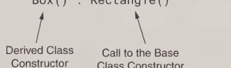

此类构造函数声明的通用形式为：

```
ClassName::ClassName(ParameterList) : BaseClassName(ArgumentList)
```

你也可以向基类构造函数传递参数，如 `Box` 类第二个构造函数所示。查看第 16 行：

```cpp
Box(double w, double len, double h) : Rectangle(w, len)
```

该类构造函数有三个参数：`w`、`len` 和 `h`。注意 `Rectangle` 类的构造函数被调用，且 `w` 和 `len` 参数作为参数被传递。这导致了 `Rectangle` 类第二个构造函数的调用。

你只需要在构造函数的定义中使用这种符号，而不是原型。在这个示例中，派生类构造函数是内联的（在类声明内部），因此包含对基类构造函数调用的符号出现在那里。如果构造函数在类外定义，该符号将出现在函数头中。例如，`Box` 类可能如下：

```cpp
class Box : public Rectangle {
protected:
    double height;
    double volume;
public:
    // 默认构造函数
    Box() : Rectangle() { height = 0.0; volume = 0.0; }
    // 构造函数 #2
    Box(double, double, double);
    double getHeight() const { return height; }
    double getVolume() const { return volume; }
};

// 基类构造函数 #2
Box::Box(double w, double len, double h) : Rectangle(w, len) {
    height = h;
    volume = getArea() * h;
}
```

基类构造函数始终在派生类构造函数之前执行。`Rectangle` 构造函数完成后，执行 `Box` 构造函数。

任何作用范围内的字面量或变量都可以作为派生构造函数的参数。通常，传递给派生类构造函数的一个或多个参数传递给基类构造函数。可用基类构造函数参数的值如下：

- 派生类构造函数的参数
- 字面量
- 包含派生类构造函数定义的文件的可访问全局变量
- 涉及上述任何项的表达式

程序 15-5 显示了 `Rectangle` 和 `Box` 类的用法。

## 程序 15-5

```cpp
// 此程序演示了向基类
// 类构造函数传递参数的用法。
#include <iostream>
#include "Box.h"
using namespace std;

int main() {
    double boxWidth; // 用于存储箱的宽度
    double boxLength; // 用于存储箱的长度
    double boxHeight; // 用于存储箱的高度
    // 从用户处获取宽度、长度和高度。
    cout << "Enter the dimensions of a box:\n";
    cout << "Width: ";
    cin >> boxWidth;
    cout << "Length: ";
    cin >> boxLength;
    cout << "Height: ";
    cin >> boxHeight;
    // 定义一个 Box 对象。
    Box myBox(boxWidth, boxLength, boxHeight);
    // 显示 Box 对象的属性。
    cout << "Width: " << myBox.getWidth() << endl;
    cout << "Length: " << myBox.getLength() << endl;
    cout << "Height: " << myBox.getHeight() << endl;
    cout << "Base area: " << myBox.getArea() << endl;
    cout << "Volume: " << myBox.getVolume() << endl;
    return 0;
}
```

## 程序输出（示例输入已加粗）

Enter the dimensions of a box:
Width: **10**
Length: **15**
Height: **12**
Here are the box's properties:
Width: 10
Length: 15
Height: 12
Base area: 150
Volume: 1800

> **注意：** 如果基类没有默认构造函数，则派生类必须有一个调用基类构造函数之一的构造函数。

## 焦点：汽车、轿车、皮卡和 SUV 类

假设我们正在开发一个供经销商用于管理库存的程序。库存包括三种类型的汽车：轿车、皮卡车和运动用途车（SUV）。库存中的每种类型都有通用特征，外还有它们自己的专门数据：

- 轿车：门数
- 皮卡车：驱动类型
- SUV：载客量

这种方法是低效的，因为三个类包含大量的重复代码。结果是，如果我们后来发现需要添加公共属性，就必须修改三个类。更好的方法是编写一个 `Automobile` 基类来持有通用数据，然后为每种类型编写派生类。以下显示了 `Automobile` 类的代码（该文件可以在第15章的学生源代码文件夹中找到）。

## Contents of Automobile.h

```cpp
#ifndef AUTOMILE_H
#define AUTOMILE_H
#include <string>
using namespace std;

// Automobile 类存储库存中
// 的通用数据。
class Automobile {
private:
    string make; // 汽车品牌
    int model;   // 汽车年份型号
    int mileage; // 汽车里程数
    double price; // 汽车价格
public:
    // 默认构造函数
    Automobile() { make = ""; model = 0; mileage = 0; price = 0.0; }
    // 构造函数
    Automobile(string autoMake, int autoModel, int autoMileage, double autoPrice) {
        make = autoMake;
        model = autoModel;
        mileage = autoMileage;
        price = autoPrice;
    }
    // 访问器
    string make() const { return make; }
    int getModel() const { return model; }
    int getMileage() const { return mileage; }
    double getPrice() const { return price; }
};
#endif
```

## Contents of Car.h

```cpp
#ifndef CAR_H
#define CAR_H
#include "Automobile.h"
#include <string>
using namespace std;

// Car 类代表一辆汽车。
class Car : public Automobile {
private:
    int doors;
public:
    // 默认构造函数
    Car() : Automobile() { doors = 0; }
    // 构造函数 #2
    Car(string carMake, int carModel, int carMileage, double carPrice, int carDoors) :
        Automobile(carMake, carModel, carMileage, carPrice) {
        doors = carDoors;
    }
};
```

Car 类在第 11 行定义了一个 `doors` 属性存储汽车的门数。该类在第 15 行和 16 行有一个默认构造函数，将 `doors` 属性设置为 0。注意第 15 行，默认构造函数调用了 Automobile 类的默认构造函数，该函数将所有继承的属性初始化为它们的默认值。

Car 类在第 19 行到 22 行还有一个重载的构造函数，它接受汽车品牌、型号、里程数和门数的参数。第 21 行调用 Automobile 类的构造函数，将品牌、型号、里程和价格作为参数传递。第 22 行设置了 `doors` 属性的值。

现在让我们来看 Truck 类，它也继承自 Automobile 类。（该文件位于 Student Source Code Folder Chapter 15\Automobile 中。）

# Truck.h 的内容

```cpp
#ifndef TRUCK_H
#define TRUCK_H
#include "Automobile.h"
#include <string>
using namespace std;

// Truck 类代表一辆卡车。
class Truck : public Automobile {
private:
    string driveType;
public:
    // 默认构造函数
    Truck() : Automobile() { driveType = ""; }
    // 构造函数 #2
    Truck(string truckMake, int truckModel, int truckMileage, double truckPrice, string truckDriveType) :
        Automobile(truckMake, truckModel, truckMileage, truckPrice) {
        driveType = truckDriveType;
    }
    // 获取 driveType 属性的访问器
    string getDriveType() { return driveType; }
};
#endif
```

Truck 类在第 11 行定义了一个 `driveType` 属性，用于存储描述卡车驱动类型的字符串。该类在第 15 行和 16 行有一个默认构造函数，将 `driveType` 属性设置为空字符串。注意第 15 行，默认构造函数调用了 Automobile 类的默认构造函数，该函数将所有继承的属性初始化为它们的默认值。

Truck 类在第 19 行到 22 行还有一个重载的构造函数，它接受卡车品牌、型号、里程、价格和驱动类型的参数。第 21 行调用 Automobile 类的构造函数，将品牌、型号、汽车和价格作为参数传递。第 22 行设置了 `driveType` 属性的值。

现在让我们来看 SUV 类，它也继承自 Automobile 类。（该文件可以在 Source Code Folder Chapter 15\Automobile 中找到。）

# SUV.h 的内容

```cpp
#ifndef SUV_H
#define SUV_H
#include "Automobile.h"
#include <string>
using namespace std;

// SUV 类代表一辆 SUV。
class SUV : public Automobile {
private:
    int passengers;
public:
    // 默认构造函数
    SUV() : Automobile() { passengers = 0; }
    // 构造函数 #2
    SUV(string SUVMake, int SUVModel, int SUVPassengers, double SUVPrice, string SUVMileage)
        : Automobile(SUVMake, SUVModel, SUVMileage, SUVPrice) {
        passengers = SUVPassengers;
    }
    // 获取 passengers 属性的访问器
    int getPassengers() { return passengers; }
};
#endif
```

SUV 类在第 11 行定义了属性 `passengers`，用于存储车辆可容的乘客人数。该类在第 15 行和 16 行有一个默认构造函数，将 `passengers` 属性设置为 0。注意第 15 行，默认构造函数调用了 Automobile 类的默认构造函数，该函数将所有继承的属性初始化为它们的默认值。

SUV 类在第 19 行到 22 行还有一个重载的构造函数，它接受 SUV 的品牌、里程、价格和乘客人数的参数。第 21 行调用 Automobile 类的构造函数，将品牌、型号、里程和价格作为参数传递。第 22 行设置了 `passengers` 属性的值。

程序 15-6 展示了每个派生类。它创建了一个 Car 对象、一个 Truck 对象和一个 SUV 对象。（该文件可以在 Source Code Folder Chapter 15\Automobile 中找到。）

# 程序 15-6

```cpp
// 本程序演示了派生自 Automobile 类的
// Car、Truck 和 SUV 类。
#include <iostream>
#include <iomanip>
```


```cpp
#include "Car.h"
#include "Truck.h"
#include "SUV.h"

using namespace std;

int main()
{
    // 为一辆 2007 年的二手宝马创建一个 `Car` 对象
    // 里程 50000 英里，价格 15000 美元，4 扇门。
    Car car("BMW", 2007, 50000, 15000.0, 4);

    // 为一辆 2006 年的二手田创建一个 `Truck` 对象
    // 里程 40000 英里，价格 12000 美元，4WD 驱动。
    Truck truck("Toyota", 2006, 40000, 12000.0, "4WD");

    // 为一辆 2005 年的二手沃尔沃创建一个 `SUV` 对象
    // 里程 30000 英里，价格 18000 美元，5 个乘客座位。
    SUV suv("Volvo", 2005, 5, 18000.0, "30000");

    return 0;
}
```


*(注：由于原文代码中参数顺序与构造函数定义存在细微差异（如 `SUV` 定义中 `mileage` 和 `price` 的位置颠倒），翻译时保持了代码逻辑的一致性。)*

Line 22 sets the value of the `driveType` attribute.

Now let's look at the `SUV` class, which also inherits from the `Automobile` class. (This file can be found in the Source Code Folder `Chapter 15\Automobile`.)

# Contents of SUV.h

```cpp
#ifndef SUV_H
#define SUV_H

#include "Automobile.h"
#include <string>

using namespace std;

// The SUV class represents a SUV.
class SUV : public Automobile
```


# 继承、多态与虚函数

## SUV 类定义

```cpp
class SUV : public Automobile {
private:
    int passengers;

public:
    // Default constructor
    SUV() : Automobile() {
        passengers = 0;
    }

    // Constructor #2
    SUV(string SUVMake, int SUVModel, int SUVPassengers,
        double SUVPrice, string SUVMileage)
        : Automobile(SUVMake, SUVModel, SUVMileage, SUVPrice) {
        passengers = SUVPassengers;
    }

    // Accessor for passengers attribute
    int getPassengers() {
        return passengers;
    }
};
```

`SUV` 类在行 11 定义了 `passengers` 属性，用于存放车辆可容纳的乘客数量。该类在行 15-16 提供了默认构造函数，将 `passengers` 属性设置为 0。注意行 15 中默认构造函数调用了 `Automobile` 类的默认构造函数，后者将所有继承属性初始化为其默认值。

`SUV` 类还有一个重载构造函数（行 19-22），接受 SUV 的制造商、型号、里程、价格和乘客数量作为参数。行 21 调用 `Automobile` 类构造函数，传递制造商、型号、里程和价格。行 22 设置 `passengers` 属性的值。

程序 15-6 演示了每个派生类的用法。它创建了一个 `Car` 对象、一个 `Truck` 对象和一个 `SUV` 对象。（该文件位于 Source Code Folder Chapter 15\Automobile 中。）

## 程序 15-6

```cpp
// This program demonstrates the Car, Truck, and SUV
// classes that are derived from the Automobile class.
#include <iostream>
#include <iomanip>
#include "Car.h"
#include "Truck.h"
#include "SUV.h"

using namespace std;

int main() {
    // Create a Car object for a used 2007 BMW
    // 50000 miles, priced at $15000, with 4 doors.
    Car car("BMW", 2007, 50000, 15000.0, 4);

    // Create a Truck object for a used 2006 Toyota
    // 40000 miles, priced at $12000, with 4WD drive.
    Truck truck("Toyota", 2006, 40000, 12000.0, "4WD");

    // Create an SUV object for a used 2005 Volvo
    // 30000 miles, priced at $18000, with 5 passengers.
    SUV suv("Volvo", 2005, 5, 18000.0, "30000");

    return 0;
}
```

## 15.3 基类与派生类中的构造函数与析构函数

```cpp
#include <iostream>
using namespace std;

class Sky {
public:
    Sky() {
        cout << "Entering the sky.\n";
    }
    ~Sky() {
        cout << "Leaving the sky.\n";
    }
};

class Ground : public Sky {
public:
    Ground() {
        cout << "Entering the Ground.\n";
    }
    ~Ground() {
        cout << "Leaving the Ground.\n";
    }
};

int main() {
    Ground object;
    return 0;
}
```

### 思考题：以下程序将显示什么？

```cpp
#include <iostream>
using namespace std;

class Sky {
public:
    Sky() {
        cout << "Entering the sky.\n";
    }
    Sky(string color) {
        cout << "The sky is " << color << endl;
    }
    ~Sky() {
        cout << "Leaving the sky.\n";
    }
};

class Ground : public Sky {
public:
    Ground() {
        cout << "Entering the Ground.\n";
    }
    Ground(string c1, string c2) : Sky(c1) {
        cout << "The ground is " << c2 << endl;
    }
    ~Ground() {
        cout << "Leaving the Ground.\n";
    }
};

int main() {
    Ground object;
    return 0;
}
```

## 15.4 重新定义基类函数

> **概念**：基类成员函数可以在派生类中被重新定义。

继承通常用于扩展类，或为其提供额外的功能。有时，在派生类中使用同名的函数来重新定义基类函数可能会有所帮助。例如，回想一下在本章之前介绍的 `GradedActivity` 类：

```cpp
class GradedActivity {
protected:
    char letter; // 用于存储字母等级
    double score; // 用于存储数值分数
    void determineGrade(); // 确定字母等级

public:
    // 默认构造函数
    GradedActivity() {
        letter = ' ';
        score = 0.0;
    }

    // 修改器函数
    void setScore(double s) {
        score = s;
        determineGrade();
    }

    // 访问器函数
    double getScore() const {
        return score;
    }

    char getLetterGrade() const {
        return letter;
    }
};
```

该类存储一个数值分数并根据该分数确定字母等级。`setScore` 成员函数将值存储在 `score` 中，然后调用 `determineGrade` 成员函数来确定字母等级。

假设老师想在确定字母等级之前对数值分数进行“调分”。例如，Harrison 博士决定为了调整她班级的成绩，必须将每个学生的得分乘以某个百分比。这得到了一个调整后的分数，用于确定字母等级。

以下派生自 `GradedActivity` 的 `CurvedActivity` 类将数值分数乘以百分比，并将该值作为参数传递给基类的 `setScore` 函数。（该文件可以在学生源文件夹 Chapter 15\CurvedActivity 中找到。）

### CurvedActivity.h

```cpp
#ifndef CURVEDACTIVITY_H
#define CURVEDACTIVITY_H
#include "GradedActivity.h"

class CurvedActivity : public GradedActivity {
protected:
    double rawScore; // 原始分数
    double percentage; // 调分百分比

public:
    // 默认构造函数
    CurvedActivity() : GradedActivity() {
        rawScore = 0.0;
        percentage = 0.0;
    }

    // 修改器函数
    void setRawScore(double s) {
        rawScore = s;
        GradedActivity::setScore(rawScore * percentage);
    }

    void setPercentage(double c) {
        percentage = c;
    }

    // 访问器函数
    double getPercentage() const {
        return percentage;
    }

    double getRawScore() const {
        return rawScore;
    }
};
#endif
```

`CurvedActivity` 类具有以下成员变量：

- `rawScore`：存储学生的原始分数。
- `percentage`：存储调分百分比，用于乘以原始分数。

它还具有以下成员函数：

- **构造函数**：调用 `GradedActivity` 构造函数，然后将 `rawScore` 和 `percentage` 设置为 0.0。
- `setRawScore`：接受一个学生原始分数的参数。该函数将参数存储在 `rawScore` 变量中，然后将 `rawScore * percentage` 作为参数传递给基类的 `setScore` 函数。
- `setPercentage`：将值存储在 `percentage` 变量中。
- `getPercentage`：返回 `percentage` 变量的值。
- `getRawScore`：返回 `rawScore` 变量的值。

> **注意**：虽然这里我们在派生类中使用了基类成员函数，但请记住，派生类可以重新定义基类成员函数。

继承通常用于扩展类，或为其提供额外的功能。有时，在派生类中使用同名的函数来重新定义基类函数可能会有所帮助。例如，回想一下在本章之前介绍的 `GradedActivity` 类：

以下 `CurvedActivity` 类派生自 `GradedActivity` 类。它将数值分数乘以百分比，并将该值作为参数传递给基类的 `setScore` 函数。（该文件可以在学生源文件夹 Chapter 15\CurvedActivity 中找到。）

## 程序 15-8：基类对象仍调用基类版本函数

需要注意的是，尽管派生类可以重新定义基类中的函数，但定义为基类类型的对象仍然会调用基类版本的该函数。这在程序 15-8 中得到了证明。

```cpp
// 此程序演示了当派生类函数重写
// 基类的函数时，基类的对象
// 仍然会调用基类版本的函数。
#include <iostream>
using namespace std;

class BaseClass {
public:
    void showMessage() {
        cout << "This is the Base class.\n";
    }
};

class DerivedClass : public BaseClass {
public:
    void showMessage() {
        cout << "This is the Derived class.\n";
    }
};

int main() {
    BaseClass b;
    DerivedClass d;

    b.showMessage();
    d.showMessage();

    return 0;
}
```

### 程序输出

```text
This is the Base class.
This is the Derived class.
```

在程序 15-8 中，声明了一个名为 `BaseClass` 的类，它包含一个名为 `showMessage` 的成员函数。接着声明了一个名为 `DerivedClass` 的类，它也包含一个 `showMessage` 成员函数。正如其名称所示，`DerivedClass` 派生自 `BaseClass`。在 `main` 函数中定义了两个对象，`b` 和 `d`。对象 `b` 是一个 `BaseClass` 对象，而 `d` 是一个 `DerivedClass` 对象。当使用 `b` 来调用 `showMessage` 函数时，执行的是 `BaseClass` 版本。同样，当使用 `d` 来调用 `showMessage` 时，使用的是 `DerivedClass` 版本。

## 15.5 类的层次结构

**概念**：基类也可以派生自另一个类。

有时，建立一个类的层次结构是很有意义的，其中一个类继承自第二个类，而第二个类又继承自第三个类，如图 15-4 所示。在某些情况下，类的继承会持续很多层。

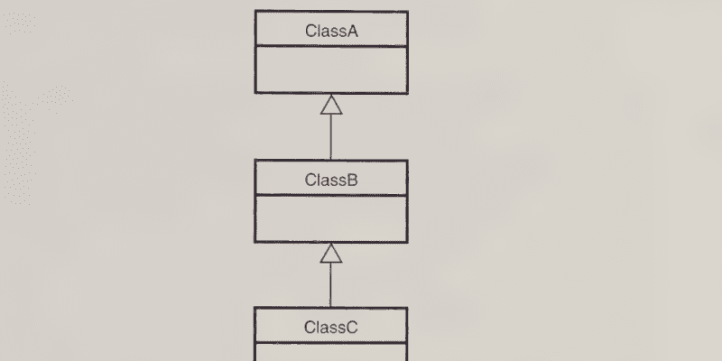

在图 15-4 中，`ClassC` 继承了 `ClassB` 的成员，包括 `ClassB` 从 `ClassA` 继承的成员。让我们来看这样一个继承链的示例。考虑以下 `PassFailActivity` 类，它继承自 `GradedActivity` 类。该类旨在确定字母等级：通过为 'P'，不通过为 'F'。（该文件可以在 Student Source Code Folder 15\PassFailActivity 中找到。）

### PassFailActivity.h 内容

```cpp
#ifndef PASSFAILACTIVITY_H
#define PASSFAILACTIVITY_H
#include "GradedActivity.h"

class PassFailActivity : public GradedActivity {
protected:
    double minPassingScore; // 最低通过分数。

public:
    // 默认构造函数
    PassFailActivity() : GradedActivity() {
        minPassingScore = 0.0;
    }

    // 构造函数
    PassFailActivity(double mps) : GradedActivity() {
        minPassingScore = mps;
    }

    // 修改器
    void setMinPassingScore(double mps) {
        minPassingScore = mps;
    }

    // 访问器
    double getMinPassingScore() const {
        return minPassingScore;
    }

    char getLetterGrade() const;
};
#endif
```


`PassFailActivity` 类有一个名为 `minPassingScore` 的私有成员变量。该变量保存了活动的最低通过分数。第 11 行和第 12 行的默认构造函数将 `minPassingScore` 设置为 0.0。第 15 行和第 16 行的重载构造函数接受一个 `double` 类型的参数作为活动的值。该值存储在 `minPassingScore` 变量中。`getLetterGrade` 成员函数在以下 `PassFailActivity.cpp` 文件中定义。（这可以在 Student Source Code Folder 15PassFailActivity 中找到。）

## PassFailActivity.cpp 内容

```cpp
1  #include "PassFailActivity.h"
2
3  /********************************************************************
4  // 成员函数 PassFailActivity::getLetterGrade
5  // 如果分数在通过范围内，则返回 'P'，*
6  // 否则返回 'F'。
7  /********************************************************************
8
9  char PassFailActivity::getLetterGrade(double score) const
10 {
11     char letterGrade;
12
13     if (score >= minPassingScore)
14         letterGrade = 'P';
15     else
16         letterGrade = 'F';
17
18     return letterGrade;
19 }
```

此 `getLetterGrade` 成员函数重新定义了 `GradedActivity` 类的 `getLetterGrade` 成员函数。该版本的函数在数值分数大于或等于某个值时返回 'P' 等级。

# 976
## 15.5 类层次结构

`PassFailActivity` 类代表了通过活动的通用特征。可能存在多种类型的通过活动。然而，我们需要一个专门的类，例如一个确定学生考试成绩的类。接下来的 `FailExam` 就是这样一个例子。它继承自 `PassFailActivity`，继承了其继承自 `GradedActivity` 的所有成员。

## FailExam.h 内容

```cpp
#ifndef FAILAM_H
#define FAILAM_H

#include "PassFailActivity.h"

class FailExam : public PassFailActivity
{
private:
    int numQuestions; // 数量
    double pointsEach; // 每题分数
    int numMissed; // 错题数

public:
    // 默认构造函数
    FailExam() : PassFailActivity(){
        numQuestions = 0;
        pointsEach = 0.0;
        numMissed = 0;
    }

    // 构造函数
    FailExam(int questions, int missed, double mps) : PassFailActivity(mps)
    {
        numQuestions = questions;
        numMissed = missed;
        pointsEach = 100.0 / numQuestions;
    }

    // 修改器
    void set(int questions, int missed)
    {
        numQuestions = questions;
        numMissed = missed;
        pointsEach = 100.0 / numQuestions;
    }

    // 访问器
    int getNumQuestions() const
    {
        return numQuestions;
    }

    double getPointsEach() const
    {
        return pointsEach;
    }

    int getNumMissed() const
    {
        return numMissed;
    }
};

#endif
```

## FailExam.cpp 内容

```cpp
1 #include "FailExam.h"
2 //********************************************************************
3 // set 函数
4 // 这里的参数是题目的数量和
5 // 错题数。
6 //********************************************************************
7 
9 void FailExam::set(int questions, int missed)
10 {
11     double numericScore; // 用于存储数值分数
12     // 设置题目的数量和错题数。
13     numQuestions = questions;
14     numMissed = missed;
15     // 计算每题的分数。
16     pointsEach = 100.0 / numQuestions;
17     // 计算这次考试的数值分数。
18     numericScore = 100.0 - (missed * pointsEach);
19     // 调用继承的 setScore 函数来设置
20 // 数值分数。
21     setScore(numericScore);
22 }
```

`FailExam` 类继承了 `PassFailActivity` 类的所有成员，包括 `FailActivity` 继承自 `GradedActivity` 的成员。由于使用了 `public` 类访问说明符，`PassFailActivity` 的所有保护成员都变为 `FailExam` 的受保护成员，而 `PassFailActivity` 的所有公共成员都变为 `FailExam` 的公共成员。表 15-2 列出了 `FailExam` 的所有成员变量以及所有成员函数。这些包含了从基类继承的成员。

# 表 15-2 FailExam 类的成员变量

| 成员变量 | 访问权限 | 是否继承？ |
| :--- | :--- | :--- |
| numQuestions | private | 否 |
| pointsEach | private | 否 |
| numMissed | private | 否 |
| minPassingScore | protected | 是，来自 PassFailActivity |
| score | protected | 是，来自 PassFailActivity，其继承自 GradedActivity |

# 表 15-3 PassFailExam 类的成员函数

| 成员函数 | 权限 | 是否继承 |
| --- | --- | --- |
| set | public | 否 |
| getQuestions | public | 否 |
| getPointsEach | public | 否 |
| getNumMissed | public | 否 |
| setMinPassingScore | public | 是，继承自 PassFailActivity |
| getMinPassingScore | public | 是，继承自 PassFailActivity |
| getLetterGrade | public | 是，继承自 PassFailActivity |
| setScore | public | 是，继承自 PassFailActivity，其继承自 GradedActivity |
| getScore | public | 是，继承自 PassFailActivity，其继承自 GradedActivity |

15-9 展示了 `PassFailExam` 类。可以在学生源代码文件夹 `Chapter 15\PassFailActivity` 中找到该文件。

## 程序 15-9

```cpp
// 此程序演示了 PassFailExam 类。

#include <iostream>
#include <iomanip>
#include "PassFailExam.h"

using namespace std;

int main()
{
    int questions; // 题目数量
    int missed; // 错题数量
    double minPassing; // 最低通过分数

    // 获取考试的题目数量。
    cout << "How many questions are on the exam? ";
    cin >> questions;

    // 获取学生错的题目数量。
    cout << "How many questions did the student miss? ";
    cin >> missed;

    // 获取最低通过分数。
    cout << "Enter the minimum passing score for this test: ";
    cin >> minPassing;

    // 定义一个 PassFailExam 对象。
    PassFailExam exam(questions, missed, minPassing);
```

## 程序 15-9（续）

```cpp
28      // 显示测试结果。
29      cout << fixed << setprecision(1);
30      cout << "\nEach question counts "
31      cout << exam.getPoints() << " points.\n";
32      cout << "The minimum passing score is "
33      cout << exam.getMinPassingScore() << endl;
34      cout << "The student's exam score is "
35      cout << exam.getScore() << endl;
36      cout << "The student's grade is "
37      cout << exam.getLetterGrade() << endl;
38      return 0;
39  }
```

## 程序输出（示例输入已加粗显示）

How many questions are on the exam? **100 Enter**
How many questions did the student miss? **25 Enter**
Enter the minimum passing score for this test: **60 Enter**

Each question counts 1.0 points.
The minimum passing score is 60.0
The student's exam score is 75.0
The student's grade is P

此程序使用 `PassFailExam` 对象调用第 37 行的 `getLetterGrade` 函数。回想 `PassFailActivity` 类重定义了 `getLetterGrade` 函数，以仅报告 'P' 或 'F' 成绩。由于 `PassFailExam` 类派生自 `PassFailActivity` 类，因此它继承了重定义的 `getLetterGrade` 函数。

软件设计人员经常使用类层次图。就像家族树一样，类层次图显示了类之间的继承关系。图 15-5 显示了 `GradedActivity`、`FinalExam`、`PassFailActivity` 和 `PassFailExam` 类的类层次结构。更通用的类位于树的顶部，而更具体的类位于底部。

## 图 15-5 类层次结构

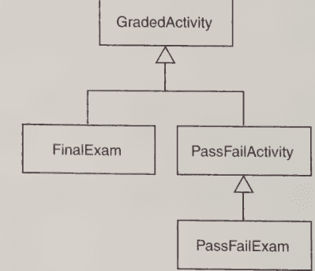

## 15.6 多态与虚成员函数

概念：多态允许对象引用变量或对象指针引用不同类型的对象，并根据所引用对象的类型调用正确的成员函数。

查看以下名为 `displayGrade` 的函数代码：

```cpp
void displayGrade(const GradedActivity &activity)
{
    cout << precision(1) << fixed;
    cout << "The activity's numeric score is " << activity.getScore() << endl;
    cout << "The activity's letter grade is " << activity.getLetterGrade() << endl;
}
```

该函数使用一个 `const GradedActivity` 引用变量作为参数。当 `GradedActivity` 对象作为参数传递给此函数时，该函数调用对象的 `getScore` 和 `getLetterGrade` 成员函数来显示数值分数和字母等级。以下代码显示了我们如何调用该函数：

```cpp
GradedActivity test(88.0); // 分分为 88
displayGrade(test); // 将 test 传递给 displayGrade
```

此代码将产生以下输出：

The activity's numeric score is 88.0
The activity's letter grade is B

回想 `GradedActivity` 类也是 `FinalExam` 类的基类。由于基类和派生类之间存在“是”（is-a）关系，`FinalExam` 类的对象不仅仅是一个 `FinalExam` 对象。它还是一个 `GradedActivity` 对象。期末考试是一项评分活动。由于这种关系，我们也可以将 `FinalExam` 对象传递给 `displayGrade` 函数。例如，查看以下内容：

```cpp
// 有 100 道题。学生错了 25 道。
FinalExam test(100, 25);
displayGrade(test2);
```

此代码将产生输出：

The activity's numeric score is 75.0
The activity's letter grade is C

由于 `PassFailExam` 类是派生自 `PassFailActivity` 类，它继承了重定义的 `getLetterGrade` 函数。由于 `displayGrade` 的参数是 `GradedActivity` 引用变量，编译器已经决定调用 `GradedActivity` 类的 `getLetterGrade` 函数。这是因为 `PassFailActivity` 类重定义了该函数（由于此文件位于学生源代码文件夹 15\PassFailActivity 中，此处逻辑程序 15-10）。

## 程序 15-10

```cpp
#include <iostream>
#include <iomanip>
#include "PassFailActivity.h"

using namespace std;

// 函数原型
void displayGrade(const GradedActivity &);

int main() {
    // 创建一个 PassFailActivity 对象
    PassFailActivity test(70); // 最低通过 70。

    // 设置分数。
    test.setScore(72);

    // 显示等级。
    displayGrade(test);

    return 0;
}
```

```cpp
void displayGrade(const GradedActivity &activity) {
    cout << precision(1) << fixed;
    cout << "The activity's numeric score is " << activity.getScore() << endl;
    cout << "The activity's letter grade is " << activity.getLetterGrade() << endl;
}
```


# 程序输出

The activity's numeric score is 72.0
The activity's letter grade is C

正如从示例所示，`PassFailActivity` 类返回了 'C' 而不是 'P'。这是因为我们将 `PassFailActivity` 对象传递给了 `displayGrade` 函数，而 `displayGrade` 的参数是 `GradedActivity` 引用变量。由于类型是 `GradedActivity` 类型，编译器已经确定将调用 `GradedActivity` 类的 `getLetterGrade` 函数。这一过程被称为绑定。为了解决这个问题，可以将 `getLetterGrade` 函数设为虚函数（`virtual`）。虚函数是动态绑定的成员函数。在动态绑定中，C++ 根据负责调用的对象类型决定调用哪个函数。如果是 `GradedActivity` 对象负责调用，它将执行 `GradedActivity::getLetterGrade`；如果是 `PassFailActivity` 负责调用，它将执行 `PassFailActivity::getLetterGrade`。

虚函数的定义是通过在基类声明中返回类型之前放置 `virtual` 关键字来实现的，例如

```cpp
virtual getLetterGrade() const;
```

> 注意：你只需将 `virtual` 关键字放在函数的声明或原型中。如果函数在类外定义，则不需要在函数头中放置 `virtual` 关键字。

以下代码显示了更新后的 `GradedActivity` 类，其中 `getLetterGrade` 被声明为虚函数。该文件可以在学生源代码文件夹 `15\GradedActivity` 中找到。`Version 3.cpp` 文件未更改，此处不再重复显示。

# GradedActivity.h (版本 3)

```cpp
1 #ifndef GRADEDACTIVITY_H
2 #define GRADEDACTIVITY_H
3
4 // GradedActivity 类声明
5
6 class GradedActivity
7 {
8 protected:
9     double score; // 用于存储数值分数
10 public:
11     // 默认构造函数
12     GradedActivity()
13     { score = 0.0; }
14
15     // 构造函数
16     GradedActivity(double s)
17     { score = s; }
18
19     // 修改器函数
20     void setScore(double s)
21     { score = s; }
22
23     // 访问器
24     double getScore() const
25     { return score; }
26
27     virtual char getLetterGrade() const;
28 };
29 #endif
```

我们对该类做的唯一更改是在第 27 行将 `getLetterGrade` 声明为虚函数。这告诉编译器不要在编译时将 `getLetterGrade` 的调用绑定到该函数。相反，对函数的调用将在运行时进行动态绑定。

当成员函数在基类中被声明为虚函数时，该函数的任何重定义版本都会自动成为虚函数。因此，在 `PassFailActivity` 类中没有必要将 `getLetterGrade` 函数声明为虚函数。但为了文档目的，在 `PassFailActivity` 类中将该函数声明为虚仍然是好主意。这里显示了 `PassFailActivity` 类的新版本。该文件可以在学生源代码文件夹 `5GradedActivity Version 3` 中找到。`PassFailActivity.cpp` 文件没有更改，因此不再显示。

# PassFailActivity 的内容

```cpp
1 #ifndef PASSFAILACTIVITY_H
2 #define PASSFAILACTIVITY_H
3 #include "GradedActivity.h"
4
5 class PassFailActivity : public GradedActivity
6 {
7 protected:
8     double minPassingScore; // 最低及格分
9 public:
10     // 默认构造函数
11     PassFailActivity() : GradedActivity()
12     { minPassingScore = 0.0; }
13
14     // 构造函数
15     PassFailActivity(double mps) : GradedActivity()
16     { minPassingScore = mps; }
17
18     // 修改器
19     void setMinPassingScore(double mps)
20     { minPassingScore = mps; }
21
22     // 访问器
23     double getMinPassingScore() const
24     { return minPassingScore; }
25
26     virtual char getLetterGrade() const;
27 };
28 #endif
```

## 15.6 多态与虚成员函数

我们对该类做的唯一更改是在第 26 行将 `getLetterGrade` 声明为虚函数。程序 15-11 与程序 15-10 相同，它使用了修正后的 `GradedActivity` 和 `PassFailActivity` 类。该文件也可以在学生源代码文件夹 `Chapter 15:GradedActivity Version 3` 中找到。

# 程序 15-11

```cpp
1 #include <iostream>
2 #include <iomanip>
3 #include "PassFailActivity.h"
4 using namespace std;
5
6 // 函数原型
7 void displayGrade(const GradedActivity &);
8
9 int main() {
10     // 创建一个 PassFailActivity 对象。最低及格
11     // 分数为 70。
12     PassFailActivity test(70);
13
14     // 将分数设置为 72。
15     test.setScore(72);
16
17     // 显示对象的等级数据。字母等级
18     // 应该是 'P'。将显示什么？
19     displayGrade(test);
20     return 0;
21 }
22
23 /*********************************************************************
24 /* The displayGrade 函数显示 GradedActivity 对象的 *
25 // 数值分和字母等级。
26 *********************************************************************
27
28 void displayGrade(const GradedActivity &activity)
29 {
30     cout << setprecision(1) << fixed << "";
31     cout << "The activity's numeric score is "
32         << activity.getScore() << endl;
33     cout << "The activity's letter grade is "
34         << activity.getLetterGrade() << endl;
35 }
```

# 程序输出

The activity's numeric score is 72.0
The activity's letter grade is P

现在 `letterGrade` 函数被声明为虚函数，程序可以正常运行。这种行为被称为**多态**。多态一术语意味着以多种形式采取的能力。程序 15-12 通过向 `displayGrade` 函数传递 `GradedActivity` 和 `PassFail` 类的对象演示了多态。该文件可以在学生源代码文件夹 `Chapter 15\GradedActivity Version 3` 中找到。

# 程序 15-12

```cpp
1 #include <iostream>
2 #include <iomanip>
3 #include "PassFailExam.h"
4 using namespace std;
5
6 // 函数原型
7 void displayGrade(const GradedActivity &);
8
9 int main() {
10     // 创建一个 GradedActivity 对象。分数为 88。
11     GradedActivity test1(88.0);
12
13     // 创建一个 PassFailExam 对象。有 100 道题，
14     // 学生错了 25 道，最低及格
15     // 分数为 70。
16     PassFailExam test2(100, 25, 70.0);
17
18     // 显示两个对象的等级数据。
19     cout << "Test 1\n";
20     displayGrade(test1);
21     cout << "Test 2\n";
22     displayGrade(test2);
23     return 0;
24 }
25
26 /*********************************************************************
27 /* The displayGrade 函数显示 GradedActivity 对象的 *
28 // 数值分和字母等级。
29 *********************************************************************
30
31 void displayGrade(const GradedActivity &activity)
32 {
33     cout << setprecision(1) << fixed << "";
34     cout << "The activity's numeric score is "
35         << activity.getScore() << endl;
36     cout << "The activity's letter grade is "
37         << activity.getLetterGrade() << endl;
38 }
```

# 程序输出

测试 1:
该活动的数值分是 88.0
该活动的字母等级是 B

测试 2:
该活动的数值分是 75.0
该活动的字母等级是 P

# 基类指针

基类指针可以指向派生类对象的地址。例如，看以下代码：

```cpp
GradedActivity *exam = new PassFailExam(100, 25, 70.0);
```

该语句动态分配了一个 `PassFailExam` 对象并将其地址赋值给 `exam`，而 `exam` 是一个 `GradedActivity` 指针。然后，我们可以使用 `exam` 指针来调用成员函数，如下所示：

```cpp
cout << exam->getScore() << endl;
cout << exam->getLetterGrade() << endl;
```

程序 15-14 是一个使用基类指针引用派生类对象的示例。该文件可以在 Student Source Code Folder `Chapter 15\GradedActivity Version 3` 中找到。

# 程序 15-14

```cpp
1 #include <iostream>
2 #include <iomanip>
3 #include "PassFailExam.h"
4 using namespace std;
5
6 // 函数原型
7 void displayGrade(const GradedActivity *);
8
9 int main()
10 {
11     // 数组大小的常量。
12     const int NUM_TESTS = 4;
13
14     // tests 是一个 GradedActivity 指针数组。
15     // tests 的每个元素都初始化为
16     // 动态分配对象的地址。
17     GradedActivity* tests[NUM_TESTS] = {
18         new GradedActivity(88.0),
19         new PassFailExam(100, 25, 70.0),
20         new GradedActivity(67.0),
21         new PassFailExam(50, 12, 60.0)
22     };
```

（程序继续）

# 程序 15-14（续）

```cpp
23     // 显示数组中每个元素的成绩数据。
24     for (int count = 0; count < NUM_TESTS; count++)
25     {
26         cout << "Test #" << (count + 1) << ":\n";
27         displayGrade(tests[count]);
28         cout << endl;
29     }
30     return 0;
31 }
32
33     ************************************************************************************
34     // displayGrade 函数显示 GradedActivity 对象的
35     // 数值分和字母等级。此版本的函数*
36     // 使用 GradedActivity 指针作为参数。
37     ************************************************************************************
38
39     void displayGrade(const GradedActivity *activity)
40     {
41         cout << setprecision(1) << fixed;
42         cout << "The activity's numeric score is "
43             << activity->getScore() << endl;
44         cout << "The activity's letter grade is "
45             << activity->getLetterGrade() << endl;
46     }
```

# 程序输出

测试 #1:
该活动的数值分是 88.0
该活动的字母等级是 B

测试 #2:
该活动的数值分是 75.0
该活动的字母等级是 P

测试 #3:
该活动的数值分是 67.0
该活动的字母等级是 D

测试 #4:
该活动的数值分是 76.0
该活动的字母等级是 P

# 基类指针和引用仅识别基类成员

虽然基类指针可以引用派生自基类的任何类的对象，但指针对这些对象的操作是有限制的。记住，`GradedActivity` 类除了构造函数外只有三个成员函数：`setScore`、`getScore` 和 `getLetterGrade`。因此，`GradedActivity` 指针只能用于调用这些函数，无论它指向的是什么类型的对象。例如，看以下代码：

```cpp
GradedActivity *exam = new PassFailExam(100, 25, 70.0);
```

# “是”关系并不在反向是成立的

尽管基类指针可以引用派生自基类的任何类的对象，但指针对这些对象所能做的是有限制的。要注意，并不是所有的 `GradedActivity` 都是 `PassFailExam`。这意味着以下代码是无效的（关系在反向不成立）：

```cpp
// 创建一个 GradedActivity 对象。
GradedActivity *gaPointer = new GradedActivity(88.0);
```

```cpp
// 错误！这不可行。
FinalExam *fePointer = gaPointer;
```


你不能将 `GradedActivity` 的地址赋值给 `FinalExam` 指针。这是因为 `FinalExam` 拥有超出 `GradedActivity` 的功能。有趣的是，C++ 编译器允许你进行转换，如下所示：

```cpp
// 创建一个 GradedActivity 对象。
GradedActivity *gaPointer = new GradedActivity(88.0);
```

```cpp
// 这可行，但有限制。
FinalExam *fePointer = static_cast<FinalExam*>(gaPointer);
```

在执行此代码后，派生类指针 `fePointer` 将指向一个基类对象。我们可以使用指针访问成员，但只能访问存在的成员。以下代码演示了：

```cpp
// 这可行。对象有 getScore 函数。
cout << fePointer->getScore() << endl;
```

```cpp
// 这可行。对象有 getLetterGrade 函数。
cout << fePointer->getLetterGrade() << endl;
```

```cpp
// 这可以通过编译，但在运行时会发生错误。
// 对象没有 getPointsEach
cout << fePointer->getPointsEach() << endl;
```

在此代码中，`fePointer` 是一个 `FinalExam` 指针，它指向一个 `GradedActivity` 对象。前两个代码语句有效，因为 `GradedActivity` 对象有 `getScore` 和 `getLetterGrade` 成员函数。最后一条会导致错误，因为它调用了 `getPointsEach` 成员函数。

# 重定义与覆盖

之前你学过派生类可以重定义基类函数。当一个类重定义一个虚拟函数时，说该类覆盖了该函数。在 C++ 中，重定义和覆盖的区别在于，覆盖是动态绑定的，而重定义是静态绑定的。只有虚拟函数可以被覆盖。

# 虚拟析构函数

当你编写带有析构函数的类时，且该类可能成为基类时，你应该始终将析构函数声明为虚拟。这是因为如果不声明为虚拟，编译器将对析构函数执行静态绑定。当基类指针或引用变量引用派生对象时，这会导致问题。

## 15.6 多态与虚成员函数

派生类有自己的析构函数，当对象被销毁或超出范围时，该析构函数不会执行。只有基类的析构函数会执行。程序 15-15 展示了这一点。

### 程序 15-15

```cpp
1 #include <iostream>
2 using namespace std;
3
4 // Animal 是一个基类。
5 class Animal
6 {
7 public:
8 // 构造函数
9 Animal()
10 { cout << "Animal constructor executing.\n"; }
11
12 // 析构函数
13 ~Animal()
14 { cout << "Animal destructor executing.\n"; }
15 };
16
17 // Dog 类派自 Animal
18 class Dog : public Animal
19 {
20 public:
21 // 构造函数
22 Dog() : Animal()
23 { cout << "Dog constructor executing.\n"; }
24
25 // 析构函数
26 ~Dog()
27 { cout << "Dog destructor executing.\n"; }
28 };
29
30 //***************************************************
31 /* main 函数
32 /***************************************************
33
34 int main()
35 {
36 // 创建一个 Dog 对象，由一个
37 // Animal 指针引用。
38 Animal *myAnimal = new Dog;
39
40 // 删除 dog 对象。
41 delete myAnimal;
42 return 0;
43 }
```

程序输出：
```
Animal constructor executing.
Dog constructor executing.
Animal destructor executing.
```

该程序声明了两个类：`Animal` 和 `Dog`。`Animal` 是基类，`Dog` 是派生类。每个类都有它们自己的构造函数和析构函数。在第 38 行，创建了一个 `Dog` 对象，并将其地址存储在 `Animal` 指针中。`Animal` 和 `Dog` 的构造函数都执行了。在第 41 行，该对象被删除了。然而，当该语句执行时，只有 `Animal` 的析构函数执行了。`Dog` 的析构函数没有执行，因为该对象是通过 `Animal` 指针引用的。我们可以通过将 `Animal` 析构函数声明为虚函数来解决这个问题，如程序 15-16 所示。

### 程序 15-16

```cpp
#include <iostream>
using namespace std;

// Animal 是一个基类。
class Animal {
public:
    // 构造函数
    Animal() {
        cout << "Animal constructor executing.\n";
    }
    // 析构函数
    virtual ~Animal() {
        cout << "Animal destructor executing.\n";
    }
};

// Dog 类派自 Animal
class Dog : public Animal {
public:
    // 构造函数
    Dog() : Animal() {
        cout << "Dog constructor executing.\n";
    }
    // 析构函数
    ~Dog() {
        cout << "Dog destructor executing.\n";
    }
};
********************************
// main 函数
**********************************
int main() {
    // 创建一个 Dog 对象，由一个
    Animal *myAnimal = new Dog;
    // 删除 dog 对象。
    delete myAnimal;
    return 0;
}
```

程序输出：
```
Animal constructor executing.
Dog constructor executing.
Dog destructor executing.
Animal destructor executing.
```

此程序中唯一变化的地方是在第 13 行将 `Animal` 类的析构函数声明为虚函数。因此，析构函数在运行时动态绑定。当 `Dog` 对象被销毁时，`Animal` 和 `Dog` 的析构函数都执行了。

良好的编程习惯是，任何具有虚函数的类都应该也具有虚析构函数。如果类不需要析构函数，它也应该有一个不执行任何语句的虚析构函数。记住，当基类函数被声明为虚函数时，派生类中该函数的所有覆盖版本会自动变成虚函数。在基类中包含虚析构函数（即使是空的），将确保任何派生类的析构函数也是虚函数。

## C++ 11 的 override 和 final 关键字

C++ 11 引入了 `override` 关键字以帮助防止覆盖虚函数时出现细微错误。例如，你能找到程序 15-17 中的错误吗？

### 程序 15-17

```cpp
1 // 此程序在虚函数中有一个细微错误。
2 #include <iostream>
3 using namespace std;
4
5 class Base
6 {
7 public:
8 virtual void functionA(int arg) const
9   { cout << "This is Base::functionA" << endl; }
10 };
11
12 class Derived : public Base
13 {
14 public:
15 virtual void functionA(long arg) const
16   { cout << "This is Derived::functionA" << endl; }
17 };
18
19 int main ()
20 {
21   // 分配 Derived 类的实例。
22   Base *b = new Derived();
23   Derived *d = new Derived();
24
25   // 使用两个指针调用 functionA。
26   b->functionA(99);
                   // (程序继续)
```

### 程序 15-17（续）

```cpp
27   d->functionA(99);
28   return 0;
29
30 }
```

程序输出：
```
This is Base::functionA
This is Base::functionA
```

此程序在虚函数中有一个细微错误。输出显示，即使使用派生类指针 `d`，调用的也是基类版本的 `functionA`。当我们在第 26 行和 27 行调用 `functionA` 时，人们可能期望调用派生类的版本。然而，由于派生类的参数是 `long` 而基类的参数是 `int`，它并没有真正覆盖该函数。为了修复这个问题，我们可以在派生类中使用 `override` 关键字。

### 程序 15-18

```cpp
1 // 此程序演示了 override 关键字。
2 #include <iostream>
3 using namespace std;
4
5 class Base
6 {
7 public:
8 virtual void functionA(int arg) const
9   { cout << "This is Base::functionA" << endl; }
10 };
11
12 class Derived : public Base
13 {
14 public:
15 void functionA(int arg) const override
16   { cout << "This is Derived::functionA" << endl; }
17 };
```

## 15.7 抽象基类与纯虚函数

- 概念：抽象基类不能实例化，但其他类派生自它。纯虚函数是基类中必须被覆盖的成员函数。当一个类包含一个纯虚函数作为成员时，该类就变成了抽象基类。

有时从抽象基类开始类层次结构是有帮助的。抽象基类不实例化，但作为其他类的基类。抽象基类代表了所有派自它的类的通用或抽象形式。

例如，考虑一个制造飞机的工厂。该工厂不制造通用飞机，而是制造三种飞机：两种型号的驱动飞机和一种支线飞机模型。分类飞机的计算机软件可以使用一个名为 `Airplane` 的抽象基类。该类具有表示所有飞机的共同特征的成员。此外，它为工厂制造的三种特定飞机模型各有一个类。这些类具有表示每种类型飞机的独特特性。

当一个类的一个或多个成员函数是纯虚拟函数时，该类就变成抽象基类。纯虚拟函数是以类似于以下方式声明的成员函数：

```cpp
virtual void showInfo() = 0;
```

`= 0` 表示 `showInfo` 是一个纯虚拟函数。纯虚拟函数在基类中没有体或定义。它们必须在派生类中被重写。此外，类中存在纯虚拟函数会阻止程序实例化该类。如果你尝试定义抽象基类的对象，编译器将生成错误。

例如，查看下面的抽象基类 `Student`。它持有所有学生共有的数据，但不包含特定专业学生所需的所有数据。

### Student.h 的内容

```cpp
// Student 类的规范文件
#ifndef STUDENT_STUDENT_H
#define STUDENT_STUDENT_H
#include <string>
using namespace std;

class Student {
protected:
    string name;                // 学生姓名
    string idNumber;            // 学生 ID
    int yearAdmitted;           // 学生入学年份
public:
    // 默认构造函数
    Student() { 
        name = "";
        idNumber = "";
        yearAdmitted = 0; 
    }
    // 构造函数
    Student(string n, string id, int year) { 
        set(n, id, year); 
    }
    // set 函数设置属性数据。
    void set(string n, string id, int year) { 
        name = n;                // 分配姓名
        idNumber = id;             // 分配 ID
        yearAdmitted = year;      // 分配年份
    }
    // 访问函数
    const string getName() const { return name; }
    const string getIdNum() const { return idNumber; }
    int getYearAdmitted() const { return yearAdmitted; }
    // 纯虚拟函数
    virtual int getRemainingHours() const = 0;
};
#endif
```

`Student` 类包含了用于存储学生姓名、ID 号和入学年份的成员。它还拥有构造函数以及用于设置 `idNumber` 和 `yearAdmitted` 成员值的修改函数。提供了访问函数来返回 `name`、`idNumber` 和 `yearAdmitted` 成员中的值。还声明了一个名为 `getRemainingHours` 的纯虚拟函数。

纯虚拟函数必须在派自 `Student` 的类中被重写。它被设为纯虚拟函数是因为该类旨在作为特定专业学生类的基类。例如，`CsStudent` 可能持有计算机学生的数据，而 `BiologyStudent` 可能持有生物学生的数据。计算机科学学生修的课程与生物学生不同。因此，`CsStudent` 计算学时的方式将与 `BiologyStudent` 类不同。

让我们来看 `CsStudent` 类的示例。

### CsStudent.h 的内容

```cpp
// CsStudent 类的规范文件
#ifndef CSSTUDENT_H
#define CSSTUDENT_H
#include "Student.h"
// 所需学时的常量
const int MATH_HOURS = 20; // 数学学时
const int CS_HOURS = 40; // 计算机科学学时
const int GEN_ED_HOURS = 60; // 通用教育学时

class CsStudent : public Student {
private:
    int mathHours; // 修过的数学学时
    int csHours; // 修过的计算机科学学时
    int genEdHours; // 修过的通用教育学时
public:
    // 默认构造函数
    CsStudent() : Student() { 
        mathHours = 0;
        csHours = 0;
        genEdHours = 0; 
    }
    // 构造函数
    CsStudent(string n, string id, int year) :
        Student(n, id, year)
    { 
        mathHours = 0;
        csHours = 0;
        genEdHours = 0; 
    }
    // 修改函数
    void setMathHours(int mh) { mathHours = mh; }
    void setCsHours(int csh) { csHours = csh; }
    void setGenEdHours(int geh) { genEdHours = geh; }
    // 重写的 getRemainingHours 函数，
    // 定义在 CsStudent.cpp 中
    virtual int getRemainingHours() const override;
};
#endif
```


该文件在第 7 到 9 行声明了以下常量成员变量：`MATH_HOURS`、`CS_HOURS` 和 `GEN_ED_HOURS`。这些变量持有计算机科学学生所需的数学、计算机科学和通用教育学数。继承自 `Student` 类的 `CsStudent` 类在第 14 到 16 行声明了以下成员变量：`mathHours`、`csHours` 和 `genEdHours`。这些变量持有所需的数学、计算机科学和通用教育学数。

## 15.7 抽象基类与纯虚拟函数

## CsStudent.cpp 的内容

```cpp
#include <iostream>
#include "CsStudent.h"

using namespace std;

int CsStudent::getRemainingHours() const
{
    return (MATH_HOURS + CS_HOURS + GEN_ED_HOURS) - (mathHours + csHours + genEdHours);
}

int main()
{
    CsStudent student("John Doe", "12345", 2023);
    cout << "学生 " << student.getName() << " (" << student.getIdNum() << ") 还需要 " << student.getRemainingHours() << " 个学分才能毕业。" << endl;
    return 0;
}
```

记住关于抽象类和纯虚拟函数的点：

- 当一个类包含纯虚拟函数时，它就是抽象类。
- 纯虚拟函数使用 `= 0` 符号进行声明。
- 抽象基类无法实例化。
- 纯虚拟函数在基类中没有体或定义。
- 纯虚拟函数必须在派生类的某处被重写，才能变为非抽象类。

## 单元检查

- 15.9 解释函数重载（overloading）与函数重定义（redefining）的区别。
- 15.10 解释静态绑定与动态绑定的区别。
- 15.11 虚拟函数是静态绑定还是动态绑定？

## 15.8 多重继承 975

```cpp
DateTime pastDay(2, 4, 1960, 5, 32, 27);
```

```cpp
// 显示对象的日期和时间。
pastDay.showDateTime();
return 0;
}
```

程序输出
```
1/1/1900 0:0:0
4/2/1960 5:32:27
```

> 注意：需要注意的是，多重继承为派生类提供了具有歧义成员的可能性。也就是说，两个基类可能具有相同名称的成员变量或函数。在这种情况下，派生类应始终重新定义或覆盖这些成员函数。可以使用作用域解析运算符 (`::`) 来对适当基类的成员函数进行调用。派生类也可以使用作用域解析运算符访问正确基类中命名冲突的成员变量。如果不采取这些步骤，编译器在无法确定访问了哪个成员时将生成错误。

## 单元检查点 (Checkpoint)

15.16 下图描述的是多重继承还是继承链？

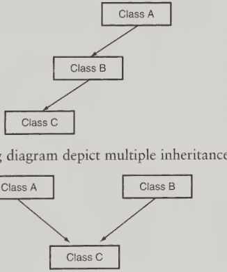

15.17 下图描述的是多重继承还是继承链？

15.18 检查以下类。表格列出了 `Third` 类的成员变量（某些是继承而来的）。通过填写每个成员在 `Third` 类中将拥有的访问说明符来完成表格。如果某个成员对 `Third` 类是不可访问的，请填写“inaccessible”。

```cpp
class First
{
  private:
    int a;
  protected:
    double b;
  public:
    long c;
};
```

```cpp
class Second : protected First {
    private:
        int d;
    protected:
        double e;
    public:
        long f;
};
```

```cpp
class Third : public Second {
    private:
        int g;
    protected:
        double h;
    public:
        long i;
};
```

| 成员变量 | 在 Third 类中的访问说明符 |
|---|---|
| a | |
| b | |
| c | |
| d | |
| e | |
| f | |
| g | |
| h | |
| i | |

15.19 检查以下类的声明：

```cpp
class Van {
    protected:
        int passengers;
    public:
        Van(int p)
        { passengers = p; }
};
```

```cpp
class FourByFour
{
protected:
    double cargoWeight;
public:
    FourByFour(float w)
    { cargoWeight = w; }
};
```

编写类成员 `SportUtility` 的声明。该类应同时派生自上述 `Van` 和 `FourByFour` 类。（这应该是一个多重继承的情况，其中 `Van` 和 `FourByFour` 是基类。）

## 复习题与练习

### 简答题

1. 什么是“是一个” (is a) 关系？
2. 一个程序使用了两个类：`Dog` 和 `Poodle`。哪一个是基类，哪一个是派生类？
3. 基类的访问说明符与类成员访问说明符有何区别？
4. 保护（protected）类成员与私有（private）类成员有何区别？
5. 派生类能直接访问其基类的私有成员吗？
6. 先调用的是派生类的构造函数还是基类的构造函数？
7. 重新定义基类函数与覆盖基类函数有何区别？
8. 静态绑定何时发生？动态绑定又何时发生？
9. 什么是抽象基类？
10. 一个程序有一个类 `Potato`，它派生自 `Vegetable` 类，这属于多重继承吗？为什么或为什么不？
11. 下行代码中指定的基类是什么？`class Pet : public Dog`
12. 下行代码中指定的派生类是什么？`class Pet : public Dog`
13. 下行代码中指定的基类的访问说明符是什么？`class Pet : public Dog`
14. 下行代码中指定的基类的访问说明符是什么？`class Pet : Fish`
15. 基类的保护成员与成员相似，但它们可以被派生类访问。
16. 通过在右侧列中填写 private、protected、public 或 inaccessible 来完成下一页的表格：
    在私有基类中，此基类成员访问说明符……在派生类中变为该访问说明符。
    - private
    - protected
    - public
17. 通过在右侧列中填写 private、protected、public 或 inaccessible 来完成下方表格：
    在保护基类中，此基类成员访问说明符……在派生类中变为该访问说明符。
    - private
    - protected
    - public
18. 通过在右侧列中填写 private、protected、public 或 inaccessible 来完成下方表格：
    在公共基类中，此基类成员访问说明符……在派生类中变为该访问说明符。
    - private
    - protected
    - public

### 填空题

19. 派生类继承其基类的 _。
20. 当两个基类都有构造函数时，基类函数（首先/最后）被调用。
21. 当两个基类都有析构函数时，基类函数（首先/最后）被调用。
22. 派生类可以重新定义具有相同名称的。
23. 在多重继承中，派生类拥有两个或多个基类。
24. 派生类可以覆盖基类中的函数。
25. 绑定是在编译时完成的。
26. 绑定是在运行时完成的。
27. 函数的行为取决于指针。
28. 类函数必须是虚的（virtual）。
29. 类不能被实例化。
30. 一个类派生自第二个类，而该类又派生自第三个类。
31. 多重继承是指一个类派生自。

# 算法工作台

34. 编写 `Poodle` 类声明的第一行。该类应以公共访问访问派生自 `Dog` 类。
35. 编写 `SoundSystem` 类声明的第一行。使用多重继承将其基于 `CDplayer` 类、`Tuner` 类和 `MP3Player` 类。所有情况下均使用公共基类访问。
36. 假设类 `Tiger` 同时衍生自 `Felis` 类和 `Carnivore` 类。以下是 `Tiger` 类声明的第一行：
    ```cpp
    class Tiger : public Felis, public Carnivore
    ```
    以下是 `Tiger` 构造函数的实现：
    ```cpp
    Tiger(int x, int y) : Carnivore(x), Felis(y)
    ```
    哪个基类构造函数先调用？`Carnivore` 还是 `Felis`？
37. 编写 `B` 类声明。其成员如下：
    - `m`: 一个整数。该变量不能被外部访问，也不能被任何派生自 `B` 类的类访问。
    - `n`: 一个整数。该变量不能被外部访问，但可以被任何派生自 `B` 类的类访问。
    - `setM`, `getM`, `setN`, `getN`: 这些是变量 `m` 和 `n` 的 setter 和 getter。这些函数可以被外部访问。
    - `calc`: 一个返回 `m` 值的公共成员函数。
    接下来，编写派生自 `B` 类的 `D` 类。其成员如下：
    - `q`: 一个浮点。该变量不能被外部访问，但可以被任何派生自 `D` 类的类访问。
    - `r`: 一个浮点。该变量不能被任何派生自 `D` 类的类访问。
    - `setQ`, `getQ`, `setR`, `getR`: 这些是变量 `q` 和 `r` 的 setter 和 getter。这些函数可以被外部访问。
    - `calc`: 一个覆盖基类 `calc` 函数的公共成员函数。该函数应返回 `q` 乘以 `r` 的值。

### 判断对错

38. 基类的访问说明符影响基类成员函数访问基类成员变量的方式。
39. 基类的访问说明符影响派生类继承基类成员的方式。
40. T/F 私有基类的私有成员对派生类是不可访问的。
41. T/F 私有基类的公共成员变为派生类的私有成员。
42. T/F 私有基类的保护成员变为派生类的公共成员。
43. T/F 保护基类的公共成员变为派生类的私有成员。
44. T/F 保护基类的私有成员对派生类是不可访问的。
45. T/F 公有基类的保护成员变为派生类的公共成员。
46. T/F 基类构造函数在派生类构造函数之后调用。
47. T/F 基类析构函数在派生类析构函数之后调用。
48. T/F 基类不可能拥有多个一个构造函数。
49. T/F 参数由派生类构造函数传递给基类构造函数。
50. T/F 派生类的成员函数名称可以与基类的成员函数名称相同。
51. T/F 基类指针可以赋值派生类对象的地址。
52. T/F 基类不可以派生自另一个类。

## 找错误

以下每个类声明和/或成员函数定义都存在错误。请尽可能地找出错误。

```cpp
53. class Car, public Vehicle
public:
  Car();
  ~Car();
protected:
  int passengers;
```

```cpp
54. class Truck, public : Vehicle, protected
private:
  double cargoWeight;
public:
  Truck();
  ~Truck();
```

```cpp
55. class SnowMobile : Vehicle
protected:
    int horsepower;
    double weight;
public:
    SnowMobile(int h, double w), Vehicle(h)
    { horsepower = h; }
    ~SnowMobile();
};
```

```cpp
56. class Table : public Furniture {
    protected:
        int numSeats;
    public:
        Table(int n) : Furniture(numSeats)
        { numSeats = n; }
        ~Table();
};
```

```cpp
57. class Tank : public Cylinder {
    private:
        int fuelType;
        double gallons;
    public:
        Tank();
        ~Tank();
        void setContents(double);
        void setContents(double);
};
```

```cpp
58. class Three : public Two : public One {
    protected:
        int x;
    public:
        Three(int a, int b, int c), Two(b), Three(c)
        { x = a; }
        ~Three();
};
```

# 编程挑战

### 1. 员工（Employee）与生产者（ProductionWorker）类

设计名为 `Employee` 的类。该类应该保留以下信息：
- 员工姓名
- 员工编号
- 入职日期

为该类编写一个或多个构造函数，以及相应的访问（accessor）和修改（mutator）函数。

接下来，编写名为 `ProductionWorker` 的类，它派生自 `Employee` 类。`ProductionWorker` 类应该拥有成员变量来存储以下信息：
- 班次（一个整数）
- 时薪（一个双精度点数）

工作日分为两个班次：`shift` 变量将包含一个代表员工工作班次的整数值。白班是班次 1，夜班是班次 2。为该类编写一个或多个构造函数，以及相应的访问和修改函数。通过编写一个使用 `ProductionWorker` 对象的程序来演示这些类。

### 2. 班主管（ShiftSupervisor）类

在一家特定的工厂中，班主管是一名领取工资的员工，负责监督班次。除了工资外，当班次达到生产目标时，班主管还会获得年度奖金。设计一个 `ShiftSupervisor` 类，它派生自你在编程挑战 1 中创建的 `Employee` 类（员工与生产者类）。`ShiftSupervisor` 类应该有一个存储年薪的成员变量，以及一个存储班主管获得的年度生产奖金的成员变量。为该类编写一个或多个构造函数以及相应的访问和修改函数。通过编写一个使用 `ShiftSupervisor` 对象的程序来演示该类。

### 3. 组长（TeamLeader）类

在一家特定的工厂中，组长是一名按小时计薪的生产工人，带领一个小团队。除了时薪外，组长还有固定的月奖金。组长被要求每年参加最少的培训。设计一个 `TeamLeader` 类，它扩展了你在编程挑战 1 中设计的 `ProductionWorker` 类（员工与生产者类）。`TeamLeader` 类应该拥有存储月奖金金额、所需培训小时以及组长已参加培训小时数的成员变量。为该类编写一个或多个构造函数以及相应的访问和修改函数。通过编写一个使用 `TeamLeader` 对象的程序来演示该类。

### 4. 时间格式（Time Format）

在程序 15-20 中，`file.h` 包含一个 `Time` 类。设计一个名为 `MilTime` 的类，它派生自 `Time` 类。`MilTime` 类应将军事（24小时制）格式转换为 `Time` 类使用的标准时间格式。该类应该具有以下成员变量：
- `milHours`：包含 24 小时制的小时。例如，下午 1:00 p.m. 将存储为 1300 小时。
- `milSeconds`：包含标准格式的秒。下午 4:30 p.m. 将存储为 1630。

构造函数应接受军事格式的小时和秒。然后将时间转换为标准时间并存储在 `Time` 类的 `hours`、`min` 和 `sec` 变量中。
- `getHour`：返回军事格式的小时。
- `getStandHr`：返回标准格式的小时。

通过程序演示该类，要求用户输入军事格式的时间。程序应显示军事和标准格式的时间。

输入验证：`MilTime` 类不接受大于 2359 或小于 0 的小时。不接受大于 59 或小于 0 的秒。

### 5. 计时（Time Clock）

设计一个名为 `TimeClock` 的类。该类派生自你在编程挑战 4（时间格式）中设计的 `MilTime` 类。该类允许程序员传递两个时间：开始时间和结束时间。该类应该有一个成员函数返回两个时间之间经过的时间。例如，如果开始时间是 900 小时（上午 9:00 a.m.），结束时间是 1300 小时（下午 1:00 p.m.），经过的时间为 4 小时。

输入验证：该类不接受大于 2359 或小于 0 的小时。

### 6. 文章（Essay）类

设计一个 `Essay` 类，它派生自本章介绍的 `GradedActivity` 类。学生的文章类应确定学生的成绩。学生的文章分数最高为 100 分，按以下方式确定：
- 语法：30 分
- 拼写：20 分
- 长度正确：20 分
- 内容：30 分

通过简单的程序演示该类。

### 7. 个人数据（PersonData）与客户数据（CustomerData）类

设计一个名为 `PersonData` 的类，具有以下成员变量：
- 姓（`lastName`）
- 名（`firstName`）
- 地址（`address`）
- 城市（`city`）
- 州（`state`）
- 邮编（`zip`）
- 电话（`phone`）


# 编程挑战

## 7. CustomerData 类

为这些成员变量编写相应的访问和修改函数。

接下来，设计一个名为 `CustomerData` 的类，它派生自 `PersonData` 类。`CustomerData` 类应该拥有以下成员变量：

- 客户编号（`customerNumber`）
- 邮件列表（`mailingList`）

`customerNumber` 变量将用于存储每个客户唯一的整数。`mailingList` 变量应为布尔值。如果客户希望加入邮件列表，则设为真；如果不想则设为假。为这些成员变量编写相应的访问和修改函数。通过一个简单的程序演示 `CustomerData` 对象。

## 8. PreferredCustomer 类

一家零售店拥有一种优选客户计划，客户在购买时可以获得折扣。客户的折扣金额取决于其在商店内的累计购买金额。

- 当优选客户消费达到 $500 时，他或她在未来的所有购买中将获得 5% 的折扣。
- 当优选客户消费达到 $1,000 时，他或她在未来的所有购买中将获得 6% 的折扣。
- 当优选客户消费达到 $1,500 时，他或她在未来的所有购买中将获得 7% 的折扣。
- 当优选客户消费达到 $2,000 或更多时，他或她在未来的所有购买中将获得 10% 的折扣。

设计一个名为 `PreferredCustomer` 类，派自你在编程挑战 7 中创建的 `CustomerData` 类。`PreferredCustomer` 类应具有以下成员变量：

- `purchasesAmount` (double)
- `discountLevel` (double)

`purchasesAmount` 变量存储客户截至为止的购买总额。`discountLevel` 变量应根据商店的优选客户计划设置为正确的折扣百分比。为该类编写适当的成员函数并在简单程序中演示。

输入验证：不要接受任何销售数字的负值。

## 9. 文件过滤器 (File Filter)

文件过滤器读取输入文件，对其进行某种转换，并将结果写入输出文件。创建一个抽象文件类，定义一个用于转换字符的纯虚函数。为你的文件过滤器类创建一个派生类：一个执行加密，另一个将文件转换为全大写，再加一个创建原始文件的未修改副本。该类应具有以下成员函数：

```cpp
void doFilter(istream &in, ofstream &out)
```

调用此函数以执行实际的过滤。转换单个字符的成员函数原型应为：

```cpp
char transform(char ch)
```

加密类应具有一个构造函数，接受一个整数作为参数并将其作为加密密钥。

## 10. 文件双倍行距 (File Double-Spacer)

为编程挑战 9（文件过滤器）中的抽象文件类创建一个派生类，对文件进行双倍行距，即在文件的任意两行之间插入一个空行。

## 11. 课程成绩 (Course Grades)

在一门课程中，老师给出了以下测试和作业：

- 实验活动由老师观察并分配数字分数。
- 一场包含十道题的通过/不通过考试。最低及格分数为 70。
- 一篇分配数字分数的论文。
- 期末考试有 50 道题。

### 编程挑战 985

编写一个名为 `CourseGrades` 的类。该类应有一个名为 `grades` 的成员，它是一个 `GradedActivity` 指针数组。`grades` 数组应有四个元素，对应之前描述的每个作业。该类应具有以下成员函数：

- `setLab`：此函数接受一个 `GradedActivity` 对象的地址作为参数。该对象应该已经包含了学生实验活动的分数。`grades` 数组的元素 0 应该引用此对象。
- `setPassFailExam`：此函数接受一个 `PassFailExam` 对象的地址作为参数。该对象应该已经包含了通过/不通过考试的分数。`grades` 数组的元素 1 应该引用此对象。
- `setEssay`：此函数接受一个 `Essay` 对象的地址作为参数。（参见编程挑战 6 中的 `Essay` 类。如果你没有完成编程挑战 6，则使用 `GradedActivity` 对象。）该对象应该已经包含了学生的分数。`grades` 数组的元素 2 应该引用此对象。
- `setFinalExam`：此函数接受一个 `FinalExam` 对象的地址作为参数。该对象应该已经包含了期末考试的分数。`grades` 数组的元素 3 应该引用此对象。
- `print`：此函数应显示 `grades` 数组中每个元素的数字分数和等级。

在程序中演示该类。

## 12. 船 (Ship)、邮轮 (CruiseShip) 和 货船 (CargoShip) 类

设计一个 `Ship` 类，具有以下成员：

- 船的名称（string）
- 建造年份（string）
- 适当的构造函数、访问函数和修改函数

设计一个 `CruiseShip` 类派自 `Ship`，具有以下成员：

- 最大乘客人数（int）
- 适当的构造函数、访问函数和修改函数
- 覆盖基类的打印函数

设计一个 `CargoShip` 类派自 `Ship`，具有以下成员：

- 吨位（int）
- 适当的构造函数、访问函数和修改函数
- 覆盖基类的打印函数

在程序中演示这些类。

## 15. 继承、多态和虚函数

在程序中演示这些类，程序有一个 `Ship` 指针数组。数组应使用动态分配的 `CruiseShip` 和 `CargoShip` 对象初始化。遍历数组并调用每个对象的打印函数。

## 13. 抽象类 (Abstract Class)

定义一个名为 `BasicShape` 的纯抽象类。该类应具有以下成员：

私有变量：

- `area` (double)

公共函数：

- `getArea`：返回面积的值
- `calcArea`：一个纯虚函数

接下来，定义一个名为 `Circle` 的类派自 `BasicShape`。它应具有以下成员：

私有变量：

- `centerX` (long)
- `centerY` (long)
- `radius` (double)

公共函数：

- 构造函数：接受 `centerX`、`centerY` 和 `radius`。应调用 `calcArea`。
- `getCenterX`：返回 `centerX` 的值
- `getCenterY`：返回 `centerY` 的值
- `calcArea`：计算面积（3.14159 * `radius` * `radius`）并将结果存储在 `area` 中

接下来，定义一个名为 `Rectangle` 的类派自 `BasicShape`。它应具有以下成员：

私有变量：

- `width` (long)
- `length` (long)

公共函数：

- 构造函数：接受 `width` 和 `length`。应调用 `calcArea`。
- `getWidth`：返回 `width` 的值
- `getLength`：返回 `length` 的值
- `calcArea`：计算面积（`length` * `width`）并将结果存储在 `area` 中

创建这些类后，创建一个驱动程序定义一个 `Circle` 对象和一个 `Rectangle` 对象。证明每个对象都能正确计算并报告其面积。

## 14. 银行账户 (Bank Accounts)

此程序应由学生小组设计并编写。以下建议：

- 一个或多个学生可以负责一个类。
- 应分析程序需求，以便给每个学生分配相似的工作量。
- 应预先确定每个函数和类成员函数的参数和返回类型。
- 程序最好以多文件形式实现。

设计一个通用类来存储银行账户的信息：

- 余额
- 本月存款次数
- 本月取款次数
- 年利率
- 月费

该类应具有以下成员函数：

- 构造函数：接受余额和年利率。
- `deposit`：一个虚函数，接受存款金额作为参数。该函数应将金额加入账户余额。它还应增加存款计数器。
- `withdraw`：一个虚函数，接受取款金额作为参数。该函数应从余额中减去金额。它还应增加取款计数器。
- `calcInt`：一个虚函数，通过计算账户赚取的利息并更新余额。这通过以下公式执行：

  Monthly Interest Rate = (Annual Interest Rate / 12)

  Monthly Interest = Balance * Monthly Interest Rate

  Balance = Balance + Monthly Interest

- `monthlyProc`：一个虚函数，从余额中减去月费，调用 `calcInt` 函数，然后将取款次数、存款次数和月费变量置零。

如果储蓄账户的余额低于 $25，它将变为非激活状态。（状态成员可以是一个标志位变量）。在余额升至 $25 以上之前，无法进行取款，此时账户将重新变为激活状态。储蓄账户类应具有以下成员函数：

- `withdraw`：在执行取款前检查账户是否处于非激活状态。（如果账户未激活，则不允许取款。）然后通过调用基类的函数版本执行取款。
- `deposit`：在执行存款前检查账户是否处于非激活状态。如果账户是非激活状态且存款使余额超过 $25，则账户将重新变为激活状态。然后通过调用基类的函数版本执行存款。
- `monthlyProc`：在调用基类函数之前，此函数检查取款次数。如果当月的取款次数超过 4 次，则每个超过 4 次的取款将产生 $1 的服务费，并添加到存储每月服务费的基类变量中。（不要忘记在扣除服务费后检查账户余额。如果余额低于 $25，账户将变为非激活状态。）

接下来，设计一个支票账户类，它也派自通用账户类。它应该具有以下成员函数：

- `withdraw`：在调用基类函数之前，此函数将确定取款（开具支票）是否会导致余额低于 $0。如果余额低于 $0，则将从账户中扣除 $15 的服务费。（将不会执行取款。）如果账户没有足够的资金支付服务费，余额将变为负数，客户将向银行欠该负金额。
- `monthlyProc`：在调用基类函数之前，此函数将每笔取款（开具支票）的 $5 或 $10 费用添加到存储每月服务费的基类变量中。

编写一个完整的程序来演示这些类，要求用户输入储蓄账户和支票账户的存款和取款金额。程序将显示该月的统计信息，包括期初余额、存款总额、服务费和期末余额。

> 注意：你可能需要为上述类添加更多的成员变量和函数。

# 16 异常与模板

## 主题

- 16.1 异常
- 16.2 函数模板
- 16.3 侧重软件工程：定义模板时从何处开始
- 16.4 类模板

## 16.1 异常

> 概念：异常用于信号程序运行过程中发生的错误或意外事件。

错误测试通常是一个直接的过程，涉及 `if` 语句或其他控制机制。例如，以下代码段将在除以零的错误发生前捕获它：

```cpp
if (denominator == 0)
    cout << "ERROR: Cannot divide by zero.\n";
else
    quotient = numerator / denominator;
```

但如果类似的代码是返回商的函数的一部分呢，如下例所示：

```cpp
// 一个不可靠的除法函数
double divide(int numerator, int denominator)
{
    if (denominator == 0)
    {
        cout << "ERROR: Cannot divide by zero.\n";
        return 0;
    }
    else
        return static_cast<double>(numerator) / denominator;
}
```

函数通常通过返回一个预定的值来信号错误条件。示例中的函数在尝试除以零时返回 0。然而，这是不可靠的，因为 0 是除法运算的有效结果。尽管函数显示了错误信息，调用该函数的程序部分并不知道错误何时发生。此类问题需要高级的错误处理技术。

### 抛出异常

处理复杂错误条件的一种方法是使用*异常*。异常是一个信号错误的值或对象。当错误发生时，异常就会被“抛出”。例如，`divide` 代码显示了 `divide` 函数，它被修改为尝试除以零时抛出异常：

```cpp
double divide(int numerator, int denominator)
{
    if (denominator == 0)
        throw "ERROR: Cannot divide by zero.\n";
    else
        return static_cast<double>(numerator) / denominator;
}
```

以下语句会导致异常的抛出：

```cpp
throw "ERROR: Cannot divide by zero.\n"
```

关键字后面跟着一个参数，该参数可以是任何值。正如你将看到的，参数的值被用于确定错误的性质。上面的函数简单地抛出一个包含错误信息的字符串。

包含 `throw` 语句的行被称为*抛出点*（throw point）。当执行 `throw` 语句时，控制权将传递给程序的另一个部分，称为*异常处理器*（exception handler）。当函数抛出异常时，该函数会终止。

### 处理异常

为了处理异常，程序必须有一个*try/catch* 构造。`try/catch` 构造的通用格式为：

```cpp
try
{
    // 此处调用函数或对象成员
    // 可能会抛出异常的函数
}
catch(ExceptionParameter)
{
    // 此处处理异常
    // 根据需要重复多个 catch 块
}
```

构造的第一部分是*try 块*（try block）。它以关键字 `try` 开始，后面跟着一个代码块，该块执行任何可能直接或间接导致抛出异常的语句。`catch` 块以关键字 `catch` 开始，后面跟着一组包含异常参数定义的括号。例如，这里有一个可以与 `divide` 函数使用的 `try/catch` 构造：

```cpp
try {
  quotient = divide(num1, num2);
  cout << "The quotient is " << quotient << endl;
} catch (string exceptionString) {
  cout << exceptionString;
}
```

如果 `divide` 函数抛出一个值为字符串的异常，`catch` 块将捕获该错误信息并显示它。让我们看看整个程序，看看 `throw` 和 `catch` 是如何工作的。在程序 16-1 的首次运行中，给出有效数据。

```cpp
// 此程序演示了异常的抛出和捕获
#include <iostream>
#include <string>
using namespace std;

// 函数原型
double divide(int, int);

int main() {
  int num1, num2; // 用于存储数字
  double quotient; // 用于存储商

  // 获取两个数字
  cout << "Enter two numbers: ";
  cin >> num1 >> num2;

  // 将 num1 除以 num2 并捕获任何可能的异常
  try {
    quotient = divide(num1, num2);
    cout << "The quotient is " << quotient << endl;
  } catch (string exceptionString) {
    cout << exceptionString;
  }

  cout << "End of the program.\n";
  return 0;
}

// divide 函数将分子除以分母。如果分母为
// 0，函数将抛出异常。
double divide(int numerator, int denominator) {
  if (denominator == 0) {
    string exceptionString = "ERROR: Cannot divide by zero.\n";
    throw exceptionString;
  }
  return static_cast<double>(numerator) / denominator;
}
```

（继续）

### 示例输入的程序输出

Enter two numbers: 12 2

The quotient is 6

End of the program.

### 不同示例输入的程序输出

Enter two numbers: 12 0

ERROR: Cannot divide by zero.

End of the program.

> 从第二个输出屏幕可以看到，异常导致程序跳出 `divide` 函数并进入 `catch` 块。在 `catch` 块完成后，程序从 `try/catch` 构造后的第一个语句继续执行。如图 16-1 所示。

### 图 16-1 try/catch 构造的工作原理

| 如果此语句抛出异常... | try { |
| :--- | :--- |
| `quotient = divide(num1, num2);` | |
| `cout << "The quotient is " << quotient << endl;` | |
| ...那么这条语句将被跳过。 | `catch (string exceptionString) {` |
| | `cout << exceptionString;` |
| 如果异常是字符串，程序将跳转到此 catch 子句。 | `}` |
| 在 catch 块完成后，程序从此处继续执行。 | `cout << "End of the program.\n"` |
| | `return 0;` |

### 图 16-2 未抛出异常

在第一个输出屏幕中，用户输入非负值。`try` 块中没有抛出异常，因此程序跳过了 `catch` 块，跳转到 `try/catch` 结构之后的后续语句，即第 30 行。这如图 16-2 所示。


```cpp
try
{
    quotient = divide(num1, num2);
    cout << "The quotient is " << quotient << endl;
}
catch (string exceptionString)
{
    cout << exceptionString;
}

cout << "End of the program.\n";
return 0;
```

如果在 `try` 块中没有抛出异常，程序将跳转到紧随 `try/catch` 结构的语句。

### 如果异常未被捕获怎么办？

抛出的异常有两种未被捕获的可能性。第一种可能性是 `try/catch` 结构没有包含异常参数数据类型正确的 `catch` 块。第二种可能性是异常是从 `try` 块之外抛出的。在任何情况下，异常都会导致整个程序终止执行。

### 使用类的面向对象异常处理

现在你已经了解了 C++ 异常机制，我们将检查异常处理的面向对象方法。回想第 13 章引入的 `Rectangle` 类。该类具有 `Width` 和 `setLength` 修改函数，用于设置矩形的宽度和长度。如果向其中任何一个函数传递负值，该类将显示错误消息并终止程序。以下代码显示了 `Rectangle` 改进版本。此版本在向 `setWidth` 或 `setLength` 传递负值时会抛出异常。这些文件可以在源代码文件夹 Chapter 16/Rectangle Version 1 中找到。

### Rectangle.h 的内容（版本 1）

```cpp
1 // Rectangle 类的规范文件
2 #ifndef RECTANGLE_H
3 #define RECTANGLE_H
4
5 class Rectangle
6 {
7 private:
8 double width; // 矩形的宽度
9 double length; // 矩形的长度
10 public:
11 // 异常类
12 class NegativeSize
13 { }; // 空类声明
14
// 默认构造函数
Rectangle()
    { width = 0.0; length = 0.0; }

// 修改函数，定义在 Rectangle.cpp 中
void setWidth(double)
void setLength(double)

// 访问函数
double getWidth() const
    { return width; }

double getLength() const
    { return length; }

double getArea() const
    { return width * length; }
};
#endif
```


```cpp
// Rectangle 类的实现文件。
#include "Rectangle.h"
********************************************************************
// setWidth 设置成员变量 width 的值。   *
********************************************************************
void Rectangle::setWidth(double w)
{
    if (w >= 0)
        width = w;
    else
        throw NegativeSize();
}
********************************************************************
// setLength 设置成员变量 length 的值。   *
********************************************************************
void Rectangle::setLength(double len)
{
    if (len >= 0)
        length = len;
    else
        throw NegativeSize();
}
```

在 `setWidth` 函数中，通过第 10 行的 `if` 语句对参数 `w` 进行测试。如果 `w` 大于或等于 0，则将其值赋值给 `width` 成员变量。然而，如果 `w` 为负数，则执行第 13 行的语句。

```cpp
throw NegativeSize();
```

`throw` 语句的参数 `NegativeSize()` 会创建一个 `NegativeSize` 类实例并将其作为异常抛出。

同样的系列也发生在 `setLength` 函数中。如果 `length` 参数中的值大于或等于 0，则将其值赋值给 `length` 成员变量。如果 `len` 为负数，则在第 25 行抛出一个 `NegativeSize` 类实例作为异常。

这种报告错误的方法比简单终止程序要优雅得多。任何使用 `Rectangle` 类的代码只需要包含一个 `catch` 块来处理 `Rectangle` 类可能抛出的 `NegativeSize` 异常。程序 16-2 显示了一个示例。（该文件可以在学生源代码文件夹 Chapter 16\Rectangle Version 1 中找到。）

### 程序 16-2

```cpp
// 此程序演示了 Rectangle 类的异常。
#include <iostream>
#include "Rectangle.h"
using namespace std;
int main()
{
    double width;
    double length;
    // 创建一个 Rectangle 对象。
    Rectangle myRectangle;
    // 获取宽度和长度。
    cout << "Enter the width: ";
    cin >> width;
    cout << "Enter the length: ";
    cin >> length;
    // 将这些值存储在 Rectangle 对象中。
    try {
        myRectangle.setWidth(width);
        myRectangle.setLength(length);
        cout << "The area of the rectangle is "
             << myRectangle.getArea() << endl;
    } catch (Rectangle::NegativeSize)
    {
        cout << "Error: negative size.\n";
    }
    return 0;
}
```

### 程序 16-2（续）

Enter the width: 10

Enter the length: 20

The area of the rectangle is 200

Enter the width: 5

Enter the length: -10

Error: negative size.

Enter the width: -5

Enter the length: 15

Error: negative size.

### 多重异常

我们目前为止学习的程序测试单一类型的错误并只抛出一种异常。C++ 允许你抛出并捕获多个异常。唯一的要求是每个异常都是不同的类型。

例如，假设我们想扩展 `Rectangle` 类，使其在指定负值宽度时抛出一种异常，在指定负值长度时抛出另一种异常。首先，我们声明两个异常类，如下：

```cpp
// 针对负宽度的异常类
class NegativeWidth
  { };
```

```cpp
// 针对负长度的异常类
class NegativeLength
  { };
```

当指定负值宽度时，会抛出一个 `NegativeWidth` 实例；当指定负值长度时，会抛出一个 `NegativeLength` 实例作为异常。

## 第 16 章 异常与模板

```cpp
12      else
13          throw NegativeWidth();
14  }
15
16  /************************************************
17 // setLength 设置成员变量 length 的值。
18  /************************************************
19
20  void Rectangle::setLength(double len)
21  {
22      if (len >= 0)
23          length = len;
24      else
25          throw NegativeLength();
26  }
```

注意 `Rectangle.cpp` 中 `setLength` 函数的定义，第 13 行抛出了 `NegativeWidth` 类的实例。在 `setLength` 函数的定义中，第 25 行抛出了 `NegativeLength` 类的实例。程序 16-3 演示了这些类。（该文件可以在学生源代码文件夹 16\Rectangle Version 2 中找到）。

## 程序 16-3

```cpp
1  // 此程序演示 Rectangle 类的异常。
2  #include <iostream>
3  #include "Rectangle.h"
4  using namespace std;
5
6  int main()
7  {
8      double width;
9      double length;
10 
11     // 创建一个 Rectangle 对象。
12     Rectangle myRectangle;
13 
14     // 获取宽度和长度。
15     cout << "Enter the rectangle's width: ";
16     cin >> width;
17     cout << "Enter the rectangle's length: ";
18     cin >> length;
19 
20     // 将这些值存储在 Rectangle 对象中。
21     try
22     {
23         myRectangle.setWidth(width);
24         myRectangle.setLength(length);
25         cout << "The area of the rectangle is ";
26             << myRectangle.getArea() << endl;
27     }
28 catch (Rectangle::NegativeWidth)
```

## 16.1 异常

```cpp
{
  cout << "Error: A negative value was given "
  cout << "for the rectangle's width.\n";
}
catch (Rectangle::NegativeLength) {
  cout << "Error: A negative value was given "
  cout << "for the rectangle's length.\n";
}
cout << "End of the program.\n";
return 0;
}
```

## 示例输入的程序输出（部分加粗显示）

Enter the rectangle's width: **10**

Enter the rectangle's length: **20**

The area of the rectangle is 200

End of the program.

## 不同示例输入的程序输出（部分加粗显示）

Enter the rectangle's width: **-5**

Enter the rectangle's length: **5**

Error: A negative value was given for the rectangle's width.

End of the program.

## 不同示例输入的程序输出（部分加粗显示）

Enter the rectangle's width: **5**

Enter the rectangle's length: **-5**

Error: A negative value was given for the rectangle's length.

End of the program.

第 21 行到 27 行的 `try` 块包含可以抛出两种类型异常的代码。第 24 行的语句可能会抛出 `NegativeLength` 异常。为了处理这些异常，有两个 `catch` 语句。第 28 行的语句捕获 `NegativeWidth` 异常，第 33 行的语句捕获 `NegativeLength` 异常。

当 `try` 块中的代码抛出异常时，C++ 会搜索可以处理该异常的 `catch` 语句。如果结构找到了与异常兼容的 `catch` 语句，程序的控制权将传递给 `catch` 块。

## 使用异常处理器从错误中恢复

程序 16-3 演示了 `try/catch` 结构如何包含多个 `catch` 语句来处理不同类型的异常。然而，程序并没有使用异常处理器从错误中恢复。当用户输入的宽度或长度为负时，程序仍然停止。程序 16-4 展示了更有效的异常处理示例。它尝试从异常中恢复并从用户获取有效数据。（这可以在学生源代码文件夹 16:Rectangle Version 2 中找到。）


## 程序 16-4

// 此程序处理 Rectangle 类异常。

```cpp
1 #include <iostream>
2 #include "Rectangle.h"
3 using namespace std;
4 
5 int main()
6 {
7 double width; // Rect形的宽度
8 double length; // Rect形的长度
9 bool tryAgain = true; // 用于重新输入的标记
10 
11 // 创建一个 Rectangle 对象。
12 Rectangle myRectangle;
13 
14 // 获取矩形的宽度。
15 cout << "Enter the rectangle's width: ";
16 cin >> width;
17 
18 // 将宽度存储在 Rectangle 对象中。
19 while (tryAgain)
20 {
21 try
22 myRectangle.setWidth(width);
23 // 如果没有抛出异常，则执行
24 // 下一个语句。
25 tryAgain = false;
26 }
27 catch (Rectangle::NegativeWidth)
28 {
29   cout << "Error: A negative value was given for the rectangle's width.\n";
30   tryAgain = true;
31 }
32 catch (Rectangle::NegativeLength)
33 {
34   cout << "Error: A negative value was given for the rectangle's length.\n";
35   tryAgain = true;
36 }
37 
38 // 获取长度。
39 cout << "Enter the rectangle's length: ";
40 cin >> length;
41 
42 // 将长度存储在 Rectangle 对象中。
43 while (tryAgain)
44 {
45 try
46 myRectangle.setLength(length);
47 // 如果没有抛出异常，则执行
48 // 下一个语句。
49 tryAgain = false;
50 }
51 catch (Rectangle::NegativeWidth)
52 {
53   cout << "Error: A negative value was given for the rectangle's width.\n";
54   tryAgain = true;
55 }
56 catch (Rectangle::NegativeLength)
57 {
58   cout << "Error: A negative value was given for the rectangle's length.\n";
59   tryAgain = true;
60 }
61 
62 // 显示面积。
63 cout << "The area of the rectangle is ";
64 << myRectangle.getArea() << endl;
65 
66 cout << "End of the program.\n";
67 return 0;
68 }
```


# 第 16 章 异常与模板

## Rectangle.h 的内容 (版本 3)

```cpp
class Rectangle
{
  private:
    double width;      // 矩形的宽度
    double length;     // 矩形的长度
  public:
    // 针对负宽度的异常类
    class NegativeWidth
      {
      private:
        double value;
      public:
        NegativeWidth(double val)
          { value = val; }

        double getValue() const
          { return value; }
    };

    // 针对负长度的异常类
    class NegativeLength
      {
      private:
        double value;
      public:
        NegativeLength(double val)
          { value = val; }

        double getValue() const
          { return value; }
    };

    // 构造函数
    Rectangle()
      { width = 0.0; length = 0.0; }

    // 修改器函数，定义在 Rectangle.cpp 中
    void setWidth(double);
    void setLength(double);

    // 访问器函数
    double getWidth() const
      { return width; }

    double getLength() const
      { return length; }

    double getArea() const
      { return width * length; }
};
```

## Rectangle.cpp 的内容 (版本 3)

```cpp
// Rectangle 类的实现文件。
#include "Rectangle.h"
// *****************************************************************
// setWidth 设置成员变量 width 的值。  *
// *****************************************************************
void Rectangle::setWidth(double w)
{
    if (w >= 0)
        width = w;
    else
        throw NegativeWidth(w);
}
// *****************************************************************
// setLength 设置成员变量 length 的值。  *
// *****************************************************************
void Rectangle::setLength(double len)
{
    if (len >= 0)
        length = len;
    else
        throw NegativeLength(len);
}
```

## 程序 16-S

```cpp
// 此程序演示了 Rectangle 类的异常。
#include <iostream>
#include "Rectangle.h"
using namespace std;

int main()
{
    double width;
    double length;

    // 创建一个 Rectangle 对象。
    Rectangle myRectangle;

    // 获取宽度和长度。
    cout << "Enter the rectangle's width: ";
    cin >> width;
    cout << "Enter the rectangle's length: ";
    cin >> length;

    // 将这些值存储在 Rectangle 对象中。
    try
    {
        myRectangle.setWidth(width);
        myRectangle.setLength(length);
        cout << "The area of the rectangle is ";
        cout << myRectangle.getArea() << endl;
    }
    catch (Rectangle::NegativeWidth e) {
        cout << "Error: " << e.getValue();
        cout << " is an invalid value for the width.\n";
    }
    catch (Rectangle::NegativeLength e) {
        cout << "Error: " << e.getValue();
        cout << " is an invalid value for the length.\n";
    }
    cout << "End of the program.\n";
    return 0;
}
```

## 16.1 异常

### 示例输入的程序输出

Enter the rectangle's width: **-1**

Enter the rectangle's length: **10**

Error: -1 is an invalid value for the rectangle's width.

End of the program.

### 不同示例输入的程序输出

Enter the rectangle's width: **5**

Enter the rectangle's length: **-1**

Error: -1 is an invalid value for the rectangle's length.

End of the program.

### 栈回溯 (Unwinding the Stack)

一旦抛出异常，程序就无法回到抛出点。执行 `throw` 语句的函数将立即终止。如果该函数是由另一个函数调用的且异常没有被捕获，那么调用函数也将终止。这个过程被称为栈回溯，它会在整个嵌套函数调用链中持续，从 `throw` 点一直回到 `try` 块。

如果类对象的成员函数抛出异常，则会调用类的析构函数。如果 `try` 块中的语句（或从 `try` 块分支的语句）创建了任何其他对象，它们的析构函数也将调用。

### 重新抛出异常 (Rethrowing an Exception)

`try` 块是可以嵌套的。例如，看这段代码段：

```cpp
try
{
    doSomething();
}
catch(exception1)
{
    // 处理异常 1 的代码
}
catch(exception2)
{
    // 处理异常 2 的代码
}
```

在此块中，调用了函数 `doSomething`。有两个 `catch` 块，一个处理 `exception1`，另一个处理 `exception2`。如果 `doSomething` 函数也有一个 `try` 块，那么它就嵌套在上面显示的外部块内部。在嵌套块中，有时内部的异常处理器需要将异常传递给外部 `catch`。有时，当抛出特定异常时，内部和外部的 `catch` 块都必须执行某些操作。`catch` 块可以使用 `throw` 语句重新抛出异常。例如，假设 `doSomething` 函数（在上面的块中被调用）调用了 `doSomethingElse`，该函数可能会抛出 `exception1` 或 `exception3`。假设 `doSomething` 不想处理 `exception1`，相反，它想将其重新抛出到外部块。以下代码段说明了如何这样做：

```cpp
try
{
    doSomethingElse();
}
catch(exception1)
{
    throw; // 重新抛出
}
catch(exception3)
{
    // 处理 exception3
}
```

### 思考

- 16.1 `try` 块和 `catch` 块的区别是什么？
- 16.2 如果抛出了异常，会发生什么？
- 16.3 如果可以抛出多个异常，`catch` 块如何知道是哪一个？
- 16.4 在处理异常后，程序执行从哪里继续？
- 16.5 模板如何回传数据？

## 16.2 模板

> 概念：模板函数是“泛型”函数，可以处理任何数据类型。程序员编写模板时不需要指定具体类型，编译器在遇到调用时会为这些类型生成代码。

### 引言

重载函数使得编程变得方便，因为一组函数只需要记住一个名称。但是，每个函数都要单独编写，即使它们的操作相同。例如，假设程序使用了以下重载函数：

```cpp
int square(int number)
{
    return number * number;
}
double square(double number)
{
    return number * number;
}
```

这两个函数唯一的区别在于返回值和参数的数据类型。在这种情况下，编写函数模板比重载函数更方便。函数模板允许你编写一个处理许多不同数据类型的单一定义，而不是为每个数据类型编写一个函数。

函数模板不是真正的函数，而是编译器用于生成一个或多个函数的“模板”。编写函数模板时，不需要为参数指定任何类型。相反，使用类型参数来指定泛型数据类型。当编译器遇到调用时，它会为那些类型生成代码。（生成的代码被称为模板函数。）

这是一个 `square` 函数的函数模板：

```cpp
template <class T>
T square(T number)
{
    return number * number;
}
```

`T` 是类型参数，或泛型数据类型。模板定义 `square` 为一个返回 `T` 类型值的函数，并使用了一个参数 `number`，其类型也为 `T`。如之前所述，编译器会检查每次对 `square` 的调用，并为类型 `T` 填充适当的数据。例如，以下调用使用了一个 `int` 类型参数：

```cpp
int y, x = 4;
y = square(x);
```

这段代码将导致编译器生成函数：

```cpp
int square(int number)
{
    return number * number;
}
```

而以下语句：

```cpp
double y, f = 6.2;
y = square(f);
```

将生成函数：

```cpp
double square(double number)
{
    return number * number;
}
```

程序 16-7 演示了如何使用此函数模板。

## 程序 16-7

```cpp
// 此程序使用了函数模板。
#include <iostream>
#include <iomanip>
using namespace std;

// square 函数模板定义。
template <class T>
T square(T number)
{
    return number * number;
}

int main()
{
    int userInt;      // 用于存储整数输入
    double userDouble; // 用于存储双精度输入

    cout << setprecision(5);
    cout << "Enter an integer and a floating-point value: ";
    cin >> userInt >> userDouble;

    cout << "Here are their squares: ";
    cout << square(userInt) << " and ";
    cout << square(userDouble) << endl;

    return 0;
}
```

### 程序 16-7 示例输入的程序输出

Enter an integer and a floating-point value: 12 4.2
Here are their squares: 144 and 17.64

> 注意：函数模板中定义的所有类型参数必须在函数参数列表中至少出现一次。

由于编译器在程序 16-7 中遇到了两次对 `square` 的调用，且每次调用的参数类型都不同，它生成了两个函数实例的代码：一个具有 `int` 参数和 `int` 返回类型，另一个具有 `double` 参数和 `double` 返回类型。这如图 16-3 所示。

## 图 16-3 模板函数的生成

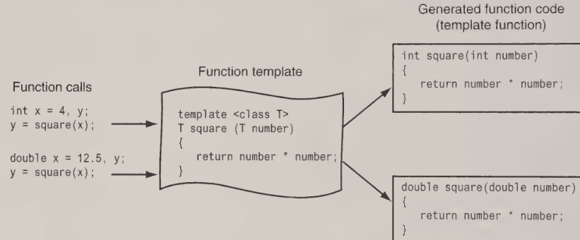

注意程序 16-7 中，模板出现在所有对 `square` 的调用之前。对于普通函数，编译器在遇到对模板函数的调用时，必须已经知道模板的内容。因此，模板应该放置在程序的顶端或头文件中。

> 注意：函数模板仅仅是函数的规范，其本身不会导致内存被用。当编译器遇到对模板函数的调用时，会在内存中创建该函数的实际实例。

程序 16-8 显示了函数模板的另一个示例。该函数 `swapVars` 使用两个类型为 `T` 的引用作为参数。该函数交换由参数所引用的变量的内容。

## 程序 16-8

```cpp
// 此程序演示了 swapVars 函数模板。
#include <iostream>
using namespace std;

template <class T>
void swapVars(T &var1, T &var2)
{
    T temp;
    temp = var1;
    var1 = var2;
    var2 = temp;
}

int main() {
    char firstChar, secondChar; // 两个字符
    int firstInt, secondInt; // 两个整数
    double firstDouble, secondDouble; // 两个双精度浮点

    // 获取并交换两个字符
    cout << "Enter two characters: ";
    cin >> firstChar >> secondChar;
    swapVars(firstChar, secondChar);
    cout << firstChar << " " << secondChar << endl;

    // 获取并交换两个整数
    cout << "Enter two integers: ";
    cin >> firstInt >> secondInt;
    swapVars(firstInt, secondInt);
    cout << firstInt << " " << secondInt << endl;

    // 获取并交换两个双精度浮点数
    cout << "Enter two floating-point numbers: ";
}
```


## 16.2 函数模板

```cpp
template <class T>
void swapVars(T &var1, T &var2)
{
    T temp;
    temp = var1;
    var1 = var2;
    var2 = temp;
}

int main() {
    char firstChar, secondChar;
    int firstInt, secondInt;
    double firstDouble, secondDouble;

    // 获取并交换两个字符
    cout << "Enter two characters: ";
    cin >> firstChar >> secondChar;
    swapVars(firstChar, secondChar);
    cout << firstChar << " " << secondChar << endl;

    // 获取并交换两个整数
    cout << "Enter two integers: ";
    cin >> firstInt >> secondInt;
    swapVars(firstInt, secondInt);
    cout << firstInt << " " << secondInt << endl;

    // 获取并交换两个双精度浮点数
    cout << "Enter two floating-point numbers: ";
    cin >> firstDouble >> secondDouble;
    swapVars(firstDouble, secondDouble);
    cout << firstDouble << " " << secondDouble << endl;

    return 0;
}
```

**示例输入的程序输出**

```
Enter two characters: A B
A B
Enter two integers: 5 10
5 10
Enter two floating-point numbers: 1.2 9.6
9.6 1.2
```

## 在函数模板中使用运算符

之前所示的 `square` 模板使用了 `*` 运算符。只要 `n` 是基本类型（如 `int`、`float` 等），它就能工作。然而，如果将用户定义的类对象传递给 `square` 函数，则该类必须包含重载 `*` 的代码。否则，编译器将生成一个带有错误的函数。如果函数对对象执行比较（使用 `<`、`==` 或其他关系运算符），则这些运算符也必须由类进行重载。

## 带有多个类型的函数模板

函数模板中可以使用多个泛型类型。每个类型都必须有自己的参数，如程序 16-9 所示。该程序使用了一个名为 `larger` 的函数模板，带有两个类型参数：`T1` 和 `T2`。函数参数 `var1` 和 `var2` 的大小决定了其实现。由于函数模板可以使用多个泛型类型，它可以处理不同类型的数据。

### 程序 16-9

```cpp
template <class T1, class T2>
T1 larger(T1 var1, T2 var2)
{
    if (var1 > var2)
        return var1;
    else
        return var2;
}

int main()
{
    int i;
    double d;
    char c;

    cout << "Enter an integer: ";
    cin >> i;
    cout << "Enter a double: ";
    cin >> d;
    cout << "Enter a character: ";
    cin >> c;

    cout << "The larger is: " << larger(i, d) << endl;
    cout << "The larger is: " << larger(d, c) << endl;
    cout << "The larger is: " << larger(c, i) << endl;

    return 0;
}
```

## 16.4 类模板

声明类模板的方法与声明函数模板非常相似。首先，在类声明之前放置一个模板前缀，例如 `template <class T>`。对于函数模板，`T`（或你选择的任何其他标识符）是一个数据类型参数。然后，在你希望支持任何数据类型的地方使用它。下面是 `SimpleVector` 类的声明。

### SimpleVector.h 的内容

```cpp
// SimpleVector 类模板
#ifndef SIMPLEVECTOR_H
#define SIMPLEVECTOR_H
#include <iostream>
#include <new>       // 需要 bad_alloc 异常
#include <cstdlib>   // 需要 exit 函数
using namespace std;

template <class T>
class SimpleVector
{
private:
    T *ptr;              // 指向分配的数组
    int arraySize;       // 数组中元素的数量
    void memError();     // 处理内存分配错误
    void subError();     // 处理下标越界

public:
    // 默认构造函数
    SimpleVector() { ptr = nullptr; arraySize = 0; }

    // 构造函数声明
    SimpleVector(int);

    // 拷贝构造函数声明
    SimpleVector(const SimpleVector &);

    // 析构函数声明
    ~SimpleVector();

    // 返回数组大小的访问器
    int size() const { return arraySize; }

    // 返回特定元素的访问器
    T getElementAt(int position);

    // 重载的 [] 运算符声明
    T &operator[](const int &);
};

/******************************************************************
// SimpleVector 类的构造函数。设置数组的大小并为其分配内存。
********************************************************************/
template <class T>
SimpleVector<T>::SimpleVector(int s)
{
    arraySize = s;
    // 为数组分配内存。
    try
    {
        ptr = new T[s];
    }
    catch (bad_alloc)
    {
        memError();
    }

    // 初始化数组。
    for (int count = 0; count < arraySize; count++)
        *(ptr + count) = 0;
}

/*****************************************************
// SimpleVector 类的拷贝构造函数。
*****************************************************/
template <class T>
SimpleVector<T>::SimpleVector(const SimpleVector &obj)
{
    // 拷贝数组大小。
    arraySize = obj.arraySize;

    // 为数组分配内存。
    ptr = new T[arraySize];
    if (!ptr && arraySize > 0)
        memError();

    // 拷贝 obj 数组的元素。
    for (int count = 0; count < arraySize; count++)
        *(ptr + count) = *(obj.ptr + count);
}

/*****************************************************
// SimpleVector 类的析构函数。
*****************************************************/
template <class T>
SimpleVector<T>::~SimpleVector()
{
    if (arraySize > 0)
        delete[] ptr;
}
```


```cpp
delete [] ptr;
}
```

*****************************************************
// memError 函数。内存分配失败时显示错误信息并
// 终止程序。
*****************************************************

```cpp
template <class T>
void SimpleVector<T>::memError()
{
    cout << "ERROR: Cannot allocate memory.\n";
    exit(EXIT_FAILURE);
}
```

*****************************************************
// subError 函数。下标越界时显示错误信息并
// 终止程序。
*****************************************************

```cpp
template <class T>
void SimpleVector<T>::subError()
{
    cout << "ERROR: Subscript out of range.\n";
    exit(EXIT_FAILURE);
}
```

*****************************************************
// getElement 函数。参数是下标。
// 该函数返回数组中该下标处存储的
// 值。
*****************************************************

```cpp
template <class T>
T SimpleVector<T>::getElementAt(int sub)
{
    if (sub < 0 || sub >= arraySize)
        subError();
    return ptr[sub];
}
```

*****************************************************
// 重载的 [] 运算符。参数是下标。
// 该函数返回通过下标索引的
// 元素的引用。
*****************************************************

```cpp
template <class T>
T &SimpleVector<T>::operator[](const int &sub)
{
    if (sub < 0 || sub >= arraySize)
        subError();
    return ptr[sub];
}
```

注意：`Array` 变量被声明为 `int`，因为它持有数组的大小。这就是为什么成员函数返回 `int`。

### 定义类模板对象

类模板对象的定义与普通类相似，区别在于必须指定传递的类型。在紧跟类名的角括号内指定。例如，以下语句创建了 `intTable` 和 `doubleTable`：

```cpp
SimpleVector<int> intTable(10);
SimpleVector<double> doubleTable(10);
```

### 程序 16-11

此程序演示了 `SimpleVector` 模板。

```cpp
#include <iostream>
#include "SimpleVector.h"
using namespace std;

int main() {
    const int SIZE = 10; // 元素的数量
    int count;

    // 创建 int 类型的 SimpleVector
    SimpleVector<int> intTable(SIZE);

    // 创建 double 类型的 SimpleVector
    SimpleVector<double> doubleTable(SIZE);

    // 存储值
    for (count = 0; count < SIZE; count++) {
        intTable[count] = intTable[count] * 2;
        doubleTable[count] = doubleTable[count] * 2.0;
    }

    // 显示 SimpleVector 的值
    cout << "These values are in intTable:\n";
    for (count = 0; count < SIZE; count++) {
        cout << intTable[count] << " ";
    }
    cout << endl;

    cout << "These values are in doubleTable:\n";
    for (count = 0; count < SIZE; count++) {
        cout << doubleTable[count] << " ";
    }
    cout << endl;

    // 使用标准的 + 运算符处理元素
    for (count = 0; count < SIZE; count++) {
        intTable[count] = intTable[count] + 5;
        doubleTable[count] = doubleTable[count] + 5.0;
    }

    // 显示 SimpleVector 的值
    cout << "\nAdding 5 to each element of intTable and doubleTable:\n";
    for (count = 0; count < SIZE; count++) {
        cout << intTable[count] << " ";
    }
    cout << endl;

    cout << "These values are in doubleTable:\n";
    for (count = 0; count < SIZE; count++) {
        cout << doubleTable[count] << " ";
    }
    cout << endl;

    // 使用标准的 ++ 运算符处理元素
    for (count = 0; count < SIZE; count++) {
        intTable[count]++;
        doubleTable[count]++;
    }

    // 显示 SimpleVector 的值
    cout << "\nIncrementing each element of intTable and doubleTable:\n";
    for (count = 0; count < SIZE; count++) {
        cout << intTable[count] << " ";
    }
    cout << endl;

    cout << "These values are in doubleTable:\n";
    for (count = 0; count < SIZE; count++) {
        cout << doubleTable[count] << " ";
    }
    cout << endl;

    return 0;
}
```

# 程序输出

```
These values are in intTable:
0 2 4 6 8 10 12 14 16 18
These values are in doubleTable:
0 2.14 4.28 6.42 8.56 10.7 12.84 14.98 17.12 19.26 
Adding 5 to each element of intTable and doubleTable:
These values are in intTable:
5 7 9 11 13 15 17 19 21 23 
These values are in doubleTable:
5 7.14 9.28 11.42 13.56 15.7 17.84 19.98 22.12 24.26 
Incrementing each element of intTable and doubleTable:
These values are in intTable:
6 8 10 12 14 16 18 20 22 24 
These values are in doubleTable:
6 8.14 10.28 12.42 14.56 16.7 18.84 20.98 23.12 25.26 
```

# 类模板与继承

继承可以很容易地应用于类模板。例如，在下面的模板中，`SearchableVector` 派生自 `SimpleVector` 类。

## SearchableVector.h 的内容

```cpp
#ifndef SEARCHABLEVECTOR_H
#define SEARCHABLEVECTOR_H
#include "SimpleVector.h"

template <class T>
class SearchableVector : public SimpleVector<T>
{
public:
    // 默认构造函数
    SearchableVector() : SimpleVector<T>()
    { }

    // 构造函数
    SearchableVector(int size) : SimpleVector<T>(size)
    { }

    // 拷贝构造函数
    SearchableVector(const SearchableVector &);

    // 查找元素的访问器
    int findItem(const T);
};

/* // 拷贝构造函数 *********
template <class T>
SearchableVector<T>::SearchableVector(const SearchableVector &obj) :
SimpleVector<T>(obj.size)
{
    for (int count = 0; count <= this->size(); count++)
        this->operator[](count) = obj[count];
}

/* // findItem 函数 *
// 此函数搜索项。如果找到了项，
// 则返回下标。否则返回 -1。
**************************************************
template <class T>
int SearchableVector<T>::findItem(const T item)
{
    for (int count = 0; count <= this->size(); count++)
    {
        if (getElementAt(count) == item)
            return count;
    }
    return -1;
}
#endif
```

此类模板定义了 `SimpleVector` 类的可搜索版本。成员函数 `findItem` 接受一个参数，并执行线性搜索，以确定该参数的值是否存储在数组中。如果在数组中找到了该值，则返回它的下标。否则，返回 -1。

注意，每当在类模板中使用 `SimpleVector` 名称时，都会配合它使用参数 `T`。例如，这里是类声明的第一行（第 6 行），它将 `SimpleVector` 命名为基类：

```cpp
class SearchableVector : public SimpleVector<T>
```

此外，这里是类构造函数的函数头：

```cpp
SearchableVector() : SimpleVector<T>()
SearchableVector(int size) : SimpleVector<T>(size)
```

由于 `SimpleVector` 是一个类模板，类型参数必须传递给它。程序 16-12 通过在两个 `SearchableVector` 对象中存储值并在每个对象中搜索特定值来演示该类。

```cpp
// 此程序演示了 SearchableVector 模板。
#include <iostream>
#include "SearchableVector.h"
using namespace std;

int main() {
    const int SIZE = 10;      // 元素个数
    int count;               // 循环计数器
    int result;              // 用于存储搜索结果

    // 创建两个 SearchableVector 对象。
    SearchableVector<int> intTable(SIZE);
    SearchableVector<double> doubleTable(SIZE);

    // 在对象中存储值。
    for (int count = 0; count < SIZE; count++)
    {
        intTable[count] = (count * 2);
        doubleTable[count] = (count * 2.14);
    }
} // (程序继续)
```

## 程序 16-12（续）

```cpp
// 显示对象中的值。
cout << "These values are in intTable:\n";
for (int count = 0; count < SIZE; count++)
    cout << intTable[count] << " ";
cout << endl;

cout << "These values are in doubleTable:\n";
for (int count = 0; count < SIZE; count++)
    cout << doubleTable[count] << " ";
cout << endl;

// 在 intTable 中搜索值 6。
cout << "Searching for 6 in intTable:\n";
result = intTable.findItem(6);
if (result == -1)
    cout << "6 was not found in intTable:\n";
else
    cout << "6 was found at subscript " << result << endl;

// 在 doubleTable 中搜索值 12.84。
cout << "Searching for 12.84 in doubleTable:\n";
result = doubleTable.findItem(12.84);
if (result == -1)
    cout << "12.84 was not found in doubleTable:\n";
else
    cout << "12.84 was found at subscript " << result << endl;

return 0;
}
```

# 程序输出

```
These values are in intTable:
0 2 4 6 8 10 12 14 16 18
These values are in doubleTable:
0 2.14 4.28 6.42 8.56 10.70 12.84 14
Searching for 6 in intTable:
6 was found at subscript 3
Searching for 12.84 in doubleTable:
12.84 was found at subscript 6
```

## 特殊化模板

假设有一个适用于所有数据类型的模板，而特化模板是为特定类型设计的。例如，下面的 `Rectangle` 类：

```cpp
template <class T>
class Rectangle {
private:
    T width;
    T length;
public:
    void setData(T w, T l)
        { width = w; length = l; }
    T getWidth()
        { return width; }
    T getLength()
        { return length; }
};
```

# 检查点

假设定义如下类：

```cpp
template <class T>
```


class List {

    // 成员声明

```
如何定义 int 的特化版本？将其重写为接受任何类型的模板。假设该类有一个默认构造函数。

## 复习题与练习

### 答

1. 什么是异常点？
2. 什么是异常处理器？
3. 解释 try 块和 catch 块的区别。
4. 如果抛出异常但未被捕获会发生什么？
5. 什么是“栈回溯”？
6. 如果类成员函数抛出异常会发生什么？
7. 如何防止在 new 运算符无法分配内存时程序停止？
8. 为什么为重载函数编写函数模板不方便？
9. 为什么编写使用运算符的函数模板时必须小心？

### 填空

10. 包含 throw 语句的行被称为 ________。
11. ________ 可能直接或间接地导致异常抛出。
12. ________ 处理异常。
13. 在编写函数或类模板时，使用 ________ 来指定通用数据类型。
14. 模板的开头由 ________ 标记。
15. 定义类模板对象时，必须指定要传递的 ________。
16. ________ 用于特定类型。

### 算法工作

17. 编写一个函数在数值数组中搜索指定的值。如果该值在数组中，函数应返回包含该元素的下标。如果没有找到，函数应抛出异常。
18. 编写一个动态分配内存块并返回该块指针的函数。该函数接受一个整数参数作为要分配的内存量。如果 new 运算符无法分配内存，函数应返回空指针。
19. 将你在第 17 题中编写的函数变为模板。
20. 编写一个模板，显示任意类型数组的内容。

### 判断对错

21. F 程序中只能有一个 catch 块。
22. T 如果抛出异常但未被捕获，程序将忽略该错误。

## 复习题与练习

- 23. T 可以通过将其存储在异常类的成员中随异常传递数据。
- 24. T 一旦抛出异常，程序就不可能跳回抛出点。
- 25. T 在函数模板中定义的所有类型参数必须在函数参数列表中至少出现一次。
- 26. T 编译器一遇到模板，就会在内存中为该函数模板创建一个一个实例。
- 27. F 传递给函数模板的类对象必须重载模板中对类对象所使用的运算符。
- 28. T 一个模板中只能使用一种泛型类型。
- 29. T 在函数模板定义中，没有必要使用模板前缀中声明的每个类型参数。
- 30. F 可以重载两个函数模板。
- 31. F 可以重载一个函数模板和一个普通（非模板）函数。
- 32. T 类模板不能派生自另一个类模板。
- 33. F 类模板不能作为基类使用。
- 34. F 特化模板与特定的数据类型工作。

# 找错

以下每个声明或代码段均有错误。尽可能多地找出。

- 35. catch

```cpp
{
  quotient = divide(num1, num2);
  cout << "The quotient is " << quotient << endl;
}
try (string exceptionString)
{
  cout << exceptionString;
}
```

- 36. try

```cpp
{
  quotient = divide(num1, num2);
}
cout << "The quotient is " << quotient << endl;
catch (string exceptionString)
{
  cout << exceptionString;
}
```

- 37. template <class T>

```cpp
T square(T number)
{
  return T * T;
}
```

# 编程挑战

38. template <class T>
int square(int number)
{
  return number * number;
}

39. template <class T1, class T2>
T1 sum(T1 x, T1 y)
{
  return x + y;
}

40. 假设以下定义出现在使用本章介绍的 SimpleVector 类模板的程序中。假设以下语句出现在已定义 `valueSet` 为本章介绍的 SimpleVector 类对象的程序中。假设 `valueSet` 是一个 `int` 向量，且有 20 个元素。
`SimpleVector<int> array(25);`
`cout << valueSet[2] << endl;`

### 1. 日期异常
修改你在第 13 章编程挑战 1（Date）中编写的日期类。该类应实现以下异常类：

- `InvalidDay`：当向类传递无效的天数（< 1 或 > 31）时抛出异常。
- `InvalidMonth`：当向类传递无效的月份（< 1 或 > 12）时抛出异常。
在驱动程序中演示该类的用法。

### 2. 时间格式异常
修改你在第 15 章编程挑战 4（Time Format）中创建的 MiTime 类。该类应实现以下异常：

- `BadHour`：当向类传递无效的小时（< 0 或 > 2359）时抛出异常。
- `BadSeconds`：当向类传递无效的秒数（< 0 或 > 59）时抛出异常。
在驱动程序中演示该类的用法。

### 3. 最大/最小模板
为 `minimum` 和 `maximum` 两个函数编写模板。`minimum` 函数接受两个参数并返回两个中较小的值。`maximum` 函数接受两个参数并返回两个中较大的值。设计一个简单的驱动程序，用各种数据类型演示这些函数。

### 4. 绝对值模板
编写一个函数模板，接受一个参数并返回其绝对值。数的绝对值是其去掉符号的值。例如，-5 的绝对值是 5，2 的绝对值是 2。在简单的驱动程序中测试该模板。

### 5. 总和模板
为名为 `total` 的函数编写模板。该函数应该记录用户输入值的运行总和。函数应返回总和。参数应该是要输入的值的数量。在驱动程序中测试该模板。

### 6. IntArray 异常
实现一个 `IntArray` 类，动态创建一个数组并对数组进行边界检查。如果使用了无效下标，它应该抛出异常并显示消息。

### 7. TestScores
编写一个名为 `TestScores` 的类。构造函数应接受一个分数数组。该类应该有一个返回分数平均值的成员函数。如果任何测试分为负或大于 100，它应该抛出异常。在驱动程序中演示该类的用法。

### 8. SimpleVector 修改
修改本章介绍的 `SimpleVector` 类，添加 `push_back` 和 `pop_back` 成员函数。`push_back` 函数接受一个参数并插入数组末尾。`pop_back` 函数应从数组中删除最后一个元素。

### 9. SearchableVector 修改
修改本章介绍的 `SearchableVector` 类，使其使用二分查找代替线性查找。测试该模板。

### 10. SortableVector 
编写一个名为 `SortableVector` 的类模板，它应派生自 `SimpleVector` 类。它应该有一个按升序排序数组的成员函数。在驱动程序中测试该模板。

### 11. 继承修改
假设你完成了编程挑战 9 和 10，修改 `SearchableVector` 的继承关系，使其派生自 `SortableVector` 类。

### 12. 特化模板
在本章第 16.4 节中描述了如何设计为特定数据类型设计的模板。实现 `SimpleVector` 的特化版本，使其能够处理字符串。在驱动程序中演示它们。

### 13. 异常项目
此作业假设你已完成第 15 章编程挑战 1（Employee 和 ProductionWorker）。修改 `Employee` 和 `ProductionWorker` 类，在发生以下错误时抛出异常：

- `Employee` 类在接收小于 0 或大于 9999 的员工编号时，抛出名为 `InvalidEmployeeNumber` 的异常。
- `ProductionWorker` 类在接收无效班次时，抛出名为 `InvalidShift` 的异常。
- `ProductionWorker` 类在接收负的小时薪率时，抛出名为 `InvalidPayRate` 的异常。

编写一个驱动程序，演示这些异常条件的工作原理。

## 容器

STL 中有两种类型的容器类：序列容器（sequence）和关联容器（associative）。序列容器在内存中按顺序存储其数据，其方式类似于数组。关联容器则以非顺序的方式存储其数据，这使得定位元素速度更快。

STL 目前提供的序列容器列如表 17-1 所示。（注意，`deque` 容器将在第 19 章讨论，`list` 和 `forward_list` 容器将在第 18 章讨论。）

## 表 17-1 序列容器

| 容器类 | 描述 |
| --- | --- |
| array | 一种固定大小的容器，类似于数组。 |
| deque | 双端队列。像 `vector` 一样，它可以快速地从前端和末尾添加或删除元素。（该容器将在第 19 章讨论）。 |
| forward_list | 数据元素的单向链表。可以在任何位置插入或删除值。（该容器将在第 18 章讨论）。 |
| list | 数据元素的双向链表。可以在任何位置插入或删除值。（该容器将在第 18 章讨论）。 |
| vector | 一种像可扩展数组一样工作的容器。可以在 `vector` 中添加或删除值。`vector` 会自动调整其大小以适应包含的元素数量。 |

STL 目前提供的关联容器列如表 17-2 所示。

## 表 17-2 关联容器

| 容器类 | 描述 |
| --- | --- |
| set | 存储一组排序的唯一值。不允许重复。 |
| multiset | 存储一组排序的唯一值。允许重复。 |
| map | 将一组键映射到数据元素。每个数据元素只允许一个键。不允许重复。元素按键的顺序排序。 |
| multimap | 将一组键映射到数据元素。每个数据元素允许多个键。允许重复。元素按键的顺序排序。 |
| unordered_set | 与 `set` 相似，不同之处元素没有排序。 |
| unordered_multiset | 与 `multiset` 相似，不同之处元素没有排序。 |
| unordered_map | 与 `map` 相似，不同之处元素没有排序。 |
| unordered_multimap | 与 `multimap` 相似，不同之处元素没有排序。 |

除了表 17-1 和 17-2 中列出的类外，STL 还提供了表 17-3 所示的三个容器适配器类。容器适配器类本身不是容器，而是将其他容器适配到特定用处的类。注意，我们将在第 19 章讨论这些类。

## 表 17-3 容器适配器类

| 容器适配器类 | 描述 |
| --- | --- |
| stack | 一种在 `deque`（默认）中存储元素的适配器类。栈是一个后进先出（LIFO）容器。当你从栈中检索元素时，栈总是给你最后一个插入的元素。（该类将在第 19 章讨论）。 |
| queue | 一种在 `deque`（默认）中存储元素的适配器类。队列是一个先入后出（FIFO）容器。当你从栈中检索元素时，栈总是给你第一个（或最早）插入的元素。（该类将在第 19 章讨论）。 |
| priority_queue | 一种在 `vector`（默认）中存储元素的适配器类。在这种数据结构中，你检索的元素始终是值最大的元素。（该类将在第 19 章讨论）。 |

容器和容器适配器类在各种 STL 头文件中声明。表 17-4 列出了根据你意图使用的容器需要包含的必要头文件。

## 表 17-4 头文件

| 头文件 | 类 |
| --- | --- |
| `<array>` | array |
| `<deque>` | deque |
| `<forward_list>` | forward_list |
| `<list>` | list |
| `<map>` | map, multimap |
| `<queue>` | queue, priority_queue |
| `<set>` | set, multiset |
| `<stack>` | stack |
| `<unordered_map>` | unordered_map, unordered_multimap |
| `<unordered_set>` | unordered_set, unordered_multiset |
| `<vector>` | vector |

## array 类介绍

也许 STL 中最简单的容器可能是 `array` 类，它是在 C++ 11 中引入的。`array` 对象的工作非常类似于普通数组。它是一个持有相同数据类型元素的固定大小容器。事实上，`array` 对象在内部使用传统数组来存储其元素。`array` 对象相对于普通数组的优势是它有一个 `size()` 成员函数，可以返回对象中包含的元素数量。


当你定义 `array` 对象时，必须指定元素的数据类型以及对象将存储的元素数量。这是一个示例：

```cpp
array<int, 5> numbers;
```

该语句定义了一个名为 `numbers` 的 `array` 对象。在括号 `<>` 中，数据类型是每个元素的类型，值 `5` 是对象将存储的元素数量。

当你定义 `array` 对象时，必须指定元素的数据类型以及对象将存储的元素数量。这是一个示例：

```cpp
array<int, 5> numbers;
```

该语句定义了一个名为 `numbers` 的 `array` 对象。在括号 `<>` 中，数据类型是每个元素的类型，值 `5` 是对象将存储的元素数量。

`array` 类重载了 `[]` 运算符，让你像使用普通数组一样访问元素。这是一个创建并初始化 `array` 的示例：

```cpp
#include <iostream>
#include <string>
#include <array>

using namespace std;

int main() {
    const int SIZE = 4;
    array<string, SIZE> names = {"Jamie", "Ashley", "Doug", "Claire"};
    cout << "Here are the names:\n";
    for (int i = 0; i < names.size(); i++) {
        cout << names[i] << endl;
    }
    return 0;
}
```

## 输出

```
Here are the names:
Jamie
Ashley
Doug
Claire
```


查看程序 17-1 的以下几行：

> 警告！`array` 类的 `[]` 运算符不进行边界检查。对于普通数组，你必须小心使用越界的下标。

你可以看到，`array` 类是传统数组的面向对象的替代方案。该类还提供了若干额外的成员函数。表 17-5 列出了 `array` 的成员函数。

## 表 17-5 array 成员函数

| 成员函数 | 描述 |
| --- | --- |
| `at(index)` | 返回指定索引元素的引用。如果索引越界，函数将抛出 `out_of_range` 异常。 |
| `back()` | 返回容器最后一个元素的引用。 |
| `begin()` | 返回指向第一个元素的迭代器。 |
| `cbegin()` | 返回指向第一个元素的常量迭代器。 |
| `cend()` | 返回指向容器末尾的常量迭代器。 |
| `crbegin()` | 返回指向最后一个元素的常量反向迭代器。 |
| `crend()` | 返回指向第一个元素的常量反向迭代器。 |
| `data()` | 返回指向容器第一个元素的指针。`array` 类使用数组存储数据；`data()` 返回的指针指向底层数组的第一个元素。 |
| `empty()` | 如果容器为空返回 `true`，否则返回 `false`。 |
| `end()` | 返回指向容器末尾的迭代器。 |
| `fill(value)` | 将每个元素的值设置为 `value`。 |
| `front()` | 返回容器第一个元素的引用。 |
| `max_size()` | 返回容器中的元素数量（与 `size()` 成员函数返回的值相同）。 |
| `rbegin()` | 返回指向最后一个元素的反向迭代器。 |
| `rend()` | 返回指向第一个元素的反向迭代器。 |
| `size()` | 返回容器中的元素数量。 |
| `swap(second)` | 第二个参数必须是与调用对象类型和大小相同的 `array` 对象。该函数交换调用对象和第二个对象的内容。 |

注意表 17-5 中列出的成员函数返回的是迭代器。迭代器是 STL 的核心部分，因此理解它们至关重要。

# 迭代器

迭代器是像指针一样的对象，用于访问存储在容器中的数据。如名称所示，你可以使用迭代器来遍历容器的内容。目前有五类迭代器，如表 17-6.1 所示。

## 表 17-6.1 迭代器类别

| 迭代器类别 | 描述 |
| --- | --- |
| 前向 | 只能在容器中向前移动（使用 `++` 运算符）。 |
| 双向 | 可以在容器中向前或向后移动（使用 `++` 和 `--` 运算符）。 |
| 随机访问 | 可以向前或向后移动，并跳转到容器中的特定数据元素。 |
| 输入 | 可以与输入流配合，从输入设备或文件读取数据。 |
| 输出 | 可以与输出流配合，向输出设备或文件写入数据。 |

迭代器与容器相关联。你使用的容器类型决定了你使用的迭代器类别。例如：

- `array`、`vector` 和 `deque` 容器使用随机访问迭代器。
- `list`、`multiset` 和 `map` 容器使用双向迭代器。
- `forward_list`、`unordered_list`、`unordered_multimap`、`unordered_set` 和 `unordered_multiset` 容器使用前向迭代器。

迭代器以以下方式类似于元素的指针：

- 迭代器可以指向容器中的一个元素。
- 你可以使用 `*` 运算符对迭代器进行解引用，获取它指向的元素。
- 当迭代器指向一个对象时，你可以使用 `->` 运算符访问对象的成员。
- 你可以使用 `=` 将迭代器赋值给元素。
- 你可以使用 `==` 和 `!=` 运算符比较两个迭代器。
- 你可以使用 `++` 运算符增加迭代器，将其移动到容器中的下一个元素。你也可以使用 `+` 给迭代器增加一个整数，使其在容器中向前移动若干元素。
- 如果你正在使用双向或随机访问迭代器，可以使用 `--` 运算符减少迭代器，将其移动到容器中的上一个元素。你也可以使用 `-` 从迭代器中减去一个整数，使其在容器中向后移动若干元素。

# 定义迭代器

在定义迭代器之前，你必须知道想要配合迭代器使用的容器类型。迭代器定义的通用格式为：

```cpp
containerType::iterator iteratorName;
```

在通用格式中，`containerType` 是 STL 容器类型，`iteratorName` 是你定义的迭代器变量名。例如，假设我们有一个数组对象，如下：

```cpp
array<string, 3> names = {"Sarah", "William", "Alfredo"};
```

我们可以通过以下语句定义一个与该数组对象工作的迭代器：

```cpp
array<string, 3>::iterator it;
```

该语句定义了一个名为 `it` 的迭代器，它可以用于 `array<string, 3>` 对象。编译器会自动选择正确的迭代器类型（在本例中，为随机访问迭代器）。

# 从容器对象获取迭代器

STL 中所有的容器类都提供了 `begin()` 和 `end()` 成员函数。`begin()` 成员函数非常直观：它返回一个指向容器第一个元素的迭代器。例如，以下代码段执行了这些操作：

1. 它定义了一个初始化了三个字符串的数组对象。
2. 它定义了一个可以与数组对象使用的迭代器。
3. 它让迭代器指向数组对象中的第一个元素。
4. 它使用 `*` 运算符对迭代器进行解引用，并显示迭代器指向的元素。

```cpp
// 定义一个数组对象。(1)
array<string, 3> names = {"Sarah", "William", "Alfredo"};

// 为数组对象定义迭代器。(2)
array<string, 3>::iterator it;

// 让迭代器指向数组对象的第一个元素。(3)
it = names.begin();

// 显示迭代器指向的元素。(4)
cout << *it << endl;
```

`end()` 函数返回一个指向最后一个元素之后位置的迭代器。这意味着它返回的迭代器不指向元素，而是指向容器的末尾。这在图 17-1 中所示。

## 图 17-1 从 `begin()` 和 `end()` 成员函数返回的迭代器

| 第一个元素 | 元素 | 元素 | 最后一个元素 |
| --- | --- | --- | --- |
| `begin()` 迭代器 | | | `end()` 迭代器 |

通常在遍历元素范围的算法中，使用 `end()` 函数来判断何时到达容器的末尾。例如，下面的代码段展示了如何配合 `while` 循环使用迭代器显示数组对象的内容：

```cpp
// 定义一个数组对象。
array<string, 3> names = {"Sarah", "William", "Alfredo"};

// 为数组对象定义迭代器。
array<string, 3>::iterator it;

// 让迭代器指向数组对象的第一个元素。
it = names.begin();

// 显示数组对象的内容。
while (it != names.end()) {
    cout << *it << endl;
    it++;
}
```

之前的内容可以使用 `for` 循环代替 `while` 循环来稍微缩短。程序 17-2 显示了一个示例。

# 程序 17-2

```cpp
#include <iostream>
#include <string>
#include <array>

using namespace std;

int main() {
    const int SIZE = 3;

    // 在数组对象中存储一些名字。
    array<string, SIZE> names = {"Sarah", "William", "Alfredo"};

    // 为数组对象创建一个迭代器。
    array<string, SIZE>::iterator it;

    // 显示名字。
    cout << "Here are the names:\n";

    for (it = names.begin(); it != names.end(); ++it) {
        cout << *it << endl;
    }

    return 0;
}
```

程序输出：
```
Sarah
William
Alfredo
```

# 使用 `auto` 定义迭代器

很多时候，你可以使用 `auto` 来简化迭代器的定义。例如，每当你使用成员函数返回的值（如 `begin()`）初始化迭代器时，你都可以在迭代器的声明中使用 `auto`。例如，查看以下代码：

```cpp
array<string, 3> names = {"Sarah", "William", "Alfredo"};
auto it = names.begin();
```

第二个语句定义了一个名为 `it` 的迭代器，并调用 `names.begin()` 函数来初始化它。编译器会自动推断出 `it` 的类型为 `array<string, 3>::iterator`。

# 可变迭代器与只读迭代器

一种迭代器类型允许指向的元素读写访问，通常被称为可变迭代器。以下代码段展示了一个示例：

```cpp
// 定义一个数组对象。
array<int, 5> numbers = {1, 2, 3, 4, 5};

// 为数组对象定义迭代器。
array<int, 5>::iterator it;
```


// 让迭代器指向数组对象的第一个元素。

`it = numbers.begin();`

// 使用迭代器修改元素。

`it = 99;`

在此片段中，`numbers` 对象初始包含 1, 2, 3, 4, 5。最后语句对 `it`（指向第一个元素）进行解引用并将值改为 99。在最后一条语句执行后，`numbers` 对象包含 99, 2, 3, 4, 5。

如果你想确保没有东西改变容器的内容，可以在定义容器时使用 `const` 修饰符。例如：

```cpp
const array<string, 3> names = {"Sarah", "William", "Alfredo"};
```

该语句定义了一个 `const` 数组对象。结果是容器中的元素不能被修改。（尝试修改容器内容会导致编译错误）。如果我们需要配合该对象工作的迭代器，必须使用 `const_iterator`，它对其中的任何元素都提供只读访问。以下语句展示了如何定义 `const_iterator`：

```cpp
array<string, 3>::const_iterator it;
```

STL 中所有的容器类都提供了 `cbegin()` 和 `cend()` 成员函数。`cbegin()` 成员函数返回一个指向容器第一个元素的 `const_iterator`。`cend()` 成员函数返回一个指向容器末尾的 `const_iterator`。在处理 `const_iterator` 时，只需使用 `cbegin()` 和 `cend()` 成员函数代替 `begin()` 和 `end()` 成员函数即可。


`rend()` Iterator `rbegin()` Iterator

要创建一个反向迭代器，你将其定义为 `reverse_iterator`。下面的代码段展示了使用反向迭代器按逆序显示数组对象内容的示例：

```cpp
// 定义一个数组对象。
array<int, 5> numbers = {1, 2, 3, 4, 5};

// 为数组对象定义一个反向迭代器。
array<int, 5>::reverse_iterator it;

// 按逆序显示元素。
for (it = numbers.rbegin(); it != numbers.rend(); it++)
    cout << *it << endl;
```

声明为 `reverse_iterator` 的迭代器是可变的，这意味着它们可以对指向的元素进行读写访问。如果你需要一个反向迭代器与常量容器（const container）工作，你必须使用 `const_reverse_iterator`，它对所指向的任何元素提供只读访问。下面的代码展示了如何创建一个 `const_reverse_iterator` 的示例：

```cpp
const array<string, 3> names = {"Sarah", "William", "Alfredo"};
array<string, 3>::const_reverse_iterator it;
```

每个 STL 容器都支持由 `rbegin()` 成员函数和 `rend()` 成员函数提供的反向迭代器。`rbegin()` 成员函数返回指向容器最后一个元素的 `reverse_iterator`。`rend()` 成员函数返回指向容器中第一个元素之前位置的 `reverse_iterator`。

## Checkpoint

- 17.1 STL 提供了哪两种类型的容器？
- 17.2 什么是容器适配器类？
- 17.3 什么是迭代器？
- 17.4 假设你正在编写一个使用 `array`、`multimap` 和 `vector` 类的程序。为了使用这些类，你必须在程序中 #include 哪些头文件？
- 17.5 双向迭代器和随机访问迭代器之间的区别是什么？
- 17.6 当 `++` 运算符应用于迭代器时，它做了什么？
- 17.7 容器的 `begin()` 和 `end()` 成员函数返回什么？
- 17.8 可变迭代器和 `const_iterator` 之间的区别是什么？
- 17.9 什么是反向迭代器？
- 17.10 容器的 `rbegin()` 和 `rend()` 成员函数返回什么？

## 17.3 vector 类

> **CONCEPT**: `vector` 是一种序列容器，其工作方式类似于数组，但其大小是动态的。

第 7 章引入了 `vector` 类并讨论了该类的几个成员函数。在本节中，我们将仔细观察该类，以及如何使用迭代器访问 `vector` 容器的元素。

回顾我们之前的讨论，`vector` 存储一个元素序列，类似于数组。事实上，`vector` 内部使用数组来存储其元素。然而，`vector` 相比数组有许多优势：

- 在定义 `vector` 时不需要声明其大小。
- `vector` 的大小是动态的。你可以在运行时向其添加元素或从中删除元素。`vector` 会根据其包含的元素数量自动调整大小。
- `vector` 可以报告它包含的元素数量。

要使用 `vector` 类，你需要在程序中 `#include <vector>` 头文件。然后，你可以使用四个 `vector` 构造函数中的任意一个来定义 `vector` 对象。表 17-7 显示了使用每个构造函数的 `vector` 定义语句的通用格式。表 17-8 列出了 `vector` 类的大多数成员函数。

### 表 17-7 vector 定义语句

| 构造函数 | 描述 |
| :--- | :--- |
| 默认构造函数 | `vector<dataType> name;` 创建一个空的 vector 对象。在通用格式中，`dataType` 是每个元素的数据类型，`name` 是 vector 的名称。 |
| 填充构造函数 | `vector<dataType> name(size);` 创建一个指定大小的 vector 对象。在通用格式中，`dataType` 是每个元素的数据类型，`name` 是 vector 的名称。`size` 参数是一个无符号整数，指定 vector 初始拥有的元素数量。如果元素是对象，则通过它们的默认构造函数进行初始化。否则，元素将用值 0 初始化。 |
| 填充构造函数 | `vector<dataType> name(size, value);` 创建一个指定大小的 vector 对象，其中每个元素初始赋予一个指定的值。在通用格式中，`dataType` 是每个元素的数据类型，`name` 是 vector 的名称。`size` 参数是一个无符号整数，指定 vector 初始拥有的元素数量，而 `value` 参数是填充每个元素的值。 |
| 范围构造函数 | `vector<dataType> name(iterator1, iterator2);` 创建一个初始包含两个迭代器指定的值范围的 vector 对象。在通用格式中，`dataType` 是每个元素的数据类型，`name` 是 vector 的名称。`iterator1` 和 `iterator2` 标记了将存储在 vector 中的值范围的开始和结束。 |
| 拷贝构造函数 | `vector<dataType> name(vector2);` 创建另一个 vector 或对象的拷贝 vector 对象。在通用格式中，`dataType` 是每个元素的数据类型，`name` 是 vector 的名称，`vector2` 是要拷贝的 vector。 |

### 表 17-8 vector 成员函数

| 成员函数 | 描述 |
| :--- | :--- |
| `assign(size, value)` | 将一组元素赋值给容器。`size` 是无符号整数。 |
| `assign(iterator1, iterator2)` | 将一组元素赋值给容器。`iterator1` 和 `iterator2` 标记了范围的范围。 |
| `at(index)` | 返回索引处的元素。如果索引越界，则抛出 `out_of_range` 异常。 |
| `back()` | 返回最后一个元素的引用。 |
| `begin()` | 返回第一个元素的迭代器。 |
| `capacity()` | 返回容器可以容纳的元素数量。 |
| `cbegin()` | 返回第一个元素的常量迭代器。 |
| `cend()` | 返回指向末尾的常量迭代器。 |
| `clear()` | 移除容器中的所有元素。 |
| `crbegin()` | 返回指向最后一个元素的常量反向迭代器。 |
| `crend()` | 返回指向开头之前位置的常量反向迭代器。 |
| `data()` | 返回指向第一个元素的指针。 |
| `empty()` | 如果容器为空，则返回 true，否则返回 false。 |
| `end()` | 返回指向末尾的迭代器。 |
| `erase(it)` | 删除由 `it` 指向的元素。返回指向删除元素之后的迭代器。 |
| `erase(iterator1, iterator2)` | 删除一个范围内的元素。`iterator1` 和 `iterator2` 标记了范围的范围。返回指向删除元素之后的迭代器。 |
| `front()` | 返回第一个元素的引用。 |
| `insert(it, value)` | 插入一个值为 `value` 的新元素。`it` 参数是指向现有元素的迭代器。返回指向新元素的迭代器。 |
| `insert(it, n, value)` | 插入 `n` 个值为 `value` 的新元素。`it` 参数是指向现有元素的迭代器，`n` 是无符号整数。返回指向新插入第一个元素的迭代器。 |
| `insert(iterator1, iterator2, iterator3)` | 插入一组元素。`iterator1` 参数指向现有元素。`iterator2` 和 `iterator3` 参数标记了值范围的开始和结束。返回指向新插入第一个元素的迭代器。 |
| `max_size()` | 返回容器的理论最大大小。 |
| `pop_back()` | 移除最后一个元素。 |
| `push_back(value)` | 在容器末尾添加包含 `value` 的新元素。 |
| `rbegin()` | 返回指向最后一个元素的反向迭代器。 |
| `rend()` | 返回指向第一个元素之前位置的反向迭代器。 |
| `resize(n)` | `n` 参数是一个无符号整数。此函数调整容器大小，如果当前大小大于 `n`，则减小尺寸以只保留前 `n` 个元素。如果容器当前大小小于 `n`，则增大尺寸以使其拥有 `n` 个元素。 |
| `resize(n, value)` | 调整容器的大小以包含 `n` 个元素（`n` 参数为无符号整数）。如果容器的当前大小大于 `n`，则容器将缩小并保留前 `n` 个元素。如果容器的当前大小小于 `n`，则容器将扩大大小以包含 `n` 个元素，并且每个新元素都用 `value` 初始化。 |
| `shrink_to_fit()` | 请求容器调整大小，使其容量（`capacity`）与其大小（`size`）一致。 |
| `swap(second)` | 交换调用对象与 `second` 对象的内容。`second` 参数必须是与调用对象类型相同的 `vector` 对象。 |

## 基础 vector 操作示例

以下是一个如何使用默认构造函数定义一个存储整数 `vector` 的示例：

```cpp
vector<int> numbers;
```

该语句定义了一个名为 `numbers` 的空容器。在尖括号 `<>` 中，数据类型是每个元素的类型。如果你使用的是符合 C++11 或更高版本的编译器，可以使用初始化列表来初始化 `vector`，如下所示：

```cpp
vector<int> numbers = {1, 2, 3, 4, 5};
```

这是一个定义一个存储字符串 `vector` 的示例：

```cpp
vector<string> names = {"Joe", "Karen", "Lisa", "Jackie"};
```

`vector` 类重载了 `[]` 运算符，使你能够像数组一样通过下标访问元素。程序 17-4 给出了创建、初始化 `vector` 对象并显示其元素的简单演示。

## 程序 17-4

```cpp
// 在 vector 中存储 0 到 9 的值。
for (int index = 0; index < numbers.size(); index++)
    numbers[index] = index;

// 显示 vector 元素。
for (auto element : numbers)
    cout << element << " ";

cout << endl;
return 0;
```

# 程序输出

0 1 2 3 4 5 6 7 8 9

记住 `[]` 运算符具有局限性。具体来说，你只能用它访问 `vector` 中已经存在的元素。换句话说，你不能使用 `[]` 索引运算符向现有 `vector` 添加新元素。例如，以下代码将在运行时导致错误：

```cpp
vector<int> numbers; // 定义一个空 vector
numbers[0] = 99; // 错误！
```

这段代码会报错，因为 `numbers` 是一个空 `vector`。因此，元素 `numbers[0]` 不存在。如果你想向 `vector` 添加元素，必须使用 `vector` 类中为此目的存在的成员函数。例如，`push_back()` 成员函数向容器的末尾添加新元素。只需调用该函数并将新值作为参数传递即可。以下代码是一个示例：

```cpp
vector<int> numbers;
numbers.push_back(10);
numbers.push_back(20);
numbers.push_back(30);
```

第一语句创建了一个名为 `numbers` 的空 `vector` 容器。后续语句向 `vector` 添加了值 10、20 和 30。

你可以使用 `at()` 通过索引检索 `vector` 元素并带有边界检查。以下代码显示了一个示例：

```cpp
vector<string> names = {"Joe", "Karen", "Lisa"};
cout << names.at(3) << endl; // 抛出异常
```

此代码段的第一语句定义了一个包含三个元素的 `vector`："Joe" 位于索引 0，“Karen" 位于索引 1，“Lisa" 位于索引 2。第二个语句尝试显示索引 3 元素，但该元素不存在。结果是 `at()` 成员函数抛出了 `out_of_range` 异常。

## 在 vector 中使用迭代器

`vector` 类支持以下类型的迭代器：

- `iterator`
- `const_iterator`
- `reverse_iterator`
- `const_reverse_iterator`

注意表 17-8，`vector` 类提供了以下成员函数来获取迭代器：`begin()`、`end()`、`cbegin()`、`cend()`、`rbegin()`、`rend()`、`crbegin()` 和 `crend()`。

以下代码展示了使用迭代器显示 `vector` 所有元素的示例：

```cpp
// 创建一个包含名字的 vector。
vector<string> names = {"Joe", "Karen", "Lisa", "Jackie"};

// 创建一个迭代器。
vector<string>::iterator it;

// 使用迭代器显示 vector 中的每个元素。
for (it = names.begin(); it != names.end(); it++)
{
    cout << *it << endl;
}
```

我们可以通过在循环的初始化表达式中使用 `auto` 声明迭代器来简化这段代码，如下所示：

```cpp
// 创建一个包含名字的 vector。
vector<string> names = {"Joe", "Karen", "Lisa", "Jackie"};

// 使用迭代器显示 vector 中的每个元素。
for (auto it = names.begin(); it != names.end(); it++)
{
    cout << *it << endl;
}
```

## 向 vector 中插入新元素

你可以使用 `insert` 成员函数在 `vector` 的指定位置插入一个或多个新元素。`insert` 函数有多个重载版本。

## 程序 17-6

```cpp
#include <iostream>
#include <vector>
using namespace std;

int main() {
    // 定义两个 vector。
    vector<int> v1 = {1, 2, 3};
    vector<int> v2 = {100, 200, 300, 400, 500};

    // 定义迭代器
    auto it1 = v1.begin() + 1; // 指向 v1 中的 2
    auto it2 = v2.begin(); // 指向 v2 中的 100
    auto it3 = v2.begin() + 3; // 指向 v2 中的 400

    // 将范围内的元素插入 v1。
    v1.insert(it1, it2, it3);

    // 显示 v1 的元素。
    for (auto element : v1) {
        cout << element << " ";
    }
    return 0;
}
```


将你的类对象作为值存储在 vector 中

在之前的几个示例中，我们在 vector 中存储了字符串和原始值。在 vector 中存储你编写的类对象通常也是很有用的。例如，这里展示的 `Product` 类保留了关于产品的信息。具体而言，它保留了产品的名称和现头库存数量。

## Product.h 的内容

```cpp
1 #ifndef PRODUCT_H
2 #define PRODUCT_H
3 #include <string>
4 using namespace std;
5
6 class Product
7 {
8 private:
9     string name;
10     int units;
11 public:
12     Product(string n, int u)
13     { name = n; }
14     { units = u; }
15
16     void setName(string n)
17     { name = n; }
18
19     void setUnits(int u)
20     { units = u; }
21
22     string getName() const
23     { return name; }
24
25     int getUnits() const
26     { return units; }
27 };
28 #endif
```

程序 17-7 展示了我们如何定义并初始化一个 vector 来存放 `Product` 对象。

## 程序 17-7

```cpp
1 #include <iostream>
2 #include <vector>
3 #include "Product.h"
4 using namespace std;
5
6 int main()
7 {
8     // 创建一个 Product 对象的 vector。
9     vector<Product> products =
10     {
11         Product("T-Shirt", 20),
12         Product("Calendar", 25),
13         Product("Coffee Mug", 30)
14     };
15
16     // 显示 vector 元素。
17     for (auto element : products)
18     {
19         cout << "Product: " << element.getName() << endl
19              << "Units: " << element.getUnits() << endl;
20     }
21 }
```

### 程序输出

```text
Product: T-Shirt
Units: 20
Product: Calendar
Units: 25
Product: Coffee Mug
Units: 30
```

程序 17-8 展示了使用 `push_back` 成员函数向现有 vector 添加 `Product` 对象的示例，然后使用迭代器显示 vector 的内容。注意第 25 行和 26 行使用了 `->` 运算符。在这些行中，它指向一个 `Product` 对象，因此使用 `->` 运算符来调用对象的 `getName()` 和 `getUnits()` 成员函数。

## 程序 17-8

```cpp
#include <iostream>
#include <string>
#include <vector>
#include "Product.h"
using namespace std;

int main() {
    // 创建 Product 对象。
    Product prod1("T-Shirt", 20);
    Product prod2("Calendar", 25);
    Product prod3("Coffee Mug", 30);

    // 创建一个存放 Products 的 vector
    vector<Product> products;

    // 将产品添加到 vector 中。
    products.push_back(prod1);
    products.push_back(prod2);
    products.push_back(prod3);

    // 使用迭代器显示 vector 的内容。
    for (auto i = products.begin(); i != products.end(); ++i)
    {
        cout << "Product: " << i->getName() << endl
             << "Units: " << i->getUnits() << endl;
    }

    return 0;
}
```

### 程序输出

```text
Product: T-Shirt
Units: 20
Product: Calendar
Units: 25
Product: Coffee Mug
Units: 30
```

## 使用 emplace() 和 emplace_back() 成员函数插入元素

`insert()` 和 `push_back()` 等成员函数会在插入发生时导致内存中创建临时对象。对于不频繁插入的程序，创建对象的开销通常不是问题。然而，对于向容器中插入大量对象的程序，`insert()` 和 `push_back()` 等成员函数的效率可能较低。

为了提高运行时性能，C++11 引入了一系列使用称为“直接构造”（emplacement）技术的新成员函数。直接构造过程避免了在向容器插入新对象时在内存中创建临时对象。结果是直接构造函数比 `insert()` 和 `push_back()` 函数高效得多，特别是当向容器中插入大量对象时。

`vector` 类提供了两个使用直接构造的成员函数：`emplace()` 和 `emplace_back()`。当你使用这些成员函数之一时，没有必要预先实例化要插入的对象。相反，你只需传递通常传递给要插入对象构造函数的任何参数。直接构造函数会处理对象的构造，并将参数转发给其构造函数。

程序 17-9 展示了我们如何使用 `emplace_back()` 成员函数向 vector 添加 `Product` 对象的示例。注意我们没有在程序中实例化 `Product` 类。在第 12 行到第 14 行，我们将通常传递给 `Product` 类构造函数的参数传递给 `emplace_back()` 成员函数。`emplace_back()` 成员函数在 vector 中构造对象。（这种类型的对象构造被称为“原地构造”，in-place。）

## 程序 17-9

```cpp
1 #include <iostream>
2 #include <vector>
3 #include "Product.h"
4 using namespace std;
5
6 int main()
7 {
8     // 创建一个存放 Products 的 vector。
9     vector<Product> products;
10
11     // 将 Products 添加到 vector 中，
12     products.emplace_back("T-Shirt", 20);
13     products.emplace_back("Calendar", 25);
14     products.emplace_back("Coffee Mug", 30);
15
16     // 使用迭代器显示 vector。
17     for (auto it = products.begin(); it != products.end(); it++)
18     {
19         cout << "Product: " << it->getName() << endl;
20         cout << "Units: " << it->getUnits() << endl;
21     }
22     return 0;
23 }
```

### 程序输出

```text
Product: T-Shirt
Units: 20
Product: Calendar
Units: 25
Product: Coffee Mug
Units: 30
```

`emplace()` 成员函数在 vector 的指定位置构造对象。传递 `emplace()` 的第一个参数是迭代器。迭代器之后，你传递的是转发给新对象的参数列表。程序 17-10 展示了一个示例。

## 程序 17-10

```cpp
1 #include <iostream>
2 #include <vector>
3 #include "Product.h"
4 using namespace std;
5
6 int main()
7 {
8     // 创建一个存放 Products 的 vector。
9     vector<Product> products =
10     {
11         Product("T-Shirt", 20),
12         Product("Coffee Mug", 30)
13     };
14
15     // 获取第二个元素的迭代器。
16     auto it = products.begin() + 1;
17
18     // 向 vector 插入另一个 Product。
19     products.emplace(it, "Calendar", 25);
20
21     // 显示 vector 内容：
22     for (auto element : products) {
23         cout << "Product: " << element.getName() << endl;
24         cout << "Units: " << element.getUnits() << endl;
25     }
26
27     return 0;
28 }
```


# 程序输出

```
Product: T-Shirt
Units: 20
Product: Calendar
Units: 25
Product: Coffee Mug
Units: 30
```

## `capacity()`、`max_size()`、`shrink_to_fit()` 和 `reserve()` 成员函数

`vector` 包含一个动态分配的数组来存放元素。当底层数组满向 `vector` 添加另一个元素时，`vector` 必须增加其底层数组的大小。这通常意味着分配新数组，将旧数组的所有元素复制到新数组，并释放旧数组。

为了防止每次添加新元素时发生这种过程，`vector` 类通常会分配比需要的更多的内存。这样就可以添加一定数量的元素而不触发重新分配。因此，`vector` 对象有两个大小：(1) 存储在 `vector` 中的元素数量，(2) 在不引起底层数组重新分配的情况下可以存储的元素数量。

你已经知道 `size()` 成员函数返回 `vector` 中存储的元素数量。`vector` 类还有一个 `capacity()` 成员函数，返回容器底层数组在不分配更多内存的情况下可以存储的元素数量。此外，`max_size()` 函数返回 `vector` 可以存储元素的理论上限。

`capacity()` 函数的返回值大于等于 `size()` 函数。如果你需要增加 `vector` 的容量，可以调用 `reserve()` 函数来请求。你必须传递一个整数来指定所需的元素数量。如果你需要减少 `vector` 的容量，可以调用 `shrink_to_fit()` 函数来请求。该函数不接受参数，只需收缩 `vector` 的底层数组，使其容量等于 `vector` 的大小。

### 检查点

- 17.11 写一个语句定义一个名为 `avect` 的存放字符串空 `vector` 对象。
- 17.12 写一个语句定义一个名为 `avect` 的存放整数的 `vector` 对象。该 `vector` 应该有十个元素（使用默认值 0）。
- 17.13 写一个语句定义一个名为 `avect` 的存放整数的 `vector` 对象。该 `vector` 应该有 100 个元素，每个元素初始化为 1。
- 17.14 写一个语句定义一个名为 `v1` 的存放整数的 `vector` 对象。该 `vector` 应该是另一个 `vector` `v2` 的拷贝。
- 17.15 使用 `vector` 的 `at()` 成员函数的无效索引时会发生什么？
- 17.16 `vector` 类的 `insert()` 成员函数和 `push_back()` 成员函数之间的区别是什么？
- 17.17 如果你的程序将向 `vector` 添加大量对象，使用 `insert()` 成员函数还是 `emplace()` 成员函数最好？为什么？
- 17.18 在内部，`vector` 是如何存储其元素的？
- 17.19 `vector` 类有一个 `size()` 成员函数和一个 `capacity()` 成员函数。这两个成员函数之间的区别是什么？

## 17.4 `map`、`multimap` 和 `unordered_map` 类

概念：`map` 中的每个元素包含两个部分：一个键（`key`）和一个值（`value`）。每个键都与特定的值关联，并可用于定位该值。

`map` 是一种关联容器。存储在 `map` 中的每个元素都有两个部分：一个键和一个值。事实上，`map` 元素通常被称为“键值对”（`key-value pairs`）。当你想要从 `map` 中检索某个特定值时，你使用与该值关联的键。这类似于在字典中查阅单词的过程，其中单词是键，定义是值。

例如，假设公司的每位员工都有一个 ID 号，我们想编写一个程序，允许通过输入员工 ID 号来查询员工姓名。我们可以创建一个 `map`，其中每个元素包含一个 ID 号作为键，以及该员工的姓名作为值。如图 17-4 所示。如果我们知道员工的 ID 号，就可以检索该员工的姓名。

另一个例子是一个程序，它允许我们输入人的姓名并返回该人的电话号码。该程序可以使用 `map`，其中每个元素包含人的姓名作为键，以及该人的电话号码作为值。如果我们知道一个人的姓名，就可以检索该人的电话号码。

**图 17-4 键值对**

| 键 | 值 |
|---|---|
| 101 | "Chris Jones" |
| 102 | "Jessica Smith" |
| 103 | "Amanda Stevens" |
| 104 | "Will Osborn" |

> 注意：键值对通常被称为“映射”（`mappings`），因为每个键都映射到一个值。

## `map` 类

STL 提供了一个 `map` 类模板，你可以用它在程序中实现 `map` 容器。`map` 类提供了许多成员函数，用于存储元素、检索元素、删除元素、遍历 `map` 以及更多功能。

要使用 `map`，你需要在程序中包含 `#include <map>` 头文件。然后，你可以使用 `map` 类的构造函数之一来定义 `map` 对象。表 17-9 显示了使用每个构造函数定义 `map` 声明语句的通用格式。表 17-10 列出了 `map` 类的许多（但不是所有）成员函数。

### 表 17-9 `map` 定义语句

| 构造函数 | 语法 | 描述 |
|---|---|---|
| 默认构造函数 | `map<keyDatatype, valueDataType> name;` | 创建一个空的 `map` 对象。在通用格式中，`keyDatatype` 是每个元素键的数据类型，`valueDataType` 是每个元素值的数据类型，`name` 是 `map` 的名称。 |
| 范围构造函数 | `map<keyDatatype, valueDataType> name(iterator1, iterator2);` | 创建一个初始包含由两个迭代器指定的范围值的 `map` 对象。在通用格式中，`keyDatatype` 是每个元素键的数据类型，`valueDataType` 是每个元素值的数据类型，`iterator1` 和 `iterator2` 参数构成了将存储在 `map` 中的元素范围的起始和结束。 |
| 拷贝构造函数 | `map<keyDatatype, valueDataType> name(map2);` | 创建另一个 `map` 对象的拷贝。在通用格式中，`keyDatatype` 是每个元素键的数据类型，`valueDataType` 是每个元素值的数据类型，`name` 是 `map` 的名称，`map2` 是要拷贝的 `map`。 |

### 表 17-10 部分 `map` 成员函数

| 成员函数 | 描述 |
|---|---|
| `at(key)` | 返回包含指定键的元素的引用。 |
| `begin()` | 返回指向容器中第一个元素的迭代器。 |
| `cbegin()` | 返回指向容器中第一个元素的 `const_iterator`。 |
| `cend()` | 返回指向容器末尾的 `const_iterator`。 |
| `clear()` | 擦除容器中的所有元素。 |
| `count(key)` | 返回包含指定键的元素数量。 |
| `crbegin()` | 返回指向容器中最后一个元素的 `const_reverse_iterator`。 |
| `crend()` | 返回指向容器中第一个元素的 `const_reverse_iterator`。 |
| `emplace(key, value)` | 向容器中插入一个包含指定键和值的新元素。如果已存在具有指定键的元素，该函数不执行任何操作。 |
| `empty()` | 如果容器为空，则返回 `true`，否则返回 `false`。 |
| `end()` | 返回指向容器末尾（最后一个元素之后的位置）的迭代器。 |
| `erase(key)` | 删除包含指定键的元素。如果元素被删除，函数返回 1；如果没有找到匹配的元素，则返回 0。 |
| `find(key)` | 搜索具有指定键的元素。如果找到该元素，函数返回指向它的迭代器。如果没有找到该元素，函数返回指向 `map` 末尾的迭代器。 |
| `insert(pair)` | 将 `pair` 对象作为元素插入 `map` 中。如果已存在具有指定键的元素，该函数不执行任何操作。 |
| `lower_bound(key)` | 返回指向键大于或等于 `key` 的第一个元素的迭代器。 |
| `max_size()` | 返回理论上的最大值。 |
| `rbegin()` | 返回指向容器中最后一个元素的 `reverse_iterator`。 |
| `rend()` | 返回指向容器中第一个元素的 `reverse_iterator`。 |
| `size()` | 返回容器中元素的数量。 |
| `swap(other)` | 交换两个 `map` 内容。 |
| `upper_bound(key)` | 返回指向大于 `key` 的第一个元素的迭代器。 |

## 初始化 `Map`

你可以使用初始化列表来初始化 `map`。以下代码是一个示例：

```cpp
map<int, string> employees = {{101, "Chris Jones"}, {102, "Jessica Smith"}, {103, "Amanda Stevens"}, {104, "Will Osborn"}};
```

上述语句创建了一个名为 `employees` 的 `map`。注意初始化列表：
- 列表包含在大括号中。
- 每个元素包含在自己的大括号中，键和值用逗号分隔。
- 元素之间用逗号分隔。

如前提到的，`map` 中的键必须是唯一的。如果初始化列表中的多个元素具有相同的键，只有第一个会被添加。

## 向现有的 `map` 添加元素

`map` 类重载了 `[]` 运算符，让你能够通过赋值语句向 `map` 添加新元素，其通用格式如下：

```cpp
map[key] = value;
```

在通用格式中，`map` 是 `map` 的名称，`key` 是键。如果 `key` 存在于 `map` 中，其关联的值将被更改。如果 `key` 不存在，它将被添加到 `map` 中，并将 `value` 作为其关联值。以下代码是一个示例：

```cpp
map<int, string> employees;

employees[110] = "Beth Young";

employees[111] = "Jake Brown";

employees[112] = "Emily Davis";
```

第一条语句创建一个名为 `employees` 的空容器。后续语句向 `map` 中添加元素：
- 键 = 110，值 = "Beth Young"
- 键 = 111，值 = "Jake Brown"
- 键 = 112，值 = "Emily Davis"

记住，`map` 中的键必须是唯一的。如果你向已有的键分配新值，新值将替换之前存储的值。例如，查看以下代码：

```cpp
map<int, string> employees;

employees[110] = "Beth Young";

employees[110] = "Jake Brown";
```

## 使用 `insert()` 成员函数添加元素

当元素存储在 `map` 中，它是以 `pair` 类型对象的形式存储的。`pair` 类型是一个有两个成员变量的结构体：`first` 和 `second`。元素的键（`key`）存储在 `first` 变量中，元素的值（`value`）存储在 `second` 变量中。

`map` 类提供了 `insert()` 成员函数，可以将 `pair` 对象作为元素添加到 `map`。你可以使用 STL 函数 `make_pair` 来构造 `pair` 对象，如下代码所示：

```cpp
map<int, string> employees;

employees.insert(make_pair(110, "Beth Young"));

employees.insert(make_pair(111, "Jake Brown"));

employees.insert(make_pair(112, "Emily Davis"));
```

第一条语句创建了一个名为 `employees` 的 `map` 容器。随后语句将以下元素添加到 `map` 中：

- Key = 110, Value = "Beth Young"
- Key = 111, Value = "Jake Brown"
- Key = 112, Value = "Emily Davis"

如果你使用 `insert()` 成员函数插入的元素与现有元素具有相同的键，该函数将不会插入新元素。

> 注意：`pair` 结构体和 `make_pair` 模板在 `<utility>` 头文件中声明。如果你已经包含了 `<map>` 头文件，`<utility>` 头文件也会被自动包含。

## 使用 `emplace()` 成员函数添加元素

`map` 类提供了 `emplace()` 成员函数，它在容器中直接构造新元素。你只需要直接调用该成员函数，并将新元素的键和值作为参数传递。以下代码展示了一个示例：

```cpp
map<int, string> employees;

employees.emplace(110, "Beth Young");

employees.emplace(111, "Jake Brown");

employees.emplace(112, "Emily Davis");
```

第一条语句创建了一个名为 `employees` 的 `map` 容器。随后语句将以下元素添加到 `map` 中：

- Key = 110, Value = "Beth Young"
- Key = 111, Value = "Jake Brown"
- Key = 112, Value = "Emily Davis"

如果你使用 `emplace()` 成员函数插入的元素与现有元素具有相同的键，该函数将不会插入新元素。

## 从 `map` 中检索值

要从 `map` 中检索值，可以调用 `at()` 成员函数，并传递与所需值关联的键。如果指定的键存在于容器中，函数将返回其关联的值。如果键不存在，函数将抛出异常。以下代码展示了一个示例：

```cpp
// 创建一个包含员工 ID 和名的 map。
map<int, string> employees =
    {{101, "Chris Jones"}, {102, "Jessica Smith"},
     {103, "Amanda Stevens"}, {104, "Will Osborn"}};

// 从 map 中检索一个值。
cout << employees.at(103) << endl;
```

这段代码检索并显示与 `map` 中键 103 关联的值。代码将显示字符串 "Amanda Stevens"。

如果你传递给 `at()` 成员函数的键在 `map` 中不存在，则 `at()` 成员函数将抛出异常。为了防止这种情况，你应该先调用 `count()` 成员函数来确定键是否存在于 `map` 中。你调用 `count()` 成员函数并将键作为参数。如果指定的键存在于容器中，函数返回 1。如果键不存在，函数返回 0。以下代码显示了：

```cpp
// 创建一个包含员工 ID 和名的 map。
map<int, string> employees =
    {{101, "Chris Jones"}, {102, "Jessica Smith"},
     {103, "Amanda Stevens"}, {104, "Will Osborn"}};

// 从 map 中检索一个值。
if (employees.count(103))
    cout << employees.at(103) << endl;
else
    cout << "Employee not found.\n";
```

## 删除元素

你可以使用 `erase()` 成员函数从 `map` 中删除元素。你可以调用 `erase()` 成员函数，并传递与想要删除的元素关联的键。以下代码展示了一个示例：

```cpp
// 创建一个包含员工 ID 和名的 map。
map<int, string> employees =
    {{101, "Chris Jones"}, {102, "Jessica Smith"},
     {103, "Amanda Stevens"}, {104, "Will Osborn"}};

// 删除 ID 为 102 的员工。
employees.erase(102);
```

这段代码创建了一个包含四个元素的 `map` 容器。然后，它删除了键 102（以及值 "Jessica Smith"）。`map` 现在仅包含三个元素。

如果指定的元素被成功删除，`erase()` 成员函数返回 1；如果没有找到，则返回 0。

## 使用基于范围的 `for` 循环遍历 `map`

基于范围的循环是遍历 `map` 中所有元素的方便方法。以下代码展示了如何显示 `map` 中所有元素的示例：

```cpp
// 创建一个包含员工 ID 和名的 map
map<int, string> employees =
    {{101, "Chris Jones"}, {102, "Jessica Smith"},
     {103, "Amanda Stevens"}, {104, "Will Osborn"}};

// 显示每个元素：
for (auto element : employees)
{
    cout << "ID:" << element.first << "\tName:" << element.second << endl;
}
```

注意我们在变量声明中使用了 `auto` 关键字。`auto` 告诉编译器根据使用上下文推断变量的类型。如果我们写出元素的实际类型，循环将如下所示：

```cpp
for (pair<int, string> element : employees)
{
    cout << "ID:" << element.first << "\tName:" << element.second << endl;
}
```


正如之前提到的，元素是以 `pair` 类型对象存储在 map 中的。`pair` 类型是一个有两个成员变量的结构体：`first` 和 `second`。元素的键存储在 `first` 变量中，元素的值存储在 `second` 变量中。

## 在 map 中使用迭代器

你可以使用双向迭代器访问 map 的元素。map 类有一个 `begin()` 成员函数返回指向第一个元素的迭代器，以及一个 `end()` 成员函数返回指向 map 末尾的迭代器（最后一个元素之后）。程序 17-11 展示了使用迭代器显示 map 中所有元素的示例。

### 程序 17-11

```cpp
// 此程序演示了 map 中的迭代器。

#include <iostream>
#include <string>
#include <map>

using namespace std;

int main()
{
    // 创建一个包含员工 ID 和名的 map。
    map<int, string> employees =
        {{101, "Chris Jones"}, {102, "Jessica Smith"},
        {103, "Amanda Stevens"}, {104, "Will Osborn"}};

    // 创建一个迭代器。
    map<int, string>::iterator iter;

    // 使用迭代器显示 map 中的每个元素。
    for (iter = employees.begin(); iter != employees.end(); iter++) {
        cout << "ID: " << iter->first
             << "\tName: " << iter->second << endl;
    }
}
```

#### 程序输出

```text
ID: 101 Name: Chris Jones
ID: 102 Name: Jessica Smith
ID: 103 Name: Amanda Stevens
ID: 104 Name: Will Osborn
```

`map` 类还有一个成员函数 `find()`，用于搜索具有特定键的元素。如果找到了元素，`find()` 函数将返回指向该元素的迭代器。如果未找到元素，`find()` 函数将返回一个指向 map 结尾的迭代器。以下代码显示了一个示例：

```cpp
// 创建一个包含员工 ID 和名称的 map。
map<int, string> employees =
    {{101, "Chris Jones"}, {102, "Jessica Smith"},
    {103, "Amanda Stevens"}, {104, "Will Osborn"}};
```

```cpp
// 创建一个迭代器。
map<int, string>::iterator iter;
```

```cpp
// 查找员工 103。
iter = employees.find(103);
```

```cpp
// 显示员工数据。
if (iter != employees.end()) {
    cout << "ID: " << iter->first
         << "\tName: " << iter->second << endl;
} else {
    cout << "Employee not found.\n";
}
```

## 将 vector 存储为 map 的值

### 程序 17-12

在程序 17-12 中，我们定义了一个 map，其中键是学生姓名（字符串），值是包含测试分数的 vector。

```cpp
1 #include <iostream>
2 #include <string>
3 #include <vector>
4 #include <map>
5 using namespace std;
6
7 int main() {
8
9 // 创建存储测试分数的 vector。
10 vector<int> student1Scores = {88, 92, 100};
11 vector<int> student2Scores = {95, 74, 81};
12 vector<int> student3Scores = {72, 88, 91};
13 vector<int> student4Scores = {70, 75, 78};
14
15 // 创建一个存储所有测试分数的 map。
16 map<string, vector<int>> testScores;
17 testScores["Kayla"] = student1Scores;
18 testScores["Luis"] = student2Scores;
19 testScores["Sophie"] = student3Scores;
20 testScores["Ethan"] = student4Scores;
21
    // 显示每个学生的测试分数。
    for (auto element : testScores)
    {
        // 显示学生姓名。
        cout << "Student: " << element.first << endl;

        // 显示学生的测试分数。
        for (int i = 0; i < element.second.size(); i++)
        {
            cout << "\t" << element.second[i] << endl;
        }
    }
    return 0;
}
```

#### 程序输出

```text
Student: Ethan
70
75
78
Student: Kayla
88
92
100
Student: Luis
95
74
81
Student: Sophie
72
88
91
```

让我们仔细观察程序 17-12：

- 第 13 行创建了 4 个 vector，每个 vector 均包含一个不同学生的测试分数。
- 第 16 行定义了一个名为 `testScores` 的 map 容器。注意 map 的类型为 `map<string, vector<int>>`。键的类型将为 `string`，值的类型将为 `vector<int>`。
- 第 17 行到 20 行向 map 添加了以下元素：
    - 键 = "Kayla", 值 = `student1Scores`，这是一个 `vector<int>` 对象
    - 键 = "Luis", 值 = `student2Scores`，这是一个 `vector<int>` 对象
    - 键 = "Sophie", 值 = `student3Scores`，这是一个 `vector<int>` 对象
    - 键 = "Ethan", 值 = `student4Scores`，这是一个 `vector<int>` 对象

从第 23 行开始的范围循环遍历 map 中的每个元素。记住，范围变量 `element` 是一个 `pair` 数据类型的对象。该元素的第一个成员变量是元素的键，第二个成员变量是元素的值。因此，表达式 `element.first` 是一个字符串，而表达式 `element.second` 是一个 `vector<int>` 对象。在第 31 行，表达式 `element.second[i]` 是 vector 中的一个元素。

程序 17-12 展示了将 vector 存储为 map 中的值的过程，但程序可以通过两种方式简化：(1) 当我们定义 map 时，可以使用初始化列表来创建 vector 对象。这将允许我们消除第 10 行到 13 行的 vector 定义行。(2) 我们可以将第 29 行到 32 行的内部 `for` 循环重写为范围 `for` 循环。程序 17-13 显示了这些更改后的程序。

### 程序 17-13

```cpp
#include <iostream>
#include <string>
#include <vector>
#include <map>
using namespace std;

int main() {
    // 创建存储测试分数的 vector。
    map<string, vector<int>> testScores = {
        {"Kayla", vector<int>{88, 92, 100}},
        {"Luis", vector<int>{95, 74, 81}},
        {"Sophie", vector<int>{72, 88, 91}},
        {"Ethan", vector<int>{70, 75, 78}}
    };

    // 显示每个学生的测试分数。
    for (auto element : testScores) {
        // 显示学生姓名。
        cout << "Student: " << element.first << endl;

        // 显示学生的测试分数。
        for (auto score : element.second) {
            cout << "\t" << score << endl;
        }
    }
    return 0;
}
```

#### 程序输出

```text
Student: Ethan
70
75
78
Student: Kayla
88
92
100
Student: Luis
95
74
81
Student: Sophie
72
88
91
```

## 在 map 中存储你自定义类的对象

在所示的示例中，我们在 map 中存储了字符串、原始值和 vector。在 map 中存储你编写的类对象通常很有用。例如，假设你正在编写一个维护联系人列表的程序，并希望通过输入姓名来搜索一个人的联系信息。你可以创建一个 map，其中键是姓名（字符串），值是包含联系信息的对象。

### Contact.h 内容

```cpp
#ifndef CONTACT_H
#define CONTACT_H
#include <string>
using namespace std;

class Contact {
private:
    string name;
    string email;
public:
    Contact()
    { name = ""; email = ""; }

    Contact(string n, string em)
    { name = n; email = em; }

    void setName(string n)
    { name = n; }

    void setEmail(string em)
    { email = em; }

    string getName() const
    { return name; }

    string getEmail() const
    { return email; }
};
#endif
```

程序 17-14 展示了如何向 map 存储类对象。

### 程序 17-14

```cpp
#include <iostream>
#include <string>
#include <map>
#include "Contact.h"
using namespace std;

int main() {
    string searchName;
    // 创建联系人 map
    map<string, Contact> contacts = {
        {"Ashley Miller", Contact("Ashley Miller", "miller@faber.edu")},
        {"Jacob Brown", Contact("Jacob Brown", "brown@gotham.edu")},
        {"Emily Ramirez", Contact("Emily Ramirez", "eramirez@coolidge.edu")}};

    // 搜索姓名
    cout << "Enter a name: ";
    getline(cin, searchName);

    // 查找姓名
    map<string, Contact>::iterator iter = contacts.find(searchName);
    if (iter != contacts.end()) {
        cout << "Name: " << iter->second.getName() << endl;
        cout << "Email: " << iter->second.getEmail() << endl;
    } else {
        cout << "Contact not found.\n";
    }

    return 0;
}
```

#### 程序输出

```text
Enter a name: Emily Ramirez
Name: Emily Ramirez
Email: eramirez@coolidge.edu

Enter a name: Billy Clark
Contact not found.
```

### 程序 17-15

```cpp
#include <iostream>
#include <string>
#include <map>
#include "Contact.h"
using namespace std;

int main() {
    // 创建一些 Contact 对象
    Contact contact1("Ashley Miller", "amiller@faber.edu");
    Contact contact2("Jacob Brown", "jrown@gotham.edu");
    Contact contact3("Emily Ramirez", "eramirez@coolidge.edu");

    // 创建一个 map 来存储 Contact 对象。
    map<string, Contact> contacts;

    // 将 contact 对象添加到 map 中。
    contacts[contact1.getName()] = contact1;
    contacts[contact2.getName()] = contact2;
    contacts[contact3.getName()] = contact3;

    // 显示 map 中的所有对象。
    for (auto element : contacts) {
        cout << element.second.getName() << "\t"
             << element.second.getEmail() << endl;
    }

    return 0;
}
```

#### 程序输出

```text
Ashley Miller    amiller@faber.edu
Jacob Brown      jrown@gotham.edu
Emily Ramirez    eramirez@coolidge.edu
```

在第 25 行和 26 行中，范围变量是一个 `pair` 对象。`pair` 对象的第一个成员变量是元素的键，`pair` 对象的第二个成员变量是元素的值。因此，表达式 `element.second` 指向一个 `Contact` 对象。表达式 `element.second.getName()` 返回该对象的 `name` 字段，而表达式 `element.second.getEmail()` 返回该对象的 `email` 字段。

在第 10 行到 12 行中，程序 17-15 展示了将你的对象作为 map 中的值的过程，程序可以被简化。当我们定义 map 时，可以使用初始化列表，该列表也可以同时创建 `Contact` 对象。这将允许我们消去第 10 行到 12 行中的 `Contact` 定义语句。程序 17-16 显示了经过这些更改后的程序。

### 程序 17-16

```cpp
#include <iostream>
#include <string>
#include <map>
#include "Contact.h"
using namespace std;

int main() {
    // 创建一个 map 来存储 Contact 对象。
    map<string, Contact> contacts = {
        {"Ashley Miller", Contact("Ashley Miller", "amiller@faber.edu")},
        {"Jacob Brown", Contact("Jacob Brown", "jrown@gotham.edu")},
        {"Emily Ramirez", Contact("Emily Ramirez", "eramirez@coolidge.edu")}
    };

    // 显示 map 中的所有对象。
    for (auto element : contacts) {
        cout << element.second.getName() << "\t"
             << element.second.getEmail() << endl;
    }

    return 0;
}
```


```cpp
int main() {
    // 创建一个持有 Contact 对象的 map。
    map<string, Contact> contacts = {
        {"Ashley Miller", Contact("Ashley Miller","amiller@faber.edu")},
        {"Jacob Brown", Contact("Jacob Brown","jbrown@gotham.edu")},
        {"Emily Ramirez", Contact("Emily Ramirez","eramirez@coolidge.edu")}
    };

    // 显示 map 中的所有对象。
    for (auto element : contacts) {
        cout << element.second.getName() << "\t"
             << element.second.getEmail() << endl;
    }
    return 0;
}
```

程序输出

Ashley Miller amiller@faber.edu

Emily Ramirez eramirez@coolidge.edu

Jacob Brown jbrown@gotham.com

# 将你的类对象作为键

你可以将你编写的类对象作为 `map` 中的键，只要该类重载了 `<` 运算符。例如，看这里显示的 `Customer` 类：

## Customer.h 的内容

```cpp
#ifndef CUSTOM_H
#define CUSTOM_H
#include<string>
using namespace std;

class Customer {
private:
    int custNumber;
    string name;
public:
    Customer(int cn, string n)
        { custNumber = cn;
        name = n;
    }
    void setCustNumber(int cn)
        { custNumber = cn; }
    void setName(string n)
        { name = n; }
    int getCustNumber() const
        { return custNumber; }
    string getName() const
        { return name; }

    bool operator < (const Customer &right) const
    { bool status = false;

    if (custNumber < right.custNumber)
        status = true;

    return status;
    };
#endif
```

该类持有关于客户的两个数据：客户编号（`custNumber`）和客户姓名（`name`）。重载的 `<` 运算符（在第 28 行到 35 行）如果 `custNumber` 小于参数的 `custNumber` 成员，则返回 `true`。否则，它返回 `false`。

假设我们正在编写一个程序，为客户分配剧院座位，并且我们希望使用 `Customer` 对象作为 `map` 中的键。程序 17-17 显示了一个示例。在第 15 行，程序定义了一个使用 `Customer` 对象作为键、`string` 作为值的 `map`。

## 程序 17-17

```cpp
1 #include <iostream>
2 #include <string>
3 #include <map>
4 #include "Customer.h"
5 using namespace std;
6
7 int main()
8 {
9 // 创建一些 Customer 对象。
10 Customer customer1(1001, "Sarah Scott");
11 Customer customer2(1002, "Austin Hill");
12 Customer customer3(1003, "Megan Cruz");
13
14 // 创建一个 map 来存储分配情况。
15 map<Customer, string> assignments;
16
17 // 使用 map 存储分配情况。
18 assignments[customer1] = "Sarah Scott";
19 assignments[customer2] = "Austin Hill";
20 assignments[customer3] = "Megan Cruz";
21
22 // 显示 map 中的所有对象。
23 for (auto element : assignments) {
24     cout << element.first.getName() << "\t"
25     << element.second << endl;
26 }
27
28 return 0;
29 }
```

程序输出

Sarah Scott 1A

Austin Hill 2B

Megan Cruz 3C

在第 25 行和 26 行中，范围变量是一个 `pair` 对象。`pair` 对象的第一个成员变量是元素的键，`pair` 对象的第二个成员变量是元素的值。因此，表达式 `element.second` 指向一个 `Contact` 对象。表达式 `element.second.getName()` 返回该对象的 `name` 字段，而表达式 `element.second.getEmail()` 返回该对象的 `email` 字段。

在第 10 行到 12 行中，程序 17-15 展示了将你的对象作为 `map` 中的值的过程，程序可以被简化。当我们定义 `map` 时，可以使用初始化列表，该列表也可以同时创建 `Contact` 对象。这将允许我们消去第 10 行到 12 行中的 `Contact` 定义语句。程序 17-16 显示了经过这些更改后的程序。

## unordered_map 类

从 C++11 开始，STL 提供了一个名为 `unordered_map` 的类，它与 `map` 相似，但有两个不同：(1) `unordered_map` 中的键没有以任何方式排序，(2) `unordered_map` 类具有更好的性能。如果你对大量元素进行大量搜索，并且不在意按顺序检索它们，那么你应该使用 `unordered_map` 类。

## multimap 类

`multimap` 类允许你创建一个 `map` 容器，其中多个元素具有相同的键。换句话说，`multimap` 中允许重复键。要使用 `multimap` 类，你需要在程序中编写 `#include<map>` 指令。表 17-11 列出了 `multimap` 类的大部分（不是全部）成员函数。

### 表 17-11 部分 multimap 成员函数

| 成员函数 | 描述 |
|---|---|
| `begin()` | 返回容器中第一个元素的迭代器。 |
| `cbegin()` | 返回容器中第一个元素的常量迭代器。 |
| `end()` | 返回一个指向容器末尾的常量迭代器。 |
| `clear()` | 擦除容器中的所有元素。 |
| `count(key)` | 返回包含指定键的元素数量。 |
| `crbegin()` | 返回一个指向容器最后一个元素的常量反向迭代器（`const_reverse_iterator`）。 |
| `crend()` | 返回一个指向容器第一个元素的常量反向迭代器（`const_reverse_iterator`）。 |
| `emplace(key, value)` | 在容器中插入一个包含指定键和值的新元素。 |
| `empty()` | 如果容器为空，则返回 `true`，否则返回 `false`。 |
| `end()` | 返回一个指向最后一个元素的迭代器。 |
| `equal_range(key)` | 返回一个对（`pair`）对象。该对象的第一个成员是一个指向 `multimap` 中匹配指定键的第一个元素的迭代器。该对象的第二个成员是一个指向匹配指定键的最后一个元素之后位置的迭代器。如果未找到指定的键，两个迭代器都指向搜索元素之后自然出现的元素。 |
| `erase(key)` | 删除所有包含指定键的元素。该函数返回被删除元素的数量。 |
| `find(key)` | 查找指定键的元素，并返回指向第一个匹配元素的迭代器。如果未找到元素，该函数返回指向容器末尾的迭代器。 |
| `insert(pair)` | 将对（`pair`）对象作为元素插入 `map`。 |
| `lower_bound(key)` | 返回指向键大于或等于 `key` 的第一个元素的迭代器。 |
| `max_size()` | 返回容器的理论最大容量。 |
| `rbegin()` | 返回一个指向容器最后一个元素的反向迭代器。 |
| `rend()` | 返回一个指向容器第一个元素的反向迭代器。 |
| `size()` | 返回容器中的元素数量。 |
| `swap(second)` | 第二个参数必须是与调用对象类型相同的 `map` 对象。函数交换调用对象和第二个对象的内容。 |
| `upper_bound(key)` | 返回指向键大于 `key` 的第一个元素的迭代器。 |

例如，在电话簿应用程序中，你可以使用 `multimap` 容器存储姓名和电话号码，并将姓名作为键，电话号码作为值。如果一个人有多个电话号码，你可以使用该人的姓名作为键存储多个元素。图 17-5 展示了这一概念。

### 图 17-5 在 multimap 容器中存储的重复键

| 键 | 值 |
| --- | --- |
| "Will" | "555-1212" |
| "Will" | "555-0123" |
| "Faye" | "555-0707" |
| "Faye" | "555-1234" |
| "Sarah" | "555-8787" |
| "Sarah" | "555-5678" |

在图 17-5 中，有两个键为 "Will" 的元素，两个键为 "Faye" 的元素，以及两个键为 "Sarah" 的元素。程序 17-19 显示了如何定义 `multimap` 并用这些元素初始化它。

### 程序 17-19

```cpp
#include <iostream>
#include <string>
#include <map>
using namespace std;
int main() {
    // 定义一个电话簿 map
    multimap<string, string> phonebook = {
        {"Will", "555-1212"}, {"Will", "555-0123"},
        {"Faye", "555-0707"}, {"Faye", "555-1234"},
        {"Sarah", "555-8787"}, {"Sarah", "555-5678"}
    };
    // 显示 multimap 中的元素
    for (auto element : phonebook) {
        cout << element.first << "\t" << element.second << endl;
    }
    return 0;
}
```

程序输出

Faye 555-0707

Faye 555-1234

Sarah 555-8787

Sarah 555-5678

Will 555-1212

Will 555-0123

## 17.4 map、multimap 和 unordered_map 类

和 `map` 类一样，`multimap` 的元素是有序的。当你遍历 `multimap` 时，按键的顺序获取元素。`multimap` 类也提供了与 `map` 类许多相同的成员函数。然而，`multimap` 类和 `map` 类之间存在一些差异，本节将重点介绍这些差异。

### 向 multimap 添加元素

与 `map` 类不同，`multimap` 类没有重载 `[]` 运算符。因此你不能通过赋值向 `multimap` 添加新元素。相反，你可以使用 `emplace()` 成员函数或 `insert()` 成员函数。

`multimap` 类的 `emplace()` 成员函数向容器添加新元素。你只需调用该函数并传递新元素的键和值。以下代码示例：

```cpp
multimap<string, string> phonebook;
phonebook.emplace("Will", "555-1212");
phonebook.emplace("Will", "555-0123");
phonebook.emplace("Faye", "555-0707");
phonebook.emplace("Faye", "555-1234");
phonebook.emplace("Sarah", "555-8787");
phonebook.emplace("Sarah", "555-5678");
```

第一条语句创建一个名为 `phonebook` 的空 `multimap` 容器。后续语句使用 `emplace()` 成员函数添加图 17-5 所示的元素。如果你使用 `emplace()` 成员函数插入的元素与现有元素的键相同，该函数会添加具有相同键的新元素。

`insert()` 成员函数将对（`pair`）对象作为元素插入 `map`。你可以使用 STL 的 `make_pair` 函数构造一个对，如下：

```cpp
multimap<string, string> phonebook;
phonebook.insert(make_pair("Will", "555-1212"));
phonebook.insert(make_pair("Will", "555-0123"));
phonebook.insert(make_pair("Faye", "555-0707"));
phonebook.insert(make_pair("Faye", "555-1234"));
phonebook.insert(make_pair("Sarah", "555-8787"));
phonebook.insert(make_pair("Sarah", "555-5678"));
```

第一条语句创建一个名为 `phonebook` 的空 `multimap` 容器。后续语句使用 `insert()` 成员函数添加图 17-5 所示的元素。如果你使用 `insert()` 成员函数插入的元素与现有元素的键相同，该函数会添加具有相同键的新元素。

### 获取指定键的元素数量

`multimap` 类 `count()` 成员函数接受键作为参数，并返回匹配该键的元素数量。程序 17-20 展示了这一点：

```cpp
#include <iostream>
#include <string>
#include <map>
using namespace std;

int main() {
    // 定义一个电话簿 multimap
    multimap<string, string> phonebook = {
        {"Will", "555-1212"}, {"Will", "555-0123"},
        {"Faye", "555-0707"}, {"Faye", "555-1234"},
        {"Sarah", "555-8787"}, {"Sarah", "555-5678"}
    };

    // 显示匹配 "Faye" 的元素数量
    cout << "Faye has " << phonebook.count("Faye") << " elements\n";
    return 0;
}
```

程序输出

Faye has 2 elements.

### 获取指定键的元素

和 `map` 类一样，`multimap` 类有一个 `find()` 成员函数用于查找指定键的元素。如果找到了键，`find()` 函数返回指向第一个匹配元素的迭代器。如果未找到元素，`find()` 函数返回指向 `map` 末尾的迭代器。

如果你想检索所有匹配指定键的元素，请使用 `multimap` 类的 `equal_range` 函数。`equal_range` 函数返回一个对（`pair`）对象。该对象的第一个成员是一个指向 `multimap` 中匹配指定键的第一个元素的迭代器。该对象的第二个成员是一个指向匹配指定键的最后一个元素之后位置的迭代器。程序 17-21 显示了如何使用该函数。

### 程序 17-21


```cpp
#include <iostream>
#include <string>
#include <map>
using namespace std;

int main() {
    // 定义一个电话簿 multimap
    multimap<string, string> phonebook = {
        {"Will", "555-1212"}, {"Will", "555-0123"},
        {"Faye", "555-0707"}, {"Faye", "555-1234"},
        {"Sarah", "555-8787"}, {"Sarah", "555-5678"}
    };

    // 定义一个对变量来接收
    // 从 equal_range 成员函数返回的对象
    pair<multimap<string, string>::iterator, multimap<string, string>::iterator> range;

    // 定义一个 multimap 的迭代器
    multimap<string, string>::iterator iter;

    // 获取匹配 "Faye" 的元素范围
    range = phonebook.equal_range("Faye");

    // 显示所有匹配 "Faye" 的元素
    for (iter = range.first; iter != range.second; iter++) {
        cout << iter->first << "\t" << iter->second << endl;
    }

    return 0;
}
```

| 程序输出 |
| :--- | :--- |
| Faye | 555-0707 |
| Faye | 555-1234 |

# 从 multimap 中删除元素

你可以使用 `erase()` 函数从 multimap 中删除或擦除元素。你可以调用 `erase()` 函数，并传递与要删除的元素关联的键。所有匹配指定键的元素都将从 multimap 中擦除。`erase()` 函数返回被删除的元素个数。以下代码展示了一个示例：

```cpp
// 定义一个电话簿。
multimap<string, string> phonebook = {
    {"Will", "555-0122"}, {"Will", "555-0123"},
    {"Faye", "555-0707"}, {"Faye", "555-1234"},
    {"Sarah", "555-8787"}, {"Sarah", "555-5678"}
};
```

```cpp
// 从 multimap 中删除 Will 的电话号码。
phonebook.erase("Will");
```

这段代码创建了一个包含六个元素的 multimap 容器。然后，它删除了所有键为 "Will" 的元素（删除了两个元素）。此时，multimap 只剩下四个元素。

# unordered_multimap 类

从 C++ 开始，STL 提供了一个名为 `unordered_multimap` 的类模板，它与 multimap 类相似，但有两个不同之处：(1) `unordered_multimap` 中的键不是按特定顺序排序的，(2) `unordered_multimap` 类具有更好的性能。如果你对大量元素进行大量搜索，并且不在意按键的顺序检索它们，那么你应该使用 `unordered_multimap` 类而不是 multimap 类。

要使用 `unordered_multimap` 类，你必须在程序中编写 `#include <unordered_multimap>` 指令。`unordered_multimap` 类拥有与 multimap 类类似的成员函数集，在大多数情况下，操作 `unordered_multimap` 就和操作 multimap 一样。

> 注意：`unordered_multimap` 类之间的差异在于每个类在内部存储元素的方式。`multimap` 类使用名为二叉树的数据结构，而 `unordered_multimap` 类使用哈希表。

# 检查点

- 17.20 存储在 map 中的每个元素都包含两个部分。它们是什么？
- 17.21 写出一条语句定义一个名为 `myMap` 的 map。`myMap` 中的键应该是 `int` 类型，值应该是 `string` 类型。
- 17.22 假设已经创建了一个名为 `employee` 的空 map。以下语句的作用是什么？
  `employee[543] = "Joanne Manchester";`
- 17.23 描述在 map 中通过特定键检索元素的两种方法。

# 17.5 set、multiset 和 unordered_set 类

- 17.24 如果你想将自己编写的类对象作为值存储在 map 中，你是否必须确保该类具有？
- 17.25 如果你想将自己编写的类对象作为键存储在 map 中，你是否必须确保该类具有？
- 17.26 `map` 和 `unordered_map` 之间的区别是什么？
- 17.27 `map` 和 `multimap` 之间的区别是什么？

# set、multiset 和 unordered_set 类

概念：set（集合）包含一个唯一值的集合。

set 是一种关联容器，它以类似于数学集合的方式存储一组唯一值。你使用 STL 模板 `set` 在 C++ 中实现 set 容器。关于 STL set 容器，有两点需要知道：

- set 中的所有元素必须是唯一的。任意两个元素不能具有相同的值。
- set 中的元素会自动按升序排序。

要使用 `set` 类，你需要在程序中包含 `<set>` 头文件。然后，你可以使用 `set` 类的其中一个构造函数来定义 `set` 对象。表 17-12 显示了使用每个构造函数定义 set 语句的通用格式。表 17-13 显示了 `set` 的许多（但不是所有）成员函数。

## 表 17-12 set 定义语句

| 构造函数类型 | 说明 |
| :--- | :--- |
| 默认构造函数 | `set<dataType> name;` 创建一个空的 set 对象。在通用格式中，`dataType` 是每个元素的数据类型，`name` 是 set 的名称。 |
| 范围构造函数 | `set<dataType> name(iterator1, iterator2);` 创建一个初始包含两个迭代器指定的值范围的 set 对象。在此通用格式中，`dataType` 是每个元素的数据类型，`iterator1` 和 `iterator2` 参数标记了将存储在 set 中的值范围的开始和结束（`iterator2` 标记的由 `iterator2` 指向的元素不会包含在范围内）。范围内的任何重复值将只添加到 set 中一次。 |
| 拷贝构造函数 | `set<dataType> name(set2);` 创建一个作为 `set2` 拷贝的 set 对象。 |

## 表 17-13 set 的成员函数

| 成员函数 | 描述 |
| :--- | :--- |
| `begin()` | 返回指向第一个元素的迭代器。 |
| `cbegin()` | 返回指向第一个元素的 const 迭代器。 |
| `end()` | 返回指向结束元素的容器。 |
| `clear()` | 擦除容器中的所有元素。 |
| `count(value)` | 返回指定 `value` 的个数。 |
| `crbegin()` | 返回指向最后一个元素的 const 迭代器。 |
| `crend()` | 返回指向结束元素的 const 迭代器。 |
| `emplace(args...)` | 在容器中构造新元素。 |
| `empty()` | 如果容器为空则返回 true，否则返回 false。 |
| `end()` | 返回指向结束元素的迭代器。 |
| `equal_range(value)` | 返回一对迭代器。 |
| `erase(value)` | 擦除指定 `value` 的元素。 |
| `find(value)` | 搜索元素，如果找到则返回迭代器。 |
| `insert(value)` | 将 `value` 插入 set。 |
| `lower_bound(value)` | 返回第一个不小于 `value` 的元素的迭代器。 |
| `max_size()` | 返回容器的最大容量。 |
| `rbegin()` | 返回指向最后一个元素的反向迭代器。 |
| `rend()` | 返回指向结束元素的反向迭代器。 |
| `size()` | 返回容器中元素的数量。 |
| `swap(second)` | 交换两个 set 的内容。 |
| `upper_bound(value)` | 返回第一个大于 `value` 的元素的迭代器。 |

# 第17章 标准模板库

## 17.5 set、multiset 和 unordered_set 类

这里是定义一个包含整数的 set 的示例：

```cpp
set<int> numbers;
```

该语句定义了一个容器。在尖括号 `<>` 中，数据类型 `int` 是每个元素的类型。你可以提供初始化列表来初始化 set，如下：

```cpp
set<int> numbers = {1, 2, 3, 4, 5};
```

这里是定义一个包含字符串的 set 的示例：

```cpp
set<string> names = {"Joe", "Karen", "Jackie"};
```

set 不能包含重复项，因此如果相同的值在初始化列表中出现多次，它会被添加到 set 中一次。例如，以下 set 将包含值 1, 2, 3, 4, 5：

```cpp
set<int> numbers = {1, 1, 2, 3, 3, 3, 4, 5};
```

# 向现有 set 添加元素

`set` 类提供了一个 `insert()` 成员函数向容器添加新元素。你可以简单地调用该成员函数，并将新元素的值作为参数。以下代码展示了一个示例：

```cpp
set<int> numbers;
numbers.insert(10);
numbers.insert(20);
numbers.insert(30);
```

第一个语句创建一个名为 `numbers` 的空 set 容器。后续语句将值 10、20 和 30 添加到 set 中。如果你插入的值已经于 set 中，`insert()` 成员函数将什么都不做（不会插入新元素）。

# 使用范围循环遍历 set

范围循环是遍历 set 中所有元素的一种方便方法。以下代码展示了如何显示 set 中的所有元素的示例：

```cpp
// 创建一个包含名字的 set。
set<string> names = {"Joe", "Karen", "Jackie"};

// 显示每个元素。
for (string element : names)
{
    cout << element << endl;
}
```

# 第 17 章 标准模板库

## 在 set 中使用迭代器

你可以使用双向迭代器来访问 set 中的元素。`set` 类提供了 `begin()` 和 `cbegin()` 成员函数，它们返回指向 set 中第一个元素的迭代器；以及 `end()` 和 `cend()` 成员函数，它们返回指向 set 末尾（最后一个元素之后）的迭代器。下面的代码展示了使用迭代器显示 set 中所有元素的示例：

```cpp
// 创建一个包含名称的 set。
set<string> names = {"Joe", "Karen", "Lisa", "Jackie"};

// 创建迭代器。
set<string>::iterator iter;

// 使用迭代器显示 set 中的每个元素。
for (iter = names.begin(); iter != names.end(); iter++) {
    cout << *iter;
}
```

> 注意：`end()` 和 `cend()` 成员函数返回的是指向 set 末尾的迭代器，并不指向实际元素。如果存在额外的元素，它指向所在的位置。

## 确定值是否存在于 set 中

你可以使用 `count()` 成员函数或 `find()` 成员函数来确定一个值是否存在于 set 中。`count()` 成员函数接受一个值作为参数，如果该值在 set 中则返回 1，否则返回 0。`find()` 函数接受一个值作为参数，如果在 set 中找到了，则返回指向该元素的迭代器；如果没有找到，则返回指向 set 末尾的迭代器。下面的代码是一个示例：

```cpp
// 创建包含名称的 set。
set<string> names = {"Joe", "Karen", "Lisa", "Jackie"};

// 创建迭代器。
set<string>::iterator iter;

// 查找 "Karen"。
iter = names.find("Karen");

// 显示结果。
if (iter != names.end())
{
    cout << *iter << " was found.\n";
}
else {
    cout << "Karen was not found.\n";
}
```


## 在 set 中存储自定义类对象

只要类重载了 `<` 运算符，你就可以在 set 中存储你编写的类对象。`set` 类使用 `<` 运算符来确定存储元素的顺序并检测重复项。（假设我们正在比较两个值 `value1` 和 `value2`。如果 `value1` 不小于 `value2` 且 `value2` 不小于 `value1`，则这两个值相等。）

例如，回本章较早讨论过的 `Customer` 类（参见 `Customer.h` 的内容）。`Customer` 类持有两个数据：客户编号和姓名。该类还重载了比较客户编号的运算符。如果在 set 容器中存储 `Customer` 对象，对象将按客户编号排序，容器不允许存储相同客户编号的对象。程序 17-22 演示了这一点。

## 程序 17-22

```cpp
#include <iostream>
#include <set>
#include "Customer.h"
using namespace std;

int main() {
  // 创建 Customer 对象的 set。
  set<Customer> customerset = {
    Customer(1003, "Megan Cruz"),
    Customer(1002, "Austin Hill"),
    Customer(1001, "Sarah Scott")
  };
  // 插入插入一个重复的客户编号。
  customerset.emplace(1001, "Evan Smith");
  // 显示 set 元素
  cout << "List of customers:\n";
  for (auto element : customerset) {
    cout << element.getCustomerNumber() << " " << element.getName() << endl;
  }
}
```

（程序继续）

## 程序 17-22（续）

### 程序输出

```text
List of customers:
1001 Sarah Scott
1002 Austin Hill
1003 Megan Cruz
```

查找客户编号 1002：

找到：Austin Hill


让我们仔细观察一下这个程序：

- 第 9 行到第 13 行定义了一个 set 容器 `customerset`。该容器初始化了三个 `Customer` 对象。
- 第 16 行调用 `emplace()` 成员函数向 set 添加一个 `Customer` 对象。然而，传递给 `emplace()` 函数的客户编号已经存在于 set 中。因此，该对象不会被添加到 set 中。
- 第 20 行到第 24 行的循环显示 set 容器的所有元素。在程序输出中，元素按客户编号的顺序被提取。
- 接下来，程序在 set 容器中查找客户编号为 1002 的对象。第 28 行的语句定义了一个迭代器，并将 `find()` 函数返回的值赋值。

仔细观察传递给 `find()` 成员函数的参数。表达式 `Customer(1002, "")` 构造了一个临时的无名 `Customer` 对象，其客户编号为 1002，姓名为 ""。（因为我们只是用它来查找编号为 1002 的元素，所以不需要为姓名提供有效值。）`find` 成员函数将接受此 `Customer` 对象作为参数，并在容器中搜索具有匹配编号的元素。（记住，set 容器使用 `Customer` 类重载的 `<` 运算符来判断两个对象是否相等。）如果找到了匹配的元素，函数返回指向该元素的迭代器。否则，它返回指向容器末尾的迭代器。

- 第 30 行到第 33 行的 `if/else` 语句确定迭代器是否指向匹配元素，还是容器的末尾，并显示搜索结果。

## multiset 类

`multiset` 类允许创建一个可以存储重复元素的集合。要使用 `multiset` 类，你需要在程序中包含 `<set>` 头文件。它提供了与 `set` 类相同的成员函数，但有两点不同：

- 在 `set` 类中，`count()` 成员函数返回 0 或 1。在 `multiset` 类中，`count()` 可以返回大于 1 的值。
- 在 `set` 类中，`equal_range()` 成员函数最多返回一个元素。在 `multiset` 类中，`equal_range()` 可以返回多个元素。

## unordered_set 和 unordered_multiset


从 C++11 开始，STL 提供了 `unordered_set` 和 `unordered_multiset` 类模板。它们与 `set` 和 `multiset` 类相似，有两个不同：(1) `unordered_set` 或 `unordered_multiset` 中存储的值没有任何特定排序；(2) `unordered_set` 和 `unordered_multiset` 类的性能优于 `set` 和 `multiset`。如果你对大量元素进行频繁搜索，且不在意检索顺序，你应该使用 `unordered_set` 或 `unordered_multiset` 代替 `set` 或 `multiset`。

要使用 `unordered_set` 或 `unordered_multiset`，必须在程序中编写 `#include <unordered_set>` 指令。在大多数情况下，使用 `unordered_set` 或 `unordered_multiset` 与使用 `set` 或 `multiset` 相似。

# 检查点

- 17.28 `set` 和 `vector` 有哪些不同？
- 17.29 写一个语句定义名为 `aset` 的 `set` 对象，它可以包含字符串。
- 17.30 写一个语句定义名为 `aset` 的 `set` 对象，它可以包含整数。该集合应初始化为这些值：10, 20, 30, 40。
- 17.31 使用 `insert()` 成员函数向 `set` 插入一个值会发生什么？如果值已经存在？
- 17.32 `set` 类的 `count` 成员函数返回什么？
- 17.33 如果在 `set` 中存储编写的类对象，该类必须重载什么运算符？
- 17.34 `set` 和 `multiset` 之间的区别是什么？

# 算法

概念：许多常用的算法在 STL 中都是以函数模板的形式编写的。

STL 在 `<algorithm>` 头文件中提供了许多算法，这些算法是以函数模板的形式实现的。这些函数对元素范围执行各种操作。元素范围是由两个迭代器表示的元素序列。第一个迭代器指向范围内的第一个元素，第二个迭代器指向范围的末尾（第二个迭代器指向的元素不包含在范围内）。算法可以分为以下几类：

- 最小/最大值算法：确定元素范围内的最小值（`min`）和最大值（`max`）。
- 排序算法：对元素范围进行排序，或者确定一个范围是否已排序。
- 搜索算法：在已排序的范围上执行各种搜索操作。
- 只读序列算法：遍历元素范围，执行各种不修改元素的操作。
- 复制与移动算法：使用各种技术来复制或移动元素范围。
- 交换算法：交换值、元素范围或迭代器指向的值。
- 替换算法：替换指定值的元素。
- 移除算法：移除元素。
- 反转算法：反转范围内元素的顺序。
- 填充算法：用值填充范围内的元素。
- 旋转算法：用值旋转范围内的元素。
- 打乱算法：打乱范围内元素的顺序。
- 集合算法：在元素范围上执行常见的数学集合操作。
- 变换算法：遍历元素范围，对每个元素执行某种操作。
- 分区算法：将元素范围分为两组。
- 合并算法：合并元素范围。
- 排列算法：将元素范围排列为所有可能的不同排列组合。
- 堆算法：创建并操作堆数据结构。
- 字典序比较算法：在两个元素范围之间进行字典序比较。

在编写此内容时，`<algorithm>` 头文件中有 85 个函数模板。关于所有 STL 算法的摘要，请参阅计算机科学门户 www.pernsigheredighed.com/gaddi 上的附录 H。我们不会讨论所有的 STL 算法，但我们将使用其中一些有趣的算法示例。

# 排序与搜索算法

`<algorithm>` 头文件定义了七个用于排序和搜索的函数模板。我们将查看两个：`sort()` 和 `binary_search()`。`sort` 函数采用以下格式：

```
sort(iterator1, iterator2)
```

在通用格式中，`iterator1` 和 `iterator2` 标记元素范围的开始和结束。`sort` 函数按升序对元素范围进行排序。`binary_search()` 函数采用以下格式：

```
binary_search(iterator1, iterator2, value)
```

在通用格式中，参数 `iterator1` 和 `iterator2` 标记按升序排序的元素范围，以及要搜索的 `value`。如果在元素范围内找到了该值，函数返回 `true`，否则返回 `false`。程序 17-23 展示了 `sort()` 和 `binary_search()` 函数。

# 程序 17-23

```cpp
#include <iostream>
#include <vector>
#include <algorithm>
using namespace std;

int main() 
{
    int searchValue; // 要搜索的值

    // 创建一个未排序的整数 vector。
    vector<int> numbers = {10, 1, 9, 2, 8, 3, 7, 4, 6, 5};

    // 对 vector 排序。
    sort(numbers.begin(), numbers.end());
```

（程序继续）

# 程序 17-23（继续）

```cpp
16 // 显示 vector。
17 cout << "Here are the sorted values:\n";
18 for (auto element : numbers)
19     cout << element << " ";
20 cout << endl;
21
22 // 获取要搜索的值。
23 cout << "Enter a value to search for: ";
24 cin >> searchValue;
25
26 // 搜索该值。
27 if (binary_search(numbers.begin(), numbers.end(), searchValue))
28     cout << "That value is in the vector.\n";
29 else
30     cout << "That value is not in the vector.\n";
31 return 0;
32 }
```

程序输出

```
Here are the sorted values:
1 2 3 4 5 6 7 8 9 10
Enter a value to search for: 8
That value is in the vector.
```

程序输出

```
Here are the sorted values:
1 2 3 4 5 6 7 8 9 10
Enter a value to search for: 99
That value is not in the vector.
```

`sort()` 和 `binary_search()` 函数使用 `<` 运算符来比较元素。如果你正在排序和搜索的元素包含你自定义的类，请务必重载 `<` 运算符。例如，回想本章早些时候显示的 `Customer` 类，在我们讨论 `map` 类时（`Customer.h` 文件的内容）提到的。`Customer` 持有关于客户的两个数据：客户编号和姓名。（由于我们使用一个元素范围通过指定的客户编号进行搜索，因此不需要为客户姓名提供有意义的值）。`binary_search` 函数将接受此对象作为参数，并将在指定的元素范围内进行搜索。如果在元素范围内找到了具有匹配客户编号的对象，该函数将返回 `true`；否则返回 `false`。

# 程序 17-24

```cpp
#include <iostream>
#include <vector>
#include <algorithm>
#include "Customer.h"
using namespace std;

int main()
{
    int searchValue; // 要搜索的值

    // 创建一个未排序的 Customer vector。
    vector<Customer> customers = {
        Customer(10, "Scott"),
        Customer(1, "Hill"),
        Customer(9, "Megan"),
        Customer(2, "Sarah"),
        Customer(8, "Austin"),
        Customer(3, "John"),
        Customer(7, "Jane"),
        Customer(4, "Jane"),
        Customer(6, "Bob"),
        Customer(5, "Alice")
    };

    // 对 vector 排序。
    sort(customers.begin(), customers.end());

    // 显示 vector。
    cout << "Here are the sorted values:\n";
    for (auto element : customers)
        cout << element << " ";
    cout << endl;

    // 获取要搜索的值。
    cout << "Enter a value to search for: ";
    cin >> searchValue;

    // 搜索该值。
    if (binary_search(customers.begin(), customers.end(), Customer(searchValue)))
        cout << "That value is in the vector.\n";
    else
        cout << "That value is not in the vector.\n";

    return 0;
}
```

程序输出

```
Here are the sorted values:
1 Hill 2 Sarah 3 John 4 Jane 5 Alice 6 Bob 7 Jane 8 Austin 9 Megan 10 Scott
Enter a value to search for: 8
That value is in the vector.
```

程序输出

```
Here are the sorted values:
1 Hill 2 Sarah 3 John 4 Jane 5 Alice 6 Bob 7 Jane 8 Austin 9 Megan 10 Scott
Enter a value to search for: 99
That value is not in the vector.
```

# 检测排列

如果一个范围有 N 个元素，那么这些元素就有 N! 种可能的排列。每种排列被称为一个排列。例如，我们有一个包含以下元素的 vector：

```
1, 2, 3
1, 3, 2
2, 1, 3
2, 3, 1
3, 1, 2
3, 2, 1
```

vector 中有三个元素，因此有六种重新排列元素的方法。STL 的 `is_permutation()` 函数判断一个元素范围是否是另一个元素范围的排列。其通用格式如下：

```
is_permutation(iterator1, iterator2, iterator3)
```

在通用格式中，`iterator1` 和 `iterator2` 标记第一个元素范围的开始和结束。`iterator3` 标记第二个元素范围的开始，假设其数量与第一个范围相同。如果第二个范围是第一个范围的排列，函数返回 `true`，否则返回 `false`。

程序 17-25 展示了 `is_permutation()` 函数。它使用该函数来确定一组数字是否与中奖的彩票号码匹配。

# 程序 17-25

```cpp
#include <iostream>
#include <vector>
#include <algorithm>
using namespace std;
int main() {
    const int MAX = 5; // 每张彩票的数字
    vector<int> winning(MAX); // 中奖号码
    vector<int> player(MAX); // 彩票上的号码
    // 获取中奖号码。
    cout << "Enter the " << MAX << " winning numbers:\n";
    for (auto &element : winning) {
        cout << "> ";
        cin >> element;
    }
    // 获取在彩票上购买的号码。
    cout << "\nEnter your " << MAX << " lottery numbers:\n";
    for (auto &element : player) {
        cout << "> ";
        cin >> element;
    }
    // 检查是否有中奖者。
    if (is_permutation(winning.begin(), winning.end(), player.begin())) {
        cout << "You won the lottery!\n";
    } else {
        cout << "Sorry, you did not win.\n";
    }
    return 0;
}
```

# 程序输出

```
输入 5 个中奖号码：
> 10
> 25
> 67
> 88
> 93
输入你的 5 个彩票号码：
> 25
> 15
> 62
```

（程序输出继续）

# 程序 17-25（续）

```
> 93
> 88
很抱歉，你没有中奖。
```

# 程序输出

```
输入 5 个中奖号码：
> 10
> 25
> 67
> 88
> 93
输入你的 5 个彩票号码：
> 67
> 10
> 93
> 88
> 25
你中奖了！
```

# 将你自己的函数插入算法中

当 C++ 程序运行时，该程序中每个函数的代码都存储在内存中。你可以使用函数的名称来获取该函数在内存中的地址，就像使用数组名称来获取数组在内存中的地址一样。这种能力允许你获取函数指针，即指向函数可执行代码的指针。

STL 中的许多函数模板被设计为接受函数指针作为参数。这允许你将自己的一个函数“插入”算法中。例如，这里是 `for_each` 函数的通用格式：

```cpp
for_each(iterator1, iterator2, function)
```

在通用格式中，`iterator1` 和 `iterator2` 参数标记了元素范围的开始和结束。`function` 参数是函数的地址，该函数接受一个元素作为参数（函数返回的任何值都会被忽略）。`for_each()` 函数遍历元素范围，将每个元素作为参数传递给函数。

程序 17-26 展示了 `for_each()` 函数。该程序定义了一个名为 `doubleNumber()` 的函数。`doubleNumber()` 函数接受一个 `int` 引用作为参数，并将该参数的值翻倍。该程序使用 `for_each()` 函数将整数向量中每个元素的值翻倍。

# 程序 17-26

```cpp
#include <iostream>
#include <vector>
#include <algorithm>
using namespace std;

// 函数原型
void doubleNumber(int &);

int main()
{
    vector<int> numbers = { 1, 2, 3, 4, 5 };

    // 显示翻倍前的数字。
    for (auto element : numbers) {
        cout << element << " ";
    }
    cout << endl;

    // 将向量中每个元素的值翻倍。
    for_each(numbers.begin(), numbers.end(), doubleNumber);

    // 显示翻倍后的数字。
    for (auto element : numbers) {
        cout << element << " ";
    }
    cout << endl;

    return 0;
}

/****************************************************
// doubleNumber 函数将 n 的值翻倍。
****************************************************/
void doubleNumber(int &n) {
    n = n * 2;
}
```

程序输出

```
1 2 3 4 5
2 4 6 8 10
```

另一个例子是 `count_if()` 函数。`count_if()` 函数的通用格式为：

```cpp
count_if(iterator1, iterator2, function)
```


在通用格式中，`iterator1` 和 `iterator2` 参数标记了元素的开始和结束。`function` 参数是函数的地址，该函数接受一个元素作为参数，并返回 `true` 或 `false`。（函数不应修改元素）。`count_if` 函数遍历元素范围，将每个元素作为参数传递给函数。`count_if` 函数返回返回 `true` 的元素个数。

程序 17-27 展示了 `count_if()` 函数。该程序定义了一个名为 `outRange()` 的函数。`outRange` 函数接受一个 `int` 作为参数，如果参数小于 0 或大于 100，则返回 `true`。该程序使用 `count_if()` 函数来确定向量中不在 1 到 100 范围内的元素个数。

# 标准模板库程序 17-27

```cpp
#include <iostream>
#include <vector>
#include <algorithm>

using namespace std;

// 函数原型
bool outRange(int);

int main() {
    // 创建一个整数向量。
    vector<int> numbers = { -10, 0, 50, 100, 150, 25, 75 };

    // 获取不在 1 到 100 范围内的元素个数。
    int invalid = count_if(numbers.begin(), numbers.end(), outRange);

    // 显示结果。
    cout << "There are " << invalid << " elements out of range." << endl;

    return 0;
}

/* 如果 n 小于 0 或大于 100，outRange 函数返回 true。 */
bool outRange(int n) {
    // 最小最大值的常量
    const int MIN = 0, MAX = 100;

    // 判断 n 是否超出范围
    if (n < MIN || n > MAX)
        return true;
    else
        return false;
}
```

程序输出
There are 2 elements out of range.

# 使用 STL 执行集合操作

STL 提供了许多函数模板用于执行数学类课程中学过的集合操作。

# 执行集合操作的 STL 算法

| 函数模板 | 描述 |
|---|---|
| `set_union(iterator1, iterator2, iterator3, iterator4, iterator5)` | 求两个集合的并集。并集包含两个集合的所有元素，并排除重复。`iterator1` 和 `iterator2` 参数标记第一个集合的开始和结束。`iterator3` 和 `iterator4` 参数标记第二个集合的开始和结束。`iterator5` 参数指向存储并集的容器起始位置。函数返回指向并集范围结束的迭代器。 |
| `set_intersection(iterator1, iterator2, iterator3, iterator4, iterator5)` | 求两个集合的交集。交集只包含两个集合共同拥元素。`iterator1` 和 `iterator2` 参数标记第一个集合的开始和结束。`iterator3` 和 `iterator4` 参数标记第二个集合的开始和结束。`iterator5` 参数指向存储交集的容器起始位置。函数返回指向交集范围结束的迭代器。 |
| `set_difference(iterator1, iterator2, iterator3, iterator4, iterator5)` | 求两个集合的差集。差集是出现在其中一个集合但不在另一个集合中的元素。`iterator1` 和 `iterator2` 参数标记第一个集合的开始和结束。`iterator3` 和 `iterator4` 参数标记第二个集合的开始和结束。`iterator5` 参数指向存储差集的容器起始位置。函数返回指向差集范围结束的迭代器。 |
| `set_symmetric_difference(iterator1, iterator2, iterator3, iterator4, iterator5)` | 求两个集合的对称差集。对称差集是属于其中一个集合但不在两个集合集合中的元素。`iterator1` 和 `iterator2` 参数标记第一个集合的开始和结束。`iterator3` 和 `iterator4` 参数标记第二个集合的开始和结束。`iterator5` 参数指向存储对称差集的容器起始位置。函数返回指向对称差集范围结束的迭代器。 |
| `includes(iterator1, iterator2, iterator3, iterator4)` | 判断一个集合是否包含另一个集合。`iterator1` 和 `iterator2` 参数标记第一个集合的开始和结束。`iterator3` 和 `iterator4` 参数标记第二个集合的开始和结束。如果第一个集合包含第二个集合的所有元素，则函数返回 `true`。否则，函数返回 `false`。 |

具有这些成员函数的元素范围可以存储在容器、vector、数组或任何支持迭代器的容器类型中。然而，请记住，在使用表 17-14 中的任何函数之前，元素范围必须按升序排序。出于这个原因，`set` 容器非常方便，因为它会自动对其元素进行排序。

# 使用 set_union 函数查找集合的并集

集合的并集包含两个集合中所有元素且没有重复的集合。例如，假设 set1 包含值 1, 2, 3, 4，而 set2 包含值 3, 4, 5, 6。那么 set1 和 set2 的并集将是一个包含值 1, 2, 3, 4, 5, 6 的集合。

你可以调用 STL 算法函数 `set_union` 来获取两个集合的并集。该函数将并集存储在第三个容器中。程序 17-28 展示了如何使用该函数。

# 程序 17-28

```cpp
#include <iostream>
#include <set>
#include <algorithm>
#include <vector>

using namespace std;

int main() {
    // 创建两个集合。
    set<int> set1 = {1, 2, 3, 4};
    set<int> set2 = {3, 4, 5, 6};

    // 创建一个 vector 来存放并集。该
    vector<int> result(set1.size() + set2.size());

    // 获取集合的并集。结果 vector
    // 将持有并集，而 iter 指向
    // result vector 的末尾。
    auto iter = set_union(set1.begin(), set1.end(),
                          set2.begin(), set2.end(),
                          result.begin());

    // 调整 vector 的大小以移除未使用的元素。
    result.resize(iter - result.begin());

    // 显示 result vector 的元素
    cout << "The union of the sets is:\n";
    for (auto element : result) {
        cout << element << " ";
    }
    cout << endl;

    return 0;
}
```

# 程序输出

The union of the sets is:

让我们仔细观察程序 17-28：

- 第 10 和 11 行定义了 set1 和 set2，分别用值 1, 2, 3, 4 和 3, 4, 5, 6 初始化。
- 第 15 行定义了一个名为 result 的 vector。我们将使用该 vector 来持有 set1 和 set2 的并集。注意我们传递给 vector 构造函数的值：`set1.size() + set2.size()`。这使得 vector 足够大以容纳两个集合。（vector 将被初始化为 0。）图 17-6 显示了程序运行在此处 set1、set2 和 result 的状态。
- 第 18 行定义了一个可以与 vector 配合使用的迭代器。名称名为 iter。
- 第 20 到 22 行调用了 `set_union` 函数。该函数获取 set1 和 set2 的并集，并将并集存储在 result vector 中。该函数返回一个赋值给 iter 的迭代器。`iter` 迭代器指向并集范围内元素范围的末尾。图 17-7 显示了程序运行在此处 set1、set2、result 和 iter 的状态。（注意 result vector 的最后两个元素是未使用的。）
- 第 25 行调整了 result 的大小以移除未使用的元素。图 17-8 显示了程序运行在此处 set1、set2、result 和 iter 的状态。
- 第 28 到 36 行显示程序的输出，包括 result vector 的内容。

图 17-6 第 15 行执行后 set1、set2 和 result 的状态

| | 1 | 2 | 3 | 4 |
|---|---|---|---|---|
| set1 | | | | |
| set2 | 3 | 4 | 5 | 6 |
| result | 0 | 0 | 0 | 0 |

图 17-7 第 20 到 22 行执行后 set1、set2、result 和 iter 的状态

| | 1 | 2 | 3 | 4 |
|---|---|---|---|---|
| set1 | | | | |
| set2 | 3 | 4 | 5 | 6 |
| result | 1 | 2 | 3 | 4 | 5 | 6 | 0 | 0 |

第 17 章 标准模板库 **图 17-8** 第 25 行执行后 set1、set2、result 和 iter 的状态

| | 1 | 2 | 3 | 4 |
|---|---|---|---|---|
| set1 | | | | |
| set2 | 3 | 4 | 5 | 6 |
| result | 1 | 2 | 3 | 4 | 5 | 6 |

# 使用 set_intersection 函数查找集合的交集

集合的交集是包含两个集合共同元素的集合。例如，假设 set1 包含值 1, 2, 3, 4，而 set2 包含值 3, 4, 5, 6。那么 set1 和 set2 的交集将是一个包含值 3, 4 的集合。

你可以调用 STL 算法函数 `set_intersection` 来获取两个集合的交集。该函数将交集存储在第三个容器中。程序 17-29 展示了如何使用该函数。

# 程序 17-29

```cpp
#include <iostream>
#include <set>
#include <algorithm>
#include <vector>

using namespace std;

int main() {
    // 创建两个集合。
    set<int> set1 = {1, 2, 3, 4};
    set<int> set2 = {3, 4, 5, 6};

    // 创建一个 vector 来存放交集。
    // 需要足够大以容纳两个集合。
    vector<int> result(set1.size() + set2.size());

    // 获取集合的交集。结果 vector
    // 将持有交集，而 iter 指向
    // result vector 的末尾。
    auto iter = set_intersection(set1.begin(), set1.end(),
                                set2.begin(), set2.end(),
                                result.begin());

    // 调整 result 的的大小以移除未使用的元素。
    result.resize(iter - result.begin());

    // 显示 result vector 的元素
    cout << "The intersection of the sets is:\n";
    for (auto element : result) {
        cout << element << " ";
    }
    cout << endl;

    return 0;
}
```

# 程序输出

The intersection of the sets is:
3 4

让我们仔细观察程序 17-29：

- 第 10 和 11 行定义了 set1 和 set2，分别用值 1, 2, 3, 4 和 3, 4, 5, 6 初始化。
- 第 15 行定义了一个名为 result 的 vector。我们将使用该 vector 来持有 set1 和 set2 的交集。注意我们传递给 vector 构造函数的值：`set1.size() + set2.size()`。这使得 vector 足够大以容纳两个集合。（vector 将被初始化为 0。）
- 第 18 行定义了一个可以与 vector 配合使用的迭代器。名称名为 iter。
- 第 20 到 22 行调用了 `set_intersection` 函数。该函数获取 set1 和 set2 的交集，并将交集存储在 result vector 中。该函数返回一个赋值给 iter 的迭代器。`iter` 迭代器指向交集范围内元素范围的末尾。
- 第 25 行调整了 result 的大小以移除未使用的元素。
- 第 28 到 33 行显示程序的输出，包括 result vector 的内容。

# 使用 set_difference 函数查找集合的差

两个集合的差是在第一个集合中不在第二个集合中的元素集合。例如，假设 set1 包含值 1, 2, 3, 4，而 set2 包含值 3, 4, 5, 6。那么 set1 和 set2 的差将是一个包含值 1, 2 的集合。

你可以调用 STL 算法函数 `set_difference` 来获取两个集合的差。该函数将差存储在第三个容器中。程序 17-30 展示了如何使用该函数。

# 程序 17-30

```cpp
#include <iostream>
#include <set>
#include <algorithm>
#include <vector>

using namespace std;

int main() {
    // 创建两个集合。
    set<int> set1 = {1, 2, 3, 4};
    set<int> set2 = {3, 4, 5, 6};

    // 创建一个 vector 来存放差集。
    // 需要足够大以容纳两个集合。
    vector<int> result(set1.size() + set2.size());

    // 获取集合的差。结果 vector
    // 将持有差集，而 iter 指向
    // result vector 的末尾。
    auto iter = set_difference(set1.begin(), set1.end(),
                               set2.begin(), set2.end(),
                               result.begin());

    // 调整 result 的大小以移除未使用的元素。
    result.resize(iter - result.begin());

    // 显示 result vector 的元素
    cout << "The difference of set1 and set2 is:\n";
    for (auto element : result) {
        cout << element << " ";
    }
    cout << endl;

    return 0;
}
```

# 程序输出

The difference of set1 and set2 is:
1 2

让我们仔细观察程序 17-30：

- 第 10 和 11 行定义了 set1 和 set2，分别用值 1, 2, 3, 4 和 3, 4, 5, 6 初始化。
- 第 15 行定义了一个名为 result 的 vector。我们将使用该 vector 来持有 set1 和 set2 的差。
- 第 18 行定义了一个可以与 vector 配合使用的迭代器。名称名为 iter。
- 第 20 到 22 行调用了 `set_difference` 函数。该函数获取 set1 和 set2 的差，并将差集存储在 result vector 中。该函数返回一个赋值给 iter 的迭代器。`iter` 迭代器指向差集范围内元素范围的末尾。
- 第 25 行调整了 result 的大小以移除未使用的元素。
- 第 28 到 36 行（注：原文为28-33）显示程序的输出，包括 result vector 的内容。

# 使用 set_symmetric_difference 函数查找集合的对称差

两个集合的对称差是一个包含于其中一个集合但不同于于两个集合的元素集合。例如，假设 set1 包含值 1, 2, 3, 4，而 set2 包含值 3, 4, 5, 6。那么 set1 和 set2 的对称差将是一个包含值 1, 2, 5, 6 的集合。


你可以调用 STL 算法函数 `set_symmetric_difference` 来获取两个集合的对称差。该函数将对称差存储在第三个容器中。程序 17-31 演示了如何使用该函数。

## 程序 17-31

```cpp
#include <iostream>
#include <set>
#include <algorithm>
#include <vector>
using namespace std;

int main() {
  // 创建两个集合。
  set<int> set1 = {1, 2, 3, 4};
  set<int> set2 = {3, 4, 5, 6};

  // 创建一个 vector 来存放对称差。
  // 该 vector 必须足够大以容纳两个集合。
  vector<int> result(set1.size() + set2.size());

  // 获取集合的对称差。结果
  // vector 将存储对称差，iter
  // 将指向 result vector 的末尾。
  auto iter = set_symmetric_difference(set1.begin(), set1.end(), set2.begin(), set2.end(), result.begin());

  // 调整 vector 的大小以移除未使用的元素。
  result.resize(iter - result.begin());

  // 显示 result vector 的元素
  cout << "The symmetric difference of the sets is:\n";
  for (auto element : result) {
    cout << element << " ";
  }
  cout << endl;

  return 0;
}
```

## 程序输出

集合的对称差为：

1 2 5 6

## 第17章 标准模板库

让我们仔细查看程序 17-31：

- 第 10 行和第 11 行定义了 `set1` 和 `set2`，分别用值 1, 2, 3, 4 和 3, 4, 5, 6 初始化。
- 第 15 行定义了一个名为 `result` 的 `vector`。我们将使用该 `vector` 来存储 `set1` 和 `set2` 的差异。注意我们传递给 `vector` 构造函数的值：`set1.size() + set2.size()`。这使得 `vector` 足够大以容纳两个集合（`vector` 元素将初始化为 0）。
- 第 18 行定义了一个可以与 `vector` 一起使用的迭代器。迭代器的名称为 `iter`。
- 第 20 行到第 22 行调用了 `set_symmetric_difference` 函数。该函数获取 `set1` 和 `set2` 的对称差，并将结果存储在 `result` vector 中。函数返回一个赋值给 `iter` 的迭代器。该迭代器指向对称差元素范围的末尾。
- 第 25 行调整 `result` vector 的大小以移除任何未使用的元素。
- 第 28 行到第 33 行显示程序的输出，包括 `result` vector 的内容。

## 查找子集

假设你有两个集合，其中一个包含了另一个集合的所有元素。例如，假设 `set1` 包含值 1, 2, 3, 4，而 `set2` 包含值 2, 3。在这个例子中，`set1` 包含了 `set2` 的所有元素，这意味着 `set2` 是 `set1` 的子集。

你可以调用 STL 函数 `includes` 来判断一个集合是否包含另一个集合的所有元素。你使用迭代器将两个排序元素范围传递给 `includes` 函数，如果第一个范围包含了第二个范围中的所有元素，该函数返回 `true`。否则，函数返回 `false`。程序 17-32 演示了如何使用该函数。该程序判断 `set1` 中的元素是否包含 `set2` 中的所有元素。

## 程序 17-32

```cpp
#include <iostream>
#include <set>
#include <algorithm>
using namespace std;

int main() {
    // 创建两个集合。
    set<int> set1 = {1, 2, 3, 4};
    set<int> set2 = {2, 3};

    // 判断 set1 是否包含
    // set2 的元素
    if (includes(set1.begin(), set1.end(), set2.begin(), set2.end())) {
        cout << "set2 is a subset of set1.\n";
    } else {
        cout << "set2 is NOT a subset of set1.\n";
    }
    return 0;
}
```

## 程序输出

set2 is a subset of set1.

## 焦点聚焦：集合操作

在本节中，你将查看程序 17-33，它演示了各种集合操作。程序创建了两个集合：一个包含棒球球队学生的名字，另一个包含篮球球队学生的名字。程序随后执行了以下操作：

- 它查找集合的交集，以显示参加两项运动的学生的名字。
- 它查找集合的并集，以显示参加任一项运动的学生的名字。
- 它查找集合的差集，显示参加棒球但不参加篮球的学生的名字。
- 它查找集合的对称差，显示只参加其中一项运动的学生的名字。

## 程序 17-33 (继续)

```cpp
// 调整结果 vector 以移除无效元素。
result.resize(iter - result.begin());

// 显示结果 vector 的元素
for (auto element : result) {
    cout << element << " ";
}

// DisplaySymmetricDifference 函数显示
// 两个 set<string> 对象的对称差。
void displaySymmetricDifference(set<string> set1, set<string> set2) {
    // 创建一个 vector 来存放并集。
    vector<string> result(set1.size() + set2.size());

    // 获取集合的对称差。
    auto iter = set_symmetric_difference(set1.begin(), set1.end(),
                                         set2.begin(), set2.end(),
                                         result.begin());

    // 调整结果 vector 以移除无效元素。
    result.resize(iter - result.begin());

    // 显示结果 vector 的元素
    for (auto element : result) {
        cout << element << " ";
    }
}
```

## 程序输出

以下学生参加棒球队：

Aida Alicia Carmen Jodi

以下学生参加篮球队：

Alicia Carmen Eva Sarah

以下学生同时参加两项运动：

Alicia Carmen

以下学生参加其中一项运动：

Aida Alicia Carmen Eva Jodi Sarah

以下学生参加棒球，但不参加篮球：

Aida Jodi

以下学生参加篮球，但不参加棒球：

Eva Sarah

以下学生参加了一项运动，但不是两项：

Aida Eva Jodi Sarah

## 17.7 函数对象与 Lambda 表达式简介

### 检查点

17.36 当用两个迭代器表示一个元素范围时，第一个迭代器指向哪里？第二个迭代器指向哪里？

17.37 在执行以下代码后，`v[0]` 将存储什么值？

```cpp
vector<int> v = {8, 4, 6, 1, 9};
sort(v.begin(), v.end());
```

17.38 在使用 `binary_search()` 函数搜索元素范围之前，必须对该范围进行什么操作？

17.39 如果用 `sort()` 函数搜索的元素包含自定义类对象，你必须确保该类重载了什么运算符？

17.40 如果用 `binary_search()` 函数搜索的元素包含自定义类对象，你必须确保该类重载了什么运算符？

17.41 什么是函数指针？

17.42 假设 `vect` 是一个包含 100 个 `int` 元素的 `vector`，程序中出现了以下语句：

```cpp
for_each(vect.begin(), vect.end(), myFunction);
```

在不了解程序任何信息的情况下，回答问题：

A) `myFunction()` 是什么？

B) `myFunction` 接受多少参数？参数的数据类型是什么？

C) `myFunction` 返回什么值？

D) 该语句会引起 `myFunction` 调用多少次？

## 17.7 函数对象与 Lambda 表达式

> 概念：函数对象是一个重载了调用运算符的类对象。函数对象的行为就像函数一样，并且可以作为参数传递给其他函数。Lambda 表达式是创建函数对象的方便方法。

函数对象也称为仿函数，是一种像函数一样的对象。函数对象可以像普通函数一样被调用。它们可以接受参数，也可以返回结果。要创建一个函数对象，你需要编写一个重载了括号 `()` 运算符的类，该运算符称为函数调用运算符。让我们来看一个简单的例子，`Sum` 类。

### Sum.h 的内容

```cpp
#ifndef SUM_H
#define SUM_H

class Sum {
public:
    int operator()(int a, int b) { return a + b; }
};
#endif
```

`Sum` 类有一个成员函数：`operator()` 函数。当你编写 `operator()` 时，该函数可以有任意数量的参数变量。注意在 `Sum` 类中，`operator()` 函数有两个 `int` 类型的参数变量：`a` 和 `b`。同样，注意在 `Sum` 类中，`operator()` 函数返回一个 `int` 类型。它返回的值是 `a` 和 `b` 之和。程序 17-34 展示了 `Sum` 类。

### 程序 17-34

```cpp
#include <iostream>
#include "Sum.h"
using namespace std;

int main() {
    // 局部变量
    int x = 10;
    int y = 2;
    int z = 0;

    // 创建一个 Sum 对象。
    Sum sum;

    // 调用 sum 函数对象。
    z = sum(x, y);

    // 显示结果。
    cout << z << endl;

    return 0;
}
```

### 程序输出

让我们仔细观察程序 17-34：

- 第 8 到 10 行定义了三个局部 `int` 变量：`x`、`y` 和 `z`。
- 第 13 行创建了 `Sum` 类的实例。
- 第 16 行调用了 `sum` 函数对象。
- 第 19 行显示结果。

### 17.7 函数对象与 Lambda 表达式

函数对象也称为仿函数，是一种像函数一样的对象。函数对象可以像普通函数一样被调用。它们可以接受参数，也可以返回结果。要创建一个函数对象，你需要编写一个重载了括号 `()` 运算符的类，该运算符称为函数调用运算符。在上一节中，我们看到 STL 算法接受函数指针。然而，你也可以向这些传递函数对象。让我们来看一个例子，`IsEven` 类。

### IsEven.h 的内容

```cpp
#ifndef EVEN_H
#define EVEN_H

class IsEven {
public:
    bool operator()(int x) { return x % 2 == 0; }
};
#endif
```

`IsEven` 类有一个成员函数：`operator()` 函数。`operator()` 函数有一个 `int` 参数变量：`x`。`operator()` 在 `x` 为偶数时返回 `true`，否则返回 `false`。程序 17-35：

```cpp
#include <iostream>
#include <vector>
#include <algorithm>
#include "IsEven.h"
using namespace std;

int main() {
    // 创建一个 int vector。
    vector<int> v = { 1, 2, 3, 4, 5, 6, 7, 8 };

    // 创建 IsEven 类的实例。
    IsEven isNumberEven;

    // 获取偶元素的数量。
    int evenNums = count_if(v.begin(), v.end(), isNumberEven);

    // 显示结果。
    cout << "The vector contains " << evenNums << " even numbers.\n";

    return 0;
}
```

### 程序输出

vector 包含 4 个偶数。

### 构造匿名函数对象

在程序 17-35 的第 13 行，我们创建了 `IsEven` 类实例并将其命名为 `isNumberEven`。然后，在第 16 行，我们将对象传递给 `count_if` 函数。然而，函数对象可以在创建时直接调用，而无需命名。例如，以下代码创建 `IsEven` 函数对象并用参数 2 调用了它，而没有给函数命名：

```cpp
if (IsEven(2))
    cout << "The number is even.\n";
else
    cout << "The number is not even.\n";
```

程序 17-36 与程序 17-35 类似，不同是将 `IsEven` 类的匿名实例传递给了 `count_if` 函数。

### 程序 17-36

```cpp
#include <iostream>
#include <vector>
#include <algorithm>
#include "IsEven.h"
using namespace std;

int main() {
    // 创建一个 int vector。
    vector<int> v = { 1, 2, 3, 4, 5, 6, 7, 8 };

    // 获取偶元素的数量。
    int evenNums = count_if(v.begin(), v.end(), IsEven());

    // 显示结果。
    cout << "The vector contains " << evenNums << " even numbers.\n";

    return 0;
}
```

### 程序输出

vector 包含 4 个偶数。

### Lambda 表达式

Lambda 表达式是创建函数对象的方便方法。它允许你在使用函数对象的地方直接定义它，这在函数对象只被使用一次时特别有用。

#### 谓词术语

返回布尔值的函数或函数对象称为谓词。只接受一个参数的谓词称为一元谓词。（之前展示的 `IsEven` 类的实例就是一个一元谓词。）接受两个参数的谓词称为二元谓词。你熟悉这些术语非常重要，因为它们出现在大量的 C++ 文档和文献中。

#### Lambda 表达式

Lambda 表达式是一种创建函数对象的紧凑方式，无需编写类声明。它是一个仅包含对象 `operator()` 成员函数逻辑的表达式。当编译器遇到 Lambda 表达式时，会在内存中自动生成一个函数对象，并使用你在 Lambda 表达式中提供的 `operator()` 成员函数代码。

通常，Lambda 表达式采用以下通用格式：

```
[捕获列表](参数列表) { 函数体 }
```

位于表达式开头的 `[]` 被称为 Lambda 引入符。它标记了 Lambda 表达式的开始。参数列表是函数对象 `operator()` 成员函数的参数声明列表，而函数体应该是该对象 `operator()` 成员函数体的代码。

例如，计算并返回整数和的函数对象的 Lambda 表达式：

```cpp
[](int a, int b) { return a + b; }
```

以及，判断整数是否为偶数的函数对象的 Lambda 表达式：

```cpp
[](int x) { return x % 2 == 0; }
```

另一个示例，接收输入并打印该整数平方的 Lambda 表达式编写如下：

```cpp
[](int a) { cout << a * a << " "; }
```

> 注意：此外，Lambda 表达式括号 `[]` 可以出现捕获列表。捕获列表是 Lambda 表达式作用域内的变量列表，这些变量可以在 Lambda 函数体内访问。

当你调用 Lambda 表达式时，在表达式后面紧跟一个用括号括的参数列表。例如，以下代码段显示了 7，它是变量 `x` 和 `y` 之和：

```cpp
int x = 2;
int y = 5;
cout << [](int a, int b) { return a + b; }(x, y) << endl;
```


以下代码段以程序 17-36 的方式统计 `vector` 中的偶数。然而，它使用 Lambda 表达式代替了 `IsEven()` 函数作为 `count_if()` 函数的第三个参数。


```cpp
// 创建 int 类型向量。
vector<int> v = {1, 2, 3, 4, 5, 6, 7, 8 };
// 获取偶数元素的个数。
int evenNums = count_if(v.begin(), v.end(), [](int x) { return x % 2 == 0; });
// 显示结果。
cout << "The vector contains " << evenNums << " even numbers.\n";
```

由于 Lambda 表达式生成的是函数对象，你可以将 Lambda 表达式赋值给合适类型的变量，然后通过变量名调用它。例如，以下代码中使用的 Lambda 表达式提供了一个相加两个整数的函数对象。该函数对象被赋值给变量 `sum`：

```cpp
auto sum = [](int a, int b) { return a + b; };
```

一旦执行了该语句，我们就可以使用 `sum` 来调用该函数对象：

```cpp
int x = 2;
int y = 5;
int z = sum(x, y);
```

执行此代码后，变量 `z` 将赋值为 7。程序 17-37 显示了另一个示例。它与程序 17-36 类似，区别在于 Lambda 表达式（判断值是否为偶数）被赋值给名为 `isEven` 的变量，并且该变量作为第三个参数传递给 `count_if()` 函数。

## 程序 17-37

```cpp
#include <iostream>
#include <vector>
#include <algorithm>
using namespace std;
int main()
{
    // 创建 int 类型向量。
    vector<int> v = {1, 2, 3, 4, 5, 6, 7, 8};
    // 使用 Lambda 表达式创建一个函数对象。
    auto isEven = [](int x) { return x % 2 == 0; };
    // 获取偶数元素的个数。
    int evenNums = count_if(v.begin(), v.end(), isEven);
    // 显示结果。
    cout << "The vector contains " << evenNums << " even numbers.\n";
    return 0;
}
```

### 程序输出

```text
The vector contains 4 even numbers.
```

## STL 中的函数类

函数对象非常有用，C++ 库定义了许多类，你可以实例化这些类在程序中创建函数对象。要使用这些类，必须包含 `<functional>` 头文件。表 17-15 列出了可以用于比较对象的类，但你可以在各种在线资源中找到更多信息。

| 函数类 | 描述 |
| --- | --- |
| `less<T>` | `less<T>()(T a, T b)` 仅当 $a < b$ 为真 |
| `less_equal<T>` | `less_equal<T>()(T a, T b)` 仅当 $a <= b$ 为真 |
| `greater<T>` | `greater<T>()(T a, T b)` 仅当 $a > b$ 为真 |
| `greater_equal<T>` | `greater_equal<T>()(T a, T b)` 仅当 $a >= b$ 为真 |

例如，`sort` 函数通常按升序排序范围内的元素。这是因为 `sort` 函数默认使用 `<` 运算符比较元素。`sort` 函数接受一个比较函数作为可选参数。当你将比较函数作为第三个参数传递给 `sort` 函数时，它将使用你的比较函数。要让函数使用 `>` 运算符，可以传递 `greater<T>` 类。程序 17-38 展示了如何降序排序向量。

## 程序 17-38

```cpp
#include <iostream>
#include <vector>
#include <functional>
#include <algorithm>
using namespace std;

int main() {
    // 创建未排序的向量。
    vector<int> v = {8, 1, 7, 2, 6, 3, 5, 4};

    // 显示向量内容。
    cout << "Original order:\n";
    for (auto element : v)
        cout << element << " ";

    // 按升序排序向量。
    sort(v.begin(), v.end());

    // 再次显示向量内容。
    cout << "\nAscending order:\n";
    for (auto element : v)
        cout << element << " ";

    // 按降序排序向量。
    sort(v.begin(), v.end(), greater<int>());

    // 再次显示向量内容。
    cout << "\nDescending order:\n";
    for (auto element : v)
        cout << element << " ";
    cout << endl;

    return 0;
}
```

### 程序输出

```text
Original order:
8 1 7 2 6 3 5 4

Ascending order:
1 2 3 4 5 6 7 8

Descending order:
8 7 6 5 4 3 2 1
```

## 复习题与练习

### 简答

1. `vector` 类提供了哪两个成员函数？这些成员函数与 `insert()` 和 `push_back()` 成员函数有什么不同？
2. `vector` 类的 `size()` 成员函数和 `capacity()` 成员函数区别？
3. 如果你想在 `map` 中存储你定义的类作为值，该类必须满足什么要求？
4. 如果你想在 `map` 中存储你定义的类作为键，该类必须满足什么要求？
5. `map` 和 `unordered_map` 有什么区别？
6. `map` 和 `multimap` 有什么区别？
7. 如果使用 `insert()` 函数向 `set` 插入一个值而该值已存在于集合中会发生什么？
8. 如果你想在 `set` 中存储你定义的类作为键，该类必须满足什么要求？
9. `set` 和 `multiset` 有什么区别？
10. `set` 类和 `multiset` 类的 `count()` 成员函数的行为有什么不同？
11. `set` 类和 `multiset` 类的 `equal_range()` 成员函数的行为有什么不同？
12. `set` 和 `unordered_set` 类之间有两个区别？
13. 使用 STL 算法函数模板时，通常处理由两个迭代器表示的元素范围，第一个迭代器指向什么？第二个迭代器指向哪里？
14. 你写了一个类，并计划在 `vector` 中存储该类的对象。如果你计划对 `vector` 元素使用 `sort()` 或 `binary_search()` 函数，该类必须重载哪个运算符？
15. 什么是函数对象？
16. 如果你想从类中创建函数对象，该类必须重载什么？
17. 什么是匿名函数对象？
18. 什么是 Lambda 表达式？

### 填空

19. STL 中有两种类型的容器类：________ 和 ________。
20. ________ 以类似于数组的顺序方式组织数据。
21. 容器 ________ 不是一个容器，而是一个适应特定用途的类。
22. ________ 以非顺序方式存储其数据，使得定位元素更快。
23. ________ 是用于访问存储在容器中数据的类指针的类。
24. 存储在 `map` 中的每个元素都有两个部分：一个 ________ 和一个 ________。
25. ________ 是允许键重复的 map 容器。
26. ________ 是一个存储唯一排序值的关联容器。
27. ________ 头文件定义了几个实现有用算法的函数模板。
28. A ________ 是指向函数可执行代码的指针。
29. A ________ 对象是一个可以被调用的对象，就像函数一样。
30. A ________ 是一个返回布尔值的函数或函数对象。
31. A ________ 是一个接受一个参数的谓词。
32. A ________ 是一个接受两个参数的谓词。
33. A ________ 是创建函数对象的一种紧凑方式，无需编写类声明。

### 正确或错误

34. T `array` 类是一个固定大小的容器。
35. F `vector` 类是一个固定大小的容器。
36. T 你使用 `*` 运算符对迭代器进行解引用。
37. T 你可以使用 `++` 运算符对迭代器递增。
38. F 容器的 `end()` 成员函数返回一个指向容器中最后一个元素的迭代器。
39. F 容器的 `rbegin()` 成员函数返回一个指向容器中第一个元素的反向迭代器。
40. T 在定义 `vector` 时，不需要声明其大小。
41. T `vector` 内部使用数组来存储其元素。
42. F `map` 是一个序列容器。
43. F 你可以在 `map` 容器中存在重复键。
44. F `map` 类的 `erase()` 成员函数一次只删除一个元素。如果你想删除多个具有相同键的元素，必须多次调用 `erase()` 成员函数。
45. T `set` 中的所有元素必须是唯一的。
46. T `set` 中的元素是按升序排列的。
47. F 如果相同的值在 `set` 定义的初始化列表中出现多次，运行时将发生异常。
48. T `unordered_set` 容器的性能通常优于 `set` 容器。
49. T 如果两个迭代器表示一个范围将由某个算法函数处理的元素范围，那么第二个迭代器所指向的元素不包含在范围内。
50. T 在使用 `binary_search()` 函数搜索元素范围之前，必须先对该范围进行排序。
51. T 任何将用于创建函数对象的类都必须重载 `operator()` 成员函数。
52. F 编写 lambda 表达式通常比编写函数对象的类声明并实例化该类需要更多的代码。
53. T 你可以将 lambda 表达式赋值给变量，然后使用该变量调用该 lambda 表达式函数对象。

### 算法工作台

54. 写一个语句定义一个名为 `numbers` 的数组对象，它可以包含十个 `double` 类型的元素。
55. 写一个语句定义一个可以与第 54 题定义的数组对象使用的迭代器。迭代器的名称应为 `it`。
56. 写一个语句定义一个名为 `numbers` 的 `vector`，它可以包含 `int` 类型的元素。用值 10, 20, 30, 40 和 50 初始化该 `vector`。
57. 下述语句定义了一个名为 `v` 的 `int` 类型 `vector`。写一个语句定义另一个 `vector` `v2`，它是 `v` 的拷贝。

```cpp
vector<int> v = {1, 2, 3, 4, 5};
```

58. 写一个基于范围的循环，显示你在第 56 题中定义的 `vector` 的所有元素。
59. 写一个使用迭代器显示你在第 56 题中定义的 `vector` 的所有元素的循环。
60. 下述代码定义了一个 `vector` 和一个迭代器。使用 `auto` 关键字重写定义它们的语句。

```cpp
vector<string> strv = {"", "two", "three"};
vector<string>::iterator it = strv.begin();
```

61. 下述语句定义了一个名为 `v` 的 `int` 类型 `vector`。写一个语句定义一个名为 `cit` 的 `const_iterator`，并将其初始化为 `v` 中的第一个元素。

```cpp
vector<int> v = {1, 2, 3, 4, 5};
```

62. 下述语句定义了一个名为 `v` 的 `int` 类型 `vector`。`vector` 的初始内容为：1, 2, 3, 4, 5。写代码将值 999 插入到 `vector` 中，使其内容变为：1, 2, 999, 3, 4, 5。

```cpp
vector<int> v = {1, 2, 3, 4, 5};
```

63. 写一个语句定义一个名为 `key` 的 `map`。键为字符串，值应为 `int`。
64. 假设程序如下定义了一个 `map`：

```cpp
map<int, string> customers;
```

写出语句使用 `map` 类的 `emplace` 成员函数插入以下元素：

- 9001, Jen Williams
- 9002, Frank Smith
- 9003, Teri Rose

65. 查看下述 `vector` 定义：

```cpp
vector<int> v = {7, 2, 1, 6, 4, 3, 5};
```

写代码显示一条消息，说明在 `vector` 中是否找到了值 6。使用 STL 的 `binary_search()` 算法在 `vector` 中搜索值 6。
66. 为一个名为 `Display` 的类编写声明。该类的编写方式应能够用于创建一个函数对象，该类创建的函数对象应接受一个 `int` 参数。
67. 写代码执行以下操作：

- 使用接受两个参数并返回 `a` 的 lambda 表达式。
- 将 lambda 赋值给变量 `a`。
- 在屏幕上显示该 lambda。

### 找错

下列代码片段存在错误。尽可能多地找出。

68.

```cpp
array<int, 5> a;
a[5] = 99;
```

69.

```cpp
vector<string> strv = {"one", "two", "three"};
vector<string>::iterator it = strv.begin();
```

70.

```cpp
vector<int> numbers(10);
for (int index = 0; index < numbers.length(); index++)
numbers[index];
```

71.

```cpp
vector<int> v = {1, 2, 3};
v.insert(5);
```

72.

```cpp
map<string, string> contacts;
phonebook["Megan"];
```

73.

```cpp
map<int, string> phonebook;
phonebook.insert("555");
```

74.

```cpp
vector<int> v = {6, 5, 4};
if (binary_search(v,
  cout << "The value is found in the vector.";
else
  cout << "The value is NOT found in the vector.";
```

75.

```cpp
auto sum = [](int a, int b) { return a + b; };
```

## 挑战

1. **Unique单词**：写一个程序打开指定的文件并显示文件中唯一的单词。提示：将每个单词存储为 `set` 的元素。
2. **课程信息**：写一个程序创建一个包含课程编号和对应房间号的 `map`。该 `map` 应包含以下键值对：

| 课程编号 (Key) | 房间号 (Value) |
|---|---|
| CS101 | 3004 |
| CS102 | 4501 |
| CS103 | 6755 |
| NT110 | 1244 |
| CM241 | 1411 |

该程序还应创建一个课程编号和教师姓名的 `map`。该 `map` 应包含以下键值对：

| 课程编号 (Key) | 教师 (Value) |
|---|---|
| CS101 | Haynes |
| CS102 | Alvarado |
| CS103 | Rich |
| NT110 | Burke |
| CM241 | Lee |

该程序还应创建一个课程编号和上课时间的 `map`。该 `map` 应包含以下键值对：

| 课程编号 (Key) | 安排 (Value) |
|---|---|
| CS101 | 8:00 a.m. |
| CS102 | 9:00 a.m. |
| CS103 | 10:00 a.m. |
| NT110 | 11:00 a.m. |
| CM241 | 1:00 p.m. |

程序应允许用户输入课程编号，然后显示该课程的房间号、教师和上课时间。

3. **首都测验**：写一个程序创建一个 `map`，以美国州为键，首府为值（从网上获取州及其首都的列表）。程序应随机显示一个州名并要求用户输入该州的首府。程序应记录正确和错误回答的次数。（作为美国州的替代方案，程序可以使用国家名称及其首都。）

4. **文件加密与解密**：写一个程序使用 `map` 为字母表中的每个字母分配“代码”。例如：

```cpp
map<char, char> codes = {
    {'A', '%'}, {'a', '9'}, {'B', '8'}, {'b', '#'}
    // etc...
};
```


# 第 17 章 标准模板库

## 编程练习

### 4. 文件加密

使用此示例，字母 'A' 将被赋值为 %，字母 'a' 将被赋值为数字 9，字母 'B' 将被赋值为符号 @，以此类推。程序应该打开指定的文本文件，读取其内容，使用 `map` 将文件内容的加密版本写入第二个文件。第二个文件中的每个字符都应包含文件中对应字符的编码。编写第二个程序，打开加密文件并在屏幕上显示其解密后的内容。

### 5. 文本文件分析

编写一个程序，读取两个文本文件的内容并按以下方式对其进行比较：

- 它应该显示两个文件中包含的所有唯一单词列表。
- 它应该显示在两个文件中出现的单词列表。
- 它应该显示出现在第一个文件中但不在第二个文件的单词列表。
- 它应该显示出现在第二个文件中但不在第一个文件的单词列表。
- 它应该显示出现在第一个或第二个文件中，但不在两个文件中都出现的单词列表。

> **提示**：使用集合操作（`set operations`）执行这些分析。此外，请参阅第 10 章关于字符串分词（`string tokenizing`）的讨论。

### 6. 单词频率

编写一个程序，读取文本文件的内容。该程序应创建一个 `map`，其中键（`keys`）是文件中每个单个单词，值（`values`）是每个单词出现的次数。例如，如果单词 "the" 出现了 128 次，则该 `map` 将包含一个以 "the" 为键、128 为值的元素。该程序应该显示每个单词的频率，或者创建一个包含每个单词及其频率列表的第二个文件。

> **提示**：参阅第 10 章关于字符串分词的讨论。

### 7. 单词索引

编写一个程序，读取文本文件的内容。该程序应创建一个 `map`，其键值对描述如下：

- **键**：键是文件中每个单个单词。
- **值**：每个值是一个 `set`，包含文件中找到该单词（键）的行号。

例如，假设单词 "robot" 出现在第 7、18、94 和 138 行。该 `map` 将包含一个元素，其键为字符串 "robot"，其值为包含数字 7、18、94 和 138 的 `set`。

一旦构建了 `map`，程序应该创建另一个名为单词索引的文本文件，列出 `map` 的内容。单词索引文件应包含存储在 `map` 中作为键的单词字母顺序列表，以及这些单词在原始文件中出现的行号。图 17-9 显示了原始文本文件 (Kennedy.txt) 及其索引文件 (index.txt) 的示例。

> **提示**：参阅第 10 章关于字符串分词的讨论。

#### 图 17-9 原始文件和索引文件的示例


### 8. 质数生成

大于 1 的正整数除了 1 和自身外没有其他除数，则为质数。大于 1 的正整数如果不是，则为合数。编写一个程序，要求用户输入一个大于 1 的整数，然后显示所有小于或等于该数的质数。程序的工作原理如下：

- 一旦用户输入了数字，程序应该填充一个包含从 2 到输入值的所有整数的 `vector`。
- 程序应该使用 STL 的 `for_each` 函数来遍历 `vector`。`for_each` 函数应将每个元素传递给函数，如果该元素是质数，则显示该元素。

### 9. 油价

在本章的学生示例程序文件中，你将找到一个名为 `GasPrices.txt` 的文本文件。该文件包含了从 1993 年 4 月 5 日到 2013 年 8 月 26 日的美国每加仑油每周平均价格。图 17-10 显示了文件内容前几行的示例。

#### 图 17-10 GasPrices.txt 文件


文件中的每行都包含特定日期每加仑油的平均价格。
每行的格式如下：

`MM-DD-YYYY:Price`

`MM` 是两位数的月份，`DD` 是两位数的日期，`YYYY` 是四位数的年份。
`Price` 是指定日期每加仑油的平均价格。

对于本次作业，你需要编写一个或多个程序来读取文件内容并执行以下计算：

- **每年平均价**：计算文件中每年的油价平均价格。（文件数据从 1993 年 4 月开始，到 2013 年 8 月结束。请使用 1993 年和 2013 年存在的数据。）
- **每月平均价**：计算文件中每个月的平均价格。

---

# 第 18 章 链表

## 18.2 链表操作

由于 `ListNode` 结构体包含一个指向与声明类型相同类型对象的指针，因此它被称为**自引用数据结构**。这种结构使得创建指向其他相同类型节点成为可能。

下一步是定义一个指针作为链表头（`list head`），如下所示：

```cpp
ListNode *head;
```

在任何链表操作中使用 `head` 指针之前，你必须确保它被初始化为 `nullptr`，因为这标志着链表的结束。一旦你声明了节点结构体和头指针，你就拥有了一个空链表。下一步是实现针对该链表的操作。

### 知识点检查

- 18.1 描述节点的两个部分。
- 18.2 什么是链表头？
- 18.3 什么标志着链表的结束？
- 18.4 什么是自引用数据结构？

### 链表操作

> **概念**：基本的链表操作包括追加节点、遍历链表、插入节点、删除节点和销毁链表。

在本节中，我们将使用上一节定义的 `ListNode` 结构体和 `head` 指针，开发一个执行基本链表操作的抽象数据类型。我们将使用以下类声明，它存储在 `NumberList.h` 中。

#### NumberList.h 内容

```cpp
// NumberList 类的规范文件
#ifndef NUMBERLIST_H
#define NUMBERLIST_H

class NumberList
{
private:
    // 为列表声明结构体
    struct ListNode
    {
        double value;        // 此节点的值
        struct ListNode *next; // 指向下一个节点
    };

    ListNode *head; // 链表头

public:
    // 构造函数
    NumberList()
    {
        head = nullptr;
    }

    // 析构函数
    ~NumberList();

    // 链表操作
    void appendNode(double);
    void insertNode(double);
    void deleteNode(double);
    void displayList() const;
};

#endif
```

注意构造函数将 `head` 指针初始化为 `nullptr`。这建立了一个空链表。该类拥有用于追加、插入和删除节点的成员函数，以及一个显示存储在链表中所有值的 `displayList` 函数。析构函数通过删除所有节点来销毁链表。我们将逐个检查这些成员函数。

#### 向链表追加节点

向链表追加节点意味着将节点添加到链表的末尾。`appendNode` 函数接受一个 `double` 类型参数 `num`。该函数将分配一个新的 `ListNode` 结构体，将值存储在节点的 `value` 成员中，并将节点追加到链表末尾。以下是该通用算法的伪代码表示：

- 创建新节点。
- 在新节点中存储数据。
- 如果链表中没有节点
    - 将新节点设为第一个节点。
- 否则
    - 遍历链表找到最后一个节点。
    - 将新节点添加到链表末尾。

以下是该函数的实际 C++ 代码：

```cpp
void NumberList::appendNode(double num)
{
    ListNode *newNode; // 指向新节点
    ListNode *nodePtr; // 用于遍历链表

    // 分配一个新节点并存储数据
    newNode = new ListNode;
    newNode->value = num;
    newNode->next = nullptr;

    // 如果链表中没有节点
    // 将 newNode 设为第一个节点
    if (!head)
        head = newNode;
    else // 否则，将 newNode 插入末尾
    {
        // 将 nodePtr 初始化为链头
        nodePtr = head;

        // 找到链表中的最后一个节点
        while (nodePtr->next)
            nodePtr = nodePtr->next;

        // 将 newNode 作为最后一个节点插入
        nodePtr->next = newNode;
    }
}
```

**详细解释**：

在第 13 和 14 行，函数定义了以下局部变量：

- `ListNode *newNode;` // 指向新节点
- `ListNode *nodePtr;` // 遍历链表

`newNode` 指针将用于分配并指向新节点。`nodePtr` 将用于遍历链表以寻找最后一个节点。

第 19 行的后续语句创建一个新节点并将 `num` 存储在它的 `value` 成员中：

```cpp
newNode = new ListNode;
newNode->value = num;
newNode->next = nullptr;
```

第 19 行的语句非常重要。因为这个节点将成为链表中的最后一个节点，它的 `next` 指针必须是一个空指针。

在第 23 行，我们测试 `head` 指针以确定链表中是否已经存在节点。如果 `head` 指向 `nullptr`，我们将新节点设为链表的第一个节点。让 `head` 指向新节点即可。代码如下：

```cpp
if (!head)
    head = newNode;
```

然而，如果 `head` 不指向 `nullptr`，则链表中已有节点。语句的 `else` 部分必须包含找到链表末尾并插入新节点的代码。第 25 到 36 行的代码如下：

```cpp
else
{
    // 将 nodePtr 初始化为链头
    nodePtr = head;

    // 找到链表中的最后一个节点
    while (nodePtr->next)
        nodePtr = nodePtr->next;

    // 将 newNode 作为最后一个节点插入
    nodePtr->next = newNode;
}
```

`else` 块中的第一条语句将 `head` 的值赋值给 `nodePtr`。这导致 `nodePtr` 指向与 `head` 指向相同的节点。如图 18-6 所示。

##### 图 18-6 nodePtr 指向第一个节点


查看 `nodePtr` 指向节点的 `next` 成员。它是一个空指针，这意味着 `nodePtr->next` 也是空指针。此时 `nodePtr` 已经在链表的末尾，`while` 循环立即终止。最后一条语句 `nodePtr->next = newNode;` 使 `nodePtr->next` 指向新节点。如图 18-7 所示。

##### 图 18-7 新节点被添加到链表中


当第三次调用 `appendNode` 时，在第 15 行传入了 `12.6` 作为参数。再次，前三条语句在 `value` 成员中创建了一个节点。如图 18-8 所示。

##### 图 18-8 创建了一个新节点


接下来，执行 `if` 语句的 `else` 部分。如前，`nodePtr` 指向相同的节点，如图 18-9 所示。

##### 图 18-9 nodePtr 指向第一个节点


由于 `nodePtr->next` 不是空指针，`while` 循环将执行。在第一次迭代后，`nodePtr` 将指向链中的第二个节点。如图 18-10 所示。

##### 图 18-10 nodePtr 指向第二个节点


第一次迭代后 `while` 循环的条件测试将失败，因为此时 `nodePtr->next` 是空指针。最后一条语句 `nodePtr->next = newNode;` 使 `nodePtr->next` 指向新节点。如图 18-11 所示。

##### 图 18-11 新节点被添加到链表中


图 18-11 展示了链表的最终状态。

#### 遍历链表

上一节演示的 `appendNode` 函数包含一个遍历或通过链表的 `while` 循环。在本节中，我们将演示 `displayList` 成员函数，它遍历链表并显示每个节点的 `value` 成员。以下伪代码表示该算法：

- 将 `head` 赋值给指针。
- 当指针不为空时
    - 显示指针指向的节点的 `value` 成员。
    - 将指针赋值为自身的 `next` 成员。
- 结束循环。

该函数如下：

```cpp
void NumberList::displayList() const
{
    ListNode *nodePtr; // 用于遍历链表

    // 将 nodePtr 置于链头
    nodePtr = head;

    // 当 nodePtr 指向一个节点时，遍历列表
    while (nodePtr)
    {
        // 显示此节点中的值
        cout << nodePtr->value << endl;

        // 移动到下一个节点
        nodePtr = nodePtr->next;
    }
}
```

程序 18-2 是程序 18-1 的修改，演示了该函数。

##### 程序 18-2

```cpp
// 此程序演示了 displayList 成员函数
#include <iostream>
#include "NumberList.h"
using namespace std;

int main()
{
    // 定义一个 NumberList 对象
    NumberList list;

    // 向链表添加一些值
    list.appendNode(2.5);
    list.appendNode(7.9);
    list.appendNode(12.6);

    // 显示链表中的值
    list.displayList();
    return 0;
}
```

##### 程序输出

```
2.5
7.9
12.6
```

通常，当对链表的某些或所有节点执行操作时，会使用遍历算法。你将在整个章节中看到该算法的变体。

#### 插入节点

添加节点是一个直接的过程。然而，在链表的中间插入节点要复杂得多。例如，假设链中的值是有序的，并且你希望所有新节点都插入到正确的位置。这将保持链表的顺序。使用 `ListNode` 结构，以下伪代码显示了在链表中找到新节点位置并将其插入该处的算法：

```text
创建一个新节点。
在新节点中存储数据。
如果链表中没有节点
    将新节点设为第一个节点。
否则
    找到第一个大于或等于新值的节点，
    或者链表的末尾（以先到的为准）。
    将新节点插入到找到的节点之前，
    或者如果没有找到这样的节点，则插入到链末尾。
```


注意新算法找到了第一个大于或等于新值的节点。然后将新节点插入到找到的节点之前。这将要求在遍历期间使用两个节点指针：一个指向正在检查的节点，另一个指向前一个节点。

由于 `nodePtr` 不是空指针且 `nodePtr->value` 小于 `num`，`while` 循环将进行迭代。在迭代过程中，`previousNode` 将指向 `nodePtr` 所指向的节点。然后，`nodePtr` 将移动到下一个节点。如图 18-13 所示。

### 图 18-13 previousNode 指向第一个节点，nodePtr 指向第二个节点


循环再次执行其测试。由于 `nodePtr` 不是空指针且 `nodePtr->value` 小于 `num`，第二次也是如此的。在第二次迭代中，`previousNode` 和 `nodePtr` 在列表中向后移动了一个节点。如图 18-14 所示。

### 图 18-14 previousNode 指向第二个节点，nodePtr 指向第三个节点


这次，循环的测试将失败，因为 `nodePtr->value` 不小于 `num`。循环后的语句将执行，导致 `previousNode->next` 指向 `newNode`，而 `newNode->next` 指向 `nodePtr`。这如图 18-15 所示。

这使得列表处于最终状态。如果你顺着链接从头指针到空指针，你将看到节点是按照它们的 `value` 成员的顺序存储的。

### 图 18-15 插入的新节点


### 检查点

- 18.5 向列表追加节点和向列表中插入节点之间有什么区别？
- 18.6 附加还是插入，哪一个更容易编写代码？
- 18.7 为什么本节所示的 `insertNode` 函数使用了一个 `previousNode` 指针？

## 删除节点

从链表中删除节点需要两个步骤：

1. 从列表中移除节点，且不破坏由 `next` 指针创建的链接。
2. 从内存中删除该节点。

`deleteNode` 成员函数查找包含特定值的节点并从列表中删除它。它使用与 `insertNode` 函数相似的算法。使用两个节点 `nodePtr` 和 `previousNode` 来遍历列表。`previousNode` 始终指向 `nodePtr` 所向节点的前一个节点。当 `nodePtr` 指向要删除的节点时，`previousNode->next` 将指向 `nodePtr->next`。这从列表中删除了由 `nodePtr` 指向的节点。该函数执行的最后一步是使用 `delete` 运算符释放该节点所使用的内存。`List` 中的整个函数如下所示：

```cpp
122 void NumberList::deleteNode(double num)
123 {
124     ListNode *nodePtr;          // 用于遍历列表
125     ListNode *previousNode;     // 指向上一个节点
126
127     // 如果列表为空，则什么都不做。
128     if (!head)
129         return;
130
131     // 判断第一个节点是否为目标。
132     if (head->value == num)
133     {
134         nodePtr = head->next;
135         delete head;
136         head = nodePtr;
137     }
138     else
139     {
140         // 将 nodePtr 初始化为列表头
141         nodePtr = head;
142
143         // 跳过所有 value 成员
144         // 不等于 num 的节点。
145         while (nodePtr != nullptr && nodePtr->value != num)
146         {
147             previousNode = nodePtr;
148             nodePtr = nodePtr->next;
149         }
150
151         // 如果 nodePtr 不在列表的末尾，
152         // 将上一个节点链接到 nodePtr 之后的
153         // 节点，删除 nodePtr。
154         if (nodePtr)
155         {
156             previousNode->next = nodePtr->next;
157             delete nodePtr;
158         }
159     }
160 }
```

程序 18-4 通过首先构建一个包含三个节点的列表，然后逐个删除它们来演示该函数。

### 程序 18-4

```cpp
1 // 此程序演示了 deleteNode 成员函数。
2 #include <iostream>
3 #include "NumberList.h"
4 using namespace std;
5
6 int main()
7 {
8     // 定义一个 NumberList 对象。
9     NumberList list;
10
11     // 用一些值构建列表。
12     list.appendNode(2.5);
13     list.appendNode(7.9);
14     list.appendNode(12.6);
15
16     // 显示列表。
17     cout << "Here are the initial values:\n";
18     list.displayList();
19
20     // 删除中间节点。
21     list.deleteNode(7.9);
22     list.displayList();
23
24     // 删除最后一个节点。
25     list.deleteNode(12.6);
26     list.displayList();
27
28     // 删除唯一的节点。
29     list.deleteNode(2.5);
30     list.displayList();
31 }
```

### 输出

```text
Here are the initial values:
2.5
7.9
12.6

Here are the initial values:
2.5
12.6

Here are the initial values:
2.5

Here are the initial values:
```

## 18.3 链表模板

```cpp
template <class T>
class LinkedList
{
private:
    // 为列表声明一个结构。
    struct ListNode
    {
        T value;                 // 此节点中的值
        struct ListNode *next;   // 指向下一个节点
    };

    ListNode *head;              // 链表头指针

public:
    // 构造函数
    LinkedList() { head = nullptr; }

    // 析构函数
    ~LinkedList();

    // 链表操作
    void appendNode(T newValue);
    void insertNode(T newValue);
    void deleteNode(T searchValue);
    void displayList() const;
};
```

> *************************************************
> * appendNode 将包含传入 newValue 值的节点
> * 添加到链表的末尾。
> ****************************************************************

```cpp
template <class T>
void LinkedList<T>::appendNode(T newValue)
{
    ListNode *newNode;   // 指向新节点
    ListNode *nodePtr;   // 用于遍历列表

    // 分配一个新节点并存储内存中。
    newNode = new ListNode;
    newNode->value = newValue;
    newNode->next = nullptr;

    // 如果列表中没有节点
    // 将 newNode 设置为第一个节点。
    if (!head)
        head = newNode;
    else // 否则，将 newNode 插入末尾。
    {
        // 将 nodePtr 初始化为列表头。
        nodePtr = head;

        // 找到列表中的最后一个节点。
        while (nodePtr->next)
            nodePtr = nodePtr->next;

        // 将 newNode 插入作为最后一个节点。
        nodePtr->next = newNode;
    }
}
```

```cpp
/******************************************************
// displayList 显示存储在
// 由 head 指向的链表每个节点中的值。
/******************************************************
```

```cpp
template <class T>
void LinkedList<T>::displayList()
{
    ListNode *nodePtr;   // 用于遍历列表

    // 将 nodePtr 置于列表头。
    nodePtr = head;

    // 当 nodePtr 指向一个节点时
    while (nodePtr)
    {
        cout << nodePtr->value << endl;
        nodePtr = nodePtr->next;
    }
}
```

```cpp
/******************************************************
// insertNode 函数插入一个节点，
// 将 newValue 拷贝到其 value 成员。
/******************************************************
```

```cpp
template <class T>
void LinkedList<T>::insertNode(T newValue)
{
    ListNode *newNode;              // 一个新节点
    ListNode *nodePtr;             // 用于遍历列表
    ListNode *previousNode = nullptr; // 前一个节点

    // 分配一个新节点并将其存储那里。
    newNode = new ListNode;
    newNode->value = newValue;

    // 如果列表中没有节点
    // 将 newNode 设置为第一个节点。
    if (!head)
    {
        head = newNode;
        newNode->next = nullptr;
    }
    else // 否则，插入 newNode。
    {
        // 将 nodePtr 置于列表头。
        nodePtr = head;

        // 将 previousNode 初始化为 nullptr。
        previousNode = nullptr;

        // 跳过所有值小于 newValue 的节点。
        while (nodePtr != nullptr && nodePtr->value < newValue)
        {
            previousNode = nodePtr;
            nodePtr = nodePtr->next;
        }

        // 如果新节点是列表中的第一个，
        // 将其插入到所有其他节点之前。
        if (previousNode == nullptr)
        {
            head = newNode;
            newNode->next = nodePtr;
        }
        else // 否则在一个节点之后插入。
        {
            previousNode->next = newNode;
            newNode->next = nodePtr;
        }
    }
}
```

```cpp
/*
 * deleteNode 函数查找值为 searchValue
 * 的节点。如果找到，
 * 它将从列表和内存中被删除。
 */
template <class T>
void LinkedList<T>::deleteNode(T searchValue)
{
    ListNode *nodePtr;         // 用于遍历列表
    ListNode *previousNode;    // 指向前一个节点

    // 如果列表为空，则什么都不做。
    if (!head)
        return;

    // 判断第一个节点是否为目标节点。
    if (head->value == searchValue)
    {
        nodePtr = head->next;
        delete head;
        head = nodePtr;
    }
    else
    {
        // 将 nodePtr 初始化为列表头。
        nodePtr = head;

        // 跳过所有值成员变量
        // 不等于 searchValue 的节点。
        while (nodePtr != nullptr && nodePtr->value != searchValue)
        {
            previousNode = nodePtr;
            nodePtr = nodePtr->next;
        }

        if (nodePtr != nullptr)
        {
            previousNode->next = nodePtr->next;
            delete nodePtr;
        }
    }
}
```

## 使用带有构造函数的 ListNode 类模板

随后 `LinkedList` 类模板可以写如下：

```cpp
template <class T>
class ListNode
{
public:
    T value;
    ListNode<T> *next;

    // 构造函数
    ListNode(T nodeValue)
    {
        value = nodeValue;
        next = nullptr;
    }
};

template <class T>
class LinkedList
{
private:
    ListNode<T> *head;   // 列表头指针

public:
    // 构造函数
    LinkedList() { head = nullptr; }

    // 析构函数
    ~LinkedList();

    // 链表操作
    void appendNode(T);
    void insertNode(T);
    void deleteNode(T);
    void displayList() const;
};
```

由于 `ListNode` 类构造函数已经为 `value` 成员赋值并将 `next` 指针设置为 `nullptr`，`LinkedList` 类中的某些代码可以被简化。例如，以下代码出现在之前的 `LinkedList` 类模板的 `appendNode` 函数中：

```cpp
newNode = new ListNode;
newNode->value = newValue;
newNode->next = nullptr;
```

通过使用带有构造函数的 `ListNode` 类模板，这三行代码可以简化为：

```cpp
newNode = new ListNode<T>(newValue);
```

（此文件可以在 Student Code Folder Chapter 18\LinkedList Template Version 2 中找到。）

### LinkedList.h 的内容（版本 2）

```cpp
// 1 一个用于存储链表的类模板。
// 节点类型也是一个类模板。
#ifndef LINKEDLIST_H
#define LINKEDLIST_H

//*************************************************
// ListNode 类创建了一个用于*
// 存储链表节点的类型。
//*************************************************

template <class T>
class ListNode
{
public:
    T value;
    ListNode<T> *next;

    ListNode(T nodeValue)
    {
        value = nodeValue;
        next = nullptr;
    }
};

template <class T>
class LinkedList
{
private:
    ListNode<T> *head;

public:
    LinkedList() { head = nullptr; }
    ~LinkedList();
    void appendNode(T);
    void insertNode(T);
    void deleteNode(T);
    void displayList() const;
};

#endif
```


/** appendNode 将包含传递给 newValue 的值的节点追加到链表末尾。 **/

```cpp
template <class T>
void LinkedList<T>::appendNode(T newValue) {
    ListNode<T> *next = nullptr; // 指向新节点
    ListNode<T> *nodePtr; // 用于遍历链表
    // 分配一个新节点并在其中存储新值。
    newNode = new ListNode<T>(newValue);
    // 如果列表中没有节点
    // 创建第一个节点。
    if (!head)
        head = newNode;
    else // 否则，将 newNode 插入末尾。
    {
        // 初始化 nodePtr 为链表头。
        nodePtr = head;
        // 找到链表的最后一个节点。
        while (nodePtr->next)
            nodePtr = nodePtr->next;
        // 将 newNode 插入最后一个节点。
        nodePtr->next = newNode;
    }
}
```

********************************************************************
/* displayList 显示 head 指向的链表中每个节点中存储的值。 */

```cpp
template <class T>
void LinkedList<T>::displayList() const
{
    ListNode<T> *nodePtr; // 遍历链表
    // 将 nodePtr 置于链表头。
    nodePtr = head;
    // 当 nodePtr 指向节点时，遍历
    // 链表。
    while (nodePtr)
    {
        // 显示此节点中的值。
        cout << nodePtr->value << endl;
        // 移动到下一个节点。
        nodePtr = nodePtr->next;
    }
}
```

********************************************************************

/* insertNode 函数插入一个节点，
   将其 newValue 复制到其 value 成员中。 */

```cpp
template <class T>
void LinkedList<T>::insertNode(T newValue)
{
    ListNode<T> *newNode; // 一个新节点
    ListNode<T> *nodePtr; // 用于遍历链表
    ListNode<T> *previousNode = nullptr; // 前一个节点
}
```

## 18.3 链表模板 1151

```cpp
119   // 分配一个新节点并在其中存储 newValue。
120   newNode = new ListNode<T>(newValue);
121
122   // 如果列表中没有节点
123   // 使 newNode 为第一个节点。
124   if (!head)
125       head = newNode;
126       newNode->next = nullptr;
127   else // 否则，插入 newNode。
128   {
129       // 将 nodePtr 置于链表头。
130       nodePtr = head;
131
132       // 初始化 previousNode 为 nullptr。
133       previousNode = nullptr;
134
135       // 跳过所有值小于 newValue 的节点。
136       while (nodePtr != nullptr && nodePtr->value < newValue)
137           previousNode = nodePtr;
138           nodePtr = nodePtr->next;
139       // 如果新节点应是链表中的第一个，
140       // 将其插入所有其他节点之前。
141       if (previousNode == nullptr)
142           head = newNode;
143           newNode->next = nodePtr;
144       else // 否则，在前一个节点之后插入。
145       {
146           previousNode->next = newNode;
147           newNode->next = nodePtr;
148       }
149   }
150
151   // delete 函数根据值为 searchValue 搜索
152   // 节点。如果找到，从链表中
153   // 删除该节点。
154   ************************************
155   template <class T>
156   void LinkedList<T>::deleteNode(T searchValue)
157   {
158       ListNode<T> *nodePtr; // 遍历链表
159       ListNode<T> *previousNode; // 指向前一个节点
```

```cpp
// 如果列表为空，则什么都不做。
if (head)
    return;

// 确定第一个节点是目标。
if (head->value == searchValue)
{
    nodePtr = head->next;
    delete head;
    head = nodePtr;
}
else
{
    // 初始化 nodePtr 为链表头
    nodePtr = head;

    // 跳过所有值不等于 searchValue 的节点。
    while (nodePtr != nullptr && nodePtr->value != searchValue)
    {
        previousNode = nodePtr;
        nodePtr = nodePtr->next;
    }
    // 如果 nodePtr 不在链表末尾，
    // 将前一个节点连接到 nodePtr 之后的节点，
    // 然后删除 nodePtr。
    if (nodePtr)
    {
        previousNode->next = nodePtr->next;
        delete nodePtr;
    }
}
```

***************************************************
// 此函数删除链表中的每个节点。
***********************************

```cpp
template <class T>
LinkedList<T>::~LinkedList()
{
    ListNode<T>* nodePtr; // 遍历链表
    ListNode<T>* nextNode; // 指向下一个节点

    // 将 nodePtr 置于链表头。
    nodePtr = head;

    // 当 nodePtr 不在链表末尾时...
    while (nodePtr != nullptr)
    {
        // 保存下一个节点的指针。
        nextNode = nodePtr->next;
        // 删除当前节点。
        delete nodePtr;

        // 将 nodePtr 置于下一个节点。
        nodePtr = nextNode;
    }
}
#endif
```

## 18.4 链表的变体

**概念：** 有许多方法可以将动态分配的结构连接在一起。链表的变体包括双向链表和循环链表。

我们讨论的链表示例是*单链表*。每个节点只与另一个节点连接。它的变体是*双向链表*。在此类列表中，每个节点不仅指向下一个节点，还指向前一个节点。这如图 18-18 所示。

**图 18-18 双向链表**

img/191adf328469956e6a7b100cebdb5_1186_0.png

在图 18-18 中，链表的最后一个节点和第一个节点指向空。当程序遍历链表时，它知道何时到达其中任何一个。
另一个变体是*循环链表*。此类列表中的最后一个节点指向第一个节点，如图 18-19 所示。

**图 18-19 循环链表**

img/191adf328469956e6a7b100cebdb5_1186_1.png

## STL list 和 forward_list 容器

**概念：** 标准模板库提供了两个用链表实现的容器。`list` 容器是双向链表，而 `forward_list` 容器是单链表。

在标准模板库中的 `list` 容器是用双向链表实现的，而 `forward_list` 容器是用单链表实现的。这些容器执行插入和替换操作的速度比 `vector` 快，因为在添加新元素时列表不需要移动元素。`list` 和 `forward_list` 容器在末尾添加元素也是高效的，因为它们拥有链表的内置指针（不需要遍历）。

`list` 和 `forward_list` 容器与其他序列容器相比的缺点是无法使用索引访问列表元素。如果你想访问 `list` 或 `forward_list` 中间的元素，必须逐个遍历元素直到找到所需的元素。

## list 容器

要使用此列表类，你需要在程序中 `#include <list>` 头文件。然后，可以使用四个列表构造函数之一定义列表对象。表 18-1 显示了使用每个构造函数的列表定义的通用格式。表 18-2 列出了列表类的许多（但不是全部）成员函数。

### 表 18-1 列表定义语句

| 构造函数 | 语法 | 描述 |
| :--- | :--- | :--- |
| 默认构造函数 | `list<dataType> name;` | 创建一个空列表对象。在通用格式中，dataType 是每个元素的类型，name 是列表的名称。 |
| 填充构造函数 | `list<dataType> name(size);` | 创建一个指定大小的列表对象。在通用格式中，dataType 是每个元素的类型，name 是列表的名称。size 参数是一个无符号整数，指定列表初始拥有的元素数量。如果元素是对象，将初始化为 0。 |
| 填充构造函数 | `list<dataType> name(size, value);` | 创建一个指定大小的列表对象，其中每个元素初始被赋予指定的值。在通用格式中，dataType 是每个元素的类型，name 是列表的名称。size 参数是一个无符号整数，指定列表初始拥有的元素数量，value 参数是填充每个元素的值。 |
| 范围构造函数 | `list<dataType> name(iterator1, iterator2);` | 创建一个列表对象，其初始包含由两个迭代器指定的范围。在通用格式中，dataType 是每个元素的类型，name 是列表的名称。参数 iterator1 和 iterator2 指定了将存储在列表中的值范围的起始和结束位置。 |
| 拷贝构造函数 | `list<dataType> name(list2);` | 创建另一个列表对象的拷贝列表对象。在通用格式中，dataType 是每个元素的类型，name 是列表的名称，list2 是要拷贝的列表。 |

### 表 18-2 list 的许多成员函数

| 成员函数 | 说明 |
| :--- | :--- |
| `back()` | 返回指向容器中最后一个元素的迭代器。 |
| `begin()` | 返回指向容器中第一个元素的迭代器。 |
| `cbegin()` | 返回指向容器中第一个元素的常量迭代器（`const_iterator`）。 |
| `cend()` | 返回指向容器最后一个元素之后的常量迭代器。 |
| `clear()` | 删除容器中的所有元素。 |
| `crbegin()` | 返回指向容器最后一个元素的常量反向迭代器（`const_reverse_iterator`）。 |
| `crend()` | 返回指向容器第一个元素之前的常量反向迭代器（`const_reverse_iterator`）。 |
| `emplace(it, args...)` | 构建一个新对象，并将 `args...` 作为元素构造函数的参数。参数 `it` 是一个指向容器中现有元素的迭代器。新元素将插入到 `it` 所指的元素之前。 |
| `emplace_back(args...)` | 在容器末尾作为元素构造一个新对象。`args...` 参数传递给构造函数。 |
| `emplace_front(args...)` | 在容器头部作为元素构造一个新对象。`args...` 参数传递给构造函数。 |
| `empty()` | 如果容器为空，则返回 true，否则返回 false。 |
| `end()` | 返回指向容器末尾的迭代器。 |
| `erase(it)` | 删除迭代器 `it` 所指向的元素。该函数返回一个指向被删除元素后续元素的迭代器（如果被删除的元素是最后一个元素，则指向容器末尾）。 |
| `erase(iterator1, iterator2)` | 删除一个元素范围。参数 `iterator1` 和 `iterator2` 标记了要删除的值范围的起始和结束。该函数返回一个指向被删除元素后续元素的迭代器（如果删除的是最后一个元素，则指向容器末尾）。 |
| `front()` | 返回容器中第一个元素的引用。 |
| `insert(it, value)` | 插入一个值为 `value` 的新元素。参数 `it` 是一个指向容器中现有元素的迭代器。新元素将插入到 `it` 所指的元素之前。该函数返回一个指向新插入元素的迭代器。 |
| `insert(it, n, value)` | 插入 `n` 个值为 `value` 的新元素。参数 `it` 是一个指向容器中现有元素的迭代器，`n` 是一个无符号整数。新元素将插入到 `it` 所指的元素之前。该函数返回一个指向新插入元素中第一个元素的迭代器。 |
| `insert(iterator1, iterator2, iterator3)` | 插入一个新元素范围。参数 `iterator1` 指向容器中的现有元素。元素范围将插入到 `iterator1` 指向的元素之前。参数 `iterator2` 和 `iterator3` 标记了要插入的值范围的起始和结束（`iterator3` 指向的元素将不包含在内）。该函数返回一个指向新插入范围第一个元素的迭代器。 |
| `max_size()` | 返回容器的理论最大容量。 |
| `merge(second)` | 参数 `second` 必须是与调用对象相同类型的列表。在调用 `merge` 成员函数之前，调用的第一个列表对象和第二个列表对象的元素都必须经过排序。该函数合并调用对象和 `second` 对象的内容。`second` 对象的元素将被插入到它们的有序位置。函数执行后，`second` 列表对象将为空。 |
| `pop_back()` | 删除容器的最后一个元素。 |
| `pop_front()` | 删除容器的第一个元素。 |
| `push_back(value)` | 在容器末尾添加一个包含 `value` 的新元素。 |
| `push_front(value)` | 在容器头部添加一个包含 `value` 的新元素。 |
| `rbegin()` | 返回指向容器中最后一个元素的反向迭代器（`reverse_iterator`）。 |
| `remove(value)` | 删除所有值等于 `value` 的元素。 |
| `remove_if(function)` | `function` 是一个一元谓词函数（接受一个参数并返回布尔值的函数或函数对象）。此成员函数将每个元素作为参数传递给 `function`，并删除所有使函数返回 true 的元素。 |
| `rend()` | 返回指向容器第一个元素的反向迭代器。 |
| `resize(n)` | 参数是一个无符号整数。这会将容器调整为 `n` 个元素。如果当前大小小于 `n`，则添加新元素；如果当前大小大于 `n`，则删除元素。 |
| `resize(n, value)` | 类似于 `resize(n)`，但如果添加新元素，将其初始化为 `value`。 |
| `swap(other)` | 交换当前列表与另一个列表的内容。 |

## 程序 18-6

```cpp
// 程序演示了 list 容器

#include <iostream>
#include <list>

using namespace std;

int main() {
    // 定义一个空列表
    list<int> myList;

    // 向列表添加一些值
    for (int x = 0; x < 100; x += 10) {
        myList.push_back(x);
    }

    // 使用迭代器显示列表中的值
    for (auto it = myList.begin(); it != myList.end(); ++it) {
        cout << *it << " ";
    }

    cout << endl;

    // 现在反转元素的顺序
    myList.reverse();

    // 使用范围 for 循环再次显示
}
```


```cpp
for (auto element : myList) {
    cout << element << " ";
}
cout << endl;
return 0;
```

# 程序输出

| 0 10 20 30 40 50 60 70 80 90 |
| 90 80 70 60 50 40 30 20 10 0 |

## 复习题与练习题

### 简答

1. 列表相比数组有哪些优势？
2. 列表相比 STL `vector` 有什么优势？
3. 什么是列表头？
4. 什么是自引用数据结构？
5. 列表的结束通常是如何标记的？
6. 列出五种基本的列表操作。
7. 附加节点和插入节点有什么区别？
8. “遍历列表”意味着什么？
9. 从列表中删除一个节点需要哪两个步骤？
10. 使用模板实现列表的优势是什么？
11. 什么是单链表？什么是双向链表？什么是循环链表？
12. STL `list` 容器是哪种链表？STL `forward_list` 容器是哪种链表？

### 填空题

- 13. _________ 指向链表中的第一个节点。
- 14. 指向与自身类型相同对象的数据结构被称为 a(n) _________ 数据结构。
- 15. 在创建链表的头指针后，在进行任何操作使用它之前，应该确保它指向列表末尾。
- 16. _________ 将一个节点添加到列表末尾。
- 17. _________ 将一个节点添加到列表，但不一定在末尾。
- 18. _________ 遍历列表并通过列表。
- 19. 在一种 a(n) ________ 链表中，最后一个节点有一个指向第一个节点的指针。
- 20. 在一种 a(n) ________ 链表中，每个节点都有指向前一个节点和后一个节点的指针。

### 算法工作

- 21. 考虑以下代码：

```cpp
struct ListNode {
    int value;
    struct ListNode *next;
};

ListNode *head; // 列表头指针
```

假设链表已经创建且 `head` 指向第一个节点。编写代码遍历列表并显示每个节点 `value` 成员的内容。

- 22. 编写代码销毁第 21 题中描述的链表。
- 23. 编写代码定义一个用于存储 `float` 值的 STL `list` 容器。
- 24. 编写代码在第 23 题定义的列表容器中存储值 12.7, 9.65, 8.72 和 4.69。
- 25. 编写代码反转你在第 24 题的列表容器中存储的项的顺序。

### 判断对错

- 26. T F 程序员必须预先知道链表中需要多少个节点。
- 27. F 链表中的每个节点不需要有一个自引用指针。
- 28. T F 在物理内存中，链表中的节点可能是分散分布的。
- 29. T F 当头指针指向 `nullptr` 时，它表示这是一个空列表。
- 30. T F 链表并不优于 STL `vector`。
- 31. T F 在链表中删除节点只是使用 `delete` 运算符释放节点内存的简单事情。
- 32. T F 构建链表的类应该在类的析构函数中销毁列表。

### 找错

以下每个成员函数在执行链表操作的方式上存在错误。找出 `void NumberList::append(double num)` 中的错误。

- 33.

```cpp
ListNode *newNode, *nodePtr;

// 分配一个新节点并存储 num
newNode = new ListNode();
newNode->value = num;

// 如果列表中没有节点
// 让 newNode 成为第一个节点。
if (!head)
    head = newNode;
else
    // 否则，插入 newNode。
    // 找到列表中的最后一个节点。
    while (nodePtr->next)
        nodePtr = nodePtr->next;
    // 将 newNode 插入最后一个节点。
    nodePtr->next = newNode;
```

- 34.

```cpp
void NumberList::deleteNode(double num) {
    ListNode *nodePtr, *previousNode;

    // 如果列表为空，则什么都不做。
    if (!head)
        return;

    // 判断第一个节点是否是目标节点。
    if (head->value == num)
        delete head;
    else
        // 初始化 nodePtr 到列表头。
        nodePtr = head;

    // 跳过所有 value 成员
    // 不等于 num 的节点。
    while (nodePtr->value != num) {
        previousNode = nodePtr;
        nodePtr = nodePtr->next;
    }

    // 将前一个节点连接到 nodePtr 之后的节点，然后删除 nodePtr。
    previousNode->next = nodePtr->next;
    delete nodePtr;
}
```

```cpp
NumberList::~NumberList() {
    ListNode *nodePtr, *nextNode;
    nodePtr = head;
    while (nodePtr != nullptr) {
        nextNode = nodePtr->next;
        nodePtr->next = nullptr;
        nodePtr = nextNode;
    }
}
```

# 编程挑战

- 1. 你自己的链表
设计你自己的存储整数的列表类。该类应该具有添加、插入和删除的成员函数。不要忘记添加析构函数。用驱动程序演示该类。

- 2. 列表打印
修改你在挑战 1 中创建的列表类以添加一个打印函数。通过从空列表开始，添加一些元素然后打印结果来测试该类。

- 3. 列表复制
修改你在挑战 2 中创建的列表类以添加一个拷贝构造函数。通过创建一个列表、创建一个副本，然后打印列表来测试该类。

- 4. 列表反转
修改你在挑战 3 中创建的列表类，以添加一个重新排列列表中节点的反转函数。演示该函数。

- 5. 列表搜索
修改你在挑战 4 中创建的列表类以包含一个搜索函数。如果找到了该值，它应该返回它在列表中的位置（第一个节点为 0，第二个为 1，依此类推）。如果未找到该值，函数应返回 -1。使用驱动程序。

- 6. 按位置插入
修改你在挑战 5 中创建的列表类，添加一个在指定位置插入新项的成员函数。位置 0 表示第一项，1 表示第二项，依此类推。如果位置大于或等于列表长度，则函数不执行。

- 7. 按位置删除
修改你在挑战 6 中创建的列表类，添加一个删除指定位置节点的成员函数。位置 0 表示删除第一个节点（头节点）。如果位置大于或等于列表长度。

- 8. 列表模板
根据你在挑战 7 中创建的列表创建一个列表模板。

- 9. 降雨统计
修改第 7 章的第 2 题，让用户决定使用多少月的数据。使用链表来持有数据。

- 10. 工资修改
修改第 7 章的第 9 题，使用链表来持有员工 ID、工作时间和工资。程序启动时，应让用户输入 ID。

- 11. 列表搜索
修改本章所示的 `LinkedList` 模板以包含一个搜索函数。如果找到了该值，它应该返回在列表中的位置（第一个为 1，第二个为 2，依此类推）。如果未找到该值，函数应返回 0。用驱动程序演示该函数。

- 12. 双精度合并
修改本章所示的 `NumberList` 类以包含 `mergeArray` 函数。`mergeArray` 函数接受一个双精度数组作为第一个参数，接受一个整数作为第二个参数（第二个参数将指定传入数组的大小）。该函数应将数组中的值合并到链表中。数组中的每个元素应插入（而不是附加）到链表中。插入时应按数值顺序。用驱动程序演示该函数。当你对该函数满意时，将其整合到 `LinkedList` 模板中。

- 13. 降雨统计修改
修改你在挑战 9 中编写的程序，将链表数据保存到文件中。编写第二个程序，从文件中读取数据到链表中显示在屏幕上。


- 14. 重载 [] 运算符
修改你在挑战 1 中创建的列表类（或本章介绍的 `LinkedList` 模板），添加一个重载的 `[]` 运算符函数。这将列表能够像数组一样使用下标访问。下标 0 引用列表中的第一个节点，下标 1 引用第二个节点，依此类推。最后一个节点的下标为节点数减 1。如果使用了无效下标，函数应抛出异常。

- 15. pop 和 push 成员函数
STL `list` 容器具有表 18-2 所示的 `pop_back`、`pop_front`、`push_back` 和 `push_front` 成员函数。修改你在挑战 1 中创建的链表类，添加你自己的这些成员函数版本。

# 19 栈与队列

| 19.1 栈 ADT 简介 | 19.4 队列 ADT 简介 |
| --- | --- |
| 19.2 动态栈 | 19.5 动态队列 |
| 19.3 STL stack 容器 | 19.6 STL deque 和 queue 容器 |

## 19.1 栈 ADT 简介

> 概念：栈是一种按照后进先出（last-in, first-out）方式存储和检索项的数据结构。

### 定义

栈类似于数组或链表，是一种元素序列的数据结构。然而，与数组和列表不同，栈是后进先出（LIFO）结构。这意味着当程序从栈中检索元素时，最后一个插入栈的元素是第一个被检索的（同样地，第一个插入的元素是最后一个被检索的）。

在视觉化栈的工作方式时，可以想象食堂排队处初的一叠盘子。当食堂工作人员补充盘子供应时，他放在堆栈上的第一个盘子是最后一个被拿走的盘子。这如图 19-1 所示。

图 19-1 一叠盘子


食堂盘子栈的 LIFO 特性也是该数据结构的主要特征。最后一个放置在栈上的数据元素是第一个从栈中检索出的数据元素。

### 栈的应用

对于首先处理系列中最后一个保存元素的算法来说，栈是很有用的数据结构。例如，计算机系统在执行程序时会使用栈。当函数被调用时，它们会将程序的返回地址保存在栈上。它们还在栈上创建局部变量。当函数终止时，局部变量会从栈中移除，并检索返回地址。此外，某些计算器使用栈来执行数学运算。

### 静态栈与动态栈

栈的数据结构有两种类型：静态和动态。静态栈具有固定的大小，动态栈根据需要动态增长，并通过链表实现。在本节中，你将看到静态栈和动态栈的示例。

### 栈的操作

栈有两个主要操作：`push`（入栈）和 `pop`（出栈）。`push` 操作导致一个值被存储或推入栈中。例如，假设我们有一个空的整数栈，最多可以存储三个值。通过该栈，我们执行以下 `push` 操作。

- `push(5)`
- `push(10)`
- `push(15)`


图 19-2 栈的状态

`pop` 操作从栈中检索（并因此移除）一个值。假设我们对图 19-2 所示的栈执行连续的三次 `pop` 操作。图 19-3 显示了结果。

图 19-3 栈的状态


正如图 19-3 所示，最后一次 `pop` 操作让栈变空。

对于静态栈（固定大小的栈），我们需要一个布尔类型的 `isFull` 操作。`isFull` 操作在栈满时返回 `true`，否则返回 `false`。此操作对于防止在栈所有元素都已存储值的情况下尝试进行 `pop` 操作而导致栈溢出是必要的。

对于静态栈和动态栈，我们都需要一个布尔类型的 `isEmpty` 操作。`isEmpty` 操作在栈空时返回 `true`，否则返回 `false`。这可以防止在对空栈尝试进行 `pop` 操作时发生错误。

### 静态栈类

现在我们检查一个名为 `IntStack` 的类，它存储一个静态整数栈并执行 `isFull` 和 `isEmpty` 操作。该类具有表 19-1 描述的成员变量。

### 表 19-1 IntStack 类的成员变量

| 变量 | 描述 |
| --- | --- |
| `stackArray` | 指向 `int` 的指针。当执行构造函数时，它使用 `stackArray` 动态分配一个数组用于存储。 |
| `stackSize` | 存储栈大小的整数。 |
| `top` | 用于标记栈顶的整数。 |

该类的成员函数列在表 19-2 中。

### 表 19-2 IntStack 类的成员函数

| 函数 | 描述 |
| --- | --- |
| 构造函数 | 类构造函数接受一个整数参数，指定栈的大小。动态分配一个该大小的整数数组并赋值给 `stackArray`。此外，变量 `top` 初始化为 -1。 |
| 析构函数 | 析构函数释放由构造函数分配的内存。 |
| `isFull` | 栈满时返回 `true`，否则返回 `false`。当 `top` 等于 `stackSize - 1` 时，栈满。 |
| `isEmpty` | 栈空时返回 `true`，否则返回 `false`。当 `top` 被置为 -1 时，栈为空。 |
| `pop` | `pop` 函数使用整数引用参数。栈顶的值被移除并 |

该类有两个构造函数：一个接受栈大小作为参数（`IntStack.cpp` 的第 12 到 17 行），另一个是拷贝构造函数（第 23 到 40 行）。第一个构造函数在第 14 行动态分配栈数组，在第 15 行初始化 `stackSize` 变量，并在第 16 行初始化 `top` 成员变量。内存项从栈顶存储和取取。在类类中，`top` 实际上是数组的末尾。`top` 变量通过持有最后一个元素的下标来标记栈顶。当 `top` 持有 -1 时，表示栈为空。（请参见 `isEmpty` 函数，如果 `top` 为 -1 则返回 `true`，否则返回 `false`）。当 `top` 处于最大下标（即 `stackSize - 1`）时，栈为满。这是 `isFull` 测试的值。如果栈满则返回 `true`，否则返回 `false`。

程序 19-1 是一个演示 `IntStack` 类的简单驱动程序。

## 程序 19-1

```cpp
// 此程序演示了 IntStack 类。
#include <iostream>
#include "IntStack.h"
using namespace std;

int main() {
    int catchVar; // 用于保存从栈中弹出的值

    // 定义一个存储 5 个值的栈对象。
    IntStack stack(5);

    // 将值 5, 10, 15, 20 和 25 推入栈。
    cout << "Pushing 5\n";
    stack.push(5);
    cout << "Pushing 10\n";
    stack.push(10);
    cout << "Pushing 15\n";
    stack.push(15);
    cout << "Pushing 20\n";
    stack.push(20);
    cout << "Pushing 25\n";
    stack.push(25);

    // 从栈中弹出值。
    cout << "Popping...\n";
    stack.pop(catchVar);
    cout << catchVar << endl;
    stack.pop(catchVar);
    cout << catchVar << endl;
    stack.pop(catchVar);
    cout << catchVar << endl;
    stack.pop(catchVar);
    cout << catchVar << endl;
    stack.pop(catchVar);
    cout << catchVar << endl;

    return 0;
}
```


## 程序 19-1（续）

### 程序输出
```
Pushing 5
Pushing 10
Pushing 15
Pushing 20
Pushing 25
Popping...
25
20
15
10
5
```

在程序 19-1 中，构造函数带参数 5 被调用。这像如图 19-4 所示设置了成员变量。由于 `top` 被设为 -1，栈是空的。

### 图 19-4 栈的状态

| stackArray | top | stackSize |
|---|---|---|
| [0] | -1 | 5 |
| [1] | | |
| [2] | | |
| [3] | | |
| [4] | | |

图 19-5 显示了在第一次调用 `push` 函数（以 5 为参数）后成员变量的状态。现在栈的现在位于元素 0。

### 图 19-5 栈的状态

| stackArray | top | stackSize |
|---|---|---|
| [0] | 0 | 5 |
| [1] | | |
| [2] | | |
| [3] | | |
| [4] | | |

图 19-6 显示了在调用五次 `push` 函数后成员变量的状态。现在，栈顶位于元素 4，栈已满。

### 图 19-6 栈的状态

| stackArray | top | stackSize |
|---|---|---|
| [0] | 4 | 5 |
| [1] | 10 | |
| [2] | 15 | |
| [3] | 20 | |
| [4] | 25 | |

注意 `pop` 函数使用引用参数 `num`。从栈中弹出的值被拷贝到 `num` 中以便稍后使用。图 19-7 描述了在弹出第一个值后类成员的状态。

### 图 19-7 栈的状态

| stackArray | top | stackSize |
|---|---|---|
| 5 [0] | 3 | 5 |
| 10 [1] | | |
| 15 [2] | | |
| 20 [3] | | |
| num 25 <- [4] | |

程序继续调用 `pop` 函数直到从栈中检索所有值。

## 实现其他栈操作

可以在之前所示栈类的基础上构建复杂的操作。在本节中，我们将讨论一个派自 `IntStack` 的类 `MathStack`。`MathStack` 类有两个成员函数：`add()` 和 `sub()`。`add()` 函数从栈中弹出两个值，将它们相加，然后将和推栈。`sub()` 函数从栈中弹出两个值，用第一个值减去第二个值，然后将差推栈。该类声明如下：

### MathStack.h 内容

```cpp
// MathStack 类的规范文件

#ifndef MATHSTACK_H
#define MATHSTACK_H

#include "IntStack.h"

class MathStack : public IntStack
{
public:
    // 构造函数
    MathStack(int s) : IntStack(s) {}

    // MathStack 操作
    void add();
    void sub();
};

#endif
```

成员函数的定义在这里：

### MathStack.cpp 内容

```cpp
// MathStack 类的实现文件

#include "MathStack.h"

// 成员函数 add。add 从栈弹出两个值并相加。和推栈。

void MathStack::add()
{
    int num, sum;

    // 从栈中弹出两个值。
    pop(sum);
    pop(num);

    // 将两个值相加并存储在 sum 中。
    sum += num;

    // 将 sum 推栈。
    push(sum);
}

// 成员函数 sub。sub 从栈弹出两个值。从第一个值中减去第二个值。差推栈。

void MathStack::sub()
{
    int num, diff;

    // 从栈中弹出两个值。
    pop(diff);
    pop(num);

    // 从 diff 中减去 num。
    diff -= num;

    // 将 diff 推栈。
    push(diff);
}
```

该类在程序 19-2（一个简单的驱动程序）中演示。

### 程序 19-2

```cpp
// 此程序演示了 MathStack 类。

#include <iostream>
#include "MathStack.h"

using namespace std;

int main() {
    int catchVar; // 保存从栈弹出的值

    // 创建 MathStack 对象。
    MathStack stack(5);

    // 将 3 和 6 推入栈。
    cout << "Pushing 3\n";
    stack.push(3);

    cout << "Pushing 6\n";
    stack.push(6);

    // 将两个值相加。
    stack.add();

    // 从栈中弹出和并显示。
    cout << "The sum is: ";
    stack.pop(catchVar);
    cout << catchVar << endl;

    // 将 7 和 10 推入栈。
    cout << "Pushing 7\n";
    stack.push(7);

    cout << "Pushing 10\n";
    stack.push(10);

    // 从 10 减去 7。
    stack.sub();

    // 从栈中弹出差并显示。
    cout << "The difference is: ";
    stack.pop(catchVar);
    cout << catchVar << endl;

    return 0;
}
```

#### 程序输出
```
Pushing 3
Pushing 6
The sum is 9

Pushing 7
Pushing 10
The difference is 3
```

这将留给你一个编程挑战，由你实现 `mult()`、`div()` 和 `mod()` 函数以完成 `MathStack` 类。

## 静态栈模板

本章之前所示的类仅适用于整数。栈模板可以很容易地设计为与任何数据类型工作，如下例所示：

### Stack.h 内容

```cpp
#ifndef STACK_H
#define STACK_H

#include <iostream>

using namespace std;

// 栈模板
template <class T>
class Stack {
private:
    T *stackArray;
    int stackSize;
    int top;

public:
    // 构造函数
    Stack(int);
    // 拷贝构造函数
    Stack(const Stack&);
    // 析构函数
    ~Stack();

    // 栈操作
    void push(T);
    void pop(T &);
    bool isFull();
    bool isEmpty();
};

// 构造函数
template <class T>
Stack<T>::Stack(int size)
{
    stackArray = new T[size];
    stackSize = size;
    top = -1;
}

// 拷贝构造函数
template <class T>
Stack<T>::Stack(const Stack &obj)
{
    // 创建栈数组。
    if (obj.stackSize > 0)
        stackArray = new T[obj.stackSize];
    else
        stackArray = nullptr;

    // 拷贝 maxSize属性。
    stackSize = obj.stackSize;

    // 拷贝栈内容。
    for (int count = 0; count < stackSize; count++)
        stackArray[count] = obj.stackArray[count];

    // 设置栈顶。
    top = obj.top;
}

// 析构函数
template <class T>
Stack<T>::~Stack()
{
    if (stackSize > 0)
        delete stackArray;
}

// 成员函数 push 将参数推栈。
template <class T>
void Stack<T>::push(T item)
{
    if (isFull())
        cout << "The stack is full.\n";
    else {
        top++;
        stackArray[top] = item;
    }
}

template <class T>
void Stack<T>::pop(T &item)
{
    if (isEmpty())
    {
        cout << "The stack is empty.\n";
    }
    else
    {
        item = stackArray[top];
        top--;
    }
}

// 成员函数 isFull 如果栈已满则返回 true，否则返回 false。
template <class T>
bool Stack<T>::isFull()
{
    bool status;
    if (top == stackSize - 1)
        status = true;
    else
        status = false;
    return status;
}

// 成员函数 isEmpty 如果栈为空则返回 true，否则返回 false。
template <class T>
bool Stack<T>::isEmpty()
{
    bool status;
    if (top == -1)
        status = true;
    else
        status = false;
    return status;
}

#endif
```

# 19.1 栈 ADT 简介

程序 19-3 演示了 Stack 模板。它创建了一个字符串栈，然后显示一个菜单，允许用户向栈中推入元素、从栈中弹出元素或退出程序。

# 程序 19-3

```cpp
// 此程序演示了 Stack 模板。

#include <iostream>
#include <string>
#include "Stack.h"

using namespace std;

// 菜单选择的常量
const int PUSH_CHOICE = 1,
  POP_CHOICE = 2,
  QUIT_CHOICE = 3;

// 函数原型
void menu(int &);
void getStackSize(int &);
void pushItem(Stack<string>&);
void popItem(Stack<string>&);

int main() {
  int stackSize; // 栈的大小
  int choice; // 用于存储菜单选择

  // 获取栈的大小。
  getStackSize(stackSize);

  // 创建栈。
  Stack<string> stack(stackSize);

  do
  {
    // 获取用户的菜单选择。
    menu(choice);

    // 执行用户的选择。
    if (choice != QUIT_CHOICE)
    {
      switch (choice)
      {
        case PUSH_CHOICE:
          pushItem(stack);
          break;
        case POP_CHOICE:
          popItem(stack);
      }
    }
  } while (choice != QUIT_CHOICE);

  return 0;
}
```

（程序继续）

# 程序 19-3（续）

```cpp
// *************************************
// getStackSize 函数获取所需的
// 栈大小，并将其赋值给
// 引用参数。
// *************************************

void getStackSize(int &size)
{
    // 获取所需的栈大小。
    cout << "How big should I make the stack? ";
    cin >> size;

    // 验证大小。
    while (size < 1)
    {
        cout << "Enter 1 or greater: ";
        cin >> size;
    }
}

// *****************************************************
// menu 函数显示菜单并获取
// 用户的选择，将其赋值给
// 引用参数。
// *****************************************************

void menu(int &choice)
{
    // 显示菜单并获取用户的选择。
    cout << "\nWhat do you want to do?\n";
    cout << PUSH_CHOICE;
    cout << "  - Push an item onto the stack\n";
    cout << POP_CHOICE;
    cout << "  - Pop an item off the stack\n";
    cout << QUIT_CHOICE;
    cout << "  - Quit the program\n";
    cout << "  - Enter your choice: ";
    cin >> choice;

    // 验证选择
    while (choice < PUSH_CHOICE || choice > QUIT_CHOICE)
    {
        cout << "Enter a valid choice: ";
        cin >> choice;
    }
}

// *****************************************************
// pushItem 函数从用户处
// 获取元素并将其推入栈。
// *****************************************************

void pushItem(Stack<string> &stack)
{
  string item;
  // 获取要推入栈的元素。
  cin.ignore();
  cout << "\nEnter item: ";
  getline(cin, item);
  stack.push(item);
}

//****************************************************************
// popItem 函数从栈中弹出一个元素 *
//****************************************************************
```


## 动态栈

### 概念
栈可以基于链表实现，并在 `push` 或 `pop` 操作时扩展或收缩。

动态栈基于链表而不是数组构建。与数组栈相比，链表栈有两个优势：
1. 不需要指定栈的初始大小。动态栈在每次推入值时都会扩展一个节点。
2. 只要系统有可用内存，动态栈永远不会满出。

在本节中，我们将查看动态栈类 `DynIntStack`。该类是之前讨论过的 `IntStack` 类的动态版本。类声明如下：

### DynIntStack.h

```cpp
// DynIntStack 类的规范文件
#ifndef DYINTSTACK_H
#define DYINTSTACK_H

class DynIntStack
{
private:
    // 节点结构
    struct StackNode
    {
        int value;       // 节点的值
        StackNode *next; // 指向下一个节点的指针
    };

    StackNode *top; // 指向栈顶的指针

public:
    // 构造函数
    DynIntStack()
    { top = nullptr; }

    // 析构函数
    ~DynIntStack();

    // 栈操作
    void push(int);
    void pop(int &);
    bool isEmpty();
};

#endif
```

### DynIntStack.cpp

```cpp
#include <iostream>
#include "DynIntStack.h"

using namespace std;

/*************************************
// 析构函数
// 此函数删除列表中的每个节点。
//************************************
DynIntStack::~DynIntStack()
{
    StackNode *nodePtr = nullptr, *nextNode = nullptr;

    // 将节点 nodePtr 指向栈顶。
    nodePtr = top;

    // 遍历列表并删除每个节点。
    while (nodePtr != nullptr)
    {
        nextNode = nodePtr->next;
        delete nodePtr;
        nodePtr = nextNode;
    }
}

/****************************************************
// 成员函数将参数推入栈中。
****************************************************/

void DynIntStack::push(int num)
{
    StackNode *newNode = nullptr; // 指向新节点的指针

    // 分配新节点并将 num 存储其中。
    newNode = new StackNode;
    newNode->value = num;

    // 如果列表中没有节点，将 newNode 设置为第一个节点。
    if (isEmpty())
    {
        top = newNode;
        newNode->next = nullptr;
    }
    else // 否则，在 top 之前插入 newNode。
    {
        newNode->next = top;
        top = newNode;
    }
}

/****************************************************
// 成员函数弹出栈顶的值，并将其复制到作为参数传递的变量。
****************************************************/

void DynIntStack::pop(int &num)
{
    StackNode *temp = nullptr; // 临时指针

    // 首先确保栈不为空。
    if (isEmpty())
    {
        cout << "The stack is empty.\n";
    }
    else // 弹出栈顶值
    {
        num = top->value;
        temp = top->next;
        delete top;
        top = temp;
    }
}

/*******************************************************************
/* 成员函数 isEmpty 在栈为空时返回 true，否则返回 false。
********************************************************************/

bool DynIntStack::isEmpty()
{
    bool status;

    if (!top)
        status = true;
    else
        status = false;

    return status;
}
```

让我们查看 `DynIntStack.cpp` 中第 31 到 51 行的 `push` 操作。在第 36 和第 37 行，内存中分配了一个新节点，并将函数参数复制到它的 `value` 成员中：

```cpp
newNode = new StackNode;
newNode->value = num;
```

接下来，在第 41 行，`if` 语句调用 `isEmpty` 函数来确定栈是否为空：

```cpp
if (isEmpty())
{
    top = newNode;
    newNode->next = nullptr;
}
```

如果 `isEmpty` 返回 `true`，`top` 将指向新节点，并且新节点的 `next` 指针被设置为 `nullptr`。在执行这些语句后，列表中将有一个节点（栈中有一个值）。

如果 `isEmpty` 在 `if` 语句中返回 `false`，则执行第 46 到 50 行的后续语句：

```cpp
else // 否则，在 top 之前插入 newNode
{
    newNode->next = top;
    top = newNode;
}
```

注意 `newNode` 被插入到 `top` 所指向的节点之前的列表中。然后更新 `top` 指针指向新节点。完成后，`newNode` 位于栈顶。

现在，让我们查看第 59 到 75 行的 `pop` 函数。正如 `push` 函数必须在列表头部插入节点一样，`pop` 必须在列表头部删除节点。首先，函数在第 64 行调用 `isEmpty` 来确定栈中是否有节点。如果没有节点，则显示一条错误消息：

```cpp
if (isEmpty())
{
    cout << "The stack is empty.\n";
}
```

如果 `isEmpty` 返回 `false`，则执行第 68 到 74 行的语句：

```cpp
else // 弹出栈顶值
{
    num = top->value;
    temp = top->next;
    delete top;
    top = temp;
}
```

首先，栈顶节点的 `value` 成员被复制到 `num` 参数。这为程序后续使用保存了该值。接下来，让临时 `StackNode` `temp` 指向 `top->next`。如果列表中还有其他节点，这将导致 `temp` 指向第二个节点。如果没有更多节点，它将指向 `nullptr`。现在，可以安全地删除栈顶节点。将 `top` 指针设置为 `temp`。此操作将 `top` 指针向下移动一个节点。之前的第二个节点现在变成了第一个。

第 82 到 92 行的 `isEmpty` 函数非常简单。如果 `top` 是空指针，则列表（栈）为空。

程序 19-4 是一个演示 `DynIntStack` 类的驱动程序。

### 程序 19-4

```cpp
// 此程序演示了动态栈。
// 栈类。
#include <iostream>
#include "DynIntStack.h"
using namespace std;

int main()
{
    int catchVar;

    // 创建一个 DynIntStack 对象。
    DynIntStack stack;

    // 将 5, 10 和 15 入栈。
    cout << "Pushing 5\n";
    stack.push(5);
    cout << "Pushing 10\n";
    stack.push(10);
    cout << "Pushing 15\n";
    stack.push(15);

    // 从栈中弹出值。
    cout << "Popping...\n";
    stack.pop(catchVar);
    cout << catchVar << endl;
    stack.pop(catchVar);
    cout << catchVar << endl;
    stack.pop(catchVar);
    cout << catchVar << endl;

    // 尝试从栈中弹出另一个值。
    stack.pop(catchVar);
    cout << "The stack is empty.\n";

    return 0;
}
```

程序 19-5 展示了 `DynamicStack` 模板。该程序是程序 19-3 的修改。它创建了一个字符串栈，然后显示一个菜单，允许用户向栈中推入元素、从栈中弹出元素或退出程序。

### 程序 19-5

```cpp
#include <iostream>
#include <string>
#include "DynamicStack.h"

using namespace std;

// 菜单选择常量
const int PUSH_CHOICE = 1,
       POP_CHOICE = 2,
       QUIT_CHOICE = 3;

// 函数原型声明
void menu(int &);
void getStackSize(int &);
void pushItem(DynamicStack<string> &);
void popItem(DynamicStack<string> &);

int main()
{
    int choice; // 用于存储菜单选择

    // 创建栈。
    DynamicStack<string> stack;

    do
    {
        // 获取用户的菜单选择。
        menu(choice);

        // 执行用户的选择。
        if (choice != QUIT_CHOICE)
        {
            switch (choice)
            {
                case PUSH_CHOICE:
                    pushItem(stack);
                    break;
                case POP_CHOICE:
                    popItem(stack);
                    break;
            }
        }
    } while (choice != QUIT_CHOICE);

    return 0;
}
```

### menu 函数

```cpp
/****************************************************
// menu 函数显示菜单并获取用户的选择，
// 该选择被赋值给引用参数。
****************************************************/
```


# 第19章 栈与队列

## 栈操作示例代码

### `menu` 函数

```cpp
void menu(int& choice) 
{
    // 显示菜单并获取用户的选择。
    cout << "What do you want to do?\n";
    cout << PUSH_CHOICE;
    cout << "- Push an item onto the stack\n";
    cout << POP_CHOICE;
    cout << "- Pop an item off the stack\n";
    cout << QUIT_CHOICE;
    cout << "- Quit the program\n";
    cout << "- Enter your choice: ";
    cin >> choice;

    // 验证选择
    while (choice < PUSH_CHOICE || choice > QUIT_CHOICE)
    {
        cout << "Enter a valid choice: ";
        cin >> choice;
    }
}
```

### `pushItem` 函数

```cpp
// pushItem 函数从用户处获取一个元素并将其推入栈。
void pushItem(DynamicStack<string>& stack) 
{
    string item;
    // 获取一个要推入栈的元素。
    cin.ignore();
    cout << "\nEnter an item: ";
    getline(cin, item);
    stack.push(item);
}
```

### `popItem` 函数

```cpp
// popItem 函数从栈中弹出一个元素
void popItem(DynamicStack<string>& stack) 
{
    string item = "";
    // 弹出元素。
    stack.pop(item);
}
```

### 程序片段（续）

```cpp
// 显示元素。
if (item == "")
    cout << item << " was popped.\n";
```

## 程序输出（加粗显示示例输入）

What do you want to do?

1 - Push an item onto the stack
2 - Pop an item off the stack
3 - Quit the program

Enter your choice: 1 Enter

Enter an item: The Catcher in the Rye Enter

What do you want to do?

1 - Push an item onto the stack
2 - Pop an item off the stack
3 - Quit the program

Enter your choice: 1 Enter

Enter an item: Crime and Punishment Enter

What do you want to do?

1 - Push an item onto the stack
2 - Pop an item off the stack
3 - Quit the program

Enter your choice: 2 Enter
Crime and Punishment was popped.

What do you want to do?

1 - Push an item onto the stack
2 - Pop an item off the stack
3 - Quit the program

Enter your choice: 2 Enter
The Catcher in the Rye was popped.

What do you want to do?

1 - Push an item onto the stack
2 - Pop an item off the stack
3 - Quit the program

Enter your choice: 2 Enter
The stack is empty.

What do you want to do?

1 - Push an item onto the stack
2 - Pop an item off the stack
3 - Quit the program

Enter your choice: 3 Enter

## 19.3 STL 容器

**概念：** 标准模板库提供了栈模板，它可以被实现为 `vector`、`list` 或 `deque`。

![视频 STL 栈中的对象]

你已经学习过的 STL 容器有 `vector` 和 `list`。STL 栈容器可以实现为 `vector` 或 `list`（也可以实现为 `deque`，将在本节之后学习）。由于栈容器用于适配这些其他容器，因此通常被称为容器适配器。

以下是使用 `vector`、`list` 和 `deque` 定义栈的示例：

```cpp
stack<int, vector<int>> iStack; // Vector 
stack<int, list<int>> iStack;   // List 
stack<int> iStack;              // 默认 deque
```

> 注意：如果你使用的是比 C++11 旧的编译器，括号之间的字符会挨在一起。旧编译器可能会漏掉提取运算符 `>>`。

表 19-3 描述了栈的一些成员函数。

### 表 19-3 栈的成员函数

| 成员函数 | 示例 | 说明 |
| :--- | :--- | :--- |
| `empty` | `if (myStack.empty());` | 如果栈为空，则返回 true。如果栈中有元素，则返回 false。 |
| `pop` | `myStack.pop();` | `pop` 函数移除栈顶元素。 |
| `push` | `myStack.push(x);` | `push` 函数将元素推入栈。 |
| `size` | `cout << myStack.size() << endl;` | `size` 函数返回栈中元素的数量。 |
| `top` | `x = myStack.top();` | `top` 函数返回栈顶元素的引用。 |

> 注意：栈中的 `pop` 函数并不检索值，它只是移除。要检索值，必须先调用 `top` 函数。

程序 19-6 展示了基于 `vector` 的 STL 栈。

## 程序 19-6

```cpp
// 此程序演示了 STL 栈适配器。
#include <iostream>
#include <vector>
#include <stack>
using namespace std;

int main() {
    const int MAX = 8; // 栈中存储的最大值
    int count; // 计数器

    // 定义 STL 栈
    stack<int, vector<int>> iStack;

    // 将值推入栈。
    for (count = 2; count < MAX; count += 2) {
        cout << "Pushing " << count << endl;
        iStack.push(count);
    }

    // 显示栈的大小。
    cout << "The size of the stack is " << iStack.size() << endl;

    // 从栈中弹出值。
    for (count = 2; count < MAX; count += 2) {
        cout << "Popping " << iStack.top() << endl;
        iStack.pop();
    }

    return 0;
}
```

## 程序输出

Pushing 2
Pushing 4
Pushing 6
The size of the stack is 3
Popping 6
Popping 4

## 检查点

- 19.1 描述 LIFO 的含义。
- 19.2 静态栈和动态栈有什么区别？动态栈相比静态栈有什么优势？
- 19.3 两个主要的栈操作是什么？描述这两者。
- 19.4 栈容器适配哪些 STL 类型？

## 19.4 队列 ADT 简介

### 定义

与栈类似，队列（发音为 "cue"）是一种持有元素序列的数据结构。然而，队列按先进先出（FIFO）的顺序访问其元素。队列中的元素处理方式就像在杂货收账处排队的顾客：排在前面的顾客先被服务。

### 队列的应用

数据结构常用于计算机操作系统。在多用户/多任务环境中，队列变得尤为重要，因为多个用户或任务可能同时请求同一资源。例如，打印是由队列控制的，因为一次只能打印一个文档。队列被用于存放系统用户提交的打印作业，而打印机逐个地处理作业。

通信软件也使用队列来持有通过网络接收的数据。有时数据传输到系统的速度比其处理速度快，或者在接收时将其放入队列中。

### 静态队列与动态队列

就像栈可以实现为数组或链表一样，队列也是如此。动态队列相对于静态队列具有动态栈相对于静态栈所具有的优势。

### 队列操作

就像杂货店的结账队一样，想象队列有一个头部和尾部。这如图 19-8 所示。

**图 19-8 队列有头部和尾部**


当元素添加到队列时，它被添加到尾部。当元素从队列中移除时，它从头部移除。两个主要的队列操作是入队（enqueueing）和出队（dequeuing）。入队意味着在队列尾部插入一个元素，dequeue（出队）是指从队列头部移除一个元素。实现这些操作有几种不同的算法。我们将从最简单的一种开始看。

假设我们有一个空的整数队列，最多可以存储三个值。对于该队列，我们执行以下入队（enqueue）操作：

```cpp
enqueue(3);
enqueue(6);
enqueue(9);
```

**图 19-9 队列的状态**


注意，在这个示例中，头部索引（一个持有下标或指针的变量）始终引用同一个物理元素。随着项的入队，尾部索引在数组中向前移动。现在，让我们看看是如何执行出队操作的。

**图 19-10 队列的状态**


在出队操作中，队列头部的元素被移除。这是通过将其之后的所有元素向前移动一个来实现的。第一次出队操作后，值 3 从队列中移除，值 6 位于头部。第二次出队操作后，值 6 被移除，值 9 位于头部。注意当队列中只存储一个值时，该值既是头部也是尾部。

当执行图 19-10 中的最后一次出队操作时，队列变为空。可以通过将头部索引和尾部索引都设置为 -1 来表示空队列。

该算法的问题在于其效率低下。每当数组中的一个项被出队时，队列中的剩余项都会向前复制到相邻的元素位置。队列中的项越多，每次后续出队操作所需的时间就越长。

这里有一种解决该问题的方法：让头部和尾部索引都在数组中移动。与之前一样，当遇到一个项时，移动尾部索引以为其留出空间。但在这种设计中，当一个项被出队时，头部索引向队列尾部移动一个元素。这在逻辑上移除了队列中的头部项，并消除了将剩余项复制到相邻元素的需求。

通过这种方法，随着项的添加和删除，队列逐渐“爬”向数组的末端。这在图 19-11 中所示。阴影方格表示队列元素（头部和尾部之间）。

**图 19-11 队列内容逐渐向数组末端移动**


这种方法的问题是尾部索引无法越过数组的最后一个元素。解决方案是将数组视为循环的而不是线性的。当项越过循环数组的末尾时，它只需“环绕”回到开头。例如，考虑图 19-12 所示的队列。

**图 19-12 位于数组末尾的队列**

| | | | | 7 | 9 | 6 | 3 |
|---|---|---|---|---|---|---|---|---|
| [0] | [1] | [2] | [3] | [4] | [5] | [6] | [7] | [8] |

`rear = 8`
`front = 5`

值 3 位于队列尾部，值 7 位于队列头部。现在假设执行入队操作，将值 4 插入队列。图 19-13 显示了队列尾部是如何环绕回数组开头的。

**图 19-13 队列尾部环绕回开头**

| 4 | | | | 7 | 9 | 6 | 3 |
|---|---|---|---|---|---|---|---|---|
| [0] | [1] | [2] | [3] | [4] | [5] | [6] | [7] | [8] |

`rear = 0`
`front = 5`

那么，将尾部标记绕回数组另一端的代码是什么？一种直接的方法是使用 `if` 语句，例如：

```cpp
if (rear == queueSize - 1)
    rear = 0;
else
    rear++;
```

另一种方法是使用模运算术：
`rear = (rear + 1) % queueSize;`
该语句使用 `%` 运算符将 `rear` 的值调整到正确的位置。
尽管这种方法看起来更优雅，但使用哪种代码由你决定。

### 使用循环数组检测满队列和空队列

循环数组算法的问题在于，由于头部和尾部索引都在数组中移动，检测队列是满还是空是一项挑战。
当尾部索引和头部索引引用同一个元素时，它是表示队列是满还是空的？

## `IntQueue` 类成员函数实现

### `dequeue` 函数

```cpp
void IntQueue::dequeue(int &num)
{
    if (isEmpty())
        cout << "The queue is empty.\n";
    else
    {
        // 移动头部
        front = (front + 1) % queueSize;
        // 获取队头项
        num = queueArray[front];
        // 更新项目计数
        numItems--;
    }
}
```

### `isEmpty` 函数

```cpp
// isEmpty 如果队列为空则返回 true，否则返回 false.
bool IntQueue::isEmpty() const
{
    bool status;
    if (numItems == 0)
        status = false;
    else
        status = true;
    return status;
}
```

### `isFull` 函数

```cpp
// isFull 如果队列满则返回 true，否则返回 false.
bool IntQueue::isFull() const
{
    bool status;
    if (numItems < queueSize)
        status = false;
    else
        status = true;
    return status;
}
```

### `clear` 函数

```cpp
// clear 设置头部和尾部索引，并将 numItems 设置为 0.
void IntQueue::clear()
{
    front = queueSize - 1;
    rear = queueSize - 1;
    numItems = 0;
}
```

## 程序 19-7

```cpp
// 此程序演示了 IntQueue 类。
#include <iostream>
#include "IntQueue.h"
using namespace std;

int main() {
    // ... (程序继续)
}
```


# 程序示例

```cpp
6  int main()
7  {
8      const int MAX_VALUES = 5; // 最大值数量
9
10     // 创建一个 `IntQueue` 来存储值。
11     IntQueue iQueue(MAX_VALUES);
12
13     // 入队一系列项。
14     cout << "Enqueuing " << MAX_VALUES << " items...\n";
15     for (int x = 0; x < MAX_VALUES; x++)
16         iQueue.enqueue(x);
17
18     // 尝试再入队一个项。
19     cout << "Now attempting to enqueue again...\n";
20     iQueue.enqueue(MAX_VALUES);
21
22     // 出队并获取队列中的所有项
23     cout << "The values in the queue were:\n";
24     while (!iQueue.isEmpty())
25     {
26         int value;
27         iQueue.dequeue(value);
28         cout << value << endl;
29     }
30     return 0;
31 }
```

# 程序输出

```
Enqueuing 5 items...
Now attempting to enqueue again...
The queue is full.
The values in the queue were:
0
1
2
3
4
```

# 静态队列模板

之前显示的队列类仅适用于整数。队列模板可以很容易地处理任何数据类型，如下例所示：

# `Queue.h` 的内容

```cpp
#ifndef QUEUE_H
#define QUEUE_H

#include <iostream>

using namespace std;

// 队列模板

template <class T>
class Queue {
private:
    T *queueArray;      // 指向队列数组
    int queueSize;      // 队列大小
    int front;          // 队列头的下标
    int rear;           // 队列尾部的下标
    int numItems;       // 队列中的项数
public:
    // 构造函数
    Queue(int);
    // 拷贝构造函数
    Queue(const Queue &);
    // 析构函数
    ~Queue();
    // 队列操作
    void enqueue(T);
    void dequeue(T &);
    bool isEmpty() const;
    bool isFull() const;
    void clear();
};

/***********************************************************/
// 此构造函数创建一个指定大小的空队列.
/***********************************************************/

template <class T>
Queue<T>::Queue(int s) {
    queueArray = new T[s];
    queueSize = s;
    front = -1;
    rear = -1;
    numItems = 0;
}
```

# 第 19 章 栈与队列

```cpp
47 // *****************************************
48 // 拷贝构造函数
49 // *****************************************
50 template <class T>
51 Queue<T>::Queue(const Queue& obj)
52 {
53     // 分配队列数组。
54     queueArray = new T[obj.queueSize];
55
56     // 拷贝另一个对象的属性。
57     queueSize = obj.queueSize;
58     front = obj.front;
59     rear = obj.rear;
60     numItems = obj.numItems;
61
62     // 拷贝另一个对象的队列数组。
63     for (int count = 0; count < obj.queueSize; count++)
64         queueArray[count] = obj.queueArray[count];
65 }

67 // *****************************************
68 // 析构函数
69 // *****************************************
70 template <class T>
71 Queue<T>::~Queue()
72 {
73     delete [] queueArray;
74 }

75 // *****************************************
76 // 函数在队列尾部插入一个值。
77 // *****************************************
78 template <class T>
79 void Queue<T>::enqueue(T item)
80 {
81     if (isFull())
82         cout << "The queue is full.\n";
83     else
84     {
85         // 计算新的尾部位置
86         rear = (rear + 1) % queueSize;
87         // 插入新项
88         queueArray[rear] = item;
89         // 更新项目计数
90         numItems++;
91     }
92 }

93 // *****************************************
94 // 函数移除队列头部的值
95 // 并将其复制到 num。
96 // *****************************************
97 template <class T>
98 void Queue<T>::dequeue(T &item)
99 {
100     if (isEmpty())
101         cout << "The queue is empty.\n";
102     else
103     {
104         // 移动头部
105         front = (front + 1) % queueSize;
106         // 获取队头项
107         item = queueArray[front];
108         // 更新项目计数
109         numItems--;
110     }
111 }

112 // *****************************************
113 // isEmpty 如果队列为空则返回 true，否则返回 false.
114 // *****************************************
115 template <class T>
116 bool Queue<T>::isEmpty() const
117 {
118     return numItems == 0;
119 }

120 // *****************************************
121 // isFull 如果队列满则返回 true，否则返回 false.
122 // *****************************************
123 template <class T>
124 bool Queue<T>::isFull() const
125 {
126     return numItems == queueSize;
127 }

128 // *****************************************
129 // clear 设置头部和尾部索引，并将 numItems 设置为 0.
130 // *****************************************
131 template <class T>
132 void Queue<T>::clear()
133 {
134     front = queueSize - 1;
135     rear = queueSize - 1;
136     numItems = 0;
137 }
#endif
```

# 静态队列模板

之前显示的队列类仅适用于整数。队列模板可以很容易地处理任何数据类型，如下例所示：

# 第 19 章 栈与队列

程序 19-8 演示了队列模板。它创建了一个可以存储字符串的队列，然后提示用户输入一系列将入队的名称。程序随后出队列所有的名称并显示它们。

# 程序 19-8

```cpp
1 // 此程序演示了队列模板。
2 #include <iostream>
3 #include <string>
4 #include "Queue.h"
5 using namespace std;
6 
7 const int QUEUE_SIZE = 5;
8 
9 int main()
10 {
11     string name;
12
13     // 创建一个队列。
14     Queue<string> queue(QUEUE_SIZE);
15
16     // 入队一些名称。
17     for (int count = 0; count < QUEUE_SIZE; count++)
18     {
19         cout << "Enter a name: ";
20         getline(cin, name);
21         queue.enqueue(name);
22     }
23
24     // 出队名称并显示它们。
25     cout << "\nHere are the names you entered:\n";
26     for (int count = 0; count < QUEUE_SIZE; count++)
27     {
28         queue.dequeue(name);
29         cout << name << endl;
30     }
31     return 0;
32 }
```

# 程序输出，示例输入用粗体显示

```
Enter a name: **Chris** [Enter]
Enter a name: **Kathryn** [Enter]
Enter a name: **Alfredo** [Enter]
Enter a name: **Lori** [Enter]
Enter a name: **Kelly** [Enter]

Here are the names you entered:
Chris
Kathryn
Alfredo
Lori
Kelly
```

## 19.5 动态队列

概念：队列可以实现为链表，并随着每次入队（`enqueue`）或出队（`dequeue`）操作扩展或缩小。

基于链表构建的动态队列比静态队列更直观。动态队列起始于一个空链表。第一次入队操作会添加一个节点，该节点由头指针（`front`）和尾指针（`rear`）指向。当每个新项目添加到队列中时，新节点被添加到列表的尾部，并更新尾指针指向新节点。当每个项目被出队时，头指针指向的节点被删除，并将头指针指向列表中的下一个节点。图 19-14 显示了动态队列的结构。

图 19-14 动态队列


这里列出了一个动态整数队列类：

### `DynIntQueue.h` 的内容

```cpp
#ifndef DINTQUEUE_H
#define DINTQUEUE_H

class DynIntQueue {
private:
    // 队列节点的结构
    struct ListNode {
        int value;        // 节点中的值
        ListNode *next;   // 指向下一个节点的指针
    };
    ListNode *front;      // 队列的头部
    ListNode *rear;       // 队列的尾部
    int numItems;         // 队列中的项目数量
public:
    // 构造函数
    DynIntQueue();
    // 析构函数
    ~DynIntQueue();
    // 队列操作
    void enqueue(int);
    void dequeue(int &);
    bool isEmpty() const;
    bool isFull() const;
    void clear();
};
#endif
```

### `DynIntQueue.cpp` 的内容

```cpp
#include <iostream>
#include "DynIntQueue.h"
using namespace std;

/********************************************************
/* 构造函数创建一个空队列。
/********************************************************

DynIntQueue::DynIntQueue()
{
    front = nullptr;
    rear = nullptr;
    numItems = 0;
}

/********************************************************
/* 析构函数
/********************************************************

DynIntQueue::~DynIntQueue()
{
    clear();
}

/********************************************************
/* 函数 enqueue 将 num 插入到
* 队列的尾部。
/********************************************************

void DynIntQueue::enqueue(int num)
{
    ListNode *newNode = nullptr;

    // 创建一个新节点并在其中存储 num。
    newNode = new ListNode;
    newNode->value = num;
    newNode->next = nullptr;

    // 根据需要调整头和尾。
    if (isEmpty())
    {
        front = newNode;
        rear = newNode;
    }
    else
    {
        rear->next = newNode;
        rear = newNode;
    }

    // 更新 numItems。
    numItems++;
}

/********************************************************
/* 函数 dequeue 移除队列
* 头部的值，并将其复制到 num。
/********************************************************

void DynIntQueue::dequeue(int &num)
{
    ListNode *temp = nullptr;

    if (isEmpty()) {
        cout << "The queue is empty.\n";
    } else {
        // 将头节点的值保存在 num 中。
        num = front->value;
        // 保存头节点并删除它。
        temp = front;
        front = front->next;
        delete temp;
    }

    // 更新 numItems.
    numItems--;
}
```


> /* 函数 isEmpty 如果队列为空则返回 true，否则返回 false。 */

```cpp
bool DynIntQueue::isEmpty() const
{
    bool status;
    if (numItems > 0)
        status = false;
    else
        status = true;
    return status;
}
```

```cpp
// 函数 clear 出队队列中的所有元素。
void DynIntQueue::clear()
{
    int value; // 用于出队的哑变量
    while (!isEmpty())
        dequeue(value);
}
```

程序 19-9 是演示 `DynIntQueue` 的驱动程序。

### 程序 19-9

```cpp
// 程序演示 DynIntQueue 类。
#include <iostream>
#include "DynIntQueue.h"
using namespace std;

int main()
{
    const int MAX_VALUES = 5;
    // 创建一个 DynIntQueue 对象。
    DynIntQueue iQueue;

    // 入队一组数字。
    cout << "Enqueuing " << MAX_VALUES << " items...\n";
    for (int x = 0; x < MAX_VALUES; x++)
        iQueue.enqueue(x);

    // 出队并显示队列中的值。
    cout << "The values in the queue:\n";
    while (!iQueue.isEmpty())
    {
        int value;
        iQueue.dequeue(value);
        cout << value << endl;
    }

    return 0;
}
```

输出

```
Enqueuing 5 items...
The values in the queue:
0
1
2
3
4
```

动态队列类在本章中仅与整数工作。动态队列可以设计为适用于任意类型，所示：

程序 19-10 演示了动态队列模板。该程序创建一个可以存储字符串的队列，然后提示用户输入一系列入队列的名称。然后程序出队所有名称并显示它们。（程序的输出与程序 19-8 相同。）

# 第 19 章 栈与队列

## 程序 19-10（继续）

```cpp
const int QUEUE_SIZE = 5;

int main() {
    string name;
    // 创建一个队列。
    DynamicQueue<string> queue;
    // 入队一些名称。
    for (int count = 0; count < QUEUE_SIZE; count++) {
        cout << "Enter a name: ";
        getline(cin, name);
        queue.enqueue(name);
    }
    // 出队名称并显示它们。
    cout << "\nHere are the names you entered:\n";
    for (int count = 0; count < QUEUE_SIZE; count++) {
        queue.dequeue(name);
        cout << name << endl;
    }
    return 0;
}
```

程序输出
（与程序 19-8 的输出相同。）

## 19.6 STL 的 deque 和 queue 容器

> 概念：标准模板库（STL）提供了两种容器：`deque` 和 `queue`，用于实现双端队列的数据结构。

在本节中，我们将检查标准模板库提供的抽象数据类型（ADT）：`deque` 和 `queue`。`deque`（读音为 "deck" 或 "deque"）是一种双端队列。它类似于 `vector`，但允许高效访问头部和尾部的值。`queue` 是一个容器适配器，它使用 `deque` 作为其默认容器。

## deque 容器

将 `deque` 容器想象成一个可以快速访问头部和尾部元素的 `vector`。（与 `vector` 类似，`deque` 也提供了通过 `[]` 运算符访问其元素的方法。）

使用 `deque` ADT 的程序必须包含 `<deque>` 头文件。由于我们关注其类队列的特性，我们将重点放在 `push_back`、`pop_front` 和 `front` 成员函数上。表 19-4 描述了它们。

### 表 19-4 一部分 deque 模板成员函数

| 成员函数 | 示例与描述 |
| --- | --- |
| `push_back` | `iDeque.push_back(val);` 接受一个值作为插入 `deque` 的参数。该参数插入在最后一个元素之后。推入 `deque` 的尾部。 |
| `pop_front` | `iDeque.pop_front();` 移除 `deque` 的第一个元素。 |
| `front` | `cout << iDeque.front() << endl;` `front` 返回 `deque` 第一个元素的引用。 |

程序 19-11 展示了 `deque` 容器。

## 程序 19-11

```cpp
// 此程序演示了 STL deque 容器。
#include <iostream>
#include <deque>
using namespace std;

int main() {
    const int MAX = 8; // 最大值
    int count; // 循环计数器
    // 创建一个 deque 对象。
    deque<int> iDeque;
    // 入队一系列数字。
    cout << "I will now enqueue items...\n";
    for (count = 2; count < MAX; count += 2) {
        cout << "Pushing " << count << endl;
        iDeque.push_back(count);
    }
    // 出队并显示数字。
    cout << "I will now dequeue items...\n";
    for (count = 2; count < MAX; count += 2) {
        cout << "Popping " << iDeque.front() << endl;
        iDeque.pop_front();
    }
    return 0;
}
```

（程序输出继续）

## 程序 19-11（继续）

# 程序输出

```
I will now enqueue items...
Pushing 2
Pushing 4
Pushing 6
I will now dequeue items...
Popping 2
Popping 4
Popping 6
```


## queue 容器适配器

`queue` 容器适配器可以基于 `vector`、`list` 或 `deque` 构建。默认情况下，它使用 `deque` 作为基础。
`queue` 支持的插入和删除操作与 `stack` ADT 支持的操作相同：`push`、`pop` 和 `front`。它们在行为上存在差异，队列版本的 `push` 将元素插入到队列的尾部。队列版本的 `pop` 从结构头部移除元素。`front` 函数返回队列头部的值。程序 19-12 演示了一个队列。由于队列的定义没有指定使用哪种类型的容器，因此该适配器是基于 `deque` 构建的。

## 程序 19-12

```cpp
// 此程序演示了 STL 容器适配器。
#include <iostream>
#include <queue>
using namespace std;

int main() {
    const int MAX = 8; // 最大值
    int count; // 循环计数器
    // 定义一个队列对象。
    queue<int> iQueue;
    // 入队一系列数字。
    cout << "I will now enqueue items...\n";
    for (count = 2; count < MAX; count += 2) {
        cout << "Pushing " << count << endl;
        iQueue.push(count);
    }
    // 出队并显示数字。
    cout << "I will now dequeue items...\n";
    for (count = 2; count < MAX; count += 2) {
        cout << "Popping " << iQueue.front() << endl;
        iQueue.pop();
    }
    return 0;
}
```

程序输出

```
I will now enqueue items...
Pushing 2
Pushing 4
Pushing 6
I will now dequeue items...
Popping 2
Popping 4
Popping 6
```

## 复习题

### 简答

1. 什么是 LIFO？
2. 栈的顶部元素是什么？
3. 栈和队列之间的区别是什么？
4. 描述栈的操作。
5. 描述队列的操作。
6. 栈是基于容器的适配器。
7. 默认情况下，栈是基于什么类型构建的？
8. 什么是 FIFO？
9. 当元素添加到队列时，存放在哪里？
10. 当元素从队列移除时，从哪里移除？
11. 描述队列的操作。
12. STL 提供了哪些队列？

### 填空

13. 栈的元素是最后一个。
14. 栈的主要操作是________和________。
15. ________ 栈是用数组实现的。
16. ________ 是用链表实现的。
17. 栈是________的适配器。
18. 队列的头部元素是第一个。
19. 队列的主要操作是________和________。
20. 具有队列行为的容器有________。
21. 队列是基于________的。

# 算法工作台

22. 假设对栈执行了以下操作：

```cpp
push(0);
push(9);
push(12);
```

在图中画出上述操作后栈中存储了什么。

| 栈顶 | |
|---|---|
| | |
| | |
| | |
| 栈底 |

23. 假设对栈执行了以下操作：

```cpp
push(8);
push(7);
pop();
push(19);
push(21);
pop();
```

在图中画出上述操作后栈中存储了什么。

| 栈顶 | |
|---|---|
| | |
| | |
| | |
| 栈底 |

24. 假设对队列执行了以下操作：

```cpp
enqueue(5);
enqueue(7);
enqueue(9);
enqueue(12);
```

在图中画出上述操作后静态队列中存储了什么。

| 头部 | 尾部 |
|---|---|

25. 假设对空队列执行了以下操作：

```cpp
enqueue(5);
enqueue(7);
dequeue();
enqueue(9);
enqueue(12);
dequeue();
enqueue(10);
```

在图中画出上述操作后静态队列中存储了什么。

| 头部 | 尾部 |
|---|---|

26. 使用环形数组实现静态队列解决了什么问题？
27. 编写两个不同的代码段，当索引移动到数组结尾时将其绕回开头。在一个段中使用 `if/else` 语句，在另一个段中使用模运算。

### 判断题

28. T 静态栈或队列是基于数组构建的。
29. F 动态栈或队列的大小必须提前知道。
30. F `push` 操作将元素插入到栈的末尾。
31. F `pop` 操作从栈的顶部检索元素。
32. T 栈容器的 `pop` 操作并不检索栈顶元素，它只是将其移除。

# 编程挑战

1. 静态栈模板
   编写你自己的类模板版本以创建一个任意数据类型的静态栈。使用驱动程序演示该类。

2. 动态栈模板
   编写你自己的类模板版本以创建一个任意数据类型的动态栈。使用驱动程序演示该类。

3. 静态队列模板
   编写你自己的版本的类模板，该模板创建一个任意数据类型的静态队列。使用一个驱动程序演示该类的功能。

4. 动态队列模板
   编写你自己的版本的类模板，该模板创建一个任何数据类型的动态队列。使用一个驱动程序演示该类的功能。

5. 错误测试
   本章所示的 `DynIntStack` 和 `DynIntQueue` 类分别使用静态队列和动态队列作为抽象数据。这些类没有针对内存分配错误运行测试。修改这些类，使其通过处理 `bad_alloc` 异常来确定是否无法创建新节点。
   > 注意：如果你已经完成了编程挑战 2 和 4，请修改你创建的模板。

6. 动态字符串栈
   设计一个类，在动态栈上存储字符串。字符串的长度不应该是固定。使用一个驱动程序演示该类的功能。

7. 动态数学栈
   本章所示的 `MathStack` 类只有两个成员函数：`add` 和 `sub`。请编写额外的成员函数：

   | 函数 | 说明 |
   | :--- | :--- |
   | `mult` | 从栈中弹出两个值，将它们相乘，并将乘积推入栈 |
   | `div` | 从栈中弹出两个值，将第二个值除以第一个值，并将商推入栈 |
   | `addAll` | 从栈中弹出所有值，将它们相加，并将总和推入栈 |
   | `multAll` | 从栈中弹出所有值，将它们相乘，并将乘积推入栈 |

   使用一个驱动程序演示该类的功能。

8. 动态数学栈模板
   目前，`MathStack` 类派生自 `IntStack` 类。修改它，使其成为一个模板，并派生自你在编程挑战 2 中创建的模板（动态栈模板）。

9. 文件反转器
   编写一个程序，打开一个文本文件并将其内容读取到字符栈中。然后，程序应该从栈中弹出字符，并将它们保存到第二个文本文件中。第二个文件中保存的字符顺序应该是它们在第一个文件中顺序的反序。

10. 文件过滤器
    编写一个程序，打开一个文本文件并将其内容读取到字符队列中。程序应该出队每个字符，将其转换为大写，并将其存储在第二个文件中。

11. 编写一个程序，打开两个文件并将其内容读取到单独的队列中，通过比较队列中的字符来确定文件是否相同。当遇到两个不同的字符时，程序应该显示一条消息，指示文件不相同。如果两个队列包含相同的字符集，则应显示一条消息说明文件是相同的。

12. 库存箱栈
    设计一个库存类，它存储以下成员：
    - `serialNum`: 一个用于存储零件序列号的整数。
    - `manufactureDate`: 一个存储零件制造日期的成员。
    - `lotNum`: 一个用于存储零件批次号的整数。

    该类应该具有适当的成员函数，用于将数据存储到这些成员中，并从这些成员中检索数据。
    接下来，设计一个可以持有上述类类对象的栈。如果你愿意，可以使用你在编程挑战 1 或 2 中设计的模板。
    最后，设计一个使用上述栈的程序。该程序应该有一个循环，询问用户是否想向库存中添加零件，或从库存中取出零件。循环将一直持续到用户完成为止。
    如果用户想向库存中添加零件，程序应询问序列号、制造日期和批次号。数据应存储在库存对象中，并推入栈中。
    如果用户想从库存中取出零件，程序应从栈中弹出顶部的零件并显示其成员变量的内容。
    当用户完成程序时，它应该显示栈上剩余所有对象的成员值内容。

13. 库存箱队列
    修改编程挑战 12 中的程序，使用队列而不是栈。

14. 括号平衡
    一个字符串是平衡的，如果它的括号是正确匹配的。

15. 多重分隔符
    一个字符串如果包含多种类型的分隔符，并且所有分隔符都是正确匹配的，那么它是平衡的。

# 图 20-2 递归函数调用


程序将从函数的第六个实例返回到第五个实例中递归函数调用后的位置：

```cpp
void message(int times) {
    if (times > 0) {
        cout << "This is a recursive function.\n";
        message(times - 1); // 递归调用
    }
} // 控制从递归调用返回此处，导致函数返回。
```

由于函数调用后没有更多需要执行的语句，函数的第五个实例将程序的控制权返回给第四个实例。此过程不断重复，直到所有函数实例返回。程序 20-1 展示了递归 `message` 函数。

# 程序 20-1

```cpp
// 此程序演示了一个简单的递归函数。
#include <iostream>
using namespace std;
```

（程序继续）

# 程序 20-1（续）


# 第 20 章 递归

## 程序示例：简单的递归函数

```cpp
// 函数原型
void message(int);

int main() {
    message(5);
    return 0;
}

//********************************************************************
// message 函数的定义。如果 times 的值大于 0，
// 则显示消息并使用参数 times - 1 递归调用函数。
//********************************************************************
void message(int times) {
    if (times > 0) {
        cout << "This is a recursive function.\n";
        message(times - 1);
    }
}
```

### 程序输出

```
This is a recursive function.
This is a recursive function.
This is a recursive function.
This is a recursive function.
This is a recursive function.
```

为了说明此递归函数的原理，让我们看看程序的另一个版本。在程序 20-2 中，每次进入函数都会显示一条消息，并在返回之前显示另一条消息。

### 程序 20-2

```cpp
// 此程序演示了一个简单的递归函数
#include <iostream>
using namespace std;

// 函数原型
void message(int);

int main() {
    message(5);
    return 0;
}

// 函数定义 ********************
// message。如果 times 的值大于 0，
// 则显示消息并使用参数 times - 1 递归调用函数。
// *******************************************
void message(int times) {
    cout << "message called with " << times << " in times.\n";
    if (times > 0) {
        cout << "This is a recursive function.\n";
        message(times - 1);
    }
    cout << "message returning with " << times << " in times.\n";
}
```

### 程序输出

```
message called with 5 in times.
This is a recursive function.
message called with 4 in times.
This is a recursive function.
message called with 3 in times.
This is a recursive function.
message called with 2 in times.
This is a recursive function.
message called with 1 in times.
This is a recursive function.
message called with 0 in times.
message returning with 0 in times.
message returning with 1 in times.
message returning with 2 in times.
message returning with 3 in times.
message returning with 4 in times.
message returning with 5 in times.
```

> **概念**：如果一个问题可以被分解为一系列与整体问题相同的较小问题，那么就可以用递归来解决。

上一节中的程序 20-1 和 20-2 展示了递归函数如何工作的一些演示。但这些示例并没有说明我们为什么想要写递归函数。递归可以是解决重复性问题的强大工具，也是高级计算机科学课程中的一个重要课题。你可能不太清楚的是如何使用递归来解决问题。

首先，需要注意的是，解决问题并不总是绝对需要递归。事实上，可以用递归解决的问题也可以通过迭代（循环）来解决。递归算法的效率通常低于迭代算法。这是因为函数调用需要 C++ 运行时系统执行若干项操作。这些操作包括为参数和局部变量分配内存，以及存储函数结束后返回的程序位置地址。这些操作有时被称为“开销”，每次函数调用时都会发生。这种开销在循环中是不必要的。

然而，某些重复性问题用递归比迭代更容易解决。迭代算法可能会产生更快的执行时间，但程序员可能更快地设计出递归算法。

通常，递归函数的工作原理如下：

- 如果问题可以在基础情况下解决，那么函数将解决它并返回。
- 如果问题无法在基础情况下解决，函数将问题还原为相同类型的更小版本并调用自身。此过程持续直到达到基础情况。

## 程序 20-3：计算阶乘

```cpp
// 从用户处获取一个数字。
cout << "Enter an integer value and I will display\n";
cout << "its factorial: ";
cin >> number;

// 显示该数的阶乘。
cout << "The factorial of " << number << " is " << factorial(number) << endl;
return 0;
```

```cpp
// 阶乘定义。一个计算参数 n 阶乘的递归函数。
int factorial(int n) {
    if (n == 0)
        return 1; // 基础情况
    else
        return n * factorial(n - 1); // 递归情况
}
```

### 程序输出，示例输入已加粗显示

```
Enter an integer value and I will display
its factorial: **4**
The factorial of 4 is 24
```

在程序的示例运行中，`factorial` 函数被调用，并将参数 `4` 传递给 `n`。由于 `n` 不等于 `0`，该语句的 `else` 子句执行了以下语句：

```cpp
return n * factorial(n - 1);
```

虽然这是一个返回语句，但在确定 `factorial(n - 1)` 的值之前，它不会立即返回结果。`factorial` 函数会递归调用，直到第五次调用，此时参数 `n` 将设置为零。下图说明了在函数每次调用期间 `n` 的值和返回值。

### 图 20-3 递归函数调用

该函数首先从 `main` 函数调用。

| 函数的第一次调用 | |
| :--- | :--- |
| n 的值 | 4 |
| 返回值 | 24 |

从第二次到第五次调用是递归的。

| 函数的第二次调用 | |
| :--- | :--- |
| n 的值 | 3 |
| 返回值 | 6 |

| 函数的第三次调用 | |
| :--- | :--- |
| n 的值 | 2 |
| 返回值 | 2 |

| 函数的第四次调用 | |
| :--- | :--- |
| n 的值 | 1 |
| 返回值 | 1 |

| 函数的第五次调用 | |
| :--- | :--- |
| n 的值 | 0 |
| 返回值 | 1 |

此图说明了递归算法如何通过递归调用来缩小问题。通常，递归必须停止才能获得解决方案。如果每个递归调用都在处理一个更小规模的问题，那么递归调用就会向基础情况发展。基础情况不需要递归，因此它会停止递归调用的链。

通常，问题通过在每次递归调用时缩小一个或多个参数的值来解决。在我们的阶乘函数中，参数 `n` 的值随着每次递归调用越来越接近 `0`。当参数达到 `0` 时，函数返回一个值而不进行另一个递归调用。

## 示例：使用递归计算字符

让我们来看另一个递归的简单示例。以下函数计算特定字符在字符串中出现的次数。

```cpp
int numChars(char search, string str, int subscript) {
    if (subscript >= str.length()) {
        // 基础情况：到达字符串末尾。
        return 0;
    } else if (str[subscript] == search) {
        // 递归情况：找到了匹配的字符。
        // 返回 1 加上搜索字符在剩余字符串中出现的次数。
        return 1 + numChars(search, str, subscript + 1);
    } else {
        // 递归情况：找到了一个与搜索字符不匹配的字符。
        // 返回搜索字符在剩余字符串中出现的次数。
        return numChars(search, str, subscript + 1);
    }
}
```

函数的参数是：

- `search`：要搜索并计数的字符
- `str`：一个包含待搜索字符串的字符串对象
- `subscript`：搜索的下标

当此函数检查字符串时，存在三种可能性：

1. 已到达字符串的末尾。这是基础情况，因为没有更多内容需要搜索了。
2. 找到了与搜索字符匹配的字符。这是一个递归情况，因为我们还需要搜索字符串的剩余部分。
3. 找到了一个与搜索字符不匹配的字符。这也是一个递归情况，因为我们还需要搜索字符串的剩余部分。

让我们仔细查看代码。第一条语句确定了是否到达了字符串末尾：

```cpp
if (subscript >= str.length())
```

到达字符串末尾是问题的基础情况。如果到达了字符串末尾，函数返回 `0`，表示找到了 `0` 个匹配字符。否则，将执行后续的 `else` 子句：

```cpp
else if (str[subscript] == search) {
    // 递归情况：找到了匹配的字符。
    // 返回 1 加上搜索字符在剩余字符串中出现的次数。
    return 1 + numChars(search, str, subscript + 1);
}
```

如果 `str[subscript]` 包含搜索字符，那么我们就找到了匹配字符。但由于尚未到达字符串末尾，我们必须继续搜索字符串的剩余部分。因此，在此处函数执行递归调用。如果 `str[subscript]` 不匹配搜索字符，则后续的 `else` 子句将执行：

```cpp
else {
    // 递归情况：找到了一个与搜索字符不匹配的字符。
    // 返回搜索字符在剩余字符串中出现的次数。
    return numChars(search, str, subscript + 1);
}
```

第 48 行的返回语句会递归调用字符串的剩余部分。本质上，这段代码返回搜索字符在字符串中出现的次数。

### 程序 20-4

```cpp
#include <iostream>
#include <string>
using namespace std;

// 此程序演示了 'd' 在字符串中出现的次数。
// 函数 numChars 计算字符出现的次数。
int numChars(char search, string str, int subscript);

int main() {
    string str = "abcdef";
    // 显示 d 出现的次数
    cout << "The letter d appears " << numChars('d', str, 0) << " times.\n";
    return 0;
}

int numChars(char search, string str, int subscript) {
    if (subscript >= str.length()) {
        // 基础情况：到达字符串末尾。
        return 0;
    } else if (str[subscript] == search) {
        // 递归情况：找到了匹配的字符。
        // 返回 1 加上搜索字符在剩余字符串中出现的次数。
        return 1 + numChars(search, str, subscript + 1);
    } else {
        // 递归情况：找到了一个与搜索字符不匹配的字符。
        // 返回搜索字符在剩余字符串中出现的次数。
        return numChars(search, str, subscript + 1);
    }
}
```

### 程序 20-4 输出

```
The letter d appears 1 times.
```

## 检查点

1. 如果递归函数永不返回会发生什么？
2. 递归函数的基础情况是什么？
3. 下面程序将显示什么？

```cpp
#include <iostream>
using namespace std;

// 函数原型
void showMe(int arg);

int main() {
    int num = 0;
    showMe(num);
    return 0;
}

void showMe(int arg) {
    if (arg < 10)
        showMe(++arg);
    else
        cout << arg << endl;
}
```

4. 直接递归和间接递归之间的区别是什么？

## 关注问题解决与程序设计：递归 gcd 函数

> **概念**：`gcd` 函数使用递归来寻找两个数的最大公约数（GCD）。

我们的下一个递归示例是计算两个数的最大公约数（GCD）。使用欧几里得算法，两个正整数 `x` 和 `y` 的最大公约数如下：

```
gcd(x, y) = y;               如果 y 能整除 x
gcd(y, remainder of x/y);   否则
```

上述定义说明，如果 `x/y` 没有余数，则 `x` 和 `y` 的最大公约数为 `y`。否则，答案是 `y` 与 `x/y` 余数的最大公约数。程序 20-5 显示了递归的 C++ 实现。

### 程序 20-5

```cpp
// 此程序演示了一个递归函数，用于计算两个数的公约数 (gcd)。
#include <iostream>
using namespace std;

// 函数原型
int gcd(int, int);

int main() {
    int num1, num2;

    // 获取两个数字。
    cout << "Enter two integers: ";
    cin >> num1 >> num2;

    // 显示这些数字的最大公约数。
    cout << "The greatest common divisor of " << num1 << " and " << num2 << " is ";
    cout << gcd(num1, num2) << endl;
    return 0;
}

/*********************************************************************
// gcd 的定义。此函数使用递归来计算两个整数的最大公约数，
// 传入参数 x 和 y。
*********************************************************************/
int gcd(int x, int y) {
    if (x % y == 0)
        return y;      // 基础情况
    else
        return gcd(y, x % y); // 递归情况
}
```

### 程序输出（示例输入已加粗显示）

```
Enter two integers: **49 28**
The greatest common divisor of 49 and 28 is 7
```

## 20.4 关注问题解决与程序设计：解决递归定义的问题

> **概念**：某些数学问题的设计是为了使用递归解决方案。

某些数学问题的设计是用于递归解决的。一个著名的例子是计算斐波那契数。斐波那契数以意大利数学家莱奥纳多·斐波那契命名，其序列如下：

- 0, 1, 1, 2, 3, 5, 8, 13, 21, 34, 55, 89, 144, ...

注意，在第二个数字之后，序列中的每个数都是前两个数之和。斐波那契数列定义为：

```
F_0 = 0
F_1 = 1
F_N = F_{N-1} + F_{N-2}  对于 N ≥ 2.
```

这里展示了一个计算斐波那契数列第 `n` 个数的递归 C++ 函数：

```cpp
int fib(int n) {
    if (n <= 0)
        return 0;
```


## 程序 20-6

```cpp
// 此程序演示了一个递归函数
// 计算斐波那契数。
#include <iostream>
using namespace std;

// 函数原型
int fib(int);

int main()
{
    cout << "The first 10 Fibonacci numbers:\n";
    for (int x = 0; x < 10; x++)
        cout << fib(x) << " ";
    cout << endl;
    return 0;
}

//****************************************************
// 函数 fib。接受一个 int 类型参数
// n。此函数返回第 n
// 个斐波那契数。
//****************************************************
int fib(int n)
{
    if (n <= 0)              // 边界情况
        return 0;
    else if (n == 1)        // 边界情况
        return 1;
    else
        return fib(n - 1) + fib(n - 2); // 递归情况
}
```

### 程序输出

前 10 个斐波那契数是：
0 1 1 2 3 5 8 13 21 34

另一个例子是 `Ackermann` 函数。章节末的编程挑战将要求你写一个计算 `Ackermann` 函数的递归函数。

## 20.5 关注问题解决与程序设计：递归链表操作

概念：递归可以遍历链表中的节点。

回顾第 18 章，我们讨论过一个 `NumberList` 类，它包含一个 `double` 值的列表。在本节中，我们将通过添加递归函数来修改该类。这些函数将使用递归遍历列表并执行以下操作：

- 遍历列表中的节点。
- 以反序显示列表。
- 在列表末尾添加元素。
- 删除列表中的元素。

### 程序输出

列表中的值如下：
- 1.5
- 2.6
- 3.7
- 4.8
- 5.9
- 7
- 8.1
- 9.2

倒序排列的值如下：
- 9.2 8.1 7 5.9 4.8 3.7 2.6 1.5

## 20.6 关注问题解决与程序设计：递归二分查找函数

> 概念：二分查找算法可以定义为一个递归函数。

在第 8 章中，你学习了二分查找算法并看到了一个用 C++ 编写的迭代示例。二分查找算法也可以通过递归实现。例如，该过程表示：

```cpp
如果 array[middle] 等于搜索值，则找到了该值。
否则，如果 array[middle] 小于搜索值，则对数组的上半部分执行二分查找。
否则，如果 array[middle] 大于搜索值，则对数组的下半部分执行二分查找。
```

递归二分查找算法是将一个问题分解为更小部分直到问题解决的示例。这里展示了一个递归二分查找函数：

```cpp
int binarySearch(int array[], int first, int last, int value)
{
    int middle; // 搜索的中点
    if (first > last)
        return -1;
    middle = (first + last) / 2;
    if (array[middle] == value)
        return middle;
    if (array[middle] < value)
        return binarySearch(array, middle + 1, last, value);
    else
        return binarySearch(array, first, middle - 1, value);
}
```

第一个参数 `array` 是要搜索的数组。下一个参数 `first` 存储搜索范围内第一个元素的下标。下一个参数 `last` 存储搜索范围内最后一个元素的下标。最后一个参数 `value` 存储要搜索的值。与迭代版本一样，如果找到了该值，则返回该值的下标；如果没有找到，则返回 -1。

### 程序 20-9

```cpp
// 此程序演示了递归 binarySearch 函数。
#include <iostream>
using namespace std;

// 函数原型
int binarySearch(int [], int, int, int);

const int SIZE = 20; // 数组大小

int main() 
{
    // 定义一个员工 ID 数组
    int tests[SIZE] = {101, 142, 147, 189, 199, 207, 222, 234, 289, 296, 310, 319, 388, 394, 417, 429, 447, 521, 536, 600};
    int empID; // 用于存储 ID 号
    int results; // 用于存储搜索结果

    // 获取一个要搜索的员工 ID。
    cout << "Enter要搜索的员工 ID: ";
    cin >> empID;

    // 在数组中搜索该 ID。
    results = binarySearch(tests, 0, SIZE - 1, empID);

    // 显示搜索结果。
    if (results == -1)
        cout << "数组中不存在该数字。\n";
    else
        cout << "在该 ID 位于数组的元素 " << results << " 位置\n";

    return 0;
}

// binarySearch 函数对整数元素范围执行递归二分查找。
// 参数 array 存储范围起始元素的下标，
// 参数 last 存储范围结束元素的下标。
// 参数 value 存储搜索值。
// 如果找到了搜索值，则返回其下标；否则返回 -1。
int binarySearch(int array[], int first, int last, int value)
{
    int middle; // 搜索的中点
    if (first > last)
        return -1;
    middle = (first + last) / 2;
    if (array[middle] == value)
        return middle;
    if (array[middle] < value)
        return binarySearch(array, middle + 1, last, value);
    else
        return binarySearch(array, first, middle - 1, value);
}
```

#### 程序输出

```text
输入要搜索的员工 ID: 521
该 ID 位于数组的元素 17
```

## 20.7 汉诺塔

> 概念：解决汉诺塔游戏中的重复步骤可以很容易用递归算法实现。

汉诺塔是一种经常用于计算机科学教科书中演示递归能力的数学游戏。该游戏使用三个柱子和一组圆盘，如图 20-4 所示。

**图 20-4** 汉诺塔的柱子和圆盘 

圆盘堆在左侧柱子上，最大的在底部。该游戏基于一个传说：汉诺塔有 64 个圆盘。僧的任务是将圆盘从第一个柱移动到第三个柱。中间的柱可以作为临时位置。此外，僧在移动圆盘时遵循以下规则：

- 每次只能移动一个圆盘。
- 圆盘不能放在较小的圆盘之上。
- 除了移动中的，圆盘必须存储在柱子上。

根据传说，当僧将所有圆盘从第一个柱移动到最后一个柱时，世界将终结。遵循相同的规则，让我们看看针对不同数量圆盘的某些解决方案。如果你只有一个圆盘，游戏的解决方案很简单：将圆盘从第一个柱移动到第三个柱。如果你有两个圆盘，解决方案需要三步：

- 将圆盘 1 移动到第二个柱。
- 将圆盘 2 移动到第三个柱。
- 将圆盘 1 移动到第三个柱。

注意这种方法使用第二个柱作为临时位置。随着圆盘数量的增加，移动复杂度持续增加。移动三个圆盘需要七步，如图 20-5 所示。

**图 20-5** 移动三个圆盘 

初始设置 
第一步：将圆盘 1 移动到第三个柱 
第二步：将圆盘 2 移动到第二个柱 
第三步：将圆盘 1 移动到第二个柱 
第四步：将圆盘 3 移动到第三个柱 
第五步：将圆盘 1 移动到第一个柱 
第六步：将圆盘 2 移动到第三个柱 
第七步：将圆盘 1 移动到第三个柱。

以下陈述描述了问题的整体解决方案：将 `n` 个圆盘从第一个柱移动到第三个柱，使用第二个柱作为临时柱。

以下伪代码算法可以作为模拟游戏解决方案递归函数的基础。注意在算法中，我们使用变量 `A`、`B` 和 `C` 来存储柱的编号。

```text
将 n 个圆盘从柱 A 移动到 C，使用柱 B 作为临时柱
如果 n > 0 则
  将 n-1 个圆盘从柱 A 移动到 B，使用柱 C 作为临时柱
  将剩余的圆盘从柱 A 移动到 C
  将 n-1 个圆盘从柱 B 移动到 C，使用柱 A 作为临时柱
结束
```

当没有更多圆盘可以移动时，到达算法的基础情况。以下代码是实现该算法的函数。注意该函数并没有实际移动任何东西，而是显示指令。

```cpp
void moveDiscs(int num, int fromPeg, int toPeg, int tempPeg)
{
    if (num > 0)
    {
        moveDiscs(num - 1, fromPeg, tempPeg, toPeg);
        cout << "Move a disc from " << fromPeg
             << " to peg " << toPeg << endl;
        moveDiscs(num - 1, tempPeg, toPeg, fromPeg);
    }
}
```

该函数接收以下参数：

| 参数 | 说明 |
| :--- | :--- |
| `num` | 要移动的圆盘数量。 |
| `fromPeg` | 移动圆盘的柱。 |
| `toPeg` | 移动圆盘的目标柱。 |
| `tempPeg` | 用作临时使用的柱。 |

如果 `num` 大于 0，则有圆盘需要移动。第一次递归调用是：

```cpp
moveDiscs(num - 1, fromPeg, tempPeg, toPeg);
```

这条语句是将除一个以外的所有圆盘从 `fromPeg` 移动到 `tempPeg`，使用 `toPeg` 作为临时柱。下一条语句是：

```cpp
cout << "Move a disc from " << fromPeg
     << " to peg " << toPeg << endl;
```

这只是显示一条消息，说明应该从 `fromPeg` 移动圆盘到 `toPeg`。接着执行另一个递归调用：

```cpp
moveDiscs(num - 1, tempPeg, toPeg, fromPeg);
```

这条语句是将除一个以外的所有圆盘从 `tempPeg` 移动到 `toPeg`，使用 `fromPeg` 作为临时柱。

### 程序 20-10

```cpp
// 此程序演示了汉诺塔
// 游戏的一种解决方案。
#include <iostream>
using namespace std;

// 函数原型
void moveDiscs(int, int, int, int);

int main()
{
    const int NUM_DISCS = 3; // 要移动的圆盘数量
    const int FROM_PEG = 1; // 初始“起始”柱
    const int TO_PEG = 3; // 初始“目标”柱
    const int TEMP_PEG = 2; // 初始“临时”柱

    // 玩游戏。
    moveDiscs(NUM_DISCS, FROM_PEG, TO_PEG, TEMP_PEG);
    cout << "所有的柱子都移动完毕!\n";
    return 0;
}

//******************************************************
// moveDiscs 函数显示汉诺塔游戏中的一次
// 盘子移动。
// 参数为：
// num: 要移动的盘子数量。
// fromPeg: 移出的柱子。
// toPeg: 移动到的柱子。
// tempPeg: 临时柱子。
//******************************************************
void moveDiscs(int num, int fromPeg, int toPeg, int tempPeg)
{
    if (num > 0)
    {
        moveDiscs(num - 1, fromPeg, tempPeg, toPeg);
        cout << "Move a disc from " << fromPeg
            << " to peg " << toPeg << endl;
        moveDiscs(num - 1, tempPeg, toPeg, fromPeg);
    }
}
```

#### 程序输出

```text
Move a disc from peg 1 to peg 3
Move a disc from peg 1 to peg 2
Move a disc from peg 3 to peg 2
Move a disc from peg 1 to peg 3
Move a disc from peg 2 to peg 1
Move a disc from peg 2 to peg 3
Move a disc from peg 1 to peg 3
All the pegs are moved!
```

## 20.8 关注问题解决与程序设计：快速排序算法

概念：快速排序算法使用递归来高效地排序列表。

快速排序算法是由 C.A.R. Hoare 在 1960 年开发的一种流行的通用排序程序。它可以用于对数组或链表中的列表进行排序。它通过将列表分为两个子列表来对其排序。子列表之间有一个选定的值，称为基值（`pivot`）。这如图 20-6 所示。

**图 20-6** 分区的数据集 

注意，在第一个子列表中，元素位于基值的左侧（之前），而子列表 2 位于基值的右侧（之后）。一旦选定了基值，算法就会交换列表中的其他值，直到子列表 1 中的所有元素都小于基值，而子列表 2 中的所有元素都大于基值。

完成后，算法对子列表 1 重复该过程，然后对子列表 2 重复。当子列表中仅剩元素时，递归停止。此时，原始列表已完全排序。

该算法主要由两个函数编写：`quickSort` 和 `partition`。`quickSort` 是一个递归函数。其伪代码所示：

```text
quickSort:
  If Starting Index < Ending Index
    围绕 Pivot 对列表进行分区
      quickSort Sublist 1
      quickSort Sublist 2
  End If
```

这里是 `quickSort` 函数的 C++ 代码：

```cpp
void quickSort(int set[], int start, int end)
{
  if (start < end)
  {
    // 获取基值点。
    pivotPoint = partition(set, start, end);
    // 排序第一个子列表。
    quickSort(set, start, pivotPoint - 1);
    // 排序第二个子列表。
    quickSort(set, pivotPoint + 1, end);
  }
}
```


此版本的 `quickSort` 适用于整数数组。它的第一个参数是持有待排序列表的数组。第二个和第三个参数是列表的起始和结束下标。

基元素的下标由 `partition` 函数返回。`partition` 不仅决定哪个元素是基值，还控制列表中值的重排。选择中间的元素作为基值，代码如下：

```cpp
int partition(int set[], int start, int end)
{
    int pivotValue, pivotIndex, mid;
    mid = (start + end) / 2;
    swap(set[mid], set[start]);
    pivotIndex = start;
    pivotValue = set[start];
    for (int scan = start + 1; scan <= end; scan++)
    {
        if (set[scan] < pivotValue)
        {
            pivotIndex++;
            swap(set[pivotIndex], set[scan]);
        }
    }
    swap(set[start], set[pivotIndex]);
    return pivotIndex;
}
```

注意：`Partition` 函数最初并不对值进行最终排序。它的任务是将小于基值的值移动到左侧，大于基值的值移动到右侧。只要满足该条件，它们可以以任何顺序出现。整个列表的最终排序通过递归调用 `quickSort` 实现。

分区列表有许多不同的方法。所示的方法将值移动到列表的开头，这简化了后续步骤。

```cpp
void swap(int &value1, int &value2)
{
    int temp = value1;
    value1 = value2;
    value2 = temp;
}
```

```cpp
#include <iostream>
using namespace std;

// 函数原型
void quickSort(int [], int, int);
int partition(int [], int, int);
void swap(int &, int &);

int main()
{
    // 数组大小
    const int SIZE = 10;
    int array[SIZE] = {7, 3, 9, 2, 0, 4, 6, 5, 1, 8};

    // 排序数组。
    quickSort(array, 0, SIZE - 1);

    // 显示数组。
    for (int count = 0; count < SIZE; count++)
        cout << array[count] << " ";
    cout << endl;

    return 0;
}
```

## 20.9 穷举算法

概念：穷举算法是通过查看所有可能的组合来寻找最佳组合的算法。

如果你需要检查许多可能的组合并识别最佳组合，递归非常有帮助。例如，考虑使用我们的硬币系统兑换 1 美元的所有不同方式：

- 1 美元，
- 2 个五十角硬币，
- 4 个角币，
- 1 个五十角硬币和 2 个角币，
- 3 个角币、2 个十角和 1 个镍币，
…… 还有更多可能。

虽然兑换 1 美元有很多方法，但某些方法优于其他方法。例如，你可能会给一张美元而不是 100 个分币。

为了寻找最佳组合而查看所有物品可能组合的算法被称为穷举算法。程序 20-12 展示了一个递归函数，该函数穷举地尝试所有可以兑换指定金额的硬币组合，并找出最佳硬币组合。

### 程序 20-12

```cpp
// 此程序演示了一个递归函数，通过穷尽搜索
// 所有硬币面值的可能组合，以找到针对
// 指定金额的最优找零方法。
#include <iostream>
using namespace std;

// 常量
const int MAX_COINS_CHANGE = 100; // 给出的硬币最大数量
const int MAX_COIN_VALUES = 6; // 硬币面值的数量
const int NO_SOLUTION = INT_MAX; // 表示无解

// 函数原型
void makeChange(int, int, int[], int);

// coinValues - 可选择的硬币面值的全局数组
int coinValues[MAX_COIN_VALUES] = {100, 50, 25, 10, 5, 1};

// bestCoins - 用于找零的最优硬币组合全局数组
int bestCoins[MAX_COINS_CHANGE];

// 全局变量
int numBestCoins = NO_SOLUTION; // bestCoins 中的硬币数量
int numSolutions = 0; // 找零的方法数
int numCoins; // 允许的硬币数量

int main()
{
    int coinsUsed[MAX_COINS_CHANGE]; // 使用的硬币列表
    int numCoinsUsed = 0; // 使用的硬币数量
    int amount; // 要找零的金额

    // 显示可能的硬币面值。
    cout << "有效的硬币面值（分）如下：";
    for (int index = 0; index < 5; index++)
        cout << coinValues[index] << " ";
    cout << endl;

    // 从用户处获取输入。
    cout << "请输入要找零的金额（整数）";
    cout << "：";
    cin >> amount;
    cout << "最多可以给出的硬币数量为为？";
    cin >> numCoins;

    // 调用递归函数。
    makeChange(numCoins, amount, coinsUsed, numCoinsUsed);

    // 显示结果。
    cout << "可能的组合数: " << numSolutions << endl;
    cout << "最优硬币组合：\n";
    if (numBestCoins == NO_SOLUTION)
        cout << "\t无解\n";
    else
    {
        for (int count = 0; count < numBestCoins; count++)
            cout << bestCoins[count] << " ";
        cout << endl;
    }
    return 0;
}

// 函数 makeChange。此函数使用以下参数：
// coinsLeft - 剩余可选硬币的数量。
// amount - 要找零的金额。
// coinsUsed - 包含到目前为止使用的硬币面值的数组。
// numCoinsUsed - coinsUsed 数组中的元素数量。

// 此递归函数找到为 amount 值进行找零的所有
// 可能方法。最优硬币组合存储在
// coins 数组中。

void makeChange(int coinsLeft, int amount, int coinsUsed[],
               int numCoinsUsed)
{
    int coinPos; // 计算正在使用的硬币的数组位置
    int count; // 循环计数器

    if (coinsLeft == 0) // 如果没有剩余硬币
        return;
    else if (amount < 0) // 如果要找零的金额为负
        return;
    else if (amount == 0) // 如果找到解
    {
        // 如果是最优的存储为 bestCoins
        if (numCoinsUsed < numBestCoins)
        {
            for (int count = 0; count < numBestCoins; count++)
                bestCoins[count] = coinsUsed[count];
            numBestCoins = numCoinsUsed;
        }
        numSolutions++;
        return;
    }

    // 使用该硬币寻找其他组合
    coinPos = numCoins - coinsLeft;
    coinsUsed[numCoinsUsed] = coinValues[coinPos];
    numCoinsUsed++;
    makeChange(coinsLeft, amount - coinValues[coinPos],
               coinsUsed, numCoinsUsed);

    // 寻找不使用该硬币的其他组合。
    numCoinsUsed--;
    makeChange(coinsLeft - 1, amount, coinsUsed, numCoinsUsed);
}
```

### 程序输出（示例输入部分加粗）

有效的硬币面值（分）如下：100 50 25 10 5 1
请输入要找零的金额（整数）：**62**
最多可以给出的硬币数量为为？**6**
可能的组合数: 77
最优硬币组合：
50 10 1

## 20.10 聚焦于软件工程：递归与迭代

概念：递归算法也可以用迭代控制结构来编码。每种方法都有优缺点。

任何可以用递归编码的算法也可以用迭代控制结构来编码。然而，对于像树遍历或排序等复杂问题，递归通常更直观、更优雅，而由于重复的函数调用，它可能会带来更多开销。迭代通常在内存效率上更高，但对于某些递归数据结构，实现起来可能困难。

### 递归的定义

递归是一种函数通过调用自身来解决相同类型子问题的技术。基准情况（`base case`）是停止递归的条件。如果没有基准情况，递归会导致栈溢出。

迭代使用循环（如 `for` 或 `while`）重复一段代码块，直到满足条件。

### 复习题

#### 答案

1. 递归算法也可以用迭代控制结构来编码。每种方法都有优缺点。
2. 任何可以用递归编码的算法也可以用迭代控制结构来编码。然而，对于像树遍历或排序等复杂问题，递归通常更直观、更优雅，而由于重复的函数调用，它可能会带来更多开销。迭代通常在内存效率上更高，但对于某些递归数据结构，实现起来可能困难。
3. 递归是一种函数通过调用自身来解决相同类型子问题的技术。基准情况是停止递归的条件。如果没有基准情况，递归会导致栈溢出。
4. 迭代使用循环（如 `for` 或 `while`）重复一段代码块，直到满足条件。大多数问题都有解。
5. 哪种方法更容易调试，递归还是迭代？迭代更容易，因为递归涉及到深层调用栈。

#### 填空

6. 基准情况是停止递归的条件。
7. 递归是一种函数通过调用自身来解决相同类型子问题的技术。
8. 递归是函数通过调用自身。
9. 递归是函数通过调用自身。
10. 递归是函数通过调用自身。
11. 递归是函数通过调用自身。
12. 基准情况是停止递归的条件。

### 算法工作坊

#### 预测输出

1.
```cpp
#include <iostream>
using namespace std;

int function(int num) {
    if (num <= 0)
        return 0;
    else
        return function(num - 1) + num;
}

int main() {
    int x = 10;
    cout << function(x) << endl;
    return 0;
}
```
输出：55

2.
```cpp
#include <iostream>
using namespace std;

void function(int);

int main() {
    int x = 10;
    function(x);
    return 0;
}

void function(int num) {
    if (num > 0) {
        for (int x = 0; x < num; x++) {
            cout << '*';
        }
        cout << endl;
        function(num - 1);
    }
}
```
输出：
```
*
**
***
****
*****
******
*******
********
*********
**********
```

3.
```cpp
#include <iostream>
#include <string>
using namespace std;

void function(string, int, int);

int main() {
    string mystr = "Hello";
    cout << mystr << endl;
    function(mystr, 0, mystr.size());
    return 0;
}

void function(string str, int pos, int size) {
    if (pos < size) {
        function(str, pos + 1, size);
        cout << str[pos-1];
    }
}
```
输出：
```
Hello
olleH
```
（注：提供的代码反向打印字符串，是因为打印语句在递归调用之后）。

#### 练习

10. 编写一个递归函数返回指定数字在数组中出现的次数。
11. 编写一个递归函数返回数组中的最大值。

### 挑战

1. **迭代版本**：编写本章所示阶乘函数的迭代版本（使用循环代替递归）。使用驱动程序进行测试。
2. **递归转换**：将以下函数转换为使用递归的版本。
```cpp
void sign(int n) {
    while (n > 0) {
        cout << "No Parking\n";
        n--;
    }
}
```
3. **快速排序模板**：创建一个快速排序算法的模板版本，使其适用于任何数据类型。使用驱动函数演示模板。
4. **递归求和**：编写一个函数，接受整数数组和元素数量作为参数。该函数递归地计算数组中所有数字的和。在驱动程序中演示该函数。
5. **递归乘法**：编写一个函数，接受两个参数 x 和 y。该函数应返回 x 乘以 y 的值。记住，乘法可以通过重复加法来执行：7 * 4 = 4 + 4 + 4 + 4 + 4 + 4 + 4。

### 递归幂函数

编写一个使用递归来计算数字幂的函数。该函数应接受两个参数：被幂的数字和指数。假设指数是一个非负整数。在程序中演示该函数。

### 数字求和

编写一个接受整数参数的函数，并返回从 1 到所传数字的所有整数之和。例如，如果传入 50 作为参数，该函数将返回 1, 2, 3, 4, ... 50 的和。使用递归来计算该和。在程序中演示该函数。

### isMember 函数

编写一个名为 `isMember` 的递归函数。该函数应接受两个参数：一个数组和一个值。如果在数组中找到了该值，则返回 `true`；如果未找到，则返回 `false`。在驱动程序中演示该函数。

### 字符串反转器

编写一个递归函数，接受一个字符串对象作为参数并倒序打印字符串。在驱动程序中演示该函数。

### maxNode 函数

在本章中讨论的 `NumberList` 类中添加一个成员函数 `maxNode`。该函数应返回列表中存储的最大值。在函数中使用递归来遍历列表。在驱动程序中演示该函数。

### 回文检测器

回文（Palindrome）是指任何正读和反读都相同的单词、短语或句子。这里是一些著名的回文：

- Able was, ere I saw Elba
- A man, a plan, a canal, Panama
- Desserts, I stressed
- Kayak

编写一个 `bool` 函数，使用递归来判断字符串参数是否为回文。如果参数正反读相同，则返回 `true`。在程序中演示该函数。

### Ackermann 函数

阿克曼函数是一种递归数学算法，可用于测试计算机执行递归的性能。编写一个函数 `A(m,n)` 来求解阿克曼函数。在你的函数中使用以下逻辑：

```
If m = 0 then return n + 1
If n = 0 then return A(m-1, 1)
Otherwise, return A(m-1, A(m, n-1))
```


在驱动程序中测试你的函数，显示以下值：
`A(0, 0)` `A(0, 1)` `A(1, 1)` `A(1, 3)` `A(2, 2)` `A(3, 2)`

# 第 21 章 二叉树

- 21.1 二叉树的定义与应用
- 21.2 二叉搜索树的操作
- 21.3 二叉搜索树的模板考虑

## 21.1 二叉树的定义与应用

> 概念：二叉树是非线性链结构，其中每个节点可以指向另外两个节点，根节点有一个前驱。二叉树可以加速搜索大量数据集的过程。

标准链表是一种线性数据结构，其中一个节点连接到下一个。二叉树是非线性链结构。它是非线性的是因为每个节点可以指向另外两个节点。图 21-1 展示了二叉树的结构。

这种数据结构被称为树，因为它像一棵倒过来的树。它通过一个树指针锚在顶部，这相当于标准链表中的头指针。列表中的第一个节点是根节点。根节点指向另外两个节点的指针，这些节点被称为孩子或子节点。每个孩子都有自己的一组两个指针，并可以有自己的孩子。注意，并不是所有节点都有两个孩子。有些节点只指向一个节点，有些不指向任何其他节点。没有孩子的节点被称为叶子节点。所有不指向节点的指针都设置为 `nullptr`。

# 图 21-1 二叉树


二叉树可以划分为子树。子树是树中从某个特定节点开始的整个分支。例如，图 21-2 显示了图 21-1 所示根节点的左子树。

# 图 21-2 左子树


### 二叉树的应用

搜索任何线性数据结构（如数组或标准链表）在结构包含大量数据时速度很慢。这是由于线性数据结构的顺序性质决定的。二叉树是搜索大量数据的极佳数据结构。它们通常用于数据库应用程序，以组织索引数据库记录的键值。当用于辅助搜索时，二叉树被称为二叉搜索树。二叉搜索树是本章的重点。

数据在二叉搜索树中的存储方式使得二叉搜索变得简单。例如，图 21-3。

**图 21-3** 存储字母表的二叉树


该图描述了一个二叉搜索树，其中每个节点存储一个字母表中的字母。根节点持有字母 M。根节点的左孩子持有字母 F，右孩子持有 R。数据存储在二叉搜索树中的，节点左孩子持有的值小于该节点的数据。二叉搜索树的存储方式使得二叉搜索变得简单。对于每个节点，其右孩子持有的值大于该节点的数据。二叉搜索树的存储方式使得二叉搜索变得简单。图 21-4 展示了查找 P 的模式。

# 图 21-4 查找 P 的模式


### 思考

- 21.1 描述二叉树与链表的区别。
- 21.2 什么是根节点？
- 21.3 什么是子节点？
- 21.4 什么是叶子节点？
- 21.5 什么是子树？
- 21.6 为什么二叉树适用于搜索大量数据？

---

### 1262 第 21 章 二叉树

```cpp
40 void displayOrder() const
41 { displayInOrder(root); }
42
43 void displayPreOrder() const
44 { displayPreOrder(root); }
45
46 void displayPostOrder() const
47 { displayPostOrder(root); }
48 };
#endif
```

根指针将用作树指针。与链表中的头指针类似，`root` 指向树中的第一个节点，如果树为空，则指向 `nullptr`。它在构造函数中初始化，该构造函数已声明为 `inline`。析构函数会调用 `destroySubTree`，这是一个私有成员函数，用于递归地删除树中的所有节点。

## 插入节点

向树中插入节点的代码非常简单。调用公共成员函数 `insertNode` 并将要插入的数字作为参数。该函数的代码位于 `IntBinaryTree.cpp` 中，所示：

```cpp
27 void IntBinaryTree::insertNode(int num)
28 {
29 TreeNode *newNode = nullptr; // 指向新节点的指针。
30
31 // 创建新节点并将值存储在其中。
32 newNode = new TreeNode;
33 newNode->value = num;
34 newNode->left = newNode->right = nullptr;
35
36 // 插入节点。
37 insert(root, newNode);
38 }
```


首先，在第 32 行分配了一个节点，并将其地址存储在局部指针变量 `newNode` 中。第 33 行将作为参数传递的值存储在节点的 `value` 成员中。第 34 行将节点的左、右子节点设置为 `nullptr`，因为所有节点都必须作为叶子节点插入。接下来，在第 37 行调用了私有成员函数。注意 `root` 指针和 `newNode` 指针作为参数传递。`insert` 函数的代码所示：

```cpp
12 void IntBinaryTree::insert(TreeNode *&nodePtr, TreeNode *newNode)
13 {
14 if (nodePtr == nullptr)
15 nodePtr = newNode; // 插入节点。
16 else if (newNode->value < nodePtr->value)
17 insert(nodePtr->left, newNode); // 搜索左分支。
18 else
19 insert(nodePtr->right, newNode); // 搜索右分支。
20 }
```

通常情况下，此函数接收一个子树的指针和一个节点的指针作为参数。它在子树中搜索适当的位置以插入节点，然后执行插入操作。注意第一个参数 `nodePtr` 的声明：

## 21.2 二叉搜索树操作

`TreeNode *&nodePtr` 参数不仅仅是一个指向 `TreeNode` 结构体的指针，它是一个指向 `TreeNode` 结构体指针的引用。这意味着在 `nodePtr` 上执行的任何操作实际上都是在传递给 `nodePtr` 的参数上执行的。稍后将解释原因。

第 14 行的 `if` 语句判断 `nodePtr` 是否被设置为 `nullptr`：

```cpp
if (nodePtr == nullptr)
    nodePtr = newNode; // 插入节点。
```

如果 `nodePtr` 被设置为 `nullptr`，说明已到达分支末端，并且找到了插入点。随后使 `nodePtr` 指向 `newNode`，从而将 `TreeNode` 插入树。这就是为什么 `nodePtr` 参数是一个引用的原因。如果它不是引用，这将创建一个指向新节点的指针副本，而不是树中实际的函数。

如果 `nodePtr` 未设置为 `nullptr`，则执行第 16 行的后续 `else` 语句：

```cpp
else if (newNode->value < nodePtr->value)
    insert(nodePtr->left, newNode); // 搜索左分支。
```

如果新节点的值小于 `nodePtr` 所指向的值，则插入点在左子树中。如果是如此，将在第 17 行递归调用 `insert` 函数，并将 `nodePtr->left` 作为子树参数传递。

如果新节点的值不小于 `nodePtr` 所指向的值，则执行第 18 行的 `else` 语句：

```cpp
else
    insert(nodePtr->right, newNode); // 搜索右分支。
```

`else` 语句递归调用 `insert` 函数，并将 `nodePtr->right` 作为子树参数传递。

程序 21-1 演示了这些函数。

### 程序 21-1

```cpp
1 // 此程序构建了一个具有 5 个节点的二叉树。
2 #include <iostream>
3 #include "IntBinaryTree.h"
4 using namespace std;
5
6 int main()
7 {
8 IntBinaryTree tree;
9
10 cout << "Inserting nodes. ";
11 tree.insertNode(5);
12 tree.insertNode(8);
13 tree.insertNode(3);
14 tree.insertNode(12);
15 tree.insertNode(9);
16 cout << "Done.\n";
17
18 return 0;
19 }
```

图 21-1 展示了该二叉树的结构。

#### 程序输出

插入节点。
中序遍历：
3
5
8
9
12

前序遍历：
5
3
8
12
9

后序遍历：
3
9
12
8
5

### 在树中搜索

`IntBinaryTree` 类有一个公共成员函数 `searchNode`，如果在树中找到该值则返回 `true`，否则返回 `false`。该函数简单从根节点开始遍历树，直到找到搜索值或用完节点。代码所示：

```cpp
63 bool IntBinaryTree::searchNode(int num)
64 {
65     TreeNode *nodePtr = root;
66 
67     while (nodePtr)
68     {
69         if (nodePtr->value == num)
70             return true;
71         else if (num < nodePtr->value)
72             nodePtr = nodePtr->left;
73         else
74             nodePtr = nodePtr->right;
75 }
76     return false;
77 }
```

程序 21-3 演示了该函数。

### 程序 21-3

```cpp
// 此程序构建了一个包含5个节点的二叉树。
// 演示了 SearchNode 函数。
#include <iostream>
#include "IntBinaryTree.h"
using namespace std;

int main() {
    IntBinaryTree tree;

    // 在树中插入一些节点。
    cout << "Inserting nodes.\n";
    tree.insertNode(5);
    tree.insertNode(8);
    tree.insertNode(3);
    tree.insertNode(12);
    tree.insertNode(9);

    // 搜索值 3。
    if (tree.searchNode(3))
        cout << "3 is found in the tree.\n";
    else
        cout << "3 was not found in the tree.\n";

    // 搜索值 100。
    if (tree.searchNode(100))
        cout << "100 is found in the tree.\n";
    else
        cout << "100 was not found in the tree.\n";

    return 0;
}
```

#### 程序输出

插入节点。
3 在树中找到。
100 未在树中找到。

### 删除节点

删除一个叶子节点并不困难。我们只需要找到它的父节点，将连接它的子指针设置为 `nullptr`，然后释放该节点的内存。但如果我们想删除一个带有子节点的节点呢？我们必须在删除节点的同时，保留与该节点连接的子树。

在删除非叶子节点时，可能面临两种情况：节点有一个孩子，或者节点有两个孩子。图 21-6 展示了一棵树，我们正准备删除一个只有一个子树的节点。


### 图 21-6 一个只有一个子树的节点即将被删除


图 21-7 显示了我们将如何将节点的子树与其父节点连接。

### 图 21-7 将父节点与子树连接


然而，当我们正要删除的节点有两个孩子时，问题就没那么容易解决了。例如，看图 21-8：


### 图 21-8 一个有两个子节点的节点即将被删除

显然，我们不能简单地将两个子树连接到父节点，因此解决问题的一种方法是将子树连接到父节点，结果所示图 21-9：


### 图 21-9 将子树连接

现在我们将看到如何实现这一操作。要删除二叉树中的节点，调用公共成员函数 `remove`。传递给函数的参数是要删除的值。`remove` 方法的代码所示：

```cpp
84 void IntBinaryTree::remove(int num)
85 {
86     deleteNode(num, root);
87 }
```

`remove` 方法调用 `deleteNode` 函数。它传递要删除的值和根指针。

```cpp
void IntBinaryTree::deleteNode(int num, TreeNode* &nodePtr)
{
    if (nodePtr == nullptr)
        return;
    if (num < nodePtr->value)
        deleteNode(num, nodePtr->left);
    else if (num > nodePtr->value)
        deleteNode(num, nodePtr->right);
    else {
        if (nodePtr->left == nullptr) {
            nodePtr = nodePtr->right;
            delete nodePtr;
        } else if (nodePtr->right == nullptr) {
            nodePtr = nodePtr->left;
            delete nodePtr;
        } else {
            TreeNode *temp = nodePtr->right;
            while (temp->left != nullptr) {
                temp = temp->left;
            }
            nodePtr->value = temp->value;
            deleteNode(temp->value, nodePtr->right);
        }
    }
}
```

供你参考，`IntBinaryTree.cpp` 文件的完整内容所示：

### IntBinaryTree.cpp 内容

```cpp
1 // IntBinaryTree 类的实现文件
2 #include <iostream>
3 #include "IntBinaryTree.h"
4 using namespace std;
5
6 //************************************************
7 // insert 接受一个 TreeNode 指针和一个指向节点的指针。
8 // 该函数将节点插入由 TreeNode 指针指向的树中。
9 // 此函数是递归调用的。
10 //************************************************
11
12 void IntBinaryTree::insert(TreeNode *&nodePtr, TreeNode *newNode)
13 {
14 if (nodePtr == nullptr) // 插入节点。
15 nodePtr = newNode;
16 else if (newNode->value < nodePtr->value)
17 insert(nodePtr->left, newNode); // 搜索左分支。
18 else
19 insert(nodePtr->right, newNode); // 搜索右分支。
20 }
21
22 //************************************************
23 // insertNode 创建一个新节点并将 num 作为其值，
24 // 并将其传递给 insert 函数。
```


# 第 21 章 二叉树

## 21.2 二叉搜索树

### `IntBinaryTree` 类成员函数实现

#### `insertNode(int num)`

```cpp
void IntBinaryTree::insertNode(int num)
{
    TreeNode *newNode = nullptr; // 指向新节点的指针。
    // 创建新节点并将 num 存储其中。
    newNode = new TreeNode;
    newNode->value = num;
    newNode->left = newNode->right = nullptr;

    // 插入节点。
    insert(root, newNode);
}
```

#### `destroySubTree(TreeNode *nodePtr)`

```cpp
void IntBinaryTree::destroySubTree(TreeNode *nodePtr)
{
    if (nodePtr)
    {
        if (nodePtr->left)
            destroySubTree(nodePtr->left);
        if (nodePtr->right)
            destroySubTree(nodePtr->right);
        delete nodePtr;
    }
}
```

#### `searchNode(int num)`

```cpp
bool IntBinaryTree::searchNode(int num)
{
    TreeNode *nodePtr = root;

    while (nodePtr)
    {
        if (nodePtr->value == num)
            return true;
        else if (num < nodePtr->value)
            nodePtr = nodePtr->left;
        else
            nodePtr = nodePtr->right;
    }
    return false;
}
```

#### `remove(int num)`

```cpp
void IntBinaryTree::remove(int num)
{
    deleteNode(num, root);
}
```

#### `deleteNode(int num, TreeNode *nodePtr)`

```cpp
void IntBinaryTree::deleteNode(int num, TreeNode *nodePtr)
{
    if (num < nodePtr->value)
        deleteNode(num, nodePtr->left);
    else if (num > nodePtr->value)
        deleteNode(num, nodePtr->right);
    else
        makeDeletion(nodePtr);
}
```

#### `makeDeletion(TreeNode *&nodePtr)`

```cpp
void IntBinaryTree::makeDeletion(TreeNode *&nodePtr)
{
    // 定义一个临时指针用于重新连接左子树。
    TreeNode *tempPtr = nullptr;

    if (nodePtr == nullptr)
        cout << "Cannot delete node.\n";
    else if (nodePtr->right == nullptr)
    {
        tempPtr = nodePtr;
        nodePtr = nodePtr->left; // 重新连接左节点。
        delete tempPtr;
    }
    else if (nodePtr->left == nullptr)
    {
        tempPtr = nodePtr;
        nodePtr = nodePtr->right; // 重新连接右节点。
        delete tempPtr;
    }
    else
    // 两个子节点。
    {
        // 向右侧移动。
        tempPtr = nodePtr->right;
        // 直到末尾。
        while (tempPtr->left)
            tempPtr = tempPtr->left;
        // 重新连接左子树。
        tempPtr->left = nodePtr->left;
        // 重新连接右节点。
        tempPtr->right = nodePtr->right;
        delete nodePtr;
        nodePtr = tempPtr;
    }
}
```

#### `displayInOrder(TreeNode *nodePtr)`

```cpp
void IntBinaryTree::displayInOrder(TreeNode *nodePtr)
{
    if (nodePtr)
    {
        displayInOrder(nodePtr->left);
        cout << nodePtr->value;
        displayInOrder(nodePtr->right);
    }
}
```

### 模板类 `BinaryTree<T>` 成员函数实现

#### `insert(TreeNode *&nodePtr, TreeNode *&newNode)`

```cpp
template <class T>
void BinaryTree<T>::insert(TreeNode *&nodePtr, TreeNode *&newNode)
{
    if (nodePtr == nullptr)
        nodePtr = newNode; // 插入节点
    else if (newNode->value < nodePtr->value)
        insert(nodePtr->left, newNode); // 搜索左分支
    else
        insert(nodePtr->right, newNode); // 搜索右分支
}
```

#### `insertNode(T item)`

```cpp
template <class T>
void BinaryTree<T>::insertNode(T item)
{
    TreeNode *newNode = nullptr; // 指向新节点的指针
    // 创建新节点并将名称存储其中。
    newNode = new TreeNode;
    newNode->value = item;
    newNode->left = newNode->right = nullptr;

    // 插入节点。
    insert(root, newNode);
}
```

#### `destroySubTree(TreeNode *nodePtr)`

```cpp
template <class T>
void BinaryTree<T>::destroySubTree(TreeNode *nodePtr)
{
    if (nodePtr)
    {
        if (nodePtr->left)
            destroySubTree(nodePtr->left);
        if (nodePtr->right)
            destroySubTree(nodePtr->right);
        delete nodePtr;
    }
}
```

#### `searchNode(T item)`

```cpp
template <class T>
bool BinaryTree<T>::searchNode(T item)
{
    TreeNode* nodePtr = root;

    while (nodePtr)
    {
        if (nodePtr->value == item)
            return true;
        else if (item < nodePtr->value)
            nodePtr = nodePtr->left;
        else
            nodePtr = nodePtr->right;

    }
    return false;
}
```


## 21.3 二叉搜索树的模板考虑

```cpp
//***************************************************
template <class T>
void BinaryTree<T>::remove(T item)
{
    deleteNode(item, root);
}
//***************************************************
// deleteNode 删除值成员与 num 相同的节点。
//***************************************************
template <class T>
void BinaryTree<T>::deleteNode(T item, TreeNode *nodePtr)
{
    if (item < nodePtr->value)
        deleteNode(item, nodePtr->left);
    else if (item > nodePtr->value)
        deleteNode(item, nodePtr->right);
    else
        makeDeletion(nodePtr);
}
//***************************************************
// makeDeletion 接收指向要删除节点的引用。
// 节点被移除，树下方的分支被重新连接。
//***************************************************
template <class T>
void BinaryTree<T>::makeDeletion(TreeNode *nodePtr)
{
    // 定义一个用于重新连接左子树的临时指针。
    TreeNode *tempNodePtr = nullptr;

    if (nodePtr == nullptr)
        cout << "Cannot delete node.\n";
    else if (nodePtr->right == nullptr)
    {
        tempNodePtr = nodePtr;
        nodePtr = nodePtr->left; // 重新连接左孩子
        delete tempNodePtr;
    }
    else if (nodePtr->left == nullptr)
    {
        tempNodePtr = nodePtr;
        nodePtr = nodePtr->right; // 重新连接右孩子
        delete tempNodePtr;
    }
    // 如果节点有两个孩子。
    else
    {
        // 向右移动一个节点
        tempNodePtr = nodePtr->right;
        // 到左侧末端。
        while (tempNodePtr->left)
            tempNodePtr = tempNodePtr->left;
        // 重新连接右孩子。
        nodePtr->right = tempNodePtr->right;
        delete tempNodePtr;
    }
}
//***************************************************
// inorder 函数显示中序遍历节点所指向的子树。
//***************************************************
template <class T>
void BinaryTree<T>::inOrder(TreeNode *nodePtr)
{
    if (nodePtr)
    {
        inOrder(nodePtr->left);
        cout << nodePtr->value << endl;
        inOrder(nodePtr->right);
    }
}
//***************************************************
// preorder 函数显示前序遍历节点所指向的子树。
//***************************************************
template <class T>
void BinaryTree<T>::preOrder(TreeNode *nodePtr)
{
    if (nodePtr)
    {
        cout << nodePtr->value << endl;
        preOrder(nodePtr->left);
        preOrder(nodePtr->right);
    }
}
//***************************************************
// postorder 函数显示后序遍历节点所指向的子树。
//***************************************************
template <class T>
void BinaryTree<T>::postOrder(TreeNode *nodePtr)
{
    if (nodePtr)
    {
        postOrder(nodePtr->left);
        postOrder(nodePtr->right);
        cout << nodePtr->value << endl;
    }
}
```

### 程序 21-5

此程序演示了 `BinaryTree` 类。它构建了一个包含 5 个节点的二叉树。

```cpp
#include <iostream>
#include <string>
#include "BinaryTree.h"

using namespace std;

int main() {
    const int NUM_NODES = 5;
    string name;

    // 创建二叉树。
    BinaryTree<string> tree;

    // 插入一些名称。
    for (int count = 0; count < NUM_NODES; count++) {
        cout << "Enter a name: ";
        getline(cin, name);
        tree.insertNode(name);
    }

    // 显示值。
    cout << "\nHere are the values in the tree:\n";
    tree.inOrder();

    return 0;
}
```


# 程序输出，示例输入加粗

Enter a name: **David** [Enter]
Enter a name: **Geri** [Enter]
Enter a name: **Chris** [Enter]
Enter a name: **Samantha** [Enter]
Enter a name: **Anthony** [Enter]

Here are the values in the tree:
Anthony
Chris
David
Geri
Samantha

## 复习题与练习

### 简答

- 1. 二叉树中的每个节点可以指向多少其他节点？
- 2. 除了根节点以外，每个节点可以有多少个前驱节点？
- 3. 什么是叶节点？
- 4. 什么是子树？
- 5. 最初什么决定了二叉树的形状？
- 6. 遍历二叉树的三种方法是什么？这些方法之间的区别是什么？

### 填空

- 7. 二叉树中的第一个节点被称为 _________
- 8. 二叉树的左、右指针指向节点的 _________
- 9. 没有孩子的节点被称为（n） _________
- 10. ________n 是树的整个分支，从一个特定的节点向下。
- 11. 二叉树的三种遍历类型是 ________、________ 和 _________

### 算法工作台

- 12. 编写一个在树中插入节点的伪代码。
- 13. 编写一个中序遍历的伪代码。
- 14. 编写一个前序遍历的伪代码。
- 15. 编写一个后序遍历的伪代码。
- 16. 编写一个在树中搜索特定值的伪代码。

### 编程挑战

- 1. 二叉树模板

编写你自己的版本的类模板，用于创建一个可以包含任何数据类型取值的二叉树。使用一个驱动程序（`driver program`）来演示该类。

- 2. 节点计数

为你在编程挑战 1 中设计的模板或 `IntBinaryTree` 类编写一个成员函数，用于计算并返回树中节点的数量。在驱动程序中演示该函数。

- 3. 叶子节点计数

为你在编程挑战 1 中设计的模板或 `IntBinaryTree` 类编写一个成员函数，用于计算并返回树中叶子节点的数量。在驱动程序中演示该函数。

- 4. 树的高度（Height）

为你在编程挑战 1 中设计的模板或 `IntBinaryTree` 类编写一个成员函数，返回树的高度。树的高度是它所包含的层数。例如，图 21-10 所示的树有三层。


# 图 21-10. 有三层的树


在驱动程序中演示该函数。

- 5. 树的宽度（Width）

为你在编程挑战 1 中设计的模板或 `IntBinaryTree` 类编写一个成员函数，返回树的宽度。树的宽度是同一层中节点的最大数量。在驱动程序中演示该函数。

- 6. 赋值运算符、拷贝构造函数和移动构造函数

为你编程挑战 1 中设计的模板或 `IntBinaryTree` 类设计重载的拷贝赋值运算符、移动赋值运算符、拷贝构造函数和移动构造函数。在驱动程序中演示它们。

- 7. 队列转换器

编写一个程序，将一组数字存储在二叉树中。然后让程序按升序将这些值插入队列中。取出这些值并显示在屏幕上，以确认它们按正确的顺序存储。

- 8. 员工树

设计一个 `EmployeeInfo` 类，持有以下员工信息：

* 员工 ID（Employee ID Number）：整数
* 员工姓名（Employee Name）：字符串

接下来，使用你在编程挑战 1 中设计的模板（二叉树模板）实现一个二叉树，其节点持有 `EmployeeInfo` 类的实例。节点应该根据员工 ID 进行排序。

通过插入以下信息的节点来测试二叉树。

| 员工 ID | 姓名 |
|---|---|
| 1021 | John Williams |
| 1057 | Bill Witherspoon |
| 2487 | Jennifer Twain |
| 3769 | Sophia Lancaster |
| 1017 | Debbie Reece |
| 1275 | George McMullen |
| 1899 | Ashley Smith |
| 4218 | Josh Plemmons |

你的程序应该允许用户输入 ID 号，然后在树中搜索该数字。如果找到该数字，应显示员工的姓名。如果未找到该节点，应显示一条提示消息。

# ASCII 字符集

| 不可打印 ASCII 字符 | | | | 可打印 ASCII 字符 | | | |
| 十进制 十六进制 进制 字符名称 | 十进制 十六进制 进制 字符（空格） | | |
| 0 | 0 | 0 | NULL | 32 | 20 | 40 | ( |
| 1 | 1 | 1 | SOTT | 33 | 21 | 41 | ! |
| 2 | 2 | 2 | STX | 34 | 22 | 42 | ' |
| 3 | 3 | 3 | ETY | 35 | 23 | 43 | # |
| 4 | 4 | 4 | EOT | 36 | 24 | 44 | $ |
| 5 | 5 | 5 | ENQ | 37 | 25 | 45 | % |
| 6 | 6 | 6 | ACK | 38 | 26 | 46 | & |
| 7 | 7 | 7 | BELL | 39 | 27 | 47 | \| |
| 8 | 8 | 8 | BKSPC | 40 | 28 | 50 | ( |
| 9 | 9 | 9 | HTZ | 41 | 29 | 51 | ) |
| 10 | a | a | NEWLN | 42 | 30 | 52 | * |
| 11 | b | b | VTAB | 43 | 31 | 53 | + |
| 12 | c | c | FF | 44 | 32 | 54 | , |
| 13 | d | d | CR | 45 | 33 | 55 | - |
| 14 | e | e | SO | 46 | 34 | 56 | . |
| 15 | f | f | SI | 47 | 35 | 57 | / |
| 16 | 10 | 10 | DLE | 48 | 36 | 60 | 0 |
| 17 | 11 | 11 | DC1 | 49 | 37 | 61 | 1 |
| 18 | 12 | 12 | DC2 | 50 | 38 | 62 | 2 |
| 19 | 13 | 13 | DC3 | 51 | 39 | 63 | 3 |
| 20 | 14 | 14 | DC4 | 52 | 40 | 64 | 4 |
| 21 | 15 | 15 | NAK | 53 | 41 | 65 | 5 |
| 22 | 16 | 16 | SYN | 54 | 42 | 66 | 6 |
| 23 | 17 | 17 | ETB | 55 | 43 | 67 | 7 |
| 24 | 18 | 18 | CAN | 56 | 44 | 70 | 8 |
| 25 | 19 | 19 | EM | 57 | 45 | 71 | 9 |
| 26 | 1a | 32 | SUB | 58 | 46 | 72 | : |
| 27 | 1b | 33 | ESC | 59 | 47 | 73 | ; |
| 28 | 1c | 34 | FS | 60 | 48 | 74 | < |
| 29 | 1d | 35 | GS | 61 | 49 | 75 | = |
| 30 | 1e | 36 | RS | 62 | 50 | 76 | > |
| 31 | 1f | 37 | US | 63 | 51 | 77 | ? |
| 127 | 7f | 177 | DEL | 64 | 40 | 100 | @ |

# 附录 A ASCII 表

| 十进制 | 十六进制 | 进制 | 字符 | 十进制 | 十六进制 | 进制 | 字符 |
|---|---|---|---|---|---|---|---|
| 65 | 41 | 101 | A | 96 | 60 | 140 | ` |
| 66 | 42 | 102 | B | 97 | 61 | 141 | a |
| 67 | 43 | 103 | C | 98 | 62 | 142 | b |
| 68 | 44 | 104 | D | 99 | 63 | 143 | c |
| 69 | 45 | 105 | E | 100 | 64 | 144 | d |
| 70 | 46 | 106 | F | 101 | 65 | 145 | e |
| 71 | 47 | 107 | G | 102 | 66 | 146 | f |
| 72 | 48 | 108 | H | 103 | 67 | 147 | g |
| 73 | 49 | 111 | I | 104 | 68 | 150 | h |
| 74 | 4a | 112 | J | 105 | 69 | 151 | i |
| 75 | 4b | 113 | K | 106 | 6a | 152 | j |
| 76 | 4c | 114 | L | 107 | 6b | 153 | k |
| 77 | 4d | 115 | M | 108 | 6c | 154 | l |
| 78 | 4e | 116 | N | 109 | 6e | 155 | m |
| 79 | 4f | 117 | O | 110 | 6e | 156 | n |
| 80 | 50 | 120 | P | 111 | 6f | 157 | o |
| 81 | 51 | 121 | Q | 112 | 70 | 160 | p |
| 82 | 52 | 122 | R | 113 | 71 | 161 | q |
| 83 | 53 | 123 | S | 114 | 72 | 162 | r |
| 84 | 54 | 124 | T | 115 | 73 | 163 | s |
| 85 | 55 | 125 | U | 116 | 74 | 164 | t |
| 86 | 56 | 126 | V | 117 | 75 | 165 | u |
| 87 | 57 | 127 | W | 118 | 76 | 166 | v |
| 88 | 58 | 128 | X | 119 | 77 | 167 | w |
| 89 | 59 | 129 | Y | 120 | 78 | 168 | x |
| 90 | 5a | 130 | Z | 121 | 79 | 169 | y |
| 91 | 5b | 131 | [ | 122 | 80 | 170 | z |
| 92 | 5c | 132 | \ | 123 | 81 | 171 | { |
| 93 | 5d | 133 | ] | 124 | 82 | 172 | \| |
| 94 | 5e | 134 | ^ | 125 | 83 | 173 | } |
| 95 | 5f | 135 | _ | 126 | 84 | 174 | ~ |
| 96 | 60 | 140 | ` | 127 | 85 | 175 | DEL |

# 运算符优先级和结合性

| 运算符 | 结合性 |
| --- | --- |
| `++` `--` | 元运算符：右到左 |
| `>>` `<<` | 二元运算符：右到左 |
| `*` `/` `%` | 二元运算符：左到右 |
| `+` `-` | 二元运算符：左到右 |
| `<` `<=` `>` `>=` `==` `!=` | 二元运算符：左到右 |
| `&&` | 二元运算符：左到右 |
| `\|\|` | 二元运算符：左到右 |
| `? :` | 三元运算符：右到左 |
| `=` `+=` `-=` `*=` `/=` `%=` `&=` `\|=` `<<=` `>>=` | 赋值运算符：右到左 |
| `[]` `()` `.` `::` | 成员访问：左到右 |
| `{}` | 范围 |

# C++ 快速参考（续）

| for 循环的形式： | 示例： |
|--- | --- |
| `for (初始化; 测试; 更新) 语句;` | `for (count = 0; count < 10; count++)`<br>`cout << count << endl;` |
| `for (初始化; 测试; 更新) { 语句; 语句; }` | `for (count = 0; count < 10; count++) {`<br>`cout << "The value of count is ";`<br>`cout << count << endl;`<br>`}` |

| switch/case 构造形式： | 示例： |
|--- | --- |
| `switch (integer-expression) { case integer-constant: 语句(s); break; case integer-constant: 语句(s); break; default: }` | `switch (choice) {`<br>`case 0: cout << "You selected 0.\n"; break;`<br>`case 1: cout << "You selected 1.\n"; break;`<br>`default: cout << "You did not select 0 or 1.\n";`<br>`}` |

| 使用 cout | 使用 cin |
|--- | --- |
| 常用的流操纵符 | 名称 描述 |
| `endl` | 将输出移动到下一行开头 |
| `fixed` | 设置小数点位置 |
| `left` | 设置左对齐 |
| `right` | 设置右对齐 |
| `setprecision` | 设置数字位数 |
| `setw` | 设置字段宽度 |
| `showpoint` | 强制显示小数点和尾随零 |
| 需要 `<iostream>` 头文件 | |
| 常用的流操纵符 名称 描述 | 特殊输入的成员函数 名称 描述 |
| `setw` | 设置字段宽度 | `getline` | 以 C-string 格式读取整行 |
| | | `get` | 读取一个字符 |
| | | `ignore` | 忽略最后输入的字符 |
| | | `width` | 设置字段宽度 |

| 用于输出格式化的成员函数 | |
|--- | --- |
| 名称 描述 | |
| `precision` | 设置数字位数 |
| `setf` | 设置一个或多个 ios 标志 |
| `unsetf` | 清除一个或多个 ios 标志 |
| `width` | 设置字段宽度 | 
| 某些常用库函数 名称 描述 | |
| (需要 `<string>`) | |
| `stod` | 将字符串转换为 double |
| `stoi` | 将字符串转换为 int |
| `stol` | 将字符串转换为 long int |
| (需要 `<cstdlib>`) | |
| `rand` | 生成伪随机数 |
| (需要 `<cctype>`) | |
| `islower` | 如果参数为小写则返回 true |
| `isupper` | 如果参数为大写则返回 true |
| `tolower` | 返回参数的小写形式 |
| `toupper` | 返回参数的大写形式 |
| (需要 `<cmath>`) | |
| `pow` | 计算数字的幂 |
| `sqrt` | 返回数字的平方根 |
| (需要 `<cstring>`) | |
| `strcat` | 将一个 C-string 接到另一个 C-string 后 |
| `strcpy` | 复制 C-string |
| `strlen` | 返回 C-string 的长度 |

示例：
`cout << setprecision(2) << fixed`
`cout << left << x << endl;`

示例：
`cout.setprecision(2);`

# 索引

## 符号

- `+` (取反运算符), 63, 93, 94
- `-` (减法运算符), 64
- `--`, 231-235
- `->` (对象指针), 739
- `->` (结构体指针), 637-638, 639-641
- `!`, 184-189-190
- `!=`, 152-154
- `&`, 107-109
- `&` (地址运算符), 503-505
- `&&` (引用变量), 355
- `&&`, 184-186-190
- `*` (间接运算符), 509
- `**` (乘法运算符), 64
- `*=` , 107-109
- `.` (点运算符), 618
- `/`, 64
- `//`, 30, 72
- `=`, 107-109
- `::`, 730, 766
- `;`, 201
- `,`, 35
- `\|`, 35
- `{`, 30, 166, 240-241
- `}` (析构函数), 767
- `++`, 64, 231-235
- `+=`, 107-109, 596
- `<`, 152-154
- `<<` (流插入运算符), 324
- `<=`, 152-154
- `=-assignment` (赋值运算符), 39, 60, 163-164
- `==`, 152-154, 163, 241
- `>=`, 152-154
- `>>` (流提取运算符), 86, 596
- `[]` (数组下标运算符), 435, 437-439, 1043-44
- 抽象基类, 963–967
- 抽象数据类型 (ADT) 定义, 1165–1166
- 聚合, 866–871
- 访问修饰符, 726–727
- 算术逻辑单元 (ALU), 5
- 算术赋值运算符, 107
- 算术表达式, 91–100
- 算术运算符, 63–71, 94
- 数组, 381–449
- 数组访问元素, 383–384

## 1296 索引

类（classes）（续）
- 成员函数，定义，729–730
- 成员级赋值，830–831
- 多重继承，970–977
- 修改器（mutators），710
- 对象，719–722
- 运算符重载，873–866
- 成员函数重载，775
- FailAll_exception 异常，944
- 放置：公共成员和私有成员，728–730
- 点（points），739–741
- 多态性，947–963
- 私有成员，775–777
- 私有成员，726–728, 724–745
- 问题域，779
- 以及过程化面向对象编程，719–725
- 保护成员和类访问，916–921
- 公共成员函数，728–729
- 公共成员，726–728
- 定义基类，936–940
- 类的职责，794–816
- 作用域解析运算符 (`::`)，730, 766
- 设置器函数（setter function），730
- 规范与实现，745–751
- 数据分配，738
- 静态成员，817–824
- 模板，1008–1013
- 以及 UML，792–794
- 虚函数，949–953
- 整体与部分的关系，868
- 类实现文件，746
- 类规范文件，745
- 类模板对象，1018
- 类模板，1014–1017
- 定义某类的对象，1018–1019
- 以及继承，1120–1022
- 链表，1131–1133
- 类型参数，1006
- 清除成员函数（clear member function）
- 文件流对象，676
- 字符串类，659
- vector，445–448, 1014–1015
- C++ 库，557, 561, 564, 722
- 关闭成员函数，文件流对象，273
- 文件的关闭，273
- cmath 头文件，96, 126
- COBOL，11
- 代码复用，306
- 协作，871–876
- 复合赋值运算符，107–109
- 注释，27–71–73
- 多行，72–73
- 单行，71–72
- 紧光盘（CD），6
- 比较成员函数，字符串类，597–599
- 编译器，126
- 默认操作，由，894–895
- 复合运算符，107
- 拼接，569–570
- 条件表达式，201–204
- 数值，的，202–203
- 条件循环，251
- 条件运算符，201–204
- 控制台，31
- 控制台输出，231
- const
  - 作为数组参数，418–419
  - 拷贝构造函数，831–834
  - 成员函数，728, 731
  - const_iterator，以及 mutable iterator，1038
  - 常数，41
  - 传递参数，759–766
  - 在基类和派生类中，722–933
  - 构造函数，754–757
    - 拷贝，831–836
    - 默认，759, 764
    - 带有默认参数，764–766
    - 全局，344–346
    - 命名，772
    - 重载，771–773
    - 指向，525–527
    - 关联，130
    - 委托，774–775
    - 派生类，922
    - 继承，933–934
  - STL，435
  - 容器
    - 适配器类，1030–1031
    - 数组类，1031–1033
    - 关联，1030
    - 定义，1029
    - 迭代器和，1034
    - 序列，1030
    - continue 语句，290–292
    - 控制单元，5
    - 控制变量，239
  - 转换
    - 对象，364–866
    - 数值，579–585
    - 拷贝赋值运算符，841–843
    - 拷贝构造函数，831–836
    - 以及函数参数，834–836
    - 默认，836
    - list 类，1155
    - map 类，1055
    - set 类，1079
    - 拷贝成员函数，字符串类，599
    - 计数循环，251, 259–260
  - count() 成员函数
  - multimap 类，1075–1076
  - multiset 类，1085
  - set 类，1082
  - count_if(),1093–1094

## 索引
- 计数器，245–246
- 输出，18, 31–36, 155
- fixed 格式化符，116–117
- left 格式化符，118–119
- right 格式化符，118–119
- setw 格式化符，113–115
- show 格式化符，117
- 语句，235
- C 编程语言，10–11, 566
- C++ 编程语言，10, 11, 22
- 算术运算符，63–71
- auto 关键字，61–62
- bool 数据类型，58
- char 数据类型，49–53
- 注释，71–73
- 浮点数据类型，55–58
- 标识符，42–43
- #include 指令，36
- 初始化，60–61, 62
- 整数数据类型，43–48
- 命名常数，73–75
- 程序部分，27–31
- 编程风格，75–76
- 运算符，59
- 字符串类，53–54
- 变量和列表，38
- CPU（中央处理器），3–5
- create() 成员函数，数组类，1033
- 代码，875–876
- `<>` 成员函数，数组类，1033
- C++ 运行时库，126
- cdbg 头文件，579
- 字符串头文件，568, 573, 577
- C-Strings，564–576
- 在数组中，566–568
- 比较，574–576
- 拼接，569–570
- 拷贝，570–573
- 描述，564–565
- 文件名作为，288
- 处理函数，585–590
- length-of，568–569
- 库函数，567–578
- 空计数符，564–565
- 数值转换函数，575–589
- 在内部搜索，570–574
- strcmp 函数，593
- 以及字符串字面量，565–566
- c_str 成员函数，228
- ctime 头文件，129
- data() 成员函数，数组类，1033
- 数据类型
  - 抽象，613–614
  - bool，58
  - char，49–53
  - 强制转换，100
  - 转换，100–101
  - 降级，100
  - double，55
  - 枚举，642–653
  - float，55
  - 浮点，55–58
  - 通用，1008
  - int，44–45
  - 整数，43–48
  - long，45
  - long double，45
  - 数值，44
  - 原始类型，614
  - 提升，100
  - 排名，100–101
  - short，44–45
  - 大小（size of），59
  - 字符串类，53–54
  - 类型转换，103–106
  - unsigned int，44, 45
  - unsigned short，44, 45
- 调试
    - 栈检查，21
    - 手动跟踪，123–134
    - 存根和驱动程序，367–368
    - 决策处理，151–230
    - 块和作用域，213–216
    - 比较数值范围，191
    - 比较字符和字符串，197–200
    - 极端执行，164–166
    - 条件运算符，201–204
    - 标志，183–184
    - if/else 语句，178–180, 182
    - if/else 语句，168–170
    - if 语句，156–164
    - 逻辑运算符，184–191
    - 菜单，192–195
    - 嵌套 if 语句，171–174
    - 关系运算符，151–155
    - 关系，值，152–154
    - switch 语句，204
    - 真值，154
    - 有效输入，195–196
    - 递减运算符，231
    - 数学表达式，235
    - 后置运算符，251
    - 关系运算符，151–155
    - for，351–354
- 默认参数，759, 764
- 数据类，1154
- 数据管理，665
- 数据隐藏，731

## D 索引
- 默认构造函数（续）
- map 类，1055
- set 类，1079
- vector 类，1041
- 默认构造函数，836
- 默认语句，204
- #define 指令，36
- delete，837
- data() 成员函数，数组类，1033
- 数据类型
  - 抽象，613–614
  - bool，58
  - char，49–53
  - 强制转换，100
  - 转换，100–101
  - 降级，100
  - double，55
  - 枚举，642–653
  - float，55
  - 浮点，55–58
  - 通用，1008
  - int，44–45
  - 整数，43–48
  - long，45
  - long double，45
  - 数值，44
  - 原始类型，614
  - 提升，100
  - 排名，100–101
  - short，44–45
  - 大小（size of），59
  - 字符串类，53–54
  - 类型转换，103–106
  - unsigned int，44, 45
  - unsigned short，44, 45
- 调试
    - 栈检查，21
    - 手动跟踪，123–134
    - 存根和驱动程序，367–368
    - 决策处理，151–230
    - 块和作用域，213–216
    - 比较数值范围，191
    - 比较字符和字符串，197–200
    - 极端执行，164–166
    - 条件运算符，201–204
    - 标志，183–184
    - if/else 语句，178–180, 182
    - if/else 语句，168–170
    - if 语句，156–164
    - 逻辑运算符，184–191
    - 菜单，192–195
    - 嵌套 if 语句，171–174
    - 关系运算符，151–155
    - 关系，值，152–154
    - switch 语句，204
    - 真值，154
    - 有效输入，195–196
    - 递减运算符，231
    - 数学表达式，235
    - 后置运算符，251
    - 关系运算符，151–155
    - for，351–354

## E 索引


# 索引 1299

- 异常处理程序, 990
- 异常, 989-1007
- bad_alloc, 1006-1007
- catch 块, 990
- 动态内存分配, 531
- 异常处理器, 990
- 从...提取数据, 1001-1005
- 处理, 990-593
- 内存分配错误, 1006-1007
- 多次，处理, 996-1001
- new 运算符, 531
- 未捕获, 993
- 面对象处理, 993-996
- 从错误中恢复, 999-1001
- 重写, 1006
- 抛出, 990
- try 关键字, 990
- try 点, 990
- try 块, 构造, 990-993
- 栈回溯, 1005
- 可执行文件, 122
- 穷举算法, 1250-1251
- exit() 函数, 364-366
- 指数, 95-97
- 展开, 133
- 代数的, 94-99
- 算术的, 91-100
- 案例研究, 134
- 字符和字符串对象, 120-126
- cf 对象, 85-90
- 条件的, 201-204
- C 风格和 C++ 形式, 107-1008
- 输出格式化, 110-120
- 手动追踪程序, 132-134
- 初始化, 252-256
- 数学, 100-235
- 手算数学库函数, 126-132
- 多重赋值和复合赋值, 106-110
- 溢出和上溢, 102-103
- 关系运算符, 235-236
- 类型转换, 103-106
- 类型转换, 100-101

- ios::eof, 676
- ios::failbit, 676
- ios::goodbit, 676
- ios::badbit, 676
- ios::in, 666
- ios::out, 666
- ios::trunc, 666
- 文件访问方法, 271
- 文件缓冲区, 273
- 文件名扩展名, 271
- 文件名和文件流对象, 272-272
- 用户指定的, 286-287
- 文件打开错误, 285-286
- 文件操作, 665-671
- 追加模式, 666
- 二进制文件, 688-693
- 描述的, 666
- 文件结束标记, 666, 705
- fstream 数据类型, 666, 705
- 用于读写的成员函数, 678-685
- 为文件打开输入和输出流, 705-709
- 使用定义设置打开文件, 670-671
- 打开多个文件, 668-688
- istream 和 ofstream 的打开模式, 669-670
- 随机访问文件, 697-703
- 读取一个字符, 678
- 读取一行, 680
- 带有结构体的记录, 693-697
- 回退, 704-705
- 写入一个字符, 684-685
- 文件
- 关闭, 273-276
- 用于数据存储, 269-288
- 检测结束, 283-285
- 文件打开错误, 285-286
- 输入/输出程序, 272
- 打开并创建, 272-273
- 使用循环处理, 282-283
- 从...读取, 280-281
- 读取位置, 279-280
- 类型, 276-271
- 用户指定的文件名, 286-287
- 写入到, 274
- 文件流对象, 271
- 关闭, 273
- 创建, 272-273
- 成员函数, 678-685
- 传递给函数, 673-675

## F
- 阶算法, 1228-1231
- fail 成员函数, 文件流, 286, 675, 676
- 假值, 152, 154-155, 162-163
- 取 (fetch), 5
- 取/解码/执行周期, 523
- 斐波那契数列, 1236-1237
- 字段宽度, 111, 113
- FIFO (先进先出), 195
- 文件访问标志, 666
- ios::app, 666
- ios::ate, 666
- ios::badbit, 666
- ios::binary, 666
- With, 316
- vector 类, 1040
- fill(value) 成员函数, array, 1033
- 过滤器
- final_, 961-965
- find() 成员函数, map 类, 1062
- multimap 类, 1076-1077
- set 类, 1082-1083
- 查找类, 794-802
- find 成员函数, string 类, 599
- 先进先出 (FIFO), 119
- fixed 操符, 116-171, 671
- 标志, 183-184
- 整数, 184
- float 类型, 55
- 浮点数据, 55-58
- 比较, 161-162
- 浮点行, 36-57
- 浮点数, 44
- float 字面量, 57
- for 循环, 251-261, 226
- 计数器, 253
- 初始化, 252, 256
- 省略, 258-260
- 更新表达式, 252, 258-257
- 用户控制, 256-257
- for_each(), 1092-1093
- 形式参数, 317
- 事项, 317
- 格式化输出, 110-120, 671
- 左操符, 118-119
- 右操符, 118-119
- setprecision 操符, 113-115
- showpoint 操符, 117-118
- for_at 类, 1158
- FORTRAN, 11
- 前向声明, 827
- deque, 1214
- front 成员函数, 272
- front() 成员函数, array 类, 1033
- fstream 头文件, 272
- fstream 对象, 666
- 文件流对象, as, 673-675
- 结构, 631-633
- 函数调用运算符, 1107
- 函数声明, 315
- 函数头文件, 307
- 函数对象
- 匿名，构造, 110
- 定义, 107
- 函数参数
- 指针作为, 521-529
- 引用变量作为, 354-359
- 函数指针, 1009
- 函数原型, 315-316
- 函数, 28
- bool 值, 338-340
- 调用, 308-315
- 默认参数, 351-354, 764
- 定义, 306-307
- exit(), 364-366
- 朋友, 825-829
- 内联, 71-75
- 局部和全局变量, 340-348
- 成员, 720
- 菜单驱动程序, 324-328
- 模块化编程, 305-306
- 重载, 360-364
- 重写, 958
- 按值传递, 322-323
- 指针返回, 534-536
- 类型指针, 315-316
- 递归, 122-1227
- 定义基类, 936-940
- 引用变量作为, 354-359
- return 语句, 322-329
- 送入数据, 317-321
- 静态局部变量, 348-351
- 静态成员, 822-825
- 字符串处理, 585-590
- 结构返回, 634-636
- 返回值的, 330-338
- 虚拟, 949-952, 963-967
- void, 307
- 函数签名, 361
- 函数模板, 1008-1013
- 带有多个参数, 1012-1013
- 带重载, 1013
- 在...中使用运算符, 1012

## G
- g, 269
- gcd (公约数), 1235-1246
- General Classes, Inc. 案例研究, 134-137
- 泛化，继承和, 907-908
- 泛型数据类型, 1008
- 泛型函数, 1008
- getArea 成员函数, 724
- getCircleInData 函数, 635
- getters 函数, 633
- getline 成员函数, 121
- cin, 567-582
- 文件流, 680-683
- get 成员函数, 271
- 文件流, 680-684
- getter 函数, 730
- 全局常量, 342-346
- 全局变量, 340-348

## H
- 处理器，异常, 990
- 手动追踪程序, 132-134
- 农鹤塔, 1233-1246
- 硬件, 5
- 输入设备, 7
- 输入文件, 269, 272
- 输入输出流库, 36
- 输入验证

## I
- 标识符, 42
- 大写化, 253
- if/else 语句, 178-180
- if-浮点, 164-167
- 浮点数据, 161-162
- 缩进的, 171
- 编程风格, 160-174
- include 指令, 248
- include 文件, 249
- include(s) 函数, 250
- 递增运算符 (++), 231-236
- 在数学表达式中, 233-235
- 后置和前置, 235-236
- 间接运算符 (*), 509
- 无限循环, 240
- 继承, 907-915
- 基类, 908
- 类层次级, 941-946
- 类模板, 1018-1022
- 构造函数, 933-934
- 构造函数和析构函数, 922-927
- 派生类, 908-909
- "is a" 关系, 970-977
- 多次, 970-977
- 定义函数, 936-940
- 初始化, 241, 628
- 数组, 381-397
- for 循环, 251-261, 226
- 指针, 518-519
- 结构体, 622-624
- 结构体数组, 62
- 内联展开, 753
- 内联成员函数, 751-753
- 中序遍历，二叉树, 1265
- out, 17-18
- 数组内容, 384-388
- 使用 cin, 85-89
- 读取到字符串对象, 591


# 索引

- ios::app访问标记, 666
- ios::ate访问标记, 666
- ios::badbit状态标记, 676
- ios::binary访问标记, 666, 689
- ios::eofbit状态标记, 676
- ios::failbit状态标记, 676
- ios::goodbit状态标记, 676
- ios::hardfail状态标记, 676
- ios::in访问标记, 666
- ios::out访问标记, 666
- ist::istream头文件, 28, 36–37
- ist::truncate访问标记, 666
- absum库函数, 558
- absalpha库函数, 558
- "is a relationship", 908–915, 947
- i_parent_of() 函数, 1090–1092
- isdigit库函数, 558
- islower库函数, 558
- sprint库函数, 558
- ispunct库函数, 558
- ispace库函数, 558
- isupper库函数, 558
- 迭代, 238
- 迭代器, 1034–1039
    - 与计数器的关联, 1034
    - 使用auto检测, 1037
    - 类型, 1034
    - 定义, 1034–1035
    -与map类, 1060–1062
    - 可变的, 1038
    - 反向, 1038–1039
    - 与set类, 1082
    - 在vector类中的用法, 1045
- itoa库函数, 584
- isalpha, 558
- isdigit, 558
- islower, 558
- sprint, 558
- ispunct, 558
- ispace, 558
- isupper, 558
- itoa, 584
- strcat, 569–570, 577
- strcm, 574–576
- strcp, 570–571, 578
- strlen, 568–569, 577
- strncat, 571
- strpy, 571
- strchr, 572–574, 578
- tlower, 561
- toupper, 561
- 变量的生命, 342
- LIFO (后进先出), 1165
- 线性搜索
    - 算法, 463–465
    - 效率, 465–466
- 行, 16
- LinkedList模板, 1147
- 链表
    - 添加节点, 1126–1131
    - 数组与vector, 1123–1158
    - 环形的, 1153
    - 循环链表, 1153
    - 将类作为类型, 1147–1157
    - 组合, 1124
    - 节点计数, 1238–1239
    - 声明, 1124–1125
    - 删除节点, 1137–1140
    - 描述, 1123
    - 销毁, 1139–1140
    - 反向显示节点, 1239–1241
    - 双向链, 1153
    - 插入节点, 1133–1137
    - 列表头, 1124
    - NULL地址, 1124
    - 操作, 1121–1141
    - 递归, 1237–1241
    - 自引用数据结构, 1125
    - 模板, 1141–1153
    - 遍历, 1131–1153
    - 变体, 1153
- 链接器, 12
- list1类, 1154–1158
    - 定义语句, 1154–1155
    - 成员函数, 1155–1157
    - 列表头, 链表, 1124
- 字面量, 40–41
    - 字符, 49, 50–53
    - double, 57
    - float, 57
    - 浮点, 56–57
    - 十进制, 48
    - 整数, 47

# J
- Java, 11

# K
- 键盘缓冲区, 89
- 键对, 1054
- 关键字, 14

# L
- lambda 表达式, 1107–1111
- 语言元素, 14
- 后进先出 (LIFO), 1165
- 左对操作符, 118–119
- 遗留代码, 566
- 左侧标识符, 423
- C字符串的长度, 568–569
- string类的长度成员函数, 597, 603
- 库函数, 95
- atof, 579
- atoi, 579
- atoi C字符串, 578–579
- isalnum, 558
- long整数, 47
- 进制, 48
- string, 41, 50–53, 566
- 局部作用域, 214
- 局部变量, 340–342
- 使用参数值初始化, 342
- 生命周期, 32
- 与全局同名, 347–348
- 统计, 38–351
- 逻辑错误, 21
- 逻辑运算符, 184–191
    - && (与), 184–186
    - ! (非), 189–190
    - || (或), 186–189
    - 数值范围, 190–191
- 短路求值, 185, 187
- long数据类型, 45
- long double类型, 44, 45
- long double精度, 35
- long整数字面量, 47
- long整数字面量, 48
- 循环头, 237, 252
- 循环, 239–252
    - 退出与继续, 288–292
    - 条件, 251
    - 计数控制, 251, 259–260
    - 计数器, 245–246
    - 描述, 356
    - do-while, 246–250
    - for, 251–261
    - 增/减操作符, 231–236
    - 无限, 240
    - 输入验证, 243–245
    - 处理, 282–283
    - 运行总, 261–263
    - 选择, 265–266
    - 用户控制, 248, 256–257
    - while, 236–242, 265
- 字符小写转换, 361–563
- 低级语言, 10
- lvalues, 886–888
- 引用, 888
- 右, 118–119
- setprecision, 113–115
- showpoint, 117–118
- 流, 33, 119
- 尾数, 55
- map类, 1054
    - 向其添加新元素, 1057
    - at()成员函数, 1059
    - 定义语句, 1055
    - enter()成员函数, 1058
    - 初始化, 1056–1057
    - insert成员函数, 1058
    - 与迭代器, 1060–1062
    - map中的键, 1066–1071
    - 成员函数, 1055–1056
    - 基于范围的循环, 1060
    - 将对象类作为值, 1065–1069
    - 将vector作为值, 1062–1064
- 数学表达式, 91–100, 235
- 代数与编程语句, 94–95
- 结合性, 93–94
- 指数, 95–97
- 带参数分组, 94
- 运算符优先级, 126–132
- 数学库函数, 128–131
- 带有枚举随机数, 645
- array类的max_size()成员函数, 1033
- vector类的max_size()成员函数, 1052–1053
- 成员访问规范
    - 定义, 920
    - 继承, 920
    - 成员函数, 720, 745
- array类, 1033
- 绑定, 948
- 动态绑定, 944
- getLength, 774
- getobjectcount, 820
- gettaxrate, 63
- list类, 1155–1157
- map类, 1055–1056
- multimap类, 1072–1073
- 重载, 775
- 重写, 958
    - 私有, 775–777, 781
    - 公有, 781–782
    - 重定义, 936–950
- set类, 1080
- 设置长度, 744, 745
- 静态, 822–824
- 静态类, 1167
- vector类, 1041–1043
- 虚拟, 949–952
- 成员初始化, 758
- 聚合体, 870
- 结构, 615, 618–621, 640–641
- 语言, 9
- main函数, 28–29, 545
- 内存, 5–6
- 内存地址, 604
- 内存分配, 动态
- 内存泄漏, 332
- 数组的内存需求, 382–383
- 内存驱动程序, 192, 324–328
- 菜单, 209
- 消息, 23
- 微处理器, 4
- 模块化程序, 324
- 模块化编程, 305–306
- 移动语义, 889–894
- 可变迭代器, 1038
- 成员级赋值, 830–831
- 静态栈类, 1167
- 向其中添加元素, 1075
- count()成员函数, 1075–1076
- emplace()成员函数, 1075
- erase()成员函数, 1076
- find()成员函数, 1076–177
- insert()成员函数, 1072
- 成员函数, 1072–1073
- multiset类, 1085
- 可变迭代器, 1038
- 插入, 1133–1137, 1262–1264, 链表, 1123, 1126–1137, 1147–1153, 1238–1241
- 字符, 51, 564
- 空字符, 51
- 空指针, 508
- nullptr, 508
- 空语句, 160
- 空终止符, 51, 564–665
- namescount, 587, 588
- 随机数, 128–131
- 数值数据范围, 191
- 整数数据类型, 44
- 文本文件, 280–281
- 对象聚合, 866–871
- 对象代码, 12
- 对象转换, 864–866
- 对象文件, 12
- 面向对象设计, 866–871
- 协作, 871–874
- 类，查找, 794–803
- CRC代码, 875–876
- 一般与特化, 907–908
- 问题域, 794
- 职责，识别, 800–802
- UML, 792, 794–870
- 面向对象编程 (OOP), 22, 23, 719–725
- 游戏模拟, 876–882
- 问题解决, 781–788
- 统一修改语言, 792–794
- 对象重用性, 722
- 对象, 719, 722–724, vs.
- 数组, 777–778
- 属性, 720
- 数据隐藏, 720–721
- 动态分配, 739, 751
- 封装, 720
- 方法, 721
- 指针, 738–741
- 状态, 735
- 标量字面量, 48
- 差一错误, 396–398
- 偏移, 6
- ofstream对象, 272, 669–670
- close成员函数, 273
- open成员函数, 273
- <, 使用, 与 274
- 一维数组, 425
- 在位置, 6
- OOP, 22, 23, 719–725
- open成员函数, 文件流对象, 273
- 操作数, 60, 100
- 操作系统, 7
- 命名类, 73–75
- 命名变量, 43, 215–216, 347–348
- 命名空间, 586
- 命名空间, 28


# 106 索引

- 公有成员，类, 728–729
- 标点符号, 14, 15–16
- 虚函数, 963–967
- push_back 成员函数
    - 队列 (dequeue), 1214
    - vector, 441–442, 448
    - push 操作（栈), 1166
- put 函数,文件流, 684–686
- Python, 11
- pop_back 成员函数
    - vector, 448
- pop_front 成员函数
    - 队列 (dequeue), 1214
    - pop 操作（栈), 1166
- 后缀表达式模式, 233–235
- 后序通用遍历，二叉树, 1265–1266
- post_loop, 246–248
- pow 函数, 95–97, 128
- 优先级，顺序, 92–93, 191–
- 谓词, 1111
- 前缀模板, 1008, 1013
- 前缀方法, 223–235
- 前序遍历，二叉树, 1265
- 预处理器, 11
- 预处理器处理指令, 22–29
- 非标准 C++
- 标准返回, 75–76
- 类型转换表达式, 107–108
- 先测试循环, 239
- 首次读取, 244
- 原始数据类型, 614
- priority_list_queue (适配器类), 1031
- 私有成员函数, 775–777
- 私有成员，类, 728–729, 744–745
- 问题域, 795
- 过程编程, 22–23, 719–722
- 处理, 19
- 处理数组计数, 202–410
- 计算机的可编程性, 1–2
- 用户定义数据类型, 435
- 程序员定义的标识符, 14, 15
- 编程, 2–9/2–3
    - 计算机系统
        - 输入与输出, 17–18
        - 过程化和面向对象, 22–23
        - 过程, 18–22
    - 编程的可编程性, 1–2
- 程序元素, 14–17
- 程序与编程语言, 8–13
- 编程语言, 8–11, 也包括特定语言
    - 高级, 10
    - 低级, 10
- 编程过程, 18–22
- 编程风格, 75–76
    - if 和 else 语句, 161
    - 理想决策结构, 174–175
    - 手写 while 循环, 241–242
- 程序
    - 定义的, 1
    - 描述的, 8–9
    - 设计/创建, 18–22
    - 元素, 14–17
    - 主要活动, 17–18
- 保护成员, 916–921
- 型函数, 315–316
- 伪代码, 20–21, 64, 466
- 公有成员函数, 728–729

# Q

- queue (适配器类), 1031
- queue (STL 类型), 1216–1217
- 队列容器适配器, 1216–1217
- 队列 (queues), 1195–1217
    - 应用, 1195
    - 基于数组的, 1198
        - 数组爬虫问题, 1197
    - 出队 (dequeuing), 1195
    - 描述的, 1195
    - 动态, 1195–1210, 1207–1214
        - 动态类型, 1211–1214
    - 空，检测, 1198
    - 入队 (enqueuing), 1195–1198
    - 先先出, 115
    - 满，检测, 1198
    - 链表基, 1207–1210
    - 操作, 1195–1198
    - 静态, 1203–1216
    - 风格, 1203–1206
    - STL 队列和 deque 构造函数, 1214–1217
- 快速排序算法 (QuickSort), 1246–1260

# R

- RAM, 5
- 随机访问文件, 271, 697–705
- 随机访问内存 (RAM), 5
- 随机文件访问, 697 128–131
    - 范围限制, 130
    - 种子, 129
    - 带有时间函数, 129
- 基于范围的循环 (range-based loop), 398–402
- map 类, 1060
    - 修改数组, 400–402
- set 类, 1081
    - 相比 range 循环, 402
    - range 构造函数
    - first 类, 115
    - map 类, 1055
    - set 类, 1079
    - vector 类, 1041
    - range 变量, 398
    - rbegin() 成员函数, array 类, 1033, 1038
    - 从文件读取, 278, 280–281
    - read next 函数, 文件流, 689–691
    - 读取位置, 279–280
    - 记录, 693–697

# Index

- 递归 (recursion), 1223–1228
    - 基础情况, 1228
    - 二分查找, 1241–1243
    - 字符计数, 1231–1234
    - 深度, 1224
    - 穷举算法, 1250–1252
    - 阶乘算法, 1228–1231
    - 斐波那契数字, 1236–1237
    - 最大公约数 (GCD), 1235–1236
    - 间接, 134
    - 无穷大 (infinity), 1223
    - 迭代, 1235
    - 链表操作, 1237–1241
    - 解决问题, 1224–1250
    - 快速排序算法 (Quicksort algorithm), 1246–1250
    - 递归函数, 1223–1227
    - 递归定义, 1236–1237
    - 汉诺数字塔, 1243–1246
    - 递归情况, 1228
    - 重新定义基类, 936–940
    - 常量参数, 648
    - 非对称, 354–359
    - 指针相比, 521–522
    - 重入打印 (reentrant_print const), 691, 693
    - 关系表达式, 125–236
    - 关系运算符, 151–155
    - 关系字符, 197–198
    - 关系指针, 319
    - 关系字符串类, 198–200
    - Ruby, 11
    - 程序运行, 5
    - 运行时库, 12
    - 运行总计 (for 循环), 261–263
    - 值, 60, 886–888
    - 引用, 888–889
    - 作用域, 62–63
    - 作用域解析 (::), 730, 766
    - 搜索算法
    - 二分查找, 466–469, 1241–1243
    - Dijkstra 案例研究, 469–476
    - 线性查找, 463–466
    - 针对字符串, 497–493
    - 二叉搜索树, 1259
    - seekg 成员函数, 文件流, 697–702
    - seek 成员函数, 文件流, 697–702
    - 选择排序算法, 482–486
    - 自引用数据结构, 1125
    - 分号, 160
    - 哨兵 (sentinels), 264–265
    - 顺序代码, 1030
    - 顺序结构, 156
    - 顺序文件访问, 271, 697
    - seek 成员函数, 704–705
    - 顺序查找, 463
    - set 类, 1079
    - count() 成员函数, 1082
    - 定义语句, 1079
    - place() 成员函数, 1081
    - find() 成员函数, 1082–1083
    - insert() 成员函数, 1081
    - 迭代器与, 1082
    - 成员函数, 1080
    - 基于范围的 for 循环, 1081
    - 存储类对象, 1083–1085
    - set_difference() 函数, 1095, 1099–1110
    - set_intersection() 函数, 1095, 1098–1099
    - set_symmetric_difference() 函数, 1095, 1096–1098
    - set_union() 函数, 1095, 1101–1102
    - setprecision 构造函数, 113–115, 671
    - setter 函数, 730
    - set 操符, 672–673
    - shared_ptr, 541
    - short, 44–45
    - 短路求值, 185, 187
    - showItem 函数, 633
    - showpoint 成员, 117–118
    - shrink_to_fit() 成员函数, vector 类, 1052–1053
    - 单行注释, 71–72
    - 单精度, 55
    - 单链表, 1153
    - 真值, 154–156
    - 关系 (relationship), 152–154
    - 关系
    - "has a", 868
    - "is a", 908–917
    - 整体, 868
    - rend() 成员函数, array 类, 1033
    - replace 成员函数, string 类, 603
    - reserve() 成员函数, vector 类, 1052–1053
    - 保留关键字, 15
    - resize 成员函数,
    - string 类, 398
    - vector, 449
    - 职责, 800–803
    - 抛出异常, 1006
    - 从函数返回, 330–340
    - 从函数返回指针, 334–339
    - 从函数返回结构, 334–636
    - 从函数返回值, 330–338
    - return语句, 328–329
    - 可用性，对象, 722
    - 反向迭代器, 1038–1039
    - 反向成员函数, vector, 449
    - 缠绕 (winding), 704–705
    - 声明符，数组的, 382
    - string 类, 603
    - vector, 443–444
    - size() 函数, array 类, 1033
    - sizeof 运算符, 59
    - 智能指针, 541–544
    - 软件应用, 7–8
    - 系统, 7
    - 软件开发者, 1
    - 软件开发工具, 7
    - 软件工程, 22, 530–536
    - 排序 (STL), 1026
    - 排序 (函数), 1087–1090
    - 排序, 576–578, 592–594
    - 泡排序, 476–479
    - Dijkstra 案例研究, 399
    - 快速排序 (QuickSort), 1264–1249
    - 选择, 482–486
    - STL vector, 495–497
    - 源码, 11
    - 特化，继承, 907–908
    - 特殊化模板, 1023
    - 规范字段，类, 745
    - 页面, 669
    - stack (适配器类), 1031
    - stack (STL 类型), 1193–1194
    - 栈 (stacks), 1165–1173, 1172–1182
    - 应用, 1166
    - 基于数组的类, 1166
    - 数据文件, 1165–1166
    - 描述的, 1165–1192
    - 动态, 1162–1182
    - 实现, 1173–1175
    - isNotEmpty 操作, 1185
    - isFull 操作, 1167
    - LIFO, 1163
    - 基于链表的, 1182–188
    - 操作, 1167, 1173–1175
    - pop, 1166–1167
    - push, 1166
    - str, 1167–1182
    - STL 栈容器容器, 1193–1194
    - 过期数据, 738
    - 标准模板库 (STL), C 435, 1029
    - 执行 set 的算法, 1094–1103
    - array 类, 1031–1033
    - 关联容器, 1029
    - forward_list 类, 1158
    - 功能类，在, 1113–1114
    - 头文件, 1030
    - includes(函数), 1095

- 迭代器 (见迭代器)
- first 类, 1154–1158
- queue, 1216–1217
- 序列容器, 1029
- set_difference(function) 函数, 1095, 1099–1102
- set_intersection(function) 函数, 1095, 1098–1099
- set_symmetric_difference(function) 函数, 1101–1102
- set_unset(function), 1095, 1096–1098
- stack, 1193–1194
- 对象, 1193–1194
- vector, 435–449, 495–497
- 状态, 735
- 语句, 16
- 静态绑定, 949
- static 关键字, 818
- 静态局部变量, 341–351
- 静态成员函数, 822–825
- 静态成员变量, 818–822
- 静态队列, 1195, 1198–1200
- 模板, 1203–1206
- 栈 (stacks), 1165–1173, 1172–1182
- STL, 见标准模板库
- 存储, 662
- strcat 函数, 569–570
- 字符串拷贝库, 574–576
- 字符串拷贝函数, 570–578
- 流提取运算符, 86
- 流插入运算符, 322, 274, 596
- 流 操纵符, 311, 725
- 结构体对象, 31
- string 类, 603–725
    - 追加的成员函数, 598
    - 非对称的成员函数, 598
    - begin 成员函数, 599
    - 容量成员函数, 599
    - clear 成员函数, 599
    - 比较成员函数, 599
    - 比较和排序, 592–594
    - 构造, 771
    - 拷贝成员函数, 599
    - 定义字符串对象, 591–592, 595–596
    - 描述的, 53–54
    - 空的成员函数, 599
    - end 成员函数, 599
    - 擦除成员函数, 599
    - find 成员函数, 599
    - Home 软件案例研究, 603–604
    - 输入，读入字符串对象, 592
    - insert 成员函数, 603
    - length 成员函数, 597
    - at 成员函数, 598
    - 成员函数, 597–599


# T

swap成员函数, 599
using, 53–54
string常量, 29
stringCopy函数, 586
string头文件, 53, 59
string字面量, 29, 41–53
string字面量, 565–566
string对象和字符, 120–126
比较, 198–200
定义, 591–592–595
处理的函数和运算符, 585–590
数值函数, 579–585
读取输入到, 592
排序, 576–579
string分词化, 600–601
strn 库函数, 568–569, 577
strn 库函数, 578
强类型枚举, 651–653
strx 库函数, 572–574, 578
结构指针运算符 (*), 637–640
结构, 613–653 以及抽象数据类型, 613–615
访问结构成员, 618–621
数组, 625–627
将数据输入, 615–618
包含指针, 697
以及枚举数据类型, 642–653
作为函数参数, 631–634
初始化, 622–624
嵌套, 627–630
作为成员的指针, 640–641
指向的指针, 637–640
记录, 创建, 693–699
从从函数返回, 634–636
自引用, 1125
结构变量, 617–618, 622
存根程序 (stubs), 367–369
数组下标, 383
substr 成员函数, string 类, 599
swap成员函数, 449
string 类, 603
sweep (第二个) 成员函数, array 类, 103
switch 语句, 204–213
break, 206–207
case, 205–206
default, 208–206
贯穿能力, 207–209
带有成员的, 209–211
语法, 14
语法错误, 12
系统软件
操作系统, 7
软件开发工具, 7
实用程序, 7

标签, , 616, 618
tellg 成员函数, 文件流对象, 702–704
tellp 成员函数, 文件流对象, 702–704
模板函数, 1008
模板前缀, 1003, 1015
模板
二叉树, 1277–1283
类, 1024–1023
定义, 1013, 1014
动态队列, 1211–1214
动态栈, 1187–1192
函数, 1008–1013
链表, 1141–1153
前缀, 1008, 1013
特化的, 1023
静态队列, 1198–1202
静态队列, 1203–1206
静态栈, 1176–1181
类型参数, 1008
三元运算符, 63, 201
文本编辑器, 11
文本文件
描述, 1270
数值数据, 来自自, 280–281
this 指针, 837–840
抛出异常, 531, 990
throw 关键字, 990, 1003
throw指针, 990
time库函数, 129
tlower 库函数, 561
自顶向下设计, 256
to字符串函数, 581
toupper 库函数, 561
哈诺塔, 1243–1246
尾随 (ise), 1081
遍历
二叉树, 1264–1267
链表, 1131–1133
真值, 152, 154–155, 162–163
真值, 154–156, 162–163
try 块, 990
try/catch 结构, 990–992
try 关键字, 990
二维数组, 424–431
初始化, 427–428
传递给函数, 428–429
列求和, 431
元素求和, 430
行求和, 430–431
类型转换表达式, 103
类型, 103–106
类型强制转换, 100
类型转换, 100–101
类型参数, 1008–1010, 1012

# 索引
谓词, 111
一元运算符, 63
下溢, 102–103
统一建模语言 (UML), 792–794, 870–871
访问访问符, 显示, 793
聚合, 显示, 870–881
类图, 792–794
构造函数, 显示, 794
析构函数, 显示, 794
参数表示法, 793–794
unique_ptr, 514–544
unordered_multimap 类, 1078
unordered_multiset 类, 1085
unordered_set 类, 1085
unsigned int, 44, 45
unsigned long, 44, 45
unsigned short, 44, 45
栈回退, 105
更新表达式 (for 循环), 252, 256–258
多条语句, 257–258
大写转换, 361–563
用户控制的循环, 248–256–257
实用程序, 7
值, 的, 647
返回值的, 330–338
调用, 332
定义, 17
变量, 16–27
标志, 183
全局, 24
局部, 30
整数, 44
变量声明, 17
变量定义, 17
类型, 27
变量, 38
虚函数, 947–963
静态, 818–824
结构, 617–621
成员函数, 441–443
容量, 445–448
clear, 446, 448
空, 447–448
初始化列表, C++, 11, 337
at 成员函数, 448
pop_back 成员函数, 448
push_back 成员函数, 441–442, 448
range-based for 循环, 439–441
移除元素, 444–445
resize 成员函数, 449
reverse 成员函数, 448
搜索和排序, 495–497
size 成员函数, 443–444
STL_, 435–436
存储和检索值, 437–439
swap成员函数, 449
vector, 1040
基本操作, 1043–1044
capacity() 成员函数, 1052–1053
定义, 1043–1044
精炼语句, 1040–1041
place() 成员函数, 1050–1052
place_() 成员函数, 1052–1053
insert 成员函数, 1045–1047
迭代用法, 1045
max_size() 成员函数, 1052–1053
成员函数, 1041–1043
reserve() 成员函数, 1052–1053
存储值在, 1048–1050
shrink_to_fit() 成员函数, 1052–1053
虚函数和多态, 953–955
纯, 963–967
virtual 关键字, 949
虚成员函数, 947–963
Visual Basic, 11
void 函数, 307
volatile 内存, RAM, as 5

# W
weak_ptr, 541
while 构造函数, 269
while 循环, 236–242, 265
输入验证带有, 243–245
逻辑的, 237–239
预设循环, 239
编程风格, 241–242
整个指针关系, 868
文字处理器, 269, 665
write 成员函数, 文件流对象, 689

# Z
zero(es)
除以以, 169, 989–990
尾随, 117, 118
