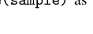

# Stata 编程：参考手册：第 11 版

# 综合主题目录

这是本手册的完整内容。还包含了来自其他 Stata 手册的、对程序员感兴趣的插入内容引用。

## 数据处理与管理

### 函数与表达式

- [U] 第 13 章 函数与表达式
- [D] dates and times 日期和时间 (%%) 值 变量
- [D] eigen 扩展，用于生成
- [D] functions 函数

### 工具程序

#### 基础工具

- [U] 第 4 章 Stata 的帮助与搜索功能
- [U] 第 15 章 保存和打印输出日志文件
- [U] 第 16 章 Do-files
- [R] about 显示关于你的 Stata 的信息
- [D] by 在数据子集上重复 Stata 命令
- [R] copyright 显示版权信息
- [R] do 从文件执行命令
- [R] doedit 编辑文件和其他文本文件
- [R] exit 退出 Stata
- [R] help 显示在线帮助
- [R] hsearch 搜索帮助文件
- [R] level 设置默认置信水平
- [R] log 将会话复制到文件
- [D] obs 增加数据集中的观测值数量
- [R] #review 回顾之前的命令
- [R] search 搜索 Stata 文档
- [R] translate 打印并翻译日志
- [R] view 查看文件和日志
- [U] zipfile 以 zip 格式压缩和解压缩文件及目录

#### 错误消息

- [U] 第 8 章 错误消息和返回代码
- [P] error 显示通用错误并退出
- [R] error messages 错误消息和返回代码
- [P] rmsg 返回消息

### 保存的结果

- [U] 第 13.5 节 访问系数和标准误
- [U] 第 18.8 节 访问其他程序计算的结果
- [U] 第 18.9 节 访问由估计命令计算的结果
- [U] 第 18.10 节 保存结果
- [P] creturn 返回 c-类值
- [P] ereturn 发布估计结果
- [R] estimates 保存并处理估计结果
- [R] estimates describe 描述估计结果
- [R] estimates for 跨模型重复后估计命令
- [R] estimates notes 给估计结果添加注释
- [R] estimates replay 重新估计结果
- [R] estimates save 保存并使用估计结果
- [R] estimates stats 模型统计量
- [R] estimates store 存储和恢复估计结果
- [R] estimates title 为估计结果设置标题
- [P] _return 保留的结果
- [P] return 保存的结果
- [R] saved results 保存的结果

### 互联网

- [P] file 读取并使用 ASCII 文本和二进制文件
- [R] net 从互联网安装和管理用户编写的扩展
- [R] net search 在互联网上搜索可安装包
- [R] netio 控制互联网连接
- [R] news 报告状态
- [R] sj Stata Journal 和 STB 安装说明
- [R] ssc 安装来自 SSC 的可安装包
- [R] update 更新
- [D] use 使用数据集

### 数据类型与内存

- [D] memory 内存

### 高级工具程序

- [P] assert 断言
- [D] cd 切换目录
- [D] changeeol 行尾符
- [D] checksum 计算文件的校验和
- [P] db 启动
- [P] quietly 静默和非显示
- [D] rmdir 删除目录
- [R] set 设置系统参数
- [R] set_defaults 将系统参数重置为
- [R] set emptycells 对空单元设置

### 矩阵命令

#### 基础

#### 编程

#### 其他

### Mata

#### 编程

#### 基础

## 程序控制

- [P] version 版本控制
- [P] while 循环

## 解析与程序参数

- [U] 第 18.4 节 程序参数
- [P] confirm 参数验证
- [P] getken 低级解析
- [P] levelsof 变量级别
- [P] numlist 解析数值列表
- [P] syntax 解析 Stata 语法
- [P] tokenize 将字符串划分为标记

## 控制输出

- [P] dialog programming 对话框编程
- [P] display 显示字符串和标量表达式
- [P] smcl Stata 标记与控制语言 (SMCL)
- [P] byable 创建基于 by 的程序
- [P] #delimit 修改分隔符
- [P] exit 退出程序或 do-file
- [P] mark 标记包含的观测值
- [P] matrix 矩阵命令介绍
- [P] quietly 静默和显式地执行 Stata 命令
- [P] scalar 标量变量
- [P] smcl Stata 标记与控制语言 (SMCL)
- [P] sortpreserve 排序程序
- [P] timer 通过记录和报告耗时对代码分段进行计时
- [TS] tsrevar 时间序列运算符编程命令

## 调试

- [P] pause 程序调试命令
- [P] timer 通过记录和报告耗时对代码分段进行计时
- [P] trace 调试 Stata 程序

## 高级编程命令

## 特殊关注编程命令

- [R] bstat 报告自助 (bootstrap) 结果
- [MV] cluster programming subroutines 添加聚类子程序
- [MV] cluster programming utilities 聚类编程工具
- [P] matrix dissimilarity 计算相似性或差异性量
- [ST] st_is 程序员的生存分析子程序
- [SVY] svymarkout 根据调查特征标记排除的观测值

## 文件格式

## Mata

- [M] Mata 参考手册

## 界面功能

- [P] 对话框编程 对话框编程
- [R] doedit 编辑 do-文件和其他文本文件
- [P] edit 使用数据编辑器浏览或编辑数据
- [P] sleep 暂停指定时间
- [P] smcl Stata 标记与控制语言
- [D] varmanage 管理变量标签、格式及其他属性
- [P] viewsource 查看源代码
- [P] 窗口编程 菜单和窗口编程

# 文档交叉引用

在阅读本手册时，你会发现对其他 Stata 手册的引用。例如：

- [U] 26 Stata 估计命令概述
- [R] regress
- [D] reshape

第一个示例是对比《用户指南》中第 26 章“Stata 估计命令概述”的引用；第二个是对《基础参考手册》中 `regress` 条目的引用；第三个是对《数据管理手册》中 `reshape` 条目的引用。

Stata 文档中的所有手册都有一个简写符号：

- [GSM] Mac 版 Stata 入门
- [GSU] Unix 版 Stata 入门
- [GSW] Windows 版 Stata 入门
- [U] Stata 用户指南
- [R] Stata 基础参考手册
- [D] Stata 数据管理手册
- [G] Stata 图形纵向数据手册
- [MI] Stata 多重插补手册
- [MV] Stata 多变量统计手册
- [P] Stata 编程手册
- [SVY] Stata 调查数据手册
- [ST] Stata 存活分析手册
- [TS] Stata 时间序列手册
- [I] 快速参考与索引
- [M] Mata 参考手册

关于这些每个手册的详细信息可以在网上找到：http://www.stata-press.com/manuals/

# 标题：intro — 编程手册简介

## 描述

此条目介绍了本手册以及 Stata 10 中发生的变化。

## 备注

在本手册中，你会找到可在 Stata 命令行 `ado-programming` 中使用的矩阵操作命令（有关高级矩阵函数和完整语言，请参阅 Mata 参考手册），以及令程序员感兴趣的命令。

本手册在交叉引用中被标记为 `p`；我们建议你阅读《用户指南》中关于编程 Stata 的第一章；参见第 18 页 `Programming`。阅读完之后，我们建议你阅读本手册中的以下章节：

- 定义和操作程序
- 程序内部排序
- 使程序私有的宏定义和操作


# 更新内容

1. 关于编程的大新闻与因子变量有关：包含因子变量的 `varlists` 的解析、因子变量的处理，以及行或列名包含因子变量的矩阵的处理。

a. 如果变量列表的描述中包含指定符 `fv`，则 `syntax` 将允许变量列表包含因子变量，例如：

```
syntax varlist(fv) [if] [in], Detail
```

同样，如果 `fv` 包含在其选择器中，`syntax varlist` 允许 `varlist` 选项包含因子变量：

```
syntax varlist(fv) [if] [in], Detail EQ(varlist fv)
```

参见 `p syntax`。

b. 你可以将宏 `'varlist'` 重用为任何允许因子变量的 Stata 命令的变量列表。

c. 因子列表有两种类型：通用的和特定的。一个通用因子变量列表的示例是 `mpg i.foreign`。对应的因子列表可能是 `mpg i(0) b0.foreign`。

特定的因子列表对于给定的问题（例如给定的数据集和样本）是特定的。特定的变量列表识别因子变量所取的值和基准。

用户通常指定通用的变量列表，尽管他们指定的是特定的。在你的程序过程中，如果 `varlist` 是通用的，它将变成特定的。这通常是自动的。

现有命令 `_rmcoll` 和 `_rmdcoll` 现在接受通用或特定的因子列表，并在 `r(varlist)` 中返回特定的变量列表。

现有命令 `ml` 接受通用因子列表并返回特定的变量列表，情况下是在其生成的向量和矩阵的行和列名中；同样适用于 Stata 的新函数 `optimize()`，它等同于 `ml`；`[M-5] optimize()`。

同样，所有估计命令允许因子列表在 `e(b)` 和 `e(V)` 的行列名中返回特定的变量列表。

因子 `mpg i(0) b0.foreign` 是特定的。相同的变量列表可以写为 `mpg i.foreign`，因此它是特定的，第一个是展开且未定义的；第二个是特定的且已展开的。新命令 `fexpend` 展开通用（已展开或未定义的）变量列表，并返回一个完全展开的变量列表。参见 `p fexpend`。

新命令 `unab` 接受通用变量列表并以相同形式返回它，但变量名不缩写。参见 `p unab`。

d. 矩阵行列名包含完全展开的特定变量列表的元素。在阅读本手册时，你会发现对其他 Stata 手册的引用。例如：`de-in-the-list-in-varlist-the-list-in-varlist`。

第一个示例是对比第 26 章 Stata 估计命令概述、`regress` 和 `reshape` 的引用。

6. 现有的命令 `markout` 有了新选项 `sysim`，它可以排除等于系统缺失（..）的变量，而不包括扩展缺失（.a,.b. . . .z）；参见 `[P] 标记`。这与对缺失值插补的强调有关；参见 `[MI] 简介`。

7. 新命令 `varravreb` 和 `unabreb` 允许临时重置是否对变量进行缩写；参见 `[P] varravreb`。

8. 新编程函数 `smallestdouble()` 返回大于 0 的最小双精度数；参见 `[D] 函数`。

9. `cretn` 现在可以返回结果：

  - a) (noisily) 当输出被抑制时返回 0，否则返回 1。因此，程序员可以避免编写仅为了显示输出而存在的代码。

  - b) (smallestdouble) 返回大于 0 的最小双精度值。

  - c) (tmpdir) 返回 Stata 使用的临时目录。

  - d) (eqlen) 返回 Stata 允许方程的最大长度。

10. 现有的扩展宏函数 `:dir` 有了新选项 `respectcase`，导致 `:dir` 在执行文件名匹配时区分大小写。此选项仅适用于 Windows。

11. Stata 新增了新的字符串函数 `str()`、`soundex()` 和 `soundex_nara()`；参见 `[D] 函数`。

12. Stata 有 17 个数值函数：`sinh()`、`cos()`、`asin()` 和 `acosh()`；`hypergeometric()` 和 `hypergeometric()`；`binomial()`、`binomialP()` 和 `nbinomialtail()`；`invbinomial()` 和 `invbinomialtail()`；`poisson()`、`poisson()` 和 `poissontail()`；`invpoisson()` 和 `invpoissontail()` 以及 `binomial()`；参见 `[D] 函数`。

13. Stata 有了新的用于 beta、卡方、伽马、超几何、负二项、正态、Pearson f 分的随机变量函数：`rbeta()`、`rbinomial()`、`rchi12()`、`rgamma()`、`rhypergeometric()`、`rnbinomial()`、`rnnormal()`、`rpoisson()` 和 `rt()`。此外，旧的 `uniform()` 被重命名为 `runiform()`。所有随机变量函数均以 r 开头。参见 `[D] 函数`。

14. 现有的函数 `clear` 有了新语法 `clear matrix`，它可以清除（删除）所有 Stata 矩阵，这与 `clear data` 不同，后者会删除所有矩阵和函数。参见 `[D] clear`。

15. 这些供用户使用的命令经常被用作子程序，此时如果发生错误，命令会保留数据，这样如果用户按下 Press 键，数据就会恢复。当此类命令作为子程序使用时，调用者已经保留了数据。因此，要求所有程序员在除错误恢复外没有理由保留数据的命令上包含 `nopreserve` 选项，从而在命令作为子程序使用时加快执行。参见 `[P] nopreserve 选项`。

16. Mata 现在支持面向对象的编程。参见 `[M-2] class`。

Stata 还有其他对程序员感兴趣的新内容，因为这些内容对其他人也有意义，它们已记录在 `[U] 1.3 新功能` 中。

# 参考文献

Baum, C. F. 2009. An Introduction to Stata Programming. College Station, TX: Stata Press.

Gould, W. W., J. S. Pitblado, and W. M. Sribney. 2006. Maximum Likelihood Estimation with Stata. 3rd ed. College Station, TX: Stata Press.

## 另见

+ `[U] 18 Stata 编程`
+ `[U] 1.3 新功能`
+ 使用 Stata 进行极大似然估计
+ Stata 编程简介
+ `[R] intro — 基础参考手册简介`

# 标题

automation — 自动化 (Automation)

### 描述

自动化（以前称为 OLE 自动化）是 Microsoft Windows 应用程序之间的一种通信机制。它提供了一个基础设施，使得 Windows 应用程序（自动化客户端）可以访问并操作另一个应用程序（自动化服务器）中实现的函数和属性。Stata 自动化对象暴露了内部 Stata 方法和属性，以便 Windows 程序员可以编写自动化客户端直接使用 Stata 提供的服务。

## 备注

Stata 自动化对象对于需要最大灵活性从用户编写程序与 Stata 交互的情况最有用。Stata 自动化对象允许用户通过常规日志文件以外的方式直接访问 Stata 宏、标量、保存的结果和数据集信息。

有关使用 Stata 自动化对象的文档，请参见 <http://www.stata.com/automation/>。

注意，标准的 Stata 终端用户许可协议 (EULA) 不允许将 Stata 作为嵌入引擎用于生产环境。如果您希望以此方式使用 Stata，请通过 service@stata.com 联系 StataCorp。

## 另见

+ `[P] plugin — 加载插件`

# 标题

```
break — 抑制 Break 键
```

### 语法

```
nobreak stata_command
break stata_command
```

典型用法是：

```
nobreak {
    capture noisily break ...
    ...
}
```

### 描述

`nobreak` 临时关闭对 Break 键的识别。它很少被使用。`break` 在 `nobreak` 块内临时恢复对 Break 键的识别。它甚至更少使用。

## 备注

Stata 命令尊重 Break 键。这种尊重是自动的，在大多数情况下，只要您遵循以下指南，就不需要特殊代码：

1. 从 `tempvar` 获取新变量名称；参见 `[U] 18.7.1 临时变量`。
2. 从 `tempname` 获取其他内存聚合名称（如标量和矩阵）；参见 `[U] 18.7.1 临时变量`。
3. 如果您需要更改数据，使用 `preserve`；参见 `[U] 18.6 临时变量`。
4. 从 `tempfile` 获取临时文件名称；参见 `[U] 18.7.3 临时文件`。

如果您遵循这些指南，您的程序将对用户按下 Break 键具有健壮性。

### 示例 1

您正在编写一个程序并遵循了所有指南。特别是，您正在使用临时变量。然而，在程序的某处，您希望列出变量的前几个值。您希望临时给变量起一个好听的名字，`myv` 是临时变量：

```
nobreak {
  rename 'myv' Result
  list Result in 1/5
  rename 'myv'
}
```

像命令之间的句点那样编写代码是不恰当的。

## 另见

+ `[P] capture — 捕获返回代码`
+ `[P] continue — 跳出循环`
+ `[P] quietly — 静静和喧地执行命令`
+ `[P] varabbrev — 控制变量缩写`
+ `[U] 9 Break 键`

# byable — 使程序支持 byable

### 描述

本条目描述了如何编写程序以允许使用 `bylist:` 前缀。如果您没有采取特殊操作并编写程序 `myprog`，则无法与其结合使用 `bylist:`：

- by foreign: myprog
- myprog may not be combined with r(190);

通过本节，您将学习如何修改程序使其可以使用它：

- by foreign = 内部（显示第一个分组的输出）
- by foreign = 外部（显示第一个分组的输出）

## 备注

备注信息列在以下标题下：

- byable(recall) 程序
- 在 byable(recall) 程序中使用 sort
- byable 估计命令
- byable(onecall) 程序
- 在 byable(onecall) [with(recall) 中使用 sort
- 结合 byable(onecall) 与 byable(recall)
- 分组标题

# byable - 让程序支持可分段（byable）

## byable(recall) 程序

假设你已经写了一个可以运行的程序（ado文件），并且它工作正常；它只是不支持 `by` 操作。如果你的程序报告了计算结果（例如 `summarize`、`regress` 以及大多数其他统计命令），那么可能让你的程序支持 `by` 只需要在其 `program` 语句中添加 `byable(recall)` 选项。例如，如果你的程序语句目前如下：

```
program myprogr, rclass sortpreserve
  ...
end
```

将其修改为

```
program myprogr, rclass sortpreserve byable(recall)
end
```

你唯一需要更改是在 `program` 语句中添加 `byable(recall)`。如果满足以下条件，添加 `byable(recall)` 是唯一的更改：

- 你的程序没有留下任何新创建的变量，但不能给用户留下新变量。例如，如果你的程序有 `generate()` 选项，则需要额外的努力。
- 你的程序使用 `marksample` 或 `mark` 将自己限制在数据的相关子样本中。如果你的程序没有使用 `marksample` 或 `mark`，则需要额外的努力。

这是 `byable(recall)` 的工作原理：如果你的程序通过 `varlist` 前缀调用，则你的程序将被执行 K 次，其中 K 是由 `by` 变量形成的 by-组的数量。每次执行你的程序时，`marksample` 都会标记出未在当前by组中使用的观测值。

这就是为什么在以下两种情况下，你需要仅包含 `byable(recall)` 来使 `by varlist` 工作这两个准则的原因：

- 如果你的程序创建了持久性的新变量，那么它在执行第一个by-组时就会创建这些变量，这意味着当它执行第二个by-组时，这些变量已经存在，从而导致你发出错误信息。
- 如果你的程序没有使用 `marksample` 来识别数据的相关子样本，那么它每次执行时都会使用过多的观测值——它将不会遵守by-组的划分——并产生错误的结果。

解决这两个问题的方法都有很多，这里有比你需要的更多的信息：

```
function _by()
```

不接受参数；当程序未被 `by` 处理时返回 0；当程序正被 `by` 处理时返回 1。

```
function _byindex()
```

不接受参数；当程序未被 `by` 处理时返回 1；当被 `by` 处理时，在第1次、第2次……调用时返回 1, 2, ...

```
function _bylastcall()
```

不接受参数；当程序未被 `by` 处理时返回 1；当使用最后一个by-组调用时返回 1；否则返回 0。

```
function _byn1()
```

不接受参数；返回当前正在执行的by-组的起始编号；如果 `_by()=0` 则返回 1。`_byn1()` 返回的值仅在数据自原始调用数据后没有被重新排序时有效。

```
function _byn2()
```

不接受参数；返回正在执行的by-组的观测值行号；如果 `_by()=0` 则返回 1。`_byn2()` 返回的值在数据自原始调用程序后没有被重新排序时有效。

```
macro '_byindex'
```

当程序未被 `by` 处理时内容为空；当程序正被 `by` 处理时包含临时变量名：变量对数据中的每个观测值包含 1, 2, ...，记录的值表示该观测值属于哪个by-组。

```
macro '_byvars'
```

当程序未被 `by` 处理时内容为空；否则包含实际变量的名称。

```
macro '_byrc0'
```

如果指定了 `rc0` 选项，则包含 "rc0"；否则内容为空。

所以，让我们一个一个地考虑这些问题，从第二个程序开始。你的程序没有使用 `marksample`，我们假设你的程序不使用它有充分理由，因为简单的修复方法是使用 `marksample`。尽管如此，你的程序必须以某种方式确定要使用的观测值，我们假设你正在创建一个名为 `touse` 的临时变量，如果该观测值要从分析中省略，则包含 0，如果要使用则包含 1。在你的程序早期，无论何处设置了 `touse` 变量。在此之后，添加以下内容：

```
program . . . . . . byable(recall)

if _by() {
    quietly replace 'touse' = 0 if '_byindex' != _byindex
}
```

```stata
else
```

修复方法很简单：如果你正在被 `by` 处理，并且在所有 `_byindex` 的值等于你当前正在考虑的by-组（即 `_byindex`）的观测值之外将 `touse` 设置为 0。

如果你正在被 `by` 处理，如果在所有 `_byindex` 的值不等于你正在考虑的by-组的观测值中，将 `touse` 设置为 0，那么修复方法很简单。

程序 . . . . . . byable ：

```
if _by() {
    quietly replace 'touse' = 0 if '_byindex' != _byindex
}
```

```stata
else
```

第一个问题也是容易修复的。如果你的程序创建了持久性的新变量，那么它在执行第一个by-组时就会创建这些变量，这意味着当它执行第二个by-组时，这些变量已经存在，导致你发出错误信息。假设你的程序有 `generate` 选项，这涉及到byable(recall)。

```
if _by() {
    quietly replace 'touse' = 0 if '_byindex' != _byindex
}
```

```stata
else
```

byable - 让程序支持可分段（byable）

## byable(recall) 程序

同样的 byable 程序。例如，如果你的程序语句目前如下

```
program myprogr, rclass sortpreserve
  ...
end
```

将其修改为

```
program myprogr, rclass sortpreserve byable(recall)
end
```


# 使程序支持 `by` 前缀

你唯一需要更改的是在 `program` 语句中添加 `byable(recall)`。如果满足以下条件，添加 `byable(recall)` 是唯一的更改：

- 你的程序没有留下任何新创建的变量，但不能给用户留下新变量。例如，如果你的程序有 `generate()` 选项，则需要额外的努力。
- 你的程序使用 `marksample` 或 `mark` 将自己限制在数据的相关子样本中。如果你的程序没有使用 `marksample` 或 `mark`，则需要额外的努力。

## `byable(recall)` 的工作原理

如果你的程序通过 `varlist` 前缀调用，则你的程序将被执行 K 次，其中 K 是由 `by` 变量形成的 by-组的数量。每次执行你的程序时，`marksample` 都会标记出未在当前 by-组中使用的观测值。

这就是为什么在以下两种情况下，你需要仅包含 `byable(recall)` 来使 `by varlist` 工作这两个准则的原因：

- 如果你的程序创建了持久性的新变量，那么它在执行第一个 by-组时就会创建这些变量，这意味着当它执行第二个 by-组时，这些变量已经存在，从而导致你发出错误信息。
- 如果你的程序没有使用 `marksample` 来识别数据的相关子样本，那么它每次执行时都会使用过多的观测值——它将不会遵守 by-组的划分——并产生错误的结果。

## 解决方案与辅助函数

解决这两个问题的方法都有很多，这里有比你需要的更多的信息：

### `_by()`

不接受参数；当程序未被 `by` 处理时返回 0；当程序正被 `by` 处理时返回 1。

### `_byindex()`

不接受参数；当程序未被 `by` 处理时返回 1；当被 `by` 处理时，在第 1 次、第 2 次……调用时返回 1, 2, ...

### `_bylastcall()`

不接受参数；当程序未被 `by` 处理时返回 1；当使用最后一个 by-组调用时返回 1；否则返回 0。

### `_byn1()`

不接受参数；返回当前正在执行的 by-组的起始编号；如果 `_by()=0` 则返回 1。

> `_byn1()` 返回的值仅在数据自原始调用数据后没有被重新排序时有效。

### `_byn2()`

不接受参数；返回正在执行的 by-组的观测值行号；如果 `_by()=0` 则返回 1。

> `_byn2()` 返回的值在数据自原始调用程序后没有被重新排序时有效。

### 宏 `'_byindex'`

当程序未被 `by` 处理时内容为空；当程序正被 `by` 处理时包含临时变量名：变量对数据中的每个观测值包含 1, 2, ...，记录的值表示该观测值属于哪个 by-组。

### 宏 `'_byvars'`

当程序未被 `by` 处理时内容为空；否则包含实际变量的名称。

### 宏 `'_byrc0'`

如果指定了 `rc0` 选项，则包含 "rc0"；否则内容为空。

## 处理未使用 `marksample` 的程序

让我们一个一个地考虑这些问题，从第二个程序开始。你的程序没有使用 `marksample`，我们假设你的程序不使用它有充分理由，因为简单的修复方法是使用 `marksample`。尽管如此，你的程序必须以某种方式确定要使用的观测值，我们假设你正在创建一个名为 `touse` 的临时变量，如果该观测值要从分析中省略，则包含 0，如果要使用则包含 1。在你的程序早期，无论何处设置了 `touse` 变量。在此之后，添加以下内容：

> program ... , byable(recall)

```
if _by() {
    quietly replace `touse' = 0 if `_byindex' != _byindex
}
```

修复方法很简单：如果你正在被 `by` 处理，并且在所有 `_byindex` 的值等于你正在考虑的 by-组的观测值中，将 `touse` 设置为 0。

## `byable(onecall)` 程序

在 `byable(onecall)` 程序中，你负责一切，包括如果你愿意的话，输出分组表头。

`byable(onecall)` 程序的典型候选对象是那些对 by 变量进行操作的程序。我们提供以下指南：

1. 在编写程序时，忽略你将要变为 byable 的事实。相反，在程序中包含一个 `by()` 选项。因为你的程序无法使用 `byable(recall)` 进行编码，你已经知道 by 变量与你的例程逻辑纠缠在一起了。在将其 byable 之前，先让程序正常运行。
2. 现在回去修改你的程序。在 `program` 语句行上包含 `byable(onecall)`。从语法语句中移除 `by(varlist)`，并在语法语句之后立即添加行 `local by \`_byvars\``。
3. 测试你的程序。如果它之前可以运行，现在仍然可以运行。要使用 `by()` 选项，只需去掉 `varlist:` 前缀。
4. 忽略宏 `_byrc0`。当用户指定 `by` 的 `rc` 选项时，程序很少会有任何不同。

### 在 `byable(onecall)` 程序中排序

你可以在 `byable(onecall)` 程序中自由使用 `sort`。你可以使用 `sortpreserve` 在程序结束时恢复排序顺序。

当 `byable(onecall)` 程序接收控制权并被 `by` 处理时，数据保证已按 `_byvars` 排序。

### 将 `byable(onecall)` 与 `byable(recall)` 结合

`byable(onecall)` 可以用作与其他 byable 程序的接口。假设你正在编写一个命令——我们称之为 `switcher`——它根据用户输入的某些内容，或者可能根据之前的估计，调用另外两个命令之一。`switcher` 在我们所说的 `prog1` 和 `prog2` 之间切换的规则。`prog1` 和 `prog2` 可能是实际的 Stata 命令、你编写的 Stata 命令，甚至是你编写的子程序，甚至是 `switcher` 的子程序。

进一步假设 `prog1` 和 `prog2` 是使用 `byable(recall)` 方法实现的，而我们现在希望 `switcher` 也允许前缀。实现这一点的简单方法是：

```
program switcher, byable(onecall)
if _by() {
    local by "`_byvars' `_byrc0'"
}
if (任何让我们倾向于 prog1 的因素) {
    `by' prog1 `0'
}
else {
    `by' prog2 `0'
}
end
```

`switcher` 的工作原理是在指定 `by` 时在 `prog1` 或 `prog2` 前重新创建 `by varlist:` 前缀。即使指定了 `by`，`switcher` 也只会执行一次。`prog1` 和 `prog2` 将重复执行。

在上述概述中，`prog1` 和 `prog2` 是否使用 `byable(recall)` 方法实现并不重要。它们可以使用 `byable(onecall)` 实现，`switcher` 不会有任何变化。

## 分组表头

通常，当你使用带有 `by` 的命令时，每个分组上方都会产生表头：

- by foreign: summarize mpg weight

-> foreign = Domestic

（显示第一个分组的输出）

-> foreign = Foreign

（显示第一个分组的输出）

分组表头并不总是出现：

- by foreign: generate new = sum(mpg)

当你编写程序时，如果你使用 `byable(recall)`，表头默认会显示；如果你使用 `byable(onecall)`，则不会显示。

如果你想要表头并使用了 `byable(onecall)`，你将编写输出它的代码。如果你不需要表头且使用了 `byable(recall)`，你可以指定 `byable(recall, noheader)`：

```
program ..., ... byable(recall, noheader)
....
end
```

## 另见

- [P] program — 定义和操作程序
- [P] sortpreserve — 程序内排序
- [D] by — 在数据子集上重复 Stata 命令

---

# capture — 捕获返回代码

## 语法

```
capture [:] command

capture {
  stata_commands
}
```

## 描述

`capture` 执行命令，抑制其输出并捕获返回代码。返回代码存储在标量 `_rc` 中。`capture` 可以与 `{}` 结合以产生 capture 块。

`capture` 块可以用于拦截 Break 键，例如：

```
capture {
  stata_commands
}
if _rc==1 {
  Break key cleanup code
  exit 1
}
(program continues...)
```

请记住 Break 总是会生成返回码 1。然而，没有理由将清理代码的执行限制在仅限 Break 上。我们的程序可能因为其他原因而失败，例如没有足够的空间添加新变量，在这种情况下我们仍然希望执行清理操作。一个更好的版本是：

```
capture {
  stata_commands
}
if _rc!=0 {
  local oldrc = _rc
  Break key and error cleanup code
  exit `oldrc'
}
(program continues...)
```

## 技术说明

在我们上面的程序中，如果 `stata_commands` 包含了 `exit` 或 `exit 0`，程序将终止并返回 0。清理代码或 `program continues` 代码都将不会执行。然而，如果 `stata_commands` 包含了 `exit 198` 或任何其他设置非零返回码的 `exit`，程序将不会退出。`capture` 会捕获非零返回码，并继续执行清理代码。

## 另见

- [P] break — 抑制 Break 键
- [P] confirm — 参数验证
- [P] quietly — 静静和嘈杂地执行 Stata 命令
- [U] 18.2 程序与 do-file 的关系

---

# char — 特性

## 语法

### 定义特性

```
char [define] evarname[charname] [ "text" ]
```

### 列出特性

```
char list [evarname[[charname]]]
```

### 重命名特性

```
char rename oldvar newvar [ , replace]
```

`evarname` 是变量名或 `_dta`，`charname` 是特性名称。在语法图中，请仔细区分 `[ ]`（表示你输入的内容）和 `[[]]`（表示该元素是可选的）。

## 描述

请参见 [U] 12.8 Characteristics 获取关于特性的描述。这些命令允许操作特性。

## 选项

`replace`（仅用于 `char rename`）指定如果已存在同名的特性，则将其替换。`replace` 是一个极少使用的低级程序员选项。`char rename oldvar newvar` 将 `oldvar` 的所有特性移动到 `newvar`，使 `oldvar` 没有任何特性，而 `newvar` 拥有 `oldvar` 之前的所有特性。`char rename oldvar newvar` 会移动特性，但前提是 `newvar` 没有同名的特性。否则，`char rename` 会产生错误信息 `newvar[whatever] already exists`。

## 备注

我们首先展示这些命令在机械上是如何工作的，然后继续在更真实的场景中演示这些命令。

`char define` 设置和清除特性，尽管没有必要输入 `define`：

```
char _dta[one] this is char named one of _dta
char _dta[two] this is char named two of _dta
char mpg[one] this is char named one of mpg
char mpg[two] "this is char named two of mpg"
char mpg[three] "this is char named three of mpg"
```

是否包含双引号并不重要。你通过将一个特性定义为空来清除它：

```
char mpg[three]
```

`char list` 用于列出已有的特性；它通常用于调试：

```
char list
  _dta[two] : this is char named two of _dta
  _dta[one] : this is char named one of _dta
  mpg[two] : this is char named two of mpg
  mpg[one] : this is char named one of mpg
char list _dta[]
  _dta[two] : this is char named two of _dta
  _dta[one] : this is char named one of _dta
char list mpg[]
  mpg[two] : this is char named two of mpg
  mpg[one] : this is char named one of mpg
char list mpg[one]
  mpg[one] : this is char named one of mpg
```

顺序可能会让你感到惊讶——这是因为 Stata 内存管理程序的工作方式——但这并不重要。

`char rename` 将所有与 `oldvar` 的特性移动到 `newvar`：

```
char rename mpg weight
char list:
  _dta[two] : this is char named two of _dta
  _dta[one] : this is char named one of _dta
  weight[two] : this is char named two of mpg
  weight[one] : this is char named one of mpg
char rename weight mpg // put it back
```

特定特性的内容可以像获取局部宏一样获取，通过引用左右单引号之间的特性名称来获取；请参见 [U] 12.8 Characteristics。

```
display "`_dta[]'"
  this is char named one of mpg
  two one
```

引用不存在的特性会返回空字符串：

```
display "the value is |mpg[three]|"
  the value is ||
```

## 如何使用特性进行编程

### 示例 1

你正在编写一个程序，该程序需要记录“实例”（第一次、第二次等）的变量的值。你希望你的命令有一个 `ins(varname)` 选项，但在用户指定一次该变量后，你希望你的程序在将来记住它，即使跨越会话也是。你的程序大纲如下：

```
program
version 11
syntax ... [, ins(varname) ... ]
if "`ins'"=="" {
    local ins "_dta[Instance]"
}
confirm variable `ins'
char _dta[Instance] : `ins'
```

你编写了一个程序，除了其他外，它改变了用户数据中一个变量的内容。你担心用户在程序更改过程中按了 Break，因此你正确地决定在临时变量中构建替换后的值。


### ▷ 示例 1

你正在编写一个程序，该程序需要记录“实例”（第一次、第二次等）的变量的值。你希望你的命令有一个 `ins(varname)` 选项，但在用户指定一次该变量后，你希望你的程序在将来记住它，即使跨越会话也是。你的程序大纲如下：

```program
program
version 11
syntax ... [, ins(varname) ... ]
if "ins"=""
    local ins "_dta[Instance]"
}
confirm variable 'ins'
char _dta[Instance] : 'ins'
```

你编写了一个程序，除了其他外，它改变了用户数据中一个变量的内容。你担心用户在程序更改过程中按了 Break，因此你正确地决定在临时变量中构建替换后的值。

```program
program
version 11
syntax ... [, ins(varname) ... ]
if "ins"=""
    local ins "_dta[Instance]"
}
confirm variable 'ins'
char _dta[Instance] : 'ins'
```

## 1. 简介

类（class）是成员变量和成员程序的集合。类的成员程序可以根据成员变量进行操作或计算。类定义在 `.class` 文件中。例如，我们可以在 `coordinate.class` 文件中定义 `coordinate` 类：

```
version 11
class coordinate {
    double x
    double y
}
program .set {
    args x y
    .x = 'x'
    .y = 'y'
}
```

上述文件并没有创建任何内容。它仅仅定义了“坐标”的概念。然而，既然文件已经存在，你可以通过输入 `.coord = .coordinate.new` 来创建一个类型为 `coordinate` 的“标量”变量。

`.coord` 是 `coordinate` 的一个实例；它包含了 `.coord.x`（特定的坐标）和 `.coord.y`（特定的坐标）。由于我们没有特殊指定，`.coord.x` 和 `.coord.y` 包含缺失值，但我们可以通过以下输入将 `.coord` 重置为包含 (1,2)：

`.coord.x = 1`

`.coord.y = 2`

在这里，我们可以通过输入更方便地完成：

`.coordinate.class 1 2`

因为 `coordinate.class` 提供了一个名为 `.set` 的成员程序，允许我们设置成员变量。`.set` 并没有特别用处；我们写它主要是为了强调类实际上可以包含成员程序。如果我们删掉 `.set` 程序，我们的 `coordinate.class` 定义几乎也一样好。类并不要求有成员程序，但它们可以拥有。

如果我们输入：

```
.coord2 = .coordinate.new
.coord2.set 2 4
```

我们现在就有了第二个 `coordinate` 实例，这次名为 `.coord2`，它将包含 (2,4)。

现在考虑另一个类 `line.class`：

## 类编程

```
version 11
class line {
    coordinate c0
    coordinate c1
}
program .set {
    args x0 y0 x1 y1
    .c0.set 'x0' 'y0'
    .c1.set 'x1' 'y1'
}
program .length {
    class exit sqrt(('.c0.y'-'.c1.y')^2 + ('.c0.x'-'.c1.x')^2)
}
program .midpoint {
    local cx = ('.c0.x' + '.c1.x')/2
    local cy = ('.c0.y' + '.c1.y')/2
    tempname b
    '.b'.coordinate.new
    '.b'.set 'cx' 'cy'
}
```

`coordinate.class`, `line.class` 拥有成员变量——名为 `.c0` 和 `.c1`——而不是数字，`.c0` 和 `.c1` 是我们之前定义过的变量。因此，`line.class` 的成员变量列表如下：

| 变量 | 描述 |
| :--- | :--- |
| .c0 | 第一个坐标 |
| .c0.x | x 值 (一个 double) |
| .c0.y | y 值 (一个 double) |
| .c1 | 第二个坐标 |
| .c1.x | x 值 (一个 double) |
| .c1.y | y 值 (一个 double) |

如果我们输入：

```
.li = .line.new
```

我们就会得到一个名为 `.li` 的线，其中包含：

| 变量 | 描述 |
| :--- | :--- |
| .li0 | 线 .li 的第一个坐标 |
| .li0.x | x 值 (一个 double) |
| .li0.y | y 值 (一个 double) |
| .li1 | 线 .li 的第二个坐标 |
| .li1.x | x 值 (一个 double) |
| .li1.y | y 值 (一个 double) |

这些变量的值是多少？由于我们没有特殊指定，`.li0` 和 `.li1` 将接收它们类型（即 `coordinate`）的默认值。该默认值是 `(...)`，因为在定义线或坐标时我们没有进行特殊指定。因此，默认值为 `(...)` 和 `(...)`，我们有一条缺失的线。

与 `coordinate` 一样，我们包含了成员函数 `.set` 来让设置线更容易。我们可以输入：

```
.li.set 1 2 4
```

我们就会有一条从 (1,2) 到 (2,4) 的线。

## 类 — 类编程 27

`line.class` 包含以下成员程序：

- `.set` 程序用于设置 `.c0` 和 `.c1`
- `.c0.set` 程序用于设置 `.c0`
- `.c1.set` 程序用于设置 `.c1`
- `.length` 程序返回线的长度
- `.midpoint` 程序返回线的中点的坐标

`.set`, `.length` 和 `.midpoint` 来自 `line.class`。`.c0.set` 和 `.c1.set` 来自 `coordinate.class`。

成员程序返回线的长度。

`.len = .li.length`

将创建一个 `.len`，其包含 `.li.length` 的结果。在对象 `.li` 上运行程序 `.length` 返回一个 double，因此，`.len` 将是一个 double。

`.midpoint` 返回线的中点。

`.mid = .li.midpoint`

将创建一个 `.mid`，其包含 `.li.midpoint` 的结果。在对象 `.li` 上运行程序 `.midpoint` 返回一个 coordinate，因此，`.mid` 将是一个 coordinate。

## 2. 定义

### 2.1 类定义

类 `className` 定义在文件 `className.class` 中。该定义不会创建该类的任何实例。

### 类编程

begin line.class

```
version 11
class line {
  coordinate c0
  coordinate c1
}
[ 成员程序省略 ]
```

end line.class

在第一个示例中，成员变量是 `.x` 和 `.y`，在第二个示例中是 `.c0` 和 `.c1`。在第一个示例中，成员变量的类型为 double，而在第二个示例中，类型为 coordinate（即另一个类）。

成员变量可以是以下类型：

- `double`: 双精度标量数值，包括缺值值 `..a, ..., .z`
- `string`: 标量字符串值，最小长度为 0 (`""`)，最大长度与宏相同，换句话说，为 long
- `classname`: 其他类，不包括正在被定义的类
- `array`: 包含所有类型的数组，包括其他数组

一个类的定义可能如下：

begin todolist.class

```
version 11
class todolist {
  double n // 列表中元素的数量
  string name // 列表所属者
  array list // 列表本身
  actions x // 已完成的事情
}
```

end todolist.class

在上面，`actions` 是一个类，一种原始类型。在其他地方，我们写了 `actions.class`，它定义了 `actions` 的含义。

数组在声明时是不区分类型的。数组不是 `double` 数组、`string` 数组或 `coordinate` 数组；相反，每个元素在运行时单独执行的，因此一个数组可能是一个 `double` 数组、`string` 数组或 `coordinate` 数组，或者它的第一个元素是 `double`，第二个元素是 `string`，第三个元素是 `coordinate`，第四个元素是其他，以此类推。

同样，数组在声明时并不指定固定大小。大小在运行时根据数组的使用情况自动确定。此外，数组可以是稀疏的。一个数组的第一个元素可能是 `double`，第四个元素是 `coordinate`，而第二个和第三个元素则留未定义。这不会导致效率低下。之后，一个值可能会赋值给数组的第五个元素以扩展它，或者一个值可能会赋值给第二个和第三个元素以填充空隙。

## 4.2 默认初始化

当类的实例被创建时，成员变量按如下方式填充：

```
double      . (缺值)
string      ""
classname 由类定义指定
array      空，尚未定义任何元素
```

## 4.3 指定初始化

你可以在 `classname.class` 中指定成员变量的初始值。为此，你在标识符后输入一个等号，然后输入初始值。例如：

```
version 11
class todolist {
    double n      = 0
    string name = "nobody"
    array list = {"show second syntax", "mark as done"}
    actions x = .actions.new arguments
}
```

初始化规则如下：

**`double membervariable = ...`**

在等号之后，你可以输入任何数字或表达式。要用缺值 (`..a, .b, .z`) 初始化成员变量，你必须将缺值括在括号中。示例包括：

```
double n = 0
double a = (.)
double b = (.b)
double z = (2+3)/sqrt(5)
```

或者，在等号之后，你可以指定要拷贝的成员变量或要运行的成员程序，只要该成员变量是 `double` 或者程序返回 `double`。如果指定的成员程序需要参数，必须在标识符后指定。示例包括：

```
double n = .clearcount
double a = .gammvalue 4 5 2
double b = .color.cvalue, color(green)
```

标识符根据全局上下文进行解释，而不是根据正在定义的类上下文。因此，`.clearcount`、`.gammvalue` 和 `.color.cvalue` 必须存在于全局上下文。

**`string membervariable = ...`**

在等号之后，你用引号包含成员的初始值，引号可以是简单的（`"`）也可以是复合的（`"` 和 `\"`）。示例包括：

```
string name = "nobody"
string s = ("quotes inside strings")
string a = ""
```

你也可以指定一个表达式，但必须将其括在括号中。例如：

或者你可以指定要拷贝的成员变量或要运行的成员程序，只要该成员变量是 `string` 或者程序返回 `string`。如果指定的成员程序需要参数，必须在标识符后指定。示例包括：

```
string n = .defaultname
string a = .recapitalize "john smith"
string b = .names.defaults, category(null)
```

标识符根据全局上下文解释，而不是正在定义的上下文。`.defaultname`、`.recapitalize` 和 `.names.defaults` 必须存在于全局上下文。

**`array membervariable = {......}`**

在等号之后，你在大括号 (`{` 和 `}`) 中输入一组元素，每个元素之间用逗号分隔。

如果元素被包含在引号中（简单或复合），则对应的数组元素定义为具有指定内容的 `string`。

如果元素是一个字面量数字（排除 `.a, ..., .z`），则对应的数组元素定义为具有指定数字的 `double`。

如果元素被括在括号中，括号内的内容被求值为一个表达式。如果表达式求值结果字符串，则对应的数组元素定义为 `string`。如果表达式求值为数字，则对应的数组元素定义为 `double` 并填充结果。

另一种指定成员变量如何初始化的方法是在类内部定义一个 `.new` 程序。

要创建一个类的实例，你输入：

- `name = .className.new`

`.new` 实际上是 `className` 的成员程序；它只是内置的，你不需要定义就可以使用。内置的 `.new` 为实例分配内存并填充成员变量的默认或指定的初始值。如果你定义了 `.new`，你的 `.new` 将完成任务后运行。

例如，我们的 `coordinate.class` 示例可以通过添加 `.new` 成员程序来改进：

## class — 类编程

begin coordinate.class

```
version 11
class coordinate {
    double x
    double y
}
program .new {
    if "0" != "" {
        .set '0'
    }
end
program .set {
    args x y
    .x = 'x'
    .y = 'y'
}
```

end coordinate.class

有了这个新特性，我们可以输入：

```
coord = .coordinate.new
coord.set 2 4
```

或者我们可以输入：

```
.coord = .coordinate.new 来传递参数——这里是可选的——用以指定新点
```

所在的位置。我们编写了让 `.set` 中的行出现在 `.new` 中的代码，然后删除了 `.set`，尽管我们完全可以编写让 `.set` 中的行出现在 `.new` 中的代码，然后删除 `.set` 程序。事实上，这种分两部分的构造是理想的，因为我们拥有了一个可以重置现有类内容的函数。

无论如何，通过定义你的 `.new`，你可以安排类的任何类型的复杂的初始化，如果必要，这种初始化可以是指定参数的函数。

`.new` 程序不需要返回任何内容；参见第 6 节成员程序的返回值。

`.new` 程序不仅限于填充初始值。它们是你可以随意编写代码的程序。`.new` 在每次创建类的新实例时都会运行，但有一个例外：当实例是作为另一个实例的成员被创建时（在这种情况下，结果是预先记录的）。

## 4.5 另一种声明方式

除了以下语法

```
type name = [ initialization ]
```

其中 `type` 是 `double`、`string`、`className` 或 `array` 之一，还有另一种读取方式为：

```
name = initialization
```

也就是说，当你指定成员变量如何初始化时，可以省略对类型的指定，因为这样成员变量的类型可以从初始化推断出来。

## 4.6 作用域

在我们目前为止看到的示例中，成员变量是实例特有的。例如，如果我们有：

```
.coord1 = .coordinate.new
.coord2 = .coordinate.new
```

那么 `.coord1` 的成员变量与 `.coord2` 的成员变量没有关系。

如果我们更改 `.coord1.x`，那么 `.coord2.x` 将保持不变。

类也可以拥有跨所有实例共享的变量。考虑：

```
version 11
class coordinate2 {
  classwide:
    double x_origin = 0
    double y_origin = 0
  instancespecific:
    double x = 0
    double y = 0
}
```

在这个类定义中，`.x` 和 `.y` 与 `coordinate.class` 中一样——它们是实例特有的。然而，`.x_origin` 和 `.y_origin` 是该类所有实例共享的。也就是说，如果我们真的输入它们：

```
.ac = .coordinate2.new
.bc = .coordinate2.new
```

那么 `.x_origin` 和 `.y_origin` 只有一份。如果我们在 `.ac` 中更改 `.x_origin`：

```
.ac.x_origin = 2
```

我们会发现 `.bc.x_origin` 也被改变了。这是因为 `.ac.x_origin` 和 `.bc.x_origin` 实际上是同一个变量。


# 类范围变量的初始化

类范围变量的初始化的影响略有不同。在 `coordinate2.class` 中，我们指定 `.x_origin` 和 `.y_origin` 都初始化为 0，因此在我们输入 `.ac = .coordinate2.new` 创建类的第一个实例时它们是这样的。然而，之后，`.origin_x` 和 `.y_origin` 将永远不会重新初始化，因为它们不需要重新创建，共享。（这并不完全准确，因为最后一个 `coordinate2` 实例已经被销毁，下次创建新的 `coordinate2` 实例时，变量将需要重新初始化。）

类范围变量与实例特定变量一样，可以是任何类型。我们可以定义：

```
version 11
class supercoordinate {
  classwide:
    coordinate origin
  instancespecific:
    coordinate pt
}
```

限定符 `classwide:` 和 `instancespecific:` 用于指定后续变量的作用域。当两者都未指定时，假设为 `instancespecific:`。

## 4.7 动态添加

一旦类的实例存在，你就可以为其添加新的（实例特有的）成员变量。这种语法是：

```
name Declare attribute_declaration
```

其中 `name` 是实例的标识符，`attribute_declaration` 是任何有效的属性声明，例如：

```
double varname
string varname
array varname
classname varname
```

此外，我们还可以像上面 4.3 节指定初始化中定义的那样包含 `=` 和初始化信息。

例如，我们可能从这里开始：

```
.coord = .coordinate.new
```

并发现我们想要随特定实例 `.coord` 携带一些额外信息。我们想要携带一些以后会使用的颜色信息，我们触手可及 `.coord.class`，它定义了我们所指的颜色。我们可以输入：

```
.coord.Declare color mycolor = .coord.new, color(default)
```

导致新类以我们想要的方式初始化。

## 4.8 高级初始化

类范围变量初始化的影响略有不同。在 `coordinate2.class` 中，我们指定 `.x_origin` 和 `.y_origin` 都初始化为 0，因此在我们输入 `.ac = .coordinate2.new` 创建类的第一个实例时它们是这样的。然而，之后，`.origin_x` 和 `.y_origin` 将永远不会重新初始化，因为它们不需要重新创建，共享。（这并不完全准确，因为最后一个 `coordinate2` 实例已经被销毁，下次创建新的 `coordinate2` 实例时，变量将需要重新初始化。）

类范围变量与实例特定变量一样，可以是任何类型。我们可以定义：

```
version 11
class supercoordinate {
  classwide:
    coordinate origin
  instancespecific:
    coordinate pt
}
```

限定符 `classwide:` 和 `instancespecific:` 用于指定后续变量的作用域。当两者都未指定时，假设为 `instancespecific:`。

## 4.9 高级清理，析构函数

我们很少需要担心对象在被删除或替换时的情况。当我们输入：

```
.a = .classname.new
.b = .classname.new
.a = .b
```

最后的命令将原始的 `.a` 销毁并用 `.b` 替换它。类系统处理此任务，这通常正是我们需要的。例外是那些持有类外部项的对象，正如类变量一样。当我们需要系统删除 `.a` 之前执行操作时，为我们的类编写一个 `.destructor` 程序是特别简单的；它丢弃了类变量。

```
program .destructor
  capture drop '.x'
  capture drop '.y'
end

begin varcoordinate.class -- destructor
```

# class — 类编程

`newclassname` 继承自 `classnamelist` 的成员变量和成员程序。通常情况下，`classnamelist` 包含一个类名。当 `classnamelist` 包含多个类名时，即 `newclassname` 包含了多继承。

准确来说，`newclassname` 继承了所有指定类中的成员变量，但在 `newclassname` 中显式定义的那些除外；在这种情况下，`newclassname.class` 中提供的定义具有优先权。为冲突的成员变量命名被认为是不良风格。

对于多继承，可能会出现虽然成员变量没有在子类 `subclassname` 中定义，但它在多个“父类”（`classnamelist`）中都有定义。此时，将以右侧父类的定义为准。这种情况应该被避免，因为这几乎总是会导致程序崩溃。

`newclassname` 还继承了所有指定类中的成员程序。在这里，名称冲突并不被认为是不良风格，事实上，成员程序的细化是使用继承的主要原因之一。

`newclassname` 继承了 `classnamelist` 中的所有程序——即使是具有相同名称程序，也有方法指定你想要运行哪些程序。对于单继承，如果成员程序 `.zfil` 在两个类中都被定义，那么 `.zfil` 被视为运行 `newclassname` 中定义的 `.zfil` 的指令，而 `Super.zfil` 被视为运行父类中定义的 `.zfil` 的指令。

对于多继承，`.zfil` 被视为运行 `newclassname` 中定义的 `.zfil` 的指令，而 `Super(classname).zfil` 被视为运行父类 `classname` 中定义的 `.zfil` 的指令。

使用继承的一个理由是“借用”一个类并对其修改以适应你的目的。假设你有一个 `alreadyexists.class`，并且你想让 `alternate.class` 变得非常像 `alreadyexists.class` ——非常像以至于它可以在任何使用 `alreadyexists.class` 的地方使用——但它在某件事上与它不同。可能你正在编写一个图形系统，`alreadyexists.class` 定义了用于标记图表点的小圆的所有属性，而你想创建一个 `alternate.class` 执行相同的功能，但这次是实心圆。因此，你只想更改 `alreadyexists.class` 中的一个成员程序：如何绘制符号。

在任何情况下，我们假设 `alternate.class` 与 `alreadyexists.class` 相同，除非它更改或改进了函数 `.zfil`。在这种情况下，创建如下并不

```
version 11
class alternative {
}, inherit(alreadyexists)
program .zfil
```

begin alternative.class

end

end alternative.class

此外，在 `.zfil` 中，你完全可以调用 `Super.zfil`，让旧的 `.zfil` 执行它的任务，你只需要编写额外部分的代码（例如，填充圆圈）。在上面的示例中，我们没有向类中添加任何成员变量。


## class 类编程

也许新的 `.zfil` 需要一个新的成员变量——双精度浮点数——我们称其为 `.sizeofresult`。那么我们可能会编写代码：

```
version 11
class alternative {
    double sizeresult
}, inherit(alreadyexists)
    program .zfil
...
end
```

现在让我们考虑新变量 `.sizeofresult` 的初始化。也许我们认为缺失它是足够的。我们上面的代码已经足够了。假设我们将其初始化为 5。那么我们可以包含一个初始化语句。也许我们需要在 `.new` 中处理比这更复杂的情况。在最后情况下，我们必须通过 `.Super` 修饰符调用继承类的类的新程序：

```
version 11
class alternative {
    double sizeresult
}, inherit(alreadyexists)
    program .new
...
end
```

# 6. 成员程序的返回值

成员程序可以选择返回“值”，这些值可以是双精度浮点数、字符串、数组或类实例。这些返回值可以用于赋值，因此你可以编写：

```
.len = .li.length
.coord3 = .li.midpoint
```

成员程序返回某些内容并不意味着它必须被消费。`.li.length` 和 `.li.midpoint` 仍然可以直接执行：

```
.li.length
.li.midpoint
```

然后返回值被忽略了（`.midpoint` 和 `.length` 是在 `line.class` 中定义的，`.length` 返回一个双精度浮点数，而 `.midpoint` 返回一个坐标）。不要将返回值与返回代码混淆，成员程序在执行时设置这些。

| 条件 | 返回值 | 返回代码 |
| :--- | :--- | :--- |
| 带参数的 exit | 指定的 | 0 |
| 带参数的 exit | 无 | 0 |
| 带参数的 exit | 无 | 0 |
| 带参数的 exit | 指定的 | 非零代码 |
| 错误 | 无 | 指定的 |
| 命令发生错误 | 无 | 适当 |

上述任何方法都是有效的成员程序退出，尽管最后一种最好。如果成员程序返回为空，带参数的 exit 效果与不带参数的 exit 相同。成员程序还可以返回 `r()`、`e()` 和 `s()`，就像普通程序一样。

## 赋值

考虑定义的 `.coord`：

```
.coord = .coordinate
```

这是一个赋值示例。创建了一个 `coordinate` 的新实例并赋值给 `.coord`。同样，

```
.coord2 = .coord
```

是另一个赋值示例。制作了 `.coord` 的副本并赋值给 `.coord2`。

赋值不允许仅使用顶层名称。以下也是有效的赋值示例：

```
.coord.x = 2
.li.c0 = .coord
.li.c0.x = 2+2
.todo.name = "Jane Smith"
.todo.n = 2
.todo.list[1] = "Turn in report"
.todo.list[2] = .li.c0
```

在每情况下，右侧的内容都会求值，并放入指定的位置。基于程序返回值的赋值也是允许的，因此以下都是有效的：

```
.coord.x = .li.length
.li.c0 = .li.midpoint
```

`.length` 和 `.midpoint` 是 `line.class` 的成员程序，`.li` 是 `line` 的一个实例。在第一个示例中，`.li.length` 返回一个双精度浮点数，该双精度浮点数被赋值给 `.coord.x`。在第二个示例中，`.li.midpoint` 返回一个坐标，该坐标被赋值给 `.li.c0`。

此外

```
.todo.list[3] = .color.value, color(green)
.todo.list = {"Turn in report", .li.c0, [.color.value, color(green)]}
```

在两个示例中，运行 `.color.value, color(green)` 的结果都被赋值给 `todo.list` 的第三个元素。

# 7.1 类型匹配

上述所有示例都是有效的，要么创建了新的标识符，要么标识符之前存在且与赋值的标识符类型相同。

例如，以下是无效的：

```
.netthing = 2      // 目前有效
.netthing = "new"    // 无效
```

第一行有效是因为 netthing 之前并不存在。然而，在第一次赋值后，netthing 存在且类型为 double。这导致第二次赋值无效，错误为 (r109)。

以下也是无效的：

```
.coord.x = .li.midpoint
.li.c0 = .li.length
```

它们无效是因为 `.li.midpoint` 返回一个坐标，而 `.coord.x` 是双精度浮点数；因为 `.li.length` 返回的是一个双精度浮点数，而 `.li.c0` 是一个坐标。

# 7.2 数组和数组元素

语句

- `todo.list[1] = "Turn in report"`
- `todo.list[2] = .li.c0`
- `todo.list[3] = .color.value, color(green)`

以及

```
.todo.list = {"Turn in report", .li.c0, [.color.value, color(green)]}
```

的效果不同。第一组赋值分配元素 1、3，并保持任何其他元素不变。第二个语句将整个数组替换为定义了元素 1、2 和 3 的数组。

在元素被赋值后，可以使用 `Ardrop` 将其取消赋值（清除）。例如要赋值 `.todo.list[1]`，你会输入：

```
.todo.list[1].Ardrop
```

清除它不会影响数组的其它元素。在上面的示例中，`todo.list[2]` 和 `.todo.list[3]` 继续存在。

新元素和现有元素可以自由赋值和重新赋值，但如果数组元素已经存在，则只能重新赋值为相同类型的内容。

```
.todo.list[2] = .coordinate[2]
```

是被允许的，但

```
.todo.list[2] = "Clear the coordinate"
```

是无效的。

是不允许的，因为 `.todo.list[2]` 是一个坐标，而 `"Clear the coordinate"` 是一个字符串。如果你希望将数组元素重新赋值为不同的类型，必须先删除现有的数组元素，然后进行赋值。

- `.todo.list[2].drop`
- `.todo.list[2] = "Clear the coordinate"`

## 7.3 左值 (lvalues) 和 右值 (rvalues)

尽管前面已经所述，赋值的语法为

lvalue = rvalue

lvalue（左值）代表位于等号左侧的内容，rvalue（右值）代表位于等号右侧的内容。

指定左值的语法为

```
.id[.id[...]]
```

其中 id 是一个名称或“名称 [exp]”，后者是指定数组元素的语法。如果 exp 的求值结果为非整数，则它会被截断。

此外，左值必须是可赋值的，这意味着 lvalue 不能引用成员程序；即 lvalue 的一个 id 不能是程序名。（在右值中，如果指定了程序名，它必须在最后一个 id 中。）

指定右值的语法是以下任一种形式：

```
"[string]"
'[string]'
#
exp
(exp)
.id[.id[...]] [program_arguments]
{
el,[el,[...]]}
```

最后两种语法涉及对数组的赋值，el 可以是以下任何一种：

```
nothing
"[string]"
'[string]'
#
exp
.id[.id[...]]
[.id[.id[...]] [program_arguments]
```

让我们逐一考虑右值的每种语法：

**"[string]" 和 '[string]'**

如果右值以双引号（简单或复合）开头，则将返回一个包含 string 的字符串。string 可能很长——最长可达宏的长度。

**#**

如果右值是一个排除了 ...、.a、 ..., .z 的值的数字，则将返回该指定数字的双精度数值（double）。

**exp and (exp)**

如果右值是一个表达式，将对该表达式进行求值并返回结果。如果表达式返回数值结果，则返回双精度数值；如果表达式返回字符串，则返回字符串。不允许返回矩阵的表达式。

如果表达式不以简单引号或双引号开头，且不以点加字母开头，则表达式不需要包含在括号内。在上述情况下，表达式必须包含在括号内。所有表达式都可以包含在括号内。

上述内容的含义是，缺失的值字量必须包含在括号内：

```
lvalue = {}.
```

**.id[.id[...]][program_arguments]**

如果右值以点开头，它被解释为对象引用。该对象会被求值并返回。`.id[.id[...]]` 可能引用成员变量或成员程序。

`.id[.id[...]]` 引用成员变量，将返回该变量的值。

`.id[.id[...]]` 引用成员程序，将执行该程序并返回结果。如果程序没有返回内容，将返回字符串 `"(nothing)"`。

`.id[.id[...]]` 引用成员程序，可以在程序名后指定参数。

**{} 和 {el,el[...]}**

如果右值以左括号开头，将返回一个数组。

如果右值是 `{el,el[...]}`，将返回一个包含指定元素的数组。

如果 el 是 nothing（无），则对应的数组元素将保持未定义。

如果 el 是 `"string"` 或 `'string'`，对应的数组元素将定义为包含 string 的字符串。

如果 el 是排除了 ...、.a、 ..., .z 的值，对应的数组元素将定义为包含指定数字的双精度数值。


如果 `el` 是 `<exp>`，则对表达式进行求值。如果表达式返回数值结果，则对应的数组元素定义为双精度数值；如果返回字符串，则定义为字符串。不允许返回矩阵的表达式。

如果 `el` 是 `.id[.id[...]]` 或 `.id[.id[...]][program_arguments]`，则对对象进行求值，并根据返回值定义对应的数组元素。如果对象是成员程序且指定参数，`el` 必须包含在方括号内。

不允许递归数组定义。

最后，在 4.3 指定初始化——其中我们讨论了成员变量初始化——等号右侧的内容是一个右值，上述规则均适用。之前的讨论是不完整的。


## 7.4 引用的赋值

考虑两个类型相同的标识符 `.a.b.c` 和 `.d.e`。例如，它们可能都是双精度数值或坐标。当你输入

```
.a.b.c = .d.e
```

将 `.d.e` 赋值给 `.a.b.c`。

```
.d.e = .a.b.c
```

将 `.a.b.c` 赋值给 `.d.e`。

在右值中，如果指定了程序名，它必须在最后一个 id 中。

左值不能是不可读的，必须是可赋值的。

.ref_n 返回一个双精度数值。返回的是共享对象的标识符总数。如果对象未共享，则返回 1。

.arnels 返回一个双精度数值。`arnels` 用于数组；它返回数组中已分配数据的最大索引。如果对象不是数组，则返回错误。

.arrindexof "string" 返回一个双精度数值。`arrindexof` 用于数组；它在数组中搜索第一个与字符串相匹配的元素，并返回该元素的索引。如果未找到字符串，`.arrindexof` 返回 0。如果对象不是数组，则返回错误。

.classv 返回一个数组，包含对象中每个类级成员变量的 `.refs`。参见 12.3 成员变量数组。

.instanc 返回一个数组，包含对象中每个实例特有成员变量的 `.refs`。参见 12.3 成员变量数组。

.dynamicmvc 返回一个数组，包含对象中每个动态分配成员变量的 `.refs`。参见 12.3 成员变量数组。

.superclass 返回一个数组，包含指定对象继承自的每个类的 `.refs`。参见 12.3 成员变量数组。

## 8.2 内置修饰符

修饰符是改变应用于对象的内置项。所有内置修饰符的名称均大写字母开头。内置修饰符有：

- `.Declare` 声明符不返回值。`.Declare` 仅当对象为类实例时可用。使用 `.Declare` 向类实例添加新成员变量。参见 4.7 动态添加。
- `.Arrdrop #` 不返回值。`.Arrdrop` 仅可用于数组元素。`.Arrdrop` 丢弃指定的数组元素，使其回到从未定义过的状态。`arnels` 显然会随之更新。参见 7.2 数组和数组元素。
- `.Arrdropall` 不返回值。`.Arrdropall` 仅可用于数组。`.Arrdropall` 丢弃数组的所有元素。`.Arrdropall` 等同于 `.arrayname={}`。如果对象不是数组，`.Arrdropall` 返回错误。
- `.Arrop` 不返回值。`.Arrop` 仅可用于数组。`.Arrop` 找到数组的顶端元素（最大索引）并将其从数组中移除。要访问弹出的顶端元素，请使用 `.arrayname['arrayname.arnels']`。如果对象不是数组，`.Arrop` 返回错误。
- `.Arpush "string"` 不返回值。`.Arpush` 仅可用于数组。`.Arpush` 将字符串推入数组末尾，末尾定义为 `.arnels+1`。如果对象不是数组，`.Arpush` 返回错误。

## 9. 前缀运算符

有三种前缀运算符：

- `+ .Global`
- `- .Local`
- `.Super`

前缀运算符决定了解析作为 `.a`, `.a.b`, `.a.b.c`, ... 调用的对象名。通过输入 `.alpha.myprog` 来考虑一个程序。在程序 `.myprog` 中，任何如下行：

```
.a = .b
```

将根据隐含的上下文进行解释（如果可能的话）。如果 `a` 存在于 `.alpha`，`.a` 被解释为 `.alpha.a`；否则，它被视为全局上下文中的 `.a`，即仅被视为 `.a`。同样地，如果 `b` 存在于 `.alpha`，`.b` 被解释为 `.alpha.b`；否则它被视为 `.b`。

如果 `.myprog` 希望即使 `a` 存在于 `.alpha` 也要在全局范围内解释 `a` 怎么办？那么代码将写为

```
.Global.a = .b
```

相反，如果 `.myprog` 希望 `.b` 在全局范围内解释（而 `.a` 在隐含上下文中解释），代码将写为

```
.a = .Global.b
```

显然，如果程序希望两者都在全局范围内解释，代码将写为

```
.Global.a = .Global.b
```

`.Local` 是 `.Global` 的相反操作：它确保对象引用在隐含的上下文中被解释。`.Local` 很少被指定，因为会首先搜索本地上下文，但在某些情况下，如果你想确定该对象不会在全局上下文中找到，你可以在其引用前加一个 `.Local`。然而，请注意，如果未找到该对象，将产生错误，因此你需要在包含此类引用的命令前加上捕获：`[P] capture`。

事实上，即使使用了 `.Local`，它在宏替换上下文中也很少使用——这一点将在下一节中讨论——发生错误时，错误会被抑制且不会进行任何替换。因此，在高级代码中，如果你尝试在本地上下文中定义成员变量 `addedvar`，你可以编写：

```
if '.Local.addedvar.objtype' == "" {
    /* 它不存在 */
} else {
    /* 它存在 */
}
```

`.Super` 前缀仅用于程序名之前，涉及当一个程序掩盖另一个程序时的继承问题。这在 5. 继承中讨论过。

## 10. 使用对象值

我们已经讨论了对象的定义和赋值，但还没有讨论如何在程序中使用类对象。你如何在程序中引用它们的值？你如何发现某个值是什么，如果该值是某一种则跳过某些代码，如果它是另一种则进行循环？

引用对象（以及成员程序的返回结果）最常见的方法是通过宏替换；例如：

```
local x = '.li0.c.x'
local clr ".color.cvalue"
```

| 对象类型 | 可打印形式 |
| :--- | :--- |
| 字符串 | 内容 |
| 双精度数值 | 数量的 |
| 数组 | 无 |
| 类名 | 无 |

当对象被引用时，其可打印形式会被替换。例如，假设我们想要类型为 `coordinate` 的对象在它们存在时。在 `coordinate` 类定义中，我们可以定义 `.macroexpand`，

（见下页）

## 11. 类编程

开始 `coordinate.class`

```
版本 11
class coordinate {
  [成员变量声明]
}
[类程序定义]
program .macroexpand
  local touch : ".x", ".y"
  class exit
```

结束 `coordinate.class`

现在坐标将被替换。假设 `.mycoord` 是当前设置为 (2,3)。如果我们没有在 `coordinate.class` 中包含 `.macroexpand`，输入

```
...mycoord...
```

不会报错，只会产生

```
......
```

定义 `.macroexpand` 后，它将产生

```
..(2,3)...
```

`.macro` 成员函数仅用于返回类实例的可打印形式。事实上，类系统通过创建副本、返回可打印形式并破坏副本来防止类成员变量。这些步骤确保了隐式调用 `.macroexpand` 对类实例没有副作用。

## 12. 对象销毁

要实例化，输入：

```
.name = .classname.new [arguments]
```

要销毁生成的对象并释放关联内存，输入：

```
classutil drop .name
```

（有关 `classutil` 命令的更多信息请参见 `[P] classutil`。）你可以丢弃顶层实例。比这深的对象在包含它们的高级对象被丢弃时会被销毁，而类在最后一个实例被丢弃时会自动销毁。

此外，任何使用 `tempename` 宏获取名称命名的顶层对象在程序结束时都会自动丢弃。尽管如此，`tempename` 对象也可以由 `class exit` 返回。以下是有效的：

```
program .tension
...
tempename a b
'.a' = .bubble.new
'.b' = .bubble.new
...
class exit .'a'
```

## class — 类编程

程序在全局上下文中创建了两个新的气泡（bubbles）类实例，并带有临时名称。可以确定 `'.a'` 和 `'.b'` 是全局的，因为名称 `'a'` 和 `'b'` 是从 `tempname` 获取的，因此在运行 `.tension` 的上下文中它们已经存在。因此，当程序结束时，`'.a'` 和 `'.b'` 将自动删除。尽管如此，`.tension` 也可以返回 `'.a'`。它可以这样做，是因为在执行 `class exit` 时，程序尚未结束，且 `'.a'` 仍然存在。你可以查看代码：

```
program .tension

tempname a b
'.a' = .bubble.new
'.b' = .bubble.new

class exit '.a'.ref
```

这也会返回 `.a`，而且事实上速度会更快，因为没有产生额外的拷贝。在返回存储在临时名称中的对象时，推荐使用这种形式。但是，不要在返回的“真实”（非临时）对象末尾添加 `.refs`，因为你返回的是与真实对象相同的值，而不是对象本身。

你可以通过输入 `discard` 来清除整个类系统；参见 `[P] discard`。没有 `classout drop_all` 命令。Stata 系统也使用类系统，删除所有类定义和实例会导致绘图困难。`discard` 还会清除所有图表，而类定义和实例的消失会导致绘图困难。

在基于类的系统的开发过程中，每当你对系统的任何部分进行更改时，都输入 `discard`，无论修改多么微小，无论你有多确定没有已存在的定义实例。

## 12. 高级主题

### 12.1 Keys

内置函数 `objkey` 返回一个字符串键，该键可以作为右值（rvalue）引用对象，但不能作为左值（l-value）。这通常用于：

```
local k = '.a.b.objkey'
```

或者

```
.c.k = .a.b.objkey
```

其中 `.c.k` 是一个字符串。存储的键可以使用：

```
.d = '.k'.x               意味着将 .a.b.x 赋值给 .d
.d = '.c.k'.x           （同上）
local z = '.k.k'.x     意味着将 .a.b.x 的值放入 'z'
local z = '.c.k.k'.x     （同上）
```

键存储在宏中还是字符串变量中并不重要——它们效果一样——而且你始终通过宏引用（macro quoting）来使用该键。

键是对象的特殊字符串。你可能会想，为什么不直接用 `.a.b` 而用 `'.c.k'` 或 `'.k'`？答案与隐含上下文有关。

## class 类编程

假设 `.myvar.bin` 运行 `.myprogram`。显然，它在 `.myvar.bin` 上下文中运行 `.program`。因此，`.myprogram` 可以包含如下行：

```
.x = 5
```

并被理解为将 `.myvar.bin.x` 设置为 5。然而，`myprogram` 可能还包含一行运行以下内容的：

```
.Global.utility.setup `.x.objkey`
```

在这里，`myprogram` 正在调用一个运行在不同上下文（即 `.utility`）中的工具，但 `myprogram` 需要将 `.x`——无论它是什么类型——作为参数传递给工具。也许 `.x` 是一个坐标，而 `.utility.setup` 期望接收坐标的标识符作为其参数。然而，`myprogram` 并不知道 `.myvar.bin.x` 是 `.x` 的全名（这正是 `.utility.setup` 需要的），所以 `myprogram` 传递了 `.x.objkey`。程序 `.utility.setup` 可以将其接收的内容作为参数，就像它包含了 `.myvar.bin.x` 一样，只不过 `.utility.setup` 不能在赋值的左侧使用引用。

如果 `myprogram` 需要向 `.utility.setup` 传递整个上下文 (`.myvar.bin`) 的引用，该行将变为：

```
.Global.utility.setup `.x.objkey`
```

因为 `.objkey` 本身意味着返回隐含上下文的键。

## 12.2 Unames


内置函数 `.uname` 返回一个可以在整个 Stata 中使用的对象名称。这种映射是一一对应的。可以为对象获取 `uname`，但无法从 `uname` 获取原始对象的名称。

假设你有一个对象 `.a.b.c`，并且希望获得一个与该对象关联的名称以便在当前数据集中创建一个变量、值标签或其他任何伴随对象的项。稍后，`uname` 将提供该名称。该名称会很丑，但它是唯一的。该名称不是暂时的；你必须删除用该名称创建的任何内容。`.a.b.c.uname` 将提供该名称。

事实上，`uname` 是基于对象的 `.ref`。也就是说，考虑两个对象 `.a.b.c` 和 `.d.e`，假设它们引用相同的数据；即你之前执行了：

```
.a.b.c.ref = .d.e.ref
```

或者

```
.d.e.ref = .a.b.c.ref
```

那么 `.a.b.c.uname` 等于 `.d.e.uname`。返回的名称对于记录的数据是唯一的，而不是用于获取数据的标识符。

作为一个示例，在 Stata 系统中，集（sets）用于存储图背后的数据；参见 [P] 插入。整个图由多个图组成。在图的嵌套中，每个图都有自己的 set。然而，当两个或多个图共享同一个 set 时，它是共享，这样就不会重复记录数据。这是通过简单设置它们的 `.refs` 完成的。在过程的较晚阶段，保存图时需要确定哪些 set 需要保存，而不再希望多次写入。Stata 通过查看它们的 `unames` 来发现哪些 set 是共享的。

## 12.3 成员变量数组

注意：以下函数在类编程中用处较小。它们对于编写描述类内容的工具是有用的，参见文档。内置函数 `.class`、`.instance` 和 `.dynamic` 返回一个包含类范围、实例特定和动态声明变量的数组。这些元素可以作为右值使用。`superclass` 返回一个包含 `.refs` 的数组，这些是当前对象继承的类。`.class`、`.instance`、`.dynamic` 和 `.superclass` 虽然记录为内置函数，但它们并不是函数，而是成员变量。这些与内置函数不同，它们的引用可以跟在内置函数后面，输入它们不是错误，例如：

```
... .class
```

输入以下是奇怪的（但允许的）：

```
.array = .instance
```

上述每个项都没有理由拷贝，因为如果没有类范围、实例特定或动态声明变量或继承类，它们将返回空（产生错误）。这种问题与效率有关，解决这种问题的正确方法是让数组包含 `.class`、`.instance`、`.dynamic` 和 `.superclass`。如果数组不存在，将进行替换并得到结果。例如，假设 `.class` 是类型 `coordinate2`，定义如下：

```
version 11
class coordinate2 {
    classwide:
        double x_origin = 0
        double y_origin = 0
    instance:
        double x = 0
        double y = 0
}
```

那么

引用 `...` 等同于引用 `...`

```
.class[1]
.class[2]
.instance[1]
.instance[2]
.classwide.c_origin
.classwide.y_origin
.instance-specific.c.x
.instance-specific.c.y
```

## class 类编程

如果使用 `.dynamic` 动态添加了任何成员，可以通过 `.class[]` 或它们的名称访问。上述任何一种都可以用于赋值的左侧或右侧。如果 `coordinate2` 继承自另一个类（它没有），引用 `.coordinate2.superclass[1]` 等同于引用继承的类：例如 `.coordinate2.superclass[1].new`。

这些“函数”主要用于对类实例进行通用结构的工具。

## 附录 A. 查找、加载和清除类定义

`xyz` 的定义位于 `xyz.class` 文件中。Stata 以查找 ado 文件的相同方式在 ado-path 中查找 `xyz.class`；参见 [u] 17.5 Stata 在哪里查找 ado 文件？以及参见 [P] sysdir。

类定义根据需要自动加载，并在未使用时从内存中清除。

当执行 `discard` 时，所有类定义和所有类实例都会被删除；参见 [P] discard。

## 附录 B. 术语

**内置 (built-in)**：自动定义的程序，例如 `.new`。**内置函数 (built-in function)** 是一个返回结果而不改变其运行对象的成员程序。**内置修饰符 (Built-in modifier)** 是一个改变其运行对象并可能同样返回结果的成员程序。

**类 (class)**：类定义的名称。如果我们说 `coordinate.class` 是包含其定义的文件名，那么 `coordinate` 是一个类，那么 `coordinate.class` 就是包含其定义的文件名。

**类实例 (class instance)**：一个“变量”；类的特定命名拷贝（实例），已填充了成员值；一个定义为**类类型 (type class)** 的标识符。

**类范围 (classwide)**：类的所有实例共享的成员变量。其替代方案是实例特定变量。

**继承 (inheritance)**：根据一个（单重继承）或多个（多重继承）现有类来定义类的能力。现有类通常被称为基类或超类，默认情况下，新类继承基类的所有成员变量和成员程序。

**标识符 (identifier)**：标识对象的名称，例如 `.mybox` 或 `.mybox.x`。

**隐含上下文 (implied context)**：运行成员程序的实例。例如，在 `.a.b.myprog` 中，`.a.b` 是隐含上下文，程序内它引用的任何内容（`.x`）首先被假设实际上引用 `.a.b.x`。

**实例 (instance)**：类。

**实例特定变量 (instance-specific variable)**：每个类实例特有的成员变量；每个实例都有该成员变量的自己的拷贝。其替代方案是类范围变量。

**左值 (Lvalue)**：出现在 `=` 赋值运算符左侧的标识符。

**对象（object）**：一个类或实例；这通常是实例的同义词。在正式的语法定义中，如果说某物被允许与对象使用，这意味着它可以与类或实例一起。

**多态（polymorphism）**：当系统允许根据对象的类通过相同的程序名调用不同的程序。例如，在星形对象上使用 `.draw` 时调用一个程序（`.mystar.draw`），在箱形对象上使用时调用另一个程序（`.mbox.draw`）。

**引用（reference）**：该词通常按照其英文定义使用，但可以使用 `.reference` 来获取与对象关联的数据。如果两个标识符具有相同的引用，那么它们就是同一个对象。

**返回值（return value）**：当对象返回时，其类型可能是 `double`、`string`、`array` 或类名（classname）。通常，返回值用于成员成员的讨论，但所有对象都有返回值；它们通常返回自身的一个副本。

**右值（rvalue）**：可能出现在赋值运算符 `=` 右侧的标识符。

**作用域（scope）**：它是如何确定以知道对象标识符指的是哪个对象的。`.a.b` 可能在全局范围内被解释为字面意义上的 `.a.b`，也可能在隐式范围内被解释为 `.impliedcontext.a.b`。

**类型（type）**：成员变量或返回值的类型，为 `double`、`string`、`array` 或类名。

## 附录 C 语法图

### 附录 C.1 类声明

```
class [classname] {

  [classwide]:

    [type mvname = rvalue]

    [mvname = rvalue]

    ...]

  [instancespecific]:

    [type mvname = rvalue]

    [mvname = rvalue]

    ...]

} [, inherit(classnamelist)]
```

`mvname` 代表变量名；
`rvalue` 在附录 C.2 “赋值”中定义；
`type` 为 `{classname|double|string|array}`。

### 类编程

可以使用内置的 `.Declare` 来向现有的类实例添加成员变量：

```
.id[.id[... .Declare type newmname = rvalue
.id[.id[...]] .Declare newmname = rvalue
```

其中 `.id` 是 `{name name[exp]}`，后者允许你引用数组元素；`exp` 必须评估为数字。如果 `exp` 评估为非整数，则会被截断。

### 附录 C.2 赋值

```
lvalue = rvalue

lvalue.ref = lvalue.ref (sic)

lvalue.ref = rvalue
```

其中
`lvalue` 是 `.id[.id[...]]`
`rvalue` 是
`"[string`
`"[string]"`
`#exp`
`(exp)`
`.id[.id[...]]`
`[.id[.id[...]]].pgmname [pgm_arguments]`
`[.id[.id[...]]].Super [<classname].pgmname [pgm_arguments]`
`{}`
`elel [,el [, ...]]`

最后两种语法涉及对数组赋值；`el` 可以是
`nothing`
`"[string`
`"[string]"`
`#n(exp)`
`.id[.id[...]]`
`[.id[.id[...]]].pgmname`
`[.id[.id[...]]].pgmname [pgm_arguments]`
`[.id[.id[...]]].Super [<classname].pgmname [pgm_arguments]`

`id` 是 `{name name[exp]}`，后者允许你引用数组元素；`exp` 必须评估为数字。如果 `exp` 评估为非整数，则会被截断。

### 附录 C.3 宏替换

成员变量的值或成员程序返回的值可以在任何上下文的任何 State 命令行中使用宏引号进行替换。语法为：

```
...`.id[.id[...]].`...
...[.id[.id[...]]].pgmname`...
...[.id[.id[...]]].pgmname pgm_arguments`...
...[.id[.id[...]]].Super[(classname)].pgmname`...
...[.id[.id[...]]].Super[(classname)].pgmname pgm_arguments`...
```

嵌套替换是允许的。例如：

```
...`.tmpname`.x`...
...`.ref`...
```

在上述，局部 `tmpname` 可能是从 `tempname` 获取的，并且 local `ref` 包含了 `myobj.cvalue`。

# classutil — 类编程实用程序

## classutil describe 选项

`recurse`（递归）指定在指定的对象内部出现的任何类实例或定义上重复执行 `classutil describe`。考虑以下情况：你输入 `classutil describe .myobj`，而 `myobj` 包含一个坐标类型的 `myobj.c0`。如果不使用递归，你将被告知 `myobj.c0` 是一个坐标，且 `classutil describe` 将就此停止。

使用递归，你将被告知 `myobj.c0` 是一个坐标，`classutil describe` 将继续描述 `.myobj.c0`，就像你输入了“classutil describe .myobj.c”一样。如果 `.myobj.c0` 本身包含类或类实例，你将获得描述。

`newok` 在描述类时相关，Stata 需要访问该类的信息，而只有当该类存在一个或多个实例时，Stata 才知道该类的详细信息。如果没有实例，Stata 就会停滞——它除了存在该名称的类之外一无所知。`new` 指定在在这种情况下，Stata 可以通过 `.new` 临时创建该类的实例。如果不允许 Stata 这样做，则 Stata 将无法描述该类。要求你指定 `newok` 的唯一理由是在某些复杂的系统中，运行 `.new` 可能会产生副作用，尽管在大多数复杂且编写良好的系统中，情况并非如此。

## classutil dir 选项

`all` 指定列出 `classutil`（类）以及顶层实例。`detail`（详细）指定为每个顶层对象提供更详细的描述。默认情况下仅以表格格式列出对象的名称。

## classutil which 选项

`all` 指定 `classutil which` 列出搜索路径上具有指定名称的所有文件，而不仅仅是第一个（Stata 将使用的那个）。

## 备注

备注在以下标题下显示：

- `classutil drop`
- `classutil describe`
- `classutil dir`
- `classutil cdir`
- `classutil which`

## classutil drop

`classutil drop` 仅用于顶层实例，这意味着除了类以外的对象除了点符号 `.` 之外没有其他点。如果 `.mycoord` 的类型是 `coordinate`（或 `double` 类型），则允许删除 `.mycoord` 但不允许删除 `coordinate`（或 `double`）。在假设每项都不是类定义的情况下，以下操作都是有效的：

- `classutil drop .this`
- `classutil drop .mycolor`
- `classutil drop .this .mycolor`

假设 `coordinate` 是一个类，以下操作是无效的：

- `classutil drop coordinate`

不需要删除类，因为当类的最后一个实例被删除时，类会被自动删除。

以下操作是不允许的，因为它们不是顶层对象：

- `classutil drop .this.that`
- `classutil drop .mycolor.color.rgb[i]`

当包含它们的顶层对象被删除时，二级、三级及以上的对象会被删除。

在上面的示例中，我们展示了以点开头的对象，这是典型的做法。但是，可以省略点。

- `classutil drop this mycolor`

# 技术说明

Stata 图形是使用类实现的。如果你显示了一个图表，请小心不要删除不是你的对象。如果你删除了系统对象，Stata 不会崩溃，但图形可能会产生一些奇怪的错误信息。如果你正在启动开发项目，最好在开始之前丢弃（参见 [P]），这将消除所有对象并清除任何图表。这样，定义的对象将仅限于你创建的对象。

## classutil describe

`classutil describe` 提供指定对象的描述。该对象可以是类或实例，并且可以是任何深度。以下都是有效的：

- `classutil describe coordinate`
- `classutil describe .this`
- `classutil describe .color.rgb`
- `classutil describe .color.rgb[i]`

对象可以带开头点，也可以不带开头点；这没有区别。

另见上述对 `recurse` 和 `newok` 选项的描述。以下也是允许的：

- `classutil describe coordinate, newok`
- `classutil describe line, recurse`
- `classutil describe line, recurse newok`

## classutil dir

`classutil dir` 列出当前定义的所有顶层实例。注意强调实例：类定义（类）不会列出。`classutil dir, all` 将列出所有对象，包括 `classutil` 定义。

如果指定 `detail` 选项，将提供更详细的描述，但它仍然没有 `classutil describe` 提供的详细。

如果指定 `pattern`（模式），其定义与 Stata 的 `match()` 函数相同：`*` 表示此处有 0 或多个字符，`?` 表示此处恰好有一个字符。如果指定了 `pattern`，则仅列出匹配模式的顶层实例或对象。示例包括：

- `classutil dir`
- `classutil dir, detail`
- `classutil dir, detail all`
- `classutil dir c*`
- `classutil dir *, detail`

## classutil cdir

`classutil cdir` 列出可用的类。如果没有参数，将列出所有类。如果指定 `pattern`，则仅列出匹配模式的类：

- `classutil cdir`
- `classutil cdir c*`
- `classutil cdir coord*`
- `classutil cdir *_g`
- `classutil cdir color_?_*`

`pattern` 的定义与 Stata 的 `match()` 函数相同：`*` 表示此处有 0 或多个字符，`?` 表示此处恰好有一个字符。

`classutil cdir` 通过搜索 ado-path 上的 `*.class` 文件来获取列表；参见 [P] sysdir。

## classutil which

`classutil which` 识别与 `classname` 关联的 `.class` 文件，并显示以 `*!` 开头的行。例如：

- `classutil which mycolortype`
  `C:\personal\mycolortype.class`
  `*! version 1.0.1`

- `classutil which badclass`
  `file "badclass.class" not found`
  `r(611);`

`classutil which` 以标准方式搜索 `.class` 文件，即通过 ado-path 查找它们；参见 [P] sysdir。

使用 `all` 选项，`classutil` 列出搜索路径上具有指定名称的所有文件，而不仅仅是第一个（Stata 将使用的）：

```
. classutil which mycolortype

C:\adopersonal\mycolortype.class

! version 1.0.1
```


C:\adoplus\mycolortype.class

! version 1.0.0

```
* 行具有
* 行与版本有关。
* 行是注释标记。
```

# classutil — 类编程实用程序

## 备注

备注在以下标题下显示：

- `classutil drop`
- `classutil describe`
- `classutil dir`
- `classutil cdir`
- `classutil which`

## classutil drop

`classutil drop` 仅用于顶层实例，意味着除了类以外的对象除了点 `.` 之外没有其他点。如果 `.mycoord` 的类型是 `coordinate`（或 `double` 类型），则允许删除 `.mycoord` 但不允许 `coordinate`（或 `double`）。假设每项都不是类定义，以下操作都是有效的：

- `classutil drop .this`
- `classutil drop .mycolor`
- `classutil drop .this .mycolor`

假设 `coordinate` 是一个类，以下操作是无效的：

- `classutil drop coordinate`

不需要删除类，因为当类的最后一个实例被删除时，类会被自动删除。

以下操作是不允许的，因为它们不是顶层对象：

- `classutil drop .this.that`
- `classutil drop .mycolor.color.rgb[i]`

当包含它们的顶层对象被删除时，二级、三级及以上的对象会被删除。

在上面的示例中，我们展示了以点开头的对象，这是典型的做法。但是，可以省略点。

- `classutil drop this mycolor`

## 技术说明

Stata 图形使用类实现。如果你显示了一个图表，请小心不要删除不是你的对象。如果你删除了系统对象，Stata 不会崩溃，但图形可能会产生一些奇怪的错误信息。如果你正在启动开发项目，最好在开始之前丢弃（参见 [P]），这将消除所有对象并清除任何图表。这样，定义的对象将仅限于你创建的对象。

## classutil describe

`classutil describe` 提供指定对象的描述。该对象可以是类或实例，并且可以是任何深度。以下都是有效的：

- `classutil describe coordinate`
- `classutil describe .this`
- `classutil describe .color.rgb`
- `classutil describe .color.rgb[i]`

对象可以带开头点，也可以不带开头点；这没有区别。

另见上述对 `recurse` 和 `newok` 选项的描述。以下也是允许的：

- `classutil describe coordinate, newok`
- `classutil describe line, recurse`
- `classutil describe line, recurse newok`

## classutil dir

`classutil dir` 列出当前定义的所有顶层实例。注意强调实例：类定义（类）不会列出。`classutil dir, all` 将列出所有对象，包括 `classutil` 定义。

如果指定 `detail` 选项，将提供更详细的描述，但它仍然没有 `classutil describe` 提供的详细。

如果指定 `pattern`，其定义与 Stata 的 `match()` 函数相同：`*` 表示此处有 0 或多个字符，`?` 表示此处恰好有一个字符。如果指定了 `pattern`，则仅列出匹配模式的顶层实例或对象。示例包括：

- `classutil dir`
- `classutil dir, detail`
- `classutil dir, detail all`
- `classutil dir c*`
- `classutil dir *, detail`

## classutil cdir

`classutil cdir` 列出可用的类。如果没有参数，将列出所有类。如果指定 `pattern`，则仅列出匹配模式的类：

- `classutil cdir`
- `classutil cdir c*`
- `classutil cdir coord*`
- `classutil cdir *_g`
- `classutil cdir color_?_*`

`pattern` 的定义与 Stata 的 `match()` 函数相同：`*` 表示此处有 0 或多个字符，`?` 表示此处恰好有一个字符。

`classutil cdir` 通过搜索 ado-path 上的 `*.class` 文件来获取列表；参见 [P] `sysdir`。

## classutil which

`classutil which` 识别与 `classname` 关联的 `.class` 文件，并显示文件中以 `*!` 开头的行。例如：

- `classutil which mycolortype`
  C:\personal\mycolortype.class
  *! version 1.0.1

- `classutil which badclass`
  file "badclass.class" not found
  r(611);

`classutil which` 以标准方式搜索 `.class` 文件，即通过 ado-path 查找它们；参见 [P] `sysdir`。

使用 `all` 选项，`classutil` 列出搜索路径上具有指定名称的所有文件，而不仅仅是第一个（Stata 将使用的）：

```
. classutil which mycolortype

C:\adopersonal\mycolortype.class

! version 1.0.1

C:\adoplus\mycolortype.class

! version 1.0.0
```

```
* 行具有
* 行与版本有关。
* 行是注释标记。
```

# 保存的结果

- `classutil drop` 返回空。
- `classutil describe` 返回 `(type)=double, string`。
- `classutil dir` 返回 `(type)=class` 或 `instance`。
- `classutil cdir` 返回内存中匹配模式的可用类列表。
- `classutil dir` 返回顶层实例的名称，实例前带有点，如果对应的对象是类，则不装饰。

# classutil — 类编程实用程序（重复）

## 方法与公式

`classutil` 以 ado 文件的形式实现。

## 另见

- [P] `class` — 类编程

# Title

comments — 为程序添加注释

## 描述

本条目提供了程序中指定注释的快速参考。更多细节请参见 [U] 16.1.2 do文件的注释和空行。

## 备注

可以通过三种方式向程序添加注释：

- 在行开头使用 `*`；
- 在行开头使用 `//`；或
- 将注释放在 `/*` 和 `*/` 之间。

以下是每种方式的示例：

```
* a sample analysis job
version 11
use census
/* obtain the summary statistics */ census
tabulate region // there are 4 regions in this dataset
summarize marriage
* a sample analysis job
version 11
use /* obtain the summary statistics */ census
tabulate region
// there are 4 regions in this dataset
summarize marriage
```

注释标记 `*` 只能在行开头使用，但它的优点是可以交互使用的。`*` 表示该行被忽略。

`//` 标记可以在行开头或行尾使用。但如果 `//` 位于行尾，它前面必须有一个或多个空格。也就是说，你不能输入以下内容：

```
tabulate region// // there are 4 regions in this dataset
```

`//` 表示该行的剩余部分被忽略。

`/*` 和 `*/` 注释界符的优点是可以在行中间使用，但它比其他两种注释标记输入起来更麻烦。`/* */` 内部的内容会被忽略。

存在第四种注释指示符 `///`，它指示 Stata 将 `///` 到行尾的内容视为将下一行与当前行连接。例如：

```
args a      /// a 的输入参数
      b      /// b 的输入参数
      c      // c 的输入参数
```

这等同于

```
args a b c
```

`///` 是使长行更具可读性的方法之一：

```
replace final_result =      ///
      sqrt(first_side^2 + second_side^2) ///
      if type == "rectangle"
```

另一种流行的方法是

```
replace final_result =      /*
      /* sqrt(first_side^2 + second_side^2) /*
      /* if type == "rectangle"
```

与 `//` 注释指示符一样，`///` 指示符前面必须有一个或多个空格。

## 另见

- [P] `#delimit` — 更改分隔符
- [U] 16.1.2 do-files 中的注释和空行
- [U] 18.11.2 ado-files 中的注释和长行

在 do-files 和程序中，当你不想费心发布自己的错误消息时，`confirm` 非常有用。`confirm` 也可以与 `capture` 结合使用，以便在错误发生前检测并处理错误情况；另见 [P] `capture`。

# confirm existence

`confirm existence` 显示消息“在预期的某处发现了 ' '”，如果字符串不存在，则返回代码 6。

# confirm file

`confirm file` 验证文件名是否存在且可读，如果不存在，则发布相应的错误消息和返回代码。

`confirm new file` 验证文件名不存在且可以打开写入，如果不是，则发布不恰当的消息和返回代码。

可能的错误消息和返回代码为：

| 消息 | 返回代码 |
| --- | --- |
| 在预期的文件名处找到 | 7 |
| 未找到文件 | 601 |
| 文件已存在 | 602 |
| 无法打开文件 | 603 |

`confirm file` 和 `confirm new file` 都可能返回代码 7 和 603。对于 `confirm new file`，返回代码 603 表示文件名无效、指定的目录不存在，或目录权限不允许你创建新文件。例如，如果 `filename` 不存在，如果 `newdir` 不存在且你没有权限在 `newdir` 中创建文件，`confirm new file newdirnewfile` 将生成错误。如果你没有足够的权限在当前工作目录创建文件，`confirm new file filename` 将失败。

# confirm format

`confirm format` 验证字符串是否是有效的变量显示格式。如果格式无效，它会产生消息：

> 在预期的格式处发现了 'string'

并返回代码 7。如果格式为空，它会产生消息：

> 在预期的格式处发现了 ” ”

并返回代码 7。

`confirm numeric format` 指定参数必须是有效的数字格式。有效的数字格式包括通用型、固定型和指数型。如果不是，它将返回代码 7 并产生消息：

> 在预期的数字格式处发现了 'string'

如果

> 在预期的数字格式处发现了 ” ”

如果字符串为空。

# confirm — 参数验证

`confirm string format` 指定参数必须是有效的字符串格式。如果不是，它将返回代码 7 并产生消息：

> 在预期的字符串格式处发现了 'string'

或

> 在预期的字符串格式处发现了 ” ”

如果字符串为空。

`confirm date format` 指定参数必须是有效的日期格式。如果不是，它将返回代码 7 并产生消息：

> 在预期的日期格式处发现了 'string'

或

> 在预期的日期格式处发现了 ” ”

如果字符串为空。

# confirm names

`confirm names` 验证参数或多个参数是否符合 Stata 命名规范的有效名称。如果名称无效，它产生消息：

> {name | nothing} 无效名称

并返回代码 7。

# confirm number

`confirm number` 验证参数是否可以解释为数字。如果不是，它将返回代码 7 并产生消息：

> 在预期的数字格式处发现了 'string'

如果

> 在预期的数字格式处发现了 ” ”

如果字符串为空。

# confirm matrix

`confirm matrix` 验证参数是否为矩阵。如果不是，它将返回代码 7 并产生消息。

# confirm scalar

`confirm scalar` 验证参数是否为标量。如果不是，它将返回代码 7 并产生消息。

# confirm string

`confirm string` 验证参数是否为字符串。如果不是，它将返回代码 7 并产生消息。

# confirm date

`confirm date` 验证参数是否为日期。如果不是，它将返回代码 7 并产生消息。

# confirm numeric

`confirm numeric` 验证参数是否为有效的数字格式。如果不是，它将返回代码 7 并产生消息。

# confirm variable

`confirm variable` 验证参数是否为有效的变量名。如果不是，它将返回代码 7 并产生消息。

# confirm format

`confirm format` 验证字符串是否是有效的变量显示格式。如果不是，它将返回代码 7 并产生消息。

# confirm names

`confirm names` 验证参数或多个参数是否符合 Stata 命名规范的有效名称。如果名称无效，它产生消息。

# creturn — 返回 c 类变量值

```
creturn — Return c-class values
```

## 语法

```
creturn list
```

## 菜单

数据 > 其他工具 > 列表常量和系统参数

## 描述

Stata 的 c 类 `c()` 包含了系统参数和设置的值，以及某些常数（如 pi 的值）。`c()` 值可以被引用，但不能赋值。

## 备注

c 类值按以下标题列出：

- 系统值
- 目录和路径
- 系统限制
- 数值和字符串限制
- 当前数据集
- 内存设置
- 输出设置
- 接口设置
- 图形设置
- 效率设置
- 网络设置
- 更新设置
- 跟踪（程序调试）设置
- Mata 设置
- 其他设置
- 其他

自本手册出版以来，可能已经添加了其他 c 类值。请输入 `help creturn` 获取最新信息。

# 系统值

`c(current_date)` 以 "dd yyyy" 格式的字符串返回当前日期，其中 dd 是月份中的日期（如果日期小于 10，则使用一个空格和一个数字）；Mon 是 Jan, Feb, Mar, Apr, May, Jun, Jul, Aug, Sep, Oct, Nov 或 Dec 之一；yyyy 是四位数的年份。

示例：

- 1 Jan 2003
- 26 Mar 2007
- 10 Feb 2005

`c(current_time)` 以 "hh:mm:ss" 格式的字符串返回当前时间，其中 hh 是 00–23 小，mm 是 00–59 分，ss 是 00–59 秒。

示例：

```
09:42:55
13:02:01
21:15:59
```


# Stata 系统常量 `c()` 函数参考

## 系统信息

`c(rms_time)` 返回一个数值标量，表示上一次作为 `set rms on` 结果报告的运行时间；参见 [P] rms。

`c(stata_version)` 返回一个数值标量，表示你运行的 Stata 版本。在 Stata 11 中，此值为 11；在 Stata 11.1 中，此值为 11；在 Stata 12 中，12 是你运行的 Stata 版本，由 `version` 命令模拟的版本。

`c(version)` 返回一个数值标量，表示当前由 `version` 命令设置的版本；参见 [P] version。

`c(born_date)` 返回一个与 `c(current_date)` 格式相同的字符串，包含你正在运行的 Stata 可执行文件的日期；参见 [R] update。

`c(flavor)` 返回一个包含 "Small" 或 "IC" 的字符串，取决于你运行的 Stata 版本。对于 Stata/MP 和 Stata/SE 以及 Stata/.，`c(flavor) == "IC"`。

`c(SE)` 如果你运行的是 Stata/SE，则返回数值标量 1，否则返回 0。

`c(MP)` 返回一个数值标量，表示 Stata/MP 当前设置为使用的处理器/核心数。如果你没有运行 Stata/MP，则返回 1。

`c(processors_lic)` 返回一个数值标量，表示你的 Stata/MP 许可允许的处理器/核心数。如果你没有运行 Stata/MP，则返回 1。

`c(processors_mach)` 如果你没有运行 Stata/MP，则返回一个数值标量，表示你的计算机拥有的处理器/核心数。如果你没有运行 Stata，返回缺失值 (.)。

`c(processors_max)` 返回一个数值标量，表示 Stata/MP 可能使用的最大处理器/核心数，它等于 `c(processors_lic)` 和 `c(processors_mach)` 的最小值。如果你没有运行 Stata/，则返回 1。

`c(mode)` 返回一个包含 " " 或 "batch" 的字符串，取决于 Stata 是以交互模式（通常情况）还是批处理模式（使用 Unix 的 -b 选项）调用的。

`c(console)` 返回一个包含 " " 或 "console" 的字符串，取决于你运行的是窗口版本的 Stata 还是控制台版本。

`c(os)` 返回一个包含 "MacOS"、Unix" 或 "Windows" 的字符串，取决于你使用的操作系统。请参见备选项列表，尽管在编写时该列表是完整的，但现在可能不再完整。

`c(osdtl)` 返回一个额外的字符串，取决于操作系统、发布号或关于操作系统的其他细节。`c(osdtl)` 通常为 ""。

`c(machine_type)` 返回一个描述硬件平台的字符串，例如 "PC"、Mac" 和 "Sun SPARC"。

`c(byteorder)` 返回一个包含 "lohi" 或 "hilo" 的字符串，取决于硬件的字节序。代码返回一个双字节整数。在某些计算机上，最高有效字节先写入，因此 `\x0001`（意味着字节 0 后是 01）表示数字 1。此类计算机被称为 "hilo"。其他计算机先返回最低字节，因此 `\x0001` 将是 256，另一个是 `\x0100`。此类计算机被称为 "lohi"。

`c(username)` 返回当前使用 Stata 的用户 ID（由操作系统提供）。

## 目录和路径

> **注意**：返回的目录路径通常以目录分隔符结尾，因此如果你想在目录 `c(...)` 中构建 `abc.def` 的完整路径名，你的代码应为 `c(...)/abc.def` 而不是 `c(...)abc.def`。

`c(pwd)` 返回一个包含当前工作目录的字符串。

示例：`C:\Users\Name`

`c(adopath)` 返回一个包含 Stata 搜索用户文件的路径字符串。

`c(tmp)` 返回一个包含临时目录路径的字符串。

## 系统限制

`c(max_N_theory)` 和 `c(max_N_current)` 各返回一个数值标量，报告允许的观测值数量。`c(max_N_theory)` 和 `c(max_N_current)` 相等。

`c(max_N_theory)` 报告如果内存足够，Stata 可以处理的最大观测值数量。

`c(max_N_current)` 报告在给定给 Stata 的内存下可以处理的观测值数量。你可以通过 `set memory` 命令更改内存，从而更改此值；参见 [D] memory。

`c(max_k_theory)` 和 `c(max_k_current)` 各返回一个数值标量，报告允许的变量数量。`c(max_k_theory)` 返回允许的变量理论数量。`c(max_k_current)` 返回由于内存中观测值数量决定的当前最大值，可能等于或小于但不大于 `c(max_k_theory)`。由 `set maxvar` 决定。

`c(max_width_theory)` 和 `c(max_width_current)` 各返回一个数值标量，表示观测的最大宽度，定义为各个变量字节数之和。如果你的数据集包含两个 int 变量、三个 float、一个 double 和一个 str220 变量，那么数据集的宽度将是 2 * 2 + 3 * 4 + 8 + 220 = 44 字节。

`c(max_width_theory)` 返回允许的理论宽度。

`c(max_width_current)` 返回由于内存中观测数量决定的当前最大宽度，它可能等于或小于 `c(max_width_theory)`，但绝不会大于该值。对于 Stata/S，`c(max_width_theory)` 受到 `set maxvar` 命令的影响。

`c(matsize)` 和 `c(minsize)` 分别返回一个数值型标量，报告 matsize 可设置的最大值和最小值。如果你运行的 Stata 版本不允许设置 matsize，则这两个值将相等。`c(matsize)` 在文档记录在“Memory settings（内存设置）”下，它返回 matsize 的当前值。

`c(macrolen)` 和 `c(maxmaxlen)` 分别返回一个数值型标量，报告宏的最大长度。在 Stata/SE 下，`c(maxmaxlen)` 和 `c(macrolen)` 可能不等，但在某些情况下会相等。对于 Stata/SE，macrolen 根据 `maxvar` 设置：其长度足够为数据集中的每个变量存储一个宏。

`c(maxcdlen)` 和 `c(cdlen)` 分别返回一个数值型标量，报告 Stata 命令的最大长度。在 Stata/SE 下，`c(maxcdlen)` 和 `c(cdlen)` 可能不等，但会相等。对于 Stata/SE，cdlen 根据 `maxvar` 设置：其长度足够为数据集中的每个变量存储一个命令。

`c(namelen)` 返回一个最多 32 的数值型标量，这是 Stata 中名称当前最大长度。

`c(eqlen)` 返回 Stata 允许方程名称的最大长度。

### 数值与字符串

`c(mindouble)`、`c(maxdouble)` 和 `c(epsdouble)` 分别返回数值型标量。`c(mindouble)` 是可以在 8 字节双精度存储类型中存储的最大负数。`c(maxdouble)` 是可以在双精度类型中存储的最大正数。`c(epsdouble)` 是最小的非零正数（epsilon），当它与 1 相加并存储为双精度时，不等于 1。

`c(smallestdouble)` 返回一个数值型标量，包含大于零的最小全精度双精度数。还可以存储更小的正值；这些值是非规格化数（denormalized numbers）。非规格化数具有全精度。

`c(minfloat)`、`c(maxfloat)` 和 `c(epsfloat)` 分别返回数值型标量，报告 4 字节浮点型存储类型，而 `c(mindouble)`、`c(maxdouble)` 和 `c(epsdouble)` 报告双精度类型。

`c(minlong)` 和 `c(maxlong)` 返回标量，报告可以在 4 字节长型（long）存储类型中存储的最大负数和最大正数。没有 `c(epslong)`，如果有的话，它将返回 1。

`c(minint)` 和 `c(maxint)` 返回标量，报告可以在 2 字节整型（int）存储类型中存储的最大负数和最大正数。

`c(minbyte)` 和 `c(maxbyte)` 返回标量，报告可以在 1 字节字节型（byte）存储类型中存储的最大负数和最大正数。

`c(maxstrlen)` 返回允许的最长的 str$ 字符串类型，为 244。不要混淆 `c(maxstrvarlen)` 和 `c(maxlen)`。`c(maxstrvarlen)` 对应于存储在数据中的字符串变量。

## 当前数据集

`c(N)` 返回一个数值型标量给 `_N`，即内存中数据集的观测数量。在表达式中，引用 `_N` 还是 `c(N)` 没有区别。然而，当在带有前缀的表达式中使用时，`c(N)` 不会随分组相关的 `_N` 改变。

`c(N)` 的优势在于非表达式语境。假设你正在调用一个子程序 `mysub`，它接受数据集的观测数量作为参数。那么你可以编写：

```
local nobs = _N
mysub 'nobs'
```

或者

```
mysub 'c(N)'
```


后者需要的输入字符较少。

`c(k)` 返回一个数值型标量，表示内存中数据集的变量数量。`c(k)` 等于 `r(k)`，后者由 `describe` 返回。

`c(width)` 返回一个数值型标量，表示内存中数据集的宽度（字节）。如果你有一个包含两个变量、三个浮点型、一个双精度和一个 str20 变量的数据集，则数据集的宽度将为 2*2+3*4+8+20=44 字节。`c(width)` 等于 `r(width)`，后者由 `describe` 返回。

`c(changed)` 返回一个数值型标量：如果内存中的数据集自上次保存以来没有变化，则返回 0，否则返回 1。`c(changed)` 等于 `r(changed)`，后者由 `describe` 返回。

`c(filename)` 返回一个字符串，包含最后通过 `use` 或 `save` 命令指定的文件名，例如 "http://www.stata-press.com/data/r11/auto.dta"。`c(filename)` 等于 `$S_FN`。

`c(filedate)` 返回一个字符串，包含 `c(filename)` 最后保存的日期和时间，例如 "7 Jul 2006 13:51"。`c(filedate)` 等于 `$S_FDATE`。

## 内存设置

`c(memory)` 返回一个数值型标量，报告通过 `set memory` 分配给 Stata 数据区域的内存（字节）。

`c(maxvar)` 返回一个数值型标量，报告通常允许的最大变量数量。如果是 Stata/SE，则返回 `c(matsize)` 的值。`c(matsize)` 在“Memory settings”下记录，返回 matsize 的当前值。

## 输出设置

`c(more)` 返回一个字符串，根据当前设置返回 "on" 或 "off"。

`c(rmsg)` 返回一个字符串，根据当前设置返回 "on" 或 "off"。

`c(dp)` 返回一个字符串，根据当前设置返回 "on" 或 "off"。

`c(linesize)` 返回一个数值型标量。

`c(pagesize)` 返回一个数值型标量。

`c(logtype)` 返回一个字符串，根据当前设置返回 "on" 或 "off"。

`c(noisily)` 返回一个数值型标量，如果输出被抑制则返回 0，否则返回 1。

`c(eolchar)`（仅限 Mac）返回一个字符串，根据当前设置返回 "on" 或 "off"。

## creturn — 返回 c 类值

`c(httpproxy)` 根据当前设置的 `httpproxy`，返回一个包含 "on" 或 "off" 的字符串。

`c(httpproxyhost)` 返回包含代理主机名称的字符串；如果未设置代理主机则返回 ""。该函数仅在 `c(httpproxy) = "on"` 时才有效。

`c(httpproxyport)` 返回一个包含代理端口号的数值型标量。该函数仅在 `c(httpproxy) = "on"` 时才有效。

`c(httpproxyauth)` 根据当前设置的 `httpproxyauth`，返回一个包含 "on" 或 "off" 的字符串。该函数仅在 `c(httpproxy) = "on"` 时才有效。

`c(httpproxyuser)` 如果设置了代理用户，则返回包含代理用户名的字符串；否则返回 ""。该函数仅在 `c(httpproxyauth) = "on"` 且 `c(httpproxy) = "on"` 时才有效。

`c(httpproxywp)` 如果设置了密码，则返回包含 "*" 的字符串；否则返回 ""。该函数仅在 `c(httpproxyauth) = "on"` 且 `c(httpproxy) = "on"` 时才有效。

## 更新设置

- `c(update_query)`（仅限 Mac 和 Windows）根据当前设置的 `update_query`，返回一个包含 "on" 或 "off" 的字符串。
- `c(update_interval)`（仅限 Mac 和 Windows）返回一个包含当前设置 `update_interval` 的数值型标量。
- `c(update_prompt)`（仅限 Mac 和 Windows）根据当前设置的 `update_prompt`，返回一个包含 "on" 或 "off" 的字符串。

## 追踪（程序调试）

- `c(trace)` 根据当前设置的 `trace`，返回一个包含 "on" 或 "off" 的字符串。
- `c(tracedep)` 返回一个报告当前设置 `tracedep` 的数值型标量。
- `c(tracesep)` 根据当前设置的 `tracesep`，返回一个包含 "on" 或 "off" 的字符串。
- `c(traceindent)` 根据当前设置的 `traceindent`，返回一个包含 "on" 或 "off" 的字符串。
- `c(traceexpand)` 根据当前设置的 `traceexpand`，返回一个包含 "on" 或 "off" 的字符串。
- `c(tracenumber)` 根据当前设置的 `tracenumber`，返回一个包含 "on" 或 "off" 的字符串。
- `c(tracehilite)` 根据当前设置的 `tracehilite`，返回一个包含 "pattern" 的字符串。

## Mata 设置

- `c(matastract)` 根据当前设置的 `matastract`，返回一个包含 "on" 或 "off" 的字符串。
- `c(matalnum)` 根据当前设置的 `matalnum`，返回一个包含 "on" 或 "off" 的字符串。
- `c(mataoptimize)` 根据当前设置的 `mataoptimize`，返回一个包含 "on" 或 "off" 的字符串。
- `c(matafavor)` 根据当前设置的 `matafavor`，返回一个包含 "space" 或 "speed" 的字符串。
- `c(matacache)` 返回一个包含最大内存的数值型标量，在 Mata 开始删除当前未使用的自动加载函数之前可能会消耗这些内存。
- `c(matalibs)` 返回一个按顺序排列的 `.lib` 库名称字符串；详见 [M-1] how 章节。
- `c(matamoofirst)` 根据当前设置的 `mataoflirst`，返回一个包含 "on" 或 "off" 的字符串。

## 其他设置

`c(type)` 根据当前设置的 `type`，返回一个包含 "float" 或 "double" 的字符串。

`c(level)` 返回一个等于当前设置 `level` 的数值型标量。

`c(maxiter)` 返回一个等于当前设置 `maxiter` 的数值型标量。

`c(searchdefault)` 根据当前的搜索默认值设置，返回一个包含 "local"、"net" 或 "all" 的字符串。

`c(seed)` 返回一个包含当前设置 `seed` 的字符串。这记录了随机数生成器 `runiform()` 的当前状态。

`c(varabbrev)` 根据当前设置的 `varabbrev`，返回一个包含 "on" 或 "off" 的字符串。

`c(odbccmgr)`（Unix）根据当前设置的 `odbccmgr`，返回一个包含 "iod" 或 "unixodbc" 的字符串。

## 其他

`c(pi)` 返回一个等于 `_pi` 的数值型标量，即圆周与直径的比值。在表达式上下文中，使用 `c(pi)` 还是 `_pi` 没有区别。但在其他上下文中，可以使用 `c(pi)`（用单引号括起来）。

`c(alpha)` 返回一个包含 "a b c d e f g h i.." 的字符串。

`c(ALPHA)` 返回一个包含 "A B C D E F G H I ." 的字符串。

`c(Mons)` 返回一个包含 "Jan Feb Mar Apr ." 的字符串。

`c(Months)` 返回一个包含 "January February ." 的字符串。

`c(Wdays)` 返回一个包含 "Sun Mon Tue Wed ." 的字符串。

`c(Weekdays)` 返回一个包含 "Sunday Monday Tue ." 的字符串。

`c(rc)` 返回一个等于 `_rc` 的数值型标量，由 `capture` 命令设置。在表达式上下文中，使用 `c(rc)` 还是 `_rc` 没有区别。但在其他上下文中，可以使用 `c(rc)`（用单引号括起来）。这比之前的没那么重要，因为你可以同样容易地输入 `=_rc`。

# 另

- [P] return — 返回保存的结果
- [R] query — 显示系统参数
- [R] set — 系统参数概述

## _datasignature — Determine数据是否发生变化

### 语法

```
_datasignature [varlist] [if] [in] [, options]
```

| options | description |
|---|---|
| fast | 以依赖机器的方式进行计算 |
| example | 限制为估计样本 |
| nonnames | 不包含变量名的校验和 |
| nodefault | 将空 varlist 为空 |

### 描述

`_datasignature` 计算、显示并保存数据的校验和（在 `r(_datasignature)` 中），形成一个签名。签名可能是 162:11(13221):2725060400:4007406597。

签名可以保存并用于判断数据是否发生了变化。

## 选项

- **fast** 指定以更快速、计算量较低且依赖机器的方式进行计算。
- **example** 限制为估计样本。
- **nonnames** 不包含变量名的校验和。
- **nodefault** 将空 varlist 处理为空。

# _datasignature 确定数据是否发生变化

对于可能试图欺骗你的智能敌人，第一个校验和已经足够了。我们在快速情况（fast case）中包含的次要第二个校验和提供了比我们认为必要的更多的保护。

第二次差异与质量无关。现代计算机分为两类：优先记录最低有效字节（LSBs）的计算机和优先记录最高有效字节（MSBs）的计算机。例如基于 Intel 的计算机通常是 LSB，而 Sun 计算机是 MSB。

默认情况下，`_datasignature` 以 LSB 方式进行校验和计算，即使在 MSB 计算机上，也必须通过额外工作来提取 LSB 计算，因此 `_datasignature` 在这些计算机上运行得较慢。

当你指定为 `fast` 时，`_datasignature` 会以原生方式计算校验和。该校验和的效果是一样完好的，但在 MSB 计算机上生成的校验和将是不同的。然而，如果你只是将签名存储在内存中以便在后续会话中使用，这并不重要。

# 保存的结果

`_datasignature` 在 `r()` 中保存了以下内容：

```
Macros
r(datasignature) the signature
```

# 参考

Gould, W. W. 2006. Stata tip 35: Detecting whether data have changed. Stata Journal 6: 428–429.

## 另另

- [D] datasignature — 确定数据是否发生变化
- [P] signestimationSample — 确定估计样本以及
- [D] compare — 比较两个变量
- [D] cf — 比较两个数据集

# #delimit — 修改分隔符

### 语法

```
#delimit { cr | ; }
```

# #delimit 命令重置标记命令结束的字符。它只能在 do-files 或 ado-files 中使用。

### 注意

`#delimit`（读作 pound-delimit）是一个 Stata 预处理器命令。`#commands` 不生成返回代码，也不会生成普通的 Stata 错误。与 `#commands` 关联错误信息是“unrecognized #command”。

从控制台输入的命令总会在按下 Enter 或 Return 键时执行。`#delimit` 不能以交互式方式使用，因此你无法更改 Stata 的交互行为。

然而，do-file 中的命令可以用回车符或分号分隔。do-file 开始时，分隔符是回车符。命令 `#delimit ;` 将分隔符更改为分号。要恢复文件内部的回车符分隔符，请使用 `#delimit cr`。

当 do-file 开始执行时，分隔符会自动设置为回车符，即使它是从另一个将分隔符设置为分号的 do-file 调用的。此外，当前的 do-file 不需要担心将分隔符恢复为原来的样子，因为 Stata 会自动完成。

- 示例 1

```
/*
当 do-file 开始时，分隔符是回车符
*/
use basedata, clear
/*
最后一个命令加载了我们的数据。
现在让我们更改分隔符：
*/
#delimit ;
summarize sex
    salary;
/*
因为分隔符是分号，我们的
命令跨越了两行并没有关系。
我们可以将分隔符改回：
*/
#delimit cr
summarize sex salary
/*
现在我们的行再次以回车结束。分号
通常用于加载程序时：
*/
capture program drop fix
program fix
  confirm var `1'
  #delimit ;
  replace `1' = . if salary>= | salary==0 |
    hours>= | hours==0 ;
  #delimit cr
```

# 技术说明

仅仅因为你有长行并不意味着你必须将分隔符改为分号。Stata 并不在乎行很长。还有其他方法可以指示多个物理行是一个逻辑行。一种流行的选择是 `///`

```
replace `1' = . if salary>= | salary==0 | ///
  hours>= | hours==0
```

参见 [P] comments。

# 另

- [U] 16.1.3 do-files 中的长行
- [U] 18.1.2 ado-files 中的注释和长行
- [P] comments — 添加注释

# dialog programming — 对话框编程

## 描述

你可以通过创建一个包含对话框描述的 `.dlg` 文件向 Stata 添加新的对话框。这些文件被称为“dialog-box programs”，有时也称为“resource files”。运行对话框会创建并执行 Stata 命令。

在 `.dlg` 文件中，你可以定义对话框的外观，指定对话框如何与用户交互（如隐藏或禁用特定区域），以及当用户按下 OK、提交或取消时要采取的操作（例如运行 Stata 命令）。

与 ado-files 类似，对话框文件应该放在 ado-path（参见 [U] 17.5 Where does Stata look for ado-files？）上，这样它们就可以被自动找到并启动。例如，你可以通过输入来启动 `xyz.dlg` 中定义的对话框：

参见 [R] db 获取详细信息。你也可以向 Stata 菜单添加对话框；输入 `help programming`。

### 注意

`help` 包含创建对话框的完整文档。你可以通过选择 File > Print 直接打印文档。

## 另另

- [P] window — 菜单和窗口
- [R] db — 启动

# discard — 删除自动加载的程序

### 语法

```
discard
```

### 描述

`discard` 删除所有自动加载的程序（参见 [U] 17.2 What is an ado-file?）；清除 `s()`、`r()` 以及结果（参见 [P] return）；消除最近估计命令存储的信息以及任何保存的估计结果（参见 [P] ereturn）；关闭任何图表并重置（参见 [P] graph set）；清除所有定义和实例（参见 [P] class）；关闭所有对话框并清除其内容（参见 [P] dialog programming）。

简而言，`discard` 会导致 Stata 忘记所有内容，例如内存中的数据。

### 注意

使用 `discard` 调试 ado-files。修改 ado-file 不会导致 Stata 更新其内部副本。`discard` 清除内存中所有自动加载的程序，强制 Stata 使用磁盘上的版本。

所有的 Stata 估计命令在不带参数输入时都可以显示之前的输出。它们通过在内存中存储信息来实现；`predict` 计算各种统计量（预测值、残差等），`estat vce` 显示协方差矩阵，`lincom` 计算系数的线性组合，`test` 和 `testnl` 执行假设检验，均使用这些存储的信息。`discard` 消除这些信息，使其看起来从未拟合过模型。

# 另

- [D] clear — 清除内存
- [P] class — 类
- [P] classutil — 类工具
- [P] dialog programming — 对话框编程
- [U] 17 Ado-files

# display — 显示标量表达式的字符串和值

### 语法

```
display [display_directive [display_directive ...]]
```

其中 `display_directive` 是

> "双引号字符串"
> '单引号字符串'
> `[%fmt =]exp`
> `as {text|txt|result|input}`


in smcl

- `_asis`
- `_skip(#)`
- `_column(#)`
- `_newline[#]`
- `_continue`
- `_dup(#)`
- `_request(macname)`
- `_char(#)`
- `,`
- `,`

### 描述

`display` 显示标量表达式的字符串和值。`display` 从你编写的程序产生输出。

### 注意

注意在以下标题下：

- 引言
- 样式
- 在 quietly 和 noisily 下使用 display
- 列
- display 和 SMCL
- 显示变量名
- 从终端获取输入

# display — 显示标量表达式的字符串和值

## 引言

在交互模式下，`display` 可以作为手持计算器的替代品；参见 [R] display。你可以输入如 `display 2+2` 等内容。

`display` 的 `display_directives` 用于 do-files 和程序以产生格式化输出。这些指令是：

- `"双引号字符串"` 显示不带引号的字符串
- `'复合字符串'` 显示不带外部引号的字符串；允许嵌入引号
- `[%fmt] = exp` 允许对结果进行格式化；参见 [U] 12.5: 控制如何显示数据
- `as style` 为后续指令设置样式 `"color"`；每个 `display` 可以有多个 `style`
- `_asis` 从 smcl 模式切换到 `_asis` 模式
- `_skip(#)` 跳过 # 列
- `_column(#)` 跳到第 # 列
- `_newline` 跳到新的一行
- `_newline(#)` 跳过 # 行
- `_continue` 抑制 `display` 命令结束时的自动换行
- `_dup(#)` 重复下一个指令 # 次
- `_request(macname)` 接受宏 `macname` 的输入并将其存入宏
- `_char(#)` 显示 ASCII 码 # 的字符；在两个指令之间显示一个空格
- `,` 在指令之间不留空格

## 示例1

这是一个名为 `silly` 的无意义程序，它展示了这些指令：

```
program list silly

silly:

1.   set obs 10

2.   gen myvar=runif(59) "-"

3.   di as text _dup()

4.   di "hello, world"

5.   di %59s "This is centered"

6.   di myvar[1] = as result myvar[1]

7.   di _col(10)myvar[2] = "%5-f myvar[1]_skip(10) = myvar[2]

8.   di myvar[1]/myvar[2] = "%5-f, result, error/myvar[2"

9.   di "This _newline_col(5) "That _newline_col(10) "What"

10.  di She said, "Hello"

11. di substr("abcd can do string expressionsXYZ",4,27)

12. di _char(65) _char(63) _char(67) _char(73)

13. di _dup(59) "-" (good-bye)"
```

这是运行该程序的结果：

```
silly

obs was 0, now 10

----------------------------------------------------------------------

hello, world

myvar[1] = .13698408

myvar[1] = .13698408      myvar[2] = .64322066

myvar[1]/myvar[2] = .02130

This

That

What

She said, "Hello"

I can do string expressions      (good-bye)

ASCII
```

## 样式

Stata 有四种样式：文本（`text`，别名 `txt`）、结果（`result`）和输入（`input`）。通常，这些样式是通过颜色渲染的。

```
text = black

result = black and bold

error = red

input = black and bold
```

或者，至少当结果窗口为白色背景时，这些是默认设置。在黑色背景下，默认值为：

```
text = green

result = yellow

error = red

input = white
```

# display — 显示字符串和标量表达式的值

在任何情况下，你都可以在 Windows 或 Unix(GUI) 中选择 `Edit > Preferences > General Preferences`，或者在 Mac 中选择 `Preferences > General Preferences` 来重置字符串。

`display` `as text`、`as result`、`as error` 和 `as input` 指令允许程序员指定 `display` 语句中后续元素的显示方式。如果你的程序部分读取了：

```
quietly summarize mpg

display as text "mpg = " as result r(mean)
```

可能会显示的内容：

```
mean of mpg = 21.432432
```

在上面，我们对 21.432432 使用了粗体，是为了强调：在显示窗口中，如果它的显示方式与结果窗口中的 "mean of mpg =" 部分不同（例如如果我们使用黑色背景，那么 "mean of mpg =" 部分将是绿色的，而 21.432432 将是黄色的）。

你可以在 `display` 语句内部以及不同的 `display` 语句之间切换样式。以下是我们推荐使用样式的方法：

- `as result` 应用于显示依赖于所用数据的内容。对于统计输出，想想如果数据集名称保持不变但所有数据发生变化会发生什么。显然，结果会改变。这就是应该作为 `as result` 显示的内容。
- `as text` 应用于显示结果周围的文本。再次考虑那个改变了数据但没有更改名称的实验。任何不会改变的内容都应该作为 `as text` 显示。这包括名称，还包括表格线和边界、变量标签等。
- `as error` 应留用于显示错误消息。`as error` 的特殊之处在于，它不仅将消息作为错误显示（可能意味着消息以红色显示），而且强制显示消息，即使输出被抑制（suppressed）也是如此。（有两个命令用于抑制输出：`quietly` 不会抑制错误消息，但 `capture` 会，其理念是 `capture` 因为捕获了返回码，能够预见错误并采取适当行动。）
- `as input` 除非你正在创建特殊效果，否则永远不应使用 `as input`。`as input`（黑色背景上的白字）保留给用户输入的内容，而你的程序产生的输出按定义是不可能被用户使用的。Stata 在显示用户输入的内容时使用 `as input`。

## display 配合 quietly 和 noisy

`display` 的输出会在适当的时候被 `quietly` 抑制。考虑以下情况：

```
. program list example
example:
 1. di "hello there"
. example
hello there
. quietly example
```

输出被抑制是因为程序是在 `quiet` 模式下运行的。然而，作为错误显示的消息被认为是错误消息并始终显示：

# display — 显示字符串和标量表达式的值

```
. program list example2
example2:
1. di as error "hello there"
. example2
hello there
. quietly example2
hello there
```

即使程序是在 `quiet` 模式下运行的，作为错误显示的消息仍然被显示了。错误消息应该始终作为错误显示，以便它们始终显示在终端上。

程序的代码部分通常埋在 `capture` 或 `quietly` 块中。此类块内部的 `display` 不产生输出：

```
. program list example3
example3:
1. quietly {
2. display "hello there"
3. }
. example3
```

如果 `display` 包含了 `error`，则文本会被显示，但只有 `error` 输出应该以那种方式显示。对于普通输出，解决方案是在 `display` 之前加上 `noisy`：

```
. program list example4
example4:
1. quietly {
2. noisy display "hello there"
3. }
. example4
hello there
```

这种方法还允许 Stata 正确处理调用者指定的 `quietly`：
`. example4`

尽管名字如此，`noisy` 并不真正保证输出会被显示——它只在输出在某一瞬间本被允许时才会恢复输出。

关于 `noisy` 和 `quietly` 的更多信息，请参阅 `quietly`。

## Columns

`display` 可以向前和向下移动。接受数值参数的指令只允许整数参数。无法在输出中返回到插入位置。

```
. program list cont
cont:
1. di "Stuff" _column(9) "More Stuff"
2. di "Stuff" continue
3. di _column(9) "More Stuff"
. cont
Stuff More Stuff
```

## display 和 SMCL

Stata 标记和控制语言 (SMCL) 是 Stata 的输出格式，所有 Stata 输出都通过 SMCL。请参见 `smcl`。SMCL 的所有功能都可以用于 `display`，因此你可以查阅本手册的 SMCL 部分。在我们 silly 的示例中，我们包含了这一行：

```
di as text _dup(59) "-"
```

那行如果使用：

```
di as text "hline 59"
```

第一个 `display` 产生这个：

而第二个产生这个：

实线并不是 `display` 产生的——`display` 只是产生了字符 `{hline 59}`。SMCL 会绘制一条宽的水平线。SMCL 有许多功能，包括在你的输出中创建链接，当你点击它们时，可以执行其他 Stata 命令。SMCL 绘制一条宽的水平线。SMCL 有许多能力，包括在你的输出中创建链接，当你点击它们时，可以执行其他 Stata 命令。

仔细查看 SMCL，你会发现 `display` 产生输出重叠。如果你使用 `column` 功能，你会发现：

```
display "Stuff" _column(9) "More Stuff"
```

或者：

```
display "9 Stuff"
```

`display` 产生这个：

```
display "Stuff"
```

或者：

```
display "9 Stuff"
```

`display` 产生这个：

```
display "Stuff"
```

或者：

```
display "9 Stuff"
```

`display` 产生这个：

```
display "Stuff"
```

或者：

```
display "9 Stuff"
```

`display` 产生这个：

```
display "Stuff"
```

或者：

```
display "9 Stuff"
```

`display` 产生这个：

```
display "Stuff"
```

或者：

```
display "9 Stuff"
```

`display` 产生这个：

```
display "Stuff"
```

或者：

```
display "9 Stuff"
```

# display — 标量表达式的字符串和值

如果不是变量名太长，我们可以通过类似下面的方式显示我们的行来避免这个问题：

```
display as text %12s "%vname" "{c}" /*

*/ as result /

*/ %8.0g 'n' " */

*/ %9.0g 'mean' " %9.0g 'sd' " */

*/ %9.0g 'min' " %9.0g 'max'
```

我们在这里设想的是编写一个子程序来显示输出行，而该输出行将出现在上述子程序的上方：

```
program output_line

args n mean sd max

display as text %12s "%vname" "{c}" /*/

*/ as result /

*/ %8.0g 'n' " */

*/ %9.0g 'mean' " %9.0g 'sd' " */

*/ %9.0g 'min' " %9.0g 'max'

end
```

在我们的例程中，我们将计算结果，然后只需使用要显示的变量名调用 `output_line`。这个子程序就足以产生以下输出：

| Variable | Obs | Mean | Std. Dev. | Min | Max |
| --- | --- | --- | --- | --- | --- |
| miles_per_gallon | 74 | 21.2973 | 5.785503 | 12 | 41 |
| weight | 74 | 301.459 | 777.1936 | 1760 | 4840 |
| displacement | 74 | 197.293 | 91.83722 | 79 | 425 |

短变量名 `weight` 会被留空，因为我们指定了 `%12` 格式。处理 `miles_per_gallon` 变量的正确方法是使用 Stata 的 `abbr()` 函数显示其缩写：

```
program output_line

args n mean sd max

display as text %12s abbr("vname",12) "{c}" /*/

*/ as result /

*/ %8.0g 'n' " */

*/ %9.0g 'mean' " %9.0g 'sd' " */

*/ %9.0g 'min' " %9.0g 'max'

end
```

通过这个改进后的子程序，我们将得到以下输出：

| Variable | Obs | Mean | Std. Dev. | Min | Max |
| --- | --- | --- | --- | --- | --- |
| miles_per_n | 74 | 21.2973 | 5.785503 | 12 | 41 |
| weight | 74 | 301.459 | 777.1936 | 1760 | 4840 |
| displacement | 74 | 197.293 | 91.83722 | 79 | 425 |

此举的目的是说服你学习并使用 Stata 的 `abbr()` 函数。`abbr("vname",12)` 返回缩写为 12 个字符的 "vname"。

如果我们希望程序产生以下输出，

# display — 显示标量表达式的字符串和值

我们只需要做的是在主例程末尾添加一个 `display`，读取
`di as text "{hline 13}{c BT}(hline 53)"`

注意 `{c BT}` 的使用。用于在表格及其周围绘制线的字符总结在 [P] smcl 中。

## 技术说明

现在让我们考虑以以下形式输出表格：

| Variable | Mean | Std. Dev. | Min | Max |
|---|---|---|---|---|---|
| miles_per_n | 74 | 21.2973 | 5.785503 | 12 | 41 |
| weight | 74 | 301.459 | 777.1936 | 1760 | 4840 |
| displacement | 74 | 197.293 | 91.83722 | 79 | 425 |

加粗条目是可点击的，如果你点击它们，结果是执行 `summarize` 并加上变量名。我们假设你已经阅读了 [P] smcl，所以即使你没有阅读也知道。

我们例程的明显修复方法是添加 `{summarize}` 指令，这样我们可以使用 `%12s`：

```
program output_line

args n mean sd max

local name = abbr("vname",12)

display as text %12s "summarize 'vname'" /*

/* %c) /*

/* as result /*

/* %8.0g 'n' /*

/* %9.0g 'mean' " %9.0g 'sd' " /*

/* %9.0g 'min' " %9.0g 'max'
```

SMCL `{summarize 'vname'}` 显示 `vname` 为可点击的，如果用户点击它，结果是执行 `summarize`。我们使用了缩写名。此修复方法的一个问题是表格将无法对齐，因为 `display {summarize 'vname'}` 只显示了 `vname`。长字符串无法放入 `%12s` 字段。

```
program output_line

args n sd max

local name = abbr("vname",12)

display as text "%hline 12:summarize 'vname'" /*

/* %c) /*

/* as result /*


/* %8.0g 'n' /*

/* %9.0g 'mean' " %9.0g 'sd' " /*

/* %9.0g 'min' " %9.0g 'max'

```

SMCL `{12:text}` 宏将文本在字段 12 中右对齐，等同于 `%12s`。被询问的部分 `"summarize 'vname'"` 将正确对齐。

# display — 标量表达式的字符串和值

如果我们想使用 SMCL 复制 `%12s` 的效果，我们将使用 `{12:text}`。

# 从终端获取输入

`display` 的 `request(name)` 接受来自控制的输入并放入宏 `name` 中。例如：

```
display "What is Y?"

What is Y? it know

display $yval
```

如果 `yval` 必须是一个数字，获取它的代码可能是：

```
global yval "junk"

capture confirm number $yval

while _rc=0 {

    display "What is Y?"

    capture confirm number $yval

}
```

你通常希望将此类输入存储到局部宏。局部宏的名字以 `_` 开头：

```
local yval "junk"

capture confirm number 'yval'

while _rc=0 {

    display "What is Y?"

    capture confirm number $yval

}
```

# 另请

- [P] capture — 捕获返回代码
- [P] quietly — 静默和显示执行 Stata 命令
- [P] smcl — Stata 标记和控制语言
- [P] return — 返回结果
- [D] list — 列出变量值
- [D] outfile — 写入 ASCII 格式数据集
- [U] 12.5 格式：控制数据的显示
- [U] 18 编程 Stata

## 标题

```
ereturn — 发布估计结果
```

### 语法

设置估计命令返回的宏：

```
ereturn local name ... (参见 [P] 宏)
```

设置估计命令返回的标量：

```
ereturn scalar name = exp
```

设置估计命令返回的矩阵：

```
ereturn matrix name [ = ] matname [, copy]
```

清除 e() 结果：

```
ereturn clear
```

列出 e() 结果：

```
ereturn list
```

保存系数向量和协方差矩阵：

```
ereturn post [ b [ V Cns] ] [weight] [, name(string) obs(#) dof(#) esample(varname) properties(string)]
```

更改系数向量和协方差矩阵：

```
ereturn repost [b = b] [V = V] [Cns = Cns] [weight [, esample(varname) properties(string)] rename]
```

显示系数表：

```
ereturn display [, eform(string) first eq(#) plus level(#)]
```

其中 `name` 是估计程序通过 `e(name)` 返回的宏、标量或矩阵；`matname` 是现有矩阵的名称；`b` 是 $l \times p$ 系数向量（矩阵）；`V` 是 $p \times p$ 协方差矩阵；`Cns` 是 $c \times (p+1)$ 约束矩阵。允许 `fweights`、`iweights` 和 `pweights`；[U] 11.1.6 weight。

### 描述

`ereturn local`、`ereturn scalar` 和 `ereturn matrix` 设置了除 `b`, `V`, `Cns` 以外的 `e()` 宏、标量和矩阵。参见 [P] return 更多关于返回的讨论。

`ereturn clear` 清除 e() 结果。

`ereturn list` 列出 e() 宏和标量的值，以及来自估计命令返回的矩阵的大小。

`ereturn post` 清除现有的结果并保存系数向量 (b)、协方差矩阵 (V) 和约束矩阵 (Cns) 到 Stata 区域。b, V 和 Cns 是可选的。

此修复方法的一个问题是表格将无法对齐，因为 `display {summarize 'vname'}` 只显示了 `vname`。长字符串无法放入 `%12s` 字段。

```
program output_line

args n sd max

local name = abbr("vname",12)

display as text "%hline 12:summarize 'vname'" /*

/* %c) /*

/* as result /*

/* %8.0g 'n' /*

/* %9.0g 'mean' " %9.0g 'sd' " /*

/* %9.0g 'min' " %9.0g 'max'

```

SMCL `{12:text}` 宏将文本在字段 12 中右对齐，等同于 `%12s`。被询问的部分 `"summarize 'vname'"` 将正确对齐。

# display — 标量表达式的字符串和值

如果我们想使用 SMCL 复制 `%12s` 的效果，我们将使用 `{12:text}`。

# 从终端获取输入

`display` 的 `request(name)` 接受来自控制的输入并放入宏 `name` 中。例如：

```
display "What is Y?"

What is Y? it know

display $yval
```

如果 `yval` 必须是一个数字，获取它的代码可能是：

```
global yval "junk"

capture confirm number $yval

while _rc=0 {

    display "What is Y?"

    capture confirm number $yval

}
```

你通常希望将此类输入存储到局部宏。局部宏的名字以 `_` 开头：

```
local yval "junk"

capture confirm number 'yval'

while _rc=0 {

    display "What is Y?"

    capture confirm number $yval

}
```

## ereturn — 发布估计结果

`properties(string)` 指定的 `ereturn` 或 `ereturn` 会设置 `e(properties)` 宏。默认情况下，如果未指定 `properties`，则 `e(properties)` 设置为 `V`。

`rename` 仅在 `ereturn` 的 `b` 语法下允许，它告诉 Stata 使用从指定的 `b` 矩阵获得的名称作为 `b` 矩阵和 `V` 估计矩阵的标签。这些标签随后被用于 `ereturn display` 产生的输出中。

`eform(string)` 配合 `ereturn display` 指定的 `eform(string)` 表示以系数的指数形式输出系数，并抑制对常数项的报告。`string` 用于标记指数形式的系数；参见 [R] eform_option。

`first` 请求 Stata 显示第一个方程，并使其看起来像只估计了一个方程。

`neq(#)` 请求 Stata 仅显示前 # 个方程，并使其看起来像只估计了 # 个方程。

`plus` 将 `ereturn display` 产生的底部分隔线更改为在变量名和结果之间添加一个 `+` 符号。如果你正在向表格中添加更多输出内容，这非常有用。

`level(#)` 是 `ereturn display` 的选项，为系数的置信区间提供显著性水平；[U] 20 估计与后估计命令。

## 备注

备注按以下标题给出：

- 估计类程序
- 设置单个估计结果
- 发布估计系数和协方差矩阵
- 单方程模型
- 多方程模型
- 伪装成多方程模型的单方程模型
- 设置估计样本
- 设置估计结果属性
- 重新发布结果
- 细节：depname() 和 do() 选项

关于 `ereturn` 命令的摘要，参见 [P] return。

## 估计类程序

在执行任何估计命令后，你都可以使用 `_b[]` 和 `e[]` 获取单个系数和标准误（请参见 [U] 13.5 访问系数和标准误）；使用 `matrix list e(b)` 列出系数；通过 `matrix list e(V)` 或使用 `list estat` 列出估计量的协方差矩阵（参见 [R] estat）；通过使用 `predict` 获取线性预测和标准误（参见 [R] predict）。从返回的 `e()` 结果可以获取来自估计的其他重要信息。例如，`e(cmd)` 返回估计命令名称。`e(depvar)` 返回因变量。可以使用 `ereturn list` 命令列出估计命令的 `e()` 结果。参见 [U] 20 估计与后估计命令。所有这些特征总结在

如果你编写自己的估计命令，你的命令也可以共享所有这些特征。这是通过将你计算的结果发布到 Stata 实现的。估计命令的基本框架如下

```st
program myest, eclast

version 11

if !replay() {

    syntax whatever [, whatever Level(cilevel)]

    marksumse touse // 参见 [P] mark

    perform 对用户的估计请求进行任何其他解析；

    local depn = "因变量名称"

    local nobs = 估计中的观测值数量

    tempname b

    produce 生成系数 'b' 和协方差矩阵 'V'

    ereturn post 'b', obs('obs') depname(depn) deample(touse)

    ereturn local copy "depn"

    store 将你想存储的任何内容 e()

    ereturn local cmd "myest" // 最后设置 e(cmd)

}

else {

    // // replay

    if "(cmd)"!="myest" error 301

    syntax [, [Level(cilevel)]

}

output 输出系数表上任何标题；

ereturn display, level('level')

n

```

我们不会讨论估计是如何计算的；请参见 [P] matrix 获取编写线性回归的示例，并参见 [R] ml 获取编写极大似然估计量的示例。估计值是先前的，我们的关注点是将这些结果发布到 Stata 中。

在编写估计命令时，记住将它们声明为包含 `program eclast` 选项的估计命令；请参见 [U] 18 编写 Stata。如果你没有将程序声明为 `eclast`，当在程序中使用 `ereturn local`、`scalar` 或 `ereturn matrix` 时，Stata 将产生错误。关于保存程序结果的更多信息，请参见 [P] return。

估计程序定义语句——`program myest, eclast`——也应该包含 `properties()` 选项，但我们省略了，因为 1) 它不是必要的，2) 你可能会将其与 `ereturn properties()` 选项混淆。

与估计命令有两个组属性：程序属性和估计结果属性。第一组是通过程序定义语句的 `properties()` 选项设置的。第二组是通过 `ereturn properties()` 选项设置的。第一组告诉 Stata 的前命令（如 `stepwise` 和 `sway`）是否应该与这个新的估计命令工作。第二组告诉 Stata 的后估计命令（如 `predict` 和 `test`）是否应该在新估计后工作。

第一种在 [P] program properties 中讨论。第二种将进行讨论。

# 技术说明

注意在我们的估计程序示例中使用了 `replay()` 函数。该函数不像其他 Stata 函数；参见 [D] functions。如果命令为空或以逗号开头，`replay()` 返回 1，否则返回 0。大多数人说：`replay()` 表示命令是对比估计程序的初始调用（replay 返回 0）还是对后估计结果重新显示（replay 返回 1）。

事实上，

```stata
if (!replay()) {

```

等同于

```stata
if trim("00") == "" | substr(trim("00"),1,1) == "" {

```

更容易易读。

`ereturn scalar`、`ereturn matrix`、`ereturn clear` 和 `ereturn list` 命令在“设置单个估计结果”中讨论。`ereturn post`、`ereturn repost` 和 `ereturn display` 命令在“发布估计系数和协方差矩阵”中讨论。

## 设置单个估计结果

Stata 的估计命令将命令名称保存在返回的宏 `e(cmd)` 中，将因变量名称保存在 `e(depvar)` 中。其他保存宏和标量。例如，估计量保存在返回的标量 `e(N)` 中。模型和残差自由度保存在 `e(df_m)` 和 `e(df_r)` 中。

这些 `e()` 宏和标量结果使用 `ereturn local` 和 `ereturn scalar` 命令保存。然而，系数向量 `e(b)` 和协方差矩阵 `e(V)` 的处理不同，仅使用 `ereturn post` 和 `ereturn repost` 保存。

假设我们运行了以下命令：

```stata
regress weight length displacement
```

| Source | SS | df | MS |
|---|---|---|---|
| Model | 4106344.8 | 2 | 2053172.4 |
| Residual | 3030728.5 | 71 | 42686.3 |
| Total | 7137073.3 | 73 | |

F = 47.99  P < 0.0001
R-squared = 0.9313
Adj R-squared = 0.9293
Number of obs = 74

| | Coef. | Std. Err. | [95% Conf.] |
|---|---|---|---|
| _cons | -1866.18 | 245.72 | [-2351.0 -1371.3] |
| length | 29.73 | 6.13 | [17.6 42.2] |
| displacement | 2.98 | 1.97 | [-0.9 6.8] |

（注：上述表格中的数值基于提供的文本上下文）。

## 示例 2

假设我们运行了以下命令：

```stata
regress weight length displacement
```

| Source | SS | df | MS |
|---|---|---|---|
| Model | 4106344.8 | 2 | 2053172.4 |
| Residual | 3030728.5 | 71 | 42686.3 |
| Total | 7137073.3 | 73 | |

F = 47.99  P < 0.0001
R-squared = 0.9313
Adj R-squared = 0.9293
Number of obs = 74

| | Coef. | Std. Err. | [95% Conf.] |
|---|---|---|---|
| _cons | -1866.18 | 245.72 | [-2351.0 -1371.3] |
| length | 29.73 | 6.13 | [17.6 42.2] |
| displacement | 2.98 | 1.97 | [-0.9 6.8] |

（注：上述表格中的数值基于提供的文本上下文）。

# ereturn — 发布估计结果 109

```
. matrix list e(V)

symmetric e(V)[3,3]

length displacement _cons

length 3.8983761

displacement -7.89355643 .22916272

_cons -57.896354 103.13249 8866.064

matrix list e(b)

e(b)[1,3]

length displacement _cons

y1 22.9198766 2.9327718 -1866.1808
```


# ereturn — 发布估计结果

关于引用 `e()` 结果的相关信息，请参阅 `[P] return`。

Stata 估计命令的参考手册条目有一个 *Saved* 部分，描述了命令返回的 `e()` 结果。如果你正在编写一个估计命令，我们建议你使用与 Stata 命令相同的命名规范来保存相同类型的估计结果。如果你希望后估计命令在你的估计命令之后运行，这一点非常重要。详情请参见 `[U] 20 估计和后估计命令` 以及 `[P] return`。

在编写你的估计命令时，你可能希望保存任何结果之前执行 `ereturn clear` 或 `ereturn post` 命令。`ereturn clear` 会清除所有 `e()` 结果。在下一节讨论的 `ereturn post` 命令会先清除所有之前的 `e()` 结果并执行发布。

我们建议在程序的后尾再推迟清除结果并设置新的 `e()` 结果。如果程序在早期发生错误，成功的估计结果将保持完好。在估计程序中，保存 `e()` 结果的最佳位置是完成所有其他计算并显示估计结果之后。

我们还建议将命令名称保存在 `e(cmd)` 中作为保存结果的最后操作。这确保了如果 `e(cmd)` 存在，则所有其他估计结果都已成功保存。后估计命令执行成功且所有预期结果都已保存。如果你在估计命令的早期保存了 `e(cmd)`，而用户在重命名 `e()` 结果之前按了 *Break*（中断），那么对部分结果运行的后估计命令可能会产生错误。

# 估计系数矩阵和方差协差矩阵

最重要的估计结果是系数向量 `b` 和方差协差矩阵 `V`。由于这两个矩阵是大多数估计命令的核心，为了提高命令速度，Stata 以一种特殊方式处理这些矩阵。`ereturn post`、`ereturn repost` 和 `ereturn display` 命令作用于这些矩阵。在上一节讨论的 `ereturn matrix` 命令无法用于保存或发布 `b` 和 `V` 矩阵。

# 单方程模型

在发布之前，系数向量被存储为 $1 \times p$ 矩阵，相应的方差协差矩阵被存储为 $p \times p$ 矩阵。围绕系数矩阵的名称和围绕方差协差矩阵的名称起着重要作用。首先，它们必须是相同的。其次，Stata 通过这些名称将结果与 Stata 其他功能关联起来。

# ereturn - 发布估计结果

估计结果有两种形式：单方程模型的结果和多方程模型的结果。矩阵名称排序中是否存在方程名称（参见 `[P] matrix rownames`），决定了 Stata 它属于哪种形式。

## 示例 3

例如，

```
. use http://www.stata-press.com/data/r11/auto
(1978 Automobile Data)
. regress weight mpg
(output omitted)
. matrix b = e(b)
. matrix V = e(V)
. matrix list b
b[1,3]
      weight          mpg         _cons
y1  1.746559 -49.51221  1946.0687
. matrix list V
symmetric V[3,3]
      weight          mpg         _cons
weight      .4113468
mpg        44.60159 7422.863
_cons   -2191.9032  -29759.82  1293876
```

如果这些是我们的估计结果，它们将对应单方程模型，因为围绕矩阵的名称没有方程名称。在这里我们发布这些结果：

- `ereturn post b V`
- `ereturn display`

| Coef. | Std. Err. | z | P>|z| | [95% Conf. Interval] |
|---|---|---|---|---|---|
| weight | 1.746559 | .641358 | 2.72 | 0.006 | -489528 | 3.003589 |
| mpg | -49.51222 | 86.15604 | -0.57 | 0.566 | -218.375 | 119.3505 |
| _cons | 1946.069 | 3597.05 | 0.54 | 0.588 | -5104.019 | 8996.156 |

一旦结果发布，任何时候执行 `ereturn` 命令，Stata 将显示系数表。此外，所有 Stata 的后估计功能均可工作。例如，

```
. correlate, _coef
```


# ereturn — 发布估计结果

```
. matrix list e(V)
symmetric e(V)[3,3]
           length  displacement  _cons
length     3.8983761
displacement  -7.89355643  .22916272
_cons      -57.896354  103.13249  8866.064

. matrix list e(b)
e(b)[1,3]
           length  displacement  _cons
y1         22.9198766  2.9327718  -1866.1808
```

关于引用 `e()` 结果的相关信息，请参阅 `[P] return`。

Stata 估计命令的参考手册条目有一个 *Saved* 部分，描述了命令返回的 `e()` 结果。如果你正在编写一个估计命令，我们建议你使用与 Stata 命令相同的命名规范来保存相同类型的估计结果。如果你希望后估计命令在你的估计命令之后运行，这一点非常重要。详情请参见 `[U] 20 估计和后估计命令` 以及 `[P] return`。

在编写你的估计命令时，你可能希望保存任何结果之前执行 `ereturn clear` 或 `ereturn post` 命令。`ereturn clear` 会清除所有 `e()` 结果。下一节讨论的 `ereturn post` 命令会先清除所有之前的 `e()` 结果并执行发布。

我们建议在程序的后尾再推迟清除结果并设置新的 `e()` 结果。如果程序在早期发生错误，成功的估计结果将保持完好。在估计程序中，保存 `e()` 结果的最佳位置是完成所有其他计算并显示估计结果之后。

我们还建议将命令名称保存在 `e(cmd)` 中作为保存结果的最后操作。这确保了如果 `e(cmd)` 存在，则所有其他估计结果都已成功保存。后估计命令执行成功且所有预期结果都已保存。如果你在估计命令的早期保存了 `e(cmd)`，而用户在重命名 `e()` 结果之前按了 *Break*（中断），那么对部分结果运行的后估计命令可能会产生错误。

## 估计系数矩阵和方差协方差矩阵

最重要的估计结果是系数向量 `b` 和方差协方差矩阵 `V`。由于这两个矩阵是大多数估计命令的核心，为了提高命令速度，Stata 以一种特殊方式处理这些矩阵。`ereturn post`、`ereturn repost` 和 `ereturn display` 命令作用于这些矩阵。上一节讨论的 `ereturn matrix` 命令无法用于保存或发布 `b` 和 `V` 矩阵。

## 单方程模型

在发布之前，系数向量被存储为 $1 \times p$ 矩阵，相应的方差协方差矩阵被存储为 $p \times p$ 矩阵。围绕系数矩阵的名称和围绕方差协方差矩阵的名称起着重要作用。首先，它们必须是相同的。其次，Stata 通过这些名称将结果与 Stata 其他功能关联起来。

## 示例 3

例如，

```
. use http://www.stata-press.com/data/r11/auto
(1978 Automobile Data)
. regress weight mpg
(output omitted)
. matrix b = e(b)
. matrix V = e(V)
. matrix list b
b[1,3]
           weight        mpg       _cons
y1         1.746559  -49.51221  1946.0687

. matrix list V
symmetric V[3,3]
           weight        mpg       _cons
weight     .4113468
mpg        44.60159  7422.863
_cons     -2191.9032  -29759.82  1293876
```

如果这些是我们的估计结果，它们将对应单方程模型，因为围绕矩阵的名称没有方程名称。在这里我们发布这些结果：

- `ereturn post b V`
- `ereturn display`

| Coef. | Std. Err. | z | P>|z| | [95% Conf. Interval] |
|---|---|---|---|---|
| weight | 1.746559 | .641358 | 2.72 | 0.006 | -489528 | 3.003589 |
| mpg | -49.51222 | 86.15604 | -0.57 | 0.566 | -218.375 | 119.3505 |
| _cons | 1946.069 | 3597.05 | 0.54 | 0.588 | -5104.019 | 8996.156 |

一旦结果发布，任何时候执行 `ereturn` 命令，Stata 将显示系数表。此外，所有 Stata 的后估计功能均可工作。例如，

```
. correlate, _coef
```


## ereturn — 发布估计结果

现在考虑另一种替代方法，即在不包含方程名称的情况下直接对估计参数添加 s：

```
* 矩阵列表 b

b[1,4]

weight mpg _cons sigma

y1 1.746592 -49.51222 1946.0687 2514
```

```
* 矩阵列表 V

（省略输出）
```

```
* ereturn post b V
```

```
* ereturn display
```

| 系数 (Coef.) | 标准误. | z | P>|z| | [95% 置信区间] |
|---|---|---|---|---|
| weight | 1.746559 | .641538 | 2.72 | 0.006 | .4895288 | 3.003589 |
| mpg | -49.51222 | 86.15604 | -0.57 | 0.566 | -218.375 | 119.3050 |


| _cons | 1946.069 | 3597.05 | 0.54 | 0.588 | -5104.019 | 8996.156 |
| sigma | 900 | 2.79 | 0.005 | 750.032 | 4277.968 |

## 第二种方案分析

第二种方案是不佳的，如果用户输入 `predict pred`，那么 `predict` 将尝试形成以下线性组合：

`1.746592 weight — 49.51222 mpg + 1946.069 + 2514 sigma`

只有两种可能，而且都不理想：要么数据集中不存在 `sigma`（这是我们希望看到的）——此时 `predict` 会报错信息“variable sigma not found”，要么数据集中确实存在名为 `sigma` 的东西，而 `predict` 继续形成这个无意义的组合。

另一方面，如果参数估计通过方程名称与辅助变量（可能是参数）分离开，用户就可以输入 `predict pred, equation(price)` 来获得有意义的结果。此外，用户可以部分省略 `equation(price)`，因为 `predict`（以及 Stata 其他后估计命令）默认指向第一个方程。

我们建议将辅助参数收集在一起，并赋予它们单独的方程，并将该方程标记为 `anc.`。

## 设置估计样本

在之前的示例中，我们没有通过 `sample(variable)` 选项来指定估计样本。如果你在初始的 `ereturn post` 命令或随后的 `ereturn repost` 命令中提供此选项，某些后估计命令会自动将它们限制在估计样本中；如果你不提供这些信息，它们会报错说没有观测值；正在统一估计子样本。此外，你估计命令的用户也期望在执行完你的估计命令后执行的命令中成功使用 `e(sample)`。

## 示例 6

回到我们的第一个示例：

```
ereturn post b V
ereturn display
```
（省略输出）

## ereturn — 发布估计结果

执行 `summarize price if e(sample).`

| 变量 | 观测值 | 平均值 | 标准差 | 最小值 | 最大值 |
|---|---|---|---|---|---|
| price | 0 | | | | |

这并没有产生用户预期的结果。通过 `ereturn post` 的 `esample()` 选项指定估计样本可以产生预期结果：

```
ereturn post b V, esample(estsamp)
ereturn display
summarize price if e(sample)
```
（省略输出）

| 变量 | 观测值 | 平均值 | 标准差 | 最小值 | 最大值 |
|---|---|---|---|---|---|
| price | 74 | 6165.257 | 2944.496 | 3291 | 15900 |

`resmark` 命令（参见 `[P] 标记`）是一个实用的编程命令，有助于创建和设置估计样本指示变量，例如 `estamp`。

## 设置估计结果属性

`ereturn post` 和 `repost` 的 `properties()` 选项允许你设置 `e(properties)`。默认情况下，当你提供 `b` 和 `V` 参数时，`ereturn` 将 `e(properties)` 设置为 `b V`。如果你只提供 `b` 而不提供 `V`，它默认将 `e(properties)` 为 `b`。如果你均未提供 `b` 和 `V`，则默为空。使用 `properties()` 选项，你可以扩展或覆盖默认设置。你也可以自由使用 `return local` 来设置 `e(properties)`。`e(properties)` 用于后估计命令的信号。`e(properties)` 中的 `b` 是一个信号，表示返回的矩阵 `e(b)` 可以解释为系数向量。`e(properties)` 中的 `V` 表示 `e(V)` 可以解释为 V 矩阵。包含 `eigen` 的 `e(properties)` 表示估计命令已在 `e(V)` 中放置了特征值并在 `e(L)` 中放置了特征向量。命令如 `screplot`（参见 `[MV] screplot`）可以绘制特征值，并作为后估计命令用于检查 `properties` 中是否发现了 `eigen`。如果是，它会查找 `e(V)` 是否包含特征值。

## 示例 7

我们通过交互一个没有 `V` 矩阵的 `b` 向量进行演示。在没有 `V` 矩阵的情况下，`b` 提供的信息被恰当使用。

```
use http://www.stata-press.com/data/auto/ (Automobile Data)
matrix b=(-1)
matrix colnames b = trunk
ereturn post b
ereturn display
```

| 系数 |
|---|

## ereturn — 发布估计结果

执行 `summarize price if e(sample).`

[（注：原文此处似乎存在大量重复和乱码字符，翻译员已根据指令对可读的逻辑部分进行处理）]


# ereturn post 和 repost 的 properties() 选项

`ereturn post` 和 `repost` 的 `properties()` 选项允许你设置 `e(properties)`。默认情况下，当你提供 `b` 和 `V` 参数时，`ereturn` 将 `e(properties)` 设置为 `b V`。如果你只提供 `b` 而不提供 `V`，它默认将 `e(properties)` 设置为 `b`。如果你均未提供 `b` 和 `V`，则默认为空。使用 `properties()` 选项，你可以扩展或覆盖默认设置。你也可以自由使用 `return local` 来设置 `e(properties)`。

`e(properties)` 用于后估计命令的信号。`e(properties)` 中的 `b` 是一个信号，表示返回的矩阵 `e(b)` 可以解释为系数向量。`e(properties)` 中的 `V` 表示 `e(V)` 可以解释为 V 矩阵。包含 `eigen` 的 `e(properties)` 表示估计命令已在 `e(V)` 中放置了特征值并在 `e(L)` 中放置了特征向量。命令如 `screplot`（参见 [MV] screplot）可以绘制特征值，并作为后估计命令用于检查 `e(properties)` 中是否发现了 `eigen`。如果是，它会查找 `e(V)` 是否包含特征值。

## 示例 7

我们通过交互一个没有 `V` 矩阵的 `b` 向量进行演示。在没有 `V` 矩阵的情况下，`b` 提供的信息被恰当使用。

```
use http://www.stata-press.com/data/auto/ (Automobile Data)
matrix b=(-1)
matrix colnames b = trunk
ereturn post b
ereturn display
```

| 系数 |
|---|

## ereturn — 发布估计结果

执行 `summarize price if e(sample).`

> **注**：原文此处似乎存在大量重复和乱码字符，翻译员已根据指令对可读的逻辑部分进行处理。

第二种方案是不佳的，如果用户输入 `predict pred`，那么 `predict` 将尝试形成以下线性组合：

```
1.746592 weight — 49.51222 mpg + 1946.069 + 2514 sigma
```

只有两种可能，而且都不理想：要么数据集中不存在 sigma（这是我们希望看到的）——此时 `predict` 会报错信息“variable sigma not found”，要么数据集中确实存在名为 sigma 的东西，而 `predict` 继续形成这个无意义的组合。

另一方面，如果参数估计通过方程名称与辅助变量（可能是参数）分离开，用户就可以输入 `predict pred, equation(price)` 来获得有意义的结果。此外，用户可以部分省略 `equation(price)`，因为 `predict`（以及 Stata 其他后估计命令）默认指向第一个方程。

我们建议将辅助参数收集在一起，并赋予它们单独的方程，并将该方程标记为 `anc.`。

## 设置估计样本

在之前的示例中，我们没有通过 `sample(variable)` 选项来指定估计样本。如果你在初始的 `ereturn post` 命令或随后的 `ereturn repost` 命令中提供此选项，某些后估计命令会自动将它们限制在估计样本中；如果你不提供这些信息，它们会报错说没有观测值；正在统一估计子样本。此外，你估计命令的用户也期望在执行完你的估计命令后执行的命令中成功使用 `e(sample)`。

## 示例 6

回到我们的第一个示例：

```
ereturn post b V
ereturn display
```

（省略输出）

## ereturn — 发布估计结果

执行 `summarize price if e(sample).`

| 变量 | 观测值 | 平均值 | 标准差 | 最小值 | 最大值 |
|---|---|---|---|---|---|
| price | 0 | | | | |

这并没有产生用户预期的结果。通过 `ereturn post` 的 `esample()` 选项指定估计样本可以产生预期结果：

```
ereturn post b V, esample(estsamp)
ereturn display
（省略输出）
summarize price if e(sample)
```

| 变量 | 观测值 | 平均值 | 标准差 | 最小值 | 最大值 |
|---|---|---|---|---|---|
| price | 74 | 6165.257 | 2944.496 | 3291 | 15900 |

`resmark` 命令（参见 [P] 标记）是一个实用的编程命令，有助于创建和设置估计样本指示变量，例如 `estamp`。

## 设置估计结果属性

`ereturn post` 和 `repost` 的 `properties()` 选项允许你设置 `e(properties)`。默认情况下，当你提供 `b` 和 `V` 参数时，`ereturn` 将 `e(properties)` 设置为 `b V`。如果你只提供 `b` 而不提供 `V`，它默认将 `e(properties)` 设置为 `b`。如果你均未提供 `b` 和 `V`，则默认为空。使用 `properties()` 选项，你可以扩展或覆盖默认设置。你也可以自由使用 `return local` 来设置 `e(properties)`。`e(properties)` 用于后估计命令的信号。`e(properties)` 中的 `b` 是一个信号，表示返回的矩阵 `e(b)` 可以解释为系数向量。`e(properties)` 中的 `V` 表示 `e(V)` 可以解释为 V 矩阵。包含 `eigen` 的 `e(properties)` 表示估计命令已在 `e(V)` 中放置了特征值并在 `e(L)` 中放置了特征向量。命令如 `screplot`（参见 [MV] screplot）可以绘制特征值，并作为后估计命令用于检查 `e(properties)` 中是否发现了 `eigen`。如果是，它会查找 `e(V)` 是否包含特征值。

## 示例 7

我们通过交互一个没有 `V` 矩阵的 `b` 向量进行演示。在没有 `V` 矩阵的情况下，`b` 提供的信息被恰当使用。

```
use http://www.stata-press.com/data/auto/ (Automobile Data)
matrix b=(-1)
matrix colnames b = trunk
ereturn post b
ereturn display
```

| 系数 |
|---|

## ereturn — 发布估计结果

执行 `summarize price if e(sample).`

> **注**：原文此处似乎存在大量重复和乱码字符，翻译员已根据指令对可读的逻辑部分进行处理。

## 小细节：depname() 和 dof() 选项

单方程模型可能有一个依赖变量；在这些情况下，你应该通过 `depname()` 选项指定这个依赖变量。`ereturn post` 结果是为了给输出增加一点标签。

如果你在发布时没有指定 `dof(#)` 或设置 `e(r)` 等于自由度，标准 (Z) 统计将计算显著性水平和置信区间。如果你指定 `dof(#)` 或 `e(r)=`，将使用 t 统计。同样，如果你不指定 `dof(#)` 或 `e(r)`，任何后续检验将呈现 χ² 统计；如果你指定 `dof(#)` 或 `e(r)`，后续检验将使用具有 # 自由度的 F 统计。

## 示例 9

我们将变量名和自由度添加到示例 3。

```
ereturn post b V, depname(price) dof(71)
ereturn display
```

| 系数 (Coef.) | 标准误. | t | P|t| | [95% 置信区间] |
|---|---|---|---|---|---|
| weight | 1.74655 | .6413538 | 2.72 | 0.008 | 3.025382 |
| mpg | -49.51222 | 86.15604 | -0.57 | 0.567 | -221.3025 122.278 |
| _cons | 1946.069 | 3597.05 | 0.54 | 0.590 | -5226.245 9118.382 |

注意顶部增加了 price 一词。这是由于指定了 `depname(price)` 选项产生的。此外，使用了 t 统计代替了标准 (Z) 统计，是因为指定了 `dof(71)` 选项。

# 保存的结果

`ereturn post` 会在 `e()` 中存储以下内容：

**标量**

- `e(N)` 观测值数量
- `e(df_*)` 自由度（如果已指定）

**宏**

- `e(wtype)` 权重类型
- `e(w)` 权重表达式
- `e(properties)` 估计属性：通常为 `b`

**矩阵**

- `e(b)` 系数向量
- `e(Cns)` 约束矩阵
- `e(V)` 估计量的协方差矩阵

**函数**

- `e(sample)` 标记估计样本

使用 `ereturn post` 时，所有之前存储的估计结果（即 `e()` 项目）都将被移除。然而，`ereturn repost` 不会移除之前存储的估计结果。`ereturn clear` 会移除当前的 `e()` 结果。

## 另见

- [P] _estimates — 管理估计结果
- [P] return — 返回保存的结果
- [R] estimates — 保存和处理估计结果
- [U] 18 Stata 编程
- [U] 18.9 访问由估计命令计算的结果
- [U] 18.10.2 在 e() 中保存结果
- [U] 20 估计与后估计命令

---

# error — 显示通用错误并退出

## 语法

```
error exp
```

## 描述

`error` 显示与表达式相关的最通用的错误消息，并将返回代码设置为表达式的求值。如果表达式的值为 0，`error` 不执行任何操作。否则，非零返回代码将强制退出发生所在的程序或捕获块（`capture block`）。如果使用 `error` 本身发生错误，`error` 将返回代码设置为 197。

## 备注

备注在以下标题下列出：

- 引言
- 总结
- 其他消息

### 引言

`error` 在程序内部有两种用法。在第一种情况下，你想显示一条标准的错误消息，以便用户可以通过搜索查找你的消息：

```
if ('nvals'>100) error 134
```

根据 [R] search，返回代码 134 与消息“too many values”（值过多）相关联。在程序开发期间，你可以通过交互式输入错误命令来验证这一点：

```
error 134
to many values
r(134);
```

下面我们列出了各个返回代码，以便你可以在程序中选择适用于 `error` 的适当代码。

当你在 `capture` 块中处理了一段代码并抑制了所有输出时，也会使用 `error`。如果发生了任何错误，你想显示与所遇任何问题相关的错误消息：

```
capture {
  code continues
}
local rc=rc    保留来自 capture 的返回代码
cleanup code
error 'rc'      在必要时显示错误消息并退出
code could continue
```

通常，希望返回代码为 0，这样 `error` 就不执行任何操作。

你可以查询内置变量 `_rc` 来确定发生的错误类型，然后采取适当的行动。请参阅 [U] 16.1.4 do-file 中的错误处理。

返回代码按数字进行了分组，这在编写程序时你可能会发现是一个很有用的功能。分组如下：

| 返回代码 | 含义 |
|---|---|
| 1–99 | 杂项“微小”错误 |
| 100–199 | 语法错误 |
| 300–399 | 未能找到之前存储的结果 |
| 400–499 | 统计模型 |
| 500–599 | 矩阵操作错误 |
| 600–699 | 文件错误 |
| 700–799 | 操作系统错误 |
| 800–999 | 内存不足错误 |
| 1000–1999 | 超过系统限制错误 |
| 2000–2999 | 非数值（400–499 的延续） |
| 3000–3999 | Mata 运行时；代码请参见 [M-2] 错误 |
| 4000–4999 | 类系统错误 |
| 9000–9999 | 系统故障错误 |

### 总结

- **1.** 你按了 Break（中断键）。这不被视为错误。
- **2.** 连接超时 -- 请参见 help r(2) 进行故障排除

  互联网连接超时。这可能发生在初始尝试通过互联网建立连接时未在特定时间限制内完成。你可以通过设置 `timeout1seconds` 来更改 Stata 使用的时间限制。或者，初始连接成功，但随后在互联网上发送或接收数据的尝试超时。你也可以通过设置 `timeout2seconds` 来更改此时间限制。

- **3.** 无使用的数据集

  你尝试执行一个需要数据的命令，但内存中没有数据。

- **4.** 没有；内存中的数据丢失

  你尝试执行一个会实质性更改数据的命令，且自上次更改数据以来数据未保存。如果你仍想继续，请添加该数据。

- **5.** 未排序

  主数据未排序 / 观测值未排序 / 数据未排序

- **7.** 断言（assertion）符合预期 / 断言为假

  未采取任何操作 / 断言的返回代码和消息为假

- **8.** 断言为假

  不，是，到，到数据；请参见 [D] mvencode。

- **18.** 你必须从空数据集开始

  该命令（例如 `infile`）要求内存中没有数据——你必须先执行 `_all`。你可能正在使用 `infile` 来添加数据。

- **不允许 varlist / 不允许权重 / 不允许范围 / 不允许 if / 不允许= exp / 不允许 using**

  某些命令不允许限定符或其他语言元素。消息指定了命令中哪个项是不允许的。请参见语法。例如，`append` 不允许 `varlist`；你可能指的是 `merge` 类型。

- **命令需要的变量比你指定的多**

  例如，`stack` 至少需要两个变量。请参见命令的语法图。

- **命令不允许你指定数量的变量**

  例如，`tabulate` 只接受一个或两个变量。请参见命令的语法图。

- **无可输入**

  你提供的命令没有 `varlist`。Stata 将输出到数据集的末尾，但目前不存在数据集。你必须指定输入变量名。

- **在使用数据时**

  你尝试合并两个数据集，但其中一个变量在一个数据集中是字符串，在另一个数据集中是数值。第一个空格是变量名，第二个是存储类型。逻辑上无法满足你的请求。你可能指的是另一个变量。

- **数值变量不支持**

  你请求的操作对于数值变量来说在逻辑上是不可能的，例如对其编码（`encode`）。你可能指的是另一个变量，或者在需要解码时使用了编码。

- **字符串变量不支持**

  你请求的操作对于字符串变量来说在逻辑上是不可能的，例如对其解码（`decode`）。你可能指的是另一个变量，或者在需要编码时使用了解码。

- **类型不匹配**

  在表达式中，你尝试以逻辑上不通的方式组合字符串和数值表达式。例如，你尝试从数字中减去字符串，或者尝试对数字取子字符串。

- **已定义**

  变量或值标签已经定义，你尝试重新定义它。这通常发生在 `generate` 命令中。如果你打算替换值，请使用 `replace`。如果你打算替换标签值，请在 `label define` 命令中指定 `replace` 选项。如果你正尝试修改现有标签，请在 `label define` 命令中指定 `add` 或 `modify` 选项。

- **111. 未找到变量 var1 / 已定义的变量**

  该变量不存在。你可能写错了变量名。

- **变量顺序错误**

  你指定的变量列表包含 `varname-var2`，但 `var1` 出现于 `var2` 之后。如果不是犯了其他拼写错误，请反转它们的顺序。请记住，`var1-var2` 会被 Stata 视为变量 `var1`、`var2` 以及数据集中顺序在它们之间的所有变量。输入 `describe` 查看数据集中变量的顺序。

- **在使用的数据中未找到**

  你指定了合并（`merge`），但你想要合并的变量在使用的数据集中未找到，因此无法进行合并。

- **缩写歧义**

  你对数据中的某个变量输入了歧义的缩写。该缩写可能指向多个变量。请使用无歧义的缩写；如果你打算使用该歧义缩写隐含的变量，请在缩写末尾添加 `*`。

- **119. 语句上下文不符**

  这是此信息的通用格式；你更有可能看到如“may not rest after .”之类的消息。你尝试执行的操作在此语境中是不允许的或没有意义的。

- **120. 无效的 %format**

  你指定了一个无效的 `%fmt`；请参见 [U] 12 Formats: 控制数据的显示方式。

  返回代码 121–127 是在指定数字列表（`numlist`）时可能出现的错误。关于 `numlist` 的详情，请参见 [U] 11.8 numlist。

- **121. 无效的 numlist**


# Stata 错误代码参考

## 数值列表错误

- **122.** 无效的 numlist：元素过少
- **123.** 无效的 numlist：元素过多
- **124.** 无效的 numlist：元素顺序错误
- **125.** 无效的 numlist：元素超出允许范围
- **126.** 无效的 numlist：非整数元素
- **127.** 无效的 numlist：缺失值

## 表达式与语法错误

### 130. 表达式过长或 SM 过
在第一种情况下，你指定的表达式过长，Stata 无法处理——表达式包含超过 249 对括号或超过 800 个二元运算符（dyadic operators）（对于 Small Stata，限制为 66 个二元运算符）。请将表达式拆分为较小的部分。在第二种情况下，表达式包含超过 5 个 `sum()` 函数，必须将其拆分为较小的部分。

### 131. 无法进行测试
你请求对一个关于变量是非线性的假设进行测试。测试只允许线性假设。请使用 `testnl`。

### 132. '(' 或 '[' 过多，或 ')'、']' 过多
你指定的表达式中括号或方括号不平衡。

### 133. 未知函数
你指定了一个 Stata 未知的函数；请参见 `[DF] functions`。你可能需要对变量进行下标引用，却不小心使用了圆括号而非方括号；参见 `[U] 17 Explicit subscript`。

### 134. 值过多
1. 你尝试对一个具有 65,536 个唯一值的变量进行编码。
2. 你对一个具有过多值的变量或变量对进行计数（`tabulate`）。如果你指定了两个变量，请尝试更改它们。
3. 你使用了该选项的绘图命令。分类变量（by-variable）的取值过多，无法构建出可读的图表。

### 135. 加权数据无法进行
你尝试预测预测值或残差以外的内容，但底层模型是加权的。Stata 无法使用加权数据计算你请求的统计量。

## 模型与估计错误

### 140. 项中重复分类变量
你的模型或测试语句中的至少一项包含重复的分类变量，如 `reg#dev`。你需要指定该变量是连续的，要么该变量的第二次出现是不必要的。

### 141. 重复的项
在你的模型或测试语句列表中，有一个项是重复，尽管顺序可能不同。例如，`XB#X` 和 `AX#X`。删除重复的项。

### 145. 项包含变量超过 8 个
你模型语句中的一个项包含超过 8 个变量。Stata 无法拟合此类模型。

### 146. 变量或值过多（matsize 太小）
你可以使用 `set matsize` 命令增加 matsize。你的模型结果包含超过 100 个解释变量；参见 `[R] matsize`。

### 147. 项不在模型中
你的测试命令引用了模型未包含的项。

### 148. 分类过少
当结果数量小于 3 时，你尝试拟合 `mlogit`、`logit` 或 `probit` 模型。检查因变量是否是你预期的。如果恰好有两个值，请使用 `logit` 或 `probit`。

### 149. 分类过多
你尝试拟合的 `mprobit` 或 `logit` 因变量具有超过 30 个分类。

## 程序类错误

### 151. r-class 程序无法设置 r()
你可能在程序中指定了 `return`，但没有在定义语句中声明 `rclass`。

### 152. e-class 程序无法设置 e()
你在程序中指定了 `estimates`，但没有在定义语句中声明 `eclass`。

### 153. s-class 程序无法设置 s()
你可能在程序中指定了 `return`，但没有在定义语句中声明 `sclass`。

## ado-file 错误

### 161. ado-file 中的命令在定义之外
ado-file 中的所有命令必须是 Stata 程序的一部分。也就是说，所有命令必须位于定义程序的开始和结束之间。自动加载的命令 `xyz` 违反了此规则。

### 162. ado-file 未定义命令
`xyz.ado` 指定了定义 `xyz`，但对于 `xyz` 的子程序，文件 `xyz.ado` 未定义任何内容。

## 系统与文件操作错误

### 170. 无法 chdir
(Unix 和 Mac) `cd` 无法更改的目录：该目录不存在、受保护或不是一个目录。

### 175. 因子超出范围
你为因子变量指定了一个无效的值。

## 标签操作错误

### 180. 修改标签的尝试无效
你正尝试使用 `label define` 命令修改现有值标签。如果你想完全替换现有标签，请在 `label define` 命令中使用 `replace` 选项。如果你想修改现有标签，请确保在 `label define` 命令中使用 `add` 或 `modify` 选项。`add` 添加新项但不修改现有项，而 `modify` 两者都可以。

### 181. 字符串无法标记
你尝试为字符串分配标签，这没有意义。

### 182. 未标记
指定的变量没有值标签。

## 选项与前缀组合错误

### 184. 选项无法组合
例如，你执行了 `regress` 命令并尝试指定 `vce(cluster)`。

### 190. 请求无法与 by 结合
某些命令不能与 `by` 结合，你构建了这种组合。参见该命令的语法图。

> **注意**：`by` 永远无法与 `by` 结合。请使用 `[U] 11.5 varlist: construct`。

### 191. 请求无法与 by() 选项结合
某些命令不能与 `by()` 选项结合，你构建了这种组合。参见该命令的语法图。

> **注意**：`by` 永远无法与 `by` 结合。请使用 `[U] 11.5 varlist: construct`。

## 排序与语法错误

### 196. 无法恢复排序，因为变量被删除
你运行了一个带有错误的程序，该程序删除了用于恢复排序的临时变量。

### 197. 语法无效
当命令本身的使用出现语法错误时，`syntax` 和其他解析命令会产生此错误。

### 198. 语法无效（详细分类）
- 选项指定不正确
- 不允许选项
- 无效范围
- 无效的观测值
- 无效的文件名
- 无效的变量名
- 不允许多个 by
- 在预期的位置未找到
- on 或 off

此列表中的所有项都表示语法无效。这些错误通常（但并非总是）由于拼写错误引起。Stata 尝试向你提供尽可能的信息。请查看指定命令的语法图。在给出“invalid syntax”时，Stata 并没有帮助。指定表达式时的错误经常会导致结果。

### 199. 未识别的命令
Stata 无法识别命令、程序或 ado-file 名称，可能是由于拼写或缩写错误。

## 估计结果相关错误

### 301. 未找到最后的估计
你执行了未带参数的估计命令（如 `regress`），或尝试执行测试或输入 `predict`，但没有之前的估计结果。

### 302. 未找到最后的测试
你重放了之前的测试，但你之前没有运行过测试。

### 303. 未找到方程
你引用的对应于未找到结果的系数或存储结果。例如，你执行了一个 `logit` 模型且结果变量取值为 1、3 和 4。你引用了 `[2]_b[var]`，但你本意是引用 `[#2]_b[var]` 或 `[3]_b[var]`。

### 304. 未找到 ml 模型
你在先使用 `ml` 命令定义模型后，使用了 `mleval`、`mlsum` 或 `mlatsum`。

### 305. 未找到模型
同 304。

### 310. 使用了不可可能的对象
这发生在 `mata describe` 和 `mata drop` 中，`mata drop` 表示引用的对象无法被描述或消除，因为早期的 `mata` 迭代正在使用它们。

## 估计后操作错误

### 321. 在最近的估计命令后请求的操作无效
此信息可能由 `predict` 或 `test` 生成，表示无法执行请求的操作。

### 322. 你的估计结果本应满足的某些条件并不满足
此错误用于前缀命令（prefix）和后估计命令（postestimation），表示估计命令返回了意外结果，且前缀或后估计命令不知道如何继续。

### 399. 可以删除常数项
你执行了 `logistic` 或 `log` 命令，但常数项被删除了。你的模型可能未识别；请尝试删除一个或多个自变量。

## 权重相关错误

### 401. 不可以使用非整数频率权重
你指定了一个带有非整数权重的加权频率权重，告诉 Stata 你的权重被视为重复计数。Stata 遇到了一个非整数的权重，因此你的请求没有意义。

> 你可能本想指定分析权重（analytic weights）；请参阅 `[U] 11.1.6`。

### 402. 遇到负权重
不允许负权重。你指定了一个包含负值的变量作为权重变量，因此你的请求没有意义。

> 可能你本想指定另一个变量。

### 404. 加权数据无法实现
你请求了一个 Stata 无法通过加权数据计算的统计量，可能是由于局限性，也可能是前缀命令的统计计算未成功。例如，如果你请求了 Kaplan-Meier 曲线的标准误，而你之前在 `stset` 数据时指定了权重（在这种情况下无法计算统计数据）。

### 406. 分析权重无法实现
你指定的命令不允许分析权重。请查看该命令的语法图以确定哪些类型的权重是允许的。

### 407. 对于组内的所有观测值必须相同
**跨重复变量时，同一观测值的权重不一致**

对于某些命令，出于统计或计算原因，组内所有观测值的权重必须相同。对于带有 `repeated()` 选项的任何命令，权重在观测值上跨重复变量必须保持常数。

### 409. 无方差
例如你正在使用 `lnskew0` 或 `bsk0`，你指定的 `exp` 没有方差。

### 411. 遇到正值 / 负值 / 不允许时间变量
例如，你在 `graph` 中使用了 `xlog` 或 `ylog` 选项请求对数尺度，而你指定的某些标签或标记是负数或零。

> 可能你选择了点标签（point labels）并指定了一个具有负值的变量。

### 412. 约束不一致
例如，你正在使用 `mlog` 估计约束模型。约束中至少有一个是冗余的或不一致的。冗余约束可能会将某个系数约束为零，而另一个约束也将其约束为零。不一致的约束可能将某个系数约束为 1，而其他约束要求其为零。列出约束，找到问题所在，然后省略该约束并重新使用 `mlog` 命令。

### 416. 遇到缺失值
你正在使用的命令不允许有任何缺失值。

### 420. 发现组数，需要 2 个
你使用了一个命令（如 `ttest`），但你指定的分组变量没有唯一值。

### 421. 无法确定主体间误差项；使用 `be()` 选项
你向 `an` 命令指定了 `repeated()` 选项，但 Stata 无法自动确定计算所需的某些项；请参阅 `[R] an`。

### 422. 无法确定主体间基本单位；使用 `beunit()` 选项
你向 `an` 命令指定了 `repeated()` 选项，但 Stata 无法自动确定计算所需的某些项；请参阅 `[R] an`。

### 430. 已收敛
你估计了一个似然模型，Stata 的极大化程序未能收敛到解；请参阅 `[R] maximize`。检查模型是否被识别。

### 450. 不是 0/1 变量 / 成功数无效 / p 无效 / 取值不是 2
你使用了一个命令（如 `bitest`），该命令要求变量只能取值 0、1 或缺失值。

> 但你指定的变量不符合限制。（例如，在 `bitest` 示例中，当你指定的成功数大于观测值数量，或者概率不在 0 到 1 之间时，也会收到此消息）。

### 451. 时间变量值无效
例如，你指定了一个时间变量，而 `mighttime` 包含非整数值。

### 452. 因子变量值无效
你指定的变量不符合因子限制。假设因子变量只取非负整数值。

### 459. 你的数据本应满足的某些条件并不满足 / 估计后数据发生了变化
这是此信息的通用格式；你可能会看到类似“y 必须在 0 和 1 之间”或“x 不为正”的消息。你尝试执行的操作对你的数据来说是不合理的。

## 调查数据错误

### 460. 只检测到一个簇 / 检测到一个 PSU（主样单元） / 检测到一个只有一个 PSU 的层 / 检测到一个只有一个观测值的层
你使用了 `cluster()` 但你只有一个簇；你必须至少有两个簇——最好多于两个。或者你正在使用某个命令，但在该层内只有一个 PSU；

> `svydescribe` 命令将确定是哪一个层，`[SVY] svydescribe` 显示了如何处理这种情况。

### 461. 观测值数量必须大于 # 以进行稳健方差计算 / 子样本中的观测值数量必须大于 # / 子样本中没有观测值
对于稳健方差估计量，观测值不足。或者你正尝试为总体生成估计，但子样本中的观测值不足。

### 462. fpc（有限总体因子）必须 >= 0 / 同一层内所有观测值的 fpc 必须相同 / 如果 fpc < 1，则 fpc 必须小于 1 / 在层内只有一个 PSU 时，无法计算 fpc（在这种情况下无法计算统计数据）。

### 463. 权重和为 0 / 子样本的权重和为 0
当权重和为 0 时，无法计算统计量。

### 464. 权重在层内必须为常数
你使用了 `postata` 命令，但权重发生了变化。

### 465. 权重必须 >= 0
你使用了 `mean` 或 `ratio` 命令，并指定了 `weightata()` 选项。层内权重为负。

### 466. 权重在层内为常数
你使用了 `mean` 或 `ratio` 命令，并指定了 `weightata()` 选项。层内权重不为负。

### 467. 权重必须 >= 0
你使用了 `mean` 或 `ratio` 命令，并指定了 `weightata()` 选项。层内权重不为负。

## 变量与矩阵错误

### 471. 变量值无效
在 `generate` 或 `replace` 中使用的矩阵变量包含缺失值。

### 480. 矩阵值无效
你使用 `reg` 时，RHS 变量包含缺失值。

### 481. 矩阵系统未识别
你使用了 `sweep` 函数，但所涉及的系统未识别。

### 482. 矩阵值无效
你使用了 `lnsq`，但指定的矩阵不包含非负值。

### 491. 无法找到值
你使用了 `search` 选项，但在 `init` 过程中未找到值。

### 498. 通用消息
此信息描述了错误。代码 498 不易用，但此信息是有效的。此错误代码 498 留给特定情况。

### 499. 通用消息
此信息描述了错误。代码 499 不易用，但此信息是有效的。此错误代码 499 留给特定情况。

## 矩阵操作错误

### 501. 未找到矩阵运算符
你在 `matrix define` 时使用了 Stata 未知的子命令。

### 503. 维度不匹配
你使用的矩阵命令尝试组合维度不匹配的矩阵，例如将 3x2 矩阵乘以 3 矩阵。如果你尝试需要方阵的操作而矩阵不是方阵，也会收到此消息。

### 504. 包含缺失值
从版本 8 开始，Stata 允许矩阵中包含缺失值，因此此返回很少使用。

### 505. 矩阵不是对称的
你使用的命令只能用于对称矩阵，而你的矩阵不是对称的。在修复代码时，程序员们请佩服我们对“对称”这个数字 505 选择——用于这个错误。

### 506. 矩阵不是正定的
你使用的矩阵命令只能用于正定矩阵，而你的矩阵不是正定的。

### 507. 名称冲突
你执行了 `matrix post`，估计量的协方差矩阵的行列名称不相同，或者如果相同，这些名称与系数向量不一致。

### 508. 矩阵值为零 / 对角线为零 / 对角线为零或负值
矩阵在不应存在的地方包含了零或负值。例如，你使用了 `sweep()` 函数，但矩阵对角线为零。

### 509. 矩阵运算符在此上下文中不允许矩阵
`generate` 和 `replace` 中的表达式可以使用返回标量的矩阵函数（如 `trace(A)`），但不能包含计算矩阵的子表达式（如 `trace(A+B)`），这需要评估矩阵表达式 `A-B`。

## 文件操作错误

### 602. 文件已存在
你尝试写入一个已经存在的文件。Stata 绝不会让你在无意中这样做。如果你确实打算覆盖之前的文件，请重新运行命令并指定 `replace` 选项。

### 603. 无法打开文件
此文件打开失败。这种错误可能会发生。你必须查阅操作系统的手册来确定发生的原因。

### 604. 日志文件已打开
你尝试打开一个日志文件，但该文件已经打开了。你可能忘记已经打开了该文件，或者忘记关闭它了。

### 606. 没有打开的日志文件
你在没有打开日志文件的情况下尝试关闭、开启或记录日志记录。你可能忘记打开日志文件了。

### 607. 没有打开的 cmdlog 文件
你在没有打开 cmdlog 文件的情况下尝试关闭、开启或记录命令日志记录。你可能忘记打开 cmdlog 文件了。

### 608. 文件为只读；无法修改或删除
操作系统将该文件标记为只读，这意味着无法进行更改。

### 609. 文件 xp 格式
指定的文件存储在不支持的交叉产品格式中。

### 610. 文件 — 不是 Stata 格式
指定的文件不是 Stata 文件。这通常发生在 `use`、`append` 和 `merge` 命令中。你可能输入了错误的文件名。

### 611. 记录过长
你尝试使用格式化 `infile`（即带有字典的 `infile`）访问超过 524,275 个字符的记录。在读取格式化数据时，记录可能不会超过此最大值。如果记录是格式化的，你可以使用标准的 `infile` 命令（即不带字典）来读取这些数据。对于未格式化的数据，没有最大记录长度限制。

### 612. 文件意外结束
你使用了带有字典的 `infile`，但包含字典的文件在 `}` 字符之前就结束了。你可能忘记闭合大括号，或者你的文件末尾缺少了表头。如果你在 do 文件中执行了 `#delimit ;` 命令，随后又在 `end` 语句之前忘记使用 `}`，也可能会收到此消息。

### 613. 文件不包含字典
你使用了带有字典的 `infile`，但你指定的文件开头不是 `dictionary` 单词。你可能正尝试在没有字典的情况下导入数据，或者在 `infile` 命令上指定了变量列表。或者你忘记在文件顶部包含 `dictionary` 单词，或者使用了大写的 `DICTIONARY`。

### 614. 字典无效
你使用了带有字典的 `infile`，且文件似乎包含一个字典。然而，你在指定字典时发生了错误，Stata 无法理解你的意图。字典的内容显示在屏幕上，最后一行是导致问题的那行。

### 615. 无法确定分隔符 — 请使用 tab 或 comma 选项
你使用 `infile` 命令读取文件，但 Stata 难以确定该文件是制表符分隔还是逗号分隔的。请重新执行 `infile` 命令，并指定 `comma` 或 `tab` 选项。

### 616. 校验和文件中的值数量不正确
用于验证另一个文件完整性的校验和文件不包含预期的校验和格式的值。

## 数据保护错误

### 621. 已保护
你指定了 `preserve`，但你已经保护过数据了。

### 622. 无可恢复
你使用了 `restore` 命令，但你之前没有执行过 `preserve`。

> **注意**：返回代码 630–696 都是当你通过网络执行任何文件命令时可能收到的消息。

## 网络错误

### 631. 未找到主机


# 错误代码

## 网络与文件错误

632. 在此语境下不支持网络文件名

633. 不可以通过互联网写入文件

634. 文件传输错误（校验和不匹配）

640. 软件包文件过长

641. 软件包无效

651. 不可移动到文件末尾

> 不能在写入-追加文件中移动
>
> 你不能移动到文件的末尾；如果你想增加文件长度，必须先移动到末尾然后写入。

660. 未找到代理主机

> 指定为代理服务器的主机无法映射到 IP 地址。输入 `query` 来确定你所设置的主机。

662. 代理服务器拒绝发送请求

> Stata 能够连接到代理服务器，但代理服务器拒绝向 Stata 返回数据。指定的代理主机或端口可能不正确。输入 `query` 来确定你的设置。

663. 远程连接代理服务器失败

> 尽管你设置了代理服务器，但它没有响应 Stata。可能的问题是你指定的端口错误、指定的主机错误，或者代理服务器已宕机。输入 `query` 来确定你设置的主机和端口。

665. 无法设置 socket 非阻塞

667. winsock.dll 版本错误

668. 无法找到有效的 winsock.dll

669. 无效的 URL

670. 无效的网络端口号

671. 未知的网络协议

672. 服务器拒绝发送文件

673. 服务器需要授权

674. 服务器的意外响应

675. 服务器报告了服务器错误

676. 服务器拒绝发送请求

677. 远程连接失败

> 你请求通过网络执行某些操作，但 Stata 无法联系指定的主机。可能是主机已宕机；请稍后再试。
>
> 如果你的访问都导致此消息，可能是因为你的连接是通过代理服务器的。如果是，你必须告诉 Stata。联系你的系统管理员询问“http 代理服务器”的名称和端口。详情请参阅《入门》手册中的“如何告知 Stata”。

678. 无法打开本地网络 socket

681. 打开的文件过多

682. 无法连接 odbc dsn

> 这通常是因为权限不正确，例如用户名或密码错误。使用 `set debug` 显示 ODBC 驱动程序生成的实际错误消息。

683. 无法在 odbc 表中获取变量

> 当在 ODBC 数据表中未找到请求的变量时会发生此错误。两种场景都会产生此错误，因此请对 ODBC 使用 `set debug`。

688. 文件损坏

691. I/O 错误

> 在输入输出过程中发生了文件系统错误。这通常指示硬件或操作系统故障，尽管可能是磁盘已满被误判为 I/O 错误。

# 错误 — 显示通用错误消息并退出

692. 读取 I/O 错误

693. 写入 I/O 错误

694. 无法重命名文件

> 文件被标记为只读。

695. 无法复制文件

> 你尝试更新但 Stata 无法复制。

696. 临时不可用

> 磁盘空间不足
>
> 写入文件时磁盘空间不足。文件现在已关闭。请查阅你的操作系统文档以确定如何处理。

702. 操作系统拒绝启动进程

703. 操作系统拒绝打开

## 内存与系统限制

900. 无空间添加变量

> Stata 允许的变量数为 99。IC 允许的变量数为 2047。MP 和 SE 允许的变量数为 32766。如果你使用的是 IC，则内存不足；请参阅 [U] 设置内存。

901. 无空间添加观测值

> Stata 允许的观测值约为 1200。MP、SE 允许的观测值为 2,147,483,647。如果你使用的是 IC，则内存不足；请参阅 [U] 设置内存。

902. 因宽度问题无空间添加变量

> 尝试压缩：请参阅 [D] compress。

903. 因宽度问题无法产生变量（例如更改为 float）

> 拒绝执行

908. matsize 太小

909. 操作系统拒绝提供内存

> 你尝试设置内存或 matsize，尽管该请求对 Stata 来说是合理的，但操作系统拒绝提供额外的内存。

910. 值太小

> 你尝试通过指定的内存、观测值、宽度或变量值来更改内存大小，但这些值太小了。Stata 至少想要分配 300 K。

912. 值太大

> 你尝试通过指定的内存、观测值、宽度或变量值来更改内存大小，但这些值太大了。

913. 操作系统拒绝允许打开文件

> 操作系统提供了基础请求，但拒绝为 matsize 提供足够的内存
>
> 你尝试设置内存或 matsize，尽管该请求对 Stata 来说是合理的，但操作系统拒绝提供数据内存（尽管操作系统会提供数据内存）。
>
> 此代码含义与 (r909) 相同。r913 仅表示失败的是第二个请求而不是第一个。通常，第一个请求失败是因为请求了额外的内存。

914. 操作系统拒绝允许打开以打开文件

> 为了满足你的内存请求，Stata 需要打开一个临时磁盘文件，操作系统表示无法这样做。这通常发生在 Unix 环境下，随后错误消息的文本提供了有关如何修复问题的更多信息。

## 920. 宏过多

> 你指定的行包含递归宏替换。单层递归的一个示例是引用了 "this"，而当 "this" 包含 "that" 而 "that" 又包含 "result" 时。评估 "this" 的结果会产生 "result"。双层递归是指 "this" 包含 "that"，而 "that" 包含 "what"，而 "what" 又包含 "result"。当递归深度大于 20 时，会出现错误 920。

## 950. 内存不足

> 内存不足以满足请求。请输入 discard，按 Return 键，然后重试命令。如果失败，请考虑删除值标签、变量标签或宏。

## 1000. 超过系统限制 — 请参阅手册

> 输入 help limits。

## 1001. 变量过多

> 你尝试创建一个行数或列数过多的表格。对于单向表，Stata/MP 和 SE 的最大行数为 12,000，Stata/IC 为 300，Small Stata 为 500。对于双向表，Stata/MP 和 SE 的行和列最大值为 1,200，Stata/IC 为 300，Small Stata 为 16x20。如果你使用 tab x y，可能产生很多单元格；但使用 tab x y 则可能。

## 1002. by 过多

> 变量数量超过了 Stata/SE 的 32,766、Stata/IC 的 2,047 或 Small Stata 的 99。你不能超过这些最大值。

## 1003. 选项过多

> 指定的选项数量超过了 70。你不能超过此最大值。
>
> 你尝试在 do-file、ado-file 或程序中发布 Stata 命令，且该命令超过了 Stata/IC 的 165,216 个字符或 Stata/MP 和 Stata/SE 的 8,697 个字符；限制为 33³c(max–k–theory) + 216，默认设置 5,000 对应 165.216。

## 1010. 超过系统限制 — 存储宽度

> 尝试添加一个变量，会导致存储观测值的内存超过允许的宽度，其中 Small Stata 为 800 字节，Stata/IC 为 24,564 字节，Stata 和 Stata/MP 为 391,192 字节。你有以下替代方案：
>
> 1. 更高效地存储变量；[D] compress。也考虑使用可能的因子变量；参见 [U] Factor variables。
> 2. 删除变量；参见 [D] drop。
> 3. 如果使用 Stata/MP 或 Stata/SE，通过增加 maxvar 来增加宽度；[D] memory。最大宽度为 12×maxvar。

## 1400. 数溢出

> 你尝试的操作在必要的计算过程中产生了 Stata 无法处理的结果。最常见的是尝试估计具有超过2,147,483,647 个观测的模型。如果你运行频率加权模型，较少的观测也可以达到这个有效数量。

## 2000. 无观测值。

> 你请求了某些统计计算，但没有可执行的观测值。也许你无意中使用了 if 或 in 过滤掉了所有数据。

## 2001. 观测值不足

> 你请求了某些统计计算，虽然有一些观测值，但数量不足以执行你的请求。

## 3000–3999. M 运行错误

> 所有错误均指向意外之外的系统故障。你不应该看到此类消息。如果发生此类错误，请保存数据并立即退出 Stata。请发送电子邮件至 tech-support@stata.com 报告该问题。

# error — 显示通用错误消息并退出

# 其他消息

- **无观测值** (no observations)
- **观测值不足** (insufficient observations)
  - 当内存中没有观测值或观测值不足以执行你的请求时，你请求了。
- **(未找到)**
  - 你在表达式中引用了指定的值，但不存在该值标签。已替换为缺失值。
- **(观测值结束 (eof end of obs))**
  - infile 在读取你的数据时，在完成读取观测值之前遇到了文件结束标记。此消息表明数据集包含的变量比你预期的多或少。
- **(生成缺失值 (missing values generated))**
  - 命令指示了缺失值的数量。当对缺失值进行数学运算或数学运算不可行时，会产生缺失值。
- **(注意：未找到文件 (note: file not found))**
  - 你在命令上指定了 replace 选项，但未找到该文件。文件仍已保存。
- **(在数据中但现在将变为 (note: is in data but will be now))**
  - 发生在 append 或 merge 过程中，当内存中的数据与磁盘上的数据不匹配，且你使用 force 选项强制执行 append 或 merge。第一个空格填充变量名，第二个第三个空格填充存储类型（byte, int, long, float 或 str*）。例如，myvar 在数据中的类型为 float，但现在将变为 float。这意味着 myvar 在数据集中是 float 类型，但在你使用的数据集中发现了同名变量。当一个变量是字符串另一个是数值型时，你会收到此消息。
- **(标签已定义 (label already defined))**
  - 发生在 append 或 merge 过程中。使用的数据对其中一个变量有标签定义。主数据集中存在同名的标签。因此你收到警告，标签已存在，并保留了之前的定义（来自主数据集的定义）。
- **(注意：hascons 为 false (note: hascons false))**
  - 你在回归中指定了 hascons 选项，但对数据的检查显示你的变量中没有常数项。Stata 在你的回归中添加了常数。
- **(已实际更改 (real changes made))**
  - 你使用了 replace。这是对你的数据进行的实际更改数量，不包括已经替换了被替换值的观测值。
- **(现在变为 (was now))**
  - 发生在 replace、append 或 merge 过程中。第一个空格填充变量名，第二个和第三个空格填充数值存储类型（byte, int, long, float 或 double）。例如，你可能会收到消息“myvar was now float”。Stata 自动将 myvar 提升为 float 以防止截断。

# 参见

- [P] break — 抑制 Break 键
- [P] capture — 捕获返回代码
- [R] search — 搜索 Stata 文档
- [P] exit — 退出程序或 do-file
- [U] 16.1.4 do-file 中的错误处理

# estat 编程 — 用户命令后控制 estat

## 说明

本条讨论了估计命令程序员如何自定义 `estat` 的工作方式。如果你只想使用标准子命令 `ic` 和 `vce`，你的程序可能不需要任何修改。

## 备注

将在以下标题下介绍：

- 标准子命令
- 向 estat 添加子命令
- 覆盖子命令的行为

## 标准子命令

为了让 `estat` 工作，你的估计命令必须实现为 e-class 程序，并将其名称存储在 `e(cmd)`。`estat vce` 要求协方差矩阵存储在 `e(V)`，而 `estat summarize` 要求估计样本标记为 `e(sample)`。这些要求可以通过在程序中使用 `return post` 选项来满足。

最后，`ic` 要求程序将最终对数然存储在 `e(ll1)`，并将样本量存储在 `e(N)`。如果你的程序还将空模型的对数然存储在 `e(ll1_0)`，它将出现在 `estat ic` 的输出中。

### 向 estat 添加子命令

要在使用估计命令后为 `estat` 添加新功能（子命令），你需要编写一个处理器，这仅仅是一个 ado-file 命令。标准是将处理器命名为对应估计命令的名称。例如，为 `regress` 提供特殊 `estat` 功能的处理器是 `regress_estat`，为 `pca` 提供特殊特征的处理器是 `pca_estat`。

接下来你必须让 `estat` 知道你的新处理器，通过在估计命令中填充 `e(estat_cmd)` 实现。

```stata
ereturn local estat_cmd "pca_estat"
```

最后，你必须编写 `estat_estat`。`estat` 的语法是

```stata
estat subcmd ...
```

当 `estat` 被调用时，它执行的第一且唯一的操作是如果 `e(estat_cmd)` 存在，则调用它。你的处理器甚至可以在标准情况下执行某些特殊处理，如果需要。我们将稍后讨论，在此请理解处理器接收到的与 `estat` 接收到的完全相同，即用户输入的内容。

# estat编程 — 在用户自定义命令后控制 estat

```stata
program cmd_estat, rclass
  version 11
  if "e(cmd)" != "cmd" {
    error 301
  }
  gettoken subcmd rest : 0, parse(")
  if "subcmd"=="first_special_subcmd" {
    First_special_subcmd 'rest'
  }
  else if "subcmd"=="second_special_subcmd" {
    Second_special_subcmd 'rest'
  }
  else {
    estat_default '0'
  }
  return add
end

program First_special_subcmd, rclass
  syntax ..
  ...
end

program Second_special_subcmd, rclass
  syntax ..
  ...
end
```

上述大纲的基础原理非常简单：

1. 你检查 `e(cmd)` 是否匹配 `cmd`。
2. 你分离出用户输入的 `subcmd`，然后查看它是否是你希望处理的特殊情况之一。
3. 如果 `subcmd` 是特殊情况，你调用自己编写的代码来处理它。
4. 如果 `subcmd` 不是特殊情况，你让 Stata 的 `estat_default` 来处理它。

当你检查特殊情况时，这些特殊情况可以是你想要添加的新 `subcmd`，也可以是你希望覆盖其默认行为的标准 `subcmd`。

## 示例 1

假设我们编写了估计命令 `myreg`，并希望在它之后除了标准子命令外，`estat` 子命令 `fit` 和 `sens` 也能工作。此外，我们还希望可以将 `sens` 缩写为 `or` 或 `sen`。以下代码片段展示了我们的 `myreg_estat` 处理程序的结构：

```stata
begin myreg_estat.ado
program myreg_estat, rclass
  version 11
  gettoken subcmd rest : 0, parse(",")
  local lsubcmd=length(\`subcmd`')
  if ("`subcmd`" == "fit") {
    Fit 'rest'
  } else if ("`subcmd`" == substr("sens",1,max(2,'lsubcmd'))) {
    Sens 'rest'
  } else {
    estat_default '0'
  }
  return add
end

program Fit, rclass
  syntax ...
end

program Sens, rclass
  syntax ...
end
end myreg_estat.ado
```

假设我们发布命令

`estat sen,myoption('Circus peanuts')`

唯一与标准大纲不同之处是我们在 subcmd `sens` 的缩写上增加了复杂性。我们没有询问 "`subcmd`"=="sens"，而是询问 "`subcmd`"==substr("sens",1,max(2,'lsubcmd'))`，其中 'lsubcmd' 之前被填充为 `length(\`subcmd`")`。

# 覆盖子命令的行为

有时，你可能想要覆盖通常由 `estat_default` 处理的子命令的行为。这通过提供本地处理器来实现。例如，考虑在 `pca` 之后使用 `summarize`。调用 `estat summarize` 的标准方法在这里并不合适——`estat summarize` 会从 `e(b)` 获取要汇总的变量列表。这在 `pca` 之后是不可行的。在这里，varlist 必须从相关矩阵或协方差矩阵 `e(C)` 的列名中提取，作为 `estat_sum` 程序的参数（或直接传递给 `estat_sum`）。

```stata
program Summarize
  syntax [, *]
  tempname C
  matrix 'C' = e(C)
  estat_sum :colenames 'C', 'options'
end
```

你通过在 `cmd_estat` 中插入一个额外的开关来添加本地处理器，确保 `summarize` 子命令不会被默认处理器 `estat_default` 处理。细节上，我们必须确保最小缩写是 `summarize`。


```stata
begin pca_estat.ado
program pca_estat, rclass
  version 11
  gettoken subcmd rest : 0, parse(", ")
  local lsubcmd = length("`subcmd'")
  if ("`subcmd'" == substr("summarize", 1, max(2, `lsubcmd'))) {
    Summarize `rest'
  } else {
    estat_default `0'
  }
  return add
end

program Summarize
  syntax ...
  ...
end
end pca_estat.ado
```

# 另请

- [R] estat — 估计后统计

## 标题

_estimates — 管理估计结果

### 语法

将估计结果移入 `holdname`

```
_estimates hold holdname [, copy restore nullock varname(newvar)]
```

恢复估计结果

```
_estimates unhold holdname [, not]
```

列出持有估计结果的名称

```
_estimates dir
```

消除估计结果

```
_estimates clear
```

消除指定的估计结果

```
_estimates drop {hold}
```

### 描述

其中 `holdname` 是持有估计结果的名称。

`_estimates hold`、`_estimates unhold`、`_estimates dir`、`_estimates clear`、`_estimates drop` 提供了一种用于保存和恢复估计结果的低级机制。`_estimates hold` 如果指定了 `copy` 选项，会将与最后一个估计命令相关的信息移动到 `holdname`。如果 `holdname` 是临时名称，它将在程序结束时自动删除。`_estimates unhold` 恢复 `holdname` 里的信息。

`_estimates dir` 列出当前持有估计结果的 `holdnames`。`_estimates clear` 消除存储的估计结果。`_estimates hold` 如果指定了 `restore` 选项，估计结果将被恢复。`_estimates drop` 消除指定的估计结果。`_estimates unhold` 会在程序结束时自动恢复 `holdname` 中的信息。

## 选项

`copy` 请求将最后一个估计命令相关的所有复制到 `holdname`。默认情况下，它是移动的，这意味着之后估计结果将消失。

`restore` 请求程序结束时自动恢复 `holdname` 中的信息，无论是因为程序退出、按下 Break 还是错误。

`null` 指定存储空结果是有效的。恢复空后，没有活跃的估计结果。

`varname(newvar)` 指定持有结果的变量名。如果没有指定 `varname`，则使用 `holdname`。如果该变量已存在，则显示错误消息。如果它被删除，`_estimates unhold` 将无法恢复估计样本并将 `e(sample)` 设置为 1。

`not` 指定取消之前的 `_estimates hold` 自动恢复请求。之前持有的估计结果现在或以后会被清除。

### 注意

`_estimates hold` 和 `_estimates unhold` 通常用于程序和 ado 文件，尽管它们也可以交互使用。在拟合（例如通过 `regress`）后，你可以通过输入不带参数的 `regress` 重放回归，并使用 `predict` 获取预测值等；[U] 20 估计和估计后命令。这是因为 Stata 将与回归的相关信息存储在我们所谓的“估计结果”中。最后的估计结果包括系数向量和协方差矩阵，以及其他保存的 `e()` 结果。

当你输入 `_estimates hold myreg` 时，Stata 将最后的结果移动到名为 `myreg` 的持有区域。发布此命令后，从 Stata 的角度来看，估计已经消失了。当你输入 `_estimates unhold myreg` 时，Stata 将估计移回去。一旦再次输入不带参数的 `regress`、计算预测值以及其他一切（如果最后的估计结果从未被扰动的话）。

如果输入 `_estimates hold myreg, copy`，Stata 会复制而不是移动结果，这意味着你仍然可以显示结果。有时，你可能希望通过复制持有以便修改内存中的估计并检索原始结果。

## 示例 1

你可以运行一个回归，保留结果，运行另一个回归，然后恢复原始结果。你可以使用的方法是：

```
regress y x1 x2 x3             (拟合第一个模型)
_estimates hold model1                     (并保存该模型)
regress y x1 x2 x3 x4                     (拟合第二个模型)
_estimates hold model2                     (也保存它)
use newdata                               (使用另一个数据集)
_estimates unhold model1                   (获取第一个模型)
predict yhat1                              (使用第一次回归进行预测)
_estimates unhold model2                   (获取第二个模型)
predict yhat2                              (使用第二次回归进行预测)
```

你不局限于对回归执行此操作；你可以对任何估计命令执行此操作。

# 技术说明

警告：保留估计结果可能会占用大量的内存，这取决于模型及其包含变量的数量。这就是为什么保留的估计结果限制为 300 个。

`_estimates dir`、`_estimates drop` 和 `_estimates clear` 是与 `_estimates hold` 和 `_estimates unhold` 相关工具。`_estimates dir` 列出已保留的估计结果名称。`_estimates drop` 删除已保留的估计结果。`_estimates clear` 等同于 `_estimates drop _all`。

# 技术说明

尽管我们提供了交互式示例，但 `_estimates hold` 和 `_estimates unhold` 通常在程序内部使用。例如，`linktest` 为因变量、预测值以及预测值的平方拟合模型。当它结束时，用户的原始模型结果就像没有估计过任何中间模型一样。`linktest` 通过保留原始模型、执行任务并恢复原始模型来实现这一点。

除了移动 Stata 最后估计矩阵 `e(b)` 和 `e(V)` 之外，`_estimates hold` 和 `_estimates unhold` 还会移动其他 `e()` 结果。当你保留当前估计时，`e(b)`、`e(V)`、`e(fcmd)`、`e(depvar)` 以及其他 `e()` 结果会消失。当你展开它们时，它们会被恢复。

为了避免命名冲突，我们建议使用 `tempvar` 或 `rename` 创建的名称进行估计；请参见 [P] 宏。代码片段如下：

```
tempvar est
_estimates hold `est'
(包含新的估计)
_estimates unhold `est'
```

在临时名称下保留的估计将在程序结束时自动丢弃。你也可以在保留估计时指定 `_estimates hold` 的 `restore` 选项，这样保留的估计在程序结束后也会恢复。

# 保存的结果

- `_estimates hold` 删除估计结果——`e()` 项目。

- `_estimates unhold` 恢复之前保留的 `e()` 结果。

- `_estimates clear` 永久删除所有 `e()` 结果。

- `_estimates dir` 将保留的估计结果名称返回到局部 `r(names)` 中，用空格分隔。

- `_estimates dir` 还会返回 `r(varnames)`，它包含 `e()` 对应的变量名。

# 另

- [P] makecns — 约束估计

- [P] mark — 标记观测值包含

- [P] matrix — 矩阵命令介绍

- [P] matrix rownames — 命名行和列

- [R] estimates — 保存和操作估计结果

- [R] ml — 最大似然估计

- [P] return — 返回保存的结果

- [R] saved results — 保存的结果

- [U] 13.5 访问系数和标准误

- [U] 18 编程 Stata

- [U] 20 估计和后估计命令

# exit — 退出程序或 do-file

### 语法

```
exit [ =exp] [, clear STATA nprefs ]
```

### 描述

当从键盘输入 `exit` 时，会导致 Stata 终止处理并将控制权返回给操作系统。如果内存中的数据集自上次保存命令以来发生了变化，你必须指定 `clear` 选项，Stata 才会允许你离开。这种使用命令的方法在 [R] exit 中讨论。

更广泛地说，`exit` 使 Stata 终止当前进程并将控制权返回给调用进程。返回代码被设置为表达式的值，如果未指定表达式则设置为零。因此，`exit` 可用于退出程序或 do-file 并将控制权返回 Stata。通过选项，`exit` 甚至可以从程序或 do-file 退出 Stata。这种 `exit` 的用法是本条目的主题。

## 选项

- `clear` 允许你退出，即使当前数据集尚未保存。

- `STATA` 即使从 do-file 或程序给出，也会退出 Stata 并将控制权返回给操作系统。当从键盘发出 `exit` 时，隐含 `STATA` 选项。

- `nprefs` 仅对 Unix(GUI) 可用，表示在退出时忽略任何偏好更改。默认值是在 Stata 退出时保存偏好。

## 备注

`exit` 可以在终端、do-file 或程序中使用。从终端来看，它允许你离开 Stata。在没有 `STATA` 选项的情况下，从 do-file 或程序中使用，它会导致 do-file 或程序终止并将控制权返回给调用进程（该进程可能是键盘或另一个 do-file 或程序）。

如果包含 `exit` 来中断循环内的执行，则应小心。更合适的命令是 `continue` 或 `continue, break`；请参见 [P] continue。`continue` 用于显式中断当前循环迭代的执行，除非指定了 `break` 选项，否则执行将在循环顶部重新继续；如果指定了 `break`，则执行将从循环命令后的命令继续。

## 示例 1

这是一个无用的程序，它可以告诉你变量是否存在：

```
capture variable exists
if _rc!=0 {
    display "variable not found"
    exit
}
display "variable exists"
exit
end
```

## 示例 2

这是一个无用的程序，它可以告诉你变量是否存在：

```
capture variable exists
if _rc!=0 {
    display "variable not found"
    exit
}
display "variable exists"
exit
end
```

# 技术说明

你可以使用 `capture` 来检查变量是否存在而不产生错误。

```
capture variable x
if _rc!=0 {
    display "variable not found"
    exit
}
display "variable exists"
```

## # 146 — 读取和写入 ASCII 二进制文件

当打开一个文件时，该文件必须已经存在，否则将发布错误信息。文件指针位于文件顶部（tof），第一次文件读取将从文件开头开始。文件的本地文件可能无法以读取模式打开。

当打开文件且未指定替换（`replace`）或追加（`append`）选项时，将发布错误信息。文件指针位于文件顶部（tof），第一次文件写入将从文件开头开始。文件可能无法以写入模式打开。

当以写入模式打开文件并同时指定替换（`replace`）选项时，文件是否存在并不重要；如果存在现有文件，则会先将其擦除。

当以写入模式打开文件并同时指定追加（`append`）选项时，文件是否存在并不重要；必要时将覆盖或重新创建文件。文件指针将位于追加点，这意味着如果文件存在，第一次文件写入将从上一个文件末后的第一个字节开始写入；如果没有之前的文件，文件将从文件的第一个字节开始写入。在追加打开时，不能使用文件寻址（`seek`）。

当以读写模式打开文件时，文件是否存在并不重要。如果文件不存在，则会创建一个新文件。无论如何，都可以使用文件寻址到文件末尾或你需要的任何位置。文件无法以读写模式打开。

在打开文件之前，你可以使用 `confirm file` 确定其是否存在；文本（`text`）和二进制（`binary`）决定了文件打开后如何被处理。默认是 ASCII。在 ASCII 文本中，假设文件由字符组成，每行以行结束符结束。该字符随操作系统而异：Unix 下是换行（line feed），Mac 下是回车（carriage return），Windows 下是回车/换行（carriage return/feed）。Windows 在读取时理解所有的结束方式，并在写入时确保行符合所用计算机的习惯。

文本的替代方案是二进制（`binary`），这意味着文件仅被视为字节流。在二进制文件中，存在字节顺序的问题；考虑写为 2 字节整数的数字 1。在某些计算机（称为小端）上，它被写为“01 00”，而在另一些计算机（称为大端）上，它被写为“00 01”（先写入最低有效字节）。对于 4 字节整数、4 字节浮点数 8 字节浮点数也存在类似的问题。

`file` 假设字节按所用计算机的自然数排序。可以使用 `file set` 来改变这一假设。`file set` 可以在 `file open` 后立即发布，也可以稍后发布或重复发布。

只有在写入模式打开文件（不读写）时才允许 `replace` 和 `append`。它们决定了如果文件已存在时该做什么。默认是发布错误信息且不打开文件。关于 `read`、`write` 和上述写入选项的详细描述请见上文。

当以写入或读写模式打开文件时，允许使用 `all`。它指定如果需要创建文件，将设置文件权限以便所有人都可以读取。

## # ASCII 文本输出规范

`"string"` 和 `"%string"` 写入文件，不包含周围的引号。

`(exp)` 求值表达式 `exp` 并将结果写入文件。如果结果是数值，则以 `%10.0` 格式写入，但带有前导和尾随空格。如果 `exp` 求值结果为字符串，则写入生成的字符串，没有前导或尾随空格。

`%fmt(exp)` 求值表达式并用 `%fmt` 写入结果。如果 `exp` 求值结果为字符串，则 `%fmt` 必须是字符串，相应地，`exp` 必须指定实数值格式。不要将 Stata 的显示格式与本条目描述的二进制格式 `%b` 和 `%d` 混淆。此处的 `file write` 允许使用 [P] 显示中的居中扩展（例如，`%-20s`）。

`_skip(#)` 在文件中插入空格。如果 `# ≤ 0`，则不写入任何内容；`# ≤ 0` 不被视为错误。

`_column(#)` 写入空格以跳到该行的第 `#` 列；如果 `#` 指向之前的列，则不显示任何内容。行的第一列编号为 1。引用小于 1 的列不被视为错误；不显示任何内容。

`_newline(#)`（可缩写为 `n[]`）如果未指定 `#`，则输出一个行结束符，或者输出指定数量的行结束符。行结束符取决于你的操作系统：Unix 下是换行，Mac 下是回车，Windows 下是回车/换行。如果 `# ≤ 0`，则不输出行结束符。

`_char(#)` 输出一个字符，即由指定的 ASCII 码 `#` 提供的字符。`#` 必须在 0 到 255 之间（包含）。

`_tab(#)` 如果未指定 `#`，则输出一个制表符，或者输出指定数量的制表符。编码 `_tab` 等同于编码 `_char(9)`。

`_page(#)` 如果未指定 `#`，则输出一个页眉，或者输出指定数量的页眉。


# 146 — 读取和写入 ASCII 二进制文件

当打开一个文件时，该文件必须已经存在，否则将发布错误信息。文件指针位于文件顶部（tof），第一次文件读取将从文件开头开始。文件的本地文件可能无法以读取模式打开。

当打开文件且未指定 `replace` 或 `append` 选项时，将发布错误信息。文件指针位于文件顶部（tof），第一次文件写入将从文件开头开始。文件可能无法以写入模式打开。

当以写入模式打开文件并同时指定 `replace` 选项时，文件是否存在并不重要；如果存在现有文件，则会先将其擦除。

当以写入模式打开文件并同时指定 `append` 选项时，文件是否存在并不重要；必要时将覆盖或重新创建文件。文件指针将位于追加点，这意味着如果文件存在，第一次文件写入将从上一个文件末后的第一个字节开始写入；如果没有之前的文件，文件将从文件的第一个字节开始写入。在追加打开时，不能使用文件寻址（`seek`）。

当以读取模式打开文件时，文件是否存在并不重要。如果文件不存在，则会创建一个新文件。无论如何，都可以使用文件寻址到文件末尾或你需要的任何位置。文件无法以读写模式打开。

在打开文件之前，你可以使用 `confirm file` 确定其是否存在；`text` 和 `binary` 决定了文件打开后如何被处理。默认是 ASCII。在 ASCII 文本中，假设文件由字符组成，每行以行结束符结束。该字符随操作系统而异：Unix 下是换行（line feed），Mac 下是回车（carriage return），Windows 下是回车/换行（carriage return/feed）。Windows 在读取时理解所有的结束方式，并在写入时确保行符合所用计算机的习惯。

文本的替代方案是二进制（`binary`），这意味着文件仅被视为字节流。在二进制文件中，存在字节顺序的问题；考虑写为 2 字节整数的数字 1。在某些计算机（称为小端）上，它被写为“01 00”，而在另一些计算机（称为大端）上，它被写为（先写入最低有效字节）。对于 4 字节整数、4 字节浮点数 8 字节浮点数也存在类似的问题。

`file` 假设字节按所用计算机的自然数排序。可以使用 `file set` 来改变这一假设。`file set` 可以在 `file open` 后立即发布，也可以稍后发布或重复发布。

`replace` 和 `append` 只有在写入模式打开文件（不读写）时才允许。它们决定了如果文件已存在时该做什么。默认是发布错误信息且不打开文件。关于 `read`、`write` 和上述写入选项的详细描述请见上文。

当以写入或读写模式打开文件时，允许使用 `all`。它指定如果需要创建文件，将设置文件权限以便所有人都可以读取。

## ASCII 文本输出规范

`"string"` 和 `"%string"` 写入文件，不包含周围的引号。

`(exp)` 计算表达式 `exp` 并将结果写入文件。如果结果是数值，则以 `%10.0` 格式写入，但带有前导和尾随空格。如果 `exp` 求值结果为字符串，则写入生成的字符串，没有前导或尾随空格。

`%fmt(exp)` 求值表达式并用 `%fmt` 写入结果。如果 `exp` 求值结果为字符串，则 `%fmt` 必须是字符串，相应地，`exp` 必须指定实数值格式。不要将 Stata 的显示格式与本条目描述的二进制格式 `%b` 和 `%d` 混淆。此处的 `file write` 允许使用 [P] 显示中的居中扩展（例如，`%-20s`）。

`_skip(#)` 在文件中插入空格。如果 `# ≤ 0`，则不写入任何内容；`# ≤ 0` 不被视为错误。

`_column(#)` 写入空格以跳到该行的第 `#` 列；如果 `#` 指向之前的列，则不显示任何内容。行的第一列编号为 1。引用小于 1 的列不被视为错误；不显示任何内容。

`_newline(#)`（可缩写为 `n[]`）如果未指定 `#`，则输出一个行结束符，或者输出指定数量的行结束符。行结束符取决于你的操作系统：Unix 下是换行，Mac 下是回车，Windows 下是回车/换行。如果 `# ≤ 0`，则不输出行结束符。

`_char(#)` 输出一个字符，即由指定的 ASCII 码 `#` 提供的字符。`#` 必须在 0 到 255 之间（包含）。

`_tab(#)` 如果未指定 `#`，则输出一个制表符，或者输出指定数量的制表符。编码 `_tab` 等同于编码 `_char(9)`。

`_page(#)` 如果未指定 `#`，则输出一个页眉，或者输出指定数量的页眉。

`file read` 命令有一种语法格式：

```
file read handle localmacromanine
```

从文件中读取一行内容，并将其放入 `localmacromanine` 中。例如，要从文件 `myfile` 中读取一行并将其放入局部宏变量 `line` 中，你的代码应该写为：

```stata
file read myfile line
```

之后，在你的代码中，你可以读取 `line` 来获取刚刚读取的文件内容。接下来的程序可以很好地显示文件内容，并在每行内容前面加上行号：

```stata
program ltype
version 11
local 0 ("using '0")
syntax using/
tempname fh
local linenum = 0
file open 'fh' using ("using"), read
file read 'fh' line
while r(eof)==0
    local linenum = 'linenum' + 1
    display %4.0f 'linenum' _asis 'macval(line)'
    file read 'fh' line
end
```

在程序中，我们使用了 `tempname` 来获取文件句柄的临时名称。这样做，我们可以确保即使用户在我们的程序显示行时按了 Break，文件也会关闭，而永远不会执行 `file close 'fh'`。`fh' line` 是没有必要的。

我们使用 `r(eof)` 来判断文件何时结束。`file read` 在文件末尾之前会将 `r(eof)` 设置为 0，在遇到文件末尾时将其设置为 1。保存后的结果见下文。

我们在 `display` 中包含了 `_asis`，以防文件包含大括号或 SMCL 命令。这些内容会被解释，而我们希望抑制解释，让 `ltype` 按照存储的方式精确显示行；参见 `p] smcl`。我们还使用了 `macval()` 函数来获取 `line` 中的内容，而不会递归地展开文件的内容。

## 在读取或写入 ASCII 文本文件时使用 seek

在读取或写入文本文件时可以使用 `seek`，尽管实际上它很少被使用，除非是在写入文件时，而且即便如此，它也很少用于 ASCII 文本文件。

- `file seek handle #` 中的 `#`
- 在手动计算偏移量时，请记住行结束符在 Mac 和 Unix 上是 1 字节，在 Windows 上是 2 字节。
- 只有当新旧行长度相同时，重写 ASCII 文本文件的一行才能按预期工作。

## 写入和读取二进制文件

考虑你是否想阅读本节。二进制文件有很多许多陷阱，至少在理论上，一个编写糟糕的二进制 IO 程序会导致 Stata 崩溃。二进制文件由二进制元素组成，Stata 可以理解以下元素：

| 元素 | 对应格式 |
| :--- | :--- |
| 单字符和多字符字符串 | `%1s` 和 `%#s` |
| 有符号和无符号 1 字节整数 | `%1bu`、`%1bs` 和 `%1bu` |
| 有符号和无符号 2 字节整数 | `%2b`、`%2bs` 和 `%2bu` |
| 有符号和无符号 4 字节整数 | `%4b`、`%4bs` 和 `%4bu` |
| 4 字节 IEEE 浮点数 | `%4z` |
| 8 字节 IEEE 浮点数 | `%8z` |

所有这些类型之间的区别仅在于解释方式。例如，数字 72 存储为 1 字节整数时，也代表字符 H。如果文件包含 1 字节整数 72 而你使用格式 `%1s` 读取该字节，你将得到字符 "H"；如果文件包含字符 "H" 而你使用格式 `%1bu` 读取该字节，你将得到数字 72；72 和 H 是不可区分的，因为它们代表相同的位。该模式代表 72 还是 H 取决于你使用的格式，即你对该字段给出的解释。

其他元素之间也存在等价关系。二进制文件无非是一串无符号 1 字节整数，这些整数有时被赋予不同的解释，或者被分组并赋予某种解释。事实上，你只需要格式 `%1bu` 就可以读取或写入任何内容。然而，其他格式让编程更加方便。

| 格式 | 长度 | 类型 | 最小值 | 最大值 | 缺失值？ |
| :--- | :--- | :--- | :--- | :--- | :--- |
| `%1bu` | 1 | 无符号字节 | 0 | 255 | 否 |
| `%1bs` | 1 | 有符号字节 | -127 | 127 | 否 |
| `%1b` | 1 | Stata | -127 | 100 | 是 |
| `%2bu` | 2 | 无符号短整数 | 0 | 65,535 | 否 |
| `%2bs` | 2 | 有符号短整数 | -32,768 | 32,767 | 否 |
| `%2b` | 2 | Stata | -32,768 | 32,740 | 是 |
| `%4bu` | 4 | 无符号整数 | 0 | 4,294,967,295 | 否 |
| `%4bs` | 4 | 有符号整数 | -2,147,483,648 | 2,147,483,647 | 否 |
| `%4b` | 4 | Stata | -2,147,483,648 | 2,147,483,640 | 是 |
| `%4z` | 4 | IEEE 浮点数 | | | |
| `%8z` | 8 | IEEE 浮点数 | | | |

*(注：由于原文表格部分数据似乎不全或存在乱码，此处根据常规逻辑进行了对齐处理，以保持格式一致)*

# file — 读和写 ASCII 文本文件和二进制文件

```stata
forvalues i=1(1)'r' {
    forvalues j=1(1)'c' {
        file write 'hdl' %8z ('mname'[i,j])
    }
}
file close 'hdl'
```

在这个版本中，我们添加了将行名和列名写入文件的代码。我们按名称写入行：

```stata
local names : rownames 'mname'
local len : length local names
file write 'hdl' %4b ('len') "%names"
```

我们以同样的方式写入列名。这里有趣的一点是，我们需要向二进制文件中写入一个字符串，以表示要写入的字符串长度，且字符串的长度是变化的。一种解决方案是：

```stata
file write 'hdl' %165199s ("mname")
```

但那样效率很低，因为通常情况下名称的长度远小于 165,199 个字符。解决方案是获取要写入字符串的长度，并将该长度写入文件。考虑当 `'len'` 为例如 50 时发生的情况。我们将 `'len'` 作为一个 4 字节整数写入，然后使用 `%4s` 格式写入字符串。我们将 50 写入文件，然后使用 `%5s` 格式写入字符串。当我们回读文件时，可以反转这个过程，先读取长度，然后使用相应的格式。

我们还将签名从 `'mymatout 1.0'` 改为 `'mymatout 1.1'`，因为文件格式发生了变化。这确保了旧的读取程序不会尝试读取更现代的格式。

## 技术说明

你可以使用比写入字符串长度窄或宽的 `%#s` 格式写入字符串。当格式太窄时，只写入字符串的相应字符。当格式与字符串宽度相同时，写入整个字符串。当格式比字符串宽时，写入整个字符串，然后将文件的剩余位置用二进制零填充。

二进制零在字符串中是特殊的，因为表示字符串的结束。因此，当我们回读字符串时，即使它写入的字段太宽，它也会原样出现。

## 读取二进制文件

你像写入二进制文件一样读取二进制文件：

```stata
file open handle using filename, read binary
file read handle
...
file close handle
```

读取时，必须小心指定与你写入文件时相同的格式。由 `mymatout1` 编写的读取程序其语法如下：

```stata
mymatini filename
```

并且代码为：

```stata
program myymatin1
version 11
gettoken mname 0 : 0
syntax using/
tempname hdl
file open 'hdl' using ('using'), read binary
tempname val
file read 'hdl' %2b 'val'
local r = 'val'
file read 'hdl' %2b 'val'
local c = 'val'

matrix 'mname' = J('r', 'c', 0)
forvalues j=1(1)'c' {
    file read 'hdl' %8z 'val'
    matrix 'mname'[i,j] = 'val'
}
file close 'hdl'
```

当读取数值值时，它们始终存储为标量（见 [scalar]），你在二进制格式后直接指定标量的名称。在这里我们使用的是名为 `'val'` 的标量，而 `'val'` 是从 `tempname` 获取的名称。我们也可以使用固定名称，例如 `myscalar`，这样第一次读取就会执行 `file read 'hdl' %2b myscalar`，并且在 `'val'` 出现的地方替换 `myscalar`，这会让我们的程序变得不可用。如果用户之前存储了变量名 `myscalar`，我们将替换它。

在 `mymatout` 的第二个版本中，我们包含了字节序。相应的改进版本 `myymatin`

```stata
program myymatin2
version 11
gettoken mname 0 : 0
syntax using/
tempname hdl
file open 'hdl' using ('using'), read binary
tempname val
/* new * */
file read 'hdl' %1b 'val'
local border = 'val'
/* new * */
file set 'hdl' byteorder 'border'
file read 'hdl' %2b 'val'
local r = 'val'
file read 'hdl' %2b 'val'
local c = 'val'

matrix 'mname' = J('r', 'c', 0)
forvalues j=1(1)'c' {
    file read 'hdl' %8z 'val'
    matrix 'mname'[i,j] = 'val'
}

file close 'hdl'
```

# file — 读和写二进制文件

我们只需读取记录的值然后将其写入。我们不能直接 `file handle byteorder 'val'`，因为 `'val'` 是一个标量，而 `file set byteorder` 的语法是 `file set byteorder {low|hi|1|2}`。也就是说，`file set` 愿意设置一个数字（1 或 2），但该数字必须是一个字面量，我们在使用之前必须将 `'val'` 复制。一旦设置了字节序，就可以依赖文件对可能需要的字节进行排序。

在 `mymatout` 的第三版本中，我们添加了签名。在下面的修改中，我们通过 `%4s` 格式读取签名。字符串被复制到局部宏中，我们必须按照格式指定局部宏的名称：


```stata
program mymatin3
  version 11
  gettoken mname 0 : 0
  using/
  tempname hdl
  file open 'hdl' using ('using')", read binary
  file read 'hdl' %4s signature
  if "signature" != "mymatout 1.0.0" {
    disp as err "mymatout 1.0.0"
    exit 160
  }

  /* new */
  /* new * */
  /* new */
  tempname val
  file read 'hdl' %1b 'val'
  local border = 'val'
  file set 'hdl' byteorder 'border'
  file read 'hdl' %2b 'val'
  local r = 'val'
  file read 'hdl' %2b 'val'
  local c = 'val'
  matrix 'mname' = J(r', 'c', 0)
  forvalues i=1(i)'r' {
    forvalues j=1(i)'c' {
      file read 'hdl' %8z 'val'
      matrix 'mname'[i,j] = 'val'
    }
  }
  file close 'hdl'
```

在第四个版本中，我们写入了行名和列名。在下面的修改中，我们通过 `%4s` 格式读取签名。字符串被复制到局部宏中，我们必须按照格式指定局部宏的名称：

```stata
program mymat4
  version 11
  gettoken mname 0 : 0
  using/
  tempname hdl
  file open 'hdl' using ('using')", read binary
  file read 'hdl' %4s signature
  if "signature" != "mymatout 1.0.0" {
    disp as err "mymatout 1.0.0"
    exit 160
  }

  tempname val
  file read 'hdl' %1b 'val'
  local border = 'val'
  file set 'hdl' byteorder 'border'
  file read 'hdl' %2b 'val'
  local r = 'val'
  file read 'hdl' %2b 'val'
  local c = 'val'
  matrix 'mname' = J(r', 'c', 0)
  forvalues i=1(i)'r' {
    forvalues j=1(i)'c' {
      file read 'hdl' %8z 'val'
      matrix 'mname'[i,j] = 'val'
    }
  }
  file close 'hdl'
```

# file - 读取和写入 ASCII 文本二进制文件

| 格式 | 最小值 | 最大值 | 太小 | 太大 |
|---|---|---|---|---|
| `%1bu` | 0 | 255 | 0 | 255 |
| `%1bs` | -127 | 127 | -127 | 127 |
| `%1b` | -127 | 100 | | |
| `%2bu` | 0 | 65,535 | 0 | 65,535 |
| `%2bs` | -32,767 | 32,767 | -32,767 | 32,767 |
| `%2b` | | 32,740 | | |
| `%4bu` | -2,147,483,647 | 4,294,967,295 | 0 | 4,294,967,295 |
| `%4bs` | -2,147,483,647 | 2,147,483,647 | -2,147,483,647 | 2,147,483,647 |
| `%4b` | -2,147,483,647 | 2,147,483,620 | | |
| `%4z` | | -10^38 | | |
| `%8z` | | -10^307 | 10^307 | | |

在上面的表中，如果你写入一个缺失的值，则将其视为写入了一个大于该类型允许的最大最大值的数值。

如果你使用整数格式写入一个非零值，结果将会被截断为整数。例如，使用 `%2b` 格式写入 124.75 等同于写入 124。

# 保存的结果

```
file read 将以下内容保存到 r():
标量
  r(eof)                1 在文件末尾；否则如此
宏
  r(status)(如果是文本文件) win 读行；以 cr-lf 结束
                          mac 读行；以 cr 结束
                          unix 读行；以 lf 结束
                          split 读行；因过长已拆分
                          none 读行；未终止
                          eof  行未通过文件末尾读取
```

`r(status)=none` 表示 Stata/MP 和 SE 返回了 `max_corlen - 1` (33 maxvar + 199)字符，Stata/IC 返回了 165,199，Small Stata 返回了 8,680 个字符的行，下一次文件读取将从上次读取的地方继续。

`r(status)=eof` 表示该行已读取，但未找到行结束符，下一次文件读取将返回 `r(status)=eof`。

如果 `r(status)=eof` 且 `r(eof)=1`，则读取该行的本地宏中包含 `""`。然而，包含 `""` 的本地宏并不意味着文件结束，因为该行可能仅仅是空的。

`file seek` 将以下内容保存到 `r()`:

+   标量
    `r(loc)` 文件的当前位置

`file query` 将以下内容保存到 `r()`:

+   标量
    `r(N)` 打开的文件数量

# 引用

Slaymaker, E. 2005. 使用 `file` 命令为其他应用程序生成格式化输出。Stata Journal 5: 239–247.

## 另请参

+   [P] `display` — 显示字符串和标量表达式的值
+   [P] `serset` — 创建和操作 serts
+   [D] `filefilter` — 转换文件中的 ASCII 文本或二进制模式
+   [D] `hexdump` — 文件的十六进制报告
+   [D] `infile` — 将数据读入 Stata 的概述
+   [D] `infix` (固定格式) — 以固定格式读取 ASCII (文本) 数据
+   [D] `insheet` — 读取由电子表格创建的 ASCII (文本) 数据
+   [M-4] `io` — I/O 函数

## 标题

file formats .dta — .dta 格式描述

### 描述

Stata .dta 数据集以通用的方式记录数据，以便在数据记录方式不一致的计算机之间进行工作。因此，同一个数据集可以在无需翻译的情况下，在不同的计算机（Windows、Unix 和 Mac）上使用。给定计算机，数据集分为两类：原生格式数据集和外部格式数据集。Stata 使用以下规则：

- R1. 在任何计算机上，Stata 都知道只写入原生格式数据集。
- R2. 在所有计算机上，Stata 都能读取外部格式以及原生格式数据集。规则 R1 和 R2 确保 Stata 用户不需要担心格式。Stata 也会不断更新，这些更新有时需要更改 Stata 处理 dta 数据的方式。Stata 可以读取旧格式，但每当它写入数据集时，都会以现代格式写入。

## 备注

有关 dta 文件的最新文档，在线帮助文件包含了所有细节。要获取可以打印的 PostScript 格式帮助文件副本，请输入

```
. help dta
  translate, smcl2ps
```

第一个命令将显示帮助文件所在的位置，然后你可以在 `translate` 命令中输入该名称。更简单的方法是

```
. findfile dta
  translate r(fn), smcl2ps
```

无论哪种方法，都可以从当前目录打印新的 dta 文件。

## 另请参

+   [R] `translate` — 打印和日志

## 标题

```
findfile — 在路径中查找文件
```

### 语法

`findfile filename [, path(path) nodeskend all]`

其中 `filename` 和 `path` 可以用引号括，如果未指定 `path()`，默认在 ado-path 中查找。

### 描述

`findfile` 沿着指定的路径查找文件，如果找到文件，则显示完整名称并将其返回到 `r(fn)`。如果未找到文件，将发布 file-not 错误 (601)。除非另有说明，`findfile` 会沿着 ado-path 查找，即 Stata 用于搜索 ado 文件、帮助文件等相同路径。在编程上下文中，`findfile` 前面通常带有 `quietly`; 见 [P]。

## 选项

`path(path)` 指定 `findfile` 搜索的路径。未指定此选项等同于指定 `path("c(adopath)")`。如果指定了，`path` 应该是一个由分号分隔的目录（文件夹）名称列表；例如，

```
path('bin/data');
path('bin/data')
```

单个目录名可以用引号括，但如果使用了其中任何一个，请记住用复合引号括整个路径参数。此外，可以指定 `STATA`, `UPDATES`, `BASE`, `PLUS`, `PERSONAL`, `ORPLACE` 中的任何一个，这些是对 `sysdir` 记录的目录的间接引用

```
path(UPDATES;BASE;SITE;PERSONAL;PLUS)
path(bin;PLUS)
path('bin/data/PERSONAL;PLUS')
path('.;c(adopath)')
```

`nodeskend` 指定 `findfile` 不遵循 Stata 的正常做法（即在路径中目录的目录以及目录本身中搜索）。`nodeskend` 很少指定，如果指定，通常也会指定 `path()`。

`all` 指定路径上所有指定名称的文件都将被找到并列出保存到 `r(fn)`。当未指定 `all` 时，默认在找到第一个实例时停止。

当指定 `all` 时，完整名称返回 `r(fn)`，依次列出，且都用引号括。因此，当指定 `all` 时，如果后续需要引用该列表，必须使用双引号。此外，请记住如果没有找到文件，`findfile` 会发布 own错误。如果你想指定并让返回的 `r(fn)` 为空，请在 `findfile` 前加 `capture`。因此 `findfile` 的典型用法是

- `capture findfile filename, all`
- `local filelist ""(r(fn))"`

## 备注

`findfile` 不是到处搜索你丢失文件的工具。`findfile` 用于你记录的稀有 ado 数据集，并将这些数据集放在 ado-path 中，且让 ado 文件在先。例如，Stata 的 `icd9` 命令执行映射，而该映射实际上存储在包含原始值和映射值的数据集中。因此，配合 `icd9_ado.dta`，`icd9` 用户对数据集一无所知。在 `icd9` 中，`icd9_cod.dta` 与内存中的数据合并。代码片段

- `quietly findfile icd9_cod.dta`
- `merge ... using ""(r(fn))"`

无法简单编写

- `merge ... using icd9_cod.dta`

因为 `icd9_cod.dta` 不在当前目录。

# 保存的结果

`findfile` 将以下内容保存到 `r(fn)`:

+   宏
    - `r(fn)` (指定 `all`) 找到的文件名；未用引号
    - (指定 `all`) 找到的文件名，依次列出，每个用引号括

# 方法和公式

`findfile` 是作为 ado 文件实现的。

## 另请参

+   [P] `sysdir` — 查询和设置系统目录
+   [P] `unabcmd` — 取消写命令名
+   [R] `which` — 显示 ado 文件的位置和版本
+   [D] `sysuse` — 使用自带数据集

# Title

```
foreach — 遍历项目
```

### 语法

```stata
foreach lname {in in | listtype} {
  Stata commands referring to `lname`
}
```

允许的格式有：

- `foreach lname in anylist`
- `foreach lname of local lmacname {`
- `foreach lname of global gmacname {`
- `foreach lname of varlist varlist {`
- `foreach lname of newlistvarlist {`
- `foreach lname of numlist numlist {`

必须使用 `foreach` 指定大括号，且：

1. 左大括号必须与 `foreach` 出现在同一行；
2. 左大括号之后除了注释外，不允许有任何其他内容；第一个要执行的命令必须出现在新的一行上；
3. 右大括号必须单独独占一行。

### 描述

`foreach` 会复复地将局部变量 `lname` 设置为列表中的每个元素，并执行大括号括的命令。循环将执行零次或多次；如果列表为空或不存在，则执行零次。另见 [P] `forvalues`，它是遍历连续值（例如从 1 到 k 的数字）最快的方法。

`foreach lname in list {...}` 允许使用通用列表。元素之间用一个或多个空格分隔。

`foreach lname of local list {...}` 和 `foreach lname of global list {...}` 从指定位置获取列表。这种使用 `foreach` 的方法产生的代码执行速度快。

`foreach iname of varlist list {...}`, `foreach iname of newlist list {...}`, 以及 `foreach iname of numlist list {...}` 与 `foreach in list {...}` 非常相似，区别在于列表被赋予了恰当的解释。例如，

```stata
foreach x in mpg weight-turn {
  ...
}
```

有两个元素，`mpg` 和 `weight-turn`，因此循环将执行两次。

```stata
foreach x in varlist mpg weight-turn {
  ...
}
```

有四个元素，`mpg`、`weight`、`length` 和 `turn`，因为列表被赋予了 `varlist`（变量列表）的解释。列表将根据标准的变量缩写规则进行扩展，并确认这些变量是否存在。

`foreach iname of newlist list {...}` 表示列表将被解释为变量名；程序会检查命名的变量是否可以创建，但它们不会被自动创建。`foreach iname of numlist list {...}` 表示数字列表并允许标准的数字列表表示法；参见 [U] 11.4。

# 引言

`foreach` 有许多形式，但它只是一个命令，它的意思是对于一个列表，将 `x` 设置为其中的每一项，并对每个值执行一次这些指令。我们在循环中使用 `'x'` 来指代该值。

```stata
foreach ... {
  'x'
}
```

我们使用 `x` 作为示例；你可以使用任何你喜欢的名称。列表本身可以来自各种地方，并被赋予各种解释，但 `foreach in` 是容易理解的：

```stata
foreach x in list {... {
  'x'
}
```

## 备注

备注在以下标题下给出：

- 引言
- `foreach ... of local` 和 `foreach ... of global`
- `foreach ... of varlist`
- `foreach ... of newlist`
- `foreach ... of numlist`
- 配合 `continue` 使用 `foreach`

# foreach — 遍历项目

列表为 a, b, 2, 3 和 2.2，并直接出现在命令中。在某些编程实例中，你可能提前知道列表，但当你知道你想对宏中包含的列表每个值（例如 `varlist`）执行循环时，通常可以这样写：

```stata
foreach x in varlist {
    'x'
}
```

但如果你使用代码：

```stata
foreach x of local varlist {
    'x'
}
```

执行速度会更快。两种都有效，但第二种执行速度更快。在第一种情况下，Stata 必须扩展宏并将其替换到命令行中，而 `foreach` 必须一个一个地提取元素并存储它们。在第二种情况下，所有这些工作已经完成，`foreach` 只需要获取局部宏即可。我们展示的两种形式：

```stata
foreach x in ... {
    'x'
}
```

和

```stata
foreach x of local ... {
    'x'
}
```

是 `foreach` 最常用的两种方式。其他形式用于特殊情况，如果你有某些内容在被解释为列表之前希望它被赋予 `varlist`、`newlist` 或 `numlist` 的解释，你可以写：

```stata
foreach x of varlist mpg weight-turn {
    'x'
}
```

或者

```stata
foreach x of newlist values {
    'x'
}
```

或者

```stata
foreach x of numlist 1/3 5/6 {
    'x'
}
```


# foreach 循环

就像 `foreach in ...` 一样，你直接将列表放在命令行上。如果你在宏中有该列表，你可以将 `local name` 放在命令行上。如果你在宏中有列表，你别无选择只能写 `local name`；对于 `varlist`、`newlist` 和 `numlist`，没有 `x of local` 的特殊变体，因为在这些情况下，`foreach of local macroname` 本身可能就足够了。

## 示例 1：使用 foreach

`foreach` 通常用于程序，但也可以用于交互式界面。为了说明，我们将使用这种方式。如果你在宏中有列表，它是怎么进入那里的？嗯，它可能是用户输入的某些内容，而你的程序已经解析了它。那么列表可能已经被扩展，对于 `foreach` 而言，它已经处于就绪状态。不需要被再次解释，对于 `foreach` 而言它已经扩展了。

```stata
foreach file in list1 {
  display "file"
}
```

```stata
foreach file of local list1 {
  display "file"
}
```

不需要被再次解释，对于 `foreach` 而言它已经扩展了。在这些情况下，`foreach of local macroname` 本身可能就足够了。

---

## 修正后的输出

### 语法变体

- `foreach ... of varlist`
- `foreach ... of newlist`
- `foreach ... of numlist`

## 示例使用

### 示例 1：使用 foreach

`foreach` 通常用于程序，但也可以用于交互式界面，为了说明，我们将使用这种方式。如果你在宏中有列表，它是怎么进入那里的？嗯，它可能是用户输入的某些内容，而你的程序已经解析了它。

```stata
foreach file in list1 {
  display "file"
}
```

```stata
foreach file of local list1 {
  display "file"
}
```

不需要被再次解释，对于 `foreach` 而言它已经扩展了。在这些情况下，`foreach of local macroname` 本身可能就足够了。

---

### 技术笔记

```stata
syntax [varlist] ...

foreach var of local varlist {
  ...
}
```

因为 `varlist` 已经根据宏规则由 `syntax` 命令进行了展开。

```stata
syntax [varlist] ...

foreach var of local varlist {
  ...
}

syntax [varlist] ...
tokenize 'varlist'

while "''i''" != "" {
  ...
  macro shift
}

syntax [varlist] ...
tokenize 'varlist'

local i = 1
while "''i''" != "" {
  ...
  local i = 'i' + 1
}
```

这比它更优，因为它不仅更具可读性，而且速度更快。

## foreach ... of newlist

`newlist` 向 `foreach` 表明该列表是由新变量组成的。`foreach` 验证该列表是否包含合法的新变量名称，但它不会创建这些变量。例如，

```stata
foreach var of newlist z1-z4 {
  gen 'var' = runiform()
}
```

将创建变量 z1, z2, z3 和 z4。

## foreach ... of numlist

`foreach name of numlist numlist` 提供了一种遍历数字列表的方法。允许标准的数字列表表示法；参见 [U] 11.1.8 numlist。例如，

```stata
foreach num of numlist 1/4 8 103 {
  display 'num'
}
```

输出：
```
1
2
3
4
8
103
```

## 170 foreach 循环项目

如果您希望遍历许多等间距的值，请不要编写代码，例如：

```stata
foreach x in 1/1000 {
  ...
}
```

相反，请编写代码：

```stata
forvalues x = 1/1000 {
  ...
}
```

`foreach` 必须存储元素列表，而 `forvalues` 则通过计算一次获取一个元素；参见 [P] forvalues。

## 在 continue 中使用 foreach

`foreach` 中的 `lname` 仅在循环体内定义。如果你编写代码：

```stata
foreach x ... {
  // 循环体，'x' 已定义
}
// 'x' 现在未定义，意味着它包含 ""
```

`x` 仅在循环体内定义。如果你使用 `continue, break` 的情况如下（[P] continue 提前退出循环）：

```stata
foreach x ... {
  if ... {
    continue, break
  }
}
// 即使执行了 continue, break，'x' 仍然未定义
```

如果您以后需要 `x` 的值，请编写代码：

```stata
foreach x ... {
  if ... {
    local lastx = "`x'"
    continue, break
  }
}
// 'lastx' 已定义
```

## 未处理的列表元素

宏 `ferest()` 可用于 `foreach` 循环体中以获取未处理的列表元素。

### 示例 4

```stata
. foreach x in alpha "one two" three four {
2.   display
3.   display "x is |'x'|"
4.   display "ferest() is |'ferest()'|"
5.}
```

输出：
```
x is |alpha|
ferest() is |'one two' three four|
x is |one two|
ferest() is |three four|
x is |three|
ferest() is |four|
x is |four|
ferest() is |
```

`ferest()` 仅在循环体内可用；在外部，`ferest()` 评估为 ""。因此，你可能会编写代码：

```stata
foreach x ... {
  if ... {
    local lastx = "`x'"
    local rest = "`ferest()'"
    continue, break
  }
} // 'lastx' 和 'rest' 已定义
```

## 另见

- [P] continue — 跳出循环
- [P] forvalues — 遍历连续值
- [P] if — if 编程命令
- [P] levelsof — 变量级别
- [P] while — 循环
- [U] 18 编程 Stata
- [U] 18.3 宏

---

# forvalues — 遍历连续值

## 语法

```stata
forvalues lname = range {
    引用 'lname' 的 Stata 命令
}
```

其中 `range` 是：

- `#1 #2 #d`：意味着从 `#1` 到 `#2`，步长为 `#d`
- `#1/#2`：意味着从 `#1` 到 `#2`，步长为 1
- `#1 to #2`：意味着从 `#1` 到 `#2`，步长为 1
- `#1, #1 :`：意味着从 `#1` 到 `#2`，步长为 1

只要计算出的值 `lname` ≤ `#2`，循环就会执行，假设 `#d > 0`。

`forvalues` 必须指定大括号，且：
1. 左括号必须与 `forvalues` 出现在同一行；
2. 左括号之后除注释外不能有任何内容；第一个执行的命令必须出现在新的一行；
3. 右括号必须单独成行。

## 描述

`forvalues` 重复将 local `lname` 设置为 `range` 的每个元素，并执行大括号内的命令。循环执行零次或多次。

## 备注

`forvalues` 是针对 `lname` 数值执行代码块最快的方法。

## 示例 1

使用 `forvalues lname = #1 (#d) #2`，循环执行零次或多次，`lname = #1` 执行一次，`lname = #1 + #d` 执行一次，依此类推，只要 `lname` ≤ `#2`（假设 `#d` 为正）或 `lname` ≥ `#2`（假设 `#d` 为负）。指定 `#d` 为 0 是错误。

```stata
. forvalues i = 1(1)5 {
  2.   display 'i'
  3. }
```

列出数字 1–5，步长为 1，而

```stata
. forvalues i = 10(-2)1 {
  2.   display 'i'
  3. }
```

输出：
```
10
8
6
4
```

列出从 10 开始的数字，步长为 2 直到达到 2。它在 2 处停止而不是 1 或 0。

```stata
. forvalues i = 1(1)1 {
  2.   display 'i'
  3. }
```

显示 1，而

```stata
. forvalues i = 1(1)0 {
  2.   display 'i'
  3. }
```

什么都不显示。

`forvalues lname = #1/#2` 等同于使用 `forvalues lname = #1(1)#2`。不允许倒数计数。

## 示例 2

```stata
. forvalues i = 1/3 {
  2.   display 'i'
  3. }
```

输出：
```
1
2
3
```

列出 1 到 3 的数字，而

```stata
. forvalues i = 3/1 {
  2.   display 'i'
  3. }
```

什么都不显示，因为 `forvalues` 不允许向前计数。

## 示例 3

```stata
. forvalues i = 25 20 {
  2. display 1
  3. }
```

输出：
```
25
20
15
```

## 技术笔记

特定的变量列表是相对于给定的问题，即给定的数据集和子样本。`forvalues #1/#2` 等同于使用 `forvalues lname = #1(1)#2`。不允许倒数计数。例如：

```stata
. forvalues i = 1/3 {
  2.   display 'i'
  3. }
```

循环计数器的修改不会影响后续行为。例如：

```stata
. forvalues i = 1(1)3 {
  2.     display "Top of loop i = 'i'"
  3.     local i = 4
  4.     display "After change i = 'i'"
  5. }
```

输出：
```
Top of loop i = 1
After change i = 4
Top of loop i = 2
After change i = 2
Top of loop i = 3
After change i = 3
```

循环仍将执行三次，在每次循环开始时将 `i` 设置为 1, 2 和 3。

## 未处理的列表元素

宏 `ferest()` 可用于 `foreach` 循环体中以获取未处理的列表元素。

### 示例 4

```stata
. foreach x in alpha "one two" three four {
2.   display
3.   display "x is |'x'|"
4.   display "ferest() is |'ferest()'|"
5.}
```

输出：
```
x is |alpha|
ferest() is |'one two' three four|
x is |one two|
ferest() is |three four|
x is |three|
ferest() is |four|
x is |four|
ferest() is |
```

`ferest()` 仅在循环体内可用；在外部，`ferest()` 评估为 ""。因此，你可能会编写代码：

```stata
foreach x ... {
  if ... {
    local lastx = "`x'"
    local rest = "`ferest()'"
    continue, break
  }
} // 'lastx' 和 'rest' 已定义
```

## 另见

- [P] continue — 跳出循环
- [P] forvalues — 遍历连续值
- [P] if — if 编程命令
- [P] levelsof — 变量级别
- [P] while — 循环
- [U] 18 编程 Stata
- [U] 18.3 宏


# forvalues — 循环连续值

## 语法

```
forvalues lname = range {
    ...
}
```

其中 `range` 是：

| 语法 | 含义 |
|------|------|
| `#1 (#d) #2` | 从 `#1` 到 `#2`，步长为 `#d` |
| `#1/#2` | 从 `#1` 到 `#2`，步长为 1 |
| `#1 #d #2` | 从 `#1` 到 `#2`，步长为 `#d` |
| `#1, #d #2` | 从 `#1` 到 `#2`，步长为 `#d` |

只要计算出的值 `lname` ≤ `#2`，循环就会执行，假设 `#d` > 0。

`forvalues` 必须指定大括号，且：
1. 左括号必须与 `forvalues` 出现在同一行；
2. 左括号之后除注释外不能有任何内容；第一个执行的命令必须出现在新的一行；
3. 右括号必须单独成行。

## 描述

`forvalues` 重复将 local `lname` 设置为 `range` 的每个元素，并执行大括号内的命令。循环执行零次或多次。

## 备注

`forvalues` 是针对 `lname` 数值执行代码块最快的方法。

## 示例

### 示例 1

使用 `forvalues lname = #1 (#d) #2`，循环执行零次或多次，`lname = #1` 执行一次，`lname = #1 + #d` 执行一次，依此类推，只要 `lname` ≤ `#2`（假设 `#d` 为正）或 `lname` ≥ `#2`（假设 `#d` 为负）。指定 `#d` 为 0 是错误。

```
. forvalues i = 1(1)5 {
  2.   display "`i'"
}
```

列出数字 1–5，步长为 1。

```
. forvalues i = 10(-2)1 {
  2.   display "`i'"
}
```

```
10
8
6
4
2
```

列出从 10 开始的数字，步长为 -2 直到达到 2。它在 2 处停止而不是 1 或 0。

```
. forvalues i = 1(1)1 {
  2.   display "`i'"
}
```

显示 1。

```
. forvalues i = 1(1)0 {
  2.   display "`i'"
}
```

什么都不显示。

`forvalues lname = #1/#2` 等同于使用 `forvalues lname = #1(1)#2`。不允许倒数计数。

### 示例 2

```
. forvalues i = 1/3 {
  2.   display "`i'"
}
```

```
1
2
3
```

列出 1 到 3 的数字。

```
. forvalues i = 3/1 {
  2.   display "`i'"
}
```

什么都不显示，因为 `forvalues` 不允许向前计数。

### 示例 3

```
. forvalues i = 25 5 10 {
  2.   display "`i'"
}
```

```
25
20
15
10
```

## 技术说明

特定的变量列表是相对于给定的问题，即给定的数据集和子样本。`forvalues #1/#2` 等同于使用 `forvalues lname = #1(1)#2`。不允许倒数计数。

循环计数器的修改不会影响后续行为。例如：

```
. forvalues i = 1(1)3 {
  2.     display "Top of loop i = `i'"
  3.     local i = `i' + 3
  4.     display "After change i = `i'"
  5. }
```

```
Top of loop i = 1
After change i = 4
Top of loop i = 2
After change i = 5
Top of loop i = 3
After change i = 6
```

循环仍将执行三次，在每次循环开始时将 `i` 设置为 1, 2 和 3。

## 另见

- [P] continue — 跳出循环
- [P] foreach — 遍历项目
- [P] if — if 编程命令
- [P] while — 循环
- [U] 18 编程 Stata
- [U] 18.3 宏

---

# fvexpand — Expand factorlists

## 语法

```
fvexpand [varlist] [if] [in]
```

`varlist` 可包含因子变量和时间序列操作符；参见 [U] 11.4.3 Factor variables 和 [U] 11.4.4 Time-series varlists。

## 描述

`fvexpand` 将因子列表展开为对应的、特定的列表。`varlist` 可以是通用的或特定的，甚至是已展开的。

## 备注

通用因子列表的示例是 `mpg.foreign`。对应的特定列表将是 `mpg i(0 1)b.foreign`，如果在数据中取了值 0 和 1。

特定的因子列表是相对于给定问题的，也就是说，给定的数据集和子样本。特定的列表识别了因子变量取的值和基准。

因子列表 `mpg i(0 1)b.foreign` 是特定的。`fvexpand` 获取一个通用或特定的（已展开或未展开的）因子列表，可选的 `if` 或 `in`，并返回一个完全展开的特定的列表。

## 保存结果

`fvexpand` 将以下内容保存在 `r()`：

| Macros | 描述 |
|--------|------|
| `r(varlist)` | 展开的特定的列表 |

## 另见

- [U] 11.4.3 Factor variables

---

# gettoken — 低级解析

## 语法

```
gettoken ename1 [ename2] : emname3 [, parse("pchars") quotes qed(lmacname) match(lmacname) bind]
```

`pchars` 是解析字符，`lmacname` 是本地宏，`emname` 的描述如下表所示：

| emname 是 ... | 指向一个 ... |
|---------------|--------------|
| `macroname` | 本地宏 |
| `(local) macroname` | 本地宏 |
| `(global) macroname` | 全局宏 |

## 描述

`gettoken` 是一条低级解析命令，专为希望自己解析输入的程序员设计。`syntax` 命令（[P] syntax）是一种更易于使用的高级解析命令。

`gettoken` 从宏 `emname3` 中获取下一个标记并将其存储在宏 `ename1` 中。如果指定了 `ename2`，则来自 `emname3` 的剩余字符串将存储在 `ename2` 中。`ename1` 和 `emname3`，或者 `ename2` 和 `emname3` 可能是相同的名称。第一个标记由解析字符 `pchars` 决定，如果未指定，默认认为空格。

## 选项

- `parse("pchars")` 指定解析字符。如果未指定 `parse()`，则假设为 `parse(" ")`，意味着通过空格识别标记。
- `quotes` 表示在存储到 `ename1` 的内容时不去除外部引号。它对存储在 `ename2` 中的内容有影响，因为引号始终会保留在外部。`quotes` 是一个很少指定的选项；通常你希望去除引号。如果你想对原始宏的内容进行完美复制，以便备日后进行解析，那么你就不希望去除引号。
- `qed(lmacname)` 指定一个本地宏，根据返回的标记是否被原始字符串包围，将该宏填充为 1 或 0。`qed()` 不改变解析方式；它仅仅返回更多信息。
- `match(lmacname)` 指定在确定标记时匹配括号。在将标记存储到 `ename1` 之前，会移除外层的括号（如果存在）。本地宏 `lmacname` 将被设置为 `"bind"`。
- `bind` 指定圆括号内的表达式和方括号内的表达式将被绑定在一起，即使在没有对 `()` 和 `[]` 进行解析时也是。

## 备注

通常将 `gettoken` 应用于宏 `0`（参见 [U] 18.4.6 解析非标准语法），例如：

```
gettoken first : 0
```

这从 `0` 中获取第一个标记（以空格作为标记分隔符），并保持 `0` 不变。或者，另一种：

```
gettoken first 0 : 0
```

从 `0` 中获取第一个标记，并将剩余部分保存回 `0`。

## 示例

### 示例 1

尽管 `gettoken` 通常用作编程命令，但我们演示了它的交互式用法：

```
. local str "cat+dog" mouse++horse
. gettoken left : str
. display "`left'"
cat+dog
. display "`str'"
mouse++horse
. gettoken left str : str, parse("+")
. display "`left'"
cat
. display "`str'"
mouse++horse
. gettoken next str : str, parse("+")
. display "`next'"
dog
. display "`str'"
mouse++horse
```

全局变量和局部变量均可与 `gettoken` 使用。允许嵌套引号的字符串，并根据需要指定双引号。有关复合引号的更多信息，请参阅 [U] 18.3.5 双引号。

```
. global weird ("some strings") are "within ""strings"""
. gettoken (local)left (global)right : global:weird
. display "`left'"
some strings
. display "$right"
are "within ""strings"""
. gettoken left (global)right : (global)weird , quotes
. display "`left'"
"some strings"
. display "$right"
are "within ""strings"""
```

下方演示了 `match()` ：

```
. local pstr "(a b c) ((d e f) g h)"
. gettoken left : pstr
. display "`left'"
(a
. display "`right'"
b c) ((d e f) g h)
. gettoken left : pstr, match(parns)
. display "`left'"
a b c
. display "`right'"
((d e f) g h)
. display "`parns'"
(
```

### 示例 2

`gettoken` 的用途之一是处理双单词命令。例如，`mycmd list` 执行某项操作，而 `mycmd generate` 执行另一个操作。我们希望获取 `mycmd` 之后的单词，检查它，并使用后续内容的完美复制调用相应的子程序。

```
program mycmd
version 11
gettoken subcmd 0 : 0
if "`subcmd'" == "list" {
    mycmd_l `0'
}
else if "`subcmd'" == "generate" {
    mycmd_g `0'
}
else error 199
end

program mycmd_l
...
end

program mycmd_g
...
end
```

### 示例 3

假设我们想创建一个通用的前缀命令：
`newcmd ... : stata_command`

其中 `...` 代表某些可能复杂的语法。我们希望在冒号处分割此命令行，对冒号之前的内容进行完美复制（由我们的程序解析），并对冒号之后的内容进行传递给 `stata_command`。

```
. local pstr "(a b c) ((d e f) g h)"
. gettoken left : pstr
. display "`left'"
(a b c)
. display "`right'"
((d e f) g h)
```

---

# 编程建议

同样适用于 `else` 语句；不要这样编写代码：

```
else somecommand `++i'
```

而应使用如下代码：

```
else {
    somecommand `++i'
}
```

## 技术说明

上述内容也适用于具有副作用的类程序的由宏诱导的执行。考虑以下情况：

```
if (...) somecommand .clspgm.getnext
```

类成员程序 `.getnext` 无论条件为真为假都会执行。在这里，使用如下代码：

```
if (...) {
    somecommand .clspgm.getnext
}
```

请理解，当宏替换导致类程序的调用时，问题就会出现。使用如下代码形式是没有问题的：

```
if (...) `.clspgm.getnext'
```

---

# 参考文献

Tukey, J. W. 1977. *Exploratory Data Analysis*. Reading, MA: Addison-Wesley.

## 另有参考

- [P] continue — 跳出循环
- [P] foreach — 遍历项目
- [P] forvalues — 循环连续值
- [P] while — 循环
- [U] 18 Programming Stata

---

# include — 从文件中包含命令

## 语法

```
include filename
```

## 描述

`include` 是 `do` 和 `run` 的变体——参见 [R] do——它会导致 Stata 执行存储在 `filename` 中的命令，就像这些命令是从键盘输入的一样。

`include` 与 `do` 和 `run` 的区别在于，执行文件时创建的任何局部宏（更改的设置等）在文件执行结束时不会被丢弃或重置。相反，结果就像 `filename` 中的命令直接出现在包含 `filename` 的会话或文件中一样。

如果指定的 `filename` 没有扩展名，则默认为 `.do`。

## 备注

备注按以下标题列出：

- 与 do-files 使用
- 与 Mata 使用
- 警告

### 与 do-files 使用

`include` 可用于高级编程场景，在这些场景中，你有多个 do-files，并希望在它们之间共享共同的数据定义。假设你有执行数据管理任务的 `step1.do`、`step2.do` 和 `step3.do`。你希望这些 do-files 包含局部宏 `iname` 和 `outname` 的共同定义，它们分别是要读取和创建的文件名。实现此点的一种方法是：

```
begin step1.do
include common.doh
end step1.do

begin step2.do
include common.doh
end step2.do

begin step3.do
include common.doh
end step3.do

begin common.doh
local inname "inputdata.dta"
local outname "outputdata.dta"
end common.doh
```

推测，文件 `step1.do`、`step2.do` 和 `step3.do` 包含了如下代码行：

- `use \`iname', clear`
- `save \`outname', replace`

我们在命名文件 `common.doh` 时使用 `.doh` 后缀并不是拼写错误。我们使用 `.doh` 是为了强调它是 do-files 的头文件，但你可以随心命名文件，包括 `common.do`。

你可以将文件命名为 `common.do`，但你无法使用命令运行它，因为该文件定义的局部宏在文件结束时会自动丢弃，因此 `step1.do`、`step2.do` 和 `step3.do` 中的宏将未定义。

### 与 Mata 使用

`include` 有时用于高级情况，此时你正在创建一个具有共享概念的例程库：

```
begin inpivot.mata
version 11
include limits.mata

real matrix inpivot(real matrix X)
{
    real matrix yi, yz
    real scalar n
    if (rows(X)>MAXDIM | cols(X)>MAXDIM) {
        printf("inpivot: matrix too large\n")
        exit(1000)
    }
}
end inpivot.mata

begin limits.mata
...
local MAXDIM 800
...
end limits.mata
```

推测，有很多这样的 `limits.mata`。

### 警告

不要在 Stata 程序的主体中使用 `include` 命令：

```
program ...
...
    include ...
...
end
```

当程序编译时，`include` 不会像你希望的那样被执行。相反，`include` 将被存储在你的程序中，并在每次运行时都执行。其结果将与在编译时包含这些行相同，但执行速度会较慢。

## 另有参考

- [R] do — 从文件执行命令
- [R] doedit — 编辑 do-files和其他文本

---

# levelsof — 变量的水平

## 语法

```
levelsof varname [if] [in] [, options]
```


| options | 描述 |
| --- | --- |
| clean | 显示不带双引号的字符串 |
| local(macname) | 将值列表插入局部宏 `macname` 中 |
| missing | 在计算中包含 `varname` 的值 |
| separate(separator) | 用作返回列表值标点符号的分隔符；默认为空 |

### 描述

`levelsof` 显示 `varname` 的不同值的排序列表。

## 选项

`clean` 显示不带双引号的字符串值。默认情况下，每个不同的字符串值都显示在双引号内，因为这是通用做法。如果你知道字符串值没有嵌入的空格或引号，这是一个合适的选项。`clean` 不影响显示。

`local(macname)` 在调用程序中将值列表插入局部宏 `macname`。这在 `levelsof` 执行后有效。

`missing` 在计算中包含 `varname` 的值。

`separate(separator)` 用作返回列表值标点符号的分隔符；默认为空格。

### 描述

`levelsof` 按排序显示 `varname` 的不同值。

## 备注

`levelsof` 具有两种功能：首先，它是 `foreach` 的变体，用于处理 `levelsof` 的水平。其次，它用于处理具有副作用的类程序的宏诱导执行。`class`。此外，`levelsof` 可能会受到实验设计的限制。

## 示例 1

```
levelsof auto
```

`levelsof` 还可以配合 `foreach` 循环处理不同的值。

## 存储的结果

`levelsof` 存储在 `r()` 中：

```
r(levels) 列表
```

## 方法与公式

`levelsof` 是作为一个 ad-file 实现的

## 致谢

`levelsof` 由 Nicholas J. Cox 编写，他感谢 Christopher Baum（波士顿大学）和 Nicholas Winter（维吉尼亚大学）的建议。

# 参考文献

- Cochran, W. G., and G. M. Cox. 1957. Experimental Designs. 2nd ed. New York: Wiley.

- Cox, N. J. 2001. dmi90: Listing distinct values. Stata Technical Bulletin 60: 8–11. Reprinted in Stata Bulletin Reprints, vol. 10, pp. 46–49. College Station, TX, Stata Press.

- Fisher, R. A. 1942. The theory of confounding in factorial experiments in relation to the theory of groups. Annals of Eugenics 11: 341–353.

- Yates, F. 1937. The Design and Analysis of Factorial Experiments. Harden, England: Technical Communication 35, Imperial Bureau of Soil Science.

## 另有参考

- [P] foreach — 遍历项目

- [D] codebook — 描述数据内容

- [D] inspect — 显示数据属性的简单摘要

- [R] tabulate oneway — 单因素频率表

## 标题

```
macro — 宏定义与操作
```

### 语法

```
global mname [exp | :extended_fcn] | "[string]" | "[string]"
local lcname [exp | :extended_fcn] | "[string]" | "[string]"
tempvar lcname [lcname ...]
tempname lcname [lcname ...]
tempfile lcname [lcname ...]
local {++lcname |--lcname}
macro dir
macro drop {mname [mname ...]|mname*|_all}
macro list [mname [mname ...]]|_all]
macro shift [#]
[...]‘expansion_optr’ [...]
```

其中 `expansion_optr` 是

```
lcname |++lcname |lcname|--lcname|lcname--|=exp
:extended_fcn| .class_directive| macval(lcname)
```

并且 `extended_fcn` 是以下任之一：

- 用于提取程序属性的宏扩展函数

properties command

## 用于提取数据属性的宏扩展函数

```
{ type format|value label|variable label } varname
data label
sortedby
label { valuename}(varname)} { maxlength # [#_]} } [, strict]
constraint { # | dir }
char { varname[] | varname[charname] } or char { _dta[]|_dta[charname] }
```

## 用于变量名的宏扩展函数

## 用于文件名和文件路径的宏扩展函数

```
adosubdir ["filename"]
dir ["dir["] { files| dirs| other["]pattern["] [, nofail respectcase
sysdir [ STATA UPDATES | BASE | SITE | PLUS | PERSONAL|dirname ]
```

## 用于访问操作系统参数的宏扩展函数

```
environment name
```

## 用于保存结果名的宏扩展函数

```
e(scalars| macros| matrices| functions)
r(scalars| macros| matrices| functions)
s(macros)
all { globals| scalars| matrices } ["pattern"]
all { numeric| string } scalars ["pattern"]
```

## 用于格式化结果的宏扩展函数

```
display ...
```

## 用于处理列表的宏扩展函数

```
list ...
```

## 宏定义与操作

与矩阵相关的宏扩展函数

{ rownames | colnames | rowfullnames | colfullnames } matname

{ roweq | coleq } matname [, quoted ]

## 与时间序列算符相关的宏扩展函数

tsnorm string [ , varname ]

用于复制宏的宏扩展函数

copy { local | global } macname

## 用于解析的宏扩展函数

word [ count | # of ] string

piece #piece_number #length_of_pieces of ["string"] ' [ , nobreak ]

length { local | global } macname

substr

### 描述

`global` 将字符串分配给指定的局部宏名（mnames）。`local` 将字符串分配给宏名（lnames）。允许使用双引号（""）和复合双引号（'''）；请参见 [U] 18.3.5 双引号。如果字符串内部嵌入引号，则需要使用复合双引号。

`tempvar` 为指定的局部宏名分配名称，这些名称可以作为数据集中的临时变量名。当程序或 do-文件结束时，数据集中具有这些分配名称的变量将被删除。

`tempname` 为指定的局部宏名分配名称，这些名称可以作为临时标量或矩阵名。当程序或 do-文件结束时，具有这些分配名称的标量或矩阵将被删除。

`tempfile` 为指定的局部宏名分配名称，这些名称可以作为临时文件的文件名。当程序或 do-文件结束时，使用这些分配名称创建的数据集将被擦除。

`macro` 处理全局宏和局部宏。

有关宏替换的信息，请参阅 [U] 18 宏（Macros）。

## 备注

备注按以下标题列出：

- 宏的正式定义

- 全局宏名和局部宏名

- 宏赋值

- 宏扩展函数

- 用于提取程序或...的宏扩展函数

- 用于提取数据属性的宏扩展函数

- 用于变量名的宏扩展函数

- 用于文件名和文件路径的宏扩展函数

- 用于访问操作系统参数的宏扩展函数

- 用于保存结果名的宏扩展函数

- 用于格式化结果的宏扩展函数

- 用于处理列表的宏扩展函数

- 与矩阵相关的宏扩展函数

- 与时间序列算符相关的宏扩展函数

- 用于复制宏的宏扩展函数

- 宏解析

- 宏扩展算符和函数

- tempvar、tempname 和 file 命令

- 临时变量

- 临时标量和矩阵

- 临时文件

- 宏的操作

- 作为参数的宏

宏用于 Stata 的工具编程，本条目假设你已经阅读了 [U] 18 编程 Stata，特别是 [U] 18.3 宏。本条目涉及之前未涵盖的高级问题。

# 宏正式定义

宏包含一个宏名和宏内容。在命令中任何出现带标点的宏名的地方（标点定义见下文），宏内容将替换宏名。

宏分为两种类型：全局（global）和局部（local）。全局宏名长度最多 32 个字符，局部宏名长度最多 31 个字符。全局宏的内容通过 `global` 命令定义，局部宏的内容通过 `local` 命令定义。定义的全局宏在 Stata 中任何地方都可用。局部宏仅存在于定义它的程序或 do-文件中。如果该程序或 do-file 调用了另一个程序或 do-file，之前定义的局部宏将临时失效，当调用程序返回时重新恢复存在。当程序或 do-file 结束时，其局部宏将被永久删除。

要替换全局宏名的内容，需要在名称前加上美元符号（$）。要替换局部宏名的内容，则在宏名周围加上左右单引号（''）并进行标点化输入。在任何情况下，都可以使用大括号 {} 来明确含义并用于嵌套结构。当替换未定义宏的内容时，名称和标点将被移除，且不会有任何内容替换。

## 宏定义与操作

例如，

```
global "myvar"
gen s a = oldvar
gen a = oldvar

local "myvar"
gen 'a' = oldvar
gen a = oldvar

global "newvar"
global i = 2
gen a = oldvar

local "myvar"
gen 'a' = oldvar
gen a = oldvar

global "newvar"
global i = 2
gen a = oldvar
```

# 全局名和局部名

接下来要说的一点非常重要：全局名实际上是局部宏；这就是为什么局部名只能有 31 个字符的原因。`local` 命令正式定义等同于 `global ...` 因此以下等同于：

```
local x global _x
local i=1 global _i=1
local name "Bill" global _name "Bill"
local 3 '2' global _2
```

`tempvar`正式定义等同于对每个名称执行 `local name : tempvar`。

`tempvar a b c`

等同于
```
local _a : tempvar
local b : tempvar
local c : tempvar
```

进而等同于

```
global _a : tempvar
global _b : tempvar
global _c : tempvar
```

`tempfile` 定义类似。

# 宏赋值

当你输入

- `local name "something"`

或者

- `local name ("something`

`something` 宏的内容。当 `something` 本身包含引号时，需要双引号（""）。当你输入

- `local name = something`

`something` 求表达式，结果变为宏的内容。注意等号的存在与否。也就是说，如果你输入

- `local problem "2+2"`

- `local result = 2+2`

那么 `problem` 包含 2+2，而 `result` 包含 4。

最后，当你输入

- `local name : something`

`something` 被解释为扩展宏函数。（注意是冒号而不是空或等号。）当然，这一切适用于全局宏也适用于局部宏。

`local ++idname` 或 `local --idname` 用于递增或递减 `idname`。

例如，输入

```
local ++x
```

等同于输入

- `local x = 'x' + 1`

## 宏扩展函数

宏扩展函数的格式为

- `local macname : ...`

例如，

- `local x : type mpg`

- `local y : matsize`

- `local z : display %9.4f sqrt(2)`

我们在下文中记录了宏扩展函数。宏扩展函数通常用于程序，但你也可以交互式地进行实验。例如，如果不确定 `local x : type mpg` 的作用，可以输入

- `local x : type mpg`

- `display 'x'`

int

## 用于提取程序属性的宏扩展函数

properties

返回命令定义的属性；参见 [P] 程序属性。

## 用于提取数据属性的宏扩展函数

`type varname`

返回 `varname` 的存储类型，可能是 int、long、float、double、str1、str2 等。

`format varname`

返回与 `varname` 关联的显示格式，例如 %9.0g 或 %12s。

`value label varname`

返回与 `varname` 关联的值标签（value label）名称，可能为 ""（表示没有标签），例如 make，意味着值标签的名字为 make。

`variable label varname`

返回与 `varname` 关联的变量标签，可能为 ""（表示没有标签），例如 Record Report 1978。

`data label`

返回当前内存中数据集的标签，可能为 ""（表示没有标签），例如 1978 Automobile Data。参见 [D] 标签。

`sortedby`

返回当前数据进行排序的变量名称，可能为 ""（表示未排序），或者例如 foreign mpg，意味着数据按变量 foreign 排序，在 foreign 内部按 mpg 排序（这是通过 Stata 命令 sort foreign 得到的顺序）。参见 [D] 排序。

`label valuelabel {maxlen|#} [], [strict]`

返回 #valuelabel 的值标签。例如，如果 forlab 是一个值标签的名字且 1 映射到 "Foreign cars"，则 `label forlab 1` 可能会返回 Foreign cars。如果 1 在值标签内没有对应任何映射，或者 forlab 的值标签未定义，则返回（# 本身）。

- #2 选项是可选的，用于指定要返回的标签的最大长度。如果 forlab 1 返回 Foreign cars，那么 forlab 6 将返回 Foreig。

`maxlength`，不是在值标签中查找值，而是返回标签的最大长度。例如，如果 label yes no 0 to 1 to yes，其 maxlength 将为 3，因为 yes 是最长的且有三个字符。

`strict` 指定如果没有 # 的值标签，则不返回任何内容。

`label(varname) {maxlen|# [#2]}, [strict]`

工作方式与上述完全相同，只是直接指定了 valuelabel，间接地指定它。如果 `varname` 关联了值标签名称，则使用它。如果没有，则将其视为 valuelabel 未定义，并返回该数字。

`constraint {#|dir}`

提供约束信息。

`constraint` 将约束放入宏中，如果 `constraint #` 未定义则返回 ""。

`constraint for # < 0` 是一个错误。

## macro - 宏的定义与操作

`constraint` 返回当前定义的所有约束的未排序数值列表。

例如：

- `constraint 1 price = weight`

- `constraint 2 mpg > 20`

- `local myname : constraint 2`

- `macro list _myname`

_myname mpg > 20

- `local aname : constraint dir`

- `macro list _aname`

_aname: 2 1

`char {varname[]} | varname[charname]} or char {_dta[]} | _dta[charname]`

返回关于数据集特征的信息；参见 [P] char。例如，

- `use http://www.stat-press.com/data/r11/auto` (1978 Automobile data)

- `char mpg[one] "this"`

- `char mpg[two] "that"`

- `local x : char mpg[one]`

- `di "x"`

this

- `local x : char mpg[nosuch]`

- `di "x"`

- `local x : char mpg[]`

- `di "x"`

two one

## 用于变量命名的宏扩展函数

`permname suggested_name [, length(#)]`

根据 mname 中的 `suggested_name` 返回一个有效的变量名，其中 `suggested_name` 必须遵循命名规范，但可能太长或对应于已存在的变量。


# 宏扩展函数

## `length(#)`

指定返回的变量名的最大长度，必须在 8 到 32 之间。`length(32)` 是默认值。例如：

- `local myname : permname foreign`
- `macro list _myname`
  - `_myname: foreign1`
- `local aname : permname displacement, length(6)`
- `macro list _aname`
  - `_aname: displace`

## 用于文件名和路径的宏扩展函数

### `adosdir["filename"]`

输出 Stata 搜索此文件的子目录。通常，目录名将是 `filename` 的第一个字母。然而，根据其位置，某些文件可能位于不同的目录。

### `dir[""] {files | other} ["pattern"] [], nofail`

输出匹配模式的指定文件、目录或项目，模式匹配由 Stata 的 `strmatch(s1,s2)` 函数定义；参见 [B] 函数。引号是可选的但建议使用，且几乎是必须的。返回的字符串将包含每个名称，与其他之间用空格分隔并包含在双引号中。如果 `macroname` 后在引号上下文中使用，它必须包含在双引号中：`"`"`。`nofail` 选项指定目录包含的文件过多，无法放入宏，而不是发布错误，将返回能放入宏的文件。`nofail` 应该是必须的。在 Windows 中，`respectcase` 选项指定执行匹配时文件名的大小写。与其他系统不同，Windows 默认情况下对文件名是不区分大小写的。在 Windows 中，`respectcase` 选项被忽略的。例如：

- `local dist : dir files "s"`，列出当前目录下所有以 "s" 开头的普通文件列表。文件名中字符的大小会被保留。在 Windows 中，如果不使用 `respectcase` 选项，所有文件名在与模式比较之前将全部转换为小写并可能被返回。
- `local dist : dir "*"` 列出当前目录下所有子目录列表。可能会返回 `"notes" "subpanel"`。
- `local dist : dir other` 列出所有既不是普通文件也不是目录的项目。这些文件很少出现，可能是 Unix 设备。
- `local dist : dir "mydata"` 列出在 `mydata` 中找到的所有普通文件列表。返回可能是 `"example.dta" "make.do" "analyze.do"`。这些是文件名，而不是完整路径。
- `local dist : dir "subdir"` 列出当前目录下找到的所有普通文件列表。

### `sysdir`

返回系统目录路径；参见 [P] sysdir。返回的路径带有尾分隔符：例如，`sysdir` 返回 `D:\PROGRAMS\`。

### `dirname`

此函数用于代码 `local x : sysdir`，其中 `dir` 可能包含用户指定或关键字 `STATA` 或 `UPDATES` 的目录名。将返回适当的目录名。返回的路径带有尾分隔符。

## 用于访问操作系统参数的宏扩展函数

### `environment name`

返回操作系统的内容，如果 `name` 未定义则返回 `""`。

## 用于结果名称的宏扩展函数

### `e(scalars) | matrices | functions`

返回 `e()` 中指定类型的所有结果名称，位于其他名称之后并用空格分隔。例如，`e(scalars)` 可能会返回 `N_11_0 chi2_p`，意味着标量 `e(N), e(11)` 存在。

## 宏定义与操作

### `r(scalars), r(macros), r(matrices), r(functions)`

返回 `r()` 中指定类型的所有结果名称。

### `s(macros)`

返回 `s()` 中类型为宏的结果名称，这是唯一的类型。

### `all {globals|scalars|matrices} ["pattern"]`

输出匹配模式的全局变量、标量或矩阵，模式匹配由 Stata 的 `stratch(s1,s2)` 函数定义；参见 [D] 函数。

### `all {numeric|string} scalars ["pattern"]`

输出匹配模式的数值或字符串标量，模式匹配由 Stata 的 `stratch(s1,s2)` 函数定义；参见 [D] 函数。

## 用于结果格式化的宏扩展函数

### `display...`

返回 `display` 命令的结果。`display` 扩展函数就是 `display` 命令，只是输出重定向到宏而不是屏幕。

你可以使用 `display` 的所有合理功能。然后，你无法设置样式，因为宏没有颜色；你无法使用 `_continue` 来抑制换行（因为它没有被显示），你无法使用 `_newline`（出于相同原因），并且无法使用 `_request` 从控制台获取输入（因为输入和输出与宏定义没有关系）。一切运行正常。参见 [P] display。

示例：

```stata
local x : display %9.4f sqrt(2)
```

## 用于操作列表的宏扩展函数

### `list...`

填充 `macrolist_directive`，它指定用于宏列表的许多可用命令或运算符之一；参见 [P] 宏列表。

## 与矩阵相关的宏扩展函数

### `rownames fullname`

返回 `fullname` 的行名，一个接一个列出并用空格分隔。列出的名称数量与 `fullname` 的行数相同。

### `colnames fullname`

类似于 `rownames`，但返回的是列名。

### `rowfullname fullname`

返回 `fullname` 的行名，一个接一个列出并用空格分隔。列出的全名数量与 `fullname` 的行数相同。

### `colfullnames matname`

类似于 `rownames`，返回列的完整名称。

### `roweq matname [, quoted]`

返回 `matname` 各列的方程名称，按顺序列出并用一个空格分隔。列出的名称数量与 `matname` 的列数相同。如果某列的 `eqname`（方程名称）为空白，则则用下划线（`_`）替换。因此，`roweq` 可能对一个矩阵返回 `"Poor Poor Poor Average Average"`，而对另一个矩阵返回 `"------"`。`quoted` 参数指定方程名称被包含在双引号中。

### `coleq matname [, quoted]`

类似于 `roweq`，返回 `matname` 各列的方程名称。

在所有情况下，`matname` 均可以是 Stata 矩阵名称，或者是存储在 `e()` 或 `r()` 中的矩阵，例如 `e(b)` 或 `e(V)`。

## 与时间序列操作符相关的宏扩展函数

### `tsnorm string`

当 `string` 被解释为时间序列操作符时，返回该字符串的标准形式。例如，如果 `string` 为 `l1d`，则返回 `L2D`；或者如果 `string` 为 `l1.1d`，则返回 `L3D`。如果 `string` 为空，则返回空。

### `tsnorm string, varname`

当 `string` 被解释为时间序列操作的变量时，返回该字符串的标准形式。例如，如果 `string` 为 `l1d.gp`，则返回 `L2D.gp`；或者如果 `string` 为 `l1.1d.gp`，则返回 `L3D.gp`。如果 `string` 只是一个变量名，则返回该变量。

## 用于复制宏的宏扩展函数

### `copy {local|global} matname`

返回 `matname` 内容的副本，如果 `matname` 未定义，则返回空字符串。

## 用于解析的宏扩展函数

### `word count string`

返回字符串中标记的数量。一个标记是一个单词（由空格分隔的字符）或被引号包含的单词组。不要将字符串包含在双引号中，否则 `word count` 将返回 1。

### `word # of string`

返回字符串的第 # 个标记。不要将字符串包含在双引号中。

### `piece {#1; #2 of "string", no]`

返回字符串的一部分。此宏扩展函数提供了一种智能方法，将字符串拆分为大致为指定长度的片段。`#1` 指定要获取哪一部分。`#2` 指定每个片段的最大长度。每个片段的构建都会填充到最大长度，而不会在单词中间中断。然而，当单词长度超过 `#2` 时，除非指定 `nobreak`，否则该单词将被拆分。`nobreak` 指定不进行拆分的单词，即使这会导致字符串长度超过 `#2` 个字符。

字符串周围可以使用复合双引号，且当字符串本身可能包含双引号时，必须使用复合双引号。

### `length {local|global} matname`

返回 `matname` 的字符长度。如果 `matname` 未定义，则返回 0。例如：

```stata
. constraint 1 price = weight
. local myname : constraint 1
. macro list _mname
_mname price = weight
. local myname : length local myname
. macro list _mname
_mname: 14
```

### `substr mname "from" "to"`

返回 `mname` 的内容，并将第一个出现的 `"from"` 更改为 `"to"`。

### `substr mname "from" "to", all`

执行相同的操作，将所有的 `"from"` 替换为 `"to"`。

### `substr mname "from" "to", word`

返回 `mname` 的内容，并将第一个出现的单词 `"from"` 更改为 `"to"`。单词定义为空格分隔的标记，或字符串开头或结尾的标记。

### `substr local myname "from" "to", all word`

执行相同的操作，但将所有的单词 `"from"` 替换为 `"to"`。

### `substr global mname ...nis as the above`

上述相同，但是从全局宏 `$mname` 中获取原始字符串，而不是局部宏 `mname`。

### `substr.... global mname ...... count({global|local} mname2)`

# macro - 宏的定义与操作

## 临时变量

尽管我们展示了由 `tempvar` 创建的名称风格，但你不应该依赖于这种风格。重要的是它们彼此之间是不同的。

- 命名是唯一的；它们彼此互不相同。
- 你不应该在这些名称的前后添加额外的字符字符。
- Stata 会跟踪由 `tempvar` 创建的任何名称，并在程序或 do-文件结束时搜索这些名称。任何找到的具有这些名称的变量都将被自动删除。无论你的程序是否因错误结束，都会发生。

## 临时标量和矩阵

`tempname` 是 `tempvar` 的对应用法，用于获取标量和矩阵的名称。这种用法在 [P] scalar 中通过示例进行了详细说明。

# 技术说明

`tempname` 创建的临时名称与 `tempvar` 创建的完全相同。相同的警告和特征也适用于 `tempname` 和 `tempvar`：

- 命名是唯一的；它们彼此互不相同。
- 你不应该在这些名称的前后添加额外的字符。
- Stata 会跟踪由 `tempname` 创建的任何名称，并在程序或 do-文件结束时搜索具有这些名称的标量或矩阵。任何找到的此类标量或矩阵都将被自动删除；参见 [P] scalar。无论你的程序是否因错误结束，都会发生。

## 临时文件

`tempfile` 是 `tempvar` 的对应用法，用于获取磁盘文件的名称。在进入主题之前，让我们先讨论你**不应该**如何使用 `tempfile`。有时在程序运行过程中，你会发现必须破坏用户数据以获得所需的结果。你并不想更改数据，但这是无奈的，因此你希望安排好，以便在程序结束时恢复用户的原始数据。

你可能会想先将用户的数据保存到（临时）文件中，在对其造成破坏后再后再这些数据。你可以这样做，但这非常复杂，因为你必须担心用户在你存储了数据并造成了破坏但尚未恢复数据时按了 `Break` 键。通过配合 `capture`（参见 [P] capture），你可以编写所有这些内容，但你没必要这样做。Stata 的 `preserve` 命令（参见 [P] preserve）将处理用户数据的保存和恢复，无论你的程序如何结束。

尽管如此，有时确实会有需要临时文件的时候。例如：

```stata
(code omitted)
preserve // 保护用户数据
keep var1 var2 dvar
save master, replace
drop var2
save part1, replace
use master, clear
drop var1
rename var2 var1
append using var1
erase master.dta
erase part1.dta
(code continues)
```

这是很糟糕的代码，尽管你使用了 `preserve` 确保了无论这段代码如何结束，用户的原始数据都会得到恢复。它之所以是“糟糕”的，是因为由于名为 `master.dta` 和 `part1.dta` 的数据集可能已经存在，如果它们存在，该程序将替换用户的（可能是宝贵的）数据。这同样也是糟糕的代码，如果用户在两个（临时）数据集被删除之前按了 `Break` 键，它们将会被遗留并占用（可能是宝贵的）磁盘空间。

正确的代码写法应该是这样的：

```stata
(code omitted)
preserve // 保护用户数据
keep var1 var2
tempfile part1 // 定义临时文件
save "master"
drop var2
save "part1"
use "master", clear
drop var1
rename var2 var1
append using "part1"
(code continues; 临时文件不会被删除)
```

在这个版本中，要求 Stata 在命名为 `master` 和 `part1` 的局部宏中提供临时文件的名称。然后，我们在所有引用 `master` 和 `part1` 的地方都加上了引号，这样我们不是直接使用 `master` 和 `part1` 作为名称，而是使用了 Stata 给我们的名称。在程序结束时，我们不再需要手动删除临时文件。因为 Stata 给了我们文件名，它知道它们是临时的，如果我们的程序完成、发生错误或用户按了 `Break`，它会自动删除它们。

# 技术说明

- 临时文件名看起来是什么样的？对你来说这并不重要，但为了好奇心：

```stata
tempfile file1 file2
display "file1" "file2"
/tmp/St13310.001 /tmp/St13310.002
```

我们使用的是 Unix 版本的 Stata；如果使用的是 Windows 版本，最后一行可能显示：

```stata
display "file1" "file2"
C:\WIN\TEMP\ST_00000c.tmp C:\WIN\TEMP\ST_00000d.tmp
```

在 Windows 下，Stata 使用环境变量 `TEMP` 来确定临时文件的存放位置。这通常在你的 `autoexec.bat` 文件中设置。我们的设置是 `C:\WIN\TEMP`。如果变量未定义，Stata 将临时文件存放在当前目录。

在 Unix 下，Stata 使用环境变量 `TMPDIR` 来确定临时文件的存放位置。如果变量未定义，Stata 将临时文件定位在 `/tmp`。

尽管我们展示了由 `tempfile` 和 `tempvar` 创建的名称风格，但你不应该依赖它。`tempfile` 生成的名称符合操作系统的文件偏好，重要的是：

- 命名是唯一的；它们彼此互不相同。
- 你应该假设这些名称足够长，以至于你无法在其前后添加额外的字符并加以使用。
- Stata 会跟踪由 `tempfile` 创建的任何名称，并在程序或 do-文件结束时搜索这些名称。任何找到的具有这些名称的变量都将被自动删除。无论你的程序是否因错误结束，都会发生。

# 宏作为参数

有时程序在宏中包含一组列表项——如数字、变量名等——你希望逐个访问它们。例如，在解析（参见 [U] 18.4 程序参数）之后，你可能在本地宏 `varlist` 中拥有一个变量名列表。`tokenize` 命令将取任何宏列表并将元素赋值给命名为 `1`、`2` 等的本地宏。也就是说，如果 `varlist` 包含 `mpg weight displ`，那么编写

```stata
tokenize `varlist'
```

将使 `1` 包含 `mpg`，`2` 包含 `weight`，`3` 包含 `displ`，而 `4` 为空。第四个宏位移（`macro shift`）会移动列表的末尾。

```stata
macro shift 可用于在结构中逐个处理这些元素，例如
  while "`1'" != ""
    根据 `1' 执行操作
    macro shift
```

`macro shift` 会丢弃 `1`，将 `2` 移动到 `1`，将 `3` 移动到 `2`，以此类推。例如，在我们的示例中，在第一次 `macro shift` 之后，`1` 将包含 `weight`，`2` 将包含 `displ`，`3` 将为空。

最好避免 `macro shift`，而是编写：

```stata
local i = 1
  while "`i'" != ""
    根据 `i' 执行操作
    local i = `i' + 1
```

第二种方法的优点是速度更快。此外，`1`、`2`... 等中的内容保持不变，因此你可以多次遍历列表而无需重置（即再次编写 `tokenize `varlist'``）。

更好的做法是同时对列表和编号宏进行分词，并直接对 `varlist` 中的变量进行循环：

```stata
foreach var of local varlist {
  根据 `var' 执行操作
}
```

这种方法更容易理解且执行速度快得多；参见 [P] foreach。

`macro shift #` 执行多次宏位移，或者如果 # 为 0，则完全不执行。也就是说，`macro shift 2` 等同于两次 `macro shift` 命令。`macro shift 0` 无所作为。

另请参见 [P] macro lists 以获取其他列表处理命令。

# 另

- [P] char — 特性


- [P] `display` — 显示字符串和标量表达式的值
- [D] `functions` — 函数
- [P] `gettoken` — 低级解析
- [P] `macro lists` — 操作列表
- [P] `matrix` — 矩阵命令介绍
- [P] `numlist` — 解析数值列表
- [P] `return` — 返回保存的结果
- [P] `creturn` — 返回 c-类值
- [P] `syntax` — 解析 Stata 语法
- [P] `tokenize` — 将字符串划分为标记
- [P] `preserve` — 保留并恢复数据
- [P] `scalar` — 标量变量
- [U] 12.8 特性
- [U] 18 编程 Stata
- [U] 18.3 宏

# macro — 操作列表

## 语法

- `{local|global} macname : list uniq macname`
- `{local|global} macname : list dups macname`
- `{local|global} macname : list sort macname`
- `{local|global} macname : list retokenize macname`
- `{local|global} macname : list clean macname`
- `{local|global} macname : list macname | macname`
- `{local|global} macname : list macname & macname`
- `{local|global} macname : list macname - macname`
- `{local|global} macname : list macname == macname`
- `{local|global} macname : list macname === macname`
- `{local|global} macname : list sizeof macname`
- `{local|global} macname : list posof "element" in macname`

> **注意**：当 `macro` 出现在上方时，它是宏的名字，而*不是*你应当输入的内容。例如，你应该输入：
> ```
> local result : list list1 | list2
> ```
> 而不是：
> ```
> local result : list "list1" | "list2"
> ```
> 出现在列右侧的 `macnames` 也是本地宏的名字。你可以输入 `local(macname)` 来强调这一点。如果你想引用全局宏，请输入 `global(macname)`。

## 描述

扩展宏函数 `list` 用于操作列表。

# macro lists — 操作列表

`uniq` 返回一个去除了重复元素的列表。结果列表元素的顺序与 A 相同；重复元素从其最右侧被移除。如果 A = “a b c a”，`uniq` 返回 “a b c”。

`dups` 返回 A 的重复元素。如果 A = “a b c a a”，`dups` 返回 “a a”。

`sort` 返回按字母顺序（ASCII 升序）排列好元素的 A。

`tokenize` 返回一个元素间用单空格隔开的 A。从逻辑上讲，列表元素之间有多少个空格并没有区别，因此 `tokenize` 返回的列表在逻辑上保持不变。

`clean` 返回一个经过分词化处理且每个元素都经过了最少修饰的 A。一个元素被认为是未修饰的，如果它没有被引号包围（例如 a）。元素可以用简单引号或复合引号修饰（例如 “a” 或 “‘a’）。从逻辑上讲，只要它们修饰得当，元素如何修饰没有区别。列表

```
"a b" "b c" "b c d"
```

等于

```
a b c "b c" "b c d"
```

`A | B` 返回 A 和 B 的并集，结果列表等于 A 加上 B。例如，如果 A = “a b c”且 B = “d e”，`A | B` 返回 “a b c d e”。

`A & B` 返回 A 和 B 的交集。例如，如果 A = “a b c d”且 B = “b e f”，`A & B` 返回 “b”。

`A - B` 返回去除了 B 元素后的 A，其元素与 A 相同。例如，如果 A = “a b c d”且 B = “e”，结果为 “a b c”。

`A == B` 返回 0 或 1；如果 A 等于 B，则返回 1。

`A === B` 返回 0 或 1；如果 A 严格同于 B，则返回 1。

对于 A 和 B，元素的顺序没有区别。

`sizeof A` 返回元素的个数。如果 A = “a b c”，`sizeof A` 为 3。

`posof "element" in A` 如果未找到则返回 0。例如，如果 A = “a b c”，`posof "b" in A` 返回 2。

# macro lists — 操作列表

```
local i : list posof ""find"" in variables
```

`e` 必须用简单引号或复合引号包围。

作为第一个参数的是元素本身，而不是宏。在一个通过宏查找 A 中元素的程序中，你可能会

## 备注

备注按以下标题列出：

- 修饰
- 列表中的重复元素

列表是用空格分隔的元素集合。单个元素可以用引号包围，包含空格的元素显然必须用引号包围。以下是列表的示例：

```
this what
"first element" second "third element"
this that
```

此外，列表可以是空的。

不要将 `varlist` 与列表混淆。变量列表是一种特殊的表示法，例如 "id m*"，它是指定变量列表的简写。但一旦展开，`varlist` 就是一个列表。

# 修饰

如果列表元素被引号包围，则它是被修饰的。然而，修饰对列表的实质性解释没有影响。列表

```
a "b" c
```

等同于列表

```
a b c
```

# 列表中的重复元素

除了 `uniq` 和 `dups` 外，所有列表函数都将重复元素视为不同的。例如，考虑列表 A，

```
a b c
```

注意 b 在此列表中出现了两次。你希望认为这个列表是包含 a、第一次 b、c 和第二次 b 的列表：

```
a b1 c b2
```

对所有列表的重复元素执行相同的操作，在现在变为唯一的元素上执行操作，然后删除结果中的下标。

如果你询问 B="b b" 是否在 A 中，答案是肯定的，因为 B 包含了 "b b"，即两个 b。然而，答案将是否定的，因为 A 不包含三个 b。

同样，如果 B="b b"，那么 `A | B` 返回 “a c b”，但如果 B="b b b"，那么 `A | B` 返回 “a b c b b”。

# 另参

[P] `macro` — 宏的定义与操作

# makecns — 约束估计

## 语法

构建约束

```
makecns [clist|matname] [, options]
```

创建约束矩阵

```
matcproc T a C
```

其中 `clist` 是约束编号的列表，用逗号或破折号分隔；`matname` 是表示约束的现有矩阵，其列数必须比 `e(b)` 和 `e(V)` 矩阵多一列。

`T`、`a` 和 `C` 是新矩阵或现有矩阵的名称。

| options | 说明 |
| --- | --- |
| `nocnsnotes` | 当约束被丢弃时不显示注释 |
| `displaycns` | 显示系统存储的约束矩阵 |
| `r` | 在 `r()` 中返回被接受的约束；此选项会覆盖 `displaycns` |

## 描述

`makecns` 是一个程序员命令，用于方便向估计命令中添加约束。`makecns` 将创建一个约束矩阵，并对每个因错误而被丢弃的约束显示注释。约束矩阵存储在 `e(Cns)` 中。

`matcproc` 返回有助于执行约束估计的矩阵，包括约束矩阵。

如果你只是感兴趣在支持约束估计的命令中使用约束，请参阅 [R] `constraint`。

## 选项

`nocnsnotes` 防止在约束被丢弃时显示注释。

`displaycns` 以可读格式显示系统存储的约束矩阵。

`r` 在 `r()` 中返回被接受的约束。此选项会覆盖 `displaycns`。

## 备注

备注按以下标题列出：

- 引言
  - 概述
  - 数学原理
  - 数学与 Stata 的联系

# 引言

允许约束估计的估计命令的用户使用 `constraint` 命令定义约束；他们通过指定估计命令的 `constraints` 选项来指示想要使用的约束。本条目涉及复杂的估计器编程。如果你正在编写 `ml`，可以忽略此条目。约束是自动处理的（而且如果你查看 `ml` 代码内部，你会发现它创建了约束）。

在阅读此条目之前，你应该从用户的角度熟悉约束；请参见 [R] `constraint`。你还应该熟悉不包含约束的估计命令的编程；请参见 [P] `return`。

## 概述

你有一个估计命令，并希望允许用户对参数设置一组线性约束，并根据这些约束产生估计值。Stata 将为你完成大部分工作。首先，它会收集约束——你只需要在估计命令中添加一个选项，以允许用户使用哪些约束。其次，它会处理约束，将它们从代数形式（例如 `group1=group2`）转换为约束矩阵。第三，它将约束矩阵转换为两个矩阵，对于极大似然估计，这允许你编写例程时几乎就像没有约束一样。

将有一个“约化形式”参数向量 $b_c$，你的似然计算例程将接收该向量。该向量乘以其中一个几乎神奇的矩阵并加上另一项，就可以转换为应用了约束的常规参数向量，因此，除了额外的矩阵计算外，你可以像没有约束一样计算似然函数。你对一阶和二阶导数也可以进行同样的操作（如果你在计算它们的话），但在获取它们之后，你需要执行另一次矩阵乘法，或将其转换为约化形式。

一旦找到最优值，你将获得约化形式参数向量 $b_c$ 和协方差矩阵 $V_c$。两者都可以轻松转换为全形式但受约束的 $b$ 和 $V$。

最后，你返回结果以及 Stata 起初为你构建的约束矩阵。你可以通过几行程序代码进行安排，使得每次重放结果时，产生结果的约束都会以标准代数格式重新显示。

## 数学原理

设 $Rb = r$ 是 $R$ 的约束，$R$ 是 $c \times p$ 约束矩阵，对 $p$ 个参数施加了 $c$ 个约束；$b$ 是 $1 \times p$ 参数向量；$r$ 是 $c \times 1$ 约束值向量。

我们希望构造一个 $p \times k$ 矩阵 $\mathbf{T}$，将 $b$ 转换为约化形式，其中 $k = p - c$。显然有很多 $\mathbf{T}$ 矩阵可以实现这一点；我们选择一个具有以下属性的矩阵：

```
$\mathbf{b}_c = \mathbf{b}_0\mathbf{T}$
$\mathbf{b} = \mathbf{b}_c\mathbf{T}' + \mathbf{a}$
```

其中 $\mathbf{b}_c$ 是任何解 $\mathbf{b}_0$ 的约化形式投影；$\mathbf{b}_c$ 是一个维度较低的向量 ($1 \times k$ 而非 $1 \times p$)，可以像未约束一样被处理。第二个方程表示 $\mathbf{b}_c$ 可以映射回高维的、适当约束的 $\mathbf{b}$；$1 \times p$ 向量 $\mathbf{a}$ 是仅取决于 $\mathbf{R}$ 和 $\mathbf{r}$ 的常数。

使用这样的 $\mathbf{T}$ 矩阵和向量，在 $\mathbf{b}_c$ 的无约束优化中产生一个具有协方差矩阵 $\mathbf{V}_c$ 的结果。如果产生了估计值 $\mathbf{b}_v$，它可以被映射回 $\mathbf{b} = \mathbf{b}_v\mathbf{T}'+ \mathbf{a}$。所得 $\mathbf{b}$ 和 $\mathbf{V} = \mathbf{T}\mathbf{V}_c\mathbf{T}'$ 随后可以发布。

### 技术备注

那么，我们为什么如此幸运？这个完美的解决方案出现是因为：

```
$(\mathbf{b}_c, \mathbf{r}') = \mathbf{b}(\mathbf{T}, \mathbf{R}')$
```

如果 $\mathbf{R}$ 由一组一致的约束组成，则保证其秩为 $c$。因此 $\mathbf{R}\mathbf{R}'$ 是一个 $c \times c$ 可逆矩阵。

我们现在证明 $\mathbf{R}\mathbf{T} = \mathbf{0}$ 且 $\mathbf{R}\mathbf{R}'(\mathbf{L}) = \mathbf{I}$。

由于假设 $\mathbf{R}: c \times p$ 的秩为 $c$，则 $\mathbf{P} = \mathbf{I} - \mathbf{R}'(\mathbf{R}\mathbf{R}')^{-1}$ 的前 $k$ 个特征值为正，后 $c$ 个特征值为零。（注：原文此处包含大量 OCR 乱码和重复，此处已根据标准代数逻辑进行了清理）。

# makecns — 约束估计

有一点可能会被你忽略：在获取约束后，我们在进行估计之前会先显示约束。这样，犯错的用户会直接中断，而不是等到估计完成后才发现错误。我们的代码在每次报告结果时都会显示约束，即使在不带参数输入 `myest` 时也是。

# 保存的结果

`makecns` 在 `r()` 中保存以下内容：

- 量
  - `r(k_autoCns)` 基础、空和省略约束的数量
- 宏
  - `r(clist)` 使用的约束（数值列表或矩阵名称）

## 方法与公式

`makecns` 和 `matcproc` 以 ado 文件的形式实现。

# 另请

- [P] `return` — 发布估计结果
- [P] `macro` — 宏定义与操作
- [P] `matrix get` — 访问矩阵
- [R] `cnsreg` — 约束线性回归
- [R] `constraint` — 定义并列出约束
- [P] `matrix` — 矩阵介绍
- [R] `ml` — 极大似然估计

## 标题

mark — 标记包含的观测值

### 语法

在语法后创建标记变量

```
marksample lmacname [, novarlist strok zeroweight noby]
```

创建标记变量

```
mark newmarkvar [if] [in] [weight] [, zeroweight noby]
```

修改标记变量

```
markout markvar [varlist] [, strok sysmissok]
```

查找包含所选观测值的范围

```
markin [if] [in] , name(lname) noby
```

根据调查特征变量修改标记变量

```
svymarkout markvar
```

允许使用 `aweights`、`fweights`、`iweights` 和 `pweights`；[U] 11.1.6 weight。


varlist 可以包含时间序列算符；参见 [U] 11.4 时间序列 varlists。

### 描述

`marksample`、`mark` 和 `markout` 用于 Stata 程序。`marksample` 和 `mark` 是替代方案；`mark` 链接到 `syntax` 留下的信息，而 `mark` 是用户定义的（udsom）。两者都创建一个 0/1 变量，记录哪些观测值将用于后续代码。如果 `varlist` 中的任何变量包含缺失值，`mark` 会将目标变量设为 0，并用于进一步限制观测值。

`markin` 用于 `marksample`、`mark` 和 `markout` 之后，有时为后续代码中使用的观测值提供更高效的编码。`markin` 很少使用。

`svymarkout` 在任何调查特征变量包含缺失值的地方将目标变量设为 0；它在 [SVY] `svymarkout` 中讨论过，此处不再进行进一步讨论。

## 选项

`novolist` 用于配合 `marksample`。它指定 `varlist` 中变量的缺失值**不会** 导致标记变量被设为 0。如果你之前指定了

```stata
syntax novolist...
```

或者

```stata
syntax newvarname...
```

当缺失值不导致观测值被排除时（可能你正在分析缺失值的模式），你应该指定 `novolist`。

`stroke` 用于配合 `marksample` 或 `markout`。此选项允许 `varlist` 中的字符串变量。`stroke` 更改了下方“备注”中的第 6 条规则。

`zeroweight` 用于 `marksample` 或 `mark`。它删除了下方“备注”中的第 1 条规则，意味着观测值不会因为权重为 0 而排除。

`noby` 很少使用，且仅在 `byable(recall)` 中使用。它指定在识别样本时忽略对分组（by-group）的限制。`mark` 和 `marksample` 创建标记变量的方式就像用户没有指定前缀时一样。如果用户没有指定前缀，指定 `noby` 则没有影响。`noby` 为 `byable` 提供了一种方法。

## 技术说明

`markin` 用于在 `marksample`、`mark` 和 `markout` 之后使用，且应极其谨慎地使用。虽然并非必须使用，但当已知指定的 `exp` 将选择观测值的一个小子集（例如，从 750,000 个中选择 6 个）时，使用 `markin` 可以使代码运行得更快。`markin` 会创建一个局部宏 `lchame`（如果未指定 `name()`，则为 `in`），其中包含包含 `exp` 的最小范围。

到目前为止最常见的编程错误（由 StaCorp 等其他机构引起）是在一个 Stata 程序的不同部分使用了不同的样本。我们强烈建议程序员在开始时就确定样本。使用 `marksample`（或者使用 `mark` 和 `markout`）可以轻松实现这一点。考虑一个如下的 Stata 程序：

```stata
program myprog
version 11
syntax varlist [if] [in]
...
end
```

假设该程序根据 `var` 中指定的不含缺失值的观测值进行统计计算（例如线性回归）。程序必须识别出它将要使用的观测值。此外，由于用户可以指定 `if exp` 或 `in range`，这些限制也必须考虑在内。`marksample` 让这一切变得简单：

```stata
version 11
syntax varlist [if] [in]
marksample touse
```

为了产生相同的结果，我们可以创建一个临时变量 `touse`，然后如下所示使用 `mark` 和 `markout`：

```stata
program myprog
version 11
syntax varlist [if] [in]
temp touse
mark 'touse' 'if' 'in'
markout 'touse' 'varlist'
end
```

结果将是：

`mark` 命令根据 `exp` 和 `in range` 创建临时变量 `touse`（因为有前面的 `tempvar`，所以是临时的）。如果没有 `exp` 或 `in range`，则 `touse` 将在数据中的每个观测值上都设为 1。如果用户指定了 `price>1000`，则只有 `price` 大于 1000 的观测值的 `touse` 会被设置为 1；

`markout` 命令更新由 `mark` 创建的 `touse` 标记。对于 `touse` 为 1 的观测值——可能被使用的观测值——检查 `varlist` 中的变量是否存在缺失值。如果此类观测值的任何变量等于缺失值，则该观测值的 `touse` 值被重置为 0。

因此，所有要使用的观测值的 `touse` 都被设置为 1。在统计或数据管理命令的末尾加上 `if 'touse'` 将限制命令仅在适当样本上操作。

## 示例 1

让我们写一个程序来实现与 `summarize` 相同的功能，我们的程序还会执行个案删除——如果观测值在任何变量中具有缺失值，则将其从所有计算中排除。

```stata
program cwsum
  version 11
  syntax [varlist(fv ts)] [if] [in] [aweight weight], Detail noFormat
  marksample touse
  summarize 'varlist' ['weight'exp'] if 'touse', 'detail' 'format'
```

## 技术说明

现在让我们转向 `markin`，它适用于那些罕见的情况：作为程序员的你知道只有少数观测值将被选中，这极少数观测值在观测编号上可能是连续在一起的，并且对速度要求很高。也就是说，`markin` 的使用绝非必须，在使用时需要一定的谨慎，因此通常最好避免使用它。另一方面，当满足要求时，`markin` 可以显著加快程序。

使用 `markin` 的安全方法是先编写包含它的程序，然后使用 `marksample`、`mark` 和 `markout` 将其插入。一旦你确定了 `touse`，就使用 `markin` 从此构建一个范围。然后在每个出现 `touse` 的命令上都加上 `in`，而无需移除 `touse`。

也就是说，假设我们的原始代码如下：

```stata
program
...
  syntax
  marksample touse
  mark 'touse'                                // touse 已完全设置
  gen ... if 'touse'
  replace ... if 'touse'
  summarize ... if 'touse'
  replace ... if 'touse'
...
```

现在我们将代码修改为如下：

```stata
program
...
  syntax
  marksample touse
  mark 'touse'                                // touse 已完全设置
  markin if 'touse'                           // <- 新增
  gen ... if 'touse' 'in'
  replace ... if 'touse' 'in'
  summarize ... if 'touse' 'in'
  replace ... if 'touse' 'in'
...
```

这个新版本在某些条件下运行得更快。为什么呢？考虑调用 750,000 行程序且内存中有 750,000 个观测值的情况。假设面板数据集包含 37,500 个人，每个人有 20 个观测值。进一步假设数据集按 `subjectid`（个人标识符）排序，用户调用了我们的程序并包含了 `if subject_id=4225` 限制。

# matlist — 显示矩阵并控制其格式

## 通用选项说明

- `title(string)` 显示在表格上方的标题
- `tindent(#)` 标题缩进 # 个空格
- `rowtitle(string)` 显示在行名称上方的标题
- `names(rows)` 显示行名
- `names(columns)` 显示列名
- `names(all)` 显示行和列名；默认值
- `names(none)` 抑制行名和列名，同于 `names(none)`
- `showcoleq(ceq)` 指定显示哪些列方程
- `colorcoleq(txt|res)` 列方程名称的显示模式（颜色）；默认为 `txt`
- `keepcoleq` 将具有相同方程的列组合在一起
- `aligncolumns(ralign)` 列名右对齐
- `aligncolumns(lalign)` 列名左对齐
- `aligncolumns(center)` 列名居中齐
- `noblank` 抑制表格前的空行
- `nohalf` 即使矩阵是对称的也显示完整矩阵
- `dotz` 将缺失值 `.z` 显示为空格
- `underscore` 将行名和列名中的下划线视为空格
- `linesize(#)` 覆盖 `linesize` 设置

### ceq 方程名称显示方式

- `first` 仅在第一列上方显示；默认值
- `each` 每个列上方显示
- `combined` 居中显示在所有相关列上方
- `lcombined` 左对齐显示在所有相关列上方
- `rcombined` 右对齐显示在所有相关列上方

### 描述

`matlist` 显示矩阵，允许你控制显示格式。行名和列名用作行和列头。方程名称以类似于估计结果的方式显示。

列可能有不同的格式，且列之间可以显示线条。你无法对矩阵的行进行不同的格式设置。

`matlist` 是矩阵列表命令的扩展（参见 [P] 矩阵工具）。

## 样式选项

`lines(_style_)` 指定在 `matrix_exp` 显示中绘制线条。允许以下 `_style_` 取值：

- `oneline` 在行标题和数值条目之间绘制分隔线。如果 `matrix_exp` 没有方程名称，则为默认值。
- `eq` 在方程之间绘制水平和垂直线。如果 `matrix_exp` 有行或列名，则为默认值。
- `rowtotal` 与 `oneline` 相同，有一条线将最后一行（总计）与其他部分隔开。
- `coltotal` 与 `oneline` 相同，有一条线将最后一列（总计）与其他部分隔开。
- `rctotal` 与 `oneline` 相同，有线将最后一行和最后一列（总计）与其他部分隔开。
- `rows` 在所有行之间绘制水平线，并在行标签列和第一列数值条目之间绘制一条垂直线。
- `columns` 在所有列之间绘制垂直线，并在表头和第一行数字行之间绘制一条水平线。
- `cells` 在所有行和列之间绘制水平和垂直线。
- `none` 抑制所有的水平和垂直线。

`border(_bspec_)` 指定表格周围绘制的边框类型。`bspec` 可以是以下值的任意组合：

- `none` 不绘制外边框线，为默认值。
- `all` 绘制四条外边框线。
- `rows` 在顶部和底部边距绘制水平线。
- `columns` 在左侧和右侧边距绘制垂直线。
- `left` 在左边距绘制一条线。
- `right` 在右边距绘制一条线。
- `top` 在顶部边距绘制一条线。
- `bottom` 在底部边距绘制一条线。
- 不带参数的 `border` 等同于 `border(all)`，或等同于 `border(left top)`。

`format(%f)` 指定矩阵单个元素的显示格式。默认值是 `format(%9.0g)`。参见 [U] 12.5 格式：控制数据的显示方式。

`width(#)` 指定行标签列（第一列）的宽度；默认值为 `width(12)`。

`left(#)` 指定表格缩进 # 个空格；默认值为 `left(0)`。若要缩进标题，请参见 `tindent()` 选项。

`right(#)` 指定表格的右边距在页边距中留出 # 个空格。默认值为 `right(0)`。右边距影响换行前显示的列数。

## 通用选项

`title(string)` 添加字符串作为显示在矩阵前的标题。`matlist` 没有默认标题或表头。

`tindent(#)` 指定标题的缩进；默认值为 `tindent(0)`。

`rowtitle(string)` 指定使用该字符串作为行标签的列头。只有在行标签和列标签都显示时才允许使用此选项。

`names(rows|columns|all|none)` 指定是否显示行名和列名；默认值为 `names(all)`，即均显示。

`nonames` 抑制行名和列名，是 `names(none)` 的同义词。

`showcoleq(ceq)` 指定列方程名称的显示方式。允许以下 `ceq`：

- `first` 在与该名称相关的第一个列上方显示方程名称；这是默认值。
- `each` 在每个列上方显示方程名称。
- `combined` 在所有与该名称相关的列上方居中显示方程名称。
- `lcombined` 在所有与该名称相关的列上方左对齐显示方程名称。
- `rcombined` 在所有与该名称相关的列上方右对齐显示方程名称。

必要时，`combined`、`lcombined` 和 `rcombined` 将方程名称截断为显示字段的宽度。字段包含所有列以及方程的分隔符。

`colorcol(txt|res)` 指定出现在第一行显示行中的列方程名称的模式（颜色）。指定 `txt`（默认值）使用与显示文本相同的颜色显示方程名称。指定 `res` 使用与显示结果相同的颜色显示名称。

`keepcoleq` 指定具有相同方程的列保持在一起。

`aligncolumns(ralign|lalign|center)` 指定列名的对齐方式。`ralign` 表示右对齐，`lalign` 表示左对齐，`center` 表示居中。`aligncolumns(ralign)` 是默认值。

`noblock` 抑制矩阵前的空行。这在程序中有用。

`nohalf` 指定即使矩阵是对称的也显示完整矩阵。默认值只打印下三角。

`notdots` 指定将缺失值 `.z` 显示为空格。

`underscore` 将行名和列名中的下划线视为空格。

`linesize(#)` 指定格式化表格的宽度。指定比屏幕宽的 `lines()` 可能会产生非常难看的输出，但如果你计划打印输出，这非常有用。

## 第二种语法的强制选项

`cspec(cspec)` 指定列的格式，`cspec` 是 `[sep qual] *#s`

| qual | Description |
| --- | --- |
| s | 标准字体 |
| b | 粗体字体 |
| i | 斜体字体 |
| t | 文本模式 |
| e | 错误模式 |
| c | 命令模式 |
| L | 左对齐 |
| R | 右对齐 |
| C | 居中 |
| w# | 字段宽度 # |

`nspec nfmt`

`cspec(cspec)` 的第一部分（可选），`[sep qual] *#s]`，指定包含行的列的格式。如果行是显示的一部分，则是所需的；参见 `names()` 选项。`nspec` 的数量等于矩阵的列数。

在分隔符规范 `sep` 中，`l` 指定绘制垂直线；`&` 指定不绘制线条。分隔符前后的空格数可以通过 `o#` 指定；这些默认为一个空格，但默认情况下第一列之前和最后一列之后不包含空格。

以下是具有两列矩阵（加上行标签列共有三列）的示例：

```
cspec(&16s &9.2f &7.4f &)
```

指定第一列（包含行标签）使用 16 个字符显示；第二列格式为 `9.2f`；第三列格式为 `7.4f`。不绘制垂直线。表格前后的空格数均为 0。列之间用两个空格分隔。

```
cspec(ko2 &16s o2ko &9.2f o2ko &7.4f o2k)
```

指定列周围留更多空间（到处都是两个空格，列之间总共四个空格）。

```
cspec(| b16s |9.2f &7.4f |)
```

以第一个示例相同的方式显示列，但在每列的前后都绘制垂直线，两个具有数字索引的列之间除外。第一列以粗体字体显示。

# matlist — 显示矩阵并控制其格式

`rspec(rspec)` 指定了在下方绘制的水平线。`rspec` 指定一个字符序列，可选地由空格分隔。`-`（同义词 `1`）指定绘制线条或不绘制线条。如果显示列标题，则需要 `r` 行和 `r+2` 个字符，否则需要 `r+1` 个字符。第一个字符指定是否在表格的第一行之前绘制水平线；第二个字符，指定是否在第一行和第二行之间绘制水平线，以此类推；最后一个字符指定是否在表格最后一行之后绘制水平线。

你不能在水平线之前或之后添加线条。

例如，在一个具有列标题和三行数字的表格中，

```
rspec(||&&|) 或等同于 rspec(----&)
```

指定在第一行、第二行之前以及最后一行之后绘制水平线，但在其他地方不绘制。

## 备注

备注按以下标题呈现：

- 所有格式相同的列
- 每一列具有不同的格式
- 其他输出选项

### 所有格式相同的列

`matrix list` 命令显示 Stata 矩阵，但对格式的控制有限，请参阅 [P] 矩阵实用。

相比之下，`matlist` 提供了大量的选项，让你对输出格式进行更详细的控制。

`matlist` 产生的输出是一个矩形数字表格，表格顶部和左侧带有可选的行和列。我们区分了两种情况：在第一样式中，所有数字列都以相同的格式显示。在第二种样式中，每一列和每个列间分隔符都单独进行格式化。

#### 示例 1

我们通过一个简单的 3 × 2 矩阵 A 进行演示。

```
matrix A = ( 1, 2 \ 3, 4 \ 5, 6 )
matrix list A
[3,2]
c1 c2
r1 1 2
r2 3 4
r3 5 6
```

与 `matrix list` 类似，`matlist` 命令显示一个矩阵但采用了表格显示样式。

| c1 | c2 |
|---|---|
| 1 | 2 |
| 3 | 4 |
| 5 | 6 |

表格左侧、右侧和底部的其他线条可以通过 `border()` 选项指定。例如，`border(rows)` 指定在顶部和底部边缘绘制水平线。`rowtitle()` 指定行标题。为了方便组织多个矩阵的输出，可以使用 `left()` 选项对输出进行左缩进。

```
matlist A, border(rows) rowtitle(rows) left(4)
```

```
rows    c1  c2
r1      1   2
r2      3   4
```


# matlist — 显示矩阵并控制其格式

`indent()` 选项指定何时绘制内部线条。`lines(none)` 抑制所有内部水平线和垂直线。`lines(all)` 显示行与列之间的线条。`width()` 指定包含行名的第一列的宽度。默认情况下，`matlist` 显示从 `matrix_exp` 结果矩阵获取的行列名。`names(rows)` 指定显示名并抑制列名。`names(none)` 将抑制所有行和列名。你还可以为表格显示标题，以 SMCL 模式显示；请参阅 [P] smel。如果表格缩进了，标题将带有悬挂缩进。`indent()` 选项允许你也对标题进行缩进。最后，`matlist` 允许矩阵表达式——便于交互式使用。如果表达式包含逗号，请将矩阵括括号内。

- `matlist 2*A, border(all) lines(none) format(%6.1f) names(rows) width(8) left(4) title(Guess what, a title)`

Guess what, a title

| r1 | 2.0 | 4.0 |
| r2 | 6.0 | 8.0 |
| r3 | 10.0 | 12.0 |

`matlist` 支持方程。

## 示例 2

默认情况下，`matlist` 在方程之间绘制垂直和水平线。

```
matrix E = ( 1, 2,      3, 4,      5, 6, 7 \
        8, 9,      10, 11,     12, 13, 14 \
>       15, 16,     17, 18,     19, 20, 21 \
>       22, 23,      24, 25,     26, 27, 28 \
>       29, 30,      31, 32,     33, 34, 35 \
>       36, 37,      38, 39,     40, 41, 42 )\
matrix colnames E = A:1 A:2 B:1 B:2 C:1 C:2 C:3
matrix rownames E = D:1 D:2 E:1 E:2 F:1 F:2
```

| | A | B | C |
|---|---|---|---|---|
| D | d1 | 1 | 2 | 3 | 4 | 5 |
| | d2 | 8 | 9 | 10 | 11 | 12 |
| E | e1 | 15 | 16 | 17 | 18 | 19 |
| | e2 | 22 | 23 | 24 | 25 | 26 |
| F | f1 | 29 | 30 | 31 | 32 | 33 |
| | f2 | 36 | 37 | 38 | 39 | 40 |
| | C | c2 | c3 | | | |
| D | d1 | 6 | 7 | | | |
| | d2 | 13 | 14 | | | |
| E | e1 | 20 | 21 | | | |
| | e2 | 27 | 28 | | | |
| F | f1 | 34 | 35 | | | |
| | f2 | 41 | 42 | | | |

`matlist` 在需要时折叠列。`keepcoleq` 选项将方程的所有列放在。默认情况下，`matlist` 显示从 `matrix_exp` 结果矩阵获取的行列名。`names(rows)` 指定显示行名并抑制列名。`names(none)` 将抑制所有行和列名。你还可以为表格显示标题，以 SMCL 模式显示；请参阅 [P] smel。如果表格缩进了，标题将带有悬挂缩进。`indent()` 选项允许你也对标题进行缩进。最后，`matlist` 允许矩阵表达式——便于交互式使用。如果表达式包含逗号，请将矩阵括括号内。

## 示例 3

异常情况是，默认情况下，第一个分隔符之前和分隔符之后不显示任何空格。可以通过添加指定来增加更多空白。例如，`o3 | o2` 或紧凑的 `o3|o2` 表示在垂直线之前包含三个空格，在线之后包含两个空格。

对于具有 $r$ 行（包括列标题）的表格，`respec` 格式规范由一系列 $r + 1$ 个 `&` 字符组成，其中：

- `-` 表示绘制一条水平线
- `&` 表示不绘制水平线。

Htest 的表格有五行：列标题和四行数据行。`respec(&-&&&&--)` 规范详见下表。

| 元素 | 目的 | 说明 |
|---|---|---|
| & | 第 1 行之前 | 不绘制线 |
| - | 第 1 行和第 2 行之间 | 绘制线 |
| & | 第 2 行和第 3 行之间 | 不绘制线 |
| & | 第 3 行和第 4 行之间 | 绘制线 |
| - | 第 4 行和第 5 行之间 | 绘制线 |
| - | 第 5 行之后 | 绘制线 |

在 Htest 矩阵的最后一行之前之后都绘制线，以强调该行是一个总体（总计）测试。

可以进一步进行格式化。例如，我们可以指定第二列（数值列）使用粗体字体和文本模式，而最后一列使用斜体和命令模式。我们只需在对应各列的规范部分插入适当的内容：

```
matlist rort(Variables) title(Test results (again))
capec(&o2 %10s | bt %8.0g & %4.0f & ic %7.4f o2 )
respec(& - & & &)
```

测试结果（再次）

| 变量 | df | p | |
|---|---|---|---|
| trunk | 12.3 | 2 | 0.0004 |
| length | 2.17 | 1 | 0.3533 |
| weight | 8.81 | 3 | 0.0402 |
| overall | 20.05 | 6 | 0.0011 |

在本手册中，粗体字体用于 chi2 列，斜体用于 p 列，但请求的文本模式和命令模式没有区别。如果我们交互式运行此示例，可以看到由于请求模式导致的字体变化和颜色变化。根据设置，chi2 列可能以粗体和绿色（文本模式）显示；df 列以默认字体（结果模式）显示；p 列以斜体和白色（命令模式）显示。

## 示例 4

最后，我们说明了用于扩展缺失值 `.z` 以及包含下划线的行/列名的两种使用选项。

```
matrix Z = (.z, 1 \c, .z)
matrix rownames Z = row_1 row_2
matrix colnames Z = col1 col2
matlist Z
```

| | col1 | col2 |
|---|---|---|
| row_1 | .z | 1 |
| row_2 | .c | .z |

`nodot` 选项将 `z` 显示为空格。行名中的下划线在使用 `underscore` 选项时会被空格。

```
matlist Z, nodot underscore
```

| | col1 | col2 |
|---|---|---|
| row 1 | | 1 |
| row 2 | .c | | |

## 方法与公式

`matlist` 实现为一个 `.ado` 文件。

# 另请

- [P] 矩阵 utility — 列出、重命名和删除矩阵
- [U] 14 矩阵表达式
- [P] matrix — 矩阵命令介绍

## 标题

matrix — 矩阵命令介绍

### 描述

在 [U] 14 矩阵表达式中可以找到 Stata 中矩阵的介绍。本条目提供了矩阵命令的概述，并提供了关于 Stata 中矩阵的更多背景信息。

除了矩阵命令外，Stata 还拥有一套完整的矩阵编程语言 Mata，它提供了更高级的矩阵函数、针对复杂矩阵的快速执行速度，以及直接访问 Stata 数据、宏、矩阵和返回结果的能力。Mata 可以交互式地作为矩阵计算器使用，但对于编程来说更为有用；请参《Mata 参考手册》。

## 备注

备注位于以下标题下：

- 矩阵命令概述
- 创建和替换矩阵
- 命名空间
- 程序中的命名规范

# 矩阵命令概述

Stata 中矩阵的文档在下方分为三类：基础、编程和专门。我们建议您从 [U] 14 矩阵表达式开始，然后阅读 [P] matrix define。之后，可以随时跳转。

## 基础

- [U] 14 矩阵表达式 — Stata 中矩阵的介绍
- [P] matrix define — 矩阵定义、算运算符和函数
- [P] matrix utility — 列出、重命名和删除矩阵
- [P] list — 显示矩阵并控制其格式

## 编程

- [P] matrix accum — 形成交叉乘积矩阵
- [R] r ml — 最大似然估计
- [P] ereturn — 发布估计结果
- [P] matrix rownames — 为行和列命名
- [P] matrix score — 从系数向量中提取数据（score）

## 专门

- [P] matrix makes — 约束估计
- [P] matrix mkmat — 将变量转换为矩阵反之亦然
- [P] matrix svd — 单奇异值分解
- [P] matrix symeigen — 对称矩阵的特征值和特征向量
- [P] matrix eigenvalues — 非对称矩阵的特征值
- [P] matrix get — 访问系统矩阵
- [P] matrix dissimilarity — 计算相似性或差异性

# 创建和替换矩阵

矩阵在创建之前通常不需要预分配或指定维度，除非你想创建一个 $r \times c$ 矩阵并填充每一个元素；请参阅 [P] matrix define 中 `J()` 函数的描述。矩阵通常通过 `matrix define` 或 `matrix accum` 创建；请参阅 [P] matrix accum。

Stata 在重新定义矩阵时采取了简单强硬的方法。你知道，在处理数据时，必须区分创建一个新变量或替换现有变量的内容——Stata 有两个命令用于此：`generate` 和 `replace`。对于矩阵，没有这种区别。如果你定义了一个新矩阵，它就会被创建。如果你给出相同的命令且矩阵已经存在，则当前存在的矩阵会被删除。

# 技术说明

从 Stata 8 开始，允许矩阵包含缺失值。如果版本低于 8（参见 [P] version），有时无法将缺失值分配给矩阵。

# 命名空间

“命名空间”术语指的是如何解释。例如，`matrix` 命名空间 ``` ```````````````````````````````` ``` 矩阵时，`matrix` 就会被删除。`````       ````` leave leave for programs that you wish to build upon, such matrices are temporary.

# 程序中的命名规范

在程序中的命名规范

`matrix`  ` ` ````````````````````` `，`matrix` 就会 `，```   ``      `，例如：

```
tempname YXX
matrix 'YXX' = price
```

# 矩阵命令介绍

## 技术说明

让我们考虑 Stata 中的一个回归程序。实际上不需要这样的回归程序，因为 Stata 已经有了 `regress` 命令。一个编写良好的命令应该允许 `level()` 选项来指定置信区间，并且在不带参数输入命令时重放结果。这里有一个编写良好的版本：

```stata
program myreg, eclass
    version 11
    if !replay(
        syntax varlist(min=2) [if] [in], level(cilevel))
        marks touch // 标记样本
        tempname XY Y
        // 计算交叉积 XXX = (Y'Y, Y'X, X'X)
        quietly matrix XXX = 'varlist' if 'touse'
        local nobs = r(N)
        local df = rowsof(XXX) - 1
        matrix XX = 'XXX'[2...]
        matrix X' = 'XXX'[1...]
        // 计算系数向量
        matrix b = 'X' * invysym(XX)
        // 计算协差矩阵
        matrix V = invysym(XX) * ('XXX'[1,i] - 'hat'[1,i])/df
        // 发布系数向量和协差矩阵
        return post 'b', 'V', df obs('nobs') depname('1') /*
            // example('touse')
        // 保存估计信息
        tokenize 'varlist' // 将变量列表放入编号参数
        return local cmd 'myreg'
    )
    else { // replay
        syntax [, Level(cilevel)]
    }
    if "e(cmd)"!="myreg" error 301
    // 打印回归表格
    ereturn display, level('level')
end
```

我们新命令的语法

`myreg depindvars [if] [in] [, level(#)]`

`myreg` 不带参数时会重放上一次使用的命令输出。在用 `myreg` 估计后，用户可以使用 `correlate` 显示估计值的协差矩阵，使用 `predict` 获取预测值或预测的标准误差，并使用 `test` 对系数的线性假设进行检验。该命令与任何其他 Stata 估计命令均没有区别。

尽管我们的工作非常出色，但我们是否有一些批评：

- `myreg` 不显示 ANOVA 表格、R² 等；它应该并且可以这样做，尽管我们必须在 `ereturn` 指令之前插入自己的显示语句。

- 程序创建了不同名称的矩阵副本，导致在估计期间产生了额外的内存消耗；通过重用矩阵，代码可以更经济，尽管可读性会降低。

`myreg` 使用绝对乘积矩阵进行最小二乘法计算，如果数据没有经过一致缩放，这会导致数值问题。Stata 的 `regress` 命令更加谨慎，我们也可以做到这一点：`matrix accum` 确实有一个选项可以以离差形式形成乘积矩阵，但使用它会增加此程序的复杂性。这与我们无关，尽管我们在记录 `myreg` 时对此留了备注。如今，用户期望在线性回归中得到保护，但对复杂的估计方案并没有此类期望，而避免这类问题可能是困难的。

我们的程序有一个非常好的特性，我们在编写它时并没有考虑到：我们使用 `invsym()` 来构建乘积矩阵的逆矩阵，而 `invsym()` 可以处理奇异矩阵。如果存在共线性问题，`myreg` 的行为与 `regress` 相似：它会省略问题的变量，并在显示输出时（在返回结果显示步骤）注明这些变量被省略了。

## 技术说明

我们的回归程序比我们可能仅用编程语言编写的要长。毕竟，系数可以从 (X'X)⁻¹X' 获取，在专门的矩阵中，我们几乎只需要输入这样的内容，而获取标准误仅需几次矩阵计算。事实上，我们为了计算几乎就是那样操作的；我们程序中额外的几行主要与语法问题以及与 Stata 其他部分的链接有关。在编写自己的程序时，你可能会倾向于不与 Stata 其他部分链接。请抵制这种诱惑。

与 Stata 其他部分的链接是值得的：我们不仅显示数值结果，还以可读的格式显示它们，并包含变量名。我们创建了一个与 Stata 其他估计命令无法区分的命令。如果用户想测试 `_b[denver]=b[la]`，用户只需直接输入该内容；不需要记住矩阵方程并计算变量（例如限制第 3 个变量减第 15 个变量之和为零）。

## 另请参

- [P] return — 发布估计结果
- [P] matrix define — 矩阵定义、算符和函数
- [R] ml — 最大似然估计
- [U] 14 矩阵表达式
- Mata 参考手册

### 语法

累积乘积矩阵以形成 X'X

```
matrix accum A = varlist [if] [in] [weight] [, noconstant deviations means(m)]
```

累积乘积矩阵以形成 X'BX

```
matrix glsaccum A = varlist [if] [in] [weight], group(groupvar) glmat(W|stringvar) row(rowvar) [noconstant]
```

累积乘积矩阵以形成 ∑ X'_i e'_j X_i

```
matrix opaccum A = varlist [if] [in], group(groupvar) opvar(opvar) [noconstant]
```

将第一个变量与其余变量进行累积

```
matrix vecaccum a = varlist [if] [in] [weight] [, noconstant]
```

- `matrix accum` 和 `matrix vecaccum` 中的 `varlist` 可以包含因子变量（`matrix vecaccum varlist` 中的第一个变量除外）；参见 [U] 11.4.3 因子变量。
- `varlist` 可以包含时间序列算符；参见 [U] 11.4.4 时间序列变量列表。
- 允许使用 `weights`、`fweights`、`iweights` 和 `pweights`；参见 [U] 11.1.6 权重

### 描述

`matrix accum` 从数据中累积乘积矩阵以形成 A。

`matrix glsaccum` 使用内部权重从数据中累积乘积矩阵形成 A = X'BX，其中 B 是对角矩阵。

`matrix opaccum` 使用内部权重从数据中累积乘积矩阵形成 A = X'_i e'_j X_i。

`matrix vecaccum` 将第一个变量与其余变量进行累积以形成向量。

## 选项


- `nonconstant` 抑制向乘积矩阵中添加常数项。

# 技术说明

`matrix accum` 配合 `deviations` 和 `nonstant` 选项，也可用于获取协方差矩阵。变量 $x_i$ 和 $x_j$ 之间的协方差定义为：

```
$C_{ij} = \sum_{k=1}^{n}(x_{ik} - \bar{x}_i)(x_{jk} - \bar{x}_j) / (n - 1)$
```

如果不使用 `deviations` 选项，`matrix accum` 计算的矩阵元素为

```
$R_{ij} = \sum_{k=1}^{n}x_{ik}x_{jk}$
```

使用 `deviations` 选项后：

```
$A_{ij} = \sum_{k=1}^{n}(x_{ik} - \bar{x}_i)(x_{jk} - \bar{x}_j)$
```

因此，协方差矩阵 **C** = $A/(n-1)$。

- `matrix accum Cov = price weight mpg, deviations nonstant (obs=74)`
- `matrix Cov = Cov/(r(N)-1)`
- `matrix list Cov`

```
symmetric Cov[3,3]
price weight mpg
price 8699526
weight 1234674.8 604029.84
mpg -7996.2829 -3629.4261
```

除了计算乘积矩阵外，`matrix accum` 还记录了 `r(N)` 中的观测数量，用于计算归一化因子。通过 `[P] matrix define` 中定义的 `corr()` 函数，我们可以将协方差矩阵转换为相关矩阵：

- `matrix P = corr(Cov)`
- `matrix list P`

```
symmetric P[3,3]
price weight mpg
price 1
weight .53861146 1
mpg -.46859699 -.80717486 1
```

# matrix glsaccum

`matrix glsaccum` 是 `matrix accum` 的推广，用于生成 GLS 加权累加。`matrix accum` 产生形式为 **X'X** 的矩阵，而 `matrix glsaccum` 产生形式为 **X'BX** 的矩阵：

```
$B = \begin{pmatrix} 0 & 0 & \dots & 0 & W_2 & \dots \\ \vdots & \vdots & \vdots & 0 & 0 & W_K \end{pmatrix}$
```

矩阵 $W_k, k=1,\dots,K$ 被称为观测组 $k$ 的权重矩阵。在上述矩阵中，每个 $W_k$ 都是方阵，但并不假设它们具有相同的维度。通过编写：

```
$X = \begin{pmatrix} X_1 \\ X_2 \\ \vdots \\ X_K \end{pmatrix}$
```

`matrix glsaccum` 执行的累加可以写为：

```
$X'BX = X'_1W_1X_1 + X'_2W_2X_2 + \dots + X'_KW_KX_K$
```

`glsaccum(matvar)` 要求你指定三个选项：`group(groupvar)`、`(stringvar)` 或 `glsmat(matvar)`、`row(row)`。具有相同 `groupvar` 值的观测属于同一个观测组——这指定了它们要累加的组 $k$。在调用 `matrix glsaccum` 之前，你必须对数据进行排序。$W_k$ 如何组装由另外两个选项决定。

想象每个组有一个超级权重矩阵，我们称之为 $V_k$。$V_k$ 由 `glslmat()` 指定。通过指定 `matname` 作为 `glslmat()` 的参数，可以使用同一个超级矩阵用于所有观测；或者如果命名了变量，则可以指定不同的超级矩阵——变量的内容将用于获取超级矩阵的具体名称。（更准确地说，第一组观测的变量内容将用于使用：超级矩阵可以在组之间变化，但在组内保持相同。）

$W_k$ 是通过 `row(row)` 指定的行和列从超级矩阵 $V_k$ 构建的。在简单情况下，$W_k = V_k$。当组内有 $m$ 个观测，且第一个观测 `rowvar=1`，第二个 `rowvar=2`，以此类推时，发生了这种情况。为了方便理解，设 $m=3$ 并写：

```
$V_1 = \begin{pmatrix} v_{11} & v_{12} & v_{13} \\ v_{21} & v_{22} & v_{23} \\ v_{31} & v_{32} & v_{33} \end{pmatrix}$
```

$V$ 不需要对称。假设我们数据集中的前 4 个观测如下：

| obs. no. | groupvar | rowvar |
| :--- | :--- | :--- |
| 1 | 1 | 1 |
| 2 | 1 | 2 |
| 3 | 1 | 3 |
| 4 | 2 | ... |

在这种情况下，三个观测位于第一组，因为它们具有相同的 `groupvar`。`groupvar` 等于一 并不重要，重要的是 `rowvars` 的顺序为 1、2 和 3，因此 $W_1$ 是通过选择 $V_1$ 的第一行和列，然后是 $V_1$ 的第二行和列，最后是 $V_1$ 的第三行和列形成的：

```
$W_1 = \begin{pmatrix} v_{11} & v_{12} & v_{13} \\ v_{21} & v_{22} & v_{23} \\ v_{31} & v_{32} & v_{33} \end{pmatrix}$
```

或者 $W_1 = V_1$。现在考虑相同的数据，但重新排序为：

| obs. no. | groupby | rowvar |
| :--- | :--- | :--- |
| 1 | 1 | 2 |
| 2 | 1 | 1 |
| 3 | 1 | 3 |
| 4 | 2 | ... |

$W_1$ 是通过选择 $V_1$ 的第二行和列，然后是第一行和列，最后是 $V_1$ 的第三行和列形成的。这些步骤可以顺序执行，重新排列行和列：结果为：

```
$W_1 = \begin{pmatrix} v_{22} & v_{21} & v_{23} \\ v_{12} & v_{11} & v_{13} \\ v_{32} & v_{31} & v_{33} \end{pmatrix}$
```

$W_1$ 矩阵的这种重排恰好抵消了 $X_1$ 矩阵的重排，因此 $X'_1 W_1$ 保持不变。由于 $W_k$ 是从 $V_k$ 组装的，数据中的数字顺序并不重要，`glsaccum` 愿意进一步处理这种情况。考虑以下数据：

| obs. no. | groupby | rowvar |
| :--- | :--- | :--- |
| 1 | 1 | 1 |
| 2 | 1 | 3 |
| 3 | 1 | 3 |
| 4 | 2 | ... |

`rowvar` 等于 1 后跟着三次，选择了 $V_1$ 的第一行和列两次，以及第三行和列两次；第二列未被选择。生成的权重矩阵为：

```
$W_1 = \begin{pmatrix} v_{11} & v_{13} & v_{13} \\ v_{31} & v_{33} & v_{33} \\ v_{31} & v_{33} & v_{33} \end{pmatrix}$
```

这种奇怪的权重不会出现在例如时间序列分析中（那里权重可能是滞后和领先的）。它可能出现在家庭分析中，1 可能代表家主，2 代表配偶，3 代表孩子。事实上，这种情况可以使用 $3 \times 3$ 的超级权重矩阵 $V$ 来处理，即使家庭规模变大：相应的权重 $W_k$ 将在逐组（逐家庭）的基础上从底层超级矩阵组装。

# matrix opacum

`matrix opacum` 是 `matrix glsaccum` 的一个特例。`matrix glsaccum` 计算形式如下：

```
$A = X'_1 W_1 X_1 + X'_2 W_2 X_2 + \dots + X'_K W_K X_K$
```

通常 $W_i$ 仅仅是数据集中另一个变量的外积；即：

```
$W_i = e_i e'_i$
```

其中 $e_i$ 是来自 `opvar()` 指定变量 $n_i$ 个 `groupvar()` 观测的 $n_i \times 1$ 向量。数据必须按 `groupvar` 排序。

## 示例 1

假设我们有一个五个变量的面板数据集：`id`, `t`, `e`（残差）以及协变量 `x1` 和 `x2`。假设我们需要计算：

```
$A = X_1'e_1e_1'X_1 + X_2'e_2e_2'X_2 + \dots + X_k'e_ke_k'X_k$
```

其中 $X_i$ 包含了 `x1` 和 `x2`。$e_i$ 包含了残差。以下是针对我们数据的 `xtdescribe` 输出。有 11 个组，且每组的观测数不是固定的。

```
. use http://www.stat-press.com/data/rii/11
xtdescribe, (11)
id: 1, 2, ... 11             n = 11
t: 1, 2, ... 15               T = 15
Delta(t) 1 unit
Span(t) periods
id each observation

| Freq. | Percent | 5 | 25% | 50% | 75% | 95% | max | Pattern |
| :--- | :--- | :--- | :--- | :--- | :--- | :--- | :--- | :--- |
| | | Cum. | 5 | 5 | 7 | 10 | 13 | 15 | |
| 1 | 9.09 | | | | | | | 1111. |
| 1 | 9.09 | 18.18 | | | | | | 11111. |
| 1 | 9.09 | 27.27 | | | | | | 111111. |
| 1 | 9.09 | 36.36 | | | | | | 1111111. |
| 1 | 9.09 | 45.45 | | | | | | 11111111. |
| 1 | 9.09 | 54.55 | | | | | | 111111111. |
| 1 | 9.09 | 63.64 | | | | | | 1111111111. |
| 1 | 9.09 | 72.73 | | | | | | 11111111111. |
| 1 | 9.09 | 81.82 | | | | | | 111111111111. |
| 1 | 9.09 | 90.91 | | | | | | 1111111111111. |
| 11 | 100.00 | | | | | | | 11111111111111 |
```

如果我们用 `matrix glsaccum` 计算 A，我们需要形成 11 个矩阵，并在调用 `matrix glsaccum` 时将它们的名称存储在字符串变量中。这一步在组很多时会减慢 `glsaccum` 的速度。此外，$W_i$ 矩阵包含的所有信息都在变量 `e` 中。`matrix opacum` 利用了这种结构，为这类问题提供了一个更快的命令：

- `sort id t`
- `matrix opacum A = x1 x2, group(id) opvar(e)`

# matrix vecaccum — 形成交叉积矩阵

`matrix vecaccum` 对 `varlist` 中的第一个变量的处理方式与其他变量不同。可以将第一个变量视为向量 $y$，而将剩余变量视为矩阵 $X$。`matrix vecaccum` 通过计算累加 $y'X$ 并返回一个包含以下元素的行向量：

```
$a_i = \sum_{k=1}^{n} y_k X_{ki}$
```

与 `matrix accum` 类似，`matrix vecaccum` 在未指定时会添加一个常数 `_cons`。`matrix vecaccum` 有两个用途：首先，像 $y'X$ 这样的项经常出现在计算似然函数的导数中；`matrix vecaccum` 提供了一种计算这些内容的快速方法。其次，它在时间序列累加中非常有用：

```
$C = \sum_{t=1}^{T} \sum_{\delta=-k}^{k} x_{t-\delta}' W_{\delta} r_{t-\delta}$
```

在此计算中，$X$ 是一个元素为 $x_{tj}$ 的观测矩阵，其中 $t$ 索引表示时间（观测值），$j$ 表示变量，$t=1,\dots,T$ 且 $j=1, \dots, p$。$x_t$ ($l$) 指该矩阵的第 $l$ 行。$C$ 是一个 $p \times p$ 矩阵。

Newey–West 协方矩阵使用定义 $W_\delta = 1 - |\delta|/(k+1)$（对于 $\delta \leq k$）。为了进行计算，用户（程序员）遍历每个 $j$ 变量：

```
$z_{tj} = \sum_{\delta=-k}^{k} x_{(t-\delta)j} W_{\delta} r_{t-\delta}$
```

写入 $z_j = (z_{1j}, z_{2j}, \dots, z_{Tj})$，我们可以说 $C$ 为：

```
$C = \sum_{j=1}^{p} z_j'X$
```

在推导过程中，用户必须提前决定最大长度 $k$，使得时间上较远的观测值之间的协方差越小，以确保收敛结果。

Newey–West 估计量属于广义矩估计（GMM）估计量类。选择最大长度 $k$ 反映了在该时间长度之外，自相关对于估计方差矩阵而言已变得忽略不计。下面提供的代码片段仅用于说明矩阵命令，因为 `State` 命令中已经包含了使用 Newey–West 协方矩阵的估计。有关此估计量的详情，请参见 `[TS] newey` 和 Greene (2008, 643)。

如 $z_j'X$ 的计算是通过 `matrix vecaccum` 完成的，$z_j$ 可以被视为数据集中的临时变量。

```
assume '1', '2', etc., 包含常数内的 xs
assume 'r' 包含 r 变量
assume 'k' 包含 k 的范围
typename C factor t c
tempvar z
local p : word count
matrix 'C' = J(p,'p',0)
gen double 'z' = 0
forvalues d = 0/'k' {
/* 添加除 lag==0 情况以外的每个子矩阵 * /
scalar 'factor' = cond('d'>0, 1, .5)
local w = (1 - 'd'/('k'+1))
capture mat drop 't'
forvalues j = 1/'p'
replace 'z' = ''j''[n-d'']*w'*r[n-d'']*r
mat vecaccum = 'z' '*', nocons
mat t = 't' \ 'c
mat 'C' = 'C' + ('t' + 't')*factor
local p' = _cons // 重命名最后一个变量为 _cons
mat rownames 'C' = '*'
mat colnames 'C' = '*'
```

# 用户指定权重的处理

`matrix accum`、`matrix glsaccum` 和 `matrix vecaccum` 允许所有权重。以下是它们的处理方式：

所有命令都可以被认为返回类似于 $X'BX_2$ 的形式：`matrix accum`，$X_1 = X_2$ 且 $B = I$；`matrix glsaccum`，$X_1 = X_2$；以及 `matrix vecaccum`，$B = I$，$X_1$ 是列向量，$X_2$ 是矩阵。

这些命令实际上计算的是 $X'W^{1/2}BW^{1/2}X_2$，其中 $W$ 是一个对角矩阵。如果没有指定权重，则 $W = I$。现在假设指定了权重，$v: I \times n$ 为指定的权重。如果指定了 `fweights` 或 `pweights`，则 $W = \text{diag}(v)$。$W = \text{diag}\{v/v'\}$，意味着权重被归一化为和等于观测数量。如果指定了权重，它们的处理方式类似于 `fweights`，不同之处 $v$ 的元素不受限于正整数。

# 保存的结果

`matrix accum`、`matrix glsaccum`、`matrix opaccum` 和 `matrix vecaccum` 将观测数量保存在 `r(N)` 中。`matrix glsaccum`（带权重）和 `matrix vecaccum` 还将权重和存储在 `r(sum_w)` 中，但 `matrix accum` 不适用。

# 参考

Greene, W. H. 2008. Econometric Analysis. 6th ed. Upper Saddle River, NJ: Prentice-Hall.

## 另见

- `[R] ml` — 最大似然估计
- `[U] 14` 矩阵表达式
- `[P] matrix` — 矩阵命令介绍
- `[M-4] statistical` — 统计函数

# matrix define — 矩阵定义、运算符和函数

### 语法

执行矩阵计算

```
matrix [define] matname = matrix_expression
```

输入矩阵

```
matrix [input] matname = (..., ...)
```

## 菜单

- `matrix define` > Data > 矩阵表达式

# matrix define - 矩阵定义、运算符和函数


`*` 表示乘法。`matrix C=A*B;` A: a×b  B: b×c，C: a×c，包含矩阵乘积 AB；如果 A 和 B 不匹配，则会报错。C 的行名来自 A 的行名，C 的列名来自 B 的列名。`matrix C=A*s` 或 `matrix C=s*A;` s 为 Stata [P] 标量或字面量，返回 C: a×b，包含 A 的元素乘以 s 的结果。C 的行名和列名均来自 A。例如，`matrix CV=MYMAT*2.5` 将 MYMAT 的每个元素乘以 2.5 并将结果存储在 CV 中。

`'` 表示转置。`matrix B=A';` A: r×c，创建 B: c×r，包含 A 的转置矩阵。B 的行名来自 A 的列名，B 的列名来自 A 的行名。

`,` 表示按列合并。`matrix C=A,B;` A: a×b B: b×c，返回 C: a×(b+c)，其中第 1 到 b 列为 A，第 b+1 到 b+c 列为 B（将 B 的列追加到 A 的列之后）。C 的行名来自 A 的行名。C 的列名来自 A 和 B。

`\` 表示按行合并。`matrix C=A\B;` A: a×b B: c×b，返回 C: (a+c)×b，其中第 1 到 a 行为 A，第 a+1 到 a+c 行为 B（将 B 的行追加到 A 的行之后）。如果矩阵不匹配，则会报错。C 的列名来自 A。C 的行名来自 A 和 B。

`matrix define` 允许复杂的矩阵表达式。可以使用括号来控制矩阵运算符求值的优先级（从高到低）。默认顺序为：

| 运算符 | 符号 |
|---|---|
| 括号 | `()` |
| 转置 | `'` |
| 否定 | `-` |
| 克罗内克积 | `#` |
| 除以标量 | `/` |
| 乘法 | `*` |
| 减法 | `-` |
| 加法 | `+` |
| 列合并 | `,` |
| 行合并 | `\` |

## 示例 2

以下示例为人工构造但具有参考价值：

- `matrix A = (1,2\3,4)`
- `matrix B = (5,7\9,2)`
- `matrix C = A+B`
- `matrix list C`

```
C[2,2]
c1 c2
r1 6 9
r2 12 6
```

- `matrix B = A-B`
- `matrix list B`

```
B[2,2]
c1 c2
r1 -4 -5
r2 -6 2
```

- `matrix X = (1,1\2,5\8,0\4,5)`
- `matrix C = 3*X*A**B`
- `matrix list C`

```
C[4,2]
c1 c2
r1 -162 -3
r2 -612 -24
r3 -528 24
r4 -744 -18
```

- `matrix D = ('X'*X - A'*A)/4`
- `matrix rownames D = dog cat` // see [P] matrix rownames
- `matrix colnames D = bark meow` // see [P] matrix rownames
- `matrix list D`

```
symmetric D[2,2]
bark meow
dog 18.75
cat 4.25 7.75
```

- `matrix rownames A = aa bb` // see [P] matrix rownames
- `matrix colnames A = alpha beta` // see [P] matrix rownames
- `matrix list A`

```
A[2,2]
alpha beta
aa 1 2
bb 3 4
```

- `matrix D=A#D`
- `matrix list D`

```
D[4,4]
alpha: alpha: beta:
bark meow meow
aaa:dog 18.75 4.25 37.5
aa:cat 4.25 7.75 15.5
bb:dog 56.25 12.75 75
bb:cat 12.75 23.25 17
```

- `matrix G=A,B\D`
- `matrix list G`

```
G[6,4]
| | alpha beta c1 c2 |
|---|---|---|---|---|
| aa | 1 2 -4 -5 |
| bb | 3 4 -6 2 |
| aa:dog | 18.75 4.25 37.5 |
| aa:cat | 4.25 7.75 15.5 |
| bb:dog | 56.25 12.75 75 |
| bb:cat | 12.75 23.25 17 |
```

- `matrix Z = (B - A)'*(B + A)/4`
- `matrix list Z`

```
Z[2,2]
| | c1 c2 |
|---|---|---|
| alpha | -8 -1 |
| beta | -4.5 8 |
```

# 技术说明

程序员：在将表示转置的 `'` 与局部宏结合时要防止混淆，因为 `'` 是包含宏名称的字符之一：`'name'`。Stata 不会混淆，但你可能会。对比一下：

- `matrix new1 = 'old'`
- `matrix new2 = 'old'`

矩阵 `new2` 包含矩阵 `old` 的转置。如果你输入：

- `matrix C = 'A\'B'`

Stata 会产生混淆，因为 `B` 前面的反斜杠会让宏处理器将其视为字面量。对于 `B` 永远不会进行替换。更糟糕的是，宏处理器假设反斜杠是留给它的，假设 `A` 包含 a，`B` 包含 b，而 `C` 包含 c。替换后，该行将变为：

- `matrix c = a'B'`

这并非初意。为了明确你的意思，请在反斜杠后加一个空格，这会被展开为：

- `matrix c = a\ b`

## 返回矩阵的矩阵函数

除了矩阵运算符，Stata 还有矩阵函数，允许将表达式作为参数传递。提供了以下矩阵函数：

`matrix A=I(dim)` 将 A 定义为 dim × dim 的单位矩阵，其中 dim 是标量表达式并将被四舍五入到最近的整数。例如，`matrix A=I(3)` 将 A 定义为 3 × 3 的单位矩阵。

`matrix A=J(r,c,z)` 将 A 定义为 r × c 的矩阵，包含元素 z、r、c 以及表达式 z，其中 r 和 c 被四舍五入到最近的整数。例如，`matrix A=J(2,3,0)` 返回一个每个元素均为 0 的 2 × 3 矩阵。

`matrix L=cholesky(mexp)` 执行 Cholesky 分解。如果矩阵表达式 mexp 不是方对称矩阵，则会报错。例如，`matrix L=cholesky(mexp)` 生成下三角（平方根）矩阵 L，使得 LL'=A。L 的行名和列名来自 A。

`matrix B=invsym(mexp)` 如果 mexp 是一个方对称正定矩阵，则返回逆矩阵。如果 mexp 不是正定矩阵，除非对角线元素为零或负，否则行将取反转；这些项对应的行列将被设置为 0，产生一个 g-2 矩阵。B 的行名来自 mexp 的列名，B 的列名来自 mexp 的行名。

`matrix B=inv(mexp)` 如果 mexp 是一个矩阵但不是对称或正定矩阵，则返回逆矩阵。奇异矩阵会导致报错。B 的行名来自 mexp 的列名。在可能的情况下，应使用 `invsym()` 而非 `inv()`，后者精度较低。（另见值分解的 `svd`。）

`matrix B=sweep(mexp,n)` 对矩阵 mexp 产生的方阵行或列应用 sweep 操作。n 是标量表达式并将被四舍五入到最近的整数。对于 A: n × n，`B=sweep(A,k)` 生成 B: n × n。

`matrix B=corr(mexp)` 其中 mexp 是协方差矩阵，在 B 中创建相应的相关矩阵。行和列名来自 mexp。

`matrix B=diag(mexp)` 其中 mexp 是一个行向量或列向量（1×c 或 c×1），创建一个 c × c 的矩阵，其对角线元素来自 mexp，非对角线为零。

`matrix B=vec(mexp)` 其中 mexp 是一个行向量或列向量，创建一个 c×1 的矩阵。行和列名来自 mexp。

`matrix B=vecdiag(mexp)` 其中 mexp 是方阵，创建一个 rc×1 的矩阵，包含第一列并逐列类推。

`matrix B=matuniform(r,c)` 创建 r × c 的矩阵，包含 [0,1] 区间的伪随机数。

`matrix B=hadamard(mexp,nep)` 其中 mexp 和 nep 是矩阵，创建一个其 (i,j) 元素为 mexp[i,j] * nep[i,j] 的矩阵。如果 mexp 和 nep 不是相同大小的矩阵，此函数将报告不匹配。

`nullmat(B)` 可用于行合并 (,) 和列合并 (\)，并告知 B 可能不存在。如果 B 不存在，行合并或列合并仅返回矩阵参数。nullmat() 的示例位于：

## 示例 3

这些示例同样是人工构造但具有参考价值：

```
matrix myid = I(3)
matrix list myid
symmetric myid[3,3]
c1 c2 c3
r1 1
r2 0 1
r3 0 0 1

matrix new = J(2,3,0)
matrix list new
new[2,3]
c1 c2 c3
r1 0 0 0
r2 0 0 0

matrix A = (1,2\2,5)
matrix Ainv = syminv(A)
matrix list Ainv
symmetric Ainv[2,2]
r1 r2
c1 5
c2 -2 1
matrix L = cholesky(4*I(2) + A'*A)
matrix list L
L[2,2]
c1 c2
c1 3 0
c2 4.1231056
matrix B = (1,5,9,2,1,7\3,5,1)
matrix Binv = inv(B)
matrix list Binv
Binv[3,3]
c1 r1 r2 r3
c1 -.274193555 -.32258065 .20967742
c2 .15322581 -.20967742 .08870968
c3 .05654151 .08065416 -.07285065
matrix C = sweep(B,1)
matrix list C
C[3,3]
c1 r1 c2 c3
c1 1 5 9
r2 -2 -9 -11
r3 -3 -10 -26
```

# 矩阵定义 — 矩阵、算符和函数 259

```
. matrix list C
C[3,3]
c1 c2 c3
r1 1 5 9
r2 2 1 7
r3 3 5 1
matrix Cov = (36.6598, -3596.48, -3596.48, 604030)
matrix R = corr(Cov)
matrix list R
symmetric R[2,2]
c1 c2
r1 1
r2 -.7642815 1
matrix d = (1,2,3)
matrix D = diag(d)
matrix list D
symmetric D[3,3]
c1 c2 c3
c1 1
c2 0 2
c3 0 0 3
matrix e = vec(D)
matrix list e
e[9,1]
c1
c1:c1 1
c1:c2 0
c1:c3 0
c2:c1 0
c2:c2 2
c2:c3 0
c3:c1 0
c3:c2 0
c3:c3 3
matrix f = vecdiag(D)
matrix list f
f[1,3]
c1 c2 c3
r1 1 2 3
```

* 矩阵函数的参数可以是其他矩阵函数和表达式

```
matrix G = inv(B) * vecdiag(diag(d) + 4*sweep(B+J(3,10),2)')*I(3))
matrix list G
symmetric G[3,3]
c1 c2 c3
c1 -3.2170088
c2 0 -7.686217
c3 0 0 2.3548387
```

* `matrix U = matuniform(3,4)`
```
matrix list U
U[3,4]
c1 c2 c3 c4
r1 .8716105 .4611428 .4217263 .8944745
r2 .0580615 .67594873 .71528048 .6990694
r3 .3226877 .09818778 .5984404 .35338373
matrix H = hadamard(B,C)
```

# 矩阵定义 — 矩阵定义、算符和函数

```
.matrix list H
H[3,3]
c1 c2 c3
r1 1 25 81
r2 4 1 49
r3 9 25 1
```

# 返回标量的矩阵函数

除了上述配合 `matrix define` 使用的函数（可以描述为返回矩阵的矩阵函数）外，还有返回数学标量的矩阵函数。接下来的函数列表应视为 [U] 13.3 函数的延续。如果下文列出的函数在标量语境中使用（例如与 `display` 或 `generate` 配合），A、B... 代表矩阵名称（可能是字符串字面量或变量名——细节稍后介绍）。如果下文列出的函数在矩阵语境中使用（例如在 `matrix define` 中），A,B, ... 也可以代表表达式。

`rowsof(A)` 和 `colsof(A)` 返回 A 的行数或列数。

`rownum(A,string)` 和 `colnum(A,string)` 返回与指定字符串相关的行号或列号。例如，`rownum(MYMAT,"price")` 返回 MYMAT 中名为 price 的行号（假设为 3，矩阵和方程名为空）。`colnum(MYMAT,"price")` 返回 MYMAT 中名为 price 的列号。如果未找到该行或列，则返回缺失值。

`rownum()` 和 `colnum()` 也可以返回与名称相关的行号或列号。例如，`colnum(MYMAT,"out2:")` 返回 MYMAT 中名为 out2: 的列号。如果未找到该项，则返回缺失值。

`trace(A)` 返回矩阵 A 对角线元素之和。如果 A 不是方阵，则返回缺失值。

`det(A)` 返回方阵 A 的行列式。行列式是 (p-1)-维流形描述的值。如果 A 不是方阵，则返回缺失值。

`diagcnt(A)` 返回方阵 A 对角线上零的个数。如果 A 不是方阵，则返回缺失值。

`issymmetric(A)` 如果矩阵对称则返回 1，否则返回 0。

`matching(A,B)` 如果矩阵任何元素匹配则返回 1，否则返回 0。

`reldiff(A,B)` 返回矩阵 A 和 B 的相对差异。如果 A 和 B 维度不同，则返回缺失值。差异定义为 $\frac{|A[i,j] - B[i,j]|}{|B[i,j]|}$。

`el(A,i,j)` 和 `A[i,j]` 返回 A 的 (i,j) 元素。通常两种构造 `el(MYMAT,2,3)` 和 `MYMAT[2,3]` 是等价的，但第二种构造必须是矩阵名称——不能是字符串字面量或变量。第一种构造允许 A 为矩阵名称、字符串字面量或字符串变量。

# 矩阵定义 — 矩阵定义、算符和函数 261

例如，假设 `mymat`（相对于 `MYMAT`）是一个字符串变量。`mymat[2,3]` 指向矩阵的 (2,3) 元素，如果矩阵不存在，会报错。`el(mymat,2,3)` 指向数据；由于你间接引用了它，`el()` 函数将返回缺失值。在两种构造中，i 和 j 都可以定义表达式 (exp) 求值为实数。`MYMAT[3+1]` 返回 (2,4) 元素。在矩阵语境中（如 `matrix define`），`el()` 的第一个参数指代矩阵表达式。例如，`matrix A = B+el(C,1)` 是允许的，但 `el(B,1)` 会报错。

上述返回标量的函数可以在任何允许表达式的语境中使用——这在手册中被缩写。例如，`trace()` 返回矩阵的标量 trace。假设你有一个矩阵叫 `MYX`。你可以输入 `generate = trace(MYX)`，尽管这是一个愚蠢的做法。它会强制 Stata 对数据的每个观测值多次计算矩阵，并将结果重复存储在新的变量中。但你可以这样做，如果 `display` 的语法也允许表达式；你可以选择以下：

- `local tr = trace(MYX)`
- `scalar sctr = trace(MYX)`

这是最有用的，因为它只会计算一次 trace 并存储结果。在这种情况下，结果将存储在局部宏中；在后者中，它将存储在 Stata 标量中。

## 示例 4

将数字存储为标量有两个原因：更准确（标量以双精度存储），且速度更快（宏以字符形式存储，这是一个耗时的操作）。准确性问题不需要过分担心，宏至少存储 13 位数字，但可能会产生差异。在任何情况下，让我们通过简单函数演示两种方法都是有效的：

- `matrix A = (1,6\8,4)`
- `local tr = trace(A)`
- `display tr`
- `scalar sctr = trace(A)`
- `scalar sctr`

# 技术说明

配合 `generate` 使用返回标量的矩阵函数并不愚蠢；与其指定矩阵名称，你可以指定数据集中的一个字符串变量。这样做，在每个观测值中，字符串变量的内容将被视为矩阵名称，并将函数应用于该观测值对应的矩阵。如果没有这样的矩阵，将返回缺失值。因此，如果你的数据集包含：

| matname | |
| --- | --- |
| 1. | X1 |
| 2. | X2 |
| 3. | Z |

你可以输入：

- `generate tr = trace(matname)`


（生成 1 个缺失值）

| matname | tr |
| --- | --- |
| 1. | X1 | 5 |
| 2. | X2 | |
| 3. | Z | 16 |

显然，我们没有存储矩阵 `X2`。所有返回标量的矩阵函数允许你直接指定矩阵名称，或间接指定矩阵名称的字符串变量。当你直接指定矩阵且该矩阵不存在（如上所示），函数求值为缺失。当你直接指定矩阵且其不存在时，你会报错。

- `display trace(X2)`

```
X2 not found
r(111);
```

这不仅适用于 `trace()`，也适用于上述每个返回标量的矩阵函数。

范围表达式后面可以跟三个点，表示从该数字开始的所有剩余行或列。例如，矩阵 `B=A[3,4...]` 将返回一个 `1×b-3` 的矩阵（行），其中包含 `A` 的第三行的第四个元素。

范围表达式可以是一个带引号的字符串，如果它指的是具有指定名称的行或列。例如，矩阵 `B=A["price","mpg"]` 返回一个 `1×1` 的矩阵，其中包含行名为 `price` 且列名为 `mpg` 的元素；如果第二行是行名而第三列是 `mpg`，则 `B=A[2,3]` 提取该元素；矩阵 `B=A["eq1":1...]` 将返回对应于该命名行的 `1×b` 向量。在任何情况下，如果没有指定名称的行或列，将发出错误，并将返回代码设置为 `111`。如果行或列名同时包含方程名和子名，则必须指定完全限定名称，例如在矩阵 `B=A["eq1":1...]` 中。

范围表达式可以是一个仅包含方程名称的带引号字符串，如果它指的是具有指定方程名称的所有行或列。例如，矩阵 `B=A["eq1":"eq1"]` 将返回具有相同方程名称的行和列的子矩阵。

引用元素（而非整个方程）的引号字符串范围表达式可以 `and` 以及 `...` 语法结合。例如，矩阵 `B=A["price","..."]` 将 `B` 定义为从与 `price` 对应的行和列开始的子矩阵。矩阵 `B=A["price","mpg","price"..mpg"]` 将 `B` 定义为从包含第一个元素的行和列开始，并持续到 `mpg` 行和列的子矩阵。

范围表达式可以是混合的。例如，矩阵 `B=A[1.."price",2]` 将 `B` 定义为从 `A` 的第二列提取的列向量，包含从第一个元素到对应 `price` 的元素。

标量表达式可以代替数字。结果将舍入到最近的整数。使用行和列名进行索引的操作只能在矩阵表达式上下文（例如 `generate` 或 `replace`）中使用。这不是真正的限制；前文在“返回标量的矩阵函数”章节中描述的 `rownum()` 和 `colnum()` 函数也是如此。

```
matrix A[r,c]=exp 将 A 的 r,c 元素更改为求值表达式的结果，如 [U] 13 Functions and expressions 中定义，以及在“返回标量的矩阵函数”中所定义。r 和 c 可以是标量表达式并将被舍入到最近的整数。matrix A 必须已经存在；可以使用函数 J() 来。
```

```
matrix A[r,c]=mexp 将 mexp 矩阵放入现有矩阵 A 中，对齐 A 的左上角。如果没有足够的空间在该位置放置 mexp 矩阵，将发出一致性错误，并将返回代码设置为 503。r 和 c 可以是标量表达式并将被舍入到最近的整数。
```

## 示例 5

```
matrix A = (1,2,3,4,5,6,7,8,9,10,11,12,13,14,15,16)
rownames A = mercury earth
colnames A = good
```

## 矩阵定义、运算符、函数

```
matrix list A
```

[4,4]

| | | | | | |
|---|---|---|---|---|---|
| mercury | 1 | 2 | 3 | 4 |
| venus | 5 | 6 | 7 | 8 |
| earth | 9 | 10 | 11 | 12 |
| mars | 13 | 14 | 15 | 16 |

```
.matrix b = A[1,2..]
```

| | | |
|---|---|---|
| mercury | 2 | 3 |

```
.matrix b = A[2...,1..]
```

| | | | |
|---|---|---|---|
| venus | 5 | 6 | 7 |
| earth | 9 | 10 | 11 |
| mars | 13 | 14 | 15 |

```
.matrix b = A["venus".."earth"]
```

| | | | |
|---|---|---|---|
| venus | 6 | 7 |
| earth | 10 | 11 |

```
.matrix b = A["mars",2...]
```

| | | | |
|---|---|---|---|
| mars | 14 | 15 |

```
.matrix b = A[sqrt(9)+1..("mars",2,4),2..]
```

| | | |
|---|---|---|
| mars | 15 | 16 |

```
. rownames A = eq1:alpha eq2:beta
colnames A = eq1:one eq2:two
matrix list A
```

[4,4]

| | | | | |
|---|---|---|---|---|
| eq1:alpha | 1 | 2 | 3 | 4 |
| eq1:beta | 5 | 6 | 7 | 8 |
| eq2:alpha | 9 | 10 | 11 | 12 |
| eq2:beta | 13 | 14 | 15 | 16 |

```
. matrix b = A["eq1","eq2"]
```

| | | |
|---|---|---|
| eq1:alpha | 1 | 5 |
| eq2:alpha | 9 | 13 |

```
. matrix list b
```

[2,2]

| | | |
|---|---|---|
| eq1:alpha | 3 | 4 |
| eq1:beta | 7 | 8 |

```
. matrix A[3,2] = sqrt(9)
```

## 矩阵定义、运算符和函数

```
matrix list A
```

[4,4]

| | | | | |
|---|---|---|---|---|
| eq1:alpha | 1 | 2 | 3 | 4 |
| eq1:beta | 5 | 6 | 7 | 8 |
| eq2:alpha | 9 | 10 | 11 | 12 |
| eq2:beta | 13 | 14 | 15 | 16 |

```
matrix X = (-3,0,-1,-6)
matrix A[1,3] = X
matrix list A
```

[4,4]

| | | | | |
|---|---|---|---|---|
| eq1:alpha | 1 | 2 | -3 | 4 |
| eq1:beta | 5 | 6 | 7 | 8 |
| eq2:alpha | 9 | 10 | 11 | 12 |
| eq2:beta | 13 | 14 | 15 | 16 |

### 技术说明

`matrix A[i,j]=exp` 可用于实现 Stata 未内置的矩阵公式。假设 Stata 不能进行矩阵乘法。我们仍然可以乘法，并在经过一些工作后方便地实现。给定两个矩阵 `A: a x b` 和 `B: b x c`，`C = AB, C: a x c` 的 `(i,j)` 元素定义为

$$C_{ij} = \sum_{k=1}^{b} A_{ik} B_{kj}$$

这是一个执行该计算的 Stata 程序：

```stata
program mattult
version 11
args A B C
if listOf('A')!=rowsof('B') {
    error 503
}
nlocal a = rowsof('A')
local b = colsof('A')
local c = colsof('B')
matrix 'C' = J('a','c',0)
forvalues i = 1/`a' {
    forvalues j = 1/`c' {
        forvalues k = 1/`b' {
            matrix 'C'[`i`,`j'] = 'C'[`i`,`j'] + 'A'[`i`,`k']*'B'[`k`,`j']
        }
    }
}
end
```

如果在另一个程序中，我们需要乘以 乘以 `X` 以得到结果 `beta`，我们可以输入 `mattult XXI beta`，而永远使用 Stata 内置的矩阵乘法方法 (`matrix beta=XXI*X`)。如果我们将程序写入名为 `mattado` 的文件中，我们就再也不需要在使用之前去加载矩阵了——它会被自动加载；参见 [U] 17 Ado-files。

# 表达式中的名称计数（命名空间）

参见 [P] matrix 获取关于命名空间的描述。矩阵的名称可能与数据集中的变量相同，如果是这样，Stata 在评估表达式 (exp) 时可能会显得困惑。当名称冲突时，Stata 使用始终采用数据变量解释的规则。你可以覆盖此规则。

首先，在交互式操作时，你可以通过简单地为矩阵命名来避免此问题。

其次，在编写程序时，可以通过 `tempname` 获取矩阵名称来避免名称冲突；参见 [P] macro。

第三，在交互式操作或编写程序时，当使用可能冲突的名称时，你可以使用。

# matrix define — 矩阵定义、算符与函数

## 宏扩展函数

还定义了以下宏扩展函数（参见 [P] 宏）：

`rownames A` 和 `colnames A` 返回 `A` 的所有行或列子名称（如果适用，则为时间序列算符）的列表，用单个空格分隔。不包含方程名，即使方程名存在。

`rowq A` 和 `coleq` 返回 `A` 的所有行方程名或列名的列表，用单个空格分隔，并显示每个名称在矩阵中出现的次数。

`rownames A` 和 `colfullnames A` 返回 `A` 的所有行或列名（包括 `A` 的方程名）的列表，用单个空格分隔。

## 示例 6

这些函数以宏函数和标准表达式函数的形式提供。Stata 的表达式评估器仅能处理长度不超过 244 个字符的字符串，这对于 Stata 的矩阵解析器来说并非如此。具有许多行或列的矩阵可能会产生一个极其冗的名称列表。

在复杂的情况下，你可能希望根据行名和列名而不是行号和列号来处理矩阵。假设你正在编程，并且有两个矩阵 `xx` 和 `yy`。你知道它们包含相同的列名，但顺序可能不同。你想重新组织 `yy`，使其顺序与 `xx` 相同。以下代码段将创建一个 `newwy`（从 `tempname` 获取的矩阵），其中包含 `yy` 的顺序与 `xx` 相同：

```
tempname newwy ncol
local names : colfullnames(xx)
foreach name of local names {
    local j = columb(yy,"name")
    if 'j' {
        display error "column for 'name' not found\n" exit 111
    }
}
matrix 'newcol' = yy[1..,j]
matrix 'newwy' = nullmat('newwy'),newcol
```

# 参考文献

- Cox, N. J. 1999. dm69: Further new matrix commands. Stata Technical Bulletin 50: 5–9. Reprinted in Stata BulletinReprints, vol. 9, pp. 29–34. College Station, TX: Stata Press.

- 2000. dm79: Yet more new matrix commands. Stata Technical Bulletin 56: 4–8. Reprinted in Stata BulletinReprints, vol. 10, pp. 17–23. College Station, TX: Stata Press.

- Weesie, J. 1997. dm49: Some new matrix commands. Stata Technical Bulletin 39: 17–20. Reprinted in Stata BulletinReprints, vol. 7, pp. 43–48. College Station, TX: Stata Press.

# 另参

- [P] 宏 — 宏定义与操作
- [P] matrix get — 访问系统矩阵
- [P] matrix utility — 列出、重命名和删除矩阵
- [P] scalar — 标量变量
- [U] 13.3 函数
- [U] 14 矩阵表达式
- [P] matrix — 矩阵命令介绍

Mata 参考手册

# matrix dissimilarity — 计算相似性或差异性测量

### 语法

`matrix dissimilarity matname = [varlist] [if] [in] [, options]`

| options | 描述 |
| :--- | :--- |
| measure | 相似性或差异性测量；默认值：L2 (欧几里得) |
| observations | 计算观测值之间的相似性或差异性；默认 |
| variables | 计算变量之间的相似性或差异性 |
| names(varname) | `matname` 的行/列名（允许配合 observations） |
| allbinary | 检查所有值是否为 0, 1 或缺失 |
| proportions | 将值解释为二值化值的比例 |
| dissim(method) | 将相似性转换为差异性 |

其中 `method` 通过使用以下公式将相似性转换为差异性：

$$d_{ij} = 1 - s_{ij}$$

$$d_{ij} = \sqrt{s_{ii} + s_{jj} - 2s_{ij}}$$

### 描述

`matrix dissimilarity` 计算相似性或差异性测量

`measure` 指定相似性或差异性测量；默认值为 L2

`observations` 计算观测值之间的相似性或差异性

`variables` 计算变量之间的相似性或差异性

`names(varname)` 为 `matname` 指定行/列名（在 observations 时允许）

`allbinary` 检查所有值是否为 0, 1 或缺失

`proportions` 将值解释为二值化值的比例

`dissim(method)` 将相似性转换为差异性

## 选项

`measure` 指定相似性或差异性测量；默认值为 L2

`observations` 计算观测值之间的相似性或差异性

`variables` 计算变量之间的相似性或差异性

`names(varname)` 为 `matname` 指定行/列名（在 observations 时允许）

`allbinary` 检查所有值是否为 0, 1 或缺失

`proportions` 将值解释为二值化值的比例

`dissim(method)` 将相似性转换为差异性

# matrix dissimilarity — 计算相似性或差异性度量

- 使用 `http://www.stata.com/data/r11/labtech`

```
matrix dissim D = x1 x2 x3 x4 if labtech=="Bill" in 1/25, canberra
matrix list D
```

symmetric [6,6]

obs7 obs18 obs20 obs22 obs23 obs25

obs7 0 0

obs18 1.3100445 0

obs20 1.113946 .8726655 0

obs22 1.452748 1.036037 1.0621064 0

obs23 1.0380665 1.492796 .8162718 1.688823

obs25 1.468898 1.5138934 1.4923336 1.068425 1.1252514 0

默认情况下，矩阵的行和列名表示观测到的观测值。第 23 个观测值与第 18 个观测值之间的 Canberra 距离为 1.492796。关于 Canberra 距离的描述，请参见 [MV] measure_option。

## 示例 2

[MV] cluster linkage 的示例 2 提供了一个包含 30 个观测值的二元变量 `a1, a2, ..., a30` 的数据集。在 [MV] cluster linkage 中，是对观测值进行聚类。在这里，我们通过使用 `clusterm` 命令提供的 `variables` 选项，利用 `matrix dissimilarity` 计算差异矩阵，从而对变量进行聚类。

我们使用 `matching` 选项获取相同的匹配系数，然后指定 `dissim(oneminus)` 通过变换 $d_{ij}=1-s_{ij}$ 将相似性转换为差异性。`allbinary` 选项检查变量是否为二元（0/1）数据。

- 使用 `http://www.stata.com/data/r11/homework`

```
matrix dissim Avars = a*, variables matching dissim(oneminus) allbinary
matrix subA = Avars[1..5,1..5]
matrix list subA
```

symmetric subA[5,5]

a1 a2 a3 a4 a5

a1 0

a2 .4 .6666667 0

a3 .4 .6666667 .3 0

a4 .4 .3 .3666667 .3

a5 .4 .3 .13333333 .3 0

我们列出了 $60 \times 60$ 矩阵的前五行和五列。行列名对应变量名。


要对这 60 个变量执行平均链接聚类分析，我们将由 `matrix dissimilarity` 创建的 `Avars` 矩阵提供给 `clustaveragelinkage` 命令；参见 [MV] cluster linkage。

- `clustertaveragelinkage Avars, clear`

obs was 0, now 60

cluster name: `_clus_1`

- `cluster generate g5 = groups(5)`

# matrix dissimilarity — 计算相似性或差异性度量

```
. table g5
```

| g5 | Freq. |
| :--- | :--- |
| 1 | 21 |
| 2 | 9 |
| 3 | 25 |
| 4 | 4 |
| 5 | 1 |

我们生成了一个变量 `g5`，表示五组聚类方案，然后进行制表以显示有多少个变量被聚类到五个组中的每一个。第五组只有一个成员。

- `list g5 if g5==5`

| g5 |
| :--- |
| 13. | 5 |

该成员对应于当前数据集中的第 13 个观测值，而它又对应于原始数据集中的变量 `a13`。看起来 `a13` 与其他变量并不相似。

## 示例 3

`matrix dissimilarity` 会删除包含缺失值的观测值，除非指定了 Gower 度量。两个观测值之间 Gower 差异的计算基于这两个观测值都具有非缺失值的变量。

我们使用一个包含 6 个观测值和 4 个变量的数据集进行说明，其中只有 2 个观测值具有完整数据。

- `use http://www.stata.com/data/r11/gower, clear`

- `list`

| | b2 | x1 | x2 |
| :--- | :--- | :--- | :--- |
| 1. | 0 | 1 | .76 | .75 |
| 2. | | | | |
| 3. | 1 | 0 | .72 | .88 |
| 4. | | 1 | | .4 |
| 5. | | | | .14 |
| 6. | 0 | 0 | .55 | |

- `mat dissimilarity matL2 = b* x*, L2`

- `matlist matL2, format(%8.3f)`

| obs1 | obs3 |
| :--- | :--- |
| | 0.000 |
| 1.421 | 0.000 |

生成的矩阵为 2 x 2，提供了观测值 1 和 3 之间的差异。所有其他观测值都至少包含一个缺失值。

# matrix dissimilarity — 计算差异度量

然而，`gower` 度量让我们得到一个 $6 \times 6$ 矩阵。

```
. matrix dissimilarity matgow = b1 b2 x1 x2 gower
list matgow, format(%8.3f)
```

| obs1 | obs2 | obs3 | obs4 | obs5 | obs6 |
| :--- | :--- | :--- | :--- | :--- | :--- |
| | | 0.000 | | | |
| 1.421 | | 0.000 | | | |
| | | | 0.572 | 0.000 | |
| | | | | 0.500 | 0.944 |
| | | | | | 0.412 | 1.000 |
| | | | | | 0.528 | 0.491 | 0.708 |

由于观测值 2 的值缺失，因此观测值 2 与其他观测值之间的差异矩阵为空。注意观测值 4 和 5 之间的差异矩阵。由于观测值 4 和 5 都没有非缺失值，因此无法计算 Gower 系数。

# 参考文献

Kaufman, L., and P. J. Rousseeuw. 1990. *Finding Groups in Data: An Introduction to Cluster Analysis*. New York: Wiley.

Mardia, K. V., J. T. Kent, and J. M. Bibby. 1979. *Multivariate Analysis*. London: Academic Press.

## 另见

[MV] cluster — 聚类命令

- [MV] cluster — 聚类命令
- [MV] mdsl — 多维尺度分析
- [MV] cluster utilities — 聚类分析工具
- [MV] measure_option — 相似性或差异性度量选项
- [P] matrix — 矩阵命令

## 标题

matrix eigenvalues — 非对称矩阵的特征值

### 语法

```
matrix eigenvalues r c = A
```

where `A` is an n × n symmetric matrix.

# matrix eigenvalues — 矩阵的特征值

```
matrix eigenvalues r c = A
```

where `A` is an n × n symmetric matrix.

# 另请

- [P] matrix symeigen — 对称矩阵的特征值和特征向量
- [U] I14 矩阵表达式
- [P] matrix — 矩阵命令介绍
- [M-4] matrix — 矩阵函数

# matrix get — 访问系统矩阵

### 语法

获取内部 Stata 系统矩阵的副本

```
matrix [define] matname = get(systemname)
```

将矩阵作为内部 Rr 矩阵发布

```
mat_put_rr matname
```

其中 `systemname` 为：

- 任何估计命令后的 `_b` 系数矩阵
- 任何估计命令后的估计量 `VCE` 协方差矩阵
- `test` 后的 `R` 约束矩阵
- 任何估计命令后的 `Cns` 约束矩阵

### 描述

`get()` 矩阵函数获取内部 Stata 系统矩阵的副本。某些矩阵可以通过直接引用命令后的返回结果更方便地获取。特别是，在估计命令后，系数向量可以被称为 `e(b)`，估计量的方差-协方差矩阵作为约束被称为 `e(Cns)`。

`mat_put_rr` 是一个程序员命令，将 `matname` 发布为内部 `Rr` 矩阵。`matname` 在 `e(b)` 或 `e(V)` 矩阵中的列数必须多于一个。额外的列包含 `r` 向量，前面的列包含 Wald 检验的 `R` 矩阵

> `Rb = r`

`matrix ... get(Rr)` 命令提供了一种获取当前 `Rr` 系统矩阵的方法。

### 注意

`get()` 获取估计命令（如 `regress` 和 `probit`）后包含系数和估计量协方差矩阵的矩阵副本，并获取其他 Stata 命令留下的矩阵副本。`get()` 的另一端是 `return post`，它允许 ado-file 估计命令发布到 Stata 的内部区域；参见 [P] eruturn。

## 示例

在任何模型拟合后，系数在 `_b` 中可用，估计量的方差-协方差矩阵在 `VCE` 中。

- `use http://www.stata-press.com/data/r11/auto` (1978年汽车数据)
- `regress price weight mpg` (输出省略)

# 28 matrix — 访问系统矩阵

在这里我们可以直接使用 `e(b)` 和 `e(V)` 来获取矩阵：

```
. matrix list e(b)
e(b)[1,3]
      weight mpg _cons
y1 1.7465592 -49.512221 1946.0687
. matrix list e(V)
symmetric e(V)[3,3]
      weight mpg _cons
weight .41133468
mpg 44.601659 7422.863
_cons -219.19032 -292759.82 12938766
```

我们也可以使用矩阵 `get()` 函数来获取这些矩阵：

```
. matrix b = get(b)
matrix V = get(VCE)
matrix list b
b[1,3]
      weight mpg _cons
y1 1.7465592 -49.512221 1946.0687
. matrix list V
symmetric V[3,3]
      weight mpg _cons
weight .41133468
mpg 44.601659 7422.863
_cons -219.19032 -292759.82 12938766
```

`b` 的列和 `V` 的两个维度都有了正确的标签。

## 示例 2

在 `test` 之后，限制矩阵在 `Rr` 中。在估计了价格对重量 和 `mpg` 的回归后，我们将运行测试并获取限制矩阵：

```
. test weight=1, notest
( 1 ) weight = 1
test mpg=40, accum
( 1 ) weight = 1
( 2 ) mpg = 40
F( 2, 71) = 6.29
Prob > F = 0.0030
.matrix rtr = get(Rr)
```

```
. matrix list rxtr
rxtr[2,4]
  c1 c2 c3 c4
  r1 1 0 0 1
  r2 0 1 0 40
```

# 另请

- [U] 13.5 访问系数和标准误
- [U] 14 矩阵表达式
- [P] matrix — 矩阵命令介绍

## 标题

```
matrix mkmat — 将变量转换为矩阵并反之
```

## 语法 matrix matrix from variables

```
mkmat varlist [if] [in] [, matrix(matname) missing rownames(varname)
roweq(varname) rowprefix(string) obs nchar(#)]
```

从矩阵创建变量

```
svmat [type] A [, names(col|eqcol|matcol|string)]
```

重命名矩阵的行和列

```
matname namelist [, rows(range) columns(range) explicit]
```

其中 `A` 是现有矩阵的名称，`type` 是新变量的存储类型，`namelist` 是以下之一：1) `varlist`，即现有变量的名称（可能缩写）；2) `_cons` 和现有变量的名称（可能缩写）；3) 指定 `explicit` 选项时的任意名称。

## 菜单

- `mkmat` > 矩阵 > ado 语言 > 将变量转换为矩阵
- `svmat` > 矩阵 > ado 语言 > 将矩阵转换为变量

### 描述


# mkmat 与 svmat：变量与矩阵互转

`mkmat` 将 `varlist` 中的变量存储为 N × k 的矩阵，其中 N 是观测值数量，k 是变量个数。如果指定了 `explicit` 选项，则可以使用用户指定的名称。`svmat` 是 `mkmat` 的反操作，它将矩阵列转换为变量。

## 选项

- `matrix(matname)`：指定矩阵的名称。
- `missing`：如果存在缺失值，则在矩阵中保留缺失值。
- `rownames(varname)`：指定行名。
- `roweq(varname)`：指定行相等关系。
- `rowprefix(string)`：指定行前缀。
- `obs`：指定观测值数量。
- `nchar(#)`：指定字符长度。
- `names(col|eqcol|matcol|string)`：指定变量的命名方式。

## 缺失值处理

如果变量包含缺失值，相应的矩阵也会如此，反之亦然。许多矩阵命令（例如矩阵函数 `inv()` 和 `invsym()`）不允许矩阵中存在缺失值。如果你指定了 `omitting` 选项，`mkmat` 将排除带有缺失值的观测值，以便后续的矩阵计算不受缺失值的影响。大多数 Stata 命令采用列表删除（Listwise deletion）来处理缺失值。

# 技术说明

`mkmat` 为 Stata 的矩阵命令提供了一个实用的补充，但它仅适用于小型数据集。

Stata 将矩阵的大小限制为 `matsize` × `matsize`，这意味着 Stata/IC 的最大为 800 × 800，而 Stata/SE 和 Stata/MP 的最大为 11,000 × 11,000。通过将 Stata 的矩阵能力限制为 `matsize`，`mkmat` 本身是否限制了大于 `matsize` 的数据集呢？在回归系数的简单矩阵计算 $(X'Y)$ 中，看起来确实如此，其中 $X$ 是一个 $n \times k$ 矩阵（$n$ 是观测数量，$k$ 是变量数量），由于矩阵限制，$n$ 必须小于 800（在 Stata/MP 和 Stata/SE 中可达 11,000）。

我们的答案是肯定的：$X$ 受限于上述大小，但 $X'X$ 是一个 $k \times k$ 矩阵，同样，$X'Y$ 仅是 $k \times l$ 矩阵。这两者都在 Stata 的矩阵处理能力范围内，且 `matrix accum` 命令可以直接创建它们的副本。

此外，如果 Stata 能处理 $n \times k$ 矩阵 $X$，那么使用 `matrix accum` 来形成 $X'X$ 会高效得多。从字面意思来说，这意味着加载数据集的副本，转置数据集的第二个副本，然后进行矩阵乘法。数据集的两个副本占用了 Stata 已经拥有的原始副本内存（`accum` 可以直接从中形成结果，而无需额外内存）。对于较小的 $n$，这种低效率并不重要，但对于大 $n$，这种低效率可能会导致计算无法进行。例如，当 $n = 12,000$ 且 $k = 6$ 时，额外的内存将是 1,125 个副本。

更通俗地说，统计应用中的数据具有维度 $k \times k$、$n \times k$ 和 $n \times n$，对应小 $n$ 和大 $n$。处理通用形式 $X_{k \times k_i} W_{n \times k_n} Z_{n \times k_n}$ 的数据（$X'Y$ 符合通用形式 $X = X, W = I,$ 且 $Z = X$）。由于 $W$ 矩阵的交错性，矩阵编程无法处理简单的 $XWZ$ 分解。对于 $n = 12,000$，存储 $W$ 需要略多于 1GB 的内存。在公式中，$W$ 由公式给出，且实际上需要完整存储。对这一点的探索是限制在统计应用中使用矩阵编程语言所需要的。矩阵编程语言因为内存复制的使用而效率低下，但在统计应用中，对于大小为 $k$ 或更小的矩阵，这种低效率是微道的。我们对 `matrix accum` 命令的设计允许这一特性，这足以允许高效且稳健地使用矩阵命令。

像 `mkmat` 提供的创建数据矩阵的程序对于教学目的非常有用，并且对于特定应用来说，Stata 的限制不是强制性的是很重要的，这也是自然的。另一方面，通用工具不仅限于形成数据矩阵，因为此类工具会极大限制数据集的大小。使用各种 `matrix accum` 命令（参见 `matrix accum`）来编写问题固然繁琐的，但通过从你的程序中消除数据矩阵，你将产生适用于大型数据集的工具。

# 示例 2

让我们从回归中获取系数向量，并使用 `svmat` 将该向量创建一个新变量，保存数据集，将数据集加载回内存，使用 `mkmat` 从变量创建向量，最后，使用 `matname` 重命名行向量的列。

```
weight gear_ratio foreign _cons
y1 -.00613903 1.4571134 -2.2216815 36.101353
matrix x = b'
svmat double c, name(bvector)
list bvector1 in 1/5
```

| bvector1 |
| :--- |
| 1. -.00613903 |
| 2. 1.4571134 |
| 3. -2.2216815 |
| 4. 36.101353 |
| 5. . |

```
save example
file example.dta saved
use example
mkmat bvector1 if bvector<
matrix list bvector1
```

```
bvector1[4,1]
r1 -.00613903
r2 1.4571134
r3 -2.2216815
r4 36.101353
```

```
matrix d = bvector'
matname d wei gear for _cons, c(..)
matrix list d
```

```
weight gear_ratio foreign _cons
bvector1 -.00613903 1.4571134 -2.2216815 36.101353
```

# 方法与公式

`mkmat`、`svmat` 和 `matname` 是作为 ado-文件实现的。

# 致谢

`mkmat` 由 Ken Heinecke（Kenwood Capital Management, Minneapolis, MN）编写。

# 参考文献

- Gould, W. W. 1994. ip6: Data and matrices. *Stata Technical Bulletin* 20: 10. Reprinted in *Stata Technical Bulletin*, vol. 4, pp. 70–71. College Station, Stata Press.
- Heinecke, K. 1994. ip6: Storing vectors and matrices. *Stata Technical Bulletin* 20: 8–9. Reprinted in *Stata Technical Bulletin*, vol. 4, pp. 68–70. College Station, Stata Press.
- Sribney, W. M. 1995. ip62: Storing matrices as variables. *Stata Technical Bulletin* 24: 9–10. Reprinted in *Stata Technical Bulletin*, vol. 4, pp. 71–73. College Station, Stata Press.

# 另见

- `matrix accum` — 乘积矩阵
- `matrix accum` — 简介

# matrix rownames — 命名行和列

因子变量和交互作用与时间序列操作的变量非常相似，我们指定每个水平变量。

```
mat rownames AA = Ob.foreign 1.foreign 0.foreign#c.mpg 1.foreign#c.mpg
mat colnames AA = Ob.foreign 1.foreign 0.foreign#c.mpg 1.foreign#c.mpg
```

与因子变量一样，我们可以将任何时间序列数据、滞后运算符与因子变量结合。

```
mat rownames XX = Ob2.foreign 1L2.foreign 0L3.foreign#cL3.mpg > 1L3.foreign#cL3.mpg
mat colnames XX = Ob2.foreign 1L2.foreign 0L3.foreign#cL3.mpg > 1L3.foreign#cL3.mpg
```

## 技术说明

`matrix rownames` 和 `colnames` 有时会以意外的方式运行：

1. 如果你的名称列表不包含冒号——即没有提到方程名称——那么现有的方程名称将保持不变；不会被更改。
2. 如果你的名称列表中的每个名称都以冒号结尾——即它只提到方程名称和子名称——那么现有的子名称将保持不变；不会被更改。
3. 如果你的名称列表中的数量少于标记所有行或列所需的数量，则列表中的名称将被复制。（如果你指定的名称过多，你将得到兼容性错误消息，且没有名称会被更改。）
4. 非交互作用的 `matrix rownames` 和 `matrix colnames` 被限制在 32 个字符以内，不包括时间序列和因子变量运算符。交互作用的每个组件被限制在 32 个字符，不包括运算符。

这些“意外”有其用处，但如果你犯了错误，结果可能会让你大吃惊。例如，规则 3 本身是合理的。结合规则 2，规则 3 允许你轻松地设置矩阵中的所有方程名称。如果你输入 `matrix rownames XX = myeq:`，在子名称保持不变的情况下，行中的所有方程名称都将被重置：

```
matrix rownames XX = myeq:
matrix list XX
symmetric XX[3,3]
```

| | price | mpg |
| :--- | :--- | :--- |
| myeq:price | 3.448e+09 | |
| myeq:weight | 1.468e+07 | 4493720 |
| myeq:mpg | 9132716 | 36008 |

设置方程名称通常是在形成分块矩阵之前完成的，这样当组件组合时，每个组件都有正确的方程名称。

因此回顾一下，为了得到上面的结果，我们可以输入：

```
matrix rownames XX = myeq:price myeq:weight myeq:mpg
```

或者

```
matrix rownames XX = price weight mpg
matrix rownames XX = myeq:
```

甚至：

```
matrix rownames XX = myeq:
matrix rownames XX = price weight mpg
```

所有结果都是相同的。然而，真正的意外在你犯错时：

```
matrix rownames XX = myeq:
matrix rownames XX = price weight
matrix list XX[3,3]
```

| | weight | mpg |
| :--- | :--- | :--- |
| myeq:price | 3.448e+09 | |
| myeq:weight | 1.468e+09 | 7.188e+08 |
| myeq:weight | 9132716 | 4493720 | 36008 |

我们的错误在于我们为 XX 的行子名称只列出了两个名称，并且 `matrix rownames` 将最后两行都标记为子名称 weight。


## 方程名称 `_:`

方程名称 `_:` 本身是特殊的；它意味着空方程名称。例如，根据上一个技术名称，我们留下了：

```
matrix list XX
symmetric XX[3,3]
```

| | weight | mpg |
| :--- | :--- | :--- |
| myeq:price | 3.448e+09 | |


| myeq:weight | 1.468e+09 | 7.188e+08 |
| myeq:weight | 9132716 | 4493720 | 36008 |

让我们修复它：

- `matrix rownames XX = price weight mpg`
- `matrix rownames XX = _:`
- `matrix list XX[3,3]`

| | weight | mpg |
| :--- | :--- | :--- |
| price | 3.448e+09 | |
| weight | 1.468e+09 | 7.188e+08 |
| mpg | 9132716 | 4493720 | 360088 |


# 技术说明

`matrix roweq` 和 `matrix coleq` 与 `matrix rownames` 和 `matrix colnames` 实际上是相同的命令。

# matrix score — 来自系数向量的得分

使用此向量对数据进行评分可以创建一个等于线性组合的新变量：

`1.7465592 weight — 49.512221 mpg + 1946.0687`

该向量被解释为系数；相应的变量名称从列名获取（如果系数是列向量，则从行名获取）。形成此线性组合，我们：

- `matrix score lc = coeffs`
- `summarize lc`

| 变量 | 观测值 | 平均值 | 标准差 | 最小值 | 最大值 |
|---|---|---|---|---|---|
| lc | 74 | 6165.25 | 1597.606 | 3406.46 | 9805.269 |

如果系数向量具有方程名称，带有 `eq(q)` 选项的 `score` 选择合适的系数进行评分。如果没有指定 `eq(q)` 选项，则假设为 `eq(#1)`。

- `quietly serif (price weight) (displacement weight)`
- `matrix coeffs = e(b)`
- `matrix list coeffs`

```
coeffs[1,5]
price: price: displacement: displacement:
weight mpg weightconsconscons
y1 1.7358275 -51.298248 2016.5101 -121.99702
matrix score lcneq = coeffs, eq(price)
matrix score lc1 = coeffs, eq(#1)
matrix score lcb = coeffs, eq(displacement)
matrix score lc2 = coeffs, eq(#2)
summarize lcneq lca lc1 lcb lc2
```

| 变量 | 观测值 | 平均值 | 标准差 | 最小值 | 最大值 |
|---|---|---|---|---|---|
| lcneq | 74 | 6165.25 | 1598.264 | 3396.859 | 9802.336 |
| lca | 74 | 6165.25 | 1598.264 | 3396.859 | 9802.336 |
| lc1 | 74 | 6165.25 | 1598.264 | 3396.859 | 9802.336 |
| lcb | 74 | 197.2973 | 82.18474 | 64.1151 | 389.8113 |
| lc2 | 74 | 197.2973 | 82.18474 | 64.1151 | 389.8113 |

# 技术说明

如果方程名称分散在系数向量的不同部分，结果可能不符合预期。

- `matrix list bad`

```
bad[1,5]
price: price: displacement: displacement:
weight mpg weightconsconscons
y1 1.7358275 -51.298248 10574452 2016.510 -121.99702
matrix score badnoeq = bad
matrix score bad = bad, eq(price)
matrix score bad1 = bad, eq(#1)
matrix score badb = bad, eq(displacement)
matrix score bad2 = bad, eq(#2)
matrix score bad3 = bad, eq(#3)
matrix score bad4 = bad , eq(#4)
summarize bad*
```

| 变量 | 观测值 | 平均值 | 标准差 | 最小值 | 最大值 |
|---|---|---|---|---|---|
| badnoeq | 74 | 4148.747 | 1598.264 | 1380.349 | 7785.826 |
| bada | 74 | 4148.747 | 1598.264 | 1380.349 | 7785.826 |
| bad1 | 74 | 4148.747 | 1598.264 | 1380.349 | 7785.826 |
| badb | 74 | 319.2943 | 82.18474 | 186.1121 | 511.8083 |
| bad2 | 74 | 319.2943 | 82.18474 | 186.1121 | 511.8083 |
| bad3 | 74 | 2016.51 | 0 | 2016.51 | 2016.51 |
| bad4 | 74 | -121.997 | 0 | -121.997 | -121.997 |

Stata 估计命令创建的系数向量将方程名称聚集在一起。

# 另请

- [U] 14 矩阵表达式
- [P] matrix — 矩阵命令简介

# matrix svd — 奇异值分解

## 语法

```
matrix svd U w = A
```

其中 `U`、`w` 和 `V` 是矩阵名称（矩阵可能不存在），`A` 是一个 `m × n` 矩阵。

## 菜单

Data > Matrices, ado language > 奇异值分解

## 描述

`matrix svd` 产生 `A` 的奇异值分解 (SVD)。

另见 [M-5] `svd()` 替代方案。

## 注意

`m × n` 矩阵 `A` 的奇异值分解定义为 `A = U diag(w)V'`。`U` 是 `m × n`，`diag(w)` 和 `V` 是 `n × n`，其中 `U` 是正交的（`U'U = I`），`w` 的所有元素均为正数，且 `V'V = I`。奇异值分解可用于 `A` 的广逆（`A*`: `n × m`，使得 `AA*A = A`），通过 `A* = V((1/w)` 指对 `w` 的元素分别取倒数。这用于获取近奇异矩阵的精确逆、构造正交基以及开发近似。一个示例将证明 `matrix svd` 的作用：

```
matrix A = (1,2,9,2,7,4,18)
matrix svd U w = A
matrix list U
```

| | c1 | c2 | c3 |
|---|---|---|---|
| r1 | .4231293 | .8944271 | -.144706 |
| r2 | .3237169 | -6.016e-17 | .9461539 |
| r3 | .84625885 | -.4472136 | -.2895412 |

```
matrix list w
w[1,3]
```

| | c1 | c2 | c3 |
|---|---|---|---|
| r1 | 21.832726 | 2.612e-12 | 5.5975071 |

# matrix svd 奇异值分解

```
. matrix list V
V[3,3]
c1 c2 c3
c1 .1265765 .9697458 .2087456
c2 .2957962 -.23786237 .92485854
c3 .9462601 -.05489132 -.3186971
```

```
. matrix newA = U*diag(w)*V
. matrix list newA
newA[3,3]
c1 c2 c3
r1 1 2 9
r2 2 7 5
r3 2 4 18
```

所示，`newA` 等于原始矩阵 `A`。`w` 的第二个元素很小，因此我们将 `diag(1/w)` 的对应元素设置为 0。我们展示生成的 `Ainv` 矩阵具有 `A` 的广逆属性。

```
. matrix Win = J(3,3,0)
. matrix Win[1,1] = 1/w[1,1]
. matrix Win[3,3] = 1/w[1,3]
. matrix Ainv = V*Win*U
. matrix list Ainv
Ainv[3,3]
c1 r2 r3
c1 -.0029461 .03716103 -.0558922
c2 -.0181453 .16069635 -.0362059
c3 .02658185 -.0398393 .0531671
. matrix AAAI = A*Ainv*A
. matrix list AAAI
AAAI[3,3]
c1 c2 c3
r1 1 2 9
r2 2 7 5
r3 2 4 18
```

```
. matrix AAAI = A*Ainv*Ainv
. matrix list AAAI
AAAI[3,3]
c1 r2 r3
c1 -.0029461 .03716103 -.0558922
c2 -.0181453 .16069635 -.0362059
c3 .02658185 -.0398393 .0531671
```

## 方法与公式

Stewart (1993) 综述了五位数学家——Beltrami, Jordan, Sylvester, Schmidt 和 Weyl 的贡献，他们建立了奇异值分解并发展了其理论。

# 参考文献

Stewart, G. W. 1993. On the early history of the singular value decomposition. SIAM Review 35: 551–566.

# 另请

- [P] matrix define — 矩阵定义、运算符和函数
- [P] matrix — 矩阵命令简介
- [M-4] matrix — 矩阵函数
- [M-5] svd() — 奇异值分解

## 标题

```
matrix symeigen v = A
```

其中 `A` 是 `n × n` 对称矩阵。

## 菜单

Data > Matrices, ado language > 对称矩阵的特征值

### 描述

`matrix symeigen` 返回 `A` 的 `n × n` 列的特征向量，`A` 是 `n × n` 的，`v` 是 `n × n` 的。特征值是按顺序排列的：`v[1]` 是最大的特征值，`v[n]` 是最小的特征值。如果你需要非对称矩阵的分解，请查看 [M-5] 替代方案。

# 注意事项

`matrix symeigen` 仅适用于对称矩阵。

# 示例

Stata 的内部特征值和特征向量提取程序是公共领域 EISPACK 程序的翻译，Smith 等 al. (1976)，这些程序基于 Wilkinson 和 Reinsch (1971)。EISPACK 是在美国能源部科学技术信息处的合同下开发的，并得到了国家能源软件中心的支持。Stata 使用这些程序已获得该软件中心的许可。有关这些程序的简要介绍，可以在 Press 等人 (2007, 563–599) 中找到。

```
matrix symeigen v = A
```

# 另参

- [P] 矩阵特征 — 非对称矩阵的特征
- [U] 14 矩阵表达式
- [P] 矩阵 — 矩阵命令介绍
- [M-4] 矩阵 — 矩阵函数

# matrix utility — 列出、重命名和删除矩阵

## 语法

列出矩阵名称

```
matrix dir
```

列出矩阵内容

```
matrix list mname [ , noblank nohalf noheader nonames format(%fmt)
      title(string) nodot ]
```

重命名矩阵

```
matrix rename oldname newname
```

删除矩阵

```
matrix drop { _all|mnames}
```

## 菜单

matrix list

Data > Matrices, ado language > 列出矩阵内容

matrix rename

Data > Matrices, ado language > 重命名矩阵

matrix drop

Data > Matrices, ado language > 删除矩阵

### 描述

`matrix list` 列出当前存在的矩阵名称。`matrix list` 列出矩阵的内容。`matrix rename` 修改矩阵的名称。`matrix drop` 删除一个矩阵。

## 选项

`noblank` 抑制在打印矩阵之前打印空行。这在程序中非常有用。`nohalf` 规定即使矩阵是对称的，也打印整个矩阵。在这种情况下，默认只打印下三角部分。

`noheader` 抑制在矩阵本身之前显示矩阵名称和维度。这在程序中非常有用。

`nonames` 抑制显示矩阵周围的边界名称。

`format(%f)` 指定用于显示矩阵中单个元素的格式。默认格式为 `format(%10.0)`。

`title(string)` 在矩阵本身之前显示的表头中添加标题字符串。如果指定了 `noheader`，`title()` 将不起作用，因为表头被抑制了。

`nodot` 指定将 `.z` 缺失值显示为空格。

## 备注

### 示例 1

在下例示例中，`matrix list` 通常只显示对称矩阵的下半部分。`nohalf` 防止了这种情况。

```
mat b = (2, 5, 4\ 5, 8, 6\ 4, 6, 3)
mat a = (1, 2\ 2, 4)
matrix dir
a[2,2]
b[3,3]
matrix rename a z
matrix dir
z[2,2]
b[3,3]
matrix list b
symmetric b[3,3]
c1 c2 c3
r1 2 8
r2 5 8
r3 4 6 3
matrix list b, nohalf
symmetric b[3,3]
c1 c2 c3
r1 2 5 4
r2 5 8 6
r3 4 6 3
matrix drop b
matrix dir
z[2,2]
matrix drop _all
matrix dir
```

### 技术说明

在编写程序并使用通过 `tempname`（参见 [P] 宏）获取的矩阵名称时，没有必要显式删除矩阵；矩阵会在程序结束时自动删除。

# matrix utility — 列出、重命名和删除矩阵

```
program example
  tempname a
  matrix `a' = (1,2),(3,4)    // 这是临时性的
  matrix b = (5,6),(7,8)        // 这是一个永久的
  display "The temporary matrix a contains"
  matrix list `a', noheader
end
```

```
example
The temporary matrix a contains
| | c1 | c2 |
|---|---|---|
| r1 | 1 | 2 |
| r2 | 3 | 4 |
matrix dir
b[2,2]
```

尽管如此，建议在程序不再需要时在程序中删除带有临时名称的矩阵，除非程序即将退出（到时它们会被被删除）。矩阵占用内存；删除它们可以释放内存。

# 另参

- [P] matlist — 显示矩阵并控制格式
- [U] 14 矩阵表达式
- [P] 矩阵 — 矩阵命令介绍

# more — 等待按下按键

## 语法

`more`

## 描述

如果 `set on`，`more` 会导致 Stata 显示并等待按下任意按键；如果 `set off`，则什么都不做。`more` 的值存储在 `c(more)` 中；参见 [R] 关于 `set on` 和 `set off` 的信息。

## 备注

do-file 程序需要特殊操作，当屏幕满时出现 —more 条件。Stata 会自动处理该。但是，如果你想强制出现 —more 条件，可以在程序中包含 `more` 命令。`more` 的语法不接受参数。

# 另参

- [P] creturn — class 类值
- [P] sleep — 等待指定时间
- [R] query — 显示系统参数
- [U] 7 -more 条件

# noproserve option — noproserve 选项


### 语法

`stata_command` ... [, `noproserve` ...]

### 描述

某些 Stata 命令有 `noproserve` 选项。当 `stata_command` 作为另一个命令的子程序使用时，该选项很有用。

## 选项

`noproserve` 指定 `stata_command` 不需要保护内存中的数据。通常情况下，当 `stata_command` 作为另一个程序的子程序时，数据已由调用者保护，调用者在数据恢复之前不需要再次访问数据。

## 备注

某些命令在执行任务过程中更改内存中的数据，尽管命令没有更改数据。此类命令通过使用 `preserve` 创建磁盘上数据的临时副本来实现这一点，随后恢复到内存。假设 `alpha` 和 `beta` 分别使用 `preserve` 实现。假设 `alpha` 使用 `beta` 作为子程序。如果 `alpha` 本身并不打算使用数据，那么在调用 `beta` 时 `alpha` 应该指定 `noproserve` 选项。参见 [P] `preserve`。

# 另参

- [P] `preserve` — 保护和恢复数据

# `numlist` — 解析数值列表

### 语法

`numlist` "numlist" [, `ascending` `integer` `missingok` `min(#)` `max(#)` `range(operator [# operator])`]

`numlist` 包含一个或多个元素，且运算符为 `<` | `<=` | `>` | `>=`；例如运算符和 `#` 之间没有空格；例如范围为：

| numlist_element | 示例 | 展开为 | 定义 |
|---|---|---|---|
| `#` | 3.8 | 3.8 | 数字 |
| `.` | | | 缺失值 |
| `#1/#2` | 4/6 | 4 5 6 | |
| `#1/#2` | 2.3/5.7 | 2.3 4 5 | 从 `#1` 开始，步增 1 到 `#2` |
| `#1(_2)#3` | 2(3)10 | 2 3 4 5 6 7 8 9 10 | 从 `#1` 开始，步增 2 到 `#3` |
| `#1[#2]#3` | 4.8[2.1]9.9 | 4.8 5 6 7 8 9 10 | 从 `#1` 开始，步增 2 到 `#3` |
| `#1 #2 #3` | 4.8 6 9 | 4.8 5 6 7 8 9 10 | 从 `#1` 开始，步增 1.2 到 `#3` |
| `#1_:2 :3` | 5 :13 | 5 7 9 11 13 | 从 `#1` 开始，步增 2 到 `#3` |
| `#1 #2 : #3` | 1.1 2.4 : 5.8 | 5 7 9 11 13 | 从 `#1` 开始，步增 `(#2)` 到 `#3` |
| `#1 #2 to #3` | 1.1 2.4 to 5.8 | 5 7 9 11 13 | 从 `#1_2` 到 `#3` |

### 描述

`numlist` 命令将数值列表作为字符串展开并根据指定的选项进行错误检查。`numlist` 字符串中的任何数值序列运算符都会求值，展开的数字列表返回在 `r(numlist)` 中。参见 [U] 11.8 `numlist` 关于数值列表的讨论。

## 选项

`ascending` 表示用户按升序提供数值列表且不重复。这与 `sort` 选项不同。

`descending` 表示数值列表必须按降序提供且不重复。

`integer` 指定用户在数值列表中只能提供整数值。

`missingok` 指定在数值列表中允许缺失值。默认不允许缺失值。

`min(#)` 指定数值列表中允许的最小元素数量。默认是 `min(1)`。如果你允许空列表，请指定 `min(0)`。

`max(#)` 指定数值列表中允许的最大元素数量。默认是 `max(1600)`，这是最大的值。

`range(operator [# operator])` 指定数值列表中值的可接受范围。运算符为 `<`（小于）、`<=`（小于或等于）、`>`（大于）和 `>=`（大于或等于）。运算符和 `#` 之间没有空格；例如：

`sort` 指定返回的数值列表经过排序。这与 `ascending` 选项不同，后者将提供排序列表的责任交给用户，用户不允许输入未排序列表。相反，`sort` 对用户没有限制，并负责对列表进行排序。`sort` 也允许重复值。

## 备注

程序员很少使用 `numlist` 命令，因为 `syntax` 也会展开数值列表，并且处理了大部分解析问题，至少当解析的命令符合标准语法时。当解析的内容符合标准语法时，使用 `numlist` 来展开数值列表。

## 示例 1

我们交互地演示 `numlist` 命令。

- `numlist "5 1.0234 3 6:18 -2.0033 5.3/7"`
- `display "`r(numlist)`"`
  5.3 1.0234 3 6 9 12 18 -2.0033 5.3 6 7.3
- `numlist "5 1.0234 3 6:18 -2.0033 5.3/7", integer`
  invalid numlist has noninteger elements
  r(126);
- `numlist "1 5 8/12 15", integer descending`
  invalid numlist has elements out of order
  r(124);
- `numlist "1 5 8/12 15", integer ascending`
- `display "`r(numlist)`"`
  1 5 8 9 10 11 12 15
- `numlist "100 1 5 8/12 15", integer ascending`
  invalid numlist has elements out of order
  r(124);
- `numlist "100 1 5 8/12 15", integer sort`
- `display "`r(numlist)`"`
  1 5 8 9 10 11 12 15
- `numlist "3 5 . 28-3(2)5",`
  invalid numlist has missing values
  r(127);
- `numlist "3 5 . 28-3(2)5", missingokay min(3) max(25)`
- `display "`r(numlist)`"`
  3 5 . 28 -3-1 3 5
- `numlist "28 36", min(3) max(6)`
  invalid numlist has too few elements
  r(122);
- `numlist "28 36 -3 5 2.8 7 32 -8", min(3) max(6)`
  invalid numlist has elements too many elements
  r(123);
- `numlist "3/6 -4 -1 to 5", range(>=1)`
  invalid numlist has elements outside of allowed range
  r(125);
- `numlist "3/6", range(>=0 <30)`
- `display "`r(numlist)`"`
  3 4 5 6

# 保存结果

`numlist` 在 `r()` 中保存以下内容：

Macros
`r(numlist)` expanded numeric list

# 另参

- [P] `syntax` — 解析 Stata 语法
- [U] 11.1.8 `numlist`

# `pause` — 程序调试命令

### 语法

`pause { on|off [message] }`

### 描述

如果 `pause` 开启，`pause [message]` 命令将显示消息并临时暂停程序的执行，将控制权交回键盘。键盘命令的执行将继续，直到你输入 `end` 或 `q`，此时程序将恢复执行。在 `pause` 模式下输入 `BREAK`（而不是按下 Break 键）也会恢复程序执行，但会将断点信号发送给调用程序。

如果 `pause` 关闭，`pause` 将不执行任何操作。

默认情况下 `pause` 是关闭。输入 `pause on` 开启 `pause`。输入 `pause off` 将其关闭。

## 备注

`pause` 有助于调试 Stata 程序。将 `pause` 行或 `pause` 消息放置在怀疑出现问题的程序代码中（一个程序中可以放置多个 `pause`）。例如，你有一个运行不正常的程序。该程序的部分代码读取：

```
gen 'tmp'=exp('1')/2
summarize 'tmp'
local mean=r(mean)
```

你认为错误可能出现在创建 `tmp` 的过程中。你将程序修改为：

```
gen 'tmp'=exp('1')/2      /* 这行是新的 */
pause Just created tmp
summarize 'tmp'
local mean=r(mean)
```

假设你的程序名为 `myprogram`；现在交互式地输入：

- `myprogram`
  (出现你程序的输出)

这意味着 `pause` 没有执行任何操作，因为 `pause` 是关闭的，所以程序中的 `pause` 会被忽略。如果你开启了 `pause`：

- `pause on`
- `myprogram`
  (出现 `myprogram` 创建到 `pause` 处的所有输出)
  pause: Just created tmp
  -> `describe`
  （输出略去）
  -> `list`
  （输出略去）
  -> `end`
  执行恢复...
  (`myprogram` 的剩余输出)

`->` 被称为 `pause` 模式提示符。你可以获取任何 Stata 命令。你可以检查变量，并且如果你需要，甚至可以修改它们。在 `pause` 模式下，你可能想要终止 `BREAK`（大写）：

- `myprog`
  (出现 `myprog` 创建到 `pause` 处的所有输出)
  pause: just created tmp
  -> `list`
  （输出略去）
  -> `BREAK`
  正在向调用程序发送 Break...
  --Break--
  r(1);

结果与你在程序执行期间按下 Break 键的结果相同。然而，如果你在 `pause` 模式下按下 Break 键（而不是输入 `BREAK`），则意味着你刚刚交互式提供的命令的执行将被中断。

- 你可以在程序中放置许多 `pause`。
- 默认情况下，`pause` 是关闭的，因此 `pause` 将不起任何作用。尽管如此，在程序调试完成后也应该移除 `pause`，因为每次执行无操作的 `pause` 都会稍微减慢你的程序。
- `pause` 是作为 ad-file 实现；这意味着你程序中局部宏（local macros）的定义对你不可用。要查看局部宏的值，请在 `pause` 消息中显示它们；例如：

`pause Just created tmp, i='i'`

执行该行时，你会看到类似：

pause: Just created tmp, i=1

- 记住，临时变量（例如 `tempvar tmp...gen 'tmp'...`）会被 Stata 分配真实的名称，例如 `__00424`；[P] `macro`。因此，在 `pause` 模式下，你想检查的是 `__00424` 而不是 `tmp`。通常，你可以从 `describe` 的输出确定临时变量的真实名称，在上面的示例中，如果这样调用 `pause` 会更好：

`pause Just created tmp, called 'tmp', i='i'`

执行该行时，你会看到类似：

pause: Just created tmp, i=1

## 备注

`post memhold` 命令的典型用法

```
tempname memhold
tfile results
...
postfile 'memhold' ... using "results"
...
while ... {
    post 'memhold' ...
...}
postclose 'memhold'
use "results", clear
```


`postfile` 指定了两个名称：`postname` 是分配给内部内存缓冲区的名称，`filename` 是要创建的文件名。随后的 `post` 和 `postclose` 都会跟上 `postname`，这样 Stata 就会知道它们指的是哪个文件。

在我们的示例中，我们从 Stata 的临时名称机制获取了这两个名称（参见 [P] 宏），在某些编程场景下，你可能希望替换硬编码的文件名。我们建议始终从 `tempname` 获取 `postname`。这确保了你的程序可以嵌套在任何其他程序中，并且在发生任何错误时，`post` 使用的内存会被释放。使用临时文件还可以确保在用户按下 Break 键时删除该文件。然而，你可能希望留下包含不完整的结果文件。这是允许的，但请记住，如果未执行 `postclose`，则文件不是新的。缓冲区保留在内存中，并定期更新文件。

由于 `postfile` 接受一个新的变量列表（varlist），你可以：
```
postfile 'memhold' a b str20 c double(d e f) using 'results'
```

## 示例 1

我们希望编写一个程序，从 10,000 个随机构建的 100 观测对数正态数据样本中收集均值和方差，并将结果存储在 results.dta 中。假设我们正在评估 95% t 置信区间在应用于对正态数据时的覆盖率。作为背景，我们可以通过输入以下命令获取 100 观测样本：

```
drop _all
set obs 100
gen z = * exp(rnormal())
```

我们可以通过输入命令获取均值和标准差：

```
summarize z
```

此外，`summarize` 将样本均值存储在 `r(mean)` 中，将方差存储在 `r(Var)` 中。我们要收集的就是这两个值。我们的程序如下：

### 314 postfile — 在 Stata 数据集中保存结果

```
program lsim
  version 11
  tempname sim
  postfile 'sim' mean var using results, replace
  quietly {
    forvalues i = 1/10000 {
      drop _all
      set obs 108
      gen z = exp(normal())
      summarize z
      post 'sim' (r(mean)) (r(Var))
    }
  }
  postclose 'sim'
end
```

`postfile` 命令开始结果的累积。`'sim'` 是分配给内部内存缓冲区的名称，`mean` 和 `var` 是赋予包含所收集信息的两个变量的名称；变量将存储在名为 results.dta 的文件中。因为在 `postfile` 行中指定了两个变量名，因此在 `post` 之后必须指定两个表达式。这些表达式仅为 `r(mean)` 和 `r(Var)`。然而，如果我们想保存均值除以标准差的结果以及标准差，我们可以输入：

```
post 'sim' (r(mean)/r(sd)) (r(sd))
```

最后，`postclose 'sim'` 完成了模拟收集。数据集 results.dta 现在已完成。

- lsim
- use results, clear
- describe

包含来自 results.dta 的数据

| | | | |
|---|---|---|---|
| obs: | 10000 | | 26 Mar 2009 09:31 |
| vars: | 2 | | |
| size: | 120,000 (98.9% of memory free) | | |

| variable name | storage type | display format | value label | variable label |
|---|---|---|---|---|
| mean | float | %9.0g | | |
| var | float | %9.0 | | |

排序方式为：

- summarize

| Variable | | Std. Dev. | Min | Max |
|---|---|---|---|---|---|
| mean | 10000 | 1.648316 | .2186988 | 1.041816 | 3.308971 |
| var | 10000 | 4.757644 | 6.235164 | .6765768 | 350.761 |

## 参考文献

Gould, W. W. 1994, ssi: Routines to speed Monte Carlo experiments. Stata Technical Bulletin 20:18–22. Reprinted in Stata Technical BulletinReprints, vol. 4, pp. 200–207. College Station, TX: Stata. Reprinted Van Kerk, P. 2007. Stata tip 54: Post your results. Stata Journal 7: 587–589.

## 另请

- [R] bootstrap — Bootstrap 采样和估计
- [R] simulate — 蒙特卡洛模拟

---

### _predict — 在估计后命令后获取预测、残差等

#### 语法

在 regress 之后

```
_predict [type] newvar [if] [in] [, xb stdp std stdr hat cooksd residuals standard student nooffset nolabel]
```

在 regress 之后

```
residuals standard student nooffset nolabel
```

在 regress 之后

```
_predict [type] newvar [if] [in] [, xb stdp std stdr hat cooksd
```

---

## preserve — 保护恢复数据

### Syntax

保护数据

```
preserve [, changed]
```

恢复数据

```
restore [, not preserve]
```

### Description

`preserve` 用于保护数据，确保数据在程序终止后会被恢复。
`restore` 强制现在立即恢复数据。

### Options

- `changed` 指令 `preserve` 仅保护指示自上次保存以来数据是否发生变化的标记。正如下文技术注释解释的，强烈不建议使用此选项。
- `not` 指令 `restore` 取消之前的 `preserve`。
- `preserve` 指令 `restore` 立即恢复数据，但不要在程序结束时再次取消对数据的恢复。如果未指定 `preserve`，则取消在程序结束时计划的恢复。

### Remarks

`preserve` 和 `restore` 解决的是这样一种编程问题：用户必须更改其数据以实现预期结果，但当程序结束时，程序员希望撤销对数据造成的破坏。当发布 `preserve` 时，用户的数据将得到保护。内存中的数据保持不变。当程序或执行文件（do-file）结束时，用户的数据将自动恢复。

在 `preserve` 之后，程序员也可以使用 `restore` 命令指示 Stata 立即恢复数据。当程序员需要原始数据且知道数据不会受到破坏时，这种方法非常有用。当程序员需要取回数据但计划进行进一步破坏时，可以使用 `restore, preserve`。当程序员希望取消之前的 `preserve` 并将当前内存中的数据返回给用户时，可以使用 `restore, not`。

### Example 1

`preserve` 通常单独使用，并出现在程序的早期。假设一个程序员正在编写一个程序来报告某些统计数据，但如果不更改用户的数据，就无法计算这些统计数据。这种更改不仅仅是擦除一两个变量；那可以通过 [P] 宏中描述的那样使用临时变量来实现。对数据的更改必须是真正的更改：观测值可能被丢弃，现有变量的内容可能被更改等等。虽然程序员可以仅仅忽略用户的数据，但程序员实际上可能想使用程序员她自己，并且知道如果她忘记在先保存数据的情况下就忘记了数据，她会感到非常恼火。程序员希望编写一个程序上是正确的（或称 PC）的命令。这样做并不困难。

```
myprog
(解释—解析—用户请求的代码)
preserve
(破坏数据的代码)
(进行计算的代码)
(报告结果的代码)
```

为了保护数据，`preserve` 必须在磁盘上对其创建一个副本。因此，我们的程序员聪明地在 `preserve` 之前完成了所有的解析和设置，这样错误就能尽早发现。然而，当她到达代码中必须进行破坏的地方时，她保护了数据。之后，她就忘了这个问题。Stata 会处理恢复用户数据，即使用户在程序中间按了 Break 键。

### Example 2

现在让我们考虑一个必须破坏用户数据但又需要取回数据的程序，并且在数据恢复后，我们不再进行任何破坏。其概述如下：

```
myprog
(解释—解析—用户请求的代码)
preserve
(破坏数据的代码)
(进行计算第一部分的代码)
restore
(进行计算第二部分的代码)
(报告结果的代码)
```

虽然程序员还可以安排其他方式来保存数据并取回数据（脑中会浮现出快照（参见 [D] snapshot 快照）或如 [P] 宏中描述的那样配合临时文件使用 save 并使用），但这种方法更好，因为用户在数据被破坏但在数据被恢复之前按了 Break 键。Stata 将处理恢复数据。

### Example 3

这次程序必须破坏用户数据，取回数据，再次破坏数据，最后报告其计算结果。概述如下：

### preserve — 保护恢复数据

```
program myprog
(解释—解析—用户请求的代码)
preserve
(破坏数据的代码)
(进行计算第一部分的代码)
restore, preserve
(进行计算第二部分的代码)
(报告结果的代码)
```

程序员也可以在一行中编写 `restore`，在下一行中编写 `preserve`。结果将是相同的，但效率很低，因为 Stata 会将数据重新写入磁盘。`restore, preserve` 指令 Stata 重新加载数据，但保留磁盘上的副本以供最终恢复。

### Example 4

一个程序员正在编写一个意图更改内存中用户数据的程序——程序员正要做的完全不是破坏。尽管如此，如果用户在程序员进行操作过程中按了 Break 键，那么内存中的内容将是无用的。程序上正确的概述是：

```
program myprog
(解释—解析—用户请求的代码)
preserve
(修正数据的代码)
restore, not
```

在进行修正之前，程序员聪明地保护了数据。当所有事情完成后，程序员通过输入 `restore, not` 取消了恢复。

### Technical note

最好避免使用 `preserve, changed`，尽管它非常快。`changed` 并不保护数据；它记录自上次保存以来数据是否发生了变化（如 `describe` 提到的，由 `exit` 检查以及当用户没有同时说 clear 时），并在程序结束时恢复该标记。程序员必须确保数据没有被更改。

只要程序使用临时变量（由 `tempvar` [P] 宏创建），自上次保存以来变化的标记无论如何都不会被改变——Stata 能够跟踪此类对数据的更改，因此它本身将能够撤销这些更改。事实上，我们无法考虑 `preserve, changed`，它只是为了保护我们更有想象力的用户。

### Also see

- [P] nopreserve 选项 — nopreserve 选项
- [D] snapshot — 保存和恢复快照
- [P] macro — 宏定义和操作

---

## program — 定义和操作程序

### Syntax

定义程序

```
program [define] program_name [, [nclass|rclass|eclass|sclass] byable(recall[, noheader]|onecall) properties(namelist) sortpreserve plugin]
```

列出内存中的程序名称

```
program dir
```

从内存中删除程序

```
program drop {program_name [program_name ...]} | _all
```

列出程序内容

```
program list [program_name [program_name ...]] | _all]
```

### Description

`program define` 定义并操作程序。如果 `program_name` 是 `define, dir, drop, list` 之一，则需要 `define`。

`program dir` 列出内存中的程序名称。`program list` 列出程序或程序的内容。`program drop` 删除程序。`program drop _all` 删除所有程序。

`program list` 列出内容。

### 32 定义和操作程序

### Options

- `nclass` 指示定义的程序产生 `r()`, `e()` 或 `s()`，默认值。
- `rclass` 指示定义的程序产生 `r()`。使用 `return` 命令；参见 [P] return。
- `eclass` 指示定义的程序产生 `e()`。使用 `ereturn` 命令；参见 [P] return。
- `sclass` 指示定义的程序产生 `s()`。使用 `sreturn` 命令；参见 [P] return。
- `byable(recall[, noheader]|onecall)` 指定程序允许使用 Stata 的 bylist：编写 byable 程序有两种样式：`byable(recall)` 和 `byable(onecall)`。
- `properties(namelist)` 指示 `program_name` 具有属性。`namelist` 可以包含最多 80 个字符，用空格分隔。参见 [P] 程序属性。
- `sortpreserve` 指示程序更改了数据的顺序，并在程序结束时数据恢复原始顺序；参见 [P] sortpreserve。
- `plugin` 指示动态加载插件（特殊编译的 C 程序），并由插件定义新命令；参见 [P] plugin。

---

### program — 定义和操作程序

开头的 `ano` 表示该程序已自动加载，并且在内存不足时可以自动删除；请参阅 [u] Auto-files。数字是程序以字节（bytes）为单位的大小。程序占用的内存总量为 114,306 字节。请注意 `logit_p.GetRhs` 和 `logit_p.GenScores`。这些程序定义在 `logit_p.ado` 文件中，并在 `logit_p` 加载时被加载。

让我们用 `program` 创建两个程序：

```
program rng
1. args n a b
2. if "b"=="b"
3.
4. display "You must type three arguments: n a b"
5.
6. exit
7. drop_all
8. set obs 'n'
9. generate x = (_n-1)/(_n-1)*('b'-'a')+'a'
10. end
```

```
program smooth
1. args v1 v2
2. confirm variable 'v1'
3. confirm new variable 'v2'
4. generate 'v2' = cond(_n==1|n==_N,'v1',('v1'[_n-1]+'v1'[_n+1])/3)
5. end
```

输入 `program` 后，系统会收集行，直到你输入包含 `end` 样的行。对于我们的目的，这些程序的功能并不重要。如果我们输入 `program dir`，我们将看到：

```
program dir
286 smooth
319 rng
(output omitted)
ado 756 _pred_se
ado 644 logit_p.GenScores
ado 306 logit_p.GetRhs
ado 5294 logit_p
ado 339 predict
(output omitted)
ado 559 logit.Replay
ado 4169 logit.Estimate
ado 827 logit
ado 238 webuse.Query
ado 588 webuse.Set
ado 266 webuse.Default
ado 686 webuse
14911
```

我们可以使用 `program list` 命令列出程序：

```
program list smooth
smooth:
1. args v1 v2
2. confirm variable 'v1'
3. confirm new variable 'v2'
4. generate 'v2' = cond(_n==1|n==_N,'v1'[_n-1]+'v1'[_n+1])/3
```

如果不指定特定的程序，`program list` 会列出内存中存储的所有程序。

`program drop` 命令从内存中删除程序。输入 `program drop program_name` 会从内存中删除 `program_name`。输入 `program drop _all` 会从内存中删除所有程序。

```
. program drop smooth
. program dir
    319 rng
(output omitted)
    ado 756 _pred_se
    ado 644 logit_p.GenScores
    ado 306 logit_p.GetRhs
    ado 5294 logit_p
```


# program properties — 用户定义程序的属性

## 语法

```program
program [define] command [, properties(namelist) ...]
  // 程序体
end
```

```macro
global mname : properties command
local lname : properties command
```

## 描述

用户定义的程序可以拥有关联的属性。Stata 的一些前缀命令（如 `vy` 和 `stepwise`）使用这些属性进行命令验证。你可以通过 `program` 的 `properties()` 选项将程序属性与程序关联。

你可以使用 `properties` 扩展宏函数获取 `command` 的程序属性。

## 选项

`properties(namelist)` 表示 `command` 具有指定的属性。`namelist` 最多可包含 80 个字符，包括分隔空格。

## 备注

备注按以下标题列出：

- 引言
- 编写用于 nestreg 和 stepwise 的程序
- 编写用于 sv 的程序
- 编写用于 mi 的程序
- 生存分析命令的属性
- 系数指数化的属性
- 综合运用
- 检查程序属性

### 引言

属性为程序提供了一种方法，用于向其他程序指示某些功能是否已实现。假设你想配合 `lr` 选项使用 `stepwise`，以便在模型选择过程中执行似然比检验。为此，`stepwise` 必须知道估计命令是与极大似然估计器结合使用的。如果一个命令声明自己具有 `swml` 属性，`stepwise` 就知道该命令可以用于似然比检验。

### 编写用于 nestreg 和 stepwise 的程序

- 如果命令对系数检验和置信区间报告使用了小样本调整，则该命令将分子（残差）自由度保存在 `e(df_r)` 中。
- 由于 `mi estimate` 使用其自己的例程来显示输出，为了确保结果显示良好，它将标题保存在 `e(title)` 中。`mi estimate` 还会使用宏 `e(vcetype)` 或 `e(vce)` 来标记多插值内方差，但这些宏通常由其他例程自动设置。

### 生存分析命令的属性

Stata 的命令集具有 `st` 程序属性，表示它们具有以下特征：

- 该命令应仅在之前执行过 `stset` 的数据上运行。
- 调用该命令时未指定因变量。`varlist` 中的所有变量都是回归变量。“因变量”是时间或失败事件，由 `stset` 处理。
- 命令中未指定权重，而是从 `stset` 获取。
- 如果请求稳健或基于重整的标准误，则默认的聚类水平将根据 `stset` 设置的 ID 变量（如果有）。

### 系数指数化的属性

Stata 有几个前缀命令——如 `bootstrap`、`jackknife` 和 `svy`——它们为现有命令使用了替代的方差估计技术。这些前缀命令在报告和保存估计结果时的行为类似于传统的估计命令。在具有适当程序属性的情况下，这些前缀命令也可以报告系数。事实上，`eform()` 选项各种快捷方式的属性名称与选项名称相同：

| 选项/属性 | 描述 |
| --- | --- |
| hr | 风险比 |
| nohr | 系数而非风险比 |
| shr | 亚风险比 |
| noshr | 系数而非亚风险比 |
| irr | 发病率比 |
| or | 优势比 |
| rrr | 相对风险比 |

例如，`logit` 的程序定义可能如下：

```
program logit, ... properties(... or ... )
```

### 综合运用

`logit report odds ratios` 可以与 `svy` 配合，也可以与 `stepwise` 配合。`logit` 的程序定义如下：

```
program logit, ... properties(or svyb svyj svyr swml) ...
```

### 检查程序属性

你可以使用扩展宏函数 `properties` 来检查与程序相关的属性；参见 [P] macro。例如，以下宏检索并显示了 `logit` 的程序属性。

```
. local logitprops : properties logit
. di "`logitprops'"
or svyb svyj svyr swml
```

## 另请参阅

- [R] nestreg — 嵌套模型统计量
- [R] stepwise — 逐步估计
- [SVY] svy — 调查前缀命令
- [U] 20 估计和后估计命令
- [P] program — 定义和操作程序

---

# quietly — 静静地和嘈杂地执行 Stata 命令

## 语法

执行命令但抑制终端输出

```
quietly [:] command
```

执行命令并确保终端输出

```
noisily [:] command
```

指定要显示的输出类型

```
set output {proc|inform|error}
```

## 描述

`quietly` 在命令执行期间抑制所有的终端输出。
`noisily` 在命令执行期间根据情况恢复终端输出。它在程序中非常有用。
`set output` 指定要显示的输出。

## 备注

备注在以下标题下显示：

- quietly 用于交互式操作
- quietly 在程序中使用
- 程序员注意事项

### quietly 用于交互式操作

#### 示例 1

当你交互式使用 Stata 并希望临时抑制终端输出时，`quietly` 非常有用。例如，为了估计 `mpg` 对 `weight`、`foreign` 和 `headroom` 变量回归并抑制终端输出，请输入：

```
use http://www.stata-press.com/data/r11/auto
(1978 Automobile Data)
. quietly regress mpg weight foreign headroom
```

诚然，在现实生活中，你不太可能想这样做。

### quietly 在程序中使用

#### 技术说明

`quietly` 经常用于程序中。假设你有如下程序，用于运行 `y` 对 `x` 的回归，计算残差，然后列出离群值（离群值定义为残差低于 50 百分位数或高于 95 百分位数的点）：

```
program myprog
    regress '1' '2'
    predict resid
    sort resid
    summarize resid, detail
    list '1' '2' resid if resid < r(p5) | resid > r(p95)
    drop resid
```

虽然 `myprog` 可以工作，但它也会用回归输出填充屏幕，以及 `predict` 认为有必要提到的任何注释，以及来自 `summarize` 的详细输出。该程序的改进版本可能是：

```
program myprog
    quietly regress '1' '2'
    quietly predict resid, resid
    quietly sort resid
    quietly summarize resid, detail
    list '1' '2' resid if resid < r(p5) | resid > r(p95)
    drop resid
```

你可以将 `quietly` 与 `{}` 结合使用：

```
program myprog
    quietly {
        regress '1' '2'
        predict resid, resid
        sort resid
        summarize resid, detail
    }
    list '1' '2' resid if resid < r(p5) | resid > r(p95)
    drop resid
```

#### 技术说明

`noisily` 是 `quietly` 的反义词，它也可以用于程序和 do-file。事实上，这是它的唯一用途。我们可以将程序重写为：

```
program myprog
    noisily {
        regress '1' '2'
        predict resid, resid
        sort resid
        summarize resid, detail
    }
    list '1' '2' resid if resid < r(p5) | resid > r(p95)
    drop resid
```

这里我们没有提高可读性。

#### 技术说明

`noisily` 并不是 `quietly` 的真正反义词。如果用户 `quietly myprog`，输出将受到抑制，因为只有当程序被允许 `noisily` 时它才会输出。这里，程序内部的 `noisily` 在 `quietly` 时不会输出。

#### 技术说明

如果你认为理解了这些，请接受以下测试：`quietly do filename` 和 `run filename` 之间有区别吗？`noisily do filename` 和 `run filename` 又是怎样？如果你输入 `quietly noisily summarize myvar` 会怎样？`noisily quietly summarize myvar` 会怎样？

当你准备好后，我们将给出答案。

`quietly do` 等于 `run`。然而，后者更简单。

`noisily run` 完全不是 `do`。无论你运行得多么 `noisily`，它仍然是安静的。

`quietly noisily summarize myvar` 等同于 `summarize myvar`。将其视为 `quietly {noisily summarize myvar}`。内部的 `noisily` 优先。

`noisily quietly summarize myvar` 等同于 `quietly summarize myvar` —— 它除了消耗时间什么都没做。再次，内部的 `quietly` 优先。

#### 技术说明

`set output proc` 表示显示所有输出（命令输出）。`inform` 抑制过程输出但显示提示消息和错误消息。`error` 抑制错误消息以外的所有输出。在实践中，`set output` 很少使用。

### 程序员注意事项

如果你编写了一个程序或 adofile，例如 `mycmd`，不需要任何特殊操作即可让你的命令带有 `quietly` 前缀。尽管如此，类值 `c(noisily)`（参见 [P] creturn）在输入被抑制时返回 0，否则返回 1。因此，你的程序可能如下：

```
program mycmd
...
  display ...
  display ...
end
```

```
program mycmd
..
  if c(noisily) {
    display ...
    display ...
  }
end
```

第一种样式更好。如果用户执行 `quietly mycmd`，`display` 本身的输出以及所有其他命令的输出都将被自动抑制。

然而，如果程序为了产生显示的内容必须大量工作，且执行这些工作的唯一理由是因为 `display`，那么第二种样式更好。在这种情况下，你可以将额外工作包含在仅当 `c(noisily)` 为真时执行的代码块中，从而使程序在被 `quietly` 调用时运行得更快。

---

# _return — 保留保存的结果

## 语法

保存 r() 的内容

```
_return hold name
```

从 name 恢复 r() 的内容

```
_return restore name [, hold]
```

删除指定的 _return name

```
_return drop {name|all}
```

列出当前由 _return 保存的名称

```
_return dir
```

## 描述

`_return` 保存并恢复 `r()` 的内容。

`_return hold` 将 `r()` 的内容保存到 `name` 下并清空 `r()`。如果 `name` 是从 `tempname` 获取的名称，则在程序结束前如果没有被自动或显式删除，该名称将在程序结束时自动删除。

`_return restore` 从 `name` 恢复 `r()` 的内容，除非指定了 `hold` 选项，否则将删除 `name`。

`_return drop` 从内存中移除（删除）`name`，或者如果指定了 `_all`，则删除当前的所有 `_return` 名称。

`_return dir` 列出当前由 `_return` 保存的名称。

## 选项

`hold`，在 `_return restore` 中指定，指定结果继续被保留，以便以后也可以被 `_return` 恢复。如果没有指定该选项，则指定的结果将被恢复且名称将被删除。

## 备注

`_return` 很少必要。大多数程序如下所示开头：

```
program example
version 11
syntax
marksample touse
if ('exp') != "" {
    touse
    qui double 'e' = 'exp' if 'touse'
}
... (计算最终结果的代码)...
```

在上述程序中，在所有解析完成且 `exp` 和 `=exp` 被评估之前，没有给出改变 `r()` 内容的命令。用户可以输入

```
summarize myvar
example ... if myvar > r(mean)
```

结果将符合用户的预期。

然而，某些程序具有标准且复杂的语法，在解析这些语法的过程中，其他 r-类命令可能在用户指定的表达式求值之前执行。考虑一个读取内容的命令：

```
program example2
version 11
... (命令解析)
... (在此阶段 r() 可能会被重置)
... 命令评估用户指定的表达式。
mark
'touse' 'if'
tempvar v1 v2
mark 'touse' 'if'
gen double 'v1' = 'exp1' if 'touse'
// 'exp1' 由用户指定
gen double 'v2' = 'exp2' if 'touse'
// 'exp2' 由用户指定
... (计算最终结果的代码)...
```

在这里，如果用户使用

```
summarize myvar
example ... if myvar > r(mean)
```

将会是一场灾难，因为 `r(mean)` 的含义并不是用户预期的那样（即 `myvar` 的均值）。解决此办法是清除以下内容：

```
program example2
version 11 // 保存 r()
tempname myr
_return hold 'myr'
... (命令解析)
... (在此阶段 r() 可能会被重置)
... 命令评估用户指定的表达式...
```

```
// 恢复 r()
_return restore 'myr'
tempvar touse
mark 'touse' 'if'
tempvar v1 v2
gen double 'v1' = 'exp1' if 'touse'
// 'exp1' 由用户指定
gen double 'v2' = 'exp2' if 'touse'
// 'exp2' 由用户指定
end ... (计算最终结果的代码)...
```

在上面的示例中，我们将 `r()` 的内容保存到 `'myr'` 中，稍后将其带回。

## 保存的结果

`_return restore` 在 `r()` 中重新保存执行 `_return hold` 时保存在 `r()` 中的内容。

## 另请参阅

- [P] return — 返回保存的结果

---

# return — 返回保存的结果

## 语法

返回存储在 r() 中的结果

```
return clear
return scalar name = exp
return local name = exp
return local name = [
```

返回存储在 e() 中的结果

```
ereturn clear
ereturn post [b [V Cns]] [weight] [
```

返回存储在 s() 中的结果

其中 `b`、`V` 和 `Cns` 是矩阵名，即现有矩阵的名称。允许使用 fweights, aweights, iweights 和 pweights；参见 [U] 11.1.6 weight。

## 描述

许多 Stata 命令会保存计算结果，以便在后续命令中轻松访问并替换到命令中。如果你感兴趣的是使用之前保存的结果，请参见 [R] 保存的结果。


# return — 返回保存的结果

## 语法

`return` saves results in `r()`.

`ereturn` saves results in `e()`.

`sreturn` saves results in `s()`.

Stata 还有系统参数的值和某些 pi 等常数存储在 `c()` 中。`c` 类在另一个条目中讨论；由于这些值可能被引用但未赋值，请参见 [P] creturn。

## 选项

`copy` 在 `return matrix` 和 `ereturn` 中指定，表示要复制该矩阵；即原始矩阵应留在原地。默认是“窃取”或“重命名”矩阵，这样速度快且节省内存。

`depname(string)` 用于 `ereturn post`。它提供了出现在估计输出中的被解释变量的名称。指定的名称不需要是现有变量的名称。

`obs(#)` 用于 `ereturn post`。它指定执行估计的观测值数量。该数字存储在 `e(N)` 中，提供 `obs()` 仅为了方便。结果与 `ereturn post` 后接 `ereturn scalar N = #` 的结果无异。

`df(#)` 用于 `ereturn post`。它指定分母的自由度。指定的数字存储在 `e(df)` 中，提供 `df()` 仅为了方便。结果与 `ereturn post` 后接 `ereturn scalar df = #` 的结果不同。

`example(varname)` 用于 `ereturn post` 和 `ereturn report`。它指定 0/1 变量的名称。`varname` 必须包含 0 或 1 值，表示是否在样本内。`varname` 是从数据集中删除的，或者更准确地说，它是被窃取并隐藏在某个地方。

`properties(string)` 在 `ereturn post` 或 `ereturn report` 中指定，设置 `e(properties)` 宏。默认 `e(properties)`。

## 备注

`return` 很少必要。大多数程序如下所示开头：

- 引言
- 结果由 Stata 使用。

备注：
- 程序必须显式声明为类：
- `r()` 中的结果
- `e()` 中的结果
- `s()` 中的结果
- 程序必须显式声明为类：
- `e-class` 会在 `return post` 执行时清空。`e-class` 是一个静态类，意味着结果在存储时发布到类中。`return clear` 清空 `e()`。这是一个很少使用的命令。`return post` 是你开始在 `e()` 中保存结果的方法。因为 `return post` 会清空，`return post` 之前保存在 `e()` 中的任何内容都会丢失。

（此处省略重复段落翻译，与原文逻辑保持一致）

## 详细说明

在 `return post` 的其他选项中，

- a. 如果您有一个想要在输出中显示的单一依赖变量名，我们建议您指定 `depname(string)`。无论您是否指定了 `depname` (例如 `e`)，请记住在稍后定义宏 `e(devpar)` 以包含这些依赖变量的名称。

- b. 指定 `obs(#)`，或者记住在稍后定义标量 `e(N)` 来计算观测数量。

- c. 少数模型需要定义 `df(#)`，如果没有定义，请记住在稍后定义标量 `e(df_r)`，这将通过基于 `b`（分母）自由度的 t 和 F 统计量，替换估计输出中的渐近 z 和 $\chi^2$ 统计量。

- `return post scalar name = exp` 计算 `exp` 并将结果存储在标量 `e(name)` 中。`exp` 的计算结果为数值或缺失值。如果您的代码之前在 `e(name)` 中存储过内容（无论是标量、矩阵还是其他任何内容），旧值将被丢弃，并由此结果替换。

- `return post local name = exp` 计算 `exp` 并将结果存储在宏 `e(name)` 中。`exp` 的计算结果为数值或字符串结果。如果您的代码之前在 `e(name)` 中存储过内容（无论是标量、矩阵还是其他任何内容），旧值将被丢弃，并由此结果替换。

请注意此语法：不要编写代码：

```
return local name = `mymacro'
```

因为这只会复制 `mymacro` 的前 244 个字符。相反，请编写：

```
return local name ""`mymacro'"
```

- `return post matrix name = matname` 将 `matname` 破坏性地复制到矩阵 `e(name)`，这意味着 `matname` 被擦除。至少在您没有指定该选项时是如此。实际发生的是 `matname` 被重命名为 `e(name)`。如果您的代码之前在 `e(name)` 中存储过内容（无论是标量、矩阵还是其他任何内容），旧值将被丢弃，并由此结果替换。

如果您没有用双引号括字符串，字符串中的多个空格将被压缩为单个空格。

- `return post matrix` 不能用于保存到 `e(b)` 或 `e(V)`。发布这些特殊名称唯一的方法是使用 `return post` 和 `report`，以便在正式发布之前对它们运行各种测试。其他命令使用 `e(b)` 和 `e(V)` 并期望看到有效的估计结果。如果 `e(b)` 是 $1 \times k$，它们期望 `e(V)` 是 $k \times k$。行和列的名称将相同，使得 `e(b)` 的第 $i$ 列对应于 `e(V)` 的第 $i$ 行和列。它们期望 `e(V)` 是对称的。它们期望 `e(V)` 的对角线上有正或零元素，依此类推。`return post` 和 `report` 会检查这些假设。

- `return repost` 允许更改 `e(b)`、`e(V)`、`e(Cns)`、`e(type)`、`e(vexp)`、`e(properties)` 和 `e(sample)`，而无需清除估计结果并重新开始。使用 `return post`，指定的矩阵和变量在发布后会消失，因为它们被相应重命名为 `e(b)`、`e(V)`、`e(Cns)` 或 `e(sample)`。



## 程序员提示

发布估计结果的程序员应该记住保存

- a. 宏 `e(cmd)`，包含估计命令的名称。将其作为在 `e()` 中保存的最后一项。
- b. 宏 `e(cmdline)`，包含使用的命令。
- c. 宏 `e(devpar)`，包含依赖变量的名称。
- d. 标量 `e(N)`，包含观测数量。
- e. 标量 `e(df_m)`，包含模型的自由度。
- f. 标量 `e(df_r)`，如果估计的是非渐近的，则包含分母自由度；否则。
- g. 标量 `e(ll1)`，包含对数似然值。
- h. 标量 `e(chi2)`，如果估计的是非渐近，包含 $\chi^2$ 值。
- i. 标量 `e(r2)`，包含 $R^2$ 值。
- j. 标量 `e(type)`，包含模型类型。
- k. 标量 `e(vexp)`，包含标准误。
- l. 标量 `e(properties)`，包含属性属性。
- m. 标量 `e(sample)`，包含样本信息。

常用用法优先于规则。例如：

- a. `mss` 是模型平方和，尽管本节的第一条规定，它本应该是 `ss_m`。
- b. `mean` 用作前缀来记录平均值。
- c. `Var` 用作前缀表示方差。
- d. 大多数 Stata 命令的返回结果遵循这一规则。

## 另见

- [P] creturn — 返回 c-class 类值
- [P] ereturn — 发布估计结果
- [P] _estimates — 管理估计结果
- [P] _return — 保留已保存的结果
- [R] saved results — 已保存的结果 old
- [U] 18 Stata 编程
- [U] 18.10 保存结果

# _rmcoll — 删除共线性变量

## 语法

识别因共线性而需要省略的变量

```stata
_rmcoll varlist [if] [in] [weight] [, noconstant collinear expand forcedrop]
```

识别因共线性而需要省略的自变量

```stata
_rmcoll depvar indepvars [if] [in] [weight] [, noconstant collinear expand forcedrop normcol]
```

允许使用 fweights, aweights, iweights 和 pweights；参见 [U] 11.1.6 weight。

## 描述

`_rmcoll` 在 `r(varlist)` 中返回一个 varlist 的更新版本，该版本特定于由 `if`、`in` 以及 varlist 中的任何缺失值所确定的样本。`_rmcoll` 会标记因共线性而被省略的变量。如果 varlist 包含因子变量，`_rmcoll` 还会列出因子变量的水平，识别因子变量的基础水平，并识别交互项中的空单元格。

对于每个被 `_rmcoll` 标记为因共线性而省略的变量，都会显示以下信息：

> note: ----- omitted because of collinearity

对于 `_rmcoll` 遇到的交互项的每个单元格，都会显示以下信息：

> note: ----- identifies no observations in the sample

ml 用户：没有必要调用 `_rmcoll`，因为 ml 会自动为你标记共线性变量，假设你没有指定模型的共线性 选项。尽管如此，ml 程序员有时仍使用 `_rmcoll`，因为他们需要特定样本的变量集，在这种情况下，他们会指定 ml 模型的共线性 选项，以便 ml 不再浪费时间寻找共线性。

`_rmcoll` 执行与 `_rmdcoll` 相同的任务，并检查 `depvar` 是否与 `indepvars` 中的变量存在共线性。如果 `depvar` 与 `indepvars` 中的任何变量共线性，则 `_rmcoll` 将报告带有 459 错误代码的消息。

## 选项

`nonconstant` 指定在寻找共线性时不应包含截距项。也就是说，在每个观测值中包含相同非零值的变量不应被视为共线性。

`collinear` 指定不对共线性变量进行标记。

`expand` 指定将扩展的、特定水平的变量发布到 `r(varlist)` 中。只有当变量列表中包含因子变量时，此选项才会生效。

`forcedrop` 指定将共线性变量从变量列表中删除，而不是进行标记。当变量列表中已经包含已标记的变量、因子变量或交互项时，则不允许使用此选项。

`normcoll` 指定共线性变量已在 `indepvars` 中被标记。否则，将首先调用 `_rmcoll` 来标记任何共线性。

## 备注

在编写估计命令时，通常使用 `_rmcoll` 和 `_rmdcoll`。如果程序员想标记自变量中的共线性变量，则使用 `coll`。

程序员使用 `_rmcoll` 来检测因变量与自变量之间的共线性。

## 示例

### 示例 1：因共线性标记变量

让我们加载 `auto.dta` 并添加一个名为 `tt` 的变量，该变量与 `turn` 和 `trunk` 变量共线性。最简单的方法是将 `tt` 生成为 `turn` 和 `trunk` 之和。

```stata
. use http://www.stata.com/data/r11/auto
 (Automobile data)
. generate tt = turn + trunk
```

现在使用 `_rmcoll` 标记这些共线性变量：

```stata
. _rmcoll turn trunk tt
note: ----- omitted because of collinearity
```

`_rmcoll` 标记了 `tt` 因共线性而被省略。

### 示例 2：因子变量

程序员使用 `_rmcoll` 来检测因变量与自变量之间的共线性。

如果 varlist 包含因子变量，`_rmcoll` 还会列出因子变量的水平。

```stata
. _rmcoll i.foreign price
note: ----- omitted because of collinearity
```

`_rmcoll` 在 `r(varlist)` 中返回更新的版本：

```stata
. list r(varlist)
```

### 示例 3：交互项

对于 `_rmcoll` 遇到的交互项的每个单元格，都会显示以下信息：

```stata
. _rmcoll i.foreign#price
note: ----- omitted because of collinearity
note: ----- price identifies no observations in the sample
```

### 示例 4：标准变量

在这个代码片段中，varlist 包含一个因变量。

```stata
. use http://www.stata.com/data/r11/auto
 (Automobile data)
. generate tt = turn + trunk
```

现在使用 `_rmcoll` 标记这些变量，由于 `tt` 因共线性被省略：

```stata
. _rmcoll turn trunk tt
note: ----- omitted because of collinearity
```

`_rmcoll` 标记了 `tt` 因共线性而被省略。`r(varlist)` 包含了特定于样本的变量列表。

```stata
. list r(varlist)
```

### 示例 5：因子变量和时间序列运算符

我们修改上面的代码片段以允许因子变量和时间序列运算符。

```stata
. _rmcoll i.foreign price i.year
```

# _robust — 稳健方差估计

## 语法

```stata
_robust varlist [if] [in] [weight] [, variance(matname) minus(#)
strata(varname) psu(varname) cluster(varname) fpc(varname)
subpop(varname) vsrs(matname) rrsubpop zeroweight]
```


_robust 适用于所有类型的方差模型，包括包含因子变量和时间序列运算符的模型；参见 [U] 11.4.3 因子变量和 [U] 11.4.4 时间序列变量列表。允许使用 `pweights`、`aweights`、`freights` 和 `weights`；参见 [U] 11.1.6 weight。

### 描述

`_robust` 帮助实现元素命令，很少直接使用。这是因为其他命令已经实现在它们之中，而且使用这些命令更简单、更方便。例如，如果你只是想让你的估计命令允许某些选项，请参见 [R] ml。如果你想让你的命令适用于调查数据，让你的命令支持 `sv` 前缀会更简单——参见 [P] 属性属性——而不是使用 `_robust`。

然而，如果你想知道 `ml` 和 `sv` 具体在做什么，那么这一部分适合你。或者，如果你有一个不符合 `ml` 或 `sv` 框架的估计问题，那么 `_robust` 可能有所帮助。

`_robust` 是一个程序员命令，根据方程级得分变量列表 (varlist) 和协方差矩阵计算稳健方差估计量。它为普通数据（每个观测点）、聚类数据（组内不独立但组间独立）以及来自单阶段分层抽样的复杂调查数据生成估计量。

稳健方差估计量有多个名称：Huber/White/sandwich 通常用于异方差背景下。调查统计学家通常将这种方差计算称为一阶泰勒级数线性化方法。尽管名称不同，但该估计量是相同的。

方程级得分变量（varlist）对于单方程模型包含一个变量，对于多方程模型包含多个变量（每个方程一个）。估计后的“协方差”矩阵要么通过 `return post` 发布（参见 [p] return），要么通过 `variance(matname)` 选项指定。在第一种情况下，`_robust` 将发布内容中的协方差替换为行稳健协方差矩阵。在后一种情况下，矩阵 `matname` 被发布的协方差矩阵覆盖。注意：稳健协方差公式为 $V = DMD$，其中 $D$ 是我们在调整之前所谓的“协方差”矩阵；这并不总是真实的协方差。参见下文的“备注”。

在阅读本节之前，你将已经熟悉 [U] 20.16 获取稳健方差估计以及 [R] regress 中的方法和公式部分。我们假设你已经在 Stata 中编写了一个估计量，现在你将需要计算稳健方差估计量。如果你还没有编写你的估计量，请参见 [U] 18 Programming Stata、[R] ml 和 [P] return。

如果你想为调查数据编写一个估计量，那么你应该先为非调查数据编写估计量，然后使用 [P] 属性属性中的指令（使程序保持持久）来让你的估计命令能够正常与 `svy` 前缀配合工作。参见 [SVY] 方差估计以关于调查数据方差估计的讨论。

## 选项

- `variance(matname)` 指定一个包含未调整的“协方差”矩阵的矩阵，即 $V = DMD$ 中的 $D$。矩阵的行和列标记有相应的变量名，即 $x\beta$ 中 $x$ 的名称。如果有多个方程，矩阵必须包含方程名称；参见 [P] 矩阵行。$D$ 被稳健协方差矩阵 $V$ 覆盖。如果没有指定 `variance()`，Stata 假设 $D$ 已通过 `return post` 发布；`_robust` 将自动发布稳健协方差矩阵 $V$ 并替换 $D$。

- `minus(#)` 指定稳健方差估计量乘因子 $n/(n - k)$ 的 $k$。Stata 的极大似然命令使用 $k=1$，`svy` 前缀也是如此。`regress`、`regress (robust)` 默认使用 $k$ 等于模型中解释变量数量（包括常数）的乘因子。详情参见方法和公式。

- `strata(varname)` 指定包含分层标识的变量名称（数值或字符串）。

- `psu(varname)` 指定包含初抽样单元标识的变量名称（数值或字符串）。`psu()` 和 `cluster()` 是同义词；它们指定的都是相同的内容。

- `cluster(varname)` 是 `psu()` 的同义词。

- `fpc(varname)` 请求对方差估计进行有限修正。如果指定的变量值小于或等于 1，则被解释为抽样层比例 $fh = nh/Nh$，其中 $nh$ 是从分层 $h$ 中抽取的 PSU 数量，$Nh$ 是人口中属于分层 $h$ 的 PSU 总数。如果变量值大于1，则被解释为包含 $Nh$。

- `subpop(varname)` 指定对由 `varname != 0`（非缺失）的观测值定义的单子总体进行估计。此选项通常仅用于调查数据；参见 [SVY] 人口估计。

- `vsars(matname)` 创建一个包含 Svar 的矩阵，这是使用不放回随机抽样可能观测到的方差估计。这用于设计调查数据的效应；详情参见 [SVY] est。

- `rrsubpop` 只有在指定了 `svy()` 和 `cluster()` 时才指定 `rrsubpop`。`rrsubpop` 请求简单随机方差的估计。

- `zeroweight` 指定是否包含等于零的权重。如果指定了 `zeroweight`，它将影响计算。

## 备注

### 引言

### 聚类数据

### 调查数据

### 极大似然估计量

# 引言

本节通过一些示例解释方差估计背后的公式以及如何使用 `_robust`。

首先，考虑普通二乘回归。系数的估计量为：

$$\hat{\{\eta} = (\mathbf{X}')^{-1}\mathbf{X}'y$$

其中 $\mathbf{y}$ 是一个 $n \times 1$ 向量，$\mathbf{X}$ 是 $n \times k$ 矩阵。

# 技术说明

唯一没有讨论的细节是系数。你会发现最近统计学家倾向于将三明治矩阵的中心视为总和的方差估计量。他们使用 $n/(n-1)$ 作为系数，就像 $1/(n-1)$ 用于均值的方差估计量一样。然而，对于调查数据，$n$ 不再是观测值的总数，而是层中聚类的数量。请参见本文条末尾的方法和公式。

然而，线性回归是特殊的。在假设同方差和正态性的情况下，我们可以像 [R] regress 中讨论的那样导出 $\hat{c}_j^2$ 的期望。在同方差和正态假设下，$n/(n-k)$ 是比 $n/(n-1)$ 更好的系数。

如果你指定了 `minus-(#)` 选项，`robust` 将使用 $n/(n-\#)$ 作为系数。`regress, vce(robust)` 也为系数提供了其他选项：`hc2` 和 `hc3`。由于这些系数是线性回归特有的，`_robust` 不会计算它们。

## 示例 1

在展示如何使用 `_robust` 之前，让我们在观测值独立（即没有聚类）的情况下，“手动”计算线性回归的方差估计量。

我们需要计算 $ \mathbf{D} = (X'X)^{-1}$ 和残差 $\hat{\epsilon}$，使用 `regress` 的 `mse1` 选项允许我们轻松地计算它们；参见 [R] regress。

- `use http://www.stat-press.com/data/r11/_robust` (1978 汽车数据 -- 修改)
- `regress mpg weight gear_ratio foreign, mse1`
- `matrix D = e(V)`
- `predict double e, residual`

我们可以将三明治中心写为：

```
$\mathbf{M} = \sum_{j=1}^{n} \hat{e}_j^2 x_j x_j = \mathbf{X}'\mathbf{WX}$
```

其中 $\mathbf{W}$ 是一个对角线元素为 $\hat{e}_j^2$ 的对角矩阵。可以使用 [P] 矩阵 accum 配合权重进行计算：

- `matrix accum M = weight gear_ratio foreign [weight=2]` (obs=813.7814109)

我们现在加上三明治部分。为了执行 `regress, vce(robust)`，我们使用 $n/(n-k)$ 作为系数。

- `matrix V = 74/70 * D*M*D`
- `matrix list V[4]`

symmetric V
weight gear_ratio foreign _cons
weight 3.788e-07 1.9711317
gear_ratio .00008463 -.5548834 1.4266939
foreign -.00236851 -6.9153285 1.4219035 27.5362691

结果与 `regress, vce(robust)` 的结果相同：

- `regress mpg gear_ratio foreign, vce(robust)` （输出已省略）
- `matrix Vreg = e(V)`
- `matrix list Vreg[4,4]`

| weight | gear_ratio | foreign | _cons |
| :--- | :--- | :--- | :--- |
| gear_ratio | 3.788e-07 | 1.9711317 | .00039798 |
| foreign | .00008463 | -.55488334 | 1.426639 |
| _cons | ..00236851 | -6.9153285 | 1.2149035 | 27.536251 |

如果我们使用 `_robust`，初始步骤是相同的。我们仍然需要 D（三明治的“面包”）以及残差。e 是 `_robust` 的残差。D 通过 `variance()` 选项（`v()` 的缩写）传递。D 被覆盖并包含稳健方差估计。

- `drop e`
- `regress mpg gear_ratio foreign, msel` （输出已省略）
- `matrix D = e(V)`
- `predict double e, residual`
- `_robust e, v(D) minus(4)`
- `matrix list D[4,4]`

| weight | gear_ratio | foreign | _cons |
| :--- | :--- | :--- | :--- |
| gear_ratio | 3.788e-07 | 1.9711317 | .00039798 |
| foreign | .00008463 | -.55488334 | 1.426639 |
| _cons | ..00236851 | -6.9153285 | 1.2149035 | 27.536251 |

与其使用 `variance()` 选项，我们可以使用 `eturn` 来发布 D 和点估计。`_robust` 会修改 post，替换为稳健方差估计。

- `drop e`
- `regress mpg gear_ratio foreign, msel` （输出已省略）
- `matrix D = e(V)`
- `matrix b = e(b)`
- `local n = e(N)`
- `local k = colsof(D)`
- `local dof = 'n' - 'k'`
- `predict double e, residual`
- `eturn post, post('dof')`
- `_robust e, minus('k')`
- `return display`

| Coef. | Std.. | t | P>|t| | [95% Conf. Interval |
| :--- | :--- | :--- | :--- | :--- |
| weight | -.006193 | .0006155 | -9.97 | .000 | -.0073666 -.004915 |
| gear_ratio | 1.457133 | 1.194443 | 1.04 | .303 | -1.343016 4.257243 |
| foreign | -2.221682 | 1.194443 | -1.86 | .067 | -4.603923 1.60598 |
| _cons | 36.10135 | 5.247503 | 6.88 | .000 | 25.63554 46.5671 |

再次与 `regress, vce(robust)` 匹配：

```
. regress mpg gear_ratio foreign, vce(robust)
Linear regression

| | Coef. | Std. Err. | t | P>|t| | [95% Conf. Interval] |
| :--- | :--- | :--- | :--- | :--- | :--- |
| weight | -.006193 | .0006155 | -9.97 | .000 | -.0073666 -.004915 |
| gear_ratio | 1.457133 | 1.194443 | 1.04 | .303 | -1.343016 4.257243 |
| foreign | -2.221682 | 1.194443 | -1.86 | .067 | -4.603923 1.60598 |
| _cons | 36.10135 | 5.247503 | 6.88 | .000 | 25.63554 46.5671 |

Number of obs = 74
F(3, 70) = 48.30
Prob > F = 0.0000
R-squared = 0.6670
Root MSE = 3.4096
```

# 技术说明

注意调用 `_robust` 的简单方法。使用 `variance(option)` 时，我们通过输入 `_robust e, v(D) minus(4)` 调用它。正如所述，`robust` 计算 $\hat{e}_j$ 作为变量。我们通过 `v(D)` 选项将 D 传递给 `_robust`，它知道使用哪些变量 $x_i$ 吗？它是从矩阵的行名和列名获取的。回想我们最初是如何生成 D 的：

- `regress mpg weight gear_ratio foreign, msel`（输出省略）
- `matrix D = e(V)`
- `matrix list D(4,4)`

| weight | gear_ratio | foreign | _cons |
| :--- | :--- | :--- | :--- |
| gear_ratio | 3.788e-07 | 1.9711317 | .00039798 |
| foreign | .00008463 | -.55488334 | 1.426639 |
| _cons | ..00236851 | -6.9153285 | 1.2149035 | 27.536251 |

Stata 的估计命令产生带有行和列的矩阵。如果我们使用我们的 D，这将得到处理。当在 post 后使用 `_robust`，它从行名和列名获取变量。因此，矩阵必须带有标签。程序员有责任确保这些变量没有改变，并且 `_robust` 选择了合适的观测值，例如 `e(sample)`。

# _robust 稳健方差估计

# 聚类数据

## 示例 2

要获得聚类或复杂调查数据的稳健方差估计，在调用 `_robust` 时只需使用 `cluster()`, `strata()` 选项。第一步骤与之前相同。对于聚类数据，t 统计量的自由度是聚类的数量（我们稍后讨论）。

- `drop e`
- `quietly regress mpg weight gear_ratio foreign, mse1`
- `gen samp = e(sample)`
- `matrix D = e(V)`
- `matrix b = e(b)`
- `predict double e, residual`
- `local k = colsof(D)`
- `tabulate rep78`

| 1978 | Freq | Percent | Cum. |
| :--- | :--- | :--- | :--- |
| 1 | 2 | 2.90 | 2.90 |
| 2 | 8 | 11.59 | 14.49 |
| 3 | 30 | 43.48 | 57.97 |
| 4 | 18 | 26.09 | 84.06 |

（此处省略了后续代码和输出翻译，保持逻辑一致）

# _robust 稳健方差估计

```
. myreg mpg weight gear_ratio foreign, cluster(rep78)
(标准误 已对 rep78 中的 5 个聚类进行调整)

| Coef. | Std. Err. | t | P>|t| | [95% Conf. Interval] |
|---|---|---|---|---|---|
| gear_ratio | -.005893 | .008214 | -7.17 | 0.002 | -.008175 7.996093 |
| foreign | 1.904503 | 2.18322 | 0.87 | 0.432 | -4.157088 7.196295 |
| _cons | 34.09959 | 4.215275 | 8.09 | 0.001 | 22.39611 45.8037 |
```

# 调查数据

## 示例 3

我们将修改 `myreg` 命令，使其处理复杂的调查数据。我们的新版本将允许概率权重（pweights）、个体权重（iweights）、分层（stratification）和聚类（clustering）。

```
program myreg, eclass

    version 11

    syntax list [if] [in] [pweight iweight] [, /*

*/ata(varname) Cluster(varname)

    marksample 'touse', zeroweight

    markout 'cluster' 'strata', strok

    if "if"=="if"

        tempvar w

        quietly double w 'exp' if 'touse'

        local iexp [iw=`w']

        if "pweight"=="pweight"

            capture assert '`w' >= 0 if 'touse'

            if rc error 402

        fi

    fi

    if "cluster"=="cluster"

        local clopt cluster('`cluster')

    fi

    if "strata"=="strata"
```


# _robust 稳健方差估计

注意以下关于我们用于调查数据的 `myreg` 版本的后续细节：

- 我们在使用 `ereturn post` 发布矩阵之前调用了 `_robust`，而在我们之前的 `myreg` 版本中，我们先调用 `ereturn post` 然后调用 `_robust`。在这里，我们先调用 `_robust`，这样我们就可以使用 `r(N_strata)`（包含分层数量）和 `r(N_clust)`（包含聚类数量）；*保存在本条目的末尾*。这样做是为了我们可以向 `ereturn post` 传递正确的自由度（= 聚类数量 - 分层数量）。即使没有指定 `strata()` 和 `cluster()` 选项，这种方法仍然有效：`r(N_strata)` = 如果未指定 `strata()` 则只有一个分层；且 `r(N_clust)` = 如果未指定 `cluster()` 则为观测值数量（每个观测都是一个聚类）。
- 调用 `_robust` 时使用的是 `iweights`（个体权重），而之前的 `myreg` 使用的是 `pweights` 或 `iweights`。在计算上，`_robust` 对 `pweights` 和 `iweights` 的是相同的。区别在于，如果遇到负权重，它会输出错误信息，而 `iweights` 是允许的。作为优秀的程序员，我们在进行任何耗时计算之前输出错误信息。
- 使用 `zeroweight` 选项的命令不会将零权重从样本中排除。带有 `_robust` 的 `zeroweight` 选项也会排除零权重。权重为值的观测值仅影响聚类的数量。将权重临时设置为零，可以产生总体估计（subpopulation estimates）。如果需要总体估计，使用 `_robust_subpop()` 选项并限制回归到该总体。Stata 的 `svyset` 接受 `psu` 变量而不是 `cluster()` 选项。这仅仅是风格问题。就 `_robust` 而言它们是同义词。我们的程序结果与 `svy: regress` 相同。对于示例，我们在数据集中添加了一个 `strata` 变量和一个 `psu` 变量。

```stata
use http://www.stata-press.com/data/r11/auto, clear
(1978 Automobile Data)

set seed 1
gen strata = int(3*runiform()) + 1
gen psu = int(5*runiform()) + 1

myreg weight gear_ratio [pw=pw1], strata(strata) cluster(psu)
```

| | Coef. | Std. Err. | P\|t | [95% Conf. Interval.] |
|---|---|---|---|---|
| weight | -.005728 | .0004125 | -13.88 | .000 | -.00623 | -.004826 |
| gear_ratio | .7775839 | 1.326244 | .59 | .569 | -2.112447 | 3.667614 |
| foreign | -1.86776 | 1.381047 | -1.35 | .201 | -4.876802 | 1.14282 |
| _cons | 36.64061 | 4.032525 | 9.09 | .000 | 27.85449 | 45.4263 |

```stata
svyset psu [pw=1], strata(strata)
```

```
weight: displacement
CE: linearized
Single unit: missing
Strata: strata
SU 1: psu.
FPC1: zero
```

# 稳健方差估计

```stata
. svy: regress mpg weight gear_ratio
(正在估计样本上运行回归)
```

# 线性回归

| Number of obs | = | 74 |
| Number of strata | = | 140 |
| Number of PSUs | = | 15 |
| Design df | = | 12 |
| F(3, 10) | = | 64.73 |
| Prob F | | .0000 |
| R-squared | | .6900 |

| Coef. | Std. Err. | t | P>|t| | [95% Conf. Interval] |
|---|---|---|---|---|---|
| weight | -.0057248 | .004125 | -13.88 | .000 | -.006237 | -.004826 |
| gear_ratio | .7775839 | 1.326424 | .595 | .569 | -2.112447 | 3.667614 |
| foreign | -1.866781 | 1.381047 | -1.35 | .201 | -4.876802 | 1.14282 |
| _cons | 36.64061 | 4.032525 | 9.09 | .000 | 27.85449 | 45.2263 |

# 控制头部显示

## 示例 4

让我们将我们的调查版本 `myreg` 输出与处理聚类的早期版本进行比较。早期版本的头部是：

> (Std. Err. adjusted for 5 clusters in rep78)

| Coef. | Std. Err. | t | P>|t| | [95% Conf. Interval] |
|---|---|---|---|---|---|

调查版本的头部缺少了 "Std. Err." 之上的 "Robust"，并且缺少横幅（"Std.Err. adjusted for clusters in varname"）。这两个头部都是由 `ereturn` 命令产生的，程序员可以控制其生成的内容。“Std. Err.” 上方的单词通过设置 `e(vctype)` 控制。横幅（"Std.Err. adjusted for clusters in varname"）通过设置 `e(clustvar)` 为聚类变量名来控制。可以使用 `ereturn local` 命令进行设置；参见 `[P] ereturn`。

当在 `ereturn post` 之后调用 `_robust` 时（如产生上述头部的早期版本所示），它会自动设置这些宏。为了不显示横幅，代码应该是：

```stata
ereturn post
_robust
ereturn local vctype ""
```

我们也可以通过重置 `e(vctype)` 为空来更改 "Std. Err." 上方显示的短语——`ereturn local vctype ""`。

对于我们的调查版本 `myreg`，我们在调用 `ereturn post` 之前调用了 `_robust`。这样可以生成：

```
-based (strata)
weight: displacement
CE: linearized
Single unit: missing
Strata: strata
SU 1: psu.
FPC1: zero
```

## _robust - 稳健方差估计

现在 $G(\beta)$ 只是和，我们可以像估计任何其他变量之和一样估计它的方差——它是均值方差标准估计值的 $n^2$ 倍：

$$
\frac{n}{n-1} \sum_{j=1}^{n} (z_j - \bar{z})^2
$$

在这里，得分 $u_j = S(\beta; y_j, x_j)$ 是（行向量）。它们的和（因此是均值）为零。所以，我们有：

$$
\hat{G(\beta)|\beta=\hat{\beta}} = \frac{n}{n-1} \sum_{j=1}^{n} u_j'u_j
$$

我们的稳健方差估计量是：

$$
\hat{V}(\beta) = D(\frac{n}{n-1} \sum_{j=1}^{n} u_j'u_j)D
$$

我们稳健方差估计量只是三角方法（delta method）与一个简单的和估计量的结合！

上述总和方差估计量（三明治结构中心）仅在观测值相互独立时适用。对于聚类数据和复杂调查数据，该估计量被适用于数据独立单元的估计量所取代。簇（或 PSUs）是独立的，因此我们可以使用簇内的得分来创建一个“超观测”，然后对所有这些独立的超观测使用标准公式。我们的稳健方差估计量变为：

$$
\hat{V}(\beta) = D\{\frac{n_c}{n_c-1} \sum_{i=1}^{n_c} (\sum_{j\in C_i} u_j)'(\sum_{j\in C_i} u_j)\}D
$$

其中 $C_i$ 包含第 $i$ 个簇的观测值索引，对于 $i = 1, 2, \dots, n_c$，$n_c$ 是簇的总数。

请参见 `[SVY] 方差估计` 以获取适用于复杂调查数据的总和方差估计量。我们这里的开发是启发性的。例如，我们在讨论中特意省略了采样权重；请参见 `[SVY] 方差估计` 以获得更好的处理。

请参见 Gould, Pitablado, and Sribney (2006) 关于极大似然法和 Stata 的 `ml` 命令的讨论。

## 技术细节

很容易看出稳健方差估计量的适当自由度源自何处：三明治中心是 $n$ 个观测值均值方差估计值的 $n^2$ 倍。均值除以其标准误恰好服从自由度为 $n-1$ 的 Student's $t$ 分布；正态在许多其他条件下也具有这种分布。点估计值除以其稳健方差估计量的平方根，其近似分布为具有 $n-1$ 自由度的 Student's $t$ 分布。

更重要的是，这也适用于簇，其中每个簇被视为一个“超观测”。这里的自由度是 $n_c-1$，其中 $n_c$ 是簇（超观测）的数量。如果只有几个簇，使用 $t$ 统计量的置信区间可能会变得很大。这等同于仅用少数观测值来估计均值。

## _robust — 稳健方差估计

当存在分层时，自由度为 $n_c - L$，其中 $L$ 是分层数；细节参见 `[SVY] 方差估计`。

并不是所有 Stata 的极大似然估计量都能为聚类数据产生稳健方差估计 $t$ 统计量。显然，这只有在簇数量较小时才重要。想要严谨处理聚类数据的用户使用 `svy` 前缀，它始终使用 $t$ 统计量和调整后的 Wald （参见 `[R] test`）。想要施加类似严谨性的程序员也应该这样做。

我们尚未提供关于我们的 $u_j = \partial L_j / \partial\beta$ 形式的任何细节。对数似然 $\ln L_j$ 是 $x_j\beta$（“索引”）的函数。逻辑回归没有辅助参数，且只有一个方程相等。

我们写下 $u_j = \bar{s}_j x_j$，其中：

$$
\hat{s}_j = \frac{\partial \ln L_j}{\partial(x_j\beta)}|_{\beta=\hat{\beta}}
$$

我们将 $s_j$ 称为方程级得分。当观测值独立时，稳健估计量的公式变为：

$$
\tilde{V}(\beta) = D\left(\frac{n}{n-1}\sum_{j=1}^n \bar{s}_j^T x_j x_j\right)D
$$

这正是我们用于线性回归的公式，其中 $\tilde{e}_j$ 替换为 $\bar{s}_j$，且乘因子中的 $k=1$。

在讨论辅助参数之前，让我们展示如何为单方程模型实现 `_robust`。

## 示例 5

没有辅助参数的单方程极大似然估计量的方差实现与线性回归几乎相同。唯一的区别是 $D$ 现在是传统的协方差矩阵（二阶导数矩阵逆的负值），并且传递给 `_robust` 的变量是方程级得分 $\bar{s}_j$ 而不是残差 $\bar{e}_j$。

让我们修改上一个用于调查数据的程序，创建一个对调查数据进行逻辑回归的程序。我们必须更改程序的几行代码。

（下页继续）

# _robust - 稳健方差估计

```stata
program mylogit
    version 11
    syntax varlist [if] [in] [pweight], /
        Strata(varname) Cluster(varname)

    marksample touse [weight=touse]

    if "`weight'" == "" {
        tempvar w
        quietly gen double `w' = 1 if `touse'
        capture assert `w' >= 0
        if _rc == 402
    }

    if "`cluster'" != "" {
        local clopt `cluster'
    }

    if "`strata'" != "" {
        local stop `strata'
    }

    tempvar s
    tempname D b

    quietly {
        logit `varlist' `iwexp' if `touse'
        matrix `D' = e(V)
        matrix `b' = e(b)
        predict double `s' if e(sample)
        _robust `s' `iwexp' if e(sample), v(`D')
        local def = r(N_clust) r(N_strata)
        local depn : word 1 of `varlist'
        replace `touse' = e(sample)
        ereturn post `b', depn(`depn') esample(`touse')
        di "Design-based"
    }
end
```


注意关于我们的程序：在 `logit` 后 `predict` 获取方程级得分。如果 `predict` 没有得分，我们必须通过某种方式生成方程级得分。`logit` 有时因为缺失值丢弃观测值；`touse` 变量可能不代表真实的样本。这就是我们在 `predict` 和 `_robust` 中使用 `e(sample)` 的原因。为了返回带有 `sample()` 选项，我们将 `touse` 变量设置为来自 `logit` 命令的 `e(sample)`，并在 `esample()` 选项中使用该 `touse` 变量。

# `mylogit` 程序与以下结果相同：`.logit weight_ratio [pw=displ], strata(strata) cluster(psu)`

| | Design-based | |
| Coef. | Std. Err. | t | P>t | [95% Conf. Interval] |
|---|---|---|---|---|
| foreign | -.348901 | .1032582 | -3.38 | 0.005 | -.573813 -.129209 |
| weight | -.0040789 | .0008962 | -4.54 | 0.001 | -.006368 -.002109 |
| gear_ratio | 6.324169 | 1.332611 | 4.75 | 0.000 | 3.420659 9.227679 |
| _cons | -2.189748 | .6077121 | -0.36 | 0.725 | -15.43077 11.05127 |

| | Linearized | | |
| Coef. | Std. Err. | t | P>t | [95% Conf. Interval] |
|---|---|---|---|---|
| foreign | -.348901 | .1032582 | -3.38 | 0.005 | -.573813 -.129209 |
| weight | -.0040789 | .0008962 | -4.54 | 0.001 | -.006368 -.002109 |
| gear_ratio | 6.324169 | 1.332611 | 4.75 | 0.000 | 3.420659 9.227679 |
| _cons | -2.189748 | .6077121 | -0.36 | 0.725 | -15.43077 11.05127 |

* `svyset psu [pw=displ], strata(strata)`
* weight: linearized
Single unit: missing
Strata 1: strata
SU 1: psu
FPC 1: zero
* `svy: logit foreign weight_ratio` (在估计样本运行 `logit`)

Survey: Logistic regression
Number of strata = 3
Population size = 14600
Number of PSUs = 15
Design df = 12
F(3,10) = 16.60
Prob > F = 0.0003

# 技术说明

这里开发的理论适用于全信息极大似然估计量。条件似然，例如条件（固定效应）逻辑回归 (`logit`) 和 Cox 回归 (`stcox`)，使用了它们的变体。`stcox` 上的 `ve(robust)` 选项使用了相似但并不完全相同的公式；细节参见 [ST] sten Lin and Wei (1998)。

另一方面，这里开发的理论不仅适用于极大似然估计量，还适用于广义估计方程：

```
G(\beta) = \sum_{j=1}^{n} g(\beta; y_j, x_j) = 0
```

请参见 Binder (1983) 关于理论的正式开发。
程序员：你对你实现背后的理论负责。

# 多方程估计量

辅助参数和多方程模型的理论与之前描述的相同。对于独立观测值，稳健方差估计量如下：

```
\hat{V}(\beta) = D\left(\frac{n}{n-1} \sum_{j=1}^{n} \mathbf{u}_j\mathbf{u}_j\right)D
```

```
\mathbf{u}_j = \partial\ln L_j/\partial\beta\text{ 是得分（行）向量，$D\text{ 是传统的协方差估计（二阶导数矩阵的负值）。}
```

对于辅助参数和多方程，`\beta` 可以视为模型中所有参数的向量。在不失一般性的情况下，我们可以将似然函数写为：

```
\ln L = \ln L_j(\mathbf{x}_j^{(1)}, \mathbf{x}_j^{(2)}, \dots, \mathbf{x}_j^{(p)})
```

辅助参数被视为 `\mathbf{x}_j^{(i)}`，其中 `\mathbf{x}_j \equiv 1`，`\beta^{(i)}` 为标量。得分向量变为：

```
\mathbf{u}_j = (s_j^{(1)}, s_j^{(2)}, \dots, s_j^{(p)})
```

其中 `s_j^{(i)} = \partial\ln L_j/\partial\beta^{(i)}` 是第 `i` 个方程的方程级得分。

引入这种记法是为了清楚地将其标记为 `robust`。我们使用：

`robust s_j^{(1)}, s_j^{(2)}, \dots, s_j^{(p)}, options`

其中 `s_j^{(1)}` 等是包含方程级得分值的变量。你传递给 `robust` 或通过 `eret` 发布的 `D` 矩阵必须恰好标记有 `p` 个方程名称。

`robust` 取第一个第一个方程级得分变量 `s_j^{(1)}`，并将其与 `D` 矩阵上的第一个方程匹配以确定 `x_j^{(1)}`；获取第二个方程级得分变量并将其与第二个方程匹配，依此类推。示例将使这一过程变得非常清晰。

# ▷ 示例 6

这是一个带有方程名称的矩阵样式：

```
. gen cat = rep7 - 3

(生成缺失值)

. replace cat = 2 if cat < 0

(发生了 10 次真实变化)

mlog cat price foreign, base(0)

(省略输出)

matrix D = e(V)

matrix list D
```

| | 1: | 1: | 2: | 2: | 2: |
|---|---|---|---|---|---|---|
| price | foreign | _cons | foreign | foreign | _cons |
| 1:foreign | 1.240e-08 | | .593554 | | |
| 1:_cons | | -.0007592 | .6134745 | | |
| 2:price | 4.2655e-09 | -5.366e-07 | | 1.207e-08 | | |
| 2:foreign | -1.590e-06 | .3720237 | -.0277147 | -3.184e-06 | .5683365 | |
| 2:_cons | -.000265 | -.0434682 | .2048675 | -.0007108 | -.1027108 | .5401788 |

## _robust — 稳健方差估计

对 `robust` 的调用如下：

`robust s1 s2, v(D)`

其中 s1 和 s2 分别是方程 1 和方程 2 的方程级得分变量。带有辅助参数模型的协方差矩阵看起来就像多方程矩阵：

`matrix list D`

| symmetric D[5,5] | eq1:gear_ratio | eq1:gear_ratio | eq1:foreign | eq1:_cons | sigma:_cons |
|---|---|---|---|---|---|
| eq1:weight | 5.978e-02 | | | | |
| eq1:gear_ratio | 0.0006922 | 2.2471526 | -88.159953 | | |
| eq1:foreign | 0.00011344 | -8.0629018 | 1.8864693 | 37.377299 | |
| eq1:_cons | -0.0032566 | -1.448e-10 | 3.579e-02 | -9.902e-09 | 0.0740437 |
| sigma:_cons | 6.157e-14 | | | | |

第二个方程由辅助参数调用组成。对 `robust` 的调用相同：

`robust s1 s2, v(D)`

## 示例 7

我们将提供一个使用 `ml` 和 `robust` 来产生具有 `vce(robust)` 和 `vce(cluster clustvar)` 选项的估计命令示例。实际上，你可以通过不带 `robust` 和 `cluster` 选项的 `ml` 来完成这一切。我们将假设这两个选项不可用，以说明 `robust` 的用法。

为了保持示例简单，我们将使用线性回归作为极大似然估计量。这里的似然函数为：

```
\ln L = -\frac{1}{2} \left\{ \frac{y_j - x_j\beta}{\sigma} \right)^2 + \ln(2\pi\sigma^2) \right\}
```

这里有辅助参数 `\sigma`，我们有两个方程级得分：

```
\frac{\partial L_j}{\partial(x_j\beta)} = \frac{y_j - x_j\beta}{\sigma^2}
```

```
\frac{\partial L_j}{\partial\sigma} = \frac{1}{\sigma} \left\{ \frac{y_j - x_j\beta}{\sigma} \right)^2 - 1 \right\}
```

以下是计算该估计量的程序。有两个文件：`myfile.ado` 和 `likereg`。第一个文件包含两个程序：`myfile` 和 `Scores`。`myfile` 是主程序，`Scores` 是计算极大似然解后计算方程级得分的子程序。由于 `Scores` 只由 `ml` 调用，我们可以将其嵌套在 `myfile.ado` 文件中。

## _robust - 稳健方差估计

```stata
program robust

version 11

local options "level(c)"

if empty() {

    if e(cmd)!="mymle" {

        error 301

    }

    syntax [, options]

    ml display, level('level')

    exit

}

syntax varlist [options] in

/* 确定样本 */

marksample /* Robust(varname) */

if "cluster"!="" marksample in, cluster

local clopt

/* 获取初始值 */

tokenize varlist

local depn

quietly summarize depn if in

local cons = r(mean)

local sigma = r(sd)

/* 执行 ml */

ml ikreg (depn)/sigma if in, init('cons') sigma='sigma') max

title("MLE linear regression")

if "robust"!="" | "cluster"!="" {

    tempvar s1 s2

    Scores depn, s2

    robust s1 s2 if in, clopt

}

return local cmd "mymle"

ml display, level('level')
```

```stata
program Scores

version 11

args depn s1 s2

quietly {

    predict double s1

    gen double s2 = ((depn-s1)/sigma)^2 - 1

    replace s1 = (depn-s1)(sigma)(cons)^2

}

end program robust
```

```stata
program likereg

version 11

args 1f xb s

qui replace 1f = -0.5(((y1-xb)/s)^2 + log(2*pi*(s)^2))

end program
```

注意：
- 如果指定了 `robust` 或 `cluster` 选项，我们的命令 `mym` 将产生稳健方差估计。否则，它将显示传统估计。
- 我们在 `ml` 中使用了 `L` 方法。本可以使用 `d1` 或 `d2` 方法。由于 `vce(robust)` 选项可能会包含解析计算一阶导数的代码，因此没有使用 `d0`（然而，我们可以通过数值计算一阶导数并将其传递给 `robust`）。
- 我们的 `Scores` 程序使用 `predict` 计算 `x_j\beta`。由于我们已经通过 `ml` 发布了结果，`predict` 对我们可用。默认情况下，`predict` 计算第一个方程的索引。
- 同样，由于我们已经通过 `ml` 发布了结果，可以使用 `sigma` 和 `cons` 获取 `\sigma` 的值；参见 13.5 从多方程模型访问系数和标准误差的语法。
- `ml` 调用 `return post`，因此当我们调用 `robust` 时，`cluster()` 选项会更改发布的协方差矩阵，将其替换为稳健协方差矩阵。`robust` 还会设置 `e(vtype)`，如果指定了 `cluster()` 选项，还会设置 `e(clustvar)`。
- 当指定 `cluster()` 选项时，我们让 `ml` 产生 z 统计量。如果簇的数量较少，使用 t 统计量更好。为了这样做，我们可以在 `ml` 命令上指定 `dof()` 选项，但必须提前计算簇的数量。我们也可以从 `robust` 的 `r(N_cluster)` 获取簇的数量，然后使用 `return repost` 重新发布矩阵。

如果我们带有 `cluster()` 选项运行我们的命令，得到：

```stata
. mympl weight gear_ratio, cluster(varname)

Iteration 0:

Iteration 1:

Iteration 2:

Iteration 3:

Iteration 4:

Iteration 5:

Iteration 6:

MLE linear regression

Number of obs = 69

Wald chi2(3) = 135.82

Prob > chi2 = 0.0000

(已针对 5 个簇调整)

eq1:gear_ratio eq1:foreign eq1:_cons sigma:_cons 

var name        | coefficient | Std. Err. | z | P>|z| | [95% Conf. Interval]

-------------------------------------------------------------

weight         |      -.00589 |     .00080 |   -7.34 | 0.000 |    -.00739    -.00431 |

gear_ratio     |      1.90450 |     2.13452 |     0.89 | 0.372 |    -2.27908    6.08808 |

foreign        |      -.21420 |     1.17801 |   -1.82 | 0.068 |    -4.45787    1.59841 |

_cons          |     34.09959 |     4.12124 |     8.27 | 0.000 |    26.0221    42.17708 |

sigma:_cons    |      3.38022 |     .88405 |     3.82 | 0.000 |     1.64751    5.11294 |
```

## _robust — 稳健方差估计

当 `_robust` 修改返回后结果时，它还将以下内容保存到 `e()` 中：

| e(vctype) | Robust |
| :--- | :--- |
| e(clustvar) | 聚类（PSU）变量名称 |

**e(vctype)** 控制返回显示 "Std. Err" 的短语；**e(vctype)** 可以设置为另一个短语（或留空以不显示短语）。**e(clustvar)** 显示标题“(Std. Err. adjusted for # clusters in varname)”，或者可以设置为空（返回本地 clustvar "）。

## 方法与公式

我们提供了单阶段分层聚类复杂调查数据的公式，因为这是最通用的情况。

我们的参数估计值 `\beta` 通过估计方程选择：

```
$$\mathbf{G}(\beta) = \sum_{h=1}^{L} \sum_{i=1}^{n_h} \sum_{j=1}^{m_{hi}} w_{hij} S(\beta; y_{hij}, \mathbf{X}_{hij}) = 0$$
```


# 标量变量

## 语法

**定义标量变量**
```stata
scalar scalar_name = exp
```

**列出标量内容**
```stata
scalar list|scalar_names
```

**从内存中删除指定的标量**
```stata
scalar drop _all|scalar_names
```

## 描述

`scalar define` 定义变量 `scalar_name` 的内容。表达式可以是数字或字符串。`scalar dir` 和 `scalar list` 都列出标量的内容。

Stata 标量与数据集中的变量不同。数据集中的变量是观测值的列。Stata 标量是存储单个数字或字符串的命名实体，可能包含缺失值。例如：

- `scalar a = 2`
- `display a + 2`
- `scalar b = a + 3`
- `display b`
- `scalar root2 = sqrt(2)`
- `display %18.0g root2` → `1.41421356273095`
- `scalar im = sqrt(-1)`
- `display im`
- `scalar s = "hello"`
- `display s`

`scalar` 可用于显示宏的内容（由于下文将解释的原因，使用 `display`），`scalar drop` 可用于从内存中消除标量：

- `scalar list`:
  ```
  s = hello
  im =
  root2 = 1.41236
  b = 5
  a = 2
  ```

- `scalar list a b`
  ```
  a = 2
  b = 5
  ```

- `scalar drop a b`
- `scalar list`
  ```
  s = hello
  im =
  root2 = 1.41236
  ```

- `scalar drop _all`
- `scalar list`

虽然标量可以交互式地使用，但它们的真实用途是在程序中。Stata 宏和标量，以及何时使用哪一个可能会令人困惑。

## 示例 1

让我们来看一个在解决方案中可以使用宏或数值标量处理的问题。在你的程序中，会有某些时刻你需要一个我们描述为数学标量的东西——单个数字。例如，假设你正在编写一个程序，并在后续计算中需要某个变量的均值。你可以从 `r(mean)` 获取均值（参见 `[R] summarize` 中的保存结果），但你必须立即打算，因为存储在 `r()` 中的数字每次运行统计命令几乎都会重置。

完成这个问题：为了进行某些计算，你需要计算两个变量（我们称为 `var1` 和 `var2`）之间的差异。你问题的一个解决方案是使用宏：

```stata
summarize var1, meanonly
local mean1 = r(mean)
summarize var2, meanonly
local mean2 = r(mean)
local diff = `mean1' - `mean2'
```

随后，在你的计算中使用 `diff`。让我们理解它是如何工作的。你 `summarize var1, meanonly`；包含 `meanonly` 选项提供了 `summarize` 命令的输出和方差的计算。此时将 `r(mean)` 的内容（计算出的均值）保存在 `local mean1` 中。然后你 `summarize var2`，再次抑制输出，该保存的结果导致了 `local mean2`。最后，你创建了另一个 `local diff`，其中包含差异。在进行此计算时，你必须用单引号括 `mean1` 和 `mean2` locals，以引用宏的内容。

现在让我们考虑使用 Stata 标量的解决方案：

```stata
summarize var1, meanonly
scalar m1 = r(mean)
summarize var2, meanonly
scalar m2 = r(mean)
scalar df = m1 - m2
```

程序片段是相似的，尽管这次我们把计算差值时使用的标量名称（我们称之为 `df`）放在了单引号中。Stata 允许在表达式中使用标量——它们是某种（变量的）——而且 Stata 知道你想要这些变量的内容。

那么，哪种解决方案更好呢？从程序长度来看，显然没有理由推荐其中一个优于另一个——两个程序的行数相同，而且事实上，每一行代码的功能之间存在一一对应的关系。尽管如此，基于标量的解决方案更好，原因如下：

宏是事物的可打印表示形式。当我们执行 `local mean1 = r(mean)` 时，它将其从内部（且高度精度的）二进制表示转换为字符形式，并将该字符形式存储在宏 `mean1` 中。当我们创建 `mean2` 时，Stata 执行了同样的操作。然后，当 `local diff = `mean1'-`mean2'`（这些实际上是字符串）输入命令时——如果变量的平均值替换了宏 `mean1` 和 `mean2` 的字符——如果 `mean1` 和 `mean2` 是 3 和 2，那么存储的可打印表示就是“3”和“2”。替换后，Stata 处理命令 `diff = 3-2`，将 3 和 2 转换回二进制表示以计算差值，产生数字 1，然后将其转换为可打印表示“1”，最后将其存储在宏 `diff` 中。

这种从二进制到可打印表示再回到二进制的所有转换对于 Stata 来说都是大量的工作。此外，尽管数字 3 和 2 没有精度问题，但如果第一个数字是 3.67108239891 × 10⁻⁸，就会出现问题。在转换为可打印形式时，Stata 会产生多达 17 位的表示，并在必要时使用科学计数法，17 位将变成 3.671082398e-8，最后一位数字将会丢失。在计算机科学中，17 个可打印位置可以为你提供至少 13 位有效数字。这已经很多，但还没有 Stata 内部携带的那么多。

现在让我们追踪使用标量解决方案的执行过程：`scalar m1 = r(mean)` 将存储在 `r(mean)` 中的二进制表示复制到标量 `m1` 中。执行 `scalar m2 = r(mean)` 执行了相同的操作，尽管将其保存在 `m2` 中。最后，`scalar df = m1 - m2` 取两个二进制表示并相减，并将结果复制到标量 `df` 中。这产生了更准确的结果。

## 变量命名

标量可以与数据中的变量具有相同的名称，且不会混淆。然而，请考虑以下 Stata 命令：

```stata
generate newvar = alpha*beta
```

这意味着什么？它显然意味着创建一个名为 `newvar` 的新数据变量，但 `newvar` 中会有什么？有四种可能性：

1. 取数据变量 `alpha` 和数据变量 `beta`，并将相应的观测值相互相乘。
2. 取标量 `alpha` 和数据变量 `beta`，将 `beta` 的每个观测值乘以 `alpha`。
3. 取数据变量 `alpha` 和标量 `beta`，将 `alpha` 的每个观测值乘以 `beta`。
4. 取标量 `alpha` 和标量 `beta`，将它们相乘，并将结果重复存储到 `newvar` 中。

Stata 如何在这四种可能性之间做出决定是本节的主题。

Stata 的第一规则是，如果只有一个 `alpha`（数据变量或标量）和一个 `beta`（数据变量或标量），Stata 会选择可行的方案并执行。然而，如果有多个 `alpha` 或多个 `beta`，Stata 总是优先选择数据变量的解释而非标量。假设你有一个数据变量 `alpha` 和一个标量 `beta`：

| alpha | beta | newvar |
|-------|------|--------|
| 1     | 1    | 1      |
| 2     | 2    | 3      |
| 3     | 3    | 5      |

- `scalar list`
- `beta =` (隐含标量赋值)
- `gen newvar = alpha*beta`

| alpha | beta | newvar |
|-------|------|--------|
| 1     | 1    | 3      |
| 2     | 3    | 9      |
| 3     | 5    | 15     |

结果是取数据变量 `alpha` 并乘以标量 `beta`。现在让我们重新开始，这次假设你有一个数据变量 `alpha` 以及同时包含数据变量和标量的 `beta`：

- `scalar list`
- `beta =` (隐含标量赋值)

| alpha | beta | newvar |
|-------|------|--------|
| 1     | 1    | 2      |
| 2     | 3    | 3      |
| 3     | 5    | 4      |

- `gen newvar = alpha*beta`

| alpha | beta | newvar |
|-------|------|--------|
| 1     | 1    | 2      |
| 2     | 3    | 9      |
| 3     | 5    | 20     |

结果是相乘数据变量，忽略标量的 `beta`。在这种情况下，你可以通过指定 `scalar(beta)` 而非仅仅是 `beta` 来强制 Stata 使用标量：

- `gen newvar = alpha*scalar(beta)`

| alpha | beta | newvar |
|-------|------|--------|
| 1     | 2    | 2      |
| 2     | 3    | 9      |
| 3     | 5    | 15     |

## 程序设计建议

更好的解决方案是将 `m1` 作为参数传递。例如：

```stata
program myprog
  (lines omitted)
  tempname m1
  scalar `m1' = something
  mysub `m1'
  (lines omitted)
end

program mysub
  args m1
  (lines omitted)
  commands using `m1'
  (lines omitted)
end
```

# 稳健方差估计

## 公式推导

当 $(h, i, j)$ 为观测值时：$h = 1, \dots, L$ 是层；$i = 1, \dots, n_h$ 是层 $h$ 中的抽样 PSU（聚类）；而 $j = 1, \dots, m_{hi}$ 是 PSU $(h, i)$ 中的抽样观测值。结果变量由 $y_{hij}$ 表示；解释变量 $\mathbf{X}_{hij}$（行向量）和 $w_{hij}$ 是权重。

如果没有指定权重，则 $w_{ij} = 1$。然后它们会被归一化为样本中的总观测值数：$n = \sum_{h=1}^{L} n_h$。如果未加权，则下公式不适用；`weights` 的处理方式将通过适当次数产生与未加权重复值相同的结果。

对于极大似然估计量，$S(\beta; y_{hij}, \mathbf{X}_{hij}) = \partial Ln_j / \partial \beta$ 是得分向量，其中 $Ln_j$ 是对数似然值。对于调查数据，这并非真实的似然，而是一个“伪似然”：参见 `[SVY] survey`。

设

$$
\mathbf{D} = -\frac{\partial \mathbf{G}(\beta)}{\partial \beta}\bigg|_{\hat{\beta}}
$$

对于极大似然估计量，**$\mathbf{D}$** 是传统的协方差估计——Hessian 矩阵逆的负值。在下文中，$\mathbf{D}$ 的符号并不重要。

由 `_robust` 计算的稳健方差估计为：

$$
\hat{\mathbf{V}(\beta)} = \mathbf{DMD}
$$

其中 **M** 的计算方式如下。设 $\mathbf{u}_{hij} = S(\beta; y_{hij}, \mathbf{X}_{hij})$ 为 $(h, i, j)$ 观测值的得分行向量。

$$
\mathbf{u}_{hi} = \sum_{j=1}^{m_{hi}} w_{hij} \mathbf{u}_{hij} \quad \text{and} \quad \mathbf{\hat{u}}_h = \frac{1}{n_h} \sum_{i=1}^{n_h} \mathbf{u}_{hi}.
$$

## _robust - 稳健方差估计

**M** 的公式为：

$$
M = \frac{n-1}{k} \sum_{h=1}^{L} (1-f_h) \frac{n_h}{n_h-1} \sum_{i=1}^{n_h} (\mathbf{u}_{hi} - \bar{\mathbf{u}}_{h..})'(\mathbf{u}_{hi} - \bar{\mathbf{u}}_{h..})
$$

其中 $k$ 是在 `minus(k)` 选项给出的值。默认情况下，$k=1$，且 $(n-1)/(n-k)$ 消失。Stata 的 `regress, vce(robust)` 和 `vce(cluster clustvar)` 使用的 $k$ 等于模型中解释变量的数量，包括常数项（Fuller et al. 1986）。`svy` 前缀使用 $k=1$。

$k=0$ 的规格处理方式不同。如果指定 `minus(0)`，则 $(n-1)/(n-k)$ 和 $n_h/(n_h-1)$ 被替换为 1。

因子 $(1-f_h)$ 是总体修正。如果未指定 `fpc` 选项，则使用 $f_h=0$。如果指定了 `fpc` 且大于等于 $n_h$，则假设它包含 $N_h$ 的值，且 $f_h$ 由 $f_h=n_h/N_h$ 给出，其中 $N_h$ 是属于第 $h$ 层的总体 PSU 总数。如果 `fpc` 变量小于等于 1，则假设它包含 $f_h$ 的值。详情见 `[SVY] variance estimation`。

`vars(s)` 选项以及 $\hat{V}_{Sswar}$ 的计算、`subpop()` 选项以及 `rssubpop` 选项，请参 `[SVY] estat` 和 `[SVY] subpopulation estimation`。

## 参考文献

- Binder, D. A. 1983. On the variances of asymmetric estimators from complex surveys. *International Statistical Review* 51: 279–292.
- Fuller, W. A. 1975. Regression analysis for sample survey. *Sankhyā, Series C* 37: 117–132.
- Fuller, W. A., J. Kennedy. Jr., D. Shell, and J. Park. 1986. PCARP Software package. Ames, IA: Statistical Laboratory, Iowa State University.
- Gail, M. H., Y. Tan. 1988. For treatment effect in randomized trials. *Biometrika* 75: 56–64.
- Gould, W. J., and S. Sidney. 2006. *Maximum Likelihood Estimation with Stata*. 3rd ed. College Station, TX: Stata Press.
- Huber, P. J. 1967. The behavior of maximum likelihood estimators under nonstandard conditions. In: *Proceedings of the Berkeley Symposium on Mathematical Statistics and Probability*: 221–233. University of California Press.
- Kent, J. T. 1982. Robust properties of likelihood ratio tests. *Biometrika* 69: 19–27.
- Kish, L., and R. Frankel. 1974. Inference from complex samples. *Journal of the Royal Statistical Society, Series B*: 36–37.
- Lin, D. Y., and L. Wei. 1989. The robust inference for Cox hazards model. *Journal of the American Statistical Association* 84: 1074–1088.
- MacKinnon, J. G., and H. White. 1985. Some heteroskedasticity-consistent covariance matrix estimators with finite sample properties. *Journal of Econometrics* 29: 305–35.
- Rogers, W. H. 1993. Regression errors in clustered samples. *Stata Technical Bulletin* 13: 88–94. College Station, TX: Stata Press.
- Roy, R. M. 1986. Confidence intervals using maximum likelihood estimators. *International Statistical Review* 54: 221–226.
- White, H. 1980. A heteroskedasticity-consistent covariance estimator and a direct test for heteroskedasticity. *Econometrica* 48: 817–838.
- White, H. 1982. Maximum likelihood estimation of misspecified models. *Econometrica* 50: 1–25.

## 另见

- `[P] return` — 后估计
- `[R] ml` — 极大似然估计
- `[R] regress` — 线性回归
- `[SVY] variance estimation` — 调查数据的方差估计
- `[U] 18 Programming Stata` — 编程
- `[U] 26 Obtaining robust variance estimates` — 获取稳健方差估计


我们将模板提供的标量名称——`m1`——作为第一个参数传递给 `mysub`。`mysub` 接收了它的第一个参数，并将其存储在同名的局部宏 `m1` 中。实际上，`mysub` 可以将名称存储在它选择的任何宏中；读取 `args m1` 的那行可以改为 `args m2`，只要我们修改 `mysub` 中剩余所有使用名称 `m1` 的地方，使其使用名称 `m2` 即可。

# 参考文献

Kolev, G. I. 2006. Stata tip 31: Scalar or variable? The problem of ambiguous names. Stata Journal 6: 279–280.

## 另见

- [P] matrix — 矩阵命令介绍
- macro — 宏的定义与操作
- [U] 18.3 宏
- [U] 18.7.2 临时标量与矩阵

# serset — 创建和操作 serset

## 语法

从内存中的数据创建新的 serset

```
sseret create varlist [if] [in], [omitanymiss omitallmiss omitdupmiss omitnothing sort(varlist)]
```

创建跨中位数 serset

```
sseret create_medians svn_y svn_x [snw_w], [bands(#) xmin(#) xmax(#) logx logy]
```

创建来自三次样条插值的插值 serset

```
sseret create_cspline svn_y svn_x, [n(#)]
```

将之前创建的 serset 设置为当前 serset

```
sseret [set] #_s
```

更改当前 serset 中的观测顺序

```
sseret sort [svn [svn ...]]
```

返回关于当前 serset 的汇总统计信息

```
sseret summarize svn, [detail]
```

返回关于当前 serset 的 r(t) 信息

```
sseret
```

将 serset 加载内存

```
sseret use [, clear]
```

更改当前 serset 的 ID

```
sseret reset_id #_s
```

从内存中删除指定的 serset

```
sseret drop [numlist|all]
```

从内存中删除所有 serset

```
sseret clear
```

## 描述现有的 serset

```
sserset dir
```

`file` 命令也得到了扩展，允许：

将 serset 写入文件

```
file sersetwrite handle
```

从文件读取 serset

```
file sersetread handle
```

还可以使用以下扩展宏函数：

| 扩展函数 | 从当前 serset 返回的内容 |
| --- | --- |
| `: serset id` | ID |
| `: serset k` | 变量数量 |
| `: serset N` | 观测值数量 |
| `: serset varn svn` | svn 的编号 |
| `: serset type svn` | svn 的存储类型 |
| `: serset format svn` | svn 的显示格式 |
| `: serset varnames` | svn 列表 |
| `: serset min svn` | svn 的最小值 |
| `: serset max svn` | svn 的最大值 |

扩展宏函数的语法为 `local macname : ...`。当前 serset 是最近创建的或通过 `sseret set` 命令最近设置的 serset。

在上述语法图中，

- `#` 指的是 serset 编号，0 ≤ # ≤ 1,999。
- `varlist` 指的是通常的 Stata 变量列表，即出现在当前数据集中的变量列表，而不是当前 serset。
- `svn` 指的是 serset 中的变量。该变量可以通过其名称（例如 `mpg` 或 `1.gnp`）或其编号（例如 `1` 或 `5`）引用；二者没有区别。
- `svnum` 指的是 serset 中的变量编号。

### 描述

`sserset` 创建并操作 sersets。
`file sersetwrite` 将 serset 写入文件，`file sersetread` 将 serset 读取到文件中。

扩展宏函数 `:serset` 报告关于当前 serset 的信息。

## serset create 的选项

`omitanymiss`、`omitallmiss`、`omitdupmiss` 和 `omitnothing` 指定了如何处理带有缺失值的观测值。

- `omitanymiss` 是默认值。任何数值变量包含缺失值的观测值将从创建的 serset 中排除。
- `omitallmiss` 指定只有当所有数值变量都包含缺失值的观测值才会被排除。
- `omitdupmiss` 指定只有当所有数值变量都包含缺失值的重复观测值会被排除。观测值取决于原始数据的排序顺序。
- `omitnothing` 指定不排除任何观测值（除了被 `exp` 和 `range` 排除的除外）。

`sort(varlist)` 指定正在创建的 serset 按指定的变量进行排序。其结果与在 `sseret create` 之后使用 `sseret sort` 命令无异，但总执行时间要快一点。内存中数据的顺序不受此选项的影响。

## serset create_medians 的选项

`bands(#)` 指定了计算跨中位数时刻度上的划分数量；`bands(200)`。`bands()` 可以在 3 到 200 之间指定。

`m` 和 `M` 指定 x 的最小值和最大值。如果刻度被划分为若干段（指定 `bands(n)`），则第一段是 `m` 到 `(M - m)/n`，第二段是 `(M - m)/n` 到 `2*(M - m)/n`，……第 n 段是 `m+(n-1)*(M - m)/n` 到 `M`。

`xmin(#)` 和 `xmax(#)` 在未指定时指定最小值和最大值。此外，如果 `xmin()` 大于最小值，则使用实际最小值；如果 `xmax()` 小于最大值，则使用实际最大值。

`log` 指定使用“log”刻度创建跨中位数。每段计算中位数。

## serset create_cspline 的选项

`n(#)` 指定了每对 x 值之间评估的点数，这些点被视为节点。默认值为 `n(5)`，`n()` 可以在 1 到 300 之间。

## serset summarize 的选项

`detail` 指定额外的统计信息，包括偏度、峰值位数。与 `summarize` 的 `detail` 相同。

## serset use 的选项

`clear` 允许加载 serset，即使内存中已有一个数据集且该数据集自保存以来发生了变化。

## 注意事项

注意事项位于以下标题下：

- 引言
- serset create
- serset create_medians
- serset create_cspline
- serset set
- serset sort
- serset summarize
- serset use
- serset reset_id
- serset drop
- serset clear
- serset dir
- file sersetwrite 和 file sersetread

## 引言

`sserset` 用于展示 Stata 的图形功能。当你制作图形时，图形的数据被提取到 serset 中，然后在 Stata 的图形实现中从那里进行绘图。sersets 类似于数据集：它们包含一个或多个变量的观测值。每个 serset 被分配一个编号，在你的程序中使用该编号引用 serset。多个 sets 可以同时存在于内存中。（sersets 存储在内存和临时文件中，因此访问其内容比访问内存中的数据慢。但 sets 的速度足够应对图形操作）

## serset create

从内存中的数据创建一个新的 serset。例如，

```
create mpg weight
```

创建一个包含 `mpg` 和 `weight` 的新 serset。之后在使用 serset 时，可以通过变量名称 `mpg` 和 `weight` 或它们的编号 `1` 和 `2` 来引用这些变量。`create` 还返回以下内容：

```
r(N) 放入 serset 的观测值数量
r(k) 放入 serset 的变量数量
r(id) 分配给 serset 的编号
```

`r(N)` 和 `r(k)` 仅供参考，最重要的返回结果是 `r(id)`。你需要在某些命令中使用此引用 serset。`create` 同时将当前 serset 设置为刚刚创建的那个。使用 sets 的命令始终使用当前 serset。如果在后续命令中当前 serset 不是想要的，可以通过下述的 `sseret set` 设置想要的。

## serset create_xmedians

`create_xmedians` 基于当前设置的 serset 创建一个新的 serset。基本语法为

```
create_xmedians svn_y svn_x [svn_w], ...
```

新的 serset 将包含跨中位数。此外，你指定两个三个变量记录在当前 serset 中。结果创建一个包含两个变量（`svn_y` 和 `svn_x`）和不同数量观测值的新 serset。与 serset 一样，结果将在 `r()` 中保存：

- `r(id)` 分配给 serset 的编号
- `r(k)` serset 中的变量数量
- `r(N)` serset 中的观测值数量

新创建的 serset 将成为当前 serset。

在实际使用中，你可能会编写：

```
create 'yvar' 'zvar'
local base = r(id)
...
set 'base'
create_xmedians 'yvar' 'xvar'
local cross = r(id)
...
```

`create_xmedians` 从原始 serset 获取数据，并根据 `svn_x` 值的区间计算 `svn_y` 的中位数和 `svn_x` 的中位数。结果是一个包含 n 个观测值（每个段一个）的新数据集，其中中位数，变量名与原始变量相同。这些结果存储在新创建的 serset 中。如果指定了第三个变量，则用权重计算中位数。

## serset create_cspline

`create_cspline` 的工作方式与 `create_medians` 相同：它接受一个 serset 并在此创建一个另一个，保持第一个不变。因此，与 serset 命令一样，在 `r()` 中返回：

- `r(id)` 分配给 serset 的编号
- `r(k)` serset 中的变量数量
- `r(N)` serset 中的观测值数量

新创建的 serset 将成为当前 serset。

`create_cspline` 执行三次样条插值，新的 serset 将包含插值点。原始 serset 应该包含三次样条要通过的节点。`create_cspline` 还有 `n(#)` 选项，指定了要插值的多少点，因此结果数据集将有 `N+(N-1)*n()` 个观测值，其中 `N` 是原始数据集中的观测值数量。

## serset 创建和操作 serset 示例

```
sseret create 'yvar'
local base = r(id)
...
sseret set 'base'
sseret create_xmedians 'yvar' 'xvar'
local cross = r(id)
...
sseret set 'cross'
sseret create_cspline 'yvar' 'xvar'
```

在这里，位置不是通过原始数据放置的，而是通过数据的交叉位数放置的。

## serset set

`sseret set` 用于将之前创建的 serset 设置为当前 serset。你可以省略设置。输入：

```
sseret 5
```

等同于输入：

```
sseret set 5
```

你实际上无法预先知道代码编写中需要的 serset 编号。相反，在你创建 serset 时，你会通过输入以下命令记录所创建的 serset 标识（例如存储在局部宏中）：

```
local id = r(id)
```

然后，通过编写代码将该 serset 设置为当前 serset：

```
sseret set 'id'
```

## serset sort

`sseret sort` 当前 serset 中观测值的顺序。例如：

```
sseret sort create mpg weight
local id = r(id)
sseret sort weight mpg
```

这将使 serset 中的观测值按变量 `weight` 的升序排列，在 `weight` 值相等的情况下，按变量 `mpg` 的升序排列。

如果在 `sseret sort` 之后没有指定变量，`sseret sort` 将不执行任何操作。这不视为错误。

## serset summarize

`sseret summarize` 返回当前 serset 中变量的汇总统计数据。它不会显示输出，也不会以任何方式更改当前 serset。

返回在 `r()` 中的内容与 `summarize` 命令在 `r()` 中返回的内容完全相同。

## serset — 创建和操作 serset

不带参数输入 `sseret` 不产生输出，但在 `r()` 中返回关于当前 serset 的信息：

```
r(id) 分配给当前 serset 的编号
r(k) 当前 serset 中的变量数量
r(N) 当前 serset 中的观测值数量
```

如果没有使用的 serset，`r(id)` 被设置为 -1，`r(k)` 和 `r(N)` 留空；不会产生错误信息。

## serset use

`sseret use` 将 serset 加载到内存中。也就是说，它将当前 serset 复制到当前数据。serset 保持不变。

## serset reset_id

`sseret reset_id` 是一个很少使用的命令。其语法为：

```
sseret reset_id #s
```

如果可能，`sseret reset_id` 将当前 serset 的 ID（其编号）更改为指定的数字。如果不可能，会产生错误信息“series #s in use”；`r(111)`。

无论何种，同一个 serset 都继续作为当前 serset（即如果命令成功，当前 serset 的编号会发生变化）。

## serset drop

`sseret drop` 从内存中删除（清除）指定的 serset。例如：

```
sseret drop 5
```

将消除 serset 5，而

```
sseret drop 5/9
```

将消除 serset 5–9。使用 `sseret drop` 删除一个不存在的 serset 不是错误；它不执行任何操作。

输入 `sseret drop _all` 会删除所有存在的 serset。

小心不要删除不属于你的 serset：Stata 的图形系统创建并保持在屏幕上的内容最终会“分崩”，此时 Stata 会产生错误信息（Stata 不会崩溃）。图形系统在处理完这些 serset 后会自行删除它们。

`discard` 命令也会删除所有存在的 serset。然而，它是安全的，因为 `discard` 会关闭任何打开的图表。

## serset clear

`sseret clear` 是 `sseret drop _all` 的同义词。

## serset dir

`sseret dir` 显示所有现有 serset 的描述。

## file sersetwrite 和 file sersetread

`file sersetwrite` 和 `file sersetread` 是 `file` 命令的扩展；[P] file。这些扩展将 serset 写入和读取到文件中。文件可以是文本或二进制格式，但无论如何，写入文件的内容都将是二进制格式。

```
file sersetwrite 写入当前 serset。代码片段可能读取

sseret create ...
local base = r(id)
...
tempname hdl
file open 'hdl' using "filename", write ...
sseret set 'base'
file sersetwrite 'hdl'
...
file close 'hdl'
```

`file sersetread` 从文件中读取 serset，在内存中创建一个新的 serset。`file sersetread` 在 `r(id)` 中返回新创建 serset 的 serset ID。代码片段可能读取

```
tempname hdl
file open 'hdl' using "filename", read ...
...
file sersetread 'hdl'
local new = r(id)
...
file close 'hdl'
```


有关 `file` 命令的更多信息请参见 `[P] file`。

## 结果

`serset create`、`serset create_medians`、`serset create_spline`、`serset set` 和 `serset save` 将以下内容保存在 `r()` 中：

| r(id) | serset ID |
| :--- | :--- |
| r(k) | serset 中的变量数量 |
| r(N) | serset 中的观测值数量 |

## 不要进行不签名

`signestimationsample` 和 `checkestimationsample` 是将后估计计算限制在估计样本的极佳解决方案。然而，大多数统计计算不需要进行这种限制。如果你的后估计命令都不需要检查 estimationsample，那么就不要费力运行 `sign-estimationsample` 了。

计算校验和需要时间。虽然时间不多，但也并非零消耗。在 2.8-GHz 的计算机上，对 100 个变量和 50,000 个观测值计算校验和大约需要四分之一秒。

## 存储的结果

`signestimationsample` 在 `e()` 中保存以下内容：

**Macros**

| 宏 | 说明 |
| :--- | :--- |
| `e(datasignaturevars)` | 用于计算校验和的变量 |
| `e(datasignature)` | 校验和 |

存储的格式是由 `datignature` 产生的，属于快速无命名格式；请参见 `[D] datignature`。

## 方法与公式

`signestimationsample` 和 `checkestimationsample` 以 ado 文件的形式实现。

## 另请参阅

- `[D] datignature` — 确定数据是否发生变化
- `[D] describe` — 描述内存或文件中的数据

# sleep — 暂停指定时间

## 语法

```
sleep #
```

其中 `#` 是毫秒数（1,000 ms = 1 秒）。

## 描述

`sleep` 告诉 Stata 在继续执行下一个之前暂停 `#` 毫秒。

## 注意

当你想让 Stata 在执行下一个命令之前等待一段时间时，使用 `sleep`。

```
. sleep 10000
```

暂停 Stata 10 秒。

# smcl — Stata 标记与控制语言

## 描述

SMCL 代表 Stata Markup and Control Language（Stata 标记与控制语言），读作“smickle”，是 Stata 的输出语言。SMCL 指令如 `{it:...}` 控制输出显示的方式：

你可以使用 SMCL 输出 `{it:italics}`（斜体）。

所有的 Stata 内容都由 SMCL 处理：帮助文件、统计结果，甚至是你编写的程序中 `display` 的输出。

## 注意

备注信息在以下标题下列出：

- 引言
- SMCL 模式
- 命令摘要——通用语法
- 用于替换重复材料的帮助文件预处理器指令
- 用于行模式和段模式的链接指令
- 用于行模式和段模式的格式指令
- 用于行模式的格式指令
- 用于段模式的格式指令
- 进入原文（as-is）模式的指令
- 进入 Stata 6 帮助模式的指令
- 从常量和当前值类插入值
- 使用 ASCII 代码显示字符
- 关于使用 `display` 的建议
- 关于格式帮助文件的建议

## 引言

你将在自己编写的程序以及用于记录程序的帮助文件中主要使用 SMCL；你可以在任何上下文中使用它。屏幕上的每一条 Stata 输出都由 SMCL 处理。你可以使用 SMCL 的某些功能改变图形中文字的样式；请参见 `[G] text`。

你第一次接触 SMCL 可能是通过 `log` 命令生成的 Stata 会话日志。默认情况下，Stata 创建 SMCL 格式的日志并赋予其 `.smcl` 后缀名。后缀名并不重要；重要的是输出是 SMCL 格式。包含 SMCL 的文件可以按原始版本重放，且 SMCL 输出可以通过 `translate` 命令转换为其他格式；请参见 `[R] translate`。

SMCL 大部分是 ASCII 文本，例如：

- `display "this is SMCL"`
- this is SMCL

但这些文本可以包含括在花括号中的 SMCL 指令。尝试以下操作：

```
. display "title:this is SMCL,"
this is SMCL, too
```

`"title:..."` 指令告诉 SMCL 以标题格式输出冒号后的任何内容。标题格式在你的屏幕上（或打印在纸上）呈现的具体外观会有不同，但 SMCL 会确保它显示为一个可识别的标题。

现在尝试这个：

- `display "now we will try {help summarize:clicking}"`
- now we will try clicking

单词 clicking 将以链接的形式出现——可能是某种蓝色。点击该单词。这将打开 Stata 的查看器并向你显示 `summarize` 命令的帮助。SMCL 的 `{help:...}` 指令是链接的一个示例。指令 `{help summarize:clicking}` 显示了该单词并安排了布局，使得当用户点击高亮单词时，会出现 summary 的帮助信息。

这是另一个链接示例：

- `display "You can also run Stata commands by {stata summarize mpg:clicking}"`
- You can also run Stata commands by clicking

点击该单词，这次的结果将完全就像你在 Stata 中输入了 `summarize mpg` 命令一样。如果你已经加载了汽车数据，它将显示 `mpg` 变量的汇总统计数据。

简单来说，你可以使用 SMCL 让你的输出更好看并添加链接。

## SMCL 模式

SMCL 始终处于四种模式之一：

1. SMCL 行模式
2. SMCL 段模式
3. 原文模式
4. Stata 帮助模式

模式 1 和 2 几乎相似——在这两种模式下，SMCL 指令会被识别，模式区别仅在于处理换行和回车符的方式。在段模式中（之所以命名是因为对于将文本格式化为段落有用），SMCL 将一行与下一行合并，并将行分成长度相近的输出。在行模式下，SMCL 按原样显示行。

## 命令摘要——通用语法

假设 `{xyz}` 是一个 SMCL 指令，尽管它并非如此。`{xyz}` 可能具有以下任何一种语法：

- 语法 1：`{xyz}`
- 语法 2：`{xyz:text}`
- 语法 3：`{xyz args}`
- 语法 4：`{xyz args:text}`

语法 1 意味着“执行 `{xyz}` 所做的任何操作”。语法 2 意味着“执行 `{xyz}` 所做的任何操作，对 text 执行该操作，然后停止执行”。语法 3 意味着“执行 `{xyz}` 所做的任何操作，并根据 args 进行了修改”。最后，语法 4 意味着“执行 `{xyz}` 所做的任何操作，经过 args 修改后，对 text 执行该操作，然后停止执行”。

并不是每个 SMCL 指令都支持这四种语法，允许哪些语法将在下文描述中明确说明。

在语法 3 和 4 中，text 可能会包含其他 SMCL 指令，因此以下内容是有效的：

```
{center:在帮助文件中中使用 {ul:SMCL}}
```

一个 SMCL 指令的文本本身可以包含其他 SMCL 指令。然而，不仅大括号必须匹配，而且它们必须在同一物理（输入）行上匹配。输入

```
{center:在帮助文件中中使用 {ul:SMCL}}
```

是正确的，但

```
{center:在帮助文件中中使用
{ul:SMCL}}
```

是一个错误。当 SMCL 遇到错误时，它仅仅会在输出中显示它无法理解的文本，产生上述错误的结果将是显示

```
{center:在帮助文件中中使用 SMCL}
```

SMCL 理解 `{ul:...}` 但不理解 `{center:...}`，因为大括号没有在同一输入行，所以它只显示了该部分。如果你在输出中看到 SMCL 指令，说明你犯了错误。

## 用于替换重复材料的帮助文件预处理器指令

`INCLUDE help arg` 遵循语法 3。

`INCLUDE` 指定让 SMCL 替换名为 `arg.ihlp` 的文件的内容。当你需要多次包含相同的文本时，这非常有用。只有在使用 `help` 查看文件时，才会执行替换。

示例：

我们有几个命令接受 `replace` 选项。与其在每个帮助文件的 Options 下输入描述，不如我们创建了 `replace.ihlp`，其中包含类似以下的内容：

```
* {01apr2005}{...}
{pang}
{opt replace} 覆盖现有 {it:filename}{p_end}
```

要在我们的帮助文件中包含该文本，我们输入

```
INCLUDE help replace
```

## 用于行和段模式的格式指令

`{sf}`、`{it}` 和 `{bf}` 遵循语法 1 和 2。
这些指令指定了字体显示方式。`{sf}` 表示标准字体，`{it}` 表示斜体，`{bf}` 表示粗体。

在语法 1 中使用，这些指令将切换到指定的字体，渲染将继续使用，直到给出另一个指令为止。

在语法 2 中使用，它们将以指定的方式显示文本，并将字体切换回之前的任何状态。

示例：

`{it}varlist 的值 {sf}可以被指定...` `{it:varlist} 的值可以被指定...`

`{input}`、`{error}`、`{result}` 和 `{text}` 遵循语法 1 和 2。
这些指令指定了文本应如何渲染：以指示用户输入的样式、计算结果的样式或计算结果周围文本的样式。

这些样式通常渲染为颜色。在 Results 窗口中（白色背景上），Stata 默认将输入显示为黑色粗体，错误消息显示为红色，计算结果显示为黑色粗体以及文本。然而，颜色与 `{input}`、`{error}`、`{result}` 之间的关系可能不是默认的（用户可以重置），事实上，这些添加可能完全不会以颜色显示。用户可以设置 `{result}` 显示为黄色、高亮或其他。无论样式如何渲染，SMCL 都会尝试区分 `{input}`、`{error}`、`{result}` 和 `{text}`。

示例：

```
{text变量 mpg 在样本中的均值为 {result:21.3}
{text}mpg {cl} {result:21.3}
{text}mpg {cl} {result:21.3}
{error未找到变量
```

`{inp}`、`{err}`、`{res}` 和 `{txt}` 遵循语法 1 和 2。
这四个是 `{input}`、`{error}`、`{result}` 和 `{txt}` 的同义词。

示例：
`{txt}:变量均值在样本中有 {res:21.3}`
`{txt}mpg {c} {res:21.3}`
`{txt}mpg {c} {res:21.3}`
`{err}:未找到变量`

`{cmd}` 遵循语法 1 和 2。
`{cmd}` 类似于“颜色”样式，是在帮助文件中显示 Stata 命令的推荐方法。不要将 `{cmd}` 与 `{inp}` 混淆；`{inp}` 是显示实际输入内容的方式，而 `{cmd}` 是显示你可能输入的命令的推荐方法。我们建议你展示 `{txt}` 帮助文件并使用 `{cmd}` 显示命令；在帮助文件中可以使用任何 `{sf}`、`{it}` 或 `{bf}`，但我们建议不要使用任何“颜色” `{inp}`、`{error}` 或 `{res}`，除非你正在显示实际的 Stata 输出。

示例：
当使用 `{cmd}` 时，`{cmd}` 是显示 Stata 命令的推荐方法。不要混淆 `{inp}` 是显示实际输入内容的方式，而 `{cmd}` 是显示你可能输入的命令的推荐方法。我们建议你展示 `{txt}` 类型的帮助文件并使用 `{cmd}` 显示命令；在帮助文件中可以使用任何 `{sf}`、`{it}` 或 `{bf}`，但我们建议不要使用任何“颜色” `{inp}`、`{error}` 或 `{res}`，除非你正在显示实际的 Stata 输出。

## 用于行和段模式的链接指令

`{help args|text}` 遵循语法 3 和 4。

`{help}` 等同于 `{help}`，但 args 或 text 会以**粗体**显示。

示例：

- `{help summarize}`
- `{help generate}`

`{manhelp args1 args2|:text}` 遵循语法 3 和 4。
`{manhelp}` 将 `[args2] args1` 显示为指向 `help args1` 的链接；因此我们的第一个示例会将 `[R] summarize` 显示为指向 `help summarize` 的链接。指定 `:text` 会显示文本而非 args1，但你仍会被重定向到 args1 的帮助页面。

示例：

- `{help summarize R}`
- `{help weight U:14 Language G: twaway}`
- `{help graph_twoway:graph twoway}`

`{manhelp args2|:text}` 遵循语法 3 和 4。
`{manhelp}` 等同于 `{manhelp}`，但 args 或 text 会以*斜体*显示。

示例：

- `{help twoway_options G}`
- `{help mata M:Data Reference Manual}`

`{help args##markername|:viewname|:text}` 和 `{marker markername}` 遵循语法 3。它们允许用户跳转到文件某个位置，而不仅仅是文件顶部。`{help args##markername}` 将 `args##markername` 显示为链接，跳转到 `{marker markername}` 标记的位置。指定可选的 `:viewname` 会在名为 `viewname` 的新查看器中显示 `{marker markername}` 的结果；`~new` 是有效的 `viewname`，`args##markername` 代表 `{marker}` 所在的文件。如果 args 包含空格，请务必用引号指定它。

我们将该指令记录为 `{help ...}`；然而，`view`、`news`、`net`、`ado` 和 `update` 可以替换 `help`，尽管你可能只想使用 `help` 或 `view`。

示例：


# smcl — Stata 标记控制语言

你可以使用 `{cmd}` 指令更改文本样式；请参见下方的 `{help example##cd}`。

你可以使用 `{ul}` 指令对单词或短语添加下划线，参见 `{help example##ul}`。

```
{marker cmd}{...}

{phang}{cmd}遵循语法 1 和 2。{break}

{cmd} 是另一种样式，类似于

{ul}{...}

{phang}{ul}遵循语法 2 和 3。{break}

{ul on} 开始下划线模式。 {ul} ...
```

## {help_d:text}

遵循语法 2。
`{help_d}` 将文本显示为链接，点击后显示帮助对话框，用户可以在其中获取任何 Stata 命令的交互式帮助。

示例：
... 使用 `{help_d:help system}` ...

## {newvar[:args]}

遵循语法 1 和 2。
`{newvar}` 显示为指向 `help newvar` 的链接。如果你指定了可选的 `:args`，Stata 会将 `args` 拼接到 `newvar` 后以显示 `newvarargs`。

示例：

```
{newvar}

{newvar:2}
```

## {var[:args]} 和 {varname[:args]}

遵循语法 1 和 2。
`{var}` 和 `{varname}` 将 `varname` 显示为指向 `help varname` 的链接。如果你指定了可选的 `:args`，Stata 会将 `args` 拼接到 `varname` 后以显示 `varnameargs`。

示例：

```
{var}

{var:1}

{varname}

{varname:2}
```

## {vars[:args]} 和 {varlist[:args]}

遵循语法 1 和 2。
`{vars}` 和 `{varlist}` 将 `varlist` 显示为指向 `help varlist` 的链接。如果你指定了可选的 `:args`，Stata 会将 `args` 拼接到 `varlist` 后以生成 `varlistargs`。

示例：

```
{vars}

{vars:1}

{varlist}

{varlist:2}
```

## {depvar[:args]}

遵循语法 1 和 2。
`{depvar}` 将 `depvar` 显示为指向 `help depvar` 的链接。如果你指定了可选的 `:args`，Stata 会将 `args` 拼接到 `depvar` 后以显示 `depvarargs`。

示例：

```
{depvar}

{depvar:1}
```

## {depvars[:args]} 和 {depvarlist[:args]}

遵循语法 1 和 2。
`{depvars}` 和 `{depvarlist}` 将 `depvarlist` 显示为指向 `help varlist` 的链接。如果你指定了可选的 `:args`，Stata 会将 `args` 拼接到 `depvarlist` 后以显示 `depvarlistargs`。

示例：

```
{depvars}

{depvars:1}

{depvarlist}

{depvarlist:2}
```

## {indvars[:args]}

遵循语法 1 和 2。
`{indvars}` 将 `indvars` 显示为指向 `help varlist` 的链接。如果你指定了可选的 `:args`，Stata 会将 `args` 拼接到 `indvars` 后以显示 `indvarsargs`。

示例：

```
{indvars}

{indvars:1}
```

## {if}

遵循语法 1。
`{if}` 显示 `[if]` 和 `[in]`，其中 `if` 是指向 `if` 限定帮助的链接，`in` 是指向 `in` 限定帮助的行。

示例：
`{if}`

## {weight}

遵循语法 1。
`{weight}` 显示 `[weight]`，其中 `weight` 是指向 `weight` 权重帮助的链接。

## {type}

遵循语法 1。
`{type}` 将 `[type]` 显示为指向 `help` 的链接。

## {search[:args]}

遵循语法 1 和 2。
`{search}` 将 `search` 显示为指向 `search-command` 的链接。如果你指定了可选的 `:args`，Stata 会将 `args` 拼接到 `search` 后以显示 `searchargs`。

示例：

```
{search}

{search:1}
```

## {help args|text}

遵循语法 3 和 4。
`{help}` 等同于 `{help}`，但 `args` 或 `text` 会以**粗体**显示。

示例：

- `{help summarize}`
- `{help generate}`

## {manhelp args1 args2|:text}

遵循语法 3 和 4。
`{manhelp}` 将 `[args2] args1` 显示为指向 `help args1` 的链接；因此我们的第一个示例会将 `[R] summarize` 显示为指向 `help summarize` 的链接。指定 `:text` 会显示文本而非 `args1`，但你仍会被重定向到 `args1` 的帮助页面。

示例：

- `{help summarize R}`
- `{help weight U:14 Language G: twaway}`
- `{help graph_twoway:graph twoway}`

## {manhelp} args2|:text}

遵循语法 3 和 4。
`{manhelp}` 等同于 `{manhelp}`，但 `args` 或 `text` 会以*斜体*显示。

示例：

- `{help twoway_options G}`
- `{help mata M:Data Reference Manual}`

## {help args##markername|:viewname|:text} 和 {marker markername}

遵循语法 3。它们允许用户跳转到文件某个位置，而不仅仅是文件顶部。`{help args##markername}` 将 `args##markername` 显示为链接，跳转到 `{marker markername}` 标记的位置。指定可选的 `:viewname` 会在名为 `viewname` 的新查看器中显示 `{marker markername}` 的结果；`~new` 是有效的 `viewname`，`args##markername` 代表 `{marker}` 所在的文件。如果 `args` 包含空格，请务必用引号指定它。

我们将该指令记录为 `{help ...}`；然而，`view`、`news`、`net`、`ado` 和 `update` 可以替换 `help`，尽管你可能只想使用 `help` 或 `view`。

示例：

```
[list]你可以使用 {cmd} 指令更改文本样式；请参见下方的 {help example##cd}。

你可以使用 {ul} 指令对单词或短语添加下划线，

参见 {help example##ul}。

{marker cmd}{...}

{phang}{cmd}遵循语法 1 和 2。{break}

{cmd} 是另一种样式，类似于

{ul}{...}

{phang}{ul}遵循语法 2 和 3。{break}

{ul on} 开始下划线模式。 {ul} ...
```


# smcl - Stata 标记与控制语言

## {net args[:text]}

遵循语法 3 和 4。

`{net}` 将 `args` 显示为链接，并在查看器中显示 `args` 的结果；参见 [R] net。

如果指定可选的 `:text`，则显示该文本而非 `args`。出于安全考虑，不能通过这种方式执行 `net install`。相反，请使用 `{net describe ...}` 显示页面，从该页面起，用户可以点击相应的链接来安装材料。每当 `args` 包含逗号时（当 `args` 是 URL 时也是如此），务必将 `args` 括在引号中。

### {net cd :text}

将文本显示为链接，该链接将显示当前位置的内容。

`{net}` 也可以与本节中的 `{:marker}`、`{help args##markname|viewername][:text]}` 以及 `{marker markname}` 配合使用。

**示例：**

- 程序可以从 `{net "http://www.stata.com/:Stata"}` 获取。
- Nicholas Cox 写了一系列矩阵命令，你可以通过 `{net "describe http://www.stata.com/stb/sb56/dm79":点击此处}` 获取。

## {net_d:text}

遵循语法 2。

`{net_d}` 将文本显示为链接，该链接将显示一个关键字搜索对话框，用户可以在其中从网上搜索插件。

**示例：**

- 要搜索网上可用的 Stata 最新插件，请 `{net_d:点击此处}`。

## {netfrom_d:text}

遵循语法 2。

`{netfrom_d}` 将文本显示为链接，该链接将显示一个选择下载站点的对话框，用户可以使用 URL，然后查看该站点的内容。此指令很少使用。

**示例：**

- 如果你已经知道 URL，请 `{netfrom_d:点击此处}`。

## {ado args[:text]}

遵循语法 3 和 4。

`{ado}` 将文本显示为链接，并在查看器中显示 `ado args` 的结果；参见 [R] net。

出于安全考虑，不能通过这种方式执行 `ado uninstall`。相反，请使用 `{ado describe ...}` 显示包，从该页面起，用户可以点击卸载（删除）材料。

`{ado}` 也可以与本节中的 `{:marker}`、`{help args##markname|viewername][:text]}` 以及 `{marker markname}` 配合使用。

**示例：**

- 你可以通过 `{ado dir:点击此处}` 查看已安装的用户编写包（并卸载你任何需要的包）。

## {ado_d:text}

遵循语法 2。

`{ado_d}` 将文本显示为链接，该链接将显示一个搜索已安装程序的对话框，用户可以在其中搜索之前安装的用户编写的程序（并在需要时卸载它们）。

**示例：**

- 你可以通过 `{ado_d:点击此处}` 搜索你已安装的用户编写 ado 文件。

## {update args[:text]}

遵循语法 3 和 4。

`{update}` 将文本显示为链接，并在查看器中显示 `update args` 的结果；参见 [R] update。如果 `args` 包含 URL，请注意将 `args` 括在引号中。

`args` 可以省略，因为 `update` 命令没有参数时也是有效的。`{update:text}` 使用 `{update}` 指令的最佳方法允许用户选择从何处更新他们的 Stata。

`{update}` 也可以与 `{marker}` 配合；参见本节早前的 `{help args##markname|viewer:text}` 和 `{marker markname}`。

**示例：**

- 检查你的 Stata 是否 `{update:是最新的}`。
- 检查你的 Stata 是否 `{update "from http://www.stata.com":是最新的}`。

## {update_d:text}

遵循语法 2。

`{update_d}` 将文本显示为链接，该链接将显示一个选择官方更新站点的对话框，用户可以在其中输入一个源（通常是 `http://www.stata.com`，但可能是本地 CD 驱动器）来更新 Stata。

**示例：**

- 如果你从 CD 或其他源安装，请 `{update_d:点击此处}`。

## {back:text}

遵循语法 2。

`{back}` 将文本显示为链接，该链接的操作等同于点击查看器的后退按钮。

## {clearmore:text}

遵循语法 2。

`{clearmore}` 将文本显示为链接，该链接的操作等同于点击 Stata 的 Clear--more--Condition 按钮。`{clearmore}` 对 Stata 开发者以外的人几乎没有用处。

**示例：**

- `{clearmore:{hline 2}more{hline}}`

## {stata args:}

遵循语法 3 和 4。

`{stata}` 将文本显示为链接，将在结果窗口中执行 Stata `args`。Stata 将先启动，然后再执行在网络浏览器中显示的命令。如果 `args`（Stata 命令）包含冒号，请记住将命令括在引号中。

**示例：**

- ... `{stata summarize mpg:获取 mpg 的平均值}`...

记住，像所有的 SMCL 指令一样，`{stata}` 既可以用在程序中，也可以用在文件中。因此，你可以显示 `...{stata summarize mpg:获取 mpg 的平均值}...` 或者，如果你正在输出表格的过程中，使用 `di "{stata summarize mpg:mpg} {c |}"`...

然而，更有可能的是变量名不是硬编码的，而是在宏中，例如 `'vn'`：
`di {stata summarize 'vn':'vn'} {c |}...`

你可能不知道在变量名后要留多少空格，因为它可以是任何长度。因此你可能会编写：
`di "{ralign 12:{stata summ 'vn':'vn'}}\c |}"...`

从而为变量名分配 12 个空格，后面跟着一个空格和一个竖线。然后你可能希望 `'vn'` 超过 12 个字符：

```stata
local vna = abbrev('vn',12)
di "ralign 12:{stata sum 'vn':vna} {c |}"
```

你有一行将输出表格，链接的变量名在左侧，并有点击变量名的结果 `sum 'vn'`。当然，你可以让操作变为你想要的。

## {matacand args:{text}}

遵循 `{stata}` 语法 3 和 4。

`{matacand}` 相当于 `{stata}`，是将命令提交给 Mata。如果 Mata 尚未激活，命令将以 `mata` 为前缀允许 Stata 执行它。

# 用于行内格式化的指令

## {title:{text}}

遵循 `{stata}` 语法 2。

`{title:{text}}` 将文本显示为标题。`{title:...}` 应该跟随一个换行符，通常比文本与后续内容之间的间距多一个空行。（在文件中，我们在前面留两个空行，后面留一个。）

**示例：**

- `{title:命令摘要 -- 通用语法}`

## {p}

假设 `{cmd:-{xyz}>`} 是一个 SMCL 指令，尽管 ...

## {center:{text}} 和 {center:text}

遵循 `{stata}` 语法 2。

`{center :#text}` 和 `{center :#text}` 遵循 `{stata}` 语法 4。

`{center:{text}}` 和 `{center:text}` 是同义词；`{center:text}` 应该跟随一个换行符，否则后续任何文本将出现在同一行。通过 `{stata}` 语法 4，这些指令在宽度为 `#` 的字段中居中文本。

**示例：**

- `{center:这段文本将居中显示}`
- `{center:这段文本将居中显示}` 并且将随其后
- `{center 6:这段文本将居中显示}`

# smcl — Stata 标记与控制语言

当遇到空行、遇到 `{p_end}` 指令或遇到 `{smcl}{carriage return}` 时，段落结束。

**示例：**

```stata
{p}
{p 4}
{p 8 8 60}
```

关于段落模式的说明：在段落模式下，在句子末尾的 `.`、`?`、`!` 和 `:` 字符后，你可以跟一个空格或两个空格。在输出中，如果你在输入中在这些字符后放置了两个或多个空格，或者放置了回车，SMCL 会在每个这些字符后放置两个空格；如果你只放置了一个空格，SMCL 则放置一个空格。因此：

```stata
{p}
Dr. Smith was near panic. He could not reproduce the result.
Now he wished he had read about logging output in Stata.
```

将显示为：

```stata
Dr. Smith was near panic.  He could not reproduce the result.
Now he wished he had read about logging output in Stata.
```

还为常用的段落模式设置添加了几个快捷指令：

```stata
SMCL directive ... 等同于输入 ...n{pstd}
{p 4 4 2}
{psee}
{p 4 13 2}
{phang}
{p 4 8 2}
{pmore}
{p 8 8 2}
{pin}
{p 8 8 2}
{phan2}
{p 8 12 2}
{pmore2}
{p 12 12 2}
{pin2}
{p 12 12 2}
{phang3}
{p 12 16 2}
{pmore3}
{p 16 16 2}
{pin3}
{p 16 16 2}
```

## {p_end}

遵循语法 1。

`{p_end}` 是一种在不在段落之间留空行的情况下结束段落的方法。`{p_end}` 后面可以跟回车也可以不跟，这在输出中没有区别。

**示例：**

```stata
{p_end}
```


# SMCL 指令参考

## 双列表格指令

### `{p2colset}`
遵循语法 3。
`{p2colset ###}: [first_column_text] [second_column_text]` 遵循语法 2 和 4。

### `{p2line}`
遵循语法 1 和 3。
`{p2line #}` 绘制一条用于双列表格的虚线。第一个 `#` 指定缩进，第二个 `#` 指定右侧缩进。如果没有指定任何数字，则默认值将基于 `{p2colset}` 中提供的数字。

### `{p2colspan}`
设置双列表格的列间距。第一个 `#` 指定第一列的起始位置，第二个 `#` 指定第二列的位置，第三个 `#` 指定第二列子行的位置，最后一个 `#` 指定从第二列右侧缩进的数字数。

### `{p2col}`
指定构成双列表格的行。指定的可选数字仅针对该行覆盖 `{p2colspan}` 中指定的数字。如果未指定 `first_column_text` 或 `second_column_text`，则相应的列将留空。

### `{p2colreset}`
恢复 `{p2col}` 的默认值。

### 示例

```stata
{p2colset 9 26 27}{...}
{p2col:{keyword}rules{_end}
{p2line}
```

```stata
{p2col:{opt nonmissing}all nonmissing values not changed by the rules{_end}}
```

```stata
{p2col 7 26 27*: {opt missing}all missing values not changed by the rules{_end}
{p2line}
```

```stata
{p2line}
{p2colreset}{...}
```

## 语法图指令

### `{synoptset}`
遵循语法 1 和 3。
`{synoptset [#] {tabbed|notes}}` 设置用于记录语法选项的双列表格的列间距。`#` 指定第一列的宽度；如果未指定 `#`，则默认宽度为 20。可选的 `tabbed` 参数表示表格将包含一组选项的标题或“标签（tabs）”。可选的 `notes` 参数表示表格的某些部分将在第一列更大的缩进处具有脚注。

### `{synophdr}`
遵循语法 1 和 2。
`{synophdr:{first_column_header}}` 为语法图选项显示标准表头。`first_column_header` 用于为标题中的第一列命名；如果未指定 `first_column_header`，则显示默认标题 "options"。第二列始终标题为 "description"。

### `{syntab}`
遵循语法 2。
`{syntab:text}` 将文本作为语法图选项中的子标题或“标签”；等同于 `{p2col}`（见上文）。

### `{synopt}`
遵循语法 2。
`{synopt:[first_column_text]{second_column_text}}`

### `{p2coldent}`
遵循语法 2。
`{p2coldent:{first_column_text}{second_column_text}}` 与 `{synopt}` 相同，`first_column_text` 以标准缩进（可能是负值）显示。`second_column_text` 在段落模式下显示，并在遇到空行、`_end}` 或回车时结束。列的位置由先前的 `{synoptset}` 或 `{p2colset}` 指令决定。

### `{synoptline}`
遵循语法 1。

### 示例

```stata
{synoptset 21 tabbed}{...}
{synophdr}
{synoptline}
{syntab:Model}
{p2col*: {opt a(varname)} variable to be absorbed{p_end}
{synopt:clear}
{synoptline}
{p2colreset}{...}
```

---

# SMCL — Stata 标记与控制语言

## 段落控制指令

### `{bind}`
遵循语法 2。
`{bind}` 是一种在不产生段落间空行的情况下结束段落的方法。`{bind}` 后面可以跟回车也可以不跟；这在输出中没有区别。

**示例：**
```stata
{bind}
```

### `{break}`
遵循语法 1。
`{break}` 是一种在不产生段落间空行的情况下结束段落的方法。

**示例：**
```stata
Now he wished he had read about logging output in Stata.
```

### `{asis}`
遵循语法 1。
`{asis}` 是一种在遇到空行时结束段落的方法。`{asis}` 后面可以跟回车也可以不跟；这在输出中没有区别。

**示例：**
```stata
{asis}
```

### `{h6}`
遵循语法 1。
`{h6}` 是一种在遇到空行时结束段落的方法。`{h6}` 后面可以跟回车也可以不跟；这在输出中没有区别。

**示例：**
```stata
{h6}
```

### `{p}`
遵循语法 1。
`{p}` 是一种在遇到空行时结束段落的方法。`{p}` 后面可以跟回车也可以不跟；这在输出中没有区别。

**示例：**
```stata
{p}
```

---

## 绘图与字符指令

### `{line}`
使用 `{c}` 构造水平线。上述内容并非真正的 ASCII；它们是让 SMCL 绘制线条的指令。然而，这些“字符”是由一个宽字符和一个字符尾部组成的，因此你可以将它们作为输出中的字符使用。

在你的屏幕上显示的 Stata 结果可以像这样：

```
+---------------------------+
| 变量 | Obs | Mean | Std. Dev. | Min | Max |
|------|-----|------|-----------|-----|-----|
| mpg  |  74 | 21.3 |    5.79   |  12 |  41 |
| weight| 74 | 3019 |   777.2   | 1760| 4840|
+---------------------------+
```

但是，如果结果被转换成纯 ASCII，它看起来会像这样：

```
+---------------------------+
| 变量 | Obs | Mean | Std. Dev. | Min | Max |
|------|-----|------|-----------|-----|-----|
| mpg  |  74 | 21.3 |    5.79   |  12 |  41 |
| weight| 74 | 3019 |   777.2   | 1760| 4840|
+---------------------------+
```

因为 SMCL 将被迫遵守 ASCII 字符限制。

### 欧洲字符

SMCL 提供了以下欧洲字符：

| 指令 | 字符 | 指令 | 字符 | 指令 | 字符 | 指令 | 字符 | 指令 | 字符 |
| :--- | :---: | :--- | :---: | :--- | :---: | :--- | :---: | :--- | :---: |
| `{c a'}` | á | `{c e'}` | é | `{c i'}` | í | `{c o'}` | ó | `{c u'}` | ú |
| `{c A'}` | Á | `{c E'}` | É | `{c I'}` | Í | `{c O'}` | Ó | `{c U'}` | Ú |
| `{c a\`}` | à | `{c e\`}` | è | `{c i\`}` | ì | `{c o\`}` | ò | `{c u\`}` | ù |
| `{c A\`}` | À | `{c E\`}` | È | `{c I\`}` | Ì | `{c O\`}` | Ò | `{c U\`}` | Ù |
| `{c a^}` | â | `{c e^}` | ê | `{c i^}` | î | `{c o^}` | ô | `{c u^}` | û |
| `{c A^}` | Â | `{c E^}` | Ê | `{c I^}` | Î | `{c O^}` | Ô | `{c U^}` | Û |
| `{c a~}` | ã | `{c e~}` | ẽ | `{c i~}` | ĩ | `{c o~}` | õ | `{c u~}` | ũ |
| `{c A~}` | Ã | `{c E~}` | Ẽ | `{c I~}` | Ĩ | `{c O~}` | Õ | `{c U~}` | Ũ |
| `{c a:}` | ä | `{c e:}` | ë | `{c i:}` | ï | `{c o:}` | ö | `{c u:}` | ü |
| `{c A:}` | Ä | `{c E:}` | Ë | `{c I:}` | Ï | `{c O:}` | Ö | `{c U:}` | Ü |
| `{c ae}` | æ | `{c c,}` | ç | `{c n~}` | ñ | `{c o/}` | ø | `{c y:}` | ý |
| `{c AE}` | Æ | `{c C,}` | Ç | `{c N~}` | Ñ | `{c O/}` | Ø | `{c Y:}` | Ý |
| `{c c=}` | ¢ | `{c L-}` | Ł | `{c Y-}` | ¥ | `{c E-}` | £ | | |

SMCL 使用 ISO-8859-1 (Latin1) 来渲染上述字符。如果你想查找的话，`{c e'}` 等同于 `{0xe9}`。如果你使用的是兼容 ISO-8859-1 (Latin1) 的系统，`{0xe9}` 将显示为 é。大多数系统都是如此。

对于 Mac，Stata 使用 Mac 编码，例如，`{c e'}` 等同于 `{8e8}`。这对于 Mac 用户来说应该是有效的，除非他们使用的是 ISO-8859-1 (Latin1) 编码。要确切这一点，请运行以下实验：

```stata
display "{c e'}"
```

你看到一个 é 吗？如果没有，且你正在使用 Mac，请输入：
```stata
charset latin
```
然后再次尝试实验。如果这解决了问题，你可能希望该行包含在你的配置文件（profile）中。你可以通过输入 `charset mac` 将编码设回 Mac。在不带参数的情况下输入 `charset` 将显示正确的字符集（`charset` 在所有平台上均有效，但仅在 Mac 上真正有用）。

---

## 关于使用 `display` 的建议

不要犹豫；你可以直接在 `display` 语句中使用 SMCL 指令，它们将正常工作。然而，我们真正讨论的是编程，有两种方法可以得知。

首先，记住 `display` 如何让你将结果显示为文本（`text`）、结果（`result`）、输入（`input`）和错误（`error`），缩写分别为 `txt`、`res` 和 `err`。例如，一个程序可能包含：

```stata
program ...
    quietly summarize `varname'
    display as txt "the mean of `varname' is " as res r(mean)
end
```

那么，`display as txt` 指令会将 `{txt}` 发送给 SMCL，`display as res` 指令会将 `{res}` 发送给 SMCL。

---

# sortpreserve — 程序内排序

## 描述

本文讨论了在程序内部使用 `sort`（参见 `[D] sort`）的情况。

## 备注

备注按以下标题列出：
- 引言
- `sortpreserve`
- `sortpreserve` 的代价
- `sortpreserve` 的工作原理
- 在 `preserve` 中使用 `sortpreserve`
- 在使用了 `sortpreserve` 的子程序中使用 `sortpreserve`

## 引言

编写良好的程序通常执行以下三件事之一：
1. 报告结果
2. 向数据集中添加新变量
3. 修改内存中的数据

然而，你不希望被这种想法带偏。例如，报告结果并保留一个向数据集中添加新变量的选项，但一个编写良好的程序不会同时执行这三件事。用户应该能够通过简单重复命令反复获取报告，如果一个命令既报告结果又修改数据，这是无法做到的。

前两种类型的编写良好的程序也不应该改变数据的排序顺序。如果在执行命令之前，数据是按照 `mpg` 和 `foreign` 排序的，且该命令仅报告结果，那么在命令结束时，数据应保持按 `mpg` 和 `foreign` 排序。然而，命令可能认为必须对数据进行排序以获得其计算的结果。

本文讨论如何轻松地满足上述两点。

## `sortpreserve`

你可以在程序定义行上指定 `sortpreserve` 选项，在程序内部包含排序命令，并在程序结束时保留用户数据的原始顺序：

```stata
program whatever, sortpreserve
    ...
end
```

仅此而已。`sortpreserve` 告诉 Stata 在启动你的程序时首先记录有关数据当前排序方式的信息，稍后使用这些信息将顺序恢复到之前的状态。无论你的程序如何结束（如你预期的、发生错误、或用户按了 Break 键），Stata 都会执行此操作。

## `sortpreserve` 的代价

`sortpreserve` 是有代价的，因此你不希望不需要时指定该选项，但代价并不大。`sortpreserve` 在程序结束时恢复排序顺序会消耗一点时间。与其用秒或毫秒来讨论这段时间（这取决于你使用的计算机），不如我们将时间单位定义为执行以下命令的时间：

```stata
generate long x = _n
```

假设你向程序中添加了我们输入的那条命令，且没有使用临时变量。然后你可以对程序进行仔细计时，以找出程序执行将额外花费多少时间。这段时间并不多。我们将这段时间称为一个 `genlong` 单位。那么：
- `sortpreserve`，如果因为程序更改了数据而必须恢复顺序，需要 2 `genlong` 单位。
- `sortpreserve`，如果不需要更改顺序（程序尚未更改它），则需要半个 `genlong` 单位。

上述结果基于使用 100,000 和 1,000,000 个观测值的实证计时。

## `sortpreserve` 工作原理

`sortpreserve` 的工作原理是在程序开始前向数据集添加一个临时变量，如果你对该变量名称感兴趣，它记录在宏 `_sortindex` 中。有时你需要知道那个名称。确保变量 `_sortindex` 在程序结束时仍然存在是非常重要的。如果你的程序结束于如下内容：

```stata
keep `id' `varlist'
```

你必须将该行改为：

```stata
keep `id' `varlist' `_sortindex'
```

如果你没有这样做，Stata 将报告错误信息“could not restore sort order as variables were dropped”。实际上，即使是微小的变化也可能不够，原始形式的数据集可能是按 `id` 和 `varlist` 以外的其他内容排序的。你真正需要在程序中且在更改排序顺序之前添加的是：

```stata
local sortvars : sort
```

然后将语句改为：

```stata
keep `id' `varlist' `sortvars' `_sortindex'
```

此讨论涉及 `keep` 命令的唯一用法。很少有程序甚至会包含 `keep` 语句，因为我们已经触及了编写良好程序的边缘。

`sortpreserve` 旨在报告结果或向数据集添加变量的程序，而不是修改内存中数据的程序。将其留在程序末尾实际上会使其成为第 3 类程序，此时保留排序顺序的想法本身就没有意义了。

## 在 `preserve` 中使用 `sortpreserve`

`sortpreserve` 可以与 `preserve` 一起使用（描述请参见 `[P] preserve`）。我们可以想象一个复杂的程序，它对数据进行重新排序，并在某些条件下发现它必须处理原始数据来计算结果，因此也保护了数据：

```stata
program ..., sortpreserve
    sort ...
    if ... {
        preserve
        ...
    }
end
```

上述程序将正常工作。当程序结束时，Stata 首先恢复任何保护的数据，然后重新建立原始数据集的排序。

## 在使用了 `sortpreserve` 的子程序中使用 `sortpreserve`

使用 `sortpreserve` 的程序可以调用其他使用 `sortpreserve` 的程序，这是加速代码的好方法。考虑一种计算，你需要数据先按 `i` 排序，然后按 `j`, `i`，最后再次按 `i` `j` 排序。你可能会编写：

```stata
program ..., sortpreserve
    sort `i' `j'
    sort `j' `i'
    sort `i' `j'
end
```

---

# 语法解析

## `syntax` 命令

### `description_of_namelist`

类型：
- `namelist`
- 或
- 可选的类型后接以下之一
- 可选的类型 `[ namelist name (namelist_specifiers)]` (如果你在开头输入了 `[`)

`namelist_specifiers` 为：
- `name=name`
- `id="text"`
- `local`
- `min=#` (仅限 `namelist`)
- `max=#` (仅限 `namelist`)

### 示例

```stata
syntax namelist ...
syntax [namelist]
syntax name(id="equation name")
syntax [namelist(id="equation name")]
syntax name=eqlist id="equation list" ...
syntax [name=eqname id="min=2 max=2"] ...
```


# namelist（名称列表）

`namelist`（名称列表）是 `varlist`（变量列表）的替代方案；它放宽了对用户指定的名称必须是变量的限制。
`namelist_` 是 `namelist(max=1)` 的缩写。

`namelist` 用于你希望命令遵循近乎标准的语法，即命令名后跟一个名称列表（不一定是变量名），然后是 `if`、`in`、`options` 等。例如，命令后面可能跟的是一组变量标签名称。

如果你什么都不输入，命令将不允许使用 `namelist`。输入 `[ ]` 意味着 `namelist` 是可选的。在 `syntax` 命令之后，生成的 `namelist` 将返回在 `'namelist'` 中，除非指定了 `name=name`，在这种情况下结果将返回在 `'name'` 中。

`id=` 指定 `namelist` 的名称并用于错误信息。默认值是 `id=namelist`。如果 `namelist` 是强制性的且未指定 `id=`，而用户输入了 `"mycmd if"`（省略了 `namelist`），错误信息将为 `"namelist required"`。如果你指定了 `id="equation name"`，错误信息将为 `"equation name required"` 并指定 `name=namelist`。

`name=` 指定接收 `namelist` 的局部宏（local macro）的名称；不指定该选项等同于指定 `name=namelist`。

`local` 指定用户指定的名称符合局部宏的命名规范。如果未指定此选项，则将使用标准命名规范（名称可能可以以字母或下划线开头，之后也可以包含数字，且长度不能超过 32 个字符）。如果用户指定了无效名称，将发布错误信息。如果指定了 `local`，则允许名称以数字开头，但长度不能超过 31 个字符。

# syntax — 语法解析

## description_of_anything

| 类型 | 说明 |
| :--- | :--- |
| 无 | |
| 或 | `[` |
| 可选的类型 | `anything` |
| 类型 | `(anything_specifiers)` |
| 类型 | `]` |
| 类型 | `(如果你在开头输入了 [ )` |

`anything_specifiers` 为 `name=name` `id="text"` `equalok`

```
everything
syntax anything ...
syntax [anything] ...
syntax anything(id="equation name") ...
syntax anything(id="equation name") ...
syntax anything(name=equalist="equation list") ...
syntax anything(name=equalist="equation list") ...
syntax anything(equalok) ...
syntax anything(everything) ...
syntax anything[name=id=equalok]) ...
```

示例：

`anything` 用于你希望命令具有近乎标准的语法，即命令名后跟 `if`、`in`、`options` 等。例如，命令后面可能跟的是一个或多个表达式，或者一个列表列表。

如果你不输入，命令将不允许 `"anything"`。输入 `[` 和 `]` 意味着 `"anything"` 是可选的。在 `syntax` 命令之后，生成的 `"anything list"` 将返回在 `'anything'` 中，除非指定了 `name=is`，在这种情况下结果将返回在 `'name'` 中。

`id` 指定 `"anything"` 的名称并仅用于错误信息。如果 `anything` 是强制性的且未指定 `id=`，用户输入了 `"mycmd ..."`（省略了 `"anything"`），错误信息将为 `"something required"`。如果你指定了 `id="expression list"`，错误信息将为 `"expression list required"`。

`name=` 指定接收 `"anything"` 的局部宏的名称；不指定该选项等同于指定 `anything`。

`equalok` 指定在后续的标准语法中， `=` 不被视为 `=exp` 的一部分，而是视为 `anything` 的一部分。

`varlist`、`varname`、`namelist`、`name` 和 `anything` 都是替代方案；你最多可以指定一个。

## description_of_if

| 类型 | 说明 |
| :--- | :--- |
| 无 | |
| 或 | `[` |
| 可选的类型 | `if` |
| 类型 | `/` |
| 可选的类型 | `]` |
| 类型 | `(如果你在开头输入了 [ )` |

```
syntax ... if ...
syntax ... [if] ...
syntax ... [/] ...
syntax ... if/ ...
```

示例：

如果你不输入，命令将不允许 `if exp`。

输入 `[ ]` 意味着 `exp` 是可选的 `varlist`。

在 `syntax` 命令之后，生成的 `exp` 将返回在 `'if'` 中。宏包含 `/` 后面跟表达式，除非指定了 `/`，在这种情况下宏只包含表达式。

## description_of_in

| 类型 | 说明 |
| :--- | :--- |
| 无 | |
| 或 | `[` |
| 可选的类型 | `in` |
| 类型 | `/` |
| 可选的类型 | `]` |
| 类型 | `(如果你在开头输入了 [ )` |
| 类型 | `syntax ... in ...` `syntax ... [in] ...` `syntax ... [in/] ...` `...` `syntax ... in/ ...` |

如果你什么都不输入，命令将不允许 `in range`。

输入 `[ ]` 意味着范围是可选的。

在 `syntax` 命令之后，生成的 `in range` 将返回在 `'in'` 中。宏包含 `/` 后面跟范围，除非指定了 `/`，在这种情况下宏只包含范围。

## description_of_using

| 类型 | 说明 |
| :--- | :--- |
| 无 | |
| 或 | `[` |
| 可选的类型 | `using` |
| 类型 | `/` |
| 可选的类型 | `]` |
| 类型 | `(如果你在开头输入了 [ )` |
| 类型 | `syntax ... in ...` `syntax ... [in] ...` `syntax ... [in/] ...` `...` `syntax ... in/ ...` |

如果你什么都不输入，命令将不允许 `filename`。

输入 `[ ]` 意味着 `filename` 是可选的。

在 `syntax` 命令之后，生成的 `filename` 将返回在 `'using'` 中。宏包含 `/` 后面跟文件名，除非指定了 `/`，在这种情况下宏包含文件名。

## description_of_exp

| 类型 | 说明 |
| :--- | :--- |
| 无 | |
| 或 | `[` |
| 可选的类型 | `=` |
| 类型 | `exp` |
| 可选的类型 | `]` |
| 类型 | `(如果你在开头输入了 [ )` |
| 类型 | `syntax ... =exp` `syntax ... [exp] ...` `syntax ... [/exp] ...` `syntax ... =exp` |

如果你不输入，命令将不允许 `exp`。

输入 `[ ]` 意味着 `exp` 是可选的。

在 `syntax` 命令之后，生成的 `exp` 将返回在 `'exp'` 中。宏包含 `=` 空和表达式，除非指定了 `/`，在这种情况下宏只包含表达式。

# syntax — 解析 Stata 语法

## description_of_weights

| 类型 | 说明 |
| :--- | :--- |
| 无 | |
| 或 | `[` |
| 类型任意的 | `fweight` `pweight` |
| 可选的类型 | `]` |
| 类型 | |

```
syntax [fweight] ...
syntax [fweight] ...
syntax [fweight] ...
syntax [fweight weight/] ...
```

如果你什么都不输入，命令将不允许权重。命令可能不允许权重和 `*exp`。你必须输入 `[ ]`；它们不是可选的。权重总是可选的。

第一个指定的权重是默认类型。
在 `syntax` 命令之后，生成的权重和表达式将返回在 `'weight'` 和 `'exp'` 中。`'weight'` 包含权重。`'exp'` 包含 `=` 空和表达式，除非指定了 `/`，在这种情况下宏只包含表达式。

## description_of_options

| 类型 | 说明 |
| :--- | :--- |
| 无 | |
| 或 | `[` |
| 类型 | `option_descriptors` (这些选项是可选的) |
| 可选的类型 | `*` |
| 或 | |
| 类型 | `option_descriptors` (这些选项是强制的) |
| 可选的类型 | `[` |
| 类型 | `option_descriptors` (这些选项是可选的) |
| 可选的类型 | `*` |
| 可选的类型 | `]` |
| 类型 | |

```
syntax [, MyOpt Thisopt]
syntax ..., , MyOpt Thisopt
syntax ..., MyOpt [Thisopt]
syntax ..., [MyOpt Thisopt *]
```

如果你什么都不输入，命令将不允许选项。
括号区分可选选项和强制选项。所有选项都可以是可选的，所有选项都可以强制的，或者部分可选部分强制。

在 `syntax` 命令之后，选项将返回到每个选项名称的前 31 个字母的局部宏中。如果你指定了 `*`，任何剩余选项将被收集并一个一个放在 `'options'` 中。如果不指定 `*`，用户指定任何你未列出的选项，将返回错误。

`optional_descriptors` 包含它们，下文将说明：

```
optional_om
optional_off
optional_integer_value
optional_real_value
optional_confidence_interval
optional_numlist
optional_varlist
optional_namelist
optional_string
optional_passthru
```

# 426 语法 — 解析 Stata 语法

## option_descriptor 可选开启

`tOPName` (大写字母表示最小缩写)

示例：
- `syntax . . replace`
- `syntax . . REPLACE`
- `syntax . . detail`
- `syntax . . Detail`
- `syntax . . CONSTANT`

选项的结果将以宏名称的形式返回，该宏名由选项名称的前 31 个字母组成。因此，选项 `replace` 的结果返回在局部宏 `'replace'` 中；选项 `detail` 返回在局部宏 `'detail'` 中；选项 `constant` 返回在局部宏 `'constant'` 中。

如果未指定，则该宏为空；如果已指定，则它包含该选项的完整名称。
警告：如果选项名称的前两个字母是 `no`，例如选项 `notice`，请小心。在这种情况下，你必须将 `N` 大写。

## option_descriptor 可选关闭

`tOPName` (大写字母表示最小缩写)

示例：
- `syntax . . noreplace`
- `syntax . . NOREPLACE`
- `syntax . . nodetail`
- `syntax . . noDetail`
- `syntax . . noCONSTANT`

选项的结果将以宏名称的形式返回，该宏名由选项名称的前 31 个字母组成，但不包含 `no` 部分。因此，选项 `noreplace` 的结果返回在局部宏 `'replace'` 中；选项 `nodetail` 返回在局部宏 `'detail'` 中；选项 `noconstant` 返回在局部宏 `'constant'` 中。

如果已指定，则该宏为空；如果已指定，则它包含该选项的完整名称，且没有前缀。也就是说，在上面的 `NOREPLACE` 示例中，宏 `'replace'` 为空，或者包含 `noreplace`。

## option_descriptor 可选整数值

`tOPName` (大写字母表示最小缩写)

- `type`
- `#(integer)`
- `#` (除非该选项是强制的)
- (默认整数值)

示例：
- `syntax . . Count(integer 3)`
- `syntax . . SEQUENCE(integer 1)`
- `syntax . . do(integer -1)`

选项的结果将以宏名称的形式返回，该宏名由选项的前 31 个字母组成。该宏包含用户指定的整数，或者包含默认值。

## option_descriptor 可选实数值

`tOPName` (大写字母表示最小缩写)

- `type`
- `real`
- `#` (除非该选项是强制的)
- (默认值)

示例：
- `syntax . . Mean(real 2.5)`
- `syntax . . SD(real -1)`

选项的结果将以宏名称的形式返回，该宏名由选项的前 31 个字母组成。该宏包含用户指定的实数，或者包含默认值。

## syntax — 解析 Stata 语法

## option_descriptor 可选置信区间

`type OPName` (大写字母表示最小缩写)
`type (clevel)`

示例: `syntax ..., ..., Level(clevel) ...`

选项的结果将以宏的形式返回，该宏由选项名称的前 31 个字母组成。如果用户为置信区间指定了有效的水平，则该宏包含该值；参见 `[R] level`。如果用户指定了无效水平，则会发布错误消息并返回状态码 198。如果用户没有使用此选项，则该宏包含从 `c(level)` 获取的默认水平。

## option_descriptor 可选数字列表

`type OPName` (大写字母表示最小缩写)
`type (numlist)`
`type` ascending or descending or nothing
`toptionally` integer missingokay
`toptionally` min=
`toptionally` max=
`toptionally` # or >=# nothing
`toptionally` < or <= nothing
`toptionally` sort

示例：
- `syntax ..., VALues(numlist) ...`
- `syntax ..., VALues(numlist max=10) ...`
- `syntax ..., TIME(numlist >0) ...`
- `syntax ..., Frequency(numlist missingokay>=0 <1e+9) ...`
- `syntax ..., OCCur(numlist missingokay=0) )`

选项的结果将以宏名称的形式返回，该宏名由选项的前 31 个字母组成。该宏包含用户指定的值，按顺序排列。例如，在上面的 `NOREPLACE` 示例中，宏 `'replace'` 为空，或者包含 `noreplace`。
`min` 和 `max` 指定选项的范围。
`<` 和 `<=` 指定选项的范围。
`integer` 表示用户可以指定整数。
`missingokay` 表示用户可以指定缺失值。
`ascending`、`descending` 或 `sort` 指定列表的排序方式。

## syntax — 解析 Stata 语法

## option_descriptor 可选变量列表

```
type OPName (大写字母表示最小缩写)
type (varlist)
```

示例：
- `syntax ... Count(integer 3) ...`
- `syntax ... ...(listlist( 1) ...`
- `syntax ... do(integer -1) ...`
- `syntax ... Frequency(varlist) ...`
- `syntax ... (list missingoption=0) ...`
- `syntax ...`

选项的结果将以宏名称的形式返回，该宏名由选项的前 31 个字母组成。该宏包含用户指定的值，按顺序排列。例如，用户可以指定 `time(1)4`，这样局部宏 `'time'` 将包含 2 到4`。
`numeric` 表示变量列表必须是数值。
`ts` 表示变量列表可以包含序列变量。

## option_descriptor 可选名称

```
type OPName (大写字母表示最小缩写)
type (name)
```

示例：
- `syntax ... ) ...`
- `... ...( ) ...`
- `syntax ... ) ...`
- `syntax ... ) ...`
- `syntax ... ) ...`
- `syntax ... ) ...`
- `syntax ...`
- `syntax ... REs(name) ...`
- `syntax ... Matrix(name) ...`
- `syntax ... Sizes(varlist) ...`
- `...`
- `syntax ... ( ) ...`
- `syntax ... ) ...`

```
)
toptionally integer missingokay
```

```
)
```

## 备注

备注将按以下标题给出：

- 引言
- `args` 命令
- `syntax` 命令

# 引言

Stata 是可编程的，使得实现新命令成为可能。这是通过程序定义语句实现的：

```
program newcmnd
...
end
```

程序的首要任务是解析它接收到的参数。

程序员使用位置参数传递来实现子程序以及某些语法极其简单的新命令。编程非常容易。如果程序 `myprog` 想要接收一个变量名（称为 `varname`）和两个数值参数（称为它们 `do` 和 `beta`），他们只需要编写代码：

```
program myprog
args varname do beta
(程序的其余部分将使用 'varname', 'dof' 和 'beta' 来编写)
end
```

# 430 syntax — 解析 Stata 语法

这种方法的缺点在于调用者端，因为如果调用者获取参数的顺序错误或拼写错了变量名，就会出现问题。

替代方案是使用标准 Stata 语法，这使得让新命令 `myprogram` 拥有如下语法：

```
myprogram varname [ , do(#) beta(#) ]
```


甚至可以为 `do(:)` 和 `beta(:)` 设置默认值：

```
program myprogram
    syntax varlist(max=1) [, do(integer 50) Beta(real 1.0)]
    （程序的其余将基于 'varlist'、'dof' 和 'beta' 进行编写）
...
```

# args 命令

`args` 将用户输入的字符串拆分为单词，并将第一个单词放在指定的第一个宏中；第二个单词放在第二个宏中；以此类推：

```
program myprogram
    args arg1 arg2 arg3....
    使用局部宏 'arg1', 'arg2', 'arg3'... 进行计算...
```

`args` 永远不会产生错误。如果用户指定的参数多于指定的宏，多余的参数将被忽略。如果用户指定的参数少于宏，多余的宏将被设置为空字符串 `""`

该程序的一个更好版本应该是：

```
program myprogram
    version 11                ← 新
    args arg1 arg2 arg3....
    使用局部宏 'arg1', 'arg2', 'arg3'... 进行计算...
```

将 `version 11` 放在程序的第一行可以确保命令在未来的 Stata 版本中继续有效；参见 [U] 16.1.1 Version 和 [P] version。从现在起我们将包含版本行。

## 示例 1

以下命令显示了它接收到的三个参数：

1. program argdisp
2. version 11
3. args first second third
4. display "1st argument = 'first'"
5. display "2nd argument = 'second'"
6. display "3rd argument = 'third'"
7. end

```
argdisp cat
1st argument = cat
2nd argument = dog
3rd argument = mouse

argdisp 3456 5-12
1st argument = 3456
2nd argument = 5-12
3rd argument = 
```

参数是由分隔它们的空格定义的。"X*3+cat" 是一个参数，但如果我们输入 "X*3 cat"，它就是三个参数。

如果用户指定的参数少于预期值，额外的局部宏将被设为空。如果用户指定的参数过多，它们将被忽略：

```
argdisp cat dog
1st argument = cat
2nd argument = dog
3rd argument =

argdisp cat dog cow
1st argument = cat
2nd argument = dog
3rd argument = mouse
```

# 技术说明

当调用程序时，用户输入的精确内容存储在宏 `0` 中。第一个单词存储在 `1`；第二个在 `2`；以此类推。`args` 仅仅复制了 `1`、`2`等宏。

```
args arg1 arg2 arg3
```

不同于编码：

```
local arg1 "1))
 arg2 "2))
```

# syntax 命令

`syntax` 很容易使用。它解析标准的 Stata 语法，即：

```
command varlist exp in [range] using filename, options
```

实际上，Stata 标准语法比这复杂得多，你可以用其他内容替换 `varlist`。在任何情况下，基本思想是编写一个描述你预期的标准 Stata 语法的语法。例如，你可能会编写：

```
syntax varlist if in, title(string) adjust(real 1)
```

或者

```
syntax [varlist] [if] [in] [, options
```

在第一个示例中，所有内容都是要求的。在第二个示例中，所有都是可选的。你可以让某些元素变为强制而另一些变为可选：

```
syntax varlist [if] [in], adjust(real) title(string)
```

`syntax` 预期用户输入的内容，然后与用户实际输入的内容进行比较，如果不匹配，`syntax` 会发出错误消息。否则，`syntax` 处理用户输入的内容并将其拆分为宏。这些宏的命名与语法部分相同：

- 指定的 `varlist` 将进入 `varlist`
- `exp` 将进入 `if`
- `range` 将进入 `in`
- `adjust()` 选项的内容将进入 `adjust`
- `title()` 选项的内容将进入 `title`

回到 Syntax 部分，每个元素是如何存储的。当用户没有指定某个部分时，相应的宏会被清空。

## 示例 2

以下 `myprog` 仅显示了各个部分：

```
. myprog
  1. version 11
  2. syntax varlist [if] [in [, adjust(real 1) title(string)
  3. display "varlist contains |varlist|"
  4. display "if contains |if|"
  5. display "in contains |in|"
  6. display "adjust contains |adjust|"
  7. display "title contains |title|"
  8. end
```

```
. myprog
varlist required(100);
```

这不应该让我们惊讶；我们在 `syntax` 命令中说明了 `varlist` 是要求的，所以当我们尝试不明确指定 `varlist` 就运行 `myprog` 时，Stata 报错了。

```
. myprog mpg weight
varlist contains mpg weight|
  if contains ||
  in contains ||
  adjust contains ||
  title contains ||
```

```
. myprog mpg weight if foreign
varlist contains mpg weight|
  if contains if foreign|
  in contains ||
  adjust contains ||
  title contains ||
```

```
. myprog mpg weight in 1/20
varlist contains mpg weight|
  if contains ||
  in contains in 1/20|
  adjust contains ||
  title contains ||
```

```
. myprog mpg weight in 1/20 if foreign
varlist contains mpg weight|
  if contains if foreign|
  in contains in 1/20|
  adjust contains ||
  title contains ||
```

```
myprog weight in 1/20 if foreign, title("My Results")
varlist contains mpg weight|
if contains |foreign|
in contains |1/20|
adjust contains |1|
title contains |My Results|

myprog weight in 1/20 if foreign, title("My Results") adjust(2.5)
varlist contains mpg weight|
if contains |foreign|
in contains |1/20|
adjust contains |2.5|
title contains |My Results|
```

此就是全部内容了。

## 示例 3

完成上一个示例后，要让 `myprog` 实际运作并不困难。由于缺乏更好的示例，我们将更改 `myprog` 以显示每个变量的平均值，并将该平均值乘以 `adjust()`：

```
program myprog
version 11
syntax var [if] [in], adjust(real 1) title(string)
display
if "title" != ""
    display "title:"
foreach of local var list
    quietly summarize 'var' 'if' 'in'
    display %9s "*var" = " %9.0g r(mean)*adjust'
end
```

```
myprog mpg weight
mpg 21.2973
weight 3019.459
```

```
myprog mpg weight if foreign=1
mpg 24.77273
weight 2315.909
```

```
myprog mpg weight if foreign=1, title("My Title")
My title:
mpg 24.77273
weight 2315.909
```

```
myprog mpg weight if foreign=1, title("My title") adjust(2)
My title:
mpg 49.54545
weight 4631.818
```

# 技术说明

考虑到 `myprog` 做的功能很少，它不值得进一步开发，让我们来说说明两种使用它的思路。

# 434 syntax — 解析语法

首先，我们将学习 `marksample` 命令；参见 [P] 一个常见的错误是在程序的一个部分使用样本，而在另一部分使用不同的样本。解决方案是创建一个变量，如果观测值被使用则包含 1，否则包含 0。`marksample` 正确处理这一点，因为它知道语法 刚刚解析完成：

```
program myprog
    version 11
    syntax varlist [if] [in [, adjust(real 1) title(string)
    marksample touse
    display
    if "title" != "" {
        display "title:"
    }
    foreach of local var list {
        quietly summarize 'var' if 'touse'    <-- 修改
        display %9s "var" = " %9.0g r(mean)*adjust'
    }
end
```

其次，我们将修改程序，使得对每个变量的操作都由子程序完成。在这里假设我们在进行比计算和显示平均值更复杂的操作。

我们想进行此修改以向你展示 `args` 命令的正确用法。通过位置传递参数给子程序是方便的，而且不会因为参数产生错误（假设我们正确编写了程序）：

```
program myprog
    version 11
    syntax varlist [if] [in [, adjust(real 1) title(string
    marksample
    display
    if "title" != "" {
        display "title:"
    }
    foreach of local var list {
        doavar 'touse' 'var' 'adjust'
    }
end
```

```
program doavar
    version 11
    args touse name value
    qui summarize 'name' if 'touse'
    display %9s "name" " %9.0g r(mean)*'*value'
end
```

## 另另

- [P] mark — 标记用于包含在内的 Stata 观测值
- [P] numlist — 解析数字列表
- [P] program — 定义和操作程序
- [P] gettoken — 低级解析
- [P] tokenize — 将字符串划分为标记（tokens）
- [P] unab — 展开变量列表
- [TS] tsvar — 时间序列操作编程命令
- [U] 11 语言语法
- [U] 16.1.1 版本
- [U] 18 Stata 编程
- [U] 18.3.1 局部宏
- [U] 18.3.5 双双引号

# sysdir — 查询和设置系统目录

## 语法

列出 Stata 的系统目录

```
sysdir [list]
```

重置 Stata 的系统目录

显示 PERSONAL 目录的路径并列出其中的文件

```
personal [dir]
```

显示 ado-file 路径

```
adopath
```

将目录添加到 ado-path 的末尾

```
adopath + path_or_codeword
```

将目录添加到 ado-path 的开头

```
adopath ++ path_or_codeword
```

从 ado-path 中删除目录

```
adopath - {path_or_codeword | #}
```

设置 ado-files 可能消耗的最大内存

```
set adsize # [, permanently ] 10 ≤ # ≤ 10000
```

其中，如果路径包含空格或其他特殊字符，必须包含在双引号内；`codeword`（关键字）为 `{ STATA | UPDATES | BASE | SITE | PLUS | PERSONAL | OLDPLACE }`

### 描述

`sysdir` 列出 Stata 的系统目录。

`sysdir set` 更改 Stata 系统目录的路径。

`personal` 显示 PERSONAL 目录的路径。`personal dir` 提供 PERSONAL 目录中包含的文件目录列表。

`adopath` 显示存储在全局宏 `S_ADO` 中的 ado-file 路径。

`adopath` 将新目录或将现有目录移动到存储在全局宏 `S_ADO` 中的搜索路径的末尾。

`adopath ++` 将新目录或将现有目录移动到存储在全局宏 `S_ADO` 中的搜索路径的开头。

`adopath --` 从存储在全局宏 `S_ADO` 中的搜索路径中删除目录。

`set adoside` 设置自动加载的文件消耗的最大内存（以 KB 为单位）。默认设置为 `set adoside 1000`。要查看当前设置，请输入 `display c(adosize)`。

这些命令涉及 Stata 实现的各个方面。除了 `sysdir list` 之外，你永远不需要使用它们。

## 选项

`permanently` 指定在现在进行更改外，`adoside` 设置还应被记住，并在你调用 Stata 时成为默认设置。

## 备注

备注在以下标题下给出：

- 引言
- sysdir
- adopath
- set adoside

# 引言

在 Stata 文档的不同部分，你会读到“Stata 沿 ado-path 搜索”此类内容。当我们说“沿 ado-path 搜索”时，其实意思是“Stata 沿存储在全局宏 `S_$ADO` 中的路径搜索”。等价地，我们可以说“沿 `c(adopath)` 中的路径搜索”，因为 `c(adopath) = S_$ADO`。这是表达同一内容的两种不同方式。如果你想更改路径，你应该更改 `S_$ADO`，没有办法更改 `c(adopath)`。

但是，不要更改 `S_$ADO`。即使你有充分理由更改它，你也会发现通过 `ado` 命令可以轻松更改它。

如果你查看 `S_$ADO` 内部（我们会查看的），你会发现它实际上并不包含目录名称——尽管它可以包含——而是包含目录名称的关键字。`sysdir` 命令将显示关键字的含义并允许你更改它们。

# sysdir

Stata 期望在不同的目录（文件夹）中找到自己的各个部分。与其将这些目录描述为 `C:\Program Files\Stata11\ado\base` 或 `/usr/local/stata/ado`，这些地方通过关键字来引用。以下是特定 Windows 上关键字的定义：

- **STATA**: `C:\Program Files\Stata11\`
- **UPDATES**: `C:\Program Files\Stata11\ado\updates\`
- **BASE**: `C:\Program Files\Stata11\ado\base\`
- **SITE**: `C:\Program Files\Stata11\ado\site\`
- **PLUS**: `C:\ado\personal\`
- **OLDPLACE**: `C:\ado\`

即使你使用的是 Windows 版 Stata，当你输入 `sysdir` 时，可能会看到列出不同的目录。

`sysdir` 命令允许你获取关键字与目录之间的对应关系，并允许你更改这种映射。每个目录都有特定的用途：

- **STATA** 指向 Stata 可执行文件所在的目录。
- **UPDATES** 是安装随 Stata 附的官方 ado-files 更新的地方。`update` 命令将文件放置在此目录中；[R] update。
- **BASE** 是安装随 Stata 附的官方 ado-files 的地方。该目录在安装 Stata 时创建，因此其内容永远不会更改。
- **SITE** 仅与网络化计算机有关。管理员可能在此处放置供整个网络化计算机使用的全局 ado-files。没有 Stata 命令向此目录写入内容，但管理员可以将文件移动到该目录，或通过 `net` 获取 ado-files 并选择将其安装到此目录中；[R] net。
- **PLUS** 是你使用 Windows 版 Stata 的地方，当你输入 `sysdir` 时，可能会看到列出不同的目录。


# sysdir — 查询和设置系统目录

## 系统目录关键字

`sysdir` 命令允许你获取关键字与目录之间的对应关系，并允许你更改这种映射。每个目录都有特定的用途：

- **STATA**：指向 Stata 可执行文件所在的目录。
- **UPDATES**：安装随 Stata 附带的官方 ado-files 更新的地方。`update` 命令将文件放置在此目录中；参见 [R] update。
- **BASE**：安装随 Stata 附带的官方 ado-files 的地方。该目录在安装 Stata 时创建，因此其内容永远不会更改。
- **SITE**：仅与网络化计算机有关。管理员可能在此处放置供整个网络使用的全局 ado-files。没有 Stata 命令向此目录写入内容，但管理员可以将文件移动到该目录，或通过 `net` 获取 ado-files 并选择将其安装到此目录中；参见 [R] net。
- **PLUS**：你使用 Windows 版 Stata 的地方，当你输入 `sysdir` 时，可能会看到列出不同的目录。
- **PERSONAL**：你使用 Windows 版 Stata 的地方，当你输入 `sysdir` 时，可能会看到列出不同的目录。
- **OLDPLACE**：你使用 Windows 版 Stata 的地方，当你输入 `sysdir` 时，可能会看到列出不同的目录。

## 示例输出

即使你使用的是 Windows 版 Stata，当你输入 `sysdir` 时，可能会看到列出不同的目录。

```
- STATA: C:\Program Files\Stata11\
- UPDATES: C:\Program Files\Stata11\ado\updates\
- BASE: C:\Program Files\Stata11\ado\base\
- SITE: C:\Program Files\Stata11\ado\site\
- PLUS: C:\ado\personal\
- OLDPLACE: C:\ado\
```

## ado-path 与 adoside

继续在 Stata 目录中使用该目录，因为那是路径中列出的目录。要强制 Stata 使用你的目录而不是我们的，你必须将存放你的 ado-file 的目录路径名放在路径列表的前端。

你不应该将任何 ado-file 命名为与我们命名的相同名称。如果你在路径前端添加了内容，你将对 Stata 命令是否按照本手册描述的方式正常工作承担全部责任。

Stata 会跟踪你使用的 ado-命令，并从内存中丢弃最近未使用的命令。Stata 会丢弃旧命令，以保持此类命令消耗的内存小于 `adoside`。`adoside` 的默认值为 1,000，意味着 ado-命令消耗的总内存不会超过 1,000 KB。当一个 ado-命令被丢弃时，Stata 在下次使用它时将不得不重新加载该命令。

你可以增加 `adoside`。输入 `set adoside 1550` 将允许为 ado-命令分配 1,550 KB 内存。如果你恰好使用了其中一个最近未使用的命令，这将略微提高性能，但代价是部分内存不再用于你的数据集。在实践中，没有理由增加 `adoside`。

`adoside` 必须在 10 到 10,000 之间。

## 相关命令

`personal` 和 `adopath` 被实现为 ado-file。

## 另请参考

- [R] net — 从互联网安装和管理用户编写的
- [R] query — 显示系统参数
- [R] update — 更新 Stata
- [U] 17.5 Stata 在哪里查找 ado-file？

---

# tabdisp — 显示表格

## 语法

```
tabdisp rowvar [colvar [supercolvar]] [if] [in], cellvar(varnames)
    [by(superrowvars) format(%fmt) center left concise missing totals]
    [dotz cellwidth(#) csepwidth(#) scsepwidth(#) stubwidth(#)]
```

`by` 是允许的；请参见 [D] by。

`rowvar`、`colvar` 和 `supercolvar` 可以是数值型或字符串变量。

## 说明

`tabdisp` 以表格形式显示数据。`tabdisp` 不计算任何统计数据，供程序员使用。对于计算统计数据并在表格中显示它们的对应命令，请参见 [R] table。尽管 `tabdisp` 旨在用于编程应用，但也可以交互式地列出数据。

## 选项

- **cellvar(varnames)**（必须）：指定包含要在表格单元格中显示的值的数值型或字符串变量。最多可以指定五个变量名。
- **by(superrows)**：指定被视为上标的数值型或字符串变量。最多可以指定四个变量。
- **format(%fmt)**：指定表格单元格中数字的显示格式。`format(%9.0g)` 是默认值；`format(%9.2f)` 是一个常用的替代方案。你指定的格式宽度并不重要，但 `tabdisp` 选择的它认为视觉最佳的宽度除外。`cellwidth()` 选项允许你覆盖 `tabdisp` 的选择。
- **center**：指定结果在表格单元格中居中。默认是结果右对齐。为了良好的居中对齐，你通常还需要指定一个显示格式。`center format(%9.2f)` 非常流行。
- **left**：指定列标签左对齐。默认是列标签右对齐，以区分左对齐的超列标签。如果你指定了 `left`，则列标签和超列标签均为左对齐。
- **concise**：指定不显示包含缺失条目的行。
- **missing**：指定在包含缺失值的单元格中，显示缺失值（.、.a、.b、. 或 .z）。默认情况下，包含缺失值的单元格左对齐。
- **totals**：指定当 `rowvar`、`colvar`、supercolumn 或 `superrows` 包含系统缺失值时（. 被解释为包含 `cellvar()` 的相应总计），对表格进行相应标记。如果指定了 `dotz` 选项，则 stub 变量 `.z` 的观测值将被解释。
- **dotz**：指定在表格标记中，缺失值 `.` 和 `.z` 的角色是互换的。默认情况下，如果 `rowvar`、`colvar`、`supercolumn` 和 `superrows` 中的任何一个包含缺失值（.、.a、.b、. 或 .z），则在排序中放置 "-"。`dotz` 指定将 `.z` 放在最后。此外，如果指定了 `totals`，则用 `.z` 值而非 "-" 值来标记为 "Total"。
- **cellwidth(#)**：以数字宽度为单位指定单元格宽度。10 意味着占据 `0123456789` 中 10 个数字的空间。默认值不是固定数字，而是由 `tabdisp` 选择的数字。
- **csepwidth(#)**：指定列之间的宽度。
- **scsepwidth(#)**：指定超列之间的宽度。
- **stubwidth(#)**：指定 stub 标签的宽度。

## 备注

`tabdisp` 仅仅是 `list` 的替代方案。它在数据位于内存时非常有用。与 `list` 不同，`tabdisp` 不受数据顺序的影响。

### 示例 1：基本用法

以下是不同顺序的数据：

```
. use http://www.stata.com/data/r11/tabdx
```

| | a | b | c |
|---|---|---|---|
| 1. | 1 | 3 | 7 |
| 2. | 0 | 3 | 11 |
| 3. | 1 | 2 | 12 |
| 4. | 1 | 1 | 14 |
| 5. | 0 | 1 | 15 |
| 6. | 0 | 2 | 26 |

我们可以使用 `tabdisp` 来封装这个思路。当我们想要表格形式显示数据时，它非常有用。

```
. tabdisp a b, cell(c)
```

| | b | | | |
| :--- | :--- | :--- | :--- | :--- |
| **a** | 1 | 2 | 3 | |
| **0** | 15 | | 11 | |
| **1** | 14 | 12 | 7 | |

因此，我们之前的断言 `tabdisp` 不受排序顺序的影响，这里有一个例外。

### 示例 2：使用变量标签和值标签

最后，当定义了时，`tabdisp` 会显示变量标签和值标签：

```
. label var a "Sex"
. label define sex 0 "male" 1 "female"
. label values a sex
. label var b "Treatment Group"
. label def tg 1 "controls" 2 "low dose" 3 "high dose"
. label values b tg
. tabdisp a b, cell(c)
```

| 治疗组 | | | |
| :--- | :--- | :--- | :--- |
| **Sex** | controls | low dose | high dose |
| male | 15 | | 11 |
| female | 14 | 12 | 7 |

### 示例 3：列出数据

你可以用 `tabdisp` 做两件事。

你可以用它来列出数据，但请确保你有一个唯一标识符。在汽车数据集中，变量 `make` 是唯一的：

```
. use http://www.stata-press.com/data/r11/auto, clear
(1978年汽车数据)
. list make mpg weight displ rep78
```

| | mpg | weight | displ | rep78 |
| :--- | :--- | :--- | :--- | :--- |
| 1. AMC Concord | 22 | 2,930 | 121 | 3 |
| 2. AMC Pacer | 17 | 3,350 | 258 | 3 |
| 3. AMC Spirit | 22 | 2,640 | 121 | |
| (output omitted) | | | | |
| 7. Volvo 260 | 17 | 3,170 | | 5 |

```
. tabdisp make, cell(mpg weight rep78)
```

| 品牌与型号 | 行程 (mpg) | 重量 | 排量 | rep78 |
| :--- | :--- | :--- | :--- | :--- |
| AMC Concord | 22 | 2,930 | 121 | 3 |
| AMC Pacer | 17 | 3,350 | 258 | 3 |
| AMC Spirit | 22 | 2,640 | 121 | |
| (output omitted) | | | | |
| Volvo 260 | 17 | 3,170 | | 5 |

然而，`tabdisp` 主要用于当你拥有一组想要显示的统计数据集时的情况。


# 示例演示

## collapse 与 tabdisp 基础用法

```stata
. collapse (mean) mpg, by(rep78)
```

| rep78 | foreign | mpg |
| :--- | :--- | :--- |
| 1 | Domestic | 21 |
| 2 | Domestic | 19.125 |
| 3 | Domestic | 19 |
| 4 | Domestic | 18.444 |
| 5 | Domestic | 32 |
| 6 | Domestic | 23.25 |
| 7 | Foreign | 23.333 |
| 8 | Foreign | 24.8889 |
| 9 | Foreign | 26.333 |
| 10 | Foreign | 14 |

```stata
. tabdisp rep78, cell(mpg)
```

| 汽车类型 | 1 | 2 | 3 | 4 | 5 |
| :--- | :--- | :--- | :--- | :--- | :--- |
| Domestic | | 19.125 | | 18.444 | 32 | 23.25 |
| Foreign | | | 23.333 | 24.8889 | 26.333 | 14 |

```stata
. drop if rep78=.
```
(观测值已删除)

```stata
. label define 1 Poor 2 Fair 3 Good 4 Excellent
. label values rep78
. tabdisp rep78, cell(mpg) format(%9.2f) center
```

| 汽车类型 | Poor | Fair | Average | Excellent |
| :--- | :--- | :--- | :--- | :--- |
| Domestic | | 21.00 | 19.12 | 19.00 | 18.44 | 32.00 |
| Foreign | | | 23.33 | 24.89 | 26.33 |

## 字符串变量

指定行、列、超级列和超级行的变量可以是数值型或字符串型。此外，指定包含在表格中的变量可以是数值型或字符串型。在下面的示例中，所有变量都是字符串：

```stata
. use http://www.stata-press.com/data/r11/tabdxmpl3, clear
. tabdisp age sex party, c(reaction) center
```

| 党派倾向与性别 | 共和党 | | | |
| :--- | :--- | :--- | :--- |
| **年龄段** | 民主党 女性 男性 | 女性 男性 |
| Old | 不喜欢 | 冷淡 | |
| Young | | | | |

## 缺失值的处理

包含在表格中的变量可能包含缺失值，且指定变量是否包含缺失值，其影响如下：

```stata
. use http://www.stata-press.com/data/r11/tabdxmpl3, clear
```

| rep | foreign | mpg |
| :--- | :--- | :--- |
| 1 | Domestic | 21 |
| 2 | Domestic | 19.125 |
| 3 | Domestic | 19 |
| 4 | Domestic | 18.444 |
| 5 | Domestic | 32 |
| 6 | Domestic | 23.25 |
| 7 | Foreign | 23.333 |
| 8 | Foreign | 24.8889 |
| 9 | Foreign | 26.333 |
| 10 | Foreign | 14 |

```stata
. tabdisp rep78, cell(mpg)
```

| 汽车类型 | 1 | 2 | 3 | 4 | 5 |
| :--- | :--- | :--- | :--- | :--- | :--- |
| Domestic | | 19.125 | | 18.444 | 32 | 23.25 |
| Foreign | | | 23.333 | 24.8889 | 26.333 | 14 |

```stata
. drop if rep78=.
```
(观测值已删除)

```stata
. label define 1 Poor 2 Fair 3 Good 4 Excellent
. label values rep78
. tabdisp rep78, cell(mpg) format(%9.2f) center
```

| 汽车类型 | Poor | Fair | Average | Excellent |
| :--- | :--- | :--- | :--- | :--- |
| Domestic | | 21.00 | 19.12 | 19.00 | 18.44 | 32.00 |
| Foreign | | | 23.33 | 24.89 | 26.33 |

## tabdisp 的主要用途

然而，`tabdisp` 主要用于当你拥有一组想要显示的统计数据集时的情况：

```stata
. collapse (mean) mpg, by(rep78)
```

| | b | | | |
| :--- | :--- | :--- | :--- | :--- |
| **a** | 1 | 2 | 3 | |
| **0** | 15 | | 11 | |
| **1** | 14 | 12 | 7 | |

因此，我们之前的断言 `tabdisp` 不受排序顺序的影响，这里有一个例外。

最后，当定义了时，`tabdisp` 会显示变量标签和值标签：

```stata
. label var a "Sex"
. label define sex 0 1 female
. label values a sex
. label var b "Treatment Group"
. label def tg 1 "controls" 2 "low dose" 3 "high dose"
. label values b tg
. tabdisp a b, cell(c)
```

| 治疗组 | | | |
| :--- | :--- | :--- | :--- |
| **Sex** | controls | low dose | high dose |
| male | 15 | | 11 |
| female | 14 | 12 | 7 |

## 列出数据

你可以用 `tabdisp` 做两件事。

你可以用它来列出数据，但请确保你有一个唯一标识符。在汽车数据集中，变量 `make` 是唯一的：

```stata
. use http://www.stata-press.com/data/r11/auto, clear
(1978年汽车数据)
. list make mpg weight displ rep78
```

| | mpg | weight | displ | rep78 |
| :--- | :--- | :--- | :--- | :--- |
| 1. AMC Concord | 22 | 2,930 | 121 | 3 |
| 2. AMC Pacer | 17 | 3,350 | 258 | 3 |
| 3. AMC Spirit | 22 | 2,640 | 121 | |
| (output omitted) | | | | |
| 7. Volvo 260 | 17 | 3,170 | | 5 |

```stata
. tabdisp make, cell(mpg weight rep78)
```

| 品牌与型号 | 行程 (mpg) | 重量 | 排量 | rep78 |
| :--- | :--- | :--- | :--- | :--- |
| AMC Concord | 22 | 2,930 | 121 | 3 |
| AMC Pacer | 17 | 3,350 | 258 | 3 |
| AMC Spirit | 22 | 2,640 | 121 | |
| (output omitted) | | | | |
| Volvo 260 | 17 | 3,170 | | 5 |

## 显示统计数据集

然而，`tabdisp` 主要用于当你拥有一组想要显示的统计数据集时的情况：

```stata
. collapse (mean) mpg, by(rep78)
```

| rep78 | foreign | mpg |
| :--- | :--- | :--- |
| 1 | Domestic | 21 |
| 2 | Domestic | 19.125 |
| 3 | Domestic | 19 |
| 4 | Domestic | 18.444 |
| 5 | Domestic | 32 |
| 6 | Domestic | 23.25 |
| 7 | Foreign | 23.333 |
| 8 | Foreign | 24.8889 |
| 9 | Foreign | 26.333 |
| 10 | Foreign | 14 |

```stata
. tabdisp rep78, cell(mpg)
```

| 汽车类型 | 1 | 2 | 3 | 4 | 5 |
| :--- | :--- | :--- | :--- | :--- | :--- |
| Domestic | | 19.125 | | 18.444 | 32 | 23.25 |
| Foreign | | | 23.333 | 24.8889 | 26.333 | 14 |

```stata
. drop if rep78=.
```
(观测值已删除)

```stata
. label define 1 Poor 2 Fair 3 Good 4 Excellent
. label values rep78
. tabdisp rep78, cell(mpg) format(%9.2f) center
```

| 汽车类型 | Poor | Fair | Average | Excellent |
| :--- | :--- | :--- | :--- | :--- |
| Domestic | | 21.00 | 19.12 | 19.00 | 18.44 | 32.00 |
| Foreign | | | 23.33 | 24.89 | 26.33 |

## 字符串变量（重述）

指定行、列、超级列和超级行的变量可以是数值型或字符串型。此外，指定包含在表格中的变量可以是数值型或字符串型。在下面的示例中，所有变量都是字符串：

```stata
. use http://www.stata-press.com/data/r11/tabdxmpl3, clear
. tabdisp age sex party, c(reaction) center
```

| 党派倾向与性别 | 共和党 | | | |
| :--- | :--- | :--- | :--- |
| **年龄段** | 民主党 女性 男性 | 女性 男性 |
| Old | 不喜欢 | 冷淡 | |
| Young | | | | |

## 缺失值的处理（重述）

包含在表格中的变量可能包含缺失值，且指定变量是否包含缺失值，其影响如下：

```stata
. use http://www.stata-press.com/data/r11/tabdxmpl3, clear
```

| rep | foreign | mpg |
| :--- | :--- | :--- |
| 1 | Domestic | 21 |
| 2 | Domestic | 19.125 |
| 3 | Domestic | 19 |
| 4 | Domestic | 18.444 |
| 5 | Domestic | 32 |
| 6 | Domestic | 23.25 |
| 7 | Foreign | 23.333 |
| 8 | Foreign | 24.8889 |
| 9 | Foreign | 26.333 |
| 10 | Foreign | 14 |

```stata
. tabdisp rep78, cell(mpg)
```

| 汽车类型 | 1 | 2 | 3 | 4 | 5 |
| :--- | :--- | :--- | :--- | :--- | :--- |
| Domestic | | 19.125 | | 18.444 | 32 | 23.25 |
| Foreign | | | 23.333 | 24.8889 | 26.333 | 14 |

```stata
. drop if rep78=.
```
(观测值已删除)

```stata
. label define 1 Poor 2 Fair 3 Good 4 Excellent
. label values rep78
. tabdisp rep78, cell(mpg) format(%9.2f) center
```

| 汽车类型 | Poor | Fair | Average | Excellent |
| :--- | :--- | :--- | :--- | :--- |
| Domestic | | 21.00 | 19.12 | 19.00 | 18.44 | 32.00 |
| Foreign | | | 23.33 | 24.89 | 26.33 |

# 452 tokenize — 将字符串拆分为标记

```stata
. tokenize ""Marcello Pagano" "Rino Bellocco""
. di "1|'1|', 2|'2|', 3|'3|"
1=|Marcello Pagano|, 2=|Rino Bellocco|, 3=||
. local str "Astring+string"
. di "1|'1|', 2|'2|', 3|'3|"
1=|A|, 2=|string+string|, 3=||
. tokenize str, parse("+")
. di "1|'1|', 2|'2|', 3|'3|', 4|'4|', 5|'5|', 6=|'6|"
1=|A|, 2=|string, 3=|+|, 4=|string|, 5=|string|, 6=||
. tokenize str, parse("")
. di "1|'1|', 2|'2|', 3|'3|', 4|'4|', 5|'5|', 6=|'6|"
1=|Astring, 2=|+|, 3=|+|, 4=|string|, 5=|string|, 6=||
. tokenize
. di "1|'1|', 2|'2|', 3|'3|"
1=||, 2=||, 3=||
```

这些示例说明了字符串周围的引号是可选的：空格解析字符不会被保存在编号宏中；并且可以指定多个解析字符。此外，当不带字符串参数进行调用时，`tokenize` 会将本地编号宏重置为空。

## 另参

- [P] syntax — 解析状态语法
- [P] foreach — 遍历项目
- [P] gettoken — 低级解析
- [P] macro — 宏定义与操作
- [U] 18 编程 Stata

# trace — 调试 Stata 程序

## 语法

是否跟踪程序的执行情况：

```stata
set trace { on|off }
```

在跟踪嵌套程序时显示 # 级：

```stata
set tracedepth #
```

是否显示宏展开后的行：

```stata
set traceexpand {on|off} [, permanently ]
```

是否显示水平分隔线：

```stata
set tracesep {on|off} [, permanently ]
```

是否根据嵌套级别对行进行缩进：

```stata
set traceindent {on|off} [, permanently ]
```

是否显示嵌套级别：

```stata
set tracenumber {on|off} [, permanently ]
```

在跟踪输出中高亮模式：

```stata
set tracehilite "pattern" [, word ]
```

## 描述

`set trace` 开启对程序执行的跟踪。`set trace off` 在设置后关闭跟踪。

`set tracedepth` 指定在跟踪嵌套程序时向下追溯的层数。默认值为 32000，等同于 ∞。

`set traceexpand` 表示是否显示宏展开前后的行。

`set tracesep` 表示是否在进入或退出子程序时显示一条带有子程序名称的水平分隔线。默认开启。

`set traceindent` 表示显示的代码行是否应该根据嵌套级别进行缩进。默认开启。

`set tracenumber` {是否在行首显示嵌套级别。主程序中的行前带有 01；由主程序调用的子程序行前带有 02；默认关闭。

`set tracechaile` 使用指定的模式在跟踪输出中进行高亮。

## 选项

`permanently` 表示除了立即更改外，`traceexpand`、`tracesep`、`traceindent` 和 `tracenumber` 设置将被记住，并在您启动 Stata 时成为默认设置。

`word` 仅高亮由非字母数字字符分隔的标记。这包括位于每行开头或结尾且非字母数字字符分隔的标记。

## 备注

`set trace` 命令对于调试您的程序非常有用。

### 示例 1

Stata 正常不会在执行程序时显示程序的行。然而，在开启 `trace` 后，它会显示：

```stata
. program list simple

simple:
1. args msg
2. if "msg"="hello" {
3. display "you said hello"
4. }
```


5. else display "you did not say hello"

6. display "good-bye"

- set trace on

simple

- args msg

- if "msg"="hello" {

- if ""="hello" {

display "you said hello"

- else display "you did not say hello"

you did not say hello

- display "good-bye"

已执行的行前面有一个折号。该行在宏展开之前显示，正如代码编写的那样。如果该行包含任何宏，它会再次显示，这次前面带有一个等号，并且宏已展开，显示 Stata 看到的确切行。

在我们的简单示例中，Stata 替换了 `msg`，我们可以从宏展开后的行中看到。因为没有内容等于 "hello"，Stata 跳过了对 "you said hello" 的显示，该行前面没有折号。

Stata 随后执行了第 5 和第 6 行。（它们没有带等号再次显示，因为它们不包含任何宏。）

## trace — 调试状态程序

要抑制宏展开行的打印，请输入 `set traceexpand off`。

# unab — 展开变量列表

### 语法

展开并缩写标准变量列表

```
unab lmacname : [varlist] [, min(#) max(#) name(string)]
```

展开并缩写可能包含时间序列算符的变量列表

```
tsunab lmacname : [varlist] [, min(#) max(#) name(string)]
```

展开并缩写可能包含时间序列算符或因子变量的变量列表

```
fvunab lmacname : [varlist] [, min(#) max(#) name(string)]
```

### 描述

`unab` 展开并缩写现有变量的 `varlist`（参见 [U] 11.4 varlists），并将结果存放在局部宏中。该语法命令是一个高层解析命令，除了其他功能外，它还会缩写变量列表；参见 [P] syntax（语法）。

`unab` 和 `tsunab` 之间的区别在于 `tsunab` 允许在 `varlist` 中使用时间序列算符；参见 [U] 11.4.4 时间序列变量列表。

`unab` 和 `fvunab` 之间的区别是 `fvunab` 允许在 `varlist` 中使用因子变量；参见 [U] 11.4.3 因子变量。

## 选项

- `min(#)` 指定允许的最小变量数量。默认为 `min(1)`。

- `max(#)` 指定允许的最大变量数量。默认为 `max(32000)`。

- `name(string)` 提供一个在打印错误消息时使用的标签。

## 备注

通常情况下，语法命令会自动展开变量列表；参见 [P] syntax。在某些情况下，需要 `unab` 来获取未缩写的变量列表。

如果用户之前设置了 `varabbrev off`，则不允许使用变量缩写。输入变量缩写将导致语法错误。参见 [R] set。

### 示例 1

独立命令 `separate`（参见 [D]）提供了 `unab` 的用法示例。由 `by(var [exp])` 强制要求的选项可以接受变量名或表达式。语法命令不会自动处理此内容。

此处，`separate` 的语法命令形式如下：

```
syntax varname [if][in], BY(string) [other options]
```

在 `syntax` 执行命令行解析后，局部变量 `by` 包含了用户为选项输入的内容。我们现在需要确定它是现有变量名还是表达式。如果是变量，我们可能需要对其进行展开。

```
capture confirm var `by'
if _rc == 0 {
    unab by: `by', max(1) name(by())
 else {
    parse `by' as an expression
}
```

### 示例 2

我们通过 auto 数据集交互式演示 `unab` 命令。

```
. use http://www.stata-press.com/data/r11/auto
(1978 汽车数据)
. unab : mpg wei, for name(myopt())
. display "x"
m weight foreign
. unab : junk
variable junk not found
r(111):
. unab : mpg wei, max(1) name(myopt())
myopt(): too many variables specified
1 variable required
r(103):
. unab : mpg wei, max(1) name(myopt()) min(0)
myopt(): too many variables specified
0 or 1 variables required
r(103):
. unab : mpg wei, min(3) name(myopt())
myopt(): too few variables specified
3 or more variables required
r(102):
. unab : mpg wei, min(3) name(myopt()) max(10)
myopt(): too few variables specified
3 - 10 variables required
r(102):
. unab : mpg wei, min(3) max(10)
mpg weight:
too few variables specified
r(102):
```

### 示例 3

如果我们创建了一个时间变量并使用 `tset` 将数据集声明为时间序列，我们也可以展开时间序列变量列表。

```
. gen time = _n
. tset time
. tsunab mylist : 1(1/3).mpg
. display "mylist"
L.mpg L2.mpg L3.mpg
tsunab mylist : 1(1/3).(price displ)
di 'mylist'
L.price L2.price L3.price L.turn L2.turn L3.displacement L2.displacement L3.displacement
```

### 示例 4

如果执行了 `set varabrev off`，则不允许使用变量缩写：

```
unab varn : mp
display "varn"
mpg
set varabrev off
unab varn : mp
variable mp not found
r(111);
set varabrev on
unab varn : mp
display "varn"
mpg
```

## 方法与公式

`unab`、`tsunab` 和 `fvunab` 都是作为 ado-文件实现的。

# 另请参见

- [P] varabrev — 控制变量缩写
- [P] syntax — 解析 Stata 语法
- [U] 11 语言语法
- [U] 18 Stata 编程

# unabcmd — 展开命令名

### 语法

```
unabcmd commandname_or_abbreviation
```

### 描述

`unabcmd` 验证 `commandname_or_abbreviation` 是否为 Stata 命令或 Stata 命令的缩写。`unabcmd` 通过查看内置命令和 ado-文件来做出此项判断。如果 `commandname_or_abbreviation` 是有效的 Stata 命令，`unabcmd` 将返回全名。如果不是有效的命令，则显示错误消息。

## 备注

Stata 的命令可以缩写。例如，使用 `gen` 替代 `generate`。对于 ado-file，不能缩写。

### 示例 1

```
unabcmd gen
generate
unabcmd g
gen
unabcmd invalid
command invalid not recognized
r(198);
```

# varabrev — 控制变量缩写

### 语法

```
varabrev [on | off]
```

### 描述

`varabrev` 控制允许或禁用变量缩写。

## 备注

默认设置为 on。

### 示例 1

```
. set varabrev off
. list mp
mpg
variable mp not found
r(111);
. set varabrev on
. list mp
mpg
```

## while — 循环

### 语法

```
while exp {

  stata_commands

}
```

使用 `while` 时必须指定大括号，并且：

1. 左括号必须与 `while` 出现在同一行：
2. 左括号之后不能有任何内容，但（当然）注释除外；第一个要执行的命令必须出现在新行；
3. 右括号必须单独成一行。

### 描述

`while` 求值 `exp`，如果结果为真（非零），则执行大括号内的 `stata_commands`。然后它重复该过程，直到 `exp` 求值结果为假（零）。`while` 可以嵌套在其他 `while` 中。如果 `exp` 引用任何变量，除非指定了显式下标，否则将使用第一个观测值；参见 [U] 13.7 显式下标。

另请参见 [P] foreach 和 [P] forvalues 作为 `while` 的替代方案。

## 备注

可以用于交互式操作，但通常用于程序中。参见 [U] 18 Stata 编程以获取关于程序的描述。

大括号内的 `stata_commands` 可以执行一次、多次或不执行。例如：

```stata
program demo
  local i = `1'
  while `i' > 0 {
    display "i is now `i'"
    local i = `i' - 1
  }
  display "done"
end

. demo 3
i is now 3
i is now 2
i is now 1
done

. demo 0
done
```

上面的示例有点显刻意，因为倒数到一的最好方法是：

```stata
program demo
  forvalues i = `1'(-1)1 {
    display "i is now `i'"
  }
  display "done"
end
```

`while` 主要用于解析上下文：

```stata
program
...
  gettoken tok 0 : 0
  while "`tok'" != "" {
    gettoken tok 0 : 0
  }
...
end
```

或者在我们需要迭代的数学上下文中：

```stata
program
...
  scalar `curval' = ...
  scalar `lastval' = ...
  while abs(`lastval' - `curval') > `epsilon' {
    scalar `lastval' = `curval'
    scalar `curval' = ...
...
end
```

或者在任何基于计算（无论是数值还是字符串）终止循环的上下文中。

你也可以通过 `while` 创建死循环：

```stata
program
...
  while 1 {
...
  }
end
```

但如果代码内容如下，则它并不是真正的死循环：

```stata
program
...
  while 1 {
    if (...) exit
    ...
  }
  // 这一行永远不会被执行
end
```

如果你不小心真的真的创建了死循环，可以通过按下 Break 键（中断键）停止程序执行。

## 另请参见

- [P] continue — 跳出循环
- [P] foreach — 遍历项目
- [P] forvalues — 遍历连续值
- [P] if — if 编程命令
- [U] 13 函数与表达式
- [U] 18 Stata 编程

## window programming — 编程菜单与窗口

### 语法

```
window fopen ...
window fsave ...
window manage subcmd ...
window menu subcmd ...
window push command_line
window stopbox subcmd ...
```


### 描述

`window` 命令允许你打开、关闭和管理 Stata 界面中的窗口。通过 `window menu` 的子命令，你还可以从 Stata 主菜单栏的 `User` 菜单中添加和删除菜单项。`window push` 将 `command_line` 添加到 Review（结果回顾）窗口中。

## 备注

- 要查看编程窗口和菜单的完整文档，请输入：
  ```
  . help window programming
  ```

- 要查看创建对话框的文档，请输入：
  ```
  . help dialog programming
  ```

## 另请参见

- `[P] dialog programming` — 对话框编程
- `[U] 18 Programming Stata`

## 主题和索引

这是编程手册的主题和索引。对编程其他主题感兴趣的读者请参见组合主题索引。该索引包含了快速参考（Quick Reference）、用户指南（User's Guide）以及手册。分号标记了最重要的条目。其余条目同样重要。

- `asis.` 指令，`[P] 显示`
- `assignment, 类`，`[P] 自动化`

### B

- `Bai, Z.`，`[P] 矩阵`
- `BASE 目录`，`[P] 系统目录`
- `basis, 正交的`，`[P] 矩阵 svd`
- `Ba C, F.`，`[P] 简介`，`[P] 等`
- `Beckett, S.`，`[P] 暂停`
- `Bibby, J. M.`，`[P] 矩阵`
- `binary 文件`，以及读取，`[P] 文件`
- `Bisch, A.`，`[P] ...稳健`
- `Blackford, S.`，`[P] 矩阵采样和估计`
- `Boyle, J. M.`，`[P] 矩阵生成`
- `break 命令`，`[P] 拦截`
- `built-class, 类`，`[P] 类`
- `(_by) function`，`[P] 可用`
- `bylist, 类`，`[P] 可用`
- `byable.`，`[P] 可用`
- `g-groups`，`[P] 可用`
- `(_index) function`，`[P] 可用`
- `(_lastcall()) function`，`[P] 可用`
- `(_byn) function`，`[P] 可用`
- `(_byn2) function`，`[P] 可用`
- `* 注释指示`，`[P] 注释`，`类`，`[P] 类`
- `// 分隔符`，`[P] 注释`，`类`，`[P] 注释`
- `/// 注释指示`，`[P] 注释`
- `; 分隔符`，`[P] 限制`

### A

- `abbreviations,`
- `unabbreviating 命令名`，`[P] 缩写`
- `activating 变量列表`，`[P] 不激活`
- `acc 子命令`，`[P] 矩阵累加`
- `add 子命令`，`[P] 返回`
- `do-files, [P] 系统目录，[P] 版本`
- `adding comments to`，`[P] 注释`
- `debugging, [P] 追踪`
- `long lines, [P]`
- `adopath 命令`，`[P] 系统目录`
- `adsoize 设置命令`，`[P] 系统目录`
- `adsoubdr 条目`，`[P] 宏`
- `algebraic expressions，函数和运算符`
- `mall 所有扩展函数`，`[P] 宏`
- `alphanumeric values，见 nderson, E.`，`[P] 矩阵`
- `appending 行和列`，`[P] 矩阵`
- `args 命令`，`[P] 语法`
- `arithmetic operators`，`[P] 矩阵`
- `arrays, 类`，`[P] 类`
- `Ar built-in classifier`，`[P] 类`
- `Ardrop-in classifier`，`[P] 类`
- `Ardexof built-in class`，`[P] 类`
- `Arnels built-in classifier`，`[P] 类`
- `Arpush built-in classifier`，`[P] 类`
- `as error，指令`，`[P] 显示`
- `nas input，指令`，`[P] 显示`
- `as result，指令`，`[P] 显示`
- `as text，指令`，`[P] 显示`
- `txt，指令`，`[P] 显示`
- `ASCII 文本文件，写入`，`[P] 文件`

### C

- `c(dopath) 类-value`，`[P] 返回`，`[P] 系统目录`
- `c(adsoize) 类-value`，`[P] 返回`，`[P] 系统目录`
- `c(ALPHA) 类-value`，`[P] 返回`
- `c(alpha) 类-value`，`[P] 返回`
- `c(autobographs) 类-value`，`[P] 返回`
- `c(born) 类-value`，`[P] 返回`
- `c(byter) 类-value`，`[P] 返回`
- `c(changed) 类-value`，`[P] 返回`
- `c(checksum) 类-value`，`[P] 返回`
- `c(cmndlen) 类-value`，`[P] 返回`
- `c(console) 类-value`，`[P] 返回`
- `c(color) 类-value`，`[P] 返回`
- `c(current.date) 类-value`，`[P] 返回`
- `c(current.time) 类-value`，`[P] 返回`
- `c(dirsep) 类-value`，`[P] 返回`
- `c(dockable) 类-value`，`[P] 返回`
- `c(dockingies) 类-value`，`[P] 返回`
- `c(dp) 类-value`，`[P] 返回`
- `c(eolchar) 类-value`，`[P] 返回`
- `c(epsouble) 类-value`，`[P] 返回`
- `c(efplat) 类-value`，`[P] 返回`
- `c(eqslen) 类-value`，`[P] 返回`
- `c(fastcroll) 类-value`，`[P] 返回`
- `c(fileated) 类-value`，`[P] 返回`

### 主题和索引

- `c(file) c-value`，`[P] 返回`
- `(cnelen) c-value`，`[P] 返回`
- `(flavor) c-value`，`[P] 返回`
- `(noisily) c-value`，`[P] 返回`
- `(graphics) c-value`，`[P] 返回`
- `(notifyuser) c-value`，`[P] 返回`
- `(htpprouxy) c-value`，`[P] 返回`
- `(odbcmgr) c-value`，`[P] 返回`
- `(htpprouxyth) c-value`，`[P] 返回`
- `(os) c-value`，`[P] 返回`
- `(htpprouhost) c-value`，`[P] 返回`
- `(osdt) c-value`，`[P] 返回`
- `(htpprouport) c-value`，`[P] 返回`
- `(pagesize) c-value`，`[P] 返回`
- `(htpprouwy) c-value`，`[P] 返回`
- `(persist) c-value`，`[P] 返回`
- `(c-k) c-value`，`[P] 返回`
- `(persistoc) c-value`，`[P] 返回`
- `(level) c-value`，`[P] 返回`
- `(pi) c-value`，`[P] 返回`
- `(gap) c-value`，`[P] 返回`
- `(pinn) c-value`，`[P] 返回`
- `(linear) c-value`，`[P] 返回`
- `(linearize) c-value`，`[P] 返回`
- `(z) c-value`，`[P] 返回`
- `(loaders) c-value`，`[P] 返回`
- `(print) c-value`，`[P] 返回`
- `(type) c-value`，`[P] 返回`
- `(processor) c-value`，`[P] 返回`
- `(gheng) c-value`，`[P] 返回`
- `(machine) c-value`，`[P] 返回`
- `(type) c-value`，`[P] 返回`
- `(macrolen) c-value`，`[P] 返回`
- `(processors) c-value`，`[P] 返回`
- `(atache) c-value`，`[P] 返回`
- `(mach) c-value`，`[P] 返回`
- `(stata) c-value`，`[P] 返回`

- `c(update_query) c-class value`，`[P] 返回`
- `c(use_atsui_graph) c-class value`，`[P] 返回`
- `c(use_qdet) c-class value`，`[P] 返回`
- `c(username) c-class value`，`[P] 返回`
- `c(cvarbrev) c-class value`，`[P] 返回`
- `c(cboard) c-class value`，`[P] 返回`
- `c(cvarlabelpos) c-class value`，`[P] 返回`
- `c(cwindow) c-class value`，`[P] 返回`
- `c(version) c-class value`，`[P] 返回`
- `c(virtual) c-class value`，`[P] 返回`
- `c(cdays) c-class value`，`[P] 返回`
- `c(weekdays) c-class value`，`[P] 返回`
- `c(width) c-class value`，`[P] 返回`
- `capture`，`[P] 捕捉`
- `casevoid deletion`，`[P] 标记`
- `c-class_command`，`[P] 返回`
- `cdir, colsubsection`，`[P] Plassuit`
- `certifying data`，`[P]`，`_datasignature`
- `[P] signagementsample`
- `char(#), display directive`，`[P] 显示`
- `char command`，`[P] char`
- `list command`，`[P] char`
- `rename command`，`[P] char`
- `char marco extended function`，`[P] 宏`
- `characteristics`，`[P] char`
- `charset, set subcommand`，`[P] smcl`
- `checkestimationcommand,`
- `[P] signestagnample`
- `checks of data`，`[P] _datasignature`
- `Cholesky decomposition`，`[P] 矩阵定义`
- `cholesky(y) matrix function`，`[P] 矩阵类`
- `definition`，`[P] class`
- `programming`，`[P] class`
- `programming`，`[P] classutil`
- `class exit command`，`[P] class exit`
- `classvnr built-in function`，`[P] class`
- `classvar built-in function`，`[P] class`
- `classutil`
- `cdir`，`[P] classutil`
- `describe command`，`[P] classutil`
- `dir command`，`[P] classutil`
- `drop command`，`[P] classutil`
- `which command`，`[P] classutil`
- `classvariable`，`[P] class`
- `return subcommand`，`[P] 返回`；`[P] 返回`
- `_estimates subcommand`，`[P] _estimates`
- `postutill subcommand`，`[P] postill`
- `return subcommand`，`[P] return`
- `serset subcommand`，`[P] outset`
- `sreturn subcommand`，`[P] return`；`[P] program`
- `timer subcommand`，`[P] timer`
- `clearing estimation results`，`[P] return`，`[P] _estimates`
- `close, file subcommand`，`[P] file`
- `cluster estimator of variance`，`[P] _robust`
- `clustering`，`[P] robust`
- `Cochran, W. G.`，`[P] levelsof`
- `coding`，`[P] timer`
- `coefficients (from estimation)`，`[P] eretin,`
- `[P] 矩阵获取`
- `cole extended function`，`[P] 宏`
- `coleq marco subcommand`，`[P] 矩阵行`
- `colfullurnames extended function`，`[P] 宏`
- `linear variables`，`[P]`，`_rmcoll`
- `colnames marco extended function`，`[P] 宏`
- `colnames, marco subcommand`，`[P] 矩阵`
- `columb() matrix function`，`[P] 矩阵定义`
- `colors, in speaking`，`[P] 显示`
- `solof() matrix function`，`[P] 矩阵定义`
- `_column(_), display directive`，`[P] 显示`
- `columns of matrix,`
- `ending to`，`[P] 矩阵定义`
- `am of`，`[P] 返回`，`[P] 矩阵定义`，`[P] 矩阵`
- `rownames`
- `operators on`，`[P] 矩阵定义`
- `command arguments`，`[P] getoken`，`[P] syntax`，`[P] tokenize`
- `pursing`，`[P] getoken`，`[P] syntax`，`[P] tokenize`
- `aborting.`，`[P] continue`
- `repeating atomically`，`[P] bybiable`，`[P] continue`
- `[P] foreach`，`[P] forwales`，`[P] while`
- `unreating names of`，`[P] unabcd`
- `comments, adding to programs`，`[P] 注释`
- `compatibility of State programs across recalls,`
- `[P] 版本`
- `command double quotes`，`[P] 宏`
- `condition statement`，`[P] if`
- `confirmistence command`，`[P] confirm`
- `file command`，`[P] confirm`
- `matrix command`，`[P] confirm`
- `names command`，`[P] confirm`
- `number command`，`[P] confirm`
- `scalar command`，`[P] confirm`
- `variable command`，`[P] confirm`
- `console,`
- `controlling scrolling of output`，`[P] more`
- `intaining input from`，`[P] 显示`
- `constrained estimation`，`[P] programmers`
- `constraint marco extended function`，`[P] 宏`
- `matrix context, creating and`，`[P] 制作`
- `text, context`，`[P] class`
- `_continue, display directive`，`[P] 显示`
- `continue command`，`[P] continue`
- `Cook, D. R.`，`[P] _predict`
- `_copy built-in function`，`[P] class`
- `copy marco extended function`，`[P] 宏`
- `corr() matrix function`，`[P] 矩阵定义`
- `correlations`，`[P] 矩阵定义`

# 474 主题与作者索引

- `covariance matrix of estimators`，`[P] erturn`，`[P] 矩阵获取`
- `Cox, X. M.`，`[P] levelsof`
- `Cox, N. J.`，`[P] levelsof`，`[P] 矩阵定义`
- `creat, subcommand`，`[P] outset`
- `creat_cspline, subcommand`，`[P] outset`
- `creat_medians, subcommand`，`[P] serpset`
- `creat list command`，`[P] return`
- `cross-product matrices`，`[P] accum`
- `cut, directories and paths`，`[P] return`
- `directory`，`[P] class`
- `discard command`，`[P] discard`
- `display command`，`[P] 显示`；`[P] 返回`
- `display subcommand`，`[P] return`
- `display extended function`，`[P] 显示`
- `displaying macros`，`[P] 矩阵`
- `matrix, disput`，`[P] 显示`，`[P] scalar`
- `display expressions`，`[P] 显示`，`[P] scalar`
- `data, characteristics of`，`[P]`
- `checksums of`，`[P] signestams`
- `current`，`[P] 返回`
- `perving`，`[P] preserve`
- `data label extended function`，`[P] 宏`
- `data signature`，`[P] datasignature`
- `_datasignature command`，`[P] datasignature`
- `date and time`，`[P] 返回`
- `debugging`，`[P] trace`，`[P] discard`
- `built-in modifier`，`[P] class`
- `declare`，`[P] class`
- `matrices, dissimilarity`
- `measures`，`[P] matrix`
- `dissimilarity, subcommand`，`[P] matrix`
- `distance matrices`，`[P] similarity`
- `doo-files`，`[P] include`，`[P] 返回`
- `adding to, long lines`，`[P] delimit`
- `Dongarra, J.`，`[P] eigenvalues`，`[P] matrix symeigen`
- `char`，`[P] char`
- `matrix subcommand`，`[P] 矩阵`
- `program subcommand`，`[P] program`；`[P] properties`
- `delimit command`，`[P] delimit`
- `delimiter for comments`，`[P] 注释`
- `for lines`，`[P] delimit`
- `double quotes`，`[P] 宏`
- `classut subcommand`，`[P] class`
- `_estimates`，`[P] _estimates`
- `macro subcommand`，`[P] 矩阵`
- `postsubcommand`，`[P] postfile`
- `program subcommand`，`[P] program`
- `_return subcommand`，`[P] _return`
- `serset subcommand`，`[P] serpset`
- `diro extended function`，`[P] 宏`

# 主题与作者索引 475

- `else command`，`[P] if`
- `ending a St session.`，`[P] exit`
- `environment macro extended function`，`[P] 宏`
- `environment variables (Unix)`，`[P] 宏`
- `equation names of matrix`，`[P] rownames:`
- `[P] 返回`，`[P] 矩阵定义`
- `file, continued`
- `open command`，`[P] file`
- `query command`，`[P] file`
- `read command`，`[P] file`
- `seek command`，`[P] file`
- `sersetcommand`，`[P] serset`
- `sersetwrite command`，`[P] serset`
- `set command`，`[P] file`
- `write command`，`[P] file`
- `clear command`，`[P] 返回`；`[P] 返回`
- `display command`，`[P] 返回`
- `list command`，`[P] 返回`
- `local command`，`[P] 返回`；`[P] 返回`
- `matrix command`，`[P] 返回`；`[P] 返回`
- `post command`，`[P] 返回`，`[P] maens`
- `repost command`，`[P] 返回`；`[P] 返回`
- `scalar command`，`[P] 返回`
- `file, confirm subcommand`，`[P] confirm`
- `file, in path`，`[P] findfile`
- `file format, Stata`，`[P] file .dta`
- `files:`
- `error handling`，`[P] capture`，`[P] confirm`，`[P] error`
- `messages and return commands`，`[P] error`，`[P] rmsg`，也见错误处理
- `error command`，`[P] error`
- `opening, window programming`
- `reading ASCII text or binary`，`[P] file`
- `_dup()`，`[P] directive`，`[P] 显示`
- `_dynamic built-in class`，`[P] class`
- `scalars, functions`，`[P] 返回`
- `_estimates`，`[P] 返回`
- `(functions) extended function`，`[P] 宏`
- `(macros) extended function`，`[P] 宏`
- `(matrices) extended function`，`[P] 宏`
- `(sample) function`，`[P] 返回`
- `(scalars) extended function`，`[P] 宏`
- `e-class command`，`[P] program`，`[P] 返回`
- `eigenvalues`，`[P] matrix eigenvalues`，`[P] matrix symeigen`
- `eigenvalues and eigenvectors`，`[P] matrix sv`，`[P] matrix eigenvalues`，`[P] matrix eigenvalues`
- `limit() function`，`[P] 矩阵定义`
- `box`，`[P] dialog programming`，`[P] window`
- `programming`，`[P] dialog programming`，`[P] window`
- `programming`
- `dir, classut subcommand`，`[P] classutill`
- `_estimates`，`[P] _estimates`
- `macro subcommand`，`[P] 矩阵`
- `postsubcommand`，`[P] postfile`
- `program subcommand`，`[P] program`
- `_return subcommand`，`[P] _return`
- `serset subcommand`，`[P] serpset`
- `diro extended function`，`[P] 宏`

# 476 主题与作者索引

- `Greene, W. H.`，`[P] 矩阵累加`
- `GUI 编程。`，`[P] 对话编程`
- `Klema, V. C.`，`[P] 矩阵生成`
- `Kolev, G. I.`，`[P] 标量`
- `Kronecker 积`，`[P] 矩阵定义`

# H

- `hadamard() 矩阵函数`，`[P] 矩阵定义`
- `Hamilton, J. D.`，`[P] 矩阵特征值`
- `Hammerling, S.`，`[P] 矩阵特征值`
- `Heinecke, C.`，`[P] 矩阵 mkmat`
- `异方差性，健方方差，健方保持。`

# L

- `label 宏扩展函数`，`[P] 宏`
- `label 值`，`[P] 宏`
- `语言语法扩展函数`，`[P] 宏`
- `level 命令和值`，`[P] 宏`
- `leofimov 命令`，`[P] leofimov 限制，`


`_estimates` 命令，`[P] _estimates`

`_return` 命令，`[P] _return`


# 主题与作者索引

## A

- **Huber, P. J.**, [P] `_robust`
- **Huber/Sandwich 方差估计**, 健壮, [P] `cretur`
- **Huber/Sandwich 方差估计数值和字符串**, [P] `cretur`
- **系统**, [P] `_robust`

## B

- **Lin, D. Y.**, 线性组合, [P] 矩阵得分
- **lines**, in-do 和 and-files, [P] `_delimit`

## C

- **I() 矩阵函数**, [P] 矩阵定义
- **identifier 类**, [P] 类
- **单位矩阵**, [P] 矩阵定义
- **if exp**, [P] 语法
- **if 编程命令**, [P]
- **ikebe, Y.**, [P] 矩阵生成
- **即时命令**, [P] 显示
- **implied 上下文**, [P] 类
- **in zero order**, [P] 语法
- **s incl., discl 指令**, [P] 显示
- **include 命令**, [P] include
- **信息矩阵**, [P] 矩阵获取
- **heritance**, [P] 类
- **初始化**, [P] 类
- **input**, 矩阵子命令, [P] 矩阵定义
- **input**, 从源获取, 见 console, 维持自
- **instance**, [P] 类
- **char 命令**, [P] char
- **et 命令**, [P] cretur
- **net 命令**, [P] erretun
- **macro 命令**, [P] 宏
- **matrix 命令**, [P] 矩阵实用
- **program 命令**, [P] sysdir
- **timer 命令**, [P] timer
- **list 扩展函数**, [P] marco 列表
- **list 列表**, [P] marco 列表
- **listing**

## D

- **_instancenv 内置类函数**, [P] 类
- **实例特定变量**, [P]
- **inv() 矩阵函数**, [P] 矩阵定义
- **逆矩阵**, [P] 矩阵定义, [P] 矩阵 svd
- **invas() 矩阵函数**, [P] 矩阵定义
- **_isa 内置类函数**, [P] 类
- **isofself 内置类函数**, [P] 类
- **isysymmetric() 矩阵函数**, [P] 矩阵定义

## E

- **估计结果**, [P] erretun, [P] `_estimates`
- **macro 扩展函数**, [P] marco 列表
- **变量的值**, [P] levelsof

## F

- **local**
  - `++ 命令`, [P] 宏
  - `-- 命令`, [P] 宏
  - `macro`, [P] 宏
- **eret 命令**, [P] erretun
- **return 命令**, [P] return
- **return 命令**, [P] erretun
- **Local**, 类前缀运算符, [P] 类
- **long lines in-do 和 and-files**, [P] `#deldelimit`
- **循环**, [P] continue, [P] foreach, [P] forvalues, [P] Ivalue, [P] while

## J

- **J() 矩阵函数**, [P] 矩阵定义
- **Jann, B.**, [P] mark

## K

- **Kaufman, L.**, [P] 矩阵相似性
- **Kennedy, Jr., W.**, [P] `_robust`
- **Kent, J. T.**, [P] `_robust`, [P] 矩阵相似性
- **list**, [P] `_robust`

## M

- **macro**
  - `dir 命令`, [P] 宏
  - `drop 命令`, [P] 宏
  - `list 命令`, [P] 宏
  - `shift 命令`, [P] 宏
- **macro 替换**, [P] 宏 类, [P] 类, [P] 宏; [P] creturn, [P] 标量, [P] 语法, 另见 `() macro() 扩展函数`, [P] 宏
- **mekens 命令**, [P] mekens
- **子命令**, [P] window
- **Mardlia, K. V.**, [P] 矩阵相似性
- **mark 命令**, [P] mark
- **标记观测值**, [P] mark
- **cutout 命令**, [P] mark
- **matproc 命令**, 数学函数定义
- **matching() 函数**, [P] 矩阵定义
- **matname 命令**, [P] 矩阵 mkmat
- **mat_put_rr 命令**, [P] 矩阵获取内部的, [P] 矩阵获取累加, [P] 矩阵追踪, [P] 矩阵定义
- **Cholesky 分解**, [P] 矩阵定义
- **系数矩阵**, [P] erturn
- **列名**, 行和列名
- **受限估计**, [P] mekens
- **复制**, [P] 矩阵定义
- **get**, [P] 矩阵 mkat
- **矩阵**, [P] 矩阵定义
- **估计量的协方差**, [P] erturn
- **矩阵交叉乘积**, [P] 矩阵定义
- **对角线**, [P] 矩阵显示
- **matlist**
- **相似性**, [P] 矩阵
- **删除**, [P] 矩阵
- **特征值**, [P] 矩阵
- **特征向量**, [P] 矩阵定义
- **元素**, 行和列名
- **估计结果**, [P] erretun, [P] 估计函数
- **矩阵输入**, [P] 矩阵定义
- **Kronecker 积**, [P] 矩阵定义
- **行和列名组合数据**, [P] 矩阵得分
- **matlist**
- **矩阵实用**

## N

- **matrices**, 命名空间和冲突, [P] 矩阵定义
- **行和列数**, [P] 矩阵
- **运算符如加法**, [P] 矩阵
- **正交基**, [P] 矩阵 svd
- **分区**, [P] 矩阵
- **确认估计结果**, [P] erretun, [P] 估计
- **重命名**, [P] 矩阵
- **行和列名**, [P] erturn, [P] 矩阵定义
- **矩阵行和列名**, [P] 矩阵
- **保存**, [P] 矩阵 mknat
- **评分**, [P] 矩阵相似性
- **mknat**
- **存储变量**, [P] 矩阵
- **提取**, [P] 矩阵定义
- **定义**, sweep 运算符, [P] 矩阵定义
- **临时时间**, [P] 矩阵
- **转置**, [P] 矩阵定义
- **变量**, [P] 矩阵 mkat
- **零**, [P] 矩阵定义

## O

- **matrix() pseudofunction**, [P] 矩阵
- **确认子命令**, [P] 确认
- **返回子命令**, [P] erretun
- **矩阵**, 返回子命令, [P] erretun
- **Local**, [P] 类前缀运算符
- **类**, long lines in-do 和 and-files, [P] `#deldelimit`
- **循环**, [P] continue, [P] foreach, [P] forvalues, [P] Ivalue, [P] while

## P

- **程序**, 继续
  - dropping, [P] discard
  - looping, [P] continue
  - properties, [P] 程序属性
  - properties 扩展函数, [P] 宏
  - push, 窗口 子命令, [P] window 窗口编程

## Q

- **_return**, 继续
  - `hold 命令`, [P] `_return`
  - `restore 命令`, [P] `_return`
  - `return`
  - `add 命令`, [P] return
  - `clear 命令`, [P] return
  - `local 命令`, [P] return
  - `matrix 命令`, [P] return
  - `scalar 命令`, [P] return
  - `return codes`, [P] `_rmsg`, 见 error messages and return codes
  - `_rc 内置变量`, [P] capture
  - `r-class 命令`, [P] program, [P] return
  - 读取文件, 方法, [P] file
  - 在程序中读取控制台输入, 控制台侧
  - `.ref 内置类`, [P] class
  - 引用, class, [P] class
  - `_refn 内置类`, [P] class
  - 回归（意义上）, 见访问系数和标准误的估计命令, [P] matrix get
  - **Reisch, M.**, matrix systemgen
  - 版本发布标记, [P] version
  - 发布, 跨版本 Status 程序的兼容性

## R

- **robust**, [P] `_robust`
- **Rogers, W. H.**, [P] matrix disorderly
- **Reusseaux, J. P.**, [P] matrix
- **roweq 扩展函数**, [P] 宏
- **roveq 子命令**, [P] matrix rownames
- **rowfullnames 扩展函数**, [P] 宏
- **rowrowes 扩展函数**, [P] 宏
- **rownames**, 子命令, [P] matrix
- **rownum() 矩阵函数**, [P] matrix
- **定义矩阵的名称**
- **pending to**, [P] matrix define
- **names**, [P] matrix define, [P] matrix rownames
- **算符**, [P] matrix define
- **rosof() 矩阵函数**, [P] matrix define
- **Royall, R. M.**, [P] `_robust`
- **value**, class, [P] class

## S

- **rename**
  - `char 子命令`, [P] char
  - `matrix 子命令`, [P] 矩阵工具
- **重复命令**, [P] continue, [P] foreach forvalses
- **replay(Function**, [P] return, [P] `_estimates`
- **报告错误**, 子命令, [P] return
- **request(mcommand**, 子命令, [P] display
- **rset_id**, 子命令, [P] display
- **store restore 命令**, [P] preserve
- **store_return 子命令**, [P] `_return`
- **返回结果**

- **s() 保存的**, [P] return
- **s(macros) 扩展函数**, [P] 宏
- **sandwich/Hubert/White/Sandwich 估计方差**, 已保存
- **sestimation 结果**, [P] `_estimates`
- **已保存的结果**, [P] return
- **正在保存结果**, [P] return, `_estimates`, postfile, [P] return, [P] return

- **清除**, [P] return, [P] `_estimates`, [P] return
- **列出**, [P] return, [P] `_estimates`, [P] return
- **返回**, [P] return, [P] return
- **保存**, [P] return, [P] `_estimates`, postfile, [P] return, [P] return

- **scalar**
  - `confirm 子命令`, [P] confirm
  - `return 子命令`, [P] return
  - `return 子命令`, [P] return
  - `scalar 命令和 scalar () 伪函数`
  - `scalar`, [P] scalar
  - 命名空间与冲突, [P] matrix, [P] matrix define
- **Schnell, D.**, [P] robust

- **_return**
  - `drop 命令`, [P] return

- **s-class class**, [P] program, [P] return
- **范围**, [P] file
- **score**, 矩阵 子命令, [P] matrix score
- **scoring**, [P] matrix score
- **输出滚动**, 控制, [P] more
- **seek**, file 子命令, [P] file

- **clear 命令**, [P] sers
- **create 命令**, [P] serset
- **create_csline 命令**, [P] serset
- **create_medians 命令**, [P] serset
- **dir 命令**, [P] sysdir
- **drop 命令**, [P] serset
- **res_id 命令**, [P] serset
- **sort 命令**, [P] serset
- **summarize 命令**, [P] serset
- **use 命令**, [P] serset
- **setread**, file 子命令, [P] serset
- **setwrite**, file 子命令, [P] serset
- **set**
  - `file 子命令`, [P] file
  - `set 子命令`, [P] serset
  - `sysid 子命令`, [P] sysdir

- **set**
  - `adoseize 命令`, [P] sysdir
  - `charset 命令`, [P] smcl
  - `more 命令`, [P] more
  - `output 命令`, [P] quietly
  - `rmsg 命令`, [P] return
  - `trace 命令`, [P] trace
  - `tracedep 命令`, [P] trace
  - `expand 命令`, [P] trace
  - `traceelite 命令`, [P] trace
  - `traceindent 命令`, [P] trace
  - `tracenumber 命令`, [P] trace
  - `tracesep 命令`, [P] trace
  - `settings`, [P] efficiency
  - `graphics`, [P] return
  - `memory`, [P] return
  - `network`, [P] return
  - `output`, [P] return
  - `调试`, [P] return
  - `trace 命令`, [P] return

- **shared object**, [P] plugin
- **signature of data**, [P]
- **matrices**, [P]
- **measures**, [P]
- **simulations**, [P] Monte Carlo, [P] postfile
- **singular value**, [P] matrix
- **site directory**, [P] sysdir

- **_skip()**, directive, [P] display
- **laymaker**, [P] file
- **sleep 命令**, [P] sleep
- **macros**, [P] return, smcl
- **Smith, B. T.**, [P] matrix
- **Sorensen, D.**, [P] matrix
- **order**, [P] bypassable
- **sortedby**, [P] serset
- **sorted function**, [P] macro
- **sortverse**, [P] option
- **source code**, clear 命令, [P] return
- **local 命令**, [P] return
- **Stney, W. M.**, [P] robust, [P] intro
- **standard errors access**, [P]
- **robust**, data file, description, [P] formats
- **exiting**, [P] exit 命令
- **pause**, [P] sleep

- **STATA**, [P] sysdir
- **Markup and Language**, [P] smcl
- **Stewart, G. W.**, [P] matrix
- **stopbox**, [P] window
- **子命令**, [P] programming
- **String variables**, [P] token
- **substr 扩展函数**, [P] macro
- **subscribing matrices**, [P] matrix
- **Sullivan, G.**, [P] robust
- **summarize**, 子命令, [P] serset
- **Super**, operator, [P] class
- **superclass built-in function**, [P] class
- **terminal output**, [P] quietly
- **svd**, 子命令, [P] matrix
- **svam 命令**, [P] matrix
- **symymark**, [P] mark
- **sweep() 函数**, [P] matrix
- **symeigen**, 子命令, [P] matrix
- **syntax 命令**, [P] syntax
- **statistics's language**
- **list 命令**, [P] sysdir
- **set 命令**, [P] sysdir
- **limits**, [P] return
- **parameters**, [P] return
- **values**, [P] return

## T

- **tabdisp 命令**, [P] tabdisp

## U

- **tables**
  - N-way, [P] tabdisp
  - of statistics, [P] tabdisp
- **Tan, W. Y.**, [P] `_robust`
- **tempfile 命令 扩展函数**, [P] macro
- **tempname**, [P] class
- **tempname**, [P] matrix, [P] scalar
- **tempname 扩展函数**, [P] macro
- **temporary files**, [P] preserve, [P] scalar
- **names**, [P] matrix, [P] scalar
- **variables**, [P] macro
- **tempvar 命令**, [P] macro
- **tempvar 扩展函数**, [P] macro
- **terminal obtaining input from**, [P] display
- **suppressing output**, [P] quietly
- **Teukolsky, S. A.**, [P] matrix
- **of day**, use, 子命令, [P] serset
- **user interface**, [P] dialog
- **using data**, [P] syntax

## V

- **value label 扩展函数**, [P] macro
- **value labels**, [P] macro
- **Van Ker, P.**, [P] postfile
- **varabbrev 命令**, [P] varabbrev
- **variable labels**, [P] macro
- **types**, [P] macro
- **class**, [P] class
- **value abbreviation**, [P] varbrev
- **variable**, [P] label 扩展函数, [P] macro
- **variables**
  - `clear 命令`, [P] timer
  - `list 命令`, [P] timer
  - `off 命令`, [P] timer
  - `on 命令`, [P] timer
- **characteristics of**, [P] char, [P] macro
- **list of values**, [P] levelsof
- **temporary**, [P] macro
- **unbiased**, syntax, [P] unab

- **variance**
  - Huber/Sandwich 估计, 见 robust
  - nonrobust set, [P] robust
  - 估计量的协方差矩阵, [P] return
  - vest get time-series
  - análisis, [P] matrix accum
  - unravifying lists, [P] unab
  - timing code, [P] timer
  - tmpDIR 引擎, [P] macro
  - tokenize 命令, [P] tokenize
  - trace() 函数, [P] matrix define
  - 矩阵的轨迹, [P] matrix define
  - trace, set 子命令, [P] trace
  - tracedep, set 子命令, [P] trace
  - traceand, set 子命令, [P] trace
  - traceelite, set 子命令, [P] trace
  - traceindent, set 子命令, [P] trace
  - tracenumber, set 子命令, [P] trace
  - tracesep, set 子命令, [P] trace
  - 转置矩阵, [P] macro
  - asab 命令 扩展函数, [P] macro
  - tuasab 命令, [P] unab
  - vec() 函数, [P] matrix define
  - vecaccum 矩阵 子命令, [P] matrix accum
  - vecdiag() 矩阵函数, [P] matrix define
  - 向量, 类编程, [P] class
  - 版本控制, 见 version 命令
  - 版本控制, 见 version 命令
  - **Vettering, W. T.**, [P] matrix
  - 源代码, [P] viewsource
  - viewscommand, [P] viewsource

## W

- **Weese, J.**, [P] matrix define
- **Wei, L. J.**, [P] robust
- **weight**, [P] syntax
- **class**, [P] classuitil
- **which**, classuitil 子命令, [P] classuitil
- **while 命令**, [P] while
- **White, _H_**, [P] robust
- **Huber/Sandwich 估计**, 见 robust
- **window**
- **unab 命令**, [P] unab
- **unabbreviate**
- **unabcommand**, [P] uncdmd
- **变量列表**, [P] syntax, [P] unab
- **unabcm 命令**, [P] uncdmd
- **unit-build 类**, [P] class
- **hold_**, `_estimates 子命令`, [P] `_estimates`
- **Unix**, pause, [P] sleep
- **单位输出目录**, [P] sysdir
- **Windows 元文件编程**, 自动化
- **Windows**, 暂停, 睡眠
- **Windows 编程**, 自动化
- **Winter, N. J. G.**, levelsof
- **word 宏扩展函数**, 宏
- **写入**, 文件, 子命令, 文件
- **读写 ASCII 文本和二进制文件**, 文件

## Y

- **Yates, F.**, levelsof

## Z

- **零矩阵**, 矩阵定义
