# 统计图形程序示例：使用 SAS 的有效图表


SAS Publishing 提供完整的书籍和电子产品选择，帮助客户充分发挥 SAS 软件的潜力。有关更多有关电子书、在线学习、CD 和纸质书籍的信息，请访问 SAS Publishing 网站 support.sas.com/publishing 或拨打 1-800-727-3228。


前言 ix


10.5 大尺寸面板 266


12.7 随时间变化 293


SG 过程在设计时内置了有效图表的原则，旨在以最大的清晰度和最少的杂乱度来传递信息。默认情况下，这些过程创建的图表在图表元素、图例和轴上将没有任何不必要的杂乱内容。

这些过程旨在创建适用于统计和分析用例的图表。这些图表强调“图表墨水”（chart ink）的最大化，并移除对于传递信息并非明确必需的元素。你会发现，对于这些用例，你只需要花费极少的精力就能获得美观的图表。

然而，视觉美学取决于观察者的主观判断。在非统计用例中，消费者期望的是华丽的图表，即使这以牺牲有效性为代价。一个人眼中的“图表垃圾”可能是另一个人眼中的“酷炫”。这些过程在创建图表方面的应用日益广泛，因为它们支持某些选项，可以为图表添加“闪亮”效果。这些选项主要适用于条形图，并在需要时使用。

SG 过程支持全彩色图形。SAS 自带的许多样式都针对创建彩色图表进行了优化。然而，用灰度模式打印彩色图表有时会导致不理想的结果。这非常重要，因为许多技术期刊是用灰度模式打印的。本书也按灰度模式打印，因此我们使用了相应的灰度样式。

书中讨论的示例和技术对所有 SAS 用户都具有相关性和实用性。这对于制药、临床试验、医疗保健、金融等领域的统计学家和其他分析师来说尤其如此。本书侧重于如何根据数据创建所需的图表。数据本身的建模和分析技术则超出了本书的范畴。

## 致谢

许多人以各种方式为本书的出版做出了贡献。我们感谢 SAS 高级分析部门高级总监 Bob Rodriguez，他为本书背后的理念的支持，并对内容进行了详尽评审。他富有见地的建议显著提高了材料的质量和书稿的呈现效果。

在本书的内容和信息的准确性方面，我们从 Melissa Turner 和 Susan Schwartz（我们的“鹰眼”）那里获得了无足无求的支持。Melissa 和 Susan 均花费了大量时间审查代码并改进内容。我们还感谢评审员 Leah McConnell、David Schlothauer、Peter Christine 和 Rebecca Ottesen 提供的宝贵建议。衷心感谢 Susan Slaughter 对本项目的评审、精神支持和指导。第 2.4 节中的集合组合表格模仿了 Susan 和 Lora Deliche 近期论文《使用 PROC SGPLOT 快速创建高质量图表》中的类似表格。

最后，也是最重要的一点，感谢我们的家庭在我们在本项目上投入大量晚上和周末期间所提供的理解与支持。

## 作者介绍

每本 SAS Press 出版物都有作者页面，包含许多与作者相关的功能，包括简介、即将出版书籍及作者其他作品的描述、联系方式、示例章节和示例代码的链接、数据活动以及附加内容等。

您可以通过 http://support.sas.com/publishing/authors/matange.html 和 http://support.sas.com/publishing/authors/heath.html 访问我们的作者页面。

##意见或问题？

如果您对本书有任何意见或问题，可以通过以下方式通过 SAS 联系作者：

邮寄：

SAS Institute Inc.
SAS Press
Attn: <作者姓名>
SAS Campus Drive
Cary, NC 27513

电子邮箱：saspress@sas.com

传真：(919) 677-4444

请在信函中注明书名。

如需查看 SAS Press 出版的完整书籍列表，请访问 support.sas.com/publishing。

SAS 出新闻：

通过订阅 SAS 出版每月电子通讯，通过电子邮件接收所有新 SAS 出版的最新信息。访问 support.sas.com/subscribe。

> ¹ 可获取于 http://support.sas.com/resources/proceedings09/158-2009.pdf。

Matange, Sanjay and Heath, Dan. Statistical Procedures by Example: Effective Graphs Using SAS. © 2011, SAS Institute Inc., Cary, North Carolina, USA. ALL RIGHTS RESERVED. For additional resources, visit support.sas.com/publishing.

Matange, Sanjay and Heath, Dan. Statistical Graphics Procedures by Example: Effective Graphs Using SAS. © 2011, SAS Institute Inc., Cary, North Carolina, USA. ALL RIGHTS RESERVED. For additional resources, visit support.sas.com/publishing.

# 第1章

## 引言

- 1.1 有效图表的原则 3
- 1.2 SAS 自动图表 10
- 1.3 图表语言 11
- 1.4 统计过程 11
- 1.5 本书结构 12
- 1.6 数据集与自定义样式 14
- 1.7 彩色与灰度图表 14
- 1.8 SAS 15
- 1.9 功能 15

Matange, Sanjay and Heath, Dan. Statistical Procedures by Example: Effective Graphs Using SAS. © 2011, SAS Institute Inc., Cary, North Carolina, USA. ALL RIGHTS RESERVED. For additional resources, visit support.sas.com/publishing.


> “走过平均深度仅六英寸的水流时溺水。”W.E. Gates

Matange, Sanjay and Heath, Dan. Statistical Graphics Procedures by Example: Effective Graphs Using SAS. © 2011, SAS Institute Inc., Cary, North Carolina, USA. ALL RIGHTS RESERVED. For additional resources, visit support.sas.com/publishing.

## 1.1 有效图表的原则

视觉感知领域的研究指导了有效图表原则的制定。Edward Tufte 著的《定量信息的视觉显示》（2001）、William S. Cieleland 著的《数据可视化》（1993）以及 Naomi Robbins 著的《创建有效图表》（2004）对该主题进行了深入的探讨。在这里回顾了其中一些原则。

一个图表是否设计良好，取决于它是否以一种大多数消费者能够快速且无歧义理解的方式传达预期信息。图 1 显示了一个关于手机文本使用的有趣图表。为了可读性增大了字号。

在图 1 中，消费者很难察觉单个饼图区域（例如顶部的第二和第三块）之间的差异（如果有的话）。饼图不利于不同类别之间的幅度比较。


该图由于在饼图外部添加了累积条而变得更加复杂。饼图不是有效图表的原因之一是，当数据从共同（或非共同）基准以角度绘制时，进行幅度比较非常困难。这既适用于条形，也适用于扇块。


# 青少年手机使用情况

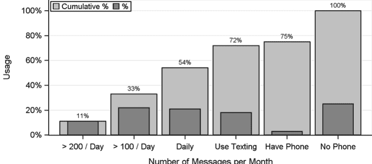

图 1.2

基于共同基准的线性刻度幅度比较是非常可靠的。如上图 1.2 所示，将相同的数据渲染为柱状图要更容易进行初始解码。在图中，百分比案例中第 2、第 3 和第 4 柱子之间的比较要容易且可靠得多。

饼图在某些用例下是很有用的视觉工具，如图 1.3 所示。该图显示了汽车销售额占总销售额的比例。饼图有助于可视化“部分与整体”的比较。

## 1.1.1 视觉感知

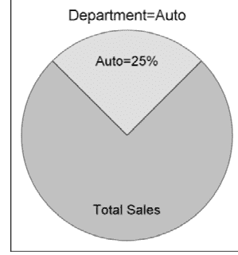

Daniel Carr 在 Colin Ware 著的《信息可视化：设计的感知》（*Information Visualization: Perception for Design*, 2004）一书中总结了注意视觉和前注意视觉的概念。注意视觉需要对对象进行仔细观察，并需要观察者的主动参与。

另一方面，前注意视觉处理是在意识注意力之前完成的。使用前注意特征有助于快速区分图表中的各种产物。

图 1.3

线条长度的差异无论是否有共同基准线都是前注意的。

在图 1.4 中，比较所有药物的响应幅度是相对容易的。图 1.5 中的线段是从不同的基准线绘制的，但仍然可以比较每种药物每个线段的幅度。

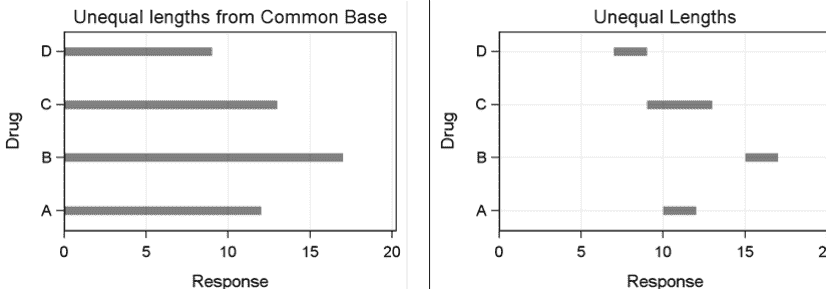

图 1.4

图 1.5

标记形状和线条模式的区分是前注意的。当使用标记形状或线条模式用作分组指标时（如图 1.6 和 1.7 所示），可以很容易地区分组。

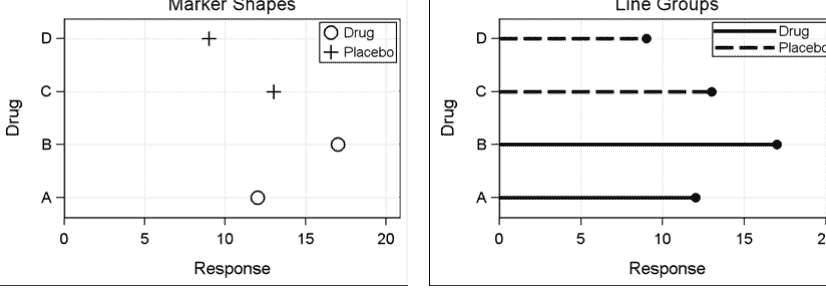

图 1.6

图 1.7

基于它们的前注意特性（解码的容易性），我们得出以下结论：

- 距离共同基准的距离对于幅度比较是有效的。
- 标记形状对于分类是有效的。
- 线条模式对于分类是有效的。
- 颜色也是分类的有效工具，但由于本书是以灰度模式出版的，我们没有利用这一特性。

Matange, Sanjay and Heath, Dan. Statistical Procedures by Example: Effective Graphs Using SAS®. Copyright 2011, SAS Institute Inc., Cary, North Carolina, USA. ALL RIGHTS RESERVED. 获取更多 SAS 资源，请访问 support.sas.com/publishing。

## 1.1.2 幅度感知的准确性

史蒂斯幂律描述了物理刺激幅度与其感知强度或力量之间的关系。该定律认为视觉长度的幅度感知准确性是线性的。长度两倍的线被感知为几乎也是两倍。然而，其他表示方式的幅度感知准确性会降低。例如，面积仅为 1.6 左右。这意味着两倍大的面积看起来只大了 1.6 倍，因此我们低估了面积。

关于幅度的表示，我们可以得出以下结论：

- 共同刻度和基准线上的线性距离最有效。
- 共同但未对齐刻度上的线性距离是有效的。
- 面积的有效性仅为线性距离的 70%。
- 体积的有效性约为线性距离的 60%。
- 共同基准线的角距离并不有效。
- 非共同基准线的角距离无效。
- 一般来说，颜色不是幅度的有效表示方法。
- 颜色强度可以作为幅度的相对测量。
- 颜色相不是幅度的良好表示方法。
- 3D 图扭曲对绝对幅度的感知。

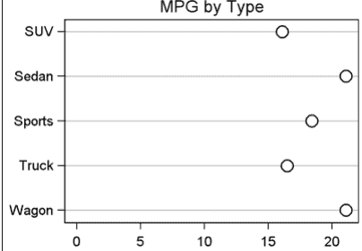

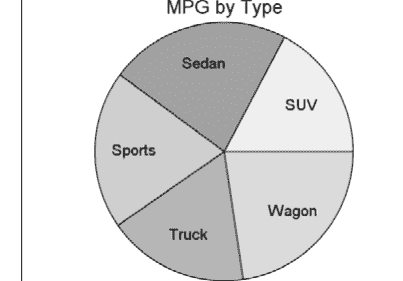

图 1.8 和图 1.9 都显示了不同类型汽车的平均油耗（MPG）。图 1.8 使用散点图，将响应值绘制为距离共同基准的线性距离。眼睛很容易解码每种汽车类型的相对值。网格线有助于对齐数值。

图 1.9 使用饼图显示了相同的数据。显然，解码相对值要困难得多，因为很难使用角距离进行良好的幅度比较，尤其是从不同的基准线开始。

Matange, Sanjay and Heath, Dan. Statistical Graphics Procedures by Example: Effective Graphs Using SAS®. Copyright 2011, SAS Institute Inc., Cary, North Carolina, USA. ALL RIGHTS RESERVED. 获取更多 SAS 资源，请访问 support.sas.com/publishing。

## 1.1.3 3D 图的使用

图 1.10 和图 1.11 都显示了不同类型汽车的平均油耗（MPG）。图 1.10 使用柱状图显示数据。眼睛很容易解码每种汽车类型的相对值。网格线有助于对齐数值。

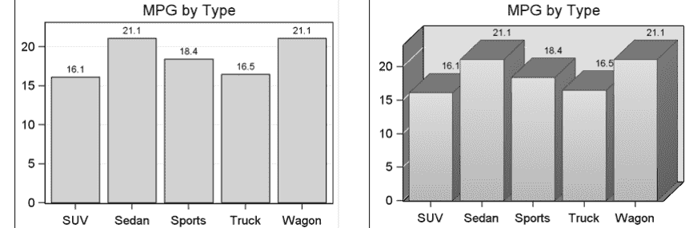

图 1.10

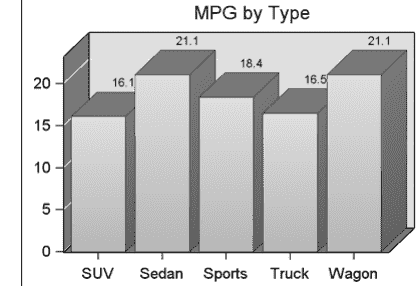

图 1.11

图 1.11 使用饼图显示了相同的数据。显然，解码相对值要困难得多，因为很难使用角距离进行良好的幅度比较，尤其是从不同的基准线开始。

3D 表示存在几个潜在的陷阱。第三维度是人为添加的，使柱体出现。使用美学特征有时会抑制数据的解码。

通常情况下，可以得出以下结论：

- 散点图和柱状图适用于幅度。
- 饼图和面积图对于幅度并不是理想的。
- 颜色强度不是幅度的有效表示方法。
- 当数据是二维时，3D 表示是不有效的。
- 不显眼的网格线有助于数据的解码。

## 1.1.4 接近性提高比较准确性

当你比较类别之间的幅度时，更近的接近性会提高比较的准确性。对于有效的图表，将要比较的项目尽可能放在彼此之间是有帮助的。

| 按类型比较油耗 | | 按产地比较油耗 |
| :--- | :--- | :--- | :--- |
| 亚洲 | 美国 | 轿车 | 运动跑 |
| 22.8 | 20.2 | 22.8 | 20.6 |
| | | | 16.9 |

图 1.12

图 1.12 适用于不同地区（产地）制造的轿车和运动跑汽车的油耗比较。将这些类别靠近可以促进对汽车类型的比较。在图中比较美国的轿车要困难得多，图 1.13 更适用于这种以“产地”作为类别的比较。

## 1.1.5 简化并减少杂乱

爱德华·塔夫（Edward Tufte）创建有效图表的原则包括以下建议：

1. 消除“图表垃圾”（chart junk）。
2. 最大化“数据墨水”。

在为营销和销售演示创建图表时，人们希望图表在视觉上具有吸引力。为了增加这种“哇”的效果，可能会在图中添加视觉元素以使其更具美学吸引力。如果不小心，这些产物可能会引入干扰，更糟糕的是实际上会扭曲图表，使得数据更难以准确解码。

通过移除图中不必要的产物可以增强图表的有效性。避免使用渐变背景和图像。


## 1.1.6 短期记忆

通常，人们发现很难一次吸收并保留大量的数据值。短期记忆的能力是有限的。将数据分成较小的块（chunks）有助于处理信息。该领域的研究表明：

- 普通人可以轻松地记住 3-5 块信息。
- 普通人可以在脑海中对 2 位数进行数学计算。
- 过度的眼球运动会降低解读图表的效率。

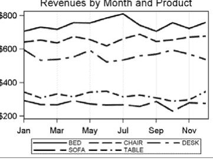

图 1.14

上述两张图都显示了随时间变化的产品收入。数据按产品分组，每个分组代表一种产品。图 1.14 在图表底部使用传统的图例识别每个产品。

为了比较桌子和椅子的收入，你必须将视线移动到图例，然后回到图表区域。图 1.15 为每个系列使用了直接标签。这消除了眼球运动，从而使数据比较更加容易。

图 1.15

## 1.1.7 总结

你可以使用上述指南来创建能够最大程度传递信息并减少干扰的图表。总而言之，我们建议你：

- 使用与共同基准线的距离来表示幅度。
- 使用标记或线条模式进行分组。
- 简化图表的外观并减少不必要的墨水。
- 增加数据的相邻性以进行更好的比较。
- 减少解读数据所需的眼球运动。

SG 过程提供了实现上述指南所需的功能。

## 1.2 从 SAS 过程自动生成图表

现在让我们看看如何使用 SAS 获取有效的图表。从 SAS 9.2 开始，许多 SAS 分析过程使用输出交付系统 (ODS) 图形系统来自动生成图表。当启用 ODS 图形系统时，这些图表将随数据按照正确的顺序生成，并包含在输出文件中（如 PDF 文档）。

要从 SAS 9.2 分析过程中创建图表，你只需要在运行过程之前开启 ODS 图形系统。这是通过在程序中包含以下语句实现的。不需要额外的图表代码。

```
ods graphics / < options >;
< procedure statements;
ods graphics off;
```

```
proc reg data=sashelp.class;
model Weight = Height;
quit;
```

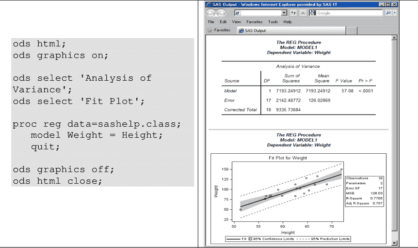

图 1.16

图 1.16 显示了使用 REG 过程作为示例方法。在这个示例中，我们通过 ODS SELECT 语句专门请求了方差分析表和拟合图（Fit Plot）。生成的 HTML 输出如图 1.17 所示。方差分析表和拟合图生成在输出的 HTML 文件中。

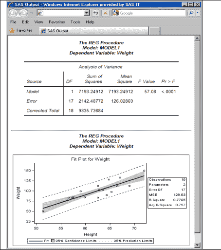

图 1.17

Matange, Sanjay and Heath, Dan. Statistical Procedures by Example: Effective Graphs using SAS®: Copyright © 2011, SAS Institute Inc., Cary, North Carolina, USA. 版权所有。如需更多 SAS 资源，请访问 support.sas.com/publishing。

值得重复的是，拟合图是自动生成的，用户无需编写任何图表代码。需要注意的是，这些过程必须运行额外的处理步骤来创建这些图表。某些过程可能会创建大量图表，在使用此选项时需要考虑这一点。

在 SAS 9.3 中，当在 DMS 模式下运行时，默认输出目标是 HTML，且默认开启 ODS 图形功能。对于列表模式（line mode），默认输出目标是 LISTING。

## 1.3 图模板语言 (GTL)

图模板语言（Graph Template Language, GTL）允许用户通过声明式的语法来构建复杂的图表。虽然 ODS 图形可以自动生成图表，但 GTL 提供了更精细的控制能力。当你需要高度自定义的图表布局时，GTL 是更好的选择。


SG 过程利用构建块方法来创建图表。如果你看到两个图表分别包含了你想要在同一个图表中包含的元素，那么你很有可能可以将一个过程步骤中的语句合并，从而获得所需的组合图表。

例如，你可以将不同示例中的散点图、系列图和各种回归图语句合并到一个过程步骤中。一些常见的组合如下：

- 散点（Scatter）、系列（Series）、阶梯图（Step）、带状图（Band）、回归（Regression）、椭圆（Ellipse）、VBarParm 和 HBarParm
- 直方图（Histogram）和密度图（Density）
- 柱图（Bar Chart）、折线图（Line Chart）和点图（Dot Plot）

本书的结构如下：

- 在第 2 章中，我们从对每个过程的通用描述开始。这将展示语法结构和主要特征，并配以少量示例。从那里开始，专注于示例，从单单元图开始，然后转向更复杂的情况。
- 在第 3 章中，我们将回顾在各个领域常用的图表。本节涵盖了你可以创建的不同图表类型。我们将绘图选项的讨论推到了后续章节。
- 在第 4-7 章中，我们将涵盖使用 SGPLOT 过程的主要单单元图组。这些图表中所使用的绘图语句可以在组内组合以创建你所需的图表。使用了各种支持的选项来演示这些功能。
- 在第 8 章中，我们涵盖了轴、图例和内部区域的常用自定义。
- 在第 9 章中，我们涵盖了注释（annotation）和属性映射（attribute maps）主题。注释允许你向图表添加可能并非数据驱动的图形元素。属性映射提供了将颜色、符号和线型等绘图属性绑定到数据值的能力。这些用于图表详细定制的强大功能已包含在 SAS 9.3 中。
- 在第 10 章中，我们将涵盖使用 SGPanel 过程的分类面板。该过程利用了你学到的关于单单元图的所有知识，生成按多个分类变量分类的图表。
- 在第 11 章中，我们将使用 SGATTER 过程涵盖比较散点图和散点矩阵。
- 在第 12 章中，我们将涵盖健康和生命科学行业常用的图表。
- 在第 13 章中，我们将涵盖一些特殊的业务图表。在这里，你将找到结合之前章节特征来创建图表的详细示例。
- 在第 14 章中，我们将涵盖样式（styles）主题。在这里你将看到样式的内部运作以及样式元素与图表特征之间的关联。我们将涵盖为图表创建自定义自定义样式的基础知识。
- 在第 15 章中，我们涵盖了 ODS DESTINATION 语句中对图表渲染有直接影响的选项。我们还回顾了可以在 ODS GRAPH 语句上设置的用于控制图表渲染方面的选项。
- 在第 16 章中，我们将涵盖如何创建适用于不同用例的图表。通常，创建图表是为了放入 Microsoft PowerPoint 演示文稿的整页幻灯片，或者用于打印期刊的 Microsoft Word 文档中的 3-1/4 英宽。我们将提供一些如何创建适用于此类情况图表的提示。

## 1.6 数据集和自定义样式

书中的大多数示例使用 SASHELP 库中提供的预定义 SAS 数据集。这些包括 CARS、HEART 以及其他几个。通常，为了减少分类器的数量以便使图表适应有限的空间，会使用包含这些数据集数据样本的修改后的数据集。在其他情况下，需要适用于示例图表的自定义数据集。

自定义样式有时用于渲染书中的某些图表。主要地，这些样式是为了减小字体大小以将图表放入有限的可用空间。你的结果可能会根据 ODS 目的地的活动样式而变化。

## 1.7 颜色和灰度图表

由 SG 过程以及通用的 ODS Graphics 系统创建的图表使用打开的目的地的活动样式。通常，这些样式针对全彩色输出进行了优化。当图表在彩色媒介中被消费时，这种效果很好。

然而，当彩色图表以灰度模式打印时，图表中不同类别的表示保真度会大幅损失。例如，一个具有两个系列图的图表（一个用于药物 A，一个用于药物 B）在彩色下可以用两种不同的颜色（例如红色和蓝色）很好地表示。这些颜色通常被设计为具有相等的权重，以避免无意的偏见。

当此类图表以灰度模式打印时，除非它们具有线型和标记形状等其他区分特征以便于组别间的区分，否则这两个图看起来看起来非常相似。柱图可以从填充色的使用中受益以促进区分。

本书是灰度打印的，因此创建在灰度格式下打印良好的图表至关重要。为了确保这一点，最好以灰度格式创建原始图表，以最大化不同类别和组别的区分度。书中包含的所有图表都是使用灰度样式（如 Journal、Journal2 或 Journal3）或源自这些样式的创建的。

当你运行书中的程序或自己的程序时，图表将使用打开的目的地的活动样式渲染。对于 SAS 9.2，这是 LISTING 目的。对于 DMS 会话中的 SAS 9.3，这是 HTML 目的。由于这两个目的使用默认颜色样式，你将获得全彩色渲染的图表。要获得灰度图，请使用上述样式之一。

ODS GRAPHICS 语句的 WIDTH 或 HEIGHT 选项已用于渲染本书的图表。然而，示例代码未使用这些选项。当你运行相同的代码时，图表将以默认大小渲染。

## 1.8 有效图表和皮肤的使用

如前所述，SG 过程专门以及通用的 ODS Graphics 都是根据有效图表的原则设计的。默认情况下，这些过程总是力求以最大的清晰度和最小的干扰创建图表。

尽管最初为统计用户设计，但这些过程在非统计领域的使用日益增多。在这些用例中，人们往往追求更华丽的图表，即使牺牲了有效性。

在 SG 过程中，图表语句支持一种为条形应用装饰皮肤（skin）的选项。这不会改变条形的样式，但提供了更华丽的渲染。书中的某些示例可以根据用户的意愿演示此功能。其主要目的是为了展示这些功能。

## 1.9 SAS 9.2 和 SAS 9.3 功能

本书假设用户拥有 SAS 9.2 (TS2M0) 或更高版本。书中的示例包含了 SAS 9.2 (TS2M0) 和 SAS 9.3 特性的使用。使用 SAS 9.3 添加功能的示例将用 9.3 图标标记，特定的语句或选项将加粗斜体。

在某些情况下，你可以删除新选项并使用 SAS 9.2 运行相同的代码。


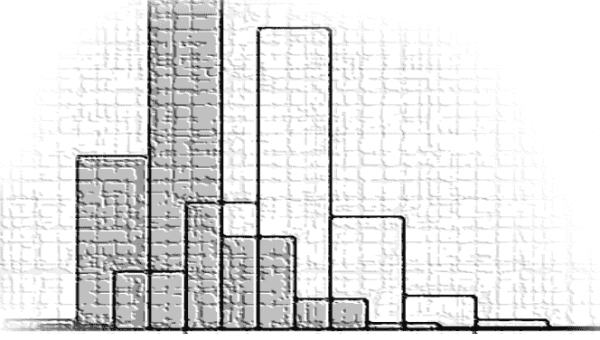

> “简单的事情应该是简单的。复杂的事情应当是可能的。” ~ Alan Kay

Matange, Sanjay and Heath, Dan. Statistical Graphics Procedures by Example: Effective Graphs Using SAS®. Copyright © 2011, SAS Institute. Inc., Cary, North Carolina, USA. 版权所有。如需更多 SAS 资源，请访问 support.sas.com/publishing。

# 第 2 章：统计图过程

在本章中，我们将介绍 SG 过程的关键概念和通用语法。

SG 过程提供了进入 ODS Graphics 系统的直接过程接口。这些过程可以使用极少的代码创建图表。SGPLOT 和 SGPANEL 过程的语法允许您通过绘图语句（plot statements）和其他功能来构建复杂的图表。SSCGCATTER 过程的语法旨在通过单语句访问各种散点图面板和矩阵。

## 2.1 核心概念

这些过程创建的图表可以分为三大类：单单元图表、多单元分类面板和多单元比较散点图。这些类别将在后续章节中讨论。

### 2.1.1 单单元图表 (SGPLOT 过程)

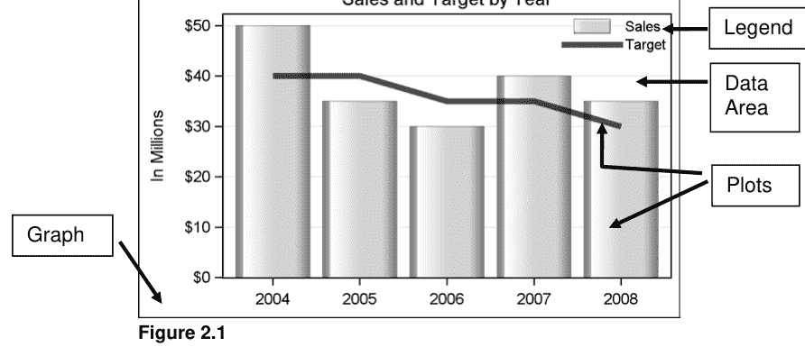

图 2.1

- 图 2.1 显示了使用以下组件构建的典型单单元图表：
- 图表顶部的一个或多个标题。
- 图表底部的一个或多个脚注。
- 中间的一个显示数据的区域。
- 数据区域内的一个或多个绘图对象。
- 数据区域内部或外部的一个或多个图例或插入图。

注意：无论是系列图、散点图、柱状图、直方图等，所有语句均统称为“绘图语句 (plot)”。

图 (Graph)：指过程创建的单个输出。在大多数常见情况下，过程的每次执行都会创建一个图输出文件。通常这些过程会产生多个输出文件（由于 BY 变量的使用或大型面板的分页），每个文件都被称为一个“图 (Graph)”。

单元 (Cell)：每个图可以有一个或多个数据区域，在这些区域绘制数据，如图 2.2 所示。其中每一个都被称为一个“单元 (Cell)”。单元可能包含也不包含轴。

绘图语句 (Plot statements)：每个绘图语句负责绘制其自己的数据表示。容器会告诉它在哪里绘制以及如何对其数据进行缩放。

轴 (Axes)：X 轴和 Y 轴由图中所有的绘图对象共享。每个轴的数据范围由图表决定，并基于放置其中的所有绘图对象。每个图可以有第二组轴，称为 X2（位于顶部）和 Y2（位于右侧）。每个绘图都可以指定它想要使用的轴。

图例 (Legends)：一个图可以有一个或多个图例，每个可以放置在图表的任何部分。每个图例都可以指定其内部显示的信息。

单类图表使用 SGPLOT 过程生成。

## 2.1.2 多类分类面板 (SPANEL 过程)

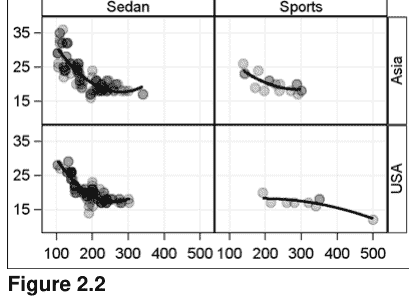

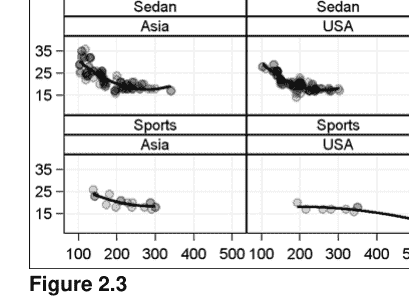

图 2.2

图 2.3

分类面板非常有助于在一个显示器中可视化由一个或多个类变量分类的数据分布。图 2.2 和 2.3 都显示了产地和汽车类型的车辆 MPG 与功率之间的关联。从这两幅图中，可以获得一些信息：

- 对于亚洲汽车和美国汽车，“轿车 (Sedan)”多于“运动车 (Sports)”。
- 图 2.2 显示美国汽车提供了更高的马力。
- 图 2.3 显示亚洲汽车提供了更高的 MPG。

Matange, Sanjay and Heath, Dan. Statistical Graphics by Example: Effective Graphs Using SAS© 2011, SAS Institute Inc., Cary, North Carolina, USA. 版权所有。如需更多 SAS 资源，请访问 support.sas.com/publishing。

图 2.2 显示具有网格布局 (Lattice layout) 的分类面板，支持两个类变量，一行一列。每行和每列都有一个显示分类变量的标题。

图 2.3 显示具有面板布局 (Panel layout) 的分类面板，支持多个类变量。面板中的每个单元都有多个标题，对应每个类变量。分类面板使用 SPANEL 过程创建。

## 2.1.3 多单元比较散点图 (SGATTER 过程)

虽然分类面板提供了跨分类比较相同数据的方便方法，但通常希望进行并排比较。

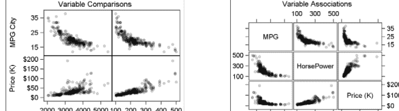

图 2.4

图 2.5

图 2.4 显示按重量和功率划分的里程比较图。该图具有公共比较轴。图 2.5 显示 MPG、马力和 MSRP 的散点图矩阵。此类矩阵可以提供变量之间直接或反向关联的视觉指示。比较图和矩阵使用 SGATTER 过程创建。

## 2.1.4 自动功能

- SG 过程检查语法并应用启发式方法来增强图形。这些操作包括：
- 当适用于叠加和分类时添加图例。
- 为特定绘图类型创建自定义图例标签。
- 为绘图语句分配不同的视觉属性。
- 自动对分类面板分页。

如果不需要启发式结果，可以将其关闭。

## 2.2 SGPLOT 过程

SGPLOT 是一个多功能过程，通过以创意方式组合支持的语句来创建各种单单元图。SGPLOT 过程支持二十种绘图语句，以及自定义图例、轴和插入的语句。

SGPLOT 过程的语法如下：

```
1. PROC SGPLOT < DATA= data-set > < options >;
2. plot-statement(s) required-parameters < / options >;
3. axis-statement(s);
4. legend-statement(s);
5. inset-statement(s);
RUN;
```

- 1. PROC SGPLOT < DATA= data-set > < options >;
- 2. plot-statement(s) required-parameters < / options >;
- 3. axis-statement(s);
- 4. legend-statement(s);
- 5. inset-statement(s);
- RUN;

- 图 (Graph)：指过程创建的单个输出。在大多数常见情况下，过程的每次执行都会创建一个图输出文件。通常这些过程会产生多个输出文件（由于 BY 变量的使用或大型面板的分页），每个文件都被称为一个“图”。

- 单元 (Cell)：每个图可以有一个或多个数据区域，如图 2.2 所示绘制其中绘制。其中每一个都被称为一个“单元”。单元可能包含也不包含轴。

- 绘图语句 (Plot statements)：每个绘图语句负责绘制其自己的数据表示。容器会告诉它在哪里绘制以及如何对其数据进行缩放。

- 轴 (Axes)：X 轴和 Y 轴由图中所有的绘图对象共享。每个轴的数据范围由图决定，并基于放置其中的所有绘图对象。每个图可以有第二组轴，称为 X2（位于顶部）和 Y2（位于右侧）。每个绘图都可以指定它想要使用的轴。

- 图例 (Legends)：一个图可以有一个或多个图例，每个可以放置在图表的任何部分。每个图例都可以指定其内部显示的信息。

单类图表使用 SGPLOT 过程生成。

- 1. PROC SGPLOT < DATA= data-set > < options >;
- 2. plot-statement(s) required-parameters < / options >;
- 3. axis-statement(s);
- 4. legend-statement(s);
- 5. inset-statement(s);
- RUN;

- 1. PROC SGPLOT < DATA= data-set > < options >;
- 2. plot-statement(s) required-parameters < / options >;
- 3. axis-statement(s);
- 4. legend-statement(s);
- 5. inset-statement(s);
- RUN;

- 1. PROC SGPLOT < DATA= data-set > < options >;
- 2. plot-statement(s) required-parameters < / options >;
- 3. axis-statement(s);
- 4. legend-statement(s);
- 5. inset-statement(s);
- RUN;

- 1. PROC SGPLOT < DATA= data-set > < options >;
- 2. plot-statement(s) required-parameters < / options >;
- 3. axis-statement(s);
- 4. legend-statement(s);
- 5. inset-statement(s);
- RUN;

- 1. PROC SGPLOT < DATA= data-set > < options >;
- 2. plot-statement(s) required-parameters < / options >;
- 3. axis-statement(s);
- 4. legend-statement(s);
- 5. inset-statement(s);
- RUN;

- 1. PROC SGPLOT < DATA= data-set > < options >;
- 2. plot-statement(s) required-parameters < / options >;
- 3. axis-statement(s);
- 4. legend-statement(s);
- 5. inset-statement(s);
- RUN;

- 1. PROC SGPLOT < DATA= data-set > < options >;
- 2. plot-statement(s) required-parameters < / options >;
- 3. axis-statement(s);
- 4. legend-statement(s);
- 5. inset-statement(s);
- RUN;

- 1. PROC SGPLOT < DATA= data-set > < options >;
- 2. plot-statement(s) required-parameters < / options >;
- 3. axis-statement(s);
- 4. legend-statement(s);
- 5. inset-statement(s);
- RUN;

- 1. PROC SGPLOT < DATA= data-set > < options >;
- 2. plot-statement(s) required-parameters < / options >;
- 3. axis-statement(s);
- 4. legend-statement(s);
- 5. inset-statement(s);
- RUN;

- 1. PROC SGPLOT < DATA= data-set > < options >;
- 2. plot-statement(s) required-parameters < / options >;
- 3. axis-statement(s);
- 4. legend-statement(s);
- 5. inset-statement(s);
- RUN;

- 1. PROC SGPLOT < DATA= data-set > < options >;
- 2. plot-statement(s) required-parameters < / options >;
- 3. axis-statement(s);
- 4. legend-statement(s);
- 5. inset-statement(s);
- RUN;

- 1. PROC SGPLOT < DATA= data-set > < options >;
- 2. plot-statement(s) required-parameters < / options >;
- 3. axis-statement(s);
- 4. legend-statement(s);
- 5. inset-statement(s);
- RUN;

- 1. PROC SGPLOT < DATA= data-set > < options >;
- 2. plot-statement(s) required-parameters < / options >;
- 3. axis-statement(s);
- 4. legend-statement(s);
- 5. inset-statement(s);
- RUN;

- 1. PROC SGPLOT < DATA= data-set > < options >;
- 2. plot-statement(s) required-parameters < / options >;
- 3. axis-statement(s);
- 4. legend-statement(s);
- 5. inset-statement(s);
- RUN;

- 1. PROC SGPLOT < DATA= data-set > < options >;
- 2. plot-statement(s) required-parameters < / options >;
- 3. axis-statement(s);
- 4. legend-statement(s);
- 5. inset-statement(s);
- RUN;

- 1. PROC SGPLOT < DATA= data-set > < options >;
- 2. plot-statement(s) required-parameters < / options >;
- 3. axis-statement(s);
- 4. legend-statement(s);
- 5. inset-statement(s);
- RUN;

- 1. PROC SGPLOT < DATA= data-set > < options >;
- 2. plot-statement(s) required-parameters < / options >;
- 3. axis-statement(s);
- 4. legend-statement(s);
- 5. inset-statement(s);
- RUN;

- 1. PROC SGPLOT < DATA= data-set > < options >;
- 2. plot-statement(s) required-parameters < / options >;
- 3. axis-statement(s);
- 4. legend-statement(s);
- 5. inset-statement(s);
- RUN;

- 1. PROC SGPLOT < DATA= data-set > < options >;
- 2. plot-statement(s) required-parameters < / options >;
- 3. axis-statement(s);
- 4. legend-statement(s);
- 5. inset-statement(s);
- RUN;

- 1. PROC SGPLOT < DATA= data-set > < options >;
- 2. plot-statement(s) required-parameters < / options >;
- 3. axis-statement(s);
- 4. legend-statement(s);
- 5. inset-statement(s);
- RUN;

- 1. PROC SGPLOT < DATA= data-set > < options >;
- 2. plot-statement(s) required-parameters < / options >;
- 3. axis-statement(s);
- 4. legend-statement(s);
- 5. inset-statement(s);
- RUN;

- 1. PROC SGPLOT < DATA= data-set > < options >;
- 2. plot-statement(s) required-parameters < / options >;
- 3. axis-statement(s);
- 4. legend-statement(s);
- 5. inset-statement(s);
- RUN;

- 1. PROC SGPLOT < DATA= data-set > < options >;
- 2. plot-statement(s) required-parameters < / options >;
- 3. axis-statement(s);
- 4. legend-statement(s);
- 5. inset-statement(s);
- RUN;

- 1. PROC SGPLOT < DATA= data-set > < options >;
- 2. plot-statement(s) required-parameters < / options >;
- 3. axis-statement(s);
- 4. legend-statement(s);
- 5. inset-statement(s);
- RUN;

- 1. PROC SGPLOT < DATA= data-set > < options >;
- 2. plot-statement(s) required-parameters < / options >;
- 3. axis-statement(s);
- 4. legend-statement(s);
- 5. inset-statement(s);
- RUN;

- 1. PROC SGPLOT < DATA= data-set > < options >;
- 2. plot-statement(s) required-parameters < / options >;
- 3. axis-statement(s);
- 4. legend-statement(s);
- 5. inset-statement(s);
- RUN;

- 1. PROC SGPLOT < DATA= data-set > < options >;
- 2. plot-statement(s) required-parameters < / options >;
- 3. axis-statement(s);
- 4. legend-statement(s);
- 5. inset-statement(s);
- RUN;

- 1. PROC SGPLOT < DATA= data-set > < options >;
- 2. plot-statement(s) required-parameters < / options >;
- 3. axis-statement(s);
- 4. legend-statement(s);
- 5. inset-statement(s);
- RUN;

- 1. PROC SGPLOT < DATA= data-set > < options >;
- 2. plot-statement(s) required-parameters < / options >;
- 3. axis-statement(s);
- 4. legend-statement(s);
- 5. inset-statement(s);
- RUN;

- 1. PROC SGPLOT < DATA= data-set > < options >;
- 2. plot-statement(s) required-parameters < / options >;
- 3. axis-statement(s);
- 4. legend-statement(s);
- 5. inset-statement(s);
- RUN;

- 1. PROC SGPLOT < DATA= data-set > < options >;
- 2. plot-statement(s) required-parameters < / options >;
- 3. axis-statement(s);
- 4. legend-statement(s);
- 5. inset-statement(s);
- RUN;

- 1. PROC SGPLOT < DATA= data-set > < options >;
- 2. plot-statement(s) required-parameters < / options >;
- 3. axis-statement(s);
- 4. legend-statement(s);
- 5. inset-statement(s);
- RUN;

- 1. PROC SGPLOT < DATA= data-set > < options >;
- 2. plot-statement(s) required-parameters < / options >;
- 3. axis-statement(s);
- 4. legend-statement(s);
- 5. inset-statement(s);
- RUN;

- 1. PROC SGPLOT < DATA= data-set > < options >;
- 2. plot-statement(s) required-parameters < / options >;
- 3. axis-statement(s);
- 4. legend-statement(s);
- 5. inset-statement(s);
- RUN;

- 1. PROC SGPLOT < DATA= data-set > < options >;
- 2. plot-statement(s) required-parameters < / options >;
- 3. axis-statement(s);
- 4. legend-statement(s);
- 5. inset-statement(s);
- RUN;

- 1. PROC SGPLOT < DATA= data-set > < options >;
- 2. plot-statement(s) required-parameters < / options >;
- 3. axis-statement(s);
- 4. legend-statement(s);
- 5. inset-statement(s);
- RUN;

图 2.6 显示了 SGPLOT 过程的典型用法。在这个示例中，我们为“Horsepower”（马力）变量创建分布语句。使用了三个独立的绘图语句，每个对应一个数据元素。这些语句按照图 2.7 所示的顺序渲染。

```
proc sgplot data=sashelp.cars;
histogram horsepower;
density horsepower;
density horsepower / type=kernel;
keylegend / location=inside

position=topright across=1;
xaxis;
run;
```


如上所述，支持的绘图语句分为四类。每个类别中的绘图语句可以在过程步骤中组合。来自“基础图”（Basic Plots）组和“拟合与置信度图”（Fit and Confidence Plots）组的绘图也可以组合。

根据需要可以使用 INSET、REFLINE 和 KEYLEGEND 语句将这些内容添加到图表中。

轴语句可用于自定义四个轴中的任意一个：

- XAXIS 位于图表的底部。
- YAXIS 位于图表的左侧。
- XAXIS 位于图表的顶部。
- YAXIS 位于图表的右侧。

## 2.3 SGPANE 过程

SGPANE过程将SGPLOT过程的功能扩展到分类面板，使用一个或多个分类变量。图 1.12 和图 1.13 中之前的示例是使用 SGPANE 过程创建的分类面板。

SGPANE过程的语法如下：

```
1. PROC SGPANE DATA=data-set < options >;
2. PANELBY classvar < classvar2 < classvarN > / options >;
3. < plot-statement (s) >;
4. < refine-statement (s) >;
< inset-statement (s) >;
< axis-statement (s) >;
< keylegend-statement (s) >;
RUN;
```

- 1. 过程语句支持多个选项，这些选项将在后续章节的示例中演示。
- 2. PANELBY语句是必需的，必须放置在任何绘图、精炼、插入、轴或图例语句之前。该语句用于设置布局类型和其他控制单元格整体分面板的选项。
- 3. 使用一个或多个绘图语句来表示数据。每个绘图语句都有自己的一套数据角色和选项，将在后续章节中详细说明。该过程支持与SGPLOT过程的大多数绘图语句。
- 4. 支持的语句可自定义图表：
    a. 参考线 (Reference Lines)
    b. 轴 (Axes)
    c. 图例 (Legends)

图 2.10 显示了用于创建分类面板的绘图语句，该面板显示按产地和类型划分的里程分布。生成的图如图 2.11 所示。

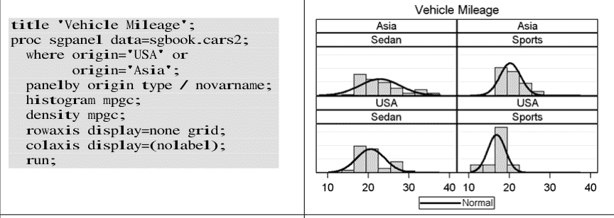

图 2.10

图 2.11

图 2.10 中的程序代码包含以下项目：
PANELBY语句是必需的，必须位于任何绘图、轴、参考线或图例语句之前。
两个绘图语句 HISTOGRAM 和 DENSITY 定义了用于填充面板每个单元格的“原型”。
ROWAX 和 COLAXIS语句用于自定义行轴和列轴。

PANELBY语句必须提供一个或多个分类变量。过程根据分类变量唯一值的所有交叉自动将图表区域划分为多个单元格。在图 2.10 中，我们指定了分类变量“Origin”（产地）和“Type”（类型），每个有两个唯一值。因此，我们得到了一个具有四个单元格的图，如图 2.11 所示。每个单元格有两个标题。

图中的每个单元格使用过程语法中指定的相同绘图语句填充。在这种情况下，每个单元格都有一个 HISTOGRAM 和一个 DENSITY 图。

每个单元格的数据是基于该单元格的分类值的子集。在图 2.11 中，标题为“Asia”的单元格显示 Origin='Asia' 的数据子集。

ROWAXIS 和 COLAXIS 等非绘图语句用于自定义公共轴。根据语法检查自动创建图例。

由此过程创建的所有图具有共同的外部轴：

- 所有列的 x 轴是统一的。
- 所有行的 y 轴是统一的。
- 在行或列中可以设置 Uniform 选项。

SPANEL过程支持多种布局类型，将在后续章节中描述。

### 2.3.1 PANEL 布局

这是默认布局类型。该布局支持一个或多个 (N) 分类变量。为所有分类变量唯一值的每个交叉点创建一个单元格。图 2.12 显示了一个具有两个分类变量的图，每个有 2 个级别，导致产生一个具有 4 个单元格的图。

| Vehicle Mileage | |
|---|---|
| Asia | Asia |
| Sedan | Sports |
| USA | USA |
| Sedan | Sports |
| 10 20 30 | 10 20 30 40 |
| | Normal |

图 2.12

Matange, Sanjay and Heath, Dan. Statistical Graphics Procedures by Example: Effective Graphs Using SAS®. Copyright © 2011, SAS Institute Inc., Cary, North Carolina, USA. ALL RIGHTS RESERVED. For additional SAS resources, visit support.sas.com/publishing.

具有面板布局的图具有以下特征：

- 每个单元格有 N 个单元格标题，每个分类变量对应一个，显示每个单元格的值。
- 默认情况下，只显示有数据的单元格。没有任何数据的单元格将从图表中删除。可以使用选项来显示所有单元格。
- 过程自动决定网格的行和列数。当图表有许多单元格时，过程将自动将图拆分为多个“页”，以防止单元格变得太小。
- 可用选项允许用户控制图表的“分页”。

## 2.3.2 Lattice (晶格布局)

这种布局需要两个分类变量。第一个分类变量被视为列变量，第二个被视为行变量。见图 2.13。

- 列变量的每个唯一值在网格中创建一列。
- 行变量的每个唯一值在网格中创建一行。
- 每个单元格获得一个列标题，默认在顶部。
- 每行获得一个行标题，默认在右侧。
- 使用共同的行和列轴。
- 列和行变量值的每个交叉点都显示为一个单元格，无论其是否有数据。

| Vehicle Mileage | |
|---|---|
| Asia | USA |
| Sedan | |
| Sports | |
| 10 20 30 | 10 20 30 30 |

图 2.13

Matange, Sanjay and Heath, Dan. Statistical Procedures by Example: Effective Graphs Using SAS®. Copyright © 2011, SAS Institute Inc., Cary, North Carolina, USA. ALL RIGHTS RESERVED. For additional SAS resources, visit support.sas.com/publishing.

## 2.3.3 COLUMNLATTICE (列布局)

这是一种特殊情况，其中列表中只提供了一个分类变量。这种布局产生单列排列的面板。如图 2.14 所示。

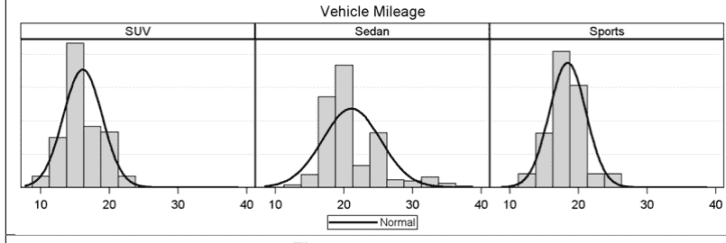

图 2.14

## 2.3.4 ROWLATTICE (行布局)

这是一种特殊情况，其中列表中只提供了一个分类变量。这种布局产生单行排列的面板。如图 2.15 所示。

## 2.3.5 自动分页 (Automatic Paging)

分类面板提供了一种通过多个变量显示数据的方便方法。当面板中的单元格少于十个时，这种方法效果良好。然而，随着单元格数量增加，单元格会变得太小。在某个点，单元格小到无法显示内容，SPAN过程会自动将图“分页”，以保持合理的单元格大小。

图 2.15

## 2.3.6 组合语句 (Combining Statements)

基础图语句和拟合图语句可以自由组合。根据语法检查，只有特定的组合是允许的。图 2.16 显示了这些组合。

| Basic Plots | |
|---|---|---|---|---|---|---|---|---|---|---|---|---|---|---|---|
| | | | | | | | | | | | | | | | | |
| | | | | | | | | | | | | | | | | |
| | | | | | | | | | | | | | | | | |
| | | | | | | | | | | | | | | | | |
| | | | | | | | | | | | | | | | | | |
| | | | | | | | | | | | | | | | | | |
| | | | | | | | | | | | | | | | | | |
| | | | | | | | | | | | | | | | | | |
| | | | | | | | | | | | | | | | | | |
| | | | | | | | | | | | | | | | | | |
| | | | | | | | | | | | | | | | | | |
 | | | | | | | | | | | | | | | | | | |
| | | | | | | | | | | | | | | | | | | |
| | | | | | | | | | | | | | | | | | | |
| | | | | | | | | | | | | | | | | | | |
| | | | | | | | | | | | | | | | | | | |
| | | | | | | | | | | | | | | | | | | |
| | | | | | | | | | | | | | | | | | | |
| | | | | | | | | | | | | | | | | | | |
| | | | | | | | | | | | | | | | | | | |
| | | | | | | | | | | | | | | | | | | |
| | | | | | | | | | | | | | | | | | | |
| | | | | | | | | | | | | | | | | | | |
| | | | | | | | | | | | | | | | | | | |
| | | | | | | | | | | | | | | | | | | | |
| | | | | | | | | | | | | | | | | | | | |
| | | | | | | | | | | | | | | | | | | | |
| | | | | | | | | | | | | | | | | | | | |
| | | | | | | | | | | | | | | | | | | | |
| | | | | | | | | | | | | | | | | | | | |
| | | | | | | | | | | | | | | | | | | | |
| | | | | | | | | | | | | | | | | | | | |
| | | | | | | | | | | | | | | | | | | | |
| | | | | | | | | | | | | | | | | | | | |
| | | | | | | | | | | | | | | | | | | | |
| | | | | | | | | | | | | | | | | | | | |
| | | | | | | | | | | | | | | | | | | | | |
| | | | | | | | | | | | | | | | | | | | | |
| | | | | | | | | | | | | | | | | | | | | |
| | | | | | | | | | | | | | | | | | | | | |
| | | | | | | | | | | | | | | | | | | | | |
| | | | | | | | | | | | | | | | | | | | | |
| | | | | | | | | | | | | | | | | | | | | |
| | | | | | | | | | | | | | | | | | | | | |
| | | | | | | | | | | | | | | | | | | | | |
| | | | | | | | | | | | | | | | | | | | | |
| | | | | | | | | | | | | | | | | | | | | | |
| | | | | | | | | | | | | | | | | | | | | | | |
| | | | | | | | | | | | | | | | | | | | | | | |
| | | | | | | | | | | | | | | | | | | | | | | |
| | | | | | | | | | | | | | | | | | | | | | | |
| | | | | | | | | | | | | | | | | | | | | | | |
| | | | | | | | | | | | | | | | | | | | | | | |
| | | | | | | | | | | | | | | | | | | | | | | |
| | | | | | | | | | | | | | | | | | | | | | | |
| | | | | | | | | | | | | | | | | | | | | | | |
| | | | | | | | | | | | | | | | | | | | | | | |


## 2.5 SGSCATTER 过程

SGSCATTER 过程针对对比散点图和散点矩阵的创建进行了优化。PROC SGSCATTER 不像 SGPLOT 和 SGPAN 过程那样分层架构。相反，PROC SGSCATTER 支持三种不同的语句，所示。图 2.4 和图 2.5 之前显示的示例都是使用 SGSCATTER 过程创建的。

SGSCATTER 过程的语法如下：

```
1 PROC SGSCATTER < DATA= data-set < options >;
2. PLOT < options >;
3. COMPARE X=(variable(s)) Y=(variable(s)) < options >;
4. MATRIX variable(s) < options >;
5. RUN;
```

- 1. 过程语句支持多个选项，这些选项将在后续章节的示例中演示。
- 2. PLOT 语句根据绘图请求在图中创建一组排列在均匀网格中的单元格。每个单元格包含一个独立的散点图，以及可选的拟合线和椭圆。如果需要，可以使所有图的坐标轴保持一致。图 2.17 和图 2.18 显示了 PLOT 语句的示例。两个 Y 轴是不一致的。

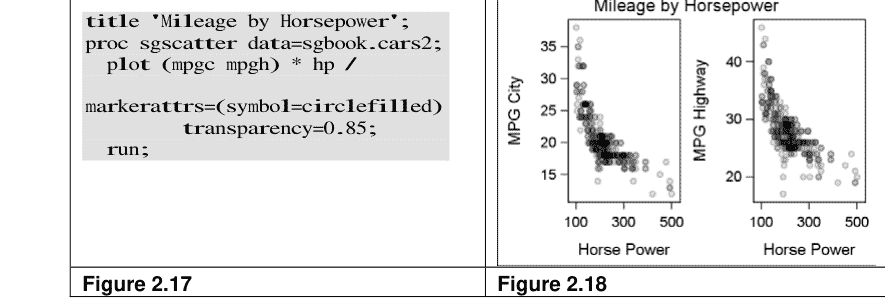

图 2.17

图 2.18

Matange, Sanjay and Heath, Dan. Statistical Graphics Procedures by Example: Effective Graphs Using SAS®. Copyright © 2011, SAS Institute Inc., Cary, North Carolina, USA. 版权所有。有关更多 SAS 资源，请访问 support.sas.com/publishing。

- 3. COMPARE 语句根据 X 和 Y 变量列表在图中创建行列网格单元。每个单元格包含一个散点图，以及可选的拟合线和椭圆。网格的每行都有共同的外部 y 轴。网格的每列都有共同的外部轴。可以使用选项来自定义图表。图 2.19 和图 2.20 显示了 COMPARE 语句的示例。

| title 'Variable Comparisons': | 变量比较 |
|---|---|
| proc sgscatter data=sgbook.cascars2; compare x=(mpg mpg) y=(hp)/ markerattrs=(symbol=circlefilled) transparency=0.8 grid; |  |
| 图 2.19 | 图 2.20 |

- 4. MATRIX 语句根据指定的变量列表创建行列网格单元。每个单元格包含一个散点图，以及可选的拟合线和椭圆。网格的每行和每列都有外部轴。图 2.21 和图 2.22 显示了 MATRIX 语句的示例。

| title 'Variable Associations': | 变量关联 |
|---|---|
| proc sgbook data=sgbook.cascars2; matrix mpgc weight hp msrp markerattrs=(symbol=circlefilled) transparency=0.9; |  |
| 图 2.21 | 图 2.22 |

## 2.6 样式及其用法

由 SG 过程创建的图表使用构成图形各种元素的预定义的视觉属性。这些信息定义在 ODS 样式中，这些样式在设计时充分考虑了美观性和有效性。这确保了图表默认具有美观的外观。这也确保了图表的各种元素之间是平衡且互不干扰的。这是通过使用 ODS 样式实现的。

样式是命名元素的集合。每个元素都是视觉属性的束，如颜色、字体、标记符号等。任何到 ODS 目的地的输出都从活动样式中派生必要的视觉信息。例如，输出表格从样式中派生标题字体和背景颜色，以及标题的大小和颜色的视觉属性。

图表还从样式中派生颜色、标记符号、线条粗细、轴标签字体视觉属性。可以通过以下方式控制图的视觉外观：

- 1. 使用预定义的样式。
- 2. 使用自定义样式。
- 3. 使用选项。

**1. 使用预定义的样式：** 每个 ODS 目的地都有默认样式。写入该目的地的图都使用该样式。你可以通过为目的地设置样式选项来更改活动样式。

```
destination style=style-name;
```

**2. 使用自定义样式：** 如果你喜欢定义的 SAS 样式，但希望更改某些外观设置，可以使用 TEMPLATE 过程从 SAS 样式派生新样式。有关此主题的更多信息，请参见 ODS 产品文档。

**3. 使用选项：** 目的地样式影响写入该目的地的图的所有特征。通过设置过程中的特定选项来自定义图的特定特征。这仅在该特定情况下覆盖样式设置。

这些选项的使用将在书中许多示例中显而易见。有关此主题的更多信息见第 14 章。

## 2.7 基于模板的图形与设备图形

SG 过程在 ODS 图形内部工作并使用 GTL 进行图形渲染。因此，我们将这些过程称为“基于模板的图形”。其他 SAS/GRAPH® 过程（如 GPLOT 和 GCHART）将称为“设备图形”。

用户经常询问这些过程与 SAS/GRAPH® 过程有何不同。虽然我们无法涵盖差异，但在哲学、过程和技术方面的关键差异如下：

- 1. SG 过程直接创建行业标准格式输出，如 PNG、JPG、PDF、PS 等。SG 过程不创建输出。
- 2. SG 过程不遵循全局语句，如 GOPTIONS、PATTERN、SYMBOL、AXIS 或 LEGEND。然而，提供了等效的功能：
- a. 不支持 GOPTIONS 语句（重置标题和脚注的 RESET 选项除外）。
- b. 支持 TITLE 和 FOOTNOTE 语句，少数选项除外。
- c. 不支持 PATTERN 和 SYMBOL 语句。然而，直接在图上指定图类型和属性使得这些属性的应用更加清晰。
- d. 不支持 AXIS 语句。然而，PROC SGPLOT 支持四个轴语句（XAXIS、YAXIS，此处原文重复）来控制单元格周围的轴。PROC SGPanel 支持 ROWAXIS 和 COLAXIS 语句来控制其轴。PROC SGATTER 没有轴语句，但稍后将描述某些控制这些属性的技术。
- e. 不支持 LEGEND 语句。PROC SGPLOT 和 SGPanel 支持 KEYLEGEND 语句来控制图例的内容、布局和位置。PROC SGATTER 有 LEGEND 选项以提供一些图例控制。


# 第3章：常见图表

在本章中，我们将回顾许多许多领域常用的图表，从基础的散点图到复杂的比较图和分类面板。我们将在后续章节中详细讨论各种绘图选项。

## 3.1 引言

所有图表具有共同的结构：

- 顶部有一个或多个标题，底部有一个或多个脚注
- 中间有一个或多个数据的图形化表示
- 数据区域内部或外部有一个或多个图例
- 数据区域内部或外部有插图或统计表

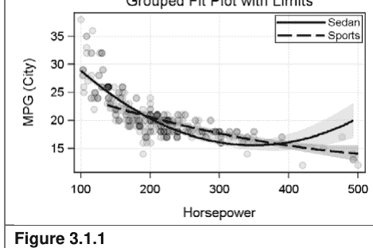

**单单元图表：** 在3.2节中，我们将使用 `SGPLOT` 过程创建单单元图表。我们将汇编所需的语法来创建类似于图 3.1.1 所示的图表。

**分类面板：** 在3.3节中，我们将使用 `SGPanel` 过程创建分类面板。一旦你学会了如何组合用于 `PROC SGPLOT` 的语句，你只需要一个 `PANELBY` 语句来设置分类变量。

**比较图和矩阵图：** 在3.4节中，我们将使用 `SGSCATTER` 过程创建比较图和矩阵图。

在本章的剩余部分，我们将广泛介绍使用 SG 过程可以创建的不同类型的图表。目标是让你接触不同类型的图表，而不深入探讨每种图的功能。我们将在后续章节中介绍这些。

## 3.2 单单元图表

### ### 3.2.1：基础散点图

这是一个关于轿车和跑车的马力与行驶里程数的基础散点图。

使用了默认选项设置，外观设置源自活动样式。

坐标轴变细，并显示了“优化”刻度值。

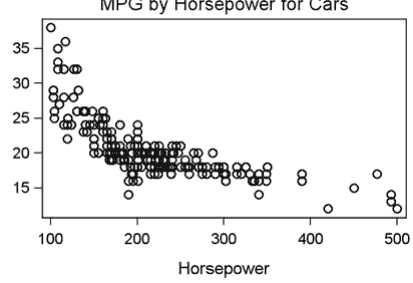

```
*MPG by Horsepower for Cars:
proc sgplot data=sasashelp.cars;
where type='Sedan' or type='Sports';
scatter x=horsepower y=city;
run;
```

### ### 3.2.2：带网格线的分组散点图

这是一个按汽车类型分组的里程散点图。每个标记的视觉属性基于组变量的唯一值。

使用 `KEYLEGEND` 语句将图例位于数据区域右上角。

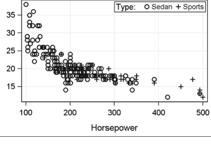

```
*MPG by Horsepower for Cars by Type:
proc sgplot data=sasashelp.cars;
where type='Sedan' or type='Sports';
scatter x=horsepower y=city/ group=type;
keylegend / title='Type': location=inside position=topright;
xaxis grid;
yaxis grid;
run;
```

Matange, Sanjay and Heath, Dan. Statistical Procedures by Example: Effective Graphs Using SAS®. Copyright ©2011, SAS Institute Inc., Cary, North Carolina, USA. ALL RIGHTS RESERVED. For additional SAS resources, visit support.sas.com/publishing.

### 图 3.2.3：拟合图

这是一个关于马力与行驶里程的拟合图。
`REG` 语句同时显示原始数据和拟合线。大量的观测值可能会遮挡拟合线并使图表混乱。

拟合线的厚度使用 `LINEATTRS` 选项进行设置。

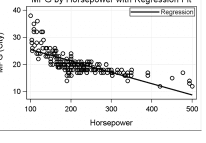

### 图 3.2.4：带透明标记的拟合图

在这个拟合图中，通过抑制 `REG` 语句中的标记并使用 `SCATTER` 语句显示带透明度的标记来减少杂乱。

使用透明度可以更好地感知数据分布。

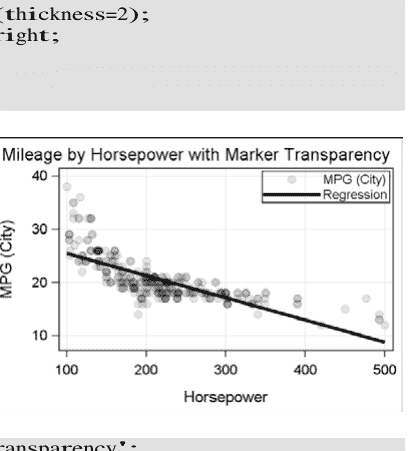

```
MPG by Horsepower with Regression Fit;
proc sgplot data=sasashelp.cars;
where type='Sedan' or type='Sports';
reg x=horsepower y=city lineattrs=(thickness=2);
keylegend / location=inside position=topright;
axis grid;
yaxis grid;
run;
```

```
Mileage by Horsepower with Marker Transparency;
proc sgplot data=sasashelp.cars;
where type='Sedan' or type='Sports';
scatter x=horsepower y=city transparency=0.9
markers=(symbol=circlefilled);
reg x=horsepower y=city lineattrs=(thickness=3);
keylegend / location=inside position=topright across=1;
axis grid;
yaxis grid;
run;
``` 图 3.2.5：带置信区间的拟合图

该拟合图使用 `REG` 语句中的 `DEGREE` 选项进行二阶拟合。置信区间由 `CLI` 和 `CLM` 请求。

默认线位于图表的右上角。


### 图 3.2.6：分组拟合图

该拟合图使用 `REG` 语句中的 `DEGREE` 选项进行二阶拟合。置信区间由 `CLI` 和 `CLM` 请求。

默认线位于图表的右上角。

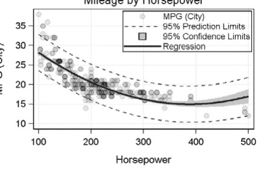 这是一个带限制的分组拟合图。默认线使用 `KEYLEGEND` 语句位于数据区域的右上角。一旦你学会了如何组合 `PROC SGPLOT` 的语句，你只需要一个 `PANELBY` 语句来设置分类变量。

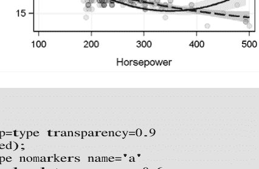

```
*MPG by Horsepower for Type;
proc sgplot data=sasashelp.cars;
where type='Sedan' or type='Sports';
scatter x=horsepower y=city group=type transparency=0.9
markers=(symbol=circlefilled);
reg x=horsepower y=city lineattrs=(thickness=2);
keylegend / location=inside position=topright across=1;
axis grid;
yaxis grid;
run;
```

### 图 3.2.7：直方图

该图使用直方图显示汽车的里程分布。启用了 y 轴。x 标签被隐藏。要显示分箱数据，请使用直方。

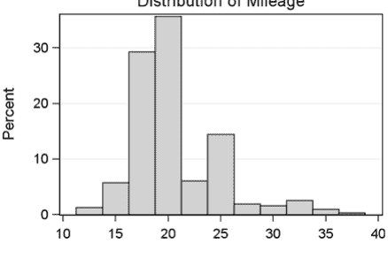

```
*Distribution of Mileage;
proc sgplot data=sasashelp.cars;
where type='Sedan' or type='Sports';
histogram;
xaxis grid;
run;
```

### 图 3.2.8：带密度的直方图

该图显示了所有汽车的马力分布以及密度曲线。图例位于右上角。

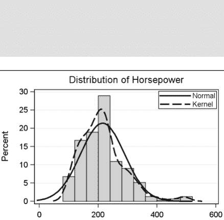

```
*Distribution of Density;
proc sgplot data=sasashelp.cars;
where type='Sedan' or type='Sports';
density;
xaxis grid;
run;
```

### 图 3.2.9：箱线 - 垂直

该图使用垂直箱线显示按类型划分的里程分布。x 轴标签被隐藏，因为已经在标题中了。

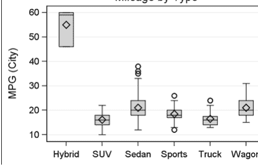

```
*Mileage by Type;
proc sgplot data=sasashelp.cars;
where type='Sedan' or type='Sports';
vbox y=city;
xaxis grid;
yaxis grid;
run;
```

### 图 3.2.10：分组箱线

该图使用水平箱线显示车辆的里程分布。图例移动到右下角。

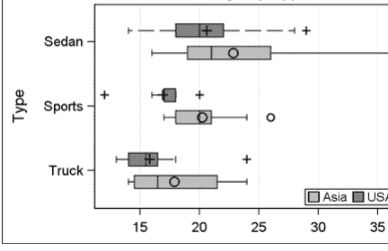

```
*Mileage by Type;
proc sgplot data=sasashelp.cars;
where type='Sedan' or type='Sports';
hbox y=city group=type;
keylegend / location=inside position=bottomright;
xaxis grid;
yaxis grid;
run;
```

### 图 3.2.11：区间箱线

该图在区间轴上显示按里程划分的马力分布。箱的宽度基于 x 轴值之间的最小间隔。

注意：区间数据的箱线图是 SAS 9.3 的功能。`XAXIS` 的 `TYPE=interval` 选项在 SAS 9.2 中可用。

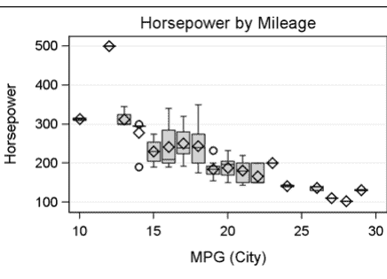

```
*Horsepower by Mileage;
proc sgplot data=sasashelp.cars;
where origin="USA";
vbox y=horsepower x=city;
xaxis type=linear;
yaxis grid;
run;
```

### 图 3.2.12：折线图

该图使用折线图显示收收价的传统股票图。x 轴标签被隐藏，因为是冗余的。使用 `WHERE` 子句仅显示股票变量的一个值的数据。

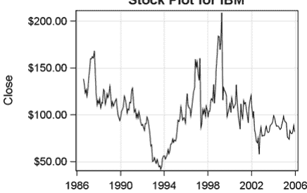

```
*Stock Plot for IBM;
proc sgplot data=sasashelp.stocks;
where stock = "IBM";
series x=date y=close;
xaxis grid;
yaxis grid;
run;
```


## 图 3.2.13: 分组序列图

此图显示了三家公司按月份划分的收盘股价图。

当数据波动频繁时，图案线条很难追踪。在这种情况下，使用颜色样式会更有效。

`ANTIALIASMAX` 设置为 1000，以防止在大量观测值的情况下禁用抗齿。

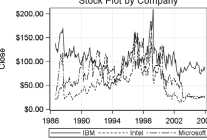

```
ods graphics / antialiasmax=1000;
title 'Stock Plot by Company';
proc sgplot data=sashelp.stocks;
series x=date y=close/group=stock;
keylegend/location=outside across=3;
axis grid display=(nolabel);
axis grid;
run;
```

## 图 3.2.14: 多响应序列图

此图使用多序列图显示了不同治疗组随时间变化的药物疗效。每个图都直接标记了标签，因此不需要图例。

该过程会自动为每个图分配视觉属性。默认情况下，轴在需要时显示年份值。

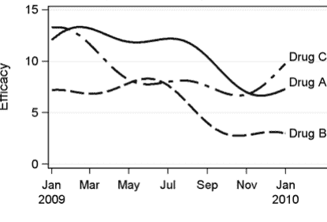

```
title 'Efficacy Over Time by Treatment Group';
proc sgplot data=sasbook.series noatelend;
series x=date y=a lineattype=(thickness=2) label='Drug A';
series x=date y=b lineattype=(thickness=2) label='Drug B';
series x=date y=c lineattype=(thickness=2) label='Drug C';
axis grid display=(nolabel);
yaxis y min=0 max=15 integer grid label1='Efficacy';
run;
```

## 图 3.2.15: 分组阶梯图

此图使用分组阶梯图显示了三家公司按月份划分的传统收盘股价图。

这与图 3.2.13 相似，但使用的是阶梯图而非序列图。

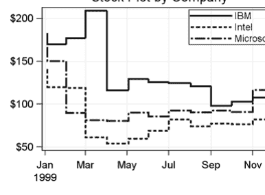

```
title 'Stock Plot by Company';
proc sgplot data=sashelp.stocks;
where date > '01Jan99' and date < '01Jan00';
format close dollar$1.0;
step update yelse=group/step lineattrs=(thickness=2);
axis grid display=(nabel);
axis grid;
keylegend location=inside position=topright across=1;
run;
```

## 图 3.2.16: 带有限制的阶梯图

此图使用阶梯图显示了教室学生按身高预测体重。

置信值显示为 Y 误差棒。`LINEATTRS` 用于设置阶梯图线的粗细，`ERRORBARATTRS` 用于设置误差棒的模式。

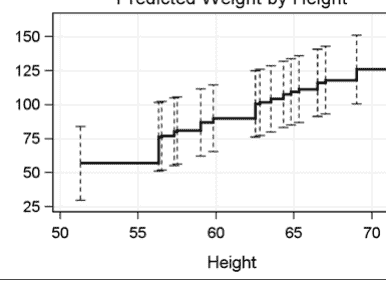

```
title 'Predicted Weight by Height';
proc sgplot data=sashelp.classfit noautlegend;
step xheight=predict y ylower=lower yerrorupper=upper
lineattrs=(thickness=2) errorbarattrs=(pattern=dash);
axis grid;
axis grid label="Weight";
run;
```

Matange, Sanjay and Heath, Dan. *Statistical Procedures by Example: Effective Graphs Using SAS®*. Copyright © 2011, SAS Institute Inc., Cary, North Carolina, USA. ALL RIGHTS RESERVED. For additional SAS resources, visit support.sas.com/publishing.

## 图 3.2.17: 带有限制的点图

此图使用点图显示了汽车的里程。平均值由点表示。显示了 95% 置信限制。

图例放在数据区域底部。为了留出空间，我们设置了 `OFFSETMAX=0.2`。这是因为点图在 Y 轴上设置了反转（REVERSE）。

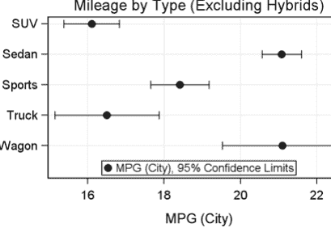

## 图 3.2.18: 向量图

此图使用向量图显示了美国轿车与 20 MPG 和 200 HP 客户偏好的关系。

向量图的 X 和 Y 起点设置为常数值，以便所有向量具有相同的起点。

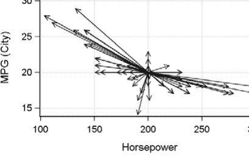

```
title 'Sedans Made in USA*'
proc sglot data=sashelp.cars;
where type='Sedan' and origin='USA';
vector x=horsepower y=mpg_city xorigin=200 yorigin=20;
axis grid;
run;
```

## 3. 分组向量图

此图使用向量图显示了颗粒位置和速度。方向（向前或向后）由 `group` 变量指示。

这里，X 和 Y 起点从数据集中分配，每个向量都有不同的终点。

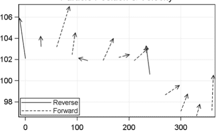

### *颗粒位置与速度*

```
proc sgplot data=sashelp.vectorgroup;
vector x=x y=y / origin=xo group=group lineattrs=(thickness=2);
xaxis grid display=(nolabel)
yaxis grid display=(nolabel)
legend=inside position=bottomleft count=1;
run;
```

## 图 3.2.20: 柱状图

这是产地划分的平均里程基础图。使用 `DATALABEL` 显示数据标签。对变量应用格式以减少标签精度。X 轴标签因为冗余被隐藏了。

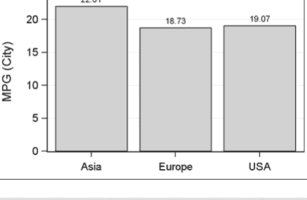

### *产地的平均里程*

```
proc sgplot data=sashelp.cars;
vbar mpg_city / databel;
xaxis (nolabel)
yaxis grid;
run;
```

## 图 3.2.21: 带有线条的分组柱状图

这是按类型划分的里程分组柱状图，产地为分组。`DISOFFSET` 设置为显示每个组的相邻柱体。

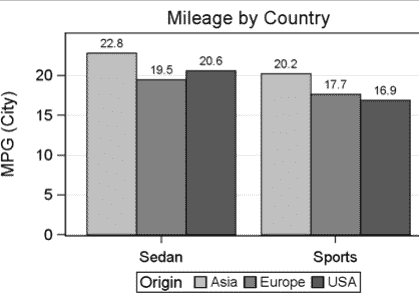

```
title 'Mileage by Group';
proc sgplot data=sashelp.cars;
where type='Sedan' or type='Sports';
vbar mpg_city / group=origin cluster databel;
axis (nolabel);
run;
```

## 图 3.2.22: 堆叠柱状图

这是按区域分组的产品堆叠柱状图。分组值默认进行堆叠。

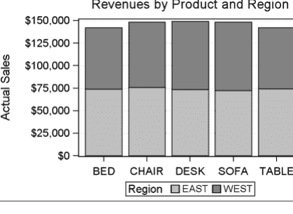

```
title 'Product by Region';
proc sgplot data=sashelp.cars;
vbar product / group=region;
axis (nolabel);
run;
```

## 图 3.2.23: 柱线叠加图

这是按季度划分的两个指标的柱线叠加。使用 `LINEATTRS` 设置粗细。

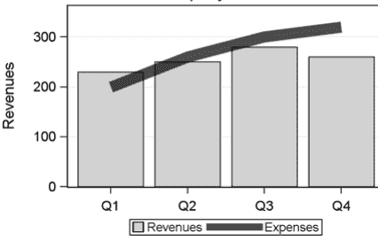

```
title 'Quarterly Finances';
proc sgplot data=sashelp.cars;
vbar quarter /
line quarter / lineattrs=(thickness=2);
axis (nolabel);
run;
```

## 图 3.2.24: 柱柱叠加图

这是按国家划分的两个指标的柱柱叠加。第二个柱体的宽度被减小了。

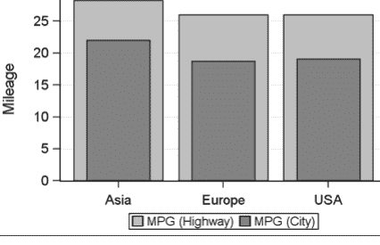

```
title 'City and Highway by Country';
proc sgplot data=sashelp.cars;
vbar origin / group=type;
axis (nolabel);
run;
```

## 图 3.2.25: 多响应柱状图

此图显示了按产地绘制的两个独立响应图。这里，使用 `DISCRETEOFFSET` 和 `BARWIDTH` 选项并排显示这两个响应。使用了 Y 轴标签。

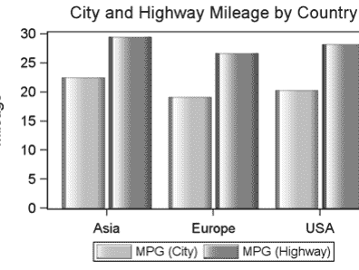

```
title 'City and Highway by Country';
proc sgplot data=sashelp.cars;
where type='Sedan' or type='Sports';
vbar origin / response=mpg_city discreteoffset=-0.2 barwidth=0.4;
vbar origin / response=mpg_high discreteoffset=0.2 barwidth=0.4;
axis (nolabel);
run;
```

## 图 3.2.26: 带有图案的柱状图

此图显示了按产地类型作为分组变量的里程垂直柱状图。分组值默认堆叠。

此图使用了 `Journal2` 样式。柱体没有填充颜色，只有填充图案。

```
ods listing style=journal2;
title "MPG by Country and Type";
proc sgplot data=sashelp.cars;
where type='Sedan' or type='Sports';
vbar origin / group=type;
axis (nolabel);
run;
```


### 图 3.2.27：带有皮肤效果的分组柱状图

此图使用 `GROUP=type` 的垂直柱状图显示里程数。`GROUPDISPLAY=cluster` 用于显示每组相邻的条形。

此图使用了 `DATASKIN=Sheen`。

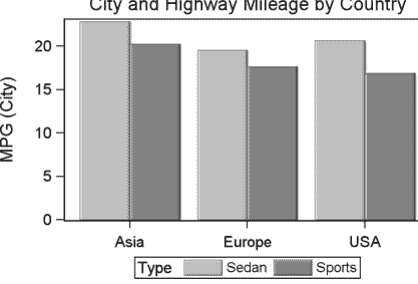

```sas
title 'City and Highway Mileage by Country';
proc sgplot data=sashelp.cars;
where type='Sedan' or type='Sports';
vbar origin / response=mpg_city stat=mean group=type
groupdisisplay=cluster dataskin=sheen transparency=0;
axis display=(nolabel);
run;
```

### 图 3.2.28：带有图案、填充颜色和皮肤效果的多柱状图

此图通过带有填充图案、填充颜色和皮肤效果的相邻条形来显示城市和高速公路数。

Journal 样式使用了颜色深浅和填充图案。`DISCRETEOFFSET` 和 `BARWIDTH` 用于将两个响应并排定位。

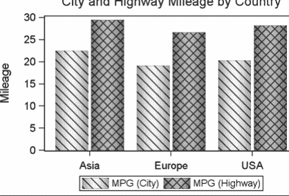

```sas
ods listing=journal;
title 'City and Highway Mileage by Country';
proc sgplot data=sashelp.cars;
where type='Sedan' or type='Sports';
vbar origin / response=mpg_city stat=mean barwidth=0.4
dataskin=pressed discreteoffset=-0.22;
vbar origin / response=mpg_highway stat=mean barwidth=0.4
dataskin=pressed discreteoffset+=0.22;
axis display=(nolabel);
axis label1='mileage';
run;
```

### 图 3.2.29：水平柱状图

这是一个按汽车类型分类里程数的基础水平柱状图，带有数据标签。

水平柱状图更适用于条形较多且刻度值较长的情况。

隐藏了 x 轴和 y 轴标签，因为是冗余的。

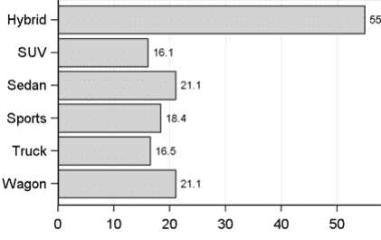

```sas
title 'Mileage by Type';
proc sgplot data=sashelp.cars;
mpg_city 5.1;
hbar type / response=mpg_city stat=mean databel;
axis grid=(nodelabel)
yaxis display=(nodelabel)
run;
```

### 图 3.2.30：带有限制的水平条形

这是一个使用 `STAT` 和 `LIMIT` 选项显示汽车类型的基础水平柱状图，带有限制条形。

通过 `DISPLAY` 选项禁用了 y 轴标签。

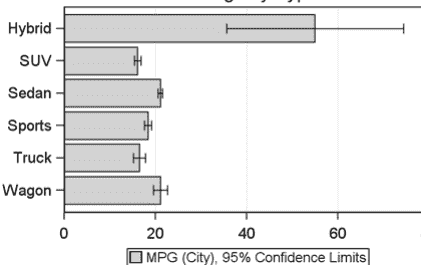

```sas
title 'Mileage by Type';
proc sgplot data=sashelp.cars;
hbar type / response=mpg_city stat=mean limits=both;
axis grid=(nodelabel)
yaxis display=(nodelabel)
run;
```

Matange, Sanjay and Heath, Dan. Statistical Procedures by Example: Effective Graphs Using SAS®. Copyright © 2011, SAS Institute Inc., Cary, North Carolina, USA. ALL RIGHTS RESERVED. For additional SAS resources, visit support.sas.com/publishing.

### 图 3.2.31：高低点图 (HighLow Plot)

股票图

这是一个按日期生成的传统股票图，使用带有 `OPEN` 和 `CLOSE` 选项的高Low 图显示最高价、最低价、开盘价和收盘价。

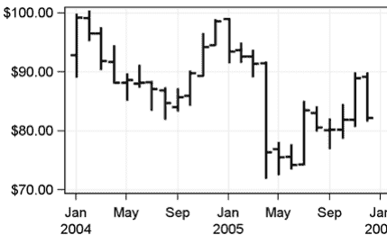

HighLow 图的默认 `TYPE` 为 'Line'。

### 图 3.2.32：高低点图 (HighLow Plot)

药物图

这是一个显示临床试验中使用药物时间的图表。绘制了每种药物的持续时间。


在此示例中，HighLow 图的 `TYPE` 设置为 'Bar'。`HIGHCAP` 和 `LOWCAP` 选项设置为 'cap' 数据以显示条形末端。

```sas
title 'Stock Plot';
proc sgplot data=sashelp.stocks;
where type='IBW' and date='01Jan2004'd;
highlow x=date high=high low / open=open close=close
lineattr(display=(noabel));
yaxis grid display=(noabel);
yaxis grid display=(noabel);
run;
```

```sas
title 'Medications Plot';
proc sgplot data=sashelp.highlow autolegend;
highlow y=drug low=high / group=drug
lineattr(pattern=solid) highcap=cap lowcap=cap
transparency=0.2 type=bar barwidth=0.4;
yaxis display=(noabel) grid;
yaxis display=(noabel) min=0 max=100 grid;
run;
```

### 图 3.2.33：气泡图 (Bubble Plot)

这是一个分组气泡图，通过大小显示响应。使用参考线来划分象限。

最大和最小响应值被映射到最大和最小气泡半径。


```sas
title 'Response Plot';
proc sgplot data=sashelp.bubble;
refline 5 / axis=x transparency=0.7;
refline 2 / axis=y transparency=0.7;
bubble yyvalue group=group transparency=0.4;
keylegend title="Drug" inside=topright;
yaxis display=(nodelabel) min=4;
yaxis display=(nodelabel) max=10;
run;
``` 图 3.2.34：气泡图

这是一个分组气泡图，通过大小显示响应。这里的气泡是不填充的，使用线条显示。使用了 Journal 样式和 `NOFILL` 选项。`BUBBLEMAX` 将图中气泡的最大大小设置为 50 像素。


```sas
title 'Response Plot';
proc sgplot data=sashelp.bubble;
bubble yyvalue group=group bubblemax=50 nofill;
keylegend title="Drug" inside=bottomleft;
yaxis display=(nodelabel) min=4;
yaxis display=(nodelabel) max=10;
run;
```### 3.3 分类面板 (Classification Panels)

#### 3.3.1：柱状图面板

这是一个使用 `origin` 作为类变量的分类面板。每个单元格包含一个按类型分类的里程柱状图。皮肤效果和透明度可以实现不同的效果。


```sas
title 'Mileage by Type and Country';
proc sgpanel data=sashelp.cars;
where (type='Sedan' or type='Sports') and (origin='USA' or origin='Asia');
panelby origin / varname;
vbar type / response=mpg_city stat=mean dataskin=gloss
transparency=0.6;
xaxis;
run;
```


#### 3.3.2：箱线图网格

这是一个使用 `type` 作为类变量的分类面板。每个单元格包含里程的箱线图。它使用 `LAYOUT=ROWLATTICE` 在单列中创建多行。`COLAX` 用于显示列轴的网格线。

```sas
title 'Mileage by Type and Country';
proc sgpanel data=sashelp.cars nolegend;
where (type='Sedan' or type='Sports') and (origin='USA' or origin='Asia');
panelby type / layout=rowlattice varname;
hbox mpg_city / category=origin group=origin;
axis;
run;
```


Matange, Sanjay, and Dan. Statistical Procedures by Example: Effective Graphs Using SAS®. Copyright 2011,
SAS Institute, Inc., Cary, North Carolina, USA. ALL RIGHTS RESERVED. For additional SAS resources, visit support.sas.com/publishing.### 图 3.3.3：直方图网格 (Histogram Lattice)

这是一个使用 `HISTOGRAM` 和 `DENSITY` 语句的 2x2 网格，按性别和血压状态显示胆固醇分布。`ROWAX` 和 `COLAX` 语句用于显示网格线。


```sas
title 'Cholesterol Panel';
proc sgpanel data=sashelp.heart noautlegend;
  where bp_status='Normal' or bp_status='High';
  panelby sex bp_status / layout=lattice varname;
  histogram cholesterol / transparency=0.5;
  density cholesterol;
  xaxis grid; colaxis grid;
run;
```### 图 3.3.4：散点面板 (Scatter Panel)

此图有三个类变量：type、origin 和 drivetrain。每个单元格有三个标题，每个对应一个类变量。标题标签可以占据单元格空间的大部分。我们减小了标题字体大小（在样式中），为图表留出更多空间。


```sas
title 'Mileage by Horsepower';
proc sgpanel data=sashelp.cars;
  where (type='Sedan' or type='Sports') and (origin='USA' or origin='Asia') and (drivetrain='Front' or drivetrain='Rear');
  panelby origin type / varname onpanel columns=4;
  scatter x=horsepower y=mpg_city / transparency=0.6;
  xaxis grid; colaxis grid;
run;
```

### 3.4 比较和矩阵图 (Comparative and Matrix Graphs)

#### 3.4.1：对比散点图 (Comparative Scatter Plot)

这是一个散点图网格，按胆固醇和体重比较收缩压和舒张压。图使用共同轴，因此数据在行列之间是统一的。


```sas
title 'Comparative Graph';
proc sgscatter data=sashelp.heart;
where ageatstart > 58;
compare x=(cholesterol weight) y=(diastolic systolic) /
transparency=0.8 markerattrs=(symbol=circlefilled);
run;
```#### 3.4.2：散点矩阵 (Scatter Plot Matrix)

这是一个散点矩阵，显示 58 岁以上患者变量之间的关联。可以使用透明度来查看数据分布。对角线显示每个变量自身的分布。


```sas
title 'Variable Association';
proc sgscatter data=sashelp.heart;
label weight='weight' cholesterol='Cholesterol'
diastolic='Diastolic' systolic='Systolic';
where ageatstart > 58;
matrix cholesterol diastolic systolic weight / diagonal=(histogram)
transparency=0.8 markerattrs=(symbol=circlefilled);
run;
```


Matange, Sanjay 和 Heath, Dan. 《Statistical Graphics Procedures by Example: Effective Graphs Using SAS®》。版权 © 2011, SAS Institute Inc., Cary, North Carolina, USA. 版权所有。欲需更多 SAS 资源，请访问 support.sas.com/publishing。

## 第4 章
## 基础图表

- 4.1 引言 61
- 4.2 SGPLOT 过程 62
- 4.3 图表角色与选项 63
- 4.4 散点图 64
- 4.5 带有数据标签的散点图 74
- 4.6 折线图 78
- 4.7 阶梯图 84
- 4.8 区域图 89
- 4.9 针状图 94
- 4.10 矢量图 97
- 4.11 VBarParm 和 HBarParm 图 (9.3) 100
- 4.12 气泡图 (9.3) 105
- 4.13 高低图 (9.3) 108
- 4.14 参考线 112
- 4.15 参数化线图 (9.3) 115
- 4.16 瀑布图 (9.3) 117
- 4.17 合并图表 120


> “如果你不能简单地解释它，说明你还没有足够地理解它。”
~ 阿尔伯特·爱因斯坦

Matange, Sanjay 和 Heath, Dan. 《Statistical Graphics Procedures by Example: Effective Graphs Using SAS®》。版权 © 2011, SAS Institute Inc., Cary, North Carolina, USA. 版权所有。欲需更多 SAS 资源，请访问 support.sas.com/publishing。

# 第4 章：基础图表

在本章中，我们将研究 SGPLOT 和 SGPanel 过程的基础图表。这些图表拥有一系列大量的选项，将在本章中详细介绍。此组中的图表可以以多种方式相互组合，以构建复杂的图表，如图 3.2.5 所示。

## 4.1 引言

SGPLOT 和 SGPanel 过程中均使用的基础图表是原始数据可视化或在创建图表之前计算好的汇总统计数据的可视化主力图表。这些图表不会对数据进行任何处理，但它们会将原始数据值绘制在图中。该组包含的图表有：

- SCATTER
- NEEDLE
- BUBBLE
- WATERFALL
- SERIES
- VECTOR
- HIGHLOW
- STEP
- VBARPARM
- REFLINE
- BAND
- HBARPARM
- LINEPARM


## 4.2 SGPLOT 过程

SGPLOT 过程支持以下语法：

```
proc sgplot data=dataset <options>;
```

选项：

| 选项 | 类型 | 描述 |
| :--- | :--- | :--- |
| CYCLEATTRS | boolean | 为每个图表循环切换样式元素 |
| DATA | =sas-data-set | 可选数据集 |
| DATTRMAP | =sas-data-set | 定义属性映射的数据集 |
| DESCRIPTION | =string | 描述字符串 |
| NOAUTLEGEND | | 不显示自动图例 |
| NOCYCLEATTRS | | 不为每个图表循环切换样式元素 |
| PAD | =value | 图表外部的内边 |
| SGANNO | =sas-data-set | 包含注释的数据集 |
| TMPLOUT | | 生成的图表模板代码的文件名 |
| UNIFORM | =keyword | 统一轴和图例 |

该过程支持以下语句：

- 基础图：BAND, NEEDLE, SCATTER, STEP, SERIES, VECTOR, BUBBLE, HIGHLOW, HBAR, VBARM
- 拟合图：LOESS, REG, LINEPARM
- 分布图：DENSITY, ELLIPSE, HISTOGRAM, HBOX, VBOX
- 分类图：DOT, HBAR, HLINE, VBAR, VLINE, WATERFALL
- 其他：KEYLEGEND, INSET, REFLINE, XAXIS, YAXIS, X2AXIS, Y2AXIS

该过程具有以下语法：

```
PROC SGPLOT DATA=data-set < options >;
plot-statement(s) required-parameters < / options >;
refine-statement(s >;
inset(s >;
keylegend(s)
axis(s) >;
RUN;
```

如第三章中的示例所示，可以提供多个图表语句来创建图表。参见第 2.4 节。

## 4.3 图表角色与选项

所有图表语句具有以下语法：

```
PlotName required-data-roles </options>;
```

所有图表语句都具有创建图表所需的必可选参数。这些参数分为以下大类：

1. 必要数据角色
2. 可选数据角色
3. 选项
4. 常用选项

类别1-3包含角色和选项。类别4包含常用选项。

| 选项 | 描述 |
| :--- | :--- |
| ATTRID = =string | 属性映射 |
| CLUSTERWIDTH = =value | 簇宽度 |
| DISCRETEOFFSET = =value | 离散偏移 |
| GROUPDISPLAY = =keyword | 分组显示 |
| GROUPORDER = =keyword | 排序 |
| LEGENDLABEL = =string | 图例标签 |
| NAME = =string | 名称 |
| TRANSPARENCY = =value | 透明度 |
| URL = =string | URL |

## 4.4 散点图

SGPLOT 过程支持以下语法：

```
proc sgplot data=dataset <options>;
```

散点图用于数据可视化。语法为：
scatter x= y <options>;


必要规则：

| 选项 | 描述 |
| :--- | :--- |
| X | 水平轴 |
| Y | 垂直轴 |

可选规则：

| 选项 | 描述 |
| :--- | :--- |
| DATALABEL | 数据标签 |
| FREQ | 频率计数 |
| GROUP | 分组变量 |
| MARKER | 标记属性 |
| URL | URL |
| XERRORLOW | 下限 |
| XERRORUPPER | 上限 |
| YERRORLOW | 下限 |
| YERRORUPPER | 上限 |


## 图 4.4.3: 双散点图叠加

这是两个散点图的叠加。程序会自动为每个图分配不同的视觉属性。

图例是自动生成的。这里使用 KEYLEGEND 语句将图例放置在右上角。


```
title 'Mileage by horsepower';\proc sgplot data=sashelp,cars;
where type='Sedan' or type='Sports';
 scatter xhorsepower=mpg_city;
 scatter xhorsepower=mpg_high;
keylegend / title='Type': * location=inside=1;
axis_grid;
axis_grid label='Mileage'; run;
```

## 图 4.4.4: 带有属性的双散点图

此图使用了两个散点图的叠加。使用 MARKERATTRS 选项来指定每个图的标记属性。

使用 KEYLEGEND 语句将图例位于数据区域的右上角。


```
title 'Mileage by horsepower';\proc sgplot data=sashelp,cars;
where type='Sedan' or type='Sports';
 scatter xhorsepower=mpg_city / transparency=0.7;
 markerattrs=(symbol=circlefilled);
 scatter xhorsepower=mpg_high / transparency=0.7;
 markerattrs=(symbol=trianglefilled);
keylegend / title='Type': * location=inside=1;
axis_grid;
axis_grid label='Mileage'; run;
```

Matange, Sanjay and Heath, Dan. *Statistical Graphics Practices by Example: Effective Graphs Using SAS*. Copyright © 2011, SAS Institute Inc., Cary, North Carolina, USA. ALL RIGHTS RESERVED. For additional SAS resources, visit support.sas.com/publishing.*

## 图 4.4.5: 带有 Y 上限误差的散点

这是一个带有 Y 轴上限限制的散点图。

使用 MARKERATTRS 选项设置标记属性。启用了 x 轴和 y 轴网格线。


```
title 'Uncertain Data';
proc sgplot data=sgbook.limits;
scatter x=x y=y yrorupper=yl markerattrrs=(symbol=circlefilled);
xaxis grid;
yaxis grid;
run;
```

## 图 4.4.6: 带有 Y 下限和上限误差的散点

这是一个带有 Y 轴上下限误差限制的散点图。

使用 MARKERATTRS 选项设置标记属性。启用了 x 轴和 y 轴网格线。


```
title 'Uncertain Data';
proc sgplot data=sgbook.limits noautolegend;
scatter x=x y=y yrorlower=yl yrorupper=yh
markerattrrs=(symbol=circlefilled);
xaxis grid;
yaxis grid;
run;
```

Matange, Sanjay and Heath, Dan. *Statistical Graphics Procedures by Example: Effective Graphs Using SAS*. Copyright © 2011, SAS Institute Inc., Cary, North Carolina, USA. ALL RIGHTS RESERVED. For additional SAS resources, visit support.sas.com/publishing.

## 图 4.4.7: 带有 X 下限和上限误差的散点

此散点图显示了 X 轴上下限误差限制。

通过叠加两个散点图，我们创建了带轮廓的填充标记。NOAUTOLEGEND 和 NOCYCLETRS 选项关闭了图例的自动创建和属性循环。


```
title 'Uncertain Data':
proc subplot data=sgbook.limits noautolegend nocycleattrs;
scatter x=x y=y xerrorlower=xl xerrorupper=xh
markerattrs=(size=11);
scatter x=y / markerattrs=(symbol=circlefilled);
xaxis grid;
yaxis grid;
```

## 图 4.4.8: 带有 X 和 Y 限制的散点

此散点图显示了 X 和 Y 的限制。通过叠加两个散点图，我们创建了带轮廓的填充标记。NOAUTOLEGEND 和 NOCYCLETRS 选项关闭了图例的自动创建和属性循环。


```
title 'Uncertain Data':
proc subplot data=sgbook.limits noautolegend nocycleattrs;
scatter x=x y=y yerrorlower=xl yerrorupper=yh markerattrs=(size=11);
scatter x=y / markerattrs=(symbol=circlefilled);
xaxis grid;
yaxis grid;
run;
```

## 图 4.4.9: 带有 X 和 Y 限制的分组散点


这是一个带有 X 和 Y 限制的分组散点图。为了在误差棒和标记之间创建间隙，我们使用了多个散点 语句。这使得标记清晰可见。

```
title 'Uncertain Data':
proc sgplot data=sgbook.lisits nocycleattrs;
scatter x=x / group=group name='a' errorrorlower=x1 errorrorupper=yl errorrorupper=yh;
scatter x=y / group=group markerattrs=(size=13) color=white;
keylegend 'a' / location=inside=topright;
xaxis grid;
yaxis grid;
run;
```

## 图 4.4.10: 带有 X 和 Y 限制的散点


这是一个带有 X 和 Y 限制的分组散点图。此图使用了填充标记的自定义样式。误差棒属性设置为虚线和加粗线。端点大小与此粗细绑定。

```
title 'Uncertain Data':
proc sgplot data=sgbook.lisits;
scatter x=x / group=group errorrorlower=x1 errorrorupper=xh errorupper=yh errorbarAttrs=(thickness=2) pattern=dash;
keylegend 'a' / location=inside=topright;
xaxis grid;
yaxis grid;
run;
```

## 图 4.4.11: 带有 Y2 轴的散点图

这是一个右侧显示 y 轴（Y2）的基础散点图。我们使用了填充标记的自定义样式。设置透明度是为了更好地观察观测密度。注意箭头所示的 y 轴位置。


```
title "MPG by Horsepower using Y2 Axis";nproc sgplot data=sashelp.cars;
where type='Sedan' or type='Sports';
scatter horsepower y=mpg_city / transparency=0.8 Y2axis
markerattrs=(symbol=circlefilled);
x2axis grid;
y2axis grid;
run;
```

## 图 4.4.12: 带有 X2 和 Y2 轴的散点图

这是一个顶部显示 x 轴（X2）和右侧显示 y 轴（Y2）的基础散点图。我们使用了填充标记的自定义样式。标记是透明的。注意箭头所示的轴位置。


```
title "MPG by Horsepower using X2 and Y2 Axis";nproc sgplot data=sashelp.cars;
where type='Sedan' or type='Sports';
scatter horsepower y=mpg_city / transparency=0.8 Y2axis
markerattrs=(symbol=circlefilled);
x2axis grid;
y2axis grid;
run;
```

Matange, Sanjay and Heath, Dan. *Statistical Procedures by Example: Effective Graphs using SAS*. Copyright © 2011, SAS Institute Inc., Cary, North Carolina, USA. ALL RIGHTS RESERVED. For additional SAS resources, visit support.sas.com/publishing.

## 图 4.4.13: 带有 Y Y2 反射刻度的散点

这是一个在 Y2 轴上有反射刻度的基础散点图。我们使用了带有填充标记的自定义样式。此图使用了具有方形填充符号的 `GraphData3` 元素。反射刻度由箭头指示。

```
title 'MPG for Cars with Y2 ticks';
proc sgplot data=sashelp.cars;
where type='Sedan' or type='Sports';
scatter x=horsepower y=mpg_city / markerattrs=(symbol=squarefilled)
transparency=0.8;
axis grid;
axis grid refticks;
run;
```


## 图 4.4.14: 带有 X, Y 和 Y2 轴的散点

使用两个散点图绘制每月平均温度。华氏度显示在 y 轴上，摄氏度显示在 Y2 轴上。

标题使用了 Unicode 文本。XASIS OFFSET 用于为 REFLINE 标签留出额外空间。LEGLABEL 选项用于图例中的每个图。

```
ods escapechar='';
title 'Average Temperatures in [u00b0*x]C and [u00b0*x]F';
proc sgplot data=gbook.weather;
refline 32 / label='32°F' labelanchor=abel1pos=min;
scatter x=month y=high / legendlabel='High';
scatter x=month y=low / yaxis legendlabel='Low';
axis valuessize=(6) offsetmin=0.1;
axis grid max=14;
y2axis min=-10 max=40;
keylegend / location=topleft across=1;
run;
```


## 图 4.4.15: 离散轴上的分组散点图

这是一个按产地分类 MPG 散点图，其中 GROUP=Type。x 轴变量是离散的。所有标记都重叠在 (x, y) 位置，导致图表非常密集。

很难区分不同的组别。使用颜色样式会有所帮助。使用了 X 轴偏移来将标记向内移动。

```sas
title "MPG by Origin and Type";
proc sgplot data=sashelper.cars;
 scatter x=origin y=mpg_city / group=type transparency=0.8;
 xaxis display=(nolabel) offsetmin=0.1 offsetmax=0.1;
 yaxis grid;
 keylegend / location=inside position=topright across=2;
 run;
```


## 图 4.4.16: 离散轴上的聚类分组散点图

在图中，我们使用了与图 4.4.15 相同的数据，但我们使用了 GROUPDISPLAY=Cluster。

当 x 轴变量为离散时，GROUPDISPLAY 选项会为每个组围绕中间值创建聚类，就像柱状图一样。

```sas
title "MPG by Origin and Type";
proc sgplot data=sashelper.cars;
 scatter x=origin y=mpg_city / group=type display=cluster;
 xaxis display=(nolabel);
 yaxis grid;
 keylegend / location=inside position=topright across=2;
 run;
```


> 9.3

## 图 4.4.17: 散点叠加

此图是按产地分类的城市里程和高速公路里程两个散点图的叠加。每个图的标记重叠在一起，形成了聚类图。

为了在 x 轴外部留出更多空间，使用了 y 轴偏移。

请参下图 4.4.18。


```sas
title "City and Highway Mileage by Type";
proc ggplot data=sascars;
where type='Sedan' or type='Sports';
scatter(origin=y=mpg_city / transparency=0.8);
scatter(origin=y=mpg_highway / transparency=0.8);
axis display(layout, offset=0.1 offset=0.1);
axis gridlabel='Mileage';
keylegend(location=inside position=topright across=1);
run;
```

## 图 4.4.18: 带离散偏移的散点叠加

此图的数据与图 4.4.17 相同。在这里，我们使用 DISCRETEOFFSET 选项让每个散点图稍微错开。

这在 Y 值之间创建了间隔，使图更具可读性。


```sas
title "City and Highway Mileage by Type";
proc ggplot data=sascars;
where type='Sedan' or type='Sports';
scatter(origin=y=mpg_city / transparency=0.8 discreteoffset=-0.1);
scatter(origin=y=mpg_highway / transparency=0.8 discreteoffset=+0.1);
axis display(nolabel=1) offset=0.2 offset=0.2);
axis gridlabel='Mileage';
keylegend(location=inside position=topright across=1);
run;
```

Matange, Sanjay and Heath, Dan. Statistical Procedures by Example: Effective Using SAS. Copyright 2011, SAS Institute, Inc., Cary, North Carolina. 版权所有。更多 SAS 资源请访问 support.sas.com

 4.5 带数据标签的散点图

SCATTER 语句支持两种方式显示数据标签：

- MARKERCHAR = column
- DATALABEL = column


### 4.5.1 DATALABEL 选项

散点图在每个观测值的 (x, y) 位置显示标记。SCATTER 语句通过 DATALABEL 选项支持每个标记的数据标签。在这种情况下：

- DATALABEL 显示 Y 值
- DATALABEL=column 显示指定列的值

默认情况下，使用冲突避免算法来减少标签与其他标记之间的冲突。带数据标签的图表很容易变得拥挤。在使用数据标签时，我们建议：

- 使用数据标签。
- 限制标记的数量。
- 对于数量较标记，限制数据标签的数量。可以通过将某些观测值的数据标签设为空值来实现。

冲突避免算法尝试移动标签以避免与标记或其他标签冲突。这有时会将标签移开。保留上下文的一种技术是使用分组颜色。

### 4.5.2 MARKERCHAR 选项

在每个观测值的 (x, y) 位置显示字符字符串而不是标记是理想的。MARKERCHAR=column 在图中 (x, y) 位置为该列的数据绘制字符字符串。

图 4.5.5 扩展了图 4.4.1 的示例，显示每个观测值的温度值。这更容易看到趋势和实际值。

### 图 4.5.1: 带数据标签的散点图

在此散点图中，我们使用 DATALABEL 选项显示 MPG > 27 的亚洲轿车的数据标签。图中只有 16 个观测值。然而，由于标签较长，图表变得拥挤。如果显示所有亚洲轿车，图表将无法阅读。

### 图 4.5.2: 带数据标签的散点图

带数据标签的散点图中，我们只显示 MPG > 32 的亚洲轿车的观测值。在使用数据标签时，最好减少数据以避免图表拥挤。

```sas
title "Cars with MPG > 32";
proc sgplot data=cars3 nolegend;
where type='Sedan' and origin='Asia' and mpg > 32;
scatter x=hp y=mpg / databel=1;
xaxis grid;
yaxis grid;
run;
```


### 图 4.5.3: 带短标签的散点图

这是一个带有 MPG > 30 的亚洲轿车短数据标签的基础散点图。在例例中，我们将数据标签缩短为字符。这里有 10 个观测值。短标签维持了可读性和上下文。如果我们使用颜色样式，使用 GROUP 变量将帮助。

```sas
title "Cars with MPG > 30 and Short Labels";
proc sgplot data=cars3 nolegend;
where type='Sedan' and origin='Asia' and mpg > 30;
scatter x=hp y=mpg / databel=1;
xaxis grid;
yaxis grid;
run;
```


### 图 4.5.4: 减少数据标签数量的散点图

这是所有汽车的散点图，仅显示高里程或高马力汽车的数据标签。此例中有 28 个观测值。然而，我们通过将其他值设为空值修改了数据集，仅显示异常汽车的标签。


```sas
title "Cars with Restricted Labels";
proc sgplot data=cars4 nolegend;
scatter x=hp y=mpg / databel=1 group=1;
xaxis grid;
yaxis grid;
run;
```

### 4.5.5: 带标记字符的散点图

MARKERCHAR 选项可以用于图中 (x, y) 位置列数据的字符字符串。在这里，我们在标记内显示了每个观测值的最高和最低温度值。显示了针对 y=32 的 Refine。

```sas
title "Average Temperatures in °F and °C";
proc sgplot data=weather nolegend;
  refine 32 / label="*32" labelinside labelpos=min;
  scatter x=month y=high / marker=(symbol=circle size=15);
  scatter x=month y=high / markerchar=;
  scatter x=month y=low / marker=(symbol=circle size=12) y2;
  xaxis offset=0;
  xaxis grid=14-max=14;
  yaxis min=10-max=40; run;
```


### 4.5.6: 对齐轴的散点图

使用 MARKERCHAR 选项创建一个与分类轴对齐的统计表格。REFINEMENT 语句配合 DISCRETEOFFSET 用于创建垂直列头。X2 轴配合 DISPLAY 选项来模拟列头。

```sas
title "Average Temperatures for Raleigh";
proc sgplot data=weatherTable nolegend;
  scatter x=month y=high / markerchar=x2axis;
  scatter x=month y=low / markerchar=x2axis;
  scatter x=month y=high / markerchar=high x2axis;
  scatter x=month y=low / markerchar=prec x2axis;
  scatter x=month y=low / marker=prec x2axis;
refine "High(F)\ "Low(F)\ "High(C)\ "Low(C)" / axis=2 discreteoffset=0.5;
x2axis display=(noticks nolabel) valueattrs=(size=7);
yaxis display=(noticks) reverse valueattrs=(size=7); run;
```


## 4.6 折线图 (Series Plot)

基础折线图是原始数据可视化的关键图表类型。该图不对数据进行汇总。其语法为：

```
series x=column y=column <options>;
```

系列按顺序通过每个 (x, y) 位置进行绘制。GROUP 角色用于创建多个系列图，每个唯一值对应一个图。


# 必需的数据角色：

| X | =column | 沿水平轴的位置 |
| :--- | :--- | :--- |
| Y | =column | 沿垂直轴的位置 |

# 可选的数据角色：

| DATALABEL | =column | 每个观测值的标签字符串 |
| :--- | :--- | :--- |
| GROUP | =column | 多个系列的分类 |
| URL | =column | 每个观测值的 URL |

# 外观选项：

| LINEATTRS | =line-attrs | 线的的外观属性 |
| :--- | :--- | :--- |
| MARKERATTR | =marker-attrs | 标记（marker）的外观属性 |

# 其他选项：

| CURVELABEL | =string | 非分组情况下的曲线标签 |
| :--- | :--- | :--- |
| CURVABELELOCATION | =keyword | 曲线位置 (INSIDE 内部 | OUTSIDE 外部) |
| CURVELABELPOSITION | =keyword | 曲线位置 (TOP, BOTTOM, ...) |

# 布尔选项：

|  | 说明 |
| :--- | :--- |
| BREAK | 在缺失值处断开系列图 |
| CURVELABEL | 显示 group 角色的曲线标签 |
| DATALABEL | 将 Y 值显示为数据标签 |
| MARKERS | 显示标记 |

# 标准常用选项

| ATTRID, CLUSTERWIDTH, DISCRETEOFFSET, GROUPDISPLAY, GROUPORDER, LEGENDLABEL, NAME, MISSINGGROUP, TRANSPARENC, URL, XAXIS, Y2Axis |

相关系列元素：GraphDataDefault 元素用于绘制图表元素。当叠加多个绘图语句时，使用 GraphData1-GraphData12 元素，每个组或每个绘图语句使用一个。

Matange, Sanjay and Heath, Dan. Statistical Procedures by Example: Effective Graphs Using SAS© Copyright 2011, SAS Institute Inc., Cary, North Carolina, USA. ALL RIGHTS RESERVED. 更多 SAS 资源，请访问 support.sas.com/publishing。

# 图 4.6.1：基础折线图

此图显示了患者随时间对药物的反应。

x 轴标签被隐藏，YAXIS MIN 设置为零。


```
title 'Response over Time';
proc sgplot data=sgbook.series0group;
where drug='A';
series x=date y=val lineattrs=(thickness=2);
axis display=(nolabel);
saxis2 min=0 integer grid label='Efficacy';
run;
```

# 图 4.6.2：带图例的分组折线图

此图显示了不同药物随时间变化的响应。默认生成图例。我们使用了 KEYLEGEND 语句来隐藏图例标题。

由于数据中的观测值数量超过了抗锯齿的限制，设置 ANTIALIASMAX=1100 以恢复抗锯齿。


```
ods graphics / reset antialias=1100;
title 'Response over Time by Drug';
proc sgplot data=sgbook.series0group;
series x=date y=val lineattrs=(thickness=2);
axis display=(nolabel);
yaxis2 min=0 integer grid label='Efficacy';
keylegend / title='*' valueattrs=(size=7);
run;
```

> 9.3

# 图 4.6.3：带曲线标签的分组折线图

在此图中，使用 KEYLEGEND 语句将图例移动到靠近数据。这减少了解码哪个系列代表哪个类别所需的眼部移动。

另一种布局请参见图 4.6.4。


```
title 'Response over Time by Drug';
proc sgplot data=sgroup.series=group;
 x=date y=val / group=drug lineattrs=(thickness=2);
xaxis display=(nolabel);
nyaxis min=0 integer grid label='Efficacy';
keylegend title="" Location=inside position=bottom across=1;
run;
```

# 图 4.6.4：带标记的分组折线图

在此图中，通过为每个系列标记药物名称消除了图例。这消除了解码信息所需的眼部移动，从而提高了图表的有效性。

过程检测到 CURVELABEL 选项的存在，并自动抑制了图例。


```
title 'Response over Time by Drug';
proc sgplot data=sgroup.series=group;
 x=date y=val / group=drug
lineattrs=(thickness=2) curvelabel;
xaxis display=(nolabel);
nyaxis min=0 integer grid label='Efficacy';
run;
```

* Matange, Sanjay and Heath, Dan. Statistical Procedures by Example: Effective Graphs Using SAS®. ©2011, SAS Institute Inc., Cary, North Carolina, USA. 更多 SAS资源，请访问 support.sas.com/publishing。

# 图 4.6.5：带标记的分组折线图

在此图中我们只显示了部分标记。这是通过叠加散点图 FREQ 选项实现的。使用此选项，仅当 freq 变量 > 0 时才绘制标记。

我们没有在折线图上使用标记，因为会在每个点上绘制标记。

```
proc sgplot data=datasbook.seriesgroup;
series x=date / group=drug
  lineattrs=(thickness=2) curvelabel;
scatter x=date / freq markerattrs=(size=5);
yaxis min=0 integer grid label='Efficacy';
run;
```


# 图 4.6.6：带数据标签的折线图

在此图中通过叠加散点图显示了部分数据标签。我们可以使用折线图的 DATABEL 选项显示数据标签，但这会为每个观测值显示标签并导致混乱。

在散点图上，我们对每 5 个非缺失值使用 label，从而减少了标记和标签。

```
proc sgplot data=datasbook.series noautlegend;
  series x=date y / lineattrs=(thickness=2) databel=label;
  scatter x=date y=label markerattrs=(size=5);
  yaxis display=(nolabel) min=0 max=15 grid='Efficacy';
run;
```


# 图 4.6.7：带断点的折线图

在此图中，response 变量的一些值缺失。默认情况下，折线图会在缺失数据处绘制直线。

使用 BREAK 选项会导致折线图在缺失数据处断开。


```
title 'Response over Time with break';
proc sgplot data=sasbook.seriesBreak;
series x=date / lineattrs=(thickness=2) break;
xaxis display=(nolabel);
yaxis min=0 max=15 grid='Efficacy';
run;
```

# 图 4.6.8：带离散偏移的叠加折线

此图在离散轴上叠加了三个季度销售系列。为每条曲线设置了 DISCRETEOFFSET 选项以创建曲线之间的水平间距。


```
title 'Sales by Quarter';
proc sgplot data=sasbook.seriesDiscrete;
series x=sales / discreteoffset=0.2;
series x=yalesb / discreteoffset=0.0;
series x=yalesc / discreteoffset=0.2;
xaxis grid display=(nolabel) offsetmin=0.1 offsetmax=0.1;
yaxis grid label='Sales';
keylegend / title='Drug: *';
run;
```

9.3

Matange, Sanjay and Heath, Dan. Statistical Procedures by Example: Effective Graphs Using SAS®. Copyright ©2011, SAS Institute Inc., Cary, North Carolina, USA. ALL RIGHTS RESERVED. 更多 SAS 资源，请访问 support.sas.com/publishing。

# 图 4.6.9：分组叠加的折线图

这是一个分组折线图与带有离散轴误差棒的散点图叠加的图。组在 x 轴的相同中间值上叠加。

这可能会遮盖数据。请参见图 4.6.10 中的另一种布局。


```
title 'Sales by Quarter';
proc sgplot data=sgbook.salesDiscreteGroup;
  scatter x=qtr y=sales / yerrorrorper=higherrorlower=low group=drug;
  series x=qtr y=sales / group=drug;
  xaxis grid display=(nolabel);
  yaxis grid;
run;
```

# 图 4.6.10：分组聚类的折线图


此图与图 4.6.9 相同，使用了 GROUPDISPLAY=cluster。在这种情况下，散点图和折线图使用相同的设置。

这导致组沿 x 轴带有偏移显示，使得每种药物的数据更易读。CLUSTERWIDTH 决定了偏移量。

```
title 'Sales by Quarter';
proc sgplot data=sgbook.salesDiscreteGroup;
  scatter x=qtr y=sales / group=drug yerrorrorper=higherrorlower=low groupdisplay=cluster clusterwidth=0.6;
  series x=qtr y=sales / group=drug lineattrs=(thickness=1) groupdisplay=cluster clustersidth=0.6;
  xaxis grid display=(nolabel);
  yaxis grid;
run;
```


## 4.7 阶梯图 (Step Plot)

阶梯图类似于折线图，每个值之间使用阶梯状连接。语法如下：

```
step=column y=column <options>;
```

阶梯图在 Y 值处绘制一条水平线，并在下一个观测值产生阶梯状变化。


### 必需的数据角色：

| X | =column | 沿轴的位置 |
|---|---|---|
| Y | =num-column | 沿垂直轴的位置 |

### 可选的数据角色：

| DATALABEL | =column | 每个观测值的标签字符串 |
|---|---|---|
| GROUP | =column | 多个序列的分类依据 |
| URL | =column | 每个观测值的 URL |
| YERRORLOW | =num-column | Y 误差棒的下限 |
| YERRORUPPER | =num-column | Y 误差棒的上限 |

### 外观选项：

| ERRORATTRIBUTES | =line-attributes | 误差棒的外观属性 |
|---|---|---|
| LINEATTRIBUTES | =line-attributes | 线的的外观属性 |
| MARKERATTRIBUTES | =marker-attributes | 标记的外观属性 |

### 其他选项：

| CURABEL | =string | 非分组情况下的曲线标签 |
|---|---|---|
| CURABELLOCATION | =keyword | 曲线标签位置（INSIDE | OUTSIDE） |
| CURABELPOSITION | =keyword | 曲线位置（TOP, BOTTOM, 等...） |
| JUSTIFY | =value | 点相对于阶梯的位置 |

### 布尔选项：

| BREAK | 在相遇处断开序列 |
|---|---|
| CURVELABEL | 显示来自分组角色的曲线标签 |
| DATALABEL | 将 Y 值显示为数据标签 |
| MARKERS | 显示标记 |

**支持标准常用选项**

ATRID, CLUSTERWIDTH, DISCRETEOFFSET, GROUPDISPLAY, GROUPORDER, LEGENDABLE, NAME, NAMINGGROUP, TRANSPARENCY, URL, XAXIS, YAXIS

**相关样式元素：** 使用 GraphDefault 样式元素来绘制图元素。当存在 GROUP 变量或重叠多个绘图语句时，将使用 GraphData1-GraphData12 元素对应每个分组或绘图语句。

### 图 4.7.1：基础阶梯图

这是药物 B 响应随时间变化的阶阶梯图。

使用 INSET 语句指示该数据是数据中的其中一种药物 (B)。


```
title 'Response over Time';
proc sgplot data=asgbook.stepGroup;
where drug='Drug B';
step x=date yval / lineattrs=(thickness=2);
inset 'Drug B' / position=topright border;
axis displays=(nolabel);
axis grid label='Response';
run;
```

### 图 4.7.2：分组阶梯图

这是三种药物测量值的分组阶梯图。

该分组情况会自动创建图例。KEYLEGEND 语句用于将图例放置在堆叠区域内部。

YAXIS MIN 设置为零。

```
title 'Response over Time by Drug';
proc sgplot data=asgbook.stepGroup;
step x=date yval / group lineattrs=(thickness=2);
keylegend / location=inside position=bottomleft=1;
axis display=(nolabel);
axis min=0 max=20 integer grid label='Response';
run;
```


Matange, Sanjay and Heath, Dan. Statistical Procedures by Example: Effective Graphs Using SAS®. Copyright © 2011,
SAS Institute Inc., Cary, North Carolina, USA. ALL RIGHTS RESERVED. For additional SAS resources, visit support.sas.com/publishing.

### 图 4.7.3：带标记的分组阶梯图

这是三种药物效力随时间变化的分组阶梯图。LINEATTRS 选项用于将阶梯线从实线向右偏移。

显示标记。默认对齐方式是左对齐，数据点位于水平阶梯的末端。第一条线向右水平延伸，然后向上。


```
title 'Response Over Time by Drug';
proc sgplot data=sasbook.stepgroup;
step x=date yval /group lineattrs(pattern=solid thickness=1)
keylegend=(location=inside position=bottomleft)
axis display=(nolabel);
axis min=0 grid label='Efficacy';
run;
```

### 图 4.7.4：带居中标记的分组阶梯图

这是三种药物效力随时间变化的分组阶梯图。显示标记。JUSTIFY 选项设置为居中（center）。现在数据点位于水平阶梯的中心。


```
title 'Response over Time by Drug';
proc sgplot data=asgbook.stepgroup;
step x=date yval /group markers justify=center
lineattrs(pattern=solid thickness=1)
keylegend=(location=inside position=bottomleft)
;
run;
```

### 图 4.7.5：带上限的分组阶梯图

这是药物响应随时间变化的上限分组阶梯图。注意与折线图不同，阶梯图本身支持上限选项。标记缩小并对齐。误差棒模式与线相同。


### 图 4.7.6：带上下和误差属性的分组阶梯图

这是药物响应随时间变化的上限和下限分组阶梯图。注意与折线图不同，阶梯图本身支持上限。标记缩小并对齐。线模式设置为实线。设置了误差棒的颜色。


```
Response over Time with Limits;
proc sgplot data=stroup.step;
step x=date yval / yerroupper=upper yerlower=lower group=drug
markers justify=center lineattrs=(pattern=solid)
markerattrs=(size=5)errorbarattrs=(color=grey);
keylegend /inside position=bottomleft;
axis display=(nolabel)
axis min=0 grid label="Response";
run;
```

### 图 4.7.7：带曲线标签的叠加阶梯图

这是带有曲线标签的两个阶梯图叠加。CURVELABEL 选项用于标记曲线。它提供了名称与曲线之间的直接关联。检测到 CURVELABEL 选项的存在会抑制自动图例。


```
title 'Response over Time by Drug';
proc sgplot data=sgbook.step;
step x=yA / justify=center curvelabel='Drug A*';
step x=yB / justify=center curvelabel='Drug B*';
yaxis min=0 integer label='Response*';
;
```

### 图 4.7.8：带断点的叠加阶梯图

这是与图 4.7.7 相同的图，但数据中有断点（break）。对于 A，不使用 BREAK 选项。对于 B，使用了 BREAK 选项。10Jun和08Oct显示缺失数据。A 图在两条线之间有一个阶梯。B 图在这些值之间有断点。


```
title 'Response over Time by Drug';
proc sgplot data=sgbook.step;
step x=yA / justify=center curvelabel='Drug A*';
step x=yB / justify=center curvelabel='Drug B' break;
axis x=(noLabel);
yyaxis min=0 integer grid label='Response*';
;
```

## 4.8 带图 (Band Plot)

带图在两个响应值之间绘制一个带。语法可以来自以下格式：

```
band x=column|column|value upper=column value
<options>
band y=column|column|value upper=column value
</options>
```

对于每个 X（或 Y）值，在下和上限值之间绘制一个带。响应可以来自数据中的列，也可以是常量。

必需的数据角色：

| X Y | =column | 沿水平或垂直轴的位置 |
|---|---|---|
| LOWER | =num-column | value | 下限响应 |
| UPPER | =num-column | value | 上限响应 |

可选的数据角色：

| GROUP | =column | 多个序列的分类依据 |
|---|---|---|

外观选项：

| CURVELABELATTRS | =text-attrs | 曲线标签的外观 |
|---|---|---|
| FILLATTER | =fill | 值之间填充的外观 |
| LINEATTRS | =line-attr | 线的的外观 |

其他选项：

| CURVELOC | =keyword | 标签位置 – INSIDE | OUTSIDE |
|---|---|---|
| CURVELPOS | =keyword | 标签名称 - START | END |
| CURVELBELOWER | =string | 下带曲线名称 |
| CURVELUPPER | =string | 上带曲线名称 |
| MODELNAME | =plotname | 用于插值信息的图名称 |
| NAME | =string | 该语句的名称 |
| TRANSPARENCY | =value | 线的和标记的透明度 |
| TYPE | =value | 序列或集合 |

布尔选项：

| FILL | NOFILL | 显示下限和上限之间的填充 |
|---|---|---|
| OUTLINE | NOUTLINE | 在下限和上限显示轮廓 |
| NOEXTEND | | |

支持标准常用选项

| ATTRID, LEGENDLABEL, NAME, NOMISSINGGROUP, TRANSPARENCY, X2AXIS, Y2AXIS |


相关样式元素：GraphDefault 样式元素用于绘制图表元素。当存在 GROUP 变量或多个绘图语句叠加时，会使用 GraphData1-GraphData12 元素，每个组或每个绘图语句使用一个。

带状可以是填充的，可以有轮廓，也可以没有。GROUP 角色用于创建多个带，每个唯一值对应一个带。当与系列或图表结合用以显示置信带或预测带时，可以使用 MODELNAME 选项创建与拟合图的关联。

注意：带状图最适用于显示置信带和预测带，且此时 X（或 Y）值已经过排序。带状是按照数据顺序绘制的，如果数据没有按 X（或 Y）排序，则结果可能不可预测。

## 图 4.8.1：基础带状图

这是一个沿 x 轴的带带状图，在 y 方向有上限和下限。


```
title 'Response over Time';
proc sgplot data=datsgbook.bandGroup;
where drug='Drug B';
band x=date upper=upper lower=lower inset="Drug B" position=topright border;
yaxis grid label=(label1)='Response';
run;
```

## 图 4.8.2：分组带状图

这是一个根据 X 和药物显示的 Y 响应上限和下限的带状图。图例会自动创建。

x 轴标签被隐藏。


```
title 'Response over Time';
proc sgplot data=sgbook.bandGroup;
band x=date upper=upper lower=lower / group=drug fill;
xaxis display=(noLabel);
yaxis grid label='Response';
run;
```

## 图 4.8.3：带透明色的分组带状图

这是一个根据 X 和药物显示的 Y 响应上限和下限的带状图。图例会自动创建。

使用透明度允许查看带的重叠区域。

x 轴标签被隐藏。


```
title 'Response over Time';
proc sgplot data=sgbook.bandGroup;
band x=date upper=upper lower=lower / group=drug transparency=0.3;
yaxis grid label='Response';
run;
```

Matange, Sanjay and Heath, Dan. Statistical Graphics Procedures by Example: Effective Graphs Using SAS;. Copyright © 2011,
SAS Institute Inc., Cary, North Carolina, USA. ALL RIGHTS RESERVED. 有更多 SAS 资源，请访问 support.sas.com/publishing。

## 图 4.8.4：叠加带状图

这是两个带状图的叠加，每个药物都有独立的上限和下限响应列。单个带 语句可以分配不同的视觉属性。

图例会自动创建。图条目源自每个图的 LEGENDLABEL 设置。


```sas
*Response over Time*;
```sas
proc subplot data=sgbook.bandbreak;
band x=date upper=upperB lower=lowerB / transparency=0.3
fill outline=legendlabel="Drug B";
band x=date upper=upperC lower=lowerC / transparency=0.3
fill outline=legendlabel="Drug C";
axis displays=(notabel);
axis grid label="Response";
run;
```

## 图 4.8.5：带常量下限的叠加带状图

这是每个药物独立上限和下限响应的两个带状图叠加。第一个带 LOWER=0（常量）。可以通过这种方式使用带创建“下划线”效果。LEGENDLABEL 选项用于为带命名。


```sas
*Response over Time*;
```sas
proc subplot data=sgbook.bandbreak;
band x=date upper=upperB lower=lowerB transparency=0.5
legendlabel="Drug B";
band x=date upper=upperC lower=lowerC / transparency=0.5
fill==label="=" C";
axis displays=(notabel);
axis grid label="Response";
run;
```

## 图 4.8.6：带标签的叠加带状图

这是一个两个叠加带状图的图。CURVELABEL 选项用于显示带的上限和下限标签。CURVELABELpos 可以设置为 start 或 end。'end' 是默认设置，在此程序中未指定。


```
title 'Response over Time';
proc sgplot data=sgbook.step;
band x=date transparency=0.5
curvelabel='High' curvelabel='Low' curvelabelpos=end
legendlabel="Drug B";
band x=date upper=upperC transparency=0.5
legendlabel="Drug C";
axis display=(nolabel);
axis grid label='Response';
run;
```

## 图 4.8.7：阶梯图和带状图叠加

此图显示响应值的阶梯图和限制的带状图。MODELNAME="Value" 分配在带状图上，“Value" 是阶梯图的名字。带状图的特征（如阶梯形状和对齐方式）继承自阶梯图。


```
title 'Response over Time';
proc sgplot data=sgbook.step;
band x=date upper=upper lower=lower transparency=0.5
modelname='Value' label='Limit';
step x=date justify=center name='Value' legendlabel='Value';
axis display=(nolabel);
axis grid label='Response';
run;
```

## 4.9 针图 (Needle Plot)

从每个 (x,y) 坐标到 x 轴绘制一根垂直针。语法为：

```
needle x=column y=num-column;
```

从每个观测值绘制一条到基线的垂直线（针）。对于间隔轴，GROUP 角色只影响针的显示属性。Cluster 用于离散轴。

### 必需数据角色：

| 属性 | 描述 |
| :--- | :--- |
| X | 沿水平轴的位置 =column |
| | 沿垂直轴的位置 =num-column |

### 可选数据角色：

| 属性 | 描述 |
| :--- | :--- |
| DATABEL | 每个观测值的标签字符串 =text-attrs |
| GROUP | 多个系列的分类 |
| URL | 每个观测值的 URL =column |

### 外观选项：

| 属性 | 描述 |
| :--- | :--- |
| DATABELATTRS | 标签的外观属性 |
| LINEATTRS | 针的外观属性 =line-attrs |
| MARKTRS | 标记的外观属性 =text-attrs =marker-attrs |

### 其他选项：

| 属性 | 描述 |
| :--- | :--- |
| BASELINE | 基线的 Y 截距 =number |

### 布尔选项：

| 属性 | 描述 |
| :--- | :--- |
| DATABEL | 显示 Y 值作为标签 |
| MARKERS | 显示标记 |

支持标准常用选项

ATTRID, OFFSETDISPLAY, GROUPORDER, LEGENDLABEL, NAME, MISSINGGROUP, TRANSPARENCY, URL, XAXIS, YAXIS

相关样式元素：GraphDefault元素用于绘制图表元素。当存在 GROUP 变量或多个绘图语句叠加时，会使用 GraphData1-GraphData12 元素，每个组或每个绘图语句使用一个。


## 4.9.1：基础针图

这是一个每月交易量的基础针图。

LINEATTRS 选项用于将针的厚度设置为 3px。


```
title 'Trading Volume over Time';
proc sgplot data=sgbook.needleTrade;
needle x=date y=val / lineattrs=(thickness=3);
xaxis display=(nolabel);
nyaxis grid label='(in Millions)';
run;
```

## 4.9.2：分组针图

这是一个每月交易量的分组针图。交易为 'Buy' 或 'Sell'。使用了 GROUP 角色。

为 y 轴设置了 OFFSETMAX=0.1，为放在内部的图例留出空间。


```
title 'Trading Volume over Time by Type';
proc sgplot data=sgbook.needleTrade;
needle x=date y=val / lineattrs=(thickness=3) group=trade;
xaxis display=(nolabel);
yaxis grid=''(in Millions)' offsetmax=0.1;
keylegend / location=inside position=topright;
run;
```

## 4.9.3：带基线的针图

这是一个随时间变化的针图。
设置了 BASELINE=15，因此绘制到此基线。

标记和数据标签会自动移动以避免与其他标签冲突。

针的厚度设置为 3px。


```
title 'Trades over Time';
proc sgplot data=sgbook.needleTrade;
needle x=date y=val / lineattrs=(thickness=3) baseline=15
datalabel=markers;
axis display=(nolabel)
yaxis grid label='Trade';
run;
```

## 4.9.4：离散分组针图

这是一个按月分组针图，按交易类型（买或卖）分组。

在这种情况下，x 轴是离散的，因此组可以簇的形式显示。CLUSTERWIDTH 选项用于减少簇宽度以实现更紧密的聚类。


```
title 'Trades by Month';
proc sgplot data=sgbook.needleDiscrete;
needle x=month y=val / group=trade lineattrs=(thickness=3)
groupdisplay=cluster clusterwidth=0.4;
run;
```


## 4.10 向量图 (Vector Plot)

向量图绘制方向性向量。其语法为：

```
vector x=column y=column < / options>;
```

默认情况下，从原点 (0.0) 向每个观测值绘制向量。可以使用 XORIGIN 和 YORIGIN 角色设置原点，这些角色可以是数据列或常量。


### 必需数据角色：

| 角色 | 语法 | 描述 |
| :--- | :--- | :--- |
| X | =num-column | 沿 x 轴的箭头的位置 |
| Y | =num-column | 沿 y 轴的箭尾的位置 |

### 可选数据角色：

| 角色 | 语法 | 描述 |
| :--- | :--- | :--- |
| DATABEL | =-column | 每个向量的标签字符串 |
| GROUP | =column | 分类变量 |
| XORIGIN | =num-column | value | 沿 x 轴的箭尾的位置 |
| YORIGIN | =num-column | value | 沿 y 轴的箭尾的位置 |

### 外观选项：

| 角色 | 语法 | 描述 |
| :--- | :--- | :--- |
| DATABELATTRS | =text-attrs | 数据标签的外观属性 |
| LINEATTRS | =line-attrs | 线的外观属性 |

### 其他选项：

| 角色 | 语法 | 值 |
| :--- | :--- | :--- |
| ARROWHEADDIRECTION | =keyword | OUT IN BOTH |
| ARROWHEADSHAPE | =keyword | OPEN CLOSED FILLED BARBED |

### 布尔选项：

| 选项 | 描述 |
| :--- | :--- |
| DATABEL | 显示来自 group 角色的去曲线标签 |
| NOARROWHEADS | 抑制箭头的显示 |

支持标准常用选项

ATTRID, LEGENDLABEL, NAME, MISSINGGROUP, TRANSPARENCY, X2AXIS, Y2AXIS

相关样式元素：GraphData 样式元素用于绘制图表。当存在 GROUP 变量或多个语句叠加时，会使用 Graph1-GraphData12 元素，每个元素对应一个组或绘图语句。

### 图 4.10.1: 基础向量图

这是具有默认原点 (0, 0) 的基础向量图。

从原点绘制到每个观测值的 (x,y) 位置。


```
title 'Random Vectors';
proc sgplot data=sgbook.vector;
vector x=x y=y;
run;
```

### 图 4.10.2: 向量图

这是一个向量图，所有向量都具有通过 XORIGIN 和 YORIGIN 角色指定的用户定义的共同原点 (0.4, 0.4)。

LINEATTRS 选项用于将线宽设置为 2。注意箭头的尺寸与线宽成正比。


```
title 'Random Vectors';
proc sgplot data=sgbook.vector;
vector x=x y=y / xorigin=0.4 yorigin=0.4 lineattrs=(thickness=2);
run;
```

### 图 4.10.3: 垂直向量图

此股票图通过使用向量绘制随时间变化的每月收盘价创建，这提供了另一种创建此类箭头的方法。

ARROWHEADSHAPE 选项用于获取刺状箭头。

SAS 9.3 支持一种新的 HIGHLOW 图，它提供了创建此类图表的另一种方法。


```
title 'Stock Plot':
proc sgplot data=sgbook.Stock;
vector x=date y=close xorigin=date yorigin=open
arrowheadshape=barbed;
axis grid;
run;
```

### 图 4.10.4: 分组向量图

该图使用分组绘图，每个向量都有自己的原点。不同组之间存在上升和下降趋势。组用不同的视觉属性表示。

使用了 NOARROWHEADS 选项。

SAS 9.3 支持一种新的 High-Low 图，它提供了创建此类图表的另一种方法。


```
title 'Stock Plot':
proc sgplot data=sgbook.Stock;
vector x=date y=close xorigin=date yorigin=open
noarrowheads lineattrs=(thickness=2);
axis grid;
run;
```

Sanjay and Heath, Statistical Graphs by Example: Effective Graphs Using SAS. © 2011, SAS Institute Inc., Cary, North Carolina. ALL RIGHTS RESERVED. 更多 SAS 资源访问 sas.com/publishing。

## 4.11 VBarParm 和 HBarParm (9.3)

这些预汇总的柱状图语句具有以下语法：

```
vbarparam column / responses=column;
hbarpar column / response=column;
```

VBARM 和 HBARPARM 语句在显示响应和限制值时创建特殊的柱状图。相关样式元素：当多个绘图语句叠加时，使用 GraphData 样式元素，每个组或绘图语句使用 GraphData12 元素。 **必需数据**

| 角色 | 语法 | 描述 |
| :--- | :--- | :--- |
| Category | =column | 沿类别轴的位置 |
| Response | =num-column | 响应变量 |

**可选数据:**

| 角色 | 语法 | 描述 |
| :--- | :--- | :--- |
| DATABEL | =column | 每个观测值的标签字符串 |
| GROUP | =column | 多级分类 |
| LABEL | =column | 每个观测值的标签 |
| LOWER | =column | 下限值 |
| UPPER | =-column | 上限值 |

**外观选项：**

| 角色 | 语法 | 描述 |
| :--- | :--- | :--- |
| FILLATTRS | =fill-attrs | 柱内部的外观 |
| LIMITATTRS | =line-attrs | 限制柱的外观 |

**其他选项：**

| 角色 | 语法 | 描述 |
| :--- | :--- | :--- |
| BARWIDTH | =value | 刻度间距的比例 |
| DATASKIN | =skin-value | 预定义的皮肤类型 |

**布尔选项：**

| 选项 | 描述 |
| :--- | :--- |
| DATABEL | 显示默认柱标签 |
| FILL | NOFILL | 显示填充/未填充柱 |
| OUTLINE | NOUTLINE | 显示柱轮廓或不显示 |
| MISSING | 接受类别值 |

**支持标准常用选项**

ATTRID, CLUSTERWIDTH, DISCRETEOFFSET, GROUPDISPLAY, GROUPORDER, LEGENDLABEL, NAME, MISSINGGROUP, TRANSPARENCY

### 图 4.11.1: 参数柱状图

这是所有汽车 MPG (City) 的基础柱状图。数据已使用 MEANS 过程汇总，以创建此图所需的数据。由于数据已按源和类型进行汇总，我们按源选取了 _TYPE=2。


### 图 4.11.2: 带有限制和标签的参数柱状图

这是按类型的 MPG (City) 垂直图。由于显示了限制条件，数据标签显示在柱下方。可以使用 DATABELPOS 移动标签。


```
*Vehicle Mileage by Type*
proc sgplot data=sgbook.car_means;
where _type=1;
varparm category=type response=mean_mpg_city / databel
limitupper=max_mpg_city limitlower=min_mpg_city
databelpos=bottom;
yaxis grid;
```

### 图 4.11.3: 分组参数柱状图


这是按源和类型的里程数分组图。GROUPDISPLAY 设置为 Cluster 以并排显示组值。此柱使用了 DATASKIN。设置 YAXIS OFFSETMAX 为内部数据区域留出空间。

```
title 'Vehicle Mileage by Origin and Type';
proc sgplot data=sasbook.carans;
where type=3 and (type = 'Sedan' or type='Sports' or type='SUV');
vbarparam category=origin response=mean_mpg_City / group=type
transparency=50;
keylegend /locations=index position=topright;
axis display=(nolabel); xaxis grid offsetmax=0.2;
run;
```


### 图 4.11.4: 带有数据标签的分组参数柱状图


此按类型分组的柱与图 4.11.3 相同。DATABEL 选项用于显示柱统计数据。设置 YAXIS OFFSETMAX=2 为图例留出空间。

### 图 4.11.5: 叠加参数柱状图


该图使用了两个 VARPARM 语句的叠加，分别用于城市和公路里程。对于共同类别，第二个语句的柱直接叠加在第一个语句上，因此最好将第二个柱的 BARWIDTH 设置为较小值。

```
ods style=journal;
title 'Vehicle Mileage by Origin':
proc sgplot data=cars.mileage;
  where type=2;
  varparm category=origin response=mean_mpg_City /
    dataskin=pressed discreteoffset=-0.2 barwidth=0.4;
  varparm category=origin response=mean_mpg_highway /
    dataskin=pressed discreteoffset=0.2 barwidth=0.4;
  xaxis displays=(nolabel);
  yaxis grid; run;
```

### 图 4.11.6: 带有填充和偏移的叠加参数柱状图


通过设置 DISCRETEOFFSET 选项的值，每组柱都从中心点偏移。柱宽已相应缩小。类别间距的比例。


# 图 4.11.7：水平参数条形图

该图使用 HBARPARM 绘图（plot）来显示药物不良事件的平均频率。

当类别名称较长时，水平条形特别有用。


```
title Most Frequent Adverse Events:
proc sgplot data=sgbook.AdverseEvents;
hbarparm category=response=mean;
yaxis display=(nolabel);
axis grid label='Relative Risk with 95% CL';
run;
```


# 图 4.11.8：带有限制的水平参数条形图

该图使用 HBARPARM 图显示具有高低置信限的药物不良事件平均频率。

我们使用 `LIMITATTRS` 选项来设置限制条的视觉属性。


```
title Most Frequent Adverse Events:
proc sgplot data=sgbook.AdverseEvents;
hbarparm category=response=mean / limitlower=low limitupper=high
limitattrs=(color=grey pattern=dashed);
yaxis display=(nolabel);
axis grid label='Relative Risk with 95% CL';
run;
```


## 4.12 气泡图 (9.3)

BUBBLE 语句具有以下语法：

```
bubble x=column y=column size=num-column </ options>;
```

气泡图在图中的 X 和 Y 位置绘制根据 Size 角色缩放大小的圆形气泡。气泡的半径由 `SIZE` 变量线性缩放。


| 必需的数据角色： | | |
|---|---|---|
| | column | 沿水平轴的位置 |
| | Y | 沿垂直轴的位置 |
| SIZE | num-column | 气泡的大小 |

| 可选的数据角色： | | |
|---|---|---|
| DATABEL | =column | 每个观测结果的标签字符串 |
| GROUP | =column | 气泡颜色的分类 |
| URL | =column | 每个观测结果的 URL |

| 外观选项： | | |
|---|---|---|
| DATABELATTRS | =ext-attr | 标签的外观属性 |
| FILLATTRS | =fill-attr | 气泡内部的的外观属性 |
| LINEATTRS | =line-attr | 气泡轮廓的外观属性 |

| 其他选项： | | |
|---|---|---|
| BRADIUSMAX | =value | 最大气泡的半径（像素为单位） |
| BRADIUSMIN | =value | 最小气泡的半径（像素为单位） |

| 布尔选项： | | |
|---|---|---|
| FILL | =NOFILL | 是否显示填充气泡 |
| OUTLINE | =NOUTLINE | 是否显示气泡轮廓 |

| 标准常用选项： | | |
|---|---|
| ATTRID, LEGENDLABEL, NAME, NOMISSGROUP, TRANSPARENCY, URL, X2AXIS, Y2AXIS |

必需的样式元素：使用 `GraphDefault` 样式元素来绘制图表元素。当存在 `GROUP` 变量时，或当多个绘图语句叠加时，使用 `GraphData1-GraphData12` 元素。

Sanjay and Heath, Dan. Statistical Procedures by Example: Effective Graphs Using SAS®. Copyright ©2011, SAS Institute., Cary, North Carolina. USA. ALL RIGHTS RESERVED. 其他资源请访问 support.sas.com/publishing.

# 图 4.12.1：基础气泡图

这是年龄与体重的基础气泡图。该图用于 `sashhelp` 数据集中的女性学生。

使用 `INSET` 语句识别数据的子集。


```
title 'Student Age by Height and Weight';
proc sgplot data=sashhelp.class;
where sex='F';
bubble x=height y=weight size=age;
inset 'Females only' / position=bottomright;
axis grid; yaxis grid;
run;
```

9.3

# 图 4.12.2：分组气泡图

这是按类型汇总的马力与里程分组气泡图。

使用 `KEYLEGEND` 语句将图例放置在数据区域的右下角。


```
title 'Vehicle Profile by Type';
proc sgplot data=sgbook.carmeans;
where type='hybrid';
bubble x=mean_city y=mean_highway size=mean_horsepower
group=type transparency=0.5;
keylegend location=inside-bottomright across=1;
axis grid; yaxis grid;
run;
```

9.3

Sanjay and Heath, Dan. Statistical Procedures by Example: Effective Graphs Using SAS®. Copyright ©2011, SAS Institute., Cary, North Carolina. USA. ALL RIGHTS RESERVED. 其他资源请访问 support.sas.com/publishing.

# 图 4.12.3：分组气泡图

该图与图 4.12.2 相同，通过 `GROUP` 变量标记每个气泡。使用 `NOLEGEND` 选项移除自动图例，因为更倾向于直接标记。


```
*Vehicle Profile by Type*;
proc sgplot data=sasbook.carmeans nolegend;
where type=1 and type <> 'Hybrid';
bubble x=mean_mpg y=mean_highway size=mean_horsepower
group=type transparency=0.5;
xaxis grid; yaxis grid;
run;
```


# 图 4.12.4：带负数据的气泡图

该气泡图使用虚线表示负大小值。这是通过对 `size` 角色使用绝对值实现的。`GROUP` 变量根据数据的符号设置并与 `group` 角色一起使用。气泡最小值和最大值按比例映射数据。带有 `MARKERLABEL` 的散点图用于标签。


```
*Negative Bubbles*;
proc sgplot data=sasbook.bubble;
bubble x=x y=abs(value) / group transparency=0.2
radiusmin=5 radiusmax=30 name='bubble';
scatter x=x y / markerlabel=value;
xaxis grid; yaxis grid;
keylegend "bubble" / location=inside-topleft across=1;
run;
```


## 4.13 高低点图 (9.3)

`HIGHLOW` 语句具有以下语法：

```
highlow x=column low=num-column high-column <opts>;
highlow y=column low=num-column high-column <opts>;
```

这是一种多功能图，可以使用“条形”或“视觉”线显示垂直或水平图。线条版本用于创建传统的股票图。条形版本适用于事件时间线。


# 必需的数据行：

| | 沿垂直或水平轴的位置 |
|---|---|---|
| X or Y | column | 条形或线段的终点 |
| HIGH | num-column | 条形或线段的起点 |
| LOW | num-column | |

# 可选的数据行：

| | 条形或线的收盘值 | |
|---|---|---|
| CLOSE | =num-column | 多系列的分类 |
| GROUP | =column | 封顶（NONE, OPENARROW, 等） |
| HIGCAP | =keyword | 上端或下端的标签 |
| HIGHLABEL = =column string | 条形或线的开启值 |
| OPEN | =num-column | 每个观测结果的 URL |
| URL | =column | |


## 图 4.13.3：带有端点的高低折线图 (HighLowLine Plot)


这是一个基础股票图（Stock Plot），按月份显示股票的开盘价和收盘价。趋势通过端点显示。

注意：如果线段长度不够，则不显示端点。

下方为开价和收盘价中的较小值。上方为开价和收盘价中的较大值。

```
title 'Stock Plot';
proc sgplot data=sgbook.stockcap;
highlow x=date low=lower higher=lineattrs=(thickness=2)
highcap=highcap lowcap=lowcap;
axis grid display=(nolabel);
yaxis grid display=(nolabel);
run;
```

## 图 4.13.4：高低柱状图 (HighLow Bar Chart)


这是一个里程范围类型的高低图。TYPE=BAR，BarWidth=0.5。

LOWLABEL 和 HIGHLABEL 选项用于显示来自特定列的低高值标签。

```
title 'Mileage Range by Type';
proc sgplot data=sgbook.carleans;
where type = 1;
highlow x=type low=min_mpg_city high=max_mpg_city / type=bar
barwidth=0.5 lowlabel=min_mpg_city highlabel=max_mpg_city;
axis grid display=(nolabel);
yaxis grid;
run;
```

Matange, Sanjay and Heath, Dan. Statistical Procedures by Example: Effective Graphs Using SAS®. Copyright of 2011,
SAS Institute Inc., Cary, North Carolina, USA. ALL RIGHTS RESERVED. 更多 SAS 资源，请访问 support.sas.com/publishing。

## 图 4.13.5：高低柱状图

这是药物研究中患者的不良事件时间轴。数据采用 CDISC 格式。事件按 aeseq 绘制。LOWABEL 角色用于显示去分配箭头。y 轴是离散的。

当两个 aeendant 缺失时，不绘制条形段。这通过注释箭头指示。


```
title Adverse Event Timeline for Patient Id xxxxxxxxxx
proc ggplot data=datasbook.AETeline template high="low.sas"
highlow y=aeseq low=aestate high=aeendate type=bar barwidth=0.6
lowabel=aecoded;
axis grid display=(nolabel);
axis grid display=discrete display=(noticks novalues nololabel);
```

## 图 4.13.6：高低柱状图

此图与图 4.13.5 相同。

对于两个缺失 aeendant 的事件，我们插入了结束日期并标记了观测值以显示 HighCap。这些事件用高端点箭头显示，表示事件持续到结束日期之后。

条形宽度包含了端点。

```
title Adverse Event Timeline for Patient Id xxxxxxxxxx
proc ggplot data=datasbook.AETeline template high="low.sas"
highlow y=aeseq low=aestate high=aeendate type=bar barwidth=0.8
lowabel=aecoded highcap=highcap;
axis grid display=(nolabel);
axis grid display=(noticks novalues nololabel);
```


## 4.14 参考线

X 和 Y 参考线具有以下语法：

refine <value> />

可以使用上述语法向图表添加或多个垂直或水平参考线。Refine 可以对齐到 X、Y、X2 或 Y2 轴之一。使用了 GraphReference 样式元素。

**必需数据角色：**

| 值列表 | 沿 x 轴或 y 轴的位置 |
| :--- | :--- |
| LINEATTRS =line-attrs | 参考线的样式 |

**外观选项：**

| | |
| :--- | :--- |
| AXIS = axis | X, X2, Y2 轴 |
| LABEL = string | 参考线（线）的标签 |
| LABELLOC = string | 标签的位置（内部外部） |
| LABELPOS = string | 标签的位置（起始结束） |

**其他选项：**

| | |
| :--- | :--- |
| CLIP | Refine 用于确定轴范围 |

**常用选项：**

| | |
| :--- | :--- |
| DISCRETEOFFSET, LEGEND, TRANSPARENCY |

**相关样式元素：** 使用 GraphReference 样式绘制这些线。

## 图 14.1：带有参考线的散点图

在此示例中，我们添加了默认设置的 Y 参考线。关联标签显示在图外右侧。我们设置了 XAXIS OFFSET 以留出空间。


```
title 'Vehicle Profile':
proc sgplot data=sgbook.cars2;
where type='Sedan' and (origin='USA' or='Asia');
scatter x=hp y=mpg / transparency=0.5;
refline 24 / label="24";
xaxis grid;
```

## 图 14.2：带有参考线的散点图

在此图中，散点图绘制在 Y2 轴（右侧）。默认情况下，参考线标签将显示在右侧并与 Y2 轴碰撞。在这里我们设置 LABELPOS=MIN，将标签放在左侧。


```
title 'Vehicle Profile':
proc sgplot data=sgbook.cars2;
where type='Sedan' and (origin='USA' or='Asia');
scatter x=hp y=mpg / group=origin transparency=0.5;
markerattrs=(symbol=circlefilled) y2;
keylegend / location=inside position=topright across=1;
refline 25 / axis=y2 label="25" labelpos=min;
xaxis grid;
yaxis grid;
```

Matange, Sanjay and Heath, Dan. Statistical Graphics by Example: Effective Graphs Using SAS®. Copyright of 2011,
SAS Institute Inc., Cary, North Carolina, USA. ALL RIGHTS RESERVED. 更多 SAS 资源，请访问 support.sas.com/publishing。

## 图 14.3：离散轴上的 REFLINE

这是按类型划分的所有汽车平均 MPG（城市）柱状图。我们希望在 x 轴上的 'Sports' 和 'Truck' 之间放置一条垂直参考线。

我们通过提供类别值、AXIS=X 和 DISCRETEOFFSET=-0.5 实现。这会将参考线位于指定位置与上一个中点的中间。


## 图 14.4：多条参考线

在此示例中，我们添加了 Y 参考线，内部标签位于轴的底部。我们设置了 XAXIS OFFSET 以留出一些空间。

我们在 x=425 处添加了一条 X 参考线。由于该值超出了数据范围，该 refine 通常会被裁剪。为了保留它，我们指定了 NoClip 选项。


```
title *Vehicle Profile*;
proc sgplot data=sgbook.cleans;
where type = 1;
vbar category type response=mean_mpg_city / dataskin=sheen;
refine 'Truck' / axis=x discreteoffset=-0.5;
yaxis grid;
run;
```

```
title *Vehicle Profile*;
proc sgplot data=sgbook.cars;
sphere type='Sedan' and (origin='USA' or='Asia');
scatter x=hp y=mpg transparency=0.5;
refine 18 24 / label=('18' '24') labeloc=inside labelpos=min;
refine 425 / axis=x label='425' labeloc=inside noclip;
axis offset=0.1 grid; xaxis grid;
run;
```

Matange, Sanjay and Heath, Dan. Statistical Graphics Procedures by Example: Effective Graphs Using SAS®. Copyright © 2011,
SAS Institute Inc., Cary, North Carolina, USA.

## 15 参数化线图 (Parametric Line Plot)

参数化线语句具有以下语法：

```
lineparm x=column y=column slope= />
```

LINEPARM 根据给定的点和斜率绘制无限长的线。该图本身无法绘制，图表范围由其他数据图设置。

**必需数据角色：**

| | |
| :--- | :--- |
| column | X 坐标 |
| column | Y 坐标 |
| column | 斜率。缺失表示垂直线。 |

**可选数据角色：**

| | |
| :--- | :--- |
| CURVELABEL =column | 线的标签 |
| GROUP =column | 多组的分类 |
| INDEX =num-column | 视觉属性的索引 |

**外观选项：**

| | |
| :--- | :--- |
| CURVELABELATTRS =text-attr | 标签的样式 |
| CURVELABELOC =keyword | 外部 内部 |
| CURVELINEPOS =keyword |  最小 |
| LINEATTRS =line-attr | 线的样式 |

**其他选项：**

| | |
| :--- | :--- |
| CLIP =boolean | 将此数据包含在范围内 |
| LEGENDLABEL =string | 在图例中显示的标签 |
| NAME =string | 语句名称 |

**布尔选项：**

| | |
| :--- | :--- |
| NOEXTEND | 线不绘制到轴 |
| X2AXIS | 将 X 值分配给 X2（顶部）轴 |
| Y2AXIS | 将 Y 值分配给 Y2（右侧）轴 |

**常用选项：**

```
ATRID, LEGENDLABEL, NAME, MISSINGGROUP, TRANSPARENCY, X2AXIS, Y2AXIS
```

**相关样式元素：** 使用 GraphData 样式元素绘制图。当存在 Group 变量或多个图语句叠加时，使用 GraphData1-GraphData12 元素，每个组或图语句使用一个。


## 图 4.15.1：参数直线

此图显示了所有汽车的城市公路里程数，并有一条斜率为1的参考线，以表示城市和公路之间的性能相同。

45°斜角的参考线使用 `LINEPARM` 系统绘制。使用 `CURVELABEL` 和 `CURVELBELLOC` 选项将数据区域标签显示在数据区域外部。

```sas
title 'City vs Highway Mileage';proc sgplot data=sgbook.cars2;
where type='Sedan';
scatter x=mpgh transparency=0.5 markerattrs=(symbol=circlefilled);
linepar x y slope=1.0 / curvelabel='Slope1'
curvelabelloc=outside lineattrs=(pattern=dash)
axis grid;
yaxis grid; run;
```


## 图 4.15.2：参数直线

在此图中，两条参考线的数据来自数据集。

三列 'X'、'Y' 和 'Slope' 被合并到数据集中。这些列提供了 `LINEPARM` 语句。使用 `CURVELABEL` 和 `CURVELBELPOS` 选项显示标签。

```sas
title 'Mean Vehicle Performance';
proc sgplot data=sgbook.cars1;
where type=1 and type='Truck';
bubble x=meanhorsepower y=mean_mpgh_city size=freq;
transparency=0.5 labelattrs=type;
linepar x y slope=0 / curvelabel='Slope1'
lineattrs=(pattern=dash)
curvelabelpos=min;
yaxis grid offsetmin=0.15;
yaxis grid; run;
```


Matange, Sanjay and Heath, Dan. Statistical Graphics Procedures by Example: Effective Graphs Using SAS. Copyright © 2011, SAS Institute, Inc., Cary, North Carolina, USA. ALL RIGHTS RESERVED. 如需更多 SAS 资源，请访问 support.sas.com/.

## 4.16 瀑布图 (9.3)

`WATERFALL` 语句具有以下语法：

```sas
waterfall category=column response=column <options/>
```

瀑布图绘制的片段相对于之前观测值的累积和定位。每个观测值的响应值（response value）预期为沿轴累加的增量（delta）。可以指定累加的初始值。最终柱形的值从数据中计算。


### 必需数据角色：

| CATEGORY | 沿水平轴的投影 |
|---|---|
| RESPONSE | num-column | 沿垂直轴的柱状图增量 |

### 可选数据角色：

| COLORGROUP | 柱状颜色的分类 |
|---|---|
| DATABEL | =column | 每个观测值的标签字符串 |
| URL | =column | 每个观测值的 URL |

### 外观选项：

| DATABELATTRS | =text-attrs | 标签的外观属性 |
|---|---|
| FILLATATTRS | =fill-attrs | 气泡内部的外观属性 |
| FINALBARATTRS | =line-attrs | 气泡轮廓的外观属性 |
| INITIBARATTRS | =line-attrs | 气泡轮廓的外观属性 |

### 其他选项：

| BARWIDTH | =value | 最大气泡的像素半径 |
|---|---|
| DATASKIN | =string-value | 定义类型之一 |
| FINALBARVALUE | =string | 轴上最终柱形标签的字符串 |
| INITIALBARVALUE | =string | 轴上初始柱形标签的字符串 |
| INITIALBARVALUE | =value | 初始柱形的响应值 |
| STAT | =keyword | MEAN | SUM |

### 布尔选项：

| FILL | =NOFILL | 是否显示填充柱形 |
|---|---|
| OUTLINE | =NOLINE | 是否显示柱形轮廓 |
| MISSING | | 显示缺失类别值 |

支持标准常用选项：

ATTRID, LEGENDLABEL, NAME, NOMISSINGGROUP, TRANSPARENCY, URL, X2AXIS, Y2AXIS

相关样式元素：使用 `GraphDefault` 样式元素绘制图元素。

当存在分组变量时，使用 `GraphData1-GraphData12` 元素，每个组使用一个。

## 图 4.16.1：基础瀑布图

此图显示了交易期间的累计现金余额。每个观测值都相对于之前的累积统计量（在本例中为 SUM）从零绘制。

最终柱形的值从数据中计算并显示在末尾。


```sas
title "Auto Dealership Balance for March";proc sgplot data=esbook.transactions;
waterfall category=transaction response=amount;
yaxis display=(nolabel);
run;
```

## 图 4.16.2：带有初始值的瀑布图

此图显示与图 4.16.1 相同的数据，但设置了初始柱形。


```sas
title "Auto Dealership Balance for March";proc sgplot data=esbook.transactions;
waterfall category=transaction response=amount;
yaxis display=(nolabel);
run;
```

## 图 4.16.3：分组瀑布图

此图显示与图 4.16.1 相同的数据，但设置了初始柱形。


## 图 4.16.4：带有标签的瀑布图

此图显示与图 4.16.1 相同的数据，但设置了初始柱形。


# 图 4.17.11：散点-散点图叠加 (Scatter-Scatter Overlay)

这是两个散点图的组合，分别用于按平均马力显示最小和最大里程数。

系统会自动生成图例，我们通过 KEYLEGEND 将其放置在数据区域的右上角。


```
* '按平均马力计算里程范围'
proc sgplot datasashelp.carMeans;
where type_id=1;
scatter x=mean_horsepower y=min_mpg_city;
scatter x=mean_horsepower y=max_mpg_city;
keylegend / location=inside position=topright across=1;
yaxis grid;
yaxis grid label='MPG';
run;
```

# 图 4.17.2：散点-序列图叠加 (Scatter-Series Overlay)

这是原始数据与线性图的叠加。预测曲线之前已使用 `REG` 过程计算过。

拟合线应用了标准的 GRAPHFFIT 样式元素。


```
* '类别健康统计'
proc sgplot datashelp.classfit;
scatter x=height y=weight;
serline x=height y=predict / lineattrs=GraphFit;
keylegend / location=inside position=bottomright across=1;
yaxis grid;
yaxis grid;
run;
```

Matange, Sanjay, and Heath, Dan. Statistical Procedures by Example: Effective Graphs using SAS®. Copyright of 2011, SAS Institute Inc., Cary, North Carolina, USA. ALL RIGHTS RESERVED. 更多 SAS 资源，请访问 support.sas.com/publishing。

# 图 4.17.3：散点、序列与带状 (Scatter, Series, and Band)

这是带有置信区间限制的标准拟合图。预测曲线和限制之前已使用 `REG` 过程计算过。KEYLEGEND 上的 VALUEATTRS 选项用于创建较小的字体。


```
title Class Health Statistics;
proc sgplot data=classfit;
band x=height yupper=upper lower=lower label1=Confidence nofill;
band x=height yupper=upper lower=lower label1=Prediction;
series x=height y=predict;
line x=height lineattrs=GraphFit;
keylegend location=inside position=bottomright across=1 valueattrs=(size=6);
yaxis;
run;
```

# 图 4.17.4：阶梯图与散点图 (Step and Scatter Plot)

这是一张随时间变化的生存图。两种处理统计数据以列的形式呈现。这允许我们使用散点图来显示风险标记。使用隐藏的 REFLINE 并配合“label”功能来标记风险人数，同时抑制线条本身。可见绘图（Visible Plot）用于计数。


```
title Survival by Time
proc sgplot data=sasbook.survival;
step x=days y=survival markerrattrs=GraphData(size=4) name="D" label="Drug";
step x=days y=survivalP markerrattrs=GraphData(size=4) name="P" label="Placebo";
step x=days y=placebo lineattrs=left markerrattrs=(size=3) freeplot;
step x=days y=placebo lineattrs=left markerrattrs=(size=3) freeplot;
refline -0.1 -0.2 / label="Placebo" labeloc=outside sidelabels=inside
keylegend "D" / "P" location=inside position=topright across=1 valueattrs=(size=5);
yaxis grid;
```

# 图 4.17.5：序列与带状 (Series and Band)

这是体重指数图，使用带状图显示分类为“正常”、“体重轻”等区域。每个受试者的实际数据使用带有标记的 SERIES 语句随时间绘制。CURVELABEL 和 CURVELABELPOS 选项用于描述曲线。


```
title Three Charts vs BMI;
proc sgplot data=bmi;
band x=weight yupper=upper_h lower=lower_h / groupname="bmi" transparency=.7;
series x=weight lineattrs=(thickness=1) markers
keylegend="b" position=bottomright location=inside
axis min=0 max=300 label="Weight (lbs)" grid;
axis min=40 max=80 label="Height (in)" grid;
run;
```

# 图 4.17.6：散点与带状 (Scatter and Band)

这是两个带状图和一个针状图的叠加，显示了全年的数据以及上下限制。每个带的上限已标记，从而避免了对图例的需求。


```
title "Sales with Limits";
proc sgplot data=sales autolegend;
band x=date upper=low / fillattrs=graph1 outline curvelabelopts="high";
band x=date upper=low / fillattrs=graph5 outline curvelabelopts="low";
needle x=date y=sales lineattrs=(thickness=2) transparency=.5;
xaxis grid=(notabel)
yaxis grid;
run;
```

Matange, Stanley and Heath, Dan. Statistical Graphics Procedures by Example: Effective Graphs Using SAS(). Copyright of 2011, SAS Institute Inc., Cary, North Carolina, USA. ALL RIGHTS RESERVED. 更多 SAS 资源，请访问 support.sas.com/publishing。

# 图 4.17.7：分组带状 (Grouped Band)

这是一个使用分组带状图创建的 Theme River 图示例。每个带的数据覆盖了带的高度。因此，我们使用了 TRANSPARENCY 来确保所有带都可见。


```
title 'Theme River Group';
proc sgplot data=sgbook.themeriverGroup;
band x=time upper=upper lower=lower / group=name transparency=.7
fill outline lineattrs=(pattern=solid);
keylegend/position=right location=inside axis=1
axis display=(nlabel) grid;
axis grid label='Relative Frequency' display=(novuseticks);
run;
```

# 图 4.17.8：带状叠加 (Band Overlay)

此图类似于图 4.17.7。这里每个带的数据都在单独列中。因此，我们使用了带叠加来创建此图。由于已知每个带的数据范围，我们可以指定绘制顺序，确保最小的带最后绘制。此示例未使用 TRANSPARENCY 选项。


```
title 'Theme River Overlay';
proc sgplot data=sgbook.resiliency;
band x=time upper=upper lower=lower / fill outline lineattrs=(pattern=solid);
band x=time upper=upper lower=lower / fill outline lineattrs=(pattern=solid);
band x=time upper=upper lower=lower / fill outline lineattrs=(pattern=solid);
band x=time upper=upper lower=lower / fill outline lineattrs=(pattern=solid);
keylegend/position=right location=inside axis=1 valueattrs=(size=4);
axis display=(nlabel) grid;
axis grid label='Relative Frequency' display=(novuseticks);
run;
```

Matange, Sanjay and Heath, D. Statistical Procedures by Example: Effective Graphs using SAS(). Copyright of 2011, SAS Institute Inc., Cary, North Carolina, USA. ALL RIGHTS RESERVED. 更多 SAS 资源，请访问 support.sas.com/publishing。

# 图 4.17.9：帕托图 (Pareto Chart)

这是一个使用 VBARM 和 SERIES 语句的帕托图。设置 BARWIDTH=0.8 和 DISOFFSET=0.4 是为了确保累计线位于柱状图的右上角。序列图显示标记，并为每个观测值提供数据标签。


# 图 4.17.10：浮动柱与带状 (Floating Bars and Bands)

这是一年内（210）每月温度的图，与 30 年平均值进行了对比。30 年平均值使用 TYPE=Bar 的 Highlow 图发布。高值和低值通过带状图显示。

```
/* Monthly Temperatures for 210 */
proc sgplot data=sashelp.stocks;
highlow x=month high=low type=bar label='30 Year Average' transparency=.5;
band x=month upper=thisyear lower=thisyear;
keylegend='This Year' location=inside;
axis display=(nlabel) grid;
axis grid label='Temperature';
run;
```


# 图 4.17.11：柱状图与统计数据 (VBARM with Statistics)

这是一张使用 VBARM 语句显示销量预测的图。在这里，我们将两种统计数据包含在图中。使用轴偏移为统计数据留出空间。我们使用散点图绘制了位于右侧 10% 的统计数据。

```
/* Forecasts */
proc sgplot data=sasbook.survival;
vbarm category=product stat=mean
errbar / attrs=GraphData(size=4);
errbar / attrs=GraphData(size=4);
axis display=(notlabel) grid;
run;
```


# 图 4.17.12：水平柱状图与统计数据 (HBARPARM with Statistics)

此图类似于 4.17.11，使用 HBarParm 限制以及散点图来显示统计数据。使用轴偏移为统计数据留出空间。X2 数据被限制在右侧 20%。

```
/*  X2 Data */
proc sgplot data=sasbook.survival;
hbarparm category=product stat=mean
errbar / attrs=GraphData(size=4);
errbar / attrs=GraphData(size=4);
axis display=(notlabel) grid;
x2axis display=(notlabel) offsetmin=0.64 offsetmax=0.83;
run;
```


# 第 5 章

## 拟合与置信图

- 5.1 引言 129
- 5.2 拟合图的作用与选项 130
- 5.3 回归图 131
- 5.4 Loess 平滑图 138
- 5.5 惩罚 B 样条图 145
- 5.6 椭圆图 152
- 5.7 组合图表 157


> “要做，或者不做。没有所谓的‘尝试’。”
~  Yoda

Matange, Sanjay and Heath, Dan. Statistical Graphics Procedures by Example: Effective Graphs Using SAS®. Copyright © 2011,
SAS Institute Inc., Cary, North Carolina, USA. ALL RIGHTS RESERVED. 如需更多 SAS ，请访问 support.sas.com/publishing。

# 第 5 章：拟合与置信图

在本章中，我们将研究 SGPLOT 和 SGPANEL 过程的拟合和置信图。本章将详细介绍每个图表及其相关选项的基本语法。此组中的图表可以相互组合，并与“基础图”组中的许多 X-Y 图进行混合。

## 5.1 引言

SGPLOT 和 SGPANEL 过程支持下列的多种拟合和置信图。这些图表通常还会以散点图的形式显示原始数据，并支持置信带。这些图表可以与许多基础 X-Y 图（最常用散点图）结合。

| REG | LOESS |
|---|---|
| PBSPLINE | ELLIPSE |


# 5.2 拟合图的作用与选项

所有拟合图语句具有以下语法：

```
FitPlotName required-data-roles </options>;
```

所有图表语句都具有创建视觉效果所需的必需和可选参数。这些参数分为以下大类：

1. 必需数据角色
2. 可选数据角色
3. 选项
4. 通用选项

以下是常用选项的列表：

## 通用选项：

| | | 描述 |
|---|---|---|
| ATTRID | =string | 用于分组变量的属性映射 ID。 |
| CURVELABELATTRS | =line-attrs | 标签的外观属性。 |
| CURVELLABOC | =keyword | 曲线标签位置 - INSIDE（内部） | OUTSIDE（外部） |
| CURVELABELPOS | =keyword | 曲线标签位置 - AUTO | MAX | MIN 显示 Y 变量的标签或可选值。 |
| DATABEL | <<column> | DataLabel 的外观属性。 |
| DATALATTRIBUTES | =text-attrs | 用于拟合计算的分类变量。 |
| GROUP | =column | 标签出现在图例中，表示此（非分组）图。 |
| LEGEND | | 拟合的外观属性。 |
| LINEARTS | =line-attrs | 标记的外观属性。 |
| MARKERATTRS | =marker-attrs | 预测点的最小数量。 |
| MAXPOINTS | =positive-integer | 为此语句指定一个名称。其他语句（如 KEYLEGEND）可以通过其名称引用此图表。 |
| NAME | =string TRANSPARENCY | =value | 指定视觉元素的透明度。 |

## 通用布尔选项：

| | 描述 |
|---|---|
| NOMARKERS | 不显示带拟合线的散点标记。 |
| X2AXIS | 将 X 值分配给 X2（顶端）轴。 |
| Y2AXIS | 将 Y 值分配给 Y2（右侧）轴。 |

这些通用选项适用于每个图表语句，并可以像上面一样完全使用。为了避免重复，我们不会列出本章讨论的各个图表的所有通用选项。

## 5.3 回归图

回归图显示原始数据的线性或非线性拟合。
语法为：

```
reg x=column y=column </options>
```

在每个 (x, y) 位置都会显示一个标记。会计算并显示一条拟合线。可选情况下，还可以显示不同的置信限。


必需数据角色：

| | 描述 |
|---|---|
| X =num-column | 沿水平轴的位置 |
| Y =num-column | 沿垂直轴的位置 |

可选数据角色：

| | 描述 |
|---|---|
| FREQ =num-column | 当前观测值的频率 |
| WEIGHT =num-column | 回归拟合的优先权重 |

外观选项：

| | 描述 |
|---|---|
| ALPHA =positive-number | 置信水平 |
| CLIATTRS =cli-attr | CLI 的外观属性。 |
| CLMATTRS =cli-attr | CLM 的外观属性。 |
| DEGREE =positive-integer | 多项式阶数。 |

其他选项：

| | 描述 |
|---|---|
| CLI =string | 使用图例标签显示单个预测值的置信限。 |
| CLM =string | 使用图例标签显示平均预测值的置信限。 |

布尔选项：

| | 描述 |
|---|---|
| CLI | 显示单个预测值的置信限。 |
| CLM | 显示平均预测值的置信限。 |
| NOLEGCLI | 从图例中排除 CLI。 |
| NOLECLM | 从图例中排除 CLM。 |
| NOLEGFIT | 从图例中排除拟合线。 |

标准选项支持 ATTRID, CURVELABEL, CURVELLABOC, CURVELABELPOS, DATABEL, DATALATTRIBUTES, GROUP, LEGEND, LINEARTS, MARKERATTRS, MAXPOINTS, NAME, NOMARKERS, TRANSPARENCY, X2AXIS, Y2AXIS。当存在 GROUP 变量或叠加多个图表语句时，使用 GraphData 元素绘图。

图 5.3.1：基础线性拟合

此图包含基础回归拟合。默认情况下，REG 语句会生成线和散点。此行为可以通过 NOMARKERS 选项控制。


```
title "The Impact of Horsepower on MPG"
proc sgplot data=sashelpcar, noautlegend;
where type="Sedan" and origin="USA";
reg x=horsepower y=mpg_city;
axis grid;
yaxis grid;
run;
```

图 5.3.2：CLM 带

除了线性拟合和散点外，此图显示平均值的置信限 (CLM)。默认情况下，计算的 alpha 值为 .05 (95% 置信)。该值可以通过 ALPHA 选项调整。


```
title "The Impact of Horsepower on MPG"
proc sgplot data=sashelpcar, noautlegend;
where type="Sedan" and origin="USA";
reg x=horsepower y=mpg_city / clm;
axis grid;
yaxis grid;
run;
```

Matange, Sanjay and Heath, Dan. Statistical Procedures by Example: Effective Graphs Using SAS®. Copyright © 2011, SAS Institute Inc., Cary, North Carolina, USA. ALL RIGHTS RESERVED. 如需更多 SAS ，请访问 support.sas.com/publishing。

图 5.3.3：CLI 带

除了线性拟合、散点和 CLM 带外，此图显示单个值的预测限 (CLI)。默认情况下，计算的 alpha 值为 .05 (95% 置信)。该值可以使用 ALPHA 选项调整，它会影响 CLM 和 CLI。


```
title "The Impact of Horsepower on MPG"; proc sgplot data=sashelp.cars noautolegend; where type='Sedan' and origin='USA'; reg x=horsepower y=mpg_city / clm cli; xaxis grid; yaxis grid; run;
```

图 5.3.4：自动图例

此图显示包含拟合信息的图例。该图例默认出现，可以通过 NOAUTLEG 选项或指定自定义图例来禁用。


NOLEGFIT 选项防止拟合线显示在图例中。

```
title "The Impact of Horsepower on MPG"; proc sgplot data=sashelp.cars; where type='Sedan' and origin='USA'; reg x=horsepower y=mpg_city / clm nolegeffit; xaxis grid; yaxis grid; run;
```

Matange, Sanjay and Heath, Dan. Statistical Procedures by Example: Effective Graphs Using SAS®. Copyright © 2011, SAS Institute Inc., Cary, North Carolina, USA. ALL RIGHTS RESERVED. 如需更多 SAS ，请访问 support.sas.com/publishing。

图 5.3.7：散点数据标签

默认情况下，DATABEL 选项显示散点的非缺失 Y 值。你可以向选项分配一列以显示替代值。

在此示例中，只有离群点的 Y 值被复制到名为 "outlier" 的列中。该列中的缺失值不会显示。


```
/* The Impact of Horsepower on MPG*
proc sgplot data=dataset.carlabel noutelegend;
where type='Sedan' and origin='USA';
reg x=horsepower y=mpg_city / clm datalabel=outlier;
xaxis grid;
yaxis grid;
run;
```

图 5.3.8：多项式回归拟合

DEGREE 选项可更改回归拟合的多项式。

在此示例中，通过将 DEGREE 选项设置为 2，对散点进行了二次拟合。


```
/* The Impact of Horsepower on MPG*
proc sgplot data=dataset.carlabel noutelegend;
where type='Sedan' and origin='USA';
reg x=horsepower y=mpg_city / degree=2;
xaxis grid;
yaxis grid;
run;
```


[content]

## 图 5.3.9: 分组拟合

在 `REG` 语句中指定 `GROUP` 列时，散点和拟合线都会被分组。

使用两个语句来控制标记的透明度。`NOMARKER` 选项用于禁用默认散点。


```
title "The Impact of Horsepower on MPG"
proc sglplot datasashelp.cars;
where type="Sedan";
scatter x=horsepower y=mpg_city / group=origin transparency=0.85
reg x=horsepower y=mpg_city / group=origin nomarkers name="reg"
keylegend="scat" / titles="origin"
keylegend="reg" / location=inside across=1
xaxis grid;
run;
```

## 图 5.3.10: 带有分组的单次拟合

要创建一个通过所有分组散点数据的拟合，请使用 `SCATTER` 语句绘制分组数据，并使用不带 `group` 列且带有 `NOMARKER` 选项的 `REG` 语句。


```
title "The Impact of Horsepower on MPG"
proc sglplot datasashelp.cars;
where type="Sedan"
scatter x=horsepower y=mpg_city / group=origin transparency=0.85
name="scat"
reg x=horsepower y=mpg_city / nomarkers degree=3 name="reg"
keylegend="scat" / location=inside across=1 title="origin"
xaxis grid;
run;
```

## 图 5.3.11: 叠加拟合

可以通过对所有 `REG` 语句使用 `NOMARKER` 选项来叠加拟合进行比较，但可以使用单独的 `SCATTER` 语句来控制散点图。

注意 `REG` 语句被分配了一个自定义图例。`LEGENDLABEL` 选项覆盖了每个的默认标签


```
title "The Impact of Horsepower on MPG";
proc sgplot data=sashelp.cars;
where type="Sedan";
scatter x=horsepower y=mpg_city / transparency=0.85;
legendlabel1="degree=2";
reg x=horsepower y=mpg_city / nomarkers degree=2 name="reg1"
reg x=horsepower y=mpg_city / nomarkers degree=3 name="reg2"
legendlabel1="degree=3";
keylegend="reg2" location=inside;
xaxis grid; yaxis grid;
run;
```

## 图 5.3.12: 曲线拟合

与其使用图例来识别每个拟合，不如可以使用 `CURVELABEL` 选项直接为拟合线标记。当线条不拥挤时，这种方法效果良好。


```
title "The Impact of Horsepower on MPG";
proc sgplot data=sashelp.cars oautlegend;
where type="Sedan";
scatter x=horsepower y=mpg_city / transparency=0.85;
reg x=horsepower y=mpg_city / nomarkers degree=2 legendlabel1="degree=2"
reg x=horsepower y=mpg_city / nomarkers degree=3 legendlabel1="degree=3"
xaxis grid;
yaxis grid;
run;
```

## 5.4 Loess 图

Loess 图显示了 Loess 拟合对原始数据进行的平滑拟合。
语法为：

```
loess x=column y=column </options>;
```

在每个 (x, y) 位置处都会显示一个标记。计算并显示一条拟合线。可选，可以显示均值的置信水平。


必须的数据角色：

| | | |
|---|---|---|
| X | =num-column | 沿水平轴的位置 |
| Y | =num-column | 沿垂直轴的位置 |

可选的选项：

| | | |
|---|---|---|
| WEIGHT | =num-column | 回归拟合的优先级权重。 |

外观选项：

| | | |
|---|---|---|
| ALPHA | =positive-number | 要计算的置信水平。 |
| CLMATTRS | =clim-attrs | CLM 的外观属性。 |
| DEGREE | =positive-integer | 多项式的次数。 |
| INTERPOLATION | =keyword | 用于在 kd 树顶点混合局部多项式拟合的插值多项式次数 — LINEAR CUBIC。 |
| REWEIGHT | =positive-integer | 迭代权重步数。 |
| SMOOTH | =positive-integer | 指定平滑参数。 |

其他选项：

| | | |
|---|---|---|
| CLM | =string | 使用字符串作为图例标签显示预测均值的置信限。 |

布尔选项：

| | | |
|---|---|---|
| CLM | 显示预测均值的置信限。 |
| NOLEGCM | 从图例中排除 CLM。 |
| NOLEFIT | 从图例中排除拟合线。 |

标准选项支持 ATTRID, CURVELABEL, CURADOC, DATALABEL, DATALATTRS, GROUP, LEGENDLABEL, LINEATTRS, MARKERATTRS, NAME, NOMARKERS, TRANSPARENC, YAXIS

相关元素：GraphData 用于绘图。当存在 GROUP 或叠加多个图语句时，为每个组使用 Graph1-Graph2。

### 图 5.4.1: 基础 Loess 拟合

此图包含基础 loess 拟合。默认情况下，LOESS 语句会产生拟合线和散点。此行为可以通过 `NOMARKERS` 选项控制。


```
title "The Impact of Horsepower on MPG";
proc sgplot data=sashelp.cars noautlegend;
where type="Sedan" and origin="USA";
loess x=horsepower y=mpg_city;
xaxis grid;
yaxis grid;
run;
```

### 图 5.4.2: 带平滑曲线的拟合

`SMOOTH` 选项允许为 loess 拟合指定平滑参数。将图 5.4.1 中的默认拟合与此输出进行比较。


```
title "The Impact of Horsepower on MPG";
proc sgplot data=sashelp.cars noautlegend;
where type="Sedan" and origin="USA";
loess x=horsepower y=mpg_city / smooth=0.4;
xaxis grid;
yaxis grid;
run;
```

Matange, Sanjay and Heath, Dan. Statistical Graphs by Example: Effective Graphs Using SAS. © 2011, SAS Institute Inc., Cary, North Carolina, USA. 版权所有。更多 SAS 资源，请访问 support.sas.com/publishing。

### 图 5.4.3: CLM 带

除了线性拟合和散点外，此图还显示了均值的置信限 (CLM)。默认情况下，计算 alpha 值为 .05 (95% 置信)。此值可以使用 `ALPHA` 选项进行调整。


```
title "The Impact of Horsepower on MPG";
proc sgplot data=cars noautlegend;
where type='Sedan' and origin='USA';
loess x=horsepower y=mpg_city / smooth=0.4 clm;
xaxis grid;
yaxis grid;
run;
```

### 图 5.4.4: 自动图例

显示一个包含拟合信息的图例。该图例默认出现，可以使用 `NOAUTOLEGEND` 选项或指定自定义图例来禁用。`NOGLEFIT` 防止拟合线信息显示在图例中。


```
title "The Impact of Horsepower on MPG";
proc sgplot data=cars;
where type='Sedan' and origin='USA';
loess x=horsepower y=mpg_city / smooth=0.4 clm noglefit;
xaxis grid;
yaxis grid;
run;
```

Matange, Sanjay and Heath, Dan. Statistical Procedures by Example: Effective Graphs Using SAS. 2011, SAS Institute Inc., Cary, North Carolina, USA. 版权所有。更多 SAS 资源，请访问 support.sas.com/publishing。

### 图 5.4.5: 轴分配

在此图中，loess 拟合被分配给通用 X 和 Y 轴。注意现在在 `X2AXIS` 和 `Y2AXIS` 语句中指定网格线。


```
title "The Impact of Horsepower on MPG";
proc sgplot data=sashelp.cars noautolegend;
where type="Sedan" and origin="USA";
loess x=horsepower y=mpg_city / smooth=0.4 clm x2axis y2axis;
x2axis grid;
yaxis2 grid;
run;
```

### 图 5.4.6: 属性控制

LOESS 语句的许多视觉属性可以使用选项控制。在本例中，CLM 带被设置为 #dddddd 灰色，散点标记形状被设置为“plus”。


```
title "The Impact of Horsepower on MPG";
proc sgplot data=sashelp.cars noautolegend;
where type="Sedan" and origin="USA";
loess x=horsepower y=mpg_city / clm markerattrs=(symbol=plus)
clattrs=(clmfillattrs=(color=graydd)) smooth=0.4;
xaxis grid;
yaxis2 grid;
run;
```


# 图 5.4.7：散点数据标签

默认情况下，`DATALABEL` 选项显示散点非缺失的 Y 值。你可以为该选项分配一列来显示备用值。


在此示例中，最小/最大点的 Y 值被复制到名为 "minmax" 的列中。该图中的缺失值未显示。

```sas
### 马力对 MPG 的影响
proc sgplot data=sasbook.carl12 noautolegend;
where type='Sedan' and origin='USA';
loess x=horsepower y=mpg_city / cm smooth=0.4 datalabel=minmax;
axis grid;
yaxis grid;
run;
```

# 图 5.4.8：立方损失拟合


可以使用 `INTERPOLATION` 选项更改插值多项式的次数。在此示例中，通过将 `INTERPOLATION` 选项设置为 `CUBIC`，对散点进行了立方拟合。

将此结果与图 5.4.1 中的默认 `LINEAR` 插值输出进行比较。

```sas
The Impact of Horsepower on MPG
proc sgplot data=sashelp.cars noautolegend;
where type='Sedan' and origin='USA';
loess x=horsepower y=mpg_city / interpolation=cubic;
axis grid;
yaxis grid;
run;
```

Matange, Sanjay and Heath, Dan. Statistical Procedures by Example: Effective Graphs Using SAS®. © 2011, SAS Institute Inc., Cary, North Carolina, USA. ALL RIGHTS RESERVED. 更多 SAS 资源，请访问 support.sas.com/publishing。

# 图 5.4.9：分组拟合

当在 LOESS 语句中指定了 `GROUP` 列时，散点和拟合线将进行分组。

使用两个语句来控制标记的透明度。LOESS 语句中的 `NOMARKERS` 用于禁用默认的散点。


```sas
title "The Impact of Horsepower on MPG";
proc sgplot data=help.cars;

where types="Sedan" and drivetrain="AII";
scatter x=horsepower y=mpg_city / group=Drivetrain transparency=0.8;
loess x=horsepower y=mpg_city / group=Drivetrain smooth=0.4;
nomarkers name="loess"
legend keylegend="loess" location=inside across=1 title="Drivetrain"
yaxis;
run;
```

# 图 5.4.10：带分组的单一拟合

要对所有所有分组散点数据创建单一拟合，请使用 `SCATTER` 语句绘制分组数据，并使用不带组列且带有 `NOMARKERS` 选项的 LOESS 语句。


```sas
title "The Impact of Horsepower on MPG";
proc sgplot data=help.cars;

where types="Sedan" and drivetrain="AII";
scatter x=horsepower y=mpg_city / group=Drivetrain
transparency=0.8 name="scat";
loess x=horsepower y=mpg_city / smooth=0.4 nomarkers;
legend keylegend="scat" location=inside across=1;
yaxis;
run;
```

# 图 5.4.11：叠加拟合

你可以通过在除一个外的所有 LOESS 语句上使用 `NOMARKERS` 选项来叠加拟合以比较，你可以使用单独的 `SCATTER` 语句对散点图进行更多控制。

注意，LOESS 语句被分配了自定义图例。默认图例标签反映了使用的类型和指定的平滑参数。


# 图 5.4.12：曲线标签

与其使用图例来识别每个拟合，不如使用 `CURVELABEL` 选项直接标记拟合线。这种方法在线条不拥挤时效果良好。

在这里，标签被移动到拟合的 MIN 侧并位于数据区域外部。图被分配到次要 y 轴，为左侧的拟合标签留出空间。

```sas
title "The Impact of Horsepower on MPG"
proc sgplot data=sashelp.cars;
autolelegend;
where horsepower <= 300;
scatter x=horsepower=mpg_city / transparency=0.8 y2
```

 (注：此处原文文本在结尾处似乎有乱码或重复，已根据逻辑处理，仅翻译了有效文本部分)


# 图 5.5.5：轴分配

在此图中，PBSPLINE 拟合被同时分配给 X 轴和 Y 副轴。

注意，必须在 X2AXIS 和 Y2AXIS 语句中指定网格线。


```sas
title "Heart Study Cholesterol Trend";proc sgplot data=sashelp.heart noautolegend;
where agestart <= 30;
psbsline x=weight y=cholesterol / clm cli x2axis y2axis;
x2axis grid;
y2axis grid;
run;
```

# 图 5.5.6：属性控制

PBSPLINE 语句的许多视觉属性可以通过选项进行控制。

在此示例中，CLI 线被设置为“实线”（solid）模式，散点标记形状被设置为“加号”（plus）”。


```sas
title "Heart Study Cholesterol Trend";proc sgplot data=sashelp.heart noautolegend;
where agestart <= 30;
psbsline x=weight y=cholesterol / clm cli
cliattrs=(lineattributes=(pattern=solid))
markerattrs=(symbol=plus);
axis grid;
yaxis grid;
run;
```

> 9.3

Matange, Sanjay and Heath, Dan. Statistical Graphics Procedures by Example: Effective Graphs Using SAS®. Copyright 2011, SAS Institute Inc., Cary, North Carolina, USA. ALL RIGHTS RESERVED. 获取更多 SAS 资源，请访问 support.sas.com/publishing。

# 图 5.5.7：散点数据标签

默认情况下，DATALABEL 显示散点的非缺失 Y 值。该可以分配一个列来显示备选值。

在此示例中，离群点的 Y 值被复制到名为“outlier”的列中。列中的缺失值不会显示。


```sas
proc sgplot data=sgbook.heartLabel noautolegend;
where ageatstart <= 30;
bspline x=weight y=cholesterol / clm cli datalabel=outlier;
axis grid;
axis grid;
run;
```

# 图 5.5.8：DEGREE 选项

DEGREE 选项用于更改 B 样条的次数。

在此示例中，DEGREE 选项设置为 1。将结果与图 5.5.1 中的默认结果进行比较，图中的次数为 3。


```sas
title "Heart Study Cholesterol Trend";
proc sgplot data=sashelp.heart noautolegend;
where ageatstart <= 30;
bspline x=weight y=cholesterol / degree=1;
axis grid;
axis grid;
run;
```

Matange, Sanjay and Heath, Dan. Statistical Graphics Procedures by Example: Effective Graphs Using SAS®. Copyright © 2011, SAS Institute Inc., Cary, North Carolina, USA. ALL RIGHTS RESERVED. 获取更多 SAS 资源，请访问 support.sas.com/publishing。

# 图 5.5.9：分组拟合

当在 PBSPLINE 语句上指定 GROUP 列时，散点和拟合线都会被分组。

使用两个语句来控制标记的透明度。PBSPLINE 语句上的 NOMARKER 选项用于禁用散点。


```sas
title "Heart Study Cholesterol Trend";
proc sgplot data=sashelp.heart;
  where agestart <= 30;
  scatter x=weight y=cholesterol / group=sex transparency=0.5 name="scat";
  pbspline x=weight y=cholesterol / group=sex markers="fit";
  legend="scat" / inside;
  xaxis grid;
  yaxis grid;
run;
```

# 图 5.5.10：带分组的单拟合

要为分组散点创建整体拟合，请使用 SCATTER 语句绘制分组数据，并使用不带 group 列和 NOMARKER 选项的 PBSPLINE 语句。


```sas
title "Heart Study Cholesterol Trend";proc sgplot data=sashelp.heart;
  where agestart <= 30;
  scatter x=weight y=cholesterol / group=sex transparency=0.5 name="scat";
  pbspline x=weight y=cholesterol / group=sex;
  legend="scat";
  xaxis grid;
  yaxis grid;
run;
```

Matage, Sanjay and Han, Dan. Statistical Procedures by Example: Effective Graphs Using SAS®. Copyright 2011, SAS Institute Inc., Cary, North Carolina, USA. ALL RIGHTS RESERVED. 获取更多 SAS 资源，请访问 support.sas.com/publishing.

# 图 5.5.11：叠加拟合

您可以使用所有 PBSPLINE 语句上的 NOMARKER 选项来叠加拟合，或者可以使用单独的 SCATTER 语句控制散点图。注意 PBSPLINE 语句被分配了自定义图例。LEGEND 选项覆盖了每个拟合的默认标签。


```sas
proc sgplot data=sashelp.heart;
  where agestart <= 30;
  scatter x=weight y=cholesterol / transparency=0.5;
  pbspline x=weight y=cholesterol / degree=3 name="three"
    legendlabel="Degree=3";
  pbspline x=weight y=cholesterol / degree=1 name="one"
    legendlabel="Degree=1";
  legend "Three" "one";
  xaxis grid;
  yaxis grid;
run;
```

# 图 5.5.12：曲线标签

与其使用图例来识别每个拟合，不如使用 CURVELABEL 选项直接为拟合线标记标签。当线条拥挤时，这种方法有效。


```sas
title "Heart Study Cholesterol";proc sgplot data=sashelp.heart;
  where agestart <= 30;
  scatter x=weight y=cholesterol / transparency=0.5;
  pbspline x=weight y=cholesterol / degree=3 curvelabel="Degree=3";
  pbspline x=weight y=cholesterol / degree=1 curvelabel="Degree=1";
  xaxis grid;
  yaxis grid;
run;
```

## 5.6 椭图

椭图显示原始数据的置信椭圆。语法为：
`ellipse x=column y=column <options>;`

在每个 (x, y) 位置处显示一个标记。计算并显示一个椭圆。

| 需要的数据角色 | | |
| :--- | :--- | :--- |
| X | =num-column | 水平轴的位置 |
| Y | =num-column | 垂直轴的位置 |

| 可选的数据角色 | | |
| :--- | :--- | :--- |
| FRE | =num-column | 当前观测值的频率 |

| 外观选项 | | |
| :--- | :--- | :--- |
| ALPHA | =positive-number | 计算置信水平 |
| FILLATTRS | =fill-attrs | 椭圆填充属性 |
| LINEATTRS | =line-attrs | 椭圆轮廓属性 |
| TYPE | =keyword | 置信椭圆类型 PREDICTED MEAN |

| 布尔选项 | | |
| :--- | :--- | :--- |
| CLIP | | 将椭圆从轴范围计算中排除 |
| FILL / NOFILL | | 启用/禁用椭圆内的填充颜色 |
| OUTLINE/NOOUTLINE | | 启用/禁用椭圆上的轮廓显示 |

拟合支持标准选项：
LEGENDLABEL, NAME, TRANSPARENCY, X2AXIS, Y2AXIS

相关样式元素：GraphData 样式元素用于绘制图元素。当存在 GROUP 变量或当多个绘图语句叠加时，为每个组或绘图语句使用 GraphData1-GraphData12 元素。


### 5.6.1 基础椭图

默认情况下，ELLIPSE 语句产生 ALPHA 值为 .05 的置信椭圆。


```sas
title "heart Study Cholesterol";proc sgplot data=sashelp.heart;
  where agestart <= 30;
  scatter x=weight y=cholesterol;
  xaxis grid;
  yaxis grid;
run;
```

### 5.6.2 填充椭圆

当指定 FILL 选项时，椭圆会被填充颜色且不显示轮廓。通过指定 OUTLINE 选项可以重新启用轮廓。


```sas
title "heart Study Cholesterol";proc sgplot data=sashelp.heart;
  where agestart <= 30;
  ellipse x=weight y=cholesterol / fill;
  scatter x=weight y=cholesterol;
  xaxis grid;
  yaxis grid;
run;
```

### 5.6.3 椭圆裁剪

CLIP 选项防止椭圆数据对轴范围产生贡献，导致椭圆在超出数据时被裁剪。


```sas
title "Heart Study Cholesterol";proc sgplot data=sashelp.heart;
  where ageatstart <= 30;
  elipse x=weight y=cholesterol / clip;
  scatter x=weight y=cholesterol;
  axis grid;
  yaxis grid;
run;
```

### 5.6.4 置信水平椭圆

ALPHA 选项设置计算的置信水平。默认情况下，alpha值为 .05。将此输出与图 5.6.1 进行比较，以查看alpha 修改的影响。


```sas
title "heart Study Cholesterol";proc sgplot data=sashelp.heart;
  where ageatstart <= 30;
  elipse x=weight y=cholesterol / alpha=.35;
  scatter x=weight y=cholesterol;
  axis grid;
  yaxis grid;
run;
```


# 图 5.6.5: 椭圆属性

当填充或轮廓特征可见时，可以通过 ELLIPSE 语句来控制这些属性。


```
title "Heart Study Cholesterol Analysis"
proc sgplot data=sashelp.heart noautolegend;
  where agestart <= 30;
  ellipse x=weight y=cholesterol / fill outline lineattrs=(pattern=dash)
  fillattrs=(color=cccccc);
  scatter x=weight y=cholesterol;
xaxis grid;
yaxis grid;
run;
```

# 图 5.6.6: 椭圆类型

默认情况下，椭圆类型为 PREDICTED（预测），它会为新的观测值创建一个预测椭圆。

在本示例中，TYPE 被设置为 MEAN（均值），它指定了总体均值的特定椭圆。


```
title "heart Study Cholesterol Analysis"
proc sgplot data=sashelp.heart noautolegend;
  where agestart <= 30;
  ellipse x=weight y=cholesterol / type=mean fill alpha=.001;
  scatter x=weight y=cholesterol;
axis grid;
yaxis grid;
run;
```

Matange, Sanjay and Heath, Dan. Statistical Graphics Procedures by Example: Effective Graphs Using SAS®. Copyright of 2011, SAS Institute Inc., Cary, North Carolina, USA. ALL RIGHTS RESERVED. 更多 SAS 资源，请访问 support.sas.com/publishing。

# 图 5.6.7: 叠加椭圆

在本示例中，三个具有不同 alpha 值的椭圆被叠加在一起，并与图例相关。图例反映了关于椭圆的信息。

此外，离群点的胆固醇值通过名为 "outlier" 的列着色，并使用 DATALABEL 选项显示。

```
title "Heart Study Cholesterol Analysis";
proc sgplot data=sgbook.heartlabel2 noautlegend;
where agestart <= 30;
ellipse x=weight y=cholesterol / alpha=.05 name="e1";
ellipse x=weight y=cholesterol / alpha=.25 name="e2";
ellipse x=weight y=cholesterol / alpha=.50 name="e3";
scatter x=weight y=cholesterol / datalabel=outlier;
keylegend "e1" "e2" "e3";
xaxis grid;
run;
```


# 图 5.6.8: 叠加填充椭圆

此示例与图 5.6.7 类似，不同之处椭圆是填充的，为散点图创建了背景。

图例中的椭圆表示也会随着 FILL 选项的存在而改变。

椭圆在程序中是有排序的，使得较小的椭圆绘制在上方。

```
title "Heart Study Cholesterol Analysis";
proc sgplot data=sgbook.heartlabel2 noautlegend;
where agestart <= 30;
ellipse x=weight y=cholesterol / fill alpha=.05 name="e1";
ellipse x=weight y=cholesterol / fill alpha=.25 name="e2";
ellipse x=weight y=cholesterol / fill alpha=.50 name="e3";
scatter x=weight y=cholesterol / datalabel=outlier;
keylegend "e1" "e2" "e3";
xaxis grid;
yaxis;
```


* Matange, Sanjay and Heath, Dan. Statistical Graphics by Example: Effective Graphs Using SAS®. Copyright of 2011, SAS Institute Inc., Cary, North Carolina, USA. ALL RIGHTS RESERVED. 更多 SAS 资源，请访问 support.sas.com/publishing.

## 5.7 组合图表

### 图 5.7.1: 比较拟合情况

具有各种参数的不同类型拟合曲线可以叠加在原始绘图数据上进行比较。


```
title "The Impact of Horsepower on MPG";
proc sgplot data=sashelp_cars;
where type="Sedan" and origin="USA";
reg x=horsepower y=mpg_city;
loess x=horsepower y=mpg_city / markers smooth=0.4;
xaxis grid;
yaxis grid;
run;
```

### 图 5.7.2: 带 CLM 的比较拟合情况

为了防止 CLM（置信均值区间）带覆盖拟合线，对语句进行了排序，以便先绘制 CLM 带，然后绘制拟合线。

前两个语句通过指定零厚度的线条属性来表示拟合线。图例被分配给绘制线条的语句。


```
proc sgplot data=sashelp_cars;
where type="Sedan" and origin="USA";
reg x=horsepower y=mpg_city;
clm x=horsepower y=mpg_city / lineattrs=(0);
axis grid;
yaxis grid;
``` 修正：此处此处原文代码块不完整，修正翻译如下：
```
proc sgplot data=sashelp_cars;
where type="Sedan" and origin="USA";
reg x=horsepower y=mpg_city;
clm x=horsepower y=mpg_city /
;
clm x=horsepower y=mpg_city / lineattrs=(0);
reg x=horsepower y=mpg_city / lineattrs=(0);
loess x=horsepower y=mpg_city / name="loess";
xaxis grid;
yaxis grid;
run;
```

Matange, Sanjay and Heath, Dan. Statistical Graphics by Example: Effective Graphs Using SAS®. Copyright of 2011, SAS Institute Inc., Cary, North Carolina, USA. ALL RIGHTS RESERVED. 更多 SAS 资源，请访问 support.sas.com/publishing。

# 6. 分布图

在本章中，我们将学习如何绘制分布图。

## 6.1 引言

在本章中，我们将学习如何绘制分布图。

- 6.2 直方图
- 6.3 密度图
- 6.4 垂直箱线图
- 6.5 水平箱线图 
- 6.6 组合图表


## 6.2 直方图

直方图显示了数值变量的分布。

观测值被划分为不同的箱（bin）中。默认情况下，Y 轴显示百分比。或者，也可以显示计数。


必需数据角色：

| | |
| :--- | :--- |
| X | 在水平轴上的位置 |

可选数据角色：

| | |
| :--- | :--- |
| FREQ | 对每个观测值的频率 |

外观选项：

| | |
| :--- | :--- |
| FILLATTRS | 箱的填充属性 |

其他选项：

| | |
| :--- | :--- |
| BINSTART | 第一个箱的 X 坐标 |
| BINWIDTH | 箱的宽度 |
| BOUNDARY | 边界的位置：UPPER, LOWER |
| NBINS | 箱的数量 |
| SCALE | Y 轴缩放：PERCENT, COUNT, PROPORTION |

布尔选项：

| | |
| :--- | :--- |
| NOFILL | 是否填充箱 |
| OUTLINE | 箱是否具有轮廓 |
| SHOWWINS | 在箱的中点显示刻标记

标准常用选项支持

| | |
| :--- | :--- |
| LEGENDABEL, NAME, TRANSPARENC, X2AXIS, Y2AXIS |

相关样式元素：GraphData 样式元素用于绘制绘图元素。

直方图语法：`histogram <options>`。

```
axis grid;
``` 修正：此处原文应为：
```

### 6.2.1 基础直方图

这是数据集中仅限轿车的功率直方图。Y 轴默认缩放为百分比。X 轴标签被隐藏。

默认情况下，X 轴是线性的。


```
title 'Distribution of Horsepower';
proc sgplot data=sashelp.cars;
where type='Sedan';
histogram horsepower;
yaxis grid;
xaxis display=(nolabel);
run;
```

### 6.2.2 带频率的直方图

这是汽车功率的直方图。 FREQ 规则应用于每个观测值的频率。数据集本身只有 type='Sedan' 的观测值。

在此图中 Y 轴是“计数”。X 轴被隐藏。


```
title 'Distribution of Horsepower';
proc sgplot data=sgbook.carsfreq;
histogram horsepower / freq=freq scale=count;
yaxis grid;
run;
```


# 图 6.2.3：带有 NBINS 的直方图

对于此直方图，NBINS=25。这是图表的提示；实际的分箱（bins）可能会不同。

y 轴的默认刻度为百分比。x 轴标签被隐藏。透明度为 40%。

默认情况下，x 轴是线性的。

```
*马力分布*:
proc sgplot data=sashelpcars;
histogram horsepower / nbins=25 transparency=0.4;
yaxis grid;
xaxis display=(nolabel);
run;
```

# 图 6.2.4：带有 BINSTART 和 BINWIDTH 的直方图

对于此直方图，BINSTART=0 且 BINWIDTH=20。箱从零开始，宽度为 20，直到超过最大值。

y 轴的默认刻度为百分比。x 轴标签被隐藏。透明度为 40%。

```
*马力分布*:
proc sgplot data=sashelpcars;
histogram horsepower / binstart=0 binwidth=20 transparency=0.4;
yaxis grid;
xaxis display=(nolabel);
run;
```

# 图 6.2.5：多直方图

此图显示了多个直方图，一个用于城市里程数，一个用于公路里程数。

对于其中一个图，我们设置了 NOFILL 以区分两者，并可以透视看到第一个。颜色和透明度也可以用于区分这两个直方图。

系统会自动创建一个图例。


```
title *里程分布*
proc sgplot data=sashelper.cars;
history mpg_City / transparency=0.5;
history mpg_highway / nofill
axis grid;
xaxis display=(nodelabel)
run;
```

# 图 6.2.6：多直方图

此图显示了多个直方图，分别对应收缩压和舒张压。在两个直方图上都设置了 BINSTART 和 BINWIDTH 以实现相似的分箱方式。

参考线显示了正常范围。使用透明度来区分直方图。


```
title *血压分布*
proc sgplot data=sashelper.heart;
history diastolic / binwidth=10 transparency=0.7;
history systolic / binwidth=10 transparency=0.5;
refine 80 100 120 140 / axis=X label=(*80* *100* *120* *140*)
labelpos=max lineattrs=(pattern=dash);
keylegend / location=inside position=topright noborder;
axis display=(nodelabel)
run;
```

> 9.3

## 6.3 密度图

密度图显示了数值变量的拟合分布。
语法为：

```
density column </options>
```

观测值的分布以曲线的形式显示。该绘图支持正态密度和核密度估计。


必需数据角色：

| num-column | 沿水平轴的位置 |
| :--- | :--- |

可选数据角色：

| FREQ =num-column | 每个观测值的频率计数 |
| :--- | :--- |

外观选项：

| LINEATTRS =line-attrs | 线的外观属性 |
| :--- | :--- |

其他选项：

| TYPE =keyword (opts) | NORMAL (options) | KERNEL (options) |
| :--- | :--- | :--- |
| SCALE =keyword | PERCENT | COUNT | 比例 PROPORTION（用于 y 轴） |
| scaling | | |

Type=Normal 选项：

| MU =value | 使用的平均值 |
| :--- | :--- |
| SIGMA =value | 使用的标准差 |

Type=Kernel 选项：

| C =value | 带宽 (Band Width) |
| WEIGHT =keyword | NORMAL | QUADRATIC | TRIANGULAR |

支持标准常用选项

| LEGENDLABEL, NAME, TRANSPARENCY, X2AXIS, Y2AXIS |

相关样式元素：使用 GraphDataDefault 样式元素来绘制图表元素。

# 图 6.3.1：正态密度曲线

这是数据集中所有汽车马力的正态密度分布图。


```
title '马力的正态密度';
proc sgplot data=sashelp.cars noautolegend;
where type='Sedan';
density horsepower;
yaxis grid;
xaxis display=(nolabel);
run;
```

# 图 6.3.2：密度曲线选项

此图与图 6.3.1 使用相同的数据，但使用了 SCALE=Percent，并采用了虚线模式。


```
title '马力的正态密度';
proc sgplot data=sashelp.cars noautolegend;
where type='Sedan';
density horsepower / scale=percent lineattrs=(dash);
yaxis grid;
xaxis display=(nolabel);
run;
```

# 图 6.3.3：正态密度曲线

此图显示了马力的正态密度分布。
正态密度可以通过 Mu 和 Sigma 参数自定义。


```
title '马力的密度';
proc sgplot data=sashelp.cars nolegend;
where type='Sedan';
density horsepower / scale=percent sigma=30;
yaxis grid;
run;
```

# 图 6.3.4：核密度估计

此图显示了马力的核密度估计。


```
title '马力的密度';
proc sgplot data=sashelp.cars nolegend;
where type='Sedan';
density horsepower / scale=percent c=30;
yaxis grid;
run;
```

## 6.4 箱线图

箱线图（VBOX）显示了按类别的分布。语法为：

```
bbox num-column <options>;
```

显示每个类别的箱。默认包含 Q1-Q3 间距。


必需数据角色：

| num-column | 分析 |
| :--- | :--- |

可选数据角色：

| CATEGORY =column | 在 x 轴上的分类 |
| :--- | :--- |
| FREQ =num-column | 每个观测值的频率 |
| GROUP =column | 分组 |

其他选项：

| BOXWIDTH =value | 箱的宽度 |
| :--- | :--- |
| CAPSHAPE =keyword | 指定箱体是否填充 |
| CONNECT =keyword | 连接统计值 – MEAN, MEDIAN, 等. |

布尔选项：

| DATABEL | 标记离群值 |
| EXTREME | 须线绘制到极端值 |
| FILL | 指定是否填充 |
| LABELFAR | 为远离群值标记标签 |
| MISSING NOCAPS | 各种选项 |
| NOMEDIAN NOUTLIERS | 各种选项 |

支持的标准选项

| CLUSTERWIDTH, DISCRETEOFFSET, GROUPORDER, LEGENDLABEL, NAME, NOMISSGROUP, TRANSPARENCY |

# 图 6.4.1：箱线图

这是按类型划分的基础里程图。默认显示包含 Q1-Q3 间距、平均值标记、中位数线、须线和离群值。


```
title *按类型划分的里程*;
proc sgplot data=sashelp.cars;
vbox mpg_city / category=type;
yaxis grid;
xaxis grid; display=(nolabel);
run;
```

# 图 6.4.2：分组箱线图

这是按类型和驱动方式划分的分组图。为了与散点图等其他保持一致，默认的 GROUPDISPLAY 是叠加（Overlay）。

设置 GROUPDISPLAY=cluster 以获取并列的组值显示。

默认显示图例。


```
title *按类型和驱动方式划分的里程*;
proc sgplot data=sashelp.cars;
vbox mpg_city / category=type group=driv
groupdisplay=cluster;
yaxis grid;
xaxis display=(nolabel);
run;
```


这是一个分组箱线图，其中我们将箱体的线型设为实线，并设置了不填充（NOFILL）。

图例显示了须须的线型，以区分不同的箱体。

```
Distribution of Mileage by Type:
proc sgplot data=datasheet.cars;
where type='Sedan' or type='Sports' or type='SUV';
vbox mpy_city / category=type groupdivotrain groupdisplay=cluster
fill lineattrs=(patterns=solid);
keylegend / Location=inside position=topright across=1;
yaxis grid;
axis display=(nolabel1);
run;
```


此图显示了城市和高速公路里程的分布，以两个独立变量的叠加形式呈现。两个箱线图使用 `DISCRETEOFFSET` 和 `BOXWIDTH` 来并排显示箱体。

在 SAS 9.3 中，带有分类轴的箱线图可以进行叠加。这是临床试验中针对多种处理方法的常用用途。

```
Distribution of City and Highway Mileage:
proc sgplot data=datasheet.cars;
where type='Sedan' or type='Sports' or type='SUV';
vbox mpy_city / category=type discreteoffset=-0.12 boxwidth=0.2;
vbox mpy_highway / category=type boxwidth=0.12 discreteoffset=0.12;
keylegend / Location=inside position=topright across=1;
yaxis grid label='Mileage';
axis display=(nolabel1);
run;
```

## 图 6.4.5: 线性轴上的箱线图

这是一个 VBOX 图表，其 x 轴数据被设置为线性（SAS 9.3），且不具有分类性。格式为 MONNAME3。

这在健康和生命科学行业中很常见，因为数据在时间轴上的分布不均匀。

AXIS TYPE=linear。箱体间距由数据中最小的间隔决定。


```
title Lab Results over Time;
proc sgpglot datasbook.intervalBoxMulti;
vbox DrugA / category date=\naxis grid type=linear displays=(nodelabel) tickvalueformat=monname3.
values=('01Jan2009'd to '01Dec2009'd by month);
axis grid display=(nodelabel);
run;
```

## 图 6.4.6: 线性轴上的箱线图

这是在具有不均匀值的日期轴上对两个 VBOX 图进行的叠加。

在这里，我们希望按时间和类型查看化实验结果。VBOX 叠加必须具有相同的 X 变量，因此我们必须对日期值进行适当抖抖（jitter）。使用生成此数据集的代码。

AXIS TYPE=linear。


```
title Lab Results over Time and Treatment;
proc sgpglot datasbook.intervalBoxMulti;
vbox DrugA / category date=2 meanattrs(size=5) outliers(size=5);
vbox DrugB / category date=2 meanattrs(size=5) outliers(size=5);
axis grid type=linear displays=(nodelabel) offsetmin=0.05 offsetmax=0.05
values=('01Jan2009'd to '01Dec2009'd by month)
tickvalueformat=monname;
axis grid display=(nodelabel);
run;
```

## 图 6.4.7: 带有标签的箱线图

此图显示了按车辆类型划分的里程，使用了 CONNECT=Mean。

DATABEL 选项显示离群值的数据标签。

```
title 'Mileage by Type*;
proc sgplot data=sashelp.cars;
vbox mpg_city / category=type connect=mean datalabel;
xaxis grid display=(nolabel);
yaxis grid display=(nolabel);
run;
```


## 图 6.4.8: 带有缺口的箱线图

这是一个使用 NOTCHES（缺口）的箱图。

设置 OFFSETMAX=0.2 是为了缺口提供足够的空间。


```
title 'Mileage by Type*;
proc sgplot data=sashelp.cars;
vbox mpg_city / category=type notches;
axis grid;
yaxis grid display=(nolabel) offsetmax=0.2;
run;
```

## 6.5 水平箱线图

水平箱（HBOX）图显示了按类别划分的分析变量分布。语法为：

```
hbox column / options;
```

每个唯一值都会显示一个箱。默认显示包括 Q1-Q3 区间、平均值、中位数和须线。


### 必要数据角色：

| 角色 | 说明 |
| :--- | :--- |
| num-column | 分析变量 |

### 可选数据角色：

| 角色 | 说明 |
| :--- | :--- |
| CATEGORY = =column | x 轴上的分类值 |
| FREQ = =num-column | 每个观测值的频率 |
| GROUP = =column | 每个观测值的分组变量 |
| CONNECTATTRS = =line-attrs | 连接线 |
| DATABELATTRS = =text-attrs | 数据标签 |
| FILLATTRS = =attrs | 箱内部 |
| LINEATTRS = =attrs | 箱轮廓 |
| MEANATTRS OUTLIERS = =marker-attrs | 平均值和离群值 |
| MEDIANATTRS = =line-attrs | 中位数 |
| WHISKERATTRS = =line-attrs | 须线 |

### 外观选项：

| 选项 | 说明 |
| :--- | :--- |
| BOXWIDTH = =value | 箱的间距比例 |
| CAPSHAPE = =keyword | 边缘 |
| CONNECT = =keyword | 连接的统计量 – 平均值、中位数等 |

### 布尔选项：

| 选项 | 说明 |
| :--- | :--- |
| DATABEL | 标记离群值 |
| EXTREME | 须线到极端值 |
| FILL | 是否填充箱 |
| LABELFAR | 远离群值的标签 |
| MISSING NOCAPS | 各种选项 |
| NOMCHES | 各种选项 |

### 支持的标准选项：

| 选项 | 说明 |
| :--- | :--- |
| CLUSTERWIDTH, DISCRETEOFFSET, GROUPDISPLAY, GROUPORDER, LEGENDLABEL, NAME, MISSINGGROUP, TRANSPARENC, X2AXIS, Y2AXIS | 与 VBOX 相同的样式。

Matange, Sanjay and Heath, Dan. Statistical Graphics by Example: Effective Graphs Using SAS®. Copyright 2011, SAS Institute, Inc., Cary, North Carolina, USA. ALL RIGHTS RESERVED. 更多 SAS 资源，请访问 support.sas.com/publishing.

## 图 6.5.1: 水平箱线图

此图使用基础 HBOX 显示按死亡原因划分的胆醇分布。

对于具有长字符串的分类值，水平箱线图特别有用。


```
title 'Cholesterol by Cause of Death';
proc sgplot data=sashelp.heart;
hbox cholesterol / category=deathcause;
xaxis grid display=(nolabel);
yaxis grid;
run;
```

## 图 6.5.2: 带有缺口的水平箱线图

此图使用 HBOX 显示按死亡原因划分的胆醇分布。

当分类值为字符串时，水平箱线图特别有用。


```
title 'Cholesterol by Cause of Death';
proc sgplot data=sashelp.heart;
hbox cholesterol / category=deathcause notches;
axis grid display=(nolabel);
yaxis grid;
run;
```

Matange, Sanjay and Heath, Dan. Statistical Graphics Procedures by Example: Effective Graphs Using SAS®. Copyright ©2011, SAS Institute Inc., Cary, North Carolina, USA. ALL RIGHTS RESERVED. 更多 SAS 资源，请访问 support.sas.com/publishing.

## 图 6.5.3: 分组水平箱线图


此图显示了按死亡原因和性别（Group）划分的胆醇分布。

LINEATTRS 选项将所有箱的轮廓设为实线。

```
title 'Cholesterol by Cause of Death and Sex*
proc sgplot data=sasashhelp.heart;
where deathcause <> 'Other' and deathcause <> 'Unknown';
box cholesterol / category=deathcause group=sex
lineattrs(pattern=solid);
axis grid display=(nolabel)
axis grid;
run;
```


## 图 6.5.4: 带有 CLUSTERWIDTH 的分组水平箱图

此图显示了按死亡原因和性别（Group）划分的胆醇分布。

LINEATTRS 选项将所有箱的轮廓设为实线。CLUSTERWIDTH=0.5 使分组值更接近。


```
title 'Cholesterol by Cause of Death and Sex*
proc sgplot data=sasashhelp.heart;
where deathcause <> 'Other' and deathcause <> 'Unknown';
box cholesterol / category=deathcause group=sex
lineattrs(pattern=solid) clusterwidth=0.5;
axis grid display=(nolabel)
axis grid;
run;
```


## 6.6 组合图表

### 6.6.1 带有正态密度图的直方图

此图显示了所有汽车里程数的分布，以及正态密度曲线。


```sas
title "distribution of Mileage";
proc sgplot data=sashelp.cars;
nhistograms mpg_city;
density mpg_city;
keylegend / location=inside position=topright;
axis display=(nolabel);
axis grid;
run;
```

### 6.6.2 带有正态和核密度图的直方图

此图显示了所有汽车里程数的分布。图中包含了正态密度曲线和核密度估计。


```sas
title "distribution of Mileage";
proc sgplot data=sashelp.cars;
histograms mpg_city;
density mpg_city / type=kernel;
keylegend / location=inside position=topright across=1;
axis display=(nolabel);
axis grid;
run;
```

Matange, Sanjay and Heath, Dan. Statistical Graphics Procedures by Example: Effective Graphs Using SAS®. Copyright © 2011,
SAS Institute Inc., Cary, North Carolina, USA. ALL RIGHTS RESERVED. For additional SAS resources, visit support.sas.com/publishing.

## 第 7 章

## 分类图表

- 7.1 引言 181
- 7.2 分类图表的作用和常用选项 182
- 7.3 垂直条形图 183
- 7.4 水平条形图 191
- 7.5 垂直线图 198
- 7.6 水平线图 205
- 7.7 点图 212
- 7.8 组合图表 218


> "没有事实，只有解释"
> 弗德德·尼采

Matange, Sanjay and Heath, Dan. Statistical Graphics Procedures by Example: Effective Graphs Using SAS®. Copyright © 2011,
SAS Institute Inc., Cary, North Carolina, USA. ALL RIGHTS RESERVED. For additional SAS resources, visit support.sas.com/publishing.

## 第 7 章: 分类图表

在本章中，我们将研究用于 SGPLOT 和 SGPanel 过程的分类图表。这类图表的独特之处在于使用指定的或默认的统计量对数据进行汇总。本章将详细介绍每种图表的基本语法和选项。此组内的图表可以与同组中相同方向的另一个图表进行叠加。

## 7.1 引言

SGPLOT 和 SGPanel 过程支持下方列出的分类图表。这些图表都支持和、平均值和频率统计。此外，这些图表还支持对平均值统计量的限制计算 (CLM)、标准误差 (STDERR) 和标准差 (STDDEV)。CLM 统计量的置信度可以使用 ALPHA 选项进行调整，可以使用 NUMSTD5 选项指定 STDERR 或 STDDEVs 的数量。

这些图表不能用于绘制预计算的限制条件。要在条形图上绘制自定义限制条件，应使用 VBARMARK 或 HBARMARK 图表（见图 4.11.1）。对于线图，请使用叠加了 SCATTER 图的 SERIES 图（见图 4.6.10）。对于点图，只需使用散ATTER 图即可（见图 4.4.7）。

| VBAR VLINE | HBAR HLINE | DOT |
|---|---|---|


Matange, Sanjay and Heath, Dan. Statistical Graphics Procedures by Example: Effective Graphs Using SAS®. Copyright © 2011,
SAS Institute Inc., Cary, North Carolina, USA. ALL RIGHTS RESERVED. For additional SAS resources, visit support.sas.com/publishing.

## 7.2 分类图表的作用和常用选项

所有分类图语句都具有以下语法：

```sas
CategorizationPlotName <options>;
```

所有图语句具有创建视觉效果所需的必需和可选参数。以下是分类图表的常用选项：

| | |
|---|---|
| ALPHA | =value | 置信水平 |
| ATTRID | | 组属性映射 |
| CATEGORYORDER | =keyword | 类别排序 |
| CLUSTERWIDTH | =number | 聚类宽度 |
| DATABEL | =column | 显示变量的数据标签 |
| DATABELATTRS | =flex-attr | 数据标签的外属性 |
| DISCRETEOFFSET | =number | 离散中点的偏移 |
| GROUPORDER | =keyword | 组排序 |
| GROUPDISPLAY | | 显示此（非分组）图表的方式 |
| LEGENDLABEL | =line-attr | 用于图例的属性 |
| LIMITATTRS | | 限制条件的视觉属性 |
| LIMITSTAT | =keyword | CLM/STDDEV |
| NAME | =string | 为此语句命名，例如 KEYLEGEND，可以通过此名称引用图表 |
| NUMSTD | =positive-integer | 标准单位数量 |
| TRANSPARENC | =value | 指定视觉元素的透明度 |
| URL | =string-column | 用于下钻的 URL |
| WEIGHT | =num-column | 用于加权观测值 |

STAT FREQ | MEAN | SUM |

| | |
|---|---|
| MISSING | 显示类别值 |
| NOSTATABEL | 抑制轴上的统计标签 |

## 7.3 垂直条形图

VBAR 图显示按类别汇总响应变量或类别的频率计数。语法为：

```sas
vbar column <options>;
```

适用于每个唯一的类别值；然而，可以使用自定义格式来创建汇总。当存在分组时，会为每个类别绘制条形。-DATABEL 选项可以指定一个变量以显示条形响应以外的信息。


必需角色：

- CATEGORY | column

可选角色：

- FREQ | =column
- GROUP | =column

外观选项：

- BARWIDTH | =value | 条形宽度
- DATABELPOS | =keyword |  | 底部
- DATASKIN | =keyword | 3D
- FILLATTRS | =fillattrs | 填充外观属性

其他选项：

- DATABEL | =keyword | 显示数据标签
- GROUPDISPLAY | =keyword | 分组变量
- STACK | STACK

标准选项：

- FILL | 控制条形填充
- OUTLINE | 控制条形轮廓

布尔选项：

- NOFILL | 移除填充
- NOOUT | 移除条形轮廓


### ### 图 7.3.5：带有置信限的柱状图

此示例展示了均值置信限（CLM）的柱状图。提供了标准误差和偏差统计数据。

可以使用 ALPHA 选项来指定 CLM 计算的置信度。默认值为 0.05。默认图例包含了界限统计信息。

```
proc sgplot data=sashelp.heart;
format AgeAtStart agefmt.;
yaxis label1="Avg. Cholesterol";
vbar AgeAtStart / response=cholesterol stat=mean limitstat=clm=0.05;
```


### ### 图 7.3.6：带有上限的柱状图

你可以使用 LIMITS 选项来控制显示界限的哪侧。

此示例使用 STDERR 统计量配合 NUMSTD 乘因子显示两个标准误差而不是一个。


```
proc sgplot data=sashelp.heart;
format AgeAtStart agefmt.;
yaxis label1="Avg. Cholesterol";
vbar AgeAtStart / response=cholesterol stat=mean limits=upper limitstat=stderr numstd=2;
```

### 图 7.3.7：带有界限和标签位置的柱状图

此示例展示了柱体和界限数据的显示。

数据标签的位置可以通过 DATALABELPOS 选项进行控制。


```
title "Average Cholesterol by Age Group";
proc sgplot data=sashelp.heart;
format AgeStart=agefit;
axis1 label="Cholesterol";
vbar AgeStart / response=cholesterol stat=mean limitstat=clm datalabpos=bottom;
run;
```

### 图 7.3.8：带有响应排序的柱状图

默认情况下，柱体按未格式化的类别值进行排序。

在此示例中，使用 CATEGORYORDER 按响应的降序对柱体进行排序。


```
title "Product Sales";
proc sgplot data=sgbook.product_sales;
vbar product / response=actual categoryorder=descending;
run;
```

### 图 7.3.9：带有堆叠分组的柱状图

GROUP 选项用于在柱状图中指定额外的分类级别。默认情况下，组值表示为堆叠的柱体段。数据标签可以显示在图表上方或上方。

可以使用 attribute（见第 9 章）或通过修改 ODS 样式来修改分组柱的属性。


```
title "Product Sales";
proc sgplot data=sgbook.product_sales;
yaxis xaxis label="Sales (in millions)"
vbar product / response=actual group=region datababelpos=top;
run;
```

### 图 7.3.10：带有相邻分组的柱状图

不是堆叠组值，而是可以使用 GROUPDISPLAY=CLUSTER 选项将柱体并排显示。


```
title "Product Sales";
proc sgplot data=sgbook.product_sales;
yaxis label="Sales (in millions)"
vbar product / response=actual group=region groupdisplay=cluster;
run;
```

Matange, Sanjay and Heath, Dan. Statistical Graphs Procedures by Example: Effective Graphs Using SAS®. Copyright © 2011, SAS Institute Inc., Cary, North Carolina, USA. ALL RIGHTS RESERVED. 更多 SAS 资源，请访问 support.sas.com/publishing.

### 图 7.3.11：带有分组和填充的柱状图

JOURNAL 样式设计为黑白风格。当此样式与柱状图一起使用时，在需要唯一颜色的情况下会使用填充模式。

MONOCHROMEINTER 样式也是黑白样式，使用衬线字体代替无衬线字体。

```
ods listingstyle=journal;
title "Product Sales";
proc sgplot data=sgbook.product_sales;
yaxis label="Sales (in millions)"
vbar product / response=actual groupdisplay=cluster;
run;
```


### 图 7.3.12：使用 PROCGPanel 的分组柱状图

在之前的分组中，组值聚集在类别值周围。在在此示例中，类别值聚集在组值周围。

NOORDER 选项用于移除单元格之间的边框。LAYOUT=COLUMN 将所有内容显示在同一行。

```
title "Product Sales";
proc sgpanel data=sgbook.product_sales;
panelby region / layout=column;
vbar product / response=actual;
run;
```

### 图 7.3.13：散点图

散点图显示了两个变量之间的关系。你可以使用 MARKERATTRIBUTES 选项更改点的外观。


```
proc scatter data=sashelp.heart;
scatter x=AgeAtStart y=Cholesterol;
run;
```

### 图 7.3.14：带有偏移的重叠柱状图

不是堆叠组值，而是可以使用 DISCRETEOFFSET 选项将柱体并排显示。


```
proc sgplot data=sashelp.heart;
vbar product / response=actual group=region discreteoffset=5;
run;
```

## 7.4 水平柱状图

HBAR 显示响应变量的类别汇总。默认情况下，柱体按类别值进行分组。可以使用 OFFSET 选项来调整柱体之间的间距。


```
proc sgplot data=sashelp.heart;
hbar product / response=actual offset=5;
run;
```


# 图 7.4.3：带有数据标签的柱状图

此示例使用 `DATALABEL` 选项在柱形上方显示响应值。可以使用变量来显示条形响应值以外的信息。

`DATALABELTRS` 用于覆盖标签的默认文本属性。`CATEGORYORDER` 用于按响应降序对柱形进行排序。

```
title "Product Sales";
proc sgplot data=sggbook.product_sales;
hbar / response=actual datalabel categoryorder=respdesc
datalabeltrs(weight=bold style=italic);
run;
```


# 图 7.4.4：带有参考线的柱状图

通过指定 `REFLINE` 语句可以在图表中添加参考线。所有的绘图语句按照它们指定的顺序绘制。

由于 `REFLINE` 语句指定在 `HBAR` 语句之后，因此它绘制在柱状图的前面。


```
title "Product Sales";
proc sgplot data=sggbook.product_sales;
hbar / response=actual datalabel
refline 80 / axis=x;
run;
```

# 图 7.4.5：带有置信限的柱状图

此示例显示了均值置信限（CLM）的柱状图。还可以标准误差和标准差统计数据。

`ALPHA` 选项可用于指定 CLM 计算的置信度。默认值为 0.005。默认图例包含了极限统计量信息。

```
title "Average Cholesterol by Age Group";
proc sgplot data=sasashhelp.heart;
format AgeAtStart=agefmt;
xaxis label1="Avg. Cholesterol";
hbar AgeAtStart / response=cholesterol stat=mean limitstat=clm
alpha=0.05;
run;
```


# 图 7.4.6：带有上限的柱状图

你可以使用 `LIMITS` 选项来控制显示限制的侧。

此示例使用 `STDERR` 策略配合 `NUMSTD` 乘数来显示两个标准误差而不是一个。


```
title "Average Cholesterol by Age Group";
proc sgplot data=sasashhelp.heart;
format AgeAtStart=agefmt;
xaxis label1="Avg. Cholesterol";
hbar AgeAtStart / response=cholesterol stat=mean limits=upper
limitstat=stderr numstd=2;
run;
```

# 图 7.4.7：分组的柱状图

`GROUP` 选项用于在柱状图中指定额外的分类级别。默认情况下，组值被表示为堆叠柱形段。

柱形段会自动为每个组值分配唯一属性。这些属性可以使用属性映射（见第 9 章）或通过修改 ODS 样式进行修改。

```
title "Product Sales";
proc sgplot data=sgbook.product_sales;
axis xlabel="Sales (in millions)";
hbar product / response=actual group=region;
run;
```


# 图 7.4.8：相邻分组的柱状图

与其堆叠组值，可以使用 `GROUPDISPLAY` 选项将柱形聚类（CLUSTER）。

```
title "Product Sales";
proc sgplot data=sgbook.product_sales;
axis xlabel="Sales (in millions)";
hbar product / response=actual group=region groupdisplay=cluster;
run;
```


# 图 7.4.9：带有分组和图案填充的柱状图

`JOURNAL2` 样式专为黑白风格设计。当此样式与柱状图配合时，填充图案（SAS 9.3）被用于需要独特颜色的情况。

`MONOCHROMEPRINTER` 样式也是一种黑白风格，但它使用衬线字体而非无衬线字体。

```
title "Product Sales";
proc sgplot data=sggbook.product_sales;
axis label="Sales (in millions)"
hbar product / response=actual region=region groupdisplay=cluster;
run;
```


# 图 7.4.10：使用 PROC SGPANEL 的分组柱状图

在之前的分组示例中，组值聚类在类别值周围。在此示例中，类别值聚类在组值周围。

`NOBORDER` 选项用于移除面板单元之间的边框，`LAYOUT=ROW` 确保单元格列出。

```
title "Sales";
proc sgpanel data=sgbook.product_sales;
panelby region / layout=row noborder;
hbar product / response=actual;
run;
```


# 图 7.4.11：子弹图（Bullet Chart）

此子弹图使用两个叠加图绘制。第一个图使用默认柱宽（0.8）。叠加柱图使用 0.3 的宽度。

通过为图表添加透明度可以增强此示例，以查看柱形的顶部。


```sas
proc sgplot data=sgbook.product_sales;
  xaxis / label="Sales (in millions)";
bar product / response=actual;
bar product / response=predict barwidth=0.3;
run;
```

# 图 7.4.12：带有偏移的叠加柱状图

叠加柱可以使用 `DISCRETEOFFSET` 选项并排绘制。柱宽进行了调整。

负偏移将柱形向上移动；正值将柱形向下移动。轴 `REVERSE` 会反转这种行为。


```sas
proc sgplot data=sgbook.product_sales;
  xaxis / label="Sales (in millions)";
bar product / response=actual barwidth=0.4 discreteoffset=-0.2;
bar product / response=predict barwidth=0.4 discreteoffset=0.2;
run;
```

## 7.5 垂直线

`VLINE` 图显示按类别汇总响应或类别计数。语法为：

```
vline column <options>;
```

默认情况下，按每个唯一类别汇总数据；可以使用自定义格式创建汇总范围。绘制一条连接所有结果的线。如果指定了组值，则为每个组值绘制一条线，产生聚类效果（参见 `GROUPDISPLAY`）。


必需数据角色：

| | |
| :--- | :--- |
| CATEGORY | 类别变量 |
| FREQ =num-column | 每个观测计数 |
| GROUP =column | 每个观测的组变量 |
| RESPONSE =column | 图表的响应值 |

可选数据角色：

| | |
| :--- | :--- |
| CURVELATTRIBUTES =text-attrs | 线标签外观属性 |
| LINEATTRIBUTES =line | 线外观属性 |
| MARKERATTRS =marker-attrs | 标记外观属性 |

外观选项：
其他选项：

| | |
| :--- | :--- |
| CURVELABEL ="string" | 线标签 |
| CURVELABELOC =keyword | INSIDE | OUTSIDE |
| CURVELABELPOS =keyword | AUTO | MIN | END |
| DATALELPOS =keyword | TOP | BOTTOM |
| GROUPDISPLAY =keyword | OVERLAY | CLUSTER |

布尔选项：

| | |
| :--- | :--- |
| BREAK | 在缺失响应值处断开 |
| MARKERS | 在数据点上显示标记 |
| XAXIS | 将图分配到次 轴 |
| YAXIS | 将图分配到次 轴 |

支持标准常用选项相关样式元素：与 VLINE 和 HBAR 相同。

# 图 7.5.1：折线图

此示例显示了使用均值统计量的折线图。线的视觉属性可以使用 `LINEATTRS` 选项控制。

轴 `LABEL` 用于覆盖数据集的列标签。


```sas
title "Avg. Number of Electrical Workers";
proc sgplot data=sashelp.workers;
format date year;
yaxis label="workers (in thousands)";
vline date / response=electric stat=mean
lineattrs=(color=gray thickness=2);
run;
```

# 图 7.5.2：带有标记的折线图

`MARKERS` 选项在沿线的数据点上显示标记。`MARKERATTR` 选项用于独立于线控制标记的属性。


```sas
title "Avg. Number of Electrical Workers";
proc sgplot data=sasashhelp.workers;
format date year;
yaxis label="workers (in thousands)";
vline date / response=electric stat=mean markers
lineattrs=(color=gray thickness=2);
markerattrs=(color=gray symbol=circlefilled);
run;
```


## 图 7.5.3: 带断点的折线图

默认情况下，折线会连接所有非缺失的响应值。然而，你可能希望通过 `BREAK` 选项通过断开折线来显示缺失值。

在示例中，1979 年的所有值均为缺失值。折线从下一个非缺失值开始继续。


```sas
title "Avg. Number of Electrical Workers";
proc sgplot data=sashelpbook.workers_missing;
format date year;
yaxis label="Workers (in thousands)";
line / response=electric stat=mean markers
lineattrs=(thickness=2) markerattrs=(symbol=circlefilled);
run;
```

## 图 7.5.4: 带有数据标签的折线图

此示例使用 `DATALABEL` 选项沿线显示响应值。该选项可以指定一个变量来显示线条响应值以外的信息。

可以使用 `DATABELATTRS` 来覆盖标签的默认文本属性。


```sas
title "Avg. Number of Electrical Workers";
proc sgplot data=sashelp.workers;
format date year;
yaxis label="Workers (in thousands)";
line / response=electric stat=mean markers databel
lineattrs=(thickness=2) markerattrs=(symbol=circlefilled)
datalabelattrs=(weight=bold style=italic);
run;
```

Matange, Sanjay and Heath, Dan. Statistical Procedures by Example: Effective Graphs Using SAS®. Copyright 2011,
SAS Institute Inc., Cary, North Carolina, USA. ALL RIGHTS RESERVED. 获取更多 SAS 资源请访问 support.sas.com/publishing.

## 图 7.5.5: 带有参考线的折线图

通过指定 `REFLINE` 语句可以在折线图中添加参考线。语句的顺序非常重要。

由于 `REFLINE` 语句在 `VLINE` 语句之后指定，因此参考线将绘制在折线图的前面。


```sas
title "Avg. Number of Electrical Workers";
proc sgplot data=sashelp.workers;
format date year;
yaxis label="Workers (in thousands)";
vline date / response=electric stat=mean lineattrs=(thickness=2)
markerattrs=(symbols=circlefilled);
refline 300;
run;
```

## 图 7.5.6: 带有置信限的折线图

此示例显示了均值置信限（CLM）的折线图。提供了标准误差和标准差统计量。

可以使用 `ALPHA` 选项指定 CLM 计算的置信度。默认值为 0.05。


```sas
title "Avg. Number of Electrical Workers";
proc sgplot data=sashelp.workers noautolegend;
format date year;
yaxis label="Workers (in thousands)";
vline date / response=electric stat=mean limitstat=clm
lineattrs=(thickness=2);
run;
```

Matange, Sanjay and Heath, Dan. Statistical Procedures by Example: Effective Graphs using SAS®.© 2011,
SAS Institute Inc., Cary, North Carolina, USA. ALL RIGHTS RESERVED. 获取更多 SAS 资源请访问 support.sas.com/publishing.

## 图 7.5.7: 带有上限的折线图

你可以使用 `LIMITS` 选项来控制显示限值的哪一侧。

此示例使用 `STDERR` 统计量配合 `NUMSTD` 乘数来显示两个标准误差而不是一个。


```sas
title "Avg. Number of Electrical Workers";
proc sgplot data=sashelp.workers noautolegend;
format date date;
yaxis label="Workers (in thousands)";
vline date / response=electric stat=mean limits=upper
limitstat=stderr number2=2 lineattrs=(thickness=2);
run;
```

## 图 7.5.8: 带有 CL 和数据标签位置的折线图

`DATABELPOS` 选项不仅可以将标签移动到绘图区域上方或下方，还会显示限制（如果适用）。

`LABEL` 语句用于控制 ELECTRIC 的默认列标签（数据标签所需），但会被 `YAXIS` 语句上的 `LABEL` 选项进一步覆盖。


```sas
title "Avg. Number of Electrical Workers";
proc sgplot data=sashelp.workers;
format date date;
label electric="Workers (in thousands)";
yaxisaxis label="Workers";
line date / response=electric stat=mean limitstat=clm
markerattrs=(symbol=circlefilled) databel databelpos=bottom;
run;
```

## 图 7.5.9: 分组折线图

`GROUP` 选项用于在折线图中指定额外的分类级别。图线和标记会自动分配给每个组值。可以使用 attribute map 或代码来修改这些属性。数据标签可以显示在图表上方或下方。


```sas
title "Avg. Number of Electrical Workers";
proc sgplot data=sashelp.workers_group;
label group="Type of Work";
format date date;
yaxis label="workers";
line date / response=electric stat=mean;
run;

## 图 7.5.10: 带有曲线标签的折线图

在分组图中，组值使用 `CURVELABEL` 选项标记线条。当折线图没有组变量时，可以通过指定 `CURVELABEL="string"` 来指定曲线标签。曲线标签可以位于区域内部或外部，以及线条的起始或结束位置。


```sas
title "Avg. Number of Electrical Workers";
proc sgplot data=sashelp.workers_group;
format date year;
yaxis label="workers";
line date / response=electric stat=mean curvelabel curvelabelpos=outside;
run;

## 图 7.5.1: 叠加折线图

此示例通过为每个变量重叠折线图来绘制两个响应变量。每个元素都有自己的视觉属性并可以分配给不同的轴。此外，可以使用 `LEGEND` 选项更改每个图的图例标签。


```sas
title "Avg. Number of Electrical Workers";
proc sgplot data=sashelp.workers;
format date year;
yaxis label="workers (in thousands)";
vline date / response=electric stat=mean markerattrs=(color=black) symbol=circle lineattrs=(thickness=2);
vline date / response=stat=mean markerattrs=(color=gray) symbol=circle lineattrs=(color=gray) pattern=solid thickness=2;
run;

## 图 7.5.12: 离散偏移叠加折线图

通常，线条响应值沿类别刻度绘制，这会导致重叠。要将值移离刻度，请使用 `OFFSET` 选项。负值 -0.5 将点向左移动。正值 0.5 向右移动。


```sas
title "Avg. Number of Electrical Workers";
proc sgplot data=sashelp.workers nolegend;
format date year;
yaxis label="workers (in thousands)";
xaxis offset=0.05 offset=0.5;
vline date / response=electric stat=mean limitat=discreteoffset=0.1 markerattrs=(color=black) symbol=circle lineattrs=(thickness=2);
vline date / response=stat=mean discreteoffset=0.1 limitat=1 markerattrs=(color=gray) symbol=circle lineattrs=(color=gray) pattern=solid thickness=2;
run;
```

Matange, Sanjay and Heath, Dan. Statistical Graphics Procedures by Example: Effective Graphs Using SAS();© 2011, SAS Institute Inc., Cary, North Carolina, USA. ALL RIGHTS RESERVED. 获取更多 SAS 资源请访问 support.sas.com/publishing.

## 7.6 水平折线图

HLINE 图显示按类别汇总响应或类别的频率计数。语法为：

```sas
hline column <options>;
```

默认情况下，对每个唯一类别汇总数据；但可以使用用户定义的格式创建用于汇总的类别范围。绘制所有结果类别。如果指定了组变量，则为每个组值绘制一条线条，叠加在刻度值上或从刻度值偏移以创建簇状效果（参见 `GROUPDISPLAY` 选项）。


### 必要数据角色：

| CATEGORY | column | 类别变量 |

### 可选数据角色：

| FREQ =num-column | 每个观测值的频率计数 |
| GROUP =column | 每个观测值的组变量 |
| RESPONSE =column | 图表的响应值 |

### 外观选项：

| CURVELABELATTRS =text-attrs | 线条标签的外观属性 |
| LINEATTRS =line-attrs | 线条的外观属性 |
| MARKERATTRS =marker-attrs | 标记的外观属性 |

### 其他选项：

| CURVELABEL ="string"> | 线条（标签） |
| CURVELABLLOG =keyword | INSIDE | OUTSIDE |
| CURVELABELPOS =keyword | AUTO | MIN | START | END |
| GROUPDISPLAY =keyword | CLUSTER |

### 布尔选项：

| BREAK | 在缺失响应值处断开折线 |
| MARKERS | 在数据点上显示标记 |
| X2AXIS | 将绘图分配到次 x 轴 |
| Y2AXIS | 将绘图分配到次 y 轴 |

标准常用选项均支持

相关样式元素：与 VBAR 和 HBAR 相同。


# 图 7.6.1: 基础折线图

此示例展示了使用平均（MEAN）统计值的基础折线图。线的视觉属性可以通过 `LINEATTRS` 选项进行控制。

轴的 `LABEL` 选项用于覆盖数据集中的列标签。


```sas
title "Avg. Number of Electrical Workers";
proc sgplot data=sashelper.workers;
format date year;
yaxis grid;
axis label="Workers (in thousands)";
hline date / response=electric stat=mean
lineattrs=(color=gray thickness=2);
```

# 图 7.6.2: 带标记的折线图

`MARKERS` 选项在沿线的数据点上显示标记。

`MARKERATTR` 选项用于独立于线条属性控制标记的属性。


```sas
title "Avg. Number of Electrical Workers";
proc sgplot data=sashelper.workers;
format date year;
yaxis grid;
axis label="Workers (in thousands)";
line date / response=electric stat=mean
lineattrs=(color=gray thickness=2)
markerattrs=(color=gray symbol=circlefilled) markers;
```

Matange, Sanjay and Heath, Dan. Statistical Procedures by Example: Effective Graphs Using SAS®. Copyright 2011, SAS Institute Inc., Cary, North Carolina, USA. ALL RIGHTS RESERVED. 如需更多 SAS资源，请访问 support.sas.com/publishing。

### ### 图 7.6.3: 带断点的折线图

默认情况下，折线图连接所有非缺失的响应值。然而，您可能希望通过使用 `BREAK` 选项断开线条来显示缺失值。

在此示例中，1979 年的所有值均为缺失值。线条将从下一个非缺失值开始继续。

```sas
title "Avg. Number of Electrical Workers"
proc sgplot data=sgbook.workers_missing;
format date year;
axis grid;
axis label="Workers (in thousands)"
hline date /response=break stat=mean lineattrs=(thickness=2)
markers markerattrs=(symbol=circlefilled);
```


### ### 图 7.6.4: 带数据标签的折线图

此示例通过使用 `DATABEL` 选项在沿线显示响应值。该选项可以指定一个变量来显示线条响应值以外的信息。

`DATABELATTRS` 可用于覆盖标签的默认文本属性。

```sas
title "Avg. Number of Electrical Workers"
proc sgplot data=sashelp.workers;
format date year;
axis grid;
axis label="Workers (in thousands)"
hline date /response=electric stat=mean lineattrs=(thickness=2)
markers markerattrs=(symbol=circlefilled) databel
datalabelattrs=(weight=bold style=italic);
```


9.3

# 图 7.6.5: 带参考线的折线图

通过指定 `REFLINE` 语句可以在折线图上添加参考线。语句的顺序非常重要。

由于 `REFLINE` 语句在 `HLINE` 语句之后指定，因此参考线画在折线图之前。


```sas
title="Avg. Number of Electrical Workers"
proc ggplot data=sashelp.workers;
format date year;
xaxis label="Workers (in thousands)"
hline date /response=electric stat=mean lineattrs=(thickness=2)
marker(symbol=circlefilled);
refline 300;
```


# 图 7.6.6: 带置信间的折线图

此示例显示了均值的置信限（CLM）。标准误差和标准差也是可用的。

`ALPHA` 选项用于指定 CLM 计算的置信度。默认值为 0.05。


```sas
title="Avg. Number of Electrical Workers"
proc ggplot data=sashelp.workers noautolegend;
format date year;
xaxis label="Workers (in thousands)" grid;
hline date / response=electric stat=mean limitstat=clm
lineattrs=(thickness=2);
run;
```

Matange, Sanjay and Heath, Dan. Statistical Procedures by Example: Effective Graphs Using SAS®. Copyright ©2011, SAS Institute Inc., Cary, North Carolina, USA. 保留权利。如需更多 SAS资源，请访问 support.sas.com/publishing。

# 图 7.6.7: 带上限的折线图

可以使用 `LIMITS` 选项控制显示哪一侧的限。此示例使用 `STDERR` 统计值显示两个标准误差，而不是一个。


# 图 7.6.8: 带响应排序的折线图

```sas
proc sgplot data=sashelp.workers noautolegend;
format date year;
axis label="Workers (in thousands)" grid;
hline date /response=electric stat=mean limits=upper
limitstat=stderr lineattrs=(thickness=2);
```

使用 `CATEGORYORDER` 选项根据响应值的升序对您的类别进行排序。在此示例中，销量最高的产品排在顶部。


“1993年产品销售”:
```sas
proc sgplot data=sashelp.sales (where=(year=1993))
yaxis grid;
hline date /response=actual categoryorder=desc
markerattrs=(symbol=circlefilled);
run;
```

# 图 7.6.9: 分组折线图

`GROUP` 选项用于指定额外的分类级别。图线和标记会自动为每个组值分配唯一属性。可以使用 `attribute map` 或 `ODS style` 修改这些属性。


```sas
title "Avg. Number of Electrical Workers";
proc sgplot data=sashelp.workers_group;
format date year;
label label_name="Type of Work";
axis label="workers";
hline date / response=col group=name;
run;
```

# 图 7.6.10: 带标签的折线

此分组示例使用 `CURVELABEL` 选项为线条标记标签。当折线图没有分组变量时，可以通过指定 `CURVELABEL="string"` 来指定曲线标签。曲线标签可以放置在数据区域内部或线条图的开始或结束。


```sas
title "Avg. Number of Electrical Workers";
proc sgplot data=sashelp.workers_group;
format date year;
axis label="workers";
hline date / response=col stat=mean
group=name curvelabel;
run;
```

# 图 7.6.11: 叠加折线图

此示例通过为每个变量叠加一个折线图来绘制两个响应变量。每个语句都有自己的一组视觉属性，并可以分配给不同的轴。此外，可以使用 `LEGENDLABEL` 选项更改每个图的图例标签。


```sas
title "Avg. Number of Electrical Workers"
proc sgplot data=sashelp.workers;
format date year;
axis label="Workers (in thousands)"
line date / response=electric stat=mean markerattrs=(color=black symbol=circle) lineattrs=(thickness=2);
line date / response=masonry stat=mean markerattrs=(color=gray symbol=square) lineattrs=(pattern=solid thickness=2);
```

# 图 7.6.12: 带离散偏移的叠加折线图

通常，叠加线条的响应值绘制在类别轴沿刻度位置，这可能会重叠。要将值移离刻度，请使用 `DISCRETEOFFSET` 选项。负值低至 -0.5 个点。正值高至 0.5 单位。


```sas
title "Avg. Number of Electrical Workers"
proc sgplot data=sashelp.workers;
format date year;
axis label="Workers (in thousands)" offset=0.05 offsetmax=0.05;
line date / response=electric stat=mean markers discreteoffset=-0.1 markerattrs=(color=black symbol=circle) lineattrs=(thickness=2);
line date / response=masonry stat=mean markers discreteoffset=0.1 markerattrs=(color=gray symbol=circle) lineattrs=(pattern=);

点图显示按类别对响应的汇总情况或类别的频率计数。语法为：

```sas
dot column / options;
```

默认情况下，数据按每个唯一类别值进行汇总；然而，可以使用用户定义的格式创建汇总类别范围。为结果类别绘制一个标记。如果指定了分组，则为每个组值绘制一个标记，要么叠加在刻度值上，要么偏移刻度值产生簇效果（参见 `GROUPDISPLAY` 选项）。


## 图 7.7.1：基础点图

点点图（Dot plots）是比较大量类别值非常有效的图表。

此示例展示了使用平均值（MEAN）统计量的基础点图。使用 `axis LABEL` 选项可以覆盖数据集中的列标签。


```sas
title "Avg. Number of Electrical Workers";proc sgplot data=sashelp.workers;
format date year;
axis label="workers (in thousands)"
dot date / response=electric stat=mean;
run;
```

## 图 7.7.2：带有标记属性的点图

`MARKERATTRS` 选项用于控制图中标记的属性。

在此示例中，修改了标记的形状和标记的大小。


```sas
title "Avg. Number of Electrical Workers";proc sgplot data=sashelp.workers;
format date year;
axis label="workers (in thousands)"
dot date / response=electric stat=mean
markerattrs=(symbol=diamondfilled size=11px);
run;
```

## 图 7.7.3：带有数据标签的点图

此示例通过 `DATALABEL` 选项显示点图的响应值。该选项可以指定变量来显示绘图响应值以外的信息。

`DATALABELATTRs` 可覆盖标签的默认文本属性。


```sas
title "Avg. Number of Electrical Workers";proc sgplot data=esgbook.workers_missing;
format date year;
axis label="Workers (in thousands)";
date / response=electric stat=mean
datalabelattrs=(weight=style=italic);
run;
```


## 图 7.7.4：带有参考线的点图

通过指定 `REFLINE` 语句可以在点图中添加参考线。

语句的顺序非常重要。如果 `REFLINE` 语句在 `DOT` 语句之前指定，则线将绘制在点图之后。在 `DOT` 语句之后指定的 `REFLINE` 语句绘制在点图之前。


```sas
title "Avg. Number of Electrical Workers";
proc sgplot data=sashelp.workers;
format date year;
axis label="Workers (in thousands)";
date / response=electric stat=mean;
refline 300 / axis=X;
run;
```

Matange, Sanjay and Heath, Dan. Statistical Procedures by Example: Effective Graphs Using SAS®. Copyright © 2011, SAS Institute Inc., Cary, North Carolina, USA. ALL RIGHTS RESERVED. 如需更多 SAS 资源，请访问 support.sas.com/publishing。

## 图 7.7.5：带有置信限的点图

此示例展示了一个显示均值置信限（CLM）的点图。标准误差和标准差统计量也可用。

可以使用 `ALPHA` 选项来指定 CLM 计算的置信度。默认值为 0.05。


```sas
/* Avg. Number of Electrical Workers*
proc sgplot data=help.workers noautolegend;
format date year;
xaxis label="Workers (in thousands)" grid;
dot date / response=electric stat=mean limitstat=clm;
run;
```

## 图 7.7.6：带有上限的点图

你可以使用 `LIMITS` 选项来控制显示限制的哪侧。

此示例使用 `STDERR` 统计量配合 `NUMSTD` 乘数显示两个标准误差而不是一个。


```sas
/* Avg. Number of Electrical Workers*
proc sgplot data=help.workers noautolegend;
format date year;
xaxis label="Workers (in thousands)" grid;
dot date / response=electric stat=mean upper
limitstat=stderr numstd=2;
run;
```

## 图 7.7.7：带有响应排序的点图

使用 `CATEGORYORDER` 选项根据升序或降序响应值对类别值进行排序。

在此示例中，销售额最高的产品被排序到轴的顶部。


```sas
title "Product Sales for 1993";
proc sgplot data=sashelp.prdsale(where=(year=1993);
dot / response=actual categoryorder=desc;
```

## 图 7.7.8：分组点图

`GROUP` 选项用于在点图中指定分类。标记被分配了唯一的属性。这些属性可以通过 ODS 进行修改。


```sas
title "Avg. Number of Electrical Workers";
proc sgplot data=sashelp.workers;
format date year;
axis label="workers";
dot / response=electric group;
```

Matange, Sanjay and Heath, Dan. Statistical Procedures by Example: Effective Graphs Using SAS®. Copyright © 2011, SAS Institute Inc., Cary, North Carolina, USA. ALL RIGHTS RESERVED. 如需更多 SAS 资源，请访问 support.sas.com/

## 图 7.7.9：叠加点图

此示例通过为每个变量叠加点图来绘制两个变量。每个变量都有自己的轴。图例可以使用 `LEGEND` 选项进行更改。


```sas
title="Avg. Number of Electrical Workers";
procplot data=sashelp.workers;
format date year;
axis label="workers (in thousands)"
dot / response=electric stat=mean;
dot / response=other stat=mean;
run;
```

## 图 7.7.10：带有偏移的点图

通常，点值沿着刻度绘制。要让值偏离刻度，请使用 `discrete` 选项。负值向下，正值向上。


```sas
title="Avg. Number of Electrical Workers";
procplot data=sashelp.workers;
format date;
axis offsetmin=0.75 offsetmax=0.5
dot / response=electric stat=mean limitstat=clm markerattrs=(symbol=circle);
run;
```

## 7.8 组合图表

### 7.8.1：柱形-折线叠加

在此示例中，折线图叠加在柱形图上。折线图分配给 Y2 轴以显示权重范围。每个图表都有数据标签，并位于图表正下方。Y2 轴显式设置为零以与 y 轴同步。


```sas
title "Average Cholesterol and Weight by Age Group";
proc sgplot data=sashelp.heart=autolegend;
format AgeStart=agefirst;
yaxis label="Cholesterol";
y2axis label="Weight" axis=0;
bar AgeStart / response=cholesterol stat=mean databel dposbottom;
line AgeStart / response=weight stat=mean yaxis markers;
dataabel dattop=;
run;
```

### 7.8.2：HLINE-点叠加


在此示例中，HLINE 按降序顺序绘制实际值。该线为评估预测值创建了视觉表示。线左侧的预测值意味着超过预测值。线右侧的预测值意味着销售额低于预测值。

```sas
title "Product Sales for 1993";
proc sgplot data=sashelp.prdsale where=(year=1993));
hline product / response=actual categoryorder=desc markers;
dot product / response=predict;
run;
```


> “不要在敌人犯错时打断他。”
~ 拿破·波破仑

Matange, Sanjay and Heath, Dan. Statistical Graphics Procedures by Example: Effective Graphs Using SAS®. Copyright © 2011, SAS Institute Inc., Cary, North Carolina, USA. ALL RIGHTS RESERVED. 更多 SAS 资源请访问 support.sas.com/publishing。

## 第 8 章：轴、图例和内图

在本章中，我们将研究控制轴、图例和内图的选项。你已经在书中的示例中见过许多此类选项。本章将重点介绍你尚未见过的功能。

## 8.1 引言

SGPLOT 过程支持多四个轴（XAXIS、YAXIS、X2AXIS 和 Y2AXIS），而 SGPanel 过程仅支持两个（ROWAX 和 COLAX）。轴语句包含在过程代码中，可以按任何顺序指定。要在 SGPLOT 中显示次要轴，必须使用 X2AXIS 或 Y2AXIS 选项为其分配图表。

SGPLOT 和 SGPanel 过程支持四种轴类型：LINEAR、LOG、TIME 和 DISCRETE。轴类型由图表类型、数据和使用的格式自动选择；然而，LOG 类型永远不会自动选择。如果你覆盖了默认轴类型，请确保不要指定与你的图表类型不兼容的轴类型；否则，你的图表将无法绘制。例如，如果你请求垂直图表，x 轴将自动设置为 DISCRETE。如果你尝试将 x 轴类型设置为任何其他值，你将在图中收到一条提示且图表将无法绘制。

无论轴类型如何，都可以以下选项。适用于特定类型的轴选项将在后续节中介绍。

### 通用选项：

| DISPLAY | =display-value | 说明 |
| --- | --- | --- |
| GRID | | 控制网格线的显示 |
| LABEL | =string | 轴的标签 |
| LABELATTRS | =text-attrs | 轴标签的文本属性 |
| OFFSET | =number | 轴上最小值之前的刻度偏移 |
| OFFSETMAX | =number | 轴上最大值之后的刻度偏移 |
| REFTICKS | | 镜像相反轴上的刻度 |
| REVERSE | | 反转刻度标记顺序 |
| TYPE | =keyword | LINEAR | LOG | TIME | DISCRETE |
| VALUEATTRS | =text-attrs | 轴刻度值的文本属性 |

KEYLEG 语句用于指定自定义图例的内容和属性，以及自动图例的属性。该语句在 SGPLOT 和 SGPanel 过程中的工作方式相同，LOCATION 选项除外。SGPanel 过程不提供 LOCATION 选项，因为不支持内部图例。

SGCATTER 过程有一个 LEGEND 选项，支持下方图例表中的部分子集。更多详情请参考文档。

如果图例位于内部且未指定 POSITION 选项，图例将自动定位在数据冲突最少的区域。此功能对于批程序非常有用。如果图表数据在相邻运行之间有显著差异，图例将在不更改程序的情况下移动到最佳位置。

### 图例选项：

| Option | =value | Description |
| --- | --- | --- |
| ACROSS | =integer | 指定图例中的列数 |
| BORDER / NOBORDER | | 控制图例边界的显示 |
| DOWN | =keyword | 指定图例中的行数 |
| LOCATION | | INSIDE | OUTSIDE |
| POSITION | =keyword | 指定图例位置内的图例位置（TOP, BOTTOM） |
| TITLE | =string | 指定图例标题 |
| TITLEATTRS | =text-attrs | 图例标题的文本属性 |
| VALUEATTRS | =text-attrs | 图例值的文本属性 |

INSET 语句用于向 SGPLOT 图表添加额外的文本或小型表格。正如名称所示，内图始终绘制在图表区域内。内图的信息由语句指定。

如果未指定 POSITION 选项，内图将自动定位在数据冲突最少的区域。此功能对于批程序非常有用。如果图表数据有显著差异，内图将在不更改程序的情况下移动到最佳位置。

### 内图选项：

| Option | =value | Description |
| --- | --- | --- |
| BORDER / NOBORDER | =keyword | 控制内图边界的显示 |
| LABELALIGN | | LEFT | RIGHT | CENTER |
| POSITION | =keyword | 指定数据区域内的内图位置（TOP, BOTTOM 等） |
| TEXTATTRS | =text-attrs | 内图文本的文本属性 |
| TITLE | =string | 指定内图标题 |
| TITLEATTRS | =text-attrs | 内图标题的文本属性 |
| VALUEALIGN | =keyword | LEFT | RIGHT | CENTER |

## 8.2 线性轴

在本示例中，MIN 和 MAX 选项用于设置 x 轴的数据范围。这些选项设置了数据范围，但不一定是第一个最后一个刻度。

### 图 8.2.1：指定 Min/Max


适当的刻度会自动计算以适应范围。这些选项在 Discrete 之外的所有轴类型上可用。

```
**Class Statistics:**
proc sgplot data=sashelp.class;
xaxis xmin=75 max=125;
loess x=weight y=height / clm;
run;
```

### 图 8.2.2：指定刻度列表

在本示例中，使用 VALUES 选项设置轴的范围和要显示的刻度值。刻度值可以指定为列表、序列或两者。


如果值没有等间隔，值仍将放置在轴正确的数值位置。此选项由 LINEAR 和 TIME 轴支持。

```
**Class Statistics:**
proc sgplot data=sashelp.class;
xaxis xmin=75 max=125;
loess x=weight y=height / clm;
run;
```

### 图 8.2.3：VALESHINT 选项

默认情况下，轴显示范围。VALESHINT 选项可以显示范围内的值。此选项由 LINEAR 和 TIME 轴支持。


### 图 8.2.4：INTEGER 选项

如果轴显示的范围较小，可能会出现小数。为了防止这种情况，您可以使用 INTEGER 选项强制轴显示整数值。


## 8.3 对数轴

### 图 8.3.1：对数展开样式

在本示例中，对数轴显示展开形式。指定 MINOR 选项以显示次刻度。

``````
**Class Statistics:**
proc sgplot data=sashelp.class;
xaxis xmin=75 max=125;
loess x=weight y=height / clm;
run;
```

### 图 8.3.2：对数指数样式

在本示例中，对数轴显示指数而不是展开形式。

```
**Class Statistics:**
proc sgplot data=sashelp.class;
xaxis xmin=75 max=125;
loess x=weight y=height / clm;
run;
```

### 图 8.3.3：对数线性样式

使用对数轴的 LINEAR 样式，主刻度标记被放置在覆盖轴范围的非均匀位置。

```
**Class Statistics:**
proc sgplot data=sashelp.class;
xaxis xmin=75 max=125;
loess x=weight y=height / clm;
run;
```

### 图 8.3.4：LOGBASE 选项

此选项设置对数计算的基数。三个有效值为 2 和 e。

```
**Class Statistics:**
proc sgplot data=sashelp.class;
xaxis xmin=75 max=125;
loess x=weight y=height / clm;
run;
```


## 8.4 时间轴

图 8.4.1：INTERVAL 选项

默认情况下，时间轴会计算最佳时间间隔和格式。你可以使用 INTERVAL 选项来覆盖默认间隔。


```
title "Air Travel";
proc sgplot data=sashelp.air;
where date >= '*01jan1959'd and date <= '*01jan1961'd;
xaxis offsetmin=0 interval=semiyearly;
yaxis offsetmin=0 label="Int. Air Travel";
band x=date upper=air lower=300;
run;
```

图 8.4.2：NOTIMESPLIT 选项

默认情况下，水平时间轴会提取最高的时间顺序并将其显示在第二行以节省空间。

NOTIMESPLIT 选项可以防止这种提取。将此示例与图 8.4.1 进行比较。在此示例中，每个刻度值值都保留了年份。


```
title "Air Travel";
proc sgplot data=sashelp.air;
where date >= '*01jan1959'd and date <= '*01jan1961'd;
axis offsetmin=0 interval=semiyearly notimesplit;
yaxis offsetmin=0 label="Int. Air Travel";
band x=date upper=air lower=300;
run;
```

Matange, Sanjay and Heath, Dan. Statistical Procedures by Example: Effective Graphs Using SAS®. Copyright © 2011, SAS Institute Inc., Cary, North Carolina, USA. ALL RIGHTS RESERVED. 如需更多 SAS 资源，请访问 sas.com/publishing。

### 图 8.4.3：TICKVALUEFORMAT 选项

默认情况下，时间轴根据间隔决定最佳格式。

你可以通过使用 TICKVALUEFORMAT 选项指定格式来覆盖此行为。LINEAR 轴也支持此选项。


```
title "Air Travel";
proc sgplot data=sashelp.air;
where date >=='01jan1959'd and date <==='01jan1961'd;
yaxis offsetmin=0 label="Int. Air Travel"
xaxis offsetmin=0 interval=semiyearly tickvalueformat=moname.;
band x upper=air lower=300;
run;
```

### 图 8.4.4：MINOR 选项

默认情况下，轴上不绘制次要刻度。

MINOR 选项可以开启 TIME 轴和 LOG 轴上的次要刻度。


```
title "Air Travel";
proc sgplot data=sashelp.air;
where date >=='01jan1959'd and date <==='01jan1961'd;
yaxis offsetmin=0 label="Int. Air Travel"
xaxis offsetmin=0 interval=semiyearly tickvalueformat=moname. minor;
band x upper=air lower=300;
run;
```

Matange, Sanjay and Heath, Dan. Statistical Procedures by Example: Effective Graphs Using SAS®. Copyright © 2011, SAS Institute Inc., Cary, North Carolina, USA. ALL RIGHTS RESERVED. 如需更多 SAS 资源，请访问 support.sas.com/publishing。

## 8.5 离散轴

图 8.5.1：Fit Policy

当水平离散轴上发生冲突时，可以使用 FITPOLICY 选项来控制使用哪种策略或策略序列来解决冲突。

在此示例中，使用了 STAGGER 策略而不是默认策略。


```
title "Class Statistics";
proc sgplot data=sashelp.class (obs=10);
xaxis fitpolicy=stagger;
vbar response=height pressed;
```

### 图 8.5.2：Discrete Order

默认情况下，分类图和箱线图的刻度按值升序排序。可以使用 DISCRETE order 来更改排序顺序。

在此示例中，条形图按 DATA 顺序绘制。对于条形图、折线图和点，可以使用 CATEGORYORDER 对响应值（response）进行排序。


```
title "Sales";
proc sgplot data=sashelp.sales;
xaxis discrete=data;
vbar response=height;
```

Matange, Sanjay and Heath, Dan. Statistical Procedures by Example: Effective Graphs Using SAS®. Copyright © 2011, SAS Institute Inc., Cary, North Carolina, USA. ALL RIGHTS RESERVED. 如需更多 SAS 资源，请访问 sas.com/publishing。

## 8.6 图例

图 8.6.1：自动图例

当指定了分组或多个图表时，SG 过程会评估并显示最佳图例。

只绘制一个自动图例。如果需要更多图例，请查看图 8.6.2。


```
title "Class Statistics";
proc sgplot data=sashelp.class;
scatter x=height;
run;
```

图 8.6.2：自定义图例

要自定义默认图例或创建自己的图例，请使用 KEYEND 语句。为要包含的图表指定名称，按你想要的顺序进行排列。LABEL 选项可以为图例设置标签。


```
title "Class Statistics";
proc sgplot data=sashelp.class;
scatter x=height group=sex;
keyend label="Group";
run;
```

图 8.6.3：LOCATION 和 POSITION 选项

LOCATION 选项指定图例是在数据区域内部还是外部。POSITION 选项指定图例的八个位置之一。如果图例位于数据区域内部且未指定 POSITION，它将放置在数据冲突最少的地方。


```
title "Class Statistics";
proc sgplot data=sashelp.class;
scatter x=height group=sex;
legend label="Group" location=bottomright;
run;
```

图 8.6.4：ACROSS 和 DOWN 选项

ACROSS 和 DOWN 选项控制图例条目的布局。ACROSS 选项限制横向显示的项数。

在此示例中，设置 ACROSS=1 强制图例单列显示。

```
title "Class Statistics";
proc sgplot data=sashelp.class;
scatter x=height group=sex;
legend label="Group" location=inside across=1;
run;
```

## 8.7 嵌入框 (Insets)

### 8.7.1：嵌入框类型

此示例显示了两种嵌入框：文本嵌入框和表格嵌入框。文本嵌入框中的每个引号字符串创建一个新行。表格嵌入框中的每个标签/值对会创建一个新条目。

嵌入框可以放置在八个位置之一。但是，如果没有指定位置，嵌入框将自动放置在数据冲突最少的地方。


```
title "Class Statistics":
proc sgplot data=sashelp.class;
reg x=weight / cl;
inset("Date=02/15/11" nobs="19") / title="Survey #1" border
textattrs=(size=7pt) textattrs=(size=8 weight=bold);
inset("The size survey will be for the next 6 months")
```

```
run;
```

### 8.7.2：富文本嵌入框

嵌入框不仅像 SG 过程中的其他部分一样支持字符，还支持上标和下标。

使用 ESCAPE 选项向你的嵌入字符串中插入文本。

```
ods escapechar="*";
proc sgplot data=sashelp.class;
reg x=weight / cl;
inset ("Y-(unicode bar)=62.34" / R-(sup 2*)="0.94"
"(unicode alpha)=.05") / border textattrs=(size=7pt);
```

```
run;
```


## 第 9 章：注释与属性映射 (SAS 9.3)

在 SAS 9.3 中，SG 过程增加了两个由辅助数据列驱动的新功能。第一个功能是注释设施（annotation facility），它允许你在图表输出上绘制文本和其他图形基元，以补充或增强图表信息。第二个功能称为*属性映射*（attribute map），它允许你定义特定分组取值的视觉属性。

## 9.1 注释

注释的基本思想是，你可以定义一个数据集，其中包含你想要在图表上执行的自定义绘图操作（见图 9.1.1）。该数据集具有保留的列名，每个列都提供了创建基元所需的特定信息。该数据集的名称在过程语句中使用 `SGANN` 选项提供。

每个观测值根据 `FUNCTION` 列的定义在图上绘制一个图形基元。如果函数是 `POLYGON` 或 `POLYLINE`，则该观测值结合后续 `POLYCOUNT` 值共同定义图形的顶点。每个函数的信息在数据集的其他命名列中提供。图 9.1.2 显示了创建图 9.1.3 中图表的程序代码。

| Function 工作空间 | xc2 | yc2 |
|---|---|---|
| Polyline dataval | 2.3 | Chrysler |
| Polyline dataval | 3.5 | Chrysler |
| Polyline dataval | 3.5 | Fiat |
| Polyline dataval | 2.88 | Fiat |
| Polyline dataval | 3.5 | Suzuki |
| Polyline dataval | 4.5 | Suzuki |
| Arrow dataval | 4.5 | Suzuki Hyundai |

```
/* Top Global Automakers... */
proc sgplot data=sganno anno=;
hbarparm category=Automokers
response=hmillion_units/<options>
yaxis display=(nabel) reverse;
run;
```

图 9.1.1


图 9.1.3

当你使用 `DATA` 步代码创建注释数据集时，务必检查列的长度。此注释定义使用了多个长度不的关键字。你可能从一个宽度为四个字符的属性开始，稍后在 `DATA` 步中将其改为八个字符宽。除非使用 `LENGTH` 语句或在 `INPUT` 语句中设置列范围，否则这八个字符的值将被截断为四个字符。如果你在图表中看到异常结果，请务必检查日志，查看是否由于截断指定了无效属性。

许多 SAS 用户对本章描述的注释概念非常熟悉，因为它们基于 SAS/GRAPH 注释设施。然而，这个新设施经过了重新设计，以利用 ODS Graphics 系统的功能，例如透明度和富文本支持。数据集的列名和值的定义方式使得它们更容易记忆且具有自文档性。该设施在非面板图（non-paneled plots）中使用各种绘图空间，以帮助简化图形基元的放置。

对于 SAS 9.3 版本，`FUNCTION` 列支持以下函数：

- TEXT — 用于在图中绘制文本字符串。
- TEXTCONTENT — 用于接上之前的 `TEXT` 或 `TEXTCONTENT` 函数的文本字符串。此函数通常用于执行富文本操作，例如更改颜色或属性。
- IMAGE — 用于将图像置于图中。
- LINE — 用于在图中绘制线段。
- ARROW — 用于在图中绘制箭头。
- RECTANGLE — 用于在图中绘制矩形或正方形。
- OVAL — 用于在图中绘制圆形。
- POLYGON — 用于在图中绘制闭合线条。因为这是一个闭图形，多边形可以填充。此操作指定多边形的起点。每个后续的 `POLYCOUNT` 操作都用于从上一个终点绘制一条线段。
- POLYLINE — 用于在图中绘制开放线条。此操作指定多边形的起点。每个后续的 `POLYCOUNT` 操作都用于从上一个终点绘制一个段。
- POLYCOUNT — 用于为 `POLYGON` 或 `POLYLINE` 图形指定下一个绘图点。图形的所有视觉属性必须在初始的 `POLYGON` 或 `POLYLINE` 语句指定。

Matange, Sanjay and Heath, Dan. Statistical Graphics Procedures by Example: Effective Graphs using SAS®. Copyright © 2011, SAS Institute Inc., Cary, North Carolina, USA. ALL RIGHTS RESERVED. 获取更多 SAS 资源，请访问 support.sas.com/publishing。

在处理注释时，需要理解的一个重要概念是绘图空间（drawspace）。`drawspace` 规范是区域和单位的结合。并不是所有的 SG 过程都支持所有的区域。`SGPLOT` 过程支持所有区域，而 `SGPanel` 和 `SGSCATTER` 过程仅支持图区域和布局区域。下图显示了这些区域在典型的 SGPLOT 输出中的位置（图 9.1.4）。

## 这是一个标题


图 9.1.4

单位是 `PERCENT`（百分比）或 `PIXEL`（像素），`DATA` 区域额外支持 `VALUE` 单位。例如，如果你想用百分比在墙区域（wall area）中绘制注释，可以使用 `WALLPERCENT` 绘图空间。目前，[空间]（注：此处 OCR 文本似乎已破碎，但遵循逻辑流）。


# 图 9.1.7：创建轴对齐统计表

此图包含一个关于重量和高度的轴对齐统计表。Y 坐标和表格值是从柱状图的输入数据集提取的。在处理最后一个值后（设置 `\_last\_`），我们为表格添加了列标题。用于柱状图的 `PROC SGPLOT` 调用使用了新的 `PAD` 选项为表格留出空间。


| 类别统计 | 重量 | 高度 |
|---|---|--|
| Alfred | 113 | 69 |
| Carol | 103 | 63 |
| Henry | 103 | 64 |
| Barbara | 98 | 65 |
| Alice | 84 | 57 |

| 姓名 | 高度 | 重量 | x1space | y1space | datavalue | anchor | label | function | y1 | x1 |
|---|---|---|---|---|---|---|---|---|---|--|
| Alfred | 69.0 | 112.5 | wallpercent | | | | Right | 113 | text | Alfred | 112.0 |
| Alfred | 69.0 | 112.5 | wallpercent | | | Right | 69 | text | | 122.0 |

```sas
title "Class Statistics";
proc sgplot data=ashelp.class(obs=5) sganno-anno
pad(right=40);
axis displays(nolabel);
hbar number=weight categoryorder=resdesc
dataskin=postatlabel;

run;
```

Matange, S., and Jay D. *Data Statistics Procedures for Example: Effective Graphs Using SAS*. Copyright 2011, SAS Institute Inc., Cary, North Carolina, USA. ALL RIGHTS RESERVED. 更多资源，请访问 support.sas.com/publishing。

*

# 图 9.1.6：创建带注释的简单森林图

此示例结合了之前示例中的数据对齐和文本宽度技术，创建一个简单的森林图。注意底部轴上的效果标签是如何根据墙壁位置（wall position）定位的，并且宽度防止了长标签碰撞。如果你知道将会有长的效果标签，你可能希望在 `SGPLOT` 过程中指定更多的底部内边距（padding）。另见图 12.2，提供了创建带注释森林图的另一种方法。

| 研究 | OR (LCL, UCL) |
|---|---|
| Modano (1967) | 0.59 (0.096, 3.634) |
| Borodan (1981) | 0.464 (0.201, 1.074) |
| Leighton (1972) | 0.394 (0.076, 2.055) |
| Novak (1992) | 0.49 (0.088, 2.737) |
| Stower (1998) | 1.25 (0.479, 3.261) |
| Truark (2002) | 0.129 (0.027, 0.605) |
| many (2005) | 0.313 (0.054, 1.805) |
| Modano (1969) | 0.429 (0.07, 2.62) |
| Soloway (2000) | 0.718 (0.237, 2.179) |
| Adams (1999) | 0.143 (0.082, 0.25) |
| Truark2 (2002) | 0.129 (0.027, 0.605) |
| many2 (2005) | 0.313 (0.054, 1.805) |
| Mod2 (1969) | 0.429 (0.07, 2.62) |
| Solway2 (2000) | 0.718 (0.237, 2.179) |
| Adams2 (1999) | 0.143 (0.082, 0.25) |
| Overall | 0.328 (0.233, 0.462) |

| Study | Summary | label | yspace | xspace | function | width | textsize | yc1 | x1 |
|---|---|---|---|---|---|---|---|---|---|---|
| Modano (1967) | 0.590 (0.096, 3.634) | Modano | left | datvalue | graphpercent | text | 50 | 8 Modano (1967) | 1 |
| Modano (1967) | 0.590 (0.096, 3.634) | Modano | left | datvalue | wallpercent | text | 50 | 8 Modano (1967) | 101 |

Matange, Sanjay and Heath, Dan. *Data Procedures for Example: Effective Graphs Using SAS*. Copyright 2011, SAS Institute Inc., Cary, North Carolina, USA. ALL RIGHTS RESERVED. 更多资源，请访问 support.sas.com/publishing.

```angeange,, and and Heath,.. *Data Procedures for Example: Effective Graphs Using SAS*. Copyright 2011, SAS Institute Inc., Cary, North Carolina, USA. ALL RIGHTS RESERVED. 更多资源，请访问 support.sas.com/publishing。

*(注：由于原文文本中存在大量乱的乱乱乱乱乱，，翻译翻译乱乱翻译符号，，翻译翻译，翻译翻译翻译翻译翻译翻译翻译翻译，已已已已逻辑进行进行翻译。)*


| x1space | y1space | anchor | width | widthunit | x1 | y1 | image | textsize | label |
|---|---|---|---|---|---|---|---|---|---|
| datapercent | datavalue | Left | 40 | pixel | image | 102 | 77 | chicken.jpg | | |
| datapercent | datavalue | left | 40 | pixel | image | 102 | 67 | cow.jpg | | |
| datapercent | datavalue | left | 40 | pixel | image | 102 | 51 | pig.jpg | | |
| graphpercent | graphpercent | bottomright | 90 | pixel | image | 99 | 1 | Logo.png | | |
| graphpercent | graphpercent | bottomleft | 150 | pixel | text | 1 | 1 | Logo.png | 6 来源：USDA |

```sas
data anno;
length x1space 13 y1space 13 anchor $11;
/* 查询 2000 年的观测值 */
set meat_consumption (where=year='01jan2000') end=last_;
retain anchor = 'left' y1space='datavalue' x1space='datapercent'
yl = 40 widthunit='pixel' function='image' x1=102;
yl = chicken;
image = chicken.jpg;
output; /* 鸡图像 */
yl = beef;
image = cow.jpg;
output; /* 牛肉图像 */
yl = pork;
image = pig.jpg;
output; /* 猪肉图像 */
if (_Last_) then do;
  /* 公司 Logo */
 x1space = "graphpercent";
y1space = "graphpercent";
anchor = "bottomright";
yl = 99;
width=90;
image = Logo.png;
output;
  /* 脚注文本 */
 function = "text";
 anchor = "bottomleft";
yl = 1;
width=150;
textsize = 6;
label = "Source: USA";
output;
end;
run;
```

# 图 9.1.12: 使用箭头强调数据

在此示例中，箭头被用于强调图表中的离群值。注意如何使用相同的 X2 和 Y2 值来绘制指向同点的箭头。单个标签在所有数据处理后添加。


| y1 | x1 | xspace | yspace | function | x2space | y2space | x2 | direction | scale |
|---|---|---|---|---|---|---|---|---|---|
| $128,400 | 14 | datavalue | datavalue | Arrow | wallpercent | 50 | 75 | in | 0.5 |
| $121,700 | 15 | datavalue | datavalue | Arrow | wallpercent | 50 | 75 | in | 0.5 |

```sas
data anno;
 set sg_book(keeps=mpg_city) end=_last_;
 length xspace y1 yspace $;
 retain function="Arrow" yspace="datavalue" x2space="wallpercent"
 rename x2space="wallpercent" x2=50 y2=75 direction="in" scale=0.5;
 mpg_city=mpg_city+1;
 output;
 if (last_) then {
 function="text";
 xspace="wallpercent"
 yspace="wallpercent"
 mpg_city=50;
 msrp=75;
 anchors="left"
 label="These cars are expensive!";
 output;
 end;
Title "Is Good Gas Mileage?";
 proc sgplot data=sashelip,cars ganno=anno;
 scatter xmpg_city y=msrp / group=type;
 loess xmpg_city y=msrp / nomarker;

Matange, Sanjay and Heath, Dan. Statistical Graphics Procedures by Example: Effective Graphs Using SAS© Copyright 2011,
SAS Institute Inc., Cary, North Carolina. ALL RIGHTS RESERVED. For additional resources, visit support.sas.com/publishing.

# 图 9.13: 制作气泡图例

此图例使用了四种注释函数：RECTANGLE、OVAL、LINE 和 TEXT。气泡的最小最大尺寸通过 RADIUSMIN 和 RADIUSMAX 选项与气泡图同步。


| drawspace | widthunit | heightunit | linewidth | textsize | function | x1 | y1 | height | anchor |
|---|---|---|---|---|---|---|---|---|
| wallpercent | pixel | pixel | 1 | 12 | Rectangle | 76.5 | 140 | 87 | bottom |
| wallpercent | pixel | pixel | 1 | 12 | Oval | 80.6 | 44 | 44 | bottom |

```sas
data anno;
retain drawspace "wallpercent" widthunit="pixel" heightunit="pixel"
length text 8;
length function $9;
input function x1 y1 width x2 textsize anchor;
cards:
Rectangle 76.5 140 87 6 bottom
Oval 80.6 44 44 6 bottom
Oval 80.5 16 16 6 bottom
Line 80.9 87.9 6 bottom
Line 80.5 80.5 6 bottom
Text 86 98 6 left (Salary in dollars)
Text 87.8 140 6 left
run;
```

Matange, Sanjay and Heath, Dan. Statistical Graphics Practices by Example: Effective Graphs Using SAS© Copyright 2011, SAS Institute Inc., Cary, North Carolina. USA. ALL RIGHTS RESERVED. For additional resources, visit support.

# 图 9.14: 制作折线图

在此示例中，使用 POLYLINE 函数与其他函数结合，将两个公司合并为一个。使用 group 变量为条形涂上不同的颜色。


| yc1 | drawspace | function | x1 | x2 | yc2 | anchor | width |
|---|---|---|---|---|---|---|---|
| Chrysler | datavalue | polyline | 2.5 | | | |
| Chrysler | datavalue | polycont | 3.5 | | | |

Matange, Sanjay and Heath, Dan. Statistical Graphics Procedures by Example: Effective Graphs Using SAS© Copyright 2011, SAS Institute Inc., Cary, North Carolina. USA. ALL RIGHTS RESERVED. For additional resources support.sas.com/publishing.

```sas
data anno;
length ycl $15;
retain drawspace="datavalue";
function="polyline"; ycl="Chrysler"; x1=2.5;
output;
function="polycont"; x1=3.5;
output;
ycl="Fiat"; x1=3.0;
output;
function="polyline"; ycl="Suzuki"; x1=3.5;
output;
function="polycont"; x1=6.0;
output;
ycl="Fiat + Chrysler"; x1=6.0; /* 根据上下文逻辑修正 */
function="arrow"; ycl="Fiat + Chrysler"; x2=5.0;
output;
function="text"; ycl="Honda"; x1=6.1;
anchor="Left"; width=30;
label="creates the global by volume";
output;
run;

proc sgplot data=sgbook.autos nolegend=anno;
hbarm category=automaker response=million_units / group=colorvar;
run;
```

## 9.2 属性映射 (9.3)

属性映射用于为特定的组值分配视觉属性。与注释类似，此功能使用数据集来定义功能的内容；然而，定义要小得多。

| 必需列(s): | |
|---|---|
| ID | Char | attrmap 值的 ID 从绘图语句的 ATTRID 选项引用。 |
| VALUE | Char | 分配给属性的数据值。列中的 OTHER 关键字可用于定义映射未显式定义的任何值的属性。数值值应表示其最终形式。 |

| 可选列(s): | |
|---|---|
| MARKERSTYLE | Char | 标记属性的样式元素引用（例如 GraphData1）。 |
| MARKERSMBOL | Char | 字面符号（圆圈、加号等）或属性样式引用（GraphData1:markersymbol）。 |
| MARKERCOLOR | Char | 字面颜色（红、ff0000，等）或属性样式引用（GraphData1:contrastcolor）。 |
| LINESTYLE | Char | 线属性的样式元素引用（GraphData1,GraphData2）。 |
| LINEPATTERN | Char | 字面模式（实线、虚线等）或属性样式引用（GraphData1:linepattern）。 |
| LINECOLOR | Char | 字面颜色（红、ff0000，等）或属性样式引用（GraphData1:contrastcolor）。 |
| FILLSTYLE | Char | 填充属性的样式元素引用（例如 GraphData1）。 |
| FILLCOLOR | Char | 字面填充颜色（红、ff0000，等）或属性样式引用（GraphData1:color）。 |

同一数据集中定义多个映射；确保数据集按 ID 列排序。ID 从过程的绘图语句中引用并应用于 GROUP 变量。如果绘图语句没有 GROUP 变量，则属性映射将被忽略。请注意属性映射中的值是区分大小的。

可选列仅在属性可以应用于图表时生效。否则，如果在映射中未找到组值，则该组的属性将来自 ODS 样式。

# 图 9.2.1 控制线条的外观

在此示例中，定义的属性映射用于控制每个组值的线条和标记的外观。


```sas
data attrmap;
length value $ 9 markersymbol $ 14;
retain id "my_id" linepattern="solid";
input value $ markersymbol;
cards:
Microsoft circlefilled
IBM squarefilled
Intel trianglefilled;
run;
```

Matange, Sanjay and Heath, Dan. Statistical Graphics Practices by Example: Effective Graphs Using SAS© Copyright 2011, SAS Institute Inc., Cary, North Carolina.


DATA 步生成包含以下信息的属性映射：

| value | markersymbol | id | linepattern |
|---|---|---|---|
| Microsoft | circlefilled | my_id | solid |
| IBM | squarefilled | my_id | solid |
| Intel | trianglefilled | my_id | solid |

ID 列中的值 "my_id" 被代码中的 `ATRID` 选项引用，用于识别使用数据集中哪个映射。`GROUP` 变量的值与 `VALUE` 列中的映射值进行比较，以确定是否应用属性列中定义的属性。

```
ods listing style=journal;
title "Stock prices, from=2001-2003";
proc sgplot data=sashelp.stocks dattrmap=attrmap;
where Date >= '01jan2001' and Date <= '01jan2003';
series x=Date y=close / markers group=stock atrid=my_id;
run;
```

Matange, Sanjay and Heath, Dan. *Statistical Graphics Procedures by Example: Effective Graphs Using SAS®*. Copyright © 2011, SAS Institute Inc., Cary, North Carolina, USA. ALL RIGHTS RESERVED. 更多 SAS 资源请访问 support.sas.com/publishing。

# 第 10 章

## 分类面板

- 10.1 引言 257
- 10.2 SGPANEL 过程 258
- 10.3 PANELBY 语句 259
- 10.4 分类面板 261
- 10.5 大型面板的分页 266


> “我没有失败，我只是发现了 10,000 种不起的方法。” —— {马斯·爱迪生

Matange, Sanjay and Heath, Dan. *Statistical Graphics Procedures by Example: Effective Graphs Using SAS®*. Copyright © 2011, SAS Institute Inc., Cary, North Carolina, USA. ALL RIGHTS RESERVED. 更多 SAS 资源请访问 support.sas.com/publishing。

# 第 10 章：分类面板

在本章中，我们将进入使用 `SGPanel` 过程的多单元格分类面板的世界。这些图通过通过一个或多个分类变量对数据进行分类，是理解数据的宝贵工具。

分类面板图允许我们检查所有所有交叉情况的变量之间的关系。因此，我们可以根据研究人员的性别来检查药物随时间产生。

## 10.1 引言

除了 `SGPLOT` 过程支持的图表外，`SGPanel` 过程还支持 `PANELBY` 语句。这是这两个过程之间的主要区别。正如第 2.3 节所述，`PANELBY` 语句允许我们指定 `LAYOUT` 类型和分类变量。图空间根据每个分类变量的级别数量被划分为更小的“单元格”。

每个单元格都填充了对应于分类变量的数据子集。`PANELBY` 语句之后的 `PROC` 步中的图表定义了用于填充每个单元格的“原型”或“印章”，如图 10.1.1 和 10.1.2 所示。

| '胆固醇分布': | 按性别的胆固醇分布 |
|---|---|---|
| proc sgpanel data=sashelp.heart; | | 性 = 女 | 性 = 男 |
| panelby sex; | | |
| histogram cholesterol; | | 胆固醇密度: |
| colaxis display=(nolabel) run; | | 正态 |

图 10.1.1 图 10.1.2

图 10.1.1 和 10.1.2 所示的关键特征是：

- `PANELBY` 变量是“性别”。由于数据中性别有两个值，这在图中产生了两个单元格。
- 每个单元格都填充了对应相关数据的 `HISTOGRAM` 和 `DENSITY` 语句。
- 其他语句（如 `COAXIS`）的选项适用于整个图。

注意：每个单元格本质上包含由 `SGPLOT` 过程创建的类型的图。因此，我们在之前的几章中学学会的所有技术都适用于这里，只有少数例外。

（图 10.1.1 和 10.1.2 所示的关键特征是：）

- `PANELBY` 变量是“性别”。由于数据中性别有两个值，这在图中产生了两个单元格。
- 每个单元格都填充了对应相关数据的 `HISTOGRAM` 和 `DENSITY` 语句。
- 其他语句（如 `COAXIS`）的选项适用于整个图。

注意：每个单元格本质上包含由 `SGPLOT` 过程创建的类型的图。因此，我们在之前的几章中学学会的所有技术都适用于这里，只有少数例外。

## 10.2 SGPanel 过程

`SGPanel` 过程支持以下语法：

```
PROC SGPANEL data=dataset <options>;
```

选项：

| | | |
|---|---|---|
| CYCLEATTHRS | boolean | 为每个图循环样式元素 |
| DATA | =sas-data-set | 可选数据集 |
| DESCRIPTION | =string | 描述字符串 |
| DATTRMAP | =sas-data-set | 定义属性映射的数据 |
| NOAUTOLEGEN | boolean | 不为每个图循环样式元素 |
| NOCYCLEATTHRS | boolean | 不为每个图循环样式元素 |
| PAD | =value | 图周围的填充 |
| SGANNO | =sas-data-set | 包含注释的数据集 |
| TMPLOUT | =string | 生成的图模板的文件名 |

该过程支持以下语句：

- PANELBY
- 基础图：BAND, NEEDLE, SCATTER, STEP, SERIES, VECTOR, BUBBLE
- 拟合图
- 分布图
- 分类图
- 其他

（注：原文中的 OCR 文本列表是不完整的，我仅包含显示的内容。）


# 10.4分类面板 (Classification Panels)

图 10.4.1：按马力和类型的里程数

此图显示了按类型分类的车辆马力与里程数的关系。为每个类别设置单独单元格允许我们绘制回归线和置信区间。


```sas
title 'Vehicle Mileage by Type';
proc sgpanel data=sashelp.cars;
where (type='Sedan' or type='Sports' or type='SUV' or type='Wagon');
panel type;
reg x=horsepower y=mpg_city degree=2;
scatter x=horsepower y=mpg_city transparency=0.7;
;
```

图 10.4.2：按类型的里程数

此图显示了按类型和产地分类的车辆城市及高速里程数。

列数设置为 3，否则过程将尝试创建一个平衡的 2x2 网格。

Y=20 处的参考线显示在所有单元格中。NOVARNAME 抑制了单元格标题中列标签的显示。


```sas
title 'Vehicle Mileage';
proc sgpanel data=sashelp.cars;
where (type='Sedan' or type='Sports');
panel origin / novarname columns=3;
bar type / response=mpg_city stat=mean fillattrs=graph7;
bar type / response=mpg_highway width=0.5 stat=mean
fillattrs=graphdataall1;
refine 20;
colaxis grid display=(nolabel); rowaxis grid label='Mileage';
run;
```

Matange, Sananjay and Heath, D. Statistical Procedures by Example: Effective Graphs Using SAS©. Copyright 2011, SAS Institute Inc. Cary, North Carolina, USA. ALL RIGHTS RESERVED. 更多 SAS 请访问 support.sas.com/publishing.

# 图 10.4.3：按产地和类型的面板

此图显示了一个包含两个分类变量（Origin 和 Type）的面板。每个单元格对应每个分类变量都有一个单元格标题。

用于显示数据的空间被单元格标题迅速占据。

这种布局（面板）允许多个分类变量；然而，空间会迅速被单元格标题消耗。

```sas
title *Vehicle Mileage*;
proc sgpanel data=sgbook.cars;
where origin=USA or origin=Asia*;
panel origin type / novarname;
histogram mpc;
colaxis grid; rowaxis grid;
run;
```


# 图 10.4.4：按产地和类型的晶格 (Lattice)

此图也显示了一个包含两个分类变量（Origin 和 Type）的面板。在这里我们使用了 LAYOUT=Lattice，因此 Origin 用作列变量，Type 用作行变量。

每行都有一个标题，显示分类变量的值。这种布局用于标题占的空间较少。

```sas
title *Vehicle Mileage*;
proc sgpanel data=sgbook.cars;
where origin=USA or origin=Asia*;
panel origin type / layout=lattice novarname;
histogram mpc;
colaxis grid; rowaxis grid;
run;
```


# 图 10.4.5：按类型的面板

为了创建一个按类型划分的单列面板，我们可以使用默认布局（panel）。为了确保只有一列，设置 COLUMNS=1。我们使用选项 ONEPANEL novarname 来防止图形分页到多幅图像。

每个单元格顶部都有一个单元格标题，占据了大量的可用空间。另一种布局请参阅图 10.4.6。

```sas
title 'Vehicle horsepower';
proc spanpanel data=horsehp.cars;
panelby type / onepanel
columns=1;
histogram horsepower;
colaxis grid; rowaxis grid;
run;
```


# 图 10.4.6：按类型的行晶格

在此图中，我们使用了 LAYOUT=RowLattice。这创建了一个行的晶格（仅有一列）。每行在某一侧边都有一个行标题（类似于晶格布局）。

当有很多短单元格时，有时这种布局更受青睐。单元格标题位于侧边，可以有效地利用图形空间。

注意：所有 y 轴范围都是统一的。

```sas
title 'Vehicle horsepower';
proc spanpanel data=horsehp.cars;
panelby type / layout=rowlattice
novariate;
nhistogram horsepower;
colaxis grid; rowaxis grid;
run;
```


Matange, Sanjay and Heath, Dan. Statistical Procedures by Example: Effective Graphs Using SAS®. Copyright 2011, SAS Institute Inc., Cary, North Carolina, USA. ALL RIGHTS RESERVED. 更多 SAS 请访问 support.sas.com/publishing.

# 图 10.4.7：按类型的面板

这是临床研究中患者的生命体征图。生命体征按访诊次数绘制。

每个生命体征的取值范围不同，从血压（kg）到温度（C）。在这种情况下，每行拥有其自己的数据是很有用的。为了实现这一点，我们设置 SCALE=Column。

```sas
title 'Vital Signs';
proc sgpanel data=sgbook_vitalsigns;
where vstested="HEIGHT"
panelby vstested / layout=rowcolattice onepanel
novarame scale=column
series x=visitid y=vysstren
colaxis grid; rowaxis display=(nolabel);
run;
```


# 图 10.4.8：按类型的行晶格

我们为某些生命体征添加了正常范围显示。每个单元格的带范围不同。这是指示测量是否在正常范围内的常用功能。为了做到这一点，我们在数据中添加了收缩压和舒张压的两个列。如果需要，可以添加 LINES。

```sas
title 'Vital Signs';
proc sgpanel data=sgbook_vitalsigns;
where vstested="HEIGHT"
panelby type / layout=rowcolattice onepanel
novarame scale=column
band x=visitid lower=upper transparency=0.6;
series x=visitid y=vysstren
colaxis grid; rowaxis display=(nolabel);
run;
```


# 图 10.4.9：列晶格

此图显示了一个列晶格，即一行中的多列晶格。

```sas
title 'Vehicle Mileage by Origin ...';
proc sgpanel data=sashelp.cars
noautolegend;
where type='Hybrid';
panelby origin / layout=columnlattice
onepanel variable=name;
bar type / response=mpg_city
statmean dataskloss=gloss;
colaxis grid;
rowaxis display=(nolabel);
run;
```


# 图 10.4.10：分组柱状图

SAS 9.2 的 SG 过程不支持“cluster”分组柱状图。这种图形可以使用此处所示的 Layout-ColumnLattice 选项和其他选项进行模拟。SAS 9.3 支持所述的分组柱状图。

```sas
title 'Vehicle Mileage by Origin ...';
proc sgpanel data=sashelp.cars;
where type='Hybrid';
panelby origin / onepanel variable
layout=columnlattice noborder
colheadborder=bottom;
bar type / response=mpg_city
statmean dataskloss=gloss type=
colaxis grid=none
offsetmin=0.2 offsetmax=0.2;
rowaxis grid;
run;
```


Matange, Sanjay and Heath, Dan. Statistical Procedures by Example: Effective Graphs Using SAS®. Copyright 2011, SAS Institute Inc., Cary, North Carolina, USA. ALL RIGHTS RESERVED. 更多 SAS 请访问 support.sas.com/publishing.

## 10.5 大尺寸面板的分页

图 10.5.1：布局面板

此图按产地和类型分类的面板。有八种组合，我们指定了 2x2 网格。

过程创建了两个图形输出以覆盖所有组合。注意，“欧洲-卡”组合被完全丢弃（包括标题）。


# 图 10.5.2：布局晶格

此图与图 10.5.1 相同，除了 LAYOUT Lattice。在这种情况下，显示了所有组合（包括标题）。然而，缺失数据的单元格是空的。


```sas
title *Vehicle Mileage by Origin ...*;
proc sgpanel data=sashelp.cars;
where (origin='USA' or
origin='Europe') and
type='Sedan' or type='Sports' or
type='SUV' or type='Truck');
panelby origin type / columns=2
rows=2;
histogram mpg_city;
```

```sas
title *Vehicle Mileage by Origin ...*;
proc sgpanel data=sashelp.cars;
where (origin='USA' or
origin='Europe') and
type='Sedan' or type='Sports' or
type='SUV' or type='Truck');
panelby origin type / layout=lattice
columns=2 rows=2;
histogram mpg_city;
```


# 第 11 章

## 比较图与矩阵图

- 11.1 引言 269
- 11.2 SGATTER 过程 269
- 11.3 PLOT 语句 270
- 11.4 COMPARE 语句 276
- 11.5 MATRIX 语句 281


> “如果你不知道自己要去去哪里，你最终会到达另一个地方。”
~ Yogi Berra

Matange, Sanjay and Heath, Dan. *Statistical Graphics Procedures by Example: Effective Graphs Using SAS®*. Copyright © 2011, SAS Institute Inc., Cary, North Carolina, USA. 版权所有。欲更多 SAS 资源，请访问 support.sas.com/publishing。

# 第 11 章：比较图与矩阵图

在本章中，我们将继续探索多单元图的世界。然而，我们不再创建按一个或多个分类变量分类的图表，而是将查看图网格，以提供数据的快速比较视图。

## 11.1 引言

比较图和矩阵图主要由数据集中多个响应变量或测量的散点图组成。这些图对于理解从现场获取的原始数据非常有价值。分析师通常希望通过“视觉”手段对数据建立感觉，并发现数据集之间的关系。这在项目的预分析阶段可以是一个非常有用的工具。

SGATTER 过程专门设计用于创建比较图或矩阵图形式的散点图。现在，你当然可以使用 SGATTER 过程创建带有拟合曲线和置信带的单单元散点图。然而，使用之前章节见过的 SGPLOT 过程来创建单单元图会更好。SGATTER 过程更适合创建带有少量拟合和置信图的散点图矩阵。

## 11.2 SGATTER 过程

该过程与 SGPLOT 和 SGPANEL 过程非常不同。该过程的语法更类似于 GPLOT 过程，如下：

```
proc sgcatter <options>;
nplot or compare or matrix statement;
run;
```

| 列 | 说明 |
| :--- | :--- |
| DATA =sas-data-set | 可选数据集 |
| DESCRIPTION =string | 描述字符串 |
| DATTRMAP =sas-data-set | 定义属性映射的数据 |
| PAD =value | 图表外围的填充 |
| SGANNO =sas-data-set | 包含注释的数据集 |
| TMPLOUT =string | 生成的图模板代码的文件 |

SGATTER 过程支持以下三个独立语句：

- PLOT– 创建多图面板
- COMPARE– 创建比较面板
- MATRIX– 创建正方形散点图矩阵

## 11.3 PLOT 语句

PLOT 语句根据“绘图请求”创建常规的散点图网格。该语句的语法如下：

```
plot plot-request < options>
```

绘图请求为下面列出的形式之一。根据绘图请求创建常规散点图网格：

- y * : 创建单个散点图。
- y1 * x1 y2 * x2 : 创建包含两个定义的散点图的图。
- (y1 y2) * x : 创建包含两个独立图表 y1 * x 和 y2 * x 的图。
- y * (x1 x2) : 创建包含两个独立图表 y * x1 和 y * x2 的图。
- (y1 y2) (x1 x2) : 创建包含四个散点图的图。

# 要求的绘图请求：

| 绘图请求 | y * x or (y1 y2) * x or (x1 x2) or (y1 y2) * (x1 x2) |  |
| :--- | :--- | :--- |
| ATTRID | =variable | 用于视觉属性的相关映射 |
| COLUMNS | =value | 面板中的列数 |
| DATABEL | =variable | 用于标记点的变量 |
| ELLIPSE | <=options> | 为数据拟合置信椭圆 |
| GROUP | = value | 分组变量 |
| JOIN | <=options> | 连接数据点 |
| LEGEND | =(options) | 图例特征 |
| LOESS | =(options) | 为数据拟合曲线 |
| MARKERATTRS | =marker-attr | 指定属性 |
| PBSLINE | =(options) | 为数据拟合惩罚性样条 |
| REG | =(options) | 为数据拟合回归线 |
| ROWS | =value | 面板中的行数 |
| SPACING | =value | 行列之间的间距 |
| TRANSPARENCY | =value | 透明度 |
| UNISECAL | =keyword | X / Y 的统一缩放，默认为 NONE |

# 布尔选项：

| 选项 | 说明 |
| :--- | :--- |
| GRID | 显示边界 |
| NOLEGEND | 隐藏图例 |
| REFTICK | 显示刻度 |

# 图 11.3.1：基础散点图

这是一个身高与胆固醇的基础双单元散点图。每个图都指定为一个独立的请求。每个单元都有自己独立的数据范围轴。


```
title "Blood Pressure by Age";
proc sgscatter data=sashelp.heart;
plot height*cholesterol*agestart;
```

# 图 11.3.2：带有属性的散点图

这是与 11.3.1 相同的图，增加了标记属性和透明度。高透明度允许我们看到观测值的聚集情况。


```
title "Blood Pressure by Age";
proc sgscatter data=sashelp.heart;
plot height*cholesterol*agestart/
markerattrs=(symbol=circlefilled) transparency=0.96;
run;
```

Matange, Sanjay and Heath, Dan. *Statistical Graphics by Example: Effective Graphs Using SAS*. Copyright © 2011, SAS Institute Inc., Cary, North Carolina, USA. 版权所有。欲更多 SAS 资源，请访问 support.sas.com/publishing。

# 图 11.3.3：图网格 - 1 行 2 列

此图显示了随年龄变化的收缩压和收缩压。已启用网格线。注意两个 Y 轴的数据范围是统一的。


```
title "Patient Blood Pressure";
proc sgscatter data=sashelp.heart;
where sex="Male"
plot (diastolic systolic) * agestart / grid
markerattrs=(symbol=circlefilled) transparency=0.96;
run;
```

# 图 11.3.4：图网格 - 1 行 2 列

此图与图 11.3.3 相同。我们使用 UNISCALE=Y 使所有 Y 轴相同，显示测量的相对值。每个单元都有自己的 X 和 Y 轴。


```
title "Patient Blood Pressure";
proc sgscatter data=sashelp.heart;
where sex="Male"
plot (diastolic systolic) * agestart / grid uniscale=y
markerattrs=(symbol=circlefilled) transparency=0.96;
run;
```

# 图 11.3.5：带有拟合的图

此图与图 11.3.3 相同，增加了回归拟合和置信带。增加了标记的透明度，使拟合线和带更易可见。


```
# "Male Patients Blood Pressure Profile":
proc sgscatter data=sashelp.heart;
where sex='Male';
plot (diastolic systolic) * agestart / grid transparency=0.98
markerattrs=(symbol=circlefilled) uniscale=Y reg=(degree=2 cli);
run;
```

# 图 11.3.6：带有拟合和椭圆的图

此图使用了 B 样条拟合和置信椭圆。增加了标记的透明度，使拟合线和椭圆更容易可见。

```
# "Male Patients Vital Signs Profile":
proc sgscatter data=sashelp.heart;
where sex='Male';
plot (diastolic systolic) * agestart / grid
pbspline=(cl degree=1) ellipse uniscale=Y
markerattrs=(symbol=circlefilled) transparency=0.98;
run;
```

Matange, Sanjay and Heath, Dan. *Statistical Procedures by Example: Effective Graphs Using SAS*. Copyright © 2011, SAS Institute Inc., Cary, North Carolina, USA. 版权所有。欲更多资源，请访问 support.sas.com/publishing。

# 图 11.3.7：多图请求

此图通过绘图请求在行内显示了随年龄变化的收缩压、收缩压以及胆固醇体重。显示了回归拟合。增加了标记的透明度，使拟合线和带更容易可见

# 图 11.3.8：多图请求

此图显示了随年龄变化的收缩压、收缩压以及“随年龄变化的胆固醇”和“随死亡年龄”。显示了惩罚性 B 样条。设置标记透明度以使拟合线和椭圆更容易可见。

> title "Male Patients Vital Signs Profile"
proc sgscatter data=sashelp.heart;
plot (diastolic systolic) * agestart cholesterol=*weight / grid Reg=(cli degree=2) markerattrs=(symbol=circlefilled) transparency=0.98 rows=1;

> title "Male Patients Vital Signs Profile"
proc sgscatter data=sashelp.heart;
plot (diastolic cholesterol) * agestart ageatdeath * agestart ageatdeath / grid bsppline=(clm degree=1) ellipse uniscale=Y
markerattrs=(symbol=circlefilled) transparency=0.98 rows=1 ellipse;


# 图 11.3.9：对齐的并列图

这是一张关于女性和男性患者“药物 A”随时间变化的响应图。

我们使用了 JOIN、UNISCALE 和 GRID 选项。


```
title "Response over Time for Drug A";
proc sgscatter data=sggbook.seriesGroup2;
where drug="A";
plot (female male)*date / group grid unscale=Y join;
run;
```

# 图 11.3.10：对齐的并列图

这是一张按治疗方案女性和男性患者随时间变化的响应图。

我们使用了 JOIN、UNISCALE 和 GRID 选项。通过设置 size=0 抑制标记显示。


```
title "Response by Treatment over Time";
proc sgscatter data=sggbook.seriesGroup2;
plot (female male)*date / group drug grid unscale=Y join
markerattrs=(size=0);
run;
```

## 11.4 COMPARE 语句

COMPARE 语句创建散点图的网格。可以包含拟合线和椭圆。图形具有共同的行轴和列轴。默认情况下，单独列的 x 轴具有统一的数据范围。单独行的 y 轴具有统一的数据范围。

```
compare x=(var <var> ...) y=(var <var> ...) / options;
```

必要的绘图请求：

| Plot | Argument | 描述 |
| :--- | :--- | :--- |
| X | =var-list | 列的变量列表 |
| Y | =var-list | 行的变量列表 |

选项：

| Option | Argument | 描述 |
| :--- | :--- | :--- |
| ATTRID | =variable | 用于视觉属性的关联属性映射 |
| DATALABEL | =variable | 用于散点标记的变量 |
| ELLIPSE | <=(options) | 为数据拟合置信椭圆 |
| GROUP | =variable | 分组变量 |
| JOIN | =(options) | 连接数据点 |
| LEGEND | =(options) | 控制图例特征 |
| LOESS | =(options) | 为数据拟合曲线 |
| MARKERATTRS | =attr | 特定的标记属性 |
| PBSPLINE | =(options) | 为数据拟合惩罚 B 样条 |
| REG | =(options) | 为数据拟合回归线 |
| SPACING | =value | 行与列之间的间距 |
| TRANSPARENCY | =value | 透明度值 |

布尔选项：

| Option | 描述 |
| :--- | :--- |
| GRID | 显示网格线 |
| NOLEGEND | 抑制图例显示 |
| REFTICK | 显示重复的参考刻度 |

# 图 11.4.1：对比图

这是一张按城市里程和马力计算公路里程的车辆对比图。x 轴自动统一，因此更容易比较统一比例下单元格中的数据。

启用了网格线以便比较。JournalSmall2 类型具有较小的标签字体，以便 y 轴标签能够适应。


```
title "Mileage by horsepower";
proc sgscatter data=sashelp.cars;
compare y=(mpg_highway) x=horsepower / grid;
```

# 图 11.4.2：对比图

这是一张显示按马力和重量计算城市里程的对比图。共同的 y 轴减少了杂乱，并提供了更多空间显示数据。

x 轴不统一。使用了选项来处理填充标记和透明度。


```
title "Mileage by Horsepower and Weight";
proc sgscatter data=sashelp.cars;
compare y=(mpg_city) x=(horsepower weight) / grid
markerattrs=(symbol=circlefilled) transparency=0.9;
run;
```

Matange, Sanjay and Heath, Dan. Statistical Graphics Procedures by Example: Effective Graphs Using SAS. Copyright © 2011, SAS Institute Inc., Cary, North Carolina. ALL. RIGHTS RESERVED. 如需更多 SAS 资源，请访问 support.sas.com/publishing。

# 图 11.4.3：分组对比图

这是一张按产地分组的按马力和重量计算城市里程的对比图。共同的 y 轴减少了杂乱并提供了更多显示空间。x 轴不统一。使用了选项处理透明度和标记大小。

```
title "Mileage for Sedans"
proc scatter data=sashelp.cars;
where type='Sedan';
compare y=(mpg_city) x=(horsepower weight) / group=origin
transparency=0.9 markerattrs=(size=9);
run;
```

# 图 11.4.4：2x 分组对比图

这是一张按马力和重量计算城市和公路里程的对比图。默认使用共同的行列轴，因此行列范围是统一的。二次回归拟合不是按分组进行的。

```
title "Profile for Sedans"
proc scatter data=sashelp.cars;
where type='Sedan';
compare y=(mpg_city) x=(horsepower weight) / group=origin
transparency=0.9 markerattrs=(size=9)
reg=(nogroup) degree=2;
run;
```


Matange, Sanjay and Heath, Dan. Statistical Procedures by Example: Effective Graphs Using SAS. Copyright © 2011, SAS Institute Inc., Cary, North Carolina. 如需更多 SAS 资源，请访问 support.sas.com/publishing。

# 图 11.4.5：对比图

这是一张“药物 A”男女随时间变化的对比图。由于提供了两个 Y 变量和一个变量，我们得到了单列。共同的 x 轴通过网格显示。


```
title "Response over Time for Drug A";
proc sgscatter data=sgbook.seriesGroup2;
where drug="A";
compare (female male)*date / grid;
run;
```


# 图 11.4.6：对比图

这是一张心衰竭患者按重量和年龄分组的收血压对比图。显示了按性别分组的线性拟合线。使用透明度来减少干扰。共同的 y 轴通过网格显示。


```
title "Blood Pressure by Weight and Age for CHD";
proc sgscatter data=sashelp.heart;
where deathcause='Coronary Heart Disease';
compare y=systolic x=(weight age) / group=sex
grid transparency=0.9;
run;
```

Matange, Sanjay, and Heath, Dan. Statistical Procedures by Example: Effective Graphs Using SAS. Copyright © 2011, SAS Institute Inc., Cary, North Carolina. 如需更多 SAS 资源，请访问 support.sas.com/publishing。

# 图 11.4.7：热图

这是一张显示心脏病（CHD）患者按胆固醇状态、血压状态、性别重量状态发生频率的热图。颜色较深的方块表示发生频率越高。此图显示了高血压男性最高的 CHD 水平。


```
title "Heat Map for CHD Deaths";
proc sgatter data=sgbook.HeatMap;
abel chol_status="Cholesterol";
abel bp_status="BP";
abel weight_status="Weight";
compare y=(chol_Status bp_Status) x=(sex Weight_Status) / grid
transparency=0.995 markerattrs=(symbol=squarefilled size=30);
```

# 图 11.4.8：矩形矩阵

这是一个带有置信椭圆的矩形散点矩阵，显示了 CHD 患者按收缩和舒张血压以及胆固醇的关系。可以视觉看出重量和血压之间的相关性。


```
title "Rectangular Scatter Matrix for CHD";
proc sgatter data=sgbook.HeatMap;
compare x=(systolic diastolic cholesterol) y=(weight age death) /
markerattrs=(symbol=circlefilled size=10) ellipse
grid transparency=0.95;
```

* Matange, Sanjay and Heath, Dan. Statistical Procedures by Example...

## 11.5 MATRIX 语句

MATRIX 语句创建列表中所有变量两两组合的散点图网格。对角线用于标记变量名。对角线也可以用于显示每个变量变量的分布：

```
matrix var <var> <var> ... </options>;
```

必要的绘图请求：

| Plot Request | Argument |
| :--- | :--- |

选项：

| Option | Argument | 描述 |
| :--- | :--- | :--- |
| ATTRID | =variable | 用于视觉属性的关联属性映射 |
| DATALABEL | =variable | 用于散点标记的变量 |
| ELLIPSE | <=(options) | 为数据拟合置信椭圆 |
| GROUP | =variable | 分组变量 |
| JOIN | =(options) | 连接数据点 |
| LEGEND | =(options) | 控制图例特征 |
| MARKERATTRS | =attrs | 指定标记属性 |
| START | =keyword | 指定起始位置 - 左上角 | 左下角 |
| TRANSPARENCY | =value | 指定标记的透明度 |

布尔选项：

| Option | 描述 |
| :--- | :--- |
| NOLEGEND | 抑制图例显示 |


# 图 11.5.1：基础散点图矩阵

这是一张针对冠心病女性患者“体重” x“胆固醇” x“收缩压”的散点图。

为指定的变量的每两两组合绘制一张散点图。对角线显示变量名称。


```sas
title "Scatter Plot Matrix for CHD Patients";
proc sgscatter datasashleep.heart;
where sex="Female";
matrix weight cholesterol systolic;
run;
```

# 图 11.5.2：基础散点图矩阵

这是一张针对冠心病女性患者“体重” x“胆固醇” x“收缩压”的散点图。

使用透明度为 80% 的填充标记。这可以让我们更好地看到数据聚集的区域。


```sas
title "Scatter Plot Matrix for Female CHD Patients";
proc sgscatter datasgbook.chd;
where sex="Female";
matrix weight cholesterol systolic / transparency=0.8
markerattrs=(symbol=circlefilled);
run;
```

Matange, Sanjay and Heath, Dan. Statistical Graphics Procedures by Example: Effective Graphics Using SAS®. Copyright © 2011, SAS Institute Inc., Cary, North Carolina, USA. 保留权利。如需更多 SAS 资源，请访问 support.sas.com/publishing。

# 图 11.5.3：带直方图的散点图矩阵

这是一张“体重” x“胆固醇” x“收缩压”的散点图矩阵，对角线上显示了每个独立变量的直方图。

变量标签被移动到顶部和侧边。


```sas
title "Scatter Plot Matrix for Female CHD Patients";
proc sgscatter data=sgbook.chd;
where sex="Female";
matrix weight cholesterol systolic / transparency=0.6
markerattrs=(symbol=circlefilled) diagonal=(histogram)
run;
```

# 图 11.5.4：带对角线和椭圆散点图矩阵

这是一张“体重” x“胆固醇” x“收缩压”的散点图矩阵，对角线上显示了每个独立变量的直方图和密度图。

每个散点图都显示了一个置信椭圆。


```sas
title "Scatter Plot Matrix for Female CHD Patients";
proc sgscatter data=sgbook.chd;
where sex="Female";
matrix weight cholesterol systolic / transparency=0.6 ellipse
markerattrs=(symbol=circlefilled)
diagonal=(histogram normal kernel)
run;
```

# 图 11.5.5：分组散点图矩阵

这是一张“MPG” x“马力” x“体重”的散点图。产地被设置为分组变量。

椭圆经过了裁剪以适应数据，并显示了图例。


```sas
title "Scatter Plot Matrix Trucks";
proc sgscatter datasashelp.cars;
where type="Truck";
matrix mpg_city horsepower weight / group=origin ellipse
transparency=0.5;
run;
```

# 图 11.5.6：4x4 散点图矩阵


这是一张“MPG” x“马力” x“体重” x“MSRP”的 4x4 散点图。

START 选项设置为 BOTTOMLEFT，因此矩阵从下到上布局。之前的示例中矩阵都是从上到下布局的。

```sas
title "Scatter Plot Matrix Trucks";
proc sgscatter datasashelp.cars;
where type="Truck";
matrix mpg_city horsepower weight / start=bottomleft
transparency=0.5;
run;
```

# 第 12 章：健康与生命科学

- 12.1 引言
- 12.2 森林图
- 12.3 森林图 (9.3)
- 12.4 生存图
- 12.5 不良事件时间线
- 12.6 不良事件时间线 (9.3)
- 12.7 随时间的最大值 (9.3)
- 12.8 随时间的中位数 (9.3)
- 12.9 随基线的趋势 (9.3)
- 12.10 带有“风险”的表格
- 12.11 随基线的变化
- 12.12 统计数据的 LFT
- 12.13 随治疗的概
- 12.14 最频繁的事件
- 12.15 LFT 概
- 12.16 随时间的 LFT
- 12.17 使用 PROC 的分布 (9.3)
- 12.18 使用 PROC 的分布 (9.3)
- 12.19 随治疗的指标
- 12.20 伴随药物
- 12.21 使用 PROC 的 2 图

# 第 12 章：健康与生命科学

## 12.1 引言

健康与生命科学行业是图表的理想应用场景。数据用于许多应用，如临床试验、人口统计学、生命体征和不良事件。对这类数据的评估可以通过可视化得到显著增强，而通过表格形式无法观察趋势和相关性。将数据和统计摘要结合在显示图中可以对结果进行分析和解释。

SG 过程非常适合使用书中章节介绍的技术来创建此类图表。在本章中，我们将探讨如何创建该行业常用的某些图表。示例见图 12.1。创建此类图表的详细代码见后几页。


图 12.1

## 12.2 森林图

该图显示了森林图的一种形式，展示了不同研究的结果和总体观察。数据如下表所示。关键特征包括：
- 图位于 X-Y 轴（数值），限制在 x 轴的下方 65%。
- 数据位于 X2-Y 轴（字符），限制在 X2 轴的上方 30%。
- 使用带有 MARKERCHAR 的标记显示统计数据。


| 研究 | 优势比 | 下限 | 上限 | Q1 | Q2 | 观察2 | icl2 | OR | LCL | UCL | 权重 |
|---|---|---|---|---|---|---|---|---|---|---|---|
| Modano (1967) | 0.590 | 0.096 | 3.634 | 5% | 0.56 | 26 | 0.096 | 3.634 | LCL | UCL | Weight |
| Borodan (1981) | 0.464 | 0.201 | 1.074 | 18% | 0.38 | 5 | | | | | |


## 12.3 森林图 (9.3)

此图显示了 SAS 9.3 中提供的 HighLow 图绘制了图 12.2 中的森林图。数据所示。该图的主要特征是：

- 使用 TYPE=Bar 的 HighLow 图来显示研究权重。
- 使用 TYPE=Line（默认）的 HighLow 图来显示置信限。

| 研究 | 优势比 (OddsRatio) | LowerCL | UpperCL | Q1 | Q3 | Odds study2 | lci2 | uci2 | OR | UCL | Weight |
| :--- | :--- | :--- | :--- | :--- | :--- | :--- | :--- | :--- | :--- | :--- | :--- |
| Modano (1967) | 0.590 | 0.236 | 3.634 | 5% | 0.55 | 0.62 | 0.096 | 3.634 | OR | UCL | Weight |
| Borodanov (1981) | 0.460 | 0.201 | 1.074 | 18% | 0.38 | 0.55 | 0.201 | 2.074 | OR | UCL | Weight |
| | | 0.328 | 0.233 | 0.462 | | | | | 16 Overall | OR | UCL | Weight |

### 各研究中治疗对死亡率的影响

优势比和 95% CL

| OR | UCL | Weight |
| :--- | :--- | :--- |
| Modano (1967) | 0.590 | 0.096 | 3.63% |
| Borodanov (1981) | 0.464 | 0.201 | 18% |
| Leighton (1973) | 0.386 | 0.076 | 2.26% |
| Novak (1992) | 0.490 | 0.089 | 2.37% |
| Steaver (1998) | 1.250 | 0.479 | 3.21% |
| Trucek (2002) | 0.521 | 0.057 | 1.65% |
| Feynman (2005) | 0.313 | 0.054 | 1.90% |
| Modano (1969) | 0.429 | 0.070 | 2.60% |
| Solomon (2003) | 0.718 | 0.037 | 2.17% |
| Adams (1999) | 0.143 | 0.082 | 0.20% |
| Fayneve (2002) | 0.313 | 0.054 | 1.90% |
| Mode2 (1969) | 0.429 | 0.070 | 2.60% |
| Solomon (2002) | 0.718 | 0.037 | 2.17% |
| Adams (1999) | 0.143 | 0.082 | 0.20% |
| Overall | | | |

| 倾向于治疗 | 倾向于安慰剂 |
| :--- | :--- |
| 0.01 | 1 | 10 |


```
**title="各研究中治疗对死亡率的影响":**
**title2="优势比和 95% CL":**
proc sgplot data=forestbook var=neolecogand nycletog;
highlow y=lowlcf2 type=line;
highlow y=highlow type=segment;
scatter y=xor marker=symbol(shape=filled);
scatter y=x1 marker=lower x2axis;
scatter y=x2 marker=survivor x2axis;
scatter y=weight marker=weight x2axis;
refine 100 0.01 0 10 axisline(pattern=shortdash) transparency=0.5;
inset *
inset "Favors Place" position=bottomleft;
axis-type=log(offset=-0.5 min=0.1 max=100 minor display=(no label);
x2axis offset=0.7 display=(noticks label);
yaxis display=(noticks label) offsetmin=-0.1 offsetmax=0.2 reverse;
run;
```

## 12.4 生存图

此图显示了根据疾病严重程度划分的多组患者的生存估计。数据是通过使用 LIFETEST 过程示例 49.2.1 中 "SurvivalPlot" 对象的 "ods output" 获取的，如下所示。图的主要特征是：

- 在 X-Y 轴（数值型）上绘制曲线，限制在 Y 轴的上 75% 区域。
- 在 X-Y2 轴（字符型）上绘制风险数据，限制在 Y2 轴上。
- 生存曲线使用标签进行标记。

| 观测值 | 时间 | 风险 | 事件 | 分层 | 分层数 |
| :--- | :--- | :--- | :--- | :--- | :--- |
| 1 | 0 | 10000 | 38 | ALL | 1 |
| 2 | 0 | 38 | 0 | ALL | 1 |


```
ods survivalplot=sgbook.SurvivalPlot49_2;
proc LIFETEST data=test survival(atrisk=0 to 250);
  title=;
  strata Group adjust=id;
proc format value1="Low" 2="High";

title1="积限生存估计";
title2="风险人数";
proc sgplot data=sgbook.SurvivalPlot49_2;
  stratum=all;
  step y=censored lineattrs=(pattern=solid);
  scatter x=atrisk markerattrs=(plus) name="censored";
  scatter x=atrisk y=stratum markerattrs(cross) group=stratum;
  keylegend "censored" location=topright;
  refine 0;
  yaxis offsetmin=0.2;
  yaxis offsetmax=0.8 display=(nolabel) value=(size=8);
run;
```

## 12.5 不良事件时间

此图显示了随时间和严重程度变化的不良事件。数据提取自临床数据并在表中所示。图的主要特征是：

- 使用向量图显示事件。
- 使用散点图显示开始和结束事件。
- 使用带有标记的散点图显示事件名称。
- 注意：的 X 位置 (xc) 需要计算。

| 观测值 | 开始日期 | 结束日期 | 计数 | 变量 | 严重程度 | 开始天 | 结束天 |
| :--- | :--- | :--- | :--- | :--- | :--- | :--- | :--- |
| 1 | 06MAR13 | 06MAR13 | 1 | DUMMY | MILD | -100 | -4.4 |
| 2 | 06MAR13 | 06MAR13 | 1 | DUMMY | MODERATE | -100 | -4.4 |
| 3 | 06MAR13 | 06MAR13 | 1 | SEVERE | -100 | -4.4 |
| 4 | 06MAR13 | 06MAR13 | 1 | DIZZINESS | MODERATE | -1 | -6.6 |
| 5 | 20MAR13 | | 2 | COUGH | MILD | 2 | 9.57 | 14 |

```
title "患者 ID = xx-xxx-xxxx 的不良事件"
proc sgplot data=sgbook.acat nootelaage nocycleattr;
refine(axis=(thickness=1)color=black);
vector xendesy ysy / markerchartay vertgny noarrowheads
lineatrs=(thickness=9)
/* 示例 */
vector xendesy ysy / markerchartay vertgny group=aesev noarrowheads
lineatrs=(thickness=9)pattern(transparency=0)name='sev';
scatter xendesy ysy / markerchar=(size=5px) symbol=triangledfilled group=aesev;
scatter xendesy ysy / markerchar=(size=5px) symbol=triangledfilled group=aesev;
lineatrs=(thickness=9)pattern;
scatter xendesy ysy / markerchar=(size=5px) symbol=triangledfilled group=aesev;
scatter xsc xcy / markerchar=none;
scatter xasteate ysy / markerchar=(size=0) x2axis;
axis display=(label Study days novabels) min=0;
axis grid label="Days" offsetsmin=0.02 offsetmax=0.02;
values(from=0 by 22);
x2axis notetimes display=(nolabel) offsetmin=0.02 offsetmax=0.02;
keylegend "sev" title="";
run;
```

Matange, Sanjay and Heath, Dan. *Statistical Procedures by Example: Effective Graphs using SAS®*. 版权所有 2011, SAS Institute Inc., Cary, North Carolina, USA. 保留所有权利。欲更多 SAS 资源，请访问 support.sas.com/publishing。

## 12.6 不良事件时间 (9.3)

此图显示了随时间和严重程度变化的不良事件。数据提取自 CDISC 数据并如下表所示。图的主要特征是：

- 使用 HighLow 选项显示事件。
- 使用 LOWABEL 选项显示事件名称。
- 使用低高端帽显示持续中的事件。

| 开始日期 | 结束日期 | 序列 | 代码 | y | 严重程度 | 结束天 | 高端帽 | x位置 |
| :--- | :--- | :--- | :--- | :--- | :--- | :--- | :--- | :--- |
| 06MAR13 | 06MAR13 | | MILD | -100 | -4.4 | 0 | | |
| 06MAR13 | 06MAR13 | | MODERATE | -100 | -4.4 | 0 | | |
| 06MAR13 | 06MAR13 | | SEVERE | -100 | -4.4 | 0 | | |
| 06MAR13 | 06MAR13 | | DIZZINESS | MODERATE | -1 | -6.6 | 0 | | |
| 20MAR13 | | | COUGH | 2 | 9.57 | 14 | 104 |


```
*(注：由于原文文本在12.6处代码块不完整，此处根据要求翻译已提供的翻译部分)*


## 12.8 各治疗组随时间变化的脂质概况中位数 (9.3)

在此图中，我们展示了不同治疗组随时间变化的脂质概况。在这里我们再次使用了“Y-Y2 分割”技术将分组区域分为两部分：

- 上部区域用于显示图表。
- 下部区域用于显示统计数据。
- 值使用簇分组散点图。
- 折线图使用簇分组系列图。
- 缩小了簇宽度以使簇看起来更轻盈。
- 使用带有 `y-Drug` 和 `MARKERCHAR` 选项的散点图显示统计数据。
- Y2 轴上带有 `DISCRETEOFFSET` 的参考线用于区分两个区域。

| X | 药物 | 中位数 | Lcl | Ucl |
|---|---|---|---|---|
| 基线 | 药物 A | 5.21 | 5.04 | 5.52 |
| 基线 | 药物 B | 5.17 | 4.94 | 5.47 |
| 基线 | 药物 C | 5.24 | 4.97 | 5.53 |
| 基线 | 安安慰剂 | 5.23 | 4.95 | 5.50 |
| 第 14 天 | 药物 A | 4.90 | 4.60 | 5.79 |
| 第 14 天 | 药物 B | 6.65 | 4.81 | 7.51 |


```
title "Median of Lipid Profile over Time by Treatment";
proc sgplot datagroup.lipid_grp;
where by test=1;
scatter x=y /group=drug yrorupper=ucl yrorlower=lcl
groupdisplay=cluster clusterswidth=0.5 markerattrs=(size=9);
series x=y /group=markerchar groupdisplay=cluster clusterswidth=0.5;
scatter x=y /group=marker-median y2axis;
refine "Placebo" /discreteoffset=0.5 axis=y2;
axis grid off offsetmin=0.30;
y2axis offsetmax=0.8 display=(noticks nolabel)
run;
```

## 12.9 各治疗组随时间变化的较基线 QTc 变化 (9.3)

此图显示了心跳校正 QT (QTc) 间期的变化。访视间隔不均匀，开始阶段频率较高，因此对时间使用线性轴是比较理想的。该图具有以下特征：

- 数据使用了两个 `VBOX` 语句的重叠。
- x 轴值对每个治疗组进行了 0.25 的抖动（jittered），以获得相邻的叠加层。
- 使用用户定义的格式将最后一个值标记为“Max”。
- 添加了参考线以分离最后一个值。
- 理想情况下，我们希望显示研究中每周的“风险人数”（atRisk）值。为此，我们将使用如图 12.10 所示的 SGPLOT 注释功能。

| 周 | 2 | atRisk | atRisk | valueB |
|---|---|---|---|---|
| 1 | 0.75 | 209 | 72.1929 |
| 2 | 0.75 | 209 | -3.1966 |
| 4 | 1.25 | 405 | -29.5119 |
| 8 | 1.25 | 405 | -10.0056 |
| 12 | 1.75 | 206 | -52.2286 |
| 16 | 1.75 | 206 | 57.0051 |


```
title '*QTc Change from Baseline by Week*';
sgplot data=book.QTcChange;
vbox valueA = category/week2 line2innatrs=(pattern=solid) meanattrs=graphdata1
whiskerrattrs=(pattern=solid) medianattrs=(pattern=solid);
vbox valueB = category/week2 line2innatrs=(pattern=solid) meanattrs=graphdata2
whiskerrattrs=(pattern=solid) medianattrs=(pattern=solid);
refline 26 / axis1;
axis type=linear values=(1 2 4 8 12 16 20 24) display=(nolabel)
ticklabelformat=myweek; offsetmin=0.03 offsetmax=0.03;
yaxis values=(-120 to 90 by 30) grid label="QTc Change";
run;
```

## 12.10 带注释风险人数的 QTc 变化图 (9.3)

我们使用注释功能在图 12.9 中添加了“风险人数”表格。

- 创建了一个数据集来绘制“药物 A”和“药物 B”的风险人数。
- X 坐标位于 `DataValue` 空间，与 X 轴对齐。
- Y 坐标位于 `WallPixel` 空间，位于 轴下方 62 和 74 像素处。
- 还为标签和“风险人数”标签创建了注释。
- 通过在底部添加 80 像素创建了注释空间。

| XSpace | Y1Space | Function | AnchorSize | X1 | Y1 |
|---|---|---|---|---|
| DataValue | WallPixel 209 | Text | 8 | -1-62 |
| DataValue | WallPixel 405 | Text | 8 | -1-74 |
| WallPercent | WallPixel At Risk: | Text | 8 | -1-50 |
| WallPercent | WallPixel Drug A: | Text | 8 | -1-62 |
| WallPercent | WallPixel Drug B: | Text | 8 | -1-74 |


At Risk:
药物 A: 209 206 192 177 164 212
Drug B: 405 362 337 316 294 413

```
title "QTc Change from Baseline by Week";
proc sgplot data=sgbook.QTcChange@all pad=(bottom=80);
vbox value@category=le2 lineattrs=(pattern=solid) meanattrs=graphdata1
whiskerattrs=(pattern=solid) medianattrs=(pattern=solid);
vbox value@category=le2 lineattrs=(pattern=solid) meanattrs=graphdata2
whiskerrattrs=(pattern=solid) medianattrs=(pattern=solid);
refline 26 / axes;
axis type=linear values=(1 2 4 8 12 16 20 24) display=(nolabel)
tickvalueformat=myweek; offsetmin=0.03 offsetmax=0.03;
yaxis values=(-120 to 90 by 30) grid label='QTc Change';
run;
```

Matange, Sanjay and Heath, D. *Statistical Procedures by Example: Effective Graphs Using SAS*. 版权 2011, SAS Institute Inc., Cary, North Carolina, USA. 保留所有所有。更多 SAS 资源，请访问 support.sas.com/publishing。

## 12.11 各治疗组随时间变化的较基线 QTc 变化

此图显示了随时间变化的治疗组风险函数。该图的特征有：

- 使用 Y-Y2 分割技术在底部显示轴风险表。
- 我们可以对 Y2 标签进行处理，但会占用额外的空间。我们希望所有标签都在一侧。
- 因此，我们使用了 `STAT` 处理，并将 `DrugLabel` 作为变量。该变量只有两个值，并且已显示。通过设置 `thickness=0` 隐藏了线条。
- 分隔符处理使用值 -0.0005。这取决于数据。最好使用来自 Y2 轴 `value='Drug B'` 和 `DiscreteOffset=0.5`，这是 SAS 9.3 的功能。


```
*特别关注不良事件的风险函数*:
proc sgplot data=book_hazard;
step x=value*y_sum errorhighrorlow=group justify center lineattrs(thickness=2) style='step';
scatter x=drug / marker=risk y2axis;
refine druglabel / labelpos=min axis=y2 lineattrs(thickness=0);
refline -0.0005 / noclip;
keylegend='step' / location=inside position=topright across=1;
xaxis values=(0 to 20 by 10);
yaxis offsetmin=0.15;
y2axis offsetmax=0.9 display=none;
run;
```

Matange, Sanjay and Heath, Dan. *Statistical Procedures by Example: Effective Graphs Using SAS*. 版权 2011, SAS Institute Inc., Cary, North Carolina, USA. 保留所有所有。更多 SAS 资源，请访问 support.sas.com/publishing。

## 12.12 功能安全面板，基线对比研究

此图显示了按测试和时间分类的基线值分布。数据如下所示。

- 在这里我们使用了 `PROC PANEL` 过程配合 `Type-Lattice`。
- 列变量具有高度，行变量是访视。
- 每个单元格都有使用填充标记的基线散点图。显示了多个临床水平。

| | | labtest | pres result |
|---|---|---|---|
| 1 周 | ALAT 药物 A (n=240) | 0.2726 0.6483 |
| 1 周 | 总胆固 药物 A (n=240) | 1.2856 0.5460 |
| 1 周 | 碱性磷酸 药物 A (n=240) | 0.2156 0.0142 |
| 1 周 | ASAT 药物 A (n=240) | 0.4639 0.6438 |
| 3 个月 | 总胆固磷酸 药物 B (n=195) | 1.6745 0.1837 |
| 3 个月 | ASAT 药物 B (n=195) | 0.07650 0.2148 |


```
title "LFT Safety Panel, Baseline vs. Study."
footnote1-j1 height-spec="* 对于 ALAT、ASAT 和碱性磷酸，临床..."
footnote2-j1 height-spec="* 对于总胆固磷，当 CCL 为 1.5 ULN 时..."
proc sgplay data=groups;
scatter x y=test visit /layout-lattice over pannase;
scatter x y=result drug_marker=(symbol)=circlefilled size=9)transparency=0.75;
... (此处代码省略，保持格式逻辑)
rowaxis integer min=0 max=4 label=Study (/ULN)"
colaxis integer min=0 max=4 label="Baseline (/ULN)"
keylegend/title=" noborder";
run;
```


## 12.13 按治疗分类的免疫学

此图显示了研究中患者随治疗和实验室检查随时间变化的免疫学特征。研究周期为四个周期。

- 此图使用 SGPanel 过程创建，TYPE=Lattice。
- 列代表治疗组，行代表 lbarm。
- 顶部的“Cycle”（周期）标签使用带有 MarkerChar 的散点图显示。标签的位置在数据中设定为 LabelX 和 LabelY。
- x 轴上跨四个周期的 12 个观察值使用格式来显示重复的 0, 15, 30 刻度。

| sival trt | cyc | pltbarm | xval | labelX | labelY |
|---|---|---|---|---|---|
| 1.120 Drug A Cycle 1 | C3 | 0 | 2 | 1.60 | |
| 0.147 Drug A Cycle 1 | C4 | 0 | 2 | 0.45 | |
| 1.447 Drug A Cycle 2 | C3 | 0 | 5 | 1.60 | |
| 0.278 Drug A Cycle 2 | C4 | 0 | 0 | 0.45 | |
| 1.190 Drug A Cycle 3 | C3 | 0 | 8 | 1.60 | |
| 0.268 Drug A Cycle 3 | C4 | 0 | 0 | 0.45 | |
| 0.971 Drug A Cycle 4 | C3 | 0 | 11 | 1.60 | |
| 0.163 Drug A Cycle 4 | C4 | 0 | 11 | 0.45 | |
| 1.130 Drug B Cycle 1 | C5 | 0 | 2 | 1.60 | |
| 0.220 Drug B Cycle 1 | C5 | 0 | 2 | 0.45 | |


*"Immunology Profile by Treatment"
prnc sgpanel databook=home;
panceby trt lbarm=layout/lattice units=columnname;
series xval yval=/group lineattrs=(pattern=solid thickness=2);
scatter xval yval=/group markerattrs=(size=9) color=cx4f4f4O) name="*";
scatter xval ylabel=label marker markerchar markercharattrs=(size=9);
refine 3.5 6.5 9.5 / axis;
keyvalues="*" title="Patient";
colaxis values=(1 to 12 by 1) offsetmin=0.02 offsetmax=0.02 label="Cycle Day";
rowaxis grid;
run;

## 12.14 按频率分类的治疗期间不良事件

此图显示了所展示数据中最常见的不良事件：

- 使用前面讨论的 X-X 分割技术将图分为两个区域。
- 左侧是每个不良事件（AE）和治疗的图表，x 轴 OffsetMax=0.5。
- 右侧是 X 轴上相对风险和 CL 的图表，OffsetMin=0.5。
- 类别带使用了宽且柔和的 refine。


```
footnote j=1="Most Frequent On Therapy Adverse Events Sorted By Relative Risk";
pr plot data=sgbook.most_eventAE;
transparency=0.8;
refline ref = lineattrs(thickness=12);
scatter y = name="a" label="Drug A (N=216)";
scatter y = mean="b" label="Drug B (N=431)";
scatter y = mean errorbars(iserrorrorisrorperhigh x2axes);
refine 40 = axes;
keylegend="";
axis offsetmax=0.5, grid labelattrs(size=8) valueattrs(size=7)
2axis offsetmax=0.5, type=logbase logbase=logbase style=logbase gridattrs grid max=64
labelattrs(size=8) valueattrs(size=7)
label=""
yaxis display=(nabel1 noticks);
Relative Risk with 95% CL";
run;
```

按相对风险排序的治疗期间不良事件

Matange, Sanjay and Geay, Dan. Statistical Procedures by Example: Effective Graphs Using SAS© Copyright 2011, SAS Institute Inc., Cary, North Carolina, USA. ALL RIGHTS RESERVED. 更多 SAS 资源，请访问 support.sas.com/publishing。

## 12.15 LFT 患者特征

此图使用 SGPanel 过程显示了下方数据的 LFT 患者特征。

- 使用默认面板布局，并以患者作为类变量。
- 使用带状图（band plot）显示研究天数。

| patient | alat | bilot | asat | asat | days | sdays |
|---|---|---|---|---|---|---|
| Patient5152 White Male Age: 48; Drug: A | 0.5600 | 0.4000 | 0.5000 | -25 | |
| Patient5152 White Male Age: 48; Drug: A | 1.3653 | 0.6426 | 0.6897 | 1.0849 | -0.5 | |
| Patient6416 White Male Age: 64; Drug: A | 1.5000 | 1.5000 | 1.5000 | -25 | | |
| Patient6416 White Male Age: 64; Drug: A | 1.6742 | 1.6304 | 0.76092 | 1.0871 | -10 | |
| Patient6969 White Female Age: 48; Drug: B | 0.6500 | 0.7000 | 0.6000 | -25 | | |
| Patient6969 White Female Age: 48; Drug: B | 0.71729 | 0.74536 | 0.75938 | -0.5 | |


对于 ALAT, ASAT 和 ALKP，关注水平为 2 ULN；
对于 BILOT，当 ULN 为正常上限时，CCL 为 1.5。

```
Title "LFT":
footnotej1="For ALAT, ASAT, and ALKP, the Clinical Concern is 2 ULN;"
footnotej2="For BILOT, the CCL is 1.5 when ULN is the Upper Limit...";
proc sgpaneldatabasebook.htlf cyclect
panel by=patient;n=days;
series xdays ydays=markers(linesetype=thick(thickness=1px) pattern=solid) name='a';
series xdays ydays=markers(linesetype=thick(thickness=1px) pattern=solid) name='b';
series xdays ydays=markers(linesetype=thick(thickness=1px) pattern=solid) name='c';
series xdays ydays=bilot(linesetype=thick(thickness=2px) pattern=solid) name='d';
band xdays ylowerupper=4.75 / transparency=0.9;
refline 1/2 /(pattern=dash));axis label="LFT (ULN)";
xaxis min=0 max=200;
legend="a" "b";
;
```

## 12.16 LFT 值面板

此图显示了按实验室检查分类的 LFT 值面板。

- 使用默认面板布局，并将 Group 作为类变量。
- 每个单元格包含 ps 与药物的散点图。
- 每个轴上添加了三条参考线以显示临床水平。


对于 ALAT, ASAT 和 ALKP，关注水平为 2 ULN；
对于 BILOT，当 ULN 为正常上限时，CCL 为 1.5 ULN

```
title="Panel of LFT Shift from Baseline to Maximum by Treatment"
footnotej1="For ALAT, ASAT and ALKP, the Clinical Concern ...";
footnotej2="For BILOT, the CCL is 1.5 ULN; where ULN is the Upper...";
proc sgpanel data=sasbook.Panel_LFT base=(top=40 bottom=40);
panelby group / layout=columns=4 spacing=10 namevar;
scatter x=ps y=group;
refine 1 1.5 / axis=Y lineattrs=(pattern=dash);
refine 1 1.5 / axis=X lineattrs=(pattern=dash);
rowaxis integer min=0 max=4;
colaxis integer min=0 max=4;
keylegend / title="" noborder:
run;
```

## 12.17 眼睛刺激分布 SGPanel (9.3)

此图显示了随时间和治疗变化的眼睛刺激分布。我们使用 PROC SGPanel 来模拟簇柱状图。

- 我们使用 class=time 的 OnePanelLattice。
- 设置 UniscaleRow 以允许每个单元格仅显示其拥有的类别。
- 柱标签使用带有 Marker 选项的散点图显示。

| PARAM | PERCENT | time chartvar | lcl | ucl | n |
|---|---|---|---|---|---|
| EYES ITGRITTY | 40.0000 | Week 1 | 25.6864 | 51.3136 | 45 |
| EYES ITGRITTY | 60.8969 | Week 1 | 49.3541 | 72.3850 | 69 |
| EYES ITGRITTY | 52.568 | Week 1 | 45.3947 | 63.5149 | 73 |
| EYES ITGRITTY | 62.222 | End Point | 48.0567 | 76.388 | 45 |
| EYES ITGRITTY | 69.5562 | End Point | 58.7083 | 80.421 | 69 |
| EYES ITGRITTY | 57.5342 | End Point | 46.195 | 68.873 | 73 |


```
proc sgpanel data=sgbook.Irritation;
format percent 4.;
panel by=time header=column;
uniscale=row;
varname=response;
scatter x=ps y=percent / group=cluster delabel=row;
colaxis display=(0);
rowaxis max=100;
run;
```

## 12.18 使用 SGPLOT 的眼睛刺激图 (9.3)

此图显示了随时间和治疗变化的眼睛刺激分布。我们使用 PROC SGPanel 来模拟簇柱状图。

- 使用前面讨论的 X-X 分割技术将图分为两个区域。
- 左侧是每个不良事件（AE）和治疗的图表，x 轴 OffsetMax=0.5。
- 右侧是 X 轴上相对风险和 CL 的图表，OffsetMin=0.5。
- 类别带使用了宽且柔和的 refine。

（此处省略了原文中重复出现的段落翻译，以符合“不要重复输出原文”的要求）


## 12.19 按时间点划分生命体征

这是一张研究中患者某些生命体征的图表。数据从 CDISC 表单中提取，并按测试项目随时间绘制。在本例中，我们仅包含了下表所示的血压和脉搏读数。

* 我们使用了 Layout=RowLattice 的 SGPAN 过程，并指定类别 `var=vstestcd`。
* 我们使用了 `Unscale=Column` 以确保每行都有其对应的数据范围。
* 我们使用了带状图（band plot）来添加正常范围以便于评估。

| vstestcd | VISIDTY | low | high |
|---|---|---|---|
| DIAB | -7 | 68 平卧 5 分钟 | 80 100 |
| DIAB | -7 | 68 站立 1 分钟 | 80 100 |
| DIAB | -7 | 62 站立 3 分钟 | 80 100 |
| PULSE | -7 | 54 平卧 5 分钟 | - - |
| PULSE | -7 | 60 站立 1 分钟 | - - |
| SYBSP | -7 | 122 站立 1 分钟 | 120 140 |
| SYBSP | -7 | 134 站立 3 分钟 | 120 140 |


```sas
*按时间点划分生命体征*
proc sgpanel data=gbock,vitalsigns;
where vstestcd="WEIGHT" and vstestcd="TEMP" and vstestcd="WEIGHT";nbypanel / layout=rowlattice onepanel onenormal uniscale=column;
band x=visidty lower=upper / fill outline transparency=0.6;
series x=visidty=vssstren group=vspt;
colaxis grid values=(0 to 120 by 10) valueshint;
rowaxis grid display=(nlabel1);
run;
```

## 12.20 合用药物

此图显示了研究中随时间按药物名称给给患者的药物。数据如下表所示。

- 我们使用了 SGPLOT 过程并关闭了自动属性循环。
- 我们使用了散点图来绘制每种药物的持续时间。
- 我们使用了两个散点图来标记药物的开始和结束事件。
- 我们使用了带有数据的散点图来标记药物名称。


研究天数

```sas
title; 
title="患者 ID = XXX-XXX-XXXX 的合用药物";
signify datasets=monodelog(thickness=nonecatters);
refine / 0 as=linexaxis(thickness=black);
vector xstart=STARTDAY y=origin=ENDDAY y group=cmtrtt nooverlaps;
linexaxis(x=ENDDAY y=group marker(size=13px symbol=trianglefilled);
scatter x=ENDDAY y=group marker(size=13px symbol=trianglefilled);
scatter x=STARTDAY y=group marker(size=0) datalabel=decommedication;
yaxis grid label="Study Days" offset=0.02 offsetmax=0.02
x2axis values=(mindate2 to maxday by 2)
values=notitle(display=labels) offsetmin=0.02 offsetmax=0.02
values=(mindate2 to maxdate);
yaxis display=(label noticovels) min=0;
run;
```

Matange, Sanjay and Heath, Dan. Statistical Procedures by Example: Effective Graphs Using SAS(); Copyright © 2011, SAS Institute Inc., Cary, North Carolina, USA. ALL RIGHTS RESERVED. For additional SAS resources, visit support.sas.com/publishing.

## 12.21 使用 SGPLOT 创建 2x2 网格图

之前我们使用了 X-X2 或 Y-Y 分离来创建双格图。在这里我们结合使用 X-X2 和 Y-Y 分离技术通过 SGPLOT 过程创建一个四格图（2x2）。该图图的特征如下：

- X 轴和 Y 轴限制在空间的 75% 区域（OffsetMax=0.25）。
- X2 轴和 Y2 轴限制在空间的 15% 区域（OffsetMin=0.85）。
- 每个格都通过 X、Y、X2 和 Y2 轴绘制。
- 使用参考线来划分不同的格。


```sas
title "患者概况":
proc sgplot systolic=weight / group=sex;
reg systolic=weight / cl=0.95 markers;
nhigh deasystolic=weight / highmap=yaxis transparency=0.4;
scatter deasystolic=weight / xaxis valueattrs=(symbol=diamondfilled)
names="bp" label="BP";
high x=sex=mean / highmap=yaxis group=sex type=bar
transparency=0.4;
scatter y=mean / xset=x group=sex
scatter sex=systolic / x2=x2 group=sex;
refine "Female" / discreteoff=0.5 axis=x2 lineattrs=(thickness=2);
refine "Cancer" / discreteoff=0.5 axis=y2 lineattrs=(thickness=2);
yaxis offsetmin=0.5 offsetmax=0.25 label="Systolic BP";
xais offsetmin=0.85 offsetmax=0.95 grid valueattrs=(size=7);
yaxis offsetmin=0.5 offsetmax=0.25 grid label="weight";
y2 offsetmin=0.85 offsetmax=0.03 display=(nolabel) grid valueattrs=(size=7);
legend "scat" "bp";
run;
```


# 13.3 财务趋势与债券到期图 (9.3)

此图表显示了随时间变化的财务趋势以及按期限划分的债券收益率。图表的特征如下：

- 使用了 X-X2 和 Y-Y2 分离技术，在同一张图中显示财务趋势和收益率。
- 趋势在 X-Y 空间中使用两个系列绘制：一个折线图和一个 HighLow（高低点图）。
- 债券收益率在 X2-Y 空间中使用 HighLow 图绘制。

| 期限收益率 | 年份值 | 高低零 | | | 0 |
|---|---|---|---|---|
| 6个月 | 60% | | | 0 |
| 1年 | 1.0% | | | 0 |
| 2年 | 1.5% | | | 0 |
| 5年 | 1.7% | | | 0 |
| 10年 | 2.0% | | | 0 |
| 15年 | 2.5% | | | 0 |
| 30年 | 3.0% | 2.4% | 2.0% | 94% |
| 2005 | | 1.6% | 2.2% | 1.5% | 0 |
| 2006 | | 2.7% | 2.8% | 0 |
| 2007 | | 2.5% | 2.8% | 0 |
| 2008 | | 3.6% | 3.6% | 0 |
| 2009 | | 3.5% | 4.2% | 0 |


```sas
Financial Trend over Time and Current Bond Yield;
proc plot datagroup_Trend notelegend=upper/ transparency=0.4,y2axis;
series xaxis value/ lineatts(thickness=5) y2axis label='High';
series yaxis value/ lineatts(thickness=5) color=c0c0c0;
highlow yhigh value=low/ highcapfilledarrow y2axis;
highlow ylow transparency=0, highlightvalue; type barsidth=0,0.8 x2axis
highlabelrate transparency=0;
taxis type=discrete display=(label);
2axis offsetmin=0 offsetmax=0.5 display=(label noticks novels);
y2axis offsetmin=0 offsetmax=0.4 display=(label);
yaxis offsetmin=0.45 offsetmax=0.05 display=(label) grid;
run;
```

Matange, Sanjay and Sehay, Dent. Data Graphics by Example: Effective Examples Using SAS(); Copyright 2011, SAS Institute, Inc., Cary, North Carolina, USA. ALL RIGHTS RESERVED. 更多 SAS 资源，请访问 support.sas.com/publishing.

# 13.4 高市盈率（P/E）的风险

此图表显示了过去 125 年股票的市盈率（PE比例）。图表的特征如下：

- 使用带状区域图（band plot）绘制了随时间变化的市盈率的填充图。
- 绘制了第二个带状区域图来显示 PE-20。
- 使用折线图（series plot）显示随时间变化的实际 PE 值。
- PE 值使用“Label（标签）”变量显示。该列仅包含我们想要包含在图中的缺失值。


```sas
title "The Danger of High Price-Earnings Ratios";
footnote=j1 "Source: Robert J. Shiller";
proc sgplot data=$sgroup.PE_data outlegend;
band x=year upper=pe10 lower=0 / fillattype=graphdata2
name="high" label="PE 20";
band x=year upper=lower=0;
refline 20 / label="PE=20";
refline 10 20 30 40 / lineattype=GraphGridlines;
keylegend="high" / location=inside position=topleft datalabel=label1;
series x=year y=pe(10) / lineattype=GraphData(thickness=3) datalabel=label1;
yaxis of year min=0;
run;
```

# 13.5 各国石油油消耗趋势

此图表显示了 30 年间各国石油油消耗的趋势，以 2005 年的百分比表示。数据如表所示。

| 年份 | 国家 | value | total | subtotal | valuepct | valuelabel |
|---|---|---|---|---|---|---|
| 1965 | 美国 | 11522 | 29524 | 11992 | 40% | 38% |
| 1965 | 中国 | 217 | 29524 | 11992 | 40% | 1% |
| 2005 | 美国 | 25524 | 63812 | 30128 | 40% | 1% |
| 2005 | 美国 | 20655 | 70799 | 30128 | 40% | 69% |
| 2005 | 中国 | 6988 | 70799 | 30128 | 23% | 23% |
| 2005 | 印度 | 2485 | 70799 | 10128 | 10% | 8% |

- 配合 PANELBY = 空白图表的 SGPanel 过程绘制了所有国家的合并趋势。
- 填充柱状图绘制了各国消耗量占总量的百分比。
- 使用柱状图来显示最近一年的条形。


```sas
title 'Oil Consumption Trend by Country';
proc sgpanel where country='Japan' and year > 1971; columns=1 layout=all;
var year responses=subtotal transparency=0.8 legend='Total a';
var year responses=subvalue==0.000000000


=value8 transparency=0.8 x='2005;
```

# 13.6 产品销售额与目标图 (9.3)

此图表显示了随时间变化的销售额和目标。

- 使用分组柱状图（vbar）绘制了相对于总量的销售额。
- 使用 HighLow（高低点图）绘制了销售目标范围。
- 使用散点图（scatter）绘制了目标。
- 另一条水平线用于绘制目标。
- 目标图显示在22222  了销售目标目标。

注意：某些硬编码的颜色可能需要调整。


```sas
title "Product Sales and Targets"
proc plot data=target;
highlow y2axis=22/type=bar barsidthidth=0.8
line((color=white;
highlow y2axis=22/type=bar barsidth=0.8
line(color=black) thickness=2)
run;
```

# 13.7 社交网络 (9.3)

此图显示了社交网络中人员之间的关系。

- 使用气泡图（bubble）过程绘制节点，并带有尺寸变量。
- 使用向量（vector）过程绘制连接。关闭了箭头。
- 使用图例显示关系的类型。

| 节点 | x | y | 组 | 连接 x1 | y2 |
|---|---|---|---|---|---|
| A | -1.5 | 2.0 | Direct A | -2.5 | 0.0 |
| B | 1.0 | 3.0 | Indirect B | -2.5 | -0.1 | 1.5 |
| C | 2.0 | 2.0 | Indirect C | -1.5 | 1.0 | 3.0 |
| D | 2.0 | -1.0 | Indirect D | 0.0 | 0.1 | -2.2 |
| E | -1.0 | -2.0 | Direct G | 0.0 | 0.0 | 0.1 |
| G | -2.5 | 1.1 | Person H | -1.0 | -2.0 | -1.2 |

社交图
人社交网络中的关系模式

0c09161c0be53934e5708cffbdcc441f_329_0.png)

```sas
title=h14pt 'Social Graph';
title=h11pt 'The pattern of social relationships between people';
proc sgplot data=sgbook.social;
vector x=x2 y=y2 / origin=x1 origin=yl lineattrs=(thickness=1)
arrowheads;
bubble x=xy size=size / group=group bradius=30 bradiusmax=40
full outline lineattrs=(thickness=3) name='b';
keylegend=b/ title='Relationship:' location=inside position=topleft
arrowheads;
axis display=none;
axis display=none offsetmin=0.1 offsetmax=0.1;
run;
```


## 第 14 章：样式

第 2.5 节已简要介绍了在 ODS 图形中使用样式的用法。让我们回顾这些信息，并扩展关于样式及其用法的话题。

## 14.1 引言

由 SG 过程创建的图表其视觉外观和效果源于输出目的的活动样式。每个 ODS 目的都有一个默认的轮廓样式。SAS 提供的样式旨在确保默认具有良好的效果和美观的外观。常见目的的默认样式如图 14.1 所示。

你可以使用 `TEMPLATE` 过程创建自己的样式，以符合你偏好的视觉效果，或者呈现统一的视觉视觉形象。`PROC TEMPLATE` 的描述超出了本书的范围。然而，由于样式与图表主题密切相关，我们将在这里介绍相关的后续主题。

| ODS 目的 | 样式名称 | |
|---|---|---|
| LISTING | Listing | |
| HTML | HtmlBlue | |
| RTF | RTF | |
| PDF | PRINTER | 图 14.1 |

关于样式和 `TEMPLATE` 过程的讨论，请参阅 SAS 文档。

## 14.2 使用样式

为了更改图表的整体视觉外观，你可以通过 ODS 目的语句上的 `STYLE` 选项分配不同的样式。

```
ods destination style=name;
```

当你这样做时，所有后续发送到目的目的输出都将使用分配的样式，直到关闭该目的或更改样式。

## 14.3 样式元素

样式是命名元素的集合。每个元素都是一组命名的视觉属性组合，例如颜色、字体、标记符号等。输出表格从样式中派生视觉属性，如表头的字体颜色、背景颜色、标题的大小、颜色等。

各种图表元素的默认属性也派生自样式。绘图颜色、标记符号、线条粗细、轴标签字体等均派生自样式的特定元素。图表元素与样式元素之间的关联有明确定义，并在产品文档中进行了详细描述。一些常见的样式元素名称及其关联的图表如图 14.2 和 14.3 所示。


图 14.2：图表和文本元素

上面的图 14.2 列出了图中各种元素中常用的某些元素。这些元素用于确定图表背景、墙体以及各种文本语句（如标题、脚注等）的视觉属性。元素列在下方。此图是使用 SAS 9.9 `PROC SPLOT` 创建的。

| 元素名称 | 用途 |
| --- | --- |
| Graph | 图表背景填充和边框 |
| GraphWalls | 墙背景填充和边框 |
| GraphTitleText | 标题字体、大小、颜色等。 |
| GraphFootnoteText | 脚注字体、大小、颜色等。 |
| GraphLabelText | 轴字体、大小、颜色等。以及图例标题 |
| GraphValueText | 轴刻度值和图例条目字体、大小、颜色等。 |
| GraphDataText | 数据标签字体、大小、颜色等。 |

如果你想创建一个为刻度提供更小字体的新样式，可以适当地自定义 `GraphValueText` 元素。然后，所有使用该样式的图表将显示你发现的新样式。

可以使用 `TEMPLATE` 过程创建新样式。从父样式派生新样式通常是一个良好的做法。通过这样，你只需要自定义需要更改的元素。关于如何创建新样式的详情，请参阅关于 `TEMPLATE` 过程的 SAS 文档。

Matange, Sanjay and Heath, Dan. Statistical Graphics by Example: Effective Graphs Using SAS®. Copyright 2011, SAS Institute Inc., Cary, North Carolina, USA. ALL RIGHTS RESERVED. 更多 SAS 资源，请访问 support.sas.com/publishing。


图 14.3：绘图元素

图 14.3 显示了图中各种绘图元素中常用的样式元素。这些元素用于确定柱状图或系列图各部分的视觉属性。使用 `GROUP` 选项的绘图语句利用了从 `GraphData` 到 `GraphData2` 的视觉属性。SAS 提供的大多数样式都有数据元素。然而，并没有限制，你可以根据需要定义更多或更少的元素。完整列表请参阅 SAS 文档。

| 元素名称 | 用途 |
|---|---|
| GraphData | 非分组数据元素 |
| GraphData1 | 分组数据元素 – 使用 CycleAttrs |
| GraphFit | 拟合线 |
| GraphFit2 | 拟合线的第二个元素，默认不使用 |
| GraphReference | 引用线 |
| GraphGrid | 网格线 |
| GraphConfidence | 置信度图 |

Matange, Sanjay and Heath, Dan. Statistical Graphics by Example: Effective Graphs Using SAS®. Copyright 2011, SAS Institute Inc., Cary, North Carolina, USA. 更多资源，请访问 support.sas.com/publishing。

## 14.4 使用样式元素

如果你自定义并使用了自己的样式，此新样式将用于到 ODS 目的的所有输出，直到关闭该目的或再次更改样式。通常，你不想更改样式设置，只想对某一个图表进行特定的更改。例如，x 轴刻度值的默认字体大小可能太大，无法适应可用空间。缩小字体即可。实现此点的一种方法是更改当前使用字体的大小：

```
xaxis valueattrs=(size=7);
```

你可能已经在示例的许多地方见过这种语法。它工作运行良好，但在其他情况下，你可能想将一个图的视觉属性设置为与图中另一个项目相同。你可以如下所示对轴刻度值使用 `Data Label`：

```
xaxis valueattrs=GraphDataText;
```

这种技术在使用颜色时特别有用。如果你在一个图表上绘制了两个独立的测量值，分别位于 y 轴和 Y2 轴，将轴刻度值的颜色设置为与绘图线条相同可能会很有用。你可以这样做：

```
yaxis valueattrs=GraphData1;
yaxis valueattrs=GraphData2;
```

## 14.5 用法

当你使用样式时，不建议使用硬编码颜色。这是因为在图选项上指定的值将优于从 ODS 样式派生的视觉属性。你可以将线条的颜色设置为“黑色”。由于上述原因，为了确保图表在所有情况下都良好，建议始终使用“相对样式”。硬编码颜色适用于具有特定设置的图（参见图 13.6）。

[content]

## 第 15 章：ODS 目的和 ODS 图形选项

* 15.1 引言 327
* 15.2 ODS 目的选项 327
* 15.3 ODS 图形选项 328


> “不是一切都可以被计数，不是所有重要的都可以被计数。”
~ 阿伯·爱因斯坦

Matange, Sanjay and Heath, Dan. Statistical Graphics by Example: Effective Graphs Using SAS®. Copyright ©2011, SAS Institute Inc., Cary, North Carolina, USA. ALL RIGHTS RESERVED. 更多资源，请访问 support.sas.com/publishing。

## 15.1 引言

SG 过程的所有图形输出都通过每个目的有效的各种选项发送。适用于图表的全局选项在 `ODS GRAPHICS` 语句中指定。在第 2 节中，我们讨论了使用 `ODS GRAPHICS` 语句切换到创建自动图形。从 SAS 9.3 开始，ODS Graphics 默认开启所有过程（包括 SG 过程）。控制图表某些方面的全局选项可以在此语句中提供。

## 15.2 ODS 目的选项

与图相关的选项如图 15.1 所示。有关 ODS 目的所有选项的完整详情，请参阅关于 ODS 语言语句的 SAS 文档。

| 选项 | 值 | 描述 |
| --- | --- | --- |
| DPI | 位置 | 生成文档的 DPI |
| GPATH | | 此目的所有图形输出的位置 |
| IMAGE_DPI | | 生成图像的 DPI |
| PATH | 位置 | 此目的输出文件的位置 |
| SGE | OFF | ON | 启用/禁用可编辑图形输出 |
| STYLE | 样式名称 | 用于此目的的 ODS 样式 |
| 图 15.1 | | |


## 15.3 ODS 图形选项

ODS 图形输出的属性由 ODS GRAPHICS 语句中的选项控制。这些选项在重置或关闭 ODS Graphics 系统之前保持有效。该语句的语法如下：

```
ods graphics <on | off>; options;
```

选项如图 15.2 所示。

| 选项 | 值 | 描述 |
| --- | --- | --- |
| ANTIALIAS | ON | OFF | 启用或禁用线条和标记的抗锯齿 |
| ANTIALIASMAX | | 抗锯齿的最大观测值数量 |
| BORDER | ON | OFF | 显示或隐藏图表边界 |
| DISCRETMAX | | 最大离散值数量 |
| GROUPMAX | | 最大组值数量 |
| HEIGHT | | 图表的高度，单位为 px、cm 等 |
| OUTPUTFORMAT | PNG, GIF, 等. | 目标位置所支持的任何一种格式 |
| IMAGEMAP | ON | OFF | 启用或禁用 HTML 的图像映射 |
| IMENAME | string | 输出文件的名称 |
| LABELMAX | Value | 显示的标签最大数量 |
| MAXLEGENDA | Value | 图例占据高度的最大百分比 |
| PANELCELLMAX | Value | 面板中单元格的最大数量 |
| RESET | | 将所有（或单个）选项重置为默认值 |
| SCALE | ON | OFF | 启用或禁用图表元素的缩放 |
| TIPMAX | Value | 显示的提示最大数量 |
| WIDTH | Value | 图表的宽度，单位为 px、cm 等 |

图 15.2

有关 ODS 每个选项的完整详细信息，请参阅 SAS ODS 语言语句帮助文档。

**抗锯齿（Anti-aliasing）：** 这是一种用于改进图中各种元素（如标记、线条、文本等）渲染的技术。抗锯齿改善元素的视觉外观，但会消耗更多计算资源。图中的文本元素会进行抗锯齿处理以保证高质量。当数据中的观测值过多时，抗锯齿的效果会降低且成本增加。默认情况下，标记禁用抗锯齿，当观测值数量超过 600 时也会禁用。可以使用 ANTIALIAS 选项启用或禁用抗锯齿。可以使用 ANTIALIASMAX 选项更改关闭抗锯齿时的阈值。

**DISCRETMAX, GROUPMAX：** 如果图中的离散值数量（轴上的类别数量）或组值数量变得很大，过程可能会变慢或耗尽内存。这可能发生在用户无意中为离散角色选择了一个具有大量离散值的变量，例如邮政编码等。在正常情况下，用于此类角色的变量具有少于 1000 个唯一值。在这种情况下，过程将停止处理并记录消息。如果您确实需要运行此类案例，可以将这些设置设置为较大的值以运行您的用用例。

**OUTPUTFMT：** 默认输出格式由 ODS 目标决定。对于许多使用 LISTING、HTML 等目标，图表是以行业标准的图像格式创建的。您可以使用此选项指定所需的格式。只有当输出目标支持该格式时，该值才会生效。

**IMAGEMAP：** 对于 HTML 目标，可以为图中的数据值显示提示（tool tips）。由于会消耗计算资源，默认此设置为 OFF。您可以启用为 HTML 目标创建图像映射以显示提示。

**FILENAME：** 根据所使用的过程，图形输出文件的默认名称为 "sgplot.xxx" 或 "sgpan.xxx"。文件名会自动附加递增的计数器，以避免多次执行时覆盖文件。您可以为文件名指定提供您喜好的名称。

**LABELMAX：** 通常情况下，您可以请求显示带有标记的数据标签，且标签之间的碰撞最少。过程将尝试将数据标签放置在标记上。在某些情况下，图中的标签过多，会导致图表失效。默认情况下，当标签数量超过 200 时将禁用标签显示。您可以使用此限制来控制此功能。

**MAXLEGENDA：** 默认，如果图例占据的区域超过图表总面积的 20%，图例将被丢弃。这是为了防止图例太大，导致没有足够的空间显示数据本身。您可以使用此选项控制此限制。

**RESET：** 您可以使用此选项将所有选项重置为默认设置。您还可以使用 `reset=option-name` 重置一个或多个特定选项。可以使用 `reset=index` 重置用于在输出文件后添加索引的计数器。

**SCALE：** 输出图表的大小由过程决定。请查看 WIDTH 和 HEIGHT 选项。如果您需要不同的图表高度，图的内部细节将使用非线性算法进行缩放，以渲染具有合理字体大小的图。在这种情况下，实际字体大小可能与图中指定的字体大小不同。您可以使用此选项启用或禁用此类缩放。

**TIPMAX：** 对于 HTML 目标，可以为数据值显示提示。默认情况下，如果观测值数量超过 500，将禁用提示。您可以使用此选项控制此限制。

**WIDTH and HEIGHT：** 图表的默认宽度和高度由过程决定，通常为 640px x 480px。在这种情况下，大小会根据单元格的数量而变化。


## 设计与渲染尺寸：每个图表都有默认的“设计”尺寸。在大多数情况下，此尺寸为 640px x 480px。在 SG 过程中无法直接更改此大小，但如果你使用 GTL，则可以更改。可以通过在 ODS GRAPHICS 语句上使用 WIDTH 和 HEIGHT 选项来指定不同的“渲染”尺寸。

当渲染尺寸与设计尺寸不同时，图表将缩放以适应新尺寸。图内部的所有单个元素都以亚线性方式缩放。缩放因子为：

```
Scale-Factor = (Render-Height / Design-Height) ^ 0.25
```

这样做专门是为了处理字体大小的缩小或放大。因此，当图表高度缩小时，字体大小也会缩小，但速度较慢。同样，当图表高度增大时，字体大小也会增大，但速度较慢。

对于上述所示的案例，Design-Height=480px。Render-Width 为 800px。如果我们保持宽高比例，则渲染宽度为 800 * 0.75 = 600in，图表宽度为 600 像素。图像的线性缩放比例为 600 / 480 = 1.25。然而，上述 Scale-Factor 为 1.25 ^ 0.25 = 1.057。在图 16.1 中，图像和字体的缩放因子为 0.5。因此，10 号字体实际上显示为 5 号字体，非常小。对于图 16.2 中的图表，图像的缩放因子为 0.43，但字体的缩放因子为 0.81。因此，10 号字体以 8 号字体绘制，仍然可读。**小型图表建议**：始终以接近其最终使用尺寸的尺寸渲染图表。如果图表宽度增加到 7 英寸，那么在文档中使用默认尺寸是可以的。然而，为了适应较小的尺寸，请勿使用默认图表尺寸。这意味着最终渲染尺寸可能与代码中指定的尺寸有所不同。如果字体大小完全按照指定执行非常重要，那么你可以使用 ODS GRAPHICS 语句上的 SCALE 选项。即使渲染高度与设计高度不同，字体、线条和标记也会进行缩放。

## 16.3 创建用于演示的大图表

输出图像的尺寸也由用户或设备使用的 DPI 控制。每个目标都有其自己的 DPI。图 16.3 显示了某些默认值。

| ODS 目标 | 默认 DPI |
| :--- | :--- |
| LISTING | 96 |
| HTML | 96 |
| RTF | 150 |
| PDF | 150 |

对于 LISTING 和 HTML 目标，图表图像创建为单独的文件。在这种情况下，默认图像格式为 PNG，且 DPI 信息包含在文件中。要“放大”图表以使所有元素线性地变，矢量输出本质上是可缩放的，在某些情况下非常理想。对于此类情况，你可以使用 EMF 或 PDF 格式的默认输出。你可以在计算机屏幕上放大图表以填充窗口，矢量图表将会放大。

以低（或默认）分辨率或 DPI 创建的基于图像的输出缩放效果不好。缩放时，你会发现线条、标记和字体的边缘出现“锯齿”。要在使用投影系统向大量观众展示的演示文稿中使用此类图表，你应该增加图表的 DPI。这会让图表变大，并让图表的所有元素（标记、线条粗度和字体）线性地变大。因此，该图表从远处看时将是可读的。

以 200 DPI 创建 6.4in x 4.8in 的图表将生成一张 1280 x 960px 的图像。PNG 文件包含 DPI 信息；因此，当你将此图包含在文档中，它默认将占据 6.4in x 4.8in 的区域。然而，如果你在某些图像查看器或 Internet Explorer 中查看此文件，你可能会看到完整的 1280 x 960 尺寸，因为这些查看器不遵守 PNG 文件中的 DPI 设置。

**大图表建议**：在使用投影系统向大量观众演示图表时，图表的细节从远处看必须是的。在 2 英尺外看屏幕显示正常的图表，应该在 50 到 100 英尺的大屏幕上清晰可见。为了实现这一点，你需要“放大”图表，使所有元素都呈线性地变大。

**网页中图表的建议**：某些浏览器不遵守 PNG 文件中的 DPI 设置。预期为 6in x 4in (200 DPI) 的图表在浏览器中可能显示为 12in x 8in。其他浏览器缩放效果也很差。因此，最好使用 ODS HTML 目标，或者创建 96 DPI 的图表用于网页。

## 16.4 结合图表尺寸和 DPI

如 16.2 和 16.3 节所示，图表尺寸和 DPI 的处理方式不同。如果你想创建可以嵌入到另一个文档或演示文稿中的图表输出，使用 LISTING 目标创建一个单独的文件是方便的。在 SAS 9.2 中，所有图表输出均为图像格式。即使对于 PDF 和 RTF 输出，图表本质上也是图像。在 SAS 9.3 中，增加了矢量图形支持。现在可以生成 EMF、PDF 和 SVG 输出。在这种情况下，图表可以使用透明或渐变。

## 16.5 图表尺寸对系统的影响

在向文档中嵌入图表时，需要缩小图表尺寸以适应更详细且需要更多空间的图表。图表尺寸通过在 ODS GRAPHICS 语句上设置 WIDTH 和 HEIGHT 来控制，如第 16.2 节所示。

对于上述所示的案例，Design-Height=480px。Render-Width 为 800px。如果我们保持宽高比例，则渲染宽度为 800 * 0.75 = 600in，图表宽度为 600 像素。图像的线性缩放比例为 600 / 480 = 1.25。然而，上述 Scale-Factor 为 1.25 ^ 0.25 = 1.057。在图 16.1 中，图像和字体的缩放因子为 0.5。因此，10 号字体实际上显示为 5 号字体，非常小。对于图 16.2 中的图表，图像的缩放因子为 0.43，但字体的缩放因子为 0.81。因此，10 号字体以 8 号字体绘制，仍然可读。

在向文档中嵌入图表时，需要缩小图表尺寸以适应更详细且需要更多空间的图表……（文本继续）

如果内存足够，图表将被渲染。

```
-jremx512
```

在向文档中嵌入图表时，需要缩小图表尺寸以适应更详细且需要更多空间的图表。

## 索引

# A

- 感知准确性 6
- ACROSS 参数, KEYLEGEND 语句 (SGPLOT) 231
- 添加公司 Logo 243
- 背景图像 244
- 使用箭头强调 247
- 属性映射 235–237
- 不良事件时间轴 391
- ALPHA 参数
- CLM 参数
- DOT 语句 (SGPLOT) 215
- ELLIPSE 语句 (SGPLOT) 153
- HBAR 语句 (SGPLOT) 194
- HLINE 语句 (SGPLOT) 232
- LOESS 语句 (SGPLOT) 140
- REG 语句 (SGPLOT) 132
- VBAR 语句 (SGPLOT) 186
- VLINE 语句 (SGPLOT) 201

# B

- 图中的背景图像 244
- 带状图
- 关于 89
- 分组 91, 124
- 分组并带透明 91
- 叠加, 124
- 叠加常量下限 92
- 叠加曲线标签 93
- 叠加散点图和系列图 122
- 叠加散点图 123
- 叠加系列图 123
- 叠加阶梯图 93
- 支持的角色和选项 89


BAND 语句, SGPLOT 过程
- CURVELABELOW= option 93
- CURVELABELPOS= option 93
- CURVELUPPER= option 93
- LEGENDLABEL= option 92
- LOWER= option 92
- MODELNAME= option 90, 93
- TRANSPARENCY= option 124

柱状图
- 参见水平图表
- 参见垂直图
- 柱状-柱状叠加 49
- 柱状-折线图叠加 49, 218
- 分类面板示例 55
- 装饰性外壳和 15
- 离散排序 229
- 图表示例 47
- 分组 265
- 带有外壳的分组 48, 51
- 高低图 110–111
- 带有模式、填充颜色、外壳的多重图 51
- 参数化 100–104
- 有效图形的原则和 7–8
- SGPLOT 过程 22
- 堆叠柱带有 48
- 带有多个响应 50
- 带有模式 50

BARWIDTH= 选项
- BAR 语句 (SGPLOT) 50–51
- VPARM 语句 (SGPLOT) 125
- BASELINE= option, NEEDLE 语句 (SGPLOT) 96
- Berra, Yogi 310
- BINSTART= option, HISTOGRAM 语句 (SGPLOT) 164–165
- BINWIDTH= option, HISTOGRAM 语句 (SGPLOT) 164–165
- Bonaparte, Napoleon 220
- 债券到期和财务趋势图 311, 313
- BORDER 叠加, ODS GRAPHICS 语句 328
- 箱线图
- 分组 42
- 水平 174–176
- 间距 43
- 行栅格示例 55
- SGPLOT 过程 22
- 垂直 42, 161, 169–173
- BOXWIDTH= option, VBOX 语句 (SGPLOT) 171
- BRADIUSMAX= option, BUBBLE 语句 (SGPLOT) 54, 248
- BRADIUSMIN= option, BUBBLE 语句 (SGPLOT) 248
- BREAK 选项
- HLINE 语句 (SGPLOT) 207
- SERIES 语句 (SGPLOT) 82
- STEP 语句 (SGPLOT) 88
- VLIME 语句 (SGPLOT) 200
- 气泡图例 248
- 气泡图
- 关于 105
- 图表示例 54, 61, 106
- 分组 106–107
- 支持的角色和选项 105
- 带有负响应数据 107
- BUBBLE 语句, SGPLOT 过程
- BRADIUSMAX= option 54, 248
- BRADIUSMIN= option 248
- NOFILL 选项 54
- 散点图 190, 197
- 业务图
- 关于 311
- 高市盈率的风险 314
- 财务趋势和债券到期图 311, 313
- 各国油油消耗趋势 315
- 产品销售和目标图 311, 316
- 社会网络 311, 317
- 股票价格和成交量图 311–312

# C

Carr, Daniel 4 分类分类图
- 参见柱状图
- 参见点图
- 参见折线图
- 关于 181
- 合并语句 29
- 支持的角色和选项 182
- SGPanel 过程 181, 258
- SGPLOT 过程 22, 161,
- CATEGORYORDER= 选项
- 离散排序和 229
- DOT 语句 (SGPLOT) 216
- HBAR 语句 (SGPLOT)
- VBAR 语句 (SGPLOT) 187
- VLINE 语句 (SGPLOT) 209
- 单元格图 203
- 分类图
- 参见 SGPanel 过程
- 关于 220-221, 37, 257-258
- 自动分页 28
- 柱状箱行栅格 55
- 列表 265
- 分组柱状图 265
- 直方图栅格 56
- 按顺序和类型划分栅格 262
- 按马力和类型划分里程 261
- 按类型划分的里程 261
- 大面板的分页 266
- 按顺序和类型划分面板 262
- 按类型划分面板 263-264
- 按类型划分行栅格 263-264
- 散点面板 56
- Cleveland, William S. 3
- LOESS 语句 (SGPLOT) 140-141, 157
- PBSPLINE 语句 (SGPLOT) 146-147
- REG 语句 (SGPLOT) 40, 132
- CLMTANSYP= option, REG 语句 (SGPLOT) 40
- CLOSE= 选项, HIGHLIGHT 语句 (SGPLOT) 53, 109
- CLUSTERWIDTH= 选项
- HBOX 语句 (SGPLOT) 176
- NEEDLE 语句 (SGPLOT) 83
- SERIES 语句 (SGPLOT)
- COLAXS 语句 (SGPLOT)
- 输出 25-26, 33, 257, 259
- 箱栅格 55
- 直方图栅格 56
- 颜色图 14-15
- COLUMNS= 选项, PANEL 语句 (SGPLOT) 263
- COLUMNATTICE 布局 (SGPanel) 28
- 比较矩阵图 37, 57
- 比较和矩阵图
- 参见 SGSATTER 过程
- 关于 269
- 比较图 277, 279
- 分组比较图 278
- 分组比较图 278
- 散点图 284
- 热力图 280
- 多重图 274
- 网格 272
- 带有拟合的 273
- 带有拟合和椭圆的 273
- 矩矩阵 280
- 散点矩阵 282, 284
- 带有对角线的散点矩阵 283
- 带有直方图的散点矩阵 283
- 散点图 271
- 带有属性的散点图 271
- CLI 选项
- PBSPLINE 语句 (SGPLOT) 147-148
- REG 语句 (SGPLOT), 40, 133-34
- CLIP 选项, ELLIPSE 语句 (SGPLOT) 155
- 比较矩阵图
- 并排图 275
- COMPARE 语句, SGATTER 过程
- 关于 31, 269, 276
- 比较图 277, 279
- 分组比较图 278
- 分组比较图 278
- 热力图 280
- 选项 276
- 矩矩阵 280
- CURVELABELPER= option, BAND 语句 (SGPLOT) 93

# D

数据标签
- 散点图 214
- 水平柱状图 193
- 水平线图 207
- 参数化柱状图 101–102
- 散点图 74–77, 135, 142
- 序列图 81
- 垂直柱状图 185
- 垂直箱线图 173
- 垂直线图 200, 202
- 瀑布图 119
- 参见拟合和置信区间
- CONNECT= 选项, VBOX 语句 (SGPLOT) 173
- 曲线标签
- 水平线图 210
- 图像 245–246
- Loess 图 144
- 带有带状的叠图 93
- 阶梯图 88
- b-spline 图 151
- 回归图 137
- 垂直线图 203
- DATABELOP= 选项
- HBAR 语句 (SGPLOT) 193--
- HLINE 语句 (SGPLOT) 207
- LOESS 语句 (SGPLOT) 142
- PBSLINE 语句 (SGPLOT) 149
- REG 语句 (SGPLOT) 135
- SCATTER 语句 (SGPLOT) 74–75, 156
- SERIES 语句 (SGPLOT) 81
- VBAR 语句 (SGPLOT) 47, 185
- VBARPAR 语句 (SGPLOT) 102
- VBOX 语句 (SGPLOT) 173
- VLINE 语句 (SGPLOT) 200
- CURVELABEL= 选项
- HLINE 语句 (SGPLOT) 210
- LINEFORM 语句 (SGPLOT) 116
- LOESS 语句 (SGPLOT) 144
- PBSLINE 语句 (SGPLOT) 151
- REG 语句 (SGPLOT) 137
- SERIES 语句 (SGPLOT) 80, 123
- STEP 语句 (SGPLOT) 88
- VLINE 语句 (SGPLOT) 203
- DATABELTR= 选项
- DOT 语句 (SGPLOT) 214
- HBAR 语句 (SGPLOT) 193
- HLINE 语句 (SGPLOT) 207
- VBAR 语句 (SGPLOT) 185
- VLINE 语句 (SGPLOT) 200
- CURVELABELLC= 选项, LINEPAR 语句 (SGPLOT) 116
- CURVELABELOW= option, BAND 语句 (SGPLOT) 93
- DATABELPOS= 选项
- VBAR 语句 (SGPLOT) 187
- VBARPAR 语句 (SGPLOT) 101
- VLINE 语句 (SGPLOT) 202
- CURVELABELPOS= 选项
- BAND 语句 (SGPLOT) 93
- LINEPARM 语句 (SGPLOT) 116
- SERIES 语句 (SGPLOT) 123
- DATASKIN= 选项
- HBAR 语句 (SGPLOT) 192
- VBAR 语句 (SGPLOT) 50–51, 184
- VBARPAR 语句 (SGPLOT) 102
- DEGREE= 选项
- PBSPLINE 语句 (SGPLOT) 149
- REG 语句 (SGPLOT) 40, 135

密度图
- 关于 166
- 密度曲线选项 167
- 图形示例 161
- 直方图 177
- 正态密度曲线 167
- 支持的角色和选项
- DENSITY 语句
- SGPANEL 过程 25, 26, 57
- SGPLOT 过程 23, 166–168
- Descartes, Rane 332
基于设备的图形 33
- 离散轴
- 关于 221
- 离散排序 229
- 拟合策略 229
- 参考线 104
- 带有聚类组的散点图 72
- 带有分组的散点图 72
- DISCREAX= 选项, ODS GRAPHICS 语句 328–329
- DISCRETEOFFSET=
- DOT 语句 (SGPLOT) 217
- HBAR 语句 (SGPLOT) 197
- HLINE 语句 (SGPLOT) 211
- REFINE 语句 (SGPLOT) 77, 114, 294
- SCATTER 语句 (SGPLOT) 73
- SERIES 语句 (SGPLOT) 82, 125
- VBAR 语句 (SGPLOT) 50–51, 190
- VBARPAR 语句 (SGPLOT) 102
- VBOX 语句 (SGPLOT) 171
- VLINE 语句 (SGPLOT) 204
- DISCRETEORDER= 选项, XAXIS 语句 (SGPLOT) 229
- DISPLAY= 选项
- XAXIS 语句 (SGPLOT) 77
- YAXIS 语句 (SGPLOT) 52

分布图
- 参见箱线图
- 参见密度图
- 参见直方图
- 关于 161
- 合并语句 29, 177
- SGGPEL 过程 161, 258
- SGPLOT 过程 22, 62, 161
- 文档，小图表 333–334
点图
- 关于 212
- 合并语句 218
- 离散排序 218
- 图表示例 181, 213
- 分组 216
- 水平线叠加 218
- 带有离散偏移的叠加 217
- 支持的角色和选项 212
- SGPLOT 过程 22
- 带有置信限制 215
- 带有数据标签 214
- 带有限制 46
- 带有标记属性的 213
- 带有参考线 214
- 带有响应排序 216
- 带有上限制 215
DOT 语句, SGPLOT 过程
- 关于 212
- ALPHA= 选项 215
- CATEGORYORDER= 选项 216
- DATABELEL 选项 214
- DATABELATTRS= 选项 214
- DISCRETEOFFSET= 选项 217
- GROUP= 选项 216
- GROUPDISPLAY= 选项 212
- LEGENDABLE= 选项 217
- LIMITS= 选项 215
- MARKETTRS= 选项 213
- NUMSTD= 选项 215


DOWN= , KEYLEGEND 语句
(SGPLOT) 231

FILLATTRS= , ELLIPSE 语句
(SGPLOT) 155

DPI
图表大小和 336
输出目标和 327

财务趋势和债券到期图
311, 313
拟合和置信度图

# E

- 参见椭圆图
- 参见 Loess 拟合图
- 参见惩罚性 b 样条图
- 参见回归图
关于 129
结合 29, 157
比较拟合效果 157
比较拟合效果 157

爱迪生, Thomas Alva 256
有效图形
装饰性皮肤和 15
原则 于 3–9
爱因斯坦, Albert 60, 160, 234, 326
椭圆图
关于 152
属性控制 155
裁剪 154
填充 153
图表示例 129, 153, 273
叠加 156
叠加 156
支持的角色和选项 152
散点图矩阵带 283
设置类型 155
带置信水平的 154

拟合图 39
带置信限的拟合图 40
带透明标记的拟合图 39
带限制的分组拟合图 40
角色和选项 130
SGANEL 过程 129, 258
SGPLOT 过程 22, 62, 129
FITPOLOLY= 选项, AXIS 语句
(SGPLOT) 119, 229
浮动条和带状 125
FOOTNOTE 语句 33, 245
森林图 241–242, 288–289
FREQ= 选项:
HISTOGRAM 语句 (SGPLOT) 163
SCATTER 语句 (SGPLOT) 81

ELLIPSE 语句, SGPLOT 过程
关于 152
ALPHA= 选项 153–154
CLIP 选项 154
FILL 选项 153, 156
FILLATTRS= 选项 155
LINEATTRS= 选项 155
OUTLINE 选项 153
TYPE= 选项 155
ERRORBARATTRS= 选项, STEP
语句 (SGPLOT) 45
眼刺激，分布
使用 SGANEL 过程 303
使用 SGPLOT 过程 304

# G

Gates, W.I.E. 2
GCHART 过程 33
GOPTIONS 全局语句 33
GPLOT 过程 33
图表输出
关于 333
结合图表大小和 DPI 336
为演示文稿创建大图 333–335
为文档创建小图 333–334

# F

FILL 选项, ELLIPSE 语句 (SGPLOT) 153, 156
图表大小对系统资源的影响 336

图模板语言 (GTL) 11-15 图

- 参见业务图
- 参见分类面板
- 参见健康与生命科学图
- 参见单细胞图
输出 20, 37
从过程自动生成 10–11
244 色背景图像 于 14–15
比较和矩阵 37, 57
装饰性皮肤和 15
图模板语言 11
灰度 14–15
有效图形的原则 3–9
统计图形过程和 11–12

灰度图 14–15
GRID 选项:
PLOT 语句 (SGPLOT) 275
X2AX 语句 (SGPLOT) 134, 141, 148
Y2AX 语句 (SGPLOT) 134, 141, 148

- GROUP 选项:
DOT 语句 (SGPLOT) 216
HBAR 语句 (SGPLOT) 195
HBOX 语句 (SGPLOT) 176
HLINE 语句 (SGPLOT) 210
LOESS 语句 (SGPLOT) 143
PBSPLINE 语句 (SGPLOT) 150
REG 语句 (SGPLOT) 136
SCATTER 语句 (SGPLOT) 65, 72, 76
时间元素 323

VBAR 语句 (SGPLOT) 51, 188
GROUPDISPLAY=
DOT 语句 (SGPLOT) 212
HBAR 语句 (SGPLOT) 191, 195
HLINE 语句 (SGPLOT) 205

SCATTER 语句 (SGPLOT) 72
SERIES 语句 (SGPLOT) 83
VBAR 语句 (SGPLOT) 48, 51, 188
VBOX 语句 (SGPLOT) 170
GROUPMAX= 选项, ODS GRAPHICS 语句 328–329
GSEG 输出格式 33
GTL (图模板语言) 11

# H

- HBAR 语句, SGPLOT 过程 out 191
ALPHA= 选项 194
CATEGORYORDER= 选项 193
DATALABEL 语句 193
DATALABELTR= 选项 193
DATASKIN= 选项 192
DISCRETEOFFSET= 选项 197
GROUP= 选项 195
GROUPDISPLAY= 选项 191, 195
LIMITS= 选项 52
NOPLL 选项 192
OUTLINE 选项 192
NUMSTED= 选项 52
STAT= 选项 52
HBARPARM 语句, SGPLOT 过程 out 100
LIMITATTRS= 选项 104
带统计 126
HBOX 语句, SGPLOT 过程 out 174
CLUSTERWIDTH= 选项 176
GROUP= 选项 176
LINEATTRS= 选项 175
NOTCHES 选项 175
健康与生命科学图 out 297
不良事件时间线 291–292
合并用药物 306
使用 SGPLOT 过程创建单元格图 307

健康与生命科学图（续）
使用 SGANEL 过程的眼刺激分布303
使用 SGPLOT 过程的眼刺激分布 304
森林图 288–299
随时间的免疫图谱 299
患者图谱 301
安全面板，基准对比研究 298
LFT 值最大 293
随时间的脂质谱中位数 294
频率最高的不良事件 300
LFT 值面板 302
随时间变化的基准 TC 变化 295
带风险值标注的 TC 变化 289
生存图 290
点点体征 305

HIGH= 选项 109
HIGCAP 选项 53
HIGLABEL= 选项 110
LOW= 选项 109
LOWCAP 选项 53
LOWLABEL= 选项 110, 292
OPEN= 选项 53, 109
TYPES= 选项 53, 109
HISTOGRAM SGANEL 过程 25, 26, 257
SGPLOT 过程 23, 41, 162–165 关于 62
带 BINSTART 164
带 BINWIDTH 164
带密度图 41
带 NBINS 164
带正态密度图 177
HLINE 语句, SGPLOT 过程 关于 205
ALPHA= 选项 208
BREAK 选项 207
CURVELAB= 选项 210
DATALABEL 语句 207
DATALTERS= 选项 207
DISCRETEOFFSET= 选项 211
点图叠加 218
LEGENDLABEL= 选项 211
LIMITS= 选项 209
LINEATTRS= 选项 206
MARKERATTRS= 选项 206
MARKERS 选项 206
NUMSTD= 选项 209
水平条形图 关于 191
HEIGHT= 选项, ODS GRAPHICS 15, 328
HIGH= 选项, HIGHLIGHT 语句 (SGPLOT) 109
HIGCAP 选项, HIGHLIGHT 语句 (SGPLOT) 53
HIGLABEL- 选项, HIGHLIGHT 语句 (SGPLOT) 110
高低条形图 110–111
HighPlots 关于 108
条形图示例 110–111
图表示例 53, 61, 109
支持的角色和选项 108
矢量图和 99
带帽端 110
带开启和关闭选项 109
HIGHLOW 语句, SGPLOT 过程 关于 108
CLOSE= 选项 53, 109

Matange, Sanjay, and Heath, Dan. Statistical Procedures by Example: Effective Graphs using SAS®; Copyright 2011, SAS Institute Inc., Cary, North Carolina. ALL RIGHTS RESERVED. 更多 SAS 资源，请访问 sas.com/publishing.

子弹图 197
图表示例 52, 181
使用 SGPANEL 过程分组 196
带离散偏移叠加 197
支持的角色和选项 191
分组 195
带置信限 194
带数据标签 193
IMAGENAME= 选项, ODS GRAPHICS 语句 328–329
图像曲线 245–246
随时间的免疫图谱 299
信息可视化 (Carr) 4
INSET 语句, SGPLOT 过程 22, 85, 106
关于 222
支持的选项 222
富文本 232
SGPLOT 过程 22
INTEGER, 选项, YAX 语句 (SGPLOT) 224
INTERPOLATION= 选项, LOESS 语句 (SGPLOT) 142
间隔图 43
INTERVAL= XAX 语句 (SGPLOT) 227

水平箱框图 174
图表示例 55, 175
分组 176
水平箱框图 176
支持的角色和选项 174
带刻度 175

水平折线图 205

JOIN 选项, PLOT 语句 (SGPANEL) 275
PG 输出格式 33
JUSTIFY= 语句, SGPLOT 过程 86

图表示例 181, 206
分组 210
带离散偏移叠加 211
支持的角色和选项 205
带断开 207
带置信限 208
带数据标签 210
带标记 206
带参考线 208
随响应排序 209
带上限 209

Kay, Alan 18
KEYLEGEND 语句, SGPANEL 过程 33, 222
KEYLEGEND 语句, SGPLOT 过程 33, 222
ACROSS= 选项 231
气泡图 206
DOWN= 选项 231
图表示例 53, 61, 109
支持的角色和选项 108
矢量图和 99
带帽端 110
带开启和关闭选项 109

IMAGE 选项, ODS GRAPHICS 语句 328–329
IMAGAP 236
Matange, Sanjay, and Heath, Dan. Statistical Procedures by Example: Effective Graphs using SAS®; Copyright 2011, SAS Institute Inc., Cary, North Carolina. ALL RIGHTS RESERVED. 更多 SAS 资源，请访问 sas.com/publishing.

KEYLEGEND 语句, SGPLOT 过程（续）
折线图 85
阶梯图 85
分组 21
分布 303
使用 SGANEL 过程的眼刺激分布 303
使用 SGPLOT 过程的眼刺激分布 304
眼刺激，分布
使用 SGANEL 过程 303
使用 SGPLOT 过程 304

LABEL= 选项
XAX 语句 (SGPLOT) 227
YAX 语句 (SGPLOT) 224
LABELMAX= 选项, ODS GRAPHICS 语句 328–329
LABELPOS= 选项, REFINEMENT 语句 (SGPLOT) 113
LATTICE 布局 (SGPLOT) 27
LAYOUT= 选项, PANELBY 语句 (SGPANEL) 关于 257
箱图 55, 196
分组条形图
网格起源 262
大面板分页 266
行类型类型 263

折线图
条-线叠加 49, 218
离散排序 229
水平 181
有效图形的原则 9
垂直，198–204
线性函数 236, 248
参数化折线图 115–116
线性轴关于 221

LEGEND 全局语句 33
LEGEND 选项, SGATTER 过程 32, 222
LEGLABEL= 选项
BAND 语句 (SGPLOT) 92
自定义图例和 230
DOT 语句 (SGPLOT) 217
HLINE 语句 (SGPLOT) 211
BPLINE 语句 (SGPLOT) 151
REG 语句 (SGPLOT) 137
SCATTER 语句 (SGPLOT) 71
VLINE 语句 (SGPLOT) 49, 199
LineParm 图 61


LINEPARM 语句，SGPLOT 过程
CURVELABEL=option 116
CURVELABELLOC=option 116
CURVELABELPOS=option 116
脂质谱，中位数，随时间按分组 294

LOGBASE= option, YAXIS 语句 (SGPLOT) 226
LOGSTYLE= option, YAXIS 语句 (SGPLOT) 226
LOW= option, HIGHLOW 语句 (SGPLOT) 109
LOWCAP= option, HIGHLOW 语句 (SGPLOT) 53
LOWER= option, band 语句 (SGPLOT) 92
LOWLABEL= option, HIGHLOW 语句 (SGPLOT) 110–192

LOCATION= option, KEYLEGEND 语句 (SGPLOT) 231

Loess 拟图
关于 138
属性控制 141
自动图例 140
轴分配 141
基础拟合 139
CLM 带 140
三次 Loess 142
曲线标签 144
带平滑曲线的拟图 139
图元素 129
分组拟合 143
叠加 144
提交的角色和选项 138
散点数据标签 142
SGPLOT 过程 222

# M

量感知的准确性 6
MARKETTERS= option, DOT 语句 (SGPLOT) 213
HLINE 语句 (SGPLOT) 206
SCATTER 语句 (SGPLOT) 66–67
VLINE 语句 (SGPLOT) 199
MARKERCHAR= option, SCATTER 语句 (SGPLOT) 约 74
带有负响应数据的气泡图 107
森林图 288

LOESS 语句，SGPLOT 过程
ALPHA= option 140
CLM option 140–141, 157
CURVELABEL= option 144
DATALABEL option 142
GROUP= option 143
INTERPOLATION= option 142
NOLEGFIT option 140
MARKERS option 139, 133–144
SMOOTH= option 139

带有统计信息的 HBARPARM 126
随时间按分组的脂质谱中位数 294
带有轴对齐统计表的散点图 77
带有标记字符的散点 77
带有统计信息的 VARPARM 126
MARKERS option, HLINE 语句 (SGPLOT) 206
矩阵图 37, 57
矩阵点图
参见比较图和矩阵图
MATRIX 语句，SGSCATTER 过程
关于 31, 269, 281
分组散点图 284
支持的选项 281

对数轴
关于 221
LINEAR 样式 226
log expand 样式 225
log 指数 225
MINOR option 228
指定轴 MIN/MAX 223

MATRIX 语句，SGSCATTER 过程（续上）
散点图矩阵 282, 284
带有对角线和椭圆的散点图矩阵 283
带有直方图的散点图矩阵 283

START= option, XAXIS 语句 (SGPLOT) 228
MAXLEGENDAREA= option, OPTIONS GRAPHICS 语句 328–329
合并用药 306
MIN= XAXIS 语句 (SGPLOT) 223
YAXIS 语句 (SGPLOT) 79, 85

MINOR option XAXIS 语句 (SGPLOT) 228
YAXIS 语句 (SGPLOT) 225
MODELNAME= option, BAND 语句 (SGPLOT) 90

# N

针状图
关于 94
图表示例 61, 95
分组 95
支持的角色和选项 94
带有离散组 66

NEEDLE 语句，SGPLOT 过程
BASELINE= option 96
CLUSTERWIDTH= option 95
LINEATTRS= option 96
尼采，弗里德里希 180

NOARHEADWARDS, NEEDLE 语句 (SGPLOT) 99
NOAUTOLEG option, SGPLOT 过程 68, 107, 133, 147
NOBORDER option, PANELBY 语句 (GPANEL) 188, 196
NOCLEYATTRS option, SGPLOT 过程 68
NOFILL option BUBBLE 语句 (SGPLOT) 54
HBAR 语句 (SGPLOT) 192
HISTOGRAM 语句 (SGPLOT) 164–165
VBAR 语句 (SGPLOT) 184
VOBOX 语句 (SGPLOT) 171

NOLEGIFT option
LOESS 语句 (SGPLOT) 140
PBSLINE 语句 (SGPLOT) 147
REG 语句 (SGPLOT) 133
NOMARKERS option
LOESS 语句 143–144

PBSLINE 语句 (SGPLOT) 146, 150–151
REG 语句 (SGPLOT) 132, 136–137

NOTCHES option
HBOX 语句 (SGPLOT) 175
VOBOX 语句 (SGPLOT) 173
NOTIMESPLIT option, XAXIS 语句 (SGPLOT) 227
NOUTLINE option HBAR 语句 (SGPLOT) 192
VBAR 语句 (SGPLOT) 184
NOVARAME option, PANELBY 语句 (GPANEL) 261

NUMST* option
DOT 语句 (SGPLOT) 215
HBAR 语句 (SGPLOT) 194
HLINATE 语句 (SGPLOT) 209
VBAR 语句 (SGPLOT) 186
VLINE 语句 (SGPLOT) 202

# O

ODS destination option 321, 322, 327
ODS ESCAPECHAR option 232, 338
ODS GRAPHICS 语句

ANTIALIAS 语句 328
ANTIALIASMAX= option 44, 79, 328
BORDER 语句 328
DISCRETEMAX= option 328–329
GROUPMAX= option 328–329

HEIGHT= option 15, 328
IMAGEMAP option 328–329
IMAGENAME= option 328–329
LABELMAX= option 328–329
MAXLEGENDA= option 328–329
OUTPUTFMT= option 328–329
PANELCELLMA= option 328–329
328–329
RESET option 236
SCALE option 328–329
TIPMAX= option 328, 330
WIDTH= option 15, 320

PANELBY 语句，SGPANEL 过程
关于 24–25, 259
COLUMN= option 263
LAYOUT= option 55, 189, 196, 257, 226
NOBORDER option 189, 196
NOVARAME option 261
ONPANEL option 263
支持的角色和选项 260
UNICAL= option 264
PANELCELLMA= option, ODS GRAPHICS 语句 328–329

ODS Graphics 系统注释 236
自动生成图表 10–11
支持的选项 320–330
以及 19
基于模板的图表 33
ODS SELECT 语句
图表示例 101
分组 102
带有标签的分组 102
水平 104
带有限制的水平 104
叠加 103
带有偏移 103
垂直 101–102
带有限制和数据标签 101
参数线条 115–116
帕托图 125

OFFSETMAX option 注 237
YAXIS 语句 (SGPLOT) 46, 95, 102, 173
OFFSETMIN= option
注释 237
XAXIS 语句 (SGPLOT) 71, 114
YAXIS 语句 (SGPLOT) 118
油耗量 315

ONPANEL 语句，BY 趋势 (SGPANEL) 265
OPEN= option, HIGH 语句 (SGPLOT) 53, 109
OUTLINE option, ELLIPSE 语句 (SGPLOT) 153
OUTPUTFMT= option, ODS GRAPHICS 语句 328
PATTERN 全 33
PBSLINE 语句，SGPANEL 过程
ALPHA= option 146–147
CLM option 146–147
CURVELABEL= option 151
DATALABEL option 149
DEEE= option 149
GROUP= option 150
LEGENDLABEL= option 151
NOLEFIG option 147
NOMARKERS option 146, 150–151

OVAL 函数，246

# P

比例 314
PAD= option, SGPLOT 过程 238, 240
大型面板的分页码 266
PANEL 布局（SGPANEL 过程）26–27
PDF 输出格式，33
参数化样条图关于 145
属性控制 148
自动图例 148
轴分配 148
基础参数 146

参数化样条图（续上）
短期记忆和 9
变化的程度 149
简化和减少杂乱 8
CLI 带 147
视觉感知 4–5
曲线标签 151
过程，自动图表 10–11
图表示例 129, 273
产品销售和目标 311, 316
分组拟合 150
PS 输出格式，33
叠加拟合 145

# Q

支持的角色和选项 145
散点数据随时间相对于基准的变化 149
组内单次拟合 150
带有风险注释的图表
饼图 3–4,6
值 296

# R

PLOT 语句，SSATTER
关于 209–270
RECTANGLE 函数 236, 248
GRID option 275
参考线 JOIN option 275
关于 112
支持的选项 270
点图 214
散点图 271
图表示例 61
UNSCALE= 272, 275
水平条形图 193
叠加的
特定语句
水平线图 208
参见 SGPLOT 过程 114
* 参见特定类型
散点图 113
* 参见 SGPLOT 过程
* 参见 SGPANEL 过程 25
关于 61
垂直条形图 185
叠加的 294
126
SGPANEL 过程 258
REFINEMENT 语句，SGPANEL 过程
瀑布图 117–119
PNG 输出格式 33
REFINEMENT，SGPLOT 过程
POLYGON 235–236
关于 235,246,249
POLYGON 235–345
AXIS= option 114
POSITION= option, KEYLEGEND 语句
条形图 185
(SGPLOT) 231
散点图 214
3–4
量感知的准确性 6
点图 214
3–4
有效图原则
比较 8

Matange, Sanjay and Heath, Dan. Statistical Graphics by Example: Effective Graphs using SAS© 2011, SAS Institute Inc., Cary, North Carolina, USA. ALL RIGHTS RESERVED. For additional SAS resources, visit support.sas.com/publishing.

Wait, I missed
RESET option
OPTIONS 语句 33

Wait, I missed...


散点图（续）
具有 Y 轴下限和上限误差限 67
具有 Y 轴上限误差限 67

SCATTER 语句，SGPLOT 过程
关于 39
ABEL 选项 74–75, 156
DISCRETEOFFSET= 选项 81
GROUP= 选项 65, 72, 76
LEGENDLABEL= 选项 71
MARKERTERS= 选项 66–67
MARKERATTRS= 126, 288, 294
叠加拟合 137, 144, 151
单拟合 136, 143, 150

+   折线图
图表示例 43, 61, 79
分组 44
带有曲线标签的分组 80
带有图例的分组 79
带有标记的分组 80–81
多响应 44
与带状图叠加 123
与离散偏移叠加 82
与散点图和带状图叠加 122
建议的角色和选项 78

+   SGPLOT 过程 22
带有分段 82
带有数据标签: 81
带有分组簇 83
带有分组叠加 83
SERIES 语句，SGPLOT 过程
BREAK 选项 82
CLUSTERWIDTH= 选项 80
CURVELABEL= 选项 80, 123
CURVELABELPOS= 选项 123
DATABELABEL 选项 81
DISCRETEOFFSET= 选项 82, 125
GROUPDISPLAY= 选项 83
帕累图 125
SG（统计图形）过程
参见特定过程

关于 11
数据分析 12
注释支持 237
自动过程 21
组合语句 29
核心概念 19–21
图例和 230
分析后的数据呈现 12
分析前的探索 11
样式及其用法 32
基于模板的图形 vs. 基于设备的图形 233

+   SGANNO=, SGPLOT 过程 236
面板过程
参见分类面板
参见 COLAXIS 语句，
SGANEL 过程
参见 PANEL 语句，
SGANEL 过程
关于 19, 24, 258–259
注释支持 237
自动分页 26
轴支持 221
COLUMNLAYOUT 布局 28
DENSITY 语句 25, 56, 257
使用 303 的眼指数分布
拟合和置信图 129
分组柱状图：189

+   KEYLEGEND 语句 33, 221, 259
LATICE 布局 27
PANEL 布局 26–27
使用 61 绘图
REFINE 语句 259
ROWAXIS 语句 25–26, 33, 56, 259
ROWLICE 布局 28
SGPLOT 过程
参见 KEYLEGEND 语句，
SGPLOT 过程
参见 REFLINE 语句, SGPLOT 过程

参见 SCATTER 语句，SGPLOT 过程
参见 AXIS 语句，SGPLOT 过程
参见 YAXIS 语句，SGPLOT 过程

关于 19, 22, 62
注释支持 237, 295
轴支持 221
BAND 语句 90, 92–93, 124
BUBBLE 语句 54, 248
DENSITY 语句 23, 166–168
使用 304 的误差分布
DOT 语句 215–217
拟合和置信图 129
HBAR 语句 52, 191–197
HPARM 语句 100, 104, 126
HBOX 语句 174–176
HIGHLOW 语句 53, 108–111, 292
HISTOGRAM 语句 23, 41
HLINE 语句 205–217
INSET 语句 24, 85, 106
LINEPARM 语句 115–116
LOESS 语句 139–144, 157
NEEDLE 语句 95–96
NOAUTOGELENGTH 选项 68, 107, 133, 140
NOCYLEAT 选项 68
支持选项 62
PAD= 选项 238, 240
PBSLINE 语句 146–151
绘图角色和选项 63
支持语句 62
REG 语句 38–40, 132–137
SERIES 语句 80–83, 123
SGANNO= 选项 235
单单元图形 19–20, 37
STEP 语句 45, 86, 88
典型用例 22–23
VBAR 语句 47–48, 50–51, 183
VBARPARM 语句 100–103, 125–126
VBOX 语句 169–173, 295
VECTOR 语句 98–99
VLINE 语句 49, 196–204
WHERE 语句 43
X2IS 语句 24, 33, 77
Y2IS 语句 24, 33
SGRENDER 过程 11
注释支持 237
比较图形和矩阵图 21, 37
COMPARE 语句 31, 269, 276–280
LEGEND 选项 33, 222
MATRIX 语句 31, 269, 281–284
支持选项 269
PLOT 语句 30, 269–275
SHOWBINARY, 语句 (SGPLOT) 41
SIGMA= 选项, DENSITY 语句 (SGPLOT) 168
单单元图形
条形图叠加 49
柱状图 47
带有多个响应的柱状图 85
带有模式的柱状图 50
条形-线条叠加 49
基础散点图 38
气泡图 54
带有限制的散点图 46
拟合图 39
带有置信限的拟合图 40
带有透明标记的拟合图 39
分组柱状图 48, 51
分组箱图 42
带有限制的分组图 40

单单元图形（续）
带有网格线的分组散点图 38
分组折线图 44
分组折线图 45
HighLow 图 53
直方图 41
带有密度图的直方图 41
水平柱状图 52
带有限制的水平柱状图 52
区间箱图 43
多响应折线图 44
带有模式、填充颜色的柱状图 51
折线图 43
SGPLOT 过程 19–20, 37
带有填充的堆叠柱状图 48
带有限制的折线图 45
矢量图 46, 67, 99
垂直图 42
SMOOTH+ 选项, LOESS 语句 (SGPLOT) 139
社交网络（业务图形） 311, 317
START+ MATRIX 语句 (SCATTERMAT) 284
STAT= 选项, HBAR 语句 (SGPLOT) 52
支持的角色和选项 84
带有限制 45
STEP 语句，SGPLOT 过程
88
CURVELABEL= 选项 88
ERRORBARTS= 选项 45
DISTRY+ 选项 86
LINEARTS= 选项 45, 86
史蒂文幂律 6
股价和成交量图 311–312
样式 321–323
用例考虑 324
优先级 324
STYLE= 选项 (ODS destination) 321, 322
样式 321
外观选项 32
自定义 32
预定义 32
SG 过程 32
生存图 290
SYMBOL 全局状态 33
系统资源，图形尺寸的影响 338

参见 SG（统计图形）过程
折线图
关于 84
图表示例 61, 85
分组，45, 85
居中对齐标记分组
带有限制和误差棒属性的分组 87
带有标记的分组 86
带有上限的分88
与带状图叠加 93
与分段叠加 88
带有曲线标签叠加 88
与散点图叠加 122

基于模板的图形 33
TEMPLATE 过程 322
TEXT 函数 236, 248
TEXTCONTENT 函数 236
3D 图形，用例考虑 7
刻度列表，指定 223
TICKVALUEFORMAT= 选项, XAXIS 语句 (SGLOT) 228
时间轴
关于 221
INTERVAL 选项 227
MINOR 选项 228
NOTIMESPL 选项 227
指定轴 MIN/MAX
刻度列表 223


VALUESHINT 224
VALUES= 选项, ODS GRAPHICS
TITLE 33
TRANSPARENC= 选项, BAND 语句 135
DENSITY 语句 (SGPLOT) 124
免疫图谱 299
Qtc 从基线的变化 294

Tufte, Edward 3, TYPE= 选项
Unicode 字符 232
UNISSCALE= 选项
PANELBY 语句 (SGANEL) 264
PLOT 语句 (SGPANEL) 272


垂直柱状图（续）带有 CLM 和数据标签位置 202
使用 SGPANEL 过程分组，并带有置信区间 201
189 带有曲线标签 203
带有数据标签的分组 102 带有数据标签 200
带有皮肤的分组 48, 51 带有标记 199
带有模式、填充颜色、皮肤的多重，带有参考线 201
51 带有上限 202
带有离散偏移的叠加 190 垂直向量图 99
叠加 103 《定量信息的视觉化显示》(Tufte) 3
带有皮肤和偏移的叠加 103 支持的角色和选项 183 视觉感知、高效的图表和 4-5
带有皮肤的堆叠图 188 《数据可视化》(Cleveland) 3
带有按时间点划分的相邻生命体征 305
带有上限 186 VLRL 语句，SGPLOT 过程约 198
带有置信区间 186 ALPHA=option 200
带有数据标签 185 BREAK=option 200
带有所有属性和数据皮肤 184 CATEGORYORDER=option 209
带有分组和模式 189 CURVELABEL=option 200
带有限制和标签定位 187 DATABELOC=option 200
无填充 184 DATABELATRS=option 202
带有模式 50 DISCRETEOFFSET=option 204
带有参考线 185 LIMITS=option 202
带有响应排序 187 LINEATTR=option 49, 199
带有堆叠分组 188 MARKERATTRS=option 199
NUMSTD=option 202

垂直箱线
关于 169
图表示例 42, 161, 170
分组 170
展开的 171
在性轴上 172
叠加 171
针对折线数据的叠加 172
支持的角色和选项 169 瀑布图下降
带有标签的 173 关于 117
带有缺口的 173 图表示例 118
垂直折线图分组 119
关于 196 支持的角色和选项 117
图表示例 181, 199 带有数据标签 119
分组 203 带有初始值 118
叠加 204
带有离散偏移的叠加 204
支持的角色和选项 198
WATERFALL 语句，SGPLOT 过程 117
WHERE 语句，SGPLOT 过程 43
带有 200 WIDTH=option, ODS GRAPHICS 语句 15, 328

# W

# X

Yoda 128
YORORIGIN= option, NEEDLE 语句 (SGPLOT) 98

XAXIS 语句，SGPLOT 过程约 23–24, 33
DISCRETEORDER= option 229
FITPOLICY= option 119, 229
INTERVAL= option 227
LABEL= option 206, 213
MAX= option 223
MIN= option 223
MINOR= option 228
NOTIMESSLIT option 227
OFFSETMIN= option 71, 114
REVERSE option 197
TICKVALUEFORMAT= option 228
TYPE= option 43, 172
VALUEATTRS= option 125
VALUES= option 223
VALUSHINT option 224

XAXIS 语句，SGPLOT 过程约 24, 33
DISPLAY option 77
GRID option 134, 141, 148
XORIGIN= option, NEEDLE 语句 (SGPLOT) 98

# Y

YAXIS 语句，SGPLOT 过程约 24, 33
DISPLAY= option 52
INTEGER= option 224
LABEL= option 199
LOGBASE= option 226
LOGSTYLE= option 226
MIN= option 79, 85
MINOR option 225
OFFSETMAX= option 46, 95, 102, 173
OFFSETMIN= option 118
REVERSE option 190
VALUEATTRS= option 125

Y2AXIS 语句，SGPLOT 过程约 24, 33
GRID option 134, 141, 148

Matange, Sanjay and Heath, Dan. 《Statistical Graphics Procedures by Example: Effective Graphs Using SAS®. Copyright © 2011, SAS Institute Inc., Cary, North Carolina, USA. ALL RIGHTS RESERVED. 如需更多 SAS 资源，请访问 support.sas.com/publishing.
